# 无线黑客傻瓜书

# 前言：感谢……All in One

就在本书完稿的前几天，我还收到几个朋友的电话，询问我关于“无线蹭网卡”之类的产品效果如何。说实话，很无语……原本这些网卡可以用在更合适的地方，但个别商家的夸大宣传导致普遍性的认知错误，反而对无线安全/Hacking 的知识普及与学习并没有好处。

在过去几年，总会有很多新手在论坛里问起初级的无线 Hacking 知识及工具使用，而很多回复要么模棱两可，要么简单得要命，结果导致每天我都会在论坛里收到大量的求助小短信。

虽然在网上有了一些基本的教程，但怎样让新手在学习的过程中少走弯路，一些需要注意的细节却并没有提及，致使很多人甚至反而觉得学起来好难。

所以出于这么一个简单的目的，就有了这本写给新手和对无线安全感兴趣的朋友的《无线黑客傻瓜书》。

这本《无线黑客傻瓜书》耗尽了我很多的时间和精力。即使是在飞机上、火车上，只要有空，我都会在笔记本电脑上进行撰写和修订。虽然本书的内容并不是很深入，但是因为加入了大量的细节描述和操作，所以基本上在过去的数月里我没有时间去休息……即便如此，还是比预定计划推后了好些时间，希望那些期待已久的朋友们能够容忍这些小小的延误。同时，也希望这些细节大家会喜欢。

嗯，有些事情是不能落下的，正如我常觉得感谢是必须的。

首先，感谢土豆兄博大的胸怀和包容的神经。一直以来深受你的照顾，我知道你忍我很久了，这样吧，下次见面就用饭局淹没我吧……哈哈，谢谢你的照顾，我定会改进的。

感谢 PY 花费时间来满足我的一个个人要求，回想起和你阳光下登长城，雨天穿林子的那些经历……

感谢 ZerOne 无线安全团队的 Wind 徐，回想起前不久刚完成的第一轮无线分布式公测，很感慨……徐，想想我们居然坚持了这么久，这本身难道不是一件值得纪念的事情么？

感谢 AnyWlan 无线门户网站的 Tange，多余的话不说了，认识数年，却从没有一起好好喝次酒，下次补上吧。

感谢韩国 IPTime 无线产品中国总代理广州三骏电脑的薛英凡大哥，哈，真的算是无线产品界前辈级人物，和你聊天总会有收获，希望下次不会错过一起喝酒的机会。

感谢 Casper、xKungf00，黑客大会给我带来了很多感触，见识到距离，才知差距，接触到高手，才会更加努力！谢谢你。

感谢 Dior 楚，曾经那些一起探讨技术、切磋 CS 的日子一直环绕在我脑海。我知道你一直感慨现实的无奈，但我还是希望你能按照自己的想法生活。

感谢眼镜猴，虽未曾谋面，但你默默无闻、任劳任怨地为本书辛勤编辑，谢谢你。

感谢我的母亲，从我迈出人生第一步时，就开始无条件支持我的事业直至今日。无论发生何事，总为我在家里默默撑起一片温暖与宁静。我不是一个特别勤奋的人，但是很感谢总能在背后感受到的那份注视与鼓励。

感谢丫丫和欣欣，每天回到家见到你们，都是一件很开心的事情。在和你们玩耍嬉戏的时候，很多烦恼和不快都会烟消云散。有时候我常会想，有了你们，生活才变得完整与多彩。

感谢关注本书的每一个读者和朋友，谢谢你们的支持与鼓励……

对于喜欢无线安全的朋友，我要说的是，这本书还仅仅是个开始……

# 作者简介

- 姓名：杨哲
- 常用 ID：Longas, Christopher Yang
- 职业：绿盟科技安全工程师/项目经理
- 政府机构安全顾问
- 警务系统应急响应顾问
- ZerOne 无线安全团队负责人
- MCSE/CIW 网络安全资深认证讲师

# 其他身份

- 国内无线 WPA 分布式破解项目发起人及组织者
- 国内第一本实战型无线安全书籍《无线网络安全攻防实战》作者
- 中国无线门户网站 AnyWlan.com 无线安全总版主
- 国内多家黑客/网络安全类杂志自由撰稿人
- 曾以演讲者身份参加 xKungf00 黑客大会、CNCERT 国家网络安全应急年会、中国软件安全峰会等国内知名安全/黑客技术类会议
- 多家国内知名计算机培训机构金牌网络安全讲师
- 6 年户外领队 + 摄影

作者在 xKungf00 黑客大会演讲

| 项目 | 内容 |
|---|---|
| 出品人 | 非安全 |
| 作者 | 杨哲 |
| 编辑 | Python、LCX、空气、眼镜猴、冰的原点、漫迹天涯、10086 |
| 特约编辑 | 风飘雨、小迷、XApache[zero]、张宇、离蛙王子、小龙猪 |
| 光盘编辑 | 眼镜猴、猪哥靓 |
| 平面规划 | 飞越迷雾 |
| 网站 | www.nohack.cn |
| 网站编辑/管理 | 空气、Cass |
| 发行 | 段东段 |
| 电话/传真 | 010-68867436，010-86921991 |
| 邮购 | 速递小子 924073360（QQ） |
| 版权声明 | 图文版权所有，未经同意，不得转载。作者投稿文章，文责自负。 |
| 投稿信箱 | nohack@21cn.com |
| 邮购查询 | hope_wym@sina.com |
| 光盘投稿/交流信箱 | CD@nohack.cn |
| 在线商城 | book.nohack.cn |
| 淘宝专卖店 | taobao.nohack.cn |
| 拍拍网 | paipai.nohack.cn |
| 百度有啊 | youa.nohack.cn |

特别感谢：Python 制作的 Nohack 定制版 BackTrack4 Linux

# CONTENTS 目录

## Part0：幼稚园篇

- 卷1 无线基础知识扫盲 …… 7
  - 1.1 什么是无线网络 …… 7
    - 1.1.1 狭义无线网络 …… 7
    - 1.1.2 广义无线网络 …… 9
  - 1.2 蓬勃发展的无线城市 …… 11
  - 1.3 无线安全及 Hacking 技术的发展 …… 12
- 卷2 常见无线网络设备 …… 15
  - 2.1 认识无线路由器 …… 15
  - 2.2 了解无线网卡 …… 16
  - 2.3 走近天线 …… 17
  - 2.4 其它 …… 18
- 卷3 搭建自己的无线网络 …… 19
  - 3.1 WEP 基础 …… 19
    - 3.1.1 关于 WEP …… 19
    - 3.1.2 WEP 及其漏洞 …… 20
    - 3.1.3 WEP 的改进 …… 20
  - 3.2 WEP 加密设置和连接 …… 21
    - 3.2.1 配置无线路由器 …… 21
    - 3.2.2 Windows 下客户端设置 …… 22
    - 3.2.3 Linux 下客户端设置 …… 23
  - 3.3 WPA 基础 …… 26
    - 3.3.1 WPA 简介 …… 26
    - 3.3.2 WPA 分类 …… 26
    - 3.3.3 WPA 的改进 …… 27
    - 3.3.4 WPA2 简介 …… 28
    - 3.3.5 WPA 面临目前的安全问题 …… 28
    - 3.3.6 关于 Windows 下 WPA2 支持性 …… 28
  - 3.4 WPA-PSK 加密设置和连接 …… 28
    - 3.4.1 配置无线路由器 …… 29
    - 3.4.2 Windows 下客户端设置 …… 30
    - 3.4.3 Linux 下客户端设置 …… 30
- 卷4 无线黑客环境准备 …… 32
  - 4.1 适合的无线网卡 …… 32
    - 4.1.1 无线网卡的选择 …… 32
    - 4.1.2 无线网卡的芯片 …… 33
    - 4.1.3 总结整理 …… 34
  - 4.2 必备操作系统 …… 35
    - 4.2.1 BackTrack4 Linux …… 35
    - 4.2.2 Slitaz Aircrack-ng Live CD …… 36
    - 4.2.3 WiFiSlax …… 37
    - 4.2.4 WiFiWay …… 37
    - 4.2.5 其它 Live CD …… 38
  - 4.3 VMware 虚拟机下无线攻防测试环境搭建 …… 39
    - 4.3.1 建立全新的无线攻防测试用虚拟机 …… 39
    - 4.3.2 对无线攻防测试用虚拟机进行基本配置 …… 41
    - 4.3.3 了解你的无线攻防测试环境 BT4 …… 43
  - 4.4 打造 U 盘版无线攻防环境 …… 44

## Part1：小学篇

- 卷5 搞定 WEP 加密 …… 50
  - 5.1 破解须知 …… 50
  - 5.2 WEP 破解利器——Aircrack-ng …… 50
    - 5.2.1 什么是 Aircrack-ng …… 50
    - 5.2.2 轻松安装 Aircrack-ng …… 51
  - 5.3 BT4 下破解 WEP 加密 …… 53
    - 5.3.1 破解 WEP 加密实战 …… 53
    - 5.3.2 WEP 破解常见问题小结 …… 59
  - 5.4 全自动傻瓜工具 SpoonWEP2 …… 60
    - 5.4.1 关于 SpoonWEP 的分类 …… 60
    - 5.4.2 SpoonWEP2 实战 …… 61
- 卷6 搞定 WPA-PSK 加密 …… 63
  - 6.1 第二个破解须知 …… 63
  - 6.2 WPA 破解利器——Cowpatty …… 64
    - 6.2.1 什么是 Cowpatty …… 64
    - 6.2.2 轻松安装 Cowpatty …… 64
  - 6.3 BT4 下破解 WPA-PSK 加密 …… 66
    - 6.3.1 破解 WPA-PSK 加密实战 …… 66
    - 6.3.2 使用 Cowpatty 破解 WPA-PSK 加密 …… 69
    - 6.3.3 WPA-PSK 破解常见问题小结 …… 70
  - 6.4 全自动傻瓜工具 SpoonWPA …… 71
- 卷7 自己动手，制作破解专用字典 …… 74
  - 7.1 制作破解专用字典 …… 74
  - 7.2 BackTrack2/3/4 默认下载字典位置 …… 75
  - 7.3 将字典上传至 Linux 下的方法 …… 76
- 卷8 升级进阶必学技能 …… 81
  - 8.1 突破 MAC 地址过滤 …… 81
    - 8.1.1 什么是 MAC 地址过滤 …… 81
    - 8.1.2 让我们来突破 MAC 地址过滤吧 …… 82
    - 8.1.3 如何防范？ …… 87
  - 8.2 破解关闭 SSID 的无线网络 …… 87
  - 8.3 不再依赖 DHCP …… 92

## Part2：中学篇

- 卷9 我在悄悄地看着你 …… 95
  - 9.1 截获及解码无线加密数据 …… 95
    - 9.1.1 截获无线加密数据 …… 95
    - 9.1.2 对截获的无线加密数据包解密 …… 95
  - 9.2 分析 MSN\QQ\Yahoo 聊天数据 …… 98
  - 9.3 分析 Email\论坛账户名及密码 …… 99
  - 9.4 分析 WEB 交互数据 …… 100
    - 9.4.1 当前访问站点 …… 100
    - 9.4.2 当前杀毒软件版本判断 …… 101
    - 9.4.3 当前操作系统判断 …… 101
    - 9.4.4 当前网络设备识别 …… 102
  - 9.5 外一篇：我不在咖啡馆，就在去咖啡馆的路上 …… 103

- 卷10 渗透的快感
  - 10.1 扫描为先 …… 104
    - 10.1.1 NMAP & Zenmap …… 104
    - 10.1.2 AMAP …… 106
    - 10.1.3 Nbtscan …… 107
    - 10.1.4 DNS Walk …… 107
  - 10.2 密码破解 …… 108
    - 10.2.1 Hydra …… 109
    - 10.2.2 BruteSSH …… 111
  - 10.3 缓冲区溢出（Metasploit3） …… 112
    - 10.3.1 关于 Metasploit3 …… 112
    - 10.3.2 Metasploit3 的升级 …… 113
    - 10.3.3 Metasploit3 操作实践 …… 114

- 卷11 无线 D.O.S，看不见就被踢下线 …… 117
  - 11.1 什么是无线 D.O.S. …… 117
  - 11.2 安装无线 D.O.S 工具 …… 117
    - 11.2.1 浅谈 MDK3 …… 117
    - 11.2.2 图形界面无线 D.O.S 工具——Charon …… 120
    - 11.2.3 D.O.S 攻击工具的使用 …… 121
  - 11.3 无线 D.O.S 也疯狂 …… 122
    - 11.3.1 关于无线连接验证及客户端状态 …… 122
    - 11.3.2 Auth Flood 攻击 …… 122
    - 11.3.3 Deauth Flood 攻击 …… 125
    - 11.3.4 Association Flood 攻击 …… 127
    - 11.3.5 Disassociation Flood 攻击 …… 129
    - 11.3.6 RF Jamming 攻击 …… 130

## Part3：大学篇

- 卷12 速度、职业和业余的区别 …… 134
  - 12.1 什么是 WPA-PSK 的高速破解 …… 134
  - 12.2 提升 WPA-PSK 破解操作实践 …… 139
    - 12.2.1 回顾 Cowpatty 套装 …… 139
    - 12.2.2 使用 genpmk 制作 WPA Hash …… 139
  - 12.3 WPA PMK Hash 初体验 …… 140
    - 12.3.1 使用 Hash 进行 WPA 破解 …… 140
    - 12.3.2 测试数据对比 …… 141
  - 12.4 更快的方法——GPU …… 141
    - 12.4.1 关于 GPU …… 141
    - 12.4.2 GPU 编程语言 CUDA …… 142
    - 12.4.3 GPU 在安全领域的应用及发展 …… 143
    - 12.4.4 将 GPU 技术用于破解 …… 144
  - 12.5 不得不提的 EWSA …… 145
    - 12.5.1 EWSA 的使用准备 …… 145
    - 12.5.2 使用 EWSA 进行 WPA-PSK 破解 …… 146
    - 12.5.3 未注册 EWSA 的解决方法 …… 147
  - 12.6 它的选择：分布式破解 …… 149
    - 12.6.1 关于分布式 …… 149
    - 12.6.2 无线 WPA 加密分布式破解第一轮公测 …… 150
    - 12.6.3 加入分布式的意义 …… 151

- 卷13 影分身是这样练成的 …… 151
  - 13.1 伪造 AP 并不难 …… 152
    - 13.1.1 伪装成合法的 AP …… 152
    - 13.1.2 恶意创建大量虚假 AP 信号 …… 153
  - 13.2 搜索及发现伪造 AP …… 154
  - 13.3 给伪造分身加个护盾 …… 160

- 卷14 无客户端破解，敏感的捷径 …… 163
  - 14.1 什么是无客户端 …… 163
    - 14.1.1 关于无客户端的定义 …… 163
    - 14.1.2 关于无客户端的破解 …… 164
  - 14.2 无客户端破解第一弹：Chopchop 攻击 …… 164
  - 14.3 无客户端破解第二弹：Fragment 攻击 …… 166

## Part4：研究生篇

- 卷15 War-Driving，战争驾驶 …… 169
  - 15.1 什么是 War-Driving …… 169
    - 15.1.1 War-Driving 的概念 …… 169
    - 15.1.2 了解 Hotspot 热点地图 …… 170
    - 15.1.3 War-Driving 所用工具及安装 …… 171
  - 15.2 在城市里 War-Driving …… 172
    - 15.2.1 关于 WiFiFoFum …… 172
    - 15.2.2 WiFiFoFum + GPS 探测 …… 173
  - 15.3 绘制热点地图操作指南 …… 175
    - 15.3.1 绘制热点地图 …… 175
    - 15.3.2 某运营商内部无线热点地图 …… 177
    - 15.3.3 国内某机场无线热点地图 …… 178
    - 15.3.4 某省会城市繁华地段无线热点地图 …… 179
  - 15.4 一些案例 …… 180
    - 15.4.1 远程无线攻击的原理 …… 181
    - 15.4.2 真实案例 …… 181

- 卷16 蓝牙，看不见才更危险
  - 16.1 无处不在的 Bluetooth …… 183
    - 16.1.1 什么是蓝牙？ …… 183
    - 16.1.2 蓝牙体系及相关术语 …… 184
    - 16.1.3 蓝牙适配器的选择 …… 186
    - 16.1.4 蓝牙（驱动）工具安装 …… 186
    - 16.1.5 蓝牙设备配对操作 …… 187
  - 16.2 玩转蓝牙 Hacking …… 189
    - 16.2.1 识别及激活蓝牙设备 …… 189
    - 16.2.2 查看蓝牙设备相关内容 …… 190
    - 16.2.3 扫描蓝牙设备 …… 191
    - 16.2.4 蓝牙打印 …… 192
    - 16.2.5 蓝牙攻击 …… 193
    - 16.2.6 修改蓝牙设备地址 …… 194
  - 16.3 破坏，蓝牙 D.O.S …… 195
    - 16.3.1 蓝牙 D.O.S 实战 …… 196
    - 16.3.2 蓝牙 D.O.S 会遇到的问题 …… 198
  - 16.4 破解不可见的蓝牙设备 …… 199
    - 16.4.1 什么是不可见？ …… 199
    - 16.4.2 关于 Redfang …… 199
    - 16.4.3 使用 Redfang 进行破解 …… 200
    - 16.4.4 其它 …… 201

- 卷17 再玩点有意思的
  - 17.1 Wifizoo …… 202
    - 17.1.1 关于 Wifizoo …… 202
    - 17.1.2 Wifizoo 的安装 …… 202
    - 17.1.3 如何使用 Wifizoo …… 202
  - 17.2 无线攻击跳板 …… 205
    - 17.2.1 关于无线跳板 …… 205
    - 17.2.2 Airserv-ng + Fpipe …… 205
    - 17.2.3 无线跳板实战 …… 207

# 尾声：关于“蹭网”的一些感想

# 附录

- A、无线网卡芯片列表 …… 210
- B、中国计算机安全相关法律及规定 …… 211
- C、本书附赠的《黑客手册》专版 BackTrack 4 Linux DVD 光盘简介 …… 213
- 光盘目录 …… 214

## Part0：

幼稚园绘篇

## 卷1 无线基础知识扫盲

### 1.1 什么是无线网络

回想起并不遥远的以前（大概05年左右吧），很多人还在被办公环境、酒店大厅及家庭SOHO的网络搭建以及布线问题所困扰。而现在，无线网络作为一种新兴技术已经开始崭露头角。

以前的无线设备价格过于昂贵，光是一张普通的802.11b无线网卡就能卖到1000元上下，更不用提其它的设备了。其高昂的价格不但制约了人们接受无线网络的速度，还严重影响了其自身的发展。

现在一走进电脑城，铺天盖地的无线产品广告，每一个柜台上成堆的无线设备包装盒，即使是从来没有接触过无线网络的人，也能从中看到无线网络热切的发展和庞大的需求。其实从某个角度来说，无线网络是分为狭义无线网络和广义无线网络的。

#### 1.1.1 狭义无线网络

所谓狭义无线网络，指的就是我们现在经常提到的“无线网络”，即基于802.11b/g/n标准的无线局域网（Wireless Local Area Network, WLAN）。由于其具有可移动性、安装简单、高灵活性和扩展能力强等特点，作为对传统有线网络的延伸，在许多特殊环境中得到了广泛的应用。并且随着无线数据网络解决方案的不断推出，“不论在任何时间、任何地点都可以轻松上网”这一目标正在被逐步实现。

在过去的2008年，全球WiFi设备数量已超过了1亿3000万个；并且据估计，在2009年，无线设备还将再增加至少5000万个，而预计2012年可达到10亿部。下面我们来看看一些基本的概念。

##### 无线网络的由来

IEEE 802.11第一个版本发表于1997年，其中定义了介质访问接入控制层（MAC层）和物理层。物理层定义了工作在2.4GHz的ISM频段上的两种无线调频方式和一种红外传输的方式，总数据传输速率设计为2Mbit/s。两个设备之间的通信可以以自由直接（ad hoc）的方式进行，也可以在基站（Base Station, BS）或者访问点（Access Point, AP）的协调下进行。

1999年加上了两个补充版本：802.11a定义了一个在5GHz ISM频段上的数据传输速率可达54Mbit/s的物理层，802.11b定义了一个在2.4GHz的ISM频段上但数据传输速率高达11Mbit/s的物理层。

2.4GHz的ISM频段为世界上绝大多数国家通用，因此802.11b/g得到了最为广泛的应用。苹果公司把自己开发的802.11标准起名叫AirPort。1999年工业界成立了Wi-Fi联盟，致力解决符合802.11标准的产品的生产和设备兼容性问题。

> **小贴士：** 注意，实际上Wi-Fi为制定802.11无线网络的组织，并非代表无线网络。但现在我们常常能在电脑城、网上及一些书籍上听到或看到很多人把无线网称之为WiFi网，希望大家理解并注意！

### 关于802.11标准

作为无线网络重要的802.11标准的发展，大家还是有必要了解一下的，具体的发展进程我已经整理成如下表格。其中，我们现在的无线网络及设备主要使用的是802.11b/g/n，尤其以802.11g最为普及，不过802.11n正在以飞快的速度赶超。

| 标准 | 备注 |
|---|---|
| 802.11 | 1997年，原始标准（2Mbit/s，2.4GHz频道） |
| 802.11a | 1999年，物理层补充（54Mbit/s，5GHz频道） |
| 802.11b | 1999年，物理层补充（11Mbit/s，2.4GHz频道） |
| 802.11c | 符合802.1D的媒体接入控制层（MAC）桥接（MAC Layer Bridging） |
| 802.11d | 根据各国无线电规定做的调整 |
| 802.11e | 对服务等级（Quality of Service，QoS）的支持 |
| 802.11f | 基站的互连性（Interoperability） |
| 802.11g | 物理层补充（54Mbit/s，2.4GHz频道） |
| 802.11h | 无线覆盖半径的调整，室内（indoor）和室外（outdoor）通道（5GHz频段） |
| 802.11i | 安全和鉴权（Authentication）方面的补充 |
| 802.11n | 导入多重输入输出（MIMO）和40Mbit通道宽度（HT40）技术，基本上是802.11a/g的延伸版 |

除了上面的IEEE标准，另外有一些改进型的技术，比如被称为802.11g+的技术，在IEEE 802.11g的基础上提供108Mbit/s的传输速率。跟802.11b+一样，同样是非标准技术，由无线网络芯片生产商Atheros所提倡的则为SuperG，如图1-1所示，这个SuperG图标在一些无线路由器和无线网卡上可是很常见的，比如当年TP-LINK的所谓“域展”技术就是基于这个的。如图1-2，为基于SuperG技术的各种无线网卡。

### WiFi联盟

如图1-3所示，为Wi-Fi联盟认证，这个原本陌生的标识作为无线技术支持的象征，正开始频繁地出现在智能手机、PDA、笔记本和各种便携式设备上。

> Wi-Fi联盟（Wi-Fi Alliance）是一家全球性非营利性的行业协会，拥有300多家成员企业，共同致力于推动无线局域网（WLANs）产业的发展，以增强无线用户体验为目标。Wi-Fi联盟一直致力于通过其测试和认证方案确保基于IEEE 802.11标准的无线局域网产品的可互操作性。

自2000年3月Wi-Fi联盟开展此项认证以来，已经有超过4000种产品获得了Wi-Fi CERTIFIED指定认证标志，有力地推动了Wi-Fi产品和服务在消费者市场和企业市场两方面的全面开展。

嗯，对了，我觉得有必要强调一下“WiFi”的读音，我在电脑城买设备时经常能看到很多新入门者并不知道如何念这个词，在购买无线设备和与人交流时闹出了不少笑话，比如常有人念为“WeiFei”，很无语。

> WiFi的正确读音是[wai][fai]，拼音音译为：“waifai”。据著名的美国韦氏大学词典和法国的罗贝尔词典记载，音标是[wifi]，发音还是为“waifai”。

##### 无线网络组成

- 基本服务单元（Basic Service Set，BSS）  
  网络最基本的服务单元。最简单的服务单元可以只由两个无线客户端组成，就好比对等网，客户端可以动态地连接（associate）到基本服务单元中。

- 站点（Station）  
  网络最基本的组成部分，通常指的就是无线客户端。

- 接入点（Access Point，AP）  
  无线接入点既有普通有线接入点的能力，又有接入到上一层网络的能力。其实AP和无线路由器是有区别的，相比来说，无线路由器的功能更多。不过基本功能上两者并无实质性的区别，所以在很多文章中都会将无线路由器也称之为AP，从广泛意义上讲，也不算错。

- 扩展服务单元（Extended Service Set，ESS）  
  由分配系统和基本服务单元组合而成。这种组合是逻辑上的，并非物理上的——不同的基本服务单元有可能在地理位置上相去甚远。分配系统也可以使用各种各样的技术。

我们结合实际的截图来解释一下，如图1-4所示，这些信息在后面破解时会经常看到。在图中左侧下方的BSSID即为基本服务单元ID，这里就是AP的MAC。而在左侧靠右方的STATION即为当前连接至该AP的无线客户端，这里就是无线客户端的无线网卡MAC。至于右侧上方的ESSID，即为扩展服务单元，常被简称为SSID，就是用于区别和其它无线网络的标识，这里我设置为zerone。这下，大家明白了么？

##### 无线网络运作原理

无线网络的设置至少需要一个Access Point（即AP），和一个或一个以上的无线client（即装有无线网卡的客户端，简称无线客户端）。

AP每100ms将SSID（Service Set Identifier）经由beacons（信号台）封包广播一次，beacons封包的传输速率是1Mbit/s，并且长度相当短，所以这个广播动作对网络效能的影响不大。因为Wi-Fi规定的最低传输速率是1Mbit/s，所以确保所有的Wi-Fi client端都能收到这个SSID广播封包，无线客户端client可以借此决定是否要和这一个SSID的AP连接，使用者可以设定要连接到哪一个SSID。

Wi-Fi系统总是对客户端开放其连接标准，并支持漫游，这就是Wi-Fi的好处。关于搭建属于自己的无线网络的详细步骤，请大家查看后面卷3的内容。

#### 1.1.2 广义无线网络

一说到广义无线网络，相信有很多朋友就迷糊了吧？什么是广义无线网络呢？所谓广义无线网络，包含了3个方面：WPAN、WLAN、WWAN，如图1-5所示。

|  | WPAN | WLAN | WWAN |
|---|---|---|---|
| Standards | Bluetooth v2.0 + EDR | IEEE802.11 a/b/g/n, HiperLAN | GSM, GPRS, CDMA |
| Speed | < 3 Mbps | 1-540 Mbps | 10-384 Kbps |
| Range | Short | Medium | Long |
| Applications | Peer-to-Peer device to device | Home, small business and enterprise networks | PDAs, mobile phones, cellular access |

图1-5

我们分别来看一看这三者的区别，具体如下：

##### WPAN

WPAN，是Wireless Personal Area Network Communication Technologies的简写，指无线个人局域网通讯技术，即我们常说的无线个人局域网或者无线个域网。无线个人局域网（WPAN）是一种采用无线连接的个人局域网，它被用在诸如电话、计算机、附属设备以及小范围（个人局域网的工作范围一般是在10米以内）内的数字助理设备之间的通讯。

支持无线个人局域网的技术包括：Bluetooth（蓝牙）、ZigBee、超宽频段（UWB）、IrDA（红外）、HomeRF等，其中蓝牙技术在无线个人局域网中使用得最广泛。每一项技术只有被用于特定的用途、特定的应用程序或领域才能发挥最佳的作用。此外，虽然在某些方面，有些技术被认为是在无线个人局域网空间中相互竞争的，但是它们常常相互之间又是互补的。

WPAN被定位于短距离无线通信技术，但根据不同的应用场合又分为高速WPAN（HR-WPAN）和低速WPAN（LR-WPAN）两种。

发展高速WPAN是为了连接下一代便携式消费者电器和通信设备，支持各种高速率的多媒体应用，包括高质量声像配送、多兆字节音乐和图像文档传送等。这些多媒体设备之间的对等连接要提供20Mb/s以上的数据速率以及在确保的带宽内提供一定的服务质量（QoS）。

高速率WPAN在宽带无线移动通信网络中占有一席之地，发展低速WPAN是因为在我们的日常生活中并不都是需要高速应用。

从网络构成上来看，WPAN位于整个网络架构的底层，用于很小范围内的终端与终端之间的连接，即点到点的短距离连接。WPAN是基于计算机通信的专用网，工作在个人操作环境，把需要相互通信的装置构成一个网络，且无须任何中央管理装置及软件。

用于无线个域网的通信技术有很多，如Bluetooth（蓝牙）、IrDA红外、HomeRF等，下面就讲述一下几种主要的技术。

### ① Bluetooth（蓝牙）

> 蓝牙是由爱立信、英特尔、诺基亚、IBM和东芝等公司于1998年5月联合主推的一种短距离无线通信技术，它可以用于在较小的范围内通过无线连接的方式实现固定设备或移动设备之间的网络互联，从而在各种数字设备之间实现灵活、安全、低功耗、低成本的语音和数据通信。蓝牙技术的一般有效通信范围为10m，强的可以达到100m左右，其最高速率可达1Mb/s。

蓝牙技术是一种新兴的技术，其传输使用的功耗很低，它可以应用到无线传感器网络中。同时，也可以广泛应用于无线设备（如PDA、手机、智能电话）、图像处理设备（照相机、打印机、扫描仪）、安全产品（智能卡、身份识别、票据管理、安全检查）、消遣娱乐（蓝牙耳机、MP3、游戏）、汽车产品（GPS、动力系统、安全气袋）、家用电器（电视机、电冰箱、电烤箱、微波炉、音响、录像机）、医疗健身、智能建筑、玩具等领域。如今日常生活中基于蓝牙技术的手机、耳机和笔记本电脑随处可见。

### ② IrDA（红外）

> IrDA是国际红外数据协会的英文缩写，IrDA技术是一种利用红外线进行点对点短距离通信的技术。IrDA技术的主要特点有：利用红外传输数据，无须专门申请特定频段的使用执照；具有设备体积小、功率低的特点；由于采用点对点的连接，数据传输所受到的干扰较小，数据传输速率高，速率可达1Gb/s。

IrDA技术的缺陷主要有：受视距影响其传输距离；要求通信设备的位置固定；其点对点的传输连接无法灵活地组成网络等。但是这些缺点并没有给IrDA的应用带来致命的障碍，红外技术已在手机和笔记本电脑等设备上得到了广泛的应用。

- **WLAN**  
  WLAN，即Wireless LAN的缩写，指的就是无线局域网，也就是上面所说的“狭义无线网络”。大家可以参考前面所讲述的狭义无线网络的内容。

- **WWAN**  
  WWAN，是Wireless WAN的简写，指无线广域网通讯技术，即我们常说的无线广域网。无线广域网络是行动电话及数据服务所使用的数字移动通讯网络，由电信运营商所经营。无线广域网络的连线能力可涵盖相当广泛的地区域，但到目前为止资料传输率都偏低，只有115Kbps，和其它较为区域性的无线技术比较，相去甚远。目前全球的无线广域网络主要采用的是GSM及CDMA技术，其它还有3G或者3.5G等技术。

  欧洲对GSM的标准化相当早，目前包括GSM以及相关的无线数据技术：GPRS及新一代EDGE技术（Enhanced Data GSM Evolution），大约共掌握了全球三分之二的市场，分布的范围包括北美、欧洲及亚洲。

  新一代的EDGE技术可提升GPRS的资料传输率（达3-4倍），而其它GSM业者，尤其已经购买新3G频谱的业者，则主打WCDMA规格（Wideband CDMA），WCDMA预计资料传输率可达2Mbps。另外还有一套延伸技术称为HSDPA（High-Speed Downlink Packet Access），其资料传输率可高达3.6Mbps以上。

  主导CDMA技术的是美国，CDMA2000无线广域网络技术在北美、日本、韩国及中国的建设已有相当大的规模，而CDMA2000 1xRTT技术（Single-Carrier Radio Transmission Technology）也开始广泛地建置。而新一代的1xEV-DO技术（1xEvolution-Data Optimized）预计可最高支持2.4Mbps的资料传输率。

  电信业者将采用规格A版继续发展EV-DO，以支持更高的资料传输率，以及VoIP（Voice over Internet Protocol）通话功能。

> 简单来说，WWAN指的就是通过通讯设备和通讯网络来上网，不管是以前的GSM、EDGE或CDMA，还是现在的3G，或者将来的3.5G网络，你用个PC卡插入SIM卡，或者把手机连在本本上当modem接上网络去，都叫WWAN。

### 1.2 蓬勃发展的无线城市

国内无线网络的发展可以直接从无线接入点数量的迅猛增加而看出来。无论是在繁华的商业大街、高新技术产业开发区，还是在大学校园、科研单位，亦或者是政府、警务及部队所属机构，甚至是在普通家庭……无线网络经历了从无到有，直到现在星罗遍布的局面。我想很多朋友应该都有着在星巴克或者肯德基里用笔记本连接店里免费提供的无线接入点上网的经历吧。

不过，富有抱负的人们似乎并不满足当前无线的发展现状，为了彻底实现覆盖面广的无线宽带网络，不仅仅是局限在一个房间、一栋楼里，而是如手机信号那样覆盖整个地区，新的目标已经提出并付诸行动，那就是——建立无线城市。

无线城市技术逐步成熟，无线城市建设浪潮开始席卷全球，并对其业务应用和商业模式提出新的挑战。目前，大多数城市选择将网络和业务经营委托给有经验的ISP或运营商，政府配合做好配套设备的工作。无线城市被公认是一个城市提升其国际竞争力和影响力的手段。无线宽带已经逐渐成为城市的基础设施，成为推动城市信息化、刺激城市经济发展的有效方式。目前最新的发展状况是，无线城市的建设已经开始走向“无线国家”的建设，如新加坡欲在2015年前打造一个全岛无线宽带网络，印度政府在几年之内也要在全国推进无线宽带覆盖。如图1-6所示，为无线城市构想图。

2004年7月，美国费城首次提出建设基于Wi‑Fi 802.11b标准的Mesh网络，也叫“无线费城计划”。随后这股无线城市建设浪潮开始席卷全球，截至2006年12月，已有400多个城市开始或计划建设无线宽带城域网以满足公共接入、公共安全和公共服务的需要，而现在这一数量已经达到600个。这些城市包括美国的华盛顿、纽约、旧金山、洛杉矶、波特兰、费城、迈阿密、奥兰多，英国的伦敦，加拿大的安大略，澳大利亚的帕斯，新西兰的惠灵顿，荷兰的阿姆斯特丹，德国的汉堡，以色列的耶路撒冷，新加坡及中国的香港、台北等。

如今，这股浪潮也开始波及中国大陆，北京、天津、上海、广州等城市均开始考虑建设类似项目。天津市政府将在滨海新区率先建设无线宽带覆盖网络，在无线城市建设方面“先试先行”。而上海的建设规划将从嘉定新城开始，主要着眼于市政服务。嘉定新城采用无线宽带网络进行新城城区全覆盖，以无所不在的综合无线信息网络平台支撑公共安全、城市管理、应急联动、公共服务、商务旅游、生活学习等信息化应用。如图1-7所示，为普通民众可以在公共场所连接无线网络。

可以看到，在无线城市的架构下，无线网络真正深入到了生活的各个角落，无论是工作上网、在校学习、商店购物、飞机订票……人们都可以随时随地地打开笔记本，连上附近的无线基站，选择自己的生活。

而在国外，甚至一些国营铁路公司也已开始试验在高速列车上提供无线上网业务，比如法国的高速列车时速超过320公里，在提供无线网络服务后，乘客将可以用有无线上网功能的笔记本电脑上网、查询列车位置等。

试想一下，在开车去公司的路上，人们可以通过无线网络轻松地收发邮件，也可以一边看着材料一边与外地的同事语音沟通；在咖啡屋，休息的人还可以通过无线网络更新自己的博客；在机场，等候出行的人还可以通过无线从自己喜欢的乐队网站下载新的MP3……这些信息从我们的身体穿过，但我们看不见，也听不见它们。

是不是很期待？

### 1.3 无线窃密及Hacking技术的发展

首先，由于理论上无线电波范围内的任何一台电脑都可以监听并登录无线网络，若这些接入点的安全措施不够严密，则完全有可能被窃听、破解，甚至深入到内部网络。虽然墙壁或玻璃可以降低传输速度，但通常的Wi‑Fi信号从理论上讲，都可以从接入点或是路由器……无线网络将成为黑客攻击的另一块热土——引自2001年拉斯维加斯 BlackHat 黑帽大会。

可向外传输 30—200 米远，呵呵，其覆盖区域貌似是个圆形。其次，从各种实用的 802.11 无线访问设备面世的那一天起，它们无不存着核心或协议级的基本设计缺陷。而无线技术是一种几乎适用于所有领域的技术，加上人们对这种技术的需求程度已经远远超过了它本身的成熟程度，所以，有很多企业、机构和个人都还沉浸于无线网络迅猛发展所带来的经济效益扩大化和工作效率便捷化的美梦中，根本没有发现繁华背后日渐巨大的阴影——无线黑客技术的发展。

相对于中国国内还处于懵懂状态的无线黑客们，国外早已开始了各种无线黑客技术的研究和交流。关于无线网络攻击技术也呈现出一年比一年深入、复杂、高效的趋势，无线网络安全防御技术、无线黑客攻击技术已经在无线网络光彩照人的背后悄悄开始了较量。大量的公开或地下的安全及黑客类杂志、期刊中，公布出各式各样的无线 Hacking 技术和理念，如图 1-8 所示，是著名的黑客组织“大屠杀 2600”的黑客技术刊物，而在这光彩幕后慢慢发展的势力，正如图 1-9 所示封面上黑色背景下的那句话一样：Here they come（他们来了……）。

也正是由于无数经验丰富的黑客个人、团体都开始投入大量的时间和精力到无线领域，所以关于无线加密标准的攻击破解工具和技术也开始快速出现、提升。

以 aircrack-ng 为核心的无线攻击工具基本上已经成为国内外无线黑客们的标准配置，而作为实力雄厚的黑客团体，还推出了无线攻击操作系统平台，比如最出名的 BackTrack Linux、WiFiWay 等系列。这些 Linux 甚至无需安装，可以直接通过光盘启动引导进入，也就是我们所说的 Live CD。哈，这对很多小黑们来说是个好消息，而且有福的是这些工具在本书中都会涉及并学习。

对于启用加密的无线接入点，无线黑客们可以通过破解 WEP 或 WPA 加密来进入内部网络，并在渗透成功后再对内部主机进行攻击。当然，无线黑客们还会根据情况进行复杂点的攻击，比如伪造基站、无线 D.O.S、钓鱼等。若是未加保护的无线局域网，那么连新手也可以轻易地接入宽带网络连接中。

我们在生活中经常可以看到一些家庭或者小公司的宽带用户喜欢开放自己的无线网络，也许看起来这样在无线连接上会很方便，但是对于这些人而言，被分享的可能不仅仅是互联网接入，尤其是一些比较自恋且喜欢玩自拍的朋友，我想你也不希望某天在某个论坛上看到自己的“艺术”照吧？何况大多数的用户甚至根本不知道有陌生人正在使用他们的无线网络。

嗯，为了方便小黑们理解，我把无线 Hacking 中涉及的主要入侵方式画出来，具体如图 1-10 所示，其中除了基本的无线加密破解外，还包含了内网渗透、无线 DOS、无线钓鱼等纵深内容。

经常看“黑手”的朋友都知道，对于传统的有线网络，经过几年病毒和入侵事件的反复洗礼，国内用户安全意识和安全配置都已有所提升，包括网站也不像以前那么容易注入和渗透，我想很多小黑们也开始觉得吃力了吧？那我们何不换个思路呢？比如无线网络，无论是企事业单位还是家庭用户，安全意识依然薄弱，再加上国内普遍对于无线网络安全技术并不是很重视，加密情况实在是惨不忍睹。

作为 ZerOne Security Team 的一员，我们曾在 07 年对西北某省会城市主要区域无线接入点进行安全探查时，发现在主商业街道、高新产业区、政府机构、大专院校等地区所探查到的 855 个无线接入点中，使用加密的仅在 43% 左右。参考国内外的无线安全检测资料来看，估计国内的无线网络可能使用加密的平均值仅仅为 30% 左右，个别好点的区域也不会超过 60%，而在 ZerOne Security Team 对一些政府机构、警务系统递交的内部无线网络探测报告中，结果更是令人担忧。

出于提升国内无线安全凝聚度的考虑，2008 年在广州，ZerOne Security Team 无线安全团队与 AnyWlan 中国无线门户网站联合举办了国内第一届无线安全交流会。在会议上不但免费发放了团队制作的国内第一张用于 WPA-PSK 破解测试用 WPA PMK Hash DVD，还公布了 2008 年度的无线 War-Driving 报告，并首次公布了国内唯一的无线 WPA 加密分布式破解计划。

如图 1-11 所示，我当时还为所有参与会议的朋友们做了无线安全的主题演讲及现场演示分布式破解实例，呵呵，欢迎更多的朋友加入进来。如图 1-12 所示，为 ZerOne Security Team 在 2008 年对西北某省会城市进行年度无线安全 War-Driving。

而无线安全对于企业方面的重要性就更不用多说，因为办公机器数量众多及人员流动频繁等原因，很难控制接入网络的用户数量以及进行适当的分配。若由外部通过不安全的无线接入点攻入内部网络，然后进行嗅探等攻击来盗取企业内部资料，企业的损失将难以估计。而对于商业间谍及恐怖分子，恐怕就不会是单纯地破坏无线网络那么简单了。

无线网络面临的威胁日渐严重，而无线黑客常用的攻击方法也是多种多样，在本书中会将主要的方式进行尽可能详细地介绍。不过对于喜爱无线安全的朋友来说，本傻瓜书只是一个开始，是大家迈入无线 Hacking 的第一步，更多深入的无线 Hacking 技术还在前方等待着呦。

期待很久了吧？现在，就让我们开始！

## 卷 2 常见无线网络设备

一般来说，只要准备一台笔记本电脑，通过内建的无线网卡就可以进行无线黑客攻防演练啦。但是想要成为一位稍微专业的无线黑客，有些知识还是需要了解的。比如，别告诉我你没见过无线路由器……

### 2.1 认识无线路由器

其实无线路由器的作用和有线路由器是一样的，唯一不同的就是无线路由器的顶部或者尾部多了一个或者几个天线，其作用就是提供无线网络的支持。除此之外，无论外观、内在配置页面等，相同款型的无线路由器和有线路由器几乎是一模一样。关于具体的配置，我们放到后面第 3 卷，并结合具体的内容进行讲解。

每一个厂商的无线产品都有自己的特点，如图 2-1 所示，为 Linksys（注：Linksys 是思科旗下的无线产品品牌）的一款企业型无线路由器，支持 802.11b/g 协议，其特点是使用多个天线来分工进行无线数据的接收与发送。

我们可以看到，图 2-1 中的 Linksys 无线路由器就有 2 个天线，且支持用户根据需要对天线拆卸和换装，非常方便。但是需要注意，一些旧的型号并不支持如此操作。如图 2-2 所示，为 IPTime（韩国）的无线路由器，使用也很方便，想来应该是在设计上做了优化吧。

为方便大家的购买及参考，我把目前市面上常见的无线设备厂商一一列举出来，以下列表为主要无线产品的名称及对应官方网站，在后面我附上了一些个人的看法和建议，希望能给想要学习无线安全的新人们带来帮助。

| 厂商品牌 | 官方网站 | 个人的一些建议 |
|---|---|---|
| Linksys | www.linksys.com/cn/ | 价格昂贵性能优，有点钱的朋友考虑 |
| D-Link | www.dlink.com.cn | 性价比不错，很稳定 |
| TP-Link | www.tp-link.com.cn | 性价比最高，市场占有率最好 |
| Netgear | www.netgear.com.cn | 一般 |
| Buffalo | www.buffalo-china.com | 小日本的东西，看着办吧 |
| NETCORE | www.netcoretec.com | 一般 |
| ASUS | www.asus.com.cn | 不太稳定，价格还可以 |
| BELKIN | www.belkin.com/cn/ | 以前价格贵，现在还可以，东西不错 |
| IPTime | www.iptime.cn | 来自韩国，操作性极好，推荐 |

另外，由于无线路由器自带的天线增益一般都很小，基本上也就是 10-100 米的有效距离，所以无线黑客们也会考虑外接更强大的天线以延长探测及攻击的范围，后面我们会了解到与天线相关的知识。

### 2.2 了解无线网卡

关于网卡芯片的选择以及具体产品型号的购买参考，请大家查看卷 4 的第一节内容。另外，有一个问题要纠正一下，就是关于无线网卡与无线上网卡的区别。很多小黑们都会有些迷惑，所以这里专门澄清一下。

- **无线网卡**  
  就是我们现在搭建无线局域网时，在客户端上使用的无线网卡，其支持的是我们常说的 802.11b/g/n 协议，在很多地方也称之为 WiFi 卡。按照接口类型分类可分为 USB、PCMCIA、PCI 及 MiniPCI 等，如图 2-3 所示，为 IPTime 出品的 USB 无线网卡，最大特点是天线可拆卸更换，而图 2-4 则为 Linksys 出品的 PCMCIA 无线网卡，天线则是内置的。从距离上来说，无线网卡是依靠接收附近无线网络信号来上网的，这个信号源不能离得太远，而且无线网卡是配合无线路由器使用的，使用距离一般在 5-30 米范围内。

- **无线上网卡**  
  所谓无线上网卡是依靠接收无线宽带运营商在公共场所发出的网络信号来上网的，这个信号源可以离无线上网的电脑很远，比如联通 CDMA 1X 上网卡、移动的 GPRS 无线上网卡、电信的 EVDO 卡以及移动联通的 3G 卡等。理论上，假设你买了移动的无线上网卡，那么在有移动基站信号覆盖的地方都可以无线上网。而无线上网卡的应用范围要小一些，但是一般来说，无线上网卡的信号强度要比无线网卡差一些，基本只能满足一些基础的网络应用，如浏览网页、收发邮件等。当然了，那是在 CDMA 及 GPRS 的时候，现在的 EVDO、TD-CDMA 等 3G 技术的出现，使得上网速度大大提升。如图 2-5 所示，为支持联通 CDMA 1X 的无线上网卡。正如上面所说，无线网卡支持不同的接口，一般是 USB 接口或者笔记本 PCMCIA 接口，用户可以根据需要上网的电脑来选择。而无线上网卡一般只针对笔记本用户，常见的为 USB 接口，但也有 PCMCIA 接口的，如图 2-6 所示，为中兴的 3G 无线上网卡。作为硬件，一般你购买无线上网套餐的时候，运营商会赠送无线上网卡的。

这下清楚无线网卡和无线上网卡的区别了吧？大家可不要搞错了呀！我可不想再收到这样的来信询问了……郁闷……

### 2.3 天线

根据需要，无线黑客们为了接收更远的无线网络信号，会准备一些天线来增加无线网卡或者无线接入点的能力。一般来说，天线若按其方向分类，可大略分为全向天线和定向天线两种。

- **全向天线**  
  从名字上看，该类型天线的电磁场辐射能量在每个方位都会一致，目前最普遍的全向型天线当属偶极天线，绝大部分的基地台都是内建偶极天线，其水平辐射范围是 360 度的波束。由于水平方向每个方向的能量都均等，由天线上方往下看形成类似甜甜圈的波束形状，若压缩其垂直辐射范围，传输距离将随着波束的集中而延伸，波束形状则会趋近于薄饼。如果偶极天线的增益越大，表示波束垂直的半功率波束宽度（HPBW）越小，能传输的距离也越大。  
  因为全向性天线可以涵盖所有水平方向，因此通常安装于开阔、开放环境的中央位置；若是应用于户外，全向式天线必须安装在大楼顶端或高处，并且位于信号涵盖区的中央位置，以便与其它指向型天线装置通信，构成单点对多点（Point-to-Multipoint）的星状拓扑。  
  OK，若小黑们看到上面的内容会头晕，那我们就简单总结一下：全向天线就相当于以天线为圆心，其传输距离为半径，画一个圆，这个圆内就是无线信号的覆盖范围。一般来说，在实际工作中，半径多为 10 米-30 米，这也是为什么我们能在街道上探测到那些穿出墙壁的信号的原因之一。如图 2-7 所示，为全向天线的信号辐射效果图，图 2-8、2-9 均为可连接在无线网卡上的外置全向天线。

- **定向天线**  
  也称为指向型天线，一般用于指向某一个特定的方位。由于信号的凝聚性较高，所以相对的传输距离会比较远。定向天线有各种不同的款式与形状，例如：Patch 天线、Panel 天线和八木（Yagi）天线，经常用于无线区域网络中短距离的桥接（Bridge）。举例来说，跨马路的两栋大楼，或者空间宽广的厂房、仓库都是理想的应用环境。如图 2-10 所示，为 Yagi 八木天线，图 2-11 为平板天线。  
  此外还有专门用于长距离通信的高方向型天线，有极窄的波束宽度与很高的增益值，也可称为高增益指向型天线。例如：碟形天线和格状天线，通常用于点对点的通信连接，传输距离可以高达 25 英里。因为波束非常地窄，天线彼此之间必须很精准地瞄准，而且天线之间的直视必须没有任何阻碍物。一些尝试进行远距离无线探测及攻击的黑客们，会使用如图 2-12 所示的远距离栅格天线。

### 2.4 其它

我们不光是物理装备要到位，基本的无线知识也要有所了解。下面是些无线网络安全中常会涉及的基本术语，后面的内容我们还会提到的。

- ▣ **SSID**  
  即 Service Set Identifier，服务集标识符，一个唯一标识符，我们的无线客户端（笔记本、PDA 或者带 WiFi 的手机）用它与接入点进行通信。SSID 可以是任何字符，最大长度为 32 个字符。

- ▣ **WAP**  
  即 Wireless Application Protocol，无线应用协议，这是一个开放式标准协议，利用它可以把网络上的信息传送到移动电话或其它无线通信终端上。WAP 能够运行于各种无线网络之上，如 GSM、GPRS、CDMA 等。WML 是无线标记语言（Wireless Markup Language）的英文缩写，支持 WAP 技术的手机能浏览由 WML 描述的 Internet 内容。

- ▣ **AP**  
  即（Wireless）Access Point，无线访问点或无线接入点。无线客户端需要连接无线接入点才能获得登录外部互联网的能力，无线接入点可以是一座大型无线接入设备，也可以就是一台小型无线路由器。由于在有的资料中会把 WAP（Wireless AP）和 WAP（Wireless Application Protocol）概念混淆，所以在本书中，都将使用该简化词汇 AP 来指代无线接入点。

- **WEP**  
  即 Wired Equivalent Privacy，是目前市面上最常用的无线网络认证机制之一，它是 802.11 定义下的一种加密方式。简单来说，就是先在无线 AP 中设定一组密码，使用者要连上这个无线 AP 时，必须输入相同的密码才能联机。此部分在后面第 3 卷将有详细描述。

- **WPA**  
  即 Wi-Fi Protected Access，是目前市面上常用的无线网络认证机制之一，分为用于个人和企业的 WPA-Personal 和 WPA-Enterprise 两种。此部分在后面第 3 卷将有详细描述。

- **EAP**  
  即 Extensible Authentication Protocol（扩充认证协议），一种用于验证网络设备身份的鉴权机制。由于本书定位为《无线黑客傻瓜书》第一季，故关于 EAP 的安全攻防暂不涉及。

- **WiFi-Mesh**  
  是一种新型公共无线局域网和城域网解决方案，其网络结构类似于渔网，从一个点到另一个点有很多路可以走，这样即使有个别站点故障，仍然可以保持较好的覆盖。

## 卷 3 搭建自己的无线网络

### 3.1 WEP 基础

看到这里，我想很多人都已经迫不及待地想开始了吧？在开始之前，还是有必要了解一下 WEP 的基础知识。首先，WiFi 是基于 IEEE 802.11 标准的无线网络技术，而 WEP 加密是目前无线加密的基础。下面对 WiFi 及 WEP 的安全方面的历史与现状进行一些简单介绍。

#### 3.1.1 关于 WEP

在 1999 年通过的 802.11 标准中，关于安全的部分叫 WEP（Wired Equivalent Privacy），本意是实现一种与有线等价的安全程度。

WEP 的设计相对简单，它包括一个简单的基于挑战与应答的认证协议和一个加密协议。这两者都是使用 RC4 的加密算法，密钥的长度是 40 位（由于密钥会与一个 24 位的初始向量（IV）连接在一起使用，所以也被称为 64 位的 WEP）。同样地，采用 104 位的 WEP 也被称为 128 位 WEP 加密。WEP 还包括一个使用 32 位 CRC 的校验机制，叫 ICV（Integrity Check Value），其目的是用来保护信息不在传输过程中被修改。如图 3-1 所示，为 WEP 加密的验证及加密详细过程。

WEP 加密网络上传输的数据，只让预定接收对象访问。WEP 用“密钥”给数据编码，再通过无线电波发送出去。密钥越长，加密性就越强，任何接收设备只有知道相同的密钥才能解密数据。一般来说，对于 64 位 WEP，密钥是 5 个 ASCII …码或10个十六进制字符串；而对于128位WEP密钥，则是13个ASCII码或26个十六进制字符串；152位WEP密钥则为16个ASCII码或32个十六进制字符串。

## 3.1.2 WEP及其漏洞

同以往一样，每当新技术投入市场后，总会有很多人去关注，特别是在安全方面。WEP在推出以后，很快就被安全人员及黑客们发现有很多漏洞，并多次被公开在BlackHat全球黑客大会、RECON安全会议、ShmooCon安全会议以及其它安全技术研究会议上，主要有以下几个方面：

- 漏洞1：认证机制过于简单，很容易通过异或的方式破解，而且一旦破解，由于使用的与加密用的密钥是同一个，所以还会危及以后的加密部分。
- 漏洞2：认证是单向的，AP能认证客户端，但客户端没法认证AP；
- 漏洞3：初始向量（IV）太短，重用很快，为攻击者提供很大的方便；
- 漏洞4：RC4算法被发现有“弱密钥”（Weak Key）的问题，WEP在使用RC4的时候没有采用避免措施；
- 漏洞5：WEP没有办法应付所谓的“重传攻击”（Replay Attack）；
- 漏洞6：ICV被发现有弱点，有可能传输数据被修改而不被检测到；
- 漏洞7：没有密钥管理、更新、分发机制，完全要手工配置，因为不方便，用户往往常年不会去更换。

令人遗憾的是，尽管WEP有上面列出的众多缺点，但从被宣称破解到今天，仍被人们广泛使用，其原因除了它简单易行、速度较快、对硬件要求低等特点以外，主要是由于很多人认为在家庭、宾馆及公司等范围，WEP已足够提供保护。所以前些年很多无线产品多为支持WEP的，对相对高级的WPA支持性并不好。

## 3.1.3 WEP的改进

### 高位WEP

大部分无线产品供应商现在都提供一种用104位密钥的WEP（加上24位IV一共128位），个别提供152、256位甚至512位的，这对WEP的安全性有了轻微的改进。但是，由于此类安全密钥是静态的，或者说是不变的，黑客们只要花费些许时间和精力还是有可能入侵到内部网络。

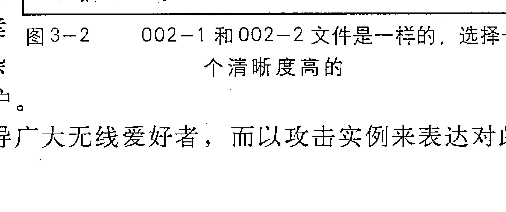

譬如图3-2所示，可以看到WEP加密密码为“JaKG*#@Mn/s89”，密码复杂度可谓高到极点了，但破解也只花费了1分27秒。而且到目前为止，网上一些所谓的无线安全解决方案里，及一些无线安全顾问们，仍会把设置高复杂度WEP密钥作为一个有效强化方法介绍给用户。所以在本书中，将不再以此解决方法来误导广大无线爱好者，而以攻击实例来表达对此类文章的鄙视。

图3-2 002-1和002-2文件是一样的，选择一个清晰度高的

### 动态WEP

为了加强WEP的安全性，一些供应商提出了部分动态密钥的WEP方案。在这样的方案中，WEP的密钥不再是静态不变的，而是能定期动态更新。比如思科（Cisco）提供的LEAP中，WEP的密钥（Lightweight Extensible Authentication Protocol）就是这样一种方案，LEAP同时还提供双向的基于802.1X的认证。这些方案在一定程度上缓解了WEP的危机，但由于它们是某个供应商的私有方案而非标准，所以离完全解决WEP的所有问题还有很大差距。何况令人遗憾的是，在几年前LEAP已被彻底破解。

关于LEAP的破解，有兴趣的朋友可以参考2009年3月的《黑客手册》，其中有我发表的关于PPTP VPN攻防的文章。由于LEAP加密机制与PPTP VPN相似，所以我们可以使用同样的工具来对其进行破解。

## 3.2 WEP加密设置和连接

饭是一口一口吃的，知识是一点一点积累的，为了后面无线安全及Hacking技术的学习，我们应该先来看看如何搭建自己的测试环境，换句话说，就是搭建一个属于自己的无线网络。我们先来看看基于WEP加密的无线网络是如何搭建的。

#### 3.2.1 配置无线路由器

无线路由器的厂商有很多，我自己比较喜欢的有Linksys、D-Link、Belkin、IPTime等，这里就不一一举例了，在配置方面区别都不大，只是在无线路由器的稳定性和可操作性上有区别，下面就以IPTime N100R+无线路由器为例。

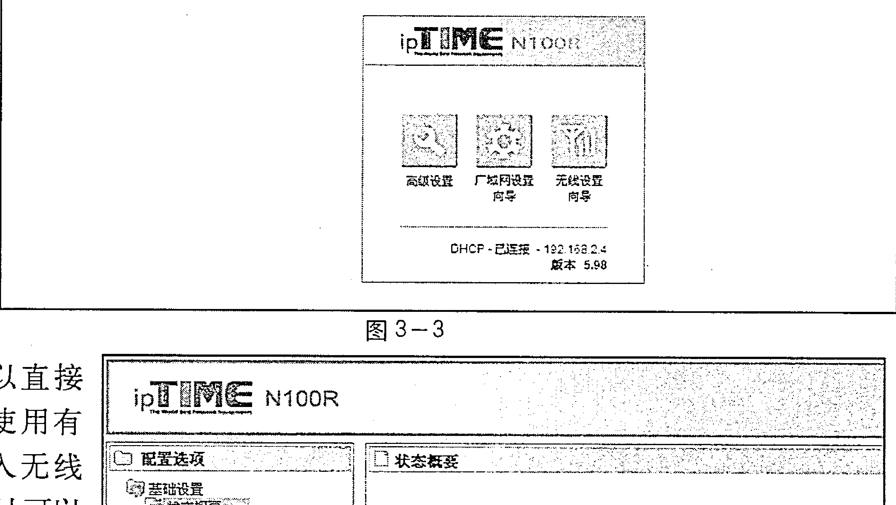

在默认情况下，无线路由器是设置没有密码的，可以直接使用无线网卡连接，或者先使用有线网络连接无线路由器，输入无线路由器的IP地址，这个IP地址可以在说明书上或者无线路由器的底部看到，默认为http://192.168.0.1，输入正确回车后，就能看到如图3-3所示的页面。

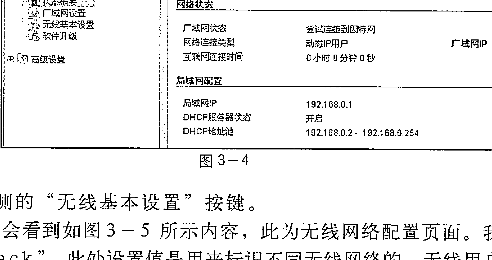

点击选择“高级设置”，会看到如图3-4所示的IPTime N100R+无线路由器主配置界面。点击选择左侧的“无线基本设置”按钮。

点选左侧“无线基本设置”后，会看到如图3-5所示内容，此为无线网络配置页面。我们在右侧的“SSID”栏输入“nohack”，此处设置值是用来标识不同无线网络的，无线用户主要就靠该SSID名称来识别不同的无线网络。

在“信道”栏，也就是工作频道栏，可以根据自己的环境需要来修改，不过一般来说，我们主要会在1、6、11这3个频道中选择，这是因为这3个频道之间的相互干扰最少。这里默认为11，我设置为6频道。

在“认证”栏，从下拉菜单中选择为“开放系统”，并在下面的“加密”处点击选择“WEP64”，即该无线网络启用64位的WEP加密。

然后在下方的“密钥输入方法”选择“ASCII”，即ASCII码格式，这样我们就可以在下框直接设置具体的WEP密码。由于是64位WEP，所以对应的ASCII码就是5位，这里设置的密码为“yamak”。若在“密码输入方法”处选择“十六进制”，即16进制方式的话，在我们设置的时候就会很麻烦。

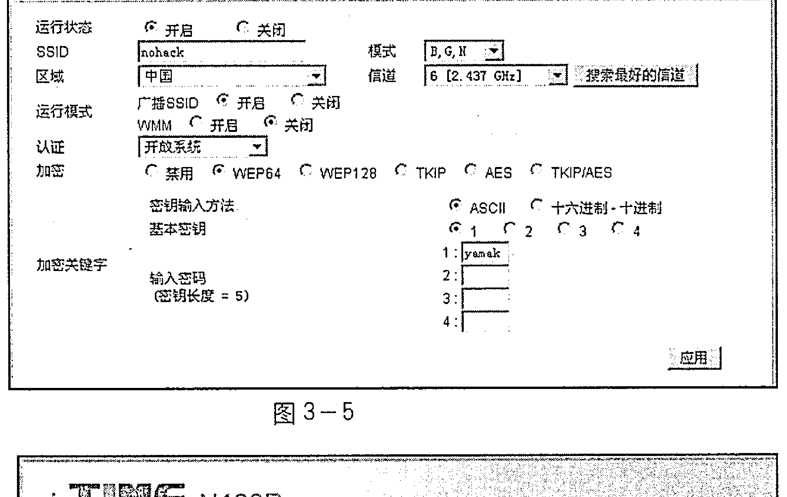

图3-5

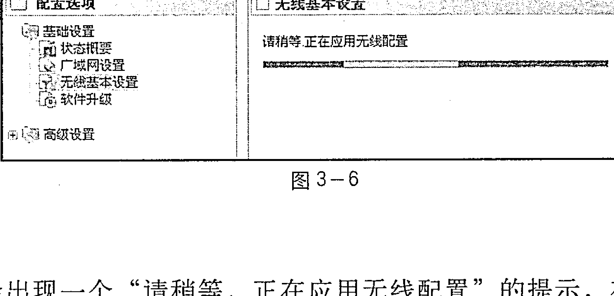

图3-6

设置完毕，点击下方的“执行”按钮来使得无线路由器实现该配置。此时，无线路由器会进行重启，过程需要大约2–8秒。

重启后，如图3-6所示，该页面会出现一个“请稍等，正在应用无线配置”的提示，在成功应用后会自动重新访问无线路由器的界面。

若是之前配置时使用无线网卡连接的话，那么由于此时无线连接密码已修改，所以会出现无法连接等错误提示，这是正常的，这也标志着无线路由器已经配置完毕。

OK，既然无线路由器配置好了，那接下来我们看看无线客户端的配置。

### 3.2.2 Windows下客户端设置

作为Windows系统的无线客户端而言，若笔记本自带有无线网卡，则一般都可以使用系统自带的无线配置管理工具进行配置及管理，而对于外置的其它类型的无线网卡，也可以使用第三方的无线配置工具或者Windows系统自带的配置工具进行设置。

> 注意，系统自带的工具是在安装完操作系统的时候就已经内置的，只要正确安装无线网卡驱动就可以使用。另外，在Windows XP下，我们可以在服务中看到名为“Wireless Zero Configuration”的项目，它所对应的就是系统自带的无线配置工具，在使用前或者出现无法使用的时候应检查并确保该服务已经启动；而在Windows 2003下对应的服务名称为“Wireless Configuration”。

为了使得更多的新手了解如何配置无线网卡，下面我就使用系统自带的无线网络配置工具来演示，具体步骤如下：

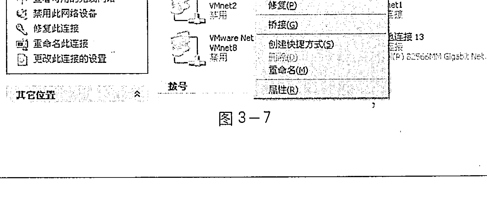

图3-7

#### 步骤1：扫描当前可用的无线网络。

在Windows下进入到“网络连接”，如图3-7所示，在“无线网络连接”上点击右键，在菜单中点选“查看可用的无线连接”。

之后系统会自动搜索附近可用的无线网络信号，如图3-8所示，可以看到在窗口右侧显示出一个名为“nohack”的无线网络信号，信号非常好，满格，同时提示“启用安全的无线网络”。这个提示就意味着对方采用了WEP加密。

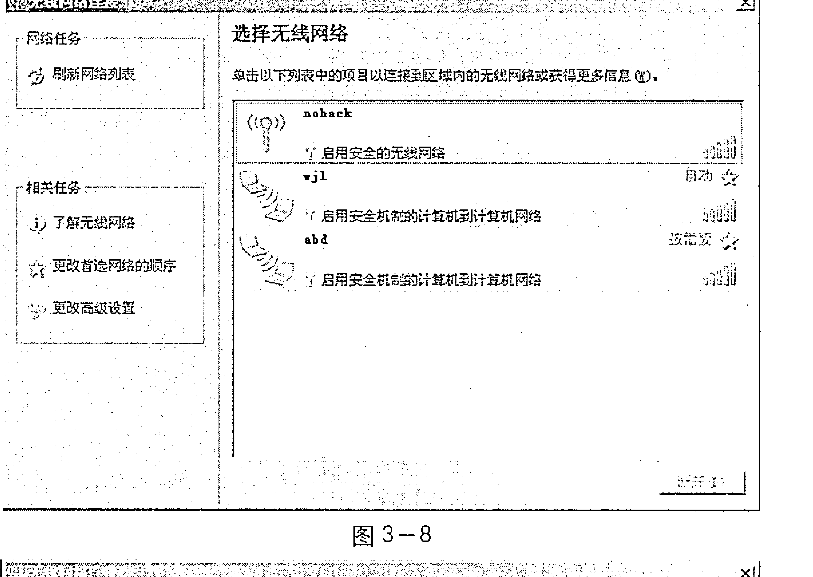

#### 步骤2：连接指定无线网络。

鼠标双击搜索到的名为“nohack”的无线网络，会弹出如图3-9所示的窗口，该窗口提示我们输入正确的WEP密码。这里就需要输入我们在前面无线路由器上设置的密码，正确即可连接，若输入错误，则会被拒绝连接。

稍等片刻，在我们的无线网卡连接到无线路由器后，会先通过加密验证。若密码正确则会被无线路由器上的DHCP分配一个IP地址，这个时间随路由器的不同、无线网卡的不同及环境的不同会有所区别。一旦成功连接，就会出现如图3-10所示的“已连接”提示。

这样，我们就连接到名为“nohack”的无线网络当中，可以通过该无线路由器进行上网操作了。

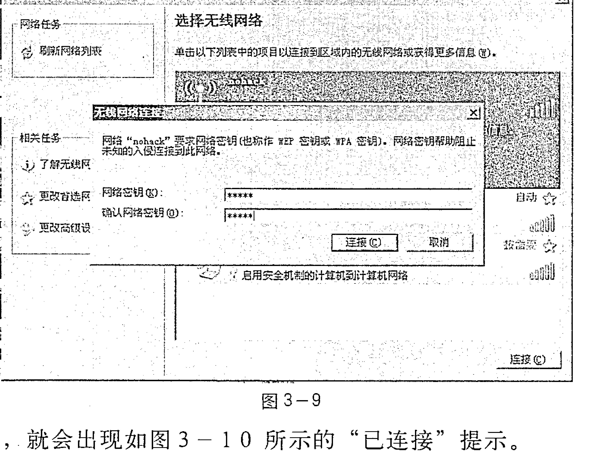

### 3.2.3 Linux下客户端设置

既然本书主要以配套的BackTrack4 Linux为例进行无线安全攻防的讲解，那么当然要学习一下在BackTrack4 Linux下如何配置无线网卡来进行上网。废话少说，直入主题，具体步骤如下（BT4环境如何搭建我将会在4.3章节详细讲解，请参阅）。

首先在配置前需要将NETWORK服务启动，如图3-11所示，我们可以在菜单里依次选择“Services”－“NETWORK”－“Start NETWORK”。

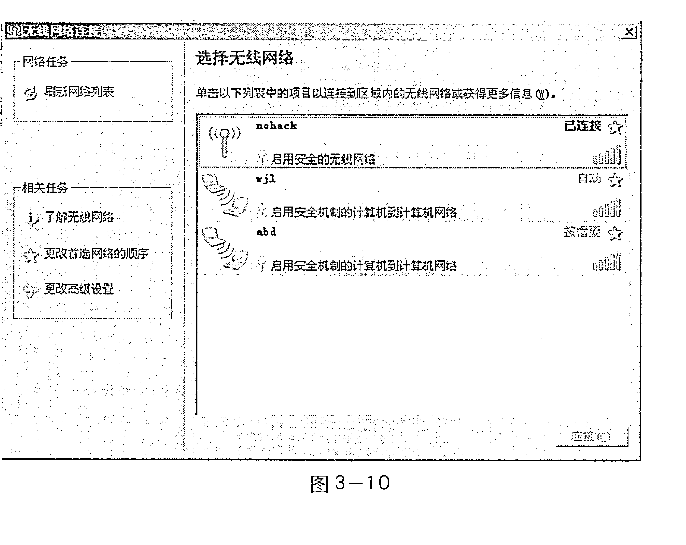

## Part03 幼稚园篇

之后我们就可以依次点击打开菜单里的“Internet”－“Wicd Network Manager”来对无线网卡进行配置，如图3-12所示。

#### 步骤1：配置网卡。

打开后点击上部的“Preference”按钮，可以看到如图3-13所示的界面。然后在“General Settings”标签项中的“Wireless Interface”处输入正确的无线网卡名称，这里就是wlan0。

若不清楚此处输入什么名称，大家可以打开一个shell，输入ifconfig或者iwconfig来查看无线网卡的名称。一般来说，无线网卡的名称根据芯片的不同会有区别，比如wlan0、rausb0、ath0等。

接下来，就可以点击Wicd Manager的Refresh按钮，之后很快就能看到搜索到的无线网络，如图3-14所示，发现了2个无线网络信号，其中一个名为“zerone”。

哈，这次的无线SSID就不再是“nohack”了，而是“zerone”。这里可不是手误哦，主要是换了一个厂商的无线路由器做测试，顺便也重新设置了SSID。

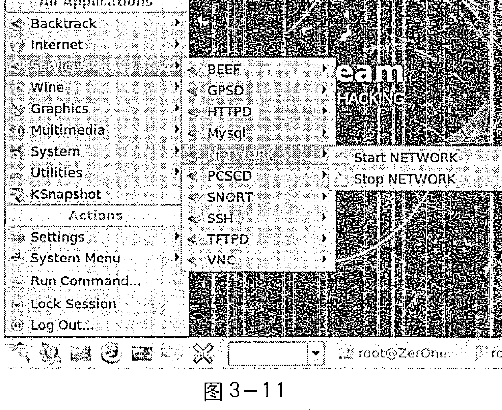

图3-11

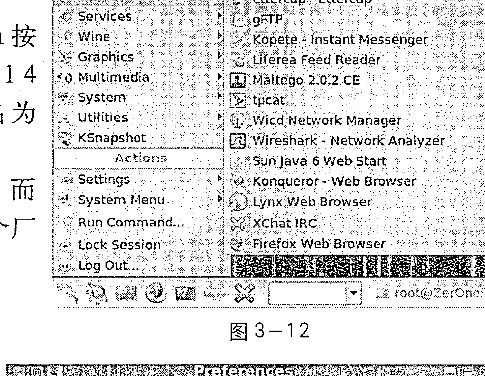

图3-12

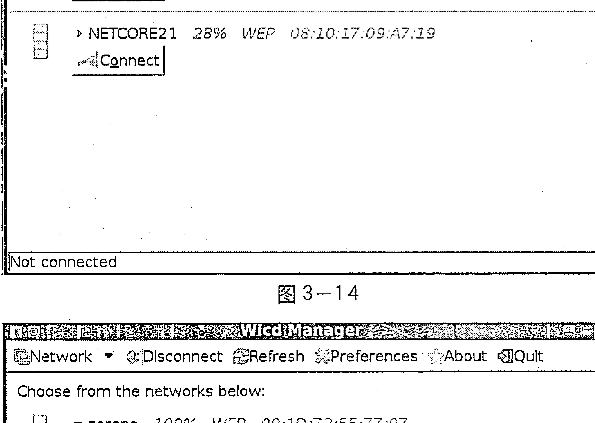

图3-14

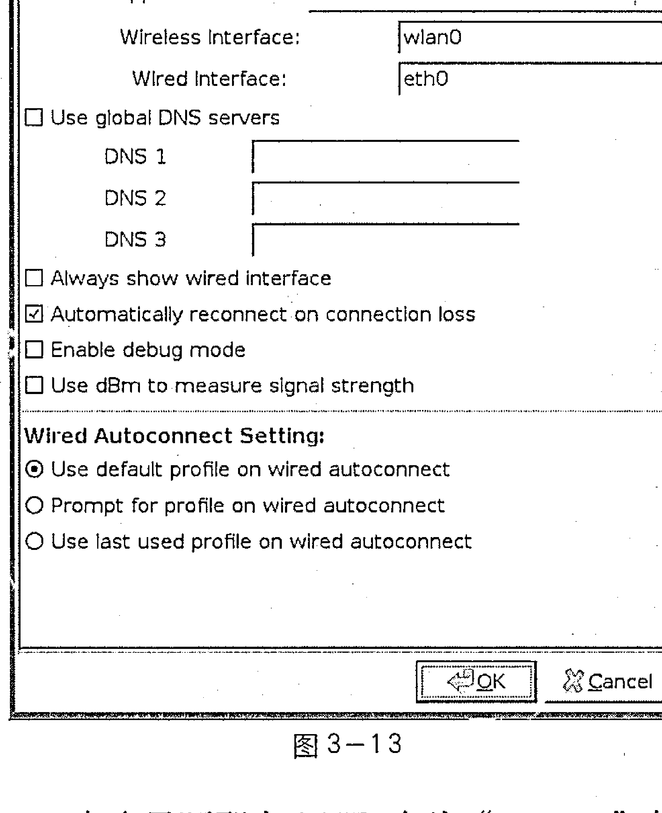

图3-13

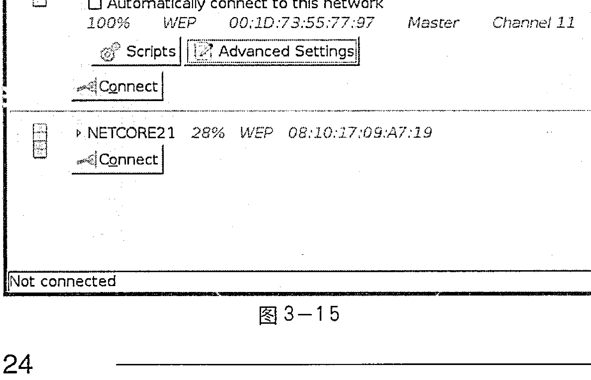

图3-15

点击里面那个SSID名为“zerone”的无线网络前的三角，在延伸出来的部分中，选择其中的“Advanced Settings”，即高级设置部分，如图3-15所示。

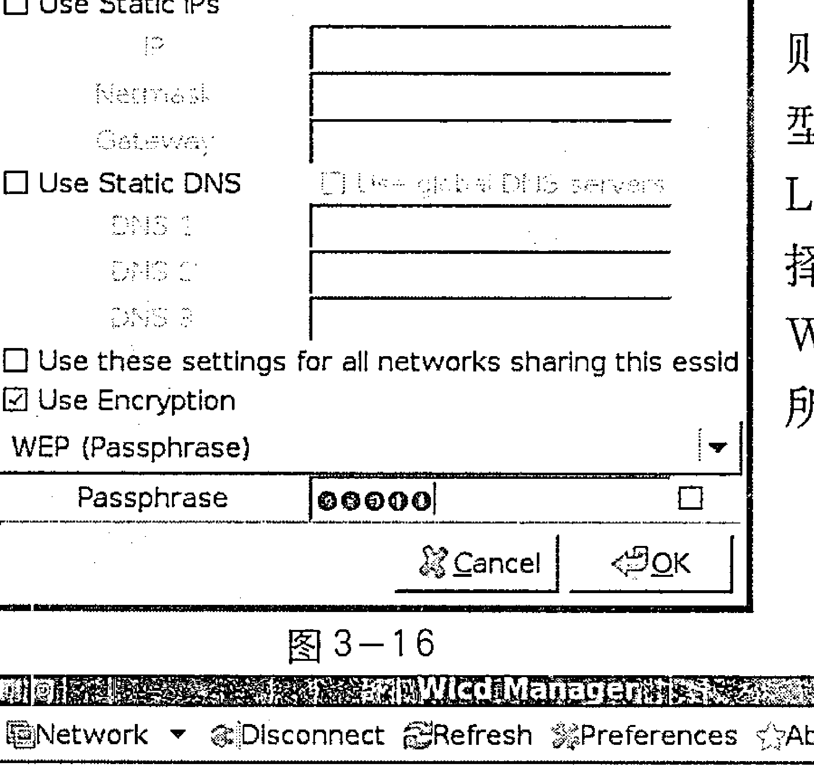

图3-16

单击“Advanced Settings”，若无线设备支持DHCP，则此处无需设置上半部分的内容，然后在下方的加密类型上选择对应的方式，默认支持WEP、WPA-PSK、LEAP、EAP-MD5、EAP-TLS等验证方式。这里我就选择比较基础的WEP加密，在“Passphrase”处输入正确的WEP加密密码，点击“OK”即可完成设置，如图3-16所示。

#### 步骤2：连接无线网络。

确保之前的设置是正确的，接下来回到主界面后，我们可以点击“Connect”来进行连接，如图3-17所示。稍等片刻后，如图3-18所示，我们就可以看到在当前窗口下方出现了提示“Connected to zerone at 100% (IP: 192.168.1.6)”，也就是说我们已经成功连接至无线路由器了。

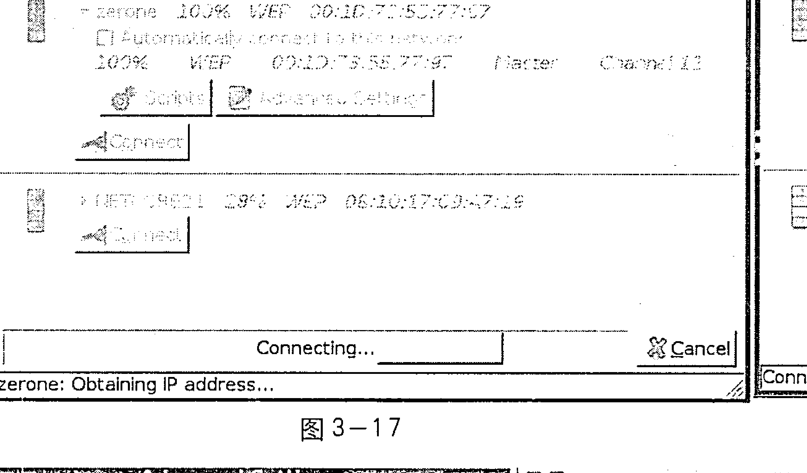

图3-17

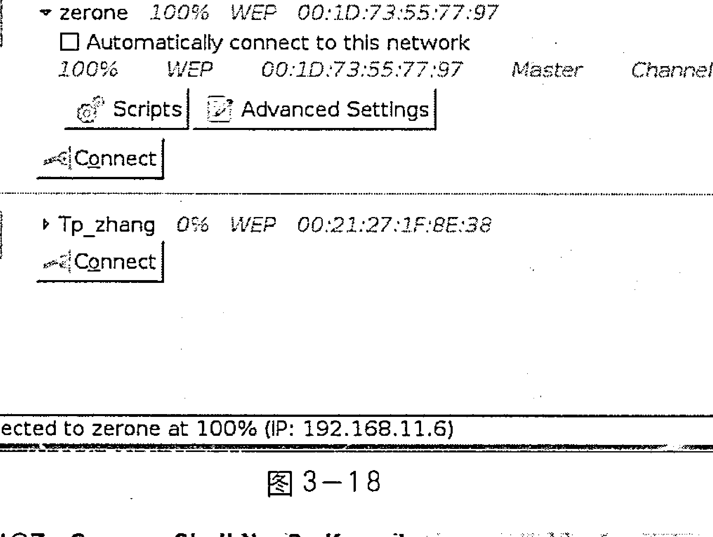

图3-18

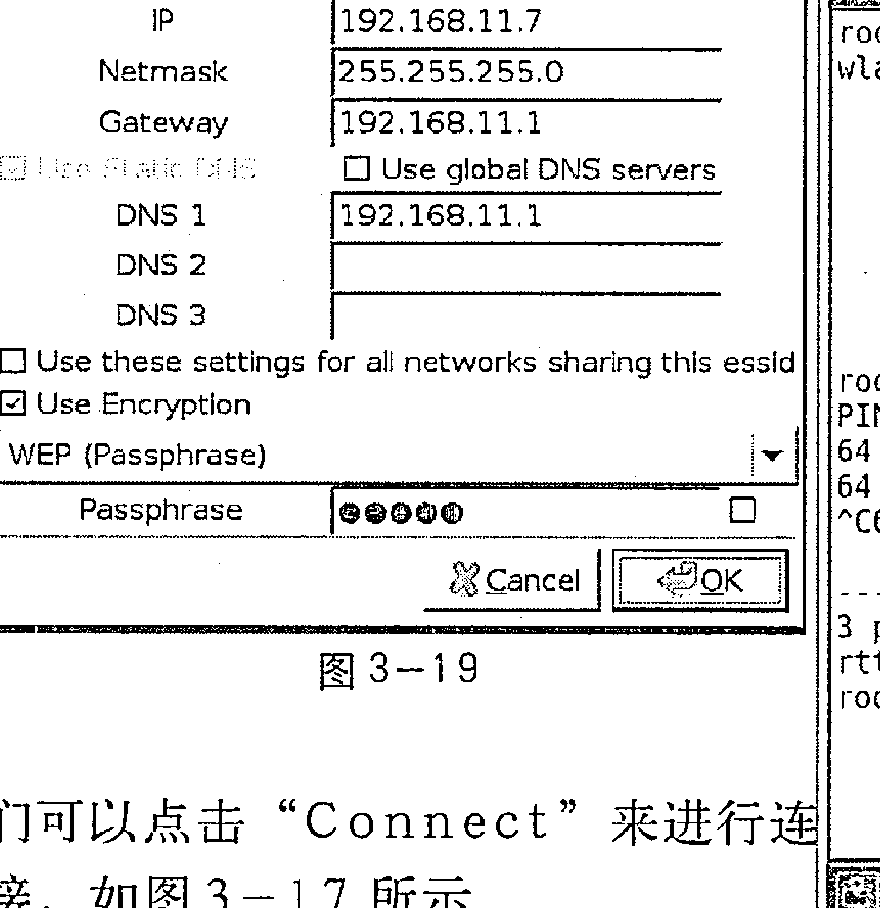

图3-19

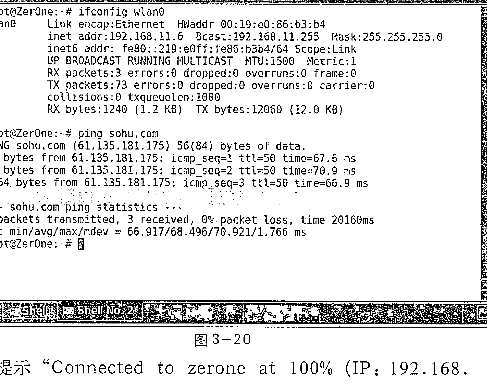

图3-20

当然了，若提供无线网络的无线设备没有提供DHCP，那么我们也可以使用静态地址，如图3-19所示，进行配置就可以啦。

#### 步骤3：验证一下无线网卡是否连接至无线网络。

既然已经能够获取到IP，我们可以打开一个Shell，使用`ifconfig`检查一下，然后再`ping`一下外网，看看是否畅通。如图3-20所示，我们可以看到当前已经能够Ping通外网主机了。

> 注意，若输入的WEP密码不对或者选择的加密方式不对，则会出现如图3-21所示的提示。此时只要选择实际对应的加密方式，然后输入正确的密码即可。

现在大家是不是已经掌握了如何设置WEP加密了呢？后面我们还可以看看WPA-PSK的设置。

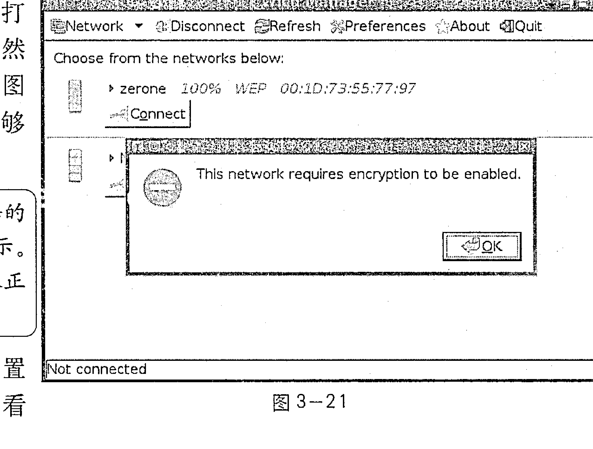

图3-21

## 3.3 WPA基础

> IEEE 802.11所制定的是技术性标准，Wi-Fi联盟所制定的是商业化标准，而Wi-Fi所制定的商业化标准基本上也都符合IEEE所制定的技术性标准。WPA（Wi-Fi Protected Access）事实上就是由Wi-Fi联盟所制定的安全性标准，这个商业化标准存在的目的就是为了要支持IEEE 802.11i这个以技术为导向的安全性标准。而WPA2其实就是WPA的第二个版本。

### 3.3.1 WPA简介

WPA，Wi-Fi Protected Access，即Wi-Fi网络安全存取。WPA作为一种大大提高无线网络的数据保护和接入控制的增强安全性级别，的确能够解决WEP所不能解决的安全问题。WPA通过使用一种名为TKIP（暂时密钥完整性协议）的新协议来解决上述问题。使用的密钥与网络上每台设备的MAC地址及一个更大的初始化向量合并，来确信每一节点均使用一个不同的密钥流对其数据进行加密。随后TKIP会使用RC4加密算法对数据进行加密，但与WEP不同的是，TKIP修改了常用的密钥，从而使网络更为安全，不易遭到破坏。WPA也包括完整性检查功能以确信密钥尚未受到攻击，同时加强了由WEP提供的形同虚设的用户认证功能，并包含对802.1x和EAP（扩展认证协议）的支持。这样WPA既可以通过外部Radius（接入用户远程验证）服务对无线用户进行认证，也可以在大网络中使用Radius协议自动更改和分配密钥。

### 3.3.2 WPA分类

WPA使用动态密钥加密，也就是说密钥是不断变化的，使入侵无线网络比WEP困难，如图3-22所示。WPA被公认为目前无线网络安全性的最高级别之一，如果您的设备支持此加密，则推荐使用。WPA含有两个版本，采用不同的验证过程。即针对家庭及个人的WPA-PSK，在小型网络或家庭环境中提供此种级别的安全性，它使用称为预配置共享密钥（PSK）的密码。此密码越长，无线网络的安全性越强。其中，对于加密，WPA使用临时密钥完整性协议（TKIP: Temporal Key Integrity Protocol），这是一种建立动态密钥加密和相互验证的机制。TKIP的安全功能弥补了WEP的不足。由于密钥在不断地变化，可为无线网络提供较高的安全级别。

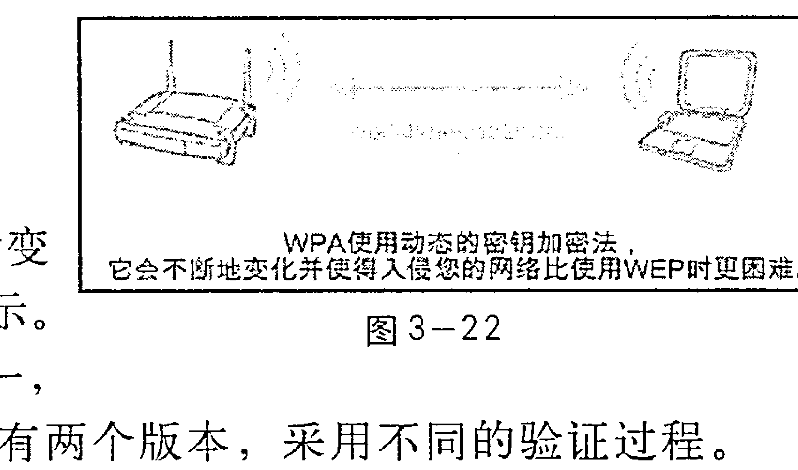

图3-22

**PSK是Pre-Shared Key的缩写，即预共享的密钥。**WPA和802.11i/WPA2都支持一个PSK的模式。简单地说，PSK模式是一个简化的WPA/802.11i，是一个没有802.1X部分的WPA或802.11i。

### 对于商业/企业的WPA-Enterprise

在有802.1x RADIUS服务器的企业网络上提供此种级别的安全性，其中，可扩展认证协议（EAP）用于验证过程中的消息交换。它通过RADIUS（远程认证拨入用户服务）服务器利用802.1x服务器技术验证用户的身份，为无线网络提供行业级安全性。

### 3.3.3 WPA的改进

在支持新的IEEE 802.11i安全标准的硬件出现之前，作为一个权宜之计，WPA主要针对的是密钥相对容易被捕捉和破坏的企业网络。与家庭或是小型企业局域网相比，企业网络密钥被窃取的过程相对容易，黑客只需要从无线网络流量中搜集并创建攻击所需信息即可完成对密钥的窃取。当然同样，WPA也适用于不需要外部认证、使用简单共享密钥的小型网络。我们来看看WPA已基本解决了前面WEP出现的6个问题：

- **WEP缺陷：**WPA如何改进；
- **IV太短：**在TKIP中，IV大小增加了一倍，已达48位；
- **弱数据完整性：**WEP加密的CRC校验和计算已由Michael算法取代，该算法可计算64位消息完整性代码（MIC）值，该值是用TKIP加密；
- **使用主密钥，而不使用派生密钥：**TKIP和Michael使用一组从主密钥和其他值派生的临时密钥。主密钥是从“可扩展身份验证协议—传输层安全性”（EAP-TLS）或受保护的EAP（PEAP）802.11X身份验证过程派生出来的。此外，RC4输入的机密部分是通过数据包混合函数计算出来的，它会随着帧的改变而改变；
- **不重新生成密钥：**WPA自动重新生成密钥以派生新的临时密钥组；
- **无重放保护：**TKIP将IV用作帧计数器以提供重放保护。

需要说明的是，若当前无线产品是早期购置的，就需要对所有的设备进行升级以支持WPA，这包括接入点、无线路由器、客户端网络适配器、无线桥接器和打印机服务器等，任何存在无线接口的设备都需要升级。另外，对于Windows用户无须担心，Windows XP SP2以上版本均已增加WPA支持，详情参见微软知识库第815485号文章。（http://support.microsoft.com/?kbid=815485）

#### 3.3.4 WPA2 简介

WPA2 是第二代 WPA，构建 WPA2 并不是为了解决 WPA 内的任何局限性，而且向后兼容于支持 WPA 的产品。最初的 WPA 与 WPA2 之间的主要差别是 WPA2 需要高级加密标准（AES）来加密数据，而 WPA 使用 TKIP。但现在，无论是 WPA 还是 WPA2，都已经支持 AES。

在进行扫描探测中，常会出现 AES、AES-CCMP 或者 CCMP 来指代 AES 的启用。与 WPA 一样，WPA2 也分企业版和家庭版，在很多无线设备上也会显示为 WPA2-Enterprise 和 WPA2-PSK。

#### 3.3.5 WPA 面临的安全问题

虽然 WPA 是继承了 WEP 基本原理而又解决了 WEP 缺点的一种强化技术，通常情况下由于加强了生成加密密钥的算法，因此即便收集到分组信息并对其进行解析，也几乎无法计算出通用密钥。但是，也只是“几乎”而已。

实际上，WPA 只是在 802.11i 正式推出之前的 Wi-Fi 企业联盟的安全标准，由于它仍然是采用比较薄弱的 RC4 加密算法，所以黑客只要监听到足够的数据包，借助强大的计算设备，即使在 TKIP 的保护下，同样可能破解网络。因此，WPA 只能算作是无线局域网安全领域的一个过客。而依据 WPA 制定出来的成熟版本 WPA2，虽然不能再说成是过客，但其安全强度也依然受到质疑。

#### 3.3.6 关于 Windows 下 WPA2 支持性

由于 Windows XP SP2 默认情况下仅支持到 WPA，故用户使用 Windows 自带的无线配置服务并不能够连接到 WPA2 及 802.11i，如图 3-23 所示，在菜单上是没有这个选项的。

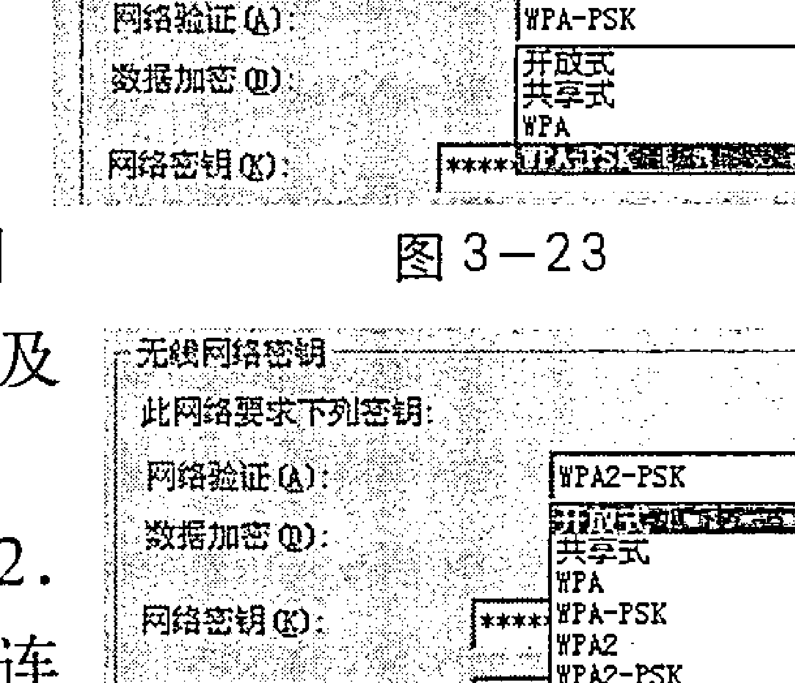

不过 Microsoft 推出了基于 Windows XP SP2 的 WPA2/802.11i 相关补丁，并集成在了 Windows XP SP3 中，安装后即可连接 WPA2 加密的 AP。需要注意的是，并非所有网卡都能支持 802.11i 和 WPA2 标准，部分网卡通过升级驱动可以支持。如果用户发现安装该补丁后仍然无法通过 Windows XP 自带的无线管理程序识别及连接 WPA2 加密的无线 AP，可能需要对驱动程序或网卡 Firmware 进行更新。

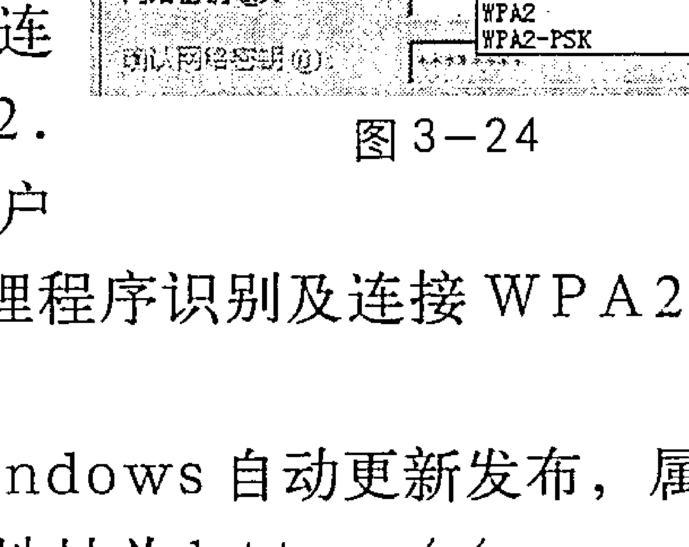

对于 Windows XP SP2 的用户，由于该补丁不会通过 Windows 自动更新发布，属于增值补丁，所以需要运用该补丁的用户需要到微软官方站点下载，地址为 http://support.microsoft.com/?id=893357 。

如图 3-24 所示，为升级该 WPA2 补丁后 Windows 系统已支持 WPA2。

### 3.4 WPA-PSK 加密设置和连接

为了后面无线安全及 Hacking 技术的学习，我们继续来看看基于 WPA-PSK 加密的无线网络是如何搭建的。

#### 3.4.1 配置无线路由器

下面仍然以 IPTime N200R+ 无线路由器为例，和前面讲述的 WEP 配置一样，在浏览器的弹出窗口上先输入正确的账户及密码来访问无线路由器的配置页面，如图 3-25 所示。

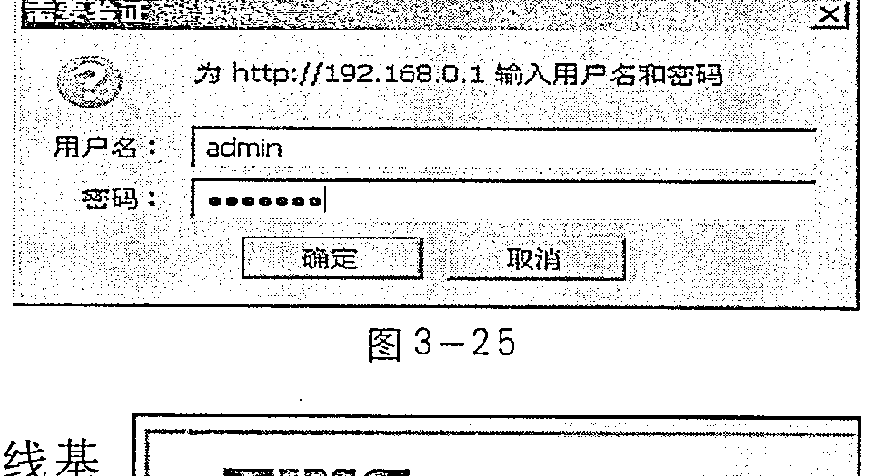

图 3-25

输入正确的账户名及密码后，会看到如图 3-26 所示的无线路由器主配置界面。点击选择左侧的“无线基本设置”按钮，会看到如图 3-27 所示的内容，此为无线网络配置页面。

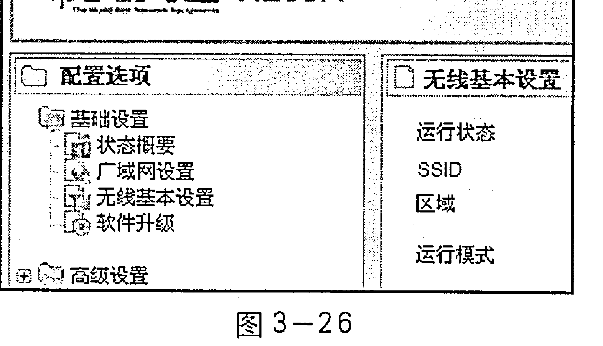

图 3-26

我们在右侧的“SSID”栏输入“zerone”，此处设置值是用来标识不同无线网络的，无线用户主要就靠该 SSID 名称来识别不同的无线网络。

在“信道”栏，也就是工作频道栏，可以根据自己的环境需要来修改，不过一般来说我们主要会在 1、6、11 这 3 个频道中选择，这是因为这 3 个频道之间的相互干扰最少，这里我就保持默认的 6 频道不变。

在“认证”的下拉菜单中选择 WPA-PSK，即该无线网络启用 WPA-PSK 加密。接着在下方的“加密”处选择“TKIP”或者“AES”，这是算法的不同，但是对于普通用户来说其实区别并不大。

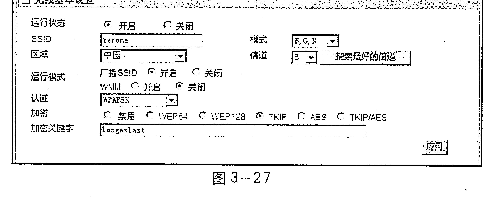

图 3-27

下面我们就可以在下栏直接设置具体的 WPA-PSK 密码，这里注意一下，由于 WPA-PSK 密码的位数必须是 8 位或者 8 位以上，所以我这里设置的密码为“longaslast”。大家可以根据自己的喜好设置任意超过 8 位的密码。

设置完毕，点击下方的“执行”按钮来使得无线路由器实现该配置，此时无线路由器会进行重启，这个需要大约 20-30 秒。重启后如图 3-28 所示，该页面会出现一个“请稍等，正在应用无线配置”的提示，成功应用后会自动重新访问无线路由器的界面。

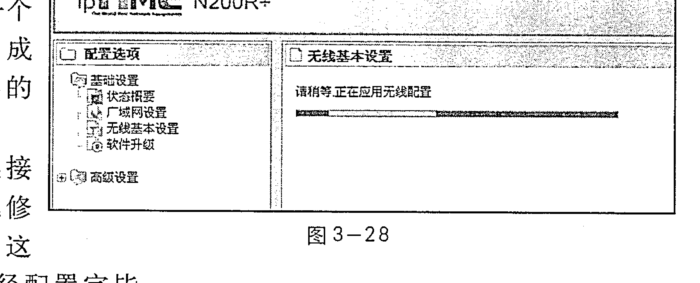

图 3-28

若是之前配置时使用无线网卡连接的话，那么由于此时无线连接密码已修改，所以会出现无法连接等错误提示，这是正常的，这也标志着无线路由器已经配置完毕。

##### 关于 WPA2-PSK 的设置

若是对无线网络安全环境有更高的要求，需要设置加密为 WPA2-PSK，只需要在无线路由器下的“加密”方式中设置为“WPA2-PSK”即可。如图 3-29 所示，为 IPTime N200R+ 无线路由器的配置页面。

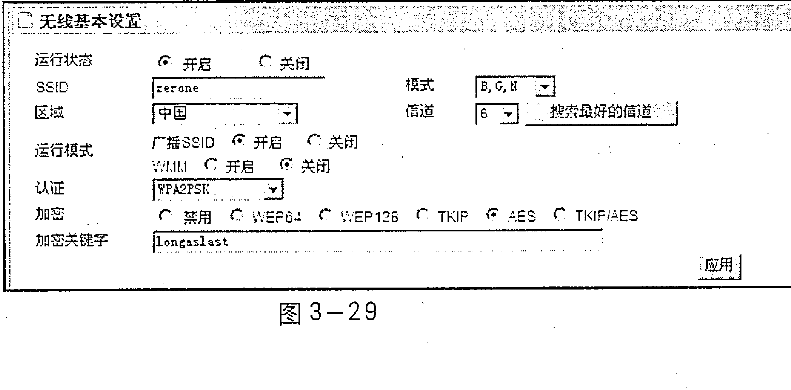

O.K，既然无线路由器配置好了，那接下来我们看看无线客户端的配置。

#### 3.4.2 Windows 下客户端设置

这里我还是使用系统自带的无线网络配置工具来演示，具体步骤如下：

##### 步骤1：扫描当前可用的无线网络

在 Windows 下进入到“网络连接”，在“无线网络连接”上点击右键，在菜单中点选“查看可用的无线连接”。之后，系统会自动搜索附近可用的无线网络信号，如图 3-30 所示，可以看到在窗口右侧显示出一个名为“zerone”的无线网络信号，同时提示有“启用安全的无线网络（WPA）”。这个提示和前面启用 WEP 加密的无线网络的区别就是多了一个括号，里面写出“WPA”这样的字眼，请大家注意，这就意味着对方采用了 WPA-PSK 加密。

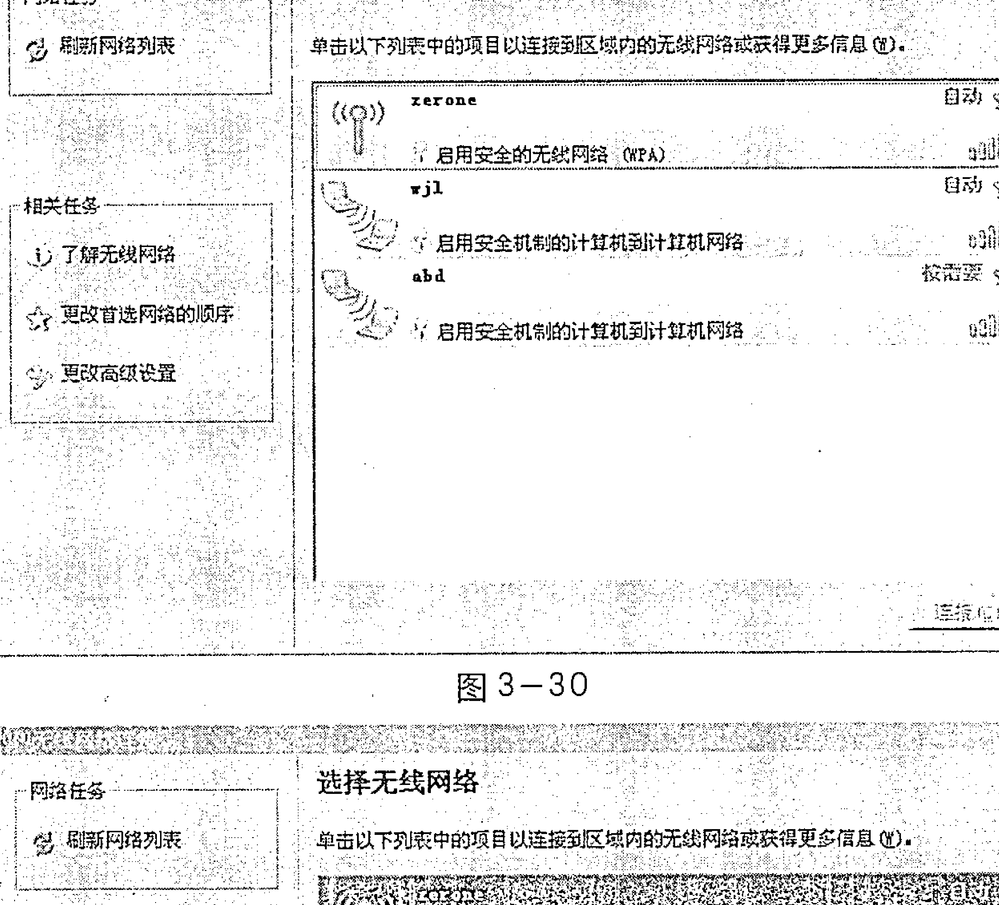

##### 步骤2：连接指定无线网络

鼠标双击图 3-30 中名为“zerone”的无线网络，会弹出如图 3-31 所示的窗口，该窗口提示我们输入正确的 WPA-PSK 密码。这里就输入在前图中无线路由器上设置的密码即可。若输入错误，则会被拒绝连接。稍等片刻，在我们的无线网卡连接到无线路由器后，会先通过加密验证。若密码正确，则会被无线路由器上的 DHCP 分配一个 IP 地址，这个时间随着路由器的不同、无线网卡的不同及环境的不同会有所区别。一旦成功连接，就会出现如图 3-32 所示的“已连接”提示。我们打开无线网络连接的属性，可以看到当前已经连接到 zerone 无线网络，数据包传输正常，如图 3-33 所示。这样，我们就连接到名为“zerone”的无线网络当中了，现在就可以通过该无线路由器进行上网操作。

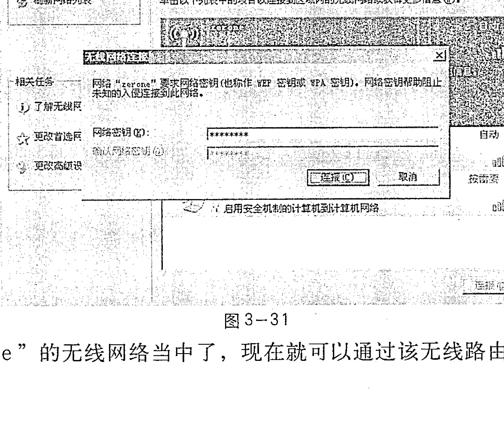

#### 3.4.3 Linux 下客户端设置

下面接着学习一下在 BackTrack4 Linux 下如何配置无线网卡来通过 WPA-PSK 加密上网。

# Part0. 组建园篇

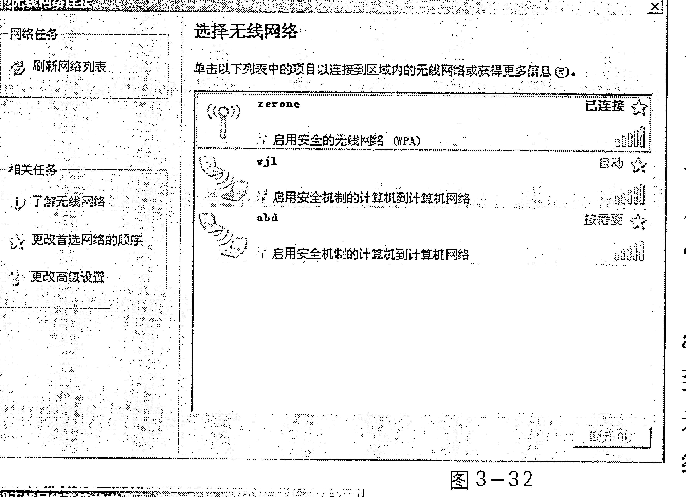

图 3-32

因为和前面 WEP 加密的连接方法一致，所以这里我主要把一些不一样的地方进行讲述，具体步骤如下。首先在配置前还是需要将 NETWORK 服务启动，我们可以在菜单里依次选择“Services”→“NETWORK”→“Start NETWORK”。接下来，就可以点击 Wicd Manager 的 Refresh 按钮，之后很快就能看到搜索到的无线网络，如图 3-34 所示，这里发现了 1 个有线网络和 2 个无线网络的信号。

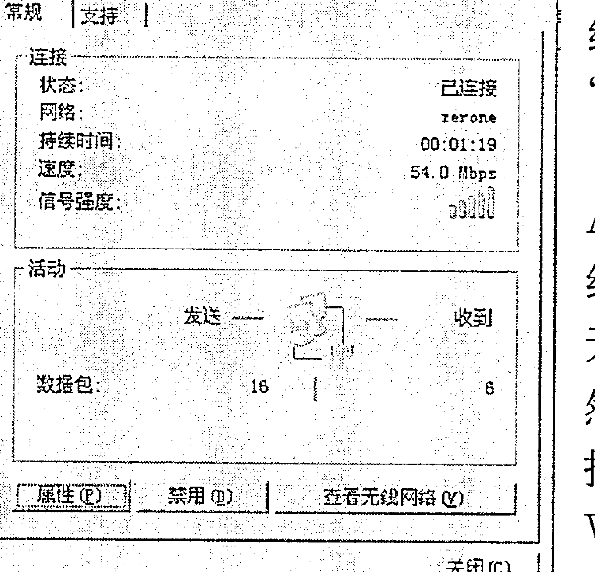

图 3-33

点击其中一个名为“zerone”的无线网络前的三角，在延伸出来的部分中选择其中的“Advanced Settings”，即高级设置部分。如图 3-35 所示，在 Advanced Settings 里，若无线设备支持 DHCP，则此处无需设置上半部分内容，然后把下方的加密类型选择上，这里我就选择 WPA1/2 加密，即 WPA-PSK 加密。在“Key”处输入正确的 WPA-PSK 加密密码，点击“OK”即可完成设置。好了，接下来无线网卡就可以从 DHCP 上获取 IP 连接至该无线网络了。这样，属于我们自己的 WPA-PSK 加密无线网络就搭建完毕啦。

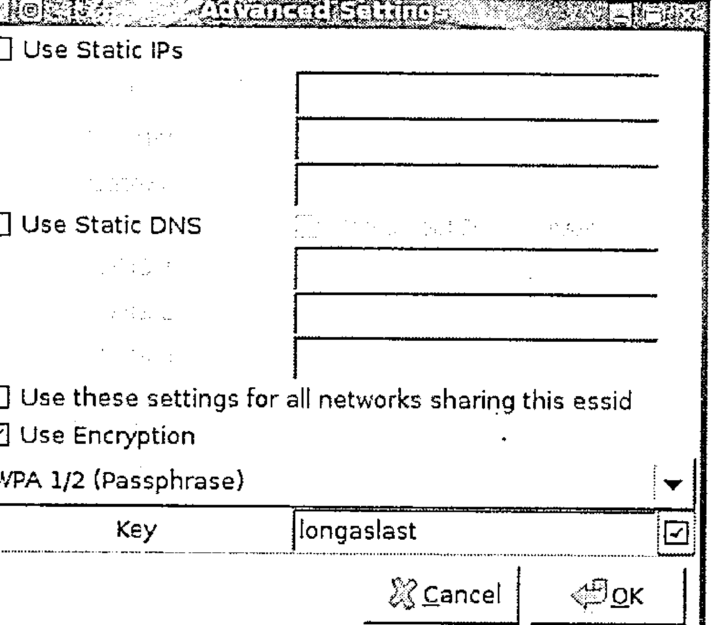

图 3-35

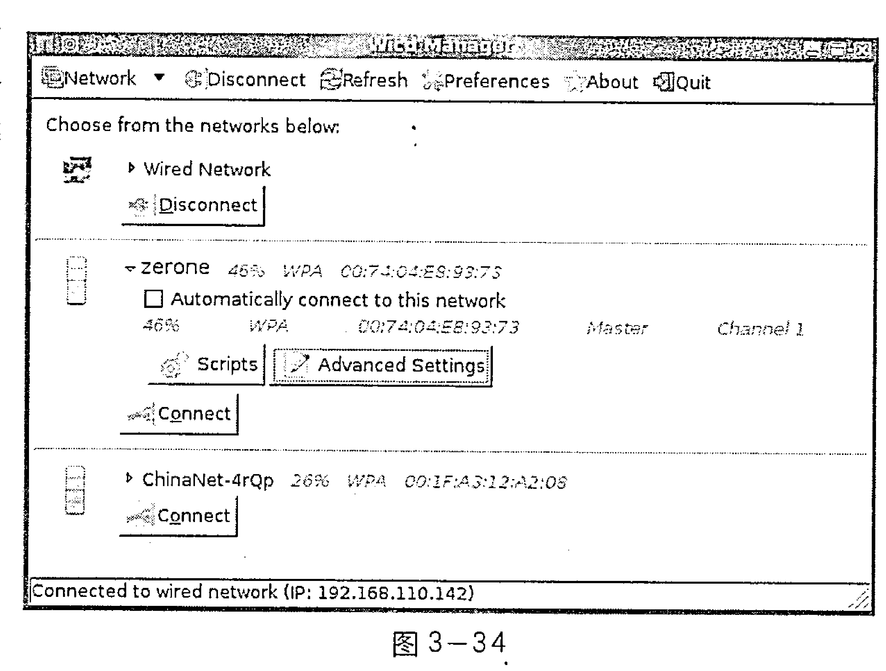

图 3-34

## 卷4 无线黑客环境准备

### 4.1 适合的无线网卡

一般来说，只要准备一台笔记本电脑，通过内建的无线网卡就可以进行无线黑客攻防演练啦。但是想要成为一位专业的无线黑客，为了实现不同种类的无线攻击，就必须准备不同的无线网卡，甚至外置天线和 GPS，必要时还会需要便携式无线路由器的支持。

#### 4.1.1 无线网卡的选择

在无线网卡的选择上，主要应注意以下几点：

- 芯片类型
- 是否支持外接天线
- 网卡固件版本
- 支持的无线协议
- 网卡功率
- ……

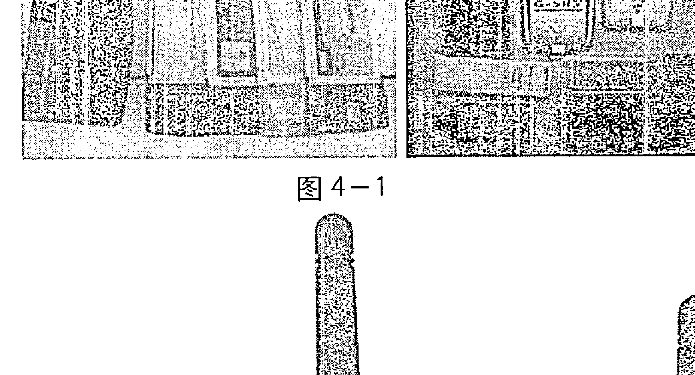

图 4-1

如图 4-1 所示，为我用于测试的部分无线网卡，包括了多种不同的芯片及多个接口类型，适用于不同场合及测试环境。

##### 无线网卡接口类型

作为目前市面上常见的无线网卡产品，主要有这样几种接口：USB、PCMCIA、PCI 及 MiniPCI 等。

其中，USB 接口的无线网卡最为方便，可以在 Windows 下与虚拟机配合使用（参考后面小节），也可以在 Linux 下使用，如图 4-2 所示，为 IPTime 的 USB 型无线网卡。

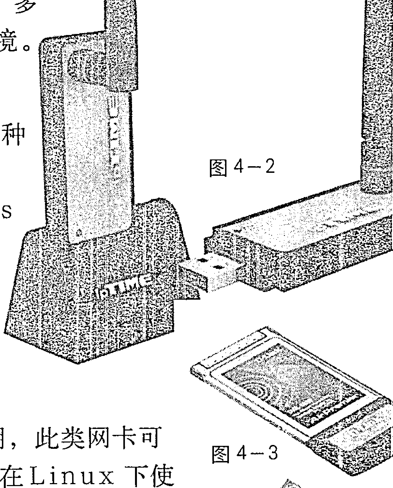

图 4-2

目前有些品牌的 USB 无线网卡是能够拆卸及更换天线的，这款 IPTime 的 IP-G200U 型无线网卡就是这样，支持 SMA 接口的任意天线，非常方便。

而 PCMCIA 接口的无线网卡，主要用于笔记本电脑使用，此类网卡可以在 Windows 下使用（需要额外驱动及指定型号），也可以在 Linux 下使用，如图 4-3 所示，为 DLINK 无线网卡。此类网卡若想外接天线的话，就需要 DIY 改造一下了。


图 4-3

那么，作为笔记本而言，还有一种类型的无线网卡也比较适合，就是 MiniPCI 接口的无线网卡。这种类型的卡比较小巧，它是需要插入到笔记本主板上的，但是可以在 Windows 及 Linux 下使用，一般来说 Atheros 芯片的比较好，如图 4-4 所示。

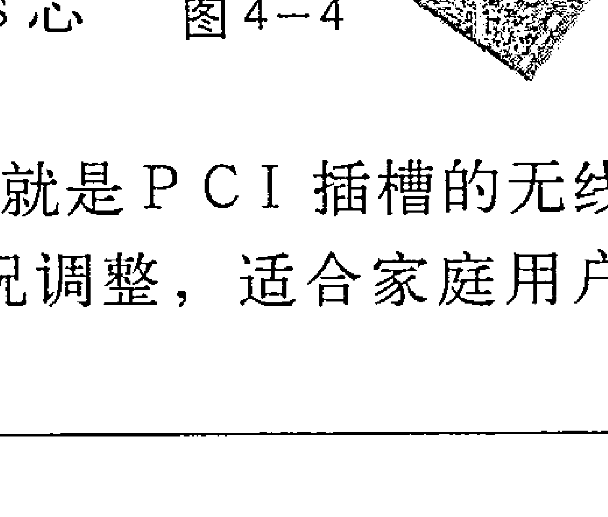

图 4-4

还有一种是 PCI 接口的无线网卡，主要用于台式机，也可以在 Windows 及 Linux 下使用，如图 4-5 所示，为 IPTime 的一款 PCI 普通电脑用无线网卡。

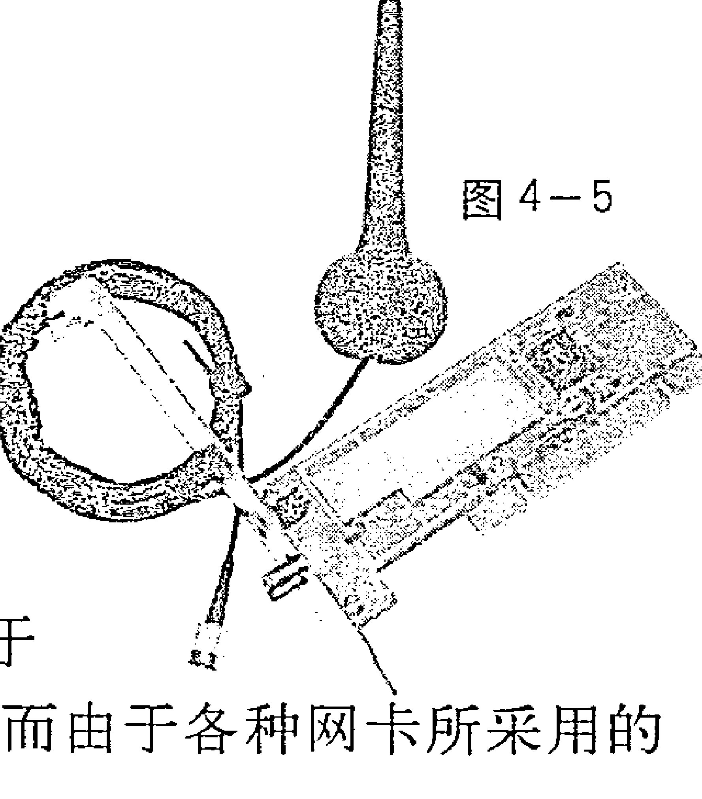

图 4-5

#### 4.1.2 无线网卡的芯片

若是为了普通的办公室及家庭无线上网的目的，就不需要强调什么无线网卡芯片，随意一款无线网卡，性能都差不多。不过，对于无线 Hacking 来说，无线网卡的选择关键就在网卡所使用的芯片，而由于各种网卡所采用的芯片不同，可能会导致无线攻击工具某些功能不能实现。

目前，无线黑客们主要使用的网卡芯片有 Atheros、Ralink、Prism 系列，其他如 Orinoco、Intel 芯片也不错，其中 Ralink 多为 USB 无线网卡所有。下面我就对较为流行的 Atheros、Ralink 及 Prism 芯片做一下简单说明。

##### Atheros 芯片

Atheros 是在我国台湾的企业，但同时也是全球最大的无线网卡芯片供应商，其在无线网卡芯片领域的地位跟 Intel 在中央处理器领域颇为相似。Atheros 从早期的 802.11a 开始，一步步地开发出支持 802.11b/g/n 的网卡，逐渐成为全球最大的无线网卡芯片供应商。

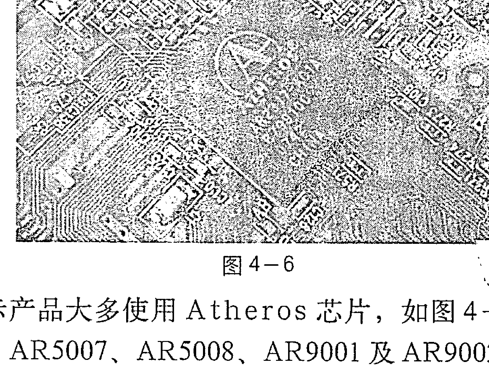

图 4-6

Atheros 芯片对各种无线网络工具的支持性非常高，因此已经成为无线网络安全测试必备的网卡芯片要求之一。单纯就市场而言，目前 TP-LINK 的无线网卡产品大多使用 Atheros 芯片，如图 4-6 所示。细分的话，主要有 AR5002、AR5005、AR5006、AR5007、AR5008、AR9001 及 AR9002 等近十款。

不过 Atheros 涉及的不光是无线网卡，目前在广泛使用的采用 Atheros 芯片的产品还包括无线路由器、无线网桥等各类无线产品设备。关于 Atheros 芯片的更多内容大家可以到其官方网站：http://www.atheros.com/ 进行了解。

##### Ralink 芯片

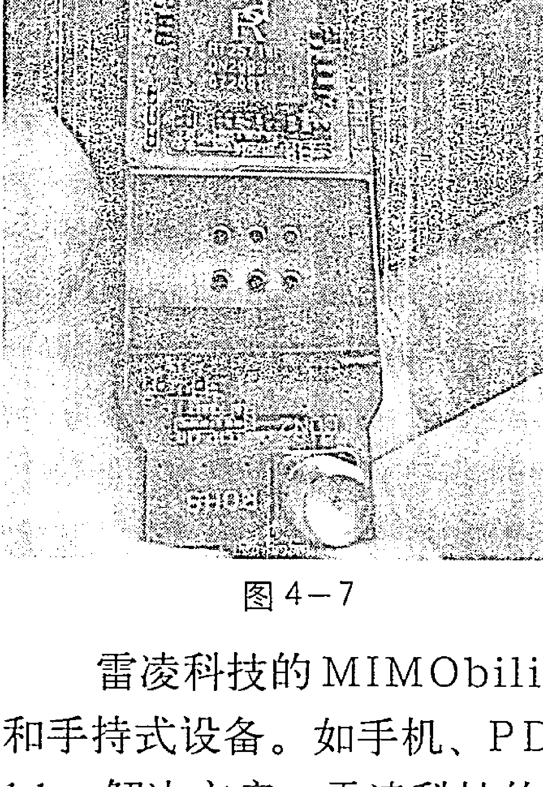

图 4-7

雷凌科技股份有限公司（Ralink Technology Corporation）是无线局域网络芯片组解决方案的领先创新者和开发商。Ralink 802.11x 芯片因 Wi-Fi、移动和嵌入式应用所需的卓越吞吐量、扩展范围、低功耗及一致的可靠性而获得认可。这些功能丰富的芯片组拥有用于客户端的高档芯片集成，以及用于 CB、MiniPCI、PCI、PCIe 和 USB 接口的 AP 解决方案，有助于客户经济有效地制造更小、更复杂的移动无线产品。

如图 4-7 所示，为采用 Ralink 芯片的 USB 无线网卡。

雷凌科技的 MIMObility 专利技术将 Wi-Fi 应用从传统的 PC 网络扩展到各种数字多媒体和手持式设备，如手机、PDA、相机、打印服务器、HDTV 及视频游戏播放器等。通过 802.11n 解决方案，雷凌科技的客户将能够持续提升新一代高性能 Wi-Fi 的速度、带宽及可靠性。

雷凌科技成立于 2001 年，总部位于台湾新竹，并在加州库珀蒂诺设有研发中心。关于 Ralink 芯片的更多内容大家可以到其官方网站 http://www.ralinktech.com/ 进行详细了解。

##### Prism 芯片

由于 Prism 芯片早期技术资料的开放性，使得相当数量的驱动程序及无线工具被相继开发。Prism 系列的芯片包含了最早的 PRISM1、PRISM2、PRISM3（802.11b），以及现在的 PRISM GT（802.11b/g）、PRISM WorldRadio（802.11a/b/g/i/j）。以前有一些比较有名的无线 Hacking 工具都支持 Prism 芯片，但是最近几年采用该芯片的无线网卡正在变少。

> ※小贴士：内置的无线网卡通常采用的芯片品牌有两种，Intel 或 IBM。IBM 用的就是 Atheros 芯片。对于 Intel 芯片，因为其设计上的原因，抓包会有问题，而且不能顺利发攻击包，需要额外安装驱动来改善。

#### 4.1.3 总结整理

现在市面上销售的无线网卡基本上都支持 802.11b/g，这样的配置已成为主流。目前国内支持 802.11n 的产品虽然有很多，但是由于其价格相对稍显昂贵，仍算不上主流，所以无线黑客们多会选择支持性广泛的网卡。

如表 4-1 所示，为在各大电脑城都有销售，并且经我亲自测试后可进行后面无线攻防的 Wireless 网卡列表，其使用效果各有不同，对于下决心进行无线黑客攻防技术学习的新手，可以参考选购。

| 芯片 | 品牌 | 型号 | 接口 | 协议 | 说明 |
|---|---|---|---|---|---|
| Atheros | TP-LINK | TL-WN513G / TL-WN510G | PCMCIA | 802.11b/g | 驱动推荐，在 Windows 及 Linux 下较为稳定 |
| PrismGT | Linksys | WUSB54G | USB | 802.11b/g | 需接长线，笔者最早购买的一款，效果还不错 |
| Broadcom | Linksys | WPC54G | PCMCIA | 802.11b/g | 在 Windows 下工作稳定 |
| Ralink | ASUS | WL-167G | USB | 802.11b/g | 在注入攻击时效率高，个别时段会出现卡死情况 |
| Ralink | IPTime | IP-G2000（韩国型号为 G054U-A） | USB | 802.11b/g | 需接长线，注入攻击时间稍长，但效果不错，很稳定 |
| Ralink | WiFiCity | IU-2850UG（缩水，卡王） | USB | 802.11b/g | 注入攻击时效率一般，但能够较远距离探测 AP 信号，适合探测 |
| Ralink | G-Sky | GS-27USB（缩水，卡皇） | USB | 802.11b/g | 注入攻击时效率一般，但能够较远距离探测 AP 信号，适合探测 |

在过去的两年中，我收到很多无线爱好者、论坛网友以及读者的来信，询问多款市面上流行的无线网卡的使用效果，下面就一个很多人比较关心的问题做出个人角度的回答，以供大家在购买无线网卡时作为参考。

##### 关于大功率无线网卡的疑问

目前市面上有一些打着“蹭网”旗号的无线网卡，其广告上宣传能够进行 3 公里以上的无线信号搜索，并“免费上网”。事实真的是这样么？其实此类网卡物理结构非常简单，所谓“免费上网”就是一款大功率无线网卡加 WEP 密码破解软件，不过是厂商故意宣传的噱头，这些基础的知识我们在后面的章节中就能看到。

此外，普通无线网卡功率在 40mW-100mW，而这类“蹭网”卡功率往往达到 500mW-1000mW，数十倍于常规网卡，配合加强型的天线，所以在信号搜索方面才会有如此强势。不过希望大家明白的是，大功率固然信号强，但对人体肯定是有害的，无线发射器方面国际安全尺度是 100mW，这东西超标了 5-10 倍，所以家里有小孩或者孕妇的朋友，一定要将此网卡放置得远一点。

此外，对于商家宣传的搜索半径 3、6 公里之类的广告，由于无线信号的收发是双向的，学过通信的人都知道，即便你能搜到信号，但由于原 AP 路由器信号发射能力不强，同样用不了。而家用无线路由器的辐射范围也就几十米，换句话说，信号覆盖范围也就是以这几十米为半径，处于该范围内的无线用户才能连接 AP 进行上网。这些高功率的无线网卡虽然能从较远距离搜索到信号，但是根本无法连接，所以这个 3、6 公里很遗憾地最多就是个探测距离而已。而现实中，由于城市间复杂的楼层、道路及信号的干扰，实际探测能力一般最远也……就是300米左右，改配强化天线可以再延长一些。

但是，并不是说这类卡价值就不高。实际上，此类高功率无线网卡在无线黑客中，主要用于进行 War-Driving 无线信号探测及无线热点地图绘制，并在改装天线后可配合同样改装后的小型 AP 进行远距离渗透、无线跳板攻击等。

所以，无线黑客们不会由于一些过度的宣传就放弃此类网卡，相反，还会发掘出更多的潜力和用途。后面在进行到 War-Driving 的章节时，我们还会涉及到此类网卡。

PS：前年我曾受某厂商的朋友委托，参与某高功率无线网卡的早期型号性能及无线 Hacking 测试，并提交内部报告。目前该网卡已成为我随身携带的无线网卡之一，根据不同环境使用不同网卡，这才能发挥其最大的能力。

接下来，我们来看看适合于无线 Hacking 学习的 OS 吧！！

### 4.2 必备操作系统

虽然现在 Linux 的安装已经很方便，但是对于大多数的小黑们来说，还是需要花费一些时间来建立一个适合的 Linux 环境。而作为无线安全所需的工具和环境，尤其是无线网卡驱动等的安装，更是要花费一番功夫。那么，有什么方法能使得我们的工作变得简单一点呢？答案当然毫无悬念地是肯定的，就是特殊的 Live CD 喽。

> **小贴士：** 所谓 Live CD，就是一种可以开机启动的操作系统光盘。这种操作系统无需像传统的 Linux 一样完整地安装，只需要将光盘放置在光驱里，在重新启动时进入到 BIOS 里设置从光驱启动就可以了。这样，在计算机启动后，就会引导到光盘里的操作系统，这个系统是通过装载到内存里实现的，所以无需占据硬盘空间，很方便携带使用。目前全世界有大量的 Live CD 版本的 Linux 系统在被使用着。

对于随时准备进行无线攻击的黑客们来说，携带这样的 Live CD 可以在需要的时候立刻进入到一个包含了无线攻击工具的 Linux 或 FreeBSD 环境，对当前的无线网络环境进行测试。而对于无线安全审计人员及安全顾问来说，这样的 Live CD 为建立评估环境、进行渗透测试等工作节省了大量的时间。嗯，至少这些年来，我就推荐了数款 Live CD 给不同部门的安全人员使用。而且，一些组织及个人都推出了预先安装好相关工具的 Live CD 光盘。这些 Live CD 只需要从网站上下载回 ISO 镜像文件，然后直接刻录到光盘上即可使用。

听起来是不是很方便？那么下面就带大家了解一下无线安全及攻击中常用到的几款 Live CD。首先，介绍一下大名鼎鼎的 BackTrack4 Linux。

### 4.2.1 BackTrack4 Linux

BackTrack，简称为 BT，是由 Remote-exploits.com 出品的黑客攻击专用平台，目前主要以 Live CD 的方式发布。最初的版本叫 Auditor Security Collection，简称为 Auditor，是前些年非常有名的无线安全审计光盘，记得 02 年的时候曾使用 Auditor 学习过很多 Linux 下的黑客工具（因为都是默认安装好的，比较适合我这样的懒人）。

不久之后，Auditor 与同样出名的无线攻击光盘 Whax 进行了合并及修正，新推出的版本就更名为 BackTrack，其先后推出了 BackTrack 1.0、2.0 及 3.0，目前最新的版本是 BackTrack4，简称 BT4。

由于 BT4 内置了约 300 余种安全及黑客类工具，实为居家旅游、谋财害命、穿墙入室……必备利器，所以在国际上被安全界誉为攻击渗透测试平台。当然，工具都是双刃剑，就看是什么人在用。

本书内无线黑客攻击测试内容都将主要以 BackTrack4 Linux 环境为例，在后面的小节里我会专门说明一下该系统的安装及基本使用。

- BackTrack4 Linux 的官方网站：http://www.remote-exploit.org/backtrack.html
- BackTrack4 Linux ISO 的下载地址：http://www.remote-exploit.org/cgi-bin/fileget?version=b4-prefinal-iso

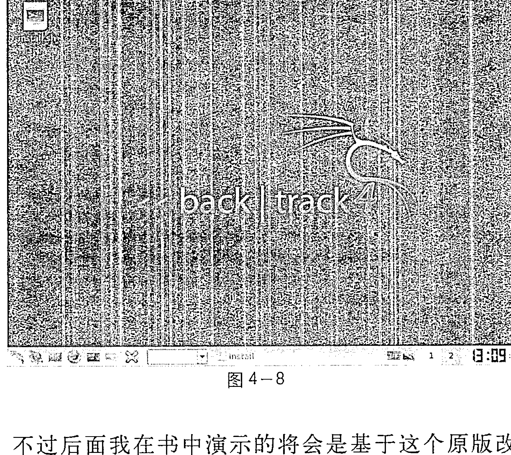

如图 4-8 所示，为 BackTrack4 Linux 的运行桌面。可以看到，桌面很“干净”，不过后面我在书中演示的将会是基于这个原版改进的 BT4 Linux，这个改进的版本是专为本书内容所定制的，加入了一些傻瓜工具，我想大家应该会更喜欢。

在 BackTrack4 Linux 的菜单上，制作者已按照攻击顺序进行了详细的分类，如图 4-9 所示，涵盖了信息窃取、端口扫描、缓冲区溢出、中间人攻击、密码破解、无线攻击、VoIP 攻击等方面，的确为不可多得的精品。

#### 4.2.2 Slitaz Aircrack-ng Live CD

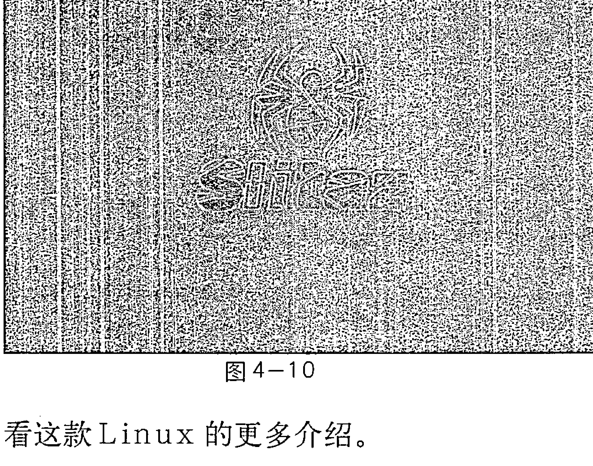

Slitaz Aircrack-ng Live CD 是基于 Slitaz Linux 和最新版的 Aircrack-ng 套装整合而成的，并且内置了大量的无线网卡驱动。这个版本是由 Aircrack-ng 开发团体所发布，总体来说还是比较稳定的。不过有些遗憾的是，这款 Linux 和 BackTrack Linux 相比，差距还是很大的，毕竟单纯只是支持 Aircrack-ng 这一款无线 Hacking 工具，感觉还是势单力薄了些，有兴趣的朋友也可以到 Slitaz 的官网去看这款 Linux 的更多介绍。

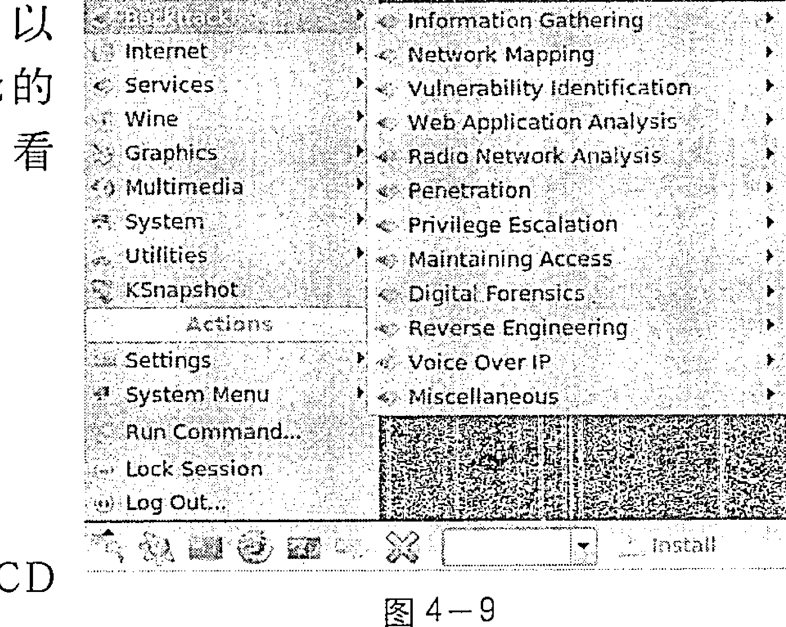

- Aircrack-ng 的 Slitaz Aircrack-ng Live CD 下载地址：http://www.aircrack-ng.org/doku.php?id=slitaz
- Slitaz 的官方网站：http://www.slitaz.org/en/

如图 4-10 所示，为 Slitaz Aircrack-ng Live CD 的桌面，非常简洁，很有些 BSD 的风格。

如图 4-11 所示，可以看到 Slitaz Aircrack-ng Live CD 中包含了 Aircrack-ng 的套装。

如图 4-12 所示，目前提供下载的 Slitaz Linux 中，内置的 Aircrack-ng 版本为 1.0 rc3 r1579。

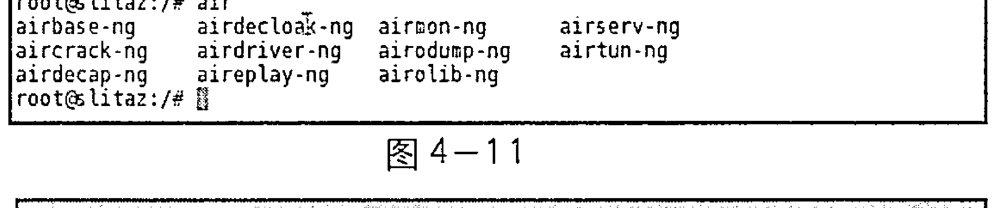

图 4-11

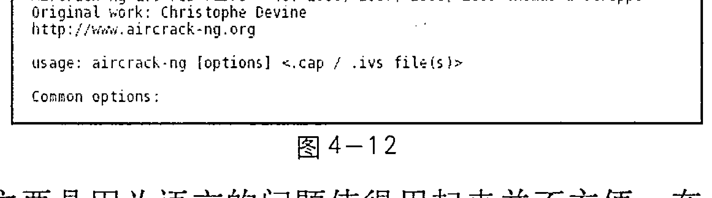

图 4-12

#### 4.2.3 WiFiSlax

这款 Live CD 在国内讨论的并不多，主要是因为语言的问题使得用起来并不方便。在 Slax 基础上定制出来的 WiFiSlax，从名字上就可以看出这是一款专门针对无线网络攻击审计的 Live CD。在其主菜单上，罗列了多款主流的无线攻击及破解工具，除此之外还内置了大量的网卡驱动，实为无线黑客必备的光盘之一。不过要注意的是，由于 WiFiSlax 来自西班牙，所以菜单上会出现一些西班牙语，但由于多数词汇与英语相似，所以还算不难理解。

WiFiSlax 的官方网站：http://www.wifislax.com/

如图 4-13 所示，为 WiFiSlax 的桌面，无线攻击类工具都隐藏在菜单里，而非桌面上。

如图 4-14 所示，在 WiFiSlax 的菜单里，能够找到 Aircrack-ng 套装。

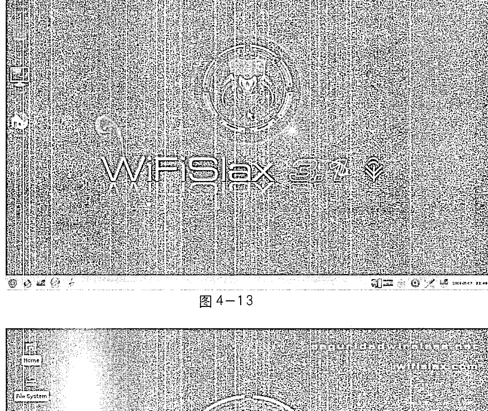

图 4-13

#### 4.2.4 WiFiWay

这个也是在无线黑客中常会提及的 Live Linux，内置全套 Aircrack-ng 攻击包及网卡驱动，虽然系统已经过全面优化，但稍觉可惜的是系统自身并没有内置其它如 Cowpatty、Void11 等深入攻击工具。需要强调的是，虽然和 WiFiSlax 来自同一个制作团体，但是 WiFiWay 就功能上来说不如 WiFiSlax。

如图 4-15 所示，为 WiFiWay 的桌面，是不是和 WiFiSlax 很像？所以我就不详细介绍了。

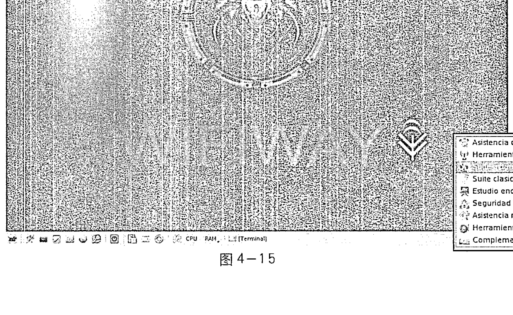

图 4-15

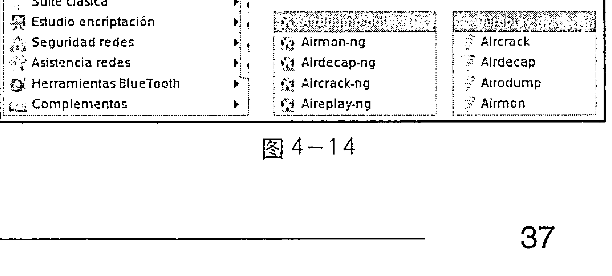

图 4-14

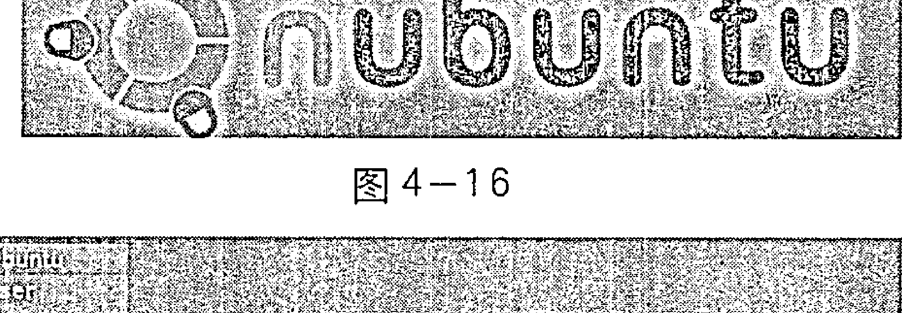

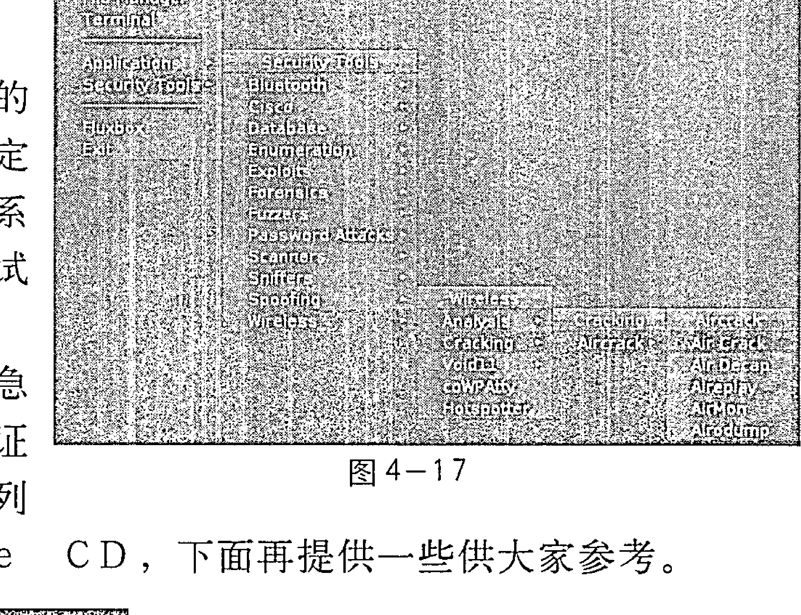

### 4.2.5 其它 Live CD

除了上面提到的 4 款 Live CD，还有非常多的为不同目的而制作的开机启动光盘，其并不一定都是基于 Linux 内核，也有一些是为其它操作系统准备的，比如专为数字取证的、专为渗透测试的，还有为蓝牙及手机安全的等等。

因为喜欢这些 Live CD，加上多年从事应急响应、安全攻防演练、内部安全培训、安全认证培训等，所以收集了很多，不过这里就不一一列举啦。但与无线网络安全及黑客攻击相关的 Live CD，下面再提供一些供大家参考。


- **nUbuntu**

此为 Ubuntu 的延伸版本，专为专业安全人员设计的渗透、评估测试平台，内置了大量的安全工具，包含扫描、嗅探、密码破解、木马、无线攻击等等，其标志如图 4-16 所示。

官方网站：http://www.nubuntu.org/

其菜单中收录了多款无线攻击用的工具，除了 Aircrack-ng，还有用于无线 DOS 攻击的 Void11、扫描用的 Kismet、破解用的 Cowpatty 等工具，如图 4-17 所示。

- **Whax**

和 Auditor、BackTrack 一样鼎鼎有名的攻击及安全审计平台，同样内置了全套的安全工具，一些国外黑客网站内的早期教学视频多是以此 Linux 为蓝本制作出来的。Whax 的桌面如图 4-18 所示，我们可以从上面依稀看到现在 BT4 的身影。什么？看不到？你没看到背景上面的那条龙么？

- **SkyRider**

基于 Auditor Live CD 内容建立，但增加了很多无线攻击的工具，并提供一个自行定义的 Script 来进行攻击测试的操作。


- **PHLAK**

基于 Morphix 建立的 Live CD Linux，主要用于安全评估及审计使用，内置了大量的安全工具，包括 nmap、nessus、snort、the coroner's toolkit、ethereal（现在被称为 Wireshark）、hping2、proxychains、lcxroex、ettercap、kismet、hunt 及 brutus 等，其光盘封面如图 4-19 所示。

- **Mpentoo**

个人很喜欢的一款早期 Live CD Linux，主要是因为内置了全套的欺骗类工具，比如 dsniff 套装。04 年在任西北地区 CIW 安全主讲的时候，在讲深入环境攻击技术时就派上了很大的用场。这里把它放出来，顺便纪念一下曾经 3 年的 CIW 安全主讲生涯，虽然现在这个原本不错的国际认证在国内已经被一些所谓的培训机构做烂了，但至少我讲那阵觉得还是蛮有意思的，现在偶尔还会给一些企业上上。


图 4-20

其无线攻防工作界面如图 4-20 所示，我们可以看到 Aircrack-ng 套装以及用于扫描的 Airsnort、Kismet 等。

看了这么多，是不是有些眼花缭乱呢？正如上面我所说到的，除了这些，还有非常多的为不同目的制作的 Live CD。但是本书是为无线安全所写，所以后面的内容也将集中在其中一款目前最主流的无线安全 Live CD 系统上，那就是 BackTrack4 Linux。

### 4.3 VMware 虚拟机下无线攻防测试环境搭建

VMware，也就是常说的“虚拟机软件”，可以进行硬件设备的模拟及安装虚拟操作系统。黑客和安全顾问们一般都使用 VMware 来搭建测试平台，VMware 分很多个版本，作为不同环境及人士的需求，在单机环境下常用的是 VMware Workstation 工作站版。该工具可运行在 Windows 或者 Linux 环境下，对于一些不想安装双系统的用户来说，使用 VMware 来建立虚拟系统可以有效地避免多操作系统共存带来的安全隐患。不过要强调的是，在 VMware 加载 USB 无线网卡驱动是比较方便的，而对于笔记本所用的 PCMCIA 卡，就需要费些周折。

#### 4.3.1 建立全新的无线攻防测试用虚拟机

可能有的小黑们又要说出什么这个 VMware 我不熟、Linux 不懂、双系统好麻烦之类的话语，别担心，下面我们就来看看在 VMware Workstation 里如何建立无线攻防测试用虚拟机，我们就以 BackTrack4 Linux 为例吧。

不过为了便于大家以后的学习，下面我将以英文版本的 VMware Workstation 来讲解。哈，不用担心，我会加上注释的，何况多看英文会对自己技术的提高很有帮助哦，看啊看的就习惯了。

- **步骤 1：** 打开虚拟机软件。


图 4-21

关于在 Windows 中如何安装 VMware，这个几乎没有什么技术含量，只要一直选择“下一步”进行安装就可以了。安装完毕后，在 Windows 下，从“开始”菜单的“程序”里打开“VMware Workstation”，初始界面如图 4-21 所示，很简单。


图 4-22


图 4-23

- **步骤 2：** 开始创建虚拟机。

在 VMware Workstation 程序主界面左上角点选“File”菜单中的“New”，即新建。再选择其右拉菜单里的“Virtual Machine”，即虚拟机。本步的意思是建立一个新的虚拟机，如图 4-22 所示。


图 4-24

之后会弹出如图 4-23 所示的窗口，此为安装向导。选择默认的“Typical”，即典型。然后点击下方的“Next”按钮。

接着会看到如图 4-24 所示的界面，在“Installer disc image file (iso)”栏处设置好安装所需的 ISO 镜像文件，这里当然就是本书附赠的 BackTrack4 Linux 镜像文件喽。设置完毕后点击“Next”继续。


图 4-25

接着会看到如图 4-25 所示的窗口，这里是选择要安装的系统类型。由于 BackTrack4 Linux 是基于 Ubuntu 开发的，所以这里我们就选择为“Linux”，然后在下拉菜单里选择“Ubuntu”，点击“Next”继续。

接下来会要求我们设置该虚拟机的名称及保存路径，这里根据自己的需要来设定就可以了。设置完毕后，点击“Next”继续，如图 4-26 所示。

此时弹出的窗口是要求我们对虚拟机的硬盘大小进行限定，如图 4-27 所示，同样地，根据个人情况来设置，这里我就设置为 30GB。

不用担心，这个设置值并不会影响到当前的磁盘空间，并不是说你这里一设置，磁盘上就没有空间了，这个值只代表虚拟磁盘最高能占据实际物理磁盘的大小。设置好后点击“Next”继续。

接下来的窗口会显示已经配置的全部内容，如图 4-28 所示，这里是希望用户对已经设置的内容进行确认，无误的话就点击“Next”继续。若需要修改的话，点击本页左下方的“Customized Hardware”，即“自定义硬件”设置即可。

比如说我们需要修改网卡的连接模式，那点击“Customized Hardware”按钮后，就能看到如图 4-29 所示的内容，我们在右侧的网络连接方式中选择“Host-only”，即仅主机模式，然后点击“OK”即可。

如图 4-30 所示，我们可以看到在定义过后，“Network Adapter”后面就变成了 Host-only 模式。

好了，若不需要修改什么，那就点击图 4-30 所示的“Finish”按钮即可。这样，我们的虚拟机就搭建完成了。如图 4-31 所示，此时只要点击左上角的绿色箭头即可开启该虚拟机。


图 4-26


图 4-27


图 4-30


图 4-28


图 4-29

#### 4.3.2 对无线攻防测试用虚拟机进行基本配置

既然虚拟机已经建立好了，我们就继续打开来学习一下 BackTrack4 Linux 的基本配置。


在图 4-31 所示的界面上点击绿色的箭头，这表示启动的意思。点击之后，虚拟机就开始启动了，如图 4-32 所示，出现了一些开机选项，这里面有安全模式、文本模式、取证模式等等，不过大部分都和我们平常的使用没有关系，所以这里我们选择默认的第一项，直接回车。

图 4-31


图 4-32

稍等几分钟后就能看见已经进入到该系统，不过是个 Shell 界面，如图 4-33 所示。若希望看到图形界面，在当前目录下可以直接输入命令 `startx` 来进入图形界面。输入命令回车后，如图 4-34 所示，我们看到了 BackTrack4 Linux 的工作界面，这里面很多工具都已经安装好了，直接调用即可。

由于 BackTrack4 最初设计是为了进行安全审计及攻击测试使用，所以内置的黑客类工具超过了 300 种。至于大家现在桌面上看到的这些图标，在原版的 BackTrack4 Linux 上是看不到的，因为这是“黑手专版”！已经经过了定制，加入……


图 4-33

## 4.3.3 了解你的无线攻防测试环境BT4

下面，我们接着看看在使用 BackTrack4（简称 BT4）时新手常常会遇到的几个问题。

**问题1：无线黑客类工具都有哪些，我在哪里查看？**

在 BackTrack4 Linux 图形桌面环境下，如图4-35所示，打开左侧菜单，依次选择 **`BackTrack` → `Radio Network Analysis` → `80211` → `All`**，就可以看到全部的无线黑客类工具。这里的一些主流工具我们在后面的章节中都将会学习到。


图4-34


图4-35

**问题2：我找不到自己的网卡，我该如何配置自己的网卡？**

我们直接使用 `ifconfig` 命令查看，如图4-36所示，会发现当前并没有任何可用的网卡，这是怎么回事呢？这是由于 BT4 在默认情况下，`eth0` 并没有被激活。我们可以使用 `ifconfig -a` 来查看没有被载入的网卡。如图4-37所示，可以看到 `eth0` 确实存在，也就是说已经识别出接口了，只是没有载入（激活）而已。

我们可以使用 `ifconfig` 来将 `eth0` 激活，具体命令为：`ifconfig eth0 up`。输入完毕后，我们可以再次输入 `ifconfig` 查看，此时如图4-38所示，显示已经能够找到 `eth0` 了。

对于存在 DHCP 的网络，我们可以使用如下命令来使得网卡能够自动获取地址。

`dhclient eth0`

如图4-39所示，可以看到 `eth0` 网卡成功地获取到了地址 `192.168.110.142`。这样，我们就可以使用该地址做后续的事宜了，比如搭建 SSH 服务器等。


图4-37


图4-36


图4-38


图4-39

好了，既然 VMware 下的无线攻防环境搭建好了，下面我们就接着看看 USB 移动攻防环境的搭建吧。

## 4.4 打造U盘飘移无线攻防环境

由于无线网卡自身芯片的原因，在大家经常使用的 Windows XP/2000/2003 下，一些无线探测、攻击类工具无法“认出”大部分无线网卡自带的驱动程序。对于某些型号的无线网卡，甚至在 Windows 下的无线攻击程序里是无法直接使用的，个别需要额外地通过升级的方式将原有驱动替换才能够识别。

记得 2000 年初刚开始玩 Linux 的时候，为了在自己的第一台电脑（赛扬533CPU+128MB内存）中安装 Windows 2000 和 RedHat Linux 时，费了很大功夫。那么我想对于绝大部分小黑们来说，尽管现在的 Linux 安装已经极为简单，但是安装 Linux 也会是一件比较头疼的事情，尤其是一些并不喜欢安装 Windows 和 Linux 双系统的朋友。

而对于前面我们刚刚学习到的 VMware 虚拟机而言，虽然可以轻松地使用 USB 接口的无线网卡，但是也很可惜地失去了使用笔记本自带无线网卡、PCMCIA 型无线网卡以及台式机下 PCI 无线网卡的机会，这对很多小黑们来说会是件比较郁闷的事情。

那么，除了使用 VMware 虚拟机及安装双系统外，还有什么好办法使得我们也能够轻松地在 Linux 下进行无线 Hacking 呢？答案当然是有的，说出来很简单，我们只需要打造一款能够开机启动运行的 U 盘启动型 BackTrack4 Linux 不就行了么！如图4-40所示的超薄型 U 盘，不但方便携带而且便于隐藏，是居家旅游首选的类型。


图4-40

### Part0：幼稚园篇


如图4-41所示先进行格式化。然后，我们再来看看如何打造 U 盘版的无线攻防环境。

#### 方法1：最简单的方法

其实制作 USB 启动盘并没有很多人想象中的那么难，最简单的方法就是将事先下载好的 BackTrack4 Linux ISO 镜像文件内的所有内容，全部直接释放到 U 盘里。然后使用 syslinux 来建立一下引导文件即可，具体步骤如下：

- 1. 下载一个 syslinux 和 BackTrack4 Linux 镜像文件。

##### syslinux

下载地址：http://www.cn.kernel.org/pub/linux/boot/syslinux

- 2. 把下载的 BackTrack4 Linux 镜像文件解压到 U 盘下。使用 WinRAR 或者 WinISO 打开镜像文件，选择解压缩或者释放到指定目录，设置为 U 盘即可（英文界面选择“Extract”）。

> 小贴士：BT4 目前的 ISO 原镜像有 1.29GB 大，而本书配套的黑手定制版 BT4 则有 1.32GB 左右，所以在准备 U 盘的时候应至少购置一个 2G 大小的才行。

- 3. 运行 cmd，进入到 syslinux 的 win32 子目录下，使用命令：`syslinux g:`，其中 `g:` 是所用 U 盘。随后在 BIOS 中设置为 U 盘引导，重启后即可看到 BackTrack4 界面。


#### 方法2：使用傻瓜式的 UNetbootin

除了上述方法之外，也可以使用一些专门制作 U 盘启动 Live CD 的工具实现，网上关于此类工具有很多，经过反复比较，这里我推荐一款名为 UNetbootin 的软件，在 Windows 下使用起来非常方便，该软件介绍如下。

##### UNetbootin

- 官方网站：http://unetbootin.sourceforge.net/
- 支持系统：Microsoft Windows 2000/XP/Vista，Linux
- 软件简介：UNetbootin 允许使用者在 Linux 或者 Windows 下轻松地创建可启动的 Live USB 驱动盘，而无需烧录一张 CD。

在图4-44中可以看到 UNetbootin 的下拉菜单中支持的 Linux 非常丰富，不但包括较为常见的 Ubuntu、FreeBSD、Linux，还包括很多并不出名的操作系统，其界面也很简单，非常容易上手。

对于想要使用 UNetbootin 制作其它类型 Live CD 的朋友，我给出了支持的 Linux 详细列表，以供参考。

| 操作系统类型 | 支持版本 |
|---|---|
| Ubuntu | 6.06 LTS，6.10，7.04，7.10，8.04 LTS，8.10 |
| Debian | Stable/Etch，Testing/Lenny，Unstable/Sid |
| openSUSE | 10.2，10.3，11.0，11.1，Factory |
| Arch Linux | 2007.08 |
| Damn Small Linux | 4.4 |
| Puppy Linux | 4.00 |
| FreeBSD | 6.3，7.0 |
| NetBSD | 4.0 |
| Fedora | 7，8，9，10，Rawhide |
| PCLinuxOS | 2007，2008 |
| Gentoo | 2007.0，2008.0 |
| Slax | 6 |
| Dreamlinux | 3.2 |
| CentOS | 4，5 |
| Mandriva | 2007.1，2008.0，2008.1 |


##### 安装 UNetbootin

Windows 下的安装很简单，将文件从官方网站下载到本地后，只需要直接双击“下一步”即可。注意，截至 2009 年 8 月，最新的 Windows 版本号为 357。而在安装 Linux 下的版本时，请大家注意先使用下述命令来给该安装文件赋予权限，具体命令如下：

```bash
chmod +x ./unetbootin-linux
```

##### 使用 UNetbootin

下面我就以 BackTrack4 Linux 为例，带领大家开始制作属于自己的 USB 启动盘，也就是搭建一个便携式的无线攻防环境。注意，和之前一样，先插入 U 盘，对 U 盘进行格式化。

- 1. **步骤1：导入 BT4 的 ISO 文件镜像。**  
  打开 UNetbootin，在“磁盘镜像”位置处选择要制作的 Live CD 镜像文件，这里就选择本地保存的 BackTrack4 Linux 镜像文件，如图4-45所示。


> **小贴士：**在 UNetbootin 主界面设置好镜像文件后，查看一下当前界面下方“USB 驱动器”对应的驱动器名称是否正确，我这里显示的是“G:”。大家在制作的时候一定要确保此处就是我们刚刚插入的 U 盘。以往有人出现过由于使用的 USB 设备较多，结果选错驱动器的情况，所以一定要注意下。

- 2. **步骤2：开始制作启动型 U 盘。**  
  在图4-45中点击确定后，UNetbootin 会自动从镜像文件中抽取文件并写入到 U 盘里，并在将文件复制完毕后，自动安装 BootLoader。


步骤3：制作完成，提示我们重新启动计算机。如图4-47所示，这个地方就不需要重启了，选择“退出”即可。好了，现在我们的 U 盘就已经被打造成可以开机直接启动引导的 BackTrack4 Linux 了。


图4-47

步骤4：配置计算机开机从 USB 设备启动。在重启后进入计算机 BIOS 设置界面，在启动项选择从 USB 设备启动。这个道理就好似我们以往用光盘装系统，必须调整启动项为光驱启动，而现在我们要用 U 盘装系统，所以要调整为 U 盘启动。

我这里以常见的 BIOS 为例，如图4-48所示，在“First Boot Device”（第一启动设备）处，我选择 USB-HDD，即 U 盘启动方式。


图4-48


图4-49

> 小贴士：由于主板厂商的不同，所以导致很多朋友看到的 BIOS 主界面也有所不同。不过没关系，都是大同小异，大致来说，只要在 Boot 项里将位置 First Boot（第一启动项）设为 USB 设备启动即可。

如图4-49所示，为 ThinkPad 笔记本的 BIOS 中启动选择菜单界面，图4-50为 HP（惠普）笔记本的 BIOS 中启动修改界面，大家可以参考一下。


图4-50

步骤5：进入 U 盘版 BT4 操作系统，开始无线攻击。

只要保证以下几点的正确，那么我们就能看到如图4-51所示的 BT4 正常启动界面啦。换句话说，属于自己的无线攻防环境已经轻松搭建好啦，是不是很方便呢？

- 启动 U 盘制作过程没有出错；
- BT4 系统镜像文件本身没有读取错误；
- UNetbootin 的版本是最新版，下载版本完整没有错误。


图4-51

### Part02：幼稚园篇

既然已经可以使用，那么将做好的 U 盘放到钱包里随身携带，随用随插，再也不用为安装 Linux 所担心。还犹豫什么，快去试一试吧！！

呃……若想使自己的 U 盘 BT4 更具迷惑性的话，也可以使用如图4-52、4-53所示的几种类型 U 盘来让对方出乎意料哦！呵呵。


图4-52


图4-53

## Part1：小学篇


## 卷5 搞定WEP加密

### 5.1 破解须知

在一切的一切开始之前，请确保已经做好了下述准备：

- **良好的精神状态**
- **充足的装备支持**
- **勤勉的学习态度**

学习无线破解技术和学习其它的黑客技术一样，要发挥大无畏的精神，不要被一开始的失败所阻挠，要发扬屡败屡战、死缠烂打的优良品质，坚持到最终学会为止。

虽然一会儿我们还要强调“工欲善其事，必先利其器”的概念，但是作为一名向着无线安全事业努力前进的小黑，基本的破解所需装备是一定要保证的，至少要保证一台笔记本电脑、1个 USB 无线网卡及 1 个无线 AP。

对于经济上暂时有困难的朋友，可以发挥向朋友伸出友情之手、借装备学习的优良理念，并在精神上像当年一穷二白，但一样干得有声有色的革命前辈们看齐。

对于一些不明白的问题，大家可以先 Google 一下，或者在 www.anywlan.com/bbs 上的无线安全新手板块上查询基础知识（嘿嘿，我是那里的无线安全总版主），不要急着发帖询问，往往很多内容都是有人回答过的。多搜索、多总结、多试验，必有所得。若是对新的无线 hacking 感兴趣，也可以到我的 blog 看看：http://bigpack.blogbus.com。

以上为第一个破解须知。

### 5.2 WEP破解利器——Aircrack-ng

“工欲善其事，必先利其器”，在开始我们的无线 hack 之前，小黑们还需要先将工具熟悉熟悉，首先就是无线黑客中的名门利器——Aircrack-ng。

### 5.2.1 什么是Aircrack-ng

Aircrack-ng 是一款用于破解无线 802.11 WEP 及 WPA-PSK 加密的工具，其标志如图5-1所示。该工具在 2005 年 11 月之前名字是 Aircrack，在其 2.41 版本之后才改名为 Aircrack-ng。由于其高效的攻击能力，本书在后面的破解章节中将以其作为重点进行介绍及学习。

Aircrack-ng 主要使用了两种攻击方式进行 WEP 破解：一种是 FMS 攻击，该攻击方式是以发现该 WEP 漏洞的研究人员名字（Scott Fluhrer、Itsik Mantin 及 Adi Shamir）所命名；另一种是 KoreK 攻击，经统计，该攻击方式的攻击效率要远高于 FMS 攻击。


图5-1

新的版本又集成了更多种类型的攻击方式。

对于无线黑客而言，Aircrack-ng 是一款必不可缺的无线攻击工具，可以说很大一部分无线攻击都依赖于它来完成；而对于无线安全人员而言，Aircrack-ng 也是一款必备的无线安全检测工具，它可以帮助管理员进行无线网络密码的脆弱性检查及了解无线网络信号的分布情况，非常适合对企业进行无线安全审计时使用。

表5-1：Aircrack-ng 组件及用途（含 aircrack-ng、airmon-ng、airodump-ng、aireplay-ng、airserv-ng、airolib-ng、airdecap-ng、tools 等）。

Aircrack-ng（注意大小写）是一个包含了多款工具的无线攻击审计套装，这里面的很多工具在后面的内容中都会用到，大家可以参考表5-1，为 Aircrack-ng 包含的组件具体列表。

表5-2：常见网卡芯片兼容性列表（Atheros、Broadcom、Prism2/3、PrismGT、Ralink、Centrino 等）。

#### 5.2.2 轻松安装 Aircrack-ng

Aircrack-ng 可工作在不同类型的平台上，如 Windows、Linux、FreeBSD，甚至 Sharp Zaurus 手持设备。为了方便更有效地使用 Aircrack-ng，在 Aircrack-ng 的官方网站上提供了常见网卡芯片兼容性列表，大家可以参考表5-2，为部分常见网卡芯片兼容性列表。

至于 Aircrack-ng 针对不同系统的不同安装版本，大家可以在 Aircrack-ng 的官方网站的下载页面查找。

```text
Aircrack-ng 官网下载页面：
http://www.aircrack-ng.org/downloads.html
```

如图5-2所示，目前的最新版本为 Aircrack-ng 1.0 Final 版，主要提供有 Windows 及 Linux 两个版本。


##### 在 Windows 下安装 Aircrack-ng

在 Windows 下安装 Aircrack-ng 是很简单的，从官方网站下载 Win32 版的压缩包到本地，直接解压缩到某个文件夹即可。解压缩就不需要我演示了吧？哈，为方便小黑们下载，我把地址给出。

```text
Aircrack-ng 1.0 for Windows 版本下载地址：
http://download.aircrack-ng.org/aircrack-ng-1.0-win.zip
```

不过，在使用之前需要将现有无线网卡驱动程序替换成 WildPackets 专用网卡驱动程序。关于支持网卡及对应驱动程序信息，可到 http://www.wildpackets.com/support/downloads/drivers 查看。

在 Windows 下运行 aircrack-ng，显示如图 5-3 所示。

##### 在 Linux 下安装 Aircrack-ng

在 Linux 下的安装方法也非常简单，只需要从官方网站将源文件下载到本地，按顺序运行以下命令即可。需要注意的是，安装时需要 root 权限，也可以考虑通过使用 su 或者 sudo 命令来切换。不过使用 BackTrack4 Linux 的朋友就不用再麻烦地去下载了，在这款无线黑客常用的 OS 里已经内置了 Aircrack-ng 套装。

> Aircrack-ng 1.0 for Linux 版本下载地址：http://download.aircrack-ng.org/aircrack-ng-1.0.tar.gz


图5-3

注意，BackTrack4 Linux 默认已经安装了 Aircrack-ng 1.0 rc3 r1552 版本，如图 5-4 所示。目前最新的版本为 2009 年 9 月 8 日推出的 Aircrack-ng 1.0 final 版，大家可以到上述官网查找或者直接按照上面我给出的地址下载回本地。


图5-4

从官网下载的最新版 aircrack-ng 源文件应该是 aircrack-ng-1.0.tar.gz，具体安装命令如下：

```bash
wget http://download.aircrack-ng.org/aircrack-ng-1.0.tar.gz
tar zxvf <name of source file>
cd aircrack-ng-XXX
make
make install
```

很多朋友应该都还没有在 Linux 下装过 aircrack-ng，没关系，让我们来按照上面的顺序，一步一步地过一遍。

- 步骤1：先下载 aircrack-ng-1.0.tar.gz 文件，可以使用上面我给出的 Linux 版本地址直接下载，也可以使用上述的 wget 命令在 Linux 下直接下载，很简单。然后再对下载回来的 aircrack-ng-1.0 文件解压缩，命令如下：

```bash
tar zxvf aircrack-ng-1.0.tar.gz
```


图5-5

回车后可以看到如图 5-5 所示，Linux 系统会自动创建一个名为 aircrack-ng-1.0 的目录，并将全部安装文件解压缩到该目录下。

- 步骤2：进入 aircrack-ng-1.0 目录，然后对程序源文件进行编译，相关命令如下：

```bash
cd aircrack-ng-1.0
make
```


图5-6

如图 5-6 所示，可以看到大量的 .c 文件被编译。

- 步骤3：为方便后期的使用，将程序写入到特定目录，输入命令如下：

```bash
make install
```

回车后，就能看到如图 5-7 所示的显示。


图5-7

等待上述安装完成，我们随意打开一个 Shell，再输入 aircrack-ng，就可以看到此时的 aircrack-ng 已经成为最新的 1.0 final 版本啦。如图 5-8 所示，对比图 5-7，可以看到原来在“Aircrack-ng”后面跟着的那个“rc3 r1552”版本提示已经没有了。


图5-8

好了，现在就可以准备开始破解 WEP 啦。

### 5.3 BT4 下破解 WEP 加密

好了，既然 WEP 加密听起来这么简单，那么就让我们开始无线破解的实战吧！首先看看我们进行攻击测试的实验环境：

> 无线路由器：TP-LINK 无线路由器  
> 无线客户端：Windows XP SP3，内置 Intel 无线网卡  
> 无线黑客：BackTrack4 Linux，外置 IPTime USB 无线网卡

将无线客户端确认及配置无误后，连接上已经配置为 WEP 加密的 TP-LINK 无线路由器，开始正常的网页浏览、聊天或者在线影院之类的访问内容，然后我们就开始在扮演无线黑客的笔记本上进行操作啦！！

#### 5.3.1 破解 WEP 加密实战

为方便小黑们的条理化学习，下面我还是以 BackTrack4 Linux 为例，具体步骤列举如下。

##### 步骤1：载入无线网卡

其实很多新人们老是在开始载入网卡的时候出现一些疑惑，所以我们就把这个基本的操作仔细看看。首先查看当前已经载入的网卡有哪些，输入命令如下：

```bash
ifconfig
```

回车后可以看到如图 5-9 所示的内容，我们可以看到这里面除了 eth0 之外，并没有无线网卡。

确保已经正确插入 USB 或者 PCMCIA 型无线网卡，此时为了查看无线网卡是否已经正确连接至系统，应输入：

```bash
ifconfig -a
```

参数解释：

- `-a`：显示主机所有网络接口的情况。和单纯的 ifconfig 命令不同，加上 `-a` 参数后可以看到所有连接至当前系统网络接口的适配器。


如图 5-10 所示，我们可以和图 5-9 对比，出现了名为 wlan0 的无线网卡，这说明无线网卡已经被 BackTrack4 Linux 识别。

既然已经识别出来了，那么接下来就可以激活无线网卡了。说明一下，无论是有线还是无线网络适配器，都需要激活，否则是无法使用的。这步就相当于 Windows 下将“本地连接”启用一样，不启用的连接是无法使用的。

在图 5-10 中可以看到，出现了名为 wlan0 的无线网卡，我们接着输入如下命令：

```bash
ifconfig wlan0 up
```

参数解释：

- `up`：用于加载网卡，这里我们将已经插入到笔记本的无线网卡载入驱动。

在载入完毕后，我们可以再次使用 ifconfig 进行确认。如图 5-11 所示，此时系统已经正确识别出无线网卡了。

当然，通过输入 iwconfig 查看也是可以的，这个命令专用于查看无线网卡，不像 ifconfig 那样查看所有适配器，如图 5-12 所示。


##### 步骤2：激活无线网卡至 monitor（监听模式）

对于很多小黑来说，应该都用过各式各样的嗅探工具来抓取密码之类的数据报文。那么大家也都知道，用于嗅探的网卡是一定要处于 monitor 监听模式的，对于无线网络的嗅探也是一样。

在 Linux 下，我们使用 Aircrack-ng 套装里的 airmon-ng 工具来实现，具体命令如下：

```bash
airmon-ng start wlan0
```

参数解释：

- `start` 后跟无线网卡设备名称，此处参考前面 ifconfig 显示的无线网卡名称。

如图 5-13 所示，我们可以看到无线网卡的芯片及驱动类型，在 Chipset 芯片类型上标明是 Ralink 2573 芯片，默认驱动为 rt73usb，显示为“monitor mode enabled on mon0”，即已启动监听模式，监听模式下适配器名称变更为 mon0。


##### 步骤3：探测无线网络，抓取无线数据包

在激活无线网卡后，我们就可以开启无线数据包抓包工具了，这里我们使用 Aircrack-ng 套装里的 airodump-ng 工具来实现。不过在正式抓包之前，一般都是先进行探测，用来获取当前无线网络概况，包括 AP 的 SSID、MAC 地址、工作频道、无线客户端 MAC 及数量等。我们只需打开一个 Shell，输入命令如下：

```bash
airodump-ng mon0
```

参数解释：

- `mon0` 为之前已经载入并激活监听模式的无线网卡，如图 5-14 所示。


回车后，就能看到类似于如图 5-15 所示的结果，这里我们就直接锁定目标是 SSID 为“TP-LINK”的 AP，其 BSSID（MAC）为“00:19:E0:EB:33:66”，工作频道为 6，已连接的无线客户端 MAC 为“00:1F:38:C9:71:71”。既然我们看到了本次测试要攻击的目标，就是那个 SSID 名为 TP-LINK 的无线路由器，接下来输入命令如下：

```bash
airodump-ng --ivs -w longas -c 6 wlan0
```

参数解释：

- `--ivs`：这里的设置是通过过滤，不再将所有无线数据保存，而只是保存可用于破解的 IVS 数据报文；这样可以有效地缩减保存的数据包大小；
- `-c`：这里我们设置目标 AP 的工作频道，通过刚才的观察，我们要进行攻击测试的无线路由器工作频道为 6；
- `-w`：后跟要保存的文件名，这里 `w` 就是“write（写）”的意思，所以输入自己希望保存的文件名，如图 5-16 所示，我这里就写为 `longas`。


虽然设置保存的文件名是 longas，但是生成的文件却不是 longas.ivs，而是 longas-01.ivs。

> **小贴士：**这是因为 airodump-ng 这款工具为了方便后面破解时候的调用，所以对保存文件按顺序编号，于是就多了 `-01` 这样的序号。以此类推，在进行第二次攻击时，若使用同样文件名 longas 保存的话，就会生成名为 longas-02.ivs 的文件。一定要注意哦！别到时候找不到又要怪我没写清楚 :)

估计有的朋友们看到这里又会问：在破解的时候可不可以将这些捕获的数据包一起使用呢？当然可以，届时只要在载入文件时使用 `longas*.cap` 即可，这里的星号指代所有前缀一致的文件。以上命令输入后按回车，就可以看到如图 5-17 所示的界面，这表示着无线数据包抓取的开始。


图5-16


图5-17

##### 步骤4：对目标 AP 使用 ARP Request 注入攻击

若连接着该无线路由器/AP 的无线客户端正在进行大流量的交互，比如使用迅雷、电驴进行大文件下载等，则可以依靠单纯的抓包就可以破解出 WEP 密码。但是无线黑客们觉得这样的等待有时候过于漫长，于是就采用了一种称之为“ARP Request”的方式来读取 ARP 请求报文，并伪造报文再次重发出去，以便刺激 AP 产生更多的数据包，从而加快破解过程，这种方法就称之为 ARP Request 注入攻击。

具体输入的命令如下：

```bash
aireplay-ng -3 -b AP的mac -h 客户端的mac mon0
```

参数解释：

- `-3`：指采用 ARP Request 注入攻击模式；
- `-b`：后跟 AP 的 MAC 地址，这里就是前面我们探测到的 SSID 为 TP-LINK 的 AP 的 MAC；
- `-h`：后跟客户端的 MAC 地址，也就是我们前面探测到的有效无线客户端的 MAC；
- 最后跟上无线网卡的名称，这里就是 `mon0` 啦。

输入以上命令后回车，将会看到如图 5-18 所示的内容，正在读取无线数据报文。


图5-18


图5-19

在等待片刻之后，一旦成功截获到 ARP 请求报文，我们将会看到如图 5-19 所示的大量 ARP 报文快速交互的情况出现。

此时回到 airodump-ng 的界面查看，在图 5-20 中我们可以看到，名为 TP-LINK 的 packets 栏的数字在飞速递增。

##### 步骤5：打开 aircrack-ng，开始破解 WEP

在抓取的无线数据报文达到了一定数量后，一般都是指 IVs 值达到 2 万以上时，就可以开始破解，若不能成功就等待数据报文的继续抓取，然后多试几次。

**注意，此处不需要将正在进行中的注入攻击的 Shell 关闭，而是另外开一个 Shell 进行同步破解。**我们输入命令如下：

```bash
aircrack-ng 捕获的ivs文件
```

关于 IVs 的值数量，我们可以从如图 5-21 所示的界面中看到，当前接收到的 IVs 已经达到了 1 万 5 千以上，aircrack-ng 已经尝试了 41 万个组合。

那么经过很短时间的破解后，就可以看到如图 5-22 中出现“KEY FOUND”的提示，紧跟在后面的是 16 进制形式字符，再后面的 ASCII 部分就是密码啦，此时便可以使用该密码来连接目标 AP 了。

一般来说，破解 64 位的 WEP 至少需要 1 万 IVs 以上，但若是要确保破解的成功率，应捕获尽可能多的 IVs 数据。比如图 5-24 所示的高强度复杂密码，破解成功依赖于 8 万多捕获的 IVs。

> 小贴士：由于是对指定无线频道的数据包捕获，所以有的时候大家会遇到如图 5-23 中的情景，在破解的时候出现了多达 4 个 AP 的数据报文，这是由于这些 AP 都工作在一个频道所致，很常见的。此时，选择我们的目标，即标号为 1 的、SSID 为 dlink 的那个数据包即可。输入 1，回车后即可开始破解。


看到这里可能有的朋友会说，这些都是弱密码（就是过于简单的密码），所以才这么容易破解，大不了我用更复杂点的密码总可以了吧？比如 x#87G 之类的。即使是采用更为复杂的密码，这样真的就安全吗？嘿嘿，那就看看如图 5-24 中显示的密码吧：

正如你所看到的，在图 5-24 中破解出来的密码已经是足够复杂的密码了吧？我们放大看一看，如图 5-25 所示，这样采用了大写字母、小写字母、数字和特殊符号的长达 13 位的 WEP 密码，在获得了足够多的 IVs 后，破解出来只花费了约 4 秒钟！！！

现在，你还认为自己的无线网络安全么？哈，这还只是个开始，我们接着往下看。


> 小贴士：若希望捕获数据包时不但能够捕获 IVS 的内容，还包括所有的无线数据包（为了可以在事后分析），那么可以使用如下命令，如图 5-26 所示。

```bash
airodump-ng -w longas -c 6 wlan0
```

就是说，不再使用 `--ivs` 过滤，而是全部捕获。这样的话，捕获的数据包将不再是 longas-01.ivs，而是 longas-01.cap，请大家注意。

同样地，在破解的时候，对象也变成了 longas-*.cap，命令如下：

```bash
aircrack-ng 捕获的cap文件
```

回车后如图 5-27 所示，一样破解出了密码。

可能有的朋友又要问：ivs 和 cap 之间的区别到底在哪儿呢？其实很简单，若只是为了破解的话，建议保存为 ivs，优点是生成文件小且效率高。若是为了破解后同时来对捕获的无线数据包分析的话，就选为 cap，这样就能及时作出分析，比如内网 IP 地址、密码等。当然，缺点就是文件会比较大，若是在一个复杂无线网络环境的话，短短 20 分钟也有可能使得捕获的数据包大小超过 200MB。


如图 5-28 所示，我们使用 du 命令来比较上面破解所捕获的文件大小。可以看到，longas-01.ivs 只有 3088KB，也就算是 3MB；但是 longas-02.cap 则达到了 22728KB，大约 20MB 左右！

#### 5.3.2 WEP 破解常见问题小结

嗯，下面都是一些初学无线安全的小黑们在攻击中可能遇到的问题，列举出来方便有朋友对号入座：

- 1. 我的无线网卡为何无法识别？

答：BT3/4 支持的无线网卡有很多，比如对采用 Atheros、Prism2 和 Ralink 芯片的无线网卡，无论是 PCMCIA 还是 PCI，亦或是 USB 的，支持率还是很高的。另外注意下，BT4 也不是所有符合芯片要求的无线网卡都支持的，有些同型号的，但是硬件固件版本不同就不可以，比如早期的 Dlink G122，就是对版本有所限制的，而现在很多 802.11n 系列的卡也是不支持的。

- 2. 为什么使用 aireplay-ng 进行 ARP Request 注入攻击包时，速度很缓慢？

答：原因主要有两个：

(1) 可能该无线网卡对这些无线工具的支持性不好，比如很多笔记本自带的 2200G 无线网卡，这里指的是 BT4 环境下，Windows 环境下破解要求会有不同；

(2) 若只是在本地搭建的实验环境的话，会因为客户端与 AP 交互过少，而出现 ARP 注入攻击缓慢的情况。但若是在客户端很多的环境中，比如商业繁华区或者大学科技楼，很多用户都在使用无线网络进行上网，则攻击效果会很显著，最短 5 分钟即可破解 WEP。

- 3. 为什么我找不到捕获的 cap 文件？

答：其实这是件很抓狂的问题，虽然在前面使用 airodump-ng 时提到了文件保存方式，但是依旧会有很多过于兴奋导致眼神不济的小黑们抱怨找不到破解文件。

好吧，我再举个例子，比如最初捕获时我们将保存文件命名为 longas 或者 longas.cap，但在 aircrack-ng 攻击载入时使用 ls 命令查看，就会发现该文件已变成了 longas-01.cap。此时，把要破解的文件改为此即可进行破解。若捕获文件较多，需要将其合并起来破解的话，就是用类似于“longas*.cap”这样的名字来指代全部的 cap 文件。这里 * 指代 -01、-02 等文件。

- 4. Linux 下捕获的 cap 文件是否可以放到 Windows 下破解？

答：很多情况下是不可以的。因为两种系统的工作模式不同，获取包的方式也不一样，经过测试，尽管看起来文件后缀都为 .cap，但却无法导入 Windows 下类似 winaircrack、airopeek 之类的软件破解；但有些时候却是可以导入到 Windows 下 shell 版本的 aircrack-ng 下破解，大家可以自行实验一下。

- 5. 有什么高级加密可以改进无线网络安全？

答：若设备支持，可以使用 WPA 或 WPA2 加密来强化现有无线网络，这种加密因使用更高级的算法，有效地大大加固了我们的无线网络；但需要注意的是，可能因此无线网络整体工作性能会稍有下降。

### 5.4 全自动傻瓜工具 SpoonWEP2

在前面小黑们看了这么多关于无线 WEP、WPA 加密的破解步骤，是不是觉得稍有些眼花缭乱呢？估计又会有人问：天呐，就没有更简单的方式么？办法总是有的，不过个人觉得，学习应该从基础开始，不要过早地依赖于一些便捷的技巧或者个别自动化工具，应当在熟练理解并掌握了基本的安全／黑客知识后，再使用傻瓜式的工具，这样才能在知识和技能的提高上有全面的认识。

好吧，既然都想偷懒，我们就来介绍几款傻瓜用的东西。现在就来看看破解 WEP 常用到的傻瓜式工具——SpoonWEP2。

#### 5.4.1 关于 SpoonWEP 的分类

先看看一个关于 SpoonWEP 的简单发展史，第一款版本可不叫这个名字哦，之前叫 WEP SPOONFEEDER。

图 WEP SPOONFEEDER

这是一款工作在 Linux 下图形界面自动化的 WEP 破解软件，是由 ShamanVirtuel 基于 Aircrack-ng 的源代码编写的。最初由 ShamanVirtuel 这位帅哥在 remote-exploit.org 的论坛里公布，其正式版本发布网站为 http://shamanvirtuel.googlepages.com，不过 2008 年过后由于个人原因该网站已暂停更新。

基于 Java 语言的这款工具给予了很简洁大方的外观，让使用者有一目了然的充分感觉。它能够在黑客们指定工作的无线网卡后，自动进行 WEP 注入式攻击，并会在软件的右侧显示当前获取的 WEP 数据流中关键的 IV 值数量。在达到破解所需的数量后，会自动调用 aircrack-ng 破解程序进行 WEP 加密破解。


图5-29

需要强调的是，这款工具需要使用者先安装或者升级 Java 支持环境。07 年的时候，这个傻瓜式的工具确实给我带来很多便捷和乐趣，如图 5-29 所示，为 WEP SPOONFEEDER v1.0 的工作界面。

##### SpoonWEP2

该软件为 WEP SPOONFEEDER 的升级版本，仍然基于 Aircrack-ng 无线攻击套装制作，能够实现自动进行 WEP 注入式攻击，并会在软件的下方显示当前获取的 WEP 数据流中关键的 IV 值数量。在达到破解所需的数量后，会自动调用 aircrack-ng 破解程序进行 WEP 加密破解。

对于 Linux 不熟悉的小黑们也不用担心 Java 及 SpoonWEP2 安装等一系列问题，我已经给大家预先准备好了 SpoonWEP2 的模块文件，并已经放置在本书提供的“黑手”版 BackTrack4 Linux 的桌面上，如图 5-30 所示，进入到 BackTrack4 的图形界面下，只要直接双击桌面上的 SpoonWEP2 图标就可以打开。当然，打开任意一个 Shell，输入 **spoonwep** 也可以打开该工具，或者直接在菜单里面选择亦可。


图5-30

#### 5.4.2 SpoonWEP2 实战

下面我们还是以 BackTrack4 Linux 为例，来看看具体的使用方法。

- 1. 先对当前网络进行基本的探测。

这步很有必要，一般都是先进行预探测，用以获取当前无线网络概况，包括 AP 的 SSID、MAC 地址、工作频道、无线客户端 MAC 及数量等。只需打开一个 Shell，输入以下命令：

```bash
airodump-ng mon0
```

回车后，就能看到类似于图 5-31 所示的信息，这里我们就直接锁定目标是 SSID 为“zerone”的 AP，其 BSSID（MAC）为“00:1D:73:55:77:97”，工作频道为 2，已连接的无线客户端 MAC 为“00:1F:38:C9:71:71”。


图5-31

- 2. 打开 SpoonWEP2，在“**SPOONWEP SETTINGS**”里进行基本的设置。


图5-32

如图 5-32 所示，在“NET CARD”处选择当前已经载入的无线网卡，这里就是之前大家看到的 MON0；在“DRIVER”，即驱动处设定当前的无线网卡驱动，这里设置为 NORMAL（正常）即可。注：若是 TP-LINK 等使用 Atheros 芯片的无线网卡，这里有必要选择为 ATHEROS。最后在“MODE”模式处设定为“KNOWN VICTIM”，即已知客户端攻击。设定完毕后点击下方的“NEXT”按键。

- 3. 设定攻击方式。

接下来，选择上方的“ATTACK PANEL”，即攻击面板标签，在界面中间设置攻击方式及无线客户端 MAC。这里我们选择为“ARP REPLAY ATTACK”，即之前所说的注入攻击方式。然后在“Inj Rate”处设定发包速率，可以设置为 600 以上，我这里就直接设置为 1000。

然后在中间的“Victim Mac”处设定预攻击的 AP 的 MAC 地址，在“Client Attack”处设定之前使用 airodump-ng 检测到的合法无线客户端的 MAC 地址，如图 5-33 所示。


图5-33

## Part1. 小学篇

## 步骤4：开始攻击。

一切设置好后，点击左上角的“LAUNCH”按键即可开始针对无线 WEP 加密进行攻击和注入。

如图 5-34 所示，我们可以看到在工具的中间栏中显示出当前攻击的状态，而在下栏中出现“6961 IVS CAPTURED”及“WEP Key: Not Found”的信息，这里的意思是说当前已经捕获到 6961 个包含 IV 值的数据报文，但是通过这些报文还不足以破解出 WEP 密码。


图5-34

在我们点击“LAUNCH”键后，在 SPOONWEP2 的一侧也将出现一个如图 5-35 所示的 Shell，其实就是一个 airodump-ng 的调用界面。在此 shell 中，我们能看到当前的 AP 及合法的客户端的无线报文交互情况。


图5-35

## 步骤5：破解密码。

在捕获了足够数量的无线数据报文后，SpoonWEP2 将自动破解出 WEP 密码。

如图 5-36 所示，在工具界面的下栏显示“ATTACK FINISHED”，即攻击完成；而在该提示下方出现的“WEP Key: [5A:65:72:4F:6E:65:53:65:63:54:65:61:6D]”，即为目标 AP 所使用的 WEP 密码。


图5-36

由于这款工具并不能显示出实际的 WEP 密码，所以很多小黑到这里可能又开始迷惑，会觉得这串字符是什么东西啊？看不明白。这个其实就是简单的 16 进制编码，在无线路由器和无线网卡上就是通过这个编码来设置及验证的。

为了小黑们在连接 AP 时方便输入，我也推荐一个小工具给大家，这个工具用于将 16 进制转换成 ASCII 码，具体操作如图 5-37 所示，只要在上栏中输入破解出的 16 进制内容，注意将中间的冒号去掉，然后点击下方右侧的“十六进制转字符串”按键即可。

这样，我们就能够看到，在上面破解出的“5A:65:72:4F:6E:65:53:65:63:54:65:61:6D”转换成我们常用的 ASCII 码就是“ZerOneSecTeam”，注意区分大小写。


哦。现在，就可以到无线网卡上输入这个密码啦！！

> ### 小贴士
> 注意，使用自动化工具 SpoonWEP2 破解 WEP 加密时，虽然通常 5–10 分钟就能搞定，但实际破解时间会受到 AP 上 WEP 加密强度、无线网卡芯片等因素影响。对于采用 128 位或者更高位数的 WEP 加密，以及很复杂的组合密码，都会使攻击时间延长。

如图 5-38 所示，可以看到在下部显示的捕获 IVS 数据包数量为 97694 个，可是此时密码仍未被解出，这是正常的，该密码是由大小写字母 + 数字组合的 128 位 WEP 加密密码。

## 卷 6 搞定 WPA-PSK 加密

### 6.1 第三个破解须知

在阅读了第一个破解须知后，再看看这个须知。

#### 无线 Hacking 的注意事项

有些原则应当遵守：

- 1. 任何时间、任何场合，都不要试图攻击敏感机构的无线网络，至少不要认为没人跟踪不到你，总是有办法的；
- 2. 任何“蹭网”的行为都将可能为蹭网者自己带来人身及法律上的风险，请自己把握行为尺度，或者强化一下身体强度；
- 3. 不要恶意地破坏公共、医疗、电台等所属无线网络，否则总有一天你在这些场所急需网络的时候，你才会明白有些人是多么地可恶；
- 4. 本原则适用但不仅仅限于 WiFi、Bluetooth、GSM、CDMA、3G 等无线通信网络。

#### 确定学习最终目标

> 学习无线黑客技术的最主要原因是为了让大家了解并掌握无线黑客们的攻击手段，从而能够在遇到此类攻击时能够快速地反应及处理，并不是让大家学会了就去攻击别人。我们在学习的同时应不断巩固自身工作环境的无线网络，只有不断地提高自己的技术水平才是进步的王道！！

以上为第三个破解须知。

### 6.2 WPA 破解利器——Cowpatty

前面在讲 WEP 破解时，我们讲到了 Aircrack-ng，大家也都知道 aircrack-ng 是可以用来破解 WEP 及 WPA-PSK 加密的。那么除此之外，在破解 WPA-PSK 加密上，还有没有更好的工具呢？有，就是 Cowpatty！

#### 6.2.1 什么是 Cowpatty

Cowpatty 是一款用于破解无线 802.11 WPA-PSK 及 WPA2-PSK 加密的工具，该工具在 2006 年之前还只支持 WPA-PSK 的破解，但制作者在发现 WPA2 采用了和 WPA1 同样的算法后，在新版本 Cowpatty 4.0 中开始添加了对 WPA2-PSK 的破解支持。此外，新版本的 Cowpatty 还支持使用 Time-Space Trade Off 原理建立的 WPA Rainbow Tables 进行 WPA-PSK 的破解，该方式使得单机破解速度由之前的 200 keys/秒提升到 30000 keys/秒以上。

Cowpatty 作为一款功能强大的无线攻击工具，也包含了一些辅助工具，不过比起 Aircrack-ng 来说就少多喽，以下是 Cowpatty 所包含的组件介绍。

> 组件名称：cowpatty  
> 描述：主要用于 WPA-PSK 及 WPA2-PSK 密码的恢复，只要将捕获到的 WPA-PSK 或 WPA2-PSK 握手验证包导入，cowpatty 就可以检测数据包类型并自动开始破解。  
>   
> 组件名称：genpmk  
> 描述：用于基于 Rainbow Tables 的高级破解使用，该工具可根据需要创建 WPA Table Hash。

#### 6.2.2 轻松安装 Cowpatty

Cowpatty 可工作在不同类型的平台上，如 Windows、Linux、Ubuntu 及 FreeBSD 等，这里只讲一下在 Windows 和 Linux 下的安装。

需要下载不同操作系统下 Cowpatty 版本的朋友，可以到 Cowpatty 的官方网站上查找。

Cowpatty 官方网站：http://www.willhackforsushi.com/?page_id=50

##### Windows 下安装 Cowpatty

在 Windows 下安装 Cowpatty-win32 的步骤非常简单，从官方网站下载 Win32 版的压缩包到本地，直接解压缩到某个文件夹即可，比如 C 盘下的 cowpatty 目录。然后就可以打开 CMD 进入到该目录下进行相应的操作了，如图 6-1 所示。

##### Linux 下安装 Cowpatty

在 Linux 下的安装方法也非常简单，只需要从官方网站将源文件下载到本地，按顺序运行以下命令即可。要注意的是，安装时同样需要 root 权限。

作为 BackTrack4 Linux 下，默认已经安装了 Cowpatty 4.3 版本，如图 6-2 所示，目前最新的版本为 4.6，大家可以到上述官网下载回来本地。

从官网下载的最新版本 cowpatty 源文件应该是 `cowpatty-4.6.tgz`，具体安装命令如下：

```bash
tar zxvf cowpatty-4.6.tgz
cd cowpatty-4.6
make
make install
```


没有装过 cowpatty 的朋友，让我们来按照上面的顺序，一步一步地过一遍。

## 步骤1：先对下载回来的 cowpatty 文件解压缩，输入命令如下：


回车后可以看到如图 6-3 所示的信息，Linux 系统会自动创建一个名为 `cowpatty-4.6` 的目录，并将全部安装文件解压缩到该目录下。

## 步骤2：进入 cowpatty-4.6 目录，然后对程序源文件进行编译，输入命令如下：

```bash
cd cowpatty-4.6
make
```

如图 6-4 所示，可以看到大量的 `.c` 文件被编译。

## 步骤3：为方便后期的使用，将程序写入到特定目录，输入命令如下：

```bash
make install
```

回车后，就能看到如图 6-5 所示的信息。


这个时候我们进入 cowpatty-4.6 这个目录，再输入 `cowpatty`，就可以看到此时的相关提示信息。

cowpatty 已经成为最新的 4.6 版本啦，如图 6-6 所示。  
Oh, Yeah，既然 cowpatty 的安装也已经搞定了，下面就开始搞定 WPA-PSK 吧！

### 6.3 BT4 下破解 WPA-PSK 加密

前面说了这么多，下面我还是以 BackTrack4 Linux 为例，带大家分别学习使用 Aircrack-ng 和 Cowpatty 两种工具进行无线 WPA-PSK 的攻击与破解，你会发现其实 WPA-PSK 加密也并没有想象中那么强大。下面的内容适用于目前市面所有主流品牌无线路由器或 AP，如 Linksys、Dlink、TP-Link、BelKin、IPTime 等。

攻击测试的实验环境与前面 WEP 破解章节的内容一样，不同的地方只是在加密上换成了 WPA-PSK 加密。准备好了就接着开始我们的 WPA-PSK 破解实战吧！

#### 6.3.1 破解 WPA-PSK 加密实战

为方便小黑们的条理化学习，下面我还是以 BackTrack4 Linux 为例，具体步骤列举如下。

- 1. 升级 Aircrack-ng。

前面在第 5 卷中我们已经讲述了升级 Aircrack-ng 套装的详细步骤，这里也是一样，若条件允许，应将 Aircrack-ng 升级到最新的 Aircrack-ng 1.0 版。由于前面我已经给出了详细的步骤，这里就不再重复。

除此之外，为了更好地识别出无线网络设备及环境，最好对 airodump-ng 的 OUI 库进行升级，先进入到 Aircrack-ng 的安装目录下，然后输入如下命令：

```bash
airodump-ng-oui-update
```

回车后，就能看到如图 6-7 所示的开始下载的提示，稍等一会儿，这个时间会比较长……嗯，至少上次我是在吃饭前升级的，饭后回来还没升完……也许是网络问题吧。


- 2. 载入无线网卡。

在进入 BackTrack4 系统后，登录界面上直接就有提示账户及密码，按默认值输入账户 root 及密码 toor，进入到 BackTrack4 系统 Shell。在此 Shell 中，输入：**startx** 命令进入到图形界面。

成功进入后，插入 USB 无线网卡。与破解 WEP 时一样，在一开始的时候，需要先查看无线网卡的载入情况，同样的命令我就不再重复解释参数了。

```bash
ifconfig -a
```

若已经识别出网卡，那么接下来就可以激活无线网卡了。OK，下面输入：

```bash
ifconfig wlan0 up
```

参数解释：  
`up` 用于加载网卡，这里我们用来将已经插入到笔记本的无线网卡载入驱动。

在载入完毕后，我们可以再次使用 ifconfig 进行确认。如图 6-8 所示，此时系统已经正确识别出无线网卡了。

## 步骤3：激活无线网卡至 monitor，即监听模式。

和前面一样，在 Linux 下我们使用 Aircrack-ng 套装里的 airmon-ng 工具来实现，具体命令如下：

```bash
airmon-ng start wlan0
```

参数解释：

start 后跟无线网卡设备名称，此处参考前面 ifconfig 显示的无线网卡名称；如图 6-9 所示，我们可以看到无线网卡的芯片及驱动类型，在 Chipset 芯片类型上标明是 Ralink 2573 芯片，默认驱动为 rt73usb，显示为“monitor mode enabled on mon0”，即已启动监听模式，监听模式下适配器名称变更为 mon0。


## 步骤4：探测无线网络，抓取无线数据包。

在激活无线网卡后，我们就可以开启无线数据包抓包工具了，这里我们使用 Aircrack-ng 套装里的 airodump-ng 工具来实现，具体命令如下：

```bash
airodump-ng -c 6 -w longas mon0
```

参数解释：

- `-c` 这里我们设置目标 AP 的工作频道，通过观察，我们要进行攻击测试的无线路由器工作频道为 6；
- `-w` 后跟要保存的文件名，这里 w 就是“write 写”的意思，所以输入自己希望保存的文件名，这里我就写为 longas。需要注意：生成的文件并不是 longas.cap，而是 longas-01.cap；
- `mon0` 为之前已经载入并激活监听模式的无线网卡。


输入以上命令后回车，就可以看到如图 6-10 所示的界面，这表示着无线数据包抓取的开始。接下来保持这个窗口不动，注意，不要把它关闭了。另外打开一个 Shell，进行后面的内容。

## 步骤5：进行 Deauth 攻击加速破解过程。

和破解 WEP 时不同，这里……为了获得破解所需的 WPA-PSK 握手验证的完整数据包，无线黑客们将会发送一种称之为“Deauth”的数据包，来将已经连接至无线路由器的合法无线客户端强制断开。此时，客户端就会自动重新连接无线路由器，黑客们也就有机会捕获到包含 WPA-PSK 握手验证的完整数据包了。


图6-11


图6-12

关于 Deauth 的概念及原理，请参考本书后面无线 DOS 的章节，此处不细讲。我们输入命令：

```bash
aireplay-ng -0 1 -a AP的MAC -c 客户端的MAC wlan0
```

参数解释：

- `-0` 采用 deauth 攻击模式，后面跟上攻击次数，这里设置为 1，也可按实际情况设置为 5~10 不等；
- `-a` 后跟 AP 的 MAC 地址；
- `-c` 后跟客户端的 MAC 地址；

回车后将会看到如图6-11所示的 deauth 报文发送显示。此时回到 airodump-ng 的界面查看，在图6-12中可以看到右上角出现了“WPA handshake”的提示，这表示获得了包含 WPA-PSK 密码的 4 次握手数据报文。至于后面，是目标 AP 的 MAC，这里的 AP 指的就是要破解的无线路由器。


图6-13

若我们没有在 airodump-ng 工作的界面上看到上面的提示，那么可以增加 Deauth 的发送数量，再一次对目标 AP 进行攻击。比如将 `-0` 参数后的数值改为 10，如图6-13所示。

##### 步骤6：开始破解 WPA-PSK

在成功获取到无线 WPA-PSK 验证数据报文后，就可以开始破解了，输入命令如下：

```bash
aircrack-ng -w dic 捕获的cap文件
```

参数解释：

- `-w` 后跟预先制作的字典，这里是 BT4 下默认携带的字典。

在回车后，若捕获数据中包含了多个无线网络的数据，也就是能看到多个 SSID 出现的情况，这就意味着其它 AP 的无线数据皆因为工作在同一频道而被同时截获到。由于数量很少，所以对于破解来说没有意义。此处输入正确的选项，即对应目标 AP 的 MAC 值，回车后即可开始破解。如图6-14所示，为命令输入的情况。


图6-14

双核 T7100 的主频 + 4GB 内存下破解速度达到近 450 key/s，即每秒钟尝试 450 个密码。

经过不到1分多钟的等待，我们成功破解出了密码，如图6-16所示，在“KEY FOUND”提示的右侧，可以看到密码已被破解出，密码明文为“longaslast”，破解速度约为 450 key/s。若是能换成4核CPU的话，还能更快一些。


图6-15


图6-16

#### 6.3.2 使用 Cowpatty 破解 WPA-PSK 加密

除了 Aircrack-ng 之外，我们也可以使用 cowpatty 进行破解。在使用前，应先确保已升级到最新的 4.6 版本，如图6-17所示。

需要说明的是，Cowpatty 只是单纯地可以破解 WPA-PSK 等加密，但并不能对无线路由器发起攻击，所以主要用于对已经捕获的数据包进行破解，具体命令如下：

```bash
cowpatty -f dic -r 捕获的cap文件 -s SSID
```

- `-f` 后跟预先制作好的字典文件；
- `-r` 后跟之前使用 airodump-ng 捕获的数据报文（`.cap` 文件）；
- `-s` 后跟预破解目标 AP 的 SSID。


图6-17

回车后如图6-18所示，可以看到在破解中都是每尝试完 1000 个密码，就显示一次结果。

在经过数分钟的等待后，可以在图6-19中看到，密码已被破解出，密码明文为“longaslast”，破解速度约为 160 key/s，大家可以看到其略逊于 aircrack-ng 的破解速度。

> 小贴士：对于启用 WPA2-PSK 加密的无线网络，其攻击和破解步骤及工具是完全一样的。不同的是，在使用 airodump-ng 进行无线探测的界面上，会提示为 WPA CCMP PSK，如图6-20所示。


图6-18

当我们使用 aireplay-ng 进行 deauth 攻击后，同样可以获得 WPA 握手数据包及提示，如图6-21所示。

同样地，使用 aircrack-ng 进行破解，命令如下：

```bash
aircrack-ng -w dic 捕获的cap文件
```

参数解释：

- `-w` 后跟预先制作的字典文件。

经过1分多钟的等待，可以在图6-22中看到提示：“KEY FOUND!”，后面即为 WPA2-PSK 连接密码 19890305。

现在看明白了吧？破解 WPA-PSK 对硬件及字典的要求很高，所以只要你多准备一些常用的字典，比如生日、8位数字等，这样会增加破解的成功率。


图6-19

换句话说，掌握上面的内容，你也可以成为一个初级的无线黑客啦！


图6-20


图6-21

#### 6.3.3 WPA-PSK 破解常见问题小结

下面是一些初学无线安全的小黑们在攻击中可能遇到的问题，列举出来方便朋友们对号入座：

- 1. 我的无线网卡为何无法识别？
  - 答：请参考 WEP 破解章节后面的问题汇总内容。
- 2. 为什么使用 aireplay-ng 发送的 Deauth 攻击包后没有获取到 WPA 握手包？
  - 答：原因主要有两个：
    - 可能该无线网卡对这些无线工具的支持性不好，需要额外的驱动支持，比如很多笔记本电脑自带的 2200G 无线网卡。这里指的是 BT4 下、Windows 下破解要求不同；
    - 是无线接入点自身问题，有的 AP 在遭受攻击后会短时间内失去响应，需重启或等待片刻才可恢复正常工作状态。
- 3. 为什么我找不到捕获的 cap 文件？
  - 答：请参考 WEP 破解章节后面的问题汇总内容。
- 4. Linux 下捕获的 WPA 握手文件是否可以放到 Windows 下破解？
  - 答：这个是可以的，不但可以导入 Windows 下 shell 版本的 aircrack-ng 进行破解，还可以导入 Cain 等工具进行破解。下次我会详细地讲述一下 Windows 下的破解过程。


图6-22

### 6.4 全自动傻瓜工具 SpoonWPA

在前面大家已经学习使用了关于无线 WEP 加密破解的自动化工具 SpoonWEP2，现在我们来接着学习破解 WPA-PSK 的傻瓜式工具 SpoonWPA。闲话少说，言归正传，马上开始！

#### SpoonWPA

这是一款工作在 Linux 下的图形界面自动化 WPA 破解软件，和前面提到的 SpoonWEP2 一样，都是由 ShamanVirtuel 基于 Aircrack-ng 的源代码编写的。最初同样由 ShamanVirtuel 这位帅男在 remote-exploit.org 的论坛里公布，其正式版本同样发布在其个人网站 http://shamanvirtuel.googlepages.com 。


这款工具同样基于 Java 语言编写，它能够在黑客们指定工作的无线网卡后，自动对目标 AP 进行 Deauth 攻击，并会在软件的下方显示当前是否获取到 WPA-PSK 握手数据包。一旦成功获取，就会自动调用 aircrack-ng 破解程序及事先指定的字典进行 WPA-PSK 加密破解。需要强调的是，这款工具需要使用者先安装或者升级 Java 支持环境。

对于 Linux 不熟悉的小黑们不用担心 Java 及 SpoonWPA 安装等一系列问题，我已经给大家预先准备好了 SpoonWPA 的模块文件，并放置在本书提供的“黑手”版 BackTrack4 Linux 的桌面上了。如图6-23所示，进入到 BackTrack4 的图形界面后，只要直接双击桌面上的 SpoonWPA 图标就可以打开了。

下面我们还是以 BackTrack4 Linux 为例，来看看具体的使用方法。

### 步骤1：先对当前网络进行基本的探测

这步很有必要，一般都是先进行预探测，用以获取当前无线网络概况，包括 AP 的 SSID、MAC 地址、工作频道、无线客户端 MAC 及数量等。我们打开一个 Shell，输入如下命令：

```bash
airodump-ng mon0
```


回车后就能看到类似于图6-24所示的信息，这里我们就直接锁定目标是 SSID 为“dlink”的 AP，其 BSSID（MAC）为“00:17:9A:68:F6:7B”，工作频道为 6，可以看到它的加密方式为 WPA-TKIP-PSK，而已连接的无线客户端 MAC 为“00:1F:38:C9:71:71”。

### 步骤2：打开 SpoonWPA，在“SETTINGS”标签里进行基本的设置

如图6-25所示，在“NET CARD”处选择当前已经载入的无线网卡，这里就是之前大家看到的 MON0；在“DRIVER”即驱动处设定当前的无线网卡驱动，这里设置为“NORMAL”（正常）即可。注：若是 TPLINK 等使用 Atheros 芯片的无线网卡，这里有必要选择为“ATHEROS”。最后在“MODE”模式处设定为“KNOWN VICTIM”，即已知客户端攻击。设定完毕后点击下方的“NEXT”按钮，如图6-25所示。


> 小贴士：若此处在“MODE”模式处设定为“UNKNOWN VICTIM”，即未知客户端攻击的话，就会变成对整个无线网络中能够搜索到的 AP 都进行攻击，也就变成了 Deauth 洪水攻击，这是无线 D.O.S 中的内容，请大家参考后面表11。

##### 步骤3：设定攻击的基本配置

接下来，选择上方的“HANDSHAKE CAPTURE”（即握手捕获）标签项，在该界面中间设置攻击目标 AP 的 SSID、MAC 地址及无线客户端 MAC，这些信息可以从图6-25中获得。这里我们在上方右侧的位置设定发包速率，一般选择 600 以上，我这里就直接保持默认。然后在其下方的 Channel 处，通过拖动来设定具体的频道，我选择的是 6。


然后在中间的“Victim Essid”处输入刚才扫描的目标 AP 的 SSID，在“Victim Mac”处设定预攻击的 AP 的 MAC 地址，在“Client Attack”处设定为当前使用 airodump-ng 检测到的合法无线客户端的 MAC 地址，如图6-26所示。

##### 步骤4：开始攻击

点击左上角的“LAUNCH AUTOMATED HANDSHAKE CAPTURE”按钮，即可开始针对无线 WPA-PSK 加密的攻击。如图6-27所示，我们可以看到在该界面下方的中间栏中显示出当前攻击的状态，而在下栏中出现“LAUNCHING 3 DEAUTHS”及“VALIDATING POTENTIAL WPA HANDSHAKES, PLEASE WAIT”的显示，前者表示当前已经发送了3次包含 DEAUTH 的数据报文，后者表示发送了这些报文但还没能获得 WPA-PSK 密码。


在我们点击“LAUNCH AUTOMATED HANDSHAKE CAPTURE”按钮后，也将在 SpoonWPA 一侧出现一个如图6-28所示的 Shell，其实就是一个 airodump-ng 的调用界面。在此 shell 中，我们能看到当前的 AP 及合法客户端的无线报文交互中是否出现了 WPA-PSK 加密握手。


##### 步骤5：破解密码

一旦捕获到包含 WPA 握手的无线数据报文，在 SpoonWPA 主界面上方选择“CRACKING”栏会自动弹出提示，让我们设置字典进行破解，如图6-29所示。可以看到，在左上方默认为“INTERNAL WORDLIST”选项，即内置字典；其右侧为该程序主目录下内置字典的路径，可以看到是一个位于 `/usr/local/bin/wifispoofer/spoonwpa/lib/` 目录下的名为 `wordlist.txt` 的字典文件。

在实际破解中，我们常常需要根据情况选择不同的字典，所以在图6-29中，选择左上方的 WORDLIST 框，在下拉菜单中点选“USER WORDLIST”，即用户字典，如图6-30所示。


在我们点选了上面的“USER WORDLIST”后，会弹出一个窗口让我们选择字典的位置，如图6-31所示。其实 BackTrack4 Linux 下自带了很多字典，不过这里我只拿最大的那个字典为例，其位置如下：

```bash
/pentest/passwords/wordlists/darkc0de.lst
```

在弹出窗口上，按照上述路径找到名为 `darkc0de.lst` 的字典，选择 Open（打开）即可。关于 BT4 下的字典存放位置以及如何制作符合自己需求的字典，请大家参考第7章的内容。


选择完毕后，就会在右上角显示出刚设置的字典及路径，如图6-32所示。此时，若需要 SpoonWPA 开始破解，可以点选图中靠下的一个带有锁状标记的按钮，上面标示着“LAUNCH AUTOMATED HANDSHAKE CRACKING”。


点击该按钮后，会出现如图6-33所示的内容，通过读取字典，大量的密码被用于尝试 WPA 破译。在密码没有被破解出来前，底部会一直显示“WPA KEY NOT FOUND”，即没有找到密码。


经过一段时间的等待后，我们就可以看到如图6-34所示的信息，底部出现了提示“KEY FOUND!”，即找到密码。同时，在其后面方括号里的就是 WPA 密码，我们看到显示的是“longaslast”。这样，我们就成功地使用傻瓜工具 SpoonWPA 完成破解啦！

## 第7章 自己动手，制作破解专用字典

### 7.1 制作破解专用字典

在进行 WPA-PSK 破解以及后续高速破解测试之前，都需要先制作字典文件。**那么什么是字典呢？所谓字典，就是预先制作出的、包含了大量有规律可循的密码的文本文件。**

> 那什么又是有规律可循呢？所谓规律就是说有很多人在使用近似的词组组合作为自己的密码使用，其设置密码的思路和表现有着相似的部分，这样就使得攻击者可以简单搜索到可能出现的形式，从而制作出包含有这种密码的文档，也就是字典。

通常情况下，熟练的攻击者制作的字典一般划分为如下几种：

- **生日字典**：针对采用生日作为加密密码的用户非常有效，内容一般涵盖几十年来所有可能的生日组合，比如19840726、1985-11-04等；
- **号码字典**：主要针对采用特定数字作为密码的用户，内容包括手机号码、座机号码、身份证号、学生证号、车牌号、银行卡号等，比如13500000000、01082345678等；
- **单词字典**：针对一些采用常用单词作为密码的用户，内容包括多种领域的英文单词，涵盖商贸、科技、网络、游戏、学习、英文昵称等，比如northface、winnie、nike、columbia等；
- **简单组合字典**：针对个别自作聪明的用户非常有效，他们多是将单词组合，或在单词前后加上简单数值就认为密码会变得很强壮，这类字典内容很多，比如happypig123、iloveu000、testasdf、nopassword等；

其它还有人名字典、随机词典等等，就不一一介绍了，都是针对采用有规律可循的密码所准备。为了加强大家对字典能力的认知，下面就以生日密码生成器作为实例进行讲解。对于一些喜欢使用生日作为密码的朋友要小心了，如图7-1所示，为生日密码生成器主界面。


图7-1

我们看到在生日密码生成器左边栏目上，可以设置初始年月日及终止年月日，而在右侧输出形式上则给出了多种密码的可能输入格式。

在现实工作中，有很多人的密码虽然是生日，但是由于自认为格式和别人不同，便觉得是没有办法破解开的。可是勤劳心细的人总是有的，比如这款生日密码生成器的作者就考虑到会有人使用不同的生日输入格式，所以该软件提供了多达近100种生日格式作为选择，完全考虑到年月日打乱输入、年月日中间用间隔符隔开、夹带汉字等等可能性。

在选择所有输出形式并设置保存文件路径后，点击“开始”就会生成字典，稍等片刻会出现如图7-2所示的提示，告知生成字典成功，共有约32万个生日密码，占据5MB空间。


打开建立好的字典，可以看到里面生成的密码都是逐行写入的，其它破解工具也将逐行读取这些密码，比如前面讲到的 WPA-PSK 破解。值得称赞的是，生日密码生成器的作者考虑到也许会有人将密码输入两遍，所以又将所有密码加输一次并自动保存到了刚生成的字典里，如图7-3所示。现在，还有人觉得用生日来作密码是安全的么？


作为熟练的攻击者，准备多个常用字典将是十分必要的。比如一些基于社会工程学设计的字典，威胁性就很大，可以通过收集对方姓名、生日、手机号、上网信息、配偶信息来制作出针对这个人的高可用性字典，威胁极大，如图7-4所示。

### 7.2 BackTrack 4 下的默认字典位置

由于 BackTrack 4 下内置了一些字典，作为测试来说，我们可以直接使用。进入 BT4，打开 Shell，我们可以输入 find 命令对字典文件进行查询，具体操作如下：

```bash
find / -name *.lst
或者
find / -name *.dic
```

参数解释：  
`name`：定义要搜寻的文件类型。

为了方便大家学习，我把上述命令的显示结果复制如下（已筛选不必要内容）：

```bash
ZeOne ~ # find / -name *.lst
/pentest/fuzzers/spike/password.lst
/pentest/passwords/jtr/password.lst
/pentest/passwords/wordlists/darkc0de.lst
/pentest/wireless/aircrack-ng/test/password.lst
/pentest/fuzzers/spike/wordlist
ZeOne ~ # find / -name *.dic
/pentest/scanners/snmp/dictionary.dic
/pentest/windows-binaries/passwd-attack/ipscan/ipcpass.dic
```

如图7-5所示，为在 BT4 下的具体操作截图，可以看到实际输出的内容还是很多的。

中，位于 `/pentest/passwords/wordlists/` 目录下的 `darkc0de.lst` 文件，大小有 17.1MB。由于以前 BT2 时，系统内置了很多方便的字典，所以一些对早期 BackTrack2 自带字典依依不舍的人们，已经将 BackTrack2 下内置的字典上传至网上了，现在我们可以直接从下面这个网址下载：http://quzart.nl/fileadmin/dictionairies/


图7-5

当然，你也可以通过下面的命令从网络上获得字典：

```bash
wget -nd -nH -r http://quzart.nl/fileadmin/dictionairies/
```

手头急用、临时又找不到字典的朋友，不妨先试试。

## 7.3 将字典上传至Linux下的方法

可能有的朋友又会说了，我自己已经制作出了很多字典，只是不知道在 BT4 下如何使用。那好吧，我们就来看一看如何将字典上传到 Linux 下。以下几种方法适用于 VMware 虚拟机下运行的 BT4、U 盘启动的 BT4 或者安装至硬盘的 BT4。


图7-6

#### 方法1：直接访问磁盘读取

我们都知道，对于 Linux 而言，磁盘分区可不是像 Windows 下那么简单地以 C:、D:…来分类，而是以磁盘号来区分驱动器。比如 C 盘在 Linux 下就变成了 hda1，而 D 盘则是 hda5，并不是很多菜鸟所想的 hda2。所以，在 Linux 下调用硬盘上的某个文件时，只要输入正确的路径即可。


图7-7

比如原本在 Windows 下保存在“D:\dic”目录下的字典文件 Birthday.txt，在 Linux 下就应该将路径改为“hda5\dic\Birthday.txt”，请大家尤其注意！不要想当然地设置为“hda2\dic\Birthday.txt”了！！

对于 U 盘来说，在 BT4 下直接插入，稍等几秒就会弹出如图7-6所示的 U 盘提示，这里要注意的是我的 U 盘名称叫做“BackTrack3”，大家不要误会成系统是 BT3 了。

在图7-6所示的窗口上点击“OK”，就能够看到 U 盘内的所有文件，如图7-7所示。换句话说，我们就可以将 U 盘内的字典文件拷贝到 Linux 任意一个目录或者直接放在桌面上。若是需要在程序中直接调用 U 盘内的字典，可以在调用程序中输入字典的路径，如 `/media/sdb1`，如图7-7上位置栏所示。这样，就可以使用字典了。

### 方法2：通过TFTP传输

除了本地读取之外，通过网络将字典文件上传至 BT4 下也是一种思路，具体来说有很多种方法可以实现。我们先来看看通过 TFTP 传输，方法是在 BT4 上开启 TFTP 服务器，然后在其他系统上使用客户端连接即可。当然，反过来在 BT4 下连接其他的 TFTP 服务器也是可以的。


> 小贴士：TFTP，简单文件传输协议（Trivial File Transfer Protocol），是一种用来传输文件的简单协议，运行在 UDP（用户数据报协议）上。TFTP 被设计为小巧简单而容易运行，因此它缺乏标准 FTP 协议的许多特征。TFTP 只能从远程服务器上读、写文件，或者将文件传送给远程服务器，它不能列出目录，并且当前不提供用户认证。

### 步骤1：配置TFTP服务

在 BT4 下，如图7-8所示，在菜单中选择“Service”（服务），在展开的菜单中会看到一系列内置服务器，在这里我们选择“TFTPD”，就是 TFTP 服务器，然后在展开的菜单中选择“Start TFTPD”，就可以启动 TFTP 服务啦。


当 TFTPD 服务器顺利启动，会提示该服务的主目录为 /tmp，即是说我们上传至该 TFTP 服务器的文件都会保存在这个目录下。除此之外，TFTPD 默认端口为 69，如图7-9所示。

### 步骤2：从客户端将文件上传至TFTP服务器

接下来，在客户端上，比如 WindowsXP，我们就可以使用系统自带的 TFTP 程序来将事先制作好的字典上传至 TFTPD 服务器，这个要在 CMD 下操作，具体命令如下：

```bash
tftp -i 192.168.110.142 put Birthday.txt
```

参数解释：

- `-i` 后跟要连接的 tftp 服务器 IP 地址，这里就是 BT4 的地址；
- `put` 该参数的意思是将文件上传至 tftp 服务器，后跟要上传的文件。需要说明的是，若此处不是 put 而是 get 的话，意思就变成从 tftp 服务器上下载文件至本地。


传输的效果如图7-10所示，大家可以看到，这种方法是很简单且快速的。传输完毕，我们回到 BT4 下，可以看到刚才的那个字典文件 Birthday.txt 已经被成功地上传至 BT4 的 tmp 目录下了，如图7-11所示。

那么既然有了字典，就可以开始 WPA-PSK 等加密方式的破解了。若需要查看字典内容的话，可以进入到 BT4 的图形界面，如图7-12所示，在菜单中依次选择“Wine”（服务）—“Programs”—“Accessories”（附件）—“Notepad”（记事本），先打开记事本。


图7-13

在记事本中依次选择“File”—“Open”，打开 /tmp 目录，双击 Birthday.txt 打开字典，就能够看到如图7-13所示内容，说明传输过来的字典是正常可用的。

这些就是 TFTP 的方法，相对来说还是比较简洁方便的，缺点就是稳定性比较差。

### 方法3：通过SSH传输

当然，若大家不嫌麻烦的话，为了安全起见，也可以通过 SSH 来进行文件的传输。方法是在 BT4 上开启 SSH 服务器，然后在其他系统上使用客户端连接即可。

> 小贴士：SSH，英文全称是 Secure Shell。通过使用 SSH，我们可以把所有传输的数据进行加密，这样“中间人”这种攻击方式就不可能实现了，而且也能够防止 DNS 和 IP 欺骗。另外还有一个额外的好处，就是传输的数据是经过压缩的，所以可以加快传输的速度。SSH 有很多功能，它既可以代替 telnet，又可以为 ftp、pop，甚至 ppp 提供一个安全的“通道”。


图7-14

那么既然 SSH 这么安全，我们就来看看如何在 BT4 下设置 SSH 吧。

### 步骤1：在BT4下配置SSH服务

进入到 BT4 的图形界面，如图7-14所示，在菜单中选择“Service”（服务），在展开的子项中会看到一系列内置服务器，在这里我们选择“SSH”，就是 SSH 服务器啦。然后在展开的菜单中选择“Start SSHD”，这样就可以启动 SSH 服务了。

当 SSH 服务器顺利启动，会有如图7-15所示的提示，同时显示出该服务器所起作用的 IP 地址，这里就是 192.168.110.142。需要说明的是，SSH 默认端口为 22。


图7-15

### 步骤2：从客户端访问SSH

对于习惯在 Windows 下操作的朋友，推荐一款能够进行图形界面操作的 SSH 客户端——CuteFTP。这款工具能够很方便地与远程 SSH 服务器建立连接，具体操作如下：


图7-16

打开 CuteFTP，如图7-16所示，依次选择“File”（文件）—“New”（新建）—“SFTP（SSH2）Site”，就是连接至远程 SSH 服务器所提供的 SFTP 服务上。

所谓 SFTP，就是 Secure FTP，即安全的 FTP。在使用 SFTP 的时候，不会像 FTP 那样将账号名和密码明文传输，而是经过了严格的加密，通过公钥的方式，在强大的算法保证下，能够有效地使原本脆弱的 FTP 变得异常坚固。


在选择“**SFTP（SSH2）Site**”后，会弹出如图7-17所示的窗口。在弹出的窗口中“**Host address**”一栏处输入远程 SSH 服务器的 IP 地址，这里就是 **192.168.110.142**；然后在“**Username**（账户）”一栏处输入该 IP 上的账户，这里我就直接使用 **root**。接下来，在下方“**Password**（密码）”栏处输入 root 账户对应的密码，点击“**Connect**”即可与远程 SSH 服务器建立连接。


> **小贴士：**有的朋友在使用 SSH 客户端连接 BT4 下的 SSH 服务器时，可能会看到如图7-18所示的提示。若出现这样的提示，通常意味着用于连接使用的 root 账户对应的密码不对；但最有可能的原因是，BT4 在默认情况下 root 密码是空的，而 SSH 连接时不允许空密码账户登录。解决方法很简单，修改一下 root 密码就可以了。


如何修改呢？如图7-19所示，在 BT4 下打开任意一个 Shell，在提示符下输入如下命令：

```bash
passwd root
```

参数解释：

`passwd` 该命令用于修改账户口令，此处我们就使用它来对 root 账户的密码进行修改。输入以上命令回车后就会出现新密码提示，直接输入两次回车即可。**注意：在这里密码是不会显示出来的，也不会有什么星号提示，此外还需要我们输入两次来进行确认。**


在成功连接至远程 SSH 服务器后（这里就是 BT4 下的 SSH 服务啦），我们就能看到如图7-20所示的内容。其中，右侧窗口显示的是远程 SSH 服务器的目录，这里就是 BT4 Linux 的 `/root` 目录；而左侧窗口则是我们本地的目录，这些目录都可以根据需要进行修改。整个界面的下方是当前正在或者已经传输完毕的文件状态。


图7-21

接下来把字典上传至 BT4 目录下吧。在左侧窗口中通过选择目录找到需要上传的字典文件，这里就是 Birthday.txt。然后在该文件上点击鼠标右键，在弹出的菜单中选择“Upload”（上传），如图7-21所示。

在我们选择上传后，会在下方的状态栏里看到文件的上传速率、大小及目录，如图7-22所示，我们可以看到这个生日字典大小为 12.26MB，已经上传了 63%，是从本地 F 盘的一个目录上传至 BT4 下的 /root 目录。上传过程中进度栏为绿色。

当传输完毕后，我们就会看到进度栏变成了蓝色，同时显示为 100%。此时，就意味着这个字典已经成功上传至 BT4 下的 /root 目录了，如图7-23所示。


图7-22


图7-23

我们检查一下，在 BT4 下进入到 /root 目录，输入 `ls` 命令查看当前目录下的文件。可以看到，已经存在 Birthday.txt 文件，如图7-24所示。若需要查看内容进行确认的话，就参考前面方法2的内容。


图7-24

当然，Windows 下可以使用的 SSH 客户端有很多，比如 Putty 自带的 PSFTP，也同样可以实现连接至 SSH 服务器提供的 SFTP 服务。不过与 CuteFTP 的区别就是 PSFTP 不是图形界面，而是基于 CMD 的窗口模式。也许有些朋友会喜欢，操作界面如图7-25所示，常用命令及解释如下：

- `open IP`：连接远程 SSH 服务器，在 `open` 后面跟上其对应的 IP 地址；
- `ls`：列出当前目录下所有文件；
- `get`：下载文件；
- `pwd`：显示远程 SSH 服务器当前主目录；
- `lpwd`：显示本地主机当前主目录；

好了，到这里我们学习了 3 种在 Linux 下读取字典的方法，以后涉及到字典的章节将不再强调如何读取字典，想不起来就回到这里看看吧。


图7-25

## 卷8 升级进阶必学技能

## 8.1 突破MAC地址过滤

这一节我们来看看关于突破 MAC 地址过滤限制的方法。

### 8.1.1 什么是MAC地址过滤


> 所谓 MAC 地址过滤，就是说通过事先在无线路由器内设定允许访问的无线客户端列表来限制登录者，而这个列表是通过无线客户端上的无线网卡 MAC 地址来确认身份的。从理论上而言，MAC 地址对于每一个无线网卡来说，都是全球唯一的。当然，这也只是“理论”上说而已。

图8-1


图8-2

对于很多家庭用户和中小企业无线网络管理员来说，普通都会认为，启用 MAC 地址过滤是可以阻止未经授权的无线客户端访问 AP 及进入内网的。嗯，这种安全防御确实可以阻止一部分恶意的攻击行为，至少能设置一些阻碍。不过，单纯地依靠 MAC 地址过滤来阻止无线攻击者还是不可靠的。

如图8-1所示，为在 Belkin 无线路由器中配置 MAC 地址过滤，出现在 MAC 地址过滤列表里的网卡才被允许连接该无线路由器。

我们可以在相关配置页面输入 MAC 地址，然后点击“加入”即可。对于需要明确阻挡的 MAC 地址，就勾选对应那一栏前面的“阻挡”复选框。

若不知道内网中其他客户端的地址，为方便起见，也可以直接在无线路由器的 DHCP 列表里查看所有从 DHCP 获取 IP 的主机 MAC 地址，如图8-2所示。这里我就以 Belkin 无线路由器为例，其他品牌的无线设备设置位置大同小异。在设置完毕并成功应用后，未被授权的客户端无论是通过有线还是无线的方式，都将无法访问无线路由器，会弹出如图8-3所示的“无法显示网页”错误提示。同时未经授权的客户端也将无法通过该路由器访问到外部互联网。


图8-3

> **小贴士：**注意：在无线设备上修改了 MAC 地址后，除了 CISCO 的一些设备，绝大部分设备都会提示说需要重启后才能应用，所以大家先在配置页面中点击“应用”来重启无线路由器。

### 8.1.2 让我们来突破MAC地址过滤吧

既然过滤 MAC 地址的方法看起来十分有效，那么无线黑客们是如何突破无线设备上的 MAC 地址过滤的呢？其实很简单，不过小黑们先了解下步骤，这样会更方便学习。如图8-4所示，为突破 MAC 地址过滤的步骤示意图。OK，既然已经了解了步骤，我们就来看看具体的执行吧。下面就以图8-4中的 4 个步骤，分别讲述一下实现方法。


图8-4

### 步骤1：获得合法的无线客户端MAC地址

方法有很多，最简单的就是使用之前我们在破解 WEP 及 WPA 时使用到的 airodump-ng，如图8-5所示，在进行一段时间抓包后，可以很清楚地获取到当前连接至该 AP 的合法无线客户端的 MAC。从图8-5可以看到，下方“STATION”那列显示的 MAC 地址就是连接的客户端，左侧“BSSID”下显示的 MAC 地址正是 AP 的 MAC 地址。


图8-5


图8-6

“04:B0:5F”和“00:1F:3C:45:56:00”。为了扩展大家的思路，我们还可以使用 WildPackets OmniPeek 这款软件来获得 MAC 地址。不过因为不是所有的无线网卡都支持，所以该工具在使用之前需要先选择所支持的无线网卡。详细的无线网卡支持型号列表请见网址 http://www.wildpackets.com/support/downloads/drivers，下载相应的 WildPackets OmniPeek 所定制的驱动程序并安装即可。

> **小贴士：**OmniPeek 这款工具和 Wireshark 之类的常用嗅探工具不同，它可是很有名的大型数据包分析工具哦！是和 Sniffer Pro 同级别的企业管理员使用的工具。不过由于它也支持对无线网络数据流的抓取，所以在 Windows 下也被广泛地使用。

为方便小黑们参考，我这里使用的是 TP-LINK 的 WN510G 这款无线网卡，它的芯片由于是 Atheros5005，所以是被 OmniPeek 支持的。好了，我们来看看使用 OmniPeek 抓取无线客户端的具体步骤。

第一步：打开 WildPackets OmniPeek 软件，在“Monitor”（监听）下拉菜单里选择“Monitor Options”（监听选项），在弹出窗口里的“Adapter”网卡位置处选择用于监听的无线网卡，我这里选择名称为“无线网络连接3”的无线网卡。从下面的驱动提示中可以看到为 Atheros AR5005G，此处使用的是采用 Atheros 芯片组的 TP-LINK 无线网卡，如图8-6所示。选择完毕后点击“确定”继续。


图8-7

第二步：然后在“Capture”下拉菜单里选择“Start Capture”进入到捕获页面，如图8-7所示。


图8-8

接下来点击右侧绿色的“Start Capture”按钮，开始抓取无线数据报文，如图8-8所示。如图8-9所示，为使用 OmniPeek 抓取数据包时的截图，此时可以看到大量的无线数据报文快速刷屏。

图8-9

第三步：在抓取到数据包的同时，点击左侧栏中的“Wireless”分栏，选择其中的“WLAN”选项，可以看到如图8-10所示的内容。

图8-10

其中“Type”类型处显示为“AP”，即为当前的无线路由器，而显示为“STA”的即为工作站，就是连接至该 AP 的合法客户端。这样，我们就获取到了其 MAC 地址。

另外，从图8-10中可以看到，在“ESSID Unknown”下面的“00:1C:DF:60:C1:94”是无线路由的 MAC 地址（也可以在 NetStumbler 等工具中看到），而其下方显示的“00:23:12:04:B0:5F”就是合法的无线客户端 MAC 地址。

注：为方便大家对比，这里我把合法的无线客户端上网情况界面也同时展现一下，如图8-11所示。这里的无线客户端为一台苹果笔记本电脑，系统为 Mac OS X 10.5，当前正在进行网页浏览。

图8-11

图8-12

在客户端打开终端，输入 **ifconfig** 查看其无线网卡对应的地址，可以看到标为 en1 的无线网卡 MAC 为 `00:23:12:04:B0:5F`，即为当前连接目标 AP 的合法客户端，如图8-12所示。

除了上面我们提及的 Omnipeek 之外，在 Windows 下也可以直接使用 airodump-ng 或其他相关软件，同样可以查看到当前连接至无线接入点的无线客户端情况。

作为另外的选择，还可以使用 Linux 下的无线探测工具 Kismet。该工具由于采用被动式探测，可以对截获到的无线数据包进行自动分析。若目标 AP 存在无线交互流量，则 Kismet 一般会在很短的时间内分析出无线客户端 MAC 地址，甚至还能分析出内网 IP 地址段。

## 步骤2：更改 MAC 地址来伪造身份

现在，我们分别从 Windows 及 Linux 下介绍一下修改 MAC 地址的方法。

###### 在 Windows 下

- 方法1：如果你足够幸运，也许不需要太复杂的方法就可以修改无线网卡 MAC 地址，前提是你的无线网卡驱动程序携带了这项功能。比如可以通过在对应的无线网卡属性中选择“高级”配置来查看，若出现“Locally Administered MAC Address”，即可在右侧位置输入预伪造的 MAC 值，然后“确定”即可，如图8-13所示。

图8-13

- 方法2：虽然通过修改注册表中的相关键值，也可以达到修改 MAC 地址的目的，但很多时候，使用这款来自中国宝岛台湾的专业 MAC 地址修改工具 SMAC 会更有效率。

图8-14

SMAC 是一个强大的、也是一个易于使用的、直观的 Windows MAC 地址修改应用软件。它允许用户在 Windows 2000、XP 和 2003 Server 系统上的几乎任何网卡转换 MAC 地址，而不管这些网卡产品是否允许修改，比如无线网卡、蓝牙适配器等。SMAC 操作主界面如图8-14所示，官方网站：`www.klcconsulting.net`。

SMAC 的使用方法较为简单，只需要在其主界面上点选要修改的网卡，然后在下方的“New Spoofed MAC Address”处输入要伪造的 MAC 地址，再单击右边的“Update MAC”按钮即可完成网卡 MAC 地址的修改。

> ※小贴士：这类修改 MAC 的小工具实在太多啦，若你觉得 SMAC 的安装和注册太麻烦，也可以使用什么 KMAC、AMAC、MacMakeUp 等，都很方便，不过有的支持性也是有些限制的。如图8-15所示，为使用 MacMakeUp 对 Intel 3945 无线网卡的 MAC 地址进行修改。

###### 在 Linux 下

- 方法1：可以直接使用自带的 **ifconfig** 命令来简单实现 MAC 地址的修改，命令如下：

```bash
ifconfig eth1 hw ether 00:0D:13:01:1E:3A
```

参数解释：  
eth1，此为要修改的网卡；  
hw ether `<MAC>`，后跟要修改成的 MAC 地址。

图8-15

- 方法2：也可以使用 **macchanger** 实现，在无线攻击常用的 BackTrack4 Linux 下默认已经安装。例如，你的无线网卡是 wlan0，其 MAC 地址可以通过 **ifconfig** 命令来查看，而假设要虚构的网卡 MAC 地址为 `00:11:22:33:44:55`，则输入命令如下，回车后即可达到修改网卡 MAC 的目的。

```bash
macchanger -m 00:11:22:33:44:55 wlan0

或者

macchanger --mac=00:11:22:33:44:55 wlan0
```

##### 步骤3：重新装载无线网卡

在完成无线网卡 MAC 地址修改后，应当重新装载一下无线网卡，以确认无线网卡 MAC 地址的修改效果。对于 Windows 下的大部分修改工具而言，可以直接禁用后再启用无线网卡。

图8-16

图8-17

##### 步骤4：在 Windows 下进行 WPA-PSK 连接设置

在修改完无线网卡 MAC 之后，就可以开始连接 AP 啦。对于 Windows 系统自带的 Wireless Zero Configuration 服务来说，可通过打开无线网卡对应的连接属性，如图8-16所示，“查看可用的无线网络”就可以搜索到附近的无线路由器信号。为了更方便大家参考，这里我并没有使用类似于 TP-LINK、D-Link 等无线路由器的默认 SSID，而是将 SSID 设置为 none，所以这里可以看到搜索到了 SSID 为“none”的无线路由器信号。

双击名为“none”的无线网络，弹出如图8-17所示的提示框，根据提示输入 WPA-PSK 加密密码，点击“连接”即可连接。这里关于 WPA-PSK 密码的破解，大家可以参考本书之前的章节，在本节中就不再花费篇幅讲述了。

若无线网络连接密码输入正确，则会在无线网络列表处看到“已连接”的提示，如图8-18所示。在 Windows 或 Linux 下直接使用无线配置工具连接无线接入点，会发现已经可以连接外网了。这样，就突破了无线接入点或者无线路由器的 MAC 地址过滤防御。如图8-19所示，查看无线网卡，可以看到我们已经获得内网 IP，即成功地连接到无线路由器了。

> 小贴士：需要说明的是，若单纯靠伪造 MAC 地址来实现上网的话，会出现网络连接不稳定的情况，这是正常的，也是难以避免的。原因是由于无线路由器内置表中出现了两个具有同样 MAC 地址的客户端，此时无论是哪一个客户端发起的对外连接请求（比如正常上网、聊天、下载等），数据包都会被路由器同时传送至两个无线客户端。这样反复交互的话，难免会出现数据包丢失，也就造成网络不稳定了。

## 8.1.3 如何防范？

当发现无线网络数据传输不稳定的时候，可以使用扫描工具（比如 nbtscan）对无线内网进行机器扫描，可以发现有同样 MAC 地址的计算机存在，但是由于机器名不同，所以很容易识别。或者直接进入 AP 的当前客户端列表，直接查看是否有 MAC 地址一样，但是 IP 不一样的客户端存在，然后通过网络或者信号搜索该计算机，及时排除即可。

对于个别无线节点高级设备，在支持 MAC 地址过滤的同时，还支持建立 MAC 地址与 IP 一一对应的 ACL（访问控制列表），采用这样的设备可以更加有效地对付 MAC 地址过滤攻击。

### 8.2 破解关闭 SSID 的无线网络

不知道大家有没有注意到，我们现在之所以能够在打开无线网卡后搜索到周围的无线信号，主要的原因就是对方的无线路由器开启了 SSID 广播。那么什么是 SSID 呢？

> 小贴士：SSID，全称为 Service Set Identifier，也可以写为 ESSID，它是用来区分不同的无线网络。说简单点，SSID 便是你给自己的无线网络所取的名字，其长度最多可以有 32 个字符。无线网卡上设置了不同的 SSID，就可以进入不同网络。

简单地说，目前绝大多数的公司及家用无线网络都设置为使用开放式 WEP 加密的环境，即允许他人都可以搜索到该无线接入点公布的 SSID 标识，也就是我们常说的 OPEN 模式，这是由无线路由器进行 SSID 广播实现的。

但针对 WEP 加密而言，因为其非常容易被破解的特点，所以目前 WEP 已经被公认为是非常危险甚至毫无意义的加密，已远不能够满足较高一点的安全环境。那么一些稍有安全意识的人都会想：既然如此，我还是关闭 SSID 广播好了，或者把 AP 的 SSID 名称取得奇怪一点，不容易猜到，是不是就没人能破解我的无线网络，也就进不到内网来了呢？

真的是这样简单就能解决的吗？我们先来看看如何禁止 SSID 广播。

#### 如何禁止 SSID 广播

如图8-20所示，在 IPTime 无线路由器设置页面中，将“运行模式”-“广播SSID”（即允许 SSID 广播）的“关闭”选择即可。

对于 Linksys 品牌无线路由器或者其它一些无线厂商而言，则可以在无线设置主配置页面上将对应的“Wireless SSID Broadcast”设置为 Disable（禁止）即可，如图8-21所示。

在成功修改了无线路由器上的“关闭SSID”设置后，也需要对所有的合法无线客户端进行设置，才能够使得用户可以正常访问。设置方法如图8-22所示，先打开无线网卡的属性，选择“无线网络配置”标签页，在该页下方点选“添加”。

这样就能看到弹出一个窗口，如图8-23所示，我们在其中的 SSID 处输入要连接的无线路由器 SSID 名称。要注意的是，把下方那个“即使此网络未广播，也进行连接”勾选上，然后设置对应的加密方式及密码即可。这样，在不广播 SSID 的情况下，合法用户也可以访问到该无线网络了。

经过如此设置后，若不属于合法客户端，使用正常的搜索工具将无法探测到这个已经隐藏的无线 SSID。同样，也就无法连接此类关闭 SSID 广播的无线路由器了。当然，这也是国内大多数无线安全类文章或书籍中所认为的。

但是可惜的是，办法总是有的，而且不止一种。这里介绍一款被众多无线黑客们使用的、采用被动探测方式的无线探测工具 Kismet。被动探测不仅隐蔽性好，而且更加可靠！因为如果选用主动探测，可以配置 AP 使它不回复将 SSID 设置为“任何”的探测请求帧。然而，如果选用被动探测工具来检测 AP 的 SSID，也可能由于 AP 被配置为“不在广播信标帧中传输其 SSID”而延迟。无线网络的发现之所以是被延迟而不是完全阻止，是因为稍后当合法用户试图和 AP 进行连接时，SSID 将会以明文的方式传输。

不过，无线黑客们发现这种等待很令人厌烦，于是设计出了被称之为 Essid-Jack 的工具来解决等待的问题。这款在 2005 年拉斯维加斯 BlackHat 全球黑帽子大会上公开的工具当时轰动一时，不过有些遗憾的是，该工具只支持 802.11b，此外被主要用于无线钓鱼攻击。那么对于当前流行的 802.11b/g，恶意的攻击者们也想到很多办法来对付 SSID 广播关闭，最常用的方法有三种，分别是 Deauth 攻击法、抓包分析法及暴力破解法。我们先来看看 Deauth 攻击法。

图8-24

#### 方法一：Deauth 攻击法

在无线 DoS 攻击中，Deauth 攻击是其中主要的攻击方式之一。简单来说，通过发送 Deauth 攻击数据包，可以迫使无线接入点与合法客户端之间断开。对于已关闭 SSID 广播的 AP，由于原本连接的合法无线客户端会尝试与 AP 再次建立连接，此时无线探测则可截获重新连接时无线数据包中的 SSID 标识。换句话说，也就使得禁用广播的 SSID 重现原型！具体步骤如下：

- 打开 airodump-ng 进行无线探测，可以看到，对于关闭 SSID 的 AP 只能显示为 `<length: 0>`，如图8-24所示，不过有时也能显示出 SSID 的长度，比如 ESSID 处显示为 `<length: 7>`。
- 通过发送 Deauth 数据包，迫使 AP 与已连接的无线客户端断开连接，也就是我们所说的将无线客户端“踢下线”，效果如图8-25所示。
- 此时回到 airodump-ng 界面上即可看到原本无法显示的 SSID 的位置已经显示为7位的“zerone”，如图8-26所示。

图8-25

图8-26

图8-27

同时，个别时候也会出现提示获取到 WPA 握手，这是由于我们发送 Deauth 数据包导致的。这样，我们就看到了隐藏的 SSID，接下来，即可进行破解 WEP 或者 WPA 的内容。

#### 方法二：抓包分析法

顾名思义，抓包分析法指的就是可以通过抓取一定数量的无线网络数据包，进行简单分析就可以得到对方的 SSID。

比如工作在 Windows 下的 OmniPeek 或者科来网络分析工具，在抓取一部分无线数据包后，即可分析出 SSID，如图8-27所示。当然，使用 Ethereal 或者 Wireshark 也可以达到同样的效果。关于数据包抓取及分析，大家可以参考本书第9章的内容。

在 Linux 下，除了同样可以使用 Wireshark、Ethereal 抓取数据包外，也可以通过 tcpdump 实现，具体命令如下：

```bash
tcpdump -n -e -vvv -i ath1
```

参数解释：

- `-n`
- `-e`：在输出行打印出数据链路层的头部信息；
- `-vvv`：输出特别详细的报文信息；
- `-i`：后跟对应的无线网卡，这里就是 `ath1`。

Tcpdump 是在 Linux Shell 下进行抓包的，只要耐心等待片刻，即可看到 SSID 出现，如图8-28所示，发现的 ESSID 有：My 及 TP-LINK。

#### 方法三：暴力破解法

除了被动地监听和等待，无线黑客们也可以通过在线暴力破解的方式来猜测 ESSID。该攻击模式支持字典攻击和纯暴力破解两种方式。

如图8-29所示，首先在 Charon1.1（此工具为 MDK3 的 GUI 版本，Java 编译，具体安装及使用请参考第11章）的“Attacks Options Modules”标签项的“ESSID Decloaking: BruteForcing & Dictionary”页面中进行设置，选择里面的“Use BruteForce Mode”（暴力破解模式），然后在下拉菜单里选择目标 SSID 可能采用的组合方式。这里我们选择为“LCase & UCase”，这个词组实际上是 Lowercase 和 Upcase 的缩写，即小写字母和大写字母，这个地方大家根据需要选择对应的设置。

## Part1：小学篇

接下来在下方“VICTIM SPECS”处设定预攻击的无线接入点 MAC 地址及工作频道，这些信息可以通过使用 airodump-ng 简单的扫描来获得。设置完毕就可以进行在线攻击了，如图8-30所示，可以看到尝试破解 SSID 的速度为 124 个数据包/秒，在左下角“Packets sent”后面还可以看到当前发送的数据包的速率统计。我们看到，在经过短短的十余秒后，目标无线接入点的 SSID 已经被破解开，如图8-31所示。

在图8-31的左下角提示如下：

```text
Got response
from AP's MAC,
SSID: "True"
```

即成功破解出目标 SSID 为 True。为方便大家查看，我把这部分信息单独截图，如图8-32所示。当然，若对方采用了有规律的单词、词组或生日等作为 SSID 的话，也可以考虑使用字典破解。

其破解的方法是使用字典模式进行破解。如图 8-33 所示，勾选“Use Dictionary Mode”即使用字典模式，然后在下方输入栏里指定预先编辑好的专用字典即可。关于字典的制作请大家参考第 7 卷的内容。


图 8-35

如图 8-34 所示，为采用字典后的破解过程。可以看到和纯暴力破解模式界面几乎是一样的，但破解效率比起暴力破解来说要低很多。

> ※小贴士：我们在成功载入字典时，会看到如图 8-35 所示的提示。在进行字典破解时一定要确认字典是可以载入的。常见的错误就是字典没有被识别，很多时候我们遇到无法识别字典或者字典载入错误时，都是因为制作的字典格式不严谨所致。

由此可见，虽然关闭 SSID 广播确实能够一定程度上防范小黑们的探测，但是并没有很多人想象的那么有效，至少还是可以通过上面介绍的三种方式来轻松地获取设置为关闭广播的 SSID。当然，上述方法对于 WPA、WPA2 破解时同样有效。

### 8.3 不靠破解 DHCP

对于大多数的无线 AP 而言，自身都已经具备了 DHCP 的功能，即都支持用户进行 DHCP 服务的配置。通过在无线 AP 上设置启动 DHCP 服务，无线客户端在正确连接无线 AP 时，就可以直接从 DHCP 可分配的地址范围中获取一个 IP 地址，并自动使用该 IP 连接 AP 进行上网操作。需要注意的是，客户端无线网卡的 IP 配置一般都会全部设置成自动获取。

> ※小贴士：DHCP，全称为 Dynamic Host Configuration Protocol，即动态主机配置协议，主要目的是自动分配事先指定的 IP 地址给发出请求的客户端。这些客户端在没有联网的情况下曾经使用的 IP 地址将被服务器收回，并重新发送给其它请求的客户端。这样，网络管理员不仅可以从繁杂的客户端 IP 地址分配中解脱出来，而且有效节约了网络资源。

下面我就以市面上流行的 IPTime 无线路由器为例，带大家看看常见无线接入点的 DHCP 配置界面。如图 8-36 所示，在左侧“高级设置”-“网络”-“局域网 DHCP 设置”中，提供了 192.168.0.2~254 共计 253 个 IP 地址给客户端使用。这里确保“DHCP 服务器”旁选择为“开启”即可。

但这个时候问题产生了：如果无线管理员将 AP 上的 DHCP 服务关闭了，不再提供 IP 地址自动分配。换句话说，即使能够破解出连接该 AP 的 WEP 或 WPA-PSK 密码，但是不知道内部 IP 地址，依旧无法与该 AP 建立连接。那么，无线黑客们是如何解决这一问题的呢？

若攻击者试图突破 DHCP 的限制，就意味着要获取目标 AP 的内部网络所使用的 IP 地址或范围。我们可以使用前面提及的 OmniPeek 进行无线嗅探，其基本操作步骤大家可以参考本章前面第 1 节的内容，这里不再重复。当然，也可以使用 airodump-ng 来进行截获。


图 8-36


图 8-37

使用 OmniPeek 打开截获的无线数据包后，内容如图 8-37 所示，可以看到详细的数据交互内容，不过这是针对没有设置加密的无线网络。

对于采用 WEP 或者 WPA-PSK 加密的环境，需要先行破解 WEP 密码，然后再对无线加密数据包进行解密。若觉得 OmniPeek 工具较为麻烦，以及想要学习更多关于对无线加密数据包解密的详细步骤的话，请大家参考第 9 卷第 1 节“截获及解码无线加密数据”的内容。


图 8-38

如图 8-38 所示，攻击者成功截获到了无线客户端的 IP 地址请求包，就是图中标识为 ARP Request 及 ARP Response 的数据包，在其后面内容中可以清楚地看到内网的 IP 地址。

换句话说，无论是 DHCP 分配，还是客户端默认采用前次的连接设置，对于攻击者而言，已经算是得到了内部网络的 IP 网络地址。通过具体分析，还可以得到无线客户端网关、DNS 配置信息等。

接着，攻击者就可以直接配置自己的无线网卡，把网卡 IP 的网络部分设置成目标内网一致，这样就绕过了 DHCP 分配的限制，可以连接至无线接入点来进行上网或其它操作了。

> 小贴士：由于 DHCP 有着 IP 地址租约更新时间的设置，所以默认情况下无线客户端会在一定时间间隔后与 DHCP 进行 IP 地址的更新与确认。对于有耐心的攻击者而言，只要稍稍等待，就可以获得关于内网 IP 的数据。

但是不是说一定要等待才可以获得，一些不太愿意浪费时间的攻击者也会采用诸如 D.O.S 的方式来攻击无线客户端，使之掉线。当这个或者这些无线客户端试图和无线接入点重新连接，并重新和 DHCP 建立联系时，攻击者就可以如其所愿地截获到含有内部 IP 地址的数据报文了。

很多时候对于攻击者而言，先对 WEP 加密的破解会有助于对截获数据包的分析。关于对指定目标或者大范围进行 D.O.S 攻击的具体内容在第 9 章会有详细阐述。


## Part2：中学篇

## 卷 9 我在悄悄地看着你

### 9.1 截获及解密无线加密数据

前面我们讲了通过伪造 AP 进行欺骗攻击来截获数据报文。由于无线信号是以 AP 为中心来传播的，那么在已经破解出目标 AP 的 WEP/WPA 加密密码后，无线黑客们甚至无需连接至该无线接入点，就可以对采用 WEP/WPA 加密的无线传播数据进行拦截和解密。比如使用 Wireshark、OmniPeek、Ethereal、科来网络分析等工具都可以实现。在数据内容上，通过对截获的无线数据报文进行分析，主要可以获取到如下内容：

- MSN、QQ、Skype、Yahoo Messenger 等账户信息及个别聊天内容；
- 邮件账户及密码；
- 论坛账户及密码；
- FTP、Telnet 等账户及密码；
- ……

OK，让我们来看看这些都是如何做到的。

#### 9.1.1 截获无线加密数据

在前面讲到破解 WEP 和 WPA-PSK 加密时，我们提到了 airodump-ng 这个用于抓取无线加密数据报文的工具，其实它也同样可以专门用于收集无线数据包。在破解出 WEP 加密密码后，我们打开 airodump-ng 来进行收集，具体命令如下，捕获效果如图 9-1 所示。

```bash
airodump-ng -c 6 -w longas mon0
```

其中的参数解释请大家参考之前第 5 卷 WEP 破解部分的介绍。

在经过较长时间的数据包收集之后，我们可以通过按“Ctrl+C”键来终止抓包工具。此时，保存的数据包文件应为 longas-01.cap。接下来，我们就需要对截获的无线数据包进行解密啦。


#### 9.1.2 对截获的无线加密数据包解密

在 Windows 下，其它可用于无线扫描及破解的工具还有大名鼎鼎的 Cain & Abel。我先讲讲 Cain & Abel 这款工具的名字来源，其实这也是我偶然看到《圣经》才知道的。

## Part2 中学篇


在《圣经》中，亚当和夏娃的大儿子该隐（Cain）与小儿子亚伯（Abel）兄弟相残的故事，常被用来说明技术工具的双刃剑属性：用途和后果取决于使用者本身。

安装很简单，下载后直接安装。安装完成后桌面会出现 Cain 图标，打开后的工具主界面如图 9-2 所示。

> **小贴士：**有的杀毒软件会将 Cain 识别为木马或病毒并弹出提示甚至拦截。若从官方渠道下载通常可安全安装，必要时可临时关闭杀毒软件；但对非官方网站提供的下载链接仍应保持警惕。

### 步骤 1：导入加密数据报文

打开 Cain 后选择“Cracker（破解）”，在左侧分类中选择“802.11 Captures（802.11 捕获）”，在右侧空白处右键“Add to list”导入无线 WEP/WPA-PSK 加密数据包（可先用 airodump-ng 采集）。


示例导入文件为 longas-01.cap，如图 9-4 所示。导入成功后会显示数据包大小及类型，如图 9-5 所示。


### 步骤 2：对无线加密数据包进行解密

在数据包上右键，选择“Decode”进行解密/解码（如图 9-6）。进入解密处理界面后，`Input Filename` 会显示已导入的数据包文件名（此处为 longas-01.cap）。


在“Output Filename”处，也不需要我们再输入。此处显示的是解密后的数据包名称及保存位置，默认是在同一目录下，只是名称后加上 -dec，这个 dec 就是 decrypt（解密）的简写，这里对应的就是 longas-01-dec.cap。

在“WEP Key”处，输入事先破解出的 WEP 密码。我这里就以 WEP 加密数据包为例；若是 WPA-PSK 加密的，就点选下方的“WPA PSK”，然后输入破解出的 WPA-PSK 密码即可，如图 9-7 所示。

> 小贴士：注意，这里输入 WEP 及 WPA-PSK 密码，默认要求均为 hex（16 进制）方式，所以我们要想输入 ASCII 码形式的密码，应点击左侧的那个“A”键，然后在弹出的窗口输入正确的密码即可，如图 9-8 所示。

我这里输入的就是预先破解出来的 WEP 密码：yamak。这里尤其要注意，很多新手就是这个小地方没看清，结果会出现错误提示，使得误以为破解出的密码不正确。

只要输入的密码是正确的，那么 Cain 会立即将导入的无线加密数据包解密，并保存为另一个文件，如图 9-9 所示，这里就是 longas-01-dec.cap。在解密过程中，当前界面的右下角会有进度显示。

### 步骤 3：查看解密完成后的无线加密文件

我们直接对比一下。先使用 Wireshark 打开那个加密的 longas-01.cap 文件，如图 9-10 所示，可以看到在“Protocol”（即协议）一列显示为“IEEE 802.11”，即只能显示出无线网络数据类型。但是由于加密的原因，我们无法看到具体交互的协议类型，比如 DNS、HTTP 或者其它什么。


接下来我们使用 Wireshark 打开解密完成的 longas-01-dec.cap 文件，如图 9-11 所示，就可以看到之前被加密的无线数据报文已经全部被完整地还原成未加密状态。此时，我们已经可以轻松地看到 TCP、DNS、HTTP 等不同类型数据报文了。

那么接下来，我们就可以坐下来开始分析捕获的无线数据报文啦！

### 9.2 分析 MSN/QQ/Yahoo 聊天数据

对于 MSN 而言，我们直接在 Wireshark 的左上部“Filter”（即过滤）处输入“msnms”进行协议过滤，即可看到如图 9-12 所示的 MSN 交互内容。其中可以很明显地看到每一个聊天的账户 ID，比如图中账户名为 longaslast@hotmail.com 的用户正在和其它几个 MSN 好友聊天。


图 9-11

在图 9-13 中，可以清楚地看到如下所示的编码，此为 UTF-8 的 MSN 编码，即是聊天内容。

```
347\216\260\345\234\250\345\244\247\345\n237\216\345\270\202\345\237\272\346\234\254\351\n203\275\346\230\257\344\272\206
```


图 9-12

在将其对应的 16 进制编码转贴到转换器中“UTF-8”一栏后，就可以看到如图 9-14 所示的内容，已经成功地转换成中文了，即图中“Text”栏所示内容。换句话说，使用无线网络进行 MSN 对话的聊天内容就被我们截获，并且轻易地还原了！！

类似地，我们还可以对使用 Yahoo Messenger、QQ 等聊天工具进行交互的数据报文进行还原，我就不再举例啦。当然，可能有的朋友要说了，QQ 聊天过程是加密的啊！嗯，公开的工具似乎还不能分析 QQ 的聊天数据报文。其实 QQ 也是使用了改进的类似于 UTF-8 的加码方式，只不过已经成为 QQ 的专有协议。至于它的分析嘛，嘿嘿……大家先用 Wireshark 看看吧。看不到内容，至少也是能看到当前正在使用的 QQ 号码的。


图 9-13


图 9-14

### 9.3 分析 E-mail/论坛账户名及密码

除了上面所说的聊天工具外，在对指定的无线 AP 进行长时间无线监听及抓包后，是可以截获到无线客户端在进行论坛登录时所使用的账户及密码的。由于获取的无线数据包可能比较大，比如大小约为 50MB 左右，那么为方便查找，我们可以通过关键字过滤来实现。

对于已经解开了 WEP 加密的无线数据报文，具体操作步骤如下：

### 步骤 1：设定过滤用关键字

使用 Wireshark 打开解密后的无线数据包，在顶部“Edit”编辑菜单中选择“Find Packet”，即查找数据包，如图 9-15 所示。

当看到如图 9-16 所示的界面后，点选“String”，即字符串，然后在下栏空白处输入关键字“pass”，此时该栏会变成绿色。然后点击右下角的“Find”键，或者直接回车。


对于论坛登录账户的截获来说，通过这样的方式就可以找到包含有论坛账户名称及密码的数据包。如图 9-17 所示，为截获的某论坛登录账户及密码，在 username= 后面为论坛登录账户，在 password= 后为登录密码。这是由于绝大多数论坛都没有对参数采用加密措施，而是使用明文传递的。


> **小贴士：**之所以使用“pass”作为关键字，原因是很多论坛在设计的时候，对于登录交互过程中的数据命名并不相同。根据经验，有的定义密码前的标识为“pass”，有的是“password”，还有如“pwd”“passwd”“key”等等。而“pass”是出现率最高的，一般都会包含，所以建议大家使用。若没效果，就再使用其它的关键字。

该方法同样也适用于电子邮箱的截获，不过若该邮箱采用 SSL 安全链接的话，由于采用了公钥加密法，就无法直接截获到密码了。

## Part2 中等篇


图 9-18

如图 9-18 所示，截获到 126 免费邮箱登录账户，在 username= 后面为电子邮箱登录账户，但却没有 pass 项，即无法直接看到登录密码，只有一堆杂乱的字符。

### 9.4 分析 WEB 交互数据

#### 9.4.1 当前访问站点


图 9-19

除了能查看到聊天、论坛、邮箱的敏感数据之外，还可以查看到对方当前正在访问的网址。这里使用 Wireshark 打开截获的无线数据包，如图 9-19 所示，在“Protocol”栏里可以看到 DNS 查询报文，该报文表示出当前用户正试图连接某个站点。我们可以清楚地看到已连接到该无线接入点的客户端当前正在察看的网站是 http://bigpack.blogbus.com，呵呵，这是我的博客。

当然，也可以直接在“Filter”栏输入 DNS 协议进行过滤，如图 9-20 所示。攻击者也可以使用 Windows 下的另一款功能强大的工具 OmniPeek 打开截获的无线数据包，然后从已截获的数据包中直接列出对方已经浏览的站点及页面，如图 9-21 所示。由于 OmniPeek 比较复杂，感兴趣的朋友可以去研究一下。


图 9-20

基于数据包分析的工作还是留给大家去试验啦。

#### 9.4.2 当前杀毒软件版本判断

有很多小黑们都不知道如何在不惊动对方的情况下，判断客户端上正在使用的杀毒软件版本。这个信息对于定点溢出和定制木马时会非常有帮助。有过对木马加壳或者其它一些免杀经验的朋友都明白，获知目标当前使用的杀毒软件版本的好处。

那么，通过分析数据包内容，我们确实可以获取到杀毒软件在自动更新时的请求地址。由于不同的杀毒软件使用各自的更新网站进行升级，这就极为方便地让我们判断出杀毒软件的品牌。如图 9-22 所示，我们可以清楚地看到多条关于卡巴斯基网址的 DNS 请求信息，比如：`dnl-01.geo.kaspersky.com`，这是更新程序试图访问的更新服务器节点之一。其它类型的杀毒软件也可以通过同样的方法来判断，比如 Norton、McAfee、瑞星、金山等，就不再一一举例啦。


#### 9.4.3 当前操作系统判断

客户端在访问网站时会进行一些交……交互，比如自身操作系统版本、浏览器版本等信息。那么我们在使用 Wireshark 分析数据包的时候，可以在主界面上方的“Filter”栏中输入“http”来进行内容过滤。注意大小写，输入后回车，就能看到该数据包中包含的所有 HTTP 交互信息，如图 9-23 所示。

在图 9-23 中，我们在右侧“Info”列中查找包含“GET”参数的 HTTP 请求报文。点选上该类型报文，我们就能在下方的数据中看到类似于“Windows NT 5.2; zh-CN; Firefox/3.5.3”之类的内容，这里面就包含了客户端当前系统的信息。

解释一下：

- Windows NT 5.2 是 Windows 2003 的通用说法，它是微软内核的版本号；
- zh-CN 就是中文版系统的意思；
- Firefox/3.5.3 指的是当前客户端正在使用火狐 3.5.3 版本，如图 9-24 所示。

这样我们就获知了客户端的浏览器版本，也就可以查找一些针对此版本浏览器的漏洞资料了。

在进行 Windows 操作系统判断时，获取到 Windows 操作系统的内核版本号将会对入侵非常有帮助。为方便大家实际参考，我把主要的系统列出，具体如下：

| 产品名称 | 内核版本号 |
|---|---|
| Windows NT 4.0 | 4.0 |
| Windows 2000 | 5.0 |
| Windows XP | 5.1 |
| Windows 2003 | 5.2 |
| Windows Vista | 6.0 |
| Windows Server 2008 | 6.0 |
| Windows 7 | 6.1 |

#### 9.4.4 当前网络设备识别

在对内网进行抓包分析时，也能捕获到一些网络设备的通讯报文，如图 9-25 所示，从其中黑框里的信息可以知道：连接的是华为网络设备，具体型号为 Quidway S3952P-EI……

### 9.5 外一篇：我不在咖啡馆，就在去咖啡馆的路上

我想无论是为了找寻灵感，还是商谈要事，亦或者是想安静地和朋友上网聊聊天、收收信……很多人都会选择去公司附近的星巴克、上岛咖啡坐坐，或者一些离车站不远的咖啡店，如老树咖啡、摩卡咖啡等，享受着这些店面里提供的免费或者收费便宜的无线网络接入服务，如图 9-26。

每次路过这些地方的时候，我都在想，他们一定想不到就在附近，也许正有人在截取着所有人的无线数据。我们来看看一个小小的例子吧，请勿对号入座，如有雷同，绝非巧合。

一个例子（故事？）：

某个下午，在北京某个位于繁华街道的咖啡屋里，我坐在那里，和以往一样打开笔记本电脑，插入装着 5db 天线的外置无线网卡，设置好 airodump-ng，合上屏幕，默默地环着周围空气中看不见的无线数据包。望着 5 米外桌前正和同伴各自敲着笔记本电脑键盘、轻笑不已的两个年轻女子，端起咖啡，陷入舒缓的音乐中……

大约 20 分钟后，放下渐空的咖啡杯，停止 airodump-ng，使用 Wireshark 打开刚刚捕获的数据包。习惯性地敲入 msnms 过滤一下，几个 MSN 账号跳了出来，如图 9-27 所示，嗯……不知道哪一个才是她们的，但我想就在这里面。

简单翻了一下，找到一个 MSN 账号，一个看起来像是女孩子的账号。在 Wireshark 里点开相关数据包的 Data 项，看到一串很熟悉的数值，如图 9-28 所示，似乎是这个账号的 banner，嗯，看起来也许能带来收获。

把这个数值对应的 16 进制字符贴在“LoveString”里，看到那句话：“想你在每时每刻，继续让等待成为一种习惯”，如图 9-29。女生都爱用繁体字，我想我找到了目标了。

不过这只是个开始，尤其是当我用截获的论坛密码登录到她的公司邮箱，看到一串财务报表通知时，一切才开始变得有趣了……

## 卷10 渗透的快感

### 10.1 扫描为先

作为一切的开始，扫描是必须掌握的！从本章起，我们就来看看在成功获取对方 AP 的 WEP 或者 WPA-PSK 密码，并连接至对方的无线网络后，涉及到的一些黑客渗透所使用的工具和技术。

这部分内容和我们传统的有线网络黑客攻击技术基本一致，所以我想大家可以借鉴的资料应该有很多，这里我们就看看一些典型的内容！当然，下述内容依然以本书配套的 BackTrack4 Linux 光盘为例。

#### 10.1.1 NMAP & Zenmap

先来看看全球最为强大和有名的扫描器之一——NMAP！这款被 Insecure.Org 评为全球 100 强黑客工具之一的高级扫描器，不但支持多种方式的扫描，甚至还可以通过对目标 IP 的指定端口进行探测来获得其对应服务的标识信息。

此外，由于这款工具是开源的，所以从很多民间自发的及各种商业化的扫描工具中都能看到其身影，比如我们熟知的 XScan、流光、Nessus 等等。

##### NMAP

Nmap 原来是用于 Unix 系统的命令行应用程序，但是自从 2000 年以来，这个应用程序就有了 Windows 版本，现在我们直接来学习一下 Nmap 经典的几个扫描功能。

- 1. 判断主机是否 Alive（在线）

这个功能极其有用，可以说在渗透到了内网之后，黑客们都会先做这一步，判断一下当前网络中有哪些主机在线。由于 nmap 发送的 ICMP 报文与 Ping 命令极为相似，所以有些命令可以探测到防火墙后面的主机，尤其是那些没有禁止 ICMP 协议的软件防火墙，成功率高达 95% 以上，且不会引起防火墙报警！比如我们输入命令如下：

```bash
nmap -sP IP
```

参数解释：`-sP` 这就是常说的 Ping 扫描了。

输入以上命令回车后，可以看到如图 10-1 所示的内容，其中有这样一句话：“Host 192.168.11.2 is up”，意思就是说这个 IP 的主机当前是开机状态。

- 2. 端口识别

作为扫描器最主要的功能，当然是扫描端口了。Nmap 支持很多种扫描方式，从常见的 TCP 扫描、SYN 半开式扫描，到 Null 扫描、Xmas 圣诞树扫描及 FIN 标记位扫描等等。不同的网络环境、不同的主机对象有着不同的选择。我们这里就说说最有效的扫描方式之一：SYN 半开式扫描，具体命令如下：

```bash
nmap -vv -sS IP
```

- 参数解释：
  - `-vv`：显示详细的扫描过程（可选）
  - `-sS`：使用 SYN 半开式扫描，结果通常比 connect 扫描更准确

输入以上命令后回车执行，结果如图 10-2 所示。

若觉得上述扫描结果有些繁多且不容易查看，也可以将 `-vv` 参数省略掉，这样将只显示结果，如图 10-3 所示，会简洁很多。

- 3. 操作系统判断

Nmap 的一大特有功能就是可以对远程主机当前的操作系统进行判断。通过自身内置的操作系统指纹库，能够有效地识别出绝大多数的操作系统及网络设备。由于操作系统的英文缩写是 OS，所以这个参数也就以大写字母 `O` 来表明。幽默的是，这个功能被其他很多工具所采用，比如流光、XScan 等。

哈，想起来几年前我在带网络安全深入课程的时候，有学生还问我为什么不讲流光、XScan，而光讲 Nmap？我的回答是：因为你们以前所用的很多扫描工具的关键组件及功能，都是来自 Nmap。

扫描主机的操作系统类型的参数很简单，命令格式如下：

```bash
nmap -O IP
```

- 参数解释：
  - `-O`：用于对远程主机当前使用的操作系统进行判断（基于内置 OS 指纹库）
  - `IP`：这里的 IP 就是要扫描的主机

如图 10-4 所示，在输入上述命令回车后，可以看到 Nmap 先进行了端口扫描，然后经过和内置的操作系统指纹库进行匹配。

系统指纹库匹配后，判断出该主机当前系统为“Windows Server 2003 SP2”。可以看到这个结果是非常精准的，不但给出了系统版本，甚至连当前的补丁版本也给出了。

##### Zenmap

作为 Nmap 的图形界面版本，Zenmap 不但保持了 Nmap 以往的简洁风格，还增加了扫描结果彩色化、预定义主扫描等方便新手使用的设置。此外，Zenmap 还内置了许多已经设置好的参数，以便于新手直接调用。

如图 10-5 所示，我们在 Zenmap 主界面左上方的“Target”（目标）处输入要扫描的 IP 地址或者地址段，在“Profile”（预定义）设置处选择“Intense scan”（细化扫描），然后点击“Scan”。稍等片刻后，我们就能看到扫描的结果，Zenmap 不但扫描出了目标当前开放的端口及对应的服务，还识别出了目标操作系统为 Windows 2003 SP2！看起来多直观！！

除了对内网的主机进行探测之外，同样地，我们也可以使用 Zenmap 对内网中是否存在无线网络设备进行验证。如图 10-6 所示，为 Zenmap 工作界面，在右侧“Nmap Output”扫描结果中可以看到目标为 TP-LINK WR541G 无线路由器。

#### 10.1.2 AMAP

AMAP 是一款由 THC 组织出品的渗透测试及安全扫描工具，其主要用于操作系统判断、端口对应服务版本判断等，以其较为精准的结果而出名。一般来说，我们可以使用 Nmap 先对目标进行预扫描，查看当前开启的端口情况，然后再使用诸如 amap 这样的工具对端口进行细化的探查。

对服务版本探查的具体命令如下：

```bash
amap -B IP port
```

参数解释：

- `-B`
- `IP`：预扫描的目标 IP 地址；
- `port`：该目标 IP 所对应主机上开启的端口。

如图 10-7 所示，在我们对目标 IP 为 192.200.4.203 这台主机的 22 端口进行细化探测后，成功获取到该端口上对应的服务版本为“SSH-2.0-OpenSSH_5.1p1”，该版本当前运行环境为 Ubuntu。

#### 10.1.3 Nbtscan

Nbtscan 是一个扫描 Windows 网络 NetBIOS 信息的小工具，2005 年 11 月 23 日发布。该工具身材娇小，简单快速，但只能用于局域网，可以显示 IP、主机名、用户名和 MAC 地址等等，被广泛用于搜集内网主机 MAC 地址、主机名等。在 BackTrack4 中，默认已经安装好该程序，大家随意打开一个 Shell，直接输入 `nbtscan` 就可以使用了。

我们直接看一些典型操作实例来参考学习使用该工具，具体命令如下：

```bash
nbtscan -v -s : 192.168.50.0/24
```

- 参数解释：
  - `-v`：显示详细内容；
  - `-s`：扫描一个 C 类地址段；

此处注意一下格式，在冒号后面跟上要扫描的 C 类地址段，具体参照上面命令。对于不知 C 类地址为何物的同学，建议先恶补一下 IP 基础知识。

在局域网中运行上述命令的效果如图 10-8 所示，我们能够看到 nbtscan 搜索到了 3 台主机 IP，并给出了其对应的主机名、MAC 地址以及当前所属的组。

若觉得图 10-8 中的内容过于繁琐，也可以使用如下命令来简化输出的效果：

```bash
nbtscan -r IP
```

- 参数解释：
  - `-r`：使用 137 端口进行扫描；
  - `IP`：注意，此处该参数可以针对某一个单一的 IP，也可对某一个 IP 地址段进行扫描；

输入以上命令并回车，结果如图 10-9 所示，可以看到确实简化了很多。

#### 10.1.4 DNS Walk

说道这个工具，那还真是有点特别。记得在 02 年前后，对国内一些主要的网站 DNS 进行评估时，使用的就是它。事隔很多年，前一阵再使用这款工具对同一个网站进行 DNS 探测时，发现对方依然没有对 DNS 设置做出较大的改动，实在令人感慨。

这款工具的原理是基于我们常说的 DNS 区域传输技术的，对于一些对传输来源验证不严谨的 DNS 服务器，Dnswalk 能够轻易地通过区域传输技术，获取到该 DNS 上所有的主机 A 记录、CNAME 记录等信息。

作为前期的探测，这对于黑客们渗透及安全人员评估是非常有用的，以后有机会的话，我会给大家再好好讲讲 DNS Hacking 方面的内容。

下面我就以西北地区某个重要的门户网站为例，来演示获取一下其 DNS 上全部记录的过程。哈，为防止某些 guys 直接 copy，我把域名做了屏蔽，具体命令如下：

```bash
./dnswalk XXX.com.
```

参数解释：`XXX.com` 这里只是举例，实际上只要跟上域名就可以了。特别要注意的一点，就是在后面跟上域名后还要在域名尾部输入一个英文句号，即“.”，这样才能够保证 dnswalk 的正常运行。

如图 10-10 所示，我们对西北某门户网站进行一次 DNSwalk 查询，按照上述命令输入正确的域名回车后，稍等片刻就可以看到通过合法的区域传输，成功地开始获取该 DNS 上的 SOA 记录、主机 A 记录等。

在经过几分钟的等待后，如图 10-11 所示，我们成功地拿到了该网站相关的 DNS 记录，主要为主机 A 记录，但也包括一些 CNAME 及 MX 记录等。在最后，我们可以看到提示“0 failures, 316 warnings, 1 errors”，即成功获取到 316 条主机 A 记录。

**所谓 A 记录，就是域名对应的 IP 地址。**由于该网站是较大的门户网站，换句话说，这些记录暴露出来的也就是当前网站的所有分网站、页面对应的 IP 地址，其中有些还是内部使用的服务器 IP 地址。

通过这些记录，黑客们可以绘制出较为详细的拓扑图，以及服务器的部署情况。当然，对于安全人员来说，这些记录也将有助于了解整体的安全情况。

虽然 Dnswalk 能够很方便地协助黑客们对 DNS 上的记录进行探查，但是对于一些设置严谨的 DNS 服务器，黑客们将无法单纯地通过区域复制来获取到这些。

### 10.2 密码破解

由于本书并不涉及本地密码破解的内容，所以将主要在“Online Attack”（即在线密码破解）上述。在 BackTrack4 Linux 下，我们可以通过以下步骤查看可以使用的密码破解类工具。

依次点选菜单上的“BackTrack”－“Privilege Escalation”－“Password Attacks”－“Online Attacks”，即在线密码破解，就能看到所有的在线破解工具，如图 10-12 所示。

#### 10.2.1 Hydra

Hydra，听起来很奇怪的名字，不过这个名字还是有些典故的。Hydra 是希腊神话中九头蛇怪 Lernaean Hydra 的名字，拥有强大的再生能力，当砍掉它的一个头就立即会在伤口处长出两个新的头，这个名字明确表达出该工具强大的功能和攻击特性。

这是由著名黑客组织 THC 出品的一款可以根据需要对 Samba、SMB、SSH、SMTP、Telnet、MySQL、FTP、VNC、ICQ、Socks5、PCNFS、Cisco 等各类主流服务进行在线密码攻击尝试的工具，支持 SSL 加密，并有 Windows 和 Linux 两个版本。

在其官方主页上只有一句评价：“A very fast network logon cracker which support many different services”。我想其实通过名字就已经能够说明其能力了。

下面，我们就来使用 Hydra 进行内网在线密码破解，当然，前提是要先连接进这个局域网。具体步骤如下：

- 1. **步骤 1：打开 Hydra 并设置攻击目标 IP。**  
  进入到 BackTrack4 Linux 的图形界面，从菜单里依次选择“BackTrack”－“Privilege Escalation”－“Password Attacks”－“Online Attacks”，然后再选择 Hydra 的图形版本 XHydra（也就是 HydraGTK）。  
  打开后能看到如图 10-13 所示的界面，在“Target”标签页中的“Single Target”栏处输入攻击内网目标 IP。在“Protocol”处选择预攻击的目标服务，这里面支持的有很多，这里就演示一下对内网 Windows 2003 主机账户的在线破解，所以就选择 SMB。  
  若想看到在线密码破解攻击的过程，就点选图 10-13 下方的“Show Attempts”。

- 2. **步骤 2：设置破解攻击所用到的账户名及字典。**  
  由于是对 Windows 2003 主机管理员的在线密码破解，如图 10-14 所示，点选进入顶部“Password”分页，这里在“Username”栏处输入 Administrator，然后在“Password List”……

## Part2：中学篇

图10-14  
图10-15

在“栏”选择所使用的字典文件，如图10-14所示。

在图10-15中选择具体的字典，这里我用的是BT4下默认的字典 darkc0de.lst，它的路径是在 /pentest/password/wordlist 下。这个字典中包含了170多万个常见密码。关于字典的制作以及载入，这里就不再多说了，大家可以参考本书第7卷。

##### 步骤3：开始在线密码破解攻击

图10-16

在 HydraGTK 主界面点选“Start”分页，在此页面下方点击“Start”即可开始攻击。如图10-16所示，我们可以看到会有大量的密码从字典载入，此时会出现一个较快的刷屏。

图10-17

经过几分钟的等待后，我们看到 Administrator 的密码已经被成功破解出，如图10-17所示，密码为“009b”。

若希望对其它服务进行在线破解，只需要在首页面中“Protocol”栏选择即可。在其下拉菜单中我们能看到大量的服务/协议被支持，包括 Cisco 设备、ftp、pop3、snmp、ssh2、ldap 等等，如图10-18所示。要知道，Hydra 可是九头蛇的名字哦！

> 小贴士：如图10-19所示，是对开启了 Telnet 服务的主机进行在线密码破解。由于 Telnet 服务本身对连接次数、会话超时有限制，所以对 Telnet 的攻击几乎经常被中断。若目标密码很复杂，破解起来会非常麻烦，这个希望大家注意。一般来说，对于 telnet 的破解，还不如用前面我们提及的无线抓包分析有效率。看来，使用合适的工具是很重要的。

如图10-20所示，在成功破解后即可直接 Telnet 连接目标主机，输入所得账户及密码就可以进去啦！除此之外，对于 SSH2 的破解来说，由于 HydraGTK 默认没有安装组件，所以我们会看到如图10-21所示的内容。这需要额外安装支持组件，请大家根据需要安装对应的库，或者直接使用 BruteSSH 这款工具来替代 HydraGTK。

#### 10.2.2 BruteSSH

BruteSSH，全称是 SSH Bruteforcer，目前是 0.2 版本。顾名思义，该工具主要用于对 SSH 的在线破解。BT4 下默认已经安装，并且类似地，还有针对 TFTP 等其它服务的在线破解工具。

在 BT4 下初次使用时，可以在“OnlineAttacks”菜单上点选“BruteSSH”，或者直接输入下述命令，就能够看到具体的参数及解释说明。

```bash
./brutessh.py
```

需要注意的是，上述命令需要在 `/pentest/passwords/brutessh` 目录下方可运行，运行后将会看到如图10-22所示的内容。下面，我们就使用 BruteSSH 来对开启的 SSH 服务进行在线密码破解攻击，具体命令如下：

```bash
./brutessh.py -h 目标ip -u 用户名 -d 字典
```

- `-h ip`：ip地址指的是预攻击目标的ip，这里就是 `192.200.4.25`；
- `-u 用户名`：后跟用户名称，这里就是 `root`；
- `-d 字典`：后跟字典位置，这里我使用的还是 BT4 下默认的字典文件。

输入以上命令并回车后，就能看到已经开始破解啦，如图10-23所示。这些工具都很类似，就不再一一举例了，感兴趣的朋友可以搭建环境好好测试一下。不过不要说我没提醒你，这些都是针对内网的在线密码破解工具，基本上是不能对外网进行攻击测试的。当然，若你希望“动静”大一点，嗯……那把服务器搞死机了可别找我呀。

图10-23

### 10.3 缓冲区溢出

估计有的小黑们对缓冲区溢出还是似懂非懂吧？为了便于理解，我就说一个在上课时经常会举的例子。

缓冲区溢出好比是正常情况下，容积为1升的杯子最多只能盛1升的水，但是当我们将3升的水倒入这个只有1升的杯子里时，可想而知，多出来的部分会溢出杯子，洒到桌上，甚至满地都是。

计算机也是一样，当黑客向缓冲区内填充数据，而数据长度超过了缓冲区本身的容量，数据就会溢出存储空间。装不下的数据则会覆盖在合法的数据上，导致程序出错乃至崩溃，这就是缓冲区溢出原理。

如果缓冲区仅仅是溢出，这只是一个问题，到此为止它还没有破坏性。但如果能够精确地导入事先准备好的“水”，比如1.325升水，那么溢出来的也就是0.325升水。

黑客们用精心编写的攻击代码使得操作系统或者应用程序等出现缓冲区溢出，由于事先已经精确定义，所以将会出现黑客们想要得到的结果，比如死机、重启、获取 Root Shell、下载木马等。此时的系统或者程序，已经完全被黑客们所操纵了。

#### 10.3.1 关于 Metasploit3

作为缓冲区溢出攻击工具，鼎鼎有名的就是 Metasploit Exploitation Framework，简称 Metasploit。目前最新版本为 Metasploit3，在 BT4 下面默认已经安装。这款工具是免费的，最早在2005年 Black Hat 全球黑客集会上公开，经过长时间的发展，已经被誉为缓冲区攻击平台。

该工具通过加载预先制作好的缓冲区溢出代码包，定义细化的溢出种类，来达到组建多种不同类型溢出攻击工具共存的统一攻击平台。在其网站提供了详细的参数及相关文档说明，同时该工具提供 Windows 和 Linux 两种版本，大家可以根据需要下载对应的安装版本按默认安装即可。

图10-24

在 BackTrack4 Linux 下，我们依次选择“BackTrack”→“Penetration”→“Framework Version3”，就能看到 Metasploit3 所有的子工具，如图10-24所示。

### 10.3.2 Metasploit3的升级

在使用前应养成习惯，先升级 Metasploit3 的攻击代码库。点选图10-24中的“msfconsole”选项，就可以看到当前包含的代码数量，如图10-25所示，可以看到这样的提示：“379 exploits”，即379个攻击代码。

图10-25

下面开始进行升级操作，先进入到 Metasploit3 的目录下，即 /pentest/exploits/framework3/ 下，输入命令如下：

```bash
./svn-update.sh
```

回车后稍等片刻，就能看到如图10-26所示的升级界面，会有大量文件被下载并放置在当前目录下，我们可以在当前界面中看到具体的升级状态。

图10-26  
图10-27

稍等片刻后升级完成，会提示我们新的版本号，如图10-27所示，升级完毕后显示“Updated to revision 7123”，即当前版本已经升级到新的修订版本 7123，此为内部版本号。注意，升级时间完全取决于网络状态，快一点的话1、2分钟就完成了，慢的话就考验你的耐性了。升级完毕后，在当前目录下输入 `./msfconsole`，如图10-28所示，我们可以看到此时的 exploits 数量达到了412，较刚才相比增加了33个。所以说，在进行测试前，应该及时升级 Metasploit 的 exploits 库。既然升级完了，接下来就使用 Metasploit3 进行溢出实战吧。

图10-28

### 10.3.3 Metasploit3操作实战

我想大家应该都看厌倦了什么 MS08-067、DNS溢出等等已经被引用得烂的一塌糊涂的溢出攻击范例。那么这里，我就以其它类型的溢出来举例。

图10-29

我们都知道，缓冲区溢出成功后，对于不同的服务，导致的结果和危害程度也是不一样的。比如有些溢出攻击能够获取一个具有管理员权限的 shell，如 MS08-067；而有的溢出则能够导致目标服务崩溃或者重启，如针对某些版本的防火墙及杀毒软件的。这次我们将要学习的就是此类溢出。由于 Metasploit 中设置内容基本相似，所以可以说会了这一个，就会了所有的溢出参数设置。

下面将以 Serv-U 的服务停止漏洞为例，首先确保目标主机上的 serv-u 已经正常运行，如图10-29所示。接下来我们开始使用 Metasploit3 进行溢出，下面为详细步骤。

### 步骤1：先对目标进行扫描，确认开放端口及服务版本

第一步当然是确定目标喽，这里我们就使用 nmap 对目标进行端口扫描，命令如下：

```bash
nmap -sS 192.168.2.5
```

回车后即可，这些命令前面已经讲过，这里不再重复，扫描结果如图10-30所示。

图10-30

由图10-30可以看到，目标开启了21端口，现在我们需要对该端口上开启的服务进行进一步确认。这里依旧使用 nmap 来实现，具体命令如下：

```bash
nmap -sV 192.168.2.5 -p 21
```

图10-31

参数解释：

- `-sV`：该参数用于判断服务版本；
- `-p port`：该参数用于指定端口，后跟具体的端口号，这里就是21。

回车后我们可以看到如图10-31所示的内容，nmap 识别出了21端口对应的 ftp 服务程序版本，是“Serv-U 5.0”，对方操作系统是 Windows。

##### 步骤2：在 Metasploit3 上配置攻击代码

OK，既然知道了服务版本号，我们依次从桌面菜单选择“BackTrack”→“Penetration”→“Framework Version3”→“msfgui”，打开 Metasploit GUI 版本，如图10-32所示。

图10-32

然后从顶部菜单栏依次选择“Windows”→“FTP”→“servu_mdtm”，打开界面如图10-33所示。可以看到下方出现的描述：该攻击代码针对运行在 Windows 2000/XP/2003 上的 Serv-U 4.0.0.4、4.1.0.0、4.1.0.3、5.0.0.0 版本都有效。

刚才我们查看所知，目标主机运行的 serv-u 版本是 5.0，所以可以使用该攻击代码。

图10-33  
图10-34

我们在“servu_mdtm”栏上直接点右键，选择“Execute”，即执行，如图10-34所示。

执行后如图10-35所示，选择“Serv-U 5.0.0.0 ServUDaemon.exe”，点击“Forward”继续下一步。

图10-35

这时的界面如图10-36所示，选择“generic/debug_trap”，因为是默认值，保持即可。然后点击“Forward”继续下一步。

接下来的界面如图10-37所示，在“RHOST”处输入刚才扫描过的主机IP，这里我就输入 192.168.2.5，其它保持默认即可，点击“Forward”继续下一步。

最后我们会看到如图10-38所示的这样一个已设置部分示意界面，这里确认之前的设置无误后，就可以点击“Apply”进行攻击了。

##### 步骤3：使用 Metasploit3 对目标实施攻击

接上一步，点击“Apply”进行攻击。攻击过程如图10-39所示，在 Metasploit 主界面的右侧，攻击的 Shell 会一闪而过。

##### 步骤4：查看攻击效果

一旦攻击数据包被成功发送，那么在遭到攻击的 Serv-U 服务器上，原本正常运行的服务就会出现如图10-40所示的提示，即“Server is stopped”，服务已停止。这是由于该版本的 Serv-U 存在此漏洞，在遭到攻击后服务崩溃所致。

而与此同时，在服务已被非正常停止的服务器上，安全人员查看系统日志时，会看到如图10-41所示内容。在日志中，提示我们 Serv-U 服务出现意外停止的情况。

已经连接到该 serv-u 的用户都被踢下线，包括远程管理员。该服务必须手动重启才可以恢复正常。

若是网站使用的 Serv-U 反复遭到这样的攻击，将严重影响到正常的更新、维护工作；若是企业内部的 FTP 资源服务器遭到此类攻击，一样会对正常办公业务造成不同程度的影响。而且攻击者是从无线网络进来的，基本上查找不到来源，这才是最可怕的！

现在大家都明白了吧？一旦破解了 WEP 或者 WPA-PSK 加密，从外部连入到内部的非法用户，其潜在威胁性是非常大的，小菜们可要小心啦！！

好了，到这里 Metasploit3 的基本使用也教给大家了，让我们继续更多有意思的环节吧。

## 第11章 无线D.O.S，看不见就被踢下线！

### 11.1 什么是无线D.O.S.

一提到 D.O.S，可能很多人会一下联想到什么僵尸网络、肉鸡群、暴风影音事件等一连串的概念。在传统的有线网络中，经过这些年来各种各样相关新闻及知识的“捶打”，现在已经很少有人不知道 D.O.S 是什么了，甚至很多人对 D.D.O.S 都已经耳闻目染了。

先让我们简单回顾下 D.O.S 的知识吧：D.O.S 全称为 Deny of Service，也称之为拒绝服务攻击，是网络攻击中最常见的一种。其通过故意攻击网络协议的缺陷，或直接通过某种手段耗尽被攻击对象的资源，目的是让目标计算机或网络无法提供正常的服务或资源访问，使目标系统服务停止响应甚至崩溃。而在此攻击中，并不入侵目标服务器或目标网络设备。这些服务资源包括网络带宽、系统堆栈、开放的进程，或所允许的连接等。

那么，所谓无线 D.O.S，就是把 D.O.S 技术延伸到了无线网络上来。下面我们就来看看有线 D.O.S 攻击的延伸——无线 D.O.S 的原理、工具及常见的几种类型：Auth DOS 攻击、Deauth Flood 攻击、Disassociate 攻击及 RF 干扰攻击吧。嗯，工欲善其事，必先利其器，就先从工具开始吧！

### 11.2 安装无线D.O.S工具

#### 11.2.1 浅谈MDK3

MDK3，该工具为 Linux Shell 下运行的无线 D.O.S 工具，支持 Authentication Flood、De-authentication Flood、Association Flood、Deassociation Flood 等多种主流攻击，已集成在 BackTrack3/4 下。这款工具在无线安全领域有着十分优越的评价和广泛的 Fans。MDK 官方网站：http://homepages.tu-darmstadt.de/~p_larbig/wlan/ ，其最新版为 MDK3 version 5，即 MDK3.0 v5 版。如图11-1所示，BackTrack4 Linux 下内置的是 MDK3.0 v4 版，所以需要我们下载最新版本进行安装。

#### MDK3的安装

我这里还是以 BackTrack Linux 环境为例，详细讲述一下 MDK3 最新版的安装方法，共有5个步骤。

步骤1：为方便编译 MDK3，需要先安装 gcc-4.2 编译器。

> **小贴士：** Linux 系统下的 gcc（GNU C Compiler）是 GNU 推出的功能强大、性能优越的多平台编译器，是 GNU 的代表作品之一。gcc 可以在多种硬件平台上编译出可执行程序，其执行效率与一般编译器相比，平均要高20%-30%。  
> gcc 编译器能将 C、C++ 语言源程序、汇编程序和目标程序编译、连接成可执行文件，目前可以编译的语言包括：C、C++、Objective-C、Fortran、Java 和 Ada 等。  
> 由于我们的 BackTrack4 Linux 是基于 Ubuntu 开发的，所以下载及安装 gcc-4.2 的命令如下：

```bash
apt-get install gcc-4.2
```

输入上述命令回车后，BT4 就会自动查询 gcc-4.2 所需组件，并自动连接 BT4 的官方网站进行下载。下载后自动安装，稍等片刻就会完成，具体效果如图11-2所示。

步骤2：从上面给出的 MDK3 官网下载最新版的 MDK3.0 v5 安装包，下载回的文件名为 mdk3-v5.tar.bz2。命令如下：

```bash
wget http://homepages.tu-darmstadt.de/~p_larbig/wlan/mdk3-v5.tar.bz2
```

回车后就能看到 mdk3 的安装包被快速下载到本地，其执行效果如图11-3所示。

步骤3：下载完毕后，先使用命令对 mdk3-v5.tar.bz2 解压缩。对于 tar.bz2 文件的解压缩方法，我们直接用最简单的命令：

```bash
tar jxvf mdk3-v5.tar.bz2
```

参数解释：

- -j：使用 bzip2 来压缩 tar 文件；
- -x：从归档中抽取文件；
- -v：显示文件的归档进度；
- -f：当与 -x 选项一起使用时，则解除该选项指定的归档。

如图11-4所示，在该命令执行完毕后，会在当前目录下出现一个名为 mdk3-v5 的目录。

步骤4：在安装前，需要先修订 mdk3-v5 目录下一个名为 common.mak 文件的内容。我们先进入 mdk3-v5 目录，找到一个名为 common.mak 的文件，如图11-5所示，使用任意文本编辑器（如 Kwrite、NotePad）打开它。

然后在编辑器里将如下部分内容进行替换：

```makefile
CC = $(TOOL_PREFIX)gcc
```

替换成：

```makefile
CC = $(TOOL_PREFIX)gcc-4.2
```

具体修改内容如图11-6所示，修改完成后保存并退出文本编辑器。

步骤5：接下来，我们就可以安装 MDK3 v5 了。先进入 mdk3-v5 目录，输入如下命令：

```bash
cd mdk3-v5
```

然后先输入 make 命令构建，完成后再输入 make install 进行安装，命令如下：

```bash
make
make install
```

执行后的结果如图11-7、图11-8所示。

注意，若之前没有安装 gcc-4.2，或者没有修改上述文件的内容，将会出现安装错误的提示。这样的话，按照本节内容仔细地重做一遍即可成功安装。

图11-9

> 【小贴士】：对于上面修改 common.mak 文件再进行安装的方法，有的朋友可能觉得还是比较麻烦，其实简单的方法也是有的，可以直接用下面的命令来替代修改文件及后面 make 安装的全部步骤：

```bash
make CC=gcc-4.2
make install
```

好了，遵循完上面的5个步骤，我们已经成功地将 MDK3 的最新版本安装到 BackTrack4 Linux 上了。大家可以输入 `mdk3` 检查一下，如图11-9所示，在 BT4 下原本默认的 MDK3.0 v4 版本，已经升级成了 MDK3.0 v5 版！

图11-10

## 11.2.2 图形界面无线 D.O.S 工具——Charon

CHARON，为 MDK2/3 的图形界面版本，基于 JAVA 编译，目前的最新版本为 2.0.1，最初由 ShamanVirtuel 这位帅哥于 2007 年 10 月在 Aircrack-ng.org 官方论坛发布了测试版。其正式版本发布网站为 http://shamanvirtuel.googlepages.com，不过 2008 年过后由于个人原因已暂停更新。貌似当时这位仁兄还在博客上写出“由于生活悲惨开始求职”的信息，最后一个人去欧洲的一个小国混去了。

PS：Charon 其实是个蛮酷的名字，源自冥河里的摆渡人。冥河就是冥界的死亡之河，看过圣斗士的朋友一定记得那个在冥界里被埋没在冥河里的黄金圣斗士的桥段。不记得？回去翻书去！没看过？那算了……有代沟啊……

### D.O.S 攻击工具的安装

首先，大家不用担心的是，在本书配套的“黑手”定制型 BT4 光盘中，已经安装了这个可用于无线 D.O.S 的 Charon 2.0.1 最新版，并且修正了原版 BT4 下 Java 安装默认配置不正确的情况。

在进入“黑手”定制版 BackTrack4 后，会在桌面上看见一个类似于 FreeBSD 的红色小魔怪标识，如图11-10所示，桌面左边第二排的图标就是图形版的 MDK3——Charon 2.0.1 版。

在 BackTrack2/3 时代，当人们觉得安装并不方便时，也可以将制作好的 lzm 版本 charon 直接拷贝至光盘 ISO 镜像内的 module 目录下即可使用。不过对于最新版的 BackTrack4 Linux 来说，这样单纯的拷贝已经不行了。

图11-11

## 11.2.3 D.O.S 攻击工具的使用

由于这里给大家准备的 Charon2.0.1 并不是很多人所熟悉的英文版本，而是一个法文版，所以我觉得有必要给大家讲讲基本的使用。而由于 Charon 是基于 MDK3 制作的，所以关于它的功能我们会在后面了解 MDK3 的时候自然了解。

初次使用 charon 时应该先了解如何正确载入无线网卡。我们先插入无线网卡，并在 Linux 下正确载入，然后直接打开 CHARON2.0.1 后，在主界面上点选中间的配置栏，选择下拉菜单中的第一栏“选择无线网卡”，可以在右侧弹出菜单中看到只有一个无线网卡是亮色的，但是在其前方出现有一个红色的叉号，表示不可用，如图11-11。

图11-12

> 为什么会出现这样的提示呢？原因是在默认情况下，Charon 是无法使用无线网卡的，它需要无线网卡处于 Monitor，即监听模式，才能够发挥其能力并正常地工作。

图11-13

所以，我们在使用 Charon 之前，一定要先将无线网卡激活为 monitor 模式。如图11-12所示，使用之前我们学到的 airmon-ng 能够轻松地激活无线网卡。一旦成功激活，如图11-13所示，CHARON2.0.1 就能够识别出当前可用的无线网卡为 mon0，同时该无线网卡前会出现一个绿色的对勾号。

图11-14

我们若需要使用该网卡，点选该网卡前的白框即可。同时在背景界面上会有“已选择 mon0 无线网卡”的提示。如图11-14所示，在 Charon2.0.1 的主界面上方右侧，点击展开菜单，我们能看到 Charon2.0.1 支持的所有攻击模式，包含了 Auth 攻击、Deauth 攻击等。既然已经了解了工具，接下来我们就学习一下如何实现无线 D.O.S 攻击。

## 11.3 无线 D.O.S 也疯狂

#### 11.3.1 关于无线连接验证及客户端状态

##### 关于无线连接验证

我们先来回忆一下，前面提及在无线网络环境中，无线客户端都是需要通过一个验证来实现连接无线接入点的。AP 上的验证可采用开放式密钥验证或者预共享密钥验证两种方式。一个工作站可以同时与多个 AP 进行连接验证，但在实际连接时，同一时刻一般还是通过一个 AP 进行的。如图11-15所示，为使用密码来进行连接验证。

##### 关于无线客户端状态

IEEE 802.11 定义了一种客户端状态机制，用于跟踪工作站身份验证和关联状态。无线客户端和 AP 基于 IEEE 标准实现这种状态机制，如图11-16所示。成功关联的客户站停留在状态3，才能进行无线通信。处于状态1和状态2的客户站在通过身份验证和关联前无法参与 WLAN 数据通信过程。

在图11-16中，无线客户端根据它们的关联和认证状态，可以为3种状态中的任意一种。了解这些内容对我们理解无线 DOS 攻击有着很大作用，为方便更多小黑们理解，我制作了表11-1，大家可以对照图11-16察看。

| 状态机 | 客户端状态 | 客户端状态说明 | 备注 |
|---|---|---|---|
| State 1 | Unauthenticated / Unassociated | 没有通过认证，没有和 AP 建立关联 | 无线客户端处于搜索及尝试连接 AP 阶段 |
| State 2 | Authenticated / Unassociated | 通过认证，没有和 AP 建立关联 | 无线客户端已经确认正确认证密码并等待 |
| State 3 | Authenticated / Associated | 通过验证，和 AP 建立关联 | 无线客户端允许连接（AP 自动分配地址） |

> **小贴士：** 注意，AP（接入点）在客户端关联表中维护客户端状态信息，只要客户端关联表达到所允许的关联客户端（状态3）的饱和程度，接入点就会开始拒绝新的关联请求。AP 的这种状态称为接入点过载或超载。

明白了上述的内容，我们就来看看实际的攻击是怎么实现的。

#### 11.3.2 Auth Flood 攻击

> 验证洪水攻击，国际上称之为 Authentication Flood Attack，全称即身份验证洪水攻击；通常被简称为 Auth DOS 攻击，是无线网络拒绝服务攻击的一种形式。该攻击主要针对那些处于通过验证和 AP 建立关联的客户端，攻击者将向 AP 发送大量伪造的身份验证请求帧（伪造的身份验证服务和状态代码），当收到大量伪造的身份验证请求超过其所能承受的能力时，AP 将断开其它无线服务连接。

一般来说，所有无线客户端的连接请求会被 AP 记录在连接表中。当连接数量超过 AP 所能提供的许可范围，AP 就会拒绝其它客户端发起的连接请求。为方便大家理解，我绘制了如图11-17所示的身份验证洪水攻击原理图，可以看到攻击者对整个无线网络发送了伪造的身份验证报文。

##### 身份验证攻击实现及效果

为了开展验证洪水攻击，攻击者会先使用一些看起来合法，但其实是随机生成的 MAC 地址来伪造工作站。然后，攻击者就可以发送大量的虚假连接请求到 AP，对 AP 进行持续且猛烈的虚假连接请求，最终导致无线接入点的连接列表出现错误，合法用户的正常连接亦会被破坏。

这种攻击可以使用的工具有很多，比如在 Linux 下比较有名的 MDK2/3，或者早一点的 Void11 等。一般在开始攻击之前，会先使用 airodump-ng 查看一下当前无线网络状况。如图11-18所示，这是在正常情况下探测到的无线接入点和已经连接的无线客户端。

具体攻击可以使用 mdk3 这款工具实现，在前面提及的 BackTrack4 Linux 下默认已经安装了这款工具。该软件可以通过无线网卡发射随机伪造的 AP 信号，并可根据需要设定伪造 AP 的工作频道，一般设定为烦扰目标 AP 的同一频道。具体命令如下：

```bash
mdk3 网卡 a -a 00:19:E0:EB:33:66
```

- 网卡：此处用于输入当前的网卡名称（示例为 mon0）
- a：Authentication DOS 模式，即验证洪水攻击模式
- -a：攻击指定的 AP，需要输入 AP 的 MAC 地址（示例基于图11-18中探测到的 AP）
- -s：发送数据包速率（示例输入为 200，实际速率约 150–250 包/秒，可不使用该参数）

回车后就能看到 MDK3 伪造了大量不存在的无线客户端 SSID 与 AP 进行连接，并且也出现了很多显示为“AP responding”或者“AP seems to be INVULNERABLE”的提示。

图11-20

如图11-19所示，为对 SSID 为 TP-LINK 的 AP 进行 Auth DOS 攻击。

> ☏小贴士：注意，若上述命令中不使用 -a 这个参数的话，就意味着让 MDK3 对当前能够搜索到的全部无线网络进行随机性地攻击。嗯，听起来很像我们常说的“无差别攻击”。

图11-21

图11-22

如图11-20所示，即为向 SSID 为 TP-LINK、频道为 6 的无线接入点正常通信进行 Auth DOS 攻击。可以看到，瞬间出现了大量的伪造客户端，且连接对象均为“00:19:E0:EB:33:66”。此时的合法无线客户端虽然不是所有的都受到影响，但已经出现了不稳定的情况。

> ☏小贴士：一个小细节需要注意，在使用 MDK3 之前，一定要将无线网卡激活为 Monitor 模式，否则将无法正常使用 MDK3 之类的无线 DOS 工具。如果在使用时出现如图11-21所示的错误提示，即是无法识别设备。激活无线网卡的工具就是前面我们已经掌握的 airmon-ng，这里就不再重复介绍了，具体命令如图11-22所示。

同样地，前面介绍过的图形化工具也可供我们使用，如图11-23所示，为 MDK3 攻击工具的 Java 图形化版本 charon 的工作界面，该工具通过事先监测到的无线客户端 MAC，可对指定无线客户端进行定点攻击。

从图中我们可以看到，该攻击工具伪造了大量不存在的客户端 MAC 来对目标 AP 进行连接验证。由于工具一样，只是加了个图形界面，所以这里我就不再多说了。

图11-23

### 3 身份验证攻击典型数据报文分析

在察觉到网络不稳定时，应该立即着手捕获数据包并进行分析，这样是可以迅速识别出 AUTH DOS 攻击的。如图11-24所示，为在 AUTH DOS 攻击开始后，无线网络出现不稳定状况时，使用 Wireshark 抓包的结果，可以看到有大量连续的 802.11 Authentication 数据报文提示出现。

双击打开图11-24中的任意一个 802.11 Auth 数据包，可以看到如图11-25所示的数据包结构详细说明，包括类型、协议版本、时间、发送源 MAC、目标 MAC 等。

图11-24

按照有线网络 DOS 攻击的经验，管理员貌似可通过抓包来识别和记录攻击者主机的无线网卡 MAC。不过实际上遗憾的是，单纯靠这样来识别 Auth 攻击者是不太可行的，正如大家所见，这些无线客户端 MAC 都是伪造的。

除了 Wireshark 之外，我们也可以使用 OmniPeek 进行无线网络数据包的截取和分析。当遭遇到强烈的 Auth DOS 攻击时，已经连接的无线客户端会明显受到影响，出现断网频繁、反复重新验证无法通过等情况。当网络中出现此类情况时，无线网络的管理员、安全人员应引起足够的重视，并迅速进行响应和处理。

图11-25

#### 11.3.3 Deauth Flood 攻击

> 取消验证洪水攻击，国际上称之为 De-authentication Flood Attack，全称即取消身份验证洪水攻击或验证阻断洪水攻击，通常被简称为 Deauth 攻击，是无线网络拒绝服务攻击的一种形式，它旨在通过欺骗从 AP 到客户端单播地址的取消身份验证帧来将客户端转为未关联的/未认证的状态。

对于目前广泛使用的无线客户端适配器工具来说，这种形式的攻击在打断客户端无线服务方面非常有效和快捷。一般来说，在攻击者发送另一个取消身份验证帧之前，客户端会重新关联和认证以再次获取服务。攻击者反复欺骗取消身份验证帧才能使所有客户端持续拒绝服务。

为了方便小黑们理解，我也绘制了一张取消身份验证洪水攻击原理图，大家可以好好看看，理解一下。如图11-26所示，可看到攻击者为了将所有已连接的无线客户端“踢下线”，对整个无线网络发送了伪造的取消身份验证报文。

##### 取消身份验证攻击实现及效果

无线黑客们通过发送 Deauthentication 取消验证数据报文，达到中断已连接的合法无线客户端正常通信的目的，并在长时间持续大量发送此类报文的基础上，使得无线网络一直处于瘫痪状态。下面我们来看看相关工具及效果。

可以使用的工具有很多，比如在 Linux 下比较有名的 MDK2/3，或者早一点的 Void11 等，我们也可以使用 aireplay-ng 的其中一个参数 -0 配合实现。

如图11-27所示，为 aireplay-ng 的参数说明，可以看到其 --deauth 参数就是用于发送 deauth 数据报文的，该参数也可以使用 -0 参数替代。

同样地，在开始攻击之前，一般会先使用 airodump-ng 查看一下当前无线网络状况。如图11-28所示，这是正常情况下探测到的 SSID 为 TP-LINK 的无线接入点和已经连接到该 AP 的 5 个无线客户端。

接下来的 Deauth 攻击可以使用 mdk3 这款工具实现，具体命令如下：

```bash
mdk3 网卡 d -c 6
```

参数解释：

- 网卡：此处用于输入当前的网卡名称，我这里就是 mon0；
- d：Deauthentication / Disassociation 攻击模式，即支持取消验证洪水攻击模式。

后面要讲到的取消关联洪水攻击模式，这两个模式由于表现很相近，所以被归在一起。

- `-c num`：针对的无线网络工作频道，这里我们选择为 6；
- `-w file`：白名单模式，这里 `w` 就是 whitelist mode 的简写，即后跟文件中包含的 AP 的 MAC 会在攻击中回避；
- `-b file`：黑名单模式，这里 `b` 就是 blacklist mode 的简写，即后跟预攻击目标 AP 的 MAC 列表，这个在对付大量处于不同频道的目标时使用；

回车后就能看到 MDK3 开始向大量已经连接的无线客户端与 AP 进行强制断开连接攻击，如图 11-29 所示，这里面出现的很多 MAC 都是当前已经连接的合法客户端 MAC，而 MDK3 正试图对 SSID 为 TP-LINK 的 AP 和客户端发送 Deauth 数据包来强制断开它们。


图 11-29


图 11-30

> **零小贴士：** 注意，若需要同时对几个频道进行 Deauth 攻击，可以在上述命令中 `-c` 参数后面跟上几个频道，之间用英文逗号隔开，如 `-c 6,10,11`。若上述命令中不使用 `-c` 这个参数来指定攻击频道的话，就意味着让 MDK3 对当前 14 个 802.11b/g 定义的无线网络工作频道进行随机性的攻击，此时的 MDK3 会每隔 5 秒钟切换一个频道进行攻击。这也算是一种“无差别自由滚动攻击”。

攻击发包速率并不会维持在某个固定数值，而是根据网卡性能等情况维持在 15-100 个包/秒这样一个范围。如图 11-30 所示，发包速率较图 11-29 而言，提高到 76 个/每秒。

## 11.3.3 取消身份验证攻击典型数据报文分析

在察觉到网络不稳定时，和前面我已经强调的一样，大家应该立即着手捕获数据包并进行分析，这样可以便于我们迅速判断攻击类型。如图 11-31 所示，为无线网络在遭到 Deauth 攻击出现不稳定状况时，使用 Wireshark 抓包的结果分析，可以看到有大量连续的包含 802.11 Deauthentication 标示的数据报文出现。

需要注意的是，伴随着 Deauthentication 数据包的出现，随之出现的就是大量的 Disassociation 数据包，这是因为先取消验证，自然就会出现取消连接，也就是断开连接的情况了。

#### 11.3.4 Association Flood 攻击

OK，说完了取消验证洪水攻击，我们再来看看关联洪水攻击。首先，在无线路由器或……

## Part2. 中学篇


图 11-31

若接入点内置了一个列表，即“连接状态表”，里面可显示出所有与该 AP 建立连接的无线客户端状态。

> 关联洪水攻击，国际上称之为 Association Flood Attack，全称即关联洪水（泛洪）攻击，通常被简称为 Asso 攻击，是无线网络拒绝服务攻击的一种形式。它试图通过利用大量模仿和伪造的无线客户端关联来填充 AP 的客户端关联表，从而达到淹没 AP 的目的。

嗯，这么说吧，由于开放身份验证（空身份验证）允许任何客户端通过身份验证关联，利用这种漏洞的攻击者可以通过创建多个到达已连接或已关联的客户端来模仿很多客户端，从而淹没目标 AP 的客户端关联表。

同样为方便广大小黑们理解，大家可以参考下面我绘制的图 11-32。可以看到，当客户端关联表溢出后，合法无线客户端将无法再关联，于是就形成了拒绝服务攻击。

> **小贴士：** 此类攻击的表现和前面提及的 Authentication Flood Attack 很相似，但是原理却有着本质的不同。


图 11-32

##### 关联洪水攻击实现及效果

一旦无线路由器/接入点的连接列表遭到泛洪攻击，接入点将不再允许更多的连接，并会因此拒绝合法用户的连接请求。可以使用的工具有很多，比如在 Linux 下比较有名的 MDK2/3 和 Void11 等。关于 MDK3 的具体命令，大家可以参考上面 Auth 攻击所用的具体参数。

当然，还有一种可能是攻击者集合了大量的无线网卡，或者是改装的集合大量无线网卡芯片的捆绑式发射机（类似于我们常说的“短信群发器”），进行大规模连接攻击的话，目前广泛使用的无线接入设备，也将是很有效果的。当无线网络遭受到此类攻击时，我们可以使用 airodump-ng 来对当前无线网络进行监测和分析，这时就能够看到如图 11-33 所示的情形：遭到洪泛攻击的接入点网络数据出现了大量无法验证的无线客户端 MAC 及请求。

##### 关联洪水攻击典型数据报文分析

在察觉到网络不稳定或出现异常时，应立即着手捕获数据包并进行分析。如图 11-34 所示，为使用 Omnipeek 捕获的遭到泛洪攻击的接入点网络数据，可以看到出现了大量无法验证的无线客户端。


图 11-33


图 11-34

#### 11.3.5 Disassociation Flood 攻击

Disassociation Flood Attack（取消关联洪水攻击）的攻击方式和 Deauthentication Flood Attack 表现很相似，但是发送数据包类型却有本质的不同。它通过欺骗从 AP 到客户端的取消关联帧来强制客户端成为未关联的/未认证的状态（状态 2）。一般来说，在攻击者发送另一个取消关联帧之前，客户端会重新关联以再次获取服务。攻击者反复欺骗取消关联帧才能使客户端持续拒绝服务。

需要强调的是，Disassociation Broadcast Attack（取消关联广播攻击）和 Disassociation Flood Attack（取消关联洪水攻击）原理基本一致，只是在发送程度及使用工具上有所区别。前者很多时候用于配合进行无线中间人攻击，而后者常用于目标确定的点对点无线 DoS，比如破坏或干扰指定机构或部门的无线接入点等。

##### 取消关联洪水攻击实现及效果

关于取消关联洪水攻击的实现步骤，请大家参照表 11-2。正如前面讲 Deauth 攻击时提到的，伴随着 Deauthentication 数据包的出现，随之出现的就是大量的 Disassociation 数据包，这是因为先取消验证，自然就会出现取消连接，也就是断开连接的情况。

表 11-2（取消关联洪水攻击步骤说明表）

##### 取消关联洪水攻击典型数据报文分析

在察觉到无线网络不稳定且客户端频繁出现掉线情况时，则有可能是遭到了 Disassociate 攻击，应立即着手捕获数据包并进行分析。如图 11-35 所示，为无线网络在出现不稳定且客户端经常掉线状况时，使用 Wireshark 抓包的结果分析，可以看到有大量连续的包含 802.11 Disassociate 标示的数据报文出现。


图 11-35

从图中可以看到，发送 Disassociate 数据包的来源为广播，而目的地址则是 AP，也就是说从外界传来试图中断外界与该 AP 连接的报文。

而在下图 11-36 中，我们可以看到此时的源地址变成了 AP，而目的地址变成了广播地址，这里的意思是 AP 正试图与所有的外界关联断开。回顾一下表 11-2 所示，这正是 Disassociate 攻击所使用的双向断开的特点。


图 11-36

#### 11.3.6 RF Jamming 攻击

如果说前面几种 DoS 攻击还是主要基于无线通信过程及协议的话，那么 RF 干扰攻击就是完全不同的一种攻击方式了。

> RF 干扰攻击，国际上称之为 RF Jamming Attack，在个别老外写的文章中有时也称之为 RF Disruption Attack，该攻击是通过发出干扰射频达到破坏正常无线通信的目的。其中，RF 全称为 Radio Frequency，即射频，主要包括无线信号发射机及收信机等。在通信领域，关于无线信号干扰和抗干扰对策一直是主要研究方向之一。


这个其实很好理解，这类工具大家可能都见过或者听说过，我们常看到报纸上提及的那个“手机信号屏蔽器”就是类似的东西。如图 11-37 所示，为国内目前正在使用的手机干扰机。只要一打开，就可以保证半径为几十或者几百米之内所有的手机无法连接基站，原理完全一样，只不过“手机信号屏蔽器”的覆盖频率只涉及了 GSM 或者 CDMA 工作频段而已。如图 11-38 所示，为车载手机/GPS 多功能干扰机。

OK，同样地，为了帮助大家理解此类攻击的原理，我也绘制了这样一幅无线 RF 干扰攻击原理图以供参考，如图 11-39 所示。


由于目前我们普遍使用的无线网络都工作在 2.4GHz 频带范围，此频带范围包含 802.11b、802.11g、802.11n、蓝牙等，具体如表 11-3 所示，所以针对此频带进行干扰将会有效地破坏正常的无线通信，导致传输数据丢失、网络中断、信号不稳定等情况出现。

##### 可能面对的射频干扰攻击

当无线黑客们使用射频干扰攻击来对公司或者家庭无线网络进行攻击时，无线路由器或无线 AP 将会出现较为明显的性能下降。而当遇到针对 2.4GHz 整个频段的阻塞干扰时，整个无线网络中的 AP 及无线路由器甚至都将全部不能够正常工作。

| 标准 | 速率 | 频率 |
|---|---|---|
| 802.11b | 11 Mbps | 2.4000～2.4835GHz |
| 802.11g | 54 Mbps | 2.4000～2.4835GHz |
| 802.11n | 540 Mbps | 2.4000～2.4835GHz |

表 11-3 工作频段


当然，很多时候我们也许很难遇到此类攻击，但是当存在很多用户在无线网络中使用同频率的射频设备，比如微波、无绳电话及蓝牙设备等，这些工作在 2.4GHz 或者 5.2GHz 波段的设备会对无线网络产生干扰噪声及信号阻塞，严重的甚至会导致无线局域网服务的瘫痪。这个大家应该多多注意，可不要把无线设备放得离微波炉太近哦。


图 11-41

一些专业的工具及设备会帮助我们找到干扰源，如图 11-40 所示，为检测到的无线干扰设备为微波炉，并列举出其发出的干扰信号及信号强度。

如图 11-41 所示，为无线电管理机构相关技术人员正在检测非法信号来源。不过图中的设备是用来检测非法无线电信号的，对于我们现在所说的基于 2.4GHz 的无线信号，应该更换其他的设备才能够实现。

## Part3：大学篇


## 卷 12  速度，职业和业余的区别

### 12.1 什么是 WPA-PSK 的高速破解

前面我们学到了在单机下破解 WPA-PSK 加密的工具及建立字典的方法，同时也知道了作为主流家用电脑配置来说，普通维持在 200-500 个密码/秒的破解速率。那么对于一些采用过于简单的 WPA-PSK 连接密码的无线网络来说（如设置为生日或者简单单词的 WPA-PSK 密码），这样的速度已经可以满足小黑们的需求。事实证明：毕竟绝大部分的网络管理员、公司办公人员、家庭用户的安全意识并没有他们自己所想的那么高。

估计有的小黑会说：哇，那我是不是可以理解成只要有足够空间、考虑周全的字典，破解 WPA 实际也就主要是时间的问题了？嗯……若真是这样就好了。上面我提到了按照现在主流的单机环境配置，在 WPA 破解速率上也就维持在 200-500k/s（k/s 指的是破解时每秒调用的 key 数量，后面同样）。以这样的破解速率，要把一个以纯小写字母组成的 8 位 WPA 密码破解，我们来以基本的概率论知识估算一下，该密码组合的全部可能性：

> **数学时间**
>
> 该 8 位数 WPA 密码组合的可能性相当于 26 的 8 次方，即：26^8 = 208827064576；
> 破解所有花费的时间将会是：208827064576/(3600×200) - 208827064576/(3600×500)，
> 即花费 116015-290037 小时。若是换算成天数的话，大概需要 4834-12085 天，即 13-33 年。


当然，实际中密码破解不会这么不巧地刚好是最后一刻才被破解开，但是就上面估算的结果来看，如果我们遇到诸如“pamjkslw”、“csewaiya”这样无规律风格的密码，按照普通电脑运算的效率来看，不花个数年以上是很难算出来的。

这还只是 8 位数 WPA 密码，若是密码长度在 10 位以上，则最快需要的时间是 282110990 天，也就是 772906 年！！！真的是天文数字了啊！！！若是密码组合采用大小写字母 + 数字 + 特殊字符的话，恐怕无论是谁都会说：……还是放弃吧。

所以，前面讲到的获得 WPA 握手数据后进行的破解，实际上只适用于在对方采用简单密码的情况下。也就是说，因为单机破解速率太慢，所以在目标采用稍微复杂的密码之后，这个 200-500 个密码/秒的破解速率对于实际破解来说，实在是慢得离谱了。

若有人对概率知识稍有欠缺，或者觉得计算破解时间太麻烦的话，可以到下面这几个网址上看看，这些网站上都提供一个在线估算密码破解时间的服务，非常方便。

- http://lastbit.com/pswcalc.asp
- http://www.passworddirector.com/calc.aspx
- http://www.csgnetwork.com/optionspossiblecalc.html

在上述网站上可以看到一个明显的 Password Calculator 标题，即密码估算。如图 12-2 所示，大家也可以根据自己的实际速率输入要计算密码的可能长度、使用计算机的破解速率、被用于破解的计算机数量、密码的组合可能（大小写字母、数字、通配符或全部）等。

## Part3：大学篇


如图 12-2 所示，大家也可以根据自己的实际速率输入要计算密码的可能长度、使用计算机的破解速率、被用于破解的计算机数量、密码的组合可能（大小写字母、数字、通配符或全部）等。

填写完毕，点击下方的 Calculate（计算），就可以给出使用本机暴力破解的估算时间了。这里我们在“Password length”密码长度栏填写 8，然后在“Speed”速度栏填写 500 个密码/秒，在“Number of computer”栏处保持设备数量为 1 台，在下方勾选“chars in lower case”，即小写字母，最后点击正下方中间的“Calculate”，即计算，就能得到一个估算的结果。可以看到，下面给出了“Brute Force Attack will take up to 14 years”的结论，就是说纯暴力破解将会花费 14 年！

看到这里也许有的小黑们就会想到：可以升级硬件设备来提升速率啊，比如 CPU、内存之类。不错，升级硬件确实可以在一定程度上提升破解速率，但那也是有限的。比如就目前而言，普通独立计算机内存最大也就能升级到 4G，CPU 无非就是最新的高缓存双核处理器。若是用 4 核处理器，破解速率就能够达到 1200 个密码/秒，而若是使用如图 12-3 所示的 Intel 最新的拥有 8 个双线程核心的 Nehalem-EX 处理器，虽然破解速度会提高不少，但我还是要泼点冷水，这样的配置对于刚才我们提到的 10 位 WPA 密码而言，理论破解时间还是要 1 年左右的！

那么，难道就没有办法了？那些无线黑客们又是怎么做的呢？不是说有高速破解的吗？不急，我们慢慢来，在讲述高速破解之前，有必要先了解一些概念。


## Tables

在很多年前，国外的黑客们就发现单纯地通过导入字典，采用和目标同等算法破解，其速度其实是非常缓慢的，就效率而言根本不能满足实战需要。之后通过大量的尝试和总结，黑客们发现如果能够实现直接建立出一个数据文件，里面事先记录了和目标采用同样算法计算后生成的 Hash（也称之为散列数值），在需要破解的时候直接调用这样的文件进行比对，破解效率就可以大幅度地，甚至成百近千万倍地提高！这样事先构造的 Hash 散列数据文件，在安全界被称之为 Table 表（文件）。

#### “内存－时间平衡”法

2003 年 7 月，瑞士洛桑联邦技术学院 Philippe Oechslin 公布了一些实验结果，他及其所属的安全及密码学实验室（LASEC）采用了时间内存替换的方法，使得密码破解的效率大大提高。作为一个例子，他们将一个常用操作系统的密码破解速度由 1 分 41 秒，提升到 13.6 秒。这一方法使用了大型查找表对加密的密码和由人输入的文本进行匹配，从而加速了解密所需要的计算。这种被称作“内存－时间平衡”的方法意味着使用大容量内存的黑客能够减少破解密码所需要的时间。

于是，一些受到启发的黑客们事先制作出包含几乎所有可能密码的字典，然后再将其全部转换成 NTLM Hash 文件。这样，在实际破解的时候，就不需要再进行密码与 Hash 之间的转换，直接就可以通过文件中的 Hash 散列比对来破解 Windows 账户密码，节省了大量的系统资源，使得效率能够大幅度提升。当然，这只是简单的表述，采用的这个方法在国际上就被称为 Time-Memory Trade-Off，即刚才所说的“内存－时间平衡”法，会翻译成“时间－内存交替运算法”。其原理可以理解为以内存换取时间，大家可以参考如图 12-4 所示的示意图。

具体算法方面的内容在这里就不再讨论了，希望进行更深入研究的朋友可以仔细参考 2003 年的详细文档《Making a Faster Cryptanalytical Time-Memory Trade-Off》以及 2005 年的文档《Time-Memory Trade-Offs: False Alarm Detection Using Checkpoints》，大家在 Google 上搜索一下会得到相关链接。


图 12-4

#### Rainbow Tables

依据上述原理制作出来的最出名的 Tables 就是 Rainbow Tables，即安全界中常提及的彩虹表，它是以 Windows 的用户账户 LM/NTLM 散列为破解对象的。简单说明一下，在 Windows 2000/XP/2003 系统下，账户密码并不是明文保存的，而是通过微软所定义的算法，保存为一种无法直接识别的文件，即通常所说的 SAM 文件。这个文件在系统工作时因为被调用，所以不能够被直接破解。

但我们可以将其以 Hash（即散列）的方式提取，以方便导入到专业工具进行破解。工具有很多，比如 pwdump2/3/4 等，就不一一举例了，提取出来的密码散列类似于下面所示。

```text
Administrator:500:96e95ed6bad37454aad3b435b51404ee:64e2d1e9b06cb8c8b05e42f0e6605c74:::
user1:1001:4b0038fce913b0b5224613532e3a4f32:dbe40f28e45b8a4a8e2235ed7e0cb460:::
user2:1002:0182bd0bd4444bf88aaf9a3383788028:5ffecdb8e13b6984b6d321e91e530e38:::
user3:1003:b87f8ff47eecd8043b882129508d5f96:dccfcf1a5e3874953832b1f6bca53d0aa:::
user4:1004:35a411cdc892cb367bc34313bccf7a0e:86e72db93a551f1d0819406ca1804873:::
user5:1005:046371b8e7fd38f9128429edfb697fef:658c782f1a8ff53657c9f2936f785004:::
```

若是以传统破解方式而言，无论是本地，还是内网在线破解，效率都不是很高。据实际测试，在单机环境下，破解一个 14 位长包含大小写字母以及数字的无规律密码，一般是需要 1-8 小时的，这个时间值会随着密码的复杂度及计算机性能差异提升到几天，甚至数月不等。

虽然说大部分人都不会使用这样复杂的密码，但对于目前很多足够复杂并且长度超过 10 位的密码，比如“TudouLovePY009”，还是会令黑客们头痛不已的。

正是由于 Rainbow Tables 的存在，使得普通电脑在 3 分钟内破解 14 位长而足够复杂的 Windows 账户密码成为可能。只要将事先制作好的 Hash Table 库导入，然后将上面获取的单独账户密码 Hash 输入，就可以在很短的时间内得出全部的账户密码，成功率高达 96% 以上。

如图 12-5 所示，可以看到类似于 nvcsjhhek123s、12345678901222、HJgycdhsg231 这样包含大小写字母及数字的 Windows 账户密码，几乎全部在 180 秒内被破解出，最短的只用了 5 秒。


图 12-5

是不是觉得破解速率变得非常快？既然明白了上述原理及实例，下面我们来看看无线方面的 WPA-PSK PMK Hash。

#### WPA-PSK PMK Hash Tables

在理解了“内存－时间平衡”法和 Table 的存在意义之后，无线领域用于破解 WPA-PSK……密码的 WPA-PSK PMK Hash 也是同样的意思。在 2006 年举行的 RECON 2006 安全会议上，一位来自 Openciphers 组织、名为 David Hulton 的安全人员详细演示了使用 WPA-PSK Hash Tables 破解的技术细节，给与会者极大的震动。

如图 12-6 所示，为会议上引用的 WPA 加密以及主密钥对匹配等建立 WPA Tables 所需理论的原理图。其中，MK 为密码原文，PMK 就是通过 PBKDF2 运算所得出的数值，PTK 就是在 PMK 的基础上进行预运算产生的 WPA Hash。这个 Hash 将用来和 WPA 握手包中的值对照，若匹配即为密码。


图 12-6

这种方法采用了类似 Rainbow Tables 的原理，通过 Pre-Compute（即预运算）的方式来进行提前运算以生成 WPA-PSK 加密 Hash，从而建立起 WPA-PSK Hash Tables，可以如事先设想般有效地大幅度提升破解效率。

一般来说，可以将以前的 200-500 key/s 的普通单机破解速率，提升到 40000-100000 key/s，单就破解速率而言提升了近 200-2000 倍！！！

```text
C:\Cowpatty-4.0-win32>cowpatty.exe -d ARTWRD_birth.hash -r test-01.cap -s ARTWRD
cowpatty 4.0 - WPA-PSK dictionary attack. <jwright@hasborg.com>

Collected all necessary data to mount crack against WPA/PSK passphrase.
Starting dictionary attack. Please be patient.
key no. 10000: 1962082919620829
key no. 20000: 1976042719760427

The PSK is "19801228".

23417 passphrases tested in 0.33 seconds: 70960.60 passphrases/second

C:\Cowpatty-4.0-win32>
```

图 12-7

目前国内外很多无线黑客都在使用此项破解技术。就一些地下组织而言，甚至个别秉持执着、探求本质精神的黑客，通过改进优化代码等方式，使得破解速率突破了 250000 k/s，而且还有提升空间。这个速度意味着什么？如果再换置成最新的硬件配置呢？聪明的你一定会明白。

如图 12-7 所示，为使用 Cowpatty 配合 WPA Hash Table 对获取的 WPA 握手包进行高速破解，可以看到在导入 Table 之后，破解速率达到了 70960 pass/second。

在看了上面高速破解的表现之后，大家是不是开始对无线加密的安全性产生“信任危机”了呢？

当然，要说明的是，这些 Tables 的建立并不是那么容易的，建立的效率其实非常低下。加上每一个 Hash 都需要指定预攻击 AP 的 SSID，想要建立一套针对所有常见接入点，并采用简单密码的 WPA-PSK Hash Tables，其生成文件占据的硬盘空间最少也要 2-5G 以上。

国外最早公布无线 WPA Table 的是一个名为 The Church of Wifi 的无线黑客组织。该组织在过去的两年里成功建立了庞大的 WPA Table 库，并将其简化的 WPA-PSK Hash Table 版本提供免费下载。对很多无线黑客而言，这确实是个福音，但遗憾的是，即便是简化版本，其大小也已经超过了 30G。

#### The Church of Wifi

> 该组织官方站点为：http://www.churchofwifi.org  
> 提供 WPA Hash Table 下载：http://rainbowtables.shmoo.com

感兴趣的朋友可以到上面的网址下载这个简化版本的 Table 种子文件。如图 12-8 所示，选择最下方的“Top 1000 essids for WPA PSK”就可以保存种子了。


如图 12-9 所示，该 Table 全部下载回来大小有 33.54GB！需要说明的是，生成该 Table 所依据的字典虽然经过国外黑客组织的筛选，但是由于国情不同，所以里面大部分内容可能并不适合国内使用。比如虽然都会有人使用姓名作为密码，在国外可能是类似于 BruceLee 这样的英文名称，但是到了国内就可能是 Liuxinwei 这样的拼音了。不过值得称赞的是，这个库里面包含了针对 1000 个 SSID 制作的 WPA Hash。


虽然说创建 WPA Hash 花费时间比较多，但是对于无线网络管理员，并不能因此松一口气，因为这个方法也同样适用于破解 WPA2 加密。而且国外一些地下高级黑客组织也已经建立了高达 300G 的详尽 WPA/WPA2 攻击 Table 库，甚至一些基本完善的 WPA-PSK Hash Tables 已经在黑客网站上开始公开出售。

而在国内，为了方便无线安全爱好者学习，ZerOne 无线安全团队就从自己内部的大型 WPA PMK Hash 库中提取出一小部分内容，专门制作出了无线安全破解专用 DVD 光盘，并于 2008 年 11 月在广州举行的无线安全交流会上公开发布并提供了免费下载。

光盘封面如图 12-10、图 12-11 所示，其中包含的 WPA PMK Hash Table 已全部经过测试可用，所含 SSID 均为 ZerOne 无线安全团队在对多个省会城市进行多次实地 War-Driving 无线探测的基础上，从汇总数据中精心挑选出的使用频率最高的前 62 个 SSID 整理而成。


光盘里除了包含多达 40 余种 8 位以上生日类密码组合外，还包括了 8 位以上普通用户常用密码组合，总容量达 4.4GB，实为无线安全密码破解测试、无线渗透测试及安全评估之必备利器。

## Part3：实战篇

DVD 内除了主要包含的大容量 WPA-PSK/WPA2-PSK 破解用 Hash Table 以外，为方便大家学习及借鉴，还附赠了由 ZerOne 安全团队近年来进行一些省会城市 War-Driving 的官方探测汇总报告。此外，还准备了相关无线安全教程的文档及资源列表。希望借此给国内的无线安全同行研究无线网络安全带来实质性的帮助。

不过希望大家明白，单纯依靠这 4G 的 Hash，并不能解决实际破解中遇到的所有密码组合类型，这张 DVD 只是为大家测试时使用。更何况通过前面提到的概率论计算结果，我想大家应该也都了解到，其实密码破解是永远也做不到 100% 成功的，只是在理论上尽可能包含更多的可能性罢了。比如你的 WPA-PSK 密码设置成大小写字母+数字且长度超过 16 位，那我想你已经可以高枕无忧了。当然，前提是你不嫌麻烦。

哈，顺便说一句，作为国内第一张无线安全破解专用 WPA-PSK Hash Table DVD，除实用价值外，也极具收藏和纪念意义！已经在 2008 年北京 xKungfoo 黑客大会及广州无线安全交流会上全部发放光了。不过最近也许会发布最新的版本哦，留意我的博客吧：http://bigpack.blogbus.com。

下面，我们就来看看如何构建 WPA Tables 库以及实现高速破解的具体步骤。

### 12.2 提升 WPA-PSK 破解操作实战

看了前面所说的 WPA Hash 的工作原理，下面我们就学习如何构建 WPA Hash Table。为方便大家学习，本节将主要基于 Cowpatty 下的 genpmk 工具来制作 WPA Hash，下面讲述一下基本的 WPA PMK Hash 制作方法。

#### 12.2.1 回顾 Cowpatty 套装

Cowpatty 作为一款功能强大的无线攻击工具，我们在前面讲述 WPA-PSK 攻击时就已经提到了。现在回顾一下其包含的组件，如表 12-1 所示，制作 Hash 主要用到 genpmk 这个文件。

| 组件名称 | 描述 |
|---|---|
| cowpatty | 主要用于 WPA-PSK 及 WPA2-PSK 密码破解（通过捕获 WPA/WPA2-PSK 握手包进行）。可检测 AP 是否开启了加密。 |
| genpmk | 基于 Rainbow Tables 的高级破解模块，可用于构建预运算 WPA Table Hash。 |

#### 12.2.2 使用 genpmk 制作 WPA Hash

genpmk 的使用很简单，所以下面就直接讲述一下具体的命令。需要注意的是，Cowpatty 的 Windows 版本操作步骤与其在 BackTrack4 Linux 版本下完全一致，大家对照着进行即可。关于 Cowpatty 的安装，请参考之前相关章节。

在进入到 Linux Shell 或者 Windows Command 下后，就可以使用 genpmk 这个工具来构建预运算 Hash Table，这里需要指定针对目标的 ESSID，命令如下：

```text
genpmk -f birthday.txt -d dink-birth.hash -s dink
```

- **-f**：这里跟上采用的字典，我们就使用自己预先构建的生日类字典 birthday.txt 文件；
- **-d**：生成的 Table 文件名称，一般取个便于识别的名字，这个根据自己情况来设置；
- **-s**：目标 AP 的 ESSID，这里我就设置为 dink；

## Part.3 大学篇


图 12-12

除了可以使用 Cowpatty 的 genpmk 来制作 WPA PMK Hash 之外，还可以使用 Aircrack-ng 包含的 airolib-ng 等工具来制作。但是根据实验，这些工具使用起来更为复杂，制作出来的 Hash 也没有前者的通用性好，所以就留给感兴趣的小黑们研究啦。

> ☆小贴士：无论使用上面所提及的哪一款工具，使用普通单机制作 WPA PMK Hash 都将是个较为漫长的过程。举个例子，在 CPU 为奔四 3.0G、内存为 1G 的环境中，使用一个大小为 13.4MB 的字典来制作一个 SSID 为 dlink 的 WPA Hash，生成的 Hash 将为 43.8MB 左右，花费时间约为 5 个半小时！！！真的很慢哦，所以说并不是普通用户所能接受的方法。

如表 12-2 所示，这是我在测试时的一些数据，提供给大家作为一个参考。

| 机型 | CPU | 内存 | 字典大小 | 耗费时间（秒） | Hash 生成速率 |
|---|---|---|---|---|---|
| 台式机 | P4 3.0 | 1GB | 13.4MB | 20100.38s | 48.07 pass/s |
| 联想 昭阳A600 | 迅驰 1.73 | 1GB | 13.4MB | 31305.16s | 30.87 pass/s |
| ThinkPad X61 | 双核 1.80 | 2.5GB | 13.4MB | 15749.39s | 61.35 pass/s |

### 12.3 WPA PMK Hash 初体验

既然我们已经建立好了属于自己的 WPA Hash，那么接下来就开始学习使用 Hash 进行 WPA-PSK/WPA2-PSK 破解的环节啦。这里我还是以 Cowpatty 为例，关于 Cowpatty 的安装等内容请参考之前的相关章节。

#### 12.3.1 使用 Hash 进行 WPA 破解

先预先制作好 Hash，然后在进入到 Linux Shell 或者 Windows Command 下后，使用 cowpatty 这个工具来导入 WPA 预运算 Hash Table，这里仍需要指定针对目标的 ESSID，命令如下：

```text
cowpatty -d dlink-birth.hash -r zerone-01.cap -s dlink
```

- **-d**：导入事先建立的 WPA PMK Hash Table 文件，这里为 dlink-birth.hash；
- **-r**：后跟事先捕获的 WPA 握手数据包，这里为 zerone-01.cap；
- **-s**：目标 AP 的 ESSID，这里就是 dlink 啦；

回车后就可以载入 Hash 进行破解，具体效果如图 12-13 所示。一旦破解成功，就会出现“The PSK is”的提示，该提示后面即为破解出来的密码。这里的密码就是“19810406”，此外我们也能看到速度提升到了 10 万个 hash 每秒。

> ☆小贴士：经常会有人问，这个制作好的 Hash 是不是一定要放在 Cowpatty 的主目录下才能使用啊？其实是不用的，我们只要在 -d 参数后面给出详细的绝对路径就可以了，比如图 12-14 所示，给出 c:\dlink-birth.hash 这样的路径使得 cowpatty 能够载入 Hash 即可。


图 12-13

#### 12.3.2 测试数据对比

```bash
C:\Cowpatty-4.0-win32>cowpatty.exe -d c:\dlink-Birth.hash -r WPA1.cap -s dlink
cowpatty 4.0 - WPA-PSK dictionary attack. <jwright@hasborg.com>

Collected all necessary data to mount crack against WPA/PSK passphrase.
Starting dictionary attack.  Please be patient.
key no. 10000: 1962082919620829
key no. 20000: 1976042719760427
```

图 12-14

为加深大家印象，同时也是为了展示一下使用 WPA Hash 破解的效果，我们来把使用常见的字典破解和使用 Hash 破解这两种手段分别对比一下。

测试硬件环境：

- OS：Windows XP SP3
- CPU：Intel 双核 T7100
- 内存：2.5GB

```bash
C:\Cowpatty-4.0-win32>cowpatty.exe -f birthday.txt -r zerone-01.cap -s dlink
cowpatty 4.0 - WPA-PSK dictionary attack. <jwright@hasborg.com>

Collected all necessary data to mount crack against WPA/PSK passphrase.
Starting dictionary attack.  Please be patient.
Unable to identify the PSK from the dictionary file. Try expanding your
passphrase list, and double-check the SSID. Sorry it didn't work out.

295 passphrases tested in 5.15 seconds: 57.28 passphrases/second
```

图 12-15

首先如图 12-15 所示，在常见的字典模式下，在导入生日字典对 zerone-01.cap 文件进行破解时，我们可以看到平均破解速率仅为 57.28 pass/秒，可以说是相当地慢，没有数十分钟是不会有结果的，所以我终止了破解。

```bash
C:\Cowpatty-4.0-win32>cowpatty.exe -d dlink-Birth.hash -r zerone-01.cap -s dlink
cowpatty 4.0 - WPA-PSK dictionary attack. <jwright@hasborg.com>

Collected all necessary data to mount crack against WPA/PSK passphrase.
Starting dictionary attack.  Please be patient.
key no. 10000: 1962082919620829
key no. 20000: 1976042719760427

The PSK is "19810406".
23617 passphrases tested in 0.33 seconds: 71566.66 passphrases/second
```

图 12-16

接下来如图 12-16 所示，当处于使用 WPA Hash Table 模式下，对 zerone-01.cap 文件进行破解时，我们可以看到平均破解速率达到 71566.66 key/秒，仅在 0.33 秒内就立刻解出了密码为“19810406”。

通过对比可以看到，破解速率提升了不止数倍，而是原先的近 1300 倍！以上是 Cowpatty 所使用的 WPA PMK Hash Table 破解实现及效果，由此可以看到 Hash 破解与字典破解两者之间明显的区别。

现在，大家是不是想来试试手，体验一下呢？接下来我们再看看另一种全新的高速破解方法——GPU 破解。

### 12.4 更快的方法——GPU

在最近几年举行的 Blackhat、Defcon、xKungFoo 以及其它全球各类黑客/安全会议上，有很多黑客们都频繁提到了使用 GPU 来对破解进行加速。比如今年在美国拉斯维加斯举行的 Blackhat 2009 上，Marc Bevand 就做了一个名为“MD5 Chosen-Prefix Collisions on GPUs”的演讲，其 PPT 有需要的朋友可以在 Blackhat（黑帽子大会）官网上看到。

那什么是 GPU 呢？GPU 又有哪些优点呢？其可以应用到哪些领域，或者有哪些领域已经在使用 GPU 进行破解运算了呢？别急，下面我们就来了解下。

#### 12.4.1 关于 GPU

##### GPU 基本概念

GPU 的英文全称为 Graphic Processing Unit，中文翻译为“图形处理器”，该处理器存在于显卡上。GPU 是相对于 CPU 的一个概念。由于在现代的计算机中（特别是家用系统、游戏发烧友），图形的处理变得越来越重要，已经需要一个专门的图形核心处理器负责相关的运行了。

##### GPU 的作用

GPU 的性能决定了该显卡的档次和大部分性能，同时也是 2D 显示卡和 3D 显示卡的区别依据。早期的 2D 显示芯片（现在还在很广泛地使用）在处理 3D 图像和特效时主要依赖 CPU 的处理能力，称为“软加速”。我想很多朋友应该对于在“软加速”下打 CS 的效果深有体会，尤其是一些笔记本用户。而 3D 显示芯片是将三维图像和特效处理功能集中在显示芯片内，也即所谓的“硬件加速”功能。

显示芯片通常是显示卡上最大的芯片（也是引脚最多的），现在市场上的显卡大多采用 NVIDIA 和 ATI 两家公司的图形处理芯片。

GPU 相当于专用于图像处理的 CPU。正因为它专用于图形处理，所以在处理图像时它的工作效率远高于 CPU。但是 CPU 是通用的数据处理器，在处理数值计算时是它的强项，它能完成的任务是 GPU 无法代替的，所以不能说用 GPU 就一定可以代替 CPU。

##### GPU 与 CPU 比较

通常来说，很多人认为存在于显卡上的 GPU 无非是进行图形渲染之类的工作，无法与 CPU 相媲美，甚至还有很大差距。那我们来简单比较一下。

CPU 的主要应用是在通用运算，比如操作系统、系统软件、应用程序、通用计算、系统控制等等；游戏中人工智能、物理模拟等等；3D 建模、光线追踪渲染；虚拟化技术——抽象硬件，同时运行多个操作系统或者一个操作系统的多个副本等等……

而 GPU 由于采用的是并行运算，则主要用于图形类矩阵运算、非图形类并行数值计算、高端 3D 游戏等，如图 12-17 所示。

而在一台均衡计算的普通计算机系统中，CPU 和 GPU 还是各司其职。虽然当前的典型应用还是高端 3D 游戏（一个高效的 GPU 配合一个高效的 CPU，3D 游戏的整体效率才能得到保证），但是除了图形运算外，GPU 将会主要集中在高效率低成本的高性能并行数值计算上，帮助 CPU 分担这种类型的计算，提高系统这方面的性能。


图 12-17

#### 12.4.2 GPU 编程语言 CUDA

##### 什么是 CUDA

> NVIDIA CUDA 技术是当今世界上唯一一种针对 NVIDIA GPU 的 C 语言环境，该技术充分挖掘出 NVIDIA GPU 巨大的计算能力。凭借 NVIDIA CUDA 技术，开发人员能够利用 NVIDIA GPU（图形处理器）攻克极其复杂的密集型计算难题。

按照 NVIDIA 官方的解释，CUDA 是一种由 NVIDIA 推出的通用并行计算架构，该架构使 GPU 能够解决复杂的计算问题。


图 12-18

包含了 CUDA 指令集架构（ISA）以及 GPU 内部的并行计算引擎，开发人员现在可以使用 C 语言来为 CUDA 架构编写程序，如图 12-18 所示。

C 语言是应用最广泛的一种高级编程语言，所编写出的程序于是就可以在支持 CUDA 的处理器上以超高性能运行。将来还会支持其它语言，包括 FORTRAN 以及 C++。

##### CUDA 的技术特点

- 用于 GPU 并行应用开发的标准 C 语言；
- 快速傅里叶转换（FFT）以及基本线性代数子程序（BLAS）的标准数字库；
- 专用 CUDA 驱动器，用于 GPU 和 CPU 之间快速数据传输计算；
- CUDA 驱动程序与 OpenGL 和 DirectX 图形驱动程序可以实现互操作；
- 支持 Linux 32/64 位、Windows XP 32/64 位以及 Mac 操作系统。

##### GPU 编程资料

有兴趣的朋友也可以从下面网址了解一下 GPU 编程的资料。除了 CUDA 之外，还有 AMD 的 GPU 资料，虽然比 NVIDIA 的 GPU 有些差距，但总体来说，也是非常令人期待的。嗯，当然也包括价格。

- NVIDIA 公司  
  - http://developer.nvidia.com/page/home.html
- AMD（原 ATI）公司  
  - http://ati.amd.com/developer/index.html

| Hash 计算 | 平均速度（NVIDIA GeForce 8800GS） |
|---|---|
| MD5 | 270 million p/s |
| MySQL | 620 million p/s |
| MD4 | 230 million p/s |
| NTLM | 320 million p/s |
| SHA-1 | 70 million p/s |
| MySQL5 | 58 million p/s |
| Domain Cached Credentials | 160 million p/s |
| DES(Unix) | 1 million p/s |

关于使用 CUDA 破解 SHA1、MD5 的源代码，有需要的朋友可以 google 一下，会有所得。

#### 12.4.3 GPU 在安全领域的应用及发展

2006 年 9 月，德国的 c’t 杂志上刊登了一篇关于使用显卡进行 NTLM 破解的文章，这应该算是一个新的破解技术应用的里程碑。之后，关于使用 GPU 进行密码破解的研究和工具开始逐渐展露头角。

##### 国外黑客的尝试

在国际黑客及安全领域中，黑客们开始将 GPU 尝试应用在对各种算法或加密方式的破解中。如表 12-3 所示，给出了一个国外黑客使用 NVIDIA 的 GeForce 8800GS 显卡进行破解测试的参考数值。

如图 12-19 所示，为使用 Python 开发的 GPU 计算工具在不同显卡下的表现。该工具主要是在进行 WPA PMK Hash 运算。

相对而言，最近几年，国内的 GPU 研究及应用还是主要在网络游戏渲染、引擎开发等方向，我所认识的几个 GPU 方面的朋友无一例外地都在上海、北京等地从事着游戏的开发。看来在 GPU 方面，国内目前的意识还暂时是有所偏向的。

##### 可用显卡列表

即便是普通用户，我们也可以使用一些小巧的工具来查询自己主机上的 NVIDIA 显卡是否支持 GPU 运算，也可以查看 GPU 主频等内容。此类工具常见的有 GPU-Z、GPU Caps Viewer 等，如图 12-20 所示，为 GPU Caps Viewer 的工作界面。


图 12-19

作为 NVIDIA 公司，已经在其官方网站上公开了可用于 GPU 运算的显卡。由于版面有限，表 12-4 中列出了可用于 GPU 运算的 NVIDIA 显卡型号，而图 12-21 给出了使用 GeForce 9800 GX2 显卡的架构。

表 12-4 NVIDIA 显卡（可用于 GPU 运算）

| 品牌 | GeForce | Tesla | Quadro |
|---|---|---|---|
| 具体型号（示例） | GeForce GTX 295 / GeForce 9800 GTX / GeForce 9600 GTX / GeForce 8800 GT / GeForce 8600 GTS / GeForce 8500 GT | Tesla S1070 / Tesla C1060 / Tesla C870 / Tesla D870 / Tesla S870 | Quadro FX 5800 / Quadro FX 5600 / Quadro FX 1700 / Quadro CX / Quadro NVS 450 / Quadro NVS 290 |

> 详细列表请参考下列网址：http://www.nvidia.com/object/cuda_learn_products.html


图 12-20

#### 12.4.4 将 GPU 技术用于破解

目前大部分密码恢复仍然采用“暴力破解”或称为“穷举法”的技术，通过一定的时间，理论上是可以恢复某些软件的密码。比如微软最新的操作系统 Windows Vista 中，登录密码若为 8 位且含有大小写混合字符串，则将有 55 万亿种可能的密码。Windows Vista 默认采用 NTLM 散列技术，如果用最新的双核处理器进行破解，每秒最多猜解 10000000 个密码，约需要 2 个月时间才能猜解完毕。

而采用诸如 ElcomSoft 所研发的 GPU 运算新技术后，该过程将只需要三到五天时间！当然，这也取决于 CPU 和 GPU 的好坏。在 Core 2 Duo E4500 和 Core 2 Quad Q6600 处理器上，利用软件每秒钟可以试验 480 个和 1100 个密码，换成 GeForce GTX 280、Radeon HD 4870、Radeon HD 4870 X2 这些显卡，能大幅增至 11800 个、15750 个和 31500 个。而最厉害的是 NVIDIA 的视觉计算系统 Tesla S1070，每秒钟可达 52400 个，相当于 E4500 的 110 倍。


图 12-21


图 12-22

如图 12-22 所示，为来自 Elcomsoft 的显卡运算无线加密测试理论破解速率，可看到若使用 HD4870 的显卡，速率可轻易突破 15000 个密码/秒！要知道，家用 PC 常配置的双核处理器在进行 WPA-PSK 破解时，速率基本都是在 200-500 个密码/秒。ElcomSoft 声称其中使用了他们“独家开发的 GPU 加速技术”，而非基于 NVIDIA CUDA、ATI Stream 或者 OpenGL 等。OK，既然说了 EWSA 这么多的好话，接下来就让我们仔细学习一下如何使用 EWSA 吧！顺便也了解一下 Elcomsoft。

### 12.5 不得不提的 EWSA

**EWSA**，全称为 Elcomsoft Wireless Security Auditor，翻译过来就是 Elcomsoft 无线安全审计工具，一般都简称为 EWSA。该工具支持 Windows 2000/XP/2003/Vista 系统，这下使用 Windows 的朋友不用担心了。该软件包装如图 12-23 所示。


图 12-23

**ElcomSoft** 是一家在安全界非常有名的俄罗斯安全公司，主要产品都是各类商业化密码破解软件，涉及 Office、SQL、PDF、EFS 等加密文件的破解。2009 年 1 月 15 日，ElcomSoft 推出了“Wireless Security Auditor 1.0”，号称可以利用显卡的 GPU 运算性能快速攻破无线网络 WPA-PSK 及 WPA2-PSK 密码，运算速度相比单纯使用 CPU 可提高最多上百倍。不过经过我的实测，一般都是在 3-30 倍左右。这款软件的工作方式很简单，就是利用词典去暴力破解无线 WPA 和 WPA2 密码，还支持字母大小写、数字替代、符号顺序变换、缩写、元音替换等 12 种变量设定，在 ATI 和 NVIDIA 显卡上均可使用。具体支持的显卡硬件列表见表 12-5 所示。

#### 12.5.1 EWSA 的使用准备

##### 查看显卡是否支持

首先检查一下自己或者周围机器上的显卡是否在支持列表中，若没有合适的显卡也没有关系，EWSA 同样可以直接使用 CPU 来进行破解。表 12-5 中已经列出绝大部分 EWSA 所支持的显卡，更详细的列表请到 Elcomsoft 的官网 http://www.elcomsoft.com/ewsa.html 查看。

| 显卡厂商 | NVIDIA | ATI |
|---|---|---|
| 支持型号 | GeForce 8500 GT | RADEON HD 3000 系列 |
|  | GeForce 8600 GTS | RADEON HD 4000 系列 |
|  | GeForce 8800 GT | RADEON HD 4800 系列 |
|  | GeForce 9800 GTX | 等等或更高版本 |
|  | GeForce 9800 GTX+ |  |
|  | 等等或更高版本 |  |

表 12-5

> ※小贴士：显卡版本在 GeForce 8500GT 之下的朋友就不用再试了，低版本的显卡是不能够支持 GPU 破解的，先升级显卡再继续吧。

##### 安装 EWSA

在安装前先到官方网站下载 EWSA 的最新版本，我获得的是 2009 年 7 月 29 日发布的 EWSA 1.04 版。稍显遗憾的是，目前官网没有提供中文版的下载，所以我们选择安装英文版。英文不好的朋友不用担心，我会注明详细步骤的。

安装方法很简单，双击下载回来的安装文件 setup.exe，然后一直点击“下一步”就可以了。要注意的是，当提示输入注册码时应直接跳过。


> ※小贴士：这里要提醒大家的是：经过测试，目前我们通过 google 搜索到的所谓注册机全部都是无法使用的！当你将注册码生成或者破解后的主程序替换掉源程序后，将会出现破解成功后只有成功提示而无密码显示的情况。不过不用担心，我会在 12.5.3 节给出具体的解决方法。


#### 12.5.2 使用 EWSA 进行 WPA-PSK 破解

在使用 EWSA 破解前，需要先获取 WPA-PSK 的握手包。关于无线 WPA-PSK 握手数据报文的捕获，大家可以使用之前我们学到的 Aircrack-ng 套装来实现，或者用 Commview for WiFi 等工具获得，这里就不再重复讲述啦。

使用 EWSA 破解的操作步骤如下：

- 步骤 1：打开 EWSA，由于是 Demo（未注册）版本，所以需要等待 15 秒。进入主界面后，在菜单处选择“Options”（选项），在这里有几个必须要先行设置的选项，分别是“CPU Options”、“GPU Options”、“Dictionary Options”及“Password mutation Options”，如图 12-24 所示。  
  点击打开“CPU Options”，可以看到当前环境的 CPU 核心数量、产品型号、工作主频等信息。这里我使用的是 Intel 4 核 @9300 CPU，操作系统为 Windows XP SP3，如图 12-25 所示。  
  点击打开“GPU Options”，可以看到当前环境的显卡型号、显存、工作频率等信息。这里我使用的是 GeForce 9800GTX 高端显卡。若不是支持的显卡，此处将无法识别出并显示为空白。详细信息可以点击“Display drivers info”来查看，如图 12-26 所示。  
  点击打开“Dictionary Options”，如图 12-27 所示，默认情况下 EWSA 已经提供了一个英文单词字典。但是这里我们可以选择“Add”再添加其它预备的字典，比如事先制作的 8 位数字字典。若希望先启用某个字典，可以点选字典，将其用右侧的 Up 排序。


- 步骤 2：在将 EWSA 设置完毕后，即可开始导入事先捕获的 WPA-PSK 握手数据包。从顶部菜单栏依次选择“File”→“Import TCPDUMP File”，导入 TCPDUMP 文件，如图 12-28 所示。这里的文件类型指的是使用 airodump-ng、Wireshark、Ethereal 或者 TCPDUMP 抓取的 WPA-PSK 验证数据包，一般为 cap、pcap、dmp 等。  
  在导入捕获的 WPA-PSK 验证数据包后，EWSA 能够自动识别出数据包里的验证握手数据。可以看到，这里识别出两个完整的无线 WPA-PSK 验证报文，SSID 均为 linksys，点击“OK”即可导入，如图 12-29 所示。


- 步骤 3：确认导入数据无误后，点击“Start attack”开始进行破解，可以看到破解中不断前进的进度栏、调用的字典进度及完成百分比。如图 12-30 所示，可以看到当前的破解速度为 15525 pass/s，已经远远超过常见计算机的 500 pass/s 左右破解速率了。

- 步骤 4：破解完成后，若字典中包含密码，则会弹出如图 12-31 所示的提示，破解成功！而此时如图 12-32 所示，EWSA 的 password 密码栏处会显示出已破解密码的前 2 位，后面则以“not shown in trial version”所替代，这是由于是未注册版本的缘故。不过没关系，下面我们就来看看如何从内存中找到这个密码。

#### 12.5.3 未注册 EWSA 的解决方法

这里我以 WinHex 为例，它是以通用的 16 进制编辑器为核心，专门用来对计算机取证、数据恢复、低级数据处理、检查和修复各种文件、恢复删除文件及因硬盘损坏、存储卡损坏所造成的数据丢失等。我们这里使用 WinHex 来查看内存中的数据，具体操作步骤如下。

- 步骤 1：打开 WinHex，点选“工具”→“打开 RAM 内存”，即可查看当前内存所有内容，如图 12-33 所示。  
  在图 12-34 中，找到名为“Ewsa”的进程，选择“Ewsa.exe”，点击“OK”。注意，若选择“Primary Memory”的话，将会发现有很多频乱的内容，对于我们的查找会很不方便。  
  在打开的内存页面前，选择菜单栏上的“Find Text”选项，弹出如图 12-35 所示的搜索设置。输入刚才破解的前两位“12”，注意选择编码模式为“ASCII/code”，然后点击“OK”。


在排除掉前面的几个明显不符的内容后，来到如图 12-36 所示的位置，在一片空白处出现了一段数字，这就是我们刚刚破解出来的 WPA-PSK 密码，即“12349999”。


注意，若我们以“not shown in trial version”为关键字进行搜索的话，无论将编码方式设置为 ASCII 还是 Unicode，搜索后都会看到如图 12-37 所示内容，是无法找到密码的。


到这里，恭喜你，成功地破解了 WPA-PSK 握手验证数据包中的密码。是不是比本机破解快了很多呢？

> **小贴士：** 有的朋友可能要问：那我没有高端的显卡怎么办？其实对于 EWSA 而言，我们可以直接使用纯 CPU 破解，不需要额外设置什么，导入预破解的 WPA-PSK 握手文件即可。不过这样的话，破解的速率就完全取决于机器的 CPU 配置了。

举个例子，针对本文前面的内容，如图 12-38 所示，为未采用显卡只使用 4 核 CPU 进行破解。可以看到，破解速度降低到 3429 pass/s，是原来的 1/5。而使用双显卡的话，也能达到 2 万以上，如图 12-39 所示，为双显卡破解时的运算效果。

## 12.6 其它的选择：分布式破解

OK，现在请允许我介绍一下作为 ZerOne 安全团队的内部自主研究项目之一——无线加密 WPA/WPA2 分布式破解。该项目已于 2008 年 4 月正式启动，作为 ZerOne 无线安全团队的分布式破解，其实现目的主要有两个：

- 一是使用分布式来建立大型 WPA Hash Table，以此来推动建立符合中国国情的完整 WPA Hash Table 库的出现；
- 二是使用分布式来进行 WPA/WPA2 加密数据包的破解。根据计算，利用分布式，在 GPU 环境加上预先制作的 WPA Hash Table 库的配合下，破解速度可以轻易地超过 800000 keys/s，即 80 万 key/秒以上，甚至可能达到 200 万 key/秒。

在过去的 1 年时间中，ZerOne 无线安全团队将下属的无线安全组、测评组及研发组的核心成员全部投入分布式破解项目的研究。经过反复调试及修正了近百个 BUG 后，分布式服务器及客户端程序已经从只具有 Shell 界面的 beta 版本升级到了图形化的 Release 版。

在这段时间，为了测试需求及沟通便捷，ZerOne 安全团队核心成员基本上都经常工作到凌晨 2-3 点。在经过了大量的实机测试之后，终于能够基本满足实战需求。不过由于 ZerOne 无线安全团队的成员都是利用自己工作之余来进行相关的研发和测试，甚至很多成员都是牺牲掉平时下班后及周末陪伴家人、女友的时间来开展分布式的研发和测试，不但经常熬夜，甚至一度造成家人、朋友的不理解、不满和质疑，所以我们的进度、界面、功能并不像很多人所想象的那么高速、漂亮或者高级。

但是作为国内最早开展及实现无线分布式破解的唯一组织，我们只是在为中国民间力量在国内外无线安全领域上被认可的贡献而努力！

为了鼓励参与到分布式运算中的朋友，ZerOne 安全团队也正在筹备一些奖励政策，比如赠送多次在线无线密码破解的机会等，欢迎大家参与到分布式测试中来。

#### 12.6.1 关于分布式

关于分布式网格运算的架构，作为项目里第一部分中的 ZerOne 分布式 WPA Hash 制作工具，它分为服务器端和客户端，其中客户端用于计算 Hash，服务器端用于储存及分发任务。

##### 分布式客户端

经过长期的测试，分布式客户端已经能够满足外网需求，可以在互联网上进行 WPA Hash 计算任务的接受及传输。对于其 CPU 占有率，也已经做了优化，将在尽可能不影响用户平时操作的基础上，最大限度地利用 CPU 的运算能力。如图 12-40 所示，为客户端的工…

## Part 3 大学篇

在界面中，可以看到正在从服务器上请求数据并进行计算。

### ▣ 分布式服务器端

作为分布式服务器端，肩负着处理分布端请求、分发任务数据块、汇总结果等多项任务。如图 12-41 所示，为 ZerOne 无线安全团队在与 AnyWlan 网站的配合下，于 2009 年 9 月 26 日晚开始第一轮公测时服务器运行情况。


#### 12.6.2 无线 WPA 加密分布式破解第一轮公测

第一轮公测测试由 ZerOne 无线安全团队与 AnyWlan 无线门户网站联合推出，在广大无线安全爱好者的参与下，于 2009 年 9 月 26 日晚成功完成第一轮公测！此次为国内唯一的无线分布式破解项目的第一次公测，意义巨大！！！


### ▣ 公测经过

原定于 2009 年 9 月 26 日晚 7 点开始的第一轮测试，在大家热情踊跃的报名及参与下，伴随着“分布式破解客户端 v1.1 版本”的发布，于 26 日晚 6 点 25 分提前开始。

在整个过程中，根据服务器上的 IP 显示和群内反馈，不但有来自深圳、北京、上海、长沙、广州等主要城市的朋友全程参与，还得到了来自广西、陕西、山西、宁夏等地朋友的支持，甚至还有来自新加坡的朋友，及最远自爱尔兰的朋友参加。


场面热烈、积极，截至当晚 22 点 20 分，全部共收到用于改进的有效错误日志 29 份。此时，主体测试工作已经告一段落，由于第二天要工作等缘故，部分参与人员开始告别测试群。

而 ZerOne 安全团队研发组迅速修订了出现的客户端不稳定 BUG 之后，于 22 点 50 分推出了“分布式破解客户端 v1.2 版本”。所有依然坚守的坛友和新进群的朋友一起对该版本再次进行了测试，一些朋友甚至没有去吃晚饭，一直坚守岗位及时汇报当前状态至晚 24 点。最终，大家对 1.2 版本的良好稳定性给予了肯定的评价，一起见证了第一次公测的全部过程。

如图 12-42 所示，为在分布式公测专属 QQ 群中第一轮公测时的现场截图，我们看到了很多朋友的支持，有个别朋友甚至是到网吧支持分布式测试的。

### ■ 公测结果

在本轮测试中，实际耗时 5 个小时，共完成 18 个 WPA PMK Hash，平均计算速度约为 3.6 个 Hash/小时，联机最低数值约计 10 余台，联机峰值数达到了近 70 台。由于受到带宽的限制，很多主机还一直未能连接上服务器。而在普通单机情况下，这些 Hash 平均计算速度仅为 0.8-1 个 Hash/小时。考虑到网络损耗、主机配置、主机连接数等因素，当前测试结果总体较为满意。

#### 12.6.3 加入分布式的意义

首先，要明确的是，当前作为无线加密破解的手段而言，分布式破解/网格运算并不是唯一的方法，但至少，这是 ZerOne 安全团队做出的实实在在的一种尝试。

其次，本分布式破解测试和国家安全、民族荣誉、维护祖国统一什么的基本上没有任何关系，但的的确确是国内第一个由民间发起的分布式破解公开测试活动。虽然目前仅限于无线 WPA-PSK 破解，还暂时不能够与国外某些厂家推出的云运算产品相比，但其意义将会是深远的，无论是对全程参与者还是观望者。

此外，在无线安全领域上，国内从来不缺人，甚至处处都有不少能人，但是为什么我们一直都没有看到由国人发起的技术进步？我们现在所用的诸如 Aircrack-ng、Cowpatty 无线破解类工具，无一不是舶来品。在过去的日子里，随着和更多领域朋友的交流，我发现其实很多人还是很有想法的，但是却从没有去尝试！

我们不知道别人会怎么做，但是在顶着很多压力、面对很多不友好的情况下，ZerOne 安全团队依然花费了一年时间，坚持按照当初设想制作出了分布式破解的服务器及客户端，这里面受到了 AnyWlan 网站站长 Targe 等一众朋友长期的支持和鼓励。如果说，个人的力量有限的话，那么分布式运算就像是集体力量的象征，在聚集了庞大的运算能力后，我们没理由不取得一些进步。So，请愿意协助完善分布式破解的朋友，贡献自己的一份力量吧，加入我们，加入到分布式破解公测来，我们需要你的支持和鼓励。

> 有兴趣的朋友可以到下面网址找到更多介绍及分享。  
> 分布式专用版块：http://www.anywlan.com/bbs/forum-123-1.html

## 卷 13 影分身是这样炼成的！

看过《火影忍者》的朋友一定对影分身的第一次亮相印象极为深刻，尤其是多重的效果，更是造成极为震撼的影响。哈，在无线网络里，也是有着类似方法的。

除了前面提到的正面攻击渗透内网的方法外，无线黑客们也会通过搭建伪造 AP 的途径来进行无线网络攻击。其主要目的是欺骗合法用户访问，来截获上网数据流量或者进行深一步欺骗攻击。下面我们来简单地了解一下攻击方式和效果。

### 13.1 伪造 AP 并不难

伪造 AP 攻击的具体表现有好几种，这里带大家看看较为常用的两种，即伪造合法 AP 和恶意创建大量虚假 AP 信号。


#### 13.1.1 伪装成合法的 AP

> 无线黑客们通过采用伪造 MAC 或者修改 SSID 等方式，使得合法客户端在不知情下连接到此 AP，从而达到转发客户端网络连接请求，以便截获其中内容的目的。

为了更明确地表示出伪造 AP 的攻击意图，我还是画了一幅原理示意图供大家交流。如图 13-1 所示，为伪造 AP 攻击原理示意图。

有很多款无线网卡都支持 Soft AP，即软 AP 功能，也就是使用软件通过网络共享的方式实现 AP 无线基站功能，可以在短时间内将无线客户端切换成无线接入点。不过其工作效果根据产品的不同会有所区别，如图 13-2 及图 13-3 所示，分别为 ASUS 的 WL167G 和 TENDA 的 W311U。


> **小贴士：** 所谓 Soft AP，即是说用户只要在应用软件中简单设置，无线网卡即可工作在 AP 模式之下。如果激活 Soft AP 中的 ICS（Internet Connection Share）功能，此时所有通过无线连接到此 AP 的无线节点均可通过该 AP 所在主机实现共享上网。这就为小规模无线网络用户提供了一个低成本的解决方案。

当然，使用 AP 来直接进行伪造也是可以的，因为有很多 AP 都支持将自身的 MAC 地址修改，所以黑客们只需要将自己无线路由器的 MAC 地址修改成和要伪造的 AP 一致，或者仅仅是相近就可以了。


下面我以 BUFFALO 无线路由器举例，如图 13-4 所示，进入“Advanced Settings”，即高级设置里面，在“WAN MAC Address”一栏默认为使用设备自身的 MAC 地址，但是我们通过点选“Use this address”，在后面空白处输入需要伪造的 MAC 地址就可以了。


我这里为了举例，就输入“00:11:22:33:44:55”，然后点击左下角的“Apply”，应用重启无线设备即可达到修改该无线路由器的目的。

#### 13.1.2 恶意创建大量虚假 AP 信号

如果目的是要干扰正常的无线通信的话，那么无线黑客们也可以通过创建出大量虚假 AP 基站信号来实现。如图 13-5 所示，这是在正常情况下探测到的无线接入点和已经连接的无线客户端。


具体可以使用 mdk3 这款工具实现，在前面提及的 BackTrack4 Linux 下默认已经安装了这款工具，该软件可以通过无线网卡发射随机伪造的 AP 信号，并根据需要设定伪造 AP 的工作频道。我们一般设定为干扰目标 AP 的同一频道，具体命令如下：


```bash
mdk3 网卡 b -g -c 6 -h 7
```

- 网卡：此处用于输入当前的网卡名称，我这里就是 mon0；
- b：用于伪造 AP 时使用的模式；
- -g：伪装成提供 54M，即满足 802.11g 标准的无线网络；
- -c num：针对的无线工作频道，这里我们选择为 6；
- -h num：用于提升攻击效率，不过只针对个别无线设备有效，可以不使用该参数。

回车后就能看到 MDK3 伪造了大量不存在的 SSID，甚至出现了很多随机生成的、复杂的 SSID 值，如图 13-6 所示，开始对频道为 6 的 AP 进行干扰性攻击。

对于在某一频道正常工作的无线接入点，攻击者除了可以发送相同频道之外，甚至还可以发送相同 SSID 的无线数据流信号，来扰乱连接该 AP 的无线客户端的正常运作。具体命令如下：

```bash
mdk3 网卡 b -n TP-LINK -g -c 6
```

- -n SSID：使用指定的 SSID 来替代随机生成的 SSID，该参数使得攻击更有针对性；
- 其它参数见上。


如图 13-7 所示，即为向 SSID 为 TP-LINK、频道为 6 的无线接入点正常通信发送干扰包。从图 13-7 可以看到，发包速率为 58 个包/秒，如果觉得这个速度比较慢，还可以根据需要提速。不过这个速率可不是无止境的，这和无线网卡芯片、性能等都有关系，具体命令如下：

```bash
mdk3 网卡 b -n TP-LINK -g -c 6 -s 200
```

参数解释：

- -s：发送数据包速率，但并不精确，这里我输入的为 200，实际发包速率会保持在 150-250 个包/秒；


如图 13-8 所示，为对 SSID 为“TP-LINK”的无线路由器进行高速干扰攻击，在图中我们可以看到，速率达到了 243 个包/秒。

> **小贴士：** 一个小细节需要注意，在使用 MDK3 之前，一定要将无线网卡激活为 Monitor 模式，否则将无法正常使用 MDK3 之类的无线 DoS 工具。在使用的时候如果出现如图 13-9 所示的错误提示，表示无法识别设备，这时需要激活网卡。


激活无线网卡的工具就是前面我们已经掌握的 airmon-ng，这里就不再重复介绍参数了，具体命令如图 13-10 所示。

### 13.2 探索及发现伪造 AP

虽然我们提到了黑客们会采用伪造 AP 的方式来扰乱内网，但是需要注意的是，很多时候并不是黑客们搭建了非法的 AP，而是内部的一些人员出于种种的想法和目的搭建了一个又一个的无线 AP。

那么，出于对网络稳定性及安全性的考虑，很多内部管理员被要求能够探查到这些无线设备，并根据具体规定封锁或者查杀这些无线设备。这样，如何在内部有线网络中发现未经授权而搭建的无线路由器，或者无线 AP，就成了困扰很多管理员的一个难题。

不过大家不用担心，下面我就带大家来看看查找内网 AP 的几种方法。

#### 方法1：端口扫描

由于基本上大多数无线接入点/路由器都是支持 WEB 进行配置，所以其 80 端口都是开放的，我们就可以通过使用端口扫描器扫描内网所有主机的 80 端口，查找所有开放 80 端口的主机，排除掉正常提供 WEB 服务（如 IIS、Apache 等）的主机，其余的就是可疑的无线路由器或无线接入点了。

当然，这里面也有传统的路由器等有线网络设备，所以就需要进一步地确认。该方法适用于目前市面上主流的 TP-LINK、D-Link 及 Linksys 等多款无线路由器。

步骤 1：先使用 Nmap 对目标 IP 的指定端口进行探测，用以获得其对应服务的标识信息。我们对全网段扫描开放 80 端口的设备，命令如下：

```bash
nmap -vv -sS 192.168.0.0/24 -p 80
```

参数解释：

- -vv：显示详细结果；
- -sS：采用 SYN 扫描，该方式在对方有防火墙拦截时常使用，结果较准确；
- -p：后跟预探测端口；

扫描结果如下，可以看到大量开启 80 端口的设备的 IP。注：为方便查看，我已经将数据缩编。

```text
C:\>nmap -vv -sS 192.168.0.0/24 -p 80

Starting Nmap 4.53 ( http://nmap.org ) at 2007-12-28 11:38 中国标准时间
Initiating ARP Ping Scan at 11:38
Scanning 126 hosts [1 port/host]
Completed ARP Ping Scan at 11:38, 1.72s elapsed (126 total hosts)
Initiating Parallel DNS resolution of 126 hosts. at 11:38
Completed Parallel DNS resolution of 126 hosts. at 11:38, 5.50s elapsed
Initiating Parallel DNS resolution of 1 host. at 11:38
Completed Parallel DNS resolution of 1 host. at 11:38, 0.02s elapsed
Initiating SYN Stealth Scan at 11:38
Scanning 8 hosts [1 port/host]
Discovered open port 80/tcp on 192.168.0.1
Discovered open port 80/tcp on 192.168.0.250
Completed SYN Stealth Scan at 11:38, 0.23s elapsed (8 total ports)
Host 192.168.0.1 is up (0.0019s latency).
Scanned at 2007-12-28 11:38:10 中国标准时间 for 8s
Interesting ports on 192.168.0.1:
PORT   STATE SERVICE
80/tcp open  http
MAC Address: 00:11:95:F0:41:52 (D-Link)
（略）
Host 192.168.0.250 is up (0.00s latency).
Scanned at 2007-12-28 11:38:10 中国标准时间 for 8s
Interesting ports on 10.0.0.100:
PORT   STATE SERVICE
80/tcp open  http
MAC Address: 00:40:05:27:AE:12 (ANI Communications)
（略）
```

步骤 2：在扫描结果的基础上，对开启 80 端口的设备进行具体版本识别，此版本识别依赖于 Nmap 自带的操作系统/网络设备指纹库，具体命令如下：

```bash
nmap -vv -sV 192.168.0.250 -p 80
```

参数解释：

- -sV：对端口服务信息探测时使用，后跟预探测 IP；


图 13-11

扫描结果如图 13-11 所示，黑框内标出了探测到的端口信息。可以看到，该地址为一台无线路由器所有，该无线路由器型号为 D-Link DWL-900AP+，版本号为 2.56，为人为非法搭建 AP。通过在网关上设定规则，可以屏蔽该无线路由器连接外网，此时即可配合无线搜寻设备来定位该无线路由器。

对于一些设计不严谨的无线接入点，甚至可以直接在浏览器中输入怀疑的地址，在弹出的登录界面上，也能够查看到对方的版本提示。如图 13-12 所示，在登录框上面显示为 TP-LINK WR541G 无线路由器。

需要注意的是，通过端口扫描判断无线路由器或者接入点时，不仅仅只依赖于对 80 端口的判断。一些无线网络设备除了 80 端口之外，也会开启一些很少见的端口，这些也将是我们判断无线设备的依据。这些端口就需要平时的经验及总结，如下所示，为我根据经验整理出的部分网络设备所涉及的端口，仅供参考。


| 无线路由器品牌 | 默认开放端口 | 特殊开放端口（个别） | 市面主流产品 |
|---|---:|---:|---|
| Belkin（贝尔金） | 80 | 53 | F5D7230 |
| Linksys（思科） | 80 | 2869 | WRT54G |
| D-Link | 80 | 52869 | DI-524、DI-624 |

> **窍门贴士：** 还有一种情况要特别注意，就是虽然我们能够获知在内网中存在无线路由器，但是在对内网进行主机/设备检测扫描时，却无法查询到该设备，这就是所谓的“幽灵 AP”情况。其实说出来很简单，这是由于该无线路由器是以 Hub 方式接入导致的。

如图 13-13 所示，为使用 airodump-ng 探测可以看到 SSID 为“TP-LINK”的无线路由器，其 MAC 地址对应为“00:19:E0:EB:33:66”。而在对内网所有存活主机进行扫描后，如图 13-14 所示，我们能够看到以下 MAC 地址的主机，但是却找不到 MAC 地址为“00:19:E0:EB:33:66”的主机或设备。


- 192.200.4.126 对应 00:24:2C:08:B0:DF
- 192.200.4.200 对应 00:16:44:C6:FD:61
- 192.200.4.211 对应 00:1F:3A:97:A5:ED


那么在这种情况下，需要结合本节方法 4 中提到的信号强度分析，才能够找到非法无线节点的位置。

当然，也并不是所有的无线设备默认都支持从外部网络访问到其配置页面，这点尤其要注意。

要更多的方法来确认，比如方法2：特定ARP报文探测。

## 方法2：特定ARP报文探测

> 在正常情况下，一台没有安装任何嗅探工具的Windows系统主机，只会对两种ARP数据报文作出响应，即ARP（Broadcast 16-bit）和ARP ???（Multicast group1）。

用过Sniffer的朋友都知道，一旦在系统下安装了嗅探工具并且激活处于工作状态时，其监听的网卡便进入到混杂模式下，这时就会拦截所有发至该网卡的数据，而不再丢弃目的地址不是本机的数据报文。同时，此模式下的网卡也将对ARP Test（Broadcast 31-bit）类型的报文作出响应。通过发送特定的ARP数据报文，能够探测出疑似路由设备。使用Cain进行内网ARP扫描，选择31位ARP数据报文扫描，在扫描结果中凡是出现*号的均为疑似路由器，如图13-15所示。再使用Nmap进行特定扫描，或者直接登录对方80端口，用以确认结果。

进行特定扫描，或者直接登录对方80端口确认结果的方法很简单，比如在浏览器里输入`http://10.0.0.1`后，就可以看到如图13-16所示的无线路由器登录验证框，上面显示出了目标为DI-604+无线路由器。

## 方法3：MAC地址排查法

大家都知道，网卡本身的MAC地址中前三段是厂商代码，后三段是产品代码。对于一个厂商而言，其所能够赋予产品的MAC地址，都已经在IEEE注册，我们也都可以在IEEE的网站上查询到。这样的话，方法就出来了，先获取内网所有设备的MAC地址列表，然后再对其进行排查。若有探测无线信号的工具或者设备，也可以直接获取无线设备MAC与内网MAC地址列表进行对比。

使用MAC地址扫描就可以获取内网的MAC地址表，Windows下的朋友可以使用nbtscan或者Cain自带的MAC扫描功能。

既然通过监测到的疑似AP对应MAC地址来查询产品信息已成为快速便捷的辅助手段，那么由于所有的网络设备都具有一个MAC标识，这是厂商在生产过程中直接烧录在网卡、外置适配器等设备中的，从理论上而言，该MAC可以认为是唯一的。

> MAC一般有48位长，其中前24位被IEEE定义为Organizationally Unique Identifier，简称为OUI。OUI是用来标识厂商的，所有的厂商均事先申请了自己的OUI，所以通过查看MAC的OUI部分就可以轻松地辨别出该设备属于哪个厂商。由于一些厂商的产品过多，所以也会申请多个OUI来使用。

当检测到可疑AP的MAC时，大家可以到下面的OUI数据库相关页面进行查询：

```
http://standards.ieee.org/regauth/oui/index.shtml
```

既然所有的网络设备都有一个唯一的MAC地址，我们就可以通过其获得更多的相关信息。比如，当MAC地址为000CCE211918的AP被探测到时，可到OUI在线数据库输入000CCE（前半部分）查询，结果为Cisco设备。

#### 方法4：无线定位

根据对比无线信号的强弱，也能够为搜寻无线路由器/AP的位置提供有力依据。出于实际情况的考虑，这里就不讨论过于高端的无线探测硬件设备，只讨论相对便于实现且成本较低的方法。

首先我们来回顾一下天线的知识，无线网卡使用的天线主要有两种，分别是全向天线和定向天线。如图13-17所示，笔记本电脑内置的Intel 3945ABG及Intel 4965AGN无线网卡采用的都是全向天线。而大家常用的外置PCMCIA无线网卡，使用的也是全向天线。在实际工作及生活中，无论电脑的朝向如何，全向天线的信号强度都保持不变，因而使用特别方便。

其次，判断无线信号的强弱还需要使用信号强度探测器。信号强度探测器用于测量来自恶意AP的RF射频信号。信号越强，与AP的距离就越近。信号强度探测器有多种类型，最常见的类型是软件实用程序，通常随安装在笔记本电脑中的网卡一起提供。不同制造厂商的此类简单实用程序各有不同，但一般都以图形或者动态图表的形式显示信号强度，比如IBM笔记本自带的无线搜索工具。

如图13-18所示，为ThinkPad内置的无线网络管理工具，在其界面上，笔记本自身就像太阳一样位于示意图的中央，当笔记本检索到周围的无线热点时，会将它们像行星一样按照信号强弱依次排列在四周的轨道上，并且会区别出加密及未加密的无线网络。

而作为东芝笔记本的ConfigFree无线网络管理软件，如图13-19所示，提供了雷达图供用户使用，即使是新入门的用户，也可以对无线网络情况了若指掌。ConfigFree雷达图根据信号强弱将热点在雷达图中描绘出来，以方便用户选择使用最佳热点联网。并且当鼠标指到热点上时，还能够直观地标示出该热点的MAC、SSID等信息，非常好用。

当然，为了更清楚地查看信号衰减或者递增情况，也可使用第三方软件，这些软件通常具有更强的信号强度测量功能。第三方应用程序可提供更为具体的度量，图表也更大，更便于使用，比如NetStumbler、CommView for WiFi之类的软件，就可以实现无线信号源的搜索。

如图13-20所示，为使用NetStumbler进行无线信号探测的效果图，我们可以清楚地看到，随着无线网卡距离AP的接近，无线信号明显地增强。

NetStumbler的使用很简单，其对无线网卡的支持性也很高，大家不用担心网卡芯片的问题。由于是免费的工具，所以在安装完毕后，直接双击打开主程序，在“Device（设备）”一栏指定要使用的无线网卡，点击上面栏中的“Start（开始）”即可。

## 方法5：通过SNMP探测

即使对方修改了无线设备的原有MAC，我们也可以使用其它方法，比如对于一些默认开启SNMP的无线路由器，我们也可以使用针对SNMP的相关工具来实现。

> 小贴士：SNMP，即Simple Network Management Protocol的缩写，意为“简单网络管理协议”，它是一个标准的用于管理IP网络上结点的协议。在路由器里最为常用的网管协议就是SNMP，它首先是由Internet工程任务组织（IETF）的研究小组为了解决Internet上的路由器管理问题而提出的。

目前，几乎所有的网络设备生产厂家都实现了对SNMP的支持。领导航流的SNMP是一个从网络上的设备收集管理信息的公用通信协议，设备的管理者收集这些信息并记录在管理信息库（MIB）中。这些信息报告设备的特性、数据吞吐量、通信超载和错误等。MIB有公共的格式，所以来自多个厂商的SNMP管理工具可以收集MIB信息，在管理控制台上呈现给系统管理员。

此协议包括了监视和控制变量集以及用于监视设备的两个数据格式：SMI和MIB。其中，MIB（Management Information Base，管理信息库）是由网络管理协议访问的管理对象数据库，它包括SNMP可以通过网络设备的SNMP管理代理进行设置的变量。

也可以认为MIB是对象的集合，它代表网络中可以管理的资源和设备。每个对象基本上是一个数据变量，它代表被管理的对象的一方面的信息。

SNMPv1也使用了双口令系统，在这里口令叫做Community string（字符串）。一个是只读的community string，仅仅负责得到数据；另外一个是读/写的community string，它被用来得到和放置数据进入MIB变量中。community string是用明文传输的，最新的SNMPv3在安全性方面提供了改进，但大多数的管理应用软件仅利用SNMPv1。

对于绝大多数支持SNMP的路由器来说，默认的SNMP字符串通常是public，而可读写的字符串则是private。如图13-21所示，为在Linksys无线路由器上默认开启的SNMP设置。

使用snmpwalk对内网的无线路由器进行探测，命令如下：

```
snmpwalk -c public -v 1 192.168.15.1
```

- 参数解释：
- `-c COMMUNITY`：公共字符串，默认常为public或者private；
- `-v 1/2c/3`：指定所使用的SNMP版本，此处设置为1；

局部扫描结果如图13-22所示，由于版面的限制，我把返回的内容进行删减，以下为我们需要查看的部分。

```text
C:\>snmpwalk -c public -v 1 192.168.15.1
SNMPv2-MIB::sysDescr.0 = STRING: Linksys SNMPv1/v2c Agent
SNMPv2-MIB::sysObjectID.0 = OID: SNMPv2-SMI::mib-2
DISMAN-EVENT-MIB::sysUpTimeInstance = Timeticks: (35036) 0:05:50.36
SNMPv2-MIB::sysContact.0 = STRING: Linksys
SNMPv2-MIB::sysName.0 = STRING: targetname
SNMPv2-MIB::sysLocation.0 = STRING: Planet Earth
SNMPv2-MIB::sysServices.0 = INTEGER: 79
IF-MIB::ifNumber.0 = INTEGER: 5
IF-MIB::ifIndex.2 = INTEGER: 2
(略)
tcpConnState.0.0.0.0.23.0.0.0.0.0 = INTEGER: listen(2)
tcpConnState.0.0.0.0.80.0.0.0.0.0 = INTEGER: listen(2)
tcpConnState.0.0.0.0.443.0.0.0.0.0 = INTEGER: listen(2)
tcpConnState.0.0.0.0.1723.0.0.0.0.0 = INTEGER: listen(2)
tcpConnState.0.0.0.0.2300.0.0.0.0.0 = INTEGER: listen(2)
tcpConnState.0.0.0.0.2869.0.0.0.0.0 = INTEGER: listen(2)
tcpConnState.0.0.0.0.8080.0.0.0.0.0 = INTEGER: listen(2)
(略)
```

在上述结果及图13-22中，我们可以清楚地看到该路由设备的厂商名称——Linksys。稍微了解过无线市场的朋友应该都知道，Linksys就是大名鼎鼎的CISCO（思科）厂商下属的无线路由产品品牌，如图13-23所示，所以我们即可确定该网络设备既是无线路由器。同时也能够看到，当前路由器上开放的服务及对应端口。

## 方法6：通过无线路由器的0day实现

> 该方法依赖一个前提，就是一定要先连接到该无线路由器所提供的内网环境。对于未启用加密的无线AP来说，很容易直接连接即可进入。而对于那些启用了WEP加密的无线设备，是需要先行破解WEP加密，然后再连入其内部网络。

相对于脆弱的WEP加密而言，启用WPA-PSK加密的要难破解一些，个别采用了12位以上无规律密码的，从单纯的概率论计算而言，对于家用计算机甚至根本无法破解。当然，凡事不绝对，我们总是能够发现会有人采用类似于手机号码、生日组合、姓名+生日、常见单词等这样简单的密码。

在连接到该无线设备所提供的内网后，我们就可以针对无线设备的漏洞进行溢出或者攻击。在进入到设备的管理配置页面后，自然能够看到明确的IP地址、设备名称、当前MAC地址等信息，也就能够直接从企事业内部网络中直接锁定该AP了。大家可以到CVE或者“安焦”的漏洞库里查询相关的漏洞通告及利用说明。

## 13.3 给伪造分享加个护盾

看了前面我们提到的搜索伪造AP的方法，是不是有很多朋友会说：切，原来这么简单就发现了啊？这也算伪造AP？这样的话，我想在内网加个AP岂不都没戏了？

嘿嘿，我想大家一定听说过“魔高一尺，道高一丈！”这句话吧？对于作为家庭及小范围使用的朋友来说，也不要担心有人会这样封你的无线设备，这里我也同样介绍几种方法，来协助你尽可能躲过前面第二节方法的检测。这些方法也可以称之为“反探测/反侦察”手段，大家就当是加持多个护盾吧。

在无线路由器上可以使用的常见反探测手段有：

### 手段1：阻挡外网的Ping数据报文

对于网络中的很多协议及服务来说，依赖于Ping来确保连通性。由于Ping数据报文主要基于ICMP协议，所以过滤此类协议将有助于在外网上隐藏无线设备，比如防止ICMP探测。

图13-24

如图13-24所示，为在Belkin（贝尔金）无线路由器上设置阻挡外网的Ping报文，只需要勾选“阻挡ICMP Ping”并应用就可以了。

> **小贴士：** 说到“应用”，大家可能在图13-24中并没有看到“应用”这个选项，这是因为很多无线路由器上的设置都是不同的。比如在贝尔金无线路由器上，所谓“套用变更”就是应用的意思，而在Linksys当中，这个选项就变成英文的了。此外请大家注意，对于不同设备来说，应用一般所需的时间都为10秒-1分钟不等，这是因为绝大多数无线设备还需要重启。

### 手段2：配置无线路由器禁止外部80或者8080端口登录

在启用此项功能前，应确认事先已经设定管理员密码。远程管理能让该AP持有者从网络的任何地方进行路由器的设定，一般来说，共有两种远程管理路由器的方式：

第一种方式可以从任何地方存取路由器，只要选择任何可以遥控管理路由器的IP地址。从网络上的任何地方输入该设备对应广域网络的IP，用户可以看到一个要求输入路由器密码的窗口。

第二种方式能够让指定的IP地址被路由器遥控管理。这个方式比较安全，但是较为不便。若要使用这种方式，输入将要存取的路由器的IP地址，然后选择“只有这个IP地址可被路由器远程操作”。在开启此项功能之前，强烈建议设定一个管理员密码。若让密码栏空白，很可能使该路由器遭到入侵。

图13-25

这里我们以目前市面上常见的贝尔金无线路由器为例。如图13-25所示，为贝尔金无线路由器系统设定里的远程管理设定位置，将开启的远程管理IP关闭或者留空就行了。操作方法就是确保此处没有任何勾选或设置。

图13-26

### 手段3：配置禁止SNMP

有些无线路由器默认是开启SNMP管理的，比如Linksys的多款无线产品。所以在不需要的时候，应当进入到配置页面将其关闭。如图13-26所示，为Linksys无线路由器的SNMP配置页面，在“SNMP”旁默认为“Enable”，这里应确保为“Disable”，即禁用。

### 手段4：修改无线设备MAC

> 为防止外界通过对无线信号的分析获得无线路由器的MAC地址，应将自身的MAC修改成普通计算机网卡的地址或者直接就采用另外某一款型号的内网合法无线设备MAC地址，这样就能够起到一定程度的迷惑性，甚至能够迫使一些无线攻击者的判断失误，从而导致攻击失败。

在无线路由器中，修改MAC地址的位置如图13-27所示，此处以贝尔金无线路由器为例。我们可以看到，此处可以直接复制当前正连接无线路由器进行配置的主机MAC地址，或者自己可以根据内网中其它设备的MAC填写一个虚假的MAC，然后应用就可以啦。嘿嘿，若是想制造混乱的话，换成某一个特定的MAC也是可以的……呢，我也就是说说。

#### 手段5：配置“禁止广播”

前面我们提到了目前绝大多数的公司及家用无线网络都设置为使用开放式加密的环境，即允许他人都可以搜索到该接入点公开的SSID标识，这是由无线路由器进行SSID广播实现的。但目前已经被公认为是非常危险，一些稍有安全意识的人都会关闭SSID广播。而作为伪造的AP，也可能使用这样的方法来将自己隐藏，使得安全人员轻易检测不到非法AP的存在。

如图13-28所示，在TP-LINK无线接入点设置页面中将“允许SSID广播”前的对钩去除，即可关闭SSID广播。

对于Linksys品牌无线路由器或者其它一些无线厂商而言，则可以在无线设置主配置页上将对应的“Wireless SSID Broadcast”设置为“Disable”即可，如图13-29所示。

在成功修改了无线路由器上的“关闭SSID”设置后，也将需要对所有的合法无线客户端进行预设置。这样，若不属于合法客户端，将无法连接此关闭SSID广播的无线路由器。当然，这是对于正常的合法无线网络而言，对于非法的AP，若是出于骚扰及破坏正常无线环境目的的话，就不需要考虑这些啦。

### 手段6：配置加密级别为WPA-PSK

即使是非法的AP，为防止无线网络的连接密码被轻易地从外部暴力破解，也应当尽可能使用更为高级的加密方式，这里推荐大家使用WPA-PSK加密或者更高的WPA2-PSK加密模式。

WPA-PSK是提供给没有服务器的家用或中小型企业用户的加密方式，PSK加密金钥是自动的，WPA设定需要使用者选择TKIP加密或AES加密。

> WPA标准默认指定TKIP，除此之外还有AES。这里TKIP指的是暂时金钥完整性通讯协议，而AES即进阶加密标准。AES是一种基于802.11i的最新加密技术，新的WPA标准已经全面支持AES。

为防止无线网络的连接密码被轻易地从外部暴力破解，应尽可能使用更为高级的加密方式。如图13-30所示，为 Belkin 无线路由器无线安全配置页面，我们就选择安全模式为 WPA-PSK，将密码设置为 8 位以上，注意应保证一定的复杂性，比如大小写字母+数字组合，一定不要使用纯数字。嘿嘿，听起来是不是很幽默呢？非法的 AP 也搞得这么“安全”。


## 手段7、更换无线路由器天线

作为非法 AP 而言，为了将无线网络的信号传输得更远，覆盖更大范围的区域，可以大幅度增强原有的无线发射信号，比如在无线路由器/AP 配置页面上提升无线设备的天线发射功率。除此之外，还可以使用外接大功率天线来将发射距离及信号覆盖延伸到很远。而对于一些采用 SMA 或者 TNC 接口的无线路由器或者接入设备，直接更换掉原有天线，连接一个高增益的平板天线或者栅格天线，也将是个有效的办法。如图13-31所示，为 TNC 接口的栅格天线。


当然，若是合法 AP 的话，为防止无线网络的信号被外界轻易地探测到，应尽可能地减弱原有的无线发射信号，这里可以考虑在无线路由器/AP 配置页面上降低无线设备的天线功率。而对于一些采用 SMA 或者其它类型接口的无线路由器或者接入设备，直接更换掉原有高增益天线，换成一个低增益的小天线也是个好办法。如图13-32所示，为 Linksys 无线路由器所用的可拆卸天线。


## 卷14 无客户端破解，敏感的捷径！

### 14.1 什么是无客户端

#### 14.1.1 关于无客户端的定义

我想有些朋友可能听说过“无客户端破解”这样的说法，但可能一直都不太明白什么是“无客户端破解”，下面我就来解释一下。有的无线黑客们在进行无线 WEP 破解时，可能会遇到这样几种比较特殊的情况：

- 当前无线网络上有无线客户端相连，但该客户端基本没有或者存在少量的网络流量。这种情况是很常见的，比如该无线客户端虽然已经连接至无线路由器，但使用它的用户当前并没有上网，只是在本地硬盘上玩游戏、打字或者看 DVD 影片而已，所以就没有网络流量喽。偶尔产生的流量也是杀毒软件在后台升级、360 引擎升级、ARP 探测等方式产生的。
- 当前无线接入点上没有无线客户端相连，但在有线网络上存在连接的客户端。我们都知道，无线路由器/AP 需要和传统的有线网络相连，才可以使得用户能够通过访问无线网络从而访问到有线网络。而作为目前正在广泛使用的无线路由器来说，除了无线客户端，还支持通过网线连接的其它内网用户使用。
- 当前无线接入点上没有无线客户端相连，也没有有线网络上存在连接的客户端。这种情况在一些临时无线上网区会出现，比如部门经理在自己的办公环境中搭建了一个无线 AP，但只是在自己用笔记本时才会连接至无线网络，而很多时候，作为这台内部的独立无线路由器，上面并没有连接其它的无线客户端，这种情况在家庭用户当中也很常见。

出现以上情况的无线环境，我们统称为“没有无线客户端活动的环境”，简称为“无客户端环境”。

由于一直等待无线客户端网络活动的出现，以便于 ARP Request 注入攻击的实现，这个也许会是个漫长的过程，所以研究如何实现在无客户端下进行 WEP 破解，就成为一个具有实际意义的重要无线攻击技术之一，尤其是在渗透测试时很有用。

#### 14.1.2 关于无客户端的破解

既然大家已经明白了什么是无客户端，那么根据前面的经验，我们就可以发现，无客户端和传统的有客户端破解的最终实现方式，还是首先依靠截获的大量无线数据通信报文，然后再导入进类似于 Aircrack-ng 的专有工具进行破解。那么，我们就可以从几个方面来考虑进行破解的可能。

比如采用在 802.11 报文中插入预先定义内容来伪造数据流，迫使无线接入点产生大量的交互报文，或者发送攻击包来强制断开已连接的无线客户端，来达到伪造连接请求迫使无线接入点响应的目的等等。当然，这些都是思路。

需要着重强调的是，无客户端破解有着自身的局限性，除了 Aircrack-ng 软件本身的问题外，由于一些型号的无线接入点或者路由器在被攻击时呈现不稳定的状态，所以会出现同一个 AP 第一次能够进行无客户端破解，第二次就不可以的情况。遇到这个情况时，大家要有心理准备。

下面我们就来看看无客户端破解中最主要的两种方式：ChopChop 攻击和 Fragment 攻击。

### 14.2 无客户端破解第二弹：ChopChop 攻击

能够用于进行无客户端破解攻击的无线黑客工具主要为 Aircrack-ng 套装，不过这里我们就直接使用图形化的傻瓜工具来实现。这款工具大家应该都比较熟悉了，就是前面我们在讲破解 WEP 时用到的傻瓜式工具——SpoonWEP2。

关于 SpoonWEP2 的介绍和基本使用，我想大家应该都已经掌握了，实在想不起来的朋友请参考第5卷5.4的内容，本节就不再重复描述啦。话不多说，我们直接开始。

## 步骤1：先对当前网络进行基本的探测。

和前面讲到 WEP 破解时一样，要先进行预先探测，用以获取当前无线网络概况，包括 AP 的 SSID、MAC 地址、工作频道、无线客户端 MAC 及数量等。我们打开一个 Shell，输入如下具体命令：

```bash
airodump-ng mon0
```

回车后就能看到类似于图14-1所示的信息，这里我们就直接锁定目标是 SSID 为“zerone”的 AP，其 BSSID（MAC）为“00:1D:73:55:77:97”，工作频道为 2，当前并没有任何无线客户端相连。


## 步骤2：打开 SpoonWEP2，在“SPOONWEP SETTINGS”里进行基本的设置。

如图14-2所示，在“NET CARD”处选择当前已经载入的无线网卡，这里就是之前大家看到的 MON0。在“DRIVER”，即驱动处设定当前的无线网卡驱动，这里由于是 TP-LINK 的网卡，所以选择“ATHEROS”即可。

注：在“MODE”模式处一定要设定为“KNOWN VICTIM”，即已知客户端攻击。

设定完毕后点击下方的“NEXT”按键，如图14-2所示。


## 步骤2：设定无客户端攻击方式并开始攻击。

接下来，选择上方的“ATTACK PANEL”，即攻击面板标签，在界面中间设置攻击方式及无线客户端 MAC，如图14-3所示。

首先选择“CHOPCHOP & FORGE ATTACK”，即之前所说的注入攻击方式，然后在上部右边“Inj Rate”处设定发包速率，可以设置为 600 以上，我这里就直接设置为 1000。

然后在中间的“Victim Mac”处设定预攻击 AP 的 MAC 地址，由于是无客户端破解模式下，所以“Client Attack”处是不可以填写的。确认无误，点击左上角的“LAUNCH”即可开始攻击。

在我们点击“LAUNCH”键后，在 SPOONWEP2 的一侧也将出现一个 airodump-ng 的 Shell 调用界面，在此 shell 中，我们能看到当前的 AP 及合法客户端的无线报文交互情况。

在等待一会儿后，我们可以清楚地看到 IVS 的快速增长，如图14-4所示。


> 小贴士：无客户端破解和典型的 WEP 加密破解并不同，不光是注入的能力，和无线网卡芯片、被攻击 AP 的芯片等都有关系。比如对于目前较多使用 Broadcom 芯片的无线路由器而言，此类攻击大多都是可行的。而对于无线网卡来说，采用 Atheros 芯片组的产品将更适合无客户端攻击，比如 TP-LINK 无线网卡。当然，也不是所有型号都可以。


## 步骤3：破解密码。

在捕获了足够数量的无线数据报文后，SpoonWEP2 将自动硬解出 WEP 密码，如图14-5所示，在工具界面的下栏显示“ATTACK FINISHED”，即攻击完成。而在该提示下方，出现的“WEP Key: {5A:65:72:4F:6E:65:53:65:63:54:65:61:6D}”即为目标 AP 所使用的 WEP 密码。


我们把上面显示的 WEP Key 拷贝到前面章节提到的 ASCII 转换工具中进行转换，只要在上栏中输入破解出的 16 进制内容，即“5A65724F6E655365635465616D”，注意把原来中间的冒号去掉。然后点击“十六进制转字符串”，就可转换成我们常用的 ASCII 码了，我们看到转换后的结果是“ZerOneSecTeam”，如图14-6所示。接下来，只要在连接时注意区分大小写就可以了。就这样，我们在“无客户端”的情况下，再一次搞定了 WEP 加密。


### 14.3 无客户端破解第三弹：Fragment 攻击

由于本节内容除了在原理上和开始的选项上稍有不同之外，其它均与 CHOPCHOP 攻击几乎一致！我想大家也不愿意看到同样的内容出现很多遍吧？所以我们把主要的步骤学习一下即可，就不再将重复的部分反复展示了。

- **步骤1：先对当前网络进行基本的探测。** 使用 airodump-ng 先进行预先探测，用以获取当前无线网络概况，包括 AP 的 SSID、MAC 地址、工作频道、无线客户端 MAC 及数量等。
- **步骤2：打开 SpoonWEP2，在“SPOONWEP SETTINGS”里进行基本的设置。**


图14-7

如图14-7所示，在“NET CARD”处选择当前已经载入的无线网卡，这里就是之前大家看到的 MON0。在“DRIVER”，即驱动处设定当前的无线网卡驱动，这里设置为“NORMAL”（正常）即可。  
**注：在“MODE”模式处一定要设定为“KNOWN VICTIM”，即已知客户端攻击。**  
设定完毕后点击下方的“NEXT”按键，如图14-7所示。


图14-8

## 步骤3：设定无客户端攻击方式。

接下来选择上方的“ATTACK PANEL”，即攻击面板标签，在界面中间设置攻击方式及无线客户端 MAC。这里我们选择为“FRAGMENTATION & FORGE ATTACK”，即之前所说的注入攻击方式。然后在“Inj Rate”处设定发包速率，可以设置为 600 以上，我这里就直接设置为 1000。  
然后在中间的“Victim Mac”处设定预攻击 AP 的 MAC 地址，由于是无客户端破解模式下，所以“Client Attack”处是不可以填写的。确认无误后，点击左上角的“LAUNCH”即可开始攻击，如图14-8所示。


图14-9

## 步骤4：开始攻击。

点击左上角的“LAUNCH”按键，即可开始针对无线 WEP 加密的攻击和注入。如图14-8所示，我们可以看到在工具的中间栏中显示出了当前攻击的状态，而在下栏中出现“13 IVS CAPTURED”及“WEP Key: Not Found”的显示。这里的意思即是说当前已经捕获到 13 个包含 IV 值的数据报文，但是通过这些报文还远远不能破解出 WEP 密码。  
在我们点击“LAUNCH”键后，SPOONWEP2 的一侧也将出现一个如图14-9所示的 Shell，其实就是一个 airodump-ng 的调用界面，在此 shell 中，我们能看到当前的 AP 及合法客户端的无线报文交互情况。

> **小贴士：**这个我必须要说明一下了，有的时候破解时间确实会变得比较长，我最长的一次是等待了 2 个多小时。回想起来，当时的 IVS 增长速度简直是慢得离谱，似乎在我看完 2 本杂志后才终于有所斩获。强烈建议在进行无客户端破解时，配备基本闲书在手边，以供翻阅。

## 步骤5：破解密码。

在捕获了足够数量的无线数据报文后，SpoonWEP2 将自动破解出 WEP 密码。注意观察，当在工具界面的下栏显示“ATTACK FINISHED”，即攻击完成时，密码基本就会被破解出来了。关于把显示的 16 进制编码转换成 ASCII 码，就不用我再说了吧？同样的操作请参考前面的章节。

于是乎，我们在无客户端情况下，再一次搞定了 WEP。这样看来，WEP 还有什么用呢？撤弃掉吧！关于无客户端破解的方式还有其他，不过我们不要在这个上面花太多时间，继续下面的内容吧。

## Part4、研究生篇


## Part4：研究生篇

## 第15章 War-Driving，战争驾驶！

### 15.1 什么是 War-Driving

#### 15.1.1 War-Driving 的概念

> War-driving，也称之为“战争驾驶”，指通过驾驶车辆，在目标区域往返等行为来进行 Wi-Fi 无线接入点探测，可在车辆内部使用诸如 PDA、笔记本电脑等设备。


有车的朋友可就方便了，如图15-1所示，在车辆中开启笔记本电脑对外部的无线网络进行探测可是很方便的哦。

战争驾驶中用到的软件绝大部分都可以从互联网上找到，Windows 下常用的是 NetStumbler，而 Kismet 及 SWScanner 是使用在 Linux、FreeBSD、NetBSD 和 OpenBSD 系统的。对于 MacOS 而言，主要是 KisMac。这些软件都不难查找，Google 一下必有收获。如图15-2所示，为 War-Driving 时车辆内部局部情况。


除了 War-Driving 之外，类似的还有 War-biking、War-walking 等方式。其中，War-biking，从字面上就可以理解，指通过骑自行车、电动车、摩托车等行为来进行 Wi-Fi 无线接入点探测，可使用设备有 PDA、笔记本电脑等。进行 War-biking 所使用到的软件和 War-Driving 基本一致。War-biking 源自于无线黑客术语 War-driving。


War-biking 的具体方式有很多，无线黑客及无线爱好者们有的采用在骑车时使用背包里开启的笔记本电脑进行无线接入点搜寻，还有的会不时停下来尝试连接无线 AP，再有的甚至直接对自行车前面进行了改装，通过加装固定器以便固定掌上电脑及 GPS，这样在骑行过程中就可以随时查看无线扫描的实时情况。

如图15-3所示，是老外一贯比较幽默的做法，在自行车后面直接拉了一个小车，车里放着开启的笔记本电脑和外置无线网卡+改装天线，顺便放了一只小狗看着，哈哈。

#### 15.1.2 了解 Hotspot 热点地图

> 无线热点，英文为 Hotspot，即外界能够提供无线接入的无线 AP 或无线路由器。而 Hotspot 热点地图，指的当然是标识出无线热点的地图类，一般都是配合 GPS 地图绘制而成。

在发现无线网络接入点后，可以根据收集到的网络配置信息和 GPS 数据把它们标注到地图上。前面我们涉及到的很多无线侦测工具都可以把探测到的接入点数据记录下来，配合一些地图制作工具，就可以清晰地绘制出接入点的地理位置。

在国外，由于 War-Driving 概念在几年前就早已深化，一些公开或地下的无线黑客类组织及网站，已经通过种种方式，绘制出自己所在城市、州、甚至国家的详细无线接入点分布图，为评估本国无线网络安全、改进无线入侵与防护思路提供了很好的依据。

比如 WiGLE.net，这个网站目前已经把超过 12718000 个无线网络收录到它的数据库里，这意味着，如果你的无线网络已经被收录到数据库里，人们就不再需要亲身进行无线侦测，他们可以直接依靠热点图选择网络。


图15-4


图15-5


图15-6

JiGLE 工具可以从 WiGLE 地图库中读出网络和 GPS 数据，在默认情况下，该网站提供的客户端 JiGLE 使用的是美国芝加哥地区的热点地图，但你只需注册为会员就可以下载美国其它地区的热点地图。如图15-4所示，为美国芝加哥的城市 GPS 卫星定位地图；而图15-5则为美国纽约的卫星定位地图。

还有一些 Hotspot 站点甚至提供已进行完善探测的区域热点地图下载，黑客们和无线爱好者们可以直接输入区域的名称来选择下载。如图15-6所示，为 hotspot 地图下载页面。

在这些网站上，如美国、加拿大、英国等，很多国家的几乎所有重点城市及重要设施的无线接入点分布图都已经绘制完毕，而在国内，很多无线爱好者还在为哪儿的咖啡屋有无线接入、哪儿的茶吧有免费信号等这些问题而争执，差距是明显的。

#### 15.1.3 War-Driving 所用工具及安装

可以用于进行 War-Driving 的工具有很多，我这里就给出比较方便操作的几款无线探测工具，它们都是被广泛用于无线信号探测的。

- NetStumbler

> 官网网址：http://www.stumbler.net/  
> 工作环境：Windows 2000/XP/2003/Vista

NetStumbler 是最有名的 Windows 下搜寻无线接入点的工具，另一个支持 PDA 的 WinCE 平台版本叫 MiniStumbler。这个工具现在是免费的，仅仅支持 Windows 系统，并且源代码不公开，而且该软件的开发者还保留在适当的情况下对授权协议的修改权。UNIX 系统上的用户可以使用前面提及的 Kismet 来代替。

如图15-7所示，为 NetStumbler 工作主界面。


图15-7

- inSSIDer

> 官网网址：http://www.metageek.net  
> 工作环境：Windows 2000/XP/2003/Vista

简单来说，inSSIDer 就是图形化的 NetStumbler，其可正常工作在 Windows XP/Vista 下。由于 NetStumbler 不能够在 Windows Vista 及 64 位 Windows XP 下正常工作，所以在分析并发掘出 Windows 原始的 WiFi API 信息后，MetaGeek 公司在发布其商业分析软件的同时，也提供了这款名为 inSSIDer 的免费无线扫描工具。

个人认为，这款工具在分析 AP 无线接入点的加密方式时比 NetStumbler 要细致得多。比如 inSSIDer 除了可以给出 AP 采用的是 WEP 还是 WPA 加密外，还可以区分出是 WPA-TKIP 还是 WPA-AES 加密。

如图15-8所示，为 inSSIDer 工作主界面。


图15-8

##### Cain

官方网站：http://www.oxid.it

工作环境：Windows 2000/XP/2003/Vista


图15-9

Cain，全名 Cain & Abel，是一款具有强大功能的嗅探及安全审计工具，可用于破解屏保、PWL 密码、共享密码、缓存口令、远程共享口令、SMB 口令，支持 VNC 口令解码、Cisco Type-7 口令解码、Base64 口令解码、SQL Server 7.0/2000 口令解码、Remote Desktop 口令解码、Access Database 口令解码、Cisco PIX Firewall 口令解码、Cisco MD5 解码、NTLM Session Security 口令解码、IKE Aggressive Mode Pre-Shared Keys 口令解码、Dialup 口令解码、远程桌面口令解码等，支持远程破解，支持字典以及暴力破解。其 sniffer 功能极其强大，几乎可以明文捕获一切账号口令，包括 FTP、HTTP、IMAP、POP3、SMB、TELNET、VNC、TDS、SMTP、MSKERB5-PREAUTH、MSN 等。

这款工具也支持对无线网络的探测和破解，不过若是要直接进行无线攻击的话，需要使用特定的 AirPcap 无线网卡，这个多少是个遗憾。

如图15-9所示，为使用 Cain 对无线网络进行扫描。

##### WiFiFoFum

官方网站：http://www.aspecto-software.com/rw/applications/wififofum/

支持环境：Windows Mobile 5/6/6.5


图15-10

WiFiFoFum 是一款工作在 PDA 及智能手机上的无线网络扫描软件，可以让你快速地搜索和识别可用 Wi-Fi 热点。通过其图形化和列表视图，你能够简单快捷地确定有效区域范围内的 Wi-Fi 热点哪些为公开的（或加密的），以及每个 Wi-Fi 热点的信号强度等。如果你拥有 GPS 设备，WiFiFoFum 还可以将该区域内的可用 Wi-Fi 热点信息保存为记录，以便日后调用。**注意：该程序需要 .Net 2.0 compact framework 支持。**

如图15-10所示，为 WiFiFoFum 工作界面。

### 15.2 在城郊里 War-Driving

#### 15.2.1 关于 WiFiFoFum

前面我们已经提到了在 PDA 及智能手机下最流行的无线探测工具 WiFiFoFum，和 Windows 下流行的 NetStumbler。至于 NetStumbler 的操作，安装完毕后打开就可以进行无线网络的搜寻，很简单。不过鉴于现在智能手机的如此流行，本节中为了扩展大家思路，我就不再以 Windows 下的 NetStumbler 为例，而是转到 WiFiFoFum 上来进行讲解和说明，只要是运行了 Windows Mobile 5 以上的智能手机都可以运行该工具。

##### WiFiFoFum 安装

作为 PDA 下最常用的无线探测工具，WiFiFoFum 深受无线黑客们的喜爱，它的安装步骤很简单，只需下载回对应版本的 CAB 文件，在 PDA 上运行即可。从 War-Driving 角度而言，像 PDA、PSP 等手持设备也通常会在 War-Walking 时使用。如图15-11、图15-12所示，为 WiFiFoFum 设定界面，可以对扫描间隔速度、SSID 过滤、自动调用等进行更准确的设置。


##### WiFiFoFum 模式

WiFiFoFum 支持两种模式，列表模式和雷达模式。在 GPS 的配合下，雷达模式可以显示出无线接入点离当前 PDA 位置的远近。如图15-13所示，可以看到 WiFiFoFum 自动扫描到的 Wi-Fi 热点列表，其显示信息十分丰富，包括如下内容：

- WEP 加密状态（ON/OFF）
- 设备的 MAC 地址
- SSID 服务组识别码（如果有）
- 设备类型（Access Point）
- RSSI（接收的信号强度，数值越大信号越好）
- 工作频道
- 第一次搜索到的时间
- 最后一次搜索到的时间

你可以根据 Wi-Fi 热点的开放性和信号强度，在列表中选择特定热点直接连接，十分方便。


如图15-14所示，为 WiFiFoFum 的绿色雷达模式显示界面，可以更清晰、人性化地呈现当前区域内的 Wi-Fi 热点分布情况。雷达界面中，没有启用 WEP 加密的接入点显示为空心三角，而开启 WEP 加密的接入点显示为实心三角，各 Wi-Fi 热点离中心点的位置便是无线设备里 PDA 屏幕的实际位置。


#### 15.2.2 WiFiFoFum + GPS 探测

随着技术的发展和成本的下降，传统的 PDA 已基本不可见，取而代之的是打着“智能手机”旗号的手机与 PDA 的集合体，其功能也愈加丰富。很多高端的智能手机都已经内置了 GPS 导航芯片，甚至还内置了 GPS 电子导航地图，确实方便了很多用户。

而作为 War-Driving 来说，除了使用笔记本进行无线探测外，还可以使用 PDA 来配合进行。作为 PDA 支持的操作系统，是有很多的，比如 Windows Mobile、Symbian、MacOS 等。如图15-15所示，为采用 Windows Mobile 5/6 系统的智能手机。

这里我就以最流行的 Windows Mobile 5/6 移动操作系统为例，介绍使用安装了前面提到的 WiFiFoFum 工具的 PDA 进行无线探测时的操作要点，具体步骤如下。

##### 步骤1：配置 GPS

若 PDA 内置有 GPS 芯片，可直接进行后续的配置，本步骤可以跳过。若是 PDA 或智能手机自身并没有携带 GPS 定位接收器，但只要支持蓝牙，就可以使用外置的蓝牙 GPS 全球定位系统模块来进行定位。如图15-16所示，为外置蓝牙 GPS 模块，可以看到其大小约为手机的一半。


在 PDA 上开启 Bluetooth（蓝牙）功能后，进行搜寻即可发现蓝牙 GPS 模块，如图15-17所示。只要进行正确的匹配设置后，就可以连接到该 GPS 设备，如图15-18所示。


为确保 GPS 已与 PDA 配对成功，可以使用工作在 PDA 下的 GPS 查看工具 Mini GPS Viewer 进行卫星定位及信号强度测试。如图15-19所示，可设定 GPS 工作的串口及传输比特率，从图15-20中可看到，搜星速度还是不错的。


##### 步骤2：配置 WiFiFoFum

在 PDA 上正确安装 WiFiFoFum 并配置好 GPS 与 PDA 的关联后，就可在 WiFiFoFum 上进行对应的设置。主要需要在 WiFiFoFum 的设置选项“Options”里打开 GPS 栏，在对应位置选择正确的串口，如图15-21所示，这里是 COM8；在“Baud rate”比特率栏设置为 38400，保存即可。


##### 步骤3：车载 PDA 或 GPS 支架

在进行 War-Driving 时为方便查看，可根据需要额外配置一个车载 GPS 固定器，将用于探测的 PDA 设备固定在车侧窗或者车仪表盘前侧，再连接数据线至笔记本电脑，就可以即时保存数据。总体效果如图15-22所示，其中的左图为 ZerOne 无线安全团队在进行 War-Driving 时使用的托架 + PDA。


##### 步骤4：使用 WiFiFoFum 进行 War-Driving 无线探测

现在，我们就可以通过 PDA 进行 War-Driving 无线探测了。打开 WiFiFoFum，在 GPS 的支持下，我们可以看到 WiFiFoFum 不但快速记录下沿途无线接入点的 SSID、MAC、加密情况，还记录下无线信号的卫星定位数据。如图15-23所示，下方的 GPS 旁显示当前已经连接到 7 颗卫星，而当前已探测到的 AP 数量为 64 个。


在进行深入探测时，恶意的攻击者也会抵近目标区域进行细化探测，以确定目标 AP 的信号覆盖范围，从而为进一步攻击做准备。

在国内的一些开放城市，一些商业间谍已经在看似不经意的接触中，搜索企业内部无线接入点标识、加密程度、信号强弱等信息。而作为抵近距离无线探测的方式之一，War-Walking 是首当其冲的选择。而同样地，我在上面讲述的 WiFiFoFum + GPS 的组合方式，正是商业间谍的首选。

如图15-24所示，将这样几个便携式设备放置在内兜里，戴着耳机听着发现无线信号的告警声，作为旁观的你，能觉察出来这是在搜索无线网络的商业间谍么？


图15-24

### 15.3 绘制热点地图操作指南

本节内容除工具外，其它均节选自 ZerOne Security Team（ZerOne 无线安全团队）War-Driving 评测报告及提交至政府、警务系统等部门的内部无线安全报告。

#### 15.3.1 绘制热点地图

关于无线热点地图绘制，对于广大的无线黑客们来说，免费且还可以公开获得的非 Google Earth 莫属了。**Google Earth 是一款 Google 公司开发的虚拟地球仪软件，它把卫星照片、航空照相和 GIS 布置在一个地球的三维模型上，以方便用户进行其他操作。**

Google Earth 的安装很简单，从官方网站下载到本地后，双击打开安装文件一直下一步即可，这里就不再演示了。

> Google Earth 官方网站：http://earth.google.com/intl/zh-TW/

下面我们就来看看如何使用 Google 地图来绘制热点卫星地图，具体步骤如下。

- 1. 下载并安装 Google Earth 桌面版。  
  从其官方网站下载 Google Earth 并安装，安装完毕后双击 Google Earth 图标，进入主程序界面。可以看到主窗口中，在宇宙黑色背景正中呈现的是一个非常漂亮的蓝色地球。可以通过按住鼠标左键来拨动这个地球模型，也可以通过鼠标上的拨轮来放远或缩近。


图15-25

## Part4：研究生篇

若拉近查看细节，如图15-25所示。

##### 步骤2：开始进行无线探测

具体细节请参考前节的 War-Driving 相关内容，这里既可以使用安装了 NetStumbler 及 Kismet 的笔记本电脑进行，也可以使用安装了前面提到的 WiFiFoFum 的 PDA 配合，进行无线探测。我以安装了 WiFiFoFum 的 PDA 为例，如图15-26所示，其它工具以此类推。


图15-26

图15-27

##### 步骤3：保存探测结果

在使用 WiFiFoFum 进行主动式探测完毕后，应将探测结果保存为 kml 文件格式（即 Google Earth 支持格式）。如图15-27所示，为了方便查看，我们将这些数据通过 SD 卡导入到笔记本电脑或者台式计算机中。

注意：WiFiFoFum 支持多种文件输出格式，可根据需要保存为 txt、xml、poi、wis 以及 kml 等，甚至支持输出为 NetStumbler 特有的 ns1 文件格式，以方便直接导入！真的是非常不错的工具！！


图15-28

对于其他格式的输出文件，可以使用 KML 转换工具转换即可。当然，有能力的读者也可以自行编写 KML 转换工具，可参考前面相关文件格式介绍部分或者从互联网上自行查询更多的资料作依据。

### 步骤4：使用 Google Earth 来查看无线热点 GPS 数据并制作热点地图

打开所处城市（乡镇）的卫星地图，这里就以西北某省会城市为例。通过鼠标点击 Google Earth 地图中大致区域，然后使用拨轮来放大定位城市地图，达到如图15-28所示效果。

然后依次选择左上角的“文件”——“打开”菜单，打开刚才导出的 KML 文件所在目录，将 KML 文件双击导入到 Google Earth，如图15-29所示。

可以看到，在载入 KML 文件后，刚才的卫星地图中出现了大量的无线接入点图标，每个接入点均以其 ESSID 名称所标识，如图15-30所示。


图15-29


> 其分布出现在路段的中间或两侧，这是由于在进行 War-Driving 探测时，所用车辆均是沿着主干道行驶，故只能探测到沿途两侧信号强度较高的无线接入点所致。为了区分公开可访问的和加密的无线接入点，WiFiFoFum 会用不同颜色的图标来标识，其中没有采用任何加密的无线接入点为绿色，采用 WEP 或者 WPA 加密的无线接入点显示为红色。

我们在最终生成的 Google Earth 无线接入点（热点）地图中，将鼠标移动到任意接入点图标上，单击即可弹出一个白色窗口，如图15-31所示，里面列举出该无线接入点的 SSID、MAC 地址、工作频道、信号强度、探测时间等等。这样，一个局部地区的无线热点地图就大功告成了！以后只需要不断添加 AP 记录就可以使其更加完善。


无线热点地图的打造是不是很简单？下面我们再来看看其它一些无线热点地图，这里给出以前测试的一些数据，希望大家喜欢。

#### 15.3.2 某运营商内部无线热点地图

在一次无线安全评估项目中，经授权对国内某地区 XX 移动公司进行的无线网络安全现状探测，这里我做了隐秘处理。如图15-32所示，可以看到大量的 CMCC、GMCC 等提示，其中大部分的网络均采用了基础的 WEP 加密，或者根本没有进行加密。但由于大部分无线网络均为内部网络，所以信号都比较好。


图15-32

经过简单的抓包分析后，可以看到如图15-33所示的大量数据包的内容，其中包含了内部 IP 地址、DNS 查询及相关的数据传输资料等。换句话说，就是内部的一些资料可以轻松地通过无线抓包后分析得出。

虽然大部分无线信号已经被抑制在局部区域内，但是从主体大楼外侧一定范围内，仍然能够获取到部分信号。该信号强度虽作为远程连接时会比较困难，但作为无线抓包分析足矣！也就是说，存在远程监听的隐患。

我已将可能的风险汇总并递交至其相关部门，希望对方能够及时改进吧。为防止可能的风险及隐患，这里我就不再放出热点地图啦。

#### 15.3.3 国内某机场无线热点地图

对于经常出差的人来说，在候机等待的漫长时间里，打开笔记本，坐在机场的咖啡屋里上上网，是件很惬意的事情。不过对于国内机场的无线接入环境来说，大部分的咖啡屋、餐饮厅都提供了无线接入服务，只需要在那里点餐就可以享受到附赠的无线上网服务。


图15-33

如图15-34所示，为国内某机场局部无线网络分布情况。通过此图，我们可以看到加密网络的数量还是比较多的，毕竟作为机场的公共区域，安全性相对要高很多。

但是，仍然有个别无线网络采用了低级别的 WEP 加密方式，这也就带来了一些潜在的安全隐患。如图15-35所示，为使用 airodump-ng 进行无线信号探测的结果。


图15-34

### 一些忠告：

- 不要在机场的公共候机区域内对周边无线网络进行任何类型的攻击；
- 不要在机场的公共候机区域内对周边无线网络实施无线干扰；
- 不要在飞机上打开笔记本的无线网卡；
- 不要在飞机上进行任何形式的无线信号搜索（如通过手机、PDA 等）；

遵循以上忠告，将会给你带来较为轻松的心情。当然，若是想享受 7 天免费住宿，并获赠精美手铐一副，来回的警车接送及每天泰式脚按摩等的朋友，可以采取与上述忠告相反的行动，说不定还能获得到与机场安检警犬嬉戏的机会，祝你旅途愉快！！


图15-35

#### 15.3.4 某省会城市繁华地段无线热点地图

2008年8月，ZerOne 安全团队在国内某省会城市开展了 2008 年度大规模无线安全环境探测，为期一周，探测对象主要针对城市商业繁华地带、高新产业开发区、高等院校，探测后分析的数据如下：

> 探测路线：市中心、高新区、环城线路、二环

探测到的 AP 数量：2015

其中，无线接入点启用安全措施的情况如下：

| 加密情况 | AP数量 | 占有率 |
|---|---:|---:|
| 未启用加密 | 928 | 46.1% |
| WEP | 763 | 37.9% |
| WPA-PSK | 324 | 16% |
| 关闭SSID广播 | 60 | 3% |

# Part 4：研究生篇

结合卫星定位地图绘制的无线热点分布地图。

对比两图来看，可见该城市在主干道和商业中心街道上，遍布着无线热点。我再对比2007年探测的数据，能够感受到该城市无线网络发展的迅猛。不过从安全角度来说，其中有很多都没有启用加密或者启用了弱 WEP 加密，这对于一些不能约束自己的无线黑客们来说，都存在着潜在的攻击价值。

关于无线热点地图的绘制，就说到这里，下面我们看看远程无线攻击是如何实现的。


图15-36


图15-37

### 15.4 一些案例

其实本节本想讨论一下无线远程攻击内容的，不过想了想，作为一本傻瓜书来说，涉及的无线 hacking 内容已经有很多了，而无线远程攻击的内容稍有些敏感，也许会被一些别有用心的人用来进行非法的行径。这就好比刀刃有双面一样，有人习武用来防身健体，有人则是为了打家劫舍，理解和角度的不同，导致结果就会不一样。所以，本节后面会给出一些案例，来强调一下技术的两面性。

#### 15.4.1 远程无线攻击的原理

> 在无线网络攻击技术中，比较难察觉的就是远程无线攻击，一些恶意的攻击者们可以在事先探测的基础上，通过自行强化过的定向天线，对指定远程无线接入点 AP 进行远程攻击及破解，从而达到从远程渗透到目标内网的目的。


不过有一些问题需要攻击者自行解决，比如目标 AP 的天线增益过低、距离目标 AP 中间的建筑物过多、附近存在可造成磁场干扰的建筑或设备等等。这些问题需要大家更深入地理解无线网络后才能够搞明白如何解决，原理在本书中将不再深入讨论。


那么作为远程无线攻击来说，首先，攻击者会勘测绘制预攻击目标周边的无线热点分布图，比如之前章节讲述的使用 Google Earth 卫星地图制作的无线热点分布图。在经过事先的探测后，攻击者已经能够较清楚地获得目标接入点 AP 的大概位置、海拔、MAC、SSID 等，那么也就能够根据需要分辨出预攻击目标所处大厦的楼层。

在这里，为了从附近大量的无线接入点信号中分离出预攻击目标，交叉式定位法经常被攻击者用于定位特定目标的无线接入点，比如从卫星地图上确认 AP 在大厦中安置的具体楼层位置等，原理如图15-38所示。

由此可见，一旦远程攻击成功，恶意的攻击者就可以从远至1公里之外渗透至原本保护严密的内网，而对于绝大多数受害方，追踪及锁定攻击来源，本身就已经是难度非常大的问题，更不用说若攻击者时常转移位置带来的难题。

如图15-39所示，为国外经过天线改装以便进行远距离无线攻击的车辆，这样的天线已经可以使攻击者在超过2公里以外的位置发起攻击。当然，前提是没有大型建筑物对信号有干扰。

#### 15.4.2 真实案例

让我们看看真实发生的案例，希望这些案例能对某些心思活跃的朋友们敲一敲警钟。大家学习技术可以，但不要利用技术做违法的事情。此外，学习这些无线黑客技术的目的，就是让我们在遭受此类攻击后，能够更有效地作出正确的判断和反应。

## 案例1：利用笔记本偷连无线网被逮的案例

加拿大温哥华一位叫做 Alexander Eric Smith 的年轻人，经常把车停在当地一家叫做 Brewed Awakenings 的咖啡屋附近，偷连他们的无线网络，历时超过三个月。

通常这位先生都是偷偷躲在停车场的自己车内，如图15-40所示，而他从来没进过那家店买东西。在停车场偷连了三个月的无线网络后，最后终于被店员发现，只好把他给扭送执法单位。

## 案例2：黑客操纵他人股票账户，定罪成难题（来源：厦门日报）

他只有小学文化，却是一名黑客，他先后侵入多家证券公司的计算机信息系统，对部分股民的资金账户进行交易，以期抬高股价，让自己账户里的股票升值。目前，检察机关已查明的涉案金额就有1000多万元。

近日，因涉嫌非法获取计算机信息系统数据罪，这名黑客被厦门市思明区检察院批捕，这也是全省首例黑客侵入证券公司系统，操纵股票交易案。

##### 玩游戏“玩”出黑客

刘某，华安县人，他到广东省顺德市找朋友吴某，最初几天没什么事，就每天玩游戏炒股票。有一天，在玩外挂游戏时，他突然想到，采取类似手法是否可以登录证券公司的登录界面。经过一番“钻研”，还真可以进入系统看到别人的账户。

刘某交代，接下来几天，他就进入了不少资金账户，并将账户记了下来，不过，没有进行任何交易。直至某天，才对一个有50多万元的账户进行了几笔交易。当时他只是好奇，也没有其他想法，并把新发现告诉了吴某。

> “当时，我一直有一个想法：如何用别人账户里的资金交易抬高股价，让自己账户里的股票升值，但是，一直还没有摸到门道”，刘某说。后来，他做起发财梦。

刘某交代，因为有对别人的账户进行交易，证券公司应该会发现，怕 IP 地址暴露了自己，都不敢用自己的 IP 地址登录证券公司系统。而他在海沧区的暂住处，因为楼层较低，如果盗用别人的信号无线上网，搜索到的基本都是周边的信号，这样上网登录也很容易被查到，因此一直都不敢在自己的暂住处登录。

直到某天，龙海角美的一个朋友叫他过去玩，他就带上自己的手提电脑，并在一家宾馆盗用别人的 IP 无线上网，发现之前从证券系统弄来的账户有些已改密码，但大部分还是没改密码。

##### 恶意操作案值上千万

后来，吴某也从广东来了厦门。“我告诉吴某，我可以进入别人的资金账户，而他有资金，准备想办法如何将股票炒涨停，然后再多买几台电脑做网站，并寻找客户合作，这样才可以赚到钱，否则别人账户里的资金又取不出来”，刘某说，他邀吴某合作，对方答应了。

接着，刘某、吴某就在仙岳路一家酒店开了一个房间。当天，两人非法侵入一家证券公司的交易系统，修改了两个资金账户的密码，并进行大量交易。其中一个账户被卖出股票19只，共计385万多元，然后买入股票共计507万多元；另一个账户也被卖出股票4只，共计617万多元，然后买入股票共计596万多元。

在接下来的几天里，两人又采取类似手法，多次进入证券公司的系统，对别人的账户进行交易。后来，刘某还干脆在岛内一幢大厦租了一套房子，从海沧区搬了过来。

与此同时，证券公司发现了多名客户的账户被盗用进行恶意操作，连忙报警。终于，刘某第一次在新的暂住处对六、七个资金账户进行交易时，他就落网了。刘某还交代，除了上述这家证券公司外，他还登录并扫描了另外3家证券公司的资金账户。

##### 适用何罪曾是难题

我国在网络快速发展的同时，信息网络违法犯罪数量也大幅上升，而且犯罪人员也由专业技术人员向普通人群蔓延。但是，在今年2月份以前，我国《刑法》第285条仅对非法侵入国家事务、国防建设、尖端科学技术领域的计算机系统的行为做了规定，而当前绝大多数的黑客攻击，侵入的是普通计算机系统和网站，无法适用这一条。

思明区检察院检察官介绍，实践中，对于黑客侵入证券公司系统操纵股票交易，不适合盗窃罪，因为只能买卖，无法把钱转出来。有定为故意毁坏公私财物罪的，但又有一个问题，他可能赚钱，或者卖出后股票大跌，并没有毁坏公私财物。

今年2月份通过的《刑法修正案（七）》增加了非法获取计算机信息系统数据罪、非法控制计算机系统罪和提供非法侵入或者控制计算机信息系统专用程序、工具罪，把这一类犯罪行为纳入进来。

## 卷16 蓝牙，看不见才更危险！

### 16.1 无处不在的 Bluetooth

我想现在很多人应该都已经用上蓝牙设备了吧？什么蓝牙耳机、蓝牙适配器、蓝牙键盘等等……如图16-1、图16-2所示，分别为蓝牙键鼠、带蓝牙功能的手机。这些在以前似乎还显得遥远的技术，现在已经融入了我们生活的各个角落。进入商场，随便一款稍好一点的手机，都带着蓝牙功能；坐在咖啡屋，总会有几个角落的人，戴着蓝牙耳机。

什么？你还不知道蓝牙？你 OUT 啦！

### 16.1.1 什么是蓝牙？

蓝牙的创始人是瑞典爱立信公司，它们早在1994年就已进行研发。1997年，爱立信与其他设备生产商联系，并激发了他们对该项技术的浓厚兴趣。1998年2月，5个跨国大公司，包括爱立信、诺基亚、IBM、东芝及 Intel，组成了一个蓝牙技术特殊兴趣组织（SIG），他们共同的目标是建立一个全球性的小范围无线通信技术，即现在的蓝牙。

如今全世界已有1800多家公司加盟该组织，就连微软公司也正式加盟并成为 SIG 组织的领导成员之一。蓝牙的名字来源于10世纪丹麦国王 Harald Blatand，英译为 Harold Bluetooth（因为他爱吃蓝莓，牙齿被染蓝，因此而得这一“绰号”），他将当时的瑞典、芬兰与丹麦统一起来。SIG 用他的名字来命名这种新的技术标准，含有将四分五裂的局面统一起来的意思。全球蓝牙统一标志如图16-3所示。


图16-1


图16-2


图16-3

蓝牙（Bluetooth）是一种全球通用的短距离无线传输技术，使用与微波相同的 2.4GHz 附近免付费、免申请的无线电频段。为避免此频段电子装置众多而造成的相互干扰，因而以一千六百次高难度跳频以及加密保密技术，传输速率在 432Kbps 到 721Kbps 不等。

蓝牙技术非常适合耗电量低的数码设备相互分享数据，如手机、掌上电脑等。而且，蓝牙设备之间还能传送声音，如蓝牙耳机。蓝牙规范中广为应用的成熟版本为 1.1，带宽约 1Mbps，而有的版本达 2Mbps，目前最新版本是 2.1+EDR 版本。所以说，蓝牙非常适合于传送小文件（10MB 以下的图片、铃声、电子书、文稿等等），方便与速度兼得。

从其他角度来说，蓝牙也是一种无线标准，就像 ZigBee 和 Wi-Fi 一样，因为蓝牙标准同样在 2.4GHz 频段下工作，所以很多用户经常混淆。其原本目的是用来取代红外的，与红外技术相比，蓝牙无需对准就能传输数据（红外的传输距离在几米以内）。

> 目前根据传输距离的远近，蓝牙可分为“Class1”“Class2”和“Class3”标准。Class1 标准传输距离可达 100 米左右，而最短的 Class3 传输距离只有 1 米左右。我们常用的键鼠产品一般都采用传输距离在 10 米左右的 Class2 标准。

蓝牙适配器就是为了各种数码产品能适用蓝牙设备的接口转换器。总线类型可分为 ISA 总线、PCI 总线和 USB 总线。

ISA 总线以 16 位传送数据，标称速度能够达到 10M；PCI 总线以 32 位传送数据，速度较快。目前市面上大多是 10M 和 100M 的 PCI 总线。随着 USB 接口的逐渐普及即插即用的特点，现有的蓝牙适配器基本上都为 USB 总线的，即蓝牙 USB 适配器。

虽然蓝牙标准的最高传输速率为 1Mbps，相对 2.4GHz 非联网方案来说只是它的一半，不过由于蓝牙设备都有统一的标准，所以任何蓝牙设备在一定范围内都可以互相配对、连接，可以更加广泛地使用，优势非常明显。

#### 16.1.2 蓝牙体系及相关术语

#### ■ 蓝牙协议框架

实际应用中，蓝牙技术的应用一般采用嵌入式技术。在应用系统中嵌入蓝牙协议栈，可为系统提供一个透明的无线网络通信层。

蓝牙技术整体框架以 HCI（Host Controller Interface）为界，区分为硬件模块以及上层软件协议两部分。在蓝牙协议栈中，HCI 以上部分通常用软件实现，包括逻辑链路控制和适配协议 L2CAP、串行仿真 RFCOMM、链路管理协议（LMP）、电话替代协议和选用协议；而 HCI 以下部分则用硬件实现，包括基带协议和链路管理协议（LMP），这部分也叫作蓝牙协议体系结构中的底层硬件模块。

底层模块是蓝牙技术的核心模块，主要由射频（RF）单元电路、基带层（Base Band）电路和链路管理层（LMP, Link Manager Protocol）电路组成。这里限于篇幅我就不再讨论这些具体的协议，有兴趣的朋友可以上蓝牙官方网站 www.bluetooth.org 查询具体资料。

#### ■ 蓝牙通信的主从关系及配对

> 蓝牙技术规定每一对设备之间进行蓝牙通信时，必须一个为主角色，另一为从角色。通信时，必须由主端进行查找，发起配对，建链成功后，双方即可收发数据。理论上，一个蓝牙主端设备，可同时与 7 个蓝牙从端设备进行通信。

一个具备蓝牙通信功能的设备，可以在两个角色间切换，平时工作在从模式，等待其他主设备来连接。需要时，转换为主模式，向其他设备发起呼叫。一个蓝牙设备以主模式发起呼叫时，需要知道对方的蓝牙地址、配对密码等信息。配对完成后，可直接发起呼叫。

##### 蓝牙配对及认证过程一览

蓝牙设备通过初始配对过程建立安全连接，在此期间，一个或两个设备需要输入 PIN 码，内部算法利用该代码生成安全密钥。安全密钥随后用于验证将来任何时候的设备连接。如图16-4所示，即为两个蓝牙设备通过配对建立连接的示意图。

##### 关于 PIN 码

个人识别码（PIN）是一个4位或更多位的字母数字代码，该代码将临时与产品相关联，以便进行一次安全配对。产品所有者只能出于配对目的与信任的个人和产品共享 PIN 码。不输入此 PIN 码，则不能进行配对。无法配对，则无法建立正常蓝牙通信，也就无法使用蓝牙耳机、蓝牙 GPS 等。


##### 蓝牙安全模式

在其产品中使用 Bluetooth 无线技术的厂商可以采取几种方法来实现安全性。对于两台设备之间的 Bluetooth 访问，共有三种安全模式：

- 安全模式1：无安全模式
- 安全模式2：服务级安全模式
- 安全模式3：设备级安全模式

尽管产品厂商会决定采用哪种安全模式，但对于笔记本电脑之类的产品，如图16-5所示，用户是可以根据需要自行定义的。

> 需要强调的是，设备和服务也有不同的安全级别。对于设备，有2级：“信任设备”和“不信任设备”。信任设备与另一方设备一经配对，便可无限制地访问所有服务。对于服务，定义了3个安全级别：需要授权和验证的服务、只需要验证的服务以及对所有设备都公开的服务。


## 其它术语

下面提提常见的蓝牙术语，供大家参考。

| 术语名称 | 解释 |
|---|---|
| 蓝牙设备地址 | 用于识别每个蓝牙设备的48位地址，这在技术规格中通常被称为 BD_ADDR。 |
| 配对 | 在两个蓝牙设备间建立新关系的过程，此过程中将交换链路密钥（在请求建立连接之前，或在连接阶段）。 |

#### 16.1.3 蓝牙适配器的选择

作为蓝牙适配器，其核心是芯片，和我们前面提及的无线网卡一样，也有很多厂商推出了不同的芯片。不过这些芯片的种类和数量要远超于无线 WiFi 的数量，想想这世界上使用带有蓝牙功能的手机、PDA、笔记本电脑的人数吧，光是手机这一项，就已经很夸张了。

不过我们现在提及的蓝牙适配器暂时仅限于用于电脑主机，主要以 USB 接口为主，其外型如图16-6、图16-7所示，一般都很小巧。


至于蓝牙芯片，这里就目前最为流行的 CSR 芯片做一下简单说明。

- CSR

> CSR，全称为 Cambridge Silicon Radio，英国蓝牙设备厂商，被誉为无线科技专家暨全球蓝牙连接方案领导厂商。


CSR 公司作为 SIG 联盟的初期成员之一，到2009年，售出蓝牙芯片已达十亿余块，目前市场上约有60%的蓝牙产品采用了 CSR 的蓝牙芯片，特别是在蓝牙耳机中，采用 CSR 的产品占到了80%。诺基亚、IBM、摩托罗拉以及索尼等，都成为 CSR 的客户，成为蓝牙方案的主要提供商。

感兴趣的朋友可以到其官方网站：http://www.csr.com 上了解更多内容，下次有机会的话，我会专门就蓝牙技术及安全内容深入探讨一下。

#### 16.1.4 蓝牙（驱动）工具安装

对于实际工作中来说，在使用蓝牙设备之前，需要先安装蓝牙驱动（工具），这样才能够识别出蓝牙适配器，并使用其与其它蓝牙外设进行正常工作。

我想很多小黑们可能除了手机上的蓝牙外，对于笔记本电脑上的蓝牙适配器如何使用，还是不太了解，所以下面我就以实例来讲述一下蓝牙工具的安装及使用。

- Windows 下安装蓝牙工具

Windows 下除了系统自带的蓝牙驱动之外，其实最广泛使用的是由 IVT 公司开发的蓝牙软件产品 BlueSoleil。BlueSoleil 可以让计算机享受蓝牙的便捷，凭借每秒钟3M的数据交换量，用户可以畅听音质好的音乐并无线使用蓝牙鼠标和键盘。凭借独特的蓝牙 AV/Mono 数据频道协同工作方式，BlueSoleil 支持用户同时通过普通的蓝牙立体声仿真耳机听音乐和打电话，或者转换这两种模式。新加入的 Skype 2.X 程序可以方便地让您通过普通的蓝牙耳机接/打电话。

通过使用蓝牙适配器，BlueSoleil 可以实现多台电脑组网并且无线交互信息。BlueSoleil 还可以实现电脑和其他蓝牙设备快速稳定的连接，比如说移动手机、头戴式耳机、个人掌上电脑、局域网接入设备、打印机、数码相机、电脑的外设设备等等，可以说是 Windows 下必备的蓝牙工具。

截至本书出版前，最新版本为 IVT_BlueSoleil_6.4.275.0。此外，IVT_BlueSoleil 同时提供 Windows 及 Linux 两个安装版本，安装步骤很简单，基本上一直下一步即可。

需要注意的是，在安装此 BlueSoleil 6 最新版前，先拔下蓝牙适配器，卸载 BlueSoleil 的旧版本。

官方网站：http://www.bluesoleil.com

如图16-8所示，为 Windows 下 BlueSoleil 的工作界面，而图16-9则为 Linux 版本 BlueSoleil 的工作界面，可以看到其功能要比 Windows 版本的少。


##### Linux 下安装蓝牙工具

若 BackTrack4 Linux 下没有蓝牙工具或者需要升级到最新的版本，可以使用如下命令实现。

```bash
sudo apt-get install bluez-utils libbluetooth-dev
```

回车后就能看到如图16-10所示的内容，由于当前已经是最新的版本，所以无需下载最新的安装包。


#### 16.1.5 蓝牙设备配对操作

OK，为了让大家更好地学习蓝牙的相关知识，应该了解一下蓝牙设备的配对操作。不过我想，作为手机与蓝牙耳机的配对，已经是很常见的操作了，大家随便都能找到这方面的资料，所以下面我们就以笔记本电脑与蓝牙耳机配对为例，来演示一下蓝牙设备配对的操作。


- 1. **步骤1：先启用蓝牙适配器（载入蓝牙驱动）。**
  - 先在 Windows 下安装好上面提到的 BlueSoleil 工具，并准备好蓝牙耳机及蓝牙适配器，如图16-11所示，将蓝牙适配器插入笔记本电脑对应接口。
  - 此时，在系统的任务栏上会显示“发现蓝牙硬件”的提示，如图16-12所示。
  - 等提示消失，然后在任务栏的蓝牙图标上点击鼠标右键，选择“启动蓝牙”，如图16-13所示。
  - 启动完成后，我们再在此图标上点击鼠标右键，可以看到此时出现了完整的菜单，选择“显示经典界面”，如图16-14所示。
  - 然后就可以看到如图16-15所示的界面，这是……


BlueSoleil 的主界面，出现该界面意味着蓝牙适配器已经正常载入。

##### 步骤2：搜索设备

既然蓝牙适配器已经成功载入，那么接下来就开始搜索蓝牙设备了。在此之前，应该先开启蓝牙耳机，使其进入搜索模式。具体操作依耳机品牌及功能而不同，请大家仔细查看蓝牙耳机的说明书。

一般来说，当耳机进入搜索模式后，会出现指示灯闪烁的情况。此时，就可以在 BlueSoleil 的主界面左上角的下拉菜单中选择“搜索设备”了，如图16-16所示。

稍等片刻，我们就能看到找到了该蓝牙耳机设备，如图16-17所示，在主界面中会出现一个耳机的标志。

##### 步骤3：使用蓝牙适配器与蓝牙耳机配对

前面提到了，蓝牙设备互联的前提就是要进行配对。这个原理就好比你要远程登录一个系统，需要输入账户及密码一样。不过在蓝牙设备配对中，不需要什么账户，只要输入正确的密码，就能够建立连接。这个密码就是我们常说的“PIN码”。

我们在搜索到的这个蓝牙耳机设备上点击右键，选择“配对”，如图16-18所示。

作为蓝牙耳机设备而言，这个 PIN 码基本上都是固定的，由厂商在设备出厂之前直接设置好的，一般都是4位纯数字，比如0000、1111、1234等，在产品说明书里都会有说明。所以在如图16-19所示的弹出窗口中，直接输入这个 PIN 码即可。

若 PIN 码不正确会有提示，但只要成功配对，我们就能看到如图16-20所示的内容。仔细看看，图中那个耳机的图标上出现了一个绿色的小锁链，这就表示已经成功配对了。同时，主界面下方的状态栏上也会有“已配对”的提示。

##### 步骤4：与耳机建立通信并查看效果

既然已经成功配对，此时我们就可以在 BlueSoleil 的主界面上方找到“蓝牙单声道耳机”的图标，如图16-21所示，然后直接双击建立连接。或者右键单击查看“状态”“属性”等，如图16-22所示。

一旦连接成功，我们就会看到在 BlueSoleil 主界面中心和蓝牙耳机图标之间出现了一条不断闪动的链路，如图16-23所示。此时，蓝牙耳机及 Windows 系统任务栏右下角蓝牙图标的颜色会从原来的蓝色变成绿色。同时，主界面下方的状态栏上也会有“已配对”的提示，耳机里也会出现提示音。

现在，随便打开一个媒体播放工具（比如图16-24所示的暴风影音），导入 mp3 文件，调整音量，开始享受蓝牙耳机带来的乐趣吧！！

现在，蓝牙的优势也开始体现出来了，比如你可以从容地戴着耳机离开电脑，去隔壁的房间接一杯咖啡，一边听着音乐一边走回到桌前，再也不用像以前那样被耳机线的距离所困扰。也可以戴着蓝牙耳机躺在床上，随意变换姿势看书，再也不用像以前那样被耳机线所缠绕。甚至可以坐在隔壁客厅里在电视上打打游戏，而耳机里传来的却是自己笔记本上喜欢的音乐。而这还只是蓝牙耳机，若是与手机配对，还可以互传文件、图片、音乐等，甚至还可以联机游戏，是不是很酷？

### 16.2 玩转蓝牙 Hacking

这一节，我们开始学习玩转蓝牙的入门 Hacking。

#### 16.2.1 识别及激活蓝牙设备

首先，在笔记本电脑上插入 USB 的外置蓝牙适配器。蓝牙适配器有很多种，大小也各不相同，不过目前市面上的外置蓝牙适配器均以 USB 为主。正确插入 USB 外置蓝牙适配器后，如图16-25、图16-26所示。

一般来说，在正确插入 USB 外置蓝牙适配器后，可以使用 BackTrack4 Linux 下内置的 **hciconfig** 命令对蓝牙适配器状态进行查询，如下所示（为方便大家学习，我把部分输出内容贴在下面），为命令执行后的部分显示信息。

```bash
ZerOne ~ # hciconfig
hci0:   Type: USB
        BD Address: 00:11:67:BE:EB:00 ACL MTU: 1021:4 SCO MTU: 48:10
        UP RUNNING PSCAN INQUIRY
        RX bytes:4139 acl:5 sco:0 events:314 errors:0
        TX bytes:1770 acl:5 sco:0 commands:167 errors:0
```

既然已经识别出，那么接下来就可以载入蓝牙适配器了，我们输入命令如下：

```bash
hciconfig hci0 up
```

参数解释：

- `hci0`：此为蓝牙适配器名称，一般都为 `hci0`。若有多个蓝牙适配器，则第二个就是 `hci1`，以此类推；
- `up`：和 ifconfig 类似，`up` 就是载入该设备，若是 `down` 的话，就是卸载该设备了。

接着我们再执行命令 **hciconfig up** 来激活，具体信息如图16-27所示。

#### 16.2.2 查看蓝牙设备相关内容

Hciconfig 所能提供的功能有很多，我们先来查看蓝牙设备的相关信息。输入命令如下：

```bash
hciconfig hci0 class
```

参数解释：

- `hci0`：这里指的是当前已经载入的蓝牙设备，我这里就是 `hci0` 啦；
- `class`：支持级别、内容。

回车后就能看到如图16-28所示的内容，不过在其中的“Device Class”和“Service Classes”等处，我们并没有看到显示出很详细的内容。对于有的蓝牙适配器，`hciconfig` 命令可以轻松地将这些信息读取出来，如图16-29所示，我们可以看到在“Service Classes”处显示为“Rendering, Information”，而在“Device Class”处显示为“Computer, Laptop”。

#### 16.2.3 扫描蓝牙设备

和我们常说的 802.11b/g/n 无线网络一样，那些开启了蓝牙功能的便携式设备，在默认情况下，都是广播的，也就是处于允许其它蓝牙设备探测到的状态。而在 Linux 系统下，我们常用到的工具就是 `hcitool` 及图形化的 `btscanner`。

##### Hcitool

通过前面相关小节所示的升级操作后，我们的 BackTrack4 Linux 系统下将会安装好蓝牙的全套操作工具，其中包括了 `hcitool`。该工具支持大量的蓝牙设备操作，从扫描到查看设备属性等，均支持。我们先来看看如何进行扫描，具体命令如下：

```bash
hcitool -i hci0 scan
```

- `-i`：设备名称，这里的蓝牙设备名称就是 `hci0` 了，大家可以先使用 `hciconfig` 命令来查看；
- `scan`：扫描模式，该模式下将对附近蓝牙适配器工作范围内的所有蓝牙设备进行探测。

命令执行后的信息如图16-30所示，为方便大家学习，我同时把其它一些输出内容贴在下面：

```text
ZerOne ~ # hcitool -i hci0 scan
Scanning ...
00:12:D2:91:34:C8    Christopher Yang
00:1A:89:26:CB:C8    NOKIA 5300
```

通过扫描后，发现了3个蓝牙设备，可以通过信息直接判断的是一个为“Dell BT Keyboard”的设备，从字面上看就知道是一款蓝牙键盘。而至于名字上出现了“OMIZ”字样的设备，这是一个蓝牙品牌，产品主要以蓝牙耳机为主，所以初步判断为蓝牙耳机。是不是很简单直观呢？不过也有个小缺点，就是不能够持续地探测周边的蓝牙设备，所以我们再来看看 `btscanner` 这款软件。

## Part4：研究生篇

##### Btscanner

对于不习惯在 Linux Shell 下进行蓝牙设备扫描的朋友，也可以通过菜单来选择 btscanner，或者通过在 shell 中输入 **btscanner** 命令来打开这个工具。

> 在打开 btscanner 之前，该工具会自动检查是否存在蓝牙设备，存在则启动并进入图形模式，否则不能启动。

刚进入 btscanner 时，会看到如图16-31所示的界面。在下方可以看到给出了参数的关键字。输入字母“i”，即采用“inquiry scan”方式，回车后稍等片刻，就能够看到如图16-32所示的内容。在图中上方，我们可以看到发现了3个开启了蓝牙功能的设备。和 hcitool 不同，这款工具会实时对当前蓝牙适配器有效探测范围（一般以6米为半径）进行扫描，并将扫描结果实时地显示在上方。换句话说，就是不停地对周边进行雷达式地扫描。从图中下方，我们能看到会不停地出现“Found device XXXXXXXX”的提示，这就表示扫描到了新的蓝牙设备。

> 小贴士：有的时候，由于距离、扫描频率等因素，btscanner 在初次扫描时，会识别不出蓝牙设备的名称，如图16-33所示，在设备后面会出现“unknown”，即未知。

不过只要稍等片刻，btscanner 就会识别出该蓝牙设备的名称，如图16-34所示，刚才显示为“unknown”的设备名称已经被识别出来，为“OMIZ_2219”，这是一款蓝牙耳机。

#### 16.2.4 蓝牙打印

Blueprint，即蓝牙打印，属于蓝牙设备指纹识别的一种，可以通过蓝牙 Sniff 抓包等多种方式来进行判断。比如图16-35所示，我们可以在交互报文中清晰地看到在“BD_ADDR”（设备地址）上，已被识别出来的是 Nokia 设备，事实上这是一款 Nokia 手机上的蓝牙模块。

当然，可能有人要问：能不能像 IEEE 提供的网卡厂商 MAC 地址库一样，整合一个蓝牙厂商设备 MAC 地址库呢？当然是可以的，而且已经有人这样做了，比如图16-36所示的 sdptool 工具，可以将蓝牙设备 MAC 地址规整成为一个合集。不过由于其内置的蓝牙 MAC 地址库并不完整，所以该工具还是很遗憾地沦为一个简单检测类工具，而非一个蓝牙 MAC 识别工具，所以了解一下就可以了。

#### 16.2.5 蓝牙攻击

作为目前流行的蓝牙协议版本而言，应该是 2.0 及 1.1 了。而作为 05 年以前生产的手机、PDA 等便携式设备，普遍还是使用 1.1 版。早期的蓝牙 1.1 已经被公布出来大量的漏洞和潜在攻击隐患，尤其是一些厂商的某些型号。下面让我们来看一看较为出名的 Bluebugging 攻击和 Bluejacking 攻击。

##### Bluebugging 攻击

> Bluebugging，允许恶意攻击者利用 Bluetooth 蓝牙无线技术，在事先不通知或提示手机用户的情况下，访问手机命令。此缺陷可以使恶意的攻击者通过手机拨打电话、发送和接收短信、阅读和编写电话簿联系人、偷听电话内容以及连接至互联网。要在不使用专门装备的情况下发起所有这些攻击，黑客必须位于目标手机蓝牙有效工作范围内。

此类攻击最早出现于 2005 年 4 月，主要利用蓝牙自身缺陷，受其影响的机型也主要为 05 年前后的 NOKIA6310、6310i 及索爱 T68 等几款机型，现在新款的手机已基本不受其影响。这方面主要的工具就是 “bluebugger” 了，具体命令如下：

```bash
bluebugger -a 设备地址 info
```

参数解释：

- `-a`：设备地址，这里的设备地址就是预攻击的地址；
- `info`：获取目标手机上的信息。

回车后如图16-37所示，我们可以看到在攻击开启了蓝牙功能的 Nokia6310i 手机后，成功地获取到了目标手机的部分联系人名单，包括姓名和对应的手机号码。而在图的最下方，我们可以看到还获取到了对方的短信内容。而当攻击失败时，会有如图16-38所示的包含 “Cannot open” 的提示，这往往是由于目标设备当前蓝牙版本过高或者非手机类便携设备所致。

## Part4：研究生篇

##### Bluejacking 攻击

> Bluejacking，指手机用户使用 Bluetooth 蓝牙技术匿名发送名片的行为。需要注意的是，Bluejacking 并不会从设备删除或修改任何数据，而这些名片通常包括一些玩笑、挑逗或骚扰性的消息，而不是通常大家所说的姓名和电话号码。Bluejacker 通常会寻找 ping 通的手机或有反应的用户，随后他们会发送更多的其它个人消息到该设备。同样，要进行 Bluejacking，发送和接收设备之间的距离必须在蓝牙有效通信范围之内。

从攻击本质上说，接收 Bluejacking 消息并不会对自身的手机造成危害，但接受 Bluejacking 文件会存在感染恶意代码的可能。所以为避免垃圾消息群发攻击及无意识的私人消息泄露，作为手机机主，应拒绝将此类联系人添加至通讯簿，不可发现模式的设备将不容易受到 Bluejacking 之类的攻击。

如图16-39所示，为在 PDA 上对开启蓝牙功能的 NOKIA 5300 进行 Bluejacking 攻击，通过蓝牙发送恶意名片的工作界面。这里我写了一条短信，内容就一句话：“Hi, I’m Christopher Yang!!”。而作为目标的 Nokia5300，此时会有提示收到一条未知的短信，询问是否查看。当使用者选择“接受”，就能够收到该短信。

#### 16.2.6 修改蓝牙设备地址

在前面的章节中，我们讲述了对付 MAC 地址过滤时，提到了如何修改无线网卡的 MAC 地址及对应的工具。而对于蓝牙设备而言，同样地，为了躲避可能的搜寻和跟踪，黑客们也会将蓝牙适配器的 MAC 修改成其它的或者指定的地址，达到迷惑或者欺骗对方的目的。这里面比较出名的就是 bdaddr 了；在本书提供的“黑手”版 BackTrack4 Linux 下已经携带，请大家放心使用。

下面我们就来看看 bdaddr 的使用。At first，先来查看一下当前蓝牙设备的地址，输入 hciconfig 命令，回车后如图16-40所示。既然知道了当前设备的 MAC，那么就来修改吧，具体命令格式如下：

```bash
bdaddr [-i <dev>] [new bdaddr]
```

- `-i <dev>`：后跟蓝牙设备，就是前面载入的设备，一般都是以 hci0、hci1 等名称设置，这里就是 hci0 啦；
- `bd_addr`：此为希望修改成的蓝牙 MAC 地址。作为测试，我这里就修改成“00:11:22:33:44:55”。

超出蓝牙地址定义范围；

回车后，就可以看到如图16-41所示的内容，只要蓝牙芯片支持就可以看到。在图中，“Manufacturer”即制造商，显示为“Cambridge Silicon Radio”。这个 Cambridge Silicon Radio 就是鼎鼎有名的 CSR 芯片，我们现在很多蓝牙适配器都采用的是 CSR 这个厂商的芯片。而在 MAC 地址下方，显示的是“Address changed—Reset device now”，即地址成功修改，重新启动蓝牙适配器。

接下来我们只要使用命令 `hciconfig hci0 reset` 就可以啦。

> ※小贴士：目前 bdaddr 这款工具仅支持 Ericsson、Cambridge Silicon Radio 及 Zeevo 三个厂商的蓝牙芯片，其中 Cambridge Silicon Radio 就是鼎鼎有名的 CSR 芯片，我们现在很多蓝牙适配器都采用的是 CSR 这个厂商的芯片。如图16-42所示，由于当前的蓝牙适配器芯片是 Broadcom 的，而 bdaddr 并不支持，所以显示为“Unsupported manufacturer”，即不支持的制造商。

由于蓝牙芯片的知识牵扯太多，而本书是一本面向无线安全初学者的傻瓜书，在此方面就不再深入了，感兴趣的朋友可以自行研究或者与我一起交流探讨。

## 16.3 攻击蓝牙 D.O.S

前面我们说到了针对目前 WiFi 无线网络的 D.O.S 攻击的原理、工具及方法，想来大家应该还记得吧？到这里既然说的是 Bluetooth，当然就要说说蓝牙 D.O.S 的知识喽！我们直接就着工具讲原理吧。

> `L2ping` 是一款用于测试蓝牙链路连通性的工具，主要在 Linux 下使用。这款工具就类似于我们平时使用的 Ping 命令一样，能够对蓝牙连通情况作出回馈。不过这款工具并不需要先使用 PIN 码建立连接，而是对蓝牙适配器探测范围内的蓝牙设备都可以进行连通性测试。

在蓝牙安全测试中，该工具也可用于进行基础的蓝牙 D.O.S 攻击，通过对指定设备发送大量连通数据包来进行淹没式攻击。

说到这里，对于传统的有线网络来说，我想很多朋友应该都知道最早期的 D.O.S 方式中，有一种叫做“Ping of Death”的攻击方式吧？这种被称作“死亡之 Ping”的攻击是以发送大量的 ICMP 数据包的方式，使得目标计算机忙于响应，从而达到资源耗尽死机的目的。这种攻击在以前对于 Win98 之类的系统很有效，但随着系统内核的升级等原因，现在已经失效了。不过，若能集合足够数量的机器，还是可以造成庞大的 D.O.S 数据流的。

而使用 L2ping 进行蓝牙 D.O.S 的原理与“Ping of Death”类似，只不过传输手段换成了蓝牙协议，而对象则换成了蓝牙设备。关于 L2ping 的资料大家可以从下述网站查看。PS：L2ping 只是一个基础型蓝牙 D.O.S 工具哦。

指导网站：http://linuxcommand.org/man_pages/l2ping1.html

## 16.3.1 蓝牙 D.O.S 实战

现在就让我们看看如何操作吧。作为本书中一直在推崇的 BackTrack4 Linux，同样内置了 L2ping，所以就不需要小黑们再次安装啦。具体操作步骤如下：

##### 步骤1：载入蓝牙适配器

和之前说的一样，先载入外置蓝牙适配器，当然，若是笔记本自身内置的有，就无需使用外置的了。具体命令如下：

```bash
hciconfig
hciconfig hci0 up
```

**参数解释：**

- hci0：此为蓝牙适配器名称，一般都为 hci0，若有多个蓝牙适配器，则第二个就是 hci1，以此类推；
- up：和 ifconfig 类似，up 就是载入该设备，若是 down 的话，就是卸载该设备了；

一般都会先输入 `hciconfig` 命令来查看是否有蓝牙设备插入，若有，再执行 `hciconfig hci0 up` 命令来激活，执行后的具体信息如图16-43所示。


图16-43


图16-44

##### 步骤2：扫描蓝牙设备

接下来，就是确认攻击目标了，当然需要扫描一下周边的蓝牙设备。具体命令如下：

```bash
hcitool -i hci0 scan
```

由于前面的小节已经详细说过了，这里的参数就不再解释。以上命令执行后的效果如图16-44所示，我们可以看到扫描出了一个开启蓝牙的设备，MAC 地址为“00:12:D2:91:34:C8”，设备名称为“Christopher Yang”，哈，这是我用于测试的 PDA。

### 步骤3：对蓝牙设备进行 DOS 攻击

既然目标已确认，就可以直接开始连通性测试了，命令很简单，具体格式如下：

```bash
l2ping 目标MAC
```

**参数解释：**

- 目标MAC：此处输入之前扫描得到的目标蓝牙设备的 MAC 地址；

回车后，将看到类似于如下内容的信息（为方便大家学习，我把输出内容贴在下面）：

```bash
ZerOne ~ # l2ping 00:12:D2:91:34:C8
Ping: 00:12:D2:91:34:C8 from 00:15:83:F0:F0:5F (data size 44) ...
96 bytes from 00:12:D2:91:34:C8 id 0 time 84.88ms
96 bytes from 00:12:D2:91:34:C8 id 1 time 77.67ms
96 bytes from 00:12:D2:91:34:C8 id 2 time 69.61ms
96 bytes from 00:12:D2:91:34:C8 id 3 time 69.55ms
96 bytes from 00:12:D2:91:34:C8 id 4 time 71.49ms
96 bytes from 00:12:D2:91:34:C8 id 5 time 78.44ms
96 bytes from 00:12:D2:91:34:C8 id 6 time 76.38ms
96 bytes from 00:12:D2:91:34:C8 id 7 time 79.31ms
8 sent, 8 received, 0% loss
```

在默认情况下，和 Windows 下的 ping 命令不同，上述命令会持续发包，直到我们按下“Ctrl+C”组合键来终止。我们可以看到，默认发包的大小为 44 个字节，如图16-45所示。

就好比在传统有线网络中使用 ping 命令一样，由于发送数据量很少，所以上面的操作及命令只能算是蓝牙连通性测试，而不能算是蓝牙 D.O.S。那么，想要对目标蓝牙设备造成 D.O.S 攻击，至少应该增大蓝牙数据流，具体命令格式如下：

```bash
l2ping -s num 目标MAC
```

**参数解释：**

- `-s num`：这里是定制发送数据包的大小，而 num 处则是输入具体的数值；
- `目标MAC`：此处输入之前扫描得到的目标蓝牙设备的 MAC 地址；

大家主要注意一下返回的数据报文的延时，如图16-46所示，当设置包大小为 2000 时，延时达到了 160ms（毫秒）左右，而之前在默认情况下，应为 40ms（毫秒）左右。可见，随着单包容量的增大，目标设备的响应也开始变得缓慢。

作为对比，我们再来看看图16-47，当数据包变为 5000 时，延时也增长到 2000ms（毫秒）左右，可见由于数据包的增大，确实使得目标耗费了大量的资源进行处理，也就造成了响应的缓慢。

再比如，我们来看看图16-48，当数据包变为 40000 时，延时也增长到 7500ms（毫秒）左右，目标耗费了大量的资源进行处理，从而响应也变得越来越缓慢。


图16-49

##### 步骤4：检查攻击效果

如图16-49所示，在攻击前，我们使用 hcitool 还能够探测到开启蓝牙功能的 PDA 设备，而在遭到攻击后，则无法探测到那一台设备，或者出现时而能够探测到、时而不能的情况。

> ※小贴士：要注意的是，包的大小也不能设置得太大！对于不同的蓝牙适配器，能够承受的程度也不一样。比如当我们设置为 10000 的时候，如图16-50所示，直接就提示连接被中断了。而再看看图16-48，那个蓝牙适配器是可以达到 40000 的。

## 16.3.2 蓝牙 D.O.S 会遇到的问题

本章内容虽然简单，但是作为第一次学习蓝牙攻击的朋友，肯定会遇到种种问题，我在下面给出几个可能会遇到的主要情形。


图16-50


图16-51

### ■情况1：当前蓝牙适配器过热，当机

对于个别性能不好的蓝牙适配器，在进行长时间攻击时，有时会出现蓝牙适配器当掉的情况，具体如图16-51所示。

### ■情况2：目标蓝牙芯片不支持

当发送的数据包过于庞大，超过目标设备蓝牙芯片所能接受的范围，故失去响应或者直接拒绝响应，显示信息如图16-52所示。


图16-52


图16-53


图16-54

### ■情况3：程序出错

若长时间用于进行大数据流的蓝牙 D.O.S 攻击，L2ping 也会出现一些莫名的错误，如图16-53所示，会显示当前命令已经在执行中，这往往是程序在缓存上出了问题所致。

### ■情况4：远程蓝牙设备关闭，或者当机重启

### 16.4 破解不可见的蓝牙设备

### 16.4.1 什么是不可见？

> 和 WiFi 无线路由器一样，绝大多数的蓝牙设备都支持“不可见”功能，即不让周边的人能够搜索到自己的蓝牙设备。

我们可以在 PDA、手机上设置蓝牙功能为“不可见”，这样的话，对于已经匹配的蓝牙设备，比如已经配对成功的蓝牙耳机，这是可以正常连接及工作的，但若是事先没有配对过的，则已经无法搜索到该设备了。

如图16-55所示，为正常情况下“Make this device discoverable to other devices”这个选项是被勾选的，意思是“确保当前设备能够被其它设备搜索到”。此时我们使用蓝牙搜索工具，就能够查找到该设备。


图16-55

当需要设置为“不可见”时，只需要将这个选项前的勾取消掉即可，如图16-56所示。这样，正常的蓝牙探测工具将无法探测到该蓝牙设备。


图16-56

那么，有没有办法搜索到这些设置为“不可见”的蓝牙设备呢？答案是有的。这里我就介绍一种方法——暴力尝试法，其原理就是：

既然无法获知已经被设置为“不可见”的蓝牙设备，那可以尝试着与周围所有的 MAC 地址范围进行连接或者发出连接请求，只要有设备能够响应，就意味着该设备存在。这种方法从理论上讲是可行的，但从概率论角度来说，这样的蓝牙设备 MAC 地址，包含范围为：从 00:00:00:00:00:00 到 ff:ff:ff:ff:ff:ff，也就是说全部的可能性为 281474976710656 个地址。这个庞大的地址范围从理论上来说确实包含了目标蓝牙设备的 MAC，但是尝试的理论时间也将变得很漫长。

所以，目前基于上述理论设计出的程序应该还属于概念类工具，下面我们就来看看基于这种理论工作的蓝牙搜索工具 Redfang。

#### 16.4.2 关于 Redfang

Redfang，作为一款概念型验证工具，主要用于搜索不可见的蓝牙设备，目前最新版本为 2.5。该工具使用暴力破解方式对蓝牙设备地址进行一一尝试，并会对远程设备名称进行解析。

> 源代码下载：http://www.securiteam.com/tools/5JP0IIFAAE.html

工具下载：http://www.net-security.org/software.php?id=519

由于本书提供的“黑手”专版 BackTrack4 Linux 中已经内置了安装完毕的 redfang，所以大家就不必再为安装发愁啦。

#### 16.4.3 使用 Redfang 进行破解


图16-57


图16-58

我这里事先设置了隐藏的蓝牙设备为一款 Dell PDA，下面来看看如何使用这款工具达到找到它的目的。首先了解命令：

```bash
./fang -s
```

参数解释：

- `-s`：搜寻周围蓝牙适配器信号范围内的全部蓝牙设备，默认从 `00:00:00:00:00:01` 地址开始，到 `ff:ff:ff:ff:ff:ff` 结束。

回车后可以看到如图16-57所示的信息，该工具从 `00:00:00:00:00:01` 地址开始，在等待后搜索到 `00:00:00:00:00:18` 地址，平均下来约为 6 个地址/分钟，也就是一小时约可扫描 360 个地址。

那么，这样的工具是否没有实际意义？也不尽然。通过近处观察及对机型的熟悉，可以判断对方设备可能是某厂商某型号，从而确定蓝牙设备 MAC 的大致范围。比如 Dell 的 PDA 设备蓝牙 MAC 常以 `00:12:D2` 开头。

假设我们获得了对方产品为 Dell，那么在使用 Redfang 进行检测时，就可以指定一段蓝牙 MAC 地址范围，以缩小扫描范围、提高精度，具体命令如下：

```bash
./fang -r 0012D29134C0-0012D29134C9 -s
```

参数解释：

- `-r`：后跟蓝牙设备 MAC 地址范围，这里设为从 `0012D29134C0` 到 `0012D29134C9`，共计 10 个地址；
- `-s`：搜寻周围蓝牙适配器信号范围内的全部蓝牙设备。

回车后如图16-58所示，出现提示“Performing Bluetooth Discovery.....Completed”，接下来将从指定范围中的第一个蓝牙设备 MAC 地址开始尝试连接，依次尝试。

经过几分钟后，可以看到如图16-59所示的信息，出现提示“Found: Christopher Yang [00:12:d2:91:34:c8]”，并获取到该设备的一些信息，比如蓝牙设备提供商为“Texas Instruments Inc”等。

# Part4：初识蓝篇


图16-59

> 温馨小贴士：在使用 redfang 进行暴力尝试前，应该先确认当前系统中蓝牙适配器已经正确载入。

如图16-60所示，在系统中输入如下命令可以简单地看到当前已经载入的蓝牙适配器。我们可以看到，当前只有一个蓝牙适配器，即 hci0。

```bash
hcitool dev
```

### 16.4.4 其它

作为 redfang 内置的蓝牙芯片厂商及设备提供商的列表，我们可以通过输入如下命令进行查看。

```bash
./fang -l
```

参数解释：

- `-l`：即为 list 列表之意，该参数将显示出当前 redfang 内置的用于识别的蓝牙 MAC 列表，如图16-61所示。


图16-60

识别的蓝牙 MAC 列表，如图16-61所示。为方便大家查看，我把上面出现的几个最常见的芯片厂商列举出来，如下所示。

| 芯片 | 厂商代码 | 厂商简介 |
|---|---|---|
| 3com | 000BAC | 3Com Europe Ltd. |
| Ericsson | 0001EC | Ericsson Group (pre Sony-Ericsson) |
| Nokia | 0002EE | Nokia Danmark A/S |
| dlink | 0080C8 | D-link Systems, Inc. (CSR Chipset) |
| csr | 00025B | Cambridge Silicon Radio |

到这里，大家觉得蓝牙 Hacking 是不是也很有意思呢？


图16-61

# Part4: 研究生篇

## 卷17　嗅探点有意思的

### 17.1 Wifizoo

#### 17.1.1 关于 Wifizoo

Wifizoo 是一款被动式收集无线信息的工具，但是加入了对信息归类汇总的基本功能，使其界面比较直观。由于该工具没有对数据做任何的修改，只是简单地收集和分析无线数据包而已，可以认为是贴近于傻瓜式的工具，正如作者所说的“I thought that the idea was fun/useful anyways.”（我认为这很有趣而且也许会很有用）。截至本节完稿，目前最新版本为 1.3。

> 官方网站：http://community.corest.com/~hochoa/wifizoo/index.html

下载地址：http://community.corest.com/~hochoa/wifizoo/wifizoo_v1.3.tgz

#### 17.1.2 Wifizoo 的安装

若是在 BackTrack4 Linux 下，默认已经安装完毕，只需要在菜单里选择即可，就不需要麻烦大家再下载安装。

不过若是其它的 Linux 系统，则可以使用如下命令来将该软件下载到本地硬盘上。

```bash
wget http://community.corest.com/~hochoa/wifizoo/wifizoo_v1.3.tgz
```

回车后，就能看到如图17-1所示的内容，只需稍等几秒，就可以将其下载到主机上。接下来，不需要安装，只需要将下载回来的文件直接解压缩就可以了，具体命令如下：

```bash
tar xzf wifizoo_v1.3.tgz
cd wifizoo_v1.3/
```

OK，让我们继续看看该如何使用。


#### 17.1.3 如何使用 Wifizoo

下面简单看看如何使用 Wifizoo 来对无线数据报文进行分析。为方便大家参考，我把完整的步骤讲述一下。

##### 步骤1：先破解无线 WEP 或 WPA-PSK 加密

这里就对设置为 WEP 加密、SSID 为 Office 的无线路由器进行破解，首先使用 airodump-ng 进行探测，效果如图17-2所示。

关于破解的过程就不再反复阐述了，如图17-3所示，是破解出来的 WEP 加密密码。我们可以看到其 16 进制码为“79:61:6D:61:6B”，对应的 ASCII 码就是“yamak”。


图17-2


图17-3

### 步骤2：在目标无线网络信号范围内抓取无线数据包

这步就是长时间抓取数据包了，大家可以使用 airodump-ng、Wireshark 或者 Omnipeek 等工具进行抓取。具体的操作大家可以参考第9卷的内容，这里我就简略一下，呵呵。

### 步骤3：对捕获的无线数据包进行解密

这里要用的工具是 airdecap-ng，这是内置在 Aircrack-ng 套装里的一个组件程序，主要用于使用已经破解出的 WEP 或者 WPA-PSK 密码，来对已经截获的无线数据报文进行解密处理。在 BackTrack4 Linux 下已经内置，其它系统只要安装了 Aircrack-ng 套装就会自动安装此工具。

具体命令如下：

```bash
airdecap-ng -b AP的MAC -e SSID -w 破解的密钥 longas-01.cap
```

参数解释：

- `-b`：目标 AP 的 BSSID，其实就是 AP 的 MAC 地址，这个参数就是把和我们所要了解的无线网络无关的数据包过滤掉；
- `-e`：后跟该无线设备的 SSID，这里就是 Office 啦；
- `-w`：后跟之前所破解的 WEP 或者 WPA-PSK 密码，这里就是……


图17-4

## Part 4 研究生篇

79616D616B。注意，这里只能输入16进制的，不能够输入ASCII形式的密码，而且要把中间的冒号取消掉。在命令最后跟上获取的无线cap文件，回车后如图17-4所示，可以看到，原来很大的数据包，在过滤完后，数据包数量仅剩下约1/9的内容。


图17-5

在airdecap-ng运行完毕后，我们使用ls命令查看一下，如图17-5所示，会发现当前目录下除了原来的longas-01.cap这个数据包捕获文件外，还会出现一个名为longas-01-dec.cap的文件，这个就是过滤后的数据包文件了。我们可以比较一下两者的大小，其中，源文件大小为16MB左右，而提取过后的文件仅为9MB左右，如图17-6所示。


图17-6

### 步骤4：对解密的无线数据报文进行分析

现在，我们就可以使用wifizoo对已经捕获的数据包进行分析了。在BackTrack4 Linux下，我们可以依次选择“BackTrack”－“Radio Network Analysis”－“80211”－“Cracking”，就能看到Wifizoo，点击即可打开。或者，也可以通过目录/pentest/wireless/wifizoo来访问。


图17-7

使用wifizoo对解密的无线数据包进行分析的命令如下，输入后回车执行就能看到如图17-7所示的内容。

```bash
./wifizoo.py -c Cap文件
```

- 参数解释：
- `-c`：后跟之前解密过的cap文件

接下来，我们就可以打开浏览器，比如IE、Firefox之类的。我这里就用Firefox来举例。如图17-8所示，我们在浏览器里输入http://127.0.0.1:8000这样的地址来访问Wifizoo的WEB管理界面。


图17-8

在“List”栏，即SSID列表栏，就可以看到如图17-8所示内容。中间位置就是这个cap文件里面包含的全部AP的SSID、对应的MAC、设备厂商、发现的时间等。

在Wifizoo的WEB界面上，我们还能看到当前探测到的每一个AP下无线客户端的连接情况，如图17-9所示。

若是有POP3、SMTP、FTP、MSN等类型的数据报文，WiFizoo也能够直接识别出来，并归类显示，这个就希望大家自行实验并查看了。


图17-9

### 17.2 无线攻击跳板

#### 17.2.1 关于无线跳板

对于很多才开始接触到无线Hacking的小黑们来说，看了本书前面的诸多内容，现在应该还是在兴奋地忙着实践吧？这个过程是痛并快乐着的。不过，除了这些被广泛引用的基本破解文档之外，我还是会一如既往地介绍一些无线安全方面的经验和技巧，本节就给大家带来的是无线攻击跳板的内容。

一提到跳板，估计会有一堆人跳出来，讲出一大堆肉鸡、代理、跳板专用的工具，什么Sksockserver、Tor啊等等……我想很多人在这方面比我要厉害很多，所以就不再重复讲解什么是跳板了。

无线攻击的跳板与传统的有线网络跳板有所区别，不过原理上还是有相近的地方。比如其方式都是通过其它设备或者主机来实现通信数据流的转发，目的都是为了掩饰攻击者的来源IP和地理位置。

而不同的地方，首先是传输方式不再是通过传统的有线网络，而是看不到摸不到的无线网络；其次是在跳板的选择上，除了一些转发工具之外，也不再单纯是主机，还包括了一些无线路由器等设备。OK，这里我们来看看较为常见的几种无线跳板方式。

#### 17.2.2 Airserv-ng + Fpipe

基本使用篇

- 1. Windows 2000/XP/2003/Vista下：

这里我们使用Aircrack-ng攻击套装里名为airserv-ng的工具来实现，这款工具的设计目的就是将我们的无线网卡作为一个对外的服务来运行，这样其它无线工具就可以通过连接此服务开放的端口，达到连接该无线网卡设备，使用其进行无线安全渗透测试的目的。

我这里就以Windows版本的Aircrack-ng套装为例，Windows下的版本很简单，只需要从Aircrack-ng下载，然后直接解压缩即可。截至本文完稿，最新版为Aircrack-ng 1.0。

关于airserv-ng的基本操作，详细步骤如下：  
步骤1：打开CMD，通过cd命令进入到aircrack-ng for Windows版本所在目录，输入**airserv-ng**，可以看到如图17-10所示的内容。


图17-10

- 参数解释：
- `-p`：指定监听的端口，即提供连接服务的端口，默认为666，我们可以根据情况自行设定一个不常用的，不过记得在防火墙里添加对应的开放规则；
- `-d`：载入无线网卡设备，需要驱动支持；
- `-c`：指定启动工作频道，一般设置为目标AP的工作频道，默认为1；
- `-v`：调试级别设定。

那么，作为Windows下的破解，第一步就是使用airserv-ng来载入我们当前使用的无线网卡，为后续破解做准备，命令如下（注意：在命令中出现的引号一律使用英文下的引号输入）：

```bash
airserv-ng -d "commview.dll|debug"

或者

airserv-ng -d "commview.dll {my adapter id}"
```

参数解释：

- `-d`：设定装载网卡，在Windows下需要使用“commview.dll|debug”来装载PCMCIA无线网卡。注意：此无线网卡一定要为CommView for WiFi或者OmniPeek所支持的无线网卡，具体情况请查看产品对应的无线网卡支持列表；


图17-11

上述命令输入完成后，airserv-ng会自动搜寻现有的无线网卡，然后会有提示。接着选择正确的无线网卡直接输入y，此时airserv-ng就在正常载入驱动后，同时开始监听本地的666端口。换句话说，airserv-ng便开始提供该无线网卡的网络服务，其他计算机上的用户也可以连接到这个端口来使用这块网卡。

以上命令执行后的运行效果如图17-11所示。

如图17-12所示，是无线跳板攻击原理图。从图中我们可以看到，无线攻击者事先会攻入一台位于无线AP/路由器信号范围内的带无线网卡的笔记本或者台式机，这个可以是内部固定的主机或者直接就是公司员工自己的笔记本电脑。然后在此机器上部署Windows或者Linux版本的Aircrack-ng，对于Windows而言，这一步可能需要额外安装无线网卡的驱动，但是对于绝大多数的木马（如Radmin），或者商业化的远程控制工具（如PCAnywhere）来说，都是很容易的事情。而对于Linux，也是一样，所以这里就不再讨论了。

一旦无线攻击套装Aircrack-ng部署完毕，无线攻击者就可以从远程连接至该主机进行远程的无线攻击、破解及渗透。不过为了更深层的伪装和掩护，攻击者也会使用端口重定向或者数据流转发工具来将无线攻击延长。

#### 17.2.3 无线跳板实战

具体的攻击步骤如下：

### 步骤1：安装airserv-ng

在位于无线AP／路由器信号范围内的跳板机1（呃……我还是不要叫肉鸡的好）上安装airserv-ng，除了通过溢出等方式进入系统部署之外，还可以使用中间人攻击、挂马等方式实现这一点。对于一些试图进入特定AP内网环境的人来说，特殊的操作系统可以使得这一步变得简单，比如安装了BackTrack Linux黑客操作系统的小型双网卡笔记本。


一旦成功部署了airserv-ng，就可以在跳板机1上使用如下命令来将网卡设置为提供无线网卡远程访问的服务器，具体命令如下：

```bash
airserv-ng -d 网卡 -p 端口
```

参数解释：

- `-p`：指定监听的端口，即提供连接服务的端口，默认为666，我们可以根据情况自行设定一个不常用的。不过记得在防火墙里添加对应的开放规则，这里我就使用899；
- `-d`：载入无线网卡设备，Windows下需要驱动支持，鉴于本书主要是在BT4环境下，所以这次我们仍旧以BackTrack4 Linux下为例，如图17-13所示，这里的网卡为mon0；


上述命令输入完成并执行，airserv-ng就会在正常载入驱动后，同时开始监听本地的899端口。换句话说，airserv-ng便开始提供该无线网卡的网络服务，其他计算机上的用户只要连接到这个端口就可以使用这块网卡。

##### 步骤2：配置端口重定向工具

> 所谓端口重定向工具，就是一类可以将某一端口接受到的数据流转发至另一端口的工具。一般来说，这类工具并不关心从端口传递的内容是什么，只是忠实地将数据流传递至另一个端口而已。所以，无线攻击及破解类工具产生的数据流都可以被转发。

其简单的工作原理如图17-14所示。当远程用户连接到跳板机3时，数据流都会被中转至下一台跳板机，即跳板2。直到连接至安装有airserv-ng的那台有无线网卡的跳板机1。此类端口重定向的工具有很多，这里我就以美国Foundstone出品的Fpipe为例。此外，由于这款工具是被设计为安全审核时使用，是合法的工具，所以并不会被杀毒软件查杀。接下来，我们就需要在事先备好的跳板机上设置好Fpipe，具体命令格式如下：

```bash
Fpipe -l port -r port IP
```

参数解释：

- `-l`：监听本地某个端口，port处输入如23或任意设定端口值；
- `-r`：转发至某一个端口，这里可以是本机端口，也可以是另一台机器的端口，后面的IP对应目标机器地址。


依据上面的工作原理，我们可以在跳板机上分别这样设定：

- 在跳板机2上：设置后台运行重定向工具，监听本地23端口，把该端口收到的数据报文转发至跳板1的899端口。
- 在跳板机3上：监听本地1026端口，把该端口收到的数据报文转发至跳板2的23端口。

```bash
Fpipe -l 23 -r 899 跳板机1的IP
Fpipe -l 1026 -r 23 跳板机2的IP
```


当然，还可以在跳板4、跳板5……上也这样操作。这里注意一下：要监听之前跳板上设定的端口，要先把该端口收到的数据报文转发至本机的另一个端口。

为方便大家理解，具体操作及数据转发情况如图17-15所示。来自192.168.2.8的数据在发往192.168.2.2的23端口后，被192.168.2.2再转发至192.168.2.4的899端口。

##### 步骤3：进行远程无线攻击

攻击者在远程主机上打开跳板地址（注意端口部分），可以参考前图原理。作为攻击者，可连接中间任意一台跳板机，因为数据最终会被转发至跳板机1，从而达到远程操控无线网卡的目的。

例如，攻击者在本机可直接使用`airodump-ng`连接跳板2的23端口，具体命令格式为：

```bash
airodump-ng IP port
```

回车之后，如图17-17所示，就如同在本地一样，可以使用远程无线网卡对内网AP进行探测、数据包拦截、注入和WEP/WPA密码破解。


> 小贴士：若端口已被占用，会出现“Address already in use（地址已被使用）”。一般是已开启airserv-ng网络网卡服务并采用默认666端口所致，修改端口或停止冲突的airserv-ng即可解决。

# 尾声：关于“蹭网”的一些感想

其实像本书案例中提及的“蹭网”现象，在国内现在已经开始变得愈发严重化。大量商家在宣传中都打上了所谓的“免费上网”旗号，很多所谓的可以远距离“蹭网”的高功率无线网卡也在开始大量抛售。

先不说这些网卡的连接能力是否属实，光是其500mW-1000mW的高功率，就已经是严重超标，将会危害家人健康。不知道现在有多少家人、孩子正在承受着这些辐射的不良影响。

而作为一些无良商家，甚至将原本公开可免费下载的BT4光盘，配合着无线网卡一并销售，还美其名曰增值产品。尤为可气的是，ZerOne无线安全团队在2008年11月曾公开免费发布的第一张WPA PMK Hash DVD光盘以及内置的教程，竟被一些商家重新包装、刻录及打印，放到柜台上和BT4一并出售，甚至淘宝上都能见到不少这样的叫卖，售价还都不低。

在国内一些无线论坛里，整天都有各式各样的人在询问如何“蹭网”，也有人在叫嚣着“教人收费”的骗钱。曾经一度热衷于研究无线安全的论坛，充斥着大量为了“蹭网”而来的新手和商家，真正的无线安全技术被束之高阁。

比如我曾经发过一些蓝牙攻防的帖子，但是没过多久，论坛里又被那些基础的WEP和WPA-PSK破解帖的回帖重新置顶，新技术的帖子又沉沦在一大堆重复又枯燥的帖子里。

作为无线安全总版主第3年了，曾经的那些无线破解帖子已经被引用到国内各个技术、黑客、无线类网站，一些在这基础上的改进型新帖又出来，但是在实际技术上却没有任何进步。每当我发新帖的时候都会想：国内的高手如此众多，难道这么多人都在原地踏步么？

而令人遗憾的是，明显带有违法性质的“蹭网”行为，由于一些无良商家的误导性宣传，已经开始对现有的无线网络安全技术的学习造成了恶劣的影响。很多人甚至现在就认为无线Hacking技术就是“蹭网”技术，并乐此不疲地追逐着这些所谓的无线黑客技术。这应该是种悲哀吧。

一个人的能力总是有限，虽然身为ZerOne无线安全团队的一员，我们发起了国内第一个无线WPA-PSK加密分布式破解项目，并在忍受着各式各样莫名的诋毁、攻击、挑衅下坚持了一年多，终于推出了稳定的版本并进行了第一轮公测，收到了更多朋友的支持、赞赏和鼓励。

但我总在想，何时我们能把这些无聊的挑衅斗嘴都放到技术的研究上去？放到对无线安全技术的深度测试中去？何时才能脚踏实地，多做一些实事，少一些争执？

当为了“蹭网”目的来学习无线Hacking技术，不是你的错，但是若仅仅是为了“蹭网”而学习无线Hacking技术的话，那么很遗憾，你的路已注定不会再前行……

# 附录

## 附录A：部分无线网卡芯片及测试列表

下面为我整理的部分市面常见无线网卡的芯片及攻击测试列表，作为大家学习及研究无线安全的参考依据。关于无线网卡芯片及支持性的更多内容可访问BackTrack Linux的官方站点www.remote-exploit.com获取。

| 字段 | 内容 |
|---|---|
| 网卡型号 | IPTime G200U |
| 芯片类型 | Ralink 2570 |
| 接口类型 | USB |
| Linux 驱动 | rt2570 |
| 支持应用程序 | Kismet, airodump-ng, aireplay-ng, Netstumble, Ettercap, Wireshark, Cain, Ethereal |
| 注入支持 | 支持 |
| Monitor 模式 | 支持 |
| 混杂模式支持 | 支持 |
| 设备载入识别 | wlan0, rausb0 |
| 参考图片 | 见表内图片 |

| 字段 | 内容 |
|---|---|
| 网卡型号 | ASUS WL-167G |
| 芯片类型 | Ralink |
| 接口类型 | USB |
| Linux 驱动 | rt2570 |
| 支持应用程序 | Kismet, airodump-ng, Netstumble |
| 注入支持 | 不确定；WifiSlax下可工作 |
| Monitor 模式 | 支持；WifiSlax |
| 混杂模式支持 | 不支持 |
| 设备载入识别 | ra0, rausb0 |
| 参考图片 | 见表内图片 |

| 字段 | 内容 |
|---|---|
| 网卡型号 | Linksys WUSB54 v4 |
| 芯片类型 | Ralink 2570 |
| 接口类型 | USB |
| Linux 驱动 | rt2570 |
| 支持应用程序 | Kismet, airodump-ng, aireplay-ng, Netstumble, Ettercap, Wireshark, Cain, Ethereal |
| 注入支持 | 支持 |
| Monitor 模式 | 支持 |
| 混杂模式支持 | 支持 |
| 设备载入识别 | ra0, rausb0 |
| 参考图片 | 见表内图片 |

| 字段 | 内容 |
|---|---|
| 网卡型号 | Belkin F5D7050 B |
| 芯片类型 | Ralink 2570 |
| 接口类型 | USB |
| Linux 驱动 | Rt73 |
| 支持应用程序 | Kismet, airodump-ng, aireplay-ng, Netstumble, Ettercap, Wireshark, Cain, Ethereal |
| 注入支持 | 支持 |
| Monitor 模式 | 支持 |
| 混杂模式支持 | 支持 |
| 设备载入识别 | ra0, rausb0 |
| 参考图片 | 见表内图片 |

| 字段 | 内容 |
|---|---|
| 网卡型号 | Edimax EW7318 (UG, USg) |
| 芯片类型 | Ralink |
| 接口类型 | USB |
| Linux 驱动 | rt2570 |
| 支持应用程序 | Kismet, airodump-ng, aireplay-ng, Netstumble, Ettercap, Wireshark, Cain, Ethereal |
| 注入支持 | 支持 |
| Monitor 模式 | 支持 |
| 混杂模式支持 | 支持 |
| 设备载入识别 | ra0, rausb0 |
| 参考图片 | 见表内图片 |

| 字段 | 内容 |
|---|---|
| 网卡型号 | D-Link DWL-G650 |
| 芯片类型 | Atheros AR5212 a/b/g |
| 接口类型 | PCMCIA |
| Linux 驱动 | Madwifi-ng |
| 支持应用程序 | Kismet, Netstumble, Ettercap, Wireshark, AiroPeek, OmniPeek, CommView for WiFi |
| 注入支持 | 支持 |
| Monitor 模式 | 支持 |
| 混杂模式支持 | 支持（在BackTrack下测试通过） |
| 设备载入识别 | athx |
| 参考图片 | 见表内图片 |

| 字段 | 内容 |
|---|---|
| 网卡型号 | Linksys WUSB54 GC |
| 芯片类型 | Ralink |
| 接口类型 | USB |
| Linux 驱动 | RT73 |
| 支持应用程序 | Kismet, airodump-ng, aireplay-ng, Netstumble, Ettercap, Wireshark, Cain, Ethereal |
| 注入支持 | 支持 |
| Monitor 模式 | 支持 |
| 混杂模式支持 | 支持 |
| 设备载入识别 | ra0, rausb0 |
| 参考图片 | 见表内图片 |

| 字段 | 内容 |
|---|---|
| 网卡型号 | GSKY（卡皇） |
| 芯片类型 | RTL8187L |
| 接口类型 | USB |
| Linux 驱动 | 内置 |
| 支持应用程序 | Kismet, airodump-ng, aireplay-ng, Netstumble, Wireshark, Ethereal |
| 注入支持 | 支持 |
| Monitor 模式 | 支持 |
| 混杂模式支持 | 支持（在BackTrack下测试通过） |
| 设备载入识别 |  |
| 参考图片 | 见表内图片 |

| 字段 | 内容 |
|---|---|
| 网卡型号 | WiFi-City（卡王） |
| 芯片类型 | RTL8187L |
| 接口类型 | USB |
| Linux 驱动 | 内置 |
| 支持应用程序 | Kismet, airodump-ng, aireplay-ng, Netstumble, Wireshark, Ethereal |
| 注入支持 | 支持（提到BG版会有信号虚高现象） |
| Monitor 模式 | 支持 |
| 混杂模式支持 | 支持（在BackTrack下测试通过） |
| 设备载入识别 |  |
| 参考图片 | 见表内图片 |

| 项目 | 内容 |
|---|---|
| 网卡型号 | TP-LINK WN510G |
| 芯片类型 | Atheros AR5212 b/g |
| 接口类型 | PCMCIA |
| Linux驱动 | MadWiFi-ng |
| 支持应用程序 | Kismet, Netstumbler, OmniPeek, Aireplay-ng |
| 注入支持 | 支持 |
| Monitor模式 | 支持 |
| 混杂模式支持 | 支持 |
| 设备载入识别 | athX |

（右侧含参考图片）

| 项目 | 内容 |
|---|---|
| 网卡型号 | Intel® PRO/Wireless 2200BG（IBM, Dell） |
| 接口类型 | miniPCI |
| Linux驱动 | 内置 |
| 支持应用程序 | Kismet, Netstumbler |
| 注入支持 | 支持 |
| Monitor模式 | 支持 |
| 混杂模式支持 | 支持 |
| 设备载入识别 | ethX |

（右侧含参考图片）

| 项目 | 内容 |
|---|---|
| 网卡型号 | Senao NL-2511CD PLUS EXT2 |
| 芯片类型 | Prism2.5 |
| 接口类型 | PCMCIA |
| Linux驱动 | HostAP |
| 支持应用程序 | Kismet, Netstumbler, OmniPeek, Aireplay-ng |
| 注入支持 | 支持 |
| Monitor模式 | 支持 |
| 混杂模式支持 | 支持 |
| 设备载入识别 | wlan0 |

（右侧含参考图片）

| 项目 | 内容 |
|---|---|
| 网卡型号 | Intel® PRO/Wireless 2915ABG（HP） |
| 接口类型 | miniPCI |
| Linux驱动 | 内置 |
| 支持应用程序 | Netstumbler, CommView for WiFi |
| 注入支持 | 不支持 |
| Monitor模式 | 支持 |
| 混杂模式支持 | 不支持 |
| 设备载入识别 | ethX |

（右侧含参考图片）

| 项目 | 内容 |
|---|---|
| 网卡型号 | Intel® PRO/Wireless 2100 |
| 接口类型 | miniPCI |
| Linux驱动 | 内置 |
| 支持应用程序 | Kismet, Netstumbler |
| 注入支持 | 支持 |
| Monitor模式 | 支持 |
| 混杂模式支持 | 支持 |
| 设备载入识别 | ethX |

（右侧含参考图片）

| 项目 | 内容 |
|---|---|
| 网卡型号 | Intel® PRO/Wireless 3945ABG（HP） |
| 接口类型 | miniPCI |
| Linux驱动 | 内置 |
| 支持应用程序 | Kismet, Netstumbler, OmniPeek, Aireplay-ng（Wifway、Wifislax下） |
| 注入支持 | 支持（Wifway、Wifislax） |
| Monitor模式 | 支持（OmniPeek） |
| 混杂模式支持 | 支持（BackTrack、Wifway、Wifislax） |
| 设备载入识别 | ethX |

（右侧含参考图片）

## 附录B：中国计算机安全相关法规及规范

鉴于本书涉及的无线安全技术具有一定的威胁性，建议读者在学习、研究、探讨前，请确保已经充分了解以下内容。

### 一、声明

《黑客手册》杂志社和 ZerOne 无线安全团队在任何时候、任何地点都强调，我们强烈反对任何利用无线黑客技术进行的非法行为，同时我们不鼓励，也不支持利用无线安全技术进行的“蹭网”行为！！！本书之所以讨论无线安全及黑客技术，是希望借此推动无线安全技术的普及，达到提高无线网络相关人员安全意识，从而进一步提升整体安全水平的目的！！！

任何因为个人或个别组织无线攻击行为导致的法律问题，一律后果自负，特此声明！也请大家在学习研究的同时，注意保护好自己的无线网络。

### 二、下为相关法律链接：

- 1. 计算机信息系统的含义  
  1994年2月18日，国务院发布的《中华人民共和国计算机信息系统安全保护条例》……

《安全保护条例》第2条作了如下规定：  
本条例所称的计算机信息系统，是指由计算机及其相关的配套设备、设施（含网络）构成的，按照一定的应用目标和规则对信息进行采集、加工、存储、传输、检索等处理的人机系统。

- 2. 计算机病毒的含义  
  1994年2月18日，国务院发布的《中华人民共和国计算机信息系统安全保护条例》第28条作了如下规定：  
  计算机病毒，是指编制或者在计算机程序中插入的破坏计算机功能或者毁坏数据，影响计算机使用，并能自我复制的一组计算机指令或者程序代码。

- 3. 非法侵入计算机信息系统罪  
  《中华人民共和国刑法》第二百八十五条  
  违反国家规定，侵入国家事务、国防建设、尖端科学技术领域的计算机系统的，处三年以下有期徒刑或者拘役。

- 4. 破坏计算机信息系统罪  
  《中华人民共和国刑法》第二百八十六条  
  违反国家规定，对计算机信息系统功能进行删除、修改、增加、干扰，造成计算机信息系统不能正常运行，后果严重的，处五年以下有期徒刑或者拘役；后果特别严重的，处五年以上有期徒刑。  
  违反国家规定，对计算机信息系统中存储、处理或者传输的数据和应用程序进行删除、修改、增加的操作，后果严重的，依照前款的规定处罚。  
  故意制作、传播计算机病毒等破坏性程序，影响计算机系统，后果严重的，依照第一款的规定处罚。

- 5. 全国人民代表大会常务委员会《关于维护互联网安全的决定》（2000.12.28）  
  （一）为了保障互联网的运行安全，对有下列行为之一，构成犯罪的，依照刑法有关规定追究刑事责任：  
  （二）故意制作、传播计算机病毒等破坏性程序，攻击计算机系统及通信网络，致使计算机系统及通信网络遭受损害。

## 附录C：本书附赠的《黑客手册》专版BackTrack 4 Linux DVD光盘简介

本书附带的“黑手”专版 BackTrack 4 Linux 光盘里，除了自带的无线 Hacking 工具外，还内置了本书中涉及的所有其它工具，比如用于无线 D.O.S 攻击的 Charon 2.0.1、自动化破解 WPA 加密工具 SpoonWPA、傻瓜模式破解 WEP 工具 SpoonWEP2 等。并且修正了 BT4 系统原版中出现的 Java 关联不正确、个别工具安装不正确等问题。

在桌面的 NoHack 目录中，还增加了几款用于内网渗透测试使用的小工具，希望大家喜欢。

### 光盘目录

### 关于本DVD

本DVD修改自 BackTrack 4（镜像文件：bt4-pre-final.iso），修改这张DVD也是受朋友之托，但由于个人事务的影响，这张光盘的最终定版也是一拖再拖。实在是对不起 longas 和土豆啦。本张 Live DVD 的修改工作，主要是添加了一些工具，另外修复了光盘自带工具的一些问题，在此逐一列出，以便读者选择使用。

#### 修改的工具

- 1. **hydra**  
  原光盘附带 hydra（`/usr/bin/hydra`）编译时未使用 libssh 库，导致无法用于 SSH 破解。修改版本位于 `/root/NoHack/Tools/hydra`，进入后运行 `./hydra` 即可（原始 hydra 仍保留）。

- 2. **brutessh**  
  原光盘附带 SSH 会话破解工具 brutessh（`/pentest/passwords/brutessh`），未考虑多次错误认证后会话自动中断问题。修改后工具位于 `/root/NoHack/Tools/brutessh`。

- 3. **Nmap**  
  原版本约为 4.85beta，升级为 5.00，位置：`/root/NoHack/Tools/nmap-5.00`。

- 4. **sslstrip**  
  原光盘附带版本较低（`/pentest/spoofing/sslstrip`），新版 0.6 位于 `/root/NoHack/Tools/sslstrip-0.6`。

#### 添加的工具

除以上升级和修复 BUG 的工具外，还额外添加如下工具：

- 1. **CHARON**（见桌面快捷方式）
- 2. **ophcrack**（见桌面快捷方式）
- 3. **spoonwep**（见桌面快捷方式）
- 4. **spoonwpa**（见桌面快捷方式）
- 5. **airpwn**：`/root/NoHack/Tools/airpwn-1.3`
- 6. **HTTP METHOD检测**：`/root/NoHack/Tools/http_method_scan`
- 7. **HTTP PUT利用工具**：`/root/NoHack/Tools/http_put.pl`
- 8. **HTTP BASIC认证破解**：`/root/NoHack/Tools/http_basic_brute.pl`
- 9. **HTTP NTLM认证破解**
- 10. **Brutesnmp**：用于字典破解 SNMP v1/v2 community string，脚本：`/root/NoHack/Tools/brutesnmp.pl`（参考：http://www.room702.cn/index.php/archives/180）

另外增加两个文件上传下载工具：

- 1. **pyftpd**  
  位置：`/root/NoHack/pyftpd`  
  使用：`python pyftpd`  
  FTP用户/口令：`nohack/nohack`  
  FTP端口：`5277`（nohack 用户具备读写权限）  
  FTP目录：`/opt/ftproot`

- 2. **pyhttpd**  
  位置：`/root/NoHack/pyhttpd`  
  使用：`python pyhttpd`（监听8000）或 `python pyhttpd 80`（监听80）  
  执行后以目录浏览方式共享当前目录，通过 IE 可访问并下载所需文件。

#### 其他

- 1. **WinUtils**  
  `WinUtils.rar` 位于 `/root/ftproot`，包含：  
  - `dos2unix.exe`：将 DOS 格式文本转换为 UNIX 格式  
  - `pscp.exe`：Windows 下的 scp  
  - `psftp.exe`：Windows 下的 sftp  
  - `putty.exe`：Windows 下的 SSH 客户端  
  - `unix2dos.exe`：将 UNIX 格式文本转换为 Windows 格式

- 2. **中文支持**  
  KDE 和浏览器添加了中文支持，可正常浏览中文站点。

- 3. **用户/口令**  
  SSH 登录用户为 `nohack`，口令与用户名相同。`root` 用户不可直接 SSH 登录，root 口令可按需使用 `passwd` 修改。

- 4. **SSH服务**  
  SSH 服务已配置完成，但默认未启动。可执行 `/etc/init.d/ssh start` 启动。

- 5. **字符界面与图形界面**  
  默认以 root 进入字符界面；如需图形界面，输入 `startx` 进入 KDE，在 KDE 菜单选择 logout 可注销回字符界面。若对光盘有疑问，请访问 `http://bbs.nohack.cn`。