# 破解不破不逆

## 软件加密保护与解密分析

简单加密解密入门教程

## 破解 不破不泄

## 编者推荐

本教程从FC编程与高级语言两个方面，分别介绍了软件逆向分析的各种算法和思路。从入门到进阶，通过真实的案例讲解，逐渐让你在破解技术领域游刃有余。

## 超值DVD

重点章节配有同步动画视频教程，不会错过每一步教学细节。另外含有海量手册、相关工具以及周边软件大礼包，让你不再为苦苦搜寻加密解密利器而烦恼。一盘在手，密界江湖任逍遥。

注册 NoHack

注册名称：钟鸣[obaby]

注册号码：http://www.nohack.me

￥39元

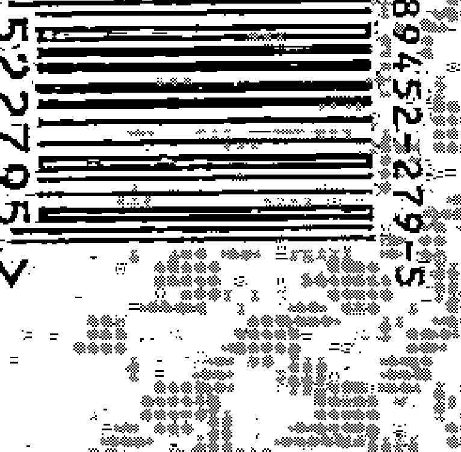

## 内容简介

本书作为一本介绍软件逆向初级技术的书籍，主要从汇编语言和高级语言两个方面介绍了软件逆向分析的各种手法和技巧。遵循从现象到原理的探索过程，采用原理和实例结合的方法进行讲解，甚至有的程序就是现实生活中经常接触到的软件。

在本书中对一些逆向相关的技术也进行了简单的介绍。例如64位系统的寄存器、64位程序调试技术、Linux与Windows双机调试等。这么做的目的是想尽可能全面地介绍软件分析的各种方法。当然作为一种初级的软件逆向书籍，本书中没有对各种高层次的技术进行讲解，本书旨在让大家能够理解软件逆向的原理，并且在阅读完本书之后能够进行简单的逆向分析。

本书的章节顺序也经过了几次调整。就我个人看来已经符合了学习一个新事物的学习规律。兴趣是最好的老师，书的第二章就进行相关的实战讲解，也是想让大家能够提起对学习逆向技术的兴趣。只有保持足够的兴趣才会想去探索这门技术的奥秘。在随后的内容中依次从原理和实战两个层次对软件逆向技术进行系统化的讲解分析。

作为一个技术书籍必然需要大量的程序进行实战演练，在本书中出现的部分实例是由作者实现的并且给出了相关的源代码，这样可以在学习的过程中采用高级语言源码和反汇编结合的方式进行学习。

好了，不多说了，书的内容就是这些，更详细内容可以参考本书的目录。希望各位读者喜欢这本书。如果看完本书觉得本书物有所值并且已经进入到了软件逆向的领域中，那么本书的目的也就达到了。

## 声明

在开始阅读本书前，请您务必阅读并深刻理解本声明。您可以选择放弃阅读本书，但是一旦开始阅读，您的阅读行为将被视为对本声明全部内容的认可。

- 1. 本书为介绍软件加密解密的技术类书籍。文章中提到的各种软件的保护或者破解方法仅限于技术研究之用，读者不可将其用于商业用途。
- 2. 如果将书中介绍的软件破解方法或随书光盘中附带的软件用于商业用途，因此造成的商业纠纷或者其他纠纷由软件散播者负全部责任，本人、出版社以及本论坛均不负任何直接或连带责任。
- 3. 本书附带的各种软件均来自于互联网，如果喜欢该软件请购买正版，支持正版版权。文章中列举的各种软件破解方式是为了帮助读者探寻更好的软件保护方式，随书光盘中附带的各种测试程序也仅作演示之用，而不是为了免费使用软件。
- 4. 如果您使用本书中所介绍的方法进行软件修改，或者运行本书附带光盘中的程序，因此造成了电脑硬件或者软件的损坏，本人概不负责。
- 5. 如果本书内容或随书光盘中的相关软件损害了您的权益，请来电或者来函告知。若情况属实，在图书再版的时候我们会删除该软件的逆向方法及相关软件实体。

声明人：钟鸣[obaby]

## 目录

## 第一章 如何开始
- 1.1 破解概述 …… 2
  - 1.1.1 破解的概念以及历史 …… 2
  - 1.1.2 主流保护方式 …… 4
- 1.2 新手从哪里开始 …… 5

## 第二章 牛刀小试——成功的喜悦
- 2.1 破解环境构建 …… 8
  - 2.1.1 系统环境以及软件安装 …… 8
  - 2.1.2 破解版程序安装方法 …… 9
  - 2.1.3 用自启动构建自己的专用软件包 …… 11
- 2.2 PE文件修改初试 …… 13
  - 2.2.1 乘胜追击之资源修改 …… 13
  - 2.2.2 牛刀小试——修改版权 …… 15
- 2.3 软件破解初步 …… 19
  - 2.3.1 初识OllyDbg …… 19
  - 2.3.2 实战内存追码 …… 22

## 第三章 追本溯源
- 3.1 文本字符 …… 26
  - 3.1.1 字符编码 …… 26
  - 3.1.2 字符存储顺序 …… 27
- 3.2 Windows可执行文件 …… 27
- 3.3 可执行文件资源 …… 35
  - 3.3.1 文件资源简介 …… 35
  - 3.3.2 资源修改进阶之定制PEID …… 37
- 3.4 ELF文件简介 …… 39
- 3.5 Windows操作系统 …… 41
  - 3.5.1 用户层/内核层 …… 41
  - 3.5.2 Windows消息机制 …… 43
  - 3.5.3 破解常用API函数 …… 45

## 第四章 软件动态调试
- 4.1 软件调试简介 …… 48
- 4.2 断点详解 …… 51
- 4.3 OllyDbg高级技巧 …… 54
  - 4.3.1 字符串参考/Unicode参考 …… 54
  - 4.3.2 断点窗口 …… 55
  - 4.3.3 创建可执行文件 …… 56
  - 4.3.4 查找功能 …… 57
  - 4.3.5 插件功能 …… 58
  - 4.3.6 OD常见问题 …… 59
- 4.4 WinDbg调试器 …… 60

## 第五章 静态分析技术
- 5.1 静态分析技术简介 …… 63
- 5.2 静态反编译利器IDA …… 65
  - 5.2.1 IDA简介 …… 65
  - 5.2.2 IDA安装 …… 65
  - 5.2.3 IDA配置 …… 67
- 5.3 IDA文件处理 …… 72
  - 5.3.1 载入文件 …… 72
  - 5.3.2 IDA数据库文件 …… 72
  - 5.3.3 IDA崩溃处理 …… 73
- 5.4 IDA桌面（Desktop）…… 74
- 5.5 IDA常用技巧 …… 76
  - 5.5.1 字符串子窗口（Strings Subview）…… 76
  - 5.5.2 输入表/输出表子窗口 …… 77
  - 5.5.3 函数调用图形视图（Chart）…… 79
  - 5.5.4 反汇编窗口常用功能 …… 80
  - 5.5.5 IDA脚本 …… 82
- 5.6 IDA调试功能 …… 88
  - 5.6.1 本地调试 …… 88
  - 5.6.2 远程调试 …… 89

## 第六章 软件逆向基础
- 6.1 汇编语言 …… 96
  - 6.1.1 简介 …… 96
  - 6.1.2 寄存器 …… 96
  - 6.1.3 汇编指令 …… 100
- 6.2 高级语言逆向基础 …… 112
  - 6.2.1 函数以及调用约定 …… 112
  - 6.2.2 启动函数以及入口点 …… 117
  - 6.2.3 高级语言控制语句 …… 118
- 6.3 从汇编语言到高级语言 …… 125

## 第七章 虚拟机环境搭建
- 7.1 虚拟机简介 …… 129
- 7.2 VMware Workstation安装 …… 130
- 7.3 安装系统 …… 132
  - 7.3.1 Windows系统安装 …… 132
  - 7.3.2 Linux系统安装 …… 136
- 7.4 虚拟机常见问题 …… 142

## 第八章 软件保护方式及其破解技巧
- 8.1 序列号 …… 146
  - 8.1.1 内存追码 …… 147
  - 8.1.2 修改函数关键call返回值 …… 151
  - 8.1.3 修改跳转指令法 …… 157
- 8.2 时间限制 …… 159
- 8.3 Nag窗口 …… 163
- 8.4 功能限制 …… 166
- 8.5 重启验证 …… 171
  - 8.5.1 KeyFile校验 …… 172
  - 8.5.2 CD以及移动设备校验 …… 175
  - 8.5.3 注册表验证 …… 178
- 8.6 典型运行 …… 182
  - 8.6.1 FindWindow方式 …… 184
  - 8.6.2 CreateMutex方式 …… 186
  - 8.6.3 共享区段保护方式 …… 187
- 8.7 反虚拟机保护 …… 189
- 8.8 Anti Debug …… 192
- 8.9 网络验证 …… 194
- 8.10 常用断点参考 …… 204

## 第九章 不同语言，不同方法
- 9.1 Delphi/BC++ …… 206
  - 9.1.1 Dede辅助查找按钮事件法 …… 206
  - 9.1.2 Delphi万能断点法 …… 212
  - 9.1.3 事件特征法 …… 217
- 9.2 VB程序逆向 …… 219
  - 9.2.1 断点 …… 219
  - 9.2.2 Smart Check …… 220
  - 9.2.3 VB事件特征法 …… 224
- 9.3 VC/VC++程序 …… 225
- 9.4 .net程序逆向 …… 228
  - 9.4.1 静态分析技术 …… 228
  - 9.4.2 动态调试 …… 235
- 9.5 易语言 …… 242
  - 9.5.1 E-Code Explorer辅助分析 …… 242
  - 9.5.2 E语言万能断点 …… 243
- 9.6 Point-H万能断点 …… 245
- 9.7 F12堆栈智停法 …… 247
- 9.8 小结 …… 248

## 第十章 壳保护技术
- 10.1 概念 …… 252
- 10.2 压缩壳 …… 253
  - 10.2.1 UPX …… 253
  - 10.2.2 ASpack …… 255
  - 10.2.3 PEcompact …… 255
  - 10.2.4 NsPack …… 257
- 10.3 加密壳 …… 258
  - 10.3.1 ASProtect …… 258
  - 10.3.2 ACProtect …… 264
  - 10.3.3 Winlicense & Themida …… 268
- 10.4 虚拟机保护技术 …… 271

## 第十一章 脱壳技术
- 11.1 脱壳原理 …… 278
- 11.2 脱壳工具 …… 278
- 11.3 寻找OEP …… 280
  - 11.3.1 跨段指令法 …… 280
  - 11.3.2 一次断点法 …… 285
  - 11.3.3 堆栈平衡法 …… 287
  - 11.3.4 特征指令法 …… 290
  - 11.3.5 语言特征法 …… 291
  - 11.3.6 脚本定位OEP …… 292
- 11.4 内存映像文件抓取 …… 293
- 11.5 修复IAT …… 296
  - 11.5.1 定位IAT …… 296
  - 11.5.2 重建输入表 …… 298
  - 11.5.3 IAT修复的常见问题 …… 300
- 11.6 DLL文件脱壳 …… 303
- 11.7 附加数据 …… 306
- 11.8 加密壳脱壳 …… 310
  - 11.8.1 Asprotect …… 310
  - 11.8.2 ACProtect …… 315
  - 11.8.3 Yoda's Protector …… 316

## 第十二章 注册机
- 12.1 内存注册机 …… 320
  - 12.1.1 KeyMaker …… 320
  - 12.1.2 cazaseriales …… 322
- 12.2 文件补丁 …… 323
  - 12.2.1 Patch技术 …… 323
  - 12.2.2 Loader技术 …… 327
- 12.3 算法注册机 …… 328

## 第十三章
- 13.1 软件汉化 …… 338
- 13.2 功能增加 …… 344
  - 13.2.1 弹窗 …… 344
  - 13.2.2 窗口透明 …… 348

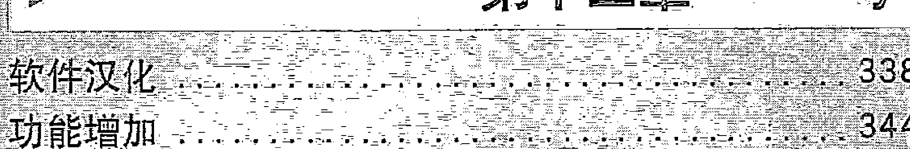

## 光盘目录

### 相关工具及练习程序
- 第一章 牛刀小试——成功的喜悦相关工具及练习程序
- 第二章 追本溯源相关工具及练习程序
- 第四章 软件动态调试相关工具及练习程序
- 第五章 静态分析技术相关工具及练习程序
- 第六章 软件逆向基础相关工具及练习程序
- 第七章 虚拟机环境搭建相关工具及练习程序
- 第八章 软件保护方式及其破解技巧相关工具及练习程序
- 第九章 不同语言、不同方式相关工具及练习程序
- 第十章 壳保护技术相关工具及练习程序
- 第十一章 脱壳技术相关工具及练习程序
- 第十二章 注册机相关工具及练习程序
- 第十三章 Pediy相关工具及练习程序

### 文章相关视频教程
- 不破不泄教程专用壁纸
- 2.2.2 牛刀小试 修改版权视频教程
- 2.3.2 实战内存追码视频教程
- 5.3.2 资源修改进阶之定制PEID视频教程
- 5.6.2 Windows 64位应用程序远程调试视频教程
- 8.1.1 内存追码视频教程
- 8.2 时间限制视频教程
- 8.7 反虚拟机保护视频教程
- 11.3.3 旋转型算法JSP定律视频教程
- 11.7 附加数据视频教程
- 11.8.1 Asprotect视频教程
- 11.8.2 ACProtect视频教程
- 11.8.3 Yoda's Protector视频教程
- 13.2.1 弹窗视频教程

### 加密与解密工具大礼包

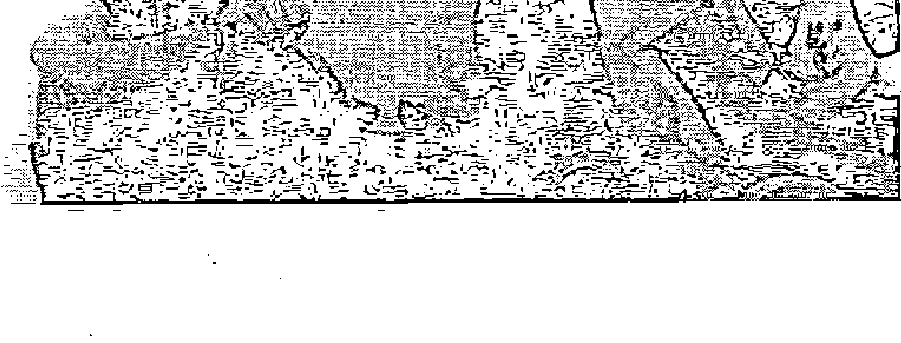

## 第一章

### 如何开始

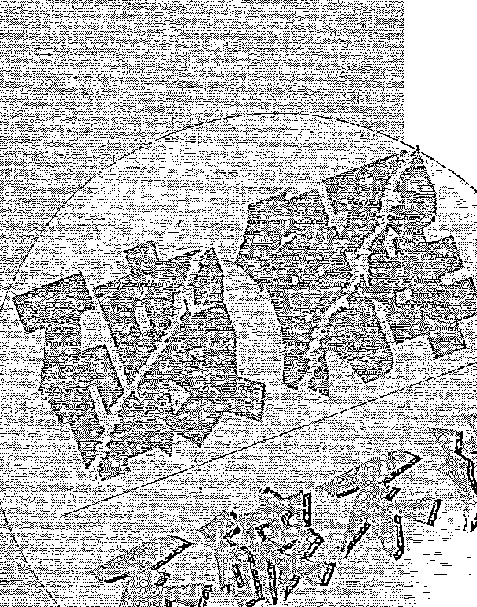


## 第一章 如何开始

开始让我来说些什么吧，其实刚开始我和很多人一样，不知道该从哪里开始。有的时候太过于急功近利，总想一下子就能从根本上解决所有的问题。只是知识从来都不是独立的孤岛，而更像是漂泊在海上的群岛，当踏上一块岛屿的时候才发现自己需要了解的东西还有太多。然而这些孤岛之间没有任何的桥梁。当我们要远行的时候就要自己造那薄薄的一叶孤舟，独自一人在海上漂泊。有句话说得好：成大事的人要耐得住寂寞。就靠着那一叶扁舟在波涛汹涌的海上漂泊，如果意志不坚定也就迷失了方向，不知道自己该走向何方，也许永远到不了远方的岛屿，最后只能回到那个起点，遥遥相望。

我天分不好，只能靠着忍耐与坚强艰难地在汹涌的波涛中艰难前行。有的时候也许还要付出太多的代价，甚至还会失去爱情。现实生活不是美丽童话，没有所谓的武功秘籍，也没有所谓的捷径。学习技术只能用自己的勤劳和日积月累的坚持来提高自己的能力。

所以建议大家不要沉迷于《XXX速成》《X天精通XX》之类的书籍，这种书卖的往往是噱头，难得有真才实料。如果真的那么简单，那么每个人都是大师了。真正的精通是要付出常人百倍的努力，忍受常人所不能忍受的孤独。道理我不想多说，每个人都懂，所以请放弃那些所谓的速成秘籍，踏踏实实地看一本书吧。我不是高人，对破解也不能说是精通，也在努力学习其他的知识，在这里我只能把一些心得和体会写出来，把那些解决问题的思路写出来。授人以鱼，不如授人以渔。我没有什么高深的见解，只是希望能够把本书的读者带入到破解的领域，而至于更高深的知识就只能从其他的图书获取了。笔者能力有限，书中难免会有纰漏，还请各位读者海涵。

最后我想说下国内的黑客环境，我不知道各位学黑客、学破解真正的目的是什么。如果你只是为了盗取QQ号和游戏密码，偷窥个人隐私，那么，我感觉你的方向错了，大错特错。在国内的某个黑客论坛做过一段时间的管理，其中最活跃的就是QQ区。说实话，我不明白那么一个聊天号码为什么会产生如此大的吸引力，不过是一个数字而已。当国内的所谓的黑客忙着攻击网站、忙着盗取账号的时候，国外的人却在研究着0Day。当大多数的人在想着怎么控制别人的电脑的时候，国外的人却在玩着BotNet。这就是我们的差距，不是能力上的而是意识上的。所以我的建议是，有时间不要想着怎么去控制别人的电脑，不要想着怎么去盗取账号，踏踏实实研究系统的东西吧。慢慢地就会发现这些东西比那些不道德的黑客行为更有成就感。所以我希望看过本书的人不要再去问怎么使用木马控制别人电脑、怎么去盗取账号，因为基础比行为重要。

以上只是一些个人学习的感想，也期望能够给大家指出一条学习的方向，不再盲目追随风向。选择自己的方向，然后日夜兼程地走下去吧！

### 1.1 破解概述

图1.1.1 破解的概念以及历史

现在大多数的软件都需要用注册码或者其他的验证文件来激活，以便可以使用软件的全部功能，逆向工程就是通过各种手段来移除这种限制的艺术，更通俗的叫法就是破解（Cracking）。同样如果去维基百科查询的话会得到下面的定义。

**软件破解：**是指修改软件来达到去除或者禁用一些破解者（Cracker）不想要的功能，通常被去除的功能包括下面几种：软件拷贝/分发保护、试用版/预览版、序列号、硬件密钥、日期检查、光盘检查，以及软件本身带有的恼人窗口（Nag Screens）或者间谍软件。

一种更通俗的说法就是：当我们开发编写一个程序的时候，最终的可执行程序都是由源代码编译而成的。逆向工程就是从二进制文件计算出源代码的艺术。逆向工程用来理解程序的每个行为是如何产生的，通常我们不需要将整个二进制文件进行逆向，我们所关注的只是我们感兴趣的一部分代码，也就是所谓的保护验证机制。

## 历史：

软件破解的起源已经难以考证，最早的破解是基于DOS系统的计算机游戏。那时候破解的主要目标就是让玩家在游戏的最后关卡能够得到满生命值、完全装备的状态。因而那时的破解主要就是从内存中找到游戏的生命值和武器数量进行修改，利用注入Memory-Cheating之类的游戏辅助软件。同样这类软件目前依旧很盛行，例如金山游侠、Cheat-Engine之类的内存修改工具。

现在随着硬件和软件技术的发展，更多的作者开始倾向于发布共享软件。所谓的共享软件（ShareWare）并不是免费软件（FreeWare），共享软件是指在没有注册的情况下提供部分功能，或者提供全部功能但是有时间限制或者次数限制的软件；如果想要使用全部功能或者长期使用，需要付费购买序列号的软件。随着软件保护技术的发展，保护手段也越来越多样化。

伴随着操作系统的发展，软件加密主要经过了以下几个阶段：

- 1）密码表加密

这也是最初级的加密方式，程序在执行过程会要求使用者输入密码，只有在口令正确的条件下程序才能正常运行。优点是实现方法简单，但是在使用过程中的频繁密码输入比较繁琐，会使用户感到不便。

- 2）软件自校验

在程序安装完成之后会记录当前系统的一些硬件信息，例如主板或者硬盘序列号；当程序拷贝到其他机器时，由于运行环境改变程序将拒绝执行。

- 3）序列号加密

这也是目前最主流的加密方式。现今很多共享软件都提供试用功能，但是会有功能或者时间次数的限制。如果想使用完全版则需要软件开发商提供注册码，有时包括硬件特征序列，开发商通过提供的信息生成序列号反馈给用户。用户用这个序列号来注册，程序会校验序列号和用户名是否匹配，如果匹配也就完成了注册过程。

- 4）许可证管理

软件在安装的时候会采集当前系统的指纹信息，经过计算之后会得到一个序列，注册过程中会要求将这个序列通过电话或者Internet的方式发送给软件开发商；如果是正版用户则可以得到一个确认码（序列号）。正版用户利用这个确认码进行注册即可。

- 5）可移动设备校验

这种校验方式是指在程序运行时需要放入特定的软件、光盘，或者USB移动设备进行相关校验；如果在存储介质上的相关身份信息通过校验则程序正常运行。目前采用这种方式校验一般是CD 校验和加密狗方式校验。使用 CD 认证的典型例子就是仙剑系列的游戏，在游戏安装完成之后如果想运行游戏，则需要将特定的一张光盘放入光驱中，并且在游戏过程中不可取出。而加密狗方式目前也开始广泛使用，由于成本低廉、使用方便，目前也成为主流的加密手段之一。

##### 6）驱动级反调试保护

目前各种主流的大型游戏均采用了驱动级的反调试保护，例如目前主流的 nProtect 驱动级保护。此类保护主要是为了防止在 Ring3 层进行动态调试。

##### 7）育碧 DRM 在线验证

最新的游戏例如《模拟人生》之类将采用此种认证方式，虽然是单机游戏，但是游戏数据并不完全存放在游戏客户端电脑上，特殊关卡必须要联网才能进行。在游戏过程中，游戏客户端必须要与服务器进行通讯以验证授权的合法性，并且在游戏的过程中网络不可断开。这种验证方式从更大程度上降低了游戏被盗版的风险。如果条件允许，以后诸如此类的验证方式会越来越多。

#### 图 1.1.2 主流保护方式

通过上面的发展历史我们也可以看到基本的软件保护方式了。按照验证和限制类型可以分为下面几种：

- 1）序列号模式（硬件序列号，用户名－序列号）
- 2）恼人窗口（Nag Screen）
- 3）软件限制（次数限制，时间限制，功能限制）
- 4）可移动介质保护（光盘，USB Key）
- 5）网络验证（将用户名和注册码等信息发送到网络服务器上进行验证）
- 6）其他保护模式（验证文件，预览版本）

在知道了主流的保护方式之后，我们在后面的学习中也会遇到使用各种保护的程序。如果我们想在平时做一些练习怎么办呢？下面就给大家介绍一些主流的破解论坛以及破解组织。

- **crackmes.de**
  - http://www.crackmes.de/ 一个非常优秀的 CrackMe 站点，如果需要程序来练习自己的破解能力，那么这是个不错的去处。
- **看雪学院**
  - http://www.pediy.com 国内著名的软件安全论坛。
- **EXETOOLS**
  - http://forum.exetools.com/ 国外著名安全论坛，设有专门的中国板块。
- **吾爱破解**
  - http://www.52pojie.cn 可以从里面下载到各种资源，但是注册需要邀请码，如果有一定技术可以通过发技术贴来申请邀请码。
- **一蓑烟雨**
  - http://www.unpack.cn/
- **CrackL@b**
  - http://cracklab.ru/ 国外强大的软件破解论坛，如果精通英语的话可以光顾下，往往有意外的收获。

### 1.2 新手从哪里开始

在知道了主流的软件保护方式和一些优秀论坛之后，建议大家有时间多看看技术文章，不要泡论坛，而是利用论坛的资源进行学习、答疑解惑，单纯地混论坛经验和积分对学习是没有任何帮助的。

#### 主要线索

可能大多数的初学者在开始的时候不知道该从哪一条线走，那么就不如采用最简单的方式，假定一个目标：就是不择手段地破解掉我们手里的程序。本书也是按照这个思路来写的。在破解中会慢慢地遇到很多的问题，那么我们就围绕着怎么解决这些问题入手，来慢慢地走入这个神秘的世界。保护方式虽然多种多样，但是都离不开对用户信息的验证。只要明白了这一点，那么剩下的就简单多了，找到程序验证的关键点进行逆向分析、修改即可。

#### 怎么开始

知道了本书的主线之后，我们就该开始我们的旅程了。就像从目录中看到的那样，本书的第二章并不是从基础开始的，而是从一个高于基础的高度开始，直接开始二进制文件的修改以及程序的破解。看到这里是不是感觉有点困难？事实证明不是想象的那样，如果仔细按照书上的实验进行操作，就会发现没有想象的那么复杂。即使没有任何的基础，也可以进行软件破解和程序修改。

所以开始破解之旅，只要按照本书中的章节一步步地走下去，最终就会发现破解并没有想象中的那么神秘。

当然，在阅读本书之前如果你有一定的程序设计功底，熟悉一种或者几种编程语言，例如 C、Delphi，或者汇编语言之类的，那么在理解上可能会更迅速一些。当然如果对 Windows API 熟悉的话那么就更轻松了。即使没有这方面的基础也不要紧，在学习的过程中顺便学习下程序设计吧；如果想学 C 语言，我推荐《C Primer》这本书。如果需要进一步地在破解方面深入，还是推荐看雪学院的《加密与解密（第三版）》，这是一本难得的好书。如果想继续深入，那么开始看《深入解析 Windows 操作系统》和《Windows 核心编程》吧。如果这些书都看懂了，那么恭喜你，你真正进入 Master 的行列了。

当然大家不必着急去买这些书看，因为如果单纯想看懂本书的内容的话，只需要在遇到迷惑不解的问题时 Google 一下就行了。随着学习的深入，知识点会越来越多，就会发现当初自己登录的小岛周围更好的风景了。此时需要更多的毅力来征服新出现的每个小岛，学习得越多，接触的小岛也越多，也就有更多的新的知识等着我们去学习。在阅读本书的过程中也就会发现自己缺少的是哪方面的知识，也就有了继续学习的方向。有的时候这条主线比盲目的阅读要有用得多，只有方向对了才能走得更远。

#### 软件工具

到此本章节也就基本快结束了。从第二章开始我们将走入破解的殿堂，在真正走入之前，先来看下我们以后可能会用到的工具吧。

- 1. 调试器  
  正如本书的最终目的，我们是要破解，那么破解过程中就需要一款好的调试工具。在本书中看到最多的将会是 OllyDbg、IDA Pro 5.5。
- 2. 反汇编软件  
  有的时候我们需要静态分析二进制代码，那么 W32Dasm 和 IDA 就成了最佳选择了。
- 3）资源编辑器  
  最常用的资源编辑器就是 eXscope、ResHacker 以及 Restorator 了，在汉化和软件界面资源修改中这些软件出现的次数最多。
- 4）十六进制编辑器  
  资源编辑器并不一定是最好用的，有的时候我们要修改的字符串藏在二进制文件的某一个角落中，而恰巧上面的资源编辑器不能够识别，这时十六进制编辑器就该上场了。用得最多的十六进制编辑器包括下面几种：C32asm，HexEditor，UltraEditor。
- 5）加壳／脱壳软件  
  加壳软件又分为加密壳和压缩壳。最常见的 Asprotect 属于加密壳，而 Aspack 虽然长得很像，但是却是一种压缩壳。现在很多加壳程序都出了对应的脱壳器，例如针对 Aspack 的脱壳器 AspackDie。同样对于大多数的压缩壳甚至出现了万能脱壳器，例如超级巡警的 Vmunpacker。
- 6）脱壳辅助工具  
  这里说的脱壳辅助工具主要是指文件在脱壳之前对文件查壳的 PEiD，从内存中转存之后对文件进行 IAT 修复的软件 ImportREC，以及对脱壳文件进行修复重建的 LordPE 等。
- 7）监视工具（注册表／文件监视）  
  为了更好地监视文件认证和重启认证的程序，有时候我们需要观察文件变化和注册表变化来快速定位软件认证过程的关键点。常用的软件有 RegMon 和 FileMon。

#### 小提示

上面只是简单介绍，在后续的章节之中会看到每个软件的安装方法、使用方法以及技巧。在用到相关软件时会提供相关的安装程序，不必刻意去收集这些程序。同样针对每种加密方式，在本书的后续章节中也会陆续讲到。

至此，本书第一章内容就结束了。在本章中我们主要回顾了软件各种加密模式的发展过程、现在流行的保护方式以及我们需要用到的各种破解软件。如果大家已经准备好了，那么就跟我一起进入第二章，开始我们的破解初体验吧。

## 第二章

## 牛刀小试——成功的喜悦


## 第二章 牛刀小试——成功的喜悦

经过前一章的介绍，想必大家对破解也有了比较系统的了解了。按照普通的教学思路似乎应该开始讲一些汇编知识了，但是为了能让大家对所需知识有更深入的了解，这一章会从一些简单的程序操作开始。同样在动手的过程中，希望大家发现自己缺少哪些知识，并且要勤于思考为什么这么操作，原理是什么。

古语说：“工欲善其事，必先利其器”。那么这里就有个事和器的定义，在本书中事就是破解，器就是所谓的技能和工具，只有知道了自己需要什么知识，才能有目的地进行学习。

### 2.1 破解环境构建

#### 2.1.1 系统环境以及软件安装

在本节的内容中我们就来构建我们的第一个“器”——相关的系统和软件环境。

可能有很多初学者在学习过程中有这样的困惑：明明自己的操作和书中或者录像中的操作方法是完全相同的，但是为什么得不到同样的效果呢？其实造成这种结局的主要原因可能不在于学习者，而是作者对环境的讲解不够详细。这里所谓的环境包括硬件环境和软件环境。将同样的程序在 OllyDbg 中调试，设置不同的异常忽略选项和 SFX 跟踪选项，程序载入之后的停留位置是不一样的，这段内容会在后面的动态调试中详细讲解。所以在做实验之前最好能够确保自己的测试环境和教程中是一样的，即使有环境差异，也要保证调试程序的设置选项是一致的。只有保持软件选项设置的一致性，才能最大限度地达到书上所说的效果。

既然大家已经知道了环境的重要性，那么我就来简单地说明下本书的实验环境，如果没有特殊提示，均以下环境：

- 操作系统：Windows XP Professional with Service Pack 3
- 调试器：
  1. OllyDbg 1.1（可以用其他的定制版代替，但是不一定保证能够达到完全一样的效果。这里推荐吾爱破解专用版，该修改版提高了调试器的 Anti-anti-debug 功能，在脱强壳的时候 Anti-anti-debug 效果尤其明显，并且集成了比较多的优秀插件）；
  2. WinDbg 6.10 内核调试器；
  3. IDA for Linux 5.2，IDA 5.2（或者 5.5）for Windows（如果用到不同版本的 IDA 会在使用时给出相应提示）；
- 脱壳辅助：
  1. LordPE 增强版
  2. Import REConstructor v1.6F
  3. PEiD 0.94（0.95）

请注意：上文提到的程序以及在文章中用到的工具可以在光盘中的对应章节中找到。另外，文章中的大部分实验会在 Windows XP SP3 系统下完成。由于系统补丁或者系统升级会造成部分系统文件版本不同，所以部分实验效果可能在 Win7 系统下会有较大的差距，读者可参考本书《第十章 虚拟机环境搭建》，安装 Windows XP 专业版系统来进行相关的实验。对于实验效果影响不大的工具，可以使用自己比较喜欢的版本。

#### 一个实用的技巧

为了简化破解对于文件的频繁操作，我们可以把常用的软件添加到系统的“发送到”菜单。对于 Windows XP 以及 Windows 2000 系统，可以通过后面的操作来完成。打开系统盘，找到如下路径：`C:\Documents and Settings\Administrator\SendTo\`（注意：由于 SendTo 这个目录属性是“隐藏”的，所以要先通过“工具”——“文件夹选项”——“查看”——选上“显示所有文件和文件夹”，才能看见这个目录）。其中，C 为你的系统盘盘符，Administrator 是你的当前用户名。

如果不选择显示所有文件和文件夹，可以通过地址栏补全路径的方法打开这个隐藏的文件夹。用户对应的文件夹 Administrator 并不具备隐藏属性，因而可以定位到 `C:\Documents and Settings\Administrator\`，此时在地址栏后补全 SendTo 直接回车，也同样可以打开 SendTo 文件夹。定位到该文件夹后，我们就可以把需要添加的软件的快捷方式添加到“发送到”这个目录下，如图 2-1-1 所示。

添加后右键发送到菜单最终效果如图 2-1-2 所示。

在 Windows 7 和 Vista 系统下操作会有所不同。打开开始菜单，在搜索框中输入 `shell:sendto` 或者 `%appdata%\Microsoft\Windows\Sendto`，打开文件夹后就可以按照 XP 系统下的操作方法把快捷方式复制到该目录下，最终效果如图 2-1-3 所示。

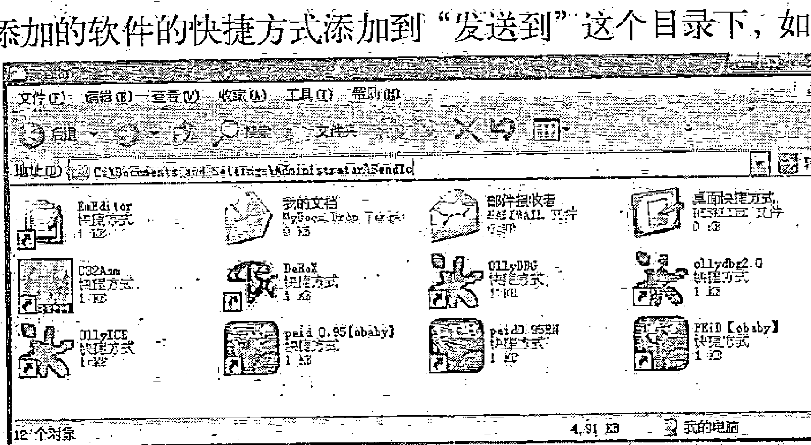

图 2-1-1

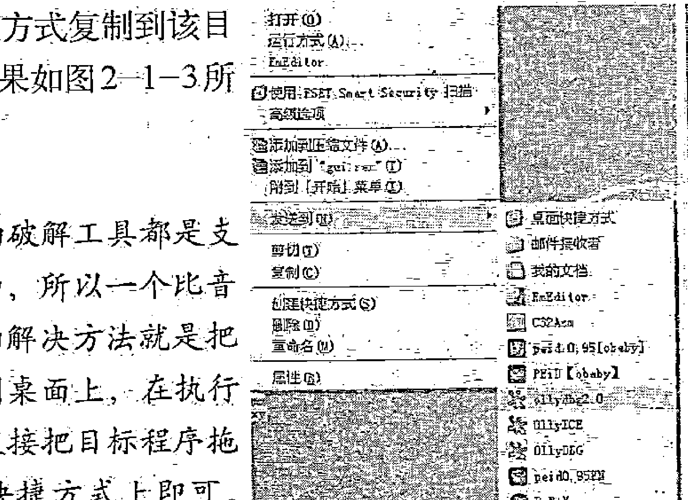

图 2-1-2

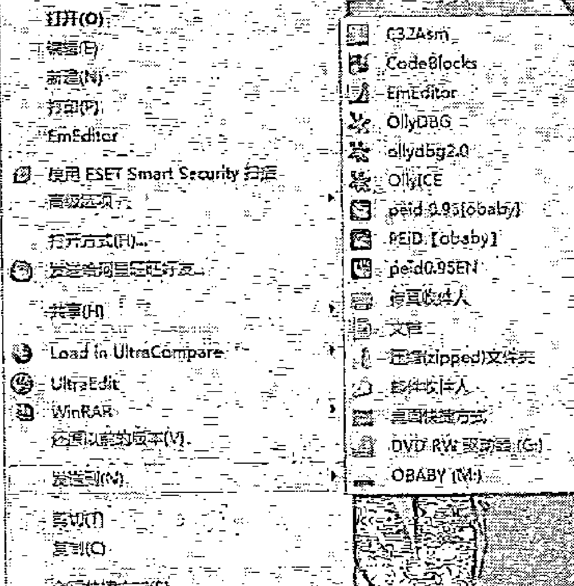

图 2-1-3

#### 小技巧

大部分的破解工具都是支持拖放功能的，所以一个比音速启动更好的解决方法就是把快捷方式放到桌面上，在执行文件操作时直接把目标程序拖放到程序的快捷方式上即可。

如果按照音速启动的流程来运行，则需要打开破解软件后再打开目标程序，这样无形之中就多了一步操作。

如果不喜欢这种方式或者桌面比较拥挤，就可以利用音速启动来搭建自己的工具包，相关内容可以阅读 2.1.3 小节。

#### 2.1.2 破解版程序安装方法

系统环境搭建完成之后，我们开始安装程序。作为一个 Cracker，其实用到的程序大部分是破解版的。

关于破解版程序，安装方法各有不同，这给初次接触的同学带来一定的困扰。有一部分同学可能对破解版程序的安装还有一些疑问，因为从网上下载的破解版程序安装方法不一，可能有的同学在安装的时候会感觉没有头绪。为什么破解版的程序按照安装说明安装和注册之后却还是试用版或者未注册版呢？也许从下面的描述中你会找到答案。我们先来看看网上提供的破解程序都有哪些类型。

破解程序的分类，按照补丁方式可以大体分为如下几种：

- 1）注册机  
  按照实现方法可以分为内存注册机和算法注册机，其中算法注册机更难实现，但是跨平台通用性更好。内存注册机往往会由于系统版本的不同，导致在部分系统上不能直接运行。一个实例就是在 XP 系统上生成的 VB 程序内存注册机在 Win7 系统下则往往不能得出注册码，这是由于系统的 Msvb60.dll 的版本不同造成的。
- 2）Patch 补丁  
  Patch 分为静态补丁和动态补丁，其中动态补丁又称为 Loader 加载器。而 Loader 又分为安装型和文件型。安装型是提供 Loader 安装程序，直接运行安装程序，安装程序会自动创建加载器以及原程序的备份。文件型则是单一的加载器，放到程序安装目录下，直接运行 Loader 即可使用注册版程序，无需进行注册或安装静态文件 Patch 补丁。但是不管哪种类型的 Loader，其根本原理都是一样的：通过 Loader 加载器运行原程序后在内存中执行补丁代码，动态 Patch 程序来达到跳过验证的效果。静态补丁则是通过补丁程序直接修改原程序的二进制代码以达到破解的目的，程序经过破解后无需通过 Loader 运行，并且静态补丁在大多数情况下会比 Loader 可靠。所以不是万不得已，最好不要采用 Loader 的补丁形式。但是静态文件补丁同样有自己的局限性，对于加壳处理的程序难以实现静态文件修补，在这种情况下就只能通过对原文件脱壳破解后提供相应的破解版程序，也就是下面的万能注册型。
- 3）万能注册型  
  这里所说的万能注册型是指任意用户名注册码均可注册成功的二进制补丁替换程序。一般此类破解版程序会提供一个破解后的程序以及原程序的安装程序，并且相关安装说明会提示安装后要覆盖掉原文件，任意注册码注册即可。此种补丁程序可以认为是静态文件补丁的一个简单个例，虽然没有采用二进制补丁方式，但是最终效果是相同的。
- 4）高级补丁  
  对于部分双重验证的程序则需要进行更高级的补丁操作。其中最常见的是 Keygen + Patch，其中 Keygen 也就是 Key Generator 序列号生成器，又叫算号器，Patch 也就是上面提到的文件补丁，此类一般为静态文件补丁，用于去除网络验证功能。这里以 Emeditor v9.x keygen 为例，程序运行截图如 2-1-4 所示。  
  使用的时候需要先计算序列号，然后进行 Patch 操作。使用文件补丁的时候最好把 Keygen 文件放到程序目录下执行，以免找不到原程序。补丁之后就可以用计算生成的序列号进行注册了。在这种情况下，如果只是执行算号注册，不执行文件补丁操作，那么即使本地注册成功，在网络验证的过程中还是会失败，显示为未注册版。

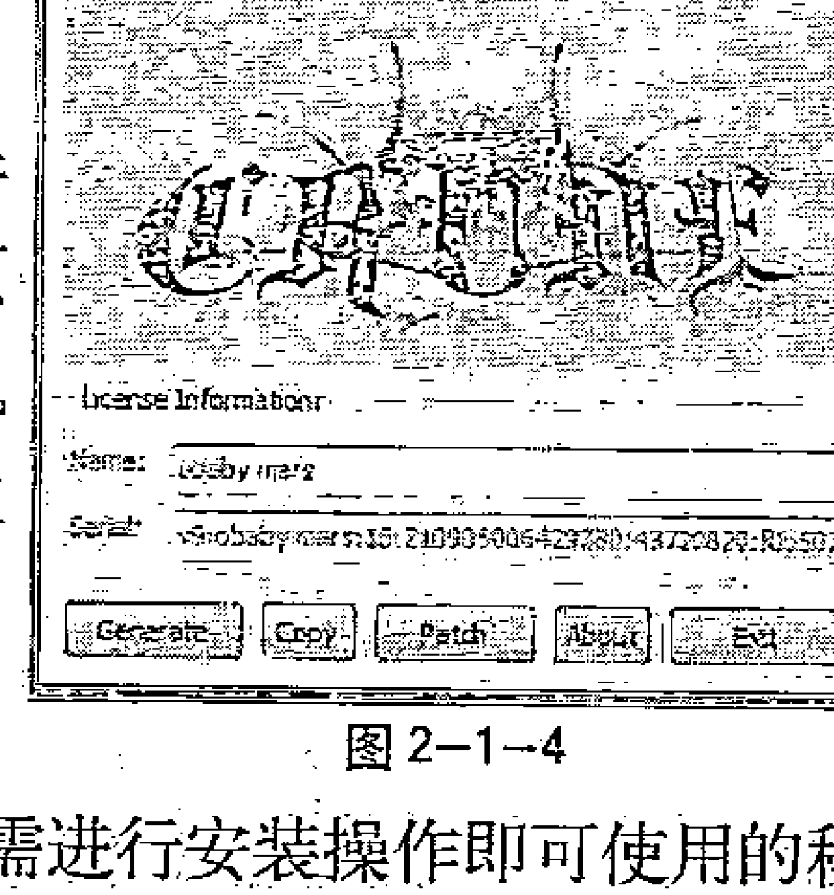

图 2-1-4

- 5）绿色程序  
  最后一种程序可以笼统地称为绿色程序，所谓的绿色程序是指无需进行安装操作即可使用的程序。但是网上提供的很大一部分程序并不是完全绿色的，而是简化了安装过程，提取安装后的注册表值和释放文件，通过批处理或者 WinRAR 的自解压功能进行二次封装后的安装程序，一般会存在 Setup.bat、绿化.bat 等之类的批处理脚本。这种程序往往在解压后需要运行安装脚本才能使用。

#### 如何安装破解版程序

本小节剩余部分以 Restorator 2009 4.0 build 1807 破解版为例说明破解程序的安装流程。打开压缩文件可以看到如图 2-1-5 所示的三个文件：Restorator 2009 4.0 build 1807.exe、Restorator-patch.exe、reg.reg。其中 Restorator 2009 4.0 build 1807.exe 是安装程序，直接运行就可以进行安装了。按照操作提示安装即可；在选择目标路径的时候建议选择系统目录之外的其他盘符，这样可以在系统重装后不需要重新安装软件，只要进行注册便可以使用了。

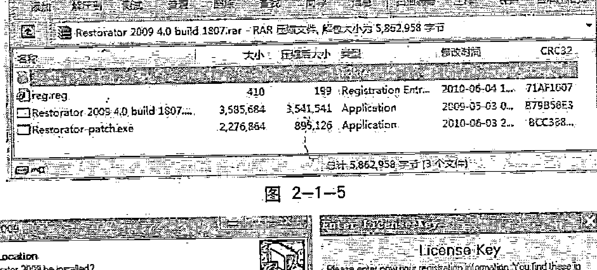

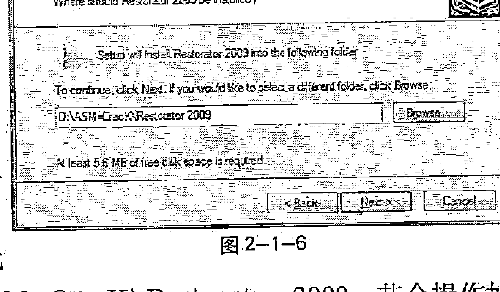

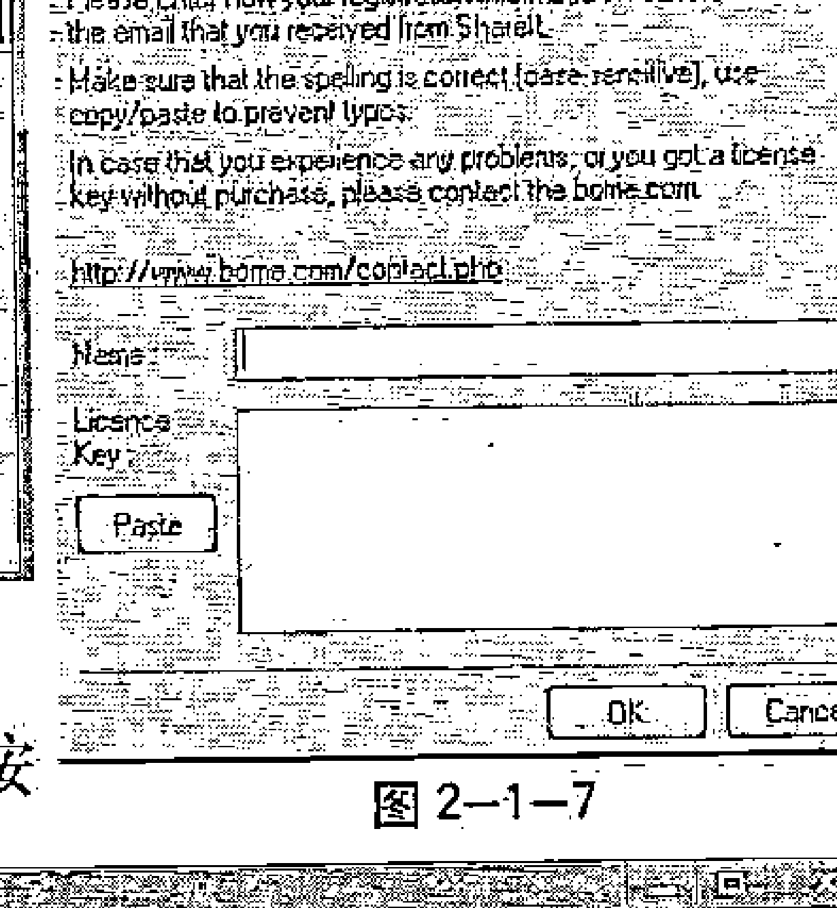

如图 2-1-6 所示，这里我修改的安装路径为 `D:\ASM-CracK\Restorator 2009`，其余操作按照提示进行即可。在程序安装完成时会弹出如图 2-1-7 所示的注册窗口，此时点取消即可，因为在程序没有替换和没有注册码的情况下是无法注册成功的。

安装向导完成之后，解压 Restorator-patch.exe 到程序目录下替换掉原程序 Restorator.exe，解压 reg.reg 到任意目录下，双击导入注册表就可以完成注册了。导入完成后重新运行程序，此时程序就已经是注册版了。

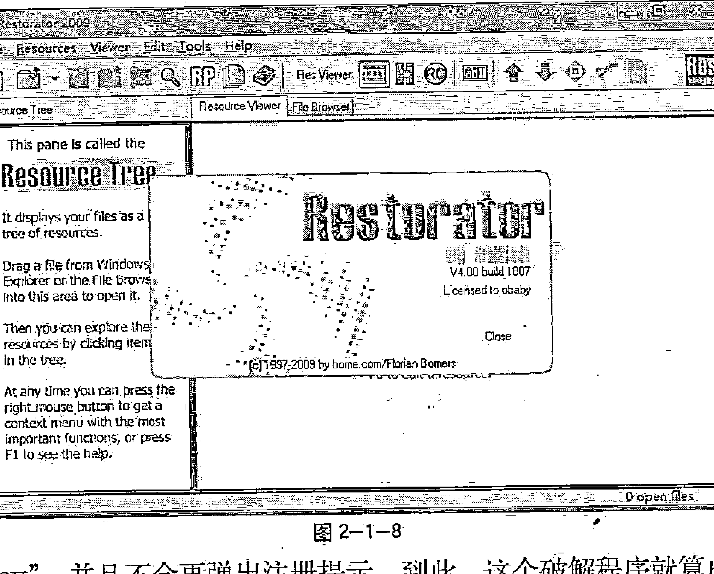

如图 2-1-8 所示，程序显示为：“Licensed to obaby”，并且不会再弹出注册提示。到此，这个破解程序就算成功安装完毕。

#### 图 2.1.3 用音速启动构建自己的专用软件包

如果不喜欢在桌面上放置太多的快捷方式，或者显示器尺寸不够大桌面显得异常拥挤，那么...音速启动来构建自己的专用软件包就是一个不错的选择了。没有添加任何快捷方式的音速启动如图2-1-9所示。点击主面板的类别可以打开左侧的“类别管理”窗口，执行“新建”功能，输入新建类别的名称，添加完成后关闭添加窗口就可以在主面板的左侧看到自己新添加的类别了。为了便于区分，可以通过类别管理的修改图标功能来给新增的模块添加一个醒目的图标，在类别列表中选中自己要修改的类别，然后点击修改图标右侧的图标就会打开如图2-1-10所示的图标列表。如果没有自己喜欢的图标，可以通过增加图标功能增加自己喜欢的图标。

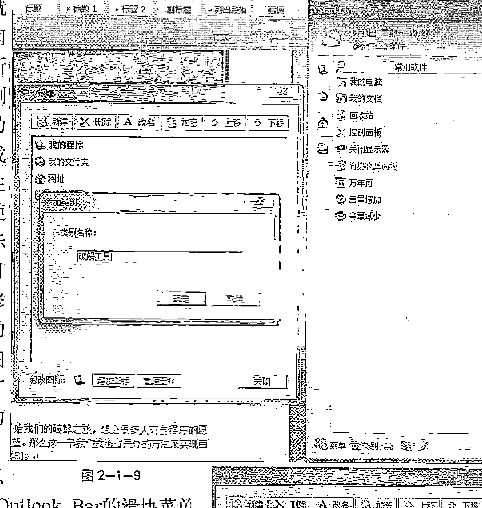

在添加相关的类别之后，就可以添加栏目了。所谓的栏目就是类似于 Outlook Bar 的滑块菜单。点击主面板左侧新增的栏目，此时在右侧会打开一个空白的窗体。然后点击主面板下方的“增加栏目”按钮，打开如图2-1-11所示的添加栏目窗口，选择普通栏目，在栏目标题中输入自己想要的名称，比如“文件编辑”，点击确定就可以增加指定的栏目了。

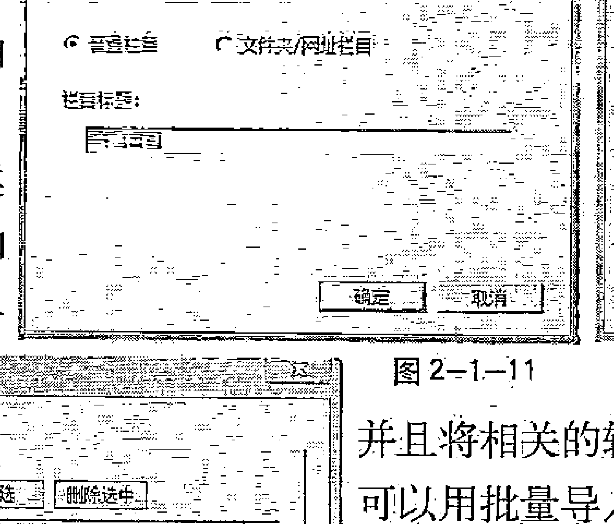

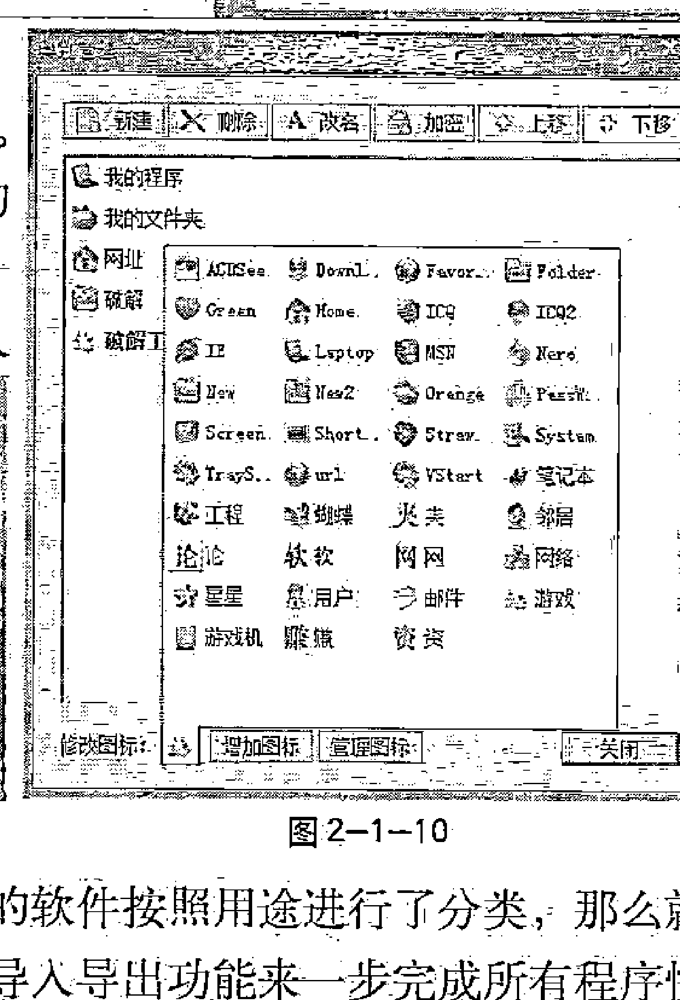

最后一步就是增加与类别相关的程序快捷方式了。如果你已经有了较多的软件工具，并且将相关的软件按照用途进行了分类，那么就可以用批量导入导出功能来一步完成所有程序快捷方式的添加。单击要添加快捷方式的栏目，在空白区域点右键，执行菜单的“批量/导入/导出”功能，选择标签页的导入快捷方式，搜索范围选择你的程序目录，搜索类型按照自己的文件类型选择快捷方式（*.lnk, *.url）还是可执行文件（*.exe），设置好搜索选项后就可以进行搜索了。搜索完成后在文件列表中选择自己要导入的快捷方式，执行导入功能即可，如图2-1-12所示。导入后可以通过快捷方式的属性来修改快捷方式链接的颜色、图标以及其他属性。关于程序更多的个性化功能大家可以慢慢探索，打造个人的音速启动工具包。

导入后建议再次执行“批量/导入/导出”，选择标签页的批量操作，全选后执行修改路径功能，将其转换为相对路径，并且将图标路径同样修改为相对路径。这样就避免了程序在放到其他电脑或者移动存储设备上之后不能正常使用的问题。同样经过路径转换之后，可以把软件包复制到 U 盘、CD 或者其他的可移动介质中随身携带了。添加程序快捷方式之后的程序界面如图2-1-13所示，到此我们的专业软件包就打造完成了。最后说一下，即使没有准备好那么多程序的同学也不要着急，因为破解真正用到的工具并没有想象中的那么多，只要认真把每章用到的工具都收集起来，等到看完整本书的时候你就会发现自己收集的程序也已经能够应对日常的破解任务了。如果现在你只有我们前面安装过的 Restorator 2009，那么不要灰心，让我们就把这个孤零零的可怜的孩子放到我们的音速启动上。对于单一程序，可以直接拖放原文件到自己想要的位置即可，拖放的文件类型可以是可执行程序，也可以是快捷方式。既然起步慢了一些，那么我们就开始用心地收集吧。

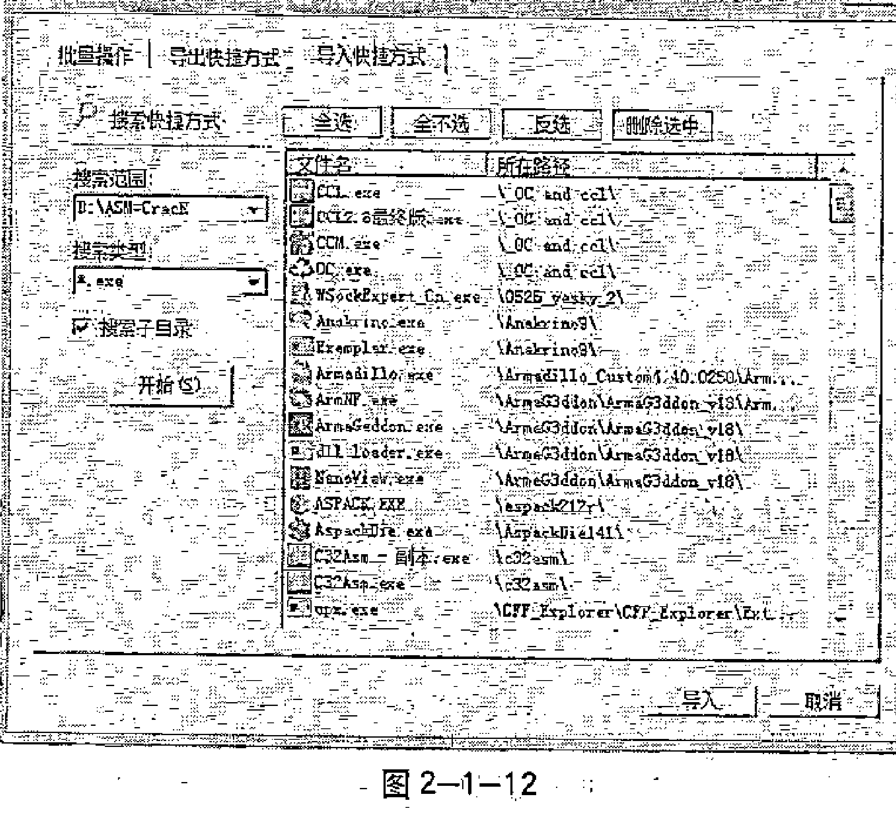

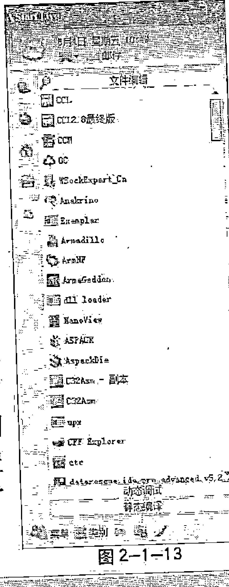

## 2.2 PE文件修改初试

#### 2.2.1 乘胜追击之资源修改

在搭建好相关的测试环境之后，开始我们的破解之旅。想必很多人有写程序的想法，但是无奈自己水平不够，不能实现这个愿望。那么这一节我们就通过另外的方法来实现自己的愿望：修改别人的程序，打上自己的烙印。

在本节要用到的工具：

- 1. PEiD 0.95；
- 2. C32asm；
- 3. Restorator 2009。

关于 PEiD 这里引用官方的介绍：可以根据程序自带的签名特征库检测大多数可执行程序的加壳、加密方式，以及程序编写语言。并且这个签名特征库是可扩展的，如果大家有更全面的签名特征库，可以替换掉程序自带的特征库，以实现对更多壳的准确识别。

下面我们先来认识下 PEiD 的界面，程序主界面如图2-2-1所示。同样 PEiD 提供了多文件扫描功能和插件功能，只需要选择扫描目录即可执行目录下文件的批量查壳功能，如图2-2-2所示。左侧为扫描文件的绝对路径以及可执行程序的文件名，右侧有程序的编写语言或者加密加壳方式。

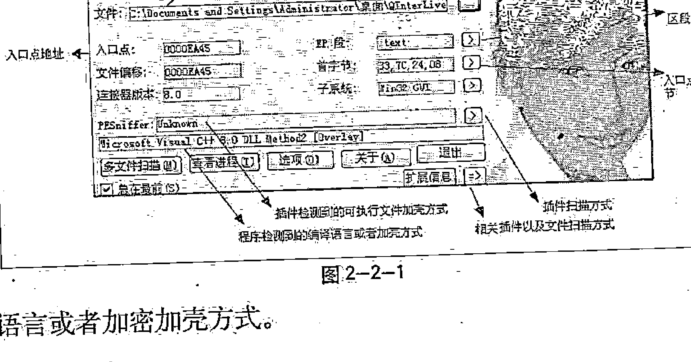

PEiD 同时提供了进程查看和个性化设置选项，可以定义一些个性化设置，如图2-2-3所示。通过进程查看功能可以查看当前系统运行的进程以及各个进程加载的模块信息。窗口上方为进程信息，下方为当前选中的进程中加载的模块信息。默认状态下 PEiD 只允许单个实例运行，通过选中允许多个实例可以在系统上打开多个 PEiD。如果不喜欢右键的“发送到”菜单，那么可以选择集成到右键菜单功能来提供另外的一个快捷方式。

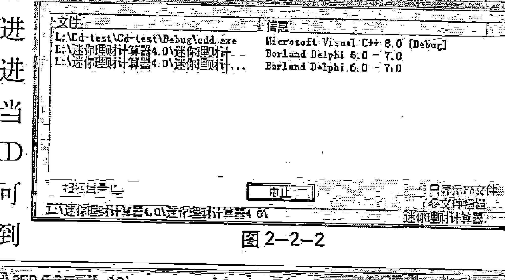

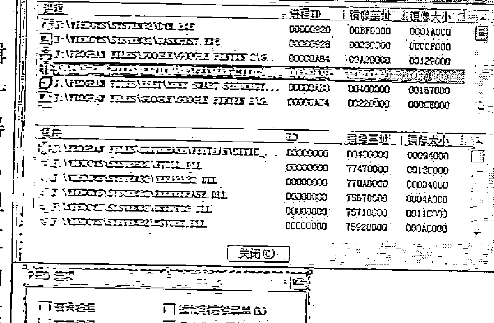

C32asm 编辑器可以用其他十六进制编辑器替代，比如 UltraEditor 或者 WinHex，但是一定要注意，不要尝试用记事本之类的文本编辑器打开可执行程序，因为这样很可能会损坏程序。在文件编辑上 C32asm 易用性可能会差一些，但是它却提供了其他软件不具备的功能：汇编模式查看。执行菜单“查看→切换 HEX 和汇编模式查看”即可快速切换两种模式，这个功能在免杀中尤其实用，快捷键 Ctrl+W，如图2-2-4所示。

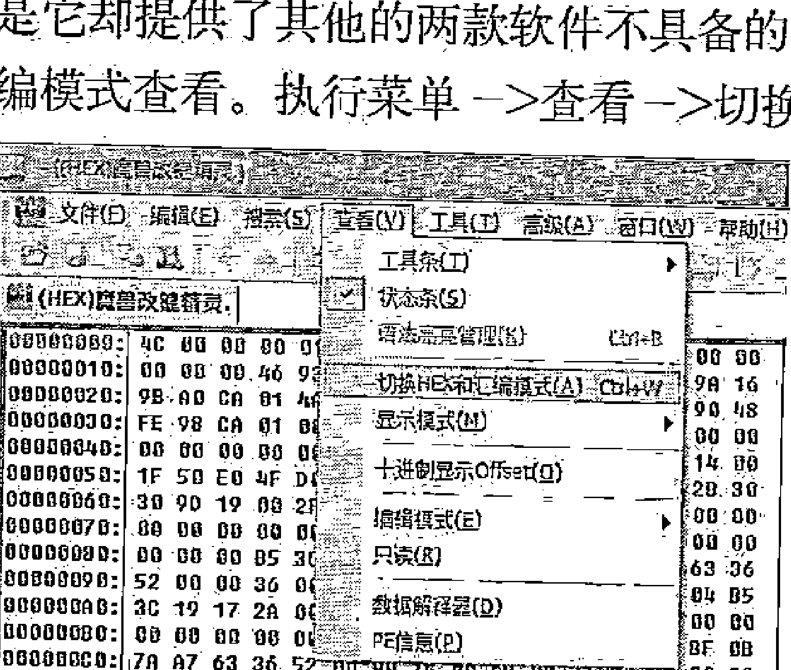

最后着重介绍一下英文版的 Restorator 2009。Restorator 是一个简单易用的中文化工具程序，完全采用类似于资源浏览器的操作方式，支持文件拖拽操作，同样支持在修改完成后进行拖拽保存。支持修改可执行程序的多项资源，包括：功能表、对话框、字符串、图标、鼠标图形等，而且可以导出生成为 RC、RES 资源文档。

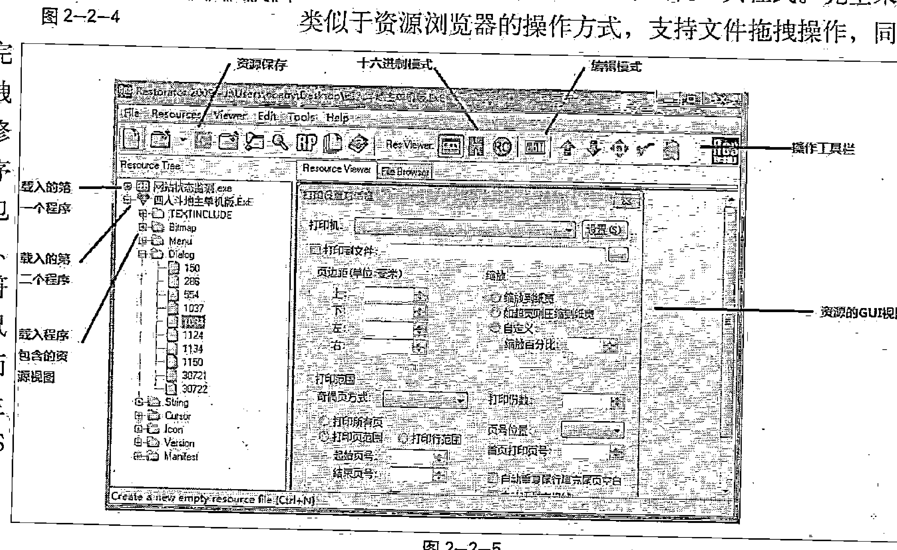

程序主界面如图2-2-5所示，相关的关键按钮以及说明已经标注。

## 2.2.2 牛刀小试—修改版权

在对相关程序熟悉之后，我们就开始破解之旅。在本节中就以我自己写的一个小程序“网站状态检测器”进行实验。虽然目前还没有涉及壳的相关内容，但是在拿到程序后首先查壳是一个良好的习惯。如果程序被加壳了就不能直接修改资源了。这种程序怎么办呢？我们会在第十一章中介绍。用 PEiD 0.95 载入我们的程序，可以看到程序没有加壳，编写语言是：Borland Delphi v6.0-v7.0，如图2-2-6所示。

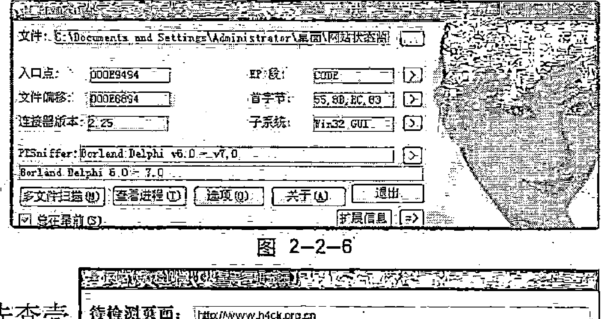

图2-2-6

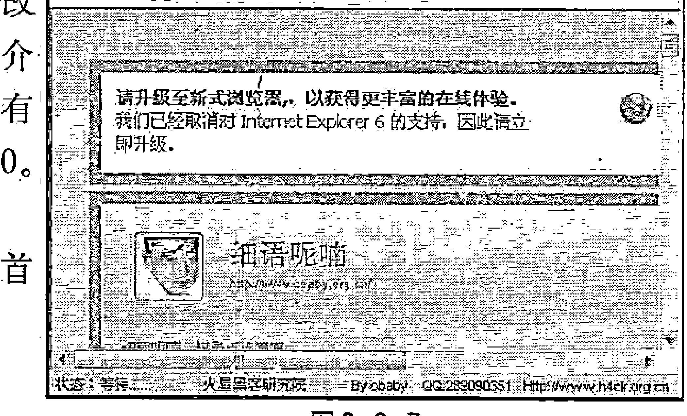

图2-2-7

现在运行我们的程序，如图2-2-7所示，我们首先来确定自己的修改目标：

- 1. 窗口顶部的标题；
- 2. 窗口底部的版权信息；
- 3. 程序加载的默认页面。

我们直接用 Restorator 2009 载入目标程序，依次展开左侧的目录树：网站状态检测器.exe -> RCData -> TFORM1。这个就是程序的主窗体了，展开后会发现如下代码，如图2-2-8所示：

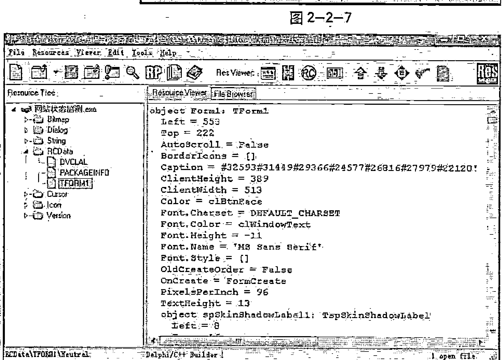

图2-2-8

```text
left = 553
Top = 222
AutoScroll = false
BorderIcons = []
Caption = '#32593#31459#29366#24577#26816#27979#22120'
// 前面的两行代码定义了窗体的位置
```

```text
ClientHeight = 389
ClientWidth = 513
Color = clBtnFace
Font.Charset = DEFAULT_CHARSET
Font.Color = clWindowText
Font.Height = -11
Font.Name = 'MS Sans Serif'
Font.Style = []
OldCreateOrder = False
OnCreate = FormCreate
PixelsPerInch = 96
TextHeight = 13
```

### 小提示：

在这里先给大家补充一点 Delphi 程序设计的简单知识，明白了这些内容之后，后面的操作原理自然也就明白了。

在 Delphi 程序中，可编辑资源一般是保存在 RCData 下的，这也就是为什么开始我们要先定位到这个资源目录下的原因。Delphi 程序的主窗体如果采用默认的命名方式会是 TForm1、TForm2……这样就可以判断我们要定位的窗体就是资源中的 TForm1 了。而资源代码框中对应的 Caption 就是窗口的标题，在程序设计时会是类似于 `TForm1.Caption = '火星黑客研究院'` 之类的字符串值。对于最下方的状态栏一般命名为 `TStatusBar`，但在这个程序中使用了第三方皮肤控件，所以默认命名失效了。我们依旧可以通过资源名称来猜测当前控件对应主窗体的哪个控件，可以看到资源中有 `spSkinStatusPanel1` 字样的控件，那么我们就可以判定这个控件对应的就是状态栏的第一个 Panel 了。基于前面对 Form 属性的理解，我们可以知道 `spSkinStatusPanel1.Caption` 就是状态栏第一个 Panel 对应的字符串了。

关于 PE 程序的资源，以及 PE 结构会在后面文章中介绍到。

通过代码可以看到：

```text
Caption = #32593#31449#29366#24577#26816#27979#22120' ' = 12304#28779#26143#40657#23458#30740#31350#38498#12305
```

这一行虽然显示的是乱码，但是这个属性通过相关代码可以看出是 Form 主窗标题。这里显示为乱码是因为程序对 Unicode 编码的汉字识别不正确造成的。现在我们修改这个属性。默认代码窗体是不能写入的，先点击工具栏上的“Edit Mode”进入资源编辑模式（快捷键 F6），然后直接输入标题即可：`Caption = '网站状态检索工具'`。这里需要注意输入的单引号为英文状态下的引号，如果输入中文引号会导致程序报错。至此第一处修改已经完成了，继续搜索代码修改第二处。

来到如下代码处：

```text
object spSkinStatusPanel2: TspSkinStatusPanel
  Left = 120
  Top = 0
  Width = 120
  Height = 21
  HintImageIndex = 0
  TabOrder = 1
  DrawDefault = True
  SkinData = spSkinData1
  SkinDataName = 'statuspanel'
  AlphaBlend = False
  AlphaBlendValue = 200
  UseSkinCursor = False
  DefaultFont.Charset = DEFAULT_CHARSET
  DefaultFont.Color = clWindowText
  DefaultFont.Height = -14
  DefaultFont.Name = 'Arial'
  DefaultFont.Style = []
  UseSkinFont = True
```


```text
EllipsType = spetNoneEllips
UseSkinSize = True
UseSkinFontColor = True
BorderStyle = bvFrame
Align = alLeft
Caption = #28779#26143#40657#23458#30740#31350#38498
AutoSize = False
ImageIndex = -1
NumGlyphs = 1
```

仔细观察此处的 Caption 值是不是和上面的 Caption 值的最后一部分相同。同样这里我们修改为：“非安全”。继续上面的操作找到最后一处代码：

```text
object spSkinStatusPanel3: TspSkinStatusPanel
  Left = 240
  Top = 0
  Width = 273
  Height = 21
  HintImageIndex = 0
  ...
  DefaultFont.Name = 'Arial'
  DefaultFont.Style = []
  UseSkinFont = True
  ...
  BorderStyle = bvFrame
  Align = alClient
  Caption = 'By obaby    QQ:289090351    http://www.h4ck.org.cn'
  AutoSize = False
  ImageIndex = -1
  NumGlyphs = 1
```

修改 `Caption = 'By obaby  QQ:289090351  http://www.nohack.me'`。到此我们的修改就完成了。现在点击一下其他的资源，会提示是否保存修改，如图2-2-9所示。如果确信修改无误，点击“Yes”即可。

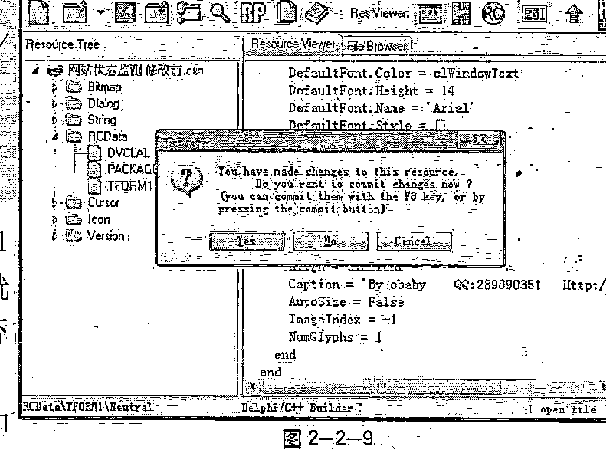

如果在修改过程中出现错误可以点击“No”，放弃当前的修改；如果仍在修改过程中不小心点击了其他资源，直接点击“Cancel”，会仍旧停留在当前资源的编辑窗口中。应用改变后，工具栏上的保存按钮变为可用，此时我们就可以保存我们修改后的文件了。如果没有错误发生，程序保存修改后会创建原程序名 Backup 文件。

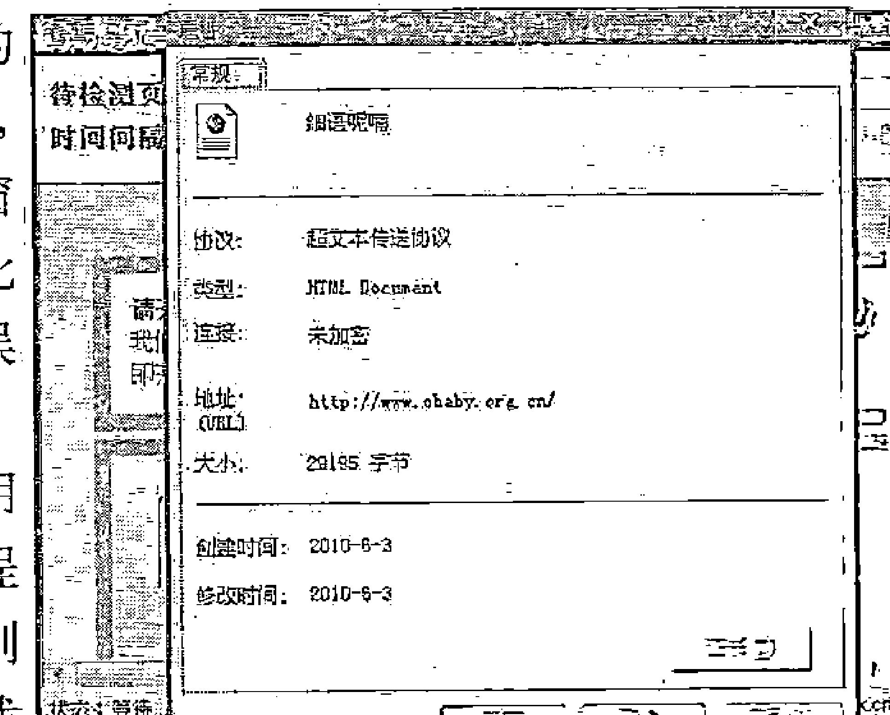

图2-2-10

最后我们来修改程序默认的打开页面。直接用 C32asm 载入我们要修改的程序，需要注意的是保证程序没有被其他软件编辑或者程序不在运行中，否则 C32asm 会有错误提示：“载入文件为空，是否继续载入”。那么我们如何确定要修改的地址呢？这里我们要修改的地址不是待检测页面的内容。程序运行后直接在窗口加载的页面上点右键->属性，可以发现程序默认加载的页面是：http://www.obaby.org.cn。如图2-2-10所示。

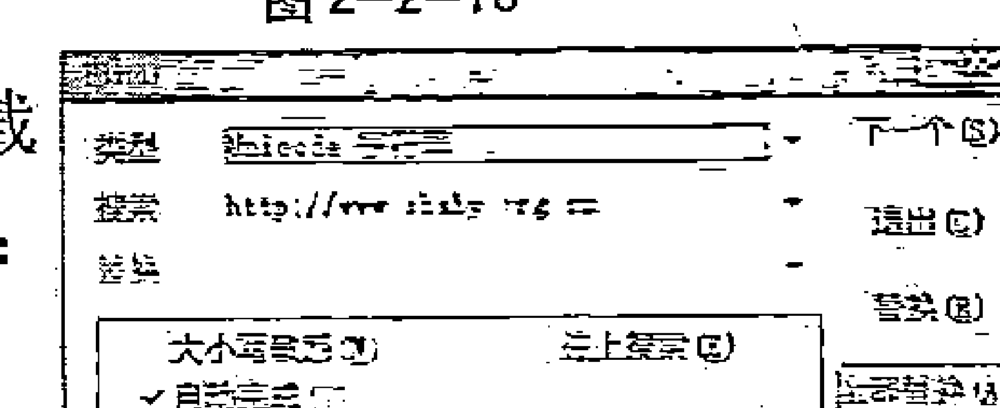

图2-2-11

在 C32asm 中执行查找命令，快捷键 Ctrl+F。如图2-2-11所示，这里需要注意查找类型选择 Unicode 字符串，输入要查找的内容：http://www.obaby.org.cn，按确定进行查找。找到后显示内容如图2-2-12所示。这里需要注意 ANSI 字符串与 Unicode 字符串的区别，这里如果按照常规方式连续地对每个字节都直接修改就会出错。Unicode 字符串为两个字节表示一个字符，于是我们只要修改对应字母的 Unicode 字符的低地址字符即可，也就是选中英文字母进行单一修改即可。

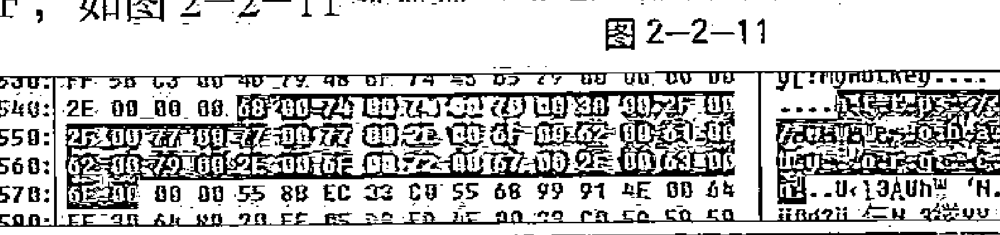

图2-2-12

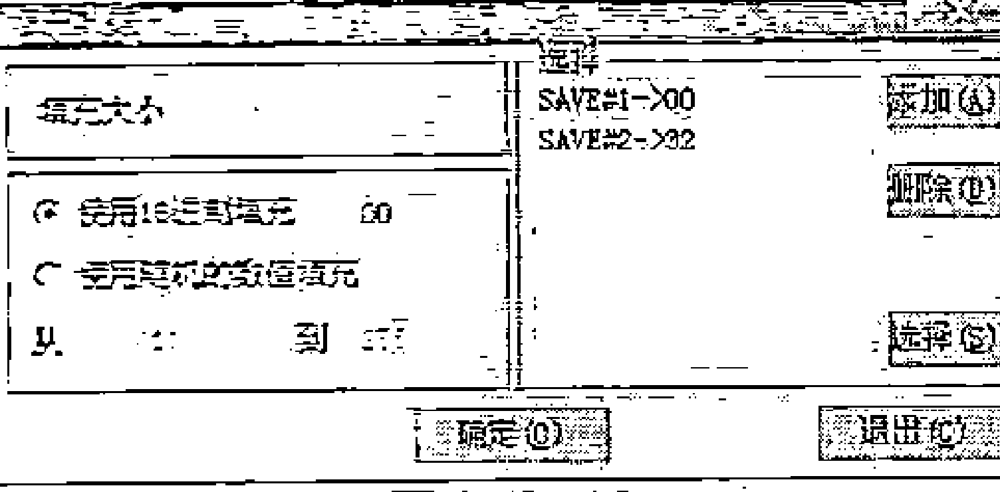

图2-2-13

如果修改完成后字符串长度不够，最后的字符用 00 填充即可。选中要填充的字节，右键->填充，选择 SAVE#1->00。如果没有这个填充选项，在窗口左侧的使用十六进制添加，输入 00，点击添加即可添加相关的填充选项。如图2-2-13所示。

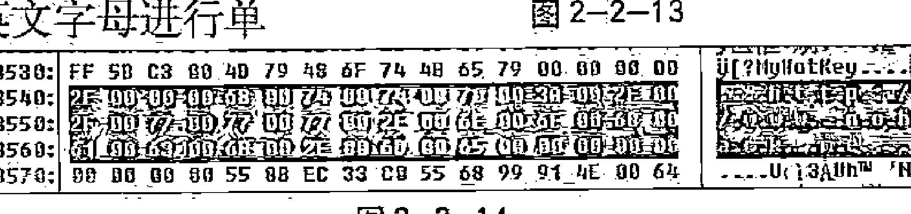

图2-2-14

填充完成后最终如图2-2-14所示，然后保存文件即可。保存时程序会询问是否创建备份文件，如果需要备份文件选择“是”，不需要点“否”即可。个人建议最好创建备份文件，以免操作失误无法撤销。

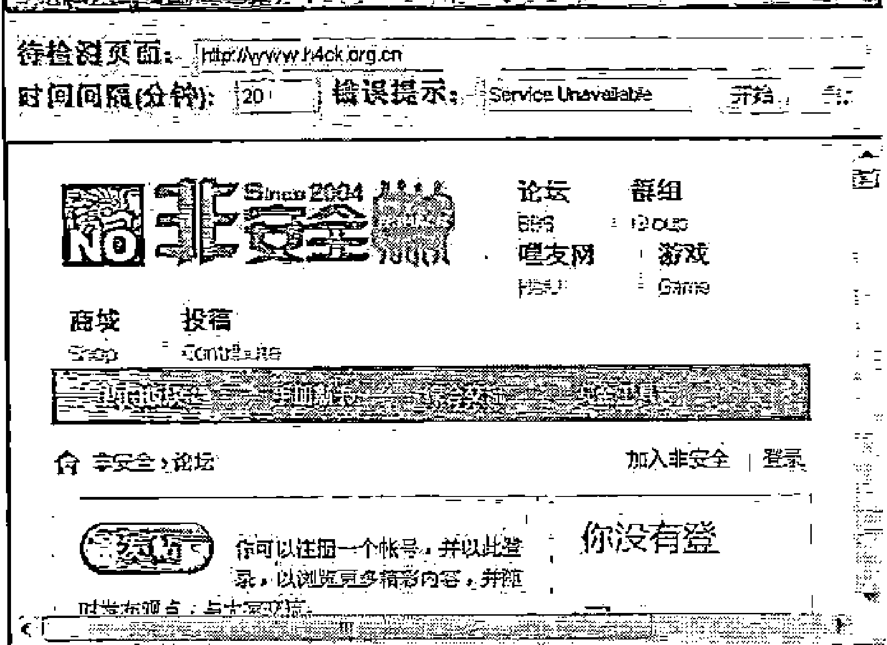

图2-2-15

修改完成后我们运行修改后的程序看一下是不是达到了我们所要的效果。如图2-2-15所示，我们的目的达到了。我们会发现修改二进制文件也没有想象中的那么复杂，在没有涉及相关专业知识的前提下就完成了程序的修改。没有任何基础的我们都能做到这样，我相信随着学习的深入我们会越来越熟练，在学习了相关的专业知识之后更会如鱼得水，也希望大家能够坚定学习破解的信心。

### 2.3 软件破解初步

#### 2.3.1 初识 OllyDbg

在软件破解的过程中最重要的就是动态调试，调试自然离不开调试器。这一节主要对 OllyDbg 用法做简单讲解，进阶技巧将在动态调试一章讲解。但是在开始学习前，希望大家能对后面的几个概念有一个浅显的理解：断点、API、调试器。

**断点：** 断点（BreakPoint）是一个用于通知调试器在执行到特定点时将程序暂时挂起的信号。当程序在挂起的时候我们称程序处于中断模式。进入中断模式并不会终止或者结束程序，程序流程可以在任何时刻继续。

断点可以看作是一种超时模式。所有对象（例如函数、变量等）都保存在内存中，但是它们的活动被挂起了，因而可以从内存中查看它们的位置、状态以及保存在当前寄存器的数值。这也就是从内存中可以跟踪到注册码的基本原理。在给程序代码设置断点的时候我们称为下断。

**API：** API（Application Programming Interface，应用程序编程接口）是一些预先定义的函数，目的是提供给应用程序开发人员基于某软件或硬件访问一组例程的能力，而又无需访问软件源码，或理解硬件内部工作机制的细节。

在应用程序的调试过程中，最常用的断点也就是 API 断点。例如在 Delphi 程序破解的时候经常提到的对 MessageBoxA 下断，就是指在 MessageBoxA 函数的第一行代码下断点。当程序执行到此行代码时调试器就会中断下来，上面提到的 MessageBoxA 就是 Windows 系统的 API 函数，与之对应的另一个功能相似的 API 是 MessageBoxW。通常在 Windows 系统中每个 API 分别有两个不同的版本，可以简称为 A 和 W，其中 A 对应的是 ANSI（也就是 ASCII）版本，W 对应的是 WideChar（也就是 Unicode）版本。在调试过程中如果 MessageBoxA 断点无效可以试试 MessageBoxW。对于其他的孪生 API 该方法同样适用。

**调试器：** 调试器又分为应用层调试器和内核层调试器；通常在破解的过程中用到的是 Ring3 层的调试器。在这里我们以 OllyDbg 为例说明调试器的基本功能模块。运行 OllyDbg 后主窗口如图2-3-1所示。

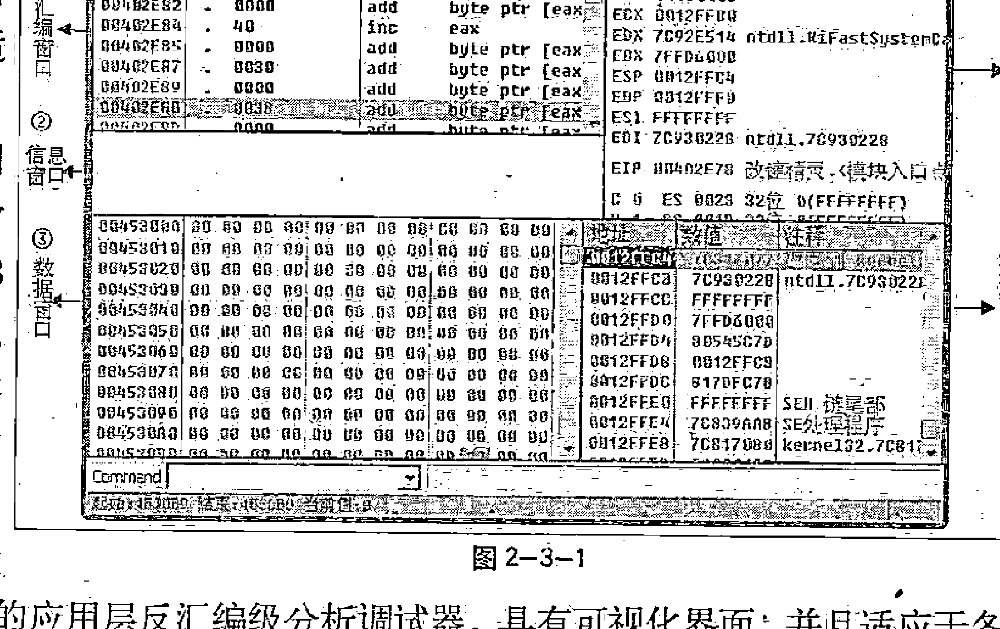

OllyDbg（简称 OD）是一款 32 位的、专为 Windows 系统设计的应用层反汇编级分析调试器，具有可视化界面，并且适应于各种 Windows 系统。其强大的脚本以及插件功能使应用层的调试变得更加简单。当前最新版本为 2.0，在本书中主要以 1.1 版本为主，相关详细信息可以访问这个链接：http://www.ollydbg.de。

- 1. OllyDbg 界面

运行 OllyDbg 1.1 载入可执行文件之后会打开多个窗口，通过单击工具栏上的 L、E、M 等可……可以在各个窗体间快速切换，如图 2-3-2 所示。

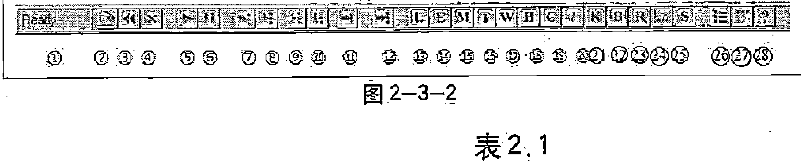

图 2-3-2

工具栏图标对应的功能如表 2.1（按照从左到右顺序）：

| 按钮序号 | 功能 | 快捷键 | 说明 |
|---|---|---|---|
| ① | 调试器状态 |  | 显示当前调试器的状态 |
| ② | 打开新文件 | F3 | 打开新文件进行调试 |
| ③ | 重载输入 | Ctrl+F2 | 重新载入当前调试的程序 |
| ④ | 关闭 | Alt+F2 | 关闭当前调试的程序 |
| ⑤ | 运行 | F9 | 运行调试的程序 |
| ⑥ | 暂停 | F12 | 使当前调试过程挂起 |
| ⑦ | 单步步入 | F7 | 遇到 Call 指令时进入被调用函数内部 |
| ⑧ | 单步步过 | F8 | 遇到 Call 指令时不进入函数内部 |
| ⑨ | 跟踪步入 | Ctrl+F11 | 源码级单步步入 |
| ⑩ | 跟踪步过 | Ctrl+F10 | 源码级单步步过 |
| ⑪ | 执行到返回 | Ctrl+F9 | 运行到当前函数返回 |
| ⑫ | 转到地址 | Ctrl+G | 转到指定地址/表达式 |
| ⑬ | 打开日志窗口 | Alt+L | 打开日志窗口 |
| ⑭ | 模块窗口 | Alt+E | 显示当前进程加载模块信息 |
| ⑮ | 内存窗口 | Alt+M | 显示内存映射信息 |
| ⑯ | 线程信息 |  | 显示线程状态 |
| ⑰ | 句柄窗口 |  | 显示句柄信息 |
| ⑱ | 显示句柄 |  | 显示句柄相关内容 |
| ⑲ | CPU 窗口 | Alt+C | 显示 CPU 窗口 |
| ⑳ | 显示补丁 | Ctrl+P | 显示补丁信息 |
| 21 | 调用堆栈 | Alt+K | 显示调用堆栈信息 |
| 22 | 断点窗口 | Alt+B | 显示断点信息 |
| 23 | 参考窗口 | Alt+N | 显示参考信息 |
| 24 | 显示 Run Trace |  | 显示运行轨迹 |
| 25 | 源码窗口 |  | 显示源码 |
| 26 | 调试选项 |  | 打开调试选项窗口 |
| 27 | 界面选项 |  | 打开界面选项窗口 |
| 28 | 帮助 |  | 打开帮助文档 |

注：表内文字根据图像可辨内容提取，个别字样可能存在轻微识别误差。

表 2.1

打开目标程序后默认的窗口是 CPU 窗口，也是调试过程中最重要的窗口，程序的调试工作大部分在此窗口中进行。该窗口的布局就是刚开始介绍的图 2-3-1 所示的窗口，包括：反汇编窗口、寄存器窗口、数据窗口、堆栈窗口。窗口的外观属性可以在右键菜单→界面选项中设置。

- **1. 反汇编窗口（Disassembler Window）**
  - 主要用于显示被调试程序的十六进制以及汇编代码。
  - 该窗口包含四列：地址（Address）、HEX 数据（HEX Dump）、反汇编（Disassembly）以及注释（Comment）。
  - 其中注释列可显示当前 API 相关参数信息或 API 函数运行简表，便于快速辨识代码作用。
  - Address：显示当前代码地址，双击可在相对地址和标准地址间切换。
  - HEX 数据：显示当前汇编代码的十六进制模式，在该列双击可快速设置 Int3 断点（快捷键 F2）。
  - 反汇编：显示当前代码的汇编模式，双击可快速编辑汇编指令。
  - 注释：可编辑和添加注释；若已有 API 注释，新增注释会覆盖自动注释。

- **2. 信息窗口（Information Window）**
  - 程序在调试过程中显示当前寄存器值，或者当前代码执行流程、跳转来源等相关提示信息。

- **3. 数据窗口（Dump Window）**
  - 以十六进制和字符方式显示内存中的文件数据。
  - 可通过右键菜单修改当前窗口数据格式。
  - 激活窗口后按 Ctrl+G，或执行右键“转到→表达式”可快速定位到指定内存地址。

- **4. 寄存器窗口（Register Windows）**
  - 显示 CPU 当前寄存器的值。
  - 支持浮点、MMX 和 3DNow! 寄存器。
  - 单击当前窗口标题可在各种模式间切换。

- **5. 堆栈窗口（Stack Window）**
  - 显示当前堆栈的内容。

##### 2、OllyDbg 界面配置

通过菜单的“选项→界面选项”可以打开如图 2-3-3 所示的窗口。

在各个标签页中最重要的就是目录选项，切换到该标签页后可以看到有两个目录：UDD 路径和插件路径。“UDD 路径”指定了 OD 工程文件的保存路径。UDD 文件记录了软件调试过程中设置的断点、增加的注释等信息，以便在重新载入之后可以继续上次的工作；“插件路径”用于扩展 OD 的各种功能，比如命令窗口、Ultra 字符串参考等。将相关插件复制到该目录下重新运行 OD 即可，在菜单栏看到“插件”菜单，在该菜单下会显示所有已经加载的插件。

在颜色标签页可以选择当前窗体的配色方案，如图 2-3-4 所示，并且可以对各种文本进行自定义颜色设置。

同样在“代码高亮”标签页可以设置当前 CPU 窗口的代码颜色，提高代码的可读性。

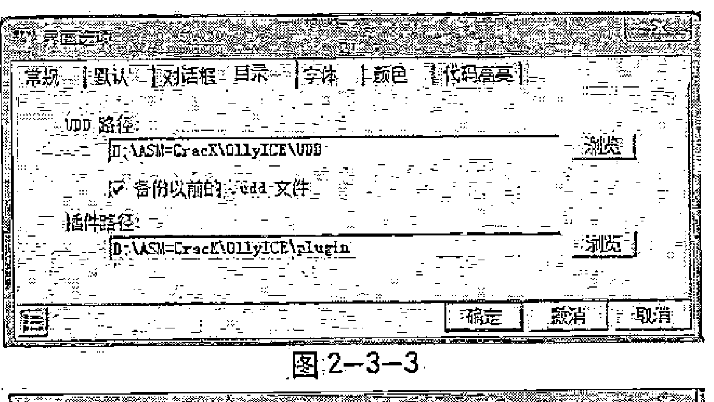

图 2-3-3

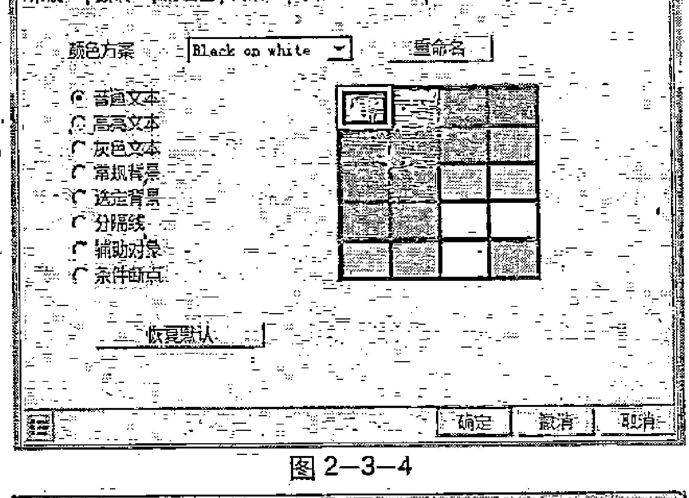

图 2-3-4

##### 3、调试设置

通过“选项→调试选项”可以打开调试设置选项，如图 2-3-5 所示。

大部分选项保持默认即可，在调试过程中需要特别注意的就是“异常”标签页的选项；大部分情况下建议全选。但是在调试部分带壳程序时需要注意异常处理选项，否则可能无法达到想要的效果。

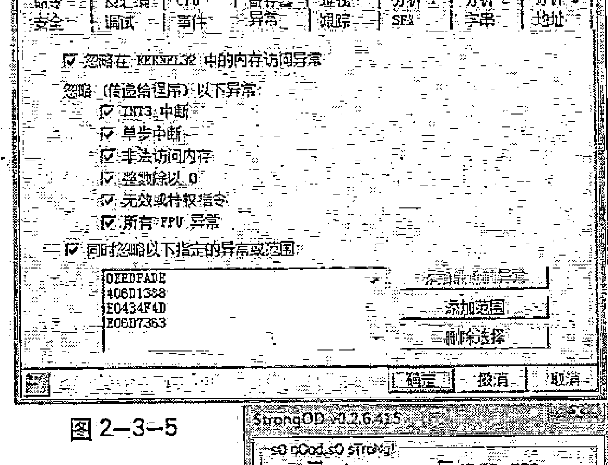

图 2-3-5

##### 4、加载微软符号库

这里需要使用插件 StrongOD，并且要求版本在 0.2.6.413 以上；新建一个文件夹用于存放符号文件，如果使用 Windbg 调试器可以设置为同一个目录。将下载微软符号库的文件复制到 OD 目录下，也可以从 Windbg 目录下直接复制出来，相关文件为：dbgeng.dll，dbghelp.dll，srcsrv.dll，symbolcheck.dll，symsrv.dll，symsrv.yes。

打开 OD，选择“菜单→设置符号路径”如图 2-3-6，可以使用 Windbg 的符号路径，如果没有安装该调试器，可以随便指定一个空目录即可。

执行“插件→StrongOD→option 选项”打开如图 2-3-7 所示的配置界面，选择 Load Symbols，然后保存即可。重新运行 OD 载入程序就可以看到加载符号库之后的效果了，如图 2-3-8 所示。第一次启动由于需要下载符号库，可能加载速度会比较缓慢，需要耐心等待；如果 OD 出现假死的情况，稍等几分钟即可。如果感觉加载速度太慢，在 StrongOD 选项中关闭加载符号选项即可。

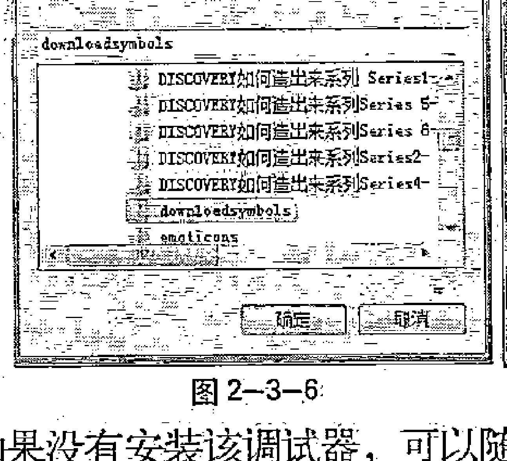

图 2-3-6

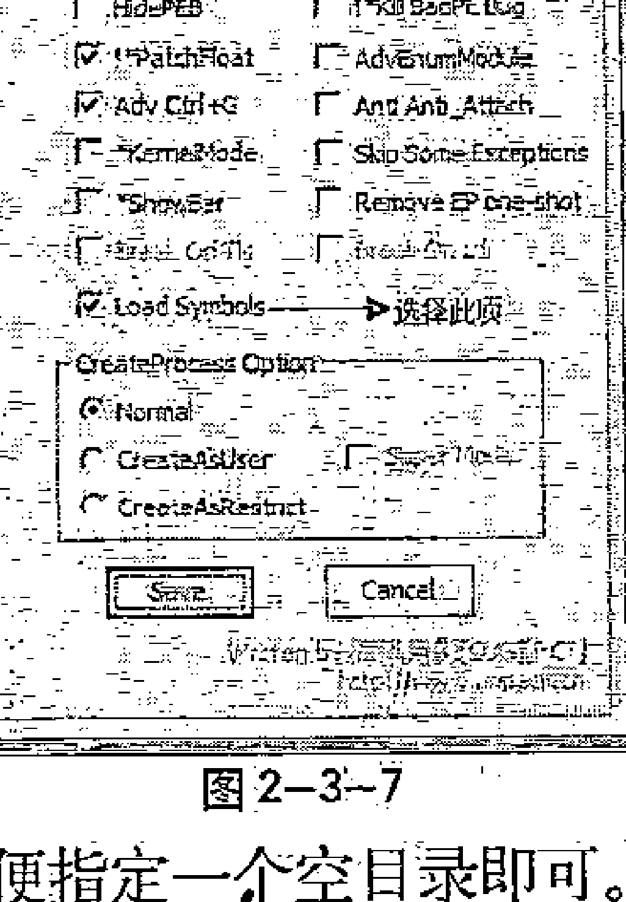

图 2-3-7

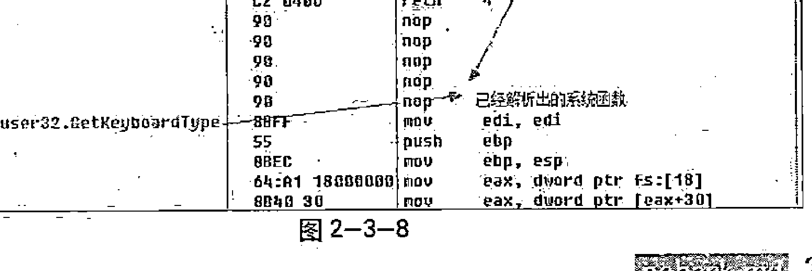

图 2-3-8

##### 5、关联到右键菜单

通过菜单的“选项→添加到资源管理器右键菜单”可以将 OD 关联到资源管理器的右键菜单；如果不喜欢第二章介绍的发送到菜单，那么这是个不错的选择。

##### 6、加载程序

OD 共两种加载程序的方式：CreateProcess 和 AttachProcess。一般情况下通过打开或者直接发送到 OD 使用的是第一种方式，OD 通过创建新的进程来启动被调试程序。在目标程序已经运行之后可以采用第二种加载方式，通过附加到进程的方法进行调试。要附加到指定的进程可以通过 OD 的菜单“文件→附加”打开附加进程窗口，选择要附加的进程确定即可。

对于部分隐藏进程可以使用命令行参数：`X:\ollydbg.exe p PID值`。其中 X 为你 OD 的安装目录，PID 为隐藏进程的 PID 值。隐藏进程的 PID 可以通过冰刃或者其他第三方进程查看器获得。

#### 2.3.2 实战内存追码

经过上一节的介绍大家应该对 OD 的基本操作也有所了解了，那么在本节中我们就用上节学到的东西来进行第一次破解，目标是“个人 Web 服务器”脱壳版。

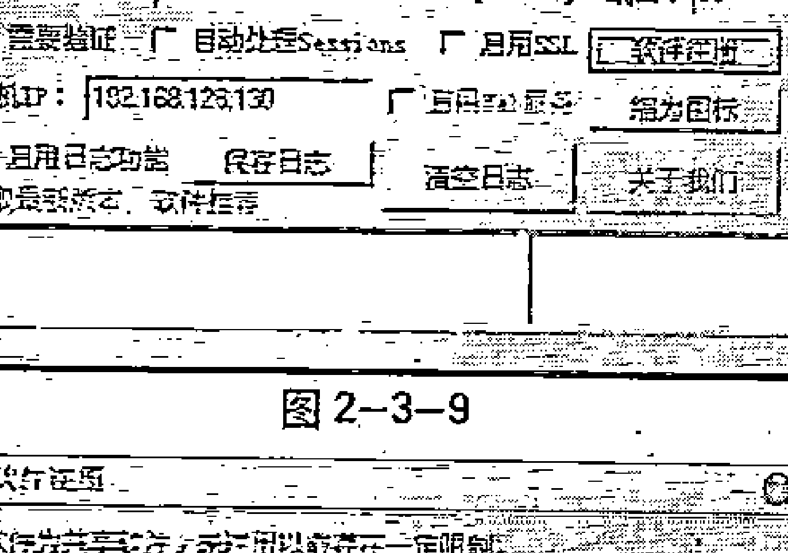

图 2-3-9

首先分析下程序的注册流程，运行目标程序，可以看到如图 2-3-9 所示的窗口，标题栏为：个人 Web 服务器—未购买用户。点击注册按钮，可以打开如图 2-3-10 所示的注册窗口。在输入用户名：obaby 和错误的注册码：1111111111111111111 进行注册后会弹出要求重新启动程序的提示，通过提示消息可以看出程序是重启验证的。点击确定后程序将自动退出。

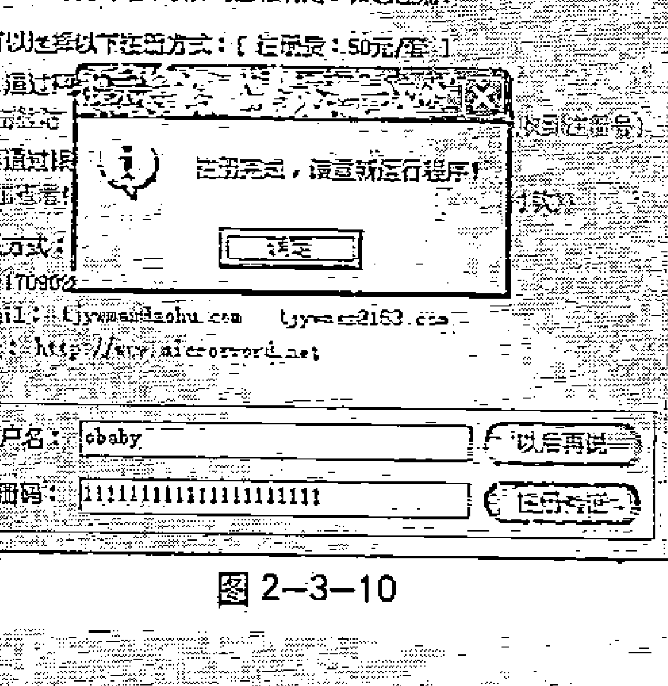

图 2-3-10

下面我们用 OD 来载入目标程序，载入后 OD 会停留在如下的代码处：

```asm
004CE7E8  55              push ebp
004CE7E9  8BEC            mov ebp, esp
004CE7EB  83C4 F0         add esp, -10
004CE7EE  53              push ebx
004CE7EF  B8 D0E34C00     mov ecx, 004CE3D0
004CE7F4  E8 C781F3FF     call 004069C0
004CE7F9  8B1D EC1B4D00   mov ebx, dword ptr [4D1BEC]
...
004CE801  F8 8A57E9FF     call 00463F90
```

这里就是程序的入口点了，通过程序的入口点特征可以知道程序是由 Borland Delphi 6.0—7.0 编写的。

直接在反汇编窗口中按 Ctrl+G 打开跳转到窗口，这里保持默认的选项“VA/API”不变，输入地址 004CD845，如图 2-3-11 所示，然后确定，就跳到了如下代码处：

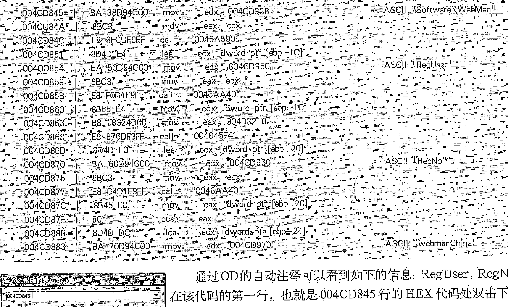

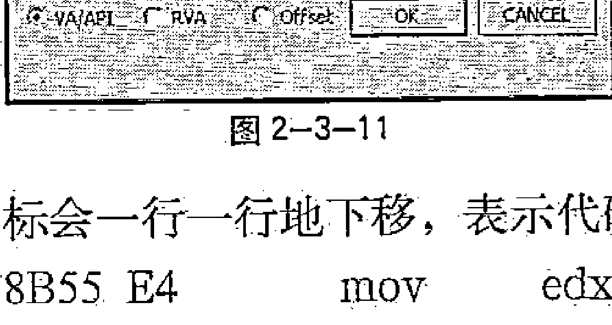

通过 OD 的自动注释可以看到如下的信息：RegUser，RegNo。在该代码的第一行，也就是 004CD845 行的 HEX 代码处双击下断点，快捷键为 F2。断点设置成功后对应的地址栏会变为红色。设置断点后按 F9 或者工具栏的“播放按钮”运行程序，程序运行之后便会中断在刚才设置断点的代码上。然后按 F8 单步进行，此时光标会一行一行地下移，表示代码是逐行运行的……

```asm
004CD860  | 8B55 E4        | mov edx, dword ptr [ebp-1C]
004CD87C  | 8B45 E0        | mov eax, dword ptr [ebp-20]
004CD895  | 58             | pop eax
004CD896  | E8 0171F3FF    | call 0040499C
```

……可以看到寄存器 EAX 中保存的是我们的用户名：obaby，如图 2-3-12 所示。继续 F8 单步往下执行，在 `[ebp-20]` 一行时可以看到我们的假注册码：11111111111111111111。继续单步执行到 `004CD895` 时，可以看到在寄存器 EDX 中保存了“6A875A6AC7AA0BCE”这样的数值，继续在 `004CD896` 的 `call 0040499C` 处可以看到程序……

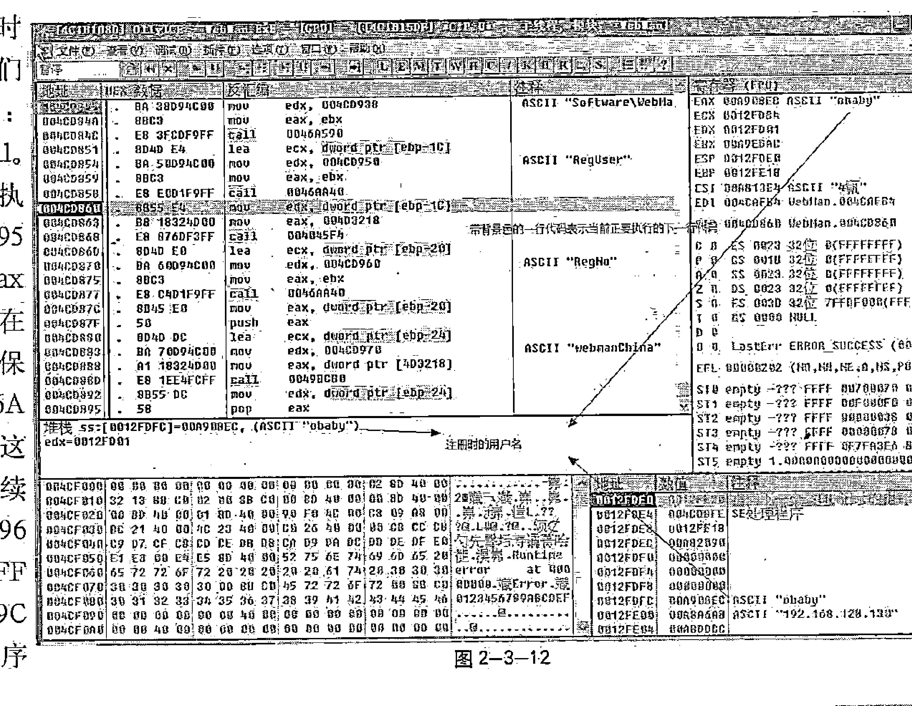

把我们的假注册码和上面得到的这个字符串分别放入了 EAX 和 EDX 两个寄存器，并且在函数 0040499C 进行了操作，如图 2-3-13 所示。那么我们就可以判断 EDX 中的数值就是真正想要的注册码了。

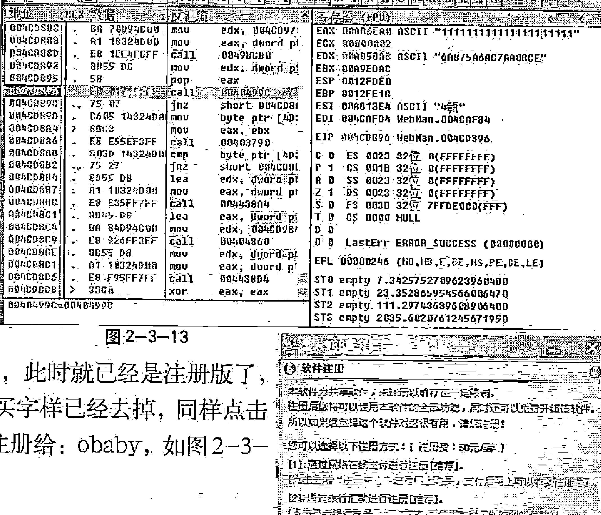

F9 继续运行程序，重新注册程序，依旧输入用户名：obaby，此时注册码输入上面得到的 EDX 寄存器的值：6A875A6AC7AA0BCE，进行注册（注意：由于注册码和用户名是一一对应的，因而我们获得的注册码只可以在用户名是第一次注册时候填入的用户名）。程序依旧提示“注册完成，重新启动程序”。注册后重新打开程序，此时就已经是注册版了，标题显示为：个人 Web 服务器，未购买字样已经去掉，同样点击软件注册按钮可以看到程序显示已经注册给：obaby，如图 2-3-14，到此我们的破解工作就完成了。

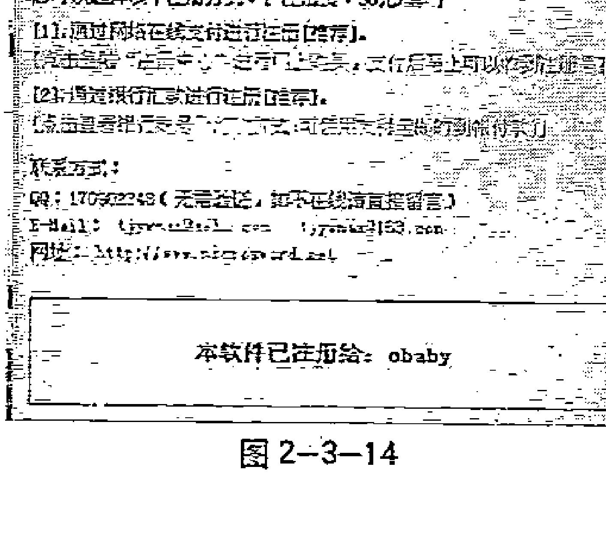

### 小结

在本章内容中主要从软件破解的环境构建和相关破解工具的使用入手，简单地介绍了破解的一些基本操作。大家对本章的内容可能会有比较多的疑惑。

那么在看完本章内容之后，可能对下面的一些问题会有较多的疑问。

- 对第二节内容的疑问：
  1. 如何确定窗口资源对应的代码
  2. 不可见的资源为什么可以直接修改字符串，ASCII 字符串和 Unicode 字符到底有什么区别
  3. 修改资源后的程序为什么还可以运行

- 而对于第三节的内容可能存在的疑惑就更多了：
  1. 为什么根据程序的入口点代码就可以判断程序的编写语言
  2. 如何知道在 004CD87C 处下断，就可以快速定位到程序注册码计算的关键代码
  3. 除了跟踪出正确的注册码是不是还有其他的破解方法
  4. 文章一开始提到目标程序是无壳版，那么如果程序加壳了又该是怎么样的操作流程，代码是不是还是一样呢

如果想到了上面的问题，那么这一章的内容就算真正领会了。其实破解最核心的就是关键代码的定位问题，只要找准了程序的关键代码，那么所有的问题也就迎刃而解了。不管是暴力破解还是追码都离不开对软件流程的分析。如果想快速定位关键代码，就需要对 Windows 操作系统和 API 比较了解，并且需要大量的经验积累。只有多加练习才能从根本上提升自己的能力。

虽然提到了这么多的问题，但是随着学习的深入，这些问题也就慢慢解开了。本书之所以开始就提到这些专业知识，就是想告诉大家所谓的软件破解并没有想象中的那么困难。只要坚定方向，刻苦学习，坚持不懈，你也可以成为逆向高手。

## 逸本溯源

## 第一章


## 第三章 追本溯源

### 3.1 文件字符

#### 3.1.1 字符编码

有时我们安装 Windows 应用程序会看到类似“1033”“2052”之类的目录，如图 3-1-1 所示，这些文件夹似乎和字符集有关，但是到底又是什么东西呢？

要理解上面的问题，首先就要对计算机的编码有一定的了解。

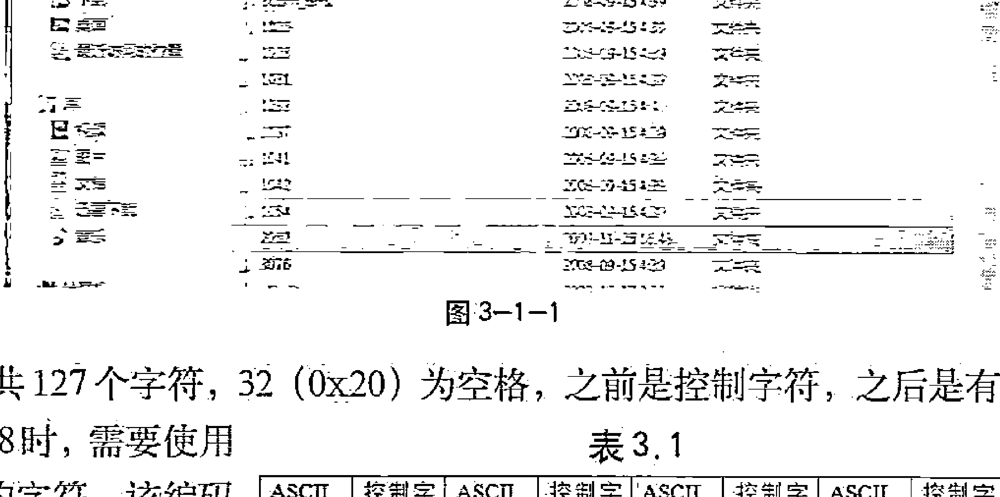

**ASCII 和 Unicode 字符集**

**ASCII**：8bit 的英文编码，实际编码中仅使用了地址的低 7 位，一共 127 个字符，32（0x20）为空格，之前是控制字符，之后是有效字符。当字符对应的编码大于 128 时，需要使用代码页（code page）来确定表示的字符。该编码模式包括 26 个大写字母、26 个小写字母、10 个数字、32 个符号、32 个控制代码和一个空格。

同时还要注意，在标准 ASCII 中，其最高位（b7）用作奇偶校验位。所谓奇偶校验，是指在代码传送过程中用来检验是否出现错误的一种方法，一般分奇校验和偶校验两种。奇校验规定：正确的代码一个字节中 1 的个数必须是奇数，若非奇数，则在最高位 b7 添 1；偶校验规定：正确的代码一个字节中 1 的个数必须是偶数，若非偶数，则在最高位 b7 添 1。

表 3.1 ASCII 码表

| ASCII 值 | 控制字符 | ASCII 值 | 控制字符 | ASCII 值 | 控制字符 | ASCII 值 | 控制字符 |
|---|---|---|---|---|---|---|---|
| 0 | NUL | 32 | (space) | 64 | @ | 96 | ` |
| ... | ... | ... | ... | ... | ... | ... | ... |
| 127 | DEL |  |  |  |  |  |  |

后 128 个称为扩展 ASCII 码，目前许多基于 x86 的系统都支持使用扩展（或“高”）ASCII。扩展 ASCII 码允许将每个字符的第 8 位用于确定附加的 128 个特殊符号字符、外来语字母和图形符号。常用字符的 ASCII 码表，如表 3.1。

小提示：0x20 这里表示十六进制的 20，对应数值转换可以参考相关计算机书籍。

**Unicode**：ASCII 字符编码的一个扩展，采用 16 位编码，共 65536 个编码，也称为宽字符集（WideChar）。在 Unicode 编码模式下所有的字符都是 16 位的，包括所有的 ASCII 编码也将高位填 0 来扩充到十六位。例如 ASCII 模式下的字符串“obaby”的 ASCII 模式为：6F 62 61 62 79（数值为十六进制模式），对应的 Unicode 编码就是：006F 0062 0061 0062 0079。

那么在内存中对应的模式就是如表 3.1.2 所示的样式：到这里可能大家会感觉到比较奇怪，为什么文件中的数值和内存中的数值不是一一对应的？这个谜团将在下一小节解开。

| 低地址 |  |  |  |  |  |  |  | 高地址 |
|---|---|---|---|---|---|---|---|---|
| 6F | 00 | 62 | 00 | 61 | 00 | 62 | 00 | 79 00 |

#### 3.1.2 字符存储顺序

对于上一节中最后的 Unicode 字符扩充，大家可能存在这样的疑问——为什么内存中的数据是 6F 00 而不是我们扩充后的 00 6F 呢？

这里就要牵涉到计算机数据存放的问题了，数据在内存中如何存放和处理器（CPU）紧密相关。处理器的数据存放方式有正序（Big-Endian）和逆序存放（Little-Endian）两种。我们常见的 Intel 处理器采用的编码方式属于 Little-Endian 类。

Little-Endian 是一个 Word 中低位 Byte 放在内存中这个 Word 区域的低地址处。这里的 Word 是指字长，8 位处理器字长为 8bit，16 位处理器字长为 16bit，同理 32 位处理器的字长是 32 位。

与 Little-Endian 对应的是 Big-Endian。Big-Endian 是一个 Word 中高位 Byte 放在内存中这个 Word 区域的低地址处。必须注意：一个 Word 的长度是 16 位，一个 Byte 的长度是 8 位。如果一个数超过一个 Word 的长度，必须先按 Word 分成若干部分，然后每一部分（即每个 Word 内部）按 Big-Endian 或者 Little-Endian 的不同操作来处理字节。

一个例子：如果我们将 0x1234abcd 写入到以 0x0000 开始的内存中，则两种不同的数据存放模式对应的结果分别是：

| 地址 | big-endian | little-endian |
|---|---|---|
| 0x0000 | 0x12 | 0xcd |
| 0x0001 | 0x34 | 0xab |
| 0x0002 | 0xab | 0x34 |
| 0x0003 | 0xcd | 0x12 |

至此，在《2.2.2 牛刀小试—修改版权》一节中对于最后 Unicode 字符的修改原理也就应该理解了。同样 PE 文件具有一定的容错性，并不是修改文件之后程序就完全无法运行，在 Windows 程序加载器检测到错误之后会自动修正该错误。在免杀中常用的入口点 +1 或者 -1，就是用的容错性原理。同样修改可执行程序的资源或者字符串只要没有导致毁灭性的错误，PE 文件依旧是可以正常运行的。

### 3.2 Windows 可执行文件

对于 Windows 下的可执行文件可能大家都比较熟悉，系统中常见扩展名为 exe、dll、ocx、sys、com 等文件都是可执行文件，又叫做 PE 文件。PE 文件被称为可移植的执行体，是 Portable Execute 的简称。

#### PE 文件格式

所谓 PE 的可移植仅限于 Windows 系统，Windows 下的可执行程序如果直接放到 Linux 系统下是不能运行的。.exe 文件和 dll 文件在文件格式上是完全一致的，唯一的差异是文件扩展名的语义区别，仅仅通过文件标志位来告诉系统该文件是 exe 文件还是 dll 文件。

PE 文件格式并不是微软开始就定义好的格式，是伴随着 Windows NT 3.1 的出现引入的一种新格式。该文件格式主要来自 Unix 操作系统的 COFF 规范。同时为了兼容旧版本的 MS-DOS 以及早期的 Windows 操作系统，该文件格式保留了 MS-DOS 中的 DOS 头，也就是 PE 文件中的第一个区域 MZ 头部，如图 3-2-1 所示，其中选定部分为 DOS 头。如果该程序在 DOS 实模式下运行，就会打印 “This program cannot be run in DOS mode” 的错误提示然后退出。

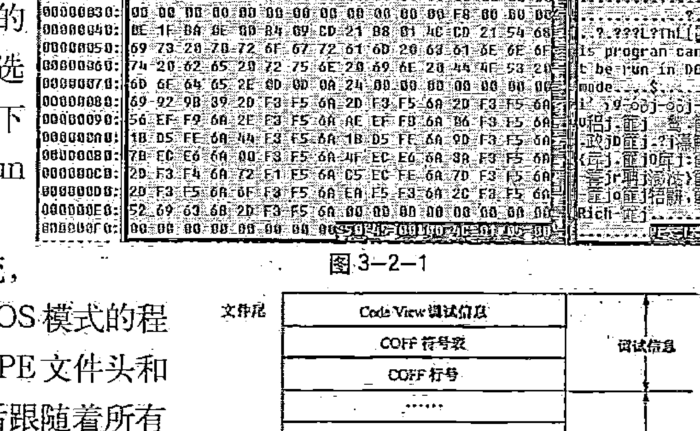

PE 文件格式被组织为一个线性的数据流，它由一个 MS-DOS 头部开始，接着是 MS-DOS 模式的程序残余以及一个 PE 文件标志，标志位之后是 PE 文件头和可选头部。之后是所有的段头部，段头部之后跟随着所有的段实体。文件的结束处是一些其他的区域，其中是一些混杂的信息，包括重定位信息、符号表信息、行号信息以及字符串数据，如图 3-2-2 所示。

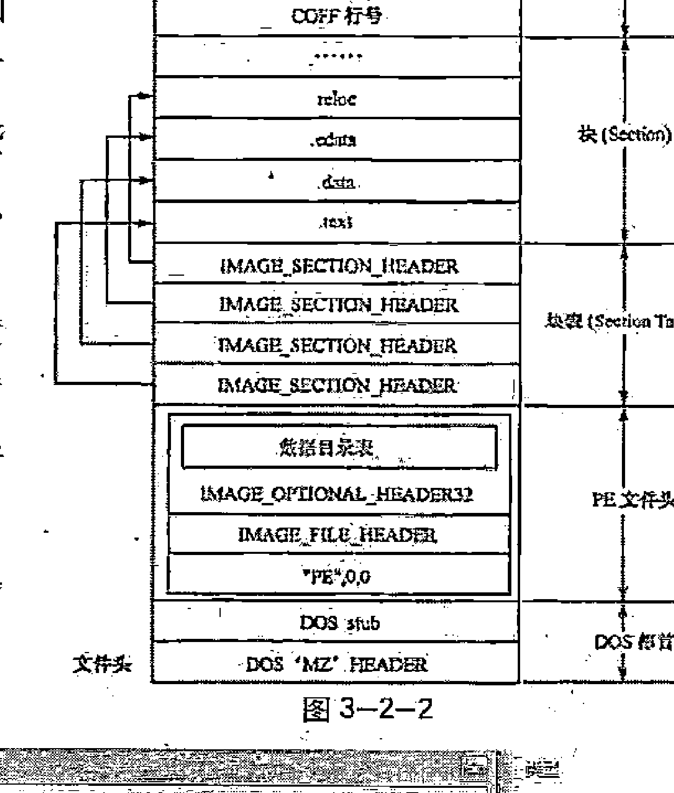

通过上图可以看到，PE 文件在格式中定义了许多区域（Section，又称区块、节等），区段中包含代码或者数据信息。每段代码都有不同的属性（读/写/执行），区段存储的内容可以是代码或者数据。默认编译的 exe 可能会看到下面的一些区段：.text、.rdata、.data、.rsrc 等，如图 3-2-3 所示（点击 PEID 主界面 “IP 段” 右侧的箭头按钮可以打开该视窗），该程序的编写语言为 Borland Delphi 6.0–7.0。


#### 常见区段

通常程序会包含如下的一些区段：

- **CODE 段（.text 段）**：编译器编译完成之后产生的区段，一般全部为代码。（不同编译器生成的 PE 文件区段不太一样，Delphi 编译生成的可执行程序默认代码段为 CODE 段，如果是 VS 编译的可执行程序则默认代码段为 .text 段）
- **.rdata 段**：PE 文件运行过程中只读的区段。
- **.data 段**：PE 文件执行过程中初始化的数据。
- **.idata 段**：输入表，包含其他外部导入的 dll 文件的函数和数据信息。
- **.rsrc 段**：PE 文件的资源区段，包括程序的图标、菜单、窗口、位图等。

同时，不同编译器生成的可执行程序，可变区段的名称是不同的。用 PEID 载入 C++ 编译的可执行程序，可以看到如图 3-2-4 所示的区段信息（.aspack 区段是脱壳之后生成的区段，另外区段名称中的“.”不是必需的）。

可执行程序的区段名称是可以改变的，运行 LordPE 执行“PE Editor”功能将会打开“打开文件”窗口，如图 3-2-5。以 Windows XP 下的记事本为例，打开文件后会打开如图 3-2-6 所示的视图窗口。


图 3-2-4


点击右侧的“Section”即可打开区段编辑窗口，在左侧选择要编辑的区段，点击右键弹出编辑菜单。这里以右键菜单的第一个功能为例，执行“Edit Section header”，打开如图 3-2-7 所示的编辑窗口。

我们修改一下这个区段的名称，也就是修改 Name 字段，改成“.obaby”。

图 3-2-5

修改完成后点击关闭，回到 PE Editor 主窗口点击“Save”，然后点击“OK”即完成了保存。现在采用 PEID 重新打开修改后的程序，可以看到 IP 段已经变成我们修改后的区段名称了，并且在区段列表中，.text 已经被 .obaby 替换了，如图 3-2-8 所示。


图 3-2-6

图 3-2-7

现在我们对于硬盘上的 PE 文件比较熟悉了，那么文件在内存中又是什么样子的呢？相关的内存地址是不是和文件的偏移地址一致？还是有一些其他的区别？

PE 文件的一个优点就是文件映射到内存中之后地址虽然变了，但是文件区段的相对位置是不变的。PE 文件加载的过程就是将 PE 文件的一部分区段映射到内存地址空间中，这样数据结构和 PE 文件在硬盘上的存储是一致的，如图 3-2-9。


图 3-2-8


图 3-2-9

#### 地址相关概念

从图中可以看到以下一些名词：

- 文件偏移地址（File Offset/Raw Offset）
- 虚拟地址（Virtual Address，VA）
- 基地址（Image Base）
- 相对虚拟地址（RVA）

当文件存储在磁盘上时，数据相对于文件头的地址，起始地址是 0，此时数据的地址称为文件偏移地址。用十六进制编辑器打开 PE 文件，编辑器左侧显示的地址就是文件偏移地址。

程序访问存储器的虚拟地址，又称为内存地址。

当可执行文件被映射到指定内存中的时候，这个内存的起始地址被称为基地址。基地址通常由 PE 文件本身决定。通常情况下，由 Visual C++ 编译的 EXE 可执行程序基地址为：00400000h。

相对虚拟地址可以简单地理解为虚拟地址相对于基址的偏移量。假如一个 exe 程序加载的基地址（ImageBase）是 400000h，代码区段开始于 401000h（虚拟地址），那么该代码区段的相对虚拟地址就是 RVA=1000，也就是 RVA=401000h-400000h=1000h。

通过第三方工具偏移量转换器（OC）可以快速地转换文件地址和内存地址，程序运行截图如图 3-2-10 所示。


图 3-2-10

#### MS-DOS 头和 PE 头

了解了区段和映射的相关内容之后，来看下文件头，这里的文件头包括 MS-DOS 头和 PE 头。首先看 MS-DOS，该头部的定义可以在 Windows SDK 中找到，相关定义如下的结构体定义（每行前面数字为到文件头的相对偏移量）：

```c
struct _IMAGE_DOS_HEADER { // DOS .EXE header
  +0h   WORD e_magic;    // Magic number
  +2h   WORD e_cblp;     // Bytes on last page of file
  +4h   WORD e_cp;       // Pages in file
  +6h   WORD e_crlc;     // Relocations
  +8h   WORD e_cparhdr;  // Size of header in paragraphs
  +0ah  WORD e_minalloc; // Minimum extra paragraphs needed
  +0ch  WORD e_maxalloc; // Maximum extra paragraphs needed
  +0eh  WORD e_ss;       // Initial (relative) SS value
  +10h  WORD e_sp;       // Initial SP value
  +12h  WORD e_csum;     // Checksum
  +14h  WORD e_ip;       // Initial IP value
  +16h  WORD e_cs;       // Initial (relative) CS value
  +18h  WORD e_lfarlc;   // File address of relocation table
  +1ah  WORD e_ovno;     // Overlay number
  +1ch  WORD e_res[4];   // Reserved words
  +24h  WORD e_oemid;      // OEM identifier (for e_oeminfo)
  +26h  WORD e_oeminfo;    // OEM information; e_oemid specific
  +28h  WORD e_res2[10];   // Reserved words
  +3ch  LONG e_lfanew;     // File address of new exe header
} IMAGE_DOS_HEADER, *PIMAGE_DOS_HEADER;
```

在这个结构体中有两个字段比较重要：第一个是 e_magic 字段，对于可执行文件的 DOS 头这个值始终是 5A4Dh，也就是 ASCII 代码 “MZ”；第二个字段 e_lfanew，也就是真正 PE 头的偏移地址，指向 PE 头的标志。用十六进制编辑器打开 Windows XP 下的计算器程序，定位到文件头即可看到 e_magic 字段为 “MZ”，如图 3-2-11。通过偏移值找到 +3Ch 处可以看到此处数值为：“F0 00 00 00”，由于 Intel CPU 默认为 Little Endian 类，字符存储是低位在前高位在后，因而恢复之后这个值也就是：“00 00 00 F0h”，定位到该偏移处即可看到可执行文件的 PE 头标志 “PE”。


图 3-2-11

通过上面的实验我们已经定位到了 PE 头开始处，那么 PE 头结构又是怎样的呢？PE Header 是 PE 相关结构 NT 映像文件头（IMAGE_NT_HEADER）的简称，同样可以在 WinNT.h 找到如下定义：

```c
struct _IMAGE_NT_HEADERS {
  +0h   DWORD                   Signature;
  +4h   IMAGE_FILE_HEADER       FileHeader;
  +18h  IMAGE_OPTIONAL_HEADER32 OptionalHeader;
} IMAGE_NT_HEADERS32, *PIMAGE_NT_HEADERS32;
```

该结构体有两个不同的版本，分别对应操作系统的 32 位和 64 位版本。这里以 32 位版本为例说明，结构体的定义是基本一致的，在以后讨论中将只针对 32 位版本。Signature 段定义了 PE 的标志信息，在一个有效的 PE 文件中这个值是 00004550h，也就是 ASCII 码的 “PE”。

IMAGE_FILE_HEADER（映像文件头）包含了该 PE 文件的一些基本信息，最重要的是其中一个域指出了 IMAGE_OPTIONAL_HEADER 的大小（SizeOfOptionalHeader 字段）。每行最前面的数值指出了该字段相对于 PE 头的偏移量：

```c
struct _IMAGE_FILE_HEADER {
  +4h   WORD   Machine;
  +6h   WORD   NumberOfSections;
  +8h   DWORD  TimeDateStamp;
  +Ch   DWORD  PointerToSymbolTable;
  +10h  DWORD  NumberOfSymbols;
  +14h  WORD   SizeOfOptionalHeader;
  +16h  WORD   Characteristics;
} IMAGE_FILE_HEADER, *PIMAGE_FILE_HEADER;
```

那么 IMAGE_OPTIONAL_HEADER 结构又是个什么东西呢？该结构体定义如下：

```c
struct _IMAGE_OPTIONAL_HEADER {
    // Standard fields.
    +18h WORD   Magic;
    +1Ah BYTE   MajorLinkerVersion;
    +1Bh BYTE   MinorLinkerVersion;
    +1Ch DWORD  SizeOfCode;
    +20h DWORD  SizeOfInitializedData;
    +24h DWORD  SizeOfUninitializedData;
    +28h DWORD  AddressOfEntryPoint;
    +2Ch DWORD  BaseOfCode;
    +30h DWORD  BaseOfData;

    // NT additional fields.
    +34h DWORD  ImageBase;
    +38h DWORD  SectionAlignment;
    +3Ch DWORD  FileAlignment;
    +40h WORD   MajorOperatingSystemVersion;
    +42h WORD   MinorOperatingSystemVersion;
    +44h WORD   MajorImageVersion;
    +46h WORD   MinorImageVersion;
    +48h WORD   MajorSubsystemVersion;
    +4Ah WORD   MinorSubsystemVersion;
    +4Ch DWORD  Win32VersionValue;
    +50h DWORD  SizeOfImage;
    +54h DWORD  SizeOfHeaders;
    +58h DWORD  CheckSum;
    +5Ch WORD   Subsystem;
    +5Eh WORD   DllCharacteristics;
    +60h DWORD  SizeOfStackReserve;
    +64h DWORD  SizeOfStackCommit;
    +68h DWORD  SizeOfHeapReserve;
    +6Ch DWORD  SizeOfHeapCommit;
    +70h DWORD  LoaderFlags;
    +74h DWORD  NumberOfRvaAndSizes;
    +78h IMAGE_DATA_DIRECTORY DataDirectory[IMAGE_NUMBEROF_DIRECTORY_ENTRIES];
} IMAGE_OPTIONAL_HEADER32, *PIMAGE_OPTIONAL_HEADER32;
```

在这个结构中同样有一个比较重要的字段就是 Magic，用来标记可执行文件是 ROM 镜像还是普通的可执行程序。如果是一般可执行程序则值是 010Bh，如果是 PE32+，也就是 64 位可执行程序，这个值是 020Bh。

再来看下我们前面提到的计算器，是不是像我们说的那样呢？仔细观察我们可以看到如图 3-2-12 所示的内容：可选头部的大小为 E0h，Magic 字段为 010Bh，也就是表示该文件是 32 位可执行程序。

可选头部决定了整个 PE 文件头的大小。至此对于 PE 头的分析也就结束了。

#### 输入表（Import Table）和输出表（Export Table）

可执行文件执行时，使用来源于其他 DLL 文件的代码或者数据的时候我们称为输入。可以简单地理解为程序在执行时需要执行一部分没有封装在 PE 文件中的代码，那么这些代码的定位就称为输入。程序通过输入表来定位可执行文件调用的 dll 文件名称和函数名称等。


通过 IMAGE_OPTIONAL_HEADER 的定义可以知道，输入表和输出表的位置已经确定，也就是 IMAGE_DATA_DIRECTORY 结构体的位置。输出表位于 PE 头 +78h 处，输入表位于 PE 头 +80h 处，通过计算偏移即可得到输入表和输出表的位置，如图 3-2-13 所示。


通过图可以发现该程序的输出表字段全部为 00，输入表字段为 802B01008C0000。那么这些字段又是什么意思呢？我们来看下输入表的定义：输入表是以一系列 IMAGE_IMPORT_DESCRIPTOR（IID）数组组成的结构，一个程序要调用几个 dll 就会有几个 IID 项，即每个 IID 对应于一个 dll。

IMAGE_IMPORT_DESCRIPTOR 可以从 WinNT.h 中找到如下定义：

```c
struct _IMAGE_IMPORT_DESCRIPTOR {
    union {
        DWORD Characteristics;            // 0 for terminating null import descriptor
        DWORD OriginalFirstThunk;         // RVA to original unbound IAT (PIMAGE_THUNK_DATA)
    };
    DWORD TimeDateStamp;                  // 0 if not bound
                                          // -1 if bound, and real date/time stamp
                                          // in IMAGE_DIRECTORY_ENTRY_BOUND_IMPORT (new BIND)
                                          // O.W. date/time stamp of DLL bound to (Old BIND)
    DWORD ForwarderChain;                 // -1 if no forwarders
    DWORD Name;
    DWORD FirstThunk;                     // RVA to IAT (if bound this IAT has actual addresses)
} IMAGE_IMPORT_DESCRIPTOR;
```

在这个结构体中，OriginalFirstThunk 包含指向输入名称表的 RVA；FirstThunk 包含指向输入表地址的 RVA。那么通过第一个字段就可以定位输入表的位置了，在本例中该值是：802B0100；反过来也就是 00012B80。在这里得到这个值是 RVA 值，需要将其转化为磁盘文件的偏移，才能在十六进制编辑器中找到该输入表，我们手工来计算这个 Offset。用 LordPE 打开 calc.exe，可以看到 00012B80 位于区段 .text 中，如图 3-2-14。


`.text` 区段的虚拟偏移是 `1000h`，物理偏移是 `400h`，因而可以得出虚拟偏移和物理偏移的差值是 `△k = 1000h - 400h = 0C00h`。那么，`00012B80` 的文件偏移就是 `12B80h - 0C00h = 11F80h`。


图3-2-15

在 C32Asm 中直接跳转到 `00011F80h`，快捷键为 `Ctrl+G`。那么这里就是输入表了，每个 IID 由五个双字（DWORD）组成，用来描述一个 DLL 文件，并且以 `NULL` 为结束字符，图3-2-15列出了输入表的一部分。

通过图3-2-15我们可以看出，该程序共引入了六个 IID 结构，第七个 IID 全部为 0，作为结束标志。这里以第一个结构体为例解析该 IID 结构体的意义，该结构如表3.2.1所示。


图3-2-16

IID 第四个字段定义了该引入的 DLL 文件的名称，这个字段值是 `42 2E 01 00`，翻转过来就是 `00 01 2E 42`，减去 `△k` 得到物理偏移地址是 `12242`。跳转到该地址可以看到引入的是 `SHELL32.dll`。那么继续来查找引入该 DLL 的函数名称，查看第一个字段 `OriginalFirstThunk`，它指向一个数组，该数组的元素为指向引入函数名称字符串的指针。如果程序的 `OriginalFirstThunk` 指针为空，可以查看 `FirstThunk` 字段，这个字段在程序运行时被初始化。

| OriginalFirstThunk | TimeDateStamp | ForwardChain | Name | FirstThunk |
|---|---|---|---|---|
| A8 2C 01 00 | FF FF FF FF | FF FF FF FF | 42 2E 01 00 | 9C 10 00 00 |

表3.2.1

`OriginalFirstThunk` 值为 `00 01 2C A8`，减去 `0C00h`，得到 `000120A8h`，定位到如下结构体处，如图3-2-16所示。可以看到该 DLL 只有一个指针，也就是 `00 01 2E 34`，然后便是 `00 00 00 00` 字符串结束了。那么我们就来定位这个函数的名称，将该值减去 `0C00` 得到 `00012234h`，也就是图3-2-16中的最后一行。跳转到该地址可以看到如下的字符串：`.ShellAboutW`。

#### 注意

计算出来的字符串并不是刚好指向函数名的字符串，而是定位到前面的两个字节，这两个字节是作为函数名（Hint）引用的，该值可以为 0。


图3-2-17

最后我们来验证下我们的分析是否正确。用 LordPE 编辑器打开 `calc.exe`，选择“Directories”打开 Directory Table 窗口，通过输入表和输出表右侧的省略号按钮可以打开输入表和输出表。该程序的输出表为空，打开输入表之后可以看到程序共导入了 6 个 DLL，并且 `SHELL32.dll` 只有一个导入函数，就是上面定位到的 `ShellAboutW`，如图3-2-17。

最简单地来讲解下输出表。输出表一般存在于 DLL 文件中，只有极少数的 EXE 文件存在输出表，主要为可执行程序修正输入地址表（IAT）提供信息和依据。由于输出表结构比较简单，不准备像输入表那样详细讲解，只是简单地介绍下结构。大家如果感兴趣，可以按照上文中的输入表分析方式自己分析即可。

输出表位置在上文中已经提到，位于 PE 头 `+78h` 处，指向一个 `IMAGE_EXPORT_DIRECTORY（IED）` 结构；该结构可以在 `WinNT.h` 中找到相关定义：

```c
struct _IMAGE_EXPORT_DIRECTORY {
    ULONG Characteristics;          // 未使用，一般为 0
    ULONG TimeDateStamp;            // 文件生成时间
    USHORT MajorVersion;            // 主版本号，一般为 0
    USHORT MinorVersion;            // 次版本号，一般为 0
    ULONG Name;                     // 模块中的真实名称
    ULONG Base;                     // 基数，加上函数是函数地址数组的索引值
    ULONG NumberOfFunctions;        // AddressOfFunction 序列中的元素个数
    ULONG NumberOfNames;            // AddressOfNames 序列中的元素个数
    PULONG AddressOfFunctions;      // 指向函数地址数组
    PULONG AddressOfNames;          // 函数字符串的指针地址
    PUSHORT AddressOfNameOrdinals;  // 指向输出序号数组
};
typedef IMAGE_EXPORT_DIRECTORY *PIMAGE_EXPORT_DIRECTORY;
```

#### 注意

- NumberOfFunctions 和 NumberOfNames 一般相等。
- NumberOfNames 此值一般表示以名称输出的函数个数，通常与输出函数总数相等。若为 0，表示模块仅仅通过序号引出。

用 LordPE 载入光盘对应章节中的 `camocx.dll`，打开输出表可以看到如图3-2-18所示的导出函数。


### 3.3 可执行文件资源

#### 3.3.1 文件资源简介

可执行文件的资源包括加速键、位图、光标、图标、菜单、串表、工具栏、版本信息等，也就是 PE 文件的各种界面。可执行文件资源以类似于磁盘目录的形式保存，资源的第一层根目录类似于文件系统的根目录，第二层目录相当于该目录下的文件夹，对应于某个类型的资源（字符串、菜单、图标或者窗口等），第三层目录则是该资源类型对应的资源信息。

以 Netbot 5.5 源代码中的资源文件 `NetBot.rc` 为例说明，用 VC 6.0 打开该资源文件可以看到如图3-3-1所示的资源目录树。

在该资源文件中根目录为 `NetBot.rc`，第二层目录分别为：24、Bitmap、Dialog 等。展开第三层目录可以看到该资源类型对应的具体资源信息。双击 Dialog 目录下的 `IDD_DDOS_DLG` 将打开程序的主窗体，如图3-3-2所示。如果展开其他资源，则可以看到其他资源类型对应的资源。


对于源码中的程序资源以 RC 文件的形式保存，可以直接编辑，那么编译之后的二进制文件又该如何编辑程序的资源呢？


图3-3-2

资源数据一般保存于可执行文件的 `.rsrc` 区段中，不能通过程序源代码定义的变量直接访问，只有在可执行文件运行时系统才会将资源映射到内存中以备访问。

PE 文件资源类型一般包括如下几种：


图3-3-3

- VC 标准类资源：包括菜单、对话框、字符串等（在 `NetBot.rc` 中保存的就是标准资源）。
- Delphi 标准资源 `Rcdata` 资源，例如第一章（PE 文件修改初识）一节中用到的 Delphi 程序，可以看“第二章最后提出的几个问题”。
- Unicode 字符：主要是 VB 编译类程序。


图3-3-4

以上提到的资源类型可以直接通过资源编辑器进行修改，例如在第二章中用到的工具 Restorator 2009。除此之外常用的资源修改工具还有：eXeScope、ResScope、ResHacker 等。利用这些工具可以直接修改 PE 文件的资源，例如图标、对话框等，并且可以通过上面的工具进行非中文软件的汉化。

用 Restorator 打开编译后的 `Netbot.exe`，在左侧的 Resource Tree（资源树）窗口中可以看到类似于编译前的资源视图，如图3-3-3所示。这个视图和编译前的视图唯一的不同就是资源名称的变化。点击工具栏的 Edit Mode 按钮启动编辑模式，软件界面将变成如图3-3-4所示。此时在窗口最右侧的资源编辑窗口中就可以编辑窗口的可见资源了，包括控件的大小、属性等。

### 3.3.2 资源修改进阶之定制PEID

在本书第三章《PE 文件修改初识》中已经提到过可执行文件资源修改的一些方法，那么在本节内容中我们继续对可执行文件进行进一步修改。

这里以 PEiD 0.94 为例演示如何给已经编译好的二进制可执行文件添加资源。如果大家仔细观察在前面的章节中出现的 PEiD 程序界面，就会发现在程序的主界面右侧多了一个图片，那么这个图片是如何增加的呢？修改好的程序界面如图3-3-5所示。


图3-3-5

通过上面的图片还可以得到的另外一个信息就是，要修改的 PEiD 是无壳的。以看雪学院网站上提供的中文版 PEiD 为模板进行下面的修改过程，如果用 0.95 版本的程序需要先进行脱壳修复处理。直接运行没有修改的 PEiD 会出现如图3-3-6所示的界面。


图3-3-6

通过对比我们可以发现我们要修改的主界面上的资源有两个：

- 程序的图标，也就是程序运行时显示在左上角的那个 Logo。
- 给程序右侧添加一个图片资源。

首先进行第一步，修改程序图标。

用 ResHacker 打开目标程序，展开左侧的资源树，依次为 `Icon→1→2052`，此时在右侧就可以看到程序的图标了，如图3-3-7所示。


图3-3-7

执行菜单的“Action→Replace Icon”打开如图3-3-8所示的资源替换对话框，执行 Open File With New Icon 选择自己的 Icon 文件。从窗口右侧选择要被替换的图标，这里有两个图标资源：102 和 119，这里需要被替换的是 102。根据程序在文件夹中的图标可以快速确定哪个是要被修改的图标文件；确定后执行 Replace 替换功能即可。


图3-3-8

替换之后在 ResHacker 右侧窗口中显示的资源如图3-3-9所示。之所以出现一些其他大小的图标，是由于替换的图标本身包含多种不同的分辨率和大小形式。

修改完成后执行 `File→Save` 保存改变即可，到此图标的修改就完成了。

下面进行第二步，增加主界面右侧的图片。首先给程序添加一个额外的图片资源，展开资源树中的“Bitmap→108”可以看到一个图片，如果和源程序中的图片进行对比的话就可以发现这个资源是“PEID 关于对话框”中的图片资源；如果要修改关于对话框的图片直接进行替换即可。


执行“Action→Add a New Resource”打开添加资源对话框，选择要添加的图片，Resource Name 填入刚才的 126，Resource Language 填入 2052，如图3-3-10所示，执行 Add Resource 功能即可。


然后，在 ResHacker 左侧的资源视图中依次展开“Dialog→101→2052”将会打开如图3-3-11和3-3-12所示的资源编辑窗口，其中3-3-11是代码视图，3-3-12是可视化 GUI 视图。


在 GUI 视图中点右键，执行 Insert Control 功能，打开控件编辑器窗口（Control Edit）。Pre-Defined Controls（预定义资源）类型选择 Bitmap，Caption 和 HelpID 填入刚才新增图片的名称，也就是 126，如图3-3-13所示。这三项设置好后按 OK 插入即可。

插入控件之后在程序的主窗口将会出现一个 BMP 图标，通过鼠标拖拽可以调整图片和主窗口的大小以及位置，如图3-3-14。


调整好位置后需要点击代码窗口上方的“Compile Script（编译脚本）”，如图3-3-15所示，将修改过的代码进行编译，编译完成后保存即可。到此我们程序的修改就算完成了。最后来运行我们的程序，看一下效果吧，如图3-3-16。


### 3.4 ELF 文件简介

Linux 下的可执行文件与 Windows 下的 PE 文件是一种完全不同的文件格式，这种文件格式叫做 ELF，是 Executable and Linking Format 的简写。ELF 文件是 x86 Linux 系统下的一种常用目标文件（object file）格式，有三种主要类型：

- 适于链接的可重定位文件（relocatable file），可与其它目标文件一起创建可执行文件和共享目标文件。
- 适于执行的可执行文件（executable file），用于提供程序的进程映像，加载到内存执行。
- 共享目标文件（shared object file），链接器可将它与其它可重定位文件和共享目标文件链接成其它的目标文件，动态链接器又可将它与可执行文件和其它共享目标文件结合起来创建一个进程映像。

ELF 文件格式比较复杂，本节内容只是简单地介绍 ELF 文件的格式，如果需要更详细的内容请参考相关技术文档。

ELF 相关文件头结构以及相关数据定义在 `/usr/include/elf.h` 文件中，在 Ubuntu 10.04 系统下，可以通过如下命令快速打开该文件。依次执行“应用程序→附件→终端”，可以打开一个类似于 Windows 系统下的命令提示符窗口，然后执行如下命令序列即可打开 `elf.h`：

```bash
cd /usr/include/
gedit elf.h
```

#### 注意

Linux 系统最大的特点就是大小写敏感，输入命令时如果提示找不到命令或者找不到文件，请检查命令输入是否正确。Linux 下的目录切换符只有“/”，如果输入“\”，将会得到和上面同样的错误提示。

如果没有安装 Linux 系统，请参考本书第七章《虚拟机系统》安装 Linux 系统进行试验。本书中如果没有特别说明，试验用 Linux 环境均指 Ubuntu 10.04 版本。

打开 `elf.h` 文件可以看到基本的数据格式定义：

```c
/* Type for a 16-bit quantity. */
typedef uint16_t Elf32_Half;
typedef uint16_t Elf64_Half;

/* Types for signed and unsigned 32-bit quantities. */
typedef uint32_t Elf32_Word;
typedef int32_t  Elf32_Sword;
typedef uint32_t Elf64_Word;
typedef int32_t  Elf64_Sword;

/* Types for signed and unsigned 64-bit quantities. */
typedef uint64_t Elf32_Xword;
typedef int64_t  Elf32_Sxword;
typedef uint64_t Elf64_Xword;
typedef int64_t  Elf64_Sxword;

/* Type of addresses */
typedef uint32_t Elf32_Addr;
typedef uint64_t Elf64_Addr;

/* Type of file offsets */
typedef uint32_t Elf32_Off;
typedef uint64_t Elf64_Off;

/* Type for section indices, which are 16-bit quantities */
typedef uint16_t Elf32_Section;
typedef uint16_t Elf64_Section;

/* Type for version symbol information */
typedef Elf32_Half Elf32_Versym;
```

ELF 常用的数据格式可以简单列表如表3.4.1。

### 3.4.1

| 名称 | 大小 | 对齐 | 描述 |
|---|---:|---:|---|
| Elf32_Addr | 4 | 4 | 无符号程序地址 |
| Elf32_Half | 2 | 2 | 无符号整型 |
| Elf32_Off | 4 | 4 | 无符号偏移地址 |
| Elf32_Sword | 4 | 4 | 有符号整型 |
| Elf32_Word | 4 | 4 | 有符号整型 |

除了表3.4.1中已经整理的数据，在文件中可以看到还有 64 位版本的定义，并且数据类型的名称和大小也有一定的变化，例如 `Elf64_Addr` 等。

为了方便和提高效率，目标文件格式提供了两种并行视图：链接视图和执行视图，如图3-4-1所示。

仔细观察上面的两幅图就会发现这两者是有区别的，但是这两个视图并不冲突，执行视图中的 “Segment” 是由链接视图中的多个权限和性质相似的 “Section” 组成的。


### 文件开始处 ELF 头部（ELF Header）

用来描述整个文件的组织结构信息。ELF 的文件头定义了 ELF 魔数、文件机器字节长度、数据存储方式、版本、运行平台、ABI 版本、ELF 重定位类型、硬件平台、硬件平台版本、入口地址、程序头入口和长度、段表的位置和长度及段的数量等信息。

#### 程序头部表（Program Header Table）

主要用来保存 “Segment” 的信息。可重定位文件由于不需要被装载，因此没有这个表。

可执行文件和共享库文件则有：

- 段表（Section Header Table）
- 保存各个段的基本属性，包括每个段的段名、段的长度、在文件中的偏移、读写权限、段的链接信息等等。

在 Linux 下执行命令：

```bash
cd /bin/; readelf -h ping
```

就会得到 Ubuntu 10.04 下 ping 文件的 ELF 文件信息了，如图 3-4-2 所示。


图 3-4-2

#### 注意

在 Linux 下可以将多个命令写到一起形成一个命令序列，例如 `cd /bin/; readelf -h ping` 表示先执行 `cd /bin/` 命令，切换到 bin 目录下，然后执行 `readelf -h ping`。这里的 ping 是 Ubuntu 下的 ping 可执行文件，而不是执行 ping 命令。多个命令之间以英文分号（;）隔开，命令序列如果有依赖关系，需要将先执行的命令写在前面，后执行的命令写在后面。同样上面的命令可以用绝对路径替换后，仅执行一条命令 `readelf -h /bin/ping` 达到同样的效果。

`readelf` 命令详细参数可以通过在命令终端中直接输入该命令获得，这里 `-h` 参数表示仅读取 ELF 头部。

ELF 头部在程序的开始部位，作为引路表描述整个 ELF 的文件结构，其信息大致分为四部分：一是系统相关信息，二是目标文件类型，三是加载相关信息，四是链接相关信息。其中系统相关信息包括 ELF 文件魔数（Magic Number，标识 ELF 文件）、平台位数、数据编码方式、ELF 头部版本、硬件平台 e_machine、目标文件版本 e_version、处理器特定标志 e_flags。这些信息的引入极大增强了 ELF 文件的可移植性，使交叉编译成为可能。目标文件类型用 e_type 的值表示，可重定位文件为 1，可执行文件为 2，共享文件为 3。加载相关信息有：程序入口点 e_entry，程序头表偏移量 e_phoff，ELF 头部长 e_ehsize，程序头表中一个条目的长度 e_phentsize，程序头表条目数目 e_phnum；链接相关信息有：节头表偏移量 e_shoff，节头表中一个条目的长度 e_shentsize，节头表条目个数 e_shnum，节头表字符串索引 e_shstrndx。

对于 ELF 文件其他结构，可以根据前几节中提到的 PE 文件的分析方法，按照结构定义循序渐进分析即可。

### 3.5 Windows 操作系统

#### 3.5.1 用户层／内核层

Windows 操作系统运行在两种模式下：用户模式（User Mode）和特权模式（Kernel Mode，又称为内核模式）。从 Intel 80386 开始，出于安全性和稳定性的考虑，该系列 CPU 可以运行于 ring0（0 级环）至 ring3（3 级环）从高到低四个不同的权限级，对数据也提供相应的四个保护级别。

运行于较低级别的代码不能随意调用高级别的代码和访问较高级别的数据，只有 ring0 层的代码才可以对物理硬件直接进行访问。Ring3 层对应的是用户模式，Ring0 层对应的是内核模式，通过图 3-5-1 可以直观地看到这两种模式的区别。

用户代码（包括各种软件和可执行程序）运行在用户模式下，操作系统代码（包括系统服务和设备驱动程序）运行在内核模式下。内核模式允许访问所有的系统内存和所有的 CPU 指令，并且可以直接对设备进行操作。

在这种不同模式的保护下，处理器让操作系统的代码比普通应用软件有更高的特权级别，从而可以为用户层代码提供一定保护，确保当应用层程序出错时只是单一程序崩溃，不会影响系统稳定性。


每个用户模式的进程都有其私有地址空间，这个虚拟地址空间的大小随着硬件平台的不同而变化。在 32 位 x86 系统架构下，每个进程总的虚拟地址空间大小理论上为 4GB。但是在默认情况下，Windows 将这部分地址空间的一半分配给进程，作为它们独有的存储区；另外一半则用作自己受保护的操作系统内存。也就是制订了类似如下规则：

- 1. 虚拟地址在 `0~0x7FFFFFFF` 范围内的虚拟内存，即低 2G 的虚拟地址，被称为用户地址。
- 2. 而 `0x80000000~0xFFFFFFFF` 范围内的虚拟内存，即高 2G 的虚拟内存，被称为内核模式地址。
- 3. Windows 规定运行在用户层的程序只能访问用户模式地址，而运行在核心层的程序可以访问 4G 的虚拟内存。
- 4. Windows 的核心代码和 Windows 的驱动程序加载的位置都在高 2G 的内核地址。
- 5. Windows 操作系统在进程切换时，保持内核模式地址完全相同。
- 6. 所有进程的内核地址映射完全一致，进程切换的时候只改变用户模式地址的映射。

通过上文已经知道 Windows 操作系统由用户层和内核层组成，那么总体的关键组件有哪些呢？一个简单的拓扑结构图如图 3-5-2 所示。

在图 3-5-2 中可以注意到，一条横线把操作系统的用户模式和内核模式分开了。横线上方是用户模式的进程，下方为内核模式的操作系统服务。


同样通过该图可以看到四种基本的用户模式进程：

- 1) **系统支持进程（System Process）**：比如登录进程（Logon）、会话管理进程（Session Manager）等。
- 2) **服务进程（Services）**：包含 Windows 系统服务，比如任务调度管理器（Task Scheduler）和假脱机服务。
- 3) **用户应用程序（User Application）**：包括六种类型：MS-DOS 16 位、POSIX 32 位、OS/2 32 位、Windows 3.1 16 位、Windows 32 位、Windows 64 位应用程序。
- 4) **环境子系统服务进程（Environment Subsystem）**：实现操作系统的环境支持。

Windows 内核模式包括以下部分：

- 1) **Windows 执行体（Executive）**：包含基本的操作系统服务，比如内存管理、线程、进程管理等。
- 2) **Windows 内核（Kernel）**：由一组底层操作系统功能组成，比如线程调度、中断、异常分发和多处理器同步等。
- 3) **设备驱动程序（Device Drivers）**：包括设备、文件以及网络驱动程序。
- 4) **硬件抽象层（HAL）**：位于操作系统内核与硬件电路之间的接口层，目的在于将硬件抽象化。也隐藏了特定平台的硬件接口细节，为操作系统提供虚拟硬件平台，使其具有硬件无关性，可在多种平台上移植。
- 5) **窗口和图形系统（Windowing and graphic system）**：实现用户图形界面（GUI）函数，比如窗口处理、界面绘制等。

上面提到的所有功能，在用户模式下均由四个核心子系统 DLL 实现：Kernel32.dll、Advapi32.dll、User32.dll 和 Gdi32.dll（对应 DLL 文件名称为 32 位操作系统下名称）。对应功能如表 3.5.1 所示：

| DLL 名称 | 实现功能 |
|---|---|
| Kernel32.dll | 操作系统核心功能实现，包括进程线程控制、文件访问、内存管理等。 |
| Advapi32.dll | 对象安全性、注册表操作等相关服务。 |
| User32.dll | 处理用户接口，控制鼠标输入、窗口和菜单管理等功能。 |
| Gdi32.dll | 图形设备接口，允许程序在屏幕或者打印机上显示或者打印图像和文本。 |

除了上面提到的模块以外，Windows 还提供了其他模块以支持一些其他功能，比如用户界面外壳（SHELL32.DLL）、通用组件（COMCTL32.DLL）以及网络组件（NETAPI32.DLL）等。

#### 3.5.2 Windows 消息机制

Windows 是一个由消息（Message）驱动的操作系统。Windows 系统的应用程序与应用程序之间、应用程序和操作系统之间的交互都是由消息机制实现的。

Windows 消息控制中心一般由三层结构组成，顶端是 Windows 内核。内核控制一个消息队列，第一级控制中心从这个队列中获取属于自己的消息，然后进行处理。处理过程中一部分是直接处理，一部分需要发送到下一级窗体和控件。第二级控制中心一般是 Windows 应用程序和 Application 对象。第三级控制中心是 Windows 窗体对象，每一个窗体都有一个默认的窗体过程，负责处理收到的各种消息。

操作系统为当前运行中的每个可执行程序维护一个消息队列。在发生输入事件之后，Windows 将事件转化为一个消息（Message，MSG）并将消息放入程序的消息队列中。程序通过执行“消息循环”代码从队列中取出消息。

```c
TranslateMessage(&msg);
DispatchMessage(&msg);
```

变量 msg 是形态为 MSG 的结构，在 winuser.h 中可以找到如下定义：

```c
typedef struct tagMSG {
    HWND   hwnd;
    UINT   message;
    WPARAM wParam;
    LPARAM lParam;
    DWORD  time;
    POINT  pt;
#ifdef _MAC
    DWORD  lPrivate;
#endif
} MSG, *PMSG, NEAR *NPMSG, FAR *LPMSG;
```

上述定义中：hwnd 是窗体的句柄；message 是消息常量，用来表示消息类型；wParam 和 lParam 是 32 位消息附加信息，具体内容由消息类型决定；time 表示消息发送时间；pt 是消息发送时鼠标所在位置。

Windows 操作系统主要包括以下几种消息类型：

- 1. **标准 Windows 消息**：这种消息以 “WM_” 打头，例如在 winuser.h 中定义的 `WM_CLOSE 0x0010` 消息；
- 2. **通知消息**：该消息是针对标准 Windows 控件的消息。控件包括按钮（Button）、组合框（ComboBox）、编辑框（TextBox）、列表框（ListBox）、ListView 控件、TreeView 控件、工具条（Toolbar）、菜单（Menu）等。每种消息以不同的字符串打头。
- 3. **自定义消息**：由编程人员自定义。

但是并不是每个控件都能处理消息，只有具有句柄（Handle）的控件才能接受消息、转发消息和处理消息。句柄（Handle）是一个由系统自动维护的 32 位数值，用于标记当前创建的窗口。当该句柄标记的窗口释放后，该句柄值同样也被释放，在其他窗体创建时该值可以被重新使用。也就是说句柄值在某一时刻是唯一的，在某一时刻两个窗体不能使用同一个句柄值，但是该句柄值是有时效性的，随窗体的释放而释放。没有句柄的控件是不能够单独存在的，比如 Label 控件，由于不能绘制自身，只能靠父窗体（Form）将其绘制出来。

然而，并非所有的句柄都是窗体句柄，Windows 系统中还有很多其他类型的句柄，如画布（hdc）句柄、画笔句柄、画刷句柄、应用程序句柄（hInstance）等。这种句柄是不能接收消息的。但不管是哪种句柄，都是系统中对象的唯一标识。本文只讨论窗体句柄。


通过 Visual Studio 附带的工具 Spy++ 可以方便地查看窗口句柄和附属关系。打开记事本，运行 Spy++，找到“窗口 00080E7C “无标题-记事本” Notepad”，展开即可看到该窗体附带的控件 Edit 和 msctls_statusbar32，如图 3-5-3 所示。

这里需要注意，“窗口 00080E7C “无标题-记事本” Notepad”中的数字并不是固定的，在不同系统上该值可能不同，并且在不同时间运行记事本得到的数值同样可能不一样。

在“窗口 0040E9A “# Edit” 这一行右键选择属性，将打开如图 3-5-4 所示的“窗口属性”窗口，将标签页切换到“窗口”可以看到该窗口的父窗口是“无标题-记事本”，也就是该分支的上一个节点。


由于 Windows 本身是由消息驱动的，所以在调试过程中如果跟踪系统消息，将可以得到一个比较基础性的结果。

#### 3.5.3 破解常用 API 函数

在系统调试过程中最常用的断点就是 API 断点。相关 API 的定义在本书前面已经提到过，在本节主要介绍比较常用的 API 函数。

- 1) MessageBoxA 从 winuser.h 中可以找到如下定义：

```c
int WINAPI
MessageBoxA(
    _in_opt_ HWND hWnd,            // 父窗体句柄
    _in_opt_ LPCSTR lpText,        // 消息框文本地址
    _in_opt_ LPCSTR lpCaption,     // 消息框标题地址
    _in UINT uType                 // 消息框样式
);
```

该函数用于创建和显示提示框，在软件调试过程中如果有对话框提示则可以对该函数下断。上面定义的是 ANSI 版本，该函数对应的 Unicode 版本是 MessageBoxW。

- 2) GetDlgItemTextA 用于获取对话框的文本信息，对应的 Unicode 版本为 GetDlgItemTextW。相关定义如下：

```c
UINT WINAPI
GetDlgItemTextA(
    _in HWND hDlg,                 // 对话框句柄
    _in int nIDDlgItem,            // 对话框标志
    _out_ecount(cchMax) LPSTR lpString,
    _in int cchMax
);
```

该函数执行后如果成功则返回当前文本长度，如果失败则返回 0。

- 3) RegQueryValueA 用于获取注册表相关键值，对应 Unicode 版本为 RegQueryValueW。相关定义如下：

```c
LONG WINAPI RegQueryValue(
    _in HKEY hKey,
    _in LPCTSTR lpSubKey,
    _out LPTSTR lpValue
);
```

```c
_inout_ LPLONG lpccValue
```

在软件注册信息与注册表相关时可以对该函数下断，以便快速定位注册信息的获取和运算代码位置。

- 4) **CreateFile、ReadFile** 文件创建和读写函数。对于注册信息保存在文件中的软件，在调试过程中这是两个关键函数。只要能够快速定位文件创建和读取代码，一般相关的注册验证关键调用 Call 也就比较接近了。相关函数定义如下：

```c
HANDLE CreateFile(
  LPCTSTR lpFileName,
  DWORD dwDesiredAccess,
  DWORD dwShareMode,
  LPSECURITY_ATTRIBUTES lpSecurityAttributes,
  DWORD dwCreationDisposition,
  DWORD dwFlagsAndAttributes,
  HANDLE hTemplateFile
);

BOOL ReadFile(
  HANDLE hFile,
  LPVOID lpBuffer,
  DWORD nNumberOfBytesToRead,
  LPDWORD lpNumberOfBytesRead,
  LPOVERLAPPED lpOverlapped
);
```

- 5) **ExitProcess** 这个 API 对于程序的注册验证没有太多用处，但却是一个比较关键的函数。一些程序在加壳之后会采用文件体积校验或者 CRC32 校验，如果程序自校验失败就拒绝运行，该校验的最主要特征就是闪屏。程序运行窗体一闪而过，或者程序运行没有反应。该现象对于脱壳之后的程序尤为明显，可能很多人认为是脱壳过程中出现错误。在出现此种错误的时候不妨对该 API 下断，看程序在加载到内存中的时候是不是发生了毁灭性错误。如果没有，那么很大可能就是程序自校验问题。该函数定义如下：

```c
VOID ExitProcess(
  UINT uExitCode
);
```

在软件逆向过程中，系统 API 是必修课。这里只是介绍了部分比较常用的 API 功能，更多的还需要自己的学习和积累。如果想在逆向过程中有一个更大的飞跃，那么学习编程是一个不错的方案。个人认为 C 和 Delphi 是个不错的选择（这里不推荐 VB，因为 VB 程序编译后需要在虚拟机 msvb60.dll 中运行，对于新手来说跟踪可能比较困难，稍微疏忽可能就会迷失在系统领空中），不要怕开始的艰难。等到你能够自己写程序破解自己程序的时候，那么恭喜你，你已经站在另外一个高度了。

## 第四章 软件动态调试


### 4.1 软件调试简介

在本书第二章大家已经接触过 OllyDbg 调试器了，这一节我们就来系统地学习什么是软件调试。软件调试过程又叫做 Debug，Bug 的确最初的 Debug 确实是和 Bug 相关。1937 年，美国青年霍华德·艾肯找到 IBM 公司为其投资 200 万美元研制计算机，第一台成品艾肯命名为：马克 1 号，又叫“自动序列受控计算机”。从这时起 IBM 公司由生产制表机、肉铺磅秤、咖啡研磨机等行业正式跨进“计算机”领域。

为马克 1 号编制程序的是女数学家霍斯·霍波。有一天，她在调试程序时出现故障，拆开继电器后发现有只飞蛾被夹扁在触点中间，从而“卡”住了机器运行。于是，霍波诙谐地把程序故障统称为“臭虫（BUG）”，把排除程序故障叫 Debug。这奇怪的称呼最终竟成为后来计算机领域的专业术语。如 DOS 系统中的调试程序，程序名称就叫 DEBUG。现在在 XP 系统下依旧可以找到 Debug 这个古老的调试程序，在开始菜单运行中输入“Debug”直接回车，就可以打开 Debug 调试器。在命令提示窗口输入“？”回车就可以看到该调试器的基本用法了，如图 4-1-1 所示。


图 4-1-1

现在，传统意义上的调试是和软件开发相辅相成的，在软件开发过程中用到的调试器一般是开发软件集成的调试器，因而这种调试又可以看作是源代码级的。在调试过程中一般接触的是高级语言，例如 C/C++ 或者 Delphi 等。

这里以 C 语言的“HelloWorld”为例讲解相关的源代码级别软件调试。运行 VS6.0，执行“文件→新建”，打开“新建”窗口，转到“工程”选项卡，选择“Win32 Console Application”，在“工程名称”中输入自己想要的工程名称，这里输入的是 helloword，如图 4-1-2。


图 4-1-2

点击确定后进入下一步，如果自己熟悉 C 语言可以选择第一项“一个空工程”；如果对 C 语言不熟悉请选择第二项“一个 Hello, World!”程序，如图 4-1-3。点击确定后将会弹出确认对话框，确认之后相关代码就已经创建好了。

选择代码编辑窗口左侧的“File View”选项卡；展开资源列表窗口中的“Source Files”，双击打开“helloworld.cpp”，如图4-1-4。此时就可以看到程序创建向导自动生成的代码了。

在代码 `printf("Hello World!\n");` 这一行点右键，执行“Insert/Remove Breakpoint”功能，给程序在该行设置一个断点。断点设置成功后，将在该行代码左侧出现一个红点，如图4-1-5所示。

按 Ctrl+F5 运行程序，此时会出现如图4-1-6所示的提示窗口，提示目标程序不存在是否创建，点击“是”即可。

此时重新运行程序就会中断在 `printf("Hello World!\n");` 这一行，如图4-1-7。此时可以看到程序还没有打印 Hello World，并且程序中断的地方显示的是我们编写的源代码，而不是在第二章中看到的汇编代码。此时继续按 F5，程序就会完全运行并打印“Hello World”。

既然源代码级别的调试程序流程这么清晰，那么为什么还要从汇编级别进行调试呢？这是因为在逆向过程中我们没有程序的源代码。通过源代码编译出的可执行程序一般会有两种版本：**Debug 版**和 **Release 版**。

Debug 通常称为调试版本，它包含调试信息，并且不作任何优化，便于程序员调试程序。Release 称为发布版本，它往往进行了各种优化，使得程序在代码大小和运行速度上都是最优的，以便用户更好地使用。通过两种不同编译方式编译出来的二进制代码是不同的。并且由于 Release 模式针对处理器进行了代码优化，在汇编级别的调试过程中，如果对系统调用和汇编指令不够熟悉，过程就会比较困难。

在编译器中选择编译模式为 Release，重新编译可执行程序，将会弹出如图4-1-8所示的提示。在该编译模式下，程序自动去掉了可执行文件的调试信息。用 OD 载入 Debug 版的编译文件，OD 会停在如下代码处：

```asm
00401120  55                push ebp
00401121  8BEC              mov  ebp, esp
00401123  6A FF             push -1
00401125  68 38214200       push 00422138
0040112A  68 D0414000       push <except_handler3>
0040112F  64:A1 00000000    mov  eax, dword ptr fs:[0]
00401135  50                push eax
00401136  64:8925 00000000  mov  dword ptr fs:[0], esp
0040113D  83C4 F0           add  esp, -10
00401140  53                push ebx
00401141  56                push esi
00401142  57                push edi
...
00401146  call dword ptr [<&KERNEL32.GetVersion>]
```

命令行程序由于需要调用系统的 DOS 模拟器，所以 OD 一旦加载程序，命令提示符窗口就出现了。一路 F8，执行到：

`00401204  E8 FCFDFFFF  call 00401005`。

这个是 main 函数，之后 F7 跟入，可以发现该 Call 的第一行代码是：`jmp main`。这个 main 就是我们在程序编写时的 main 函数，OD 已经识别出来了。对应的 main 调用关键代码如下：

```asm
00401005  E9 06000000       jmp main
0040100A  CC                int3
0040100B  CC                int3
0040100C  CC                int3
...
00401010  55                push ebp
00401011  8BEC              mov  ebp, esp
00401013  83EC 40           sub  esp, 40
...
00401028  68 1C204200       push 0042201C   ; format = "Hello World!\n"
0040102D  E8 2E000000       call printf
00401032  83C4 04           add  esp, 4
```

这时就可以看到程序调用了 printf 函数，通过该函数打印“Hello World!”。那么 Release 版的程序代码又是如何呢？同样用 OD 载入 Release 版程序，重复上面的步骤直到执行到：

```asm
004010F0  E8 0BFFFFFF   call 00401000   ; 这个调用的是 printf 函数
```

然后 F7 跟入，可以看到如下代码：

```asm
00401000  68 30704000   push 00407030   ; ASCII "Hello World!\n"
00401005  E8 06C00000   call 00401010
0040100A  83C4 04       add esp, 4
0040100D  33C0          xor eax, eax
0040100F  C3            retn
```

虽然反汇编解释器识别了我们要打印的 ASCII 字符，但是打印字符的 printf 函数并没有出现。并且和 Debug 版程序对比可以发现，原来 main 函数中的代码已经被重新拆分和优化组合，因而 Release 版程序在调试上需要更高的技术和技巧。需要调试者熟悉汇编指令，不至于迷失在代码空间。

传统意义上的调试是为了去除程序可能存在的 Bug，比如程序执行崩溃或者功能问题。对于已发布程序，也就是从互联网上可以下载到的二进制文件，基本不可能存在功能瑕疵或者运行问题。那么在逆向过程中的调试意义，就是找到我们感兴趣的代码，通常这部分代码涉及软件的注册机制（比如注册码、文件验证机制等）或者软件功能实现代码（比如系统第三方驱动程序功能的实现代码）。逆向调试的最终目的就是分析软件验证机制或者软件功能模块的实现原理代码，最终通过自己编写相关程序来达到自己想要的目的，比如注册机或者源程序代码重现。

### 4.2 断点详解

在软件调试过程中出现最频繁的一个术语就是断点。回顾第二章我们可以找到如下定义：断点（BreakPoint）是一个用于通知调试器在执行到特定点时将程序暂时挂起的信号。当程序在挂起的时候，我们称程序处于中断模式。进入中断模式并不会终止或者结束程序，程序流程可以在任何时刻继续。

- 通常断点可以分为以下三类：Int3 断点、硬件断点和内存断点。

#### 1、Int3 断点

Int3 的机器码指令为 CCh，因而又称为 CC 断点。当被调试进程执行 Int3 指令时会导致一个异常，调试器会捕捉这个异常，并且停在断点处，然后将断点处指令恢复为原指令。这也是调试过程中最常用的断点。并且该断点本质是修改指令，因而理论上可以设置无数个断点。

然而，由于该断点在中断之后修改了原指令，如果将断点设在 API 函数首地址处，程序可以通过检测函数首地址是否是 CCh 来判断该程序是否被调试。如果程序加入这个判断流程，就可以改变函数执行路线，从而使调试失败。如果想跳过这个检测机制，可以通过将 Int3 断点设在函数尾处或者函数入口点下一行来躲避检查。

通过下面代码可以检测 API 函数入口点是否被设置 Int3 断点：

```c
FARPROC addr;
BYTE Marks = 0;

if ((FARPROC &)addr = GetProcAddress(LoadLibrary("User32.dll"), "MessageBoxA")) {
    Marks = *(BYTE*)addr;
    if (Marks == 0xCC) {
        return TRUE;
    }
}
```

#### 2、硬件断点

在寄存器中用于调试的寄存器被称为调试寄存器，调试寄存器一共有八个，从 Dr0 到 Dr7。从 Intel CPU 体系架构手册中可以找到如图4-2-1所示的介绍。

- Dr0—Dr3 用于存放中断地址，例如 401000h。
- Dr4、Dr5 一般不使用，保留。
- Dr6、Dr7 用来记录 Dr0—Dr3 这四个寄存器中断地址的属性，例如 401000h 这个地址是读、写还是执行，中断的是字节、字还是双字。

通过上面分类信息可以看出，Dr0—Dr3 用于设置硬件断点，也就是在调试过程中设置的 bpm 断点。由于只有四个寄存器可以用于设置断点，因而在调试过程中最多只能设置四个硬件断点。

用 OD 载入 XP 系统下的计算器，在寄存器窗口执行右键“查看调试寄存器”功能，切换到如图4-2-2所示视图。

其中 Dr0—Dr7 就是调试寄存器；我们在 `0101248A  FFD7 call edi` 这一行设置硬件断点（右键→硬件执行断点）。设置完断点后需要 F8 一下刷新寄存器，此时就可以看到设置断点后的效果了，如图4-2-3所示。

Dr0 记录了我们当前断点地址；Dr6 记录了当前断点属性信息。要从 OD 中删除断点，需要执行菜单中的“调试→硬件断点”功能，打开硬件断点窗口，如图4-2-4所示。指定跟随可以快速定位到该断点处，执行删除功能即可删除该硬件断点。

OD 提供的“F4 执行到光标所在行”功能使用的就是一次性硬件断点，当该断点触发后将被自动删除。同样该断点可以弥补 Int3 容易被发现的缺点，在 Int3 无效的情况下可以使用硬件执行断点。但是由于寄存器数量有限，在调试过程中只能设置 4 个硬件断点。

#### 3、内存断点

用 OllyDbg 载入 XP 系统下的计算器程序，转到如下代码处：

```asm
0101250C    8B0D 08500101      mov ecx, dword ptr [1015008]
01012512    8908               mov dword ptr [eax], ecx
01012514    A1 00120001        mov eax, dword ptr [<&msvcrt.__adjust>]
01012519    8B00               mov eax, dword ptr [eax]
0101251B    A3 18500101        mov dword ptr [1015018], eax
```

在上述代码中：

```asm
mov ecx, dword ptr [1015008]    ; 读取[1015008]地址处的内存
mov dword ptr [1015018], eax    ; 对[1015018]处的内存进行写入
```

程序在运行过程中，内存会有三种不同状态：读、写和执行。设置内存断点就是通过对指定地址设置不可访问/不可写属性，当程序试图访问/写入该内存地址时就会触发异常。OllyDbg 调试器截获异常后，通过比较异常地址是否是断点地址来判断是否要中断进程等待用户操作。

以 [1015008] 地址为例演示内存断点的使用。由于对该地址执行的是读取操作，可以在数据窗口中对内存地址 [1015008] 下内存访问断点。选中要下断点的区域，执行右键“断点→内存访问”对该地址下断，如图4-2-5所示。

设置断点之后 F9 让程序运行，会马上中断在 `0101250C 8B0D08500101 mov ecx, dword ptr [1015008]` 这一行。如果要删除断点，执行右键“断点→删除内存断点”功能即可，如图4-2-6。

由于任何时刻在调试器中只能存在一个内存断点，因而删除内存断点的菜单在 OD 窗口中任何位置执行效果是一样的。同样对于代码段也可以使用内存断点。在上面中断地址之后的代码 `01012520 E8 9D020000 call 010127C2` 处下内存访问断点，程序同样会中断在该代码处。

内存断点不会修改程序源码，在 Int3 中断被检测到并且硬件断点失效的情况下，可以用内存断点来代替。但要随时谨记在调试过程中只能有一处内存断点。

由于 Windows 操作系统采用分页式内存，在 OD 中用 Alt+M 键显示内存，可以看到很多区段信息，同样这些区段也有读、写、执行属性。选中某个代码段之后执行右键，可以看到“在访问上设置中断(F2)”，通过该功能可以对整个内存区段设置断点。

该断点是一次性断点，在激活一次之后将会自动删除。一个类似的功能是“设置内存访问断点”，唯一的区别是这个断点不是一次性断点，并且这类断点仅在 NT 之后发布的操作系统有效。

感觉写的内容比较不容易理解，不知道下面是否会有详细例子来验证？也许看完这章节，通过阅读和操作实例应该能够理解一些内容。

### 4.3 OllyDbg 高级技巧

在本书第二章中已经介绍了一些 OllyDbg 的简单用法，在本节内容中将对 OllyDbg 这款调试器进行深入讲解。

#### 4.3.1 字符串参考 / Unicode 参考

在软件破解过程中最常用到的就是字符串参考和 Unicode 参考。在这两个功能中，第一个是 OD 自带功能，但是不能识别 Unicode 字符串；第二个功能需要安装额外插件支持。

这里以第二章提到的“个人 Web 服务器脱壳版”为例说明。用 OD 载入程序，执行右键“查找→所有参考文本字符串”功能，如图4-3-1所示。

执行完成后将会打开如图4-3-2所示的字符串参考窗口。

在该字符串中仔细查找，可以发现图4-3-2中的“RegUser”和“RegNo”字样。在第二章中我们已经知道这个程序是重启验证的，那么在程序关闭后，注册信息必然要保存到文件中或者注册表中，以便程序重新启动时进行验证。这个程序就是重启之后通过读取注册表键值进行验证的。

在字符串参考中选中行，直接 F2 就可以下断，或者执行右键“切换断点”功能，可以快速设置和取消断点。设置断点后该行地址将变为红色。然后就可以 F9 运行程序进行调试了。随后的调试工作可以和第二章的破解过程进行对比，可以发现这里设置断点的地方是如何找到的。

在字符串参考信息比较庞大时，可以通过“查找功能”快速定位关键字符串。关键字符串的获得可以通过观察软件界面以及提示信息，比如软件界面上的“未注册”“试用版”“注册码”，或者在注册过程中提示的“注册码错误”等提示信息，都可以作为关键字符串参考。

有的时候在破解过程中可以通过提示信息得到一些消息，但是这些消息在“字符串参考”中找不到，这时候就用到“Unicode 字符串”查找插件了。下载该插件以后，将其放入 OD 目录下的“Plugin”目录，重新打开 OD 就可以使用这个插件了。此时在代码窗口点击右键，将会发现多出一个“Ultra String Reference”菜单，在该菜单下可以看到“Find ASCII”和“Find UNICODE”两个功能菜单，如图4-3-3所示。

两个查找功能最终查找到的字符串差别不是很大。需要注意的是，通过 Ultra String Reference 查找功能打开的字符串参考窗口不支持直接 F2 设置断点；如果需要设置断点，可以直接双击选定行跳转到代码窗口设置断点。如果想返回参考窗口或者在多个窗口中切换，可以通过工具条按钮或者执行菜单“窗口”功能在多个窗口间快速切换。

#### 4.3.2 断点窗口

在软件调试过程中不可避免要设置断点，并且如果程序验证比较繁琐，就需要设置更多断点。当大量断点存在时，程序调试速度就会变慢。那么在不想删除断点的情况下，该怎样快速处理这么多断点呢？

幸运的是 OD 提供了断点窗口。在 OD 中按 Alt+B 打开断点窗口，这里显示的断点只有 Int3 断点，硬件断点和内存断点不显示，如图4-3-4所示。

从图4-3-4可以看出，该窗口显示了所有 Int3 断点以及当前断点中断地址、状态、当前地址指令以及注释信息。为了使断点窗口更加直观，便于找到关键断点，那么在调试过程中随时添加注释是个不错的方法。在断点窗口中，尤其是断点较多的时候，很难通过断点地址和地址汇编指令来判断当前断点作用。如果对设置断点的指令添加注释后，相关注释就会显示在窗口最右侧“注释”栏。

通过断点窗口的右键菜单可以快速编辑选中断点属性信息。该窗口右键菜单用途都比较明显，这里主要讲解“编辑条件”功能。编辑条件可以设置断点中断条件，也就是只有当达到我们设定条件时这个断点才会被触发，可以称这样的断点为条件断点。比如我们选中第二行，然后编辑条件，在弹出的输入框中输入 `eax=0` 后确定，就给这个断点设置了一个条件。这个条件的意思是：当程序运行到该代码处，只有 EAX 寄存器的值是 0 才会中断；如果是非 0 值，程序将继续运行。设置条件断点的代码会显示如图4-3-5的信息。

#### 4.3.3 创建可执行文件

在软件暴力破解的过程中会经常用到创建可执行文件的功能。所谓创建可执行文件，是指在原有程序代码的基础上通过修改部分代码来达到跳过验证并且重新生成可执行文件的过程。

在创建可执行文件的过程中，需要保证调试的文件已经脱壳并且已去除保护。如果对加壳的文件修改代码后直接保存会弹出提示。


可能出现上述情况的另外一个原因是修改的代码区段是可写的，在程序不同的运行时期该地址处的代码不一致，也会造成代码无法定位的错误。部分加壳的程序可以在不脱壳的情况下 Patch。

这里以个人 Web 服务器为例来讲解。如果软件使用以前实验得到的注册码已经注册成功，可以展开注册表位置 `HKEY_CURRENT_USER\Software\WebMan`，将项 WebMan 删除即可。

再次用 OD 载入目标程序，直接跳转到地址：`4CD882`，这个就是注册码验证后的关键跳转。

```
004CD882   75 27    jnz short 004CD8DB
```

动态跟踪几次可以发现，在注册码错误时不会跳转，所以要让它强行跳转，双击该行代码修改为：`jmp short 004CD8DB`。也就是无论任何条件都会跳转。


- a) 修改完代码后选中该修改区域，执行右键菜单“复制到可执行文件 -> 所有修改”，如图4-3-7所示。
- b) 执行该功能后会弹出提示窗口（图4-3-8），这里选择“全部复制”。


- c) 全部复制之后将会打开一个新的文件窗口，该窗口显示了所有的汇编代码（图4-3-9），在该汇编区域右键执行“保存文件”功能。


- d) 最后在弹出的文件保存窗口输入文件名，保存文件即可（文中提到图4-3-10），文件名是 Crack.ExE。

注意：在创建文件时最好输入与源程序不同的文件名，在大多数情况下如果不更改文件名将会覆盖原文件，并且 OD 会自动创建源程序的备份，但是在少数情况下会创建文件失败。


最后我们运行下破解后的程序“Crack.ExE”，可以看到程序主窗口的“未注册”字样已经去掉，但是点击注册按钮依旧可以看到程序是未注册版，如图4-3-11。

并且程序在退出的时候会弹出要求注册的提示窗口，如图4-3-12。这次暴力破解还有很多不完善的地方，如何去掉这些破解后的瑕疵就是我们后面要学习的内容，希望大家在学习完汇编基础知识之后能够自己动手去掉程序中的提示和相关弹出窗口。


#### 4.3.4 查找功能

OD 提供了强大的查找功能，通过 OD 的右键查找菜单可以看到如下的查找选项：当前模块中的名称（标签）、所有模块中的名称、命令、命令序列、常量、二进制字符串、已修改的命令、所有模块间的调用、所有命令、命令序列、所有常量、所有分支、所有参考文本字符串、用户定义的标签、用户定义的注释。

由于该模块功能比较多，比较繁杂，这里仅介绍比较重要的、最常使用的查找功能。

##### 1）名称查找

通过查找当前模块或者所有模块间的名称，可以快速索引程序调用的 API。两者的区别在于，当前模块的名称仅显示当前区段的调用信息，而所有模块的名称则显示了所有区段的调用信息。执行该功能后将打开如图4-3-13所示的窗口。

该窗口支持快速查找功能，如果知道要搜索的 API，可以在英文输入法状态下直接输入 API 名称就可以快速定位到该 API。比如上面窗口标题栏输入的“REGQUE”字样已经定位到了选中的函数“advapi32.RegInfoKeyA”。


##### 2）命令查找

OD 提供了两种命令查找方式：查找命令和查找命令序列。通过查找命令和查找命令序列可以快速定位代码的位置，例如在 UPX 脱壳过程中可以通过查找 Popad 命令来定位自解压结束标志。查找命令序列可以在相似命令较多的时候使用，通过右键查找命令序列打开如图4-3-14的窗口，在窗口中输入要查找的命令序列即可。


##### 3）二进制字符串查找

这个功能用得不是很多，但是在设置 Delphi 万能断点的时候会用到二进制查找功能。相关万能断点的查找将在本书后面章节介绍。

#### 4.3.5 插件功能

虽然 OD 支持插件功能，但是并不是插件越多越好，OD 默认仅支持 32 个插件。并且安装插件之后各个插件可能会存在冲突，因而不建议安装太多的插件，仅保留常用插件即可。


##### 1）命令行插件

安装命令行插件之后会在插件菜单下看到 CommandBar 菜单，如图4-3-15所示。通过该菜单的 Show/Hide CommandBar 可以在 OD 状态栏之上显示和隐藏命令提示窗口。

开启命令行插件之后就看到如图4-3-16的命令窗口。

由于该命令参数较多，这里仅列出最常用的命令，更多命令可以参考该插件自带的帮助文档，常见命令如表4.3.1所示。

| 命令 | 含义 |
|---|---|
| ? 表达式 | 计算问号后面表达式的结果，例如 `? i3*32-12` |
| bp 表达式 | 设置断点，例如 `bp MessageBoxA` |
| br 表达式 | 设置硬件读断点，例如 `br 401000` |
| bw 表达式 | 设置硬件写断点，例如 `bw 4010C0` |


##### 2）LoadDLL 插件

该插件用于直接调试或者脱壳 dll 文件。由于 dll 文件自身不能执行，只能由外部程序调用加载，所以在调试的过程中该插件作为 dll 文件的宿主运行，来实现对 dll 文件的调试。安装该插件之后如果直接用 OD 打开 dll 文件会出现如图4-3-17所示的提示。点“是”就可以载入 dll 文件了。加载 dll 文件成功之后会出现一个小窗口，如图4-3-18，该窗口是脱离 OD 窗口的，不是 OD 调试程序的子窗口。如果未出现这个小窗口，就说明 dll 文件加载的过程中可能出错了。

##### 3）OllyScript 插件

使用 OD 脚本插件可以完成一些复杂的或者重复性的操作。安装该插件之后可以看到该插件提供了脚本的终止、暂停、继续等功能。同样在脚本运行的过程中插件会自动记录日志，方便随时查阅。在运行脚本菜单中列出了最后运行的脚本，直接点击脚本就可以运行。相关菜单窗口如图4-3-19所示。


#### 4.3.6 OD 常见问题

尽管 OD 提供了强大的调试功能，但是在使用过程中可能还会出现各种各样的问题。下面就来分析一下这些常见的问题。

- 1、代码识别

有时 OD 不能识别代码，尤其是程序脱壳的过程中，解密后的代码可能不能正常识别，会显示为数据的形式，如图4-3-20。


这时就需要使用 OD 的代码分析功能，选中当前显示为数据的代码，执行右键菜单中的“分析→分析代码”，快捷键为 Ctrl+A，执行代码分析功能强迫 OD 重新分析代码。如果出现上面的情况是分析代码之后造成，则可以执行“分析→从模块中删除分析”功能，直到代码能正常显示，如图4-3-21。


- 2、数据显示

在调试的过程中有时候需要进行微调，在 OD 的数据或者代码窗口通过“Ctrl+↑”和“Ctrl+↓”可以以一个单位行模式进行滚动。

- 3、Call 调用别名显示

在反汇编窗口中可以把 Call 函数地址的形式修改为 Call 函数名称的形式。例如“Call 401000”，假如 401000 是函数 Numsum，可以将光标停靠在函数的地址 401000，按键盘的“Shift+;”打开标签框，输入新的标签名字“Numsum”即可。修改之后所有调用 401000 的 Call 都变成 Call <Numsum>。修改后的效果如图4-3-22所示。


- 4、快速定位当前调试的地址

在动态调试的过程中如果频繁翻页，那么想快速回到 CPU 当前运行的指令上，可以通过寄存器中的 EIP 值快速定位当前 CPU 执行的指令，在该寄存器值上双击即可。另外如果知道要跳转的地址，可以使用跳转到功能，快捷键为 Ctrl+G。

- 5、修改程序 EIP

将光标移到所需要的地址上，然后执行右键菜单的“此处为新 EIP”功能即可。快捷键为“Ctrl+*”。

- 6、OD 假死

在调试部分壳的时候，程序跑到断点可能会出现假死的情况。要想解决这个问题可以修改 OD 配置文件 Ollydbg.ini，修改“Restore Window”值为 0 即可。

- 7、修改执行提示无效

在修改指令的时候可能会出现未知标识符的问题，如图4-3-23。这里需要注意在修改数值时，如果该十六进制数值以字母开头，则需要在数值前面加“0”。例如这里提示的为未知标识符“push_e0”，只需要修改为“push_0e0”就可以了。


- 8、OD 防探测功能

在调试部分强壳的过程中可能出现的另外一个问题就是加壳程序检测到 OD 调试器的存在、程序拒绝运行，或者自动退出。这里就需要使用隐藏 OD 插件。如果被调试程序弹出检测到调试器提示，通过隐藏 OD 插件就可以解决问题了。

### 4.4 WinDbg 调试器

WinDbg 调试器是微软公司出品的一款功能强大的调试器，支持用户层和内核层的程序或者驱动调试。WinDbg 提供了 GUI 的用户窗口，但是该调试器大部分调试工作依旧需要用命令进行。

运行 WinDbg 调试器之前最好设置符号路径，在没有加载符号的情况下看到的堆栈都是没有任何意义的数据。运行 WinDbg 的菜单中的“File -> Symbol File Path”功能，打开如图4-4-1所示的窗口，输入“L:\downloadsymbols;SRV*L:\downloadsymbols*http://msdl.microsoft.com/download/symbols”。在设置符号路径之后，调试器在调试过程中会先从本地文件夹 L:\downloadsymbols 加载符号库，如果找不到该符号库会自动从微软的官方网站下载。另外一种方法就是从 http://www.microsoft.com/whdc/devtools/debugging/symbolpkg.mspx 下载符号库安装包进行安装。这里需要注意下载的符号库必须与系统版本一致，如果下载和系统版本不一致的符号库，在执行过程中会提示符号库不能加载。


WinDbg 提供如下的三种调试模式：

- 1. 远程调试，也就是可以从本机调试远程另外一台机器的可执行程序。例如要从 A 调试 B 的程序，那么可以在 B 开设一个远程调试接口：

```
.server npipe=PIPE_NAME  （PIPE_NAME 为调试接口的名称）

在 A 运行 WinDbg：
-remote npipe:server=SERVER_NAME,pipe=PIPE_NAME  （SERVER_NAME 为机器 B 的名字）
```

- 2. 本地进程调试可以直接用 WinDbg 打开要调试的程序，同样可以通过 WinDbg `-p "process id"` 命令将 OD 附加到一个已经开始运行的程序。
- 3. 调试多个线程和进程。如果你想控制一个进程以及它的子进程的执行，在 WinDbg 的命令行上加上 `-o` 参数即可。WinDbg 中还有一个新的命令 `childdbg` 可以用来控制子进程的调试。如果你同时调试几个进程，可以使用“|”命令来显示并切换到不同的进程。在同一个进程中可能有多个线程，“~”命令可以用来显示和切换线程。

WinDbg 加载程序之后默认会打开命令窗口，如果需要查看其它的信息则需要执行 View 菜单下的相关功能。在调试过程中最常用的窗口有：反汇编窗口、命令窗口、寄存器窗口和内存窗口。


图4-4-2

将窗口拖放调整之后程序主界面如图4-4-2所示。

在左下角窗口中可以看到当前程序的一些调试信息和输出信息，执行 lm 命令可以查看当前已经加载的符号库，如图4-4-3。

虽然 WinDbg 调试器以命令为主，但是部分调试命令已经添加了相关的快捷键映射，如果熟悉 VS 调试器的话，那么 WinDbg 还是比较容易上手的。常用调试命令以及快捷键映射如表4.4.1所示。

其余命令可以查看 Debug 菜单。在这里提供的快捷键最终还是通过向命令窗口发送命令实现指定功能的。


图4-4-3

在指定功能执行完成之后可以在命令窗口中找到相关的命令执行日志。调试器对应的功能和 OD 是完全相同的，熟悉 OD 调试器之后 WinDbg 调试器还是比较容易上手的。相关命令可以参考 WinDbg 自带的帮助文件。

表4.4.1

| 命令 | 快捷键 | 功能 |
|---|---|---|
| g | F5 | 运行调试的程序 |
| p | F10 | 单步步过，遇到 call 不跟入 |
| t | F8/F11 | 单步步入，遇到 call 跟入 |
| pc | 无 | 执行到下一个 Call 调用 |
| bp | 无 | 设置断点 |
| dd（dd/db）地址 | 无 | 显示当前地址存储的数据 |

## 绪论

### 静态分析技术


## 第五章 静态分析技术

### 5.1 静态分析技术简介

在上一章内容中对动态调试技术进行了详细的讲解。在逆向的过程中，虽然动态调试可以直观地对软件的局部流程有个比较清晰的了解，但是在整体的把握上动态调试器无法提供直观的视图或者比较清晰的流程信息。本章主要对静态分析技术进行系统的讲解。静态分析技术以 IDA 为主要工具，从 IDA 静态分析技术开始，使用 IDA 进行程序的关键代码定位和程序关键调用的流程视图分析探索。

静态分析技术是指利用反汇编、反编译手段从二进制文件获得程序原始代码流程以及代码的过程，最终实现对关键功能的重现和突破。

在静态分析过程中所要分析的程序必须是没有进行加壳保护的文件，因此我们在分析之前就需要对文件类型进行分析，这里的文件类型是指文件的编译语言、编译器版本等信息。

在本书的第二章已经介绍了 PEiD 的相关用法，这里我们来认识另外一款 PE 文件分析工具 ProtectionID。这个工具不但可以查看软件的加壳信息，还可以扫描光盘的加密方式。最新版本的 ProtectionID 具有如下功能：

- 1. 主流的 ISO 游戏程序保护检测；
- 2. 二进制文件保护监测，支持 Win32/64 可执行程序加密和压缩壳监测、.NET 加密检测、序列号保护检测；
- 3. CD/DVD 扇区复制保护检测；
- 4. 多重加壳保护检测。

程序运行主界面如图5-1-1所示。


图5-1-1

通过界面左侧的按钮可以快速在各个功能之间切换。这里主要介绍查壳功能。运行程序后点击左上角的第一个图标打开如图5-1-2所示的窗口，程序会显示当前的运行状态为 Ready，此时就可以进行查壳操作了。


图5-1-2


图5-1-3

将要查壳的程序直接拖到程序主窗口上，软件会自动分析并且给出相关的扫描结果。扫描完成后会得到如图5-1-3所示的日志信息。

## 五、壳保护基础

通过上面的分析日志我们可以得到如下的信息：

```
Link Resolved to --> G:\记事本\记事本.exe  // 快捷方式对应的可执行程序（当把快捷方式拖到该窗口后会有该行信息）

File Type : 32-Bit Exe (Subsystem : Win GUI / 2), // 文件格式 WinGUI，表示 Windows 系统下的 GUI 可执行程序

Size : 1428992 (015CE00h) Byte(s) // 文件大小

[File Heuristics] --> Flag : 00000000000000001100001000100011 (0x0000C223) // 文件启发式扫描标志

[!] UPX 3.04 compressed ! // 程序保护方式，这里是 UPX3.04
upx internal version : 013 / compression method: 0 (M_NRV2E_LE32) - Level : 09 // 程序内部版本以及压缩等级，后面的内容为文件的压缩和解压文件大小以及其他校验信息，不需要进行特殊关注。

decompressed adler32 : 0x280585AC / compressed adler32 : 0x60D27E65
uncompressed size : 0x004517F3 (04528115) / compressed size : 0x001507E8 (01378280)
original file size : 0x00442600 (04466176) / filter : 0x026 / cto.0xA9 / linkchecksum : 0x049

-- Scan Took : 0.750 Second(s)
```

程序提示的加壳信息为 UPX 3.04，并且识别出了程序的加壳参数“Level: 09”（在执行 UPX 压缩程序的时候参数 9 表示最好压缩）。现在用 PEiD 来检测一下加壳后的程序，得到的信息如图5-1-4所示。


图5-1-4

PEiD 查到的信息是：UPX 0.89.6 - 1.02 / 1.05 - 2.90 (Delphi) stub -> Markus & Laszlo。两个信息不同，那么到底哪个版本是正确的呢？这里需要说明下软件加壳用的 UPX 版本是 3.04，也就是说 ProtectionID 得到的版本信息是正确的，而 PEiD 虽然检测到的版本不正确但是识别出了源程序的编译语言 Delphi。也就是说查壳器有时候得到的壳信息并不总是正确的。由于 PEiD 采用的是入口点扫描，因而我们就可以通过修改程序的入口点来伪装成其他的壳或者编译语言。所以软件是否被加壳，查壳工具提供的信息只能作参考，实际信息还需要实际的动态调试才能知道。


图5-1-5

通过软件主界面左上角的第三个按钮可以打开 PE 文件分析器，如图5-1-5所示，通过线视图可以快速定位当前文件的一些信息。

第三个按钮提供了相关的扫描日志列表。


图5-1-6

表，列出了扫描过的文件，可以通过右键菜单对该列表进行编辑或者导出报告，如图 5-1-6 所示。

如果在上述的查壳过程中发现程序加壳了，那么就需要在脱壳之后进行静态分析，相关脱壳方法在本书第二章介绍。在程序脱完之后就可以进行相关的静态分析了，常用的静态分析有 C32Asm、W32Dasm 和 IDA。其中 C32Asm 在本书的第二章中已经有相关使用方法的介绍，W32Dasm 提供的功能完全可以由 IDA 代替，并且网络上的相关资源比较多，因而不准备对这款静态分析工具进行相关的讲解。如果对该工具感兴趣，可以参考本书第五章随书光盘中附带的《W32Dasm 使用手册》。

### 5.2 静态反编译利器 IDA

#### 5.2.1 IDA 简介

IDA 是 The Interactive Disassembler 的简写，是 DataRescue 公司出品的一款交互式反汇编工具。官方提供的 IDA 安装包已经扩展到了各个操作系统平台，目前基于 Windows 的最新版本是 5.6 测试版，基于 Linux 的通用版本一般是 5.2。基于不同的授权模式，IDA 提供两种不同版本：专业版和免费版。免费版本仅包含了基本的处理器加载模块和常见的 Windows 系统下的可执行文件分析模块。专业版也就是 Pro 版本包含了所有平台的处理器信息，并且支持几乎所有的二进制格式，包括 Windows、DOS、Linux、Mac 等操作系统平台，并且支持 Java、.NET 等文件格式。

IDA 提供了强大的交互功能，用户可以通过 IDA 的扩展功能来指导 IDA 进行更好地分析和反汇编文件，同样用户可以通过编写自己的加载器和脚本来指导 IDA 分析未知格式文件。更进一步，如果用户有未知硬件平台的处理器指令集信息，还可以编写基于特定处理器的文件分析模块。

IDA 不仅是静态分析的利器，同样借助不同操作系统提供的本地调试器或者第三方调试器，可以将 IDA 配置成本地调试器或者远程调试器，可以调试包括 Win32 位、Win64 位、Linux32 位和 Linux64 位等可执行程序。

正是由于 IDA 提供了如此强大的功能，因而在易用性上会使很多用户望而却步。在本章中主要对 IDA 从各种平台下使用方法进行讲解，主要包括：不同平台下 IDA 的安装、配置、IDA 扩展功能的使用以及联合调试等功能。

#### 5.2.2 IDA 安装

Windows 下的破解程序安装大家已经比较熟悉了，在本节内容中主要讲解 Linux 下 IDA 安装，目标操作系统为 Ubuntu 10.04。如果还没有安装 Linux 系统，请先阅读第六章虚拟机下安装 Linux 系统的相关章节。

在 Linux 下使用 IDA 有两种方式：一种是安装 Wine 加载器，直接运行 Windows 下的 IDA；另外一种方法是安装 Linux 系统下的 IDA。第二种方式比较简单，这里主要针对第二种方法进行讲解。

要安装程序必须要有程序的安装包。IDA 针对 Linux 系统发布的安装包是一个压缩文件，该压缩文件由三部分组成：第一个是 IDA 主程序，第二个是 IDA 针对开发环境的 SDK，第三个是官方推荐的插件，如图 5-2-1 所示。


## 5.2 安装

- 1. 我们只需要安装 IDA 就可以了，插件和 SDK 暂不考虑。首先要安装 Linux 下的 rar 文件解压缩软件，在终端中执行命令：`sudo apt-get install rar unrar`，输入 root 用户的密码安装 unrar。安装后进入压缩包 `DataRescue.IDA.Pro.Advanced.v5.2.Linux.YAG` 目录下，解压 `pel33lwe.tgz` 到自己准备安装 IDA 的目录下，如图 5-2-2、5-2-3。


图 5-2-2


图 5-2-3

- 2. 在终端中执行 `cd /home/obaby/Soft/ida5.2`（这里需要把路径修改为你 IDA 解压后的路径）。然后修改 IDA 主程序 `idal` 文件属性，执行 `chmod 777 idal`。在 Linux 下运行 IDA 的命令是 `./idal`，如果安装后组件和运行库齐全的话 IDA 就可以运行了；如果缺少运行库会出现如图 5-2-4 所示的提示。


图 5-2-4

- 3. 如果出现上面的缺少 `libstdc++5.so.0` 运行库，则执行如下的操作（如果没有出现错误提示可以越过这一步）。由于现在大部分的更新源已经不再包含这个运行库，所以首先要修改更新源，执行 `sudo gedit /etc/apt/sources.list` 运行 gedit 编辑器，打开如图 5-2-5 所示的 Gedit 编辑器。修改文件内容为：


图 5-2-5

```bash
deb http://tw.archive.ubuntu.com/ubuntu jaunty main restricted universe multiverse
deb http://tw.archive.ubuntu.com/ubuntu jaunty-security main restricted universe multiverse
deb http://tw.archive.ubuntu.com/ubuntu jaunty-updates main restricted universe multiverse
deb http://tw.archive.ubuntu.com/ubuntu jaunty-backports main restricted universe multiverse
deb http://tw.archive.ubuntu.com/ubuntu jaunty-proposed main restricted universe multiverse
deb-src http://tw.archive.ubuntu.com/ubuntu jaunty main restricted universe multiverse
deb-src http://tw.archive.ubuntu.com/ubuntu jaunty-security main restricted universe multiverse
deb-src http://tw.archive.ubuntu.com/ubuntu jaunty-updates main restricted universe multiverse
deb-src http://tw.archive.ubuntu.com/ubuntu jaunty-backports main restricted universe multiverse
deb-src http://tw.archive.ubuntu.com/ubuntu jaunty-proposed main restricted universe multiverse
```

然后执行工具栏的保存功能保存文件。为了安全可以先备份原文件，执行：`sudo cp /etc/apt/sources.list source.list.backup`。修改更新源后执行 `sudo apt-get update` 刷新软件更新列表。然后执行 `sudo apt-get install libstdc++5` 安装 libstdc++5 运行库。

- 4. 最后我们复制 Windows 下 IDA 安装之后生成的注册文件 `ida.key` 到 Linux 的 ida 安装目录下（需要复制相同版本的注册信息，这里需要复制 IDA 5.2 的注册文件，相关文件已经在光盘中附带）。


图 5-2-6

- 5. 到此就可以正常使用 IDA 了，再次执行上面的运行程序命令 `./idal`，会打开如图 5-2-6 所示的主窗口。

- 6. 点击主界面上的 OK 之后将会弹出软件许可协议，点击“I Agree”即可。然后就可以使用 IDA 分析文件了，同意协议之后将会打开“打开文件”窗口，选择自己要逆向的文件即可，如图 5-2-7 所示。


图 5-2-7

- 7. 最后可以创建程序的软连接到 `/bin` 目录下，以便可以直接从终端中运行 IDA 而不用切换目录，执行 `cd /bin; sudo ln -s /home/obaby/Soft/ida5.2/idal`。如果创建软连接成功，执行 `ls` 就可以看到自己创建的类似于快捷方式的 `idal` 文件了，如图 5-2-8。为了方便，同样的方法可以创建 `idal64`、`linux_server` 以及 `linux_server64` 的软连接。


图 5-2-8

到此 Linux 下的 IDA 就已经安装好了。在 Linux 下 IDA 可以用两种方式打开文件，一种是上面提到的文件打开窗口，另外一种是直接在终端中执行命令 `sudo ./idal file`，其中 `file` 是要分析的文件。

#### 5.2.3 IDA 配置

通过适当的配置，在使用 IDA 逆向的过程中可以提高工作效率。Linux 下的 IDA 可视化窗口比较简单，与 Windows 系统下的可视化图形界面相比，在 Linux 系统下 IDA 仅提供了少量的可配置选项，并且所有配置选项与 Windows 下的设置方式一致。在本节内容中以 Windows 系统下的图形界面配置功能为例讲解。Linux 系统下的 IDA 配置可以参考 Windows 系统下相关配置选项进行设置。


从图 5-2-9 可以看出 IDA 默认提供的按钮比较多。为了扩大 IDA 工作区的面积，可以将工具栏一些不常用工具从面板删除。通过菜单的 Option 选项，或者在工具栏点击右键设置要显示的按钮可以自定义工具栏，但是这种修改模式仅对当前工程生效，在分析新的文件或者打开新的 IDA 的时候所有的面板都会重置。要想修改默认配置，只能修改 idag.exe 的配置文件 idagui.cfg。

idagui.cfg 是文本文件，在修改之前最好备份该文件，并且不要使用记事本修改该文件。由于记事本对部分字符的识别问题，强行修改保存文件就会使配置文件损坏，再次运行 IDA 的时候会出现文件损坏提示，最好用 UltraEditor 等工具修改该配置文件。

如果想要控制反汇编显示模式以及其他的配置选项则需要修改 ida.cfg，这也是个文本文档，提供了 IDA 的基本配置选项，包括反汇编显示、默认加载器、处理器类型配置等相关信息。

##### 5.2.3.1 显示中文字符串参考

默认 IDA 是不显示中文字符串参考的，要想显示中文字符串则需要修改 ida.cfg 的 AsciiStringChars 配置选项，将 cp866 version 注释掉，恢复 full version 配置选项。

```cfg
// [cp866 version]
// AsciiStringChars =
//   " !\"#$%&'()*+,-./0123456789:;<=>?"
//   "@ABCDEFGHIJKLMNOPQRSTUVWXYZ[\\]^_"
//   "`abcdefghijklmnopqrstuvwxyz{|}~"

// [full version]
AsciiStringChars =
  "...包含扩展字符与中文字符范围..."
```

```c
// ...
AsciiStringChars=
"\xA\xD\xA-\xD" "\x1B"
" !\"#$%&'()*+,-./0123456789:;<=>?"
"@ABCDEFGHIJKLMNOPQRSTUVWXYZ[\\]^_"
"`abcdefghijklmnopqrstuvwxyz{|}~"
```

```text
...（示例字符与配置片段）
```

##### 5.2.3.2 显示文件修补菜单

IDA 集成了文件修改功能，但是默认情况下该菜单不会在菜单中显示，可以通过修改 `idagui.cfg` 文件来重新启用该菜单。用 UltraEdit 打开该配置文件，搜索 `DISPLAY_PATCH_SUBMENU`，将配置信息改成 YES，保存文件即可。现在重新打开 IDA 载入文件，选择要修改的字节，执行菜单的“Edit→Patch program”，通过子菜单就可以修改指令了，如图 5-2-10 所示。


##### 5.2.3.3 反汇编选项

通过菜单的“Options → General”选项可以配置 IDA 反汇编信息，这些配置选项控制了反汇编窗口的代码显示模式。配置窗口如图 5-2-11 所示。

在配置文件中与上图的配置信息相对应的是文本格式区段（Text representation），关键配置信息功能如下：


```ini
//
//      Text_representation
//

OPCODE_BYTES          = 0    // 机器码字节数
INDENTION             = 16   // 指令缩进，可以修改为 0，使代码更为简洁
COMMENTS_INDENTION    = 40   // 注释缩进，默认为 40
MAX_TAIL              = 16   // 交叉参考递归深度，默认为 16
MAX_XREF_LENGTH       = 80   // 交叉参考右边距
MAX_DATALINE_LENGTH   = 70   // 参数最大长度
SHOW_AUTOCOMMENTS     = NO   // 显示自动注释
SHOW_BAD_INSTRUCTIONS = NO   // 坏指令标记
SHOW_BASIC_BLOCKS     = NO   // 在基础块之后设置边界
SHOW_BORDERS          = YES  // 显示代码数据边界
SHOW_EMPTYLINES       = YES  // 显示空行，增加代码的可读性
SHOW_LINEPREFIXES     = YES  // 显示行前缀（例如 1000:0000）
SHOW_VARIABLEMARKS    = NO   // 在行前缀中显示星号
SHOW_SEGMENTS         = YES  // 在地址中显示区段名称
USE_SEGMENT_NAMES     = YES  // 用区段名称代替区段偏移
SHOW_REPEATABLE_COMMENTS = YES // 显示重复注释（禁用该项可以提高 IDA 速度）
SHOW_SP               = NO   // 在行开始显示堆栈指针
SHOW_SUSPICIOUS       = NO   // 显示 <void> 标记
SHOW_XREFS            = 2    // 显示交叉引用
SHOW_XREF_FUNC        = YES  // 在交叉引用中显示函数名
SHOW_XREF_TYPES       = YES  // 显示交叉引用类型标记
SHOW_XREF_VALUES      = YES  // 显示交叉引用值
SHOW_SEGXREFS         = YES  // 交叉引用中显示区段信息
SHOW_SOURCE_LINNUM    = YES  // 显示源代码行号
SHOW_ASSUMES          = YES  // 产生 assume 标记
SHOW_ORIGINS          = YES  // 产生 org 标记
USE_TABULATION        = YES  // 在输入文件中使用 "\t"
DEL_CODE_COMMENTS     = YES  // 指令删除之后自动删除对该指令的注释
MAX_ITEM_LINES        = 5000 // 每个对象的最大代码数，默认为 5000
```

值可修改为更大的数值。

##### 5.2.3.4 调用交叉引用参考（Call Graph View，针对 Linux 系统）

在 Windows 系统下的交叉引用参考是通过 wingraph32.exe 生成调用树的，但是在 Linux 系统下不能直接运行 Windows 下的 wingraph32.exe。那么要想在 Linux 系统下查看图形调用树有两种方法可以实现：第一种是使用 Wine 模拟器加载 wingraph32.exe；第二种方法是使用第三方图形生成器（graph generator）aiSee，使用 aiSee 替换 wingraph32.exe 来实现图形化的调用树参考。

第一种方法只要安装 Wine 后，修改 IDA 配置文件 ida.cfg，将如下代码：

```
// Program to visualize graphs
GRAPH_VISUALIZER = wingraph32.exe --remove --timelimit 10
```

修改为：

```
GRAPH_VISUALIZER = "wine /home/obaby/Soft/ida5.2/wingraph32.exe --remove --timelimit 10"
```

（这里需要修改后面的 wingraph32.exe 路径为自己的安装路径）。

第二种方法首先到 aiSee 官方网站 http://www.aisee.com 下载与自己操作系统相对应的版本，下载之前需要选择自己使用 aiSee 的用途，这里可以按照自己的使用目的选择即可。下载后的安装包为 tgz 压缩文件，直接使用 Ubuntu 自带的文件解压工具解压即可。解压后可以看到如图 5-2-12 所示的文件目录列表。


图 5-2-12

sh 是安装脚本。

在终端中执行命令：`cd /home/obaby/Soft/aiSee; sudo sh install.sh` 进行安装，如图 5-2-13 所示。

执行安装之后可能会提示没有权限创建目录、文件已经存在。忽略该错误即可，在随后的提示中按照上图输入的交互回答进行安装即可。安装完成后就可以通过命令：`/usr/local/bin/aisee3` 运行程序了。如果在终端中直接输入 `aisee3` 能够打开如图 5-2-14 所示的 GUI 图形窗口，就说明安装成功了，否则请重复上述步骤。

安装后修改 IDA 配置文件的 GRAPH_VISUALIZER 配置信息为 `GRAPH_VISUALIZER = "/usr/local/bin/aisee3"`（同样要修改该路径为 aiSee 在自己系统上的绝对路径）。


图 5-2-13


图 5-2-14


图 5-2-15

修改完成后重新启动 IDA 就可以查看调用图形视图（Call Graph View）了，效果如图 5-2-15、5-2-16 所示。在 Linux 下使用 Xref 图形参考时，原 IDA 窗口将变为不可用，只有在关闭图形参考之后才能重新回到 IDA 主窗口中。

通过交叉引用视图以及调用树可以快速地理清相关函数之间的关系，能够提高逆向工作效率，达到事半功倍的效果。相关交叉引用以及调用树将在后续章节中详细介绍。


图 5-2-16

### 5.3 IDA 文件处理

#### 5.3.1 载入文件

执行 IDA 菜单 File→Open 功能打开一个新的文件时，会打开如图 5-3-1 所示的文件加载窗口。在加载文件模式对话框中显示 IDA 认为可能的文件格式以便选择。这个列表是 IDA 通过 loader 目录下的文件加载器动态创建的。如果要分析的目标文件是可执行程序，那么会在列表中看到 Portable executable for 80386 (pe.ldw)、MS-DOS executable (EXE) [dos.ldw] 以及 Binary File 三个选项。对应每个选项前边为识别的文件类型，后面为当前文件类型的加载器信息。


通过本书中《3.2 Windows 可执行文件》一节的介绍，大家对 Windows 下的可执行文件应该比较熟悉了。那么在这里出现前两个选项也就比较容易理解了：PE 文件格式可以看作是 MS-DOS 可执行文件的扩展；最后的 Binary File 在加载任何文件时都会显示，这是 IDA 提供的对未知文件格式的最低级加载方法。需要注意，IDA 对于文件格式的识别分析引擎是基于文件头的分析。如果将可执行文件的 PE 头通过十六进制编辑器保存为单独的文件，在分析被保存的文件时虽然该文件只有 PE 头信息，IDA 依旧会按照 PE 文件的解析方式尝试解析文件，相关实验可以自己测试。

IDA 的文件加载窗口主要可以分为下面几个部分：

- 1. **文件类型识别**：也就是上文中提到的加载器以及 IDA 已经识别的文件格式。有的时候 IDA 可能会只显示一个文件格式 Binary File，那么也就是表示目前 Loader 目录中没有合适的加载器来识别这种类型的文件。这时如果想要继续分析文件，那么就只能按照自己的理解选择适当的处理器类型来分析文件。
- 2. **Processor Type**：显示了当前 IDA 中已经能够正常识别的处理器指令集的处理器类型。这个处理器列表基本包含了所有不同型号的处理器。对处理器的选择将会直接影响到反汇编指令的显示。多数情况下 IDA 会从文件头中获取相关的处理器信息，如果不能获取有效信息，那么在继续执行之前必须手工指定处理器类型。
- 3. **加载选项**：可以选择 IDA 加载的资源类型，可以根据不同的分析需要选择是否加载资源、是否手工加载以及是否创建 Flat 组选项。
- 4. **核心选项（Kernel Option）**：这里提供了两个不同的核心选项，用于配置特定的反汇编分析选项以适应某些特殊要求。在大多数情况下保持这些选项为默认即可，通常默认配置能让 IDA 发挥最佳性能。
- 5. **处理器选项（Processor option）**：用来给处理器模块添加额外的配置选项，但是该选项功能有限，并且在大多数情况下这个选项会受到处理器模块以及模块创建者编程能力的影响。

#### 5.3.2 IDA 数据库文件

选择加载项单击 OK 之后，IDA 才开始分析文件。IDA 将文件加载到内存之后开始按照加载器的配置信息对文件进行分析。在分析过程完成之后，IDA 会创建 4 个不同扩展名文件，名称与被分析程序的名称一致。例如分析的文件为 Demo.exe，那么创建的 4 个文件就是：Demo.id0、Demo.id1、Demo.nam 和 Demo.til。这四个文件对应的功能如下：

- 1) **id0**：二叉树形式的数据库文件，用于保存被分析文件的信息；
- 2) **id1**：包含描述每个程序字节的标记信息；
- 3) **nam**：包含 IDA 的 Names 窗口显示的程序位置索引信息；
- 4) **til**：存储数据库与本地类型定义有关的文件。

在 IDA 的运行过程中四个文件会一直存在，直到 IDA 关闭的时候才会给出相应的数据库处理提示，如图 5-3-2 所示。


默认情况下 IDA 会选择打包数据库（Pack database (Store)）。如果按照默认设置退出，IDA 会将上面提到的四个不同扩展名的文件打包为一个扩展名为 idb 的文件。当再次分析同一个文件时，如果在程序目录下有重名的 idb 文件，IDA 会直接加载 idb 文件，并且将相关文件重新拆分为四个文件。也就是说，被分析的程序一旦分析过一次之后，IDA 不会进行二次分析，以后所有操作都是针对数据库文件进行的，已经完全脱离了可执行文件本身。

对应其他选项意义如下：

- 1) **不打包数据库（Don't pack database）**：该选项仅会刷新四个数据库文件，在关闭 IDA 时不创建 idb 压缩数据库文件，通常不建议该选项。
- 2) **打包数据库（存储）（Pack database (Store)）**：默认选项，在关闭 IDA 之后创建 idb 数据库文件，并且创建 idb 数据库之后原来的四个文件将被删除。
- 3) **打包数据库（压缩）（Pack database (Deflate)）**：功能和第二个相同，区别在于该选项会压缩数据库文件。
- 4) **收集垃圾（Collect Garbage）**：在创建数据库时删除没用的内存页面，用于创建体积更小巧的 idb 文件。
- 5) **不保存数据库（DON'T SAVE the database）**：用于放弃对当前数据的更改。执行后 IDA 会删除 4 个数据库组件文件，保留原有 idb 文件，类似撤销功能。但 IDA 不支持真正的逐步撤销，对数据库的每一步修改都不能撤销。

#### 5.3.3 IDA 崩溃处理

通过上面的介绍大家已经见识到了 IDA 的强大功能。既然软件这么强大，那么稳定性应该是不错的。但事实并非如此，不管你相信与否，IDA 会时常崩溃。造成 IDA 崩溃的原因可能是某些插件问题，也有可能是 IDA 自身的 Bug 造成的。当 IDA 崩溃的时候程序来不及保存数据，那么在崩溃之后就会剩下上面提到的四个数据库文件。当重新启动 IDA 的时候会出现如图 5-3-3 所示的提示。


在该提示窗口中如果选择 Overwrite，那么 IDA 会重新分析文件并且将原有的数据库文件覆盖；如果选择 Cancel，那么 IDA 将放弃分析文件；选择 Load existing 选项将会弹出如图 5-3-4 所示的数据修复提示窗口。


如果选择 Yes，那么 IDA 会尝试修复上次没有来得及关闭的数据库文件。如果修复成功，那么 IDA 会加载修复后的数据库；如果修复失败，IDA 会弹出如图 5-3-5 所示的错误窗口，在点击 OK 后 IDA 将自动退出。


图 5-3-5

如果出现上面的错误提示，可以尝试再次打开该文件；如果没有出现意外的话，IDA 会直接加载已经存在的数据库文件。虽然 IDA 可能经常崩溃，但是对于崩溃文件的处理还是比较安全可靠的。如果不想在分析重要文件的时候丢失数据，那么最好的办法就是在分析过程中时常备份 idb 文件。

### 5.4 IDA 桌面（Desktop）

通过 5.2 小节的介绍，大家应该对 IDA 的主窗口（桌面）有了一定了解。在这一节中将详细介绍 IDA 各个子窗口及其组件的功能。主窗口可以划分为如图 5-4-1 所示的 8 个区域。


图 5-4-1

- 1. **工具栏（Toolbar area）**：包含了在文件分析过程中最常用的一些工具。通过菜单“View→Toolbar”可以添加或者删除工具栏按钮。通过按钮的拖拽功能可以重新放置按钮到自己喜欢的位置。
- 2. **导航带（Overview navigator）**：以线性方式显示了当前加载文件的地址信息，默认情况下导航带会覆盖整个地址段。通过拖拽可以将导航带脱离工具栏，如图 5-4-2 所示。

在导航区域中点击鼠标右键可以选择自己想要的放大或者缩小比例，来更加方便地进行快速定位；右键缩放菜单如图 5-4-3 所示。

通过导航带两侧的箭头可以快速拖动代码定位显示，改变反汇编窗口显示的代码位置。在窗口右侧显示了不同颜色对应的数据类型。通过导航条的颜色可以快速得知当前光标所在地址的数据类型。IDA 菜单“Options → Colors”的 Navigation bar 选项提供了导航带默认数据类型的颜色设置功能，如图 5-4-4 所示。


图 5-4-2

图 5-4-3


图 5-4-4

通过导航窗口的“Additional display”菜单可以快速定位到反汇编代码的其他位置。

- 3. **标签栏（Tabs）**：提供了当前已经打开子窗口标签，通过在标签栏标题上单击可以在多个视图中快速切换。通过图 5-4-1 可以看出当前已经打开的窗口包括：IDA View-A（反汇编窗口——如果打开多个反汇编窗口会依次为 IDA View-B、IDA View-C……）、HexView-A（十六进制窗口——同 IDA View 窗口一样，打开多个窗口会按字母序号命名）、Structures（结构体窗口）、Enums（枚举窗口）、Imports（输入表窗口）、Exports（输出表窗口）。如果需要其他参考信息可以通过菜单“View → Open Subviews”功能打开新的参考窗口。
- 4. **反汇编窗口（Disassembly View）**：反汇编窗口是主要的数据展示窗口，并且该窗口提供了两种不同的显示风格，第一种是图形视图，如图 5-4-5 所示；第二种是文字视图，如图 5-4-6 所示。


图 5-4-5

通过图形视图可以快速分析程序流程以及函数对于程序流程的影响。当两种视图激活之后，可以通过键盘“空格键（Space Bar）”在两种视图中快速切换。通过菜单“Options → General”打开“通用选项窗口”，切换到 Graph 标签页，可以选择 IDA 打开文件时反汇编窗口的默认显示风格，如图 5-4-7 所示。

- 5. **图形全局视图（Graph overview）**：当图形视图激活的时候，只有很少的机会图形能够完全显示在窗口中，这时 IDA 就会激活图形全局视图。通过在该窗口点击或者拖拽可以在 IDA View-A 中快速定位代码。同样通过该缩小的全局视图可以对程序流程有个整体把握。该窗口在文本模式显示时将自动隐藏。


- 6. **消息窗口（又叫日志窗口 Message Window）**：用于显示 IDA 在分析文件过程中执行的一些操作，或者显示 IDA 在分析过程中出现的错误信息。如果运行 IDC 脚本，脚本的日志输出同样会在该窗口中显示。
- 7. 在没有安装插件的情况下，这个区域显示的是名称（Names）和字符串窗口（Strings）。如果安装了 Hex-Rays 插件，那么这里显示的是函数窗口（Functions Window）。该窗口显示了当前已经识别的或者插件认为可能是函数的一些数据，包括函数所在区段、地址等信息，如图 5-4-8 所示。


- 8. **命令窗口（IDC）**：用于执行简单的 IDC 命令或者命令序列，命令执行结果会在消息窗口显示，包括命令执行结果和执行错误信息（命令运行出错）。


### 5.5 IDA 常用技巧

在动态调试程序的时候我们需要使用各种技巧来快速定位程序的关键代码，在逆向的过程中快速定位关键代码也是一项必备并且非常重要的工作。通过合理使用 IDA 提供的各项功能可以有效减少工作量，达到事半功倍的效果。

#### 5.5.1 字符串子窗口（Strings Subview）

通过 IDA 菜单“View -> Open Subviews -> Strings”（快捷键为 Shift+F12）可以打开字符串子窗口，这里以第五章光盘中的 String.exe 为例，字符串窗口界面如图 5-5-1 所示。该窗口提供了当前字符串对应的地址（Address）、长度（Length）、类型（Type）和字符串数据（String）信息。通过上图我们已经可以得到程序的相关提示信息：Wrong Serial!、Valid Serial! 等。在选中的字符串行直接双击就可以转到程序代码处，例如在 `.rdata`：

`00432A9C 0000000E C Wrong Serial!` 一行直接双击左键，将会跳转到如下代码处：


图 5-5-1

XREF 显示了当前引用该字符串的函数以及针对字符串引用函数的偏移地址，这里是 DialogFunc 函数，表示引用地址在该函数起始地址的偏移量为 168（偏移量为十六进制值）。双击该函数可以直接跳转到该函数的引用地址处，如图 5-5-2 所示。

至此这个 Keygenme 的验证流程就已经比较清晰了，00403976 的 jz 跳转决定了输入注册码之后验证过程中的提示信息；两条分支分别对应于 `Wrong Serial!` 和 `Valid Serial!`。通过字符串名字已经可以确定每个分支对应的最终结果了，如果想要爆破该程序，只要修改 00403976 一行的 jz 跳转即可。


图 5-5-2

该功能和 OD 的字符串参考功能类似，但是提供的功能要比 OD 的字符串参考功能更为强大。在软件逆向过程中可以通过字符串参考功能定位程序的关键功能代码，或者程序的注册验证流程代码。

#### 5.5.2 输入表／输出表子窗口

在字符串参考无效（无法从中找到有价值的字符串信息）的情况下，可以根据程序的验证方式来寻找程序关键点，比如文件校验或者注册表校验。假设程序采用的是重启验证，所有程序信息都保存在注册表中，那么读取注册表用到的系统 API 可能是 `RegOpenKeyExA`、`RegQueryValueA`，或者 `RegQueryValueExA` 等。那么此时如果想要快速定位代码的话，可以使用输入表／输出表子视图。

在本节中我们以随书光盘第五章中的 Crackme.exe 为例讲解。该 Crackme 会检测注册表项 `[HKEY_CURRENT_USER\Software\Microsoft\Windows\CurrentVersion\test]` 下的 `jobaby` 字符串值来判断是否通过注册；如果该字符串值等于“www.nohack.me”则会显示“恭喜，注册通过！”，否则会显示“太糟糕了，注册失败！”

深入分析：该 Crackme 关键代码如下（该程序为 Delphi 编写，相关源码可以在光盘中找到）：

```pascal
procedure TForm1.Button1Click(Sender: TObject);
var
  test: string;
begin
  s := tregistry.create;
  s.rootkey := HKEY_CURRENT_USER;  // 设置要读取的根键
  s.openkey('\\SOFTWARE\\Microsoft\\Windows\\CurrentVersion\\test', true);  // 打开要查询的子项
  test := s.readstring('obaby');  // 从子项 test 中读取键名为 obaby 的字符串项的字符串值
  if (test = 'www.nohack.me') then  // 检测字符串是否为 www.nohack.me
  begin
    Edit1.Text := '恭喜，注册通过！';  // 如果是指定的字符串则显示正确信息
  end
  else
  begin
    Edit1.Text := '太糟糕了，注册失败！';  // 如果没有找到指定字符串或者字符串值不是 www.nohack.me 则显示错误信息
  end;
  s.free;
end;
```

通过本节《3.2 Windows 可执行文件》一节，我们知道可执行文件一般是没有输出表的，这里我们只需要关注输入表即可。执行菜单“View → Open Subviews → Imports”可以打开输入表子视图，如图 5-5-3 所示（此时激活的标签页是 Imports 标签）。


图 5-5-3

与字符串参考的导航功能类似，该窗口列出了当前 API 的地址（Address）、序号（Ordinal）、名称（Name）和库（Library）信息。在 API 函数上直接双击即可跳到该 API 的调用参考处。这里以 `004C5FCC RegCreateKeyExW（advapi32）` 一行为例，直接在该行双击跳到如图 5-5-4 所示代码处。


图 5-5-4

通过 XREF 可以看到函数 Registry::TRegistry::CreateKey 和 Registry::TRegistry::OpenKey 调用了这个 API，在函数 Registry::TRegistry::...


图 5-5-5

OpenKey 上双击就跳到了函数 RegCreateKeyExW 的调用处，如图 5-5-5 所示。向上滚动代码，直到该子函数的代码起始位置 446E4C 处（函数开始处会有 SUBROUTINE 标志），如图 5-5-6 所示。


在该函数代码起始位置的自动注释显示了调用该函数的 Call。从图 5-5-6 可以看出，_TForm1_Button1Click 在偏移量 42h 处调用了该子函数（CODE XREF 表示代码引用），在 text 区段中偏移量 004460D2h 处可以找到该引用文件中的位置（DATA XREF 表示数据引用，在这里我们关心的是代码调用）。直接在函数 _TForm1_Button1Click 上双击，转到如图 5-5-7 所示的代码处。


通过图 5-5-7 可以看到，IDA 的反汇编代码中已经有了比较熟悉的东西。对应我们刚开始的 Delphi 程序源代码可以看到，程序注册码中的注册表项的主键、子键以及校验字符串都已经出现在了反汇编代码中。至此程序的关键代码已经定位到了，剩余的工作就是调试程序或者进行静态分析的工作了。

在逆向的过程中，如果一种方法不行可以考虑另外的方法。这个程序在 IDA 中静态分析，如果通过字符串参考是得不到任何可用信息的，所以可以采取从系统 API 入手的方法。在分析系统 API 的调用中可能会需要进行多次的实验，所以在分析过程中一定要细心，才能不错过任何的蛛丝马迹。在逆向过程中最重要的就是要思路开阔，当发现一个方案行不通时要及时改变战略，只有随时调整思路和方法才能达到事半功倍的效果。

#### 5.5.3 函数调用图形视图（Chart）

在软件逆向的过程中，另一个不能避免的庞大工程就是软件注册认证的流程分析，只有分析清楚了软件注册的流程，才能在调试的过程中对关键代码设置断点调试。不幸的是，OD 只能简单地列举出当前程序的一些简单流程，包括程序代码的跳转来源、跳转到的地址等。对于类似 Call 之类的调用则显得无能为力，只有在调试的过程中在函数 Call 的首字节下断才能跟入到函数的调用来源。

在静态分析的过程中流程分析就变得简单多了，通过 IDA 的 Display chart of xrefer to current identifier 和 Display chart of xrefer from current identifier，可以以图形方式显示当前函数的调用流程。继续使用上面的实例 Crackme.exe，在 IDA 中定位到如图 5-5-8 所示的代码处。


以 .text:004B58E2 一行为例，在代码右侧的函数名称上单击，选中当前函数。执行菜单 View → Graphs → Xrefer from，可以打开当前标识符的调用来源函数，如图 5-5-9 所示。在该视图中可以直观地显示程序流程视图，如果对于一个调用频繁或者递归深度比较深的函数，调用视图可能比较复杂。


图 5-5-9

通过菜单 View → Graphs → Xrefer to 功能，可以打开当前标识符调用的其他函数或者 API 的图形调用视图，如图 5-5-10 所示。


图 5-5-10

如果在 WinGraph32 中显示的图像较大，可以通过工具栏的缩放按钮对图像进行适当处理。放大后为了适应当前视野，可以通过鼠标左键拖动背景的方式进行调整，来适应查看需求。通过 IDA 的静态流程分析，结合 OD 强大的动态调试功能，可以快速理清函数的流程代码，从而加快程序的分析效率。

#### 5.5.4 反汇编窗口常用功能

- 1、注释功能

在分析代码的过程中，我们可能希望能在 IDA 中添加注释来标记当前代码的功能，IDA 提供了比 OD 更强大的注释功能。

在 IDA 中的注释包括以下三种类型：

- a) 自动注释（Auto Comments）  
  由 IDA 在分析过程中自动产生，通过程序菜单的“Options → General”可以选择是否打开自动注释，如图 5-5-11 所示。


图 5-5-11

对于汇编语言不熟悉的读者可以打开此选项，以方便对程序指令和流程的了解。

- b) 普通注释（Comments）  
  由用户手工添加，类似于 OD 中的程序注释，显示在程序代码右侧，颜色为深蓝色，添加注释的快捷键为 Shift+;。添加注释的代码效果如图 5-5-12 所示。在上图中，第一行的注释为 IDA 自动注释，最后一行为手工注释。


图 5-5-12

- c) 可重复注释（Repeatable Comments）  
  与普通注释相似，不同之处在于可重复注释在代码相同的地方会重复出现，并且如果添加普通注释或者可重复注释之后会覆盖 IDA 的自动注释。可重复注释快捷键为分号“;”。

**注意：**  
如果对反汇编代码的函数添加注释，注释将会显示在函数的第一行。对函数添加注释可以通过在函数名称或者参数右侧执行添加注释功能。

- 2、节点（Node）/函数（Function）

IDA 的数据库可以看作是由节点构成的，在反汇编窗口的图形化视图下每个区块都是一个节点。IDA 会自动根据函数 Call 调用或者跳转（jmp、jz、jnz 等）之类信息自动分节点，如图 5-5-13 所示的区段包括四个节点，起始地址分别为：01007AD5、01007AF7、01007AFA 和 01007B07。

每个节点的左上方都有三个小按钮，如图 5-5-14 所示。按钮分别对应为：设置节点颜色（Set node color）、修改节点名称（Rename）和交叉引用参考（Jump to xref）。下面对这三个功能进行详细介绍。


- a) 设置节点颜色（Set node color）

有时候可能需要标记一些比较重要的节点，或者标记已经分析过的节点，那么就可以用设置节点颜色功能。通过该按钮可以打开如图 5-5-15 所示的颜色设置窗口。选择自己想要设置的颜色之后，确定即可将节点的背景色设置为选择的颜色。可以根据个人爱好用不同的颜色来标记不同的内容。


- b) 修改节点名称（Rename）

通过该按钮可以打开名称修改窗口：这里以地址 1007AFA 处的节点为例说明，点击修改名称按钮打开如图 5-5-16 所示的窗口。在这里将节点的名称修改为 RegClose，点击 OK 之后就可以在主窗口中看到修改后的效果了，如图 5-5-17 所示。修改之后可以看到，我们的修改不仅影响了当前的节点，并且对应的在其他节点中跳往该地址的跳转也发生了相应的改变。通过修改节点的名称可以使程序代码更加易读。


图 5-5-17


图 5-5-18

##### c）交叉引用参考（Jump to xref）


图 5-5-19

通过这个按钮可以查看当前地址在其他函数或者地址处的调用信息，点击上面修改的 RegClose 节点的交叉引用参考，可以打开如图 5-5-18 所示的窗口。

通过上图可以看到，程序在地址 sub_10007AAF+4A 和 sub_10007AAF+46 处引用了此地址，也就是对应于图 5-5-17 中的 01007AF5 和 01007AF9 两行代码。


图 5-5-20

##### 函数（Functions）

不仅对于节点（Node）可以重命名，对于函数同样可以重命名。这里以本节的 sub_1007AAF 函数为例说明，选中该函数名称后执行右键“Rename”功能（快捷键为 N），打开如图 5-5-19 所示的函数重命名窗口。

这里我们输入新的名称为“RegGetKey”，点击 OK 后重新回到反汇编窗口，可以看到函数名称已经改变了，修改前后效果如图 5-5-20、5-5-21 所示。


图 5-5-21


图 5-5-22

在重命名的时候，如果存在重名的函数将会弹出如图 5-5-22 所示的错误提示，此时需要重新修改函数名称。


图 5-5-23

如果修改的函数名称超过设定的函数字符串长度，将会弹出如图 5-5-23 所示的错误提示。对于此类错误提示可以直接选 Yes，扩展函数名长度即可，扩展后不会影响以后的分析和调试过程。

#### 5.5.5 IDA 脚本

##### 5.5.5.1 脚本执行

为了适应不同用户的扩展需求，IDA 提供了强大的脚本功能，用来处理复杂的或者是重复性的流程，以便提高用户的分析效率。

在讲解 IDC 脚本之前，先来看下最通用的脚本执行方法。通过菜单“File → IDC file 或者 IDC command”可以打开脚本文件执行窗口或者命令窗口。如果执行单一 IDC 命令，可以通过 IDA 主窗口下方的“IDC”命令窗口输入命令执行。

执行菜单的 IDC command 功能，将打开如图 5-5-24 所示的命令输入窗口。


图 5-5-24

在输入框中输入要执行的命令即可，这里输入的是 `Message("Hello IDA!\n")`，输入完成后点击 OK 即可。程序执行的相关结果可以从消息窗口中查看，选中行为命令的执行结果，如图 5-5-25 所示。


图 5-5-25

在 IDC Command bar 中输入上述命令将会得到同样的效果，相关实验可以自行测试。

通过菜单“File → IDC file 或者 IDC command”可以执行脚本文件。如果是第一次运行脚本，那么会打开如图 5-5-26 所示的脚本选择窗口。


图 5-5-26

IDC 脚本文件的扩展名为 .idc，脚本文件可以用任意一款文本编辑器编辑。这里推荐 EmEditor，在添加相关的高亮模板和自动完成插件之后，可以使用该文本编辑器快速编写 IDC 脚本。这里选择执行的脚本为 obaby.idc，脚本的内容为：

```c
static main()
{
    if (1) {
        auto x;
        x = 1024;
    } else {
        auto y;
        y = 1;
    }

    Message("x=%d\n", x);
    Message("y=%d\n", y);
}
```

选中要执行的脚本文件，然后确定，脚本完成之后就可以在消息窗口中看到相关的执行结果了，如图 5-5-27 所示。


图 5-5-27

在脚本执行之后，IDA 会打开 Recent IDC Scripts 窗口，显示最近运行过的脚本，如图 5-5-28 所示。通过窗口左侧的按钮可以打开脚本文件进行编辑（运行的编辑器与 idc 扩展名关联有关），通过右侧齿轮状的按钮可以快速执行指定的脚本。


图 5-5-28

重新回到脚本的执行结果上，脚本的输出结果为 x=1024，y=0。如果读者熟悉 C 语言，那么就会对上面的脚本产生疑问了：脚本代码中的 else 之后的代码如果按照 C 语言的逻辑是不能够执行到的，但是却同样输出了 y 的值。为什么会产生这样的效果呢？在下一小节中我们就来探讨 IDC 脚本的语法和编写。

##### 5.5.5.2 IDC 脚本编辑器

在开始编写脚本之前，最好先配置好我们的编辑器。支持高亮显示和自动完成功能的编辑器在书写代码的过程中可以起到事半功倍的效果。这里推荐两款编辑器：Crimson Editor 和 EmEditor。本书以 EmEditor 英文版为例说明编辑器的配置：

- 1. 执行 EmEditor 菜单的“Tools → Select Configuration → Define Configurations”功能，打开如图 5-5-29 所示的配置窗口。  
- 2. 如果在左侧的模板列中没有 IDC 类型，那么点击窗口右侧的 New 按钮，打开如图 5-5-30 所示的模板选择窗口。保持默认选项，点击 OK 进入下一步。此时将会在模板配置窗口的左侧出现一个名称为 New Configuration 的新模板，如图 5-5-31 所示。修改模板 New Configuration 名称为 IDC。  
- 3. 选中新建的 IDC 模板，点击模板配置窗口右侧的 Properties（属性），打开模板编辑窗口，如图 5-5-32 所示。切换到 Highlight（高亮显示）标签页，执行 Import 功能，导入配置模板 idc.esy（该文件可从光盘中找到），如图 5-5-33 所示。**注意导入文件类型要选择 “Syntax files (*.esy)”**。  
- 4. 导入后切换到模板编辑窗口，转到 Association（关联）标签页，选中 Enable Association 功能，然后执行右侧的 Add（添加）功能添加新扩展名，修改扩展名为 idc，如图 5-5-34 所示。  
- 5. 到此配置就完成了，用 EmEditor 打开 idc 文件就会有类似于 IDE 环境下的开发效果了。  


图 5-5-29


图 5-5-30


图 5-5-31


图 5-5-32


图 5-5-33

图 5-5-35 所示。配置好相应的开发环境之后就可以进行代码书写了，写代码前另外一项重要的工作就是熟悉 IDC 语法。


图 5-5-34


图 5-5-35

##### 5.5.5.3 IDC 语法

从整体上讲，IDC 遵循 C 语言的风格，因而在脚本程序编写的过程中可以按照 C 语言的编写风格进行编写。IDC 支持 C 风格的多行注释“/* */”和 C++ 风格的单行注释“//”。

IDC 支持三种类型的变量：整型、字符串和浮点值。其中绝大多数的数据操作是针对整型和字符串值的。需要特别注意的是，IDC 中没有全局变量，所有变量都是局部变量。在引用任何变量之前必须要声明变量。IDC 使用关键字 auto 声明变量，并且变量声明要在函数开始之前，在声明变量的过程中不允许赋值操作。如下的 C 语言风格的变量声明是错误的：

```c
auto addr=0;  // 在变量声明过程中使用了赋值操作
```

另外需要注意的是，IDC 不支持诸如 C 语言中的数组、结构体、联合等复杂数据类型。在变量的声明中可以使用逗号一次声明多个变量。IDC 的语句均使用分号为结束符，这一点和 C 语言是一致的，例如下面的声明是合法的：

```c
auto addr, count, proc;
```

IDC 支持 C 语言中除少数几个运算符之外的绝大多数算术和逻辑运算符，比如三元运算符（?:）等。但是 IDC 不支持 +=、*=、>>= 等复合赋值运算符，同样不支持逗号（,）运算符。在 IDC 脚本中如果要执行类似 C 语言的 i++ 操作，只能使用诸如 i=i+1 这样的表达式。

由于字符串是 IDC 的本地类型，因而在 IDC 中可以通过直接赋值操作给字符串赋值，而不需要使用 C 语言中的类似 strcpy 之类的函数。将两个字符串相加将会得到两个字符串拼接之后的字符串值，如果将字符串 Hello 和 IDC 相加，执行 “Hello” + “IDC” 将会得到 “HelloIDC”，而不需要使用 C 语言中的字符串拼接函数 strcat。

IDC 同样支持除 switch 之外的 C 风格复合语句。需要注意的是，在使用 for 循环的时候，如果要对变量值进行累加操作，不能使用 += 或者 i++ 之类的运算符。如下面的代码所示：

```c
auto i;
for (i = 0; i < 100; i++) {}               // 非法语句，不支持 ++ 运算符
for (i = 0; i < 100; i = i + 1) {}         // 合法语句
```

复合语句中 IDC 采用类似于 C 语言的花括号语法和语义。在括号内可以声明新的变量，只要变量声明位于花括号“{}”内的第一行即可。需要说明的是 IDC 并没有限定变量的作用域，括号内的变量可以在括号以外引用。这就是为什么本书内容一开始的实例打印出 y=0 的原因。

IDC 除了支持内置函数以外，用户可以自定义函数来实现指定的功能。首先来介绍自定义函数，自定义函数以下面的格式声明：

```c
static myfunction(a, b, c)
{
    // 在函数正式语句开始之前声明函数所需要的变量
    auto x, y, z;

    // 以下内容为函数的自定义代码，用来实现用户想要的功能
    ...
}
```

需要注意的是，不管是在 IDC 文件中使用自定义函数还是使用 IDC 内置函数，在 IDC 程序中必须要包含 main 函数，否则会报错。对于单一的脚本文件则可以使用自定义函数，如果要引用 IDC 内置函数则需要包含相应的头文件。

IDC 程序必须要遵循下面的格式：

```c
#include <idc.idc>   // 所有 IDC 程序必须要包含这个头文件
// 声明 main 函数
static main()
{
    // 在函数中可以实现一些功能
    ...
}
```

通过上面的实例规则可以看出 IDC 遵循 C 语言的头文件引用格式，同样也遵循其他的一些命名和宏格式。在通常情况下 IDC 可以识别以下格式的 C 风格的预编译格式：

- a) `#include <filename>`  
  包含 filename 文件到当前文件中，以便可以引用其中的函数或者其他资源。
- b) `#define <name> value`  
  创建一个以 value 为可选值的、以 name 为名称的宏。
- c) `#ifdef <name>`  
  测试指定名称为 name 的宏是否存在，根据 name 的存在与否确定后续代码的流程。  
  `#else` 一般和 `#ifdef` 同时出现，用于在没有找到定义宏的情况下提供额外的处理流程。
- d) `#endif`  
  用于标记 `#ifdef` 或者 `#ifdef/#else` 块结束。
- e) `#undef <name>`  
  用于删除指定的宏定义。

在熟悉了 IDC 的相关语法和格式之后继续来了解下 IDC 的内置函数，在多数情况下通过 IDC 的内置函数已经可以实现绝大多数功能。因而本文不准备深入地讲解如何编写复杂的函数。如果需要更进一步的知识可以参考：《IDA Pro Book》一书或者阅读 IDA 自带的帮助文件，帮助文件中对函数进行了详细的介绍。

##### 常用 IDC 函数简介

```c
long Byte(long addr)
```

- 从地址 `addr` 处读取一个字节（Byte）的数据。
- `long Word(long addr)`  
  从地址 `addr` 处读取一个字（Word，两个字节 Byte）的数据。
- `long Dword(long addr)`  
  从地址 `addr` 处读取一个双字（四个字节）的数据。
- `Void Message(String format, ...)`  
  在消息窗口中打印格式化的字符串，支持 C 语言 `printf` 格式的参数和字符串格式。
- `Void Warning(String format, ...)`  
  以窗口方式弹出警告信息。
- `Long ScreenEA()`  
  返回当前光标所在位置的虚拟地址。

最后我们通过一个实例来具体说明 IDC 程序编写的方式和使用方法，新建一个 IDC 文件，将如下代码写入文件中：

```c
#include <idc.idc>
static main() {
    auto func,end,target,inst,name,flags,xref;
    flags = SEARCH_DOWN | SEARCH_NEXT; // 搜索标记
    func = GetFunctionAttr(ScreenEA(), FUNCATTR_START); // 获取光标所在位置函数的起始地址
    if (func != -1) {
        name = Name(func);
        end = GetFunctionAttr(func, FUNCATTR_END); // 获取函数的结束位置
        for (inst = func; inst < end; inst = FindCode(inst, flags)) {
            for (target = RfirstB0(inst); target != BADADDR; target = RnextB0(inst, target)) {
                xref = XrefType();
                if ((xref == fl_CN) || (xref == fl_CF)) // 交叉引用的类型
                    Message("%s calls %s from 0x%x\n", name, Name(target), inst);
            }
        }
    } else {
        Warning("No functions found at location %x", ScreenEA());
    }
}
```

通过上面的代码可以获取 IDA 中当前光标所在位置的 Call 调用的总数。保存文件之后通过 IDA 菜单的 File → IDC file 选择上述 IDC 程序就可以看到执行效果了。如果光标所在的位置有 call 调用，那么将会看到如图 5-5-36 的提示窗口。


图 5-5-36

到这里 IDA 的基础用法就已经介绍完了，在实际的逆向分析过程中只有通过不断的实践才能提高自己的分析能力。因而最好的办法就是在熟悉了相关的逆向工具之后，勤加练习，通过日积月累地总结经验才能使自己的分析能力有更大的提高。

### 5.6 IDA 调试功能

#### 5.6.1 本地调试

IDA 不但提供了强大的静态分析功能，在附加调试器的条件下 IDA 可以用于动态调试。运行 IDA 并且加载应用程序之后，在主窗口上可以看到如图 5-6-1 所示的调试器列表。


图 5-6-1 中每个调试器对应的功能如表 5.6.1 所示。

表 5.6.1

| 调试器名称 | 功能 | 说明 |
|---|---|---|
| No debugger | 不设置调试器 | 静态分析过程中可以不设置该选项。 |
| Local Bochs debugger | 本地 Bochs 调试器 | 需要安装 Bochs 模拟器，用于调试软硬件程序。 |
| Local Win32 debugger | 本地 Win32 调试器 | 本地 Win32 调试器，如果已经设置本机调试器则无需安装。 |
| Remote GDB debugger | 远程 GDB 调试器 | 用于远程调试 Linux 程序。 |
| Remote Win32 debugger | 远程 Win32 调试器 | 用于远程调试 Windows 可执行程序。 |
| Windbg debugger | 使用 Windbg 调试器 | 需要安装第三方调试器 Windbg 后才能使用该调试选项。 |

运行 IDA 打开第五章光盘中的 KeyGenMe.exe，载入选项保持默认。设置调试器为 Windbg debugger（如果没有安装 Windbg 调试器可以选择 Local Win32 debugger），如图 5-6-2 所示。


设置调试器后就可以运行程序进行调试了，IDA 调试器的快捷键和 OD 的快捷键大部分是相同的，熟悉 OD 调试器后 IDA 还是比较容易上手的。直接 F9 运行程序会出现如图 5-6-3 所示的调试警告信息。

如果想继续调试点击 Yes 即可，通过选中提示框中的“Don’t display this message again”可以关闭后续重复提示。


可以关掉以后调试时的安全警告提示。程序在成功运行之后会出现如图 5-6-4 所示的运行状态窗口。


通过该窗口的 Suspend 按钮可以暂停程序（由于 IDA 是外挂调试器，暂停的过程可能会比较漫长，需要耐心等待。不推荐使用 IDA 调试体积过大的程序。选择不同的调试器可能在速度上会有所不同，相关速度效果可以自己测试）。程序中断之后可以看到如图 5-6-5 的调试主窗口。

图 5-6-5 中七个区域对应功能如表 5.6.2 所示。在区域 1 中可以看到类似于 OD 调试器的调试控制按钮栏，如图 5-6-6。图中按钮的功能以及作用如表 5.6.3 所示。

| 编号 | 名称 | 说明 |
|---|---|---|
| ① | 调试工具栏 | 软件调试过程中调试流程控制按钮 |
| ② | 反汇编窗口 | 调试过程中反汇编代码显示，可在图形视图与代码视图间切换 |
| ③ | 十六进制视图 | 当前反汇编代码对应的十六进制代码视图 |
| ④ | 消息窗口 | 显示调试日志（加载模块、执行操作等） |
| ⑤ | 寄存器窗口 | 显示主要寄存器数值（如 EAX、EBX 等） |
| ⑥ | 模块进程窗口 | 显示调试过程中的模块和进程信息 |
| ⑦ | 堆栈窗口 | 显示当前进程堆栈信息 |

| 编号 | 功能快捷键 | 说明 |
|---|---|---|
| ① | 运行（F9） | 运行被调试程序 |
| ② | 暂停 | 暂停当前调试进程 |
| ③ | 中断（Ctrl+F2） | 终止程序调试并返回静态分析界面 |
| ④ | 调试器切换 | 设置当前 IDA 主窗口的调试器 |
| ⑤ | 单步步入（F7） | 单步执行，遇到 call 进入 |
| ⑥ | 单步步过（F8） | 单步执行，遇到 call 不进入 |
| ⑦ | 运行到当前函数返回（Ctrl+F7） | 执行到当前函数返回处 |
| ⑧ | 执行到光标行 | 执行代码到当前光标所在行 |
| ⑨ | 打开线程窗口 | 打开线程查看窗口 |
| ⑩ | 打开模块窗口 | 打开模块查看窗口 |
| ⑪ | 打开断点窗口 | 打开断点管理设置窗口 |
| ⑫ | 添加断点 | 在当前光标行添加断点 |
| ⑬ | 删除断点 | 删除当前行断点 |
| ⑭ | 打开监控列表窗口 | 查看被监控数据变化信息 |
| ⑮ | 增加监控对象 | 记录被监控对象变化和日志 |
| ⑯ | 删除监控对象 | 删除监控对象 |
| ⑰ | 打开跟踪窗口 | 查看跟踪信息 |
| ⑱ | 指令跟踪开关 | 设置是否为指令模式跟踪 |
| ⑲ | 函数跟踪开关 | 设置是否为函数模式跟踪 |
| ⑳ | 打开跟踪控制窗口 | 设置并查看跟踪日志等相关信息 |

#### 5.6.2 远程调试

现在越来越多的软件开始发行 Linux 版本或者 64 位版本，那么这些程序在调试的时候如果没有相应的调试器，该怎么调试呢？IDA 为了便于调试不同系统平台和不同处理器（32 位和 64 位处理器）平台的应用程序提供了远程调试功能。IDA 通过连接远程调试器可以在 32 位系统下调试 64 位可执行程序，或者在 Windows 系统下调试 Linux 或者 Mac OS 可执行程序。

##### 5.6.2.1 Windows 64 位应用程序远程调试

虽然现在 64 位的处理器已经渐渐成为主流了，但是相信很多人还在使用 32 位的处理器或者 32 位的操作系统。那么在 32 位系统下能不能调试 64 位程序呢？如果可以该怎么操作？在本节中将会详细讲解 64 位程序的远程调试。在调试之前我们需要确定有一台能够运行 64 位调试器的服务器。笔者以 VMware 的 64 位虚拟 XP 系统作为远程调试服务器，相关实验环境如下：

- 服务器：Windows XP Professional 64bit 英文版
- IP：192.168.71.128
- 服务器我们称之为 A，用来提供远程调试服务。

客户端：Windows XP Professional 32bit 中文版

IP：192.168.71.130

客户端简称为 B，用来调试 64 位程序。

软件：IDA Pro 5.5（要保证两个系统上的 IDA 版本相同，否则可能会无法正常启动调试进程）。

在上述的实验环境中还需要注意 A 和 B 可以互相通信，如果不能运行虚拟机可以使用运行 64 位系统的实体机代替（安装 64 位系统之前请确定自己的 CPU 是 64 位处理器）。


实验中以光盘第五章的练习程序中的 Test64.exe 为例，如果在 32 位操作系统（虚拟机 B）上直接运行 Test64.exe 会出现如图 5-6-7 所示的错误提示。


虽然程序在 32 位系统（虚拟机 B）上不能正常运行，但是在该系统上用 64 位 IDA 载入 Test64.exe 是可以正常静态分析的。在 64 位 IDA 程序图标上可以看到 64 字样，如果用 32 位 IDA 载入程序虽然可以正常识别文件，但是载入的时候会出现如图 5-6-8 所示的错误提示，要求使用 64 位 IDA 打开 AMD64 文件。点击确定之后 IDA 将会自动关闭。如果用 IDA64 载入程序将会看到如图 5-6-9 所示的数据。


仔细观察上图可以看到在反汇编代码中显示的寄存器分别是 rsp、rcx 等，已经不是 32 位处理器下的 esp、ecx；由于 64 位程序的寄存器已经扩展到 64 位，因而在 32 位系统上是无法识别的，程序也就不能正常运行。但是上面的命题反过来却是不成立的，在 64 位系统上可以运行 32 位的可执行程序，这是由于操作系统和处理器的向下兼容性决定的。如果在 64 位系统上运行 32 位可执行程序，在任务管理器中可以看到 32 位应用程序的进程在进程名称后多了一个星号（*），相关效果可以自己实验测试。有关寄存器的详细信息将在本书第六章介绍。

此时需要注意 IDA 虽然已经能够正常解析文件，但是在调试的时候如果选择 32 位系统（虚拟机 B）上的调试器是无法运行程序的。如果在 IDA 主窗口的调试器中选择 Local Win32 debugger，然后运行程序将会弹出如图 5-6-10 所示的提示信息，要求使用 win64_remotex64.exe 远程服务来调试 64 位可执行程序。

现在我们来运行 64 位远程调试服务，切换到虚拟机 A 中，在 IDA 目录下可以找到上面提示窗口中指定的远程服务程序 win64_remotex64.exe，直接运行该程序就可以打开远程调试服务了。如果弹出防火墙阻止窗口点击允许。程序运行后会打开本地端口 23946 监听远程连接。服务端运行效果如图 5-6-11，如果出现该窗口就说明远程调试服务已经启动成功，可以在客户机 B 上连接远程调试器进行调试了。


重新返回到 32 位系统（虚拟机 B）中，设置 IDA 调试器，执行 IDA 菜单中的“Debugger→Process Option”打开如图 5-6-12 所示的调试器设置窗口。

该配置窗口的相关设置信息含义如下：


- 1. **Application（应用程序路径）**：这个应用程序路径指的是远程主机 A 上要加载的二进制文件路径；
- 2. **Input file（输入文件）**：用于创建数据库的源程序；
- 3. **Directory（程序目录）**：程序的执行路径，如果留空则表示在当前目录下执行；
- 4. **Parameters（参数）**：一般情况请保留此信息为空即可；
- 5. **Hostname（服务器名称）**：远程调试服务器的主机名称，可以使用服务器的 IP 地址代替主机名称，这里输入虚拟机 A 的 IP 地址：192.168.71.128；
- 6. **Port（端口）**：远程调试服务器开放的调试端口，输入服务器 A 的监听端口 23946；
- 7. **Password（密码）**：远程服务器的连接密码，如果服务器设置了密码就要输入正确的密码，在本例中没有设置密码，因而直接留空即可；
- 8. **Save network setting as default（保存为默认网络设置）**：通过该选项可以将上面的配置保存为默认网络连接选项。

设置完成后点击 OK 即可，然后在 IDA 主界面中选择 Remote Win32 debugger 就可以进行调试了。按 F9 运行程序时会看到如图 5-6-13 的提示窗口，询问远程文件未找到是否要将文件复制到远程服务器（如果已经将 Test64.exe 复制到服务器 A 的对应目录下则不会弹出该窗口）。


点击 Yes 之后调试程序就会正常启动了，由于该程序第一次运行时会自动退出，所以需要重复运行一次才能看到效果，如图 5-6-14。至此就可以在客户机 B 上调试 64 位可执行程序了。

在第二次启动调试进程之后会在 64 位系统（虚拟机 A）上弹出提示窗口（该窗口是 Test64 执行的提示窗口），并且在命令监听服务中输出了调试器的连接信息，如图 5-6-15 所示。

在多次调试的过程中可能需要多次设置路径。通过上面的实验可以看出 IDA 提供的远程调试功能并非是在 32 位系统上运行 64 位可执行程序（从本节一开始的实验已经知道在 32 位系统上不论是直接运行还是使用 32 位系统上的调试器运行 64 位可执行程序都是不可能的），而是通过 IDA 和远程调试服务的交互在 32 位系统（虚拟机 B）输出当前的调试信息（寄存器、断点、进程、模块等）。

并且通过远程调试服务在虚拟机 B 上进行程序调试。过程中的流程控制、核心态功能（包括程序的运行或者调试），进程的实际流程控制则都是在 64 位系统（虚拟机 A）上进行的。由于远程调试被调试的进程是运行在远程主机（服务器 A）上的，因此如果被调试的程序需要人机交互（例如输入用户名密码，或者点击程序的 nag 窗口等）则需要对服务器 A 进行操作，并且在意外情况下如果客户机 B 上的 IDA 意外崩溃，同样需要对服务器进行相关的操作，因而所谓的远程调试是无法完全在客户机进行的。


图 5-6-14


图 5-6-15

##### 5.6.2.2 Windows 远程调试 Linux 程序

基于 CS 架构的远程调试模式下，32 位的 Windows 不仅可以远程调试 64 位的可执行程序，并且在 Windows 系统下可以远程调试 Linux 下的 ELF 可执行程序。如果已经熟悉了本节内容的前半部分，那么后面的内容就比较容易理解了。与 Windows 64 位程序的远程调试类似，远程调试 Linux 程序需要搭建一台提供远程调试服务的 Linux 服务器，这里以 Ubuntu 10.04 系统为例，与上面的内容类似，先来熟悉下实验环境：

- 服务器：Ubuntu 10.04 32 位版（主机 A）
- 服务程序：linux_server（使用 Windows 系统下的 IDA 5.5 主程序目录下的 linux_server.exe，如需调试 64 位 Linux 程序需要使用服务 linux_server64.exe）
- IP：192.168.71.129
- 客户端：Windows XP Professional 32bit 中文版（主机 B）
- 调试程序：IDA 5.5 Pro
- IP：192.168.71.130

要实现远程调试，首先要配置好服务器，在终端中执行 `cd /home/obaby/soft/ida\ 5.5/`（将路径修改为自己的 IDA 服务器程序的绝对路径）切换到 IDA 程序主目录下，然后修改 linux_server 和 linux_server64 的属性，执行如下命令序列：

```bash
sudo chmod 777 linux_server
sudo chmod 777 linux_server64
```

在执行上面的命令时会提示需要输入 root 密码，输入密码的时候是没有回显的，输入密码之后直接回车即可。然后就可以通过 `./linux_server` 运行服务了，服务运行成功之后会显示如图 5-6-16 所示的提示信息。


注意：  
执行远程调试不需要在虚拟机上独立安装 IDA，只需要将 Windows 系统的 IDA 目录下的 linux_server 和 linux_server64 拷贝到 Linux 系统下，然后运行服务即可。如果独立安装 Linux 系统下的 IDA，在执行远程调试的时候需要保证 Windows 和 Linux 系统的 IDA 版本是一样的，如果使用不同版本可能导致无法在程序启动 Linux 调试进程。

下面内容以光盘第五章中的 kgm 为例进行实验。在 Windows 系统（虚拟机 B）下用 32 位 IDA 载入 kgm，在载入的时候可以看到 IDA 已经识别出了要分析的文件是 ELF 格式，如图 5-6-17 所示，保持默认选项直接载入即可。


在程序完全载入之后就可以设置远程调试选项了，在主窗口的调试器选择中选择 Remote Linux Debugger（如果在 Linux 系统下已经安装了 GDB 调试器则可以选择 Remote GDB debugger），然后执行菜单中的 Debugger 菜单就可以看到 Process Options 选项了，执行 Process Options 之后打开如图 5-6-18 所示的窗口。

通过对 64 位远程调试的配置，对于上述配置信息已经比较了解了，这里主要说明几点需要注意的内容：

- **Application**：输入远程 Linux 系统的绝对路径，这里是 `/home/obaby/kgm`，填入自己的 kgm 文件所在的目录。
- **Input file**：用于创建数据库的文件同样输入上面的路径，注意不要在路径最后加 `/`。
- **HostName**：输入 Linux 系统，也就是主机 A 的名称或者 IP。

设置完上面的选项之后就可以进行调试了，切换回 Windows 系统按 F9 运行程序。在调试进程启动之后可以在服务器 A 上看到程序的相关运行信息，如图 5-6-19 所示。


图 5-6-20

通过图 5-6-19 可以看出程序已经运行并且要求输入 key，同样在客户端 A 的 Windows 系统调试器已经完全启动，如图 5-6-20 所示。至此就可以在 Windows 系统下以图形界面远程调试 Linux 程序了。

## 第六章 软件逆向基础


### 6.1 汇编语言

#### 6.1.1 简介

通常在讲解破解的图书或者教程中会把汇编内容放在第一章讲解，但是在本书中却放到了一个比较靠后的位置。主要是为了让大家在熟悉相关的调试工具和反汇编工具之后，在学习的过程中可以进行动态调试，以加深对汇编语言的理解，逐渐消除对汇编语言的恐惧。在本章的学习过程中同样会有相关的实验跟随，在实验的过程中增加掌握汇编语言和软件调试的能力。

汇编语言（Assembly Language）是一种面向机器的程序设计语言。汇编语言有良好的适应性，在新的硬件平台之下只需要了解当前平台的寄存器以及处理器指令集就可以用汇编语言开发相应的程序。因而在大多数的嵌入系统中程序开发都是采用汇编语言，或者更高级的 C 语言。现在流行的 MASM、TASM 等编译器支持一些汇编语言的高级特性，比如结构化、抽象等。因而在这样的环境中编写的程序代码有很大一部分是面向编译器的伪指令，二进制代码最终由编译器控制生成。

虽然现在开发软件大部分采用 Delphi、C/C++ 等高级语言，但是在高级汇编环境下开发应用程序也是可行的。然而汇编语言的强项不在于此，而在于对机器硬件或者指令的精准控制。

计算机指令由操作码和操作数两部分组成，在汇编语言中使用助记符代替操作码，用地址符或者标号来代替操作数。从而汇编语言比机器语言具有更好的可读性，由于使用字母代替了二进制指令代码，因而汇编语言又称为符号语言。

汇编语言具有如下特点：

1. 面向机器的低级语言，不同的硬件平台对应的指令集可能不同，因而汇编语言不具备可移植性。
2. 保持了机器语言的特点，具有高效和简洁的特点。
3. 可以快捷地控制硬件设备，比如硬盘、CPU、内存等。
4. 比高级程序语言编译生成的二进制代码具有更高的执行效率。
5. 可以与高级语言配合使用，在高级语言中可以使用内嵌汇编代码的形式执行一些高效率的操作。

#### 6.1.2 寄存器

现在主流的操作系统和软件一般都是基于 32 位处理器架构的，在软件调试的过程中看到的寄存器大多数是类似于 EAX、EBX 之类的 32 位寄存器。随着硬件的不断升级和发展会逐渐向 64 位转变，64 位寄存器在上一章的远程调试一节中已经看到了它们的影子。不管是 32 位还是 64 位寄存器，都是从最基础的 16 位（更早的寄存器不在学习范围之内）扩展而来的。

知道了寄存器的发展历史之后我们首先来看 16 位的寄存器。16 位寄存器包括以下四种类型：数据寄存器、指针和变址寄存器、段寄存器、指令指针寄存器和控制寄存器。

##### 数据寄存器

数据寄存器包括 4 个 16 位寄存器（AX，BX，CX，DX）或者 8 个 8 位寄存器（AH，AL，BH，BL，CH，CL，DH，DL）。虽然上面两种表达方式包含的寄存器数量和寄存器位数不同，但是在本质上是一样的。对于 16 位 AX 寄存器来讲，AX 可以看作是由高 8 位和低 8 位组成的，高 8 位也就是 AH，低 8 位也就是 AL。同样，对于 BX、CX、DX 也可以按照上面的方式进行拆分。

所有的数据寄存器都可以用来暂时存放数据、运算结果或者其他的一些信息。但是某些寄存器可以用作特殊用途。这些寄存器的功能如下：

**AX/AL 寄存器**通常称为累加器（Accumulator），用累加器进行操作需要更少的系统时间。累加器可以用于加、减、乘、除、输入/输出等操作。在 I/O 指令中可以用于向 I/O 设备传送信息，在系统中使用频率很高。

**BX 寄存器**又叫做基址寄存器（Base Register），可以用作存储器指针使用。

**CX 寄存器**也叫做计数寄存器（Count Register），通常在循环和字符串操作时被用作计数器来控制循环次数，在位操作中如果需要移动多位，用 CL 来标记移动位数。

**DX 寄存器**称为数据寄存器（Data Register），进行乘、除运算的时候，该寄存器可以作为默认的操作数参与运算，同样该寄存器可以用于存放 I/O 端口地址。

##### 指针和变址寄存器

在 16 位系统上，所有变址寄存器都是 16 位寄存器，用来存放操作数或者运算的中间结果，通常在这些寄存器中保存地址偏移量或者位移量。变址寄存器不能分割为两个 8 位寄存器进行使用，并且在字符串操作过程中，对这些寄存器有特定要求，部分寄存器有特殊功能。

**SP 堆栈指针寄存器**始终显示当前栈顶的位置，与 SS 寄存器组成栈顶数据的物理地址。

**BP 基址指针寄存器**系统将其指向堆栈中的某一单元，也就是提供当前单元在堆栈中的偏移量信息，加段前缀之后，可以作为非堆栈段的地址指针。

**SI 源变址寄存器**与 DS 寄存器联用，指示数据段中某操作数的偏移量；在执行串处理时，SI 为源操作数地址，并且该寄存器可以执行自加或者自减操作。变址寻址中该寄存器与位移量共同构成某操作数的偏移量。

**DI 目的变址寄存器**与 DS 寄存器联用，指示数据段中某操作数的偏移量，或者与某一位移量共同组成操作数的偏移量；串处理操作时，该寄存器指示附加段中的目的地址，并且可以执行自加或者自减操作。

基于 SI 和 DI 寄存器可以实现多种存储器操作数的寻址方式，为以不同的地址形式访问存储单元提供方便。

##### 段寄存器

段寄存器是根据内存分段的管理模式而设置的。内存单元的物理地址由段寄存器的值和一个偏移量组合而成，这样可用两个较少位数的值组合成一个可访问较大物理空间的内存地址。

CPU 内部的段寄存器：

- CS——代码段寄存器（Code Segment Register），其值为代码段的段值；
- DS——数据段寄存器（Data Segment Register），其值为数据段的段值；
- ES——附加段寄存器（Extra Segment Register），其值为附加数据段的段值；
- SS——堆栈段寄存器（Stack Segment Register），其值为堆栈段的段值。

##### 指令指针寄存器

IP 指令指针寄存器（Instruction Pointer），用于存放下次将要执行的指令在代码段中的偏移量，IP 指向哪个指令，CPU 就会执行哪个指令。在实际的调试过程中一般通过使用 jmp、retn、call 等指令控制程序流程，而不会对 IP 指针进行强行修改。

##### 控制寄存器

控制寄存器又可以分为两类：运算结果标志寄存器和状态控制标志寄存器。

- 运算结果标志寄存器

CF 进位标志（Carry Flag）用于标记当前的运算结果是否产生进位或者借位。如果运算结果的高位产生了借位或者进位，那么该寄存器的值将被修改为 1，否则为 0。该值可能会受到如下运算的影响：多字节数的加减运算、无符号数的大小比较运算、移位、CF 修改指令。

PF 奇偶标志（Parity Flag）由运算结果中的“1”的个数的奇偶性决定；如果“1”的个数为偶数则 PF=1，否则 PF=0。

AF 辅助进位标志（Auxiliary Carry Flag）在发生下列情况时，辅助进位标志 AF 的值被置为 1，否则其值为 0：

1) 在字操作时，发生低字节向高字节进位或借位时；  
2) 在字节操作时，发生低 4 位向高 4 位进位或借位时。

ZF 零标志寄存器（Zero Flag）测试运算结果是否为 0，如果运算结果为 0，则 ZF=1，否则 ZF=0。

SF 符号标志寄存器（Sign Flag）用来反映运算结果的符号位，该寄存器值与运算结果的最高位相同。运算结果为正数时 SF=0，否则 SF=1。

OF 溢出标志寄存器（Overflow Flag）用来标志有符号加减法的运算结果是否发生溢出。溢出是指运算结果超出了当前运算位数所能表示的数的范围。如果发生溢出则 OF=1，否则 OF=0。

在一般编程情况下，标志位 CF、ZF、SF 和 OF 的使用频率较高，而标志位 PF 和 AF 的使用频率较低。

- 状态控制标志寄存器

TF 追踪标志寄存器（Trap Flag）该标志寄存器可以控制 CPU 的指令执行流程；当该寄存器值为 1 时，CPU 将进入单步执行方式，即每执行一条指令产生一个单步中断请求。

IF 中断允许标志寄存器（Interrupt-Enable Flag）用于决定 CPU 是否对 CPU 外部可屏蔽中断请求产生响应。CPU 外部的不可屏蔽中断请求和 CPU 内部中断请求不受此标志寄存器的影响。当 IF=1 时，CPU 响应 CPU 外部可屏蔽中断请求；当 IF=0 时，CPU 不响应 CPU 外部可屏蔽中断请求。

DF 方向标志寄存器（Direction Flag）用于决定串操作指令执行时有关指针寄存器发生调整的方向。

16 位的寄存器总共就包括上面的这些类型，32 位寄存器则可以看作是 16 位寄存器的扩展。对通用寄存器、指令指针和标志寄存器等 16 位寄存器进行高位扩充，最终达到 32 位。并且在扩充之后，16 位寄存器的数据存取方式依旧可以使用，寄存器扩充关系如表 6.1.1 所示。

例如对 EAX 进行如下运算，假设 EAX 的初始值为 12345678h，那么可以使用 AX 对 EAX 的低 16 位进行操作，使用 AL 对 EAX 的低 8 位进行操作，使用 AH 对 AX 的高 8 位进行操作。

假设下面的指令每次运算之前 EAX 的值始终是 12345678h，分别执行下面的指令会得到如表 6.1.2 所示的结果。

对于其他扩展来的寄存器 EBX、ECX、EDX 等，同样可以使用上面的运算方式进行按位控制。

32 位寄存器不但扩充了原有的 16 位寄存器，同时引入了一些新的寄存器，新引入的寄存器包括如下几个：

表 6.1.1

| 寄存器类型 | 16 位 | 32 位 |
|---|---|---|
| 数据寄存器 | AX | EAX |
|  | BX | EBX |
|  | CX | ECX |
|  | DX | EDX |
| 变址和指针寄存器 | SI | ESI |
|  | DI | EDI |
| 堆栈寄存器 | BP | EBP |
|  | SP | ESP |
| 指令指针寄存器 | IP | EIP |
| 标志寄存器 | Flags | EFLAGS |

表 6.1.2

| EAX 初始值 | 运算指令 | EAX 运算结果 | 说明 |
|---|---|---|---|
| 12345678h | Mov eax,1 | 00000001h | 将 1 赋值给整个 EAX 寄存器 |
| 12345678h | Mov ax,1 | 12340001h | 将 1 赋值给 EAX 寄存器的低 16 位（AX），高位不受影响 |
| 12345678h | Mov al,1 | 12345601h | 对 AL（低 8 位）操作，其它位不变 |
| 12345678h | Mov ah,1 | 12340178h | 对 AH（第 8-16 位）操作，其它位不变 |

1. **IOPL（I/O Privilege Level）**：I/O 特权标志，又叫 I/O 特权级字段，使用两位二进制位表示。该寄存器用于控制执行 I/O 指令的特权级，当前特权级数值小于等于 IOPL 时可执行，否则产生保护异常。  
2. **NT（Nested Task）**：嵌套任务标志。用于控制中断返回指令 IRET 的执行。NT=0 时使用堆栈恢复 EFLAGS、CS 和 EIP；NT=1 时通过任务切换实现中断返回。  
3. **RF（Restart Flag）**：重启动标志。控制是否接受调试故障；RF=0 表示接受，否则拒绝。执行完一条指令后处理器将 RF 置 0；接受非调试故障时将 RF 置 1。  
4. **VM（Virtual 8086 Mode）**：虚拟 8086 标志。VM=1 表示处理器在虚拟 8086 方式下工作；VM≠1 表示在一般保护模式下工作。  
5. **FS（Extra Segment Register）**：16 位附加段寄存器，其值为附加数据段段值。  
6. **GS（Extra Segment Register）**：16 位附加段寄存器，其值为附加数据段段值。

64 位寄存器同样可以看作是对 32 位寄存器的扩展，只是在扩展的同时引入了更多寄存器和一些复杂特性。64 位寄存器需要 64 位处理器支持，实现 64 位运算还需要 64 位操作系统支持。64 位寄存器使得 CPU 在单位时间内可处理更多数据。

目前主流的 64 位技术主要包括 AMD 公司的 AMD64、Intel 公司的 EM64T、Intel 的 IA-64 技术。IA-64 是 Intel 独立开发的 64 位处理规范，不兼容传统 32 位计算机，主要用于 Itanium（安腾）及后续产品。本文以 AMD64 标准进行相关介绍。

AMD64 技术是在 32 位 x86 指令集基础上加入 x86-64 扩展，使处理器芯片能够兼容原有 32 位 x86 软件，并支持 x86-64 的扩展计算和 64 位寻址。

x86-64 新增的几组寄存器可以提供更快执行效率。基于 x86 架构的 32 位处理器包含 8 个通用寄存器（GPR），AMD 在 x86-64 中增加了 8 组新寄存器（R8-R15），将寄存器数量扩充到 16 组。x86-64 的寄存器默认为 64bit，AMD 还引入了 8 组 128bit 的 XMM…寄存器（又叫做 SSE 寄存器，包括寄存器 XMM8—XMM15）用于给单指令多数据流技术（SIMD）运算提供更多的空间。寄存器的扩展信息如图 6-1-1 所示。

64 位寄存器，也就是扩展后的 IA-32 寄存器修改前缀 E 为 R，也就是说在 64 位系统下 EAX、EBX 等寄存器被扩展为 RAX、RBX。与从 16 位扩展到 32 位类似，在 64 位系统下，64 位寄存器的低 32 位可以直接进行写入和读取操作，例如可以使用 EAX 寄存器对 RAX 的低 32 位进行直接控制；同理可以使用 AX 对 RAX 寄存器的低 16 位进行直接控制。更详细的对应信息如图 6-1-2 所示。


随着技术的发展，以后可能会出现 128 位的处理器。如果出现了 128 位的处理器，寄存器可能会继续扩展，达到 128 位。但是基本的原理都是一样的，都是由最初的 16 位寄存器扩充而来的。明白了寄存器的进化原理，那么汇编中的第一条主线就已经抓到了。无论以后寄存器变成什么名字，但是万变不离其宗，只要抓住了这条主线，那么任何平台上的反汇编都不会像天书一样复杂。在下一节内容中我们将学习汇编指令的相关内容。

#### 6.1.3 汇编指令

认识完汇编中的寄存器之后，如果再熟悉了常见汇编指令，那么就可以读懂简单的汇编程序了。与高级语言的关键字一样，汇编语言也有自己的关键字。只要熟悉了汇编中的关键字，那么一切就变得简单了。

虽然寄存器随着硬件的发展也在不断进化，但是汇编指令的语义在各个不同的硬件平台下没有太多的变化。例如 mov 赋值指令，在 16 位系统下执行 `mov ax, 1` 指令，含义是将 ax 寄存器赋值为 1；在 32 位系统下 `mov ax, 1` 的指令含义还是将 ax 置 1。唯一的区别是 32 位系统下高 16 位的值不受该指令的影响，这也就是在上一节内容中提到的关于 EAX、RAX 等寄存器低地址位可以直接进行运算的原因了。


在本节内容中，所有实验以 Windows XP Professional 32 位系统为实验平台，如果没有特殊说明，所有内容均指在 32 位系统下运行结果。

汇编指令大体可以分为如下七类：

- 数据传输指令；
- 算术运算指令；
- 逻辑运算指令；
- 串指令；
- 程序转移指令；
- 伪指令；
- 处理机控制指令。

对于本节内容中的相关实例，可以通过 OD 来测试相关的实验结果。用 OD 载入任意可执行程序，OD 会停留在程序入口点处。以光盘第六章中的 ip.exe 为例，用 OD 载入 ip.exe 程序会停留在入口点 004779C8 处，如图 6-1-3。

在进行实例操作之前，最好清空部分汇编代码区域。按住鼠标左键拖动选中多行代码，执行右键菜单的“二进制-用 NOP 填充”功能，如图 6-1-4 所示。


填充之后会在代码段出现一片红色的 nop 区域，如图 6-1-5 所示。填充完成之后就可以在 nop 区域输入自己的汇编代码进行试验了，通过在汇编区域反汇编段双击即可输入汇编代码。例如输入数据传送指令中的 mov 指令的实例代码：

```asm
mov eax, 1
mov ecx, eax
```

输入代码之后，使用 F8 单步调试功能就可以跟踪寄存器数值的变化了。在代码执行到 `004779D0 90 nop` 一行时，可以看到 EAX 和 ECX 的寄存器值已经都变成了 1，如图 6-1-6 所示。


而在程序刚载入时，通过图 6-1-5 可以看到 EAX 初始值为 0，ECX 初始值为 13FFB0。对于实例中的最后一行非法指令 `mov eax,cx`，在 OD 中输入上述代码的时候会得到如图 6-1-7 所示的错误提示。


##### 数据传输指令

###### MOV

格式：`mov OPRD1,OPRD2`（OPRD1 为目的操作数，OPRD2 为源操作数，以下内容中出现该值均表示操作数）

功能：传送字或字节。

该指令的功能是将一个字节或者一个字的操作数从源地址传送到目的地址。需要注意的是该指令的源操作数和目的操作数位数必须相同。整数可以作为源操作数使用。

```asm
mov eax,1      // 将 1 送到目的地址，可以理解为赋值操作，也就是将 1 赋值给 EAX。
mov ecx,eax    // 将 EAX 的值给 ECX。
mov eax,cx     // 非法指令，源操作数与目标操作数位数不同。
```

###### MOVSX

格式：`mov OPRD1,OPRD2`

功能：带符号扩展传送指令。

符号扩展的意思是，当计算机存储某一个有符号数时，符号位位于该数的第一位，所以当扩展一个负数的时候需要将扩展的高位全赋为 1；对于正数而言，符号扩展和零扩展 MOVZX 是一样的，将扩展的高位全赋为 0。

```asm
mov bl,80h
movsx ax,bl
```

如果按照上面的说明计算结果应该是 0080h，但是实际的执行结果是 FF80h。正数扩展之后为什么会成了负数呢？这是由符号位导致的，80h 转化为二进制是 1000 0000，由于最高位定义为符号位，因而在扩充的时候会将扩充之后的高位填 1，也就是执行 `movsx ax,bl` 之后 `ax=1111 1111 1000 0000`，也就是 FF80h。

###### MOVZX

格式：`movzx OPRD1,OPRD2`

功能：零扩展传送指令。

该指令会将 8 位或者 16 位的 OPRD2 操作数扩展到 16 位或者 32 位之后传送给 OPRD1。零扩展是指扩展之后的高位字节填 0，在这种填充模式下无符号数扩展之后还是原来的无符号数。

```asm
mov bl,80h
movzx ax,bl
```

执行指令扩充之后，上面的执行结果就是 0080h，也就是无符号数 80 在扩充之后还是原来的无符号数。

###### PUSH/POP

格式：`push OPRD1; pop OPRD1`（该指令只接受一个参数 OPRD1）

功能：堆栈操作指令，对操作数执行压栈/弹出操作。

首先来看一下什么是堆栈。堆栈是按照先进后出的原则在内存中组织的一片存储区域。该区域一端为固定值，另一端会随着压栈和出栈操作变化。固定的一端称为栈底，变化的一端称为栈顶。对堆栈的所有存入和取出工作都是在栈顶进行的。CPU 中堆栈指针 ESP 始终指向当前堆栈的栈顶，而堆栈段寄存器 SS 则指向堆栈段的起始位置。

push 进栈指令先使堆栈指针 ESP 减 4，然后把一个字操作数存入堆栈顶部。堆栈操作的对象只能是字操作数，进栈时低字节存放于低地址，高字节存放于高地址，SP 相应向低地址移动两个字节单元。

出栈指令把栈顶的一个字传送至指定的目的操作数，然后堆栈指针 ESP 加 4。目的操作数应为字操作数，字从栈顶弹出时，低地址字节送低字节，高地址字节送高字节。

- 注意：
  - 因为堆栈指针 ESP 总是指向已经存入数据的栈顶（不是空单元），所以 PUSH 指令是将（ESP）减 4 后将内容压栈（即先修改 ESP 使其指向空单元，后压入数据），而 POP 是先从栈顶弹出一个字，后将堆栈指针 SP 加 4。
  - PUSH CS 是合法的，但是 POP CS 是不合法的。
  - PUSH 1 是合法的，但是 POP 1 是不合法的。
  - 因为 ESP 总是指向栈顶，而用 PUSH 和 POP 指令存取数据都是在栈顶进行的，所以堆栈是先进后出或者后进先出。栈底在高地址，堆栈是从高地址向低地址延伸的，所以栈底就是最初的栈顶。
  - PUSH 和 POP 指令都不影响标志。

如果想保存寄存器的值，可以使用 PUSHA 或者 PUSHAD 指令。PUSHA 指令将 AX、BX、CX、DX、SP、BP、SI 和 DI 寄存器压入堆栈，并且将 SP 寄存器值减 16。PUSHAD 命令会将 EAX、EBX、ECX、EDX、ESP、ESI、EBP 和 EDI 寄存器压入堆栈，并且将寄存器 ESP 减去 32。

POPA 和 POPAD 命令用于恢复上述压栈操作的寄存器值。POPA 和 POPAD 命令将对应的 PUSHA 和 PUSHAD 命令对应的压入堆栈中的寄存器弹出堆栈，并且将对应的 SP 或者 ESP 寄存器加 16 或者 32。

```text
假定 ESP = 003EF8A4，那么执行下面的命令序列会得到如下对应结果：

PUSH EAX   // 将 EAX 压入堆栈，ESP=ESP-4=003EF8A4-4h=003EF8A0
PUSH EBX   // 将 EBX 压入堆栈，ESP 再次减 4，此时 ESP=003EF8A0-4h=003EF89C
PUSHAD     // 将 8 个数据寄存器压入堆栈，ESP=ESP-20h=003EF89C-20h=003EF87C
POPAD      // 将 8 个数据寄存器弹出堆栈，ESP=ESP+20h=003EF87C+20h=003EF89C
POP EBX    // 将 EBX 弹出堆栈，ESP=ESP+4h=003EF89C+4h=003EF8A0
POP EAX    // 将 EAX 弹出堆栈，ESP 再次加 4，此时 ESP=003EF8A0+4h=003EF8A4
```

在将所有压栈后的寄存器弹出之后，ESP 将返回压栈前的值。同样由于堆栈的先进后出的特性，决定了执行堆栈操作时压栈和出栈指令必须成对出现。

PUSHF/POPF 将 16 位的所有标记寄存器压栈/出栈。  
PUSHFD/POPFD 将 32 位标志寄存器压栈/出栈。

在 64 位处理器系统之上还可以看到 PUSHFQ/POPFQ 指令，与上面的指令集功能类似，用于将 64 位的标志寄存器压栈。但是需要注意在 64 位系统上没有 PUSHA/POPA、PUSHAD/POPAD 等指令的 64 位扩展指令。

###### XCHG

格式：`xchg OPRD1, OPRD2`

功能：将一个字节或者一个字的源操作数和目的操作数进行互换。

xchg 指令需要注意如下四点：

- 操作数不能同时为内存操作数；
- 任何一个操作数不能为段寄存器；
- 任何一个操作数不能为立即数；
- 两个操作数长度必须相等。

```asm
mov eax,1
mov ebx,0FFFh
xchg eax,ebx
```

执行上面的指令序列得到的结果将会是 EAX = 0FFFh，EBX = 1。

###### LEA

格式：`lea OPRD1,OPRD2`

功能：将源操作数，即存储单元的有效地址（偏移地址）传送到目的操作数。

该指令有两个操作数。左边是目的操作数，表示操作结果保存在此，该指令目的操作数只能是 8 个通用寄存器之一；逗号右边的是源操作数，该指令的源操作数只能是一个存储单元，表达存储单元有多种寻址方式。

```asm
mov eax,2
lea eax,[eax+eax*4]
```

上面的指令序列运算结果为 `eax=0Ah`。产生上面运算结果的原因是 `eax+eax*4=10`，而对应的 `[]` 中的值为运算结果的地址，最后通过 lea 指令将地址的计算结果保存到 EAX 中，所以 EAX 的最后运算结果为十六进制的 0Ah。

###### LDS

格式：`lds OPRD1,OPRD2`

功能：将地址指针中的段地址送入 DS，偏移地址送入 16 位寄存器（通常为指针寄存器和变址寄存器）。

LDS 指令将主存中 OPRD2 指定的字送至 OPRD1，并将 OPRD2 的下一字送 DS 寄存器。实际上，OPRD2 指定了主存的连续 4 个字节作为逻辑地址，即 32 位的地址指针。

```asm
mov word ptr [3060h],0100h
mov word ptr [3062h],1450h
lds si,[3060h]
```

在执行上述指令序列得到的结果为：`ds=1450h, si=0100h`。

###### LES

格式：`les OPRD1,OPRD2`

功能：LES 指令和 LDS 指令相比，除了把 OPRD2 的下一字送 ES 外，其他均与 LDS 一样。

LES 指令可以看作如下的指令序列：`OPRD1 ← OPRD2，ES ← OPRD2+2`。

##### 算术运算指令

###### ADD/ADC

```asm
add OPRD1,OPRD2
adc OPRD1,OPRD2
```

功能：加法指令 / 带进位加法指令。

add 指令的执行结果为 `OPRD1=OPRD1+OPRD2`，adc 指令的执行结果为 `OPRD1=OPRD1+OPRD2+CF`。ADC 指令在无进位的情况下功能和 ADD 功能相同。ADC 指令对标志位的影响如下：

- **CF**：当结果的最高位产生进位时，CF=1；否则 CF=0。
- **OF**：当带符号数运算的结果超出其所能表示范围，则 OF=1，否则 OF=0。
- **PF**：结果中含“1”的个数为偶数，则 PF=1，否则 PF=0。
- **SF**：结果最高位为 1，则 SF=1，否则 SF=0。
- **ZF**：结果为零，则 ZF=1，否则 ZF=0。
- **AF**：字节运算时 D3 产生进位；字运算时 D7 产生进位，则 AF=1，否则 AF=0。

```asm
mov eax,1      // eax=1
mov ebx,1      // ebx=1
add eax,ebx    // eax=eax+ebx=1+1=2
adc eax,ebx    // eax=2+1=3
```

###### INC

格式：`inc OPRD`

功能：将指定的寄存器或存储器内容加 1，然后送回寄存器或存储器。

```asm
mov eax,20
inc eax
```

指令执行之后结果为 `eax=21`，也就是将 EAX 寄存器的数值加 1 后送回寄存器 EAX。

###### SUB

格式：`sub OPRD1,OPRD2`

功能：将源操作数减去目的操作数后得到的结果放入源操作数中。源操作数和目标操作数可以是 8 位、16 位或者 32 位寄存器或存储在内存中的值。注意，两者不能同为内存位置。源值（源操作数）也可以是立即数。

###### SBB

格式：`sbb OPRD1,OPRD2`

功能：进位位被添加到 OPRD2 值，然后从 OPRD1 值中减去 OPRD2 值得到结果，结果存储在 OPRD1 位置中，也就是 `OPRD1=OPRD1-OPRD2-CF`。SBB 指令最常用于从前一条 SUB 指令“挖出”进位标志。当前一条 SUB 指令被执行并造成进位时，进位位被 SBB 指令“借走”，以便继续下一个数据的减法。

```asm
mov eax,1000
mov ebx,200
mov ecx,100
sub eax,ebx
sbb ecx,ebx
```

执行上述指令序列之后：`eax=0E00`，`ecx=100`。

###### CMP

格式：`cmp OPRD1,OPRD2`

功能：cmp 是比较指令，cmp 的功能相当于减法指令，只是不保存结果。cmp 指令执行后，将对标志寄存器产生影响。其他相关指令通过识别这些受影响的标志寄存器位来得知比较结果。

数据比较的结果有以下几种情况：

- 对符号数：
  - 如果 OF=0，表示数据没有溢出；那么可很明确地判断：
    - ZF=1 时，A=B。
    - ZF=0 时，A 不等于 B，这时有两种情况：
      - SF=1，那么 A<B。
      - SF=0，那么 A>B。
  - 如果 OF=1，表示数据溢出，可能的情况是 A 与 B 异号，有两种情况：
    - SF=1 时，A>B。
    - SF=0 时，A<B。
  - 即，结果为负溢出必为正，结果为正溢出必为负。
- 对无符号数：
  - 对无符号数的比较不能用 SF 标志（254 和 1 比较），SF=1 可结果应该是 A>B。其实无符号数的比较更简单，只要判断 CF 就可以了。
  - ZF=1，CF=0，A=B。
  - ZF=0，CF=0，A>B。
  - ZF=0，CF=1，A<B。
- 数据做比较（只能得到是否相等）：
  - ZF=0，A 不等于 B。
  - ZF=1，A=B。

```asm
mov eax,4
mov ebx,5
cmp eax,ebx
```

指令序列运行结果对标志位的影响为：ZF=0，CF=1。通过标志位的数值可以看出 `eax<ebx`，这与实验代码中的实际数值比较结果是一致的。

###### DEC

格式：`dec OPRD`

功能：将指定的寄存器或存储器内容减 1，然后送回寄存器或存储器，与 INC 指令使用方法类似。

```asm
mov edx,100
dec edx
```

运算结果为 `EDX=0FF`，也就是 `edx=edx-1`。

###### NEG

格式：`neg OPRD`

功能：Intel 处理器的文档中声明 NEG 指令除了对操作数作符号取反外，它还要根据操作数的值，设置 CF 标志位的值。如果执行 NEG 指令时操作数为 0，则 CF 将被置为 0。如果操作数为非零，则 CF 将被置为 1。

```asm
mov eax,100
neg eax
```

运算结果为：`eax=FFFFFF00`。

###### MUL

格式：`mul OPRD`

功能：完成两个 8 位、16 位或者 32 位的无符号二进制整数的乘法运算。

```asm
mov eax,2
mov ebx,4
mul ebx
```

上面指令序列的执行结果为 8，也就是相当于 `eax=eax*ebx`。在指令格式中 OPRD 操作数可以是字节、字或者寄存器操作数，或者存储器操作数。并且指令执行的结果存放在 EAX 或者 AX（AL）中，在指令执行的过程中乘数会先送入 EAX 或者 AX（AL）中。

指令执行结果会影响标志寄存器 CF 和 OF，如果乘积中的高半部分不为零或者 EDX 为零，则 CF=1，OF=1，否则 CF=0，OF=0。其他标志寄存器处于随机状态。

###### IMUL

格式：`imul OPRD`

功能：完成两个 8 位、16 位或者 32 位的有符号二进制整数的乘法运算。本指令除了操作数为带符号整数之外，其余功能与 MUL 指令相同。

```asm
mov eax,1000
mov ebx,2000
imul ebx
```

上述执行结果为 `EAX=2000000`。对标志位的影响与 MUL 指令相同。

###### DIV

格式：`div OPRD`

功能：如果参数是 8 位寄存器或者立即数，将把 AX 做被除数，运算结果商放入 AL 寄存器中，余数放入 AH 寄存器中。

如果参数 OPRD 是 16 位寄存器或者立即数，将把 DX:AX 作为被除数，商放入 AX 寄存器中，余数放入 DX 寄存器。

如果参数是 32 位寄存器或者立即数，将把 EDX:EAX 作为被除数，商放入 EAX 中，余数放入 EDX 寄存器。

```asm
mov edx,0
mov eax,15    // edx:eax 是被除数
mov ebx,7     // ebx 是除数
div ebx
```

指令序列的执行结果为：`eax=2，edx=1`；其中 eax 为商，edx 为余数。

###### IDIV

格式：`idiv OPRD`

功能：执行两个有符号数的除法操作，除操作数不同外其余功能与 DIV 指令相同。

```asm
mov eax,-7
mov ebx,3
cdq
```

## DIV EBX

指令序列的执行结果为 EAX=FFFFFFFE，EDX=FFFFFFFF。指令 CDQ 用于把 EAX 的符号位扩展到 EDX，也就是说将操作数变为 64 位。执行后的寄存器中数值结果为 EAX=-2，EDX=-1。指令执行结果可以通过在寄存器上点右键执行 Modify 功能查看。

以执行后的 EAX 为例，在寄存器数值上点右键执行菜单中的 Modify 功能，如图 6-1-8 所示。


执行之后将会打开如图 6-1-9 所示的编辑窗口，在该窗口中不仅可以查看寄存器当前的数值，并且可以对寄存器的数值进行修改。该窗口同样将寄存器拆分后的 AX、AH 和 AL 寄存器中的数值显示出来。在窗口中最下一行显示了当前 AH 和 AL 寄存器中对应的 ASCII 码字符。


##### 位运算指令

###### SAL/SHL

格式：SAL/SHL OPRD, m

功能：对由 OPRD 指定的寄存器或存储器操作数进行 m 所指定次数的左移。每左移一次，最高位进入标志 CF，最低位补零。

```asm
mov eax,1
sal eax,2
```

上述指令序列中 EAX=00000001（二进制），左移两位后也就是 EAX=00000100（二进制），转换为十进制也就是 4，也就是说上述指令序列的执行结果为 4，标志寄存器 CF=0。

###### SAR

格式：SAR OPRD, m

功能：对由 OPRD 指定的寄存器或存储器操作数进行 m 所指定次数的右移。每右移一次，最低位进入标志 CF，最高位（符号位）保持不变。

###### SHR

格式：SHR OPRD, m

功能：对由 OPRD 指定的寄存器或存储器操作数右移 m 所指定的次数。每右移一次，最低位进入标志 CF，最高位补零。

例：相关示例可以按照 SAL 指令示例编写测试。

##### 逻辑运算指令

###### OR

格式：OR OPRD1, OPRD2

功能：两个操作数进行按位逻辑或运算，并将结果保存到目的操作数。执行后，CF=OF=0，标志 PF、ZF、SF 反映运算结果，AF 未定义。

```asm
mov eax,11
mov ebx,101
or eax,ebx
```

执行结果为 EAX=111。如果对一个寄存器进行自身或运算，可以在不改变寄存器值的情况下使 CF=0。或运算主要用于对数据进行组合或者对数据的某些位置 1（置 1）。

###### AND

格式：AND OPRD1, OPRD2

功能：两个操作数进行按位逻辑与运算，并将结果保存到目的操作数。执行后，CF=OF=0，标志 PF、ZF、SF 反映运算结果，AF 未定义。某个操作数自身与，值不变，可使进位标志 CF=0。

例：可以按照 OR 示例编写测试指令序列。

###### XOR

格式：XOR OPRD1, OPRD2

功能：两个操作数进行按位逻辑异或运算，并将结果保存到目的操作数。标志位影响同 AND 指令。异或运算如果两个数值的对应位不同则异或结果为 1，否则为 0，可以按照下面的公式表示：

- 0 xor 0 = 0（0 同 0 异或，结果为 0）
- 0 xor 1 = 1（0 同 1 异或，结果为 1）
- 1 xor 0 = 1（1 同 0 异或，结果为 1）
- 1 xor 1 = 0（1 同 1 异或，结果为 0）

```text
例：假设原操作数为：01011110 11000011（二进制）
    第二个操作数为：00000000 00111100（二进制）
    异或结果为：01011110 11111111
```

###### TEST

格式：TEST OPRD1, OPRD2

功能：该指令与 AND 指令的唯一区别是结果不回送目的地址，对标志位影响同 AND。

```asm
mov eax,100
mov ebx,200
test eax,100
test ebx,100
```

上面的指令序列执行到 `test eax,100` 时，ZF=0；当执行到 `test ebx,100` 时，ZF=1。

###### NOT

格式：NOT OPRD

功能：将 OPRD 指定的寄存器内容或者存储器中的数据取反并且送回到原寄存器或者存储器中，该指令对标志位无影响。

```asm
mov eax,1
not eax
```

指令执行结果为：EAX=FFFFFFFE，也就是 -2。

##### 循环移位指令

###### ROL

格式：ROL OPRD, m

功能：左循环移位指令，对由 OPRD 指定的寄存器或存储器操作数左循环移位 m 所指定次数。每左移一次，把最高位同时移入 CF 和操作数最低位。

```asm
例：mov eax,1110
    rol eax,1
```

执行结果为 2220。1110 转化为二进制为 10001000100010000，循环左移 1 位为 100010001000100000（二进制）。由于移位之前 EAX 高位为 0，因而移位之后 EAX 最后一位填 0，同时 CF=0。结果转换为十六进制也就是 2220，也就是说上面指令序列的执行结果为 2220。

###### ROR

格式：ROR OPRD, m

功能：右循环移位指令，把由 OPRD 指定的寄存器或存储器操作数循环右移 m 所指定的次数。每右移一次，把操作数的最低位同时移入 CF 和操作数的最高位。

```asm
mov eax,1110
ror eax,1
```

由于 EAX 最低位为 0，因而移位之后最高位填 0，同时 CF=0；10001000100010000（二进制）右移一位为 010001000100010000，转换为十六进制也就是 888，指令序列的执行结果为 888。

###### RCL

格式：RCL OPRD, m

功能：把由 OPRD 指定的寄存器或存储器操作数，连同进位标志 CF 左循环移位 m 所指定的次数。每左移一次，把操作数的最高位移入 CF，而 CF 中原有内容移入操作数的最低位。

```asm
mov eax,1110
rcl eax,1
```

在 CF=0 的情况下和 ROL 指令的执行结果是相同的。那么我们把 CF 寄存器修改为 1，看下执行效果。在 OD 寄存器窗口中，直接在 CF 寄存器的值上双击即可在 0 和 1 之间切换，如图 6-1-10 所示。


此时重新执行上面的指令序列，CF 寄存器中的值写入 EAX 的最低位，此时 EAX 最低位为 1，EAX 高位存入 CF，也就是 CF=0，移位后的结果为：10001000100010001，转换为十六进制也就是 2221。

###### RCR

格式：RCR OPRD, m

功能：把由 OPRD 指定的寄存器或存储器操作数，连同进位标志 CF 右循环移位 m 所指定的次数。每右移一次，把操作数的最低位移入进位标志位 CF，而 CF 中原有内容移入操作数的最高位。

例：可以参考 RCL 示例，只需要修改第二条指令即可。

##### 流程控制指令

###### JMP

格式：JMP ADDR

功能：无条件地转移到由地址表达式所确定的目标单元。本指令对标志位无影响。

```asm
jmp 004779EA
```

程序将会直接跳转到地址 004779EA 处开始执行，在软件破解过程中经常会遇到该指令，遇到强制跳转的时候可以使用该指令进行爆破。

###### 条件跳转指令

条件跳转指令包含如表 6.1.3 所示的几种指令类型。

###### 表 6.1.3

| 分类 | 内容 |
|---|---|
| 指令格式 | `<指令助记符> <短标号>` |
| 指令说明 | 当满足条件而发生转移的指令称为条件转移指令。CPU 以某些标志位或数据运算结果作为依据，若满足转移条件则程序转移，否则顺序执行。 |
| 1. 根据单个标志位的条件转移指令 | JC/JNC，JE(JZ)/JNE(JNZ)，JS/JNS，JO/JNO，JP(JPE)/JNP(JPO)，JCXZ |
| 2. 用于无符号数的条件转移指令 | JA/JNBE，JAE/JNB，JB/JNAE，JBE/JNA |
| 3. 用于有符号数的条件转移指令 | JG/JNLE，JGE/JNL，JL/JNGE，JLE/JNG |

###### LOOP

```asm
LOOP ADDR
```

功能：将 CX 内容减一，若 CX 不等于 0，则循环至目标地址处（即 IP+DISP）；否则顺序执行后续指令。

例：`loop 4779DA`

在 CX 不等于 0 时跳转到 4779DA 执行，如果 CX=0 则顺序执行该指令的下一条指令。

###### LOOPZ/LOOPE

```asm
LOOPZ/LOOPE ADDR
```

功能：将 CX 内容减一，若 CX 不等于 0，且标志位 ZF=1 时，才循环至目标地址处；否则顺序执行后续指令。

###### LOOPNZ/LOOPNE

```asm
LOOPNZ/LOOPNE ADDR
```

功能：将 CX 内容减一，若 CX 不等于 0，且标志位 ZF=0 时，才循环至目标地址处；否则顺序执行后续指令。

###### INT

```asm
INT imm
```

功能：1、将标志寄存器压栈，清除标志位 IF 和 TF；2、将代码段寄存器 CS 的内容压栈，并把中断服务程序入口地址的高字部分传递到 CS；3、把指令指针寄存器 IP 的内容压栈，并把中断服务程序入口地址的低字部分传递到 IP；对 16 位压 16 位 IP，对 32 位压 32 位 EIP。在该指令执行完后，CPU 将转去执行中断服务程序。

###### IRET

```asm
IRET
```

功能：该指令执行的过程基本上是 INT 指令的逆过程：1、从栈顶弹出内容传递到 IP；2、再从新栈顶弹出内容传递到 CS；3、再从新栈顶弹出内容传递到标志寄存器。

###### CALL

```asm
CALL PROC
```

功能：子程序调用可分为段内调用和段间调用两种情况。段内调用是主程序和子程序处在同一代码段中，此时只需保存主程序中调用指令的下一条指令的偏移地址（称为返回地址或断点，即 IP 的内容），并将子程序的入口地址传递到 IP，从而转去执行子程序。子程序返回时再将保存的断点地址传递到 IP，即可继续执行主程序。段间调用则必须保存好断点的段地址和偏移地址（即 CS 和 IP 的内容），并将子程序入口的偏移地址和段地址分别传递到 IP 和 CS。返回时需将保存的偏移地址和段地址重新传递到 IP 和 CS。

不同调用方式如表 6.1.4 所示。

###### RETN

格式：RET 或 RET N（N 为正整数）

功能：1、段内返回操作：将栈顶的一个字送 EIP，即可返回主程序断点处继续执行，并修改 ESP。2、段间返回操作：将栈顶的一个字送 EIP，再将下一个字送 CS，即可返回主程序断点处继续执行并修改 ESP。

##### 标志操作指令

标志操作指令用于将特定的寄存器赋值，指令如表 6.1.5 所示。

| 调用方式 | 指令格式 | 指令功能 |
|---|---|---|
| 段内直接调用 | CALL NEAR_PROC | 将 EIP 内容压栈，并控制程序转移到 NEAR_PROC 命名的子程序入口。 |
| 段间直接调用 | CALL FAR_PROC | 将 CS、EIP 内容压栈，并控制程序转移到 FAR_PROC 命名的子程序入口。 |
| 段内间接调用 | CALL Reg16/32 或 CALL Mem16/32 | 将当前 IP/EIP 压栈，然后将寄存器或存储单元中的内容送 IP/EIP，并转去执行子程序。 |
| 段间间接调用 | CALL Mem32 | 将 CS、EIP 压栈，然后将 Mem 指向的第二个字送 CS，第一个字送 EIP，并控制转去执行子程序。 |

| 指令 | 功能 |
|---|---|
| CLC | 清除进位标志 CF←0 |
| STC | 置进位标志 CF←1 |
| CLD | 清除方向标志 DF←0 |
| STD | 置方向标志 DF←1 |
| CLI | 清除中断标志 IF←0 |
| STI | 置中断标志 IF←1 |

到这里本书中关于汇编的内容就介绍完了，书中没有夹杂很复杂的指令，只是简单地介绍了在破解过程中会经常用到的指令。虽然如此，这一节的内容还是比较晦涩和枯燥的，但是只要坚持把本节内容看完，自己的分析能力会得到一个质的飞跃，读懂汇编代码将不再困难。本节内容也是逆向过程中最基础的内容，在以后的破解还有软件二次开发的过程中都不可避免要和汇编语言打交道。因而希望各位读者能够详细地完成本节每个指令后面的示例，虽然示例很简单，但是通过实验能够把指令认识提高到一个更高的层次。从下一节内容开始，本书将会结合高级语言和汇编语言来介绍高级语言中的控制语句和数据结构在汇编语言中的体现。

### 6.2 高级语言逆向基础

#### 6.2.1 函数以及调用约定

在本书的第五章 5.5.5《IDA 脚本》一节中已经初步接触过函数了，在本节内容中将详细介绍高级语言中的函数，以及高级语言函数的调用约定。那么什么是函数呢？函数由函数名、参数、返回值和函数体构成。下面就来详细介绍函数组成的四部分：

- 函数名：一个符合 C++ 语法要求的标识符，定义函数名与定义变量名的规则是一样的，但应尽量避免用下划线开头，因为编译器常常定义一些下划线开头的变量或函数。函数名应尽可能反映函数的功能，它常常由几个单词组成。
- 参数：一个函数可以包含 0 个或多个变量，用于向函数传送数值或从函数带回数值，每一个参数都有自己的类型。
- 返回值：指定函数用 return 返回的函数值，如果函数没有返回值，返回类型应为 void。
- 函数体：花括号中的语句称为函数体，一个函数的功能，通过函数体中的语句来完成。例如如下的函数声明：

```c
int GetLargerNumber(int x, int y)
{
    if (x >= y)
        return x;
    else
        return y;
}
```

在上面的实例中函数名为 GetLargerNumber，参数为 x、y；返回值为整型；函数体为最外层花括号 `{}` 包含的代码内容。

在高级语言中看到的程序代码就是上面的样子，那么在汇编中程序又是如何进行的呢？这就涉及到了不同语言的调用约定的问题。在 6.1《汇编语言》一书中大家应该对堆栈也有了一个初步的认识。在函数调用创建栈帧时最重要的动作就是通过调用函数将函数参数传入栈中。调用函数必须存储被调用函数所需参数。各个函数会按照一定的调用约定来表明它们希望以何种方式接收参数。

调用约定制定调用方所压函数参数的具体位置。调用约定可能要求参数放置在指定的寄存器、堆栈或者同时保存在两者之中。同时调用约定还制定了程序调用完成之后由谁负责删除这些参数。按照不同的调用约定要求，删除方可能是调用方，也可能是被调用方。

调用约定一般可以分为如下五种：

1. C 调用约定；
2. 标准调用约定；
3. FastCall 调用约定；
4. C++ 调用约定；
5. 其他调用约定。

##### （一）C 调用约定

C 调用约定是 x86 体系架构中 C 编译器使用的默认调用约定。如果调用约定被重写，可以使用 `_cdecl` 修饰符使编译器强制使用 C 调用约定。因而这种调用约定又称为 cdecl 调用约定。该调用约定规定调用方按照从右往左的顺序将参数放入堆栈，在调用完成之后同样由调用方负责将参数从堆栈中清除。

在 VS 2008 中新建工程，将如下代码复制到程序源文件中（如果在没有安装 VS2008 的系统上运行编译的可执行程序，需要安装 VS 运行库，相关安装文件“vcredist”可以从光盘的工具目录下找到；如果安装运行库之后依旧无法运行，请安装 VS2008 重新编译文件或者自建工程文件将代码复制到工程文件中）：

```c
#include "stdafx.h"

int GetLargerNumber(int x, int y);

int _tmain(int argc, _TCHAR* argv[])
{
    int a, b;
    printf("请输入两个整数...\n");
    scanf("%d%d", &a, &b);
    int larger = GetLargerNumber(a, b);
    printf("较大的整数为：%d\n", larger);
    return 0;
}

int GetLargerNumber(int x, int y)
{
    if (x >= y)
    {
        return x;
    }
    else
    {
        return y;
    }
}
```

如果不知道如何新建工程，可以直接从本书随书光盘第八章练习程序中找到 GetLargerNumber.sln 工程文件，直接用 VS 2008 打开该工程文件重新编译即可（如果使用低版本 VS 则需要自行创建工程文件）。以 Debug 模式创建可执行程序，用 IDA 载入编译生成的 GetLargerNumber.exe（如果没有安装 IDA 可以使用 OD 代替；IDA 可以提供更直观的图形视图）。


载入之后在主窗口左侧的 Functions Window 中找到 i_wmain 函数，直接双击跳到函数代码处，如图 6-2-1 所示。


在 `jmp _wmain` 一行双击就到了程序真正代码开始处，如图 6-2-2 所示。向下滚动屏幕，直到 0041350C 一行，出现如下的程序反汇编代码，如图 6-2-3 所示。

```asm
.text:00413504 mov eax, [ebp+b]      ; y
.text:00413507 push eax
.text:00413508 mov ecx, [ebp+a]      ; x
.text:0041350B push ecx
.text:0041350C call ?GetLargerNumber@@YAHHH@Z ; GetLargerNumber(int,int)
.text:00413511 add esp, 8
```

通过汇编代码和 IDA 的自动注释可以看出程序压入的第一个参数为 y（push eax），压入的第二个参数为 x（push ecx），遵循 cdecl 调用约定。参数全部压入之后调用了函数 GetLargerNumber（call `?GetLargerNumber@@YAHHH@Z`）。在参数压栈的过程中每压入一个参数 `esp=esp-4`，调用函数一共压入了两个参数，因而在参数全部压栈之后 `esp=esp-4-4`。在函数调用之后可以看到调用方执行了恢复堆栈的操作（`add esp, 8`），也就是说压入堆栈中的参数在此时被释放掉了。

##### （二）标准调用约定

所谓标准调用约定是指在函数声明过程中使用了 `_stdcall` 修饰符，例如将上面的函数改为如下声明，则此时调用就会遵循标准调用约定：

```c
int _stdcall GetLargerNumber(int x, int y);
```

这种调用模式和 cdecl 调用约定参数的压栈模式相同，也是按照从右到左的次序压栈，唯一的不同之处在于标准调用约定在调用完成之后调用方无须从堆栈中删除参数，由被调用方在调用完成时删除堆栈中的函数参数。

将上面代码中的函数调用修改为 stdcall，重新编译生成可执行程序（相关程序代码在 stdcall 文件夹下），用 IDA 载入生成的 stdcall.exe，重复上面的操作步骤找到地址 0041141C 处，可以看到如图 6-2-4 所示的代码。


图 6-2-4

通过对图 6-2-4 和 6-2-3 对比可以发现这种调用的最大区别就是 stdcall 调用中函数调用完成之后没有对堆栈进行恢复操作（没有 `add esp, 8` 这条指令）。那么堆栈的调整是由谁完成的呢？双击 0041141C 一行，跳转到如图 6-2-5 所示的代码处。


图 6-2-5

再次在 4111A9 一行双击跳转到被调用函数的代码处，如图 6-2-6 所示。


图 6-2-6

向下滚动代码直到程序代码结束处可以看到如下的指令：`00411526 retn 8`。这条指令是函数调用返回并且给堆栈 ESP 指针加 8，也就是相当于 cdecl 调用约定中的调用方 `add esp, 8`，通过 `retn` 指令同样可以清除堆栈中的函数参数。

stdcall 的优点在于每次调用函数之后不需要额外的代码从堆栈中清除函数参数，因而能够生成体积更小、速度更快的程序。

##### （三）Fastcall 调用约定

Fastcall 可以看作是 stdcall 约定的一个变体，它向寄存器最多传递两个参数。如果约定使用 Fastcall 调用，则函数的前两个参数分别传递给 ECX 和 EDX，其余的参数则按照类似于 stdcall 的调用模式，按照从右往左的顺序压入堆栈。与 stdcall 类似，函数调用完成之后，在调用返回时，由被调用方从堆栈中删除参数。Visual C++ 可以识别函数声明中的 fastcall 修饰符。再次修改函数为 fastcall 调用约定，代码如下（详细源代码可以从第六章练习程序下的 Fastcall 文件夹下找到）：

```cpp
int __fastcall GetLargerNumber(int x, int y, int z, int w)
{
    int temp[4];
    int tmp = x;
    temp[0] = x;
    temp[1] = y;
    temp[2] = z;
    temp[3] = w;
    for (int i = 0; i <= 3; i++)
    {
        if (temp[i] > tmp)
        {
            tmp = temp[i];
        }
    }
    return tmp;
}

// 右侧为对应反汇编片段（函数调用与参数传递）
```

图 6-2-7

用 OD 载入可执行程序，同样按照上面的分析方法，找到程序 main 函数代码，如图 6-2-7 所示。

程序关键代码如下所示：

```asm
mov eax, [ebp+d]
push eax         ; w
mov ecx, [ebp+c]
push ecx         ; z
mov edx, [ebp+b] ; y
mov ecx, [ebp+a] ; x
call ...GetLargerNumber...
mov [ebp+largeno], eax
```

通过上面的代码可以看出，fastcall 调用约定将 GetLargerNumber 的第一个参数 x 通过 mov 指令传入 ecx，函数的第二个参数 y 则传入 edx；函数的最后两个参数 z 和 w，则通过赋值压栈（先 mov 后 push）的方式压入堆栈；并且程序在调用完成之后并没有对 esp 进行操作。也就是说，针对堆栈的操作是由被调用方完成的。进入 GetLargerNumber 函数，找到函数代码返回处可以看到如图 6-2-8 所示的程序代码。

可以看到被调用方使用了类似 stdcall 的堆栈调整。

```asm
pop eax
pop edx
pop edi
pop esi
pop ebx
mov esp, ebp
pop ebp
retn 8
```

图 6-2-8

代码在返回的时候将 esp 指针值加 8，来从堆栈中删除函数参数。

##### （四）C++ 调用约定

所谓的 C++ 调用约定只是 C++ 类中非静态成员函数，这类函数需要使用 this 指针，该指针指向用于调用函数的对象。用于调用函数的对象地址由调用方提供，因而在调用非静态成员函数的时候该指针作为参数提供。

不同编译器针对 this 指针的处理方式不同，但是共同的是这种调用约定要求非静态成员函数从堆栈中删除函数参数。由于 C++ 类函数比较复杂，在本书中不做详细介绍，需要更加详细的信息可以从网上自行搜索相关书籍阅读。

##### （五）其他调用约定

调用约定通常因 CPU、编译器和程序语言而异，因而在本书中不可能分析到全部的调用约定，并且对于比较复杂的调用约定本书同样只是做了简单介绍。在这里只介绍一种最常见的调用约定——系统调用。

系统调用是一种特殊的函数调用，这种调用通常被用于请求操作系统服务。系统调用通常会影响到当前的一个状态转换，在发生系统调用的时候会从用户状态转换到内核状态来完成用户请求。

#### 6.2.2 启动函数以及入口点

所有的启动函数所做的事情基本都是相同的，这里以 C/C++ 运行库为例进行说明。在 Visual Studio 自带的 C 运行库中的 cexe.c 文件中可以找到四个启动函数的源代码。启动函数执行的功能如下所示：

- 1. 获取指向新进程的完整命令行的一个指针；
- 2. 获取指向新进程的环境变量的一个指针；
- 3. 初始化 C/C++ 运行库的全局变量；
- 4. 初始化 C 运行库内存分配函数（malloc 和 calloc）以及其他的一些底层 I/O 例程使用的堆（heap）；
- 5. 调用所有全局和静态 C++ 类对象的构造函数。

在完成所有上述工作之后，C/C++ 就会调用相应的入口点函数。在 PE 文件中，入口点是一个内存地址，对应的是一个启动函数初始化完成之后调用或者跳转的目标地址。在微软的 Windows 或者 Linux 系统下，通常一个程序只存在一个入口点；对于 C/C++ 程序通常是 main() 函数。

在逆向的过程中通常不需要关心程序的原始代码是如何的。我们所关注的是汇编代码的入口点函数特征，对于不同语言编写的程序入口点代码如表 6.2.1～6.2.6 所示。

上面的表格列出了主流的程序设计软件的入口点代码特征，在熟悉相关程序语言入口点特征以后，可以在没有查壳的情况下快速判断程序的编写语言以及可能的编译器版本。随着程序设计语言和编译器的日渐多元化，上面的列表并没有覆盖全部的编程语言和编译器版本。在逆向分析的过程中随着经验的不断积累，对于常见的应用程序就可以产生一个初始判断，从而可以提高逆向效率，达到事半功倍的效果。

##### 表 6.2.1 Borland C++

Borland C++ 入口点反汇编代码表（含地址、指令与注释列）。

##### 表 6.2.2 Dasm

```asm
00401000 >/$ 6A 00             PUSH 0                      ; /pModule = NULL
00401002     FF15 E8C50A00     CALL <KERNEL32.GetModuleHandleA>
00401007     A3 0C354000       MOV DWORD PTR DS:[40350C],EAX
0040100C     FF15 B50A0A00     CALL <KERNEL32.GetCommandLineA>
00401011     A3 10354000       MOV DWORD PTR DS:[403510],EAX
00401016     6A 0A             PUSH 0A                     ; Arg4 = 0000000A
00401018     FF35 10354000     PUSH DWORD PTR DS:[403510]  ; Arg3
0040101E     6A 00             PUSH 0                      ; Arg2 = 00000000
00401020     FF35 0C354000     PUSH DWORD PTR DS:[40350C]  ; Arg1
```

##### 表 6.2.3 Microsoft Visual C++ 6.0

```asm
00496EB3 >/$ 55                PUSH EBP
00496EB4     8BEC              MOV EBP,ESP
00496EB6     6A FF             PUSH -1
00496EBD     68 03756000       PUSH ...
00496EC7     64:A1 00000000    MOV EAX,DWORD PTR FS:[0]
00496ECD     50                PUSH EAX
00496ECE     64:8925 00000000  MOV DWORD PTR FS:[0],ESP
00496ED5     83EC 58           SUB ESP,58
```

#### 6.2.3 高级语言控制语句

熟悉函数的相关知识之后，在本节内容中将主要讲解高级语言的流程控制语句与反汇编代码的对应关系。流程控制语句是指在程序编写过程中能够控制程序走向和程序执行结果的语句。在高级语言中 if(){} else{} 语句都属于程序流程控制语句，通常这种语句被称为条件语句。常见的程序流程控制语句包括以下几种类型（以 C/C++ 为例）：

##### 表 6.2.4 Delphi

| 编译器/程序语言 | 入口点特征代码 |
|---|---|
| Borland Delphi 6.0-7.0 | 00509CB0 > $55 PUSH EBP; 8BEC MOV EBP,ESP; 83C4 EC ADD ESP,-14; ... |
| Delphi 2010 | 00591F70 > $55 push ebp; 8BEC mov ebp,esp; 83C4F0 add esp,-10; ... |

- 1. if（条件判断）{ 语句 }
- 2. if（条件判断）{ 语句1 } else { 语句2 }
- 3. for(...) { 循环体 }
- 4. while（条件判断）{ ... }
- 5. switch（条件）{ case ... }

##### 表 6.2.5 E 语言

| 语言 | 反汇编片段 |
|---|---|
| E 语言 | `PUSH EBP`、`MOV EBP,ESP`、异常处理与跳转相关指令等 |

##### 表 6.2.6 Microsoft Visual Basic

| 语言 | 反汇编片段 |
|---|---|
| Microsoft Visual Basic 5.0/6.0 | `MSVBVM60` 相关调用、`CALL/JMP`、字节写入等指令片段 |

在逆向的过程中，如果熟悉高级语言，在二进制程序中对应的汇编代码可以快速地理清程序的流程控制。在软件破解过程的注册机编写阶段这种要求尤为明显，只有明白程序源代码中的关键算法和流程控制才能写出可靠的注册机。对于算法复杂的程序，数据量更为庞大，因而如果能从汇编代码转换成与之对应的高级语言代码，可以减小代码的分析量。下面就对上面提到的几种条件语句进行详细分析。

##### 类型一：if(){}

if 语句可以说是高级语言中最简单的流程控制语句了，单一的 if 判断对应的汇编语句也比较简单，一般是 jz 或者 jnz 语句。继续延续上一篇的对比方法进行试验，新建 C/C++ 工程，将如下代码输入源文件中进行编译（相关源代码可以在第六章练习程序 if 文件夹下找到）。

```c
#include "stdafx.h"
int _tmain(int argc, _TCHAR* argv[]) {
    int inputno;
    printf("Please input a number to test\n");
    scanf("%d", &inputno);
    if (inputno == 2010) {
        printf("U get the number\n");
    }
    return 0;
}
```

```asm
; main函数相关反汇编片段
push eax
push offset a0 ; "%d"
call scanf
cmp [ebp+inputno], 7DAh
jnz short loc_...
...
push offset aUGetTheNumber ; "U get the number\n"
call printf
```

上面的代码可以看作是一个最简单的 CrackMe 了，如果输入的数字是 2010，就会输出“U get the number”，否则将得不到任何提示信息。在 VS 中按 F5 编译并且运行生成的可执行程序即可测试效果。用 IDA 载入生成的 if.exe，通过上一篇的练习想必大家已经掌握了如何在 IDA 中定位 main() 函数的方法了，这里就不再赘述。定位到 main 函数可以看到如图 6-2-9 所示的代码。

通过汇编代码可以发现，程序的 if(){} 判断在汇编中也就是 00411400 一行开始的代码。通过 `cmp [ebp+inputno], 7DAh` 判断输入的数据是不是 7DAh（十进制的 2010），如果是则下面的 `jnz` 不跳转；如果不相等则直接跳转到 00411420 一行执行。相关程序流程以及对标志位的影响可以自己在 IDA 中调试测试。

##### 类型二：if(){} else {}

通过测试我们可以看出，上面的 CrackMe 如果作为程序来使用的话则不够友好，在输入错误的注册码的时候没有任何提示（对于 CrackMe 或者需要保护的程序则要尽可能少地提供参考信息）。那么就来改进上面的代码，提供一个更友好的交互：在输入数字错误的时候打印错误信息。修改程序代码如下（程序代码可以在 if else 文件夹下找到）：

```cpp
// if else.cpp : 定义控制台应用程序的入口点。
#include "stdafx.h"

int _tmain(int argc, _TCHAR* argv[])
{
    int inputno;
    printf("Please input a number to test.\n");
    scanf("%d", &inputno);
    if (inputno == 2010)
    {
        printf("U get the number\n");
    }
    else
    {
        printf("Sorry, the number is wrong\n");
    }
    return 0;
}
```

编译生成 “if else.exe”，用 IDA 载入编译生成的二进制文件，转到 main 函数可以看到此时程序代码变成了如图 6-2-10 所示。

通过对比可以看出，程序多出了一个平行的分支 loc_411422，这个分支对应的是错误提示，而程序的判断代码则和 if 语句是相同的，只是在判断之后执行了 loc_411422 分支打印错误信息。

图 6-2-10

程序的其余代码则是基本相同的。因而在逆向的过程中如果看到类似上面的程序分支，基本可以判断是 if 或者 if else 结构的条件语句了。

##### 类型三：for 循环

for 循环一般在程序注册码的计算过程或者匹配过程中比较常见，用于对数据进行复杂的运算或者处理。假设 for 循环代码如下所示（程序代码位于 For 文件夹下）：

```cpp
// for.cpp  定义控制台应用程序的入口点。

#include "stdafx.h"
int _tmain(int argc, _TCHAR* argv[])
{
    int inputno;
    int sum=0;
    printf("Please input 10 numbers:\n");
    for (int i=0; i<10; i++)
    {
        scanf("%d", &inputno);
        sum = sum + inputno;
    }
    printf("The sum is %d:\n", sum);
    return 0;
}
```

图 6-2-11

程序执行后会要求输入 10 个整数，并且打印这十个整数的和。用 IDA 载入编译生成的 for.exe，转到 main() 函数可以看到如图 6-2-11 所示的指令序列：

图 6-2-12

通过上图可以看出，for 结构主要由三个节点组成：004113FE、00411404 和 004113F5。0041142A 节点不属于 for 结构体，该节点对应的是 for 循环结构结束之后的代码。

节点 004113FE 判断 ebp+i（对应的变量 i）是否大于 0Ah（十进制的 10），通过 jge（大于等于跳转）来判断是否还在循环体之内。如果 i 大于等于 10，则程序跳转到 0041142A（loc_41142A）处执行，结束循环体。

00411404 节点对应的数据输入（0041140F `call ds:__imp__scanf`）和求和代码（`.text:00411422 add eax, [ebp+inputno]`、`.text:00411425 mov [ebp+sum], eax`）。

节点 004113F5 对应的是 for 循环中的变量 i 的自加（004113F8 `add eax, 1`）处理。看到这里可能读者会比较奇怪，i 进行自加操作之后并没有跳转语句，它是怎么跳转到上面执行的呢？这里需要注意的是，i 自加代码位于 004113FE 节点之前，因而并不需要进行跳转；在 i 自加操作完成之后会自动执行 004113FE 阶段的指令序列，切换到文本视图即可清晰地看出代码关系，如图 6-2-12 所示。

对应的两条横线之间的代码也就是 for 循环结构体的代码。同样通过上图可以看出，i 自加操作和 004113FE 一行是上下文关系，因而不需要进行跳转。

##### 类型四：while 循环

高级语言中的循环控制语句可以参考相关的程序设计书籍。如果想学习 C/C++，推荐《C Primer》和《C++ Primer》。在本书中将不详细介绍各种控制语句的作用和使用方法，在阅读本书的过程中如果没有该方面的基础请自学相关信息。

编写如下代码并编译生成二进制文件：

```c
#include "stdafx.h"

int _tmain(int argc, _TCHAR* argv[])
{
    int inputno;
    printf("Please input a number to test\n");
    scanf("%d", &inputno);
    while (inputno != 2010)
    {
        printf("sorry, u have the wrong number! try again.\n");
        scanf("%d", &inputno);
    }
    return 0;
}
```

程序在执行后会要求输入一个整数，如果输入的数据不是 2010 将会循环要求输入，直到输入正确为止。上述代码可以在光盘第六章的 while 文件夹下找到。

用 IDA 载入编译生成的 while.exe，定位到如图 6-2-13 所示的代码处。

图 6-2-13

while 循环由两个节点组成：节点 00411400 和节点 00411409。节点 00411400 会在 while 循环进入时第一次判断输入的数据是不是 7DAh，如果是则直接跳到节点 0041143D 执行，而不会执行 while 循环体的内容；如果第一次获取的数据不是 2010，则进入循环体节点 00411409 要求重新输入数据。获取输入数据之后，通过 0041143B `jmp short loc_411400` 跳转到 while 代码的条件判断。处进行再次判断，如果获得的数据还不是 2010，则继续循环体内的内容；如果是 2010，则终止循环，通过 `00411407 jz short loc_41143D` 跳转到 `loc_41143D` 处执行剩余的程序代码。

## 类型五：switch结构

- 编写如下的代码（相关代码可以在 switch 文件夹下找到）：

```cpp
// switch.cpp : 定义控制台应用程序的入口点。

#include "stdafx.h"

int _tmain(int argc, _TCHAR* argv[])
{
    int inputno;
    printf("Please input a number(1~5):\n");
    scanf("%d", &inputno);
    switch (inputno)
    {
    case 1:
        printf("Ur input number is 1.\n");
        break;
    case 2:
        printf("Ur input number is 2.\n");
        break;
    case 3:
        printf("Ur input number is 3.\n");
        break;
    case 4:
        printf("Ur input number is 4.\n");
        break;
    case 5:
        printf("Ur input number is 5.\n");
        break;
    default:
        printf("Please check ur input number, it can just between 1 and 5.\n");
    }
    return 0;
}
```

该程序会打印输入的数字（1~5），对于其他输入将会打印错误信息：“Please check ur input number, it can just between 1 and 5.” 用 IDA 载入编译生成的二进制文件 switch.exe，找到如图 6-2-14 所示的代码处：

由于 switch 语句比较复杂，这里进行详细讲解。switch 语句不再使用简单的 jz/jnz、jge 等跳转语句，而是通过控制寄存器来使用 jmp 指令控制跳转地址，以确定当前的跳转结果。因而可以看作位于图 6-2-14 中的所有节点，除了最下面的节点 004114C6，其余节点都属于 switch 语句的组成部分。


首先来看第一个节点 004113B0，转到地址 00411400，以下代码为：

```asm
.text:00411400 mov     eax, [ebp+inputno]
.text:00411403 mov     [ebp+var_D0], eax
.text:00411409 mov     ecx, [ebp+var_D0]
.text:0041140F sub     ecx, 1
.text:00411412 mov     [ebp+var_D0], ecx
.text:00411418 cmp     [ebp+var_D0], 4 ; switch 5 cases
.text:0041141F ja      loc_4114AF      ; default
```

用户输入的数字被保存在变量 inputno 中，而程序 `.text:00411400 mov eax, [ebp+inputno]` 将变量保存到了 eax 中，然后在汇编代码中又将 eax 保存到了局部变量 var_D0 中。之后将局部变量 var_D0 传入 ecx 中，通过指令 `sub ecx, 1` 将 ecx 减 1 之后重新保存到 var_D0 中（`.text:00411412 mov [ebp+var_D0], ecx`）。最后将局部变量 var_D0 与 4 进行比较，如果小于等于 4 则顺序执行判断分支（节点 00411425），如果大于 4 则直接跳转到默认分支（default，对应代码为 `.text:0041141F ja loc_4114AF`）。

对于大于 4 的默认分支已经比较清楚了，现在来重点分析 var_D0 小于等于 4 的情况（由于 `var_D0=inputno-1`，也就是输入的数据小于等于 5 时候的判断分支）。当 var_D0 小于等于 4 时执行 00411425 节点。该节点第一行代码 `00411425 mov edx, [ebp+var_D0]` 将局部变量 var_D0 存入 edx 中，第二行代码根据 edx 的值判断程序的跳转流程（`0041142B jmp ds:off_41150C[edx*4]`；switch jump，IDA 已经识别出了这是一个 switch 跳转）。


`switch` 跳转地址相对于 `ds:off_41150C` 的间接寻址，如图 6-2-15。

在 `off_41150C` 上双击即可看到当前偏移量的物理地址。如图 6-2-16，可以看出这些地址保存了 Switch 各个分支的起始地址。


图 6-2-16

在这里 `off_41150C` 可以看作指针或者指针数组，假定该指针为 `pointer`，那么 `pointer=$LN6`，`pointer+1=$LN5`，`pointer+2=$LN4`，`pointer+3=$LN3`，`pointer+4=$LN2`。指针 `pointer` 保存的地址数据为 `00AC1432`。与上面的分析类似，`pointer+1` 指向的地址也就是 `$LN5` 节点的起始地址：`0086144B`，其余地址可以按照上面的方法进行推断。在程序运行过程中如果输入 5，那么此时 `EDX=4`。由于地址宽度为 4 个字节，因而要想跳转到节点 `$LN2` 执行，指针必须后移 `4*4` 个字节，也就是跳转到指针 `pointer+4` 保存的地址继续运行，此时继续执行的节点应该为 `$LN2`。

例如当我们输入 1 的时候，按照上面的跳转规则将会跳转到如图 6-2-17 所示的代码处（标签 `$LN6`）继续执行。


图 6-2-17

为了更加直观地查看当前指针结构中保存的数据，在 IDA 中设置好调试器之后在 `00AC142B` 下断点，按 F9 执行程序。输入一个数字后程序会中断在 `0086142B` 一行，将鼠标移到该行可以看到此时跳转的目标地址，如图 6-2-18 所示。


图 6-2-18

通过上图可以看出此时 `ds:off_86150c[edx*4]=_wmain:$LN2`，对应的也就是节点 `$LN2`。当输入为 5 时，程序会跳转到节点 `$LN2` 执行该分支的程序代码。

`Switch` 语句可以说是在逆向过程中单一的条件语句最为复杂的类型。当然，如果多种控制语句联合使用，那么在分析的过程中就需要抽丝剥茧，一层层地分析各层代码之间的从属关系。到这里，高级语言对应的汇编代码的流程关系基本就算讲解完成了。在熟悉简单的关系之后，可以自己编写复杂的联合关系，将高级语言代码和汇编语言代码进行对比阅读。不仅可以提高对汇编语言的把握能力，对高级语言的程序设计也有一定的帮助。通过对汇编代码的调试分析，可以从根本上分析自己编写的代码的执行过程。

### 6.3 从汇编语言到高级语言

在上一节（6.2.3，高级语言控制语句）详细地介绍了从高级语言到汇编语言的转换过程，在本节内容中将会把这个过程逆过来——从汇编语言转换到高级语言。同样，这也是编写注册机的过程中一个不可或缺的部分，不但要求能从汇编语言中知道大体的条件语句以及判断流程，还需要：

- 能够从汇编代码中提炼出注册代码，编写出可以正常注册的注册机。

在本书的第五章中简单地介绍了 IDA 的插件功能，在本节将详细介绍一下 Hex-Rays 的用法。用 IDA 载入光盘第六章中的 keygenme.exe，跳转到如图 6-3-1 所示的代码处。


图 6-3-1

仔细分析该段代码可以发现，`00401765 jz short loc_40178D` 的跳转决定了程序打印怎样的提示信息。因而基本可以判断 `0040175E call sub_40147A` 的 call 就是程序的关键 call 了。双击 `0040175E call sub_40147A` 进入这个函数调用，如图 6-3-2。

通常情况下，程序的关键 call 的两个参数分别为输入的用户名和假的注册码，在这种情况下会直接返回运算的结果。另一种情况是输入参数为用户名，函数的返回值为正确的注册码，通过进一步的字符串比较，把用户输入的注册码和真正的注册码进行比较来校验注册码是否正确。这里通过调试可以发现，程序校验属于第一种情况，直接将用户名和注册码带入函数进行校验。


图 6-3-2


图 6-3-3

（IDA 已经识别出了该子函数具有两个参数（char *，char *））。

分析汇编代码可能会比较费时，那么有没有简单的方法将这个工作简化呢？这里就用到了 Hex-Rays 插件。安装插件之后，在 IDA 菜单的“Edit→Plugins”下可以看到 Hex-Rays 菜单选项，如图 6-3-3 所示。

虽然在菜单中可以看到该功能，但是运行这个菜单并不能将汇编代码转化为类似 C 语言的代码，而是打开 Hex-Rays 关于对话框。要执行代码转化需要使用快捷键（F5），直接按键盘上的功能键 F5 即可转化代码，代码转化后效果如图 6-3-4 所示。

现在代码已经比较接近高级语言代码了，但是 IDA 只是简单地将反汇编代码按照插件引擎进行分析之后将转化结果呈现出来，并且在转化的过程中插件可能会生成更多的局部变量。

例如插件生成的代码开始的局部变量都是由插件自动生成的：


图 6-3-4

虽然插件将变量或者参数进行了标记，但是插件生成的变量名称并不具有可读性，需要自己在分析相关代码之后将参数重命名或者修正参数类型。

通过跟踪调试可以发现，这个函数的两个参数从右往左分别是序列号和用户名。现在我们就可以将函数的变量进行修正了。在代码中的变量 `*a1` 上点右键执行 Rename lvar，如图 6-3-5 所示。


图 6-3-5

将会打开如图 6-3-6 所示的变量重命名窗口，在弹出窗口中输入新的变量名称即可，这里我输入的是 name。


图 6-3-6

重复上面的步骤将 `*a2` 重新命名为 serial，修改后的效果如图 6-3-7 所示。


图 6-3-7

将图 6-3-7 与图 6-3-4 对比可以发现，代码中的所有变量都已经变成修改后的新变量名称了，此时代码的可读性已经大大提高了。进一步的分析可以看出局部变量 v9 为获取的注册码的长度，因而可以将 v9 重新命名为 seriallength。不断重复上面的工作过程就可以将代码转化成 C/C++ 代码了。如果代码修正比较完美，可以直接将修改后的代码复制到 C/C++ 工程中作为源代码使用。

## 绪论

## 虚拟机开发搭建


nohack me

## 第七章 虚拟机环境搭建

### 7.1 虚拟机简介

为了在各种环境下逆向程序，虚拟机系统是不可或缺的。现实情况中分析人员可能并不想为了单纯地逆向一款软件或者进行病毒分析而在物理机上安装额外的操作系统，此时如果安装虚拟机，那么上面的问题都可以迎刃而解了。

说了这么多的好处，那么到底该如何来安装一个虚拟系统呢？首先在虚拟一款系统之前需要选择一款虚拟机软件。目前主流的虚拟机软件系统包括如下几种：

- 1. **VMware Workstation** 由“威睿（VMware）”公司出品的一款虚拟机软件，可以使用户在一台机器上同时运行一个或者多个 Windows、DOS、Linux 或者 Mac OS 操作系统。与单机多系统相比，VMware 采用了完全不同的概念。多启动系统在一个时刻只能运行一个系统，在系统切换时需要重新启动机器。VMware 是真正“同时”运行，多个操作系统在主系统的平台上，就像标准 Windows 应用程序那样切换。而且每个操作系统你都可以进行虚拟的分区、配置而不影响真实硬盘的数据，你甚至可以通过网卡将几台虚拟机连接为一个局域网，极其方便。

```text
VMware Workstation（Windows 和 Linux 版本）：
http://downloads.vmware.com/cn/dl/info/desktop_downloads/vmware_workstation/7_0
VMware Fusion（Mac OS 版本）：
http://downloads.vmware.com/cn/dl/info/desktop_downloads/vmware_fusion_for_the_mac/3_0
```

- 2. **Virtual PC** 是微软基于客户端的虚拟计算机解决方案，它为您提供了一款操作系统迁移的安全网，并且可作为一个工具更加快捷地部署 Windows Vista。Virtual PC 使您能够在同一台 PC 上同时运行多个操作系统。

```text
下载地址：
http://www.microsoft.com/downloads/details.aspx?displaylang=zh-cn&FamilyID=2b6d5c18-1441-47ea-8309-2545b08e11dd
```

- 3. **VirtualBox**（虚拟机）是德国一家软件公司 InnoTek 所开发的虚拟系统软件，后由 Sun 公司收购。VirtualBox（虚拟机）不仅具有丰富的特色，而且性能也很优异，而且是开源软件。

```text
下载地址：
http://www.virtualbox.org/wiki/Downloads
```

- 4. **QEMU** 一款基于命令行的虚拟机软件，安装之后可以通过 GUI 外壳扩展为图形视图。

```text
虚拟机下载地址：
http://wiki.qemu.org/Download
QEMU Manager V5.0（外壳扩展）下载地址：
http://www.skycn.com/soft/23030.html
```

除了上面介绍的四款虚拟机软件之外，还有其他的系统模拟软件，比如：XEN、Bochs 和 Virtuozzo 等。在本书中主要针对 VMware Workstation 软件进行讲解。对其他虚拟机系统软件感兴趣的朋友可以参考这个链接：http://www.xuniji.com/（虚拟机之家详细介绍了各种虚拟机的使用方法和使用技巧）。

### 7.2 VMware Workstation 安装

虽然在网上对于各种虚拟机软件存在各种所谓的绿色免安装版以及精简版，但是笔者不推荐用户安装这种类型的软件（未捆绑流氓软件的软件除外）。因为所有发布的安装程序都是经过严格测试的，能够在安装之后达到最好的运行效果，网上的绿色版一般会删除软件自身的一些功能来达到所谓的减小体积和不写入注册表的功能。例如网上提供的 VMware Workstation 绿色版大部分都把针对 Linux 系统的 VMware Tools 安装包 linux.iso，以及针对 Sun 系统的 solaris.iso 文件删除了，所以就会导致在虚拟机中安装 Linux 系统或者 Sun 系统的时候不能安装 VMware Tools，从而使操作变得复杂。已经安装绿色版的可以从别的机器上拷贝相同版本的镜像文件到安装目录后尝试再次安装 VMware Tools。


针对网上的各种汉化版以及汉化补丁之类的同样不推荐安装，汉化过程中可能会出现一些其他的问题，在能看懂英文的情况下还是推荐使用原版软件。闲话说到这里，下面开始安装。笔者的虚拟机软件版本为 7.0.1-227600（安装程序可以从光盘中找到）。

- 1. 运行安装程序，在加载完相关的安装文件之后将会出现如图 7-2-1 的提示窗口，点击 Next 进入下一步。
- 2. 点击 Next 之后会出现安装类型选择窗口，如图 7-2-2 所示。一种是 Typical（典型安装），另一种是 Custom（自定义安装）。这里推荐读者选择典型安装，可以省去很多安装过程中的配置设置。点击 Typical 进入下一步。
- 3. 选择安装方式后将会进入安装路径设置窗口，如图 7-2-3 所示。对于安装路径可以自由设定，如果想要修改安装目录，点击上图中的 Change，将会打开如图 7-2-4 所示的目录选择窗口。


这里我选择的是 `D:/VMware`。

- 4. 设置好相关的路径之后点击 Next，进入快捷方式设置窗口（如图 7-2-5 所示）。如果不想在指定的位置创建快捷方式，只需将复选框前面的对号去掉即可。
- 5. 设置要创建的快捷方式之后点击 Next，进入安装准备界面（如图 7-2-6 所示）。此时如果有需要修改的设置，点击 Back 可以回到以前的设置窗口重新设置；如果确认配置无误，点击 Next 将开始安装 VMware Workstation。


- 6. 安装过程中会出现如图 7-2-7 所示的安装进度窗口，显示当前安装的功能以及安装进度。
- 7. 安装完成之后会弹出注册窗口，如图 7-2-8 所示，可以运行压缩文件中的 keygen 注册机获取注册码注册。
- 8. 输入注册码注册之后会要求重新启动以完成安装，如图 7-2-9 所示。此时点击 Restart Now 重新启动机器即可。

9）重新启动之后运行 VMware Workstation，将会弹出如图 7-2-10 所示的协议窗口，选择“**Yes, I accept the terms in the license agreement**”，然后点击 OK，就可以使用 VMware Workstation 了。

10）软件运行界面如图 7-2-11 所示。

至此虚拟机模拟软件就安装成功了。程序运行主窗口大体划分为两个区域：左侧为虚拟机的快捷管理窗口，显示了当前运行的虚拟机（Powered on）和收藏的虚拟机（Favorites）；主窗口右侧以标签页的形式显示当前选中的虚拟机的配置信息或者运行界面等信息。


图 7-2-11

### 7.3 安装系统

#### 7.3.1 Windows 系统安装

对于日常使用的 Windows 操作系统安装，大家可能已经比较熟悉了，并且网上存在各种所谓的一键 Ghost 系统，使得系统安装变得更加简单。在本节内容中不准备对 Windows 系统浪费太多笔墨，仅针对在虚拟机系统上安装 Windows 系统后出现的一些常见问题进行详细讲解。

在安装系统之前首先要创建一个虚拟机系统。运行 VMware Workstation，执行菜单“File → New → Virtual Machine”打开新建虚拟机窗口，如图 7-3-1 所示。


图 7-3-1

如果没有特殊的设置要求，选择 Typical（典型）设置即可，点击 Next 进入下一步。此时会出现安装源选择窗口，如图 7-3-2 所示。


图 7-3-2

在上图中出现了三个不同的安装源选项，此处的设置可以在虚拟系统创建完成之后重新修改，对应的三个不同选项功能如下所示：

- 1）**Installer disc**：从光盘驱动器安装，如果有系统盘可以选择从光盘安装系统；
- 2）**Installer disc image file (iso)**：从光盘镜像安装，使用这个安装源可以直接使用系统盘镜像安装系统，但是仅限于可引导的 ISO 格式磁盘镜像；
- 3）**I will install the operating system later**：稍后自行安装系统。如果选择该项，那么在虚拟机创建完成之后不会安装系统，而是创建一个空的磁盘。

如果目前没有可用的磁盘或者镜像文件，可以选择最后一项，然后点击 Next 进入系统选择界面。系统选择界面如图 7-3-3 所示。


在 Guest operating system（客户机操作系统）下列出了当前主流的操作系统，包括 Windows、Linux 和 Sun Solaris 等。需要根据要安装的操作系统来选择客户机操作系统的类型。由于是安装 Windows 系统，这里选择第一项 Microsoft Windows。选择系统类型之后，会在 Version 下列出当前已选择系统的各种系统版本，点击该下拉列表可以看到如图 7-3-4 所示的系统版本列表。


该系统版本的默认值为 Windows XP Professional。如果要安装其他版本的系统，可以选择其他系统版本。这里的版本对于真正要安装的系统并无决定性影响，例如选择的版本为 Windows XP Professional，在安装的时候也可以安装 Windows 2000 Professional。但是在 32 位处理器架构之上将不能安装 64 位系统，同样在单核心处理器上虚拟机系统不能模拟出两个或者更多个核心。该配置的最大功能就是提供一个默认的系统设置，包括磁盘控制和内存大小限制等。

选择好系统版本之后点击 Next，就来到了虚拟机名称以及保存路径设置窗口，如图 7-3-5 所示。

对于虚拟机的名称可以按照功能进行命名，如果存在多个虚拟机，也可以比较容易地按照名称进行区分，例如命名为 Windows xp For Crack 等。通过 Location（路径）右侧的 Browse 按钮可以设定虚拟系统文件的保存路径，建议将虚拟机放到一个剩余空间比较大的分区。在虚拟机启用快照或者安装多个软件之后，将会使虚拟磁盘迅速膨胀，例如虚拟机在创建 5 个快照之后，虚拟机磁盘空间可能占用到 20G 左右。


设置保存路径之后点击 Next 进入虚拟磁盘设置窗口，如图 7-3-6 所示。

在设置磁盘大小的时候，VMware 会根据前面选择的系统类型和版本给出一个建议值，一般情况保持建议值即可。这里显示的磁盘最大为 40G，在虚拟机刚创建完成的时候虚拟磁盘只会占用很少的保存空间。再次点击 Next 进入虚拟机创建窗口，如图 7-3-7 所示。

该窗口列举了被创建的虚拟机的详细信息，如果信息无误点击 Finish 就可以创建这个虚拟机了；如果想要修改设置可以点击 Back 返回到前面的设置窗口重新设置。另外该窗口提供了硬件定制功能（Customize Hardware）。点击 Customize Hardware 将会打开如图 7-3-8 所示的硬件定制窗口。


添加新硬件之后点击 OK 就可以保存当前的硬件设置了。对于已经存在的硬件可以选中之后点击 Remove 按钮删除。虚拟机创建完成之后就会自动打开新虚拟机的界面窗口，如图 7-3-9 所示。

该窗口显示了当前虚拟机的主要配置信息和硬件信息；通过在 Devices（硬件）列表上双击可以编辑该硬件设置，例如在 CD/DVD（IDE）上双击将会打开如图 7-3-10 所示的 Virtual Machine Settings（虚拟机设置）窗口，此时可以编辑当前 CD/DVD 驱动器信息，使用硬件设备还是使用 ISO 镜像，以及是否自动连接等信息。


创建好虚拟机之后就可以安装系统了。常规的系统安装方式大家可能已经比较熟悉了，不再赘述。这里以网络上最常见的各种 Ghost 系统为例讲解 XP 系统的安装。Ghost 系统安装快速并且集成了各种硬件驱动和常用软件，但是不推荐这类系统。在这种系统中有可能会包含大量的流氓软件，或者为了减小系统体积、放入更多应用软件而阉割系统本身的各种功能，最常见的表现就是有的系统命令无法在此类系统上执行。并且这类系统不适合在虚拟机上使用，安装后可能会出现各种莫名其妙的问题，这里就针对几个常见问题进行详细讲解。


在本文中以系统玩家——GhostXP_SP3 六月纯净版（网上所谓的各种纯净版系统并不纯净，系统中安装了各种流氓软件）为例说明虚拟机安装的注意事项，其他类型的 Ghost 系统安装注意事项与此基本一致。

在虚拟机中设置启动镜像之后，执行菜单“VM→Power→Power On”运行该虚拟机，此时虚拟机会自动从光盘或者镜像引导到安装界面，如图 7-3-11 所示。


新硬盘安装 Ghost 系统首先要将硬盘进行分区，运行“PQ 硬盘分区工具”打开磁盘分区程序，如图 7-3-12 所示。


图 7-3-12。虽然菜单提供了“快速将硬盘分为 4/5 个区”，但是笔者不提倡使用该功能，因为第一这样分区无法精确控制每个分区大小；第二分区之后没有设置活动分区，启动时会提示找不到操作系统。为了方便操作，在虚拟机中最好划分两个分区，硬盘分区如图 7-3-12 所示。

硬盘划分之后就可以重新启动系统进行 Ghost 安装了，安装过程比较简单，文件复制完成之后虚拟机系统将会自动重新启动。如果启动之后出现如图 7-3-13 所示的无法找到系统提示信息，则需要设置磁盘活动分区。重新启动虚拟机运行 Norton PartitionMagic，选中第一个分区，执行菜单“作业→进阶→设定为作用”，将选中的磁盘设置为活动分区，如图 7-3-14 所示。重新启动虚拟机就可以正常引导进入系统了。


图 7-3-13

在纯净的虚拟机上安装系统提示找不到系统，大部分是由于没有活动分区造成的。在常规安装过程中，使用 XP 安装光盘自带的分区工具分区并选择安装分区之后，系统会自动将安装分区设定为活动分区。而使用第三方工具则需要手工设定活动分区；在网络上提问的“系统安装之后找不到操作系统”的问题，大部分是由 Ghost 系统引起的。如果找不到问题关键，单纯重装是不能解决问题的，这也是不推荐新手使用 Ghost 光盘安装系统的一个原因。


图 7-3-14

另外，部分系统为了使用户“我的文档”和“桌面”等文件夹下的文件在重新安装系统之后不丢失，将文件夹路径设置到了 D 盘上。因而如果系统只划分一个分区的话，在刷新桌面的时候会出现如图 7-3-15 的错误提示。要解决此问题，只需要将一个磁盘分区（非系统盘）的盘符修改为 D 即可。

在系统安装之后最好安装 VMware Tools。执行菜单“VM→Install VMware Tools”，程序将会自动安装；如果没有自动运行，切换到虚拟机系统中打开光驱执行 setup.exe 即可安装 VMware Tools。


图 7-3-15

#### 7.3.2 Linux 系统安装

基于 Linux 系统的虚拟机创建过程与 Windows 系统类似，只是在选择操作系统的过程中需要根据自己要安装的操作系统进行选择。本书中选择的 Linux 系统为 Ubuntu 10.04，系统镜像可以从下面的地址获得：http://www.ubuntu.com/desktop/get-ubuntu/download。因而在创建虚拟机的时候选择 Linux 系统即可，Version 选择 Ubuntu，如图 7-3-16 所示。从网站上下载镜像之后，按照上一节中的镜像设置方法，直接启动虚拟机，系统会自动以 LiveCD 的方式引导进入 Ubuntu 启动界面，如图 7-3-17 所示。


图 7-3-16

该窗口左侧为安装语言选择，在窗口左侧选择语言之后，右侧的界面文字会随之改变。这里以简体中文版为例继续讲解后面的安装进程。选择中文（简体）之后，窗口内容变为如图 7-3-18 所示。

通过窗口右侧的两个功能按钮，可以以 LiveCD 的方式启动 Ubuntu 系统，另外一个按钮将会直接启动安装进程。如果不想安装系统但是想体验一下 Linux 系统的魅力，可以选择“试用 Ubuntu 10.04 LTS”。


图 7-3-17


图 7-3-18

在这里我们是要安装系统而不是试用，因而直接点击“安装 Ubuntu 10.04 LTS”启动安装进程。安装进程启动之后会出现如图 7-3-19 所示的时区选择窗口。

选择好时区之后点击“前进(F)”，进入到如图 7-3-20 所示的键盘布局设置窗口。

一般情况下保持建议的选项即可，如果测试键盘按键没有反应或者出现字符乱序，可以使用“猜测键盘布局”或者手工选择键盘布局功能设置键盘。


图 7-3-19


图 7-3-20


图 7-3-21

图 7-3-22

设置好键盘布局之后就进入到了安装过程中最关键的一个步骤——硬盘分区阶段，准备硬盘空间界面如图 7-3-21 所示。

如果安装虚拟机系统，不熟悉 Linux 硬盘分区结构，最简单的方式就是选择“清空并使用整个硬盘”。但是对于想要把系统安装到真实物理系统（非虚拟环境下）上的用户来说，这将是一个最悲剧的选择。使用整个硬盘会将整个硬盘重新分区，并且清空硬盘上原有的数据。如果选择“清空并使用整个硬盘”，点击“前进(F)”将会直接进入到密码设置界面，如图 7-3-28 所示。这里出于考虑真实安装环境，因而选择“手工指定分区（高级）”，点击“前进(F)”进入到硬盘分区界面，如图 7-3-22 所示。

对应的分区列表中的设备可以看到 /dev/sda 字样，在此处显示的是 Linux 系统已经识别出的硬盘列表。在 Linux 系统下硬盘按照 a、b、c、d……的序列编号，第一个硬盘为 sda，第二个硬盘为 sdb，……第 N 个硬盘为 sdN。对于硬盘分区则是按照 1、2、3、4……的序列编号，例如第一个硬盘的第一个分区就是 sda1，第二个分区为 sda2，第三个分区为 sda3，……第 N 个分区为 sdaN。

在分区之前首先要创建新的硬盘分区表，点击“新建分区表”会弹出如图 7-3-23 所示的提示信息。

点击“继续”之后程序会创建新的分区表，但是此时硬盘上是没有任何分区信息的，如图 7-3-24 所示。首先来创建交换分区。交换分区的功能与 Windows 系统下的页面文件功能类似，在内存不够用的时候会将内存中的部分页面暂时存到硬盘上。一般情况下交换分区设置为内存大小的两倍即可。点击“新建”后将会弹出如图 7-3-25 所示的新建分区窗口。


图 7-3-23

图 7-3-24

分区类型选择“主分区”，分区容量这里我设置的是“512”（默认分区容量单位为 MB），用于选择“交换空间”。点击确定之后就建立一个新的交换分区了。重复上面的步骤来建立文件系统分区，分区类型选择“主分区”，新建分区容量如果保持默认值将会使用剩余的全部硬盘大小。由于这里只是安装一个系统，因而保持默认即可；如果想要修改分区大小，可以在新建分区容量中输入自己想要的数值，但是建议不要小于 10G，以免安装软件之后硬盘没有足够的可用空间。文件系统选择“Ext4 日志文件系统”，挂载点选择“/”，也就是说将文件系统挂载在该分区的根目录下，如图 7-3-26 所示。


分区创建完成之后的系统分区表如图 7-3-27 所示。选中硬盘的文件系统分区，也就是 ext4 分区，点击“前进(F)”进入到密码设置界面，如图 7-3-28 所示。

详细填写上面的用户信息之后点击“前进(F)”就进入到了准备安装界面，在该界面显示了当前的配置信息以及安装选项，如图 7-3-29 所示。

如果确认所有安装信息和配置信息无误之后，点击“安装”就会开始安装系统了；如果设置选项不正确，可以点击“后退(B)”返回到前面的设置窗口；如果想要终止安装，可以点击“退出(Q)”按钮退出安装程序。点击安装之后程序安装界面如图 7-3-30 所示。

需要注意的是系统安装镜像中并没有包含所有的语言文件，因而在安装过程中需要从网络上下载语言和输入法等相关软件包，如图 7-3-31 所示。

如果此时没有网络连接，则可以点击窗口右下角的“跳过”按钮跳过网络资源包下载过程。但是推荐在有网络连接的情况下让程序下载并安装语言包，这样可以防止系统登录之后中文显示不完整或者输入法不能使用。如果网络畅通的话，整个安装过程大约在 40 分钟左右；如果放弃从网络下载语言资源包，安装时间可以控制在 30 分钟左右。

安装完成重启之后就可以看到系统登录界面了，如图 7-3-32 所示。

输入在安装过程中设置的登录用户名和密码就可以登录系统了。在 Linux 系统同样建议安装 VMware Tools，执行 VMware Workstation 菜单“VM→Install VMware Tools”，VMware 会将镜像文件加载到 Ubuntu 系统的 CD 驱动器中，打开 CD 驱动器……


图 7-3-30


图 7-3-31


图 7-3-29


图 7-3-32

可以看到如下两个文件：manifest.txt 和 VMwareTools-8.1.3-203739.tar.gz。将 VMwareTools-8.1.3-203739.tar.gz 拷贝到桌面上，执行右键菜单的“解压缩到此处”，解压到当前目录下，如图7-3-33所示。


进入解压缩后的文件夹，可以看到如图7-3-34所示的文件列表。


执行系统菜单的“应用程序→附件→终端”打开 Ubuntu 系统的终端窗口，在终端中输入 `cd /home/obaby/桌面/vmware-tools-distrib/`（需要将解压路径改成自己的解压路径），切换到安装文件夹下。如图7-3-35所示。


```
cd /home/obaby/桌面/vmware-tools-distrib/
```

继续在终端中输入 `chmod 777 vmware-install.pl` 将安装脚本 vmware-install.pl 的属性设置为 777。然后在终端中输入命令 `sudo ./vmware-install.pl`，执行安装脚本，如图7-3-36所示。


```
chmod 777 vmware-install.pl
sudo ./vmware-install.pl
```

此时会要求输入用户密码，输入安装过程中设置的密码进行安装（输入密码的过程中没有回显），安装过程如图7-3-37所示。


```
[sudo] password for obaby:
Creating a new VMware Tools installer database using the tar4 format.
Installing VMware Tools.
In which directory do you want to install the binary files? [/usr/bin]
What is the directory that contains the init directories (rc0.d to rc6.d)? [/etc]
```

安装过程中会不断地提示安装路径设置是否正确等信息，这里一直按 Y 即可；如果需要输入问题答案（Yes/No），键入 Yes 保持默认选项即可。安装完成之后重新启动系统，系统启动完毕之后鼠标已经可以在虚拟机和物理主机之间自由活动了，不再需要按 Ctrl+Alt 从虚拟机中释放鼠标。同样现在可以把物理主机上的文件或者文件夹直接拖放到虚拟机中。

Ubuntu 系统的安装配置基本就介绍完了，这里只是简单介绍了在逆向过程中可能用到的功能，其他更多的 Linux 系统特性如果感兴趣可以自行从网络上搜索相关内容进行学习。

### 7.4 虚拟机常见问题

虽然经过前面一节的详细介绍，读者可能已经把虚拟机系统安装上了，但是可能还会遇到一些其他的问题。在本节内容中主要针对虚拟机系统可能会出现的各种问题进行详细介绍并且给出相关的解决建议。

- 1. 在病毒分析的过程中如果虚拟机系统中已经感染病毒，那么有没有简单的方法重新得到一个干净的系统？

在物理主机上同样常用的还原方法有以下两种：  
A. 使用 Ghost 备份系统；  
B. 使用还原工具，包括硬件还原和软件还原方法。

但是在虚拟机上要想保存一个干净的系统就要简单得多了，在安装 VMware Tools 之后，可以使用 VMware Workstation 自带的快照（Snapshot）功能。虚拟机快照用于保存当前虚拟机的一个运行状态，在保存快照之后可以通过保存的快照恢复到建立快照时的状态，但是快照的建立需要在虚拟机系统运行过程中建立。运行虚拟系统执行菜单的“VM→Snapshot→Take Snapshot”如图7-4-1所示，将会打开如图7-4-2所示的快照建立窗口。


图7-4-1


图7-4-2

在 Name 中输入新建快照的名称，在 Description 中输入当前快照的描述，点击 OK 就可以创建这个快照了，创建过程中可能会弹出如图7-4-3所示的提示窗口。点击 OK 关闭该窗口即可，如果不想再次显示提示可以选中“Do not show this hint again”来关闭提示。


图7-4-3

快照创建成功之后，再次打开菜单的“VM→Snapshot→Take Snapshot”可以看到原本不能使用的功能已经变成可用状态了，如图7-4-4所示。并且在菜单的最下方列出了当前已经存在的快照，如果执行“Revert to Snapshot”将会将系统恢复到快照状态，还原到最后一个快照状态；如果想要还原到其他状态可以从菜单最下方的列表中选择。执行“Snapshot Manager”可以打开如图7-4-5所示的快照管理窗口。


图7-4-4


图7-4-5

选中某个快照在下方会显示快照建立时的屏幕状态以及名称和描述信息等。在界面上方的窗口中显示了当前已经建立的快照和系统当前所在状态的树形关系。在快照上点右键可以打开如图7-4-6所示的右键菜单。

对应菜单的功能如下：

- a) Go to Snapshot：转到这个快照，返回到快照建立时的系统状态。
- b) Clone This Snapshot：克隆快照，将会建立一个新的该状态的系统快照。
- c) Delete：删除当前快照。
- d) Delete This Snapshot and Children：删除该快照以及附属的子快照，如果在该节点之后还有另外的子节点，那么执行该功能将会删除该快照以及全部子节点快照。
- e) Select All：选中全部快照。


图7-4-6

- 2、为什么我的虚拟机不能上网？

VMware Workstation 安装之后默认会添加两个新的网络适配器：VMnet0 和 VMnet8（通过系统的网络连接功能可以对两个网卡进行设置），并且提供了四种联网方式：

- a) Use bridged networking：这种方式使得虚拟机系统拥有一个和真机系统（是指与虚拟机系统同在一台计算机上的真实环境中的系统）不一样的 IP 地址，从而与网络上的任何计算机互相通信，默认使用虚拟网卡 VMnet0；
- b) Use network address translation (NAT)：这种方式使得虚拟机系统拥有一个和真机系统一样的 IP 地址，实现虚拟机系统和真机系统互相通信。虚拟机系统可以访问网络上的其他计算机，而网络上的其他计算机不能访问虚拟机系统，默认使用虚拟网卡 VMnet8；
- c) Use host-only networking：这种方式只实现虚拟机系统和真机系统互相通信，不能与网络上的其他计算机通信，默认使用虚拟网卡 VMnet1；
- d) Custom：用户自定义网络设置，包含了上面的几种联网方式，并且提供了一些其他的附加选项，网络设置界面如图7-4-7所示。

如果没有特殊要求推荐使用 NAT 模式（桥接模式）的网络连接，在 VMware Workstation 完全安装的情况下使用这种网络配置是最简单的联网方式，系统安装时 DHCP 服务会自动给客户机系统分配 IP 而不需要其他的一些网络设置，对于网上的绿色版虚拟机软件由于没有安装 DHCP 服务那么将无法分配 IP。因而这种模式下可以使用 bridged 桥接模式，手工给客户机分配 IP。

- 3、为什么我的虚拟机不能安装 VMware Tools？

这个问题可能是由以下几种情况导致的：

- a) 汉化版虚拟机。如果使用汉化版的虚拟机，在安装 VMware Tools 的过程中 windows.iso 无法通过数字签名校验而导致不能安装 VMware Tools。


图7-4-7

解决办法：可以使用英文原版虚拟机软件，或者拷贝英文版软件目录下 windows.iso 覆盖汉化后的镜像文件。

- b) 安装的操作系统为精简版。精简版系统由于删除了很多系统组件可能会导致系统部分功能不能使用，在安装 VMware Tools 的时候会出现各种问题。解决办法：安装完整版操作系统。
- c) VMware Workstation 目录下 windows.iso（或者是 Linux.iso 等）文件丢失。出现此问题一般使用的虚拟机软件是所谓的精简版虚拟机软件。软件打包人员为了减少软件体积删除了虚拟机软件的一些功能组件，导致软件很多正常的功能不能使用。

解决方案：使用英文原版的 VMware Workstation。

- 4、为什么已经安装了 VMware Tools 但是不能自由拖放文件或者自由移动鼠标？

VMware Tools 安装完成后需要重新启动，因而在重启之前可能无法自由拖放文件或者移动鼠标。如果重新启动之后还存在这种现象，并且在 VMware Tools 右下角的图标上有黄色的感叹号，那么可以尝试重新安装 VMware Tools。如果鼠标可以自由移动但是文件拖放无效，关闭虚拟机系统，重启虚拟机软件，再次运行虚拟系统可能会解决这个问题。

本节内容中主要针对影响虚拟机使用的四个关键问题进行了分析并且给出了解决方法，如果出现其他的问题可以从网络上搜索解决办法，学习的过程中 Google 就是最好的老师。

## 第八章 软件保护方式及其破解技巧


经过前面这么多章节的准备工作，大家对基础知识应该有一定把握并且很想跃跃欲试了吧。从本章开始就进入了真正的破解旅程。本章内容主要针对软件的各种保护方式进行分门别类的讲解。从第九章开始将会从程序编写语言的角度来分析各种程序的语言特征，提供一个针对不同语言的有效破解思路。

所以可以说本书的第八章和第九章主要从不同的角度全面地剖析了软件保护的各种方式和各种编程语言的行为特点。在每节内容中都会有详细的破解过程分析，并且会针对当节的内容给出练习程序。如果在课后能够自己搞定练习程序，那么该章节的内容就可以认为已经完全掌握了。

在阅读本章节之前如果对软件保护的各种方式不熟悉的话，建议重新回顾本书第一章软件保护方式一节的相关内容。

### 8.1 序列号

在所有的软件保护方法中序列号保护是最常用的保护方式，并且序列号保护有以下的优点：

- 1. 实现方式简单，可以采用已经比较成熟的密码学算法或者自己实现序列号算法；
- 2. 便于进行网络注册，用户只需要提供自己的注册名或者机器硬件序列号即可。作者可以根据用户提供的信息计算序列号发送给用户，从而实现注册；
- 3. 可以根据不同的序列号实现不同的软件版本，根据序列号来决定当前软件的授权版本以及用户可以使用的软件功能。

正是由于上面的这些优点使得序列号保护成为最广泛的软件保护方式，例如：微软的操作系统、OFFICE 办公软件，以及一些小的共享软件大都是在用序列号的保护方式。

上面说了序列号保护的一些优点和使用的范围，那么有什么缺点呢？任何一种保护方式都不能说是完全不可逆的，或者说是完全可靠的。基于序列号保护的最薄弱的环节就是序列号运算部分和序列号校验之后的关键跳转。通常序列号保护方式会以下面的两种模型存在：

```
1、Call XXXX； // 通过用户名或者硬件码计算序列号
   Call YYYY； // 将用户名和注册码进行比较
   Jz/jnz ZZZZ； // 通过上面的判断结果来提示软件注册结果是成功还是失败

2、Call XXXX； // 将用户名/硬件序列号和注册码带入 call 中进行运算，直接返回序列号校验结果。
   Jz/jnz ZZZZ； // 通过上面的调用执行结果来判断程序是否注册成功
```

通过分析对比上面的两种模型可以看出程序在匹配注册码的过程中必定会有一个跳转动作 jz/jnz 和一个关键 call 的调用过程。

那么要想破解基于序列号保护的软件，针对上面分析过的两种模型，对软件代码的修改可以使用如下的几种破解方法：

- 1、跟踪正确的注册码，如果注册码在内存中是明文运算/比较的话可以直接从内存中跟踪到程序真正的注册码；
- 2、修改关键 call。对于不是明文比较的程序，在内存中无法得到正确的注册码，那么可以修改程序关键 call 的返回值，来达到影响程序调用返回之后的跳转走向的目的地址，从而实现破解；
- 3、直接修改跳转指令。这也就是在破解的过程中最常用到的爆破的方式，这种破解方法的优点在于破解过程简单，各种类型的保护方式均可采用这种破解方式。但是这种破解的一个显著缺点就是对于有暗桩的程序或者多次进行注册验证的程序，爆破之后的软件可能存在功能限制，如果要实现完全爆破可能需要修改多处指令，并且有可能会出现遗漏某些关键点导致程序不能提供完整功能。

### 小提示：

- 1、XXXX 在本文中指程序的反汇编代码的地址，YYYY 和 ZZZZ 含义与 XXXX 一致。
- 2、程序关键 call 之后的跳转并不一定总是 jz/jnz，这里只是简单地说明程序流程。这个跳转可以是 jl、jge 等其他跳转指令。
- 3、暗桩是指程序的作者为了保护程序在程序内部设置的功能障碍。通过暴力破解的程序通常会遇到暗桩，也就是说虽然看到程序是注册版的但是不能使用软件的全部功能。
- 4、CrackMe 程序可以从 http://www.crackmes.de 下载，下载的时候可以执行高级搜索功能选择入门级难度的 CrackMe 进行破解测试。随着能力的提高可以不断提升难度，下载更高级的 CrackMe 进行破解。
- 5、ASPack Die1.41 支持如下版本的 ASPack 压缩壳：Aspack 2000、Aspack 2001、Aspack 2.1、Aspack 2.11、Aspack 2.11c/d、Aspack 2.12、Aspack 2.12a/b 和部分未知版本。

对于软件注册模型的测试可以从网络上下载各种 CrackMe 进行测试，本节中主要针对上面的三种破解方式进行讲解。本节实验的目标程序为“飞扬英语一点通 2010 Build 0520”（该软件有一个流氓插件，建议在虚拟机下进行测试），下载地址：http://www.onlinedown.net/softdown/91825_2.htm。

#### 8.1.1 内存追码

首先用 PEiD 载入要分析的程序，可以看到程序加了 ASPack 2.12 -> Alexey Solodovnikov 的壳，如图8-1-1所示。

确定了程序的加壳软件以及加壳软件版本之后就可以脱壳了，在本节我们用脱壳机进行脱壳，手工脱壳以及脱壳的详细知识将在本书第十章介绍。针对 Aspack 的专用脱壳机为 AspackDie。运行 AspackDie1.41，会打开如图8-1-2所示的文件选择窗口。


选择要脱壳的程序，执行“Select the target file...”打开对话框的“打开”功能。程序会自动将目标程序进行脱壳处理，执行完成之后会给出相关的提示信息。如果程序脱壳成功则会弹出如图8-1-3所示的成功提示信息。

- 程序脱壳成功之后会在原目标程序的相同目录下找到文件名为“unpacked.ExE”的脱壳之后的文件。脱壳之后用 PEiD 载入已经脱壳的程序，可以看到程序的编写语言为：Borland Delphi 6.0 - 7.0，如图8-1-4所示。


用 OD 载入脱壳之后的 unpacked.ExE 会自动分析程序代码，分析完成之后 OD 会中断在如下的程序入口点处：

```asm
004BD9E4  55             push ebp
004BD9E5  8BEC           mov ebp, esp
004BD9E7  B9 08000000    mov ecx, 8
004BD9EC  6A 00          push 0
004BD9EE  6A 00          push 0
004BD9F0  49             dec ecx
004BD9F1  75 F9          jnz short 004BD9EC
004BD9F3  53             push ebx
004BD9F4  56             push esi
004BD9F5  B8 6CD4B000    mov eax, 004BD06C
...
```

按 F9 运行程序，可以看到程序的主界面标题中有“未购买用户”字样，如图8-1-5所示。点击主界面上的注册按钮，打开如图8-1-6所示的注册窗口，输入用户名和任意注册码进行注册。点击注册验证之后会弹出如图8-1-7所示的提示信息窗口。通过提示信息可以看出程序是在重启之后进行注册验证的。


图8-1-8


图8-1-9


图8-1-10

在本次的注册过程中，程序并没有校验注册码是否正确。点击提示信息的确定按钮之后，程序会直接退出。按 Ctrl+F2 重新载入程序，执行 OD 右键菜单的“Ultra String Reference → Find UNICODE”功能，如图8-1-8所示。

在 OD 搜索完成之后，会打开如图8-1-9所示的“Ultra String Reference（超级字符串参考）”窗口。

在 Ultra String Reference（超级字符串参考）窗口中执行右键菜单的“Find”功能，打开如图8-1-10所示的查找窗口。输入程序运行界面上的“未购买用户”，点击确定进行查找。

查找完成之后，OD 会自动定位到如图8-1-11所示的字符串参考处，在该参考的上一行可以……


图8-1-11


图8-1-12

看到 regno 字样，可以猜测 regno 是 reg number 的缩写，也就是对应的注册码。继续往下浏览可以看到“本软件已注册给：”字样，因而可以判定该处的代码就是程序注册验证的关键代码。在 Ultra String Reference 窗口的“004BC939 mov edx, 004BCA8C —— 未购买用户”一行双击进入到汇编窗口，定位到如图8-1-12所示的程序代码处。向上搜索可以看到如下所示的代码以及 OD 的自动注释：


通过 OD 的自动注释可以看出，程序的注册信息是保存在 `Software\\engydt` 下的，并且通过与 regno 对应的 RegUser 可以判定此处就是程序从注册表中读取注册信息并且进行注册验证的代码了，也证实了在上面的关于 regno 的猜测是正确的。继续向下滚屏可以看到如下的两个跳转：


在上述代码中，`004BC924：75 27（jnz short 004BC94D）` 的跳转直接跳过了下面的“-- 未购买用户”的提示信息，因而可以判定这个跳转就是程序的关键跳了。为了更全面地获取程序的注册认证信息，选择一个比较靠前的位置设断点，在 `004BC8AF：BA 58CA4B00 mov edx, 004BCA58；ASCII "RegUser"` 一行按 F2 下断，按 F9 运行程序，OD 会中断在 `004BC8AF` 一行。程序中断之后按 F8 单步跟踪，直到执行到 `004BC907：58 pop eax` 一行。此时观察寄存器窗口可以看到如图8-1-13所示的寄存器信息。


图8-1-13

此时 EDX 寄存器的值为：`E8FC69B881D413320811E5D02787E1ED040A443B72888BD2040A443B72888BD255A82BB67DCBDA57`，可以初步判定这个字符串可能就是程序的注册码了。继续单步执行到 `004BC90D：75 07  jnz short 004BC916` 一行时，从堆栈窗口可以看到如图8-1-14所示的堆栈数据信息。


图8-1-14

上图中对应的第一行 ASCII 码 `178BFBFF00000000000000000001` 为从程序读取的机器码（可以从注册界面看到该信息）；第二行为读取的机器码和用户名拼接之后新的验证 Key；第三行为可能的正确注册码；第四行为程序从注册表中获取的用户名。

判读获取的注册码是否正确，最好的方法就是用得到的注册码进行注册。关闭 OD，重新运行程序，用本节一开始注册时使用的用户名“obaby”和调试过程中得到的注册码进行注册。注册完成之后重启程序，可以看到程序主界面上的“未购买用户”字样已经消失，并且点击主界面上的注册按钮可以看到如图8-1-15所示的“软件购买”对话框。


图8-1-15

到这里程序的追码过程就算完成了。在这个实验的过程中需要注意，虽然通过单步调试得到了正确的注册码，但是在再次注册的过程中，用户名必须是第一次注册时使用的注册名。如果此时使用得到的注册码而使用不同的用户名注册，程序是无法注册成功的。

在软件的破解过程中，最重要的是要随时保持一颗敏感的心。这里所谓的敏感，是要对内存中或者堆栈中出现的各种数据敏感，对可执行程序的字符串参考信息敏感。可以从程序的参考信息中找到程序的关键代码所在，通过对数据的敏感来快速从内存中或者堆栈中找到程序真正的注册码。另外一个提高的办法就是在平时多加练习，熟能生巧，同时也可以增加对程序流程的把握能力。

#### 8.1.2 修改函数关键 Call 返回值

修改函数的关键 Call 返回值和通过直接修改程序的跳转指令达到的效果基本是相同的。但是相比修改跳转指令，修改关键 Call 的返回值可以从根本上破解程序校验流程。只要找对了程序注册验证 Call，就可以从根本上破解软件的注册校验；而修改程序关键跳转有的时候则可能需要进行多处修改。

在本节中以局域网助手 Lanhelper 1.96 中文版为例进行相关的实验，软件可以从光盘第八章的练习程序下找到。安装完成后用 Peid 载入主程序 LanHelper.exe 进行查壳，可以看到程序编写语言为：Borland Delphi 6.0 - 7.0，如图8-1-16所示。

##### 输入注册码


由于程序没有加壳，直接用 OD 载入 LanHelper.exe，按 F9 运行局域网助手，未注册版会弹出如图8-1-17所示的使用期限提示对话框。


通过上图可以看到程序标题中有“Unregistered”字样，点击关于窗口的“输入注册码”或者通过程序菜单的“帮助→注册”菜单打开程序的注册窗口，输入用户名和注册码进行注册，如图8-1-18所示。

点击确定之后将会弹出如图8-1-19所示的错误提示，显示“您输入的注册码有误”。分析程序的注册提示窗口可以发现程序的提示窗口比较简单，因而可以判断程序弹窗调用的系统 API 为 MessageBoxA。在 OD 的命令窗口中输入 `bp MessageBoxA` 或者 `bpx MessageBoxA`，然后回车对该 API 下断，如图8-1-20所示。


如果没有安装命令插件，可以通过如下的步骤对 MessageBoxA 进行下断：在反汇编窗口中按 Ctrl+G 打开表达式跟随窗口，输入要跟随的 API 名称 MessageBoxA，下方的偏移选项窗口保持默认即可，如图8-1-21所示。输入之后点“OK”，OD 会自动跳转到该 API 的函数代码开始处，如图8-1-22所示。


在 OD 跳转到的程序代码第一行按 F2 设置普通断点（Int3 断点），设置完成之后就可以在此进行调试了。在本书以后的实验中，如果没有特殊说明，设置断点将直接通过命令进行下断；如果没有安装命令插件，请自行搜索安装该插件。

这里以从命令插件中设置的断点 `bpx MessageBoxA` 为例来继续进行调试。点掉程序注册的错误提示（或者直接按 Ctrl+F2 重载入程序，F9 直接运行），再次进行软件注册。输入用户名和注册码之后点击确定，此时 OD 会直接中断在 `004DD04E E8 E1ADF2FF Call <jmp.&user32.MessageBoxA> \MessageBoxA` 一行，如图8-1-23所示。


向上滚屏仔细观察该段程序代码，可以看到在 `004DD014 > \8D4D F0 lea ecx,dword ptr ss:[ebp-0x10]` 一行有一个跳转来源。通过程序左侧的箭头可以判断程序当前代码的基本流程，在 OD 中一般会有以下几种箭头：

- `>` 表示该行为跳转的目的地址。
- `V` 表示向下的跳转，目标地址位于当前指令所在行的下方。
- `^` 表示向上的跳转，目标地址位于当前指令所在行的上方。

并且在该跳转的上方不远处有另外一个 MessageBoxA 的 API 调用。根据这个大的跳转、跳转来源上方的 MessageBoxA 函数以及下方的 MessageBoxA 函数直接弹出的错误提示，可以初步猜测 `004DCFD0 E8 5FAEF2FF Call <jmp.&user32.MessageBoxA>；\MessageBoxA` 一行的对话框提示信息为注册成功之后的相关内容。

用鼠标左键点击 `004DD014 > \8D4D F0 lea ecx,dword ptr ss:[ebp-0x10]` 选中该行，在信息窗口中选中“跳转来自 004DCC1A”，执行右键菜单的“转到 je 来自 004DCC1A”功能，如图8-1-24所示。


转到跳转源头之后可以看到如下的反汇编代码：

```asm
004DCC13  E8 90270000   Call LanHelp.004DF3B4   ; 注册验证的关键 Call
004DCC18  84C0          test al,al
004DCC1A  0F84 F4C30000 je LanHelp.004DD014     ; 注册验证的关键跳转
004DCC20  8D45 DC       lea eax,dword ptr ss:[ebp-0x24]
004DCC23  50            push eax
004DCC24  8D45 E0       lea eax,dword ptr ss:[ebp-0x20]
```

在 `004DCC13` 一行和 `004DCC1A` 按 F2 设置断点，重新进行注册。再次点击注册窗口的“确定”按钮之后，程序会直接中断在 `004DCC13` 一行，按 F8 单步，当执行到 `004DCC1A` 一行时，在信息窗口可以看到如图8-1-25所示的信息。

通过前面的分析，我们已经知道如果程序在此行跳转就会弹出注册失败的提示信息。此时从 `004DCC1A` 一行向下的跳转线颜色是红色的，并且通过信息窗口可以看出跳转已经实现。那么现在我们就来让这个跳转失效，看下是否能够提示注册成功。在 OD 程序右侧的寄存器窗口中双击 ZF 标志位的数值，将其变为 0（修改之后的值会以红色高亮显示）。此时再次查看信息窗口，可以看到已经变成跳转未实现了，如图8-1-26所示。


修改之后直接 F9 运行程序，此时会中断在 `004DCFD0` 一行，`\MessageBoxA` 一行，也就是刚开始分析的那个可能为注册成功提示的系统调用。再次 F9 可以看到如图8-1-27所示的注册提示窗口。

```asm
004DCFD0
E8 5FAEF2FF
Call <jmp.&user32.MessageBoxA>
```


虽然程序显示“感谢注册”，但是并没有提示注册成功字样。关闭注册窗口之后，执行菜单的“帮助→关于”功能打开关于对话框，可以看到程序依旧是未注册版本，如图8-1-28所示。


这也从侧面说明，单纯地修改 `004DCC1A 0F84 F4C30000 je LanHelpe.004DD014` 一行的跳转，将其 nop 掉是无法完成破解任务的，并且程序在启动的过程中同样会调用注册验证过程。那么现在该怎么继续呢？现在就到了使用本小节标题中提到的方法了：修改程序的关键 Call 返回值。

通过上面的分析已经知道，程序的关键 Call 为 `004DCC13 E8 9C270000 Call LanHelpe.004DF3B4` 一行的 `LanHelpe.004DF3B4` 子函数。选中该行后直接按键盘的 Enter 键进入 `LanHelpe.004DF3B4` 子函数调用过程，子函数的入口点代码如下所示：

```asm
004DF3B4  55            push ebp
004DF3B5  8BEC          mov ebp, esp
004DF3B7  83C4 88       add esp, -78
004DF3BA  53            push ebx
004DF3BB  56            push esi
004DF3BC  57            push edi
004DF3BD  33C9          xor ecx, ecx
004DF3BF  894D A4       mov dword ptr [ebp-5C], ecx
004DF3C2  894D F0       mov dword ptr [ebp-10], ecx
004DF3C5  8955 F8       mov dword ptr [ebp-8], edx
```

```asm
004DF3C8  mov  dword ptr [ebp-4], eax
004DF3CB  mov  eax, dword ptr [ebp-4]
004DF3CE  call 00404E9C
004DF3D3  mov  eax, dword ptr [ebp-8]
004DF3D6  call 00404E9C
004DF3DB  xor  eax, eax
004DF3DD  push ebp
004DF3DE  push 004DF8C7
...
ASCII "UnRegistered"
```

向下查看可以看到 **UnRegistered** 字样，并且在信息窗口可以看到这个子函数有两个调用来源，分别是：`004DCC13` 和 `004DFB8B`，如图8-1-29所示。

在该段代码的开始处 `004DF3B4` 下断，按 `Ctrl+F2` 让 OD 重新载入程序。按 `F9` 运行程序，此时会中断在上面设置的断点处，按 `F8` 单步，直到运行到程序子函数返回之前，代码如下所示：


图8-1-29

```asm
004DF8CE  mov  al, byte ptr [ebp-9]
004DF8D1  pop  edi
004DF8D2  pop  esi
004DF8D3  pop  ebx
004DF8D4  mov  esp, ebp
004DF8D6  pop  ebp
004DF8D7  retn
```

通过上面的代码可以看出，函数在返回前将 `ebp-9` 的值存入了 `al` 作为函数的返回值，并且随后的关键跳转也是由 `al` 寄存器的值决定的。关键跳的代码如下所示（此时函数的调用来源是 `004DFB8B`，也就是上面提到的两个调用来源的第二个地址）：

```asm
004DFB8B  call 004DF3B4
004DFB90  test al, al
004DFB92  jnz  short 004DFBBA
```


图8-1-30

继续单步 F8，当程序执行到 `004DF8D1（5F pop edi）` 一行时，可以看到此时 `al` 的值为 `0`，也就是在注册验证失败的情况下 `al` 的值是 `0`。

那么此时要想影响调用返回之后的判断，也就是 `004DFB92` 的 `75 26（jnz short 004DFBBA）` 的跳转，只需要将 `al` 的值修改为 `1` 即可。知道如何修改之后，修改方法也就异常简单了。在 `004DF8CE（8A45 F7 mov al, byte ptr [ebp-9]）` 一行的反汇编代码上双击，打开汇编指令编辑窗口，输入新的指令 `mov al,1`，如图8-1-30所示。

点击汇编之后，程序子函数代码变为：

```asm
004DF8CE  B0 01      mov al,1
004DF8D0  90         nop
004DF8D1  5F         pop edi
004DF8D2  5E         pop esi
004DF8D3  5B         pop ebx
004DF8D4  8BE5       mov esp,ebp
004DF8D6  5D         pop ebp
004DF8D7  C3         retn
```


图8-1-31

图8-1-32

修改完成之后按 F9 运行程序，此时执行程序菜单的“帮助→关于”打开关于对话框窗口，可以看到程序已经注册成功了，并且程序主界面上的“Un.Registered”字样也没有了（程序的“帮助→注册”菜单已经变灰），如图8-1-31所示。

最后的工作就是保存修改之后的文件了。在 OD 中选中修改后的代码，执行右键菜单的“复制到可执行文件→所有修改”，将会弹出如图8-1-32所示的提示对话框。


图8-1-33

点击全部复制，打开文件窗口，在该窗口中点击右键执行“保存文件”，如图8-1-33所示。

此时会打开“另存文件为”对话框，如图8-1-34所示。输入文件名，将修改后的代码保存为可执行文件即可。

到这里，修改函数关键 Call 返回值的方法就介绍完成了。在程序调试的过程中可以发现，难以从内存中找到程序真正的注册码，并且由于程序在注册和启动过程中都会对注册码进行校验，因而单一修改一处跳转无法从根本上破除程序的验证。在这种情况下，最好的方式就是修改程序关键 Call 的返回值，只要调用了该注册验证，那么通过修改后的返回值判断的结果都是程序注册成功。


图8-1-34

为了测试修改程序跳转和修改返回值的不同效果，读者可以在理解本节内容的基础上，通过修改程序的关键跳来破解该程序，并且将两种不同方式的破解过程以及破解结果进行比较，以总结两个不同方法的各自特点。

#### 8.1.3 修改跳转指令法

通常情况下只修改一条跳转指令难以达到爆破的目的，尤其是软件在启动过程中进行注册码校验的情况下。有这么一款软件虽然有启动验证，但只需要修改一条指令就能让软件注册成功，并且把正确的注册码写入注册信息中，这就是“系统提速精灵 3.3.0 版”。

用 PEiD 载入系统提速精灵 3.3.0 版的主程序 SpeedupSystem.exe，可以看到程序的编写语言为：Microsoft Visual Basic 5.0/6.0，如图 8-1-35 所示。


由于 VB 的程序是基于 VB 虚拟机运行的，在调试的过程中可能会受到 Msvbvm60.dll 文件的影响。对于不同版本的操作系统和不同版本的运行库，调试的时候在 OD 调试器中看到的反汇编代码地址可能不同，因而需要读者根据自己的系统版本和运行库版本灵活处理。


用 OD 载入 SpeedupSystem.exe，直接按 F9 运行程序。点击主界面上的“立即注册”，弹出注册窗口之后输入注册码“www.nohack.me”进行注册，稍等一会儿会弹出“注册码错误”的提示窗口，如图 8-1-36 所示。


通过测试点击注册到弹出注册失败对话框的时间，可以判断软件的注册方式是本地验证还是网络验证。通常进行网络验证的软件会耗费更多的验证时间来进行网络通信和注册码验证；反之，如果是本地验证则一般会很快给出注册结果提示信息。


既然程序有提示信息，那么就简单了。直接在 OD 中用 `bp rtcMsgBox` 下断，重新进行注册，此时程序会中断在 rtcMsgBox 函数的第一行，如图 8-1-37 所示。

此时注意右下角的堆栈窗口，可以看到“0012ECA8 0060BB5A 返回到 SpeedupS.0060BB5A 来自 MSVBVM60.rtcMsgBox”的提示信息，选中该行按键盘的 Enter 键或者右键执行“反汇编”窗口中的“跟随当前地址”。执行之后程序会跳转到如图 8-1-38 所示的地址处。分析汇编代码可以确定：

```asm
0060BB54    FF15 90104000   Call dword ptr [<&MSVBVM60.#595>] ; MSVBVM60.rtcMsgBox
```

对应的就是错误提示窗口了。向上搜索跳转到该地址的代码，直到 `0060BB28 > 8D55 80 lea edx,dword ptr [ebp-80]` 一行，可以看到一个明显的跳转目标地址，如图 8-1-39 所示。


继续向上滚屏可以看到另外一个 rtcMsgBox 调用：`0060BA28 FF15 90104000 Call dword ptr [<&MSVBVM60.#595>] ; MSVBVM60.rtcMsgBox`。此处对应的提示信息可能是注册成功。

回到 `0060BB28 > 8D55 80 lea edx,dword ptr [ebp-80]` 的跳转目的地址处，在信息窗口中点右键，执行“转到 je 来自 0060B9F5”，如图 8-1-40 所示。执行后会跳转到如下代码处：


```asm
0060B9F5   0F84 2D010000   je 0060BB28
0060B9FB   BF 08000000     mov edi,8
0060BA00   8D55 80         lea edx,dword ptr [ebp-80]
0060BA03   8B4D C0         lea ecx,dword ptr [ebp-40]
0060BA06   C745 88 ...     mov dword ptr [ebp-78],...
0060BA0D   897D 80         mov dword ptr [ebp-80],edi
0060BA10   FF15 F4114000   Call dword ptr [<&MSVBVM60.__vbaVarDup>]
```

在 `0060B9F5` 一行设置 F2 断点，点掉注册窗口的错误提示，重新进行注册。此时程序会中断在 `0060B9F5` 一行，在寄存器中直接双击转换 ZF 标志位的值，然后 F9 继续运行程序。程序会再次中断在 rtcMsgBox 的入口点处，继续 F9，此时就可以看到注册成功的提示了，如图 8-1-41 所示。


点掉注册成功的对话框，程序会直接返回到主界面，此时主界面上的字样已经变成“已注册”，点击“已注册”可以看到如图 8-1-42 所示的注册窗口。

程序在爆破之后已经把正确的注册信息写入到注册表或者文件中了，程序的失败之处也在于此：校验注册成功之后，程序将得到的真正注册码存入了系统中。如果将我们填写的注册码保存到系统中的话，程序重新启动之后会再次变成未注册版。也正是这个缺陷的存在，使得程序破解变得异常简单。

爆破后程序的创建也就简单了，直接修改 `0060B9F5: 0F84 2D010000 je 0060BB28` 一行代码，将其 NOP 掉，将修改后的文件保存为可执行文件即可。


图 8-1-42

程序的破解过程到这里也就结束了。在本节中主要介绍了对软件破解的三种主要方式，这三种方式只是从整体上看到的效果。对于不同的保护方式和不同的软件语言还有更细化的破解方案，这些内容将在本书后续章节介绍。但是不管是何种保护方式，上面提到的软件破解方法都是通用的，在一种方式无效的情况下不妨换个方案，往往会柳暗花明。

### 8.2 时间限制

时间限制和功能限制是试用软件最常用的保护方式。时间限制一般有以下两种类型：

- 1. 每次使用时间限制；
- 2. 使用总时间限制，或者限制程序使用日期，在过期之后程序将不可再用，例如 8.1 中的实验程序局域网助手就限制了使用日期。

在日期保护模式下，如果获取的是系统本地日期，可以通过修改系统日期的方式延长使用期限。但是单一事件限制将无法通过修改日期的方式来延长程序运行时间，只能通过修改程序时间校验或者获取时间函数的方法来延长程序的运行时间。

在本节中首先来创建一个限制运行时间的程序。本节以 Delphi 7 为开发工具，新建工程，添加一个 Timer 控件来控制程序的运行时间。程序关键代码如下（仅列出了部分关键代码，程序的相关工程文件和源代码可以从光盘第八章练习程序中找到）。

> 小提示：使用新版本的 Delphi 编译器生成的二进制文件将不能使用 Dede 进行反汇编。这里首先使用 Delphi 7 编译生成低版本二进制文件，编译后生成的 PE 文件名为 Project1-d7.exe。如果没有安装 Delphi 开发环境，可以直接使用文本编辑器比如记事本等打开 .pas 文件查看程序源代码。另外一个可执行程序 Project1-d2010.exe 为 Delphi 2010 编译生成的可执行文件，用于本节时间断点调试实验。

```delphi
var
  Form1: TForm1;
  RestTime: Integer;

implementation

{$R *.dfm}

procedure TForm1.FormCreate(Sender: TObject);
begin
  RestTime := 10;
end;

procedure TForm1.tm1Timer(Sender: TObject);
begin
  RestTime := RestTime - 1;
  edt1.Text := IntToStr(RestTime);
  if (RestTime < 0) then begin
    Close;
  end;
end;
```


图 8-2-1


图 8-2-2

在上面的代码中定义了一个整型变量 `RestTime`，Timer 控件的时间间隔为 1000ms（1s），每当 Timer 触发一次程序会将 `RestTime-1`，直到 `RestTime<0` 时程序将自动退出。运行编译生成的可执行程序，在程序主界面会显示一个倒计时信息，如图 8-2-1 所示。

由于程序的编写语言为 Delphi，并且程序退出代码的 `Close` 难以使用系统 API 断点中断。这里使用 Dede 进行辅助破解，用 Dede 打开编译后生成的 Project1.exe，然后点“开始处理”按钮，在处理完成之后会显示如图 8-2-2 所示的信息。


图 8-2-3

小提示：Dede 的详细使用方法将在本书下一章介绍。点击主窗口的“过程”，会打开如图 8-2-3 所示的窗口。


图 8-2-4

在主窗口右侧的事件上双击，打开反汇编窗口，此时 Dede 已经列出了当前过程的反汇编代码，如图 8-2-4 所示。通过图 8-2-4 可以看出程序代码段的起始地址为 `0045263C`，并且从下面的蓝色注释中可以看到 `* Reference_to: Forms.TCustomForm.Close(TCustomForm);` 字样，对应的该行代码下面的调用就是源代码中的 `Close` 了。该注释上面汇编代码对应的则是程序中关于变量 RestTime 的数值判断过程。

知道函数代码的关键地址，跳到关键代码处可以直接找到问题。之后用 OD 载入编译生成的二进制程序，载入之后按 Ctrl+G，打开“跳转到”窗口输入上面得到的地址 `0045263C`，然后点击“确定”，OD 会跟随到如图 8-2-5 所示的代码处。


图 8-2-5


图 8-2-6

图 8-2-5 中 `0045267E` 行对应的代码是程序进程终止之后的退出代码。程序通过判断 `DWORD PTR DS:[455BD8]` 是否小于 0 来控制程序的正常执行和退出（`CMP DWORD PTR DS:[455BD8],0`）；如果小于 0，那么 `0045267A` 行的跳转将不会执行。因而要想程序能够继续执行，只需要将 `0045267A` 一行的 `JGE` 改为 `JMP` 即可。修改指令之后按 F9 运行程序，此时可以看到虽然程序运行已经超过了 10s，但是并没有退出，如图 8-2-6 所示。

至此程序的爆破就算完成了。对于时间限制类型的程序，破解方式比较单一，只能通过修改程序代码跳过程序异常代码的方式来爆破。但是在破解的过程中存在一个比较大的难点，就是如何定位程序的时间判断函数关键代码。通常在关于时间限制的程序中可以使用下面的断点进行调试：

- 1) `bp GetLocalTime`
- 2) `bp GetFileTime`
- 3) `bp GetSystemTime`
- 4) `bp SetTimer`

时间限制类程序的破解，归根到底是关于时间比较或者计数器数值的比较，只要找到了关键跳转，后面的问题就迎刃而解了。

对于该程序的破解还可以有如下几种修改方式：

- 1) `nop` 掉 `0045267E | E8 858FFFFF  CALL 0044B608` 一行；
- 2) 修改 `0044B608` 被调用方的第一行指令为 `ret`，也就是程序在调用 `0044B608` 时直接返回，不进行任何操作；
- 3) 用资源编辑器将 RCData 中 TFORM1 里的 Tmr1 控件删除，同样可以达到破除时间限制的目的。

控件代码如下所示：

```delphi
object Tmr1: TTimer
  OnTimer = Tmr1Timer
  Left = 224
```

上面虽然列出了多种的软件破解方式，但是上面的破解方案都是针对局部变量 `RestTime` 进行的。那么是不是可以直接对时间设置函数进行修改来破解呢？答案是肯定的。用 Delphi 2010 重新编译生成可执行文件（文件名为 `Project1_-_d2010.exe`）。此时如果再用 Dede 分析可执行文件，会频繁出现如图 8-2-7 所示的错误提示。


由于 Dede 没有 Delphi 2010 的反编译引擎，因而会出现上面的错误。虽然在分析完成之后可以看到转储完成的提示信息，但是重复上面的分析步骤将得不到任何可用信息。

既然 Dede 分析失效，那么直接用 OllyDbg 2.0 载入目标程序，对 `SetTimer` 这个 API 函数进行下断。按 F9 运行程序，会中断在如图 8-2-8 所示的代码处。


小提示：在本文后续章节中，对于 `Int3` 断点下断将不再详细描述，请读者反复练习以熟悉设置 `Int3` 断点的方法。

在右下角的堆栈窗口中选中第一行，按 Enter 键进行跟随。跟随到返回之后，OD 会跳转到如图 8-2-9 所示的代码处。


跟随之后，OD 会停留在上图中变灰的一行，程序的关键代码也就是该段代码中的 `SetTimer` 函数了，在 `00459744` 一行设置断点。

```asm
00459744  |> 6A 00          PUSH 0      ; /TimerFunc = 00000000
```

按 Ctrl+F2 重新载入程序，F9 运行。此时程序会中断在 `00459744` 一行。按 F8 单步执行到 `00459750: E8 7B23FBFF  CALL <JMP.&user32.SetTimer>`。此时观察堆栈窗口，可以看到如图 8-2-10 所示的参数信息。


在堆栈中已经列出了 SetTimer 函数的参数值，对应的 `Timeout=1000ms` 正是我们计数器的时间递减差值。如果想要破解程序，将该函数在执行的过程中直接跳过即可，也就是不执行 SetTimer 设置时间间隔；修改 `00459744` 一行为 `JMP SHORT 00459755`，也就是直接跳转到 SetTimer 调用返回之后的地址。修改完成之后按 Ctrl+A 让 OD 重新分析代码，此时代码流程如图 8-2-11 所示。


图 8-2-11


图 8-2-12

修改完成后将修改的代码另存为可执行文件，运行破解之后的程序效果如图 8-2-12 所示。

与本节开始提到的方法比较，可以看到这种破解方法在破解之后程序的时间已经锁死了，也就是不再执行递减操作。而本节第一种方法则是让程序不断递减，但是不跳出。虽然方法和表现形式不同，但是最终效果达到了。

软件在破解过程中指令的修改方式比较多，但是最好遵循这样一条指令修改规则：在修改程序代码的过程中尽量变动最少的字节数来达到破解目的，这样可以使程序在破解之后运行更稳定。另外，也存在一些其他的破除时间限制的方法，例如上面提到的第三种方法就可以看作是旁门左道了。软件破解的方法并不重要，只要能达到破解目的就行，这才是软件破解的最终追求。

### 8.3 Nag 窗口

Nag 本意是烦人、恼人的意思，软件添加 Nag 窗口的目的就在于让未注册用户不胜其烦，无法忍受之后只能付费来购买这个程序。Nag 窗口可能在程序启动之前或者程序退出的时候出现，软件可能没有功能限制，但是每次运行的时候程序都会弹出要求注册的窗口，或者弹出一个网页。网页弹窗可以看作是 Nag 窗口的一个变体。

以本书 2.3.2《实战内存追码》一节中曾经提到的“个人 WEB 服务器”为例来讲解 Nag 窗口的去除。该程序未注册的时候会在退出时弹出要求注册的对话框，如图 8-3-1，本节的第一个目标就是去掉这个窗口。

用 PEiD 载入主程序“WebMan.exe”，可以看到程序的编写语言为 Borland Delphi v6.0-v7.0，如图 8-3-2 所示。


图 8-3-1


图 8-3-2

确定程序编写语言为 Delphi 6.0-7.0 之后，就可以用 Dede 分析文件了。用 Dede 载入文件并且分析之后，点击主窗口的“过程”切换到过程标签页，如图 8-3-3 所示。


图 8-3-3

在 Delphi 中如果要创建程序的 Splash 窗口，或者在程序退出过程中进行弹窗，一般会将代码添加到 FormCreate 事件和 FormCloseQuery 事件中。“WebMan.exe”的弹窗是在程序退出过程中出现的，因而可以猜测程序代码位于 FormCloseQuery 中。在 Dede 左侧窗口中选中单元名 Main，然后在右侧事件列表中双击“FormCloseQuery”，打开 FormCloseQuery 汇编代码窗口，如图 8-3-4 所示。


图 8-3-4

从图 8-3-4 中已经可以看到程序在最后退出时显示的提示信息了，“* Possible String Reference to: …”。本软件需要注册后才能无限制使用，……虽然有乱码，但是不影响判断。

那么此时要是想去掉程序的提示窗口，方案也就很简单了，只要把 `004CDCD1 7532 jnz 004CDD05` 一行的 `jnz` 改成 `jmp` 即可。用 OD 载入 WebMan.exe，按 Ctrl+G 输入地址 `004CDCD1`，跳转到如下代码处，如图 8-3-5 所示。

将 `004CDCD1` 一行的 `jnz 004CDD05` 修改为 `JMP SHORT 004CDD05`，就达到去掉 Nag 窗口的目的了。把修改之后的代码保存为文件再次运行，点击关闭时弹出窗口已经没有了。

外通过程序 `004CDCCA 803D14324D0000 cmp byte ptr [$004D3214], $00` 一行的判断可以猜测，`byte ptr [$004D3214]` 这个全局变量保存的是程序的注册与否的标志位，通过修改该全局标志位同样可以达到破解该软件的目的，相关测试读者可以自行完成。

去除 Nag 窗口还可以使用修改程序资源的方法，将 Nag 窗口的高和宽全部改成 0，对于不能修改大小的窗口可以通过修改窗口的透明度来隐藏 Nag 窗口，达到不可见的效果。但是对于需要用户交互的 Nag 窗口不能采用这种方法，因为窗口得不到用户输入的话会一直停留在这个状态。


图 8-3-5

去除 Nag 窗口的分析过程，如果采用静态分析和动态分析结合的方式可以达到事半功倍的效果。通过静态分析可以获取 Nag 窗口的 ID 以及创建方式等信息，有了这些信息在动态调试的时候目标也就明确了。在窗口创建的时候使用的系统 API 函数一般有如下几个：

- MessageBoxA（W）
- MessageBoxExA（W）
- DialogBoxParamA（W）
- ShowWindow
- CreateWindowExA（W）等。

下面以 WinRAR 为例演示上文中提到的 API 断点的使用。

WinRAR 在未注册的情况下并且试用许可过期之后（可以使用调整系统时间的方法使 WinRAR 过期），每次运行会出现如图 8-3-6 所示的许可购买提示。


图 8-3-6

用 OD 载入 WinRAR.exe，通过设置断点测试可以知道程序创建 Nag 窗口调用的 API 为 DialogBoxParamA，首先来看下该函数的原型：

```c
int DialogBoxParam(
    HINSTANCE hInstance,      // handle to application instance
    LPCTSTR   lpTemplateName, // identifies dialog box template，对话框的ID
    HWND      hWndParent,     // handle to owner window
    DLGPROC   lpDialogFunc,   // pointer to dialog box procedure
    LPARAM    dwInitParam     // initialization value
);
```

该函数的第二个参数是关键，只要知道了该函数的第二个参数就可以找到程序的关键代码了。这里我们用资源编辑器来查找窗口的 ID。用 ResScope 载入 WinRAR，在左侧展开 Dialog 窗口，找到 REMINDER，选中之后会在右侧显示当前窗口的界面信息，如图 8-3-7 所示。

该窗口对应的内容正是 Nag 窗口的提示信息。到现在思路就比较清晰了，用 OD 载入 WinRAR.exe。载入完成之后执行右键菜单的“查找→所有参考文本字符串”，打开字符串参考窗口。转到字符串参考的顶部，查找刚才找到的窗口 ID“REMINDER”。在参考中有两处调用了该字符串，分别是：

- 文本字符串参考位于 WinRAR::text，条目 2115  
  地址=0048D5CA  
  反汇编=push 004B580C  
  文本字符串=ASCII "REMINDER"
- 文本字符串参考位于 WinRAR::text，条目 2218  
  地址=00491CD1  
  反汇编=push 004B580C  
  文本字符串=ASCII "REMINDER"


图 8-3-7

转到第二个引用处（为了确定是哪处引用可以反复调试进行测试），双击该行将跳转到如图 8-3-8 所示的代码处。分析上面的代码，可以看出要想使程序跳过该调用只需要将

```asm
00491CAE   /74 34
je short 00491CE4
```

一行的 `je` 改为 `jmp`，强制跳过下面的窗口创建过程即可。将代码修改之后保存为可执行文件，再次运行 WinRAR，会发现虽然程序显示的还是评估版本，但是在运行过程中要求购买版权的窗口已经不再出现了。


图 8-3-8

在一些极端的情况下 Nag 窗口不是以资源的形式存在的，并且用上面提到的一些 API 断点无法中断，此时可以尝试使用消息断点进行调试，比如 WM_DESTROY 等。

### 8.4 功能限制

本书中提到的功能限制是指程序已经有了对应功能的代码，但是在软件发布的时候通过技术手段将其功能菜单隐藏或者设置为不可用状态来限制用户使用软件全部功能。对于只有相关菜单但是没有功能代码的软件不在本节的讨论范围之内。

想要禁用程序的某个菜单有以下两种方式实现：第一种在程序设计的过程中直接将控件的 Enabled 属性设置为 False；第二种方法是用 EnableMenuItem 动态禁用程序的部分功能菜单。

对于第一种情况可以直接通过修改程序资源文件的方法将禁用的菜单重新激活。玩过远程控制的读者，应该对灰鸽子远程控制软件比较熟悉。本节以黑客防线专版鸽子的换肤菜单进行讲解。在程序未修改之前可以看到菜单中的“设置→选择界面”菜单是灰色的，也就是处于不可用的状态，如图 8-4-1 所示。

本文中的灰鸽子已经进行脱壳处理，程序编写语言为 Delphi 7，没有脱壳的黑防鸽子无法编辑程序资源，相关程序可以在光盘第八章的练习程序文件夹下找到。


图 8-4-1

用 ResScope 载入“黑防灰鸽子脱壳版.exe”，在窗口左侧的资源树中依次展开“RCData→TGrayPigeonMainForm”，此时在右侧可以看到如图 8-4-2 所示的数据。

由于灰鸽子在编译之后通过抹掉 PE 资源头的方式破坏了程序原来的可编辑资源，所以在编辑资源之前首先要重新恢复可编辑资源的资源头。在窗口右侧的资源数据中将前四个字节修改为“TPF0”，如图 8-4-3 所示。


图 8-4-2


图 8-4-3

修改完成之后点击 ResScope 菜单中的“文件→更新所有资源项”保存修改后的文件，然后退出 ResScope。

下面开始恢复程序禁用的菜单，再次用 ResScope 载入修改后的文件，依次展开窗口左侧资源目录下的“RCData→TGRAYPIGEONMAINFORM”，此时 ResScope 右侧窗口中已经出现可编辑的程序资源了，如图 8-4-4 所示。通过图 8-4-4 可以发现程序的资源代码已经完全显示出来了，现在来定位被禁用的菜单，按 Ctrl+F 打开搜索框，输入“选择界面”进行搜索，如图 8-4-5 所示。


图 8-4-4


图 8-4-5


图 8-4-6


图 8-4-8


图 8-4-7


图 8-4-9

保持搜索框的其他选项为默认值即可，搜索完成后程序会定位到如图 8-4-6 所示的代码处。

该菜单的禁用是由 `Enabled = False` 一行代码控制的，想恢复禁用的菜单，只需要将该行代码改为 `Enabled = True` 即可。

修改后执行菜单的“文件→更新所有资源项”保存文件。此时该文件虽然已经恢复了菜单，但是程序是不能运行的。需要将资源头重新用 `00` 填充，点击工具栏的“十六进制编辑模式”按钮，如图 8-4-7 所示。

切换回十六进制模式之后，重新编辑资源头将开始修改的 `TPF0` 重新用 `00` 填充，如图 8-4-8 所示。

填充完成之后再次执行“文件→更新所有资源项”，然后退出资源编辑器。现在来运行修改后的程序，可以发现原来禁用的菜单已经变成可用了，如图 8-4-9 所示。

虽然程序菜单激活了，但是功能是否可用呢？执行灰鸽子菜单的“设置→选择界面”将会打开如图 8-4-10 所示的文件打开窗口。通过这个测试可以看出作者只是单纯地禁用了该菜单，并没有删除菜单对应的功能代码，因而对于此类程序只需要简单地将程序菜单属性设置为可用即可。


图 8-4-10

在网络上可能会存在另外的一类程序，这些程序不但禁用了部分功能菜单，同样删除了这些菜单对应的功能代码。这类程序就没有恢复禁用菜单的必要了。现在网络上的很多加密软件为了强制用户注册会禁用解密功能，在用户使用软件加密文件夹之后将不能解密，需要付费购买完整版，此类程序在试用版中往往是不集成解密代码的。在这里建议读者不要轻易使用网上的加密软件，除非经过测试确定程序有解密功能。

对于使用第二种方式动态禁用程序菜单的，则需要对程序的二进制代码进行修改。首先来看下 EnableMenuItem 函数的原型：

```c
BOOL WINAPI EnableMenuItem(
    in HMENU hMenu,
    in UINT  uIDEnableItem,
    in UINT  uEnable
);
```

在上面的函数中三个参数对应的含义如下：

- **hMenu**：要操作对象的菜单句柄；
- **uIDEnableItem**：想要进行启用或者禁用的菜单标识符或者 ID；
- **uEnable**：被控制菜单的属性选项。

`uEnable` 属性选项主要包括以下的属性值：

```c
#define MF_INSERT          0x00000000L
#define MF_CHANGE          0x00000080L
#define MF_APPEND          0x00000100L
#define MF_DELETE          0x00000200L
#define MF_REMOVE          0x00001000L
#define MF_BYCOMMAND       0x00000000L
#define MF_BYPOSITION      0x00000400L
#define MF_SEPARATOR       0x00000800L
#define MF_ENABLED         0x00000000L
#define MF_GRAYED          0x00000001L
#define MF_DISABLED        0x00000002L
#define MF_UNCHECKED       0x00000000L
#define MF_CHECKED         0x00000008L
#define MF_USECHECKBITMAPS 0x00000200L
#define MF_STRING          0x00000000L
#define MF_BITMAP          0x00000004L
#define MF_OWNERDRAW       0x00000100L
#define MF_POPUP           0x00000010L
#define MF_MENUBARBREAK    0x00000020L
#define MF_MENUBREAK       0x00000040L
#define MF_UNHILITE        0x00000000L
#define MF_HILITE          0x00000080L
```


图 8-4-11

在上述的属性值中最常用的有以下三种：MF_ENABLED（启用，0x00000000L）、MF_GRAYED（变灰，0x00000001L）和 MF_DISABLED（禁用，0x00000002L）。

运行光盘第八章练习程序中的“EnableMenuItem.exe”，在没有破解之前程序的菜单是灰色的、不可用的。由于这里使用的是动态禁用菜单的方式，因此本节一开始提到的修改程序资源的方法已经无效了。程序运行效果如图 8-4-11 所示。

用 OllyDbg 2.0 载入“EnableMenuItem.exe”，对 EnableMenuItem 函数下断，然后按 F9 运行程序。忽略 OD 的第一次中断，继续 F9，再次中断时 OD 会停留在如图 8-4-12 所示的代码处。


图 8-4-12

```text
0012FEA0  /004A426C  1BJ. ; RETURN from USER32.EnableMenuItem to EnableMenuItem.
```

在 `004A426C` 一行执行右键菜单的“Follow in Disassembler”或者直接按 Enter 键在反汇编窗口中进行跟随，OD 将会跟随到如图 8-4-13 所示的代码处。


图 8-4-13

将图 8-4-13 中的代码与程序源代码（位于光盘的 EnableMenuItem 文件夹下）进行对照比较，可以发现两个流程是基本一致的。此处程序的关键代码就是如下几行：

```asm
004A4262  |. 6A 02         PUSH 2                  ; /Flags = MF_BYCOMMAND|MF_DISABLED
004A4264  |. 6A 01         PUSH 1                  ; |Item = 1
004A4266  |. 50            PUSH EAX                ; |hMenu
004A4267  |. E8 9074F6FF   CALL <JMP.&user32.EnableMenuItem> ; \USER32.EnableMenuItem
```

在上述代码中我们只需要关心 `JMP.&user32.EnableMenuItem` 函数传入的第三个参数即可，也就是最开始压栈的参数 `2`。要想启用菜单只需要将参数 `2` 改为 `0` 就可以了，因而修改的时候只需要将 `004A4262` 一行的指令 `Push 2` 修改为 `Push 0`，然后保存为可执行文件即可。破解后程序运行效果如图 8-4-14 所示。

从程序的源代码中可以看出，在 FormCreate 事件中只有禁用程序菜单的功能，因而修改此处代码不会对程序的其他功能造成影响，对应源码如下：


```pascal
procedure TForm1.FormCreate(Sender: TObject);
var
  hm: HMENU;
  hwd: HWND;
begin
  hwd := FindWindow(nil, 'EnableMenuItem');
  hm := GetMenu(hwd);
  EnableMenuItem(hm, 1, MF_DISABLED);
end;
```

因而对于上面的代码修改方式还可以使用修改函数返回值的方法。在这个示例中并不需要修改函数的返回值，只需要让函数在执行到 `004A4250 / 68 70424A00 PUSH EnableMenuItem`、`004A4270 / WindowName` 一行时直接返回即可，将该行代码改为 `retn`，然后保存文件同样可以达到破解的目的，效果可以通过光盘中的“EnableMenuItem-retn.exe”进行测试。

### 8.5 重启验证

随着软件保护技术的发展，越来越多的软件开始趋向于多重验证：本地验证和网络验证结合，或者程序在每次启动的时候都会重新校验注册码。在此基础之上加密狗也逐渐成为一种主流保护方式。加密狗是指在软件运行的过程中需要插入指定的设备，通常是 U 盘或者其他即插即用设备，并且在程序运行的过程中不可将设备拔出，一旦设备被取出之后程序将停止运行。本书中将上面提到的各种验证方式放到一起，是因为不管何种验证方式都会存在一个读取验证文件或者读取注册表的过程。

本书中不准备对文件校验的算法进行大量分析，只是从最简单的角度来实现文件校验以及注册表类校验程序的破解。

本节主要针对如下的几种方式进行讲解：

- 1. KeyFile 文件校验，也就是上面提到的注册文件验证；
- 2. CD 驱动保护、U 盘验证以及加密狗等与此类似；
- 3. 注册表启动验证保护。

#### 8.5.1 KeyFile 校验

在这种保护模式下，如果软件为试用版本将不存在这个文件；当用户付费注册之后，软件作者将注册文件发送给用户，用户将其放入软件的特定目录下就完成了注册过程。在注册文件中保存了当前用户的用户名、注册码以及软件注册版本等信息，注册之后软件每次运行程序将会自动读取该文件并且将文件内容进行解密，以校验注册信息是否正确。

在日常使用的软件中，WinRAR 就是典型的文件注册例子。在 WinRAR 安装目录下可以找到一个叫做 **rarreg.key** 的小文件（如果软件未注册将找不到该文件），打开该文件可以看到类似如下的文本信息：

```text
RAR registration data
obaby
Single PC usage license
UID=c25dd717521de759eb5a
6412212250eb5a5d2f68b63266f0168b3045e224c0b75675b28edd
6e646c4184237e7a65846035bc6ab9048e2c5c62f0238f183d28519
ca87488bf38f5b634cf28f90bdf438ac593b1857cd55ea7cb0eb0
c3e4c2736090b3dfa45384e08c9de05f586054d5e39d45b7e48f0
f790f2cabe46fdca04708a24a8b06f7cfa5620f3c8831bf9377bdd
923bd61b1ef68e36e010fe00aa3c7d124ab2dac0e4b7dc660eb23
f9571729ea67928879bef3c8850016ee7c0b125315er2919f837615
```

这个注册校验文件中第一行内容显示了当前文件的用途：RAR registration data；第二行为注册用户名：obaby；第三行为软件的授权类型：Single PC usage license；最后的一大片数据块为用户的 UID，也就是类似于注册码的东西。

该文件的信息与 WinRAR 主程序的关于界面信息是一一对应的，程序关于界面如图 8-5-1 所示。


破解使用 Keyfile 校验保护的软件往往可以借助第三方监视工具快速定位到校验文件，从而节省静态或者动态分析的时间。ProcessMonitor 是分析此类程序的一个得力助手，ProcessMonitor 运行之后如……果不设置过滤规则将会显示当前所有进程的文件操作以及注册表操作，如图 8-5-2 所示。

此时虽然已经显示了进程的操作，但是界面会快速刷新，因而最好设置过滤规则，只显示指定进程的信息即可。

执行菜单的“Filter → Filter”菜单，打开“Process Monitor Filter（进程监视过滤）”窗口，如图 8-5-3 所示。


图 8-5-3

在该窗口中可以通过匹配规则的下拉框选择不同的过滤条件以及过滤规则，对于已经添加的规则将在窗口下方以列表的形式显示。我们只关心 WinRAR 进程操作的文件，因而在过滤条件中设置第一个选项为“Process Name”（进程名称，选择比较固定的标识符）；第二个下拉框选择“Contains”（包含，由于进程名称与打开的文件有关，因而这里选择包含即可）；在第三个输入框中输入“RAR”（要过滤的进程名称中的部分字符串）；最后的下拉列表选择“Include”（选择该列将会在过滤之后仅显示当前匹配到的条目），如图 8-5-4 所示。最后点击 Add 添加规则即可。


图 8-5-4

设置好过滤条件之后重新运行 WinRAR，此时窗口中就只剩下 WinRAR 的条目了，如图 8-5-5 所示。


图 8-5-5

此时虽然仅剩下了 WinRAR 的相关数据，但是还夹杂着注册表操作、文件操作以及线程信息等一些无用信息，因而最好进行二次过滤。点击程序主窗口右侧的模块显示按钮，去掉注册表等相关信息，如图 8-5-6 所示。


图 8-5-6

在这些按钮上单击可以在激活状态和禁用状态之间切换，将除文件操作以外的其他按钮设置为禁用状态，此时在程序下方的窗口中显示的条目就只剩下文件操作内容了，如图 8-5-7 所示。

然后向下滚屏可以看到如图 8-5-8 所示的文件操作信息。

通过文件名即可判断 `rarreg.key` 文件为软件的注册校验文件。知道文件名称以及系统操作文件的 API 之后，就可以在动态调试的时候根据文件名或者 API 进行下断调试了。

在本节内容中我们的目标不再是简单去掉 WinRAR 的注册提示框，而是从根本上破解 WinRAR 的注册码验证机制。


用 OD 载入 WinRAR.exe，执行“查找→所有参考文本字符串”打开字符串参考窗口。在字符串参考中查找上面已经定位到的注册文件名称“rarreg.key”，定位到如图 8-5-9 所示的字符串参考处。


在 004871D9 一行双击跳转到如图 8-5-10 所示的反汇编代码处。在图 8-5-10 中的主要代码如下所示：

```asm
004871BA    E8 0144F9...    call 0041B5C0
004871BF    84C0            test al, al
004871C1    74 07           je short ...
004871C3    B0 01           mov al, 1
004871C5    E9 BF000000     jmp ...
```


通过对上面的代码分析可以看出，如果程序在 004871C1 一行不跳转，那么将会执行 004871C5 行的无条件跳转，最终执行结果为未注册版。这里只需要将 004871C1 一行的 `je` 修改为 `jne`，然后保存为可执行文件即可。

在重新运行程序之前，我们需要按照真正的注册文件格式来构造另外一个注册文件。

```text
RAR registration data
coby
非安全
UID=c25dd7f7521de759eb5a
```

最后一行内容可以随便填写，然后保存为 rarreg.key，并且将其拷贝到 WinRAR 的程序目录下。再次运行 WinRAR（图 8-5-11）与未破解之前的界面（图 8-5-12）相比较，可以看到程序主界面的“评估版本”字样已经没有了，并且在关于窗口中已经显示了我们伪造的注册信息。


最后来总结一下 key_file 校验软件的一般破解流程：

- 1. 通过分析或者借助第三方监视软件得到程序的 key_file 文件的名称以及文件详细路径信息；
- 2. 根据得到的注册文件的名称以及详细路径信息，在动态调试过程中进行有针对性的分析；
- 3. 在调试的过程中同时用文本编辑器伪造各种样式的注册文件，根据注册文件的不同对比不同结构对程序调试结果的影响。最终可以得到一个比较正确的注册信息结果，如果有早期版本的注册文件样本，可以参考其结构模式进行构造文件。


对于文件校验类的软件，在破解之后不但要查看其软件界面的变化，还要进行功能上的相关测试，在确定没有任何功能损失之后才能说破解是完美的。

#### 8.5.2 CD 以及移动设备校验

CD 校验以及可移动设备的校验可以看作是一种更高级的文件校验，程序在运行之前或者运行过程中会检测当前系统上连接的可移动设备，检测在该设备中是否存在指定的校验信息。该校验信息可以保存在某一个特定的文件中，也可以是当前设备的一些物理信息，比如 CD 文件大小、可移动设备的硬件序列号等。

最简单的可移动介质保护校验就是在程序启动时检测光驱或者 U 盘中的校验文件是否存在。如果没有指定的文件则拒绝运行。如果要想使这种校验方式更可靠，可以进一步检测验证文件的大小、签名、内容等。通常在这种校验模式下会用到以下的系统 API 函数：

##### GetDriveType()

功能：判断一个磁盘驱动器的类型。

原型：

```c
UINT GetDriveType(
  LPCTSTR lpRootPathName // String，包含了驱动器根目录路径的一个字符串
);
```

返回值以及含义如表 8.5.1 所示。

| 返回值 | 含义 |
|---|---|
| 0 | 驱动器不能识别 |
| 1 | 指定的目录不存在 |
| 2 | DriveRemovable |
| 3 | A Fixed Disk (HardDrive) |
| 4 | Remote Drive (Network) |
| 5 | Cd-Rom 驱动器 |
| 6 | RamDisk |

普通程序校验可以将驱动器类型判断返回值由 5 改为 3 即可，但是一些校验比较繁琐的程序可能会检测光盘中的目录、文件以及驱动器卷标等信息。

##### GetLogicalDrives

功能：获取当前逻辑驱动器的盘符列表。

原型：

```c
GetLogicalDrives(
  VOID
);
```

返回值及其含义：

返回值为二进制结构的系统盘符列表。这个结构中的二进制位标志着存在哪些驱动器。其中，位 0 设为 1 表示驱动器 A: 存在于系统中；位 1 设为 1 表示存在 B: 驱动器；依次类推。

例如返回数据为 1011，则表示当前系统中存在如下的驱动器：A、C 和 D。也就是说当前系统中有光驱且盘符为 A，并且硬盘存在两个分区为 C 和 D。

##### GetLogicalDriveStrings

功能：获取一个字串，其中包含了当前所有逻辑驱动器的根驱动器路径。

原型：

```c
DWORD GetLogicalDriveStrings(
  DWORD nBufferLength, // 字串的长度
  LPSTR lpBuffer       // 用于装载逻辑驱动器名称的字串，每个名字都用一个 NULL 字符分隔
);
```

返回值及其含义：

装载到 lpBuffer 的字符数量（排除空终止字符）。如缓冲区的长度不够，不能容下路径，则返回值就变成要求的缓冲区大小。零表示失败，会设置 GetLastError。

##### GetLastError

功能：针对之前调用的 API 函数，用这个函数取得扩展错误信息。

原型：

```c
DWORD WINAPI GetLastError(void);
```

返回值及其含义如表 8.5.2 所示。

| 返回值 | 含义 |
|---|---|
| ERROR_INVALID_HANDLE | 无效的句柄作为一个参数传递 |
| ERROR_CALL_NOT_IMPLEMENTED | 在 win95 下调用专为 winnt 设计的 win32 API 函数 |
| ERROR_INVALID_PARAMETER | 函数中有个参数不正确 |

熟悉相关的 API 之后，现在就来看这类程序的破解。本节内容中以 CD 驱动器为例进行讲解，U 盘校验与此类似，不再做详细讲解，读者可以自行搜索相关程序进行测试。

运行光盘中的“cdcheck.cxc”，未破解之前会出现如图 8-5-13 所示的未找到 CD 的 Bad Luck 提示。


用 OllyDbg 2.0 载入 cdcheck.cxc，执行 `bp GetDriveTypeA` 下断。按 F9 运行程序，OD 会中断在如图 8-5-14 所示的代码处。

在堆栈窗口的 `0012FBEC /0040108C ?@. ; RETURN from kernel32.GetDriveTypeA to cdcheck.0040108C` 一行按键盘的 Enter 键进行跟随，会跳转到如图 8-5-15 所示的代码处。

通过图 8-5-15 可以看出在程序获得设备类型之后，通过对设备类型的判断来校验是否存在 CD。因而要想破解程序，只需要将 `0040109E  |.  /75 25  JNE SHORT 004010C5` 一行直接 NOP 掉即可。修改之后按 F9 继续执行程序，此时可以看到程序已经提示 Well Done 了，并且显示程序是从 CD 中运行的，如图 8-5-16 所示。


## 总结：

通过前两节的分析以及讲解，可以看出不管是 CD Check 还是 U 盘文件校验，归根结底还是基于文件的校验。只是在程序调试时设置的断点会略有不同，通过 Process Monitor 来监视程序查找认证文件的方法对于前两节中提到的程序校验破解是通用的。在动态分析没有结果的情况下，可以通过使用第三方监视工具来获取系统的校验文件以及系统文件校验过程中使用的 API，这样就可以在动态调试的时候有多个破解思路，比如字符串参考搜索文件名，或者使用 API 断点从校验文件的读取或者验证进行分析。


图 8-5-15


图 8-5-16

## 图 8.5.3 注册表验证

对于注册表验证，在本书前面的课程中已经见过多次了，想必读者对此也已经比较熟悉了。在前面的实例中：局域网助手、个人 Web 服务器等都是属于注册表信息校验的程序。与文件校验类似，注册表校验也会用到大量的系统 API 进行注册表操作，常见的注册表操作 API 包含如下几种：

- RegCreateKeyEx() 和 RegCreateKey()

原型：

```c
LONG WINAPI RegCreateKey(
  HKEY hKey,
  LPCTSTR lpSubKey,
  PHKEY phkResult
);

LONG RegCreateKeyEx(
  HKEY hKey,                 // 主键名称
  LPCTSTR lpSubKey,          // 子键名称或路径
  DWORD Reserved,            // 保留，为 0
  LPTSTR lpClass,
  DWORD dwOptions,           // 建立选项
  REGSAM samDesired,         // 访问权限
  LPSECURITY_ATTRIBUTES lpSecurityAttributes,
  PHKEY phkResult,
  LPDWORD lpdwDisposition
);
```

```c
PHKEY phkResult,        // 指向你建的句柄
LPDWORD lpdwDisposition // 用来查看是打开一个已经有的键，还是新建了键
);
```

返回值：不成功返回非 0，成功返回 ERROR_SUCCESS。

说明：打开指定的键或子键。如果要打开的键不存在的话，本函数会试图建立它。

##### RegDeleteKey()

原型：

```c
LONG RegDeleteKey(
    HKEY hKey,          // 已打开的键的句柄
    LPCTSTR lpSubKey    // 要删除的子键或路径（例如“将删除 keyA”）
);
```

返回值：不成功返回非 0，成功返回 ERROR_SUCCESS。

说明：该函数用来删除注册表中的一个键值。在用此函数时需要注意 98 与 NT 的差异。在 NT 中删除一个键之前，要求必须删除所有子键，需要从下向上递归删除所有子键，而 Windows 98 没有那么复杂，只要删除键及其所有子键即可。

##### RegQueryValue() 和 RegQueryValueEx()

原型：

```c
LONG WINAPI RegQueryValueEx(
    in        HKEY hKey,
    in_opt    LPCTSTR lpValueName,
    reserved  LPDWORD lpReserved,
    out_opt   LPDWORD lpType,
    out_opt   LPBYTE lpData,
    inout_opt LPDWORD lpcbData
);

LONG RegQueryValueEx(
    HKEY hKey,          // 已打开的键的句柄
    LPTSTR lpValueName, // 要查询值的名称，传入 "" 为查询键下的默认值
    LPDWORD lpReserved, // 保留，为 0
    LPDWORD lpType,     // 查询的类型
    LPBYTE lpData,      // 数据存放的地址
    LPDWORD lpcbData    // 数据长度 + 1
);
```

返回值：不成功返回非 0，成功返回 ERROR_SUCCESS。

说明：读取某子键下特定名称的值。

##### RegQueryInfoKey()

原型：

```c
LONG RegQueryInfoKey(
    HKEY hKey, // 已打开的键的句柄
    ...
);
```

```c
LPTSTR lpClass               // 类型名称，仅适用于 NT，若不使用则传入 NULL
LPDWORD lpcbClass            // 类型名称的长度
LPDWORD lpReserved           // 保留
LPDWORD lpcSubKeys           // 返回子键的数目
LPDWORD lpcbMaxSubKeyLen     // 返回最长的子键长度
LPDWORD lpcbMaxClassLen      // 返回最长的类长度
LPDWORD lpcValues            // 返回值的数目
LPDWORD lpcbMaxValueNameLen  // 返回最长的值项名称的长度
LPDWORD lpcbMaxValueLen      // 返回最长的值的长度
LPDWORD lpcbSecurityDescriptor // 返回安全描述，仅适用于 NT
PFILETIME lptLastWriteTime   // 返回键最后被写入的时间，仅适用于 NT
```

返回值：不成功返回非 0，成功返回 ERROR_SUCCESS。

说明：返回注册表键的信息，包括类名、子键数量、最长子键名、值的数量、最长值数据、安全描述符的长度以及上一次写入的时间等。

##### RegEnumKey() 和 RegEnumKeyEx()

原型：

```c
LONG WINAPI RegEnumKey(
  in  HKEY hKey,
  in  DWORD dwIndex,
  out LPSTR lpName,
  in  DWORD cchName
);

LONG RegEnumKeyEx(
  HKEY hKey,              // 要列举的键句柄
  DWORD dwIndex,          // 索引
  LPTSTR lpName,          // 子键的名称
  LPDWORD lpcbName,       // 子键名称的长度
  LPDWORD lpReserved,     // 保留
  LPTSTR lpClass,         // address of buffer for class string
  LPDWORD lpcbClass,      // address for size of class buffer
  PFILETIME lpftLastWriteTime // address for time key last written to
);
```

返回值：不成功返回非 0，成功返回 ERROR_SUCCESS。

说明：返回注册表键及其子键的详细信息。

通常在软件破解的过程中，对于注册表验证类的程序我们只需要关注读取注册表的相关 API 即可。并且由于注册表操作的相关 API 较多，大约有 25 个，以上只是列举出了常用的系统 API，因此在软件破解的过程中如果设置的 API 断点无效也不必惊慌，换用其他的 API 断点可能会有效，因而在破解此类程序的时候有时需要对每个注册表操作的 API 函数不断测试。

还是以光盘中的“飞扬英语一点通 2010 Build 0520”为例，这里不再使用字符串参考的方式进行破解，而是从注册表操作的 API 函数入手进行分析。首先需要确定程序对注册表操作使用的 API 函数，运行 Process Monitor，设置过滤规则为“Process Name Contains Unpack then ...”。include:" 如图 8-5-17 所示。

小提示：Unpack 为脱壳之后的主程序在任务管理器中显示的进程名称。这里需要修改为自己脱壳之后的主程序名称。

在程序工具栏设置过滤显示选项为仅显示注册表，然后向下翻屏可以看到如图 8-5-18 所示的系统注册表操作调用。


图 8-5-17

通过图 8-5-18 可以看到程序在启动过程中读取了 HKCU\Software\engydt 项下的 RegUser 和 RegNo 键值信息，并且读取键值的 API 为 RegQueryValue。由于该 API 有两个不同的版本 RegQueryValueA(W) 和 RegQueryValueExA(W)，因而在调试的过程中需要对这两个版本的 API 分别进行下断测试。

通过测试可以发现系统调用的 API 并非是 RegQueryValueA(W) 一组的，那么就只能是另外一组了。但是此时在调试的过程中会出现另外一个问题，就是程序在启动的过程中会频繁调用后一组 API，因而给关键代码的定位造成了一定的干扰。那么有没有另外的方法简化这个定位工作呢？通过图 8-5-18 可以看出程序在读取用户注册信息的过程中使用了另外的两个注册表操作 API 函数 RegCreateKey 和 RegCloseKey，因而可以变换思路对这两个 API 函数进行下断调试。


图 8-5-18

按 Ctrl+F2 重新载入程序，对 RegCreateKeyExA 下断，F9 运行程序。OD 中断第十三次的时候，也就是十二次 F9（不包括第一次 F9 执行程序，从开始中断之后算起）之后会停留在如图 8-5-19 所示的代码处。

此时在堆栈窗口中可以看到注册表键值 0012FD28 "Software\\engydt"，也就是从 Process Monitor 中看到的保存注册信息的注册表项。F8 单步执行，直到执行到如图 8-5-20 所示的代码处。

通过图 8-5-20 可以看出已经定位到程序注册验证的关键代码处了，要想修改程序验证或者进行内存追踪，只要在此处代码下断反复跟踪即可。

#### 案例原理

**总结：**

注册表验证类的程序由于操作注册表的函数较多，并且每个函数存在多个版本，因而在调试的过程中选择合适的 API 下断就显得至关重要。每个注册表操作 API 都会存在 A、W、ExA 和 ExW 四个版本，其中 A 和 W 版本是比较简单的注册表操作函数，并且系统调用比较少；而 ExA 和 ExW 函数参数比较复杂，并且在系统运行的过程中会大量调用。


图 8-5-19


图 8-5-20

如果软件使用这两个版本的 API 进行注册表操作，那么在调试的过程中就无形地增加了工作量。因而在遇到 A 和 W 版本断点无效的情况下，不妨从另外的角度出发，从注册表的打开、关闭等 API 入手，可以简化这项工作。虽然在软件破解分析的过程中耐心是必不可少的，但是不择方法的蛮干并不是明智之举。

### 8.6 单实例运行

现在很多的程序尤其是游戏，为了防止多开一般都会限制程序只能运行一个实例。如果有一个程序实例已经在运行了，那么在执行一个新的实例的时候程序会自动退出或者切换到当前正在运行的那个程序实例上。

要使一个程序在某个时刻只能运行一个实例，可以通过如下的三种方法实现：

- 1）查找窗口法  
  查找窗口法是最为简单的一种限制程序只能运行一个实例的方法。在程序启动之前可以通过 FindWindow、GetWindowText 等系统 API 查找具有相同窗口类名和标题的窗口。如果找到了，就说明程序已经有一个实例在运行了，程序会自动退出；如果没有找到则继续启动并且运行当前实例。  
  相关 API 函数的原型为：

```c
HWND WINAPI FindWindow(
    __in_opt LPCTSTR lpClassName,   // 窗口类名，可以通过 Spy++ 获得
    __in_opt LPCTSTR lpWindowName   // 窗口名称
);
```

返回值：

如果找到具有 lpWindowName 名称的窗口则返回当前找到窗口的句柄；如果没有找到具有当前查询名称的窗口则返回 0。

```c
int WINAPI GetWindowText(
    __in HWND hWnd,        // 包含文本内容的窗口或者容器句柄
    __out LPTSTR lpString, // 获得的容器文本将要存入的字符串变量
    __in int nMaxCount     // 拷贝到上面的变量中的最大长度
);
```

返回值：

如果函数执行成功则返回查询到的字符串长度，否则如果窗口或者容器中没有字符串，或者传入的窗口句柄不存在，那么返回值为 0。

- 2）使用互斥对象  
  互斥变量通常用在数据同步中。但是使用互斥变量来限制程序单一实例运行也是非常方便的。  
  创建互斥变量通常使用函数 CreateMutex 来实现，它的功能是创建一个有名的或者无名的互斥对象。  
  函数原型：

```c
HANDLE WINAPI CreateMutex(
    __in_opt LPSECURITY_ATTRIBUTES lpMutexAttributes, // 安全属性
    __in BOOL bInitialOwner,                          // 互斥对象的初始所属身份
    __in_opt LPCTSTR lpName                           // 互斥对象名称
);
```

返回值：

如果函数执行成功则返回互斥对象的句柄，否则返回值为 NULL；如果想要获取更详细的错误信息则需要调用 GetLastError 函数。因而在使用 CreateMutex 来限制程序单一实例运行时，一般会和 GetLastError 联合使用。

- 3）使用共享区段  
  创建一个具有读、写和共享保护属性的区段。让多个实例共享这个区域，在该区域中可以创建一个计数器变量。该应用程序的所有实例均可共享该区段，通过共享区段中的计数器变量判断当前是否已经有一个或者多个实例在运行。

#### 8.6.1 FindWindow 方式

从原理上来说，FindWindow 和 GetWindowText 的基本模式是相同的，都是通过窗口的标题或者文本的方式来判断是否已经有一个实例在运行。不同的是窗口文本的获取方法和判断方式，这里仅对 FindWindow 系统 API 进行讲解，对于 GetWindowText 的方式读者可以自行测试。

运行光盘中的 FindWindow 文件夹下的 FindWindow.exe，将会出现如图 8-6-1 所示的程序窗口。

保持该进程为运行状态，重新启动另外一个实例会弹出如图 8-6-2 所示的提示信息。实现上述功能的程序代码如下所示（源代码可以从 FindWindow 文件夹下找到）：

```pascal
program Project1;

uses
  Forms, Windows, Dialogs,
  Unit1 in 'Unit1.pas' {Form1};

{$R *.res}

var
  myhandle: THandle;
begin
  myhandle := FindWindow('TForm1', 'FindWindow');
  if myhandle = 0 then begin
    Application.Initialize;
    Application.MainFormOnTaskbar := True;
    Application.CreateForm(TForm1, Form1);
    Application.Run;
  end else begin
    ShowMessage('已经有一个实例在运行!');
  end;
end.
```


这里有的读者可能会想，既然程序是通过查找窗口名称的方法，那么将可执行程序改名是不是能够避过这个验证呢？事实证明是不可能的。程序虽然是通过搜索程序窗口名称的方法来禁止运行多个实例，但是这里的窗口名称并不是程序运行之后显示在任务管理器中的进程名称，而是写死在程序源代码中的窗口标题，也就是 Form1.Caption 属性。

因而要想跳过此类验证方式有如下两种方式：

- 1）使用资源修改工具修改程序的窗口标题；
- 2）动态调试修改程序二进制代码。


首先我们来看第一种修改方法。用 Restorator 2009 载入 “FindWindow.exe”，依次展开窗口左侧资源树中的“FindWindow.exe→RCDATA→TFORM1”，定位到如图 8-6-3 所示的资源处。

在资源中可以看到 Caption='FindWindow' 属性，如果想要让 FindWindow 找不到指定的窗口，只需要将 Caption 属性修改即可，这里修改为 Caption='obaby'，然后保存修改。重新运行修改后的文件，此时可以看到程序已经可以运行多个实例了，如图 8-6-4 所示。


图 8-6-4

虽然用上面的方法让程序可以运行多个实例，但是程序的标题也改变了，变成了“obaby”。如果不想改变程序标题，那么就只能使用动态调试的方法，通过修改程序的二进制代码来达到让程序运行多个实例的目的。


图 8-6-5

用 OllyDbg 2.0 载入 “FindWindow.exe” 对 FindWindow 进行下断。通过上面的程序源代码可以发现，程序是在初始化的过程中通过查找窗口的方法来判断是否已经有实例在运行的，因而程序的校验代码会紧紧跟随在程序入口点之后。OD 载入之后在程序入口点已经可以看到程序的校验代码了，如图 8-6-5 所示。


图 8-6-6

通过本节一开始对 FindWindow 函数的介绍知道，如果程序没有找到窗口则返回值为 0，也就是在没有找到指定窗口的时候 004B8C67 一行的 EAX 值为 0，此时 004B8C69 的 jne 将不会跳转，也就是执行程序初始化的过程。如果找到了指定的窗口则 EAX 不等于 0，此时程序将会从 004B8C69 跳转到 004B8CAB 一行继续执行，弹出相应的提示信息，并且退出程序。

```asm
004B8C67   85C0              TEST EAX,EAX
004B8C69   75 40             JNE SHORT 004B8CAB
```

分析清楚了程序的流程之后，要想破解程序只需要将 004B8C69 用 NOP 填充即可。填充之后的运行效果如图 8-6-6 所示。

#### 注意

此处修改不可以使用取反的方法将 jne 改为 je，因为如果改为 je 的话，在没有实例运行的情况下，也就是 EAX=0 时，程序会直接跳转到 004B8CAB 执行，这么修改的最终结果是程序一个实例也无法运行。

#### 8.6.2 CreateMutex 方式

通过 CreateMutex 方式创建的可执行程序，运行效果与 FindWindow 方式限制单一实例运行的效果是相似的，在试图运行多个程序时会弹出如图 8-6-7 所示的提示信息。

以上程序的实现代码如下所示：


```pascal
program Project1;
uses
  Forms, Windows, Dialogs,
  Unit1 in 'Unit1.pas' {Form1},
  {$R *.res}
var
  MyMutex: THandle;
begin
  MyMutex := CreateMutex(nil, True, 'obaby@nohack');
  if GetLastError <> ERROR_ALREADY_EXISTS then begin
    Application.Initialize;
    Application.MainFormOnTaskbar := True;
    Application.CreateForm(TForm1, Form1);
    Application.Run;
  end else begin
    ShowMessage('已经有一个实例在运行！');
  end;
end.
```

对于使用互斥对象限制单一程序运行的程序，使用修改程序窗口标题或者修改互斥对象名称的方式将不再有效。因为即使修改了互斥对象的名称，程序在每次启动的过程中还会创建修改之后的互斥对象，因而执行结果依旧是互斥对象已经存在。那么要想实现多个实例运行，只能通过跳过互斥对象的校验。

用 OllyDbg 2.0 载入光盘中的 CreateMutex.exe，程序会停留在入口点处。从程序入口点可以看到如图 8-6-8 所示的代码。

程序通过 004B8C61  
E8 3A24F5FF    CALL 0040B0A0 ; \CreateMutex  
0040B0A0 一行代码创建名称为 “obaby@nohack” 的互斥对象。


紧随其后 004B8C66：E8 1525F5FF CALL <JMP.&kernel32.GetLastError>，[KERNEL32.GetLastError] 调用 GetLastError 来获取错误码，随后通过 004B8C6B：3D B7000000 CMP EAX,0B7 一行代码将 GetLastError 得到的错误代码与 0x0B7（十进制 183）进行比较，检测互斥对象是否已经存在。如果互斥对象存在则程序通过 004B8C70：74 40 JE SHORT 004B8CB2 一行跳转到 004B8CB2 一行弹出错误提示信息，并且随后结束程序；如果互斥对象不存在则执行程序初始化过程。

想要让程序无限制运行，只需要将 004B8C70：74 40 JE SHORT 004B8CB2 一行直接 NOP 掉即可，这里同样不可使用取反修改的方法将 je 修改为 jne。NOP 填充之后程序运行效果如图 8-6-9 所示。


另外可能有读者会想到修改函数返回值的方法；但是这里不适宜使用这种方法。004B8C66：E8 1525F5FF CALL <JMP.&kernel32.GetLastError>，[KERNEL32.GetLastError] 一行按 F7 跟入之后会发现程序代码大部分位于系统领域，如果在此处修改则直接修改了系统文件；因而不可使用此种修改方式。但是可以通过修改 004B8C6B：3D B7000000 CMP EAX,0B7 一行的错误代码 0x0B7 来达到跳过程序检测的目的。只要修改 0x0B7 为其他值即可，例如修改为 0x0B8 即可达到运行多个实例的目的，相关修改效果读者可以自行测试。

#### 8.6.3 共享区段保护方式

与 CreateMutex 函数类似，共享区段一般情况下用于系统各个进程之间共享或者同步数据。在特殊情况下使用共享区段来限制程序单一实例运行也是一个比较方便的方法。在程序设计的时候可以通过 `#pragma data_seg` 建立新的区段并且给新区段设置共享属性。

通过下面的 C/C++ 代码可以创建一个共享区段 “obaby” 和一个变量 “g_instanceCount”：

```cpp
#pragma data_seg("obaby")       // 定义一个新的区段“obaby”
unsigned long g_instanceCount = 0;  // 定义一个变量用于统计当前已经运行实例的数量
#pragma data_seg()               // 初始化新的区段
#pragma comment(linker, "/SECTION:obaby,RWS") // 通知连接器该区段属性为可读、可写和共享
```

创建共享区段之后就可以在程序初始化的过程中，也就是启动函数中加入判断代码，通过获取 `g_instanceCount` 值来判断当前已经在运行中的实例个数，来决定程序是否按照正常的流程运行。只需要在程序启动函数 `CShareSectionmfcApp::InitInstance()` 中添加如下代码即可（相关源代码位于 Share_Section-mfc 文件夹下）：

```cpp
++g_instanceCount;
if(g_instanceCount > 1)
{
    // ...
}
```

```cpp
if (...) {
    MessageBox(NULL, _T("程序只允许运行一个实例!"), _T("Warning"), MB_OK);
    return FALSE;
}
```

更进一步可以通过修改 `if(g_instanceCount > 1)` 一行的判断语句来允许指定个数的实例运行。运行多个 “Share Section-mfc.exe” 将会得到如图 8-6-10 所示的提示信息。

用 OllyDbg 2.0 载入编译生成的 “Share Section-mfc.exe”，按键盘的 Alt+M 键打开 Memory Map 窗口，如图 8-6-11 所示。


图 8-6-10

通过图 8-6-11 可以看到程序有一个区段名称为 “obaby”，并且属性为 “RW”（共享属性没有显示）。由于程序在运行的过程中需要向该区段中访问或者写入变量 g_instanceCount 的数值，因而在 OD 中调试可以对区段设置访问断点。选中该区段执行右键菜单的 “Set Break On Access” 或者直接按键盘的 F2 设置访问断点，如图 8-6-12 所示。然后 F9 运行程序，


图 8-6-11


图 8-6-13

当程序向共享区段中读取数据时，OD 会中断在如图 8-6-13 所示的代码处。通过上图的代码可以看出，程序


图 8-6-12

首先通过 `012F21E2 |. A1 00303001 MOV EAX,DWORD PTR DS:[1303000]` 将变量 `g_InstanceCount` 从共享区段中读取出来，存入 EAX 寄存器中。然后通过 `Add EAX,1` 将 EAX 加一；之后再通过 `012F21EA |. A3 00303001 MOV DWORD PTR DS:[1303000],EAX` 将 EAX 的值重新写入共享区段中。然后根据 EAX 的值与 1 比较，判断当前是否已经有实例运行；如果有实例运行，则 `012F21F6 |. /76 24 JBE SHORT 012F221C` 一行代码将不会跳转，顺序执行后续调用。


`... CALL DWORD PTR DS:[<&USER32.MessageBoxW>]` 调用 `MessageBoxW` 函数，弹出只允许运行一个实例的对话框。分析清楚程序执行流程之后，只需要将 `012F21F6 |. /76 24 JBE SHORT 012F221C` 一行的 JBE 修改为无条件跳转 JMP 即可。修改后执行右键菜单的“Edit -> Copy to Executable”，将修改后的文件保存为可执行文件，此时已经可以运行多个实例了，效果如图 8-6-14 所示。

图 8-6-14

### 8.7 反虚拟机保护

为了使实验环境保持一致，在本书第二章中曾经建议读者安装虚拟机进行相关的实验测试。随着调试技术的发展，使得虚拟机+物理主机的双机调试成为可能，在双机调试的环境下不仅可以调试应用层程序，也可以调试驱动层程序。

为了应对这种局面，现在越来越多的软件开始检测虚拟机环境，以防止程序在虚拟机中被逆向分析或者调试。比如梦幻西游和一些远程控制类软件 NetBot 等都加入了 Anti Virtual Machine 保护机制，这些程序如果放入虚拟机中运行，有的会给出提示信息，有的则直接没有任何反应。

要实现检测虚拟机运行环境方法还是比较多的，这里以检测 VMware 虚拟机为例进行分析，相关检测代码如下（Delphi 内嵌汇编源码）：

```pascal
function IsVMwarePresent(): LongBool; stdcall;
begin
  Result := False;
  {$IFDEF CPU386}
  try
    asm
      mov eax, 'VMXh'
      mov ebx, 00000000h
      mov ecx, 0000000Ah
      mov edx, 00005658h
      in eax, dx
      ...
    end;
  except
  end;
  {$ENDIF}
end;
```

```pascal
cmp ebx, 564D5868h
jne @@exit
mov Result, True
@@exit:
end;
except
  Result := False;
end;
{$ENDIF}
end;
```

上面的代码基于虚拟机运行过程中会拦截发送到 `0x5658` 端口的输入指令。该指令特殊之处在于 EAX 寄存器中保存的数值始终为 `0x564D5868`。需要说明的是，这并不是 VMware 的官方文档中的资料，在 VMware 的后续版本中这个值可能会变化，因而在使用的过程中需要进行更多的测试，以检测该代码是否有效。

关键代码实现以后，那么程序实现也就比较简单了，程序代码如下所示（相关源代码以及编译好的可执行程序可以在光盘的 Anti Vmware 文件夹下找到）：

```pascal
begin
  isvmware := IsVMWarePresent;
  if isvmware then begin
    ShowMessage('请不要在虚拟机中运行本程序');
  end else begin
    Application.Initialize;
    Application.MainFormOnTaskbar := True;
    Application.CreateForm(TForm1, Form1);
    Application.Run;
  end;
end.
```


图 8-7-1

编译生成可执行程序，在物理主机上运行 Anti VMWare.exe，程序界面如图 8-7-1 所示。如果在 VMware 虚拟机下运行程序，将会看到如图 8-7-2 所示的“请不要在虚拟机中运行本程序！”提示信息，点击确定之后程序将会自动退出……


图 8-7-2 提示。

在虚拟机中用 OD 载入 Anti_VMWare.exe，分析完成之后 OD 会停留在如图 8-7-3 所示的入口点处。


按 F8 单步调试，执行到 `004B8C58  E8 77A6FFFF`（`call Anti_VMW.004B32D4`）一行之后按 F7 跟入，会来到如图 8-7-4 所示的代码处。

通过图 8-7-4 的代码已经可以从中找到前面程序源代码中内联的汇编代码，如下所示：

```asm
004B32EE  B8 68584D56      mov eax,564D5868
004B32F3  BB 00000000      mov ebx,0
004B32F8  B9 0A000000      mov ecx,0A
004B32FD  BA 58560000      mov edx,5658
004B3302  ED               in eax,dx
004B3303  81FB 68584D56    cmp ebx,564D5868
```

在这段程序代码之上的汇编指令为编译器为了平衡堆栈自动加入的指令，在分析过程中可以放过这些代码。

继续 F8 单步跟踪，直到 `004B3309`（`75 07`，`jnz short Anti_VMW.004B3312`）一行，可以看到此处的跳转没有实现，如图 8-7-5。


也就是在虚拟机环境下 EAX 的数值为 `564D5868h`。明白原理后破解也就变得比较简单了，只需要将 `004B3309` 的 `jnz short Anti_VMW.004B3312` 修改为 `jmp` 即可。修改之后程序在虚拟机下运行界面如图 8-7-6 所示。

除了上面的修改方法，还可以在程序 `call Anti_VMW.004B32D4` 调用返回之后，通过修改 `004B8C65`（`74 0C`，`je short Anti_VMW.004B8C73`）一行的 `je` 来达到在虚拟机中运行程序的效果，只需要将 `je` 修改为 `jmp` 即可。同上面的 `call Anti_VMW.004B32D4` 内的代码修改一样，如果把此处的 `je` 修改为 `jne`，那么程序将只能在虚拟机下运行，在物理机器上运行将会弹出错误提示。


图 8-7-6

### 8.8 Anti Debug

Anti Debug 反调试一般会导致如下两个结果：调试器被自动关闭；或者软件调试过程中虽然调试器没有关闭，但是被调试进程无法启动。

首先来看第一个问题，造成第一个现象的主要原因有如下两种：

- 1) OllyDBG v1.10 本身的原因

Themida 等壳会针对 OllyDBG v1.10 原版处理浮点的一个 BUG，使 OD 崩溃。

解决方案：

使用 StrongOD 插件，先开调试器，然后再载入程序；或者自己 patch 一下 OD 的相关位置，在 `0x4AA2E0` 处把整个过程改成下面的二进制：

```text
D9 7D DC 66 81 65 DC FE FF 66 81 4D DC 00 04 D9 6D DC 66 81 78 08 3E 40 5? 01 C3
DB 28 DF 38 9B C3
```

- 2) DbgHelp.dll 的问题

大家可以看到 OD 目录下有个 `dbghelp.dll`，大小大概是 475KB，这个文件存在一个溢出漏洞。

解决方案：替换成光盘中的 `dbghelp.dll`，文件大小大约为 1MB。另外，这个版本的 `dbghelp.dll` 会使 OD 自动载入 PDB，使调试更加方便。

`dbghelp.dll` 替换掉 `system32` 目录下的同名文件。

造成第二种现象则主要是由于强壳的调试器检测功能造成的。在程序加壳之后，比如 Asprotect 等程序在运行过程中会自动检测当前是否有调试器附加在进程之上，如果有则弹出相应提示信息并结束进程。在使用 ASProtect 给软件加壳的时候，可以看到如图 8-8-1 所示的反调试保护选项。


图 8-8-1

选中“Anti-Debug Protection”之后，点击右侧的白色按钮可以打开提示信息设置窗口，如图 8-8-2。

启用反调试保护之后，对程序进行加壳保护，输入文件为 `NOTEPAD.EXE`，加壳之后输出文件为 `notepad-asprotect.exe`，如图 8-8-1 所示。


图 8-8-2

用 OD 载入加壳保护之后的 `notepad-asprotect.exe`，载入完成之后 OD 会弹出图 8-8-3 所示的检测到代码压缩或者加密的提示窗口。由于程序代码已经经过压缩加密等处理，因而在没有解压缩或者解密之前分析数据是没有任何意义的，点击提示窗口的“否(N)”停止分析代码。


图 8-8-3

为了测试反调试保护的效果，直接按 F9 运行程序，此时会弹出如图 8-8-4 所示的反调试提示窗口。这里的提示信息正是我们在图 8-8-2 中设置的反调试提示信息。那么遇到这种情况该怎么处理呢？可以使用 HideOD 插件来躲避强壳对调试器的检测。


图 8-8-4

按 Ctrl+F2 重新载入程序，在运行程序之前，执行插件菜单的“插件→HideOD→Hide”隐藏 OD 调试器，如图 8-8-5 所示。


图 8-8-5

隐藏 OD 之后再次按 F9 运行程序，此时加壳之后的程序已经能够正常运行和调试了，如图 8-8-6 所示。


图 8-8-6

### 8.9 网络验证

伴随着网络的进一步普及，一部分程序开始采用网络验证。网络验证具有以下优点：注册码校验可以放在服务器上运行，即使软件被逆向分析也无法从中得到真正的注册码算法；另外由于注册码保存在服务器上，因而如果发现注册码存在滥用的情况，可以随时将注册码屏蔽掉以降低损失。

虽然网络验证具有以上优点，但是在现实情况下，分析人员可以借助 Sniffer 等网络数据包分析工具，将软件验证过程中发送的数据和服务器应答数据进行分析。如果对网络数据能够进行彻底分析，那么分析人员可以通过伪造服务器、修改验证地址等方法来实现软件注册。在破解网络验证类软件常用的 API 断点有如下几个：

- 1) Send 函数

函数原型：

```c
int send(
    SOCKET s,              // 套接字描述
    const char *buf,       // 缓冲区
    int len,               // 要发送的数据长度
    int flags              // 附加标识，一般为 0
);
```

Send 函数用来发送数据，在网络验证过程中客户端用该函数发送请求，服务端收到数据之后会用该函数发送应答。

- 2) Recv 函数

函数原型：

```c
int recv(
    SOCKET s,          // 套接字描述符
    char FAR *buf,     // 缓冲区
    int len,           // 缓冲区 buf 长度
    int flags          // 附加标识
);
```

该函数用于从 TCP 连接的另一端接收数据。


运行本书光盘中的 `HideIPSetup.exe` 安装 Hide The IP 进行相关实验。用 PEiD 载入安装之后程序目录下的 `HideTheIP.exe`，可以看到程序的编写语言为：`Borland Delphi 6.0 - 7.0 [Overlay]`，如图 8-9-1 所示。

这里的 Overlay 表示程序有附加数据，如果要对程序进行脱壳则需要注意脱壳之后将附加数据重新填充回 EXE 文件中，在逆向过程中则无需关心该数据。

既然是 Borland Delphi 6.0 - 7.0 编写的，那么直接用 Dede 分析文件即可。用 Dede 载入文件进行处理，转储成功之后会弹出如图 8-9-2 所示的是否进行扩展分析的提示信息，这里我们点击“Yes”。


在分析完成之后会给出如图 8-9-3 所示的提示信息。


关闭该窗口之后会继续弹出是否继续分析 VLC 过程，如图 8-9-4 所示。为了更好地分析程序，这里同样点击“Yes”进行过程分析。


分析完成之后会给出如图 8-9-5 所示的提示信息。


点击窗口上的“Done”按钮关闭分析窗口。进入 Dede 程序主界面，点击“窗体”标签页切换到窗体视图，选中左侧的 TForm3，此时在右侧可以看到如图 8-9-6 所示的信息。


图 8-9-7

此时在右侧可以看到 `Caption='Registration'`，现在来确定注册按钮的事件代码。点击窗口右上角的 DFM Editor，会打开如图 8-9-7 所示的 DFM Inspector 窗口和窗口控件预览。


图 8-9-8

直接在“Register”按钮上双击将会打开如图 8-9-8 所示的代码窗口。通过图 8-9-8 可以看出程序的关键代码应该就是 `0058AF62 E875F6FFFF call 0058A5DC` 一行了，程序的认证过程也就是位于 `0058A5DC` 这个子函数中。


图 8-9-9

用 OD 载入 `HideTheIP.exe`，分析完成之后按 Ctrl+G 输入跳转地址 `0058A5DC`，点击确定会跳转到如图 8-9-9 所示的代码处。


图 8-9-10

在函数段的第一行，也就是 `0058A5DC: push ebp` 一行设置 F2 断点。F9 运行程序，程序运行起来之后会出现如图 8-9-10 所示的界面选择窗口。选择 ADVANCED，继续运行程序，启动成功之后会弹出如图 8-9-11 所示的剩余时间提示窗口。

8-9-11 所示。

并且未注册版在程序主界面上可以看到“You are using Demo version of Hide The IP Click here to Order the Full version”字样。点掉提示窗口，然后点击程序主界面上的钥匙按钮进行注册，输入用户名、邮箱以及注册码进行注册，如图 8-9-12。


图 8-9-12　图 8-9-11

未注册之前在注册窗口中可以看到“Not registered”字样信息。输入信息之后点击 Register 进行验证。此时 OD 会中断在刚才设置的断点处。点击 Register 后注册窗口将会在前端显示并且不能拖动，因而最好在点击 Register 之前将注册窗口拖到一个角落中，以免其阻挡 OD 窗口而无法查看数据。

中断之后按 F8 单步调试，程序关键代码以及注释如下：

```asm
asm
0058A627  E8 107EECFF      call HideTheI.0045243C          ; 获取邮件地址
0058A62C  8B4D E4          mov ecx, dword ptr ss:[ebp-0x1C]
0058A62F  8D45 E8          lea eax, dword ptr ss:[ebp-0x18]
0058A632  BA 64AA5800      mov edx, HideTheI.0058AA64      ; ASCII "email="
0058A637  E8 30AEF7FF      call HideTheI.00404E6C          ; 字符串拼接函数
...
0058A650  E8 E77DECFF      call HideTheI.0045243C          ; 获取序列号
0058A655  8B4D DC          mov ecx, dword ptr ss:[ebp-0x24]
0058A658  8D45 E0          lea eax, dword ptr ss:[ebp-0x20]
0058A65B  BA 74AA5800      mov edx, HideTheI.0058AA74      ; ASCII "ser="
0058A660  E8 07A8F7FF      call HideTheI.00404E6C
...
```

通过上面的分析已经知道函数的关键跳转是 `0058A6BF 0F85 6F020000 jnz HideThe!0058A934` 一行，那么要想注册成功直接修改该处跳转即可。但是修改之后程序执行会弹出如图 8-9-13 所示的提示信息。

既然这种方法行不通，那么就来尝试下修改程序校验的方法。通过上面的分析可以看出程序的校验是在 `http://www.hide-the-ip.com/checkreg2.php` 这个页面实现的，直接在浏览器中访问这个文件可以看到页面返回值就是在调试过程中看到的“no”，如图 8-9-14 所示。因而要想实现伪装验证有两种方法可以实现：

- 1) 修改 hosts 文件，将 `www.hide-the-ip.com` 指向 `127.0.0.1`；
- 2) 修改程序原文件，将 `http://www.hide-the-ip.com/checkreg2.php` 修改为自己的校验地址。

首先用第一种方法来介绍怎样搭建本地验证环境，第二种方法将在本节结束时讲解。既然程序是 PHP 文件校验，那么首先要在本地搭建 PHP 服务器。由于我们要搭建的 PHP 服务器功能比较简单，可以使用 EasyPHP-3.0 来实现（软件可以从随书光盘工具文件夹下找到）。运行 EasyPHP-3.0-setup 进行安装，安装方法比较简单，这里不再赘述，安装的时候笔者选择的配置全部为默认选项。安装完成之后程序会自动启动并且显示在托盘区域，双击托盘区图标显示程序主界面，如图 8-9-15 所示。

这里只需要启动 Apache 服务即可，MySQL 服务可以不必关注。点击 Apache 左侧的小图标，执行菜单中的 Local Web 查看本地 Web 服务运行状态。如果看到如图 8-9-16 所示的页面则表示 Web 服务启动成功了，否则重新启动 Apache 服务。

Web 服务启动成功之后就可以伪造验证页面进行验证了，定位到 Web 服务的主目录（位于 EasyPHP-3.0 安装目录下的 www 文件夹下），新建名称为 checkreg2.php 的 php 文件，编辑文件内容写入 yes，如图 8-9-17 所示。

最后来修改 hosts 文件，定位到 `C:\WINDOWS\system32\drivers\etc` 下，用记事本打开 hosts 文件，将如下内容追加到文件末尾：

```text
127.0.0.1    www.hide-the-ip.com
127.0.0.1    hide-the-ip.com
```

保存文件之后重新启动浏览器，访问 `http://www.hide-the-ip.com/checkreg2.php`，可以看到此时验证页面已经变为 yes 了，如图 8-9-18 所示。准备工作完成之后，重新进行注册。

此时可以看到程序校验的返回值已经是 yes 了，并且 `0058A6BE: 0F85 6F020000 jnz HideTheI.0058A934` 一行的跳转没有实现，如图 8-9-19 所示。

此时虽然没有跳转，但是程序在注册之后也没有提示注册成功，在注册界面上原来的“Not registered”没有了，取而代之的是 Label7 字样。并且在注册过程中不会出现要求检测网络连接的提示，如图 8-9-20 所示。

重新分析程序的二进制代码，在关键跳转时候可以看到如下的代码：

#### 破解分析

如果跳转则提示注册失败

```asm
0058A6C5 8D55 D0                lea edx, dword ptr ss:[ebp-0x30]
0058A6C8 8B83 00030000          mov eax, dword ptr ds:[ebx+0x300]
0058A6CE E8 697DECFF            call HideThe!_0045243C
0058A6D3 8B45 D0                mov eax, dword ptr ss:[ebp-0x30]
0058A6D6 50                     push eax
0058A6D7 A1 DC595C00            mov eax, dword ptr ds:[0x5C59DC]
...
ASCII "Email"
ASCII "Options"
...
// 省略部分代码
...
ASCII "Serial"
ASCII "Expire"
ASCII "ExpirePlatinum"
ASCII "Name"
ASCII "Options"
```

### 7.7 省略部分代码

```asm
0058A87D  |8B09|               mov ecx, dword ptr ds:[ecx]
0058A87F  |8D45 A0|            lea eax, dword ptr ss:[ebp-0x60]
0058A882  |BA 2CAB5800|        mov edx, HideTheI.0058AB2C
0058A887  |E8 E0A5E7FF|        call HideTheI.00404E6C
0058A88C  |8B55 A0|            mov edx, dword ptr ss:[ebp-0x60]
...
0058A923  |B9 5CAB5800|        mov ecx, HideTheI.0058AB5C
ASCII "Registered to  "
ASCII "Expire!"
ASCII "Options"
ASCII "Expire date:  "
ASCII "Thank you for registering"
ASCII "Registration"
```

通过上面代码的注释可以看到程序除了处理了开始输入的：

```text
邮件地址 (0058A6DE)   |B9 C4AA5800|  mov ecx, HideTheI.0058AAC4   ASCII "Email"
序列号   (0058A706)   |B9 E4AA5800|  mov ecx, HideTheI.0058AAC4   ASCII "Serial"
用户名   (0058A803)   |B9 1CAB5800|  mov ecx, HideTheI.0058AB1C   ASCII "Name"
```

之外还有三个新的数据：

```text
过期日期信息   (0058A8D9) | BA 44AB5800 | mov edx, HideTheI.0058AB44 | ASCII "Expire date:"
ExpirePlatinum (0058A79B) | B9 04AB5800 | mov ecx, HideTheI.0058AB04 | ASCII "ExpirePlatinum"
Expire         (0058A7B7) | B9 E4AA5800 | mov ecx, HideTheI.0058AAF4 | ASCII "Expire"
```

注册完成之后处理的前两个数据为用户在注册过程中输入的数据，因而后面的三个数据应该是程序在校验完成之后从服务端返回的数据，按照程序执行的流程（代码从上往下执行），三个数据的处理顺序应该是：Expire，ExpirePlatinum，Expire date。既然已经知道了程序验证的返回数据，那么就来重新构造验证文件，修改文件内容为：

```text
yes
1289436260
1283436260
1283436260
```

对于文件中的填充数据可以自行填充，由于返回日期一般为数字，因而上面的所有数据均用整数填充。运行程序，输入用户名和注册码进行注册，可以看到此时程序已经可以注册成功了，如图 8-9-21 所示。

程序的过期日期显示为 2010-9-2。通过修改本地时间进行注册可以使程序的过期日期随本地日期变化而变化，例如将日期调整为 2011-09-02 时，再次注册可以发现程序的过期日期也随之发生了变化，如图 8-9-22 所示。

注册成功之后将系统日期调回，再次运行程序程序的过期日期将继续停留在 2011-09-02。到这里修改 hosts 文件进行欺骗的方法就介绍完了，在这种破解模式下没有对程序进行任何修改，因而可以说是最完美的破解方法。

下面来看下修改文件验证地址的方法，用 C32asm 载入主程序 HideTheIP.exe，按 Ctrl+F 打开查找窗口，输入校验地址：`http://www.hide-the-ip.com/checkreg2.php`，类型为 ANSI 字符串，如图 8-9-23 所示。

定位到该字符串之后将其替换为自己的验证地址即可，如图 8-9-24 所示。

保存修改之后的文件。将在上文的测试过程中伪造的 checkreg2.php 上传到 web 目录下。运行修改之后的 EXE 进行注册网址同样可以注册成功，读者可以自行测试效果（如果没有 web 空间可以使用上面的地址 `http://www.obaby.org.cn/checkreg2.php` 进行相关测试，由于网络延迟问题可能会导致获取网页数据失败）。

最后来总结下上面提到的两种破解方法的优劣，虽然第一种方法不用修改程序的任何资源或者数据，但是在修改完成之后如果不把 hosts 文件复原，那么程序的 Private High-Speed Server 服务器将不可用，但是还原之后在使用过程中可能会出现序列号被封的提示。通过分析程序代码可以看出，该高速服务器列表是通过 `http://www.hide-the-ip.com/getvip.php` 页面获取的。如果在验证过程中修改了 hosts 文件，那么同样将无法获取该高速服务器列表。此时可以通过在本地 PHP 服务器中创建 getvip.php 文件来手工建立列表，通过访问该页面可以得到如下的列表信息：

```text
United States_McLean_us_207.58.129.49_9995
United States_Kansas_us_69.64.92.185_9995
United States_Woodstock_us_208.53.183.53_9996
Canada_Toronto_ca_69.172.205.142_9996
Netherlands_Rotterdam_nl_79.170.93.174_9996
United Kingdom_Durham_gb_213.175.219.69_9996
United Kingdom_Bolton_gb_89.238.172.166_9996
United Kingdom_Dover_gb_217.114.215.224_9996
```

将上面的内容保存为 getvip.php 放入 web 目录下即可。通过上面的分析也可以看出在破解此类程序的时候如果单纯从修改网络数据入手则需要搭建一个验证服务器来实现，对于普通用户来说此类破解过程就变得异常繁琐。

而通过修改认证地址的方式则避免了上面的缺点，只需要将认证页面传送到网站空间中，并且将原程序的认证地址修改为自己的认证地址即可。在使用的过程中将没有任何的限制并且不需要其他的任何复杂设置。软件注册成功之后会在程序目录下生成 options.ini 文件，该文件保存了当前软件的一些设置信息以及注册信息，文件内容如下：

```ini
[Options]
Mode=1
StartUP=1
CloseRealIP=1
HideBrowser=Hide The IP Browser
Expire=1346595836
FirstTimes=0
Email=root@obaby.org.cn
Serial=125748766613
ExpirePlatinum=1346595836
Name=obaby
ShowPlatinum=1
```

如果该注册文件中过期时间存在，那么程序再次运行时会直接从文件中读取时间而不会再次验证。软件可重复注册也说明软件采用的是时间限制类型保护措施。对于网络验证程序的破解，进行数据包分析和算法分析需要比较强的网络分析能力和汇编语言分析能力，因而在破解此类程序的时候在可以暴力破解的情况下不推荐进行算法分析和网络数据分析。破解的最终效果是能够突破程序的注册验证，因而只要能让程序正常注册使用即可。简单就是美。

### 8.10 常用断点参考

随着软件保护技术的发展，软件的保护方式会越来越先进，越来越多样化。但是不管是何种的先进技术，只要明白了原理，要想把程序逆向过来都不是很困难的事情。所有的高新技术都是在简单技术基础上发展起来的，甚至有的保护方式就是一些简单技术的结合。在软件破解的过程中各种经验和总结是不可缺少的，在积累大量的经验之后就会发现不管是何种保护，在分析的过程中只要找到了关键，逆向起来都会游刃有余。

在本节内容中主要对各种情况的断点进行一个总结，以便在遇到该类保护方式的时候可以快速地从各种系统 API 中找到一个合适的切入点。系统常用 API 断点如表 8.10.1 所示。

#### 表 8.10.1

| 类别 | API函数 | 功能说明 |
|---|---|---|
| 窗口 | CreateWindow | 创建窗口 |
| 窗口 | CreateWindowExA(W) | 创建窗口 |
| 窗口 | ShowWindow | 显示窗口 |
| 窗口 | UpdateWindow | 更新窗口 |
| 窗口 | GetWindowTextA(W) | 获取窗口文本 |
| 消息提示窗口 | MessageBoxA(W) | 创建消息框 |
| 消息提示窗口 | MessageBoxExA(W) | 创建消息框 |
| 消息提示窗口 | MessageBoxIndirectA(W) | 创建定制消息框 |
| 消息提示窗口 | IsDialogMessageW | 窗口对话框 |
| 提示对话框 | DialogBox | 创建模态对话框 |
| 提示对话框 | DialogBoxParamA(W) | 创建模态对话框 |
| 提示对话框 | DialogBoxIndirect | 创建模态对话框 |
| 提示对话框 | DialogBoxIndirectParamA(W) | 创建模态对话框 |
| 提示对话框 | CreateDialog | 创建非模态对话框 |
| 提示对话框 | CreateDialogParamA(W) | 创建非模态对话框 |
| 提示对话框 | CreateDialogIndirect | 创建非模态对话框 |
| 提示对话框 | CreateDialogIndirectParamA(W) | 创建非模态对话框 |
| 提示对话框 | GetDlgItemTextA(W) | 获取对话框文本 |
| 提示对话框 | GetDlgItemInt | 获取对话框整数值 |
| 剪贴板 | GetClipboardData | 获取剪贴板数据 |
| 注册表 | RegOpenKeyA(W) | 打开子键 |
| 注册表 | RegOpenKeyEx | 打开子键 |
| 注册表 | RegQueryValueA(W) | 查找子键 |
| 注册表 | RegQueryValueEx | 查找子键 |
| 注册表 | RegSetValueA(W) | 设置子键 |
| 注册表 | RegSetValueExA(W) | 设置子键 |
| 功能限制 | EnableMenuItem | 禁止或允许菜单项 |
| 功能限制 | EnableWindow | 禁止或允许窗口 |
| 时间相关 | GetLocalTime | 获取本地时间 |
| 时间相关 | GetSystemTime | 获取系统时间 |
| 时间相关 | GetFileTime | 获取文件时间 |
| 时间相关 | GetTickCount | 获得自系统启动以来所经历的毫秒数 |
| 时间相关 | GetCurrentTime | 获取当前时间（16位） |
| 时间相关 | SetTimer | 创建定时器 |
| 时间相关 | TimerProc | 定时器超时回调函数 |
| 文件操作 | CreateFileA | 创建或打开文件 |
| 文件操作 | OpenFile | 打开文件 |
| 文件操作 | ReadFile | 读文件 |
| 文件操作 | WriteFile | 写文件 |
| 驱动器 | GetDriveTypeA | 获取磁盘驱动器类型 |
| 驱动器 | GetLogicalDrives | 获取逻辑驱动器符号 |
| 驱动器 | GetLogicalDriveStringsA | 获取当前所有逻辑驱动器的根驱动器路径 |
| INI文件 | GetPrivateProfileStringA | 读取 INI 文件字符串数据 |
| INI文件 | GetPrivateProfileInt | 读取 INI 文件整型数据 |
| 光驱 | GetDriveTypeA | 获取驱动器类型 |
| 光驱 | GetFullPathNameA | 获取文件完整路径 |
| 光驱 | GetWindowsDirectoryA | 获取系统目录 |
| 网络 | Send | 发送数据 |
| 网络 | Recv | 接收数据 |

## 第九章 不同语言，不同方法

第八章《软件保护方式及其破解技巧》从软件保护方式入手，针对软件的各种不同验证方式进行了详细的分类讲解。这些保护方式虽然方式不一样，但是在任何语言下都是可以使用的，不会因为语言的不同而不能采用某种保护。

本章将会从另外一个角度——程序编写语言入手，来分析基于不同的编程语言和编译器的软件都会有哪些特征，以及如何快速定位这些软件中的关键代码。

由于编程语言越来越多样化，并且编译生成的可执行程序特性均不相同，在本章中将主要针对 Delphi、VB 和 .NET 程序进行分析。其中 VB 和 .NET 程序编译生成的可执行程序从根本上看并不是一个独立的完全可执行体，这些程序在运行的过程中大部分代码在 msvb60.dll 中执行。因此可以将上面的两种语言 VB 和 .NET 看作是基于虚拟机的语言。Delphi 则与之不同，用 Delphi 编译生成的可执行程序是原生的 EXE 文件，可以直接运行。与 C/C++ 程序类似，在运行的过程中不需要特别的 DLL 文件提供辅助。

Delphi 和 Borland C++ 都是基于 VCL（可视化组件库）技术的程序设计语言，在程序设计的过程中通过拖放控件、用控件与事件代码关联的方式设计程序，在本章中以 Delphi 为例进行讲解，BC++ 程序的分析方法与之类似，可以参考 Delphi 程序的逆向方法进行分析。

### 9.1 Delphi/BC++

#### 9.1.1 Dede 辅助查找按钮事件法

对于 Delphi 或者 BC++ 的程序，在破解的过程中首要的就是找按钮事件代码的地址，只要找到相关按钮事件，软件破解也就可以水到渠成了。在破解此类软件的时候通常可以使用 Dede 或者 PE Explorer 来辅助查找事件代码地址。

Dede 在上一章中已经和各位见过面了，想必大家对其强大的反编译能力依旧记忆犹新。对于 Delphi 程序的反编译，Dede 的功能可以说是除 IDA 之外无可匹敌的。在所有的逆向工具中只有 Dede 可以识别 Delphi 的库函数，因而分析完成之后的注释也就变得意义重大。

虽然 Dede 功能如此强大，但是由于已经停止更新，所以 Dede 仅支持到 Delphi 7，对于后续版本的 Delphi 程序则无能为力。Dede 已经公开源代码，感兴趣的同学可以自己进行编译修改。

用 Dede 载入随书光盘中的 Dede Test.exe，点击程序界面上的 Process 进行分析，转储成功之后程序主界面如图 9-1-1 所示。

程序主界面主要包括以下几个部分：

- **Classes Info**：显示当前程序中使用的类信息。
- **Units Info**：显示程序中使用的单元信息。
- **Forms**：显示程序的窗体信息，这部分信息可以使用 PE 文件资源编辑器进行修改。
- **Procedures**：显示程序的过程信息，在逆向的过程中这也是最重要的参考信息。
- **Projects**：用于将分析完成后的代码以工程的形式保存，保存的工程可以直接在 Delphi 开发环境下重新编译。
- **Exports**：导出符号文件，导出的符号文件可以供 OD 和 IDA 等分析软件使用。


图 9-1-1

通常情况下在分析 Delphi 程序时，Classes Info 和 Units Info 会在同一个窗口中显示，也就是上图中的左侧为 Classes Info，右侧为 Unit list，在 Units Info 标签页下面通常没有任何数据，如图 9-1-2 所示。


图 9-1-2

切换到 Forms 标签页下可以看到当前程序的窗口列表等信息，如图 9-1-3。在该窗口中左侧为当前软件的所有窗口列表，右侧为当前选中窗口的代码模式视图。为了更加直观地查看各个窗口拥有的控件，可以直接在左侧的窗口列表中双击打开当前选中窗口的图形化视图，例如在 Tform_login 上双击将会打开如图 9-1-4 所示的窗口界面预览以及 DFM Inspector 窗口。


图 9-1-3


图 9-1-4

在 DFM Inspector 窗口左侧的资源树中可以展开各个控件节点查看当前控件的更详细信息，例如选中 lblShareware: TLabel，可以在右侧窗口中看到当前控件的各种属性，比如控件名称、字体、是否可见等，如图 9-1-5 所示。


图 9-1-5

Procedures 标签页则枚举了当前程序所有的函数调用过程，在该窗口的左侧显示当前程序的 Unit Name（单元名称）和 Class Name（类名称），窗体右侧显示当前选中单元的 Events（事件）或者 Controls（控件）信息，通过在这两个标签上切换可以在事件视图和控件视图之间切换，如图 9-1-6。

例如当选中 `uform_login` 时，右侧的 Events 视图下会显示如图 9-1-6 所示的事件列表，如果切换到 Controls 视图则可以看到如图 9-1-7 所示的控件列表。


图 9-1-6

在该视图下详细地显示了当前窗体中所有的控件 Controls（名称）、ID（标识符）和 Type（类型）信息。通过窗口右上角的 DPR 按钮可以打开当前选中控件的反汇编代码窗口，如果选中 `btnOK` 控件然后点击 DPR 就可以看到如图 9-1-8 所示的代码，可以看到程序段的起始代码为 `0049880C` 处。

```asm
55  push ebp
```


图 9-1-7

通过 Events 标签页的事件代码也可以定位到图 9-1-8 所示的代码处，例如 Events 标签页的 `btnOk-Click` 事件通过点击窗口右上角的 DPR 按钮同样可以定位到上图所示的代码处。因而这两个标签页只是当前选中窗体的两种不同表现形式，本质上则是相同的。在软件逆向的过程中，定位关键代码也是通过上面的方法进行的，在破解的过程中只需要对地址 `0049880C` 处的代码下断即可。


图 9-1-8

Project 标签页提供了代码导出功能，通过该功能可以将当前分析的程序以汇编源码的形式导出为 Delphi 工程文件和源代码，在设置好工程路径（Project directory），选中要导出的资源之后，就可以点击 Create files 导出工程文件了，如图 9-1-9 所示。

最后来看下 Exports 功能，该功能可以导出供 W32SASM 使用的 wpj 和 alf 文件，以及供 IDA 和 Softice 使用的 Map 文件。导出文件可以按照自己的使用目的来选择，由于我们是要使用 Dede 导出的 Map 文件来辅助 OD 进行调试，因而这里选择第二项“MAP/SYM file for IDA/Softice”，选择导出文件路径（Export File），然后点击 Create Export file 导出文件即可，如图 9-1-10。

点击导出之后会弹出如图 9-1-11 所示的提示信息。


图 9-1-9


图 9-1-10

如果想要保持前缀点击 Yes，如果不想添加“<=>”等前缀信息，点击 No 即可，这里我选择的是 Yes。在文件导出之后会弹出如图 9-1-12 所示的提示信息。


图 9-1-11


图 9-1-12


图 9-1-13

到这里对 OD 的介绍和 OD 在逆向中的任务就算完成了，剩下的就是使用 OD 进行动态调试了。这里要说句题外话，在软件逆向分析的过程中如果能够找到原版的软件，最好使用原版软件进行测试。一些汉化版软件界面看起来可能比较友好，但是功能上却可能有严重的缺陷。话说笔者也是现在才发现这个严重的问题，惭愧啊。用中文版 Dede 同样载入上面的程序分析，在文件载入完成后弹出如图 9-1-13 所示的是否进行 Extended Analysis（扩展分析）提示时，点击“YES”进行分析。

分析完成之后会发现程序已经添加了许多内部调用过程，并且分析出了函数的类型，如图 9-1-14 所示。

同样使用中文版的 Dede 进行扩展分析，扩展分析模块没有得到任何数据，如图 9-1-15 所示。

在进行动态调试之前先来认识下本节中需要的插件 GODUP。GODUP 可以让 OD 动态载入 map 文件，有了 map 文件 OD 就可以正常识别 Delphi 的库函数了，因而在调试的过程中使反汇编代码更为直观。


图 9-1-14

将 GODUP 插件解压后放入 OD 的 Plugin 目录下。运行 OD 并且加载 Dede Test.exe，分析完成之后执行 OD 菜单的“插件→GODUP Plugin→Map Loader”菜单下的 Load labels 和 Load comments 功能，导入 Dede 导出的 Dede test.map 文件，如图 9-1-16。


图 9-1-15

在 OD 中对上面得到的程序代码段基址 `0049C5C` 下断。此时就可以看到 map 文件的作用了，通过导入 map 文件，OD 已经将 Delphi 的一些库函数以及控件过程信息以注释的形式显示出来了，如图 9-1-17。

按 F9 运行程序，在输入密码的地方输入任意密码，点击进入，如图 9-1-18，此时就会中断。


图 9-1-17

在刚才设置断点的地方，F8 单步跟踪就会发现程序在 `00498852`：`E8 EDA4F9FF call 00432D44` 一行弹出了错误提示。紧跟该代码上方有一个 jnz 跳转 `00498859`：`75 19 jnz short 00498859`。通过这个跳转可以断定 `00498828`：`FF92 04010000 call dword ptr [edx+104]` 一行的 call 就是关键调用了。在 `00498828` 一行下断，重新进行注册，中断之后按 F7 单步跟入。关键代码如下：


```asm
00498773  FF91 F4000000   call dword ptr [ecx+F4]
00498779  8B45 FC         mov eax, dword ptr [ebp-4]
0049877C  50              push eax
0049877D  8D55 F8         lea edx, dword ptr [ebp-8]
00498780  8BC3            mov eax, ebx
00498782  8B08            mov ecx, dword ptr [eax]
00498784  FF91 F8000000   call dword ptr [ecx+F8]
0049878A  8B45 F8         mov eax, dword ptr [ebp-8]
0049878D  8B8B 20030000   mov ecx, dword ptr [ebx+320]
00498793  5A              pop edx
00498794  E8 B7ECFFFF     call 00497450
```

（旁注：取假的注册码 / 取机器码 / 计算真正注册码）

此时我们还是看不到正确的注册码，重复上面的操作，这次需要跟入 `00498794` 行的计算注册码的关键 call。仔细查看寄存器窗口就会发现注册码最终是由 `00497492 mov eax, dword ptr [ebp-4]` 的赋值运算保存在 EAX 寄存器里面，如图 9-1-19。


此时 EAX 寄存器中保存的 “TKnXB4nIKrVy” 就是真正的密码了。到此 Dede 的使用方法和软件破解就算完成了。

#### 9.1.2 Delphi 万能断点法

如果在软件调试的过程中使用的是 Windows XP 系统，就可以使用该万能断点快速地定位软件的关键代码。该断点对于非 XP 系统无效，因而测试过程请在 XP 系统下进行。

这个断点其实是一串二进制数据：`F3 A5 8B C8 83 E1 03 F3 A4 E8`。为了更好地说明这一串二进制代码为什么能够使软件中断在关键代码处，我们首先要让 OD 加载符号库。

设置完符号库的加载路径之后，在 StrongOD 中开启加载符号库，如图 9-1-20，选中 Load Symbols 选项保存即可。


为了达到对比试验的效果，用 OD 再次载入光盘中的 Dede Test.exe，按 Alt+B 打开断点设置窗口，删除在上次调试过程中的所有断点。执行菜单中的“查看→可执行模块”或者直接按键盘的 Alt+E 打开可执行模块查看窗口，如图 9-1-21 所示。

选择模块列表中的 user32.dll，双击进入该模块反汇编代码区，如图 9-1-22。


如果此时在反汇编区域显示的代码比较混乱，与图 9-1-22 中显示的代码不太一样，可以按键盘的 Ctrl+Alt+A 强迫 OD 重新分析代码。下面来定位上面提到的那个万能断点 `F3 A5 8B C8 83 E1 03 F3 A4 E8`，按 Ctrl+B 打开二进制查找窗口，在 HEX 对应的区域中输入上面的万能断点代码，查找区域选择窗口下方的“整个块”，如图 9-1-23 所示。


图 9-1-24

查找完成之后会定位到如图 9-1-24 所示的代码处。我们查找的二进制字符串也就是如下的四行指令（不包括最后一行的 ECUnlock）：

```asm
77D33566    F3 A5        rep movs dword ptr es:[edi], dword ptr [esi]
77D33568    8BC8         mov ecx, eax
77D3356A    83E1 03      and ecx, 3
77D3356D    F3 A4        rep movs byte ptr es:[edi], byte ptr [esi]
77D3356F    E8 E3FBFFFF  call ECUnlock
```

这也是这个函数段中比较长、比较固定的一段区域，因而可以作为万能断点来使用。那么这个函数是哪个 API 呢？又有什么功能呢？往上查找，可以看到 OD 通过加载的微软符号库已经将 API 的名称识别出来了。


图 9-1-25

它是 `77D3351C USER32.ECGetText`，这也是为什么要注意函数字节特征量。通过 API 名称已经基本可以断定当前调用的功能了，该 API 用于获取控件名字变量。

在 `77D33566`（`F3 A5`，`rep movs dword ptr es:[edi], dword ptr [esi]`）处下断，F9 运行程序，输入密码登录。此时程序会中断在 `77D33566` 的断点处，中断之后观察寄存器窗口可以看到输入的错误密码“obaby”，如图 9-1-26 所示。


图 9-1-26

那么剩余的工作就比较简单了，只需要耐心地 F8 单步，直到执行至返回到程序领空。需要注意的是返回到系统领空之后还要继续 F8，因为在获取字符串的过程中还会调用一些上层的 API。继续 F8 单步，注意观察堆栈和寄存器窗口，直到执行到

```asm
00498779  | 8B45 FC | mov eax, dword ptr [ebp-4]
```

一行，此时在信息窗口中已经可以看到错误的密码“obaby”了，如图 9-1-26。

此时仔细观察比较图 9-1-26 中的代码，和在上一节中通过 Dede 辅助定位获取注册码和计算注册码的代码，就可以发现两者是相同的。那么剩下的工作只要跟踪

```asm
00498794  | E8 B7ECFFFF | call 00497450
```

一行的关键 call，调试和跟踪程序的真正注册码就可以了。

##### 技巧

如何确定当前的代码是不是我们要关注的代码？在调试的过程中，尤其是程序混入到了系统的底层 API 之中，比如上面提到的万能断点就跟入到了系统的 User32.dll 文件中。在返回到程序领空的过程中可能会需要执行大量的代码，那么怎么判断当前这些代码是不是关键 call 或者关键跳转呢？通常对于在程序段尾的代码（靠近 retn 指令的代码）可以直接单步执行即可，在执行的过程中可以同时观察寄存器和堆栈窗口，如果出现了我们的输入数据，那么就可以认为当前代码已经进入到注册验证的关键代码中了。

明白了 Delphi 在 Windows XP 系统万能断点的原理之后，我们来定位下 Windows 7 下的万能断点。在 Windows 7 系统下配置 OD 加载符号库，载入 Dede Test.exe 进行分析。第一次运行可能会比较缓慢，并且 OD 会很大一段时间处于假死。


图 9-1-27

状态。OD 假死的过程中会自动加载符号库，稍等一段时间即可。需要注意的是，Windows XP 系统下的符号文件不可直接通过替换文件的方式在 Windows 7 系统下使用，由于系统版本以及文件版本不同，可能会导致一些严重错误。加载完符号库之后，按 Ctrl+G 打开跳转窗口，输入 ECGetText，回车会跳转到如图 9-1-27 所示的代码处。

通过与 XP 系统下的 ECGetText 函数对比可以发现，两者代码已经有很大的差异，这也是为什么上面提到的万能断点仅对 XP 系统有效的原因。


图 9-1-28

在该 ECGetText 函数代码段的第二行 `75C721AA / 55 push ebp` 下断，输入密码“0baby”，点击登录窗口的注册就会中断在 75C721AA 一行。按 F8 单步调试，当执行到如下代码时，已经可以在寄存器 EAX 中看到我们输入的假密码了，如图 9-1-28 所示：

```asm
75C721E0    E8 61750000    call    ECLock
75C721E5    0FB74E 72      movzx   ecx, word ptr [edi+72]
```

剩余的工作就是耐心地 F8 单步跟踪，直到找到程序的验证代码。试验过程可以参考 XP 系统下的万能断点调试。

在不加载符号库的情况下找到一个可用的万能断点的方法，可以参考 XP 系统下的万能断点方法，只要找到一段比较独特并且固定的汇编指令作为万能断点即可。ECGetText 相关代码如下：

```asm
75C721A8  8BFF           mov  edi, edi
75C721AA  55             push ebp
75C721AB  8BEC           mov  ebp, esp
75C721AD  56             push esi
75C721AE  8B75 0C        mov  esi, dword ptr [ebp+C]
75C721B1  33C9           xor  ecx, ecx
75C721B3  3BF1           cmp  esi, ecx
75C721B5  74 48          je   short 75C721FF
75C721B7  394D 14        cmp  dword ptr [ebp+14], ecx
75C721BA  74 01          je   short 75C721BD
75C721BC  4E             dec  esi
75C721BD  53             push ebx
75C721BE  57             push edi
75C721BF  8B7D 08        mov  edi, dword ptr [ebp+8]
75C721C2  8B47 0C        mov  eax, dword ptr [edi+C]
75C721C5  3BF0           cmp  esi, eax
75C721C7  72 02          jb   short 75C721CB
75C721C9  8BF0           mov  esi, eax
75C721CB  8B5D 10        mov  ebx, dword ptr [ebp+10]
75C721CE  | 394D 14        | cmp dword ptr [ebp-14], ecx
75C721D1  | 74 0C          | je short 75C721DF
75C721D3  | F747 68 00004> | test dword ptr [edi+68], 400000
75C721DA  | 74 2A          | je short 75C72206
75C721DC  | 880C1E         | mov byte ptr [esi+ebx], cl
75C721DF  |> 57            | push edi
75C721E0  | E8 61750000    | call ECLock
75C721E5  | 0FB74F 72      | movzx ecx, word ptr [edi+72]
75C721E9  | 0FAFCE         | imul ecx, esi
75C721EC  | 51             | push ecx
75C721ED  | 50             | push eax
75C721EE  | 53             | push ebx
75C721EF  | E8 BFCEFFFF    | call memcpy
75C721F4  | 83C4 0C        | add esp, 0C
75C721F7  | 57             | push edi
75C721F8  | E8 EB740000    | call ECUnlock
75C721FD  | 5F             | pop edi
75C721FE  | 5B             | pop ebx
75C721FF  |> 8BC6          | mov eax, esi
75C72201  | 5E             | pop esi
75C72202  | 5D             | pop ebp
75C72203  | C2 1000        | retn 10
75C72206  |> 33C0          | xor eax, eax
75C72208  | 66 890473      | mov word ptr [ebx+esi*2], ax
75C7220C  | EB D1          | jmp short 75C721DF
75C7220E  |> 8B46 0C       | mov eax, dword ptr [esi+C]
75C72211  | E9 52830000    | jmp 75C7D568
75C72216  |> 52            | push edx
75C72217  | 68 3022C775    | push 75C72230
75C7221C  | FF75 0C        | push dword ptr [ebp+C]
75C7221F  | 53             | push ebx
75C72220  | E8 B0ECFFFF    | call StringCchPrintfW
75C72225  | 83C4 10        | add esp, 10
75C72228  | E9 FF390000    | jmp 75C75C2C
```

因而只需要在上面的代码中找到一串比较固定的指令段即可。由于系统领空 API 地址是相对固定的，因而可以选择下面两组指令集为万能断点：

###### 第一组

```asm
75C7221F  | 53             | push ebx
75C72220  | E8 B0ECFFFF    | call StringCchPrintfW
75C72225  | 83C4 10        | add esp, 10
75C72228  | E9 FF390000    | jmp 75C75C2C
```

指令对应的二进制字符串为：`53 E8 B0 EC FF FF 83 C4 10 E9`

###### 第二组

```asm
75C721E9  | 0FAFCE         | imul ecx, esi
75C721EC  | 51             | push ecx
75C721ED  | 50             | push eax
75C721EE  | 53             | push ebx
75C721EF  | E8 BFCEFFFF    | call memcpy
75C721F4  | 83C4 0C        | add esp, 0C
```

指令对应的二进制字符串为：`0F AF CE 51 50 53 E8 ?? CE FF FF 83 C4 0C`。

为了测试我们的万能断点是否有效，可以用 OD 载入另外的 Delphi 程序进行测试。按照 XP 系统下的万能断点使用方法，在 User32.dll 中搜索上面的两个二进制字符串，如果可以找到并且唯一，那么就说明上面的两个二进制字符串可以作为 Windows 7 系统下的 Delphi 万能断点了。在笔者的测试过程中，上面的两个断点都是可用的，如果读者由于系统版本差异或者不确定问题得到了不一样的数据，请自行测试提取代码的可用性和唯一性。如果想要寻找一个兼容所有 Win 7 系统的万能断点，那么就找寻不同版本的 Windows 7 对 ECGetText 进行对比分析。

虽然网上关于 Delphi 在 XP 系统下的万能断点流传已久，但是并没有任何文档说明这个断点是怎么来的。也许是高手不屑于说这些低级的东西吧，但是在 Windows 7 下的万能断点却是一直没有出现。这段话就是要告诉大家，在逆向分析的过程中要举一反三，能够根据已经存在的一些知识或者方法探求未知的技术和知识，由此及彼，将不能使用的方法变成可以使用的方法，这才是破解的最大成功和乐趣。

#### 9.1.3 事件特征法

事件特征法和上一节中提到的特征码方法有些类似，都是直接从代码中定位关键位置然后下断调试的方法，不同之处在于事件特征定位的是 Delphi 程序事件过程起始代码。

在本节中提到的事件特征方法对 Delphi 程序和 BC++ 程序均有效。用 OD2.0 载入目标程序，为了达到对比的效果，还是以前面章节中的 DedeTest.exe 为例进行相关测试。载入之后按 Ctrl+G 输入地址 00401000，或者手工滚动代码到程序段首。按 Ctrl+B 打开搜索窗口，输入 `74 0E 8B D3 8B 83 ???????? FF93????????` 进行二进制查找，如图 9-1-29 所示。


点击 Search 之后，程序 OD 会定位到如图 9-1-30 所示的代码处。


```asm
0044F4D6  /. 74 0E        JE SHORT 0044F4E6
...
（下断时需要关注该行代码下面的 Call）
```

也就是在 `0044F4E0`：`FF93 80010000 CALL DWORD PTR DS:[EBX+180]` 一行设置断点。

设置完成之后，重复上面的搜索步骤，对所有 `je` 跳转之后的 `call` 调用下断。设置所有的 Call 断点之后按 `Alt+B` 打开断点窗口，可以看到如图 9-1-31 所示的断点列表。


图 9-1-31

断点设置完成之后按 `F9` 运行程序，输入密码点击进入，此时 OD 会中断在 `00459840`：`FF93 20010000 CALL DWORD PTR DS:[EBX+120]` 一行的断点；按 `F7` 跟入这个 Call，反汇编窗口代码如图 9-1-32 所示。


图 9-1-32

将图 9-1-32 中的代码与 9.1.1 小节中通过 Dede 定位到的事件代码基址进行比较，可以发现两者是一致的。定位到程序注册按钮的事件代码之后，剩余的工作就不用多说了吧？

这里设置断点的过程是一个漫长而且枯燥的过程，那么有没有方法来简化这个工作呢？答案是肯定的，可以通过 OD 的脚本功能来实现自动搜索以及设置断点。搜索以及设置断点的脚本代码如下：

```asm
var Addr
mov Addr,401000
loop:
find Addr,#740E8BD38B83??????FF93????????#
cmp $RESULT,0
je Exit
add $RESULT,0A
bp $RESULT
add $RESULT,1
mov Addr,$RESULT
jmp loop
Exit:
ret
```


图 9-1-33

将上面的代码保存为 OD 脚本文件，扩展名可以是 `osc` 或者 `txt`，例如将上面的脚本保存为 `Delphi_event.osc`。用 OD 1.1（OD2.0 不支持插件功能）载入 `Dede_Test.exe`，执行菜单的“插件→ODbgScript→运行脚本→打开”功能运行上面保存的 `Delphi_event.osc`，如图 9-1-33 所示。

打开脚本之后，OD 会自动执行该脚本中的内容，执行完成之后会弹出如图 9-1-34 所示的提示窗口。


图 9-1-34

我们的目的是让脚本来自动搜索和设置断点。现在来看一下脚本的执行结果，按 Ctrl+B 打开断点列表窗口，如图 9-1-35 所示。将图 9-1-35 中的断点与图 9-1-31 中的断点列表对比，可以发现两者是一样的，也就说明脚本已经完成了查找并设置断点的任务。在破解的过程中如果遇到各种重复的操作，可以考虑通过编写 OD 脚本的方式来减少工作量。


本节内容主要从三个不同的角度分析了 Delphi/BC++ 程序的破解方法，在实际的软件分析过程中，上面提到的几种方法可以灵活运用。在软件逆向的分析过程中要多思考，在分析过程进行不下去的时候不妨换一种角度进行分析。同样在分析的过程中可能会发现一些新的方法或者思路。在第一小节中关于 Windows 7 系统下的万能断点并没有经过严格的测试，提出这个内容主要为了抛砖引玉，让大家能够开阔自己的思路。读者完全可以基于自己对软件代码的理解提取出更加有效的万能断点，不管是何种断点，只要能够定位到 ECGetText 这个 API 函数就算是达到目的了。

### 9.2 VB 程序逆向

VB 程序采用 Unicode 编码，也就是说在 VB 程序中字符串是以 Unicode 方式存在的。因而在使用 OD 分析 VB 程序的时候，可以使用超级字符串查找插件来搜索一些敏感信息。

VB 程序的编译模式有以下两种：Native-Code（自然编译）和 Pcode-Compile（伪编译）。自然编译会将 VB 语言直接转换为汇编代码并链接生成可执行程序；伪编译则将高级语言转化为某种编码，然后将能够解释并且执行此编码的一段程序一同编译生成 EXE 可执行文件。

通常自然编译生成的可执行程序有着更高的执行效率；伪编译生成的可执行程序由于最终结果为某种中间语言，因而可以跨平台运行，但是执行效率相对较低。

对于伪编译生成的可执行程序，使用 OD 虽然可以进行相关的调试工作，但是 OD 并不是最好的选择。在调试 PCode 编译的 VB 程序时可以使用 WKTVBDebugger，它可以将伪代码指令分析为执行单元，进行跟踪调试、设置断点和代码修改等。对于伪代码的分析以及调试知识，在《加密与解密（第三版）》第八章（Visual Basic）一章中有详细的知识体系介绍；在本书中不再进行相关的讲解，如果大家感兴趣可以参考《加密与解密》一书相关章节。

#### 9.2.1 断点

要进行调试，首先要对程序语言的断点以及 API 函数比较熟悉。在 VB 程序中系统函数主要封装在以 msvb 开头的 dll 文件中，例如对数值进行比较的相关函数主要封装在 msvbvm60.dll 文件中。如果想要更深入理解 VB，可以使用 IDA 等工具反汇编 msvbvm60.dll 文件，在该 dll 文件中所有函数均以 __vba 和 rtc 开头，相关 API 如表 9.2.1 所示。

表 9.2.1

| 函数名 | 功能 |
|---|---|
| `__vbaStrCmp` | 比较字符串是否相等 |
| `__vbaStrMove` | ANSI 字符串转换成 Unicode 字符串 |
| `rtcAnsiValueBstr` | Unicode 字符串转换成 ANSI 字符串 |
| `__vbaVarCat` | 比较字符串是否相连 |
| `__vbaVarTstEq` | 比较变量是否相等 |
| `__vbaVarTstNe` | 比较变量是否不相等 |
| `__vbaStrCopy` | 复制字符串 |
| `__vbaStrMove` | 移动字符串 |
| `__vbaObjSet` | 强制对象赋值 |
| `rtcCompareBstr` | 比较字符串 |
| `__vbaStrComp` | 比较字符串 |
| `...` | `...` |

对于 VB 函数中的各种变量，可以在 oleaut.h 和 oaidl.h 中分析各个函数变量的类型以及意义，并且可以从函数名称中猜测各个函数的功能。

对于常规的这些断点进行调试的方法，通过前面这么多章节的介绍，想必各位读者也已经熟练掌握了。因而在本节内容中不准备对上面提到的 API 函数断点进行讲解，如果想测试断点效果的话，可以使用 9.2.2 小节中提供的 vb.exe 进行相关测试，对比一下各种方法找程序关键代码的速度以及优劣。

#### 9.2.2 Smart Check

Smart Check 是 NuMega 公司推出的一款出色的调试解释执行程序的工具，主要针对 VB 程序，目前最高版本为 6.20。使用 Smart Check 不仅可以动态调试程序，而且可以将调试过程中得到的按钮过程或者事件信息在 OD 动态调试中进行辅助调试。


图 9-2-1

Smart Check 程序主界面如图 9-2-1 所示，运行 Smart Check 首先运行菜单的 File→Open 功能载入一个 VB 程序，激活 Smart Check 的全部菜单选项。

加载程序之后，Smart Check 会打开 Program Transcript 窗口，并自动将该窗口最小化到 Smart Check 左下角，如图 9-2-1 所示。通过菜单的 Program→Setting 可以打开如图 9-2-2 所示的设置窗口。


图 9-2-2

通过“Error Detection”标签页可以设置 Smart Check 检测错误信息，类型主要有如下几种：

- Memory errors：内存错误；
- Pointer errors：指针错误；
- Leaks：内存泄漏；
- API and OLE function call errors：API 和 OLE 调用函数错误。

如果选中 Report errors immediately 选项，那么 Smart Check 在检测到错误之后会立即报告该错误，建议不要勾选该功能选项。如果选中 Save these settings as the initial values for Default Settings，可以将上面的设置保存为 Smart Check 的默认配置选项，否则设置将只针对当前打开的文件生效。

通过设置窗口的 Advanced 按钮可以打开如图 9-2-3 所示的高级选项设置窗口（Advanced Settings）。


图 9-2-3

对于高级选项，建议将 Suppress system API and OLE calls（禁止调用系统 API 和 OLE 函数）之前的对勾去掉，其余选项保持默认配置即可。

最后一个比较重要的配置就是“NuMega Smart Check Settings”窗口中的 Reporting 标签页的相关选项，切换到该标签页，将除了 Report MouseMove events from OCX controls 选项之外的……

图9-2-4

图9-2-5

其余选项全部选上，如图9-2-4所示。

用 Smart Check 载入光盘中的 vb.exe，点击工具栏上的 Start 按钮启动程序。在程序启动之后，Smart Check 会自动打开“Program Results”窗口，如图9-2-5所示。

图9-2-6

Program Results 窗口显示了当前程序运行过程中出现的错误和事件信息，通过在 Results 和 Events 标签页切换，可以查看不同的信息。如果有错误信息，将会在 Results 标签窗口中以列表的形式显示，选中该错误日志可在右侧查看结果的详细信息，如图9-2-6所示。

在软件逆向的过程中我们要关注的只是事件信息，也就是程序进行了哪些操作。切换到 Events 标签页可以看到如图9-2-7所示的事件信息。同 Results 标签页一样，在事件列表上单击可以查看当前事件的详细信息，例如选中 FileCopy 事件可以看到事件的 RVA 地址为 EV.EXE!000177F3，操作的文件以及文件名称分别为 filename1 和 filename2。

图9-2-7

程序运行之后，点击程序注册窗口的“Enter Key”按钮，输入用户名和注册码进行注册，此时会弹出如图9-2-8所示的提示信息。

在出现错误提示之后就可以点击 Smart Check 工具栏上的 End 按钮终止程序了，如果让程序一直运行，事件会越来越多，不利于进行分析。越少越好，这样可以减少事件日志条目，便于分析。

停止之后返回到 Smart Check 窗口，向下滚动 Events 标签页的事件，直到看到如图9-2-9所示的事件条目。

Click 对应的就是注册窗口的“OK”按钮，点击对应的事件信息，在该事件下可以看到如图9-2-9所示的字符串信息（String）以及提示消息（MsgBox）信息。选中 MsgBox 可以看到如图9-2-10所示的消息信息。

图9-2-8

通过对比可以发现，图9-2-10中的提示信息内容正是注册失败之后的提示信息内容。而程序在按钮事件过程中用到的最后一个数据为 Double，选中该数据在右侧可以看到如图9-2-11所示的信息。

图9-2-9

图9-2-10

该 Double 类型的数值对应的 String 为“2440177234”，该字符串是在注册过程中出现的，因而可能就是真正的注册码。

图9-2-11

现在我们来定位程序的关键代码起始位置。通过图9-2-9可以看出程序事件的开始代码为：00015662。用 OD 载入 VB.exe，按 Ctrl+G 打开跳转窗口输入 00015662，在下面的选择框中选择 RVA（相对偏移地址；如果没有该选项则需要将 00015662 加上 400000（加载基址）得到 00415662 填入跳转窗口中），如图9-2-12所示。

点击 OK 之后，OD 会跳转到如下所示的代码处：

```asm
00415662    push ebp
00415663    mov ebp, esp
00415665    sub esp, 18
00415668    push <imp.&MSVBVM60.__vbaExceptHandler>
...
00415680    call <jmp.&MSVBVM60.__vbaChkstk>
...
00415692    mov eax, dword ptr [ebp-8]
```

在该代码段的第一行 00415662 设置断点，F9 运行程序，输入用户名和密码进行注册，点击注册窗口的 OK 之后，OD 就中断在了 00415662 一行。中断之后 F8 单步调试，直到执行到如下代码处：

```asm
00415E35    push dword ptr [ebp-24]
00415E38    mov eax, dword ptr [ebp-8]
00415E3B    push dword ptr [eax+70]
00415E3F    call <jmp.&MSVBVM60.__vbaStrCmp>
```

当执行到 00415E3E 一行时，观察堆栈窗口可以看到如图9-2-13所示的堆栈信息。

上图中的 www.nohack.me 为输入错误的注册码，那么 2440177234 就是真正的注册码了，也就证明了我们对图9-2-11中的数据猜测是正确的。程序注册窗口的提示信息跳转为 00415E6A：`/0F84 F7070000 je 00416667` 一行，如果让该行代码不跳转，那么就会弹出注册成功的提示信息。用 2440177234 作为注册码进行注册，此时看到程序已经注册成功了，如图9-2-14所示。

如果在 00415E6A 一行设置断点的话，就会发现在注册成功的条件下，00415E6A 一行是不会跳转的。但是修改这个跳转并不会真正破解程序，在程序启动之后依旧会弹出注册提示窗口。相关效果大家可以自行测试，但是如果将该行 nop 掉之后，在注册窗口中输入任意用户名和注册码均可注册成功，因而修改代码的破解是不完美的。在能得到注册码的情况下尽量还是不要修改程序代码。

## 9.2.3 VB事件特征法

与 Delphi 程序的事件万能断点法一样，VB 也可以使用万能断点，VB 的万能断点法又叫做 816C24 法。

用 OD 载入 vb.exe，打开断点窗口删除在前面设置的断点。按 Ctrl+B 打开二进制查找窗口输入 816C24，点击确定之后，OD 会定位到如图9-2-15所示的代码处。

图9-2-15

只需要在图9-2-15中搜索到的代码下的 jmp 跳转一行设置断点即可。例如第一次搜索定位到图9-2-15中的 004021A4：`816C24 04 770 > sub dword ptr [esp+4], 77` 一行，因而在其下面的 004021AC：`/E9 B1340100  jmp 00415662` 一行设置断点即可。设置完成之后按 Ctrl+L 搜索下一处特征，并且重复上面的步骤设置断点。

图9-2-16

在所有的跳转上设置好断点之后就可以进行调试了。此时点击注册窗口的 OK 按钮，OD 会中断在如图9-2-16所示的代码处。图9-2-16中由于程序激活窗口时会不断触发 004021D3 一行的断点，因而将该断点删除了。程序中断的地方正是我们设置的第一个断点，通过跳转的目的地址可以看到，程序跳转到的地址正是我们在上一节通过 Smart Check 定位到的按钮事件起始地址。剩下的工作就是耐心地进行跟踪调试了。

为了简化上面的设置断点动作，可以将如下代码保存为脚本，然后在 OD 中调用脚本插件执行代码即可：

```asm
var Addr
mov Addr,401000
loop:
find Addr,#816C2404??000000#
cmp $RESULT,0
je Exit
add $RESULT,08
bp $RESULT
add $RESULT,1
mov Addr,$RESULT
jmp loop
Exit:
eval "按钮事件查找完毕"
```

VB 程序在使用 OD 动态调试的过程中，最大的难题就是如果一不小心就会迷失在 msvb60.dll 文件中。一旦跟入得太深入，进入到系统 dll 文件中就很难返回到程序中，因而在调试过程中需要谨慎小心地对待程序中的 call 调用。

## 9.3 VC/VC++程序

VC/VC++ 程序可以分为两类，第一类是 MFC 程序。MFC 全称是 MFC（Microsoft Foundation Classes），是微软公司提供的类库（class libraries），以 C++ 类的形式封装了 Windows 的 API，并且包含一个应用程序框架，以减少应用程序开发人员的工作量。其中包含大量 Windows 句柄封装类和很多 Windows 内建控件以及组件的封装类。通过上面的定义可以看出，所有的 MFC 程序都是基于 MFC 框架结构的。那么非 MFC 程序是指程序不依赖微软的 MFC 开发框架，通过软件开发人员自己编写代码实现程序界面绘制、程序过程实现等。

在本节内容中主要介绍基于事件的万能断点使用。程序可以分为 MFC 和非 MFC 两类，同样对于两类程序，事件断点的代码也不相同，下面将对两类程序分别进行讲解。

MFC 程序的核心位于 MFC42.dll 文件中，因而该万能断点也同样在该 dll 文件中。用 OD 载入光盘中的 MFC.exe，按 Alt+E 打开可执行模块窗口，定位到可执行模块中的 mfc42.dll 文件，如图9-3-2所示。

在 mfc42.dll 一行双击进入到该 dll 的反汇编代码窗口中，按 Ctrl+F 打开查找窗口，输入指令 `sub eax`，搜索完成之后会定位到如图9-3-2所示的代码处。

- 1. 顺着定位到的代码往下浏览会看到一个 `je` 跳转，这里是 `JE 73C6C4E9`。用鼠标选中该行，然后按 Enter 键跟随这个跳转，此时会定位到如图9-3-3所示的代码处。
- 2. 跟随之后会停留在 `73D324BA  8B4D 08  mov ecx, dword ptr [ebp+8]` 一行。
- 3. 在下方的 `73D324BD  FF55 14  call dword ptr [ebp+14]` 一行设置断点，F9 运行程序。

在输入用户名和注册码的过程中会不断地触发这个断点，所以需要先将断点禁用，输入用户名和注册码之后重新激活断点。点击注册窗口的“Check #1”按钮进行校验，此时程序就会中断在 `73D324BD: FF55 14  call dword ptr [ebp+14]` 一行，F7 跟入这个 Call 来到如下所示的代码处。

进入 Call 之后 F8 单步跟踪，当调试步过 `jmp dword ptr [eax+CC]` 一行时，OD 就到了程序的按钮事件代码处，如图9-3-4所示。

剩余的工作就是耐心地进行分析调试了，这个可以作为练习，读者自行进行后续的破解过程。

需要注意的是这是一个连环 CrackMe，在经过第一层验证之后第二层验证按钮（Check#2）才会激活，注册成功之后的效果如图9-3-5所示。

对于非 MFC 程序事件断点的查找就更简单了。用 OD 载入光盘中的 `not_mfc.exe`，载入后按 F9 运行程序。输入用户名和注册码之后，在反汇编窗口中执行右键菜单的“查找→所有命令”打开命令查找窗口，输入 `sub eax, 0A` 进行搜索。搜索完成之后会打开如图9-3-6所示的“找到的命令”窗口。

在第二行双击跳转到如图9-3-7所示的代码处。在 `00424C09` 的 `je short 00424C51` 一行按下 Enter 键跟随，此时会跳转到如下代码处：

```asm
00416043    FF55 14
call dword ptr [ebp+14]
```

在第二行 00416043，`FF55 14`，`call dword ptr [ebp+14]` 上设置断点，回到程序注册窗口进行注册，此时 OD 就中断在了 00416043，F7 单步跟入这个 Call，来到如图9-3-8所示的代码处。

图9-3-8

F8 单步执行，`00401C84  ^\FFA0 C4000000  jmp dword ptr [eax+C4]` 一行跳转之后就来到程序的事件代码了，如图9-3-9所示。

图9-3-9

到这里之后只要进行反复的跟踪调试，程序也就随之被破解了。软件破解工作大家可以自行完成，如果遇到障碍可以参考下面的关键代码：

```asm
00401BB2  8A10        mov dl, byte ptr [eax]
00401BB4  8A1E        mov bl, byte ptr [esi]
00401BB6  8ACA        mov cl, dl
00401BB8  3ADB        cmp bl, dl
00401BBA  75 1E       jnz short 00401BDA
00401BBC  84C9        test cl, cl
00401BBE  74 16       je short 00401BD6
00401BC0  8A50 01     mov dl, byte ptr [eax+1]
00401BC3  8A5E 01     mov bl, byte ptr [esi+1]
00401BC6  8ACA        mov cl, dl
00401BC8  3ADB        cmp bl, dl
00401BCA  75 0E       jnz short 00401BDA
00401BCC  83C0 02     add eax, 2
00401BCF  83C6 02     add esi, 2
00401BD2  84C9        test cl, cl
00401BD4  75 DC       jnz short 00401BB2
00401BD6  33C0        xor eax, eax
00401BD8  EB 05       jmp short 00401BDF
00401BDA  1BC0        sbb eax, eax
00401BDC  83D8 FF     sbb eax, -1
00401BDF  85C0        test eax, eax
00401BE1  6A 00       push 0
00401BE3  75 0C       jnz short 00401BF1
00401BE5  68 54B14200 push 0042B154
00401BEA  68 48B14200 push 0042B148
00401BEF  EB 0A       jmp short 00401BFB
```

```asm
00401BF1    68 3CB14200    push 0042B13C
00401BF6    68 34B14200    push 0042B134
00401BFB    8BCD          mov ecx, ebp
00401BFD    E8 65700100    call 00418C67

ASCII="巨款"
```

## 9.4 .net 程序逆向

#### 9.4.1 静态分析技术

.net 程序的逆向对于初学者来说是一个比较大的挑战，因为在逆向 .net 程序的过程中，你会突然发现前面学到的知识完全不管用了，用 OD 来调试 .net 程序简直像噩梦。幸运的是虽然 OD 不管用了，但是还有专门针对 .net 程序的分析工具：Reflector 和 ildasm。

图9-4-1

Reflector 是由微软员工 Lutz Roeder 编写的免费程序。这个软件经常更新，你可以在 http://www.aisto.com/roeder/dotnet 下载最新的版本，只要双击下载后的 Reflector.exe 文件即可运行 Reflector。本书中使用的程序版本为 6.1.0.11。

MSIL 是 .NET Framework 中最重要的概念之一。通过 MSIL 汇编程序（ilasm.exe）和 MSIL 反汇编程序（ildasm.exe）可以观察 .net 应用的内部构造，因此也可以用于 .net 应用、组件的破解。在实际的逆向过程中可以使用 ildasm 将 .net 程序逆向为源码，然后使用文本编辑器修改源码之后可以重新使用 ilasm 将修改后的源码编译为可执行程序。

首先来看 Reflector 的使用方法。第一次运行 Reflector 的时候会弹出如图9-4-1所示的“Start ‘Default’ Assembly List”窗口，在窗口列表中选择一个版本即可。笔者在这里选择的是默认选项 .NET Framework 4.0（建议根据要分析的程序编译使用的 .net 编译器版本进行选择，如果不确定程序版本可以从列表中选择任意一项即可，选择不同版本对程序的分析过程不会造成影响）。

图9-4-2

图9-4-3

在选择相关的版本之后，Reflector 会自动加载当前选择版本的库文件，如图9-4-2所示。载入完成……之后就可以进行分析文件了，执行 Reflector 菜单的“File → Open”项，载入光盘中的 dot net.exe。需要注意的是，打开文件之后程序并不会重新打开一个窗口来显示打开的文件，而是以列表的形式添加到库文件列表的最下方，如图 9-4-3 所示。

选中该文件之后，在窗口的下方可以看到当前文件的一些详细信息，包括 Location（路径）、Name（名称）和 Type（文件类型）。

点击 CrackMe3 左侧的加号按钮，可以以目录的形式显示当前文件的一些信息，例如 References、Resources 等，如图 9-4-4 所示。


通过在 CrackMe3.exe 上执行右键菜单的 Go To Entry Point 功能，可以快速定位到 .net 程序的入口点，如图 9-4-5 所示。

跳转之后 Reflector 会自动定位到如图 9-4-6 所示的 Main():Void 函数。

在该函数名称上双击，可以在 Reflector 右侧打开 Disassembler 窗口，在 Disassembler 窗口显示了当前的反汇编代码，如图 9-4-7 所示。


对于右侧的代码，可能很多读者一看就蒙了，除了那个 call 之外，其他的代码完全不认识啊，这怎么搞？其实完全不用着急，试着将鼠标放到指令上，此时 Reflector 就会显示当前指令的功能，如图 9-4-8。


因而在实际逆向分析的过程中，分析完一个程序基本就对 .net 程序的反汇编指令比较熟悉了。另外 Reflector 还提供了另外的一个功能，以 C# 或者 Delphi 等高级语言方式来显示 .net 汇编代码，因而在不熟悉 .net 汇编指令的情况下，可以通过如图 9-4-9 所示的下拉框来切换汇编代码显示模式。


例如在列表中选择 Delphi 之后，程序的反汇编代码就变成了如图 9-4-10 所示的代码风格。如果读者对 Delphi 语言不熟悉，可以选择自己擅长的语言类别进行分析。到这里 Reflector 的基本功能就介绍完了，并且通过上面的分析也可以看出在 Main 函数中并没有我们所关注的内容。

现在开始寻找程序的关键代码，在左侧的列表中依次展开如图 9-4-11 所示的列表。此时在反汇编窗口显示的代码如图 9-4-12 所示。


通过上图的代码可以看出，当程序检测用户名长度小于 2 时，将会执行 MessageBox.Show(...) 一行，弹出提示内容为 “The Name you entered is too short, try again.” 的提示窗口。那么对应的后面的两个 MessageBox.Show 函数弹出的信息必然是注册成功和注册失败的提示信息，通过该语句上面的 if (self.txtS.Text == str3) 可以判断第一个 MessageBox.Show 为正确信息，第二个 MessageBox.Show 为错误提示。到这里程序的关键代码就已经定位到了。


重新切换到 IL 代码显示，如图 9-4-13 所示。

注意图 9-4-13 中的 `L_00cb: brfalse.s L_00ea` 一行，代码的含义为如果检测到上面的 call 返回值为 false 则执行 `L_00ea` 一行，因而在修改的时候只要将跳转地址 `L_00ea` 修改为显示注册成功的地址 `L_00cd` 即可。

- 使用 ildasm 将程序逆向为源代码，修改之后通过 ilasm 重新编译生成可执行文件；
- 直接使用十六进制编辑器修改程序二进制代码。

首先来看第一种方法，运行 ILDasm 载入 dot net.exe。通过资源窗口左侧的加号可以像 Reflector 一样展开资源列表，如图 9-4-14 所示。


图 9-4-14

通过 ILDasm 同样可以对 .net 进行分析，但是推荐使用 Reflector，因为 Reflector 提供了更为强大的功能。在 ILDasm 列表的分支上双击可以查看当前分支的代码，如图 9-4-15 所示。需要注意的是 ILDasm 仅提供 .net 形式的反汇编代码，不能像 Reflector 切换代码显示风格。


图 9-4-15

对 ildasm 的介绍就到这里，下面回到前面的内容，执行 File→Dump 菜单打开如图 9-4-16 所示的 dump 窗口。保持默认选项即可，点击 OK 之后会打开文件保存对话框，选择文件保存路径，输入文件名然后保存即可，如图 9-4-17 所示。

Dump 成功之后，会创建 dot net Crack.il 代码文件和 dot net Crack.res 资源文件。用文本编辑器打开 dot net Crack.il，搜索软件注册的提示信息 `U29ycnksIHdyb25nIHNlcmlhbC4gVHJ5IGFnYWluLg==`，此时会定位到如下所示的代码处：


图 9-4-16


图 9-4-17

```
L_00cb: brfalse.s L_00ea
L_00cd: ...
```

```
IL_00cd: /* 02 */                /* ldarg.0 */
IL_00ce: /* 72 */ ...            /* ldstr "..." */
IL_00d3: /* 28 */ ...            /* call instance string CrackMe3::frmMain::dc(string) */
IL_00d8: /* 02 */                /* ldarg.0 */
IL_00d9: /* 72 */ ...            /* ldstr "R29vZCBi..." */
IL_00de: /* 28 */ ...            /* call instance string CrackMe3::frmMain::dc(string) */
IL_00e3: /* 28 */ ...            /* call valuetype [System.Windows.Forms]System.Windows.Forms.DialogResult ...MessageBox::Show(string,string) */
IL_00e8: /* 26 */                /* pop */
IL_00e9: /* 2A */                /* ret */
...
IL_00ea: /* 02 */                /* ldarg.0 */
IL_00eb: /* 72 */ ...            /* ldstr "U29y..." */
IL_00f0: /* 28 */ ...            /* call instance string CrackMe3::frmMain::dc(string) */
IL_00f5: /* 02 */                /* ldarg.0 */
IL_00f6: /* 72 */ ...            /* ldstr "QmFkIGVa..." */
IL_00fb: /* 28 */ ...            /* call instance string CrackMe3::frmMain::dc(string) */
```

因而只需要修改上面代码的第一行 **IL_00cb: /* 2C | 1D */ brfalse.s IL_00ea** 为 **IL_00cd** 即可，修改完成之后保存文件。

最后的工作就是重新编译生成可执行程序，在命令提示行下输入 `ilasm "dot net crack.il"`（引号不能去掉，如果没有引号 ilasm 会将后面的 net 和 crack.il 作为参数进行处理），如果成功生成了 PE 文件可以看到如图 9-4-18 所示的提示信息。


图 9-4-18

生成完成之后，在源文件目录下可以找到以资源名命名的可执行文件 “dot net crack.exe”。为了便于不熟悉命令行的读者进行相关操作，我已经把 ilasm 的 GUI 外壳添加到了光盘中。运行 ilasmGui.exe 程序界面如图 9-4-19 所示。


图 9-4-19

如果没有特殊的要求，只要勾选 `resource=<res_file>` 选项，然后“选择要编译的 IL 文件”进行“编译”即可。GUI 界面中的选项与 ilasm 的参数是一一对应的，并且程序执行的核心还是 ilasm.exe。

ilasm 识别如下的命令格式：`ilasm [options] filename [options filename...]`，相关参数及选项功能如表 9.4.1 所示。

##### 表 9.4.1

| 参数/选项 | 功能 |
|---|---|
| filename | .il 源文件名称；可包含元数据或资源，允许多个源文件参数。 |
| /alignment=integer | 设置 FileAlignment（NT Optional 标题中的值）；若文件中指定 .alignment，则该选项覆盖。 |
| /base=integer | 设置 ImageBase（NT Optional 标题中的值）；若文件中指定 .imagebase，则该选项覆盖。 |
| /clock | 报告编译各阶段时间（总时间、启动、发送 MD、定义解析、CEE 文件生成、PE 写入等）。 |
| /debug[=IMPL\|OPT] | 生成 PDB；debug 禁用 JIT 优化并按 PDB 序列点；IMPL/OPT 启用 JIT 优化并使用隐藏序列点。 |
| /dll | 生成 .dll 文件。 |
| /enc=file | 从指定源文件创建“编辑并继续”增量。 |
| /exe | 生成可执行文件（默认）。 |
| /flags=integer | 设置 ImageFlags（若有 .corflags 指令则覆盖）；有效值参见 COMIMAGE_FLAGS。 |
| /fold | 将相同代码体合并。 |
| /include=includePath | 设置查找 #include 文件的路径。 |
| /itanium | 指定 Itanium 作为目标处理器（未指定映像位元则默认 /pe64）。 |
| /key=keyFile | 使用 keyFile 中私钥给程序集签名。 |
| /key=@keySource | 使用 keySource 生成的私钥给程序集签名。 |
| /listing | 在标准输出显示汇编列表；若已输出则不生成文件。 |
| /mdv=versionString | 设置元数据版本字符串。 |
| /msv=major.minor | 设置元数据流版本（major/minor 为整数）。 |
| /noautoinherit | 未指定基类时，禁用从 Object 默认继承。 |
| /nocorstub | 取消生成 CORExeMain 存根。 |
| /nologo | 不显示 Microsoft 启动标识。 |
| /output=file.ext | 指定输出文件名和扩展名（默认与首个源文件同名，扩展名依 /dll 或 /exe 决定）。 |
| /optimize | 将长指令优化为短指令。 |
| /pe64 | 创建 64 位映像（PE32+）；未指定目标类型时默认 Itanium。 |
| /pdb | 创建 PDB 文件但不包含调试信息。 |
| /quiet | 安静模式，不报告程序集进度。 |
| /resource=file.res | 将 .res 资源嵌入输出 .exe/.dll。 |
| /stack=stackSize | 设置 NT Optional Header 的 SizeOfStackReserve。 |
| /stripreloc | 指定不需要基重定位。 |
| /subsystem=integer | 设置 subsystem（若有 .subsystem 指令则覆盖）；取值参考 IMAGE_SUBSYSTEM。 |
| /x64 | 指定 x64 AMD 处理器为目标（默认值为 /pe64）。 |
| /? | 显示命令语法和选项帮助。 |

在使用 ilasm 重新编译生成可执行文件的过程中，如果出现如图 9-4-20 所示的语法错误提示，就可以使用不同版本的 ilasm 进行重新编译。

本节实验使用的 ilasm 版本为 2.0，如果安装多个不同版本的 .net Framework，不同版本的 ilasm.exe 可以从系统目录的 `C:\Windows\Microsoft.NET\Framework` 文件夹下找到，该目录下列出了所有的 .net Framework 版本，如图 9-4-21 所示。

重新回到我们的正题中来，编译生成 `dot net crack.exe` 之后，我们来看是不是已经破解成功了；运行 `dot net crack.exe`，输入用户名 `obaby` 和注册码 `www.nohack.me` 进行注册，可以看到已经提示注册成功。与未破解前的注册过程对比如图 9-4-22 所示，左侧为破解之后的，右侧为破解之前的。

到这里第一种修改方法就介绍完了，继续来看第二种方法：直接修改二进制文件。用 Reflector 载入 dot net.exe，重新定位到 cmdG_Click 的代码，如图 9-4-23 所示。

通过前面的分析我们已经知道程序的关键跳转是由 `L_00cb: brfalse.s L_00ea` 一行实现的，上面的修改方法中是通过修改 .net 汇编代码实现的。如果需要通过修改二进制代码来达到破解的目的，只需要修改 `L_00cb: brfalse.s ...` 一行的代码即可。


十六进制操作码为 `2C`，对应的 .net 汇编指令为 `brtrue`（十六进制操作码为 `2D`）；因而只需要将二进制文件中的指定位置的 `2C` 修改为 `2D` 即可。

修改之前首先需要定位指令在文件中的位置。要定位二进制数据的位置，首先要选择一个比较固定的十六进制字符串，这里以下面几行代码的十六进制字符串作为参考标志（注释内容为指令的十六进制表示形式）：

```
L_00e8: pop      //26
L_00e9: ret      //2A
L_00ea: ldarg.0  //02
L_00eb: ldstr... //72
```


用 C32Asm 打开 `dot net.exe`，按 `Ctrl+F` 打开搜索窗口，输入上面的十六进制数据“262a0272”，搜索类型选择“十六进制”，如图 9-4-24 所示，进行搜索。


```
L_00f2: call string [mscorlib]System.String::Concat(...)
L_00f7: stloc.str3
L_00f9: ldarg.0
...
L_00fe: pop
L_00ff: ret
...
L_0105: pop
L_0106: ret
```

搜索之后 C32Asm 将会定位到如图 9-4-25 所示的代码处。

如果搜索出现多处结果，可以通过扩大搜索特征的长度，或者将二进制文件中的指令与 Reflector 中对应偏移地址的指令进行比较，来确定哪一处需要修改。


一处是我们所关注的指令字节（如果搜索 262a02 将会有两处结果，而搜索 262a0272 则只有一处）。


图 9-4-25

下面来计算 2C 指令的地址。通过图 9-4-23 可以看出，指令 2C（L_00cb: brfalse.s L_00ea）距离我们搜索的特征代码（L_00e8: pop）的相对偏移为：e8h-cbh=1dh，也就是十进制的 29。在 C32Asm 中从特征指令的起始位置开始向前选取 29 个字节，如图 9-4-26 所示。


图 9-4-26

在选择的过程中注意观察 C32Asm 状态栏中显示的当前已选择的区块大小，通过该值可以快速判断是不是已经达到指定的大小。通过图 9-4-26 可以看出，选择区块中的第一个字节 2C 就是我们所关注测试指令了。用鼠标在十六进制区域中的 2C 左侧单击，输入目标指令 2D。然后执行 C32Asm 菜单中的“文件→另存为”功能，将修改后的文件保存为 2D.exe，运行保存的 2D.exe 进行注册，可以发现效果和第一种方法重新编译生成的 EXE 是一样的，如图 9-4-27 所示。


图 9-4-27

通过上面的分析可以看出，虽然 Reflector 在静态分析的过程中可以以高级语言形式显示 .net 汇编代码，但是在查看对应的十六进制指令的时候却只能看到指令的十六进制形式，而对于指令的操作数却无法查看其十六进制值。

因而在直接修改二进制文件的过程中，定位特征指令更好的选择就是使用 ildasm。用 ildasm 打开 dot_net.exe，执行菜单中的“View→Show Bytes”显示字节。然后双击 cmdG_Click 就可以看到指令对应的十六进制数据了，如图 9-4-28 所示。


图 9-4-28

将指令的十六进制数据 2C1D0272 与图 9-4-26 对比，可以发现两者是完全一致的。上面介绍的两种指令定位方法，大家可以按照自己的喜好自由选择使用哪种方法定位特征代码。

#### 9.4.2 动态调试

.net 平台下的应用程序调试通常可以使用如下的三种方法：

- 用 ildasm 将程序反汇编 Dump 源文件进行修改之后，重新使用 ilasm 编译生成带 Debug 信息的可执行程序，然后使用 Framework SDK 自带的 GuiDebug 程序进行调试；
- 使用日常的动态调试软件 Windbg 调试程序，在调试时需要加载 SOS 扩展；
- 使用针对 .net 平台的专用调试器 PEBrowse Professional Interactive 进行调试。

前两种方法使用起来比较复杂，并且 Windbg 是基于命令行的调试器，因而在本节内容中不准备对前两种方法讲解，感兴趣的读者可以自行搜索相关资料学习。

##### PEBrowseDbg 调试器设置与 .NET 调试

图9-4-29

PEBrowse Professional Interactive 调试器主界面如图9-4-29所示。以后在本书中为了简化，PEBrowse Professional Interactive 统一使用其主程序名称 PEBrowseDbg 来表示。

通过上图可以看出，调试器常用窗口包括如下七个（如果在调试过程中没有显示该窗口，可以通过调试器的工具栏按钮打开特定窗口）：

- .NET 模块
- 本地模块
- 寄存器数值窗口
- 反汇编窗口
- 日志窗口
- 寄存器窗口
- 堆栈窗口

图9-4-30

在调试过程中，另外一个比较重要的窗口就是断点窗口。通过工具栏的 “View Breakpoints currently set” 可以打开断点设置窗口，如图9-4-30所示。

并且通过图9-4-30的右键菜单可以看出，在软件调试过程中可以对断点进行删除、监视、禁用等操作。需要注意的是，在调试 .NET 程序时调试器的配置显得尤为重要。在程序主界面按 Ctrl+U，或者执行菜单的 “Tools → Configure → Environment” 打开环境设置窗口。

由于环境变量选项较多，这里仅选择部分重点选项进行说明，其余设置选项可以自行测试设置后的效果。切换到 CLR Debug 标签页，选中 Default Profiler 上方的全部选项。在调试过程中，需要根据当前 .NET 程序的版本来选择 Default Profiler 版本。

图9-4-31  
图9-4-32  
图9-4-33

版本为 v2.0，则程序在调试过程中设置的断点将无法中断，配置信息如图9-4-32所示。

下一步切换到 Disassembly 标签页，将 “Disable analyze mode and use linear mode?” 选项前的勾去掉，其余选项保持默认即可，如图9-4-33所示。

最后一个需要注意的选项是 Memory 标签页的相关设置：将 Default Alignment 设置为 Dword，并且将 Default Width 选项设置为 4Bytes，其余选项保持默认即可，如图9-4-34。

图9-4-34  
图9-4-35

在进行调试过程中推荐加载微软的符号库，切换到 Symbols 标签页可以设置调试器的符号库选项，如图9-4-35。

到这里调试器设置就算完成了。运行 PEBrowseDbg 调试器，执行菜单中的 “File -> Starting Debug”，打开如图9-4-36所示的 “Start Debugging” 窗口，点击 Executable 右侧的打开文件按钮，选择光盘第九章中的 CrackMe.exe。

###### Starting Directory（启动目录）

在选择可执行文件之后，由调试器自动添加启动路径；Parameters（参数）栏可以输入对当前调试程序的一些附加参数；Environment Vars（环境变量）可以输入对当前调试器环境设置的一些参数。一般情况保持后面两项为空即可。点击 OK 之后，PEBrowseDbg 将会自动加载文件进行分析。

在分析过程中可能会出现如图9-4-37所示的提示信息。如果不想让调试器保留此断点点击“否（N）”；如果想让调试器保留这个断点点击“是（Y）”即可。此处断点的保留与否一般不会影响后续调试。

调试器分析完成之后可以看到如图9-4-38所示的模块信息。如果在分析完成后，在模块列表中看不到 .NET MetaData (2.0) 和 .NET Methods 方法事件分支，如图9-4-39所示。

可以通过菜单 “Debug → Break On Thread Start” 设置线程启动中断，F5 运行程序。在程序中断后重新展开 .NET 模块目录，就可以看到 .NET MetaData (2.0) 和 .NET Methods 分支了，如图9-4-40所示。

如果依然看不到这两个分支信息，可以在 .NET 模块上点击右键，执行 Refresh Index 刷新当前索引，或者继续 F5 运行，让程序加载更多系统模块之后再查看 .NET MetaData (2.0) 和 .NET Methods 分支信息。

在实际调试过程中，我们只需要关心 .NET Methods 即可。依次展开 “Crackme.exe → .NET Methods → Crackme.Form1 (0200000A)”，如图9-4-41所示。

到这里就可以下断点进行调试了，设置断点有如下三种方法：

- 鼠标选中 `btnCheck_Click (0600003C)`，执行右键菜单的 **Add Breakpoint to btnCheck_Click (0600003C)**，对当前按钮点击事件下断，如图9-4-42所示。
- 选中 `Crackme.Form1 (0200000A)`，执行右键菜单的 “Add Breakpoint To All”，对当前选中窗体的所有事件设置断点，如图9-4-43所示。
- 双击 `btnCheck_Click (0600003C)` 进入反汇编窗口，对反汇编窗口中的代码执行右键菜单 “Add Breakpoint”，对当前选中代码设置断点，如图9-4-44所示。

我们以最后一种方法为例，对图9-4-44中的第一行代码 `IL_0000: 00 nop` 设置断点，然后 F5 运行程序（如果触发断点，多次 F5 即可，直到程序运行主窗口出现）。输入用户名 obaby 和注册码 www.nohack.me 进行注册，点击“Check”之后调试器会中断在如图9-4-45所示代码处。

图9-4-45中的代码与设置断点时代码并不完全一致。中断后可以看出程序代码是 .NET 汇编代码与 x86 汇编代码对应出现的。程序 .NET 关键代码如下：

```text
Disassembly of Crackme.Form1::btnCheck_Click (0600003C)
// Calling Convention: Default HasThis
// Returns Void
// Code Size: 93 (0x5d)
.maxstack 3
IL_0000: 00                nop
IL_0001: 02                ldarg.0
IL_0002: 6F34000006        callvirt instance ...
...
IL_0007: callvirt String System.Windows.Forms.TextBox::get_Text() // 获取用户名
IL_000C: call String Microsoft.VisualBasic.Strings::Trim(String)
IL_0011: stloc.0
IL_0012: ldarg.0 // ARG_This
IL_0013: ldfld ...
IL_0014: callvirt Int32 Crackme.Form1::Encrypt(String)
IL_0019: call String Microsoft.VisualBasic.CompilerServices.Conversions::ToString(Int32)
IL_001E: stloc.1
IL_001F: ldarg.0 // ARG_This
IL_0020: callvirt ... TextBox Crackme.Form1::get_txtSerial()
IL_0025: callvirt String System.Windows.Forms.TextBox::get_Text() // 获取注册码
IL_002A: call String Microsoft.VisualBasic.Strings::Trim(String)
IL_002F: stloc.2
IL_0030: ldloc.2
IL_0031: ldloc.1
IL_0032: ldc.i4.0
IL_0033: call Int32 Microsoft.VisualBasic.CompilerServices.Operators::CompareString(String, String, Boolean) // 注册码验证
IL_0038: ldc.i4.0
IL_0039: ceq
IL_003B: stloc.3
IL_003C: ldloc.3
IL_003D: brfalse.s IL_004E
IL_003F: ldstr "You Put In The Right Serial Number" // 正确提示
IL_0046: call ... Microsoft.VisualBasic.Interaction::MsgBox(...)
IL_004C: br.s IL_005C
IL_004E: nop
IL_004F: ldstr "Try Again" // 错误提示
IL_0056: call ... Microsoft.VisualBasic.Interaction::MsgBox(...)
IL_005C: nop
IL_005E: ret

ARG_This
ARG_sender System.Object
ARG_e Class System.EventArgs
```

由于两种代码是对应出现的，因而根据 .NET 反汇编代码及上面的注释信息就可以把握程序注册流程。按 F10 进行单步调试（调试过程中执行的是 x86 汇编代码，.NET 汇编代码主要用于辅助分析程序流程）。当执行到如下代码时：

图9-4-46

```text
0x5321872    8945D8    MOV    DWORD PTR [EBP-0x28], EAX    ; VAR_0x28
```

双击 EAX 查看寄存器中的数值，就可以看到我们输入的用户名了，如图9-4-46所示。

明白了原理以及操作方法之后，关于注册码的要素大家可以自行调试测试。需要注意的是，在调试过程中寄存器数值查看窗口不会实时更新，需要重新设置要查看的寄存器并打开寄存器数值查看窗口。

继续 F10 单步执行，直到执行到如下代码处：

```text
0x53218D9: 8B55E4    MOV EDX, DWORD PTR [EBP-0x1C]
0x53218DC: 8B4DE0    MOV ECX, DWORD PTR [EBP-0x20]
0x53218DF: FF15A87F3C04    CALL DWORD PTR [0x43C7FA8]
```

通过前面的汇编知识可以知道，`CALL DWORD PTR [0x43C7FA8]` 的参数应该就是上面的 0、EDX 和 ECX 三个数值，因而正确注册码必然会保存在 ECX 或 EDX 中。F10 单步执行到 `0x53218DF: FF15A87F3C04 (CALL DWORD PTR [0x43C7FA8])` 一行，分别查看 ECX 和 EDX 寄存器的数值，如图9-4-47所示。

图9-4-47

通过上图可以看出，ECX 寄存器中保存的是我们输入的注册码 www.nohack.me，那么 EDX 寄存器中的数值 66837（注意数据上方偏移量为 +3 +2 +1 +0；因而数据为从右往左存储）必然就是正确注册码了。用上面得到的注册码进行注册，发现已经可以注册成功，如图9-4-48所示。

图9-4-48

至此，.NET 程序的动态调试就讲解完了。本节内容比较庞大，由于 .NET 程序调试是一个完全不同的学习过程，因而耗费了更多笔墨。也希望各位读者在看完本节后能够掌握 .NET 程序动态调试能力。

本节内容没有花费太多笔墨在调试器介绍上，是希望读者在拿到一款陌生调试器之后，可以通过自己的实践快速提高掌握一款新工具的能力。笔者在刚接触这款调试器时也遇到了不少问题，但是只要自己用心，没有问题是解决不了的。

图9-4-49

最后说一下调试器默认 Debug 菜单设置，建议勾选 Debug 菜单中的 “Break on Thread Start” 和 “Break on INT3” 两个选项，如图9-4-49所示；其他调试器选项可根据不同调试环境自行设置。

### 9.5 易语言

#### 9.5.1 E-Code Explorer 辅助分析

对于 E 语言程序，在分析时可以使用 E-Code Explorer 辅助分析。这也是到目前为止唯一可以直接分析由 E 语言编译生成的易格式可执行文件结构、查看其中各项数据的软件。运行 E-Code Explorer，载入光盘中的 E-Crackme.cxc，程序主界面如图9-5-1所示。

程序为完全中文界面，同样本书中不准备对该软件进行详细讲解。如果对此感兴趣，可以自行测试这款软件的强大功能。直接来看程序代码分析能力和窗口分析能力，这两个功能和 Delphi 程序辅助分析工具 Dede 完全一致；点击工具栏上的“窗体数据分析”将打开如图9-5-2所示分析窗口。

通过该窗口下方的“窗体列表”标签页和“属性列表”标签页，可以在两种不同查看方式间切换。点击“窗体单元1”可以以树形目录方式查看当前窗体中包含的控件信息，直接在窗体上双击可以打开如图9-5-3所示窗体预览窗口。直接在左侧控件上双击可以查看当前控件属性信息，如图9-5-4所示。

在图9-5-4中可以看出，E-Code Explorer 已经将按钮单击事件地址分析出来了，因而在使用 OD 调试时直接对地址 `0x00421553` 下断即可。在不启动 OD 的情况下同样可以对程序反汇编代码进行查看分析。

在事件上双击，可以直接启动“反汇编分析窗口”。如果 E-Code Explorer 没有运行，被分析程序将弹出如图9-5-5所示提示信息。点击提示窗口中的“是（Y）”，将弹出如图9-5-6所示加载提示信息。

图9-5-5  
图9-5-6

加载完成后，反汇编窗口会自动定位到当前事件代码开始位置，如图9-5-7所示。注意观察该窗口中的自动注释，很容易找到当前反汇编窗口关键代码，关键代码如下：

图9-5-7

```text
004215CC   68 D1904000    PUSH 4090D1    请输入机器码（常量）
00421653   68 DE904000    PUSH 4090DE    请输入注册码（常量）
00421713   68 FC904000    PUSH 4090FC    恭喜！（常量）
00421766   68 08914000    PUSH 409108    错误！（常量）
```

通过上面几行语句，就可以完全分析清楚程序注册流程了。E 语言又叫中文编程语言，在实际源代码中也全部是中文语句及变量；而通过上面反汇编窗口相关注释信息可以发现，E-Code Explorer 已经把反汇编代码分析得非常彻底了。而程序关键跳转就是：

`00421706: 0F84 3B000000  JE 00421747`

这一行跳转。要想注册成功，只需要在 OD 中将该行 NOP 掉即可，修改后就可以注册成功，如图9-5-8所示。

图9-5-8

通过对 E-Code Explorer 反汇编窗口代码分析，不难看出程序是固定机器码和注册号的：机器码为 hackbase，序列号为 crackme。程序破解和调试读者可以自由发挥。这个 E 语言弹窗程序最终调用的是 MessageBoxA 函数，因而可以直接对这个 API 下断然后进行调试。

### 9.5.2 E语言万能断点

与 MFC 程序类似，所有 E 语言编写程序的核心调用都在 kerneln.fnr 这个文件中，因而……也就使得对 E 语言的过程调用寻找一个通用的断点成为可能，并且这个万能断点对于加壳之后的 E 语言程序同样有效。

用 OD 载入光盘中的 E-Crackme.exe，F9 直接运行程序。在程序完全启动之后打开可执行模块窗口，如图 9-5-9 所示。


图 9-5-9

在 krnln 模块上双击进入反汇编窗口，按 Ctrl+B 搜索二进制代码，输入 FF 55 FC 进行搜索，此时将会定位到如图 9-5-10 所示的代码处。


图 9-5-10

在上图中的 `10029006  FF55 FC  call dword ptr [ebp-4]` 一行设置断点，然后 Ctrl+L 查找下一处，重复上面的步骤，对所有搜索得到的 Call 调用设置断点。

完成上面的准备工作之后切换到 Crackme 程序窗口，输入机器码和注册码进行注册。此时 OD 会中断在如下代码处：

```asm
10029006  FF55 FC      call dword ptr [ebp-4]
10029009  5F           pop edi
1002900A  5E           pop esi
1002900B  895D F4      mov dword ptr [ebp-C], ebx
1002900E  8945 F8      mov dword ptr [ebp-8], eax
10029011  8B55 E8      mov edx, dword ptr [ebp-18]
10029014  C78270020000 00  mov dword ptr [edx+270], 0
1002901E  837D F4 00   cmp dword ptr [ebp-C], 0
10029022  74 13        je short 10029037
```

在上面代码的第一行按 F7 单步跟入，此时就到了我们在上一节中通过 E-Code Explorer 定位的按钮事件代码处了，如图 9-5-11 所示。


图 9-5-11

到此最重要的步骤就已经完成了，随后只要进行跟踪调试即可。

## 9-6 Point-H 万能断点

关于这个万能断点，网上介绍的资料虽然不是很多，但是寻找方法却很多。网上提供的查找方法都比较繁琐，其实这个断点就是 Delphi 程序下的那个万能断点。之所以放到这里来讲，是因为这个断点对任何程序语言都是有效的，即使程序加壳之后也可以使用这个断点进行下断调试。这个断点最简单的寻找方法，就是使用在本章《9.1 Delphi/BC++》一节中介绍的方法，通过加载符号库来定位 ECGetText 函数的方法定位这个万能断点。只要定位到程序读取注册码的地址，那么剩下的工作也就没有那么复杂了。

对于 XP 系统，可以使用光盘中的 punto_h 插件直接获取 Point-H 断点的地址；Windows 7 系统则必须使用在《9.1 Delphi/BC++》中介绍的方法来定位该万能断点的地址。更进一步地，可以像 XP 系统的万能断点一样，只提取一个地址作为断点即可，但是需要注意这个地址对于不同的系统来说是不固定的，因而这个地址需要大家自行定位。在本节中主要对经过 UPX 加壳之后的程序破解过程进行讲解。

在本节中实验环境为 Windows 7 32 位旗舰版 + OD1.1，如果使用其他的系统，在 User32.dll 文件中看到的代码会有所不同，请以实际操作系统代码为准。用 OD 载入光盘中的 KeygenThis.exe，此时 OD 会弹出如图 9-6-1 所示的提示信息。


点击“否(N)”让 OD 继续载入，载入完成之后 F9 直接运行程序。程序运行之后按 ALT+M 打开可执行模块窗口，双击 user32.dll，进入该 DLL 的反汇编领域之中，按 Ctrl+B 打开二进制查找窗口，搜索我们在第一节中定位到的万能断点特征指令代码，这里以 `53 E8 B0 EC FF FF 83 C4 10 E9` 为例进行搜索；或者直接使用提取的类似 XP 系统下的万能断点地址 `753B21EF` 进行跳转，此时会定位到如图 9-6-2 所示的代码处。

在上方的 memcpy 一行设置断点，然后回到程序窗口输入密码，点击“Check”进行测试。此时 OD 就会中断在 `753B21EF` 一行，继续 F8 单步执行到 memcpy 函数返回。此时观察寄存器可以发现 EAX 中就是我们输入的用户名了，如图 9-6-3。

```asm
753B21EF |. E8 BFCEFFFF
call memcpy ; \memcpy
```


此时有两种选择：第一是继续 F9 执行，等注册码出现之后再单步返回到程序领空；第二种方法是直接返回。这两种方式可以根据自己的爱好自由选择。这里笔者的操作是直接返回，按 F8 单步直到执行到如下代码处：


图 9-6-3

```asm
004018DC   74 7A              je short 00401958
004018DE   E9 A8000000        jmp 0040198B
004018E3   8D45 F8            lea eax, dword ptr [ebp-8]
004018E6   894424 0C          mov dword ptr [esp+C], eax
004018EA   C74424 08 55000000 mov dword ptr [esp+8], 55
004018F2   C74424 04 0D000000 mov dword ptr [esp+4], 0D
004018FA   A1 18402400        mov eax, dword ptr [444018]
004018FF   890424             mov dword ptr [esp], eax
00401902   E8 F9F90000        call 00411300
00401907   83EC 10            sub esp, 10
0040190A   8D85 18FFFFFF      lea eax, dword ptr [ebp-E8]
00401910   894424 0C          mov dword ptr [esp+C], eax
00401914   C74424 08 55000000 mov dword ptr [esp+8], 55
0040191C   C74424 04 0D000000 mov dword ptr [esp+4], 0D
00401924   A1 1C402400        mov eax, dword ptr [44401C]
00401929   890424             mov dword ptr [esp], eax
0040192C   E8 CFF90000        call 00411300
00401931   83EC 10            sub esp, 10
...
; jmp 到 USER32.SendMessageA
```

到这里可以看出 OD 已经返回到程序的领空了，并且反汇编代码也已经完全解压缩，那么只要对这段代码进行设置断点跟踪调试，就可以找到程序真正的注册码了。调试工作读者可以自行完成，如果出现障碍可以参考下面的关键代码：

```asm
00401BB8   75 29              jnz short 00401BE3
00401BBA   C74424 0C 00000000 mov dword ptr [esp+C], 0
00401BC2   C74424 08 26104400 mov dword ptr [esp+8], 00441026
00401BCA   C74424 04 34114400 mov dword ptr [esp+4], 00441134
00401BD2   C70424 00000000    mov dword ptr [esp], 0
00401BD9   E8 32F70000        call 00411310
00401BDE   83EC 10            sub esp, 10
; ASCII "Great job, cracker!"
; jmp 到 USER32.MessageBoxA
...
00401BE3   C74424 0C 00000000 mov dword ptr [esp+C], 0
00401BEB   C74424 08 26104400 mov dword ptr [esp+8], 00441026
00401BF3   C74424 04 47114400 mov dword ptr [esp+4], 00441147
00401BFB   C70424 00000000    mov dword ptr [esp], 0
00401C02   E8 09F70000        call 00411310
00401C07   83EC 10            sub esp, 10
; ASCII "Sorry, don't give up."
; jmp 到 USER32.MessageBoxA
```

```asm
00401C0A    C9            leave
00401C0B    C3            retn
```

到这里万能断点带壳调试就讲解完了。通过本节的实例可以看出，程序即使加壳之后万能断点也是有效的。通过使用万能断点可以在不脱壳的情况下调试带壳程序，这样大家即使目前不能对程序进行脱壳，也可以进行调试。光盘中的 KeygenThis(aspack).exe 大家可以先尝试使用万能断点进行破解，该程序的破解将在下一节介绍另外一种方法的时候进行讲解。最后我们来看一下程序加壳前的编写语言和使用的壳的名称，如图 9-6-4。


虽然程序 PEiD 没有识别出来加壳程序的编写语言，但是根据程序作者的标记应该是 C/C++。无壳版的 Crackme 可以从这个链接下载：http://www.crackmes.de/users/simpledata/simpledatas_keygenme_1/。

### 9.7 F12 堆栈暂停法

从上一节开始，讲解的内容已经不再局限于某种编程语言，而是一种更为通用的破解方法。同样在本节中会介绍另外一种通用破解方法：F12 堆栈暂停法。顾名思义，这个方法就是要在程序运行的过程中通过 F12 键挂起程序，然后进行单步调试跟踪的方法。


用 OD 载入光盘中的 KeygenThis(aspack).exe，在提示是否继续分析代码时选择否。载入成功之后 F9 运行程序，输入用户名和注册码进行注册，点击 Check 之后会弹出如图 9-7-1 所示的提示窗口。此时不要点击弹出窗口的确定关闭窗口；返回到 OD 窗口，按 F12 暂停程序，断在如下代码处：

```asm
76E364F4 > C3                retn
76E364F5   8D4424 00000000   lea  esp, dword ptr [esp]
76E364FC   8D6424 00         lea  esp, dword ptr [esp]
76E36500 > 8D5424 08         lea  edx, dword ptr [esp+8]
76E36504   CD 2E             int  2E
76E36506   C3                retn
76E36507   90                nop
```

此时按 Alt+K 打开调用堆栈窗口，可以看到如图 9-7-2 所示的调用堆栈信息。通过图 9-7-2 我们可以看到程序在注册失败之后的提示信息了，那么现在就来定位这个提示信息的代码。


图 9-7-3

由堆栈后进先出的特性可以知道，在“0022F720 堆栈=753EEAB6 函数过程/参数=user32.MessageBoxExA 调用来自=user32.753EEAB1 结构=0022F71C”下面的“地址=0022F73C 堆栈=00401C07 函数过程/参数=KeygenTh.00411310 调用来自=KeygenTh.00401C02 结构=0022F738”地址 `KeygenTh.00401C02` 就是 MessageBoxA 调用的直接来源了，直接在 OD 中按 Ctrl+G 跳转到地址 `00401C02` 处可以看到如图 9-7-3 所示的代码。

通过在上一节中对 UPX 加壳之后该程序分析得知，上面的代码就是程序的关键代码，因而如果想要得到正确的注册码或者进行爆破也就轻而易举了。

### 9.8 小结

本节到了这里，关于破解的基础知识以及各种方法就全部讲解完了。当然由于笔者的技术有限，因此难免会出现纰漏、错误和考虑不到的情况。希望大家在阅读本书的时候可以用一种批判的心态来阅读本书，如果书中出现了错误欢迎来信指正。

逆向工程虽然入门比较简单，但是后面还会有更高级的挑战。因而需要在熟悉基本的破解方法和破解思路之后能够多加练习，来不断提升自己的技巧和能力。诚然本书中还有一些没有涉及到的技巧，有的技巧完全是自己的经验总结，因而在学习的过程中最好自己能做一个笔记，记录一个大体的纲领，在遇到问题的时候就比较方便知道从哪里入手了。

调试 .NET 程序的时候，就因为版本问题在断点上绕了很大的弯子，最后是通过向软件的作者 Russell Ostelund 发送邮件获取的解决方法。因而在遇到问题的时候不要想软件作者是否会进行回复，只要自己通过这条渠道进行努力了，即使得不到软件作者的回复也没什么好遗憾的，通常情况下软件的作者会乐于给用户提供帮助的。


图 9-8-1

在本章内容结束之前来介绍一下最后的一个断点设置技巧。先用 OD 载入光盘中的 KeygenThis(无壳).exe，然后在 OD 中执行右键菜单的“查找→当前模块中的名称（标签）”打开名称窗口，如图 9-8-1 所示。

在上图所示的窗口中定位到 MessageBoxA 函数，选中当前 API 之后点右键执行“查看调用树”，将会打开如图 9-8-2 所示的 Call Tree（调用树）窗口。


图 9-8-2

通过图 9-8-2 可以看出程序一共调用了三次 MessageBoxA 函数，调用地址分别是 KeygenTh.00401977、KeygenTh.00401BD9 和 KeygenTh.00401C02，因而只需要在上面的三个调用来源地址设置断点即可。这里有两种方法可以设置断点：

- 第一种方法是在 Call Tree 窗口中对每个调用来源分别设置断点（键盘的 F2 快捷键或者执行右键菜单的切换断点功能）。
- 第二种方法是在名称窗口中选中 MessageBoxA，执行右键菜单的“在每个参考上设置断点”，执行该功能之后将会对 Call Tree 中的所有调用来源设置断点。


图 9-8-3

设置断点之后 F9 运行程序，输入用户名和注册码进行注册，此时就会中断在如图 9-8-3 所示的代码处。

到这里断点的设置方法就介绍完了。鉴于 OD 的强大功能，肯定还有很多方法或者技巧是笔者所不知道的。因而在以后的实际调试过程中读者可以积累一些自己独特的技巧，当然也希望各位读者在总结自己的技巧之后能够拿出来与大家一起分享。

本章的内容到这里就全部结束了。从下一章开始就进入了另外一个比较重要的章节——关于壳的相关知识。希望各位读者能够打起十二分的精神继续下面的奇幻旅程。

## 第十章 壳保护技术

### 10.1 概念

对于自然界中的壳，想必大家都非常熟悉。通常我们在日常生活中见到的桃核的坚硬外壳、杏仁的坚硬外壳等都是壳。在自然界中，壳存在的意义是为了保护植物的种子或者果实。当种子覆盖了一层外壳之后，就不会那么轻易地成为各种动物的食物了。

在软件保护领域中，壳的出现也比较早。在加密与解密发展初期，由于资料的相对匮乏，为了让软件开发者从保护软件的辛苦中解脱出来，于是就有一部分人开始专门研究软件的保护技术，这也就催生了一个新的事物——加密软件。壳的出现也正是伴随着加密软件的出现而出现的。与自然界中的壳一样，在软件保护领域，壳的主要用途也是为了防止自己的果实（“软件”）被虎视眈眈的动物（“Crackers”）轻易地吃掉。

有了壳的保护之后，软件的代码变得不再易读，在分析的过程中如果不能将外层的硬壳去掉的话，也就难以洞察壳内的世界。因而壳使得程序员可以从设计复杂的算法中解脱出来，也就是从另外的一个角度增强了软件的抗破解能力，甚至有的时候对软件加壳比研究一个更好更优秀的加密验证算法更有效，这也就使得壳保护技术能够蓬勃发展，并且随着技术的发展产生了不同类型的壳。

给软件加壳之后，加壳工具在原可执行文件的基础之上创建并且添加自己的外壳代码，有的壳甚至在加壳的过程中对原可执行程序的代码进行压缩或者加密。运行加壳之后的可执行文件时，Windows 加载器会首先加载附加在可执行程序上的外壳代码，外壳代码获取控制权之后，将原程序的代码重新解压缩或者解密到内存中。所有的工作完成之后，外壳代码再将控制权移交给源程序代码，此时程序就可以按照原来的代码或者流程继续执行了。

通过上面的流程也可以看出，程序只有在运行的过程中才会出现原来的代码，并且代码仅存在于内存中，在磁盘上看到的是加密后的代码。在没有源代码的情况下，是无法通过使用 OD 修改汇编代码来达到爆破的目的的，这也就有效地防止了暴力破解的发生。外壳代码甚至可以检测系统的调试状态以及当前进程是否被调试等，在检测到非法活动之后可以直接停止外壳的解密或者解压缩行为，这也就给逆向分析人员增加了一个新的挑战，从另外的一个角度增加了软件调试的难度。


图 10-1-1

正是因为保护方法具有这些特性和作用，因而沿用了自然界的命名规则，称之为——壳，在英文中为“Packer”。

需要注意的是，在中文中的壳一般包含两种类型：压缩壳和加密壳。但是在英文中却是两个不同的概念，与这两种类型对应的英文名词为：Packer 和 Protector。

在本书的第九章中我们已经开始接触一些壳相关知识了，例如在上一章中提到的 UPX 和……Aspack 都是属于压缩壳的范畴，在本书接下来的内容中将会详细介绍压缩壳和加密壳的相关知识。

### 10.2 压缩壳

压缩壳顾名思义就是对原程序的代码进行压缩之后，重新封装并且生成可执行文件的一种壳。压缩壳的压缩算法一般是采用已经比较成熟的压缩引擎，例如 aPLib、JCALG1 和 LZMA 等。并且对于这些比较流行的压缩引擎或者压缩壳，杀毒软件会针对这些壳专门开发与之对应的解压缩引擎，对加壳之后的软件解压缩之后进行杀毒，因而通常情况下使用压缩壳难以达到免杀的目的。

不同加壳软件的特性也有所不同，可以根据稳定性和压缩比来选择合适的压缩软件，但是不管选择何种压缩壳，稳定性和壳的解压缩速度都是首先要考虑的因素。如果稳定性得不到保证，程序可能会频繁崩溃；如果解压速度太慢则会牺牲程序的运行效率。目前比较稳定和优秀的压缩壳有如下几种：UPX、Aspack 和 PECompact 等。

#### 10.2.1 UPX

UPX 是一个基于开源协议的老牌压缩壳，具有良好的兼容性和稳定性。除此之外，UPX 还有基于不同系统平台的软件版本，包括 DOS、Linux 和 Windows 版本，目前最新版本为 3.07。官方网站为 http://upx.sourceforge.net/，可以通过该网站获取 UPX 的最新版本和使用帮助等信息。

UPX 是一个基于命令行的压缩工具，命令格式为：`upx [-123456789dlthVL] [-qvfk] [-o file] file`。


在命令提示符下直接输入 upx 不带任何参数，将会打印 upx 的参数列表以及帮助信息，如图 10-2-1 所示。


表 10.2.1

| 参数 | 说明 |
|---|---|
| `1` | 快速压缩 |
| `9` | 最好压缩 |
| `d` | 解压文件 |
| `l` | 列出压缩后的文件 |
| `t` | 测试压缩文件 |
| `V` | 显示当前 UPX 版本信息 |
| `h` | 显示更多帮助信息 |
| `L` | 显示软件协议 |
| `q` | 安静模式 |
| `v` | 额外压缩 |
| `oFILE` | 将输出写入 “FILE” |
| `f` | 强行压缩 |
| `k` | 创建备份文件 |

例如使用 UPX 压缩程序目录下的 notepad.exe，可以执行如下命令：`upx -9 notepad.exe`。程序在压缩完成之后会显示当前的压缩比、文件格式和名称等相关信息，如图 10-2-2 所示。

使用 UPX 压缩之后的程序可以使用 UPX 的 `d` 参数，将压缩之后的文件脱壳，这也是 UPX 壳的最完美脱壳方式，只需要执行 `upx -d notep.exe` 就可以将加壳之后的程序脱壳了，如图 10-2-3 所示。

需要注意的是，UPX 不能够对程序重复加壳。如果程序已经使用 UPX 加壳之后再次压缩将会出错，会出现如图 10-2-4 所示的提示信息。

对于不习惯命令提示行程序的读者，还有另外一个选择就是使用 UPXShell。UPXShell 是一个 UPX 的外壳扩展程序，提供了一个更友好的 GUI 界面，以方便用户的操作。程序运行界面如图 10-2-5 所示。


点击程序主界面的打开按钮选择文件之后，切换到压缩标签页，可以对程序执行压缩或者解压操作，如图 10-2-6 所示。


通过执行下方的下拉框可以选择不同版本的 UPX 核心进行压缩或者解压操作。通过“选项”标签页可以配置当前 UPXShell 的压缩参数，如图 10-2-7 所示。


通过配置不同的选项，可以向 UPX 压缩程序核心发送不同的压缩参数，最终达到与在命令行下执行压缩的相同效果。如果需要设置更多参数，可以点击高级选项打开高级选项窗口，如图 10-2-8 所示。

虽然通过 UPX 的 `d` 参数可以将 UPX 压缩之后的程序脱壳，但是在修改加壳之后程序的标志位之后，将无法使用 UPX 进行脱壳。例如使用 UPXPR 或者 UPX Scrambler 修改加壳之后的程序，再次使用 UPX 脱壳就会提示如图 10-2-9 所示的信息（Scramble.exe 为 notepad.exe 经过 UPX Scrambler 混淆处理之后的程序）。


用 PEiD 对两个文件查壳可以看出程序的加壳版本已经发生了变化，如图 10-2-10 所示。

通过图 10-2-10 可以看出，虽然压缩软件还是 UPX，但是在混淆之后由于 UPX 无法识别相关信息，因而已经无法脱壳，所以在软件逆向的过程中掌握手工脱壳（手工脱壳将在本书第十一章讲解）的能力是很有必要的。


#### 10.2.2 Aspack

ASPack 是一款 Win32 下的可执行程序压缩壳。

官方主页：http://www.aspack.com/

Aspack 是一款共享软件，在未注册之前部分选项将无法使用，并且限制了软件使用期限，如果长期使用请购买授权文件。程序运行主界面如图 10-2-11 所示。

通过图 10-2-11 可以发现 Aspack 和 UPXShell 的运行界面有些相似，更准确地说，UPXShell 的界面就是模仿的 Aspack 的界面。


图 10-2-11

图 10-2-12

通过上一节中对 UPX-Shell 的介绍，对于这种类型的界面的操作应该比较熟悉了。通过 Options 标签页的 “Auto run after loading” 选项可以控制程序在载入可执行文件后是否自动压缩，如图 10-2-12 所示。

程序其他功能选项大家可以自行测试，压缩完成之后在 Compress 标签页可以看到 “Test It!” 按钮，如图 10-2-13 所示。


图 10-2-13

图 10-2-14

如果测试失败，那么程序会自动将程序还原。如果运行成功，在测试进程退出之后会出现另外的两个按钮：“Restore”（还原）和 “Erase .bak”（删除备份），如图 10-2-14 所示。

点击 “Restore”（还原）按钮将会还原程序，不进行加壳；点击 “Erase .bak”（删除备份）将会删除备份文件；如果不进行任何操作将会保留压缩之后的文件和备份文件。如果程序在加壳之后无法运行，可以将压缩选项中的 Compress resources（压缩资源）选项去掉之后重新压缩测试，该方法对于其它壳同样有效。

Aspack 和 UPX 不同之处在于 Aspack 不支持对自身加壳之后的程序进行脱壳，因而要想对 Aspack 加壳的程序进行脱壳，可以通过使用第三方软件或者手工脱壳来进行处理（相关内容在第十一章中介绍）。

#### 10.2.3 PECompact

PECompact 是 Bitsum Technologies 出品的一款功能强大的压缩壳。

官方主页：http://www.bitsum.com/

目前程序的最新版本为 PECompact v3.03.10 beta，在本节中以网络上流传较广的 PECompact v3.01.3 为例进行讲解。

相对于前面介绍的两款压缩软件来说，PECompact 的功能和界面则要复杂得多，程序运行界面如图 10-2-15 所示。


在主界面左侧提供了 Browser for files（浏览文件）、Settings for selected（设置所选）、Restore back-ups（恢复备份）、Test selected（测试所选）和 Compress selected（压缩所选）等功能界面；在窗口右侧则列出了当前文件列表中文件的 File Name（文件名）、Type（文件类型）、Original size（原始文件大小）、New size（新文件大小）、Ratio（压缩比）、Folder（文件夹）和 Options（选项）等相关信息。


点击 Browser for files 向文件列表中添加文件。在打开文件窗口中可以同时选择多个文件并且添加到当前列表中，例如可以同时选中光盘中的 plugin 文件夹下的所有文件添加到程序列表中，如图 10-2-16 所示。


点击打开之后，选中的程序就会添加到当前文件列表中，如图 10-2-17 所示。

通过键盘的 Ctrl 键可以在列表中选择多个文件，并且可以对不同的文件设置不同的压缩选项。在列表中选择文件之后，点击窗口左侧的 Settings of selected 可以打开 Settings（压缩选项设置）窗口，如图 10-2-18 所示。

通过设置 Allow multiple compressions 选项，可以允许加壳之后的程序进行二次加壳处理。需要注意的是，不同版本的程序在选项设置界面会有所不同，例如在 v2.70 版本中，可以选择对不同的资源进行压缩，如图 10-2-19 所示。

因而在实际的加壳操作中，可以根据自己的需求选择一个合适的版本进行加壳。加壳的时候并不是使用版本越高的壳越好，这个要看程序的兼容性和稳定性。如果使用高版本的壳压缩之后程序无法正常运行，那么可以尝试换一个低版本的壳重新压缩。


#### 10.2.4 NsPack

NsPack 中文名称为北斗数据压缩软件，是一款优秀的国产压缩软件。除了支持常规的 PE 文件之外，还可以对 .NET 程序进行压缩。一个比较经典的版本是 NsPack 3.7，程序运行界面如图 10-2-20 所示。


北斗压缩壳支持鼠标拖拽操作，因而操作起来非常方便。程序支持压缩文件和压缩目录，压缩目录是指对选择目录下的所有可执行文件进行压缩，如图 10-2-21 所示。


如果选择包含子目录，则程序会继续分析当前文件夹中包含的子目录；使用格式过滤器可以仅添加指定类型的文件。配置选项标签页提供了不同的压缩选项，如图 10-2-22 所示。

通过设置保留额外数据选项，可以在程序压缩完成后将附加数据保存到压缩之后的文件中。使用 Shell 右键扩展可以将程序功能添加到系统的右键菜单中。

通过修改节名称，可以使压缩之后的文件的区段变为自己想要的名称，程序提供了三种不同的选择：

- 1）用户指定节名称，压缩之后将会显示用户输入的区段名称；
- 2）清除所有节名称，压缩之后程序区段名称全部为空；
- 3）使用随机数字名称，压缩之后程序区段名称全部为随机数。

对于各种加壳程序的选项功能，可以在使用加壳软件对程序压缩之后，使用 PEiD 等辅助分析工具对加壳之后的程序的区段名称、区段大小，以及 PEiD 检测到的加壳软件版本信息等进行对比分析，以了解不同压缩选项对加壳之后的程序的影响。

目前随着壳技术的不断发展，壳的种类也越来越多样化。除了一些比较知名的压缩壳外，还有一些个人写的不同类型的壳，同样在这些壳中也不乏佼佼者。因而要想在一本书中介绍全部的压缩壳是不现实的。在熟悉了常见的压缩壳之后，对于其他的一些压缩壳也就比较容易上手了。在实际的分析过程中，读者可以自行搜索不同的压缩壳进行分析，并且在分析的过程中测试这些壳的兼容性和稳定性。

### 10.3 加密壳

加密壳相比较压缩壳的功能要复杂得多，加密壳的侧重点在软件保护上，压缩程序体积已经不是其主要任务。通常加密壳会将程序代码混淆加密，以达到防破解的目的。一些功能强大的加密壳可以给程序添加一些额外的功能，包括限制软件使用时间、给软件添加注册功能等等。

虽然一些加密壳提供了强大的软件保护功能，但是其本质还是可执行程序的外壳程序。对于采用此类保护方式的软件，只要将程序的壳去掉，软件保护功能也自然就没有了。因而这一类软件的破解最终就成了和软件加壳程序的较量。

在加密壳中比较出名的有以下几种：ASProtect、Armadillo、EXECryptor、Themida 和 WinLicense 等。这些壳都提供了强大的加密功能，并且有一部分还提供了软件注册机制。如果软件作者不想自己编写注册算法，则可以使用上面的壳提供的注册机制实现自己的注册功能。

#### 10.3.1 ASProtect

ASProtect 和 Aspack 是由同一家公司出品的。目前 ASProtect 已经有多个版本：ASProtect 1.x 系列，低版本使用 Stripper 工具可自动脱壳；ASProtect SKE 2.x 强度大大提高，主要是加强了入口保护，特别是 OEP、SDK 保护等。官方网站为：http://www.aspack.com/asprotect.html，可以从官方网站上下载试用版进行相关的测试。在本节中以 ASProtect_SKE_2.3beta0514 为例进行讲解，程序运行界面如图 10-3-1 所示。

在使用 ASProtect 对可执行程序进行加壳之前，必须要首先创建一个可用的 Modes（模式）并且激活。切换到程序的 Modes 标签页，点击程序界面上的 Add Mode 之后，程序将会创建一个名称为空并且 Active 选项为 Disable 的模块，如图 10-3-2 所示。


可以对选中的模块进行 Delete Mode（删除模式）、Copy Mode（复制模式），或者对已复制模块进行 Paste Mode（粘贴模块）；如果需要创建一个新的模式，再次点击 Add Mode（添加模式）即可。通过功能按钮下方的编辑界面，可以对当前选中的模块进行一些设置，如图 10-3-3 所示。


Common Mode Properties（通用模式属性）提供了以下功能设置选项：

- Is this mode active?（此模式是否激活）：在进行加壳保护之前必须保证有一个模式处于激活状态；
- Mode Name（模式名称）：可以定义当前模式的名称；
- Is this mode in registered state?（此模式是否为已注册状态）：当前模式的注册状态属性；
- Need password to run Mode（运行该模式需要密码）：为程序添加密码保护功能；
- Use Activation Keys（使用激活 Keys）：为程序添加激活 Keys 保护。


如果选择使用 Use Activation Keys 选项，此时 ASProtect 窗口右侧的 Activation Key Properties（激活 Key 属性）将处于可用状态，如图 10-3-4 所示。

通过 Activation Key Properties 下方的下拉框可以设置签名大小，ASProtect 提供了三种大小的签名可供选择：Type I（~512 bits RSA）、Type II（~768 bits RSA）和 Type III（~1024 bits RSA）。


Use Hardware Locking（使用硬件锁定）可以将程序限定在指定的机器上运行激活。激活该模式之后，可以通过该选项右侧的按钮，选择使用的硬件序列号类型，如图 10-3-5 所示。

用户可以根据自己的需要，从硬件标识中选择一项或者几项来作为验证标识。

Use Expiration Date（使用过期日期）：选中该功能之后可以设定程序序列号的过期日期，与 Mode Expires 标签下的 Expiration Date 有所区别，后者对应的是试用期的过期日期。

- **Unlock Encrypted Sections（解锁加密的区段）**：每种模式都有多达 15 个区段用于加密，如果需要使用激活 Key 解密已经加密的区段，则需要保持该选项为激活状态。激活之后通过右侧的按钮，可以选择解密的区段，如图 10-3-6 所示。


Mode Expires（期限模式）提供了如下功能选项：

- **Expired days number（限制使用天数）**：可以限制软件的使用天数，激活该选项之后，可以在选项右侧设置使用天数和提示信息，如图 10-3-7 所示。
- **Expired executions（限制使用次数）**：激活该模式之后，可以限制软件的使用次数，并且在达到使用次数之后弹出指定的提示信息，如图 10-3-8 所示。
- **Expiration Date（设置过期日期）**：激活该选项之后，程序将在达到指定的日期之后拒绝运行，可以通过选项右侧的列表设置过期时间以及提示信息，如图 10-3-9 所示。


在实际的软件保护中，上面的选项可以同时使用。如果使用多个限制选项，程序将在达到任何一个限制条件之后停止运行。例如程序同时设置了可以使用 10 天和可以运行 10 次选项，那么如果第一天程序已经运行了 10 次，那么第二天再次运行时就会弹出已经超过使用次数的提示信息。


Reset trial period on new version（新版本重设试用期限）：如果发布新版本的程序将会再次允许用户试用该程序，如果程序需要更新则可以激活该选项。

Don't use build-in dialogs（不使用内置对话框）：如果激活该选项，那么程序试用期过后将不会弹出任何提示信息。

Reminder/Delay（提醒/延时）提供了类似 nag 窗口和延时启动的功能。如果激活 Use Reminder（使用提醒）选项，则程序在每次启动的时候都会弹出设定好的提示信息，提示信息可以通过选项右侧的按钮进行设置，如图 10-3-10 所示。

设置 Use Delay（使用延时）则可以让程序延迟指定的时间之后启动。

External Registration Scheme（外部注册配置）允许程序使用外部注册 Key 来激活程序。如果使用该选项，那么需要创建一个机密的区段来保存自己的注册信息。


##### Mode（模式）标签页的功能摘要

是针对软件的注册机制来实现的；程序的压缩以及加密功能可以通过 Options（选项）标签页来设置，切换到该标签页界面如图10-3-11所示。

界面中对应的选项功能如表10.3.1所示。

### 表10.3.1

| 分类 | 参数 | 说明 |
|---|---|---|
| Application Options（应用程序选项） | Application Name | 应用程序名称 |
|  | Application Version | 应用程序版本（可从 resource 自动读取） |
|  | File to Protect | 需要保护的软件路径 |
|  | Output To FileName | 保护后文件输出路径及名称 |
|  | Compiler MapFile | 编译映像文件 |
| Protection Options（保护选项） | Resources Protection | 保护应用程序资源 |
|  | Anti-Debugger Protection | 反调试保护 |
|  | CheckSum Protection | 校验和保护，防止程序被修改 |
|  | Preserve ExtraData | 保留额外数据 |
|  | Protect Original EntryPoint | 保护程序原始入口点（Stolen Code） |
|  | Emulate standard system functions | 模拟标准系统函数 |
|  | Advanced import protection | 高级输入表保护 |
| Other Options（其他选项） | Create backup copy (BAK file) | 创建备份文件 |
|  | Auto run after loading | 加载完成后自动压缩 |
|  | Exit when done | 完成后自动退出 |
|  | Is it a service application | 是否是服务应用程序 |
|  | Section's name | 区段名称（可自定义加壳后区段名） |
| External Options（外部选项） | External code | 外部代码（可加载自定义 DLL） |
|  | External Section | 外部区段（当前多为不可用） |
| Compression Option（压缩选项） | Without compression | 不压缩 |
|  | Good Compression | 较好压缩 |
|  | Best Compression | 最大压缩 |

在使用 Asprotect 保护软件的过程中，如果在 Mode（模式）窗口中激活 Use Activation Keys（使用激活 Keys），那么切换到 Activation keys 标签页就会发现当前页面下的所有控件都已经激活了（激活 Hardware ID 和 Expiration Date 选项需要在 Mode 页面中激活 Activation Key Properties 属性下的 Use Hardware Locking 和 Use Expiration Date 选项），如图10-3-12所示。

日期限制相对来说比较简单，这里主要对使用硬件 ID 绑定的情况进行说明。非常不幸的是，即使在保护过程中选择了绑定硬件 ID，在程序运行过程中依旧不会显示当前硬件的 ID，注册窗口只有用户名和注册码输入框（运行实例为第十章练习程序中的记事本——reg.EXE），如图10-3-13所示。

那么要获取用户当前硬件的 ID，就只能自己编写代码来实现了，幸运的是在 Asprotect 的 SDK 中已经封装好了获取硬件 ID 的函数 GetHardwareID。这个 API 没有任何参数，将会直接返回系统的 ID 信息；在本书中以 Delphi 开发环境为例，对该 API 函数进行讲解，对于 VC 以及其他语言的 API 使用方法，可以参考 ASProtect 官方的帮助文件。


图10-3-12


图10-3-13

本实例的开发环境为 Delphi 7，使用其他版本的开发环境请根据自己的情况进行设置。窗体和控件的创建方法不再说明，创建好窗体和必需的控件之后，将 Asprotect 软件目录下的 `aspr_api.pas`、`aspr_ide.dll` 和 `keygen.dll` 文件复制到程序的工程目录下，在 Uses 中添加 `aspr_api` 单元。程序的关键代码只有如下几行（程序源代码位于光盘的 GetHardWareid 文件夹下）。

```pascal
procedure TForm1.btn1Click(Sender: TObject);
begin
  edt1.Text := GetHardwareID;
end;
```


到这里程序的关键代码就完成了，但是现在还不能运行程序。我们需要回到 Asprotect 中创建 `aspr` 工程文件，执行 Asprotect 菜单的 Project 下的 Save Project 或者 Save Project As 功能，将当前的操作保存为工程文件（在保存之前需要将 Mode 标签页下的 Use Activation Keys 选项禁用，原因将在下文中解释），如图10-3-14所示。


这里我把工程另存为了 `test.aspr2`，可以从光盘中的 GetHardWareid 文件夹下找到该工程文件；安装 Asprotect 之后可以直接在工程文件上双击打开该工程文件。导出工程文件之后就可以回到 Delphi 开发环境运行程序了，按 F9 运行程序，此时会出现如图10-3-15所示的工程文件选择窗口。

程序启动之后会扫描当前目录下的 Asprotect 工程文件，并且将扫描到的工程文件添加到窗口左侧的 Project files（工程文件）列表下，这里只有我们在上面保存的工程文件 `test.aspr2`。当前界面上的不同按钮即选项功能如下：

- **Make Options file**：创建配置文件，将当前配置写入文件中；
- **Don't show ide dialog**：不显示 IDE 对话框；
- **Open Project**：打开工程文件；
- **Apply Project**：应用当前选定的工程；
- **Exit**：退出。

我们需要的工程文件已经在当前列表中，因而直接点击 Apply Project 按钮即可，此时会出现两个窗口：一个是当前的 Delphi 程序窗口，另外一个是 Asprotect 的 IDE 窗口，如图10-3-16所示。


此时点击程序窗口的“获取ID”按钮就可以获取当前系统的硬件 ID 标识了，如图10-3-17所示，并且获取的 ID 会在右侧的 IDE Debug log 窗口显示。


通过图10-3-17可以看出在当前 Mode 设置下的系统硬件 ID 为：`598758CE-96E5`。到这里获取硬件 ID 的工作就完成了，最后只需要用 `test.aspr2` 工程将编译生成的 `Project1.exe` 压缩，就可以直接将这个文件发布使用了。打开 `test.aspr2` 工程文件，对 `Project1.exe` 进行压缩，如图10-3-18所示。


图10-3-18

转到 Protection 标签页，执行下方的 Protect 按钮进行压缩即可，压缩完成之后会显示当前的压缩信息，如图10-3-19所示。

此时就可以将压缩保护之后的 `gethardwareid.exe` 复制到其他的系统上获取当前系统的硬件 ID 了。不过大家可能注意到，获取系统硬件 ID 的 API 函数没有任何的参数，函数原型为：`function GetHardwareID: PChar; stdcall;`。因而在没有使用 SDK 开发应用程序的条件下，获取硬件 ID 并不会受到 Use Hardware Locking 选项下的不同硬件影响，这也就是为什么在上文中提到要把 Use Activation Keys 选项禁用的原因了。如果激活该选项，重新对 Project1 进行压缩，此时运行程序将会出现如图10-3-20所示的窗口。


图10-3-19

点击 Cancel 将会直接退出，点击 OK 则需要输入用户名和密码，获取 ID 的窗口最终将会无法显示，也就不能获取当前系统的硬件 ID 了。


图10-3-20

将压缩之后的 `gethardwareid.exe` 复制到其他的系统上运行的时候不再需要 `aspr_ide.dll` 文件，例如直接在虚拟机下运行并且获取硬件 ID 将会看到如图10-3-21所示的界面。

获取硬件 ID 之后，就可以在注册的过程中加入硬件 ID 了。在使用注册功能之前首先来配置注册信息的保存路径，执行 Asprotect 菜单的“Options → Key Storage Area type”打开“Registration keys storage options（注册信息保存选项）”窗口，如图10-3-22所示。

- Text file，文本文件；
- Binary file，二进制文件；
- Registry，注册表键值。


图10-3-21


图10-3-22

在使用 Text file 和 Binary file 保存注册信息的时候可以自定义注册信息文件的文件名称，并且如果使用 Binary file 保存注册信息，可以激活 Encrypt contents（加密内容）来加密当前数据。Encrypt contents 对注册表保存注册信息同样有效。在本文中以 Text file 为例，修改 keys filename 为 `obaby.ini`，点击 OK 保存当前设置。

打开光盘中的 `reg.aspr2` 工程文件，对练习程序下的“记事本.exe”进行保护，设置输出文件为 `reg.exe`，压缩完成之后运行 `reg.exe` 将会弹出注册窗口，如图10-3-23所示。

这里以虚拟机系统下的 `reg.exe` 为例，进行接下来的计算序列号工作，将 Asprotect 切换到 Activation keys 标签页，在 Hardware ID 中输入在图10-3-21中得到的硬件 ID：`072A5D68-6124`，Name For Registration 中输入注册的用户名，然后点击 Create 按钮就可以计算序列号了，点击 Verify 按钮可以查看当前获取序列号的详细信息，如图10-3-24所示。


用计算的序列号进入虚拟机中进行注册，可以发现已经注册成功了（注册成功之后除了创建注册文件，没有任何的提示信息，所以没有截图，效果大家可以自行测试）。为了测试加壳之后是否真正绑定了硬件，回到物理机上，用同样的用户名和注册码进行注册，将会得到如图10-3-25所示的提示信息。


通过上面的实验可以看出，虽然程序获取硬件 ID 的函数不能识别不同的配置类型，但是对于不同的系统，确实可以达到一机一号的限制效果，因而也就防止了用户使用同样的用户名和序列号在多台机器上注册。另外如果使用 SDK 开发软件，可以直接使用 Asprotect 提供的另外一个获取硬件 ID 的函数 `GetHardwareIDEx`。

由于 Asprotect 的强大人气，使得网上研究 ASProtect 的人越来越多，因而要想保护自己的软件不受别人的攻击，Asprotect 已经不是最好的选择了。虽然如此，Asprotect 还是堵住了很多的入门破解者，因而如果自己的软件不需要很强大的保护，可以考虑使用 Asprotect 进行保护。

通过图10-3-19可以看出 Asprotect 虽然有压缩选项，但是对于 `Project1.exe` 压缩比却是 133%，也就是说压缩之后不但没有减小可执行程序的文件体积，反而使可执行程序的体积增大了，因而如果大家想要压缩自己的软件的话，Asprotect 同样不是合适的“人选”，可以选择压缩壳对自己的软件进行压缩处理。如果既需要保护又需要压缩的话，可以尝试在使用 Asprotect 保护之后二次加壳进行压缩处理，当然二次加壳的兼容性和稳定性可能有所下降，因而最终使用哪种方式由读者根据实际情况选择。

#### 10.3.2 ACProtect

ACProtect 是一款对 Windows 下的可执行文件提供保护的软件，可以非常有效地防止盗版。通过公钥加密算法（RSA）创建并校验注册 KEY，只有在 RSA KEY 正确的情况下，才对那些受保护的代码进行正常解码。同时，ACProtect 还使用了内嵌式加密，可以有效地防止加密软件从内存中被抓取。内置反调试引擎，有效地增加了破解的难度。专用的 API 系统，可以使 ACProtect 和你的软件紧密地结合在一起。程序运行主界面如图10-3-26所示。

在选择被保护的文件之后，程序会自动分析当前文件的特征并且在 Information 窗口显示，例如载入光盘中的 `KeyGen_Ide.exe` 后，在 Information 窗口会显示如下信息：

```
Compiler is Borland Delphi  // 编译器信息
Entry Point is $7EC38       // 程序入口点位置
There are 9 Section Numbers // 区段数量
Entry Point is located at Section CODE // 入口点所在区段
```

同时程序会自动填写输出文件（File to Save）路径以及文件名信息，如果想输出到其他目录或者以另外的文件名进行保存，可以通过直接修改程序路径，点击右侧的按钮重新定义输出路径和输出文件名称。切换到 Options 标签页可以看到如图10-3-27所示的保护选项。不同选项以及功能如表10.3.2所示。


图10-3-26

### 表10.3.2

| 类别 | 选项 | 说明 |
|---|---|---|
| Compress Options（压缩选项） | Option1 / Option2 / No Compress | 压缩相关策略（高强度压缩、中度压缩、不压缩） |
| Enemy Process Name（敌意进程） | Specified Enemy Process | 发现指定进程时采取保护行为 |
| Advanced Options（高级选项） | Code Replace | 代码替换与增强保护 |
|  | Anti Debug | 反调试，保护程序不被调试工具跟踪 |
|  | OEP (Optimal Entry Point) obfuscation | 入口点混淆 |
|  | Anti Loader | 反装载器 |
|  | Embedded OEP obfuscation | 嵌入式 OEP 混淆 |
|  | Integrity Check | 完整性检测 |
|  | Strip reloc section (only for exe, not for dll, ocx) | 去除重定位段（仅 EXE） |


图10-3-27

Registration 标签页提供了程序的注册功能，该标签页只有一个选项，如图10-3-28所示。激活 Use RSA Registration Keys for key license 之后将会在窗口下方显示程序注册文件生成界面，如图10-3-29所示。


图10-3-28


图10-3-29

通过窗口右侧的 Generate Keygen Program 可以创建独立的注册机生成器，而不需要每次都运行 ACProtect。ACProtect 的注册功能与 ASProtect 的注册功能类似，并且提供了相关的实例。example 文件夹下，大家可以自行测试软件注册功能。Trial Infos 标签页提供了类似 Asprotect 的试用选项，不同的是 Acprotect 对于所有的过期提示都使用相同的提示信息，如图10-3-30所示。

- Number of Executions：可执行次数限制；
- Number of Days：可执行天数限制；
- Expiration date：过期时间限制；
- No trial info：无限制，不设置试用限制。


如果激活 Show Trial Check Messages 选项，程序在过期之后就会显示用户设置的过期提示信息，否则将不提示。Analysis（分析）标签页提供了使用 SDK 开发环境编译生成的可执行文件的分析功能，对应的分析模块功能分别为：

- Embedded Protector：内嵌保护代码；
- RSA Key Lock Code：RSA 密钥锁定代码；
- Dynamic En/Decrypt：动态加密解密代码。

以上提到的功能都需要在软件开发的过程中加入标志代码，如果在工程中没有使用 SDK 开发，编译生成的可执行程序将无法使用上面提到的功能。以工具附带的实例 RSA code protect 为例，关键代码如下所示：

```pascal
procedure TForm1.Button1Click(Sender: TObject);
begin
  KeyCorrect:=False;
  {$I ...\include\region\_begin.inc}   // RSA lock code begin
  showmessage('RSA Key Lock Example ... if you have no the correct key.dat, you can not see me');
  KeyCorrect:=True;
  {$I ...\include\region\_end.inc}     // RSA lock code end
  if keycorrect=True then showmessage('Valid user')
  else showmessage('Invalid user');
end
```


如果程序没有找到正确的 `key.dat`，那么程序在运行过程中将不会弹出“RSA KEY Lock Example”的提示信息。需要注意的是，如果直接编译生成可执行程序，在没有使用 Acprotect 保护的情况下，即使没有 `key.dat` 注册文件也会弹出正确信息，如图10-3-31所示。

用 ACProtect 载入编译生成的 `proj1.exe`，切换到 Analysis 标签页，点击界面上的 Analysis 按钮进行分析，分析结果如图10-3-32所示。标记为“Not Yet:-<”的为没有检测到对应代码。


检测到或者在程序开发过程中没有使用的保护方式，标记为“Already :)”的选项为已经检测到在程序中已经激活的保护方式。切换到 Progress 标签页，点击 Protect 对程序进行保护。

压缩完成之后执行输出的 Project11.exe，此时点击程序窗口上的 Rsa lock test button，会看到如图 10-3-33 所示的提示信息。

现在我们来计算生成一个可用的注册文件。切换到 Registration 标签页，由于在保护的过程中没有使用 MachineID（硬件 ID）选项，因而在计算序列号的过程中 MachineID 窗口无法输入数据；直接输入用户名，然后点击 Generate Key.dat 按钮生成注册文件即可，如图 10-3-34。

计算生成的 key.dat 注册文件将会保存在 ACProtect 目录下以 UserInfo 为文件名的文件夹下。将生成的 key.dat 文件和 Project11.exe 放入同一目录下再次运行，此时就可以看到运行成功的提示了，如图 10-3-35 所示。

通过 ACProtect 的 Professional 标签页可以设置高级保护选项，如图 10-3-36 所示。

上图中各选项的功能如下所示：

- **Use ACProtect Defined GetMachineID To Lock Programe to unique Computer**：使用硬件 ID 将软件绑定到特定机器上。ACProtect 提供三种类型的硬件 ID：① HD Serial No.（硬盘序列号）；② CPU Information（CPU 信息）；③ Normal ComputerID like HD volumeID and systeminformation（常规系统信息，可能随重装系统变化）。
- **Target is System Service**：目标程序是否是服务程序。
- **User Debug Register as Decode Register**：将调试寄存器作为解码寄存器使用。
- **API call into Protection codes**：API 定向到一个地址。
- **Make Shareit.com keygen Program**：生成一个通用的注册机。
- **Specified Parent Process**：指定父进程。

通过这两小节对加密壳的介绍，可以发现大多数的加密壳为了提高软件的保护强度都提供 SDK 的开发方式。所谓的 SDK，通俗一点地讲就是在程序的源代码中加入指定的汇编指令或者标记。加密壳在对软件进行保护的过程中，会搜索软件开发者在程序中添加的标记或者指令，如果找到相关的标记，就会根据自己的一套算法对标记指令中间的数据进行特殊处理，从而增加软件保护的强度。

美中不足的是，ASProtect 和 ACProtect 虽然提供了硬件绑定功能，但是在实际的使用过程中需要自己获取硬件 ID，因而对于非采用 SDK 开发的程序就没有太大的意义了。在下一小节中我们将对另外的两款加密软件 WinLicense 和 Themida 进行讲解。

#### 10.3.3 WinLicense & Themida

WinLicense 和 Themida 都是由 Oreans 公司开发的商业保护软件。两者采用的核心代码保护方式是一样的，基于同样的代码加密保护引擎。不同之处在于 WinLicense 在 Themida 的基础之上提供了软件注册保护机制。官方主页：http://www.oreans.com/。

这两款加密软件都有原生的中文语言支持库，因而不需要从网络上下载各种所谓的汉化版，只需要修改程序显示语言即可。

Themida 运行主界面如图 10-3-37 所示。

WinLicense 运行程序界面如图 10-3-38 所示。

通过对 Themida 和 WinLicense 程序界面功能菜单的对比，可以发现两者在软件保护功能菜单上是一致的；WinLicense 额外增加了注册机制中的试用设置、注册机制、硬件锁定和密码保护功能。

程序的相关功能经过前面一些章节对加密壳的介绍，读者应该掌握了加密壳的基本操作方法；在本节内容中，不再对软件使用方法进行详细讲解，程序相关功能大家可以自行测试。

在使用 WinLicense 对软件进行保护时，采用的是工程模式；也就是如果要进行保护首先要创建工程，然后才能选择要保护的文件。新建工程在“应用程序信息”标签页，点击软件右侧的放大镜按钮将会打开软件管理对话框，如图 10-3-39 所示。

在该管理窗口中列出了当前已经添加完毕的名称、版本和路径信息。如果在列表中没有要保护的软件，则需要点击管理窗口上的“添加”按钮，添加新的软件，如图 10-3-40 所示。

在填写完软件的相关信息之后，点击密钥右侧的钥匙按钮可以生成当前软件的唯一密钥，这些密钥用于控制软件的注册、运行等相关行为。点击 Save 之后会将当前添加的软件添加到软件管理窗口中，如图 10-3-41 所示，Notepad 即为我们添加的新的软件。

在 Notepad 条目上双击，WinLicense 会自动将当前选定的软件信息添加到“应用程序信息”窗口中，如图 10-3-42 所示。

对于常规的软件保护选项这里不再赘述，可以将鼠标放到指定的保护选项上查看当前功能选项的详细说明；切换到代码替换标签页，激活“启用代码替换技术”，可以使 WinLicense 对程序的代码进行替换，以达到加强保护强度的效果。在进行保护之前需要导入要保护的函数。激活“启用代码替换技术”之后，程序界面上的“从 MAP 文件中选择函数”和“Read functions automatically”按钮将变为可用状态，如图 10-3-43 所示。

- 从 MAP 文件中选择函数：可以从 MAP 文件中读取函数列表，MAP 文件的获取可以使用 IDA 分析可执行文件，然后导出 MAP 文件即可。
- Read functions automatically：WinLicense 自动从可执行文件中分析函数，通常使用该功能分析函数即可。

点击“Read functions automatically”按钮之后，将会弹出“自动读取函数”提示窗口，要求输入要添加函数的个数，如图 10-3-44 所示。

点击确定之后，WinLicense 会自动分析当前可执行程序的所有函数并以列表的形式显示在函数窗口中，分析完成之后会弹出分析结果提示窗口，如图 10-3-45 所示。

选中函数可以从“选定函数汇编代码”窗口中查看当前函数的反汇编代码，如图 10-3-46 所示。

点击 WinLicense 窗口上的“开始模拟”按钮，WinLicense 会模拟代码替换之后的程序运行效果，如图 10-3-47 所示。

停止模拟之后，WinLicense 会弹出程序的模拟执行结果，如图 10-3-46、10-3-48 所示。

结果提示存在一些频繁执行的函数和一些从未执行的函数，是否排除这些函数。一般情况下排除这些函数即可。因为一旦启用代码替换技术将会降低程序的执行效率，尤其是频繁调用的函数性能下降将更为明显；而从未执行的函数则没有保护的意义。点击“是”之后函数列表窗口变为如图 10-3-49 所示。

如果想要保护某个未被选定的函数，只要重新选择即可。WinLicense 另外一个比较独特的功能就是限制程序运行平台的系统语言。切换到“试用设置”标签页，激活“该应用程序将只以试用/受限模式运行，直到程序被授权”选项之后，从下方的限制选项中可以看到一个比较独特的功能“锁定试用的用户语言”。如果设置该选项，那么程序在授权之前只能在选择的语言平台上运行，如图 10-3-50 所示。

不仅在程序试用期可以限制程序的用户语言，在授权的过程中同样也可以针对某个授权代码限制用户语言，如图 10-3-51 所示。

在 WinLicense 保护选项中，另外一个比较强大的选项就是“虚拟机”保护技术。切换到程序的虚拟机页面可以看到如图 10-3-52 所示的信息。

解释器，以及 VPU Context（虚拟 CPU 环境）和一套或者多套指令系统组成的。虚拟机技术同样是以效率换安全的保护方式，但是随着 CPU 速度的不断提升，虚拟机保护技术在软件的实际使用过程中并不会感觉到软件速度的大幅度下降，这也就使得虚拟机保护技术渐渐成为软件保护大军中的一支主力。由于虚拟机技术采用动态解码，因而在软件调试的过程中，如果想要还原程序的本源代码必须对虚拟机进行深入的分析，而这些分析要建立在汇编指令和虚拟指令集的对应之上，也就从侧面提高了软件破解的难度。

通过对 dll 文件中的 API 进行虚拟，可以达到防止 API 被分析和逆向的目的，因而也就保护了一些关键的函数。但是对于一些频繁调用的函数同样不推荐使用虚拟机技术进行保护。

对于 WinLicense 的 SDK 本书中不再详细介绍，感兴趣的同学可以参考 WinLicense 程序 SDK 目录下的相关实例。随着软件加密技术的不断发展，加密壳会越来越多，因而本书不可能面面俱到地对每款加密壳都进行详细的讲解。还是那句话，收集整理是关键，随时收集网络上流行的各种加密壳，分析每款加密壳的功能和特性才是最主要的。主流的加密壳有如下几款：穿山甲、zprotect 和 Execrypter 等。

### 10.4 虚拟机保护技术

《10.3.3 WinLicense & Themida》一节中已经初步接触到虚拟机的概念了。一个虚拟机引擎由编译器、解释器、VPU Context（虚拟 CPU 环境）和一个或多个指令系统组成。这些术语的具体概念如下所示：

- 编译器：将 x86 汇编指令翻译成自己的指令集中的指令；在对软件加壳的过程中进行指令转换。
- 解释器：解释器会在加壳的过程中附加到被保护的程序中，在程序执行的过程中，通过解释器来翻译并且执行加密后的指令。
- 指令系统：由用户自定义实现的指令集，用于虚拟执行字节指令，又叫做 Bytecode。

虽然 WinLicense 启用了虚拟机技术，但是由于其设计原因使得其虚拟机保护强度并不是十分强大。在虚拟保护技术中最出色的是 VMProtect，程序运行主界面如图 10-4-1 所示。

VMProtect 提供两种模式的视图：向导模式和专家模式。通过如图 10-4-2 所示的程序菜单“设置→查看”可以在两种模式之间切换。

切换到向导模式之后，程序界面如图 10-4-3 所示。

两种模式下程序提供的保护功能是完全一样的，只是人机交互界面有所区别。大家可以选择一种喜欢的模式进行，本书中以专家模式为例进行相关的讲解。

用 VMProtect 载入程序目录下的“记事本.exe”，程序界面变为如图 10-4-4 所示。

在该窗口中列出了当前被保护程序的节点以及流程信息，添加节点和流程之后的视图如图 10-4-5 所示，节点和流程的添加方法将在下文进行介绍。

在该窗口左侧显示了当前程序的节点、流程以及变异类型信息，选中流程之后可以从右侧窗口中查看当前流程的反汇编代码以及十六进制代码，如图 10-4-6 所示。

创建节点的含义在于可以通过节点名称来判断当前节点下流程的作用。在程序右侧反汇编代码中，可以通过右键菜单对反汇编代码进行设置，如图 10-4-7 所示。

需要注意的是，在不使用 SDK 开发程序的情况下，添加流程的方法有些繁琐。首先要从 OD 中获得函数的地址，然后才能添加流程。用 OD 载入 VMProtect 目录下的“记事本.exe”，注意观察反汇编窗口中的 Call 调用，如图 10-4-8。

例如对 `0100296F: E8 74F2FFFF call 01001BE8` 一行的 `01001BE8` 函数进行保护，在 VMProtect 窗口上点击工具栏的加号按钮，选择“新建流程”（快捷键为 Ctrl+N，或执行菜单的“项目→新建→新建流程”），如图 10-4-9 所示。

此时将会打开如图 10-4-10 所示的新建流程对话框，在地址框中输入我们要保护的函数的起始地址。VMProtect 提供了三种类型的编译模式：

- **变异：**处理器指令级的可执行文件修改（修正已存在的指令、添加垃圾指令等）。这种编译类型的保护能力很弱，主要用于阻止基于特征码的分析工具（例如 PEiD+KANAL、IDA+FLIRT 等）探测函数功能。通常，没有必要保护库函数，修改它们的特征标识使其无法被自动测定您所使用的库文件，已经足够了（反编译和反反汇编保护能力弱，代码执行效率高）。
- **虚拟：**可执行文件的代码被转换成虚拟机执行的字节码。这种编译类型应该应用在所有需要考虑运行效率的关键代码处（反编译和反反汇编保护能力中，代码执行效率中）。
- **超级（变异 + 虚拟）：**处理器指令级的可执行文件修改后再转换为虚拟机执行的字节码。这种编译类型应该应用在所有不需要考虑运行效率的关键代码处（反编译和反反汇编保护能力强，代码执行效率低）。

大家可以根据自己需要的保护强度选择合理的编译模式。在所有流程窗口中列出了当前 VMProtect 已经识别出来的函数，通常在不嵌入 SDK 标记的情况下将会只有程序的入口点函数（Entry Point），如图 10-4-11 所示。

在导入 MAP 文件的情况下，可以通过搜索标签页来快速定位需要保护的函数，该功能将在后面介绍。输入地址之后，点击程序窗口的确定按钮，VMProtect 会自动分析当前函数的结束地址并且显示在右侧的窗口中，如图 10-4-12 所示。

如果 VMProtect 识别的函数结束地址有误，或者想手工调整保护的代码范围，可以在地址结束处执行右键菜单的“流程末端”功能手工设置流程的结束地址。手工调整之后程序代码如图 10-4-13 所示。

通过上面的设置方法可以看出，在对没有源代码的程序进行保护的时候，需要用户做大量的分析工作，比如确定程序的关键代码、关键跳转和关键 Call 等，因而不适合普通用户使用。幸运的是，如果用户有源代码，那么一切就变得简单了，只要在软件开发的过程中在想要保护的代码处嵌入保护标记即可。不同语言的标记代码如下所示：

### Delphi 标记：

```delphi
{$I VMProtectBegin.inc}

{$I VMProtectEnd.inc}
```

### C/C++/MASM 标记：

```c
VMProtectBegin
...
VMProtectEnd
```

### Visual Basic 标记：

```vb
Call VarPtr("VMProtect_begin")
...
Call VarPtr("VMProtect_end")
```

例如对练习程序目录下的“字符转换”源代码中添加保护标记，添加标记后的代码如下所示：

```delphi
function Str_Gb2UniCode(text: string): String;
var
  i, len: Integer;
  cur: Integer;
  t: String;
  ws: WideString;
begin
  {$I VMProtectBegin.inc}
  Result := '';
  ws := text;
  len := Length(ws);
  i := 1;
  while i <= len do
  begin
    cur := Ord(ws[i]);
    FmtStr(t, '%4.4X', [cur]);
    Result := Result + t;
    Inc(i);
  end;
  {$I VMProtectEnd.inc}
end;
```

```delphi
// 恢复
function Unicode_str(text: string): string;
var
  i, len: Integer;
  ws: WideString;
begin
  {$I VMProtectBegin.inc}
  ws := '';
  i := 1;
  len := Length(text);
  while i <= len do
  begin
    ws := ws + WideChar(StrToInt('$' + Copy(text, i, 4)));
    i := i + 4;
  end;
  Result := ws;
  {$I VMProtectEnd.inc}
end;
```

重新编译生成可执行程序，然后用 VMProtect 载入程序，此时 VMProtect 就会自动识别需要保护的函数，如图 10-4-14 所示。并且选择流程之后，在右侧的反汇编窗口中可以看到 `004DB87D564D50726F74656374 420626567696E00db`（`VMProtect_begin`，00 字样），如图 10-4-15 所示。

如果打开程序目录下的 `VMProtect-Begin.inc` 文件，可以看到如下内容：

```asm
db $EB,$10,'_VMProtect_begin',0
end
```

因而在开发过程中，也可以直接通过高级语言内联汇编的形式添加保护标记。此时再次打开新建流程窗口，切换到“所有流程”标签页，就可以看到通过添加标记创建的流程了，如图 10-4-16 所示。通过添加 SDK 标记创建的流程，默认名称为 `VMProtectMarker+编号` 的形式。

下面来看使用 Map 文件定位函数的方法。首先要设置编译器选项生成 Map 文件；执行“Project → Options”菜单，打开程序选项设置窗口（如图 10-4-17 所示），切换到 Linker 标签页，设置 `Map file` 选项为 `Detailed`。

重新编译生成可执行文件，此时会在程序代码目录下创建 `Project1.map` 文件；让 Map 文件和可执行文件文件名相同，用 VMProtect 重新载入 `Project1.exe`。

打开“添加新流程”窗口，切换到“搜索”标签页，如图 10-4-18 所示。例如我们要定位程序源代码中的函数 `UnicodeToUtf8`，只要在搜索文本中按照函数字母顺序输入函数名称，程序会自动匹配输入的内容，并且在窗口中以列表形式显示。选择函数之后，VMProtect 会自动将函数的起始地址添加到地址输入框中，如图 10-4-19 所示。添加完要保护的代码流程之后，点击“选项”，切换到“选项”标签页设置软件的保护方式，如图 10-4-20 所示。

相信经过前面的介绍，对于保护页面的相关功能大家已经比较熟悉了。因而这里不再对软件保护的各个选项进行详细说明，遇到看不懂的选项可以从 Google 搜索相关答案。设置保护选项之后，执行菜单“项目→编译”重新生成可执行文件就可以了。重新编译生成的可执行文件会在文件名中添加 `vmp` 字样，并且建议在使用 VMP 保护完成之后，重新用 OD 对编译生成的可执行文件进行调试和分析测试，以确保达到最好的加密效果。

图 10-4-20

用 PEID 载入我们加壳之后的程序查壳，可以发现 PEID 对于新版本的 VMProtect 是无法识别的（要想让 PEID 识别最新的壳，需要更新特征库文件 `Signs.txt` 和 `userdb.txt`），如图 10-4-21 所示。

图 10-4-21

在 OD 无法识别程序加壳类型的情况下，通常有两种选择来判断程序的加壳类型。第一种是根据程序的区段名称进行判断，打开 PEID 的节查看器可以看到如图 10-4-22 所示的区段信息。

图 10-4-22

通过图 10-4-22 中的 `vmp0`、`vmp1` 和 `vmp2` 等区段名称可以猜测程序的保护类型为 VMProtect。但是在本书第三章《3.2 Windows 可执行文件》曾经介绍过修改可执行文件区段名称的方法，因而通常情况下，通过区段名称来判断软件保护类型的方法是不可靠的。

除此之外，我们另外的选择就是使用其他的查壳软件，例如使用 ProtectionID 等查壳软件，ProtectionID 检测到的软件保护类型如图 10-4-23 所示。

图 10-4-23

ProtectionID 识别的软件保护类型为 VM Protect v1.60 - v2.05（or newer）detected。通过前面的实验操作可以发现，ProtectionID 识别的保护类型是完全正确的。

在使用不同的加密软件对程序进行保护的时候，不妨使用查壳软件对加壳或者保护之后的程序进行查壳测试。在实际操作过程中，不但可以对壳的使用有进一步了解，同样可以提升对不同壳的分析能力。对壳有更深入的了解，在脱壳过程中就更加得心应手。

到这里本章内容就完全结束了。在这一章中主要介绍了壳的相关知识，以及在软件保护过程中常见的各种加密壳和压缩壳的使用。介绍这些的主要目的，是为了让软件作者能从这些常见的软件保护措施中选择适合自己的一种保护方式。当然技术从来都是对立的，有保护就会有攻击。只有在矛与盾的不断碰撞中，技术才会发展，我们的能力才会有进一步提高。相关脱壳知识将在下一章中进行，如果你已经准备好了，那么我们就开始发起向壳的全面进攻吧。

## 第十一章 脱壳技术

### 11.1 脱壳原理

经过上一章的介绍，软件保护的各种方法应该比较清楚了，大家也应该能用常见的加密壳来保护自己的软件作品了。但是任何事物都不会独立存在，有保护必然就有攻击，只有在矛与盾的不断挑战中技术才能有进一步发展。而随着软件保护技术的发展，在破解过程中，脱壳也就成了一项必备技能。

通过上一章中壳的定义可以看出，虽然加壳之后程序的区段或者代码发生了改变，但是程序流程并没有因为代码改变而发生变化。在加壳之后，Loader 继承了 Windows PE 加载器的权限，对程序加密后的代码以及区段进行解密还原，并且在代码解密完成之后将控制权转交给解密后的程序代码。因此为了使保护后的程序能够按照原程序执行流程进行，外壳 Loader 在执行前就需要保存当前系统的执行环境，也就是将当前系统的寄存器值全部压入堆栈中，在代码完全解压之后重新将寄存器值恢复，最后将控制权转交给解密之后的程序代码。通常在保护环境会使用如下汇编指令 `pushad/pushfd`，在还原现场时会使用 `popad/popfd` 指令。

通常情况下，程序外壳代码和可执行程序代码会有一条比较明显的“分界线”，这个分界线就是各种语言编写的可执行程序入口点特征代码。如果你对各种语言编写的程序入口点比较熟悉，那么在调试寻找 OEP 的过程中就可以使用各种语言的入口点特征代码来判断当前代码段是否已经到达程序 OEP。这也是为什么在《6.2.2 启动函数以及入口点》一书中要求大家熟悉各种语言入口点特征的原因。但是随着加密壳的不断发展，有的加密壳开始将程序入口点代码提取并保存在 Loader 的外壳代码中，并且将源代码中的入口点特征代码抹掉，这样就使得加密之后的程序代码和外壳 Loader 代码不再有明显“分界线”。这种技术叫做“Stolen Code”。但是不同加密壳 Stolen Code 的长度不一样，因而在修复入口点过程中需要手工修复的代码长度也不一致，少的可能只是几十字节，多的可能达到几百字节。虽然修复 Stolen Code 比较繁琐，却是在脱壳过程中必不可少的步骤，因而希望读者在学习完本章内容之后，能够学会修复 Stolen Code 的方法和技巧。

### 11.2 脱壳工具

《10.2 压缩壳》一书中曾经介绍了 UPX 压缩壳的脱壳方法，但是无法使用 UPX 对修改了程序标志信息和区段的软件进行脱壳；因而对于修改之后的软件，要想使用 UPX 进行脱壳，必须恢复 UPX 压缩的标志信息和区段名称。

使用 `UPX -d` 尝试解压缩随书光盘中的“obaby.exe”，将会看到如图 11-2-1 所示的提示信息。

用 PEID 载入 `obaby.exe` 进行查壳，可以看到程序的保护方式为：UPX 0.89.6 - 1.02 / 1.05 - 2.90 -> Markus & Laszlo，如图 11-2-2 所示。

通过上图可以看到，程序的 EP 段名称为 `nohack`，而没有修改的 UPX 压缩后的可执行程序 EP 段为 `UPX1`，如图 11-2-3 所示。

查看 `obaby.exe` 的区段表，并与 `UPX.exe` 的区段表对比可以看到如图 11-2-4 所示的差异。

因而要想使用 UPX 进行脱壳，只需要将 `obaby.exe` 的区段名称恢复即可，也就是将区段 `obaby` 修改为 `UPX0`，将区段 `nohack` 修改为 `UPX1`（UPX 压缩之后的区段名称会以 `UPX+数字` 的形式命名区段，并且按照区段序列将后面的数字递增。例如压缩之后的第一个区段为 `UPX0`，第二个区段为 `UPX1`，……第 N 个区段为 `UPXN`。如果在压缩过程中不压缩资源，则 `.rsrc` 区段将不会被压缩和改名，但是这种修改方法并不总是有效）。修改之后重新用 UPX 进行脱壳，就可以顺利进行了，如图 11-2-5 所示。

不但 UPX 无法对修改区段的程序进行脱壳，同样 UPX 无法对删除 UPX 标记信息的程序进行脱壳。用 C32asm 载入随书光盘中的 `CrackMe.exe`，跳转到偏移量 `3DF` 处，可以看到如图 11-2-6 所示的标识信息。

如果将上图中的 `3.07 UPX!` 使用其他字符填充之后，使用 UPX 同样无法对其脱壳，相关效果读者可以自行测试。

同样，对于其他一些压缩壳和加密壳，脱壳工具都不是完全可靠的，因而掌握软件脱壳技巧就成了一个必须技能。同样对于一些其他脱壳器，使用方法都比较简单，在本书中将不再介绍。在进行手工脱壳之前，先来看一款通用脱壳器——VMUnpacker。

VMUnpacker 是由超级巡警开发的一款通用脱壳器，可以处理一些常见压缩壳和简单加密壳；对于复杂壳脱壳效果一般，无法识别的加密类型将直接无法进行脱壳，程序运行界面如图 11-2-7 所示。

在脱壳时，可以通过拖放或者点击界面上的浏览按钮打开可执行文件。载入文件之后，分析引擎会自动分析当前软件的保护方式，并且给出相关提示信息。例如用上文中的 `obaby.exe` 进行测试，可以看到如图 11-2-8 所示的提示信息。如果显示为 `Support`，就可以通过右侧 `Unpack` 按钮进行脱壳了。脱壳之后会自动生成以原文件名 `+_unpacked` 命名的新文件，并且会给出相应提示信息（如存放路径），如图 11-2-9 所示。

图 11-2-8

图 11-2-9

图 11-2-10

通过上面的实验可以看出，虽然 UPX 不能对修改区段名称的可执行文件进行脱壳，但是使用 VMUnpacker 是可以顺利进行脱壳的。对于一部分加密壳，VMUnpacker 虽然可以识别出程序保护方式，但是并不能进行脱壳，如图 11-2-10 所示。

这也从侧面说明万能脱壳机不是万能的，没有一款脱壳机可以处理目前市面上的所有壳。因而如果想要处理各种加密壳和压缩壳，必须掌握手工脱壳的方法。

### 11.3 寻找 OEP

在前面的小节中我已经说过，寻找 OEP 是软件脱壳过程中首要也是最重要的步骤之一，因而在实际脱壳操作中最先要完成的工作也就是寻找程序的 OEP。

寻找 OEP 的方法是多种多样的，通常会用到如下几种方法：

- 1) **跨段指令法**：在外壳解压或者解密数据的过程中，通常会对内存中的区段进行操作，例如写入或者访问数据等。在数据解密或者解压缩完成之后，外壳会通过一个跳转指令跳转到程序原始入口点继续运行。而这个跳转指令通常是跨区段的，因而就可以根据这个跨段指令来定位程序 OEP；
- 2) **内存访问断点法**：这个方法的原理是基于上面的跨段指令，对内存数据的写入和访问设置断点，从而可以快速定位到程序 OEP；
- 3) **堆栈平衡法**：这也是在软件脱壳过程中最常用的脱壳方法，详细原理将在 12.2.3 一节介绍；
- 4) **特征指令法**：这个方法与软件破解过程中的万能断点功能类似，也是寻找一个特殊指令或者指令集作为断点，然后在调试过程中通过这个断点来定位 OEP。需要注意的是这种方法具有特殊性，因而不是对所有压缩壳都有效；
- 5) **语言特征定位法**：一般编译器在编译可执行程序时写入的初始化代码都是相似的，因而可以根据初始化过程中的 API 函数来快速定位 OEP；
- 6) **使用 OD 脚本自动定位 OEP**：这也是脱壳过程中最快速的定位 OEP 的方法。

#### 11.3.1 跨段指令法

跨段指令法整体来说是一种单步跟踪调试的方法，也是对所有加密壳和压缩壳都有效的脱壳方法。但是在跟踪过程中，需要处理好外壳 Loader 代码中的调试器检测等相关反调试代码。

而在实际调试过程中，这个方法是最原始也是最有效的 OEP 寻找方法。需要注意的是，在调试过程中始终要让程序流程按照代码从上往下的顺序执行，而不能执行往前跳转。

图 11-3-1  
图 11-3-2

为了能更加深入地理解程序脱壳过程，首先来看一下程序加密前的区段信息。用 PEID 载入随书光盘中的“obaby（无壳）.exe”，可以看到如图 11-3-1 所示的区段信息。加壳并修改区段名称之后的区段信息，如图 11-3-2 所示。

图 11-3-3

通过上面的比较可以看到，程序加壳之后将原来的 8 个区段压缩成了 3 个区段，并且从区段名称已经看不出当前区段包含的数据类型。设置 OD 的调试选项 SFX 跟踪选项为“停在自解压器的入口处”，如图 11-3-3 所示。

图 11-3-4

用 OD 载入随书光盘中的“obaby.exe”，此时 OD 将会弹出压缩代码提示窗口，如图 11-3-4 所示。点击“否”之后，OD 会中断在如图 11-3-5 所示的代码处：

图 11-3-5

通过上面的代码可以看出，外壳使用 `pushad` 将所有寄存器压栈，然后使用 `00587B41  BE 00C05100` 一行赋值语句将 `0051C000` 写入 `esi`。这个值对应区段偏移量加上内存加载基址后的地址，因此该行实际上是将 `nohack` 区段首地址放入 `esi`。

```asm
00587B41  BE 00C05100    mov esi,0051C000
00587B46  8DBE 0050EEFF  lea edi,dword ptr [esi+FFEE5000]
```

`lea` 运算后结果为 `edi=401000h`，也就是第一个区段 `obaby` 在内存中的地址。剩余工作是外壳解压缩数据并还原 IAT。外壳解压缩代码较复杂且循环次数较多，下面先看程序的解压缩部分代码。

在数据还原之前我们先来看区段 `obaby` 在内存中的数据；在代码窗口按 `Ctrl+G` 打开跳转窗口，输入跳转地址 `401000h`，确定之后来到如图 11-3-6 所示的代码处。

为了测试程序的解压效果，我们直接在解压代码循环末尾，也就是 `00587C2D` 一行设置断点。将数据窗口（Dump Window）的地址同样定位到 `401000h` 处，如图 11-3-7 所示。在调试过程中反汇编窗口会显示当前的反汇编代码，因而我们从数据窗口中观察数据变化。

```asm
00587C2D    E9 2CFFFFFF    jmp 00587B5E
```

按 `F9` 运行程序，当 OD 中断之后观察数据窗口，可以发现外壳已经解压缩了部分数据，如图 11-3-8 所示。

为了更加直观地查看当前解密后的代码，可以在数据窗口中执行右键菜单的“反汇编”选项，让数据以汇编代码的形式显示；转换之后如图 11-3-9 所示。

再次 F9 之后，外壳将会解压更多的代码并且在数据窗口中显示，不过这个解压的过程是比较漫长的。直接在解压代码结束之后的下一行 `00587C32  > \5E  pop esi` 设置断点，并且将原断点删除。再次 F9，此时代码就已经完全解压缩了。下一步就是还原程序的 IAT，相关代码如下所示：


```asm
00587C66  8DBE00401800    lea edi, dword ptr [esi+184000]
00587C6C  8B07            mov eax, dword ptr [edi]
00587C6E  09C0            or  eax, eax
00587C70  74 3C           je  short 00587CAE
00587C72  8B5F04          mov ebx, dword ptr [edi+4]
00587C75  8D84301E3E0000  lea eax, dword ptr [eax+esi+1E3E10]
00587C7E  50              push eax
00587C82  FF96D83E1E00    call dword ptr [esi+1E3ED8]   ; LoadLibraryA
...
00587C97  FF96DC3E1E00    call dword ptr [esi+1E3EDC]   ; GetProcAddress
00587CA1  8903            mov dword ptr [ebx], eax      ; 还原IAT
00587CA3  83C304          add ebx, 4
00587CA6  EBE1            jmp short 00587C89
```

还原 IAT 的代码由两层循环构成，第一层为从 UPX1 中读取 dll 文件名称，使用 LoadLibraryA 加载 dll 文件；第二层为使用 GetProcAddress 获得 API 函数的地址，并且通过 `00587CA1  8903  mov dword ptr [ebx], eax` 一行将 IAT 写回源程序。


为了测试代码的 IAT 填充效果，单步执行到 `00587CA1  8903  mov dword ptr [ebx], eax` 一行，注意观察此时 `dword ptr [ebx]` 指向的地址，此时为 `004F7238`，在数据窗口中跳转到这个地址，切换显示模式为地址，如图 11-3-10 所示。在 `00587CA3  83C3 04  add ebx, 4` 一行设置断点，F9 运行程序，此时就可以看到程序还原的第一个 IAT 中的 API 函数名称了，如图 11-3-11 所示。


继续 F9 运行，每中断一次将会写入一个新的 IAT 结构，直到所有的数据填充完成。如图 11-3-12 所示。

通过图 11-3-12 可以得到的另外一个有用的信息就是 IAT 在内存中的地址为 `004F7238`，这个地址在进行 IAT 修复的时候，如果需要手工修复，就可以通过这个地址来搜索并且恢复脱壳之后程序的 IAT。

最后是文件头的填充代码，如下所示：

```asm
00587CAE  mov ebp, dword ptr [esi+1F3E0]   ; kernel32.VirtualProtect
00587CB4  lea edx, dword ptr [esi-1000]    ; MZ、PE头标志
00587CBA  mov ebx, 1000
00587CBF  push eax
00587CC0  push esp
00587CC1  push 4                            ; PAGE_EXECUTE_READWRITE
00587CC3  push ebx
00587CC4  push edx
00587CC5  call ebp                          ; VirtualProtect，修改文件头属性
...
00587CDA  call ebp                          ; kernel32.VirtualProtect，恢复文件头属性
```

最后是外壳的结束代码，如下所示：

```asm
00587CDD  popad
00587CDE  lea eax, dword ptr [esp-80]
00587CE2  push 0
00587CE4  cmp esp, eax
00587CE6  jnz short 00587CE2
00587CE8  sub esp, 80
00587CEB  jmp 004F12E0                      ; 跳转到OEP
```

这里一个比较明显的指令就是 popad，与外壳代码开始的 pushad 相对应，用于恢复程序的执行环境。在恢复寄存器的值之后，通过最后一行的 `jmp 004F12E0` 跳转到源程序的入口点，单步执行到 `00587CEB（E9 F095F6FF jmp 004F12E0）` 之后，按 F8 继续跟踪就来到了程序的真正入口点，如图 11-3-13 所示。


图 11-3-13

如果大家对各种程序的入口点比较熟悉的话，可以看出这个程序的编写语言应该是 Delphi 7。到这里程序入口点的跟踪就算完成了。

程序外壳的最后一条指令为 `00587CEB  - E9 F095F6FF  jmp 004F12E0`，跳转的源地址为 `00587CEB`，目的地址为 `004F12E0`，通过 Memory Map 窗口可以看到两个地址分别属于 nohack 区段和 obaby 区段，如图 11-3-14 所示，这也是本节一开始提到的跨段指令的含义。


图 11-3-14

通常情况下，一般出现跨区段的跳转指令（Jmp），或者调用指令（Call），就表示可能要到达程序的入口点了，因而此时要格外小心谨慎；如果是 Call 指令则最好使用 F7 单步跟入，以免程序被跟飞。

这种方法没有什么技巧可言，整体来讲就是跟踪程序的整个解密过程，直到找到最终的跨段跳转指令从而确定程序的 OEP。因而在调试的过程中耐心是最重要的，只要找到了跨段指令，其余的问题也就迎刃而解了。

#### 11.3.2 二次断点法

通过上一节的讲解，大家可能发现进行单步跟踪调试、通过寻找跨段跳转指令的方法来定位 OEP 比较繁琐，并且实践过程中可能会遇到重重问题。那么有没有简单的方法来定位 OEP 呢？答案是肯定的，OD 提供了对区段设置断点的功能。通过上一节的讲解我们知道，外壳代码在进行解压缩的过程中必然会对区段进行写入和访问操作，因而我们可以在程序的区段上设置内存访问断点来快速定位程序的 OEP。

用 OD 载入随书光盘中的 “aspack2.12.exe”，按 Alt+M 打开内存映射窗口，如图 11-3-15 所示。


图 11-3-15

在实际的分析过程中只需要关心 “aspack2.12.exe” 的区段信息即可。选中 `.text` 区段按 F2 设置断点（需要注意，此断点在触发一次之后将会自动删除），按 F9 运行程序，此时会中断在如下代码处：

```asm
0041175E  8A1B            mov  bl, byte ptr [eax]
00411761  40              inc  eax
00411762  8856240C        mov  byte ptr [esp+C], bl
00411766  8902            mov  dword ptr [edx], eax
00411768  8B4208          mov  eax, dword ptr [edx+8]
0041176B  8B7C240C        mov  edi, dword ptr [esp+C]
0041176F  C1E0 08         shl  eax, 8
00411772  81E7 FF000000   and  edi, 0FF
00411778  0BC7            or   eax, edi
```

此时虽然 OD 已经中断了，但是并没有定位到我们需要的 OEP。那么有没有什么简单的方法来定位程序的 OEP 呢？通过软件的执行流程可以知道，程序首先将代码解压缩并且填充到原区段中，然后通过一个跨段跳转指令跳转到壳程序的 OEP 继续运行。而程序外壳代码在解压缩的过程中通常会按照 `.text`、`.rdata`、`.data`、`.rsrc` 的顺序进行，因而在实际操作中我们可以对 `.rdata` 区段或者 `.data` 区段设置断点，如果断点触发了也就说明 `.text` 区段已经完全解压缩并且填充完成了，而在其余区段解压缩并且填充完成之后程序将会通过一个跨段跳转指令跳转到 `.text` 区段继续运行。


因而在设置断点的时候我们可以先对 aspack2.12.exe 的 `.data` 区段设置断点。重新载入程序，打开 Memory Map 窗口，对 `.data` 区段设置断点，如图 11-3-16 所示。

按 F9 运行程序，此时会中断在如图 11-3-17 所示的代码。


重新返回到 Memory Map 窗口，然后对 `.text` 区段按 F2 设置断点。由于程序中断，原来在 `.data` 区段设置的断点已经自动删除，如图 11-3-18 所示。

继续 F9 运行程序，当 OD 再次中断时将会来到如图 11-3-19 所示的代码处。


通过程序的入口点代码特征可以看出程序的编写语言为 VC++。到这里 OEP 的定位工作就完成了，剩下的就是从内存中 Dump 可执行文件并且修复。在这里首先介绍第一种方法：用 OD 的 Dump 插件进行抓取内存文件。

安装 Dump 插件之后可以在插件目录下看到如图 11-3-20 所示的菜单。


在到达程序的 OEP 之后执行 OD 菜单中的“插件”→“OllyDump”→“Dump debugged process”，如上图所示，此时会打开如图 11-3-21 所示的 OllyDump 窗口。


通常情况下保持所有选项默认即可，需要注意的是如下两个选项：

- **Get EIP as OEP**：获取 EIP 为新的 OEP。一般插件会自动获取当前的 EIP 作为程序的 OEP 地址，并且会自动将 EIP 转换为 Offset，例如在这里程序的 EIP 为 `004010CC`，转换为偏移量也就是 `10CC`。
- **Rebuild Import**：重建输入表。如果不选择该选项，那么 Dump 之后的文件将没有输入表信息，需要手工重建输入表。对于一般的压缩壳建议选择该选项，可以比较方便地进行镜像抓取，并且免除了手工重建输入表的工作。

设置完相关选项之后点击 Dump 按钮，将会打开如图 11-3-22 所示的文件保存对话框。输入文件名进行保存即可，例如将文件保存为 Unpack.exe。点击保存之后，OD 会在原文件目录下创建 Unpack.exe。用 Peid 载入脱壳之后的文件，可以看到程序的编写语言为 Microsoft Visual C++ 6.0 SPx Method 1，如图 11-3-23 所示。


脱壳之后最重要的一步就是测试脱壳后的文件是否能够正常运行；如果不能正常运行，出现程序崩溃或者运行没有反应的情况，则要重新进行脱壳，或者对脱壳后的文件用 OD 载入进行调试，以找出程序崩溃的原因并进行修复。

#### 11.3.3 堆栈平衡法

在编写加壳软件的过程中，为了使加壳之后的程序能够正常运行，必须要保证外壳初始化时的环境（寄存器）与原程序初始化环境（寄存器相关数值）是相同的，因而在外壳代码运行之前通常要通过 pushad/pushfd 等指令对当前环境的寄存器进行保存。

在外壳代码对程序代码解压缩还原之后，就需要恢复程序的初始环境以保证程序的正常运行，此时通常会通过 popad/popfd 等相关指令恢复各个寄存器的数值。如果仔细观察 UPX 和 Aspack 的入口点就会发现，这两款压缩壳第一条指令都是 pushad（可以对 11.3.1 和 11.3.2 两节中的实例进行分析来查看这个现象）。

因而在脱壳过程中就可以根据堆栈平衡的原理对 ESP 下断，来快速定位 OEP。用 OD 载入随书光盘中的 upack0.39.exe，载入之后 OD 会中断在如图 11-3-24 所示的代码处。


按一次 F8 单步运行，此时程序会通过 pushad 将所有寄存器压入堆栈，压入堆栈之后的数据如图 11-3-25 所示。


此时 ESP 指针的值为 `0013FFA4`。通过上面的分析我们知道，当外壳程序完全解压代码之后会恢复原来的环境（寄存器），那么在恢复过程中必然会将堆栈中的数值重新弹出，因而我们只需要对栈顶（堆栈为从高地址向低地址分配，因而此时的 `0013FFA4` 为栈顶）设置硬件访问断点即可。

在命令窗口中输入 `hr 0013FFA4` 回车，设置硬件访问断点，然后 F9 运行程序。硬件断点触发之后，OD 会中断在如图 11-3-26 所示的代码处。

`004164A0  61  popad` 一行的 popad 在恢复寄存器的过程中必然会访问在外壳初始化过程中保存的堆栈信息，这也就是堆栈平衡法的原理了。通常堆栈平衡法又叫做 ESP 定律法。


中断之后观察寄存器的数值，可以看到 ESP 寄存器的数值与 pushad 指令保存的寄存器的值是一样的，如图 11-3-27 所示。


这也就说明外壳 Loader 程序在执行完毕之后又恢复了原始的寄存器数据，这个数据与外壳程序在初始化之前的数据同样相同。因而在实际操作过程中可以把外壳 Loader 代码看作是一个子程序，子程序的执行遵守堆栈平衡原理，因而不会对主程序的执行造成影响。明白这个原理之后我们再回头看一下 pushad 压入堆栈的数据，既然子程序流程不会对主程序流程造成影响，那么就可以认为在子程序执行完成之后就会返回并按照原程序的既定流程执行，而决定程序执行下一条指令的寄存器就是 ESP。

通过图 11-3-25 可以看出，在子程序执行之前原始的 ESP 值为 `0013FFC4`，也就是说子程序执行完之后要执行的下一条指令也就是 `0013FFC4` 指向的指令。而一般程序的第一行指令为 push 指令，也就是对 `0013FFC0` 进行写入操作，因而可以直接对 `0013FFC0` 下硬件写入断点（`hw 0013FFC0`）。重新载入程序，删除原有的硬件断点，输入 `hw 0013FFC0` 命令设置硬件写入断点，F9 运行程序，此时 OD 会直接中断在如图 11-3-28 所示的代码处。


此时看到的程序代码虽然已经解压，但是显示的是乱码，按 Ctrl+A 强制分析代码，分析完成后程序代码如图 11-3-29 所示。

现在回过头来看一下使用堆栈平衡法中断后的地址，通过图 11-3-26 可以看出，程序在恢复寄存器信息之后通过 `004164A1 - E9 26ACFEFF  jmp 004010CC` 一行的跨段跳转指令跳转到程序原始入口点，而这个入口点也就是上面通过设置硬件写入断点获得的入口点 `004010CC`，因此这两种方法在原理和实际效果上是完全一致的，读者可以按照自己的情况选择一种自己喜欢的方法。

最后再来介绍另外一种 ESP 定律的断点设置方法，个人感觉这种方法的使用还是比较普遍的。其实该方法和上面提到的两种方法原理是一样的，只是操作起来略有不同，省去了输入命令的步骤（该方法可以在不支持插件以及命令的 OD2.0 版本中使用）。

用 OD2.0 载入 upack0.39.exe 之后会停留在如图 11-3-30 所示的代码处。


图 11-3-30

按 F8 单步之后注意观察右侧的寄存器窗口，此时可以发现 ESP 寄存器会变为红色，如图 11-3-31 所示。

此时选中 ESP 寄存器的数值，点击右键，执行右键菜单的 “Follow in dump” 功能，如图 11-3-32 所示。


图 11-3-31


图 11-3-32

跟随之后注意观察 Dump Window，此时在数据窗口中会定位到地址 `0018FF6C` 处，如图 11-3-33 所示。

选中当前地址对应数据的前四个字节，执行右键菜单的 “BreakPoint → Hardware” 功能（OllyDbg1.1 对应的右键菜单为“断点→硬件访问→DWord”），如图 11-3-34 所示。


图 11-3-33

此时会打开如图 11-3-35 所示的硬件断点设置窗口，设置 Break on（中断类型）为 Access（R/W）（访问（读/写）），Data Size 为 Dword。

设置完成后可以看到在 Dump Window（数据窗口）和 Stack Window（堆栈窗口）中对应的数据已经变为红色，如图 11-3-36 所示。

注意：在 OllyDbg1.1 版本中硬件断点设置之后不会高亮显示，只能从菜单的“调试→硬件断点”功能来查看和设置硬件断点。

设置硬件访问断点后直接 F9 运行程序，…


图 11-3-34


图 11-3-35

时会中断在如图 11-3-37 所示的代码处。


运行之后，OD 会中断在 `004164A1 : E9 26ACFEFF JMP 004010CC` 一行，而通过前面的分析我们知道 004010CC 就是程序的 OEP 了，因而只需要再次 F8 单步执行就来到了程序的入口点，如图 11-3-38 所示。


由于 OllyDbg 不支持插件，因而这里我们无法使用 OllyDump 插件进行脱壳，那么这种情况该怎么办呢？这时候就要用到第三方辅助工具 LordPE 和 ImportREC，相关使用方法将在 11.4 节中介绍。

通过上面的介绍可以看到 ESP 定律对于大多数的压缩壳都是有效的，包括 UPX、ASPack 和 Upack 等。在本节中的演示实例为 Upack 3.9 加壳之后的程序，读者可以自行测试 ESP 定律在 UPX 和 ASPack 壳中的实际应用。

#### 11.3.4 特征指令法

对于常见的压缩壳，在壳的初始化过程中会通过 pushad 指令来保存寄存器数据，而在外壳代码执行完毕之后则会通过 popad 指令来恢复寄存器的数值。因而对于此类壳可以直接通过在代码中搜索 popad 指令的方法来快速脱壳。虽然此方法比较快捷，但是由于其特殊性因而仅对一部分壳有效，在实际的操作过程中不同情况要采用不同的方法。


这里以 ASPack 加壳之后的 `CTC.exe` 为例进行讲解。用 OllyDbg 2.0 载入随书光盘中的 ctc.exe 之后，会中断在如图 11-3-39 所示的入口点处。


我们只需要搜索与 pushad 对应的 popad 指令即可。按 Ctrl+F 打开搜索窗口，输入要搜索的指令 popad，选择 Entire block（整个区域），如图 11-3-40 所示。

点击 Search 之后，OD 会定位到如图 11-3-41 所示的代码处。直接在 004CA3AF 一行设置断点（F2），F9 运行程序，此时就会中断在上面设置断点的代码处，关键代码如下所示：

```asm
004CA3AF  61              POPAD
004CA3B0  75 08           JNE SHORT 004CA3BA
004CA3B2  B8 01000000     MOV EAX,1
004CA3B7  C2 0C00         RETN 0C
004CA3BA  68 F4DC4800     PUSH 0048DCF4
004CA3BF  C3              RETN
```


图 11-3-41

需要说明的是这里并没有直接的 jmp 跳转或者 call 调用，那么程序是怎么实现跨段跳转的呢？注意上面代码的最后两行：

```asm
004CA3BA  68 F4DC4800     PUSH ctc 0048DCF4
004CA3BF  C3              RETN
```


图 11-3-42

这就是在 11.3.1 跨段跳转指令法中提到的变形 jmp 指令，上面两行代码也就等价于 `jmp ctc 0048DCF4`，因而 OD 中断之后继续 F8 单步，直到执行到 `004CA3BF | C3 RETN` 返回之后就来到了程序真正的 OEP，如图 11-3-42 所示。

到这里定位程序 OEP 的任务就已经完成了，这种方法对 UPX 压缩的程序同样有效，读者可以对 UPX 压缩程序按照这种方法进行调试。

#### 11.3.5 语言特征法

这里说的语言特征和程序启动代码的语言特征是完全一致的，因而读者需要对各种语言的入口点特征比较熟悉。在本节中以 VC++6.0 编译的可执行程序为例进行讲解。

通常在 VC++6.0 编译的可执行程序中都会用到如下的几个函数：GetCommandLineA(W)、GetModuleHandleA(W)、GetVersion 和 GetStartupInfoA(W) 等。因而在脱壳的过程中就可以对上面的 API 函数进行下断来定位 OEP。

用 OD 载入随书光盘中的 Upack.exe，载入之后 OD 会停留在如下代码处：

```asm
0041628B  60               pushad
0041628C  E8 09000000      call 0041629A
00416291  0961 01          or dword ptr [ecx+1],esp
00416294  00E9             add cl,ch
00416296  06               push es
00416297  0200             add al,byte ptr [eax]
00416299  0033             add byte ptr [ebx],dh
0041629B  C3               retn
```


在 Command 命令栏中输入 `bp GetCommandLineA`，对 GetCommandLineA 进行下断，直接 F9 运行程序，第一次会中断在如下所示的代码处：


中断之后可以看到如图 11-3-43 所示的堆栈调用信息。

注意观察 API 的调用来源，第一次中断之后的调用来源是 msvcrt.dll 文件，继续 F9 直到调用来源是 upack 的时候停止 F9，如图 11-3-44 所示。


此时在堆栈窗口中的第一行按 Enter 键进行跟随，就到达了程序的 OEP 附近，如图 11-3-45 所示。

到达入口点之后剩余的工作就是脱壳和修复了；如果要提取脱壳之后的文件，可以使用 11.3.2 一节中介绍的插件脱壳的方法进行脱壳修复。

#### 11.3.6 脚本定位 OEP

使用脚本定位 OEP 可以说是除了使用脱壳机之外最快速的定位 OEP 的方法。用 PEiD 对随书光盘中的 eXPressor.exe 进行查壳，可以看到程序的保护方式为 `eXPressor V1.2 -> CGSoftLabs * Sign.By.fly *`，如图 11-3-46 所示。


在使用脚本对程序进行脱壳之前，首先要确定程序的加壳保护方式以及壳的版本，因为即使对于同一种壳的不同版本也无法使用同一个脚本定位 OEP。在本例中程序的加壳软件为 eXPressor V1.2。

用 OD 载入 eXPressor.exe 后，会中断在如图 11-3-47 所示的代码处。


通过图 11-3-47 可以看到典型的 eXPressor 加壳之后的特征数据，该特征数据的起始地址为 6AB646，结束地址为 6AB652。执行 OD 菜单中的“插件→运行脚本→打开”选项，如图 11-3-48 所示。


执行之后会打开如图 11-3-49 所示的脚本选择窗口，在打开窗口中选择要执行的脚本文件，这里是 `eXPressor 1.2 OEP Finder.txt`。


选择文件之后点击 Select Script 窗口上的“打开(O)”按钮，此时将会弹出如图 11-3-50 所示的提示窗口。


分析 `eXPressor 1.2 OEP Finder.txt` 文件可以看到脚本中提供了两种方法定位 OEP，因而这里需要手工输入使用的定位方式（两种方法对应的输入项为 1 和 2）。这里以第一种方式为例，在输入框中输入 1，然后点击 OK 之后 OD 将会自动执行脚本文件的指令。脚本执行完成之后，OD 会弹出如图 11-3-51 所示的提示信息，并且暂停在如图 11-3-51 所示的代码处。


到达程序的 OEP 之后，直接使用 OD 的 OllyDump 插件将内存映像转存为可执行文件即可。到这里压缩壳的 OEP 定位方法就介绍完了，而加密壳的 OEP 定位方法则要复杂得多。对于加密壳的 OEP 定位方法以及脱壳技巧，将在学习完 11.4 内存抓取镜像一节之后对部分常见的加密壳进行详细介绍。在 11.3.1 节中介绍的跨段指令法对于加密壳同样有效，但是用这种方法对付压缩壳尚且有那么大的工作量，对于加密壳分析难度也就可想而知了，因而除了对加密壳进行算法分析，通常不会使用这种单步跟踪的方法。

### 11.4 内存映像文件抓取

虽然 OD 1.1 提供的插件功能让我们可以快速抓取内存中的映像文件，并且通过插件可以自动修复 IAT，但是 OD 的插件在抓取加密壳保护程序的内存映像文件时可能会出现一些莫名其妙的问题，并且插件对于 IAT 比较分散的映像修复能力较差，可能会出现 Dump 出来的程序无法正常运行。因而也就有必要掌握使用第三方辅助工具来抓取内存映像和修复 IAT 的方法。

抓取内存映像是指把内存中指定地址的映像文件读取出来，并且以文件的形式保存到磁盘上。抓取内存映像又称为转存，英文术语为 Dump。

常用的内存映像抓取工具有如下几种：LordPE、ProcDump 和 PE Tools 等。其中 LordPE 是使用最广泛的，也是个人认为最好用的内存映像抓取工具。在本节中以 LordPE 为例对映像文件抓取进行讲解。

抓取内存映像并非是任何时刻都可，通常在抓取内存映像的时候首先要定位到程序的入口点。因为在程序的入口点所有的数据都是刚初始化完成，而程序一旦运行之后寄存器数据就会改变，此时再抓取内存映像转存的文件就无法正常运行了。这也就是为什么在上一节中说定位程序的 OEP 是首要的也是最重要的工作之一的原因。

使用 LordPE 抓取内存映像需要保证要抓取的文件已经加载到内存中，并且停留在程序的入口点。用 OD 载入随书光盘中的 nspack41.exe，载入之后 OD 会停留在如下代码处：


可以看到程序在入口点处使用 pushfd 和 pushad 将原有的寄存器数据保存，因而在使用 ESP 定律脱壳时可以在执行过 pushad 之后对 ESP 下断，F9 运行程序，此时 OD 会中断在如图 11-4-1 所示的代码处：


通过图 11-4-1 可以看出返回之后的下一行代码 `0040B1FB  E9 F069FFFF  jmp 00401BF0` 就是跨段跳转指令了，F8 单步执行到跳转之后就来到了程序的 OEP，如图 11-4-2 所示。

按 Ctrl+A 强制分析代码，分析完成之后程序代码如图 11-4-3 所示。到达程序的 OEP 之后就可以使用 LordPE 进行抓取内存映像了，在抓取内存映像的过程中需要保持 OD 持续运行。运行 LordPE，程序运行界面如图 11-4-4 所示。

在进行转存之前首先来配置一下抓取选项，点击程序窗口右侧的 Options 按钮打开如图 11-4-5 所示的配置窗口。

选中“Full Dump: paste header from disk”（从磁盘上获取文件头），选择该选项之后 LordPE 将会从磁盘文件上获取文件头。保持其它选项默认，点击 OK 保存设置，回到程序主窗口。


图 11-4-3


图 11-4-5


图 11-4-4

从上方的进程列表中找到我们需要转存的进程，选择之后 LordPE 会在下方列出相关的 DLL 文件，如图 11-4-6 所示。

选择待转存进程之后执行右键菜单的 dump full 功能，如图 11-4-7 所示。此时将会打开文件保存窗口，输入新的文件名保存即可。如图 11-4-8 所示；如果不输入文件名，LordPE 会自动将转存的文件命名为 Dump.exe，如图 11-4-8 所示。


图 11-4-6


图 11-4-7

转存完成之后 LordPE 会弹出图 11-4-9 所示的提示信息。

到这里文件的转存就介绍完了，但是有的时候软件作者可能会对程序进行反转存保护，一般的 Anti-Dump 会采用如下两种方法：

- **第一种是修改 SizeOfImage**：这种保护方法可以在转存之前通过 LordPE 右键菜单的“correct ImageSize”来纠正 SizeOfImage 的大小，然后进行脱壳。因而在进行转存之前，不管是否采用了这种保护方式，建议都要进行这一步操作，以免转存之后的文件无法正常运行。
- **第二种是修改区段的属性**：例如在上面的示例中将 nspack 4.1 的 PE 文件头属性设置为“禁止访问”，此时再用 LordPE 进行转存将会出现如图 11-4-10 所示的提示信息。


执行 LordPE 右键菜单的 Dump Region，打开如图 11-4-11 所示的 Dump Region 窗口。通过图 11-4-11 可以看到程序的 PE 头，也就是地址 00400000 处显示为 NO ACCESS（禁止读写），因而此时用 LordPE 将无法从内存中抓取映像文件。


此时要想 Dump 文件，只需要在 OD 中打开 Memory Map 窗口，将所有的区段属性设置为所有访问（Full Access），然后重新使用 LordPE 抓取内存映像即可，如图 11-4-12 所示。


### 11.5 修复 IAT

#### 11.5.1 定位 IAT

通过上一节的学习我们已经能够将内存中的程序转存为可执行文件了，但此时转存的文件是无法正常运行的。虽然程序的数据已经存在，但是程序在运行过程中需要的各种导入函数还没有修复，在本节内容中主要介绍相关导入表修复的问题。

从本质上讲，修复导入表其实就是修复程序的 IAT 表。要修复 IAT，首先要在程序的内存中定位到程序的 IAT 在内存中的地址以及 IAT 结构的大小。一般程序的 IAT 是连续排列的，以一个 Dword 字的全零字符串为结束符，因而通常只需要确定 IAT 中的一个函数的地址就可以定位到整个 IAT 结构了。

要定位 IAT 就要从导入函数入手，通常程序在调用导入函数时会采用如下两种模型：

```asm
1) 00401D3A    FF15 A4424000    call dword ptr [4042A4]    ; GetModuleHandleA

在这种模型下将会直接调用 [4042A4] 中的函数，因而也就是说地址 4042A4 是 IAT 的一部分，并且指向 GetModuleHandleA 这个系统 API 函数。

2) 00401B07    E8 94020000      call 00401DA0            ; jmp 到 msvcrt.__dllonexit
   00401DA0    FF25 A0444000    jmp dword ptr [4044A0]   ; msvcrt.__dllonexit
```

在这种情况下首先要通过一个 Call 指令调用一个子程序，子程序中的 jmp 指令跳转到位于 IAT 中的 4044A0h 地址处，用来间接调用系统 API 函数。因而这种情况下要定位程序的 IAT 就要稍微复杂一些。


还是以 11.4.5 一节中的 nspack41.exe 为例进行分析。用 OD 载入程序并且定位到程序的 OEP 处，在反汇编窗口中向下滚屏可以看到如图 11-5-1 所示的两个系统 API 函数调用。这里以第一个 API 函数调用来定位 IAT 结构的位置，通过上面的两种模型分析我们可以知道地址 004042A4 应该是 IAT 结构的一部分，在数据窗口中查看其内容，如图 11-5-2 所示。


在上图中的每个 Dword 数据都指向一个系统的 API 函数，例如第二个 Dword 数据 `F2 1E 80 7C` 也就是地址 `7C801EF2`，在反汇编窗口中跳转到这个地址可以看到这个函数是 GetStartupInfoA，如图 11-5-3 所示。


由于 IAT 结构是连续的，因而在数据窗口中向上翻屏直到出现 `00` 数据，就可以以此定位 IAT 的起始位置；在本例中这个地址是 `0040429C`，如图 11-5-4 所示。然后向下滚屏来定位 IAT 结构的结尾位置，结束之后的一个全 0 的 Dword 为结束字符串。向下滚屏可以看到程序的 IAT 结束地址为 `004044D4`，如图 11-5-5 所示。


因而整个 IAT 结构的大小（Size，这个数据在手工查找修复 IAT 的时候会用到）也就是：

`004044D4h - 0040429Ch = 00000238h`

为了确定 IAT 结构是否正确，可以让数据以地址的形式显示，在数据窗口中点击右键执行“长型→地址”，如图 11-5-6 所示。


转化到地址视图之后就可以直接显示当前 IAT 调用的 API 函数名称了，如图 11-5-7 所示。到这里手工查找 IAT 结构的方法就全部讲解完了，手工查找 IAT 是软件脱壳过程中必须要掌握的内容。的技能，因为在使用软件无法定位 IAT 结构时，只能通过手工查找的方法来定位和修复 IAT，因而也希望读者能够掌握这种手工查找 IAT 的技能。

#### 11.5.2 重建输入表

通常在软件脱壳过程中最后一步就是重建软件的输入表，这一步也决定了软件脱壳的成败。如果不能成功修复软件的输入表，那么脱壳之后的程序将无法运行，也就是说前面所做的工作，包括寻找 OEP、映像转存等，也就成了无效工作。

重建输入表一般会用到 ImportREC 这款工具，它可以从杂乱无章的 IAT 结构中整理出一个新的输入表并且写入到文件中。

在重建输入表之前，需要保证已经将内存映像以文件的形式保存，并且目标文件已经自运行。只有保证这两条之后，才能通过跟踪得到的 OEP 或者 IAT 结构的起始地址以及大小来使用 ImportREC 重建输入表。

运行 OD 载入 nspack41.exe，定位到程序的 OEP，并且使用 LordPE 将内存映像转存为文件 dump.exe 之后，再运行 ImportREC，程序主界面如图 11-5-8 所示。

- 1）在程序进程的下拉列表中选择 nspack41.exe，如图 11-5-9 所示。选择相关的进程之后，日志窗口会记录当前进程加载的 DLL 文件信息，如图 11-5-10 所示。
- 2）在 11.4“内存映像文件抓取”一节中，我们已经获取到程序的 OEP 为 00401BF0（可以参考图 11-4-3）。在 ImportREC 的 OEP 处填入得到的 OEP 的 RVA 值，这里填入 1BF0。ImportREC 会使用这个值修正程序的入口点，并且提供 OEP 以辅助 ImportREC 分析 IAT 的准确位置；填入 OEP 之后点击 ImportREC 界面上的 Auto Search 按钮，此时 ImportREC 会自动检测 IAT 结构的地址和大小。搜索完成之后如果看到如图 11-5-11 所示的提示信息，就表示输入的 OEP 已经发挥作用了。

如果没有正确的 OEP，或者 ImportREC 未能成功定位到 IAT 结构，此时就需要手工输入 IAT 的偏移和大小，如图 11-5-12 所示。

需要注意，在手工输入 IAT 的 RVA 和 Size 之后不要再次执行 Auto Search 进行自动搜索，搜索之后将会覆盖输入的 RVA 和 Size 信息，导致无法获得输入表。另外一个需要注意的细节是：如果不确定 IAT 结构的大小，可以尽可能写入一个大的 Size 数值。此时可能会获取到很多无效的 API，多余的 API 直接 Cut 掉即可。IAT Size 过大对程序修复不会有明显影响，但是如果 IAT Size 输入的数值太小，则会导致 ImportREC 不能获取全部 API。

- 3）点击 Get Imports，让 ImportREC 自动分析当前 IAT 结构中的所有 API 函数。分析完成之后会以树形目录的形式在 Imported functions found（已经找到的导入函数）窗口中显示，如图 11-5-13 所示。

图 11-5-13

- 4）通过图 11-5-13 可以看出，所有的 API 都已经正常识别出来了。如果有未能识别的函数则会显示 valid: NO。此时就需要修复未能识别的 API 函数，点击 ImportREC 窗口上的 Show Invalid 按钮，ImportREC 会列出所有未能识别的函数。在 Imported functions found 中选择所有未能识别的函数，点击右键执行 Trace Level 1（Disasm）功能进行 API 函数追踪修复；如果修复成功，被修复的 API 函数将会变为 valid: YES。如果 Trace Level 1 修复失败，可以尝试 Trace Level 2（HOOK）和 Trace Level 3（Trap Flag）功能再次修复，如图 11-5-14 所示。在 ImportREC 界面右侧的 Auto Trace（图 11-5-13）用于执行 Trace Level 1（Disasm）和 Trace Level 2（HOOK）级别的修复。

图 11-5-14

对于一些比较复杂的压缩壳或者加密壳，如果上面三种级别的修复都无效，就需要用到 ImportREC 的 Plugin Tracers 功能了。在执行插件修复时，需要首先通过 PEiD 等查壳工具确定软件的保护方式，然后有针对性地选择跟踪插件。不同版本和类型的壳需要使用不同的插件进行修复，如图 11-5-15 所示。

图 11-5-15

如果以上方法均未能识别出 API 函数的名称，或者自动搜索识别的 API 函数名称有误，则可以通过手工修正的方法来指定 API 函数名称。在未识别或者识别有误的函数上直接双击，打开如图 11-5-16 所示的 IMPORT EDITOR 窗口，只需要从中选择 Module 文件名称，并且从下方的 Function 列表中选择 API 函数名称，然后点击 OK 就可以完成修改了。

图 11-5-16

在确定所有的 API 都已经正常识别之后，如果还有一些未识别的 API 函数，此时将未识别的函数直接剪切掉即可。选中所有无效信息，执行右键菜单的 Cut thunk(s) 或者 Delete thunk(s) 将无效信息删除即可，如图 11-5-17 所示。

图 11-5-17

- 5）最后一步就是重建输入表。确认所有函数有效之后，点击 ImportREC 程序界面上的 Fix Dump 按钮，打开选择修复文件窗口，如图 11-5-18 所示。

在这一节中，我们就对上一节的转储文件进行修复，选择 dumped.exe，然后点击打开窗口的“打开”，ImportREC 就会自动修复转储文件，并且在修复完成之后会在日志窗口显示修复结果，如图 11-5-19 所示。

图 11-5-18

通过上图可以看出文件已经修复成功了，修复之后的文件名为 dumped_.exe（在文件名末尾添加了一个下划线“_”，因而在修复之前无需备份源文件）。

在修复之后，我们来看一下程序的编写语言。用 PEiD 载入脱壳之后的程序，可以看到程序的编写语言为 Microsoft Visual C++ 5.0，如图 11-5-20 所示。

图 11-5-19

图 11-5-20

最后来测试一下脱壳之后的程序，直接双击运行 dumped_.exe，可以看到程序在修复输入表之后已经可以正常运行了，如图 11-5-21 所示。

在修复输入表之前运行程序（dump.exe），将会弹出如图 11-5-22 所示的提示信息。

图 11-5-21

图 11-5-22

如果看到上面的提示信息，也从侧面说明脱壳之后的程序输入表修复出现了问题，只要重新按照文中的步骤进行输入表修复即可。可能有的读者在修复输入表之后会出现程序运行没有反应的现象，这是由于 LordPE 在转存映像文件时的“Full Dump: paste header from disk”选项导致的。如果程序在修复之后不能正常运行，可以去掉该选项之后重新转存文件并修复，如图 11-5-23 所示。

图 11-5-23

#### 11.5.3 IAT 修复的常见问题

在实际的脱壳过程中，IAT 并不总是连续的，因而在修复这样的程序输入表时，需要将每段 IAT 进行独立处理。在这种情况下，如果使用 ImportREC 的自动搜索功能，将只能获取到第一块 IAT 结构的地址和大小。

用 LordPE 载入随书光盘中的 bc++.exe，ESP 定律跳转到 OEP 处，代码如下所示：

```asm
0040F384    EB 10                jmp short 0040F396
0040F386    66:023A              bound di, dword ptr [eax]
```

```asm
00401389 43              inc ebx
0040138A 2B2B            sub ebp, dword ptr [ebx]
0040138C 48              dec eax
0040138D 4F              dec edi
0040138E 4F              dec edi
0040138F 4B              dec ebx
00401390 90              nop
00401391 E9 8C404700     jmp 00875422
00401396 A1 7F404700     mov eax, dword ptr [47407F]
0040139B C1E0 02         shl eax, 2
0040139E A3 83404700     mov dword ptr [474083], eax
004013A3 52              push edx
004013A4 6A 00           push 0
004013A6 E8 551E0700     call 00473200
```

图 11-5-24

通过程序的入口点特征可以看出是典型的 BC++ 程序。用 LordPE 对当前内存映像进行 dump，保存为 zdumped.exe，然后使用 ImportREC 来修复输入表。填入程序的 OEP 地址 1384，然后进行 Auto Search 和 Get Imports，可以发现 ImportREC 只获取到了第一个 DLL 文件的 IAT 结构，如图 11-5-24 所示。

图 11-5-25

图 11-5-26

如果此时修复抓取的映像文件，修复之后的文件是无法正常运行的，因为这个输入表是不完全的。通过上图可以看到 ImportREC 定位到的 IAT 结构 RVA 为 00088284，大小为 1AC。在 OD 的数据窗口中按 Ctrl+G 打开跳转窗口，输入地址 488284 进行跟随，会跳转到如图 11-5-25 所示的数据处。这也就是 ImportREC 检测到的第一份 IAT 结构的地址和大小。继续往下翻页就可以看到另外的 IAT 结构，如图 11-5-26 所示。

编译的可执行程序 IAT 结构比较分散，因而此时如果单纯依靠 ImportREC 的自动搜索能力将无法定位到所有输入函数。为了更加直观地查看输入表，将数据切换为地址模式显示，如图 11-5-27 所示。

图 11-5-27

图 11-5-28

此时修复 IAT 有两种选择。第一种是算出每份 IAT 结构的大小和起始地址，输入 ImportREC 中重复执行 Get Imports 功能，最终 ImportREC 会将所有 IAT 结构组合为一个整体。通过 11.5.1 节中介绍的 IAT Size 计算方法可以知道，在这个示例中：

- 第一个 IAT 结构起始地址为 00088284，大小为 000001AC；
- 第二个 IAT 结构起始地址为 0008843C，大小为 00000014；
- 第三个 IAT 结构起始地址为 000884A4，大小为 0000005C；
- 第四个 IAT 结构起始地址为 000885DC，大小为 000000E4；
- 第五个 IAT 结构起始地址为 00088954，大小为 0000029C；
- 第六个 IAT 结构起始地址为 00088C1C，大小为 00000034。

图 11-5-29

因此只需要将上面的六组数据填入 ImportREC 的 IAT Infos Needed 中的相关输入框里，重复执行 Get Imports 功能即可。全部获取之后，程序的输入表如图 11-5-28 所示。

另外一种方法就是直接扩大 IAT 结构大小，将 Size 修改为一个比较大的数据（需要保证这个数据比所有 IAT 结构大小之和大），例如直接在 Size 中填入 1000，然后点击 Get Imports 获得输入表，此时得到的输入表信息如图 11-5-29 所示。

通过图 11-5-29 可以看出，两种方法获得的输入表是一致的，但是使用第二种方法时容易得到一些无效信息。对于这些无效信息，可以在分析之后直接通过 Cut thunk(s) 功能删除。最后用得到的输入表信息修复抓取的内存映像文件就可以了。

另外在分析过程中，可以通过 ImportREC 窗口上的 Save Tree 按钮将当前已经获得的函数以文本文档形式保存，并且在下次分析时可以直接使用 Load Tree 功能加载函数信息。这样做的好处在于：如果出现多个无效函数信息，可以随时修改、随时保存，以便出现问题时能够回到一个较早的状态。

### 11.6 DLL 文件脱壳

DLL 文件全称为 Dynamic Link Library，中文名称为动态链接库。在 Windows 系统中，有的程序会按照功能将相似的一组功能封装到一个 DLL 文件中，在主程序执行过程中通过调用 DLL 文件中的导出函数来实现指定功能，这也是 DLL 文件的基本功能。在操作系统安装目录下的 system32 文件夹中可以看到大量的 DLL 文件。在实际脱壳过程中，DLL 文件和 EXE 文件并没有太多区别，唯一需要注意的是 DLL 文件在内存中的加载地址是不固定的。

用 PEiD 对随书光盘中 DLL 文件夹下的 windows.dll 文件进行查壳，可以看到该文件加了 ASPack 2.12 -> Alexey Solodovnikov 的壳，如图 11-6-1 所示。

在实际脱壳过程中，DLL 文件并不能像 EXE 文件一样直接运行，此时就要用到 loaddll.exe 进行模拟加载。用 OD 载入 windows.dll，此时 OD 会提示弹出“是否启动 Loaddll.exe”来加载文件的提示信息，如图 11-6-2 所示。

点击“是（Y）”启动 Loaddll.exe 加载程序；加载完成之后，OD 会弹出如图 11-6-3 所示的提示信息。该提示信息在对 EXE 文件脱壳过程中已经出现过多次，同样采用针对 EXE 文件脱壳的方法，点击“否（N）”继续。

文件载入之后，OD 会中断在如图 11-6-4 所示的代码处。

需要注意，DLL 文件加载到系统空间中的地址是不固定的，即使是同一系统进行多次加载，加载地址也可能不同，因而在这里需要读者根据自己系统的加载地址继续下文中的相关内容。

还是使用 ESP 定律的方法定位到壳层的 OEP。DLL 文件的 OEP 定位和 EXE 可执行文件的 OEP 定位方法是完全相同的，程序 OEP 地址以及代码如图 11-6-5 所示。

定位到 DLL 文件的 OEP 之后就可以对文件进行转存和修复输入表了。运行 LordPE，选择 Loaddll.exe 进程，此时会在下方列出当前进程中的 DLL 模块信息，如图 11-6-6 所示。

在这里需要注意，我们要脱壳的是 DLL 文件而不是 loaddll 可执行程序。在下方的 DLL 文件列表中找到 windows.dll 模块，并记录下模块的加载基址（ImageBase）值 00870000，执行右键菜单的“dump Full”功能对 DLL 文件进行转存，如图 11-6-7 所示。

在文件保存窗口中输入转存文件名，如图 11-6-8 所示，保存文件即可。

转存完成之后就可以用 ImportREC 来修复文件的输入表了。运行 ImportREC，选择 Loaddll.exe 进程，在加载完成之后点击进程右侧的“Pick DLL”，打开“SELECT A MODULE”（模块选择）窗口，如图 11-6-9 所示。

从模块列表中选择目标模块然后点击 OK 即可，这里我们选择 windows.dll 文件。选择之后 ImportREC 将会在日志窗口显示当前选择的模块以及模块相关信息，如图 11-6-10 所示。

现在就可以按照 EXE 文件脱壳过程中的输入表修复方式来修复输入表了。输入 OEP 的 RVA 值 00065BB8h（008D5BB8h - 00870000h = 00065BB8h），点击“AutoSearch”按钮，此时会弹出如图 11-6-11 所示的提示信息。

虽然提示可以通过 Get Import 来分析输入表，但是在点击 Get Import 之后并没有得到任何有用数据。自动搜索无效就只能手工定位 IAT 并进行修复了。找到入口点附近的 `008D5BC3 E8 A801FAFF call 00875D70` 一行，选中之后回车跟入这个 Call，会看到如下所示的代码：

```asm
00875D49  E8 E6FFFFFF      call 00875C44
00875D4F  85C0             test eax, eax
00875D50  74 01            je short 00875D53
00875D52  C3               retn
00875D53  A1 6C86AD00      mov eax, dword ptr [8D866C]
00875D58  C3               retn
00875D59  50               push eax
00875D5A  E8 E5FFFFFF      call 00875C44
00875D5F  85C0             test eax, eax
00875D61  74 DB            je short 00875D3E
...
```

在上浏览可以看到 `00875D49  E8 F6FFFFFF`：`call 00875C44`，jmp 到 kernel32.TlsGetValue 模式的间接 API 调用，选中这一行之后继续 Enter 键跟入就来到了 API 函数的跳转代码，如图 11-6-12 所示。

图 11-6-12

因而可以确定地址 `008D91F0` 就是 IAT 结构的一部分了，在数据窗口中跟随到地址 `008D91F0` 可以看到如图 11-6-13 所示的 IAT 结构信息。现在只需定位 IAT 结构的起始位置就可以了，向上滚动数据窗口可以看到 IAT 结构的起始位置为 `008D9128`。注意：如果不确定当前地址是否已经达到了 IAT 结构的起点，则可以向上滚动屏幕，仔细观察在地址显示模式下，是否还有其他的 API 函数出现，如图 11-6-14 所示。

图 11-6-13

图 11-6-14

因而在 ImportREC 中直接输入 IAT 的起始地址 `00069128`，这里我们不再计算 IAT 结构的大小，直接填入 `00001000`（在输入数据的过程中，有效数字之前的 0 可以不输入，例如在此处直接输入 1000 即可），然后点击 Get Imports 按钮获取导入表，得到的导入表信息如图 11-6-15 所示。

图 11-6-15

图 11-6-16

此时虽然定位到了程序的 IAT，并识别出了完善的 API 函数，但是存在大量的无效数据，点击 Show Invalid 选项，程序 ImportREC 会高亮显示所有的无效数据，如图 11-6-16 所示。出现大量无效数据是因为增加了 IAT 结构的大小造成的。

因而对于多出来的无效数据可以不必进行修复，选中所有无效数据执行右键菜单的“Cut thunk(s)”删除无效信息即可。修剪之后的导入表信息如图 11-6-17 所示。

现在就可以修复转存之后的文件了，点击“Fix Dump”按钮对转存文件 dumped.dll 进行修复，修复之后用 PEiD 查看可以发现程序的编写语言为 Borland Delphi DLL，如图 11-6-18 所示。

Dll 文件在脱壳之后，如果要测试能否正常运行则需要替换脱壳之前的 Dll 文件进行测试，如果文件名和脱壳之前的不一致将无法测试效果。将 dumped_.dll 改名为 windows.dll，替换原 windows.dll 文件之后运行 Project1.exe，可能会出现如图 11-6-19 所示的错误提示信息。

此时需要对脱壳之后的 Dll 文件的入口点及基址进行修正，用 LordPE 的 PEeditor 编辑器打开脱壳之后的 windows.dll 文件，可以看到程序的默认加载基址为 `00400000h`，如图 11-6-20 所示。

这里我们需要将程序的加载基址（ImageBase）修改为在转存过程中得到的基址 `00870000`，并且将入口点（Entry Point）修正为在调试过程中得到的入口点 `00065BB8`，将这两项数据修正之后保存文件，再次运行测试程序此时就可以正常运行了，并且点击“测试”按钮将会弹出如图 11-6-21 所示的提示窗口。

如果不使用 LordPE 进行转存，使用 OD 的脱壳插件同样可以对 Dll 文件进行脱壳。到达程序 OEP 之后运行 OllyDump 插件，打开如图 11-6-22 所示的 Dump 窗口，在 StartAddress 中输入 Dll 文件的加载基址 `870000h`，在 Entry Point Modify 栏中输入在调试过程中得到的 OEP 地址 `00065BB8h`，然后点击 Dump 按钮进行脱壳即可。

如果不对程序的加载基址和入口点进行修正而脱壳的话，会弹出如图 11-6-23 所示的提示信息。

另外在使用 OD 插件脱壳的过程中如果不选择 Rebuild Import 选项，则可以在将内存映像转存为文件之后使用 ImportREC 按照修复 LordPE 文件导入表的方法来修复 Dump 出来的文件。

### 11.7 附加数据

某些特殊的可执行文件会在文件末尾添加一些数据，这些数据并不属于可执行文件的任何区段。但是在程序执行的过程中这些数据却有着至关重要的作用，这些数据被称为附加数据。在可执行文件的执行过程中附加数据并不会映射到内存中。

附加数据一般位于可执行程序的末尾，通常从可执行文件的最后一个区段结束地址到整个可执行文件的末尾，因而附加数据是可以比较容易地从可执行文件中区分出来的。运行随书光盘中的 Overlay.exe（读者可以阅读随书光盘中的程序源代码来理解程序附加数据读取的方法），可以看到如图 11-7-1 所示的程序界面。

用 PEiD 载入 overlay.exe，可以看到程序的保护方式为 `FSG 2.0 -> bart/xt`，如图 11-7-2 所示。需要注意这里虽然没有提示发现 Overlay 数据，但是在加壳之后确实是存在附加数据的，通常情况下如果发现附加数据，PEiD 会显示如图 11-7-3 所示的提示信息。

图 11-7-3 中的保护方式 `Borland Delphi 6.0 - 7.0 [Overlay]` 中的 `[Overlay]` 的含义就是表示程序可能存在附加数据。通过上面的对比可以看出有时候 PEiD 的报告并不准确，有没有附加数据最可靠的方法就是手工分析。在 PEiD 中查看 overlay.exe 的区段信息，如图 11-7-4 所示。

可以看到整个程序的大小（也就是文件末尾的文件偏移量）为 `200h + 2B801h = 0002BA01h`，用 C32Asm 载入 overlay.exe，跳转到偏移量 `0002BA01` 处可以看到如图 11-7-5 所示的文件信息。

因而可以判断程序在 `0002BA01` 之后的数据就是附加数据了，并且通过上图可以看出附加数据的大小为 `260h`。现在来对 Overlay.exe 进行脱壳，用 OD 载入程序之后会中断在如下所示的代码处：

```asm
00400154    8725 C4F74800    xchg dword ptr [48F7C4], esp
0040015A    61               popad
0040015B    94               xchg eax, esp
0040015C    55               push ebp
0040015D    A4               movs byte ptr es:[edi], byte ptr [esi]
0040015E    B6 80            mov dh, 80
00400160    FF13             call dword ptr [ebx]
00400162    73 F9            jnb short 0040015D
00400164    33C9             xor ecx, ecx
00400166    FF13             call dword ptr [ebx]
00400168    73 16            jnb short 00400180
0040016A    33C0             xor eax, eax
0040016C    FF13             call dword ptr [ebx]
0040016E    73 1F            jnb short 0040018F
00400170    B6 80            mov dh, 80
```

在这个示例中 ESP 定律不再好用了，我们使用单步跟踪的方法，按 F8 进行单步调试，遇到向上的跳转选择该跳转的下一行使用 F4 执行到选定行，也就是在执行的过程中所有往回跳的跳转都不能实现。例如当执行到 `00400162 73 F9 jnb short 0040015D` 一行时，直接选中该行的下一行代码也就是 `00400164 33C9 xor ecx, ecx`，然后按 F4 执行到光标所在行，执行过程如下所示：

```asm
0040015D  A4         movs  byte ptr es:[edi], byte ptr [esi]
0040015E  B6 80      mov   dh, 80
00400160  FF13       call  dword ptr [ebx]
00400162  73 F9      jnb   short 0040015D
00400164  33C9       xor   ecx, ecx
00400166  FF13       call  dword ptr [ebx]
00400168  73 16      jnb   short 00400180
0040016A  33C0       xor   eax, eax
0040016C  FF13       call  dword ptr [ebx]
0040016E  73 1F      jnb   short 0040018F
00400170  B6 80      mov   dh, 80
00400172  41         inc   ecx
00400173  B0 10      mov   al, 10
00400175  FF13       call  dword ptr [ebx]
00400177  12C0       adc   al, al
00400179  73 FA      jnb   short 00400175
0040017B  75 3A      jnz   short 004001B7
0040017D  AA         stos  byte ptr es:[edi]
0040017E  EB E0      jmp   short 00400160
...
004001B7  56         push  esi
004001B8  8BF7       mov   esi, edi
004001BA  2BF0       sub   esi, eax
004001BC  F3 A4      rep   movs byte ptr es:[edi], byte ptr [esi]
004001BE  5E         pop   esi
004001BF  EB 9F      jmp   short 00400160
...
004001CD  78 F3      js    short 004001C2
004001CF  75 03      jnz   short 004001D4
004001D1  FF63 0C    jmp   dword ptr [ebx+C]
```

在经过 `004001D1 FF63 0C jmp dword ptr [ebx+C]` 一行的跳转之后就到达了程序的 OEP，如图 11-7-6 所示。

如果程序的入口点代码显示为乱码，并且使用 Ctrl+A 分析代码之后依旧显示为乱码，此时可以尝试通过右键菜单的“分析→从模块中删除分析”功能看是否能够恢复程序的汇编代码，如图 11-7-7 所示。

到达程序的 OEP 之后就可以对程序进行脱壳了。如果使用 OD 的插件进行脱壳，在脱壳之后程序可能会无法运行（导入表修复问题，可以使用插件转存映像之后使用 ImportREC 来修复导入表），因而直接使用 LordPE 进行转存，将映像转存为 Dumped.exe。然后使用 ImportREC 来修复导入表，这里需要手工定位 IAT 结构的起始位置以及大小，我定位到的起始地址为 `53114`，大小填入 `1000`（有效数字之前的 0 可以忽略，直接输入 1000 程序将会自动补全为 `00001000`）即可。点击 Get Import 之后得到的导入表信息如图 11-7-8 所示。

裁剪掉所有的无效信息后导入表函数如图 11-7-9 所示。

现在就可以修复转存的 EXE 文件了，修复完成之后运行 dumped_.exe，可以看到程序虽然正常运行了，但是并没有显示相关的文本数据，如图 11-7-10 所示。

程序修复完成之后最后的工作是修复附加数据就可以了。用 C32Asm 打开 dumped_.exe，将脱壳之前的程序的最后 260 个字节复制到 dumped_.exe 文件末尾，此时会弹出如图 11-7-11 所示的提示信息。点击“是”之后 C32Asm 就会在文件末尾添加 260 字节的附加数据，如图 11-7-12 所示。保存文件之后再次运行，此时就会发现程序已经可以正常加载附加数据了，如图 11-7-13 所示。

**注意：** 可能有的读者在使用 ImportREC 修复转存文件之后，修复的文件依旧无法正常运行。造成这个现象的原因可能是在 ImportREC 的修复选项中选择了 Fix EP to OEP，但是在 IAT Infos Needed 下填入的 OEP 值是错误的，这就会导致在重建导入表的过程中 ImportREC 重写了程序的 OEP，导致程序运行失败。要解决这个问题有两种方法可以选择：

- 第一种是去掉 Fix EP to OEP 选项前面的对号；
- 第二种是在修复的过程中输入正确的 OEP 信息。

读者可以根据自己的情况选择一种解决方案。

### 11.8 加密壳脱壳

加密壳的脱壳方法比压缩壳要复杂得多，因而在实际的脱壳过程中每种加密壳都有不同的脱壳技巧。当然如果不使用任何的技巧，单步跟踪虽然也可以将加密壳进行脱壳，但是这样做有很多的缺点，比如效率低下，容易让人失去耐心等。

由于加密壳的种类繁多，本书中也不可能全面面俱到地讲到所有的加密壳，本节内容主要针对一些常见的加密壳的脱壳过程进行分析。如果你需要更多的加密壳脱壳资料，以及针对不同类型的加密壳脱壳，可以通过 Google 搜索相关的脱壳方法以及资料自行学习。

#### 11.8.1 Asprotect

ASProtect 的广泛使用使得 Asprotect 的保护强度有了一定程度的下降，并且由于使用 ASProtect 保护的软件较多，因而也引来了大部分的分析人员对这款加密壳的加密算法进行分析，所以网络上关于 Asprotect 的脱壳资料比较丰富。并且网络上流传的 VoIx 的 Aspri2.XX Unpacker 脚本已经可以处理大多数的 ASProtect 版本。

在本节中以 Easy Icon Maker 为例对 ASProtect 的手工脱壳进行讲解。用 PEiD 载入 iconmaker.exe，可以看到程序的保护方式为：`ASProtect 1.23 RC4 - 1.3.08.24 -> Alexey Solodovnikov`，如图 11-8-1 所示。

用 OD 载入 iconmaker.exe 之后会停留在如下代码处：

```asm
00401000 > 68 01804B00      push 004B8001
00401005   E8 01000000      call 0040100B
0040100A   C3               retn
0040100B   C3               retn
0040100C   9E               sahf
0040100D   6D               ins dword ptr es:[edi], dx
0040100E   1963 CD          sbb dword ptr [ebx-33], esp
00401011   81 4C ...        mov ...
```

修改 OD 的调试选项，不要勾选“忽略（传递给程序）以下异常”下面的“非法访问内存”选项，如图 11-8-2 所示。

设置完异常处理选项之后运行 HideOD 插件隐藏调试器，现在就可以进行调试了。Shift+F9 运行程序，运行的同时注意观察堆栈窗口，22 次 Shift+F9 之后就会出现硬盘指纹数据“oBb/DABgLOI=”，出现这个数据就表示快要到达程序的 OEP 了，如图 11-8-3 所示。

继续 Shift+F9 运行，经过 27 次 Shift+F9 运行之后硬盘指纹数据从堆栈窗口中消失，此时注意观察反汇编窗口可以看到如下所示的代码模型。

对应的实际代码如 11-8-4 所示。

直接在上面的代码段的 `00A93A29`，`C3 retn` 一行按 F2 设置断点，然后 Shift+F9 继续运行，中断之后删除 `00A93A29` 一行的断点，此时注意观察堆栈窗口相关数据如图 11-8-5 所示。

下硬件断点 `hr 12FF68`，然后 F9 运行程序，此时会中断在如图 11-8-6 所示的代码处。

然后开始 F8 单步跟踪，直到执行到如图 11-8-7 所示的代码处（距离断点最近的 `prefix repne` 指令）。

单步执行到 `00AA5206`，`F2: prefix`。

`repne` 一行之后按 F7 跟入，就来到了如图 11-8-8 所示的代码处。继续 F7 单步跟踪直到出现如图 11-8-9 所示的代码停止跟入。

对于上面的这段代码大家可能看着比较眼熟，像程序的入口点代码，但是这些代码是不完全的，只是入口点代码的一部分。这就是在第十章中介绍的 Stolen Code 技术了：将程序的入口点代码抽取出来放入了外壳代码中。既然 ASProtect 从程序入口点抽取了这些代码，那么我们要想从内存中抓取映像文件，必须首先恢复程序的入口点代码，因而就需要把上面的数据记录下来，等我们定位到程序的入口点代码之后，就可以把此处得到的代码重新写入原程序的入口点处了。

记录如下反汇编代码：

```asm
00AA524F  55              push ebp
00AA5250  8BEC            mov ebp, esp
00AA5252  6A FF           push -1
00AA5254  68 88 1F 47 00  push 471F88
00AA5259  68 8A 62 43 00  push 43628A
00AA525E  64 A1 00000000  mov eax, dword ptr fs:[0]
...
jmp 到 msvcrt._except_handler3
```

为了在稍后恢复程序入口点的过程中不必输入大量的指令，一个比较好的方法就是记录当前指令的十六进制代码。用鼠标选中上面的代码，执行右键菜单的“二进制→二进制复制”功能复制当前指令的二进制代码，如图 11-8-10 所示。

代码对应的二进制数据为：

```txt
55 8B EC 6A FF 68 88 1F 47 00 68 8A 62 43 00 64 A1 00 00 00 00
```

继续 F7 单步运行，执行过上面代码的 `00AA5264 /EB 02 jmp short 00AA5268` 一行之后，就来到了 Stolen Code 的第二部分，如图 11-8-11 所示。重复上面的步骤，记录如下指令相关的二进制代码：

```asm
00AA5268  50                 push eax
00AA5269  64 8925 00000000   mov dword ptr fs:[0], esp
00AA5270  83EC 68            sub esp, 68
对应二进制代码：50 64 89 25 00 00 00 00 83 EC 68
```

继续 F7 单步调试，重复上面的步骤，记录两个 jmp 指令之间相关的二进制代码。整个 Stolen Code 包括如表 11.8.1 所示的几块。处理完成第五个 Stolen Code 代码之后会跳转到如图 11-8-12 所示的代码处。到达如图 11-8-12 所示的代码之后开始继续 F7 单步调试，`00AA5B14` 一行跟入之后来到如图 11-8-13 所示的代码处。到这里之后开始 F8 单步调试，直到执行到如图 11-8-14 所示的代码处。

表 11.8.1

| 编号 | 指令 | 二进制数据 |
|---|---|---|
| 1 | 多条汇编指令（push/mov/...） | 对应机器码 |
| 2 | 多条汇编指令 | 对应机器码 |
| 3 | push ebx | 53 |
| 4 | push esi | 56 |
| 5 | push edi 等 | 对应机器码 |

如果对程序的入口点比较熟悉的话，到这里应该会发现上图中的这段代码就是程序的入口点代码了。不过不同的是，这里的入口点代码由于前面的字节被抽取掉了，因而与通常情况下的入口点有所区别。向上翻屏可以看到一段全零区域，如图 11-8-15 所示。

现在我们需要的就是将程序的原入口点代码重新写回上面的 0 区域了。将 6 块 Stolen Code 的二进制代码链接到一起，也就是下面的代码：

```txt
55 8B EC 6A FF 68 B8 1F 47 00 68 3A 62 43 00 64 A1 00 00 00 00 50 64 89 25 00 00 00 00 83 EC 68 53 56 57 89 65 E8 33 DB 89 5D FC 6A 02
```

选择图 11-8-15 中的全 0 区域，然后执行右键菜单的“二进制→二进制编辑”“粘贴”功能，如图 11-8-16 所示。将 Stolen Code 填充回原入口点之后，程序的代码变为如图 11-8-17 所示。

Stolen Code 处理完成之后，需要进行的另外一项工作就是在程序的入口点代码处新建 EIP。选择 `00436062  55  push ebp` 一行，执行右键菜单的“此处为新 EIP”功能，将程序的 EIP 修改为 `00436062`，如图 11-8-18 所示。

到这里程序的 O.E.P 查找以及 Stolen Code 的处理就完成了，最后只需要用 LordPE 和 ImportREC 将内存映像转存为文件并且修复就可以了。

用 LordPE 将内存映像保存为 `iconmakerdump.exe`，运行 ImportREC 进行修复，输入入口点 `36062`，点击 Auto Search 之后，ImportREC 就会自动定位到程序的 IAT 地址以及大小了。点击 Get Imports 按钮得到的输入表信息，如图 11-8-19 所示。

点击 Show Invalid 按钮过滤所有的无效信息，使用 Trace Level 1 进行分析。分析之后识别的函数如图 11-8-20 所示。

跟踪完成之后再次执行 Show Invalid 功能，可以发现依旧存在无效信息，此时就需要用到插件修复了。执行右键菜单的“Plugin Tracers → Asprotect1.23rc4”插件进行修复，修复之后如果还存在无效信息直接剪切掉即可，整理之后的输入表信息如图 11-8-21 所示。

在修复文件之前打开选项设置窗口，确保“Create New IAT”（程序由于界面未进行优化可能会有部分选项显示不完全，例如在此窗口将只能看到 Create New IA 字样）选项处于激活状态，如图 11-8-22 所示。

然后修复转存的文件输入表即可。修复完成之后用 PEiD 查壳可以看到程序的编写语言为 Microsoft Visual C++ 6.0，如图 11-8-23 所示。

并且程序在当前系统上完全可以运行，运行效果如图 11-8-24 所示。

程序脱壳之后的破解工作，如果读者感兴趣可以对该软件进行破解。在本节内容中主要讲解加密壳脱壳的相关知识。在上文中曾经提到过“当前系统上可以正常运行”，那意思是不是在别的系统上可能就无法正常运行了？不错，就是这个意思。由于加密壳对软件程序的代码混淆以及 IAT 函数的处理，可能导致软件在脱壳之后在脱壳机器上可以正常运行，但是复制到其他相同操作系统的机器上却无法运行。出现这种状况并没有好的解决方法，但是通过下面的一些注意事项可以增加程序跨平台运行的概率：

- 软件脱壳过程中尽量关闭其他软件，以免产生干扰。
- 对于加密壳脱壳尽量在 Windows XP 系统下进行，在 XP 系统下脱壳之后的软件具有最好的适应性。

本节只是选择了一个比较特殊的实例——需要处理 Stolen Code。对于一些没有 Stolen Code 的程序，则可以通过脱壳脚本来定位 OEP 然后脱壳。脚本的使用方法比较简单，本书中不再赘述。通过本节对 ASProtect 的脱壳讲解，读者应该发现加密壳的处理要比压缩壳的处理复杂得多。加密壳的脱壳过程比较漫长，并且步骤繁杂，如果一步出现错误就要重新从头开始，因而在调试的过程中也需要用户小心谨慎地对待每条指令。

#### 11.8.2 ACProtect

用 PEiD 对随书光盘中的 `F2FIPKing.exe` 进行查壳可以看到程序的保护方式为 UltraProtect 1.x -> RISCO Software Inc.，如图 11-8-25 所示。

虽然这里显示的保护方式为 UltraProtect 1.x -> RISCO Software Inc.，但是程序的实际保护方式为 ACProtect。用 OD 直接载入目标程序之后，会中断在如图 11-8-26 所示的代码处。

设置 OD 调试的异常选项，忽略所有异常，如图 11-8-27 所示。

在本节使用二次内存断点法对程序进行脱壳，按 Alt+M 键打开 Memory Map 窗口，对 DATA 段设置访问断点，如图 11-8-28 所示。

F9 运行程序，断点触发之后 OD 会中断在如图 11-8-29 所示的代码处。

中断之后再次打开 Memory Map 窗口，第二次我们对 CODE 段（选中的一行）设置访问断点，如图 11-8-30 所示。

再次 F9 运行程序，经过一段时间的解码之后，OD 会中断在如图 11-8-31 所示的代码处。

通过图 11-8-31 可以看出此时已经到达程序的 OEP 了，并且根据程序的入口点代码特征可以判断程序的编写语言应该为 Delphi 6.0-7.0。除此之外，通过反汇编窗口右侧的自动注释可以看到程序的 API 已经识别出来了，也就是外壳并没有对程序的输入表进行加密。

到达 OEP 之后直接用 LordPE 和 ImportREC 转存并修复程序输入表就可以了。在本例中程序的转存和修复都比较顺利（修复输入表时将无效数据直接剪切掉即可），相信各位读者已经可以独立完成内存映像的转存和修复工作了。

#### 11.8.3 Yoda's Protector

在对使用强壳保护的软件进行脱壳的时候，最好使用修改版的 OD，这样可以躲避一些外壳的常规检测代码，从而减少工作量。用 PEiD 对随书光盘中的 `Binder.exe` 进行查壳，可以看到程序的保护方式为 yoda's Protector 1.3 -> Ashkbiz Danchkar，如图 11-8-32 所示。

用 OD 载入目标程序之后会中断在如图 11-8-33 所示的代码处。设置 OD 的调试选项忽略所有异常，并且使用隐藏 OD 插件将调试器隐藏。然后 F8 单步调试，执行到 `00491067  E8 00000000  call 0049106C`（需要执行完 `00491066  60  pushad` 一行的寄存器压栈操作）时停止单步调试，使用 ESP 定律方法随 ESP 下断，然后 F9 运行程序，此时会中断在如图 11-8-34 所示的代码处。

中断之后开始 F8 单步调试，直到执行到 `00491982  0000  add byte ptr ds:[eax],al` 一行代码时停止单步调试。此时观察堆栈窗口可以看到如图 11-8-35 所示的数据。

在反汇编窗口中按 Ctrl+G 打开跳转窗口，输入 SE 处理程序的地址 `0049190B`，进行跟随，如图 11-8-36 所示。

跳转之后可以看到如图 11-8-37 所示的 SE 处理程序代码。

对 SE 处理程序的第一行代码 `0049190B  55  push ebp` 设置断点，然后 Shift+F9 运行到这个断点处。中断之后开始 F8 单步调试，当执行到 `491934` 一行代码时记录 EDI 寄存器的数值。在这个 SE 处理程序中，此时 EDI 寄存器的数值就是程序的入口点。在本例中 EDI 值为 `4738E0h`。

记录下 OEP 数值之后，直接按 Ctrl+G 输入 OEP 地址跳转到如图 11-8-38 所示的代码处。在 OEP 的第一行代码 `4738E0h` 设置断点，然后 Shift+F9 运行到程序 OEP 代码处的断点。现在就可以使用 LordPE 和 ImportREC 将内存映像转存为文件并且修复输入表了。

可能有的读者会发现，使用 OD 的 OllyDump 插件脱壳的文件可以正常执行，但是使用 LordPE 脱壳之后的文件运行直接崩溃，如图 11-8-39 所示。出现这种情况既不是内存映像转存的问题，也不是输入表修复的问题，而是程序的第二个字节变成了 `CCh`，如图 11-8-39 所示。造成指令变化是由于 INT3 断点的机器码就是 `CCh`，设置断点之后 OD 用 `CCh` 替换了原来的代码，但是 LordPE 无法得知代码修改前的指令，因而就把 `CCh` 作为程序的入口点指令转存了出来。

观察图 11-8-38 可以看出程序入口点的第一条指令应该为 `push ebp`，因而只需要将修复之后的程序的第一条指令修改为 `push ebp`，然后重新保存文件就可以了。到这里程序的脱壳和修复就完成了，读者可以测试修复前和修复之后的程序运行效果。

到这里本章的内容就算结束了。整体说来加密壳的脱壳过程要比压缩壳复杂得多。通常压缩壳的脱壳都有一定的规律可以遵循，但是加密壳由于种类较多、保护方式多样，因而不可能总结一套通用的脱壳方法。对于加密壳的脱壳方法，本书中只对三种加密壳进行了讲解；如果要想系统地对加密壳做一个讲述，那么这些内容就够出版另外一本书了。本书中讲解的加密壳脱壳只希望能够起到抛砖引玉的作用。网络上关于加密壳的脱壳文章和资料也已经比较丰富，因而如果读者想要使自己的能力有进一步的提高，就必须善于从网络上获得各种有用的资源，来不断丰富自己的知识。同样也希望读者在遇到问题的时候善于从网络上寻求答案，如果中文资料没有，可以尝试搜索英文资料，要相信没有解决不了的难题。

## 第十二章 注册机


### 12.1 内存注册机

制作软件注册机可以说是一次完美破解中不可或缺的一部分。在有能力制作软件注册机的情况下，最好不要使用暴力破解的方式来修改软件。通过调试跟踪获得注册码是最完美的破解方式。不过，在有的情况下，软件的注册码和本机硬件序列号是互动的，因此单纯通过动态调试得到的用户名和注册码在其他机器上不会有效。

以上是理论情况，但是在实际操作过程中没有那样复杂，因为我们还有另外的选择，那就是可以通过制作内存注册机或者算法注册机来代替复杂的调试工作。有了注册机文件，就可以在任何硬件平台上进行注册了。

那么对于暴力破解的程序，是不是每次都要使用破解之后的文件进行替换呢？有没有更简单的方法？不必担心，即使是暴力破解的程序我们一样可以发布一个通用的破解补丁。这类补丁文件可以使用补丁制作工具生成，创建的补丁文件可以自动对文件代码进行 Patch，从而让我们发布一个小巧的补丁程序，而不需要每次都进行文件替换。

内存注册机从原理上来说其实就是一个小型调试器，通过将指定地址代码设置为 int3，在实际操作过程中运行注册机，并通过注册机来启动软件。当进行注册码验证的时候，这个小型调试器就会中断在指定地址处，这时就可以从 EAX 等寄存器中读取程序的注册码了。虽然有注册机可以快速读取内存中的注册码，但是在制作注册机过程中的中断地址、中断地址对应的指令和注册码所在寄存器，仍需要在软件调试过程中进行记录，因而注册机的制作还是和软件调试捆绑在一起的。

在这一节我们首先来看内存注册机的制作。制作内存注册机通常会用到如下两款软件：KeyMaker 和 Cazaseriales。制作内存注册机的工具在使用方式上基本一致，本书将以上述两款工具为例进行讲解。

#### 12.1.1 KeyMaker

KeyMaker 生成的注册机文件会被杀软报为病毒。尽管如此，KeyMaker 还是目前使用最广泛的内存注册机制作工具。程序运行界面如图 12-1-1 所示。


在进行制作注册机之前，首先要得到注册码出现的地址以及所在寄存器信息。用 OD 对随书光盘中的 Dede Test.exe 进行调试，可以发现程序的真正注册码是在 00497492 处出现的，如图 12-1-2 所示（相关调试信息以及断点获取可以参考“9.1.1 Dede 辅助查找按钮事件法”一节相关内容）。

在程序运行到 00497495 一行时，程序将正确的注册码保存到了 EAX 中。知道了程序的中断地址和注册码所在寄存器，就可以制作内存注册机了。

执行 KeyMaker 菜单的“其他→内存注册机”选项，打开如图 12-1-3 所示的“设置信息”窗口。

点击程序界面上的浏览按钮选择目标程序，然后点击“用户信息”按钮打开用户信息设置窗口，如图 12-1-4 所示。在该窗口中可以设置自己的注册机界面信息。


在“设置信息”窗口中，通过窗口标题右侧的正方形按钮可以设置程序的 ICON（图标），但是 KeyMaker 仅支持 32×32 的 ICON 文件，在选择图标文件的时候需要注意 ICON 文件的分辨率。


设置完用户信息之后，就可以进行内存注册机制作。点击图 12-1-3 界面上的“添加”按钮，打开如图 12-1-5 所示的“添加数据”窗口。

在中断地址处填入调试过程中获得的地址 497495（虽然程序是在 497492 一行将注册码保存到了 EAX 寄存器中，但是在实际执行过程中必须在这一条指令执行完成之后，注册码才能保存到 EAX 寄存器中，因而选择该指令的下一条指令地址）；中断次数填 1（第一次中断得到的就是真正的注册码，如果需要中断多次才能得到注册码，那么就需要填入实际的中断次数）；第一字节中输入中断地址对应指令的第一个字节 8B；指令长度处填入中断指令长度 2；然后激活“保存下列信息为注册码”功能。由于这里的注册码是字符串，因而我们选择内存方式，勾选“寄存器”复选框，在寄存器中选择合适的寄存器，本例中是 EAX，如图 12-1-5 所示。


对应其他选项的功能如下所示：

- **偏移**：针对寄存器和地址的偏移量，注册码保存在寄存器以外地址时需要输入相对寄存器的偏移量。
- **内存地址**：注册码保存在内存中，逆向拿不到注册码时可以通过输入内存地址获取。
- **等宽字符**：注册码为 Unicode 字符串时启用，若是 ANSI 字符则不要启用该选项。
- **内存单元**：注册码保存在内存单元中时的相关设置。
- **地址指针**：注册码保存在指针类型地址中，启用该选项之后可以通过右侧层数设置地址递归次数，也就是搜索深度。
- **在结尾处插入字符**：适用于注册码最后一部分为固定字符串的情况。如果没有固定字符串则不要使用该功能。


设置完所有数据之后点击“添加”按钮就可以添加注册机相关数据了。数据添加之后将会在“设置注册机信息”窗口显示当前的“注册码信息”，如图 12-1-6 所示。


如果需要添加更多中断，再次点击程序界面上的“添加”按钮继续添加即可。确保注册信息无误之后就可以生成注册机了。点击程序界面上的“生成”按钮，将会打开如图 12-1-7 所示的注册机外观选择窗口。


程序提供了三种界面可供选择，读者可以按自己的喜好选择一个界面继续进行；笔者选择的是“界面二（仿 XP 样式）”。点击确定之后会直接打开保存文件窗口（该窗口标题为“选择图标文件”，但实际功能是保存注册机窗口），输入文件名之后点击保存，KeyMaker 就会生成注册机，如图 12-1-8 所示。


运行生成的注册机 keygen（dede）.exe 将会首先弹出提示信息窗口，如图 12-1-9 所示。


点击提示窗口关闭之后，注册机将会自动加载并运行 Dede Test.exe，然后给出程序真正的注册码，如图 12-1-10 所示。

到这里，一个简单的内存注册机就制作完成了，并且通过制作的内存注册机可以得到程序的真正注册码。需要注意的是，内存注册机的使用必须保证目标程序名称不会改变，例如将 Dede Test.exe 改名之后运行注册机，将会弹出如图 12-1-11 所示的错误信息。


#### 12.1.2 Cazaseriales

Cazaseriales 是我个人比较喜欢的一款内存注册机制作工具，通过这款软件制作的内存注册机界面要比 KeyMaker 制作的内存注册机界面美观得多，并且使用方法也比 KeyMaker 简单一些。

Cazaseriales 程序运行界面如图 12-1-12 所示。直接输入在 12.1.1 小节中得到的注册机制作相关数据：中断地址输入 497495；校验字节填入中断地址对应的十六进制代码，这里是 8B D6；读取数据类型选择 ASCII；在“选择读取的寄存器”中勾选 EAX。如果注册码是分段存放的，则需要同时选择其他寄存器来获得注册码。数据填充后效果如图 12-1-13 所示。


图 12-1-13

通过界面右侧的 Bitmap 窗口可以设置程序启动后显示的图片。确认所有数据无误之后，就可以点击程序界面上的“创建补丁”按钮来创建注册机了。生成的注册机运行界面如图 12-1-14 所示。


图 12-1-14


图 12-1-15

与 KeyMaker 生成的注册机不同，Caza-seriales 生成的注册机需要在运行后点击界面上的“获取序列号”按钮来得到程序的注册码。执行获取序列号功能之后，程序会自动运行目标程序并给出真正的序列号，如图 12-1-15 所示。

所有内存注册机在制作过程中必须保证目标程序文件名正确，并且在使用过程中目标程序文件名不会发生改变，否则内存注册机会因为找不到目标程序而无法得到程序的真正注册码。

### 12.2 文件补丁

文件补丁技术又叫做 Patch，是与注册机相对应的另外一种常用“注册机”制作方法。不同之处在于，文件补丁通过修改文件的校验指令后，用户就能用任意用户名和注册码成功注册。

与静态 Patch 技术相对应的另外一种动态补丁方法叫做 Loader 技术。Loader 技术与内存注册机原理类似，通过创建一个小型调试器，在软件运行过程中动态修改程序代码来达到破解目的。两者不同之处在于：Patch 技术一旦进行文件补丁，以后无需再次运行文件补丁；而 Loader 技术则每次运行程序都必须通过 Loader 程序动态调用目标程序以达到破解目的，并且 Loader 技术可能由于代码修改问题导致程序破解失败。

#### 12.2.1 Patch 技术

对光盘中的 crack（patch）.exe 分析，定位到程序的关键代码如下所示（文件补丁通常用在暴力破解中，因而我们只需要关心程序的关键跳转）：

```asm
00401CF9  /0F84 93000000   je        00401D82
00401CFF  |66 C746 10 6C     mov       word ptr [esi+10], 6C
00401D05  |8D45 CC           lea       eax, dword ptr [ebp-34]
00401D08  |E8 93000000       call      00401DA0
——省略部分代码——
00401D5F  |0F74 13           je        short 00401D74
00401D61  |6A 00             push      0
00401D63  |68 EB714800       push      004871EB
00401D68  |68 CA714800       push      004871CA
00401D6D  |6A 00             push      0
00401D6F  |E8 404C0800       call      <jmp.&USER32.MessageBoxA>
00401D74  |>A1 CCF44B00      mov       eax, dword ptr [4BF4CC]
00401D79  |8B00              mov       eax, dword ptr [eax]
```

通过上面的代码可以看出，要想程序注册成功，只需将 00401CF9 和 00401D5F 这两行代码直接使用 NOP 填充即可；将这两行代码 NOP 后另存为文件 crack（nop）.exe。

修改之后的文件就能用任意用户名、注册码和序列号进行登录了，如图 12-2-1 所示。


现在来制作文件补丁。制作文件补丁可以使用 KeyMaker 和 Dup2。首先使用 KeyMaker 制作文件补丁：运行 KeyMaker，执行菜单“其他→制作文件补丁”，打开如图 12-2-2 所示窗口。

制作文件补丁要比制作内存注册机简单得多。在程序窗口中输入必要提示信息，然后选择程序原始文件以及破解之后的文件，点击“制作”按钮，KeyMaker 就会弹出与制作内存注册机类似的界面风格选择窗口，如图 12-2-3 所示。


我选择的是“界面二（增强样式）”。读者可以按照自己的习惯选择一个界面，点击确定之后，在弹出的另存为窗口中输入注册机名称然后保存即可，如图 12-2-4 所示。

点击保存之后，KeyMaker 会自动在目标程序目录下创建“crack（文件补丁）.exe”。运行生成的补丁程序，界面如图 12-2-5 所示。


在使用过程中如果提示找不到目标文件，则可以通过点击程序窗口上的“浏览”按钮手工定位文件位置。选择文件之后点击“确定”按钮，补丁程序就会对源程序进行修改，并且在修改完成之后给出相应的提示信息，如图 12-2-6 所示。

除了使用 KeyMaker 制作文件补丁之外，我们还有另外一款专业工具 Dup2 可以制作文件补丁。程序运行界面如图 12-2-7 所示。

通过程序的 Setting 标签页可以设置补丁程序的不同外观（不同外观配置选项读者可以参考中文版相关选项进行设置），如图 12-2-8 所示。


在制作补丁的时候首先要创建新工程。切换到 Patch Data 标签页，点击 New Project 打开“Patch Info”窗口，如图 12-2-9 所示。

在本例中以 QQ2010 国际版去除 Today 弹窗窗口为例进行演示，在图 12-2-9 所示窗口中输入补丁相关信息，然后点击“Save”按钮保存即可。返回程序主窗口就可以看到添加的补丁信息了，如图 12-2-10 所示。


由于程序对中文字符的识别问题，在描述栏中输入的中文字符会显示为乱码，在实际补丁程序运行过程中并不会显示乱码。


该补丁程序一共需要修改三个文件，分别为 \Plugin\Com.Tencent.CityWeekend\Bundle.rdb、\Plugin\Com.Tencent.CityWeekend\Bin\CityWeekend.dll 和 \Bin\AppMisc.dll（这三个文件的上级目录为 QQ International，Plugin 和 Bin 目录位于 QQ International 目录下）。点击程序界面上的 Add 按钮，打开“Add Patchdata”（添加补丁数据）窗口，如图 12-2-11 所示。


对应不同的 Patchdata 数据类型及作用如下：

- **Get Registry Paths**：获取注册表字段字符串路径。如果程序安装之后会将数据写入注册表中，则可以通过该功能直接从注册表字段元素读取字符串路径。
- **Offset Patch**：偏移量补丁。与绝对位置寻址偏移量补丁类似，本例中使用的就是这种类型补丁。
- **Search & Replace Patch**：搜索替换补丁，适用于要修改的数据偏移地址不固定但指令比较唯一的情况。
- **Registry Patch**：注册表补丁。如果注册信息保存在注册表中，可以通过该补丁直接将信息写入指定注册表键值中。
- **Attached File**：捆绑文件。可以指定一个文件在目标程序被修改之后捆绑到修改后的程序，以实现源程序不支持的功能，例如打开网页弹出窗口等。
- **Text Patch**：文本补丁。与查找替换补丁功能类似，不同的是 Text Patch 仅支持文本搜索替换，通过该补丁选项可以替换程序窗口标题等，从而实现个人版本。


在这个实例中所有补丁类型均为 Offset Patch。在弹出窗口中选择“Offset Patch”，然后点击下方 Ok 按钮，Dup2 会自动添加一个空的 Offset Patch 条目到 Patch Data 列表中，如图 12-2-12 所示。


在新增模块上双击打开“Offset Patchdata”窗口，点击 File 右侧按钮选择需要进行补丁的文件。程序会自动检测当前文件大小以及 CRC32 校验值信息，如图 12-2-13 所示。


由于我们需要对三个文件进行补丁，并且需要进行修改的三个文件位于不同目录下，因此需要修改程序的 File 路径为相对于创建后补丁程序的相对路径。假设创建的补丁程序运行目录为 QQ International，那么就要将上面的程序路径修改为相对 QQ International 的路径，也就是 \Bin\AppMisc.dll。修改之后的路径如图 12-2-14 所示。


Dup2 提供了与 KeyMaker 类似的文件比较功能，并且 Dup2 提供的文件比较功能更为强大。在比较完成之后可以显示出两个文件的差异信息。在 Original File 一栏中选择补丁之前的文件，在 Patched File 一栏中选择补丁之后的文件，然后点击 Compare。比较完成之后 Dup2 会自动显示两个文件的差异信息，如图 12-2-15 所示。


如果确认对比数据无误，就可以点击程序界面上的 Save 按钮保存数据。重复上面步骤将另外两个文件的补丁数据输入，全部输入之后 Patch Data 数据如图 12-2-16 所示。


现在就可以生成补丁程序了。点击程序界面上的 Create Patch 按钮，打开文件保存对话框，输入补丁程序名称，点击保存按钮保存数据即可。创建的补丁程序界面如图 12-2-17 所示。

通过上图可以看出，使用 dup2 创建的补丁程序运行界面要比使用 KeyMaker 创建的补丁程序界面美观得多，因而在实际的操作过程中推荐读者使用 dup2 来创建补丁程序。

#### 12.2.2 Loader 技术

Loader 顾名思义就是一个加载器，这个加载器在启动目标程序的时候会根据一些配置信息来修改目标程序的一些指令，从而达到破解的目的。

Loader 的创建与文件补丁的创建比较相似。运行 KeyMaker，选择菜单中的“其他→制作内存补丁”功能，打开如图 12-2-18 所示的“制作内存补丁”窗口。输入必要的提示信息以及设定程序路径之后，就可以添加需要修改的代码了。点击程序界面上的“添加”按钮，打开如图 12-2-19 所示的“添加数据”窗口。


以 12.2.1 一节中的“crack (patch).exe”为例：首先输入需要修改的第一条指令的地址 401CF9；搜索范围输入一个比指令长度大的数据，这里我输入的是 10；输入指令长度 6，原始指令 0F8483000000，修改指令 909090909090。然后点击“添加”按钮添加第一条指令修改数据。添加之后，修改内容将在“内存数据”窗口中显示，如图 12-2-20 所示。


重复上面的操作步骤添加第二条修改数据；添加搜索修改数据之后如图 12-2-21 所示。


确定修改数据无误之后，点击程序界面上的“生成”按钮生成注册机即可，注册机运行界面如图 12-2-22 所示。


点击确定之后，Loader 会自动运行目标程序，现在就可以使用任意用户名、密码和注册码登录了，如图 12-2-23 所示。


如果不喜欢 KeyMaker 生成的 Loader 样式，可以使用 dup2 来生成 Loader。运行 Dup2，填写必要的提示信息以及配置信息之后，点击程序界面“Add”按钮，添加“Offset Patcher”类型的补丁，双击之后打开如图 12-2-24 所示的窗口。


由于我们要创建的是 Loader，配置在 Patchmode 选项中选择 VirtualAddress (PE file)。这次我们直接输入需要修改的变量，不需要文件比较功能。在窗口右侧的 Add and Edit 下输入第一处需要修改地址的偏移量 0401CF9，在 OriginalByte 中输入原始的数据 0F，Patched Byte 中输入修改之后的数据 90（在不使用文件比较的情况下，手工输入必须一个字节一个字节地进行输入），然后点击 Add 按钮添加到左侧的列表中，如图 12-2-25 所示（图中显示的输入区中的数据为第二个需要修改的字节）。


经过漫长的重复工作之后，将所有的数据添加完成的列表如图 12-2-26 所示。


确认数据无误之后点击 Save 按钮，返回到程序主界面。点击程序界面上的 Create Loader 按钮，将会打开如图 12-2-27 所示的 Load Type（加载器类型）选择窗口。


- **Simple loader**：简单 loader，在这种模式下将会生成一个单一的 Loader 程序，将 Loader 放在程序目录下直接运行 Loader 即可。
- **Loader installer**：安装型 Loader，在这种模式下会创建一个安装程序，使用的时候需要运行这个安装程序来安装 Loader，使用比较繁琐。

一般情况使用第一种类型即可。选择 Simple loader，点击 OK 按钮之后，打开文件保存窗口，dup2 默认会创建“原文件名”+“-loader.exe”的文件名称，如图 12-2-28 所示。


点击保存之后将会弹出如图 12-2-29 所示的提示信息。运行创建的加载器“crack.me.-loader.exe”将不会弹出任何提示信息，而是直接出现目标程序界面，如图 12-2-30 所示。


到这里文件补丁技术就介绍完了。在制作破解补丁的过程中不推荐使用 KeyMaker，因为 KeyMaker 已经停止更新，并且生成的注册机会被杀软报为病毒；在注册机的制作和使用过程中可能会给用户造成一定的困扰。建议在有其他选择的情况下使用 dup2 和 cazaseriales 来制作文件补丁和内存注册机。

另外，dup2 支持对加壳之后的程序创建 Loader 程序，Loader 的创建方法和未加壳的程序制作方法是一致的，读者可以自行对随书光盘中的 OfficeDiary 进行测试。这个程序脱壳之后工具栏的图标将会无法正常显示，所以如果想要暴力破解的话则只能采用 Loader 的方式来破解，读者可以自行分析程序的注册流程并且制作 Loader 程序。

### 12.3 算法注册机

制作内存注册机要求分析人员有较高的分析能力；而制作算法注册机则要求更高，不但要熟悉常规的调试工作，还要能够从汇编代码中分析出程序的注册算法。

因此，能够编写算法注册机就已经说明破解者的分析能力达到了一个新的高度。

在本书《6.3 从汇编语言到高级语言》曾简单地介绍过从汇编语言得到高级语言的方法，建议在学习本节内容之前重新回顾 6.3 节中的相关知识。用 IDA 打开随书光盘“算法注册机”文件夹下的“Keygenme.exe”，分析完成之后会在 IDA 左侧的 Function Names 窗口中显示当前已经识别的函数，如图 12-3-1 所示。

通过调试跟踪可以知道程序的注册码验证函数，也就是 Function Name 列表中的第二个函数 DialogFunc（读者可以设置断点之后进行调试来定位验证码函数）。直接从 DialogFunc 跳转到程序代码处，函数的起始代码如图 12-3-2 所示（如果显示的是 Text 视图，可以通过键盘的空格键切换到图形模式视图）。


定位到程序关键代码之后，首先从反汇编窗口中进行分析，注意图 12-3-3 中所示的代码。这三个节点的代码功能是检测程序是否处于调试状态。


- 第一个节点调用 IsDebuggerPresent 函数检测程序是否处于调试状态，如果处于调试状态则直接跳转到 loc_40117F 处继续执行。
- 后面两个节点通过 FindWindowA 检测当前系统中是否存在窗口名称为“OLLYDBG”和“SHADOW”的窗口，如果存在这两个标题的窗口则同样跳转到 loc_40117F 继续执行。

跟踪到地址 loc_40117F 处可以发现此处的代码比较简单，如图 12-3-4 所示，该节点调用了 ExitProcess。也就是说程序一旦执行到这个节点之后，如果继续执行则程序将会直接退出。

我们直接将最后一个节点修改名称为 MyExitProcess，选中地址 loc_40117F 执行右键菜单的 Rename 功能，打开如图 12-3-5 所示的重命名窗口。


在 Rename address 窗口中输入新的函数名 MyExitProcess，点击 OK 之后返回到 IDA 反汇编窗口，可以发现代码字节名称已经改变了，如图 12-3-6 所示。

并且所有跳转到该地址的名称也已经变为 MyExitProcess，如图 12-3-7 所示。通过修改函数名称和变量名等可以让我们更容易地理解代码的作用，并且有助于分析程序的注册算法。

从如图 12-3-8 所示的代码可以看出，如果在地址 00401167 处的 jnz 跳转实现，则直接跳到 MyExitProcess 函数，然后退出程序。因而要想爆破程序的话，到这里的分析任务就算完成了，只需要将 00401167 处的代码直接 NOP 掉即可。


通过上面的分析可以得到另一个信息，那就是地址 00401167 之上的代码就是程序注册验证码中的关键代码。向上查看可以看到如下所示的代码：

```asm
.text:004010BB push    255                 ; nMaxCount
.text:004010C0 lea     eax, [ebp+String2]
.text:004010C3 push    eax                 ; lpString
.text:004010C4 push    hWnd                ; hWnd
; 省略部分代码
.text:0040110F push    offset nSize        ; nSize
.text:00401114 push    offset Buffer       ; lpBuffer
.text:00401119 call    GetComputerNameA
.text:0040111E push    offset Buffer       ; lpString2
.text:00401123 lea     eax, [ebp+String1]
.text:00401129 push    eax                 ; lpString1
.text:0040112A call    lstrcatA
.text:0040112F push    offset aDD          ; "DD[]\V[]]D"
.text:00401134 lea     eax, [ebp+String1]
.text:0040113A push    eax                 ; lpString1
.text:0040113B call    lstrcatA
.text:00401140 push    0FFh                ; nMaxCount
.text:00401145 lea     eax, [ebp+String2]
.text:00401148 push    eax                 ; lpString
.text:00401149 push    dword_403008        ; hWnd
.text:0040114F call    GetWindowTextA
.text:00401154 lea     eax, [ebp+String2]
.text:00401157 push    eax                 ; lpString2
.text:00401158 lea     eax, [ebp+String1]
.text:0040115E push    eax                 ; lpString1
.text:0040115F call    lstrcmpA
.text:00401164 cmp     eax, 0
.text:00401167 jnz     short MyExitProcess
```

这段代码也就是程序的关键代码了。为了确定上面代码中的 lpString、lpString1、lpString2 和 Buffer 对应的是什么内容，在程序验证代码的起始地址 0040103B 处按 F2 设置断点。到这里不要急于进行调试，还需要处理程序的调试检测，来到代码 00401088 `cmp eax, 0` 处按 F2 设置断点。

以前在使用 OD 调试程序的时候，为了让程序按照我们的意思跳转，通常通过修改寄存器数值和修改程序代码的方法。在这里介绍一种新的方法：设置断点之后执行右键菜单的 Edit Breakpoint，打开如图 12-3-9 所示的 Breakpoint Settings 窗口；在 Condition 中输入 `eax=0`，在设置条件之后当程序执行到这一行时会自动将 EAX 的数值置 0。


设置完成之后点击 OK，返回到反汇编窗口，此时就可以进行调试了，按 F9 运行程序。输入用户名 obaby 和注册码 nohack·me 进行注册，点击 OK 之后 IDA 会中断在如图 12-3-10 所示的代码处。


图 12-3-10

通过图 12-3-10 可以看出，虽然当前进程处于被调试状态，但是 IDA 已经自动根据 00401088 处的条件断点将 EAX 寄存器修改为 0，因而继续按 F9 进行调试，程序会执行到注册码验证流程而不是执行 MyExitProcess 函数。

同样在程序的调试检测代码中，通过查找窗口名称为 OLLYDBG 和 SHADOW 的窗口，同样不会执行 MyExitProcess 函数，因为我们当前的调试器窗口名称为 IDA。因而对于这两处的调试检测无需进行关注，执行过检测代码之后 F8 单步调试。

当单步执行到 004010E4 一行时，可以看到在校验代码中获取的用户名的前两位的数值变成了 25199，如图 12-3-11 所示。


图 12-3-11

在该代码的上方可以看到有一个子函数调用 `004010DC call sub_401200`，也就是说用户名前两位的变换是通过 sub_401200 子函数完成的。我们先来猜测一下用户名的前两位 626F 和 25199 之间的关系，执行 IDA 菜单中的“View→Calculator”功能，打开如图 12-3-12 所示的计算器窗口。


图 12-3-12


图 12-3-13

通过图 12-3-12 可以看出函数 sub_401200 将用户名的前两位首先从十六进制转换成十进制，然后再转化为字符串。知道了 sub_401200 子函数的作用之后，就可以将其修改为一个比较容易识别的名称了。在 sub_401200 上执行右键菜单的“Rename”功能，打开如图 12-3-13 所示的重命名窗口，输入新的函数名称 Int2Str，点击 OK 保存更改。

继续 F8 单步调试，当执行到 `.text:00401140 push 255` 一行时，再次查看程序计算得到的真正注册码，可以看到如图 12-3-14 所示的字符串信息。

为了更加直观地查看程序的运算过程，直接运行反汇编代码中的 EAX 寄存器，然后双击将会跳转到如图 12-3-15 所示的数据窗口。按键盘的 A 键，切换到字符串视图，如图 12-3-16 所示。图 12-3-16 中的 `25199-MARSSECURITY-[]D[][]\V[][]D` 就是真正的注册码了。

为了进一步验证我们的判断，可以继续 F8 单步调试。按 ESC 返回到反汇编窗口中，F8 执行到 `text:0040115F call lstrcmpA` 一行时，查看 lstrcmpA 的两个输入参数，可以看到程序的输入参数分别是我们输入的错误注册码 UserName 和程序通过计算得到的注册码 RealCode，两个参数的数值如图 12-3-17 和 12-3-18 所示。


图 12-3-14


到这里程序的注册码算法分析就完成了，添加注释之后的代码如下所示（在大家分析的过程中，可以直接载入随书光盘“算法注册机”目录下的 Keygenme.idb 来查看添加注释后的分析代码）：


```asm
text:0040108B push 255            ; nMaxCount，读取字符串最大长度
text:004010C0 lea  eax, [ebp+UserName]
text:004010C3 push eax            ; lpString
text:004010C4 push eax            ; hWnd
text:004010CA call GetWindowTextA
text:004010CF lea  ebx, [ebp+UserName] ; 读取用户名
text:004010D2 mov  ax, [ebx]      ; 取用户名前两位
text:004010D5 mov  ebx, eax
text:004010D7 lea  eax, [ebp+UserName]
text:004010DA push eax            ; 用户名
text:004010DB push ebx            ; 用户名前两位(626E)
text:004010DC call Int2Str        ; 十六进制转十进制并转为字符串
...
```

```asm
text:004010E7 push eax
text:004010EB lea eax, [ebp+RealCode]
text:004010EF push eax
text:004010F0 call lstrcpyA
text:004010FA push offset String2
text:00401100 call lstrcatA
text:00401119 call GetComputerNameA
text:0040112A call lstrcatA
text:0040113B call lstrcatA
text:0040114F call GetWindowTextA
text:0040115F call lstrcmpA
text:00401167 jnz short MyExitProcess
```

算法分析完成之后就可以开始编写注册机了，在本书中以 VS 2008 为例来讲解算法注册机的实现。运行 VS2008，执行菜单中的“文件→新建→项目”打开如图12-3-19所示的“新建项目”窗口。

图12-3-19

图12-3-20

项目类型选择 MFC，在右侧的模板中选择 MFC 应用程序，在窗口下方的名称中输入程序名称 KeyGen，以及文件保存位置，确认信息无误后点击“确定”按钮将会打开“MFC 应用程序—KeyGen”窗口。点击下一步进入应用程序类型选择窗口，如图12-3-21所示。

应用程序类型选择“基于对话框”，然后直接点击完成进入窗口设置界面，如图12-3-22所示。如果想设置其它的选项可以点击下一步进行其它的细节设置。

首先调整窗口上的控件，通过 VS 自带的工具箱添加 EDIT 控件并且删除无用的控件之后，程序界面变为如图12-3-23所示。

调整好程序界面之后在窗口上点右键，执行“添加变量”打开如图12-3-24所示的变量添加窗口。激活“控件变量”选项，在类别下拉框中选择“Value”，控件 ID 选择 IDC_NAME，变量类型选择 CString，输入变量名 m_sName，点击“完成”按钮之后就添加了一个新的变量 m_sName。

重复上面的步骤添加 m_sSerial 变量，添加完成之后双击“计算”按钮打开程序代码窗口，如图12-3-25所示。在“// TODO: 在此添加控件通知处理程序代码”下输入如下的代码：

```cpp
char cPart2[256] = {0};
unsigned long iSize = sizeof(cPart2)-1;
unsigned int iPart1 = 0;
CString sResult(_T(""));
UpdateData(true);
if (m_sName.GetLength() <= 2)
{
    AfxMessageBox(_T("Name too short!"));
    return;
}
iPart1 = (m_sName[1] * 256 + m_sName[0]);
GetComputerName(cPart2, &iSize);
sResult.Format("%c-...", iPart1, cPart2);
m_sSerial = sResult;
UpdateData(false);
```

图12-3-26

图12-3-27

输入上面的代码之后就能编译生成可执行程序了，按 F5 运行程序，输入用户名 obaby，点击“计算”按钮就可以得到程序的真正注册码了，如图12-3-26所示。

用计算得到的注册码进行注册，可以发现已经注册成功了，如图12-3-27所示。

在本节的注册码分析过程中并没有使用 IDA 的 Hex-Rays 插件进行算法分析，主要是想让大家能够在反汇编调试过程中加深对汇编指令的理解。有的时候使用插件得到的 C 语言格式的代码反而并不能够提供一个更简单的理解方法。例如对前面提到的 Int2Str 函数进行 F5 分析得到的代码如下所示：

```cpp
char *__stdcall Int2Str(unsigned int a1, int a2)
{
    unsigned int v2;
    int v3;
    int v4;
    char v5;

    v2 = a1;
    v3 = a2;
    if (a1)
    {
        if ((signed int)a1 < 0)
        {
            *(_BYTE *)a2 = 45;
            v2 = -a1;
            v3 = a2 + 1;
        }
        v4 = v3;
        while (v2)
        {
            v5 = v2;
            v2 /= 0xAu;
            *(_BYTE *)v3++ = v5 - 10 * v2 + 48;
        }
        *(_BYTE *)v3 = 0;
        while (v4 < (unsigned int)v3)
        {
            ...
        }
    }
    else
    {
        ...
    }
}
```

#### 函数

```c
(_WORD *)a2 == 48
...
return BYTE1(v2));
```

由于大量的算术运算使得要想对这段代码的功能进行分析就会显得比较困难，在这时更好的方法是使用动态调试的方法或者直接从反汇编代码中分析。通过这个实例也想告诉读者，虽然算法注册机注重的是算法分析，但是在分析的过程中如果能够动静结合往往会事半功倍，例如在调试的过程中我们可以猜测出 Int2Str 函数的功能，就不必分析上面的大量算术操作。

另外在实际的分析过程中要能够对各种系统的 API 函数有深刻的理解，通过函数调用的 API 可以分析出当前程序正在执行的算法功能，在本节内容中就用到了如下的几个 API 函数：

- **GetWindowTextA**：用于获取窗口的文本信息，在本节中调用这个 API 函数来获得用户的输入信息；
- **lstrcatA**：拼接字符串，将两个字符串合并为一个字符串，在本例中用于将注册码的各部分拼接到一起；
- **GetComputerNameA**：获取系统名称，在本例中得到的计算机名作为注册码的一部分参与注册码校验。

## 第十三章 PeDiy

DIY 英文全拼为 Do It Yourself，顾名思义 PeDiy 的意思就是按照自己的意愿来修改 PE 文件达到自己想要的效果，因而通常又叫做可执行文件的二次开发。通常可能大多数人会认为在没有源代码的情况下程序如果已经发布，就无法再给程序添加功能了。

事实并非如此，即使在没有源代码的情况下，依旧可以通过修改反汇编代码的方式来达到添加自己想要的功能、美化界面或进行软件汉化等。

在本书《2.2.2 牛刀小试—修改版权》一节中提到的修改版权就是一种简单的 PeDiy，在本书中主要针对软件的汉化和给软件添加简单功能两个方面来简单介绍可执行文件的二次开发。

### 13.1 软件汉化

软件汉化的对象主要是国外的一些没有中文版本的优秀软件，这些软件虽然优秀但是并没有提供原生的中文语言包或者语言文件。在这种情况下如果想使用中文版就必须自己对软件进行汉化。

图13-1-1

在进行软件汉化之前，如果需要对可执行程序的资源进行修改，则首先要保证要汉化的软件已经脱壳；如果软件有相关的语言包（例如 QQ 国际版，在 AUI18N 目录下可以找到相关的语言文件）则只需要根据其他语言的语言包进行翻译即可，这种类型的汉化比较简单，感兴趣的读者可以自行测试。

图13-1-2

在本书中以 ImpREC 1.7c 为例进行相关的汉化工作，用 PEiD 载入 ImpREC 1.7c 可以看到程序没有加壳，编写语言为 Microsoft Visual C++ 6.0，如图13-1-1所示。

既然程序没有加壳，那么就可以直接用资源编辑器进行修改了。用 Restorator 载入 ImpREC 1.7c 之后依次展开左侧资源列表中的“ImportREC.exe→Dialog→102”就可以看到程序的主窗口了，如图13-1-2所示。

按快捷键 F6 激活“Edit Mode”（编辑模式），激活之后的程序界面如图13-1-3所示。

在主窗口的右侧列出了当前选中控件的 Caption（标题）、Button Properties（按钮属性）、Window Style（窗口风格）和 Extended Window Style（扩展窗口风格）等相关信息，此时就可以直接通过右侧的编辑界面修改程序控件的相关属性以及内容了。

图13-1-3

例如对图13-1-3中的 Attach to an Active Process 属性进行修改，汉化为“附加到一个活动的进程”，在 Caption 下输入新的标题“附加到一个活动的进程”即可，修改之后的界面如图13-1-4所示。

图13-1-4

只需要按照上面的方法对程序的其他控件进行汉化即可，全部汉化之后的界面如图13-1-5所示。

到这里大家对软件汉化的基本操作想必已经比较熟悉了，接下来只需要将程序的其他窗口进行汉化即可。

运行修改之后的程序，随便选择一个进程然后点击自动搜索，此时会弹出如图13-1-6所示的提示窗口。

通过图13-1-6可以看出虽然软件的主要窗口已经汉化了，但是一些没有以资源的形式封装在可执行文件中的资源却没有被汉化。要想汉化这个文件就必须使用直接修改程序字符串的方法。

图13-1-5

图13-1-6

用 C32asm 载入修改之后的 ImportREC.exe，按 Ctrl+F 打开查找窗口，查找提示信息的标题“Found something”，如图13-1-7所示。

查找类型选择 ANSI 字符串，搜索之后会定位到如图13-1-8所示的位置。

只需要将对应的字符串用中文替换即可，将 Found something 用中文替换为“发现一些东西”，如图13-1-9所示。

在使用这种方法进行汉化的时候，需要保证汉化之后的字符串长度不会超过原始的字符串长度，如果超过原字符串长度则程序可能会直接报错。当字符串长度不够时要将汉化之后多余的字符使用 00 填充掉，在这里汉化之后的长度比原始长度小了三个字节，故将“！”之后的原始字符串用 00 填充掉（图13-1-9中的 0062A7D-0062A7 的数据为填充后的 00 数据）。

按照上面的方法将其余的英文字符串进行替换，需要注意的是修改字符串的时候字符串的起始地址不能移动。修改之后重新运行程序可以看到此时提示信息已经变成中文了，如图13-1-10所示。

在使用字符串替换的方式进行汉化时需要注意有的字符串是不能汉化的，例如在程序设计中经常用到的 %s、%d 等，在遇到这类字符串时需要保持这些格式化字符的原样。例如替换 Found address which may be in the Original IAT. Try 'Get import'.(If it is not correct, try RVA: %08X Size:%08X) 时，需要保持 %08X 不变，如果修改这些信息则会导致提示错误的提示信息。相关影响读者可以自行测试。重复这种方式对提示信息等字符串进行汉化即可达到对提示信息汉化的效果。

在软件汉化的过程中另外一个不可避免的挑战就是对非资源化的 Unicode 字符串的汉化。对于这一类资源的汉化既不能采用修改资源的方式，也无法使用上文中提到的修改 ASCII 字符串的方式进行汉化。这时我们就要用到专门针对 Unicode 字符串汉化的工具，这类工具比较多，读者可以使用“软件 Unicode 字符串汉化”为关键字在网络进行搜索。在本书中以 Athena 为例演示相关软件的使用方法。

运行光盘中的 FileInsight，程序界面如图13-1-11所示。通过图13-1-11可以看到程序的一些资源已经被汉化了，例如程序的部分菜单以及左侧的窗口信息等，但是在图中标出的菜单项是无法通过修改资源或者字符串的方式进行汉化的，在资源编辑器中无法找到这些菜单对应的资源，这也就是非资源化的字符串。非资源化字符串是指程序运行过程中需要的字符串（程序窗口标题、提示信息等），是由程序在运行过程中动态加载的，不是以资源的形式封装到可执行文件中的。在上文中提到的 ASCII 字符串提示信息也属于非资源化的字符串。

图13-1-11

用 C32ASM 载入 FileInsight.exe，搜索 Unicode 字符串“Search”并且选择搜索框中的“大小写敏感”选项进行搜索，如图13-1-12所示。搜索完成之后可以看到 C32asm 定位到了偏移量 0026CCD4 处，如图13-1-13所示。向上查看可以看到 Bookmarks、Plugins、Windows、Tabs 和 File 等 Unicode 字符串，通过与图13-1-11中的菜单对比可以看到我们需要汉化的菜单对应的就是此处的字符串（如果不确定是否是我们要汉化的信息，可以继续进行搜索并且与需要汉化的菜单字符串比较进行判断）。如果按照在上文中提到的 ASCII 字符串汉化的方式进行汉化，汉化之后的软件程序界面将会显示乱码，例如将 Search 直接修改为“搜索”；汉化之后程序运行界面如图13-1-14所示。

图13-1-12

图13-1-13

图13-1-14

图13-1-15

那么这类程序该怎么汉化呢？现在就让我们来看下程序正确的汉化方法。运行光盘中的 Athena-A，程序界面如图13-1-15所示。程序本身是中文界面的，并且各项功能的作用都比较明显。

#### 图文汉化实战

在本书中不再介绍软件的使用方法，读者可以自行探索软件的各项功能。我们直接开始汉化工作，执行菜单中的“文件→新建工程”打开如图13-1-16所示的“新建工程”窗口。

点击文件右侧的按钮选择要汉化的文件，选择文件之后将会弹出如图13-1-17所示的提示窗口。读者可以按照自己的情况进行选择，是否复制文件对软件的汉化过程没有影响。点击确定之后返回到“新建工程”窗口。选择合适的配置选项，如图13-1-18所示。

图13-1-16

由于在本例中要汉化的字符串是 Unicode 字符串，因此编码方式选择 Unicode；原始语言选择“英语（1252）”，加载方式选择自动。其他选项保持默认即可。然后点击开始按钮进行分析。如果选择“手动方式”则可以自定义要分析的目标地址空间，如果已经知道字符串所在的位置则可以只对指定的地址区段进行分析，例如在本例中我们已经知道要汉化的字符串位于偏移量 0026CCD4 处，因此可以以这个地址为基准选择适当的区域进行分析。另外如果分析的文件太大，那么位于文件末尾的字符串可能在自动分析过程中无法分析，此时同样可以通过手动方式来解决这个问题。分析完成之后将会弹出如图13-1-19所示的提示信息。

图13-1-17

图13-1-18

图13-1-19

在对 Unicode 字符串的汉化过程中，需要注意有的 Unicode 字符串是有长度的，因而在汉化的过程中如果汉化之后的字符串长度和原字符串长度不同并且没有修正汉化之后的字符串长度，那么在软件运行的过程中可能会发生不可预期的错误。因而在汉化 Unicode 字符串的过程中对于有长度标识的字符串要作为“长度标识字符串”来处理，因而在这里的提示窗口中我们要点击“确定”来继续下面的工作。

在分析完成之后将会弹出如图13-1-20所示的提示窗口。点击确定之后将会返回到新建工程窗口，点击“新建工程”窗口右下角的确定按钮将会返回到程序的主窗口，如图13-1-21所示。

图13-1-20

- 1) 十六进制窗口在区域②中选择字符串时，在区域①中将会同步选择对应的十六进制数据，以便于汉化人员确定当前字符串是否是需要汉化的文本。
- 2) 字符串窗口显示了程序已经搜索到的字符串列表，选择字符串之后将会在区域③中显示当……前的字符串信息，并且在区域④中可以输入该字符串对应的汉化字符串来进行汉化。列表以地址、原文和译文的方式直观地显示程序的汉化效果。

- 3）原始字符串显示窗口：显示原始的未汉化的字符串信息。
- 4）汉化编辑窗口：在该窗口中对选定的字符串进行汉化。


图13-1-21

在使用 C32Asm 的分析过程中已经知道要汉化的字符串位于偏移量 0026CCD4 处，直接在右侧的字符串列表中定位到 0026CCD4 一行，如图13-1-22所示。


图13-1-22

选中该行之后，在区域④中输入汉化之后的字符串“搜索”，然后点击区域④上面的工具栏中的保存按钮进行保存（每汉化一条字符串要执行一次保存工作，否则程序不会自动更新汉化信息）。重复这项工作对其余的菜单项进行汉化，全部修改之后字符串列表变为如图13-1-23所示。

确认汉化无误之后，执行程序菜单中的“项目→生成运行”，重新编译生成可执行程序并且运行。


此时将会弹出如图13-1-24所示的文件选择窗口。

选择源文件的文件目录，点击“确定”按钮之后，将会弹出如图13-1-25所示的提示信息。

点击“确定”按钮覆盖源文件即可，文件创建成功之后将会弹出如图13-1-26所示的提示信息。


再次点击“确定”按钮之后，编译生成的可执行程序就会自动运行了。程序运行之后的界面变为如图13-1-27所示，可以看到我们的汉化已经达到想要的效果了。同样，对于本节内容开始提到的 ASCII 字符串的汉化，也可以使用 Athena 进行汉化，读者可以按照自己的喜好选择一种自己喜欢的方式进行汉化。


到这里软件的汉化方法就完全介绍完了。在软件汉化的过程中最重要的是耐心和坚持不懈的毅力。另外一个需要注意的问题就是，在软件汉化的过程中尽量要使用意译的方式来翻译字符串，让汉化之后的软件能够符合国人的软件使用习惯，只有达到了这样的效果才能说一个软件的汉化是成功的。

### 13.2 功能增加

#### 13.2.1 弹窗

本节内容主要介绍在没有源代码的情况下如何给程序增加功能。可能读者会感到比较迷惑：没有源代码怎么增加功能呢？不要担心，在没有源代码的情况下依旧可以对二进制文件进行二次开发，这也是逆向工程的最终极目标。现在越来越多的 Cracker 在破解软件的过程中会添加一些个人的东西到破解后的软件中，例如修改程序的版本信息，或者在程序运行时出现弹窗提示等。这样做的优点是防止别人冒用自己破解的程序进行欺骗，缺点是每次运行的时候都会出现提示窗口，比较烦人。

添加弹窗的方法比较多，通常可以通过给软件加壳，使用保护壳自带的弹窗功能代码进行弹窗；另外，可以在原程序的基础上直接手工添加程序汇编代码来达到弹窗的目的。第一种方法在《第十章 壳保护技术》中已经有详细的介绍，读者可以按照文中的方法给程序添加弹窗功能。

在本节中主要使用系统的 MessageBoxA 函数来实现程序的弹窗效果。这里的原程序是已经编译好的可执行程序，这类程序我们没有源代码，因而也就没有办法通过修改源代码来达到自己想要的效果。本节中的试验对象为“PowerCalc.exe”，在没有添加弹窗功能之前运行程序将会直接出现如图13-2-1所示的主窗口。


图13-2-1

在进行 DIY 之前首先来熟悉下 MessageBoxA 函数的原型，该函数需要四个参数，原型如下所示：

```c
int WINAPI MessageBox(
  __in_opt HWND hWnd,
  __in_opt LPCTSTR lpText,
  __in_opt LPCTSTR lpCaption,
  __in UINT uType
);
```

四个参数对应的功能如下：

- hWnd：窗口句柄，这个参数可以为 null；
- lpText：弹出窗口的提示信息；
- lpCaption：弹出窗口的标题，如果该参数为空则显示默认的 Error 标题；
- uType：弹出窗口具有的按钮，如果为 0 则显示确定按钮。

通过上面的分析可以看出，要想实现弹窗功能只需要构造两个参数 lpText 和 lpCaption 即可，其余的两个参数可以全部压入参数 0。要想让上面我们构造的数据能够在程序运行的过程中显示，首先要将数据写入到文件中。用 C32Asm 载入 PowerCalc.exe，找一片 0 区域，笔者定位的 0 区域为文件末尾，如图13-2-2所示。


图13-2-2

定位到全 0 区域之后就可以输入我们要实现的提示信息了，例如从偏移量 43F50 开始写入提示信息 lpText，从 43FB0 开始写入提示窗口的标题 lpCaption。提示信息读者可以自己构造，在填写提示信息的时候可以使用十六进制的 0D0A 来实现换行效果，填充之后的数据如图13-2-3所示。


图13-2-3

在输入汉字的过程中，可能有的汉字会显示为乱码，如果确认自己的输入无误则无需进行修改。确认提示信息和标题填写无误之后保存文件即可，此时会弹出如图13-2-4所示的提示信息。


图13-2-4

与软件汉化一样，建议在修改文件功能的时候养成随时备份的好习惯，这样可以在发生错误的时候恢复最后的正常程序而不必重新开始操作。

修改完成之后，如果想要在内存中使用这些数据，就需要将文件偏移转换为内存地址。运行 OC 载入 PowerCalc.exe，在文件偏移中输入 lpText 的偏移量 43FB0，点击程序界面上向右的箭头，OC 会自动计算出当前偏移量在内存中的地址，如图13-2-5所示。


重复上面的步骤将另外一个文件偏移转换为内存地址，转换之后的关系如表13.2.1所示。

| 参数 | 文件偏移 | 内存地址 |
|---|---|---|
| lpText | 43F50 | 01046F50 |
| lpCaption | 43FB0 | 01046FB0 |

到这里程序修改的准备工作就完成了，下面来修改可执行文件的汇编指令。用 OD 载入 PowerCalc.exe，往下搜索寻找 0 区域，通过搜索可以发现程序在地址 010199FC 处是全 0 区域，如图13-2-6所示。


但是修改该区域的指令，尝试另存为可执行文件时将会弹出如图13-2-7所示的错误信息，提示无法定位数据。


出现这种情况是由于这段内存在程序的运行过程中会被频繁地读写，因而如果在该区域输入指令的话，在程序运行过程中这段内存中的指令就会变得面目全非，因而会提示无法定位数据。

那么出现这种情况该怎么办呢？此时我们就需要给程序增加一个新区段，在新的区段中编写我们的弹窗代码。

运行光盘工具中的 ZeroAdd，打开 PowerCalc.exe，在“输入新的 section 名”中输入新的区段名称；在区段大小项中输入新增区段的大小。需要注意区段大小要足够容纳所有新添加的汇编指令，如图13-2-8所示。


确认输入无误之后点击“生成新文件”，完成之后将会弹出如图13-2-9所示的提示信息。


添加区段之后再次用 OD 载入程序，按 Alt+M 键打开内存模块窗口，可以看到我们新增区段在内存中的起始地址为 01047000，如图13-2-10所示。


按 Alt+C 返回到反汇编窗口，记录下程序入口点的几条指令：

```asm
010182AD  70            push 70
010182AF  68 D01E0001   push 01001ED0
010182B4  E8 7F030000   call 01018638
```

直接修改程序的第一条指令为 `jmp 1047000`，此时可以看到程序原有的指令被 nop 掉了一部分，如图13-2-11所示。


在进行编写代码之前需要做的另外一个工作就是确定 MessageBoxA 函数在内存中的地址。在反汇编窗口中执行右键菜单的“查找→所有模块中的名称”功能打开所有名称窗口，在该窗口中搜索 MessageBoxA，将会定位到如图13-2-12所示的位置。


由于 MessageBoxA 是 USER32.dll 的导出函数，因而我们只需要关心图13-2-12中选中的一行数据即可，可以看到这个 API 函数在内存中的地址为 77D507EA。返回到反汇编代码的 OEP 处，在第一行按 Enter 键进行跟随，将会跳转到如图13-2-13所示的代码处。

与本文开始定位的 0 区域不同，这里的 0 区域是我们自己创建的，因而在程序运行的过程中这片区域的数据是不会被修改的，所以我们就可以在这段区域中输入我们的汇编指令了。从地址 1047000 处开始依次输入如下代码：


```asm
push 0                ; MessageBoxA 的第四个参数 uType
push 01046FB0         ; 第二个参数程序的标题，也就是 lpCaption
push 01046F50         ; 第一个参数程序的提示文本，也就是 lpText
push 0                ; 第三个参数 hWnd
call 77D507EA         ; 调用 MessageBoxA 函数显示提示窗口
push 70               ; 原 OEP 的第一条指令
push 01001ED0         ; 原 OEP 的第二条指令
jmp 010182B4          ; 跳转到原 OEP 的第三条指令处继续执行
```

修改之后的代码如图13-2-14所示。


修改之后就可以保存文件了，选择修改之后的数据执行右键的“复制→到可执行文件→选择”，将修改之后的代码另存为文件 PowerCalc(MessageBoxA).exe。如果此时运行修改后的文件，就会发现程序并没有弹出我们预想的提示信息。用 OD 载入修改之后的文件，就会发现程序入口点的第一条指令并没有修改，如图13-2-15所示。


图13-2-15

这是由于我们修改的指令跨度较大，OD 的分析功能没有检测到我们对程序入口点的修改，因而在复制到可执行文件时只有“选择”一个选项而没有“所有修改”选项。此时我们只需要重新修改程序的入口点代码为 `jmp 1047000`，然后保存文件即可。

现在再来运行我们修改之后的程序，就会看到期待已久的提示信息了，如图13-2-16所示。现在只有点击程序提示窗口上的“确定”按钮之后，程序的主窗口才会出现。


图13-2-16

在本小节内容结束之前再介绍另外一种修改方法。通过上面的操作过程可以发现在修改的过程中需要修改的代码比较多，并且需要对程序的入口点代码进行修改。那么有没有简单的方法来插入我们想要的代码呢？答案是肯定的，这里给出一些提示，读者可以作为课外练习来完成。既然在修改的过程中需要增加区段，那么我们就可以将所有的代码写入新增的区段中，将程序的入口点改为我们新增区段的起始地址，在代码完成之后通过 `jmp` 跳转语句（`jmp 010182AD`，在本例中 `010182AD` 为程序的入口点地址）跳转到程序的入口点继续执行。这样，程序在执行的过程中就会先执行我们增加的外壳代码，执行完成之后才开始按照程序的原始流程继续执行。

到这里一个简单的 DIY 就完成了。在实际的运用当中程序的 DIY 方式可谓多种多样。在 DIY 的过程中需要有扎实的 API 编程能力，在所有的二次开发中都是基于 API 编程实现的。在熟悉相关的操作之后就可以 DIY 自己的个性软件了。

#### 13.2.2 窗口透明

本节内容是本书的最后一节，在阅读完本节内容之后本书也就完全结束了。这一节的主要内容是美化 Win 7 系统下的命令提示符窗口。众所周知，在 Ubuntu 系统下我们可以自定义终端的透明度，让终端的显示更加美观，如图13-2-17所示。那么在 Windows 系统下有没有方法让命令提示符窗口实现透明的玻璃效果呢？答案是肯定的。在 Win 7 系统下按 Win+R 键输入 cmd 然后回车，如图13-2-18所示。此时会打开一个新的命令提示符窗口。在黑色的命令提示符窗口出现之后，运行光盘“设置窗口透明”目录下的 SetCmdGlass，程序运行界面如图13-2-19所示。


图13-2-17


图13-2-18


程序运行之后会显示默认的窗口类名“ConsoleWindowClass”和透明度“128”，点击设置透明之后就会发现原来黑色的 CMD 窗口已经呈现出半透明效果了，如图13-2-20所示。通过修改透明度的数值可以调整 CMD 窗口的透明度，这个数值的范围为 0–255；当数值为 0 时命令提示符窗口将完全透明，当数值为 255 时窗口为不透明状态。通过 SetCmdGlass 不仅可以设置 CMD 窗口透明，同样可以设置其他程序的透明度。


但是在设置之前需要得到程序的窗口类型。在上面的实验中窗口类型为 ConsoleWindowClass，那么怎样得到窗口的类名呢？通过 VS 2008 自带的 Spy++ 可以快速得到各个程序窗口的类型以及窗口句柄等相关信息，程序运行界面如图13-2-21所示。在图13-2-21中选中的信息就是正在运行的命令提示符窗口的相关窗口句柄以及类型信息。


如果运行的程序较多，可以按 Ctrl+F 打开如图13-2-22所示的查找窗口。这个查找窗口的使用方法和通常的查找窗口使用方法有所区别，Spy++ 提供的查找功能不需要输入任何数据，只需要将查找界面上的放大镜图标拖放到需要定位的程序窗体上即可，如图13-2-23所示。

定位到程序句柄之后点击确定按钮，将会打开如图13-2-24所示的属性检查器窗口。


通过图13-2-24可以看出当前查找的窗口标题为“计算器”，切换到类标签页可以查看当前窗口的类名，如图13-2-25所示。

因而如果想要设置“计算器”窗口透明，只需要在 SetCmdGlass 中输入窗口类名“CalcFrame”和想要的透明度，然后点击“设置透明”按钮即可，设置之后的效果如图13-2-26所示。


到这里设置程序窗口透明度的方法就介绍完了。虽然这种方法能对程序设置透明度，但是在使用的过程中需要每次运行新的程序之后都要进行设置。那么有没有一个简单的方法来实现这个工作呢？是否可以让程序每次自动运行之后以半透明的玻璃效果显示？

这就又回到了 PeDiy 的问题上来了。上文中提到的只是设置窗口透明度的表面现象，也就是方法的问题，那么实现窗口透明的原理又是什么呢？

对 SetCmdGlass 的源文件进行分析可以看到，设置窗口透明度是通过如下代码来实现的：

```pascal
procedure TForm1.btn1Click(Sender: TObject);
var
  h: HWND;
  FormStyle: Integer;
begin
  h := FindWindow(PChar(Edit2.Text), nil);
  FormStyle := GetWindowLong(h, GWL_EXSTYLE);
  SetWindowLong(h, GWL_EXSTYLE, FormStyle or WS_EX_LAYERED);
  SetLayeredWindowAttributes(h, 0, StrToInt(Edit1.Text), LWA_ALPHA);
end;
```

在这段代码中主要用到了如下的三个 API，相关功能如下：

- **FindWindow**：查找具有指定窗口类名的窗口；如果找到该窗口则返回当前窗口的句柄；
- **GetWindowLong**：通过得到的句柄来获取当前窗口的窗口风格；
- **SetWindowLong**：设置窗口扩展风格，为设置窗口透明度做好准备；
- **SetLayeredWindowAttributes**：设置窗口透明度的关键函数，通过该函数来设置指定窗口的透明度。

上面的代码比较简单，并没添加容错语句对找不到窗口的情况进行处理，相关处理代码读者可以自己来实现。虽然在高级语言中只是简单的几行代码，但是转化为反汇编代码写入程序的话……将是一项庞大的工程。

在本节中我们使用另外一种方法来给程序增加功能，这种方法就是给程序增加导入函数。在对可执行文件进行二次开发的时候，我们可以把自己实现特定功能的代码封装到一个 DLL 文件中，然后只需要将这个 DLL 文件和 DLL 文件的导出函数增加到被修改的程序中即可。

#### 创建 DLL 动态链接库文件

步骤明确之后，首先来创建实现窗口透明度的 DLL 动态链接库文件。在本文中以 Delphi 2010 为例进行 DLL 文件的创建。执行菜单中的“File → New → Other”打开如图 13-2-27 所示的 New Items 窗口。

选中窗口左侧的 Delphi Projects 目录，在右侧窗口中选择 Dynamic-link Library 选项，点击 OK 按钮进入代码编写界面，如图 13-2-28 所示。

图 13-2-27

新建工程之后，Delphi 会添加默认的代码。

图 13-2-28

到代码编辑器中，修改程序代码为如下所示的代码（如果不熟悉 Delphi 编码，可以直接参考光盘中 DLL 文件夹下的相关源代码）：

```delphi
library cmd;

uses
  SysUtils, Windows, Messages,
  Classes;

{$R *.res}

procedure SetCmdGlassed; stdcall;
var
  h: HWND;
  FormStyle: Integer;
begin
  h := FindWindow('ConsoleWindowClass', nil);
  FormStyle := GetWindowLong(h, GWL_EXSTYLE);
  SetWindowLong(h, GWL_EXSTYLE, FormStyle or WS_EX_LAYERED);
  SetLayeredWindowAttributes(h, 0, 128, LWA_ALPHA);
end;

exports SetCmdGlassed;
begin
end.
```

编写代码之后执行菜单中的“File → Save Project As”将工程另存为 cmd，然后执行菜单中的“Project → Build cmd”创建可执行文件。如果代码没有错误并且编译通过的话，将会在源代码目录下生成 cmd.dll 文件，如图 13-2-29 所示。

有了 DLL 文件之后，就可以开始命令提示符的改造工作了。用 PE Editor 载入 cmd.exe，点击程序界面上的 Directories，打开如图 13-2-30 所示的 Directory Table 窗口。

点击 Import Table 右侧的“...”按钮，打开如图 13-2-31 所示的 Import-Table 窗口。

通过图 13-2-31 可以看出当前程序只有四个动态链接库文件。勾选 Import-Table 右下角的 View always FirstThunk 选项；在窗口上方的 Dll 文件列表中执行右键菜单的 add import 功能来添加导入函数。

图 13-2-33

图 13-2-34

导入表添加界面如图 13-2-33 所示，在 Dll 栏中输入要添加的导入函数所在的 Dll 文件，在本例中为 cmd.dll，在 API 栏中输入实现透明效果的函数的名称（注意 API 函数需要区分大小写）。

图 13-2-35

输入 API 名称之后，点击 API 输入框右侧的“+”按钮，将会把当前的 API 函数添加到下方的 API 列表中，如图 13-2-34 所示。

添加之后，从下面的 API 列表中选择要添加的函数然后点击 OK 按钮，PE Editor 将会自动将选中的 API 函数添加到程序的导入表中，添加之后的导入表如图 13-2-35 所示。

图 13-2-36

在这里需要记录下导入表的 Thunk RVA 地址 0004C018。到这里导入表函数的添加完成了，只需要将修改之后的文件保存即可。

#### 修改 cmd.exe 代码并调用新增函数

最后要进行的工作就是对 cmd.exe 的代码进行修改了。用 OD 载入 cmd.exe，多次载入就会发现程序加载的基址并不是固定的，图 13-2-36 为三次加载的程序入口点基址。

通过多次加载可以发现，cmd.exe 的加载和 DLL 文件加载是相似的，每次加载的基址是不固定的。

如果还是使用上一节中提到的硬编码方式来调用函数，将会直接使程序崩溃，因此我们需要另一种更加可靠的寻址方式。通过观察寄存器可以发现，程序在到达入口点之后 EDX 寄存器中保存的就是当前程序的 OEP 地址，如图 13-2-37 所示。并且将程序入口点的几行代码直接 NOP 掉对程序的正常运行不会产生影响。在本节的代码修改中就是用偷懒的办法，直接对程序的原始代码进行修改。从程序的入口点开始修改为如下的代码：

```asm
ADD EDX, 45F3C
CALL DWORD PTR DS:[EDX]
SUB EDX, 45F3C
```

这几行代码读者可能看得比较迷糊，首先来解释下第一条语句。通过上面的分析已经知道 EDX 寄存器中保存的为程序的入口点地址，那么 EDX-60DC（程序入口点可以通过 PEiD 得到）就可以得到程序在内存中加载的基址。而我们新增函数的 RVA 为 0004C018，因而只需要将程序加载的基址 +0004C018 就可以得到 SetCmdGlassed 函数在内存中的地址了，因而经过计算也就是 API 地址 = EDX-60DC+0004C018 = EDX+45F3C。

图 13-2-38

因而这里直接使用这种方法来定位 SetCmdGlassed 在内存中的地址；然后通过第二行的 Call 来调用我们增加的函数；最后将 EDX 寄存器的数值恢复即可。对于多余的指令可以直接 NOP 掉，只要不影响程序的正常运行即可，修复之后的代码如图 13-2-38 所示。

将修改之后的代码另存为 glass.exe，最后来测试下我们修改之后的程序的运行效果。可以看到修改之后的程序已经不需要再次使用第三方程序设置透明度了，运行之后程序将会自动以半透明状态显示，并且功能完全正常，如图 13-2-39 所示。

图 13-2-39

到这里一个透明的 CMD 窗口就修改完成了。如果读者感兴趣，可以参考本节中介绍的方法对计算器（Calc.exe）进行改造。计算器是标准的 EXE 文件，在内存中的加载地址相对比较固定，可以使用上一小节中介绍的硬编码方式来实现代码功能。DLL 文件中设置窗口透明度的代码也比较简单，没有异常处理代码。读者可以在此基础上添加其他代码，例如从文件中读取程序的透明度值，或者增加更加强大的功能等。在本文中没有浪费太多的笔墨在代码功能的设计上，最后一节的目的主要是给大家提供一个修改可执行文件的思路，让大家可以按照自己的意愿和想法来改造可执行文件。

到这里本书的内容就完全结束了，感谢各位读者在百忙之中抽出时间来阅读本书。由于笔者能力有限，在书中难免会出现纰漏或者错误，如果读者发现问题也欢迎向我反馈，再次感谢大家的支持。