# 精通破解工具

## Inside Crack Tools

### 陈伟宫【mmegp】编著 《黑客手册》出品

在安全领域，如果你不懂编程，成天只会拿着 Hacker 工具搞入侵，那么你肯定会被人称为“脚本小子”；而在破解领域，你可以不懂编程，但你不可以不懂得使用破解工具。只要你有兴趣、有热情，对各种破解工具的应用了然于心，就能成为一名破解高手。而本书的目的，就是为刚学破解的新手和对破解有浓厚兴趣的朋友们，深入介绍各类破解相关工具的好帮手。这也是国内第一本专门介绍破解工具的书。

本书将各类破解工具分为不同的章节进行介绍。对主流的破解软件，作者做了较为详细的讲解，并附带破解实例，便于读者深入理解这些工具。例如对 OllyDbg 的使用、消息断点、宏命令及其他实用技巧；也会手把手带你进入 SoftICE，从安装到使用进行说明，并介绍在 VMWare 中使用等方法。

本书以“新”为准则，不把篇幅浪费在已经过时的软件上，带你走入新一代破解工具的丛林。你将认识反汇编器、十六进制编辑工具、PE 资源编辑工具等，并结合 EncryptPE V2 等实例，进一步学习 OllyDbg 的强大条件断点与实战思路；同时还包含对当前流行程序相关破解案例的讲解。

同样，本书配套光盘除收录书中介绍的破解工具外，还收录了其他国内外各类加密解密工具（更新版本截至本书出版之前），可称为破解工具大礼包。附赠小手册还收录了大量破解相关专业术语，便于初学者查阅。

**本书适合人群：**破解初学者、破解爱好者和程序开发人员。

**本书导读：**如果遇到不懂的概念，可以查阅小手册术语介绍；若遇到暂时不理解的地方可先跳过，先阅读后面章节；建议边阅读边动手实践，并结合交流讨论提升学习效果。

**笔者寄语：**感谢《黑客手册》提供机会，以及所有支持和帮助过本书的朋友与前辈。

## 目录

## 第一章 调试工具

- 1.1 OllyDbg …… 11
  - 1.1.1 OllyDbg 版本的选择 …… 11
  - 1.1.2 熟悉 OllyDbg 调试环境 …… 12
  - 1.1.3 配置 OllyDbg …… 18
  - 1.1.4 使用 OllyDbg …… 21
  - 1.1.5 OllyDbg 高级使用 …… 26
  - 1.1.6 OllyDbg 常见问题问与答 …… 32
  - 1.1.7 应用实例 …… 32
- 1.2 SoftICE …… 39
  - 1.2.1 SoftICE 的安装 …… 40
  - 1.2.2 配置 SoftICE …… 42
  - 1.2.3 使用 SoftICE …… 44
  - 1.2.4 其他 SoftICE 使用技巧与问题 …… 47
  - 1.2.5 结束 …… 49
- 1.3 TRW 2000 …… 49
  - 1.3.1 TRW2000 的安装和使用 …… 49
  - 1.3.2 TRW2000 修改版和插件 …… 51
- 1.4 WKT VBDebugger …… 51
  - 1.4.1 VB P-Code 简介 …… 51
  - 1.4.2 WKT Debugger 的使用 …… 52
  - 1.4.3 应用实例 …… 54
- 1.5 其他调试工具 …… 57

## 第二章 反汇编工具

- 2.1 IDA Pro …… 59
  - 2.1.1 熟悉 IDA 界面 …… 59
  - 2.1.2 使用 IDA …… 61
  - 2.1.3 IDA 的动态调试功能 …… 69
  - 2.1.4 IDA 的其他问题 …… 69
  - 2.1.5 结尾 …… 71
- 2.2 W32Dasm …… 71
  - 2.2.1 W32Dasm 的使用 …… 71
  - 2.2.2 W32Dasm 基本功能 …… 72
  - 2.2.3 W32Dasm 其他操作 …… 75
  - 2.2.4 使用 W32Dasm 动静态结合破解软件（实例） …… 76
  - 2.2.5 结尾 …… 79
- 2.3 C32ASM …… 80
  - 2.3.1 熟悉 C32ASM 的功能 …… 80
  - 2.3.2 结尾 …… 81
- 2.4 PVDasm …… 82
  - 2.4.1 熟悉 PVDasm …… 82
  - 2.4.2 使用 PVDasm 破解程序（实例） …… 85
- 2.5 HDASM …… 87
  - 2.5.1 Hdasm 的使用 …… 87
  - 2.5.2 结尾 …… 89

## 第三章 反编译工具

- 3.1 Delphi&BCB 反编译工具 …… 91
  - 3.1.1 DeDe …… 91
  - 3.1.2 Source Rescuer …… 96
- 3.2 VB 反编译工具 …… 97
  - 3.2.1 EXDEC …… 98
  - 3.2.2 VBParser …… 98
  - 3.2.3 VBDE …… 98
  - 3.2.4 VB Decompiler …… 99
  - 3.2.5 VBExplorer …… 99
  - 3.2.6 GetVBresgood …… 100
  - 3.2.7 快速破解 Tegoweb Express（实例） …… 100
- 3.3 Java 反编译工具 …… 101
  - 3.3.1 DJ Java Decompiler …… 101
- 3.4 其他反编译工具 …… 104
  - 3.4.1 .net …… 104
  - 3.4.2 Visual FoxPro …… 105
  - 3.4.3 PowerBuilder …… 106
  - 3.4.4 Flash …… 106
  - 3.4.5 E-Code …… 107
- 3.5 应用实例 …… 107
  - 3.5.1 爆破 .net 程序 …… 107

## 第四章 PE 工具

- 4.1 LordPE …… 112
  - 4.1.1 进程管理功能 …… 112
  - 4.1.2 PE 编辑功能 …… 113
  - 4.1.3 Break&Enter …… 114
  - 4.1.4 PE 修复功能 …… 114
  - 4.1.5 其他 …… 115
- 4.2 PETools …… 115
  - 4.2.1 识别文件类型 …… 115
  - 4.2.2 强大的进程转储功能 …… 115
- 4.3 Stud_PE …… 116
- 4.4 PE 工具的功能对比 …… 117
- 4.5 其他 PE 工具 …… 117
  - 4.5.1 TOPO …… 117
  - 4.5.2 PEview …… 118
- 4.6 应用实例 …… 118
  - 4.6.1 集成 AutoPath 到 OllyDbg …… 118
  - 4.6.2 为记事本增加一个消息框 …… 119

## 第五章 编辑工具

- 5.1 WinHex …… 123
  - 5.1.1 WinHex 的基本功能操作（实例） …… 123
  - 5.1.2 WinHex 的内存编辑功能 …… 127
- 5.2 Uedit32 …… 130
  - 5.2.1 十六进制编辑功能 …… 131
  - 5.2.2 强大的文件比较功能 …… 131
  - 5.2.3 多文件查找和替换功能 …… 132
  - 5.2.4 其他功能 …… 132
- 5.3 010Editor …… 133
  - 5.3.1 进程编程 …… 133
  - 5.3.2 多种数据类型的查找和替换功能 …… 133
  - 5.3.3 PE 模板 …… 133
  - 5.3.4 虚拟地址（VA）跳转 …… 134
  - 5.3.5 其他功能 …… 134
- 5.4 Hiew …… 134
  - 5.4.1 Hiew 的使用 …… 134
- 5.5 结尾 …… 136

## 第六章 资源工具

- 6.1 FreeRes&FixRes …… 138
  - 6.1.1 重建可编辑资源 …… 138
- 6.2 Resource Hacker …… 139
  - 6.2.1 浏览资源 …… 139
  - 6.2.2 导出资源 …… 140
  - 6.2.3 替换资源 …… 140
  - 6.2.4 编辑菜单资源 …… 141
  - 6.2.5 编辑对话框资源 …… 141
- 6.3 ExeScope …… 142
  - 6.3.1 导出和替换资源 …… 143
  - 6.3.2 编辑对话框资源 …… 143
  - 6.3.3 添加 XP 风格 …… 143
- 6.4 ResScope …… 144
- 6.5 Restorator …… 144
  - 6.5.1 多文件编辑 …… 144
  - 6.5.2 导出和替换资源 …… 145
  - 6.5.3 多种资源查看模式 …… 145
  - 6.5.4 编辑资源 …… 146
  - 6.5.5 添加 XP 风格 …… 146
  - 6.5.6 创建资源补丁 …… 146
  - 6.5.7 在不同文件之间复制资源 …… 147
  - 6.5.8 其他功能 …… 147
- 6.6 如何选择一款合适的资源编辑工具 …… 147

## 第七章 补丁工具

- 7.1 diablo2oo2's Universal Patcher …… 149
  - 7.1.1 设置基本信息 …… 149
  - 7.1.2 制作补丁 …… 150
- 7.2 Keymake …… 152
  - 7.2.1 制作注册机 …… 153
  - 7.2.2 制作内存注册机 …… 153
  - 7.2.3 制作文件补丁 …… 154
  - 7.2.4 制作内存补丁 …… 155
- 7.3 Graphical PatchMaker …… 155
  - 7.3.1 制作不规则窗体补丁 …… 156
  - 7.3.2 定制自己的不规则窗体 …… 156
- 7.4 应用实例 …… 158
  - 7.4.1 制作动画教程密码查找器 …… 158

### 第八章 监视软件

- 8.1 Regmon&Filemon …… 162
- 8.2 注册表监视工具 …… 163
  - 8.2.1 RegSnap …… 163
  - 8.2.2 Regshot …… 165
- 8.3 API 监视工具 …… 165
  - 8.3.1 API spy …… 165
  - 8.3.2 KaKeeware Application Monitor …… 168
  - 8.3.3 Kerberos API Spy …… 169

## 第九章 加壳脱壳工具

- 9.1 加密壳 …… 172
  - 9.1.1 ASProtect …… 172
  - 9.1.2 SVK Protector …… 172
  - 9.1.3 Armadillo …… 173
  - 9.1.4 ACProtect …… 173
  - 9.1.5 Obsidium …… 173
  - 9.1.6 EncryptPE …… 174
  - 9.1.7 VProtector …… 174
  - 9.1.8 SoftDefender …… 175
  - 9.1.9 EXECryptor …… 175
  - 9.1.10 Hying's PE-Armor …… 175
  - 9.1.11 VMProtect …… 176
  - 9.1.12 其他加密壳 …… 176
- 9.2 压缩壳 …… 176
  - 9.2.1 UPX …… 177
  - 9.2.2 ASPACK …… 177
  - 9.2.3 FSG …… 177
  - 9.2.4 MEW …… 177
  - 9.2.5 Upack …… 178
  - 9.2.6 nSpack …… 178
- 9.3 脱壳工具 …… 178
  - 9.3.1 如何判断一个程序被加什么壳 …… 179
  - 9.3.2 有没有能自动脱壳的工具 …… 179
  - 9.3.3 手动脱壳需要哪些工具 …… 180
  - 9.3.4 什么是 ImpREC …… 180
- 9.4 应用实例 …… 180
  - 9.4.1 yoda-Crypter 1.2 脱壳 …… 180
  - 9.4.2 EncryptPE V2.2004.8.10 脱壳手记 …… 184
  - 9.4.3 让 PEiD 和 PETools 识别出更多的壳 …… 187

## 第十章 其他破解工具

- 其他破解工具 …… 190

### 附录 综合实例篇

- DIY 修改 DePB …… 192
- Hdasm 分析手记 …… 197

## 光盘索引

OllyDbg 及其插件等，最流行的 Ring3 调试器。一个 OllyDbg 相当于 HIEW + WDasm。里面有插件、辅助工具、各版本的 OLLYDBG 以及学习资料。

### 调试工具

- SoftICE：经典调试器，含各版本与辅助工具。
- TRW 2000：老牌调试器，含 Ring0/Ring3 版本。
- WKTVBDebugger 1.4e：VB 调试工具。
- Auto Debug for .Net Professional V1.1：.net 调试。
- Debugging Tools for Windows 6.5.3.7：微软调试器。
- linice-2.6.2r.gz：调试工具。
- MemTrace：内存跟踪调试工具。
- PEBrowse Professional Interactive：可调试 .net。
- smartcheck 6.2：VB 程序调试器。
- Syser Kernel Debugger：国产调试器。
- VCDebugger：补足 VC 反破解调试功能（API 断点、内存搜索等）。

### 反编译工具

- DeDe 3.50：DELPHI/BCB 分析工具。
- EMS Source Rescuer 2.0：DELPHI/BCB 反汇编地址分析。
- decafe：Java 反编译工具。
- DJ Java Decompiler：Java 反编译器。
- VBRezQ、exdec：VB 反编译工具。
- Resourcer for .NET：.net 资源反编译。
- sid v1.0：installshield 脚本反编译。
- NETdecompiler：.net 反编译器。
- Vbde、VBEditor、VB decompiler lite/Pro：VB 反编译系列。
- ReFox X / ReFox MMII：Visual FoxPro 反编译。
- GetVBResgood：VB 资源编辑。
- VBExplorer 1.0.1：VB 资源工具。
- VBParse 1.2：国产 VB 反编译。
- Released VB decompiler v1.3：VB 反编译。
- .NET Reflector：经典 .NET 反编译。
- Anakrino .Net：国产 .net 反编译。
- E-Code Explorer 0.70 / 0.80：E 语言逆向分析。
- ILDasm：VS .net 自带反编译。
- innounp：Inno Setup 脚本反编译。
- PBkiller 1.507、PB 7/8/9：PowerBuilder 分析工具。
- Sothink SWF Decompiler：Flash 反编译。

### 加壳脱壳工具

- ACProtect 1.32、AntiDoté、Alex Protector、Armadillo、ASProtect。
- EmbedPE 1.3、exefactor 0.1、Forgot's protect、MoleBox Pro V2.30。
- NtPacker、Obsidium 1.2、PELock、perplexprotector、Pespin。
- ProGuard Java Shrinker and Obfuscator 3.1。
- PUNiSHER 1.5 DEMO、VMProtect、safeguard 1.01。
- UPX（含原版及壳）、SoftDefender V1.2、SVK Protector。
- Themida、Thinstall、vcasm 1.1、VirProtector 0.1。
- 幻影 2.33、ASPACK 2.12、eXPressor 1.3、FSG。
- VProtector、MEW、packman 0.0.0.1、pecompact。
- PENightmare、polyene、UPXShellEx、Upack。
- AspackDie、CIP Memory Dumper V1.1、ImportREC（含修正版）。
- PEiD 0.93、ProtectionID v5.0 等。

### 补丁工具

- XM 音乐、HzorInline。
- Inline Patcher：文件补丁工具。
- APE：内存补丁工具。
- CodeFusion 3.0（英文/汉化）。
- diablo2oo2's Universal Patcher。
- easypatchmaker：可生成 ASM 补丁代码。
- Graphical PatchMaker 1.4。
- keymaker：国产补丁工具。
- p0x patch creator。
- Patch HiA、Process Patcher v4.13。
- Prohunt：实时内存补丁。
- R!SC's Process Patcher 1.51。
- ScAEvole PatchEngine、XCell。
- 超级补丁工厂源码。

### 反汇编工具

- IDA Pro：当之无愧的反汇编软件王者，上手较难。
- W32Dasm v10.0：汉化增强版，经典反汇编工具。
- W32Dasm 各修改版本集合（黄金版、antiant 版等）。
- BDASM：不错的反汇编工具。
- C32Asm v0.4.12：国产精品反汇编工具。
- Hdasm64：国产 64 位反汇编工具。
- ETU-Dasm：功能不错的反汇编器。
- Ndasm：反汇编速度快，支持中文字符串参考。
- ProcessDasm v0.2：可汇编运行中进程。
- PVDasm v1.0c：小巧灵活、常更新。

### 资源工具

- exesc v6.5：主流资源编辑工具。
- FixRes：类似 freeRes 的资源重建工具。
- freeRes 0.94：重建可编辑资源的好工具。
- Passolo：功能强大的汉化工具。
- hying resdump：转储资源工具。
- ResFixer：资源修复工具。
- Resource Hacker：免费资源编辑工具。
- ResScope v1.92：国产资源编辑工具。
- Restorator：资源查看/编辑工具，支持多格式文件。

### 编辑工具

- HIEW：强大的十六进制编辑工具。
- 010Editor：功能强大，推荐。
- Hex Workshop 4.23：经典十六进制编辑器。
- UltraEdit v11.10c：文本/十六进制编辑器。
- myHiew：Hiew 增强版。
- RTA 2.0：图形界面版 HIEW。
- uedit32：功能强大的文本/十六进制编辑器。
- winhex：十六进制编辑器（带内存编辑器）。

### PE 工具

- InsidePE：PE 编辑工具。
- LordPE：流行 PE 工具。
- PE Explorer v1.97：多功能 PE 工具。
- PEditor：较早流行的 PE 工具。
- PEDIYTools 1.10：PE DIY 工具。
- PE Tools：经典 PE 工具。
- PEview：PE/COFF 格式浏览工具。
- peviewer：可显示 PE 工具包识别功能。
- Relocation Rebuilder v1.0：重定位表修复工具。
- Stud_PE v2.1.0.1：实用 PE 工具。
- TOPO 1.2：为程序加空洞/区段的小工具。
- zeroadd 1.0：同类加区段工具。
- LordPE4 汉化增强版。

## 其它破解工具

- RSATool：RSA 算法辅助工具。
- Advanced Windows Password Recovery：Windows 密码恢复。
- Advanced EFS Data Recovery：EFS 加密恢复。
- Advanced RAR Password Recovery：RAR 密码恢复。
- Passware Password Recovery Kit：多功能密码恢复。
- BigInt Calculator：大整数计算器。
- hWnd：查看窗口句柄工具。
- PEPiQS：函数分解工具。
- blowfish-calc：blowfish 算法工具。
- IDTTOOL：保存/恢复 IDT。
- OpCodeR：机器码与汇编转换。
- BruteHash：多种哈希爆破工具。
- CryptoTool：密码学算法工具。
- DSATool：DSA 算法辅助工具。
- kana：密码算法识别工具。
- jumpgen：跳转指令 OPCODE 工具。
- 32bit Calculator：二进制运算工具。
- CrackDown：注册码相关工具。
- Re-pair 0.6：修复调试相关痕迹。
- trial reset 类工具：清除注册使用信息。
- USDDownloader：下载临时文件工具。
- xidt：与 IDTTOOL 类似的小工具。

### 监视工具

- API Spy：老牌 API 监视工具。
- API Monitor：API 监视器。
- File Monitor 7.0：经典文件监视工具。
- Fakeware Application Monitor：API 监视工具。
- kerberos 0.1/0.4：动态 API 监视工具。
- MFCSPY：MFC 程序间谍。
- RegistryTracer：注册表工具（可编辑并快照）。
- RegMonitor 7.0：注册表监视工具。
- RegShot 1.7.2 + source：注册表快照工具。
- RegSnap 5.5.1832：注册表快照工具。
- RegSnap Pro 3.30：专业注册表快照工具。
- winobj：Windows Object 管理器。

### 附件和实例程序

第一章—第九章的附件和实例程序，综合实例附件。

## 结束语类工具

## 第一章 调试工具

在破解中，调试工具可以说是主角中的主角，本章将把目前流行的调试工具向你一一道来。如果你是一个新手，那么我建议你一定要慢慢地、重复地看，如果有看不太明白的地方可以先跳过，或者到黑客手册论坛与作者交流。

### 1.1 Ollydbg

Ollydbg（简称 OD）是由 Oleh Yuschuk 编写的，它是一款具有可视化界面的运行在 Ring3 下的功能强大的 32 位汇编一级分析调试器（32-bit assembler-level analyzing debugger）。

> **小字典：Ring3**——这得从 CPU 指令系统（用于控制 CPU 完成各种功能的命令）的特权级别说起。在 CPU 的所有指令中，有一些指令是非常危险的，如果错用，将导致整个系统崩溃。比如：清内存、设置时钟等。如果所有程序都能使用这些指令，那么你的系统三天死机 N 次就不足为奇了。所以，CPU 将指令分为特权指令和非特权指令。对于那些危险的指令，只允许操作系统及其相关模块使用。普通应用程序只能使用那些不会造成灾难的指令。Intel 的 CPU 将特权级别分为 4 个等级：Ring0、Ring1、Ring2、Ring3。Windows 只使用其中两个级别 Ring0 和 Ring3，Ring0 只给操作系统用，Ring3 谁都能用。如果普通应用程序企图执行 Ring0 指令，则 Windows 会显示“非法指令”错误信息。

目前大多数破解爱好者都是用 Ollydbg 来调试分析软件，更多时候 Ollydbg 还用来脱壳（Unpack）。同时 Ollydbg 支持插件（Plugins）功能，这使得它更具有扩展性。现在已经有很多的 Ollydbg 插件，使得 Ollydbg 的功能越来越强大。在本文中我们将带你深入到这个功能强大的软件中，让你体会 OD 的强大与精妙。本节将会采用中英文相结合的方式来介绍这个工具，并附有详细截图，其中部分中文翻译参考了 Ollydbg 聆风听雨汉化版和 TT 小组翻译的 Ollydbg 中文帮助文档。

### 1.1.1 Ollydbg 版本的选择

在本书出版之前，Ollydbg 最新版为 1.10，原版为英文界面，目前大家使用的中文版是由聆风听雨汉化的汉化版原版。同时还有另一个很受欢迎的，就是由 Fly 修改的聆风听雨汉化版，即聆风听雨汉化版 Fly 修改版，它可以躲过不少反调试手段。

那么作为一个初学者，应该如何选择一个合适的版本呢？这里我们给几点建议：

- 1. 如果你有一定的英文基础，那么建议你使用英文原版，这样可以让你更加深入地了解 Ollydbg，并且能让自己多学到一些东西。因为在调试程序时会经常遇到各种反调试手段，用原版的 Ollydbg 无法绕过这些防御，必须得自己去分析这些反调试手段，从而躲过其反调试。而且汉化版中有些英译汉还是很别扭的。另外，目前网上已经有了 2.0 版本的截图，相信不久的将来，功能更强大的 Ollydbg 2.0 将会带给我们新的体验，而我们第一时间能看到的一定是英文原版，汉化版肯定要等一段时间才会出来。
- 2. 如果你是一个英文文盲，那就没办法了，只有使用聆风听雨汉化版了。另外，如果你只想让自己调试方便点，那么就用 Fly 修改版，它可以躲过大部分的反调试手段，会让你在使用时觉得更加顺手。

### 1.1.2 熟悉 Ollydbg 调试环境

图 1-1-1 是 Ollydbg 的主界面，我们可以看到 Ollydbg 的窗口分布非常合理，杂而不乱、一目了然，在一个窗口中就能看到各种调试所需要的信息。

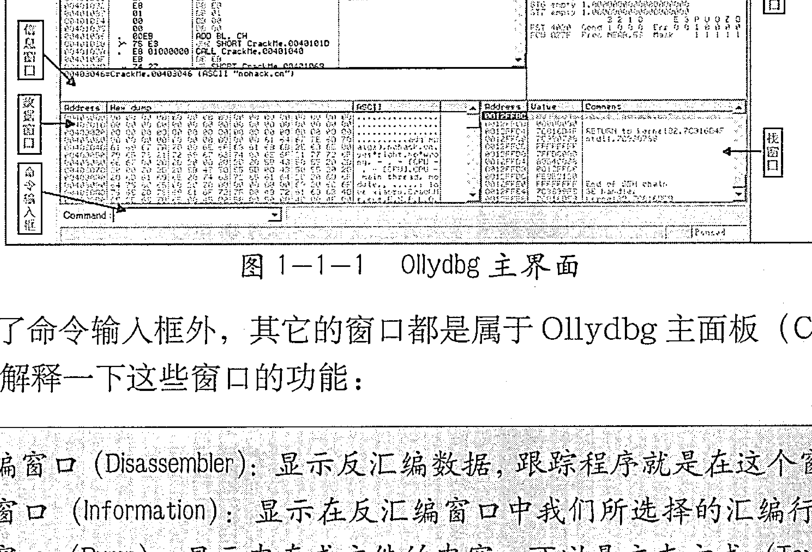

图 1-1-1 Ollydbg 主界面

上图中除了命令输入框外，其它的窗口都属于 Ollydbg 主面板（CPU 面板）的，下面我们分别解释一下这些窗口的功能：

- 反汇编窗口（Disassembler）：显示反汇编数据，跟踪程序就是在这个窗口中进行的。
- 信息窗口（Information）：显示在反汇编窗口中我们所选择的汇编行相关的信息。
- 数据窗口（Dump）：显示内存或文件的内容，可以是文本方式（Text）、十六进制方式（Hex）、反汇编模式（Disassemble），这些不同的显示模式可以在数据窗口中用右键菜单来切换。
- 寄存器窗口（Registers）：显示了各个寄存器的内容，包括存储寄存器（EAX、ECX 等）、段寄存器（ES、CS 等）、控制寄存器（CF、PF 等，即我们所说的标志位 C、P、Z 等）、浮点寄存器（ST0、ST1 等）；另外我们还可以在寄存器窗口中的右键菜单选择显示 MMX 寄存器（MMX Registers）、3DNow! 寄存器（3DNow! Registers）、调试寄存器（Debug Registers）、浮点寄存器（FPU Registers）。
- 栈窗口（Stack）：显示堆栈的内容，即 ESP 指向地址的内容，在调试时非常有用，比如函数的一些参数压栈时，在这里我们就可以看到内容了。
- 命令输入框（Command）：命令输入框并不是 Ollydbg 原版自带的，它是 Ollydbg 的一个插件，不过它现在已经成为 Ollydbg 不可或缺的一部分了，在这里我们可以通过输入命令来简化我们的操作，非常方便。

Ollydbg 中除了 CPU 窗口是主要窗口外，还有其它不少非常实用功能的窗口，我们可以在菜单栏中的“查看（View）”项目中打开这些窗口。这里我详细介绍每个窗口对应的功能，它们将会在你使用 Ollydbg 时给你带来非常大的方便。

##### 1. 记录窗口（Log）

记录窗口记录了 Ollydbg 以及被调试程序运行的状况，如图 1-1-2 所示。比如插件加载的情况、被调试程序开始运行了、加载了哪些 DLL、创建了哪些线程等等，都可以在这里看到。其它会记录在记录窗口的还包括：Scripts 脚本中用 log 命令的执行记录、条件记录断点的中断记录等。调用记录窗口的快捷键为 **Alt+L**。

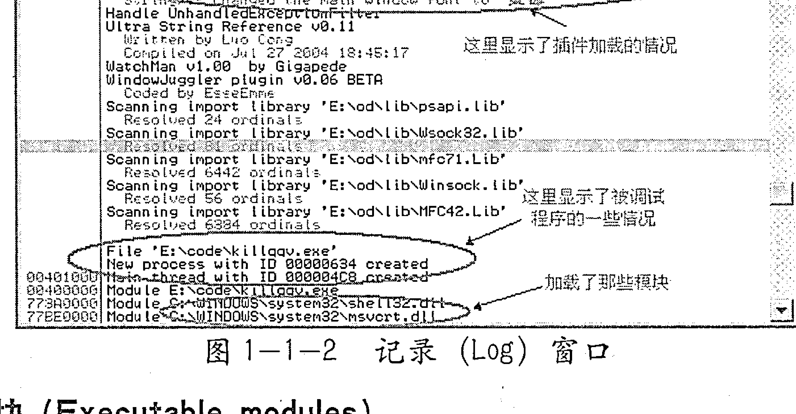

图 1-1-2 记录（Log）窗口

### 2. 执行模块（Executable modules）

在这里可以看到被调试的程序加载的所有可执行模块，如图 1-1-3 所示。比如被调试的程序加载了哪些模块（一般为 DLL）等，如果你看到一个程序调用了 MSVBVM50.DLL，那么十有八九这个程序是用 VB5 写的。该窗口还显示了模块的详细信息，比如基址（Base）、大小（Size）、入口点（Entry）、名字（Name）、是否是系统模块（System）、文件版本（File version）和文件路径（Path）等，你可以双击列表里的某个模块跟踪到这个模块里去。调用执行模块的快捷键为 **Alt+E**。

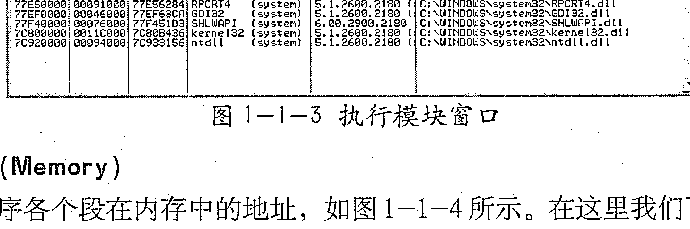

图 1-1-3 执行模块窗口

##### 3. 内存（Memory）

显示了程序各个段在内存中的地址，如图 1-1-4 所示。在这里我们可以鼠标左键选择被调试程序的某一个段（一般是代码段）按 F2 下断点，一旦代码执行到这个段，Ollydbg 就会响应断点断下。这个方法很多时候用来快速脱壳，同时我们也可以通过右键菜单设置内存访问断点（Set memory breakpoint on access）和内存写入断点（Set memory breakpoint on write）。另外，如果你用右键菜单选择的段是资源段【Section 名一般为 rsrc，在 Ollydbg 的“包含（Contains）”栏目中显示为 resources】，那还可以在右键菜单中通过查看全部资源（View all resources）、查看资源字符串（View resource Strings）来查看程序中的资源。调用内存窗口的快捷键为 **Alt+M**。

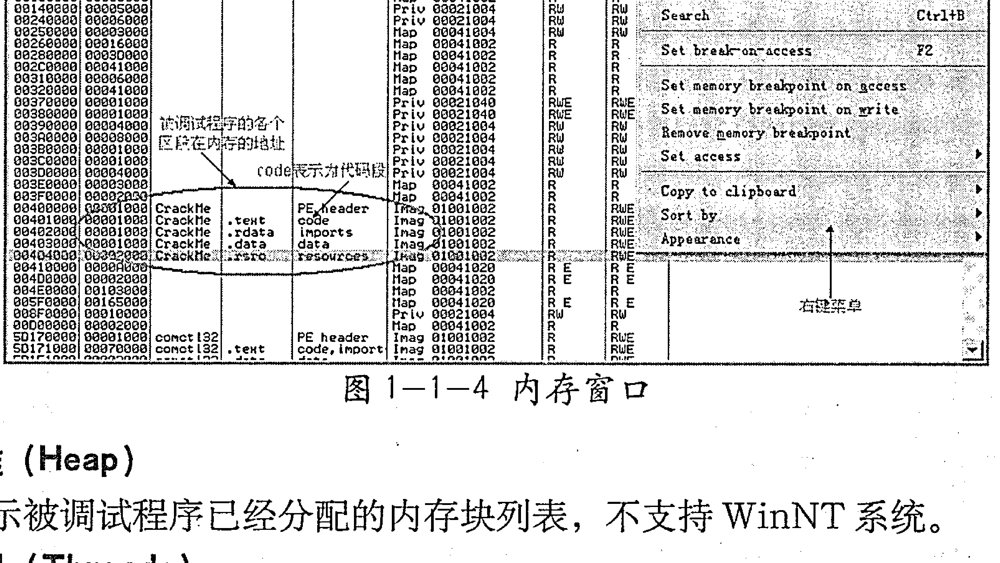

图 1-1-4 内存窗口

##### 4. 块堆（Heap）

用于显示被调试程序已经分配的内存块列表，不支持 WinNT 系统。

##### 5. 线程（Threads）

调试多线程程序是 Ollydbg 的一个特色功能之一。在线程管理窗口我们可以看到被调试程序创建的所有线程，及线程的状态和线程入口地址（Entry）；而双击选择的线程则可在反汇编窗口中显示该线程处理事件的反汇编代码，如图 1-1-5 所示。用 Ollydbg 来调试多线程程序很方便，如果你要监视一个线程的创建，一般情况下可以在 CreateThread 这个函数下断点，一旦有新线程创建就会在 CreateThread 函数断下。一旦线程创建后，你就可以在线程窗口查看到详细的信息。

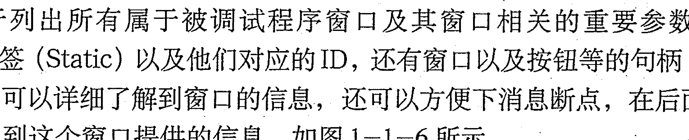

图 1-1-5 线程窗口

##### 6. 窗口（Window）

这里用于列出所有属于被调试程序窗口及其窗口相关的重要参数，比如按钮（Button）、标签（Static）以及它们对应的 ID，还有窗口以及按钮等的句柄（Handle）等等。这样除了可以详细了解到窗口的信息，还可以方便下消息断点。在后面我们介绍消息断点将会用到这个窗口提供的信息。如图 1-1-6 所示。

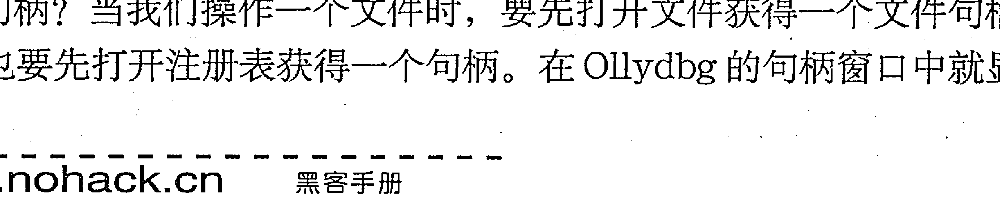

图 1-1-6 窗口信息

##### 7. 句柄（Handle）

什么是句柄？当我们操作一个文件时，要先打开文件获得一个文件句柄；而当操作注册表时，也要先打开注册表获得一个句柄。在 Ollydbg 的句柄窗口中就显示了各种事件的句柄，如果被调试的程序创建了一个句柄打开一个文件，那么就可以在这里看到打开的该文件的句柄以及路径；如果程序创建了一个句柄打开注册表，那么我们也可以在这里看到相应的句柄和对应的注册表键值。如图 1-1-7 所示。

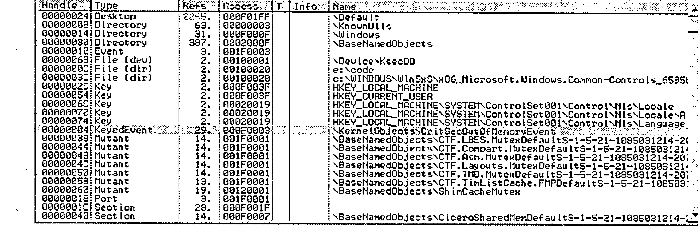

图 1-1-7 句柄窗口

##### 8. 异常链表（SEH Chain）

SEH（Structured Exception Handling，结构化异常处理）是用来设置程序运行出错时处理错误的机制，不过很多时候被用来作为反调试手段。在 Ollydbg 的异常链表窗口，我们可以看到被调试程序所有的异常处理列表，这样在用 Ollydbg 调试时就可以看到 SEH 句柄（SE Handler），在这个 SEH 句柄下断点，当程序发生错误异常时，就可以拦截到程序处理错误的函数，从而分析程序的流程，如图 1-1-8 所示。如果没有在异常处理句柄下断点，那么 Ollydbg 将会忽略掉异常，程序将会继续运行，但这中间程序执行了什么我们就完全不知道了。由此可见，SEH 是破解者应该熟悉的机制，更详细的 SEH 学习资料已经收录于本书的配套光盘中。

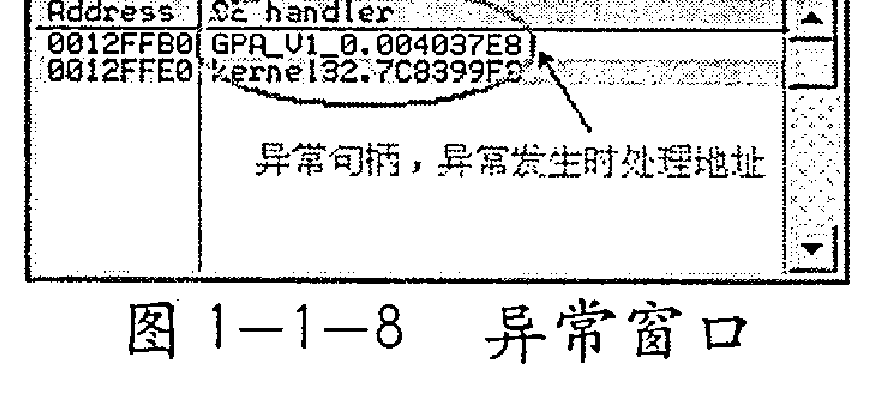

图 1-1-8 异常窗口

##### 9. 补丁（Patch）

补丁窗口记录了我们修改被调试程序的记录，包括地址、修改指令的长度、修改后的指令、原来的指令等，如图 1-1-9 所示。还可以通过右键菜单中的“恢复原始代码节（Restore original code）”来还原对程序所做的补丁。调用补丁窗口的快捷键为 **Ctrl+P**。

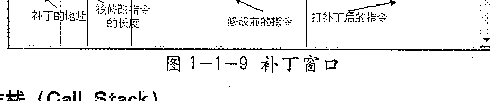

图 1-1-9 补丁窗口

##### 10. 调用堆栈（Call Stack）

类似于 CPU 面板的栈窗口，调用堆栈窗口根据选定线程的栈，尝试反向跟踪函数调用顺序并将其显示出来，同时包含被调用函数的已知的或隐含的参数，如图 1-1-10 所示。调用栈窗口包含 5 个栏目：地址（Address）、栈（Stack）、过程（Procedure）、调用来自（Called from）和框架（Frame）。而地址（Address）栏包含栈地址，栈（Stack）栏显示了相应的返回地址或参数值。调用堆栈的快捷键为 **Alt+K**。

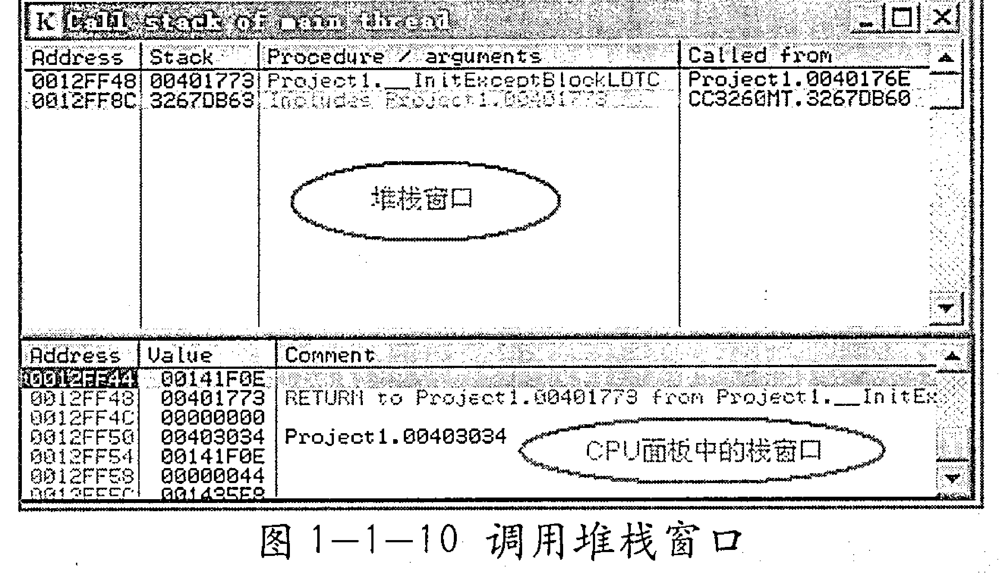

图 1-1-10 调用堆栈窗口

##### 11. 断点（Breakpoint）

这里显示了我们所下的所有软断点【包括条件记录断点，但不包括硬件断点（Hard Breakpoint）】，如图 1-1-11 所示。在这里可以看到所有软断点的激活状态（Active），其中“Always”表示该断点处于激活状态，“Disable”表示该断点暂时无效。另外，还可以通过右键菜单管理这些断点，使其无效（Disable）、生效（Enable）或者清除断点（Remove）。调用断点的快捷键为 **Alt+B**。

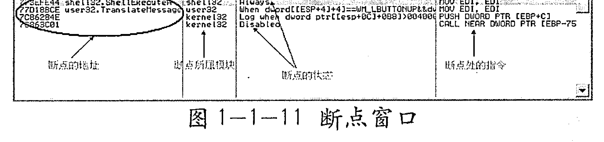

图 1-1-11 断点窗口

##### 12. 监视（Watch）

功能强大的监视器，有很丰富的表达式，如图 1-1-12 所示。由于支持的表达式较多，这里就不一一说明了，详细的表达式可以查看 Ollydbg 的帮助手册。

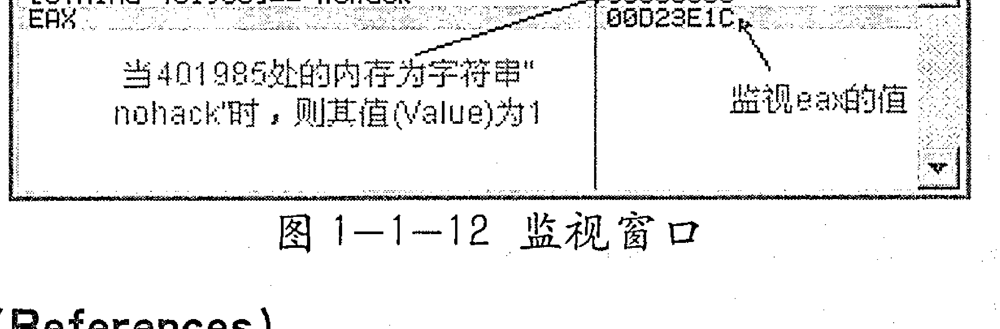

图 1-1-12 监视窗口

##### 13. 字符参考（References）

字符参考窗口可以查看到被调试程序的字符串资源，让我们了解到很多关于程序的信息，像一些注册失败提示字符串，都有可能在这里找到，如图 1-1-13 所示。

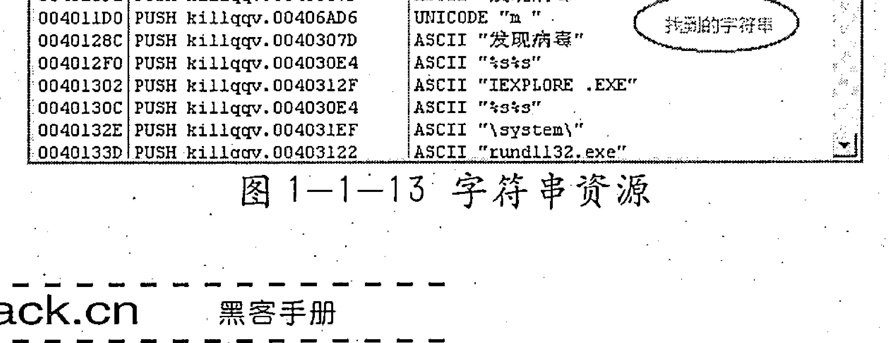

图 1-1-13 字符串资源

> **注意：**如果你打开字符串窗口，发现是一片空白，那么可能是你还没有让 OllyDbg 分析字符串，请在 OllyDbg 汇编窗口的右键菜单中选择“搜索（Search for）”→“所有的字符串参考（All referenced text strings）”，或者按热键 Ctrl+A，让 OllyDbg 分析程序中的字符串。

## 14. 运行跟踪（Run trace）

这是一个很有用的功能，比如现在程序有一个错误，无法运行，调试程序却一时找不到错误发生的地址，那么我们就可以使用“运行跟踪（Run trace）”，让 OllyDbg 帮我们一步一步地执行程序指令，并将执行的命令记录下来，这样我们就可以通过查看记录文件从而发现错误的地方了，如图 1-1-14 所示。不过“运行跟踪（Run trace）”速度非常慢，运行跟踪执行过的指令会显示到运行跟踪窗口和记录到文件（右键菜单→Log to file），你可以通过右键菜单来清除运行跟踪的记录（Clear run trace），和查看在指定模块中执行过的命令（Profile module）。

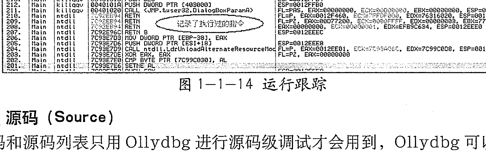

图 1-1-14 运行跟踪

##### 15. 源码（Source）

源码和源码列表只用 OllyDbg 进行源码级调试才会用到，OllyDbg 可以识别所有 Borland 和 Microsoft 格式的调试信息，如图 1-1-15 所示。对于 VC、BCB 程序只要在编译程序时选择为“Debug”模式，就可以在 OllyDbg 中进行源码级调试了；而对于汇编（ASM）程序也可以实现源码级调试，只要在编译 ASM 程序时，Ml 添加参数“/Zi”，在连接时将编译方式选择为“/Debug”就可以了，该源码窗口对应的就是被调试文件的代码。

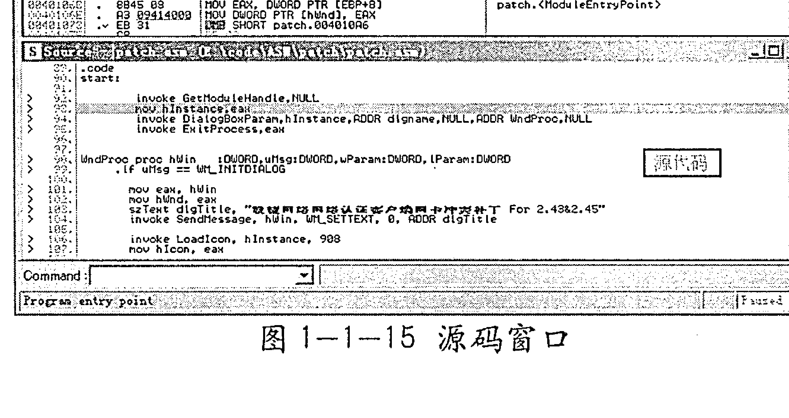

图 1-1-15 源码窗口

##### 16. 源码文件列表（Sources）

和上面的源码文件对应，不过这里列出了被调试文件包含的所有代码文件列表，双击某个文件名就可以在源码窗口中查看到相应文件的代码，如图 1-1-16 所示。

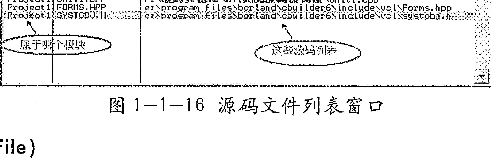

图 1-1-16 源码文件列表窗口

##### 17. 文件（File）

OllyDbg 不但是个调试器，还是一个很好用的编辑器。其文件窗口可以作为独立的二进制编辑器打开任何文件，同被调试的文件可以没有任何关系。而且如果打开的是 EXE 可执行文件，在 OllyDbg 里还可以看到 PE 文件头（右键菜单→Special→PE Header）。

##### 18. 文本文件（Text File）

这里可以让 OllyDbg 作为一个文本浏览器浏览文本文件。

#### 1.1.3 配置 OllyDbg

OllyDbg 的功能强大，配置好 OllyDbg 是使用 OllyDbg 不可缺少的步骤，只有我们熟悉了如何配置 OllyDbg，才能够让其充分发挥功能。OllyDbg 的设置是保存在 OllyDbg.ini 文件里的，有外观设置（Appearance）和调试设置（Debugging options），都可以通过 OllyDbg 的图形界面来配置。如果你觉得自己设置比较麻烦的话，可以使用配套光盘中的已经设置好的配置。

##### 1. 外观设置【“选项（Options）”→“外观设置（Appearance）”】

外观设置根据个人爱好可以设置不同的外观，在 OllyDbg 中可以设置不同的外观主题，下面我介绍几个主要的外观设置：

- **目录（Directories）**：这里设置了 UDD 文件和插件的路径，如图 1-1-17 所示。UDD 文件相当于 OllyDbg 的工程文件，如果插件的路径没有设置正确，那么在 OllyDbg 的主菜单里就看不到 Plugin（插件）这个菜单项。

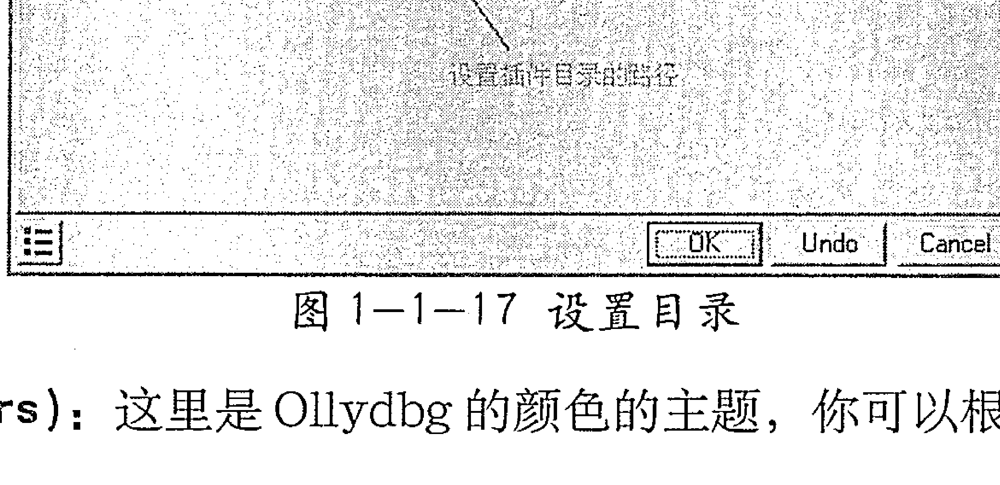

图 1-1-17 设置目录

- **颜色（Colours）**：这里是 OllyDbg 的颜色主题，你可以根据自己的喜好设置显示的颜色，如图 1-1-18 所示。打开一个程序进行调试，然后在这里进行设置，设置后的效果就可直接在 OllyDbg 的主窗口中显示出来了。

- **代码突出显示（Code highlighting）**：也称代码高亮度，如图 1-1-19 所示。代码突出显示是 OllyDbg 的一个特色功能，它可以设置不同的代码颜色，使显示出来的指令具有不同的颜色，非常方便浏览，不像 SoftICE 和 TRW 那样颜色单调。

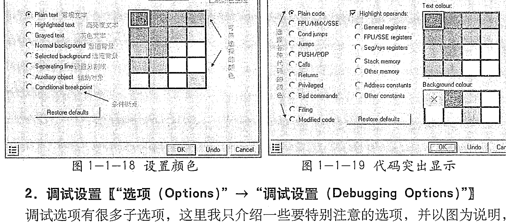

##### 2. 调试设置【“选项（Options）”→“调试设置（Debugging Options）”】

调试选项有很多子选项，这里我只介绍一些要特别注意的选项，并以图为说明，其它选项大家可以参考 OllyDbg 的帮助文档。

- **事件（Event）**：设置 OllyDbg 对中断入口点、模块加载卸载、线程创建结束等事件的处理，如图 1-1-20 所示。

- **异常（Exceptions）**：设置让 OllyDbg 忽略或不忽略哪些异常。我们在一些脱壳教程中经常听到“忽略某某异常”，其实就是在这里设置的，如图 1-1-21 所示。

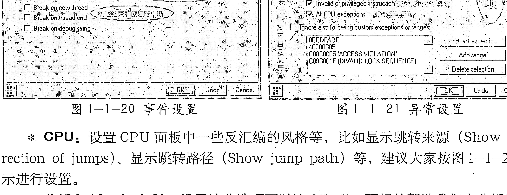

- **CPU**：设置 CPU 面板中一些反汇编的风格等，比如显示跳转来源（Show direction of jumps）、显示跳转路径（Show jump path）等，建议大家按图 1-1-22 所示进行设置。

- **分析2（Analysis2）**：设置这些选项可以让 OllyDbg 更好地帮助我们去分析程序的代码，请将“显示已知函数的参数（Show arguments of known functions）”选上，这样在 OllyDbg 中就可以看到更具有可读性的代码，如图 1-1-23 所示。

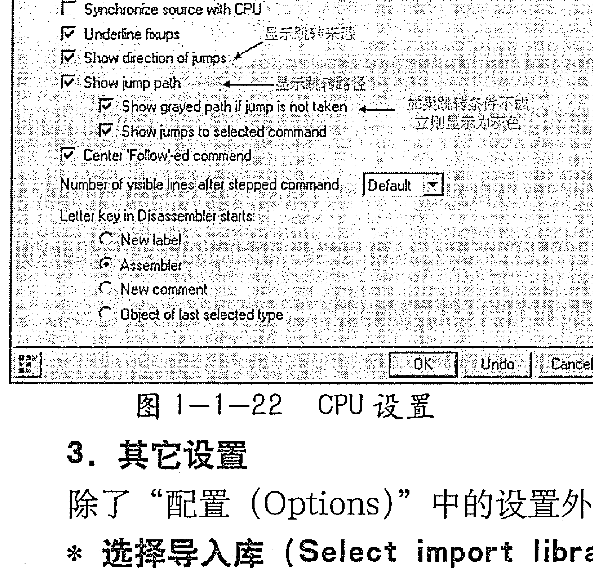

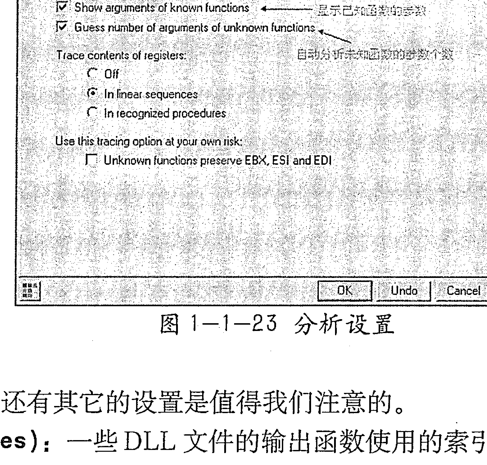

图 1-1-22 CPU 设置　图 1-1-23 分析设置

## 3. 其它设置

除了“配置（Options）”中的设置外，还有其它设置值得我们注意。

- **选择导入库（Select import libraries）**：一些 DLL 文件的输出函数使用的是索引号，使用导入库（Lib）可以让 OllyDbg 识别 DLL 中的函数，可以将序号转换成符号名称。比如导入了 MFC42.Lib，那么当 OllyDbg 调试 MFC 程序时，就不会显示 MFC 函数里的索引号，而是 MFC 函数名。在后面的 FAQ 中，我将会进一步提到这个问题。你可以在 OllyDbg 中选择“调试（Debug）”→“选择导入库（Select import libraries）”来打开导入库窗口，如图 1-1-24 所示。

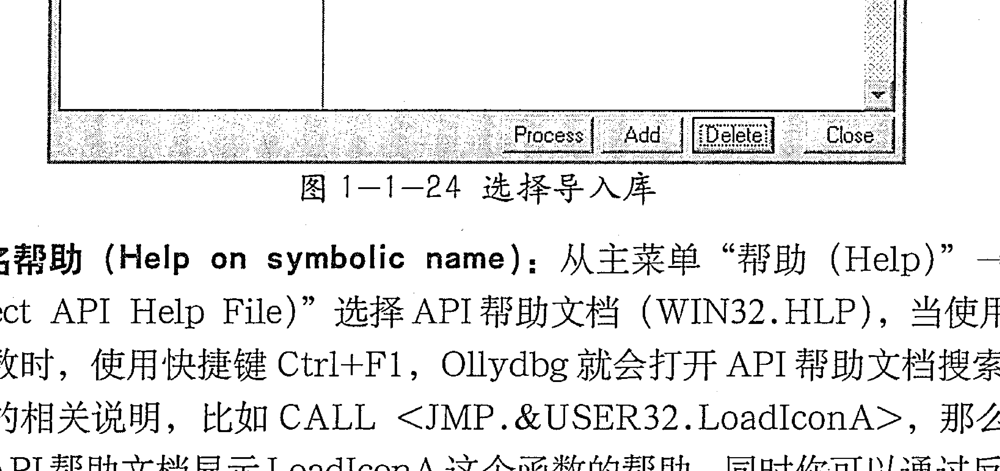

图 1-1-24 选择导入库

- **符号名帮助（Help on symbolic name）**：从主菜单“帮助（Help）”→“API 帮助文档（Select API Help File）”选择 API 帮助文档（WIN32.HLP），当使用 OllyDbg 遇到 API 函数时，使用快捷键 Ctrl+F1，OllyDbg 就会打开 API 帮助文档搜索选择行中的 API 函数的相关说明。比如 `CALL <JMP.&USER32.LoadIconA>`，那么 OllyDbg 就可以打开 API 帮助文档显示 LoadIconA 这个函数的帮助。同时你可以通过反汇编窗口右键菜单的“符号名帮助（Help on symbolic name）”来打开 API 帮助文档，如图 1-1-25 所示。

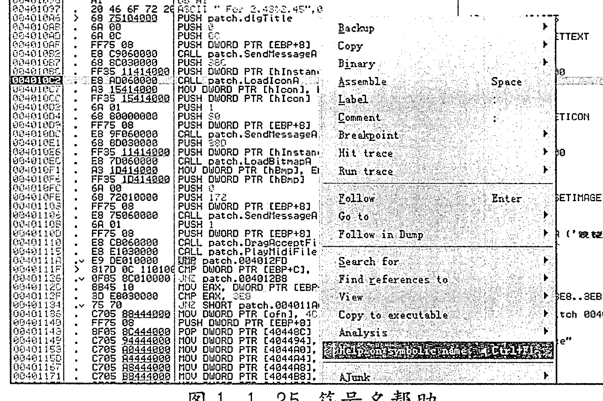

图 1-1-25 符号名帮助

- **关联右键菜单**：我们可以添加 OllyDbg 到资源管理器的右键菜单中，以后只要在 EXE 和 DLL 上点击右键菜单，就会出现“Open with OllyDbg”的选项，非常方便。打开 OllyDbg 的“选项（Options）”→“关联菜单（Add to Explorer）”，就可以将 OllyDbg 添加到右键菜单（Add OllyDbg to menu in Windows Explorer）中，也可以取消关联（Remove OllyDbg from menu in Explorer），如图 1-1-26 所示。

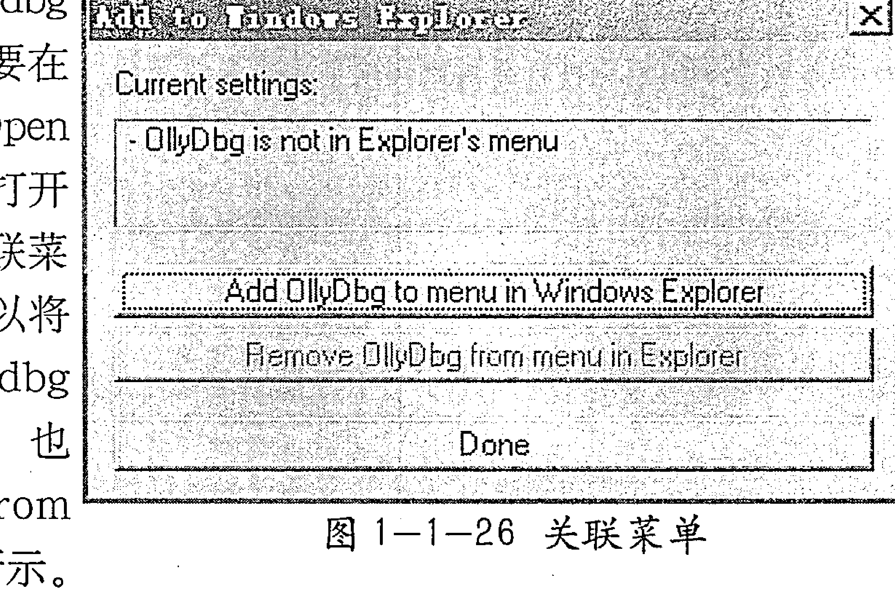

图 1-1-26 关联菜单

#### 1.1.4 使用 OllyDbg

通过上面的介绍，相信大家已经对 OllyDbg 有了一定的了解，现在我们就可以开始学习如何使用这个功能强大的调试器。

##### 1. 最基本的操作

- Ctrl+G 跳转到某地址；
- Enter（回车）可以跟入到 CALL、JMP 指令的目标地址；
- Ctrl+↑/↓ 来单个字节地移动代码；
- 在代码行双击鼠标左键可以修改代码；
- 在寄存器上双击可以修改寄存器的值；
- 在地址上双击可以看到其它地址的相对地址；
- 双击标志位（C、P、Z 等）中 0 或 1 的值可以修改标志位的值为 1 或 0。

##### 2. 跟踪

在使用一个调试器前，最早应该学会的就是如何使用这个调试器去跟踪程序。我们可以在 OllyDbg 的“调试（Debug）”菜单中找到 OllyDbg 与各个跟踪功能对应的功能键：

- **单步步进（Step into）**：快捷键 F7。可以说是在调试时用得最多的了。可以在 OllyDbg 中一条一条地执行被调试的程序。所以如果你见到一个人的键盘 F7 键磨得光光的，那么要注意了，这个人可能是个破解高手哦 :）。

- **单步步过（Step over）**：快捷键 F8。和“单步步进”差不多，不过它遇到 CALL 指令不会跟进去，而是越过这个 CALL 指令。另外单步步过和步进还对应了自动功能，即自动步过（Animate over）和自动步进（Animate into），这两个功能是让 OllyDbg 自己执行。如果我们想要 OllyDbg 停止执行，可以按 F12。

- **执行到返回（Execute till return）**：快捷键 Ctrl+F9。当你处于一个函数中，想返回到调用这个函数的地方时，就可以使用该功能，OllyDbg 会停在遇到的第一个返回命令（RET、RETF，或者 IRET），这样你可以很方便地略过一些没用的代码。

- **执行到用户代码（Execute till user code）**：快捷键 Alt+F9。返回到你所调试的应用程序代码空间中。当然也可以通过按 Ctrl+F9【执行到返回（Execute till return）】若干次，并每次检查所处的位置，来返回到程序的代码空间中。

- **操作程序**：我们可以通过 F9 来运行（Run）被调试的程序，也可通过按 F12 来暂停（Pause）被调试程序的运行。如果你想重新调试被调试的程序，那么使用 Ctrl+F12，OllyDbg 将结束当前被调试进程并重新加载它。

##### 3. 断点

断点有软断点和硬件断点之分。使用一个调试器，学习如何给程序下断点是必不可少的步骤。

- **软断点（Breakpoint）**：在上面我们介绍了断点管理窗口，其管理的就是软断点。那么什么是软断点？软断点其实就是把我们下断点地址处的代码修改为 INT3（CC）指令，当程序运行到我们下断点的地址时就会执行 INT3 异常指令，调试器就会捕捉到被调试程序的异常从而停在断点处，然后将 INT3 改回原来的指令。当然我们在 OllyDbg 中是看不到断点处的 INT3 指令的，这一切 OllyDbg 都是在后台进行的。那么如何下软断点呢？

- 1) **使用命令**  
  可以在命令输入框中输入断点命令来下断点。其中 BP 表示下断点，BD 表示清除一个断点。如果我们想在 00401000 处下断点，那么可以在命令输入框中输入 `bp 401000`，回车，这样就会在 401000 处下断点了。当然命令断点是支持 API 函数的，可以通过输入 `bp MessageBoxA`，来达到在 MessageBoxA 这个函数下断点的目的，如图 1-1-27 所示。不过要注意函数是区分大小写的，如果输入成 `bp messageboxa` 的话，OllyDbg 是不会理你的。


图 1-1-27 软断点命令

- 2) **一般方法**  
  在反汇编窗口中选择要下断点的地址所在代码行，然后就可以使用快捷键 F2 在当前地址下断点了，如图 1-1-28 所示。下断点后地址会变为红色，你可以在该行再次使用 F2 取消断点。另外还可通过右键菜单来下断点，其中还包含条件断点，我将在后面的高级使用中详细介绍条件断点的使用。

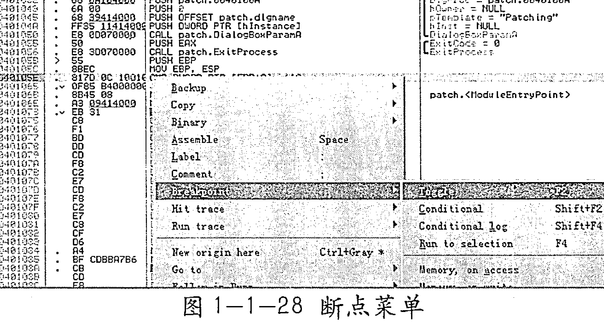

图 1-1-28 断点菜单

- **硬件断点（Hardware breakpoint）**：硬件断点和软断点是完全不同的断点方式。在 OllyDbg 我们可以下无数个软断点，但是硬件断点最多只能下四个，因为它是使用四个调试寄存器（DR0、DR1、DR2、DR3）来设置断点的，所谓物以稀为贵。硬件断点当然有很多好处，比如它不会去修改程序地址的代码为 INT3，这样就不怕程序的自校验了。除了可以在地址上设置执行断点，还可以在内存上设置内存读写断点。下硬件断点我们也可以通过输入断点命令来达到。硬件断点的命令包含 HE、HW、HR 和 HD，其中 HE（Hardware on execution）表示执行到该地址时断下，这和软断点差不多；HW 和 HR 表示写内存（Memory write）和读内存（Memory access），比如 `HW 401000` 表示当程序读取 401000 处的数据时断下；HD 则是移除所下的断点，如图 1-1-29 所示。当然除了使用命令来下断点外，还可以通过右键菜单来下断点。除了硬件断点外，OllyDbg 还有另一种断点——内存断点（Memory breakpoint，见于右键菜单中的“Memory, on access”“Memory, on write”），这个和硬件断点的内存断点不同，OllyDbg 每次只能下一个内存断点。你可以在反汇编窗口、CPU 窗口、数据窗口中选择一部分内存，然后使用快捷菜单设置内存断点。如果有以前的内存断点，将被自动删除。

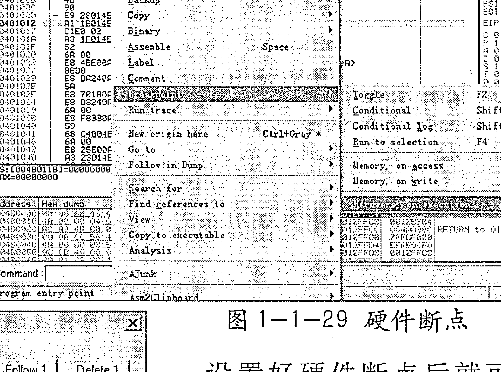

图 1-1-29 硬件断点

设置好硬件断点后，就可在主菜单中的“调试（Debug）”→“硬件断点（Hardware breakpoints）”中打开硬件断点管理窗口，如图 1-1-30 所示。

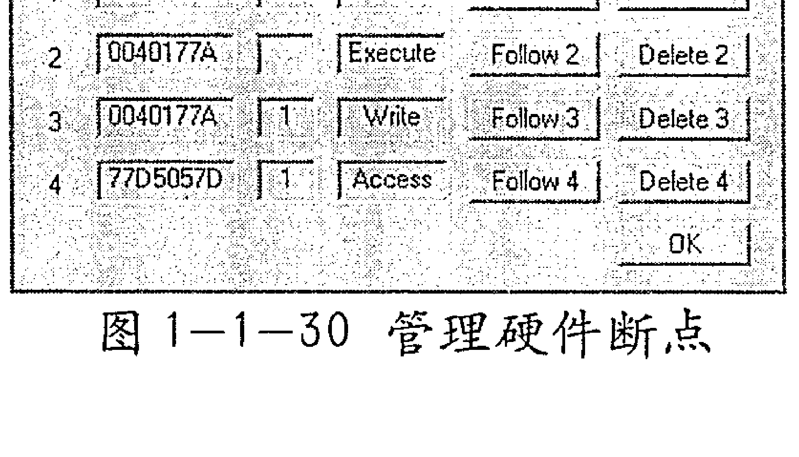

图 1-1-30 管理硬件断点

##### 4. 分析

使用 OllyDbg 的代码分析功能，有时分析后可以使代码具有更强的可读性。你可以在命令输入框键入 **AC**，来启动 OllyDbg 的代码分析功能。也可以通过右键菜单的“分析（Analysis）”→“分析代码（Analyse code）”来分析汇编代码，如图 1-1-31 所示。同时在分析菜单中，你可以让 OllyDbg 在下一次分析代码时，将选择的代码行（During next analysis, treat selection as）强制识别为命令（Command）、字符（Text）等。（图 1-1-32 和图 1-1-33 分别为分析前后的代码）。

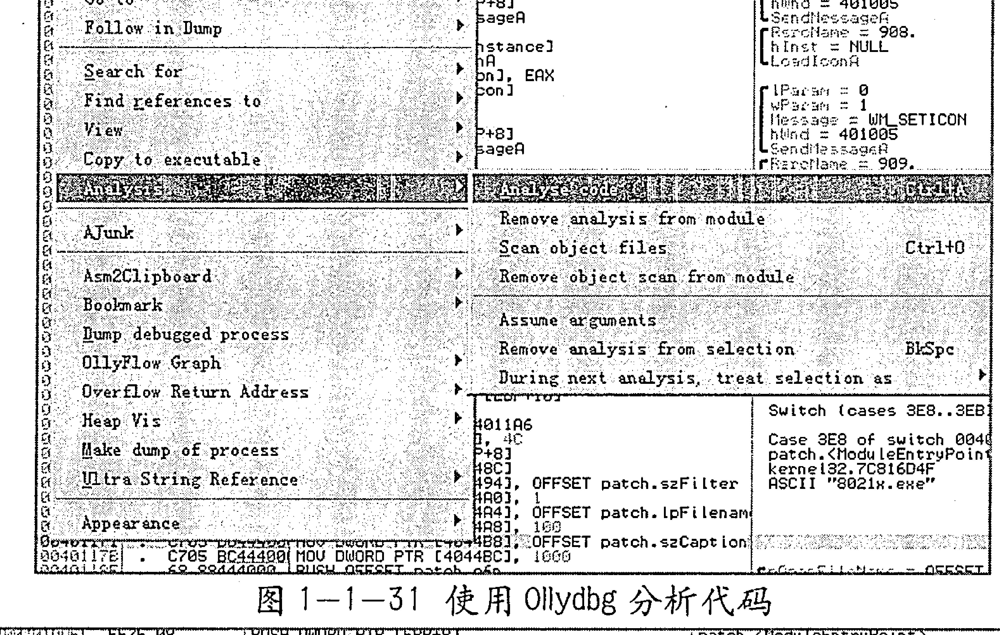

图 1-1-31 使用 OllyDbg 分析代码

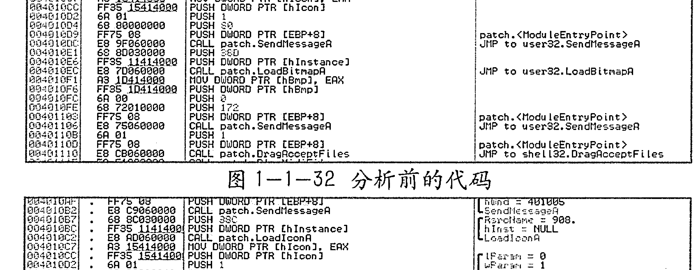

图 1-1-32 分析前的代码

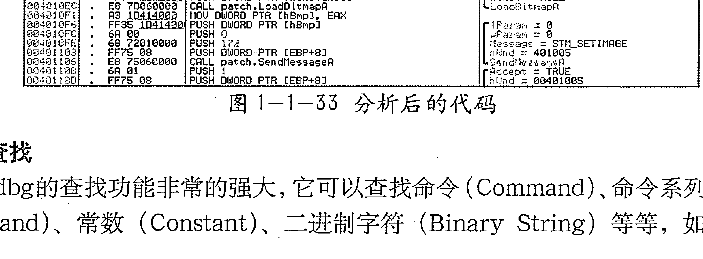

图 1-1-33 分析后的代码

##### 5. 查找

OllyDbg 的查找功能非常强大，它可以查找命令（Command）、命令序列（Sequence of command）、常数（Constant）、二进制字符串（Binary string）等等，如图 1-1-34 所示。

我们常用的功能有查找命令（Command）、命令序列（Sequence of command）、二进制字符串（Binary string），其中二进制字符串查找支持 `?` 模糊查找，如图 1-1-35 所示。快捷键为 **Ctrl+B**。

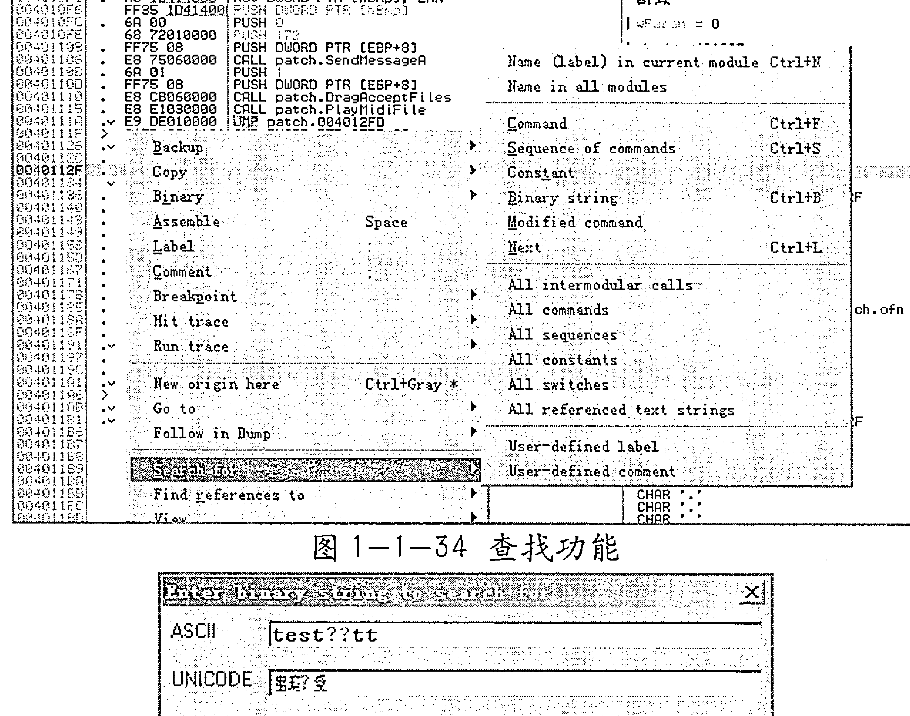

图 1-1-34 查找功能

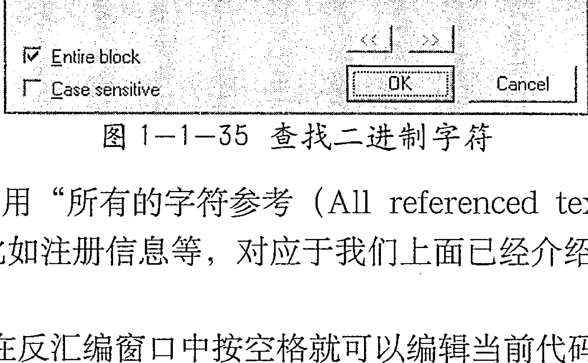

图 1-1-35 查找二进制字符串

另外我们还经常使用“所有的字符串参考（All referenced text strings）”来查看程序中的字符串资源，比如注册信息等，对应于我们上面已经介绍的“字符串参考窗口”。

##### 6. 编辑

- **编辑代码**：任意在反汇编窗口中按空格就可以编辑当前代码，OllyDbg 支持汇编代码的直接修改，是我见过的最好用的代码修改工具。比如我们要将一个 `jnz` 跳转改为无条件跳转 `jmp`，你只要选择该代码所在的行，按空格，将 `jnz` 修改为 `jmp` 就可以了，如图 1-1-36 所示。

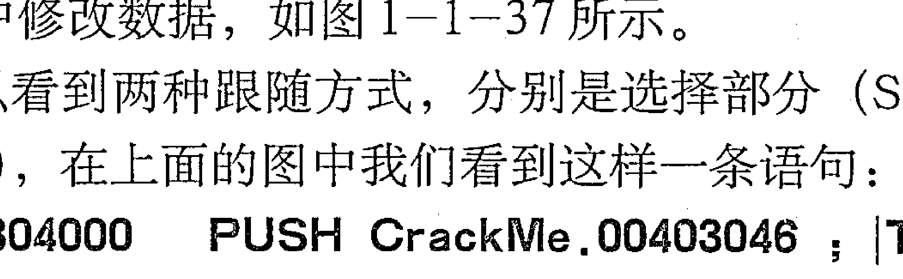

图 1-1-36 修改汇编代码

- **编辑十六进制**：OllyDbg 除了支持反汇编代码的修改，还支持十六进制编辑。OllyDbg 的数据窗口就是专门用来显示十六进制和字符串数据的。编辑这些数据虽然可以在反汇编窗口中修改，但我们也经常在反汇编窗口中跟随到数据窗口（Follow in dump），在数据窗口中修改数据，如图 1-1-37 所示。

在跟随菜单中可以看到两种跟随方式，分别是选择部分（Selection）和立即常数（Immediate constant）。在上面的图中我们看到这样一条语句：

```asm
00401002  68 46304000   PUSH CrackMe.00403046 ; |Title = "nohack.cn"
```

图 1-1-37 跟随到数据窗口

如果我们选择“跟随到选择部分（Selection）”，那么在数据窗口中将会转到 00401002；如果我们选择“跟随到立即常数（Immediate constant）”，那么数据窗口就会显示 00403046 处的数据，如图 1-1-38 所示。

图 1-1-38 数据跟随

讲了这么多，那么如何修改数据呢？在反汇编窗口或数据窗口选择要修改的数据，按 Ctrl+E 就可以呼出数据编辑窗口了，在这里我们可以修改 ASCII、Unicode、Hex 数据，如图 1-1-39 所示。

除此之外，还可以通过右键菜单中的“二进制（Binary）”来打开数据编辑窗口（Edit），进行填充选择的数据为 00 或 FF，将数据拷贝为十六进制代码，或将剪贴板中的十六进制代码覆盖掉当前选择的数据等操作，如图 1-1-40 所示。

图 1-1-39 修改数据

图 1-1-40 二进制（Binary）菜单

## 1.1.5 Ollydbg 高级使用

##### 1.1.5.1 调试正在运行的程序

Ollydbg 一个很实用的功能就是可以调试正在运行的程序，这个功能在 Ollydbg 中叫“附加（Attach）”，这是一个非常有用的功能。比如一个加了壳的程序，你用 Ollydbg 调试时可能无法进入到程序中，那么你就可以先运行这个程序，让壳完成解压，这样再用 Ollydbg 附加该进程就可以很方便地调试这个程序了。在后面的实例中将会介绍用 Ollydbg 附加调试一个加了壳的程序。我们可以从主菜单“文件（File）”→“附加（Attach）”打开附加窗口，如图 1-1-41 所示。

##### 1.1.5.2 带参数调试程序

一般情况下，我们用 Ollydbg 调试程序都是直接加载，然后开始调试。如果我们要调试的程序是一个要带参数的程序呢？比如一个命令行程序。那要怎么办呢？没关系，因为 Ollydbg 可以带参数调试程序，我们可以在打开要调试的程序时输入程序所带的参数（arguments），然后就可以像平常那样开始调试了，如图 1-1-42 所示。

##### 1.1.5.3 使用条件记录断点

我们知道有时一个程序会重复调用一个函数或地址，如果在这个函数下断点，它就会在每次运行到这个函数时中断暂停下来，这样就太麻烦了，因为有时我们并不想它每次中断，只需要在特定条件下才中断下来。那么调试器能不能帮助我们判别呢？也就是说每次运行到我们设置的中断地址时，调试器虽然都会拦截到，但它只会在满足我们设置的条件时才会暂停程序。答案当然是肯定的，它就是我将要讲解的条件断点。

说到条件记录断点，对于破解者来说可是一件很兴奋的事。如果你用过 TRW 和 SoftICE，你就知道它们可以下像 `bpx RegQueryValueA if *(esp+8) == 'test'` 这样的命令，来拦截读取包含有 test 这样字符串的注册表键值的动作，也就是所谓的条件断点。那么在 Ollydbg 中我们也可以这样吗？当然，我们无法输入像上面那样的命令来达到目的，但是 Ollydbg 的确已经为我们准备了这个功能，也许只是你不知道，或还没发现，或不知道怎么使用而已。下面我们就来学习 Ollydbg 的条件记录断点。

- 条件断点（Conditional Breakpoint）与条件记录断点（Conditional Log Breakpoint）：我们可以很明显地知道条件记录断点多了一个记录功能，其它用法是一样的，它把我们要记录的表达式输出到“记录（Log）”（用 Alt+L 打开）窗口。条件断点的快捷键是 Shift+F2，条件记录断点的快捷键是 Shift+F4。在反汇编面板的右键菜单可以看到这两个功能对应的菜单项，如图 1-1-43 所示。

图 1-1-43 条件断点

- 条件记录断点（Conditional Log Breakpoint）：来到你要下断点的地址，按 Shift+F4 或使用右键菜单，呼出条件记录断点设置窗口，如图 1-1-44 所示。

图 1-1-44 条件记录断点设置

这里，对图 1-1-44 中的界面窗口说明如下：

- 1) 条件（Condition）：输入你要设置的条件表达式。当程序执行到你下的断点时，如果满足你的设置条件，Ollydbg 才会做出相应的操作，或是暂停程序，或是记录表达式。Ollydbg 的“条件”支持非常丰富的表达式，因为支持的表达式太多了，所以这里我只列举几个介绍。如果你想了解更详细的表达式，你可以查看 Ollydbg 帮助手册。下面是一些支持的表达式：

```text
EAX==05201314                 ; 当 EAX 的值为 5201314 时。
[EAX]==05201314               ; 比如 EAX 值为 401000，那么这里表示当 401000 处的值等于 5201314 时，即 EAX 表示的值为指针。
[[EAX]]==05201314             ; 比如 EAX 值为 401000，401000 的值为 402000，而 402000 的值为 05201314 时，即 EAX 表示的值为指针的指针。
EAX==5201413&&EBX==0x5201314  ; 当 EAX 的值等于十进制 5201413 且 EBX 的值等于十六进制 5201314 时。
[ESP+8]==WM_COMMAND           ; 当参数是一个命令消息时，表达式中你可以使用类似这样的 Windows API 符号常量。
byte ptr [eax]=="y"           ; 当 eax 指向的地址处的一个字节为 y 时，如果没有指明 byte，则使用默认的 dword，像上面的例子那样，则占四个字节。
```

- 2) 说明（Explanation）和表达式（Expression）：这里面可填可不填。“说明”是由你自己任意设置的名字，用来注释表达式；“表达式”则是你要记录的内容，只能设置一个表达式。比如你要记录 EAX 的值的话，你可以输入 EAX，但是无法使用 EAX && EBX 来同时记录 EAX 和 EBX 的值。在“表达式”的下面我们还看到“解码表达式的值”的下拉选择框，它是让 Ollydbg 将记录的数据进行分析。比如说我们记录了 `[eax+4]` 的值是 00403046，而 00403046 处是字符串“nohack.cn”，那么当你选择的解码值为“Pointer to ASCII String”时，Ollydbg 就会在记录（Alt+L）里显示为“nohack.cn”，否则它就显示为 00403046，如图 1-1-45 所示为记录的内容。

图 1-1-45 条件断点记录

- 3) 执行操作：接下来可以看到“暂停程序（Pause Program）”、“记录表达式的值（Log value of expression）”、“记录函数参数（Log function arguments）”，可供我们选择的有“从不（Never）”、“满足条件时（On Condition）”、“总是（Always）”。其中“暂停程序（Pause Program）”是指当 Ollydbg 拦截到断点时是否要中断在断点处。如果设置为“满足条件时（On Condition）”，那么当执行到我们所下的断点地址处时，只有满足设置的条件，Ollydbg 才暂停程序，并中断在断点处。另外我们还可以设置“条件满足次数（pass count）”，也就是说在第几次满足我们的条件时，才中断暂停程序。

- 4) 执行命令：再接下来我们可以看到“如果程序暂停，发送以下命令到插件中（If program pauses, pass following commands to plugins:）”，其实这里就是让我们设置当条件断点中断的时候要执行的命令，和命令输入框里的命令是一样。比如输入 `d esp`，那么当条件断点断下时，就会执行 `d esp` 这个命令，我们就可以在数据窗口中看到 esp 地址处的数据了。

注：在本章的章节实例和本书第九章的实例中讲述有使用条件记录断点的实例。

##### 1.1.5.4 使用万能断点

很多刚用 Ollydbg 的新人总是埋怨在 Win2K 以上的系统中调试程序很不爽，因为他们用惯了 Win98 下的 hmemcpy 万能断点。其实在 Win2K 以上系统我们还是可以使用其它的手段来达到类似万能断点的效果，有两种方法可以让 Ollydbg 达到下万能断点的效果。

- 一种方法是在所有的函数下断点，在命令输入框中输入：`bpx hmemcpy`，然后按回车，或者直接按 Ctrl+N，在弹出的窗口中可以看到程序调用的所有函数，选择右键菜单“在每个命令中设置断点（Set breakpoint on every command）”。
- 另一个方法就是通过 Ollydbg 的插件 PuntosMagicos 来查找万能断点的地址。在 Ollydbg 的“插件（Plugs）”菜单中打开 PuntosMagicos，点击有“Punto H”字符的按钮就可以了，如图 1-1-46 所示。另外在这里还可以下 VB5 和 VB6 程序的万能断点，如果你调试的是 VB 程序的话，试试这两个万能断点，你一定会觉得很爽。

图 1-1-46 万能断点插件

##### 1.1.5.5 用宏命令一次性下多个断点

有人在使用 Ollydbg 时抱怨说，在 Ollydbg 中下断点总是要一个一个地下，使用命令也要多次使用 BP 等断点命令，怪麻烦的。那么到底可不可以一次性下多个断点呢？只有想不到，没有做不到。答案是肯定的，我们可以通过 CmdBar 的宏功能来实现，然后通过执行宏命令 MAC 来运行宏。打开 Ollydbg 插件目录下的 macro.def，如果没有 macro.def 这个文件，可以手动添加，按照如下格式添加宏：

```text
[宏名]
Line0=命令1
Line1=命令2
Line2=命令3
......
```

比如我们要定制一个宏名字为 Break1 的宏命令，功能是一运行就会在 MessageBoxA、SetWindowTextA、ShowWindow 下断点，那么我们可以在 macro.def 中这样添加：

```text
[Break1]
Line0=bp MessageBoxA
Line1=bp SetWindowTextA
Line2=bp ShowWindow
```

以后只要我们想一次性在这三个函数中下断点，那么我们只需在命令输入框里输入 `MAC Break1`，就可以达到目的了。当然这里只不过是一次性下多个断点的方法，你还可以使用宏功能一次性执行其它 Ollydbg 所支持的命令。

##### 1.1.5.6 使用插件和辅助工具

尽管 Ollydbg 本身的功能已经非常强大了，但它有时候还是不能满足我们的需要。还好 Ollydbg 本身支持插件功能，所以很多 Ollydbg 爱好者写了各种各样的 Ollydbg 插件，这些插件大大增强了 Ollydbg 的功能，所以好的插件当然是要拿来用的。

正确在 Ollydbg 的“外观设置（Appearance）”中的“目录设置（Directories）”设置了插件的目录后，在 Ollydbg 的主菜单中就会显示出“插件（Plugins）”菜单。Ollydbg 的插件众多，这里我粗略介绍一些比较常用的插件以及 Ollydbg 的辅助工具，而配套光碟中我已经收录了所有网上能收集到的 Ollydbg 插件。另外要注意的是，Ollydbg 的原版支持的插件数不能超过 33 个，这是 Ollydbg 的一个 Bug。不过如果你给 Ollydbg 挂上了 AutoPath，那么想要它支持 1000 个插件也是没有问题的。在本书的第四章 PE 工具中，将有实例介绍如何将 AutoPath 集成到 Ollydbg 中。

- **CmdBar**：Ollydbg 的命令行插件，可以说是最常用的一个插件。Ollydbg 主窗体下面的命令输入框就是 CmdBar 插件。CmdBar 支持很多有用的命令，本书的附录中会介绍到这些命令的使用，而配套光碟中也附带了命令手册，可以详细浏览。
- **OllyScript**：Ollydbg 的脚本插件，我们可以通过写 OllyScript 脚本来完成一些复杂的事，或者让它自动化完成一系列动作。OllyScript 用得比较多的就是脱壳，现在网上有很多 OllyScript 写的脱壳脚本，差不多所有的壳都对应辅助脱壳的 OllyScript 脚本。OllyScript 支持的语法较多，更多详细情况可以参考 OllyScript 的帮助文档。另外国人 Luo Cong 也写过一个 Ollydbg 的脚本插件叫 OllyMachine，功能并不比 OllyScript 差，不过由于出现得晚，而且在国外也不常见，所以使用的人比较少。
- **HideDebugger**：用来隐藏 Ollydbg 的插件，它使 Ollydbg 躲过一些反调试手段的检测，具有类似功能的还有 IsDebugger、Invisible 以及 evanescence 这几个插件。
- **OllyDump**：Ollydbg 的脱壳插件，脱壳时候用的，用来转储（Dump）文件，是脱壳者用 Ollydbg 脱壳不可缺少的插件，类似功能的还有 PEDumper 插件。
- **CleanupEx**：清除 Ollydbg 历史记录和 UDD 文件的工具。如果有一天你发现 Ollydbg 的 UDD 目录已经变得非常庞大了，那么可以使用它清除一些不要的 UDD 文件。
- **StringRef**：字符串参考功能插件，可以使 Ollydbg 支持中文字符串参考，并把功能集成到 Ollydbg 本身的字符串参考窗口里去。这个插件是我修改 DokoDon 的日文字符串参考插件得到的，类似功能的还有国人 Luo Cong 的 Ultra String Reference，也是一个不错的字符串插件。
- **PuntosMagicos**：用来查找万能断点的插件，可以帮我们找到系统中 VB5 和 VB6 的万能断点，在用 Ollydbg 调试 VB 程序时更加方便。
- **Re-pair**：用来自动修改 Ollydbg 原补丁的工具，用它修改后的 Ollydbg 可以躲过大部分的反调试手段。
- **AutoPath**：FreeCat 写的一个 Ollydbg 辅助工具（DLL 文件），修复了 Ollydbg 绝大部分 Bug，并且可以在 Ollydbg 中设置外部工具，是一个非常实用的 Ollydbg 辅助工具，值得推荐。

## 1.1.6 Ollydbg 常见问题问与答

### 1.1.6.1 如何让 Ollydbg 显示函数名

Q：我在用 Ollydbg 调试程序为什么总是显示 `CALL <JMP.&WSOCK32.#115>`，可不可以把 WSOCK32.#115 这个函数名显示出来啊？

A：可以的，因为你没有在 Ollydbg 中导入 WSOCK32.DLL 的输入库 WSOCK32.Lib，所以 Ollydbg 无法识别 WSOCK32 中的函数名。我们用 DLL2Lib（光碟已经附带）将 WSOCK32.DLL（可以在系统目录下找到）转换为 WSOCK32.Lib，把它拷贝到 Ollydbg 的 lib 目录下，以方便管理。然后在 Ollydbg 中选择“调试（Debug）”→“选择导入库（Select import libraries）”→“添加（Add）”，添加转换后的 WSOCK32.Lib，重新启动 Ollydbg 调试刚才的程序，它就会显示为 `CALL <JMP.&WSOCK32.WSAStartup>`。以后遇到其它 DLL 无法显示函数名的，可以用相同的方法处理。

##### 1.1.6.2 拷贝数据的问题

Q：为什么我在数据窗口拷贝数据时，只能拷贝到一部分呢？

A：打开 Ollydbg 的“调试选项（Debugging options）”→“字符串（Strings）”，将“转存非打印的 ASCII 字符为圆点（Dump non-printable ASCII chars as dots）”选上，这样拷贝数据时就不会出现拷贝一半的情况了。不过拷贝完数据后注意修改回去，不然会无法看到中文字符串。

### 1.1.6.3 Ollydbg 中修改 EIP

Q：在 Ollydbg 中如何改 EIP？

A：SoftICE 中可以通过命令 `r eip xxxxxx` 来修改 EIP，在 Ollydbg 中也可以修改程序的 EIP。首先把光标移到你要作为 EIP 的地址处，然后在右键菜单中选择“此处新建 EIP（New origin here）”，或者使用热键 Ctrl+*。

#### 1.1.7 应用实例

### 1.1.7.1 MEW 简单的脱壳

**目标程序**：MEW 加壳的例子程序：MEWpacked.exe

**程序简介**：一个被 MEW 加壳的例子程序，MEW 是一个具有极强压缩率的 EXE 文件压缩壳。

**使用工具**：Ollydbg

由于 MEW 是个压缩壳，所以脱壳很容易。脱 MEW 可以用 PEID 的自动脱壳插件（后面脱壳加壳一章有介绍）搞定，不过现在拿新学的 Ollydbg 来脱 MEW 的壳。先说一下 MEW 壳的特征：MEW 加壳后的程序入口点是一个跳转指令（JMP），跳到某个地址，来到这个地址后，向下翻，可以看到最后一个 RETN 指令，这个指令就是返回到程序原来的入口点（OEP）了。

- 1) 从 Ollydbg 的主菜单“文件（FILE）”→“打开（Open）”中打开例子程序 MEWpacked.exe，也可以先打开 Ollydbg，然后把 MEWpacked.exe 拖到 Ollydbg 的界面上。同时，如果已经设置了上面介绍的“关联菜单”，则可以在 MEWpacked.exe 的右键菜单中选择“Open with Ollydbg”来打开 MEWpacked.exe。
- 2) 用 Ollydbg 打开 MEWpacked.exe，会弹出一个标题为“Entry Point Alert”（入口点警告）的提示框，大意是说这个程序的入口点在代码的外部，这个程序可能有自解压或自修改的功能，设置断点时要注意。一般用 Ollydbg 调试加壳的程序都会有这个对话框，不要去管这个对话框，点击“确定”。

这时 Ollydbg 停在 MEWpacked.exe 的入口点 00405D5F 处，可以看到一个跳转指令，如图 1-1-47 所示。

图 1-1-47 MEWpacked 入口点

按 F7，跟随到 00400154；

```text
00400154    BE 1C504000    MOV ESI, MEWpacke.0040501C
```

接着向下翻找最后一个 RETN 指令，找到 004001F8 处，如图 1-1-48 所示。

图 1-1-48 找到返回（RET）指令

按鼠标左键选择 004001F8 这一行，按 F4（执行到光标处），程序就会执行到 004001F8 这里。这时我们在信息窗口中可以看到该 RET 返回到 00401560，如图 1-1-49 所示。

图 1-1-49 在 Ollydbg 的信息窗口中查看到返回地址

现在再按一次 F7，就来到了程序原来的入口点 00401560，这时就可以转储（Dump）程序了。

- 3) 选择主菜单“插件（Plugins）”→“OllyDump”→“脱壳当前调试的进程（Dump debugged Process）”，如图 1-1-50 所示。

图 1-1-50 转储脱壳

点击其中的“脱壳（Dump）”按钮，这时会提示你保存脱壳后的程序，这里我保存为 dumped.exe。保存后提示脱壳成功，运行一下 dumped.exe 可以运行，不过大小已经由原来的 3.8K 变成了 25K 了。

> **提示：** 一般的壳，用 OllyDbg 的 OllyDump 插件脱壳后还是要用 ImpRec 修复输入表（ImpRec 在后面有介绍），不过 OllyDump 本身也有输入表修复功能，所以有些压缩壳 OllyDump 可以直接修复输入表。在后面的脱壳加壳工具一章中将会详细讲这个问题。

##### 1.1.7.2 使用 OllyDbg 不脱壳破解加壳程序

> **目标程序：** Acprotector 加壳的例子程序：Acprotector.exe。

**程序简介：** 一个被 Acprotector 加壳的 CrackMe.exe 文件。Acprotector 是一个高强度的 PE 文件保护壳，其壳不是一般破解者所能脱的。

**使用工具：** OllyDbg

> **说明：** Acprotector（简称 ACP）是国人写的一个强度不错的壳，特别是使用其 SDK 方式加壳的程序，不是一般破解者能脱的，不过详细脱壳也不是本节所讨论的内容。如果你需要详细的脱壳资料，可以去浏览看雪精华相关的脱壳文章。

这里我要介绍的主要是如何使用 OllyDbg 的“附加（Attach）”功能，不脱壳去破解加壳程序，也就是我们上面讲到的使用 OllyDbg 调试正在运行程序的功能。这里虽然以 Acprotector 为例，不过对于其它壳同样是可以的，除非那个壳有反 Attach（Anti-Attach）的功能。

- 1）先运行 Acprotector.exe，然后运行 OllyDbg，在 OllyDbg 中打开主菜单的“文件（File）”→“附加（Attach）”。在当前进程列表中我们可以看到 Acprotector.exe 这个进程，选择它，点击附加（Attach）按钮，如图 1-1-51 所示。这样 Acprotector.exe 就会附加到 OllyDbg 中，按 F9 运行 Acprotector.exe。

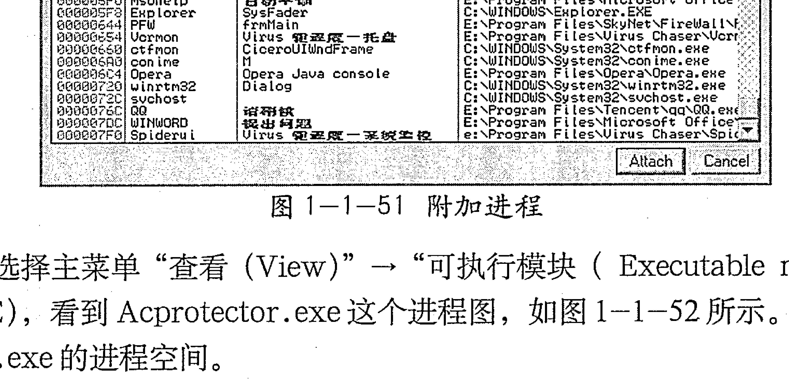

- 2）接着选择主菜单“查看（View）”→“可执行模块（Executable modules）”（快捷键 Alt+E），看到 Acprotector.exe 这个进程，如图 1-1-52 所示。双击它，来到 Acprotector.exe 的进程空间。

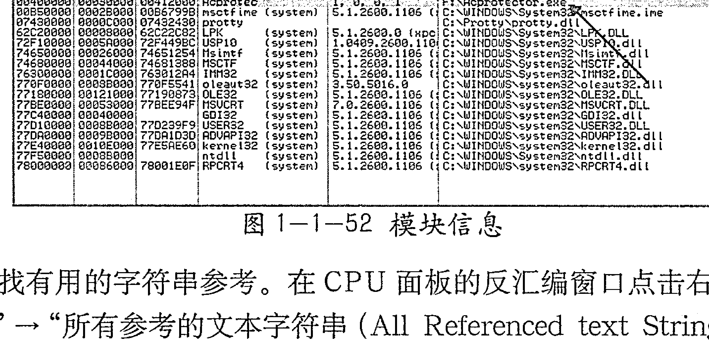

图 1-1-52 模块信息

现在我们找有用的字符串参考。在 CPU 面板的反汇编窗口点击右键，选择“搜索（Search for）”→“所有参考的文本字符串（All Referenced text Strings）”，等 OllyDbg 搜索完后，会弹出字符串参考窗口。在这里我们可以看到很多字符串，并且可以找到和注册有关的字符串，如图 1-1-53 所示。

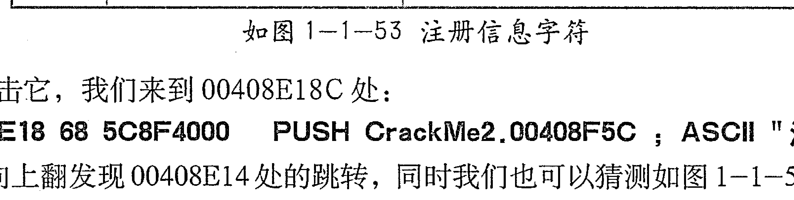

如图 1-1-53 注册信息字符串

- 3）双击它，我们来到 00408E18C 处：

```asm
00408E18 68 5C8F4000   PUSH CrackMe2.00408F5C ; ASCII "注册提示"
```

我们向上翻发现 00408E14 处的跳转，同时我们也可以猜测如图 1-1-54 所示的地址 00408E0F 的 CALL 是关键的注册码比较。鼠标左键选择 00408E0F 这一行，按 F2 在 00408E0F 处下断点。如图 1-1-54 所示。

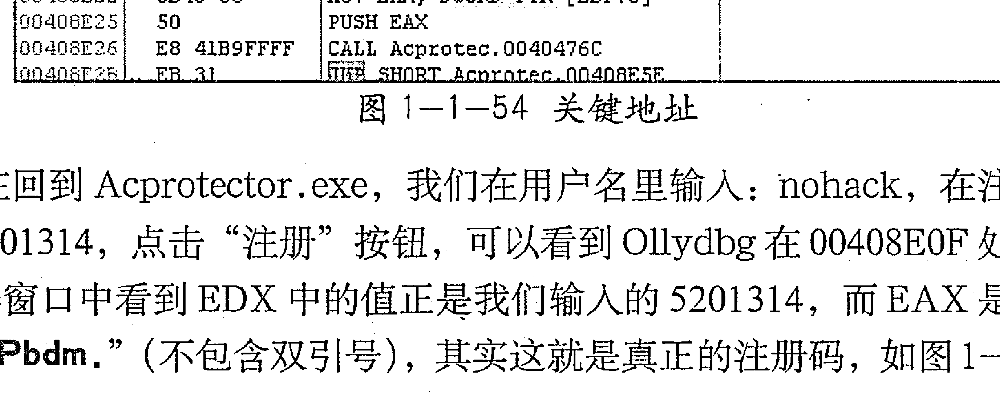

图 1-1-54 关键地址

- 4）现在回到 Acprotector.exe，我们在用户名里输入：nohack，在注册码里输入假注册码：5201314，点击“注册”按钮，可以看到 OllyDbg 在 00408E0F 处断下。在右上角的寄存器窗口中看到 EDX 中的值正是我们输入的 5201314，而 EAX 是另外的一个值——“PpqiPbdm.”（不包含双引号），其实这就是真正的注册码，如图 1-1-55 所示。在 EAX 这一行，点击右键，选择“在数据窗口跟随（Follow in Dump）”，这时在 OllyDbg 的数据窗口我们可以看到这个真正的注册码，选择它，Ctrl+C 将它拷贝起来，也可以点击右键选择“拷贝”菜单项进行拷贝。

- 5）现在关闭 OllyDbg，再一次运行 Acprotector.exe，在用户名里输入：nohack，在注册码里输入注册码：“PpqiPbdm.”，点击注册按钮，这时 Acprotector.exe 已经提示注册成功了，如图 1-1-56 所示。原来用强壳加壳的程序一样可以轻松破解。

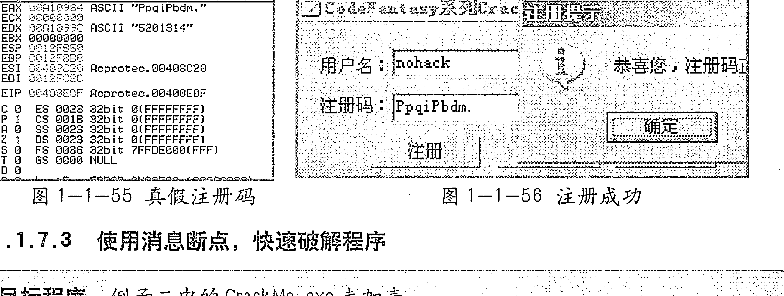

## 1.1.7.3 使用消息断点，快速破解程序

> **目标程序：** 例子二中的 CrackMe.exe（未加壳）。  
> **使用工具：** OllyDbg  
> **说明：** 文中的 CrackMe 是上文例二中的 CrackMe，不过没有加壳。

上文中我们使用查找和注册信息相关的字符串来达到破解的目的，但是如果你遇到别的程序时，它把字符串加密了，或者它根本没有字符串，那又应该怎么办呢？最好的办法就是给程序下消息断点，使其按下“注册”按钮时就被拦截下来，然后可以从中跟踪到关键的地方。

- 1）消息处理函数 TranslateMessage

在 OllyDbg 中下消息函数断点不能像 SoftICE 那样直接使用 BMSG 这样的消息断点命令，因为 OllyDbg 根本没有这样的命令。在 OllyDbg 中下消息断点只能使用条件断点来达到目的。在使用条件断点之前，我们还必须找一个处理程序消息的函数，TranslateMessage 就是被程序进程调用的消息处理函数。可以说程序响应的消息都要经过 TranslateMessage。TranslateMessage 函数在 MSDN 中说明如下：

```c
BOOL TranslateMessage(
    CONST MSG *lpMsg    // address of structure with message
);

lpMsg 是这样的一个结构：

typedef struct tagMSG {
    HWND   hwnd;
    UINT   message;
    WPARAM wParam;
    LPARAM lParam;
    DWORD  time;
    POINT  pt;
} MSG;
```

如果你对 API 一窍不通的话，这里你可能已经模糊了吧，不过不用担心，我们可以不用去管它。你只要记住，当 TranslateMessage 这个函数被调用时，[ESP+4] 指向的是一个消息结构（MSG），消息结构的第一个成员是消息窗体的句柄，即 `[[ESP+4]]`，而这个消息结构中第二个成员就是消息的类型，即 `[[ESP+4]+4]`。

###### 2）消息的类型

在下消息断点之前必须清楚下什么类型的消息。现在我们要下的是当“注册”被点击时的消息，可以下当鼠标按下“注册”按钮时的消息——WM_LBUTTONDOWN，也可以下当鼠标按下“注册”按钮后松开鼠标时的消息——WM_LBUTTONUP。通过使用比较后，我发现后者的效果比较好，而且 WM_LBUTTONUP 是发生在 WM_LBUTTONDOWN 之后的。

###### 3）控件的句柄

有消息类型当然还要有“注册”按钮这个控件的句柄。在 OllyDbg 中我们无需借助任何窗口查看工具来查看，因为 OllyDbg 已经有了这样的功能。相信前面介绍的内容你不会忘记吧。现在用 OllyDbg 载入 CrackMe.exe，F9 运行 CrackMe.exe，从“查看（View）”菜单打开“窗体（Windows）”窗口，可以看到注册按钮的句柄为 4B02B2，如图 1-1-57 所示。

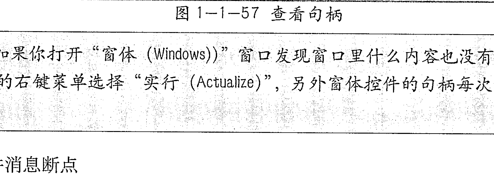

图 1-1-57 查看句柄

> 注：如果你打开“窗体（Windows）”窗口发现窗口里什么内容也没有，这时你可以在该窗口的右键菜单选择“实行（Actualize）”。另外窗体控件的句柄每次调试时是会改变的。

###### 4）条件消息断点

现在按 Ctrl+G，输入 TranslateMessage，跳到 TranslateMessage 函数处。当然你也可以在命令输入框中输入 `follow TranslateMessage`，跳到 TranslateMessage 函数处。在 TranslateMessage 函数开始处按 Shift+F4 或使用右键菜单，呼出条件断点设置窗口，我们设置条件如下：

```text
[[ESP+4]+4]==WM_LBUTTONUP &&
[[ESP+4]]==i30426
```

这个条件表示为当点击“注册”按钮并松开鼠标时。

在“暂停程序（Pause Program）”中选择为“当满足条件时（On condition）”，其它选项可以不用去管它，如图 1-1-58 所示。

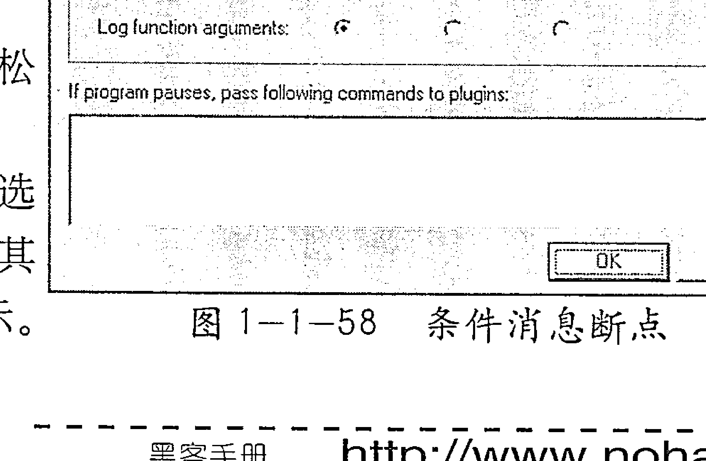

图 1-1-58 条件消息断点

###### 5）捕捉消息

设置好后，回到 CrackMe，输入注册名：nohack，假注册码：5201314，按下“注册”按钮。当鼠标松开时，“啪”的一声在 TranslateMessage 函数处断下，如图 1-1-59 所示。

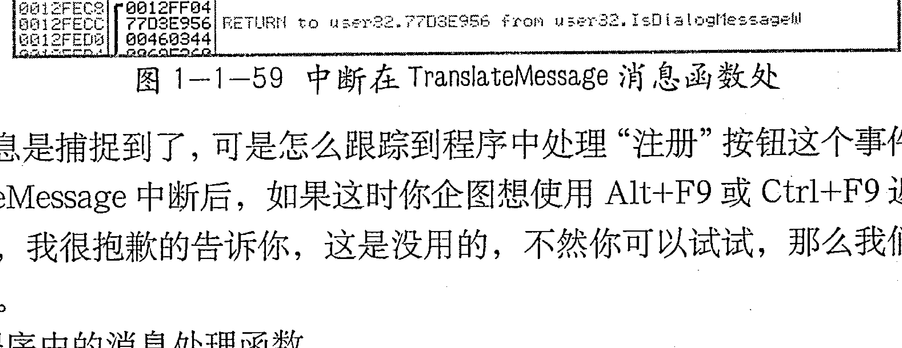

图 1-1-59 中断在 TranslateMessage 消息函数处

现在消息是捕捉到了，可是怎么跟踪到程序中处理“注册”按钮这个事件的地址呢？在 TranslateMessage 中断后，如果这时你企图使用 Alt+F9 或 Ctrl+F9 返回到程序代码处的话，我很抱歉地告诉你，这是没用的。不然你可以试试。那么我们怎么做呢？接着看下面。

###### 6）找程序中的消息处理函数

我们可以在程序的代码区段下断点。因为 TranslateMessage 过后，程序就会接收到这个消息，并使用程序中的消息函数来处理。但是我们并不知道程序处理消息的地方在哪里，所以我们在程序的整个代码段下断点。按 Alt+E 呼出内存窗口，找到 CrackMe 所在的代码段，按 F2 在代码段下断点，如图 1-1-60 所示。

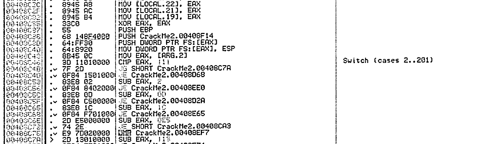

图 1-1-60 在代码段下断点

现在 F9 运行程序，又“啪”的一声中断在程序空间 408C20 处。这时我们很兴奋地发现，这里正是程序处理消息的地方，如图 1-1-61 所示。


图 1-1-61 中断在程序的代码空间

现在我们在 408C20 处下断点，按 F9 两次（因为通过 F7 跟踪发现头两次中断没有到达我们想要的地址处），在第三次中断在 408C20 时，按 F7 一步一步地跟踪，很快就来到了“注册”按钮处理事件的代码处了，如图 1-1-62 所示。

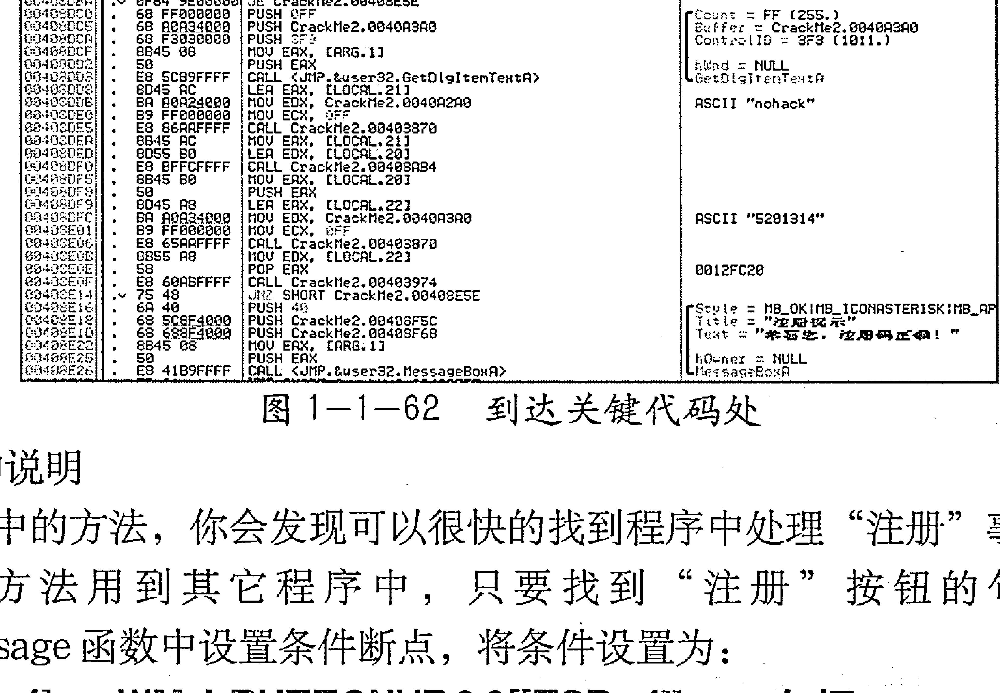

图 1-1-62 到达关键代码处

###### 7）最后的说明

通过本文中的方法，你会发现可以很快找到程序中处理“注册”事件的代码。你也可以将此方法用到其它程序中：只要找到“注册”按钮的句柄，然后在 TranslateMessage 函数中设置条件断点，将条件设置为：

```text
[[ESP+4]+4]==WM_LBUTTONUP && [[ESP+4]]==句柄
```

然后在程序的代码段下断点。当你在 TranslateMessage 中断后继续运行程序时，就会在程序本身处理消息的地址处断下，这时你就可以通过跟踪很快来到处理“注册”事件的代码处。

> 注：像上面说的那样，当 TranslateMessage 返回并中断在用户代码段时，这时还没有直接处理“注册”按钮事件。我们再一次在程序的消息处理代码处下断点，在几次中断后才会到达处理“注册”按钮事件的代码。另外对应 MFC 和 Delphi 程序，在 TranslateMessage 中断后一般都无法返回到程序处理事件的代码处；对于 Delphi 程序，你可以通过后面介绍到的 Delphi 反编译工具直接找按钮的处理事件。

### 1.2 SoftICE

SoftICE 是 Compuware 公司（NuMega Lab）出品的一个功能强大的调试器，它运行在 Ring0 内核级下，几乎可以调试所有的 Windows 程序，包括系统程序。SoftICE 一直以来都是破解的屠龙刀。虽然随着 OllyDbg 的流行，新一代破解者慢慢向使用方便的 Ring3 调试器 OllyDbg 靠拢，但是现在还是有很多高手一直用着 SoftICE，因为他们知道只有用 SoftICE 才能更加广泛地调试各种程序。

如果你现在还是刚刚破解入门，我想 OllyDbg 绝对是你的第一选择；但是随着你破解的深入，你将会发现 OllyDbg 的不足。更要命的是，OllyDbg 是 Ring3 的调试器，它不能去调试 Ring0 的程序。而且现在网上各种内核（Ring0）级开发资料越来越多，所以各种使用驱动来反破解的手段也慢慢多了起来。所以当你遇到一个你用 OllyDbg 搞不定的程序时，不要灰心，SoftICE 将是你的另一个选择。本文将初步教你使用这个软件。也许一直以来你可能被各种安装或使用 SoftICE 的问题困扰而没有去使用这个软件，那么看完本文之后，你将会发现，原来 SoftICE 也是一样很好用的。

#### 1.2.1 SoftICE 的安装

新版的 SoftICE 集合在 DriverStudio 安装包中，不像以前那样是独立安装文件，所以我们要安装的就是 DriverStudio。从 DriverStudio 2.7 以后，包含的 SoftICE 就不再支持 Win98。你想要在 Win98 中使用 SoftICE，那么你就只能安装 DriverStudio 2.7 以下的版本，或者低版本单独的 SoftICE 安装包。不过你也不必这样做，因为后面我将会介绍一款具有和 SoftICE 同样功能、运行在 Win98 下的国产精品——TRW。

现在 DriverStudio 版本已经出到了 3.2，它支持 Win2k 以上的 Windows 系统，包含 Windows 2003，甚至 longhorn 也是支持的。笔者在 XP SP2 安装使用该软件。从本书配套光碟目录“调试工具\SOFTICE\”找到 DriverStudio32 目录，你可以看到如图 1-2-1 所示的目录和文件。

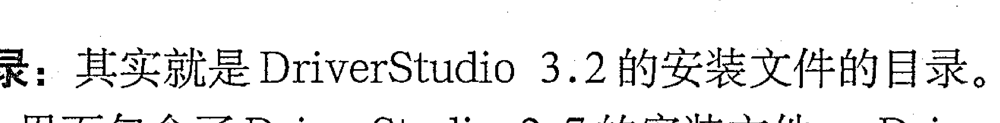

图 1-2-1 目录和文件

- **Setup 目录：** 其实就是 DriverStudio 3.2 的安装文件目录。
- **2.7 目录：** 里面包含了 DriverStudio 2.7 的安装文件，DriverStudio 2.7 可以在 Win98 下安装使用。
- **Autorun.exe：** 本光碟配套的 DriverStudio 安装其实是从整个光碟拷贝下来的，Autorun 是光碟的自动运行程序。
- **Setup16.exe：** 十六位的 SoftICE，版本是 1.51，古董级版本。如果你还在用 Win95 或 98，那也许还用得着。

除此之外，DriverStudio32 目录下还有其它目录和文件，我就不介绍了。现在我们开始安装 SoftICE。

- 1）运行 DriverStudio32 的 Autorun.exe，出现如图 1-2-2 所示的界面。

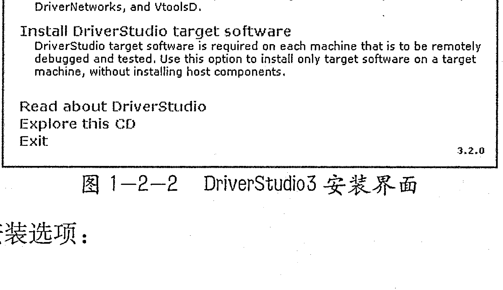

图 1-2-2 DriverStudio3 安装界面

我们看到两个安装选项：

- Install DriverStudio host and /or target software
- Install DriverStudio target software

第二个选项是用在远程调试的，我们在这里选择第一个选项。过了一会儿出现如图 1-2-3 所示的 DriverStudio 安装程序界面（如果直接运行 Setup 目录下的 setup.exe，则会直接出现该界面）。

- 2）点击“下一步（Next）”，出现使用协议（License Agreement），选择“I accept the terms in the license agreement”，继续安装进度，出现如图 1-2-4 所示的用户注册界面。这里需要我们输入序列号（Serial Number），你可以用 DriverStudio32 目录下的注册机（keygen.exe）生成需要的序列号；用户名（User Name）和组织名（Organization）可以随意填写。

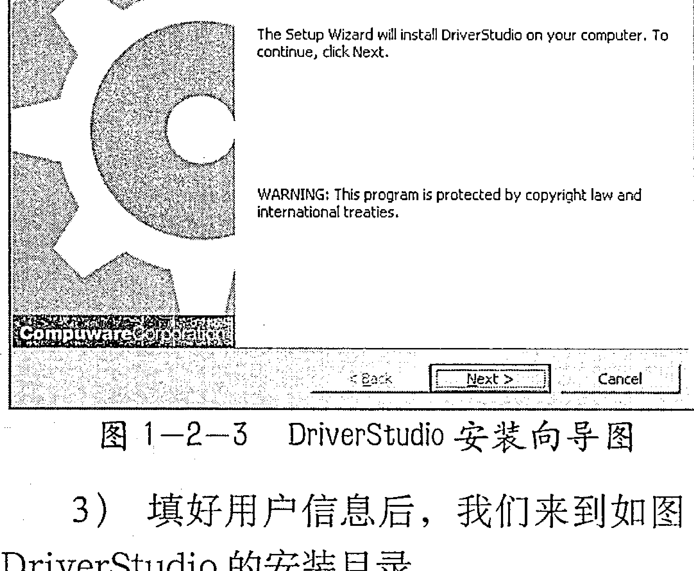

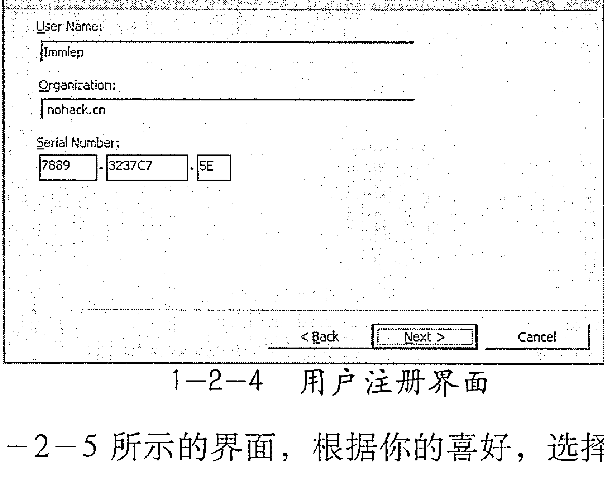

- 3）填好用户信息后，我们来到如图 1-2-5 所示的界面。根据你的喜好，选择 DriverStudio 的安装目录。

- 4）设定安装目录后，来到如图 1-2-6 所示的界面。上面已经说过了，这里我们选择“Both host and target”。

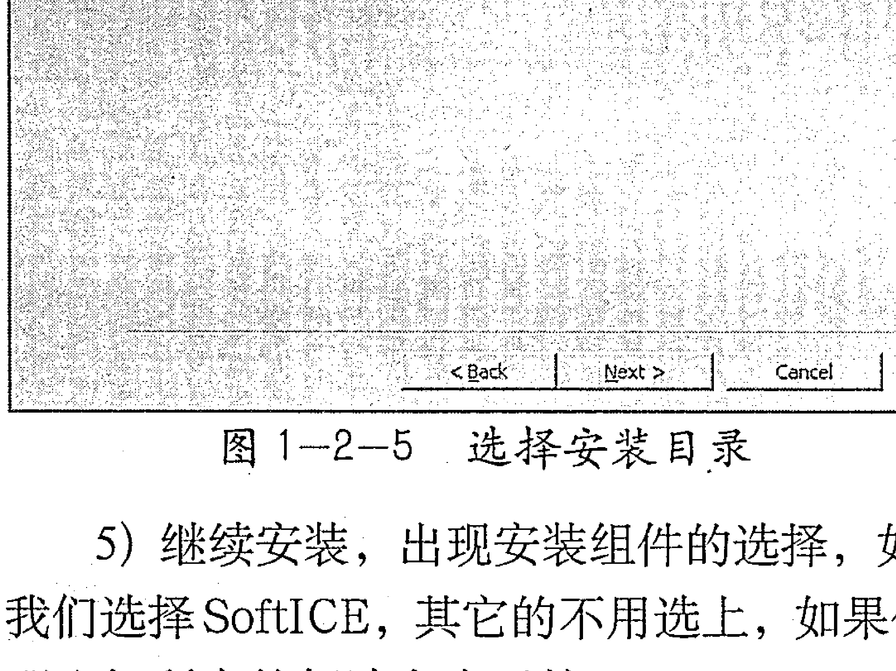

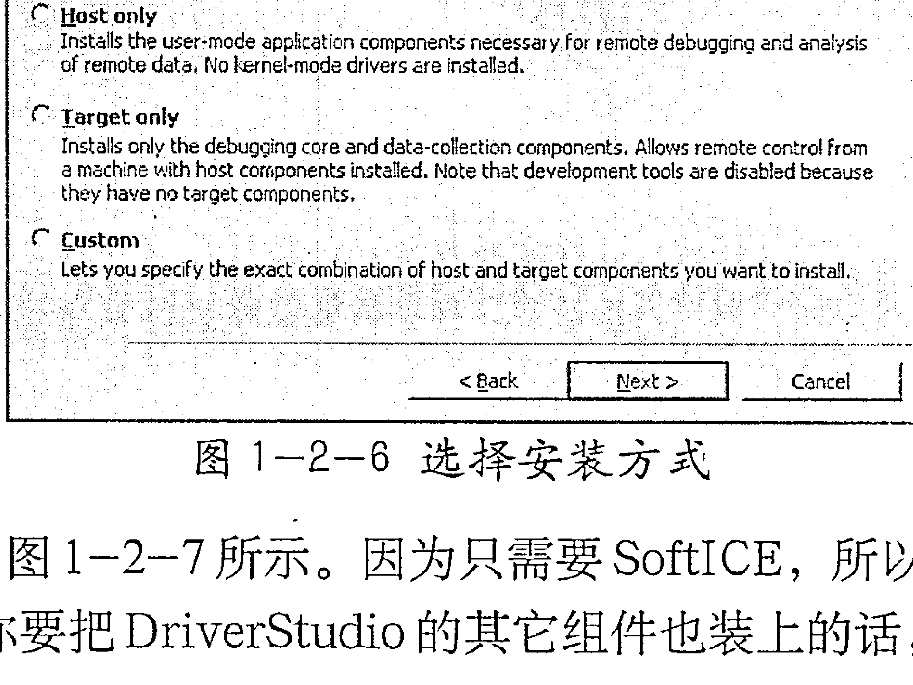

- 5）继续安装，出现安装组件的选择，如图 1-2-7 所示。因为只需要 SoftICE，所以我们选择 SoftICE，其它的不用选上。如果你要把 DriverStudio 的其它组件也装上，那么把所有的都选上也无妨。

6）选择好安装组件后，再继续就会出现“完成设置，开始安装”的界面了。点击“安装（Install）”，DriverStudio 就会开始安装了，等其安装完毕后，会跳出 SoftICE 的设置界面，不用管它，将它关了。下面我们将会独立地介绍 SoftICE 的设置。接着还会出现发送注册信息等提示，也直接将其关闭就可以了。再次出现安装向导，按“下一步（Next）”，就可以完成安装。提示是否要重新启动，只要重新启动就可以使用 SoftICE 了。这里我们选择“否（NO）”，先把 SoftICE 配置好再重新启动也不迟。

#### 1.2.2 配置 SoftICE

只有配置好 SoftICE，使用时才会得心应手。在 SoftICE 的设置界面中，我们可以通过左下角的“Load”和“Save”按钮来载入已有的设置和保存当前设置。

- 1. 从“开始”菜单→“Compuware DriverStudio”中选择“Settings”，打开 SoftICE 的设置界面，如图 1-2-8 所示。

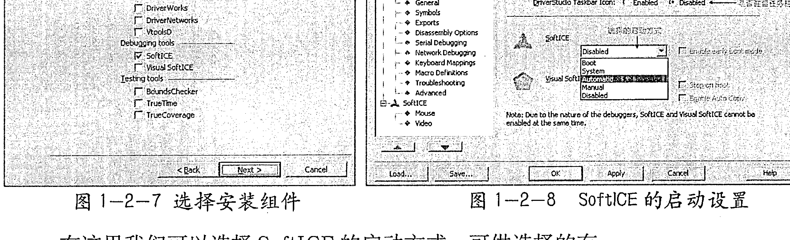

在这里我们可以选择 SoftICE 的启动方式，可供选择的有：

- **Boot**：先于 Windows 加载之前启动，该模式最适合调试内核驱动程序。
- **System**：随 Windows 一起启动，该模式比较适合程序开发人员。
- **Automatic**：也是随 Windows 一起启动，但是无法调试 Windows 核心驱动程序。
- **Manual**：手工启动 SoftICE，当你想要使用 SoftICE 再启动它。
- **Disabled**：禁止使用 SoftICE。

一般情况下，选择 Automatic 方式或 Manual 方式。安装 DriverStudio 后，在 Windows 启动的过程中，当我们可以看到“Press ESC to Modify DriverStudio Startup Environment”字样时，如果选择了 Automatic 方式启动，想要取消 SoftICE 的启动，可以按“ESC”进入设置，按空格键可以选择和取消选择，如图 1-2-9 所示。


> 注意：按照 SoftICE 的官方说明，在 XP 系统中，当设置为 System 或 Automatic 模式时，有时会出现无法正常启动 SoftICE 的情况，这时你必须将其设置为 Boot 或 Manual 模式。

- 2）接下来我们要设置 SoftICE 的视频和鼠标设置。我们将视频（Video）模式设置为“Universal Video Driver”，如图 1-2-10 所示。那么 SoftICE 的调试界面将显示为窗口界面，而另一个选项——全屏模式（Full screen VGA mode）需要显卡支持，也就是说 SoftICE 必须能识别你的显卡。按照经验，SoftICE 能识别出来的显卡少得可怜，即使识别出来，很多时候也无法使用全屏模式，所以我们选择“Universal Video Driver”。选择后点击下面的“测试（Test）”按钮，让 SoftICE 进行测试，一般没什么问题，等一会就会弹出测试成功的对话框了。

对于鼠标设置，根据你的鼠标选择类型。其实 SoftICE 的键盘命令已经很强大了，如果你不想在 SoftICE 中使用鼠标，可以选择“None”。如果你的鼠标是带有滚轮的话，那把“Enhanced Mouse”选上吧，如图 1-2-11 所示。


> 注意：有个别 USB 键盘在 SoftICE 中可能无法正常使用，这时你可以添加如下注册表键值来试试是否能解决问题：

```reg
Windows Registry Editor Version 5.00

[HKEY_LOCAL_MACHINE\SYSTEM\CurrentControlSet\Services\NTice]
"UsbDisablePopdownTypematic"=dword:00000001
```

- 3）接下来的重点是 SoftICE 的初始化设置（SoftICE initialization），我们只需要注意部分设置，其它的按照默认即可。

- **一般设置（General）**：在“Initialization string”输入 SoftICE 运行时要执行的命令，默认只有一个“x;”，表示隐藏调试窗口。这里我们添加为 `x;lines 60; wc 32; wd 10;wr;`，表示将调试窗口长度设置为六十行，设置显示的代码行数为 32 行，数据行数为 10 行，并把寄存器窗口打开。显示命令可以参考 SoftICE 的命令手册。如图 1-2-12 所示。
- **键盘布局（Keyboard Mappings）**：这里设置了 SoftICE 各个命令对应的热键。一般如果没有什么特殊要求，按照默认设置就可以了。
- **宏定义（Macro Definitions）**：可以把 SoftICE 的命令设为简短的自定义命令，非常有用的设置。你可以根据自己的喜好设置宏定义命令，如图 1-2-13 所示。我在这里把命令“Bpx MessageBoxA”定义为宏命令“bpMsg”，以后在使用 SoftICE 时只要键入“bpMsg”就等于键入了“Bpx MessageBoxA”。


图 1-2-12 常规设置


图 1-2-13 定义宏命令

- **故障修复（Troubleshooting）**：如果在使用 SoftICE 的过程中发现一些故障，你可以在这里把一些东西禁掉，包括禁用鼠标等，如图 1-2-14 所示。


图 1-2-14 故障修复

设置这些选项后，基本就没什么问题了。你可以点击左下角的“保存（Save）”按钮将当前设置保存到文件，下次安装 SoftICE 时，不用一个个设置，只要使用“载入（Load）”把保存的设置文件载入就可以了。当然，我也将本文的设置文件收录到了配套光盘中。

#### 1.2.3 使用 SoftICE

经过上面的设置后，重新启动系统就可以使用 SoftICE 了。现在我们来看看 SoftICE 的调试界面，它就是刚才我们在一般设置中使用 `x;lines 60; wc 32; wd 10;wr;` 显示出来的界面，如图 1-2-15 所示。


图 1-2-15 SoftICE 调试界面

当 SoftICE 启动后，你可以随时按 Ctrl+D 热键呼出 SoftICE 的调试界面，下面分为各小部分介绍 SoftICE 的使用。

##### 1.2.3.1 SoftICE 的常用热键

下面列出的是 SoftICE 常用的默认热键对照表。其实对应的热键即表示着一条命令，你可以在上面介绍的“键盘布局（Keyboard Mappings）”更改这些热键和命令，甚至添加自己喜欢的热键。

- F1：显示帮助，SoftICE 各个命令的帮助显示在命令窗口中，对应命令为 `help`。
- F2：显示或隐藏寄存器窗口，对应命令为 `WR`。
- F3：显示或隐藏代码文件，对应命令为 `SBC`。
- F4：恢复被调试程序的界面，对应命令为 `RS`。
- F5：隐藏/显示调试窗口。
- F6：进入或退出代码窗口；进入代码窗口后可用 Page Up/Page Down、上下箭头浏览代码；对应命令为 `EC`。
- F7：运行到当前代码行，相当于选择代码行后输入 `here` 命令。
- F8：单步步入跟踪（在 OllyDbg 中是 F7），对应命令为 `T`。
- F9：在当前选择的代码行下断点。
- F10：单步步过跟踪，不跟入 Call 指令，对应命令为 `P`。
- F11：运行被调试程序，对应命令为 `G`。
- F12：执行代码到返回（遇到 RET 指令时停下）。
- Shift+F3：更改数据窗口显示数据的格式（byte、word、dword 等）。
- Alt+F1：显示或隐藏寄存器窗口（与 F2 重复），对应命令为 `WR`。
- Alt+F2：显示或隐藏数据窗口，对应命令为 `WD`。
- Alt+F3：显示或隐藏代码窗口，对应命令为 `WC`。
- Alt+F4：显示或隐藏监视窗口，对应命令为 `WW`。
- Alt+F5：命令窗口清屏，对应命令为 `CLS`。

##### 1.2.3.2 SoftICE 的常用命令

SoftICE 的命令是非常丰富的，你可以在 DriverStudio 安装目录的 help 目录下找到 CommRef.chm，这就是 SoftICE 的命令参考手册。它收录了所有的 SoftICE 命令，是使用 SoftICE 不可缺少的参考手册。这里我将介绍一些较为常用的命令。SoftICE 的命令不区分大小写，更多时候请参考 SoftICE 的命令参考手册。

- 断点命令

**BPX**：在某个函数或地址下断点，其实就是在这些地址插入 INT3 指令。`bpx` 支持丰富的表达式，看下面几个例子：

```text
Bpx MessageBoxA      ; 在 MessageBoxA 函数下断点。
Bpx eip if eax <100  ; 当 eax 的值小于 100 时激活 SoftICE。
Bpx 401000           ; 在地址 401000 处下断点。
```

`Bpx RegQueryValueA if *(esp+8)=="hack"`，在 RegQueryValueA 下断点，当其查找的子键包含“hack”关键字时，激活 SoftICE。

**BPM**：内存断点，使用调试寄存器 DR0～DR3 来设置断点，最多只能设置四个断点。用 BPM 下断点可以躲过一些程序的自校验，支持和 BPX 一样的表达式，更多时候推荐使用 BPM 断点。

`Bpm 401000 w`：当程序对 401000 地址有写操作时，触发断点。`w` 对应写操作，`r` 对应读操作，`x` 对应执行操作，表示执行到该地址时触发断点。当然，也可以使用 `Bpm 401000 wr` 拦截读写操作。

**BMSG**：消息断点，第一个参数必须为要下断点的窗口句柄。

- `BMSG F20 WM_CLOSE`：当句柄为 F20 的窗口关闭时激活 SoftICE。
- `BMSG f4c L 0 WM_ENABLE`：当句柄为 F20 的窗口触发一个 WM_ENABLE 消息时，将其记录到 SoftICE 的命令窗口。

多断点操作命令有以下几个：

- **BC**：清除断点，`BC *` 表示清除所有断点，`BC 1 5` 表示清除第一和第五个断点。
- **BD**：使断点暂时失效，用法同 BC 命令。
- **BE**：恢复失效的断点。
- **BL**：显示所有断点，无参数。

- 内存操作命令

- **D**：在数据窗口显示内存数据。  
  - `D 401000`：在数据窗口中显示 401000 地址的数据。
- **F**：填充内存数据。  
  - `F 401000 L 1000 0`：将 401000 到 402000 填充为 0，`L 1000` 是要填充的长度。
- **R**：显示或修改寄存器和标志位的值。  
  - `R Z1`：将 Zero 标志位设为 1，标志位位于 SoftICE 调试窗口右上角。  
  - `R eax = 100`：把 eax 的值改为 100。
- **S**：在内存中查找数据。  
  - `S 30:0 L ffffffff 'regcode'`：在整个内存中查找字符串 regcode。

- 控制命令

- **G**：执行命令，不带参数时直接执行被调试程序，相当于快捷键 F11。  
  - `G 405000`：执行到地址 405000。
- **P**：单步步过跟踪，相当于快捷键 F10。
- **T**：单步步入跟踪，相当于快捷键 F8。
- **X**：显示或退出调试窗口，相当于快捷键 F5。

##### 1.2.3.3 使用 SoftICE 加载并调试程序

现在我们来学习如何用 SoftICE 加载并调试一个程序。

- 从“开始”菜单→“Compuware DriverStudio”→“Debug”中打开 Symbol Loader，出现如图 1-2-16 所示的 Symbol Loader 界面。如 SoftICE 已经启动了，则在右下角显示绿色提示“SoftICE is active”，否则显示红色提示“SoftICE is not active”。


图 1-2-16 Symbol Loader 界面

- 从“文件（File）”→“打开（Open）”菜单，选择要调试的程序，然后再选择菜单“模块（Module）”→“加载（Load）”，SoftICE 就会加载该程序调试，并停在程序入口点。按 Ctrl+D 呼出 SoftICE 调试窗口，就可以开始调试了，如图 1-2-17 所示。


图 1-2-17 用 SoftICE 调试程序

## 1.2.4 其它 SoftICE 使用技巧与问题

##### 1.2.4.1 在 VMware 中使用 SoftICE

一直以来很多破解爱好者都错误地认为，在 VMware 虚拟机中按普通方法安装的 SoftICE 是无法正常使用的。但在虚拟机中破解程序有很大好处，毕竟它是虚拟的，遇到一些破坏性的程序，或者调试病毒就不怕了，大不了重装虚拟机系统。于是网上就流传了一些如何用 VMware 搭建 SoftICE 远程调试环境的文章，操作比较繁琐，根本不适合新手。

其实，根据官方说法，从 SoftICE 3.1 和 VMware 4.0 开始，SoftICE 就能很好地在 VMware 中使用了，不过要对 VMware 设置做一定更改。打开你在 VMware 中虚拟系统的目录，用记事本打开其中后缀名为 vmx 的文件，在其末尾添加 `svga.maxFullscreenRefreshTick = "2"`，如图 1-2-18 所示，添加后保存文件。


图 1-2-18 VMware 的设置

现在按照上文安装 SoftICE 的方法在虚拟机里的系统安装好 SoftICE，就可以使用 SoftICE 了。如图 1-2-19 所示，是笔者在 VMware 5.0 中使用 SoftICE 的界面。


##### 1.2.4.2 SoftICE 新增的命令

DriverStudio 3.2 中的 SoftICE 版本新增了一些不错的命令，我们一起来学习下：

- **Filter**：过滤器，SoftICE 会高亮显示过滤器中的字符串。  
  `FILTER "data window" red+white`；当出现任何“data window”时，将显示为红字白底。
- **Bpload**：当一个模块加载或卸载时激活 SoftICE，模块一般指 DLL。  
  `Bpload Mydll`；当一个名为 Mydll 的模块加载或卸载时激活 SoftICE。
- **BPX**：其实不算新指令，不过对其进行了扩展，现在支持同时对一个模块中所有函数下断点。  
  `Bpx user32.dll`；对 user32.dll 中所有导出函数下断点。
- **Macro**：新增了 POPUP 和 POPDOWN 自动执行命令，POPUP 表示当 SoftICE 激活时，POPDOWN 表示退出 SoftICE 调试窗口时。  
  `MACRO popup="dd esi"`；当 SoftICE 被激活时，显示 ESI 的内容。

##### 1.2.4.3 使用 SoftICE 过程中遇到的问题

- **Q**：我安装了 SoftICE 后，发现系统变得很慢，我应该怎么办？  
  **A**：安装 SoftICE 后如果 SoftICE 在运行中，确实会占用不少系统资源，而且 SoftICE 启动后是无法关闭的。所以如果你不是经常使用 SoftICE，可以设为手动启动（Manual），等需要使用时才启动 SoftICE，甚至在虚拟机中用；不想使用时可以把虚拟机关机。

- **Q**：安装 IceExt 后提示“系统发生 1450 错误。系统资源不足，无法完成请求的服务”的问题。  
  **A**：IceExt 是一个很有用的 SoftICE 辅助工具。安装 IceExt 0.66 后，启动 IceExt 时提示“系统发生 1450 错误。系统资源不足，无法完成请求的服务”，这时我们可以通过修改注册表键值来解决：修改注册表 `HKEY_LOCAL_MACHINE\SYSTEM\CurrentControlSet\Services\NTice` 中的下列键值，把值改大一点：

```text
KDHeapSize = 0x9000
KDStackSize = 0x8000

改为：

KDHeapSize = 0x00100000
KDStackSize = 0x00100000
```

> 注：配套光盘中已经提供了 IceExt 0.67

- **Q**：我可以在哪里找到更多关于使用 SoftICE 的信息？  
  **A**：SoftICE 本身附带有两本非常有用的参考文档，分别是位于 `\DriverStudio\Books\Using SoftICE.pdf` 的 SoftICE 使用手册和 `\DriverStudio\Help\CommRef.chm` 的 SoftICE 命令参考手册。这两本手册包揽了丰富的 SoftICE 相关信息。

## 1.2.5 结束

如果要深入使用 SoftICE，就一定要熟悉 SoftICE 的命令，熟读 SoftICE 的命令参考手册。同时，在使用 SoftICE 的过程中不要因为觉得枯燥而放弃使用这个工具。只要你全面地认识并使用这个工具，你将不会觉得枯燥，相信此时你的破解功底也会有大幅度提升。

### 1.3 TRW2000

TRW2000 是国人写的类似 SoftICE 的系统级调试工具，它的命令是完全兼容 SoftICE 的（当然这个是指 TRW2000 出来那时 SoftICE 所支持的指令），而且使用方便，不用安装。由于 TRW2000 是早期开发，之后作者也没有对其进行升级，所以 TRW2000 只支持 Win9x 系统，对于 Win9x 以上的系统无法支持。不过如果在 Win9x 下选择调试器的话，TRW2000 绝对是最佳选择。

#### 1.3.1 TRW2000 的安装和使用

TRW2000 发布版本是一个 ZIP 压缩包，只要将其解压缩到一个目录下，即可运行使用。看看 TRW2000 的运行界面，如图 1-3-1 所示。

可以看到 TRW2000 的界面非常简单。在没有学会使用 TRW2000 进行调试之前，我们还得先看看 TRW2000 的设置。不要以为 TRW2000 只有那么一个简单的界面就没有设置了，其实 TRW2000 是把设置保存在它同目录下的 `TRW2000.INI` 文...


件中，一般没有什么特殊情况，TRW2000 使用默认设置就能运行使用了。图 1-3-2 所示是 TRW2000 1.22 娃娃修正版中的 TRW2000.INI 的内容，有很详细的中文说明，相信要看懂也不是难题。

可以看到 TRW 的大部分热键是和 SoftICE 相同的，不同的是 F11 键在 TRW 中是执行到用户代码，这个是很有用的功能。当跟踪到被调试程序以外的其他模块时，只要按 F11 就可以返回到被调试程序的领域。还有 TRW2000 的激活键是 SoftICE 的 Ctrl+D，TRW2000 分为 Ring0 和 Ring3，激活键分别是 Ctrl+M 和 Ctrl+N。看完配置后，当然也要学习一下 TRW2000 的命令了，前面已经说了 TRW2000 是完全兼容 SoftICE 的指令，所以这里介绍一些 TRW2000 特有的指令。


图 1-3-2 TRW 的设置文件

- **EXP32**：显示 32 位输出函数列表，支持模糊查询。  
  - `EXP32 get*`：查询 get 开头的函数。
- **MAKEPE**：转储被调试程序，也就是我们所说的脱壳。  
  - `MAKEPE C:\dump.exe`：将当前进程转储为 `C:\dump.exe`。
- **PDLL32**：拦截 DLL 载入，新版的 SoftICE 也支持相关命令。  
  - `PDLL32 mydll.dll`：当 `mydll.dll` 载入时激活 TRW2000。
- **SUSPEND**：挂起当前被调试的程序，没有参数，被挂起的程序等于暂停运行。
- **PMODULE**：返回到用户代码，在 Ollydbg 中也有类似的指令。
- **BPX hmemcpy**：下软万能断点，是非常有用的命令。如果在破解软件时找不到有用的函数下断点，那么你就可以尝试使用万能断点。
- **Ver keep**：TRW2000 的截图命令，可以将当前 TRW2000 调试界面截图保存。

另外，TRW2000 附带了详细的中文指令参考手册，你可以在配套光碟中找到（调试工具\TRW2000\），请随时查阅。

熟悉了 TRW2000 的热键和命令后就可以开始使用 TRW2000 调试软件了。运行 TRW2000，出现 TRW2000 的界面，按“Browse”选择要调试的程序文件，或者把文件拖放到 TRW2000 的窗口，然后按“Load”加载被调试程序，按 **Ctrl+N** 或 **Ctrl+M** 调出 TRW2000 的调试界面，如图 1-3-3 所示。


图 1-3-3 TRW 调试界面

可以看到 TRW2000 的调试界面和 SoftICE 的调试界面相差无几，由上到下依次是寄存器窗口、数据窗口、代码窗口、命令窗口，现在只要使用 F8、F10 等跟踪热键就可以开始跟踪程序了。

#### 1.3.2 TRW2000 修改版和插件

- 1. 修改版

配套光碟收录了 TRW2000 1.03 和 TRW2000 1.23 原版，和对应的两个由娃娃修改的版本，另一个是 pll621 的、在娃娃修改版基础上修改的版本（TRW-p11621.zip），这里建议使用这个版本。

- 2. TRW2000 插件

TRW 支持插件功能，配套光碟中收录了网上能收录到的 TRW2000 插件，几乎每个插件自己都有说明介绍，你可以自己查看。如果要使用这些插件，把它们解压到 TRW2000 目录的 SYS 目录下就可以了。

### 1.4 WKTVBDebugger

一直以来，对于破解者来说，用一般调试的方法调试 VB P-code 的东西是比较麻烦的，所以要调试 VB P-code 的程序，就必须使用专门的调试器。而 WKTVBDebugger 就是专门用来调试 VB P-code 程序的调试器，也可以说是目前唯一可以很方便调试 VB P-code 的动态调试器，是破解 VB P-code 程序不可缺少的利器。

#### 1.4.1 VB P-Code 简介

对于破解初学者来说，可能还不明白 VB P-code 是什么东西，这里有必要先介绍一下。

微软的 Visual Basic（VB）想必大家都知道了，在用 VB 编译程序时，可以选择“本机代码（Native）”编译方式和“伪代码（P-code）”编译方式。“本机代码”编译方式生成的程序，可以直接反汇编调试，跟我们一般破解的程序是没有什么区别的。而另一种“伪代码（P-code）”编译方式的 VB 程序，我们称为 VB P-code 程序，它编译时是把程序的代码编译成某种编码（P-code），然后程序在运行时，由工作引擎（位于 msvbvm*.dll 中）将这些编码再转换为汇编代码执行。所以你用反汇编软件反汇编 VB P-code 程序是看不到有效信息的，而你在用 SoftICE 和 Ollydbg 动态调试 VB P-code 程序时，也只能在 msvbvm*.dll 中转，破解起来比较麻烦。同时也意味着你不能通过修改 jnz 为 jmp 等指令的方法来破解 P-code 程序，因为 P-code 程序里面根本就没有 jnz、jmp 这样的汇编指令。P-code 程序的指令都是一个字节一个字节的，运行时再由工作引擎解释运行。所以很多大侠在破解 VB P-code 程序时，一般都通过找明文注册码，或分析程序算法从而算出其注册码的方法来达到破解的目的。不过分析算法对于新手来说是比较难的，所以这里我将介绍一些对破解有用的 Opcode 对应的伪指令代码。我们修改伪指令代码时也只能用伪指令代码代替，也就是说对于 VB P-code 的程序我们同样可以爆破它。

| 伪指令 | 助记符 | 说明 |
|---|---|---|
| 13 | ExitProcHresult | 过程调用结束返回 |
| 1C | BranchF | False 则跳，一般与 EqI2 等合用，类似于 jnz；1C 后面跟着跳转的相对地址，详细请见后面破解例子。 |
| 1D | BranchT | True 则跳，也就是相等就跳，类似于 jz |

我这里也就介绍了这么几个指令，可不要小看这几个指令，破解就靠它们了。

#### 1.4.2 WKT Debugger 的使用

了解了上面一点点 VB P-code 的知识后，现在可以开始学习 WKT Debugger 了，在学习的过程中相信你对 VB P-code 会有进一步的了解。WKT Debugger 的启动界面可以说简单得不能再简单了，如图 1-4-1 所示。


图 1-4-1 WKT Debugger 主界面

你可以从“文件（File）→打开（Open）”菜单项或工具栏的图标按钮，选择要加载的程序。WKT Debugger 就会把加载的信息显示在右边的窗口中，如果加载成功的话，就可以按“Action（动作）→运行（Run）”菜单项或工具栏的图标按钮开始调试程序了，如图 1-4-2 是 WKT Debugger 的调试窗口界面。


图 1-4-2 WKT Debugger 调试界面

图 1-4-2 中有三个黑色背景的子窗口，它们分别是左上角的代码窗口、右上角的数据窗口和左下角的信息窗口。接着还有如图 1-4-3 所示的调试命令按钮，和如图 1-4-4 所示的断点管理按钮。


图 1-4-3 命令按钮  
图 1-4-4 断点按钮

三个断点管理按钮对应了三种不同的下断点方式：

- 1) API（Ctrl+B）按钮，使用 VB 的 API 函数来下断点，如图 1-4-5 所示。双击指定的函数就可以下断点，黄色表示已激活的断点，绿色表示暂时无效的断点。


图 1-4-5 VB API 断点  
图 1-4-6 VB Opcode 断点

- 2) Opcode（Ctrl+O），使用 Opcode 指令下软件断点，如图 1-4-6 所示。选择你要下断点的 Opcode 指令，在 WKT Debugger 中一旦运行到你下断点的 Opcode 指令就会断下来。
- 3) On Execution（Ctrl+E），自定义断点，对指定地址下断点，如图 1-4-7 所示。输入你要下断点的地址，在这里也可以看到你在哪些地址下了断点。

在 WKT Debugger 的调试窗口中，我们还会看到两个不得不知道的功能按钮——“编辑（Edit）”按钮和“窗口管理（Form Manager [Ctrl+F]）”按钮。“编辑”按钮可以打开内存进行编辑，如图 1-4-8 所示。

“窗口管理（Form Manager [Ctrl+F]）”按钮可以查看被调试程序窗口的详细信息，并可以直接对各窗口事件下断点，如图 1-4-9 所示。


至于其他按钮对应的功能就留给读者自己熟悉一下，更详细的信息也可查阅 WKT Debugger 的帮助文档。

#### 1.4.3 应用实例

##### 1.4.3.1 爆破 VB P-Code 程序

> 目标程序：AC_Crackme_01.exe  
> 说明：一个使用 VB P-code 编译的 CrackMe  
> 工具：WKT Debugger  
> 任务：去除 nag 窗口

- 1) 用 WKT Debugger 载入程序，运行，出现调试窗口，停在 401A48 处，如图 1-4-10 所示。

可以看到下面的 00401A61 出现了 rtcMsgBox 函数，按 F8 单步执行到 00401A61 处，那个 nag 窗口弹出来了。哈哈，原来程序一开始就调用了显示 nag 窗口的过程函数。


图 1-4-10 停在入口点处

我们让它什么也不要做就返回这个过程函数，不就可以了吗？

- 2) 说干就干，还记得我上面介绍的 ExitProcHresult 吗？对应的 Opcode 是 13。我们再一次载入程序，同样停在 401A48，选择该行，然后点击该代码窗口下面的“编辑（Edit）”按钮，弹出内存编辑窗口，双击内存编辑窗口的 401A48 一行，将原来的 27 修改为 13，如图 1-4-11 所示。


图 1-4-11 编辑内存代码

- 3) 现在按 F5，运行程序，哈哈，直接出现了程序的主窗口，那个 nag 窗口是不是不见了？现在你可以用 Ollydbg 打开该程序，然后把 401A48 处的 27 改为 13，再保存文件就可以了，也可以用后面介绍的专门编辑工具编辑。

##### 1.4.3.2 再爆破 VB P-Code 程序

> 目标：AC_Crackme_02_A.exe  
> 说明：一个使用 VB P-code 编译的 CrackMe。  
> 工具：WKT Debugger  
> 任务：爆破该程序，使得输入任意注册码均可注册成功。

- 1) 还是用 WKT Debugger 载入程序，运行，出现调试窗口。这时 WKT Debugger 调试窗口什么信息也没有，不要奇怪。我们点击“窗口管理（Form Manager [Ctrl+F]）”按钮，出现窗口管理界面，在下拉框里选择“Crackme”，发现下面原来都是灰色的按钮（代表了那些控件），现在有一些是可按的了。点击“Command”按钮（Command 即按钮控件，如 Label 即标签控件），看到程序有两个按钮，分别是 Command1 和 Command2。在该 CrackMe 的窗口中可以看到两个按钮“检测（Check）”和“退出（Exit）”，但是我们不知道哪个对应哪个，所以需点击左边的“Bpx”按钮，在这两个按钮的处理事件下断点，如图 1-4-12 所示。
- 2) 现在回到 CrackMe 的界面，输入随意注册码，如图 1-4-13 所示。


图 1-4-12 按钮事件　　图 1-4-13 CrackMe 的注册界面

- 3) 点击“Check”按钮，WKT Debugger 中断在我们刚才下的按钮事件 00401D4C 处，如图 1-4-14 所示。


图 1-4-14 按钮事件代码

- 4) 按 F8 单步跟踪，发现来到 00401D75 时，它会跳转到 00401DA4，来到注册码错误提示处，如图 1-4-15 所示。


图 1-4-15 注册跳转

当此处不跳转的话就会显示注册码正确的提示，由此我们可以知道这个跳转是关键跳转。如果我们将 BranchF（1C）改为 BranchT（1D），那么在输入正确注册码时它又会出现错误提示。可不可以把它改为像汇编中 nop 指令那样功能的 Opcode 指令，叫它不要跳呢？nop 指令在 Opcode 中是没有的，不过我们可以用其他方法代替。在上文的介绍中，我们知道 BranchF 等跳转指令后面是带有相对跳转地址的，那么我们只要把那个地址修改为 00401D75 下一条指令 401D78 不就可以了吗？

- 5) 现在来修改，点击“编辑（Edit）”按钮，弹出内存编辑窗口，双击内存编辑窗口的 00401D75 一行，将原来的 1C 后面的 5B 修改为 00，如图 1-4-16 所示。点击“Patch Now！”按钮，然后关闭内存编辑窗口，回到代码窗口。


图 1-4-16 修改内存代码


图 1-4-17 取得跳转源地址

我们不是要让它跳到 401D78 处吗，怎么这会儿……不要奇怪，输入 00 是想要确定这个跳转的源地址。现在我们知道这个跳转的源地址是 00401D4C 了，算算 401D78－00401D4C＝2C。现在再一次对 00401D75 处进行编辑，将 1C 后面的 00 改为 2C，再回到代码窗口看看，如图 1-4-18 所示。


图 1-4-18 修改后的跳转

- 6) 现在按 F5 运行程序，看是不是提示“yes”。注册成功了。如果要保存更改，可以用编辑软件（见本书后面介绍），把 00401D75+1=00401D76 处的 5B 改为 2C，保存文件就可以了。

### 1.5 其他调试工具

除了上面介绍的调试工具外，还有 Debugging Tools for Windows，这是微软自己出的调试器，功能也是很强大的，不过对于新手来说使用比较麻烦，适合开发人员使用。另外还有 SmartCheck，是和 SoftICE 同一个公司出版的，专门用来调试分析 VB 程序，是早期出现的一个很不错的 VB 调试工具，目前也还有不少人在使用，有兴趣的读者可以看看。还有最近国内出现了一款新的调试器——Syser debugger，很多功能做得还不是很如意，没有 SoftICE 强悍，没有 Ollydbg 好用。不过作为一个新的调试器，肯定是有比较长的路要走的，该调试器的作者也在不断完善这个调试器，相信这款调试器的下一次发布时，将会给我们新的体验。

虽然绝大部分的人都是在 Windows 下玩调试破解的，不过这里还是必须提一提 LINICE 这个在 Linux 系统下使用的调试器，它被称为 Linux 下的 SoftICE。如果你想在 Linux 下玩调试，那么就可以试试这个工具。我已经把它收录到了本书的配套光碟中，同时本书也收录了一些本章中没有提到的工具，有兴趣的话也可以自己试一试。

## 第二章 反汇编工具

在破解工具中，位于第二主角的应该算是反汇编工具了，因为绝大部分的 Windows 程序都可以通过反汇编来得到它的汇编代码，我们就可以通过汇编代码进一步分析程序的流程了。所以选择一个好的反汇编器来帮助你分析程序是必不可少的，下面就来学习学习目前流行的各种反汇编工具吧！

## 2.1 IDA PRO

IDA（PRO 是指专业版）是一款支持多种格式、多种处理器的反汇编软件，被称为当今最棒的反汇编器，可以说是反汇编器的巅峰之作。IDA PRO 不仅可以支持 80x86 CPU，而且几乎可以分析所有操作系统和体系结构的程序。它除了有 Windows 下的版本，还有 Linux 下的版本。我们在 Windows 下使用 IDA 来分析 PE 文件，可以得到比其他反汇编器多得多的信息。

当然，没有一个软件是智能的。IDA 的强大，不是在于它能比其他反汇编软件分析得更多，而是它有很强的互动功能。正如它的名字那样——Interactive Disassembler（IDA），通过我们的交互操作，可以使它变得更加强大，把文件分析得更加透彻。对于高手来说，借助 IDA 几乎可以把程序的代码“还原”出来，也正是“只有会用 IDA 的人，才会觉得 IDA 的强大”。虽然说 IDA 功能强大，不过网上能找到的 IDA 教程不多。如果你用百度找一下，能找到的中文教程基本上只有 winroot 翻译 IDA 官方英文教程的《IDA 简易教程》，另一个教程就是看雪学院出版的《加密与解密（第二版）》一书，对 IDA 也有较为详细的介绍。不过，说到教程，IDA 的官方网站（http://www.datarescue.com）倒是有不少相关英文教程，如果你的英文水平还行的话可以上官网看看。虽说强大的 IDA 对于新手来说上手还是比较容易的，但要完全深入就不是一件很容易的事，很多技巧都要靠自己去揣摩，这也是网上关于 IDA 的教程不多的原因之一。

本书中以目前网上能找到的最新版本 4.8 版为介绍。在配套光碟中我已经收录该版本的 IDA，你只要将它解压出来就可以使用了，其中 idag.exe 就是 IDA 的图形界面主程序，也是我们今天要介绍的主角。另外 idag64.exe 是 IDA 的 64 位版本，可以反汇编 64 位程序。

#### 2.1.1 熟悉 IDA 界面

在使用 IDA 之前，我们当然要熟悉一下 IDA 的界面，如图 2-1-1 所示。

- 1. 工具栏

IDA 几乎把所有的功能都集成在工具栏中，如图 2-1-2 所示。你可以通过“查看（View）→工具栏（Toolbar）”或工具栏中的右键菜单将不需要的工具栏按钮隐藏。工具栏中的每个按钮都对应着一个常用的功能，如果你不知道哪个按钮属于哪个功能的话，你可以把鼠标移到这个按钮上面，就会出现关于这个按钮的提示说明了。


图 2-1-1 IDA 主界面


图 2-1-2 工具栏

在工具栏中较为值得注意的是如图 2-1-3 所示的“IDA 导航条”（“View”→“Tools”→“Navigation”），你可以使用鼠标在导航条定位到程序各个代码处，导航条中不同的颜色代表不同的段和代码。


图 2-1-3 IDA 导航条

##### 2. 子窗口

IDA 差不多把所有的功能窗口都显示出来了，这些窗口包括反汇编窗口（IDA）、十六进制窗口（Hex）、导出函数窗口（Exports）、导入函数窗口（Imports）、名称窗口（Names）、函数窗口（Functions）、字符串窗口（Strings）等等，我们可以随意地切换这些窗口，非常方便。如图 2-1-4 所示。


图 2-1-4 IDA 的子窗口

##### 3. 消息窗口和任务栏

消息栏中显示了 IDA 输出的各种消息，比如插件装载的情况、脚本执行的情况等等。另外，如果我们在汇编窗口中选择某行代码的话，还可以在 IDA 的状态栏中看到该行代码的文件偏移和虚拟偏移。


图 2-1-5 消息窗口和任务栏

#### 2.1.2 使用 IDA

IDA 的设置虽然比较多，但是大部分情况下，我们只要使用 IDA 的默认设置就可以了，而且只有在使用 IDA 进行反汇编时才可以打开这些设置项，所以必须先知道如何开始使用 IDA 去反汇编一个程序。至于 IDA 的设置，一些需要注意的设置我将在后面逐步提到。

##### 2.1.2.1 打开文件

IDA 打开文件有两种方式，一种是“向导模式”，另外一种是“普通模式”，其中“向导模式”是为 IDA 初学者定制的，比较容易上手。

- **向导模式**

从 IDA 的“文件（File）”菜单选择“新建（New）”菜单项，打开“向导模式”，首先 IDA 会让你选择文件类型。我们在 Windows 下破解一般是选择“PE Executable”，如图 2-1-6 所示。

选择好类型后，就可以打开我们要反汇编的程序了，IDA 会再次弹出如图 2-1-7 所示的分析向导。


图 2-1-6 IDA 向导—选择文件类型

图 2-1-7 分析向导

在这里 IDA 让你选择在下面的向导中是否要打开“分析选项（Analysis Options）”设置。一般情况下不用选择，不过这里我将该选项选上，继续“下一步”，显示如图 2-1-8 所示的界面。

在这里，把“创建导入段（Create imports segment）”选上，这样在反汇编时遇到程序调用函数时就可以直接看到程序的函数名，接着点击“下一步”就可以看到刚刚打开的“分析选项（Analysis Options）”，这里就是分析设置中的“核心选项（Kernel Options）”了，如图 2-1-9 所示。


在这里，默认情况下，除了“Coagulate data segments in the final pass”一项没有选择外，其它选项默认都是选上的。“Coagulate data segments in the final pass”一项允许 IDA 尝试将程序数据段中的未分析字节转换为数组，这样如果遇到 IDA 无法分析的数据时，它就会将这些数据识别为数组。你可以尝试将其选上，接下来的是“PC 处理器选项（PC Processor Options）”，如图 2-1-10 所示。

接下来就是向导的最后一步了，如图 2-1-11 所示。


在这里 IDA 提示我们是否要“开始分析（Start analysis now）”，把它选上。其实 IDA 的反汇编速度慢就是因为它把一大部分时间用在程序分析上。如果你想把 IDA 当作一个普通的反汇编器的话，可以先不要把这个选项选上，这样 IDA 就会很快将程序反汇编完毕，不过反汇编的效果就跟其它一般反汇编器差不多。当然如果需要 IDA 启动分析时，你可以在 IDA 的“选项（Options）”菜单的“常规（General）”选项中打开“分析设置（Analysis）”，将“分析（analysis）”框中的“启用（Enabled）”选上，然后再使用“重新分析程序（Reanalyze Program）”让 IDA 重新对程序进行分析，如图 2-1-12 所示。


图 2-1-12 分析设置图　　图 2-1-13 装载文件设置

- **普通模式**

在使用 IDA 时，通常是把要处理的文件拖拽到 IDA 中，或在 IDA 的“文件（File）”菜单中的“打开（Open）”项目里打开要反汇编的程序，IDA 就会弹出如图 2-1-13 所示的设置界面。如果程序有资源的话，可以将“加载资源（Load resources）”一项选上，另外选择是否需要“分析（Analysis）”程序，然后确定“系统动态连接库的目录（system DLL directory）”。如果填入的是“C:\WINNT”（2k 系统）或“C:\Windows”（XP 系统），IDA 就会自动在 system、system32 等路径查找系统 DLL，至于其它选项可以默认。

##### 2.1.2.2 跳转功能

用 IDA 打开程序之后，如果被反汇编的程序很大，你就需要等上一段时间。等 IDA 反汇编后，当然要看看反汇编的结果了，用“跳转（Jump）”功能再好不过。IDA 拥有强大的跳转功能，它把所有跳转功能都集成到了“跳转（Jump）”菜单中，如图 2-1-14 所示。


图 2-1-14 跳转菜单

一般反汇编后我们都是先“跳到程序的入口点（Jump to Entry Point）”先看看，还可以通过“跳转到指定地址（Jump to Address）”来跳转到指定的虚拟地址，快捷键是 Ctrl+G，和 OllyDbg 是一样的。除此之外，我们还可以跳转到“交叉参考处（Jump to cross reference）”、“文件偏移处（Jump to file offset）”，其中“通过名称跳转（Jump by name）”也是一个很好用的功能，它可以帮助你跳到 IDA 定义的名称处。

##### 2.1.2.3 交叉参考

IDA 会分析程序中相互调用的情况，我们称为“交叉参考”，它可以让我们更详细地了解程序流程。比如一个程序注册认证错误是从哪里跳转或调用（Call），通过“交叉参考（Cross reference）”就可以了解到这些情况。在 IDA 中，“j”表示跳转，“p”表示子程序调用（Call），“o”表示偏移，如图 2-1-15 所示。


图 2-1-15 交叉参考

比如在上图中的地址 401018 处有交叉参考“; CODE XREF: start+F↑j”，我们可通过双击该参考中的“start”关键字跳到调用该处的 401033 处。不过如果调用的地址过多的话，IDA 可能没有把全部参考都显示出来，这样我们就可以在该交叉参考处的右键菜单中选择“Jmp to cross reference”（快捷键 Ctrl+X），来打开“交叉参考”管理窗口，如图 2-1-16 所示。


图 2-1-16 交叉参考管理

其实在 IDA 中，如果想快速查看交叉参考处的代码，可以把鼠标移动到交叉参考处，这样 IDA 就会出现一个浏览窗口，显示该参考对应的代码。你可以用鼠标滑轮来控制该浏览窗口的大小，如图 2-1-17 所示。

##### 2.1.2.4 处理字符串

对一个程序进行反汇编，字符串往往是我们最感兴趣的地方，因为我们可以在这里找到一些注册成功或错误提示的字符串，就可以快速定位到调用这些字符串的地址处，从而找出注册验证的关键代码。

- *名称（Name）*

IDA 会把找到的字符串自动定义为名称（Name），比如“http://nohack.cn”这个字符串被 IDA 自动定义为名称 aHttpNohack_cn，那么我们就可以在“Names”窗口中看到 aHttpNohack_cn 了，如图 2-1-18 所示。当然这个“名称（Name）”窗口可不是仅仅显示字符串的名称，它还显示 IDA 自动定义或我们手动定义的过程名称等。不过有 a 开头的我们就知道是字符串，因为 IDA 默认是把 a 作为字符串的前缀。如果你想把 a 修改为其它字符前缀，可以打开“常规设置（General）”→“字符串（String）”，修改“名称生成（Name generation）”中的“前缀（Prefix）”一项。


图 2-1-17 方便的浏览模式　　图 2-1-18 名称（Name）窗口

双击 aHttpNohack_cn 就可以来到所在的字符串处，在字符串处我们可以看到该字符串的交叉参考，说明是哪里调用了这些字符串，如图 2-1-19 所示。


图 2-1-19 字符串

- **字符串参考（Strings）**

IDA 还有专门的“字符串（Strings）”窗口，它显示了 IDA 能识别出来的程序中的字符串，如图 2-1-20 所示。


图 2-1-20 字符串参考

- **手动识别字符串**

IDA 对中文字符串识别并不是很好，在上面的“字符串（Strings）”窗口我们看不到中文字符串，其实这个程序中还有一个中文字符串，不过 IDA 没有识别出来，如图 2-1-21 所示。


图 2-1-21 未识别的字符串

如图 2-1-22 所示。


> 注意：可以通过按 A，让 IDA 将数据识别为字符串；按 C，让 IDA 将数据识别为代码；按 D 将字符串或代码识别为数据。在 IDA 的“编辑（Edit）”菜单中可以查看处理这些数据的各个功能菜单项。

##### 2.1.2.5 参考重命名

IDA 另一个很有用也很好用的功能，就是重命名功能。重命名的可以是标签、名称、函数等，那么有什么好处呢？比如现在有如图 2-1-23 所示的代码。


我们可以看到在 401039 处的代码是：

```asm
.text:00401039    jnz    short loc_40103D
```

像 loc_40103D 这样的定义没有什么意义，我们就可以将它重命名为有实际意义的名称，比如这里为 WM_INITDIALOG，可以按 N 或使用右键菜单来操作，如图 2-1-24 所示。现在来看看重命名后的代码，是不是明确多了，如图 2-1-25 所示。


##### 2.1.2.6 定义数值常量

在上面你也许在奇怪，为什么要将那个名字重命名为 WM_INITDIALOG，而不是其它名字？因为我们发现这里本身就是程序初始化窗体的代码，所以将它命名为 WM_INITDIALOG，这样就有助于阅读了。到现在不知道你有没有发现，在 00401039 的前一条指令为“`cmp eax, 110h`”，那么这个 110h 是代表什么意思呢？这时就可以使用 IDA 定义数值的功能了，它可以把数值定义为 Windows 中的符号常量。用右键选择 110h，在弹出的右键菜单中，选择“使用标准符号常量（Use Standard symbolic constant）”，可以查到和 110h 对应的符号常量，如图 2-1-26 所示。通过分析代码，我们知道这里的 110h 代表的是 WM_INITDIALOG。双击 WM_INITDIALOG，将“`cmp eax, 110h`”中的 110h 定义为 WM_INITDIALOG，如图 2-1-27 所示。


##### 2.1.2.7 定义函数参数

学完如何定义数值常量后，我们再来看看如何定义一个函数的参数。先来看看 IDA 反汇编出来的 DialogFunc 这个函数，如图 2-1-28 所示。

可以看到 IDA 虽然识别出该函数，带有四个参数，类型分别为 HWND、UINT、WPARAM、LPARAM，可是我们看到 arg_4 这样的参数名总是觉得怪怪的。虽然可以通过重命名的方法来修改 arg_4，不过现在同样可以通过定义 DialogFunc 这个函数参数的名称来达到目的，因为 arg_4 就是这个函数的参数之一。在 IDA 中选择 DialogFunc 字符串处，在右键菜单中选择“设置函数类型（Set function type）”，如图 2-1-29 所示。


通过交叉参考的分析，我们知道这个函数是来自 DialogBoxParamA 的一个参数中的窗口处理函数，所以我按照编程习惯将它定义为如图 2-1-30 所示内容。


现在再看看如图 2-1-31 所示定义后的函数，arg_4 等字符由我们熟悉的字符代替了。

##### 2.1.2.8 添加注释

在 IDA 可以添加我们自己的注释，方便日后分析。可以在要注释的行中选择右键菜单的“输入注释（Enter Comment）”，或使用快捷键“Shift+;”来添加对代码的注释，如图 2-1-32 所示。


图 2-1-31 定义后的函数　　图 2-1-32 添加注释

##### 2.1.2.9 流程图

IDA 一个很棒的地方就是它可以生成流程图，可以把程序中代码执行流程生成图形界面的流程图，一目了然。在 IDA 中选定你要生成流程的交叉参考或函数调用，然后在 IDA 的“查看（View）”菜单中找到“图形（Graphs）”菜单项，使用“流程图（Flow Chart）”就可以生成程序如图 2-1-33 所示的流程图了。


图 2-1-33 IDA 中生成的流程图


图 2-1-34 函数调用的流程图

另外在“图形（Graphs）”菜单项，还可以看到可以生成“函数调用（Functions Call）”、“前往参考（Xrefs to）”、“来自参考（Xrefs from）”这些内容的流程图。如果你选择的代码处有交叉参考，那么我们就可以生成“参考”的流程图。如图 2-1-34 是我使用“函数调用（Functions Call）”生成的程序中函数调用流程图。

##### 2.1.2.10 保存工程文件

用 IDA 反汇编程序后，当关闭 IDA 时，它会提示你是否要保存数据库文件。你可以选择“Pack database（Store）”来保存当前数据库文件，这样你在 IDA 中所做的修改，包括那些自定义的名称、注释等，在下次使用 IDA 反汇编该程序时还可以看到；如果你不想保存，可以选择“Don't pack database”。

#### 2.1.3 IDA 的动态调试功能

IDA 除支持反汇编外，还支持动态调试。虽然功能比不上 OllyDbg 等专门的动态调试软件，不过 IDA 的动态调试可以和强大的静态反汇编功能结合起来，让我们获得更多信息。IDA 动态调试的快捷键和 OllyDbg 差不多，所以我也不多介绍。你可以从“调试（Debugger）”菜单打开各个调试功能，选择“Start Process”调试当前反汇编的程序，也可以通过“Attach to Process”来附加调试当前系统中运行的程序，如图 2-1-35 所示。


图 2-1-35 IDA 的动态调试功能

## 2.1.4 IDA 的其它问题

##### 2.1.4.1 使用 IDC 脚本分析 VB P-Code 程序

IDA 虽然很棒，可是还是很多人埋怨它对 VB P-Code 程序的支持不是很好，不过这也不能怪 IDA。虽然说 IDA 很专业，但它也不是每样都专业，而且还是 P-Code 的东西。不过现在如果你要用 IDA 分析 VB P-Code 程序也不是不行的，使用 IDA 的……IDC 脚本啊，那么什么是 IDC 脚本呢？IDC 脚本是 IDA 自己定制的一种脚本，就像 OllyDbg 中 OllyScript 那样，它可以帮我们做很多复杂麻烦的事情。详细的 IDC 脚本用法你可以参考 IDA 的帮助文档，大部分语法和 C 语言差不多。不过现在大侠们已经帮我们写了一个专门分析 VB P-Code 的 IDC 脚本了，有了它就可以用 IDA 来分析 VB P-Code 程序，并且可以得到很多相关的信息。

- 反汇编 VB P-Code 程序（不载入 VB 的 IDC 脚本）

我们随便拿一个 VB P-Code 程序用 IDA 来反汇编，可以看到反汇编后的代码真的是一团糟，如图 2-1-36 所示。

- 载入脚本

现在来借助 VB 的 IDC 分析脚本功能。从“文件（File）”菜单中选择“IDC 文件（IDC File）”，打开 vb.idc（在本书配套光碟中你可以在 IDA 目录中找到这个文件），等 vb.idc 加载完毕后，我们就可以看到如图 2-1-37 所示的脚本控制窗口。


- 运行脚本

载入脚本后，点击脚本控制窗口右边的按钮运行脚本，IDA 就会开始分析这个 VB P-Code 程序了。看看分析后的程序，简直可以和 VB 的反编译器媲美，如图 2-1-38 所示。

##### 2.1.4.2 IDA 的边界补丁

在使用 IDA 的过程中，你在国内的破解论坛可能经常见到关于 IDA 边界补丁的帖子，这是因为 IDA 对字符串处理的一些问题导致的。我们来看看没有使用边界补丁的样子，那些“屯屯屯屯”之类的字样是不是很讨厌啊？如图 2-1-39 所示。


正因为 IDA 的边界显示有一些问题，所以就出现了所谓的边界补丁。目前大家比较常用的就是由 Bpx 写的边界补丁插件——“BorderPatch.plw”。只要把 BorderPatch.plw（可以在本书配套光碟 IDA 目录中找到）拷贝到 IDA 插件目录（plugins）下，然后再一次运行 IDA，用 IDA 反汇编程序，看看现在的边界，顺眼多了吧？如图 2-1-40 所示。


#### 2.1.5 结尾

IDA 的介绍就先讲这么多了，不过本文所讲内容可能还没有它功能的十分之一。如果真的要把 IDA 所有功能都透彻地进行介绍，也许真的要出一本书才行。不过本书很遗憾并没有教大家如何写 IDA 的 IDC 脚本，虽然这是很有用的东西，但因为本书的重点毕竟不是编程。不过如果你想更深入地学习 IDA，我建议你去学习 IDC 脚本。脚本这东西都比较容易上手，其语法和 C 语言差不多。

另外，在前面我也已经提到了，网上关于 IDA 的教程还是比较少的。如果你想要更详细的 IDA 学习资料，可以上 IDA 的官方网站看看。不过实践还是最重要的，从现在开始学会用 IDA 分析程序，你就会慢慢爱上并熟悉这个工具了。如果你在学习 IDA 的过程中遇到什么问题，或者发现什么新技巧，你可以到本书的技术支持论坛 http://www.nohack.cn/bbs 与大家探讨。

## 2.2 W32DASM

W32Dasm，简称 Wdasm，在破解刚兴起时可以说是无人不知、无人不晓。不过由于 W32Dasm 出来得早，其作者也很早就停止了对 W32Dasm 的升级，而且现在新的反汇编器层出不穷，现在使用 W32Dasm 的人也渐渐少了。虽然 W32Dasm 很早就停止了升级，但是我们的前辈们已经帮我们修改了 W32Dasm，增强了它不少功能，使它支持中文字串参考、VB 字符串参考（Unicode）、支持直接对文件打补丁、支持文件注释、支持右键菜单等等。

而 W32Dasm 本身除了可以静态反汇编外，还附带动态调试功能。想想在 OllyDbg 还没有出来的时候，可用的调试器基本就是 SoftICE 和 TRW 这些 Ring0 下的调试器，W32Dasm 的动态调试功能在当时可以说是非常了不起的功能。W32Dasm 有不少修改版，所以下文将拿功能最强大的 W32dsm8.93+（也称 Wdasm10）来作介绍，其修改者为 killer、pll621（C32asm 作者）和 Wscn。

#### 2.2.1 W32Dasm 的使用

由于 W32Dasm 是反汇编器中的前辈，使用的人也比较多，而且功能也没 IDA 那么复杂，所以我这里会比较详细地介绍 W32Dasm。因为大部分反汇编器都有相似功能，所以熟悉 W32Dasm 的操作对熟悉其他反汇编器有很大帮助。

- 1. W32Dasm 选项设置

打开 W32Dasm 的“反汇编（Disassembler）”菜单，在菜单下面可以看到三个选项设置，分别是“显示选项（Display Options）”“补丁选项（Patch Options）”“反汇编选项（Disassembler Options）”。

- 显示选项（Display Options）  
  这里可以配置 W32Dasm 显示代码的颜色，也称代码亮度。你可以配置自己喜欢的颜色，一般情况下按 W32Dasm 默认即可。注：这个功能在本文介绍的修改版中才有。

- 补丁选项（Patch Options）  
  该功能也是修改版添加的，原程序没有。这里可以选择补丁是否要支持 VB 程序（VB patch），默认选择自动（auto）；还可以设置拷贝代码行时是否拷贝代码行前缀和代码的十六进制 OPCODE。


- 反汇编选项（Disassembler Options）  
  包括允许条件跳转（Enable Conditional Jump）、允许无条件跳转（Enable UnConditional Jump）、允许调用（Enable Call）。将这些选项都选上，这样在反汇编时可以看到更多信息。

#### 2.2.2 W32Dasm 基本功能

- 转到代码开始（Goto Code Start）

从主菜单“转到（Go to）”中选择“转到代码开始（Goto Code Start）”，就可以转到 W32Dasm 反汇编指令列表的开始处。

注意：代码开始处不一定是程序开始运行的地址，程序开始运行的地址称为“入口点（Entry Point）”。

- 转到程序入口点（Goto Program Entry Point）

从主菜单“转到（Go to）”中选择“转到程序入口点（Goto Program Entry Point）”，或按快捷键 F10，就可以来到程序入口点，也就是程序开始运行的地址。

- 转到页（Goto Page）

从主菜单“转到（Go to）”中选择“转到页（Goto Page）”，或按快捷键 F11，就会弹出“转到页”对话框，如图 2-2-5 所示。输入你要跳转到的页，就可以跳到相关页面。


而 W32Dasm 的底部则会显示当前你浏览的代码属于哪一页，如图 2-2-6 所示，其表示当前页为第 4 页，而全部有 139 页。


图 2-2-6 W32Dasm 的状态栏

- 转到指定代码处（Goto Code Location）

从主菜单“转到（Go to）”中选择“转到指定代码处（Goto Code Location）”，或按快捷键 Shift + F12，或者选择右键菜单的“Goto Location”，就会弹出如图 2-2-7 所示的对话框。输入你想要转到的代码地址，就可以跳到相关地址。

- 执行文本跳转（Execute Text Jump）

该菜单位于主菜单“执行文本（Execute Text）”中。默认下该菜单为灰色，当你选择的代码行包含跳转指令时，该菜单项就会激活。例如我们选择如下代码行：

```text
0040109B  EB65            jmp 00401102
```

这时“执行文本跳转”项和工具栏的“Jump to”按钮就会被激活，你可以点击它们跳到 00401102 处。当然你也可以使用快捷键“→（右箭头）”，这样也会来到 00401102 处。

> 注意：在 W32Dasm 中，要选择代码行，可以双击指定的代码行，这样当前光标就移动到该代码行。

- 返回到上一次跳转（Return From Last Jump）

和“执行文本跳转”功能对应。如果你使用了“执行文本跳转”功能跳到 00401102，那么使用“返回到上一次跳转”就会返回到 0040109B 处，其对应快捷键为“←（左箭头）”。

- 执行文本调用（Execute Text Call）

该功能和“执行文本跳转”功能相似，不过对应的是调用指令（Call）。

- 返回到上一次调用（Return From Last Call）

和“返回到上一次跳转”功能相似，不过对应的是“执行文本调用”功能。

- 导入函数（Import）

该功能位于主菜单“函数（Functions）”中，它显示被反汇编程序导入了哪些函数，如图 2-2-8 所示。选择相关函数，双击它可以在 W32Dasm 主窗口中跳到相关代码处。


图 2-2-7 转到指定代码处  
图 2-2-8 在 W32DASM 中查看导入函数

- 导出函数（Export）

该功能位于主菜单“函数（Functions）”中，显示程序导出了哪些函数；如果没有则该菜单项为灰色。一般情况下 EXE 没有导出函数，导出函数通常在 DLL 文件中才有。

- 菜单参考（Menu References）

该功能位于主菜单“参考（Refs）”中，在这里可以看到被反汇编程序的菜单资源。如果没有，或者 W32Dasm 分析不出来（程序被加壳），则该菜单项显示为灰色。

- 对话框参考（Dialog References）

和“菜单参考”功能差不多，不过它对应的是对话框。

- 字符串参考（String References）

该功能也位于主菜单“参考（Refs）”中。如图 2-2-9 所示为字符串参考窗口，选择相关字符串，双击它可以来到引用该字符串的地址。这是个非常有用的功能，也是每个反汇编器都具有的功能。这里可以看到程序中的字符串（修改版支持中文字符串参考），对于破解很有用。比如一些“注册成功”或“注册失败”的提示，这样我们就可以通过查找这些字符串，看看是哪里引用了这些字符串，从而快速定位到关键代码处。


图 2-2-9 字符串参考

- 添加注释（Enter Comment）

双击指定代码行，点击右键，在弹出菜单中选择“注释（Comment）”，或选择主菜单“编辑（Edit）”中的“输入注释（Enter Comment）”，则可为该代码行添加注释，如图 2-2-10 所示。在 W32Dasm 中你还可以把这些注释导出到注释文件（主菜单“反汇编（Disassembler）”→“保存（Save）”中的“保存注释（Save Comment）”和“另存注释为（Save Comment As）”）。


图 2-2-10 在 W32DASM 中添加注释

- 快速补丁（Quick Edit）

双击指定代码行，点击右键，在弹出菜单中选择“代码编辑（HexEdit）”，或选择主菜单“编辑（Edit）”中的“快速补丁（Quick Edit）”，则会弹出如图 2-2-11 所示的补丁窗口。

> 提示：该功能只有修改版才有，原版 W32Dasm 没有。


## 2.2.3 W32Dasm 其它操作

##### 2.2.3.1 查看调用或跳转

在 W32Dasm 可以查到某代码行是由哪里跳转到该处的。图 2-2-12 显示了有两个跳转到 401383 这个地址。

```text
* Referenced by a (U)nconditional or (C)onditional Jump at Addresses:
|:00401372(U), .:00401381(C)
...
:00401383 8D45FC            lea eax, dword ptr [ebp-04]
```

图 2-2-12 跳转参考

而图 2-2-13 则显示了 004010AE 处调用了 0040110B 处的代码。

```text
* Referenced by a CALL at Address:
|:004010AE
...
:0040110B 55                push ebp
```

图 2-2-13 调用参考

##### 2.2.3.2 查看虚拟地址和文件偏移地址

W32Dasm 显示的地址是虚拟地址，这和 SoftICE、OllyDbg 显示的地址是一样的。当时大部分十六进制编辑工具（如 Uedit32）中显示的是文件偏移地址，因此必须把虚拟地址转换为文件偏移地址，才能在十六进制编辑工具中找到正确位置。W32Dasm 会把所选代码的虚拟地址和文件偏移地址显示在底部，如图 2-2-14 所示，其中 00401607 是虚拟地址，而 Offset 00000A07h 表示该代码位于文件偏移 A07h 处。

```text
Line:972 Pg 20 of 139 Code Data @00401607 @Offset 00000A07h in File:klkqvirus.exe
```

图 2-2-14 虚拟地址和文件偏移

注意：十六进制编辑工具的介绍见后面的章节。

##### 2.2.3.3 复制代码

用鼠标点击要复制代码的最左边，这些代码行会出现红色标记点，按 Ctrl + V 就可以将其复制。如果要复制多行代码，则可以先选择开始复制的代码行使其标记红点，然后按住 Shift 键，移动到结束复制的代码行并点击其最左边，这样你选择的从开始到结束的代码行都会出现红色标记点，如图 2-2-15 所示。按 Ctrl + V，就可以将其复制。


#### 2.2.4 使用 W32Dasm 动静态结合破解软件（实例）

W32Dasm 带有动态调试功能，虽然现在有了 OllyDbg 这样很棒的调试器，W32Dasm 的动态调试功能也渐渐被人忘记，不过有时用 W32Dasm 进行反汇编时结合其动态调试功能来对文件进行破解还是非常方便的。

这里以一个简单的 CdCrackMe.exe 为例，用静态反汇编和动态调试来破解该 CdCrackMe.exe。该 CdCrackMe 会检测当前盘是不是光驱盘，如果不是则会提示“This is not a CD-ROM Drive”，如图 2-2-16 所示。


##### 2.2.4.1 静态反汇编文件

- 1）打开文件进行反汇编

选择主菜单“反汇编（Disassembler）”中的“打开文件进行反汇编（Open File to Disassemble）”，打开 CdCrackMe.exe。也可以将 CdCrackMe.exe 直接拖到 W32Dasm 窗口中。

- 2）查找字符串参考

打开“字符串参考”功能，我们可以在字符串参考窗口中看到错误提示字符串“\Nah..This is not a CD-ROM Drive”，如图 2-2-17 所示。选择该行来到如图 2-2-18 所示的对应代码处。

我们可以看到在 00401026 处有个跳转，而下面就是错误提示，所以 00401026 应该是个关键跳转。当然现在我们还不能确定，那么就用 W32Dasm 的调试功能来看看。


图 2-2-18 调用字符串的代码

##### 2.2.4.2 动态调试文件

###### 1）加载文件


图 2-2-19 设置程序

W32Dasm 调试功能位于主菜单“调试（Debug）”中。选择“调试（Debug）”菜单中的“加载进程（Load Process）”，或快捷键 Ctrl + L，这时就会弹出如图 2-2-19 所示的加载对话框，提示是否要带参数。如果被调试程序带参数，就填入参数，不过这里不用。点击“加载（Load）”，就可以加载程序并开始 W32Dasm 的动态调试之旅了。

###### 2）调试窗口

加载程序后，会停在程序入口点。除了 W32Dasm 的反汇编窗口外，此时会多两个调试窗口，分别是数据窗口和代码窗口。数据窗口显示各寄存器的值，并且在 Bpts 列表框中显示我们所下的断点。


图 2-2-20 W32DASM 的代码窗口

###### 3）调试功能项

调试功能项都可以在“调试（Debug）”菜单对应菜单项中找到，或在代码调试窗口中找到对应按钮。这里我用各个功能的快捷键作为介绍。如果要运行（Run）被调试程序，可按快捷键 F9；暂停运行程序的快捷键为空格键；结束程序可按 Ctrl + T。用得比较多的“单步步进（Step Into）”“单步步过（Step Over）”的快捷键分别……图 2-2-21 W32DASM 的数据窗口

是 F7 和 F8，这和 OllyDbg 是一样的。

如果要设置或取消断点，则可以在反汇编窗口中选择要设置断点的行，按 F2，或者在按 Ctrl 的同时，用左键点击被选中行的左边。这个代码行的左边就会显示黄色的标记块，如图 2-2-22 所示，表示该行下了断点，同时在如图 2-2-23 所示的数据调试窗口的 Bpts 列表框中看到其地址。

图 2-2-22 设置断点

图 2-2-23 断点列表

图 2-2-24 在 W32DASM 中动态调试

### 4) 动态调试

在刚才静态反汇编时怀疑的地址 00401026 处下断点来看看运行的结果，现在按 F9 运行程序，这时 W32Dasm 就会断在 00401026 代码处，如图 2-2-24 所示。

我们知道如果这个跳转不跳的话，就会出现错误提示框，现在就让它跳到 0040103D 处，点击代码窗口的“补丁代码（Patch Code）”，弹出如图 2-2-25 所示对话框，在“Enter New Instruction Below”的文本框中输入 `Jmp 0040103D`，回车，将其添加到“补丁列表（Code Patch listing）”中，再点击“生效补丁（Apply Patch）”，这样就将 `je 0040103D` 改为 `Jmp 0040103D`，如图 2-2-26 所示。

再次按 F9，哈哈，看到了什么？如图 2-2-27 所示。

### 5) 修改文件并保存

动态调试时的“补丁代码（Patch Code）”功能是在内存中修改其数据的，对被调试程序原来的文件不影响。如果我们要对文件进行补丁，那么可以使用上面介绍的“快速补丁（Quick Edit）”功能，选择 00401026 这一行，在右键菜单中打开补丁窗口，将 `je 0040103D`（十六进制代码为 7415）修改为 `Jmp 0040103D`（十六进制代码为 EB15），如图 2-2-28 所示。点击“保存（Save）”就会生成破解后的文件 PCdCrackMe.exe，这样就大功告成了。

#### 2.2.5 结尾

W32DAsm 的介绍就到此。如果你需要更详细的介绍，可参考 W32Dasm 的帮助文档，它的帮助文档也有详细的使用说明，不过是英文的。本章节很详细地介绍了 W32asm 的使用，比起复杂的 IDA 要好用得多了。可能你也喜欢上了这个反汇编器，而后面还将介绍各有功能特色的其它反汇编器，通过与 W32Dasm 的比较，你使用的反汇编器将会有更多的选择。

### 2.3 C32ASM

C32ASM 是国人写的功能强大的反汇编软件，是 CCG（中国破解联盟）的成员 PI621 的作品。C32ASM 除了本身的反汇编功能外，还有十六进制编辑功能、文件转储（dump）功能，并且也具备内存编辑功能，可以编辑运行中的程序内存。

除此之外，C32ASM 还支持同时对多个文件进行操作，这是其它反汇编器所没有的；还有 C32ASM 本身就是中文界面，非常适合国人使用。不过可惜的是作者好像已经停止了对该软件的升级。

#### 2.3.1 熟悉 C32ASM 的功能

C32ASM 本身有很详细的中文帮助文档，所以这里我就不对 C32ASM 的各个功能进行详细介绍了。你如果在使用 C32ASM 过程中有什么不清楚的地方，可以查看 C32ASM 的帮助文档。下面先来看看 C32ASM 的主界面。

图 2-3-1 C32ASM 的主界面

我们可看到整个界面把要显示出来的数据差不多都显示出来了。还有对于不同状态窗口，比如反汇编、HEX 编辑等，C32ASM 主菜单下的各个菜单项是有所不同的。先介绍几个比较常用和实用的功能。

##### 2.3.1.1 字符串参考

字符串参考功能是每一个反汇编工具所必备的功能，但有的反汇编工具的字符串参考功能是不支持非英文字符串的。而 C32ASM 是国人写的汇编器，肯定支持中文字符串参考功能，并且支持使用 Unicode 分析字符串，如图 2-3-2 所示。

图 2-3-2 字符串参考

点击“字符串”菜单后，C32ASM 就会分析程序中的字符串并把详细的结果显示在左边的列表中。如果你使用字符串搜索功能，搜索到的字符串都是乱码，那可能是你打开了“编辑”菜单中的“使用 Unicode 分析字符串”，而所分析的程序又不是 Unicode 的，只要不使用“使用 Unicode 分析字符串”就可以了。

图 2-3-3 HEX 编辑窗口的右键菜单

##### 2.3.1.2 代码编辑功能

C32ASM 的代码编辑功能包括 HEX 编辑功能和汇编编辑功能，如图 2-3-3 和图 2-3-4 所示。如果打开的程序还没有进入编辑状态，则我们可以在“查看”菜单中看到“HEX 编辑”菜单项。进入编辑状态后，可以在“查看”菜单中看到“切换 HEX 和汇编模式”，在这里我们可以在 HEX 和汇编编辑模式中切换。当然你也可以选择要编辑的代码行或十六进制代码，从右键菜单中选择“对应 HEX 编辑”或“对应汇编模式编辑”。

图 2-3-4 汇编编辑功能

##### 2.3.1.3 进程编辑功能

C32ASM 的进程编辑功能是 C32ASM 的一个特色功能之一，在这里可以查看到当前运行程序以及其模块，并可以编辑其内存和将运行的程序转储（Dump）为文件保存到硬盘，如图 2-3-5 所示。

C32ASM 的功能就介绍这几部分。其实 C32ASM 的功能是很强大的，不过 C32ASM 本身附有很详细的中文帮助文档，而且 C32ASM 又是中文界面的，所以即使对于一个新手来说，也是很容易就可以掌握 C32ASM 的。

#### 2.3.2 结尾

C32ASM 作为国产的反汇编精品，相信你会喜欢上这个软件，同时也希望国内的高手们写出功能适合国人使用的软件。

图 2-3-5 C32ASM 的进程编辑功能

### 2.4 PVDasm

PVDasm 是个新崛起的反汇编新秀，小巧精悍，并且其开发作者勤于升级，使得 PVDasm 也越来越好用，功能也随之增强。能像 IDA 那样自动注释函数，同时 PVDasm 还集成了 PE 编辑工具，这是其它反汇编工具所没有的。当然 PVDasm 也有不少不足之处，比如用起来没有 W32Dasm 那样稳定；PVDasm 支持的代码高亮语法少，只支持 CALL 指令、跳转指令以及函数调用指令；同时 PVDasm 不支持中文字符串参考，对于国人的使用应该是一个最大的遗憾。

#### 2.4.1 熟悉 PVDasm

使用一个软件之前首先就要熟悉这个软件，这样才能使这个软件更好地为我们工作。由于 PVDasm 比较小巧，没有 IDA 那样复杂的菜单和选项，对于新手来说，PVDasm 是非常容易上手的。PVDasm 界面比较简洁，如图 2-4-1 所示。

图 2-4-1 PVDasm 界面

PVDasm 的菜单也是比较简洁的，这里要介绍的菜单有：选项（Options）、跳转（Goto）、反汇编（Disassembler）。

##### 1. 选项菜单（Options）

选项菜单其下分别有以下分选项，如图 2-4-2 所示。

- **PE Editor**：PE 编辑器，可以对当前反汇编程序进行编辑，如图 2-4-3 所示。  
  > 注：关于 PE 编辑器的使用可以见本书后面专门介绍 PE 工具的章节。
- **Hex Editor**：十六进制编辑器，可以打开文件进行编辑，如图 2-4-4 所示。
- **System Processes**：进程查看器，浏览当前运行的进程，可以结束进程，也可以转储文件（Dump），如图 2-4-5 所示。
- **Debug Output Options**：信息窗口设置，主要是设置信息窗口的字体和背景颜色。
- **Font**：设置反汇编窗口和信息窗口的字体。
- **Disassembly Appearance**：汇编外观设置，设置汇编窗口中各种属性的颜色。

图 2-4-2 选项菜单

图 2-4-3 PE 编辑器

图 2-4-4 十六进制编辑器

图 2-4-5 进程查看器

图 2-4-6 汇编外观设置

##### 2. 跳转菜单（Goto）

跳转菜单其下分别有以下分选项，如图 2-4-7 所示。

- Start Code：跳到开始代码处。
- Entry Point：跳到程序入口点。
- Address：跳到指定地址处。
- Execute Jump：执行跳转，比如跳转指令为 JMP 00EC032E，则执行跳转到 00EC032E；如果你在反汇编窗口中选择了一个跳转指令，这个菜单就会生效。
- Return From Last Jump：返回到最后一次跳转。
- Execute Call：执行调用，和执行跳转一样理解。
- Return From Call：返回到调用。

##### 3. 反汇编菜单（Disassembler）

反汇编菜单其下分别有以下分选项，如图 2-4-8 所示。

- **Re/Start Disassembly**：重新或开始反汇编文件。
- **Stop Disassembly**：停止反汇编。
- **Pause Disassembly**：暂停反汇编。
- **Imports**：这里可以查看到被反汇编程序的输入函数。
- **String References**：字符串参考，查看程序中的字符串，不支持中文。
- **Xreferences**：交叉参考，显示有哪些跳转或调用到选择的代码行；如果没有，该菜单为灰色无效。同时如果在反汇编窗口中用鼠标指向某个有跳转指令的代码行，则 PVDasm 会自动显示此跳转目的处的代码。将鼠标移开，并按 Esc 可以退出这个显示窗口，如图 2-4-9 所示。
- **Code Patcher**：对选择的代码行进行补丁并保存文件，可以双击选择的代码行的 Opcodes（机器码）列调出补丁窗口。
- **Add Comment**：对指定的代码行添加注释，可以双击代码行的 Comment（注释）列调出该窗口。

图 2-4-7 跳转菜单

图 2-4-8 反汇编菜单

图 2-4-9 类似 IDA 的浏览模式

#### 2.4.2 使用 PVDasm 破解程序（实例）

下面使用 PVDasm 来破解一个简单的 CrackMe。该 CrackMe 要求输入正确的密码，如果输入的是错误的密码，则提示 “no!wrong”；如果输入的是正确的密码，则会提示 “yes!right”。现在我们用 PVDasm 反汇编它。

运行 PVDasm，从“文件（File）”→“打开文件（Open File）”菜单项中打开 CrackMe。如果你够细心的话，在这里你会发现 PVDasm 的两个不足之处：没有打开文件的历史功能和不支持文件拖放（把文件拖到 PVDasm 不会被打开）。选择 CrackMe 打开后，会跳出 PVDasm 的如图 2-4-10 所示的反汇编选项对话框。

选择“Portable Executable（PE）for PC”，其它默认，点击“OK”，PVDasm 就会开始对 CrackMe 进行分析，而在 Debug Out（信息输出窗口）中则可以看到详细的输出信息，可惜这些信息不能查看、不能拷贝，这不能不说又是 PVDasm 的一个不足之处。

图 2-4-10 反汇编选项

现在 PVDasm 已经分析完了，我们来查找这个 CrackMe 输入错误密码时的提示信息“no!wrong”。展开“反汇编菜单（Disassembler）”→“字符串参考（String References）”打开字符串参考窗口，在这里我们看到要找的字符串“no!wrong”，选择它，在 PVDasm 反汇编窗口会跳到相关的地址，如图 2-4-11 所示。

图 2-4-11 字符串调用

我们可以在 4010CE－4010DC 处看到错误提示的相关信息，同时 PVDasm 也在 4010CE 注释有个跳转到 4010CE【Referenced by a（Un）conditional Jump（s）】。选择 4010CE 这一行，点击右键，选择 XReferences，我们可以看到来自不远处的两个跳转跳到这里来了，如图 2-4-12（交叉参考）所示。

图 2-4-12 交叉参考

而我们双击 004010B7，来到 004010B7 处，可以看到这是个关键的跳转，因为上面是调用函数 lstrcmpA：

```asm
004010B2    E8 5B000000    CALL Kernel32!lstrcmpA
004010B7    7515          JNZ 004010CE
004010B9    6A00          PUSH 00H
004010BB    68 42304000   PUSH 00403042H
004010C0    68 4C304000   PUSH 0040304CH
004010C5    6A00          PUSH 00H
004010C7    E8 64000000   CALL user32!MessageBoxA
```

这里我们可以看到，如果输入的密码和正确的密码不相等的话，就跳到错误提示；否则提示输入密码正确。只要修改 004010B7 处的跳转，让它什么也不做就可以了。而空操作的 Opcode 为 90，上面的 JNZ 004010CE 指令的 Opcode 为 7515，可以用 9090 来代替。用鼠标双击 004010B7 这一行的 7515 处，会弹出补丁窗口，只要把 7515 改为 9090，点击补丁按钮（Patch），就大功告成了。如果你想要在补丁前备份原来的文件，可以点击“Back UP”这个按钮，如图 2-4-13 所示。

图 2-4-13 打补丁

现在运行 CrackMe，无论输入什么密码（不要为空）都会提示注册成功。

### 2.5 HDASM

前面多多少少已经介绍了几个反汇编软件，你可能也找到了合适自己用的。说到反汇编软件，很多人都会提到 IDA 和 W32Dasm，不过对于 Hdasm，知道的人可能不多。Hdasm 号称世界上最快的反汇编器，其作者是俄国人，使用 BCB 写的。在使用过程中，发现“最快”两字的确不是吹的，几 MB 大的软件几秒就反汇编完；如果是 W32Dasm，肯定没那么快，更不用说 IDA 了。Hdasm 一个“快”字了得，不过功能就一般般，但也有其自己的特色。Hdasm 原版本是不支持中文字符串参考的，所以我修改了一个支持中文字符串的 Hdasm 版本（见配套光碟）。Hdasm 代码高亮显示也很不错，在 Hdasm 中可以详细设置各类代码的颜色，对其反汇编出来的代码很容易浏览。

#### 2.5.1 HDASM 的使用

反汇编软件的使用大同小异，如果你看了前面几篇反汇编软件的介绍，那么使用简单的 Hdasm 绝对不会成问题。不过简单归简单，我这里还是要说几个要注意的功能。我同时也建议你亲身去使用一下这个反汇编器，你会发现它那些有限功能使用起来非常顺手，也正是所谓的少而精吧。

### 2.5.1.1 在 Hdasm 中拷贝代码

Hdasm 不支持直接拷贝代码行，所以如果你要拷贝指定的代码行，或是整个文件的反汇编代码，那么只能用 Hdasm 自带的保存代码文件功能，如图 2-5-2 所示。用鼠标右键点击代码行的左边，代码行左边就会显示红色的标记点，这样使用代码保存文本（Save Text）功能时，就只会保存这些标记红点的代码行，如图 2-5-3 所示。

图 2-5-3 选择要拷贝的代码

##### 2.5.1.2 选择指定范围进行反汇编

Hdasm 可以选择指定段或指定范围进行反汇编，这样的功能在其它反汇编器中是比较少见的。而一般情况下我们只要对代码段进行反汇编就可以了，应该大部分情况下代码都在代码段里。在打开文件对文件进行反汇编时，Hdasm 就会弹出如图 2-5-4 所示的设置窗口。

图 2-5-4 反汇编设置

##### 2.5.1.3 快速前往跳转或调用处

用了前面的反汇编器后，相信你会发现对于前往跳转或调用处（也叫交叉参考），其中 C32asm 是最方便的，而 W32Dasm 则是最不方便的。

如果有多个跳转或调用到指定行，W32Dasm 会显示出来，但是要前往到这个跳转或调用处，那只能用 Go to code Location（快捷键 Shift + F12），如图 2-5-5 所示，非常不方便。

图 2-5-5 W32DASM 的跳转调用参考

而 Hdasm 的这个方面是做得非常方便的，它也会像 W32Dasm 那样把跳转和调用显示出来。不过它很方便的一点是，只要你双击这些地址中任何一个地址，它就会前往到这个地址，如图 2-5-6 所示。

图 2-5-6 HDASM 的跳转调用参考

### 2.5.1.4 配置代码高亮度显示

Hdasm 可以自定义自己的代码颜色。如果你觉得 Hdasm 默认的代码颜色不是那么顺眼的话，代码高亮度显示设置位于主菜单的“工具（Tools）”→“选项（Options）”→“颜色（Colors）”，在这里你可以详细地设置各类代码对应的颜色，如图 2-5-7 所示。

#### 2.5.2 结尾

随着本章的结束，反汇编软件的介绍也将到此结束。由于反汇编软件越来越多，所以我也无法一一介绍。对于反汇编软件的选择，大家可以根据自己的爱好。比如你想对某个程序进行深入的分析，那么 IDA 是不错的选择，不过它要花很多的时间去分析；如果你只是想进行普通的反汇编工作，使用其它反汇编工具也各有千秋，你都可以根据自己的爱好来选择。在本书的配套光碟中，我还特意收录了其它反汇编器，包括 BDASM、ETU-Dasm、Hdasm64（国人开发的，支持 64 位反汇编）和 Process Dasm（国人开发，内存反汇编器）等等，相信它们也会给你不同的体验。

## 第三章 反编译工具

反编译工具和反汇编工具有类似之处，但又不相同。反编译工具是针对某种编译语言的，它通过了解这种语言的骨架反编译出相关的详细信息，可以获得比普通的反汇编器多得多的信息，有时甚至可以把代码反编译出来。

### 3.1 Delphi & BCB 反编译工具

Delphi 和 BCB 是 Borland 公司出版的比较受欢迎的开发环境，特别是 Delphi，非常受程序员们的欢迎，现在有很多软件都是用 Delphi 开发的，像 FoxMail、优化大师等等。于是，Delphi 和 BCB 反编译工具也就出现了。

#### 3.1.1 DeDe

##### 3.1.1.1 DeDe 是什么

DeDe 是来自世界顶尖破解组织 TMG 的成员 DaFixer 的开源作品，它是针对 Delphi 和 BCB 的最棒的反编译工具。之所以叫它是反编译工具，因为它可以很透彻地分析 Delphi 和 BCB 程序的各个细节，让你可以轻易地了解到整个程序的骨架。由于 DeDe 的作者开放了 DeDe 的源代码，所以你还可以通过学习这些源代码更进一步地了解到更多其它的细节。

##### 3.1.1.2 DeDe 能做些什么

既然 DeDe 是 Delphi 和 BCB 的反编译工具，那么理所当然可以用它来分析 Delphi 和 BCB 程序。用 DeDe 可以看到 Delphi 和 BCB 程序各个窗体的属性，可以看到哪个按钮对应了哪个事件（地址），并且可以把这些事件的代码反汇编出来，其反汇编出来的代码比普通的反汇编器更具有可读性。还可以把 DeDe 分析的详细信息输出到 W32Dasm 工程文件中，让 W32Dasm 反汇编该程序时可以显示出更详细的信息。另外，还可以把事件输出到 map 文件中供 SoftICE 等调试器动态调试时使用。

当在动态破解 Delphi 和 BCB 程序时，你可以使用 DeDe 轻松找到关键的地方下断点。比如，你可以在 DeDe 中查看到程序注册按钮对应的事件，然后在用 Ollydbg 等动态跟踪时，在这个事件对应的地址处下断点，当点击这个注册按钮时，Ollydbg 就会断下来，这样可以省很多的时间。除此之外，DeDe 还可以用来查看 Delphi 和 BCB 程序的窗体的各个详细信息，也就是说我们可以把它当作一个 Delphi 和 BCB 的资源浏览器来使用。

##### 3.1.1.3 如何使用 DeDe

看了上面的介绍，相信你已经迫不及待地想亲身体验一下 DeDe 这个强大的工具。那么心动不如行动，在本书的配套光碟中，找到由 DarkNess0ut 修改的 DeDe 增强版，将它解压出来，跟着本文的介绍，马上和 DeDe 进行第一次亲密的接触，如图 3-1-1-1 所示。

> 注意：如果你在使用 DeDe 时，点击某个功能按钮如果出现“No implemented yet”的提示，那么就说明该功能作者还没有实现；至于哪些功能 DeDe 作者没有实现，相信你在用 DeDe 的过程中就会知道的了。

图 3-1-1-1 DeDe 的主界面

在 DeDe 主窗口中，你可以通过按钮来选择目标文件，然后点击其旁边的“处理（Process）”按钮，DeDe 就会开始分析程序了。DeDe 会把分析的结果显示在如图 3-1-1-2 所示的四个信息窗口中，它们分别是：

- **类窗口（Class Info）**：显示了程序包含的类，该类属于哪个单元（比如如果该类是个菜单项，那么其单元名就是“菜单（menus）”）、地址、窗体偏移（DFM Offset），如果该类不是窗体则偏移（Offset）显示为 0。
- **单元信息窗口（Unit Info）**：显示单元信息。
- **窗体窗口（Forms）**：在这里可以看到程序的各个窗体的详细信息，在这里还可以编辑各个窗体的属性、窗体里面各个控件的属性等。
- **过程窗口（Procedures）**：这是整个反编译工作中最有用的窗口，你在这里可以看到整个程序里各个过程（Delphi 中称函数的调用为过程）对应的事件（Event）的地址，比如按钮对应的事件、窗口对应的事件、计时器对应的事件等等。

图 3-1-1-2 信息窗口

在上图中我们还可以看到其它两个窗口，分别是：

- **项目窗口（Project）**：可以把当前程序保存为 DELPHI 项目文件（扩展名为 dpr），窗体信息（保存为 DELPHI 和 BCB 窗体文件，扩展名为 dfm），DELPHI 代码文件（扩展名为 Pas，其代码为反汇编出来的汇编代码），还有可以把各个事件对应的地址输出到文本。
- **输出窗口（Exports）**：可以把 DeDe 反编译出来的详细信息输出到 W32Dasm 的工程文件中，供 W32Dasm 使用；把程序的事件信息输出到 map 文件中，供 SoftICE 等动态调试器动态调试时使用【在 IDA 中也可以输出 Map 文件，“文件（File）”→“过程文件（Produce File）”→“创建 Map 文件（Create Map File）”】。

现在你已经了解到 DeDe 的整个窗体基本布局了，至于 DeDe 的设置【“选项（Options）”→“设置（Configuration）”】方面基本上是没什么可说的了，因为 DeDe 的设置项少得可怜。但这里有一个贴心的选项，就是位于“一般设置（General）”下的“Add ‘Open with DeDe’ to the Explorer Context menu”，如果你选择了该项，那么当你在资源管理器中用右键点击 EXE 或 DLL 文件时，就可以在右键菜单中选择“Open with DeDe”以使用 DeDe 来打开这个 EXE 或 DLL。

还有一定要把位于“参考（References）”中的“字符串参考（String References）”选择为“Search From #32 to #255”，这样才可以看到中文字符串。最后还是有必要跟你提提 DeDe 自带的几个小工具，虽然它们看起来像鸡肋。它们位于“工具（Tools）”菜单下，分别是：PE 编辑器（PE Editor）、虚拟地址文件偏移地址转换器（RVA Converter）、机器码汇编代码转换器（Opcode to Asm）。前面两个工具你可以在后面将要介绍的 PE 工具中找到更强大的，而第三个工具，在前面介绍的 C32ASM 中也附带有这么一个工具（工具→汇编代码查询）。在“工具（Tools）”菜单下还有一个叫“转储活动进程（Dump Active Process）”的菜单项，它可以让 DeDe 反编译当前正在运行的进程。

### 3.1.1.4 分析 Anti Loader 的程序（实例）

> 目标程序：AntiLoader.exe

说明：一个反调试的 CrackMe，当用 Ollydbg 等动态调试器动态调试该程序或用 DeDe 加载时，会提示“yes”，说明该程序在被调试；如果直接运行该程序，则不会出现任何提示。

使用工具：DeDe

任务：找出该 CrackMe 反调试的手段，并避开其反调试手段。

在 DeDe 中选择目标程序 AntiLoader.exe，点击“Process”按钮，DeDe 就会开始分析程序了。这时 AntiLoader.exe 已经跳出一个“Yes”的提示框，说明它已经发现 DeDe 在加载它了。还好这是练习，它仅仅是弹出一个对话框，如果是其它破坏性的操作那可就不妙了，所以我们要好好地了解一下它是怎么发现我们的。不过现在不用管它，这时你还会发现 DeDe 也弹出了如图 3-1-1-3 所示的提示框。

图 3-1-1-3 DeDe 的加载器

因为 AntiLoader.exe 已经弹出对话框了，说明 AntiLoader.exe 已经被加载了，也就是“fully loaded”，所以我们点击“确定”，DeDe 就会继续分析程序。当“基本分析”完毕后，就会弹出“Dump Successful”的提示框，点击“OK”，DeDe 连续弹出如图 3-1-1-4 和图 3-1-1-5 所示的扩展分析（Extended Analysis）的提示框。

图 3-1-1-4 扩展分析 I

图 3-1-1-5 扩展分析 II

如果你选择“是（Yes）”进行扩展分析的话，DeDe 就可能会得到更多有用的信息，但是扩展分析会占用你一些时间。当然你也可以选择“不（No）”，来跳过扩展分析。当你任何时候要使用扩展分析时，你可以选择“工具（Tools）”菜单中的“开始扩展分析（Start Extended Analysis）”。现在我们都选择“是”，等了一两分钟，DeDe 就分析完了。我们来到“过程窗口（Procedures）”，看到程序只有一个窗口和其对应的一个唯一事件“FormCreate”事件，如图 3-1-1-6 所示。

双击“FormCreate”所在的行，DeDe 就会弹出反汇编窗口，对“FormCreate”事件对应的地址 00452724 进行反汇编，如图 3-1-1-7 所示。

图 3-1-1-6 查看程序的过程

图 3-1-1-7 反汇编事件代码

我们可以看到，00452724 处调用了 00452530。双击 00452724 这一行，来到 00452530 处，向下翻，果然发现关键代码。用 DeDe 反编译出来的 DELPHI 代码可读性好得多了，现摘录部分代码分析如下：

```asm
* Reference to: kernel32.GetWindowsDirectoryA()

0045258E  E8F93AFBFF        call 0040608C
* Reference to: SysUtils.UpperCase (AnsiString): AnsiString;

004525AC  E83355FBFF        call 00407AE4
* Possible String Reference to: '\\EXPLORER.EXE'

004525BA  B908274500        mov ecx, $00452708
* Reference to: System.@LStrCat3;

004525BF  E8E01CFBFF        call 004042A4
```

可以看到上面的一段代码是获取 Windows 目录的路径，然后把其转换为大写，最后使用 LStrCat 把 `\EXPLORER.EXE` 接到 Windows 目录后，得出 EXPLORER.EXE 的路径为 **C:\WINDOWS\EXPLORER.EXE**（XP 系统下），现在继续往下看：

```asm
or: TlHelp32.Heap32ListFirst (Windows.THandle; tagHEAPLIST32; tagHEAPLIST32): BOOL;
or: TlHelp32.Heap32ListNext (Windows.THandle; tagHEAPLIST32; tagHEAPLIST32): BOOL;
or: TlHelp32.Process32First (Windows.THandle; tagPROCESSENTRY32; tagPROCESSENTRY32): BOOL;
or: TlHelp32.Process32Next (Windows.THandle; tagPROCESSENTRY32; tagPROCESSENTRY32): BOOL;
or: TlHelp32.Process32FirstW (Windows.THandle; tagTPROCESSENTRY32W; tagPROCESSENTRY32W): BOOL;

004525DA  E85DFDFFFF        call 0045233C
```

上面的函数循环获取系统中运行的进程，下面比较是不是本身的进程，是的话就使用 OpenProcess() 打开本进程，然后读取本进程的父进程 PID，比较是不是 **C:\WINDOWS\EXPLORER.EXE** 进程的 PID，不是的话就发现是被调试了。

```asm
* Reference to: System.@LStrCmp;

0045262C  E8731DFBFF        call 004043A4
* Reference to: kernel32.OpenProcess()

00452644  E8C33AFBFF        call 0040610C
* Reference to: SysUtils.UpperCase (AnsiString): AnsiString;
```

如果你这里还看得不是很清楚，那么可以使用 Ollydbg 在 DeDe 分析到的关键地方下断点进行动态跟踪。

其实上面的 CrackMe 的反调试手段是很普通的一种。在 Windows 中非控制台程序的父进程均为 Windows 目录下的 EXPLORER.EXE，但程序被调试时，该程序就由调试器创建，那么这时它的父进程就是调试器了。所以当它发现它的父进程不是 EXPLORER.EXE 时，十有八九是被人调试了。对付这种调试手段一般情况下是在 Process32First 等获取进程的函数或 StrCmp 这样的字符串比较函数处下断点，然后跟到关键地方，去掉反调试。而在这个程序中我们只要让它在 004526BF 处时跳转就可以了。

```asm
jmp 004526CB (740A->EB0A)
```

你也可以在 Ollydbg 对其进行修改，当然，也可以使用后面将要介绍的编辑工具进行修改。

#### 3.1.2 Source Rescuer

强大的 DeDe 已经用过了，现在来看看一个比较简单的 DELPHI 和 BCB 的分析程序 Source Rescuer。这里我也不做什么单独介绍，它可以反编译出 DELPHI 和 BCB 程序的代码（当然不是把所有的代码都完整无缺地反编译出来了，继续看就知道了）。现在一边用一边来介绍它。

Source Rescuer 有界面版和命令提示符版本，一般都是选择使用界面版。打开 Source Rescuer 是个向导界面，这种带向导的软件是最好用的，如图 3-1-2-1 所示。

不用说，肯定是按“下一步（Next）”了，显示如图 3-1-2-2 所示的界面。

在“可执行文件（Executable File）”中选择你要分析的程序，在“项目名（Project name）”里为你的这次分析设个项目名，默认是以程序名为项目名。继续“下一步（Next）”，来到下一步，如图 3-1-2-3 所示。

选择要反编译的单元，这里只有一个 main 单元，然后选择输出的类型，是 Delphi 还是 BCB，这里我们选择 Delphi，继续“下一步（Next）”，出现如图 3-1-2-4 所示界面。

图 3-1-2-1 Source Rescuer 界面

图 3-1-2-2 选择要分析的文件

图 3-1-2-3 选择反编译文件的类型

图 3-1-2-4 反编译出来的代码

这样 Source Rescuer 就已经把代码反编译出来了，并且生成了 Delphi 工程文件。不过对应的过程和事件的代码只是写了个地址，这就需要自己去逆向分析这些代码了。在“输出路径（Output directory）”中选择输出路径，最后点击“保存（Save）”按钮，就会把反编译出来的文件输出到设定的路径目录里。现在就可以用 Delphi 打开工程文件 AntiLoader.dpr 编译运行了，你会发现编译的界面和被反编译程序的界面一模一样。

### 3.2 VB 反编译工具

一直以来出现的 VB 反编译工具大部分都是功能不全的作品，而且功能也比较单一，所以本节我将会把多个 VB 反编译工具一起来做个介绍，让你更好地去选择使用这些工具去帮你分析 VB 程序。VB 程序分为本机代码（Native）和伪代码（P-Code）编译方式。用 Native 方式编译的 VB 程序可以像对付一般的程序那样，用反汇编器对其反汇编。但对于 P-Code 编译的 VB 程序，用一般的反汇编器就反汇编不出什么了，因为 P-Code 程序里面是伪指令（不同于汇编指令），由 P-Code 的工作引擎解释运行的。于是，各种各样针对 VB P-Code 的反编译工具也就出现了，但是由于微软对 VB 资料的保留，所以前很多大侠早期都是自己分析 VB 程序，或是参考网上少得可怜的资料而写出相应的反编译器，所以早期 VB 程序的反编译器“半成品”居多。现在，VB 反编译器也逐渐成熟起来了，但由于 VB 反编译工具多而杂，所以这里我只介绍一些比较有意义和实用性的 VB 反编译软件。不过对于 P-Code 程序，一般情况下我推荐使用 Invisible WKT Debugger 动态分析破解。

#### 3.2.1 EXDEC

VB 反编译软件的鼻祖，是第一个支持 VB5/VB6 P-Code 的反编译软件。在它的影响下陆续出现了其它的 VB 反编译工具，是早期破解 VB P-Code 程序不可缺少的工具。EXDEC 的功能比较简单，仅仅是加上了 P-Code 指令的助记符和一些注释，如果你对 P-Code 不了解的话，读起来还是晦涩难懂的，如图 3-2-1。

#### 3.2.2 VBParser

国人 ljtt 的作品，类似 EXDEC，支持 VB6 P-Code，不过比 EXDEC 好用多了。它可以根据控件反编译出其对应的事件代码，如图 3-2-2 所示，有较强的可读性。从“查看”菜单的“解析 VB6 Pcode 文件”菜单项选择 VB6 Pcode 文件进行反编译。


图 3-2-1 EXDEC 的主界面　　图 3-2-2 VBParser 主界面

#### 3.2.3 VBDE

典型的“半成品”，而且作者也声明放弃对其升级了。不过 VBDE 还是不错的 VB 反编译工具，它支持用 Native 和 P-Code 方式编译的 VB6 程序，可以反编译出 VB 程序各个事件的地址（文件偏移地址），如图 3-2-3 所示。


图 3-2-3 VBDE 主界面

> 注意：大部分 VB 反编译器反汇编出来的地址都是文件偏移地址（Offset），如果你要在 OllyDbg 中或 W32Dasm 中查看相应地址的代码，那么就要把已知的文件偏移转为虚拟地址（“Offset”→“RVA”）。

#### 3.2.4 VB Decompiler

一个新出的比较好用的 VB 反编译器，它除了支持反编译 P-Code 程序外，还可以反编译用 Native 方式编译的 VB 程序，可以显示各个事件对应的地址（虚拟地址，无须转换）。比较可惜的是目前作者公开发布的是普通版，功能不如专业版，而且在中文平台运行不太稳定，部分中文系统无法正常运行，不过整个程序更新比较快。如图 3-2-4 所示。

#### 3.2.5 VBExplorer

严格地说，这类工具应该归为资源工具。但是由于一般的资源工具也是无法识别 VB 程序资源的，要编辑 VB 程序的资源也要用专门的工具，所以将这些工具归为本章节内容。VBExplorer 就是一个专门用来编辑 VB 程序的工具，如图 3-2-5 所示。用它可以编辑 VB 各个窗口的属性，可以查看和修改 VB 程序里面的字符串，提取和替换 VB 程序里面的图片，如图 3-2-6 所示，是一个非常方便使用的 VB 程序资源编辑器。而且 VBExplorer 还可以把当前资源导出为 VB 的窗体工程文件（“反编译”→“导出工程文件”），可以直接在 VB 中编译运行。


### 3.2.6 GetVBResgood

这也是一个不错的 VB 资源编辑器，不过对窗体属性的显示没有像 VBExplorer 那样直观。但是它除了无法导出 VB 窗体工程文件和编辑控件属性外，也具备了 VBExplorer 所具有的其它功能。如图 3-2-7。

#### 3.2.7 快速破解 Tegoweb Express（实例）

- 目标：Tegoweb Express

说明：Tegoweb Express 是个很有名的在线工具制作软件，你网上看到的那些在线网吧破解工具什么的，都是用 Tegoweb Express 做的。未注册版的 Tegoweb Express 只能试用 30 天，且有功能限制。

工具：VBExplorer

> 注：本文仅供教育目的，如果你喜欢 Tegoweb Express 请购买正式版，支持正版软件，谢谢！

- 1. 运行 Tegoweb Express，从“Product Order Info”按钮打开注册界面，发现“注册（Register）”按钮是灰色、不可按。只有输入正确的注册码时，“注册（Register）”按钮才可以按，如图 3-2-8 所示。


- 2. 退出 Tegoweb Express，VBExplorer 出场。用 VBExplorer 打开 Tegoweb Express，在窗体中找到注册窗体，如图 3-2-9 所示，并在窗体属性中找到注册按钮，如图 3-2-10 所示。


- 3. 将注册码按钮的“Enable”属性修改为“True”，如图 3-2-11 所示，修改后保存文件。  
- 4. 现在运行修改后的 Tegoweb Express，可以注册了，如图 3-2-12 所示。


### 3.3 Java 反编译工具

Java 是由 Sun 公司发明的一种开发语言，Java 程序是由 Java 虚拟机解释运行的，所以具有跨平台性。用 Java 开发的软件可以在 Windows、Linux 下使用，而无需修改软件本身，但是前提就是系统中要安装有 Java 虚拟机。也正是 Java 是解释运行的语言，所以高手们通过研究 Java 和它的虚拟机运行机制，从而诞生了 Java 的反编译器，可以很完美地反编译出 Java 的源代码。

#### 3.3.1 DJ Java Decompiler

这里介绍 DJ Java Decompiler，它是个免费软件。对于各种各样具有类似功能的工具，其实我们只需要一个可以完完全全使用、较为成熟的工具就可以了。DJ Java Decompiler 就是一个很成熟的 Java 反编译工具，它可以完整地把 Java 的程序文件（Class 文件）的代码反编译出来。因此，只要有了 Java 的程序在手，也就等于说你拥有了该程序的代码，听起来是不是匪夷所思？不过这是确确实实的，下面我们就来学习 DJ Java Decompiler 强大的反编译功能。

##### 3.3.1.1 DJ Java Decompiler 功能简介

- 1) 可以反编译 Java 的 Class 文件，也就是编译好的 Java 程序文件。同时 DJ Java Decompiler 支持批量反编译文件，这可是一个很好用的功能。要知道 Java 程序一般都是带有很多个 Class 文件的，我们总不能一个一个地反编译保存吧，那么就用 DJ Java Decompiler 的批量反编译功能吧。  
- 2) 可以编辑 Java 的打包文件，即 Jar 文件。它把 Java 的程序文件和资源打包在一起，这样要使用这个 Java 程序时就用 Jar 命令直接运行这个 Jar 包就可以了。Jar 文件也是 Zip 文件，我们可以用 WinRAR 或 WinZIP 打开 Jar 文件，不过无法对其进行有效的添加文件，用 DJ Java Decompiler 就可以。  
- 3) 编译 Java 代码。不用奇怪，不要以为反编译软件就不能有编译功能，DJ Java Decompiler 是调用 Java 来编译代码生成 Class 文件的。  
- 4) 运行 Applet 和 Jar 文件。如果你不想在命令提示符下运行的话，你可以使用 DJ Java Decompiler 为你代劳，运行 Java 的 Applet 小程序和打包好的 Jar 文件。  
- 5) 编辑网页文件中 Applet 的属性。虽然我们可以在 Dreamweaver 和 FrontPage 中编辑，不过还是那一句话，“有比没有好”。

##### 3.3.1.2 反编译 Class 文件

DJ Java Decompiler 功能也算不少了，不过我们只讲跟破解有关的内容，就是反编译 Java 的 Class 文件。在本书的配套光碟中找到 DJ Java Decompiler，按照一般安装软件那样把 DJ Java Decompiler 安装到你的硬盘。

- 1) 运行 DJ Java Decompiler，打开“选项（Settings）”→“反编译选项（Decompiler）”，选择为“反编译【Decompiler (Source)】”模式，如图 3-3-1 所示。这样 DJ Java Decompiler 才会反编译出 Class 的代码；如果选择的是另一个选项“反汇编（Disassembler）”模式，那么 DJ Java Decompiler 就会反编译出 Java 的伪指令（P-Code），而不是代码。


图 3-3-1 反编译设置

- 2) 选择要反编译的文件：从“文件（File）”→“打开（Open）”菜单，选择要反编译的 Class 文件。当然，你也可以把 Class 文件拖放到 DJ Java Decompiler 中，这样 DJ Java Decompiler 也会自动进行反编译。DJ Java Decompiler 反编译完毕后就会把代码显示在 DJ Java Decompiler 的窗口中，如图 3-3-2 所示。

我们可以看到窗口被划分为上下两个窗口：上面的窗口是显示代码的，下面的窗口是显示代码中的函数。双击对应的函数，上面的代码窗口就会跳到对应的代码处，方便我们浏览。在反编译的同时，DJ Java Decompiler 会在该 Class 文件目录下生成一个同名的 Jad 文件（Java 反编译文件），其实这个文件就是 Java 的代码文件了，你可以用记事本打开查看。不过你现在大可不必理会它。如果你不想生成这个 Jad 文件，可以在“选项（Settings）”→“配置（Configuration）”中选择“当反编译完毕后删除 JAD 文件（Delete .JAD files After decompiling）”，这里建议你把它选上，如图 3-3-3（常规设置）所示。


图 3-3-2 显示反编译后的代码　　图 3-3-3 常规设置

- 3) 保存为 Java 代码文件：这个也没有什么好说的，选择“文件（File）”→“保存（Save）”，就可以把当前反编译的代码保存为 Java 的代码文件 .java 了，所以上文才说不用去理会那个 JAD 文件。  
- 4) 批量反编译 Java 文件，这是个不得不说的功能。从“工具（Tools）”打开“反编译多个文件（Decompile more files）”，或点击右侧竖直列工具栏中的（Decompile more file.bmp）图标，出现如图 3-3-4 所示的界面。


图 3-3-4 批量反编译

同样选择“反编译（Decompiler (Source)）”模式，在“选择文件（Select Files）”中点击“浏览（Browse）”选择你要反编译的多个文件（按住 Alt 键可以选择多个文件，按住 Shift 不放可以一次性选择多个文件；也可以用鼠标右键一次性选择多个文件），在“输出目录（Destination directory）”中选择输出路径，然后点击“反编译（Decompile）”按钮就可以开始反编译了。DJ Java Decompiler 就会在输出目录生成对应的反编译文件 JAD 文件，这些 JAD 文件就是代码文件了，你可以把它们的后缀改为 .java，然后直接在 Java 的 IDE 工具（如 JCreator、NetBeans 等）中打开。

### 3.3.1.3 DJ Java Decompiler 的其它功能和其它 Java 反编译工具

这里只介绍了 DJ Java Decompiler 的反编译功能，因为我们破解者用到的也就是这个工具。不过它作为一个 Java 编程的辅助工具，还有其它功能也是值得去看看的。如果你对 DJ Java Decompiler 有兴趣，可以做进一步了解。

最后还是回到 Java 反编译器这个问题上，其实 Java 的反编译器肯定不止 DJ Java Decompiler 一个，还有很多其它的 Java 反汇编器，比如 Decafe Pro，功能也差不多，所以这里就不再做介绍了。不过这些工具已经被收录到本书的配套光碟，如果有兴趣的话可以去看看。

## 3.4 其它反编译工具

本章将简单介绍一下其它的反编译工具，包括 Visual FoxPro（VF）、PowerBuilder（PB）、Flash、E-Code（易语言）。

#### 3.4.1 .NET

微软的 .NET 其实也是像 VB 那样的伪编译语言，不过微软不再叫它做 P-Code，而是叫做“中间语言（Microsoft Intermediate Language）”，简称 IL。由于使用 .NET 的人越来越多，所以研究的人也越多，现在网上针对 .NET 的反编译工具也可以找到不少，常见的有 .NET Reflector、NETdecompiler，还有 VS.NET 自带的 ILDasm，其中 .NET Reflector 是目前最棒的 .NET 反编译工具。如图 3-4-1 为 .NET Reflector 的反编译界面。


图 3-4-1 .NET Reflector 主界面

#### 3.4.2 Visual FoxPro

Visual FoxPro 的反编译程序还是比较多的，这里只介绍两款，它们可以完整地把 Visual FoxPro 程序的代码反汇编出来，其它 VF 反编译工具可以在配套光碟中找到。

##### 3.4.2.1 ReFox

ReFox 把一个 Visual FoxPro 程序所有的代码反编译到一个 .REF 代码文件中，用记事本即可打开该 .REF 文件。在右边的文件浏览框中选择要反编译的 VF 程序，点击右键，选择“Decompile”，在“Target directory”填入输出路径，如图 3-4-2 所示，点击“OK”，等反编译完成后就会在输出路径中生成一个 .REF 文件，里面包含了该 VF 程序的所有代码，可以用记事本程序浏览。


图 3-4-2 用 ReFox 反编译 VF 程序

#### 3.4.2.2 Unfoxall

国产作品，非常不错的 VF 反编译工具，可以反编译所有版本的 VF 程序。该程序界面简单，在左边的“打开”选择要反编译的 VF 程序，Unfoxall 就会把该 VF 程序的所有文件列出来，通过“下一步”向导功能，你可以把这些文件反编译出来并保存，如图。


图 3-4-3 Unfoxall 的主界面

#### 3.4.3 PowerBuilder

##### 3.4.3.1 DePB

PB 反编译工具不多，国人 jitt 写过一个不错的 PB 反编译工具——DePB，如图 3-4-4 所示。虽然 DePB 是作者一个未完成的作品，但其单独的反编译功能已经可以反编译出 PB 的代码。另外 DePB 不支持 PB9 以上版本的 PB 程序。


图 3-4-4 DePB 主界面

#### 3.4.3.2 PBkiller

还有另一个 PB 反编译精品是 kivens 写的 PBkiller，如图 3-4-5 所示。PBkiller 可以反编译 PB6、7、8、9 编译后生成的 EXE、DLL 及 PBD，是分析 PB 程序的利器。


图 3-4-5 PBkiller 主界面

#### 3.4.4 Flash

Flash（.swf）不算是程序，不过我觉得还是有必要介绍其相关的反编译工具，其一是 Sothink SWF Decompiler，如图 3-4-6 所示。它可以将 Flash 的所有资源和 Flash 的脚本代码（Action）反编译出来，并可以导出为文件，是 Flash 爱好者研究 Flash 的必备工具。


图 3-4-6 Sothink SWF Decompiler 主界面

#### 3.4.5 E-Code

E-Code 也就是易语言，是第一款可视化中文编程语言。由于 E-Code 从出来到现在还不是很久，而且由于语言上的使用局限性，所以相关的完整反编译工具现在还不是很多，唯一一款易语言格式分析工具是 monkeycz 写的 E-Code Explorer（ECE），如图 3-4-7 所示。在本书出版之前，最新版的 E-Code Explorer（0.80 版）刚好发布，它提供强大的调试分析功能、反汇编分析、窗体结构分析，支持符号修饰，使调试目标程序犹如在 IDE 中编辑一样便捷轻松，是分析 E 语言程序必不可缺少的利器。


图 3-4-7 ECE 0.80 的主界面

### 3.5 应用实例

#### 3.5.1 爆破 .NET 程序

- 目标：VB.NET's MD5 CrackMe.exe（下简称 CrackMe）
- 说明：用 VB.NET 写的一个 CrackMe，密码通过 MD5 加密。
- 工具：.NET Reflector、ILDasm、Uedit32

目前网上关于 .NET 的破解教程不多，特别是 .NET 的爆破教程。其实 .NET 的爆破基本上和我们破解 VB-Pcode 程序的思路差不多。在破解之前，我们还是先了解一下 .NET 对应的伪指令。由于网上资料比较少，所以下面的一些指令是笔者自己整理的，如果有什么不足之处，请到本书的技术论坛与我探讨。

| 伪指令 | 助记符 | 说明 |
|---|---|---|
| 2A | ret | 返回指令，过程或函数返回 |
| 2B XX | br.s | 无条件跳转，相当于 Jmp，XX 为相对跳转地址 |
| 33 XX | bne.un.s | 如果不相等则跳，相当于 Jnz |
| 2E XX | beq.s | 如果相等则跳，相当于 Jz |

好了，现在开始我们的 .NET 爆破之旅。我用 VB .NET 写了一个 MD5 的 CrackMe，密码设置得很长，要找出这个密码是不可能的了，所以我们只好爆破了。


现在假设我们不知道该 CrackMe 的代码，我们先用 .NET Reflector 看看代码。用 .NET Reflector 打开 CrackMe，看看注册按钮对应的事件代码，如图 3-5-2 所示。


在没有弄清楚一个 .NET 程序做什么之前，用 .NET Reflector 反编译看看其代码是非常理智的。在 .NET Reflector 中我们可以很清楚地看到这个 CrackMe 的流程：它把我们输入的密码用 MD5 算法加密，然后和真正的密码（经过 MD5 加密后的值为“41aa76681ea4d6fc21ce1a84e499781f”）比较是否正确。我们只有两个办法来破解这个程序，一是修改程序，二是通过 MD5 暴力破解器破解出“41aa76681ea4d6fc21ce1a84e499781f”这个 MD5 字符串的值；不过由于设置的密码比较长，使用这种方法几乎是不可能的，所以就只能使用另外一种办法：爆破 CrackMe 本身，使得无论我们输入什么样的密码都可以注册成功。

在 .NET Reflector 查看 .NET 程序的伪指令非常不方便，所以我们使用 ildasm 来查看 .NET 程序的 IL 代码和对应的伪指令。用 ildasm 打开 CrackMe，在 ildasm 中选择“显示字节”，如图 3-5-3 所示。


图 3-5-3 在 ildasm 显示字节

现在同样展开注册按钮对应的代码，我们可以看到 ildasm 反编译后的 IL 代码和对应的字节伪指令，如图 3-5-4 所示。


图 3-5-4 ildasm 反编译 .NET 程序

在图 3-5-4 中，我们可以看到 IL_005e 处调用了 Strcmp 来比较加密的 MD5 密码是否正确，如果错误的话就在 IL_0064 处跳到 IL_0079，IL_0064 对应的伪代码 33 13（bne.un.s IL_0079）。我们在前面知道 33 类似于 Jnz 指令，而 13 则是相对地址，它由目的地址 IL_0079 减去 IL_0064 下一条指令的地址 IL_0066。知道这些之后爆破解就很简单了，只要在 IL_0064 处不要让它跳转就可以了。这里我们把目的地址 IL_0079 改为 **IL_0066**，也就把 3313 改为 **3300（IL_0066 - IL_0066 = 0）**，就是说无论输入的密码是错误的还是正确的，它都执行下面正确提示的指令。

那么现在要解决的问题就是如何修改 .NET 程序。其实你也不用想得那么复杂，我们用十六进制编辑工具就可以了。这里我使用 Uedit32，我们提取 0063 开始处的一段代码：

```text
IL_0063: /* 16 */           /* ldc.i4.0 */
IL_0064: /* 33 13 */        /* bne.un.s IL_0079 */
IL_0066: /* 72 */ (70) 00012F /* ldstr */
```

我们提取的十六进制代码为 **16 33 13 72**。打开 Uedit32，从“编辑”菜单中用查找功能查找这段代码，如图 3-5-5 所示。


图 3-5-5 查找代码

找到代码后，我们只要把 3313 修改为 3300 就可以了，如图 3-5-6 所示。


图 3-5-6 修改代码

修改好后，保存修改后的文件，运行修改的文件，输入任意密码都提示注册成功。原来 .NET 程序也是一样很容易破解的。

## 第四章 PE工具

PE 这个概念是我们破解时经常要接触到的。PE 格式即 Portable Executable File Format，是微软设计的一种可执行文件格式，是 Windows 下最常见的可执行文件格式；我们在 Windows 下使用的程序软件一般都是 PE 格式的。一个 PE 格式的文件可以是 EXE 文件、DLL 文件、OCX 文件等。所以作为一个破解爱好者，对 PE 多多少少都要有了解。下面我将介绍一些经常使用的 PE 工具，同时配套光盘中我也收录了一些经典的 PE 教程，希望通过结合本章节介绍的 PE 工具的使用，能使你对 PE 有更深入的了解。

### 4.1 LordPE

LordPE 是 y0da（PEEditor 的作者之一）写的功能强大的 PE 综合工具，一直以来都是破解爱好者的首选工具。我们一般使用 LordPE 来转储进程（Dump）、修复 PE 文件（Rebuild PE），还有用 LordPE 中集成的 PE 编辑功能（PE Editor）来编辑 PE 文件。下面来熟悉一下 LordPE 的基本功能。

#### 4.1.1 进程管理功能

运行 LordPE，我们可以在 LordPE 中看到有两个列表框：上面的列表框显示了当前系统中正在运行的进程，选择任意有效的进程，就可以在下面的列表框中看到进程加载的所有模块，如图 4-1-1 所示。

选择任意一个进程，点击右键，我们可以看到如图 4-1-2 所示的右键菜单。


图 4-1-1 LordPE 的进程管理器　　图 4-1-2 进程管理器右键功能菜单

右键菜单中的主要功能项描述如下：

- **Dump**：进程转储功能，可以分三种方式转储当前运行的进程，包括完全转储（Dump full）、部分转储（Dump partial）和区域转储（Dump region）。完全转储可以将整个进程转储保存到文件；部分转储则根据你输入的地址和大小进行转储，如图 4-1-3 所示。
- 在区域转储中，你可以选择要转储的区域进行转储。选择右键菜单的“Show Process Region”则会列出属于所选进程的内存区域，如图 4-1-4 所示。


图 4-1-3 部分转储（Dump partial）　　图 4-1-4 区域转储（Dump region）

- **Load into PE editor**：将当前运行的进程加载到 LordPE 自带的 PEEditor 功能（后面有详细介绍）中进行编辑，可以选择临时文件（temp file）或只读（read only）方式。临时文件方式则是 LordPE 将当前进程转储到临时文件（转储后不一定能运行），然后再用 PEEditor 功能打开该临时文件。
- **Burn Process**：结束所选进程。
- **Refresh**：刷新当前进程列表。

### 4.1.2 PE编辑功能

PE 编辑功能是 LordPE 的主要功能之一。LordPE 作者 y0da 早期写过一个很流行的 PE 工具——PEEditor，可是后来 y0da 没有再对它进行升级，所以就写了功能更强大的 LordPE。点击 LordPE 主界面的“PE编辑器（PEEditor）”按钮，选择 PE 文件进行编辑。如果当前选择的文件正在使用中，则在上面的标题中显示为“只读（READ ONLY）”，并且“保存（Save）”按钮变为灰色，如图 4-1-5 所示。


图 4-1-5 LordPE 的 PEEditor

下面介绍 LordPE 几个比较有用的功能：

- **区段（Sections）编辑功能**：对应上图所示的“Sections”按钮。在这可以看到程序的各个区段，点击右键菜单就可以编辑各个段的属性。一般我们经常听到把某区段的属性设为 E0000020，即表示该段可读和可写，就是在这里编辑的。在弹出的右键菜单中选择“Edit Sections Header”，弹出如图 4-1-6 所示的界面，其中 Flag 就是代表该区段的属性。还有其它如段名（Name）等属性也可以在这里修改。除此之外，你还可以使用右键菜单的“Add Section Header”和“Wipe Section Header”来增加或删除一个区段。
- **数据目录管理功能**：对应于“Directories”按钮，在这里我们可以看到程序包含的 16 个数据目录表的属性。一般破解者只对输入表（Import table）有兴趣，点击目录旁边的省略号按钮，就可以查看到该程序引入了哪些函数，我们还可以在这里添加其它的输入函数，如图 4-1-7 所示。


- **虚拟地址（VA）和文件偏移（Offset）的转换**：即 FLC。我们在前面的反汇编软件中也知道这个概念。将你要转换其地址的文件用 PE 编辑器打开，然后选择“FLC”按钮，出现如图 4-1-8 所示的界面，输入你要转换的虚拟地址或文件偏移就可以了，其中 **相对虚拟地址（RVA）= 虚拟地址（VA）- 基址（ImageBase）**。

### 4.1.3 Break&Enter

这个功能可以配合 SoftICE 使用。有时我们有 SoftICE 载入程序时并不能停在程序的入口点，这时我们就可以使用 Break&Enter 功能。它其实就是在程序的入口处插入 INT 3 中断指令，这样当其运行时就会中断在入口点了。

### 4.1.4 PE修复功能（Rebuild PE）

LordPE 的 PE 修复功能可以修复和优化 PE 程序，特别是一些脱壳后的程序。用法很简单，在 LordPE 的主界面中选择“Rebuild PE”按钮，选择要修复的 PE 程序就可以了，如图 4-1-9 所示。

> 注意：为了防止修复后程序无法运行，所以使用该修复功能时最好先备份原文件。


### 4.1.5 其它

LordPE 还有一个“Dump Server”功能，这是专门为其它程序提供转储接口的功能，一般比较少用到。另外 LordPE 还有一个配置选项（Options），在这里你可以选择当拖拽一个文件到 LordPE 时（Drag 'n' drop files are）对应的操作。其它选项一般根据默认就可以了。而下面将介绍一个具有 LordPE 全部功能并且更加强大的 PETools。

### 4.2 PETools

PETools 是一个具备了 LordPE 全部功能而且比 LordPE 更加强大的 PE 编辑工具。PETools 的基本功能和操作同 LordPE 差不多，这里我只介绍 PETools 特有的功能。

#### 4.2.1 识别文件类型

PE Sniffer 功能可以识别出一个程序是否加了壳、加了什么壳，或者识别出该程序是用什么语言写的，和我们后面在脱壳工具中将要介绍的 PEiD 的功能是相同的。但是它识别的类型没有 PEiD 的多。不过 PETools 自带了一个很不错的工具 SignMan，它可以让我们制作自定义数据，使其识别更多的壳。它制作出来的数据有部分也可以在 PEiD 中使用，所以 SignMan 的使用将留到后面的“加壳脱壳”章节中介绍。在 PETools 中我们可以通过主菜单的“Tools”打开“PE Sniffer”，也可以在进程列表右键选择当前运行的进程，在右键菜单中选“PE Sniffer”，打开如图 4-1-10 所示的 PE Sniffer 界面。


图 4-1-10 PETools 中的 PE Sniffer

#### 4.2.2 强大的进程转储功能

LordPE 也有进程转储功能，不过 PETools 的进程转储功能更好用些。它可以转储那些使用 anti dump 的程序，比如 yC 1.2。如果用 LordPE 转储 yC 加壳后的程序，是无法转储成功的，转储后的文件只有 4K 大小，而 PETools 就可以成功地转储这些使用 anti-dump 的程序。

另外，最新版的 PETools 配套了一个很棒的转储插件——extreme Dumper。有了它，我们就可以转储 Themida 这样使用高级 anti-dump 的壳。不过这个功能默认是没有开启的，我们可以选择主菜单“Plugins”中的“extreme Dumper”菜单项，弹出如图 4-1-11 所示的 extreme Dumper 界面。在转储方式（Dumping method）中选择“DLL injection”或“Ring0”，一般选择“DLL injection”，如不行再使用“Ring0”。其它选项都选上，再选择“Start xDump”按钮，然后关闭该界面回到 PETools 的进程管理中，就可以转储加了 Themida 壳的进程了。

### 4.3 Stud_PE

Stud_PE 是一个功能强大的 PE 编辑工具，也是初学者学习 PE 格式的好助手。它主要的功能都专注于 PE 的基本编辑功能，将所有的 PE 信息很直观地显示出来。对于单纯的 PE 文件编辑来说，它甚至比上面介绍的两个软件还好用。Stud_PE 的界面如图 4-1-12 所示。


如果要编辑某个 PE 属性，只要点击对应的编辑框，编辑框就会由灰色变为可编辑状态。如果要保存修改后的值，可以点击右下角的“Save to File”按钮。

你可以选择“Basic HEADERS tree view in hexeditor”按钮，以十六进制方式浏览这些信息。对于初学者来说，可以非常直观地了解整个 PE 结构，如图 4-1-13 所示。


所以 Stud_PE 是一个直观的 PE 编辑器。那么对于上面介绍的三个 PE 工具，究竟哪个适合我们使用？其实这并没有明确的答案，主要看个人爱好。三个 PE 编辑工具各有千秋，甚至有些时候我们只用它们比较有特色的功能。至于三个工具都具有的功能，随便用哪一个工具都可以。下面表中我列出了三个 PE 工具的功能对比，你可以作为使用这三个 PE 工具的参考。

### 4.4 PE工具的功能对比

|  | PE编辑 | 进程转储 | 进程模块转储 | 添加区段 | 添加导入函数 | 文件类型识别 | 插件扩展 | 重建PE | FLC |
|---|---|---|---|---|---|---|---|---|---|
| LordPE | 强大 | 一般 | 支持 | 支持 | 支持（好用） | 不支持 | 支持 | 支持 | 支持 |
| PETools | 强大 | 强大，可以转储 anti dump 的程序 | 支持 | 支持 | 支持 | 支持 | 支持 | 支持 | 支持 |
| Stud_PE | 非常强大 | 一般 | 不支持 | 支持（好用） | 支持 | 支持 | 支持 | 不支持 | 支持（RVA->Raw） |

### 4.5 其它PE工具

除了上面介绍的三个功能强大的 PE 工具外，还有其它一些 PE 工具，比如 PEDITOR、PEDIYTools、PEvoyeur、PEview、TOPO 等，都收录到了配套光盘中。

由于篇幅所限，下面将对 TOPO 和 PEview 这两个工具进行一些粗略的介绍。

#### 4.5.1 TOPO

TOPO 是一个专门为程序添加区段的小程序，是 DIY PE 程序时常用到的工具。用 TOPO 添加区段后就有比较大的额外空间来写入补丁代码。虽然上面提到的三个 PE 工具都具有添加区段的功能，不过没有 TOPO 专业。TOPO 使用非常简单：运行 TOPO，选择要添加区段的程序，然后 TOPO 会提示你是要从已有的段中查找空间（Use an existing section），还是直接创建新的段（Create a new section），如图 4-1-14 所示。

如果不想增加文件大小，你可以选择第一个选项，不过一般情况下建议选择第二个选项，创建一个新的段，这样比较稳定。

选择后在“Byte to be added”中输入要添加字节的多少，你可以根据补丁代码的大小添加。其它选项如备份文件（Backup file）、将入口点修改到添加的段（Redirect Entrypoint）、使添加的段可写（Make code writable）等可以根据需要选择。然后点击“Do it”，TOPO 就会把新段的开始地址，包括虚拟地址（memory address）和文件偏移（Offset）显示在 Result 中。现在就可以在编辑工具中在该地址添加代码了，如图 4-1-15 所示。


#### 4.5.2 PEview

PEview 是一个单纯的浏览工具，也是一个很早就出现的 PE 工具。它除了支持浏览 PE 格式程序之外，还支持 COFF 格式（即 Microsoft 编译器生成的 obj 文件），也是一个学习 PE 结构的好助手，如图 4-1-16 所示。


图 4-1-16 PEview 主界面

### 4.6 应用实例

### 4.6.1 集成 AutoPath 到 Ollydbg

AutoPath 是 freecat 写的一个 Ollydbg 辅助工具，非常好用。它会自动修复一些 Ollydbg 的漏洞，增强 Ollydbg 的反调试功能，并且还可以添加外部工具到 Ollydbg 中。AutoPath 只有一个 DLL 文件——AutoPath.dll，而 AutoPath.dll 只有一个导出函数——FixOdPath。安装 AutoPath.dll 只需要在 Ollydbg 中添加 AutoPath.dll 的这个函数就可以了。下面我们使用 LordPE 来为 Ollydbg 添加 AutoPath 的输入函数——FixOdPath。

- 1）用 LordPE 的 PEEditor 功能打开 Ollydbg.exe，如图 4-1-17 所示。


图 4-1-17 用 PEEditor 打开 Ollydbg.exe

- 2）选择“Directories”按钮，弹出数据目录窗口，如图 4-1-18 所示。  
- 3）选择“ImportTable”右边的省略号按钮，看到输入表管理界面，在上窗口的右键菜单中选择“Add Import”，如图 4-1-19 所示。


图 4-1-18 Ollydbg 的数据目录中的输入表目录

图 4-1-19 Ollydbg 的输入表

- 4）现在我们就可以添加函数了。在 DLL 标签中输入 **AutoPath.dll**，在 API 中输入 **FixOdPath**，点击左边的加号将其添加到列表中，再点击“OK”保存就可以了，如图 4-1-20 所示。


图 4-1-20 添加输入函数

- 5）现在打开修改后的 Ollydbg，可以看到主菜单多了“工具（Tools）”和“自定义（Custom）”两个菜单，现在就可以使用 AutoPath 的功能了，如图 4-1-21 所示。


图 4-1-21 增强功能的 Ollydbg 菜单

#### 4.6.2 为记事本增加一个消息框

本文以 XP 中的记事本为例，我们要为记事本（Notepad.exe）增加一个消息框，在记事本运行时会先弹出该消息框，提示是否真的要运行，如果选择“确定（OK）”，则运行记事本，否则退出。

工具：**Ollydbg、Stud_PE、TOPO**

- 1）增加区段

为了方便写代码，用 TOPO 给 Notepad.exe 增加空间（选择“Use an existing section”），大小为 200 byte，如图 4-1-22 所示，我们可以看到新增空间的起始地址为 01009613。

在弹出的消息框使用了 MessageBox 这个函数，所以必须在 Notepad.exe 输入表中找到 MessageBox 这个函数的地址。

用 Stud_PE 打开 Notepad.exe，选择“Functions”窗口，展开列表中的 User32.dll，找到 MessageBoxW，如图 4-1-23 所示。


图 4-1-22 添加新区段　　图 4-1-23 查找 Notepad.exe 中 MessageBoxW 函数的地址

- 2）查找调用函数地址

在 MessageBoxW 中看到其 RVA（即相对虚拟地址）为 **00001268**，同时我们可以在 Stud_PE 的 Headers 窗口见到 Notepad.exe 的基址（ImageBase）为 **01000000**，所以 MessageBoxW 函数在 Notepad.exe 中的地址为 **01001268**。我们可以在 Notepad.exe 中调用 MessageBoxW，就可以使用代码 `Call dword ptr[01001268]` 来实现了。

> 注：在 XP 的 notepad 中找不到 MessageBoxA，所以使用 MessageBoxW 来代替。MessageBoxW 使用 Unicode 字符串，而 MessageBoxA 使用 ASCII 字符串，更详细的情况可以参考 MSDN。

- 3）写代码

现在用 Ollydbg 打开 Notepad.exe，Ctrl+G 呼出跳转窗口，输入 **01009613**，来到 **01009613**，按空格键，输入如下代码。

```asm
PUSH 1                    ; //Style = MB_OKCANCEL|MB_APPLMODAL
PUSH 01009640             ; //Title = "TEST"
PUSH 01009650             ; //Text = "Run notepad?"
PUSH 0                    ; //hOwner = NULL
Call dword ptr[01001268]  ; //MessageBoxW
CMP EAX, 1                ; 是否选择“确定”
JE 0100739D               ; 选择“确定”就跳到程序原来入口点
RETN                      ; 选择“取消”则退出
```

写好代码后，来到 01009640，选择 01009640 一行，Ctrl+E 呼出编辑窗口，在 Unicode 中写入标题“TEST”，写完后在“HEX + *”栏中输入 0000 表示 Unicode 字符的结束，如图 4-1-24 所示，用同样的方法在 01009650 处写入文本“Run notepad?”。


图 4-1-24 写入 Unicode 字符串

选择写入的代码，将其保存到文件，如图 4-1-25 所示。


图 4-1-25 保存修改后的文件

- 4）修改入口点

> 注：其实这一步是可以省略的，只要在 TOPO 添加空间时，将 Redirect Entrypoint 选上，TOPO 就会自动将入口点修改到新空间开始处，这里我只不过是想让大家多了解一下 Stud_PE 的用法。

现在用 Stud_PE 打开修改后的 Notepad.exe，将原来的入口点（Entry Point）**0000739D** 修改到我们补丁代码处 **00009613**，然后保存，如图 4-1-26 所示。


图 4-1-26 修改入口点（Entry Point）

现在我们运行修改后的 Notepad.exe，已经可以看到弹出了如图 4-1-27 所示的对话框。


图 4-1-27 修改后的 notepad.exe

## 第五章 编辑工具

破解经常要用到的编辑工具一般指十六进制编辑工具。在动态调试破解软件时，修改代码是在内存中进行的，对原来的文件没有什么影响，但我们总不能每次在要使用这个软件时就用动态调试去破解吧，所以最好的方法就是把文件修改后保存为修改后的文件，这样以后只要用修改后的破解文件就可以。这时编辑工具就派上用场了。当然编辑工具也不仅仅只有编辑功能，它们还有其它的功能。本章将介绍几款破解者喜欢使用的编辑工具和它们强大的功能。

### 5.1 WinHex

WinHex 可以说是大家非常熟悉的一个十六进制编辑工具，如图 5-1-1 所示。它不仅仅是一个很不错的十六进制编辑工具，也是一个很好的内存编辑工具，其内存编辑功能要说有多好就有多好，它可是找明文对照注册码的利器。一些注册软件即使算法写得再好，但是由于其注册码的认证是使用明文对照的，结果就连菜鸟也能使用 WinHex 找出其注册码。而很多破解初学者的第一课就是使用 WinHex 来找注册码的，下面我们就来熟悉一下 WinHex。


图 5-1-1 WinHex 主界面

#### 5.1.1 WinHex 的基本功能操作（实例）

这里通过修改前面 W32ASM 中介绍的 CdCrackMe.exe 来介绍 WinHex 的基本功能操作。

```
被修改的程序：CdCrackMe.exe
修改地址：401026
任务：将原来的 7515（je 0040103D）改为 EB15（jmp 0040103D）
```

##### 5.1.1.1 打开 WinHex 的编辑模式

在使用 WinHex 修改文件之前，当然要保证 WinHex 处于可编辑模式（Editable），而不是只读模式（Read Only）。从主菜单的“选项（Options）”中打开“编辑模式（Edit Mode）”，如图 5-1-2 所示，选择“缺省编辑模式（Default Edit Mode）”。


图 5-1-2 选择编辑模式图

##### 5.1.1.2 打开要编辑的文件

在 WinHex 中可以从主菜单的“文件（File）”中“打开（Open）”菜单项来打开要编辑的文件——CdCrackMe.exe，也可以在“文件（File）”菜单项中的最近打开文件列表中打开最近编辑的文件。同时 WinHex 是支持拖放的，我们可以把 CdCrackMe.exe 拖放到 WinHex 主界面中，让 WinHex 来打开它。

##### 5.1.1.3 转换虚拟地址

我们前面在 W32ASM 中反汇编跟踪到的关键地址是 **401026**，这是一个虚拟地址，而 WinHex 等编辑软件显示的是文件偏移（Offset）。相信你在前面反汇编软件的介绍中对这两个概念也有一定的了解了，所以这里必须把虚拟地址转换为文件偏移。在前面的 PE 工具中也介绍到了这个功能（FLC），你可以使用 PE 工具转换，不过现在 W32ASM 已经帮我们转换好了，看看 W32ASM 底部的状态栏，我们可以看到 401026 对应的文件偏移是 **00000626**，如图 5-1-3 所示。


图 5-1-3 查看文件偏移

##### 5.1.1.4 跳到偏移处

现在可以按 Alt + G，或从主菜单的“位置（Position）”→“转到偏移（Go to Offset）”，呼出偏移跳转窗口，输入 **626**，转到 626 偏移处，如图 5-1-4 所示。


图 5-1-4 跳到偏移处

##### 5.1.1.5 修改数据

来到 626 偏移处，我们可以看到原来的数据是 **74 15**，如图 5-1-5 所示。


图 5-1-5 原来的数据

用鼠标选择 74 处，直接键入 **EB** 就可以了，修改后如图 5-1-6 所示。


图 5-1-6 修改后的数据

##### 5.1.1.6 保存修改后的文件

现在通过“文件（File）”菜单中的“保存（Save）”来保存到原来的文件，这样原来的文件就会被覆盖掉。当然你可以通过“另存为（Save as）”，保存为另一个文件，如图 5-1-7 所示。再运行修改后的 CdCrackMe_Cracked.exe，该 CrackMe 已经显示为“OK, I really think that you HD is CD-ROM”。


图 5-1-7 保存文件

现在我们已经掌握了 WinHex 中很基本的文件修改操作，下面再接再厉把提示信息“OK, I really think that your HD is a CD-ROM”修改为“太棒了，你的硬盘就是光驱”，借此来进一步熟悉一下 WinHex 的功能。

##### 5.1.1.7 查找字符串

WinHex 的查找功能分为字符串查找（Find Text）和十六进制查找（Find HEX value）。因为我们要查找的是字符串，所以选择主菜单的“搜索（Search）”中的“查找（Find Text）”菜单项，如图 5-1-8 所示。其中的“Match case”表示搜索时区分大小写；“Unicode character set”表示搜索的是 Unicode 字符串，VB 程序使用的就是 Unicode 字符串，但是一般情况下搜索的是 ASCII 字符串。本例中在搜索框输入要搜索的字符串“I really think that your HD is a CD-ROM”，当然你也可以输入“I really think”或其它部分匹配的字符串来进行查找。


图 5-1-8 在 WinHex 中查找字符串

##### 5.1.1.8 修改字符串

WinHex 查找到字符串后就会跳到该字符串对应的地址处。整个 WinHex 编辑窗口被分为偏移地址（Offset）区、十六进制数据区和文本数据区。点击十六进制数据区，WinHex 就会使用十六进制编辑模式；点击文本数据区，WinHex 就会进入文本编辑模式。现在在文本数据区中选择查找到的“I really think that your HD is a CD-ROM”，如图 5-1-9 所示。


图 5-1-9 找到的字符串

选择后直接键入“太棒了，你的硬盘就是光驱”。WinHex 显示为乱码，不用去管它。将鼠标移动选择到十六进制区，将“区”这个字对应的十六进制（C7FD）后面的一个字节 79 改为 00，表示“太棒了，你的硬盘就是光驱”这个字符串结束，如图 5-1-10 所示。


将修改后的文件保存，运行一下，已经不再是那个英文的提示了，如图 5-1-11 所示。当然除了上面介绍的几个基本功能外，WinHex 的基本功能中有一个功能也是经常用到的，就是把十六进制拷贝为 C 语言格式或 Pascal 格式，方便我们在编程时使用。选择你要拷贝的十六进制代码，再选择其右键菜单的“Edit”菜单项，会出现如图 5-1-12 所示的右键菜单。选择“C Source”拷贝为 C 语言格式，或“Pascal Source”拷贝为 Pascal 格式。


#### 5.1.2 WinHex 的内存编辑功能

说到 WinHex，就不得不说到它的内存编辑功能，下面同样通过一个小例子来熟悉 WinHex 这个强大的功能。

**目标程序：EncryptPE V2.2004.8.10**

EncryptPE V2 是老王写的一个比较强悍的壳，它是个共享软件。这个壳可以让被加壳程序带上注册限制的功能，不过一直以来都听到 EncryptPE 保护密码泄露的问题，有这个保护密码我们就可以自己算注册码了。

**任务：找出 EncryptPE V2 的保护密码**

> **注意：**本文仅供教育目的，用本文中的方法找到的注册码，无法享受 EncryptPE 任何服务。如果你喜欢 EncryptPE，请向老王购买（http://encryptpe.com/）。

首先我们不知道保护密码放在哪里，不过如果有的话就一定会在内存中出现，所以这里先用 EncryptPE V2.2004.8.10 对 WinXP 的 NOTEPAD.EXE 加壳来做试验。在保护密码中填入“nohack.cn_good”，在选项中将“每隔多少分钟要求注册”选上，填上 5 分钟，如图 5-1-13 所示。

点击“加密”按钮将 NOTEPAD.EXE 加上 EncryptPE 的壳，现在运行加壳后的 NOTEPAD.EXE，提示要我们注册了，如图 5-1-14 所示。

不要关闭它，现在该 WinHex 出场了。运行 WinHex，选择主菜单中的“工具（Tools）”→“打开内存（Open RAM）”菜单项，如图 5-1-15 所示。


出现内存编辑窗口，找到 EXPLORER 进程，选择“主要内存（Primary Memory）”，如图 5-1-16 所示。

按下“OK”，WinHex 就会打开 EXPLORER 的内存。用上面介绍的查找字符串的方法，在 EXPLORER 的内存中查找刚才设置的保护密码“nohack.cn_good”，如图 5-1-17 所示。


我们用 WinHex 找到多处有“nohack.cn_good”字符串的地方，其中有一个地方在 nohack.cn_good 后面有 rd/1%h 字样，如图 5-1-18 所示。

那好，现在就以 rd/1%h 为关键字，先关闭所有 EncryptPE 加壳的程序，包括 EncryptPE 主程序。再一次运行 EncryptPE 主程序，用 WinHex 再次打开 EXPLORER 进程的“主要内存（Primary Memory）”，查找 rd/1%h，我们找到 FC87A254-303E-4B36-9EFF-23FB05E11C68，如图 5-1-19 所示。


图 5-1-18 找到特定字符串


图 5-1-19 找到 EncryptPE 的保护密码

难道这就是 EncryptPE V2.2004.8.10 主程序的保护密码？用 EncryptPE 自带的计算功能算算这台机子上的 EncryptPE 的注册码先，如图 5-1-20 所示。算出注册码为 **3023CA9907D04E492F0FA8CA**。现在来试试注册 EncryptPE V2.2004.8.10 主程序，打开 EncryptPE V2.2004.8.10 主程序主菜单的“帮助”→“注册”，在注册码中输入上面计算到的注册码，如图 5-1-21 所示。


图 5-1-20 计算 EncryptPE 的注册码


图 5-1-21 注册 EncryptPE

现在再看看 EncryptPE 的“关于”窗口，如图 5-1-22 所示，已经变成了个人开发版了，说明注册成功了。


图 5-1-22 成功注册 EncryptPE

> 说明：在本文中我们查找的内存之所以是 EXPLORER 进程，而不是被加壳的程序，是因为 EncryptPE 这个壳将代码注射到 EXPLORER 进程中，对壳的解密动作都在 EXPLORER 进程中进行。另外本文的例子可以查找到其它用 EncryptPE V2.2004.8.10 加壳的程序的保护密码，不过从 EncryptPE V2.2005.3.14 版本起老王就已经修复了这个漏洞了。

### 5.2 UltraEdit

UltraEdit 是一个功能强大的文本编辑器，它可以编辑文本、十六进制文件，并且可以同时编辑多个文件，即使打开的文件很大时速度也很快；另外 UltraEdit 还是一个很不错的代码浏览器，可以很好地浏览 C、VB、Java、HTML 等代码。我们经常喜欢用 UltraEdit 来修改 EXE、DLL 等可执行文件，有时也用 UltraEdit 来比较文件，通过比较原文件和别人破解后的文件，来查看文件被修改的部分，从而学习到别人的破解思路。下面主要介绍破解时要用到的一些功能。


图 5-2-1 十六进制编辑

#### 5.2.1 十六进制编辑功能

如果用 UltraEdit 打开一个文本文档，UltraEdit 就会用文本方式打开；如果不是文本文档，UltraEdit 则会用十六进制方式打开。要是你想用 UltraEdit 以十六进制方式打开任何文件，那么可以选择主菜单的“编辑”→“十六进制功能”菜单项中的“十六进制编辑”，这样 UltraEdit 就会切换到十六进制编辑模式了。另外值得一提的是 UltraEdit 对中文的支持非常好，如图 5-2-1 所示。

#### 5.2.2 强大的文件比较功能

大部分的十六进制编辑工具都有比较功能，像上面介绍的 WinHex 也有，不过 UltraEdit 的文件比较功能最为好用。我们可以用 UltraEdit 的文件比较功能来比较某个软件的原版和破解版，知道破解版修改了哪些地方，从而学习到别人的破解思路。从“文件”菜单中找到“比较文件”菜单项，打开比较文件窗口，如图 5-2-2 所示。比较可执行文件时都选择比较方式为“二进制”，然后选择两个要比较的文件。


图 5-2-2 比较文件

UltraEdit 比较完文件后就会把比较结果详细显示出来，并会高亮显示不同的地方。在比较窗口底部可以看到被比较的文件有几处差异、差异的长度等，我们可以点击工具栏的向下箭头按钮来查看下一处差异。还可以点击工具中的 UltraEdit 图标按钮，让 UltraEdit 打开当前比较文件进行编辑，如图 5-2-3 所示。


图 5-2-3 显示文件比较结果

#### 5.2.3 多文件查找和替换功能

UltraEdit 支持多文件查找和替换，非常实用。从“搜索”菜单中找到“在文件中搜索”和“在文件中替换”菜单项，打开相应的搜索窗口和替换窗口，如图 5-2-4 所示。


图 5-2-4 UltraEdit 中的多文件查找和替换功能

在搜索窗口和替换窗口中输入要查找的路径和文件类型等。如果是多个类型的文件或查找的路径有多个，可以用分号作为分隔符。UltraEdit 查找后会在 UltraEdit 中显示详细的查找结果，如图 5-2-5 所示。


图 5-2-5 多文件查找结果

### 5.2.4 其它功能

UltraEdit 是个功能很强大的工具，除了基本的文本和十六进制编辑功能外，它还有宏、排序、转换功能及其它很有用的功能等。不过由于在破解中应用不大，所以这里就不一一描述。有兴趣的朋友可以去深入了解使用这个软件，必有不错的收获。

### 5.3 010Editor

010Editor 是一个新出的十六进制编辑工具，它集合了 WinHex 和 UltraEdit 的很多优点，可以编辑磁盘和进程（内存编辑），支持多文件查找、模板和脚本功能，使我们能将它打造成更为专业的十六进制编辑工具。它非常适合破解时使用，本文以“阳光灿烂”汉化的 010Editor 汉化版为介绍。

#### 5.3.1 进程编辑

010Editor 可以编辑当前运行中的进程，很像 WinHex 的内存编辑功能，不过 010Editor 使用起来并不怎么好用，但是值得期待。可以从“文件”→“打开进程”来打开进程编辑窗口，双击某个进程就可以编辑该进程了，如图 5-3-1 所示。


图 5-3-1 编辑进程

#### 5.3.2 多种数据类型的查找和替换功能


图 5-3-2 010Editor 的替换功能

010Editor 的查找功能较有特色，它可以查找多种数据，可以使用通配符“*”和“?”搜索。还有，010Editor 也支持多文件查找，我们可以在“搜索”菜单中找到“查找”“替换”“查找文件”菜单项。如图 5-3-2 显示了 010Editor 的“替换”窗口。

#### 5.3.3 PE 模板

010Editor 中文版带有一个 PE 模板，当打开一个 PE 文件时，010Editor 就会使用 PE 模板，这样就可以在 010Editor 中看到整个 PE 文件的 PE 结构，非常适合破解时使用，如图 5-3-3 所示。你也可以在主菜单“模板”中打开“PE 模板”，让 010Editor 分析当前打开的 PE 文件结构。


图 5-3-3 PE 模板

#### 5.3.4 虚拟地址（VA）跳转

很多十六进制编辑工具都是显示文件偏移的，而反汇编软件和调试软件显示的却是虚拟地址，这使得我们在使用编辑工具时非常不方便，必须将虚拟地址（VA）转为文件偏移（Offset）。现在使用 010Editor 就可以不用转换了，说到底还是归功于 010Editor 的脚本功能。“阳光灿烂”已经为我们写了一个 VA 跳转脚本了，你可以从“脚本”菜单中找到“跳转 VA”的功能，以后你就可以在 010Editor 中直接使用虚拟地址了，如图 5-3-4 所示。


图 5-3-4 跳转到虚拟地址

### 5.3.5 其它功能

至于 010Editor 基本的编辑功能这里就不介绍了，用法跟 WinHex 和 UltraEdit 差不多。另外 010Editor 还有文件比较功能、二进制运算操作功能、进制转换等比较实用的功能，这些功能都可以在“工具”菜单中找到。

### 5.4 Hiew

Hiew 是一个多功能的编辑器，它除了支持文本编辑和十六进制编辑，还支持反汇编编辑。我们在用它修改文件时直接键入汇编代码就可以了，而不用去用十六进制代码。Hiew 是破解爱好者经常用来写补丁代码的工具，在 OllyDbg 没有出来之前，Hiew 是被使用得最多的代码修改工具。

#### 5.4.1 Hiew 的使用

Hiew 是命令行程序，不支持鼠标，所以对于初学者来说可能会不太习惯。不过用键盘操作也不难，只要花上一点点时间去使用它，很快就可以上手了。Hiew 运行后会显示出当前目录的文件，并在底部显示对应的快捷键，如图 5-4-1 所示。


图 5-4-1 Hiew 的界面

对应的快捷键如下表所示：

| 键名 | 功能 | 键名 | 功能 |
|---|---|---|---|
| F1 | Help——显示热键帮助 | F10 | 设置过滤 |
| F2 | Hidden——打开或关闭隐藏文件显示 | Insert | 打开或创建新文件 |
| F3 | ByName——按文件名排序 | Delete | 删除文件 |
| F4 | ByExt——按后缀名排序 | Ctrl+\ | 返回到根目录 |
| F5 | ByTime——按文件时间排序 | Ctrl+PgUp | 返回到父目录 |
| F6 | Size——按文件大小排序 | Ctrl+F(n) | 保存当前目录 |
| F7 | Unsort——不分类排序 | Ctrl+F(n+1) | 回到保存的目录 |
| F8 | Revers——反转排序 | Alt+F1 | 选择驱动器 |
| F9 | FilHis——查看打开的文件历史 | Alt+F4 | 重新读取目录文件 |

下面同样以修改 W32asm 中介绍的 CdCrackMe.exe 为例，介绍一下 Hiew 的基本操作。

- 5.4.1.1 打开文件

用上面的快捷键定位到 CdCrackMe.exe 所在的目录，选择 CdCrackMe.exe，按回车，Hiew 就会打开 CdCrackMe.exe，这时会出现 Hiew 的编辑界面，如图 5-4-2 所示。


图 5-4-2 Hiew 的编辑界面

- 5.4.1.2 选择编辑模式

其中 F4 可以选择相关模式，F7 是搜索功能，F9 打开文件列表。现在选择 F4，这时 Hiew 会出现文本模式（Text）、十六进制模式（Hex）、反汇编模式（Decode），如图 5-4-3 所示。

这里选择反汇编模式（Decode）。打开反汇编模式，底部又出现不同的快捷键提示：F3 编辑当前代码，F5 跳到虚拟地址处，F6 打开参考，F7 是搜索功能，F8 查看 PE 头信息，另外可以用 PageUp 和 PageDown 来翻页。


- 5.4.1.3 跳转到地址

按 F5，输入要跳到的地址。虽然显示的是虚拟地址，可惜输入的跳转地址还是文件偏移地址。上面我们已经知道 401026 对应的文件偏移为 00000626，现在输入 626，Hiew 就会把光标移到 401026 处，如图 5-4-4 所示。

- 5.4.1.4 编辑文件

首先保证被编辑的文件没有在使用中。然后按 F3 就可以进入编辑状态了，按回车直接用汇编编辑，将原来的 `jz 0000063D (jz 0040103D)` 改为 `jmp short 0000063D (jmp 0040103D)`。其中 short 表示短距离跳转，只占两个字节的指令；如果输入 `jmp 0000063D`，Hiew 就会按长距离跳转处理，这样会占 5 个字节的指令，如图 5-4-5 所示。


- 5.4.1.5 保存文件

当键入修改指令后，Hiew 会继续跳出下一条指令让我们修改，按 Esc 退出，现在再按 F9 就可以将修改后的文件保存了。

### 5.5 结尾

其实自从 OllyDbg 出现之后，很多人都已经习惯用 OllyDbg 来编辑代码了。OllyDbg 不但是个很棒的调试器，也是个很棒的编辑器，OllyDbg 也支持直接的汇编代码修改，同时 OllyDbg 在修改跳转指令时，会自动识别是短距离跳转还是长距离跳转。对于新手，这里还是建议用 OllyDbg 来编辑代码。当然，除了 OllyDbg，Hiew 也是一个不错的选择。当你在使用 Hiew 时，遇到不明白的地方，你可以按 F1 查查 Hiew 的帮助，也许答案就在这里面。

输入框


多选工具

## 第六章 资源工具

大部分 PE 文件都是带有资源的，这些资源包括图片、对话框、菜单、字符串、二进制数据等。要修改这些资源就要使用资源工具，比如汉化一个程序，用资源工具打开这个程序就可以很方便地将窗口标题、按钮标题修改成中文。同时我们在 DIY 程序时偶尔也要添加一些额外的控件，比如标签、注明是谁修改的，这些都可以用资源编辑工具来完成。

### 6.1 FreeRes&FixRes

FreeRes 和 FixRes 都是资源释放工具，这也是将它们放在最前面来介绍这两个软件的原因。由于现在很多程序都是加过壳的，脱壳后有时会发现这些脱壳后的文件不能用 ResHacker 等资源编辑工具来编辑，这就需要像 FreeRes 和 FixRes 这样的资源释放工具来重建可编辑资源了。由于它们使用很简单，所以这里就一起介绍，而两个工具各有千秋，你可以根据需要选择使用。

#### 6.1.1 重建可编辑资源

现在我们有一个 UPX 压缩加密过的程序，用 PEiD 自带 UPX 插件脱壳，保存为脱壳后的文件 Upx_unpacked.exe。用 ResHacker 打开 Upx_unpacked.exe，ResHacker 提示该程序被压缩过，无法分析资源，如图 6-1-1 所示。

现在用 FreeRes 来重建资源。用 FreeRes 打开 Upx_unpacked.exe，选择“功能”菜单中的“释放压缩资源”菜单项，让 FreeRes 释放压缩资源后，再一次选择“功能”菜单中的“建立可编辑资源”就可以了，如图 6-1-2 所示。


图 6-1-1 无法分析脱壳后程序的资源；图 6-1-2 建立可编辑资源

FreeRes 会将“建立可编辑资源”后的文件保存，并将原文件备份为 Upx_unpacked.exe.bak。现在再次用 ResHacker 打开 Upx_unpacked.exe，可以看到 ResHacker 已经能正常识别出资源了，如图 6-1-3 所示。

当然有时 FreeRes 也有搞不定的，比如 MEW 加壳的程序。现在我们有一个脱壳后的程序——MEW_unpacked.exe，ResHacker 和 FreeRes 都说找不到资源，如图 6-1-4 所示。


图 6-1-3 ResHacker 可以识别修复后的程序资源　　图 6-1-4 无法找到资源

既然 FreeRes 搞不定，那就只好试试 FixRes 了。FixRes 是 dREAMtHEATER 写的一个免费的功能强大的资源修复引擎，有时 FreeRes 搞得定的，FixRes 搞不定；FixRes 搞得定的，FreeRes 搞不定。用 FixRes 打开 MEW_unpacked.exe，点击“Fix Resource”按钮看能不能搞定，如图 6-1-5 所示。现在再用 ResHacker 打开，终于可以编辑资源了。


图 6-1-5 用 FixRes 修复资源

### 6.2 Resource Hacker

Resource Hacker（ResHacker）是一个功能强大的免费资源编辑工具。它除了可以浏览、修改 PE 文件的资源外，还可以很方便地编辑对话框，在对话框中添加各类控件，这是其它资源编辑工具所不能比拟的。在使用资源编辑工具之前，有一点是要注意的，就是加过壳的程序一般是无法用资源编辑工具编辑里面的资源，你必须脱壳，脱壳后的程序才能编辑。如果脱壳后还是不能编辑，就用我们上面介绍的工具重建资源。下面来熟悉一下 ResHacker。

#### 6.2.1 浏览资源

一般 PE 程序都是有资源的，用 ResHacker 打开 PE 程序，就可以看到程序里面的资源了。常见的资源有光标（Cursors）、图标（Icons）、位图（Bitmap）、菜单（Menu）、对话框（Dialog）、字符串表（String table）、加速键（Accelerators）、Borland 窗体信息（RCDdata）、版本信息（Version info），以及自定义资源等等。如图 6-2-1 所示，可以看到其中的“SYSRESTPYE”就是一个自定义的二进制资源。

#### 6.2.2 导出资源

在 ResHacker 中可以把程序里面的资源导出为二进制文件（Save Resource as a binary file）、资源文件（Save Resource as *.res file）和对应的类型文件（Save *）。一般我们用导出资源功能来提取程序里面的图案，在 Bitmap 或 Icons 资源中选择你要保存的图标，然后通过主菜单“动作（Action）”→“Save [Bitmap:*]”或“Save [ICO:*]”将图案保存到文件，如图 6-2-2 所示。


图 6-2-1 ResHacker 中显示的各类资源数据　　图 6-2-2 导出资源

#### 6.2.3 替换资源

替换资源功能主要是用来替换程序里的图案，可以替换 Icon 或 Bitmap。比如现在我们有一个程序，在 Windows 中可以看到该程序的外观图标（ICON），如图 6-2-3 所示。


图 6-2-3 替换前的 ICON

现在我们将这个图标替换掉。用 ResHacker 打开该程序，在 ICONS 找到该图标，选择“动作（Actions）”中的“替换图标（Replace Icon）”，如图 6-2-4 所示。


图 6-2-4 替换 ICON 资源　　图 6-2-5 选择新的 ICON

该图标可以是 PE 文件里的图标，也可以是独立的 Icons 文件，如图 6-2-5 所示。选择 OllyDbg.exe，ResHacker 就会列出 OllyDbg 里面所有的 Icon 资源供我们替换。

选择你要替换成的图标，按“替换（Replace）”按钮将其替换，然后再在 ResHacker 中保存修改后的文件。现在来看看替换后程序的样子，如图 6-2-6 所示。


图 6-2-6 替换后的 ICON

> 注意：如果程序里面有多个 ICON 的话，用 ResHacker 替换时可能会将所有的 ICON 覆盖。如果要解决这个问题，你可以使用下面介绍的其它资源工具来替换 ICON 资源。

#### 6.2.4 编辑菜单资源

用 ResHacker 可以很方便地浏览程序里的菜单和对话框。以大家熟悉的 OllyDbg 为例，用 ResHacker 打开 OllyDbg.exe，展开“Menu”资源，就可以看到 OllyDbg 的菜单，如图 6-2-7 所示。

在原来的菜单中可以添加菜单项，不过无法在图形界面添加，需要我们自己在脚本中修改。如图 6-2-8 显示添加了一个“test”菜单项。


图 6-2-7 查看菜单资源

图 6-2-8 编辑菜单资源

添加新脚本后，点击“Compile Script”重新编译新脚本。如图 6-2-9 所示是编译后的新菜单。


图 6-2-9 添加菜单项后的菜单

#### 6.2.5 编辑对话框资源

用 ResHacker 来编辑对话框无疑是最方便的，因为可以轻易地使用 ResHacker 在图形界面中给对话框添加各类控件。还是以 OllyDbg 为例，来看看怎么为 OllyDbg 的“关于”对话框添加一个标签，标题为“hello, nohack”。

展开“Dialog”资源，可以看到第一个资源就是关于对话框，如图 6-2-10 所示。

现在开始编辑这个对话框，当然也可以编辑这个对话框现有的各个控件。我们在这里要给这个对话框添加一个标签（Label）控件。在该对话框中选择右键菜单中的“插入控件（Insert Control）”，如图 6-2-11 所示。其中“编辑窗口（Edit Dialog）”是用来编辑该对话框窗口属性的，如图 6-2-12 所示。


在插入控件窗口中，我们可以看到大部分的控件。我们选择标签控件（Label），然后输入标题（Caption），根据需要选择风格，如图 6-2-12（编辑控件）。看看添加后的效果，如图 6-2-13 所示。当然你还可以用鼠标左键选择已经存在的控件，随意移动到适合的位置，或用右键选择“编辑控件（Edit Control）”来编辑控件的属性。现在重新编译（Compile Script）脚本，保存修改后的文件，在 OllyDbg 的关于对话框中就可以看到“hello, nohack”了。

### 6.3 ExeScope

EXeScope 跟 ResHacker 相比，并不比 ResHacker 强大，不过 EXeScope 也有自己的特色。它除了可以编辑资源外，还可以查看到程序的 PE 信息和输入函数。用 EXeScope 无法预览菜单，无法通过图形界面添加菜单项和对话框控件；要添加时只能通过修改脚本来添加。用 EXeScope 来编辑已经存在的控件，其编辑功能相对于 ResHacker 来说比较直观。

#### 6.3.1 导出和替换资源

EXeScope 导出和替换资源没有 ResHacker 强大，它只能导出图案资源和二进制资源，不过用起来方便。选择要处理的资源，然后在“文件（File）”菜单中找到“导入（Import）”和“导出（Export）”即可。当然也可以在工具栏找到快捷按钮。这里所指的“导入（Import）”功能是用来替换当前选择的资源的，如图 6-3-1 所示。

#### 6.3.2 编辑对话框资源

在 Dialog 资源中找到要编辑的对话框，在右侧窗口中则可以看到对话框以及对话框中的各个控件；选择对应的控件就可以看到其详细的属性，并可以编辑；双击选择的控件则会弹出可视化的预览对话框；还可以在工具栏中找到“Test Display”按钮预览该对话框，如图 6-3-2 所示。


#### 6.3.3 添加 XP 风格

EXeScope 比 ResHacker 多一个添加 XP 风格的功能。其实该功能就是给程序添加一个 ID 为 24 的 XML 资源，在 ResHacker 需要我们手动去添加，不过在 EXeScope 中可以自动帮我们完成。在工具栏中找到转换成 XP 风格的按钮，然后按提示操作就可以了，如图 6-3-3 所示。


看看转换后的效果，图 6-3-4 是转换前的，图 6-3-5 是转换后的。


### 6.4 ResScope

ResScope 是 FreeRes 作者的另一个作品。ResScope 对资源的处理非常不错，对于脱壳后的程序都可以识别其资源。它的使用和 EXeScope 差不多，因为是国人写的，所以用起来比 EXeScope 更为容易上手。在 ResScope 也可以通过“导入资源”来替换选择的资源、“导出资源”来导出当前选择的资源，可以预览窗体，并且可以预览菜单。值得一提的是 ResScope 支持 Borland 窗体（即 Delphi 和 BCB 的窗体）的预览，如图 6-4-1 所示。

这是其它资源工具所没有的。另外 ResScope 还集成了二进制编辑功能，可以以二进制方式编辑。如图 6-4-2 所示是在 ResScope 中编辑对话框时的界面。


图 6-4-1 预览 Borland 窗体　　图 6-4-2 编辑对话框

### 6.5 Restorator

Restorator 是一个绝对专业级的资源编辑工具，特别适合用于汉化软件。如果上面的资源编辑软件都无法满足你，那么就试试 Restorator 吧，功能强大，操作方便。

#### 6.5.1 多文件编辑

Restorator 支持同时编辑多个文件，非常方便。Restorator 的“File Browser”已经集成了 Windows 资源管理器的功能，你可以将要编辑的文件拖拽到左边的窗口就可以了，如图 6-5-1 所示。


图 6-5-1 Restorator 的多文件编辑

#### 6.5.2 导出和替换资源

Restorator 导出和替换资源都非常方便，可以像上面那样，把要保存的资源拖拽到保存目录就可以了；替换资源时，在“File Browser”中把准备替换的文件拖放到要被替换的资源上就可以，如图 6-5-2 和图 6-5-3 所示。


图 6-5-2 导出资源　　图 6-5-3 替换资源

你也可以通过右键菜单的“Extract”来选择保存为其它不同的格式，如图 6-5-4 所示。

#### 6.5.3 多种资源查看模式

Restorator 分为三种不同的查看模式，不同的模式都可以在工具栏找到相应的按钮。

- 缺省模式（Default resources view mode）

缺省模式时，Restorator 会自动辨别资源的类型。图案资源会显示为图案，窗口资源会显示为预览窗口，字符串资源就直接显示字符串；如果是 Restorator 识别不出的资源，则显示为二进制数据。如图 6-5-5 所示为 Restorator 识别出来的对话框资源。


图 6-5-4 导出资源图　　图 6-5-5 缺省模式

- 十六进制显示模式（Hexdump display mode）

将当前资源显示为十六进制数据。虽然 Restorator 可以将资源显示为十六进制数据，但是 Restorator 无法像 ResScope 那样对十六进制数据进行编辑，如图 6-5-6 所示。


图 6-5-6 十六进制显示模式

- RC 模式

将资源显示为 RC 资源脚本模式。我们前面在 ResHacker 中修改的脚本就是 RC 资源脚本，只有菜单和对话框等资源才可以显示为 RC 模式，如图 6-5-7 所示。

#### 6.5.4 编辑资源

上面提到的各种模式默认都是只读的，只有激活编辑模式（Edit Mode）才可以在缺省模式和 RC 模式中编辑对话框等可编辑资源。编辑功能和上面介绍的 EXeScope 差不多，如图 6-5-8 所示，右边窗口显示了供我们编辑的各个属性。


图 6-5-7 RC 模式

图 6-5-8 编辑资源

#### 6.5.5 添加 XP 风格

Restorator 也可以像 EXeScope 那样为程序添加 XP 风格。你可以在“工具（Tools）”中找到“Create Windows XP Manifest”功能项。

#### 6.5.6 创建资源补丁

你只要发布这个汉化补丁就可以了，而不用将整个汉化后的程序发布。在“工具（Tools）”中找到“Create ResPatcher”，Restorator 以向导模式创建补丁，只要按操作提示就可以了，如图 6-5-9 和图 6-5-10 所示。


图 6-5-9 补丁向导　　图 6-5-10 创建后的资源补丁

#### 6.5.7 在不同文件之间复制资源

我在使用 Restorator 的过程中还发现 Restorator 一个很好用的功能，就是可以在不同文件之间复制粘贴资源。比如你在汉化一个软件时，在不同副本之间可以复制资源，那是多么方便的事啊，如图 6-5-11 和图 6-5-12 所示。


图 6-5-11 复制资源　　图 6-5-12 粘贴资源

### 6.5.8 其它功能

除了上面介绍的功能之外，Restorator 还有其它一些功能，就留给读者自己去熟悉，比如 Restorator 可以在批量文件中查找和提取资源、给程序添加资源等。

### 6.6 如何选择一款合适的资源编辑工具

如果你是一名新手，建议你使用 EXeScope 和 ResScope，特别是 ResScope，因为它是国产的，适合国人使用，功能也不错；如果你是喜欢 DIY 程序，那么使用 ResHacker 应该是不错的选择，可以很方便地添加各类控件；如果你喜欢汉化程序，那么 Restorator 也将是不错的选择。当然，工具是死的，人是活的，你完全可以根据自己的喜欢选择使用某一个工具。配套光盘中我还收录了其它一些资源工具，其中 PE Explorer 也是一个很不错的 PE 工具兼资源编辑工具。

## 铸比赛

## 钳工工具


## 第七章 补丁工具

什么是补丁？其实补丁有很多种，比如微软的系统补丁、软件的升级补丁、软件的破解补丁等。当然本章要讲的就是软件的破解补丁了。那么为什么要用破解补丁呢？直接把软件破解了，然后发布破解版不就可以了吗？这种想法没错，不过有时主程序很大，几百 K，甚至几 M，这时使用破解补丁是最明智的选择，因为破解补丁只记录软件需要修改的地址和数据，所以破解补丁一般都很小，大的一般也就一百多 K，小的只有几 K 而已。那么破解补丁又分为哪几种呢？破解补丁包括文件补丁（Patch）和内存补丁（Loader），另外注册码也算是一种特殊的补丁。文件补丁也称为一次性补丁，你只要打一次就够了；而内存补丁又不同，它只在程序运行时修改数据，所以必须在每次运行程序时都要运行内存补丁。

### 7.1 diablo2002's Universal Patcher

或许你听过 CodeFusion、R!SC's Process Patcher 这些以前很有名的补丁工具，不过它们已经不再是今天的主角了。正所谓长江后浪推前浪，diablo2002's Universal Patcher（下面简称 dUP）就是一个在目前非常受欢迎的补丁工具。它除了可以自定义图标外，还可以自定义皮肤，甚至可以加上背景音乐。想一想，一个带上音乐的补丁会是多么的酷！

#### 7.1.1 设置基本信息

在使用 dUP 前首先设置好一些基本信息。运行 dUP，可以看到“设置（Setting）”窗口，如图 7-1-1 所示。在这里我们可以设置好补丁程序的显示图标、自定义皮肤、背景音乐（XM 格式）、自定义补丁界面的颜色、用来压缩补丁的压缩软件等等。


图 7-1-1 dUP 的设置界面

> **小知识：什么是 XM 格式？**
>
> XM 格式是注册机和补丁常用的一种音乐格式，有很棒的音质，很多游戏的音乐也是用 XM 音乐来做背景音乐的。在配套光盘中我已经收录了一些国内外注册机和补丁使用的 XM 音乐；如果你需要更多的 XM 音乐，你可以到 www.modarchive.com 这个网站下载。

#### 7.1.2 制作补丁

设置基本信息后，就可以开始制作补丁了。用 dUP 可以创建文件补丁（Patch）和内存补丁（Loader）两种，不过这两种补丁的创建方法在 dUP 中是一样的。运行 dUP，我们可以使用“New Project”来创建一个新的补丁项目，或者使用“Open Project”来打开一个已经存在的项目，如图 7-1-2 所示。

现在选择“New Project”来创建一个新的补丁，这时 dUP 就会弹出“补丁信息（Patch Info）”窗口让我们填写补丁相关的一些信息，这些信息在补丁运行时会显示出来，如图 7-1-3 所示。


图 7-1-2 dUP 的主界面　　图 7-1-3 填写补丁的信息

填好补丁信息后回到 dUP 主界面，现在可以通过“Add”来添加补丁方式了。dUP 可以添加的补丁方式包括：文件偏移补丁（Offset Patch）、查找替换补丁（Search & Replace Patch）、注册表补丁（Registry Patch）、附件（Attached File），如图 7-1-4 所示。


图 7-1-4 添加补丁方式

##### 7.1.2.1 文件偏移补丁（Offset Patch）

添加文件偏移补丁后，在列表中双击“Offset Patch”所在的行，弹出文件偏移补丁编辑界面。我们可以通过比较原文件和破解后的文件来创建补丁，也可以手动添加要修改的地址（Offset）、原始指令（Original Byte）、修改指令（Patched Byte），如图 7-1-5 所示。


图 7-1-5 文件偏移补丁（Offset Patch）

##### 7.1.2.2 查找替换补丁（Search & Replace Patch）

查找替换补丁可以在内存中查找我们指定的字节，并对其进行修改，比较适合较长的数据和 SMC 程序。打开查找替换补丁界面，选择要补丁的文件，在“Search Pattern”中输入要查找的十六进制数据，在“Replace Pattern”中输入要替换的数据。要记住，输入的十六进制数据每两个字符间要隔一个空格。“Occurrence”可以让我们选择是否对所有查找到的数据进行替换（Patch all），还有在第 #（几）次查找到该数据时才对其进行替换（# Match only），如图 7-1-6 所示。


图 7-1-6 查找替换补丁（Search & Replace Patch）

在这里 dUP 附带了“Check ‘Search Pattern’ Occurrence”功能，它可检测文件中是否有要查找的数据，并会将查找到的数据按查找的次序列出来，如图 7-1-7 所示。

##### 7.1.2.3 注册表补丁（Registry Patch）

dUP 的注册表补丁非常方便，它可以在注册表中添加你要添加的注册表信息，要把注册表文件（.REG）添加到 dUP 中就可以了，如图 7-1-8 所示。


图 7-1-7 检测数据　图 7-1-8 添加注册表信息

> **注：**当使用 dUP 的“导入（Import）”注册表文件功能时，如果注册表文件是 WinNT 的注册表文件（开头的字符为 `Windows Registry Editor Version 5.00`），则 dUP 可能会提示格式不对，其实这是 dUP 的 Bug。你可以打开这个 REG 文件，将开头的“Windows Registry Editor Version 5.00”字符串改为“REGEDIT4”，再用 dUP 导入，或者直接将整个 REG 文件的数据粘贴到 dUP 中。

##### 7.1.2.4 附件补丁（Attached File）

在这里可以将额外的文件附加到补丁程序中，这也是一个很有用的功能。一些用 Key File 来注册验证的程序，或者打补丁时还有一些额外的 DLL，在这里就可以把额外的文件添加到补丁里面，这样补丁就会将附件释放到目标程序所在的路径中，如图 7-1-9 所示。


图 7-1-9 添加附件到补丁程序

填好补丁数据后，现在就可以生成补丁了。选择“Create Loader”来生成一个内存补丁，或者选择“Create Patch”来生成一个文件补丁，如图 7-1-10 所示为 dUP 生成的补丁界面。


图 7-1-10 用 dUP 生成的补丁

### 7.2 KeyMake

KeyMake 虽然这样叫，但是它除了可以制作注册机外，还可以制作文件补丁、内存补丁和内存注册机，是一个在国内非常受欢迎的补丁制作程序。

#### 7.2.1 制作注册机

对于一个新手来说，写一个注册机是比较麻烦的事，所以本章中也不想详细介绍如何去编写一个注册机，因为这无疑是一件费时费力的事。如果要写注册机，首先要分析出程序的算法，其次要懂得汇编或是其它一门编程语言。

不过你只要略有汇编基础，只要了解程序的算法，就可以用 KeyMake 轻松方便地写出自己的注册机，KeyMake 自带有汇编写的模板代码。KeyMake 的帮助文件带有很详细的使用 KeyMake 制作注册机的教程，同时在 EXAMPLE 目录你还可以看到以 rek 为后缀的注册机项目文件，你可以用 KeyMake 打开浏览。如图 7-2-1 所示为 KeyMake 编写注册机的界面。


图 7-2-1 使用 KeyMake 制作注册机

#### 7.2.2 制作内存注册机

内存注册机和上面提到的注册机不同，内存注册机不用去了解程序的算法。我们知道，有一些程序是采用明文对照来比较注册码的，用 WinHex 的内存编辑功能很快就可以找到我们想要的信息。但是，并不是每个人都会用 WinHex，所以一个很好的方法就是做内存注册机。KeyMake 就带有内存注册机制作功能，从“其它”菜单→“内存注册机”菜单项打开内存注册机设置窗口，如图 7-2-2 所示。


图 7-2-2 打开内存注册机功能

现在来看看如图 7-2-3 所示的内存注册机设置。


图 7-2-3 内存注册机的设置

首先，设置好目标程序的名称，我们可以从“添加”按钮添加中断地址、次数、中断地址处的指令和长度等。对于右边的“注册码”窗口解释如下：

- **寄存器方式**：就是指注册码放在寄存器中，比如设置为 EAX，如果 EAX=12345678，那么就是说注册码是 12345678。
- **内存方式**：比如寄存器设置为 EAX，EAX=00401413，那么注册码就是 00401413 这个地址处的数据，而“偏移”是指偏移 EAX 多少的地方，比如放注册码的地址是 00401414，那么偏移就填入 +1，即指注册码是放在 EAX+1 的地方。“宽字符串”就是指注册码为 Unicode，一般用于 VB 程序。内存单元也好理解，即 00401413 处的十六进制数据，而不是字符串，如图 7-2-4 所示，注册码应该是 61686F6E，而不是 nohack.cn。而“地址指针”是指向地址的地址。


图 7-2-4 内存单元中的数据

设置好这些数据后你就可以填好“用户信息”了，然后可以生成内存补丁程序，更详细情况请浏览后面制作内存注册机的例子。

#### 7.2.3 制作文件补丁

KeyMake 的文件补丁制作很简单，你可以从“其它”→“制作文件补丁”菜单项打开文件补丁设置窗口，如图 7-2-5 所示。


图 7-2-5 文件补丁的设置界面

KeyMake 只能通过已破解文件和原文件的比较来制作文件补丁，不能像 dUP 那样可以添加地址和数据。在 KeyMake 选择了原文件和破解文件后，填入用户信息和程序图标，就可以“制作”补丁了。而且在 KeyMake 中还有两个补丁界面供选择，如图 7-2-6 和图 7-2-7 所示。


#### 7.2.4 制作内存补丁

内存补丁也称 Loader，在 dUP 中我们也有介绍到。KeyMake 的内存补丁制作也很简单，只要输入要修改的地址、修改长度、原始指令和修改指令就可以了。在这里可以填入多个要修改的地址，同时，这里的地址是采用虚拟地址的，如图 7-2-8 所示。


### 7.3 Graphical-PatchMaker

注册码和补丁一直以来都被称为破解的艺术，很多国内外著名破解组织发布的注册码都非常酷，有着不规则的窗体、动感的背景音乐，甚至是各种精彩的动态效果。有时想想，我们的编程水平如果要达到这种程度，那不知道是哪年哪月的事了。不过现在我们也照样可以“扮酷”，在我们还没有这种编程水平之前，要制作一个很酷的破解补丁也不难，因为有 Graphical-PatchMaker 的帮助。

#### 7.3.1 制作不规则窗体补丁

Graphical-PatchMaker 只能通过文件的比较来制作文件补丁，不过制作出来的补丁已经够酷了。运行 Graphical-PatchMaker，界面很简洁，如图 7-3-1 所示。在“Original File”中选择原程序文件，在“Cracked File”中选择已经破解的程序文件，在“Music mod”中选择你喜欢的背景音乐（XM 格式的），在“Infos Crack”中填入破解信息。当然你还可以通过“Text Color”和“Back Color”来设置文本和背景颜色，而在“Scrolling Notes”中则可以设置补丁程序滚动条的信息。


图 7-3-1 Graphical-PatchMaker 主界面

现在按下“Build patch”，一个很酷的补丁程序（crack.exe）就生成在 Graphical-PatchMaker 的目录下了，如图 7-3-2 就是用 Graphical-PatchMaker 创建的补丁，是不是很酷呢！！


图 7-3-2 不规则窗体补丁

#### 7.3.2 定制自己的不规则窗体

用 Graphical-PatchMaker 制作的不规则窗体肯定不止那么一两种了，只要你喜欢，完全可以自己定制不规则窗体。在 Graphical-PatchMaker 的“GFX”目录下有多个不规则窗体皮肤的目录，你只要将目录里面的皮肤对应文件拷贝到“PATCH\SKIN”目录里，就可以使用这个不规则皮肤窗体了。现在我们不用 Graphical-PatchMaker 自带的不规则窗体，而是我们自己定制窗体，这里将使用的工具是 Visual C++ 6.0（VC）用来建立资源文件。

在建立自己的不规则窗体之前，首先要准备一张作为不规则窗体的不规则图片（bmp 格式），将图片不想显示的部分设置为单一颜色。本人的设计能力很烂，所以就拿 Windows Media Player 的界面（这里将其命名为 main.bmp）作示范，把不想显示的部分涂成红色，如图 7-3-3 所示。


图 7-3-3 不规则窗体的背景图片

用 VC 来新建一个资源文件，设置好项目目录，将其文件名设为 patch，如图 7-3-4 所示。


图 7-3-4 新建资源

通过右键菜单的“Import”功能，将 main.bmp 和程序显示图标（ICON）导入到项目；通过右键菜单的“Insert”功能，并新建一个 Dialog，如图 7-3-5 和图 7-3-6 所示。


图 7-3-5 插入资源

图 7-3-6 所有的资源

把 Dialog 上的所有控件（按钮和标签等）删除，插入三个“Button”控件、二个“Static Text”控件、一个“Picture”控件。

各控件属性如下：

| 控件类型 | 说明 | ID | 属性 |
|---|---|---|---|
| Dialog | 主窗口 | IDD_DIALOG | 字体="MS Sans Serif"，大小 8 号。Style->Border="none"，其它默认 |
| Button1 | “补丁”按钮 | IDC_PATCH | 一般可以设为默认 |
| Button2 | “关于”按钮 | IDC_ABOUT |  |
| Button3 | “退出”按钮 | IDC_EXIT |  |
| Static Text1 | 破解信息框 | IDC_EDIT1 | 将 Extended Styles->Transparent 选上 |
| Static Text2 | 滚动条 | IDC_EDIT2 |  |
| Picture | 不规则背景 | 65235 | 类型="Bitmap"，图像="IDB_BITMAP1"；将 Style->“实际大小图片”选上 |

适当调整窗口的大小和按钮以及信息框的位置，如图 7-3-7 所示。

现在保存该资源文件，将该资源文件目录下的所有文件拷贝到 Graphical-PatchMaker 的“PATCH\SKIN”目录里。现在用 Graphical-PatchMaker 创建补丁，看效果如何，如图 7-3-8 所示。


### 7.4 应用实例

#### 7.4.1 制作动画教程密码查找器

> 目标程序：由 S-Demo 制作的带有密码的动画教程（sdemo.exe）。  
> 工具：OllyDbg、KeyMake。  
> 注：S-Demo 是一个大多被破解者用来制作破解动画过程的软件，其制作出来的动画可以打包为 EXE 文件，并可以设置密码。

任务：制作一个内存密码查看器，可以查看所有 S-Demo 制作动画教程的密码。

- 1）为了方便说明，我用 S-Demo 做了一个例子程序 sdemo.exe，并将其密码设置为 nohack.cn。
- 2）现在拿出 OllyDbg，载入 sdemo.exe。OllyDbg 中右键→“搜索（Search for）”→“所有参考的文本字符串（All referenced text strings）”，在 00402048 找到密码错误时的提示“_Password Wrong!_”。双击来到 00402048，可以看到在 00402048 上面不远处 402034 有一个字符串比较（`msvcrt._stricmp`），我们猜测这就是用来比较输入密码和正确密码。用鼠标选择 **402034**，按 F2 在 402034 处下断点，如图 7-4-1 所示。


- 3）在 OllyDbg 按 F9，运行 sdemo.exe，等界面出来了，提示输入密码，如图 7-4-2 所示。


- 4）这里我输入一个错误的密码 123，按“确定”，在我们下的断点 402034 处断下，看看栈窗口，可以看到正确密码和错误密码；而在寄存器窗口也可以看到 EAX 存放的是正确的密码，如图 7-4-3 和图 7-4-4 所示。


现在我们已经知道要中断的地址是 **402034**，402034 处的指令是 **FF15E0234100**，即长度为六个字节。该 KeyMake 出手了，打开 KeyMake 的内存注册机设置界面，在“程序名”中输入 sdemo.exe，现在可以添加数据了，如图 7-4-5 所示。


按“添加”按钮，添加如下数据，如图 7-4-6 所示：

```
中断地址：402034
中断次数：1
第一字节：FF
指令长度：6
```

添加好数据后，关闭“添加数据”窗口，再回到设置主窗口，在“注册码”框中选择为“内存方式”，寄存器为 EAX，如图 7-4-7 所示。

> 注：在这里我试过在“添加数据”窗口中添加这些注册码信息，可是生成后的补丁有一些问题；而在注册码框中填写注册码信息，生成的补丁可以获得完整的密码。

添加好数据后，可以输入用户信息了，起码也要让别人知道这个东西是你做的以及它用来干什么的，如图 7-4-8 所示。


OK，现在“生成”补丁，命名为 FP4Sdemo.exe，将 FP4Sdemo.exe 拷贝到 sdemo.exe 目录下，运行 FP4Sdemo.exe。sdemo.exe 还是提示输入密码，随便输入后按“确定”，看看 FP4Sdemo.exe 捉到的密码，如图 7-4-9 所示。


> 注：虽然这里只用了一个动画教程为例子，但是这里制作的补丁适用于所有用 S-Demo 制作的动画教程程序，可以称之为密码查看器。你只要把要查找密码的动画教程改名为 sdemo.exe，并把本文中制作的 FP4Sdemo.exe 放在同一目录，然后运行 FP4Sdemo.exe，随便输入错误的密码，按“确定”就可以找到密码了。

## 第八章 监视软件

如果说反汇编调试是白箱操作，那么监视就是黑箱操作了。破解中我们经常要了解要破解软件的各种动作，比如操作注册表、操作文件和调用 API 等等，所以监视软件也是破解工具中不可缺少的一份子。

### 8.1 Regmon & Filemon

说到监视工具，肯定要提到 Sysinternals 出品的 Filemon 和 Regmon 这两款监视工具。前者是用来监视系统运行的程序操作文件的一切动作，后者是来监视注册表操作的。而这两个工具的界面都是一样的，操作也差不多，所以这里就只以 Filemon 来进行介绍。运行 Filemon，在没有开始监视前，必须先设置好 Filemon 的过滤器（Filter），这样可以帮我们过滤一些无用的信息。可以从“选项（Options）”→“过滤器（Filter/Highlight）”或工具栏打开如图 8-1-1 所示的过滤器界面。

过滤器中的设置解释如下：

- **Include**：设置要监视的文件操作中包含的字符串，可以是一个程序名包含有该字符串，也可以是一个文件名包含有这个字符串。可以设置多个不同的字符串，用半角分号（;）作为分割符，也可以用星号（*）作为一个通用匹配字符。比如 `*er`，那么 Filemon 就会监视像 ter.exe、ber.exe 包含这些字符串的文件操作。
- **Exclude**：和 Include 相反，是设置要排除的字符串。包含这些字符串的文件操作都会被忽略。比如虽然在上面 Include 中设置了要监视包含 `*er` 字符串的文件操作，但是如果我们在这里设置了字符串 `packer`，那么包含 `packer` 字符串的文件操作都会被忽略。
- **Highlight**：设置要高亮显示的字符串，你可以在“选项（Options）”→“高亮度颜色（Highlight Colors）”那里打开高亮度颜色设置。
- **Log**：设置要监视的文件操作，可以是“打开文件（Log Opens）”、“读取文件（Log Reads）”、“写文件（Log Writes）”、“Log Successes（操作文件成功）”和“Log Errors（操作文件失败）”等。


图 8-1-1 设置过滤器；图 8-1-2 设置要监视的范围

设置好过滤器后，还可以设置 Filemon 要监视的卷。你在主菜单“Volumes”看到各个卷，这些包含了硬盘的各个分区盘，甚至包含了网络（Network）和管道（Pipes），如图 8-1-2 所示。

设置完这些之后，现在就可以开始监视了。我们可以从“文件（Files）”→“捕捉事件（Capture Events）”来启动或停止监视，也可以在工具栏中找到相关的按钮，如图 8-1-3 所示。


图 8-1-3　Filemon 的工具栏

在监视过程中，如果觉得监视输出的记录太多了，那么可以用“Clear”功能清除屏幕。同时你也可以通过保存功能来保存监视的记录，如图 8-1-4 所示。


图 8-1-4 保存监视记录

> 注：Regmon 的使用和 Filemon 差不多，Regmon 是一个很不错的注册表监视工具；它监视系统运行的各个程序对注册表的操作。另外新版的 Regmon 和 Filemon 还分 Win9x 版本和 WinNT 版本，所以请你根据自己的系统选择不同的版本来使用。

### 8.2 注册表监视工具

有一些程序会把一些安装信息、使用次数、注册码等放到注册表里去；还有一些木马会添加一些启动键值到注册表去。通过注册表监视工具，我们就可以了解到很多的东西。Regmon 是实时的注册表监视工具，也就是说它监视的是程序在操作注册表的实时情况。

而另外一种注册表监视方式就是给注册表来张快照（Snapshot），把注册表里的内容全部记起来，然后运行要监视的程序，运行后再一次给注册表来第二张快照，比较前后两次快照的不同，就可以大概了解程序修改了哪些注册表键值。可以实现这样功能的程序有 RegSnap、Regshot。

#### 8.2.1 RegSnap

RegSnap 是一个功能强大的注册快照工具，它除了可以给注册表照快照之外，还可以给系统文件照快照。运行 RegSnap，默认会出现一个启动向导，如果没有，可以从“文件（File）”→“启动向导（StartUp Wizard）”打开该向导，如图 8-2-1 所示。

选择“新快照（New Snap）”来创建一次新的快照，而“比较（Compare）”则可以比较已经存在的快照。现在选择“新快照（New Snap）”，弹出如图 8-2-2 所示的设置界面。


根据需要选择“所有（Snap all）”或“仅注册表（Registry only）”。如果选择“所有（Snap all）”则照快照的内容除了注册表外，还可以包括系统文件。设置好后，“确定（OK）”后 RegSnap 就会开始扫描注册表，生成快照了，如图 8-2-3（生成快照中）和图 8-2-4 所示。


现在通过主菜单“文件（File）”→“另存为（Save as）”保存生成的快照。运行你要监视的程序后，再一次用 RegSnap 给注册表来上第二次快照。然后通过“文件（File）”→“比较（Compare）”来比较两次快照的不同，从而查看程序修改了哪些注册表键值，如图 8-2-5 所示。


这里推荐把“输出文件（Output file）”选择为 HTML，这样比较方便浏览，如图 8-2-6 所示。


图 8-2-6 生成后的快照——HTML 输出

### 8.2.2 Regshot

相对于 RegSnap 来说，Regshot 可以说是短小精悍，它是 TiANWEi 写的一个专门给注册表照快照的工具，操作非常简单，不过功能却不简单，如图 8-2-7 所示。Regshot 也可以把比较的结果输出为 Html，基本功能和 RegSnap 差不多，不过易用得多了。我们可以通过“1st shot”来照第一次快照，然后用“2nd shot”来照第二次快照，然后再比较（Compare）就可以了。图 8-2-8 是 Regshot 的输出结果。


图 8-2-7 Regshot 主界面

图 8-2-8 Regshot 的监视结果

### 8.3 API 监视工具

对于一个 Windows 下的程序来说，差不多所有的功能都是调用 Windows 中的 API 函数来完成的，所以要了解一个程序，最好就要了解这个程序调用了哪些 API。然后我们就可以通过查询各个 API 的功能来了解一个程序的流程和实现的功能，或者在动态调试时在这些 API 函数上下断点。甚至有些时候我们还可以在脱壳的时候用这些工具来辅助修复输入表的 API 函数。

API 监视工具网上也是有一大堆的，不过排除了老的、功能弱的，基本上也就剩下那么几个了，其中 API spy、kam 和 Kerberos 都是很不错的 API 监视工具。

### 8.3.1 API spy

在说到 API 监视工具时，如果之前你接触过这类的工具的话，也许会立即想到 API spy 和 Softsnoop。这两个工具都是早期出现的比较流行的 API 监视工具，不过随着 Windows 系统的不断更新，而 Softsnoop 却很久都没有更新了，所以 Softsnoop 已经无法很好地在 XP 等系统中使用了，而 API spy 仍然是宝刀未老啊。下面就来看看 API spy 的使用，其主界面如图 8-3-1 所示。


图 8-3-1　API spy 的主界面

### 1．选择目标程序

在“Examining Application”中选择要监视的目标程序，如图 8-3-2 所示。


图 8-3-2　选择目标程序

### 2．选择要监视的 API 函数

很多 Windows 程序都调用了大量的 API 函数，如果这些函数都要监视，那么监视的结果就会有很多没有用的信息，所以我们只监视感兴趣的函数就 OK 了。我们可以通过两种方法来添加要监视的 API 函数：

- 1) 可以通过“Add”按钮选择 API spy 的函数库，来添加我们感兴趣的函数，如图 8-3-3 和图 8-3-4 所示。


图 8-3-3 选择函数库　　图 8-3-4 添加监视函数

我们知道在监视一个 API 函数之前，必须先知道它是属于哪个函数库的。比如 MessageBoxA 是属于 USER32.dll 的，所以就必须在 API spy 的 USER32.FNL 函数库中找到这个函数，添加到监视列表中。如果你不知道要监视的函数是属于哪个 DLL 的，那么你可以查一下 MSDN 或上百度找一下。

另外，API spy 自带的函数库里都是一些已经公开的函数，但如果要监视的函数是一个未公开的函数，这个函数是函数库里面没有的，应该怎么办呢？没问题，只要我们知道这个函数的参数，就可以自己添加上去。就拿 SHAlloc 这个函数来说吧，它是属于 Shell32.dll 中的一个未公开函数，它是一个类似于 VirtualAlloc 那样用来申请内存的函数，它只带一个参数，就是申请内存的大小。在 Shell32.FNL 中查不到这个函数，所以我们只有自己添加。在“选择函数库”时选择 Shell32.FNL，在上面图 8-3-4 所示的添加函数的窗口中，可以看到“Edit Library”按钮，通过该按钮打开函数库编辑窗口，然后通过“Add”按钮来添加函数和函数的参数类型，如图 8-3-5 所示。

选择要监视的函数后，API spy 就会把要监视的函数显示在主窗口的列表框中，如图 8-3-6 所示。


图 8-3-5 编辑函数；图 8-3-6 监视函数

- 2）另一种添加方法是在程序的输入表中添加。在 API spy 中选择要监视的程序，然后通过 API spy 下面的“Import”按钮来查看该程序中的输入函数，也可以添加要监视的函数，如图 8-3-7 所示。


图 8-3-7 通过输入表添加要监视的函数

##### 3. 开始监视 API 函数

设置好要监视的函数，现在在 API spy 主窗口中选择“运行（Run）”按钮，运行程序，API spy 会弹出“选择额外的模块（Select additional modules）”窗口，如图 8-3-8 所示。

但是，这个窗口是用来做什么的呢？我们知道，一个程序调用的函数就不一定会在输入表中出现，因为可以通过 GetProcAddress 来获取一个 API 函数的地址，然后就来调用这个 API 函数了。而这个“Select additional modules”窗口，就是让你选择要监视的额外 DLL 模块，一旦程序使用 GetProcAddress 函数来获取这个 DLL 模块中的函数，那么 API spy 就会将该函数记录下来。接着就可以开始监视工作了，如图 8-3-9 所示。


图 8-3-8 额外的模块　　图 8-3-9 API spy 的监视结果

### 8.3.2 KaKeeware Application Monitor（kam）

Kam 是 KaKeeware 写的一个简单实用的 API 监视器，它可以监视程序调用了哪些函数，使用比较简单、方便。

- 1. **打开文件**

按 F3 或 Ctrl+O 或主菜单“File”→“Open executable”打开要监视的目标程序，如图 8-3-10 所示。


图 8-3-10 打开文件

- 2. **选择要监视的 API 函数**

按 Alt+A 或主菜单“Monitor”→“Apis”选择要监视的函数，在这里可以通过右键菜单选择所有函数，也可以按 Ctrl 不放选择不同的多个函数，如图 8-3-11 所示。


图 8-3-11 选择要监视的 API 函数　　图 8-3-12 kam 的监视结果

#### 8.3.3 Kerberos API Spy

说起 Kerberos API 监视器，可能知道的人并不多，因为它是 API 监视器的后起之秀，不过它却是一个很不错的 API 监视器。它除了可以通过加载目标程序来监视程序调用 API 的情况外，还可以监视当前系统中运行的程序。

同时 Kerberos 的监视结果也是较为详细的，它除了可以显示出程序调用的 API 的参数，还可以显示出函数返回到程序中的地址。如图 8-3-13。


图 8-3-13 Kerberos API Spy 主界面

##### 8.3.3.1 普通监视

所谓普通监视就是像上面介绍的监视工具那样，选择要监视的目标程序，然后在 Kerberos 中运行目标程序，这样 Kerberos 就会监视到目标程序调用了哪些函数。

- 1) 选择要监视的程序

将要监视的程序拖拽到 Kerberos 中，或是在 Kerberos 中按“Browse”选择目标程序，运行的程序可以带参数（Arguments），这是在其它 API 监视器中比较少见，是一个很实用的功能，如图 8-3-14 所示。


图 8-3-14 选择要监视的程序

###### 2）选择输出文件

而“Output”中则是监视输出文件的输出路径，监视输出文件的后缀为 rep，如图 8-3-15 所示。其实这里的 rep 文件是一个文本文件，你可以用记事本打开，就能看到如图 8-3-16 所示的监视结果了。


###### 3）选择监视的 API 函数数据库


在这里可以选择要监视的 API 函数的数据库。如果为空，Kerberos 会以同目录下的 `ke_spy.txt` 作为默认数据库。同时默认情况下 Kerberos 只能监视到 `kernel32.dll` 和 `user32.dll` 这两个 DLL 模块中的函数，因为 `ke_spy.txt` 中只定义了这两个模块中的函数。

比如 ShellExecute，它是位于 Shell32.dll 中的，所以一般情况下，Kerberos 是不会去监视 ShellExecute 这个函数的。那么如果我们要让 Kerberos 监视更多的函数，那应该怎么办呢？其实这也不难，你可以在 Kerberos 的 Tools 目录下，找到 `parseinc.pl` 和 `dll2spy` 这两个工具。其中 `parseinc.pl` 用来将 inc 文件转换为 Kerberos 的数据库，用 inc 文件转换后的数据库可以看到程序的参数；而 `dll2spy` 是将 DLL 模块转换为 Kerberos 数据库的工具，用它转换后无法知道 API 函数的参数。

> 注：配套光盘我已经将 Masm 中的 inc 文件打包供大家转换时使用。另外如果要使用 `parseinc.pl` 的话，则需要安装 Perl 的运行环境，比如 ActivePerl 等。

##### 8.3.3.2 监视正在运行的程序

看了前面很多工具后，相信你对“附加（Attach）”这个词应该不陌生吧。OllyDbg 就通过“附加（Attach）”来调试正在运行的程序，而 Kerberos 则是通过“附加（Attach）”来监视正在运行的程序。你需要做的仅是输入运行程序的 PID 和在“Output”填好监视结果输出文件，如图 8-3-18 所示。


> 注：在 Win2k 以上的系统中，你可以在任务管理器中查看到程序的 PID，当然你也可以用第三方的进程管理器来查看要监视的进程的 PID。

## 第九章 加壳脱壳工具

软件的壳，顾名思义就是给软件加层外皮，就像一个鸡蛋那样，要得到里面的蛋黄和蛋清你就要把蛋壳脱掉，而被壳保护的软件就犹如蛋黄和蛋清。软件的壳是由专门的加壳工具加上去了，按照性质的不同，壳可以分为保护壳（也称加密壳）和压缩壳。保护壳是防止软件被破解而加的壳；压缩壳是用来压缩软件的。

要注意的是，压缩壳不同于 WinRAR、WinZip 这样的工具，用 WinRAR、WinZip 等压缩后还要用它们来解压，而用压缩壳压缩软件之后，软件的体积会变小很多，但是被压缩后的软件还是照样可以直接运行。

作为一名破解爱好者，在破解程序的时候经常会遇到各种加过壳的程序，那么破解的第一步通常就是要把该程序的壳脱掉，所以非常有必要了解一下各类加壳工具。当然，你也可以用这些壳来保护或压缩你自己的程序，甚至你可以给木马加壳而躲过杀毒软件的检测。

### 9.1 加密壳

网上各种各样的加壳软件是非常多的，下面介绍的是一些常见的保护壳。作为一名新手，要脱这些壳是比较困难的，如果你对脱壳有兴趣，那么可以到看雪学院（www.pediy.com）下载“看雪精华”。对于本文提到的个别壳外，其它没有特别注明的壳在“看雪精华”里都有相应的脱壳文章。

#### 9.1.1 ASProtect

ASProtect 是保护壳中的佼佼者，也是较早出现的一个保护壳，如图 9-1-1 所示。它开创了很多新的加密手段，很多后来出现的壳都借鉴了 ASProtect 的加密技术。由于 ASProtect 出来得早，而且使用该壳保护的软件很多，所以研究这个壳的人也很多，网上可以找到很多关于 ASProtect 的脱壳文章。

#### 9.1.2 SVK Protector

SVK Protector 是一个保护强度非常强的壳，特别是它的注册版以及配合 SDK 方式加壳的软件。就是说如果使用 SVK Protector 对程序进行加壳，同时在被加壳程序中使用 SVK Protector 的 SDK 的话，想要完整脱壳和破解，对于脱壳高手来说也是非常费心费力的。


图 9-1-1 ASProtect 主界面；图 9-1-2 SVK Protector 主界面

#### 9.1.3 Armadillo

Armadillo 中文译名穿山甲（新版换名为 SoftwarePassport），如图 9-1-3 所示。而对于保护程度来说，它的的确确是一个带满刺的壳。它首创了双进程保护手段，Armadillo 可以选择不同的保护方式对软件进行加壳，其中 CopyMem-II + Debugger-Blocker 是强度最大的。另外 Armadillo 还有注册用户才有的客户端版本，提供了更加强大的保护强度。


图 9-1-3 Armadillo 的主界面

#### 9.1.4 ACProtect

是国人写的一个保护壳，如图 9-1-4 所示。其使用了独创的 EMbedded Protector 保护手段，将代码和壳完全结合起来，使得要修复和还原代码非常困难。不过 ACProtect 的反调试功能不强，导致有时可以不用脱壳也可以轻易地破解 ACProtect 加壳的程序。另外对于没有使用 EMbedded Protector 等 SDK 保护手段的 ACProtect 加壳程序，其脱壳就比较容易。


图 9-1-4 ACProtect 的主界面

#### 9.1.5 Obsidium

Obsidium 也是个很有特色的壳，如图 9-1-5 所示。它使用分段加密码、代码和资源重定位等保护技术，使得脱壳时要修复其重定位后的代码和资源，而且输入表加密的也有较强的保护性，是一个比较麻烦的壳。


#### 9.1.6 EncryptPE

EncryptPE 也是国人写的壳，如图 9-1-6 所示。使用代码注射技术，将壳注射到 explorer 进程中。由于其作者老王也是破解圈内的人（CCG 成员），同时 EncryptPE 也有较强的保护强度，所以国内对 EncryptPE 的讨论比较少，目前还没有看到相关详细的脱壳文。同时，由于 EncryptPE 这个壳比较稳定，所以很多外挂和木马也使用 EncryptPE 加密，并且 EncryptPE 使用了注射技术和隐藏进程技术，因此很多杀毒软件将 EncryptPE 误报为病毒。在本书出版之前的最新版为 EncryptPE V2.2005.9.10，已经解决了被误认为病毒的问题，不过 EncryptPE 仍然是共享软件，只有注册用户才可以完整地使用 EncryptPE 的功能。


#### 9.1.7 VProtector

VProtector 是 VCASM 写的一个免费壳，如图 9-1-7 所示。使用多线程、多进程、单步反调试手段等，在看雪论坛发布，经过不断的升级测试，已经是一个较为稳定的壳，是国产壳中的精品。不要以为它是免费的就不怎么样，到目前为止，国内还没有看到 VProtector 相关的脱壳文章。不过脱壳高手中的高手——Ricardo Narvaja（西班牙人）倒是写过一篇几十页长的西班牙脱壳文，可见其保护强度是非常厉害的。


#### 9.1.8 SoftDefender

SoftDefender 也是国产壳，如图 9-1-8 所示。现在国产壳越来越多了，从早期的幻影（DBPE）到后期的 EncryptPE，都是有一定影响力的壳，可以说体现了国产破解技术水平的提高。SoftDefender 出得比较早，后来升级并将其中文名命名为“软件保护神”，也使用了双进程保护手段，其反调试功能也是比较强的，也是猛壳之一。

#### 9.1.9 EXECryptor

EXECryptor 是俄国人写的一个保护壳，如图 9-1-9 所示。经过不断升级，现在已经是一个很厉害的强壳。EXECryptor 对 OllyDbg 的反调试比较厉害，但是用 TRW 和 SoftICE 却可以比较容易地去调试这个壳。目前在国内还没有 EXECryptor 新版本相关比较详细的脱壳文章。


#### 9.1.10 Hying's PE-Armor

说起 Hying's PE-Armor，不得不说它是一个传奇。它是 CCG 成员 Hying 写的一个很强悍的壳，如图 9-1-10 所示。它除了加密强度厉害外，还可以伪装成其它壳，让 PEiD 等识别错误。除了在看雪学院出版的《软件解密技术内幕》中释放过一个很老的版本（0.46）的源代码之外，可以说一直只听其名不见其壳的主程序，倒是在不少外挂中看到这个壳的身影。在本书即将出版时，才有人释放出了该壳的 0.74 版本，我们才能一睹其风采，本书也趁机将其收录到其中。


图 9-1-10 Hying's PE-Armor 0.75 主界面

#### 9.1.11 VMProtect

理论上 VMProtect 不算是壳，它只属于代码保护程序，如图 9-1-11 所示。它使用了虚拟机技术，可以对程序中的代码进行多态变形加密，使得要还原出原来的代码非常困难。在没有完全研究出 VMProtect 的保护机制之前，用它加密的程序对破解爱好者来说一直是比较头痛的问题。


图 9-1-11 VMProtect 主界面

### 9.1.12 其它加密壳

除了上面介绍的之外，还有很多强度不错的保护壳，像 PESpin、tElock、Dbpe（幻影）、Pelock，以及号称最强壳的 Xprotector（Themida）。除了 Xprotector，其它在破解过程中也会经常遇到，我已经将这些加壳程序收录到了本书配套光盘，供大家使用或研究。

### 9.2 压缩壳

压缩壳一般都有很强的压缩率，可以使得被压缩的程序体积减少一半以上甚至更多。这里我只介绍具有较强压缩率的压缩壳，在配套光盘中也收录了其它的压缩壳。

#### 9.2.1 UPX

UPX 是最广泛使用的压缩壳之一，它除了有 Windows 版本之外，还有 Linux 下的版本。UPX 是命令提示符界面的，使用起来不是很方便，不过网上现在已经有很多 UPX 的外壳程序，可以让我们很方便地操作 UPX。其中国人写的 UpxShellEx 可以说是最棒的 UPX 外壳程序，它除了可以调用 UPX 程序来压缩之外，还是一个 UPX 通用脱壳机，可以脱掉绝大部分 UPX 的壳及其变种壳。UpxShellEx 安装后集成在右键菜单中，图 9-1-12 是 UpxShellEx 的设置界面。

### 9.2.2 ASPACK

Aspack 和 ASProtect 是同一作者的，不过前者主要注重于压缩，是一个很受欢迎的压缩壳，如图 9-1-13 所示。


#### 9.2.3 FSG

FSG 是 Fast、Small、Good 三个单词的缩写。FSG 的作者对压缩有非常深入的研究，FSG 无论是对于几 K 的小程序，还是几 M 的程序，都有很好的压缩率，是很多破解爱好者喜欢的一个压缩壳。很多注册机补丁都是用 FSG 来压缩减少体积的，如图 9-1-14 所示。


#### 9.2.4 MEW

MEW 是俄国人写的高压缩率的壳，如图 9-1-15 所示。其压缩率很多时候都超过了上面提到的压缩壳，是个非常棒的压缩壳，而且压缩后的程序基本不会被杀毒软件列为病毒，值得使用。


#### 9.2.5 Upack

Upack 是国产压缩壳的骄傲，是一个可以和 MEW 媲美的壳，如图 9-1-16 所示。经过作者的不断升级，现在 Upack 已经有了很好的兼容性，虽说它在解压速度方面还有待提高，仍然是值得选择的压缩壳。

#### 9.2.6 nSpack

Nspack 也称北斗压缩，是最近比较流行的一个国产压缩壳，对于体积较大的程序有很好的压缩率，决不逊色于其它压缩壳，不过不适合于压缩十几 K 以下的小程序。如图 9-1-17 所示。


### 9.3 脱壳工具

所谓有盾必有矛，脱壳工具就是为壳而生的。正是这些脱壳工具的出现，大大降低了脱壳的难度，为脱壳提供了方便。同时对于一般的压缩壳，我们甚至可以用通用的脱壳工具自动脱壳，可以省下不少时间。通过上面的壳的介绍，相信大家心中已经对脱壳也有了一定的疑问了，现在就通过解答几个脱壳相关的问题来介绍几个脱壳工具。

### 9.3.1 如何判断一个程序被加什么壳？

A：我们可以用 PEiD 这个工具。PEiD 是一个 PE 识别工具，它可以识别出几乎所有的壳。我们可以用它查看一个软件是否被加了壳、加了什么壳。如果程序没有加壳，它还可以帮你识别出该程序是用什么语言写的，当然 PEiD 有时候也会识别错误。

在 PEiD 中打开要扫描的程序，或者把文件拖放到 PEiD 的主界面中，PEiD 则会显示出该 PE 文件加了什么壳或者是用什么语言写的，如图 9-1-18 显示出程序是用 Nspack 加壳的。如果不满意 PEiD 扫描出来的结果，还可以选择其它不同的扫描层次，有“普通扫描（Normal Scan）”“深度扫描（Deep Scan）”“核心扫描（HardCore Scan）”“自定义扫描（External Scan）”，如图 9-1-19 所示。


#### 9.3.2 有没有能自动脱壳的工具？

A：脱壳的确是一件繁琐的事，所以如果遇到一些压缩壳，我们可以使用自动脱壳工具来脱壳。前面介绍的 PEiD 就有一个很不错的通用脱壳插件，你只要用 PEiD 打开要脱壳的程序，选择“插件（Plugins）”中的“PEiD Generic Unpacker”，如图 9-1-20 所示。选择后出现如图 9-1-21 所示的脱壳界面，点击左边的箭头按钮，如果没有什么问题的话，就会在“OEP Detected”那里显示出找到的原来的入口点，即 OEP，选择“Unpack”按钮就开始脱壳。

而且在弹出“Rebuild Import with ImpREC”提示框时选择“是”，就会在被脱壳程序目录下生成脱壳后的文件——*unpacked.exe（* 为被脱壳程序的文件名）。


当然除了 PEiD 的通用脱壳插件之外，还有专门用来自动脱壳的 Quick Unpack，如图 9-1-22 所示。Quick Unpack 功能比起 PEiD 的通用脱壳插件功能更为强大。用 Quick Unpack 打开要脱壳的程序，点击左边的箭头按钮，等其找出程序原来的入口点（OEP），选择“Unpack Now!”按钮即可脱壳，并在被脱壳程序所在目录生成 *___.exe。另外 Quick Unpack 还有一些功能选项，由于比较简单，这里就留给读者自己去实践了。


图 9-1-22 强大的自动脱壳工具——Quick Unpack V1.0 beta.3

#### 9.3.3 手动脱壳需要哪些工具？

A：自动脱壳工具一般只能脱那些没什么保护手段的压缩壳，对于保护壳，它们是无能为力的，所以我们只能手动去脱这些壳。手动脱壳一般使用 OllyDbg、SoftICE、TRW 这些调试器动态调试要脱壳的程序，找到程序原来的入口点（OEP）；然后用调试器本身的转储功能或用 PETools 等工具将程序转储到文件，然后再用 ImpREC 修复输入表，或者手动修复。

#### 9.3.4 什么是 ImpREC？

A：ImpREC（Import REConstructor）是脱壳时经常要使用的输入表恢复工具，你可以在后面的例子中看到 ImpREC 的使用方法。不过，ImpREC 1.6 以及之前的版本有一个 bug，就是会把 GetLastError 修复为 RestoreLastError，导致修复后的程序无法跨平台运行。后来有人做了修改版（已收录到配套光盘中，ImpREC 1.6 new Fix.rar），解决了这个问题，大家注意一下就可以了。

### 9.4 应用实例

### 9.4.1 yoda-Crypte 1.2 脱壳

| 项目 | 内容 |
|---|---|
| 目标程序 | yoda-Crypte 1.2 加壳的例子-yc.exe |
| 使用工具 | OllyDbg、PEiD、ImpREC |

- 1）找 OEP

找 OEP 的方法有两种：一是用通用 OEP 查找器，PEiD 和 PETools 都有这样的插件，如图 9-1-23 所示，不过找出来的 OEP 不一定是正确的；二是用调试器自己手动查找。


图 9-1-23 PEiD 的 OEP 查找插件

现在我们用 OllyDbg 找 OEP，在 OllyDbg 的异常选项中不要忽略任何异常，如图 9-1-24 所示。


图 9-1-24 不忽略异常

用 OllyDbg 载入 yC.exe，按 F9 运行新程序。在 404769 处遇到一个异常，其实这个异常是 yC 1.2 中唯一的异常，这个异常修改 EIP 到程序的入口点，也就是说这个异常处理后就跳到程序的 OEP 了。在堆栈窗口看到“SEH Handler”=0040470C，我们在该异常句柄 0040470C 处下断点，如图 9-1-25 所示。


图 9-1-25 在异常地址下断点

在命令输入框中输入 `bp 0040470C`，表示在 0040470C 处下断点，按 Shift + F9 忽略异常，发现在 0040470C 处断下，如图 9-1-26 所示。


图 9-1-26 断在异常处理地址处

运行到 404730 时，**EDI = 004028EA**，这就是 OEP 了。在命令输入框中输入 `bp 004028EA`，按 F9 运行 yC.exe，断在 OEP 处，现在可以转储进程了。

- 2）转储进程（Dump）

现在点击 OllyDbg 的右键菜单，选择“Dump debugged process”，弹出如图 9-1-27 所示的窗口，将下面“Rebuild Import”选上，现在“Dump”按钮就可以保存为脱壳后的文件 Unpacked.exe。

- 3）完成脱壳

现在运行脱壳后的程序 Unpacked.exe，有两种结果：

- 可以运行：说明 OllyDbg 的插件 OllyDump 的输入表修复成功，脱壳成功，恭喜。
- 不可以运行：说明输入表修复有误，不用慌，我们还有 ImpREC。拿出 ImpREC，在进程列表中选择 yC.exe，如图 9-1-28 所示。


图 9-1-27 转储进程

图 9-1-28 修复输入表（IAT）

在 OEP 中填入 **28EA**（即 004028EA 减去基址 00400000），点击“IAT AutoSearch”，看看出现了什么提示，它竟然提示 OEP 无效（Invalid OEP），如图 9-1-29 所示。

其实这里并不是 OEP 无效，而是 ImpREC 找不到输入表的 RVA，看来这里要自己找输入表的 RVA 了。再次用 OllyDbg 载入 yC.exe 跟踪到入口点：**004028EA**，随便找个函数看看，如图 9-1-30 所示。


图 9-1-29 提示无效的 OEP（Invalid OEP）


图 9-1-30 找函数定位输入表

发现输入表的地址从 **40127C** 开始，如图 9-1-31 所示。


图 9-1-31 找到正确的输入表的 RVA

现在回到 ImpREC，选择 yC.exe 进程。OEP 还是填 **28EA**，在 OEP 下面的 RVA 处填入 **127C**，Size 随便填入 **1000**，直接点击“Get Import”，终于发现函数了。

不过很多显示为无效的。这里选择“Auto Trace”，终于找到所有的函数了，如图 9-1-32 所示。

不过由于我们将 RVA 的 Size 填得过大，后面还是显示一大堆无效的函数。现在选择“Show Invalid”，将这些无效的“Cut”掉，如图 9-1-33 所示。


图 9-1-32 找到输入函数　　图 9-1-33 剪切掉无效的函数

现在在 ImpREC 中选择“Fix Dump”修复 Unpacked.exe，ImpREC 会把修改后的文件保存为 Unpacked_.exe。运行 Unpacked_.exe 试试，终于可以运行了！

#### 9.4.2 EncryptPE V2.2004.8.10 脱壳手记

目标程序：DemonQQ 斗地主刷分外挂 v0.03

> 说明：该外挂使用 EncryptPE V2.2004.8.10 加壳，老王的 EncryptPE V2 普通方式保护的壳，外面还没有见到相关的脱壳文。这里我介绍一种快速脱 EncryptPE V2 加壳程序的方法，同时也让大家来熟悉一下 OllyDbg 的条件断点。不过这里的方法不保证能脱掉所有的 EncryptPE V2 加壳程序，另外本例仅供教育目的，请合法使用。

- 工具：OllyDbg，PETools，ImpREC
- 1）找 OEP

EncryptPE V2 通过注射，把一个动态文件注射到 explorer 进程中，并在 explorer 进程中对壳进行解密，所以在 explorer 进程下手，快速找到 OEP。运行 OllyDbg，在 OllyDbg 中附加（Attach）explorer 进程，如图 9-1-34 所示。


图 9-1-34 所示　附加 explorer 进程

附加后，Windows 可能有一小段时间没有反应，等 OllyDbg 完全附加 explorer 后，按 F9 让 explorer 继续运行，清除 OllyDbg 里面的所有断点，在命令输入框中输入 `follow SetThreadContext`，在 SetThreadContext 的第三行下条件记录断点（Conditional log）；这是因为 EncryptPE 会检测函数的头几个字节是否被下了断点，如图 9-1-35 所示。


图 9-1-35 在 SetThreadContext 中下条件断点

打开条件窗口，在条件框中输入：

```asm
dword ptr[[esp+0C]+0B8]<00500000&&dword ptr[[esp+0C]+0B8]>00400000
```

在“Pause Program”项选择“On Condition”，在“程序暂停时运行的命令（if Program pauses, pass following commands to plugins）”那里输入 `d [esp+0C]+0B8`，如图 9-1-36 所示。


图 9-1-36 设置条件断点

> 注：当这个条件断点断下时，[esp+0C]+0B8 保存的值就是程序的 OEP，00400000—00500000 是我们估计的 OEP 范围，其他程序你也可以填入估计值。一般的程序都在这个范围内。如果我们不填入这个范围，OllyDbg 会频繁在 SetThreadContext 断下，我们就不知道哪一次断下时 [esp+0C]+0B8 指向的值就是 OEP 了。

现在运行要脱壳的程序——DemonQQ 斗地主刷分外挂.exe，“啪”的一声 OllyDbg 断下来了，在数据窗口看到程序的 OEP 为 **0040254E**，如图 9-1-37 所示。


图 9-1-37 找到 OEP

现在用 OllyDbg 的 **DebugActiveProcessStop** 插件让 explorer 继续运行，或者直接关闭 OllyDbg 让 explorer 重启。现在我们已经找到 OEP 为 0040254E，记住它，进行下一步。

##### 2）转储进程（Dump）

EncryptPE V2 通过安装全局消息钩子，把壳自带的动态文件注射到各个进程中，并修改 ZwOpenProcess 函数入口代码，来达到隐藏进程的目的。所以我们在 PETools 和 ImpREC 看不到其加壳程序的进程。要让 PETools 等看到 EncryptPE V2 加壳程序进程，比较通用的方法就是防止 PETools 等被 EncryptPE V2 注射，网上可以找到这类功能的工具，比如 IceSword。不过为了方便脱壳，我修改了 PETools 和 ImpREC，使它们可以查看到 EncryptPE V2 加壳程序的进程，你可以在配套光碟找到。

现在运行 PETools 修改版，看到 DemonQQ 斗地主刷分外挂.EXE，选择“Dump Full”，保存为转储后的文件 Dumped.exe，如图 9-1-38 所示。


图 9-1-38 转储进程

##### 3）修复输入表（IAT）

运行 ImpREC 修改版，找到 DemonQQ 斗地主刷分外挂.EXE，在 OEP 处填入我们找到的 OEP：**0000254E**（即 0040254E 减去基址 00400000），选择“IAT AutoSearch”，ImpREC 发现了一些东西，如图 9-1-39 所示。

现在选择“Get Imports”，爽！找到输入表了。不过很多无效的，不用怕，再选择“Auto Trace”，不一会儿全部函数都识别出来了。看起来这个版本的 EncryptPE V2 输入表加密太弱了，如图 9-1-40 所示。


图 9-1-39 用 ImpREC 查找 IAT　　图 9-1-40 用 ImpREC 找到了所有的函数

现在在 ImpREC 中选择“Fix Dump”修复 Dumped_.exe，ImpREC 会自动保存修复后的文件为 Dumped_.exe。运行修复后的文件 Dumped_.exe，出现运行界面，可是出现非法操作。用 OllyDbg 载入，找到 004022CF 处为关键跳转，这里应该是 EncryptPE V2 获取注册信息的 SDK。

```asm
004022CF    /75 0A            JNZ SHORT Dumped_.004022DB
```

修改为：

```asm
004022CF    90               NOP
004022D0    90               NOP
```

这样将 004022CF 处的跳转 NOP 掉，它就不会跳了。现在在 OllyDbg 中保存修改到文件，再次运行 Dumped_.exe。倒是可以运行了，不过还是未注册版，这里我们就不讨论怎么破解了。其实这个外挂可以用前面我们介绍的找 EncryptPE V2 保护密码的类似方法找到它的保护密码，再自己算注册码。

#### 9.4.3 让 PEiD 识别出更多的壳

> 工具：SignMan  
> 说明：SignMan 是 PETools 附带的一个可以提取壳特征代码的小工具。

现在的壳更新快，而且新壳层出不穷，PEiD 又不是天天升级。所以要让 PEiD 识别出更多的壳，我们只有自己动手了。用 PEiD 查看 EncryptPE V2.2004.8.10 加壳的程序，什么也没发现，如图 9-1-41 所示。

现在用 SignMan 打开用 EncryptPE V2.2004.8.10 加壳的程序，File1 和 File2 选择同一个文件（如果用 EncryptPE 给两个相同的文件加壳，加壳时选择不同选项，在 File1 和 File2 中分别选择这两个加壳后文件，那么生成出来的特征代码更为准确）。现在我们用 SignMan 比较（Compare），然后在右边的列表中选择部分连续的字节作为特征代码，添加到右边列表中，然后使用“Generate”生成特征代码，如图 9-1-42 所示。


图 9-1-41 PEiD 识别不出壳的类型  
图 9-1-42 提取壳的特征代码

打开 PEiD 目录下的 userdb.txt，添加信息，格式如图 9-1-43 所示：

> 壳的名称 --> 作者  
> signature = 壳的特征代码


图 9-1-43 添加壳的特征代码

保存该文件，现在再次用 PEiD 看看 EncryptPE_V2.2004.8.10 加壳的程序，如图 9-1-44 所示。


图 9-1-44 PEiD 可以识别出 EncryptPE

> 注：因为 SignMan 本身不是为 PEiD 做的，它是为 PETools 定做的，所以它提取的格式必须是连续地址的代码时才可以在 PEiD 中使用。另外你也可以用 OllyDbg 在壳中取一段连续的代码，拷贝其二进制来作为特征代码，可以是在壳入口处，也可以是某个静态数据。

## 第十章 其它破解工具

在前面我们已经认识到了绝大部分的破解工具，不过需在破解中使用的工具可以说是一个巨大的仓库。本书中还有其他各种各样的破解工具没有介绍。比如密码学工具，有一部分可以用来辨别程序中使用了哪些算法，如 kanal（PEiD 有集成该工具）；也有一些是用来计算某些算法值的，如 RSATool 等；还有各种用来计算单向数列（MD5、CRC 等）值的工具，如 DAMN HashCalc。

除了密码学工具外，破解中还有很多其他实用的工具，如 trial_reset，它能用来清除大部分壳的注册信息，如一些共享软件的注册功能是壳自带的，试用期过后就不能使用了，那么可以用 trial_reset 来清除注册信息，清除后就可以继续试用该共享软件了。32bit Calculator 可以用来计算十六进制的各种操作，包括加减乘除、异或取反等。而 FPU Calculator 是一个浮点运算工具，比较少见。这些工具在研究程序算法时比较有用。IDTTOOL 则在脱壳时非常有用，它可以保存恢复 IDT，在脱幻影壳时，要避免蓝屏，就可以先用 IDTTOOL 保存 IDT，等幻影修改 IDT 的操作后，再用 IDTTOOL 恢复 IDT，这样就不会蓝屏了。类似 IDTTOOL 的工具还有 xidt。API 地址专家也是一个很有用的破解辅助工具，它可以通过函数地址查函数名，也可以通过函数名查函数地址，通常在脱壳时用它来辅助我们修复输入表。Loveboom 写的 OSEditor 是非常不错的 OllyDbg Script 脚本编辑器，如果你想写 OllyDbg 的脚本，用 OSEditor 是不错的选择。

另外，本书中对于一些比较老的工具也没有进行介绍，如果你有兴趣的话，可以自己去看看，这些工具有 File Info（文件类型识别工具）、PE-SCAN（文件类型识别工具）、冲击波（OEP 查找工具）、smarkcheck（VB 调试工具）、ProcDump32（进程转储工具）、CodeFusion 3.0（补丁工具）、R!SC's Process Patcher（补丁工具）等等。

对于本书中提到和没有提到的工具我都收录到了本书的配套光碟，想了解更多工具的话你可以浏览配套光碟。不过由于有些工具更新过快，所以可能本书出版时这些工具已经更新了，那么你可以到下面的网站获取最新工具信息：

- 看雪学院（工具版）：http://bbs.pediy.com
- EXETOOLS：http://forum.exetools.com
- Protools：http://protools.reverse-engineering.net
- Pozz（工具版）：http://ptteam.com

## 附录：综合实例篇

本附录提供的几个实例，都是各种破解工具的综合应用。同时涉及到的知识可能比较广，而且需要读者熟悉前面介绍的工具。初学者如果有不懂之处，务必多看几次实例原文，动手实践一下，即使我写这些实例也用了很久的时间。另外该详细的地方我们会尽量详细，如果还是有不懂的地方可以到《黑客手册》论坛讨论。

### 一、DIY 修改 DePB

- 工具：OllyDbg，ResHacker，LordPE
- 任务：修复代码显示的 bug，并且让反编译后的代码可以复制

DePB 是 ljtt 写的一个反编译 PB 程序的工具，可以反编译出 PB 9.0 以下版本的 PB 程序源代码。不过原版本的 DePB 有点小 bug：如果反编译出来的代码过长，就无法浏览到完整代码，而且反编译出来的代码无法复制。我们这次的任务就是自己动手修复显示 bug，并使反编译出来的代码可以复制。

首先我们要找出 DePB 是什么时候显示代码的。由于 DePB 显示出来的代码无法复制，所以我估计它是使用 DrawTextA 函数来直接将代码写到窗体上的。先在 OllyDbg 中把所有异常忽略，用 OllyDbg 载入 DePB，在 DrawTextA 下断点，F9 运行 DePB。中断在 DrawTextA 上时，由于我们还没有开始使用 DePB 反编译代码，所以这次中断 DrawTextA 不用管，F9 继续运行，直到 DePB 界面出来。用 DePB 打开一个 PB 程序，让 DePB 反编译其代码，我们展开程序中有代码的地方，如图 1 所示。


图 1 展开反编译的代码

发现 OllyDbg 中断下来时，DrawTextA 中的 Text 参数正好指向反编译后的代码，如图 2 所示。


图 2 中断在 DrawTextA 函数

中断在 DrawTextA 函数后，按 Ctrl+F9 两次执行到函数返回，返回到 00402898 处，我们来看这段代码。

```asm
004027A0  MOV EAX, DWORD PTR FS:[0]
004027A6  PUSH -1
004027A8  PUSH DePB.00417450
004027AD  PUSH EAX
004027AE  MOV DWORD PTR FS:[0], ESP
004027B5  SUB ESP, 20
004027B8  PUSH EDI
004027B9  MOV EDI, ECX
004027BB  MOV EAX, DWORD PTR [EDI+84]
004027C1  MOV ECX, DWORD PTR [EAX-8]
004027C4  TEST ECX, ECX
004027C6  JE DePB.004028BB
004027CC  PUSH EBX
004027CD  PUSH ESI
004027CE  MOV ESI, DWORD PTR [ESP+3C]
004027D2  PUSH 0
004027D4  MOV ECX, ESI
004027D6  MOV EDX, DWORD PTR [ESI]
004027D8  CALL NEAR DWORD PTR [EDX+38]   ; MFC42.CDC::SetTextColor
004027DB  MOV ECX, DWORD PTR [EDI+20]
004027DE  LEA EAX, DWORD PTR [ESP+1C]
004027E2  PUSH EAX
004027E3  PUSH ECX
004027E4  CALL NEAR DWORD PTR [<&USER32.GetClientRect>]
004027EA  MOV EAX, DWORD PTR [ESI+8]
004027ED  LEA EDX, DWORD PTR [ESP+14]
004027F1  PUSH EDX
004027F2  PUSH EAX
004027F3  CALL NEAR DWORD PTR [<&GDI32.GetWindowExtEx>]
...
00402837  PUSH DePB.004213C4   ; FaceName = "Arial"
0040283C  PUSH 20
0040283E  PUSH 0
00402840  PUSH 0
```


仔细看一下，我们就知道，从 004027CC 开始的代码就是为 00402895 处的 MFC42 CDC::DrawTextA 准备的。我们现在打算的做法就是不使用 DrawTextA 输出，换另外一种方法：给 DePB 添加一个文本控件，让代码输出到文本控件中。这样输出的代码同时又可以复制，岂不是更好？而从 004027CC 到 004028BA 这一段代码原本是使用 DrawTextA 输出代码的，现在我们可以利用它来写补丁代码。

在写补丁代码前，我们先要给 DePB 添加一个文本控件。在 OllyDbg 中关闭 DePB，用 ResHacker 打开 DePB，发现 DePB 的窗体中已经有了一个文本控件，如图 3 所示。

那么我们在使用 DePB 时怎么没见到这个文本控件呢？原来是这个文本控件被设为不可见了。我们现在让它的属性设为可见，如图 4 所示。

现在再根据自己的喜好调整这个文本控件的风格，并记下这个文本控件的 ID=1004，这个等一下写补丁代码时有用。修改后在 ResHacker 保存文件。现在我们可以修改 DePB 了，有了一个文本控件就好办了。我们已经知道了从 004027CC 到 004028BA 这段代码执行过程中，[EDI+84] 一直放着指向反编译后源代码的内存地址。我们知道这个地址后，就可以发送一个显示文本的消息（WM_SETTEXT）给文本控件，让它显示出 [EDI+84] 处地址指向的源代码字符串内容。

给文本控件发送消息我们可以使用 SendDlgItemMessageA 这个函数，先来看看它的参数：

```c
LONG SendDlgItemMessageA(
    HWND hDlg,      // 主窗口的句柄
    int nIDDlgItem, // 控件的ID
    UINT Msg,       // 消息的类型
    WPARAM wParam,  // 第一个消息参数
    LPARAM lParam   // 第二个消息参数
);
```


图 3 已经存在的文本控件　　图 4 设置文本控件的属性为可见

现在已经知道了：控件 ID 为 1004，也就是十六进制的 3EC；消息类型就是 WM_SETTEXT。根据 MSDN 的描述，当消息为 WM_SETTEXT 时，消息的第二个参数，也就是 lParam（详见 MSDN），就是要设置的文本内容。我们也知道这个值放在 [EDI+84] 中。现在就差一个主窗口句柄了，怎么办？回头来看前面的一段代码：

```asm
004027DB    8B4F 20              MOV ECX, DWORD PTR [EDI+20]
004027DE    8D44 24 1C           LEA EAX, DWORD PTR [ESP+1C]
004027E2    50                   PUSH EAX
004027E3    51                   PUSH ECX
004027E4    FF15 C8954100        CALL NEAR DWORD PTR [<&USER32.GetClientRect>]
```

查一下 MSDN，发现 GetClientRect 的句柄和 SendDlgItemMessageA 是一样的，也就是说 004027E3 中 ECX 里放着的就是主窗口句柄了，它又是由 004027DB 处的 [EDI+20] 传递过来的。所以现在我们知道 [EDI+20] 放着的就是主窗口句柄了，OK，可以设计补丁代码了。

慢着，我们还有一件事忘了做：SendDlgItemMessageA 的地址我们还不知道，在 DePB 中根本没有 SendDlgItemMessageA 这个函数。如果我们直接在代码中输入 `Call SendDlgItemMessageA`，虽然这样可以，但如果这个程序拿到别人机器上运行就可能运行不了。所以我们还必须在 DePB 的输入表中多添加一个 SendDlgItemMessageA 函数。用 LordPE 的 PE Editor 打开 DePB，选择“目录（Directories）”→“Import Table”右边的省略号来打开输入表查看器，在右键菜单中……

## 附录 / INSIDE CRACKTOOLS

选择“添加输入函数（add import）”添加 SendDlgItemMessageA 函数，如图 5 所示。添加 SendDlgItemMessageA 函数后，在如图 6 中我们可以看到其 “Thunk RVA” 为 00031057，加上其基址 00400000 就是 00431057，这个地址就是 SendDlgItemMessageA 的调用地址了。以后我们在 DePB 中调用 SendDlgItemMessageA，就是通过 `Call dword ptr [00431057]` 来调用了。


如图 5 添加输入函数　　图 6 函数调用地址

现在真的可以开始写代码了，我在 004027CC 开始处写入补丁代码：

```asm
004027CC  ...
004027D2  ...
004027D4  PUSH 0C
004027D6  PUSH 3EC
004027DB  PUSH DWORD PTR [EDI+20]
004027DE  CALL USER32.SendDlgItemMessageA
004027E3  JMP 004028BB
004027E8  NOP
004027E9  NOP
```

保存修改，运行修改后的文件，随便打开一个 PB 文件进行反编译，果然可以看到所有的代码，即使代码过长也可以看到，而且可以复制代码。但是，有一个很不好的问题出现了，就是无论代码多少，都显示为一行，这太不美观了。分析一下 `[EDI+84]` 指向的源代码字符串，发现它以 `0A` 作为换行符，在 DrawTextA 中可以自动换行，可是我们在文本框显示却无法换行，文本框要用 `0D0A` 来作为换行符。我们再写点代码，把 `[EDI+84]` 中指向的源代码字符串中的 `0A` 替换为 `0D0A` 不就可以了吗？

我这里的做法就是用 VirtualAlloc 申请一段内存，然后将替换好的 `[EDI+84]` 中指向的字符串放到申请的内存地址中，再把这个地址传递给 SendDlgItemMessageA 中的参数，完后，再用 VirtualFree 释放申请的内存。由于在 DePB 中没有 VirtualAlloc 和 VirtualFree 这两个函数，所以我们像添加 SendDlgItemMessageA 函数那样，给 DePB 添加 VirtualAlloc 和 VirtualFree 这两个函数，并得到其地址为 0043102A 和 0043102E。现在我们就可以添加代码了，还是从 004027CC 处开始写入补丁代码。

```asm
004027CC  PUSH EDX
004027CD  PUSH ESI
004027CE  PUSH EDI
004027CF  ADD ECX, 208
...
004027D5  PUSH 4
004027D7  PUSH 1000
004027DC  PUSH ECX
004027DD  PUSH 0
004027DF  CALL DWORD PTR [43102A] ; VirtualAlloc
004027E5  MOV ESI, DWORD PTR [EDI+84]
004027EB  MOV EDI, EAX
...
004027ED  51                    PUSH ECX
004027EE  803E 0A               CMP BYTE PTR [ESI], 0A
004027F1  75 0D                 JNZ SHORT 00402800
004027F3  66:C707 0D0A          MOV WORD PTR [EDI], 0A0D
004027F8  83C7 02               ADD EDI, 2
004027FB  83C6 01               ADD ESI, 1
004027FE  EB 08                 JMP SHORT 00402808
00402800  B9 01000000           MOV ECX, 1
00402805  A4                    MOVS BYTE PTR ES:[EDI], BYTE PTR [ESI]
00402806  90                    NOP
00402807  90                    NOP
00402808  803E 00               CMP BYTE PTR [ESI], 0
0040280B  75 E1                 JNZ SHORT 004027EE
0040280D  59                    POP ECX
0040280E  5F                    POP EDI
0040280F  50                    PUSH EAX
00402810  50                    PUSH EAX
00402811  6A 00                 PUSH 0
00402813  6A 0C                 PUSH 0C
00402815  68 EC030000           PUSH 3EC
0040281A  FF77 20               PUSH DWORD PTR [EDI+20]
0040281D  FF15 57104300         CALL NEAR DWORD PTR [431057]
00402823  58                    POP EAX
00402824  68 00100000           PUSH 1000
00402829  51                    PUSH ECX
0040282A  50                    PUSH EAX
0040282B  FF15 2E104300         CALL NEAR DWORD PTR [43102E]
00402831  5E                    POP ESI
00402832  5A                    POP EDX
00402833  E9 83000000           JMP 004028BB
```

将上面的补丁代码写入到 DePB 中保存。现在运行 DePB，用 DePB 反编译 PB 程序，可以看到漂漂亮亮的代码了，而且还可以复制，真爽，如图 7 所示。


图 7 修改后的 DePB

## 三、HDasm 分析手记

- 工具：OllyDbg，ImpREC
- 任务：脱壳；去除使用次数限制

HDasm 的大名大家在前面的反汇编工具中已经听过了，它号称世界上最快的反汇编工具，一点也不是吹的。以前的 HDasm 是一款共享软件，不过后来 HDasm 的作者终于将它作为免费软件给大家使用了，所以我们今天要讨论的是 HDasm 以前的共享版。你可不要小看这个软件，它可是使用了不少防破解手段的，是一个值得讨论的软件，这也是我把它放在这里作为实例的原因。

HDasm 共享版本有使用次数的限制（50 次），也就是说你使用 50 次之后就不可以再使用这个软件了。如果你想用“时间倒流器”“注册表监视器”“文件监视器”这类的东西来清除它的注册信息，那不是一件容易的事，因为它的使用次数限制保护手段也做得比较隐蔽。下面我们就来看看这个东西。

#### 1、脱壳 + 修复

HDasm 加了 ASPack 的壳，但是由于使用了一些工具处理了一下，所以 PEiD 查不出其壳的类型。另外程序里也加了一些暗桩，也就是说你脱壳后，程序会无法正常运行。我们首先就是要脱壳，然后清除暗桩。

- 1）用 OllyDbg 载入 HDasm，停在入口点 0044AD54 处。我们可以看到这入口点的这段代码和平时见到的 ASPack 壳入口点代码不同，所以它应该是被处理过的，或是加了另一个壳的；不管它，我们继续。


在 0044ADD6 的跳转中我们继续来到 0044AC98 处。


我们继续使用 F8 单步跟踪，来到 0044AD51 的 RET 处。


来到 00513001 处，我们见到了 ASPack 熟悉的入口点代码，一段以 PUSHAD 为开始指令的代码。

```asm
00513001  60              PUSHAD
00513002  E8 03000000     CALL 0051300A
00513007  E9 ...          JMP ...
0051300C  55              PUSH EBP
0051300D  C3              RETN
0051300E  E8 01000000     CALL 00513014
00513013  EB 5D           JMP SHORT 00513072
00513015  BB EDFFFFFF     MOV EBX, -13
```

终于看到 ASPack 的特征代码了。脱过壳的人都知道，ASPack 入口点处会使用 PUSHAD 压栈，到解压完成后，要跳到入口点时就会使用 POPAD 指令出栈。现在我们在 00513001 开始向下翻，找 POPAD 指令，我们找到 005133AF 处。

```asm
005133AF  61             POPAD
005133B0  75 08          JNZ SHORT 005133BA
005133B2  B8 01000000    MOV EAX, 1
005133B7  C2 0C00        RETN 0C
005133BA  68 00000000    PUSH 0
005133BF  C3             RETN
```

选择 005133BA 这一行，按 F4，来到 005133BA 处。005133BA 的代码发生了变化，返回到了 00401480。

```asm
005133BA  68 80144000    PUSH 00401480
005133BF  C3             RETN
00401480  EB 10          JMP SHORT 00401492
00401482  66...          BOUND DI, QWORD PTR [EDX]
00401485  43             INC EBX
00401486  2B2B           SUB EBP, DWORD PTR [EBX]
00401488  48             DEC EAX
00401489  4F             DEC EDI
0040148A  4F             DEC EDI
0040148B  43             DEC EBX
0040148C  90             NOP
0040148D  E9 ...         JMP ...
00401492  A1 ...         MOV EAX, DWORD PTR [...]
```

我们现在已经知道 OEP = 00401480。当停在 00401480 处时，我们就可以 dump 了。用 OllyDbg 的 dump 插件将 dump 后的文件保存为 Dump.exe，运行 ImpREC，选择 HDasm 这个进程，在 OEP 中输入 `00401480 - 00400000 = 1480`，点击“IAT AutoSearch”，然后在“size”中填入 `1000`，再次点击“Get Imports”。ImpREC 找到了很多函数，在 ImpREC 中点击“Show Invalid”，然后将无效的“Cut”掉，“Fix Dump”刚才 dump 的程序 Dump.exe，ImpREC 会自动将修复后的文件保存为 dump_.exe。

运行脱壳修复后的程序 dump_.exe，提示“EAccessViolation”，然后就非法操作。我们用 OllyDbg 载入 dump_.exe 看看是什么地方出错了。我们用 F8 慢慢跟，步过每一个 Call，当来到 00401863 时，出现异常错误。

```asm
0040184B  E8 E0C90400    CALL 0044E230
00401850  A1 F83A4D00    MOV EAX, DWORD PTR [4D3AF8]
00401855  8B00           MOV EAX, DWORD PTR [EAX]
00401857  8B0D E43A4D00  MOV ECX, DWORD PTR [4D3AE4]
0040185D  8B15 EC9D4C00  MOV EDX, DWORD PTR [4C9DEC]
00401863  E8 62C90400    CALL dump_.0044E1CA  ; 这里非法操作，在 OllyDbg 发生异常
00401868  A1 F83A4D00    MOV EAX, DWORD PTR [4D3AF8]
0040186D  8B00           MOV EAX, DWORD PTR [EAX]
0040186F  8B0D E83A4D00  MOV ECX, DWORD PTR [4D3AE8]
00401875  8B15 BCE34C00  MOV EDX, DWORD PTR [4CE3BC]
0040187B  E8 B0C90400    CALL dump_.0044E230
```

通过跟踪发现，当开始载入 dump_.exe，或者跟踪未脱壳的 HDasm 的时候，00401863 处的代码和上面是不同的。

```asm
0040184B  E8 E0C90400      CALL dump_.0044E230
00401850  A1 F83A4D00      MOV EAX, DWORD PTR [4D3AF8]
00401855  8B00             MOV EAX, DWORD PTR [EAX]
00401857  8B0D E43A4D00    MOV ECX, DWORD PTR [4D3AE4] ; dump_.frmMode
0040185D  8B15 EC9D4C00    MOV EDX, DWORD PTR [4C9DEC] ; dump_.004C9E38
00401863  E8 C8C90400      CALL dump_.0044E230         ; 原来代码是这样的
00401868  A1 F83A4D00      MOV EAX, DWORD PTR [4D3AF8]
0040186D  8B00             MOV EAX, DWORD PTR [EAX]
0040186F  8B0D E83A4D00    MOV ECX, DWORD PTR [4D3AE8] ; dump_.frmFragment
00401875  8B15 BCE34C00    MOV EDX, DWORD PTR [4CE3BC]
0040187B  E8 B0C90400      CALL dump_.0044E230
```

因此，我们可以确定一定是 HDasm 前面的代码修改了 00401863 处的代码，原因是因为它发现自己已经被脱壳了。那么我们要如何才能知道 HDasm 是在哪里修改 00401863 处的代码呢？很简单，我们使用硬件写断点，看看是哪里修改了 00401863 处的代码。找到这段代码后，我们只要让 HDasm 不要执行这段修改代码就可以了。在命令输入框中输入 `hw 00401864`。要知道哦，是 00401864 而不是 00401863，因为 00401863 开始的头一个字节是 `E8`（Call 指令），而 HDasm 修改的只是 Call 指令后面的地址。

用 OllyDbg 载入 dump_.exe，下好上面提到的硬件断点，F9 运行程序，中断在 00404D33 处，发现 EDX 的地址就是 00401864。

```asm
00404D26  8B1485 CC704C00   MOV EDX, DWORD PTR [EAX*4+4C70CC] ; 取表
00404D2D  81F2 A337985F     XOR EDX, 5F9837A3
00404D33  880A              MOV BYTE PTR [EDX], CL             ; 这里写入数据
00404D35  FF45 F8           INC DWORD PTR [EBP-8]
00404D38  8B4D F8           MOV ECX, DWORD PTR [EBP-8]
00404D3B  83F9 10           CMP ECX, 10                        ; 这里可以看到被修改的数据有16处(10H)
00404D3E  72 DC             JB SHORT dump_.00404D1C
```

找到修改代码的地方后就好办了，我们把这段代码处理掉就可以了。我直接写一个 JMP 指令让它跳过这段代码，修改如下：

```asm
00404D26  EB 18            JMP SHORT dump_.00404D40 ; 写一个 JMP 指令直接跳过这段代码
00404D28  90               NOP
00404D29  90               NOP
00404D2A  90               NOP
00404D2B  90               NOP
00404D2C  90               NOP
00404D2D  81F2 A337985F    XOR EDX, 5F9837A3
00404D33  880A             MOV BYTE PTR [EDX], CL
00404D35  FF45 F8          INC DWORD PTR [EBP-8]
00404D38  8B4D F8          MOV ECX, DWORD PTR [EBP-8]
00404D3B  83F9 10          CMP ECX, 10
00404D3E  72 DC            JB SHORT dump_.00404D1C
00404D40  89EC             MOV ESP, EBP ; 跳到这里
```

修改后在 OllyDbg 的右键菜单中选择“Copy to executable”→“All Modifications”。

将修改后的文件保存为 HDasm.exe，再次运行 HDasm.exe 时可以正常运行了。

#### 2、破解次数限制

脱壳完、修复程序后，现在可以开始破解 HDasm 了。在破解一个程序之前，我们首先要想想这个程序是怎么来验证注册信息的。一般的程序都是把注册信息放到注册表或者注册文件中的，而使用次数的限制一般也是把使用记录写到注册表或文件中。开始破解的时候我用 regmon、filemon 等来监视 HDasm，以此想了解 HDasm 到底是把使用次数的信息放在哪里的。可惜，最终我还是没有发现什么，我只好老老实实地来分析它。分析过程中可能有些枯燥，但是却阐述了一个比较完整的破解过程和破解思路。

用 OllyDbg 载入脱壳修复后的 HDasm.exe，在 RegQueryValueA、GetSystemTime、CreateFileA 这些相关的验证函数下断点，按 F9 运行 HDasm，第一次中断在 004B2710 处的 CreateFileA 调用。

```text
CALL to CreateFileA from HDasm.004B2710
FileName = "E:\HDasm\instr.dat"
Access = GENERIC_READ
ShareMode = FILE_SHARE_READ|FILE_SHARE_WRITE
Mode = OPEN_EXISTING
Attributes = ARCHIVE|2000
hTemplateFile = NULL
```

按 Ctrl+F9，让 CreateFileA 执行返回到程序代码，用 F7 和 F8 交替，慢慢分析程序，没有发现什么可疑的地方。继续按 F9 运行，发现 HDasm 频繁操作 taskman.exe 和 msvcrt20.dll 这两个文件。

```text
CALL to CreateFileA from 00C97298
FileName = "C:\WINDOWS\taskman.exe"
Access = GENERIC_WRITE
ShareMode = FILE_SHARE_READ|FILE_SHARE_WRITE
Mode = OPEN_EXISTING
Attributes = NORMAL
hTemplateFile = NULL

CALL to CreateFileA from 00C97298
FileName = "C:\WINDOWS\system32\msvcrt20.dll"
Access = GENERIC_WRITE
ShareMode = FILE_SHARE_READ|FILE_SHARE_WRITE
Mode = OPEN_EXISTING
Attributes = NORMAL
hTemplateFile = NULL
```

因此我猜测，这两个文件一定有问题，HDasm 可能就是通过操作这两个文件来达到某些限制的目的。我重新用 OllyDbg 载入 HDasm.exe，在第一次中断在 CreateFileA，其 FileName 指向 C:\WINDOWS\taskman.exe 时，我按 Ctrl+F9，让 CreateFileA 执行返回到程序代码 00C97267 处。

```asm
00C9724E    6A 00            PUSH 0
00C97250    68 80000000      PUSH 80
00C97255    6A 03            PUSH 3
00C97257    6A 00            PUSH 0
00C97259    6A 03            PUSH 3
00C9725B    68 00000040      PUSH 40000000
00C97260    FF7424 1C        PUSH DWORD PTR [ESP+1C]
00C97264    FF55 2C          CALL NEAR DWORD PTR [EBP+2C]   ; <JMP.&kernel32.CreateFileA>
00C97267    C2 0400          RETN 4
```

在反汇编窗口中按 Ctrl+G，输入 CreateFileA，来到 CreateFileA 处，按 F2 把 CreateFileA 处的断点取消掉。现在按 F7 和 F8 从 00C97267 处开始单步跟踪。

```asm
00C972DF    83F8 FF          CMP EAX, -1
00C972E2    74 12            JE SHORT 00C972F6
00C972E4    50               PUSH EAX
00C972E5    FF7424 0C        PUSH DWORD PTR [ESP+C]
00C972E9    50               PUSH EAX
00C972EA    E8 7BFFFFFF      CALL 00C9726A
00C972EF    59               POP ECX
00C972F0    50               PUSH EAX
00C972F1    51               PUSH ECX
00C972F2    FF55 30          CALL NEAR DWORD PTR [EBP+30]   ; <JMP.&kernel32.CloseHandle>
00C972F5    58               POP EAX
00C972F6    C2 0800          RETN 8
...
00C9746F    8B55 24          MOV EDX, DWORD PTR [EBP+24]
```

跟踪到这里，我发现 EAX 存放的数值居然跟 HDasm 的剩余使用次数一样。于是，当执行到 00408017 处时，我试着把 EAX 的值修改为 49，F9 运行 HDasm，发现还剩下的使用次数已经变成了 49 次了。看来猜测得不错，EAX 存放的就是剩余使用次数了。现在，关闭已经运行的 HDasm，再次用 OllyDbg 载入，在 00408017 处下断点，按 F9 运行 HDasm，中断在 00408017 处。

```asm
00405015  E8 3EFC4A00      CALL HDasm.004B1478
0040501A  8915 F0404D00    MOV DWORD PTR [4D40F0], EDX
00405020  BE 0C714C00      MOV ESI, HDasm.004C710C
00405025  8D7D 94          LEA EDI, DWORD PTR [EBP-6C]
00405028  B9 0F000000      MOV ECX, 0F
0040502D  F3:A5            REP MOVS DWORD PTR ES:[EDI], DWORD PTR [ESI]
...
00405041  A1 F0404D00      MOV EAX, DWORD PTR [4D40F0]
00405046  83F8 FF          CMP EAX, -1
00405049  75 0C            JNZ SHORT HDasm.00405057
...
0040505A  75 0F            JNZ SHORT HDasm.0040506B
0040506B  8B15 FC404D00    MOV EDX, DWORD PTR [frmMain]
```

现在我们认为可以补丁的地方有几处：00408017、0040802E、0040501A、00405041、00405049 和 0040505A。其中 00405049 和 0040505A 是修改程序的跳转，另外几处是修改程序剩余次数的值。其中 00408017 是最初的来源，在这里最方便的方法就是修改 00405049 和 0040505A 处的跳转，将这两个地址中的 75（JNZ）修改为 EB（JMP）。我最初也是这样做的，可是当我修改后保存，运行 HDasm 时，HDasm 提示“Integer overflow”，此法不通。

我又尝试这样修改 00405041 处的代码：

```asm
00405041  C705 F0404D00 30000000   MOV DWORD PTR [4D40F0], 30
0040504B  EB 1E                    JMP SHORT HDasm.0040506B
0040504D  90                       NOP
0040504E  90                       NOP
0040504F  90                       NOP
00405050  90                       NOP
00405051  90                       NOP
```

我有一次在 OllyDbg 中保存修改后文件，运行 HDasm，又不通。看来我们还是在 00408017 写补丁代码。可是 00408017 处没有什么空余的空间给我们写代码，所以我们要在程序中找一段空白空间来写代码。按 Ctrl+B，在“HEX + 00”中输入大量的 0，按确定后，OllyDbg 找到 004BE120 处一大堆空白代码。

```asm
004BE120  0000   ADD BYTE PTR [EAX], AL
004BE122  0000   ADD BYTE PTR [EAX], AL
004BE124  0000   ADD BYTE PTR [EAX], AL
004BE126  0000   ADD BYTE PTR [EAX], AL
004BE128  0000   ADD BYTE PTR [EAX], AL
004BE12A  0000   ADD BYTE PTR [EAX], AL
004BE12C  0000   ADD BYTE PTR [EAX], AL
004BE12E  0000   ADD BYTE PTR [EAX], AL
004BE130  0000   ADD BYTE PTR [EAX], AL
```

我开始修改 00408017 处的代码。

```asm
00408017 处原来的代码：
00408017  8945 C4          MOV DWORD PTR [EBP-3C], EAX
0040801A  8B45 BC          MOV EAX, DWORD PTR [EBP-44]
0040801D  50               PUSH EAX

00408017 处修改后的代码：
00408017  E9 04610B00      JMP HDasm.004BE120
0040801C  90               NOP
0040801D  50               PUSH EAX
```

004BE120 处写入的补丁代码：

```asm
004BE120  C745 C4 30000000  MOV DWORD PTR [EBP-3C], 30
004BE127  8B45 BC           MOV EAX, DWORD PTR [EBP-44]
004BE12A  E9 EE9EF4FF       JMP HDasm.0040801D
004BE12F  90                NOP
```

再次修改后保存，我以为皆大欢喜了，可是我脆弱的心灵再一次受到打击：运行了几次之后还是提示“Integer overflow”，然后就不能使用了。看来破解真的是一件吃力不讨好的事，投机取巧一点都不行。看来还是回到 00408017 处上面的代码，看看那个 EAX 是哪里来的。

```asm
00408002  FF65 C0          JMP NEAR DWORD PTR [EBP-40]
00408005  E8 00000000      CALL HDasm.0040800A
0040800A  FF45 C4          INC DWORD PTR [EBP-3C]
0040800D  837D C4 03       CMP DWORD PTR [EBP-3C], 3
00408011  0F85 43FFFFFF    JNZ HDasm.00407F5A
00408017  8945 C4          MOV DWORD PTR [EBP-3C], EAX
```

现在再次载入 HDasm，在 00408002 下断点，F9 运行，中断在 00408002 处；再一次 F9 又中断在 00408002 处；第三次 F9，又中断在 00408002 处。

```asm
00408002  FF65 C0          JMP NEAR DWORD PTR [EBP-40]    ; Stack SS:[0012FA10]=00C97270
```

进入到 00C97270 看看（注意：00C97270 这个地址是会变的），发现了 HDasm 的加密手段了。由于代码比较长，这里我就不全部贴出来了。我先说一下 HDasm 是怎么知道我们使用了它几次和我们还剩下几次使用次数的：它把使用次数的信息放在 taskman.exe、msvcrt20.dll、instr.dat 的文件时间上，也就是通过一定的算法，把使用过的次数转换为文件时间，作为上面三个文件的时间写入到这三个文件中。它会先用 CreateFileA 来打开这三个文件，只要可以成功打开三个文件中的任意一个，它就可以读出关于使用次数的信息。因此我们破解的方法就是使它在使用 CreateFileA 打开这三个文件时，让它以为打开失败，这样每次使用 HDasm 的剩余次数都不会变。我们来看看下面的代码。

```asm
00C97372  6A 00            PUSH 0
00C97374  68 80000000      PUSH 80
00C97379  6A 03            PUSH 3
00C9737B  6A 00            PUSH 0
00C9737D  6A 03            PUSH 3
00C9737F  68 00000040      PUSH 40000000
00C97384  FF7424 1C        PUSH DWORD PTR [ESP+1C]   ; ASCII "E:\HDasm\instr.dat"
00C97388  FF55 2C          CALL NEAR DWORD PTR [EBP+2C] ; <JMP.&kernel32.CreateFileA>
00C9738B  C2 0400          RETN 4
00C973FE  E8 6FFFFFFF      CALL 00C97372
00C97403  83F8 FF          CMP EAX, -1
00C97406  74 12            JE SHORT 00C9741A
00C9747D  E8 F0FEFFFF      CALL 00C97372
00C97482  83F8 FF          CMP EAX, -1
00C97485  74 1D            JE SHORT 00C974A4
```

经过分析，发现 HDasm 会在 00C973FE 和 00C9747D 调用 00C97372 处的代码来打开文件。如果打开失败就不做任何操作；如果打开成功，就读取文件时间，判断是否已经过期（使用超过了试用次数）。如果没有过期，就将文件剩余次数减一，再加密转为文件时间，然后写入到文件里。所以我们破解的方法就是修改 00C973FE 和 00C9747D 的跳转，让 HDasm 以为无法打开上面提到的三个文件，改成这样：

```asm
00C97406  EB 12    JMP SHORT 00C9741A    ; 打开文件不成功
00C97485  EB 1D    JMP SHORT 00C974A4    ; 打开文件不成功
```

现在这样修改是没有问题了，可是问题又出来了：原来这段代码是 HDasm 动态生成的，我们修改了也没有用啊。我们必须要知道是哪里修改了这段代码。我们可以通过硬件断点来发现是哪里修改了这段代码。不过我们知道这段动态地址是从 00408002 处跳来的，我们看代码，清楚地知道在 00408002 之前就是生成这段动态代码的代码，我们来看看。

```asm
00407F5A  C745 D0 00000000        MOV DWORD PTR [EBP-30], 0
00407F61  C745 C8 00000000        MOV DWORD PTR [EBP-38], 0
00407F68  C745 CC FFFFFFFF        MOV DWORD PTR [EBP-34], -1
00407F6F  FF45 CC                 INC DWORD PTR [EBP-34]
00407F72  8B55 CC                 MOV EDX, DWORD PTR [EBP-34]
00407F75  8B1C95 28314C00         MOV EBX, DWORD PTR [EDX*4+4C3128]
00407F7C  89D8                    MOV EAX, EBX
00407F7E  C1E8 11                 SHR EAX, 11
00407F81  C1E8 0A                 SHR EAX, 0A
00407F84  74 E9                   JE SHORT HDasm.00407F6F
...
00407FCD  D3E7                    SHL EDI, CL
00407FCF  01FE                    ADD ESI, EDI
00407FD1  90                      NOP
00407FD2  90                      NOP
00407FD3  89DA                    MOV EDX, EBX
00407FD5  C1E2 05                 SHL EDX, 5
00407FD8  C1EA 05                 SHR EDX, 5
00407FDB  39F2                    CMP EDX, ESI
00407FDD  75 90                   JNZ SHORT HDasm.00407F6F
...
00407FEB  8B40 CC                 MOV EAX, DWORD PTR [EAX+CC]
00407FEE  880C32                  MOV BYTE PTR [EDX+ESI], CL
```

```asm
00407FF1  42                INC EDX
00407FF2  8955 C8           MOV DWORD PTR [EBP-38], EDX
00407FF5  8B5D C4           MOV EBX, DWORD PTR [EBP-3C]
00407FF8  3B549D B0         CMP EDX, DWORD PTR [EBP+EBX*4-50]
00407FFC  0F85 66FFFFFF     JNZ HDasm.00407F68
00408002  FF65 C0           JMP NEAR DWORD PTR [EBP-40]
00408005  E8 00000000       CALL HDasm.0040800A
0040800A  FF45 C4           INC DWORD PTR [EBP-3C]
0040800D  837D C4 03        CMP DWORD PTR [EBP-3C], 3
00408011  0F85 43FFFFFF     JNZ HDasm.00407F5A
```

我们通过详细的分析，发现那段动态代码就是由 00407FEE 处解密生成的，而且是通过前面一大堆算法算出来的。如果要分析它的解密方法会花很多时间，所以选择爆破。由于代码是动态生成的，我们可以在其生成代码时修改生成值。首先要知道两个值：动态代码起始地址、要修改数据地址。由于每次不同，任选一次来计算相对起始地址的偏移即可。

```asm
00408002  FF65 C0           JMP NEAR DWORD PTR [EBP-40]
00C97406  74 12             JE SHORT 00C9741A
00C97485  74 1D             JE SHORT 00C974A4

Stack SS:[0012FA10] = 00C97270
```

我们计算出 00C97406 - 00C97270 = 196，00C97485 - 00C97270 = 215，所以无论动态代码起始地址如何变化，只要修改起始地址偏移 196 和 215 处的数据即可。接着在前面找到的空白位置 004BE120 写入补丁代码。

```asm
00407FEE  880C32            MOV BYTE PTR [EDX+ESI], CL
00407FF1  42                INC EDX
00407FF2  8955 C8           MOV DWORD PTR [EBP-38], EDX

; 改为
00407FEE  E9 20610B00       JMP HDasm.004BE120
00407FF3  90                NOP
00407FF4  90                NOP
```

##### 004BE120 处的补丁代码

```asm
004BE120  837D C4 02        CMP DWORD PTR [EBP-3C], 2
004BE124  75 1C             JNZ SHORT HDasm.004BE142
004BE126  81FA C4000000     CMP EDX, 196
004BE12C  75 14             JNZ SHORT HDasm.004BE142
004BE12E  C60432 EB         MOV BYTE PTR [EDX+ESI], 0EB
004BE132  EB 14             JMP SHORT 004BE145
004BE134  81FA D7000000     CMP EDX, 215
004BE13A  75 06             JNZ SHORT HDasm.004BE142
004BE13C  C60432 EB         MOV BYTE PTR [EDX+ESI], 0EB
004BE140  EB 06             JMP SHORT 004BE145
004BE142  880C32            MOV BYTE PTR [EDX+ESI], CL
004BE145  42                INC EDX
004BE146  8955 C8           MOV DWORD PTR [EBP-38], EDX
004BE149  E9 A396F4FF       JMP HDasm.00407FF3
```

在 OllyDbg 写入上面的代码，保存并运行修改后的 HDasm，终于可以运行了。虽然仍显示未注册字样，但已去除使用次数限制，剩余使用次数将保持在固定数值。

## 后序

《精通破解工具》到此也就结束了，如果在看本书的过程中遇到什么问题，你可以去我们的论坛讨论（www.nohack.cn/bbs）。在这里再一次感谢支持这本书的所有朋友，同时也感谢你看完这本书。不可否认，破解是一件很无聊的事，因为它会花费你很多的时间。同时，破解也是一件很有趣的事，因为你永远不会忘记成功破解一个程序时的那种快乐的心情。当然，破解也不是仅仅为了得到满足感，或者是为了方便自己使用某些软件，更多的时候我们是在学习他人的技术、他人的思路，这就是所谓的“拿来主义”。因为有时要自己去完成一件事的全部，那是不可能的，所以我们只有借鉴前人的研究成果，才能加快我们前进的步伐。但是要知道，这时候的破解已经不叫破解了，它叫逆向工程，英文名为 Reverse Engineering，这才是破解的真谛所在：逆向，逆向，逆向别人的思路，逆向别人的技术。

很多朋友说，破解难入门，所以我们奉上了《精通破解工具》，先把破解工具学会，你还会说破解难入门吗？很多朋友说，破解难学，所以我们奉上了《精通破解工具》，破解工具你都精通了，你还会说破解难吗？那么，当你把本书看完了，学习完了，那你下来应该做什么呢？继续去探索破解的道路！这就是本书最后给你的答复。虽然这本书是结束了，但是破解是一门博大精深的学科；虽然我们学会了这些工具的使用，但是这也仅仅是冰山的一角，我们探索破解的道路才刚刚开始。